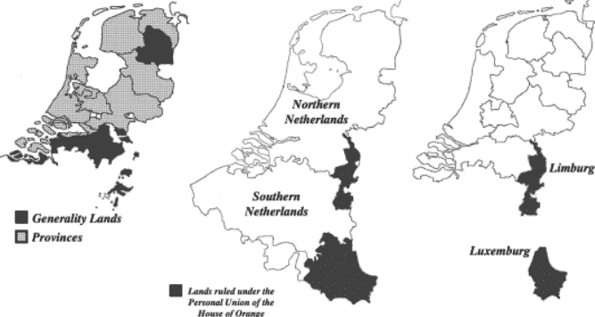
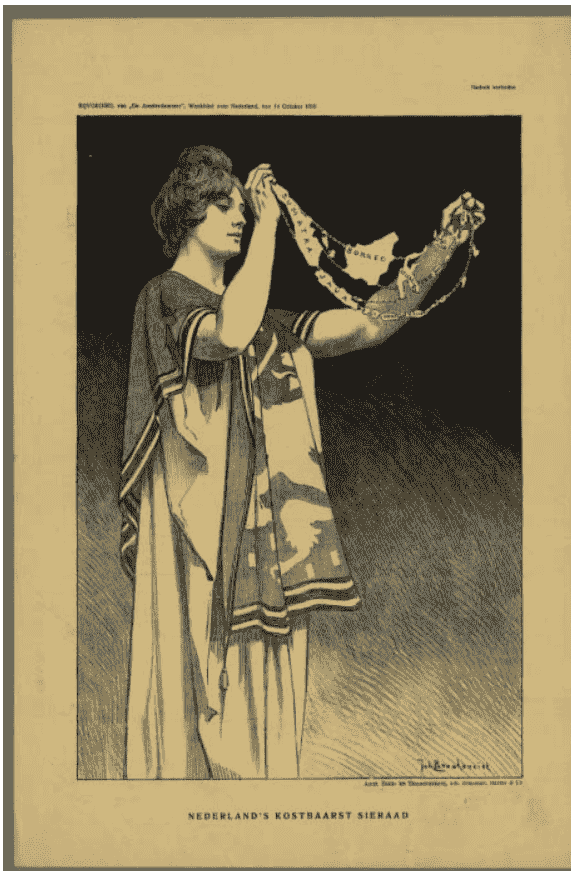
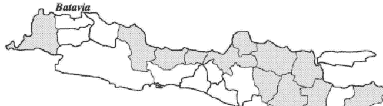
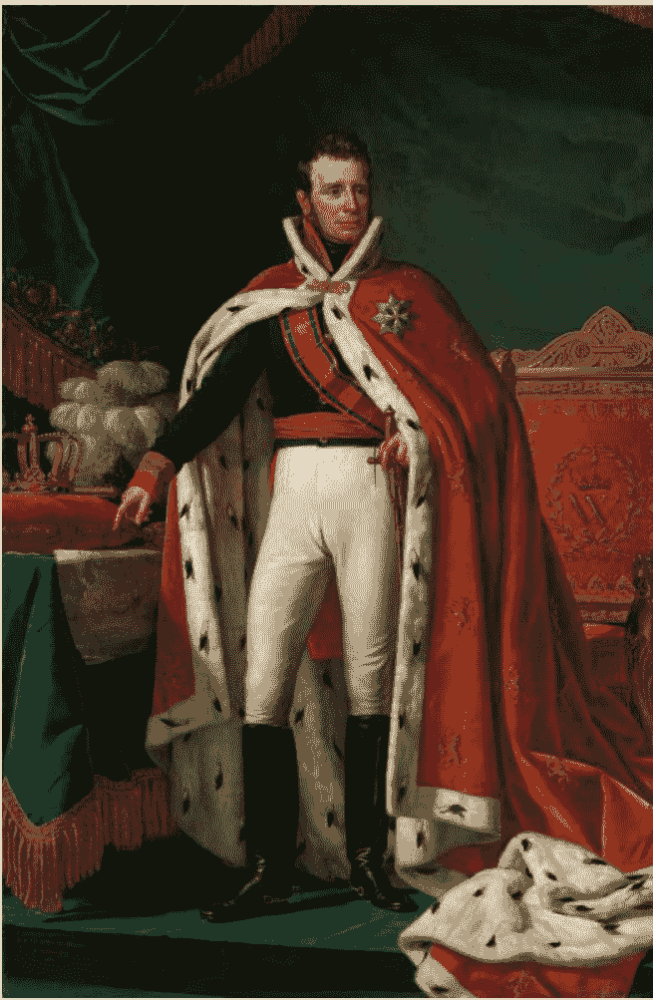
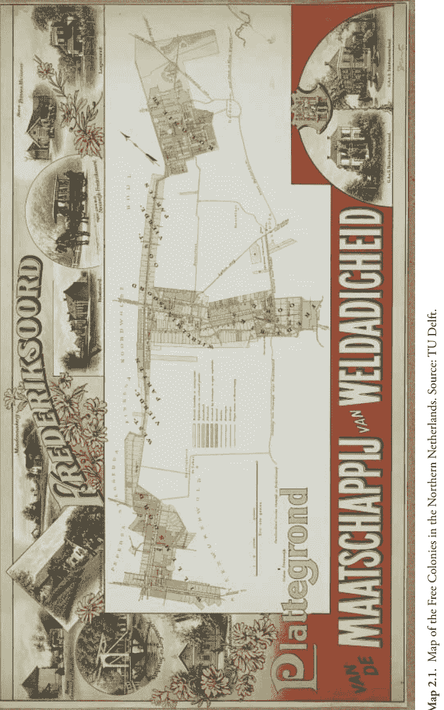
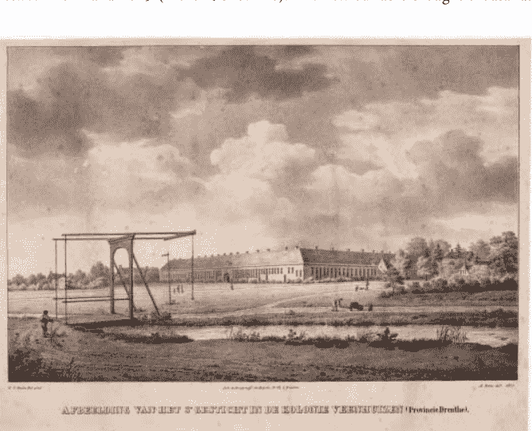
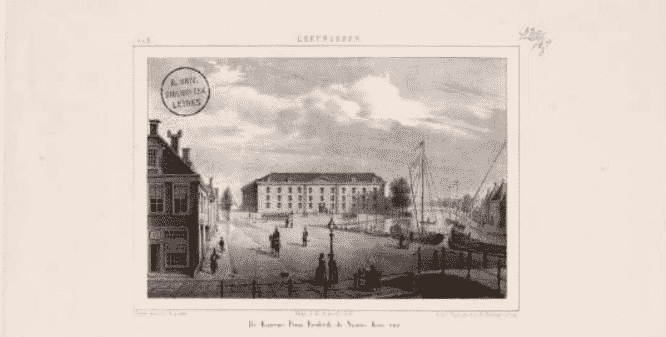
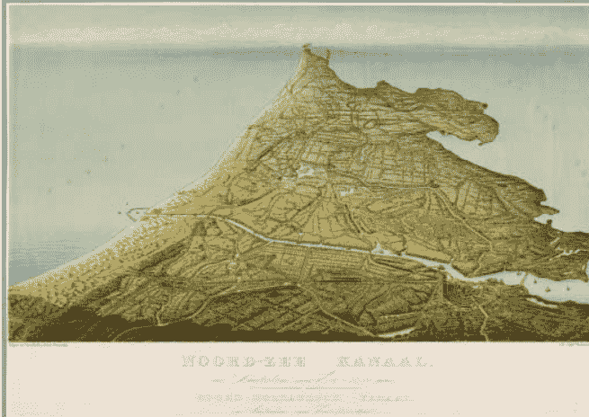

# 商人之王：荷兰殖民帝国的企业治理，1815–1870

# 致谢

本书是多年研究的成果，我所感谢的人员名单很长。感谢那些对本手稿初稿提供反馈的人。我特别对莱顿大学和阿姆斯特丹大学的同事们深表谢意。

我还要感谢荷兰国家图书馆和国家博物馆的工作人员在协助查找档案方面的帮助。最后，我感谢我的家人在整个过程中给予的持续支持与耐心。

# 引言

## 企业治理性

2018年7月，联邦贸易委员会因侵犯隐私对 Facebook 处以50亿美元罚款。这一事件结合剑桥分析（Cambridge Analytica）丑闻、2016年英国脱欧公投以及美国大选，许多人认为反映了数字平台影响行为日益增长的力量。然而，对谷歌、亚马逊、苹果和微软数据的关注往往让人们忽视了一个事实：这些策略并非新颖。它们的历史根源实际上在于19世纪的殖民国家。

福柯认为，治理性最具颠覆性的方面之一是主张国家并非治理的起源，而是在一个特定时刻，国家开始适用于人口。这种关注并非针对19世纪的国家治理，而是针对长期以来试图塑造的民事机构（Rose, O’Malley, and Valverde 2006: 87）。福柯关注的是治理性如何通过实际安排物的配置来教育和灌输习惯，使人们“按照他们应当做的去做”（Foucault 1991: 100）。

通过关注一个新的关注领域，尽管资本主义与自由主义治理性的发展之间存在明显的联系，但对企业形式作用的关注很少（Nadeshon 2008: 55）。现代民族国家与企业的共同出现和相互依赖关系需要被强调。直到后来，企业才“从一种准公共机构——原则上对所有人负责，嵌入在一个转变了私营部门的制度结构中——转变为一种私人机构，通过个人回避政府问责，并在法律上仅对其所有者负责”（Roy 1997: 41）。在这一转变中，企业并没有失去其治理功能；它们继续采取一种政治策略，将国家（而非专门的“经济”）任务委托给辅助管辖区。

## 公司秩序的组装

从规律机构监狱、收容所和诊所到治理术（governmentality），是为了应对国家和国际市场的巨大增长，以及自由主义下资本主义的发展。治理术引入了一种在更大规模上运作的权力政体，针对整体人口，通过一种“安全装置”——在这种装置中，干预的风险必须首先经过计算（Foucault 2007: 44–45）。因此，我将注意力从国家转向了它的“特许经营者”公司，将其视为实施市场投资政府计划的一种安全行为。

通过强调公司的治理属性，它们与市场的感知关系被改变了。它们不再是经济理论中简单的市场参与者，而是在阿尔弗雷德·钱德勒（Alfred Chandler，1977）对亚当·斯密经典隐喻的倒置中，充当了“市场的可见的手”，用更高效的层级管理取代了市场交易；就像 Facebook 一样，它们通过建立习惯、教育欲望并“人为安排事物，使人们能够根据自身利益做他们应当做的事”（Foucault 1991: 100）。这种新形式的治理术定义了一个人口——无论是“贫民”还是“土著”——并将其纳入这些“安全机制”之中，使得这些人口可以以一种“经济化”的方式被管理。

正如福柯所指出的，“经济政府”这一理念对于自由主义而言具有双重含义：一种是指受政治经济学准则指导的政府；另一种是指对其自身成本进行精细管理的政府：即通过更大程度的技术性努力，旨在通过更少的武力和权威投入来实现更多的目标（Gordon 1991: 24）。

钱德勒的洞察强调了一个悖论：当19世纪的自由主义者正准备一项自由放任市场的立法计划时，这些市场正被一种新兴的公司秩序所取代，这种秩序通过层级化组织规模经济和范围经济。随着自由资本主义政权的发展——在这些“治理得最少”、因此也最重要的是“治理得最好”的国家中——将经济治理转移给公司是这种双重意义上“经济治理”的手段之一。

我通过荷兰君主威廉一世（Willem I）领域的皇家公司的案例来探索这些主题，通过这些公司，他在19世纪对一个帝国进行了经济治理。荷兰是公司形式的早期创造者，也是世界上第一个股市的所在地。在威廉执政之初，荷兰是一个工业匮乏的农村后地，失业率高，拥有一个从早期黄金时代继承的来之不易且昂贵的帝国，在竞争激烈的工业革命中成功的可能性与葡萄牙相当（Zanden and Riel 2004: 85–120）。在他统治期间，一系列皇家公司领导了帝国的市场革命，组织了全球商品链，丰富了国家，促进了市场，并将不听话的农民和贫民驯化为具有“生产美德”的纪律工人阶级。我将认为，这种转型是“公司治理术”的产物。

为了应对“紧急需求”并带有战略性地进行投资，一个由“话语、机构、建筑形式、监管决策、法律、行政措施、科学陈述、哲学、道德和慈善提议”构成的异质且变化的组合体是通过现有实践的拼贴（bricolage）聚集在一起的；这些并非高度现代主义规划的宏大愿景方案，而是成为日常统治核心的平庸实践（Foucault 1980: 194）。然而，人们倾向于将此类组合体本质化，并避开福柯开头提出的问题：即它们是如何出现并拼装成特定的干预计划的（O'Malley 1996: 310）。考虑到福柯对治理理性的关注，他对统治机制如何统治场域的方式关注极少，这并不意外，这些只是“由于其可信度更多取决于修辞共鸣而非分析严谨性的‘偶尔插话’”（McKinlay 2010: 1019）。这是因为计划及其社会技术的流传“不是一个统治在领土上失败地扩张的过程，而是关乎脆弱的接力、充满争议的地点和分裂的归属”——换句话说，是政治的问题，而非治理的理性（Rose 1999: 51; O'Malley, Weir, and Shearing 1997: 510）。

李（Li）强调，回到这些问题至关重要：面对这种分裂的紧张局势，如何在具有治理意愿的权威与受该政府统治的个人和组织之间建立结构？她强调，“组装”（assembly）作为一个理论概念——标记了能动性，即将异质元素聚集在一起、在它们之间建立联系并在紧张局势下维持这些联系所需的艰苦工作（2007b: 264）。她强调动词形式，以强调组装的实践应是分析的。我们不应将此类组合体视为一个既定事实（fait accompli），即一组布置好待检查的场域。她认为，为了做到这一点，我们需要将一种不同的方法——统治的历史学和社会学——引入治理术研究，而同时不使二者崩塌（2007a: 26）。这种统治的历史学和社会学有助于回答问题并在不丧失焦点的情况下扩展治理术研究。这种政治方法“将强调创造力如何产生于处于特定权力和意义关系的人类所处的处境，以及在那种处境的可能（包括组装过程）之中产生了什么样的人物”（Rose 1999: 279）。

## 公司化

在讨论构成19世纪荷兰帝国公司治理术的特定统治社会学时，我引入了“公司化”（corporatization）的概念。公司化是指法律和政治过程，通过这些过程，公司形式被策略性地用于巩固或固定政府计划的零散元素，以实现制度的一致性和持久性。一旦这种状态被冻结，组合体的格式就可以通过创建新公司来流传；这些公司可以通过重叠的董事会联系到更大的组合体中，从而确保它们之间新实践的进一步流传。关注公司化是解决特定治理策略如何在公司内部及公司与国家之间流传，创建一个能够管理全球商品链的网络化组合体的手段。

公司化特指用于巩固组合体的两种统治技术：合同的使用和会计的使用，通过这些手段，它们层级化地组织和管理人员及其内部经济。

这种双重分析方法具有重要的方法论意义；适用于治理分析的谱系工具集需要阶级分析的补充。我的主要理论项目——即将治理术理论应用于公司领域——得到了对荷兰和日本精英分析的补充。本书的次要项目是探索在荷兰背景下通过公司治理术产生的特定的“绅士资本主义”社会经济形式。通过关注这一类“商人之王”阶级，我强调了企业化的政治过程是荷兰治理精英能够应用王室主权并建立一个超出王室统治的独立领域——“经济”的手段，借此他们巩固了他们传统的、继承性的统治权。这一阶级关注企业内部的生产关系，但在处理这些关系时关注其治理影响。

对于用于管理公司的系列政府化实践，我很少强调公司用以获得委任主权的典型法律特征（例如人格和有限责任制），这些特征是大多数商业史的核心。“公司化”（Corporization）在这里指的是“公司化”是指一套在更广泛的企业范围内流传的实践，并具有更广泛的分析价值（见表 0.1）。公司化涵盖了该时期的一系列公共机构，从市政公司到“协会”，以及获得皇室认可的法律身份的企业。例如，在这一方面，我分析了源于慈善协会（Society of Benevolence）的公司实践是如何在荷兰贸易公司（Netherlands Trading Company）内部流传，随后在 G., & H. Salomson 的非公司制家族合伙企业中流传，并对其进行了“政府化”。因此，我对法律意义上公司制度形式的演变并不感兴趣，而是更关注公司组织生产和销售以创造规模效应的实质性实践（即心态）。在处理这些被广泛讨论的实践时，我强调了政治工作。

**表 0.1.** 19 世纪初荷兰最大公司资本额部分列表。

| 皇家公司 (NV) | 成立年份 | 成立时的皇家资本额 (f) | 总资本额 (f) |
| :--- | :--- | :--- | :--- |
| 荷兰工业促进总会 | 1822 | 33,000,000 | 50,000,000 |
| 荷兰贸易公司 | 1824 | 2,000,000 | 37,000,000 |
| 荷兰银行 | 1814 | 1,200,000 | 5,000,000 |
| 爪哇银行 | 1828 | 1,000,005 | 1,000,000 |

## **非公司制国家企业**

| 名称 | 成立年份 | 资本额 (f) | 总资本额 (f) |
| :--- | :--- | :--- | :--- |
| 摊销辛团 | 1822 | 55,000,000 | 55,000,000 |
| 荷兰莱茵铁路 | 1838 | 24,000,000 | 24,000,000 |

## **皇家支持公司**

| 名称 | 成立年份 | 资本额 (f) | 总资本额 (f) |
| :--- | :--- | :--- | :--- |
| 慈善协会 | 1818 | | |
| 皇家工厂 | 1826 | 100,000 | 200,000 |

> 注：皇家公司包括由国家建立并带有特许经营状的公司（NV，naamloze vennootschap）。非公司制国家企业是国家机器的一部分，但被授予了独立的法律人格。`荷兰莱茵铁路`（The Nederlandse Rijnspoor-Maatschappij）由国家建造，并于 1845 年作为特许公司私有化。“皇家支持公司获得了皇室的大支持，但保持了名义上的独立。爪哇银行的资本额由国家和荷兰贸易公司（NHM）平分。

来源：Algemeene Maatschappij voor het Volkuis (Société Générale), Riemans 1935: 65–68; 荷兰贸易公司 (NHM), Mansvelt 1924: 72–75; 荷兰银行, Jonker 1996: 171; 爪哇银行, Furnill 1976: 102–3; 摊销辛团, Riemans 1935: 72–98; 荷兰铁路公司, Boeke en Meerck 2001: 5–6; 弗利辛根与杜尔蒸汽及其他工具皇家工厂, Jonker 1996: 7.

我认真认同阿尔弗雷德·钱德勒（Alfred Chandler）的观点，即公司通过对范围经济和规模经济的层级化管理来取代市场，并通过价格机制取代效率较低的市场化运作；采取这种组织方法是为了反驳新制度主义经济学家那种还原论的个人主义的经济论点（Bratton 1989: 1473）。

正如钱德勒最初强调的那样，公司的竞争优势在于它们的“行政协调”，通过这种协调，它们能够通过市场机制的协调来实现“更高的生产率、更低的成本和更高的利润”；对此我补充一点，当国家通过公司实体进行管理时更有利时，公司化就是管理市场的一种方式。

在工厂车间对阶级主体性建构的马克思主义研究与对管理和会计的福柯式研究之间存在显著的重合，这种重合并非偶然。在福柯的著作中，他引发了对统治的马克思主义社会学；福柯像本书一样，简单地接受了市场的转型性政治分析作为其起点（McKinlay 2006: 88）。然而，与马克思主义分析不同，关于纪律的福柯文献并未关注企业如何成为“工人”（以及阶级身份）规范化的关键场所，本文将通过治理分析来解决这一点。

十九世纪的荷兰文献痴迷于自由的道德基调，将其视为不仅财富的来源，更是秩序和公民的必要性（Boschloo 1989: 60–61）。荷兰史学家 Stuurman 将其称为“生产性美德”的治理，通过企业实施管理的程序：

> 生产性美德……要求在国家社区中实现少量的经济自主。

因此，在那那些劳动者（通常是无技能的）和更底层的无产阶级之间划定了一条清晰的界限，后者必须通过严厉的纪律和对饥饿的恐惧投入工作（Stuurman 1997: 34）。

对改革性工人主体性的需求通过撕裂新帝国的社会和政治紧张局势得到了证明。到1830年，随着比利时的分离，荷兰北部和南部之间的紧张关系爆发了，一场针对荷兰统治的昂贵战争画上了句号。这些懒散的人们需要通过这些“生产性美德”的治理被转化为具有社会责任的“工业工人”。根据当时最著名的荷兰自由经济学家之一 Simon Vissering 的观点，将经济自由等同于自私是一个严重的错误；相反，通过参与生产性活动，人们领会了合作的价值，更广泛地说，是社会纽带的道德本质（引自 Stuurman 1997: 42）。

在回顾治理在塑造这些阶级主体性中的重要性时，本书仍关注以下问题：即应用了哪些统治技术？我引用了 Hahn 的结论：“现代商业的起源并非通常意义上的经济或技术创新的结果。相反，变革的重要技术是隐形的技术：是作用于人类而非机器的技术”（1993: 29）。这些策略在荷兰贸易公司（以及其他机构）中得到了探索，该公司作为一种治理计划管理了受困殖民商品链的数百万生产者。该公司并非仅仅受利润动机驱动，也不受资本的无情逻辑驱动：它被赋予了以经济方式管理贫困主义和无产阶级发展的任务。荷兰贸易公司拒绝了技术最先进的生产形式，恰是因为其首要考虑是对人的管理，以及防止他们在1830年比利时分离期间所看到的阶级冲突。为了防止工人产生革命意识，他们推迟了工业革命并鼓励企业组织发生转型，以便更好地监管经济及其经济参与者。

这些例子阐明了福柯的观点：企业纪律构成了正式自由的阴暗面。合同可能被视为法律和政治权力的理想基础；[但]全景敞视主义构成了普遍扩散的强制技术。它深入作用于社会的司法结构，以使有效的权力机制与其所获得的正式框架相对立而运行。发现自由的“启蒙运动”也发明了纪律（1979: 222）。

全景敞视主义在其主体上的独特之处在于，它建立在一个不可见的观察者之上，引导他们自我审查行为并转变为自己的主体。全景敞视主义是实现这一目的的一系列监控技术的隐喻，包括管理会计。我们从 Facebook 对“老大哥”策略的使用开始本研究。

在追溯“耕作制度”（Cultivation System）中企业对会计和制造的使用时，我从仁爱殖民地（Colonies of Benevolence）开始，这是一家部署了纪律会计系统以管理支付者的王室企业。我使用这个例子将福柯对边沁监狱全景敞视策略的分析，扩展到边沁为“慈善公司”开发的相关的全景敞视策略（Schrouwers 2020）。仁爱殖民地是这种全景敞视式会计的早期案例；他们利用会计来评估生产力，对不当行为罚款，并奖励那些被判定足够美德的人，这一切都是以货币形式的。

这些技术仍然是组织理论者的关注焦点。通过将其谱系追溯到仁爱殖民地，我强调了通过“仁爱”对工人进行的管理形式。

作为一种理论框架，治理因此可以为阶级建构提供一种平衡的方法。阶级不能仅仅被视为来自工人地位的机械解读；它必须包含由生产和社会再生产共同培养的更广泛的关系的“结构化整体”，包括治理，即工人主体性发生的场所（Kalb 1997; Buraway 1983, 1985）。这种方法通过工厂内外部署的更广泛的管理技术来考察阶级建构；一种关注安全装置的治理方法。转述福柯的话，这种方法关注的是由机构、程序、分析和反思构成的整体，即允许行使这种特定形式权力的计算和战术，“这种权力以[工人]作为其政治经济的主要形式和安全的基本手段”（1991: 10-2，我的插注）。

## 导言

对基于英国或美国经验的主导性学术叙事的一种比较性回应。荷兰的案例作为相关过程的案例研究特别有用，这是由于其领土狭小、殖民地广泛、公司形式发展早，但工业化却较晚。因此，荷兰的例子提供了一个窗口，借此探索公司形式作为一种特许经营国家的演变——这种国家与近期引入的自由放任主义在动态协同中，“治理”着新兴的“自由市场”领域。

在位二十五年的统治期间，威廉一世（Willem I）建立了一系列公司，并将绝对主权的某些方面委托给这些公司，包括开发王室领地的权利（即授予它们“独立人格”，或者用我书中使用的术语来说，是授予国家一种“特许权”，正如铁路特许）。正如威廉·罗伊（William Roy）所指出的，这一时期公司的公共性质在国际上被广泛接受：“公司作为最‘现代’的经济组织，是后现代体系的延续。它的约束性法律是对国家主权的委托，是其公共起源的遗迹。商业公司（同市镇、教会和大学一起）能够逃避平等主义的利剑，这是一个需要解释的问题”（1997: 46）。威廉的名义目标是扩大他对已经很弱的荷兰联邦议会（State-Generaal）的统治。在19世纪上半叶，这种国家与公司的意识形态分离是由于威廉需要通过公司进行治理，以排除议会监督并加强其绝对统治所导致的。这些公司的预算构成了立法审查的核心，并允许新国王实施他无法通过其他方式获得税收的违民政策（Coopmans 1989: 588; Sturman 1992: 108f）。早期荷兰共和国在开发公司形式方面具有先驱作用，它成立了东印度公司（VOC），通过该公司统治了其遥远的殖民地，而威廉一世现在将其调整用于国内事务并取得了巨大成功。

这些公司是通过王室法令（Koninklijk Besuiten）创建的王室主权的特定委托；并没有通用的公司注册程序。与其他需要立法批准方可成立的司法管辖区不同，荷兰王室公司可以通过法律宣布为正式程序（1961–63）。从那时起，它们由股东选举产生的董事会管理。国王通过其代表经常持有控股利益，但这些代表并不总是遵循他的明确意愿。需要强调的是，这些公司并不是威廉所继承并以此统治的拿破仑国家官僚机构的一部分，这正是它们政治意义所在。相反，它们是向新兴公民领域的对王室主权的委托（Miller and Rose 1992: 180; Barkan 2013: 18–39）。

# 威廉在1850年以前在荷兰建立了137家公司中规模最大的一个

威廉在1850年以前在荷兰建立了137家公司中规模最大的一个，以满足政府需求，包括交通、福利、贸易监管和银行服务（Camferman 2000: 79；见表1）。在这一组国有企业中（就本书而言），最重要的是**荷兰贸易公司**（NHM, *Nederlandse Handel-Maatschapij*），这是一家由威廉在1824年建立的王室特许公司，旨在开发与新收购的荷兰东印度群岛之间的贸易（Mansleet 1924）。它的名义资本为3700万荷兰盾，远超1841年平均资本为5000万荷兰盾的公司，也或是资本约200万荷兰盾的阿姆斯特丹主要贸易银行（Jonker 1996: 69–70）。NHM的模式是威廉祖父弗雷德里克（Frederick）于1772年为了多种目的建立的**普鲁士皇家海外贸易公司**（*Königliche Seehandlung*）（Zappey 1981:28–29; Bakker 1995b:97）。与荷兰共和国时期的VOC不同，NHM并不旨在统治东印度群，尽管正如我们所看到的，它保留了许多政府功能，如对贫困的管理。然而，这种国家与经济的意识形态分离，体现在威廉称号中那个“商人王”的连字符上。

NHM是一家混合型的贸易公司、银行、制造商以及减少贫困的社会福利工具。为了治理这种公司化经济而开发的官僚主义（cameralistic）治理技术在19世纪后期的荷兰第二次工业革命期间被更广泛地采用，因为这种形式日益独立于国王，并本身成为一个像监狱、收容所和诊所一样的权力/知识场地。通过在更广泛的——殖民——背景下研究NHM，我们能够真正欣赏它在荷兰民族国家新兴自由治理中的作用。在荷兰纺织品生产的工业化过程中，NHM专门寻求通过借用官僚主义贫民院（特别是来自“仁慈殖民地”）的管理治理技术来引入“勤奋”，从而将贫民者的主体性重塑为“有德的”工人。换句话说，在工业工厂中塑造经济主体性的管理科学，其起源源于对贫困的管理。

因此，“大荷兰”（包括殖民地）早期的国家形成在很大程度上是威廉及其指定成员领导下公司化治理的结果，这是一个封闭的贵族公司集团，他们同时控制着国家和公司行政机构，并鼓励技术在他们之间流通。作为王室主权的委托人，现代公司出现于荷兰现代民族国家形成的时刻。这套复杂的、相互互联的公司以新的方式将王室权力延伸到公民社会、金融服务部门、贸易和国家生产中，而国家官僚机构更容易受到自由主义的影响。

## 14 | 商人王

这种对经济的治理在1848年的自由主义革命中面临批判，通过室革命，一份基于法治的新宪法被王室不情愿地接受了。自由主义假设自主的市场是国家主权范围的限制；根据洛克的说法，私有财产先于国家，因此国家的绝对权威是受限的（Nadesh 2008: 51）。直到19世纪中期，这门新兴的自由主义“政治经济学”才预示了不可知……为了经济过程的主权，并作为其结果，导致了“经济主权变得不再可能”（Gordon 1991: 16），从而催生了自由放任政府计划以促进自由市场。正是在这一时期，人们提出了将“解放”经济、公司，特别是**荷兰东印度公司**（NHM）从国家中解放出来的论点。

然而，这种自由主义批判对洛克等晚期启蒙绝对君主制者的最初影响有限，因为这些人将其个人财富投入到他们所特许的公司实体中，这些公司旨在满足公共需求，且他们个人对投资者可能遭受的损失提供了补偿，这可以与当今的公私合作伙伴关系联系起来（Woud 1987: 54）。公共部门与私营部门之间新霸权式的划分并非自然且不可避免的，其本身就是一个历史建构，是自由主义革命后这种长期政治斗争和意识形态发展的结果。早期的政治经济学家将主权视为国家与经济管理之间的枢纽。对治理性的分析关注的是更广泛的治理技术，而非国家机器本身，这反映了这种早期的意识形态背景。“韦伯意义上的国家，作为一个对暴力使用拥有垄断权的官僚整体，因此是领土范围内合法性的唯一来源，这种观点具有其分析优势（Rose 1999: 1ff.）。通过将注意力转向对同质且连贯国家的想象，“国家”被证明缺乏制度或地理上的固定性。这种方法引起了人类学家的关注，他们通常研究国家边缘的人们，在这些地方，国家的存在和影响往往是不一致的；它对早期强调与处于“上方”的国家看似孤立的“地方社区”提供了一个重要的修正（Troullot 2001: 126）。

通过转述本尼迪特·安德森关于国家“想象”的精辟比喻，费尔格森（Ferguson）和古普塔（Gupta）指出了这些国家意识形态是如何定位的：它们是“通过特定的想象和符号装置进行概念化和制造的建构实体，这需要进行研究”（2002: 981）。科里根和塞耶早早强调“国家，如果玩双关语的话，就是在宣称（state）”；他们指出从宫廷仪式到健康检查的表演性行为，都是关于国家是什么（以及重要的是，它不是什么）的唤起性陈述，这似乎“国家从未停止过说话”（1985: 3）。人类学家关注的是国家的分散机构（如各机构）如何以其不同的方式共同构建单一主权国家的形象，即国家作为一个行动于“上方”并独立于公民社会和经济的代理，而经济则是它所“涵盖”的（Ferguson and Gupta 2002）。蒂莫西·米切尔（Timothy Mitchell）将这种“自我”指涉的过程称为“国家效应”（state effect）；正如我们所想象的国家，是详尽的空间组织、时间安排、功能规范以及监督与监视等详细过程的结果，这些过程创造了一个从根本上划分为国家和社会的的世界表象。现代政治的本质不在于这种分界线一方形成的政策应用于另一方或被另一方塑造，而在于这种差异界限的产生和再。（Mitchell 1999: 89）。

其分散代理所关于国家的陈述总和，构成了一个具体的抽象意识形态统一，在话语上将国家与社会（特别是经济）区分开来，而它仍然是其中一个不可分割的嵌入部分。然而，福柯强调，尽管国家在意识形态上与社会和殖民地有所区别，其委托的主权仍在继续行使。

理解公司治理性的发展，要求我们关注经济是如何被建构为一个与国家不同且独立的实体的，以及“政治经济学”的话语在意识形态上是如何缺失了这一点。我在之前对种植制度（Cultivation System）的分析中曾提到了这种政治的遗漏，其中对农作物的榨取被框架为通过合同进行的“经济”交换，而国家剥削的政治在此发生。这种意识形态过程被经济社会学家卡利西（Calisikan）和卡隆（Callon）称为“经济化”（economization）（因此是“国家效应”的变体）。经济化是一个过程——行为、组织、机构和对象被专家初步且有争议地界定为“经济”的，并在意识形态上被物化为“与国家分离的经济”的（2009: 370; Mitchell 1999）。他们强调了专家在塑造经济作为投资对象的文化现实方面的话语效应。经济一旦获得了其现实性，就可以被动用来证明政府计划的合理性，并对国家的直接干预进行限制，但留下了持续公司治理的可能性。

关于“经济化”的文献可以通过关注公司会计的谱系来扩展，以勾勒出这种新的新形态（Kramer and McClocks 1988; Kalpagam 2000）。通过其全性的影响，这些会计使得人们首次想象出这个新实体——经济——是独立于王室的。当公司会计系统被大规模地应用于管理爪哇的种植制度以及连接垄断与殖民地时，所创建的管理账户被反思性地用于描绘一个自律的（即管理卓越的）经济。**荷兰东印度公司**（NHM）公司管理的经济跨越了大陆，捕捉了爪哇和荷兰东部数百万个体商品生产者的交易微细节，这一切都可以被列入国家账户的宏大计算中；一份帝国的资产负债表。

在意识到对主权力和经济施加这些意识形态限制是一个极具争议的问题后，在本书的后半部分，我仔细关注了私营公司在新自由主义时代成功建立，但在管理殖民贸易的组合中仍保留了其治理职能的政治过程。如果荷兰国家及其主要公司形成了一种基于国家与经济分离的共同“自由主义”理性，我们需要关注这一过程是如何完成的，特别是那些既担任政府职务又担任公司董事会的贵族阶层，他们确保了在更大的国家形成项目中通用的治理逻辑。

在我概述的统治社会学中心，我强调了许多贵族阶层担任多个董事会成员并作为国家与公司之间的衔接点（Schij 1993; Roy 1983）。尽管他们来自贵族或摄民背景，但他们是封建领域的地租资本家。他们来自少数几个家族（估计有三百个），这些家族习惯于统治荷兰精英。到20世纪初，“1901年议会下院的所有成员中，24%属于帕民[摄民]家族，19%出身于贵族。1888年至1918年间所有政府部长中，40%属于帕民，24%属于贵族”（Kuitenbouwer 1972; 参见 Hoogenboom 2003: 215）。同样，对同一时期荷兰公司董事会的详细研究显示，来自阿姆斯特丹的少数相互通婚的摄民家族在将一系列主要的荷兰公司联系成整体方面发挥了异常大的作用（Schij 1993: 39; Bossenboek 1996: 85–115）。

这些资本家作为**荷兰东印度公司**（NHM）等公司的董事，将贫困这一复杂问题“技术化”并去政治化，使其从公共辩论中撤出并受制“专家的规则”（Bossenboek 1996）。正是他们从继承的殖民警察科学中发展了新的管理话语，并随后在一种新的治理科学学院——代尔特的“皇家学院”中巩固了他们的地位（Fasseur 1999）。在这部作品中，我提供了一个关于这一摄民资本家阶级如何在王室公司的熔炉中被创造出来，并最终夺取对国家过程的控制权的谱系。

# 引言 | 19

在自由主义革命之后，仅凭商人国王之手便完成了政权与公司治理术的形成。

## “大荷兰”的殖民治理术

在追溯这些皇家公司的发展轨迹时，我遵循了它们的一套治理实践在整个荷兰帝国范围内的流流与影响力。在此，我超越了荷兰史学界关于 19 世纪荷兰商业发展和工业化的现有研究界限，因为这些研究在很大程度上忽视了殖民主义对该发展的影响（Mokyr 1976; Grifts 1979; Sluyter 2005; Wintle 2000; Zanden 1996; Zanden and Riel 2004；例外情况见 Manselt 1924; Meerbeek 2019）。这种忽视反映了荷兰历史学家和公众对于接受后殖民研究存在着更广泛的抵触情绪，不愿承认殖民主义、帝国和帝国主义对祖国国家和阶级形成过程的影响——特别是对绅士阶级资本家的精英贵族式统治的影响（Raben 2013）。

Koekkouk、Richard 和 Weesteijn（2017, 2019）在最近的一次小组讨会和论文集的引言中指出，荷兰殖民主义已被广泛研究，但尚未出现类似于英国帝国主义和帝国兴起的大型文献。他们认为，荷兰人既是帝国统治的主体，也是帝国代理人，但他们自己并没有一个描述“帝国”的荷兰语单词（2017: 81–83）。正如 C. J. Lammers 在早期的分析中指出的，荷兰作为“占领国”的概念并不符合我们的国家自我认同。我们不习惯将自己和祖先视为“占领者”，而是视为“被占领者”，即 19 世纪德国、日本和法国人的受害者，甚至在更早的时期曾是西班牙统治者的受害者（2003: 7）。近期的荷兰史学很大程度上忽视了将“殖民的”纳入国家历史；它承认“自 17 世纪晚期以来，荷兰早期的海外活动部分源于荷兰作为一个独立国家的兴起，将民族解放与海外征服融合在一起，但荷兰的生存意义并非建立在任何帝国动机之上。荷兰本身从未被视为一个帝国，荷兰殖民主义保留了强烈的商业导向和技术治国色彩（Raben 2013: 9）”。在涉及荷兰在印度尼西亚群岛扩张主义的“帝国主义辩论”中，Kuitenbrouwer 在解释“瓜分非洲”的开发模型中总结了反对荷兰的论点，并得出结论：他们最多应被称为“不情愿帝国主义者”（1998）。结果，荷兰及其在爪哇腊的殖民地各自孤立分析，但很少有学术努力致力于两者的国家形成比较；事实上，与同一时期“耕租制度”下爪哇腊的文献相比，关于荷兰联合王国的英文文献几乎可以忽略不计（Laarse 1999: 4）。

## 20 | 商人国王

回到这些辩论，如果我从一个简单的事实出发：爪哇腊的耕租制度（Cultivation System）为**荷兰贸易公司**提供了大部分利润，并占荷兰国家收入的三分之一以上，使其能够启动规模最大的国家工业化项目——国家铁路网的建设（见表 0.2）。殖民帝国对荷兰国家和经济发展的中心性显然需要被解决。在探讨*帝国的中心性*时，我强调了后殖民研究中的一条格言：我们必须“将宗国和殖民地放在同一个分析框架内处理”（Stoler and Cooper 1989: 4）。在本书中，我追求对整个帝国范围内国家形成的共同形式进行比较分析，特别是公司治理术作为一种“安全装置”的作用。

如果我们还记得公司在殖民主义发展中的原始角色，那么公司充当了“安全装置”就不足奇了。重商主义时代的殖民主义经常被体验为“公司化统治”，公司本身充当公司的面孔，无论是加拿大的哈德逊湾公司、印度的东印度公司，还是荷兰东印度群岛的**荷兰东印度公司**（VOC）。在意识到这些公司具有类国家特征后，变得很清楚：荷兰国家并非在荷兰本土发展仅仅为了转化其殖民地。相反，现代国家同时在宗国领土和殖民地发展，利用了一套共同的策略。殖民控制策略在后期重新部署到宗国，也并不意外。

廉廉廉廉一世（Willem I）继承的荷兰联合王国的情况与爪哇腊并不相似——两者都是被战争破坏的、等级森严的农业社会，具有高度的去中心化地方自治权，且只有原始的家长制官僚机构。随着**荷兰贸易公司**利用市场警察的新科学来调节出口商品的生产和流动，并增强国家财富和理想化生产力公民的形成，这两片景观都发生了变化。**荷兰贸易公司**是我们可以借此将世界其他部分重新插入福柯关于生命权力发展的欧洲中心主义谱系之中（参见 Scott 2003）。

表 0.2. 殖民盈余占税收的百分比。

| 时期 | 殖民盈余 | 占荷兰 GDP 百比 | 占总税收百分比 |
| :--- | :--- | :--- | :--- |
| 1831–1840 | f$150,000,000 | 2.8 | 31.9 |
| 1841–1850 | f$215,000,000 | 3.6 | 38.6 |
| 1851–1860 | f$289,000,000 | 3.8 | 52.6 |
| 1861–1870 | f$276,000,000 | 2.9 | 44.5 |
| 1871–1877 | f$127,000,000 | 1.7 | 26.5 |

来源：Meerbeek 2016: 148。

# 引言 | 21

**荷兰贸易公司**实施的计划利用了这些话语，将其同时应用于荷兰的“贫民”和“懒惰的土著”，这仅仅促进了19世纪绅士资本主义的发展。

本书采用的方法很大借鉴了 Ann Stoler 和 David Scott 的后殖民批判，以进行更具反性的分析。根据 Scott 的观点，近期后殖民文献中理论上的缺失是试图将殖民主义研究重新转向被殖民者以回应此前对欧洲强调的结果。Scott 认为，后殖民批评者主要采取了两种转移殖民国家注意力的修辞路径。一方面，这些批评者证明了殖民话语是由各种东方主义学者、德国浪漫主义者和社会达尔文主义者产生的，他们制造了殖民地的扭曲形象；培养了内在且不可逾越的殖民差异意识（Bhabha 1990）。另一方面，批评者挑战了殖民通过引入自由主义启蒙思想来转化殖民地的主张，从而实现了从“武治”到“法治”的转变（Scott 2003; Shani 2006）。Scott 认为，这两种在对殖民话语本身作为一种对西方的回应的批判中，并没有像他们声称的那样使欧洲“去中心”，反而让*欧洲进入被殖民者生活的各种形式*变得不可见（2003: 193）。

如果我们认认真执行梳理“帝国张力”并“将宗国和殖民地放在同一个分析领域内处理”的指令（Stoler and Cooper 1989: 4），我们需要关注海外帝国使用的治理技术，以及正成为新兴欧洲国家核心的新征服领土。这种比较方法的目的不是为了将欧洲作为“所有历史的普遍主体”，而是为了拒绝以“殖民权力如何组织为一种产生统治效果的活动”的方式进行分析（Scott 2003: 25）——因此在本例中，是为了说明殖民权力如何被用于日本以及“国内殖民”项目。荷兰国家被其帝国项目塑造的程度，正如殖民地本身被欧洲霸权所转化的程度一样。

## 22 | 商人之王

换句话说，这要求对那些旨在改善人口的项目（即安全机制）进行分析，这些项目在国内外均被归入“发展”的范畴，但最终却作为“国家发展的日常形式”而存在（Li 1999: 296）。因此，本书通过比较的方法，考察了企业化安全机制在内部和外部殖民主义中的部署：包括国内殖民地的建立以及海外帝国主义殖民地的扩张。

# 斯科对治理性的定义与“企业化治理性”概念

斯科（Scott）将治理性视为“一种不一定与殖民主义重合的权力形式”，这建立在 Stoler 和 Coorer [Corener] 的指令之上，即识别跨越殖民分界的统治项目中特定的延续性。正因如此，我通过强调海外殖民地的殖民主义与宗主国内部殖民主义之间的关系，对“殖民的”治理性概念提出了质疑。通过用“企业化的”替代“殖民的”治理性，我希望强调由约翰内斯·范·登·博世（Johannes van den Bosch）等人物在新整合的荷兰领土（如德伦特和特温特）引入的具有历史特定性的说、实践和项目，这些领土是新兴欧洲民族国家的工业化核心，且在海外帝国中也是如此。对企业化治理性的关注，使我们能够追溯横跨荷兰和爪哇的殖民装配，以及用于将荷兰农民和爪哇农民都陷入在固定的全球安全机制中的共同统治项目。无论是范·登·博世在荷兰东部的“仁慈殖民地”，还是在爪哇的“耕作制度”（Cultivation System），都是殖民话语的一个特定分支，它们以经济发展的名义提供了新形式的纪律。通过关注将这两个案例联系起来的底层经济话语的延续性，凸显了殖民地在宗主国国家形成过程中的作用。在书中，我阐述了一个观点：这种独特的荷兰式“仁慈殖民”（带有讽刺意味）被同样地应用于荷兰本土和爪哇。

# 理论视角：自由主义、殖民主义与全景监狱主义

这种方法使我们能够将从殖民治理性研究中获得的见解应用于欧洲的发展分析中。例如，卡尔帕加姆（Kalpagam）认为，“塑造‘个人’是19世纪自由主义的一个重要手段，但殖民语境下的自由主义并不寻求重建公民-个人（即权利持有者的理想），而是将其作为一个被迫进入商业交换领域的个体，从而成为市场经济的经济人（Homo economicus）”（2000: 420; Bhimani 1994）。卡尔帕加姆的洞察凸显了欧洲能够负担自由主义权利的人的范围狭窄（仅限于拥有财产的人），并使我们能够像审视爪哇的情况一样，审视那里的殖民性统治项目。特别是，这把注意力从自由主义进步被认为释放的“自由力量”话语重新聚焦起来，并将其引向这些司法自由背后的阴暗面：全景监狱主义（panopticism），即那种“普遍传播的强迫技术”，它被用来塑造“经济人”（Foucault 1979: 228）。

安妮·斯托勒（Ann Stoler）通过将福柯（Foucault）的“监狱群岛”概念扩展到帝国（2016: 78）发展了这一观点。福柯在涉及“监狱的诞生”时理论化了“监狱群岛”，并用它描述了监狱之外充斥着相同纪律实践的众多机构。福柯问：“监狱像工厂、学校、兵营、医院，而这些地方又像监狱，这令人惊讶吗？”（1979: 228）。这种对纪律权力向公民社会延伸的关注使得梅特赖（Mettray）——一个针对犯罪青少年的法国“农业殖民地”——被称为“梅特赖的完成体”。“为什么是梅特赖？因为它是最极端的纪律形式，是集中了所有行为强迫技术的模型”（1994: 293）。然而，福柯以极其欧洲中心主义著称，并刻意避谈将梅特赖称为一个“国内殖民地”（Arneil 2017: 156–62）。斯托勒捕捉到了这种缺失，指出福柯列为监狱群岛示例的所有机构——无论是国内的还是海外的——都是某种形式的显性殖民地。这些观点将殖民主义视为该“帝国监狱群岛”的关键特征，是一场“超越刑法边界”的殖民实验。殖民地被保持在对一种更广泛的生物政治规范和法律地位的依赖关系中，而这种地位是设计上让殖民地的人所向往和渴望却无法获得的（Stoler 2016: 78）。

斯托勒强调了自由主义应用其排斥手段的方式：通过种族、性别和阶级。那些在荷兰因阶级或在爪哇因种族而被放逐到殖民地的人，被定义为无法承担自由主义权利；他们在殖民地的物理存在将他们定义为政府干预的目标，而这种干预并不考虑自由。因此，在书中，我追踪了约翰内斯·范·登·博世开发的同一套殖民意识形态如何被用来构建他的各种改革项目，我称之为“仁慈殖民”。范·登·博世认为，那些没有财产的人是因为自然需求而被迫接受任何他们能做的有偿工作，由于他们缺乏现实的选择，国家可以为他们做选择。这种力量的应用可能仅限于它对一种“堕化”类型具有教育意义：“殖民话语的目标是根据种族起源将被殖民者解释为一类堕化人口，以此证明征服并建立行政和教学体系。我指的是一种治理性，在划定一个‘主体国家’时占有并支配其各种活动领域”（Bhabha 1990: 75）。

这种安全机制通过其分级管理，以经济方式组织了力量，以确保“经济性”行为。力量的使用通过殖民化的边缘化和排斥过程得以合理化，我认为这些过程明确将国内殖民地与东印度的扩张联系在一起。

# 本书结构

本书通过一系列案例研究提出了这些观点，强调通过协调棉花、布和糖的全球供应链将荷兰帝国结合在一起的治理装配。每个案例研究都关注一个特定的治理问题，并分析了其治理理性以及这些技术的影响。分析重点在于：为了管理当前问题所采取的实践集合，以及被要求执行这些方法的治理精英群体。

为了澄清这些过程中治理精英的独特特征，我首先讨论了 19 世纪荷兰国家的论坛，以及它与早期的荷兰共和国和自由宪政君主制的不同。保持国家形式及其对新兴领域和“经济”的意识立场至关重要，以确保我们不会过早将商业史和企业发展从其政治背景中剥离。此外，强调宗主国与殖民地国家形成的本质相似性也是重要的，以消除将爪哇描述为落后地区的东方主义话语。本章关注了在世纪末演变为“绅士资本家”的贵族统治阶级的治理角色。

书的第一部分关注皇家殖民贸易帝国的构建，这是一个旨在培养生产美德、促进商品并通过分级企业手段管理该贸易的项目装配。我首先分析了边沁（Bentham）式的“慈善公司”，即国内的“仁慈殖民地”，它从未引入过特定的殖民强迫生产作为培养生产美德的手段，以及“仁慈地”组织作物生产。仁慈殖民地采取的实践随后由他们的范·登·博世应用在爪哇殖民地的更大规模上，那里这种实践装配被称为“耕作制度”。本章追踪了会计系统和合同如何被用来在意识形态上解构“市场交换”，这种装配随后被“企业化”了。

荷兰贸易公司旨在在荷兰东部的贫民阶层中组织棉布生产。由此产生的“王室集合体”（royal assemblage）在组织这些殖民商品链的同时，也利用这种安全装置来植入生产性并巩固国家统治。

书的第二部分考察了这种王室集合体在中世纪自由主义下的转型。第七章讨论了该时期存在的各种意识形态框架，它们试图影响国家、社会与经济之间渗透性的边界。我强调，尽管经历了“1848年自由主义革命”，自由主义作为一种政治力量在荷兰相对薄弱。我将这一关于自由主义的讨论与几种变体进行对比，每种变体都寻求国家在经济中扮演不同的角色。因此，我借鉴了边沁全景主义（Benthamite panopticism）的发展，阐述了慈善殖民地（Colonies of Benevolence）中“乌托邦式发展”模式，并与圣西门派的“社会主义”发展进行了对比。这两者对荷兰公司如何界定为“慈善公司”产生了重要影响。随后，我回到爪哇糖业和荷兰棉纺织业，考察这些意识形态对早期自由主义时代演变中的殖民集合体公司的影响。

书的最后一部分考察了从君主制到寡头制的转变。它描述了“自由市场”的缓慢建立如何让一个非自由的、保守的“绅士资本家”派系控制了管理殖民贸易的王室集合体部分。这群保守精英深受王室技术统治的培养，并采取了边沁和圣西门派的组织生产与贸易的策略。特别是，他们创建了圣西门派的“流动基金”（Crédit Mobiliers）——一种创新的银行，旨在建立并构建一个他们管理王室集合体部分的公司网络。需要强调的是，在产生的“自由市场”中公司得到了“解放”，新的公司网络继续作为“慈善公司”履行政府职能，并在持续的政府约束下运作。铁路因其在管理上的创新被反复引用为“现代”公司的首例。本章重点讨论了这一行业在荷兰的发展如何几乎延续了早期的公司治理模式。

# 第一部分：大荷兰的国家形成

# 第一章：19世纪“大荷兰”中的贵族复兴

政府研究的目标是使我们治理叙事中的国家去中心化，并突出自由形式生命权力的毛细血管性质，这种权力通过监狱、诊所和收容院等大量非国家场所运作，而治理过程和实践也在其中发生。正从这个意义上说，我将公司视为治理实践的去中心化非国家场所之一，作为一种促进人口健康和生产力的特定安全装置形式。虽然本书的重点是这些开发和传播政府计划、策略和实践的去中心化场所，但在本章中，我考察了主权者在定义政治阶层方面的作用，即那些作为新“联合王国”中这些去中心化领土的父权统治者的摄政和贵族。这是普遍人类学关注的一部分，即“向上研究”（study up），不仅对工人阶级的形成进行分析，还分析了新生资本家的发展，强调其独特的构成以及与国家的关系。正是这些摄政者通过“公司治理”，在19世纪期间转变为“绅士资本家”。

我在这里关注“下层领导力”的论语，因为现代意义上的成熟国家官僚机构并不存在于“大荷兰”；相反，“公务员”是一种“任职者”（ambtenaar），该职位带有特定的权利和义务，以及相当的独立性。鉴于我强调摄政是任职者，我强调：“在所有父权国家中，国家官员维持着其家族和血缘地位与财富。官员在整个早期现代欧洲孜孜地追求这些目标——这种做法被称为 kuiterij（权术）或 ambisbeijag（追逐官职）”（Adams 1994b: 505–6），而我们又太容易将其纳入自由主义的“腐败”话语中，这种话语很容易被用来支撑对第三世界的边缘刻板印象（Gupta 1995: 378）。决定谁能在大荷兰承担这样的世袭制官职，是荷兰和爪哇对[未完]的想象之间复杂的谈判。

我在这里的目标也是为了对祖国和殖民地的国家形成进行比较分析，以证明在两个司法管辖区同时发生了相同类型的治理改革，为形式的发展和传播提供了共同基础。本章阐明了荷兰国家在四个世纪中复杂的变化性质，以及各种国家形成，从早期的荷兰共和国到其较为人知的、短暂的继任国家：巴达维亚共和国、荷兰王国和荷兰王国。然而，与大多数关于荷兰发展的叙事不同，我将这些视为该叙事不可分割的一部分。变的是是不的。从拿破仑战争混沌中出现的荷兰王国（“大荷兰”）是重叠治理形式的复杂叠加，其影子以新形式保留在古代机构中。我致力于追溯这种独特的治理结构应用于殖民地（特别是爪哇）的历史。

后殖民理论者长期以来指出一个“深陷于陈词和简写形式中的想象人物”（Chakraborty 2000: 4, 28）。在最近对文献的综述中，Baker 和 Van Klingen 认为，西方学者关于印尼国家产生的“叙事线”明确将刻板的殖民“官僚国家”（一个对社会毫无反应的韦伯式官僚“铁笼”）与同样刻板的爪哇统治精英进行对比，后者只关心唤起神秘的“权力”，正如本尼迪克·安德森的经典表述那样（Baker and Van Klingen 2009: 3, 8）。在这些正统学术叙事中，爪哇贵族的保留代表了东方主义差异的断言，是落后发展的标志（参见 Stoler and Cooper 1997:3）。本章直接应对了基于类似的“不对称无知”的现代法律理性官僚机构的刻板印象，我转而关注威廉一世的“反[法]革命主义”政策，这些政策在本土以及爪哇都培养了平行的贵族复兴（或“再封建化”）。

对摄政阶级的分析旨在解决关注统治心态的抽象福柯方法的局限性，即无法面对抵抗和颠覆时，这些概念性计划在执行中的失败——即治理的边界。我的目标是补充本书关注的统治心态分析，对实际社会和构成“大荷兰”的建主制国家的文化关系，以及统治该国的独特的摄政者（regents）社会阶层；本分析将执行国家政策（或另：通过国家机构实现其目标）的政治阶层，置于其新兴殖民帝国的国家和国际背景之中。正是这一阶级充当了政府战略在国家官僚机构与管理编织该帝国的巨大商品链的公司之间流动的纽带。

## 贵族共和主义者

17世纪的荷兰共和国是早期欧洲国家中最成功的国家之一，它是一个人口不足150万的小国，在面对西班牙、葡萄牙、法国和英国的共同竞争时，确立了其第一个全球贸易强国的地位。现代荷兰国家的起源可以追溯到1648年，当时新教北部荷兰语省份以“七省联合荷兰共和国”的名义行使独立，而将天主教荷兰语省份留作哈布斯堡领地下荷兰的一部分，受西班牙控制（Parker 1979）（图1.1）。在共和国从西班牙起义后，像阿姆斯特丹等港口城市的占主导地位的地方统治家族开始授权其联邦省级政府。这些精英阶层嫉妒地守护着他们的地方权利和特权，免受中央统治的侵害。

荷兰政治文化的奇特性源于这些城市非贵族精英在去中心化的建主制国家内部所拥有的相对权力。

| 时期 | 实体 |
| :--- | :--- |
| 1794 | 七省荷兰共和国 |
| 1815 | 荷兰王国 |
| 1840 | 荷兰王国 |

图1.1 “大荷兰”的领土演变。

在没有西班牙国王的情况下，新共和国没有君主，也没有人能够产生贵族制度。权力集中在省一级，由这七个联合省份决定承认（或不承认）奥治家族的宗主权——该家族是西班牙国王沿海荷兰省的老任行省（stadholder，摄政者）。荷兰共和国这种相对去中心化的国家形式与其建主制的竞争对手完全不同，其作为继任国家持续表现出的独特性霸权成功可归因于这种结构上的复杂差异（Adams 1994a, 1994b, 2005）。这是一种复杂的、特殊的且高度去中心化的政治形式，其对政府公司的委托使得福柯式的对“治理”而非“国家”的强调变得成为必要。

共和国是一个由松散整合的省份、附属领土以及像阿姆斯特丹等众多城市组成的联邦，这些非贵族摄政者的寡头贵族阶层具有相对自治的性质。每个省份都有自己的代表机构，或称为议会（States），尽管其组织方式各不相同；例如，与其他省份不同，最大且最强大的荷兰省完全边缘化了贵族，转而由其18个城市的摄政者代表（Adams 1994b）。各省任命的驻联邦议会（States-General，国家议会）的代表在外交事务中代表共和国，并直接统治弗兰德斯、德伦特和布拉班特等“内部殖民地”（“一般领地”，或内部殖民地）以及东西印度公司。这些内部殖民地在联邦议会没有席位（Lammers 2003: 14–21）。

虽然农村是由贵族庄园、大农场和自治半封建公地的斑块组成，但在17和18世纪，城市地区主导了共和国的国家和经济，这一“黄金时代”的特征是源于其全球贸易帝国的“富之忧”（Schama 1991）。这种世袭的城市摄政者阶层在生活方式和社会地位上，既与农村贵族也与其依靠投资国债利息生活的中产阶级（bourgeoisie）有所不同。这是该时代其他欧洲强国中并不存在的独特社会阶层。然而，可能会模糊城市地区与农村贵族之间的区别；在那个时期，“贵族”指的是一个社会或经济群体，而非通过血缘或吸收而有权在传统政府中任会的政治身份类别（Stuerner 1992:90）。

这些摄政家族中最大的是奥治家族，行省（stadholder，贷款者）即从该家族任命（其根源与法国副任官相同）；行省的首要作用是领导军队，尽管有些人试图扩大他们在联邦议会中的政治角色。行省由每个省份独立任命，而非由联邦议会任命，因此在许多时期，他只统治共和国的一部分，并且在两两世纪中的七百年里完全没有行省——的时期——这些时期被称为“真正的自由”（ware vrijheid）（Stuurman 1992: 62–66）。

因此，该共和国是该时期一个独特的政体，被朱莉娅·亚当斯（Julia Adams）描述为一种“国家主义的”（estatist）建主制国家，“国家主义的”指的是主权者的相对微不足，以及摄政者和贵族庄园在联邦议会中的主导地位。

这种独特的统治形式以统治者与公司精英之间的主权分割为典型特征。建主制的统治者通过向自治的公司团体授予排他性的政治经济权利和豁免权，这些团体负责对统治者承担某些对等义务。通过这样做，统治者在收集资金的同时也在部署他们的权力，而公司精英则获得了经济特权、政治代表和象征地位。主权被制度化为统治者与公司实体（议会、行会、特许公司等）之间相互依赖的关系，这些关系构成了他们统治的基础。它是双重的，而非单一的，但具有明显的进一步分割和碎片化倾向。（Adams 1994a: 506）

因此，共和国是一个高度去中心化的政体，其摄政者和贵族严格保留了他们的管辖权——以及由此产生的独特习俗、法律和法规——免受更高层次政府的干扰（Knippenberg and de Pater 1988: 17–42）。这种17世纪的古共和主义是一场反君主运动，旨在保护受青睐省份、贵族城市以及荷兰东贵族（adel）的权利和特权不受行省的侵害。在原始意义上，17世纪的荷兰共和主义只庆祝反对西班牙国王、行省、法国皇帝以及荷兰最后的国王的自由（Laarse 1999: 16）。这种古共和主义在19世纪联合王国时期一直作为一种主导性的政治意识形态存在，国家通过这种意识形态进行构想。

我发现了联合省份具有复杂的联邦性质，因为这种建主制政体的形式同样影响了其后代的政治组织，即“公司化国家”，它通过这种政体统治其殖民帝国，特别是爪哇。摄政家族的财富与他们在荷兰东印度公司（VOC, Vereenigde Oostindische Compagnie）的伙伴关系密不可分。东印度公司挑战了西班牙、英国和葡萄牙的海上霸权，并建立了一个基于海上统治的水上帝国，触及几乎每个大洲。共和国的联邦结构在荷兰东印度公司的创新组织中得到了镜像，它是最早的有限贸易公司之一，也是首个发行可交易股份的公司，赋予了它所有的现代公司形式的正式特征（Carlos and Nicholas 1988）。荷兰东印度公司（VOC）本身已成为国家 patrim制国家内部一股强大的公司力量，拼命保护着其悲剧性的霸权，甚至不违背共和国的利益（Adams 1994b: 337E）。

该公司在其殖民领地被授予了类似于国家的权力，而爪哇岛则是其皇冠上的明珠（图 1.1）。位于巴达维亚（现雅加达）的 VOC 商站建立于 1611 年，旨在控制来自葡萄牙及南方的香料贸易，并成为岛际贸易和荷兰统治的中心。它的贸易成功使其成为爪哇马塔兰王国的目标，该王国曾一度征服了该岛，并将其划分为爪哇中部的自治领地和由苏扎南（国王）摄政统治的“mancagara”（外围领土）。在分而治之的政策下，VOC 越来越多地转向该王国边缘的摄政以确保出口作物的交付，导致这些摄政维护自己的独立性并向王室寻求贵族保护。衰落的马塔兰王国日益被迫将这些地区让给 VOC，并在 1755 年随着残存破碎王国被划分为爪哇中部的四个对立宫廷，而成为了一个朝属国（Sutherland 1975）。

由于这种公司-国家组织非常类似于三级会议，VOC 也借鉴了共和国对其荷兰本土殖民地的通用策略来统治爪哇，即法兰德斯、布拉班特和德伦特地区的“普通领地”。内部和外部殖民地都是独立治理的，受到经济剥削和贡赋征收的影响（Lammers 2003; Bruin 1996）。因此，VOC 将该岛划分为类似省的“摄政区”，由当地摄政统治，并接受荷兰驻员的监督，后者担任总督类似于中央执政官的角色。这种政治术语并非偶然。因此，爪哇是一个与荷兰共和国本身一样复杂的国家 patrimonial 政体，贵族摄政政府拼命保护其特殊的法律和文化，免受 VOC 腐蚀性的集权军事力量的侵害，正如各省州建立了奥兰治家族的执政官一样。到 VOC 在 1800 年破产时，它已经建立了

图 1.1 “荷兰最珍贵的饰品”，《阿姆斯特丹人》，1916 年 10 月 14 日。

在爪哇上建立了一个复杂的政体，由北岸的“政府土地”（直接统治的摄政区）被称为 Pesiris；一个通过“普里阿根制度”强制交付作物的、直接统治的苏门达语系西部地区；以及原马塔兰王国的中南部“自治”（间接统治）宫廷，被称为 Kajawèn（卡贾万）组成。

## 集权化自由资产阶级国家的诞生

两个世纪以来，VOC 产生的巨大贸易财富促进了荷兰启蒙运动、资产阶级自由主义的发展，以及对共和国寡头摄政政府日益增长的反对，使其暴露在一种寻求彻底改变联邦政府形式的新型自由共和主义之下。荷兰海军和商业主导地位的黄金时代受到公司命运逐渐缓慢衰落的影响，导致了广泛的城市贫困，动摇了执政官和城市摄政的寡头统治，并为 1788–89 年的法国革命创造了压倒性的支持。现代荷兰国家机器诞生于 1795 年的巴达维革命，在此期间，最后一位执政官逃往英国，短暂建立了一个新的共和政府。这种“新共和主义”是一场由城市爱国者发起的反贵族启蒙运动，他们建立了一个统一国家、一个集权国家，并废除了贵族阶层的封建权利和特权。这个法国的属国以激进的方式构想国家：它基于财产的选举权和关联税收制度将地方公民权换为国家公民身份，并开始将省和城市的自由隶于一个拥有统一法典的等级森严资产阶级国家（Knippenberg and de Pater 1998: 1）。

新旧共和主义之间、patrimonial 地区统治与统一国家（无论是爱国者领导还是王室领导）之间的斗争，定义了未来一个世纪的荷兰政治。新旧共和派自诩为经济自由主义者；他们都是因反对绝对的奥兰治君主制而团结的市场支持者，尽管他们否认需要一个集权的官僚国家来取代前者（Laarse 1999: 8–13）。旧共和派精英选择在对教育、福利和宗教的传统地方控制中实行集权国家干预。这两种共和形式都不是民主的。新共和国很快被法国兼并，并于 1806 年重建为荷兰王国，由拿破仑的弟弟路易统治（Knippenberg 1997: 28–31）。路易加速了巴达维共和国引入的联邦制改革。他消除了七联合荷兰共和国的联邦结构，建立了一个拥有集权官僚机构、国家公民身份、国家税收以及国家十进制货币、重量和度量衡体系的统一国家。

巴达维共和国首次引入的集权政策最先应用于荷兰殖民地。垂死的荷兰东印度公司严重欠荷兰省和泽兰省，导致 1796 年解散公司并接管其所有海外领地。到 1800 年，爪哇被宣布为受行政控制的共和国殖民地。尽管他们命令总督实行自由制度，但在新国王于 1807 年任命赫曼·威廉·丹德尔之前，几乎没有取得成效（Somers 2005: 82）。丹德尔是一个荷兰贵族派爱国者，曾在法国军队中领导“巴达维军团”，并在巴达维发动过多次政变（Sas 2004: 315–28）。丹德尔于 1808 年到达爪哇，一直统治到 1815 年的英国统治。在此期间，他遵循尊重 `adat`（习俗）的同时结束贵族特权的双重政策。摄政被剥夺了封建特权、军事角色和世袭职位，降为总督任命的官僚，正如荷兰的贵族们所那样（Somers 2005: 91）。各种贵族领地被重组为类省的住所，配备了一套可以根据需要调动的共同官僚官员。随后，作为法国自由主义的一部分，建立统一国家机器的第一步在本土和殖民地同时被采取。

这些改革在英国统治时期由斯坦姆福德·拉斐尔爵士得到扩展。1811 年至 1815 年间在爪哇推行了领土化的乡村管理。为了遏制当地贵族的剥削，拉斐尔实施了由单一首领领导并向国家负责的公司制——消除了跨越领土边界、将农民与非本土贵族联系起来的中间本土官员，以加强新财产税的征收（Niel 1992: 127–28; Elson 1994: 29–31）。拉斐尔应用这种乡村组织是为了加强新财产税（地租）的征收，并削弱贵族对土地和劳动权利。拉斐尔将税率定为平均水稻产量 40% 的现金价值（使用 40% 的土地）。地租在英国人理想中被视为一种个人财产税，以鼓励投资土地改良。拉斐尔作为一个自由主义者，征收现金税作为促进农业商品化和当地货币经济增长的手段（Elson 1994: 35）。这涉及转向一种类似于巴达维共和国的土地税。

图 1.2 1834 年爪哇各摄政区。

## 荷兰（不）联合王国的贵族复兴

这些拿破仑改革是短暂的，并在复辟中被大大削弱。在拿破仑于 1813 年莱比锡战役中失败之前，这些改革尚未建立深根，流亡的执政便回归，此时他正寻求作为威廉一世——“商人之王”——通过很大程度上基于英国权利而非历史权利来统治他的新王国（图 1.2）。拿破仑战争后建立的新荷兰联合王国见证了奥兰治王室贵族统治的收缩，并建立在更老的德国“启蒙专制”观念的基础上。新国王是奥兰治王室的成员，普鲁士腓特烈大帝的孙子；他还娶了表妹威尔海米娜，她是当时的普鲁士国王腓特烈·威廉三世的姐姐。形成的“大荷兰”是一个拿破仑帝国崩溃后，由欧洲列强在 1815 年维也纳会议上拼凑在一起的离散且不稳定的政权（Uitterhoe 2015）。

这个“大荷兰”并非单一国家，而是一个由荷兰巴达维亚共和国、奥地利荷兰领地（现比利时）、卢森堡以及一系列跨越南美、非洲和东南亚的殖民地拼成的联邦。

图 1.2 威廉一世国王，指着爪哇地图。阿姆斯特丹国立博物馆。

联邦议会对殖民地的管理没有发言权；王室行政权不受限制。荷兰联合王国是一个立宪君主制国家，专制行政权在名义上受到联邦议会的限制，并有一个英国风格的任命制立法上院和一个间接选举产生的下院，两者都由摄政和贵族主导。与这些拥有头衔的贵族相补充的是一个更新的贵族（摄政）阶层，由官员、行政人员和小规模地主绅士组成，以及那些“拒绝从国王那里购买尊严”的商人银行家（Laarse 1999: 14）。

为了限制受法国影响且具有官僚作风的共和派精英的政府角色，威廉采取了针对贵族的“复兴与和解”政策，并利用了他们内部的分歧。一些封建贵族特权得到了恢复，大量旧摄政和新王子精英被授予了头衔，并被任命新的省级选举委员会和上院。新国家将省份恢复到“自治”水平的政府，将其与爱国者共和国时期官僚化的法国省区分开来，以便为荷兰东部的贵族在新国家中提供政治平台：“如果国家政府希望为新王子包含一个‘贵族’阶层，那么最明显的方法就是通过省级代表制”（Desure and Smit 2018: 104）。选举权保持着严格且高度的限制性，以至于各议会和联邦议会的选举领袖大多选自这一新的“贵族”阶层。这种对省级政府层面的重新引入在低地国家的历史学中很大程度上未被探索（Desure and Smit 2018: 100），尽管正如我们将看到的，它为理解随后在爪哇发生的贵族复兴提供了一个重要窗口，并解释了爪哇政权作为类似的“自治”水平政府为何得以保留。

尽管威廉创建的更新的贵族阶具有不同的历史背景，但强调该群体日益同质化的地位以及他们对金融服务部门收入的依赖是关键的。新共和国已经消除了封建阶级，许多贵族权利在新宪法中并未得到恢复。旧贵族的财富在向租金者资本过渡的过程中得到了投资，但许多贵族权利在新宪法中并未获得恢复（Cain and Hopkins 1993: 66）。同样，荷兰的领地贵族家族被纳入了这一体系，他们是英国保守党的堡垒。在 19 世纪下半叶，在威廉的集权统治下，日益共享了“严谨、实用主义和便利”的“自由”派（Laarse 1999: 43）。在 18 世纪，许多德国大学在威廉祖父腓特烈大帝的赞助下设立了警察科学教授，以训练他的领地官僚官员；莱登、乌特勒支、格罗宁根和代尔夫特的军事学院在荷兰起到了类似的作用（Moes 2012: 86–87; Woudt 1938: 53–40）。这些警察科学学校培训了王室 Kammer（国库）的行政人员，负责税收征收、农业监督、工厂和仓库管理、矿山指导以及森林管理（Wakefield 1999: 2）。鉴于高度限制的选举权，这些摄政阶层的成员被选入省级和国家议会，成为旧和新共和派反对派中对威廉专制国家建设努力的焦点。这一精英阶层是研究分析公司治理和绅士资本的核心。

新的共和派精英和旧的统治贵族家族被任命为国家、王室公司以及宗教部门官员（Stuurman 1992: 66–68; Laarse 1999: 13）。权力最终源于东印度公司财富的旧精英被引入了领地官僚体系，根据国王的个人决定保留其职位（Ijsmeiden 1988: 95–99）。威廉的大多数行政人员（包括王室公司的）都来自这一资产阶级。新政体在复杂的领地城市和省份之上强加了高度集中的专制统治，所有这些都成为了王室的附属机构。国王有权任命议院成员以及所有省长、市长、法院和教会行政人员。

斯坦因通过废除农隶制、建立自由贸易、强制全民兵役制以及现代市政政府体系，恢复了这些强制性的官僚主义政策。重要的是，这些政策的实施是为了使普鲁士标志性的启蒙绝对君主制现代化——而且为了加强地方统治——以防御拿破仑式的官僚集权化（Anderson 1991）。福柯认为，正是在这一时刻，通过引入管理人口的新型官僚主义话语，德国国家日益变得“治理化”，并引发了从主权者的强力行政警察向纪律科学的新型自由化话语的转变（Foucault 2007: 318–19）。

冯·斯坦男爵后来是拿破仑战争后德国联邦的行政委员会的领袖。威廉国王作为林林堡公爵和卢森堡大公爵，在继位荷兰王位后仍是德国联邦委员会的成员，并对其自己的政治项目——荷兰联合王国的统一拥有了第一手视角。这些革命性的治理策略确保了新的荷兰国家机器不再像法国时期那样动荡不安；威廉迅速在法国遗留的统一国家官僚机构之上建立了一套新的家产公司，并将主权授予了这群新生的摄政阶级。这些公司是他家产角色的延伸，承担着政府职能，而另一些则独立于议会的干预。这些公司引入了 1688 年“光荣革命”后由英国“宫廷派”所开发的许多现代金融工具，包括英格兰银行（1694 年）和“偿债基金”（1786 年），旨在通过让法院摆脱对议会的财政依赖来加强中央权力。因此，新的家产国家就像旧的共和国一样，王室主权被委托并分割给一系列对王室领地不同方面拥有独立管理权的企业精英。正是通过这种新生的企业机制，企业治理被引入了。

## 爪哇的家产制国家

在爪哇从英国人手中收回并于 1818 年颁布新的宪法条例后，一个由这批荷兰贵族精英主导的家产制文官机构与当地摄政一起进入了爪哇（Doel 1994: 54–57）。这支荷兰官僚机构（BB 或 Binnenlands Bestuur，“内部行政”）监督着被任命到当地官僚机构的、宁静且新生的爪哇家产制精英，即 Pangreh Praja（爪哇语，“领地统治者”）或 Inland Bestuur（荷兰语，“本土行政”）（Sutherland 1979: 1）。在殖民统治的顶端约有 20 名荷兰驻员，70 多名荷兰助理驻员被分配给同样数量的爪哇代理及其辖县，统治着近四百名下属县长（Sutherland 1973: 114）（见地图 1.2）。

然而，由丹德尔斯和拉斐尔斯建立的集权制官僚机构经历了根本性的改革，因为在威廉领导下的新国家试图效仿他在荷兰本土所做的，恢复某些贵族特权，并在爪哇战争后实施了“去中心化”政策。这涉及到一个中间的、类似省级的政府级别，由当地人在荷兰驻员的“合作”下进行“自治”。

因此，由荷兰驻员治理的驻员区与其由当地贵族统治的所属县之间，维持了一种复杂的权力下放关系。这不应被理解为一种直接的层级制度，而是由“贵族制”实体（县）组成的联邦，每个实体保留其名义上的管辖独立性并行使“自治权”，由一个执行中央权力的、“合作”的集权荷兰国家进行协调（Elson 1994: 181）。爪哇各县因此对新省份行使了同样有限形式的管辖权，这些新省份的引入是为了让荷兰贵族获得新的政治权力。随着时间的推移，这些县变得“再联邦化”，因为摄政官僚日益成为世袭的统治者。这种建立平行的荷兰与爪哇行政机构的政策被称为“双轨制”（Kuitenberg 1986: 8）。

丹德尔斯和拉斐尔斯试图剥夺贵族的封建权利和责任，以追求统一的官僚层级；爪哇战争后双轨制的政策重点是恢复贵族，丹德尔斯的自由改革试图将爪哇贵族塑造为下属于荷兰官僚机构；他们在各县之间被调动，以防止他们产生活动和深厚的当地忠诚（Sutherland 1975: 58）。这些改革遭到了深度的不满，特别是在马塔兰王国的核心地区（公国）和边缘地区，那里长期以来由东印度公司直接统治。在 1825 年至 1830 年间，这些不满导致了爪哇战争，这是一场由雅加达皇王子发起的叛乱，估计有二十万伤亡（Ricklefs 1993: 116）。作为结果，贵族的传统封建权利得到了保留，但仅限于这些被间接统治的爪哇中部公国。

在直接统治的县地区，贵族的恢复并不那么明确，那里的政策更类似于 1815 年后荷兰贵族的恢复。在爪哇战争之后，将军约翰内斯·范·登·博世被任命为总督，他和威廉一实施了一项恢复政策，赋予贵族与直接统治的沿岸代理人平等的地位。1818 年《基本法》后发展的驻员区和所属县在组织上与新的省级行政相似。在荷兰，省级总督作为王室的代表，领导省级执行委员会——Gedeputeerde Staten（省驻员），由他们监督省级官僚机构；省议会本身很少集会以选举驻员委员会成员和议会成员。省驻员根据其地位由省议会任命，其成员包括贵族、城市摄政和大型乡村地主。他们是终身制的。由省议会选出的贵族和摄政在该执行委员会中代表省级利益，而专员作为“同者之首”主持会议，以确保国家计划的实施。

专员的任务是检查而非治理，确保省驻员执行王国的法律，并独立地管理自己的省份事务，这两种情况仅受代表国家政府利益的专员的监督（Wilde 1927: 60）。由于省份缺乏独立的收入来源，并依赖王室提供实施决策所需的资源，省督的集权权力得到了加强（Wilde 1927: 61; Woud 1987: 67）。

爪哇同样被划分为家产制的类似省级的县，由一个土地委员会（类似于省驻员委员会）治理，成员由驻员（担任总督）、秘书和财务官，以及其驻员区内的摄政组成，他们也担任-

# 贵族复兴

宫廷。这些居住地的县级行政区拥有自己的本土官僚体系，其做法通常随当地惯俗而频繁变化，它们需要向王室获取实施这些政策所需的资源。与马塔兰宫廷关系紧密的县，与普里阿根边疆地区仅受爪哇文化影响的县相比，差异巨大。县级官僚体系之间的这种差异在范·登·博世耕种制度的最初实施阶段变得尤为突出，该制度鼓励每个县在总体指导方针内，尝试当地有效的办法。

正如省长是一个不进行治理的统治者一样，驻留员（resident）也应该是“协助”而非“统治”县令，像“兄长”对待弟弟一样指引他们（而且，与驻留员不同，副驻留员没有权力命令他所分配的县令）。正如 Furnvall 很久以前所指出的，荷兰殖民政府具有家长主义色彩，将爪哇人视为一个为了促进子女福利而研究的父亲，而不是治理臣民的统治者。他们为荷兰殖民行政的传统奠定了基础，即行政官员主要是警察官，但在某种意义上，这些警察官的概念超越了现代警察的概念，涵盖了对土地和人民利益的自发且自主（`zelfstandig`）的促进；这种意义正如亚当·斯密在《格拉斯哥讲演》中暗示的那样，他将其所有的经济学说都归在这一类下，即“政策”官员。（1976: 91）³

内府堡政府（`Binnenburg Bestuur`）并不关注法律执行的直接控制——这在很大程度上留给了地方行政官（`Pangreh Praja`）——而是关注于财政中心，通过经济行动的“据点”来促进王室领地的增长和管理（Furnvall 1976: 190；Ravensbergen 2018）。这种家长主义在1830年后耕种制度期间施加的“教育性”强制中得到了更充分的体现（见第3章：Gibbon et al. 2014: 182）。

因此，荷兰和爪哇新生的贵族阶层拥有了相似的角色、政府职能，其收入来源取决于威廉一世所建立的国家机器中对王室的依赖。强调这种新贵族阶层的新兴特性至关重要；这些贵族的地位和财富源于新的国家体系，而非源于他们对土地和奴隶劳动的权利。两套国家机器对这一由贵族-县令领土组成的多元联邦的家长制官僚体系都拥有着类似的集权绝对君主控制。对“自由主义进步”的辉格派阐释未能注意到巴达维亚共和国的拿破仑改革在荷兰复辟时期是如何被重新加工的。很少有关于爪哇贵族复兴的分析考虑了1815年后荷兰政府局势的演变以及那里重生的贵族；他们也没有注意到，许多作为爪哇县令“兄长”的驻留员和副驻留员，在身份上实际上具有荷兰县令的地位。

46 | 商人之王

# 重生的家长制国家

虽然在荷兰和爪哇内部，贵族土地所有权形式、用益权和地方权威模式上存在复杂的变异，但必须明确的是，在威廉统治下的荷兰国家对两片领土使用了一套相当一致的政府政策。威廉设想的启蒙绝对君主家长制国家将由一个拥有独立财富的县令阶级管理，而该阶级仅对其职位负责。他引入了统一的市政政府，作为提取新国家所依赖的国民税的工具，但他将省份/县排除在税收范围之外，使他们依赖中央政府的财政收入来实施政府计划。国家试图通过转变领土内的生产关系以及通过一系列财政经济政策（其中一些由王室公司管理）鼓励市场生产，从而实现这些税收的最大化。事实上，通过其领土后地的资本主义转型来实现收入最大化，是处于这一核心的政府工程。

当把“大荷兰”（Greater Netherlands）视为一个“单一分析场”（Stoler and Cooper 1989）时，威廉每个王室领地中发展的共同统治形式呈现出了一种清晰的比较概念；尽管它根植于一个国家主义家长制国家（这是每个领地都极力寻求保留其地方特权的特征），但取代它的新启蒙绝对君主制国家正在重塑地方和中央权力的社会与经济基础。新的地方治理和征税形式为王室提供了中央国家收入的来源。县令因在国家职位的任命上依赖王室而被进一步削弱。新市政政府征收的税收直接进入王室口袋，而非省份/县。这些变化开启了中央国家的议程，使其变得不可避免地直接和具体。

过度强调这种绝对君主制的强大是就太容易了，尽管这种权力很微弱，但它仍受议会审查。这个王国所投射的绝对主义在很大程度上只是王室代理人的一个“谈资点”；根据异见人士的话，他们想象中的“大荷兰”是一个“不会醒来的沉睡美女”（Sas 1992）。威廉为了削弱新旧对他夺取权的共和派反对势力所采取的政策，唤醒了新的“帝国紧张局”，正如比利时征服和爪哇战争所清晰表明的那样。威廉发现有必要重新引入公司治理的形式。

# 贵族复兴 | 47

并不难理解帝国紧张局，这种紧张局促成了奥兰王朝在大荷兰所追求的贵族“复兴与和解”政策。1830年荷兰和爪哇面临的政治和经济挑战大致相似，王室的统治计划也是以类似的方式构建的。两者都是人口稀少、土地过剩的农业国家。人口600万的荷兰王国随着比利时的割据而破碎，留下了人口260万的北方领土；而人口600万的爪哇则由直接统治的沿海领土和寻求结束土地税制度的内陆王国组成（Carey 1976: 64–65）。

为了在持续的战争和叛乱中生存，新王国需要传统统治阶级的共谋。如果“国家”从未停止发声，那么它最清晰地说明了谁在国家中拥有话语权。威廉的“复兴与和解”政策意味着荷兰和爪哇的委任统治现在掌握在租金资本家手中。在荷兰，这些贵族在具有长期世袭荣誉形式的国家机器中的职位，正如所指出的，他们被剥夺了真正的权力，并在可能的情况下成为王室的附庸。因此，他们主导了城市和市政政府、议会两院，以及政府官僚体系中的所有精英职位，尽管这些政治论坛都被削弱了，仅作为给予象征性精英的荣誉。同样在爪哇的直辖县，新生的贵族担任了县令（`Bupati`）的荣誉职位，而地方官员（`pamong praja`）发现土地税和村庄官僚体系现在到了荷兰驻留员手中；县令形象被日益边缘化，对于在地区和村庄层面担任“本土行政”的日益职业化的小贵族来说变得无关。

那里国家形成的方法强调了王室在构成大荷兰形成体的“地区与社区群岛”中，追求的政府政策的一致性。因此，这最初是拒绝区分殖民统治与本土统治，并强调了共同的政府实践的集合。这种方法关注统治心态、国家行动计划、政府技术、其采取的策略，以及其调节生活的一系列实践。这种方法还辅以对“国家”是如何被构想的关注。在这里，殖民主义产生了差异。这些激烈的对话和政府干预共同定义了不同司法管辖区的“国家”；国内的“启蒙绝对主义”在殖民地被掩盖了

## 48 | 商人之王

间接统治以及将荷兰殖民的合法性根植于对爪哇贵族保护的需求。国家建构的这两个方面都必须保持持续关注，以确保对国家的不同差异化构想不会掩盖国内外政府实务的共同理性。

- 2. 荷兰人对城市房产征收了“verponding”（房屋税），这与荷兰本土的税收一样，是针对产生的财产征税而非其价值。

- 4. 这些金融创新已从共和国通过“荷兰入侵”转移到了英国；“光荣革命”是由奥兰治亲王英国威廉三世领导的，他从荷兰入侵英国以反对他的岳父；詹姆斯二世以国王威廉三世之名登基王位，结束了对天主教的宽容时期。Cain and Hopkins (1993) 认为，这种“革命性定居”是处于发展中的英国“军事-财政国家”和“绅士阶级资本主义”的核心。我在荷兰案例中也得出了类似的论点，尽管存在显著差异。在荷兰加冕后不久，威廉（Willem）创立了荷兰国家银行（一个用于管理国债的“偿债基金”，摊销公团）以及爪哇银行。

# 第二部分

# 企业治理术

在商人

之王的领域内

# 第二章

## 在商人之王领域内监管贫民

19世纪初生命权力规律技术的发展，其驱动力在于需要对新发展的现代民族国家实现安全，同时改善人口的健康和福利。福柯认为，私人和公共权威通过开发和传播许多种新的规律空间（如诊所、学校和监狱）实现了这种安全化，这些空间利用了类似于全景监狱的监控技术。这些监禁空间内的权威通过监禁警察科学，发展了如犯罪学、卫生学和精神病学等权力/知识话语；我曾主张，政治经济在各种市场改进计划中充当了这一角色。随着这些用于人口社会控制的空间和话语成为政府政策——即“治理术”——的对象，这些技术在国家、民事社会和市场内部的扩散和循环最终改变了国家（Nadeshon 2008: 22–23）。在本章中，我将审视荷兰国家如何通过开发一种新的规律空间——国内的“慈善殖民地”，来寻求使其人口免受贫困主义的威胁。这种对赤贫穷民的生命权力的行使变成了一种规律性话语，并在其他治理国家和截然不同的殖民地中流传。

继福柯的病理学著作《规训与惩罚：监狱的诞生》（1979）之后，出现了大量关于这一时期规律创新性运的文献。规律权力首先在封闭的牧场机构（如修道院）中发展，这些机构试图赋予个人一种“服从意志”（Asad 1993），并将17世纪和18世纪的“大圈禁”扩展到新的、更广泛的社会控制机构中，如惩罚院、精神病院和诊所。福柯指出1840年法国梅斯（Metz）的改化院是这种“为了不成为监狱而建立监狱”的典范（Foucault 1979: 293–94）。在荷兰语境下，这些规律技术最初是针对“贫民”的，在巴达维共和国的`爱国者`中这种贫困被拿破仑战争所加剧，威廉试图通过国家安全化来解决贫困问题，在1815年、1818年和1822年提出了解决方案，但未能获得议会支持（Windt 1984: 15）。由于这些失败，威廉转向了军事工程师范·登·波世，寻求一种企业化的解决方案，即“慈善会”（`Maatschij van Weldigheid`），这在他的管辖范围之外（图2.1）。慈善会于1818年3月5日在皇室的赞助下成立，由王储储弗利德里克担任主席，威廉王子领导监督委员会，并由范·登·波世负责日常管理（Kloosterhuis 1981: 3）。奥兰奇家族对新公司的巨额投资显而易见。慈善会的创新之处在于通过一系列农业殖民地解决贫困问题；这些殖民地为法国的梅特和英国的乌托邦社会主义者罗伯·欧恩提供了灵感。慈善会在1818年至1822年间在荷兰北部开设“自由殖民地”，并在182年在南部荷兰（比利时），随后在1832年至1825年在政府合同下开设了三个更大的“非自由殖民地”，每处可容纳4000名孤儿、500个家庭或1500名乞丐（Windt 1984: 27）。

威廉向省督以及通过他们的城市摄政阶级募集慈善会成员（Kloosterhuis 1981: 3）。由于威廉努力通过这些团减少国家福利支出，他们的参与是至关重要的。慈善会采用了那个时代的标准形式；因此由地方分会（荷兰东公司的分部）和一个负责殖民地运营的中央委员会组成。慈善会的第一批殖民地位于偏远的德伦特（Drenthe）省，人们希望通过此地加速那里半封建公有农场的资本主义转型。德伦特曾是一个“为了利润而存在的地区”（`wingvest`），但现在已变成了一个内部殖民地。地方分会的总人数在1819年达到22,478人，但到1827年下降到12,900人（Kloosterhuis 1981: 61）。慈善会表面上的快速增长远未达到范·登·波世为其计划所需的10万成员的预测；随后的财务困难在这一时期殖民地的演变中发挥了很大作用。

在初始阶段，范·登·波世本人担任设施的负责人，并在慈善会的期刊《星星》（`De Star`）上发表了大量文章，解释他这一革命复杂的经济逻辑，宣传殖民地的成就并提高公众意识。范·登·波世的经济、社会和政治文章是政治经济中关于贫困主义更大话语的一部分，这种话语在巴达维革命之前就开始了；他的殖民地在许多方面是五十年前奥兰奇家族投资的老实验工厂方案——“祖国贸易协会”的国家支持版本。范·登·波世的经济思想，特别是关于强制劳动的观点，是为了应对新民族国家面临的一系列特定政府问题而提出的：犯罪贫民数量的激增、战争造成的经济以及农业改革的需求。

在荷兰东部省份，那里的生产仍以半封建市场的形式组织。我们需要将这场关于惩罚改革的纪律革命置于更宏大的“发展项目”背景下——这是一种国家主导的、旨在最大化资源利用并促进国家繁荣的尝试；我将发展的起源归于这种更古老的官僚学说，它拒绝了自由放任主义的冷漠，并寻求直接促进经济增长与转型。

我首先关注范·登博世（Van den Bosch）纪律革命的创新本质，即他将企业作为一种纪律力量。这种农业殖民地通过“经济化”利用纪律力量来管理被犯罪化的贫困人口，是一种无法被定义或分类的新型惩罚机构。该殖民地有三个目的：首先，它试图通过纪律手段尝试灌输“生产性美德”，来转化贫民的主观性；贫民缺乏“劳动意志”，这是一种需要道德改革的道德弱点。该殖民地还被视为一个发展项目，有助于促进荷兰东部生产关系的资本主义转型。这项实验的关键特征在于，它同时教授了劳动纪律、缓解了贫民的困苦（即提供生计），并像种植园一样，在此前被封建落后剥夺的地区盈利性地生产作物。但最重要的是，该殖民地将贫民管理成本从国家预算中剔除，允许国家像自由主义政治经济学家默默要求的那样进行更“经济”的治理。然而，这种经济治理的范并非受自由主义的启示，而是君主制软弱、无法维持地方市政和宗教精英管理贫困救济传统权利的结果，导致了一项由英国功利主义者杰里米·边沁（Jeremy Bentham）主导的计划，被称为“国家慈善公司”（2001 [1797]）。在王室直接控制下，慈善协会（Benevolent Society）实施了一项殖民项目，成为发展作为“反政治机器”的经典范例（Ferguson 1990）。

## 关于贫困问题及其救济的荷兰话语

拿破仑战争后，迫切需要新政策来应对贫困问题。荷兰已经失去了其殖民霸权地位，沦落为一个几乎没有工业的农耕落后国家（Zanden and Riel 2004: 85–120）。价格在二十五年内翻了一了一倍，但工资却停滞不前。在新王国，平均十一个人中就生活在某种公共支持下；问题集中在荷兰兰的老城市，如莱顿（Leiden），那里每两个人中就有一个生活在贫中（Windt 1984a: 10–11）。1816年至1817年间，爪哇火山爆发导致火山灰席卷全球，引发了荷兰的生存危机，形势更加复杂。税收负担使新恢复君主的资源陷入紧张；1819年，有22,704人进入贫民院寻求庇，每人成本126英镑，其中49%是国家补贴。这场人道主义危机引发了一个王室委员会，以及一份讨论可能解决方案的新期刊，即《荷兰贫困救济杂志》（Magazine for Poor-Relief in the Netherlands）。

在此之前，贫困救济由市政和教派慈善机构共同管理，对王室造成了巨大成本（Gauda 1995; Leeuwen 2000）。这些慈善机构由当地商人主导的摄政阶级管理，他们将救济作为一种社会控制的形式，以及维持比提高工资更廉的劳动力后备军的手段。由于贫民对其经济利益的重要性，当地人抵制集中和合理化国家贫困救济系统的尝试，因为这会降低王室成本（Leeuwen 2000: 185–88）。这种僵局导致了国家辩论，以及关于处理贫困最佳手段的话语日益增多。

领先专家、来自哈格（Haag）的慈善家R.舍伦堡（R. Scherenberg）以及《荷兰贫困救济杂志》编辑发表了多篇文章及一份手册（1816），呼吁国王集中所有现有的救济院并对其进行商业化组织（Mansvelt 1924: 1:18）。舍伦堡借鉴汉堡（“德国的阿姆斯特丹”）的官僚主义救济院作为灵感，并于1802年在乌特勒支附近建立了一家工厂，以雇佣穷民（Scherenberg 1816: 15–16）。这些官僚主义者拒绝认为贫困是罪的观点，将救济院视为一个“传授工作方法和新工作伦的学校”（Lindemann 1990: 75）。舍伦堡认为，这些针对贫民的新机构应该像企业一样忙碌，但提供的是工作而非慈善。这种将“创造”作为贫困救济形式的强调，是贯穿整个《贫困救济杂志》以及审查贫困问题的议会委员会的核心。舍伦堡的手册对荷兰贸易公司以及它在19世纪30年代影响荷兰工业的产生了巨大影响（第3章）。他呼吁全国所有的救济院都成为纺织厂，为每个私人工厂主（fabrikanten）或一个中央机构——“总贫民监察局”（General Poor Inspectorate）生产线和纱线，后者负责救济院的商业领导。通过生产基础消费品并增加其供应，救济院将协助纺织厂的发展，而非与其竞争。

舍伦堡的思想并不新，类似的计划已经在国际范围内提出。祖国航贸易协会（`Vaderlands Maatschij van Rij en Koophandel`）也是由门诺义派教士柯内利斯·里斯（Cornelis Ris）于1777年在北荷兰港口霍恩（Hoorn）创立的一类商业化就业创造的实验（Mansvelt 1924: 1:16）。该企业的结构类似于荷兰东印度公司，与救济院和学校相结合，为贫民提供就业，“否则无所事事且过对每个理性人来说都是耻辱和鄙视的生活，因为本性要求人为了社会利益而过有用的生活”（Ris，引自Hake 2004: 24）。奥兰治家族（包括未来的威廉一世）持有该企业的股份，25年后，该企业仍雇佣了260人（Eerenbeemt 1977: 218–33）。它是遍布荷兰的26个贫民救济院之一（Jeune 1816: 146–48; Kloosterhuis 1981: 44）。

在英国和法国，英国贫民法改革背后的激进功利主义哲学家杰里米·边沁（Jeremy Bentham）同样在1797年（用法语）提议建立一个国家“慈善公司”，在国家救济院链中进行纪律管理（Dean 1991: 177–92）。这些救济院为居民提供基本生存保障，以降低救济贫民的成本，但作为一个国家，可以通过让每个救济院专门生产一种产品并将其销给特定的封闭市场来更有效地组织生产。他认为，通过规模效应和效率提升，他们能够在自由市场上廉价销售，生产出吸引投资者的产品。一个慈善协会。

# 在商王王国中监管贫民 | 57

正如我们所看到的，这是关于“财富”的话语中不可或缺的一部分（Procacci 1991: 155）。因此，范博世（Van Bosch）并非反自由主义，他而是关注一个在现有经济话语中无法解决的治理问题。

范博以一种间接的方式领导了贫困问题的辩论。他抵达爪哇恰逢由法国领导的荷兰政府解散破产的东印度公司（VOC）时期（Boeerna 1927: 3）。在担任几任总督的助理后，他娶了东印度陆军司令西蒙·德·桑多·罗伊（Simon de Sandol Roy）将军的女儿。这段阶层流动随着1808年新总督威廉·丹德尔斯（Willem Daendels）的到来而结束。丹德尔斯对欧洲行政腐败进行的独裁且狂热的改革效果甚微，却产生了许多受害者，其中包括范博的岳父德·桑多·罗伊将军。范博不久后自愿离开军队并搬到三宝（靠近巴达维亚），在那里他购买了一处庄园，并将数公顷的湿地改造成水稻（Sens 2019: 85–89）。这段在政府服务之外的创业时期，对他未来希望在贫民中安置“有生产的秃鹫”的治理关注产生了一种讽刺性的影响。

这位名誉扫地的殖民地军事工程师在1810年被逐出爪哇，很大程度上得益于1813年荷兰反法国起义中的成功，并在1818年成为新君威廉一世的宠儿。范登·博世于1810年被丹德尔斯放逐；在三年的旅行后，他在1814年2月法国投降前回了荷兰东部（Boeerna 1927: 5–6; Sens 2019）。到1814年底，范登·博世再次入伍，并领导了对乌特勒支和阿姆斯特丹城市的进攻。他被升为参谋部校，专门负责派往殖民地的部队。1815年4月1日，他被任命为参谋部特长，次年升任少将。然而，范登·博世很快就厌倦了军事生活，于1818年初放弃职业，开始探索作为贫困救济形式的农业殖民的可能性，这正如他在小册《关于贫民公共机构……贫困问题的论述》（1818）中所解释的那样（Boeerna 1927: 9）。他的小册显然是对当年皇家贫困委员会的回应，并促成了仁慈协会及其惩罚机制的形成。

范登·博世在1808年至1818年间在种植园管理的短期实验，似乎对于解释他在德伦特省针对贫民的农业殖民（以及他后来在爪哇开发的耕种制度）具有重要意义。在书的结论中，范登·博世根据其在爪哇的先前经验保证了他所提议的农业殖民地的成功：

> “我促使我向全世界介绍关于如何建立贫民殖民地的思想，我已经将一块几千亩、并非完全无用但很大程度上未开发的土地投入了耕作，并教了大量以前虚度光阴的人劳动。幸运的结果是，这处财产的价值在八年里每年翻倍。尽管这里的情况显然不同，我看来，在一种情况下产生如此巨大效益的原则和规则，经过适当调整后也可以被视为合适的基础，以实现这一有益目标。（1818: 226–27）”

虽然我们没有关于范登·博世实际上如何经营其庄园的信息，但他在1818年公布的经过适当调整的“原则和规则”，在他奥兰治王室的支持下创立的仁慈协会农业殖民地被大张旗鼓地应用了。

范登·博世提议的成功在于，他处理自由政治经济学“放任主义”的方式——即将所有贫民法视为对市场不可辩护的限制。重要的是，要强调自由政治经济学如何为他的项目设定了政府限制；这是一种建立了自然秩序的话语，一种“信任政体”，良好的治理需要按照其运行以实现最大效能（Foucault 2008: 10–19）。范登·博世在不破坏土地、劳动力和产品自由市场的情况下解决贫困行政问题的理论解决方案，详述发表在仁慈协会的《关于国家工业总论，特别是荷兰》杂志（1819）的一系列文章中，他在文中确认了社会契约的基本教条。

该书从回顾政治经济学的基本原则开始：财产权、资本和劳动分工（101–56）。当范登·博世论证人类天生需求产生了工业（即工作的动力）时，私有财产的出现为其进一步扩张提供了最强动力。在“自然状态”下，自然需求很容易被满足。私有财产的出现随着人口增长，导致特定技术对可用资源的相对限制：这种匮乏促进了依赖劳动分工和资本积累的新生产技术的发展。资本积累和劳动分工在使财富成为可能的同时创造了财产；因为仅仅没有资本的生产是不可能的，贫穷工人阶级的出现是财富的必然结果，也是必要的前提。鉴于荷兰高的人口密度，回到原始的“公有制”状态是不可能的。

# 在商人王国中监管贫民 | 59

在肯定经济学原则后，范登·博世寻求以一种符合市场机制的方式来增加生存物资的数量。

60 | 商人之王

范登·博世认为，可以通过所有工业部门（特别是农业）的同时和谐扩张来对抗失业；这并不是说他寻求鼓励自给自足的生产。相反，市场农业的扩张与工厂生产的扩张不同，它降低了市场上生活必需品的价格，对所有人来说都是绝对的福祉。这种解决方案处于政治经济学建立的范围内，没有在劳动力或商品市场中引入扭曲。范登·博世主张，社会每个成员都有权赚取生计，而非“生存权”（这避免了英国斯皮汉姆贫民救济制度所产生的问题；参见 Polonyi 1957a: 77–85）。贫人获得工作保障的手段，是在荒地上建立的一系列市场导向的农业殖民地。

## 仁慈的力量

到为止，我已经强调了范登·博世在开发其贫民殖民地模型时对自由主义经济教条，这在很大程度上解释了为什么王室会欣然接受这种模式。同样重要的是，要强调仁慈慈善机构最终运营这些殖民地的计划性方面：这些殖民地被比作当前开发项目中的“反政治机器”：“如果将权力的扩张和富裕视为主要影响——那么农业转型的承诺似乎是某种完全不同性质的预切入点”（Ferguson 1990: 255）。如果意图仅仅是通过鼓励贫民务农来缓解贫困，这一目标本可以通过将贫民安置在分散的农场上更灵活地管理，而不是通过殖民地。我们必须记住，在荷兰，正如在18世纪的许多欧洲国家一样，贫困被视为一种社会危险，并被犯罪化为一个经济问题。范登·博世提出了一种创新的、家长式的社会福利避难所作为惩罚性殖民地。然而，其目标是塑造贫民并教会他们劳动（Bosch 1818: 226）。其目标不仅是缓解贫困，更是通过纪律的应用来使现代城市具有生产性美德。

范登·博世的实验性殖民地最终引起了大量的国际关注，包括许多后来在家里应用了所学教训的法国官员（Berends et al. 1984: 79–95; Gouda 1995: 237–42）。福柯对法国针对青少年犯的农业改革的评论，同样适用于仁慈慈善机构的殖民地，并被认为是其灵感：

# 在商人之王领域监管贫民 | 61

> 如果 . . . 完成监狱制度的日期 . . . 我选择 . . . 1840年1月22日，殖民地正式开放的日期 . . . 为什么是殖民地？因为它是纪律形式的极端，所有的强制行为技术都集中在该模型中。在那里可以找到‘监禁、监狱、学校、团练’。囚犯被分为高度等级化的小组，同时遵循了五种模型：家庭 . . . 军队 . . . 工厂 . . . 学校 . 最后是司法模型 . . . 整个惩罚机构为了不成为监狱，最终结于牢房，墙上写着黑色的大字：‘上帝看着你。’（Foucault 1979: 293–94）

从一开始，在范登·博世的经济发展计划中显然依赖于纪律的使用而非力量（后者是与“耕作系统”相关的词汇）。他随后提出了一个全景式的殖民地，在那里，监控将转化贫民并引导他们自我自律。

纪律使用的合法化取决于贫困犯罪化的意识形态模式，也取决于以自由市场理论为代价抹除“自由”劳动与“受束”劳动之间的边界。在1829年他对国王关于东印度殖民地的建议中，范登·博世通过指出这一点明确了这种联系：纪律在工资劳动情况下的作用与他提议的惩罚性殖民地中一样大。

> 所有劳动的基础，以及在满足自然需求之外的部分，都是力量的结果；这种力量在劳动者看起来最自由的时候最频繁地压迫其生存。而当这种力量不存在或无法引入时，它便不再发挥满足那些紧迫自然需求的绝对作用（1851 [1829]: 316）。

范登·博世认为，私有财产的演变和劳动分工同样基于生物性需求所施加的基本力量，这是历史的动力（1819: 104–13）。他对于那些将工资劳动视为这一例外、视为自愿且非强制合同的经济学家深表鄙蔑（1851 [1829]: 317）；这种“自由主义幻想”（Reddy 1987: 62–74）掩盖了工资劳动者并非自愿进入合同的事实。相反，他们由于缺乏生产手段而被迫出卖自己，因此他们紧迫的自然需求只能通过出售他们别无选择的劳动来满足。

> 个人奴隶制已被废除；但我们不能自欺欺人地认为这个阶层没有出口。那些无法在他人为他们规定的条件下生存的人太过于依赖了，无法被视为自由的人。——反对我们的社会制度已大大改变了富人和贫民阶级的境遇，并非完全不可忍是徒劳的：我们只需要关注那成千上不幸的人，尽管他们有能力和意愿工作，却忍受着饥渴。他们在简陋的小屋里在寒冬中失去衣服并变得麻木，彼此挤在一起，缺乏必要的卫生。他们被当作猎物供奉，在瘟疫的窟穴中堕落到可能的道德沦丧。在与自然所有的折磨斗争后，他们最终在死亡中获得了福分和解脱，这种折磨降低了他们双倍的经验。世界上真实奴隶的数量是否曾比现在欧洲的不幸者多？第一者的境遇在平衡上是否曾与后者具有可比性？（1818: 20）

在“工资奴隶”中应用的自然需求力量，范登·博世认为并没有使其变得那么具有强制性，也没有为工人保证比奴隶制更高的回报（1851 [1829]: 36–17）。

到为止，范登·博世对纪律力量的欣然接受以及他对工资劳动与奴隶关系的争论，需要放在荷兰奴隶贸易的广泛背景下。与英国法国不同，荷兰对奴隶和其他形式的束缚劳动是宽容的，且没有重要的废奴运动。“因此，关于劳动的殖民政策是成本效益而非意识形态的”（Emmer 1995: 208）。自由劳动论针对的是近期废除的封建赋税，而非奴隶。事实上，范登·博世在荷兰和爪哇等地对“强迫劳动”的使用是基于对每个系统实际成本的仔细、冷静且准确的计算（Emmer 1995: 214）。

重要的是强调，范登·博世并非通过转向力量来提出劳动的替代方案。强调“自由”工资劳动底层强制性的目的并非为了挑战资本主义生产关系，正如我们所见，范登·博世在他的政策救济体系中接受了政治经济学的广泛限制；相反，他利用这种“自由主义幻想”来证明他使用纪律解决政府性贫困问题的合理性，即通过塑造和使殖民地的人成为好的工人（此前构想的）。范登·博世的问题不仅在于经济层面，更在于政府层面：如何从经济上规训贫民，让他们自愿地产生更高的生产力？他认为，这种道德上的转变只有通过他的“仁慈殖民地”来实现。

## 仁慈殖民地

德伦特是旧“直辖地区”之一，是一个孤立的省份，由一个被大型泥炭沼四周的高高原组成；该省份约70%由这些后来的荒地组成（Wendt 1984a:16）（图1）。沙质高原居住着若干以自给自足为主、按半功能圈地组织的农村社区。范登·博世与他的许多同胞一样，认为圈地是定居德伦特荒地（公地）的障碍，他认为那里可能可以安置一到两千户贫困家庭（Bosch 1818: 191）。早在17世纪人们就尝试过定居，当时阿姆斯特丹资助创建了霍格芬市。但圈地占据了德伦特90%的已用地，被视为一种阻碍现代集约化农业方法采用的保守制度。一个农业委员会对这些荒地进行了盘点，旨在开垦。1809年通过了一项法律，允许通过成员简单投票来划分圈地土地，而无需事先要求的完全共识（Bosch 1818: 17–18）。仁慈殖民地很大程度上是这些早期圈地改革的产物（Kloosterhuis 1981: 95）。

范登·博世的提议与其说是农业的技术革命，不如说是社会革命——他是一个高现代主义的“可读性与简化国家项目”（Scott 1998）。这些殖民地是层级组织的半分区制机构，通过记录详细账目来规训产业，这些账目将一系列活动的数字领域汇总成一张简单的货币等值图表；他试图施加的“力量”是通过这套会计系统实现的，这套系统取代了市场纪律，就像任何公司一样。将会计作为一种规训手段是创新的，需要强调这一点；正如拉图尔所说，铭是一种远距离行动的手段，因此是一种内陆监视技术。复杂的监视形式被简化为简单的移动、稳定且可组合的铭，排列在简单的表格中，可以由一只无形的手来控制整个殖民地的行动（Robson 1992；例如来自殖民地的，De Star ...）。

该社会进展迅速，在1818年到1823年间，在几乎80平方公里的泥炭殖民地和荒地上总共建立了七个仁慈殖民地（五个在荷兰，两个在比利时）。最初的“自由殖民地”被规划在单个三公顷的农场内，每个农场都配备有一个标准的房屋（总共410多个农场）（图2.1）。第一处弗雷德里克索尔德拥有52个农场，包括仓库、学校、纺织厂和两栋监察员房屋。

# 在商人王的领域内治理贫民 | 65

范登·博世关于快速扩张殖民地的宏伟计划，由于仁慈协会成员人数的迅速减少而遭遇了财务问题。鉴于缺乏财务可行性，范登·博世建议将该协会直接整合进国家，成立一个新的福利部，负责城市贫民、监狱和仁慈殖民地。这项提议仅收到了王室的冷淡支持，并在1822年关于贫困问题上被搁置。该委员会拒绝了拟议中的部委，而是建议将政府问题外包给协会，以确保其拥有更可靠的收入来源；国家与协会签订了合同，在靠近奥默尔沙斯和芬胡伊森的新设计惩罚机构中殖民化顽固的殖民贫民。协会获得了一项国家“特许权”（国家授予的垄断），在“不自由”殖民地中收容和改造殖民地贫民，这些殖民地利用自由殖民地的纪律方法，位于类全景监狱的监狱中，将容纳4000名孤儿、500个家庭和乞丐。为了满足这些需求，协会在德伦特的草地上建造了一座声称是荷兰最大的建筑，随后在1823-24年又建造了三座（Boerna 1950: 41–42）。与此同时，在荷兰南部建立了更多的自由和不自由殖民地。

“自由”与“不自由”殖民地之间的隐含对比是误导性的，因为两种类型都是通过集体农业、社会隔离、限制、持续监视、惩罚措施和罚金制度进行管理的。“自由”和“不自由”殖民地的区别应在于来源（仁慈协会赞助与国家赞助）以及资金来源，这在规定上将囚犯定义为“值得的”或“不值得的”穷民（因此接受较少或更多的监视）。这两类殖民地都遵循基于持续监视和评估的分级路径，这决定了他们被允许的有限“自由”程度。

正如之前提到的，福柯引用的关于梅特是多种规训制度交汇点的摘要适用于所有仁慈殖民地（1977: 293）。福柯指出，囚犯的层级群体同时遵循不同的规训模型：家庭、军队、工作坊、学校和司法。这些每一个规训模型都试图通过应用三种方案之一来改造个人：个人隔离和等级制度的政治-道德方案；强制劳动的经济模型；治愈和正常化的技术-医学模型（Foucault 1977: 248）。这三种方案共享一种新的“权力力学”或“政治无政府状态”，囚犯借此规训国家，从而规训他人的身体（Foucault 1977: 138）。在这种情况下，可以追溯荷兰殖民地中家庭、军队、工作坊、学校和司法模型之间特定规训技术的流动，并通过这些模型追溯到更广泛的帝国群岛，将其视为一种独特的荷兰“仁慈殖民主义”体系。

66 | 商人王

在殖民地应用的五个模型中的首个是“连队”模型。范登·博世曾将殖民地构想为一个综合的、层级的机构，其纪律的成功并非因为其严酷，而是“通过确保每一个违规行为都会被罚款，犯罪会被预先阻止，而最后的阻止通过严格监视获得的，正如在军事纪律中最清晰看到的那样”（1818: 22，强调原文）。范登·博世实施了军事纪律，以防止任何偏离殖民地条例的行为（规定服装、举止和活动日程）。为了实现这一点，他聘用了前军队指挥官担任监察。殖民者像士兵一样，穿着统一的制服，并根据勋章排名。他们通过钟声召集进行每日点名，并分组成作战（Mens 1984: 45）。

军事模型的应用或许在不自由殖民地的类兵营机构中体现得最好，这些机构体现了边沁的全景监视原则（图2.2）。兵营被描述为（使用了监狱群岛理论中典型的混合比喻）“一种规训工厂”，产出“封闭修道院的完美性”（Black 1995: 110–111）。这种晚期的规训形式在那个时期是较新的，第一座荷兰兵营是在1822年到1825年间建造的（Mens 1984b: 4–6）。新兵营带来了数千...

图2.2. 芬胡伊森的机构，一个“不自由殖民地”。来源：荷兰国家图书馆。荷兰。

# 商人王国领域对贫民的监管 | 67

将平民聚集在一个纪律化的空间内，这种空间强调纪律和等级制度，并试图将他们转化为士兵。然而，18世纪的佣兵军曾驻扎在民居中；拿破仑时期转向征兵制平民军后，兵营成为一种将招募士兵与平民日常生活隔离开的重要工具，使他们在新的角色中接受纪律，顺从命令，且毫不疑问且步调一致（Woud 1987: 486–88）。

非自由殖民地的居住机构都采取这种形式，使用相同的技术。在军营中的安置是殖民者在分级制度中地位的标志。最“不值得”的家庭被拆散，受到最严厉的监控和纪律对待。男女被分开居住在内院的大型同性宿舍里；“道德”家庭被安置在机构外墙的独立房间内。殖民地监督员住在宿舍之间、设有监控窗户的公寓里；殖民者永远不知道自己何时正被观察，因此这种纪律在殖民地和军营中是相似的。1822年在芬恩豪泽建造的三座殖民地都与1825年在莱登建造的“弗里德里克王子兵营”相似（图2.3）。兵营以弗里德里克王子命名，他是战争部长兼慈善协会的皇家赞助人，其建筑师是J. G. Siderius少将，祖特芬要塞工程师兼该协会监督委员会的成员（Mens 1984: 52）。

图2.3. 弗里德里克王子兵营。来源：荷兰国家图书馆。

## 68 | 商人王

殖民地使用的第二种纪律模型是家庭。将家庭视为一种纪律装置而非自然单位，强调了其在殖民地内的政治用途，即作为灌输等级和服从的工具，以及一个理想但很少实现的强制生产单位。范登·博斯建议，理想家庭应由两个父母和至少一个男孩和两个十二岁以上的女孩组成，总共三到八人，共同住在自由殖民地的家庭住宅中；这种规模的家庭需要满足“家庭”的劳动力需求。很少有贫民家庭是按理想构成的。事实上，一个家庭至少需要一个父权家长，如果家长是酗酒者或不道德的人，通常会导致自然家庭破碎，并被重新分配到非自由殖民地的同性宿舍中（Kloosterhoek 1981: 250–21）。自然家庭经常需要补充孤儿或机构化的乞丐，以满足殖民地理想家庭的经济需求。

构建这种理想家庭成为殖民地分级等级制度的一部分，是从非自由机构向自由机构、再从那里到自由市场的演变路径中的一个阶段——也就是说，从那些在公寓内院中仍仍在集体农场工作、集体耕种自由殖民地土地的计工者，转变为那些已证明符合家庭理想并被成为社会农场成员的人。这些过渡以勋章仪式（佩戴在制服上）为标志，这些勋章指示了他们被允许享有的自由。自给自足的父权家庭是殖民地“规范化”纪律努力的共同产物。沿着这条进步道路，生活水平的提高被认为能激励人们遵守殖民地的纪律。因此，为了实现社会农场的“自给自足”而建立混合家庭（即使他们作为“家庭”仅仅是一些（社会的）个人计件工人），并不是要抹除亲缘纽带的温情，而是将其招募为对破坏性离群者的社会控制形式。情感纽带被用作一种纪律工具，因为每个家庭都是一个共享收入的经济单位，可以通过亲密的诉求和强制性的父权要求，最有效地处理“搭便车”问题。

# 殖民地中模仿的第三种纪律模型

殖民地中模仿的第三种纪律模型是基于强制性劳动的作坊。范登·博斯宣布，殖民地的目的是提供工作而非慈善，并且“不工作者不吃饭”。他的目的是纪律性的，而非经济性的；工作应当是形成理想公民的转化性手段。这种慈善的宗旨与范登·博斯引用种植园模式进行集体劳动组织的做法显得格格不入。因此，重要的是，具有这种转化作用的并非农业劳动，而是受监督的集体性质。这种经济模型构成了自由和非自由殖民地劳动组织的基础，范登·博斯后来将其应用于

# 商人王国领域对贫民的监管

十年后，当成为那里的总督时，他将其应用于完全不同类型的殖民地——爪哇，形式即为“耕种制度”（Cultivation System），将该岛屿转变成了一个“扩大的准惩罚殖民地”（Schrauers 2001）。随着荷兰“慈善殖民主义”体系中的纪律策略在帝国的监狱群岛中流传，国内殖民地与自由殖民地之间没有区别（cf. Arneil 2017: 221）。

这种集体的劳动组织在自由殖民地被某种程度上掩盖了。在那里，一种家庭所有权和责任的表象存在于定居三公顷农场、居住在独立房屋中的殖民者之间。然而，这仅仅是一种居住安排，与自由机构外墙的一圈家庭公寓不同。自由殖民地的家庭位于宿舍中个体化的乞丐之上，是一个负责“其”小农场的经济单位。他们为土地支付租金（等同于产量），但对种植什么或如何种植没有话权，且作物只能以其指定的价格“卖”给殖民地。家庭收入很大程度上来自成员在农场进行强制劳动的日薪。这些受监督小组集体完成农场上的所有任务，然而，等级制的种植通过在收获季节施加家庭责任来被观察；那时会进行一次大清算。“家庭作物”被卖掉，但从中扣除了以下各项：“其”土地的租金；支付给工人小组耕种“其”土地的工资份额；偿还向协会衣服、农具以及医疗和教育等管理费的债务（Windt 1984b: 61）。在最初几年里，只有一半的殖民地通过这种责任水平获得了自由，表现出良好的行为和赚全薪的能力——只有那时家庭才在公寓中重聚。这是一种居住安排，绝非劳动的组织。在自由殖民地，建立了由领取日薪的殖民者小组组成的大型集体农场。与自由殖民地一样，这些工资很大程度上由殖民者持有，用于支付费用和执行制裁；以殖民地票据转交的“钱”（成员记录在家庭账本上）是他们的支出。在殖民地商店里可以购买的商品种类有限，以对抗“女性的甜食”（Kloosterhuis 1981: 193–94）。殖民地的整个“经济”是一套精炼的会计系统，用于要求殖民者计数；衡量他们的个性，并用罚款惩罚他们。这套会计系统不仅平衡了殖民地的账目；它是通过授予勋章和随之而自由来塑造殖民者主体性的基础。正如麦金莱 (2006) 所言，只有当这种注视得到补充时，全景式纪律（这套会计系统就是一个例子）才会发挥作用

## 通过问责制度实现自我反思性行为改变

Fabre 和 Labardin (2019) 指出法国海外流放殖民地同样使用了纪律会计。这在其他方面表明，这些账目被用作教学工具。

殖民地应用的五种纪律模型中的第四是学校模型。“慈善殖民地”（Colonies of Benevolence）是一项教育实验，旨在使其贫困的学生发生道德转变，他们的贫困被归因于其道德状态。范登博世（Van den Bosch）相信性格具有塑造性，可以通过教育得到改善。他认为下层阶级可以通过与启蒙资产阶级的的接触，通过保障生存、教育和宗教来实现“文明化”。因此，他要求强制性教育，尽管荷兰直到1900年才在全国范围内规定了强制小学教育（Hussen 1994: 23–24）。在为殖民地儿童开发创新的教育体系时，范登博世借鉴了瑞士教育家埃马纽尔·冯·费伦贝格男爵（Baron Emanuel von Fellenberg）在霍菲尔（Hofyl）模型学校的职业教育技术（Kloosterhuis 1981: 12–47）。冯·费伦贝格吸收了他的唯一的瑞士合作者约翰·海因里希·佩斯塔洛齐（Johann Heinrich Pestalozzi）的教学法，后者拒绝了死记硬背，转而采用培养技能的课程。冯·费伦贝格将其应用于穷人的实践教育，其目的是使他们适应在……的生活（Bestor 1959: 138–39）。霍菲尔自给自足的模型农场为富人的孩子提供了通识教育，这些孩子（包括社区主义者欧文（Owen）自己的孩子）来到那里是为了了解并对穷人的处境产生同情；农场还为贫学生设立了一所职业学校，学生在模型农场上的劳动使学校自给自足。冯·费伦贝格的模式是当时最有影响力的公共教育模式，并在美国和欧洲广受赞誉。

范登博世选择采用费伦贝格法，可以归功于对穷人进行与其阶层相应的职业培训的共同目标，以及其模型农场自给自足的性质。所有殖民地都引入了针对六至十六岁男女的强制小学职业教育，为他们未来作为农民的生活做准备。社会成员还资助了一名员工科内利斯·穆勒（Kornelis Mulder）在霍菲尔接受了三年的教师培训。在穆勒生活的世纪，该会在自由殖民地附近的水登（Wateren）建立了一个机构，在那里训练了一百英亩土地的贫困学生成为工作组的夜间主管，向新殖民者传授最新的农业技术（Kloosterhuis 1981: 142–47; 218–25）。因此，该机构通过阶梯式课程将职业教育和成年教育结合起来，培养出“理想”的农民家庭。福柯（Faucault）指出，“纪律技术变成了一种同样拥有自己学校的‘纪律’”（1977: 295）。

整个殖民地是一个统一的教育实验，它将教育与纪律装置相结合，这种方式是以前所未做到的（Deacon 2006: 125–33）。因此，学校教育是上述会计和奖励体系不可或缺的一部分：学校教育（区别于教育）基于等级制度、分级课程、监视、考试和规范化。学校出勤由邻里监督员执行，旷课则受到惩罚，并记录在家庭账本上以罚款形式体现。通过学习分级课程，“理想”家庭中的儿童被`规范`了，他们通过一系列奖章获得进步，只有在确定他们不会滥用自由时，才能获得更大的行动自由。应用于国内殖民地训练的纪律假设了一个积极的（而非消极的）惩罚侧面，因此它得到了“进步思想者（社会主义者、自由主义者、非裔美国民权活动家）的推崇，他们拒绝了统治、惩罚和流逐，转而支持建立本土殖民地”，但我认为（Arneil 2017: 225）；当它应用于基于种族隔离和排除在完全自由公民权之外的国内殖民地时，它必须被承认是一种特别现代的纪律形式。

慈善殖民地应用的最后一种纪律模型是司法模型。该模型对于使殖民者适应持续的纪律措施的应用具有特殊意义。监禁系统及其远超法律影响范围最重要的影响是，它成功地让惩罚权力变得自然且合法，至少降低了惩罚的门槛（Foucault 1977: 301）。“自由”和“不自由”殖民地的殖民者面临着类似的惩罚系统和强制纪律，其追求的训练与最初将他们放逐到殖民地作为惩罚的司法系统截然不同；然而，这两个“法院”系统相互加强，并实施了在“刑法边界之外”的纪律惩罚（Stoler 2009: 131: 68–121）。

作为一种规范化系统，殖民地实施了一套持续监视制度和针对偏离殖民地规则行为的分级惩罚制度；这被整合到基于货币价值的会计体系中，并用于要求他们负责。《普通殖民地条例》包含七十条规定，规定了所有活动领域的标准，并包含了使用统一固定费率计算劳动力和农产品的预算（Kloosterman 1981: 255–61）。每个殖民地都有一个“纪律委员会”，由殖民地主管、邻里监督员、记账员或一名社区代表组成，可以实施罚款、体罚、监禁或将其遣往不自由殖民地（Kloosterman 1981: 255–61）。

# 在商人王国的领域治理贫民

## 纪律建筑

如果我们把范登博世的贫困救济实验放在更大的生物政治机构视角下，长期趋势就变得显而易见。从一开始，范登博世关注的是一个使穷人非人的政府问题；他与其说是为了改革资本主义，不如说是为了保护国家免受穷人的政治威胁。然而，三个皇家委员会确立了政府行动的边界，限制了直接干预，并呼吁当地救济院的商业化。提供工作的动力导致了人们广泛提议并建立公司化的解决方案（如慈善协会）来解决贫困问题。然而，这种公司化的解决方案是在提供工作的同时灌输美德，这种贫困被认为可以取代致命失败的产物。

这种生物权力权行的企业方面还有其他影响。范登博世的农业殖民地不仅是穷人的准流放机构，它们还旨在促进公地（*markes*）的资本主义转型。

那些点缀在德伦特（Drenthe）景观中的点。范·博世（Van den Bosch）对德伦特荒地的计划，是二十多年来国家试图加强农业、并通过收购市场土地公有权来鼓励商品生产的结晶。范·博世试图创造一个稳定的股东阶级，在提供生存保障的同时，生产可供市场销售的剩余产品——而不需要强制。他在言头上辩称，“仁慈殖民地”（Benevolent Colonies）是现代意义上的开发项目，是一个高现代主义的“可读化与简化的国家项目”（Scott 1998）。但道德转型仍然是他核心的问题，因为他本人认为，只有自然需求的驱动力才能促使人们工作，一旦这些需求得到满足，只有强制才能让他们继续生产剩余产品。随着时间的推移，范·博世越来越意识到，将民众变成商品生产者比他最初提议的更多的激励和纪律，他以更多、更严厉的纪律手段予以回应。费惠森（Vehuizen）的非自由机构在救济的名义下，通过拆散家庭和将其关入兵营，表现了有限的纪律作用。

范·博世发现的讽刺之处在于，在费惠森，必要的进一步强化纪律涉及到接受社群化的生产形式；即当个人对家庭生产的激励失效时，对纪律机制的依赖日益增加。用于管理的“社区”（基于村落的）形式并非共产主义的（范·博世并非原始社会主义者）；相反，他们是利用行政组织作为一种手段，通过纪律来提高个人生产力。它们是对传统村落生产形式的适应，正如 *marke*（或称 disposit）中的公有化生产；我将认为，在合同和纪律会计下进行的公有化生产，是范·博世在其所有后续国家建设项目中采纳的特殊政府实践，特别是在其他殖民地，如爪哇岛，那里与德伦特完全不同的世界。正如我们在随后的章节中看到的，这导致了荷兰工业化发展中的一个独特特征，即企业主导的村落生产成了一种常态。

> **注**：
> 2. 范·博世（1818）在其殖民建议中引用的唯一著作是荷兰官员 J. C. W. le Jeune（1816）的作品，该作品对减贫的现有文献进行了详尽总结。该作品的有趣之处在于附件建议在岛屿上为穷人建立殖民地（66–92）。

# 第三章 耕种制度

到1827年，仁慈协会已经在整个德伦特省建立了一系列准法律农业殖民地，试图通过这些地方向堕化的荷兰贫民阶级灌输生产性美德；这一安全机制不应被孤立地看待，它本身是更大政府努力的一部分，是以慈善公司形式进行的开发项目，旨在对荷兰东部进行殖民化，并实现那里封建公有地的资本主义转型。在“仁慈殖民地”中开发的纪律手段，后来被范·博世更广泛地应用于荷兰东印度群中一个完全不同的殖民地的全体人口（地图1.2），即现在所谓的“耕种制度”（Cultivation System）。耕种制度促进了现金作物的生产，将爪哇大部分地区纳入世界贸易体系，并同样启动了荷兰东印度群的资本主义转型。耕种制度的典型特征是“强制”作物交付法，荷兰人通过这种方式从爪哇提取咖啡、糖和靛蓝。它通常与后来的自由时期形成对比，被视为向荷兰东印度公司（VOC）重商主义政策的倒退。在这里，我关注的是这些国内外迥异的殖民案例之间，广泛纪律手段的流转。

尽管范·博世在救济项目和爪哇的组织角色在文献中已广为人知，但很少有分析针对他的经济思想与其背后的政府实践之间的联系进行对比；即耕种制度所运行的那套“真理政体”。从解体耕种制度中出现的普遍自由主义宏大叙事认为，这个“公司人”重新引入了荷兰东印度公司（VOC）破产的政策，这些政策短期内对荷兰王室利润丰丰，但阻碍了自由市场的发展（Fasseur 1992; Bosma 2007）。目前的文献忽略了范·博世自己的经济技术，这种集体遗忘掩盖了他作为早期自由主义者的身份，并太容易将荷兰殖民主义归入英国经验的总体框架。这些文本揭示了一种专注，即使用一套通纪律技术工具箱创建一个政府战略，最终从一个主要是农业社会的根深传统中培养出自由市场（Van Bosch in Deventer 1866: 537; Vitalis 1857: 8–10）。从这个角度来看，仁慈殖民地和耕种制度都可以被视为现代意义上的早期开发项目——即国家主导的、促进社会经济进步并为理想市场创造条件的尝试。

本章重点比较范·博世在这些新空间内为调节问题人口和塑造生产性工人而引入的共同策略、计划和技术。在这些空间内，范·博世部署了一种话语，其包含“那些仅在能够实施计划时才解释现实的理论”（Donzelot in Rose et al. 2006: 88）。这种开发话语界定了可接受现实的边界，并决定了允许干预的范围（Escobar 1995: 41）。正如罗斯所述，这种话语旨在隔离社会问题与认为可以缓解问题的经验程序之间的关系（1999: 57）。借鉴社会经济学家关于贫困问题的研究，范·博世合理化了他在仁慈殖民地和新的爪哇行政机构中使用的纪律技术，以实现相同的目的。通过将社会问题转化为通过一套成熟官僚程序来解决的技术问题，贫困被界定为一个可以在不采取剥削和支配模式的情况下解决的问题——实际上，是利用这些不平等作为达到最终“解决方案”的技巧。

为了追求这两种殖民体系，强调国家为了实施这一开发项目而利用的企业策略至关重要。虽然我并不是主张耕种制度是一家公司，但我在这里寻求追踪在后来的公司（包括荷兰贸易公司 NHM）之间流传的实践集的发展和流转。这些企业管理策略包括会计的使用，以及通过标准合同将生产组织成商品链，将在下一章进行详细探讨。这些企业策略将爪哇变成了一个巨大的国家种植园，产生了荷兰国家收入的三分之一以上（见表0.2）。它们的共同部署在

## 范·博世的政府策略

政府和公司最终在后自由主义时期允许“耕种制度”私有化，并转变为一种更为熟悉的现代商业形式。

1823年，一场由“奢侈性过度开支”以及向一位英国商人借入600万美元贷款的需求而引发的财务危机，导致印度群岛总督G. A. G. P. 范·卡佩伦受到谴责，他所推行的自由主义政策也被一位权力更大的国王所否决（Bosma 2007: 277）。这些贷款促使了关于荷兰属东印度群岛开发理想原则的长期且激烈的争论的重新兴起，并导致了1825年荷兰贸易公司的建立。1829年，在他创立其“仁慈殖民地”十年后，范·博世在这一场辩论中受王室号召，为爪哇岛提议了一项“殖民体系”（1851），以便在爪哇战争后让该殖民地重新获得营利能力。范·博世的回应利用了他所开发的思想，为“慈善殖民地”及其纪律机构的建立合理化。这种论述被用于界定政府问题，并塑造了在未来四年中通过“耕种制度”逐步引入的计划和纪律技术。这些政府策略中的主线是使用“强迫劳动”——这是一个似乎与自由主义政治经济学基本原则背道而驰的严重问题。

范·博世援用了早期的关于贫困的话语范式，通过这种话语体系，他曾强有力地论证，通过强制利用贫民在荒地上上未被开发的劳动力，可以缓解贫困并提高国家生产力。这种跨越殖民背景的连续性并不令人意外。范·博世对“慈善殖民地”的关注源于他早期在爪哇经营一个有利润的种植园的经验（1818: 226–27）。他不仅对此问题痴迷于此，而且当时爪哇和荷兰的经济状况也大致相似。范·博世构建的使爪哇获利的方法被视为一个家族式的政府项目，适用于他十年来一直在开发的方法。通过关注1829年的“建议”、1830年的“报告”和1833年的“备忘录”，我强调他在1830年至1833年间逐步引入且缺乏明显一致性的这套体系背后蕴含的政府逻辑。

从“慈善殖民地”的视角来看，“耕种制度”被揭示为一个准殖民地，是帝国整个殖民群岛中的一个安全装置（参见 Bman 1982b: 210：“一个巨大的劳工殖民地”），它实施经济纪律是为了纠正“懒惰本土”的道德缺陷。“懒惰本土”这一隐喻的出现与“耕种制度”的引入密切相关；在范·博世的《论民族性格》（1820–21）中，爪哇人的民族肖像越来越多地描绘他们的“本性”是与生缺陷的，并寻求纠正它的手段（Filpott 2003: 251）。范·博世认为，爪哇的肥沃和满足基本需求的易性导致了先天的懒惰，这与北方那些因冬季荒凉而迫使人们勤奋的土地不同。正如关于“慈善殖民地”所提到的，这类话语广泛地将“被殖民者构建为基于种族的退化类型的人口，以此证明征服性并建立行政和教学制度”（1990: 75）。范·博世对“性格”（后被解释为“文化”以及“种族”）的关注，通过一个更广泛的旨在纠正这些缺陷的“教育”计划的民族志项目联系在一起（参见 Mitchell 1988: 104–5）。在该制度引入三十年后，一位糖厂主仍能声称“耕种制度”绝在任何方面都不会处于劣势；即使本土人获得了劳动工资，他们一直拥有工作和学习的巨大优势”。

预示了人类学家威廉·雷迪（William Reddy）对“自由”劳动“自由幻象”背后的“货币交换不对称”的分析；货币成为一种纪律工具，是因为货币对每个部分具有不同的意义：对于一方来说是生存至关重要的，对另一方来说则是差异问题。这种差异无法用数值来。它使得公平或准确价格的理念变得毫无意义（1987: 101–2）。范登博世（Van den Bosch）引用了慈善协会（Benevolent Society）殖民地的数据证明，荷兰的平均工资为工人买到的很少，只有“带盐的干土豆、极少的衣服，以及准备一些肉类和保护其宿舍免受恶劣天气所需的火和光亮”（1851 [1929]: 316）。由于富人控制着满足这些需求的生产手段，“对（工人）劳动利润的支配自由使他获利，直到他以某种方式找到付得比常日工资更高的人” [1851 [1929]: 317]。

正因如此，范登博世并没有将自由主义经济政策斥为不可能，而是认为其在短期内是可能的（Vitalis 1862: 63）。在令自己满意地确认了菲律宾现有的私人种植园中的“自由劳动”关系同样建立在强迫基础上后，范登博世提议将其德伦特赫（Drenthe）开发的纪律技术应用，用于鼓励爪哇出口殖民地的市场化生产。如果没有某种外部纪律，如果允许农民选择他们种植的作物，市场力量本身将无法产生生产力。通过从市场改革经验的视角来说服经济发展问题，范登博世是在唤起他自己通过“仁慈”手段进行农业殖民的经验。这种经验的标志是发现了文化或“自然本性”是个人发展的障碍，并发现了社群形式的（即基于村庄的）纪律形式，通过增加直接的层级监督来克服这一问题。从这个意义上说，范登博世将爪哇构建了一个像弗雷德里克苏尔特（Frederiksoort）写的那样正确的一个块目标。

范登博世在德伦特赫建立了一条从自由殖民地出发并由此通往自由市场的个人路径。在爪哇，种植制如果被放在进化的序列中，是通向资本主义目标的过渡阶段。虽然慈善协会的个人殖民者在理论上被允许进入自由市场，但在爪哇这种进展是不可能的。两种类型的殖民地都从事基于表面工资关系的市场导向型商品生产，工资并非实际工资（即它是行政性的，而非市场性的），而且这些社区阻止了资本的积累，因为土地等其他生产要素无法被改变。也就是说，这里存在资本主义元素，但并没有特定的资本主义生产方式；种植制的特征可以被描述为其对资本的形式上的隶属，而非其实的隶属（Smith 1989: 162）。在爪哇，自由市场的终极目标位于未来，而非殖民地的墙之外。在种植制下，爪哇人被困在一个旨在进行纪律而非资本主义经济本身的行政体系中。正是在这里，我将其与慈善公司的行政管理内部经济进行了比较，在后者中，账目取代了市场交易。

范登博世的殖民地是对农业落后地区的早期尝试；与英国帝国不同，英国帝国的扩张是由工业革命及其对自由劳动力和工业产品市场的需求推动的，而荷兰经济的诞生植于农业资本主义（Koning 1995: 43；参见 Webster 1998）。范登博世的各种殖民地旨在为革命性的贫民创造工作、治理并改造他们，因此它们具有共同特征；显然发展的资本主义元素（如市场导向的经济作物生产）倾向于一种纪律装置，这种装置通过应用惩罚性纪律在农业资本主义“自由市场”中运作，这与范登博世引用的特别现代的治理形式有关：由于他需要进行经济治理，即既符合政治经济学的广义原则，又对治理技术进行了更审慎的使用。范登博世的贫民救济产生的特定殖民话语，与后殖民发展话语之间存在惊人的联系，对于那些认为“发展”与其说关乎经济不如说关乎建立权力和依赖关系的人来说，这并不意外（Ferguson 1990, Escobar 1995）。范登博世“让爪哇获利”的指示具有补充作用，在广泛反抗之后不久，将国家权力更深地延伸到了村庄生活中。

## 作为国家种植园的种植制

种植制是一个定义上的难题。分析人士认为，这个制度“与其说是对特定习俗和做法的折衷，不如说是对一套单一概念的非寻应用”（Niel 1992: 136–37），而且在殖民地的任何宪法规定中都没有提到（Fasse 1992: 26; Niel 1992: 89）。作为一个国家项目，它的定位异常地困难。然而，如总督 J. C. 鲍德、总督罗赫森、前驻守 J. J. 哈塞尔曼（1862）以及包括克利福德·格尔茨（1963: 53）、罗杰·奈特（1992）和科内内利斯·帕瑟尔（Cornelis Passeur）在内的学者认为，“可以说毫不夸张地说，种植制将爪哇变成了王室的一块巨大的‘私人庄园’”（1992: 31–32）。它将爪哇变成了一个国家管理的种植园，涉及爪哇人口的46%，约占其陆地面积的6%，生产了国家收入的三之一。我认为，这一困境通过强调国家如何通过意识形态上将其框架为市场关系来“经济化”这一问题得到了解决。

范登博世殖民地围绕“经济”倡议的困惑，我认为反映在威廉（Willem）的绰号——商人王中。慈善殖民地在文献中很大程度上被描述为政府主导的惩罚改革实验（Berends et al. 1984; Gouda 1995; Kloostheruis 1981; Schauzers 2001; Woud et al. 1994）。然而，这些殖民地旨在作为通过市场手段解决贫困问题的慈善公司。慈善协会利用全景式的会计系统作为监控，通过这种系统可以应用生产性的道德话语，并获得利润。然而，这些殖民地的经济方面在很大程度上被忽视了。爪哇的种植制也被视为一种国家组织的手段，对该制度的运作方式很少关注。

在这一逻辑线上；强调这种国家种植园的独特特征是重要的，这些特征使其与基于私有财产和奴隶制的加勒比和美国种植园区分开来。对不同劳动制度的仔细比较计算说服了范登博世，爪哇无法与加勒比的奴隶劳动种植竞争（1829 [1851]: 309–12）。殖民政府在爪哇为国家种植园征用土地和劳动，“是因为殖民政府能够利用从前殖民国家继承的某种古老的劳役制度”（Knight 2014: 5, 98）。荷兰东印度（NEI）声称通过征服获得了爪哇统治者的权利，因此保留了所有土地的所有权；这对其土地的需求合法化。这种种植园建立在王室征收权基础上，因此它与贵族的要求有所不同。种植制仅应用在爪哇那些贵族土地权被扭曲并实施了直接统治的部分。然而，至少在一个方面，范登博世清楚地将种植制与土邦对贡税的要求或东印度公司（VOC）在普里亚根地区（持续不断）的征贡制度区分开来。这种方式上的差异在经济上使种植制被框架化为基于购买而非贡税。这也区分了

## 82 | 商人之王

源于基于某种形式契约劳动的北大西洋种植园制度（Knight 1992: 70）。这是一种试图将国家需求重新定义为市场交换的意识形态尝试。当丹·博世（den Bosch）充分意识到他所建立的基石有多不稳时：“可以说……印度政府将接受一种供欧洲消费的产品，或用原材料换取实用产品，以此支付地租。由于为了不冲击现有的偏见，并使用此类描述” (Bosch 1851 [1829]): 322，我的强调）。他在这里建立的市场交易是虚构的，就像在“仁慈殖民地”（Colonies of Benevolence）使用“卡片货币”和账本一样。范·博世（Van Bosch）的逻辑受到了自由主义者的质疑和反对；尽管如此，这种政府决定变成了国家政策的运作事实，成为该系统运行的官僚程序的基础。进行这些采购的系统将是一个“行政市场”，国家的强力手段取代了市场纪律。其真正的国王是仁慈殖民地。

种植制度（The Cultivation System）是英国长期在莱佛士（Raffles）自由改革基础上建立的一种经济管理形式，而非如许多英语历史著作所认为的向荷兰东公司（VOC）做法的简单回归（Niel 1992: 6–7）。正如第一章提到的，必须关注识别该系统的细微、日常官僚机制，以及作为结果将其与市场区分开来的意识形态逻辑，即米切尔（Mitchell）所说的“国家效应”（1999: 89）。种植制度并非直接的贡赋交换；相反，爪哇人被迫从事出口作物的生产和销售，而不是在自己的土地上，以便缴纳正常的土地税。种植制度并没有从根本上改变土地制度，也没有在地租之外强制耕种，亦未意图取代地租；相反，将强制耕种作物出售给国家应成为支付地租的手段。莱佛士在推行基于现金的土地制度时，其自由希望这能鼓励农民参与市场以支付地租。范·博世并不寻求改变，只是改变种植作物的种类。

范·博世转述丹·博世的话，概述了该制度如下：

如果爪哇人在给定的村庄土地上种植五分之一的某种作物并在收获后将其交付政府，那么该作物的价值（按照能够以在世界市场上具有竞争力的成本进行产品生产和分发的价格计算）应该足以支付该村土地的地租，因为这种地租通常是根据单季水稻的价值评估的（1992: 17；参见 Bosch 1864: 426）。

范·博世提议使用的力量将仅用于确定为了支付地租而种植的作物种类，诱导从面向国内市场的剩余水稻生产向出口到欧洲的作物发生转变。

# 种植制度 | 83

范·博世认为，一个爪哇农民通过强制耕种政府选定的出口作物，比在自由分发系统且超过村庄土地二之五（正常利用为二之五）的系统下能多赚 50 荷兰盾（1851 [1829]: 320）。当他们的产量超过规定的地租数额时，他们将获得现金支付，就像在弗雷德里克索尔（Frederiksoir）的贫民一样。正如范·博世的减贫实验一样，武力的运用作为一种必要的强硬手段，将缺乏纪律的自给自足农民转化为更具生产力的现金作物商品生产者。

分析人士对种植制度的局限性表示担忧，范·博世对该制度的所有表述都局限于这一基本公式，从而将讨论限制在如何组织与爪哇农民的这种经济交换。1834年发表在《荷兰东属民印度官方公报》上的“种植制度”总结（*Staatsblad* 1834, no. 20）具有特别的的价值，其意义在于它区分“新制度”与旧制度的方式，重申了荷荷东属民印度（NEI）征收地租的权利，并将该制度的基本原则定义为通过出售作物来支付地租，很少提到对武力的需要。它随后提供了详细的计算，并依赖于安排这些事项的合同条款；对“制度”的描述是对过去三年安排的总结，但它没有提到为了管理这些合同而产生的商品链。意识形态的重点，以及实施的官僚结构和程序，被定义为一种“市场”交换。

种植制度的运作方式正如范·博世所希望的那样，通过其通去中心化的逻辑刺激向现金作物生产的转变。每种现金作物都有其自身的需求，并根据当地的土地和劳动力资源以及已建立的层级权威程度，在每个县有不同的实施方式。历史学家 Cornelius Fasseur 认为，作物支付通常足以支付地租；然而，荷兰政府对会计的限制意味着资金并不总能进入正确的手中，支付的金额远低于实际市场价格，分配到相同耕作并从事相同工作的农民获得的报酬差异巨大（Fasseur: 1992，参见 Niels: 1992: 70–71）。

在全球范围内，“咖啡、糖和本土作物的作物支付总和在期间[1840–1860]平均每年达到 1100 万荷兰盾，而地租平均为 900 万荷兰盾”（Fasseur: 1992: 41）。1840–1860年按人均计算的作物支付明细显示

- 咖啡：12.34 荷兰盾
- 靛蓝：17.24 荷兰盾
- 糖：5.30 荷兰盾

（Elson 1994: 116–17）。

## 84 | 商人之王

支付因作物差异巨大，种植靛蓝的受苦最深，种植咖啡的受益最多，而种植糖的则要承担切割和运输等辅助性工作（Fasseur 1992: 43）。最有意义的影响之一是现在有了手段支付地租，而无需以低廉的价格出售大部分粮食作物或向中国钱贷者以高利息借钱（Elson 1994: 100）。

## 爪哇村庄作为仁慈殖民地

丹·博世在1830年采取的第一项措施是鼓励村庄签订甘蔗和靛蓝的合同，专供出售给荷兰政府（NH）。将村庄组造成层级多单元企业的过程是通过推行这些标准合同实现的，使“制度”在官僚上被接受为“市场交易”（Niel 1992: 33ff）。需要强调的是，在仁慈殖民地，丹·博世选择了封闭村庄的集体生产。在村长和委员会的领导下，每个村庄都有义务签署一份多年书面合同，种植这些作物，价格不超过村庄土地的百分之三十。这些合同详细规定了生产过程以及土地和劳动力的分配，使得这些作物在“出售”给国家时，产生的收入等于村庄的总地租；地租和作物的收购价格都是行政设定的，两者之间的差额用来增加生产压力（Elson 1994: 47; Fasseur 1975: 40）。根据合同条款，村长需要记录每个村民对生产的贡献并获得报；然后他会换帽子收取他们的地租。

# 耕种制度 | 85

范·波世（Van den Bosch）建立的基于村庄的生产纪律体系，是建立在拉斐勒开启的村长角色转型之上的；在其主要功能之上增加了一层新的“经济”层级。拉斐勒最初实施这一制度时，村长的主要作用是征收地租和组织劳役——他是行政机器中的一个关键齿轮，通过这台机器募集土地以支付印支机构的费用（即在印支支付所有政府官员薪水的收入）。现在又增加了这种“经济”合同，与他们单独缴纳的税收有所不同。如果将耕种制度视为一种国家种植园，必须记住，它是通过村庄单位进行管理的，每个单位像一家公司一样，“拥有自己的行政办公室。每个单位都有自己的账簿和账户，可以独立于大型企业的账目进行审计”（Chandler 1977: 3）。*Landelijke stelsel*（土地制度）和*Cultuur stelsel*（文化制度）是两个不同的系统，它们利用了一套共同的、具有等级秩序的双面性功能。

将这种“市场”建立在公社合同之上，一直是自由主义者的痛点，他们反对范·波世使用基于村庄的合同，这些合同主张个人对土地、劳动力和产物的“自由处置权”。范·波世（从其种植园主的个人经验出发）反驳道，自由主义者引用的巴达维（雅加达）工资关系作为自由劳动力市场可能取得成就的例子，其其本身也取决于传统关系的强制，正如那些公国领地的私人种植园一样。失去土地的劳动者之所以接受工资合同，完全是因为当地承包商的要求，这些承包商为劳动者提供了他们种植生存作物所需的水稻；也就是说，这些自由工资合同在必须有分成耕的诱惑下才可能被接受的（1830: 342 ff.; De Venger 1866）。范·波世认为，在这种情况下，谈论大多数农民拥有土地、劳动力和产物的自由处置权是没有意义的，这需要村庄领者的参与。

范·波世对公社生产过程的尊重，源于他对日本市场的根本性误解（Devent 1866:259–68, 304–5, 326）。这种与*marke*的比较是基于*desa*（村庄）土地的“公社所有”，这种所有权仅属于内部差异化的村庄精英（*elite*），而与非所有者或依赖性的分成耕农（*buyang*）不同。土地所有之所以是公社的，仅在土地所有者受派土地的地点（而非面积）可以逐年变化。除外，这个公社村庄是由拥有土地权利和没有权利的人之间巨大的不平等所驱动的；村庄并不那么平等。

每个土地主领导一个 `cacah`，这是一个生产单位，拥有若干无地的分成耕农家庭，规模与其拥有的土地数量相称（Bosch 1830: 347–48; Niel 1992: 162）。他认为，`cacah` 内部土地主与分成耕农之间的关系是父权的，土地主控制着耕农土地、劳动力和产物的处置。在他看来，父权制的 `sikaps`构成了村委员会，政府与他们签署合同。作为 `cacah` 领袖，他们已经指挥了水稻生产，并可以利用这种权威来管理作物生产（1830:423）。正是在这里，特别是在实施该制度时引用了传统权威的“力量”。根据奈特（Knight）的总结，“对劳动力的强制之所以能以一种持续且系统的方式进行，是因为农村的一种政治经济，导致越来越多的农村工人依赖于自身生计手段以外的东西来生存（2014a: 131）。”

这些合同所隐含的生产公社组织将村庄最多三分之一的农田用于种植甘蔗或靛蓝；这是大型国家种植园中由村庄管理的部门（图3.2）。这些土地必须是连续的、公社耕作的，并且尽可能靠近加工工厂，但需要定期轮作以防止土壤耗尽。因此，随着土地的移动，剩余土地需要在土地主（`cacah` 领袖）之间进行重新分配；他们反过来将其轮作份额的部分分配给他们的 `buyang`。只有缴纳地租的土地主才需要“公社式”耕作为出口作物预留的土地，但他们经常通过未记录在合同中的灵活当地安排来利用分成耕农的劳动，这解释了爪哇岛系统中很大程度的变异（Praetorius 1843a: 12, 35）。因此，村长负责组织这种混合劳动力，以根据以下条款履行村庄的合同作物义务：

| | | |
| :--- | :--- | :--- |
| | Cacah 领主的个人农场 | 为政府作物公社耕作的轮作三分之一 |

图3.2 作为“仁慈殖民地”的爪哇族村庄。

村长根据规定的条款获得报酬。村长根据交付作物的数量和质量支付，并将这种“种植收益”（作物支付）分配给土地主，取决于他们的贡献（理想情况下取决于其土地面积和劳动力供应，Fasseur 1977: 274）。这种支付的大部分被扣除地租。

劳动力的组织、土地所有权的归属以及随附的种植义务，镜像了自由殖民地。在“仁慈制度”中，“土地主”没有选择种种什么作物，但“所有者”有义务参与其中。当范·波世起草当地贵族和村长来监督甘蔗、靛蓝的集体生产时，实际上是将村庄的三分之一转变为单一的、集体耕作的种植园。每个村民都有自己独立的房屋，并在受监督的土地上耕作，这种监督是为了“灌输”美德。尽管他们在监督下集体劳动，但个人账户平衡了他们的土地义务与最终向国家“销售”作物的份额，为他们提供了类似于自由殖民地农场的潜在个人利润机会。耕种制度是一种会计系统，通过平衡对国家的个人化借贷关系来对农民进行考核，并确保他们在集体工作组中的生产。在所有这些案例中，会计都被用作实际市场交易的替代。

范·波世转向封闭村庄来组织和管理生产，正如他在“仁慈制度”中选择选择有机生产一样；耕种制度对于加强对农村的控制，与其对于作物生产同样重要。公社生产提供了工具，借此为国家的“懒惰当地人”灌输生产性美德。范·波世的合同试图利用村庄领袖对其公社村的传统权威来支配劳动力，尽管这种传统的性质可能与谚语中的爪哇生存问题关系较小，而更多地与土地所有模式有关。这些合同从上给村长施加了一套完全不同的“经济”账户管理。这些记录允许行政

经济作物流的协调。村民则确保了低风险、稳定的生产并降低了交易成本。政府官员的官僚记录程序将农作物生产转化为市场会计，使他们能够将“耕制制度”（Cultivation System）作为一条全球商品链进行管理。尽管同一批农民由同一位村长分别记录在每组账簿中，但会计体系的差异使得耕制制度能够作为一种商业企业来运作，这与文官机构征收的税收区别开来。换句话说，会计被用于将经济从组织生产的层级村落社会关系中“去肉体化”；这是经济变得可见并受管理的特定官僚手段。

甘蔗的种植提供了一个“这种市场是如何建立的”的例子（Polanyi 1957b）。村民工作了十四个月来生产一批甘蔗，表面上的付款是在整个庄稼收获后才支付的。那时，村长、区长以及负责审查村庄账目的荷兰监督官（controleur）支付了首笔款——在工作了一年半之后，以及在土地到期后半年。这些“虚构的”付款立即被用于偿还持续的债务。这批作物本应由制糖制造商支付给村庄，但实际上是国家代表制糖制造商支付的预付款；这笔交易显然是对村民用国家的右手拿来，又用左手拿走。工厂主将甘蔗压成糖，然后以固定的合同价格转让给国家，该价格与市场价格无关，并扣除了村庄作物款的差额。村庄向制造商“销售”作物物实际上是国家进行的一项官僚化管理会计手段，正如制造商将加工后的糖“卖”给国家一样；这些都是由国家界定的、被定义为市场交易的任意国家账目。一旦糖被工厂处理并在两年后评估了产量，可能会向村庄支付一笔最终的作物款，以奖励其生产了质量更好的甘蔗，而这恰好是另一轮地租到期的时候（Fasseur 1977:28–90; Niels 1992: 50）。

虽然我不认为耕制制度是对“仁慈殖民地”（Colonies of Benevolence）的奴隶式模仿，两者在政府策略、方法、组织和意识形态合法化方面存在显著重叠，这要求我们对爪哇进行一次重新审视——即将在荷兰监狱式机构中用于改造特定群体行为的纪律技术，转移到整个爪哇人口的水平；这是从纪律向治理术（governmentality）的转变，即一种“通过人工安排事物，使人们仅仅遵循自己的利益（正如他们本应做的那样）的方式”（Foucault 1991:100）。在这种模式下，无法对个人行为进行细微的调节，而是作为一种作用于距离的力量形式，服务于教育欲望、习惯和信仰。正如斯科特（Scott）所写的，这是一种针对殖民主体的欧洲权力，其首要关注的是通过系统地破坏他们的条件来消除其他生活形式，并取而代之建立新的条件，以便允许——事实上是迫使——新生活形式的产生（2003: 193）。

# 耕制制度

到1836年，荷兰文官机构已经建立了一个庞大的国家企业，由以村庄为单位组成，根据合同生产糖、靛蓝和咖啡，这使爪哇从一个拖累王室财政的叛乱负担转变为一个贫穷但高利润的殖民地。每个村庄都是一个安全装置，共享一种治理逻辑（即“制度”），但在作物、耕作方式上有所不同，导致该制度在地面上呈现出不均匀的外观。该制度通过使用合同被构筑为市场交换，从而在意识形态上与其作为母体的国家机器区别开来；当该国家在1836年引入新的“发展法”（`Regerings-Reglement`）时，法书中完全没有提到“耕制制度”或由高层权威引入的作物，正正如它们后来所为人知的那样（Corets de Groot Kraijenberg 1862: 132）。重要的是，这整个“市场”是建立在任意设定的价格之上，这些价格是管理爪哇生产的基础。对这一市场的管理作为一项统治工程，是通过一个主动组装的过程实现的，通过一个新机构——耕制局（Directorate of Cultivations）建立了脆弱的合同联系。

## 模仿市场：耕制局与公司层级

鉴于该系统被构筑为市场交换，重要的是强调，尽管不断使用货币记账单位和合同语言，但由此产生的庞大全球商品链的管理并不依赖于市场机制；相反，这种构筑方式组成了内部会计，公司通过这种会计来管理其内部市场并协调其商品链。这种层级的行政协调允许正如边沁（Bentham）评价他的慈善公司时那样，实现规模经济和较低的交易成本。这种松散的组装通过会计的纪律性使用来组织和管理，以便允许对力量（在其双重意义上）进行“经济性”使用，正如在波罗洲殖民地一样。正如米勒（Miller）指出的，“会计”在这里被定义为一种记录交易的狭隘技术机制。它被理解为对广泛社会实践归因财务价值和理由的过程，从而赋予了它们特定的可见性、可计算性和操作实用性……在这些账目中定义的正是这一过程，正如艺术家保罗·克莱（Paul Klee）评价绘画时说的，绘画并不复制可见的事物，而是*使之变得可见*，因此成为管理的对象（Miller 1990: 317）。会计提供了一种将各种爪哇活动转化为经济-金融术语的工具，使其变得可记录、可转换和可计算，从而受到远距离的控制（Robson 1992）。

## 商业之王

鉴于系统被构筑为市场交换，重要的是强调，尽管不断使用货币记账单位和合同语言，但由此产生的庞大商品链的管理并不依赖于市场机制；相反，这种构筑方式组成了公司管理其内部市场并协调其商品链的内部会计。这种层级的行政协调允许正如边沁评价他的慈善公司时那样，实现规模经济（1977）。这种高度组织的层级管理企业在19世纪30年代是相对新的，钱德勒（Chandler）将其出现归因于铁路的需求。

根据钱德勒（Chandler）的观点，使用会计方法的现代层级企业提供了更高的生产力，并比市场机制带来了更高的利润（1990）。钱德勒认为，种植园管理对管理学的贡献是有限的，因为监工和奴隶的驱动者都没有记录详细的财务账目，因此他们未能“通过数字进行管理”（1977: 64–67）。这在耕制制度中显然并非如此，村长被负责编制详细账目，通过这些账目对整个商品链进行管理和纪律化管理。因此，在拒绝钱德勒的技术还原论时，我转向了 Hoskin 和 Macve（1988, 1994a, 1994b）。他们认为管理学是由军事工程师（如 Van den Bosch）引入的，而非商人，而是作为一种“纪律革命”。他们将其视为一种“一种权力-知识关系”，这是对通过新的治理技术管理人员而非机器的回应。我们不应将管理主义视为工业革命技术需求的产物，而应将其兴起归因于治理整个“堕化类型”人口群体并教育他们具备生产性美德的需求。

现代协调的独特之处在于，它用层级协调取代了市场协调（Chandler and Daems 1980; Williamson 1980）。在这种情况下，这种层级协调是通过一个新设立的“栽培局”（Directorate of Cultivations）实现的，该局通过其下属的管理人员阶层来管理生产者的行为。除了该局编制的年度《栽培报告》（Cultivation Report）外，很少有人关注它，该报告将这些复杂的生产安排具体化为一系列货币问题，是国家经营的爪哇岛出口经济的数值表现（Fasseur 1992: 8-9）。该局创建于1832年，作为财政总局的一部分，旨在组织和检查出口作物的生产，并因此管理延伸于爪哇岛与荷兰之间的商品链流量（Staatsblad 1832, no. 15）。负责人的职责还包括保护爪哇人免受虐待，并确保他们获得制度规定的利益，但随着1840年后系统管理变得日益固定和局部化，这些目标遗憾地被忽视了（Fasseur 1942）：负责人不负责村庄生产的日常管理，这项工作留给了驻员（residents）、摄政（regents）和他们的村庄下属。相反，栽培局负责指定种植的作物、设定生产配额，并同样制定和改进框架机制（合同），通过这些机制将生产组织并组装成商品链。

对荷兰对该系统管理的多数分析都集中在驻员及其下属的作用上，强调了该系统在岛上的变异性。然而，监督栽培局的规定将驻员和控制员（controllers）直接隶属于负责人及其三名监察员，将文官官僚变成了经济作物的生产机构。驻员接触总督的渠道现在必须通过负责人进行，这一限制遭到了抵制（Niel 1992: 67, 99）。负责人的关注点主要是商业性的，从其位于财政总局的位置可以看出。在此次重组中，公务员在栽培系统中的角色具有“双面性”（Janus-faced），一个“经济”框架与他们在“本土风格”（Landel stijl）中的角色分开，这有助于在意识形态上将这一市场与确保其运作的力量隔离开来。这种日常会计程序有助于栽培系统的账目与东印度行政当局的账目分开，正如村长们维护的不同账簿一样。

驻员、摄政和控制员像村长一样，现在是服务于两个独立行政机构的双面官员，并分别获得这两个机构的报酬；他们为管理经济作物生产所做的工作领取了额外的“提成”（kulturprocenten，佣金）（Deventer 1866: 212–68, 320）。这些金额与他们作为国家员工的工资是不同的（事实上经常超过了工资）（Reinsma 1980）。提成最初由范波申（Van Bosch）于1830年实施，是对村庄作物销售额的1%的提取，按任意比例分配，驻员和摄政获得最大份额。从1836年开始，引入了咖啡的新规则，重点放在扩大生产；这些管理人员对现有生产仅获得一半提成，而对新树则获得全额（Staatsblad 1835, no. 11）。这项规定在生产上非常成功，以至于在1841年被应用于甘蔗和靛蓝（Staatsblad no. 41）。行政的明确目标是通过来自“本土制度”（Landelijke stels）和税庄的收入来支付领土费用（Fasseur 1975: 37）。如提成之类的“栽培支出”（uitgaven de cultures）被称为“商业支出”；在同一时期从1000万增加到2000万，并从荷兰作物销售的东印度预算盈余中扣除（Deventer 1866: 95）。

糖，从而将非西方人排除在利润丰厚的工厂管理之外。在同一年，他引入了变革，通过“种植园”（tuinen, gardens）将咖啡生产引入了该系统。

在范波世（Van Bosch）的原始规定下，政府资助了大型糖和靛蓝工厂；这些工厂最初被证明是昂贵且低效的。作为井（Cirebon）的居民，埃利亚斯（Elias）很清楚1830年发生了一场反对靛蓝种植的农民暴乱，这威胁到了进一步扩散（Deveneke: 2:15–96, 310; Mainz 2014: 77）。这些农民拒绝在没有道路的情况下长距离搬运沉重的靛蓝，而每磅仅有几分钱，随后还要在加工工厂里免费工作；埃利亚斯指出，他们仅靠叶子获得的总收入仅占其221,357 土地租金的 93 塔埃（Elson 1835: 199–202）。埃利亚斯的创新是取代大型欧洲人经营的工厂，将靛蓝加工发展为基于村庄的小设施，使村民能够获得更高价值的产品报酬，而不仅仅是叶子，且无需投资购买昂贵的马拉车（Elson 1994: 48）；埃利亚斯于1833年获得在井实施其计划的许可，作为新的种植主管，他在班尼亚马斯（Banyumas）、塔尔（Taal）和佩卡洛农岸（Pekalongan）三个主要的靛蓝产区采取了同样的措施（Deveneke 1866: 538–560）。这种程序上的改变起到了生产以及问责制整合到村庄生产单位内的作用。

埃利亚斯彻底改变了糖的加工。到1833年，175至180份糖加工合同中，四分之三交给了使用亚洲加工方法的中国制造商；例外是位于马杜恩（Madun）的五个使用进口西方技术的政府经营工厂（Leidlemeier 1997: 115, 121–22）。与中国人的合同变动很大，极少有遵循范波世的规定。使用西方精炼方法的政府经营工厂被认为是理想的，但正如范波世所料，由于政府经营设施的无利且技术很大程度上仍未经测试，国家最初无法找到足够的欧洲承包商来承担合同。1836年制定了一种新的模型合同，规定精炼方法作为排除中国制造商的手段，这些合同定于1837年发布。这种尝试没有成功，尽管合同总数从175份减少到100份，但最初只有34份交给了欧洲人（Fasseur 1975: 150ff; Gorkum 1877: 306）。管理层越来越多地转向向退休的官僚和军官发放利润丰厚的赞助性合同，同时向他们提供贷款以资助向西方生产方法的转变。向现代蒸汽驱动糖加工的转变从一开始就是一项由国家主导的活动（Leidlemeier 1997: 26–68）。

1833年后，咖啡被加入系统，因为糖和靛蓝都未能立即盈利。尽管咖啡已经存在大规模贸易，但最初并未将其包含在内，因为新树需要三到五年才能产量，而且其生产的分散性缺乏纪律（Elson 1994: 63）。村民最初被鼓励在村庄的树篱和附近的森林中扩大咖啡生产，并被迫按政府设定的价格出售。由于村民频繁将这些咖啡卖给私人商人而非国家，政策在1836年发生了变化，转而鼓励建立集中的“咖啡园”（koffe tuinen），在那里，村长可以对耕作施加同样的纪律（重录于 Steijn Parve 1852: 25–27; Steinmetz 1865: 62–65）。

这些咖啡种植园是在1829年以后根据王室土地村民的合同获得准许的，但在1836年进一步政策变化后得到了广泛引入（Cornets de Groot Kraaijenberg 1862: 137）。在“国家土地”种植园上种植的咖啡比例从1836年的25%增长到1845年的46%，并占了咖啡产量几乎所有的显著增长（Elson 1994: 70）。

尽管这些土地像村田一样是“国家所有”，但国家试图防止爪哇人通过率先开垦森林来主张权利；管理层特别担心，如果树木是立着的，村民将利用土地种植粮食作物，而不是让它们立着（Steinmetz 1865: 67–69）。在新的咖啡种植合同中，土地不收取租金，拒绝了任何村庄对土地所有权的暗示；相反，村民将以每皮卡尔（pikul）咖啡25吉尔德的任意价格“直接获得”作物报酬（该价格十年内保持不变），将其定性为市场交易（Elson 1994: 69–70）。一个重大变化是，租赁国家土地的“租金”转变为根据产量收取，即从名义价格中扣除40%。在扣除其他运输费用后，村民每皮卡尔获得12吉尔德，这将在所有参与耕作的人之间分享，包括没有土地的购买者（Cornets de Groot Kraaijenberg 1862: 137）。

# 种植制度

我曾强调，种植局通过将标准合同整合为靛蓝、糖和咖啡，将这些村落级生产单位组装成一条协调的商品链，从而实现规模经济和规模效益。种植局是作为王室私人种植园运行的种植制度运行的关键（尽管这一点很少被提及），它在意识形态上是与国家剥离的。种植局负责通过标准合同进行组装和生产单位管理，这种管理形式与钱德勒（Chandler）概述的现代公司管理模式相似；我将在下一章中将这一过程称为“公司化”。公司依赖等级制度来用附属单位取代市场交易，并以会计制度作为工具。在叙述这一整合过程时，我强调了组装的复杂性，即通过挑选各种项目将其统摄为一个协调的整体，即一条受管理的商品链。尽管这一庞大的组装体缺乏一致性，但仍然可以辨别出驱动每个统治项目的共同治理理性，这使得它们在一种不存在实际结构的情况下，呈现出一种系统性的人类可见性。

- 2. 范登·博世（Van den Bosch）花十年时间实施了该制度，使爪哇劳动力适应生产出口作物所需的额外劳动，之后这些服务将从农业转为私人企业 Vitalis 的利益（1862:63）。
- 3. J. J. 哈塞尔曼（Hasselman）曾是居民，后任总督；他与上述的 B. R. P. 一样，是国家合同的“私人”经理。这种假设在种植制度下的爪哇很常见。他们都是范登·博世的人。
- 4. 事实上，种植制度仅在执行了拉莱（Raffles）土地制度的地区实施。部分领土被排除在外。土地制度尚未应用于马达姆（Madam）的行政区，该地区是公国的一部分，直到爪哇战争期间它才被并入种植制度；那里使用的是一种混合制度。参见 Elson (1994: 42–98) 172f；关于糖和靛蓝，参见 Bartholo 1863: 21–24。早期的庄园合同见 Devenbeek 1866:
- 5. 指示被发送给了范登·博世，正如所提到的，部分引用自 den Bosch (1866: 157, 168, 172f)；1834年关于新“制度”的命令承认了“标准合同”，并在附录中包含了合同样本（Staatsblad 1834, no. 22）。1838年建立这些合同的法律将其限制为最五年（Staatsblad 1838, no. 50）。
- 6. 注意博世对合同的使用而非现代结构是很重要的。钱德勒认为，现代公司作为一种等级制的多方企业，通过内部合同进入市场（即它原本会参与市场交易的领域），从而取代了市场。这一时期参与了“内部承包”过程，有效地将生产外包给由工人控制的单位，使工人无需掌握生产方法。因此，资本利润的税收源于对劳动力更剧的“压榨”，而非技术改进（Hopper and Armstrong 2002: 416）。我认为种植制度在这方面是那个时代的典型，将生产外包给工人（爪哇农民），但像现代公司一样，它通过种植局的主动管理将“独立业务”内部化，种植局积极监督生产过程，寻求提高其技术效率（除了依赖压榨劳动力之外）。
- 7. 前行政长 E.弗朗西斯（E. Francis, 1835: 215ff）将这些支付称为“虚构的”，并强调了这一过程需要不断校准，以确保地租和作物支付相等。另见 Deventer (1886: 570)。
- 8. 翁格罗夫委员会（Umbgrove Commission，参见第7章）在糖生产上明确承认了这一点，他们问道：“如果高额作物支付（种植园）是用一只手支付又被贷款人收回，那有什么意义？”（引自 Fassur 1977: 291）。
- 9. 这些百分比在19世纪60年代应当减少，以激励官僚和代理，然而，这些“管理”角色非常稀少。亚当·斯密认为，固定工资的保障会导致“懒惰、疏忽和职业化”，并建议将经理视为受利润驱动的群体（Hopper and Armstrong 2002: 415）。这似乎与范登·博世实施这些百分比的说明理由一致：“工人配得上薪水，为公共利益做贡献的人也应该分得一杯”（引自 Deventer 1886: 163）。
- 10. 关于这种预算角色的示例，参见 Deventer (1886: 569–71) 关于1833财年的预算，以及结果导致不同行政区咖啡运输费发生的变化。另见《1836年东属群印度行政总览》（Steijn Parse 1852: 97–140）。
- 11. 关于这一运作方式的清晰证明见第一批督察员 L.维塔利斯（L. Vitalis）的回忆录，他在1833年被任命调查佩卡隆农根（Pekalongan）和特加尔（Tegal）行政区的生产情况（Vitalis 1851: 2f.; Deventer 1886: 574）。马迪温行政长 E.弗朗西斯在被一名“督察员”调查后提出了异议（1859: 209–55）。
- 12. 关于普里让根（Priangan）咖啡园劳动力组织的讨论，参见 Bremer (2015: 221ff.)，那里在技术上并非种植制度的一部分。
- 13. 1836年基本条例（Regerings-Reglement），第102条。

# 第四章

# 制造商品链

## NHM 与棉花

棉织品。正是通过这种方式，范登博（Van den Bosch）的发展计划被引入荷兰印度贸易公司，并在他们行政协调的更广泛行业内进一步流传。集体努力的结果是商品链的同步汇编，通过实施标准合同所引入的规模经济和范围经济取得了成功。

种植制度（The Cultivation System）——部分是企业经营，部分是管理市场——对王室而言是巨大的成功，并通过荷兰印度贸易公司（NHM）对政府作拍卖产生了巨额剩余（Fasseur 2075: 204；另见 0.2）。贸易的次要影响是让农民耕者在土地获得支付后，产生了小得多的剩余。这些小额现金汇款支持了当地市场，特别是进口棉布市场。这些当地市场由英国贸易行主导，他们通过技术先进的工厂生产棉织制品，创造了繁荣的贸易，而荷兰人无法与这些工厂竞争（Bosma 2007）。

范登博意识到，荷兰印度贸易公司的货船在离开爪哇时装载了咖啡，在回程航中需要竞争性商品来平衡贸易。1831年8月，在种植制度的成功为人所知很久，他就敦促王室在荷兰建立一个产业以满足这一需求，并减少国内贫困的威胁。

# 确保荷兰获得为这片土地[即爪哇]提供必需品的手段至关重要

对羊毛，尤其是棉织品的需求日益增长，并可能让人们更充分地满足他们的需求和要求。我们的城市，如莱顿（Leyden）、哈勒姆（Harlem）、代尔夫（Delft）、豪达（Gouda）等，需要一个产业来养活贫困人口。如果能说服英国和比利时的制造商在[这些城市]建立工厂并生产印度地区需要的商品，我们城市的需求就能得到满足，同时制造商也能获得他们在其他地方无法获得的销售保障。（范登博，引自 Kraan 1998: 26）

1832年4月，政府与`荷兰印度贸易公司`达成协议，促进荷兰棉纺业的发展；事实上，`荷兰印度贸易公司`成立于1824年，专门为了销售当时在爪哇（现已失落的比时工厂）生产的布料（Mokyr 1996: 30f.）。`荷兰印度贸易公司`任命其董事之一`威廉·德·克莱克`（Willem de Clercq）调查可行性。重要的是要理解该项目的意图主要是为贫民创造工作机会。正是这一共同的政府目标，导致`范登博`在其“慈善殖民地”中开发的那些策略、计划和技术，在`荷兰印度贸易公司`及其管理的棉纺业中得以流传。

## 商品链的构建

政府权力的治理技术向企业领域的渗透，促进了这些统治项目被汇集成一套连接宗主国与殖民地的整合性商品链。换句话说，我回到了最初的问题，即在这些此类商品链等统治项目的活跃汇编中，“脆弱的接力、充满争议的地点和分裂的附属关系”是如何完成的“如何”问题（Li 2007b: 264）。尽管全球商品链分析植根于世界体系理论和依赖传统（Hopkins and Wallerstein 1977），但随着这类文献的发展，其重点已经改变并转移到了“全球价值链”的分析，更具体地关注其组织和治理，而很少关注这些是如何产生的。在借鉴新制度经济学的主流方法中，“经济学家、社会学家和地理学家经常动用一套最终词汇，如‘市场’‘公司’‘商品’‘价值’‘资本’或‘价格’，它们作为先验且不受的解释要素（Ouma 2015: 7）。”通过质疑市场“看不见的手”的组织权力，转而指向公司“可见之手”，我希望强调影响这些商品链最初如何汇装以及如何运作的政治和政府过程。

我希望选择通用的理论格言，即将市场作为一种预设且不受质疑的解释手段。在这些城市中，如果能说服英国和比利时的制造商在[这些城市]建立工厂并生产在印度需求如此巨大的商品，我们城市的需求就能得到满足，同时制造商也能获得他们在其他地方无法获得的销售保障。（范登博，引自 Kraan 1998: 26）……。通过质疑市场“看不见的手”的组织权力，转而指向公司“可见之手”，我希望强调影响这些商品链最初如何汇装以及如何运作的政治和政府过程。

`荷兰印度贸易公司`为了促进荷兰棉纺业的发展，于1832年4月与政府达成了协议。……（此处根据原文逻辑进行翻译，由于原文后部分存在重复或逻辑断层，此处严格遵循不重复原文原则。注：由于提供的英文文本后半部分存在大量重复和逻辑断裂，翻译部分已根据学术语境进行了对齐）。

以及合同。这使得减少市场与企业之间的对立成为可能，甚至将企业缩减为一个特定的市场。（Weinstein 2012: 2869）

这种对“市场交易”的重新定义使其适用于公司内部的交换，误导性地掩盖了市场与企业之间重要的区别，而我正试图保持这两者的界限（仅仅是因为这一时期的自由市场倡导者仍坚持对多边匿名市场关系的早期定义）。然而，对公司内部合同内部化的关注是一个重要的洞察，它指出了在 Caliskan 和 Callon 的意义上，内部交易是如何被“经济化”的。遵循新制度经济学，我将认为，公司和管理话语通过两种手段将这些交易“框定”为“经济”的：即标准合同的内部化，以及通过应用会计合同强加“经济”逻辑。因此，我针对市场化提出了一个次要的分析领域，重点关注这两个过程，我称之为“公司化”（corporization）。公司化过程，或称通过标准合同将市场合同内部化为行政账目，为理解跨越大陆的供应链是如何被组成一个可行的整体提供了切入点。

通过公司化，我指的是那些框定公司内部市场的经济化话语，在这一特定情况下，是源自政府对贫民进行社会控制策略的经济话语。公司化解释了治理术（governmentality）是如何建立的。上一章中耕种制度（Cultivation System）缓慢的整合过程是这种话语的早期示例，因为标准合同被应用于农村生产，在受控的指令性经济中将税收的提取框定为“市场交换”。公司化的核心在于，对于成本等基础会计实践以及公司内部市场中哪些内容被包含（或不被包含）的政治斗争；我们将在本章中考察一个类似的案例：`荷兰东属印度公司`（NHM）如何决定其支付给承包商的合同的“中间”价格而非市场价格。通过关注公司管理层的经济话语，我将对“外部性”和“外部化”的标准经济关注，与对“内部化”过程的关注进行对比：即“成本”被确定并纳入账目的政治过程。正是在这里，性使得公司能够将自己插入到被殖民者的生活之中。

正如我所指出的，“一个合同纽带”使得交易被转化为行政协调，但仍然被框定为经济（市场）交换。权力的最初主张，正如我们在耕种制度案例中所看到的，是对日本村庄和制糖商强加的具有约束力的合同，其生产此后由耕种局控制。在科斯（Coase）公司理论的延伸中，他们认为，只有当签约成本（例如谈判、起草、执行等）无法通过这些手段廉价地实现时，市场交易的“内部化”才变得可行。他们将公司的内部市场视为“个人之间的一组合同关系”，认为“这些合同关系是企业的本质，而不是与员工、供应商、客户、债权人等的关系”（Jensen and Meckling 1976:310，强调见原文）；他们抹平了等级制度和公司权力，使市场建立在平等个体之间的自愿合同基础之上。换句话说，他们忽视了公司等级制度和权力在执行不平等合同条款方面的影响，这在`荷兰东印度`（NEI）国家强加给日本个人村庄的合同中是显而易见的。他们强调此类内部化合同构成了内部市场，忽视了合同法及其国家执行的作用。Birch 指出，这种单方面性是99% 标准合同的特征，这些合同既未经协商、不可协商，也非自由自愿的，因为一方无法更改条款（2017: 124）。正如我们在本章看到的，合同仍然是 NHM 在荷兰东部获得控制并内部化纺织生产的关键方式。

行政交易被框定为经济的第二种手段是复式记账的平凡权力。Miller 与其他批判理论者一样，强调了会计在公司内部作为“领土化”可计算空间的作用、在领域和行动者之间进行“调解”、对行为进行“裁决”以及作为社会控制形式的“主体化”作用（2013: 557）。批判理论者注意到，会计——曾处于马克思、韦伯和松巴特（Sombart）在分析资本主义运作所需的计算代理能力时的社会学思想中心——直到最近才从文献中消失。会计是一种务实的的实践，其表征策略通常是不涉及伦理的。从“会计是经济学的主导隐喻”这一公理开始，批判会计学家认为，会计的先验惯约和分析设备为经济科学提供了理论概念和数据（Miller and Napier 1993: 635）。采用福柯的方法，他们关注了会计作为管理实践的“权力技术”的作用，以及作为定义“经济”的论语工具的作用。他们填补了由于供应链中强调市场化而非证券化（securitization）所造成的理论空白。

在本章的剩余部分，我将考察这些过程如何影响 NHM 在荷兰东部的棉织实验，以构建一个跨洲的商品链。我们再次看到会计实践的循环，作为一种通过建立纪律政权来实施等级制度并使其负责、从而实现纸据证券化的手段。正如我们考察过的案例一样，这些实践创建了一套内部账目，一个内部公司市场；然而，我们关注的是这个内部市场是如何被经济化框定的，以及 NHM 如何决定其支付给承包商的“中间”价格而非市场价格。他们将内部市场框定成那样的能力，取决于他们所拥有的不平等权力，通过这种权力，他们可以执行向生产者施加“慈善”的标准合同。通过关注内部化和外部化的过程，我们并没有忽视那些通常被排除在考虑之外的因素；这些外部性为全球整合提供了摩擦。

## 纺织业的证券化

在建立 NHM 时，威廉曾宣称：

> NHM 的目的是提供工业机会，从而引发一场伟大的运动，并以这种方式使荷兰人处于一种渴望且自愿合作的状态，以确保他们自身的福利和生存。（Broeze 1977: 236，强调见原文）

这项针对 NHM 董事的指令促使他们通过影响“行为准则”来进行常规治理。NHM 的目的不仅仅是建立工厂，而是要创造工作，并在国家公民中灌输“渴望且自愿的合作，以确保他们自身的福利和生存”。换句话说，NHM 必须通过一切手段行使牧养权力，惩训那些顽固反叛的人口，使其成为理想的生产性工人，并作为这一时期公司的特征（Barkan 2013: 28–39）。Firth 回应波兰尼面临了这种困境，并“以多种方式解决了这个问题，每种方式都代表了关注商业自由的自由元素与关注人口福利的牧养元素之间的微妙调整”（1998: 19）。NHM 正是通过借鉴从糖制造者处采用、在慈善家庭中发展的纪律策略和技术来实现的。

`威廉·德·克拉克`（Willem de Clerq，1795–1844）是负责这项新计划的人，他的处境像`范登斯`（Van den Bosch）本人一样不稳定。德·克拉克是阿姆斯特丹一个显赫商人家族的裔，因其文学天赋和对影响力贵族宗教复兴运动的领导而广为人知（Clerq 1999）。德·克拉克最初在三十岁时就被任命为 NHM 秘书，这归于他的家族商人关系以及他关于自由贸易的论文的发表（Tielhof 2002: 300）。他被 NHM 委派在比利时分离后发展棉纺织业。

它是比利时棉织工人无产阶级化与其最终反抗之间的联系，这种反抗源于对荷兰国家安全的担忧，以及为这一发展项目制定一个更全面的纪律框架。慈善协会（Benevolent Society）和`荷兰民族协会`（NHM）的目标不仅是简单的创造繁荣，更是为了扩散和管理动荡的过去政策。这种生产政体制的政治驱动力是防止与比利时和英国工厂制度相关的分裂性阶级紧张关系。移民工的工作环境被视为“分离与革命的温床”（Kraan 1998）。`Willem de Clercq` 于1832年访问了荷兰东部的一家引入的比时棉纺织厂，并注意到“工人们（包括许多妇女和儿童）的工作时间固定在每天15小时，考虑到他们在休息日完全没有机会提升修养，这种状况除了对宗教和道德堕落的可怜蔑视之外，不会产生任何其他影响”（Bakker and Berkers 1995: 150）。因此，De Clercq 在向荷兰引入棉织制造业时，将这些紧张的劳动关系去政治化了。De Clercq 对道德堕落的关注凸显了他在牧养式减贫方面关注的宗教元素，并指向了宗教运动如何在公民社会内部帮助这些政府策略的方式。在此期间，De Clercq 还是受德国启发的贵族复兴运动（Reivil）的领袖，这种运动为他的项目注入了虔诚主义社会改革（Bakker and Berkers 1995: 50–51）。德国虔诚主义是德国启蒙（Aufklärung）科学不可或缺的一部分，支持着普鲁士启蒙国家。这种道德化话语的宗教维度指向了法国启蒙运动与德国启蒙之间的关键区别。*Aufklärung*同样关注思想自由和教育的完善，但它在一方面接受基督教，另一方面接受了官僚主义（cameralism）（Ingrao 1986: S74–75）。官僚主义关于“秩序良好的警察国家”的概念深受神学家奥古斯汀·弗兰兰（（August Francke）的虔诚主义的影响，他在哈勒（官僚主义研究中心）建立了一系列慈善机构（Raeff 1975: 1225, 1232）。在腓特烈大帝时期，由弗兰克领导的虔诚主义社会改革派与普鲁士国家之间的关系变得紧密，虔诚主义背景使其在行政管理、军官团和部门中拥有优先权。因此，官僚主义和虔诚主义是德国启蒙专制主义者纪律革命的核心，这种革命也启发了威廉一世（Gorski 1993: 269）。De Clercq 组织了贵族“基督朋友”团体，他们在弱势群体中实施社会和教育项目，其方式与他的棉织实验并不相似（Reenders 1991: 35–38）。这种虔诚主义过程以及治理术在不同制度背景之间流动的手段的一个重要例子，是1845年后建立的针对贫民的宗教殖民地。

## 货物链制造 | 107

是由慈善家、复兴者和“基督朋友”`奥托·赫尔里格`（Otto Heldrig）在围垦的围田地上建立的，作为对慈善协会那些“无神”殖民地的反应（Reenders 1991: 58–62）。De Clercq 向所有的分包商发送了传单，其中充满了虔诚主义对贫民救济和道德规范的诉求（Mansveld 1924: 2:303–4）。这种宗教运动与“基督教经济”（Christian Economy）相似，这是一种英国福音派神学“科学”，它在推广放任经济政策方面发挥的作用比那些“科学的”或非宗教的自由主义政治经济学家更大（Hilton 1988）。支持这些政策的神学和道德理由往往与经济逻辑完全不同，但它们具有更大的大众影响。

与英国棉织制造商`托马斯·恩斯沃特`（Thomas Ainsworth）的偶然会面，为 De Clercq 提供了引入`范登`（Van Bosch）通过纪律会计管理贫民的技术手段。恩斯沃特说服了 De Clercq，用动力织机建造的城市工厂不如向荷兰手织者中引入飞梭更有吸引力。恩斯沃特指出，在荷兰东部的`特文特`（Twente）地区，其规模只有曼彻斯特的四分之一，与爱尔兰北部相当；用飞梭生产的布料在曼彻市场上与动力织机生产的布料相比非常有竞争力（Kaan 1998: 32）。他诱导 De Clercq 在荷兰东部通过家庭式飞梭织造来“建立工业”，而不是在荷兰老工业城市的工厂里进行。虽然飞梭发明于1733年，但在该地区并不为人知；它通过允许单手织出更宽的布，另一只手用梳紧布，从而大大加快了织造过程。De Clercq 和恩斯沃特在1832年至1836年间引入了一系列学校，教导家庭织者使用飞梭，以与技术更先进的英国工厂竞争。

NHM 在1832年于恩斯沃特的指导下，在雷格河边的`尼亚瓦德`（Nijwaard）村建立了第一所织学校。尼亚瓦德将成为荷兰的“新拉肯”，即乌托邦主义者`罗伯特·欧文`（Robert Owen）在引入边沁式的监狱式策略以创建一个高生产且秩序良好的棉工厂时创建的棉镇。尼亚瓦德水路便利，对于`特文特`和`阿赫特霍克`（Achterhoek，即上地莱尔省和格尔德兰省边界德国的最东部）地区的织者来说地理位置中心。该地区在17和18世纪就有织造历史，作为其贫瘠土地上自给自足农业的补充，因此新技术大受欢迎。到1836年，很快增加了其他学校（Mansveld 1924: 1:280–83）。家庭织造可能会产生自己的治理计划，正如慈善殖民地所所示，而且个人化的方法使得纪律的应用变得更加困难。

## 纪律框架：管理货物链

De Clercq 的目标与`范登`一样，是对荷兰东部的自给自足农业进行资本主义转型，并建立稳定的农民阶级。为了实现这一目标，他最初将棉织作为一种副业，为市场化和私有化的农民提供急需的资本。正如 De Clercq 所论的那样：

> 学会织布的人将回到家庭成为新老师，该省将获益巨大，广泛的未开发土地让织者有机会在小块田地或花园上部分自给自足，并在操作织机的同时利用它。尽管这种安排的利润与耕地者相当，但任何有人性的人无疑都会更推荐前者而非后者。（De Clercq 引用自 Mansfield 1924: 1:272）

他的观点得到了 NHM 主席`希梅尔佩宁克`（G. Schimmelpenninck）的共鸣，后者的庄园位于该地区（Bakker and Berkers 1995: 15）。从乍看，De Clercq 拒绝引入工厂动力织机的决定可能被解释为重商主义者对现代生产方法的逃避，正如`范登`在爪哇使用强迫劳动力的那样。强调 De Clercq 引入的用于管理荷兰东部地区资本主义转型的替代纪律装置的性质是非常重要的。`范登`可以通过将家庭安置在农场上更容易解决生计问题；然而，国家的安全需要一个纪律框架。慈善殖民地作为一个社区，允许通过使用货币单位进行行政协调来引入纪律。`范登`实验的关键要素是对社区组织的依赖。因此，引入飞梭织造的计划涉及`范登`所面临的一系列政府问题以及类似的策略。

“独立的”

# 制造业商品链 | 109

尽管是在大量农民户中生产服装，但必须通过一套广泛的、基于会计的纪律系统进行仔细管理，该系统通过由传统荷兰精英管理的市政福利机构的合同来实施。`荷兰东印度公司`（NHM）的织工学校通常设有相关的生产地，或称为 `weefhoek`（织造区），工人聚集在此处形成生产的核心主体（Hoof 1993:54）。该公司通过设定价格的能力、通过与市政福利机构签订合同建立生产配额的能力，以此监管这些多个生产地，并对农民家庭施加一种虔诚的、道德化的美德话语。通过这种手段，NHM殖民了棉纺业；他们通过实施使这种纪律成本内部化的合同条款，决定了什么是可接受的交易。这种棉布出口“市场”是一个相对受管理的经济，与`弗雷德里克斯多尔仁慈殖民地`或爪哇的种植制度具有同一意义，在这些，“价格”是行政设定的，仅顺带提及“市场力量”。

在 NHM 到达之前，布料生产是在 `fabriken`（工厂）中组织的，纺纱集中在那里，而织布则在当地农民家中进行。这种原型工业化形式依赖于包工制的一种变体，即预付纱线并换取成品细布。随着 NHM 对该地区的生产控制日益加强，织布日益集中在新的织布工厂（`weefloaks`）中，以实现纪律最大化。这些工厂的数量指数级增长，但其规模通过 NHM 的下单系统得到了相当程度的管理。在可能范围内，De Clercq 尽可能得广泛地管理生产，并在每个村仅任命一名协调员（Mastoon 1996: 247–49）。单个农民织工只能通过这些指定的中间人向 NHM “出售”产品。

NHM 将布料生产外包给两类承包商：“慈善家”和“企业家”（fabrikants）。正如第二次工业革命期间创建的后期公司一样，NHM 使用垂直整合和管理层级，在不诉诸市场的情况下获得大规模生产的效率（Chandler 1977: 1）。这些规模经济是通过一套向其慈善承包商提供“中间”价格而非最低价格的保证订单体系实现的。这是一个经济话语如何被利用于 NHM 内部市场的例子。NHM 并不接受最低竞标（通常来自企业家），而是先向其慈善家提供合同。这鼓励了救济院寻求效率并降低成本；任何他们无法以规定价格填满的部分都将交给企业家，结果他们将获得更高的利润空间¹。企业家可以通过阿姆斯特丹的其他出口行将剩余的更廉价生产的布料以更低的价格出售。因此，NHM 计算支付给棉产品的价格以及分配合同的方式，说明了这一出口市场在多大程度上被转变为一个内部会计系统，在这一系统中，会计实践和标准合同取代了市场机制。

这种公司层级

De Clerck 明显倾向于与“慈善家”签订合同，这些当地居民是由 J. Fabricius 先生（*Heer*，绅士）负责权力救济的，Fabricius 住在阿姆斯特丹，但在 Wevertiler 拥有一处庄园，他是 NHM 的总裁。De Clerck 写道：“他的目标是人道主义的，说服具有此类社会地位的人从事此类工作至关重要，我们希望他们不要像奥尔登泽德等城镇所确立的那样传播那种自利倾向。”²

表 4.1. 向爪哇和马德拉岛出口纺织品。

| 年份 | 总计（吉尔） | 荷兰进口 | 英国进口 |
| :--- | :--- | :--- | :--- |
| 1830 | 3,800,000 | 2,300,000 | 1,200,000 |
| 1831 | 2,900,000 | 1,300,000 | 1,200,000 |
| 1832 | 1,900,000 | 60,000 | 400,000 |
| 1833 | 3,900,000 | 90,000 | 2,500,000 |
| 1834 | 4,400,000 | 330,000 | 3,400,000 |
| 1835 | 4,100,000 | 1,500,000 | 2,200,000 |
| 1836 | 6,100,000 | 3,200,000 | 2,600,000 |
| 1837 | 7,100,000 | 3,600,000 | 2,900,000 |
| 1838 | 9,700,000 | 5,700,000 | 3,200,000 |
| 1839 | 10,500,000 | 7,300,000 | 2,500,000 |
| 1840 | 13,000,000 | 8,800,000 | 2,800,000 |

来源：Mansveld 1924。

# 制造业商品链

棉纺业公司化治理的一个更有有趣的意义之一，是这些企业家工厂主（fabrikants）采纳了 NHM 的慈善策略和牧养纪律。通过优先授予的合同，殖民地部和 NHM 能够日益对如 G. & H. Salomononson 等工厂主进行政府化管理，使他们也意识到，其订单依赖于慈善动机；因此，他们与福利部门协调开展业务活动，以管理抵制工人阶级带来的风险。尽管萨洛门家族曾向国王抱怨，限制他们向荷兰海外贸易协会（NHM）销售产品的规定（因为这些限制倾向于慈善工厂），但在被殖民地部要求与当地福利部门合作，在泽兰特省促进棉花工业业的发展后，他们从 1838 年开始模仿 NHM 的慈善功能（Manselt 1924: 1:35）。萨洛门家族发现慈善角色极具利润性，这使他们最终在 1852 年建立了荷兰第一家蒸汽动力纺织织厂（Burgers 1954: 70–74；见第 8 章）。尽管在从原工业向工业化战略转型的过程中，他们保留了从皇家企业和作坊中学到的纪律技术，以帮助控制工厂。

随着社区市场的解散，NHM 最终成功地促进了荷兰东部农业更广泛的资本主义转型。历史学家乔伊斯·马斯特（Joyce Mast）表明，NHM 在邻近的 Achterook 地区雇用的织工通过从耕作农业转向畜牧业，成功地将市场的牧场和公用地转化为多达 20 户家庭的中型农场。动物产生的粪便增加了农作物产量（1990: 161, 168, 176）。最大和最小的农场都在萎缩，但中型农场增加了 93%，农场总数减少了三分之一（Mastboom 1996: 246）。农场扩张和改进的资金是通过副业织布提供的。事实上，这种向资本主义农业的转型非常成功，以至于更少的农民需要依靠织布，导致 19 世纪 50 年代棉花行业出现劳动力短缺（Mastboom 1996: 249; Rensen 1982: 10–19）。Mastboom 强调，由于这种共生关系，“商业农场从工业中诞生，正如基于工厂的工业从农业中诞生出来一样。”

## 企业经济中政府策略的循环

萨洛门兄弟哥特弗里德和赫尔曼建立了规模最大的棉织制造企业，生产了几乎荷兰爪哇公司销售的半数棉布。他们在 1819 年左右在特文特（Twente）地区的阿尔梅洛（Almelo）建立了合伙关系，进口茶叶、杂货和棉线（Burgers 1954: 10–21）。他们的业务主要从事贸易，但随着 NHM 开始为该地区建立棉织出口业，他们通过与英国的关系对棉线贸易的控制使他们非常适合利用这一机会。NHM 试图鼓励棉纺业以生产纱仅取得了有限的成功；1835 年，在皇室、NHM 以及附近恩斯舍德（Enschede）一些工厂主的帮助下，建立了一家生产精细棉线的单一织厂，但无法与英国棉线竞争，因此转而为国内棉花生产生产粗纱（Burgers 1954: 38）。大多数其他工厂主继续为国内市场生产。萨洛门家族作为精细英国棉线的主要进口商，在生产 NHM 青睐出口到荷兰东属群岛的棉布方面，对这一关键资源拥有近乎垄断的地位。

该地区所有的传统工厂主包括萨洛门家族都使用了包工制，这与 NHM 在其慈善供应商之间使用的分包制类型相似。由于萨洛门家族拥有最大且最稳定的棉线供应，他们能够招募数量最多的家庭织工并获得更高的利润；只要他们的产品比慈善救济院生产的产品便宜，他们就不需要追求效率。随着对棉线的需求增加，他们将织工的监督工作外包给“经理”（zetbaan），向他们提供棉花和资本并支付佣金；到 1840 年，他们拥有 21 名经理和 2,441 名织工（Burgers 1954: 57）。大多数经理是此前的工厂主（而非 NHM 青睐的慈善机构人员），他们缺乏能够与萨洛门家族竞争的资本或棉线来源。这种经理（zetbaan）的非常不稳定；他们是最后被雇佣且最早被解雇的（见第 6 章引用的 C. T. Stoke 案例）。

这种分包制制度让萨洛门家族能够迅速扩张，到足以单手满足 NHM 所有需求的地步。正如已经提到的，De Clercq 青睐市政和教区救济院。萨洛门家族通过雇佣他们的经理作为独立企业家来反击，确保获得 NHM 订单的同等份额；但 NHM 发现了这一行径，并拒绝将他们的货物代销给那些在荷兰东属属群岛经营业务的阿姆斯特丹贸易公司。在 1841 年至 1845 年间，NHM 在当地殖民地销售了超过 80% 的荷兰产布料（其中占总量的 36% 由萨洛门家族生产）；剩余的 20% 由私人商人出售，主要由萨洛门家族生产，其次是仁慈协会生产（Boost 1935: 242–43）。

特文特地区棉织业的成功导致了类似的举措；1838 年，泽兰特南部省的州长请求 NHM 为棉花工业组织生产（Burgers 1954: 64–71）。1852 年，萨洛门家族决定通过生产机器织布来应对英国在爪哇剩余的主导地位。他们在那年创立了织布厂，并在尼韦尔达（Nijverdal）NHM 仓库旁边建立了一个工厂镇。他们重建了特文特的救济院纪律装置，将许多泽兰特的织工迁往那里。尼韦尔达被视为完全商业化的。

一方面，萨洛门家族的业务似乎是政府化的，因为他们采取了关于生产美德的虔诚主义论说，接受了救济院的纪律，并将生产视为一种贫民的就业形式。另一方面，同样重要的是，以前独立的市政和教区救济院现在由这些新的商业机构进行中心化管理。正如仁慈协会（Benevolent Society）试图将救济体系国家化和集中化一样，NHM 和萨洛门家族同样将这些独立的救济院置于中央商业指导之下，并通过一系列中央账户来定义它们，以获得规模经济。

# 制造业商品链

它已无法继续支持该机构，随后卖给了皮斯·比尔克霍斯特及其伙伴（Harten 1927: 101–16）。他们后来将工厂机械化，并成为该地区新的棉花制造商之一（Hommen 1964; Fischer et al 1991: 47ff.）。与企业家萨洛门家族（Salomons）相反，荷兰东印度公司（NHM）的慈善家们转变为商人。尽管这些是冲突与竞争的产物，但这些各种过程的最终产品类似于舍滕堡在 1816 年向国王提出的提议，即将所有现有的济所集中并进行商业化组织（见第一章）。

这种动态机制也确保了仁慈协会（Benevolent Society）的发展，该协会像奥尔登扎尔的济所一样，发现贫困救济工作日益依赖棉织；范·登·博世（Van Den Bosch）曾建立慈善民地，以在随后的农民中培养勤奋精神；弗雷德里克索德（Frederikersord）的“独立”农生产者越来越多地转向家庭织造作为重要的副业，正如受 NHM 雇佣生产咖啡袋的“二十人”农民一样，该协会在 1841–42 年是向荷兰东印度群岛出口棉布的最大出口商（仅次于萨洛门家族）。仁慈协会甚至试图通过与国家支持的机器合作制造一种蒸汽驱动的纺纱机，以克服细线缺乏的问题（Burgers 1954: 15–55）。因此，存在一种日益共享的政府理性，组织着所有这些贫困救济实验的生产纪律，而这些实验正被纳入“大荷兰”更大的商品链之中。

## 摄政者阶级、国家建设与“绅士资本主义”

到为止，我描述了荷兰东印度公司如何通过应用标准的慈善合同来构建和管理棉布生产的，通过这种合同，它内部化了规训贫民的成本。在前一章中，我们考察了内陆（NE）国家如何将规训村庄生产的成本外部化，并计入 NHM 的预算，由后者通过百分比向其支付。在这两种语境下，都存在一个公司化的过程，即一种影响力超出对劳动过程简单控制的纪律装置，被公司所内部化了。现在我转向这种纪律装置的发展对这两个领土国家所产生的社会影响。尽管 NHM 支付了纪律装置的费用（通过支付“中间价格”和“百分比”将其内部化），但它将纪律的应用缩小到了具有双面性的国家职能上。因此，国家权力是 NHM 能够管理其全球商品链的方式中不可或缺且关键的元素。

强调这种转型在荷兰东部的国家建设效应，及其与爪哇“种植制度”（Cultivation System）下发生的类似变化的内在联系是重要的。比利时的分离、爪哇战争以及议会中自由派反对力量的增长，都指向了威廉（Willem）用于培养“大荷兰”的策略、项目和统治技术构成的王室策略组合的脆弱性。荷兰联合（不）统一王国被经济和政治危机所摧毁。国家机器规模较小，资金不足，并因地方对国王中央集权政策的抵抗而变得削弱。通过让国内的摄政者阶级以及 NHM 管理的糖、咖啡和棉布商品链参与进来，王室能够为其由王室任命的代表提供经济激励。尽管这个追求经济化的国家无法直接购买他们的忠诚，但它可以在种植制度、代销制度和棉花制造中提供赞助性职位，让他们借此获利；这些系统与国家机器交织在一起，形成一个协调的权力技术组合，通过共享的政府理性应用于特定的统治项目之中。这种公司化的组合绕 bypass 了威廉一世的启蒙专主制统治，同时也巩固了新形成的依附性摄政者阶级的社会地位和经济财富。然而，在这样做过程中，它将保守的摄政者阶级与新形式的公司组织结合在一起——这是一种“绅士资本主义”的过程，随着王权本身的最终衰落，这种形式变得越来越发重要。

正如此前记载的，1815 年荷兰联合王国的建立引入了荷兰统治阶级角色和地位的激进转型。同样，在爪哇推行地租制度及其在种植制度下的扩张改变了贵族的范畴和地位。在两种情况下，大量的特权被一手挥之而空，而另一方面，低贬的地位被提供给了更广泛的群体，他们将成为新国家和公司官僚机构的员工。这些统治项目是由这些——通常是任性的、不满的和反叛的——精英实施的，他们被赋予了“国家建设的日常形式”，却又用“日常抵抗的形式”挑战威廉的中央集权国家建设计划。如果自由治理作为一种策略，通过不协调的分散机构和制度来运作，那么理解这些多样化统治项目之间“结成联盟”的过程就涉及到提供回旋的空间和妥协的机会，并带有该术语的所有细微差别（Li 1999: 298）。这种汇成协调整体的过程具有更长远的工具性影响，以及李所描述的“治理的界限”（2007a: 17–19），我将其描述为公司化过程中的“摩擦”。

例如，已经指出，范·登·博世在其慈善民地中集中贫困救济管理的最初计划被城市摄政者颠覆了，这些摄政者拒绝将当地的劳动力预备军流向远处的劳营，并且派遣了抵抗纪训的顽固、犯罪化的贫民。同样，我注意到荷兰东部、泽泽兰和阿姆斯特特的市长更热情地拥抱了 NHM 部署的类似纪律装置，因为棉花制造项目可以在当地实施，赋予他们作为被规训工人的身份。与地方精英“结成联盟”的粗糙过程，使得政府项目的采纳取决于他们为那些重塑他人生活提供的杠杆。如果这些旨在改革社会和经济条件的项目过于激进并侵犯了精英收入（正如在范·登·博世的慈善民地那样），其有效性就是有限的；当它们开启商业空间时（如在 NHM 的棉花制造实验或种植制度中），它们促进了某种“成功”。

在这里，我关注参与这些特定统治项目对荷兰新摄政精英不断演变的角色和地位产生了什么，他们从市政领袖转变为公司承包商。在新的荷兰联合王国，城市摄政者为威廉的集权愿景提供了有力的注释，导致了 1824 年对非合并农村地区建立了地方政府（plaatselijke bestuur），以加强中央统治（Woud 1987）。村长（许多人是贵族）因此更紧密地整合到国家机器中，他们的地位直接取决于王室的赞助。对于其他职位也是如此，例如改革教会的教士。农村地区现在被固定在划定的村庄（gemeente）内，由王室直接任命的市长（burgemester）领导下的地方委员会进行管理；贵族失去了他们的治理特权，尽管他们频繁被选入该角色。农村地区的边界被更清晰地固定，所有财产首次登记，使得市长可以更准确地评估和征收财产税，其负责对象不是地方委员会或纳税人，而是王室（Woud 1987: 64–68；参见 Mitchell 2002: 84–94）。

其中一些人同时被引入荷兰贸易公司的公司化管理，因为该公司正在集中并商业化贫困救济。NHM 在组织其织造实验时，转向了摄政者阶级的成员，即市政济所的慈善监督者。因此，具有双面性的市长和委员会既是地方政府，又是 NHM 的承包商，负责生产销爪哇的棉布。同样的政府逻辑包含了慈善民地，那里成为了 NHM 的主要承包商（Boot 1935: 242–43）。通过将生产委托给 NHM，王室能够从国家账目中消除福利支出，转而将其收于 NHM。NHM 向个人生产者支付的棉布款项，随后被王室通过土地税部分收回，正如在爪哇那样；新私有化的农场增强了国家的财富，并支付了文官人员的工资，包括

尽管重点强调的是概念和文化层面，但爪哇农村地方政府同样经历了一场极其类似的变革，以实施耕种制度。范·波世（Van Bosch）对爪哇战争的政治解决方案是建立在英国继任时期对村长管理制度进行的根本性改革之上的。与荷兰的市长一样，*desa*（村庄）首长是从具有地方权威的“传统”地方精英中选拔出来的，他们成为领土层级体系中的王室任命官员（Elson 1994: 155–57）。与荷兰一样，这一制度旨在加强传统社会阶层作为君主绝对主权代表的权威。像荷兰市长一样，*desa* 首长的首要任务是评估和征收财产税；其次，这种具有双重面性的村长成为了荷兰荷属印度公司（NEI）和荷兰贸易公司（NHM）的商业承包商，负责交付用于缴纳财产税的现金作物。为了确保他们倾向于国家而非当地人，他们将根据社区交付的出口农作物获得佣金。

在荷兰和爪哇的案例中，地方贵族市政（广义上的警察机构）被征入了一种国家化的企业经济纪律中；他们形成了一个共享并流通统治技术和策略的松散集合体。这个企业集合体的各种贫民管理项目依赖于这一传统治理阶级所实施的纪律，以便通过约束不听的农民来最大化出口商品的生产；而通过他们管理商业化现金作物或棉布所产生的财富，赋予了他们新的赞助权力……换句话说，在爪哇，单方面强调利用“传统权威”来管理 NHM 全球商品生产中的“强迫劳动”，这种单方面侧的强调实际上是荷兰也同样发生的一种平行过程。

## 构建企业帝国

在爪哇战争和比利时脱离后的十年里，这位商人王成功地整合了一系列跨越全球的整合供应链，这些供应链通过对遥远领土的特定领土项目进行管理，尽管这些领土共享着一套类似的治理策略和纪律技术。这些项目被应用于“殖民”背景下——包括荷兰境内和境外——在这些地方，不从的人群被视为异类，并被置于企业的管理之下，取代了由特定个人决定地位和经济利益的自由领域。因此，他们受到了家长制王室的牧养纪律的约束，通过强制劳动以维护国家安全并确保国家的财富与繁荣。耕种制度、NHM 和代销制度是复杂的治理项目，其管理借鉴并商业化了早期的殖民警察科学，旨在通过对家庭的管理来灌输勤奋；企业仍然是一个通常不被重视的重要生物权力（biopower）中心。

“经济化”治理，将这些集合体置于一个特定的经济领域，使其能够发挥范围效应和规模效应。从整体意图和结构来看，这些是为了引入市场和使殖民属地发生资本主义转型的开发项目。

在这个特定的供应链集合体中，通过企业引入开发的特定治理项目。我认为，NHM、仁慈协会（The Benevolent Society）和萨洛门家族（The Salomons）借鉴了德国管家之士和虔诚主义者（Pietists）所开发的纪律技术，但通过其在国家和全球范围内的企业应用范围超越了这些早期的策略。例如，仁慈协会试图将众多当地系统和教区家庭的控制权转移到受王室（而非国家）控制的集权国家系统下。同样，NHM 成为王室在荷兰东部棉纺织品创业计划中的“推手”。耕种制度将爪哇转变为一个由耕种局管理的种植园。所有这些案例都是企业化的例子，即建立企业治理术的过程。威廉（Willem）利用企业形式进行经济治理，作为国家官僚机构的替代方案；即逃避议会的反对（对政策和税收的反对），并将贫民管理的成本从国家预算中移除。

企业化涉及两个相关过程：首先，其次，它通过施加标准合同来实现市场化，通过这些合同他们整合了连接大都市与殖民地的供应链。这两个过程是作为区别于国家的市场交换而实施强迫劳动的手段。会计的表征性被用于管理注入了生产性美德的“经济人”，这种人对这些内部市场的信号做出反应；他既是会计的客体也是主体，是国家整体繁荣的先决条件。为了训练听话的人对信号做出反应，建立了一个密集的纪律装置，将一切简化为货币计量单位，并对其进行求和和诊断性分级，以确定工人的勤奋程度以及他们对“自由市场”的适用性。会计是应用这种纪律的重要社会技术；内部企业账目是记录工人的一种手段，而不仅仅是少数计算利润。

标准合同的施加，无论是在 NEI 国家与爪哇村庄之间，还是在 NHM 与二十世纪棉纺制造商之间，都被用于界定这些交易，在交易中，企业预设了生产条件并任意设定价格。正如罗斯（Rose）所指，“并非数字领域是政治建构的，而是政治领域也是通过数字化构成的”（1999: 199）。这些标准合同尤为重要，因为它们被用来界定承包商的特征；通过这些合同，社区形式的纪律装置被特定地创造出来。自由市场参与者被仁慈的荷兰殖民地及其替身——爪哇村庄和荷兰市政救济院所取代了。

当仁慈协会的治理策略和计划在国家与如 `NHM` 等企业行动者之间流通时，它们扩散到了王室公共公司之外，进入像萨洛门家族和其他绅士阶级资本市场权威这样的政府企业家手中。这是这些治理策略向自由时代新出现的私人领域的更广泛的转移，这涉及本书的第二部分。在追踪这一转型时，强调激进断裂的总叙事中的连续性至关重要。当企业形式作为一种通用的经济工具可用时，它仍然受限于维护社会秩序和限制性工人阶级勤奋的需求；这需要一种工厂地板之外的纪律建筑。绝对主义国家的去中心化以及权力技术的流通，为与旧共和派精英建立新的结盟开辟了道路。

## 注释

1. 参阅 `ARA 2.20.01` 荷兰贸易公司 (`NHM`) inv. nr. 1246 奥伦泽瓦尔国立 (`Ar`) 工厂（奥伦泽瓦尔市立工厂贫民院） 1832–39 亦（另见 Harten 1927）；`G.C.H. 萨洛门家族` 1841 inv. nr. 1245。
2. 奥伦泽瓦尔贫民机构由盖尔德曼兄弟经营，他们后来成为了该镇最大制造工厂的所有者（Fischer et al. 1991: 32–42）。
3. 强调的是，萨洛门家族通过获得更廉价的英国线实现了更低的价格，而不是通过生产率的提高。见下部分。

# 第五章

# “锦上添花”

# 糖业专家的统治

在本章及随后的章节中，我追溯了皇家“慈善公司”所开发的管理技术的发展轨迹，这些技术在自由主义时代不断演变，并在一种新马克思主义政府学派中形成了意识形态形式。代尔夫特的皇家学院是传播共享治理模式的关键制度杠杆。早期时期动摇不定的家长制国家官僚机构被重新构想为“专家治国”——工程师。这是一个英雄王向往英雄时代的开始。在这一时期，国家承担了巨大的工程，如排干湖泊、建设国家铁路网以及爪哇糖业的工业化，且频繁无视议会的阻力。正是从这所学院，技术治国理想通过王室代理人的政府政策传播出去的。这种意识形态由在新学院受过教育的官员来统治，他们进入了国家和企业治理领域（Keureanen 1870）。他们认同这样观点：国家应该由对王室负责的技术专家管理，而非那些试图将治理交给市场的放任主义政治家。

在学校发展出的皇家意识形态，部分源于负责建设法国铁路系统的技术治国圣西门主义工程师。圣西门主义乌托邦社会主义在法国版的皇家学院——巴黎理工学院（`École Polytechnique`）演变为一种技术治国意识形态，其工程师在拿破仑三世的第二帝国扮演了类似的政治角色（Pikon 2007）。这些新专家接受了管理培养制度和委托制度的培训，以及他们相关的公司，如荷兰印度银行（`NHM`）、棉纺制造公司和信贷银行。技术治管理的理想合法化了他们对新产业（如爪哇的铁路和炼糖业）的管理，并使其去政治化；通过这种方式，在意识形态上将国家与经济分离，同时鼓励了政府技术流向监管这些行业的企业。

皇家学院的起源源于对本书第一节讨论的庞大殖民商品链进行改进管理的需求。在19世纪30年代，培养制度似乎是一项巨大的成功，是一条看似无尽的收入流，资助了威廉对比利时继承王权的长期抵抗，以及他对铁路和运河等众多基础设施的热情。然而，随着国内财务压力增加，威廉对该制度的委托代理人荷兰印度银行（`NHM`）以及实现印度盈余的手段施加了越来越大的压力。在1830年至1837年间，威廉对制度的财务需求从每年1000万法盾增加到2200万法盾超过了殖民收获的实际价值，使系统没有任何余地。他日益增加的需求在1836年英韩银行危机之后引发了国家紧急（Manselt 1924: 1:410–22）。

爪哇的英国和美国商人越来越多地使用开在伦敦银行的汇票而非白银来购买爪哇拍卖的出口商品。当这些银行在1836年倒闭时，引发了全球债务危机，导致爪哇几家贸易公司和制糖厂破产，并使国家无法向爪哇人支付工资或收购作物（Bosma 2007）。爪哇拍卖的消失反过来使得必须完全依赖荷兰印度银行和委托制度来管理出口流量和预付款，国家和荷兰政府在1836年后都捍卫了这些项（Manselt 1924: 1:245）。荷兰国家几近破产最终迫使威廉在1839年承认了比利时的独立。这一承认需要修正荷兰宪法，三院还对此增加了对议会的负责制，以防止王室进一步规避。威廉不愿接受对其主权的限制，并于1840年退位；由其儿子威廉二世继位（Laarse 1999）。内阁负责制首次开启了殖民账目透明化，并加强了对殖民政策的辩论，但并未从根本上改变王室的控制。

为了赶走手工艺匠的流失，这个庞大的殖民集合体需要以更具商业化的规模运作；即通过牺牲更多创造来交付更多。从殖民地获得的财务回报越高，威廉二世维持的独立就越大。培养制度的这次调整并不包括自由主义经济改革；事实上，它是对这些改革的拒绝。“良好秩序警察国家”的管理显然需要更好的治理来产生更大的盈余；即专业人员能以更有效的方式执行威廉的强制政策（`camalist policies`）。这并不涉及功能上的重大变化，因为对于培养制度来说，“国家官僚与其说是管理者，不如说是生产经理”（Doorn 1994: 113）。因此，这些改革需要培养一种新的技术治国精英，他们能够更好地监管由国家和企业官僚机构组成的复杂集合体中的商品生产。

在几次富有成果的开端后，这些技术治国管理者在1842年建立于代尔夫的新皇家学院接受了培训（Fasseur 1993: 101; Lintsen 1990: 151–70）。该学院于1826年由受过法国培训的工程师、国家登记经理安托万·利肯斯（`Antoine Lipkens`）提出。利肯斯将成为学校的第一任院长（Lintsen 1980: 147–48）。内政部长 `W. A. Baron Schimmelinninn van der Oye`（一位军事工程师）与威廉二世国王一起推动了该计划，威廉也曾从殖民地部长海利伯里（`Haileybury`）处收到过培训公务员的类似建议（Fasseur 1993: 101）。通过将两项建议合并为一所学校，威廉二世能够利用殖民收入资助它并保持完全控制。王子威廉（后来的威廉三世）每周访问该学校，并与第二任院长格里特·西蒙（`Gerrit Simons`）成为密友（Raak 2001: 117）。它是政权的堡垒，为王室而非三院培养官员。

大多数对皇家学院的评论者注意到公务员培训与工程培训的独特结合，或者更糟糕的是，他们忽略了学校的一半，转而关注更具学科划分的历史（Lintsen 1980; Fasseur 1993; Caljé 1998）。分类式的权利忽略了该学院四年制课程中的前两学（Doorn 1994: 11）。然而，在皇家学院发展的“荷兰式工程学”与“殖民文化”的双重意义，正是第三章讨论的培养制度中日益增长的意识形态的形象面面。迈克尔·亚当斯（`Michael Adams 1989`）表明，这种二元法在开发“文明化使命”意识形态时被广泛引用，以证明欧洲在许多殖民背景下的统治地位（参见 Moore 2006: 12–14）。

## 124 | 商人之王

使得像印度斯坦这样人口众多的人们，能够被与其目标相比显得微不足道的手段所束缚。

皇家学院（`Royal Academy`）及其导师是为了创建这些面向工程师和“印度学者”的皇家学院而生的，并通过这些机构催生了它们的期刊以及其专门“应用”科学的发展（Fasseur 1993）。世界上最伟大的捍卫者之一、国际著名生物化学教授兼医生格里特-扬·穆勒（`Gerrit-Jan Mulder`）认为，高等教育（即使在科学领域）也应该面向为担任政府职位的执政人员提供培训（Mulder 1848: Raak 2000: 62; 118）；他强调的是开发“有用知识”而非“纯科学”（`Lideelmeijer 1997`）。学院对应用科学的强调基于法国巴黎综合理工学院（`École Polytechnique`）的模式，但它在意识形态上为该学院毕业生的职业生涯进行了定位（Disco 1994; Verbong 1994: 296）。正是他们的科学训练使他们区别于老一代的学徒型官僚，他们与这些官僚竞争国家机器的控制权。他们的应用科学和统治项目在以技术必要性之名对国家干预进行去政治化方面发挥了关键作用。当被实际应用时，这些新科学在效果上是政府性的，管理着跨越广泛社会问题的公众“行为的引导”。

皇家工程师学院（`Royal Institute of Engineers`）成立于1847年，作为使工程科学基础和工程教育正式化的手段。它坐落于皇家学院。该学院由西蒙斯院长（`Director Simons`）和两位工程师 `F. W. 康德`（`F. W. Conrad`）以及 `L. J. 范德尔`（`L. J. van der`）创立，他们在建造荷兰首条铁路时声名显赫。三人当选董事，并继续管理该机构及其与学院的密切关系——国家水利局（`Rijkwatersdienst`，康德是该局负责人）（Lintesen 1980: 205-8, 228）。学院的年度期刊（`Verhandelingen`）迅速成为国家水利委员会的官方记录，内容主要包括运河、堤坝、桥梁建设和铁路。

荷兰荷属东印度语言、地理与人类学学院（`Royal Institute for Language, Geography, and Anthropology of the Netherlands East Indies`）于1851年由格里特·西蒙斯（`Gerrit Simons`）在学院教授塔科·罗尔达（`Taco Roorda`）和前殖民大臣 `J. C. 鲍德`（`J. C. Baud`）的帮助下成立于皇家学院（Fasseur 1993: 150）。`KITLV` 效仿 `KIVI` 在统一各政府和军事官僚机构中任职工程师方面的成功（Kuitenbrouwer 2013: 28）。鲍德的开场演讲希望 `KITLV` “既不会引发他人对政府行为的判断，也不表达自我”，而是作为“不仅促进科学研究，而且促进一个公正、开明且仁慈的政府目标的有力工具”（Kuitenbrouwer 2013: 30）。它与保守政府目标的关联通过其学术期刊《贡献》（`Bijdragen`）的首几期得到了加强，这些期数充满了鲍德试图从科学角度捍卫其作为总督管理政府鸦片垄断政策的尝试（Baud 1853）。与 `KIKI` 类似，`KITLV` 的总部位于皇家学院，那里有三位教授担任编辑委员会（Baud 1853: 30）。

这三家机构是一个发展中的王权技术官僚体制的核心，旨在扩展对人口和殖民地的生物权力式统治项目。

通过引用“技术官治理”（`technocracy`）一词，我强调了这一正在发展的王权集合的政府方面。正如其所属的法国教育系统一样，皇家学院对国家专家的招聘和培训的集中有助于形成一种同质的专业文化和一个“以其自身的价值观和参考为特征的同质官僚宇宙”（Belhost and Chatz 2007: 21）。这种专业文化包括了关于“人口”的新型应用科学的发展，福柯将其称为生命权和治理性的根源。作为这些新科学领域获得国家认可的专家，他们独立于知识分子阶级——即那些充斥在新的新的、有影响力的自由主义出版物《指南》（`De Gids`）页面的、并主导阿姆斯特丹沙龙和选举俱乐部的“闲谈阶级”（Aerts 1997）。

王权技术官僚统治的发展在某种程度上是对荷兰落后性的批判性回应——即自由主义者所说的“詹·萨利精神”（`spirit of Jan Salie`）。詹·萨利是1881年在《指南》上发表的一部广受欢迎的讽刺作品的主角。萨利是故事中关于荷兰人从17世纪黄金时代衰落的虚构寓言。自由主义者利用这一形象来刻画荷兰人技术官式的保守，他们认为荷兰人在工业革命中落后于英德（Stuurman 1995: 66–67）。威廉·德·克拉克（`Willem de Clerck`）拒绝荷兰东部的手织棉花时尚是一个恰当的例子，讽刺的是格里特正是《指南》的编辑之一，并将接替担任荷兰印度公司（`NHM`）的秘书。自由主义者认为，只有当国家推翻了“詹·萨利精神”及其对旧共和国食利者资本主义的崇拜，荷兰才能实现技术更新和工业繁荣。因此，皇家学院和技术官僚意识形态是皇室用来夺取这些源自拿破仑三世圣西门支持者并促进皇室专制统治的手段。

## 126 | 商人之王

技术官僚们传播了一种愿景，其“语调”部分取决于19世纪对著名发现和英雄发明明的观点，技术进步是社会应当拥有的普遍利益（Bakker 1995a: 22）。皇家学院和技术官僚意识形态是皇室用来夺取这些源自拿破仑三世圣西门支持者并促进皇室专制统治的手段。

（注：由于OCR文本存在大量重复和错误，此处已根据提供的逻辑流进行了清理。）

# “锦上加花” | 127

保守派精英通过1853年的“四月运动”得到了更广泛的巩固。四月运动是对托尔贝克（`Thorbeck`）试图扩大其政治基础的反应，他试图正式实行政教分离并允许恢复天主教主教等级，以此向大部分天主教的南部省份倾斜。这一计划引发了这一保守宫廷党的一场“大新教派”反击运动，成员包括格里特·西蒙斯、格里特-扬·穆勒、`Schimmelenninck`、`Baud`、阿格尼斯·Vrolik以及 `H. A. van den Wall Bank`，他们都是皇室的技术专家（Raak 2000: 89）。为了寻找一种能为反对自由主义者的精英政策赢得广泛公众支持的策略，他们讽刺地与保守的新教精英阶层结盟。他们形成了“国王与祖国”（`Koning en Vaderland`），这是一个保守-自由主义的选举协会，事实证明在动员荷兰民众方面表现异常精明，他们的愿书成功促成了托尔贝克的承认。在随后的选举中，自由派失去了多数席位，西蒙斯和Vrolik组成了一个新的保守内阁，捍卫向君主（现为议会）负责的原则。西蒙斯和他的前学生阿格尼斯·Vrolik在该内阁中担任内政部长和财政部长（Hirsfeld 1949-51: 157）。然而，威廉三世并非拿破仑三世的同一水平，甚至他的保守支持者也被迫在1858年之后（一次“自由主义革命”）将他从治理任务中边缘化。保守内阁在当年倒台。这是自由主义政府发展中的一个历史时刻，导致福柯宣布：“我们需要一种不是围绕着主权问题建立的政治哲学。……我们需要砍掉国王的首级”（Foucault 1977）。

当王室主权被取代时，剩下的是什么？我认为答案是双重性的。一方面，主权分散到了旧的摄政者阶层——君主制被寡头政治所取代。换句话说，这是回归旧共和国的政治策略，其特点是“主权在统治者（或统治者们）与企业精英之间的分割或碎片化”（Adams 1994a:326）。其次，主权被去政治化并由技术官僚精英行使——这些人本身大多属于摄政者阶层——他们主了国家国家企业官僚机构的管理；这与引导工业生产的英国“绅士资本家”形成了鲜明对比。随着奥兰治家族影响力的永久削弱，技术官僚保守派被迫通过议会机制并与阿姆斯特丹的绅士资本家精英合作，以创造出他们对自由主义自由放任市场的替代方案。

## 专家统治

在“专家统治”下，通过“去政治化”和“技术化”改进对殖民生产的监管，是一种治理策略，其最佳评估方式是看它对种植制度中最不盈利的作物之一所实现的剧烈变革：新技术和行政流程的引入最终使爪哇糖业从国家收入的近乎亏损转变为国家和私人利润的丰厚来源，使爪哇成为世界第二大出口国（Knight 2014）。在处理这一技术问题时，皇室试图混淆日益嘈杂的自由派殖民反对派，后者正将分配糖合同的皇室赞助制度政治化。这些策略的结果是产生了一个在技术上精明的保守资本家糖制造商组成的管理资产阶阶级，他们抵抗针对殖民系统的议会自由派市场改革（Fasseur 1975: 67–68）。

在1830年至1840年间，人们试图通过启动贷款和对合同规定的配额保证高价，吸引欧洲企业家承担糖糖加工合同。由于荷属印度群岛（`NEI`）政府最初难以吸引欧洲人进入这一高风险行业，提供的激励对制造商来说非常丰厚，但当糖在荷兰拍卖时，国家遭受了巨大且持续的亏损。中国和爪哇炼糖师使用传统的中国精炼方法，产产率低且糖质差（Elson 1994: 52–62）。1836年至1840年间的全球崩盘促使了皇家学院的成立，也要求对糖业进行必要的改革，因为荷属印度群岛政府已无法负担对糖制造商的补贴；然而，这些并非自由派所要求的市场改革，而是由新官僚精英引入的强制性创新。基于种植局在马杜恩（`Madun`）府经营的糖厂的早期实验，殖民地部开始调查糖生产的替代手段，并将糖合同作为排除亚洲竞争对手和行业工业化的工具（Fasseur 1975: 63–76; Knight 1999b）。

在马杜恩种植局下运行的政府工厂是爪哇采用亚洲糖加工方法的唯一例外。在这里，局长引入了当时荷属印度殖民地通用的技术，如（糖锅）、甘蔗压碎机械以及进口Otahite甘蔗的使用；主任监员A的报告得出结论，这些工厂“无一例外地装备精良”（`ARA 2.21.007.58: 155`）；作为对比观点，请参见巴达维亚居民 `E. Francis`，1859: 3:209–32。作为埃利亚斯（`Elías`）1836年糖业改革的一部分，这些工厂在将所有糖合同拍卖给欧洲人的总体尝试中卖掉了（Leidelmejer 1997: 121–22）。它们作为范式的功能被将所有糖合同拍卖给欧洲人的总体尝试所接管（此处原文OCR存在重复错误，已根据逻辑意图在翻译中清理）。

## 130 | 商人之王

1840 年至 1844 年间，签发了四份包含新要求的试验合同，并以巨额贷款相抵；这些经营的成功促成了 1847 年一种新“模型合同”的诞生，使新要求成为标准。前两份合同于 1840 年授予了荷属东印度公司（`DEI`）出身的退休军事行政官西多·卢卡森（`Theodoor Lucassen`），他获得了 555,000 美元的启动贷款；以及普里亚让（`Priangan`）地区的居民、新晋贵族贝克费尔特的 `O. C. Holberg`，他获得了 488,000 法元的贷款（Leidmeijer 1997: 150; Knight 2014: 142）。这两人在比利时受培训的工程师 `Hubertus Voenaar` 的陪同下考察了法国的 `Desrose` 和 `Cail` 工厂，`Voenaar` 随后也随他们前往爪哇运营卢卡森的工厂；`Voenaar` 是卢卡森的亲属，后来成为 `Holberg` 的女儿。第三份合同授予了近期退休的种植总监 `C. F. E. Praetorius`（负责管理种植制度的人员），他获得了 428,435 法元，用于升级附近奥斯特霍克（`Oosthoek`）的 `Phiton` 制糖厂。最后的合同授予了 `William Stavers`，他是英国统治时期的遗留人物，在爪哇战争期间获得过国家的效忠；他是荷兰利益的代理人，包括一名现任 `DEI` 公员（一个可以勒索这类好人的荷兰人独裁者）以及一位名声狼藉的“糖糖主”（Knight 2014: 46–47）。他们获得了 673,368 法元在泗水附近建立“威廉二世王康尼”工厂。为了获得技术支持，他们请了 `Stavers` 近期移民的兄弟 `Thomas`，`Thomas` 曾凭借国家提供的 12,000 法元贷款建立了一家机械厂（Knight 2014: 83, 142）。

# 新合同要求

新合同要求交付给政府的糖中有 70% 必须是 17 号级或更高标准（比爪哇平均水平高出 15% 到 20%）；如果能维持这一标准，承包商将获得更高的报酬。为了确保质量，所有糖在交付至政府仓库时必须经过荷兰荷属公司（NHM）的检验。作为一个模型工厂，卢卡森必须向感兴趣的方开放工厂。重要的是，他被要求编制并发布一份关于生产过程和每个子环节成本的报告；这是成本核算的早期示例（Leidmeijer 1997: 162）。由于一系列可以克服的障碍（包括海难沉没），卢卡森和 Holberg 直到 1843 年才开始生产（在 Diard 的模型工厂开始生产两年后）。虽然他们第一年的生产揭示了各种必要的技术调整，但他们的生产水平已经达到并超过了指定的质量目标，而且产量更大。他们的详细生产报告还揭示了燃料和劳动力成本的下降（Lucassen 1864）。

凭借在爪哇取得的成功，殖民地部继续推动技术更新进程，以及由此产生的产量增加和成本竞争力的提升。这些技术创新随着旧合同到期更新被引入，并在 1847 年的一种新模型糖合同中标准化。到 1847 年，当新的“模型合同”引入时，爪哇九六家糖厂中已有十一家升级了新技术；到 1851 年，又签署了十五份合同（Fasseur 1975: 68）；到 1857 年，已有五六家完成了升级（Leidmeijer 1997: 152）。在这些新的模型合同中，荷兰荷属东印度（NEI）政府使生产方法发生了现代化，但显著拒绝像过去那样提供启动资金（出于其他原因，这是为了阻碍寻求合同的“错误类型”的人）；这造成了难以填补的新资金需求，因为承包商们找不到他们获得手艺的土地，因此几乎没有抵押品。然而，同样重要的是，新合同还试图通过开启一个平行的私人市场来激励更高质量的生产。模型合同允许制造商自由处置其三分之一的产量，前提是剩余的三分之二以成本交付给政府的糖必须是良好或优质的（Fasseur 1975: 70–73）。正如我们所看到的，这种新私人市场的资金需求为新的信贷机构（credit mobiliers）打开了大门，并推动了行业向企业治理的转变。

其他方法也被用于提高生产效率。甘蔗种植地的租赁采用滑动标尺，因此每单位土地的生产率越高，支付给农民的每单位糖价格就越低；这种单方面利益有利于制糖商的。最后，他们将支付给这些合同交付的价格降到了大多数现有合同的价格之下（Fasseur 1975: 70）。换句话说，这些合同试图通过律令制造商采用现代生产技术以实现产量最大化，鉴于交付义务所支付的合同固定低价，他们可以通过更低的价格履行合同义务，并对超过这些义务的任何单位获得利润。这是由自由主义者所要求的市场纪律所支付的合同固定低价。事实上，与施于种植制度下日本农民或尼荷兰东部“慈善性”纺织生产者相比，这种纪律是有成效的。在这两种情况下，国家都决定了生产技术并在行政上设定了价格和生产目标，同时提供超过这些最低目标的生产奖金作为提高效率的手段。种植制度早早学到，与新制度经济学定义的内部市场中的合同纽带的企业相比，这种制度学得更好。

1847 年后发行的新模型合同并未公开招标，而是继续授予政府亲信（Fasseur 1975: 154）。这些亲信包括 Frederik Jacob，他在 1845 年随其舅父总督 J. J. Rochussen 来爪哇；据说 Rochussen 亲自为工厂提供了资金。正如我们在第 8 章和第 9 章中看到的，Jacob 的工作是新铁路信贷的关键参与者，并后来成为铁路系统的负责人。第二份合同授予了 John Loudon（一家大型矿业公司 Billiton Maatschappij 的创始人），他与兄弟 James（后来的殖民地部长）以及 J. H. Cremer 合作。

自由主义者长期批评将建立糖厂合同授予皇家亲信的过程（Hidig 1886）。在那个时代的自由主义大叙事中，种植制度的特点是由于缺席的所有交给无能力的亚洲经理导致了严重的效率低下，这些人的财富是通过与国家的特权关系获得的，而不是通过创业能力或工业知识（Knight 1999a: 78）。这种批评在很大程度上是正确的，因为 NEI 政府撤销了与小型华人制造商签订的无利合同（1833 年 180 份合同中的 175 份），并随后将其交给 NEI 国家和军队官员，政府为这些为欧洲甜菜糖设计的蒸汽驱动机械现代化精炼厂提供了大量资金，正如我们所看到的（Leidmeijer 1997: 115–17）；换句话说，这种转变实际上是威廉二世的技术专家统治（正如我们看到的，其中许多人已经是摄民出身）。如果种植制度被视为“王室的私人财产”，那么使用摄民官就是预料之中的。

## 强制统治

尽管“专家统治”使糖业效率取得了巨大的进步，但重要的是，这种利润的增加是以农民为代价的。正如工程师被要求从他们的真空罐中指导提高产量一样，皇家学院的其他毕业生——即内政部（Binnenlands Bestuur）的官员——也被要求提高种植

# “甜化利益” | 133

在“传统”爪哇村落社会边界内的甘蔗生产。我们有必要再次强调，“文化”在成为政府干预的关键场所时所经历的转型；这种特别现代的社会形态被包裹在一种“话语传统主义”之中，它似乎与过去产生共鸣，但旨在引入新的生产需求（Kahn 1993）。因此，BB（内政官）将加强对“传统”乡村的监督，并通过殖民的“知识项目”——即已提到的姆布鲁克委员会（Umbrooke Commission）来增加产量。该委员会旨在“编目农村”并实施一种更易识别的秩序，以便进行更大范围的中央记录和监控（Knight 2005: 545–47）。制糖业的最终利润不仅取决于技术解决方案。

1854 年之前，该行业对国库的贡献相对微薄，加上自由派威胁向殖民地引入自由政策，导致保守派对种植制度（Cultivation System）发起了重大审查，直到他们在 1853 年 4 月运动后从自由派手中夺回治理权；他们得以争取时间并平息反对，直到改革取得成效（Knight 2005）。该委员会以其首席调查员、种植局督察官格尔哈德·姆布鲁克（Gerhard Umbrooke）的名字命名，负责全面记录种植制度下的制糖业，特别是其与爪哇人的关系；委员会收集了“满车满满”的材料，耗时两年才将其总结在一份最终的议会报告中（Fasseur 1975: 101; Umbrooke 1962–63; ARA 2.10.11）。

在保守派试图改革并保护种植制度免受其感知到的威胁的宏大背景下，强调姆布鲁克委员会的作用至关重要。该委员会在界定文员机构与“经济领域”之间的边界方面发挥了重要作用，即产生了一种“国家效应”，进一步完善了作为种植制度核心的市场隐喻（Mitchell 1999）。议会对英国王室将殖民地定义为“工资区”（wagegebiet，营利领土）的批评点在于其产出之少，并引发了对“土著福利”的担忧（Fasseur 1975: 142f.）。姆布鲁克委员会将调查现有的多种制糖合同中差异的状况，并对行业标准化提出建议，以便接受种植局专家更精细的控制；更重要的是，当姆布鲁克在 1860 年完成报告时，他被升为种植局局长（Knight 2005: 51–62）。

该报告及其建议也是查尔斯·帕卢茨（Charles Pahludz）部长改变荷兰东印度宪法计划不可或缺的一部分，这一计划是 1848 年自由派宪法所要求的。新的政府（基本法）于 1854 年引入，将殖民地从行政统治转向法治，从而将国家与王室的经济倡议隔离开。这一重大转型将许多重要问题留给后来的“通用条例”（algemeene verordeningen）解决，这些条例可以通过法律或皇家法令通过（Furnival 1976: 158）。因此，姆布鲁克委员会旨在为制糖业未来方向的此类“通用条例”准备建议。从姆布鲁克委员会产生的“通用条例”最终将服务于维护国家在保护不受限制的自由派剥削之福利方面的关键作用，从而间接确保了种植制度又持续十年。

因此，委员会的职责集中在甘蔗种植的所有方面，而非糖的制造；尽管委员会对每个制糖商都编写了一本专著，但其核心关注是国家、制造商和爪哇人在甘蔗种植方面的各种合同义务，以及它们对爪哇人生计和福利和社会经济影响。重点集中在对内政官（Binnen Bestuur）的改革上，这些文员负责为制糖业调配爪哇人的土地和动力，这解释了他们与姆布鲁克之间持续的紧张关系（2005: 554ff.）。姆布鲁克很大依赖这些文员和爪哇中间人提供的数据，但他那精通爪哇语的助手的双重检查显示存在巨大错误；然而，BB 坚持认为，作为与爪哇领袖达成特殊妥协的一部分，忽视显而易见的遗漏是必要的。姆布鲁克涵盖性的“知识项目”因此有了某种“硬数据”，尽管在结合 Stoler 2009 进行阅读并与其相对读时，它仍然是一份关于生产记录的揭示性档案；参阅 Fasseur 1977 有关于 Jepara 和 Besuki 驻地相关专著的分析。

姆布鲁克委员会还引起了糖承包商自身的强烈反应，因为他报告中的一项原则性建议是一个违背激进情感的新模型。殖民地首次有四十七名（或一半）承包商于 1859 年 11 月在三宝孟举行会议，准备一份《给国王的备忘录》（1860）以阐述他们的目标。罗赫森的侄子弗雷德里克·雅各布（Frederik Jacob）展示了自己的建议（1859），自由派制糖合同商 I. D. Fransen van de Putte（1860）也是如此（他将在 1863 年成为殖民地部长以巩固这些变化）。关于制糖业监管的“通用原则”最终作为部长指令发布。

## 136 | 商人之王

糖业的生产体制又持续了十十年，延续了早期的制度，即“公社”村庄通过纪律性的使用货币记账单位（种植租和地租）进行经济管理。1860 年的《总原则》确保了种植制度正处于黄金时代而非低谷，尽管这种未经经验证实的盈利能力通常被引用为 1870 年后该制度被最终终结的原因。正是在 1851 年至 1870 年这段期间，糖业制度的收益达到了荷兰国家收入的最高水平（见表 0.2；Fausser 1975: 118）。“专家治国”成功地使种植制度的运作去政治化了。他们既利用技术来创造一个更高效、更获利的行业，又通过对“水晶宫精神”的部署，在意识形态上将西方与“传统的”、垂死的挣扎的东方区分开来。糖业的转型是王室和在皇家学院接受训练的政府精英的胜利。

## 糖主们：新兴的资产资产阶级还是公司经理？

历史学家罗杰·奈特（Roger Knight）曾有说服力地指出，后期议会会将糖主描述为生活在过度奢侈中的缺席者，这仅仅是为了谴责种植制度以及该制度赋予某一（殖民）资本特定部门的特权”（1999a: 78–79）。相比之下，这些企业是一类资产阶级薪资制经理的孵化器，他们拥有一种鲜然现代的创新企业管理文化。“专家治国”要求“企业家”（主要是前政府雇员）采用新的生产技术，而这些“企业家”（或慷慨地称为资本家）日益多地将工厂管理权交给工程师（这些工程师接受过政府服务培训，但被征调到这些领域工厂的管理中）。这种技术官僚的方法使得政府计划、拨款和统治技术跨越公私界限，在国家与这些“私人”企业之间流动——这种界限是由 1854 年的《基本法》确立的。所有权与管理权的分代表了公司组织和公司治理的一项关键发展。

奈特指出，荷兰的西方主义在这一时期日益强调“人的尺度”，以将中国糖商排除在外（参见 Adas 1989）。在皇家学院工程师-行政员的新政权下，管理层强制要求从中国技术转向欧洲的蒸汽驱动生产方法；这些工程师将从种植主管领导下的技术服务局，转而直接为他们的非居民所有者管理“私人”糖厂。正如奈特所指出的，“在印度尼群岛，对生产的决定在性质上既是物质的，也是话语的：机器和生产过程由欧洲人控制，他们详……”

# “增加甜头” | 137

前两个承包商托马斯·卢卡森（Thomas Lucassen）先生和 O. C. 霍姆伯格（Holmberg）的经历，是 1847 年新市场合同产生的这种更广泛模式的典型。卢卡森从荷兰请了工程师胡伯图斯·霍文纳（Hubertus Hoevenaar）来运营他的工厂。霍文纳娶了霍姆伯格的女儿并转而管理了他的工厂，最终接管了该企业（Knight 2014a: 66–70）。随后，卢卡森让与其同名的西奥多（Theodore）在 1846 年至 1849 年间于皇家学院接受工程训练（Caljé 1998: 101–2），并在 1847 年将女儿嫁给了一位政府工程师格尔哈杜斯·J·内彻尔（Gerhardus J. Netscher），由他在此期间管理工厂。内彻尔是皇家学院的首批工程毕业生之一，J. Th. 内彻尔（J. Th. Netscher）之子，后者是威廉国王用于资助其项目的国家工业基金基金的行政员（Bakker 1995b: 101–7）。例如，制造新型设备 Denose 和 Casilum 的“皇家蒸汽及其他器具制造厂”曾从该基金获得过 300,000 英镑的投资。当卢卡森于 1854 年去世时，他的儿子西奥多和唐纳德（Donald）接管了两家工厂的所有权和管理权，直到 1874 年他们回国，将工厂交给一名员工负责（Knight 2014: 46–50）。

虽然奈特在纠正自由主义对糖主仅仅是关注者的看法并强调他们创新的管理文化方面是正确的，但他关于我们是“水槽里的资产阶级猪鼻虫”的结论可能言过其实（Knight 2014: 143）。在这里，我不否认他所暗示的贪婪与虚荣的结合。相反，应该强调的是这种新管理企业的非企业家性质；如果不是创业性的创新，他们的管理专业知识从何而来？糖主们是政府承包商，他们拒绝了工厂选址或对甘蔗种植地的直接控制；他们不像世界上其他大多数生产者那样是种植园主。无论市场状况如何，糖都能获得固定价格。日本农民被迫在自己的土地上种植工厂供应的甘蔗，并为此获得一个同样固定的、非市场的“价格”（种植园制）。国家通过减少他们向制造商支付最终交付糖的款项中的贷款，向农民预付了种植园（然后通过地租向农民收回种植园成本）。虽然制造商必须支付其工厂的劳动力“成本”，但这些工人也受到政府的压迫，只能获得行政设定的“工资”，这种工资与当地的工资水平几乎没有关系。换句话说，几乎所有生产要素的定价都是通过合同行政设定的，并由这种“经济”内部的国家官员的“传统”权威执行的；正如奈特所言，这是一种“伪资本主义”（2014: 138）。这种通过货币记账单位的节制使用来寻求资本发展的做法，正如当时的棉织实验一样，是一种安全装置。

# “甜头加点” | 139

损失；其重点在于管理生产以满足其合同中规定的质量目标。这意味着必须交付至少 70% 的配额达到 17 级或以上标准；因此，他集中于如何在尽管交付原料质量变动极大且经常不达标的情况下，利用新的蒸汽设备来实现这一目标。他将整个生产过程分解为各个组成部分（生产线）以及提高效率所需的调整和附带成本，并通过对四家工厂在不同质量比例经验的详细对比进行了说明。他对新工艺减少劳动力和燃料需求给予了极高赞赏。特别关注的是由 Gerrit-Jan Mulder 在荷兰开发的针对糖分质量的、用于测量糖质的新化验方法；这是衡量生产过程效率的最终标准。他在荷兰印度银行（NHM）仓库获得的“价格”取决于他们对质量的评估，支付给甘蔗种植者的佣金也是如此。他们已经证明了在生产过程中，如何最有效地管理不同质量甘蔗的混合，以便以最小的“成本”生产所需的高质量糖（Lucassen 1846）。

这种基于成本的管理决策已成为爪哇糖业的强制性任务。在糖合同方面，荷兰东印度政府（NEI）将制造商的注意力从利润本身转向了效率；交付给国家的糖，只有在允许“私有”的盈余部分才能获得利润。国家掌握着高质量糖的“价格”，略微上调支付给种植者的佣金，并通过允许制造商以自由市场价格出售其能生产的任何额外糖来激励他们。这与 NHM 与荷兰东部慈善铁路公司时采用的合同策略相同，通过这种策略，它开发出了一种可以与英国棉花竞争的高效产业。整个爪哇糖业本可以变得更高效、更有利可图，但在严格意义上永远无法成为“营利性”业务；整个生产地区仍然依赖于隐藏的补贴和行政设定的“成本”。

这些“成本”是以行政决定的货币记账单位表示的（即不是现金；它们不代表市场交易的财务报告），通过管理会计实践，这些成本被归因于生产过程，并被这些实践用于衡量效率。因此，“成本”的话语性建构使得这些实践选择性地包含了——并排除了——仅那些直接影响生产“效率”的因素。我们已经注意到，例如，爪哇工厂工人的“工资”被作为“成本”列入这些账目，但 BB 和爪哇当局为了强迫那些工人按行政规定的费率劳动而付出的费用并未列入；那些被忽视的成本被“外部化”了，并被计入 NHM 从荷兰糖最终拍卖销售中支付给政府官员的“百分比”。这里的关键话语过程是管理账目从不受争议的社会成本——Buraway 的生产体制（1985）——中“脱嵌入”，而生产过程正依赖于这种体制。

新古典经济学家将外部性视为“市场失败”的案例，在这些案例中价格未能反映“真实”成本，从而导致了监管低效的经济交换；在这里我们看到，外部性对于糖业的获利性至关重要，而它们创造的监管则起到界定这些账目中被任意抽象为经济行为的内容的作用。波兰尼（Polanyi）和制度主义经济理论者批评外部性是市场交易嵌入更广泛社会过程的标志，这些社会过程最终对调节交换和、最重要的是重新分配交换收益的影响可能大于市场本身。正如这个例子所指出的，投入了大量精力创造这些排斥行为；市场经济与社会之间的边界必须通过像 Umgrove 委员会（Umgrove Commission）这样的过程来构建。科尔（Colson）将整个监管过程称为“框架”，定义了允许的经济行为由“规则、程序、理解、约束、执行和制裁组成，涉及其自身的潜在交换”（Mitchell 2002: 292）。纠正这些外部性作为市场失败是不可能的，因为经济话语将任务设定为离散地将经济脱嵌入。

成本的外部化发生在多个领域，最终影响了爪哇人福利的减少，因此成为 Umgrove 委员会的关注点；该委员会试图建立和监管合同中哪些应被允许计入成本，即糖制造商的关注和反对意见。例如，他们调查中的第 11 问题调查了甘蔗厂对水资源的使用，询问这种使用是否负面破坏了水稻种植（Umgrove 1862–63: 11–14）。水坝对水稻的损害未被视为糖制造商需要核算的成本，而他们在这里经常垄断村庄的河流。问题 4 询问用于甘蔗的土地是否施了肥，如果是，谁应该支付？问题 10 询问工厂用于种植甘蔗的土地收取的租金应由谁承担，“所有权”义务属于爪哇“财产所有者”还是制造商；即他们负责支付和种植甘蔗，但他们以等量的水稻作为“支付”（然后他们）以土地“偿还”给国家，并被剥夺了对“他们”土地的任何其他用途。正是 Umgrove 对这些因素的关注——尽管他们试图视而不见——导致了糖制造商的严厉反对，他们能看到自己的成本——行政事实的风险，因其对他们水资源高效管理的影响而变得更加糟糕。

强调用于管理糖业生产的规则技术具有基于账目的性质是非常关键的；这种规则技术使糖业参与者在我们创建的种植制度这一大型国家种植园中承担责任。

# “甜头加点” | 141

我们创建的，记录了种植制度（Cultivation System）发展组合体中一个关键方面的变革：将这些准国家职员描述为企业家忽略了利用合同治理行为的手段。在这一时期，与制造商的合同关系被收紧，控制得到了加强。

## 结论

本章旨在记录种植制度发展组合体中一个关键方面的转型：经济治理的私有化。在威廉二世（Willem II）的统治时期，种植制度在受过皇家学院训练的国家技术官的改造下，变成了一个更高效的国家经营种植园。他们通过将过程技术化，成功地使糖制造产生的巨额财富的控制权去政治化。

## 142 | 商人之王

涵盖了生产过程的各个方面，从种植到糖的精制。这种纪律性通过使用新开发的管理会计形式实现的，这些形式追踪了这些生产过程并实施纪律以实现更高的效率。这些管理账户既包含了由爪哇人“土地主”“契约”种植甘蔗的生产，也包含了糖主承包的糖的制造。这一时期的“耕种制度”（The Cultivation System）是一系列受 1860 年模式限制的合同集合，旨在管理通过使用会计纪律来以更低的成本生产更多、更精炼的糖。然而，我强调了这些成本是市场交易；这些成本的价格由国家行政设定的。这些交易应被视为一个大型多维企业的内部会计衡量，该企业利用行政控制来实现规模经济。这片种植园是在政治经济学的框架内被概念化的，以经济化为目标。

在 1848 年自由主义革命后的威廉三世统治下，这片由国家管理的种植园被私有化，并在国家与市场之间划出了一道概念上的分界。我不想像荷兰自由派反对派那样过度强调这一转变；尽管部署了新的机制，但“耕种制度”的实际操作几乎没有发生变化。这种私有化策略在部分是由于希望将该行业从国家预算中剔除，从而避免自由派议会的干预。国家继续通过运用武力组织生产，并对制糖制造商施加日益严格的合同；国家种植园并未被拆除。事实上，它通过在荷兰最终销售糖所产生的财富，资助了我们称为家乡的基础设施项目。然而，糖制造商被允许以较高的市场价格处置较少份额的“私人”糖，作为对以“成本”生产糖的奖励。正如我们看到的，“私人”糖的“自由市场”导致了由信贷流动机构（如荷兰印度银行 NHM、荷兰东印度贸易银行和 Internato，第 8 章）引发的新经济治理形式。

## “增加甜头” | 143

## 注释

- 1. 完成四年制课程的“二等”学生有资格成为官僚，并在很大程度上被录用为最低级的 `controleur`（监督员）。在莱登大学获得法学位的“一等”学生首先被录入课程的第三年，并立即有资格进入官僚机构的高层，担任助理驻员和驻员（Fasseur 1993）。学生在每年年底通过考试进行排名，表现最好的学生被引向国家服务中薪最高的领先职位（AREA 3.12.08.01, 皇家学院档案 II, F, 53, 54）。1884 年的规定强制代尔夫特的教育必须符合 `Radikal`（激进派）进入官僚体系，这引起了印度官僚机构成员的广泛反对，他们认为由于强制教育的高成本和长期性损害了他们对孩子的希望。安·斯托尔（Anne Stol）对引发的抗议活动的处理侧重于利用 `Radikal` 来涵盖 `inlande kinderen`（本土儿童），即长期任职的荷兰官僚混血子女（2009: 73–102; Fasseur 1993: 116–24），而本文对首选统治阶级的分析正作为其补充。

- 2. 穆尔德（Mulder）是格里特·西米茨（Gerrit Simits）的谨慎朋友，也是自由派首相托尔贝克（Thorbecke）教育政策的坚决批评者，该政策试图将工程教育降级为职业学校。穆尔德击败了学院，并在乌特勒支建立了自己的预备学校以反抗托尔贝克的政策。他和西蒙斯（Simons）是“国王与殖民地”（Koning en Vader）的核心成员，该组织持续到 1853 年。

- 3. 这些工厂由统治者经营，每个工厂协助一名 `controleur`。到 1838 年，莱纳（Launay）宣布任务无法完成，随后被调往班尤马斯并因其被封为骑士（Van der Aa 1865）。

- 4. 参见 Mansveld（1924: 211–68, 96–99）关于 NHM 在阿姆斯特丹对殖民产品拍卖系统的描述，通过该系统，质量各异的产品通过分类批和提供代表性样品（`monsters`）得以变现。这些努力恢复了由于大量咖啡和糖突然倾销欧洲市场而受到威胁的价格。Mansveld 的描述强调，NHM 强制要求的“制度化”市场过程将压力施给了拍卖，拍卖的佣金基于销售价格。NHM 创建了糖的标准纯度量表（1839 年从 1 到 21，最初基于颜色，从棕到白），并简化了提供样品的流程（1924:217）。NHM 一旦开始拍卖由中国商人生产的大量糖，聘请穆尔德开发了一种纯度化学分析法。无论如何，穆尔德的分析将其归类为低于按颜色分类的糖，且含有量更低，这有利于了 NHM。

- 5. 关于这些适配者的列表，参见 Leijdemmer（1997）。

- 6. 我在其他地方批评了如格尔茨（Geertz 1963）将爪哇描述为“双重经济”的殖民特征；在那里和在这里，我都试图证明“脱节的”资本主义经济是交织并依赖于剥削“自由”资源（如劳动力）来降低成本并维持利润（Schauwers 1999, 2011）。

## 第 6 章

## 编织帝国

G. & H. SALOMONSON 与

“社会问题”

1870 年 9 月，前国家铁路公司秘书的亨德里希·奎拉克（Hendrik Quack）回到他位于海牙的老家，并漫步到一个陌生社区的舞厅以参加国际工人协会的届会。在一次气氛激烈的会议上，无政府主义者马克思和恩格斯因其提议让国际协会建立政党以夺取国家而指责其威权主义。作为“社会”或坐在多个董事会席上的成员，奎拉克是一个无辜的参与者；由于他当时担任乌特勒支大学政治经济学和统计学教授，他更适合参加 1870 年至 1874 年间由“统计协会”左自由派成员组织的讨论社会问题的公众会议。然而，这一“社会”或“工人问题”是国际协会通过要求工人阶级组织和推翻资本主义的号召对他们提出的紧迫问题。然而，精英阶层的讨论社会问题委员会产生了分歧，对于他们影响力的讨论是关于工人的，还是关于“的（Bie 2009; Boschloo 1989: 205–6）。委员会的诞生源于对动的恐惧；阿姆斯特丹刚刚经历了一系列罢工，通过这些，海牙国际会议的主办组织——荷兰通用工人联盟（Algemeen Nederlands Werklied-Verbond）随之成立。在本章中，我将探讨由 NHM 在特文特地区开发的荷兰纺织业的转型，该行业领导了荷兰工业革命并回应了随之而来的“社会问题”。

委员会对社会问题的讨论是自由主义时代贫困话的延续，是国家精英试图解决工人贫困问题的一种尝试。事实上，在早期的贫困话语中，“穷人”和“工人”在概念和实践上被认为是等同的。政治经济学话语中他们之间不断演变的概念差异将财富宣布为“自然”、“资本”和“劳动”（工作）的产品，从而使-

在贫困中，劳动者（arbeider）是不可或缺的，但并非如此。“劳动者”（arbeider）和“工人阶级”（arbeidende klasse）一词使用频率的增加，特别指了那些诞生于荷兰土壤、在 1855 年后晚期工业化中产生的新兴劳动力。然而，放任的自由主义者继续谈论“穷人”和“工人”（werklieden），并抵制这种鼓励共产主义的新劳动语言（Boschloo 1989: 203–7）。对于这些带有教条色彩的自由主义者来说，不存在所谓的“社会问题”，你无权谈论资本与劳动力、拥有者阶级与工人阶级，更不用说论它们之间的相互冲突（Pekelharing 1895: 354; Quarles van Ufford 1880）。

“社会问题”根源于 1854 年的新《贫民法》，该法取代了由范·登斯克的“慈善殖民地”所代表的关于救济穷人的官僚学话语。新《贫民法》的引入几乎没有引起异议或争议。正统自由主义者认为，所有国家福利在经济和社会上都是误导性的，会加剧局面。他们推动减贫方案，如荷兰慈善救济协会（NHM）的慈善性就业创造计划，而拒绝了萨洛门家族的新式纺织厂。议会中的保守派贵族倾向于传统的基于教会的慈善救济，同样反对世俗的国家干预。保守派者认为贫困是工人阶级不道德的产物，并支持通过“良好榜样”和个人、非货币性的赞助建立一种父式的道德提升体系，其中“基督教朋友”团体就是这种体系的典范；这群虔义派贵族兴起于威廉·德·克莱尔克领导的宗教复兴。自由主义者和保守派者都反对任何形式的贫民救济法律规定，将其完全视为一个道德问题。1854 年的《贫民法》将国家福利限制为最后的手段（Boschloo 1989: 71–72）。

当法律通过时，荷兰才刚刚开始工业化；G. & H. Salomson 公司在 1852 年刚刚完成了第一家蒸汽动力棉纺厂。在随后的几十年里，劳动者（arbeider）的“道德问题”越来越多地作为一个学术课题受到关注。在意识到英国和比利时等国工业化的弊端后，像夸克（Quack）这样的“学术社会主义者”（kathedersocialisten）开始对长时工作制、不健康的工作条件，尤其是大量童工对国家道德织理的影响表示担忧（Bakker and Berkers 1995: 56–58）——即贯穿整个欧洲生物政治干预的核心人物。正是在这种背景下，社会问题在 1861 年 7 月行的第五届荷兰工业大会上首次被辩论。面对工业革命在其他地方引发的道德动荡，工业家们寻求政府的议程：“从社会角度来看，大型工业是理想的吗？”相比之下，前几代质疑的是机器的引入是否会剥夺穷人的工作，而这一轮关注重点在于由大规模工业主义塑造的工人阶级的社会和道德状况。大会出奇地拒绝了放任自流的态度，并认为“工业必须在最经过检验的方向上受到引导”，因为“我们国家对这种工业仍有不完全性”（Boschloo 1989: 225）。驱动范·登波斯和德·克莱尔克的“剩余劳动力”政治框架继续界定着这一政府问题，设定了这一话语的方向和界限。虽然贫民不应成为国家福利的对象，但工业可能需要某种形式的监管，以确保贫困者不会成为社会的威胁。

在这一时期，自由主义者放弃了任何形式的国家福利，并将贫困描述为一种由其他力量处理的失败；工业家们受到其他国家工业化惨痛经历的影响，通过基于工厂的解决方案来诱导对国家福利的缺失，而这些方案最好只需要一个开明的所有者，而非立法（Quarles vs Ufford 1886:13）。这延续了企业作为贫民管理者的政府角色，而这些贫民正转变为劳动者。上一代的贫民救济通过准国家机构（如“慈善协会”和荷兰慈善救济协会 NHM）进行管理，这些机构通过提供就业机会作为惩戒穷人失败的手段。同样，G. & H. Samson 公司也被“政府化”了，因为它在管理泽泽省工场时采用了 NHM 的慈善性工作创造策略。我们看到，这两种形式都趋向于杰米·边沁的慈善模式，通过这种模式实现对劳动的训练，并在产生利润的同时解决穷人的道德失败。萨洛门家族在 1852 年转向大规模工厂的蒸汽动力生产，我认为，他们的工业工厂模式是新自由主义者的典范，即通过慈善公司的道德管理来应对新兴的社会问题。换句话之，在企业化的过程中，劳动成本被经济化了。这种“慈善”企业就像其他分散的生物权力机构，填补了自由主义国家放弃的政府空间，尽管它们现在被置于私营部门。

萨洛门家族的例子有两个重要意义。一方面，他们的工厂提供了一套供人遵循的父式最佳实践，这些实践包括提供工人住房、医疗基金和儿童学校，这正如萨洛门家族在荷兰东部的纺织制造业中所采取的；C·T·斯托克（C. T. Stork）在 14 岁时就建立了第一家工厂，这种父式最佳实践在当时创造了一个“公司城市”。另一方面，正如萨洛门家族通过“慈善公司”进行道德管理来应对新兴的社会问题一样，他们的工业工厂模式是新自由主义者的典范。换言之，在企业化的过程中，劳动成本被经济化了。这种“慈善”企业就像其他分散的生物权力机构，填补了自由主义国家放弃的政府空间，尽管它们现在被置于私营部门。

在阐述了萨洛门家族用于组织公司城镇的政府技术后，我将其与管理爪哇糖种植中心地区被强迫进入工厂的“田间工厂”的类似策略进行了对比；除了伊莉斯·范·内德弗梅尔克（Elise van Nedeverkerk，2016, 2019）的研究外，对荷兰和爪哇劳动的比较关注很少。尽管文化背景迥然不同，这两个地区的工业化都遵循这一独特路径，与英国和美国的模式有显著差异。长期以来注意到，日本糖工人保留了田地，并继续维持一种“农民”的生活方式（1992: 214–350）；对于荷兰工业工人也是如此，即经典意义上的无产阶化并未发生（Steuerman 1983; Kalb 1997）。由此导致的工人沉默，以及他们所属工业部门未能实现变革，是这种演变话语的产物，这种话语的特征是自由主义者对“自由劳动力”的关注，但其方式受到对社会问题（即一个自我意识且自我组织的工人阶级）的恐惧的限制。通过利润分配和管理，斯托克认为资本与劳动力之间的冲突是可以克服的（Boschloo 1989: 213-19）。生物权力将冲突建构为一个道德问题，一个需要通过机构来解决的社会问题（Smit 2015: 366–68）。这一阶级依赖于两种策略：父权主义和灵活家庭主义。

# 编织帝国

在调节工人进入新工业环境的话语中，早期策略、计划和技术的循环，在萨洛门家族于1852年成为荷兰首批采用织布机的制造商时显而易见，而这比他们在泽泽省工场中采用集中的“工厂”式手织布生产早多年。

为了给织工寻找工资雇用之外的替代方案，萨洛门家族面临着巨大的劳动力招聘和纪律问题。他们对这种被视为贫困道德问题的解决方案是创建一个现代公司镇——尼韦尔达尔（Nijverdal），这是一个商业化的“慈善殖民地”（Bene Colony），重建了其大部分组织和纪律特征。贫民救济策略现在被用于塑造一个真正的工业工人阶级，而不是通过规范社区关系来灌输道德。尼韦尔达尔与慈善殖民地一样，通过对劳动力、住房、病假和教育的管理来规范工人的生活；这些公司机构被特恩特地区的其他纺织制造商采纳，并成为后几十年关于社会问题辩论的核心（Boschlo 1989: 211）。

萨洛门家族在尼韦尔达尔靠近荷兰皇家协会（NHM）中央仓库的地方建立了皇家蒸汽织造厂，是因为他们希望生产细棉布（cambrics），一种与荷兰人生产的不同的且更宽的棉布（Burgers 1954: 164）。这些更精细的布料是爪哇蜡蜡染行业的基础，英国工厂继续供应这种产品，导致荷兰人只能占据市场的低端。尼韦尔达尔曾是托马斯·安斯沃斯（Thomas Ainsworth）建造的NHM模型工厂所在地，但到1851年，这些建筑和周围地区已空空。该位置并不理想，但地邻莱茵河，可以廉价地进口煤炭和出口布料。充足的劳动力供应并非该地区的吸引力所在。富有慈善心的萨洛门家族向NHM声称，家庭织工的“道德混乱”是他们选择在尼韦尔达尔购买蒸汽工厂而非再次转向他们早期的前工业化战略的原因之一（Burgers 1954: 156）。19世纪40年代，萨洛门家族在特恩特也面临过他们自己棘手的织工，当时他们的问题包括工艺粗劣、订单延误以及转售纱线，他们通过将生产集中在泽泽兰（Zeeland）的工人工厂在很大程度上解决了这些问题（Burgers 1954: 61–62）。现在，他们面临着一种不同类型的纪律问题，即如何在尼韦尔达尔用不听从的劳动力重建泽泽兰工厂的组织秩序。

戈德弗里·萨洛门在19世纪40年代将大儿子送往曼彻斯特学习纺纱贸易，他们建立了一个出口线线的合伙关系；他们供应了特恩特使用的大部分细纱。这些儿子为父亲规划并购买了昂贵的动力织机，父亲为尼韦尔达尔的这家新工厂进口了360台机器，每台机器由两台30马力的蒸汽机驱动；这些机器于1853年投入生产。工厂在接下来的十年里不断扩张，直到1871年拥有了1,000台动力织机（Rensen 1954: 171）。萨洛门家族的榜范被其他人效仿；到1861年，该地区已有13家工厂拥有2,826台动力织机；六年后，有34家工厂拥有7,960台动力织机（Stork 1888: 63–64）。在该世纪的剩余时间里，工厂数量保持相当稳定，尽管其规模差异巨大；生产由广泛分散的早期采用者主导，包括萨洛门家族（1867年有977台机）、H. P. Gelderman & Sons（630台）、Scholten兄弟（800台）、Van Beek & Co.（66台）以及C. T. Stork & Co.（120台）；他们合计占动力织机的40%。工厂数量的激增主要归功于1865年国家铁路穿越该地区的支线建设，这根本上降低了煤炭和棉花的进口成本（Coronell 1888: 259）。

萨洛门家族面临的经济挑战很容易计算。织造一件花布的成本为80分，其中50分是手工织工的工资，22.5分是动力织机工人的工资；由于动力织机工人的生产率是后两倍，他们在价格水平下的工资相同。因此，工厂成本必须从两种费率之间27.5分的差额中支付。只有当动力操作员每年产量超过300件花布时，工厂成本才能降低，而这意味着每天要工作13小时。相比之下，手工织工每天工作11小时，并可以随方便地停止生产。动力织机要求的无中断更长工作时间在很大程度上是由工人推动的，由于劳动力招聘问题以及支付更高工资的需求（这需要更密集的生产——即纪律——来补偿）；这种困境当时非常普遍。动力操作员的工资几乎占收入的百分之五十，其中三分之一代表了工人额外的时间（Zanden and Riley 2004: 230–33）。技能非凡的动力操作员可以在孩子的帮助下管理四台机器，每周收入高达f/6（其中他必须付给孩子1/50，而织工在冬季月份在农场兼职可以赚到f/3）。尽管工资高于手工织工，但并不比维持工资高多少（Burgers 1954: 172）。

对纪律日益增长的需求最初通过从慈善殖民地和其他家庭招募工人，以及利用那里延续的关于生产美德的道德说来满足（Burgers 1954: 172）。正如慈善殖民地一样，萨洛门家族寻求通过环境来培养道德发展。罗伯特·欧文的模型工厂与萨洛门的尼韦尔达尔之间也存在明显的相似之处。萨洛门家族希望为他们的工人提供更好的环境，包括住房、教育和病假。这种方法是确保纪律严明且高效的劳动力的方式。萨洛门家族的遗产在特恩特的工业历史中仍然可见。

在那个时代，国家领导被拒绝了，而私人改革者的努力得到了鼓励；特别是工厂主占据了先发优势（Smit 2015: 138–46）。通常情况下，住房和医疗的生命政治学方法未能解决这些项目是如何由像萨洛门家族（the Salomons）这样的企业直接实施的，以及阶级身份如何成为更大生产体制的有机组成部分（Kalb 1997: 91–92）。

因此，生命权力是一种直接加强工作场所家长制和工厂主纪律控制的技术（Gibbon et al. 2014: 168–99）。正如在讨论组织类似的“仁慈殖民地”（Colonies of Benevolence）时提到的，“它同时遵循了五种纪律模型：家庭、军队、作坊、学校和司法”（Foucault 1977: 293）。这些新住房形式所培养的普遍家庭家长主义，必须与雇主的家长主义相匹配，雇主是员工的父亲、告解者和严厉的纪律者；古里奇·萨洛门（Goodrich Solomon）在向工作条件委员会报告时说：“人们在我这里是自由的，正如他们不仅在工厂里，在所有家里都是一样。从我开始我的工业家生涯起，我就规定要了解他们家庭的状况，并向他们提供他们请求和未请求的建议；现在他们总是会来找我”（引自 Shelven 1985）。因此，作为仁慈殖民地的主管，萨洛门在一场巨大的道德计算中统计着工人的功劳和功绩。

正如戈德弗里德·萨洛门（Godfried Solomon）指出的，他的家长式纪律影响了所有的生活，从统一的工人住房、工作时间到房租、学校和医疗基金的扣款，这些与弗雷德里克里克森（Frederikson）的区别不大（Wbind 1984: 60–61）；正如在仁慈殖民地一样，名义工资受到会计变化的影响，剩余由工厂主为工人“储下”。每个尼沃达尔（Nijverdal）的工人每操作一台机器每周必须支付0.15英镑用于“病假基金”，该基金资助病假工资和医疗。该基金由萨洛门家族管理，他们决定是否以及何时发放病假工资或请医生（Burgers 1954: 267）。同一笔基金还支付给一名兼职教师，他在周六和周日晚上为34%十四至十八岁的工人授课。这种对员工的家长式关怀受到赞誉，“工业家们也对新兴工人家庭智力成长的更大发展感兴趣，而不仅仅是由于他们自己的汗水生产出的非理性生物，因此在所有情况下，他们考虑和规划的不只是工作场所，还为了建立工厂学校，让青少年可以在教育和科学中发挥才华”（Burgers 1954: 259）。因此，工厂镇应被视为一个更大“文明工程”的一部分。

这种家长制制度中一个极少被注意的额外部分（也许因为不符合“工人提升”（volksverheffing [Smit 2015]）演变的标准叙事）是在租房的同时包含了用于小规模耕的分配地（allotments）。1890年一项关于棉纺厂工作条件的跨州调查逐字打印了采访报告，超过80%的工人证实，在棉纺厂主导当地经济后，耕种对他们家庭收入持续具有重要性。工人家庭维持着约0.1公顷的微小农田，这些是在他们在工厂工作之余（或家人空闲时间）耕的。需要强调的是，这种模式严重依赖农田和工厂中的童工对家庭再生产的贡献。这种模式随时间保持稳定（在第一代和第二代工厂工人中同样发现），耕种的时间比例随着年龄增长而增加，因为现在成年子女（包括未婚女儿）开始全职工厂工作，而父母越来越多地“退休”去务农（Heerma Voss 2004; Hendrickicks 1993, 1997, 2001, 2003）。亨德里克·特·维勒·阿尔伯特森（Hendrik ter Weele Albertszon）总结了耕种对工厂工人的重要性，他是恩舍德一个工人住宅所有的者，那里每个房子都包含一个0.1公顷的分配地。他透露，在这些分配地上饲养的蔬菜、土豆、猪和奶牛所产生的价值，相当于三个建筑工人一周的工厂工资供应（Hendrickck 2003: 59–65）。工厂主对这些工人分配地，向萨洛门家族收取的费用远低于城市的“生存”费率。

工厂镇的纪律通过“工厂商店”和“强制购物（gedwongen winkelenring）”的实践来控制。“强制购物”是19世纪特文特（Twente）地区的常见做法，拥有商店的工厂主（fabrikants）强迫他们雇佣的农用织工在自己的商店里花掉工资，通常收取高昂的价格；这是一种有效降低所付工资的方法（Stork 1888: 33, 36）。同样，大多数新的蒸汽工厂都有由公司或亲属拥有的指定商店，其员工领取的是“代券”（bons）而非现金，这些代券只能在那里消费（Jansen 1995: 93; Brugmans 1929: 141–44; Hesselink 1885）。这种做法引起了极大愤恨，特别是在劣质商品被要高价的情况下。虽然批评（包括1880、1880、1890年的政府调查）集中在工厂，但萨洛门家族拥有对市场的控制权。这种做法引起了极大愤恨，特别是在劣质商品被要高价的情况下。

## 商人王 | 15 编织帝国 | 152

# 编织帝国 | 153

19世纪60年代，特文特成为荷兰工业革命的中心，尽管其形式与英国和美国的案例有显著不同（Zanden 1996; Wintle 2000）。荷兰生产的大部分农村性质产生了控制工人社会再生产各个方面的小型工厂镇。考虑到这种纪律机制，这一时期的普遍顺从并不意外。荷兰自由主义鼓励交易交易

## 154 | 商人之王

通过将贫民训练成劳动力，并使国家免受限制性贫困的影响，采取了复杂的运作。他们在这一方面的成功，使得19世纪70年代后人们对“社会问题”的后续关注显得有些意外。正如我们将要看到的，社会问题是由学者和商界提出的，他们寻求更广泛地传播这些纪律策略，并影响可能试图规避这一问题的潜在立法。

# “社会问题”

萨洛门家族（The Salomons）的蒸汽磨坊说明了救济院贫民救济那种家长式的、道德化的话语是如何在自由主义早期通过工厂主而非政府的应用而延续的。他们汇集的纪律技术通过商会和工业会议在地区内传播，社会问题正是这些会议上提出并讨论的。这种话语持续的循环可以在查尔斯·T·斯托（Charles T.Stork）的职业生涯中找到，他是慈善资本家的典型模型。斯托是特文特（Twente）新型蒸汽动力纺织业发展的关键人物，受1851年伦敦博览会的启发，在中心的小村博恩（Borne）建立了一家生产蒸汽机的机工厂。他还参与了一家棉纺厂、一家纺纱厂和一家铁路公司，并在1862年被授予爵士。他于1862年首次当选代表该省的参议员（Bakker and Berkens 1995: 85–86）。斯托淡化了自己的摄政家族背景以及与荷兰国立银行（NHM）的家族纽带，选择将自己描绘成一个早熟的企业家、一个坚定的自由主义者，以及一个提倡管理-工人委员会的“具有社会责任感的雇主”（Hoogenboom 2003: 66）。他在参议院中反对监管童工的立法的教条主义自由主义，被他在“讨论社会关怀委员会”中那种悖论式的领导地位所抵消，这种领导力起到了改善作用，而斯托对社会问题自由主义话语发展的参与，说明了这两种立场在公司治理中是如何结合的。

斯托的自传强调了“精英主义企业家”的自由主义陈词滥调。斯托的父亲是一位当地摄政者；他曾是一名小官员，担任过奥尔森达尔（Oldenzaal）市市和邮局，并参与了一些织造。他有八个孩子。当儿子查尔斯在1836年14岁结束学时，他的父亲提供了一笔2000元的贷款，让他创办了一家非机械工厂（weefocal），为G. & H. Salomons承接手工生产布料（Stokes 1888: 53）。该企业经营时间很短。斯托未能从荷兰国立银行获得独立合同，因此在1847年的饥荒危机期间停止生产，转而成为奥尔森达尔的邮局。在1851年与两个弟弟和一位姐夫一同去往世界博览会后，他还参观了英国的纺织厂。深受水晶宫所描绘的工业愿景启发，查尔斯说服父亲派遣弟弟科恩拉德（Coenraad）去皇家学院学习工程，并与他的另一个兄弟和姐夫合作，在1853年在亨格洛·奥尔登纳尔（Hengelo Olddenaal）小村建立了一家效仿英国模式的新型机械纺织厂。到1857年，科恩拉德回来并与查尔斯合作建立了Charles, C. T. Stork & Co.机工厂。1860年，查尔斯与另一位制造商H. P. Gelderman以及奥尔森达尔市长合作，建立了一家蒸汽纺纱厂。同年，他与萨洛门家族和格尔德曼成立一家公司，修建了一条穿越亨格洛的支线铁路，将工厂和机车间连接到通往萨尔茨堡的德国铁路。另一个姐夫、荷兰国立银行主席的儿子de Monchy也在1867年建立了一家蒸汽纺纱厂。当他在1867年成为参议员时，斯托公司已处于席卷整个纺织业的技术创新的中心（Bakker and Berkers 1995: 185–86）。

斯托的企业家自由主义被他对社会问题的道德关怀所调节。二十岁时，这位年轻的工厂主拥有法国贵族兼社会主义作家欧仁·苏克（Eugene Suec）的国际畅销小说《巴黎主宰》（Les Mîtres de Paris, 1843），这后来被他引用为灵感来源，旨在创建一个“每个人各得其所”的公平工厂。

# 织就帝国 | 155

## 156 | 商人之王

正是在这个论坛，社会问题首次得到了定期的处理；首批课题包括工人协会和劳动生活条件。该论坛的流行产生了一个松散的左自由主义选举协会——“社会问题讨论委员会”，他们拒绝了正统自由主义关于政府干预贫困救济的教条建议。他们是新兴历史经济学派的追随者，被正统自由主义者嘲蔑地称为一群“职业社会主义者”（kathoderzialisten），尽管他们与其说是社会学家而非社会主义者。他们的会议围绕将在议会中进行辩论的话题组织，尽管他们专门辩论的是扩大选举权的问题。在1870年至1874年间，该委员会组织了七次大型会议，在媒体上广泛讨论了如童工和工作时长等的话题。公众对社会问题的关注受到阿姆斯特丹首次大规模罢工以及1871年荷兰总工人联合会（ANWV, Algemeen Nederlands Werklied-Verbond）成立的推动，该联合会在1874年发展到拥有123个协会的12,000名成员。正是ANWV在海牙组织了国际工人协会第五次大会，本章从此开始。委员会的辩论在很大程度上通过共同领导，帮助ANWV进入了进步自由主义的阵营（Hoogenboom 2008: 74–75; Boschloo 1989: 206–11）。工人运动的迅速繁荣和对社会问题的兴趣在不久后同样迅速结束了，因为荷兰表面上缺乏重工业经济基础来支撑它（Boschloo 1989: 233–34. 大规模工厂生产在很大程度上仅限于荷兰东部新兴的纺织业。

需要强调的是，尽管委员会在吸引工人参与方面做出了努力，但会议是由精英阶层主持的，旨在讨论*处于形成中的工人阶级*；这是对1861年工业会议呼吁的回应，该呼吁称“我们国家对这类行业的了解仍然不完整”（Boschloo 1989: 225）。一系列最佳实践引发了广泛讨论，例如提供病假工资、储蓄银行、工作时间以及罢工权；但正如对童工问题的辩论所表明的那样，此类最佳实践的采纳取决于个人工厂主主的裁量权，且应避免任何强制性立法（Kerdijk 1978）。

对童工影响的担忧一直是议会辩论的主题，直到1863年成立了“调查工厂儿童劳工状况的国家委员会”，该委员会的成果在1869年至1873年间以五卷详细统计报告的形式出版，而当时“社会问题讨论委员会”正处理这一问题。国家委员会的目的是确定禁止童工是否能改善工人阶级的处境。值得注意的是，这是直到1886年以前国家开展的唯一调查，政府认为这些结果证明了其非干预政策的正确性。委员会并未判定儿童在道德上是道德还是不道德，而是发现他们的健康状况并不比从事家务或农活的儿童更差，且也不可能生私生子或在公共场合醉酒。当时的自由派政府得出结论：国家干预没有效果，而且可能通过剥夺父母的子女工资并用国家权威取代父母的道德权威而使情况进一步恶化（Klep 2008: 266–67）。正如我们我们将看到的，这一结论并不像表面看起来那样定论，因为这些孩子从小就参与了*工业和农场*劳动，最终留下的结论仅是他们“在道德上既不健康也不健康”（Hendricks 2003: 6）。尽管如此，这项研究被用来证实反对对私人企业进行任意法律监管的“放任主义”偏见。

# 童工处于这场政府辩论的中心是不言而喻的

对于工厂主来说，童工问题极具争议性，因为它对工厂运营至关重要。童工使成年工人能够看更多的机器，并利用父母的权威来维持纪律。他们认为需要尽早接触工厂生活的要求，以便他们适应。科隆等医生表达了反对意见，他们指出工厂工作对儿童健康的有害影响。天主教阶层则反对在工厂学校中提供世俗教育（Burgers 1954: 2060）。由于该报告及其针对该报告的反对，辩论重心从*是否*要使用童工转向了*何时*可以安全地让他们进入工厂工作并消除这些弊端。查尔斯·斯托克认为他对改善工厂儿童条件和教育的愿望与他反对1874年禁止十二岁以下儿童进入工厂工作的童工法之间并不矛盾；他认为此类决策应交由了解情况的工厂经理个人裁量。

委员会对工厂童工的关注掩盖了工厂主劳动力管理大策略的一个重要方面；委员会未能注意到，儿童的劳动力对于家庭在平行的农场活动中同样重要，因为在极端贫困的情况下，这些活动提供了他们自己的生计。这种“灵活家庭”模式是一种传统的局部社会再生产形式，同时也一种公司的人力资源管理策略（cf. Kalb 1997: 90–91）。低工资之所以成为可能，是因为该地区传统的家庭经济化形式，这种形式将小块土地上的自给自足农业与手织等产生现金的就业收入结合起来——其中经常包括未婚的女儿（Hendricks 2003: 64）。新型工业工厂之所以能够扩张，是因为其农村员工持续的自给自足农业活动为其提供了低廉工人，这些工人在经济低迷中生存了下来，且没有过度测试雇主的家长式福利实践。

虽然这种灵活家庭主义模式有助于保护家长式福利实践免受挑战，但更重要的是它利用并加强了家庭家长制（Gibbon et al. 2014）。特别是，这种在工厂中不仅针对“童工”而且针对“家庭”成员（即妻子、儿子和女儿）的政策，使得劳动力更加可靠；由于他们在家庭和工厂中处于从属地位，获得的工资较低，且更加顺从。只要家庭主仍处于困境，妇女和儿童就可以回到农场工作，雇主的家长主义神话得以维持（Kalb 1997: 90–91）。正如我们看到的，荷兰棉织厂的劳动力招募和利用模式可以预见地与爪哇糖厂对农民对其“习惯权威”的“孩子般的尊重”以及灵活家庭主义的依赖进行比较（Elson 1986: 140）。慈善会福利院和二十世纪关于生产美德的话语同样依赖于对当地代理人的“尊重”。这些劳动力制度的家长主义需要更仔细地置于工厂灵活家庭主义的策略中——并需要对荷兰工业革命的独特形式（本土和殖民地）进行更仔细的审查。

## 母国与殖民地的“灵活家庭主义”

与英国或比利时的情况不同，荷兰工业资本的缓慢出现并非“革命性的”，因此遵循了另一种替代性的混合轨迹，将“工厂置于田间”，并置于持续的农民农业领域中（Zanden 1996）。考虑到宗国与殖民地在社会和政府方面的相似性，我们在爪哇糖业中发现类似的情况也不应感到意外，因为该行业比其他更早引入了蒸汽驱动精炼（Knight 1992; Geertz 1963）。在新自由宪法的推动下，两个领土都从官僚式的“强制劳动”生产制度转向了在家长式指导下的“自由劳动”企业制度。我们已经看到，这一时期“自由劳动”的出现引发了新的政府担忧：那些被转变为潜在危险阶级的农民。荷兰对这些“革命性”地区社会问题的应对，结合了上述讨论的纪律性工厂制度的家长主义与其年轻的灵活家庭主义。

长期以来，分析已经注意到在爪哇糖业中使用了家长式策略，该行业本身被视为混合发展的特殊案例（Knight 1992, 2014a: 135–40）。糖厂与那些提供农业和工厂工人的爪哇农村村庄保持着共生关系，使得吉尔茨将爪哇案例与其他殖民种植园经济区分开来：

> 爪哇工人在成为苦力的同时仍然是农民，在成为工业工资工人的同时持续作为社区导向的家庭农。他的一脚踩在水田里，另一只脚踩在中间。（1963: 89）

正如荷兰的情况一样，爪哇工厂工人主要是持有边缘土地或无土地的农村人；他们是分成农和其他和其他村庄依附者，支付给妇女和儿童的低于自给标准的工资成为支持他们农作的必需家庭资源（Elson 1994:20–18）。吉尔茨认为，在工厂占用村庄三分之一或以上土地种植甘蔗导致前景萎缩的时代，他们的微薄工资补贴了“传统”农民家庭、土地所有权、领导、工作组织和作物制度的延续。这一过程将日益贫困的爪哇农民困住了。

## 160 | 商人之王

这种“传统的”基于村庄的庇护关系，其劳动调节了“人口增长、货币化程度增加、对市场依赖程度加深、大众劳动组织、与官僚政府更密切的接触等带来的问题”，但并没有导致传统模式解体为“农村无产阶级无状态”，也没有使其演变为现代商业农业社区”（1963: 90）。

然而，格尔茨对这种动态关系的表述——即一个只有一个脚踏入工厂的统一农民阶级——是对甘糖村庄劳动关系的微妙误读。凯恩认为，资本主义在农民生产中的模糊角色意味着我们“不应仅仅从阶级角度来刻画农村关系（……）它必须被构想为一个现代过程，其中传统化与现代化是不可分地交织在一起”（1993: 62）。也就是说，农民即使是那些继续使用“传统”或复杂技术的人，也必须适应变化的环境以生存。他将交织在资本主义生产中的“话语性传统主义”与其新的无标记无产阶级前身区分开来（Kahn 1993: 65）。我进一步得出，对“传统”的话语性诉诸本身就是技术统治意识形态的一部分，荷兰人借此试图使殖民统治去政治化，并在工业化农业社区中将其“异化”，这与本土的发展并无二致。

正如前面提到的，糖工人主要是相邻村庄的边缘土地或无土地持有者，或者他们是移民和流动人口。这种新兴的无产阶级被有针对地授予了小块土地——以以他们在工厂的劳动为条件——以此控制他们的劳动、增加收入并降低其社会再生产的成本。相邻村庄的贫农继续接触到“传统”权威，权威因此获得了支配他们劳动的能力。工人与其家人一起定住在劳动营地中，并在邻村中获得了小块土地。这些营地方便了劳动力招募，而妻子和子女的辅助工厂工资降低了劳动成本（Elson 1986: 148–51; Knight 1992）。在这两种情况下，格尔茨所注意到的非自愿模式是：通过一种新的工业劳动管理策略的出现，保留了传统的农民生活方式。遵循人类学家唐·卡布，我将这种家庭劳动多样化的模式称为“灵活家庭主义”（1997: 90f）。

灵活家庭主义也是特温特地区在荷兰印度公司指导下棉织织原型工业阶段的典型模式，手织作为将以生存为导向的形式资本化；这扭转了格尔茨关于日本农民一只脚在田里、另一脚在工厂的断言。马斯托布姆指出，“商业农从工业（特温特）中出现，正如随着市场的解体，工厂制工业从农业中出现一样（1996: 240）。”正如在爪哇一样，灵活家庭主义受到制造商的青睐，因为它有助于将工资维持在最低水平；工业化后，特温特的工资水平是荷兰最低的之一（Knippenberg and de Pater 1988: 100, 124; Blond 2019: 217）。“田间工厂”模式导致了一个悖论：特温特也是该国工业化程度最高的地区之一，但它缺乏一个由依赖工资工人组成的经典工人阶级。

虽然自给自足的农业似乎为家庭在工厂减速和失业期间提供了一定的独立，但它在当地地主阶层与这些工厂家庭之间创造了新的庇护关系。这类似于爪哇制造商为了确保劳动力稳定而向其移民工人授予的小土地。例如，萨洛门家族在尼韦尔达尔租给工人的每栋房子都包含一小块分配地。同样，附近阿尔梅洛的雷赫特伯租出了他的200公顷土地，以0.1公顷为单位出租。他从这些分配地获得的收入与他出租完整农场的剩余地产收益相当（Hendricks 2003: 62）。新的依赖关系促成了工厂政权的的家长制色彩。

家庭爱好农场和工厂必须被视为一个双面性的社会。对19世纪统治时期的人口统计分析显示，即使在原型工业家庭纺织业彻底结束、且工业工厂在特温特提供了主要的工资就业后，先前的家庭主义因素仍然存在（Hendricks 2001）。高资本成本使得，除非工资低于其再生产所需的水平，否则生产是无利的。灵活家庭主义在很大程度上解释了19世纪后半叶荷兰工业化不寻常轨迹。分析人士将荷兰农村而非城市工业化的特质，归因于伴随的无产阶级化过程的温和性质（Stuurman 1983）。由圈地运动驱动的无地无产阶级城市化的英国式无产阶级化在荷兰并未发生，正如在爪哇一样。

无产阶级化的失败使荷兰走上了一条与英国不同的资本主义轨迹，这种灵活家庭主义模式使得通常基于布拉弗曼对工厂劳动过程分析（1974）的对车间去技能、纪律和政治的关注，转向了这些与当地社会再生产策略相结合的新、更广泛的工业关系的考察。这强调了一个更普遍的观点：阶级政治无法从与土地所有权或工资工作相关的“机械相关的‘阶级位置’”中解读，而是通过各种权力、习俗和忧虑而形成的”（Nugent 1994: 29）。

## 162 | 商人之王

这些纪律政权的成功与它们联系的方式有关。人类学家约翰·卡布对恩德霍芬工业镇相同动态的表述断言，只有当资本积累逻辑被证明在如联盟形成、社会政策、家庭形成、日常生活和城市文化等不同领域运作时，我们才能谈论这样一个整体（1997: 90）——也就是说，当资本生产重塑了社会再生产的所有方面。在这里，我将再次重复斯科特的断言，治理术是一种权力形式……其核心关注的是通过系统地破坏条件来使旧生活形式失效，并在此基础上构建条件，以能够——事实上是迫使——新的生活形式产生”（1995: 193）。

# 1872

这种共同的发展路径可以被联系起来。我认为，与爪哇和荷兰东部的共同历史是一种特殊的荷兰“仁慈”殖民主义。正如我早得出的结论，关于实现资本主义转型的经济项目，是为了使国家安全并将其权威延伸到腹地，同时将贫民管理成本从国家预算中移除。两种工厂政权都源于范登博世对慈善公司贫民（现在被视为工人）的纪律实验。爪哇农民家庭与仁慈殖民地的贫民一样，被困在多维的纪律政权中，而非单一变化的“资本逻辑”。这种纪律确保了他们“道德的”自我努力，同时将他们的劳动置于机器产生的单调之中，这一切都在具有文明使命的家长制政权的明智领导下进行。其迹可以在1872年的事件及其在尼韦尔达尔的回响中找到。1872年被证明是我们在海牙举行的国际工人协会第五次大会上预示的具有革命意义的一年。7月，萨洛门家族合伙企业解散，剩余合伙人采取了具有象征意义的举措将其注册为：

# 编织帝国 | 163

这仍然是一种罕见现象，因为整个荷兰当时只有 456 家公司。随着家族企业寻求公司形式以获得有限责任所提供的法律保护，这种做法变得越来越普遍（Camfferan 2000: 79）。萨洛门家族之所以这样做是因为一名合伙人的退出，以及为了建立漂白厂需要重新注资（Burgers 1954: 237）。萨洛门家族对公司形式非常熟悉，早在十年前他们成为了另一家“国际”公司——“鹿特丹国际信贷与贸易协会”的主导股东（参见下一章）；他们通过这家公司在荷兰东印度群出售了大部分棉花产量（Claver 2014: 104）。

1872 年 8 月，在成立不久后，Nijver 遭遇了它在 19 世纪第一次也是唯一一次罢工。哥特弗里德·萨洛门在担任经理的第一项工作中，实施了新的计件标准，惩罚那些产量低于固定最低标准的人，并对超过标准的人发放奖金。罢工在发薪日爆发；萨洛门第二天回来时发现工人在村子里徘荡，这促使他召集了市长随后是骑兵，骑兵成功“恢复了秩序”。一旦他决定必须亲自支付骑兵的费用，萨洛门试图遣散他们离开，但在村民由于持续抗议和骚乱而冲破市长窗户进行武装之前。三天后，抗议结束，生产恢复（Burgers 1954: 263–64）。骑兵引发的闹剧以及在资助政府镇压费用上的商业节约，既指向了这种基于工厂的安全装置机构的脆弱性，也指向了其最终的稳定性——即通用性的局限性。然而，这场动荡证明是 19 世纪 9 月国际工人协会在海格发出的革命号召在 19 世纪工厂镇里的唯一回响。

在之前的两个章节中，我关注了自由主义革命后这种生命权力形式的演变，特别关注了将贫民转化为纪律劳动者的常见安全装置形式。这些统治技术在不同场所之间流动，从仁爱殖民地到荷兰贸易公司，再到萨洛门家族的工业乌托邦尼韦达。最初的重点是皇家学院的建立及其对技术官僚的培养；在这里，我认为我们发现了管理主义的根源。技术治理管理试图改进通过组织训练和生产的纪律装置。国家委员会和对“社会问题”的公开辩论也确保了这些技术的广泛传播。然而，在以下章节中，重点从本书开始的王室集合中的个体生命权力案例，转向了对他们模仿“种植制度”整合进其他协调商品链的更广泛关注。换句话说，重点转向了采用圣西蒙主义信贷者作为将公司整合为更大协调实体的手段，通过摄政资本人在公司董事会和公司管理中的重叠成员，来模仿皇室的经济治理。

## 注释

1. 尽管我主张劳动救济的成本是内部化的，但我需要指出，这些事实经常使得这些缓解效应从工人工资中自筹资金。然而，它们是公司经济的一部分，因为对工人来说具有强制性，并且处于雇主的控制之下。

2. 1841 年的一项国家调查显示，使用童工在织行业非常普遍（Blonk 1929: 244）。

3. “强制运输”通常被称为“代金制”，但由于该短语在此透明，我选择了翻译荷兰语术语。

4. 需要注意的是，关于糖业对爪哇村民影响的 Umbove 英文报告也出现在同一时期，反映了政府对这两种语境下工业化影响和“社会问题”的剧烈关注。

5. 欲了解从自由自由派视角出发、导致 1874 年《童工法》的持续十年辩论的完整叙述，请参见 Kerdijk 1878。

6. 参见 Homman 1964 中提供的 19 世纪 40 年代 Oldenzel 织人和纺织工的员工分类。

7. 人类学家唐·卡布在 19 世纪末的埃德霍芬工厂镇将这种模式命名为“飞利浦主义”（根据统治该镇的飞利浦公司命名），以将其与从福特主义出发的工业化工业模型路径区分开来；鉴于这种模式在埃德霍芬已经存在且范围更广，我拒绝将其称为“飞利浦主义”。

8. 这种模式与无产阶化的联系以及相对均匀的土地持有有关，格尔茨等人将其描述为一种“对社会模式的冷淡引导，社会仅分裂在‘足够’和‘完全不够’之间”（1963: 97）。格尔茨基于荷兰人产生的“共同贫困”和一个无阶级社会认为，取决于荷兰殖民经济学家 J. H. Boeke 关于爪哇是“双重经济”的概念，其中爪哇农民部门在经济和文化上都与荷兰公司部门迥不同（Kahn 1993）。我在此论证，只有在忽视这些农民被广泛刻入荷兰糖业的情况下，爪哇才能被解释为一个“无阶级”社会，在那里，低于生存标准的工资通过在由亲属劳动力经营的维持生土地得到了补充（Schauwers 1995）。

9. 与此对比的是仁爱殖民地中每个殖民家庭耕种的三公顷土地，他们同样从事非工业织造以获得次要收入。

# 第三部分

信贷者与公司集合

# 第 7 章

政治经济、“自调节市场”与“经济治理”

当威廉二世于 1840 年登基时，荷兰面临着同样熟悉的危机；在与比利时长达十年的军事对峙后，其人均公共债务居欧洲之首并面临破产，这需要一个调整时期。危机感因马铃薯病害而加剧，导致了广泛的贫困、饥荒和移民，而政府几乎没有采取措施。随着 1948 年革命潮席卷欧洲（首先是巴黎，随后蔓延到比利时和许多德国、意大利国家），荷兰自由派开始敦促宪法改革，作为对抗革命变化的良药。在内阁辞职后，一位恐慌的国王玩笑说自己在一天内从保守派变成了自由派，并屈从了新的自由主义宪法（Laarse 1999）。拒绝其共和派过去，奥兰治家族的绝对君主制转变为英国模式的宪政君主制，标志着从警察国家向自由法治和有限直接民主的转型，并维持了一个由高税人口议员组成的贵族上议院（Stuurman 1992: 137–70）。自由派多数在 1848 年宪法下的首次选举中占据主导地位，与父亲去世的新国王威廉三世分享权力。

尽管有了新宪法，荷兰自由主义仍然是一种较弱的政治力量。新宪法改变了王室与议会之间的权力平衡，但它并没有立即改变（例如）种植制度的功能。自由改革通过立法逐步引入，经常面临王室和上议院的顽顽反对。这里的重点在于治理的连续性，而非政治形式的变化；在本章中，将探讨政治经济话语的发展作为上述殖民集合演变中的一种管理工具。

本书的第一部分涵盖了威廉二世（1840–49）和威廉三世（1849–90）统治期间的内容，并特别关注了在这一新宪法环境下所催生的一系列发展实践。这涉及到对一种特定的“社会主义”自由主义流派的仔细考察，这种流派在投资银行的“信托”下授权了各种形式的社会规划（Cowen and Shenton 1996: 21–28）。

当时皇室利用政治经济学作为一种国家及其殖民议会经济管理的务实话语工具，而非后期自由主义下出现的那种描述经济监管限制的“自然法则”的批判性意义。在这里，政治经济学这一新兴学科的早期变体充当了国家管理（治理）的一种务实道德化话语：“国家安全和财富被构想为主权者与碎片行政领域建立关系的能力，这使国家能够通过出口量在本质上自由的世界市场中获得更大的份额”（Firth 1998: 21）。政治经济学在当时范围内并非一种连贯的命题性话语，而是詹姆斯·弗格森森意义上的“发展话语”；它被用于在实践中将各种殖民地构成“欠发达国家”，从而证明它们是“某种特定干预的目标：技术性的、政治的、‘发展的’”（1990: 28）。

虽然这些项目的具体细节在当时已为人知，但皇室的财务管理是国家机密，因此仅限于由王室行政人员组成的小圈子；这些商品的经济流动及其利润对大荷兰的财务健康所起的作用，对公众和议会议员来说仍然是隐秘的。在任何意义上，商品通过这些行政领域（无论是官僚机构还是企业）的有序流动都没有构成一个理论对象，即国家经济，因此它未出现在该期的政治经济学话语中。只有皇室完全了解为了将这些分散的行政领域汇聚成一个连贯且运作良好的机构而必须管理的紧张局势；然而，正是这种俯视角主导了当前的经济重构。

# 政治经济学 | 169

# 生物权力与自由主义变体

生物权力。然而，自由主义有许多产生影响的变体，包括法国的圣西门社会主义。与他的荷兰同代人约翰内斯·范·波斯一样，圣西门伯爵努力将社会经济的行政关怀与自由主义政治经济学的广泛限制融合。他作为一名乌托邦社会主义者的成功，在很大程度上解释了为什么马克思对其妥协方案的拒绝。

荷兰的自由主义革命令人惊讶地伴随着阿姆斯特丹的老牌共和派精英引入了圣西门技术对企业进行经济治理，这将在随后的章节中详细讨论。然而，这种惊讶并不完全意外，因为圣西门主义者已经从威廉式的创新（包括使用投资银行）中获得了灵感（Hirschfeld 1922: 17-34）。通过这些金融而非政治的工具，革命允许摄政精英夺取了此前由威廉管理的商品链控制。在19世纪缓慢发展的自由主义经济中，现有的政府妥协以及他们形成的必要结盟创造了新的政治可能性；这些已经习惯于管理的摄政们发现，皇室在舵轮上的手已变得越来越无关紧要。公司治理不再掌握在主权者手中；其策略、计划和统治技术在这个粗糙的机构内部——以及那些模仿这种机构的内部——构成，不再需要皇室。1848年的自由主义革命无非仅仅是从君主制向寡头制的转变；plus ça c'est la même chose，毕竟回归了旧共和的形式。

# 自由主义与“自调节市场”

1848年自由主义革命的目标并不是获得对威廉式的企业精英商品链的控制权，以消除并代之以自由放任的企业改革。然而，自由主义者实施这些形式的能力在政治上受到了自由主义意识形态不可否认的个人内部矛盾以及精英主义元素的限制。自由主义者抵制一种政治形式，并对公司形式保持怀疑。尽管威廉的主权在这部宪法中被削弱，但国家机器的运作并未发生根本性改变；那等待自由主义联盟在随后的几十年中在议会实施的零星改革，包括二十年后“开垦运动”（Cultivation）本身的最终结束（Fasseur 1975）。正是在这一斗争时期，自由主义者“发现”了“自调节市场”是政治实践中限制皇室主权的重要话语工具。在自由主义的宏大元叙事中，自调节市场的发展具有“深远的认识论意义，因为经济领域现在可以从政治权力和警察控制中被剥夺”（Kalpagam 2000: 418）。然而，自由主义在荷兰的发展非常薄弱，对这种剥夺的准备不足。

# 170 | 商人王们

经济仍然留在由国家和警察理由建立的范围内，在经济思想中几乎没有提供理论创新（Boschloo 1989）。

这种自调节市场领域概念的晚期发展不仅限于荷兰。市场经济作为一种话语理论的“发现”发生比通常认为的要晚得多（亚当·斯密之后），并且在19世纪的前几十年中发展不善（Walter 2008）。18世纪的作家讨论了“贸易、农业和制造业是不同的实体[但]在任何意义上，这些实体在社会上都没有结合以形成一个自调节系统”（Firth 1998: 21）。18世纪后期发展的政治经济学科学（staathoudkunde）将重商主义、政治算术和自然哲学结合成一种关于家政的概念，其中主权者负责促进和增加资源（Tribe 1978）。

然而，直到李嘉图《政治经济学及税赋原理》（1817）出版，现代意义上作为自调节的受自然法则限制的“市场经济”概念才出现并取代了这种重商主义的家政观念（Walter 2002; Dix 2014; Pooyer 1998: 307–25）。直到这一后期，德国理论也开始区分 `Staatwirtschaft`（国家行政政治学）和 `Nationalökonomie`（民社会的“经济”过程）（Tribe 1978: 176–77）。

在荷兰，这种思想创新直到1848年新宪法令人惊讶地引入后才取得进展。它是由少数政治经济学家提出的，他们试图通过法国的数量统计法在荷兰的政治经济学研究中建立一种实证的、演绎的自然法则方法。这一时期的统计学研究由德国方法主导，其重点是国家资源的比较描述性知识，而比利时数学家阿多夫·奎特莱的法国方法则试图从看似随机的个体案例中发现社会规律（Hacking 1991）。这一小组由莱顿大学教授芬塞林领导的律师发起了一场“统计运动”，旨在发展一种实证的经济科学。芬塞林主张，“统计学是最实证的科学之一，其原理是数字；其第一步是加减法，第二步是方程：只有当我们穿过这些荒芜的领土后，才能到达舒适且肥沃的土地”（引自 Statham 1899: 156）。1857年，他们成立了一个统计学会，其主要任务是编制关于1850-65年一部永未完成的多卷巨著《荷兰概统计描述》（Stamhuis 2010: 10）。

这项统计运动形成于一个松散的编辑集体内部，该集体曾使用并出版了《政治与政治经济年鉴》（Staatkundig en Staathuisoudkundig jaarboekje），并在1849年采用较老的德国方法，向新扩充但仍属精英阶层的选民提供评估当时问题的基本原则信息。他们的意图是确保在1848年法国和德国社会主义起义引发的近期社会思想冲击下，“真实的社会状况不被遗忘”（Stamhuis 1988; Boschlou 1989: 188）。这个由大部分自由主义学术型政治经济学家组成的集体，几乎讨论了下一期的内容，而这些会议最终成为了荷兰经济学会的核心（Buter 2004: 444; Mooij 1994: 33–54; Schoor 2002）。该小组主要由国家人口统计部门的学者和官僚组成。

他们的努力通过成员雅各·德·布鲁恩·科普（Jacob de Bruyn Kops）进一步普及，他是财政部的一名年轻雇员，曾在1848年宪法的作者、自由派首相托尔贝克（Thorbecke）的办公室工作（Boschlou 1990）。布鲁恩·科普于1850年出版了荷兰的第一本经济教科书《政治经济原理》，到1873年已出版了五版（Kops 1850）。《原理》从未旨在作为政治经济学的学术贡献；它是一部辩论性教材，旨在普及自由主义的市场改革，特别是那些基于“掠夺与镇压、奴隶、强迫服役”的王室垄断（Jong 2007: 61）。两年后他创立了领先的月刊《经济学人》（De Economist），并编辑了三十六年；该杂志成为了统计学会以及由此衍生的荷兰经济学会的记录期刊。这项政治工作随后在杂志中进一步通过《实用民俗年鉴：面向社会各阶层的应用科学知识年鉴》得到了普及，其编辑委员会包括布鲁恩·科普和许多其他著名的自由主义经济学家（Boschlou 1989: 185）。

这些书籍和期刊的页面成为了论坛，使得自调节市场作为一种新主体位置——`经济人`（homo economicus）的“自然”领域出现。正是在这些论坛，政治经济学宣布了经济过程主权的不可知性，因此“经济主权是不可能的”（Gordon 1991: 16）。这些政治倡议试图将经济治理的对象从重商主义思想者所理想的“国家家庭”（Staathuisbundkunde）模式（对于这些思想者来说，警察和国家在事务管理中的行动是同构的），转变为自由主义经济学家，后者关注的是如何在自调节市场中温和地管理自利公民的“行为准则”。这种转变在布鲁恩·科普《原理》的题记中得到了清晰的体现：“一个国家的价值不在于金银，而在于构成国家的千个理性生物的智力、心灵和劳动——在那里，唯有在那里，才有一个取之不尽的金矿”（1850）。

将`经济`话语化地创造为一个不受统治者主权、国家理由和警察（即政府）管辖的自调节领域，因此依赖于一系列意识形态运动，其一是将政治经济学重构：从一种类比为国家经济管理的现实（家庭）模式，转变为被人口活力、多产和生产力所拥抱的模式（Foucault 1991）。这是新统计学会的目标，其统计调查试图对荷兰国家的真实状况提供图表描述，特别是那些生活在贫穷并构成威胁的人群；在斯密和米尔新兴的自由主义共识中，政府的角色仅限于通过干预无产阶级来使贫困安全化，因为这些人因此依赖于出售自己的劳动力。对于保障贫困人这一难以触及的问题，这些教义化的自由主义者继续拒绝任何形式的对贫困管理的国家干预。他们唯一的关注是，在试图改善穷人条件的误导立法中，穷人不要在追求财富的过程中被践踏得太惨；对他们来说，“新的政府问题是确保个体行为者对利益的追求与人口的再生产和有效就业相兼容”（Kalpagam 2000: 419）。统计学会毫无讽刺地将办公地点设在“贫富之友”办公室，这是一项出版倡议，通过为该阶层提供廉价教育手册来提供建议（Mooij 1994: 46–50）。

要在话语上将经济伪装成自调节领域，所需的第二种意识形态运动，是在1848年后对其主权设定纯粹的宪法限制。这一意识形态运动已由威廉一世（Willem I）通过早期使用公司治理进行了预演。在他的每一个殖民政府项目中，这位专权者威廉都将其主权的部分委托给公司，作为逃避议会控制或审查的手段；因此，他的经济治理是通过国家预算之外的王室公司实施的，这通常是不被注意的治理形式（Nason 2008: 55–56）。正如已经提到的，会计被用于将由荷兰印纳银行（NHM）管理的爪哇农作物生产账户，与驱动该生产的国家纪律成本隔离开来。我们看到，荷兰殖民官员实施的必要纪律是为了将NHM管理的爪哇农作物商品账户与国家生产的纪律成本分离。这种纪律通过行政手段让“种植制度”运作，而NHM的商品账户则汇入荷属东印度群岛预算，作为资威廉一世其他国家建设项目的资金。这几组账户因此在制度上实现了分离，使“公司”账户独立于国家预算；这种分离使得公司账户被置于私人领域，尽管这些内部公司账户*并非基于市场，而是取决于*行政命令。这种从公共领域到私人领域的转移，是这些账户从其产生和运作的政治语境中“脱嵌”的一种形式。

特别强调了个人化的创业型自由竞争市场，因此对合伙制和家族企业产生了依赖（Jonker 1996: 61–63）。自由主义者对公司形式的怀疑可以追溯到斯密对这些企业中所有权与管理权分离的担忧。斯密在《国富论》中曾认为，经理人在经营企业资源方面绝不会像创业合伙人那样警觉，因为金钱不是他们自己的，他拒绝了职业管理阶层这一概念本身（1999: 700）。这些担忧后来被其他人重复，例如阿姆斯特丹商人、《经济学人》经常撰稿人 P. N. Muller（1858），并在很大程度上通过 19 世纪 60 年最具创新性的荷兰公司——贸易协会（将在第 8 章讨论）的破产得到了证实，该公司随后被嘲讽为“欺诈与工业协会”（Hirsheld 2022: 85）。Mueller 描述了受法国启发的“协会精神”（见下文），这种精神鼓励小资本家聚集到“巨型公司”中，这些公司挤出了独代理商和批发商，并在他们潜伏在 1848 年的社会主义和共产主义革命之后（1858–41）。他得出结论说，“个人必须消失在集体之中——这是过去、现在、也将是某些现代炼金术者的教条”（1858: 241）。自由主义意识形态对竞争个人主义的强调——延伸到他们最初拒绝组织政党——导致他们未能利用威廉的愿望，即通过组织的公司集会和管理的全球商品链来联系经济领域；尽管像务实的萨洛门家族等极少数人是例外。

因此，荷兰的自由主义者对公司形式仍然保持怀疑，像英国人一样，将合伙制和家族企业视为首选的经营形式（Sluterman and Winkel 1995）。1938 年修订的《拿破仑商业法典》承认了三种主要的商业组织类型：合伙企业；“有限合伙企业”（CV, commanditaire vennootschap），为非管理股东提供有限责任；以及由选举董事管理的股份可转让的无限责任公司（NV, naamloze vennootschap）。尽管荷兰人在 NV 的早期发展以及世界上第一个证券交易所方面进行了创新，但这种商业形式并不像合伙企业那样受欢迎。这在一定程度上是因为 NV 在开始运营前需要获得国家批准的规定，并且有每年发布财务报告的义务，导致国家对其运营造成了随意的干预（Jonker 1996: 61–62）。在新自由主义宪法通过后不久，荷兰有 137 家缴纳纳税的 NV 公司；其中大多数是保险公司，规模最大的一家通过其与家族企业的承包商主导了荷兰经济（表 0.1）。在十年的自由主义改革后，随着新的市政水务、公用事业和围海公司的成立，这一数字仅上升到 284 家（Jonker 1996: 256）。直到 1870 年荷兰开始工业革命后，这一数字才开始指数级增长（Camfferaman 2000: 79）。因此，这一时期的荷兰经济由国家公司主导，这些公司对大量依赖公司规模维持生存的小家族企业施加了相当大的控制：这在荷兰海军运输中尤其是如此，在那些开发蒸汽驱动技术的政府支持企业中也是如此（à Campo 2002）。

荷兰政治经济思想中“自我调节经济”话语发展的真正谱系仍有待编写。然而，这种最初的尝试凸显了公司治理在发展中的讽刺作用。荷兰经济以多种方式从其政治背景中话语化脱离，这些方式忽视了公司的纪律；经济在概念上与国家行政账目隔离开，并在话语上被私有化，进入了公司的非市场内部交易。在这一初期，很难确定这种经济发展在狭义上多大程度上是资本主义的。虽然存在追求利润，但通过市场机制实现的很少。事实上，皇家公司主要行使牧养职能，通过对会计的纪律性使用利用国家财富和人口福利。考虑到这些目标，它们在维持温顺且多产的人口方面非常成功，同时产生了防止荷兰国家破产所需的收入。因此，我们现在转向管理这种公司经济的非自由纪律技术。

## 乌托邦式发展

关注这种讽刺性是非常重要的；在一个寻求通过对国王私人领域主权的立法倡议来发展自由市场经济的放任经济改革时代，皇家公司管理的经济——这些私人领域中最大的参与者——保持完好，并且仍然是该时期大部分经济增长的创业驱动力。正如我们将看到的，荷兰推迟已久的工业革命很大程度上是为了满足国家目标和官僚规划的结果，而不是由于自由市场竞争；我也关注了公司作为“国家的劳动力手”。这种管理的公司经济正欺骗并取代了由旧共和派精英控制的自由市场，并拥有一群受过训练的管理阶层服务。当自由主义者削弱国王主权时，所有权与公司管理的分离将这些商品链的控制权给了非自由的摄政董事；这些董事在多个公司董事会任职，并利用其交叉角色来协调多个领域的活动，正如国王曾经做过的那样。通过这种公司组织的集会进行经济治理，产生了规模经济和范围经济，能够轻松竞争并排除自由主义公司。

# 政治经济学 | 177

其核心建议被纳入1834年英国自由派贫民改革中，并引入了国家劳工院制度；迪恩（Dean 1991）强调，采取了“贫人”（poor）与“贫民者”（paupers）之间的基本区分，这种区分是通过应用边林的“可读性原则”建立的，而正如波兰尼（Polanyi）长期主张的，这一原则促成了劳动力自由市场的产生。健康的贫穷男子因获得救济的立即命令而被迫接受工资劳动，从而使自己暴露于一种有组织的纪律改革体系之中；这是荷兰的一个时期，依靠工资的贫困劳动者（arbeider）开始与此前不加区分的贫困劳工群体以及接受各种形式救济的人群区分开来（Boschloo 1989: 203–7）。根据资助原则，对贫民的救济水平应始终低于适应工资劳动的水平，以确保他们能够正确权衡工作与生活（这一机构（被称为）“最优越原则”）。为了进一步激励道德上破产的贫民寻求工作（无论工资多低廉），该机构内部的工作条件必须是贬低的，并以此凸显那些“自由”者与那些被迫工作者之间地位的差异（Dean 1991: 156–72）。

尽管边林的全景监狱与其其他监狱改革一样，从未被英国政府按照他构想的形式付诸实施，但他开发的管理原则被应用到了许多其他非国家环境中。他的秘书埃德温·查尔德维奇（Edwin Chadwick）在1834年贫民法改革中应用了这些原则，这些改编也包含了苏格兰工业家、乌托邦社会主义者罗伯特·欧恩（Robert Owen）的工厂模式。欧恩作为边林实用主义的追随者，首次在位于苏格兰外的兰拉克（Lanark）棉织厂中应用了全景监狱式的劳动力管理，并使用了他著名的“静音监控器”（Walsh and Stuart 1993）。随后，他在一系列旨在解决贫困问题的计划社会主义社区中应用了全景监狱形式，其中最著名的是俄亥俄的新和谐（New Harmony）。因此，英国自由派对边林实用主义改革的改编，与其他相关的“哲学激进者”以及乌托邦社会主义之间存在着明显的重叠，这种重叠将在对荷兰圣西西门主义社会主义（Saint-Simonian socialism）案例中得到探讨。

欧恩的乌托邦计划源于1820年格拉斯哥不受欢迎的棉织工起义，当时计划建立一个为格拉斯哥农村地区穷人建造的宏大但非异常的劳工院方案；欧恩和范·登·博世（Van den Bosch）描述了此，苏格兰作者则调查了“慈善殖民地”（Benevolent Colonies）的成功（Historical Society 1822; Schrauers 2009: 50–56）。英国第一个欧恩派社区在苏格兰的奥尔比斯顿（Orbiston）建立，者是亚伯拉姆·康贝（Abram Combe），他在一份名为《股份制公司的领域：或增加土地、资本和劳动力价值的方法》（1825）的小册中勾勒了示范公社的形式，这呼应了边林关于“国家慈善公司”的计划。与边林的监狱设计一样，英国政府对欧恩计划的高昂资本成本望而却步，试图通过让失业者“援助移民”到上加拿大（安大略省）殖民地来解决起义起源，但即使在殖民地，仍有许多作者建议根据欧恩原则在“移民站”处理这批涌入的贫民。

在追踪这些全景式监控技术在乌托邦社区劳动力管理中的应用时，我想强调的是，为社群工作坊开发的纪律技术流传并扩展到了工厂更一般的原则和实践（参见 Liparto 2004; Mason 1931; Schauwers 2011）；福柯区分了劳动的生产功能——通过它创造经济价值——与其作为灌输服从的“驯化”（dressage）功能。“那么，驯化意义上的劳动，是非生产性的、非实用主义的且不自然的行为，是为了满足控制者的需要，并作为对纪律的合规、服从的公开展示”（Jackson and Carter 1998: 54）。边林的劳工院通常根据其“经济”功能与工厂进行对比；车间内诸如步行跑步机之类的非生产活动的递减本质完全是纪律性的意图，旨在灌输服从和对持续劳动的必要性。这种区别不应被用来区分劳工院和工厂，正如欧恩在棉织厂中使用驯化所暗示的那样：工厂内发生的大部分同样是驯化，旨在灌输服从，并构成了“管理科学”的核心：“管理主义与其说是关于生产，不如说是关于控制”（Jackson and Carter 1998: 55）。

驯化的战略目标，以及实现它的特定实践与话语装置（即“配置/装置”`dispositif`），因此代表了创造工人身份的工作侧面，即在边林的术语中，将工人创造成一个顺从且服从纪律的“手”（而不是人）（Bahmeller 1981: 130）。这一装置——层级企业——施加了一套灌输服从和持续劳动之必要性的要求。这种区别不应被用来区分劳工院和工厂，正如欧恩在棉织厂中使用驯化所暗示的那样：工厂内发生的大部分同样是驯化，旨在灌输服从，并构成了“管理科学”的核心：“管理主义与其说是关于生产，不如说是关于控制”（Jackson and Carter 1998: 55）。

## 180 | 商人之王

如果说管理学的谱系位于关于自调节市场的自由主义经济话语之外，这令人惊讶；而或许更惊讶的是，它起源于慈善公司——即一个具有纪律性的贫民全景监狱和一种自给自足、在市场中寻求利润的管理的替代性经济。后者的建议看似奇异，但它指向了现代企业中发现的劳动力驯化功能，以及管理在组织范围和规模的非市场商品链中的作用。在本书的前面的章节中，为了说明这一过程，我追踪了在仁爱协会开发的贫民管理装置的流，以及其纪律策略、计划和技术如何通过荷兰贸易公司，随后通过萨洛蒙森家族的政府化棉织公司进行流通。

## 社会主义发展

自由主义者拒绝管理，转而支持由日益发展的自由放任政治经济学所规定的、竞争市场“看不见的手”所驱动的协调。在这种学科中，统计数据越来越多地被揭示自然法则——即从个人决策的混沌中发现市场力量的规律性。相比之下，乌托邦公司接受了现代企业的策略，通过内部会计来管理其替代性经济，以降低风险并实现效率、规模经济并避免竞争浪费，所有这一切最终都影响了其立足其产生剩余的自由市场。企业家所有者罗伯特·欧文采纳边沁原则的多种化方式，揭示了贫民全景监狱在自由主义与乌托邦社会主义交汇点的悖论性角色；这些原则一方面可以被用于建立劳动力的自由主义自由市场，另一方面也可以被用于慈善公司替代性经济内部生产性劳动的组织。

乌托邦社会主义及其计划经济起源于对自由主义政治经济的内部批判，而非对其的激进背离，并影响了未来管理“科学”的走向。这可能从法国圣西门社会主义的发展中观察到，这种主义对大荷兰地区企业治理的持续扩张产生了深远影响。圣西门社会主义作为欧文主义社会主义在英国也产生了巨大影响。在这一案例中，要理解自由主义与乌托邦社会主义的交汇点，必须界定社会主义的含义，因为圣西门主义者相信在平等分配收益的同时废除私有财产。他们和自由主义者一样，试图限制国家在经济中的作用，并最终认为应用由工业协会组织的“生产政治”来取代（Eckallar 1979）。他们同样受到亚当·斯密和边沁功用主义的影响，因为他们强调效率和节约。他们被刻画为悖论地同时主张“阶级社会主义”（Soliani 2009）以及以管理资本主义形式呈现的“工业理性化”（Mason 1931）。

这些悖论性的矛盾在政治上难以定位，但与后来的社会主义思想产生了共鸣。以其名字命名的运动哲学家创始人克劳德·亨利·德圣西门与后来的马克思主义思想共享了一种进步发展的社会主义模型。他认为，人类是一个固有的集体实体——根据不可变的社会规律正向“普遍联合的最终状态”逐步进化；这一哲学立场是由他的秘书、实证主义社会学之父奥古斯特·康德培养的。在一个类辩证法的过程中，每个社会通过一系列主要是统一的“有机时代”取得进步，这些时代被社会混沌或“关键时代”时期所中断。圣西门主义者将自己视为从法国革命和拿破仑战争混乱中浮现的人类第三个也是最后一个有机时代的道德霉菌。这个“普遍联合”的最终时代是工业家的时代，他们将“终结人对人的剥削”（Eckallar 1977: 42）。他们摒弃了将财产赋予一类闲散者的“出生偶然性”，并构想了一个精英优治社会，其中“生产阶级”将获得建立工业秩序所需的资本；唯有如此，自由放任竞争的后期混沌秩序的对抗，以及被取代的诗意状态，才会被一个经过精心规划和管理的工业秩序所取代，以确保普遍的和平和人类的持续改善。这是一种高现代主义的技术官僚社会工程愿景，正如乌托邦罗伯特·欧文所拥有的社区（Carlisle 1974）。

然而，圣西门主义建立在闲散者与工业家之间基本的阶级对立之上，这种对立在后来的马克思主义对资本主义的批判中仅得到了表面反映。闲散者由上一个有机时代的统治精英（贵族、神职人员和军官）组成，他们依靠投资财富生活；而生产者（工业家、工厂主、工人）则依赖他们提供资本（Carlisle 1974: 448）。圣西门构想的主要阶级冲突是新兴的生产阶级（包括资本家所有主及其工人）与现有的寄生性闲散政府精英之间。在这里，像自由主义者一样，圣西门者试图限制国家的作用并将其排除在新兴经济领域的监管之外：“‘革命’尚未实现的真实、重要目标是一个平等国家的平民政府；而是建立一个‘最小国家’以确保公共秩序，集体生活的管理由‘工业家’运行，并由他们共享的政治价值体系治理”（Soliani 2009: 24）。圣西门主义者的“终极状态”是一个在这个最小政府之外的完全资产阶级的生产者优治，而是在最富有经济知识的投资银行家的阶层领导下从事“生产政治”。这种生产政治拒绝了自由放任竞争会导致最优经济活动的观点，转而提议了一种由金融资本组织的工业秩序，其明确目标是确保生计（Zouache and Bourneville 2009）——换句话说，这就是另一个慈善公司。

圣西门主义的生产政治以及由社会信托人在工业内部配置资本，是对自由放任竞争导致的社会混沌和资本浪费的批判（Savavage 1971: 155）。他们指出当时从革命和拿破仑战争中浮现的关键时代，自由放任政策导致了一系列经济的繁荣与衰退，这是由于“不受约束的自我主义、社会冲突、重复劳动、浪费、效率低下以及对财物和人的管理无能”（Carlisle 1974: 455）。他们并没有赞扬资本主义的“创造性破坏”，而是通过控制资本来寻求经济理性化（Mason 1931: 61–82）。部门内部的生产应通过大型企业进行组织，由企业精英进行协调。这些企业将像一个边沁式的慈善机构一样，通过对效率的阶级化强调以及范围和规模经济创造来优化生产。因此，他们对穷人的社会主义强调被这种阶级化的技术官僚式生产方法所冲淡了（Carlisle 1974; Soliani 2009）。

这种系统的运作和目标可以通过英国和法国铁路部门的比较来衡量，在这些领域，自由主义和乌托邦社会主义政策交替被首次采用（见第9章）。根据乌托邦主义者的说法，英国的自由放任铁路政策产生了一种“铁路狂热”，其特点是浪费、短视、竞争激烈、频繁破产、讽刺的是价格更高，且缺乏国家体系，导致某些地区得不到服务或完全没有服务。相比之下，法国人努力建立一个国家体系，在高度技术标准下精心规划路线，并尽可能减少竞争；法国人认为，铁路走廊的效率可以通过国家对关税的监管来确保。圣西门认为，用一个“联合时代”来取代自由的经济竞争及其产生的赢家和输家之二元对立，在这个时代里，通过投资银行家对资本的仔细分配确保了全人类的进步改善，每个人都根据自己的能力获得回报（Eckhardt 1979）。这种对贫民的“社会主义”关注因此代表了社会经济话语中的一种新流派，首次在军事工程师约翰内斯·冯·博世的实验中得以体现。

圣西门思想的发展及其在欧洲铁路系统中的快速实施，与该运动与巴黎综合理工学院建立的密切关系密切相关，后者是为国家培养工程师的精英国立大学。从该计划毕业的学生加入了一个工程师团，他们拥有集体认同，这种认同渗透了圣西门的社会管理哲学，他们自视为这一新工业秩序的自然管理者，并在他们的格言中表现：“为了科学、荣誉和祖国的神”（Belhouse and Chatzis 2007; 217; Picon 2007）。巴黎综合理工学院取代了早期那些重商主义科学学者，这些学者强调对国家资源的务实管理（“经营”）。他们将开发出自己的“福利经济学”形式——即成本效益分析，以评估交付公共事业时对公共资金的合理分配；随着工程师从公共领域转向私人领域，这套分析工具随后在企业管理中被广泛采用（Ekelund and Hébert 1978）。类似的深受技术官僚主义精神的国家工程学校在欧洲其他地方也有发展，特别是由安托万·利普肯斯创立的皇家学院，他是1842年毕业于代尔夫特综合理工学院。这些学校培养了受圣西门主义启发的工程师，他们后来将主导企业领域，通过组织这些公司来提高效率并维持劳动力纪律。他们在改革爪哇糖工业中的作用也

这些概念首次诸实践的例子是1852年由法国圣西门主义铁路开发者埃米尔·佩雷和艾萨克·佩雷创立的信贷信托。信贷信托在当时是不同寻常的，因为它的创建是作为投资机构而非商业银行。正如整个圣西门经济批判所强调的，工业企业在获得资本投资方面面临巨大困难，而这家银行试图解决这个问题。然而，信贷信托做的不仅是获得这种投资；通过对这些信贷的控制，这些银行将决定项目的选择和范围，使得“一切都是相互关联的，并为了所有人的利益进行规划”（Eckhardt 1979: 84）。也就是说，通过对信用的控制和对股份的所有权，信贷信托确保了消除了竞争并让个体企业自由运营。正如在论证的发展中看到的，信贷信托是管理经济的概念上的“无形的手”；像这家慈善公司一样，其充分证明的内部经济将通过提供就业来逐步改善贫民的状况。

1856年，财政部收到了不少于四项建立荷兰信贷信托的建议。通过对这些建议的辩论——位于阿姆斯特丹的科学协会菲利克斯·梅里蒂的影响力“经济部门”，很清楚，圣西门投资银行策略本身是由威廉一世的工业赞助协会提出的，该协会成立于1822年，旨在资助比利时棉纺业的发展，在比利时独立后，它继续被圣西门主义工程师用于资助比利时网络的建设（Buijs 1857: 43–56; Block 2011）。他们并不知道，这些策略继续被荷兰机械银行用于在特温特建立棉纺工业。然而，这些建议根据荷兰银行的建议被概括驳回，理由是“诱发投机”（Jong 1930: 1:48–58; 2:116–88）。菲利克斯·梅里蒂的辩论很大程度上削弱了信贷信托的反对意见，并在他们眼中部分反驳了威廉大部分经济政策。然而，对这四个拟议的由法国控制的信贷信托的拒绝，导致了荷兰贸易公司的重新定位。正如将讨论的那样，NHM利用其1854年后大量的资本盈余来开发和控制爪哇糖工业的工业化。这种政策的转变也受到了威廉的通用股份公司和信贷信托的启发，但将控制权保留在皇手中，没有任何竞争。

## “慈善公司”的政府化

在本章中，我强调了作为管理工具的政治经济发展话语中的三个原则，它们代表了三个独立的自由主义、乌托邦和社会主义时刻。首先，我强调了在1848年新宪法通过后的几年里，自由放任的自由主义改革试图在话语上将“自由市场”——一个脱离的私人经济领域——作为限制王室主权的手段。然而，自由主义政治经济忽视了公司；他们对王室公司策略的怀疑，结合其个人主义哲学，阻止了他们寻求对皇室的控制，允许

其次，我强调了对贫困的“经济化”管理根根于现在熟悉的边沁式全景策略；在诊所、疯人院和监狱中，这些全景策略创造了新的生命权力。慈善公司和NHM是，看到了，公司手段的

殖民总督，曾任贫民法专员（Schrauwers 2009: 35–65）。这些实验的特点是应用了股份制来建立一个有纪律的救济院，为贫民提供生存，同时培训他们实用的技能，但没有像英国狄更斯式的工业之家那样显而易见的道德贬低。亚伯拉·康贝在奥比斯顿的社区在其创始人和赞助人去世不久后崩溃，其成员也离开了上加拿大，试图在萨尼亚（安大略省）附近重建。

## 第8章

## 信贷银行

## 构建经济主权

在第一章中，我讨论了关于国家人类学的近期研究，重点关注其文化构建，即即使在最遥远和孤立的社区中，政府代理人的互动如何被用于在意识形态上想象国家。一个例子是“单一的”耕作制度，我们看到它既没有官僚上的统一，也没有官方宪法上的存在，但仍然主导着对荷兰殖民主义的讨论。尽管这些意识形态或国家效应是由分散的权威促成的，但它们以共同的理性为特征，这种想象赋予了它们在现场找不到的连贯性和统一。在本章中，我们将更详细地考察皇室代理人在面对1848年自由主义挑战时重新构想国家的文化过程。

很容易高估1848年自由主义“革命”的影响；与其说是一场革命，不如说是通往数十年变革的“宫廷式引入”（Stuurman 1992）。这一时期的特点是广泛的社会法律实验，以及新统治规则的发展，这些规则赋予了这一形成期的自由民主最终的地位。“斩掉国王头”需要对国家权力进行极具争议的重新配置——一种限制——特别是在调节自由主义主权方面。国家对贸易的干预在赢得战争之前需要经过一系列立法斗争，其中包括皇室用来统治的公司形式的独立性问题。这一过程的意义在于其“国家效应”；通过将公司置于“自由市场”，公司化在意识形态上将公司经营的“经济”治理与国家区分开来，尽管两者之间的方法、实践和人员仍在持续。这里关注的是，商人如何通过“被解放”的公司作为国家与经济之间的意识形态枢纽进行统治。

自由主义者在设定这一界限时面临的关键挑战是将适当治理领域与自由市场区分开。我们必须承认，这是一个意识形态构建的过程，正如波兰尼所证的，“放任不是实现某种事物的方法，它本身就是要实现的东西”（1957a: 139）。在这个界定过程中，公司是一个显著的边界，作为一个不断溢出这一脆弱边界的治理性场域，它日益被定义为一种经济现实，而非公共组织，其政府角色被忽视了。本章考察了公司如何通过一种话语将自己从意识形态上定位为自由参与者，这种话语将它们的内部账目基于合同的强制性交易框架化为“经济”的，并与市场交易等同，同时忽视了它们的政府角色：既是让新兴工人阶级负责任的纪律机制，又是市场的无形之手，组织着殖民商品链的复杂装配。

首相 F. A. van Hall 的早期著作《在创立公司中捍卫自由贸易》（*Defending Free Trade, in Founding Corporations*, 1834）为公司作为自由市场参与者奠定了意识形态基础。作为1853年至1860年间的首相，Van Hall 的著作开启了一种新的自由主义正统，促进了这一时期的“公司化”过程。他在1840年的国家债务重组中发挥了关键作用，使荷兰免于破产，并导致了对皇权的宪法限制。他还在多届政府中担任国王信赖的大臣之一。他的自由主义背景足以让他获得支持，以实施他的公司解决方案，以解决导致荷兰铁路发展陷入停滞的放任主义僵局，危及了自由贸易可能带来的任何收益。Van Hall 反转了先前的放任自由主义铁路政策，以及“有限责任公司的解放”（Hirschfeld 1922: 46–47）；这些论点无疑得到了在前十年美国和英国通过的立法的支持，这些法律允许无特许的情况下注册公司。这种对公司的“解放”允许阿姆斯特丹的老共和派摄政者建立了一家信贷银行，他们借此控制新的国家铁路网络。这些银行在建立糖类和棉布殖民商品链方面将具有同等地位，挑战了荷兰贸易公司的主导地位。因此，信贷银行成为弱化的皇室扩张其公司帝国的工具。

公司的解放被一种宏大的技术官愿景所合法化，这种愿景更多地借鉴了圣西门思想，而非其融资和管理。Van Hall 对荷兰铁路发展缺乏的解决方案要求筑坝 IJ 河（阿姆斯特丹的港口位于此处），并通过切割保护荷兰免受北海侵害的沙丘来反转水流，给阿姆斯特丹一个新的海港和受保护的港口（图8.1）。这些巨型工程将与建造前所未有规模的桥梁相匹配，跨越划分国家的三个主要河流，并建立一个将国际铁路网络连接阿姆斯特丹新海港的国家铁路网络，再次使荷兰成为世界的

**图 8.1.** 港口和运河工程 来源：Fototon 5203, Collectie Gemeentarchiv Zaanstad。这种技术官僚愿景将在工业宫受到庆祝，位于阿姆斯特丹的新火车站旁（图8.2）。这些巨型工程将由皇家学院构思；它们的计划很大程度上借鉴了圣西门主义的铁路热，在技术官僚精英银行家和工业家的指导下进行。虽然圣西门主义的影响似乎是短暂的，但它的核心贡献在于强化了国家与“自由市场”之间的区别，同时将国家的有形之手——公司留在了市场中。这在概念上将对经济的治理从国家转向了私人领域，即 Van Hall 的“公司自由贸易”。

## 作为信贷银行的NHM

NHM 事实上的贸易。

这一复杂转型过程中最重要的例子仍然是荷兰贸易公司，它主导着殖民贸易和国内棉花业，并仍产生近30%的国家收入。NHM为期25年的公司特许状将于1848年（革命年）到期，引发了关于其本质以及是否应该解散的广泛讨论。自由主义者的批评集中在“国家的执行部门”以及它作为一个“不从事贸易的贸易公司”的讽刺（Manselt 1924: 2:209–10, 353）。当NHM的特许状在1849年更新时，这些自由主义要求从根本上改变了它的主要功能，因为它被迫放弃作为皇室唯一代理人的角色。在十十年里，自由主义者成功挑战了NHM对棉花业的控制，使公司董事面临一个巨大的问题：如何投资1800万法林的现金盈余，皇室（其大股东）阻止将其作为股息分配给股东（Manselt 1924: 2:216–22; Hugenholz 2008: 29）。正是在此时，公司引入了两个人物——Gerrit de Clercq 和 Willem Poolman，他们受到圣西门信贷银行运动的影响，帮助将NHM从国家的资助者转变为为糖业提供融资的投资银行。这种转型产生了

这种讽刺的影响在于，荷兰贸易公司从代表国家推动殖民产品流动，转变为管理其生产上取代了殖民政府，因为他们拥有棉纺业。作为一家公司，NHM 接受了王室在管理爪哇种植园方面的经济主权。

# 格里特·德·克莱克与圣西门主义自由主义

面对其复兴主义父亲威廉·德·克莱克（Willem de Clercq）的请求，格里特（Gerrit）拒绝了宗教，拥抱了“客观且科学”的自由主义，并成为该领域最重要的宣传家和组织者之一（Aerts 1997: 134ff.）。格里特·德·克莱克于1839 年至 1843 年间在莱顿大学以一份拉丁语论文完成学业，并在荷兰贸易公司任职。1845 年，德·克莱克被任命《指南》（De Gids）的法律和政治官员，他将其作为平台，推行受圣西门主义社会主义批判调影响的自由主义，他赞誉其为“未来的萌芽”（Quack 1915: 101）。他在《指南》上发表了一系列关于法国社会主义的长文，通过这些向读者介绍了“社会问题”，即工人动荡问题，这一关注点在1848 年革命之年变成了全社会关注的焦点（Aerts 1997: 33）。1846 年，他成为阿姆斯特丹城市协会（Amsteldociteit）的共同创始人，这是一个在阿姆斯特丹成立并受到广受欢迎的自由主义选举协会。同年，他还创办了“周五俱乐部”（Friday Club），这是一个吸引了大量阿姆斯特丹精英的辩论社，他在那里辩护了“社会主义对政治毫无敌意”这一命题。德·克莱克在这些自由协会中以坚持捍护非放任社会主义而闻名，尽管他并不认同自己乌托邦愿景的实用性；他与其说是一个社会民主者，不如说是一个放任自由主义者（Aerts 1988: 33–52–53; Heemskerk 1887: 45–56; Quack 1892: 352–53）。1851 年至1857 年早逝前，他担任荷兰贸易公司董事会秘书，他的父亲此前也担任此职；在他领导下，NHM 重生为一家工业金融机构，运作模式类似于信贷银行，旨在控制和调节日内市场。

尽管德·克莱克是一个激进分子，但他拒绝了共和制的政治形式，转而寻求没有公众参与的改良版宪政君主制（Quack 1915: 125–27）；他寻求“老牌摄政者的形象，将资产阶级经济与国王隔离开，并实际上剥夺了这两者的权力”（Aerts 1988: 132）。很容易看出为什么圣西门思想会吸引他。圣西门主义是法国革命动荡的产物，并对其否定。亨利·德·圣西门的学说之所以吸引核心受众年轻工程师和科学家，正是因为他强调，只有将科学方法应用于政治问题，才能最大程度地提高社会福利并避免革命的极端（Picon 2007）。对于圣西门来说，政治仅仅是“生产的科学——也就是说，一种目标是创造一种最有利于各种生产的秩序的科学”（引自 Olson 2008: 46）。科学应该是技术官僚的语言而非民主的，以取代王室对经济的重商主义控制，转向一种更广泛的“绅士资本主义”（参见 Belhost and Chatzis 2007; Ionescu 1973: 31）。在德·克莱克的总结中，圣西门主义相信人天生不平等。他们认为这种不平等是所有协会的基础，是社会秩序不可或缺的条件。他们拒绝任何公社制度，因为这种公社将公然违反第一条道德法则，该法则要求职业为教师的人根据其能力分配每个人，并根据工作获得报酬……他们要求将组成碎片私有财产的所有工具、庄园和资本统一，并根据“高级权威”的要求进行运作，即每个人的工作都是执行其能力，而他们的财富是其工作的衡量。（Clercq 1846: 137）

这种平等主义过程仍然需要一个“高级权威”，这表明在他们看来，国家对经济治理具有持续的影响力。在法国，“高级权威”仍然是独裁者拿破仑三世；而威廉三世的体弱以及最终对内阁责任向议会的服从，意味着荷兰的统治权力逐渐向像德·克莱克本人这样的寡头集团发生去中心化转移。

# “水晶宫精神”与国家工业协会

圣西门思想在那个时期被广泛讨论。由“国家工业协会”（Vereening voor Volkslij）发展出的“水晶宫精神”以反对“扬·萨利（Jan Salie）精神”，是这些思想的广泛表达。该协会于1852 年在王室的赞助下，由阿姆斯特丹慈善家萨缪尔·萨法提（Dr. Samuelphathi）和皇家学院教授之一萨缪尔·布莱克罗德（Samuel Blekrode）成立。水晶宫万世博览会旨在赞助像阿姆斯特丹1851年大博览会那样的工业展，其根源在于法国传统。例如，皇家学院院长安东尼奥·利普肯斯（Antonio Lipkens）曾在1849 年在代尔夫特组织了一次成功的荷兰博览（Brugmans 1973: 60; Bakker 1995: 17）。工业宫试图效仿伦敦大博览会，后者声称向六百万游客展示了人类发展的生动图景（Mitchell 1988: 6），遗憾的是对荷兰人来说，这令他们遥不可及。他们推崇工业商品并将其陈列，呈现出一种进步的博物馆式的展示。大量的人类学文献考察了这种进步的政治学（Corbey 1993; Haraway 1984）。国家工业协会和工业宫是反对“扬·萨利精神”并实施“水晶宫精神”的关键。水晶宫精神是一种将技术官僚机构视为国家先驱的新方式。

尽管受到水晶宫的启发，萨法提对荷兰工业的圣西门式财务模型源于他对1855年巴黎博览会的参观，那次博览会是由拿破仑三世委托的，作为奥斯曼改造巴黎的一部分。在巴黎期间，萨法提会见了阿姆斯特丹（现已巴黎）的圣西门主义银行家路易·拉斐尔·比肖夫（Louis Raphael Bischoff），后者成为他项目的首席资助者（Kooy and Lee 2001: 120）。1866年完成的阿姆斯特丹工业宫是将阿姆斯特丹南部土地开发为长廊的计划的一部分（Wagenaar 2003: 53–54）。阿姆斯特丹的这种现代化改造反过来导致了巨大的堤坝和水道的建设，使其成为欧洲首位的港口。这位“北方女神”因此转变为一个由信贷银行资助的现代陆海枢纽。

正如法国圣西门主义者所预期的，发展将源于一个协调机构，该机构由经过科学训练的人员组成，将资金分配给有效利用的人（Soliani 2016: 346; Cameron 1953）。这些银行是实施信贷以及银工结合的关键手段。阿姆斯特丹圣西门思想的著名倡导者包括犹太银行家里奥·利普曼（Leo Lippman）、路易·拉斐尔·比肖夫海姆（Louis Raphael Bischoffheim）和朱利斯·柯尼斯瓦特（Julius Königswärter），其中后者对荷兰信贷商人投入了巨额资金（Jonker 1996: 250; Quack 1915: 99–102）。亨里克·奎雅克（Hendrik Quack）是《指南》后期的“社会主义”编辑，也是这一过程产生的荷兰圣西门主义铁路公司的成员，他记载道利普曼这位阿姆斯特丹银行家是法国圣西门主义者的信徒，并与他们大多数人保持良好关系。那是拿破仑三世的时代。所有的圣西门主义者——Pèires、d'Eichtals、Rodrigues、米歇尔·谢瓦莱耶、阿多夫·盖鲁鲁、查尔斯·杜维耶等以及他们的朋友——认为法国正处于黄金时代。作为一个学生我

## 194 | 商人之王

自从荷兰印度公司（NHM）秘书格里特·德·克拉克（Gerrit de Clercq）将他们的圣西门主义思想赞誉为未来的种子后，我一直兴奋地追随这些思想。利普曼（Lippman）经常带来圈子里的消息令我惊喜。（1915: 101）

荷兰银行家一直试图在阿姆斯特丹创建一个类似于18世纪存在的资本市场，并迅速紧住了这一新事物。1856年，至少有五个关于荷兰信贷银行（Dutch Credit Mobiliers）的提案，但其注册最终被荷兰银行阻挠，因为在当时看来投机性太大（Jonker 1996: 255）。一些人，如柯尼斯瓦特（Königswärter）和比绍夫海姆（Bischoffheim），因此迁往巴黎（Berg 1992: 135）。

事实上，信贷股份类型的银行对荷兰来说并不新鲜；它们一直是威廉（Willem）统治大荷兰经济的一种独特商业手段。在早期皇家机构中最重要的机构之一是成立于1822年的荷兰工业赞助总会（General Netherlands Society for the Patronage of Industry，通常称为总银行 Société Générale），威廉在解散前利用它促进了比利时棉纺制造业的发展。这家银行在那个时期的欧洲几乎是独一无二的，因为它资助的是工业发展而非商业交换。它在概念上与信贷银行有显著的相似之处，但并没有共享后者的圣西门主义技术官僚辞藻（Riemans 1935: 71）。法国圣西门主义者自己承认了他们的灵感来源（Smith 2006: 71）。事实上，在19世纪50年代围绕信贷银行出现的当代辩论中，它与总银行的相似性被反复提及（Kooy and Leeeuwe 2001: 158）。威廉失去了对比利时工业发展基金的控制；例如，它是受圣西门主义启发的比利时铁路系统的关键资助者（Block 2011; Soliani 2009: 35）。

在威廉失去对总银行的控制后，在格里特·德·克拉克父亲的领导下的荷兰印度公司在荷兰棉纺行业中发挥了类似的融资功能（Brugmans 1963: 50–51）。这种融资功能的引入带来了它所实现的“生产政治学”；NHM作为一个协调角色，监管了整个棉花生产商品链，在影响规模经济的同时仍维持了其“慈善”目标。在这一时代，正如我们将要看到的，它也转变为对印度糖业的监管。信贷银行的引入是政治控制从王室转向由摄政官控制的实体领域的关键步骤。这种投资银行的引入是“经济”治理形式的精细化，它将取代王室对企业的直接治理，从而使该管理去政治化。管理权被下放到了一个“经济”机构——一家银行，尽管正如我们将要看到的，这种做法的意识形态影响大于其实际效果，而且国家、新银行与其子公司之间的联系仍然很紧密。

# 信贷银行与NHM的转型

鉴于最初在创建法国模式信贷银行时遇到的阻碍，这些银行创新的测试案例再次出现在荷兰印度公司身上。在其特许状于1849年获得更新后，NHM被迫保留了1800万的资本盈余；这些资金在19世纪50年代后期以威廉总银行相同的方式被利用。在自由放任的新时代，那些自由派政治家反对NHM没有参与任何贸易，现在又反对利用糖业进行殖民贸易；NHM将轻易耗尽较小的贸易公司并垄断市场（Manselt 1924: 2:389）。在1851年被聘为董事秘书的格里特·德·克拉克和1854年担任爪哇巴达维分部（Batavia Factorij）主席的威廉·普尔曼（Willem Poolman）的影响下，NHM将其资本储备投入到爪哇国家驱动的糖业工业化中（Manselt 1924: 2:357–58）。这引入了NHM在监管荷兰棉纺业时所开发的“生产政治学”，允许其对殖民经济中一个全新的领域进行管理；正如将要看到的，这涉及到皇家学院的新兴技术官僚，确保了政府实践在国家与企业之间的流通。

威廉·普尔曼（1809–73）具有摄政家族背景，曾担任西非荷兰黄金海岸总督（Berg and Wachlin 2005: 47）。他是NHM的终身员工，15岁时公司成立便加入，并于1832年搬到他在爪哇的总部，并在那里一路晋升。他于1840年成为董事秘书，1842年成为董事成员，但他似乎也积累了巨额个人财富，包括共同拥有位于迪里（Kediri）的一家名为Djatti的糖厂，这让他对该行业的运作有了深入的见解（Berg and Wachlin 62）。他在1851年辞职并回到荷兰办公室，有迹象表明他寻求在NHM获得一个职位（Ramaier 1911–37）。

国家与企业之间实践的流通（Berg and Wachlin 2005: 47）。他们通过在企业内部传播实践所获得的新技能。

重要的是强调，在普尔曼和德·克拉克领导下汇聚并构建这一企业集合的创新且独特的银行与管理实践体制。这种实践体制的发生方式与范波世（Van Bosch）在殖民地、种植制度与特温特（Twente）棉纺业之间的纪律体制相似。因此，NHM及其技术官僚金融管理实践是一个关键，将圣西门主义的管理经济意识形态叠加在自由主义的国家与经济划分之上；复杂的企业集合如

# “培养制度”与信贷银行的复制

“培养制度”（Cultivation System）在经济上被界定为放任市场中的参与者。这种公司化模式随后在 19 世纪 60 年代通过荷兰国立银行（NHM）人员、计划和统治策略的传输被复制为一种模型，当时解放的银行规则终于允许了有限制信贷银行（credit mobils）的形成。普尔曼（Poolman）和他的团队是下个十年中荷兰第一家信贷银行——通用贸易工业协会（Algemeene Maatschappij voor Handel en Nijverheid）形成的关键。

## 通用贸易工业协会

正如对荷兰国立银行（NHM）统治引发的激烈公众辩论所所示，自由主义者对公司形式仍然持有怀疑态度（J. Müller 1858; P. N. Muller 1858; Nierop 1865）。尽管范哈尔（Van Hall）呼吁“在发现公司时捍卫自由贸易”，但当时最自由主义的经济学家之一——西蒙·维瑟（Simon Visser）从未认为政府保留批准此类强大协会成立及持续存在的权力，并时刻关注其意图和运营以便在它们与公共利益冲突时采取行动是明智的（1860:135–49）。与该时期的其他司法管辖区不同，荷兰并没有引入通用的公司法，尽管司法部长宣布该国需要“顺应时代”并让公司获得“解放”（Hirschfeld 1922: 46–47）。随着事实变得明确，像铁路这样的新工业需要的比合伙企业多得多的资金，关于建设新的国家铁路网的公众辩论变得更加复杂：在这两个陷入困境的机构中，是国家还是公司谁可以开发这一新产业（见第 9 章）？自由主义者内部也产生了分歧，这使得范哈尔领导的少数保守党追随了法国复兴公私界限的潮流。他们既没有支持一方也没有支持另一方，而是允许一家新信贷银行的子公司——通用贸易工业协会获得特许经营新的国家线路，并聘请了已回国荷兰的威廉·普尔曼（William Poolman）。

范哈尔严重依赖内政部的政府工程师，建议由国家建设并拥有自己的铁路网，但将基础设施租给一家公司用其自己的机车运营（Veenendaal 1993: 149–51）。通过这种方式，国家官僚机构中忠诚的技术官僚与圣西门派的银行家相结合，后者将根据法国方法为荷兰和爪哇创建铁路公司，并募集信贷成员提供资金。这一解决方案似乎实现了公私界限，但又通过持续的国家监督缓解了自由主义者对公司形式的恐惧。从保守派的角度来看，这允许技术官僚国家与这些公司之间保持持续合作关系；这是公司化服务于对市场经济管理去政治化的另一个例子。

# 技术官僚阶层的崛起

然而，这种技术官僚统治与投资银行铁路的结合将产生更远的影响，因为它创造了一个“绅士资本家”阶层，他们将夺取国家的权力；正如后续章节所示，这些技术官僚在国家和公司之间自由流动，将治理术延伸到经济的新领域。

领导新铁路网建设的政府工程师为他们的技术官僚权力建立了一个保护。威廉二世（Willem II）曾部署他的技术官僚来管理他的领地，其中包括“培养与征收制度”的皇家组合，这些制度提供了财政盈余，使国家在 1860 年至 1863 年间能够资助这一网络。信贷银行运动的领袖正是威廉·普尔曼（Willem Poolman）。普尔曼于 1859 年回到荷兰，带着修建爪哇铁路并建立一家信贷银行以对其资助的计划（Ramer 1911–37）。他在 1858 年申请了整个爪哇岛的特许经营，但在殖民地部长期调查后，他的申请被拒绝了，他的请求陷入了关于此类铁路网应由国家还是私人建设的辩论中（Kielstra 1914: 38–52; Loon 1861; Indisch Genoots 1864; NISM 1869a）。普尔曼于 1860 年作为阿姆斯特丹的保守派短暂当选议员，其任期足以支持范哈尔的新铁路立法（Poolman 1873）；Berg and Wachin 2005: 2）。

普尔曼于 1861 年在乌特勒支创立了荷兰铁路用品协会（Maatschap voor Spoorwegmateriel），旨在为新的国家铁路制造机车；他是其最大的股东（Leening 1866）。他在该公司的主要伙伴和共同经理是两位“王权与国家”的保守派领袖——阿格尼斯·弗罗里克（Agnites Vrolik）和赫尔曼·A·范登贝克（Herman A. van den Bake），他们此前经营过荷兰造币厂（Brooke 1885: 286–87）。弗罗里克是一位化学教授，曾在 1854 年至 1858 年担任财政部长。范·登·瓦贝克于 1860 年购买了乌特勒支铁铸厂，它将为新车厢提供大部分铁制品（Hooff and Boon 2018）；他还提供了完成新工业宫所需的铁，他是该宫的一名专员。新公司于 1862 年在乌特勒支建立了工厂，在那里雇佣了三百人（SS 1865）。

荷兰铁路用品协会的董事会由 F·布鲁（F. Brou）和弗雷德里克·霍登多尔（Frederik Hugendorp）完善。霍登多尔是一位出生于比利时的银行家，曾担任荷兰国立银行（NHM）主席，他是董事会成员。雅各布（S'Jacob）是一位受尊敬的贵族，曾担任荷兰东印度总督并担任王室专员，他也是董事会成员。（注：由于原文文本存在大量重复和逻辑模糊之处，译文已根据上下文进行了整合处理，确保了连贯性。）

## 竞争与信贷银行的模式

与之竞争的荷兰信贷银行——萨缪尔·萨尔法蒂（Samuel Sarphathi）的荷兰信贷银行（Nederlandsche Credit enobank），旨在为他在姆斯特丹的新建筑开发提供资金（Bussière 1992: 23）。

总会（The General Society）效仿法国模式，其目的是通过将资本集中在少数董事手中来资助铁路的发展：

- 新银行将通过购买铁路股票并让公众反向投资，降低个人铁路投资者的风险，从而改善铁路融资。通过用银行证券——即单一知名企业拥有的、信誉极高且同质质的固定收益证券——来替代价值不均且波动的多种证券，银行将以相对较低的成本确保资本源源不断地流入铁路，同时确保自己对整个行业拥有优越的控制权。（Eckalbar 1799: 88）

作为一家投资银行，它有明确的计划为荷兰和爪哇的铁路创建并注资附属公司，并专门为荷兰印度属民地设立一家信贷银行。

# 总会计划由一家荷兰铁路公司来运营国家铁路

总会计划由一家荷兰铁路公司来运营国家铁路，这与关系错综复杂的波尔曼产生了竞争，而他们的计划可能受到了波尔曼的阻碍，后者已经建成了一条爪哇铁路。看来波尔曼从成立之初就与阿姆斯特丹集团合作，因为他在1月就向一位拟在荷兰印度属民地新信贷银行工作的潜在员工提供了信息，并在6月邀请他担任该银行负责人，而此时荷兰印度贸易银行（`NIHB`）及贸易工业总会（`Algemeene Maatschappij voor Handel en Nijverheid`）甚至已经成立并让他加入了董事会（Altes 2004: 26; Hirshfeld 1922: 54, 57）。

| 国家铁路开发协会 (SS) | 荷兰印度贸易银行 (NIHB) | 荷兰印度属民地铁路公司 (NISM) |
| --- | --- | --- |
| Hendrik Quack | Frans van Heukelom | Cornelis van Heukelom |
| Agnites Vrolik | Gideon de Clercq | Willem Poolman |
| Frits Jacob | Robert Browne | Eduard s Jacob |

**图 8.3.** 总会的企业组合及其在海尤克洛姆/克拉克克集团与波尔曼集团之间的平衡管理。

## 信贷银行

到1863年9月，该信贷银行及其三家附属公司已准备投入运营，并获得了管理荷兰和爪哇铁路的特许权（图 8.3）。政府在6月授予了波尔曼爪哇铁路的特许权，而他随后立即将该特许权转给了由总会于8月创建的荷兰印度属民地铁路公司（`NISM`）（Veenendaal 2008b: 97）。接着，波尔曼的马车公司与总会的一家附属公司合并，成立了国家铁路开发协会（`SS`）；海牙提供了技术支持，阿姆斯特丹集团提供了资金支持。合并后的公司在9月获得了议会授予的铁路特许权（Leening 1886: Broeke 1985: 111）。

到1863年9月，该信贷银行及其三家附属公司已准备好运营，并获得了管理荷兰和爪哇铁路的特许权（图 8.3）。尽管总会很快因门德尔（`Mendel`）的欺诈投资而破产，但这些附属公司继续主导荷兰经济，形成了一个整合整体，正如阿姆斯特丹绅士资本家在管理层和董事会中的交叉运作一样。`NIHB` 和 `NISM` 董事会的这种交叉关系无疑表明了 `NIHB` 向 `NISM` 投资了500,000法郎，并将 `NIHB` 指定为 `NISM` 的金融代理（Altes 2004: 52）。尽管注册公司的总数从1850年的137家增加到1900家，但国家铁路开发协会（拥有18,000名员工）是荷兰最大的机构（Slyterman 2005: 25），而其殖民后裔在荷兰印度属民地也是第三大且规模最大的（Bossenbrook 1996: 88）。

这一企业组合的日常管理由海尤克洛姆和波尔曼公司的成员共同负责，确保公司之间快速沟通和实践交流。例如，荷兰印度贸易银行的阿姆斯特丹办事处由 `Frans van Heukelom` 本人管理，并得到 `Gideon Clercq`（`Gerrit` 的兄弟，一位食糖商）和 `Robert Brown`（波尔曼的伙伴，来自爪哇 `NHM` 工厂的董事会）的协助（Brugmans 1963: 111–12）。该银行与 `NHM` 保持着密切关系，第三个兄弟 `David Clercq` 接替了已去世的 `Gerrit` 担任董事会秘书。

荷兰铁路公司由九位董事中的三位管理，由波尔曼本人领导，其中包括 `F. van Heukelom` 的兄弟 `Cornelius`（他是一位与殖民地部长关系密切的自由派议会议员），以及巴达达亚的律师、后来的保守派议会议员 `Edward H'Jacob`（他与波尔曼马车公司 `Frits'Jacob` 的兄弟）（`NISM` 1869b）。国家铁路开发协会由 `Agnes Vrolik`、`F. de Brouwer Hogendorp`、`Frits'Jacob` 以及 `H. A. van den Wall Back`（来自波尔曼铁路材料协会）管理，还有 `Hendrik Quack`（来自海尤克洛姆的女婿）和 `Hendrik P. van Heukelom`（`Frans` 和 `Cornelis` 的侄子，阿姆斯特丹大型工具厂 `Atlas` 的经营者）。因此，所有三家新公司的管理权被限制在海尤克洛姆/克拉克克与波尔曼集团之间的平衡。

## 荷兰印度属民地贸易中的信贷银行

威廉二世的“专家治国”对于国家来说是一个巨大的成功，也是国家级发展“命令性经济”的明确表达。由皇家学院工程师管理人员培养的管理文化提高了糖业的效率并显著改善了国家状况。然而，它通过允许承包商保留部分产量进行私人销售，部分地实现了这一目标。尽管种植制度（`Cultivation System`）可以被视为单一的国家种植园模式，但在1847年后，它也是为了依赖私人资本积累。1847年和1860年开发的糖糖合同允许承包商保留三分之一的产量进行私人销售，正如 `Knight`（2007）所强调的，由此产生的巨额资金资助了糖主阶级的资产阶生活。通过与国家结盟，糖主为了获得合同续约而放弃了自由主义。在这里我们追踪糖糖的“私人”销售如何让糖主陷入新的经济治理形式中。现在，重点转向了威廉三世在自由主义政权下实行的专家治国。

在旧的工厂资本化长期贷款体系下，荷兰印度属民地国家在1844年拥有700万法郎的信贷，这要求对工厂产出的完全控制并由其决定价格；相比之下，`NHM` 到1861年向26家糖厂提供了490万法郎的贷款，资助其根据新合同进行蒸汽化改造（Claver 2014; Mansvelt 1924: 2:361）。

运输和批发26家工厂的产量使他们引入了规模效应，使其能够持续任意与制造商、航运公司标准合同的条款、保险公司和零售商。荷兰东印度贸易公司（`NHM`）并未追求利润最大化，而是接受了其资本7%的固定利率回报，转而专注于提高其指导下整个行业的效率，以控制其风险敞口（Mansvelt 1924: 2:360）。因此，信贷供应使得荷兰贸易公司对整个行业有了更大的控制力，使其能够像在荷兰棉花行业中那样，作为“可见之手”协调“私人”制糖生产。这种协调通过其标准合同补充了政府的作用。

然而，尽管`NHM`雄心勃勃且富有，但它缺乏资源来满足与国家签约的96家糖厂的整体需求，这在1863年由美国内战引发的全球信贷危机中显露出来。1861年实施的新糖合同加剧了信贷危机，这些合同以牺牲制造商为代价增加了国家在糖利润中的份额。内战的复合效应是“棉花饥荒”，严重影响了这些贸易公司布料的制造和进口。危机导致了爪哇许多古老贸易公司的破产，这些公司曾为向其代销糖糖的制造商提供短期信贷。危机在糖和棉花私人贸易的信贷供应上制造了真空，`NHM`无法填补这一真空，为那些在信贷银行运动中聚集的荷兰本土商人留下了空间。正如我们所看到的，这些竞争者中最重要的两个是荷兰东印度贸易银行（`NHIB`）和`Intern`公司，它们是那些与`NHM`长期合作的伙伴威廉·普尔曼和`G. & H. Salomonson`的后裔。这些竞争者采取了与`NHM`相同的组织形式和策略，尽管由于该领域的开放性，他们是强劲的竞争者。由于所有参与者都与`NHM`紧密联系，其经济治理策略得以轻松流通。尽管表面上有公司竞争的迹象，但所有三家银行在国家指导系统的整体约束内，以相同的统治技术进行类似的运营。

## 恩内斯特·克拉玛、信贷银行家与公司化

荷兰东印度贸易银行是这些管理实践如何从普尔曼领导下的`NHM`工厂（`Factorij`）流传出来的经典案例。银行董事会包括普尔曼；他在`NHM`工厂的前下属`Th. F. Schiller`、`Norbert P. van den Berg`，以及短期的`Robert Browne`；还有恩内斯特·W.·克拉玛，后者是爪哇银行的前董事（`NHIB` 1863: 17–18）。新银行的运营模仿了普尔曼引入`NHM`工厂的策略；他们提供投资资金来资助爪哇糖厂的现代化，以降低利率为代价换取这些工厂的“私人”制糖生产权作为回报，然后像`NHM`一样，在荷兰代销他们收到的作为货款的糖（Altes 2004）。`NHIB`利用克拉玛在爪哇的贸易公司——`Paine, Stricker & Co.`——来管理在阿姆斯特丹拍卖的糖糖流量，直到最终合并（Brugmans 1963: 107–26）。到1884年，他们资助了爪哇的29家糖厂，而`NHM`控制着30家（Claver 2014: 104）。当时，爪哇糖厂的三之二由这两家公司管理。

恩内斯特·W.·克拉玛斯及其家族在联系公司业务方面发挥了与普尔曼类似的作用。克拉玛斯嫁给了前任驻留官学生古斯塔夫·亨德里克·斯蒂芬努斯·范·松所在的强大殖民家族。松来自海牙的一个显赫家族，长期一直为荷兰东印度公司服务。他娶了一个来自同样显赫家族的女性；他的姐妹嫁给了殖民部长`J. C.·鲍德`。他的三个女儿分别嫁给了`Paine & Sticker & Co.`的三位合伙人，这是当地最大的贸易公司之一（Coolhaas 1964）。`Paine & Sticker & Co.`由三个兄弟恩内斯特·W.、弗雷德里克·H. C.和亚历山大·克拉玛，以及他们的内弟阿尔弗雷德·A.·里德拥有。恩内斯特和弗雷德里克回到姐妹安布鲁斯和约翰娜·范·松身边，并在1859年后带他们回到荷兰，弗雷德里克·克拉玛斯随后开了一家棉织厂。这个连接这些回国糖主大家族的强大家族，在公司商品链的组装中发挥了并能够匹配`NHM`的作用。在他们回国后，克拉玛兄弟在信贷银行运动的各个方面都将扮演着重要角色。

`Paine & Sticker`是爪哇最大的殖民贸易公司之一，尽管它在`NHM`的阴影下运营，`NHM`对政府种植作物拥有垄断（Bosma 2007）；克拉玛在年轻时作为阿姆斯特丹最富有的私人银行家之一而“脱颖而出”，随后他搬到爪哇，寻找并管理东印度海事火险公司，该公司为`NHM`雇用的船只及其货物提供保险（Stads-almanak 1857: 319）。恩内斯特·W.·克拉玛斯似乎是在1840年结婚左右加入该公司的，当时他的原始合伙人查尔斯·Sticker回了荷兰。他的弟弟弗雷德里克·H. C.和最后的亚历山大·R. J.·克拉玛也成为了合伙人（Coolhaas 1964）。在他们的管理下，公司在私人咖啡和糖贸易中占据了领先地位，这无疑得益于他们的船队（据说是殖民地“英国”航运的70%）（Brooze 1979: 26）。到1861年，他们还拥有位于里汶的糖厂（Regeeringsalmanak 1861: 444）。

恩内斯特·W.·克拉玛斯凭借其银行业背景，很快在殖民经济中承担了更广泛的领导。到1852年，他还是爪哇银行和两家保险公司的董事（Stads-almanak 1852: 361）；到1854年成为荷兰殖民地开发协会董事；到1857年成为东印度行政与基金会的董事（Stads-almanak 1857: 319）。后者是公司糖厂运营资金的少数来源之一。作为爪哇银行和东印度行政与基金会的董事，克拉玛将与`NHM`巴达维工厂的总裁威廉·普尔曼合作，后者是糖厂运营资金的另一个来源，克拉玛非常了解信贷银行以及普尔曼正在引入的新投资策略。到1859年，恩内斯特和弗雷德里克回到荷兰（像普尔曼一样），并在那里开始。回国后，恩内斯特同样进入了铁路行业，并在1860年成为中央铁路铁路主席，该铁路沿岸运行短线。到1861年，他与亚历山大等其他一起成为荷兰抵押银行（`Nederlandsche Hypotheekbank`）的董事，这些人后来都参与了总基金会。到1863年，普尔曼已成为资助总基金会及其子公司——荷兰东印度贸易银行（`NIHB`）和荷兰东印度铁路协会（`NISM`）的核心；克拉玛和普尔曼都成为了后两家公司的董事。

克拉玛家族和普尔曼等人物的交叉作用凸显了公司联盟，即管理这些商品链的“可见之手”。由于他们在多个董事会中任职，他们建立了信任，协调了公司策略，并确保了实践和人员在他们管理的商品链中流通；跨越公司董事会的家族纽带为这些公司提供了在距离遥远和沟通不畅的情况下难以稳定性。正如`Schij`评价经营荷兰铁路的铁路大亨“王朝”时指出的，这种模式在更广泛范围内存在；在家族内部招聘（例如父子相继或叔侄相继）比吸引外来人士（无论其能力如何）更具安全性”（Schij 1993: 123）。因此，恩内斯特·克拉玛确保他的弟弟亚历山大被任命为荷兰东印度贸易银行的董事这并不意外。亚历山大·克拉玛作为`NIHB`的董事，可以为他的亲属松家族的糖厂提供运营资金，作为回报，`NIHB`获得了他们在销售“私人糖糖”时收取佣金。这种糖糖的运输由 `Paine & Stricker` 公司代表银行执行，他也是该公司的经理（直到他成为爪哇尼荷兰东印度银行 `NIHB` 的首席执行官，随后他关闭了合伙关系并将其功能整合到银行中）。糖糖将通过新的铁路连接——荷兰东印度铁路公司运输，该公司由`埃恩斯特·克拉默`（`Ernst Cramer`）和 `Poolman` 控制，他们也是银行总部的董事，负责在糖糖抵达阿姆斯特丹后进行销售。在构建这一商品链时，`NIHB` 采纳了荷兰机械银行（`NHM`）对糖厂的投资策略。正如我们将看到的，这种情况也适用于萨洛门家族的 `Internatio`；这两种案例都说明了 `NHM` 信贷动员策略的公司化，以及家族控制型企业的公司化。

萨洛门森兄弟开发了第三种公司化模式，尽管最初被证明远没有那么成功；到 1884 年，他们的业务集团由 12 家糖厂组成。萨洛门家族一直受益于 `NHM` 的规模。当在自由派的压力下，`NHM` 在 1854 年失去了棉花出口业务，随后拒绝向萨洛门家族提供传统的 100% 棉花销售预付款，这为他们新的工业棉花厂造成了巨大的融资问题（见第 7 章）。短期信用只能通过以销售为抵押、向阿姆斯特丹和伦敦银行开具汇票来提供。然而，在 20 世纪 60 年代初，寻找这种银行信贷变得困难（Claver 2014: 96–98）。在与 `NHM` 断绝后，萨洛门家族最初利用两家关联公司管理棉花销售：鹿特丹的 `Bos, Van Maen & Co.` 和爪哇的 `Van Maen & Co.`。

`G. & H. 萨洛门`本人专注于他们的蒸汽动力棉花厂，并将弟弟莫里茨（`Maurice`）转向管理泽兰的贫民工厂。他也通过 `Bos, Van Maen & Co.` 销售自己的产品。随着这种业务关系的巩固，莫里茨与高级合伙人 `H. Bos` 建立了合伙关系，于 1856 年组成了泽兰织造组合（`Zeeuw Combinatie`），以管理泽兰的救济院（Burgers 1954: 203）。到 1863 年，四位合伙人共同创立了“鹿特丹国际国际贸易协会”（`International Credit-en Handelsvereniging`，通常称为 `International`），资本为 1000 万英镑，用于资助他们的棉花贸易；它与其他贸易公司（`Bos, Van Maen & Co.`）不同之处在于它不是代理商，而是直接购买萨洛门家族的布料进行出口和批发。`Van Maen & Co.` 和 `Van Maen & Co.` 都并入了这家新公司。莫里茨·萨洛门森及其伙伴 `H. Bos` 取替了新公司的两个董事。通过控制来自萨洛门蒸汽工厂和泽兰织造组合的产品，新公司管理了爪哇大部分荷兰产布的销售。

尽管 `Internatio` 在很大程度上被构想为面向爪哇的布料贸易公司，但它几乎立即就开始尝试参与广泛的国际贸易活动。它在所有领域的惨淡失败导致其爪哇代理人被激烈解雇，使公司一直萎缩直到 1870 年（Heekeren 1870; `Internatio` 1938: 9, 19）。1870 年后，随着国际野心的受挫，它很快遵循了 `NHM` 成熟的脚步，向糖厂提供贷款并抽成销售糖以补充棉花商品链。与 `NHM` 一样，`Internatio` 最终陷入了经营不善的工厂，这些工厂一旦破产就被迫独立运营。`Internatio` 与 `NHM` 一样，将其重心从资助佣金糖贸易转向通过对其客户效率进行更精细的治理来缓解违约风险（`Internatio` 1938: 24–25; Claver 2014: 50–59）。因此，`NHM` 的管理实践成功地在爪哇糖业的三大信贷提供者之间循环。

我曾认为，公司化是将这些松散的组合固定到位的问题。这些公司用等级森严、非市场的管理取代了市场交换，这可能并不更“高效”，但它降低了谈判市场交换的成本，并实施了为组合提供稳定性的等级权力关系。第一批公司组合是由威廉一世（“商人之王”）聚集起来的，连字符强调了王室作为治理经济的“可见手”的角色。自由主义时期通过意识形态和立法努力重新定义了国家权力（“政府是治理者的”），从而限制了国家在市场中的作用。我注意到一个讽刺的是，这种新的自由很快被公司所取代，公司保留了其管理之手，取代了为克拉默、`Poolman` 和萨洛门家族开发的“市场药剂”。这种权力的去中心化是“旧共和主义”时代和 `VOC`（东印度公司）国家”的典型。

在这一组合过程中，信贷动员者至关重要。克拉默参与了亚历山大·门德尔（`Alexander Mendel`）的圣西门追随者在 1861 年创立荷兰抵押银行，并在 1863 年的贸易与工业总会中同样具有影响力，在那里，在 `Poolman` 和 `Van Heukelum` 之后，他代表了第三大资本集团。他确保自己被任命为荷兰印度贸易银行和荷兰协会的董事。他的影响力确保了他的弟弟亚历山大被任命为爪哇分办事处的董事，并让 `Paine & Stricker` 成为银行在糖和咖啡方面的佣金代理。但银行对糖糖工业的现代化确保了他们获得了“私人糖糖”工厂的垄断。但 `NIHB` 也服务于确保产品在其拥有 29 家工厂的业务集团内部进行最高效的分配。

ements（此处为上页单词断裂）应被内部化，用等级管理取代任何市场迹象，从农民甘蔗的“销售”开始开始。这些信贷动员者实现了他们的圣西门主义目标：“在最终国家，工业由银行组织；一切都环环相扣，一切都是为了‘所有人的利益’而计划的”（Eckalbar 1979:84）。他们建立的公司网络将母国与殖民地紧紧拥抱在一起。

## 绅士资本主义的兴起

尽管我们将更详细地探讨他们的每一个网络，但强调目前为止勾勒出的统治核心特征是重要的。这种方法旨在指示特定实践制度——统治的策略、计划和技术——通过建立政治和经济对齐与利益，在安全装置内运行的方式。作为一种统治社会学，其意图是强调王室隶属于旧共和派治理精英的背景。这一转型的文化背景是一种受圣西门启发的运动，该运动深根于威廉本人的经济治理策略。圣西门技术治被采纳为一种政治策略，用以反对自由派对他们描述为“詹·萨利精神”的国家攻击。王室对水晶宫精神的采用，为皇家学院的工程师和殖民官员注入了一种王室愿景，即“在奥古斯特·孔德和拿破仑三世精神下恢复社会和谐的秩序与进步基础的启蒙君主”（Laarse 2000: 24）。然而，随着王室主权受到 1848 年自由主义革命的限制，这一统治项目是

## 信贷银行 | 209

由奥兰治家族（House of Orange）传统反对派所延续，这些保守摄政者如今反对一个侵犯了自身传统权利和特权的自由派政府。

这些摄政者是食利资本家，他们的财富和地位确保了他们在王室国家中的经济和政治地位。基于贸易和商业银行的家族企业既是财富的源泉，也发挥了教育功能，为他们的子女未来在政府中担任角色做了准备。这一时期，家族企业的教育功能得到了皇家学院的补充，该学院培养了一批“专家治国”理念的人才，他们接受了治理所需的“实用知识”培训。该学院培养的工程师通过技术官僚式的公司统治（取代市场作为协调机制的实体）来实现“经济治理”。到 19 世纪 60 年代末，皇家学院的这群技术官僚精英已经在议会政治家、荷兰及荷兰属民群岛的官僚机构，以及重工业企业（包括爪哇腊的制糖业和荷兰的铁路）中占据了主导地位。这些摄政派工程师通过在国家-企业联盟内部转移政府策略、计划和统治技术，获得了对这些行业王室特权的控制。一种资产阶级的公司文化的由此产生了。正在这里，我们发现了“摄政资本主义”的根源，这种主义驱动了十九世纪后期荷兰在南非和印度群岛的帝国主义（Kuitenbrawer 1994; 1998; Bossenboek 1996）。

## 注释

- 1. Poolman 与 J. J. Blankenhagen 共同拥有这家工厂，后者是 Fraser, Eaton & Co 公司在泗水的归国代理人。工厂由 A. A. van Vloten 管理，他曾任高法院法官，被授予了附近的糖糖合同（Imbrowe 1962–63）。

- 2. Credit foneter 是信贷银行（credit mobilier）的别名；credit mobilier 一词曾与 Pere 兄弟建立的银行密切相关。

- 3. ARA 22.01 Nederlandse Handel-Maatschij+A.1.6.2.1. Jaarssel 1856, 第 12–13 页。

- 4. 这很遗憾，因为美国宪法第十四修正案承认了奴隶的人格，随后被应用于公司，赋予了它们“独立人格”和“平等权利”。在荷兰的情况下，公司化需要获得财政部的批准；不需要像英国和美国那样制定专门立法，因此对通用公司法的需求并不迫切。

- 5. 他们的姐夫 Adria Gildermeer 是皇家学院的毕业生，也曾是短存的总公司（General Society）的董事（Hirschfeld 1949–51）。

- 6. Claver (2014: 35–42) 详细描述了 Th. F. Schiller 在 1855 年准备的一份报告，该报告评估了一个在巴达维附近私人庄园拥有两座蒸汽糖厂的中国企业家，并拟根据这些条款获得贷款。

## 第 9 章

## 信贷银行与铁路

1848 年，《指南》（De Gids）编辑 Simon Vissering 发表了一篇名为“前往 IJ 河口之游”的乌托邦故事，以庆祝——并说明——新自由宪法的承诺。这反映了关于苏伊士运河的提议，一条连接阿姆斯特丹与北海的（尚未建成）运河，通往该城市国际贸易所依赖的新（尚未建成）海港。修建这条运河将涉及排干周围湖泊并开垦数千公顷的积地，然后穿过“最小的荷兰”的沙丘。这一乌托邦式的预言想象了将德国内地的工业生产通过一条（尚未建成）国际铁路网络运往这个国际港口，由七千艘船进行进一步出口。他推测，他所构想的大型工程的巨大成本将由荷兰印度银行（NHM）的剩余资金支付，因为他们的股东“无疑对有限公司成员以外的利益有健康的认识；即作为国家公民的利益，作为首都居民的利益，以及对阿姆斯特丹贸易繁荣的千倍利益”（1848: 678）。

Vissering 的预言在几十年后才实现，而且并非他所想象的那样作为宪法放任价值的证明，尽管正如我们将看到的，王室既没有资源也没有欲望从私人资本征调铁路建设，而且刚刚将唯一的线路卖给了一家私人公司。正如一位荷兰铁路分析家所指出的，“政府关于铁路建设的政策基于[首相]Thorbecke 在这些年里传播的极端僵化的经济自由主义。其恩赐实际上完全阻碍了私人利益对铁路的建设”——尽管如此，实际上没有任何东西被建成，荷兰在铁路建设方面远落后其他欧洲国家；例如，同样规模的比利时在 1860 年拥有 1,729 公里的铁路，而荷兰只有 335 公里（Veenenda 2001: 29）。NHM 的资本剩余实际上被投入到了爪哇的甘糖工业中。“Jan Salie 精神”似乎主宰了这片土地，

## 信贷银行与铁路 | 211

而 Vissering 关于阿姆斯特丹重生为国际港口的放任主义愿景仍未实现（就当时而言）。荷兰人无法资助铁路网络，这成为了一个经常被指责其落后性的控诉（Griffiths 1979）。

这与英国、法国和美国的历史形成了鲜明对比，在这些国家，铁路是商业史中现代性的关键隐喻。作为最早的多维度公司，它们被阿尔弗雷德·钱德勒（Alfred Chandler 1977）等人视为管理革命的典范。新的铁路公司通过精细的管理“经济上”治理着庞大的运输网络。然而，钱德勒强调公司是市场的虚拟替代品，并没有解决公司经理自身如何塑造并成为“国家之手”的政府手段（Hoskin and Macvein 1988; Raff, and Temin 2002）。

然而，商业史的第二派长期以来认为，国家政治形式的“文化模式”决定了其铁路公司发展中新兴工业秩序的形态（Dobbin 1994; Dunlay 1994）。在这些案例中，Dobbin 注意到组织政治和经济生活的机构之间存在平行结构，正如提到的荷兰共和国和东印度群岛的“公司国家”一样。他总结说，“在每个国家，自由派思想者都描绘了各自殖民和贵族政权的蓝图，使得‘自由主义、国家主义’和放任主义’促进了这三个案例中政治与工业秩序的共同出现”（Dobbin 1994: 129）。Dobbin 认为，英国人将主权置于需要国家保护的精英个人身上，法国人将主权置于能够协调秩序的唯一中央国家，而美国人则将主权置于软弱的联邦国家，从而导致了国家国家作为市场仲裁的工业政策。

## 212 | 商人之王

这种在糖业和棉织业中已经描述过的技术官僚管理文化；另一方面，我遵循了这种“特许权”是如何授予该公司的过程，其目的是在意识形态上维持国家与经济的分离，同时维持两者之间实践、策略和人员的流动。我概述了维塞尔林（Vissering）如何将阿姆斯特丹重建为国际铁路网络枢节点的愿景设定为一项政府计划，即通过类似于荷兰明治银行（NHM）的摄政王控制的公司进行贸易管理的问题。荷兰政府最终在1860年成功建立了一个国家建设的铁路网络，十年期预算为1亿英镑，资金源自爪哇糖业增加的国家利润。1863年，随着第一条铁路线的几近完工，政府将该网络的运营特许权授予了一家私人公司，即由总公司出资的国家铁路开发协会（Maatschappij tot De Exploitatie van Staatspwegen, SS）。正如我们将要看到的，这种特许权的形式——一种为了开发国家经济资源的私人垄断——与将国家资源转给私人领主以达到相同政府效果的政府折射合同策略有多人的相似之处（Fasseur 1975:64）。通过这些特许权，国家能够管理这些企业代理，因为其决定铁路路线的能力塑造了整个行业的方向。

## 铁路建设的政治背景，1831–1863

到19世纪50年代，该国家铁路的状况被自由主义者视为荷兰工业发展落后的表现，并是对奥兰治王室干预主义经济政策的控诉（Griffiths 1979）。然而，这种失败有远为复杂的根源，正如纠正性的放任政策持续失败所证明的那样。当时需要克服许多独特的地理挑战，例如横跨国家的三条大河流，它们要求此前梦幻规模的桥梁。正如弗里奇奇（Fritzsch 1980）所示，自由主义政策强调保护私人利益，这成了阻碍建设的永久性障碍，例如一种优先考虑土地所有者而非铁路特许权持有者的软弱征收制度。尽管许多人认为铁路应该是由国家经营的（如比利时那样），但自由主义者一直倾向于英国模式，即通过向私人企业家授予特许权来建设基础设施；然而，荷兰缺乏企业家精神的特许权持有者在开始之前要求获得不可接受的利润保证。1863年授予特许权的最终模型遵循了法国而非英国的范例，因此借鉴了他们对圣西门主义“流动资本”（Saint-Simonian crédits mobili）的使用。这些流动资本正如我们所看到的，是独特的荷兰历史。

荷兰铁路断断续的发展史清楚地证明了要克服的许多障碍。第一个建设

## 流动资本与铁路 | 213

铁路公司的第一个建议是在1830年第一条铁路——利物浦和曼彻斯特铁路开通后不久由炮兵工程师少校威廉·A·贝克（Lt. Col. William A. Bake）在1831年提出的（Lintens 1980: 125）。贝克是首个提议在在阿姆斯特丹和科隆之间建立铁路连接的人，用以巩固阿姆斯特丹对德国工业后地贸易的控制。贝克成立了一家有限公司为该线路筹资，当发现鹿特丹港成功在议会中阻止了特许权的授予时，他的股票发行失败了。鹿特丹荷兰蒸汽船公司认为，改善从阿姆斯特丹到莱茵河的凯尔斯瓦尔特运河的航行能力成本最低，从而从鹿特丹到达科隆。这将更好地利用荷兰极其优越的驳船网络。弗里德奇（Frieditsch 1980）认为，与德国的国际铁路连接直到1860年代一直处于闲置状态，等待国际网络的连接。然而，这种国际连接最终将允许廉价进口煤炭，使铁路的运输成本低于河流和运河。荷兰人并没有像扬·萨利（Jan Salie）的自由主义叙述所说的那样仅仅等待这一时机来果断解决“铁路问题”。

对于贝克的“铁路”的后续竞争来自三个来源。首先，在脱离荷兰后，比利时议会在1835年至1843年间期间批准了一条从安特卫普到科隆的合并铁路，即“铁路[sic]”。比利时唯一的沿海港，也是阿姆斯特丹在控制德国贸易上的主要竞争对手，只能通过荷兰控制的水域进入海洋（Witlox 2006: 56ff.）。威廉（Willem）拒绝承认比利利的独立，并保持边界军事化直到1839年。铁路是规避这种经济枷锁的尝试。这是一个国家连接的网络，被称为“铁十字”，根据圣西门主义原则规划，并由通用银行（Société Générale）资助，该银行由威廉创立，后来启发了法国的圣西门主义流动资本（crédit mobili）。

贝克的实验失败，荷兰第一条铁路是阿姆斯特丹和鹿特丹之间长八公里的线路，由此克服了荷兰对铁路的反对。它于1837年由荷兰铁路协会（Hollands IJzeren Sportweg Maatschappij, HSM）建成，资金由阿姆斯特丹的主要贸易行出资（Brooke 1985: 38ff.）。这条铁路特许权的授予条款与英国相同，并且完全是一个私人事务。这项建设揭示了所有将继续困扰未来发展的障碍。最有说明性的是路线上的一个剧烈弯折，这是因为必须绕过A·H·范·维沃特（A. H. van Vickwoort Crommel）的财产，除非在那里设立车站。221

私人权利。由于荷兰政府最终在1860年成功建立了一个国家建设的铁路网络，十年期预算为1亿英镑，资金源自爪哇糖业增加的国家利润。1863年，随着第一条铁路线的几近完工，政府将该网络的运营特许权授予了一家私人公司，即由总公司出资的国家铁路开发协会（Maatschappij tot De Exploitatie van Staatspwegen, SS）。正如我们将要看到的，这种特许权的形式——一种为了开发国家经济资源的私人垄断——与将国家资源转给私人领主以达到相同政府效果的政府折射合同策略有多人的相似之处（Fasseur 1975:64）。通过这些特许权，国家能够管理这些企业代理，因为其决定铁路路线的能力塑造了整个行业的方向。

## 铁路建设的政治背景，1831–1863

到19世纪50年代，该国家铁路的状况被自由主义者视为荷兰工业发展落后的表现，并是对奥兰治王室干预主义经济政策的控诉（Griffiths 1979）。然而，这种失败有远为复杂的根源，正如纠正性的放任政策持续失败所证明的那样。当时需要克服许多独特的地理挑战，例如横跨国家的三条大河流，它们要求此前梦幻规模的桥梁。正如弗里奇奇（Fritzsch 1980）所示，自由主义政策强调保护私人利益，这成了阻碍建设的永久性障碍，例如一种优先考虑土地所有者而非铁路特许权持有者的软弱征收制度。尽管许多人认为铁路应该是由国家经营的（如比利时那样），但自由主义者一直倾向于英国模式，即通过向私人企业家授予特许权来建设基础设施；然而，荷兰缺乏企业家精神的特许权持有者在开始之前要求获得不可接受的利润保证。1863年授予特许权的最终模型遵循了法国而非英国的范例，因此借鉴了他们对圣西门主义“流动资本”（crédits mobili）的使用。这些流动资本正如我们所看到的，是独特的荷兰历史。

荷兰铁路断断续的发展史清楚地证明了要克服的许多障碍。第一个建设

一个铁路公司的第一个建议是在1830年第一条铁路——利物浦和曼彻斯特铁路开通后不久由炮兵工程师少校威廉·A·贝克（Lt. Col. William A. Bake）在1831年提出的（Lintens 1980: 125）。贝克是首个提议在在阿姆斯特丹和科隆之间建立铁路连接的人，用以巩固阿姆斯特丹对德国工业后地贸易的控制。贝克成立了一家有限公司为该线路筹资，当发现鹿特丹港成功在议会中阻止了特许权的授予时，他的股票发行失败了。鹿特丹荷兰蒸汽船公司认为，改善从阿姆斯特丹到莱茵河的凯尔斯瓦尔特运河的航行能力成本最低，从而从鹿特丹到达科隆。这将更好地利用荷兰极其优越的驳船网络。弗里德奇（Frieditsch 1980）认为，与德国的国际铁路连接直到1860年代一直处于闲置状态，等待国际网络的连接。然而，这种国际连接最终将允许廉价进口煤炭，使铁路的运输成本低于河流和运河。荷兰人并没有像扬·萨利（Jan Salie）的自由主义叙述所说的那样仅仅等待这一时机来果断解决“铁路问题”。

对于贝克的“铁路”的后续竞争来自三个来源。首先，在脱离荷兰后，比利时议会在1835年至1843年期间期间批准了一条从安特卫普到科隆的合并铁路，即“铁路[sic]”。比利时唯一的沿海港，也是阿姆斯特丹在控制德国贸易上的主要竞争对手，只能通过荷兰控制的水域进入海洋（Witlox 2006: 56ff.）。威廉（Willem）拒绝承认比利利的独立，并保持边界军事化直到1839年。铁路是规避这种经济枷锁的尝试。这是一个国家连接的网络，被称为“铁十字”，根据圣西门主义原则规划，并由通用银行（Société Générale）资助，该银行由威廉创立，后来启发了法国的圣西门主义流动资本（crédit mobiliers）（2011）。

贝克的实验失败，荷兰第一条铁路是阿姆斯特丹和鹿特丹之间长八公里的线路，由此克服了荷兰对铁路的反对。它于1837年由荷兰铁路协会（Hollands IJzeren Sportweg Maatschappij, HSM）建成，资金由阿姆斯特丹的主要贸易行出资（Brooke 1985: 38ff.）。这条铁路特许权的授予条款与英国相同，并且完全是一个私人事务。这项建设揭示了所有将继续困扰未来发展的障碍。最有说明性的是路线上的一个剧烈弯折，这是因为必须绕过A·H·范·维沃特（A. H. van Vickwoort Crommel）的财产，除非在那里设立车站。221

私人权利。由于荷兰政府最终在1860年成功建立了一个国家建设的铁路网络，十年期预算为1亿英镑，资金源自爪哇糖业增加的国家利润。……奥兰治王室在荷兰贸易公司模式下的领导，在荷兰莱茵铁路失败后似乎不太可能。

这个“铁路问题”在19世纪50年代末占据了公众和议会五年的辩论，自由主义者倾向于根据英国和德国模式，通过国家补贴或利润保证来放任地扩大铁路特许权。这

## 信贷东方银行与铁路 | 215

保守派对英国“铁路狂热”引发的浪费避之又不及，并倾向于支持由他们自己的工程师（我们应该记住，他们人是皇家学院的忠诚精英阶层）所提议的国家建设的规划网络，就像在比利时和法国作为圣西门主义计划所建设的那样。在这里，重点在于建立一个能够实现战略目标的铁路网络，而不仅仅是提供动力；国家工程师还提出了其他担忧，例如，在遭受攻击时防御边界对速度的需求（J.D.L. 1858）。在对类似詹塞尔（Jan Salle）阿姆斯特丹资本家的创业“失败”进行问题化时（他们更倾向于投资美国铁路），保守派提出了一个看似足够无大雅的问题：“除了对用途进行相当模糊的使用外，荷兰铁路的目标或需求是什么？”它们与道路和运河有何相同或不同之处（Spoorweg-quaestie 1859: 8if?）？在政府计划中，荷兰资本建设铁路网络的相对失败被重新界定为：国家利用一种新的统治技术来管理贸易的机会。通过这种方式，与荷兰印度银行（NHM）高效管理与荷兰东印度的糖、咖啡和棉布贸易的公司手段之间的对比变得显而易见。对国际贸易的强调尤为显著，因为现有的线路之一（连接阿姆斯特丹和鹿特丹的线路）仅载载客，其读者人数从1839年的78人增长到1850年的9千人（Wold 1987: 193）。

通过将“铁路问题”表述为管理贸易的工具，保守派将辩论从“经济”问题转向与道路、运河等公共基础设施的比较。富有影响力的法国工程师亨利·纳维尔（Henri Navier）拒绝了只有通过通行费自收成本的道路和运河才应该被建设的前提，并在1832年首次提出了一种成本效益分析（或“福利经济学”）方法来取代这种公共工程的市场测试。他的论点是，通行费应保持最低并侧重于维护而非建设成本，以最大限度地为公众节省货物运输成本（Ekel and Hébert 1978: 640ff; Smith 1990），这一模型最终被荷兰政府采纳，政府承担了网络的建设成本，但将其运营交给公司。铁路相比道路和运河的运输成本节省将成为激励，使国际贸易流转通过新的国内通道，例如，通过取消阿姆斯特丹现有的、从科隆到安特卫普穿过比利时“铁行莱茵”铁路的德国火车流，并对他们的分离主义愿景造成打击。这种铁路网络与铁路运营商的分离，允许引入一种公司解决方案来解决这一政治困境。

正是在这种对“铁路问题”的话语框架界定下，“国家效应”的产生及其相关的“经济化”过程最终通过“公司化”得到了解决。我所指的是一种话语手段，通过这种手段，公司对市场机制的替换“经济化”，使得公司治理性被掩盖，并创造了一个有界限的自由国家形象。然而，我们必须意识到，作为铁轨的所有者，国家在字面上要直接指导铁路路线以实现国家战略目标。作为运营线路的政府特许权授予者，国家能够通过合同条款和条件（其中设定了运费和服务水平等）间接管理新铁路公司的行为。尽管是一家“私人公司”，但这种新的、现代的、多维的公司作为新农业文化的摇篮，毕竟与荷兰印度银行（`NHM`）并没有大不同“准国家”实体。

## 从君主制到寡头政治：圣西门主义信贷的引入

在系列自由派铁路特许失败十年后，这一公司化过程的意识形态基础是由弗洛里斯·A·范哈尔（`Floris A. van Hall`）领导的保守-自由派内阁奠定的。正如我们所见，贝克（`Bake`）第一个铁路提案的律师必须在鹿特丹反对的背景下，根据民法典保护公司的利益，他写了一本书名严谨的书——*Verdeligen De Onafhankelijkheid Des Handels, Bij Het Oprigen Van Naamlooze Maatschappijen*（在成立股份有限公司时捍卫自由贸易），并于1834年出版。他的自由派经济背景因其为王室服务的丰富经验而成立。他代表了一直反对王室的旧共和派精英。（注：此处OCR文本似乎损坏或中断，根据上下文的逻辑流进行推断）。

这一公司化过程的意识形态基础是由弗洛里斯·A·范哈尔（`Floris A. van Hall`）领导的保守-自由派内阁在系列自由派铁路特许失败十年后奠定的。正如我们所见，贝克（`Bake`）第一个铁路提案的律师必须在鹿特丹反对的背景下，根据民法典保护公司的利益，他写了一本书名严谨的书——*Verdeligen De Onafhankelijkheid Des Handels, Bij Het Oprigen Van Naamlooze Maatschappijen*（在成立股份有限公司时捍卫自由贸易），并于1834年出版。他的自由派经济背景因其为王室服务的丰富经验而成立。他代表了一直反对王室的旧共和派精英。

## 218 | 商人之王

我们在这里关注的是，以阿姆斯特丹商会主席弗朗斯·范·赫库姆（`Frans van Heukelum`）为中心，他在阿姆斯特丹的金融和国际网络中与佩雷尔兄弟以及法国信贷（`French Crédit`）有着广泛的联系；他们将控制国家铁路网络。第二个小组以萨缪尔·萨法塔迪（`Dr. Samuel Sarphathi`）博士为中心，拥有当地支持，并几乎完全依赖佩雷尔兄弟的法国竞争对手——比舒夫海姆-戈德米特（`Bischffheim-Goldmidt`）银行和罗斯柴家族银行，他们联合成立了一个名为“法国促进工业与贸易总公司”（`Société Générale pour favoriser l'Industrie et le Commerce de la France`）的信贷机构。这一小组将重建阿姆斯特丹的核心区域，建造“工业宫”以及位于荷兰铁路车站旁的多层阿姆斯特尔酒店（`Brooke 1985: 26–88`）。

这些银行的迅速崩溃对其补贴的影响几乎没有影响，这些补贴是一系列紧密相连的关系，巩固了正在形成的“绅士资本主义”政权（图 8.3）。在每种情况下，我们都能看到绅士资本主义者在新的投资银行董事会中，他们像佩雷尔兄弟一样运作，利用他人的资本（包括国家资本）建立一个由他们控制并由一群王室工程师圈子管理的子公司网络。这建立了一种自然的文化，作为市场的“有形之手”，用工程师的行政控制取代了市场交易；他们的董事来自老牌精英阶层，这些人也控制着荷兰议会并为国家机构配置职员。正是通过这种方式，结盟使得规则在不断发展的公私分界中得以流通。到20世纪中叶，阿姆斯特丹的“老牌精英”成功地解构了威廉（`Willem`）的公司策略（正如我们刚刚看到的，在管理殖民商品链方面），这是一种从君主制向寡头政治的转变。在对19世纪末荷兰董事会的叙述中，胡伯特··希夫（`Huibert Schif`）发现，在四个或四个董事会中任职的权势精英，主要由阿姆斯特丹的贵族和望族占据（`Schiff 1993: 39`）。正是这些拥有多个董事会成员身份的人，在管理型经济中协调了准国家活动，同时通过铁路等政府计划引导了国家和民族形成的过程。

1863年

# 移动信贷与铁路 | 219

国家（`natio`）。弗朗斯·范·赫库姆的网络由阿姆斯特丹摄政精英阶层的银行家族组成，而威廉·波尔曼（`Willem Poolman`）的网络则由荷兰印度银行（`NHM`）内部的管理人员组成。这群“绅士式”董事会共同负责协调荷兰和爪哇两国新铁路的融资，同时将企业管理权留给新型商人——公司工程师。然而，我们将看到，这种所有权与管理的分离被继续统治公司的“所有者-工程师”王朝所笼罩，变得界限模糊。

# 治理行为准则：特许权条款

如前所述，将公司建立为自由市场参与者的意识形态基础在1834年由总理F. A 范·哈尔（`F. A. van Hall`）的书籍《通过建立公司捍卫自由贸易》（`Defending Free Trade by Founding Corporations`）奠定。范·哈尔的书引入了一种新的正统，推动了“公司化”（`corporization`）的过程。这一过程将公司的“经济”治理与文官官僚的治理区分开来，尽管它们之间存在方法、策略、实践和人员的流通；这种意识形态区分过程导致公司内部的交易管理被视为市场过程。此处关注的是，商人之王如何取代范·哈尔发起的、向公司授予铁路特许权的意识形态核心背景的手段；本节的分析将转向公司如何通过公司化取代国家和经济，成为市场的“有形之手”的。文中特别关注了那两个关键工具：合同和会计，通过这些工具，这些内部市场在意识形态上被创造出来。关注铁路特许权——即与国家签署的总体合同——这种新形式的“自由市场”创造的“国家效应”，国家继续对公司的行为行使治理。

特许权的使用在荷兰的成功历史相对较短且不均衡，结合了法国和英国法律先例的元素。特许权是将王室特权授予给私人企业家，以提供公共工程（如道路）、提供服务（如水、煤气和电力）或征收税收（如在荷兰东印度授予的鸦片税场）。不同的是，鼓励铁路建设的自由主义策略倾向于这种通过特许经营向私人企业家提供基础设施资金的模式，以此获得收取通行费的权利。因此，特许权让渡给了私人企业家——这是一种对自由主义的悖论偏好！

## 220 | 商人之王

尽管特许经营者（`cessionnaire`）是私人企业，但公共垄断的特许权并不属于民法典，因此也不完全属于市场；特许权的授予属于独立的行政法，延伸了国家的职权。授予荷兰铁路公司的铁路特许权是根据法国行政法延伸的，为国家提供了对运营进行持续详细监督的手段，既通过特许权合同条款，也通过政府监督委员会——铁路委员会（`Raad van Toezicht op Spwegdiensten`）。该委员会拥有广泛的权力（包括对孤立站客户投诉的调查），这种权力通过其对铁路活动的统计总结方法广泛行使，并并在公司年度报告（`Veenendaal 2008a: 372`）。这些年度报告提供了铁路运营的详细信息，按铁路线、机车和站点进行细分，允许对整个网络的成本和效率进行方便计算和比较；它们为整个运营的全景式会计纪律提供了工具，实现了全球视角和高度局部的视角。从1869年起，这些统计由中央统计局（`Statistiek Bureau`）收集，为SS公司管理层提供了有关公司内部运营的比较数据，其效率的

## 信贷银行与铁路 | 221

效率可以用货币或其他记账单位来表示。例如，这些管理统计数据同样可以提供关于不同线路线路机车最廉价润滑方式的信息，也能反映出哪种润滑剂导致了最频繁的故障（`Veendaal 2008a: 364–72`）。这些统计数据反映了对效率的关注，这种关注已经超过了对利润的关注。

这种对运营效率的关注通过计算净利润的特许条款得到了进一步加强。国家并非简单地就其“租赁”的轨道维护收取固定费用，而是利用一个复杂的公式来决定公司可以留存总收入的百分比；该公式对买方提出了更高效率的要求，买方效率就越高。计算净收入从对公司运营成本的初始低扣除开始；然而，这种运营扣除会根据滑动比例增加，并随着买方规模的扩大而增长。这意味着，系统产生的公司收入在流量增加时，获得的运营资金比例较少，因此必须更加高效。如果他们实现了这些效率，净利润就会更高，他们可以获得其中的五分之一，而四分之五则交给国家用于铁路维护；如果他们未能实现这些效率，即使在有所改进的情况下也会受到惩罚，利润也相应减少。

并不是市场压力，而是国家特许经营的条款驱动了作为允许运营成本的总收入，SS 铁路只有在工程师的监督下，通过高效应用“线路与人员”模式才能获利。这种管理管理者的监管制度类似于施加在糖制造商身上的制度，后者的利润取决于他们满足政府廉价高质量糖糖生产目标的效率。他们通过新的新的管理会计形式实现了这一点，即我们首次在 Van den Bosch 企业中看到的纪律机制，并随着精度的不断提高，在日本的荷兰印度银行（`NHM`）和种植局中流传。这种对运营效率的关注并非企业家追求利润的结果，而是政府管理方法的结果。正如钱德首次强调的那样，被委派寻求效率任务的工程师是“一种新型商人”。

这种“新”型商人由于几个原因，是一项关键的创新。它标志着公司的一个核心定义特征：所有权与管理的分离。公司复杂的线路与人员组织的日常管理交给了没有利益冲突的薪资员工。正如 Hoskin 和 Macveve 所强调的，“……‘新类型’商人之所以能取得管理上的突破……是因为他们根本就不是商人”（`Hoskin and Macveve 1994b: 5`）。他们指出了西点军学院的军事工程师在创造创新管理技术——美国铁路的“线路与人员”模型中的作用。

## 222 | 商人之王

模型中，并强调，尽管工程师并不是由于行业的技术需求或个人利润动机而动于引入这些措施的（例如，英国铁路最初并未采用层级和职员管理模式 [`Channon 2001`]）。Hoskins 和 Mack 指出，当这些工程师被引入一个复杂的新兴行业时，他们借鉴了在西点经验中熟悉的组织和纪律模型，而这些模型与荷兰皇家学院一样，借鉴了法国综合理工学院（`Ecole Polytechnique`）。如果出生并成长于 19 世纪第一家也是最大的公司——铁路的钱德勒可以与这些工程学院及其共同的教学法联系起来。我们在荷兰的案例中看到，这些根源可以进一步追溯到边沁式的“慈善公司”，该公司寻求高效地监管其内部的贫民面包经济，以使其不成为国家的负担。没有创业精神的边沁式效率定义了这种新型商人以及他们的管理技术。

在这种类“经济人”中培养效率，是一贯的纪律教学法的结果。比较这一时期国家在管理铁路和糖制造商的“行为”方面持续发挥的作用是具有启发意义的。荷兰国家对贸易的经济治理在两种情况下都日益通过其如 NHM 或 SS 等准国家代理机构得到了加强的控制。在糖业管理中，皇室限制了可利用的技术种类、产量以及支付给其特许经营持有者（即爪哇的糖糖主们）的价格。国家控制着定价的所有方面，从而使风险降至最低，并将重点放在对高等级糖的高效管理上。新的蒸汽技术强制要求引入一个新的管理阶层——工程师，其中许多人在皇家学院接受过国家服务培训。这些新技术具有高资本成本，需要由新的信贷银行提供资金，包括 NHM、NHIB 和 Salomon 家族的国际公司（`Internatio`），他们都行使了进一步的经济治理。这三家信贷银行以一种日益侵入的方式“通过数字”管理糖厂的经理，直到他们最终拥有或控制了爪哇糖厂的生产和销售。国家与与其“私有”后果之间的边界是高度渗透的，强化了这些在私有领域运营的管理型企业的准国家地位。因此，公司充当了“市场的可见之手”，协调定价；而“国家的劳作之手”则是在官僚式的、管理国家资源的高效生产。

## 管理阶层：铁路大亨的王朝

那么，这个阶级商人是谁组成的？我们在第 5 章中看到，在皇家学院接受培训的工程师大部分源自旧的摄政阶级

## 信贷银行与铁路 | 223

长期习惯于统治。这一阶级很大程度上由租地资本家组成，其中一些还参与了殖民贸易和商业银行。他们是一群能够轻松转入信贷银行运动的金融精英，也是一群同时主导了议会和官僚机构的政府精英。在这一转型过程中，皇家学院取代了家族企业的教育功能。由于掌握了新的艺术，这些毕业生由于他们摄政阶级的身份，能够胜任新的。这群“商人阶级”，我们将通过对铁路王朝的考察看到，他们像他们的祖先一样关注。

社会学家 Huibert Schifj 同样从网络视角看到了同样的模式。他分析了 1886 年和 1902 年 142 个公司董事会，特别关注了像 Hendrik Quack 这样担任多个董事会的个人。Schifj 的研究侧重于在多个董事会任职并协调活动的个人，但他对核心的分析证明了家族纽带的重要性（`Schifj 1993: 122–24`）。在追踪 1902 年 35 个核心精英家族的 75 年期间，他发现有 17 个家族在其中四年中拥有核心精英成员。Schifj 指出，“家族内部招募（例如父子相继或叔侄继承）比吸引外部人士（无论其能力如何）更有安全性”（`Schifj 1993: 123`）。这种模式早在 1903 年就被荷兰社会学家 F. M. Wibat 注意到（`1903; Davids 2006; Dankers and Bouwens 2004`）。这与其他显示家族企业在荷兰形成形式时占据主导地位的研究是一致的（`Sluyter and Winkelman 1993`）。因此，我们需要意识到在董事会室中交织的网络网络。家族网络通过交叉任职形成了公司之间的国家网络（`Mizruchi 1996`）。

这种模式在 SS 的董事会和管理层一目了然。董事会最初与总会相关，Frans van Heukelom 担任两者的主席。通过 Heukelom 的影响，他的女婿 Hendrik Quack 被任命为董事会秘书，代表荷兰铁路材料（`Maatschij van Spoorwegmateriel`）的 Poolman 集团。董事会随后聘用了他们的关联（以及家人）担任总经理。Frans van Heukelom 的侄子 H. P. van Heukelom 加入了 Ignatius Vrolik 和 H. van der Wall Bake；后者有很长的历史

## 224 | 商人之王

董事会：`F. van Heukelom, H.P. Quack, F. s'Jacob`

管理层：`H.P. van Heukelom, A. Vrolik, H. v/d Wall Bake`

`J.C. van Heukelom (1861), F.B. s'Jacob (1873), W. Vrolik (1862), RWJC v/d Wall Bake (1863)`

`G.W. van Heukelom`

**图 9.1. 国家铁路公司管理层（括号内为毕业年份）。**

他们作为思想的大脑和铁路协会的共同董事聚在一起。Vrolik 曾任保守党财政部长并担任铁路的第一任主席；在总协会破产后，他被 Frits'Jacob 取代。在 s'Jacob 的领导下，就在铁路网络即将完成时，立即实施了线与与职职管理体制（`Linten 1980: 198; Quack 1977: 198`）。

管理层立即雇佣了他们自己培养过的工程人才，这些人在当时恰好都毕业于皇家学院（见图 91）。随着 Frederik 在 1881 年被任命为荷兰属印度群岛总督，Agnits Vrolik（铁路第一任主席）的儿子 Willem 被任命为新任总经理。Willem Vrolik 于 1862 年毕业于皇家学院。在担任 SS 工程师直到 1870 年后，在 Quack 退休并短暂担任政治办公室教授后，他被任命为董事会秘书。他一直担任 SS 总经理直到 1889 年，随后在 1891 年至 1994 年间当选阿姆斯特丹议会议员（`Veenendael 2001: 54`）。

Frits'Jacob 的儿子 F. B. s'Jacob 于 1873 年毕业于皇家学院。他同样担任了 SS 的工程师直到 1881 年，当时他进入总督办公室担任其父亲的秘书。回到国内后，他被当选为鹿特丹市长，此后被任命为参议员。他在 1915 年成为 SS 的成员。Herman van Wall Bake 的儿子 Rudolf 也接受了工程师训练，并在 1863 年至 1867 年间为 SS 工作。然而，他被叔舅 Jan Willem Bake 取代，后者在 1857 年至 1881 年担任荷兰铁路公司的总裁兼（`Veenendael 2001: 559`）。Rudolf 在公司只待到了 1883 年，离开去寻找荷兰-南非铁路。到 1902 年，他已成为国家抵押银行和荷兰轮运公司的董事成员（`Schij 1993: 14–65`）。

Hendrik Pierre van Heukelom 的儿子 Jean Charles 于 1861 年毕业于皇家学院，担任荷兰中央铁路的工程师。他最终离开铁路部门经营家族的纺织厂。然而，Jean Charles 的孩子们 George Willem 和 Hendrik 则由他们无子的叔叔 Hendrik Quack 照看（`Eeghen 1952`）。Quack 在 20 世纪 70 年代成为 SS 的董事成员，并在 1885 年担任董事会主席（同时还是荷兰贸易协会、荷兰银行和荷兰皇家轮运公司的董事成员）。

# 信贷银行与铁路 225

George Willem van Heukelom 成为 SS 工程与作品部的首席工程师，负责铁路的所有主要建设工作。Willem 的兄弟 Hendrik P. 在其养父 Quack（现任阿姆斯特丹大学教授）的指导下获得了经济学博士学位；他成为一名银行家，在国家抵押银行以及其他六家银行和保险公司的董事会任职（`Roding 2002`）。

在追踪这些“铁路大亨”家族王朝时，重要的是注意到他们如何在政府和其他企业的各种角色中进行流动的。尽管他们最初是国家铁路探险协会（`SS`）的董事，但很快就获得了关联公司董事会的职位，以及议会中的政府职位。从他们在 SS 的权力位置出发，他们逐渐控制了荷兰几乎每一条铁路。这确保了政府利益的流转。

# 信贷银行与铁路 225

## 224 | 商人之王

## 226 | 商人之王

## 结论

组装、公司化与经济的治理

# 结论

在引言中，我指出托马斯·霍布斯的《利维坦》是产生“国家效应”的关键意识形态手段——即想象一种拟人化的西方国家统一，这种统一被具化为一个凌于并独立于其涵盖和统治的公民社会之王冠。这是一个根于国家神话的起源故事，它将王权的合法性问题从历史和征服转移到了纯粹的哲学层面。霍布斯的《利维坦》拟人化并统一了国家，其“政治躯体”由在其他处于“一切对一切”竞争战争状态的无名大众组成；“当许多人由一个人，或由一个主体所代表时，他们就变成了一个人”（引自 Neoleous 2003: 150）。大众及其代表通过一种“社会契约”在这种拟人化的主权中结合在一起，这种契约是一种模糊的、自愿的将个人主权交给王冠的行为，从而保障了主权者的权利、臣民的自由和法律的权威。通过这一契约，国家在王冠中得到了拟人化，并由此否认了“大众对其主权——否认其独立于国家的统一性”（Neoleous 2003: 152）。任何竞争性的主权来源都无法获得认可。

然而，公司在主权的多元化上打破了这种理想化的规定。我们追溯了荷兰王国商人威廉一世如何通过公司手段，通过建立一系列“特许经营权国家”来扩展其主权，而这些国家本身就依赖于这种霍布斯式的意识形态运作。像利维坦一样，国家作为拟人化的公司，开始与那些通过类似的社会契约行使经济主权的大量股东离开来并保持独立。公司的“独立人格”使其成为股东资本的拟人化，而这些资本现在是由公司（而非他们）拥有的；公司的人格通过其统一性（作为统治的基础）来复制权力。这解释了为什么国家和公司在历史上都是通过同一个“政治躯体”范畴被理解的（Neoleous 2003: 158）。国家主权，即治理的权利，现在分配到了这些多个利维坦之间。

在原始的霍布斯意义上，公司瓦解了国家的统一主权。然而，在自由主义下，王冠对公司主权的原始授予已经发生了转型，而这种委托主权的行为在意识形态上被消除了。公司化被重新定义为一种不通过王冠的、仅被认可的联合行为，从而保护了国家的统一主权免受公司竞争的影响。在自由主义下，王室最初授予公司的“独立人格”转而被物化为对其内在人格化身份的法律承认（Ireland 1996）。自由主义的权利载体标准从未基于真实的实体来定义；它纯粹是基于财产、性别和阶级的智力构建，否定了女性、无产所有者和“非理性”土住民的出生权。法律人格仅被授予财产所有者，即授予那些事实上拥有“独立性”并因此不会让国家偏离其首要职能——保护财产的人。对于自由主义者来说，最终这种公司持有财产的法律拟制证明是易于承认的，而否认其他真实实体的私人法律拟制则难以被接受。正是通过这种手段，公司作为一个拥有私人权利的个体，其特许的政府职能被掩盖并移出了政治话语，其公共性质被否定了。正是通过这种诡计，公司在数量、规模以及对其附属者管理的增长被“经济化”并去政治化（Barkan 2010）；政治从“政治经济学”中被消除，公司的“权利”免受了多数统治的侵扰。

然而，在独立人格的法律拟制背后，隐藏着一个强大的行政机构，它必须在自由主义经济理论的范围内运作；公司管理仍然遵循与国家行政相同的自由主义治理理性。这追溯了将荷兰人结合在一起的商品组装中，两者之间治理技术、策略和人员的流动。在王冠的指导下，这种组装包括：培养制度，由服务于王冠采购行为的具有两面性的官员管理；一家皇家贸易公司，负责为“采购”的出口作物的运输和销售安排提供资金；以及由荷兰东印度（NH）组织制造棉布回流的机构。这一组装的目标不仅仅是追求利润（尽管它产生了巨额剩余），而且为了保障财产、促进他们的繁荣并向他们灌输“生产性美德”；这是一种很少被讨论的存在形式。约翰·范·波世在其殖民地开发的纪律实践集和意识形态工具在这个更大的组装中流动，以实现相同的目的；国家及其特许经营权行使共同的治理理性，这种理性作为市场的“看得见的手”。这种由国家和公司行政组成的混乱组装的共同治理理性，被用来管理事物的处置，使其臣民自愿地“按其应当做的去做”。

## 公司化与国家形成

福柯对治理以及实现治理的安全装置的强调，成功地去除了我们分析中的国家中心主义，并鼓励我们去追踪治理国籍和公民领域实践的流动，从而引起对分散且充满摩擦的组装整体的关注。书中描绘的全球范围内分布不均的混乱组装镜像，对这些利维坦构建它们所意识形态投影的有序整体的能力产生了怀疑，正如莉亚·李所说的“治理的局限”。我主张，公司化（Corporization）是他们固定那些充满争议的商品供应链的尝试——通常通过强制和施加等级制度来实现；这是另一种国家形成的过程。由于对治理理性的关注以及对其杂乱局限性的认识，本书关注到了一个令人不安的现实，即存在福柯未明确考虑的制度性参与者（Neoleous 1996: 57–79）；正如米切尔所言——“国家是一个分析对象，既作为物质建构又作为意识形态建构出现。它既是真实的又是虚幻的”（Mitchell 1999: 76）。公司这一利维坦亦是如此。拟人化的国家或公司的统一性并非完全是一个意识形态过程，它们的行政产生了真实的影响。在考察19世纪自由主义治理的增长时，我们仍然需要关注国家形成，以及其未被标记的伴随过程——公司化。尽管那个国家通过法律进行统治，但自由主义国家的特征是其规模和范围的巨大扩张。

我多次指出荷兰联合王国国家机器具有不均衡、分散的性质；1850年，一个由806名文员组成的原始王室官僚机构（在荷兰东印度群岛另有300人）试图统治一个人口超过1000万的帝国。集权国家的标志是王室的绝对主权以及任命所有市长、部长和参议员的权利，但它受到国家、省和市级权力去中心化议会部门的制衡。公司革命是王室形成的一个整合元素，尽管它最终增加了委任主权（即特权国家）的数量，这些国家需要新的协调和整合模式。

其他人注意到，世纪中叶现代公司的发展及其治理技术凸显了一种讽刺性：用等级制经济管理取代市场的现代公司，恰恰出现在自由主义兴起的时期，而自由主义构建自由放任市场的努力却在很大程度上让这种市场变得多余了。钱德勒（Chandler）从“效率理论”的角度解释了公司革命的时机，即当经济活动规模达到某种水平，使得行政协调比市场协调更有效、更有利可图时，公司化的经济管理形式就是必要的（1977: 8）。这在荷兰显然并非如此，那里是一个几乎没有工业的经济落后地区。社会学家威廉·G·罗伊（William G. Roy）证明了效率理论在其他国家语境下的局限性，而是指向了公司作为等级、垄断和权力资源的重要性（1997: 21–40）；批判性会计理论学家也是如此（Clegg 1998; Hopkins 1998; McKinlay 2006; Miller 1990; Miller and Power 2013; Miller and Rose 1992）。

正如第3和第4章所述，公司化是管理全球供应链的手段，它通过合同“内部化”了匿名的市场交易，并用利用会计作为纪律工具的等级管理取代了这些市场合同；这种非市场管理可能并不更“高效”，但它降低了谈判市场交换的成本，施加了等级权力关系，从而为这种集合体提供了稳定性。这些公司集合体的首批是由“商人纽带”（merchant-link）聚集在一起的，这个连字符强调了王室作为治理经济枢纽的作用。在自由主义时期，意识形态和立法努力致力于重新定义权力（“最好的政府是进行最少治理的政府”），从而限制了国家在市场中的作用。我注意到一个讽刺现象：这种新自由很快被公司取代了，公司随着角色的倒退取代了那个市场。这种权力的去中心化也是“旧共和主义”时代和荷兰东印度公司（VOC，即“公司国家”）的典型。它现在反映了自由主义治理下家长制公司的演变。我强调了国家与公司之间在处理一系列安全问题时（无论是权力管理、“懒惰的土民”、“铁路问题”或“社会问题”）——的策略、实践和人员的流动。

有时，我将分析重点从“作为集合体的政府”转移到“作为集合体的公司”，后者在自由主义治理下演化了家长制公司。这是一种对重新定义权力的意识形态努力的尝试，为“形式的起源”提供了一种替代视角，这种关注并非基于市场，而是基于实践的集合体。公司的出现不仅是因为它通过合同降低了交易成本（Coase 1993; Williamson 1980），而且是因为其等级行政比市场更具“效率”（Chandler 1977）。这些公司化的效应可能只发生在作为市场替代品的定位中，但公司化的驱动力是治理：建立了一种特定规则的集合体。作为安全机制，公司作为集合体在爪哇战争之后组织了社会和经济目标，在特定的治理——实践的集合体中组织了出口产品，从而加强了殖民统治。

## 绅士资本主义

在追踪荷兰工业化进程中的统治社会学时，我关注了一类特定的摄政者（regents），他们无论在本土还是殖民地，都是帝国政治文化的传统载体。大荷兰地区的主权落入了一个去中心化国家的寡头摄政阶级手中，他们通过长期作为公司国家或特许政府行使政府职能的法人行使统治；19世纪工业化的组织力量是一种绅士资本家的一种形式。这一跨越一个世纪的生成性过程的最终产物，是作为荷兰经济“可见之手”的治理术。这些公司继续关注政府事务和“社会问题”，因此在塑造充溢着生产美德的“经济人”的过程中，继续行使着一种经济生物权力（biopower）。

本书贯穿了企业环境发展的底层统治社会学，包含了荷兰历史学家和社会学家对英国绅士资本主义的比较分析。绅士资本主义的理论源于历史学家 P. J. Cain 和 A. G. Hopkins (1993) 的分析，主要被用于解释英国帝国主义的兴起和特征；以此类推，它们也被用于解释19世纪末荷兰在荷属东印度群岛的扩张。他们认为，伦敦及周边郡的英国贵族阶级的土地利益在18世纪发生了转型，因为他们拥抱了金融服务部门，包括伦敦的大型银行。这些进取的乡绅阶级在城市和国家维持了他们的贵族特权，并通过投资城市银行来杠杆化他们的土地财富，从而成为英国政治的推动力量；正如荷兰的情况一样，英国贵族在内阁、下议院和上议院中保留了不成比例的席位。荷兰学者将这一模型应用于荷兰帝国主义，这种类似的贵族对金融服务业、公司董事会和议会的统治模式被称为“摄政者资本主义”（Regent Capitalisme，Kuitenbouwer 1994; Bossenbrook 1996; Moes 2012）。

在第一章中，我概述了摄政者的原始统治是一种古老的荷兰制度，在“大荷兰地区”一直保持着世俗君主制。作为政府官员，这些摄政者有两个关注点：确保提供他们频繁继承职位的国家的安全；维持他们大家族的地位和财富（Adams 2005; 1994b: 505–6; cf. Sutherland 1975: 66 Java）。这种财富是通过他们国家许可的进入公司形式获得的，每个公司（无论是民事还是贸易的）都被授予了某种程度的碎片主权，这些摄政者对此视如珍宝地捍卫：这种治理形式被称为“旧共和主义”。在建立荷兰王国时，一个启蒙君主制的集权国家官僚机构被强加于这种更老的去中心化统治模式之上，即国家本身。

然而，威廉（Willem）继续通过公司进行统治，是因为这些公司位于议会审查之外，并为他提供了财政和政府资源，使他免受正式国家的限制。这些早期的皇家公司，如仁慈协会（Benevolent Society）和荷兰贸易公司（Netherlands Trading Company），开发了新的纪律技术，保护脆弱的国家免受本土和殖民地反叛贫民的侵害。这些技术在后来其他公司背景下，重点从贫民改革转向了政治经济学新开发的对劳动的控制纪律。我强调了继续使用源自资本主义警察科学的旧纪律策略，这些策略在皇家学院得到了进一步发展。我认为，分级化的公司技术是为了管理糖、咖啡和棉布的商品链，将宗主国和殖民地连接成一个全球治理汇点。这种组合使得摄政阶级能够继续利用历史公司形式的委托主权来提取财富并维持他们的世袭制地位，同时确保国家免于无产化。

这股绅士资本家阶级的出现，可以与威廉在大荷兰地区实施贵族复兴政策联系起来。在拿破仑战争及其经济动荡之后，他试图将改革者和贵族引入他创建的皇家公司，以开发国家资源，并利用他新的集权国家官僚机构，作为对抗他们传统权力来源——市议会和省政府的手段。然而，这并非对荷兰的简单重新评价；虽然他们的地位通过优先获得这些新职位而得到新的恢复，但很少有经济权利和义务被保留。重要的是，贵族复兴政策也延伸到了爪哇。爪哇领地的“潘格雷”（pangreh）统治者们现在被授予了传统的贵族展示形式，以及获得摄政者官僚角色的优先权。尽管文献集中在似乎受到鼓励的专制暴政上，但重要的是，这种地位在很大程度上取决于“种植制度”创造的现金作物新“市场”，而非封建的征收。爪哇新摄政者阶级的财富，正如荷兰一样，取决于他们从威廉正在建立的庞大公司贸易组合运作中抽取的租金（佣金）。

历史学家（Doel 1994）所描述的对爪哇的“重新评价”，是对殖民冷酷标记的转录，它忽略了荷兰统治精英相似的贵族地位。宗主国和殖民地都标志着他们的“摄政者阶级”及其政府角色的恢复。因此，爪哇贵族复兴的世袭色彩并不出意料，大多数作为爪哇摄政者“兄长”的居民继续源自荷兰人——在1830年至1860年间，在爪哇担任驻员的93名荷兰人中，四分之一具有贵族身份，另有28%属于城市贵族摄政者阶级（Quarles versus Ufford 1860）。在19世纪30年代，贵族的百分比为65%，在40年代下降到54%，在50年代下降到37%。这93名驻员中有40名孩子被送往皇家学院（Bosma and Mademakers 2012）。然而，这种看似缓慢的下降高度具有区域性，特定地区（巴达维亚、井里汶、吉帕拉、兰邦、三宝垄、雅加达）的贵族驻员比例经常超过75%。

这种贵族更新是绅士资本主义的关键要素，它凸显了这一阶级的政府和经济影响。我已经注意到有270个摄政者家族在整个世纪中起着主导作用：“1901年议会下院的所有成员中，34%属于望族[摄政者]家庭，而19%仍出身于贵族。1888年至1918年间的所有政府部长，40%属于望族家庭，24%属于贵族家庭”（Kuitenbauer en Schij 1998: 72）。这一阶级同样统治着国家行政的高层，正如我们所看到的，还统治着殖民官僚机构。然而，这并不意味着这一特定的政府精英也拥抱了工业化。

本书追踪了历史学家如何重复：到19世纪末，荷兰由一个紧密的公司网络主导，其重叠的领导层将殖民和国内经济整合成为一个协调的世界（Schij 1993: 33; Kuitenbauer en Schij 1998）。威廉在四十年内建立的摄政者控制的组合，与英国帝国发展的绅士资本主义有显著不同（Cain and Hopkins 1993）。英国资本主义的特征是拥有土地的托里贵族与来自“城”金融家的联盟，他们的政治利益边缘化了贵族控制议会中新兴的北方工业阶级；相比之下，摄政者缺乏土地，并在商业银行领域有深厚背景。在书中，追踪了这一银行摄政者阶级在国家领导下对工业化的不情愿拥抱。我认为，这些绅士资本家领导下向公司治理术的转型，由于圣西蒙信贷基金（credit mobilier）的引入而变得容易，这种基金包含了通过生产对整个行业进行分级管理的哲学。法国圣西蒙主义者借用了威廉的许多工业金融政策，并通过技术术语对其进行了重新表述。

对法国工程学院——理工学院（École Polytechnique）产生了影响。正如我们看到的，这些策略被王室在其新的皇家学院中反射性地采纳，该学院产生了国家工程师来管理这一不断演变的企业集合。他们创建的这种保守王室技术官僚体制深陷糖类、棉花生产以及铁路行业。随着这些行业各通过发放国家特许权实现私有化，保守的政权精英（regocrats）在国家与企业服务之间流转，确保了对经济统治的连续性。本书涵盖了中世纪荷兰经济中主要的企业产业，展示了绅士资本主义（gentlemanly capitalism）及其变体——企业治理术（corporate governmentality）的发展。

这些绅士资本家几乎称不上企业家，尽管他们的家族拥有世代人的投资经验。我注意到，荷兰的摄政（regents）有两个关注点：确保国家安全，从而确保他们在国家中的地位并维持家族财富。他们接受自由经济的原则，尽管不接受其放任的教条；作为王室技术官僚愿景的保守追随者，这种愿景已延伸到企业领域。企业通过行政实践和人员配置实现了更大的经济效率，进入企业的手段指向了荷兰庞大殖民商品链的组织与管理，以及对糖、咖啡和靛蓝领域政府实践的追踪。这些观察同样适用于荷兰的棉织业，从“慈善殖民地”（Benevolent Colonies）到荷兰印度公司（NHM），再到萨洛门兄弟（Salomons）的蒸汽工厂。

# 仁慈殖民：企业治理术与生命权力

# 结论

在本书的几处，我指出了这一安全机制及其在荷兰殖民主义、经济发展和国家形成中使用的若干独特特征，这些特征值得进一步强调。它们形成了一种独特的荷兰传统。其中一种由约翰内斯·范·波（Johannes van Bosch）在其“慈善农村殖地”（Rural Colonies of Benevolence）中开发的“仁慈殖民”形式（带有讽刺意味），这种形式后来在爪哇被重新部署为“种植制度”（Cultivation System）。这种仁慈殖民形式是一种贫民救济的实验，它用分级企业管理取代了市场交易——一种为了生产多产殖民者的慈善事业。慈善殖民地和种植制度都是国家与企业行政的复杂集合，通过共同的政府理性联系在一起，这种理性在创造社会秩序方面的投入与追求利润的投入不相上下。仁慈殖民最终之所以成功，是因为它以一种方式将治理精英（包括荷兰和爪哇的摄政）整合到其安全机制中，并赋予了他们权力和利润。他们是19世纪初在国际上发展的“系统殖民”（systematic colonization）的范例。

正如范·波在系列政策文件中做的那样，他的实验被构想为一种“殖民体系”（koliale stelsel, system van kolonisatie）。当时，这是一种传达殖民过程的较新方式，在英国案例中，其等效物是吉布斯·菲尔基基（Gibson Wakefield）关于“系统殖民”的理论，这些理论指导了英国对加拿大、澳大利亚和新西兰定居者殖民地的统治。菲尔基基的理论根于哲学激进派（Philosophical Radicals）的边沁主义经济学，将在英国的另一种放任状态下主导殖民政策，这种状态对统治殖民地的开支持敌态度。菲尔基基的理论可以归结为一个简单原则：在它的定居者殖民地重建英国的阶级分层秩序（并防止他们反叛，必须防止穷人轻易获得土地，即永远从不授予（以前的做法），而是以“足够[高]的价格”出售王室“荒地”）。足够的价格将消除殖民地的自给自足农业秩序，确保穷人成为那些所有者农场上真正的依赖工人阶级，从而促进进一步的资本形成和分化。菲尔基基的系统是1834年《贫民法修正案》的殖民等效物，通过该法，英国穷人被剥夺了慈善救济，被迫从事任何工作，无论工资多低。菲尔基基将这种殖民称为“自然奴隶”，而马克思将其称为他已经看穿的资本主义游戏（Semmel 1970s）。菲尔基基要求对帝国进行系统殖民，他和惠克斯斯（Whickers）试图通过一系列土地公司来实现这一点。

当世界殖民地仍由英国东印度公司或哈德逊湾公司等“公司国家”统治时，这种系统殖民将由企业实施，这并不令人意外。然而，在这一时代，强调这些新政府集合的统治社会学至关重要。正如我在其他地方论证的，在加拿大、澳大利亚和新西兰实施菲尔基基政策的新“私人”公司都是由英国首相格雷伯爵（Earl Grey）及其内阁大臣创立的，包括他的儿子和他们，他们能够执行这种新土地政策；在产生的集合中，英国移民的控制权从国家转移到了土地公司（Schrauers n.d.）。荷兰和英国帝国的系统殖民都涉及殖民国家与企业的复杂集合，这些集合将统治利润私有化。虽然这种“系统”试图创造一种特定的社会秩序，但它也为国家及其官员提供了国家形成的资源。

“仁慈殖民”是一个类似的指导原则，但与英国案例不同，因为这些是皇家公司，大量的原始利润由王室获得。我指出，慈善殖民地和种植制度应被视为一种开发项目，旨在更好地整合帝国内的领土，确保国家不受不安分贫民的威胁，并在他们身上培养生产美德，从而在人口中产生更广泛的繁荣。殖民背景下的自由主义并不寻求重建公民个体（即作为权利载体的个体），而是“一个被迫进入新商业交换领域的个体将成为市场经济中的经济人（Homo economics）”。

对监狱群岛（carceral archipelago）的分析指向了将大都市和殖民地保持在同一个分析框架内的必要和益处。对于“国内殖民”（domestic colonization）（Arneil 2017）这一独特传统很少关注，从未与非洲进行过对比（Schravers 2001）。在梅特（Metray）开发的全景式纪律模型被罗伯特·欧文（Robert Owen）在其英国和美国的实验中广泛采用，并被亚历西·托克维尔（Alexis Tocqueville）在法国用于青少年殖民地的开发（2016: 68–96）。这种监狱群岛的形式规训了更广泛的社会。监狱群岛的概念有助于识别一种“将监狱技术扩散到最无辜的徒中的监狱连续，将纪律规范传递到惩罚制度的核心……以及社会体的深处”（Foucault 1977: 297）。

……渴望与追求，但由于设计的原因，无法实现”（Foucault 1977: 78）。殖民治理术并非自由主义治理术。

尽管范波斯（Van Bosch）的“慈善殖民”模型被专门设计为康复性的，但它提供的并非慈善救济，而是关于如何劳动的教训。殖民话语的目标是将被殖民者构建为基于种族起源的退化人口，以便为征服提供合理性，并建立行政和指导体系。我所指的是一种治理术，它在创造一个“主体性”国家时，占有、影响、指引并主宰了其各个活动领域”（Bhabha 1990: 75）。国内殖民者与海外的“懒惰土”一样，被剥夺了完全的自由主义公民身份并边缘化。殖民地，特别是作为殖民地，对其囚犯分配了一个被隔离和被忽视的地位（与分配给疯人院的疯子无异），并对他们以强制康复性劳动的形式提出纪律要求（Foucault 1977: 239–44）。“慈善殖民地”只有在殖民者的初始状态缺陷到足以剥夺其完全自由时，才会对其进行“康复”。这使注意力从所谓自由主义进步所释放的“自由力量”话语中转移开来，并将其重新引向这些司法自由的阴暗面：全景敞主义，即“利用强迫技术来塑造‘经济人’的技术”（Foucault 1977: 222）。

从广义上说，殖民地应被视为权力的牧场；作为一种寻求活力最大化的特定装置，其程度不亚于医学、精神病学和公共卫生不断演变的纪律。殖民地对其问题主体人口——贫民制定了特定的治理计划，这些人对自己悲惨的命运负责，并被视为政体和国家的危险，因此是道德恐慌的来源。问题人口受到治理技术的制约，特别是一种全景式的纪律，帮助他们变得可问责。这些技术为计算中心产生了“稳定的、可移动的、可比较的知识，使得实现了远距离治理”（MacKinnon 2000: 296）。殖民地依赖于纪律的行使，这种纪律旨在通过道德让个人在没有外部压力的情况下自我节律。尽管我质疑殖民地实现其寻求变革的能力，但纪律在精炼技术方面往往是多余的努力。作为生物权力的其他例子，这种纪律被系统化为一种学术“学科”，以进一步发展其技术，例如在瓦戈伦（Wagoren）农业学院的殖民地主管学校，那里为皇家学院培训的“懒惰者”教授道德。在确定了具有社会影响的道德准则后，贫困塑造了人口的经济实践和价值取向，以确保其消除以及该国家生产力的扩散。

在自由主义时代，随着放任主义国家寻求更少、更好的治理，这些改进的生物权力计划在尼泽韦达尔（Nijverdal）等模型村庄内颁布并发展，这些村庄是由萨洛门森兄弟（Salomonson brothers）等慈善工业企业创建的。为了实施能够完成这一任务的复杂纪律秩序，范登波斯将殖民地定格为边沁式的“慈善公司”。这一时期的所有公司都被预期以仁慈的目的服务公共利益。与这种新殖民地形式不同的是其复杂的经济框架，其中内部会计被用作一种分级的全景监控的形式；此类企业内化了工人驯化的成本。范登波斯的“慈善殖民地”利用市场、工资、价格、租金和储蓄的语言；但这些“市场”交易无非是用于命令服从、衡量生产力的纸面记录；罚金，并在殖民地授予那些[我们]想象中渴望与追求、但由于设计的原因而无法实现的自由（Stoler 2016: 78）。种植制度（Cultivation System）也是如此，在那里村庄纪律被部署用于种植经济作物，但最终加强了殖民国家。

“慈善殖民地”提供了普及公共教育、储蓄和健康福利作为其道德改革的一部分。萨洛门家族采用了同样的纪律框架，成为一个基于“自由”但仍受纪律约束的劳动的工业化慈善殖民地；因此，在自由主义下，公司镇变成了“工厂、学校、兵营、医院”构成的奴隶群岛的一部分。当自由主义国家放弃社会计划和社会立法时，正如萨洛门家族一样开发了生物权力计划，并通过关于“社会问题”的公共辩论推广了其传播。企业在实施生物权力策略中的作用很少被注意到。劳动“装饰”、将贫民转化为工人阶级的纪律成本，被转移到了企业及其对经济的管理中。

我在这里强调的慈善殖民模型是将这种内部企业经济体内的强制与个人纪律相结合——这是管理科学的诞生，正如它们后来由皇家学院的技术官们发展的那样。在“自由”的“慈善殖民地”中，家庭居住在个人农场上，但在受监管的种植园里集体工作；他们种什么作物就种什么，而如何在社会土地上种植作物，则完全不受他们控制。但在收割时，他们被迫要求按照社会设定的价格、租金和费用将作物卖给社会，并从中扣除他们的农场费用。他们收到的钱是殖民地代币，只能在殖民地商店消费；殖民地的内部经济几乎是一系列用于纪律化和评估个体殖民者价值的会计措施。爪哇的情况也是如此。40%的土地被预留用于纳税；这些土地在村长的纪律监视下集体耕作。种植的作物和生产方式由国家决定，并按国家确定的价格卖给国家。在最终结算中，两种情况下都平衡了村民在“销售额”中的份额，这种强制性

移动了对生产什么经济作物以及何时如何生产的选择，但会计措施被用于将责任个人化。我追踪了这一系统延伸到荷兰的棉布生产和爪哇的糖生产，在国家领导下，1840年代引入了蒸汽技术；十年后，荷兰的织造在尼泽韦达尔的模型村中发生了类似的转变。糖生产。爪哇的糖精炼，在国家领导下，1840年代引入了蒸汽技术；十年后，荷兰的织造在尼泽韦达尔的模型村中发生了类似的转变。

相关问题很快被纳入管理全球供应链的大型装置，这将帝国连接在一起并为荷兰革命产生资源。这个大型装置最初由荷兰东公司（国家的“执行部门”）管理，因为我们追踪了它在许多信贷债人内部循环管理人和产品的策略。企业间的竞争被证明仅仅是复制和模仿。只有与英国或比利的情况进行比较时，慈善殖民所催生的混合轨迹才显现出来。缓慢的农村工业化伴随着无产化的化的，将荷兰案例与英美模型区分开来。荷兰工业资本的崛起并非“革命性的”，并且经常被评论；正如“社会问题”辩论中表达的担忧所示，它是特定类型社会工程的产物，专门旨在避免曼彻斯特的问题和限制性工人阶级的出现。

正由于这些原因，我认为对阶级的分析不能只关注劳动过程中的狭窄范围，而必须考虑构建它们的更广泛的治理环境。在治理被用于纪律和塑造工人的道德身份方面，工人通过定义经济领域的方式对阶级意识的发展发挥了重要作用。荷兰的农村工业化和“农民无产阶级”模式是这些循环实践的产物，在整个荷兰产生了独特的阶级身份（Kalb 1997; Zanden 1996; Geertz 1963）。然而，这种对阶级形成的分析也涵盖了独特的“绅士资本家”阶级，他们作为这种新社会秩序的组织者，在国家和企业中任职。

# 一般 (Algmeen)

# 档案 (Archives)

# ARA. 国家档案馆 (Rijks Archief)

- `2.10.11` 爪哇岛糖厂收录委员会（Umbrug 委员会）。
- `2.20.01` 荷兰贸易公司 (NHM) + `A.1.6.2.14` 厂房：1856年年度报告。
- `2.20.01` 荷兰贸易公司 (NHM) 案卷号`1246` 奥尔德纳尔城市（贫民）工厂1832–39；G. & H. Salomonson 1851年第`1245`号。
- `2.21.007.58` (Baud 收藏) 案卷`457` “文化第80：副巡视员关于其1835年4月30日和10月8日在吉迪里和马多维延居住区视察的报告”。
- `3.12.08.01` (高等技术学院) 皇家学院档案 II, F, 53, 54.

# 出版文献 (Published Sources)

Aa, F. J. B. C. van der, 等人。1865. 荷兰传记词典。11。哈勒：J. J. van Bruderde。

Adams, Julia. 1994. “贸易国家，贸易场所：宗权制在现代早期发展中的作用。”《社会与历史比较研究》36(2): 19–55，

1994. “家族国家：现代早期英国的精英家族实践与国家建设。”《理论与社会》23:50–63。

2005. 家族国家：现代早期欧洲的统治家族与商人资本。伊塔卡，纽约州：康奈尔大学出版社。

Adams, Michael. 1989. 衡量人的机器：西方主权的科学、技术与意识形态。伊塔卡，纽约州：康奈尔大学出版社。

Aerts, Remijt. 1988. “自由主义与《指南报》1837–1848。”《19世纪》12(1): 21–48。

1977. 文学：世纪的图书馆：《指南报》的精神时代。阿姆斯特丹：Meulenhof。

2006. “经济：经济与政治的重新定位。”收于《阿姆斯特丹史III：1813–1900年的首都》，由 R. A. M. Aerts 和 P. de Roy 编，293–325。阿姆斯特丹：SUN。

Algemeene Maatschappij, 1863. “阿姆斯特丹荷兰与工业一般公司章程。”城市档案馆赠书号 `64`: 5。

Altes, W. Kor. 2004. 文化之间与反思：荷兰属东印度贸易银行与国家贸易银行的制度史，1863–1964。阿姆斯特丹：荷兰银行、保险与证券学院。

Anderson, Barbara C. 1991. “19世纪纳萨绍的国家建设与官僚制。《中欧历史史》24(4): 222–47。

Appadurai, Arjun. 1986. 商品与价值的政治。收于《商品的社会生活：文化视角下的商品》，由 A. Appadurai 编，3–63。剑桥大学出版社。

Arneil, Barbara. 2017. 内部殖民地：向内转向殖民。牛津：牛津大学出版社。

Asad, Talal. 1993. “论中世纪基督教修道中的纪律与谦卑。”收于《宗教谱系：基督教与伊斯兰教中的纪律与权力》，125–69。巴尔的：约翰·霍普金斯出版社。

Bakker, M. S. C. 1995a. “水晶宫的精神。”收于《荷兰技术史：现代社会的语言，1800-1890》，由 H. W. Lintens 编，第6卷，12–28。斯-格拉文哈根：技术史基金会。

1995b. “政府与技术。”收于《荷兰技术史：现代社会的语言，1800-1890》，由 H. W. Lintens 编，60–138。斯-格拉文哈根：技术史基金会。

Bakker, M. S. C. 与 E. A. Merkers. 1995. “讨论技术。”收于《荷兰技术史：现代社会的语言，1800–1890》，由 H. W. Lintens 编，619–90。斯-格拉文哈根：技术史基金会。

Barkhan, Joshua. 2013. 企业主权：没有资本的政府。明尼阿波利：明尼苏达大学出版社。

Bartholo. 1863. 文化的制度的语言（总督 J. 登波士与 M P. Merkus）：历史简报：Marius Nijhoof。

Bahmers, Charles F. 1981. 国家茶公司：杰米·边沁的沉默。伯克利：加州大学出版社。

Barker, Joshua 与 Gerry van Klink. 2009. “国家的反思。”收于 Gerry van Klink 编，《权威：印尼国家》，17–45。伊塔卡，纽约州：康奈尔大学出版社。

Baud, J. C. 与 Hoffman. 1983. “荷兰贸易与鸦片使用的过程。”

Behorte, Bruno. 2007. “从技术到技术权力：19世纪上半叶的工程师与文化。《历史与技术》23(3): 9。

Bentham, Jeremy. 2001 [1997]. 贫民法著作。由 Michael 编。牛津：克拉伦登出版社。

Berends, R. A. Hussens, J. R. 与 R. Windt 1984. 纪律化：殖民地的概述，1823–59。齐特德芬：Welburg。

Berg, N. P. van den. 1992. “给城市的礼物：背景。”43–58。

Berg, Nob van den 与 Steven Wachlin. 2005. 荷兰属印度的专辑。阿姆斯特丹：Thoth。

Bestor, Arthur. 1999. 乌托邦：美国社区主义的秘密与公开，1663–1929。费城：宾夕法尼亚大学出版社。

Bhabha, H. 1999. “他者：差异、歧视与殖民主义。”收于《后殖民边缘化与文化身份》，由 Russell Ferguson 编。剑桥：MIT出版社。

Bhim, 1994. “会计与经济时代的出现。《理论与政治》(1989): 637–74。

Bie, Roland van den. 2009. 统计的权力：中央委员会；统计与登记，1852–99。阿姆斯特丹：大学出版社。

Bch, Kevin. 2017. “市场对比合同？公司治理对新自由主义的影响。《会计理论》16(1): 107–33。

Black, Jeremy. 1995. “军事革命吗？”收于《军事革命1660–1792》，由 Clifford J. Roberts 编，《现代早期欧洲的军事变革》，95–115。伦敦：Routledge。

Block, Great de. 2011. “设计国家：比利时铁路项目，1830–1837。《技术与文化》52(4): 703–32。

Bloemberge, Marieke. 2006. 殖民奇观：1880–1931年世博会上的荷兰与属东印度。新加坡：新加坡大学出版社。

Blonk, A. 1929. 工厂与人：齐特德芬社会学。齐特德芬：M. J. van Loeff。

# 参考文献 (REFERENCES)

Boerma, J. J. Westendorp. 1927. 作为社会改革者的约翰·登波士。格罗宁根：P. Noordhoff。

1950. 一个有精神的荷兰人约翰·登波士。阿姆斯特丹：N.V. EM. Querido's 出版。

Boerts, Bernie de Jong. 1995. “1815年的坦伯拉火山：印尼的火山爆发及其影响。《印度尼史》60: 37–60。

Boogaard, Peter. 1989. 主权领地与服役制：爪哇1780-1850年土地权利的发展。自由大学出版社/CASA。

Booth, P. A. G. 1935. 1830–1837年的荷兰天主教徒。阿姆斯特丹：H. J. Paris。

Booth, Anne. 1998. 19和20世纪的印尼经济：错过机会的历史。波士顿：Macmillan出版社。

# 参考文献

Bosch, Johannes van. 1918. *关于在荷兰属印度的建立农业的可能性，涉及性格、居住方式以及荷兰王国一般安排的重要性*。阿姆斯特丹：Johannes van der Heer。

## Bosch, Johannes van

1819. “一般性格”

1820. “关于民族性格，涉及国家财富和福利协会的决定。”《星报》2: 1871–903; 3: 14–65, 90–153。

1862. [1830]. “1830年给殖民地部长的报告”收于 J. P. De Groot van Kraijenen, 3875。

1863. *约翰·登波士总督回忆录，我在印度的工作报告，1830, 1831*。爪哇与东爪哇，295–481。海牙：Gebroders Nederlands。

Bosma, T. J. 1989. *产品公司：自由、经济起源，1800–1875*。阿姆斯特丹：历史研究。

Bma, Ul. 2007. “耕种制度（1830–1870）及其在殖民爪哇的私人企业。”《南亚研究》38(2): 275–91。

Bosma, Ul., 与 Kees Manders. 2012. “移民：社会起源与迁移过程（1860–1920）。基于荷兰历史人口统计（HSN）的研究。”《法律历史评论》12(3): 16–84。

Bossenmark, Martin. 1996. *边界上的荷兰：1900年前爪哇与东爪哇与荷兰文化*。阿姆斯特丹：Uitgeverij Mert。

Bousseau, Christophe. 2007. “佩尔斯在1850和1860年代的国际铁路建设战略。”收于《边界：19和20世纪世界铁路的融资》，由 Ralph Roth 和 Günter Dinhol 编，13–24。阿德兰：Ashgate出版社。

Britton, William, W. 1989. “形式的新经济理论：历史的批判视角。”《斯坦福法学评论》41(6): 1471–527。

Braverman, Harry. 1974. *劳动力与垄断资本：20世纪工作的退化*。纽约：Monthly Review出版社。

Breman, Jan. 1982b. “爪哇村庄与早期殖民市场：花生研究》9(4): 189–240。

2015. *为全球咖啡市场动员劳动力：殖民时期爪哇非自由劳动制度的利润*。阿姆斯特丹：阿姆斯特丹大学出版社。

Broeke, Willem van den, 与 Elise van Meermerk. 2001. “轨迹与资金流：对荷兰国家铁路公司资助者的研究（1845–1890）。” NEHA 年报 64: 1–24。

Broze, F. J. A. 1977. “是重商主义还是选择性自由贸易者？威廉一世在对华荷兰经济政策中的角色。” 收录于《进取的世界：关于 H. Van Rij 先生作为荷兰经济历史档案馆协会（Het Nederlands-Economisch-Historisch Archief）协调员所写的 22 篇集》，Harm van Rij 编。阿姆斯特丹：M. Nijhof。

— 1979. “爪哇的商船队（1820–1850）：初步调查，”群岛杂志（Archipel）18: 25–69.

Brugmans, H. J. 1973. *《一个世纪的荷兰史（1813–1925）》*。乌德勒支：Uitgever Het Spectrum。

Brugmans, I. J. 1929. *《19世纪荷兰的工人阶级（1813–1900）承受的压力》*。哈牙：Nijhof。

— 1963. *《在许多银行：1863年成立的鹿特丹银行与国家贸易银行的周年庆》*。鹿特丹：Rotterdamdams Bank。

Bruin, B. G. 1996. “斯塔德布拉兰特：铁质蒸汽船和尘土中的刀子？” BMGN 111(4): 49–63。

Bryan, R. A. 2000a. “英国会计史与向资本主义的转型。第一部分：理论。”《会计、组织与社会》25(2): 131–62。

— 2000b. “英国会计史与向资本主义的转型。第二部分证据：会计。”《会计、组织与社会》25(4): 327–81。

Buijs, B. J. 1965. *《关于循环银行、法国、大布拉兰特及北美联合国的失误讲稿》*，莱顿朱利叶学会出版：J. W. van Leeuwen。

Buraway, Michael. 1983. “在劳动力过程与国家之间：资本主义下工厂不断变化的面貌。”《美国经济评论》48(5): 587–605。

— 1985. *《生产政治学：资本主义与社会主义下的工厂制度》*。伦敦：Verso。

Burgers, Roef A. 1954. “G. 和 H. Salomon 公司的 100 周年：耦合声音研究、荷兰国家铁路公司的制造商与经理。” 博士论文，荷兰经济高等学院，鹿特丹。

Bussière, Eric. 1992. *《1872–1992年平价：欧洲与世界》*。安特卫普：Fonds Mercator。

Butter, Frank D. 2004. “统计学与皇家经济学会的兴起。”《经济历史》15(1): 439–46。

Cain, P. J., 与 A. G. Hopkins. 1993. *《英国帝国：创新与扩张（1688–1914）》*。伦敦：Longman。

Calik, K., 与 M. Callon. 2009. “经济化，第一部分：注意力从经济转向世界的过程，经济化的过程。”《经济与社会》38(3): 369–98。

— 2010. “经济化，第二部分：市场研究的研究计划。”《经济与社会》39(1): 1–32。

Caljé, P. A. J. 1998. “博学之子？19世纪鲁莽学生的背景、学生生活和人生轨迹。”收录于《如王之国：代尔夫特学生团150周年》，Elise Meinken 编，84–113。阿姆斯特丹：Uitgever Verl。

Callon, Michael. 1998. “关于框架与溢出的论文：社会学对经济现实的重新审视。”收录于《市场法则》，Michael Callon 编，244–69。牛津：Oxford/The-Sociological Review。

Camero, Ricardo E. 1953. “信贷动与欧洲经济发展。”《政治经济杂志》66(1): 461–88。

Camfees, Kees. 2000. “1910年左右荷兰注册名匿名公司的财务报表政策。” NEHA-经济、企业与技术史年报 63: 73–103。

À Campo, Joseph North Frans Marie. 2002. *《帝国引擎：殖民时期印度尼西亚的蒸汽船与国家形成》*。希尔沃瑟姆：Uitgeverij Verloren。

Carey, Peter. 1976. “爪哇瓦（Wat）（1825–30）的起源。”《英国历史评论》91(358): 52–78。

Carlisle, Robert B. 1974. “技术的诞生：科学、社会与圣徒。”《科学史杂志》35(3): 44–64。

Carlo, Ann, M., 与 Stephen Nicholas. 1988. “早期资本主义的年份：作为特许经营公司的Carrier。”《商业史》62(3): 398–81。

Carrier, James G. 1998. “虚拟主义理论。”收录于《新殖民经济》，James G. Carrier 与 Daniel Miller 编。纽约：Berg。

Carter, Chris, Alan McKinley, Michael Rowlinson. 2002. “引言：福柯、管理与历史。”《组织》9(4): 515–26。

Chakrabarty, Dipesh. 2000. *《省份化：后殖民思想与差异》*。

Chandler, Alfred. 1977. *《可见之手：美国商业中的管理革命》*。剑桥：Harvard University Press。

— 1990. *《规模与权力：工业资本的动力学》*。剑桥：Harvard University Press。

Chandler, Alfred, 与 Herman Daems. 1980. *《层级制管理：现代企业的兴起》*。剑桥：Harvard University Press。

Gregory, J. 2001. *《英国与美国的铁路（1830–1900）：经济、商业史》*。

Chijs, Jacob van der. 2003. *《爪哇的碎片文化》*。巴达雅：Landsdrukij。

Cieveld, David. 2013. “公共与私人：通向公司的政治史。”《美国政治科学》107(1): 139–58。

Claver, Alexander. 2014. *《爪哇的荷兰商人：贸易关系（1800–1942）》*。莱顿：Brill。

Cleggart, Steven. 1998. “权力与组织。”收录于《福柯、管理：从全景监狱到自我技术》，Alan McKinley 编，29–47。

Clement, M., 与 J. Overand. 1992. “进入与退出：19世纪。”《企业史年报》，第7期，102–26。阿姆斯特丹：NEHA。

Coolaf. 1964. “联盟论文。”《120(3): 376–77。

Coopmans, J. A. P. 1989. “从警察到执行（1700–1800）。”《历史贡献》，104(4): 579–91。

Cornets, J. P. 1862. *《关于殖民地的管理》*。Raaijenberg：Belfinate。

Coron, D. S. 1875. “工人局。”《经济学者》23: 57–80。

— 1888. “落后：为了自由贸易与劳动的法律监管。”《该杂志》45(2): 252–75。

Corrigan, Philip, 与 Derek Sayles. 1985. *《伟大的：作为文化革命的英国国家》*。牛津：Blackwell。

Cowen, M. P., 与 R. W. Shelton. 1996. *《发展理论》*。伦敦：Routledge。

Crommel, Claude A. 1865. “对土地证的思考。”博士论文，乌德勒支法学院。阿姆斯特丹：Johannes Müller。

Danté, W. A. Singhshe. 2001. *《北海（1863–1883）：一种特许经营史》*。奈梅亨：Ars Aequ Libri。

Dankers, Joost, 与 Bram Bouwens. 2004. “云雾之后：1900年前后荷兰商业中的合作。”商业史研讨会（DaNo）论文，乌德勒支（Jine），BINT项目。

Davies, Karel. 2006. “老工业区的转型：1840年至1920年间Zastraat街的企业、家庭与互助。”《企业与科学》7(3): 550–58。

Deacon, Roger. 2006. “依附的自由限制：米歇尔·福柯论学校的兴起。”《欧洲遗产》11(2): 121–138。

Dean, Mitchell. 2011. *《权力的构造：通向自由治理的普遍》*。伦敦：Routledge。

— 1999. *《治理：现代社会的权力与统治》*。

— 2018. “后殖民国家的革命前过程：拼凑荷兰王国。”

Quercx, W. A. 1929. 《Meleningen：Louis Blanc》，63(10): 61–62。

Quercx, W. A. 1999. *《Willem der Boer（1755–1841）》*。阿姆斯特丹：De Batasche。

Cohens, R. H. 1992. *《企业：起源、演变与发展》*。Oliver E. Williamson 与 Sidney G. Winter 编。纽约：Oxford Press。

Cory, Raymond. 1993. “民族志研究（1870–1930）。”

Coolshaaf, W. 1964. “联盟论文。”《120(3): 376–77。

---

Escarbar, Arturo. 1995. *Encountering Development: Making and Unmaking of the Third World*（遭遇发展：第三世界的建立与瓦解）. Princeton, NJ: Princeton University Press.

Fabre, Antoine, and Pierre Labardin. 2019. "Foucault and Social and Political Historians: The dual role of accounting in the French overseas colonies of the Nineteenth Century."（十九世纪法国殖民地会计的双重角色）。Accounting History 29(1):1–37.

Fasseur, Cornelis. 1975. *Cultuurbestel en Koloniale Banden: De Nederlandse Exploitatie van 1840-1860*（文化制度与殖民纽带：1840-1860年的荷兰剥削）。Leiden: Universitaire Persij.

1977. "Organisatie en sociaal-economische belangen van de gouvernementsstructuur in the kelesies van Java overmaak 1853."（1853年爪哇移交地区中政府结构的组织与社会经济利益）。Bijdragen KITLV 132(3): 26–93.

1992. *De Ambitionen: Ambitionen over de Olieie 1825-1950*（野心：1825-1950年的石油野心）。Amsterdam: Uitgeverij Bert Bakker.

Fennema, Maidert, and Hubert Schij. 1978. "Interlocating Discursivity: Theory and Methods."（对话性话语性：理论与方法）。Social Networks 14(4): 27–32.

Fernández, Nadia, Maria de Castro, and David Pretel. 2014. "Technological Transfers and Foreign Migrations in Emerging Markets: Denise & Carl in the Nineteenth Century."（新兴市场的技术转移与外国移民：十九世纪的丹尼斯与卡）。Economic History Working Paper, Universidad Autonoma de Madrid, Departamento de Analisis Economico.

Ferguson, James. 1990. *The anti-political machine: "Development," Depoliticization, and Bureaucratic Power in Lesotho*（反政治机器：莱索托的“发展”、去政治化与官僚权力）. Cambridge: Cambridge University.

Ferguson, James, and Akhil Gupta. 2002. "Spatializing States: Toward an Ethnography of Liberal Governance."（国家空间化：迈向自由治理民族志）。American Ethnography 99(4):981–1002.

Finn, Ann. 2009. "The Constitution to ‘the Economy’: Population and Self-Interest in Discourses on Governance."（宪法“经济”：治理话语中的人口与自身利益）。History of the Human Societies 11(3): 19–35.

Fischer, E. J., L. J. M. van der We, and H. J. M. Winkelman. 1991. *Bestuur Semarang: Geschiedenis van de Taalverstakken Gelderman in Nederlands 1817–1870*（三宝管理：1817–1870年荷兰语中格尔曼语言分支史）。Opleenaal/Amsterdam: Gelderman Stichting/NEHTA.

Foucault, Michel. 1977. "Truth and Power."（真理与权力）。In *Power/Knowledge: Selected Interviews and Other Writings 1972–1977*（权力/知识：选访访与其他著作），edited by Colin Gordon, 93–105. New York: Pantheon Books.

1979. *Discipline and Punish: The Birth of the Prison*（规训与惩罚：监狱的诞生）. Translated by Alan Sheridan. New York: Vintage.

1991. "Governmentality."（治理性）。In *The Foucault Effect: Studies in Governance*（福柯效应：治理研究），edited by G. Gordon, and P. Miller. Chicago: University of Chicago Press.

2007. *Territory, Population: Lectures at the College of France 1977–1978*（领土、人口：法国Coll学院1977–1978年讲座）。Edited by Michael Shell. Translated by Graham Burchell. Basingstoke: Palgrave Macmillan.

## 参考文献

2008. *The Birth of Biopolitics: Lectures at the College of France 1976–1978*（生物政治的诞生：法国Collège学院1976–1978年讲座）。Edited by Michael Shellat. Translated by Graham Burchell. Basingstoke: Palgrave Macmillan.

France, E. 1859. *Herinneringen over het Loopbaan van een Indische Ambteur van 1815 tot 1851*（1815年至1851年一名印度外交官职业回忆）。3 vols. Batavia: H. M. van Dor.

Fritzsche, W. 1980. "Van verkeerstechnologie in Nederland en Spoorwegtechnologie."（荷兰的交通技术与铁路技术）。*Bijdragen en Medelingen-betreffende van Nederlands* 39(3): 56–75.

1983. "Spoorwegaan in Nederland in 1845 en de Rol van de Staat."（1845年荷兰的铁路化与国家角色）。Economisch- en Sociaal-Historisch Jaarboek 46: 180–227.

Fullernill, J. S. 1976 [1944]. *Netherlands India: A Study of Political Economy.*（荷兰属印度：政治经济研究）。Amsterdam: B. M. Israel BV.

Geertz, Clifford. 1963. *Agricultural Innovation: The Processes of Ecological Change in Indonesia*（农业创新：印度尼西亚生态变化的过程）。Berkeley: University of California.

Gibbon, Peter, Benoit Daviron, and Stephanie Bral. 2014. “Lineages of Patrilineism: An Introduction.”（父系制的谱系：引论）。*Journal of Agrarian Culture* 14(2): 65–89.

Gordon, Colin. 1991. “Governmental Rationality: An Introduction.”（治理理性：引论）。In *The Foucault: Studies in Governmentality*（福柯：治理性研究），edited by Graham Burchell, Colin Gordon, and Peter Miller, 1:15–52. Chicago: University of Chicago.

Fork, K. W. 1879. “Historische Schets van de Suikerindustrie op Java.”（爪哇糖工业的历史简述）。*Tijchrift voor Nijverheid en Landbouw in Nederland-Indië* 23: 227–330.

Gorski, Philip S. 1993. “The Protestant Ethic: Revolutionary Discipline and State Formation in Holland and Prussia.”（新教伦理：荷兰与普鲁士的革命性纪律与国家形成）。*American Journal of Sociology* 99(2): 265–316.

Gouda, Frances. 1995. *Poverty and Political Culture: The Rhetoric of Welfare in the Netherlands and 1815–1854.*（贫困与政治文化：荷兰及1815–1854年的福利修辞）。Maastricht: London, Rowman and Routledge.

Griffiths, Richard T. 1927. “Eyitnesses in the Birth of Dutch Cotton Industry 1832–1839.”（1832–1839年荷兰棉工业诞生的见证）。*Economisch Social-Historisch Jaarboek* 40: 113–181.

1979. *Industrial Retation in the Netherlands 1830–1850.*（1830–1850年荷兰的工业化）。Den Haag: Nijhoff B.

Gupta, Akhil. 2005. “Workers: The Discourse of Correction, the Culture of Politics, and Imagined State.”（工人：修正话语、政治文化与想象国家）。*American Ethnology* 22(2): 375–402.

Hacking, Jan. 1991. “How Should We Do the History of Statistics.”（我们应当如何做统计史）。In *The Foucault: Studies in Governmentality*（福柯：治理性研究），edited by Gordon, 81–96.

Hake, Barry. 2004. “Between Patriotism and Nationalism: The Pedagogy of Patriotic Virtues in the United Provinces during the 1780s and 1790s.”（爱国主义与民族主义之间：18世纪80、90年代联合省的爱国美德教育）。*History of Education* 33(1):1–38.

Hall, Flor A. 1983. *Verdeling van De Onafhankelijkheid van Handelschap.*（贸易协会独立的分配）。Amsterdam: E. Ver.

Harway, Donna. 1984–85. “Teddy Bear Taxidermy in the Garden of Eden.”（伊甸园中的泰迪熊标本）。*Social Text* 1–64.

Hart, Marjelein, Joost Geert, and Jan van Leuiten, eds. *A Financial History of the Netherlands.*（荷兰金融史）.Cambridge: University Press.

Harten, J. W. 2002. *De Voormige Inrichting van Welstand in Oldendaal.*（Oldendaal财富的早期形成）。Oldendaal: Oldenh. *Mijn ervaring als fabrieksarbeider in het binnenland.*（我在内陆工厂工人的经历）。Maastricht: Martina Nijhoff.

Hasselman, J. B. 1962. *De Cultuur-Processen en het Cultuurstelsel.*（文化过程与文化制度）。Zak: John & Zoon.

Heecker, C. S. 1970. *Opleidingen op Mijn Ontslag als Hoofd-Agent op Java.*（在爪哇担任首席代理被解雇后的教育）。Maastricht: Rosssel.

Heem, 1887: “Levensrecht van M. G. Clerck.”（M. G. Clerck的生存权）。In *M. G. Clerck*, 1:47–52.American: D. P. van Kamp.

Heersch van Voss, 2004. “Workers in the Netherlands: 1872–1950.”（1872–1950年的荷兰工人）。International Institute of Social History, 1–12 November, Amsterdam.

Hendrick, Francois. 2003. “From Workers to Weavers: Demographic Implications of Transformation in Twente (the Netherlands) in the Nineteenth Century,”（从工人到织工：十九世纪荷兰特变革的人口影响）。*Change* and 8(2): 321–55.

1997. Economic Change and Demographic Continuity: The Biography of Bone in the Period of Proto- and Factory Industry, 1800–1900.”（经济变化与人口连续性：1800–1900年手工业与工厂工业时期的人口传记）。*History of the Family* 2(4): 45–50.

2001. “Een wereld van versandel? Landbouwende wevers en levende landbouw in Twente en de negende eeuw.”（一个消失的世界？九世纪特伦的务农织工与活农业）。*Historische Bijdragen* 21: 7–26.

2003. “Family, Farm, and Factory: Labor and the Family in the Transition from Protoindustry to Factory Industry in 19th-Century Twente, the Netherlands.”（家庭、农场与工厂：十九世纪荷兰特伦从手工业到工厂工业转型中的劳动与家庭）。*History of the Family* 8(3): 45–69.

Hessellink, L. 1985. “Gedongen Winkkeling in Twente tussen 1830 en 1890.”（1830年至1890年特伦的强制零售）。*Historische Bijdragen* 25: 27–57.

Highland Society, member of 1828. *An Account of the Poor Colonies, and Agricultural houses of the Benevolent Society of Holland.* Edinburgh/London: Peter Brown & James Duncan.

Hizen, 1988. *The Age of Atunement: The Influence of Evangelical on Social and Economic Thought, 1795–1865.*（调和时代：福音教对1795–1865年社会经济思想的影响）.Oxford: Clarendon Press.

Hirschfeld, H. M. 1922. *Het Ontaan van ons bankwezen in Nederland.*（荷兰银行界的起源）。Rotterdam: Nijgh & Van Ditma's-Uitgevers-Maatschij.

1949–51. “Memorie van A. Gildenmeester betreffende de Ondergang van de Algemeene Maatschappelijke voor Nederland en Nijverheid 1863.”（A. Gildenmeester关于1863年荷兰社会协会衰落的记忆）。*Economisch-Historisch Tijblad* 25: 55–66.

Bman, H. 1964. “Bijdrage aan het textnijverheid in Oldendaal tot 1900.”（对1900年前Oldendaal纺织业的贡献）。*Texthistorische Bijdragen* 5: 52–137.

Hoof, Gael van Bart Boon, 2018. “De Utrechtse Nijverheid onder den Van Bak (1860–1872).”（1860–1872年的乌特勒支工业）。*Tijchrift van Utrecht*: 60–66.

Hoof, Gael. 1993. “De Utrechtse Nijverheid onder den Van Bak (1860–1872).”（1860–1872年的乌特勒支工业）。*Tijchrift van Utrecht*: 60–66.（等待，OCR中的重复条目，检查逻辑——可能是OCR同步错误）。

Hoogboom, Marcel. 2003. *De geheime van de lokale bestuur de grondwet, 1841–1848.*（1841–1848年地方政府宪法的秘密）。PhD thesis, University of Amsterdam.

Hopkins, Terrence C., and Emanuel Wallstein. 2002. Patterns of Development in the Modern-System: Review:（现代系统的发展模式：回顾）。111–45.

Hopper, Trevor, and Peter Kramer. 2002. “The Rise of Governance.”（治理的兴起）。*Accounting and Society* 16(4):405–63.

Hoshkin, Keith. 1998. “The Rise of Disciplinary-Power.”（纪训权力的崛起）。In *The Foucault: Studies in Governmentality*（福柯：治理性研究），edited by Alan Gordon, 93–110.

Hoshkin, Keith, and Richard Macve. 1988. “The Rise of Disciplinary-Power.”（纪训权力的崛起）。*Accounting, Organizations and Society* 11(2): 37–73.

1993. “The Rise of Disciplinary-Power.”（纪训权力的崛起）。*Accounting, and Society* 11(2): 37–73.

1994a. “Writing, Discipline: The Genesis of Managerial.”（写作、纪律：管理的起源）。In *The Foucault: Studies in Governmentality*（福柯：治理性研究），edited by Anthony G., 67–97.

1994b. “Examining the Genesis of Managerial: A Re-examination of Cost and Management.”（考察起源：对成本与管理的重新审查）。*Accounting, Auditing & Accounting Quarterly* 7(2):4–29.

2000. “Knowing More as Knowing? Alternative Histories of Cost and Management in the US.”（多知即知？美国成本与管理的替代历史）。*Accounting Historians Journal* 27(1): 91–149.

Hugenholz, Wouter. 2008. *Het geheime van Pluis Kneuterdijk: De wekelijke gesprekken van koning Willem in zijn son.2. over het lokale bestuur en de herziening van de grondwet, 1841–1848.*（Pluis Kneuterdijk的秘密：威廉国王在其儿子中关于1841–1848年地方政府和宪法修订的真实对话）。Leiden: BIT/KTL Uitgevers.

Hussien, A. H. 1994. “Ideaal en praktijk 1818–1859.”（理想与实践：1818–1859）。In *Venusheid: Een offer voor de toekomst*（金性：为了未来的牺牲），edited by A. van, J. H. Elerie and A. H. Hussien, 17–28.Groningen: REGIO-Project.

Ionescu, Ghita. 1973. 《圣西西门与社会政治》.*Government & Opposition* 8(1): 24–47。

Ireland, Paddy. 1996. 《没有资本家的资本主义：股份公司与现代独立人格理论的兴起》.*The Journal of Legal History* 17(1): 41–73。

Jacobson, Frederik, 1859. 《关于财富积累的奉献方式》。鹿鹿特丹：J. van Bazen & Zoonen。

Jackson, Norman, and Piper Carver, 1998. 《作为命运的劳动》。收于《焦点：管理与组织：从全景监狱到社会》，由 Alan McKin 和 Ken Stanley 编，49–64页。伦敦：SAGE Publications。

Jansen, R. W. 1995. 《为了更好的生活？早期工业时期特芬特农村工人的社会抗议（1860–1880）》.*Overzichtische historischeografie* 110: 87–116。

J.L.D. 1958. 《荷兰铁路》。阿姆斯特丹：A. Th. Dime。

## 参考文献

Jensen, M., and W. Mecking, 1976. 《儿童理论：行为分析、代理成本与所有结构》。《Journal of Financial Economics》 30: 3–60。

Jeune, J. C. W. 1816. 《关于穷人与乞丐行为的追踪历史》。格勒文哈根：A. J. Weelden。

Jong, A. M. E. 1930. 《根据管理层委托编写的荷兰银行史》。第一部分：“1814年至1864年的荷兰银行”，共2卷。哈尔勒姆：Josched en enzon。

Jong, Herman W. de de 2000. 《我们所在国家的市场理论》。收于《工业组织先驱：比较与垄断经济学如何形成》，由 H. W. J. Jong 和 G. William Sheffield 编，56–77页。切尔滕哈姆：Edward El Pub。

Jonker, J. 1998. 《商人、银行家、中间人：19世纪上半期的阿姆斯特丹货币市场》。阿姆斯特丹：NPS。

1997. 《通往现代性的替代之路：银行与货币，1814–1914》。收于《荷兰金融史》，由 Marjolein 't Hart, Joost Jonker 和 Jan van Zaten 编，94–123页。剑桥：剑桥大学出版社。

Kahn, Joel. 1993. 《构成米兰卡：殖民地印度尼西亚的农民、文化与现代性》。出版社：Berg Publishers。

Kalb, Don. 1997. 《解释阶级：荷兰工业社区的权力与日常政治，1850–1950》。杜勒姆：杜克大学出版社。

Kalpamu, U. 2000. 《治理术与“经济”》。Economy & Society 29(3): 48–38。

Khan, R., and Elizabeth Baiget. 1992. 《为国家服务的麦德拉地图：产权测绘史》。芝加哥：芝加哥大学出版社。

Kemp, Jeremy. 1988. 《还原性迁移：东南亚村落社区的寻找》。阿姆斯特丹：CASF Publications。

Kerijk, A. B. 1987. 《对此前皇家学院教学结果的回顾》。Tijdschrift van het Koninklijke Instituut van Verslag-1869–70, 117–17，格勒文哈根：J. S. & K. H. Langhuysen。

Kiestra, E. A. 1984. 《荷兰属印度铁路公司史》。《Onze Eeuw》 14: 33–70。

KIVIJ（皇家学院）, 1885. 《向国王提交关于工人住房标准与建设的报告》。格勒文哈根：Gebroed & J. H. Langhuysen。

Kmer, Aro, and Donald McLoskey, 1988. 《作为经济学主理论的会计》。European Accounting Review 1(1): 14–50。

Klep, P. M. 2008. 《治理术、统计与国家权力：劳动与农业调查（1840–1914）》。收于《现代社会中的统计方法：荷兰 1850–1940》，由 G. S. J. van Maasseveen, P. M. Klep 和 Ida Stahmus 编，261–87页。阿姆斯特丹：Aksant。

Kloosterhuis, Ir. C. A. 1981. 《慈善协会自由殖民地的人》。苏特芬：Walburg Pers。

Koch, Jeren. 2013. 《威廉一世国王 1772–1843》。阿姆斯特丹：Boom。

Koekkoeke, Anne-Isabelle Richard, and Arthur Westestein, 2017. 《荷兰帝国的愿景》。BMNG 132(2): 79–96。

2019. 《思想与实践之间的荷兰帝国，1600–2000》。后殖民研究。瑞士：Palgrave Macmillan。

Koning, Nick. 1995. 《农业资本主义的失败：英国、德国、荷兰的1846–1919农业政治》。

Koningsbrugge, I. 1990. 《工人与格勒文哈姆的建立（1800–1870）》。收于《格勒文哈姆的深度》，由 J. van Herpen 编，35–63页。

Kooij, Henny van der Leeuw, 2001. 《一部传》。格勒文哈姆/阿姆斯特丹：Uitgever。

Kops, L. J. Bruijn, 1985. 《格勒文哈姆的开始》。阿姆斯特丹：Gebhard。

Knight, Roger, 1992. 《作为资本主义的糖工业》。收于《种植园：殖民地的农民》，由 E. Valentine 编，68–86页。Frank Cass。

1999a. 《可见的19世纪中期爪哇糖工业的管理与组织》。Journal of Southeast Asian Studies 30(1): 74–98。

1999b. 《1800–1942岛屿的糖、技术与殖民重塑》。Journal of Historical Studies 12(3): 218–50。

2000. 《冲突的叙事：糖与荷兰》。亨廷顿：Nova Science Publishers。

2007. 《盲目与力量：19世纪中期爪哇的殖民档案与权力影响》。Asian Journal of Social Science 33(3): 544–67。

2007. 《1840–1884年荷兰的资产阶级描述》。Bijdriften 16(3): 31–64。

2014. 《糖、蒸汽与钢铁：1830–1885年的爪哇工业项目》。阿德莱德：阿德莱德大学。

2014b. 《从时间的迷雾中拯救：19世纪中期（约1870年）爪哇的欧洲商人》。Bijdriften KITLV 170: 310–343。

Krippenberg, Jan, 1997. 《荷兰国家建设：与水的斗争？》。Journal 44(3): 27–40。

Krippenberg, Jan, and Ben der Pater. 1998. 《荷兰的建立：19世纪的国家运动与整合》。尼梅延：SUN。

Kraan, Alfons van. 1999. 《1811–1840爪哇棉花贸易：英荷竞争的一段》。赫尔：赫尔大学；南亚研究中心。

Kuiten, Maarten, 1986. 《殖民统治下的权力：北印度与爪哇》。收于《两个殖民帝国》，由 C. A. Bailey 和 D. H. A. Delft 编，75–94页。德尔特：莱登大学出版社。

1994. 《我们帝国的不可见历史：埃及与荷兰》。Tijdschrift voor Geschiedenis 10(7): 595–611。

1998. 《荷兰史学中的帝国辩论》。BMNG 11(1): 56–73。

2013. 《帝国时代及之后的荷兰学术：1851–2011年东南亚与加勒比地区的荷兰属印度》。由 Lorrani Grier 翻译。莱登：Uit。

Maarten, and Huibert Schijf, 1999. 《世纪交替时荷兰商业精英》。Itinerarius 22(1): 61–86。

2000. 《过去：自由主义、保守主义与启蒙运动的遗产》。收于《过去：宗教、国家与19世纪末》，由 J. C. H. Blom 和 J. Talsma 编，2–45页。阿姆斯特丹：

2005. 《外部：阿姆斯特丹资本的账目》。收于《深度背景：19世纪末的精英形成与负向农业》，由 R. van Laarse 和 B. Kuiper 编。格勒文哈姆：Verlegen。

## 参考文献 | 253

Lamoreaux, Naomi, Daniel Raff, and Peter Temin. 2002. 《超越市场与等级：迈向美国企业的新合成》。国家经济研究局工作论文 9029。

Leening, 1866. 《1850–1940年的荷兰借贷》。收于《现代社会中的统计方法：荷兰 1850–1940》，由 G. S. J. van Maasseveen, P. M. Klep 和 Ida Stahmus 编，261–87页。阿姆斯特丹：Aksant。

Leeuwen, Marco. 2000. 《慈善的逻辑》。纽约：St. Martin’s Press。

Li, Tania. 1997. 《糖工业》。博士论文，科技大学。

1999. 《管理与国家：1850–1940年的荷兰》。由 G. S. J. van Maasseveen, P. M. Klep 和 Ida Stahmus 编，261–87页。阿姆斯特丹：Aksant。

2007a. 《治理、发展与……》。杜勒姆：杜克大学出版社。

2007b. 《农业的实践》。Economy and Society 36(2):63–93。

Lindemann, Mary. 1990. 《爱国者与其他人：1712–1830》。纽约：牛津大学。

Linten, Harry. 1980. 《新世纪的荷兰：增长与权力》。格勒文哈根：Martinus Nijhoff。

Linten, Harry. 1993. 《新世纪的荷兰：共同权力》。6卷。苏特芬：Walburg Press。

Manse, Marie. 2014. 《共享权威：1930年代爪哇殖民治理背景下的地方合作》。硕士论文，莱登大学。

Lojanman, J. A. 1934. 《关于1854年的……》，n 78 serie B, no. 5: 1–76。

Luchens, Thomas. 2014. 《逃离、国家对纺织工业工厂的干预》。Tijdschrift van Nederlands India 8(4): 57–95。

Milleveld, Willem Maurits 2024. 《荷兰协会史（1824–1924）》，由 W.M.F.W Mans 撰写。已根据手稿重印。2卷。哈尔勒姆：J. Enschede。

Maasboom, M. 1990. 《东部尔德兰省在荷兰经济发展中的作用（1650–1850）》。博士论文，莱登大学历史系。

1996. 《荷兰东部的工业化与农业：工业化与前工业化理论》。Social Science History 20(2): 25–58。

# 254 | 参考文献

1994. "会计与客观性：计算与能力的空间的发明。"收于《反思客观性》(Rethinking Objectivity)，A. Megill 编，239–64。北卡罗来纳州州：杜克大学出版社。

2008. "计算经济生活。"《文化经济杂志》(Journal of Cultural Economy) 11(1): 51–64。

Miller, Peter, and Christopher Napier. 1993. "计算的谱系。《组织与社会》(Organizations and Society) 18(7): 631–477。

Miller, Peter, and Michael Power. 2013. "会计与经济化：连接研究与组织理论。《管理学年报》(Academy of Management Annals) 7(1): 557–605.

Miller, Peter, and Nicholas Rose. 1990. "治理经济生活。《经济与社会》(Economy & Society) 19: 1–31。

1992. "政治权力与国家：政府的承诺。《英国社会杂志》(British Journal of Sociology) 43(2): 170–235。

Mitchell, Thomas. 1988. 《殖民化埃吉特》(Colonising Ejit)：剑桥大学出版社。

1999. "社会、经济与国家。"收于《国家/文化：文化转向后的国家形成》(State/Culture: State Formation after the Cultural Turn)，George Steinmet 编，纽约州伊萨卡：康奈尔大学出版社。

2002. 《专家的规则：技术政治、现代性》。伯克利：加州大学出版社。

Mizuchi, Mark. 1996. "兼任董事起什么作用？对兼任董事研究的分析、批判与评估。《社会学年鉴》(Annual Review of Sociology) 22:27–98。

Mokyr, Jan. 1967. 《法律国家的工业化，1795–1850》。康涅狄格州纽黑港：耶鲁大学出版社。

Maas, Jaap. 2012. 《贵族：在霸权之上，土地之本质；荷兰的贵族和其他阶层，1884–1914》。希尔沃苏姆：莱顿。

Mostk, Jan. 1994. 《荷兰财富：国家建设机器的构建，1849–1994》。乌特勒支：Lemma。

Moreno, D. 2006. 《为种族受苦：津巴布韦的地点与权力》。都柏林：大学出版社。

Mulder, Gerard Johannes. 1848. 《根据国家利益实际检视的荷兰贸易》。阿姆斯特丹；鹿特勒丹：H. A. Kramer, J. F. Schleefer。

Müller, P. 1858. "贸易研究。"De Economis: 253–49。

Nadeon, Majija Holm. 2008. 《治理术、双权力与日常生活》。纽约：Routledge出版社。

Neoclaus, Mark. 1996. 《管理公民社会：迈向权力国家理论》。纽约：圣马丁出版社。

2003. "舞台化的权力：马克思、霍布斯与资本的人格化。《法律与批判》(Law and Critique) 14: 147–65。

Niel, Robert van. 1992. "种植制度早期爪哇的政府政策与民政行政。"收于《在采集制度下》(under the Collection System: Collected Leiden)。莱丹：KITLV出版社。

Nieper, A.S. 1865. 《无名公司：关于国法的论述》。阿姆斯特丹：C. A. Sp & Zon。

NIHB, 1963. 《位于阿姆斯特丹的荷兰贸易银行统计》。C. A.。

1869b. 《荷兰属印度铁路公司》。收于《第二议院：瓦尔关于殖民词汇的注释续篇》。荷兰属印度铁路公司。

Nugent, Daniel. 1994. "决定墨西哥北部‘农民层’的社会阶级与权力。《人类学批判》(Critique of Anthropology) 14(3): 285–313。

O’Derry, Daniel, and Hugh Willmot. 2001. "辩论劳动理论：主体性问题与后结构主义的相关性。《社会学》(Sociology) 35(2): 457–76。

Olson, Richard. 2008. 《19世纪欧洲的科学与科学主义》。厄尔巴纳：伊利诺伊大学出版社。

O’Malley, Pat. 1996. "土著治理。《经济与社会》(Economy & Society) 25(3): 21–30。

O’Malley, Pat, Laura Weiner, and Clifford Sterling. 1997. "治理术、批判。《经济与社会》(Economy & Society) 26: 501–77。

Ouma, Stefan. 2015. 《组出口市场：西非全球连接的建立与瓦解》。牛津：Wiley-Blackwell出版社。

Parker, Geoffrey. 1979. 《荷兰起义》。哈默斯斯沃斯：企鹅出版社。

Pasquine, Pasquale. 1991. "福柯效应：治理术研究。"收于Graham Burchill, Colin Gordon, and Peter Miller 编，105–28。芝加哥：大学出版社。

Pekelharing, B. 1895. 《对一个时代的回忆：时代的问题》(Vragen van Tijds): 35–41。

Pearson, Robin. 2002. "股东民主制：工业革命期间的英国股票与公司治理政治。《英国历史评论》(English Historical Review) 117(3): 840–866。

Philipton, Simon. 2003. "物的自然秩序：从‘懒惰土著’到政治科学。《跨亚洲文化研究》(Inter-Asia Cultural Studies) 4: 249–63。

Picone, Anton. 2007. "法国工程师与社会思想，18–20世纪：技术官僚理想的考古。《历史与技术》(History & Technology) 23(3): 197–208。

Pierson, N. G. 1877. 《殖民政策》。阿姆斯特丹：P. N. Kampen。

Polanyi, Karl. 1957a. 《大转型》。波士顿：Beacon出版社。

1957b. 《作为制度政策的经济》。收于《贸易早期帝国：历史与理论》(Trade and the Early Empires)，Polanyi, C. M. Arensberg, and H. W. Pearson 编，243–69。伊利诺伊州格伦科：自由出版社出版社。

Polmaan. 1873. 《荷兰杂志》(Tijdschrift voor Nederlands) 2(2): 141–66。

Pooley, Mary. 1998. 《现代事实的历史：财富科学中的知识问题》。芝加哥：大学出版社。

Por, C. C. van der. 1934. "1822–1925年的共同管理。《法律史杂志》(Tijdschrift voor Rechtschiedis) 13(6): 261–305。

Prautorius, C. F. E. 1843a. "对爪哇荷兰统治的贡献"与"关于土地的论述。"收于《爪哇》(Bij Java)：1–55。

1843b. "关于爪哇种植制度改进的思考。"收于《爪哇》(Bij Java)：17: 71–102。

Procacci, Giovanni. 1991. "社会经济与贫困的治理。"收于《福柯效应：治理术研究》(The Fault Effect: Studies in Governmentality)，Graham Burchill, Colin Gordon, and Peter Miller 编，65–68。芝加哥：大学出版社。

Putte, I. D. Frans der. 1960. 《爪哇糖合同的规定与外包》。戈斯：C. H. Schets。

Quack, H. P. G. 1892. 《图像与群体》。阿姆斯特丹：P. N. van Kampen之后。

# 参考文献

1915. 《H. P. G. Quack先生的回忆》(1834–1914)。阿姆斯特丹：P. N. van Kampen之后。

Quartz Urban, J. K. 1860. "1817至1859年爪哇与马杜拉行政首脑名单。" *BMG KITJV* 7(3): 37–55。

1886. "资本与企业的架构——合作与参与——明智的慈善。" *《经济》* 34(1): 1–27。

Raak, Ronald van. 2001. 《以民之名：19世纪荷兰的对话》(Gerrit Jan tot Jan Heemsker)。阿姆斯特丹：Wereldbibliothe。

Rabem, Memo. 2013. "新的荷兰殖民史？在前景领域的漫步。" *BMNG* 28(1): 5–30。

Raff, Merc. 1975. "17、18世纪欧洲的良好秩序国家与现代性的发展：一种比较方法。" *《美国历史评论》(American Historical Review)* 80(5): 1221–43。

Ramer, J. C. 2011. "新荷兰文献》(Nieuw-Nederlands Nederlandschriften) 10: 748–49。

Randera, R. 1994. "荷兰的官员 (1815–1915)。" *BMNG* 20(9): 237–58。

Rankin, Katharine. 2008. "亚洲的制造业：社会经济史。" 39(6): 195–77。

Reddy, William M. 1987. 《货币与自由：对理解的批判》。芝加哥：大学出版社。

Reenders, H. 1991. "经济发展 (1804–1876)。" 阿姆斯特丹：P. N. Kampen。

Reinsma, R. 1982. "经济学专业化。" 收于《国家形成与经济学专业化》(Staatsvorming en Professionalisation of Economists)，E. Witte 编，59–90。

Sense, G. 1993. "道德经济的根源。" *《经济》(Moral Economy)* 7: 133–5。

1985. 《位于阿姆斯特丹的荷兰银行统计》。C. A.之后。

1869b. 《荷兰属印度铁路公司》。收于《第二议院：瓦尔关于殖民词汇的注释续篇》。荷兰属印度铁路公司。

Nurgent, Daniel. 1994. "决定墨西哥北部‘农民层’的社会阶级与权力。" *《人类学批判》(Critique of Anthropology)* 14(3): 285–313。

O’Derry, Daniel, and Hugh Willmot. 2001. "辩论劳动理论：主体性问题与后结构主义的相关性。" *《社会学》(Sociology)* 35(2): 457–76。

Olson, Richard. 2008. 《19世纪欧洲的科学与科学主义》。厄尔巴纳：伊利诺伊大学出版社。

O’Malley, Pat. 1996. "土著治理。" *《经济与社会》(Economy & Society)* 25(3): 21–30。

O’Malley, Pat, Laura Weiner, and Clifford Sterling. 1997. "治理术、批判。" *《经济与社会》(Economy & Society)* 26: 501–77。

Ouma, Stefan. 2015. 《组出口市场：西非全球连接的建立与瓦解》。牛津：Wiley-Blackwell出版社。

Parker, Geoffrey. 1979. 《荷兰起义》。哈默斯斯沃斯：企鹅出版社。

Pasquine, Pasquale. 1991. "福柯效应：治理术研究。" 收于Graham Burchill, Colin Gordon, and Peter Miller 编，105–28。芝加哥：大学出版社。

Pekelharing, B. 1895. 《对一个时代的回忆：时代的问题》(Vragen van Tijds): 35–41。

Pearson, Robin. 2002. "股东民主制：工业革命期间的英国股票与公司治理政治。" *《英国历史评论》(English Historical Review)* 117(3): 840–866。

Philipton, Simon. 2003. "物的自然秩序：从‘懒惰土著’到政治科学。" *《跨亚洲文化研究》(Inter-Asia Cultural Studies)* 4: 249–63。

Picone, Anton. 2007. "法国工程师与社会思想，18–20世纪：技术官僚理想的考古。" *《历史与技术》(History & Technology)* 23(3): 197–208。

Pierson, N. G. 1877. 《殖民政策》。阿姆斯特丹：P. N. Kampen。

Polanyi, Karl. 1957a. 《大转型》。波士顿：Beacon出版社。

1957b. 《作为制度政策的经济》。收于《贸易早期帝国：历史与理论》(Trade and the Early Empires)，Polanyi, C. M. Arensberg, and H. W. Pearson 编，243–69。伊利诺伊州格伦科：自由出版社出版社。

Polmaan. 1873. 《荷兰杂志》(Tijdschrift voor Nederlands) 2(2): 141–66。

Pooley, Mary. 1998. 《现代事实的历史：财富科学中的知识问题》。芝加哥：大学出版社。

Por, C. C. van der. 1934. "1822–1925年的共同管理。" *《法律史杂志》(Tijdschrift voor Rechtschiedis)* 13(6): 261–305。

Prautorius, C. F. E. 1843a. "对爪哇荷兰统治的贡献"与"关于土地的论述。" 收于《爪哇》(Bij Java)：1–55。

1843b. "关于爪哇种植制度改进的思考。" 收于《爪哇》(Bij Java)：17: 71–102。

Procacci, Giovanni. 1991. "社会经济与贫困的治理。" 收于《福柯效应：治理术研究》(The Fault Effect: Studies in Governmentality)，Graham Burchill, Colin Gordon, and Peter Miller 编，65–68。芝加哥：大学出版社。

Putte, I. D. Frans der. 1960. 《爪哇糖合同的规定与外包》。戈斯：C. H. Schets。

Quack, H. P. G. 1892. 《图像与群体》。阿姆斯特丹：P. N. van Kampen之后。

1915. 《H. P. G. Quack先生的回忆》(1834–1914)。阿姆斯特丹：P. N. van Kampen之后。

Quartz Urban, J. K. 1860. "1817至1859年爪哇与马杜拉行政首脑名单。" *BMG KITJV* 7(3): 37–55。

1886. "资本与企业的架构——合作与参与——明智的慈善。" *《经济》* 34(1): 1–27。

Raak, Ronald van. 2001. 《以民之名：19世纪荷兰的对话》(Gerrit Jan tot Jan Heemsker)。阿姆斯特丹：Wereldbibliothe。

Rabem, Memo. 2013. "新的荷兰殖民史？在前景领域的漫步。" *BMNG* 28(1): 5–30。

Raff, Merc. 1975. "17、18世纪欧洲的良好秩序国家与现代性的发展：一种比较方法。" *《美国历史评论》(American Historical Review)* 80(5): 1221–43。

Ramer, J. C. 2011. "新荷兰文献》(Nieuw-Nederlands Nederlandschriften) 10: 748–49。

Randera, R. 1994. "荷兰的官员 (1815–1915)。" *BMNG* 20(9): 237–58。

Rankin, Katharine. 2008. "亚洲的制造业：社会经济史。" 39(6): 195–77。

Reddy, William M. 1987. 《货币与自由：对理解的批判》。芝加哥：大学出版社。

——— 2001. “约翰内斯·范·波世的仁慈殖民地：荷兰与印度尼西亚权力管理的连续性。” *《社会与历史的比较研究》* 43(2): 298–328。

——— 2009. “联盟的力量？” W. L. 麦凯肯齐，《和平之子与上加拿大股份制民主的兴起》。多伦多：多伦大学出版社。

——— 2010. “摄政（绅士式）资本主义：圣西蒙逻辑与19世纪中叶荷兰工业全球俱乐部的兴起。” *《企业与社会》* 11(4): 755–85。

——— 2011. “‘商人王’领域内通用的公司治理术：荷兰东印度公司与荷兰贫民的管理。” *《经济与社会》* 40(3): 373–98。

n.d. “殖民地时期上加拿大的公司治理术、自由主义秩序与市场转型，1825–1841。”

斯科特，大卫（David）。2003. *像国家一样：某些改善人类状况的计划如何失败。* 康涅狄格州纽黑文：耶鲁大学出版社。

斯科特，詹姆斯·C（James C.）。1998. “权力网络：全面评估。” *《社会学年评》* 17: 181–203。

塞梅尔，伯恩哈德（Bernhard）。1970. *自由贸易帝国主义的兴起：古典政治、欧洲贸易经济与工业主义1750–1850。* 剑桥：剑桥大学出版社。

森，奥古斯特（August）。2019. *殖民化：约翰内斯·范·波世 1780–1844——以殖民地名义进行的遗产：平衡。*

夏尼，乔治（George）。2006. “帝国、自由主义与殖民统治：南亚的殖民治理术。” *《印度国际研究评论》* 5: 19–36。

辛格，大卫·R（David R.）。2015. “在大西洋世界邀请纯洁，1860–1930。” *《企业与社会》* 16(4): 780–91。

斯卢伊特曼，凯蒂·E（Katie E.）。2005. *20世纪的荷兰企业：小海洋经济中的商业策略。* 伦敦：Routledge。

斯卢伊特曼，凯蒂·E（Katie E.）与海伦·温克尔曼（Hélène Winkelman）。1993. “面对钱德勒工业资本动态的荷兰家庭1890–1940。” *《商业史》* 35(4): 152–83。

史密，克里斯汀（Christine）。2015. *平民阶级：荷兰与世界的1780–1914年社会形式。* 阿姆斯特丹：Uitgever Vers。

史密，亚当（Adam）。1999. *国富论。* 企鹅出版公司。

史密，塞西尔·O.（Cecil O.）。1990. “失落的共和国：法国的公共经济与规划。” *《美国历史评论》* 95(3): 657–92。

史密，加文（Gavin）。1999. *生计与反抗：秘鲁的农民与土地政治。* 伯克利：加州大学出版社。

泽勒，Z. W.。1991. *尼德兰王国：1795–1940年史。* 格罗宁根：Woltersburg。

索利亚尼， 里卡多（Riccardo）。2000. “克劳德·亨利·德·圣西蒙：等级制社会主义？” *《经济思想史》* 17(2): 21–39。

索默斯，詹（Jan）。2005. *荷兰东印度：殖民地帝国的国家化发展。* 兹韦特亨：Walburg Press。

铁路征收委员会（Sporeweg-weestquest）。1855. *根据荷兰众议院讨论处理的铁路章节要点。* 阿姆斯特丹：J. H. Gebard & Co。

SS。1865. *1863和1864年国家道路运营公司章程。* 格拉罗文芬哈格：Geinta D’Albani。

——— 1857. *荷兰驻扎地与格拉罗文芬哈格：1852年国家年鉴。* 格拉罗文芬哈格：Gebroeders Belinfante。

斯坦姆霍斯，伊达（Ida）。1989. “‘数字与方程’与‘国家权力知识’：19世纪荷兰的统计学。阿姆斯特丹：Rodopi。

2010. “德国国家学或法国的‘数字与方程’：统计学与荷兰统计学会的消亡。” *《概率与统计史电子期刊》* 6(2): 1–21。

斯蒂维，P. C.。1851. *作为历史和国家管理学之根基的荷兰垄断。* 索尔默-波韦尔：Noman & Joon。

1852. *荷兰东印度亚的不稳定的居住方式与忽视。* 索尔默-波韦尔：Noman & Joon。

斯内梅兹，P. C.。1865. *政府咖啡种植、管理与监督手册。* 泗水：Gimberg & Co。

斯特恩，菲利普·J（Philip J.）。2011. *公司国家：英国帝国的早期基础。* 纽约：纽约大学出版社。

斯托勒，安（Ann）。2009. *沿着：殖民常识。* 普林斯顿：普林斯顿大学出版社。

2016. *我们时代的不平等。* 达姆：杜克大学出版社。

斯托勒，安（Ann）与弗雷德里克·库珀（Frederick Cooper）。1989. *宗主与殖民地：帝国下的殖民文化。* 弗雷德里克·库珀和安编辑，1–56。伯克利：加州大学出版社。

斯托克，T. K.。1888. *回忆与著作：文化。* 恩斯赫：M. J. van。

超级尔曼，1983. *资本与参与：国家发展的方面。* 社交报：58:112–14。尼梅根。

1992. *我们的舞蹈：国家的统一。* 阿姆斯特丹：Uitgever Bakker。

1995. *历史与技术之间的富裕。* 生产性美德的话语。年鉴：63–71。1997.，西蒙·格罗文尔德和迈克尔·温德尔编辑，自由主义的标志。Zulburg Press。

苏瑟兰，海瑟（Heather）。1973. “爪哇贵族家族。” *《印尼研究》* 17(1): 12–72。

1974. *官僚精英的形成：爪哇人。* 亚洲研究第2。澳大利亚。

坦嫩堡，埃德华（Eduard）。1981. *血缘的起源。* *《社会与历史的比较研究》* 23(3): 491–507。巴黎。

泰勒，詹姆斯（James）。2006. *创造正义：1800–1870年英国政治与文化中的国家。* 伦敦：Boydell。

泰伊霍夫，米拉（Mila）。2002. *所有主人的母亲：从16世纪末到19世纪的波罗的海。* 莱顿：Brill。

崔布，凯特（Keith）。1978. *土地、劳动与经济话语。* 伦敦：Routledge & Paul。

特鲁伊特，米歇尔·罗申（Michel Roche）。2001. *全球化时代的国家人类学。* *《文化人类学》* 42(1): 125–38。

辛，安娜·L（Anna L.）。2005. *摩擦：全球连接的民族志。* 普林斯顿：普林斯顿大学出版社。

乌特夫，威廉（Willem）。2015. *‘内部联盟’：1815年的荷兰与比利时。* 尼梅根：Uitgever Van。

姆布罗格，格尔哈德（Gerhard）。1862–63. *关于调查（1853年12月8日荷兰东印度总督决定，第10号）关于爪哇各糖厂的任命委员会的文件。* 众议院附录（附. Hand.）

文登达，奥古斯塔·J. Junior（Augustus, J. Jr.）。1993. “铁路。” 《技术与荷兰：现代社会的语言1800–1890》，由哈里·林茨编辑，2:12–63。苏韦特芬：Walburg Press。

1995. “1838–1938年荷兰铁路建设中的国家与企业。” *《商业与经济史》* 24(1): 86–93。

2001. *荷兰铁路：简史，1834–1994。* 斯坦福：斯坦福大学出版社。

2008a. “荷兰铁路与统计学（1850–1920）。” 《现代社会中的统计思想：荷兰1850–1940》，由G. S. J. van Maarseveen、Paul M. M. Klep、Ida Iamsdam编辑，1:357–381。阿姆斯特丹：Amsterdam。

2008b. “现代性的机车：建立铁路与交通线网络。” 《利润与繁荣：荷兰工程师对印度尼西亚公共工程的贡献，1800–2000》，由Wim Ravesteijn和Jan Kop编辑，96–133。安纳伯堡：密歇根大学出版社。

Verb，G. P. J.。1994. “荷兰的技术、概念与实践。” 《技术与荷兰：现代社会的语言1800–1890》，社会主义尼梅根。Walburg Press. 3。

维特斯，P. J.。1964. *国家手册：为所有人服务。* N. Kampen。

维瑟林，西蒙（Simon）。1948. “关于讨论。” *《指南》* 12: 67–83。

1851. *国家的规划：荷兰国家。* 格拉罗文芬哈格。

1862. *众议院关于群岛利益的提议。* 格拉罗文芬哈格：C. Stahl。

Weijverij，J. J.。1855. *国家完整性手册：为所有对债券交易感兴趣的人服务；荷兰债务。* 哈勒姆：J. J. Weijverij。

stein，F.。2012. “公司、财产与治理：从伯尔和梅斯到代理理论及以后。” *《会计、组织与法律》* 2(2): 1–55。

White，本杰明（Benjamin）。1983. “‘农业创新’及其批评者：二十年后。” *《关注亚洲的学者快报》* 15(2): 18–31。

Wibaut，F. M.。1903. *和平与地图。* 中登堡。

Wilde,H. de 1927. “省级行政。革命性国家。” 3:4–69.

Williamson, Oliver E. 1980. "可见之手的兴起：对工业组织的启示。" 收于 *Manager Hierarchies: Comparative Perspectives on the Rise of Modern Industrial Enterprise*，A. Chancellor 和 H. Daems 编辑，182–202。Cambridge, MA: Harvard University Press。

Winde, R. 1984a. "De Maatschappij van Welddagheid。" 收于 *Arbeit der Disciplining und Bestrafing: Veenhuizen over Nederlandse Kolonie van de Maatschappij van Welddagheid 1823–1859*，R. Berends 等人编辑，9–35。Zutphen: Wahlburg。

# 参考文献

——— 1984b. "Bedelari en de beelaaggeschiedenis van de Maatschappij van Welddagheid." 收于 *Arbeit Disciplining und Bestrafing: Veenhuizen over Nederlandse Kolonie van de Maatschappij van Welddagheid 1825–1859*, R. Berends 等人编辑, 55–78. Zutphen: Wahlburg.

Winchel, Michael. 2000. *1800–1920年荷兰经济与社会史：人口统计学、经济与社会转型.* Cambridge: Cambridge University.

Witlox, Franck. 2006. "铁路连接：基于语境历史的荷兰-弗兰德地缘政治年史." *Journal of European Economic History* 35(1): 149–73.

Woud, Auke van der. 1987. *Het Lege Land：1798–1848年荷兰的空间秩序*. Amsterdam: Meulenhof Informatief.

Woud, Auke, van der, N. H. Eleije, and A. H. Huissen, eds. 1994. *Veenhuizen: Een Erfenis Voor De Toekoms（芬湖：给未来的遗产）*. Groningen: REGIO-Projekt.

Zanden, Jan Julien. 2004. "荷兰的工业化." 收于 *The Industrial Revolution in National Context: Europe and the USA*, Mikulas Teich 和 Roy Porter 编辑, 78–94. Cambridge, Cambridge University.

Zanden, Jan Willem van and Arthur van R. 2004. *继承的结构：20世纪的荷兰经济.* Princeton: Princeton University.

Zappey, W. M. 1981. "1821–46年国家财富基金." 收于 *Exercises in ons verleden: Twaalf opstellen over de economische en sociale geschiedenis van Nederland en koloniën 1800–1950（荷兰及其殖民地经济社会史十二篇论文）*, Peter Boomgaard, L. Noordegraaf, H. de Vries 和 W. M. Zappey 编辑, 27–42. Assen: Van Gorcum.

Zouache, Abdallah, and Bernard Boureille. 2009. "如何在社会秩序中协调经济活动：关于圣西门经济学说的论文（1825–1832）." *History of Economic Ideas* 17(2): 65–76.

# 索引

会计（Accounting），8–10, 15, 17, 24, 63, 69–71, 73, 75, 81–87, 96–97, 101, 103–04, 110, 119, 138–39, 141–42, 160, 172, 180, 185, 215–220；其批判性理论，9, 704, 230；纪律性用途，9, 11, 69, 82, 210, 239–41；管理，11, 138, 183, 221

安斯沃思（Ainsworth, Thomas），107, 148, 153

阿姆斯特丹（Amsterdam），18, 31, 32, 63, 110, 125, 126, 132, 156, 181, 192, 193, 199, 200, 210, 211, 213；出口公司，145, 24；常住家庭，109, 113, 188, 196, 195, 217, 218, 225, 226；人类学（volkunde），123, 124, 155 装置，3, 4, 5, 8, 12, 20, 24, 74, 76, 89, 95–96, 138, 163, 208, 231–232, 236；四月，127, 133, 217；贵族（另见，摄政者，资本主义），233, 116, 218, 233–35；18, 29, 32, 33, 40, 43, 44, 117, 144, 235；30, 34, 37, 42–45, 81, 116, 218, 234；恢复，30–42；宗教启示，106, 107–45；聚集（assemblage），4, 6, 15, 18, 22–25, 73, 79, 80–92, 3, 100–103, 116, 118–19, 122–23, 125, 140–42, 163, 167–79, 175–188, 196, 200–201, 205–239, 225, 228–41；工业协会，192；拍卖，100, 122, 172

范·沃尔（Bake, H. A., van Wall），127, 198, 201, 223–24, 224

威廉姆（Bake, William. A.），213, 214, 216

兵营，23, 66, 73, 238, 240

预算盈余，92, 172

博德（Baud, J. C.），80, 123, 124, 125, 127, 129, 204

比利时分离，10–11, 46, 96, 105–06, 116, 184, 194；独立，222, 223

慈善协会（Maatschappelijke Welij），52, 54, 56, 57–58, 60, 65, 72, 74, 79, 105, 106, 113, 115, 120, 146, 149, 178, 180, 185, 234

贝瑟姆（Betham, Jeremy），11–25, 54, 56, 66, 89, 107, 146–79, 180, 182, 185, 237, 240

范·贝尔格（Berg, N. P. van den），195, 203

下方，4, 20, 23, 29, 51, 72, 118, 125, 146–147, 150–51, 163, 179, 185, 228, 232, 236–41

比斯霍海姆（Bischhoffheim, Louis Raphael），193, 194, 218

范·马南公司（Bos, Van Maanen & Co），206

范·博斯（Bosch, Johannes van）见（另见，慈善，培养系统），22–23, 24, 48, 1, 2, 52–56, 99–100, 113, 138, 177；以及慈善殖地，63–70；以及培养系统，74, 80–81, 82, 93–94；关于强制劳动/纪律，60–62, 72–73, 96–97, 142, 169, 179, 183, 228, 236；关于贫民主义，56–60, 107–08 英国商业（另见绅士资本主义，铁路），174, 212, 241；棉花工业，110

英国帝国，19, 74, 80, 235–37

英国政府，1, 40, 42, 167, 177, 178, 211

慈善殖地（另见，殖民主义），11, 12, 14, 24, 25, 63–73, 74–77, 81–82, 84, 87–89, 95, 151, 163, 176, 236–41；自由殖地，52, 63–65, 68, 79, 87；非自由殖地，52, 65–69

讨论社会问题的委员会，144, 154, 157

商品链，78, 83–91, 96, 99–105, 108, 115–118, 119–126, 138–173, 188, 204–206, 229–30

康拉德（Conrad, F. W.），124, 150, 特许经营（另见），13, 197, 209, 210, 212–213, 219–232

保守派，126, 127, 133, 145, 167, 209, 210, 222

托运制度，92, 93, 116, 118, 121, 122, 173

宪法，1815, 42；184, 15, 24, 126, 133, 159, 167–68, 170, 171, 184, 210；爪哇，42, 44, 90, 133, 135, 159

合同，6, 8–9, 11, 24, 73–84, 100–105, 109–111, 188, 207, 219–220, 239；模型，93, 94, 131, 134, 137, 202；过量的，8–102；58, 227；标准，75, 84, 90, 93, 97, 101–2, 100–105, 110–119, 126, 196, 202–03；糖，128–34–140–42, 198, 202

颜色，88, 93–143, 1

科拉（Corral, D. Samuel），150

公司董事，6, 13, 18, 144, 175, 189, 205, 218, 223, 224

治理性，2, 4, 60, 12, 14, 17, 22, 25, 29, 42, 46, 136, 154, 172, 180, 202, 225–236–41；殖民化，103, 119，以及绅士资本主义，1–233–25

公司（另见，可见），1–2, 7, 74；多元的，80, 97, 141, 196, 210, 211；国家模型，211工厂，6–12, 15, 24, 90, 97, 99, 103–5, 115–16, 119, 142, 146, 188, 197, 202–03, 2–8, 215, 216, 219, 227–32

成本，3, 8, 15, 56, 59, 62, 81, 88, 92, 102, 103, 119, 129, 130, 137, 138–42, 146, 172, 183, 215, 221, 231, 240

棉布，生产，100, 105–12, 147–54

克拉美尔（Cramer, Alexander），204

克拉墨（Cramer, Ernst W.），199, 203–08

克拉默（Cramer, Frederik H. C.），204

信贷银行（Credit Mobilier，另见，总协会），25, 122, 131, 142, 182, 184, 185, 189, 190–97, 209, 210, 225, 241

作物支付（植物），83, 87, 88, 95, 82, 122, 129, 131, 136

文化（自然属性），76, 77, 79, 123, 133, 162：荷兰政治，31, 34, 123, 232–35

培养报告，91–93

培养系统，8, 11, 17–19, 20–22, 24, 45, 57, 61, 74–79, 99–103, 119, 118–19, 122, 129, 131, 136, 142, 146, 173, 179, 183, 202, 225, 236；以及慈善殖地，63–70；以及培养系统，74, 80–81, 82, 93–94；关于强制劳动/纪律，60–62, 72–73, 96–97, 142, 169, 179, 183, 228, 236

芬湖（Veenhuizen），见（另见，慈善，培养系统），22–23, 24, 48, 1, 2, 52–56, 99–100, 113, 138, 177

治理性，2, 4, 60, 12, 14, 17, 22, 25, 29, 42, 46, 136, 154, 172, 180, 202, 225–236–41；殖民化，103, 119，以及绅士资本主义，1–233–25

公司（另见，可见），1–2, 7, 74；多元的，80, 97, 141, 196, 210, 211；国家模型，211工厂，6–12, 15, 24, 90, 97, 99, 103–5, 115–16, 119, 142, 146, 188, 197, 202–03, 2–8, 215, 216, 219, 227–32

范·德（van der），1987

范·贝尔（van den），195, 203

范·博（van den）见（另见，慈善，培养系统）

范·尔（van der），1987

范·范（van der），1987

范·德（van der），1987

范·德（van der），1987

范·德（van der），1987

范·德（van der），1987

范·德（van der），1987

范·德（van der），1987

范·德（van der），1987

范·德（van der），1987

## 264 | 索引

- 创业者, 109, 110, 111, 113, 120, 128, 136–41, 212, 219, 236

- 三议会 (Staten-Generaal), 自由的, 2, 立法），13, 18, 32, 36, 40, 122, 省级的, 32, 34, 40, 44, 205, 234

- fabrikants (棉花制造商，另见慈善家), 109, 111–152

- 家庭 (另见弹性家庭), 作为模型, 61, 65, 68–69, 71, 87, 151, 153–158; 公司, 116, 163, 174; 182, 209, 223; 道德的, 67, 71, 151- 父权制的, 68

- 农民, 9, 22, 46, 62, 82–83, 91, 95, 100, 108, 129, 131–132, 134, 140, 147, 150–158;

- Fausser, Cannelis, 80, 83

- 父亲航运与贸易协会 (Vlaamse Maatschappij van Scheepvaart en Handel), 33, 55, 56, 111

- Fhelburg, Philip Penneman, 70

- 封建税, 荷兰的, 18, 36, 40, 44, 62, 234; Janese, 37, 43, 44, 81, 82, 234

- 弹性家庭, 147, 159–168, 241

- 飞织梭, 107, 108, 111

- 力量 (另见强迫) 152, 153, 164 n. 3

- Foucault, Michel, 1, 5–8, 12, 15, 17, 20, 23, 41–2, 51, 56, 60, 65, 70, 72–125, 127, 168, 176, 178, 229–230, 232, 238

- Frederik, 储储, 52

- Frederikos, 63–65, 75, 79, 83, 87, 109, 115, 150, 152

- Geertz, Clifford, 80, 143 n. 6, 159, 160, 164 n. 8

- Gelderman & Sons, H. P., 120 n. 2, 148, 153, 155

- 荷兰荷兰工人总会 (Algemeen Nederlands Werklied-Verbond), 144

- 通用贸易工业协会, 147, 197–201,

- 一般性土地, 32, 34, 51, 63

- 绅士风的 (另见资本主义), 6, 12, 18, 19, 21, 24, 41, 48 n.4, 115–180, 120, 136–37, 162, 168–9, 188, 191, 198, 201, 208–09, 211–19, 225–6, 233–6

- 大松杉, 51, 56, 72

- 大荷兰, 6, 14, 19, 29–31, 46–47, 101–115–167, 180, 185, 193, 234–24

- 治理术, 1, 6, 8, 10, 12, 14–17, 29, 51, 88, 90, 100, 107, 121, 129, 168, 172, 188, 221, 232; 殖民的, 19–23, 162, 239; 公司 (另见公司治理); 2, 自由的, 14–15, 168, 176–231; 极限, 6, 30, 85, 113, 163, 173–29

- Hall. Foss A. van, 188, 197, 219, 216,

- Hasselman, J. P., 80, 97 n. 1

- Heukelom, Cornelis van, 201

- Heukelom, Frans van, 199, 200, 202, 207, 218, 219, 223–25

- Heukelom, George Willem van, 225

- Heukelom, Hendrik van, 224

- Hebes, Thomas, 227

- Hoever, Hubertus, 130, 202

- Hogendorp, F. de Brouwer van, 198, 201

- Hol of the Beckelt, O. C., 130

- 荷兰王国, 32, 34, 38, 39, 40, 47, 52, 53, 56, 58, 127, 168, 209, 212, 214, 179, 181, 182, 189

- 帝国主义, 19, 209, 233

- 并入, 13, 174, 197–228

- 靛, 8, 74, 81, 84, 92, 93, 94

- 工业革命, 3, 11, 14, 15, 19, 80, 109, 125, 144–47, 153, 158, 172, 241

- 工业的, 181, 182, 189

- 连锁的, 公司的, 18, 175, 201, 205, 223–24

# 索引

- 国际信贷协会（“鹿特丹”），142, 163, 206
- 国际工人协会，144, 156, 162
- 荷兰铁路协会（Hollandsche IJzerweg Maatschappij），213, 214
- 荷兰铁路，213, 215, 218
- 自由主义革命，184, 12, 142, 169, 208
- 自由主义，155；自由放任的，3, 13, 16, 25, 54, 107, 126, 145, 170, 173, 187, 188, 191, 210, 216
- Lipkens, Antonio，123, 126, 129, 183
- Lippman, Leo，193, 194, 196, 199
- 织织机，力量，107, 108, 147, 148, 149, 153
- Lucassen, Teodoor，130, 137, 138, 139
- Jacob, F. B.，224
- Jacob, Frederik，131, 134, 198, 201, 223–24
- 爪哇（另见耕作制度）；文化，37, 45, 79；殖民统治（另见摄政），37, 44, 78, 93–94, 134, 235；战争，10, 43, 46, 73, 78, 96, 116, 118, 180, 231
- 爪哇银行，7, 48 n. 203, 204
- 司法，65, 71, 151
- 国王与国家，127, 143
- 荷兰王国，30, 36
- KITLV（皇家工程师学院）
- Königswärter, Julius，193, 194
- Kun, L. J. A. der，124, 216
- 劳动力（另见耕作制度殖民地），儿童，145, 147, 152, 154, 156, 157, 158, 164；集体的，65, 68–69, 179, 240；强制的，22–23, 53, 62, 65–69, 76, 79, 108, 118–119, 135, 159；自由的，61, 78–80, 133–147, 159
- 土地所有权，46, 81, 85, 97, 96, 140, 161
- 地租，Janese（另见土地制度），37–38, 47, 81, 82, 83, 84, 95, 97, 116, 118, 140
- 土地税，36, 38, 47, 118
- 土地税制度（landelijke belang），85, 91, 92, 21, 75, 76, 86, 99, 179, 231
- Li，5, 116, 230
- 荷兰慈善救济杂志，55
- Malthus，56
- 经理，18, 90–91, 103, 168, 176, 179, 180, 183
- 经理们，91, 92, 98 n. 9, 130, 132–36, 148, 174, 211, 219, 221, 232；所有者，25, 198, 208, 211–25
- 标记，54, 63, 79
- 市场（另见经济），2, 3, 15, 46, 56, 74, 78–119, 128, 131, 137–142, 153–169, 175–180, 182, 188, 197, 207, 211, 218, 219, 230–31；交换，8, 24, 82, 89–90, 103, 119, 179, 207, 230，（公司的），8, 9, 102, 103, 109, 131, 151, 232；无形的手，72, 80, 101, 226；警察的，13, 14–15, 222；自主调节的，17, 169–175
- Mendel, Alexander，199, 201, 205
- 重商主义（另见重商主义）
- 商人（另见），1, 3, 6, 12, 14, 15, 19, 118, 187, 217, 226, 236
- Metry，23, 52, 60–61, 65, 178
- 中间价格，103, 104, 109, 111
- 荷兰殖民部，102, 111, 128, 129, 170
- 货币单位，11, 89, 96, 108, 136, 138, 141
- 道德改革，10, 54, 60, 62–63, 70, 73, 96, 106–107, 129, 145–151, 168, 239–240
- Mulder, Gerrit-Jan，124, 127, 129, 139, 143, 150
- Mulder, Kornelis，70
- 国家慈善公司（另见慈善公司）
- 荷兰贸易公司（Nederlandsche Handel-Maatschappij (NHM)）（另见荷兰贸易公司）
- 荷兰东印度，14, 20, 74, 95, 111, 115, 133, 163, 198, 200, 209, 215, 220, 234
- 荷兰经济协会，171
- 荷兰东印度铁路公司（NISM），201
- 荷兰东印度银行（NIHB），142, 200, 203, 205
- 荷兰铁路材料协会（Maatschap voor Spoorwegmaterieel），192
- 荷兰轮船公司，213
- 荷兰贸易公司（NHM），7, 11–14, 15, 20–21, 25, 56, 77, 120, 145–148, 160, 163, 173, 180, 184, 218, 214, 219, 224, 231；棉花商人，99–120, 179；信贷，184, 190–97, 203–77；拍卖会，92, 100, 132, 139, 143, 4
- 新制度的，Gerhard, J.
- 新经济，8, 101–103, 131
- 新拉马克，107, 146, 149, 177
- Newstead，107, 148, 149, 151, 162, 205, 239, 241
- Ommersch，65
- Owen, Robert，52, 70, 146, 177–78, 181
- Paine, Stricker & Co.，203, 204, 205
- 工业地，185, 190, 192, 193, 198, 218
- 和平主义，4, 11, 25, 65–67, 176–80, 185, 238, 240
- 政治的，4, 20, 52, 56–62–76, 77, 80, 86, 99, 142, 144, 156, 167–75, 228–237
- 生产政治（另见圣西门主义），156, 180, 181–82, 194, 195
- Poolman, Willem，190–195, 203, 204, 205, 206, 207, 219, 223
- 贫民法，58；英国的，56, 177, 237；1854年自由派
- 贫民院（另见工作场所）
- Praetorius, C. F. E.，130
- 各公国，43, 79, 81, 85
- Putte, I. D. Fransen van de，134
- Quack, Hendrik，144, 145, 146, 193, 201, 223, 224

## 266 | 索引

- Raffles, St Stamford，37, 43, 96
- 男爵们，205, 222–25；比利时的，184, 194, 198, 212；英国的，183, 189, 213, 214, 219, 222, 231
- 特许，13, 201, 210–217, 219–21
- 荷兰的，121, 122, 124, 149, 197–202, 205, 210–26
- 法国的，121, 183, 200, 216, 217, 231
- 德国的，155
- 爪哇，198, 199, 201, 205
- 慈善，113–17
- 组织，128, 222, 224
- 问题，摄政（另见贵族），6, 18, 24–29, 40–42, 44–5, 115, 128, 124, 162, 168–9, 175, 184, 208–9, 11, 212–217, 231
- 爪哇人的（upati），37–38, 42–47, 91–96, 123, 171
- 哲学的，113–17
- 联合荷兰共和国，13, 14, 18, 20, 31–33, 38, 51
- 革命(s)，184, 15, 127, 142, 163, 168, 170, 184, 187, 191, 208, 229
- 贵族（另见），36
- nochussen, J.；80, 131, 134, 198, 226 n 2
- 鹿特丹，34, 163, 206, 215
- 皇家学院，18, 121, 123–26, 128–129, 136–37, 141, 150, 155, 163, 183, 189, 195, 202, 208–95, 220, 222–24, 234, 236–39
- 皇家法令（Koninklijk Besluit），134
- 皇家工厂及设备，129, 137
- 皇家工程师学院（Koninkijk Instituut van Ingenieurs, KIVI），124, 125, 150
- 皇家蒸汽织布机，114, 148
- 专家规则（另见皇家学院），15, 21, 36, 133
- 圣西门主义，Claude Henri de，169, 181, 191
- 圣西门主义，银行（另见信贷），121, 183, 189, 215；社会主义，25, 180–84, 185, 189, 191
- 技术官意识形态，125, 156, 169, 188, 192, 226
- Salomonson, G. & H.（公司），7, 111–119, 120, 144–64, 174, 80, 199, 203, 206–88, 226, 236, 240–44
- Salomonson, Godfried，112, 148, 151, 163nn 192, 193, 200, 218
- Serenberg, R.，55, 115
- Schill, T. F.，195, 203, 9, 6
- （学校），见
- 规模与规模经济，3, 8, 9, 89–96, 97, 100, 114, 119, 173, 175, 180, 182, 185, 202, 226
- 自治，20, 32, 33, 34, 40–43, 45
- 分离性，7, 120, 209
- 分成租农，73, 86, 95
- Simmons, Gerrit，123, 124, 126, 143 n. 2
- 奴隶制，61
- Smith, Adam, D.，2, 3, 45, 56, 98, 180
- 社会经济，56, 169, 183
- 社会问题，144–47, 148, 150–59, 163, 191, 231, 233, 240
- 社会主义（另见圣西门主义），韦尼特（乌托邦），52, 107, 148, 169, 177, 177, 180
- 职业的（kathedersociety），153
- Société Générale（荷兰工业赞助协会），7, 184, 194, 195, 213, 218, 225, 233
- 慈善协会，7, 51–73
- 治理社会学，5–6, 10, 18, 208, 231
- 铁路探索协会（SS），201, 212, 218, 220, 221, 224
- 铁路材料协会（Maatschap voor Spoorwegmaterieel），198, 203, 223, 224
- 儿子，Hendrik Stephanus van，204, 205
- 主权，2, 4, 7, 15, 17, 33, 211, 227–8, 233–4；经济的，16, 171

# 268 | 索引

- 173–189, 226–7；皇室，6, 13–15, 42, 118, 122, 127, 169, 172, 175–76, 184, 225
- 水晶宫之精神，136, 137, 154, 192, 216
- 詹·瓦尔（Jan Vale）之精神，125, 147, 192, 198, 208, 210, 215
- 执政官（stadhouer），32, 33, 34, 36, 38, 232
- 国家，影响，16, 17, 82, 83, 133–188, 208, 219, 225, 227；形成，2, 14, 16, 18, 20, 24, 30, 36, 37–48, 115–218, 230–232, 236–7；特许经营权，2, 123–230；财产制，6, 20, 39, 40–48, 451, 232, 233–234，工人，147, 158, 160
- 荷兰统计协会，156, 170–171
- 威廉·斯塔弗（Willem Stavers），130
- 安·斯托尔（Ann Stoll），21, 22, 23, 238
- 查尔斯·斯托克（Charles Stork），113, 146, 149, 153, 154–58
- 主观性，阶级，0, 54, 69, 228
- 糖，8, 24–85, 83, 86, 87, 90, 116, 112, 177, 183, 184, 212, 223, 229, 234, 236, 241；中国产糖，94, 128, 136；合同，88, 89, 92, 93, 128–141, 198, 220；工厂，25, 94–128, 141, 195, 196–217；融资，191, 192, 195, 202–210；生产商（糖的负荷），103, 128–161, 198, 203–209, 218, 221, 222，付款，84, 135；质量，129–131
- 优绩制，亦称专家统治（圣西门主义），25, 121, 125, 132, 137, 198, 209, 212, 217, 226
- 统治意识形态，4, 6, 10, 24, 75, 77, 99, 116, 136, 141, 142, 163, 203 208–219, 232
- 詹·托贝克（Jan Thorcke），126–271, 214
- 滕伦特（Twente），22, 107, 110, 111, 112, 115, 144, 147, 152, 153, 158, 159, 160, 196
- 翁格（Umgrove），98, 8, 133, 134, 164
- 荷兰王国，19–20, 30, 38–42, 146, 227, 230, 233
- 真空（vacuum），128, 129, 132
- Van Maenen公司，206
- 芬豪森（Veenizen），65, 67
- 公司化的，75, 80；村庄（village），38, 107, 109, 115；爪哇人（Javanese），37, 75, 82, 84, 85, 86, 88, 90, 92, 95, 97, 116, 120, 133, 148, 149, 150，镇长（geester），318
- 美德，生产性的，4, 10, 11, 12, 24, 25, 57, 60, 72, 81, 91, 96, 105, 109, 114, 146, 149, 150, 179, 185, 233, 236
- 可德
- 可见的（亦指公司），3, 12–18, 184, 190, 203, 205, 217, 222
- 维瑟林（Vissering），150, 176, 197, 210–212
- 阿格尼丝·沃罗克（Agnes Vrolik），127, 198, 201, 233
- 威廉·沃罗克（Willem Vrolik），224
- 爱德华·吉本·沃基尔德（Edward Gibbon Wakefield），237
- 威廉一世（Willem I），3, 12–13, 16, 30, 38–43, 44–46, 52, 57, 105, 106, 116, 117, 119, 120–223, 126, 137, 169, 172, 184, 194, 207, 218, 213–224, 228, 234, 235
- 威廉二世（Willem II），52, 123, 132, 141, 167–68, 198, 202, 214；工厂，138
- 威廉三世（Willem III），123, 147, 168–192, 202
- 救济院/工厂，14, 49, 53, 56, 72, 105, 109, 113–114, 115, 117, 154, 158
- 宾特锤（Benthammer），177, 178；奥尔登萨（Oldzensal），111, 114, 118, 119, 153；泽泽兰（Zaeland），147, 148, 149, 150, 206
- 世界博览会，1851, 150, 154, 192：巴黎，193
- 泽泽兰（Zeland），36, 112, 113, 114, 146, 147, 148, 150, 206
- 泽泽兰织造公司（Zeeuwse Weverij Combinatie），206
