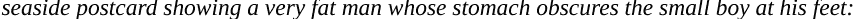
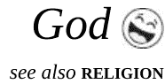
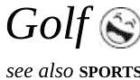
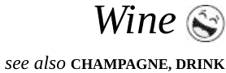
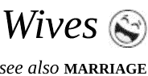

# 引言趣事：幽默名言牛津词典

## 引言中的趣事

吉尔斯·布兰德雷斯

## 引言中的趣事

编辑

## 吉尔斯·布兰德雷斯

- 财富
- 天气
- 婚礼
- 女性角色
- 词汇
- 作者
- 青春

## 学术生活

参见 教育

> 我曾为了生活而工作，现在成了演员。
>
> — 杰·摩 1927–2017 英国演员

## 表演

参见 演员、电影明星、剧院

> 方法演员：我的动机是什么？
>
> 阿博特：你的工作。
>
> — 乔治·阿博特 1887–1995 美国导演、制片人

> 克劳黛·柯宝：我昨晚还记得这些词。
>
> 诺尔·考德：但你今天说的就是这样。
>
> — 诺尔·考德 1889–1973 英国剧作家、演员和作曲家

> 在排练期间被要求说恐怖的话：
>
> 我们两周后就要开演了。
>
> — 约翰盖伦 1904–2000 英国演员

> 当迈克尔·霍登在第一次饰演李尔之前寻求建议时：
>
> 我能告诉你的是，找一个科德莉亚。
>
> — 约翰盖伦 1904–2000 英国演员

> 演员就是这样的人，如果你不谈论他们，就没人会听。
>
> — 乔治·格拉斯 1910–84 美国电影制片人

> 约瑟夫·哈尔：莎士比亚太累了。除非你是国王，否则你没机会休息。
>
> — 乔治·S·考夫曼 1889–1961 和 霍华·泰希曼 1916–87 美国剧作家

> 关于裸露：
>
> 剧本没有要求。我也从没有用过那个借口。是票房票房要求的。
>
> — 海伦·米伦 1945– 英国女演员

> 我曾为了生活而工作，现在成了演员。
>
> — 杰·摩 1927–2017 英国演员

> 表演仅仅是让一群人不咳嗽的艺术。
>
> — 瑞尔夫·理奇森 1902–83 英国演员

> 我真希望先生，你能没我自己练习这个。我不能在这里等死一晚上。
>
> — 理查德·布林斯利·谢里登（1751–1816）爱尔兰剧作家、自由党政治家

> 我告诉疯掉的弗兰基·弗雷泽“我在演《哈姆雷特》”——他说：“我帮你搞定他。”
>
> — 亚瑟·史密斯（1954–）英国喜剧演员

> 表演的定义：
>
> 傍晚大声大叫。
>
> — 帕特里克·布鲁克顿（1920–87）英国演员

> 说话小声，说话慢点，少说话。
>
> — 约翰·韦恩（1907–79）美国演员

> 他们说一个演员得好坏取决于他所扮演的角色。好吧，我的角色一直对我不错不赖，亲爱的。
>
> — 芭芭拉·温莎德（1937–）英国女演员

# 演员

参阅 演戏，电影巨星

> 我在剧院唯一的遗憾是，我永远没能坐在前排看自己的表演。
>
> — 约翰·巴里莫尔（1882–1942）美国演员

> 这位考道尔男爵会被班克的随从吓得魂飞魄散，更说班克的幽灵了。
>
> — 艾伦·布莱恩（1925–2008）英国记者，评价《麦克白》中的迈克尔·霍德恩

> 塔露露亚·班克德昨晚扮演克利帕拉横跨了尼罗河——然后沉下去了。
>
> — 约翰·梅森·布朗（1900–69）美国评论家

> 你是我第一个想到的用来演黑猩猩的人。
>
> — 蒂姆·伯顿（1958–）美国电影导演，邀请海伦娜·邦汉姆·卡特主演《星球大战》

> 她[艾迪丝·埃文斯]谢幕时的样子，就像她刚从十字架上被钉下来一样。
>
> — 诺尔·考德（1889–1973）英国剧作家、演员、作曲家

> 看到《海洋永不容情》中迈克尔·雷德拉夫和迪尔克·博加德的海报：
>
> 我不明白为什么不行；大家都是这么。
>
> — 诺尔·考德（1889–1973）英国剧作家、演员、作曲家

> 评价饰演李王王的克雷斯顿·克拉克：
>
> 他扮演国王的样子，仿佛一刻他担心别人会演那个王牌牌的人。
>
> — 尤金·菲尔德（1850–95）美国作家

> 亲爱的英格丽德——她会五种语言，但其中任何一种她都不会演。
>
> — 约翰·吉尔德（1904–2000）英国演员，评价英格丽德·伯格曼

> 她擅长表现抽象的混乱，就像一个矮矮人擅长表现矮小一样。
>
> — 奥利弗·詹姆斯（1939–）澳大利亚评论家、作家，评价玛丽莲·梦罗

> 奇奇总是离不开这三样：电话、马，或者一个女人。
>
> — 格鲁乔·马克斯（1890–1977）美国电影喜剧演员

> 在《化身博士与海德先生》片场观察斯宾塞·崔莱西：
>
> 他现在在演哪一个？
>
> — W. 萨默塞·莫姆（1874–1965）英国小说家

> 左眉挑起，右眉挑起。
>
> — 罗杰·摩尔（1927–2017）英国演员，对其演技范围的总结

> 评价凯瑟琳·赫普本在《湖泊》首映礼的表现：
>
> 她涵盖了从A到B的所有情感波动。
>
> — 多萝西·帕克斯特（1893–1967）美国评论家

# 任何讨厌狗和婴儿的人都不可能全坏。

> 里奥·罗斯滕（1908–97）美国作家、社会科学家，评价W. C. 菲尔斯，常归功于他

> 这对帕特里克·坎贝尔夫人来说很大功劳在于，尽管那部戏很烂，但她的演技更糟。
>
> — 乔治·伯纳德·肖（1856–1950）爱尔兰剧作家

> 四十年前他在《彼得潘》里是个小角色，你可以说，从那以后起他就完全沉浸在《彼得潘》的世界里。
>
> — 肯尼斯·泰南（1927–80）英国剧院评论家，评价诺尔·考德

> 评价《伯顿与泰勒私生活》：
>
> 他选错角色了，而她是泰勒小姐。
>
> — 艾姆林·威廉姆斯（1905–87）威尔士剧作家

# 广告

> 不做广告就像在黑暗中向女孩眨眼。你知道你在做什么，但别人不知道。
>
> — 斯斯华特·亨德森·布里特（1907–79）美国广告顾问

> 广告可以被描述为留住人类智力以从中获钱。
>
> — 斯蒂芬·利科克（1869–1944）加拿大幽默作家

> 消费者不是笨蛋；她是你的妻子。
>
> — 大卫·奥格尔维（1911–99）英国出生广告高管

> 询问为什么为美国运通做广告：为了支付美国运通。
>
> — 彼得·乌斯廷诺夫（1921–2004）英国演员

> 不要卖牛排，卖滋滋声。
>
> — 埃尔默·惠勒，美国销售员

# 建议

> 永远不要和一个叫“医生”的人玩牌。永远不要在一个叫“妈妈”的地方吃饭。永远和一个麻烦比你还大的女人一起睡。
>
> — 尼尔森·奥格伦（1909–81）美国作家

> 咨询，或者寻求另一个已经做决定人的认可。
>
> — 安布罗斯·比尔斯（1842–c1914）美国作家

> 做你自己。这是你能给模仿派出的出的糟糕建议。
>
> — 罗里·布雷姆纳（1961–）英国模仿派、喜剧演员

> 带着微笑开始每一天并尽快结束它。
>
> — W. C. 菲尔斯（1880–1946）美国喜剧

> 扮演痛苦的姨妈：
>
> 问题：我的未婚夫给了我一辆车，一件皮草大衣和一个炉子。我接受这些礼物合适吗？
>
> 萨莎·加博：当然不合适！把炉子退回去。
>
> — 萨莎·加博（1917–2016）匈牙利出生女演员

> 总是买一双好鞋和一张好床——如果你不在其中，你就在另一个地方。
>
> — 格洛丽亚·哈尼菲尔（1941–）英国广播员，来自她母亲的建议

> 当人在恋爱、醉酒或竞选期间时，听他说的任何都是没用的。
>
> — 希莉·麦克莱恩（1934–）美国女演员

> 不要接受男人的搭车，记住所有的男人都很古怪。
>
> — 罗宾·摩根（1941–）美国女性主义者

> 在怀疑时买鞋。
>
> — 马塞尔·达尔吉·史密斯，英国记者

> 露丝博士说我们应该教导我们的恋人
>
> — 帕姆·通（1959–）美国喜剧演员

> 首先，先生们，一点也不行。
>
> — 查尔斯·莫里斯·塔勒然（1754–1838）法国政治家

> 永远诚实，即使你不是出于真心。
>
> — 哈里·S·杜鲁门（1884–1972）美国民主党人

# 老化

参阅 中年，老年

> 永远不要相信一个告诉你真实年龄的女人。一个会告诉你这些的女人也会告诉你任何事。
>
> — 奥斯卡·维尔德（1854–1900）爱尔兰剧作家、诗人

> 当你达到某个年龄，认为拉皮或时尚的穿法会让你年轻二十岁时，记住——没有什么能骗得过楼梯。
>
> — 布丽姬特·芭杜（1934–）法国女演员

> 生活从40岁开始，皱纹也是如此。
>
> — 乔治·伯恩斯（1886–1996）美国喜剧演员

> 女人从年龄中减去的年份并没有消失。它们被加到了别人身上。
>
> — 迪安·德·波瓦捷耶（1499–1566）亨利二世的情妇

> 变老是忧伤的。
>
> — 乔治·诺曼·科利

> 你知道你过了道道，你就开始加速了。
>
> — 珍妮·芳达（1937–）美国女演员

> 等一下，加博家族里谁最老？
>
> 萨莎·萨莎：她永远不会承认，是妈妈。
>
> — 萨莎·加博（1917–2016）匈牙利出生女演员

> 当你发现蜡烛的价格比蛋糕还贵时，你就知道老了。
>
> — 鲍勃·霍普（1903–2003）美国喜剧演员

> 人类的新五个阶段：
>
> 拉格啤酒、老年期、传奇时代、艾立力药物。
>
> — 维珍尼亚·艾恩赛德（1945–）英国记者

> 女人说出真实年龄就像买家向亚亚米尼亚地毯商人透露他的最终出价。
>
> — 米格农·麦克拉林（1913–83）美国作家

> 年龄是一个意志胜物质的问题。如果你不在意，它就不重要。
>
> — 罗伊·（“沙包”）·佩奇（1906–82）美国棒球运动员

> 我说我丈夫，我的胸部没了，肚子没了，对我的腿说句好听的。他说：“蓝色百搭一切”。
>
> — 乔安·里弗斯（1933–2014）美国喜剧演员

> 只要记住，一旦你过了道道，你就开始加速了。
>
> — 查尔斯·门罗·舒尔茨（1922–2000）美国漫画家

> 丹尼斯·诺登（1922–91）英国幽默作家

> 乔治，你太老没法结婚了。亲爱的，你不仅不能应付标准，你还老到不开瓶盖了。
>
> — 拉万达·佩奇（1920–2002）美国喜剧演员，在一场纪念伯恩斯的晚宴上

# 志心

> 看到一块刻有“由桂桂诗人奠设”的纪念石（约翰·梅斯菲尔德）：每个好女孩的志心。
>
> — 约翰·贝杰姆（1906–84）英国诗人

> 六岁时我想成为一名厨师。七岁时我想成为拿破仑。从那以后，我的志心一直稳步增长。
>
> — 萨尔瓦多·达利 1904–1989 西班牙画家

> 一个普通好莱坞影星的野心是受美国人仰慕，被意大利人追求，与一个英国人结婚，并有一个法国男男友。
>
> — 凯瑟琳·赫本伯 1907–2003 美国女演员

> 多年来，政客们一直承诺摘下月亮，而我是第一个能做到这一点的人。
>
> — 理查德·米尔豪斯·尼松 1913–1994 美国共和党政家

> 每个人都想拯救地球，但没人想帮妈妈洗碗。
>
> — P. J. 欧鲁克 1947–美国 美国幽默作家

> 当我还是孩子时，我妈妈告诉我：“如果你成为一名士兵，你就会成为将军；如果你成为僧侣，你最终会成为教皇。”结果，我成了一个画家，最后却成了毕加索。
>
> — 帕布罗·毕加索 1881–1973 西班牙画家

> 我一直想成为大人物，但现在我意识到我本应该描述得具体一点。
>
> — 莉莉·汤姆林 1939–美国喜剧演员兼女演员

> 在被劝不要加入拥挤的法律行业时：
>
> 顶端永远有位置。
>
> — 丹尼尔·韦伯斯特 1782–1852 美国政家

## 另见 城镇 (TOWNS)

> 加州是个很好的居住地——如果你恰好是一个橘子的话。
>
> — 弗雷德·艾伦 1894–1956 美国幽默大师

> 我忘记了[美国中部地区]是么么平坦空旷。在爱荷华州的任何地方站在两本电话簿上，你就能看到风景了。
>
> — 比尔·布莱森 1951–美国旅行作家

> 当你出生时，你就获得了一张进入怪胎秀的门票。如果你出生在美国，你还得到了一个前排座位。
>
> — 乔治·卡林 1937–2008 美国喜剧演员

> 当我还是孩子时，有人告诉我任何人都可以成为总统。我开始相信这一点了。
>
> — 克拉伦斯·达罗 1857–1938 美国律师

> 美国最令我印象深刻的是父母顺从孩子的方式。
>
> — 爱德华八世 1894–1972 英国国王

> 永远不要批评美国人。他们拥有金钱能买到的最好的品味。
>
> — 迈尔斯·金顿 1941–2008 英国幽默作家

> 所以我真的认为美国绅士终究是最好的，因为亲你的手可能会让你感觉很棒，但一条钻石蓝宝石手链是永恒的。
>
> — 安妮塔·卢夫斯 1893–1981 美国作家

> 约翰·诺顿 1946–爱尔兰学者

> 无论哪里有苦难、不公和压迫，美国人就会出现（尽管迟了六个月），然后炸掉发生地旁邻的国家。
>
> — P. J. 欧鲁克 1947–美国幽默作家

> 在美国，任何男孩都可以成为总统，我想这也许只是他所承担的风险之一！
>
> — 阿德莱·斯蒂蒂文森 1900–1965 美国民主党政家

> 在欧洲，当一个富女人和指挥家偷情时，他们会生一个孩子。在美国，她为他捐助了一个管弦团。
>
> — 埃德加·维也 1885–1965 出生美国的美国作曲家

> 平庸之土地，字面上的家园。
>
> — 戈尔·维达 1925–2012 美国作家

> 美国的年轻是他们最古老的传统。这种传统已经持续了三百年。
>
> — 奥斯卡·威尔尔德 1854–1900 爱尔兰剧作家兼诗人

## 愤怒与争论

> 愤怒让平庸的人变得机智，但让他们保持贫穷。
>
> — 弗朗西斯·培根 1561–1626 英国廷臣

> 暴力是文盲者的机智回应。
>
> — 艾兰·布莱恩 1925–2008 英国记者

> 行动的时代已经过去了。现在是无意义争吵的时代！
>
> — 艾莉·布里恩特 1933–美国作家兼漫画家

> 我从没有和她在争论中赢过；只有在几次，我才发现争论还没结束。
>
> — 吉米·卡特 1924–美国民主党政家（关于他的妻子罗莎林）

> 重要的不一定是战斗中狗有多大——而是狗体内的战斗有多大。
>
> — 德怀特·D·艾森豪威尔 1890–1969 美国政家

> 伊丽莎白·盖斯尔 1810–1875 小说作家
>
> 奥利弗·戈斯密斯 1730–1774 爱尔兰作家
>
> 萨姆·莱文斯 1911–1980 美国幽默作家
>
> 约翰·梅杰 1943–英国政家，内阁成员
>
> 查尔斯勋爵贝雷斯福德 1846–1919 英国政家
>
> 杰拉尔德·杜瑞尔 1925–1990 动物学家
>
> 温斯顿·丘吉 1874–1965 英国政家
>
> 王太后 1900–2002
>
> 斯图尔林·莫斯 1929–2001 英国赛车手
>
> 埃迪·伊扎德 1962–英国喜剧演员
>
> 格蕾丝·霍珀 1906–1992 美国海军军兼计算机科学家
>
> 乔·布兰 1957–英国喜剧演员
>
> 娜奥米·罗德-史密 1875–1964 小说作家
>
> 悉德尼·史密 1771–1845 散文家
>
> 奥尔杜斯·赫胥 1894–1963 英国小说作家

## 动物与鸟类

另见 猫 (CAT)

> 奥格登·纳什 1902–1971 美国幽默大师
>
> 伍迪·艾伦 1935–68 美国喜剧演员
>
> 珍内特·巴伯 1953–美国喜剧演员兼制片人
>
> 塔露拉·班克德 1903–68 美国女演员
>
> 萨缪尔·巴特勒 1835–1902 小说作家
>
> 约翰·B·莫顿 1893–1975 记者
>
> 哈里·沃斯 1917–89 英国喜剧演员
>
> P. G. 伍德豪 1881–1975 出生英国作家
>
> J. M. 巴瑞 1860–1937 苏格兰作家兼剧作家
>
> 特瑞西·普拉契切特 1948–2015 英国作家
>
> 芭芭拉·卡特兰 1901–2000 英国作家

## 道歉与借口

> 约翰·麦格林：借口就像屁股一样，泰勒——每个人都有。
>
> — 奥利弗·斯通 1946–美国电影导演

> 生活中有一个好的规则：永远不要道歉。正确的人不需要道歉。
>
> — 理查德·布林斯利·谢里登 1751–1816 剧作家兼英国自由党政家

> 议长先生，我说那位荣誉议员是撒谎者，这是事实，我对此表示抱歉。荣誉议员可以随心所欲地放置符号。

## 外貌

另见 描述 (DESCRIPTION), 面部 (FACES), 头发 (HAIR)

> 她与其说是穿得华丽，不如说是被装饰得丰满。

> 四十岁以后，女性必须在失去身材或脸蛋之间做出选择。

> 我的建议是保住你的脸，然后坐下。

> 晒黑非常好看——但只有在很均匀时如此——人必须小心

> 让自己看起来像一盘混合烧烤。
>
> — 诺埃·考德（Noël Coward）1899–1973，英国剧作家、演员兼作曲家

> 即使是我，每天醒来时看起来也不像辛迪·克劳福。
>
> — 辛迪·克劳福（Cindy Crawford）1966–，美国模特

> 光头最令人愉快的优点在于——你可以听到雪花落。
>
> — R. G. 丹尼尔（R. G. Daniels）1916–93，英国治安法官

> 变装皇后王的装扮就像油画：你得退后一点看才能获得
>
> 整体效果。
>
> — 哈维·菲尔斯汀（Harvey Fierstein）1954–，美国剧作家兼演员

> 在洛杉矶，每个人都有完美的牙齿。那简直像鳄鱼一样。
>
> — 格温妮·帕尔特罗（Gwyneth Paltrow）1972–，美国演员

> 长得这么廉价其实要花很多钱。
>
> — 多莉·帕顿（Dolly Parton）1946–，美国歌手兼词曲人

> 查尔斯王子的耳朵大到可以滑翔伞飞越福尔克兰群岛。
>
> — 乔安·里弗斯（Joan Rivers）1933–2014，美国喜剧演员

> 我的身体是一座神庙，而我的神庙需要重新装修。
>
> — 乔安·里弗斯（Joan Rivers）1933–2014，美国喜剧演员，解释她为何在78岁时还要做更多整形手术

> 艾迪娜（EDINA）：你没有意识到的是在我内心，在我身体内部有一个瘦削的人
>
> 在尖叫着想要出来。
>
> 母亲：就这一个，亲爱的？
>
> — 詹妮弗·桑德斯（Jennifer Saunders）1958–，英国演员兼剧作家

> 只有肤浅的人才不以外表相人。
>
> — 奥斯卡·威尔德（Oscar Wilde）1854–1900，爱尔兰剧作家兼诗人

> 右尊阁下是个胖乎乎的小家伙，看起来就像他是被倒进
>
> 衣服里的，却忘了说“现在（倒吧）！”
>
> — P. G. 伍德豪斯（P. G. Wodehouse）1881–1975，英国出生的作家

## 建筑

> 根据我的经验，如果你必须通过伸出左腿来保持厕所门关着，那是现代建筑。
>
> — 南希·班克斯-史密斯（Nancy Banks-Smith）1929–，英国记者

> 他们说那是分层设计和开放式布局。但话又说回来，NCP停车场也是这样。
>
> — 艾伦·卡尔（Alan Carr）1976–，英国喜剧演员

> 关于伦敦国家美术馆的拟议扩建计划：
>
> 像是一个深受喜爱且优雅的朋友脸上的那块巨大的肉疣。
>
> — 查尔斯王子（Charles, Prince of Wales）1948–，英国王位储君人

> 英国国家剧院看起来像是一种在伦敦中心建造核电站的精妙方法，且竟然无人反对。
>
> — 查尔斯王子（Charles, Prince of Wales）1948–，英国王位储君人

> 你必须承认德国空军的一点：当他们炸毁我们的建筑时，并没有用任何比瓦砾更具冒犯性的东西来取代它们。
>
> — 查尔斯王子（Charles, Prince of Wales）1948–，英国王位储君人

> 我的客户——上帝——正处于匆忙之中。
>
> — 安东尼奥·高迪（Antonio Gaudi）1853–1926，西班牙建筑师，巴塞罗那圣家家族教堂的建造者（始于1884年）

> 为什么只有都铎式建筑在赶路？
>
> — 哈里·希尔（Harry Hill）1964–，英国喜剧演员

> 一群修女挤在橄榄球争抢中。
>
> — 乔治·莫尔纳尔（George Molnar）1910–98，匈牙利裔澳大利亚裔漫画家，评价悉尼歌剧院的外观

> 绿地带是工党的想法，而我们决心要在上面建筑。
>
> — 约翰·普雷斯考特（John Prescott）1938–，英国工党政治家

> 评价布莱顿亭：
>
> 就像保罗们降临并喘了口气一样。

# 斯德尼·史密斯（Sydney Smith）1771–1845，英国牧师兼随笔作家

医生可以掩埋他的错误，但建筑师只能建议他的客户种植葡萄。

# 弗兰克·劳德·莱特（Frank Lloyd Wright）1867–1959，美国建筑师

## 争论

参见 `ANGER`（愤怒）和 `Argument`（争论）

## 贵族

参见 `CLASS`（阶级）

英国庄园豪宅，
它们立得如此美丽，
证明了上层阶级
依然掌握着主动。

# 诺埃·考德（Noël Coward）1899–1973，英国剧作家、演员兼作曲家

我的祖源可以追溯到原始质球。
因此，我的自豪是不可思议的。我无可不由。

# W. S. 吉尔伯特（W. S. Gilbert）1836–1911，英国作家

我是祖先。

# 朱诺（Junot）1771–1813，法国将领。

共和国里的贵族就像一只被砍头的鸡：
这完全取决于风格。

# 卡罗尔·劳伦斯（Carol Lawrence）1932–，美国演员

贵族在浴巾里将是一个公爵夫人。

# 南希·米特福德（Nancy Mitford）1904–73，英国作家

那些铺了垫子的精神病院，
委婉地说，是英国庄园豪宅。

# 维吉尼亚·伍尔夫（Virginia Woolf）1882–1941，英国小说家

## 军队

参见 `WAR`（战争）

我在叔叔那里的家结识了一圈将领。关于耳朵和恶习，我见够了。不要怀疑我在玩双关语，我对待。

# 简·奥斯汀（Jane Austen）1775–1817，英国小说家

我们加入海军是为了看世界，
我们看到了什么？我们看到了大海。

# 艾文·柏林（Irving Berlin）1888–1989，美国歌曲创作人

别跟我提这件事。

# 温斯顿·丘吉尔（Winston Churchill）1874–1965，英国政治家

评价纽卡斯公爵，丘吉尔是个疯子。

# 乔治·伯纳德·萧（George Bernard Shaw）1856–1950，爱尔兰剧作家

这件事让你知道了。

# 亚伯拉罕·林肯（Abraham Lincoln）1809–65，美国政治家

评价特纳的《浴中女孩》系列画作：
我应该对特纳把他们处理成这样感到震惊。

# 托马斯·盖恩斯伯（Thomas Gainsborough）1727–88，英国画家

## 艺术

用艺术考试的不及格、想象力和电锯能做出的事情令人惊

# 达米安·赫斯特（Damien Hirst）1965–，英国艺术家

我不想要正义，我想要怜悯。
我希望生活在鲁本斯时代。
达利是唯一没有用过`LSD`的画家。

# 提摩西·利尔（Timothy Lear）1920–96，美国心理学家

莫奈开始模仿马奈，莫奈最后模仿了莫奈。

# 乔治·摩尔（George Moore）1852–1933，爱尔兰小说家

在我看来，蒙娜丽莎看起来像是在嚼太糖。

# 贾斯汀·穆豪斯（Justin Moorhouse）1970–，英国喜剧演员

爱因斯坦是个雕塑家。当他洗澡时，但我相信
米开朗基罗从未洗过，所以我想这是传统的一部分。

# 埃兹拉·庞德（Ezra Pound）1885–1972，美国诗人

基思·查德斯（Keith Richards）1943–，英国摇滚音乐家

摄影师就像鳕鱼，产下数百万卵，
为了让其中一个能成长成熟。

# 乔治·伯纳德·肖 1856–1950 爱尔兰剧作家

我总是问模特他们是想要真相还是奉承。他们总是想要真相，而我给他们奉承。

# 拉斯金·斯斯皮尔 1911–990 英国画家

我怀疑艺术对拉斯金的需求，远并不比一列正在行驶的火车需要乘客推它的需求那么大。

# 汤姆·斯托帕德 1937– 英国剧作家

成功展览的要素：你必须在死亡、性与珠宝中选其二。

# 罗伊·斯特朗 1935– 英国艺术史学家

在任何地方，艺术家都只有一种姿势：那就是直立。

# 迪兰·托马斯 1914–53 威尔士诗人

画家们真是刻薄。马格里特曾告诉米罗，康丁斯基长着克莱似的脚。

# 迪克·沃斯伯格 1929–2007 美国作家

关于如何成为艺术家的建议：
你只需要知道把画笔的哪一端放进嘴里。

# 詹姆斯·麦尼尔·惠斯勒 1834–1903 美国出生画家

是的——人们确实想让自己的妈妈看起来越好越好！

# 詹姆斯·麦尼尔·惠斯勒 1834–1903 美国出生画家，在其某人的肖像中：

不，我是为了这辈子的知识才问的。

# 詹姆斯·麦尼尔·惠斯勒 1834–1903 美国出生画家

关于“老大师们”：
他们都很老，但他们并非全都是大师。

# 詹姆斯·麦尼尔·惠斯勒 1834–1903 美国出生画家

我想要指出的普遍原则是：生活对艺术的模仿远胜于艺术对生活的模仿。

# 奥斯卡·沃尔德 1854–1900 爱尔兰剧作家兼诗人

## 观众

最好的观众是聪明的、受过良好教育且略微醉的。

# 阿尔本·W·巴克利 1877–1956 美国政治家

我如何能判断外面观众的年龄呢？我站在侧翼，数他们落座时发出的`沉重叹息`。

# 吉尔斯·布兰德雷斯 1948– 英国作家兼广播节目主持人

他们真的很难对付——他们以前常把西红柿系在悠悠球末端，这样他们就能转两次。

# 鲍·霍普 1903–2003 美国喜剧演员

剧院后方传来了笑声，导致人们认为有人在那儿讲笑话。

# 乔治·S·考夫曼 1889–1961 美国剧作家

我只知过两种观众——一种在咳嗽，一种没咳嗽。

# 阿图尔·施纳贝尔 1882–1951 奥地利出生钢琴家

戏剧取得了巨大的成功，但观众完全是一个彻底的失败。

# 奥斯卡·沃尔德 1854–1900 爱尔兰剧作家兼诗人

## 澳大利亚

澳大利亚是一个巨大的疗养，那里没有任何不愉快的事情会传到世界上最糟糕的报纸上。

# 杰梅因·格里尔 1939– 澳大利亚女性主义者

当新西兰人移民到澳大利亚时，它提高了两个国家的平均智值。

# 罗伯特·穆多隆 1921–92 新西兰政治家

在澳大利亚，
除此外，
平庸之辈认为他们自己是苏格拉底。

# 彼得·波特 1929– 澳大利亚诗人

天哪，多么壮观！老天哪，多么的一团糟！

# 克劳夫·威廉姆斯·埃利斯 1883–1978 英国建筑师，来自悉尼

## 自传

参见 `传记`

自传是一本质上是以连载形式写的讣，只是缺少了最后一期。

# 昆丁·克里斯普 1908–99 英国作家

自传——讲述他人真相的无与伦比的工具。

# 菲利普·盖德拉拉 1889–1944 英国历史学家兼传记作家

除了房地产广告的作者，自传作家是所有散文艺术家中最令人怀疑的。

# 唐纳尔·亨纳汉 1921–2012 美国音乐评论家

评论詹姆斯·D·沃特森《双螺旋》：
像所有优秀的回忆录一样，它没有因为对良好趣味的考虑而被阉割。

# 彼得·梅达瓦 1915–87 英国免疫学家兼作家

每一部自传……都变成了一部引人入胜的小说，带有某种密码般的魅力。

# H. L. 门肯 1880–1956 美国记者兼文学评论家

写回忆录就是对自己以外的每个人都说坏话。

# 亨利·菲利普·佩哒丹 1856–1951 法国士兵兼政治家

在所有虚构形式中，自传是最无理无据的。

# 汤姆·斯托帕德 1937– 英国剧作家

只有当一个人对未来失去了所有好奇时，才到了写自传的阶段。

> # 艾芙琳·沃奇 1903–66 英国小说家

我不会说为什么以及我在十五岁时成为了克拉文恩伯爵的情妇。

> # 哈丽埃特·威尔逊 1789–1846 英国交际花，《回忆录》开场白

## 奖项与荣誉

你应该总是接受，因为它会给你的敌人带来痛苦。

> # 莫里斯·鲍尔拉 1898–1971 英国学者兼文学评论家

我的职业一定在走坡了。这是我第一次有机会领奖项。

> # 迈克尔·凯恩 1933–

我的职业一定在走坡了。这是我第一次有机会领奖项。

> # 鲍·霍普 1903–2003 美国喜剧演员

剧院后方传来了笑声，导致人们认为有人在那儿讲笑话。

## 棒球

参见 `体育`

比赛并不总是属于快者的，战斗也不总是属于强者的——但这就是博弈的方式。

> # 吉吉·贝拉 1925–

比赛并不总是属于快者的，战斗也不总是属于强者的——但这就是博弈的方式。

## 美丽

人们说美是浅薄的。

> # 朱莉·伯奇尔 1960–

人们说美是浅薄的。

## 赌博与博彩

隧道尽头的光是迎面而来的火车灯。

> # 保罗·迪克斯森 1939–

隧道尽头的光是迎面而来的火车灯。

# 汤姆·斯托帕（Tom Stoppard）1937–英国剧作家

谨慎不是传记最好的部分。

# 利顿·斯特拉奇（Lytton Strachey）1880–1932 英国传记作家

还有我那位伟大的朋友，他为死亡增添了新的恐怖。

# 查尔斯·韦塞尔（Charles Wetherell）1770–1846 英国律师兼政治家，关于坎贝尔勋爵的《大法官传记》是在未经继承人或执行人同意的情况下撰写的

现在的每个伟人都有他的追随者，而写传记的总是犹大。

# 奥斯卡·王尔德（Oscar Wilde）1854–1900 爱尔兰剧作家兼诗人

# 鸟

见 `动物`和`鸟`

# 出生与怀孕

如果男人也得生孩子，他们一生只会生一个。

# 威尔士公主戴安娜（Diana, Princess of Wales）1961–97 英国公主，怀孕晚期

生孩子就像在脸上纹身。在付诸行动之前，你真的需要确定那是你想要的。

# 伊丽莎白·吉尔伯特（Elizabeth Gilbert）1969–美国作家

如果男人能怀孕，堕胎将成为一种圣事。

# 弗洛伦斯·肯迪（Florynce Kennedy）1916–2001 美国律师

我不是“意外”怀孕的！我是完全被硬生生地给推进去的。

# 凯西·莱特（Kathy Lette）1958–澳洲作家

生孩子就像试图把一架大钢琴推过过窗过门。

# 艾莉·罗斯福·隆斯沃斯（Alice Roosevelt Longworth）1884–1980 西奥德·罗斯福的美国女儿

我担心第七个孙女和第十四个孙辈变成一件非常无趣的事——在我看来，这就像在温莎公园里像兔子一样不停繁殖！

# 维多利亚（Victoria）1819–1901 英国女王

我是剖腹产，但你并看不出来。只是当我离开一栋房子时，我是从窗户出去的。

# 史蒂芬·莱特（Steven Wright）1955–美国喜剧演员

# 身体

另见 `外貌`，`脸部`

我相当于女性版的伪造20美元钞票。你看到的一半是个相当不错的复制品，另一半是骗局。

# 雪儿（Cher）1946–美国歌手兼演员

囚禁在每个胖子体内的，一个瘦子正疯狂地发信号要求放出去。

# 西西尔·康诺利（Cyril Connolly）1903–74 英国作家

他太小了，他是我认识的唯一一个内裤上有上折边的男人。

# 杰里·丹尼斯（Jerry Dennis）美国作家

如果你能看到我脱靴子时的腿，你就会什么是“单恋”有个大概的认识了。

# 查尔斯·狄更斯（Charles Dickens）1812–70 英国小说家

人，当你思考他时，难道不是一个精细设计的、灵巧的机器，以无限的技艺将西拉酒的红葡萄酒变成尿液吗？

# 伊萨莎·迪尼森（Isak Dinesen）1885–1962 丹麦小说家兼短小说作家

致患有痛风的威廉·塞西（William Cecil）：
勋下，我们利用你不是因为你的那条腿，而是因为你的好脑。

# 伊丽莎白一世（Elizabeth I）1533–1603 英国女王

噢，我多后悔在二十六岁那整年没有穿过比基尼。

# 诺拉·艾芙隆（Nora Ephron）1941–2012 美国编剧

我移动时的身体，在视觉和声音上都不像一个装满酸奶的垃圾袋。

# 史蒂芬·弗莱（Stephen Fry）1957– 英国喜剧演员、演员兼作家

理查兹先生是个高个子，在肚子开始它自己的事业之前，他本可能拥有壮观的身材。

# 玛格丽特·哈尔西（Margaret Halsey）1910–97 美国作家

[阿尔弗雷德·希区柯克（Alfred Hitchcock）]认为自己看起来像卡瑞·格兰特。这很难，当你觉得自己是那种样子，长得却是另一个样子。

# 蒂皮·海德伦（Tippi Hedren）1930–美国演员

看不见我的威利（Willy）。

# 唐德·麦吉尔（Donald McGill）1875–1962 英国漫画家

如果我看到东西下垂、拖拽或装袋，我会把那些东西塞进去。

# 多莉·帕尔顿（Dolly Parton）1946–美国歌手兼词作家

抱着一块肉。

# 盖·里奇（Guy Ritchie）1968–英国电影导演，关于玛当娜

我的身体太糟糕了，一个偷窥者看了窗户并拉下了窗帘。

# 乔安·瑞弗（Joan Rivers）1933–2014 美国女演员

你看到我比别人更有肉，因此更有脆弱性。

# 梅·韦斯特（Mae West）1892–1980 美国演员

让我们忘记六英尺，谈谈英寸吧。

# 比利·怀尔德（Billy Wilder）1906–2002 美国导演

A. L. 戴蒙德（A. L. Diamond）1915–88 美国编剧，在电影《像热带一样》中，五十七年的午餐导致了他的胸部滑到了夹层楼。

# P. G. 伍豪豪（P. G. Wodehouse）1881–1975 英国裔作家

# 书

另见 `字典`，`图书馆`，`出版`，`阅读`

# 安布鲁斯·比尔（Ambrose Bierce）1842–c.1914 美国作家

这本书的封面之间太远了。

# 布里奇·布菲（Brigid Brophy）1929–95 爱尔兰小说家

宇宙中最迷人的两个主题是性和十八世纪。

# 彼得·库克（Peter Cook）1937–95 英国喜剧演员

我不是。

# 约翰·福特（John Ford）1895–1973 美国导演

我送约翰·恩（John Wayne）一本书作为礼物。他有一本书。

# 伦纳德·列文松（Leonard Levinson）1904–74 美国作家

我在第96页打开它——我写名字的地方是为了抓债人。

# 弗兰纳·奥布莱恩（Flann O'Brien）1911–66 爱尔兰小说家

这不是可以随手丢弃的小说。他们把它拍成了电影。

# 桃萝丝·帕克（Dorothy Parker）1893–1967 美国评论家幽默作家

畅销书是平庸才的金墓。

# 罗根·皮尔索尔·史密斯（Logan Pearsall Smith）1865–1946 美国文人

没有比书籍更迷人的。

# 悉尼·史密斯（Sydney Smith）1771–1845 英国牧师兼随笔

吃、射、离开。

# 琳·特鲁斯（Lynne Truss）1955–英国作家

带扣的厚实、老式书是世界上扔给吵闹猫最好的东西。

# 马克·吐温（Mark Twain）1835–1910 美国作家

诗人协会不应该被称为？

# 凯斯·沃特豪斯（Keith Waterhouse）1929–2009 英国作家

在每部新小说中，英雄都是作者、基督或浮士。

# 奥斯卡·王尔德（Oscar Wilde）1854–1900 爱尔兰剧作家兼诗人

好的结局，以及不幸的。这就是小说的意义。

书的问题在于，在太晚之前你永远不知道里面有什么。

# 珍妮特·温森（Jeanette Winterson）1959–英国小说家兼评论家

# 无聊鬼

无聊者的定义：
一个在你希望倾听时说话的人。

# 安布鲁斯·比尔（Ambrose Bierce）1842–c.1914 美国作家

# 当个无聊的人有什么不好？

# 乔治·布什（George Bush）1924–美国政治家

伊顿访客：我希望我没有让你感到无聊。提者：还没有。

# 休··塞西尔勋爵（Lord Hugh Cecil）1869–1956 英国政治家兼教育家

他不仅自己无聊，还是别人无聊的根源。

# 缪埃尔·福德（Samuel Foudre）1720–77 英国演员兼剧作家，*关于一个无聊法官*

无聊鬼是一个张开嘴把功绩塞进去的家伙。

# 亨利·福特（Henry Ford）1863–1947 制造业

在压力下，人们承认杀人、焚烧乡村教堂、抢劫银行，但从不承认是无聊鬼。

# 艾尔莎·马克斯韦（Elsa Maxwell）1883–1963 美国专栏作家兼女主人

生命太短暂了，我们打哈欠浪费的时间无法挽回。

# 史丹（Stendhal）1783–1842 法国小说家

无聊鬼是一个当你问他如何时，他告诉你的人。

# 伯特·莱斯顿·泰勒（Bert Leston Taylor）1866–1901 美国作家

他是个老无聊鬼。坟墓为他打哈欠。

# 赫伯特·啤酒·树（Herbert Beer Tree）1852–1917 英国演员兼经理，*关于演员以色列的锯字形*

# 拳击

另见 `体育`

那将是一场激战、格斗和一场杀戮，
当我在马尼拉遇到大猩猩时。

# 穆哈马德·阿里（Muhammad Ali）1942–2016 美国拳击手

这只是一工作。草长，鸟飞，波浪拍打沙子。我打人。

# 穆哈马德·阿里（Muhammad Ali）1942–2016 美国拳击手

拳击是带血的表演业。

# 大卫·贝拉斯科（David Belasco）1853–1931 美国戏剧制作人

当我击中他们的身体时，高的人就变得和我一样高。

# 杰克·丹西（Jack Dempsey）1895–1983 美国拳击手

我想继续打下去，因为这是唯一让我不去汉堡店的东西。如果我不打，我会吃掉这个星球。

# 乔治·福曼（George Foreman）1948–美国拳击手

我们都被赋予了上帝给予的天赋。我的恰好打人的头。

# 糖·雷·伦纳德（Sugar Ray Leonard）1956–美国拳击手

在拳击中，右手勾拳是那种受之更有福的事。

# P. G. 伍豪斯（P. G. Wodehouse）1881–1975 英国裔作家

# 英国人

另见 `英格兰`，`苏格兰`，`威尔士`

关于英国男人：
脏兮兮且内裤区域呈现明显的灰色。

# 梅·格瑞尔（Germaine Greer）1939–澳洲女性主义者

对我们的国家自豪保持谦虚——并对我们的国家谦逊感到过度自豪。

# 伊恩·希洛普（Ian Hislop）1960–英国讽刺记者

英国之福！……啤酒、牛肉、生意、圣经、英国斗狗、战舰、性行为和主教。

# 詹姆斯·乔伊斯（James Joyce）1882–1941 爱尔兰小说家

哪两个想法像啤酒和不列颠尼亚一样不可分割？

# 悉尼·史密斯（Sydney Smith）1771–1845 英国牧师兼随笔作家

其他国家使用“武力”，我们英国人唯独使用“力量”。

# 伊芙琳·沃尔 1903–66 英国小说家

## 官僚主义

另见 `管理`（`MANAGEMENT`）

写备忘录不是为了告知读者，而是为了保护作者。

# 迪恩·阿奇森 1893–1971 美国政治家

给公务员一个极好的案例，他会用陈词滥调、糟糕的标点符号、双重否定和迂口的道歉来毁掉它。

# 艾兰·克拉克 1928–99 英国保守党政治家

无论需要做什么，“委婉辞令办公室”总是比所有政府部门更精通察觉的艺术——即**不做什么**。

# 查尔斯·狄更斯 1812–70 英国小说家

当他的秘书建议扔掉旧文件时：

> 好主意，只需在丢掉它们之前对每样东西都做一个备份。

# 萨姆·高高 1882–1974 美国电影制片人

官方的尊严往往与该职位所在国家的重要性成反比。

# 奥尔杜斯·赫胥黎 1894–1963 英国小说家

谈及他不喜欢团队合作：

> 骆驼是一匹由委员会设计的马。

# 亚历山大·伊西西格尼斯 1906–88 英国工程师

我认为这将是政治意志与行政意愿之间的冲突。

# 乔纳森·林恩 1943–– 与 安东尼·杰伊 1930–2016 英国作家

当公务员部门完成一份旨在落实某项原则的文件草案时，该原则本身可能已经所剩无几。

# 雷思勋爵 1889–1971 英国行政人员兼政治家

这里安着一位公务员。他对每个人都是文明的（civil），对魔鬼则是仆人（servant）。

# C. H. 西森 1914–2003 英国诗人

委员会应该由三个人组成，其中两个是缺席。

# 赫伯特·比尔布姆·树 1852–1917 英国演员兼剧作

## 商业

另见 管理（MANAGEMENT）

焦点小组成员是根据他们无法解释的空闲以及对免费三明治的共同喜爱而被选中的人。

# 斯科特·亚当斯 1957– 美国漫画家

有些人生而伟大，有些人成就伟大，而有些人雇佣了公关人员。

# 丹尼尔·波斯汀 1914–2004 美国历史学家

价格是你付出的代价。价值是你所得到的。

# 沃伦·巴菲特 1930– 美国商人

我总是投资那些连傻瓜都能经营的公司，因为总有一天某个傻瓜会去。

# 沃伦·巴菲特 1930– 美国商人

发现描绘一个商人其实很容易。平庸、相当残忍和无能对我来说是与生生的。

# 约翰·克里斯 1939– 英国喜剧演员兼作家

口头合同不值它所载的那张纸。

# 萨姆·高高 1882–1974 美国电影制片人

我不是一个商人，我是生意本身，兄弟们。

# Jay-Z 1969– 美国歌手兼商人

永远不要投资任何你无法用蜡笔画画出来的想法。

# 彼得·林奇 1944– 美国投资者

头衔越长，重要性越低。

> 乔治·麦格弗 1922–2012 美国民主党政治家

技能固然好，天才卓越，但正确的人脉比两者都更有价值。

> 阿奇伯德·赫克特·麦克因多 1900–60 新西兰整形外科医生

根据市场研究经营公司，就像边看后视镜边开车。

> 安妮塔·罗迪克 1942–2007 英国女企业家

永远不要把钱投资在任何会吃或需要重新粉漆的东西上。

> 比利·罗斯 1889–1966 美国制片人兼作曲家

邻居丢工作时是衰退；当你丢工作时是萧条。

> 哈里·S·杜鲁 1884–1972 美国民主党政治家

把所有的鸡蛋都放在一个篮子里——并盯好那个篮子。

> 马克·吐温 1835–1910 美国作家

把所有的鸡蛋都放在一个篮子里——并盯好那个篮子。

> 威廉·H·范德堡特 1821–85 铁路大亨

把所有的鸡蛋都放在一个篮子里——并盯好那个篮子。

> 安德鲁·杨 1932– 美国政治家

## 加拿大

定义为：

> 懂得如何划船的人。

# 皮埃尔·伯顿 1920–2004

美国对加拿大一无所知，而加拿大人对美国一目了然。

# 约翰·巴特莱特 1895–57

把所有的鸡蛋都放在一个篮子里——并盯好那个篮子。

## 短语

另见 喜剧（COMEDY）

## 猫与狗

另见 动物（ANIMALS）

> 安·恩莱特 1962–

猫是人类最好的朋友。

> 奥尔杜斯·赫胥黎 1894–1963

我总是认为，仅仅因为它。

> 格鲁乔·马克 1890–77

言论自由只保障给那些拥有它的人。

> 奥格登·纳什 1902–71

她坐在白菜和葱之间。

> A. J. 莱布林 1904–63

我不敢想到这。

> 瑞·加尔顿 1930–– 与 阿兰·辛普森 1929–2017

一旦我完成了这个，我就会推荐它。

## 审查

# 威尔·海斯 1890–1960

耶是我的牧者，我必不乏。

> 基因·福勒 1960–

我不敢想到这落入不法之手中。

# 詹姆斯·蒙哥马利 1870–1943

审查员是一个比应该知道得多的人。

> 劳伦斯·J·彼得 1919–90

我们拿钱是因为思想色情。

> 约翰·特西利恩 1903–86

技能固然好。

> 斯派罗 1870–92

一个人得到的越多，就越重视它。

## 确定性与怀疑

另见 宗教（RELIGION）

他以前相当优柔寡断，但现在没那么确定。

> 彼得·阿利斯 1931–

我从来没有过谦卑的意见。如果你有意见，为什么要谦卑呢？

> 乔恩·贝兹斯 1941–

经常犹豫是否要离开一艘沉没船去另一艘可能浮不起来的船，他在码头停定一天。

> 贝弗布鲁克勋爵 1879–1964

噢！让我们永远不要，因为没人确定！

> 希拉尔·贝洛克 1870–1953

被问及是否相信挂在门上的马蹄铁会带来运气时：当然不，但我告诉他只要你不信它，它就灵。

> 尼尔斯·玻尔 1885–1962

我会给你一个肯定的也许。

> 萨姆·高高 1882–1974

奇科·马克斯：好吧，你是相信我的，还是相信你的眼睛？

> 伯特·卡尔玛 1884–1947 等编剧，在电影《鸭汤》中

我希望我对任何事情都能像汤姆·麦考莱对任何事情那样有把握。

# 梅尔本勋爵 1779–1848 英国自由党政治家

我不否认任何我没说出来的话。

** 布莱恩·穆拉罗尼 1939– 加拿大保守党政治家

要让塞尚相信任何事，就像教巴黎圣母院的塔楼跳舞。

** 埃米尔·左拉 1840–1902 法国小说家

## 挑战

参见《生命及其挑战》（LIFE and Its Challenges）

## 香槟

没有香槟，我无法生存。胜利时，我配得上它。失败时，我需要它。

** 温斯顿·丘吉尔 1874–1965 英国保守党政治家

记住，绅士们，我们战斗的不仅仅是为了法国，更是为了香槟！

** 温斯顿·丘吉尔 1874–1965 英国保守党政治家

绅士们，在危机与灾难之间留给我们的短暂时刻里，我们不妨喝杯香槟吧。

如果你在寻找真理，香槟比测谎仪更好用。

** 格拉汉姆·格林 1904–91 英国小说家

我永远无法得到三件事：

嫉妒、知足和足够的香槟。

** 多萝丝·帕克斯特 1893–1967 美国评论家兼幽默作家

## 性格

参见自我认知（SELF-KNOWLEDGE）

绅士是那种会弹手风琴但不弹的人。

# 匿名人士

当人们表现得最好时，他们并不总是处于他们最棒的状态。

# 艾兰·贝内特 1934– 英国剧作家兼演员

衡量一个人诚实程度的最好标准不是他的报税单，而是他浴室体重秤上的那个零点调校。

# 亚瑟·C·克拉克克 1917–2008 英国科幻小说家

我非常抱歉。我们必须在此地停止。我刚刚到达我性格的尽头。

# 昆廷·克里斯普  1908–99 英国作家，在结束采访时说

没有立场的人会被任何事情所击败。

# 亚历克斯·汉密尔顿 1936– 英国作家兼广播员

害羞是深陷无常的自我主义。

# 休·金斯米尔德 1889–1949 英国文学家

他想成为每场婚礼上的新娘，也成为每场葬礼上的尸体。

# 爱丽丝·罗斯福·隆沃斯斯 1884–1980 美国名媛，谈论她的父亲西奥德·罗斯福

汉弗莱·安普尔拜比爵：愤俗者是理想主义者对现实主义者的称呼。

# 乔纳森·林恩 1943– 与安东尼·杰伊 1930–2016 英国作家，在《部长绝》（Yes Minister）中

他有点像开瓶器。扭曲、冷酷且尖锐。

# 凯特·克鲁斯·奥布莱恩 1948–98 爱尔兰作家

他湿透得你可以从他身上射击。

# 安东尼·鲍威尔 1905–2000 英国小说家

## 孩子

参见出生（BIRTH）、家庭（FAMILY）、青少年（YOUTH）

并且时刻守着护士，因为担心发现更糟糕的。

** 埃米尔·贝莱克** 1870–1953 英国作家兼自由党政治家

地方非常安静，孩子们在低声尖叫。

** 拜伦勋爵** 1788–1824 英国诗人

在被问及是什么什么样的孩子时：受到关注时，非常迷人；不受关注时，像头猪。

** 诺尔·考德** 1889–1973 英国剧作家、演员兼作曲家

从未有一个孩子如此可爱，以至于他妈妈很高兴让他睡着。

** 拉尔伯德·沃尔多·爱默生** 1803–1982 美国哲学家兼诗人

霍默·辛普森：孩子是最好的。你可以教他们讨厌你讨厌。由于互联网等，他们把自己大的。

** 马特·格林宁** 1954– 美国幽默作家兼讽刺作家

在J. M. 巴瑞的《彼得潘》中第一个晚上：

> 噢，想要一个小时的希律德！

# 安东尼·霍普 1863–1933 英国小说家

对待五岁孩子真正的威胁在于，你很快就会开始听起来像个五岁孩子。

# 简·克尔 1923–2003 美国作家

对婴儿的定义：

> 一头是巨大的噪音，另一头没有责任感。

# 罗纳德·诺克斯 1888–1957 英国作家兼罗马教教父

能看到孩子真面目的父母，会摇头说：“威利没用。”

# 斯蒂芬·利纳科克 1869–1944 幽默作家

能看到孩子真面目的父母，会摇头说：“威利没用。”

# 安东尼·鲍威尔 1905–2000 英国小说家

你可以通过一个人吃糖豆的方式看出他的很多性格。

# 罗纳德·里根 1911–2004 美国共和党政治家

他太弯曲了，你可以用他的脊椎当别安全针。

# 多萝丝·L·塞耶斯 1893–1957 英国作家

一个人不必成为天使也能成为圣人。

** 阿尔伯特·舒韦哲** 1875–1965 法德传教士

没有什么比“榜样”带来的烦恼更难忍受的。

** 马克·吐温** 1835–1910 美国作家

塞西尔·格拉姆：什么是愤俗者？

达灵顿勋爵：一个知道一切事的价格却对一切事都毫无价值的人。

** 奥斯卡·威尔尔德** 1854–1900 爱尔兰剧作家兼诗人

无论你怎么割他，地狱犬永远是地狱犬。

** P. G.伍德豪斯** 1881–1975 英国作家

# 乔治斯·弗兰朱：电影应该有开头、中间和结尾。

让-吕克·戈达尔：当然。但不一定按这个顺序。

# 让-吕克·戈达尔 1930– 法国电影导演

关于他自己的某部电影：

> 这不仅仅是宏伟了，这简直是平庸。

# 萨姆·高德温 1882–1974 美国电影制片人

被告知不能拍摄拉德克菲尔·霍尔（Radcliffe Hall）的《孤独之影》，因为它涉及同性恋。

> 那么，就让他们变成拉脱维亚人。

# 萨姆·高德温 1882–1974 美国电影制片人

我们的喜剧是不用来笑的。

# 萨姆·高德温 1882–1974 美国电影制片人

降到大西洋会更便宜吧！

# 刘·格雷德 1906–98 英国电视制片人兼高管，灾难片《泰坦尼克号的沉没》的制作人

> “你的电影有女主角吗？”
>
> “我们正试着找女王，她很受欢迎。”

# 乔治·哈里森 1943–2001 英国歌手兼词曲作家

电影的长度应该与人类膀胱的耐力直接相关。

- 阿尔弗雷德·希区柯克 1889–1980 英国出生导演

关于在《埃及艳情》中指导伊丽莎白·泰勒：

我可不是在[咬指甲]。我几个月前就在咬指关节了。

- 约瑟夫·L·曼凯维泽 1909–93 美国编剧、制片人兼导演

高德温先生，问题在于在于，你只对艺术感兴趣，而我只对钱感兴趣。

- 乔治·伯纳德·肖 1856–1950 爱尔兰剧作家，这是肖与萨姆·高德温对话结果的电报版本

除了贝多芬，什么都行。没人想看关于盲人作曲家的电影。

杰克·华纳 1892–1978 加拿大出生美国电影制片人

# 城市

参见 城镇（TOWNS）和城市（Cities）

# 阶级

参见贵族（ARISTOCRACY）、附俗（SNOBBERY）

他的阁下可能会强迫我们在楼上平等，但在仆人大厅永远不会有平等。

J. M. 巴瑞 1860–1930 苏格兰作家兼剧作家

当你的电视比书架还大时，你就知道你是工人阶级了。

罗伯·贝凯特 英国喜剧演员

当每个人都是人物时，

那么就没有人是大人物了。

W. S. 吉尔伯 1836–1911 英国作家

当第13代霍姆伯爵之子威廉·道格拉斯·霍姆于1944年入狱时，他的母亲告诉他：

务必把你的晚礼服带上。长官一定会邀请你共进晚餐。

道格拉斯·霍姆夫人 1990–90

坐在廉价座位上的人会为你鼓掌吗？你们大家，只要你们能摇一摇你们的珠宝就好。

约翰·列侬 1940–80 英国流行歌手兼词曲作家

绅士的定义：

一个能花六块钱买到一只松鸡的人。

尼格尔·尼尔森 1917–2004 英国作家

上中产阶级喜欢任何生态相关的东西：这能减轻他们的负罪感。给你的高雅朋友送一袋满是泥土的防根。他们会喜欢的。

格雷森森·佩里 1960– 英国陶瓷艺术家

我不想谈论语法，我想像贵妇一样说话。

乔治·伯纳德·肖 1856–1950 爱尔兰剧作家

没有什么比害怕自己看起来像资产阶级更具有资产阶级色彩了。

安迪·沃霍尔 1927–87 美国艺术家

说真的，如果底层阶级不为我们树立榜样，他们到底还有什么用？

奥斯卡·威尔德 1854–1900 爱尔兰剧作家兼诗人

# 教职人员

参见 宗教（RELIGION）

我不喜欢主教……谦卑的人有福，我才鬼！他们都在往上爬。听说过“谦卑”能阻止一个主教成为主教吗？我没听说过。

莫里斯·鲍尔拉 1898–1971 英国学者兼文学评论家

医生先生，那件宽松的袍子非常适合你，我好奇你的想法怎么会如此狭隘。

伊丽莎白一世 1533–1603 英国女王，对清道教徒亨弗瑞斯博士说

我记得家乡的普通牧师介于太监和冷笑鬼之间。

罗纳德·菲尔班克 1886–1926 英国小说家

一位福音派牧师，想要一个便携式的二手洗礼盆，愿为此换掉一张佛蒙特州候任主教的带框肖像。

罗纳德·诺克斯 1888–1957 英国作家兼罗马教神父

致一位感谢他为世界带来乐趣的教职人员：

我想感谢你从世界中获得的所有乐趣。

格鲁奇·马克斯 1890–1977 美国电影喜剧演员

法国人说，有三种性别——男人、女性和教职人员。

悉德尼·史密斯 1771–1845 英国教职人员兼随笔作家

真是功绩！……如果他们谈论当主教的功绩，那我们就完蛋了。

威斯特莫兰勋爵 1759–1841，保守党政治家

主教……正在和当地的猎犬大师谈论他让他的牧师们不碰香炉有多么困难。

P. G. 伍德豪斯 1881–1975 英国出生作家

# 颜色

我无法假装对颜色保持中立。我为那些鲜艳的颜色感到高兴，并对那些颜色感到由心的遗憾。

温斯顿·丘吉尔 1774–1965 英国政治家

对T型车颜色的选择：

只要是黑色就行。

亨利·福特 1863–1947 美国商人兼商人

任何颜色——只要是黑色的就行。

埃尔西·梅德尔 1865–1950 美国名媛，室内装饰师

关于帕特农神庙的景色：

我注意到它是米色的。

J. M. 汤纳 1775–1851 风景画家

蓝色是海军色。

在《私人杂志》（Private Eye）看到的蓝色。

迪安娜·弗里兰 1903–89 英国时尚编辑

# 回梗

南西·阿斯托 1879–1964 英国政治家

如果我是你的妻子，

温斯顿·丘吉尔 1774–1965 英国政治家我会在咖啡里下毒。

关于离婚：

凯瑟·赫普伯恩 1882–1942 美国演员

温斯顿·丘吉尔 1774–1965 英国政治家

卡伦·布拉迪 1969– 伯明翰足球俱乐部董事

乔安·科林斯 1933– 英国女星

约翰·里弗斯 1910–89 关于她的婚姻：乔安·科林斯 1933– 英国女星

格鲁奇·马克斯 1890–1977 美国电影喜剧演员

多萝希·帕克 1893–1967 美国评论家兼幽默作家

艾丝·穆尔 英国喜剧演员

我从来没这么受辱过。

格鲁奇·马克斯 1890–1977 美国电影喜剧演员

乔·席尔 1911– 英国喜剧演员

乔安·科林斯：明天还早了。

J. M. 巴瑞 1860–1930 苏格兰作家兼剧作家

绅士的定义：

一个能花六块钱买到一只松鸡的人。

尼格尔·尼尔森 1917–2004 英国作家

上中产阶级喜欢任何生态相关的东西：这能减轻他们的负罪感。给你的高雅朋友送一袋满是泥土的防根。他们会喜欢的。

格雷森森·佩里 1960– 英国陶瓷艺术家

我不想谈论语法，我想像贵妇一样说话。

乔治·伯纳德·肖 1856–1950 爱尔兰剧作家

没有什么比害怕自己看起来像资产阶级更具有资产阶级色彩了。

安迪·沃霍尔 1927–87 美国艺术家

说真的，如果底层阶级不为我们树立榜样，他们到底还有什么用？

奥斯卡·威尔德 1854–1900 爱尔兰剧作家兼诗人

# 教职人员

参见 宗教（RELIGION）

我不喜欢主教……谦卑的人有福，我才鬼！他们都在往上爬。听说过“谦卑”能阻止一个主教成为主教吗？我没听说过。

莫里斯·鲍尔拉 1898–1971 英国学者兼文学评论家

医生先生，那件宽松的袍子非常适合你，我好奇你的想法怎么会如此狭隘。

伊丽莎白一世 1533–1603 英国女王，对清道教徒亨弗瑞斯博士说

我记得家乡的普通牧师介于太监和冷笑鬼之间。

罗纳德·菲尔班克 1886–1926 英国小说家

一位福音派牧师，想要一个便携式的二手洗礼盆，愿为此换掉一张佛蒙特州候任主教的带框肖像。

罗纳德·诺克斯 1888–1957 英国作家兼罗马教神父

致一位感谢他为世界带来乐趣的教职人员：

我想感谢你从世界中获得的所有乐趣。

格鲁奇·马克斯 1890–1977 美国电影喜剧演员

法国人说，有三种性别——男人、女性和教职人员。

悉德尼·史密斯 1771–1845 英国教职人员兼随笔作家

真是功绩！……如果他们谈论当主教的功绩，那我们就完蛋了。

威斯特莫兰勋爵 1759–1841，保守党政治家

主教……正在和当地的猎犬大师谈论他让他的牧师们不碰香炉有多么困难。

P. G. 伍德豪斯 1881–1975 英国出生作家

# 颜色

我无法假装对颜色保持中立。我为那些鲜艳的颜色感到高兴，并对那些颜色感到由心的遗憾。

温斯顿·丘吉尔 1774–1965 英国政治家

对T型车颜色的选择：

只要是黑色就行。

亨利·福特 1863–1947 美国商人兼商人

任何颜色——只要是黑色的就行。

埃尔西·梅德尔 1865–1950 美国名媛，室内装饰师

关于帕特农神庙的景色：

我注意到它是米色的。

J. M. 汤纳 1775–1851 风景画家

蓝色是海军色。

在《私人杂志》（Private Eye）看到的蓝色。

迪安娜·弗里兰 1903–89 英国时尚编辑

# 回梗

看来搞错了，对吧？匿名，出自《私人杂志》

柯贝特：我这里是晚安。贝克：他那里也是晚安。

罗尼·巴克 1929–2005 和罗尼·柯贝特 1930–2016 英国喜剧演员

乔治·伯恩：说晚安，格蕾。格蕾丝·艾伦：晚安，格蕾。

乔治·伯恩 1896–1996 美国喜剧演员

你有一个狡明的计划。理查德·柯蒂斯 1936– 和 本·埃尔顿 1959– 编剧，巴里克式的过度乐观承诺你可能这么想。我无法评论。

迈克·多布斯 1948– 英国小说家兼广播员，党鞭的习惯性质问肯内特·威廉姆斯：别闹了！

雷·加尔顿 1930– 和 阿兰·辛普森 1929–2017 英国编剧，乔治——别那样。

乔伊斯·格雷费尔 1910–79 英国喜剧演员兼作家。

请不要性行为——我们是英国人。

Anthony Mariott 1931–2014 和 Alistair Foot

你觉得目前为止的表现怎么样？烂透了！

Eric Morecambe 1926–84 英国喜剧演员

如果没有——，我就不会有今天的成就。

David Nobbs 1935–2015 英国喜剧作家，习惯性吹嘘 Reggie Perr 的低音 C 调。

LANCE-CORAL JONES [CLIVE DUNN]: 他们不喜欢那套路。

Jimmy Pery 1923–2016 和 David Croft 1922–2011 编剧，出自《空军敢战队》。

噢噢，我不相信！

David Renwick 1951– 英国电视剧作家，由 Victor Meldrew（Richard Wilson 饰饰）口说。

你是他的父亲吗？

是的，先生，正如他母亲所说，如果我可以信真的话。

William Shakespeare 1564–1616 英国剧作家

## 计算机与互联网

另见 科学，技术

现在我们有了万维网（我见过的缩写形式——www——说出来的时间比全称长了三倍）。

Douglas Adams 1952–2001 英国科幻小说作家

犯错是人性的，但要真正把事情搞砸需要一台电脑。

匿名

现在的编程是一场软件工程师努力构建更大、更好的防愚蠢程序，与宇宙试图产生更大、更愚蠢的人蛋之间的竞赛。到目前为止，宇宙是赢了。

Rick Cook 1944– 美国幻想小说作家

你无法找回你的生活（除非你在维基百科上，那种情况下你可以找回一个不准确的版本）。

Nora Ephron 1941–2012 美国编剧兼导演

物种的邮件比人更致命。

Stephen Fry 1957– 英国喜剧演员、演员、作家

DAVID WALLIAMS: 电脑说不行。

Matt Lucas 1974– 和 David Walliams 1971– 英国喜剧演员

当我用电脑时，我不会打 `lol`。我打 `lqtm`：“自己轻笑”。这更诚实。

Demetri Martin 1973– 英国喜剧演员

计算机让很多事情变得更容易，但大多数事情让那些不需要做的事情变得更容易。

Andy Rooney 1919–2011 美国广播员

结膜炎——那可真是“苦眼之福”。

Tim Vine 1967– 英国喜剧演员

我们都听过，百万只猴子在百万台打字机上敲击最终会复制莎士比亚的所有作品。现在，多亏了互联网，我们知道这不是。

Robert Wilensky 1951– 美国学者

## 对话

另见 演讲

尽管有成千上万个优雅对话的话题，但有些人一见到残疾人就谈论脚。

Ernest Bramah 1868–1942 英国作家

过度的认同会杀死聊天。

Eldridge Cleaver 1935– 美国民权活动家

有福的人，在无话可说时，克制了不提供关于事实的啰嗦证据。

George Eliot 1819–80 英国小说作家

当你一直在说话时，时间过得真快。

Hvey Fierstein 1954– 美国剧作家兼演员

如果你发现无法维持一段冷淡的对话，就引入食物的话题。

Leigh Hunt 1784–1859 英国诗人、散文家

说话的反面不是倾听。说话的反面是等待。

Fran Lebowitz 1950– 美国作家

没有人真正听过别人的话，如果你尝试一段时间，你就知道为什么了。

Mignon McLaughlin 1913–83 美国作家

评价 George Shaw 的妻子是一个很好的倾听者：

上帝知道她有充分的练习。

J. B. Priestley 1894–1984 英国小说家、剧作家、评论家

信不，如果那是我说的话，那说得真好。

Jonathan Swift 1667–1745 爱尔兰诗人、讽刺作家

她从不让想法干扰她对话的流畅性。

Jean Webster 1876–1916 美国小说家

如果一个人演奏好音乐，人们不听；如果一个人演奏糟糕音乐，人们不说话。

Oscar Wilde 1854–1900 爱尔兰剧作家、诗人

## 烹饪

另见 饮食，食物

任何撒谎的人内心都不纯洁，做不出好汤。

Ludwig van Beethoven 1770–1827 德国作曲家

满足于记住，那些能好好煎煎姆的人其他什么也做不了。

Hilaire Belloc 1870–1953 英国作家、自由派政治家

[我]关于烹饪的标准位置是坐在沙发上翘脚。

Peg Bracken 1918–2007

发现新菜肴对人类幸福的贡献比发现叉子更大。

Anthelme Brill-Savarin 1755–1826 法国法学家、美食家

我总是先给洋葱再放它。

Julia Child 1912–2004

我不信任那些不（放）的人。

Jamie Oliver 1975– 英国厨师、广播员

## 国家与民族

另见 美国，澳大利亚，英国人，加拿大，法国，爱尔兰

新西兰最初是由那些有逃离的澳大利亚人殖民的。

Robert Muldoon 1921–92 新西兰政治家

MICHAEL CAINE: 这个世界上我只讨厌两件事。不宽容他人文化的人和荷兰人。

Mike Myers 1963– 加拿大演员，电影《黄金会员》

克里特人遗憾创造的历史多于他们当地能消费的。

Saki 1870–1916 英国作家

英国和美国是两个被共同语言所分开的国家。

George Bernard Shaw 1856–1950 爱尔兰剧作家

我把瑞士视为低等版的苏。

Sydney Smith 1771–1445 英国牧师、散文家

把这一切总结！造物主是根据米开朗基的设计创造了意大利！

Mark Twain 1835–1910 美国作家

我不完全喜欢挪威人。太阳永不落下，酒吧永不营业，整个国家闻起来鲱鱼的味道。

Evelyn Waugh 1903–66 英国小说家

# 国家

参见 大自然与国家

# 板球

参见 体育

当 W. G. 格雷斯在第一球时意料中被投球出局，裁判员误判为“未出局”后，对投球手说：

“他们付钱是来看格雷斯博士击球的，不是来听你投球的。”

匿名

在南非队的“塔夫蒂”·曼连续三球让米德塞克斯郡的乔治·曼困于无策后：

“这是一个典型的‘曼对曼’的不人道行为。”

约翰·阿罗特（1914–1914），英国记者、广播员

谈及在深位防守时被看到在看报纸：

“我只是想知道我们是在和谁比赛。”

沃威克·阿姆斯特（1879–1947），澳大利亚板球运动员

当被请求为 W. G. 格雷斯的告别赛捐款时：

“这不是为了支持板球，而是对高尔夫的诚恳抗议。”

马克斯·比尔博姆（1872–1956），英国评论家、随笔作家、漫画家

“永远不要读印刷文字，那会毁掉看球的眼力。”

W. G. 格雷斯（1848–1915），英国板球运动员，对球员们的常备建议：

“板球——这项游戏是英国人发明的，因为他们不是，为了让他们产生某种永恒的观念。”

曼克罗夫特勋（1914–1987），英国保守党政客

在罗德斯球场看了几个小时比赛后：

迈克尔·大卫：你玩得开心吗？

格鲁乔·马克斯：太棒了。什么时候开始？

格鲁乔·马克斯（1890–1977），美国电影喜剧演员

“这场比赛我需要九个三门，你们这帮混蛋最好开始抽签，看看我我不打算让谁出局。”

弗雷迪·特鲁曼（1931–2006），英国板球运动员，对某对手球队

对观众来说，板球与其说是运动，不如说是一种疗法。它就像看着鱼在池塘里穿梭。

迈克尔·韦尔，英国记者

“众所周知的事实，当我得到99分时，我是全世界该死的最能判断一次跑垒是否安全的人。”

艾兰·沃特汉（1923–1993），英国板球运动员

“板球基本上就是服了镇静剂的棒棒球。”

罗宾·威廉姆斯（1951–2014），美国演员

# 犯罪与惩罚

参见 法律，谋杀

在因诈骗入狱期间，面对监狱牧师问他是否在缝纫（邮袋），他回答道：“不，是在收割。”

霍拉西奥·鲍特特利（1860–1933），英国报业出版商、金融家

“抢劫银行和创立银行相比算什么？”

贝尔托特·布莱希特（1898–1956），德国剧作家

“小偷尊重财产。他们只是希望财产变成自己的财产，这样他们就能妥善地尊重它。”

G. K. 切斯特顿森（1874–1936），英国随笔作家、诗人

“不可偷窃：这是一个徒劳的举动，因为作弊实在太有利可了。”

亚瑟·克劳夫（1819–1961），英国诗人

谈及一个盗偷：“他发现贫穷让他很不方便。”

威廉·库珀（1731–1800），英国诗人

斯特拉斯塞尔少将被射中了。把那几个惯惯犯都抓起来。

朱利斯·J·爱普斯坦（1909–2001），美国编剧家

绞刑对他来说还是太便宜了。

腓特烈大帝（1712–1786），普鲁士君主，在被要求批准处决一名与他的马发生性行为的骑兵时，他正等待着这种短而有力的冲击。

W. S. 吉尔伯（1836–1911），英国作家

“它是如此美而简单，正如所有真正伟大的事物一样。”

如果我再听到你指控警察对关押中的犯人使用暴力，我就带你回警察局，把你的眼睛打出来。

欧·亨利（1862–1910），美国短小说作家

乔·奥尔顿（1933–1967），英国剧作家

# 评论家与批判

一篇评论可能会毁了你的早餐，但你不应该让它毁了你的午餐。

金斯利·阿米斯（1922–1995），英国小说家、诗人

这其中对眼睛有意义的东西并不少。

塔拉露拉·班克德（1903–1968），美国演员，在了一个特别糟糕的夜晚后，看起来像一位女主角：“亲爱的，‘好’可不是那个词。”

马克斯·比尔博姆（1872–1956），英国评论家、随笔作家、漫画家

“评论家就像后宫里的太监；他们知道怎么做，他们每天都看，但他们做不到。”

**布伦丹·贝汉**（1923–1964），爱尔兰剧作家，对长期热播剧《耶稣基督，昨天、今天和永恒》的总结。

**罗伯特·本奇利**（1889–1945），美国幽默作家

对一位曾批评过艾兰·本内特《在外的英国人》的好莱坞作家说：“听着，亲爱的，你甚至在威尼斯百叶窗的灰上都写不出‘妈’字。”

**科拉·布朗恩**（1913–1991），澳大利亚演员

谈及书评：这项溺死他人猫咪的任务是不不讨好好的。

**西里尔·康诺利**（1903–1974），英国作家

谈及在某场特别乏味的放映中途离开时：“我的家族有糖尿病史。”

**朱迪斯·科斯特**（1922–2012），英国作家

“这其中对眼睛有意义的东西并不少。”

**珀西·汉蒙德**（1873–1936），英国评论家

问一位关于《阿伽门农》的作家就像在问一根灯柱。

**克里斯托弗·汉普顿**（1946–1980），英国剧作家

问一个关于《西西22》的问题就像在问一根灯柱。

**彼特·乌斯蒂诺夫**（1921–2004），英国演员、导演、作家

诺曼·梅莱尔对维达的文学风格感到不满，用玻璃杯击了他的头部。“啊，梅莱尔像往常一样无语了。”

**戈尔·维达**（1925–2012），美国小说家、评论家

“读《小内》的人不笑。”

**奥斯卡·威尔德**（1854–1900），爱尔兰剧作家、诗人

# 舞蹈

我让小虫子跳了起来。

**托马斯·比奇**（1879–1961），英国指挥家，在被问及对吉亚耶夫蕾舞是否延伸到裸体时：“不。你看，人体某些部位在音乐结束后是这样的。”

**罗伯特·赫尔曼**（1909–1986），澳大利亚舞者

格鲁乔·马克斯（1890–1977）：“我可以和你跳舞直到牛回家。转念一想，我宁愿和牛跳舞直到你回家。”

**伯特·卡尔马**（1884–1947）及其他编剧，在电影《鸭子汤》中

“舞蹈对女孩来说是极好的训练，这是她们第一次学会在男人做之前猜他要做什么。”

**克里斯托弗·莫利**（1890–1957），美国作家

“[舞蹈]是水平欲望的垂直表达。”

**乔治·伯纳德·肖**（1856–1950），爱尔兰剧作家

# 相亲

参见 关系

‘墨尔顿夫人’对德比·麦基说：“但是，德比，是什么吸引了你对富翁保罗·丹尼尔的？”

**凯瑟琳·艾琳恩**（1963–2016），英国喜剧演员

**彼特·阿诺**（1904–68），美国漫画家

“跟我聊聊你自己——你的挣扎、你的梦想、你的电话号码。”

**海伦·菲尔丁德**（1958–），英国作家

我将不会……因为没有男朋友而郁闷，而是要培养内在的冷静、权威以及作为一个独立女性的自我意识，没有男朋友也是完整的，获得男朋友的最佳方法。

在飞机上……你可以比马车时代后的任何公共交通工具遇到更多、更好的人。

安妮·洛斯（Anita Loos）1893–1981，美国作家

在欧洲国家，王子比牙医要多。

塔拉·帕尔默-汤姆金森（Tara Palmer-Tomkinson）1971–2017，英国名媛，在找到合适的男人时感慨

约会时的男人在想自己是否会有运。女人早已知道了。

莫妮卡·派珀（Monica Piper）

女孩结婚时，她把许多男人的关注换成了一个人的忽视。

海伦·罗兰德（Helen Rowland）1875–1950，美国作家

每当我和一个男生约会时，我都会想：这就是我希望孩子们一起度过周末的男人吗？

里塔·鲁德纳（Rita Rudner）1953–美国喜剧演员

你不肯进花园来吗？我想让我的玫瑰们看看你。

理查德·布林斯利·谢里丹（Richard Brinsley Sheridan）1751–1816，爱尔兰剧作家、辉格政客

在追求他未来的妻子时：

奥德丽（Audrey），如果你能住在一个更好的社区，我将崇拜你脚踏过的土地。

比利·威尔德（Billy Wilder）1906–2002，美国编剧、导演

我所有的朋友都开始交男朋友了。但我不需要男朋友，我想要一支三色圆珠笔。

维多利亚·伍德（Victoria Wood）1953–2016，英国作家、喜剧演员

## 死亡

另见墓志铭、葬礼、遗言

我并不是害怕死亡。我只是不想在它发生时在场。

伍迪·艾伦（Woody Allen）1935–美国电影导演、作家、演员

我不想通过我的作品来实现永生……我想通过不死来实现。

伍迪·艾伦（Woody Allen）1935–美国电影导演、作家、演员

甚至死亡都是不可靠的：它可能可能是某种可怕的幻觉，例如负一的平方根。

塞缪尔·贝凯特（Samuel Beckett）1906–89，爱尔兰剧作家、小说家、诗人

当我回到都尔林时，我缺席被军事法庭审判并缺席被判处死刑，所以我说他们可以在我不在的情况下了我。

布伦丹·贝汗（Brendan Behan）1923–64，爱尔兰剧作家

当我脸红时，我希望那是：

“他的罪孽是红的，但他的书被读过。”

希拉尔·贝洛克（Hilaire Belloc）1870–1953，英国作家、自由党政客

如果你活到一百岁你就赢了。很少有人活过那个年龄。

乔治·伯恩（George Burns）1896–1996，美国喜剧演员

我看了那个叫《死前要做的五十件事》的节目。我本以为显而易见的一应该是“呼救”。

吉米·卡尔（Jimmy Carr）1972–爱尔兰喜剧演员

我读《时报》，如果我的名字没出现在讣里，我就会继续享受这一天。

诺尔·考华德（Noël Coward）1889–1973，英国剧作家、演员、作曲家

我死后想腐在一桶波特啤酒里，并让都尔林所有的酒吧都供应。我想知道他们会知道那是我吗？

J. P. 多尔纳维（J. P. Donleavy）1926–2017，爱尔兰裔美国小说家

在这个世界上，没有什么是可以肯定的，除了死亡和税。

本杰明·富兰克林（Benjamin Franklin）1706–90，美国政家、发明家、科学家

一旦你死了，你就与永生了。

吉米·亨德里克斯（Jimi Hendrix）1942–70，美国摇滚音乐家

我从小对死亡很感兴趣。它令我着迷。当我听到《墙上的哈姆·迪姆蒂》时，我在想：“他是掉下来的还是被推下去的？”

P. D. 詹姆斯（P. D. James）1920–2014，英国作家

但是那里，一切都有它的缺点，正如那个男人在他岳母去世时说的那样，他们向他要了葬费。

杰罗姆·K·杰罗姆（Jerome K. Jerome）1859–1927，英国作家

相信我吧，先生，一个男人知道自己两周后要被绞死，他的注意力集中得惊人。

塞缪尔·约翰逊（Samuel Johnson）1709–84，英国诗人、评论家、词典编纂者

总统艾森豪的死亡通过他的照片出现在《新闻周刊》封面被预言：十四次心脏病发作，他必须得死在我这一周。在我的这一周。

雅妮斯·乔普林（Janis Joplin）1943–70，美国歌手

关于他将如何自杀：

用善良的方式。

乔治·S·考夫曼（George S. Kaufman）1889–1961，美国剧作家

死亡是征收富人最方便的时间。

大卫·洛逸·乔治（David Lloyd George）1863–1945，英国自由党政家

要么他死了，要么我的表停了。

格鲁乔·马尔克斯（Groucho Marx）1890–1977，美国电影喜剧演员

死亡、税收和分娩！这些任何一个都没有什么方便的时间。

玛格丽特·米切尔（Margaret Mitchell）1900–49，美国小说家

人只死一次，而且时间那么长！

莫里哀（Molière）1622–73，法国剧作家

在被罗伯特·本奇利告知加文·柯利基奇去世时：

他们是怎么知道的？

多萝西·帕克斯克（Dorothy Parker）1893–1967，美国评论家、幽默作家

沃尔多（Waldo）是那种死后会极大改善的人。

萨基（Saki）1870–1916，苏格兰作家

死亡当然是一件巨大的遗憾，但又不是替代方案就是永生。

汤姆·斯托帕德（Tom Stoppard）1937–英国剧作家

## 早起早睡能让男人健康、富有且死掉。

詹姆斯·瑟伯伯（James Thurber）1894–1961，美国幽默作家

在他的讣告过早出现后：

该报道过早了。

马克·吐温（Mark Twain）1835–1910，美国作家

我的死讯被夸大了。

威廉·拉尔夫·英格（William Ralph Inge）1860–1954，英国作家

什么是原创性？未被发现的抄袭。

门卫：一个我们足够借，但不够借给的人。

特鲁曼·卡波特（Truman Capote）1928–2011，美国服装设计师

在提到诺尔·考华德的死讯：

死亡非常复杂。

奥斯卡·威尔德（Oscar Wilde）1854–1900，爱尔兰剧作家、诗人

在房间里的墙纸：：他可能被处决。

戈尔·维达尔（Gore Vidal）1925–2012，美国小说家、评论家

丽贝卡·韦斯特（Rebecca West）1892–1983，英国小说家、记者

在提到诺尔·考华德的名字出现在纳粹黑名单上：

他加入了大多数。

奥斯卡·威尔德（Oscar Wilde）1854–1900

## 债务

另见 贫穷

对熟人的定义：

一个我们足够借，但不够借给的人。

安布罗斯·比尔斯（Ambrose Bierce）1842–1914，美国作家

什么是原创性？未被发现的抄袭。

门卫：一个能用一只手开门，另一只手拿小费的人。

多萝西·基尔加登（Dorothy Kilgalinden）1913–65，美国记者

知识知道西红柿是水果；智慧是不把它放在水果沙拉里。

迈尔斯·金顿（Miles Kington）1941–2008，英国幽默作家

八卦者是和你谈论别人的人；闷蛋是和你谈论自己的人；而天才聊天者是和你谈论你自己的人。

丽莎·柯克（Lisa Kirk）1925–90，美国演员、歌手

你知道参与和投入的区别吗？想想火和蛋。鸡是参与的，猪是投入的。

马蒂娜·纳瓦特蒂洛娃（Martina Navratilova）1956–，捷克出生美国网球运动员

强大就像当一个女士——如果你必须告诉别人你是，你就不是。

玛格丽特·撒切（Margaret Thatcher）1925–2013，英国保守党女首相

## 民主

另见 政府、政治

民主意味着通过讨论进行治理，但只有当你能停止人们说话时它才是有效的。

克莱门·阿特利（Clement Attlee）1883–1967，英国工党政家

民主不仅仅是非只狼和一只羊投票决定吃什么。

詹姆斯·博瓦德（James Bovard）1956–美国作家

该死，我从不给任何人投票。我总是反对。

W. C. 菲尔斯（W. C. Fields）1880–1946，美国幽默作家

关于肯尼迪在威斯康星州的选举胜利：

民主的胜利。它证明了百万富翁拥有和任何人一样好的机会。

鲍勃·霍普（Bob Hope）1903–2003，美国喜剧演员

在民主制度下，人们总是致力于试图证明对方政权不宜统治——而且双方通常都成功且都是正确的。

H. L. 门肯（H. L. Mencken）1880–1956，美国记者、文学评论家

动物都是平等的，但某些动物比其他动物更平等。

乔治·奥威尔（George Orwell）1903–1950，英国小说家

在比例代表支持者的死讯中：

他在承认是多数派时也加入了。

约翰·斯斯帕罗（John Sparrow）1906–92 英国学者

洗礼民主的不是投票，而是计数。

汤姆·斯托帕（Tom Stoppard）1937– 英国剧作家

民主简单来说就是人民为了人民。

奥斯卡·威尔尔德（Oscar Wilde）1854–1900 爱尔兰剧作家兼诗人

一位被威尔克斯拉票的选民表示，他宁愿为魔鬼投票：

如果你的朋友不在场怎么办？

约翰·威尔克斯（John Wilkes）1727–97 英国议会改革者

# 抑郁

他真的彻底改变了生活。以前很抑郁、痛苦。

现在他变得痛苦又抑郁。

大卫·弗罗斯特（David Frost）1939–2013 英国广播员兼作家

高尚的事业和沐浴是治疗抑郁最好的良药。

杜迪·史密斯（Doodie Smith）1896–1990 英国小说家兼剧作家

抑郁是失去了魅力的忧郁。

苏珊·桑塔格（Susan Sontag）1933–2004 美国作家

抑郁仅仅是缺乏热情的愤怒。

史蒂芬·莱特（Steven Wright）1955– 美国幽默演员

# 描述

像一只被困在角的鼬鼠一样亲人。

琳恩·巴伯（Lynn Barber）1944– 英国记者，安妮·罗宾森之

他的微笑像温暖的布丁一样沐浴着我们。

巴塞尔·布斯瑟罗伊德（Basil Boothroyd）1910–88 英国作家

对于一个看起来像洗澡时大吃一惊的雌驼驼，你能对他做什么？

> 温士·丘尔（Winston Churchill）1874–1965 英国保守派政治家，*查理·德高尔*

关于阿诺德·施瓦辛格（Arnold Schwarzenegger）：

曾有人形容他看起来像一个装满核桃的棕色避孕套。

> 克莱·詹姆斯（Clive James）1939– 澳洲作家兼评论家

一个看起来非常像阿拉斯加冰淇的人——外面甜美、温暖且粘稠，内心却坚硬冰冷。

> 弗朗西斯·金（Francis King）1923–2011 英国作家，*C. P. 斯诺*

[他看起来像]阴毛工厂里的爆炸。

> 乔纳森·米勒（Jonathan Miller）1934– 英国作家兼导演，*保罗·约翰逊*

她坐进我最大的最大的扶手椅里，就好像那把椅子是某人专门为她打造的，那个人知道自己穿的扶手椅勒臀部很紧。

> P. G. 伍德豪（P. G. Wodehouse）1881–1975 英国作家

# 绝望

参见 *希望*（希望）与绝望

# 日记

还有什么比谨密的日记更无味的吗？也许可以拥有一个谨密的灵魂。

> 切普斯·钱农（Chips Channon）1897–1958 出生于美国的保守派政治家

我决定写一份完整的日记，希望我的生活在写下来时也许会显得更有趣。

> 苏·汤森德（Sue Townsend）1946–2014 英国作家，*化名艾德里安·莫尔*

我总是说，记日记，总有一天有一天日记会留住你。

> 梅西·威斯特（Mae West）1892–1980 美国电影演员

我出门从不带日记。在火车上应该一直有一些惊奇的东西可以读。

奥斯卡·威尔尔德（Oscar Wilde）1854–1900 爱尔兰剧作家兼诗人

# 字典

就像韦伯字典一样，我们正身处摩洛哥之路。

约翰尼·伯克（Johnny Burke）1908–64 美国歌曲作家

文学上伟大的杰作只是一本乱序的字典。

让·科科陶（Jean Cocteau）1889–1963 法国剧作家兼电影导演

词典编纂者。字典的作者，一个无害的苦力者。

塞缪尔·约翰逊（Samuel Johnson）1709–84 英国诗人、评论家兼词典编写者

关于字典：

用同样未知的事物来定义未知的事物。

弗兰·奥布莱恩（Flann O'Brien）1911–66 爱尔兰小说家兼记者

我曾出现在《名人索引》（Who's Who）中，我清楚是什么是什么，但这将是我第一次编纂字典。

梅西·威斯特（Mae West）1892–1980 美国演员，关于有一个以她命名的充气救生衣

# 饮食

吃食物的唯一时间是在等牛排煎好的时候。

朱莉·柴尔德（Julia Child）1912–2004 美国厨师

我在进行威士忌饮食。我已经瘦了三天（体重）。

汤米·库珀（Tommy Cooper）1921–84 英国幽默演员

你死于心脏病，但那又怎样？你死的时候很瘦。

鲍勃·盖尔福（Bob Gelford）1954– 爱尔兰摇滚音乐家，关于金氏饮食

我是派食者解放线的一员。我很胖，并为自己的胖感到自豪。

鲍里斯·约翰森（Boris Johnson）1964– 英国保守派政治

饮食就像男朋友——回到他们那里永远是不行的。

> 妮盖拉·劳森（Nigella Lawson）1960– 英国记者兼烹饪作家

生活，如果你胖了，它就是一个雷区——你必须绕道行之，否则你会爆炸。

> 米丽亚·马戈尔斯（Miriam Margoyles）1941– 出生于英国的演员

伊莉莎白·泰勒远吗？她最喜欢的食物是“第二份（菜）”。

> 乔安·瑞弗（Joan Rivers）1933–2014 美国喜剧演员

艾迪娜（EDINA）：亲爱的，你吃什么你就是什么。

萨菲（SAFFY）：那会让你变成一个巨大的素食者。

> 詹妮弗·桑德斯（Jennifer Saunders）1958– 英国演员兼作家

小零食，

大零食。

> 露丝·S· 申利（Ruth S. Schenley）美国作家

释放你的思想，你的臀部就会随之。

# 外交

参见政治

美国外交。就像看着某人试图做木工。

> 詹姆斯·汉密尔顿（James Hamilton）1941–2002 美国作家

基辛格以同样的方式为越南带来了和平。

约瑟夫·海勒（Joseph Heller）1923–2007 美国小说家

外交——就是这样。

> P. J. 欧鲁克（P. J. O'Rourke）1947– 美国幽默作家

一个一直穿白色西装的男人有点傻，尤其是在纽约。

诺曼·梅尔勒（Norman Mailer）1923–2007 美国小说家兼随笔作家，*汤姆·沃尔夫*

关于被问及在睡觉时穿什么：

香奈5号。

玛丽莲·梦罗（Marilyn Monroe）1926–62 美国演员

女性的衣服应该像铁丝网一样：在发挥作用的同时不阻挡视线。

索菲亚·洛森（Sophia Loren）1934– 意大利演员

我们知道耶稣不可能是英国人。他总是穿着凉鞋，从不穿袜子。

弗朗索瓦·萨甘（Françoise Sagan）1935–2004 法国小说家

她穿了太多粗的灯光，衣服不够。

> 莱斯特·皮尔逊（Lester Pearson）1897–1972 加拿大政治家

外交的主要区别在于他能说“不”。

> 哈罗德·麦克林森（Harold Macmillan）1894–1986 英国保守派

大使是一个诚实的人

> 亨利·基辛格（Henry Kissinger）1923–

外交——就是这样。

> 亨利·沃顿（Henry Wotton）1568–1639 诗人

对于一个看起来像洗澡时大吃一惊的雌驼驼，你能对他做什么？

> 温士·丘尔（Winston Churchill）1874–1965 英国保守派政治家，*查理·德高*

关于阿诺德·施瓦辛格（Arnold Schwarzenegger）：

曾有人形容他看起来像一个装满核桃的棕色避孕套。

> 克莱·詹姆斯（Clive James）1939– 澳洲作家兼评论家

一个看起来非常像阿拉斯加冰淇的人——外面甜美、温暖且粘稠，内心却坚硬冰冷。

> 弗朗西斯·金（Francis King）1923–2011 英国作家，*C. P. 斯诺*

[他看起来像]阴毛工厂里的爆炸。

> 乔纳森·米勒（Jonathan Miller）1934– 英国作家兼导演，*保罗·约翰逊*

她坐进我最大的扶手椅里，就好像那把椅子是某人专门为她打造的，那个人知道自己穿的扶手椅勒臀部很紧。

> P. G. 伍德豪（P. G. Wodehouse）1881–1975 英国作家

# 绝望

参见 *希望*（希望）与绝望

# 日记

还有什么比谨密的日记更无味的吗？也许可以拥有一个谨密的灵魂。

> 切普斯·钱农（Chips Channon）1897–1958 出生于美国的保守派政治家

我决定写一份完整的日记，希望我的生活在写下来时也许会显得更有趣。

> 苏·汤森德（Sue Townsend）1946–2014 英国作家，*化名艾德里安·莫尔*

我总是说，记日记，总有一天日记会留住你。

> 梅西·威斯特（Mae West）1892–1980 美国电影演员

我出门从不带日记。在火车上应该一直有一些惊奇的东西可以读。

奥斯卡·威尔尔德（Oscar Wilde）1854–1900 爱尔兰剧作家兼诗人

我看到一张告示写着“喝口加拿大干（Drink Canada Dry）”，我刚刚开始尝试。

**布伦丹·比汉（Brendan Behan）** 1923–64 爱尔兰剧作家

在被告知他正在用的特殊饮料是慢性毒药时：

那么，谁在急呢？

**罗伯特·本奇莱（Robert Benchley）** 1889–1945 美国幽默大师

我从酒精中获得的收获，比酒精从我身上夺走的多。

**温斯顿·丘吉尔（Winston Churchill）** 1874–1965 英国保守政治家

在被朋友邀请去中东餐厅用餐时：

异国菜肴的回味，能让金酒那贫乏而纯净的味道持续好几个小时。

**埃迪·康登（Eddie Condon）** 1905–73 美国爵士乐手

在重病期间并接受输血时：

这一定是法茨·沃勒（Fats Waller）的血。我感觉爽了。

**埃迪·康登（Eddie Condon）** 1905–73 美国爵士乐手

当然，我广告什么就吃什么。当然，我早餐吃麦片（Wheaties）。一碗加了波本威士忌的麦片是比拟的。

**迪齐·迪恩（Dizzy Dean）** 1910–74 美国棒球运动员

我明白苦士酒会让苦果越吃越甜。

**欧内斯特·道森（Ernest Dawson）** 1867–1900 英国诗人

人在五十岁之前不应该玩弄酒；到了那个岁数，如果不玩，你就是个该死的蠢货。

**威廉·福克纳（William Faulkner）** 1887–1962 美国小说家

某个老鼠子拔掉了我午餐的瓶塞。

**W. C. 菲尔斯（W. C. Fields）** 1880–1946 美国幽默大师

我总是随身备着刺激物，以防我看到蛇——而我也随身备着蛇。

**W. C. 菲尔斯（W. C. Fields）** 1880–1946 美国幽默大师

没有所谓的小杯威士忌。

**奥利弗·斯·约翰·戈加蒂（Oliver St John Gogarty）** 1878–1957 爱尔兰作家兼外科医生

# 霍霍·辛普森：为了酒精！它是生活中所有问题的根源……也是解决方案。

**马特·格鲁宁（Matt Groening）** 1954– 美国幽默大师兼讽刺作家

我曾和一个哥们儿约会，他告诉我不需要喝酒也能让自己变得相处起来更有趣。我告诉他，我喝酒是为了让你相处起来更有趣。

**切尔西·汉德勒（Chelsea Handler）** 1975– 美国喜剧演员兼作家

我们互相为了健康干杯，却毁了自己的健康。

**杰洛姆·K. 杰洛（Jerome K. Jerome）** 1859–1927 英国作家

红酒是男孩的酒；波特酒是男人的酒；但那些渴望成为英雄的人（微笑）必须喝白兰地。

**塞缪尔·约翰逊（Samuel Johnson）** 1709–84 英国诗人、评论家兼字典编者

我不信任骆驼，也不信任任何一周不喝水的人。

**乔·E·刘易斯（Joe E. Lewis）** 1902–71 美国喜剧演员

爱情让世界运转吗？完全不是。威士忌让它转得快了一倍倍。

**康普顿·麦肯齐（Compton Mackenzie）** 1883–1972 英国小说家

禁酒令让你想哭出啤酒来，却又剥夺了供你哭的啤酒。

**迪恩·马奎斯（Dean Marquis）** 1878–1937 美国诗人兼记者

我讨厌成为一个滴酒者。想象一下，早晨起床就知道你一整天的感觉也就只有这样了。

**迪恩·马丁（Dean Martin）** 1917–95 美国歌手兼演员

我只是啤酒的滴酒者，不是香槟的滴酒者。

**乔治·伯纳德·肖（George Bernard Shaw）** 1856–1950 爱尔兰剧作家

酒精……让议会在晚上十一点做一些任何清醒人在上午十一点绝不会做的事。

**乔治·伯纳德·肖（George Bernard Shaw）** 1856–1950 爱尔兰剧作家

当被告知喝酒会毁掉他的胃时：

那么我的胃一定在消化它的背心。

**理查德·布林斯利·谢里登（Richard Brinsley Sheridan）** 1751–1816 爱尔兰剧作家兼辉格政治家

我对草药类有罕见的不耐受，这意味着我只能喝发酵液体，比如金酒。

**朱莉·沃尔特斯（Julie Walters）** 1950– 英国演员

## 驾驶

关于安妮的停车：没关系，我们可以从这里走回路路边。

**伍迪·艾伦（Woody Allen）** 1935– 美国电影导演、作家兼演员，在电影《安妮·霍》中：

你有没有注意到，任何开车比你慢的人都是白痴，而任何开比你快的人都是疯子？

**乔治·卡林林（George Carllin）** 1937–2008 美国喜剧演员

速度从未杀死过任何人。突然停下来，那才是会要你命的。

**杰里米·克拉克森（Jeremy Clarkson）** 1960– 英国电视节目主持人

今天有人真的夸奖了我的驾驶技术。他们在挡风玻璃上留了一张小条。上面写着：“罚单”。

**汤米·库珀（Tommy Cooper）** 1921–84 英国喜剧演员

在如今这个横冲直撞的汽车交通时代，只有两类行人——行得快的，和已经死的。

**德沃勋爵（Lord Dewar）** 1864–1930 英国工业家

在米兰，交通灯是指令。在罗马，它们是建议。在那不勒斯，它们是圣诞装饰。

**安东尼奥·马提诺（Antonio Martino）** 1942– 意大利政治家

## 药物

LSD？没发生什么大事，但我确实感觉到有些鸟在试图跟我交流。

- W. H. 奥登（W. H. Auden） 1907–73 英国诗人

古柯因会成瘾吗？当然不。我应该清楚。我一直在用。

- 塔拉拉·班海德（Tallulah Bankhead） 1903–68 美国演员

成瘾吗？当然，我广告什么就吃什么。当然，我早餐吃麦片。一碗加了波本威士忌的麦片是无可比拟的。

- 莉莉·汤姆林（Lily Tomlin） 1939– 美国演员

古柯因是上帝用来对付那些无法应对的人的方法。

- 罗宾·威廉姆斯（Robin Williams） 1951–14 美国演员

## 醉酒与宿醉

有人向他的妻子解释通货膨胀：“当我们结婚时……。”

- 36-2 理查德·哈里斯（Richard Harris） 1930–02

亨尼·杨曼（Henny Youngman） 1906–98 美国喜剧演员

我认为在进食之前不应该吃人肉。

- 詹姆斯·比德（James Beard） 1903–85 美国厨师

健康的胃如果没有酒精就毫无意义。

- 塞缪尔·巴特勒（Samuel Butler） 1835–02 英国小说家

筷子是他们发明食物的原因之一。

- 斯派克·米林根（Spike Milligan） 1918–2002 英国喜剧演员

意大利菜的问题在于，五天后你又饿了。

- 乔治·米勒（George Miller） 1936–90 美国木偶师

我发现叉子是不够。

- H. G. 威尔斯（H. G.Wells） 1866–46 英国小说家

## 经济

一个男人向妻子解释通货膨胀：“当我们结婚时……。”

- 36-24 乔尔·巴内特（Joel Barnett） 1923–14 英国工党政治家

并不是所有的德国人都相信上帝，但他们都相信联邦银行。

- 雅克·德洛尔（Jacques Delors） 1925–19 法国社会主义政治家

平衡预算就像去天堂。每个人都想去，但没人愿意为了那里去做必须做的事。

- 菲尔·格拉姆（Phil Gramm） 1942– 美国共和党政治家

资金翻倍最安全的方法是把它折起来放进口袋。

- 弗兰克·麦金锡·哈伯德（Frank McKinney Hubbard） 1868–30 美国幽默大师

声称自己是第一个向撒切尔解释货币主义的人：这让人感觉就像地理老师给吉思汗展示了一张世界地图。

- 披特·杰（Peter Jay） 1937– 英国经济学家

经济学家是一个专家，他们能在明天解释为什么昨天预测的事情没有发生。

- 埃兹拉·所罗门（Ezra Solomon） 1920–2002 缅甸籍美国经济学家

经济预测的唯一功能，是让占星术看起来很体面。

- 1939 塔拉拉·班海德（Tallulah Bankhead） 1903–68 美国演员

## 教育

另见 学术，考试

我读过莎士比亚和圣经，我还会骰子。这就是我所说的自由教育。

- 塔拉拉·班海德（Tallulah Bankhead） 1903–68 美国演员

我不会说我们的学校很艰苦，但我们有自己的法医。我们以前写过这样的文章：“我长大后想做什么”。

- 伦尼·布鲁斯（Lenny Bruce） 1925–66 美国喜剧演员

生活不像课程作业，宝贝。它是一场接一场的该死的论文危机。

- 鲍里斯·约翰逊（Boris Johnson） 1964– 英国保守政治家

玛丽安·凯斯（Marian Keyes） 1963– 爱尔兰作家

坚定地拒绝在学代数时保持清醒。在现实生活中，我向你保证，根本没有代数这种东西。

弗兰·勒伯波维茨（Fran Lebowitz） 1950– 美国作家

在学校里，我从不在乎课程。我只是讨厌不得不在玩耍上拼命努力。

约翰·莫蒂默（John Mortimer）1 1923–2009 英国作家、律师

格鲁丘舒·马克思：稍加努力，你就能走得很远，我希望你现在就开始开始。

S. J. 佩尔尔曼（S. J. Perelman） 1904–1979 美国幽默作家，出现在电影《猴子游戏》中

你不能指望一个男孩在上过好学校之前就是凶恶的。

萨基（Saki） 1870–1916 苏格兰作家

每有一个想教的人，大约就有三十个不想学的人——很多

W. C. 塞尔（W. C. Seller） 1898–1951 和 R. J. 耶特曼（R. J. Yeatman） 1898–1968 英国作家

我们没受过教育，我得用自己的脑子。

比尔·申斯利（Bill Shankly） 1913–81 苏格兰足球员兼教练

能做的就做。不能的就教。

乔治·伯纳德·萧伯（George Bernard Shaw） 1856–1950 爱尔兰剧作家

学历：假期期间就读伊顿公学。

奥斯伯特·西特威尔（Osbert Sitwell） 1892–1969 英国人

肥皂和教育并不像屠杀那样突然，但从长远来看它们更致命。

马克·吐温（Mark Twain） 1835–1910 美国作家

## 敌人

圣经告诉我们要爱邻居，也要爱我们的敌人；可能因为他们通常是同一拨人。

G. K. 切斯特顿（G. K. Chesterton） 1874–1936 英国随笔作家、小说家兼诗人

## 伦敦的派对是为了什么，但敌人却可能在那里相遇？

亨利·詹姆斯（Henry James） 1843–1916 美国小说家

人们希望我们的敌人死去——但我并不如此；我让他们患上痛风，让他们患上结石！

玛丽·沃特特利·蒙塔古夫人（Lady Mary Wortley Montagu） 1689–1762 英国作家

> 他在临终前被问及是否原谅敌人：

我没有敌人。我把他们枪毙了。

拉蒙蒙·玛丽亚·纳尔瓦埃斯（Ramón María Narváez） 1800–68 西班牙将军

> 我发现原谅敌人是一种极其病态的快乐；也许我应该克制一下。

奥斯卡·威尔德（Oscar Wilde） 1854–1900 爱尔兰剧作家兼诗人

> 一个人在选择敌人时再怎么也不为过谨慎。

## 英国

参见 英国，城镇

> 北部，那是英国人把衬衫塞进内裤里的地方。

西蒙·阿米蒂奇（Simon Armitage） 1963– 英国诗人

> 我是英国人，因此我渴望失望。

比尔·贝利（Bill Bailey） 1964– 英国喜剧演员

> 我只是说英国人并没以性爱闻名，仅此而已。就像赛赛舟赛一样，进，出，进，出，进，然后，每个人都倒在船桨上。

朱利安·巴恩斯（Julian Barnes） 1946– 英国小说家

> 英国人可能不喜欢音乐，但他们绝对热爱音乐发出的噪音。

托马斯·比查姆（Thomas Beecham） 1879–1961 英国指挥家

英国人喜欢古怪的人。他们只是不喜欢这些这些人住在隔壁。

朱利安·克拉里（Julian Clary） 1959– 英国喜剧演员

疯狗和英国人

在正午的阳光下外出。

诺尔·库华（Noël Coward） 1899–1973 英国剧作家、演员兼作曲家

非常平坦，诺福克郡。

诺尔·库华（Noël Coward） 1899–1973 英国剧作家、演员兼作曲家

即使在地铁里和他的兄弟挤挤在一起，普通的英国人也拼命地假装自己是孤独的。

杰曼·格雷尔（Germaine Greer） 1939– 澳大利亚女性主义者

英国人从不打脸。他们只是拒绝邀请脸吃晚餐。

玛格丽特·哈尔西（Margaret Halsey） 1910–97 美国作家

我的父母是英国人。我们太穷了，当不起英国。

比尔·霍普（Bob Hope） 1903–2003 美国喜剧演员，关于他的英国起源

一个英国人被卡车撞了，他会向卡车道歉。

杰基·梅森（Jackie Mason） 1931– 美国喜剧演员

一个英国人，即使是一个人，也会形成一个一个人的有序长队。

乔治·米尔斯（George Miles） 1912–87 出生于匈牙利的作家

很难说板球郡俱乐部何时结束，英国教会何时开始。

J. B. 普里斯特利（J. B. Priestley） 1894–1984 英国小说家、剧作家兼评论家

英国人认为自己很道德时，其实他只是感到不舒服。

乔治·伯纳德·萧（George Bernard Shaw） 1856–1950 爱尔兰剧作家

温斯利代尔（Wensleydale）位于特斯尔代尔和瑟斯代尔之间。

亚瑟·史密斯（Arthur Smith） 1954– 英国喜剧演员

你应该研究一下《贵族排名》……这是英国人做过的最好的虚构作品。

奥斯卡·威尔德（Oscar Wilde） 1854–1900 爱尔兰剧作家兼诗人

一个冬天我在英国拍了一部戏，那里冷得我差点结婚了。

谢莉·温特斯（Shelley Winters） 1922–2006 美国演员

## 墓志铭

参见 死亡

> 被邀请撰写自己的碑铭：

他终于赶上了他的截止日期。

道格拉斯·亚当斯（Douglas Adams） 1952–2001 英国科幻小说作家

关于美国总统G. 哈丁的去世。

唯一写过简单句子的男人、女人或孩子。

> 临终前被问及是否原谅敌人：

他终于赶上了他的截止日期。

由于G. 哈丁（G. Harding）（此处 翻译错误）

G. K. 切斯特顿（G. K. Chesterton） 1874–1936 英国随笔作家、小说家兼诗人

拉蒙·玛丽亚·纳尔瓦埃斯（Ramón María Narváez） 1800–68 西班牙将军

> 我没有敌人。我把他们枪毙了。

奥斯卡·威尔德（Oscar Wilde） 1854–1900 爱尔兰剧作家兼诗人

> 一个人在选择敌人时再怎么也不为过谨慎。

## 英国

参见 英国，城镇

> 北部，那是英国人把衬衫塞进内裤里的地方。

西蒙·阿米蒂奇（Simon Armitage） 1963– 英国诗人

> 我是英国人，因此我渴望失望。

比尔·贝利（Bill Bailey） 1964– 英国喜剧演员

> 我只是说英国人并没以性爱闻名，仅此而已。就像赛赛舟赛一样，进，出，进，出，进，然后，每个人都倒在船桨上。

朱利安·巴恩斯（Julian Barnes） 1946– 英国小说家

> 英国人可能不喜欢音乐，但他们绝对热爱音乐发出的噪音。

> 肥皂和教育并不像屠杀那样突然，但从长远来看它们更致命。

托马斯·比查姆（Thomas Beecham） 1879–1961 英国指挥家

英国人喜欢古怪的人。他们只是不喜欢这些这些人住在隔壁。

朱利安·克拉里（Julian Clary） 1959– 英国喜剧演员

疯狗和英国人

在正午的阳光下外出。

诺尔·库华（Noël Coward） 1899–1973 英国剧作家、演员兼作曲家

非常平坦，诺福克郡。

诺尔·库华（Noël Coward） 1899–1973 英国剧作家、演员兼作曲家

即使在地铁里和他的兄弟挤挤在一起，普通的英国人也拼命地假装自己是孤独的。

杰曼·格雷尔（Germaine Greer） 1939– 澳大利亚女性主义者

英国人从不打脸。他们只是拒绝邀请脸吃晚餐。

玛格丽特·哈尔西（Margaret Halsey） 1910–97 美国作家

我的父母是英国人。我们太穷了，当不起英国。

比尔·霍普（Bob Hope） 1903–2003 美国喜剧演员，关于他的英国起源

一个英国人被卡车撞了，他会向卡车道歉。

杰基·梅森（Jackie Mason） 1931– 美国喜剧演员

一个英国人，即使是一个人，也会形成一个一个人的有序长队。

乔治·米尔斯（George Miles） 1912–87 出生于匈牙利的作家

很难说板球郡俱乐部何时结束，英国教会何时开始。

# J. B. 普里斯特利（J. B. Priestley） 1894–1984 英国小说家、剧作家兼评论家

英国人认为自己很道德时，其实他只是感到不舒服。

# 乔治·伯纳德·萧（George Bernard Shaw） 1856–1950 爱尔兰剧作家

温斯利代尔（Wensleydale）位于特斯尔代尔和瑟斯代尔之间。

# 亚瑟·史密斯（Arthur Smith） 1954– 英国喜剧演员

你应该研究一下《贵族排名》……这是英国人做过的最好的虚构作品。

# 奥斯卡·威尔德（Oscar Wilde） 1854–1900 爱尔兰剧作家兼诗人

一个冬天我在英国拍了一部戏，那里冷得我差点结婚了。

# 谢莉·温特斯（Shelley Winters） 1922–2006 美国演员

## 墓志铭

参见 死亡

> 被邀请撰写自己的碑铭：
>
> 他终于赶上了他的截止日期。

**道格拉斯·亚当斯（Douglas Adams）** 1952–2001 英国科幻小说作家

关于美国总统 G. 哈丁的去世。

> 唯一写过简单句子的男人、女人或孩子。

**G. K. 切斯特顿（G. K. Chesterton）** 1874–1936 英国随笔作家、小说家兼诗人

**拉蒙·玛丽亚·纳尔瓦埃斯（Ramón María Narváez）** 1800–68 西班牙将军

> 我发现原谅敌人是一种极其病态的快乐；也许我应该克制一下。

**奥斯卡·威尔德（Oscar Wilde）** 1854–1900 爱尔兰剧作家兼诗人

> 一个人在选择敌人时再怎么也不为过谨慎。

## 英国

参见 英国，城镇

> 北部，那是英国人把衬衫塞进内裤里的地方。

**西蒙·阿米蒂奇（Simon Armitage）** 1963– 英国诗人

> 我是英国人，因此我渴望失望。

**比尔·贝利（Bill Bailey）** 1964– 英国喜剧演员

> 我只是说英国人并没以性爱闻名，仅此而已。就像赛赛舟赛一样，进，出，进，出，进，然后，每个人都倒在船桨上。

**朱利安·巴恩斯（Julian Barnes）** 1946– 英国小说家

> 英国人可能不喜欢音乐，但他们绝对热爱音乐发出的噪音。

**托马斯·比查姆（Thomas Beecham）** 1879–1961 英国指挥家

英国人喜欢古怪的人。他们只是不喜欢这些这些人住在隔壁。

**朱利安·克拉里（Julian Clary）** 1959– 英国喜剧演员

> 疯狗和英国人
>
> 在正午的阳光下外出。

**诺尔·库华（Noël Coward）** 1899–1973 英国剧作家、演员兼作曲家

> 非常平坦，诺福克郡。

**诺尔·库华（Noël Coward）** 1899–1973 英国剧作家、演员兼作曲家

即使在地铁里和他的兄弟挤挤在一起，普通的英国人也拼命地假装自己是孤独的。

**杰曼·格雷尔（Germaine Greer）** 1939– 澳大利亚女性主义者

英国人从不打脸。他们只是拒绝邀请脸吃晚餐。

**玛格丽特·哈尔西（Margaret Halsey）** 1910–97 美国作家

我的父母是英国人。我们太穷了，当不起英国。

**比尔·霍普（Bob Hope）** 1903–2003 美国喜剧演员，关于他的英国起源

一个英国人被卡车撞了，他会向卡车道歉。

**杰基·梅森（Jackie Mason）** 1931– 美国喜剧演员

一个英国人，即使是一个人，也会形成一个一个人的有序长队。

**乔治·米尔斯（George Miles）** 1912–87 出生于匈牙利的作家

很难说板球郡俱乐部何时结束，英国教会何时开始。

**J. B. 普里斯特利（J. B. Priestley）** 1894–1984 英国小说家、剧作家兼评论家

英国人认为自己很道德时，其实他只是感到不舒服。

**乔治·伯纳德·萧（George Bernard Shaw）** 1856–1950 爱尔兰剧作家

温斯利代尔（Wensleydale）位于特斯尔代尔和瑟斯代尔之间。

**亚瑟·史密斯（Arthur Smith）** 1954– 英国喜剧演员

你应该研究一下《贵族排名》……这是英国人做过的最好的虚构作品。

**奥斯卡·威尔德（Oscar Wilde）** 1854–1900 爱尔兰剧作家兼诗人

一个冬天我在英国拍了一部戏，那里冷得我差点结婚了。

**谢莉·温特斯（Shelley Winters）** 1922–2006 美国演员

## 墓志铭

参见 死亡

> 被邀请撰写自己的碑铭：
>
> 他终于赶上了他的截止日期。

**道格拉斯·亚当斯（Douglas Adams）** 1952–2001 英国科幻小说作家

关于美国总统 G. 哈丁的去世。

> 唯一写过简单句子的男人、女人或孩子。

**G. K. 切斯特顿（G. K. Chesterton）** 1874–1936 英国随笔作家、小说家兼诗人

**拉蒙·玛丽亚·纳尔瓦埃斯（Ramón María Narváez）** 1800–68 西班牙将军

> 我发现原谅敌人是一种极其病态的快乐；也许我应该克制一下。

**奥斯卡·威尔德（Oscar Wilde）** 1854–1900 爱尔兰剧作家兼诗人

> 一个人在选择敌人时再怎么也不为过谨慎。

## 英国

参见 英国，城镇

> 北部，那是英国人把衬衫塞进内裤里的地方。

**西蒙·阿米蒂奇（Simon Armitage）** 1963– 英国诗人

> 我是英国人，因此我渴望失望。

**比尔·贝利（Bill Bailey）** 1964– 英国喜剧演员

> 我只是说英国人并没以性爱闻名，仅此而已。就像赛赛舟赛一样，进，出，进，出，进，然后，每个人都倒在船桨上。

**朱利安·巴恩斯（Julian Barnes）** 1946– 英国小说家

> 英国人可能不喜欢音乐，但他们绝对热爱音乐发出的噪音。

**托马斯·比查姆（Thomas Beecham）** 1879–1961 英国指挥家

英国人喜欢古怪的人。他们只是不喜欢这些这些人住在隔壁。

## 墓志铭

参见 死亡

> 被邀请撰写自己的碑铭：
>
> 他终于赶上了他的截止日期。

**道格拉斯·亚当斯（Douglas Adams）** 1952–2001 英国科幻小说作家

关于美国总统 G. 哈丁的去世。

> 唯一写过简单句子的男人、女人或孩子。

**W. C. 菲** 1880–1946 美国幽默大师

**霍默·辛普森**：孩子们，你们已经尽力了，但失败得很惨烈。教训是，永远不要尝试。

**马特·格鲁宁** 1954– 美国幽默大师和讽刺作家

> 来吧，拉撒路！结果他得了第五名，并丢了工作。

**詹姆斯·乔伊斯** 1882–1941 爱尔兰小说家

> 那个说过“赢得胜负并不重要”的人很可能已经输了。

**马蒂娜·纳瓦特蒂洛娃** 1956– 出生于捷克的美国网球运动员

> 任何在 30 岁以上的公交车上被看到过的人，人生都是失败的。

**洛埃利亚，威斯敏斯特公爵** 1902–93

## 名声

曾有人问我，我的梦想是否是活在人们心中，我回答我更倾向于活在我的公寓里。

**伍迪·艾伦** 1935– 美国电影导演、作家兼演员

噢，这些落魄明星的自我重要感。没关系，他们总有一天会变成黑洞。

**杰弗里·伯纳德** 1932–97 英国摇滚记者

我是一个瞬间成名的明星，加水搅拌即可。

**大卫·鲍伊** 1947–2016 英国摇滚音乐家

他们的演出顺序太靠后了，我甚至以为他们是负责打印的。

**埃迪·布拉本** 1930–2013 英国喜剧剧作家，关于“莫坎比姆和怀斯”在早期海报和节目单上的评论

成名已经取代了上天堂。

**贾维斯·科克尔** 1963– 英国音乐家

人梦想着女神“名声”，结果却落入了荡妇“宣传”。

**彼得·德·弗里斯** 1910–93 美国小说家

> 幻想一下因发明鼠标而闻闻铭，那真好！

**华特·迪士尼** 1901–66 美国动画大师和电影制片人

成名的主要好处是，当你在晚餐会上让别人感到无聊时，他们会认为是他们自己的错。

**亨利·基辛格** 1923– 美国政治家

认可有它的正面意义、反面意义，你可以说，还有它的后路。

**帕帕·米德顿** 1983–，关于她在姐姐与剑桥公爵婚礼上担任伴娘时其背影被全球报道的评论

金·卡戴珊今天推发了一张裸照自拍。如果金想让我们看到她从未见过的部位，那她得把摄像头吞下去。

**贝蒂·米德勒** 1945– 美国女演员

你无法羞辱或侮辱现代名人。那些过去被称为羞耻和侮辱的，现在被称为宣传。

**P. J. 奥鲁尔克** 1947– 美国幽默作家

关于在退休几年后被粉丝搭讪：

> 离远点，亲爱的，我不再需要你了。

**诺玛·塔尔马奇** 1893–1957 美国电影演员

关于她将为《花花公子》摆拍的传言：

> 噢，当然——下个月我还要装成海鲈去给《田野与溪》的封面拍照！

**伊莉莎白·泰勒** 1932–2011 出生于英国的美国女演员

今天你还是一个签名，明天你就成了笔迹。

**比利·维尔德** 1906–2002 美国剧作家和导演

## 家庭

另见 孩子， 父母

我的父母终于意识到我被绑架了，他们立即采取行动：他们把我的房间租了。

**伍迪·艾伦** 1935– 美国电影导演、作家兼演员

我的岳母破坏了我的婚姻。我妻子有一天从下班回家，发现我们俩在一张床上。

> 伦尼·布鲁斯 1925–66 美国喜剧演员

我们的人生的前半部分被父母毁了，后半部分被我们的孩子毁了。

> 克拉伦·达罗 1857–1938 美国律师

我祖母在六十岁时开始每天走五英里。她现在九十七岁了，而我们不知道她妈死在哪鬼地方了。

> 艾伦·迪杰瑞斯 1958– 美国喜剧演员兼演员

当你的孩子是青少年时，养只狗很重要，这样家里就有人很高兴见到你。

> 诺拉·艾弗隆 1941–2012 美国剧作家和导演

小时候，我家的菜单只有两个选择：要吃，要么不要。

> 巴迪·哈凯特 1924–2003 美国喜剧演员

> 米兰达：早安，妈妈，你好吗？
>
> 潘妮：别情绪化，我们又不是西班牙人。

**米兰达·哈特** 1972– 英国喜剧演员

功能失调的家庭是指任何成员超过一个人的家庭。

**玛丽·卡尔** 1955– 美国诗人

我们把妈妈供在神坛上——那是我们让爸爸离她远的唯一办法。

> 杜丽·帕顿 1946– 美国歌手兼词作家，关于作为十二个孩子之一的家庭生活的看法

如果一个男人的品格要被人肆意攻击，随你怎么说，没有人比亲戚更懂这行了。

> 威廉·麦克皮斯·退俗莱 1811–63 英国小说家

我想，我在俄亥俄州哥伦布的青春巅峰，是那晚床掉在了我父亲身上。

> 詹姆斯·瑟瑟伯 1884–1961 美国幽默大师

熟悉会产生轻视——还会产生孩子。

**马克·吐温恩** 1835–1910 美国作家

无论我爸现在在哪儿，他都在俯视我。

**杰克·怀特霍尔** 1988– 英国喜剧演员

和女儿生活就像和恐怖分子住在一起。

**哈里·希尔** 1964– 英国喜剧演员

## 家庭

祖父母之所以相处融是因为他们有一个共同的敌人。

**萨姆·莱文森** 1911–80 美国幽默大师

看到那些玩具时我还是个婴儿。

**乔·里弗斯** 1933–2014 美国喜剧演员

家庭根本没有快乐可言。

**杰里·辛菲尔德** 1954– 美国喜剧演员

我该怎么办？

**马克·吐温** 1835–1910 美国作家

## 时尚

另见 穿衣

穿廉价鞋子完全不可能得时髦。

> 一个梦想着成为这样的人设计的衣服！

**可可儿** 1883–1971 法国设计师

圣罗兰很有品味。他模仿我得越多，表现出的品味就越好。

> **可可儿** 1883–1971 法国设计师

穿内裤已经是我期待的最正式待遇了。

> **海纳斯特·海明威** 1899–1961 美国小说家

父亲搞时尚带来的唯一抱怨是，每当我想和一个男人睡觉时，都会看到他内裤上我爸的名字。

> **马西·克莱因** 1967– 美国电视制作人

我的时尚感基于什么不痒。

> **吉尔达·拉德纳** 1946–89 美国喜剧演员兼演员

不要在花园里喷香水——除非你想被蜂授粉。

**安妮·雷弗** 美国记者

我希望是我发明了牛仔裤。

> **伊夫·圣罗兰** 1936–2008 法国设计师

他的袜子引起人们的注意，却没失去尊重。

> **萨基** 1870–1916 苏格兰作家

全世界的女性穿得都一样：她们穿是为了让其他女性讨厌。

> **艾尔莎·夏帕瑞丽** 1896–1973 出生于意大利的法国设计师

我把女性运动归咎于穿十年的工装。

**吉尔·特威迪** 1936–93 英国记者

我喜欢打扮自尊。如果你今天没有自尊，那你可以拉倒了。

> **吉亚尼·范思哲** 1949–97 意大利时尚设计师

蹒跚步入潮流是有趣的。

> **霍拉斯·沃尔波** 1717–97 英国作家兼鉴赏家

## 女性主义

另见 女性（WOMEN）

女权论者胜利了。女性的应该在监狱里。

**Caryl Brahms** 1901–82 和 **S, J. Simon** 1904–48

成为一名女性主义者的很大一部分——绝对是最有趣的部分——在于让男人感到恐惧。

**Julie Burchill** 1960– 英国记者兼作家

女性主义运动似乎磨灭了男人的礼貌，但我没看到他们做出多大的反抗。

**Clarissa Dickinson Wright** 1947–2014 英国厨师兼广播节目员

> 制定政策，而不是泡咖啡。

**Betty Friedan** 1921–2006 美国女性主义者，国家妇女政治党团的口号

对于激进的女性主义者，我向他们脱敬帽。他们不喜欢那套。

**Milton Jones** 1964– 英国喜剧演员

上帝创造了人类，然后说“我可以做得比更好”，于是创造了女人。

**Adela Rogers St Johns** 1894–1988 美国记者

我们不能把女性简化为平等。对于大多数女性来说，平等是一种降级。

**Phyllis Schlafly** 1924–2016 美国律师

就像 60 年代每一个优秀的、受训练中的小女性主义者一样，我烧掉了我的内胸衣——现在是 90 年代了，我意识到 Playtex 品牌比我见过的任何男人支持得得。

**Susan Sweeter**

## 电影制片人与导演

另见 电影（CINEMA），好莱坞（HOLLYWOOD）

于 1933 年辞去美国电影制片人与发行协会：

> 先生们，请把我算在外。

**Sam Goldwyn** 1882–1974 美国电影制片人

> 制作助理：但是高德温先生，你说过你想要一场大场面。
>
> 高德温：是的，但老死的，我想要的是一场亲密的大场面！

**Sam Goldwyn** 1882–1974 美国电影制片人

> 这些导演就是这样，他们总是在咬那个金蛋的手。

**Sam Goldwyn** 1882–1974 美国电影制片人

> 希区柯克对那些鸟的对待方式，比对我还要小心。我只是呆在那儿等被啄。

**特西·海德伦** 1930– 美国女演员，评价《鸟》的拍摄

> 如果我拍《灰姑娘》，观众会立刻开始在马车里寻找尸体。

**阿尔弗雷·希区柯克** 1899–1980 英国出生电影导演

> 所有素材剪辑王。

**B. P. Schulberg** 1892–1957 美国电影制片人，隶属于路易斯·B·梅耶

> 每个月天空都会掉在我头上，我醒过来，看到另一部我想拍的电影。

**史蒂芬·斯皮尔格** 1947– 美国电影导演兼制片人

评价罗马罗马·波兰斯基：

> 那个四英高的波兰人，你连用十尺长的杆都不想碰他。

**肯尼斯·泰南** 1927–80 英国剧院评论家

> 对劳尔·沃尔什来说，一段温柔的爱情戏就是烧掉一家妓院。

**杰克·华纳** 1892–1978 加拿大出生美国电影制片人

> 我喜欢老大师，我的意思是约翰·福德，约翰·福德，还有约翰·福德。

**奥奥森·威尔斯** 1915–85 美国演员兼电影导演

> 约翰尼，那是那种常见的割腕镜头……让它失焦。我想赢得外语长片奖。

**比利·怀尔德** 1906–2002 美国编剧兼导演

> 演员从门里进来，你一无所获。但如果他从窗户进来，你就有戏可拍了。

**比利·怀尔德** 1906–2002 美国编剧兼导演

## 电影明星

另见 电影（CINEMA），好莱坞（HOLLYWOOD）

> 不会演技。有点秃头。还会跳舞。

**匿名**，某制片厂官员对弗雷德·阿斯泰尔的评价

> 他们以前通过纱布拍摄她。你应该通过胶毡拍摄她。

**塔露露拉·班海德** 1903–68 美国女演员，评价剧院（Theatre）

> 乔·吉尔斯：你以前在电影里。你以前很大。
>
> 诺玛·德斯蒙德：我很大。是电影让我变小的。

**查尔斯·布凯特** 1892–1969 和 **比利·怀尔德** 1906–2002 编剧，评价《日落黄昏》（Sunset Boulevard）

如今米奇姆对人没那么在意。

> 那个人的耳朵让他看起来像一辆两门都开着的出租车。

**霍华德·休斯** 1905–76 美国商人兼电影制片人，评价克拉克·盖博

> 靠近不受欢迎的葛蕾蒂·加博并隔着软帽檐往下看：抱歉，女士……我以为你是我在匹兹堡认识的一个家伙。

**葛鲁乔·马克斯** 1890–177 美国喜剧演员

问他是否喜欢蔬菜：

> 我不知道。我从未吃过……不，那不完全。我曾吃过一颗豌豆。

**伯·布鲁梅** 1778–1840 英国花花子

> 我是美国总统，我不会再吃更多西兰花了！

**乔治·布什** 1924– 美国共和党政治家

> 如果你害怕黄油，就用奶油。

**朱莉·柴德** 1912–2004 美国厨师

> 奶酪是牛奶迈向永生的飞跃。

**克利夫顿·法迪曼** 1904–99 美国评论家

> 中分熟烤牛肉不仅是食物。它是一门哲学。

**艾德娜·费伯** 1887–1968 美国作家

> 搞坏早餐是需要技巧的——即使英国人也做不到。

**J. K. 格尔布莱恩** 1918–2006 加拿大出生美国经济学家

> 我们不能把女性简化为平等。对于大多数女性来说，平等是一种降级。

**Phyllis Schlafly** 1924–2016 美国律师

> 就像 60 年代每一个优秀的、受训练中的小女性主义者一样，我烧掉了我的内胸衣——现在是 90 年代了，我意识到 Playtex 品牌比我见过的任何男人支持得得。

**Susan Sweeter**

## 奉承

另见 赞美（PRAISE）

## 钓鱼

> 如果钓鱼是宗教，飞钓就是高级教会。

**汤姆·布洛卡** 1940– 美国记者

## 飞行

> 航空旅行是无聊被恐惧时刻所中断。

**阿尔·博利斯卡** 加纳大广播员

## 钓鱼

> 钓鱼无疑是疯狂的一种，幸运的是，没有解药。

**Lord Home** 1903–95 英国保守党政治家

> 飞钓可能是一种非常愉快的娱乐；但垂钓或浮钓只能比一根绳子，一头是鱼钩，另一头是傻瓜。

**塞缪尔·约翰** 1709–84 英国诗人、词典编纂

## 食

另见 烹饪（COOKERY），饮食（DIETS）

**亚瑟·贝尔尔** 1886–1969 美国记者

> 蜗牛。我觉得道菜有点不安，但酱汁是神性的。我的做法是点蜗牛，然后告诉他们不要加蜗牛。

# 亨利·伯德 1945– 美国幽默作家

考虑热量的的美食家就像一个看手表的甜心女孩。

# 詹姆斯·伯德 1903–85 美国厨师

我一直认为阿尔弗雷德在蛋糕上缺乏创造力——他为什么不切掉焦的部分，然后给剩下的上奶油呢？

# 玛德琳·宾格姆 英国作家

我不吃生蚝。我想要我的食物是死的——生病的，而不是完全死的。

# 伍迪·艾伦 1935– 美国导演、编剧兼演员

在电影（film）中

# [伊丽莎白·泰勒] 1926–62 美国女演员

她在洗澡时变得更好。

# 迈克·尼科尔斯 1931– 美国导演

关于听到罗纳德·里根竞选加州州长：

不，不。詹米·斯图特是我最好的朋友。

# 杰克·华纳 1892–1978 加拿大出生美国电影制片人

这不是我所做的，而是我做的方式。这不是我所说的，而是我说的方式。

# 梅·韦斯特 1992–1980 美国女演员

戴卫·米切尔：Frosties 麦片只是给那些无法面对现实的人的玉米片。

# 杰西·阿姆斯特朗和萨姆·班 1971– 英国编剧，出自剧集《窥视秀》（Peep Show）

没有所谓的一点大蒜。

# 托马斯·哈里斯（Thomas Harris，1940–）和泰德·塔利（Ted Tally，1952–）编剧，在电影《沉默的羔羊》中向美国观众解释“洞中肉饼”：

这与蛙腿无关。制作这道菜的过程中没有伤害任何两栖动物。

# 尼格拉拉·劳森（Nigella Lawson,1960–）英国记者、美食作家

只有对于那些住在笼子里焦急等待复活节的人来说，大、赤裸、生的胡萝卜才能作为食物。

# 弗兰·莱伯波维茨（Fran Lebowitz,1950–）美国作家，她的抗衰老秘密：

热爱生活、意大利面以及偶尔用原初榨橄榄油洗澡。我拥有的一切都归功于意大利面。

# 索菲亚·洛伦（Sophia Loren,1934–）意大利演员

这块鳕鱼妙不可不可议。

# 埃德温·卢廷斯（Edwin Lutyens,1869–1944）英国建筑师

你被提供的有黄油面包感觉像一块潮的手帕，有时当里面加入黄瓜时，感觉像一块湿的。

# 康普顿·麦肯齐（Compton Mackenzie,1883–1972）英国小说家

对于那些想要高效进的人来说，上帝创造了香蕉，并配上了一个色彩协调的自带盒。

# 朱迪斯·马丁（Judith Martin,1938–）美国记者，对一位说他讨厌英国菜的朋友：

你所做的就是一天吃三次早餐。

# W. 姆塞特·毛姆（W. Somerset Maugham,1874–1965）英国小说家，在第三次为亚瑟·米勒的父母准备犹饼球时提到：

犹饼就没有没有其他部分可以吃吗？

一个人吃意大利面时是不孤独的；它需要太多的注意力。

# 克里斯托弗·莫利（Christopher Morley,1890–1957）美国作家

## 欧芹

是 isley 的。

# 奥格登·纳什（Ogden Nash,1902–71）美国幽默作家

## 波提切利不是一种酒，你这个笨蛋！波提切利是一块奶酪！

《趣闻杂志》（Punch,1841–1992）英国幽默周刊

主教：恐怕你买到了一个坏蛋，琼斯先生。

教区牧：噢不，大人，我向您保证！它的有些部分极好的！

《趣闻杂志》（Punch,1841–1992）英国幽默周刊

## 你的口香糖在床柱上过了一晚上会失去味道吗？

比利·罗斯（Billy Rose,1889–1966）和马尔蒂·布鲁姆（Marty Bloom）美国歌曲作家

夫人，我这一生都在寻找一个讨厌肉汁的人；我们发誓永远做朋友。

# 斯德尼·史密斯（Sydney Smith,1771–1845）英国牧师、散文家

我对天堂的想象是，在小号声中吃鹅肝酱。

# 斯德尼·史密斯（Sydney Smith,1771–1845）英国牧师、散文家，报道你的朋友亨利·卢特雷的观点

## 花椰菜无非上过大学的卷心菜。

# 马克·吐恩威（Mark Twain,1835–1910）美国作家

## 碧拉，帮我剥个葡萄。

# 梅·韦斯特（Mae West,1892–1980）美国电影演员

母亲：那是西兰花，亲爱的。

孩子：我说它是菠菜，我说去他妈的吧。

# E. B. 怀特（E. B. White,1899–1985）美国幽默作家

当我点水三明治时，我指的不是一个中间长着地的面包。

# 奥斯卡·威尔德（Oscar Wilde,1854–1900）爱尔兰剧作家、诗人

一个甜甜圈没用。你得每天吃20个吃五周才能看到效果。

# 瑞妮·泽薇格（Renee Zellweger,1969–）美国演员，谈论投入饰演布丽吉特·琼斯时

## 愚蠢

参见 [无知](IGNORANCE)

我有时在想，那些制造无一失的产品商是否在员工名单里留了一两个傻子来测试东西。

# 艾兰·科伦（Alan Coren,1838–2007）英国幽默作家

两件事是无限的，宇宙和人类的愚蠢，而我还不完全确定宇宙。

# 阿尔伯特·爱因斯坦（Albert Einstein,1879–1955）德国出生理论物理学家

每个人每天至少有五分钟是个该死的笨蛋。智慧在于不超过那个限制。

# 阿尔伯特·哈伯德（Albert Hubbard,1859–1915）美国作家

格鲁乔·马克斯（GROUCHO MARX）：这里的奇科林可能说话像个白痴，长得像个白痴，但别被他骗了：他真的是个白痴。

# 伯特·卡尔马（Bert Kalmar,1884–1947）等编剧，在电影《鸭子汤》中

我可以列举出八个人——其中一半是疯子。

# 约翰·梅杰尔（John Major,1943–）英国保守党政治家，谈论他的批评者

一个人可能是个笨蛋却自己不知道，但如果他结婚了。

# H. L. 门肯（H. L. Mencken,1880–1956）美国记者、文学评论家

我们的傻蛋不都在我们这边吗，那不是一个巨大的大多数吗？

# 马克·吐恩威（Mark Twain,1835–1910）美国作家

## 足球

参见 [体育](SPORTS)

我们谈论它20分钟，然后决定我是对的。

# 布莱恩·克拉克（Brian Clough,1935–2004）英国教练

足球就是足球；如果不是那样，它就不叫比赛。

# 加斯·克鲁克斯（Garth Crooks,1958–）英国足球员

唯一得到的是他们终于进的那个球。

# 伊丽莎白二世（Elizabeth II,1926–）英国女王

球迷的自然状态是痛苦的失望，无论如何。

# 吉米·格里夫斯（Jimmy Greaves,1940–）英国足球员

前九十分是最重要的。

# 尼克·霍恩比（Nick Hornby,1957–）英国记者

来老老特拉福德的人中有些人

# 加里·林谱（Gary Lineker,1960–）英国足球员

足球是一场简单的比赛；追逐了90分钟后他们赢了。

# 鲍勃·蒙克豪（Bob Monkhouse,1928–2003）英国艺人

我认为足球如果有人发明的话会更好。

法国人统治那些有685种奶酪的猴子。

# 鲍比·罗伯森（Bobby Robson,1933–2009）英国足球员

门人：戈尔丹，你觉得哪些地方？

# 鲍比·罗伯森（Bobby Robson,1933–2009）英国足球员

戈尔丹·斯特兰（Gordon Strachan,1957–）苏格兰足球经理

法国人总是话太多了。

# 比尔·尚克利（Bill Shankly,1913–81）苏格兰经理

有些人认为足球是生死攸关的。我告诉他们这严重得多。

## 法国

报道下午

法国是一个你可以在那里做爱，而人们在敲你门的地方。

# 芭芭·卡特兰（Barbara Cartland,1901–2000）英国作家

夏尔·德高（Charles de Gaulle,1890–1970）法国士兵、政治家

守门人威尔士：你好，你们群吃奶酪的猴子。

法国人总是话太多，需要减半。

# 马特·格罗宁（Matt Groening,1954–）美国幽默作家、讽刺作家

米尔斯·金格顿（Miles Kington,1941–2008）英国幽默作家

无论你如何礼貌或清晰地向法国人提问，他坚持用法语回答你。

# 弗兰·莱伯波维茨（Fran Lebowitz,1950–）美国作家

老天，那些法国人，对每件事都有不同的词！

# 史夫·马丁（Steve Martin,1945–）美国喜剧演员

里维埃亚不是一个阴影人的阳光之地。

# W. 姆塞特·毛姆（W. Somerset Maugham,1874–1965）英国小说家

然而谁能拒绝这个教会我们685种煮蛋方法的国家？

# 托马斯·摩尔（Thomas Moore,1779–1852）爱尔兰音乐家、词人

戛纳是你躺在沙滩上仰望星空——或者反之。

# 雷克斯·里德（Rex Reed,1938–）美国评论家

法国是一个钱会在你手中破碎，而你又撕不破卫生纸的国家。

# 比利·威尔德（Billy Wilder,1906–2002）美国编剧、导演

## 朋友

参见 [敌敌](ENEMIES)

我可能是错了，但我从未发现过背叛伙伴。

# 玛戈·阿斯金（Margot Asquin,1864–1945）英国政治名媛

给真朋友准备香槟，给假朋友准备真正的痛苦。

# 弗朗西斯·培根（Francis Bacon,1909–92）爱尔兰画家，他喜欢的吐酒

钻石是女孩最好的朋友。

# 吉莉·库珀（Jilly Cooper,1937–）英国作家

寻找朋友要闭上一只眼睛。留住他——用两只。

# 诺曼·道格拉斯（Norman Douglas,1868–1952）苏格兰出生的小说、散文家

我的大多数朋友看起来不是死了，就是极度耳聋，要么住在肯特郡错误的地区。

# 约翰·吉尔卢德（John Gielud,1904–2000）英国演员

上帝对人际关系的歉意。

# 休·金斯斯米尔（Hugh Kingsmill,1889–1949）英国文人

钱买不到朋友，但能让你得到更高层次的敌人。

# 斯派克·米里根（Spike Milligan,1918–2002）爱尔兰喜剧演员

抓一个爱人，得一个敌人。

# 多萝丝·帕克（Dorothy Parker,1893–1967）美国评论家、幽默作家

关于哈罗德·麦克米伦解雇他的内阁：

人与人之间没有更大的爱，过于为了自己的生命而牺牲朋友。

# 杰米·西索普（Jeremy Thorpe，1929–2014）英国自由党政客

只有当你的敌人和朋友联手时，才能刺伤你的心：一个负责诽谤你，另一个负责把消息传给你。

# 马克·吐威（Mark Twain，1835–1910）美国作家

[伯纳德·肖]世界上没有敌人，而且他的朋友里没有一个喜欢他。

# 奥斯卡·王尔德（Oscar Wilde，1854–1900）爱尔兰剧作家兼诗人

# 葬礼

在逃脱大师哈里·胡迪尼（Harry Houdini）的葬礼上，抬着棺材时说：

我赌你百美元，他不在里面。

# 查尔斯·班克罗夫·迪林姆（Charles Bancroft Dillingham，1868–1934）美国剧院经理

你不能在贝西尔海（Bexill on Sea）被快速安葬——那就像在卡普里斯餐厅订位一样。

# 大卫·哈尔（David Hare，1947–）英国剧作家

他在奥马哈的葬礼上让教堂座无虚席。直到最后，他都极具人气。

# 杰克·赫尔利（Jack Hurley），在拳击手文斯·福斯特（Vince Foster）去世后

发给哈里·西康（Harry Secombe）的传真：

我希望你先我走，因为不想让你在我的葬礼上唱歌。

# 斯派克·米利根（Spike Milligan，1918–2002）爱尔兰喜剧演员

我个人对殡仪业没有意见。我只是不想让他们来埋葬我的姐姐。

# 杰西卡·米特福德（Jessica Mitford，1917–96）英国作家

关于参加电影大亨哈里·科恩（Harry Cohn）葬礼的人群：

额，这正证明了他们常说的话——给公众他们想看的东西，他们就会为之而来。

# 红红·斯凯尔顿（Red Skelton，1913–97）美国喜剧演员

# 未来

参见 过去、现在与未来

# 赌博

参见 投注与赌博

# 游戏

参见 体育与游戏

# 花园

一片令人愉悦的草坪，修剪得像新郎一样光洁，看起来同样翠绿。

> 巴西尔·布斯斯特罗德（Basil Boothroyd，1910–88）英国幽默作家

十一个月的辛勤工作和月的极度失望。

> 约翰·希斯科特-阿莫里（John Heathcoat-Amory），关于园艺

所有真正严酷的园丁对腐殖质都有敏锐的触觉。

> W. C. 塞拉（W. C. Sellar，1898–1951）和 R. J. 耶特曼（R. J. Yeatman，1898–1968）英国作家

花就是带有广告预算的杂草。

> 罗里·苏瑟兰（Rory Sutherland，1965–）英国广告高管

人在园艺中需要的是一个带铰链的铸铁背。

> 查尔斯·杜德利·华纳（Charles Dudley Warner，1829–1900）美国作家

多年植物是那些像杂草一样长的，二年植物是今年死而不是明年死的，而耐寒一年植物则是那些根本不出来的。

> 凯瑟琳·怀霍恩（Katharine Whitehorn，1928–）英国记者

# 代际差异

关于青少年与其祖父母之间的相似之处：

他们都在吸毒，他们都在骚扰你，而且他们中都没有工作。

# 杰斯珀·卡罗特（Jasper Carrott，1945–）英国喜剧演员

如果不能狩猎和追捕年轻人，老去的意义何在？

# 肯尼斯·克拉克（Kenneth Clarke，1940–）英国保守党政客

这是唯一一场所有人都会换战场的战争。

# 西西尔·康诺利（Cyril Connolly，1903–74）英国作家

当我14岁时，我父亲是那么无知，我几乎无法忍受那个老头在身边。但现在，我这个老年轻人被他们看作一个疯狂的老头。

# 弗雷德·霍尔（Fred Hoyle，1915–2001）英国天体物理学家

秃顶的另一侧有比年轻人可能想象更多的幸福。

# 罗根·皮尔萨尔尔·史密斯（Logan Pearsall Smith，1865–1946）出生于美国的文人

当我14岁时，我父亲是那么无知，我几乎无法忍受那个老头在身边。但当我到21岁时，我惊讶于那个老头在七年里学到了多少东西。

# 马克·吐威（Mark Twain，1835–1910）美国作家

# 礼物

对女人来说，收到花是一份体贴的表现。对男人来说，送花是一种不费脑筋就能表现出体贴的方式。

# 罗伊·布朗特荣誉（Roy Blount Jr，1941–）美国作家

我挺喜欢你忘记送我礼物的。这让我感觉我们像结婚了。

# 阿比·伯罗斯（Abe Burrows，1910–85）美国歌剧作家

撒切夫人告诉我们她已经给了法国总统一点教训……那不是一份我会乐意接受的礼物。

# 丹尼斯·希希利（Denis Healey，1917–2015）英国工党政客

自从夏娃给亚当吃苹果后，性别之间在礼物上就产生了误会。

# 南·罗伯特（Nan Robertson，1926–2009）美国记者

根据我的生活经验，我认为我的个人座右铭应该是“提备提着花的男人。”

# 缪丽尔·斯帕克（Muriel Spark，1918–2006）英国小说家

关于前丈夫罗德·斯图华特（Rod Stewart）：

# 给那个拥有过所有人的男人送什么？

# 阿兰娜·史华特（Alana Stewart，1945–）美国演员

事实证明有上帝，我不认为他是邪恶的。但对他最坏的评价基本上是他表现不尽完美。

# 伍迪·艾伦（Woody Allen，1935–）美国电影导演、作家兼演员

要是上帝能给我一些明确的信号就好了！比如在我的名下存入一笔巨款。

# 伍迪·艾伦（Woody Allen，1935–）美国电影导演、作家兼演员

克莱尔：你是如何认识上帝的？

奥克斯尼伯爵（EARL OF OXNEY）：简单。当我向祂祈祷时，我是在对自己说话。

# 彼得·巴恩斯（Peter Barnes，1931–2004）英国剧作家

如果我是他们的话，最让我火大的是他们连性别都搞错。

# 罗安·巴尔（Roseanne Barr,1952–）美国喜剧女演员

# 上帝并不总是是保守党派。

# 拜伦勋爵（Lord Byron，1788–1824）英国诗人

# 抱歉，我们这里不提供上帝。

# 阿拉斯泰尔·坎贝尔（Alastair Campbell，1957–）托尼·布莱尔通讯总监，在即将举行的采访中被问及他的基督教信仰：

特里（TERRY）：他不是救世主！

# 格拉姆·查普曼（Graham Chapman，1941–），以及《蒙蒂派派之布莱恩的生活》中的喜剧演员

我准备好面对我的造物主了。至于我的造物主是否准备好面对这场伟大的考验则是另一回事了。

# 温斯顿·丘吉尔（Winston Churchill，1874–1965）

造物主

至于我的造物主是否准备好迎接则是另一回事。

# 查尔斯·班克罗夫·迪林姆（Charles Bancroft Dillingham，1868–1934）美国剧院经理

上帝是否存在

# 亚瑟·克拉夫（Arthur Clough，1819–）英国诗人

我完全不知道上帝是否存在。

# 比利·康利（Billy Connolly，1942–）苏格兰喜剧演员

上帝并不

# 艾莉丝·托马斯（Alice Thomas，1932–2005）作家

上帝对人类最大的贡献是幽辱的。

# 海因里希·海涅（Heinrich Heine，1797–1856）德国诗人

上帝并不

# 路易斯·L·门肯（Louis L. Mencken，1880–1956）美国记者

上帝并不

# 阿曼达·李（Amanda Lear，1939–）法国歌手

上帝并不

# 罗纳德·费班克（Ronald Firbank，1947–）

上帝并不

# 洛德·卡斯特罗斯（Lord Castlerosse，1891–1943）

秃顶的另一侧

# 罗根·皮尔萨尔尔·史密斯（Logan Pearsall Smith，1865–1946）出生于美国的文人

上帝并不

# 马克·吐威（Mark Twain，1835–1910）美国作家

上帝并不

# 马克·吐威（Mark Twain，1835–1910）美国作家

在高尔夫球场上，被南西·康纳德（Nancy Cunard）问及：“你的手势是多少？”

上帝并不

# 洛德·卡斯特罗斯（Lord Castlerosse，1891–1943）

问题：你的手势是多少？

回答：我是一个有色人——我还需要什么？

# 萨米·戴维斯二世（Sammy Davis Jr.,1925–90）美国演艺人

粗劣高尔夫

# 迈克尔·格林（Michael Green，1927–2018）英国作家

如果你看比赛是乐趣。如果你玩它是娱乐。如果你把它工作那是高尔夫。

# 名人语录

## 高尔夫

**鲍·霍普**（Bob Hope，1903–2003）美国喜剧演员

> 我认为击坐着的球是不光彩的。

**恩斯特·霍农**（Ernest Hornung，1866–1921）英国小说家

> 我打得像泰山，得分得像简。

**奇·奇·罗德里格兹**（Chi Chi Rodriguez，1935–）波多黎哥高尔夫运动员

> 高尔夫是一次很好的散步。

**马克·吐威**（Mark Twain，1835–1910）美国作家

> 球场上最让他心烦的事是由于相邻草地的蝴蝶喧闹，他错过了短推。

**P. G. 伍德豪**（P. G. Wodehouse，1881–1975）英国作家

## 八卦

**威廉·康格里夫**（William Congreve，1670–1729）英国剧作家

> 他们聚集在验法庭上，审判这周被杀的名声。

**路易·克罗嫩伯格**（Louis Kronenberger，1904–80）美国评论家

> 八卦专栏的工作就是写那些与他们无关的事情。

**阿曼达·李**（Amanda Lear，1939–）法国歌手

> 我讨厌传播谣言，但我们还能做什么呢？

**艾莉丝·罗斯福特·隆斯沃斯**（Alice Roosevelt Longworth，1884–1980）美国社交媛

> 如果你对任何人都没有好话说，就来坐在我身边。

**迪安娜·里格**（Diana Rigg，1938–）英国演员

> 我希望我身上带有一丝耻辱。希望我的生命里还剩一个大丑闻。

**伯特兰·罗塞尔**（1872–1970），英国哲学家、数学家

> 没有人会谈论他人的私下美德。

**理查德·布林斯利·谢里登**（1751–1816），爱尔兰剧作家、辉格党政治家

> 这是一整套名言！每个字都是一个死人。

**莉兹·史密斯**（1923–2017），美国记者

> 八卦仅仅是穿着红色丝绸裙的先行新闻。

**奥斯卡·王尔德**（1854–1900），爱尔兰剧作家、诗人

> 现如今，人们在背背后议论那些绝对完全真实的事实，这种做法简直是不可理喻的。

**奥斯卡·王尔德**（1854–1900），爱尔兰剧作家、诗人

> 世界上只有一种比被谈论更糟糕的事情，那就是不被谈论。

## 政府

另见：民主政、政治。

**阿奇森**（1893–1971），美国政治家

> 政治家的首要要求是必须迟钝。

**G. K. 切斯特顿**（1874–1936），英国随笔作家、小说家、诗人

> 民主意味着由未受教育的人治理，贵族意味着由受教育不良的人治理。

**爱德华·埃弗特·海尔**（1822–1909），美国一神教牧师

> “海尔博士，请为参议员祈祷吗？”“不，我看着参议员，我在为国家祈祷。”

**A. P. 赫伯特**（1890–1971），英国作家、幽默大师

> 人们不能为了好玩而做事。我们来这里不是好玩的。任何议会法都没有提到过趣味。

**乔治·S. 考夫曼**（1889–1961），美国剧作家，美国参议院成员

> 办公时间是从12点到1点，中间有一小时午休时间。

**约翰·梅纳德·凯恩斯**（1883–1946），英国经济学家

> 我为一个我鄙视的政府工作，我认为其目标是犯罪的。

**卡尔·克劳斯**（1874–1936），奥地利讽刺作家

> 世界是如何统治的？战争又是开始的？外交官向记者撒谎，然后相信他们读到的内容。

**杰··诺**（1950––），美国喜剧演员

> 关于美国应该为伊拉克起草宪法的建议：我们还不如把我们的宪法给他们。反正我们没在使用。

**休伊·隆**（1893–1935），美国民主党政治家

> 总有一天，路易斯安那州的人将获得良好的政府——而且他们不会喜欢的。

**格罗弗·诺奎斯特**（1956––），美国游说说

> 我不想废除任何政府。我只是想把它缩小到我可以把它拖进浴室并在浴缸里淹死它的程度。

**罗纳德·里根**（1911–2004），美国共和党政治家

> 英语中最令人恐惧的九个字是：“我是政府的，我是来提供帮助的。”

**马尔科·里夫金德**（1946––），英国保守党政治家

> 当你不再担任部长，你坐在车后座，车就哪儿也不去了。

**富兰克林·D·罗斯福**（1882–1945），美国民主党政治家

> 你是否以为我读了你的这些备忘录？我抬不动它们。

**萨基**（1870–1916），苏格兰作家

> 我们都知道首相们与真理为婚，但像夫妻一样，他们有时会分居。

**乔治·伯纳德·萧**（1856–1950），爱尔兰剧作家

> 一个剥彼得来付保罗的政府总是可以依靠保罗的支持。

**阿兰·谢泼德**（1923–98），美国宇航员

> 身处太空，意识到自己的安全系数是由政府合同中的最低竞标者决定的，这种感觉非常令人清醒。

**玛格丽特·撒切**（1925–2013），英国保守党政治家

> 我不在乎我的部长们说多少，只要他们按照我说的做就行。

**威灵顿公爵**（1769–1852），英国士兵、政治家

> 在他担任首相后的第一次内阁会议上：一件异常。我向他们下达了指令，他们却想留下来讨论。

## 头发

**阿基肖劳斯**（公元前399年），马其顿的国王

> 当被理型师问及想怎么剪发时：保持沉默。

**索尔·贝洛**（1915–2005），美国小说家

> 莉比……就是我们过去说的“自杀式金发”（由她自己染的）。

**希拉里·罗德姆·克林顿**（1947––），美国律师、政治家

> 我学会了——这可能是我今天对你们说的最重要的话——头发很重要。关注你的头发，因为别人会关注。

**诺拉·艾弗隆**（1941–2012），美国编剧、导演

> 不再需要担心你的头发是死亡的秘密好处。

**杰拉德·福特**（1913–2006），美国共和党政治家

> 罗纳德·里根没有染发，他只是老得早。

**奥利弗·赫福德**（1863–1935），出生的美国幽默大师

> 头上的一根头发胜过刷上的两根。

## 手写

**詹姆斯·阿盖特**（1877–1947），英国戏剧作家

> 那精致的字迹，像一只接受过俄罗斯芭蕾训练的苍蝇。

## 历史

**艾兰·贝内特**（Alan Bennett）1934– 英国剧作家兼演员

> 我仍然是一个中世纪历史学家，我想，这并不是一项拥有高性生活命中率的职业。

**鲁珀特·布鲁克**（Rupert Brooke）1887–1915 英国诗人

> 历史在重演；历史学家在互相重复。

**G. K. 切斯特顿**（G. K. Chesterton）1874–1936 英国散文作家、小说家兼诗人

> 创造历史的人对对历史一无所知。从他们所创造的历史中就能看出这一点。

**威尔·杜兰特**（Will Durant）1855–1981 美国历史学家

> 历史的教训之一是：无所事事往往是一件好事，而且永远是一句明智的话。

**亨利·福**（Henry Ford）1863–1947 美国汽车制造商兼商人

> 历史上在某种程度上是胡说八道。

**瑞·加尔顿**（Ray Galton）1930– 和 **艾兰·西姆森**（Alan Simpson）1929–2017 英国编剧作家

> 托尼·汉考克：《大宪章》对你来说没有意义吗？她死得白忙活了吗？

**W. C. 塞拉**（W. C. Sellar）1898–1951 和 **R. J. 耶亚特**（R. J. Yeat）1898–1968 英国作家

> 骑士党（错误但浪漫）和圆帽党（正确但令人反感）。

**W. C. 塞拉**（W. C. Sellar）1898–1951 和 **R. J. 耶亚特**（R. J. Yeat）1898–1968 英国作家

> 美国因此显然是顶尖国家，而历史来了一个。

**乔治·伯纳德·萧**（George Bernard Shaw）1856–1950 英国剧作家

> 斯温顿：历史会说什么？
>
> 伯戈伊尔：先生，历史会像往常一样撒谎言的。

**大卫·斯塔基**（David Starkey）1945– 英国历史学家

> 历史是关于傲慢、虚荣和空虚的——还有谁比我更能呈现它呢？

**A. J. P. 泰勒**（A. J. P. Taylor）1906–90 英国历史学家

> 像大多数研究历史的人一样，他[拿破仑三世]从过去的错误中学习了如何制造新的错误。

**戈尔·维达尔**（Gore Vidal）1925–2012 美国小说家兼评论家

> 在被问及如果克鲁晓晓夫而不是肯尼迪被暗杀，1963年会会发生什么时：对于历史你永远无法确定，但我想我可以安全地说，亚里士多德·奥纳西斯不会与克鲁晓晓夫夫人结婚的。

**奥斯卡·王尔德**（Oscar Wilde）1854–1900 爱尔兰剧作家兼诗人

> 我们对历史的责任就是重写它。

**杰弗里·威廉斯**（Geoffrey Willans）1911–58 和 **罗纳德·塞尔**（Ronald Searle）1920–2011 英国幽默作家

> 历史的开始就很糟糕，而且一直在不断恶化。

# 假期 (Holidays)

另见 [工作](WORK)

粥粥里有沙，床里也有沙，如果这就是快乐，我们宁愿死。

> 诺埃尔·考亚德（Noël Coward）1899–1973 英国剧作家、演员兼作曲家

毕竟，假期里最好的部分或许不是为了让自己休息，而是为了看着其他人忙于工作。

> 肯尼迪·格拉姆（Kenneth Grahame）1859–1932 苏格兰出生作家

引用一封来自蒂罗尔地区地主的信：

置于荒凉的风景中，这家酒店提供了令人惊叹的发现。每个卧室里都有一个法国寡妇，提供了愉快的愿景。

> 杰拉德·霍夫曼（Gerard Hoffmann）1925–59 德国出生艺术家兼音乐家

24小时客房服务通常指的是三明治到达的时间。

> 弗兰·莱伯维维茨（Fran Lebowitz）1950– 美国作家

我想我们都对早期的假期都有回忆，而且都充满了恐惧。

> 弗兰纳·奥布莱恩（Flann O'Brien）1911–66 爱尔兰小说家兼记者

酒店的巨大优势在于它是逃避生活的避风港。

> 乔治·伯纳德·萧（George Bernard Shaw）1856–1950 爱尔兰剧作家

我喜欢在假期过有趣的夜晚，因为在海滩上读了8小时书后，你不想带着一本好书早睡。

> 亚瑟·史密斯（Arthur Smith）1954– 英国喜剧演员

# 好莱坞 (Hollywood)

另见 [电影](CINEMA)

好莱坞是世界上唯一一个友好的离婚意味着每个人都能获得50%媒体曝光度的地方。

> 劳伦·巴卡尔（Lauren Bacall）1924–2014 美国女演员

好莱坞是地球上唯一一个你在爬梯子时会被背后捅刀的地方。

> 威廉·福克纳（William Faulkner）1897–1962 美国小说家

每个国家都会得到它应得的马戏。西班牙有斗牛。意大利有天主教教会。美国有好莱坞。

> 艾莉卡·崇（Erica Jong）1942– 美国小说家

好莱坞式午餐——热狗和陈年酒。

> 哈利·库尼茨（Harry Kurnitz）1907–68 美国剧作家

好莱坞虚假的亮片背后隐藏着真正的亮片。

> 奥斯卡·莱文森特（Oscar Levant）1906–72 美国钢琴家

在华纳兄弟公司工作就像和刺猬做爱：是一百次刺对上一次刺。

> 威尔逊·米兹纳（Wilson Mizner）1876–1933 美国剧作家

好莱坞是一个这样的地方，他们会为你一个吻支付一千美元，为你的灵魂支付五十美分。

> 玛丽莲·梦露（Marilyn Monroe）1926–62 美国女演员

甘地是学院投票成员们想要成为的样子：道德的、黝黑的、消瘦的。

> 乔·莫根斯特（Joe Morgenstern）1932– 美国电影评论家

好莱坞不是钱。它是凝固的雪，在你手中融化，然后你就在那里。

> 弗兰·莱伯维维茨（Fran Lebowitz）1950– 美国作家

好的笑话应该像小羊一样咬人，而不是像狗一样：它们应当是轻咬，而不是刺伤。

**查斯二世** 1630–85 英国国王

幽默品味的差异对感情来说是一种极大的考验。

**乔治·爱利奥特** 1819–80 英国小说作家

你说的幽默是什么意思？是古怪的搞笑，还是好笑的搞笑？

**伊恩·海** 1876–1952 苏格兰小说家兼剧作家

取逗某些人的唯一方法是在冰冷的人行道上滑倒摔跤。

**E. W. 豪伊斯** 1853–1937 美国小说家兼编辑

让体面的人发笑是一件奇特的工作。

**莫里** 1622–73 法国喜剧剧作家

我说我要成为一名喜剧演员时他们笑了……他们现在还在笑。

**鲍勃·蒙克豪斯** 1928–2003 英国艺人

高雅的趣味和幽默……是自相矛盾的词，就像一个纯洁的妓女。

**马尔科姆·穆格里奇** 1903–90 英国记者

讽刺是课程，戏仿是游戏。

**弗拉基米尔·纳博科夫** 1899–1977 俄罗斯小说家

这就是爱尔兰人的特点——他们把笑话当正事，把正事当笑话。

**肖恩·奥西** 1880–1964 爱尔兰剧作家

大笑是愉快的，但这种消耗对我来说太累了。

**托马斯·洛夫·皮考克** 1785–1866 英国小说家兼诗人

只要是发生在别人身上，一切时间都是漫长的。

**威尔·罗杰斯** 1879–1935 美国演员兼幽默大师

伟喜剧有三条基本规则。遗憾的是，没人记得它们是什么。

**亚瑟·史密斯** 1954–– 英国喜剧演员

幽默是在宁静中记忆的情感混乱。

**詹姆斯·瑟伯** 1894–1961 美国幽默大师

如果势利之眼死去，大笑将失去灵魂。

**彼得·乌斯蒂诺夫** 1921–2004 英国演员、导演兼作家

当你必须打扫卫生时，很难幽默。

**梅··威斯特** 1892–1980 美国电影演员

## 丈夫

另见 婚姻 (MARRIAGE)

今天最流行的省力设备仍然是一个有钱的丈夫。

**乔伊·亚当斯** 1911–1999 美国喜剧演员

向埃舍勋爵展示她那臭名不衰的丈夫爱德华七世的遗体：

现在至少我知道他在哪儿了！

**亚历山德拉王后** 1844–1928

我的丈夫永远不会追另一个女人了。他太优秀、太体面、也太老了。

**格蕾丝·艾伦** 1895–1964 美国喜剧演员

我丈夫说他需要更多空间，于是我锁在门外。

**罗珊·巴尔** 1952–– 美国喜剧演员兼演员

当丈夫是一项全职工作。这就是为什么许多丈夫失败了。他们无法将全部注意力投入其中。

**阿诺尔德·本内特** 1867–1931 英国小说家

永远不要嫁给讨厌母亲的男人，因为他最终会讨厌你。

**雪 (Cher)** 1946–– 美国歌手兼演员

女孩可以等正确的男人，但在那期间，并不意味着她不能和错误的男人度过美快的时光。

**雪 (Cher)** 1946–– 美国歌手兼演员

每个女人都应该嫁给考古学家，因为随着他变得越来越像废墟，对他来说就越来越有吸引力。

**阿格莎·克里斯蒂** 1890–1976 英国侦探小说作家

我从未遇到过能照顾我的男人。我不需要丈夫。我需要一个妻子。

**乔安·科林斯** 1933–– 英国演员

得到一个丈夫是一门艺术，留住他是一份工作。

**西蒙·德·波伏娃** 1908–86 法国小说家兼女性主义者

婚姻的欲望是女性基本且原始的本能。随其后的是另一个基本且原始的本能：再次单身的欲望。

**诺拉·艾芙隆** 1941–2012 美国编剧兼导演

丈夫就像火。无人照管就会熄灭。

**扎扎·加博** 1917–2016 匈牙利裔演员

当被问及她有过几个丈夫时：

你是指除我自己的之外吗？

**扎扎·加博** 1917–2016 匈牙利裔演员

想要幸福婚姻的丈夫应该学会闭上嘴并打开支票簿。

**格鲁乔·马克斯** 1890–1977 美国电影喜剧演员

信任你的丈夫，爱你的丈夫，并用你自己的名义尽可能多拿。

**乔安·里弗斯** 1933–2014 美国喜剧演员

丈夫是恋人在被提取神经后留下的残留物。

**海伦·罗兰** 1875–1950 美国作家

当你看到有些女孩嫁了什么，你就意识到她们多么讨厌为了生活而工作。

**海伦·罗兰** 1875–1950 美国作家

他会把我拥入在怀里，紧紧抱着我——并告诉我是多么完美。

**谢莉·温特斯** 1922–2006 美国演员，*关于她的前夫*

## 虚伪

我们是如此软弱。

**查尔斯·狄更斯** 1812–70 英国小说家，*优亚·希普 (Uriah Heep)*

如果我是两面脸的，我会戴一张。

**亚伯拉罕·林肯** 1809–65 美国政治家

通过义愤的迷雾来观察，是别有吸引力的。

**马尔科姆·穆格里奇** 1903–90 英国记者

大多数人出卖灵魂，并带着所得过着良心。

**罗根·皮尔索尔·史密斯** 1865–46 美国书信作家

希望你没有过着双重生活，一直假装坏却一直好。

**奥斯卡·威尔尔德** 1854–1900 爱尔兰剧作家兼诗人

## 想法

我进了一个三角形。他有一个伟大的新想法！

**伍迪·艾伦** 1935–– 美国电影导演兼演员

原创的想法并不太糟。图书馆里一定满了它们。

**史蒂芬·弗莱** 1957–– 英国喜剧演员

人的终点是构思想法——而且并不值钱。

**奥利弗·温德尔·霍尔姆斯二世** 1841–35 美国律师

与其把想法带回家一辈子，不如去娱乐它。

**兰达尔·贾雷尔** 1914–65 诗人

### 

有些想法是如此错误，以至于只有非常聪明的人才能相信它们。

对待想法的方法不是杀死它们，而是让它们在忽视中死去。

**科尔·波特** 1891–64 美国歌曲作家

## 闲散

如果我无所事事，我喜欢为了无而无目的。这就是闲散的标准。

**艾兰·本内特** 1934–– 英国剧作家兼演员

我确实无所事事。但我看着时间流逝——比试图填充它们好。

**E. M. 齐奥尔** 1911–95 罗马尼亚裔哲学家

除非有大量工作要做，否则不可能尽情地闲逛。

**杰罗姆·K·杰姆** 1859–27 英国作家

我的儿子开始了冥想——至少这比坐着无所事事好。

**马克斯·考夫曼**– 艺术家

当被指责闲散时：

我正燃烧着午油！

**罗纳德·里根** 1911–04 美国共和党人

## 无知

当被问及为何他在字典里将父亲定义为马的“膝盖”时：

无知，女士，纯粹的无知。

**塞缪尔·约翰逊** 1709–84 英国诗人、评论家兼辞书编

你知道每个人都是无知的，只是在不同的主题上。

**威尔·罗杰斯** 1789–35 美国演员兼幽默大师

存在已知的未知；我们知道的事。我们也知道存在未知的未知；也就是说，我们知道有些不知道的事也是未知的未知——那些我们不知道自己不知道的事。

**唐纳德·拉姆斯菲尔德** 1932–– 美国共和党政治家兼商人

无知像一个脆弱的异国水果；触碰它，花朵就谢了。

**奥斯卡·威尔德** 1854–1900 爱尔兰剧作家兼诗人

## 侮辱

另见 回归 (COMEBACKS)

迈克尔·杰克逊将他的专辑命名为Bad，是因为他拼不出“Indescribable”（不可形容）。

**匿名**

比尔肯勋爵非常聪明，但有时脑子会冲上头。

**马尔戈特·阿奎斯** 1864–45 英国政治名主

t是不发音的，就像在哈洛（Harlow）里一样。

**马尔戈特·阿奎斯** 1864–45 英国政治名主，针对读错她名字的珍·哈洛（Jean Harlow）*

我不知道他被封了爵。我知道他曾令人畏惧。

**托马斯·比查姆** 1789–61 英国指挥家，*关于竞争指挥家马尔科姆·萨金的爵位*

如果这里有任何我忘记侮辱的人，我深表歉。离开聚会时，冲着他的妻子大喊：

你这个笨光秃婆——请原谅，夫人。我把您认成我妻子了。

**布克斯菲尔勋爵** 1722–99

“g”是不发音的——那是她唯一不发音的地方。

**朱莉·伯奇尔** 1960–– 英国记者兼作家，*关于卡米尔·帕格利亚 (Camille Paglia)*

当我们说正试图让他出洋脸时，我只能感叹造物主先了我们一步。

**伊尔卡·蔡斯** 1905–78 美国演员兼作家

她被吻过的次数比警察法院的圣经多，而且大多是同一类人。

**罗伯特森·戴维斯** 1913–95 加拿小说作家

我为什么那么擅长扮演泼妇？我觉得是因为我不是一个泼妇。也许是因为克劳福德小姐总是扮演淑。

**贝蒂·戴维斯** 1908–89 美国演员

他是我见过的最卑劣的小人之一。他坐着也趾高扬扬。

**莉莉·迪基斯特拉** 美国记者，*关于美国政治家托马斯·E·杜威 (Thomas E. Dewey)*

听到南希·米特福德借用朋友的别墅来“完成她的书”时：

噢，真的吗？她到底在读什么？

**艾迪丝·埃文斯** 1888–76 英国演员

欧内斯特·海明明的《日出东升》是关于斗牛、斗牛以及……。

**塞尔达·菲茨杰拉德** 1900–47

从马尔伯勒的约翰一直到来的丘尔，从未有一个丘尔拥有任何道德或准则。

**W. E. 格莱斯顿** 1809–98 英国自由党政治家

埃尔·海格（Earl Haig）1861–1928 英国将，德比勋爵

关于被杰弗里·豪威尔批评时：

# 就像被一只死羊撕咬一样。

丹尼斯·希利（Denis Healey）1917–2015 英国工党政家

有些人生而平庸，有些人成就了平庸，而有些人则被平庸所迫。对于大少将（Major Major）来说，这三者兼备。

约瑟夫·海勒（Joseph Heller）1923–1999 美国小说家

当你无法反驳对手的逻辑时，不要气馁——

你仍然可以骂他一些难听的话。

埃尔伯·哈伯德（Elbert Hubbard）1859–1915 美国作家

对一名下属说：

即使说明书印在鞋跟上，你也没法把靴子里尿出来。

林登·贝斯·约翰逊（Lyndon Baines Johnson）1908–1973 美国民主党政治家

这朵小花，这个娇弱的小美人，这个奶油泡，本应该是不可受人身攻击的……他只是一个在寻找脊梁可以攀爬的颤栗。

保罗·凯廷（Paul Keating）1944– 澳大利亚工党政治家，针对约翰·赫斯森（澳大利亚自由党领袖）

卡车司机、垃圾清理工和街上的警察或许叫我“爱莉丝”，但你不能。

爱莉丝· 罗斯福·隆斯沃思（Alice Roosevelt Longworth）1884–1980 美国社交名媛，对约瑟夫·麦卡锡参议员说：

我从不忘记任何一张脸面孔，但在你身上，我很乐意破这个例。

格劳乔·马克斯（Groucho Marx）1890–1977 美国电影喜剧演员

我度过了一个非常美妙的夜晚，但并不是现在这一个。

格劳乔·马克斯（Groucho Marx）1890–1977 美国电影喜剧演员

玛当娜唯一会像处女一样做的事，就是在马厩里生孩子。

贝蒂·米德勒（Bette Midler）1945– 美国女演员

玛戈特·阿斯奎斯与玛戈特·阿斯奎斯之间的这段情事将成为文学史上最美的故事之一。

> 多萝西·帕克斯特（Dorothy Parker）1893–1967 美国评论家兼幽默作家

在听闻一位以与法律界人士偷情而闻名的英国女演员断了腿后：

她一定是顺着一个大律师滑下去骨折的。

> 多萝西·帕克斯特（Dorothy Parker）1893–1967 美国评论家兼幽默作家

我一点也不觉得冒犯，因为我知道我不是笨金发。我也知道我不是金发。

> 杜莉·帕顿（Dolly Parton）1946– 美国歌手兼词曲作家

伊丽莎白·泰勒（Elizabeth Taylor）正穿着奥森·威尔斯设计的牛仔裤。

> 乔安·里弗斯（Joan Rivers）1933–2014 美国喜剧演员

戴安娜·里格（Diana Rigg）的身材像一座缺乏飞扶壁的砖砌陵墓。

> 约翰·西蒙（John Simon）1925– 美国评论家

法官：年轻人，你非常无礼。

史密斯（SMITH）：事实上，我们两个都是，唯一的区别在于我正努力变得无礼，而你只是身不由己。

> F. E. 史密斯（F. E. Smith）1872–1930 英国保守党政治家兼律师

关于在圣保罗大教堂周围铺设木质人道的建议：

让院长和执事员们集思广益，这事就办成了。

> 悉尼·史密斯（Sydney Smith）1771–1845 英国牧师兼随笔作家

理查德·尼克松（Richard Nixon）是那种政治家，他可以砍掉一棵红杉树，然后对着树桩发表关于保护森林的演讲。

> 阿德莱·史斯蒂文森（Adlai Stevenson）1900–1965 美国民主党政治家

我对你的态度是冷漠的，近乎厌恶。

> 罗伯特·路易斯·斯蒂斯文森（Robert Louis Stevenson）1850–1894 苏格兰小说家

当被留声公司要求提供书面推荐时：

先生们，我测试了你们的机器。它为生活增添了新的恐惧，让死亡成了一种长期渴望。

**赫伯特·比尔姆·树（Herbert Beerbohm Tree）**1852–1917 英国演员兼经理

在那儿，站在钢琴旁，那是所有人曾享过的最初的欢乐时光。

**肯尼斯·泰南（Kenneth Tynan）**1927–1980 英国剧评家

看起来和听起来与希特勒相似，但没有那种魅力。

**戈尔·维达（Gore Vidal）**1925–2012 美国小说家兼评论家，*评价威廉·F·布克利二世（William F. Buckley Jr.）*

每一寸皮肤都是个绅士。

**瑞贝卡·韦斯特（Rebecca West）**1892–1983 英国小说家兼记者

西西莉（CECILY）：当我看到铲子时，我就叫它铲子。

格温多伦（GWENDOLEN）：我很高兴地告诉你，我从未见过铲子。

**奥斯卡·威尔尔德（Oscar Wilde）**1854–1900 爱尔兰剧作家兼诗人

她被擦过的次数比一张餐巾还多。

**沃尔特·温切尔（Walter Winchell）**1897–1972 美国记者

# 智力与知识分子

另见 *心灵（MIND）*

无论多么聪明、受过多么良好的教育、多么经验、无论作为所有智慧的载体。

**托尼·阿伯特（Tony Abbott）**1957– 澳大利亚自由党政治家

*知识分子的定义：*

一个在听《威廉特尔序曲》时不会想到《孤胆牛仔侠》的人。

**匿名（Anonymous）**

我还不够年轻到无知一切。

**J. M. 巴瑞（J. M. Barrie）**1860–1937 苏格兰作家兼剧作家

对H. G. 威尔士（H. G. Wells）说：

能写书固然很好，但你能动动耳朵吗？

**J. M. 巴瑞（J. M. Barrie）**1860–1937 苏格兰作家兼剧作家

天才是1%的灵感，99%的汗水。

**托马斯·阿尔·爱迪生（Thomas Alva Edison）**1847–1931 美国发明家

可能是本世纪最大的才华。

**约翰·F·肯尼迪（John F. Kennedy）**1917–1963 美国政治家

新闻是某些人想要隐藏的消息——剩下的都是广告。

**米兰·库德拉（Milan Kundera）**1929–2009 捷克小说家

她并不不懂。

**乔安·里弗斯（Joan Rivers）**1933–2014 美国喜剧演员

什么是高雅？爱尔兰人。

**埃加·华莱士（Edgar Wallace）**1875–1932 英国作家

我有学位。

**奥斯卡·威尔尔德（Oscar Wilde）**1854–1900 爱尔兰剧作家兼诗人

我拥有想象力。

**维多利亚·伍德（Victoria Wood）**1953–2016 英国喜剧演员

# 互联网

另见 计算机（COMPUTERS）

**邦诺（Bono）**1960– 爱尔兰摇滚明星

我们从未酷过。

**伊丽莎白·鲍恩（Elizabeth Bowen）**1899–1973 英国小说家

在爱尔兰的部分地区，睡眠总是随着葬礼。

**斯派克·米利根（Spike Milligan）**1918–2002 爱尔兰喜剧演员

爱尔兰人心空无所有。

**乔治·伯纳德·萧（George Bernard Shaw）**1856–1950 爱尔兰剧作家

否定他是爱尔兰人：

**威灵顿公爵（Duke of Wellington）**1769–1852 英国士兵

# 珠宝

每枚戒指应该至少有一颗钻石。

**弗朗西斯·布尔（Francis Boule）**1888– 英国商人

永远不要戴珠宝；它会毁掉一个女性的声誉。

**科莱特（Colette）**1873–1954 法国小说家

手上的冰多到我可以在上面滑冰。

**约翰·柯里（John Curry）**1949–1994 英国滑冰运动员

我从未恨过一个男人到不想把他还回去。

**萨莎·加博（Zsa Zsa Gabor）**1917–2016 匈牙利裔女演员

钻石是唯一能让女孩温暖的冰。

伊丽莎白·泰勒（Elizabeth Taylor）1932–2011 英国出生美国女演员

大女孩需要大钻石。

# 新闻

另见 报纸（NEWSPAPERS）

狗咬人不是新闻，因为发生得太频繁了。但人咬狗，那就是新闻。

**约翰·B. 鲍加特（John B. Bogart）**1848–1921 美国记者

我看了四十年的电视新闻。它一点也没有变得更好。

**米歇·布朗（Michele Brown）**1947– 英国作家兼出版商

面对现实吧，体育记者们，我们不和脑外科医生混在一起。

**吉米·坎农（Jimmy Cannon）**1910–1973 美国记者

海鸥跟随捕鱼船，是因为它们认为鱼鱼会被扔进海里。

**埃里克·坎托纳（Eric Cantona）**1966– 法国足球运动员，*在发布会上*

新闻很大程度上是在告诉人们“琼斯去世了”——而那些人根本不知道琼斯活过。

**G. K. 切斯特顿（G. K. Chesterton）**1874–1936 英国随笔作家、小说家兼诗人

一切都是素材。

**菲比·艾弗隆（Phoebe Ephron）**1914–71 美国作家

没有责任的权力：是古以来妓女的特权。

**鲁德亚·吉普林（Rudyard Kipling）**1865–1936 英国作家兼诗人，*总结比弗莱克勋爵的观点*

正如格拉汉姆·格林所说，每一位小说家心中都需要一个冰棱，而一位成功的编辑则需要一座小冰山。

费尔迪南·蒙特（Ferdinand Mount） 1939– 英国作家、政治家

评论是免费的，但事实是需要付费的。

汤姆·斯托帕德（Tom Stoppard） 1937– 英国剧作家

英国的新闻自由意味着可以出版那些广告商不反对的出版者的偏见。

汉宁·斯瓦弗勒（Hanning Swaffer） 1889–1962 英国记者

有法律保护新闻言论的自由，但没有什么法律有价值去保护人们免受新闻的侵害。

马克·吐温因（Mark Twain） 1835–1910 美国作家

新闻业与文学的区别：

新闻是难以忍受的，而文学是没人看的。

奥斯卡·威尔德（Oscar Wilde） 1854–1900 爱尔兰剧作家、诗人

摇滚新闻就是：一群不会写作的人在采访不会说话的人，以此服务一群不会阅读的人。

弗兰克·扎帕（Frank Zappa） 1940–93 美国摇滚音乐家

## 法官

另见 犯罪，法律

改革！改革！事情难道还不够糟糕吗？

阿斯塔伯里法官（Mr Justice Astbury） 1860–1939 英国法官

定罪犯人：上帝是我的见证者——我是清白的。

伯凯特勋爵（LORD BIRKETT）：他不是；我是，而你不是！

伯凯特勋爵（Lord Birkett） 1883–1962 英国大律师、法官

我不想知道法律是什么，我想知道谁是法官。

罗伊·M·恩（Roy M. Cohn） 1927–86 美国律师

詹姆斯·曼斯菲尔爵士（Sir James Mansfield）曾建议法院可以在周五开庭：

遵从大人意愿。但您将是自本丢·彼拉多以来第一位这么做的法官。

**威廉·戴维**（William Davy） 卒于1780，*法院并未开庭*

我总觉得，从法官提出的任何问题中应该获得某种慰藉。这清楚地证明了提问法官没有睡觉。

**罗伯特·H·杰逊**（Robert H. Jackson） 1892–1954 美国律师、法官

法官：史密斯先生，我读过你的案子了，我现在并不比开始时更聪明一点。

史密斯：可能没有，大人，但掌握的信息要充分得多。

**F· E·史密斯**（F. E. Smith） 1872–1930 英国保守党政治家、律师

法官：史密斯先生，你认为我坐在法台上是做什么的？

史密斯：大人，试图探究天意那深不可测的运作机制不是我的职责。

**F· E·史密斯**（F. E. Smith） 1872–1930 英国保守党政治家、律师

## 接吻

被问及吻玛丽莲·梦罗是什么感觉：

感觉就像在吻希特勒。

**托尼·柯蒂斯**（Tony Curtis） 1925–2010 美国演员

让傻瓜吻你是愚蠢的，

让傻瓜吻你更是糟糕的。

**E· Y·哈伯堡**（E. Y. Harburg） 1898–1981 美国歌曲词作家

关于被妻子发现和一名歌女演员在一起：

我不是在吻她，我只是在她的嘴里低语。

**奇科·马克斯**（Chico Marx） 1891–1961 美国电影喜剧演员

女性接吻时，总是让人联想到拳击手握手。

**H· L·明肯**（H. L. Mencken） 1880–1956 美国记者、文学评论家

接吻是不持久的：烹饪才是的！

**乔治·梅瑞迪**（George Meredith） 1828–1909 英国小说家、诗人

一个吻可以是逗号、问号，或感叹号。这是每个女性都应该掌握的基本拼写规则。

米斯汀盖（Mistinguett） 1875–1956 法国演员

我在同一天抽了第一支烟并吻了第一个女人。从以后我再也没有时间抽烟草了。

阿图罗·托斯卡尼尼（Arturo Toscanini） 1867–1957 意大利指挥家

## 语言

另见 语言

结构是天生的，但抱怨是后天的。

伍迪·艾伦（Woody Allen） 1935– 美国导演、作家、演员

别说脏话，孩子。这显示了词量的匮乏。

安·贝内特（Alan Bennett） 1934– 英国作家、演员

这种英语是我不会使用的。

温斯顿·丘吉尔（Winston Churchill） 1874–1965 英国保守党政治家

那个回答中的英语太少了，齐拉克总统会满意的。

威廉·哈格（William Hague） 1961– 英国保守党政治家

唯一有权谈论自己时使用皇家“我们”的是国王、编辑和带绦生虫的人。

罗伯特·G·英格索尔（Robert G. Ingersoll） 1833–99 美国无神论者

一直踢我们后股的阿喀琉斯之踵，现在格外显眼。

安·金（Andy King） 1956– 英国足球员

虚拟语气正处于垂死边缘，最好的办法是尽快让它解脱。

威廉·索姆塞特··毛姆（W. Somerset Maugham） 1874–1965 英国小说家

我的拼写是摇晃的（Wobbly）。拼写没错，但它会摇晃，字母会放错位置。

> A· A·米恩（A. A. Milne） 1882–1956 英国作家

所有那些语言学家、语言学家、可定义的、完成的、美味的后小说家

> 特里·普拉切特（Terry Pratchett） 1948–2015 奇幻作家

英语中最美的词：戈尔·维达（Gore Vidal） 1925–2012

良好的意图总是的。

## 语言

另见 语言，单词

你知道那只肥牛最著名的遗言吗？“我听闻小主人回来了。”

> 奥斯卡·威尔德（Oscar Wilde） 1854–1900 爱尔兰剧作家、诗人

如果你懂英语，新闻。

弗朗索瓦·拉伯莱（François Rabelais）约1494–约1553 法国人文主义者

把那该死的烟熄了！

萨基（Saki）1870–1916 苏格兰作家，*在第一次世界大战中被狙击手击杀之前*

在这个距离他们连象都打不中……

约翰·塞德威克（John Sedwick）1813–1864 美国联盟军将，*在斯波茨斯瓦尼亚战役中被敌火力击杀之前*

如果这就是死亡，那我不觉得它有什么意义。

利物顿·斯特拉奇（Lytton Strachey）1880–1932 英国传记作家

在临终被要求放弃魔鬼时：

现在不是结新敌人的时候。

伏尔泰（Voltaire）1694–1778 法国作家和哲学家

## 法律

另见 犯罪，法官

法律就像香肠。最好是看到它们被制造的过程。

奥托·冯·俾斯麦（Otto von Bismarck）1815–1898 德国政治家

英国法律的一大原则是为自己创造生意。

查尔斯·狄更斯（Charles Dickens）1812–1870 英国小说家

这份合同如此单方面，我我惊讶地发现它写在纸的每一面上。

埃弗舍德勋（Lord Evershed）1899–1966 英国法官

陪审团由十二个人组成，他们负责决定谁的律师更厉害。

罗伯特·弗罗斯特（Robert Frost）1874–1963 美国诗人

我被一个女人起诉，她声称自己怀孕是因为她在电视上看了我，而我弯曲了她的避孕环。

尤里·盖勒（Uri Geller）1946– 以色列魔术师和幻术师

关于《私眼报》获得索尼亚·萨特克利夫（Sonia Sutcliffe）的60万英镑诽谤赔偿：

如果这就是正义，那我是一根香蕉。

伊恩·希斯洛普（Ian Hislop）1960– 英国讽刺记者

除了人力三轮车，没人遵守限速。

鲍里斯·约翰森（Boris Johnson）1964– 英国保守党政治家

如果你想在这个世界上出人，就找个律师——不要买书。

# 弗兰·莱博维维茨（Fran Lebowitz）1950– 美国作家，谈及自助类书籍

在英国，正义是对所有人开放的——就像丽兹大酒店一样。

詹姆斯·马修斯（James Mathew）1830–1918 爱尔兰法官

无论一件事多么无害，只要法律禁止，大多数人就会认为它是错的。

W. 萨默塞·毛姆（W. Somerset Maugham）1874–1965 英国小说家

不公正相对容易忍受；刺人的是正义。

H. L. 门肯（H. L. Mencken）1880–1956 美国记者和文学评论家

在这里[在巴黎]，他们先绞死一个人，然后再进行审判。

莫里哀（Molière）1622–1733 法国喜剧剧作家

> 首席法官：真的，史密特先生，请给本法庭一点智性。
>
> 史密特：那是我在下级法院犯的错误，大人。

F. E. 史密特（F. E. Smith）1872–1930 英国保守党政治家和律师

某些间接证据非常有力，就像你在牛奶里发现了一条鳟鱼。

亨利·大卫·梭罗（Henry David Thoreau）1817–1862 美国作家

法官：你是在试图藐视本法庭吗？

韦斯特：不是，我正在尽力掩盖它。

梅·韦斯特（Mae West）1892–1980 美国电影演员

谈及陪审团：

让无知者利用不可理解的事物来决定不可知的事。

希勒·B. 索伯尔（Hiller B. Zobel）1932– 美国法官，见《运动场上的威尔德》

## 律师

我曾知情地辩护过许多罪犯。但有罪的人从不会毫发无伤地逃脱。我的律师费对任何人来说都是足够的惩罚。

**F. 李·贝利（F. Lee Bailey）**1933– 美国律师

我并不知道，因为我不想要律师告诉我我不能做什么。我雇佣他是为了告诉我如何去做我想做的事。

**J. P. 摩根（J. P. Morgan）**1837–1913 美国金融家和慈善家

法律界不需要才华。除了常识和相对干净的指甲，什么都不需要。

**约翰·莫蒂尔（John Mortimer）**1923–2009 英国作家和出庭律师

专业人士，他们没有忧虑；无论发生什么，他们都能得到应有的报酬。

**奥格登·纳什（Ogden Nash）**1902–1971 美国幽默作家

如果法学院这么难毕业，为什么会有这么多律师呢？

**卡尔文·特林林（Calvin Trillin）**1935– 美国记者和作家

无知、未受教养的谎言面对受过教育的专家有什么胜算？我面对律师又有什么胜算……？

**马克·吐温（Mark Twain）**1835–1910 美国作家

## 书信

我本可以早点回你信的，但你没发。

**古德曼·艾斯（Goodman Ace）**1889–1982 美国幽默作家

处理未经征求稿件的公式：

詹姆斯·阿盖特先生（Mr James Agate）遗憾他没有时间处理随信附上的他非常感兴趣的内容。

**詹姆斯·阿盖特（James Agate）**1877–1947 英国剧评家和小说家

使用劳伦斯的军号：

亲爱的 338171（我可以叫你 338 吗？）。

诺尔·考德（Noël Coward）1889–1973 英国剧作家、演员和作曲家

在回复 CBS 高层的一封标题为“发自办公桌”的信：

亲爱的办公桌，……

诺尔·考德（Noël Coward）1889–1973 英国剧作家、演员和作曲家

先生，我父亲请我写信给您，医生认为他是否能恢复双部功能尚存疑，这导致他无法握笔。

## 法律

另见 犯罪，法官

法律就像香肠。最好是看到它们被制造的过程。

奥托·冯·俾斯麦（Otto von Bismarck）1815–1898 德国政治家

英国法律的一大原则是为自己创造生意。

查尔斯·狄更斯（Charles Dickens）1812–1870 英国小说家

这份合同如此单方面，我惊讶地发现它写在纸的每一面上。

埃弗舍德勋（Lord Evershed）1899–1966 英国法官

陪审团由十二个人组成，他们负责决定谁的律师更厉害。

罗伯特·弗罗斯特（Robert Frost）1874–1963 美国诗人

我被一个女人起诉，她声称自己怀孕是因为她在电视上看了我，而我弯曲了她的避孕环。

尤里·盖勒（Uri Geller）1946– 以色列魔术师和幻术师

关于《私眼报》获得索尼亚·萨特克利夫（Sonia Sutcliffe）的60万英镑诽谤赔偿：

如果这就是正义，那我是一根香蕉。

伊恩·希斯洛普（Ian Hislop）1960– 英国讽刺记者

除了人力三轮车，没人遵守限速。

鲍里斯·约翰森（Boris Johnson）1964– 英国保守党政治家

如果你想在这个世界上出人，就找个律师——不要买书。

弗兰·莱博维维茨（Fran Lebowitz）1950– 美国作家，谈及自助类书籍

在英国，正义是对所有人开放的——就像丽兹大酒店一样。

詹姆斯·马修斯（James Mathew）1830–1918 爱尔兰法官

无论一件事多么无害，只要法律禁止，大多数人就会认为它是错的。

W. 萨默塞·毛姆（W. Somerset Maugham）1874–1965 英国小说家

不公正相对容易忍受；刺人的是正义。

H. L. 门肯（H. L. Mencken）1880–1956 美国记者和文学评论家

在这里[在巴黎]，他们先绞死一个人，然后再进行审判。

莫里哀（Molière）1622–1733 法国喜剧剧作家

> 首席法官：真的，史密特先生，请给本法庭一点智性。
>
> 史密特：那是我在下级法院犯的错误，大人。

F. E. 史密特（F. E. Smith）1872–1930 英国保守党政治家和律师

某些间接证据非常有力，就像你在牛奶里发现了一条鳟鱼。

亨利·大卫·梭罗（Henry David Thoreau）1817–1862 美国作家

法官：你是在试图藐视本法庭吗？

韦斯特：不是，我正在尽力掩盖它。

梅·韦斯特（Mae West）1892–1980 美国电影演员

谈及陪审团：

让无知者利用不可理解的事物来决定不可知的事。

希勒·B. 索伯尔（Hiller B. Zobel）1932– 美国法官，见《运动场上的威尔德》

## 生活

弗朗索瓦·拉伯莱（François Rabelais）约1494–约1553 法国人文主义者

把那该死的烟熄了！

萨基（Saki）1870–1916 苏格兰作家，*在第一次世界大战中被狙击手击杀之前*

在这个距离他们连象都打不中……

约翰·塞德威克（John Sedwick）1813–1864 美国联盟军将，*在斯波茨斯瓦尼亚战役中被敌火力击杀之前*

如果这就是死亡，那我不觉得它有什么意义。

利物顿·斯特拉奇（Lytton Strachey）1880–1932 英国传记作家

在临终被要求放弃魔鬼时：

现在不是结新敌人的时候。

伏尔泰（Voltaire）1694–1778 法国作家和哲学家

沃尔特·德·莱昂和保罗·M·琼斯，编剧，出自电影《你告诉我》

我发现自己总是得在起雾的镜子上写点什么。

艾琳琳·邓迪 1921–2008 美国作家

生活就像骑自行车。若想保持平衡，就必须不断移动。

阿尔伯特·爱因斯坦 1879–1955 德国出生的理论物理学家

人人都是平等的——我的意思是，凡是拥有伞的人。

E. M. 弗福斯特 1879–1970 英国小说家

戏剧是删掉了无聊部分的生活。

阿尔弗雷德·希区柯克 1899–1980 英国出生的电影导演

生活就是一接一桩该死的破事。

埃尔伯·哈伯德 1859–1915 美国作家

人一生的大部分时间……都是为了防止自己思考而进行的长期努力。

奥尔德斯·赫胥黎 1894–1963 英国小说家

你不知道如果你手里拿着一杯满溢的咖啡却开始打喷嚏时，感觉是多么无助？

让·凯尔 1923–2003 美国作家

生活不会等待请求：它带着微笑闯进来，不请自地坐下，自自吃面包和奶酪，并对装饰发表毫无拘忌的评论。

菲利普·拉金 1912–1985 英国诗人

生活就是当你无法入睡时要做的事。

弗兰·勒伯维茨茨 1950– 美国作家

为了过最幸福的生活，白天应该有严密的计划，晚上应该留给偶然。

米尼侬·麦克拉克莱恩 1913–1983 美国作家

找麻烦有一点值得说：它通常会接受。

梅·马卢

每当我调查一种气味时，我发现答案总是糟糕的。它绝不是：“那是什么？[嗅了嗅]玛芬蛋糕。”

德米特里·马丁 1973– 美国喜剧演员

生活并不是一接一桩该死的破事——而是接接一打的该死的破事。

埃德娜·S. 文森特·米莱 1892–1950 美国诗人

美好生活有三个要素：学习、赚钱和渴望。

克里斯托弗·莫利 1890–1957 美国作家

世界上没有什么比一个不快乐的彩票中奖者更让人心安的。

托尼·帕森斯 1953– 英国作家

你出生时是赤裸的，剩下的都是装扮。

鲁保尔 1960– 美国变装皇后

我热爱生活。我的生活确实有些问题，但生活过是他们迄为止想出的最棒的事情了。

尼尔·西蒙 1927– 美国剧作家

生活是一场赔率极差的赌博——如果是一场赌注，你不会参与的。

汤姆·斯托帕德 1937– 英国剧作家

我们都在命运在一起——为了我们自己。

莉莉·汤姆林 1939– 美国喜剧演员兼演员

生活是多么奇特的事情！它与任何事物都是如此不同，你知道吗，如果你明白我的意思。

P. G. 伍德豪斯 1881–1975 英国出生的作家

## 生活方式

我长寿的秘密是什么？我真的不知道——香烟、威士忌和疯狂、疯狂的女人！

亨利·阿林哈姆 1896–2009 英国空军，第一次世界大战最长老的英国幸存者

我生命中唯一的遗憾就是它的长度。如果让我重活一次，我还是会犯所有的错误——只是更早一点。

塔拉露拉·班奎德 1903–68 美国演员

永远不要试图追上琼斯人的比脚。把他们拉到你的水平上。

昆廷·克里斯里普 1908–99 英国作家

如果 A 在生活中取得了成功，那么 A 等于 x 加上 y z。工作是 x；y 是玩乐；z 是闭嘴。

阿尔伯特·爱因斯坦 1879–1955 德国出生的理论物理学家

大多数人在从未真正生活过就去世了。对他们来说的是，他们并没有意识到这一点。

亨里克·易卜 1828–1906 挪威剧作家

人只活一次，按我生活的方式，一次已经足够了。

弗兰克·辛纳屈 1915–98 美国歌手兼演员

## 文学

另见 诗歌，写作

文学总是是用来赢得荣誉的一张好牌。它让人们认为内阁部长是受过教育的。

阿诺德·本内特 1867–1931 英国小说家

“如果没有图片或对话，”爱丽丝在想，“书有什么用呢？”

刘易斯·卡罗尔 1832–98 英国作家兼逻辑学家

如果我的书再糟糕一点，我就不会被邀请去好莱坞；如果它们再好一点，我就不会来。

雷蒙德·钱德勒 1888–1959 美国作家

关于遇到脚注。

就像在做爱时突然下楼去开门铃。

诺埃·考华德 1899–1973 英国剧作家、演员兼作曲家

当我想读小说时，我就写一本。

本杰明·迪斯雷利 1804–81 英国保守党政治家兼小说家

听着托尔金《指环王》的朗读：

噢妈的，又是一个精灵！

哈戈·迪森 1896–1975 英国学者

轻浮是多么罕见，又是多么珍贵！有多少作家能廉价出售他们所有的力量呢！他们总是在暗示：“我有能力成就更高的事情。”

E. M. 弗福斯特 1879–1970 英国小说家

除了这个，我还能为文学提供什么更大的服务呢？

弗里德烈大帝 1712–1861 普鲁士国王

人只活一次，按我生活的方式，一次已经足够了。

生活需要巨大的精力来产生。

亨利·詹姆斯 1843–1916 美国小说家

一个开始，一个混乱，和一个结束。

菲利普·拉金 1922–85 英国诗人

生活的大部分是当你无法入睡时要做的事。

大卫·洛奇 1935– 英国小说家

生活的大部分是混乱。

每当我调查一种气味时，我发现答案总是糟糕的。它绝不是：“那是什么？[嗅了嗅]玛芬蛋糕。”

德米特里·马丁 1973– 美国喜剧演员

生活并不是一接一桩该死的破事——而是接接一打的该死的破事。

埃德娜·S. 文森特·米莱 1892–1950 美国诗人

美好生活有三个要素：学习、赚钱和渴望。

克里斯托弗·莫利 1890–1957 美国作家

世界上没有什么比一个不快乐的彩票中奖者更让人心安的。

托尼·帕森斯 1953– 英国作家

你出生时是赤裸的，剩下的都是装扮。

鲁保尔 1960– 美国变装皇后

我热爱生活。我的生活确实有些问题，但生活过是他们迄为止想出的最棒的事情了。

尼尔·西蒙 1927– 美国剧作家

生活是一场赔率极差的赌博——如果是一场赌注，你不会参与的。

汤姆·斯托帕德 1937– 英国剧作家

我们都在命运在一起——为了我们自己。

莉莉·汤姆林 1939– 美国喜剧演员兼演员

生活是多么奇特的事情！它与任何事物都是如此不同，你知道吗，如果你明白我的意思。

P. G. 伍德豪斯 1881–1975 英国出生的作家

# 阿尔伯特·爱因斯坦 1879–1955 德国出生的理论物理学家

大多数人在从未真正生活过就去世了。对他们来说幸运的是，他们并没有意识到这一点。

# 亨里克·易卜 1828–1906 挪威剧作家

人只活一次，按我生活的方式，一次已经足够了。

# 弗兰克·辛纳屈 1915–98 美国歌手兼演员

## 文学

另见 诗歌，写作

文学总是是用来赢得荣誉的一张好牌。它让人们认为内阁部长是受过教育的。

**阿诺德·本内特** 1867–1931 英国小说家

> “如果没有图片或对话，”爱丽丝在想，“书有什么用呢？”

**刘易斯·卡罗尔** 1832–98 英国作家兼逻辑学家

如果我的书再糟糕一点，我就不会被邀请去好莱坞；如果它们再好一点，我就不会来。

**雷蒙德·钱德勒** 1888–1959 美国作家

关于遇到脚注。

就像在做爱时突然下楼去开门铃。

**诺埃·考华德** 1899–1973 英国剧作家、演员兼作曲家

当我想读小说时，我就写一本。

**本杰明·迪斯雷利** 1804–81 英国保守党政治家兼小说家

听着托尔金《指环王》的朗读：

> 噢妈的，又是一个精灵！

**哈戈·迪森** 1896–1975 英国学者

轻浮是多么罕见，又是多么珍贵！有多少作家能廉价出售他们所有的力量呢！他们总是在暗示：“我有能力成就更高的事情。”

**E. M. 弗福斯特** 1879–1970 英国小说家

除了这个，我还能为文学提供什么更大的服务呢？

**弗里德烈大帝** 1712–1861 普鲁士国王

人需要巨大的精力来产生。

**亨利·詹姆斯** 1843–1916 美国小说家

一个开始，一个混乱，和一个结束。

**菲利普·拉金** 1922–85 英国诗人

生活的大部分就是当你无法入睡时要做的事。

**大卫·洛奇** 1935– 英国小说家

生活的大部分是混乱。

每当我调查一种气味时，我发现答案总是糟糕的。它绝不是：“那是什么？[嗅了嗅]玛芬蛋糕。”

**德米特里·马丁** 1973– 美国喜剧演员

生活并不是一接一桩该死的破事——而是接接一打的该死的破事。

**埃德娜·S. 文森特·米莱** 1892–1950 美国诗人

美好生活有三个要素：学习、赚钱和渴望。

**克里斯托弗·莫利** 1890–1957 美国作家

世界上没有什么比一个不快乐的彩票中奖者更让人心安的。

**托尼·帕森斯** 1953– 英国作家

你出生时是赤裸的，剩下的都是装扮。

**鲁保尔** 1960– 美国变装皇后

我热爱生活。我的生活确实有些问题，但生活过是他们迄为止想出的最棒的事情了。

**尼尔·西蒙** 1927– 美国剧作家

生活是一场赔率极差的赌博——如果是一场赌注，你不会参与的。

**汤姆·斯托帕德** 1937– 英国剧作家

我们都在命运在一起——为了我们自己。

**莉莉·汤姆林** 1939– 美国喜剧演员兼演员

生活是多么奇特的事情！它与任何事物都是如此不同，你知道吗，如果你明白我的意思。

**P. G. 伍德豪斯** 1881–1975 英国出生的作家

## 生活方式

我长寿的秘密是什么？我真的不知道——香烟、威士忌和疯狂、疯狂的女人！

**亨利·阿林哈姆** 1896–2009 英国空军，第一次世界大战最长老的英国幸存者

我生命中唯一的遗憾就是它的长度。如果让我重活一次，我还是会犯所有的错误——只是更早一点。

**塔拉露·班奎德** 1903–68 美国演员

永远不要试图追上琼斯人的比脚。把他们拉到你的水平上。

**昆廷·克里斯里普** 1908–99 英国作家

如果 A 在生活中取得了成功，那么 A 等于 x 加上 y z。工作是 x；y 是玩乐；z 是闭嘴。

**阿尔伯特·爱因斯坦** 1879–1955 德国出生的理论物理学家

大多数人在从未真正生活过就去世了。对他们来说幸运的是，他们并没有意识到这一点。

**亨里克·易卜** 1828–1906 挪威剧作家

人只活一次，按我生活的方式，一次已经足够了。

**弗兰克·辛纳屈** 1915–98 美国歌手兼演员

## 文学

另见 诗歌，写作

沟通中最重要的重要的是听出没被说的话。

**彼得·F. 德鲁克** 1909–2005 奥地利出生的美国管理顾问

会议是一个巨大的陷阱……然而，当你不想做任何事情时，它们是必不可少的。

**J. K. 加尔布雷** 1936–2016 加拿大出生的美国经济学家只有偏执者才能生存。

**安德鲁·格罗夫** 1936 匈牙利出生的美国商人，他长期经营他的公司英特尔。

我以后才学到……我们倾向于通过重组来应对任何新情况；这是一种创造进步幻象同时产生混乱、低效和士气低落的方法。

**查尔斯·奥格恩** 1911–98 美国作家，经常被误归于彼尼乌斯·阿尔比特（公元65年死）

剥夺了做出重大决策机会的人，开始认为他被允许做的决策是重要的。

**C. 诺斯·帕金森** 1909–93 英国作家

让一个人理解某事是很困难的，当他的薪水取决于他不理解这件事时。

**欧普顿·辛克莱** 1878–1968 美国作家

## 爱

另见 约会，性

逻辑主义者也能拥有爱。**A. J. 艾尔** 1910–89

爱的测试在于你是否能忍受掉指甲。

**查尔斯·奥格恩** 1911–98 美国作家

爱像麻疹——晚期最糟糕。**罗斯·麦克拉克莱恩** 1881–1958 英国小说家

在你身上出现时，爱是一种疾病。但可以治愈。

产生爱需要巨大的精力。

**亨利·菲尔德** 1707–754 英国小说家

一个开始，一个混乱，和一个结束。

**亨利·詹姆斯** 1843–1916 美国小说家

生活的大部分就是当你无法入睡时要做的事。

**大卫·洛奇** 1935– 英国小说家

生活的大部分是混乱。

每当我调查一种气味时，我发现答案总是糟糕的。它绝不是：“那是什么？[嗅了嗅]玛芬蛋糕。”

**德米特里·马丁** 1973– 美国喜剧演员

生活并不是一接一桩该死的破事——而是接接一打的该死的破事。

**埃德娜·S. 文森特·米莱** 1892–1950 美国诗人

美好生活有三个要素：学习、赚钱和渴望。

**克里斯托弗·莫利** 1890–1957 美国作家

世界上没有什么比比一个不快乐的彩票中奖者更让人心安的。

**托尼·帕森斯** 1953– 英国作家

你出生时是赤裸的，剩下的都是装扮。

**鲁保尔** 1960– 美国变装皇后

我热爱生活。我的生活确实有些问题，但生活过是他们迄为止想出的最棒的事情了。

**尼尔·西蒙** 1927– 美国剧作家

生活是一场赔率极差的赌博——如果是一场赌注，你不会参与的。

**汤姆·斯托帕德** 1937– 英国剧作家

我们都在命运在一起——为了我们自己。

**莉莉·汤姆林** 1939– 美国喜剧演员兼演员

生活是多么奇特的事情！它与任何事物都是如此不同，你知道吗，如果你明白我的意思。

**P. G. 伍德豪斯** 1881–1975 英国出生的作家

## 管理

另见 官僚主义

沟通中最重要的重要的是听出没被说的话。

**彼得·F. 德鲁克** 1909–2005 奥地利出生的美国管理顾问

会议是一个巨大的陷阱……然而，当你不想做任何事情时，它们是必不可少的。

**J. K. 加尔布雷** 1936–2016 加拿大出生的美国经济学家只有偏执者才能生存。

**安德鲁·格罗夫** 1936 匈牙利出生的美国商人，他长期经营他的公司英特尔。我以后才学到……我们倾向于通过重组来应对任何新情况；这是一种创造进步幻象同时产生混乱、低效和士气低落的方法。

**查尔斯·奥格恩** 1911–98 美国作家，经常被误归于彼尼乌斯·阿尔比特（公元65年死）剥夺了做出重大决策机会的人，开始认为他被允许做的决策是重要的。

**C. 诺斯·帕金森** 1909–93 英国作家

让一个人理解某事是很困难的，当他的薪水取决于他不理解这件事时。

**欧普顿·辛克莱** 1878–1968 美国作家

**沃尔特·德·莱昂**和**保罗·M·琼斯**，编剧，出自电影《你告诉我》

在我说完之前不要说是！

## 爱

另见 约会，性

逻辑主义者也能拥有爱。**A. J. 艾尔** 1910–89 爱的测试在于你是否能忍受掉指甲。**查尔斯·奥格恩** 1911–98 美国作家产生爱需要巨大的精力。**亨利·菲尔德** 1707–754 英国小说家一个开始，一个混乱，和一个结束。**亨利·詹姆斯** 1843–1916 美国小说家生活的大部分就是当你无法入睡时要做的事。**大卫·洛奇** 1935– 英国小说家生活的大部分是混乱。每当我调查一种气味时，我发现答案总是糟糕的。它绝不是：“那是什么？[嗅了嗅]玛芬蛋糕。”**德米特里·马丁** 1973– 美国喜剧演员生活并不是一接一桩该死的破事——而是接接一打的该死的破事。**埃德娜·S. 文森特·米莱** 1892–1950 美国诗人美好生活有三个要素：学习、赚钱和渴望。**克里斯托弗·莫利** 1890–1957 美国作家世界上没有什么比一个不快乐的彩票中奖者更让人心安的。**托尼·帕森斯** 1953– 英国作家你出生时是赤裸的，剩下的都是装扮。**鲁保尔** 1960– 美国变装皇后我热爱生活。我的生活确实有些问题，但生活过是他们迄为止想出的最棒的事情了。**尼尔·西蒙** 1927– 美国剧作家生活是一场赔率极差的赌博——如果是一场赌注，你不会参与的。**汤姆·斯托帕德** 1937– 英国剧作家我们都在命运在一起——为了我们自己。**莉莉·汤姆林** 1939– 美国喜剧演员兼演员生活是多么奇特的事情！它与任何事物都是如此不同，你知道吗，如果你明白我的意思。**P. G. 伍德豪斯** 1881–1975 英国出生的作家## 管理 另见 官僚主义 沟通中最重要的重要的是听出没被说的话。**彼得·F. 德鲁克** 1909–2005 奥地利出生的美国管理顾问会议是一个巨大的陷阱……然而，当你不想做任何事情时，它们是必不可少的。**J. K. 加尔布雷** 1936–2016 加拿大出生的美国经济学家只有偏执者才能生存。**安德鲁·格罗夫** 1936 匈牙利出生的美国商人，他长期经营他的公司英特尔。我以后才学到……我们倾向于通过重组来应对任何新情况；这是一种创造进步幻象同时产生混乱、低效和士气低落的方法。**查尔斯·奥格恩** 1911–98 美国作家，经常被误归于彼尼乌斯·阿尔比特（公元65年死）剥夺了做出重大决策机会的人，开始认为他被允许做的决策是重要的。**C. 诺斯·帕金森** 1909–93 英国作家让一个人理解某事是很困难的，当他的薪水取决于他不理解这件事时。**欧普顿·辛克莱** 1878–1968 美国作家## 爱 另见 约会，性逻辑主义者也能拥有爱。**A. J. 艾尔** 1910–89爱的测试在于你是否能忍受掉指甲。**查尔斯·奥格恩** 1911–98 美国作家产生爱需要巨大的精力。**亨利·菲尔德** 1707–754 英国小说家一个开始，一个混乱，和一个结束。**亨利·詹姆斯** 1843–1916 美国小说家生活的大部分就是当你无法入睡时要做的事。**大卫·洛奇** 1935– 英国小说家生活的大部分是混乱。每当我调查一种气味时，我发现答案总是糟糕的。它绝不是：“那是什么？[嗅了嗅]玛芬蛋糕。”**德米特里·马丁** 1973– 美国喜剧演员生活并不是一接一桩该死的破事——而是接接一打的该死的破事。**埃德娜·S. 文森特·米莱** 1892–1950 美国诗人美好生活有三个要素：学习、赚钱和渴望。**克里斯托弗·莫利** 1890–1957 美国作家世界上没有什么比一个不快乐的彩票中奖者更让人心安的。**托尼·帕森斯** 1953– 英国作家你出生时是赤裸的，剩下的都是装扮。**鲁保尔** 1960– 美国变装皇后我热爱生活。我的生活确实有些问题，但生活过是他们迄为止想出的最棒的事情了。**尼尔·西蒙** 1927– 美国剧作家

# 生活

沃尔特·德·莱昂和保罗·M·琼斯，编剧，出自电影《你告诉我》

我发现自己总是得在起雾的镜子上写点什么。

艾琳琳·邓迪 1921–2008 美国作家

生活就像骑自行车。若想保持平衡，就必须不断移动。

阿尔伯特·爱因斯坦 1879–1955 德国出生的理论物理学家

人人都是平等的——我的意思是，凡是拥有伞的人。

E. M. 弗福斯特 1879–1970 英国小说家

戏剧是删掉了无聊部分的生活。

阿尔弗雷德·希区柯克 1899–1980 英国出生的电影导演

生活就是一接一桩该死的破事。

埃尔伯·哈伯德 1859–1915 美国作家

人一生的大部分……都是为了防止自己思考而进行的长期努力。

奥尔德斯·赫胥莱 1894–1963 英国小说家

你不知道如果你手里拿着一杯满溢的咖啡却开始打喷嚏时，感觉是多么无助？

让·凯尔 1923–2003 美国作家

生活不会等待请求：它带着微笑闯进来，不请自地坐下，自自吃面包和奶酪，并对装饰发表毫无拘忌的评论。

菲利普·拉金 1912–1985 英国诗人

生活就是当你无法入睡时要做的事。

弗兰·勒伯维茨 1950– 美国作家

为了过最幸福的生活，白天应该有严密的计划，晚上应该留给偶然。

米尼侬·麦克拉克莱恩 1913–1983 美国作家

找麻烦有一点值得说：它通常会接受。

梅·马卢

每当我调查一种气味时，我发现答案总是糟糕的。它绝不是：“那是什么？[嗅了嗅]玛芬蛋糕。”

德米特里·马丁 1973– 美国喜剧演员

生活并不是一接一桩该死的破事——而是接接一打的该死的破事。

埃德娜·S. 文森特·米莱 1892–1950 美国诗人

美好生活有三个要素：学习、赚钱和渴望。

克里斯托弗·莫利 1890–1957 美国作家

世界上没有什么比一个不快乐的彩票中奖者更让人心安的。

托尼·帕森斯 1953– 英国作家

你出生时是赤裸的，剩下的都是装扮。

鲁保尔 1960– 美国变装皇后

我热爱生活。我的生活确实有些问题，但生活过是他们迄为止想出的最棒的事情了。

尼尔·西蒙 1927– 美国剧作家

生活是一场赔率极差的赌博——如果是一场赌注，你不会参与的。

汤姆·斯托帕德 1937– 英国剧作家

我们都在命运在一起——为了我们自己。

莉莉·汤姆林 1939– 美国喜剧演员兼演员

生活是多么奇特的事情！它与任何事物都是如此不同，你知道吗，如果你明白我的意思。

P. G. 伍德豪斯 1881–1975 英国出生的作家

## 生活方式

我长寿的秘密是什么？我真的不知道——香烟、威士忌和疯狂、疯狂的女人！

亨利·阿林哈姆 1896–2009 英国空军，第一次世界大战最长老的英国幸存者

我生命中唯一的遗憾就是它的长度。如果让我重活一次，我还是会犯所有的错误——只是更早一点。

塔拉露·班奎德 1903–68 美国演员

永远不要试图追上琼斯人的比脚。把他们拉到你的水平上。

昆廷·克里斯里普 1908–99 英国作家

如果 A 在生活中取得了成功，那么 A 等于 x 加上 y z。工作是 x；y 是玩乐；z 是闭嘴。

阿尔伯特·爱因斯坦 1879–1955 德国出生的理论物理学家

大多数人在从未真正生活过就去世了。对他们来说幸运的是，他们并没有意识到这一点。

亨里克·易卜 1828–1906 挪威剧作家

人只活一次，按我生活的方式，一次已经足够了。

弗兰克·辛纳屈 1915–98 美国歌手兼演员

## 文学

另见 诗歌，写作

文学总是是用来赢得荣誉的一张好牌。它让人们认为内阁部长是受过教育的。

阿诺德·本内特 1867–1931 英国小说家

“如果没有图片或对话，”爱丽丝在想，“书有什么用呢？”

刘易斯·卡罗尔 1832–98 英国作家兼逻辑学家

如果我的书再糟糕一点，我就不会被邀请去好莱坞；如果它们再好一点，我就不会来。

雷蒙德·钱德勒 1888–1959 美国作家

关于遇到脚注。

就像在做爱时突然下楼去开门铃。

诺埃·考华德 1899–1973 英国剧作家、演员兼作曲家

当我想读小说时，我就写一本。

本杰明·迪斯雷利 1804–81 英国保守党政治家兼小说家

听着托尔金《指环王》的朗读：

噢妈的，又一个精灵！

哈戈·迪森 1896–1975 英国学者

轻浮是多么罕见，又是多么珍贵！有多少作家能廉价出售他们所有的力量呢！他们总是在暗示：“我有能力成就更高的事情。”

E. M. 弗福斯特 1879–1970 英国小说家

除了这个，我还能为文学提供什么更大的服务呢？

弗里德烈大帝 1712–1861 普鲁士国王

生活需要巨大的精力来产生。

亨利·詹姆斯 1843–1916 美国小说家

一个开始，一个混乱，和一个结束。

菲利普·拉金 1922–85 英国诗人

生活的大部分就是当你无法入睡时要做的事。

大卫·洛奇 1935– 英国小说家

生活的大部分是混乱。

每当我调查一种气味时，我发现答案总是糟糕的。它绝不是：“那是什么？[嗅了嗅]玛芬蛋糕。”

德米特里·马丁 1973– 美国喜剧演员

生活并不是一接一桩该死的破事——而是接接一打的该死的破事。

埃德娜·S. 文森特·米莱 1892–1950 美国诗人

美好生活有三个要素：学习、赚钱和渴望。

克里斯托弗·莫利 1890–1957 美国作家

世界上没有什么比一个不快乐的彩票中奖者更让人心安的。

托尼·帕森斯 1953– 英国作家

你出生时是赤裸的，剩下的都是装扮。

鲁保尔 1960– 美国变装皇后

我热爱生活。我的生活确实有些问题，但生活过是他们迄为止想出的最棒的事情了。

尼尔·西蒙 1927– 美国剧作家

沃尔特·德·莱昂和保罗·M·琼斯，编剧，出自电影《你告诉我》

我发现自己总是得在起雾的镜子上写点什么。

艾琳琳·邓迪 1921–2008 美国作家

生活就像骑自行车。若想保持平衡，就必须不断移动。

阿尔伯特·爱因斯坦 1879–1955 德国出生的理论物理学家

人人都是平等的——我的意思是，凡是拥有伞的人。

E. M. 弗福斯特 1879–1970 英国小说家

戏剧是删掉了无聊部分的生活。

阿尔弗雷德·希区柯克 1899–1980 英国出生的电影导演

生活就是一接一桩该死的破事。

埃尔伯·哈伯德 1859–1915 美国作家

人一生的大部分……都是为了防止自己思考而进行的长期努力。

奥尔德斯·赫胥莱 1894–1963 英国小说家

你不知道如果你手里拿着一杯满溢的咖啡却开始打喷嚏时，感觉是多么无助？

让·凯尔 1923–2003 美国作家

生活不会等待请求：它带着微笑闯进来，不请自地坐下，自自吃面包和奶酪，并对装饰发表毫无拘忌的评论。

菲利普·拉金 1912–1985 英国诗人

生活就是当你无法入睡时要做的事。

弗兰·勒伯维茨 1950– 美国作家

为了过最幸福的生活，白天应该有严密的计划，晚上应该留给偶然。

米尼侬·麦克拉克莱恩 1913–1983 美国作家

找麻烦有一点值得说：它通常会接受。

梅·马卢

每当我调查一种气味时，我发现答案总是糟糕的。它绝不是：“那是什么？[嗅了嗅]玛芬蛋糕。”

德米特里·马丁 1973– 美国喜剧演员

生活并不是一接一桩该死的破事——而是接接一打的该死的破事。

埃德娜·S. 文森特·米莱 1892–1950 美国诗人

美好生活有三个要素：学习、赚钱和渴望。

克里斯托弗·莫利 1890–1957 美国作家

世界上没有什么比一个不快乐的彩票中奖者更让人心安的。

托尼·帕森斯 1953– 英国作家

你出生时是赤裸的，剩下的都是装扮。

鲁保尔 1960– 美国变装皇后

我热爱生活。我的生活确实有些问题，但生活过是他们迄为止想出的最棒的事情了。

尼尔·西蒙 1927– 美国剧作家

生活是一场赔率极差的赌博——如果是一场赌注，你不会参与的。

汤姆·斯托帕德 1937– 英国剧作家

我们都在命运在一起——为了我们自己。

莉莉·汤姆林 1939– 美国喜剧演员兼演员

生活是多么奇特的事情！它与任何事物都是如此不同，你知道吗，如果你明白我的意思。

P. G. 伍德豪斯 1881–1975 英国出生的作家

## 生活方式

我长寿的秘密是什么？我真的不知道——香烟、威士忌和疯狂、疯狂的女人！

亨利·阿林哈姆 1896–2009 英国空军，第一次世界大战最长老的英国幸存者

我生命中唯一的遗憾就是它的长度。如果让我重活一次，我还是会犯所有的错误——只是更早一点。

塔拉露·班奎德 1903–68 美国演员

永远不要试图追上琼斯人的比脚。把他们拉到你的水平上。

昆廷·克里斯里普 1908–99 英国作家

如果 A 在生活中取得了成功，那么 A 等于 x 加上 y z。工作是 x；y 是玩乐；z 是闭嘴。

阿尔伯特·爱因斯坦 1879–1955 德国出生的理论物理学家

大多数人在从未真正生活过就去世了。对他们来说幸运的是，他们并没有意识到这一点。

亨里克·易卜 1828–1906 挪威剧作家

人只活一次，按我生活的方式，一次已经足够了。

弗兰克·辛纳屈 1915–98 美国歌手兼演员

## 文学

另见 诗歌，写作

文学总是是用来赢得荣誉的一张好牌。它让人们认为内阁部长是受过教育的。

阿诺德·本内特 1867–1931 英国小说家

“如果没有图片或对话，”爱丽丝在想，“书有什么用呢？”

刘易斯·卡罗尔 1832–98 英国作家兼逻辑学家

如果我的书再糟糕一点，我就不会被邀请去好莱坞；如果它们再好一点，我就就不会来。

雷蒙德·钱德勒 1888–1959 美国作家

关于遇到脚注。

就像在做爱时突然下楼去开门铃。

### 诺埃·考华德 1899–1973 英国剧作家、演员兼作曲家

当我想读小说时，我就写一本。

本杰明·迪斯雷利 1804–81 英国保守党政治家兼小说家

听着托尔金《指环王》的朗读：

噢妈的，又一个精灵！

哈戈·迪森 1896–1975 英国学者

轻浮是多么罕见，又是多么珍贵！有多少作家能廉价出售他们所有的力量呢！他们总是在暗示：“我有能力成就更高的事情。”

E. M. 弗福斯特 1879–1970 英国小说家

除了这个，我还能为文学提供什么更大的服务呢？

弗里德烈大帝 1712–1861 普鲁士国王

生活需要巨大的精力来产生。

亨利·詹姆斯 1843–1916 美国小说家

一个开始，一个混乱，和一个结束。

菲利普·拉金 1922–85 英国诗人

生活的大部分就是当你无法入睡时要做的事。

大卫·洛奇 1935– 英国小说家

生活的大部分是混乱。

每当我调查一种气味时，我发现答案总是糟糕的。它绝不是：“那是什么？[嗅了嗅]玛芬蛋糕。”

德米特里·马丁 1973– 美国喜剧演员

生活并不是一接一桩该死的破事——而是接接一打的该死的破事。

埃德娜·S. 文森特·米莱 1892–1950 美国诗人

美好生活有三个要素：学习、赚钱和渴望。

克里斯托弗·莫利 1890–1957 美国作家

世界上没有什么比一个不快乐的彩票中奖者更让人心安的。

托尼·帕森斯 1953– 英国作家

你出生时是赤裸的，剩下的都是装扮。

鲁保尔 1960– 美国变装皇后

我热爱生活。我的生活确实有些问题，但生活过是他们迄为止想出的最棒的事情了。

尼尔·西蒙 1927– 美国剧作家

沃尔特·德·莱昂和保罗·M·琼斯，编剧，出自电影《你告诉我》

我发现自己总是得在起雾的镜子上写点什么。

艾琳琳·邓迪 1921–2008 美国作家

生活就像骑自行车。若想保持平衡，就必须不断移动。

阿尔伯特·爱因斯坦 1879–1955 德国出生的理论物理学家

人人都是平等的——我的意思是，凡是拥有伞的人。

E. M. 弗福斯特 1879–1970 英国小说家

戏剧是删掉了无聊部分的生活。

阿尔弗雷德·希区柯克 1899–1980 英国出生的电影导演

生活就是一接一桩该死的破事。

埃尔伯·哈伯德 1859–1915 美国作家

人一生的大部分……都是为了防止自己思考而进行的长期努力。

奥尔德斯·赫胥莱 1894–1963 英国小说家

你不知道如果你手里拿着一杯满溢的咖啡却开始打喷嚏时，感觉是多么无助？

让·凯尔 1923–2003 美国作家

生活不会等待请求：它带着微笑闯进来，不请自地坐下，自自吃面包和奶酪，并对装饰发表毫无拘忌的评论。

菲利普·拉金 1912–1985 英国诗人

生活就是当你无法入睡时要做的事。

弗兰·勒伯维茨 1950– 美国作家

为了过最幸福的生活，白天应该有严密的计划，晚上应该留给偶然。

米尼侬·麦克拉克莱恩 1913–1983 美国作家

找麻烦有一点值得说：它通常会接受。

梅·马卢

每当我调查一种气味时，我发现答案总是糟糕的。它绝不是：“那是什么？[嗅了嗅]玛芬蛋糕。”

德米特里·马丁 1973– 美国喜剧演员

生活并不是一接一桩该死的破事——而是接接一打的该死的破事。

埃德娜·S. 文森特·米莱 1892–1950 美国诗人

美好生活有三个要素：学习、赚钱和渴望。

克里斯托弗·莫利 1890–1957 美国作家

世界上没有什么比一个不快乐的彩票中奖者更让人心安的。

托尼·帕森斯 1953– 英国作家

你出生时是赤裸的，剩下的都是装扮。

鲁保尔 1960– 美国变装皇后

我热爱生活。我的生活确实有些问题，但生活过是他们迄为止想出的最棒的事情了。

尼尔·西蒙 1927– 美国剧作家

生活是一场赔率极差的赌博——如果是一场赌注，你不会参与的。

汤姆·斯托帕德 1937– 英国剧作家

我们都在命运在一起——为了我们自己。

莉莉·汤姆林 1939– 美国喜剧演员兼演员

生活是多么奇特的事情！它与任何事物都是如此不同，你知道吗，如果你明白我的意思。

P. G. 伍德豪斯 1881–1975 英国出生的作家

## 生活方式

我长寿的秘密是什么？我真的不知道——香烟、威士忌和疯狂、疯狂的女人！

亨利·阿林哈姆 1896–2009 英国空军，第一次世界大战最长老的英国幸存者

我生命中唯一的遗憾就是它的长度。如果让我重活一次，我还是会犯所有的错误——只是更早一点。

塔拉露·班奎德 1903–68 美国演员

永远不要试图追上琼斯人的比脚。把他们拉到你的水平上。

昆廷·克里斯里普 1908–99 英国作家

如果 A 在生活中取得了成功，那么 A 等于 x 加上 y z。工作是 x；y 是玩乐；z 是闭嘴。

阿尔伯特·爱因斯坦 1879–1955 德国出生的理论物理学家

大多数人在从未真正生活过就去世了。对他们来说幸运的是，他们并没有意识到这一点。

亨里克·易卜 1828–1906 挪威剧作家

人只活一次，按我生活的方式，一次已经足够了。

弗兰克·辛纳屈 1915–98 美国歌手兼演员

## 文学

另见 诗歌，写作

文学总是是用来赢得荣誉的一张好牌。它让人们认为内阁部长是受过教育的。

阿诺德·本内特 1867–1931 英国小说家

“如果没有图片或对话，”爱丽丝在想，“书有什么用呢？”

刘易斯·卡罗尔 1832–98 英国作家兼逻辑学家

如果我的书再糟糕一点，我就不会被邀请去好莱坞；如果它们再好一点，我就就不会来。

雷蒙德·钱德勒 1888–1959 美国作家

关于遇到脚注。

就像在做爱时突然下楼去开门铃。

## 诺埃·考华德 1899–1973 英国剧作家、演员兼作曲家

当我想读小说时，我就写一本。

本杰明·迪斯雷利 1804–81 英国保守党政治家兼小说家

听着托尔金《指环王》的朗读：

噢妈的，又一个精灵！

哈戈·迪森 1896–1975 英国学者

轻浮是多么罕见，又是多么珍贵！有多少作家能廉价出售他们所有的力量呢！他们总是在暗示：“我有能力成就更高的事情。”

E. M. 弗福斯特 1879–1970 英国小说家

除了这个，我还能为文学提供什么更大的服务呢？

弗里德烈大帝 1712–1861 普鲁士国王

生活需要巨大的精力来产生。

亨利·詹姆斯 1843–1916 美国小说家

一个开始，一个混乱，和一个结束。

菲利普·拉金 1922–85 英国诗人

生活的大部分就是当你无法入睡时要做的事。

大卫·洛奇 1935– 英国小说家

生活的大部分是混乱。

每当我调查一种气味时，我发现答案总是糟糕的。它绝不是：“那是什么？[嗅了嗅]玛芬蛋糕。”

德米特里·马丁 1973– 美国喜剧演员

生活并不是一接一桩该死的破事——而是接接一打的该死的破事。

埃德娜·S. 文森特·米莱 1892–1950 美国诗人

美好生活有三个要素：学习、赚钱和渴望。

克里斯托弗·莫利 1890–1957 美国作家

世界上没有什么比一个不快乐的彩票中奖者更让人心安的。

托尼·帕森斯 1953– 英国作家

你出生时是赤裸的，剩下的都是装扮。

鲁保尔 1960– 美国变装皇后

我热爱生活。我的生活确实有些问题，但生活过是他们迄为止想出的最棒的事情了。

尼尔·西蒙 1927– 美国剧作家

沃尔特·德·莱昂和保罗·M·琼斯，编剧，出自电影《你告诉我》

我发现自己总是得在起雾的镜子上写点什么。

—— 艾琳琳·邓迪 (1921–2008) 美国作家

生活就像骑自行车。若想保持平衡，就必须不断移动。

—— 阿尔伯特·爱因斯坦 (1879–1955) 德国出生的理论物理学家

人人都是平等的——我的意思是，凡是拥有伞的人。

—— E. M. 弗福斯特 (1879–1970) 英国小说家

戏剧是删掉了无聊部分的生活。

—— 阿尔弗雷德·希区柯克 (1899–1980) 英国出生的电影导演

生活就是一接一桩该死的破事。

—— 埃尔伯·哈伯德 (1859–1915) 美国作家

人一生的大部分……都是为了防止自己思考而进行的长期努力。

—— 奥尔德斯·赫胥莱 (1894–1963) 英国小说家

你不知道如果你手里拿着一杯满溢的咖啡却开始打喷嚏时，感觉是多么无助？

—— 让·凯尔 (1923–2003) 美国作家

生活不会等待请求：它带着微笑闯进来，不请自地坐下，自自吃面包和奶酪，并对装饰发表毫无拘忌的评论。

—— 菲利普·拉金 (1912–1985) 英国诗人

生活就是当你无法入睡时要做的事。

—— 弗兰·勒伯维茨 (1950–) 美国作家

为了过最幸福的生活，白天应该有严密的计划，晚上应该留给偶然。

—— 米尼侬·麦克拉克莱恩 (1913–1983) 美国作家

找麻烦有一点值得说：它通常会接受。

—— 梅·马卢

每当我调查一种气味时，我发现答案总是糟糕的。它绝不是：“那是什么？[嗅了嗅]玛芬蛋糕。”

—— 德米特里·马丁 (1973–) 美国喜剧演员

生活并不是一接一桩该死的破事——而是接接一打的该死的破事。

—— 埃德娜·S. 文森特·米莱 (1892–1950) 美国诗人

美好生活有三个要素：学习、赚钱和渴望。

—— 克里斯托弗·莫利 (1890–1957) 美国作家

世界上没有什么比一个不快乐的彩票中奖者更让人心安的。

—— 托尼·帕森斯 (1953–) 英国作家

你出生时是赤裸的，剩下的都是装扮。

—— 鲁保尔 (1960–) 美国变装皇后

我热爱生活。我的生活确实有些问题，但生活过是他们迄为止想出的最棒的事情了。

—— 尼尔·西蒙 (1927–) 美国剧作家

生活是一场赔率极差的赌博——如果是一场赌注，你不会参与的。

—— 汤姆·斯托帕德 (1937–) 英国剧作家

我们都在命运在一起——为了我们自己。

—— 莉莉·汤姆林 (1939–) 美国喜剧演员兼演员

生活是多么奇特的事情！它与任何事物都是如此不同，你知道吗，如果你明白我的意思。

—— P. G. 伍德豪斯 (1881–1975) 英国出生的作家

## 生活方式

我长寿的秘密是什么？我真的不知道——香烟、威士忌和疯狂、疯狂的女人！

—— 亨利·阿林哈姆 (1896–2009) 英国空军，第一次世界大战最长老的英国幸存者

我生命中唯一的遗憾就是它的长度。如果让我重活一次，我还是会犯所有的错误——只是更早一点。

—— 塔拉露·班奎德 (1903–68) 美国演员

永远不要试图追上琼斯人的比脚。把他们拉到你的水平上。

—— 昆廷·克里斯里普 (1908–99) 英国作家

如果 A 在生活中取得了成功，那么 A 等于 x 加上 y z。工作是 x；y 是玩乐；z 是闭嘴。

—— 阿尔伯特·爱因斯坦 (1879–1955) 德国出生的理论物理学家

大多数人在从未真正生活过就去世了。对他们来说幸运的是，他们并没有意识到这一点。

—— 亨里克·易卜 (1828–1906) 挪威剧作家

人只活一次，按我生活的方式，一次已经足够了。

—— 弗兰克·辛纳屈 (1915–98) 美国歌手兼演员

## 文学

另见 诗歌，写作

文学总是是用来赢得荣誉的一张好牌。它让人们认为内阁部长是受过教育的。

—— 阿诺德·本内特 (1867–1931) 英国小说家

“如果没有图片或对话，”爱丽丝在想，“书有什么用呢？”

—— 刘易斯·卡罗尔 (1832–98) 英国作家兼逻辑学家

如果我的书再糟糕一点，我就就不会被邀请去好莱坞；如果它们再好一点，我就就不会来。

—— 雷蒙德·钱德勒 (1888–1959) 美国作家

关于遇到脚注。

就像在做爱时突然下楼去开门铃。

—— 诺埃·考华德 (1899–1973) 英国剧作家、演员兼作曲家

当我想读小说时，我就写一本。

—— 本杰明·迪斯雷利 (1804–81) 英国保守党政治家兼小说家

听着托尔金《指环王》的朗读：

噢妈的，又一个精灵！

—— 哈戈·迪森 (1896–1975) 英国学者

轻浮是多么罕见，又是多么珍贵！有多少作家能廉价出售他们所有的力量呢！他们总是在暗示：“我有能力成就更高的事情。”

—— E. M. 弗福斯特 (1879–1970) 英国小说家

除了这个，我还能为文学提供什么更大的服务呢？

—— 弗里德烈大帝 (1712–1861) 普鲁士国王

生活需要巨大的精力来产生。

—— 亨利·詹姆斯 (1843–1916) 美国小说家

一个开始，一个混乱，和一个结束。

—— 菲利普·拉金 (1922–85) 英国诗人

生活的大部分就是当你无法入睡时要做的事。

—— 大卫·洛奇 (1935–) 英国小说家

生活的大部分是混乱。

每当我调查一种气味时，我发现答案总是糟糕的。它绝不是：“那是什么？[嗅了嗅]玛芬蛋糕。”

—— 德米特里·马丁 (1973–) 美国喜剧演员

生活并不是一接一桩该死的破事——而是接接一打的该死的破事。

—— 埃德娜·S. 文森特·米莱 (1892–1950) 美国诗人

美好生活有三个要素：学习、赚钱和渴望。

—— 克里斯托弗·莫利 (1890–1957) 美国作家

世界上没有什么比一个不快乐的彩票中奖者更让人心安的。

—— 托尼·帕森斯 (1953–) 英国作家

你出生时是赤裸的，剩下的都是装扮。

—— 鲁保尔 (1960–) 美国变装皇后

我热爱生活。我的生活确实有些问题，但生活过是他们迄为止想出的最棒的事情了。

—— 尼尔·西蒙 (1927–) 美国剧作家

沃尔特·德·莱昂和保罗·M·琼斯，编剧，出自电影《你告诉我》(You's Telling Me)

我发现自己总是得在起雾的镜子上写点什么。

艾琳琳·邓迪 (1921–2008) 美国作家

生活就像骑自行车。若想保持平衡，就必须不断移动。

阿尔伯特·爱因斯坦 (1879–1955) 德国出生的理论物理学家

人人都是平等的——我的意思是，凡是拥有伞的人。

E. M. 弗福斯特 (1879–1970) 英国小说家

戏剧是删掉了无聊部分的生活。

阿尔弗雷德·希区柯克 (1899–1980) 英国出生的电影导演

生活就是一接一桩该死的破事。

埃尔伯·哈伯德 (1859–1915) 美国作家

人一生的大部分……都是为了防止自己思考而进行的长期努力。

奥尔德斯·赫胥莱 (1894–1963) 英国小说家

你不知道如果你手里拿着一杯满溢的咖啡却开始打喷嚏时，感觉是多么无助？

让·凯尔 (1923–2003) 美国作家

生活不会等待请求：它带着微笑闯进来，不请自地坐下，自自吃面包和奶酪，并对装饰发表毫无拘忌的评论。

菲利普·拉金 (1912–1985) 英国诗人

生活就是当你无法入睡时要做的事。

弗兰·勒伯维茨 (1950–) 美国作家

为了过最幸福的生活，白天应该有严密的计划，晚上应该留给偶然。

米尼侬·麦克拉克莱恩 (1913–1983) 美国作家

找麻烦有一点值得说：它通常会接受。

梅·马卢

每当我调查一种气味时，我发现答案总是糟糕的。它绝不是：“那是什么？[嗅了嗅]玛芬蛋糕。”

德米特里·马丁 (1973–) 美国喜剧演员

生活并不是一接一桩该死的破事——而是接接一打的该死的破事。

埃德娜·S. 文森特·米莱 (1892–1950) 美国诗人

美好生活有三个要素：学习、赚钱和渴望。

克里斯托弗·莫利 (1890–1957) 美国作家

世界上没有什么比一个不快乐的彩票中奖者更让人心安的。

托尼·帕森斯 (1953–) 英国作家

你出生时是赤裸的，剩下的都是装扮。

鲁保尔 (1960–) 美国变装皇后

我热爱生活。我的生活确实有些问题，但生活过是他们迄为止想出的最棒的事情了。

尼尔·西蒙 (1927–) 美国剧作家

生活是一场赔率极差的赌博——如果是一场赌注，你不会参与的。

汤姆·斯托帕德 (1937–) 英国剧作家

我们都在命运在一起——为了我们自己。

莉莉·汤姆林 (1939–) 美国喜剧演员兼演员

生活是多么奇特的事情！它与任何事物都是如此不同，你知道吗，如果你明白我的意思。

P. G. 伍德豪斯 (1881–1975) 英国出生的作家

## 生活方式

我长寿的秘密是什么？我真的不知道——香烟、威士忌和疯狂、疯狂的女人！

亨利·阿林哈姆 (1896–2009) 英国空军，第一次世界大战最长老的英国幸存者

我生命中唯一的遗憾就是它的长度。如果让我重活一次，我还是会犯所有的错误——只是更早一点。

塔拉露·班奎德 (1903–68) 美国演员

永远不要试图追上琼斯人的比脚。把他们拉到你的水平上。

昆廷·克里斯里普 (1908–99) 英国作家

如果 A 在生活中取得了成功，那么 A 等于 x 加上 y z。工作是 x；y 是玩乐；z 是闭嘴。

阿尔伯特·爱因斯坦 (1879–1955) 德国出生的理论物理学家

大多数人在从未真正生活过就去世了。对他们来说幸运的是，他们并没有意识到这一点。

亨里克·易卜 (1828–1906) 挪威剧作家

人只活一次，按我生活的方式，一次已经足够了。

弗兰克·辛纳屈 (1915–98) 美国歌手兼演员

## 文学

另见 诗歌，写作

文学总是是用来赢得荣誉的一张好牌。它让人们认为内阁部长是受过教育的。

阿诺德·本内特 (1867–1931) 英国小说家

“如果没有图片或对话，”爱丽丝在想，“书有什么用呢？”

刘易斯·卡罗尔 (1832–98) 英国作家兼逻辑学家

如果我的书再糟糕一点，我就就不会被邀请去好莱坞；如果它们再好一点，我就就不会来。

雷蒙德·钱德勒 (1888–1959) 美国作家

关于遇到脚注。

就像在做爱时突然下楼去开门铃。

诺埃·考华德 (1899–1973) 英国剧作家、演员兼作曲家

当我想读小说时，我就写一本。

本杰明·迪斯雷利 (1804–81) 英国保守党政治家兼小说家

听着托尔金《指环王》的朗读：

噢妈的，又一个精灵！

哈戈·迪森 (1896–1975) 英国学者

轻浮是多么罕见，又是多么珍贵！有多少作家能廉价出售他们所有的力量呢！他们总是在暗示：“我有能力成就更高的事情。”

E. M. 弗福斯特 (1879–1970) 英国小说家

除了这个，我还能为文学提供什么更大的服务呢？

弗里德烈大帝 (1712–1861) 普鲁士国王

生活需要巨大的精力来产生。

亨利·詹姆斯 (1843–1916) 美国小说家

一个开始，一个混乱，和一个结束。

菲利普·拉金 (1922–85) 英国诗人

生活的大部分就是当你无法入睡时要做的事。

大卫·洛奇 (1935–) 英国小说家

生活的大部分是混乱。

每当我调查一种气味时，我发现答案总是糟糕的。它绝不是：“那是什么？[嗅了嗅]玛芬蛋糕。”

德米特里·马丁 (1973–) 美国喜剧演员

生活并不是一接一桩该死的破事——而是接接一打的该死的破事。

埃德娜·S. 文森特·米莱 (1892–1950) 美国诗人

美好生活有三个要素：学习、赚钱和渴望。

克里斯托弗·莫利 (1890–1957) 美国作家

世界上没有什么比一个不快乐的彩票中奖者更让人心安的。

托尼·帕森斯 (1953–) 英国作家

你出生时是赤裸的，剩下的都是装扮。

鲁保尔 (1960–) 美国变装皇后

我热爱生活。我的生活确实有些问题，但生活过是他们迄为止想出的最棒的事情了。

尼尔·西蒙 (1927–) 美国剧作家

## 生活

沃尔特·德·莱昂和保罗·M·琼斯，编剧，出自电影《你告诉我》

> 我发现自己总是得在起雾的镜子上写点什么。

**艾琳琳·邓迪** (1921–2008) 美国作家

> 生活就像骑自行车。若想保持平衡，就必须不断移动。

**阿尔伯特·爱因斯坦** (1879–1955) 德国出生的理论物理学家

> 人人都是平等的——我的意思是，凡是拥有伞的人。

**E. M. 弗福斯特** (1879–1970) 英国小说家

> 戏剧是删掉了无聊部分的生活。

**阿尔弗雷德·希区柯克** (1899–1980) 英国出生的电影导演

> 生活就是一接一桩该死的破事。

**埃尔伯·哈伯德** (1859–1915) 美国作家

> 人一生的大部分……都是为了防止自己思考而进行的长期努力。

**奥尔德斯·赫胥莱** (1894–1963) 英国小说家

> 你不知道如果你手里拿着一杯满溢的咖啡却开始打喷嚏时，感觉是多么无助？

**让·凯尔** (1923–2003) 美国作家

> 生活不会等待请求：它带着微笑闯进来，不请自地坐下，自自吃面包和奶酪，并对装饰发表毫无拘忌的评论。

**菲利普·拉金** (1912–1985) 英国诗人

> 生活就是当你无法入睡时要做的事。

**弗兰·勒伯维茨** (1950–) 美国作家

> 为了过最幸福的生活，白天应该有严密的计划，晚上应该留给偶然。

**米尼侬·麦克拉克莱恩** (1913–1983) 美国作家

> 找麻烦有一点值得说：它通常会接受。

**梅·马卢**

> 每当我调查一种气味时，我发现答案总是糟糕的。它绝不是：“那是什么？[嗅了嗅]玛芬蛋糕。”

**德米特里·马丁** (1973–) 美国喜剧演员

> 生活并不是一接一桩该死的破事——而是接接一打的该死的破事。

**埃德娜·S. 文森特·米莱** (1892–1950) 美国诗人

> 美好生活有三个要素：学习、赚钱和渴望。

**克里斯托弗·莫利** (1890–1957) 美国作家

> 世界上没有什么比一个不快乐的彩票中奖者更让人心安的。

**托尼·帕森斯** (1953–) 英国作家

> 你出生时是赤裸的，剩下的都是装扮。

**鲁保尔** (1960–) 美国变装皇后

> 我热爱生活。我的生活确实有些问题，但生活过是他们迄为止想出的最棒的事情了。

**尼尔·西蒙** (1927–) 美国剧作家

> 生活是一场赔率极差的赌博——如果是一场赌注，你不会参与的。

**汤姆·斯托帕德** (1937–) 英国剧作家

> 我们都在命运在一起——为了我们自己。

**莉莉·汤姆林** (1939–) 美国喜剧演员兼演员

> 生活是多么奇特的事情！它与任何事物都是如此不同，你知道吗，如果你明白我的意思。

**P. G. 伍德豪斯** (1881–1975) 英国出生的作家

## 生活方式

> 我长寿的秘密是什么？我真的不知道——香烟、威士忌和疯狂、疯狂的女人！

**亨利·阿林哈姆** (1896–2009) 英国空军，第一次世界大战最长老的英国幸存者

> 我生命中唯一的遗憾就是它的长度。如果让我重活一次，我还是会犯所有的错误——只是更早一点。

**塔拉露·班奎德** (1903–68) 美国演员

> 永远不要试图追上琼斯人的比脚。把他们拉到你的水平上。

**昆廷·克里斯里普** (1908–99) 英国作家

> 如果 A 在生活中取得了成功，那么 A 等于 x 加上 y z。工作是 x；y 是玩乐；z 是闭嘴。

**阿尔伯特·爱因斯坦** (1879–1955) 德国出生的理论物理学家

> 大多数人在从未真正生活过就去世了。对他们来说幸运的是，他们并没有意识到这一点。

**亨里克·易卜** (1828–1906) 挪威剧作家

> 人只活一次，按我生活的方式，一次已经足够了。

**弗兰克·辛纳屈** (1915–98) 美国歌手兼演员

## 文学

另见 诗歌，写作

> 文学总是是用来赢得荣誉的一张好牌。它让人们认为内阁部长是受过教育的。

**阿诺德·本内特** (1867–1931) 英国小说家

> “如果没有图片或对话，”爱丽丝在想，“书有什么用呢？”

**刘易斯·卡罗尔** (1832–98) 英国作家兼逻辑学家

> 如果我的书再糟糕一点，我就就不会被邀请去好莱坞；如果它们再好一点，我就就不会来。

**雷蒙德·钱德勒** (1888–1959) 美国作家

> 关于遇到脚注。就像在做爱时突然下楼去开门铃。

**诺埃·考华德** (1899–1973) 英国剧作家、演员兼作曲家

> 当我想读小说时，我就写一本。

**本杰明·迪斯雷利** (1804–81) 英国保守党政治家兼小说家

> 听着托尔金《指环王》的朗读：噢妈的，又一个精灵！

**哈戈·迪森** (1896–1975) 英国学者

> 轻浮是多么罕见，又是多么珍贵！有多少作家能廉价出售他们所有的力量呢！他们总是在暗示：“我有能力成就更高的事情。”

**E. M. 弗福斯特** (1879–1970) 英国小说家

> 除了这个，我还能为文学提供什么更大的服务呢？

**弗里德烈大帝** (1712–1861) 普鲁士国王

> 生活需要巨大的精力来产生。

## 礼仪

> 我祖母每年洗一次澡，无论她脏不脏。

**布伦丹·贝汉** 1923–64 爱尔兰剧作家

> 访问者：**你被指责粗俗。**
>
> 梅尔·布鲁克斯：*胡扯！*

**梅尔·布鲁克斯** 1926– 美国电影导演、喜剧演员

> 在思考该说什么时顺便行个礼。这样可以节省时间。

**路易斯·卡罗尔** 1932–98 英国作家、逻辑学家

> 粗俗是魅力这道沙拉里的大蒜。

**西西尔·康诺利** 1903–74 英国作家

> 同餐朋友的便条：和你左边的女士聊聊天吧。
>
> 希斯（把便条传回去）：我聊过了。

**爱德华·希斯** 1916–2005 英国保守党政治家

> 对于美国人来说，英国人的礼仪比完全没有礼仪可怕得多。

**兰达尔·杰瑞尔** 1914–65 美国诗人

> ‘你今晚晚餐吃什么？’
>
> ‘消化。’

**乔治·S·考夫曼** 1889–1961 美国剧作家，*在晚上8点30回绝晚宴邀请时*

> 我一直很有礼貌。在亲吻别人之前，我总是先把烟从嘴里拿出来。

**伊恩·基姆斯斯特**（被称为“莱米”）1945–2015 英国流行歌手

> 像模仿哑剧中的“大鹅妈妈”那样：公交车太挤了——连男人都站着了。

**丹·雷诺** 1860–1904 英国演艺人

> 我发现，迟到的人往往比那些等他们的人要快乐得多。

**E. V. 卢卡斯** 1868–1938 英国记者、散文家、评论家

> 四岁时，热咖啡洒在了他的腿上：谢谢您，女士，痛苦减轻了。

**麦考莱勋爵** 1800–59 英国政治家、历史学家

> 格鲁乔·马克斯：你觉得我可以买回我对你的那段介绍吗？

**S. J. 珀尔曼** 1904–79 及其他编剧，出自电影《猴子作案》

> 每个人都知道，一个球男人真正的业务就是寻找一个妻子、照顾一个妻子，或者照顾别人的妻子。

**R. S. 萨尔提斯** 1805–64 英国体育新闻记者、小说家

> 萨默塞特·沃格在与特里夫人共进晚餐时，他提前离开的理由是：“我必须照顾好我的青春。”
>
> 下次带他来吧。我们很崇拜那样的人。

**特里夫人** 1863–1937 英国女演员

> 正统是我的信条，异端是另一个人的信条。

**威廉·沃伯斯顿** 1698–1779 英国神学家、主教

> 礼仪是平庸之尤为需要的。漂亮的人可以随心所欲。

**尤芙林·沃格** 1903–66 英国小说家

> 责任是你期望他人做的事，而不是你自己做的事。

**奥斯卡·威尔德** 1854–1900 爱尔兰剧作家、诗人

## 婚姻

另见 离婚、丈夫、婚礼

> 伍迪·艾伦：我认为人们应该终生相伴。像鸽子一样，或者像天主教徒一样。

**伍迪·艾伦** 1935– 美国电影导演、作家、演员，出自电影《曼哈顿》

> 一个男人在研究过解剖学并至少解剖过一个女人之前是不能结婚的。

**奥诺雷·德巴尔扎** 1799–1850 法国小说家

> 我不会犯第二次同样的错误。

**沃伦·贝提** 1937– 美国演员、电影导演、编剧，*论婚姻*

> 婚姻的结合，是由那些用一个月的蜜换取一辈子的醋的人促成的。

**布莱辛顿伯夫人** 1789–1849 爱尔兰小说家

> 上帝真仁慈，让卡莱尔和卡莱尔夫人结婚，这样只让了两个人痛苦，而不是四个。

**萨缪尔·巴特勒** 1835–1902 英国小说家

> 贵卧椅喧嚣之后，双人床那深邃、深邃的宁静。

**帕特里克·坎贝尔夫人** 1865–1940 英国女演员

> 他有未来，我有过去，所以我们应该没问题。

**珍妮·丘吉尔** 1851–1921 出生于美国的名媛，*论她1918年与蒙塔古·波奇的婚姻（他当时41岁，比她的威斯顿小3岁）*

> 如果你婚姻超过了十分钟，你就不得不原谅某人的某事了。

**希拉里·罗姆·克林顿** 1947– 美国律师、政治家

> 我能构思或想象的最幸福的婚姻，是一个死人与盲女的结合。

**萨缪尔·泰勒·柯勒律治** 1772–1834 英国诗人、评论家、哲学家

> *从蜜月回来时被问及她与小32岁的丈夫之间的年龄差距：* 如果他死了，就死吧。

**乔安·柯林斯** 1933– 英国女演员

> 婚姻是一场宴会，其中的祷词有时比主菜更好。

**查尔斯·卡勒伯·科尔顿** 1780–1832 英国牧师人员、作家

> 婚姻是一项奇妙的发明；但话说回来，自行车修理工具也是。

**比利·康诺利** 1942– 苏格兰喜剧演员

> 十对夫妻里有一对是这样的。

**史蒂芬·莱科克** 1869–1944 加拿大幽默大师

> 我一直认为每个女性都应该结婚。

**本杰明·迪斯雷利** 1804–81 英国政治家、小说家

> **本杰明·富兰克林** 1706–90 美国发明家、科学家

> 我认为没有男人应该结婚。

**艾伦·格林** 1938–2007 英国幽默大师

> **本杰明·弗里德曼** 1944– 美国歌手

> 婚姻是一个伟大的机构，我还没准备好进入一个机构。

**格鲁乔·马克斯** 1890–1977 喜剧演员

> **扎萨·加博** 1917–2016 匈牙利裔女演员

> 婚姻就是这样。

**杰瑞·哈尔** 1956–2003 美国模特

> 我穿裤子。我还洗并熨它们。

**丹尼斯·撒西奇** 1915–2003 英国商人

> 这应该是一段幸福的婚姻——他们都那么爱他。

**艾瑞琳·托马斯** 1919–2001 英国广播员

> 婚姻不是一个词……是一个*刑期*！

**金·维多** 1895–1982 美国电影导演

> **梅·韦斯特** 1892–1980 美国电影演员

> 一段好的婚姻就像《博士》里的塔迪斯号，外面看起来很小很平庸，内部却宽敞且有趣。

**凯瑟琳·怀特本** 1928– 英国记者

## 医疗

另见 疾病

> 我是在太多医生的帮助下走向死亡的

**亚历山大大** 公元356–323年希腊国王

> 我待了十个小时，喝了40品脱，比我之前的记录快了20分钟。

**乔治·贝斯特** 1946–2005 北爱尔兰足球员，将肝脏移植后的输血与喝酒进行类比。

> 我以前一直认为骨科按摩师是骗子，但后来我去了一次，现在我纠正了这一观点。

**舒穆尔·布雷班** 美国喜剧演员

> 一位时尚的外科医生，像鹈一样，可以通过他的嘴的大小来识别他。

**约翰·查尔默斯·达科斯塔** 1863–1933 美国外科医生

> 哈佛医学院已经确定，直肠温度计仍然是测量婴儿体温的最佳方法。而且，这真的能让宝宝知道谁才是老大。

**蒂娜·菲** 1970– 美国喜剧演员兼女演员

> 我一位在曼哈顿担任战伤外科医生的表哥告诉我，他和同事们对机车手有一个字的昵称：捐体者。

**史蒂芬·弗莱** 1957– 英国喜剧演员、演员兼作家

> 托尼·汉考克 我是怀着十足诚意来到这里帮助我的国家的。我不介意提供适量的[血液]，但一品脱……几乎快是一整条手臂了。

**雷·沃尔顿** 1930– 和 **艾兰·辛普森** 1929–2017 英国作家

> 医院不是生病的地方。

**萨姆·高汀** 1882–1974 美国电影制片人

> 如果你胃疼，在法国你会得到一个栓剂，在德国你会去温泉疗养，在美国他们会切开你的胃，而在英国他们会让你列入候名单。

**菲尔·哈姆蒙德** 1955– 和 **迈克尔·莫斯** 1957– 作家兼主持人

> 没有哪个家庭比医生的家庭吃药少，药剂师的家庭除外。

**奥利弗·温德尔·霍尔姆斯** 1809–94 美国医生兼作家

> 我想要的医生是那种当他不在检查我时，正在家里学习医学的。

**乔治·S·考夫曼** 1889–1961 美国剧作家

> 在疾病中，医生们在猜测：如果他们无法确定某种疾病，就称其为神经性。

**约翰·济斯** 1795–1821 英国诗人

> 在医院里最难应对的事情之一，就是工作人员的一种假设：认为因为你失去了胆囊，所以你失去了理智。

**让·柯尔** 1923–2003 美国作家

> 专家是一个对越来越少的事物了解得越多的的人。

**威廉·梅约** 1861–1939 美国医生

> 想要吃药的欲望可能是区分人类与动物最大的特征。

**威廉·奥斯勒** 1849–1919 加拿大医生

> 昨天刚治好了我的病，昨晚却死在了我的医生手里。

**马修·普里尔** 1664–1721 英国诗人

> 我的一位朋友把安定药物和她的避孕药搞混了——她生了14个孩子，但完全不在乎。

**乔安·里弗斯** 1933–2014 美国喜剧演员

> 从本质上来说，所有疾病只有一种真正的科学治疗方法，那就是刺激吞噬细胞。

**乔治·伯纳德·肖** 1856–1950 爱尔兰剧作家

> 我受不了低语。每当医生在医院里低语，第二天就会有一个葬礼。

**尼尔·西蒙** 1927– 美国剧作家

## 记忆

> 我们的记忆是被用来查阅的卡索引，然后被那些我们无法控制的权威弄乱了顺序。

**西西尔·康诺利** 1903–74 英国作家

> 我越老，我以前表现得越好。

**约翰·麦肯罗** 1959– 美国网球选手，引用篮球之星康尼·霍金斯的话

> 我最美好的记忆其实并不是关于“搞怪团的”。那是一个叫朱莉亚的女孩，胸部非常大。

**斯派克·米利根** 1918–2002 爱尔兰喜剧演员

> 选择性还不够。

**布莱克·莫里森** 1950– 英国诗人

## 男性

参见 男性与女性

> 我妈妈希望我成为一个好孩子。我没有让她失望。

**玛格丽特·阿特伍德** 1939– 加拿大小说作家

> 一个世所公认的真理是，一个拥有财产的单身男人，一定要娶妻子。

**简·奥斯汀** 1775–1817 英国小说作家

> 男人是两个人，他和他的性器。男人总是带着朋友去派对。在这两者中，朋友更能表现感情。

**贝瑞尔·贝恩里奇** 1934–2010 英国小说作家

> 准确猜测女性年龄的男人可能是聪明，但不聪明。

**露露·鲍** 1911–89 美国女演员

> 女性被教导认为认为是答案。他们不是。他们甚至不是问题之一。

**朱利安·巴恩斯** 1946– 英国小说作家

> 男人都是孩子，如果你理解了这一点，女人就理解了一切。

**可可·香奈** 1883–1971 法国时尚设计师

> 男人不抽烟、不喝酒，也不和女性混乱。

**朱利安·克拉里** 1959– 英国喜剧演员

> 提防会哭的男人。会哭的男人对……敏感且感性。

**诺拉·艾弗隆** 1941–12 美国编剧作家

> 我想要一个善良且体贴的男人。

**珍·曼斯菲尔德** 1933–67 美国演员

> 如果他们发明出能打开腌菜罐的震动器，我们就完蛋了。

**杰夫·格林** 1964– 英国喜剧演员，关于男性面临的黯未来

> 女性和猫随心所欲，男人和狗也可以随之放松。

**罗伯特·海因莱** 1907–88 美国科幻作家

> 女性的心灵比男人的干净；她更换得更频繁。

## 男性与女性

参见 约会、男性、妻子、女性

> 你从未见过一个带着秃头的男人走在街上。

**埃莱恩·布斯特** 1952– 美国喜剧演员

> 男人像狗。他们总会回来。女人像猫。对猫吼一次，她们就走了。

**伦尼·布鲁斯** 1925–66 美国喜剧演员

> 女性只有在以下阶段才能成为男人的朋友——首先是相识，其次是情人，最后才是朋友。

**安东·契诃尔霍夫** 1860–1904 俄罗斯剧作家兼短篇作家

> 某些女人应该被定期敲击，像铜钟一样。

**诺尔·考华德** 1899–1973 英国剧作家、演员兼作曲家

> 我死也不要和一个年纪大可以做我妻子的女人在一起。

**托尼·柯蒂斯** 1925–2010 美国演员

> 去年我妻子和邻居跑了，我不得不承认，我仍然很想念他。

**莱斯·道森** 1934–93 英国喜剧演员

> 奥利弗·赫福德 1863–1935，出生于英国的美国幽默作家

> 你想象过一个没有男人的世界吗？没有犯罪，有很多快乐的女性。

**尼科尔·霍兰德** 1939–，美国漫画家

> 女性说话是因为她们想说话，而男人说话仅仅是因为自己之外的某些事驱使——例如，他找不到任何干净的袜子了。

**珍·柯尔** 1923–2003 美国作家

> 没有人能赢得性别大战的胜利；因为和敌人的往来太频繁了。

**亨利·金斯奇** 1923– 美国政治家

> # 吉姆·卡瑞：每一个伟大的男人的背后都有一个正在翻白眼的女人。

**史蒂夫·科伦**、**马克·奥基夫**和**史蒂夫·奥德克尔克**，编剧，出自电影《上帝保佑老鲁奇》

> 为什么男人喜欢聪明的女性？因为异性相斥。

**凯西·莱特** 1958– 澳大利亚作家

> 女性比男人更聪明。这是事实，但这应该保持非常保密，否则会毁掉整个大局。

**安妮塔·洛斯** 1893–1981 美国作家

> 男人和女性说话是为了和她们睡觉，而女性和男人睡觉是为了和他们聊天。

**杰伊·麦金内纳尼** 1955– 美国作家

> 一点点不相合是生活的调料，特别是当他有收入而她相貌可亲时。

**奥登·纳什** 1902–1971 美国幽默作家

> 男人很少对那些戴眼镜的女孩搭讪。

# 名人语录集

## 性别与婚姻

### 多萝西·帕克斯特（Dorothy Parker）1893–1967，美国评论家和幽默作家

当男人为妻子打开车门时，要么是买了新车，要么是换了新妻子。

### 爱丁堡公爵菲力（Philip, Duke of Edinburgh）1921–，伊丽莎白二世的丈夫

我一生都爱着一个女人，并佩服一个汉子男人，但我从来无法忍受一个呆子男孩。

### 罗斯伯里勋爵（Lord Rosebery）1847–1929，英国自由党政治家

这本书的素材是作者在冒着巨大个人风险的情况下直接从自然中收集的。

### 海伦·罗兰（Helen Rowland）1875–1950，美国作家

> 在她的书《男人指南》（A Guide to Men）扉页上用大写字母写道

男人讨厌输掉。当我赢了那场网球赛后，我问他：“我们还要做爱吗？”他说：“是的，但不是彼此之间。”

### 丽塔·鲁德纳（Rita Rudner）1953–，美国喜剧演员兼作家

一直是女性在做选择，而男人如果足够幸运被选中，他们的位置就是应该感激。

### 萨尔曼·鲁斯迪（Salman Rushdie）1947–，出生于印度的英国小说家

**莉迪亚（LYDIA）**：每一个伟大的男人背后都有一个女人。

**珍特（Janet）**：每一个伟大的女性面前都有某个男人在绊她的脚。

### 多萝西·L·塞耶斯（Dorothy L. Sayers）1893–1957，英国作家

男人对内衣的要求和他们对女性的要求一样：一点点支持和一点点自由。

### 杰里·纳菲尔德（Jerry Seinfeld）1954–，美国喜剧演员

如果你想听某话，问男人。如果你想做某事，问女人。

### 玛格丽特·撒切尔（Margaret Thatcher）1925–2013，英国保守党政治家

他确实很伟大，但别忘了罗杰斯（Rogers）所做的一切都是反过来的……还穿着高跟鞋！

### 鲍勃·塔夫斯（Bob Thaves）1924–2006，美国漫画家

> 一张显示弗雷德·阿斯特尔电影节的漫画配文

男人有一百美元，你只留给他两美元，那是减法。

### 梅·韦斯特（Mae West）1892–1980，美国电影演员

#### 你口袋里是把手枪吗，还是你只是看到我感到很高兴？

通常引用为“你口袋里是把手枪吗……”

#### 当女性出错时，就紧跟在她们后面。

被趣闻记者赫达·霍珀（Hedda Hopper）问她为什么对男人这么了解：

> 宝贝，我上过夜夜学校。

无论女性做什么，她们必须做得比男人好两倍，才能被认为好一半。幸运的是，这并不难。

### 夏洛特·惠尔顿（Charlotte Whitton）1896–1975，加拿大作家兼政治家

女性真正成功改变男人的唯一时刻就是他还是个婴儿的时候。

### 娜塔莉·伍德（Natalie Wood）1938–1981，美国演员

男人的设计是在汽车故障时在雨中走三英路去打电话救——而女性被设计是在他湿漉漉地回来时说：“你可真慢得悠。”

### 维多利亚·伍德（Victoria Wood）1953–2016，英国作家兼喜剧演员

## 心理健康 参阅 MIND

关于健康的统计数据，每四个美国人中就有一个正遭受某种形式的心理疾病。想想你三个最好的朋友。如果他们没事，那问题就在你身上。

### 丽塔·梅·布朗（Rita Mae Brown）1944–，美国小说家兼诗人

我告诉妻子真相。我告诉她我在看心理医生。然后她告诉我真相；她正在看一个心理医生、两个水管工和一个调酒师。

### 罗德尼·丹杰菲尔德（Rodney Dangerfield）1921–2004，美国喜剧演员

任何去看心理医生的人都应该检查一下大脑。

### 萨姆·高德温（Sam Goldwyn）1882–1974，美国电影制片人

心理治疗是浪费好的沙发。我为什么要去那里？

### 凯西·莱特（Kathy Lette）1958–，澳大利亚作家

一点点不相合是生活的调料，特别是当他有收入而她相貌可亲时。

### 奥登·纳什（Ogden Nash）1902–1971，美国幽默作家

男人很少对  
那些戴眼镜的女孩  
搭讪。

如果你想听某话，问男人。如果你想做某事，问女人。

**玛格丽特·撒切尔（Margaret Thatcher）** 1925–2013，英国保守党政治家

他确实很伟大，但别忘了罗杰斯（Rogers）所做的一切都是反过来的……还穿着高跟鞋！

**鲍勃·塔夫斯（Bob Thaves）** 1924–2006，美国漫画家，*一张显示弗雷德·阿斯特尔电影节的漫画配文*

男人有一百美元，你只留给他两美元，那是减法。

梅·韦斯特（Mae West） 1892–1980，美国电影演员

## 你口袋里是把手枪吗，还是你只是看到我感到很高兴？

梅·韦斯特（Mae West） 1892–1980，美国电影演员，通常引用为“你口袋里是把手枪吗……”

## 当女性出错时，就紧跟在她们后面。

梅·韦斯特（Mae West） 1892–1980，美国电影演员，被趣闻记者赫达·霍珀（Hedda Hopper）问她为什么对男人这么了解：

宝贝，我上过夜夜学校。

梅·韦斯特（Mae West） 1892–1980，美国电影演员

无论女性做什么，她们必须做得比男人好两倍，才能被认为好一半。幸运的是，这并不难。

夏洛特·惠尔顿（Charlotte Whitton） 1896–1975，加拿大作家兼政治家

女性真正成功改变男人的唯一时刻就是他还是个婴儿的时候。

娜塔莉·伍德（Natalie Wood） 1938–1981，美国演员

男人的设计是在汽车故障时在雨中走三英路去打电话救——而女性被设计是在他湿漉漉地回来时说：“你可真慢得悠。”

维多利亚·伍德（Victoria Wood） 1953–2016，英国作家兼喜剧演员

## 心理健康 参阅 MIND

关于健康的统计数据，每四个美国人中就有一个正遭受某种形式的心理疾病。想想你三个最好的朋友。如果他们没事，那问题就在你身上。

丽塔·梅·布朗（Rita Mae Brown） 1944–，美国小说家兼诗人

我告诉妻子真相。我告诉她我在看心理医生。然后她告诉我真相；她正在看一个心理医生、两个水管工和一个调酒师。

**罗德尼·丹杰菲尔德（Rodney Dangerfield）** 1921–2004，美国喜剧演员

任何去看心理医生的人都应该检查一下大脑。

**萨姆·高德温（Sam Goldwyn）** 1882–1974，美国电影制片人

心理治疗是浪费好的沙发。我为什么要去那里？

凯西·莱特（Kathy Lette） 1958–，澳大利亚作家

一点点不相合是生活的调料，特别是当他有收入而她相貌可亲时。

奥登·纳什（Ogden Nash） 1902–1971，美国幽默作家

男人很少对那些戴眼镜的女孩搭讪。

多萝西·帕克斯特（Dorothy Parker） 1893–1967，美国评论家和幽默作家

当男人为妻子打开车门时，要么是买了新车，要么是换了新妻子。

**爱丁堡公爵菲力（Philip**, Duke of Edinburgh） 1921–，伊丽莎白二世的丈夫

我一生都爱着一个女人，并佩服一个汉子男人，但我从来无法忍受一个呆子男孩。

**罗斯伯里勋爵（Lord Rosebery）** 1847–1929，英国自由党政治家

这本书的素材是作者在冒着巨大个人风险的情况下直接从自然中收集的。

**海伦·罗兰（Helen Rowland）** 1875–1950，美国作家，*在她的书《男人指南》（A Guide to Men）扉页上用大写字母写道*

男人讨厌输掉。当我赢了那场网球赛后，我问他：“我们还要做爱吗？”他说：“是的，但不是彼此之间。”

**丽塔·鲁德纳（Rita Rudner）** 1953–，美国喜剧演员兼作家

一直是女性在做选择，而男人如果足够幸运被选中，他们的位置就是应该感激。

**萨尔曼·鲁斯迪（Salman Rushdie）** 1947–，出生于印度的英国小说家

莉迪亚（LYDIA）：每一个伟大的男人背后都有一个女人。

珍特（Janet）：每一个伟大的女性面前都有某个男人在绊她的脚。

**多萝西·L·塞耶斯（Dorothy L. Sayers）** 1893–1957，英国作家

男人对内衣的要求和他们对女性的要求的一样：一点点支持和一点点自由。

**杰里·纳菲尔德（Jerry Seinfeld）** 1954–，美国喜剧演员

维多利亚·伍德（Victoria Wood）1953–2016，英国作家兼喜剧演员

# 心理健康 参阅 MIND

关于健康的统计数据，每四个美国人中就有一个正遭受某种形式的心理疾病。想想你三个最好的朋友。如果他们没事，那问题就在你身上。

丽塔·梅·布朗（Rita Mae Brown）1944–，美国小说家兼诗人

我告诉妻子真相。我告诉她我在看心理医生。然后她告诉我真相；她正在看一个心理医生、两个水管工和一个调酒师。

**罗德尼·丹杰菲尔德（Rodney Dangerfield）**1921–2004，美国喜剧演员

任何去看心理医生的人都应该检查一下大脑。

**萨姆·高德温（Sam Goldwyn）**1882–1974，美国电影制片人

心理治疗是浪费好的沙发。我为什么要去那里？

凯西·莱特（Kathy Lette）1958–，澳大利亚作家

一点点不相合是生活的调料，特别是当他有收入而她相貌可亲时。

奥登·纳什（Ogden Nash）1902–1971，美国幽默作家

男人很少对那些戴眼镜的女孩搭讪。

多萝西·帕克斯特（Dorothy Parker）1893–1967，美国评论家和幽默作家

当男人为妻子打开车门时，要么是买了新车，要么是换了新妻子。

**爱丁堡公爵菲力（Philip**, Duke of Edinburgh）1921–，伊丽莎白二世的丈夫

我一生都爱着一个女人，并佩服一个汉子男人，但我从来无法忍受一个呆子男孩。

**罗斯伯里勋爵（Lord Rosebery）**1847–1929，英国自由党政治家

这本书的素材是作者在冒着巨大个人风险的情况下直接从自然中收集的。

**海伦·罗兰（Helen Rowland）**1875–1950，美国作家，*在她的书《男人指南》（A Guide to Men）扉页上用大写字母写道*

男人讨厌输掉。当我赢了那场网球赛后，我问他：“我们还要做爱吗？”他说：“是的，但不是彼此之间。”

**丽塔·鲁德纳（Rita Rudner）**1953–，美国喜剧演员兼作家

一直是女性在做选择，而男人如果足够幸运被选中，他们的位置就是应该感激。

**萨尔曼·鲁斯迪（Salman Rushdie）**1947–，出生于印度的英国小说家

莉迪亚（LYDIA）：每一个伟大的男人背后都有一个女人。

珍特（Janet）：每一个伟大的女性面前都有某个男人在绊她的脚。

**多萝西·L·塞耶斯（Dorothy L. Sayers）**1893–1957，英国作家

男人对内衣的要求和他们对女性的要求的一样：一点点支持和一点点自由。

**杰里·纳菲尔德（Jerry Seinfeld）**1954–，美国喜剧演员

如果你想听某话，问男人。如果你想做某事，问女人。

**玛格丽特·撒切尔（Margaret Thatcher）**1925–2013，英国保守党政治家

他确实很伟大，但别忘了罗杰斯（Rogers）所做的一切都是反过来的……还穿着高跟鞋！

**鲍勃·塔夫斯（Bob Thaves）**1924–2006，美国漫画家，*一张显示弗雷德·阿斯特尔电影节的漫画配文*

男人有一百美元，你只留给他两美元，那是减法。

梅·韦斯特（Mae West）1892–1980，美国电影演员

# 你口袋里是把手枪吗，还是你只是看到我感到很高兴？

梅·韦斯特（Mae West）1892–1980，美国电影演员，通常引用为“你口袋里是把手枪吗……”

# 当女性出错时，就紧跟在她们后面。

梅·韦斯特（Mae West）1892–1980，美国电影演员，被趣闻记者赫达·霍珀（Hedda Hopper）问她为什么对男人这么了解：

宝贝，我上过夜夜学校。

梅·韦斯特（Mae West）1892–1980，美国电影演员

无论女性做什么，她们必须做得比男人好两倍，才能被认为好一半。幸运的是，这并不难。

夏洛特·惠尔顿（Charlotte Whitton）1896–1975，加拿大作家兼政治家

女性真正成功改变男人的唯一时刻就是他还是个婴儿的时候。

娜塔莉·伍德（Natalie Wood）1938–1981，美国演员

男人的设计是在汽车故障时在雨中走三英路去打电话救——而女性被设计是在他湿漉漉地回来时说：“你可真慢得悠。”

维多利亚·伍德（Victoria Wood）1953–2016，英国作家兼喜剧演员

这本书的素材是作者在冒着巨大个人风险的情况下直接从自然中收集的。

**海伦·罗兰（Helen Rowland）** 1875–1950，美国作家，*在她的书《男人指南》（A Guide to Men）扉页上用大写字母写道*

男人讨厌输掉。当我赢了那场网球赛后，我问他：“我们还要做爱吗？”他说：“是的，但不是彼此之间。”

**丽塔·鲁德纳（Rita Rudner）** 1953–，美国喜剧演员兼作家

一直是女性在做选择，而男人如果足够幸运被选中，他们的位置就是应该感激。

**萨尔曼·鲁斯迪（Salman Rushdie）** 1947–，出生于印度的英国小说家

莉迪亚（LYDIA）：每一个伟大的男人背后都有一个女人。

珍特（Janet）：每一个伟大的女性面前都有某个男人在绊她的脚。

**多萝西·L·塞耶斯（Dorothy L. Sayers）** 1893–1957，英国作家

男人对内衣的要求和他们对女性的要求的一样：一点点支持和一点点自由。

**杰里·纳菲尔德（Jerry Seinfeld）** 1954–，美国喜剧演员

如果你想听某话，问男人。如果你想做某事，问女人。

**玛格丽特·撒切尔（Margaret Thatcher）** 1925–2013，英国保守党政治家

他确实很伟大，但别忘了罗杰斯（Rogers）所做的一切都是反过来的……还穿着高跟鞋！

**鲍勃·塔夫斯（Bob Thaves）** 1924–2006，美国漫画家，*一张显示弗雷德·阿斯特尔电影节的漫画配文*

男人有一百美元，你只留给他两美元，那是减法。

梅·韦斯特（Mae West） 1892–1980，美国电影演员

## 你口袋里是把手枪吗，还是你只是看到我感到很高兴？

梅·韦斯特（Mae West） 1892–1980，美国电影演员，通常引用为“你口袋里是把手枪吗……”

## 当女性出错时，就紧跟在她们后面。

梅·韦斯特（Mae West） 1892–1980，美国电影演员，被趣闻记者赫达·霍珀（Hedda Hopper）问她为什么对男人这么了解：

宝贝，我上过夜夜学校。

梅·韦斯特（Mae West） 1892–1980，美国电影演员

无论女性做什么，她们必须做得比男人好两倍，才能被认为好一半。幸运的是，这并不难。

夏洛特·惠尔顿（Charlotte Whitton） 1896–1975，加拿大作家兼政治家

女性真正成功改变男人的唯一时刻就是他还是个婴儿的时候。

娜塔莉·伍德（Natalie Wood） 1938–1981，美国演员

男人的设计是在汽车故障时在雨中走三英路去打电话救——而女性被设计是在他湿漉漉地回来时说：“你可真慢得悠。”

维多利亚·伍德（Victoria Wood） 1953–2016，英国作家兼喜剧演员

## 心理健康 参阅 MIND

关于健康的统计数据，每四个美国人中就有一个正遭受某种形式的心理疾病。想想你三个最好的朋友。如果他们没事，那问题就在你身上。

丽塔·梅·布朗（Rita Mae Brown） 1944–，美国小说家兼诗人

我告诉妻子真相。我告诉她我在看心理医生。然后她告诉我真相；她正在看一个心理医生、两个水管工和一个调酒师。

**罗德尼·丹杰菲尔德（Rodney Dangerfield）** 1921–2004，美国喜剧演员

任何去看心理医生的人都应该检查一下大脑。

**萨姆·高德温（Sam Goldwyn）** 1882–1974，美国电影制片人

心理治疗是浪费好的沙发。我为什么要去那里？

凯西·莱特（Kathy Lette） 1958–，澳大利亚作家

一点点不相合是生活的调料，特别是当他有收入而她相貌可亲时。

奥登·纳什（Ogden Nash） 1902–1971，美国幽默作家

男人很少对那些戴眼镜的女孩搭讪。

多萝西·帕克斯特（Dorothy Parker） 1893–1967，美国评论家和幽默作家

当男人为妻子打开车门时，要么是买了新车，要么是换了新妻子。

**爱丁堡公爵菲力（Philip, Duke of Edinburgh）** 1921–，伊丽莎白二世的丈夫

我一生都爱着一个女人，并佩服一个汉子男人，但我从来无法忍受一个呆子男孩。

**罗斯伯里勋爵（Lord Rosebery）** 1847–1929，英国自由党政治家

# 梅·韦斯特语录

梅·韦斯特（Mae West）1892–1980，美国电影演员

## 你口袋里是把手枪吗，还是你只是看到我感到很高兴？

梅·韦斯特（Mae West）1892–1980，美国电影演员，通常引用为“你口袋里是把手枪吗……”

## 当女性出错时，就紧跟在她们后面。

梅·韦斯特（Mae West）1892–1980，美国电影演员，被趣闻记者赫达·霍珀（Hedda Hopper）问她为什么对男人这么了解：

> 宝贝，我上过夜夜学校。

梅·韦斯特（Mae West）1892–1980，美国电影演员

无论女性做什么，她们必须做得比男人好两倍，才能被认为好一半。幸运的是，这并不难。

夏洛特·惠尔顿（Charlotte Whitton）1896–1975，加拿大作家兼政治家

女性真正成功改变男人的唯一时刻就是他还是个婴儿的时候。

娜塔莉·伍德（Natalie Wood）1938–1981，美国演员

男人的设计是在汽车故障时在雨中走三英路去打电话救——而女性被设计是在他湿漉漉地回来时说：“你可真慢得悠。”

维多利亚·伍德（Victoria Wood）1953–2016，英国作家兼喜剧演员

# 心理健康 参阅 MIND

关于健康的统计数据，每四个美国人中就有一个正遭受某种形式的心理疾病。想想你三个最好的朋友。如果他们没事，那问题就在你身上。

丽塔·梅·布朗（Rita Mae Brown）1944–，美国小说家兼诗人

我告诉妻子真相。我告诉她我在看心理医生。然后她告诉我真相；她正在看一个心理医生、两个水管工和一个调酒师。

**罗德尼·丹杰菲尔德（Rodney Dangerfield）** 1921–2004，美国喜剧演员

任何去看心理医生的人都应该检查一下大脑。

**萨姆·高德温（Sam Goldwyn）** 1882–1974，美国电影制片人

心理治疗是浪费好的沙发。我为什么要去那里？

凯西·莱特（Kathy Lette）1958–，澳大利亚作家

一点点不相合是生活的调料，特别是当他有收入而她相貌可亲时。

奥登·纳什（Ogden Nash）1902–1971，美国幽默作家

男人很少对那些戴眼镜的女孩搭讪。

多萝西·帕克斯特（Dorothy Parker）1893–1967，美国评论家和幽默作家

当男人为妻子打开车门时，要么是买了新车，要么是换了新妻子。

**爱丁堡公爵菲力（Philip, Duke of Edinburgh）** 1921–，伊丽莎白二世的丈夫

我一生都爱着一个女人，并佩服一个汉子男人，但我从来无法忍受一个呆子男孩。

**罗斯伯里勋爵（Lord Rosebery）** 1847–1929，英国自由党政治家

这本书的素材是作者在冒着巨大个人风险的情况下直接从自然中收集的。

**海伦·罗兰（Helen Rowland）** 1875–1950，美国作家，*在她的书《男人指南》（A Guide to Men）扉页上用大写字母写道*

男人讨厌输掉。当我赢了那场网球赛后，我问他：“我们还要做爱吗？”他说：“是的，但不是彼此之间。”

**丽塔·鲁德纳（Rita Rudner）** 1953–，美国喜剧演员兼作家

一直是女性在做选择，而男人如果足够幸运被选中，他们的位置就是应该感激。

**萨尔曼·鲁斯迪（Salman Rushdie）** 1947–，出生于印度的英国小说家

莉迪亚（LYDIA）：每一个伟大的男人背后都有一个女人。

珍特（Janet）：每一个伟大的女性面前都有某个男人在绊她的脚。

**多萝西·L·塞耶斯（Dorothy L. Sayers）** 1893–1957，英国作家

男人对内衣的要求和他们对女性的要求的一样：一点点支持和一点点自由。

**杰里·纳菲尔德（Jerry Seinfeld）** 1954–，美国喜剧演员

如果你想听某话，问男人。如果你想做某事，问女人。

**玛格丽特·撒切尔（Margaret Thatcher）** 1925–2013，英国保守党政治家

他确实很伟大，但别忘了罗杰斯（Rogers）所做的一切都是反过来的……还穿着高跟鞋！

**鲍勃·塔夫斯（Bob Thaves）** 1924–2006，美国漫画家，*一张显示弗雷德·阿斯特尔电影节的漫画配文*

男人有一百美元，你只留给他两美元，那是减法。

梅·韦斯特（Mae West）1892–1980，美国电影演员

**罗德尼·丹杰菲尔德（Rodney Dangerfield）** 1921–2004，美国喜剧演员

任何去看心理医生的人都应该检查一下大脑。

**萨姆·高德温（Sam Goldwyn）** 1882–1974，美国电影制片人

心理治疗是浪费好的沙发。我为什么要去那里？

凯西·莱特（Kathy Lette） 1958–，澳大利亚作家

一点点不相合是生活的调料，特别是当他有收入而她相貌可亲时。

奥登·纳什（Ogden Nash） 1902–1971，美国幽默作家

男人很少对那些戴眼镜的女孩搭讪。

多萝西·帕克斯特（Dorothy Parker） 1893–1967，美国评论家和幽默作家

当男人为妻子打开车门时，要么是买了新车，要么是换了新妻子。

**爱丁堡公爵菲力（Philip, Duke of Edinburgh）** 1921–，伊丽莎白二世的丈夫

我一生都爱着一个女人，并佩服一个汉子男人，但我从来无法忍受一个呆子男孩。

**罗斯伯里勋爵（Lord Rosebery）** 1847–1929，英国自由党政治家

这本书的素材是作者在冒着巨大个人风险的情况下直接从自然中收集的。

**海伦·罗兰（Helen Rowland）** 1875–1950，美国作家，*在她的书《男人指南》（A Guide to Men）扉页上用大写字母写道*

男人讨厌输掉。当我赢了那场网球赛后，我问他：“我们还要做爱吗？”他说：“是的，但不是彼此之间。”

**丽塔·鲁德纳（Rita Rudner）** 1953–，美国喜剧演员兼作家

一直是女性在做选择，而男人如果足够幸运被选中，他们的位置就是应该感激。

**萨尔曼·鲁斯迪（Salman Rushdie）** 1947–，出生于印度的英国小说家

莉迪亚（LYDIA）：每一个伟大的男人背后都有一个女人。

珍特（Janet）：每一个伟大的女性面前都有某个男人在绊她的脚。

**多萝西·L·塞耶斯（Dorothy L. Sayers）** 1893–1957，英国作家

男人对内衣的要求和他们对女性的要求一样：一点点支持和一点点自由。

**杰里·纳菲尔德（Jerry Seinfeld）** 1954–，美国喜剧演员

如果你想听某话，问男人。如果你想做某事，问女人。

**玛格丽特·撒切尔（Margaret Thatcher）** 1925–2013，英国保守党政治家

他确实很伟大，但别忘了罗杰斯（Rogers）所做的一切都是反过来的……还穿着高跟鞋！

**鲍勃·塔夫斯（Bob Thaves）** 1924–2006，美国漫画家，*一张显示弗雷德·阿斯特尔电影节的漫画配文*

男人有一百美元，你只留给他两美元，那是减法。

梅·韦斯特（Mae West） 1892–1980，美国电影演员

## 你口袋里是把手枪吗，还是你只是看到我感到很高兴？

梅·韦斯特（Mae West） 1892–1980，美国电影演员，通常引用为“你口袋里是把手枪吗……”

## 当女性出错时，就紧跟在她们后面。

梅·韦斯特（Mae West） 1892–1980，美国电影演员，被趣闻记者赫达·霍珀（Hedda Hopper）问她为什么对男人这么了解：

宝贝，我上过夜夜学校。

梅·韦斯特（Mae West） 1892–1980，美国电影演员

无论女性做什么，她们必须做得比男人好两倍，才能被认为好一半。幸运的是，这并不难。

夏洛特·惠尔顿（Charlotte Whitton） 1896–1975，加拿大作家兼政治家

女性真正成功改变男人的唯一时刻就是他还是个婴儿的时候。

娜塔莉·伍德（Natalie Wood） 1938–1981，美国演员

男人的设计是在汽车故障时在雨中走三英路去打电话救——而女性被设计是在他湿漉漉地回来时说：“你可真慢得悠。”

维多利亚·伍德（Victoria Wood） 1953–2016，英国作家兼喜剧演员

## 心理健康 参阅 MIND

关于健康的统计数据，每四个美国人中就有一个正遭受某种形式的心理疾病。想想你三个最好的朋友。如果他们没事，那问题就在你身上。

丽塔·梅·布朗（Rita Mae Brown） 1944–，美国小说家兼诗人

我告诉妻子真相。我告诉她我在看心理医生。然后她告诉我真相；她正在看一个心理医生、两个水管工和一个调酒师。

**罗德尼·丹杰菲尔德（Rodney Dangerfield）** 1921–2004，美国喜剧演员

任何去看心理医生的人都应该检查一下大脑。

**萨姆·高德温（Sam Goldwyn）** 1882–1974，美国电影制片人

心理治疗是浪费好的沙发。我为什么要去那里？

对于习惯性意外问题的唯一解决办法……就是整天呆在床上。即便如此，也总有掉下来的可能。

> 罗伯特·本奇利（Robert Benchley） 1889–1945 美国幽默大师

在听了儿子说女同恋是指睡在一起的女性后：

霍普金斯夫人：噢，那不算什么。防空袭击期间，我和你菲莉丝阿姨一直睡睡的。

> 艾兰·贝内特（Alan Bennett） 1934– 英国剧作家兼演员

灾难分为两种：我们自己的不幸，以及他人的幸运。

> 昂布鲁斯·比尔（Ambrose Bierce） 1842–c.1914 美国作家

我已经从我的错误中吸取了教训，我确信我可以再次犯它们。

> 彼得·库克（Peter Cook） 1937–1995 英国喜剧演员兼演员，以亚瑟·斯特里-格布林爵士身份

如果格莱斯顿掉进泰晤士河，那是不幸；但如果有人把他拉上来，我想那是一场灾难。

> 本杰明·迪斯雷利（Benjamin Disraeli） 1804–81 英国保守党政治家兼小说家

我带着沉默的尊严离开了房间，但脚被垫子绊住了。

> 乔治·格罗斯史密斯（George Grossmith） 1847–1912 和 维登·格罗斯史密斯（Weedon Grossmith） 1854–1919 英国作家

如果在所有舌尖与笔下的话语中，最悲伤的是“本可以如此”，那么我们每天看到的只会更多的是：“本该如此，但却不该如此！”

> 布莱特·哈特（Bret Harte） 1836–1902 美国诗人

我父亲告诉我了所有鸟类和蜜蜂的秘密，那个骗子——我直到21岁还一直和一只啄木鸟在一起。

> 鲍勃·霍普（Bob Hope） 1903–2003 美国喜剧演员

迈克尔·凯恩（MICHAEL CAINE）：你本该把那该死的门炸飞的！

> 罗伊·肯尼迪·马丁（Troy Kennedy-Martin） 1932–2009 英国编剧，出自电影《意大利大劫案》

雪崩中没有一片雪花曾觉得自己有责任。

> 斯坦尼斯瓦夫·莱克（Stanislaw Lec） 1909–66 波兰作家

我从未拥有过一片特别长又宽的吐司，但它却掉在了撒了沙的地板上，而且总是带着黄油的一面。

> 詹姆斯·佩恩（James Payne） 1830–98 英国作家

我曾经在汉堡真的被一个汉堡滑了一跤，差点掉下台来。

> 基斯·理普斯（Keith Richards） 1943– 英国摇滚音乐家

一张寄给女侄的罗内斯明信片：

看看如果你再不停止咬指甲会发生什么。

> 威尔尔·罗杰（Will Rogers） 1879–1935 美国演员兼幽默大师

因为整篇都在读“雉鸡”（Pheasant）。

> W. C. 塞拉（W. C. Sellar） 1898–1951 和 R. J. 耶特曼（R. J. Yeatman） 1898–1968 英国作家

好吧，如果我拨错了号码，你为什么要接电话呢？

> 詹姆斯·瑟伯（James Thurber） 1894–1961 美国幽默大师

如果我们有更多时间进行讨论，我们可能会犯下多得多的错误。

> 列昂·托洛茨基（Leon Trotsky） 1879–1940 俄罗斯革命家

在未被察觉的背景中，命运静静地将铅块塞进拳击手套。

> P. G. 伍德豪（P. G. Wodehouse） 1881–1975 英国作家

他感觉就像一个追逐彩虹的人，其中一道彩虹突然转过来咬了他的腿。

> P. G. 伍德豪（P. G. Wodehouse） 1881–1975 英国作家

## 现代生活

Facebook 是给那些无法面对书的人准备的。

> 玛德琳·比德（Madeleine Beard） 英国作家

我不喜欢那些小的芯片支付机。我不喜欢它们告诉你该做什么。“把我还给商家！”听起来像个专性气横的小孩。

> 罗塞尔·布兰德（Russell Brand） 1975– 英国喜剧演员

另一条队移动更快……而且不要试着换队。另一条队——你原本所在的那条——就会移动更快。

> 芭芭拉·埃托雷（Barbara Ettore），*通常被引用为“另一条队总是更快”*

改变是不可避免的——除非来自自动贩卖机。

> 罗伯特·C·加拉格（Robert C. Gallagher）

那天我在星巴克站在一个男人后面，他正在点一杯“大杯瘦黑美式”。我说：“你在点什么，是咖啡还是总统？”

> 迈克尔·麦金廷泰尔（Michael McIntyre） 1976– 英国喜剧演员

那些自慰的男人被许诺在天堂有 72 个处女。为了一次激战，付这个代价可真高。

> 莎齐亚·米尔扎（Shazia Mirza） 1976– 英国喜剧演员

星巴克说他们将开始在杯子上印宗教格言。第一个句将是：“耶稣！这杯子太贵了！”

> 康南·奥布莱（Conan O’Brien） 1963– 美国喜剧演员兼广播节目员

在我还没读过《卡拉马佐夫兄弟》之前，我为什么要发推特呢？

> 迈克尔·帕林（Michael Palin） 1953– 英国喜剧演员兼广播节目员

竞争场的问题在于，如果你赢了，你依然只是一只老鼠。

> 莉莉·汤姆林（Lily Tomlin） 1939– 美国喜剧演员兼演员

我是那种现代、聪明、独立的类型女性——换句话说，是一个得不到男人的女孩。

> 歇莉·温特纳斯（Shelley Winters） 1922–2006 美国演员

## 金钱

另见 债务、贫穷、财富

钱比贫穷好，仅仅是因为财务原因。

> **伍迪·艾伦（Woody Allen）** 1935– 美国电影导演、作家兼演员

钱，事实证明，完全就像性一样，如果你没有它，你什么都不会想。

> 詹姆斯·鲍尔德温（James Baldwin） 1924–87 美国作家

钱像粪肥。如果你把它撒开，处处受益；但如果你把它堆起来，就会发臭。

> 菲利克斯·丹尼斯斯（Felix Dennis） 1947–2014 作家

钱会说话，但信誉有回声。

> 奥斯卡·威尔尔德（Oscar Wilde） 1909––

我的生活水平远超我的收入，以可以说我们正在“生活”。

> 萨基（Saki） 1870–1916 作家

我是想发富，但我不想做那些致富所需的事。

> 葛特鲁德·斯坦（Gertrude Stein） 1874–1946 美国作家

钱买不到幸福，但它可以支付大批研究人员的薪水来研究这个问题。

> 比尔·范（Bill Vaughan）

这些是我的原则，如果你不喜欢它们……好吧，我还有别的。

**格劳乔·马克斯**（Groucho Marx）1890–1977，美国电影喜剧演员

平凡并不是你*所做*的事……而是你*意图*要做的事。

**贝蒂·米德勒**（Bette Midler）1945–，美国女演员

那个女人会说八种语言，但在任何一种语言里都说不出“不”。

**多萝西·帕克**（Dorothy Parker）1893–1967，美国评论家、幽默作家

耶鲁大学的一场舞会上发生了一场大规模的诽谤。帕克夫人说，如果参加舞会的女孩首尾相接排起来，她一点也不会感到惊讶。

**多萝西·帕克**（Dorothy Parker）1893–1967，美国评论家、幽默作家

你以为，因为你是美德的，就不会再有蛋糕和酒了吗？

**威廉·莎士比亚**（William Shakespeare）1564–1616，英国剧作家

当一个愚蠢的人在做他感到羞愧的事时，他总是宣布那是他的责任。

**乔治·伯纳德·萧**（George Bernard Shaw）1856–1950，爱尔兰剧作家

皮金林：你没有道德吗，伙计？

杜立特：负担不起，省长。

**乔治·伯纳德·萧**（George Bernard Shaw）1856–1950，爱尔兰剧作家

不要对待别人，就像你不希望他们那样对待你。他们的口味可能并不一样。

**罗伯特·路易斯·史文森**（Robert Louis Stevenson）1850–1904，苏格兰作家

如果你的道德让你变得枯燥，请相信，它们是错误的。

**罗伯特·路易斯·史文森**（Robert Louis Stevenson）1850–1904，苏格兰作家

贝琳达：哎，但你知道我们必须以德报恶。

布鲁特夫人：那可能是翻译中的错误。

**约翰·范伯格**（John Vanburgh）1664–1726，英国建筑师、剧作家

道德愤慨是戴着光环的嫉妒。

**H. G. 威尔士**（H. G. Wells）1866–1946，英国小说家

在这种场合，直抒胸见已不仅仅是一项道德义务了。它变成了一种愉悦。

> 奥斯卡·王尔德（Oscar Wilde）1854–1900，爱尔兰剧作家、诗人

保守党部长可以在一周内睡在十个不同女性的床上。而工党部长如果越过篱笆看邻居的妻子一眼，就会招头受罪。

> 哈罗德·威尔逊（Harold Wilson）1916–95，英国工党政治家

# 母亲

当你的母亲问你：“你想听点建议吗？”时，这只是出于场面。无论你回答是还是否，你反正都会得到的。

> 埃玛·邦姆贝克（Erma Bombeck）1927–96，美国幽默作家

我已到了这样一个年纪，一个女人开始意识到她正在变成她计划要模仿的人：她的母亲。

> 艾妮塔·布鲁克（Anita Brooker）1928–2016，英国小说家、艺术史学家

人们经常问我“你睡得怎么样？”我说：“我睡得像婴儿一样——每小时醒来大大叫妈妈。”

> 大卫·卡梅隆（David Cameron）1966–，英国保守党政治家，评价他意料辞去总理一职时

任何郊区的母亲都能用一句话讽刺地描述自己的角色：即通过产科方式交付孩子，此后永远通过开车交付。

> 彼得·德·弗里维斯（Peter De Vries）1910–93，美国小说家、幽默作家

对于一个男孩来说，没有任何不幸比拥有一个真正慈爱的母亲更能带来更严重的后果了。

> W. 索姆塞特·毛姆（W. Somerset Maugham）1874–1965，英国小说家

我母亲以前为我费了不少心，但我认为她很享受其中。

> 马克·吐温（Mark Twain）1835–1910，美国作家

# 电影

参见 电影（CINEMA）

# 谋杀

每个杀人犯可能都是某人的老朋友。

阿格莎·克里斯蒂的（Agatha Christie）1890–1976，英国作家

电视将谋杀带回了家——那是它本该的地方。

阿尔弗雷德·希区柯克（Alfred Hitchcock）1899–1980，英国出生电影导演

英国法律不允许好人以好人的身份去勒死以坏人身份的人的人。

T. H. 赫胥黎（T. H. Huxley）1832–95，英国生物学家

美国国家步枪协会说枪不杀人，是人杀人。但我认为枪帮了忙。光是站在那儿，“砰”的一声——那可死不了多少人。

埃迪·伊扎德（Eddie Izzard）1962–，英国喜剧演员

你总可以指望杀人手写出华丽的散文。

弗拉基米尔·纳博科夫（Vladimir Nabokov）1899–1977，俄罗斯小说家

他是那个时代的凯撒：肯尼斯·威廉姆斯（KENETH WILLIAMS）：耻辱，耻辱，他们把一切都抢走了我的！

塔尔伯特·罗瑟韦尔（Talbot Rothwell）1916–74，英国编剧，在电影《狂欢》中，为毒死他的婶提供的理由：她的脚踝非常粗。

托马斯·格里菲斯·韦恩莱特（Thomas Griffiths Wainwright）1794–1847，英国艺术家

# 音乐

参见 音乐家（MUSICIANS）、歌剧（OPERA）、歌曲（SONGS）

每当我不知道写些什么时，我就闭上眼睛思考。

> 达蒙·阿尔巴恩（Damon Albarn）1968–，英国音乐家

我不能听太多瓦格纳，你懂吗？开始产生征服的冲动。

> 伍迪·艾伦（Woody Allen）1935–，美国导演、作家、演员

所有的音乐都是民谣，我从没听过哪首歌。

> 路易斯·阿姆斯特朗（Louis Armstrong）1901–77，美国歌手、爵士音乐家

被问及爵士乐是什么时：如果你还要问……真丢脸。

> 路易斯·阿姆斯特朗（Louis Armstrong）1901–77，美国歌手、爵士音乐家

这里没有任何意义。

> 约翰·塞巴斯蒂安·巴赫（Johann Sebastian Bach）1685–1750，德国作曲家

在正确的时刻弹奏正确的音符。 大管无疑是最具有肠胃的乐器。

> 托马斯·贝查姆（Thomas Beecham）1879–1961，英国指挥家

我喜欢瓦格纳，但不是他演奏出来的那个版本。

> 夏尔斯·波德莱尔（Charles Baudelaire）1821–67，法国诗人

你这没法办？

> 托马斯·贝查姆（Thomas Beecham）1879–1961，英国指挥家

古典音乐是那种我们不断思考的种类的。

> 托马斯·贝查姆（Thomas Beecham）1879–1961，英国指挥家

在贝多芬第七交响曲的第三乐章中。

> 托马斯·贝查姆（Thomas Beecham）1879–1961，英国指挥家

交响乐团有两个法则：一起开始一起结束。

> 托马斯·贝查姆（Thomas Beecham）1879–1961，英国指挥家

交响乐团根本不在乎中间的。

> 托马斯·贝查姆（Thomas Beecham）1879–1961，英国指挥家

掌声是收据，不是要求。

> 托马斯·贝查姆（Thomas Beecham）1879–1961，英国指挥家

按你的方式演奏巴赫，我就按我的方式演奏他。

> 托马斯·贝查姆（Thomas Beecham）1879–1961，英国指挥家

你弹的是正确的音符。

> 托马斯·贝查姆（Thomas Beecham）1879–1961，英国指挥家

我弹的是正确的音符，但是不对的。

> 托马斯·贝查姆（Thomas Beecham）1879–1961，英国指挥家

我弹的是正确的音符。

> 托马斯·贝查姆（Thomas Beecham）1879–1961，英国指挥家

我弹的是正确的音符，但不是按正确的顺序。

这是不可能演奏的。

> 托马斯·贝查姆（Thomas Beecham）1879–1961，英国指挥家

公众不在乎中间的。

> 托马斯·贝查姆（Thomas Beecham）1879–1961，英国指挥家

我弹的是正确的音符。

> 托马斯·贝查姆（Thomas Beecham）1879–1961，英国指挥家

我讨厌音乐，尤其是被演奏的时候。

> 托马斯·贝查姆（Thomas Beecham）1879–1961，英国指挥家

我弹的是正确的音符。

> 托马斯·贝查姆（Thomas Beecham）1879–1961，英国指挥家

我弹的是正确的音符。

> 托马斯·贝查姆（Thomas Beecham）1879–1961，英国指挥家

我弹的是正确的音符。

> 托马斯·贝查姆（Thomas Beecham）1879–1961，英国指挥家

在看到尼加拉瀑布时：最后的强音了！

> 古斯塔夫·马勒（Gustav Mahler）1860–1911，奥地利作曲家

如果你在爵士乐界有超过十个人喜欢你，你就会贴上商业的标签。

> 赫尔比·曼（Herbie Mann）1930–，美国爵士音乐家

# 关于音乐写作就像是建筑跳舞。

> 马丁·穆尔（Martin Mull）1943–，美国演员、喜剧演员

我不喜欢乡村音乐，但我并不是想要贬低那些喜欢它的人。对于喜欢乡村音乐的人来说，贬低意味着“看不起”。

> 鲍勃·纽哈特（Bob Newhart）1929–，美国喜剧演员

有人告诉我瓦格纳的音乐比听起来的要好。

> 比尔·奈（Bill Nye）1850–96，美国幽默作家

如果有人指挥过贝多芬的演出，然后不需要去看整骨医生，那就有问题了。

> 西蒙·拉特尔（Simon Rattle）1955–，英国指挥

瓦格纳有迷人的时刻，但也有糟糕的几十分钟。

> 乔亚奇诺·罗西尼（Gioacchino Rossini）1792–1868，意大利作曲家

掌声是收据，不是要求的便。

> 阿图尔·申纳贝尔（Artur Schnabel）1882–1951，出生德国德国的钢琴家

你在那里我在这里；但贝多芬在哪里？

> 阿图尔·申纳贝尔（Artur Schnabel）1882–1951，出生于德国的钢琴家，对他的指挥在贝多芬排练时

我很高兴能为曲目增加另一首可演奏的作品。我想让这首协响曲变得困难，我想让我的小指变长。我可以等。

> 阿尔诺德·勋恩伯格（Arnold Schoenberg）1874–1951，奥地利出生的美国作曲家，评价他的小提琴协响曲的钢琴：一个巨大的矩形怪物，当你碰到它的牙齿时它会尖叫。

> 安德烈斯·塞戈维亚（Andrés Segovia）1893–1987，西班牙吉他家

地狱里充满了音乐门外汉：音乐是受咒者的白兰地。

**乔治·伯纳德·肖** 1856–1950 爱尔兰剧作家

我总是倒着听我所有的乡村和西部音乐。你的爱人回来了，你的狗死而复生了，而你戒酒了。

**林达·史密斯** 1958–2006 英国喜剧演员

搞音乐的人真是荒谬得不可理喻。他们总是想让一个人渴望绝对失聋的时刻，表现得完全愚钝。

**奥斯卡·王尔德** 1854–1900 爱尔兰剧作家兼诗人

你对音乐有着像梵高一样的听力。

**比利·维尔德** 1906–2002 美国电影编剧、导演

## 音乐家

音乐老师每周来两次，试图弥补多萝西与肖邦之间那可怕的鸿沟。

**乔治·阿德** 1866–1944 美国幽默文学家兼剧作家

一家美国舞厅张贴的告示：

请勿射击钢琴师。他已经在尽力了。

**匿名**

音乐学家是一个能看懂谱但听不懂音乐的人。

**托马斯·比彻姆** 1879–1961 英国指挥家

为什么我们身边非要有这些三流的外国指挥家——明明我们自己有很多二流的指挥家？

**托马斯·比彻姆** 1879–1961 英国指挥家

难怪鲍勃·盖尔洛夫是饥荒专家。他靠着《我不喜欢周一》这首歌活了30年。

**鲁塞尔·布兰德** 1975– 英国喜剧演员

另见 音乐

记者：你为什么每天坚持练习几小时大提琴？

卡萨尔斯（90岁以上）：因为我觉得我正在进步。

帕勃·卡萨尔斯 1876–1973 西班牙大提琴家

提问：你用牙弹吉他吗？

亨德里克斯：不，用耳朵。

吉米·亨德里克斯 1942–70 美国摇滚音乐家

匿名：林戈是世界上最好的鼓手吗？

约翰·列侬：他甚至不是我们乐队里最好的鼓手。

约翰·列侬 1940–80 英国流行歌手、词曲作家

关于斯特拉文斯基纪念德彪的《管乐交响曲》：

我完全不知道斯特拉文斯基竟然讨厌德彪到这种程度。

欧内斯特·纽曼 1868–1959 英国音乐评论家

被问及在醉酒时如何弹得很好：

我醉酒时练习。

祖特·辛姆斯 1925–85 美国爵士乐手

> “你觉得贝多芬如何？”
>
> “我爱他，尤其是他的诗。”

林戈·斯塔特 1940– 英国摇滚音乐家

在音准和技术细节上，我不仅是一个严厉的老师——我是一个极度严厉的老师！

利奥波德·斯托科夫斯基 1882–1977 英国出生美国指挥家

我死后，将回到地球当一家妓院的守门，我不会让你们中任何一个进去。

阿尔图罗·托斯卡尼尼 1867–1957 意大利指挥家，在一次困难的排练中对乐团说

## 名字

在学校里我并不真的需要绰号。虽然我很糟，但对我姐姐奥菲莉娅来说那更糟糕得多。

**埃德·巴尔斯** 1967– 英国工党政客

记住，只有在你去世或者真的老了之后，他们才会用你的名字命名。

芭芭拉·布什 1925– 美国第一夫人，在乔治·布什命名仪式上

中心（情报中心）

关于阿尔弗雷德·波索姆的：

这个名字既不是这个也不是那个的人到底是谁？

温斯顿·丘吉尔 1874–1965 英国保守党政治家

如果你不在家里给孩子起个名字，那么当你带他们过马路时，他们怎么知道？

薇薇安·克洛尔 英国演艺界经纪人

科林（Colin）这种名字是你为了开玩笑才给金鱼起的名字。

科林·菲斯特 1960– 英国演员

在对亚瑟·霍恩布洛时，后者正计划给儿子起名亚瑟：

随便什么汤姆、迪克、哈里都叫亚瑟。

萨姆·高德温 1882–1974 美国电影制作人

在板球赛中，迈克尔·霍丁（Holding）面对彼得·威利利（Willey）时的评论：

击球者是 Holding，投球者是 Willey。

布莱恩·约翰斯顿 1912–94 英国板球评论员

在上一届议会，下议院叫约翰（John）的议员人数比所有女性议员加起来还要多。

泰莎·朱尔 1947– 英国工党政客

当被问及格乔（Groucho）是否是真名时：

不，我是在帮朋友试用。

格乔·马克斯 1890–1977 美国电影喜剧演员

但我不能继续一个一个点名了。人不能成为那种显摆人脉的人，正如女王陛下昨天对我说过的那样。

福斯利的的圣约翰·约翰勋爵 1929–2012 英国保守党政治家

我完美地记得你的名字；但我就是想不起你的脸。

威廉·阿奇伯尔德·斯普纳 1844–1930 英国神职人员、学者

好名字会用旧；坏名字可以被改；绰号是永恒的。

> 约翰·奥尔治·齐默2曼 1728–95 瑞士医生、作家

## 自然与乡村

我与大自然格格不入。

> 伍迪·艾伦 1935– 美国电影导演、作家、演员

刺猬——它们为什么不能

> 丹·波尔斯基 1972– 英国喜剧演员

人们并不真的看书。他们每天早上都浸入书中，就像泡热水澡一样。

独家新闻不像以前了。我们以前为了气死其他报纸，什么都标上“独家”。我曾不小心把天气预报标成了“独家”。

> 皮尔斯·摩根 1965– 英国记者

被问及为何允许裸体模特出现在第三版：

## 报纸

我不知道。我不在时编辑干的。

鲁伯特·默奇 1931– 澳大利亚出生媒体巨头

四份敌对报纸比千支刺刀更可怕。

拿破仑一世 1769–1821 法国皇帝

没有自尊的鱼不会包在默奇的报纸里。

迈克·罗科 1932–97 美国记者

有没有发现，无论一天发生了什么，恰好都能塞进报纸里？

杰里·辛菲尔德 1954– 美国喜剧演员

读小报的人应该被骗。

杰里·辛菲尔德 1954– 美国喜剧演员

报纸的准确性就像女士的品德；但报纸总是会刊登声明。

阿莱·斯蒂文森 1900–65 美国民主党政家

## 办公室生活

关于他和多萝西·帕克共享的那间狭窄办公室：

每平方英尺一个本奇利那就是通奸。

罗伯特·本奇利 1889–1945 美国幽默文学家

会议……很像鸡尾酒。你不想去，但没被邀请你会很生气。

吉莉·库珀 1937– 英国作家

我不喜欢办公室圣诞派对的地方是得为第二天找工作。

菲莉丝·迪勒 1917–2012 美国演员

办公室派对并不是，正如某些人所认为的那样，总经理亲吻茶妹的机会。它是茶妹亲吻总经理的机会。

凯瑟琳·怀特霍恩 1928– 英国记者

对于办公室作为社交中心的赞赏之情，我不输于任何人，但它实际上并不是一个可以开展工作的地方。

> Katharine Whitehorn 1928– 英国记者

团队合作就是很多人按照我说的去做。

> Michael Winner 1935–2013 英国电影导演兼制片人

职场骚扰——这对自雇人士来说是个问题吗？

> Victoria Wood 1953–2016 英国作家兼喜剧演员

# 老年

另参见：衰老、中年、青少年

Salteena 先生是一个 42 岁的老人。

> Daisy Ashford 1881–1972 英国儿童作家

老年的唯一武器就是勇敢的脸、一位好裁缝和一双舒适的鞋。

> Alan Ayckborn 1939– 英国剧作家

对我来说，老年时期总是比我大十五岁。

> Bernard Baruch 1870–1965 美国金融家兼总统顾问

如果你活到 90 岁还能吃上水煮蛋，他们会认为你值得获得诺贝尔奖。

> Alan Bennett 1934– 英国剧作家兼演员

在达到 100 岁时：

如果我早知道自己能活这么久，我本该好好照顾自己的。

> Eubie Blake 1883–1983 美国拉格节奏钢琴家

在晚年，丘吉尔听到两个新议员中的一个对另一个耳语道：“他们说那个老头快有点不行了”：

他们还说那个老头也聋了。

> Winston Churchill 1874–1965 英国保守派政治家

有人指出老年的丘吉尔他的裤子门扣没扣好：

没关系。死鸟不离巢。

> Winston Churchill 1874–1965 英国保守派政治家

我将我的长寿归于什么？坏运气。

> Quentin Crisp 1908–1999 英国作家

在 80 岁生日之际：

屋顶上积雪，并不意味着炉里的火熄灭了。

> John G. Diefenbaker 1895–1979 加拿大保守派政治家

正如格劳·马克思所说：“任何人都可以变老——你只需要活得够久。”

> 伊丽莎白二世 1926– 英国女王

做一个老人就像溺水，在你停止挣扎后，那是一种非常奇妙的感受。

> Edna Ferber 1887–1968 美国作家

在 80 岁以后，你似乎每五十分钟就要吃一次早餐。

> Christopher Fry 1907–2005 英国剧作家

“成熟的智慧”竟然如此像精疲不堪，这真是令人惊讶。

> Robert Heinlein 1907–1988 美国科幻小说作家

我仍然一次跨两级上那 44 级阶，但那是为了在顶端直接死掉。

> A. E. Housman 1859–1936 英国诗人

在一家养老院里，他们把歌词改成了“当我 84 岁时”，因为他们认为 64 岁还很年轻。我也许会这样做。

> Paul McCartney 1942– 英国流行歌手兼作曲作家

变老就像为你未曾犯下的罪而受到日益加厉的惩罚。

> Anthony Powell 1905–2000 英国作家

关于最新一代的助楼梯：

它们运行得太快，以至于你还能记得自己为什么要上楼。

> June Whitfield 1925– 英国演员

人永远不应该以丑闻作为出道。人应该把丑闻留给晚年，以增添趣味。

> Oscar Wilde 1854–1900 爱尔兰剧作家兼诗人

## 歌剧

我不介意歌剧用什么语言演唱，只要那是我听不懂的语言就好。

> Edward Appleton 1892–1965 英国物理学家

歌剧在胖女人唱完之前都不算没结束。

> Dan Cook 1926–2008 美国记者

当人们说歌剧不如从前时，他们错了。它就是它曾经的样子——这正是它的问题所在。

> Noël Coward 1899–1973 英国剧作家、演员兼作曲家

歌剧就是一个男人被背后捅了一刀，但他没有流血，而是唱了起来。

> Ed Gardner 1901–63 美国无线电喜剧演员

《帕西法》是那种在六点钟开始的歌剧。在它运行了三个小时后，你看了看表，上面显示是 6:20。

> David Randolph 1914–2010 美国指挥家

这是一种人必须听好几次的音乐。我不会再去听了。

> Gioachino Rossini 1792–1868 意大利作曲家，《坦霍海姆》作者

这三幕剧中的第一幕占了两个小时。尽管有歌声，我很享受其中。

> Mark Twain 1835–1910 美国作家

## 乐观主义与悲观主义

另参见：希望 (HOPE)

悲观主义者是一个认为所有女人都是坏的男人。乐观主义者是一个希望她们是坏的男人。

> Chauncey Depew 1834–1928 美国商人兼政治家

我想我只是倾向于看事物的阴暗面。杯子总是半满的。而且还是裂的。

> Quentin Crisp 1908–1999 英国作家

## 议会

英国上议院是退休政客的“英国外蒙古”。

**托尼·贝恩（Tony Benn）** 1925–2014，英国工党政治家

作为议员，你只会遇到两种人：有问题的人和觉得自己是对的的人。

**吉尔斯·布兰雷斯（Gyles Brandreth）** 1948–，英国作家、电视节目

丘丘：我是主耶稣基督和下议院的卑微仆人。

克里普斯：我希望你对待耶稣比对待下议院好。

**斯坦福德·克里普斯（Stafford Cripps）** 1889–1952，英国工党政治家

议员唯一的安全避风港是一袋煮糖果。

**朱利安·克里切尔（Julian Critchell）** 1930–2000，英国保守党政治家、记者

职业危害有三种：傲慢、酗酒和通奸。如果你只患了其中一种，会被认为过得相当不错了。

**埃德维纳·库里（Edwina Currie）** 1946–，英国保守党政治家，*给女性议员的建议*

在目前的情况下，我宁愿当膝舞娘也不愿当一名女性议员——时间更好，而且不听话的男性议员会被扫出门。

**艾莉森·皮尔森（Allison Pearson）** 1960–，威尔士记者

> *关于上议院辩论的质量：*

我认为，这是死后余生的有力证明。

**唐纳德·索珀（Donald Soper）** 1903–98，英国卫公会牧师

上议院是一个完美的晚年归宿。

**斯托克斯男爵夫人（Baroness Stocks）** 1891–1975，英国作家

上议院是一个我从未认同过的幻象——没有权力的责任，古往以来宦官的特权。

**汤姆·斯托帕（Tom Stoppard）** 1937–，英国剧作家

## 政党与招待

参见 社交（SOCIETY）

当人们知道你要离开时，他们对你如此友好，真是令人惊讶。

**迈克尔·阿伦（Michael Arlen）** 1895–1963，英国小说家

关于在晚餐宴吃完几道坏菜后香槟上场时：

感谢上帝，还有点热的！

**本杰明·迪斯雷利（Benjamin Disraeli）** 1804–81，英国政治家、小说家

你们又在这里了，老脸孔和新的衣服。

**梅梅·斯尤坦坦·菲什（Mamie Stuyantant Fish）** 1853–1915，美国名媛，对客人的习惯问候

我对地狱的想象是一个在冷房间里的大型派对，每个人都必须好好地打冰球。

**斯斯特拉·吉布斯（Stella Gibbons）** 1902–89，英国小说家

晚宴的最佳人数是两个——我和一个极其出色的领班。

**努巴尔·古尔班尼亚（Nubar Gulbenian）** 1896–1972，英国工业家、慈善家

有些人在小时内停留的时间比别人在一周内停留还要长。

**威廉·迪恩·豪威尔（William Dean Howells）** 1837–1920，美国小说家、评论家

每个派对都有两种人——想回家的人和不想回家的人。问题是于，他们通常是彼此的夫妻。

**安·拉金（Ann Larkin）** 1918–2002，美国建议专栏作家

我们需要牛到什么种 VIP 程度？

**保罗·麦卡特尼（Paul McCartney）** 1942–，英国流行歌手、词曲作家，在格莱美奖颁奖后被歌手 Tyga 的派对门卫拒绝入后

看到你试图让派对热闹起来的场景，我真的很为你感到遗憾。

**玛丽王后（Queen Mary）** 1867–1953，英国王后，对朱迪斯·安德森饰演的《麦克白夫人》评价道

在晚宴派对上，应该吃得聪明但不要吃得太好，聊得得体但不要太精明。

**W. 萨姆塞特·毛姆（W. Somerset Maugham）** 1874–1965，英国小说家

我曾去过那种派对，每个人都把车钥匙扔在房间中央。我不知道谁拿走了我的轻便摩托车，但我开那辆标致开了好几年。

**维多利亚·伍德（Victoria Wood）** 1953–2016，英国作家、喜剧演员

## 过去、现在与未来

没有什么比糟糕的记忆对“过去过去时光”更有责任了。

**弗兰克林·P·亚当斯（Franklin P. Adams）** 1881–1960，美国记者、幽默大师

预测可能非常困难——尤其是关于未来。

**尼尔·玻尔（Niels Bohr）** 1885–1962，丹麦物理学家

规则是，明天有果酱，昨天有果酱——但今天永远没有。

**刘易斯·卡罗尔（Lewis Carroll）** 1832–98，英国作家、逻辑学家

对我而言，我认为把过去交给历史对各方来说都会好得多，因为我打算自己来写这段历史。

**温斯顿·丘吉（Winston Churchill）** 1874–1965，英国保守党政治家

我从不考虑未来。它很快就会到来。

**阿尔伯特·爱因斯坦（Albert Einstein）** 1879–1955，德国裔理论物理学家

在这样的时刻，想起过去一直都有这样的时刻是有帮助的。

**保罗·哈维（Paul Harvey）** 1918–2009，美国无线电播员

振精神起来！糟糕的还在后头！

**菲兰德·查斯·约翰逊（Philander Chase Johnson）** 1866–1939，美国记者

工业考古学……认为一个已经不再运转的东西比一个仍在运转的东西要有趣得多。

**迈尔斯·金金顿（Miles Kington）** 1941–2008，英国幽默大师

很快我们就会沿着生活的剃刀片边缘滑行了。

**汤姆·莱耶（Tom Lehrer）** 1928–，美国幽默大师

他们花费时间最多的时候是在回望过去。

**约翰·奥斯伯恩（John Osborne）** 1929–94，英国剧作家

事后诸葛亮总是清晰分明的。

有些人看到客观存在的事物并问：“为什么？”有些人梦见过从未存在过的事物并问：“为什么不呢？”有些人则不得不去上班，没时间顾及这些。

> 乔治·卡林（George Carlin）1937–2008，美国喜剧演员

我花了太多时间试图成为一名哲学家；但我不知道为什么，快乐的情情总是会闯进来。

> 爱德华兹·罗塞尔（Edwards Russell）1711–1791，英国律师

他认为没有任何经验主义的事物是可知的——我请他承认房间里没有一只犀牛，但他不肯。

> 伯特兰·罗塞尔（Bertrand Russell）1872–1970，英国哲学家、数学家，关于维特根斯坦

我有一了新的哲学；我打算每天只恐惧一天。

> 查尔斯·门罗·舒尔兹（Charles Monroe Schulz）1892–2000，美国漫画家

对欧洲哲学传统最安全的概括是：它是由关于柏拉图的一系列脚注组成的。

> 阿尔弗雷德·诺斯·怀特海（Alfred North Whitehead）1861–1947，英国哲学家、数学家

你哲学的目的是什么？——展示苍蝇如何离开蝇瓶。

> 路德维希·维特根斯坦（Ludwig Wittgenstein）1889–1951，奥地利裔哲学家

先生，你不会喜欢尼采的。他从根本上是不靠谱的。

> P. G. 伍豪（P. G. Wodehouse）1881–1975，英国出生作家，伯蒂·伍斯特特的家家吉夫斯

## 诗歌

参见 文学，诗人

诗人在奶酪的话题上一直保持着神秘的沉默。

> G. K. 捷斯特斯特顿（G. K. Chesterton）1874–1936，英国随笔作家、小说家兼诗人

关于俳句：

用十七个音节传达人的心情是非常困难的。

> 约翰·库珀·克拉克（John Cooper Clarke）1949–，英国诗人

> 不成熟的诗人模仿；成熟的诗人窃取。

T. S. 艾略特（T. S. Eliot）1888–1965，美国出生英国诗人、评论家兼剧作家

我宁愿写自由诗，也不愿在没有球网的情况下打网球。

罗伯特·弗罗斯特（Robert Frost）1874–1963，美国诗人

那种在短句末尾使用相似韵脚来表达情感的想法，似乎像月亮上的芒果一样遥远。

菲利普·拉金金（Philip Larkin）1922–1985，英国诗人

写一本书的诗就像在大大峡谷丢下一片花瓣，然后等待回声。

唐·马奎斯（Don Marquis）1878–1937，美国诗人兼记者

我最喜欢的诗是那首以“九月有三十天”开头的诗，因为它们真的告诉了你一些东西。

格鲁奇·马克斯（Grouch Marx）1890–1977，美国电影喜剧演员

所有不是散文的都是诗；所有不是诗的都是散文。

莫里哀（Molière）1622–1673，法国喜剧剧作家

卢梭论他的《诗歌颂》》：

它永远无法到达收件地址。

伏尔泰（Voltaire）1694–1778，法国作家兼哲学家

所有糟糕的诗都源于真挚的情。

奥斯卡·王尔德（Oscar Wilde）1854–1900，爱尔兰剧作家兼诗人

## 诗人

参见 诗歌

即使是最伟大的诗人也需要依靠。济济斯有美；米尔顿有上帝。T. S. 艾略特的备选方案是忧虑。

约翰·凯里（John Carey）1934–，英国文学学者

在公共场合读自己作品的诗人可能有其他糟糕的习惯。

罗伯特·海因莱（Robert Heinlein）1907–1988，美国科幻小说作家

唐恩的诗句就像上帝的平安；它们超越了一切理解。

詹姆斯一世（James I）1566–1625，英国国王

关于两位次要诗人的相对价值：

先生，虱子和跳蚤之间的先后顺序没有定论。

塞缪尔·约翰逊（Samuel Johnson）1709–1784，英国诗人、评论家兼词典编纂者

最近我们有一只老乌鸦飞过霍尔，看起来像复活节的圣诞节礼物。

菲利普·拉金（Philip Larkin）1922–1985，英国诗人，关于泰德·休斯

被斯蒂芬·斯宾德询问诗人如何为西班牙的共产主义事业服务：

去被叫吧，同志，我们的运动需要一位拜伦。

哈里·波利特（Harry Politt）1890–1960，英国共产主义政治家

相识：你好吗？

叶叶茨：不太好。我今天只能写散文。

W. B. 耶尼茨（W. B. Yeats）1865–1939，爱尔兰诗人

## 政党

投工党票，你就能建造空中楼阁。投保守党票，你就能住在里面。

大卫·弗罗斯特（David Frost）1939–2013，英国电视节目员

我年轻时从不敢激进

就怕老了以后会变得保守。

罗伯特·弗罗斯特（Robert Frost）1874–1963，美国诗人

在一次拍照活动中，当撒切尔夫人对他说“你应该站在我的右边”时

那将很困难。

爱德华·希斯（Edward Heath）1916–2005，英国保守党政治家

投保守党票会让你的妻子胸部更大，并增加你拥有宝马 M3 的机会。

鲍里斯·约翰逊（Boris Johnson）1964–，英国保守党政治家

保守党只有在危机时刻才会恐慌。

伊恩·麦克莱德（Iain Macleod）1913–1970，英国保守党政治家

一如既往，自由党提供了一种稳健与原创想法的混合。

遗憾的是，没有稳健的想法是原创的，也没有原创的想法是稳健的。

哈罗·麦克米伦（Harold Macmillan）1894–1986，英国保守党政治家

我对美国政治体制只有一个坚定的信念，那就是：上帝是共和党人，圣诞老人也是共和党人。

阿德莱·斯蒂文森森（Adlai Stevenson）1900–1965，美国民主党人

唯一诚实的政治家是那个承认自己是骗子的的政治家。

乔治·伯纳德·萧（George Bernard Shaw）1856–1950，爱尔兰剧作家

政治家是一个明天向你承诺一切，今天就从你那里拿走一切的人。

温斯顿·丘吉（Winston Churchill）1874–1965，英国首相

政治家和狗的区别在于，狗有时知道自己自己在汪汪。

马克·吐温（Mark Twain）1835–1910，美国作家

## 政治家

参见 议会，总统，部长

大多数议会议员都是职业政治家，从这个意义上说，否则它们不会成为工作。

托马斯·卡莱尔（Thomas Carlyle）1797–1883，苏格兰哲学家

自由主义者可以理解一切，唯独不能理解他们自己。

**伦尼·布鲁斯（Lenny Bruce）** 1925–66 美国喜剧演员

你是否在电视上见过某个候选人正在和富人聊天？

**阿特·布赫瓦尔德（Art Buchwald）** 1925–2007 美国幽默作家

亲爱的首席秘书，恐怕我们没钱了。

**利亚姆·伯恩（Liam Byrne）** 1970– 英国工党政客

写给富兰林·罗斯福关于雅尔塔会议可能持续的时间：

我没有看到任何其他方法能在五六天内实现我们对世界组织的期望。即使是全能的神花了七天。

**温斯顿·丘吉（Winston Churchill）** 1874–1965 英国保守党政治家

政治中没有真正的朋友。我们都像环绕着的鲨鱼，等待着水中出现血迹。

**艾兰·克拉克（Alan Clark）** 1928–99 英国保守党政客

关于被埃及抗议者袭击袭击：

我感到很遗憾，好的西红柿被浪费了。

**希拉里·罗德姆·克林顿（Hillary Rodham Clinton）** 1947– 美国律师兼政治家

关于墨索里尼允许穿泳装拍照：真正伟大的政治家不会做那样。

**阿道夫·希特勒（Adolf Hitler）** 1889–1945 德国独裁者

我对蛋糕的政策仍然在证明：证明它并并且吃它是对的！

**鲍里斯·约翰逊（Boris Johnson）** 1964– 英国保守党政客

政治只是给丑外看的表演业。

**杰·里诺（Jay Leno）** 1950– 美国喜剧演员

如果投票能改变什么，他们就会把它废除。

**肯·利文斯斯特尔（Ken Livingstone）** 1945– 英国工党政客

如果你想在政治上取得成功，你必须很好地控制你的良心。

**大卫·劳埃德·乔治（David Lloyd George）** 1863–1945 英国自由党政治家

从政就像当足球教练。你必须足够聪明以看懂比赛，又要足够愚蠢到认为这很重要。

> 尤金·马卡锡（Eugene McCarthy）1916–2005 美国民主党政客

在长期的政治生涯中，我从未发现过批评是会受到无知之阻碍的。

> 哈罗德·麦克米林（Harold Macmillan）1894–1986 英国保守党政治家

关于私有化：

首先是格鲁吉亚银器走了，然后是以前在客厅里的那些漂亮家具全走了。然后，卡内托的画也走了。

> 哈罗德·麦克米林（Harold Macmillan）1894–1986 英国保守党政治家

女性起倒者：即使你是大天使加百列，我也不会投你票。

门齐斯：如果我是大天使加百列，女士，恐怕你不会在我的选区内。

> 罗伯特·戈尔登·门齐斯（Robert Gordon Menzies）1894–1978 澳大利亚自由党政治家

当我想要爵位时，我会像个诚实人一样买它。

> 北克利菲夫勋爵（Lord Northcliffe）1865–1922 英国报业主

男人进入地方政治完全是因为婚姻不幸。政治被认为是第二古老的职业。我逐渐意识到它与第一古老的职业非常相似。

> C. 诺斯科特·帕金金森（C. Northcote Parkinson）1909–93 英国作家

现状（Status quo），你知道的，那实际上是拉丁语，意为“我们所处的的混乱摊子”。

> 罗纳德·里根（Ronald Reagan）1911–2004 美国共和党政治家

共产主义就像禁令，它是个好主意，但行不通。

> 威尔·罗杰斯（Will Rogers）1879–1935 美国演员兼幽默作家

他什么都不知道；却以为自己无所不知。这清楚地指向了政治生涯。

> 乔治·伯纳德·萧（George Bernard Shaw）1856–1950 爱尔兰剧剧作家

独立人士是一个想把政治中剔除政治的人。

阿德莱·斯蒂文森（Adlai Stevenson）1900–65 美国民主党政客

集会上的女性：州长，每一个有思想的人都会投你票。

斯蒂文森：女士，那不够。我需要多数票。

阿德莱·斯蒂文森（Adlai Stevenson）1900-65 美国民主党政客

集会上的女性：州长，每一个有思想的人都会投你票。

斯蒂文森：女士，那不够。我需要多数票。

# 阿德莱·斯蒂文森（Adlai Stevenson）1900-65 美国民主党政客

集会上的女性：州长，每一个有思想的人都会投你票。

斯蒂文森：女士，那不够。我需要多数票。

# 希拉里·罗德姆·克林顿（Hillary Rodham Clinton）1947– 美国律师兼政治家

如果你在政治上取得成功……

你不会那样。

真正伟大的政治家不会那样做。

真正伟大的政治家不会做那样。

真正伟大的政治家不会做那种事。

真正伟大的政治家不会做那件事。

# 现在

参见 `过去、现在与未来`

# 总统

参见 `政治人物、政治学`

任何渴望总统之位如此热烈，以至于愿意花两年时间进行组织和竞选的人，都不应该被信任这一职位。

**大卫·布罗德（David Broder）** 1925–2011 美国专栏作家

关于尼松总统：

我崇拜他脚下的流沙。

**阿特·布赫瓦尔德（Art Buchwald）** 1925–2007 美国幽默作家

美国总统就是加上电话的都铎君主制。

**安东尼·伯格斯（Anthony Burgess）** 1917–93 英国小说家评论家

全能上帝对十诫已经很了。威尔逊先生需要十四点原则。

**乔治·克莱门梭（Georges Clemenceau）** 1841–1929 法国政治家

当总统就像在经营墓墓；你下面有一群人，但没有人人在听。

**比尔·克林顿（Bill Clinton）** 1946– 美国民主党政治家

一只很难守在门廊上的硬狗。

**希拉里·罗德姆·克林顿（Hillary Rodham Clinton）** 1947– 美国律师、民主党政治家，评价她的丈夫比尔·克林顿

总统知道自己不是一个伟大人物，对他来说是一个巨大的优势，也是国家安全的主要来源。

**卡尔文·库立治（Calvin Coolidge）** 1872–1933 美国共和党政治家

评价他的职位：

副总统甚至连一壶温尿尿都不值。

**约翰·纳斯·加纳纳（John Nance Garner）** 1868–1967 美国民主党政治家

笨得没法一边打喷嚏一边嚼口香糖。

*林登·贝因斯·约翰逊（Lyndon Baines Johnson） 1908–73 美国民主党政治家，评价杰拉德·福特：*

罗纳德·里根，那位从未向美国人民透露新闻的总统。

*加里森·凯勒（Garrison Keillor） 1942– 美国幽默作家兼广播员：*

薪水很不错，而且我可以走路上班。

*约翰·F·肯尼迪（John F. Kennedy） 1917–63 美国民主党政治家，评价成为美国总统：*

争夺罗纳德·里根思想的战斗就像第一次世界大战的壕战。从未如此多人为了如此贫瘠的土地而战斗。

*佩吉·诺伊南（Peggy Noonan） 1950– 美国作家：*

可怜的乔治，他也没办法——他生来就含着金勺子。

*安·理查德斯（Ann Richards） 1933–2006 美国民主党政治家，评价乔治·布什老士：*

麦金莱的骨气还没有一个巧克力闪芙夹硬！

*西奥德·罗斯福（Theodore Roosevelt） 1858–1919 美国共和党政治家：*

他会坐在这里，说说这个，做那个！但什么都不会发生。可怜的艾克——那不会像军队里那样的。

*哈里·S·杜曼（Harry S. Truman） 1884–1972 美国民主党政治家：*

防腐剂艺术的胜利。

*戈尔·维达尔（Gore Vidal） 1925–2012 美国作家，评价罗纳德·里根：*

# 首相

另见 `政治人物、政治学`

他[洛伊德·乔治]看腰带时，总会打到带子下面。

*玛戈特·阿斯奎特（Margot Asquit） 1864–1945 英国政界社交：*

有三类人比其他人更需要避难所——野花，以及首相。

*斯坦利·鲍尔德温（Stanley Baldwin） 1867–1947 英国保守党政治家：*

[洛伊德·乔治]似乎并不在意往哪个方向走，只要他坐在驾驶位上。

**比弗鲁克勋爵（Lord Beaverbrook）** 1879–1964 加拿大裔英国报主、保守党政治家

听巧尔伯林的演讲就像去伍沃斯商店：一切都各就各位，而且没有超过六便士的。

**艾宁·贝文（Aneurin Bevan）** 1897–1960 英国工党政治家

如果他没穿鞋去学校，那是因为他的脚太大穿不下。

*伊沃·布尔默-托马斯（Ivor Bulmer-Thomas） 1905–93 英国保守党政治家，评价哈罗德·威尔逊：*

评论：现在没人提起鲍尔德温了——他简直已经死了。

丘吉尔：不，没死。那个大萝卜里的蜡烛熄了。

**温斯顿·丘吉尔（Winston Churchill）** 1874–1965 英国保守党政治家

[克莱门·艾德（Clement Attlee）是一个谦逊的人，他有理由保持谦逊。

**温斯顿·丘吉尔（Winston Churchill）** 1874–1965 英国保守党政治家

披着羊皮的狼。

**温斯顿·丘吉尔（Winston Churchill）** 1874–1965 英国保守党政治家，评价克莱门·艾德：

在面对受惊的罗斯福总统面前从浴缸出来时：

首相对美国总统没什么好隐瞒的。

# 温斯顿·丘吉尔（Winston Churchill） 1874–1965 英国保守党政治家

玛格丽特·撒彻将阿尔夫·加内特的外交术加入了阿瑟·戴利的经济学中。

# 丹尼斯·希西利（Denis Healey） 1917–2015 英国工党政治家

他是哈里·胡迪尼和一只油腻小猪的混合体……布莱尔正试图把果冻钉在墙上。

# 鲍里斯·约翰逊（Boris Johnson） 1964– 英国保守党政治家

被问到阿瑟·巴尔福会在口袋手帕里放什么。

他就像口袋手帕上的味道。

# 大卫·洛伊德·乔治（David Lloyd George） 1863–1945 英国自由党政治家

[丘吉尔]会用他母亲的皮做鼓来自我赞扬。

好吧，那是我坐在那个位置上能做的最好的了。

[洛伊德·乔治]似乎并不在意往哪个方向走，只要他坐在驾驶位上。

# 比弗鲁克勋爵（Lord Beaverbrook） 1879–1964 加拿大裔英国报主、保守党政治家

听巧尔伯林的演讲就像去伍沃斯商店：一切都各就各位，而且没有超过六便士的。

# 艾宁·贝文（Aneurin Bevan） 1897–1960 英国工党政治家

如果他没穿鞋去学校，那是因为他的脚太大穿不下。

*伊沃·布尔默-托马斯（Ivor Bulmer-Thomas） 1905–93 英国保守党政治家，评价哈罗德·威尔逊：*

评论：现在没人提起鲍尔德温了——他简直已经死了。

丘吉尔：不，没死。那个大萝卜里的蜡烛熄了。

# 温斯顿·丘吉尔（Winston Churchill） 1874–1965 英国保守党政治家

[克莱门·艾德是一个谦逊的人，他有理由保持谦逊。

披着羊皮的狼。

评价克莱门·艾德：

在面对受惊的罗斯福总统面前从浴缸出来时：

首相对美国总统没什么好隐瞒的。

玛格丽特·撒彻将阿尔夫·加内特的外交术加入了阿瑟·戴利的经济学中。

# 丹尼斯·希西利（Denis Healey） 1917–2015 英国工党政治家

他是哈里·胡迪尼和一只油腻小猪的混合体……布莱尔正试图把果冻钉在墙上。

# 鲍里斯·约翰逊（Boris Johnson） 1964– 英国保守党政治家

被问到阿瑟·巴尔福会在口袋手帕里放什么。

他就像口袋手帕上的味道。

# 进步

参见 科学、技术

现在，你看，进步需要一直跑步才能保持在原地。

**德里克·布鲁尔（Derek Brewer）** 1923–2008 英国学者

*刘易斯·卡罗尔（Lewis Carroll） 1832–98 作家*

*拉尔夫·沃尔多·爱末生（Ralph Waldo Emerson） 1803–82 美国哲学家诗人*

评价现代文明：

那是个好主意。

**圣雄甘地（Mahatma Gandhi）** 1869–1948 印度政治家

*罗伯特·海因莱（Robert Heinlein） 1907–88 科幻小说作家*

进步可能是对了，但它持续得太久了。

*奥登·纳什（Ogden Nash） 1902–71 美国幽默作家*

*威尔·罗杰斯（Will Rogers） 1879–1935 美国演员兼幽默作家*

# 出版

世界需要你的书，只是不需要很多本。

**德里克·布鲁尔（Derek Brewer）** 1923–2008 英国学者

诗歌如果生动就会受欢迎——如果它很愚蠢就会失败。

**拜伦勋爵（Lord Byron）** 1788–1824 英国诗人

在拿破仑战争期间的文学宴会上向拿破仑提议：

绅士们，我们必须对敌人公平。我们不能忘记我们射了一个书商。

**托马斯·坎贝尔（Thomas Campbell）** 1777–1844 苏格兰诗人

查尔斯，威尔士王子（Charles, Prince of Wales） 1948– 英国王位储君人

我们应该得到版税单吗？

稿件：匆提交，悠闲回复。

**伊沃·赫福德（Oliver Herford）** 1863–1935 英国裔美国幽默作家

代理人与出版商的关系就像刀与喉喉的关系。

**马尔文·约瑟夫（Marvin Josephson）** 美国代理人

会写作的出版商就像奶牛奶店里的牛。

**阿瑟·库斯特勒（Arthur Koestler）** 1905–83 匈牙利裔作家

我认为出版商是不值得信任的。他们看起来确实如此。

**奥斯卡·王德（Oscar Wilde）** 1854–1900 爱尔兰剧作家诗人

被牛津大学出版社出版就像嫁给公爵夫人：荣誉几乎大于快乐。

**G. M. 扬（G. M. Young）** 1882–1959 英国历史学家

# 惩罚

参见 犯罪与惩罚

# 双关语

参见 机智

绞刑对于制造双关语的人来说太好了；他应该被画下来并引用。

**弗德·艾伦（Fred Allen）** 1894–1956 美国幽默作家

解释她母亲坚持在旅行时随身携带便桶。

我可怜的母亲深受便桶迫症。

**凯琳·兰卡斯特（Karen Lancaster）** 卒于1964

丹尼·凯（DANNY KAYE）：失业的丑角不是谁的傻瓜。

**诺曼·帕纳马（Norman Panama）** 1914–2003 和 **梅尔文·兰克（Melvin Frank）** 1913–88 美国编剧，电影《宫廷丑角》中

评价她的流产：

活该该我把所有的鸡蛋都放在了一个坏蛋篮里。

**多萝西·帕克斯克（Dorothy Parker）** 1893–1967 美国评论家兼幽默作家

你可以引导一场园艺，但你无法让她思考。

**多萝西·帕克斯特（Dorothy Parker）** 1893–1967 美国评论家、幽默作家

关于查尔斯·纳尼尔爵士征服信德：

Peccavī—我拥有了信德。

**凯瑟琳·温克沃思（Catherine Winkworth）** 1827–78 英国赞美诗作家，重新演绎了拉丁语 *peccavi*（我有过罪）

## 引言

我记得大量的引言，所以我总能展现出相当体面的学识。

**奥·道格拉斯（O. Douglas）** 1877–1948 苏格兰作家

仅次于佳句的创作者，就是这句句的第一个引用者。

**阿尔尔夫·沃尔多·爱默莫森（Ralph Waldo Emerson）** 1803–82 美国哲学家、诗人

装腔作势的引言是通往乏味的必经之路。

**H. W. 福勒（H. W. Fowler）** 1858–1933 和 **F. G. 福勒（F. G. Fowler）** 1870–1918 英国字典编写者、语法学家

如果你有火眼，随处都能找到一句快乐的引言。

**奥利弗·温德尔·霍姆斯（士（Oliver Wendell Holmes Jr.）**， 1841–1935 美国律师

一个博学的人从不会引用得准确，显而易见的原因是他读得太广了。

**赫克斯斯·皮尔森（Hesketh Pearson）** 1887–1964 英国演员、传记作家

文集就是从蛋糕中挑出来的李子和橘皮。

**沃尔特·雷利（Walter Raleigh）** 1861–1922 英国讲师、评论家

我总能为任何事找到一句引言——这节省了原创性思考。

**多萝西·L·塞耶斯（Dorothy L. Sayers）** 1893–1957 英国作家

做一个可引用的人比诚实更好。

**汤姆·斯托帕德（Tom Stoppard）** 1937– 英国剧作家

亚当是真幸运。当他说出一句妙话时，他知道以前没有人说过过。

**马克·吐温因（Mark Twain）** 1835–1910 美国作家

## 阅读

另见 [书籍](BOOKS)

世界可能充满了四流作家，但也同样充满了四流读者。

**斯坦·巴斯托夫（Stan Barstow）** 1928–2011 英国小说作家

关于阅读查尔斯·沃尔特爵士小说的困难：

他不应该把字印得那么小。

**奥·道格拉斯（O. Douglas）** 1875–1948 苏格兰作家

我一路读完了它的部分内容。

**萨姆·高尔温（Sam Goldwyn）** 1882–1974 美国电影制片人

阅读并不是我们鼓励警察从事的职业。我们尽量将文书工作减到最低。

**乔·奥顿（Joe Orton）** 1933–67 英国剧作家

人们说生活才是最重要的，但我更喜欢阅读。

**罗根·皮尔索尔·史密（Logan Pearsall Smith）** 1865–1946 出生美国的文人

“经典。”一本人们赞誉但不读的书。

**马克·吐温（Mark Twain）** 1835–1910 美国作家

## 关系

另见 [约会](DATING)

友谊的感觉就像被烤牛肉填得饱实实；爱情，则像被香槟点亮了。

**詹姆斯·博斯韦尔（James Boswell）** 1740–1790 苏格兰律师、传记作家

女人一旦原谅了她的男人，就绝不能在早餐时再次加热他的罪孽。

**玛琳·戴翠丽（Marlene Dietrich）** 1901–92 德国出生的美国演员、歌手

永远不要带气睡觉。熬夜起来战斗吧。

**菲莉丝·迪勒（Phyllis Diller）** 1917–2012 美国演员

我知道很多人并没有预料我们的关系能维持——但我们刚刚庆祝了两个月纪念日。

**布里特·埃克兰（Britt Ekland）** 1942– 瑞典模特

男人爱女人，女人爱孩子；孩子爱仓鼠——这完全没救了。

**爱丽丝·托马斯·艾莉（Alice Thomas Ellis）** 1932–2005 英国小说作家

伊安·弗莱明（Ian Fleming）的问题在于，他总能和女人混在一起，就因为他无法和她们相处好。

**罗莎蒙德·莱曼（Rosamund Lehmann）** 1901–90 英国小说作家

关于情人节：

上周我写道：“我依然爱你，详情请参阅去年的卡片。”

**迈克尔·麦金泰尔（Michael McIntyre）** 1976– 英国喜剧演员

要我还是离开我；或者，按照常理，两个都要。

**多萝西·帕克斯特（Dorothy Parker）** 1893–1967 美国评论家、幽默作家

我的生活就像一块瑞士奶士。大部分部分都是缺失的，剩下的部分还发臭。

**乔安·里弗斯（Joan Rivers）** 1933–2014 美国喜剧演员

我们有很多共同点。我爱他，他也爱他。

**谢莉·温特斯斯（Shelley Winters）** 1922–2006 美国演员，论与维特里奥·加斯曼离婚时

## 宗教

另见 [神职人员](CLERGY)、[上帝](GOD)

做天主教或犹太教并不时尚。圣公会徒才时尚。

**伊莎白·雅顿（Elizabeth Arden）** 约 1880–1966 加拿出生的美国女企业家

我有明确的灵性感。我想给布鲁克林命名，但还不知道命名成哪种宗教。

**大卫·贝克ham（David Beckham）** 1975– 英国运动员

福斯特：先生，我对“三位一体”还是有点模糊。

老师：三位为一，一中含三，非常简单。对这个有任何疑问请去问你的数学老师。

**艾伦·贝内特（Alan Bennett）** 1934– 英国剧作家、演员

梵蒂冈就像是代母。

**伊莱恩·波勒（Elayne Boler）** 1952– 美国喜剧演员

**伦尼·布莱斯（Lenny Bryce）** 1925–66

**路易·布纽埃（Luis Buñuel）** 1900–83 西班牙导演

**罗伊·坎贝尔（Roy Campbell）** 1901–57 南非诗人

**乔治·卡林（George Carlin）** 1937–2008 美国喜剧演员

**格拉姆·查普（Graham Chapman）** 1941–89 蒙提蟒剧

**约翰·克里斯（John Cleese）** 1939– 英国蒙提蟒剧

**格拉姆·莱汉（Graham Linehan）** 1968– 英国喜剧演员

**亚瑟·马修斯（Arthur Mathews）** 1959– 编剧

**约翰二十三世（Pope John XXIII）** 1881–1963 意大利神职

**保罗·马林库斯（Paul Marcinkus）** 1922–2006 美国枢主教

**G. K. 切斯特森（G. K. Chesterton）** 1874–1936 英国随笔作家

**梅尔本勋爵（Lord Melbourne）** 1779–1848 英国自由党政客

**本杰明·迪斯雷利（Benjamin Disraeli）** 1804–81 英国保守党政客

**克里斯托弗·弗莱（Christopher Fry）** 1907–2005 英国剧作家

**诺斯普·弗莱（Northrop Frye）** 1912–91 加拿大文学评论家

**威拉·吉布斯（Willa Gibbs）** 加拿大作家

**约翰·布坎（John Buchan）** 1875–40 苏格兰作家

**托马斯·奥特韦（Thomas Otway）** 1652–85 英国剧作家

一个英国人相信的东西怎么可能是异端呢？这在逻辑上是矛盾。

乔治·伯纳德·肖 1856–1950 爱尔兰剧作家

我是一个有读写障碍的撒旦教徒；我崇拜胡话。

琳达·史密斯 1958–2006 英国喜剧演员

活该被疯狂的牧师们教到死。

悉德尼·史密斯 1771–1845 英国牧师、散文家

新教徒女性可以吃避孕药。天主教女性必须继续服用《药片》。

艾琳·托马斯 1919–2001 英国作家、广播节目员

当传教士来到非洲时，他们带来了圣经，而我们拥有土地。他们说：“让我们祷吧。”我们闭上眼睛。当我们睁开眼睛时，我们既有了圣经，也有了土地。

德斯蒙·图图 1931– 南非圣公会牧师

为什么那些重生信徒经常让你希望他们当初根本没出生过？

凯瑟琳·怀尔霍 1928– 英国记者

詹·斯德林：我不去教堂。跪着会压疼我的腓骨柱。

比利·怀尔德 1906–2002 及其他编剧，出自电影《海湾王牌》（译）

我是一个新教徒——圣公会徒、轻量级天主教徒，同样的宗教，罪恶感减半。

罗宾·威廉姆斯 1951–2014 美国演员

## 餐厅

端着鱼的服务员问：先生，你闻起来有鱼味吗？

约翰·贝杰曼：只有有眼识金光的人才闻得出来。

**约翰·贝杰曼** 1906–84 英国诗人

在他患于癌症去世时，他坐着担架从他在萨沃伊酒店的套房被送到食客面前。是因为食物的问题。是因为食物的问题。

**理查德·哈里斯** 1930–2002 爱尔兰演员

“我可以坐离地板近一点的桌子吗？”

“当然可以，我会让服务员把桌腿锯掉。”

**格鲁乔·马克斯** 1890–1977 美国电影喜剧演员

避开任何这样的餐厅：正当你讲到最精彩的故事的高潮时，服务员手里拿着一把刀一叉子走过来，说：“你们中谁要吃鱼？”

**约翰·莫蒂默尔** 1923–2009 英国作家、律师

桌子上某位菜还没上的的人说：“‘等候（waiter）’这个词真逗。其实我们才是等待（wait）的人。”

**米里尔·斯帕克** 1918–2006 英国小说家

玛格丽特·切奇：这些食物简直美味极了。

丹尼斯·切奇：本该如此。收费简直像冲光辉旅团一样凶猛。

**丹尼斯·切奇** 1915–2003 英国商人，在哈里酒吧用餐时

我去了一家提供“随时供应早餐”的餐厅。于是我在文艺复兴时期点了一份法式吐司。

**史蒂芬·斯莱特** 1955– 美国喜剧演员

## 退休

如果真有什么能把我拉出退休状态，那一定是一部印第安纳·琼斯电影。但说到底，退休实在太他妈有趣了。

**肖恩·康纳利** 1930– 苏格兰演员

从“谁是谁”到“谁是他”的转变。

**埃迪·乔治** 1938–2009 英国银行家，前英格兰银行行长对退休的看法

我记得我的一个员工问我什么时候退休。我说等我再也听不到笑声的时候。他说：“这以前可没能难倒过你。”

# 鲍·霍普 1903–2003 美国喜剧演员

## 皇室

关于她对马的热爱：

> 当我出现在公共场合，人们指望我会嘶鸣、磨牙、跺脚和甩动尾巴——这些都不容易做到。

**安妮，王室殿下** 1950– 英国公主

> 多么不同，与我们亲爱的女王的日常生活相比是多么不同！

**匿名**，在莎拉·伯恩哈特主演的《克利奥奥帕拉》表演中听到的评论

> 我将成为一个独裁者：这是我的本行。而上帝会宽恕我：那是他的本行。

**凯捷琳大帝** 1729–96 俄罗斯女皇，见海因关于神的部分

> 这非常正确：因为我的话是我自己的，而我的行动是我的大臣们的。

**查理二世** 1630–85 英国国王，在皇室主题下对罗彻斯特的回复

> 每个人都喜欢奉承；当你来到皇室时，你应该用铲子狠狠地奉承。

**本杰明·迪斯拉利** 1804–81 英国政治家、小说家

关于被问维多利亚女王在天堂是否会快乐：

> 她将不得不走在天使后面——而她不会喜欢的。

**爱德华七世** 1841–1910 英国国王

> 我认为大家真的认同这一点，在所有日子里，我应该用“我和丈夫”作为我演讲的开头。

**伊丽莎白二世** 1926– 英国女王，在她结婚25周年纪念日

> 整个世界都在反叛。很快就剩下五位国王了——英国国王、黑桃王、红心王和方块王。

**法鲁克** 1920–65 埃及国王

关于H. G. 威尔斯对“一个怪异且毫无趣味的宫廷”的评论：

> 我可能很乏味，但如果说我是外星人，我就死也不信？

**乔治五世** 1865–1936 英国国王

> 我四岁时离开英国是因为我发现我永远无法当国王。

**鲍·霍普** 1903–2003 美国喜剧演员

寄给前情人克拉伦斯公爵的剧单通知，拒绝了他要求归还津贴的要求：

> 大幕升起后，绝不退款。

**乔丹夫人** 1761–1816 演员

> 我的孩子不是王室，他们恰好有女王当姨妈。

**玛丽特公主** 1930–2002 英国公主

关于她的儿子爱德华八世的退位：

> 真的，这可能是罗马尼亚的。

**玛丽女王** 1867–1953 英国王后

> 她是如此活跃。如此热爱户外。尽管大自然对她做过什么。

**贝蒂·米德勒** 1945–2014 美国演员，关于*安妮公主*

> 我宣布这事开放了——无论它是什么。

**菲利普，爱丁堡公** 1921–2021 伊丽莎白二世丈夫，*在温哥华市政厅*

> 神圣的国王统治着错误的。

**亚历山大·波普** 1688–1744 英国诗人

> 他从未说过过蠢话。

> 这里长着一位伟大的

**女王** 1819–1901 英国

## 科学

参见 进步，技术

> 基础研究就像向空中射出一支箭，然后在它落地的地方画靶心。

**霍默·伯顿·阿德金** 1892–1949 有化学家

> 当我发现自己和科学家在一起时，我觉得自己像个误入公爵客厅的落魄小牧师。

**W. H. 奥斯汀** 1907–73 英国

> 基础研究就是当我不知道自己在做什么时所做的事。

**维纳·冯·布劳恩** 1912–77 德国裔美国

> 如果一位年迈但著名的科学家说某事是可能的，他几乎是正确的；但如果他说是不可能的，他很可能是错的。

**亚瑟·C·拉克** 1917–2008 英国科幻作家

> 有人告诉我，我在书里包含的每一个方程都会增加销量。

**史蒂芬·霍金** 1942–2018 英国理论物理学家

> 宇宙学家经常出错，但从不怀疑。

**列夫·兰道绍** 1908–68 俄罗斯物理学家

> 是爱因斯坦制造了真正的麻烦。他在1905年宣布没有所谓的绝对结果。从那以后再也没有。

**史蒂芬·莱科克** 1869–1944 加拿大

> 对于一名科研人员来说，早餐前丢弃一个假设是一项良好的晨间运动。

**康拉德·洛伦茨** 1903–89 奥地利动物学家

> 她母亲在生命的晚年里一直生活在一种可怕的怀疑中，认为正无形地滴落在整个房子里。

**詹姆斯·瑟瑟伯** 1894–1961 美国幽默作家

> 科学有一种迷人的地方。人们通过如此微不足道的事实投入，就能获得如此巨额的推测回报。

**马克·吐横恩** 1835–1910 美国作家

## 苏格兰

> 世界上没有什么比一个正发大财的苏格兰人更令人印象深刻的了。

**J. M. 巴瑞** 1860–1937 苏格兰作家、剧作家

> 苏格兰有两个季节：六月和冬季。

**比利利·康诺利** 1942– 苏格兰喜剧演员

> 先生，让我告诉你，一个苏格兰人见过的最高贵的风景，是那条通往英国的高速公路！

**缪埃尔·约翰逊** 1709–84 英国诗人、评论家和词典编纂者

> 没有哪个麦尔维什
> 曾是那么慷慨的。

**奥登·纳什** 1902–71 美国幽默大师

> 英国的那个指节——那个属于加尔文、麦饼和硫磺的土地。

**悉德尼·史密斯** 1771–1845 英国牧师、散文家

> 要区分一个怀有不满的苏格兰人和一抹阳光并不困难。

**P. G. 伍德豪斯** 1881–1975 英国作家

## 秘密

> 最严重的泄密总是发生在男尿池旁。

**约翰·科尔** 1927–2013 北爱尔兰记者、广播员

> 我知道那是秘密，因为大家随处都在窃声议论。

**威廉·康格里夫** 1670–1729 英国剧作家

> 牙膏一旦出了管子，就很难再挤回去了。

**H. R. 霍尔德曼** 1929–93 理查德·尼克松总统助理，关于水门事件

> 真相被压制并不是为了保护国家免受敌特渗透，而是为了保护当时的政府免受民众侵害。

**罗伊·哈特利** 1932– 英国工党政家

> 那是另一个不规则动词，不是吗？我提供机密简报；你泄密；他已根据《官方秘密法》第2a条被起诉。

**乔纳森·林** 1943– 和 **安东尼·杰伊** 1930–2016 英国作家

> 一个人最难守住的秘密是他对自己的看法。

**马塞尔·帕格尼奥** 1895–1974 法国剧作家、电影导演

## 自我认知与自我欺骗

参见 性格

自恋狂的定义：

> 一个品味低劣的人，比我更对自己感兴趣。

**安布鲁斯·比尔斯** 1842–c.1914 美国作家

> 顺从的回报是除了你自己，每个人都喜欢你。

**里塔·梅·布朗恩** 1944– 美国小说家、诗人

> 他们误解了我。

**乔治·W··布什** 1946– 美国共和党政治家

> 我不会说我是最好的经理，但我处于顶尖水平。

**布莱恩·洛赫** 1935–2004 英国足球教练

> 我所有的节目都很棒。其中有些确实很糟。但它们全都很棒。

**刘·格雷德** 1906–98 英国电视制作人、高管

> 我的经验是，那些对自己发表断言的人通常与他们声称的形象完全相反。

**切尔西·汉德勒** 1975– 美国喜剧演员、作家

> 这张照片并没有完全符合我对自己温柔和纯甜性格的认知，但也许我的外表也并非如此。

**A. E. 豪斯曼** 1859–1936 英国诗人

> 我不是那种想要回到田园的人；我是那种想要回到酒店的人。

**弗兰·勒伯科维茨** 1950– 美国作家

> 自我发现的之旅始于第一步……摔下楼梯也是如此。

**凯蒂·莱特塞** 1958– 澳洲作家

> 在这个华丽的外表下，是人格的极度匮乏。

**奥斯卡·莱文特** 1906–72 美国钢琴家

> 一个人对他所做的事总有两个理由——一个好的，和一个真实的。

**约翰·皮尔庞特·摩根** 1837–1913 美国金融家、慈善家

> 每个人都是自己生活故事的主角。没有人在行走于世间时会想：“好吧，我只是个客串”。

**约翰·C. 雷利** 1965– 美国演员

> 你很虚荣
> 你可能觉得这首歌是关于你的。

**C. 西蒙** 1945– 美国歌手、词曲作家

> 我经常希望自己能培养一下谦虚……但我太忙于思考自己了。

**艾迪丝·西特韦** 1887–1964 英国诗人、评论家

> 如果发现人们对我们的评价是真的，那该多么可怕！

**罗根·皮尔索尔斯·史密斯** 1865–1946 出生美国文人

> 讽刺像一面镜子，观察者通常能从中看到每个人的脸，唯独不是自己的。

**乔纳森·斯威特** 1667–1745 爱尔兰诗人、讽刺作家

> 我非常有耐心，只要最后能按我的意愿。

**玛格丽特·切尔** 1925–2013 英国保守党政治家

> 帕瓦罗并不虚荣，而是意识到自己是独一无二的。

**彼得·乌斯蒂诺夫** 1921–2004 英国演员、导演、作家

> 我是那个丢了名声却从未留恋过的女孩。

**梅·韦斯特** 1892–1980 美国电影演员

> 我不喜欢知道人们在背后怎么说我。这让我感到疏远。

**奥斯卡·王尔德** 1854–1900 爱尔兰作家

> 要区分一个怀有不满的苏格兰人和一抹阳光并不困难。

**P. G. 伍德豪斯** 1881–1975 英国作家

## 性

参见 爱情、婚姻

**弗兰克·洛埃德·赖特** 1867–1959 建筑师

**克里斯托弗·哈姆普顿** 1946– 英国剧作家

> 自慰是思想者的电视。

> 我很遗憾地说，我们 FBI 对口交性亲密行为无能为力，除非由于这种行为在某种程度上阻碍了州际贸易。

**J·埃德加·胡佛** 1895–1972，美国 FBI 局长

> 世界上没有比恋物癖更快乐的生物了，他们渴望拥抱一个女人的鞋，却不得不拥抱整个女人。

**卡尔·克劳斯斯** 1874–1936，奥地利讽刺作家

> 他曾迷恋畜牧业——直到他被当场抓包。

**汤姆·莱勒** 1928–，美国幽默大师

> 所有这些关于尺寸的男性焦虑。女性感兴趣的是那种*态度*。女性喜欢一个口口像是在说“你好呀！老天爷，我可真高兴见到你啊”的阴茎。

**凯蒂·莱特** 1958–，澳大利亚作家

> 口交最糟糕的是什么？景色。

**莫琳·利普曼** 1946–，英国女演员

关于女同恋：

> 我可以理解两个男人。那里有些可以抓的东西。但两个“里面”是怎么做爱的呢？

**莉迪亚·洛波科娃** 1882–1981，俄罗斯芭蕾舞演员

> 性魅力 50% 取决于拥有的，50% 取于别人认为拥有的。

**索菲亚·洛伦** 1934–，意大利女演员

> 什么是花花？通常是指那些得到的性生活比你多的人。

**维克多·劳恩斯** 1928–2017，美国商人

> 很多年前，我追了一个女人整整两年，结果发现她的品味和我的一模一样：我们都疯狂迷女孩。

**格鲁乔·马克斯** 1890–1977，美国电影喜剧演员

> 我混迹这么久了，在多丽丝·日还是处女之前我就认识她了。

**格鲁乔·马克斯** 1890–1977，美国电影喜剧演员

> 避孕措施应该在每一个可以想象的场合使用。

**斯派克·米利根** 1918–2002，爱尔兰演员

> 今晚不行，约瑟芬。

**拿破仑一世** 1769–1821，法国皇帝

> 你对忠诚的定义是不同时在床上躺超过一个男人。

**弗雷德里克·拉斐尔** 1931–，英国小说家兼编剧作家

> 我的生活就是一场漫长的走向体面的坠落。

**曼迪·莱斯·戴维** 1944–2014，英国模特兼秀女郎，*关于“丑闻”性丑闻后的生活*

> 我太久没性生活了，我已经忘记了谁绑着谁。

**乔安·里弗斯** 1933–2014，美国喜剧演员

> 欲望比表现多活很多年，这难道不奇怪吗？

**威廉·莎士比亚** 1564–1616，英国剧作家

> 有时，读《花花公子》的女性感觉有点像一个读着纳粹手册的犹太人。

**格洛丽·斯坦因姆** 1934–，美国记者

> 我完全支持恢复用鞭打，但仅限于自愿的成年人之间。

**戈尔·维达** 1925–2012，美国小说家兼评论家

> 所有关于一起睡觉的混乱。为了生理快感，我宁愿任何时候去看我的牙医。

**艾芙琳·沃尔** 1903–66，英国小说家

> 为什么你不抽时间来这里看看我呢

**梅·威斯特** 1892–1980，美国电影女演员，通常名言是：“你什么时候来来看我？”

> 重要的不是我生命中的男人——而是我男人身上的生命力。

**梅·威斯特** 1892–1980，美国电影女演员

# 疾病与健康

另见 运动，医学

> 你知道我父亲在我青少年时期死于癌症的。在癌症流行之前他就他就得病了。

**古德曼·阿斯** 1899–1982，美国幽默大师

> 我老妈告诉我们，只有特别的人才会得癌症。我一定很特别，因为我的肺和膀胱都得过。

**凯瑞琳·艾赫恩** 1963–2016，英国喜剧演员兼作家

> 我不配得这个奖，但我有关节炎，我也不配得（那个健康）。

**杰克·贝尼** 1894–1974，美国喜剧演员

> 1969年我喝了葡萄酒和烈酒。那是我人生中最糟糕的20分钟。

**乔治·贝斯特** 1946–2005，北爱尔兰足球员

> 健康……我朋友们在倒下之前总是为此干杯。

**菲莉斯·迪勒** 1917–2012，美国女演员

> 一个普通的、健康的、适应良好的成年人在早上七点半起床时，感觉简直糟糕透了。

**珍·柯尔** 1923–2003，美国作家

> 除了死亡，便秘是医院里最大的恐惧。

**罗伯特·麦克鲁姆** 1953–，英国作家

> 我觉得心脏病发作最糟糕的时间是在玩猜语游戏的时候。

**德梅特里·马丁** 1973–，美国喜剧演员

> 这不再是保持健康的问题。而是找到一种你喜欢的疾病的问题。

**杰基·马森** 1931–，美国喜剧演员

关于她更换的髋关节和膝盖：

> 我上半身是多丽丝，下半身是铁人。

**莉莎·米内利** 1946–，美国女演员兼歌手

> 静脉曲是祖父母选择不当。

**威廉·奥斯勒** 1849–1919，出生于加拿大的医生

> 人的年龄取决于他的动脉。

**托马斯·西德登姆** 1624–1689，英国医生

> 你说的心脏病是什么意思？你得在得心脏病之前先得个“心”。

**比利·怀尔德** 1906–2002，美国编剧作家

# 唱歌

另见 歌曲

> 睡眠是各种杂物随着大风从垃圾桶里出来的时候。

**威廉·戈丁** 1911–1993，英国小说家

> 我喜欢睡眠，因为它既愉快又安全。

**弗兰·莱伯科维茨** 1950–，美国作家

> 有时我晚上深夜醒着问：“我去哪儿了？”然后一个声音告诉我：“这要花超过一个晚上。”

**查尔斯·舒尔兹** 1922–2000，美国漫画家

> 很多夜晚我梦见了奶酪。

**罗伯特·路易·斯蒂文森** 1850–1894，苏格兰小说家

> 没有方法可以发现为什么打鼾的人听不见自己。

**马克·吐因** 1835–1910，美国作家

# 涉俗

另见 阶级

> 庸俗有它的用处。庸俗往往虚荣地。

**麦克斯·比博姆** 1872–1956，英国评论家、随笔作家、漫画家

> 从波兰到马球经历了一代人。

**亚瑟·凯撒** 1892–1953，美国编剧作家

> 迈克尔的问题在于他必须买所有的家具。

**迈克尔·乔普林** 1930–1971，英国政治家

> 谢天谢天乐超市。它让平民之流留在乐玛之外。

**罗斯·米尔斯** 1942–2017，英国演员

关于克莱尔对她的下属总是很和：

**多萝丝·帕克** 1893–1967，美国评论家

> 富人对头衔的渴望世界上没有比这更强的，除非是拥有头衔的人。

**赫斯凯斯·皮尔森** 1887–1964，英国传记作家

> 你可以待在卫兵营里依然很俗气，亲爱的。

**特伦斯·拉蒂蒂根** 1911–1977，英国剧作家

# 社会与社交生活

> 这是一次愉快的访问——完美地太短了。

**简·奥斯汀** 1775–1817，英国小说家

> 我反对吃饭。人们更喜欢听我喝威士忌。

**莫里斯·鲍拉** 1898–1971，英国学者兼文学评论家

> 在伦敦的巴黎咖啡馆，我向社交界唱歌；在拉斯维加斯的沙漠沙漠酒店，我向社交界唱歌。

**诺尔·库华德** 1899–1973，英国剧作家、演员兼作曲家

> 接受我的辞职。我不想加入任何接受我为成员的俱乐部。

**格鲁乔·马克斯** 1890–1977，美国电影喜剧演员

> 真正的自由的人是那个不找借口就拒绝晚餐邀请的人。

**歌曲与歌剧**

> 今天如果某件事不值得说，人们就把它唱出来。

**朱尔·雷纳尔** 1864–1910，法国小说家兼剧作家

> 现在所有体面的人生活都超出了收入，而那些不体面的人生活超出了别人的（收入）。

**萨基** 1870–1916，苏格兰作家

> M：我是强盗；我靠富人生活。
> T：我是个绅士：我靠穷人生活。

**乔治·伯纳德·萧** 1856–1950，爱尔兰剧作家

> GERALD：我想社会是奇地令人愉快！
> ILLINGWORTH勋：身处其中只是无聊。但离开其中简直是悲剧。

**奥斯卡·威尔尔德** 1854–1900，爱尔兰剧作家兼诗人

# 歌曲与演唱

另见 歌剧

> 今天如果某件事不值得说，人们就把它唱出来。

**皮埃尔·奥古斯丁·卡罗龙·德·博马夏日** 1732–1799，法国剧作家

> 我喜欢唱歌。我喜欢喝威士忌。大多数人更愿意听我喝威士忌。

**乔治·伯恩** 1896–1996，美国幽默大师

> 鹅在死前会唱歌：某些人在唱歌之前去世并不是件坏事。

**塞缪尔·泰勒勒·柯勒治** 1772–1834，英国诗人、评论家兼哲学家

> 人们从不谈论我的音乐。他们只是数台上有多少条内裤。

**汤姆·琼斯** 1940–2020，威尔士流行歌手

> 拒绝接受对歌词的进一步修改：叫鸟眼小姐。这出戏冻结了！

**艾特尔·梅尔曼** 1909–1984，美国歌手兼女演员

> “那首歌是谁写的？”——罗杰·汉斯和汉姆斯登。如果你想象需要两个人才能写一首歌的话。

**考尔尔·波特** 1891–1964，美国歌词作家，《某些迷人的夜晚》的作者。

> 高音演员通常是短矮、粗壮的男人（除非他们是瓦格纳式高音，那时就是高大、粗壮的男人）。

**哈罗德·舍恩伯格** 1915–2003，美国音乐评论家

> CBS唱片总裁对莱昂纳德·科恩说：莱纳德，我们知道你很伟大，但我们不知道你好不好。

**沃尔特·耶特尼克** 1933–2009，美国商人

# 演讲

> 我不反对人们在我说话时看表。但我强烈反对他们开始摇晃表以确保它们还在走。

**伯克特勋爵** 1883–1962，英国法官

> 如果你什么都不说，你就不会被要求重复一遍。

**卡尔文·库利治**（1872–1933）美国共和党政治家

> 这段信息很有力。

**杰米·柯宾**（1949–）英国工党政治家，在朗读提词器指令时

> 我梦见自己正在议院发表演讲。我醒了过来，天哪，我真的在那儿！

**德文郡公**（1833–1908）英国保守党政治家

> 一种复杂的辞藻，沉醉在他自己言辞洋溢的亢奋中。

**苯杰明·迪斯雷利**（1804–81）英国保守党政治家兼小说家，评价格拉德斯坦

> 休伯特·汉姆弗莱说话得太快了，听他说话就像在翻页时试图读《花花杂志》。

**贝里·戈德沃特**（1909–98）美国共和党政治家

> 自从成为一名行家以来，我学会了如何极度不连贯地嘟囔。如果我看起来让你异常清晰，那你一定误解了我的话。

**艾伦·格林斯潘**（1926–）美国经济学家

> 人脑从你出生的那一刻就开始工作，直到你站起来公开演讲时才停止。

**乔治·杰塞尔**（1898–1981）美国喜剧演员

> 我可能知道不多，但我分得清什么是鸡屁屎，什么是鸡肉沙拉。

**林登·B·约翰逊**（1908–73）美国民主党政治家，评价理查德·尼克松的一场演讲

> 你是否想过，关于经济的演讲其实很大程度上是在胡扯（撒尿）？对你来说很高大上，但对别人来说从来不是如此。

**林登·B·约翰逊**（1908–73）美国民主党政治家

> 感谢你的欢迎。正如奶牛对缅州农夫说的那样：“感谢你在寒冷的早晨给了我温暖的握手。”

**约翰·F·肯尼迪**（1917–63）美国民主党政治家

最受欢迎的演讲者是那个在站起来之前就坐下的人。

> 约翰·彭特兰德·马哈菲（1839–1919）爱尔兰作家

演讲就像恋爱：任何傻瓜都能开始，但要结束它需要高超的技巧。

> 曼克罗夫特勋爵（1914-87）英国保守党政治家

他把生命中最好的年华花在了准备即兴演讲上。

> F. E·史密斯（1872–1930）英国保守党政治家兼律师，评价温斯顿·丘吉尔

我恐怕我无法做出一场有趣的演讲。我刚读到一本书，上面说“所有天才都没有幽默感”。

> 斯蒂芬·斯宾德（1909–95）英国诗人

尼克松的农业政策很模糊，但他通过演讲在解决玉米过剩问题上迈出了一步。

> 阿德莱·斯蒂文森（1900–65）美国民主党政治家

鲸鱼只有在长出喷须时会被杀死。

> 丹尼斯·塞奇（1915–2003）英国商人，拒绝采访请求

保持沉默是一个平庸的演讲者能为公共利益提供的最有用的服务。

> 阿勒历西·德德·托克维尔（1805–59）法国历史学家兼政治家

我在这里提议为体育记者祝酒。站不站起来取决于你们自己。

> 弗雷迪·特鲁曼（1931–2006）英国板球运动员

闭上嘴装傻，总比张开嘴消除所有疑虑要好。

> 马克·吐威（1835–1910）美国作家

# 运动与游戏

另见 棒球、拳击、板球、足球、高尔夫、网球

打斯诺克能给你稳健的手法并有助于塑造性格。它是虔诚修女的理想娱乐活动。

> 路易吉·巴尔里托（1922–2017）意大利罗马教神职人员

如果你认为壁球是一项竞争性活动，去试试插花吧。

> 艾伦·本内特（1934–）英国剧作家兼演员

橄榄球是绅士扮演的野兽游戏。足球是野兽扮演的绅士游戏。[美式]橄榄球是野兽扮演的野兽游戏。

> 亨利·布哈（美国橄榄球运动员）

我不参加任何在山下停着救护车的运动。

> 埃玛·博姆贝克（1927–96）美国幽默作家

几周前，我对奥运会还一无所知。现在我等不及明年的比赛了。

> 弗兰基·博伊尔（1972–）英国喜剧演员

跑伦敦马拉松：

我为自己设定了一个目标。我的目标是少于十一半天。

> 乔·布兰德（1957–）英国喜剧演员

人生太短，不适合国际象棋。

> H. J·拜伦（1835–84）英国剧作家

裁判的问题在于在于，他们根本不在乎哪一方获胜。

> 汤姆·坎伯兰（美国篮球运动员）

除了广告公司，你还能在其他地方找到对人类智力如此华丽的浪费。

> 雷蒙德·钱德勒（1888–1959）美国作家，评价象棋

如果你住在谢菲尔德且名叫塞巴斯蒂安，你必须在很早的阶段就学会快跑。

> 塞巴斯蒂安·柯（1956–）英国运动员

前几天晚上我去了一场比赛，结果爆发了一场冰球赛。

> 罗德尼·丹菲尔德（1921–2004）美国喜剧演员

运动的特点——任何运动的特点——在于说脏话是其中非常重要的一部分。

> 吉米·格里夫斯（1940–）英国足球运动员，评价一场比赛

先发制人报复。

> 卡尔文·詹姆斯（1929–83）威尔士橄榄球教练

我唯一精通的竞技田径运动是双陆棋。

> 道格拉斯·杰罗罗（1803–57）英国剧作家兼记者

我们折断了骨头。

> 马丁·约翰逊（1970–）英国橄榄球运动员

如果你打桥牌不好，会让你的伴侣受罪。

> 乔·劳里（1892–1954）美国喜剧演员

上帝想要毁灭的人，首先会叫他们承诺。

> 比尔·林德曼（1920–65）美国牛仔

骑马运动是为那些不够聪明到去看电视的人准备的。

> 乔治·内森（1882–1958）英国作家

> 维利亚·伍（1953–2016）英国作家

# 统计数据

战部有三套：一套为了误导公众，一套为了误导内阁，第三一套为了误导自己。

> 赫伯特·阿斯奎斯（1852–1928）自由党政治家

三种谎言：谎言、该死的谎言和统计数据。

> 本杰明·迪斯雷利（1804–81）英国保守党政治家兼小说家

他利用统计数据就像醉汉利用路灯一样——为了支撑而非照明。

> 安德鲁·朗（1844–1912）英国文学家

统计数据就像比基尼。它们揭示的是暗示性的，但它们隐藏的至关重要。

> 亚历山·莱文斯坦（1911–1986）美国学者

# 成功

另见 失败

成功的80%在于在于露面。

> 伍迪·艾伦（1935–）美国导演、作家兼演员

成功的道路总是处于建设中。

> 匿名，现与莉莉·汤姆林联系在一起

在每个成功的男人背后，你都会发现一个没衣服穿的女人。

> 哈罗德·科芬（1981–）美国专栏作家

他们说，没有什么比成功更成功。而且没有什么比失败更失败了。

> 玛格丽特·德拉布（1939–）英国小说家

成功是一个糟糕的老师。它诱导聪明的人认为自己永远不会失败。

> 比尔·盖茨（1955–）美国计算机企业家

成功的公式：

早起。晚睡。采油。

> 约翰·保罗·盖蒂（1892–1976）美国工业家

每个男人的成就背后，都有一个自豪的妻子和一个惊讶的岳母。

> 布鲁克斯·海斯（1898–1981）美国民主党政治家

好吧，我们把那个混蛋搞定了！

> 埃德蒙·希拉里（1919–2008）新西兰登山运动员，评价1953年登顶珠玛峰

运气就像俄罗斯汽车，通常在你推它时才起作用。

> 汤姆·霍尔特（1961–）英国小说家

成功没有宠坏我。我一直都很不可理喻。

> 弗兰·莱博维茨（1950–）美国作家

令人深省的是，当莫特在我这个年纪大时，他已经去世一年了。

> 汤姆·莱勒（1928–）美国幽默作家

在上升路上对人友善，因为你下坡时还会遇到他们。

> 威尔逊·米斯纳（1876–1933）美国剧作家

即便在世界上最高的宝座上，我们依然只是坐在屁股上。

> 蒙田（1533–92），法国道德哲学家、随笔作家

世界被分为两类人：做事的人和得名的人。如果可能，请尽量成为第一类人。那里的竞争要少得多。

> 怀特·莫罗（1873–1931），美国律师、银行家和外交官

# 大卫·弗罗斯特悄无声息地崛起了。

> 凯蒂·穆格里奇（1903–94），英国作家

我从未爬过任何梯子：我完全靠重力成就了显赫地位。

> 乔治·伯纳德·肖（1856–1950），爱尔兰剧作家

我们在在这个世界的使命不是成功，而是以高昂的精神继续失败。

> 罗伯特·路易斯·史蒂文森（1850–94），苏小说小说

乔治·W·布什总统克服了难以置信的缺乏障碍，取得了了他的成功。

> 乔·斯图特（1962–），美国讽刺作家

没有什么比成功更有效的除臭剂了。

> 伊丽莎白·泰勒（1932–2011），出生于英国的美国演员

每当朋友成功时，我内心的一部分就会死去。

> 戈尔·维达（1925–2012），美国小说家、评论家

你赢还是输并不重要：重要的是我赢还是输。

> 达林·维恩伯格

适度是致命的，汉斯斯斯顿夫人。没有什么能像过度那样成功了。

> 奥斯卡·威尔尔德（1854–1900），爱尔兰剧作家、诗人

成功是一门科学；如果你具备了条件，你就能得到结果。

## 税收

为什么小幅的加税会让你花费两百美元，而大幅的减税却只为你省下三十分钱？

> 佩格·布拉肯（1918–2007），美国作家

豪宅是逃不开瑞士的。

> 文斯·凯布尔（1943–），英国自由民主党政客，论对富人房产征税

这就像……税收一样真实。而且没有比税收更真实的。

> 查尔斯·狄更斯（1812–70），英国小说作家

先生，完全有可能你很快就能对它征税！

> 迈克尔·法拉第（1791–1867），英国物理学家、化学家，对格拉斯当，当被询问电力的用处时

消费税。一种在商品上征收的令人厌恶的税。

> 缪埃尔·约翰逊（1709–84），英国诗人、评论家、词典编纂者

先生们，征税非常像挤奶业。任务是用最小的牛叫声提取出最大量的牛奶。

> 特里·普拉切特（1948–2015），英国奇幻作家

所得税让美国人变成谎子的人比上帝还多。

> 威尔·罗杰斯（1879–1935），美国演员、幽默大师

标本制作师和收税员有什么区别？标本制作师只取你的皮。

> 马克·吐温因（1835–1910），美国作家

## 技术

另见 进步，科学

当人类想要制造一种会走路的机器时，他们发明了轮子，而它并不像腿。

> 纪尔姆·阿波里奈（1880–1918），法国诗人

无机物在科学上被分为三大类：不工作的、坏掉的、以及丢失的。

> 罗塞尔·贝克尔（1925–），美国记者、专栏作家

智能捣鼓的第一条规则是保留所有零件。

> 保罗·拉尔夫·埃尔利希（1932–），美国生物学家

技术——一种通过巧妙安排世界以至于我们需要经验它的技巧。

> 马克斯·弗里里希（1911–91），瑞士小说家、剧作家

如果没有电，我们就要打蜡烛看电视了。

> 乔治·戈贝尔（1919–91），美国幽默演员

列明细的电话账单与背带裤、天空体育频道和《Loaded》杂志并列，属于女性可以不需要的发明。

> 梅薇·哈兰（1932–），英国作家

高科技的问题在于，你最后总是会用到剪刀。

> 大卫·霍克尼（1937–），英国艺术家

我们的烤面包机既可以用交流电也可以用直流电，但对面包无效。它有两个设定——太早或太晚。

> 萨姆·莱文森（1911–80），美国幽默大师

拷贝复印（Xerox）：一种复印设备的商标，可以完美地快速复制人类错误。

> 默尔·L·麦肯

没有人在听到电话铃响时，不由衷地希望希望亚历山大·格拉汉·贝尔在四岁时被冰块车撞到。

> H. L. 门肯（1880–1956），美国记者、文学评论家

当绘图板的发明者搞砸了一切时，他回到了哪里？

> 鲍·蒙豪斯（1928–2003），英国演艺人

## 电报

到达威尼斯时的电报：

街道淹没。请指示。

> 罗伯特·本奇莱利（1889–1973），美国幽默大师

向其妻子求助：

在马凯特·哈伯勒。我应该在哪里？

> G. K. 切斯特森（1874–1936），英国随笔作家、小说家、诗人

已搬到埃克塞尔西尔酒店，一边咳嗽一边进入了佛罗伦萨。

> 诺埃尔（1899–1973），戏剧艺术家、演员、作曲家，来自佛罗伦萨的电报

由 W. G·格雷斯的哥哥（一位兼打板球的法医官）寄给：

> W. G·格雷斯（1841–1911），英国板球运动员

已搬到埃克塞尔西尔酒店，一边咳嗽一边进入了佛罗伦萨。

> 诺埃尔（1899–1973），戏剧艺术家、演员、作曲家，来自佛罗伦萨的电报

## 电视

电视最好的评价就是它给了你……

我觉得电视非常有教育意义。每当有人打开电视时，我就去另一个房间读一本好书。

电视证明了人们宁愿看任何东西，也不愿看彼此。

我简直把所有的招数都使到了他身上，但他却进了浴室拿出了他的浴缸。

> **安迪·罗迪克** 1982– 美国网球选手，在2004年温布卢网决赛中*败于罗杰·费德勒*。

## 剧院

另见 [表演]、[观众]

萧纳的剧作是我们为萧纳的序言付出的代价。

> **詹姆斯·阿盖特** 1877–1947 英国戏剧剧评论家、小说家

年轻演员：哈士叶真的和奥菲莉娅睡过胶吗？

老演员：我不知道西端的情况怎么样，小子，但我们巡演时总是会睡。

> 匿名

上帝啊，请赐给我一些好演员。廉价的那种。

> **莉莉·贝利斯** 1874–1937 英国剧院经理

> *在《人质》演出后，你的剧传达了什么信息？*

信息？信息？你觉得我是什么，一个该死的邮递员？

> **布伦丹·贝翰** 1923–64 爱尔兰剧作家

我去剧院是为了寻求娱乐，我想让自己忘我，我不想看到色欲、强奸、乱伦和鸡奸之类的，这些我在家里就能看到。

> **艾兰·贝内特** 1934– 英国剧作家、演员及**其他**

任何人都可以做戏剧。即使是演员也可以。戏剧可以在任何地方进行。

甚至在剧院里也可以。

> **奥古斯特·波尔德** 1931–2009 巴西戏剧导演

闭嘴，阿诺德，否则我就按你写的剧本来导！

> **约翰·德克斯特** 1925–90 英国导演，在一部关于拿破仑的剧失败后，对剧作家阿诺德·韦斯克说：

我永远，永远不会再执导一个主角用羽毛笔写字的剧了。

> **马克斯·戈登** 1892–1978 美国百老莱制作人

剧院工作的困难之处在于，它会干扰去参加派对。

> **巴里·汉弗莱斯** 1934– 澳大利亚演员、作家

讽刺是周六夜晚的终结。

> **乔治·S·考夫曼** 1889–1961 美国剧作家

对他合作过的任何新演员下达的舞台指示：

站在我的后舞台，尽情展现你的表演吧。

> **埃德蒙德·基恩** 约1787–1833 英国演员

一部什么都没发生的剧，发生了两次。

> **维维安·梅西尔** 1919–89 英国文学史学家，在评论《等待戈多》时写道：

别鼓得太用力——这是一个很老旧的建筑。

> **约翰·奥斯本** 1929–94 英国剧作家

写出一部该死的剧，也比什么都不写好——它能让一个人从无名中脱出来。

> **弗雷德里克·雷诺兹** 1764–1841 英国演员

你必须表演一个重复了数百次的角色。为了保持新鲜感，人可能会变成一个巨大的、嗡嗡作响的、疯狂的冰箱。

> **拉尔夫·理查森** 1902–83 英国演员

在过去，你从清纯少女变成老太婆，中间隔着漫长的失业期。

> **朱莉·瓦尔特斯** 1950– 英国演员

音乐歌剧是戏剧的爱尔兰炖菜。任何东西都可以放进去，并确定它会提升整体效果。

> **P. G. 伍德豪** 1881–1975 英国出生作家

## 时间

这一定是周四了。我从来没法掌握周四的节拍。

> **道格拉斯·亚当斯** 1952–2001 英国科幻作家

时间是幻觉。午餐时间更是如此。

> 道格拉斯·亚当斯 1952–2001 英国科幻作家

我真喜欢截止日期。我喜欢它们掠过时发出的嗖嗖声。

> 道格拉斯·亚当斯 1952–2001 英国科幻作家

与此同时，时间依然进行着它那古老的工作：让每个人看起来和感觉起来都像狗屎。

> **马丁·阿米斯** 1949– 英国小说家

在收到一份早上9点的邀请时：

噢，一天之中竟然有两个九点吗？

> **图露拉赫·班海德** 1903–68 美国演员

面对一个热情的问候“我我有41年没见你了”：

我以为你会在车里等我。

> 图露拉赫·班海德 1903–68 美国演员

弗拉迪米尔：那消磨了时间。

爱斯特拉刚：无论如何，时间都会过去的。

弗拉迪米尔：是的，但没那么快。

> **塞缪尔·贝克内特** 1906–89 爱尔兰剧作家、小说家、诗人

生命太短，不值得用来塞蘑菇。

> **夏夏莉·康兰** 1932– 英国作家

在公园长椅上和一个漂亮女孩坐一小时像一分钟，但坐在热炉灶上坐一分钟似乎像一小时。

> **阿尔伯特·爱因斯坦** 1879–1955 德国出生理论物理学家，解释相对论时：

从那时起我们已经过了很多水。

> **萨姆·高登** 1882–1974 美国电影制作人

无论你是否设了闹钟，早晨都会到来。

> **乌苏拉·K·勒古** 1929–2018 美国作家

花在议程中任何项目上的时间将与涉及的金额成反比。

> **C. 诺斯科特·帕金森** 1909–93 英国作家

三点钟对你任何事来说总是太晚或太早了。

> **让·保罗·萨特** 1905–80 法国哲学家

永恒是一个想法，它要去哪儿？

> **汤姆·斯托帕德** 1937– 英国剧作家

## 城镇与城市

三点钟对你任何事来说总是太晚或太早了。

> **雷蒙德·阿斯奎斯** 1878–1916 英国

人没有回来的希望。

> **简·奥斯汀** 1775–1817 英国小说家

威尼斯像所有现代城市一样。

> **赫尔伯·比尔** 1852–1917 英国

> **约翰·贝特曼** 1906–1984 英国

> **米侬·麦克拉林** 1913–83 美国作家

没有什么比做这件事更值得做的了。

> **特鲁曼·卡波特** 1924–1987 美国作家

> **雷蒙德·钱德勒** 1888–1959 美国作家

> **伦·德伊顿** 1929–2016 英国

> **W. C. 菲尔德** 1880–1946 美国

> **塞缪尔·约翰逊** 1709–1784 英国词典编纂者

> **托马·吉尔特** 1836–1911 英国作家

> **托马·霍尔特** 1961–

> **肯尼斯·格拉姆** 1859–1932 苏格兰出生作家

> **纳菲尔德爵** 1877–1963 英国汽车制造商、慈善家

# 在铁路事故中，什么比保持冷静更好？身体不在。

> 《冲刺》杂志（1841–1992，英国幽默周刊）

我甚至不喜欢旧汽车。我的意思是，它们甚至不能引起我的兴趣。我宁愿拥有一匹女神马。看在份上，马至少是。

> J. D. 塞林格（1919–2010），美国小说家、短小说作家

走着！绝不可能。我要坐出租车。

> 乔治·伯纳德·肖（1856–1950），爱尔兰剧作家

# 旅行

旅行是你是你无法继续忍受现有的生活时所采取的行动。

> 阿德琳·艾因斯沃思

在美国，旅行有两种等级：头等舱和带着孩子的出行。

> 罗伯特·本奇利（1889–1945），美国幽默作家

> 佩格·布拉肯（1918–2007），美国作家

邮轮时间越长，乘客越老。

> 极地探索是目前发明的最干净也最孤立的受罪方式。

> 阿普斯利·切里-加拉德（1882–1959），英国极地探险家

他们说要开阔眼界；但你必须先有头脑。

> G. K. 切斯特顿（1874–1936），英国随笔作家、小说家兼诗人

在他抵达土耳其时：

我在这里被俗称为“英国之光”。

> 诺埃尔·考华德（1889–1973），英国剧作家、演员兼作曲家

像所有伟大的旅行者一样，我看到的比记得多，记得比我看到的多。

> 本杰明·迪斯雷利（1804–1981），英国保守党政治家、小说家

以我的年龄，旅行拓宽了臀部。

> 斯蒂芬·弗莱（1957–），英国喜剧演员、演员、作家

在国外真是鬼死的。

> 乔治六世（1895–1952），英国国王

在巨人石堤时：

值得一看，是的；但不值得特地跑去。。

缪尔·约翰逊（1709–1784），英国词典编纂者

如果你看起来像护照照片一样，说明你病得没法旅行了。

威尔·康米松

如果大脑在路上已经流出来了，那还有什么好处？

卡尔·克劳斯（1874–1936），奥地利讽刺作家

多亏了州际公路系统，现在可以横跨整个海岸旅行却什么都不看。

查尔斯·库拉尔（1934–1997），美国记者、广播员

如果我能在当天赶回来，我不介意看看中国。

菲利普·拉金金（1922–1985），英国诗人

关于晕吐：

起初，你觉得你会死；等等它牢牢控制住你后，你开始担心自己死不了。

杰克·伦敦（1876–1916），美国小说家

治疗晕船的良方是坐在树下。

斯派克·米利根（1918–2002），爱尔兰喜剧演员

她说罗马所有的景点都是以伦敦的电影院命名的。

南希·米特福福德（1904–1973），英国作家

魔鬼本人可能根据他从观察机场布局获得的信息，重新设计了地狱。

安东尼·普莱斯（1928–），英国作家、编辑

我妻子从地中海带走的——从那整个庞大直觉的文化中——只有四瓶用来做台灯的基安红葡萄酒。

彼得·谢费勒（1926–2016），英国剧作家

如果是周二，那一定比利时。

大卫·肖

被问及为什么来到美国：

为了追求我一生对穿着潮湿大雨衣的裸体女性的追寻。

迪兰·托马斯（1914–1953），威尔士诗人

大多数普通的女孩之所以端庄，是因为她们缺乏表现得不寻常的机会。

> 玛雅·安杰卢（Maya Angelou，1928–2014）美国作家

我像被驱赶的残雪一样纯洁。

> 塔拉拉·班克海德（Tallulah Bankhead，1903–68）美国女演员

不要引我入诱；我可以自己找到路。

> 丽塔·梅·布朗（Rita Mae Brown，1944–）美国小说家兼诗人

我们对他的荣誉谈得越响，我们数勺子的速度就越快。

> 拉尔夫·沃尔德·爱末莫森（Ralph Waldo Emerson,1803–82）美国哲学家兼诗人

在七大罪恶中，只有嫉妒一点趣味性都没有。

> 约瑟夫·埃普斯坦（Joseph Epstein，1937–）美国作家

如果你决定戒烟、戒酒禁爱，你并不会真的长寿，只是感觉时间变长了。

> 克莱门特·弗洛伊德（Clement Freud，1924–2009）英国政治家、广播员兼作家

但如果他真的认为美德与恶习没有区别，那么，先生，当他离开我们的房子时，让我们数数我们的勺子吧。

> 塞缪尔·约翰逊（Samuel Johnson，1709–84）英国诗人、评论家兼词典编纂者

看着一盘火腿蛋而动心的人，已经在心里和它共进过早餐了。

> C. S. 刘易斯（C. S. Lewis，1898–1963）英国文学学者兼评论家

那些没有恶习的人的问题在于，通常你可以很确定他们会有一些非常烦人的美德。

> 伊丽莎白·泰勒（Elizabeth Taylor，1932–2011）英国出生、美国女演员

当我表现很好时，我非常好、非常非常好；但当我变坏时，我更棒了。

> 梅西·韦斯特（Mae West，1892–1980）美国电影演员

我曾是白雪公主……但我漂移了。

> 梅西·韦斯特（Mae West，1892–1980）美国电影演员

在两个恶之间，我总是选择我从没尝试过的那个。

> 梅西·韦斯特（Mae West，1892–1980）美国电影演员

犯错是人性的——但感觉是神性的。

> 梅西·韦斯特（Mae West，1892–1980）美国电影演员

慈善，亲爱的普莉西姆小姐，慈善！我们中没有谁是完美的。我个人对穿风特别敏感。

> 奥斯卡·王尔德（Oscar Wilde，1854–1900）爱尔兰剧作家兼诗人

我可以抵制除诱惑之外的一切。

> 奥斯卡·王尔德（Oscar Wilde，1854–1900）爱尔兰剧作家兼诗人

一点点诚实是件危险的事，大量的诚实是致命的。

> 奥斯卡·王尔德（Oscar Wilde，1854–1900）爱尔兰剧作家兼诗人

## 威尔士

把灵魂换取整个世界对他毫无意义……但为了威尔士——！

> 罗伯特·波特（Robert Bolt，1924–95）英国剧作家

我是英裔威尔士人。我的祖父母是英裔威尔士人。我的父母是英裔威尔士人；事实上，我的父母甚至烧了自己的自己的小小屋。

> 盖尔斯·布兰德里思（Gyles Brandreeth，1948–）英国作家兼广播员

我父辈的土地。我的父辈可以拿走。

> 迪兰·托马斯（Dylan Thomas，1914–53）威尔士诗人

“人们经常认为，”他继续道，“我们可以将英国历史上几乎所有的灾难都追溯到威尔士的影响！”

> 艾芙琳·沃奇（Evelyn Waugh，1903–66）英国小说家

## 战争

参见 武装部队（ARMED FORCES）

大卫·米切尔（DAVID MITCHELL）：战争从来不是野餐。尽管显然，士兵们最终确实经常在户外吃饭。

> 杰西·阿姆斯特朗（Jesse Armstrong）和萨姆·班（Sam Bain）（1971–）英国编剧，出自《窥视秀》（Peep Show）

好吧，如果你知道有更好的“洞”，就去那儿吧。

> 布鲁斯·贝因斯法瑟（Bruce Bainsfather，1888–1959）英国漫画家

我们我们需要一个徒劳的姿态。它将提升整场战争的格调。

> 彼得·库克（Peter Cook，1937–95）英国喜剧演员兼演员

从来没有好的战争，也没有坏的和平。

> 班杰明·富兰克林（Benjamin Franklin，1706–90）美国政治家、发明家兼科学家

我想看到政府完全退出战争，将整个领域领域留给私营工业。

> 约瑟夫·海勒（Joseph Heller，1923–99）美国小说家

致乔治六世，1940年夏天：

尽管如此，先生，把一些殖民地写在你太太的名下。

> 约瑟夫·赫尔曼·赫兹（Joseph Herman Hertz，1872–1946）出生于斯洛伐克的英国首席拉比

关于伊克的战争：

没有蚊子的越南。

> 卡尔·海亚森（Carl Hiasen，1953–）美国作家

我想从现在起，他们是在没有剧本的情况下开枪的。

> 乔治·S·考夫曼（George S. Kaufman，1889–1961）美国剧作家，评价德国入侵俄罗斯

所有的城堡都有一个主要弱点。敌人通常是从礼品店进去。

> 彼得·凯（Peter Kay，1973–）英国喜剧演员

如果我们有他们那么多的士兵，我们就赢得战争了！

> 玛格丽特·米切尔（Margaret Mitchell，1900–49）美国小说家，在看到《随云花散》中南方军人数时评价

结束战争最快的方法就是输掉它。

> 乔治·奥威尔（George Orwell，1903–50）英国作家

有时他们会发起战争，但没有人会来。

> 卡尔·桑堡（Carl Sandburg，1778–1967）美国诗人

> 撤退？见鬼！我们只是在另一个方向进攻。

> 奥利物弗·P·史密斯（Oliver P. Smith，1893–1977）美国将军

被问及对第一场战斗的印象：

像德国歌剧，太长且太吵。

> 艾芙琳·沃奇（Evelyn Waugh，1903–66）英国小说家

正如切斯特菲尔德勋爵对他时代的将领们所说：“我希望这些将领们不要害怕。”

> 灵特顿公爵（Duke of Wellington,1769–1852）英国士兵

## 财富

英国冬天——在7月结束，

> 拜伦勋爵（Lord Byron,1788–1824）英国诗人

> 罗根·皮尔索·史密斯（Logan Pearsall Smith,1865–1946）美国出生作家

夏天以其严酷降临。

> 塞缪尔·泰勒·柯里治（Samuel Taylor Coleridge,1772–1834）英国诗人、评论家兼哲学家

致他讨厌下雨的猫：

亲爱的，我知道哪里错了，但我真的不知道如何关掉。

> 阿伯特·爱因斯坦（Albert Einstein，1879–1955）德国出生理论物理学家

没有所谓糟糕的天气，只有不适当的穿着。

> 纳尔夫·菲恩斯（Ranulph Fiennes，1944–）英国探险家

一个女人跑来说她听说前方有飓风。我们不用担心，没有。

> 迈克尔·菲什（Michael Fish，1944–）英国天气预报员

天气就像政府，总是错的。

> 杰姆·K·杰洛（Jerome K. Jerome,1859–1927）英国作家

当两个英国人相遇时，他们的第一个话题是天气。

> 塞缪尔·约翰逊（Samuel Johnson，1709–1884）英国诗人、评论家兼词典编纂者

## 婚礼

参见 婚姻（MARRIAGE）

如果不是为了礼物，私奔会是更好的选择。

> 乔治·阿德（George Ade，1866–1944）美国幽默作家兼剧作家

# 呆蛋嫁了沙漏型。

**匿名**，在亚瑟·米勒与玛丽莲·梦露的婚礼上，对出席社交界婚礼招待会的宾客说：

别上楼。新娘丑极了。

**玛格丽特·阿斯奎特** 1864–1945 英国政治名媛

这很简单。当有人问你问题时，尽管说“我愿意吧”。

**理查德·柯蒂斯** 1956– 英国喜剧剧作家，在电影《四场婚礼和一个葬礼》中对准新郎的*建议*：

我们举行了民事婚礼但他母亲没来。

**菲莉丝·迪尔** 1917–2012 美国女演员，或在她的婚礼上：

新娘对未婚夫的态度可以用三个词概括：过廊。祭坛。赞歌。

**弗兰克·穆尔** 1920–98 英国作家兼广播员

在古代，人们在祭坛上进行牺牲——这种习俗延续至今。

**海伦·罗兰** 1875–1950 美国作家

你总可以通过在纪念日时提到它来让丈夫感到惊喜。

**阿尔尔·肖克** 1920–2009 美国商人

关于红酒：

如果它真是波特酒就好了了。

**理查德·班特利** 1662–1742 英国古典学者

当王后在午餐时接受了第二杯酒时：

你觉得这明智吗，亲爱的？你知道你下午还得处理朝政。

**伊丽莎白王后**，王太 1900–2002

我用葡萄酒做饭，有时我甚至把它加进食物里。

**W. C. 菲尔斯** 1880–1946 美国幽默大师

一个很好的通用规则是：称花香比味道好，反之亦然。

**斯蒂芬·波特** 1900–69 英国作家，关于品酒：

那是老牌酒窖妖精，牧师！廉价、发红，而且是西班牙的。

**汤姆·斯托帕德** 1937– 英国剧作家

这是一种平庸的家庭第勃艮酒，毫无血统感，但我觉得它的自大会让你觉得有趣。

**詹姆斯·瑟伯** 1894–1961 美国幽默大师

富豪主人的桌上的劣酒，是一场未加道歉的侮辱。

**约翰·乔治格·齐默尔曼** 1728–95 瑞士医生兼作家

# 机智与文字游戏

另见 幽默，双关语

对电影音乐剧《你本该属于我》的评论：那是你这么想的。

**詹姆斯·艾吉** 1909–55 美国作家

一个老笑话的版本：

> 维多·刘易：你显然分不清肋梁（Joist）和磨石（Ginder）的区别。
>
> 爱尔兰建筑工：我分得。肋梁和磨石写了《浮士德》。

匿名

我的问题是我总是“错过”了。世界小姐、英格兰小姐、英国小姐……

**乔治·贝斯特** 1946–2005 北爱尔兰足球员

我是个三性恋者。任何事我都愿意尝试一次。

**珍妮·比克斯**

当被告诉他不应该嫁像他未婚妻那样平庸的人时：

我亲爱的伙计，混蛋没法挑剔。

# 莫里斯·鲍拉 1898–1971 英国学者兼文学评论家

机智应该是一种光荣的享受，鱼鱼子吧。它应该以小而优雅的份量呈现；千万不要像果酱一样到处都是。

**诺尔·考华德** 1889–1973 英国剧作家、演员兼作曲家

对一位送给他一本他不喜欢的书的作者：

非常感谢。我会毫不浪费时间阅读它。

**本杰明·迪斯雷利** 1804–1881 托党政家兼小说家

对一个不小心把奶油洒在他身上的小男仆：

我的好哥们，我可不是草莓！

**爱德华七世** 1841–1910 英国国王

我可以用两个词回答你，不可能。

**萨姆·高尔温** 1882–1974 美国电影制片人

面对食人汉尼拔·莱克特：

安东尼·霍普金斯：我真希望我们能多聊一会儿，但我晚餐要请一位老朋友吃饭。

**托马斯·哈里斯** 1940– 和 **泰德·塔利** 1952–，在电影《沉默的羔羊》中：

牙医填充龋洞。

**本·赫奇** 1894–1964 美国剧作家，关于一名因干预患者被定罪的牙医的报告：

口吃：把铲子称为“thpadeade”（铲）。

**奥利弗·赫福德** 1863–1935 美国幽默大师

我是三性恋者。陆军、海军和皇家近卫骑。

**布莱恩·德斯蒙德·赫斯特** 1895–1986 爱尔兰电影导演

“Succès d’estime”翻译为“一个动力耗尽的成功”。

**乔治·S·考夫曼** 1889–1961 美国剧作家

玛格丽特·艾文冰：那是重婚。

坏脾气的马克斯：是的，对我来说也挺大的。

**乔治·S·考夫曼** 1889–1961 和 **莫里·瑞斯肯德** 1895–1985 编剧，在电影《饼干碎》中：

我每天早上做的第一件事就是刷牙。

**奥斯卡·莱文特** 1906–72 美国钢琴家

丹尼·凯 1914–2003 和 **梅尔文·弗兰** 1913–88 编剧：

随你的意，家里没人在。

**多萝西·帕克森** 1893–1967 美国评论家兼幽默大师

**亚历山大·波普** 1688–1744 英国诗人

比较是有味道的。

**威廉·莎士比亚** 1564–1616 英国剧作家

**查尔斯·布林斯利·谢里登** 1751–1816 英国剧作家兼托党政家

女士：她是非常顽固的。

**查尔斯·布林斯利·谢里登** 1751–1816 英国剧作家兼托党政家

女士：如果你愿意，就变成吧。

**查尔斯·布林斯利·谢里登** 1751–1816 英国剧作家兼托党政家

女士：她很顽固的（注：此处原文可能存在了关于顽固/机智的文字关梗）。

**查尔斯·布林斯利·谢里登** 1751–1816 英国剧作家兼托党政家

女士：没有机智是不可能的。

**查尔斯·布林斯利·谢里登** 1751–1816 英国剧作家兼托党政家

女士：你满是机智的。

**查尔斯·布林斯利·谢里登** 1751–1816 英国剧作家兼托党政家

女士：你满是机智的。

**查尔斯·布林斯利·谢里登** 1751–1816 英国剧作家兼托党政家

女士：她很顽固的。

**查尔斯·布林斯利·谢里登** 1751–1816 英国剧作家兼托党政家

女士：她很顽固的。

**查尔斯·布林斯利·谢里登** 1751–1816 英国剧作家兼托党政家

女士：如果你愿意。

# 查尔斯·布林斯利·谢里登 1751–1816 英国剧作家兼托党政家

女士：她很顽固的。

# 悉尼·史密斯 1771–1845 英国作家兼散文家

致那些屏息以待的人：

你尝了你的虫子。

# 威廉·莎士比亚 1564–1616 英国剧作家

比较是有有味道的。

# 詹姆斯·麦尼尔·威斯勒 1834–1903 美国出生画家

我以为红酒烩是爱。

# 维多利亚·伍德 1953–2016 英国作家兼喜剧演员

许多人的成功归于第一任妻子，而成功归于第二任妻子。

# 吉姆·巴库斯 1913–89 美国演员

这里躺着我的妻子；让她躺着！现在我也平静了。

# 约翰·德律 1631–1700 英国诗人、评论家兼剧作家

寡妇的舒适状态是维持妻子精神的唯一希望。

# 约翰·盖 1685–1732 英国诗人兼剧作家

当你娶了情妇，你就创造了一个职位空缺。

# 詹姆斯·戈尔史密 1933–97 英国金融家兼政家

要让妻子开心只需要两件事：一件是让她觉得她是按自己的意愿行事，另一件是。

# 林登·B·约翰逊 1908–73 美国民主党政家

没有什么比适量剂量的另一个女人更能让一个男人珍惜自己的妻子了。

# 克拉尔·布斯·卢斯 1903–87 美国外交官、政家兼作家

我昨晚看到你在一起的女士是谁？

她不是什么女士；她是我的妻子。

# 乔·韦伯 1867–1942 和 刘·菲尔斯 1867–1941 美国喜剧演员

二十年的浪漫会让一个女人看起来像片废墟；但二十年的婚姻会让她变得像一座公共建筑。

# 奥斯卡·王尔德 1854–1900 爱尔兰剧作家兼诗人

婚姻是一种贿赂，让管家认为自己自己是房主。

# 托恩顿·怀尔德 1897–1975 美国小说家兼剧作家

有些男人对妻子的机智的恐惧比对剑更强烈。

# P. G. 伍德豪 1881–1975 英国作家

# 女性与女性的角色

另见 女权主义，男女

我们女人话得太多了，但即便如此，我们也没有说出我们知道的一。

**南西·阿斯托** 1879–1964 美国出生的英国保守党政家

我认为女性的位置在家里——或者至少在舒适的夜俱乐部里。

# 露西尔·宝芭 1911–89 美国演员

女性会抱怨经前综合征，但我认为那是每个月中唯一一个我可以做自己的时候。

**罗珊·巴尔** 1952– 美国喜剧演员兼演员

一个外表像女孩、思维却像男人的女性是最好的类型，相处最愉快，拥有和拥抱也最快乐。

**朱莉·伯奇尔** 1960– 英国记者、作家

有些女性的问题在于，她们总是为些无关的小事而兴奋——然后嫁给他。

**切尔** 1946– 美国歌手兼演员

女人需要一个男人，就像鱼需要自行车一样。

**伊莉娜·邓恩** 1948– 澳大利亚作家、政治家

女性对我来说就像大象；我喜欢看它们，但我不想拥有一只。

**W. C. 菲尔斯** 1880–1946 美国幽默大师

她的手提包塞得满满，像极了经常露营且很少回家的人。

**梅维斯·甘兰特** 1922–2014 加拿大作家

世界上没有任何错事是一个明理的女性无法在一个下午内纠正的。

**让·吉罗杜** 1882–1944 法国剧作家

保守派阶层一直把女性视作保姆、祖母和花瓶。

**特蕾莎·戈尔曼** 1931–2015 英国保守党政治家

每个女性生命中应该有四种宠物：衣柜里一只貂鼠，车库里有一辆捷豹，床上有一只老虎，以及一个包揽所有单的驴子。

**帕丽斯·希尔顿** 1981– 美国女继承人

女性的说教就像狗用后腿走路。这做得并不好；但你会惊讶于发现它竟然能做出来。

> **塞缪尔·约翰逊** 1709–84 英国诗人、评论家、词典编纂者

**格乔·马克斯**：记住，你是在为了这个女人的荣誉而战……这可能比她死过的次数还要多。

> **伯特·卡尔马** 1884–1947 等其他剧作家，出自电影《鸭子汤》

成为女性只对渴望成为男性的跨性别恋者有特殊意义。对于真正的女性来说，这只是一个不踢足球的好借口。

> **弗兰·莱伯维维茨** 1950– 美国作家

你知道女性在想做爱时会湿掉吗？我也不知道。

> **史蒂夫·马丁** 1945– 美国喜剧演员

我觉得这位女士抗议得太过头了。

> **威廉·莎士比亚** 1564–1616 英国剧作家

我所爱的女性的反复无常，仅比不上爱我的女性那地狱般的恒心。

> **乔治·伯纳德·肖** 1856–1950 爱尔兰剧作家

女性很少在正文中写下她的心里话。

> **理尔德·斯蒂尔** 1672–1729 爱尔兰裔随笔作家、剧作家

我们正在变成想要结婚的那些男人。

> **格洛丽亚·斯坦因** 1934– 美国记者

世界上没有比感受女性脉搏更糟糕的职业了。

> **劳伦斯·斯塔恩** 1713–68 英国小说家

她是个金发娘——却有着棕发色的过去。

> **斯温·托马斯** 1913–81 威尔士小说家、剧作家

一旦女性向你给了她的心，你就永远无法摆脱她的身体。

> **约翰·范布鲁格** 1664–1726 英国建筑师、剧作家

你初次见面时可能会欣赏女孩的曲线，但第二次见面会展现出新的角度。

> **玛丽·韦斯特** 1892–1980 美国电影女演员

很多女性都有过去，但我听说她的至少有十几个，而且每一个都合得来。

> **奥斯卡·威尔尔德** 1854–1900 爱尔兰剧作家、诗人

## 文字游戏

参见 WIT 和 Wordplay

## 词汇

参见也 LANGUAGE

**伍迪·艾伦**：英语中优美的词汇不是“我爱你你”，而是“它是无害的（It’s benign）”。

> **伍迪·艾伦** 1935– 美国电影导演、作家、演员，出自电影《解构哈里夫妇》

这取决于“是（is）”这个词的含义。

> **比尔·克林顿** 1946– 美国民主党政治家，在就有关莫妮卡·刘易斯基的问题时向大陪审团作证

委婉语是喷了外交香水的不悦的真相。

> **昆廷·克里斯普** 1908–99 英国作家

有些词充满了隐藏的含义——比如贝辛斯斯斯托克（Basingstoke）。

> **W. S. 吉尔伯** 1836–1911 英国作家

我一直以为“陈词（Cliché）”是巴黎的一个区，直到我发现它是牛津的一条街道。

> **菲利普·盖德拉** 1889–1944 英国历史学家、传记作家

头脑极其贫瘠，竟然想不出任何单词至少两种拼写方式。

> **安德鲁·杰克逊** 1767–1845 美国民主党政治家

我理解你的新剧充满了双关。

**乔治·S. 考夫曼** 1889–1961 美国剧作家

先锋？那是法语里“胡话”的说法。

**约翰·列侬** 1940–80 英国流行歌手、词作家

疑病症（Hypochondria）在希腊语里是“男人的意思”。

**凯西·莱特** 1958– 澳大利亚作家

他们说矛盾心理的定义是看着你岳婆开着你新买的凯迪拉克冲悬崖而去。

**大卫·马梅特** 1947– 美国剧作家

工作的问题在于别人不喜欢它。

**丹尼斯·波特** 1935–94 英国剧作家

工作的定义是看着你岳婆开着你新买的凯迪拉克冲悬崖。

**阿德莱·史蒂文森** 1900–65 美国民主党政治家

专业人士是为钱工作的人。

**詹姆斯·阿盖特** 1877–47 英国评论家

业余人士是出于趣味工作的人。

**J. M. 巴里** 1860–37 苏格兰剧作家

除非你自己去做，否则没有什么事真是工作。

**米尼翁·麦克拉林** 1913–83 美国作家

我一直认为工作是。

**C. 北·帕金森森** 1909–93 英国作家

工作会扩张到填满完成它所需的时间。

**德鲁·凯瑞** 1958– 美国喜剧演员

努力工作从未杀死过任何人，但为什么要冒这个险呢？

**罗纳德·里根** 1911–2004 美国共和党政治家

我不得不为了如何平衡婚姻和职业。

**罗德·史华特** 1945– 英国流行歌手、词作家

在工作中学了很多关于你自己。

**格洛丽亚·斯坦因** 1934– 美国记者

我热爱写作。我无法忍受的是文字工作。

**昆廷·克里斯普** 1908–99 英国作家

工作是饮酒阶级的诅咒。

## 作家

参见也 LITERATURE, POETS

因为喜欢作者的作品而了解作者，就像喜欢一只鸭子而想了解它。

**玛丽特·阿特伍** 1939– 加拿大小说家

他总是退向聚光灯。

**爵士凯鲁亚** 1883–1950 英国作曲家、艺术家、作家，出自 T. E. 劳伦斯

出自**乔治·伯纳德·肖**：

如果你不给他女人，伦敦就是安全的。

**帕特里克·坎贝尔夫人** 11865–1940 英国演员

噢，**杰克·凯鲁亚**——那不是写作，是打字。

**特鲁曼·卡波特** 1924–84 美国作家

一个好的故事讲述者记忆力，并希望别人没有。

**欧文·S. 柯布** 1876–1944 美国随笔作家

我热爱写作。我无法忍受的是文字工作。

**彼得·德弗维斯** 1910–93 美国小说家

谈论自己书的作者和谈论自己孩子的母亲一样糟糕。

**本杰明·迪斯拉利** 1804–81 英国保守党政治家、小说家

出自**亨利·詹姆斯**：

他的思想如此细腻，任何想法都无法侵犯它。

**T. S. 艾略特** 1888–1965 出生美国的英国诗人、评论家、剧作家

达达主义妈妈。

**克里顿·法迪曼** 1904–99 美国评论家，出自**格特鲁德·斯坦**

我过的最的老太太。

**威廉·福克纳纳** 1897–1962 美国小说家，出自**亨利·詹姆斯**

我敌人的书被回购了，

我并对此感到欣喜。

> **克莱夫·詹姆斯** 1939– 澳大利亚评论家兼作家

威尔斯所写的任何东西不仅充满生命，而且生机勃勃。

**亨利·詹姆斯** 1843–1916 美国小说家，评论 H. G. 威尔斯

一位年轻的仰慕者问，他是否可以亲一下写下《尤利西》的手：

不，那只手做了很多其他事情。

**詹姆斯·乔伊斯** 1882–1941 爱尔兰小说家

E. M. 福斯特从未在暖茶壶这件事上更进一步。他在暖茶壶方面是个罕见的高手。这只茶壶暖得够不漂亮吗？是的，但里面没茶喝了。

**凯特琳·曼斯菲尔** 1888–1923 新西兰出生短篇小说作家

糖对糖尿病的胜利。

**乔治·让·内森** 1882–1958 美国评论家，评论 J. M. 巴里，《彼得潘》的作者

然而，每一小时无论多么微小，都将一个极其狂妄的虚荣锁住，

一个囚禁在他胸中软室里的疯子。

**罗根·皮尔索尔·史密斯** 1865–1946 美国出生文人

现代硬装书作家的保质期介于牛奶和酸奶之间。

**卡尔文·特林林** 1935– 美国记者兼作家

杜鲁门将撒谎变成了一种艺术形式——一种次等艺术。

**戈尔·维达尔** 1925–2012 美国小说家兼评论家，评论杜鲁曼·卡普托

还有哪种文化能产生像海明威这样的人，却没看懂这个笑话？

**戈尔·维达尔** 1925–2012 美国小说家兼评论家

一只雄伟但痛苦的河马决定不惜一切代价（即使牺牲尊严），也要捡起掉进它洞穴角落的一颗豌豆。

**H. G. 威尔斯** 1866–1946 英国小说家，评论**亨利·詹姆斯**

她是小内尔和麦克白斯一个如此奇特的结合体。

## 写作

*参见 书籍、文学、诗歌*

在被无数出版社拒绝后，他决定为了后世而写。

**乔治·阿德** 1866–1944 美国幽默作家兼剧剧作家

他写得太好了，让我让我觉得想把我的羽毛笔插回鹅毛肚里。

**弗雷德·艾伦** 1894–1956 美国幽默作家

如果你不能通过你的文字让某人恼火，我认为写作毫无意义。

**金斯斯利·阿米斯** 1922–95 英国小说家兼诗人

一部优秀的小说告诉我们关于英雄的真相；但一部糟糕的小说告诉我们关于作者的真相。

**G. K. 切斯特顿** 1874–1936 英国随笔作家、小说家兼诗人

写小说就像在夜间开车。你只能看到大灯照射范围内的远方，但你可以就此完成整个旅程。

**E. L. 陀斯妥哥斯基** 1931–2015 美国小说家

我想大多数编辑都是失败的作家——但大多数作家也是如此。

**T. S. 艾略特** 1888–1965 英美裔诗人、评论家兼剧作家

致《罗马帝国兴衰史》的作者爱德华·吉本：

另一本该死的、厚实的、方方的书！总是涂涂、涂涂、涂涂！嘿，吉本先生？

**格洛斯特公** 1743–1805

除了为了钱，没有哪个不是呆瓜的人写过东西。

**塞缪尔·约翰逊** 1709–84 英国诗人、评论家兼词典编纂者

“猫坐在垫子上”不是一个故事。“猫坐在狗的垫子上”才是一个故事。

**约翰·勒卡瑞** 1931– 英国惊悚小说家

尽量删掉读者倾向于跳过的部分。

**埃尔莫·莱纳德** 1925–2013 美国惊悚小说家

如果你从一个作家那里偷东西，那是抄袭；如果你从许多作家那里偷东西，那是研究。

**威尔逊·米兹纳** 1776–1933 美国剧作家

我很乐意你会写字，

等我拉屎时，你来提供纸。

**沃特利·蒙塔古夫人** 1689–1762 英国作家

把一流的、多产的误为真实的，是我们的民族的快乐。

**多萝西·帕克** 1883–1967 美国评论家兼幽默作家

至于形容词：如果不确定，就删掉它。

**马克·吐恩** 1835–1910 美国作家

## 青年

参见 孩子

浪费青春总比对青春无所事事好。

**乔治·库尔莱林** 1858–1929 法国作家兼剧作家

记住，作为一个青少年，你是你生命中最后一个当你听到电话是找你而感到高兴的阶段。

**弗兰·莱博维茨** 1950– 美国作家

这就是年轻人为老年人能做的一切：让他们震惊并让他们与时同步。

**乔治·伯纳德·肖** 1856–1950 爱尔兰剧作家

还有什么音乐比年轻人的声音更迷人呢，尤其是当你根本听不懂他们在说什么的时候？

**罗根·皮尔索尔·史密斯** 1865–1946 美国出生文人

保持年轻唯一的方法就是避开老人。

> **詹姆斯·D. 沃森** 1928– 美国生物学家

年轻不是没有钱；年轻是指不在乎没有钱。

> **凯瑟琳·怀特霍** 1928– 英国记者
