# Java 微服务最佳实践

# 前言

微服务是一种架构风格，大型复杂的软件应用程序由一个或多个较小的服务组成。这些微服务中的每一个都专注于完成代表一个小业务能力的任务。这些微服务可以使用任何编程语言开发。

本 IBM® Redbooks® 出版物涵盖了 Java 微服务的最佳实践。它侧重于如何使用最新版本的 IBM WebSphere® Application Server Liberty、IBM Bluemix 以及微服务生态系统中其他开源框架创建云原生应用，以突出 Java 微服务的最佳实践。

# 作者

本书由来自罗来利中心国际技术支持组织（Raleigh Center）的全球专家团队制作。

Michael Hofmann 拥有计算机科学硕士学位（慕尼黑工业大学文凭）和经济学证书（慕尼黑管理与经济学院）。自 1998 年以来，他一直在不同的职位上从事 Java 和 Java EE 工作。他目前担任软件开发部门的经理，但始终保持实干精神。他仍在几个大型项目中担任高级软件架构师（技术项目负责人）。作为 Java EE 培训师和教练、软件架构师、DevOps 顾问以及会议演讲员，他与其他分享经验。

Erin Schnabel 是 IBM 的高级软件工程师。她专门负责兼容运行时和微服务架构，包括将面向对象和面向服务的技术以及设计模式应用于解构现有软件系统。Erin 在 WebSphere Application Server 开发组织中拥有 15 年以上的经验，其中 7 年担任 WebSphere Liberty 的开发负责人和架构师。Erin 对 Java 开发者的体验充满热情，特别是关于社区驱动、符合标准的软件在云环境中的作用。

**Katherine Stanley** 是 IBM WebSphere Application Server 开发组织的软件工程师。她专门负责使用 Java 构建的微服务架构。作为 Liberty 团队的一员，Katherine 创建了多个示例来演示微服务的行业最佳实践。她在欧洲的会议上举办过研讨会和演讲，包括伦敦的 DevoxUK 和瑞典的 Jokus。Katherine 自 2014 年起一直任于 IBM，位于英国 Hurley 实验室。

该项目由以下人员领导：

- Margaret Ticker 是罗来利中心的 IBM 技术内容服务项目负责人。她主要领导关于 WebSphere 产品和 IBM PureApplication® 系统的项目。在加入 IBM 技术内容服务部门之前，Margaret 曾在纽约州 Endicott 担任 IT 专家，就读过纽约大学比明顿分校的计算机科学课程。

感谢以下人员对本项目的贡献：

- Roland Barcia，卓越工程师，CTO：云编程模型 / NYC Bluemix Garage，IBM Cloud
- Kyle Brown，卓越工程师，CTO：云架构，IBM Cloud
- Andy Gibbs，产品管理，IBM Cloud
- Alan Little，卓越工程师，WebSphere 基础架构师，IBM Cloud
- Ozzy Osbourne，软件开发人员 - WebSphere Liberty Profile，IBM Cloud
- Ilan Pilleremer，英国大伦敦地区 CHEP Edsgley 高级解决方案架构师（全球）
- Shiram Rajagopalan，研究员，云平台与服务，IBM 研究中心
- Kevin Sutter，STSMS, Java EE, 以及 Liberty SLE，IBM Cloud

感谢以下人员对本项目的支持：

- Diane Sherman，IBM Redbooks 内容专家
- Ann Lund，IBM Redbooks 驻留管理员

# 现在你也可以成为出版作者了！

这是一个展示你的技能、发展职业生涯并成为出版作者的机会——这一切可以同时实现！加入 ITSO 驻留项目，在你的专业领域帮助编写书籍，同时利用前沿技术磨炼你的经验。随着你扩大技术人脉和关系，你的努力将有助于提高产品的接受度和满意度。驻留项目为期两到六周，你可以亲身参加，也可以作为远程驻留人员参与。

了解更多关于驻留计划的信息，浏览驻留索引并在线申请：ibm.com/redbooks/residencies.html

# 欢迎意见

您的意见对我们非常重要！我们希望我们的书籍能够尽可能提供帮助。

# 概述

在云计算时代，应用程序架构模式正在发生变化。因素的汇聚导致了“云原生”应用程序的概念：

本章概述了围绕以下内容的概念：

- 云原生应用
- 十二要素
- 微服务
- 哲学与团队结构
- 示例

## 1.1 云原生应用

云计算环境是动态的，资源按需分配和释放。这种弹性环境提供了更灵活的扩展选项，特别是与本地数据中心相比。

根据云原生基金会的定义，云原生系统具有以下属性：

- 应用程序或进程以容器单元的形式运行。
- 通过中心化编排管理进程以提高利用率并减少维护。
- 应用程序或服务（微服务）松散耦合。

这些属性共同描述了一个由许多独立进程提供业务价值的高度动态系统：分布式系统。

更多信息请参阅云原生基金会（CNCF）章程：https://cncf.io/about/charter

分布式计算的概念可以追溯到几十年前。这八大分布式计算谬误值得被提及：

1. 网络是可靠的。
2. 延迟为零。
3. 带宽是无限。
4. 网络是安全的。
5. 拓扑不变。
6. 只有一个管理员。
7. 传输成本为零。
8. 网络是同质的。

考虑到这些谬误，云原生应用运行在不断且不可预测的环境中，必须预计故障随时发生。关于谬误的更多信息，请查看《分布式计算谬误详解》：http://www.rgos.com/Files/fallacies.pdf

## 1.2 十二要素

十二要素应用方法中提到的十二要素并非特定的云提供商、平台或语言。这些因素代表了在云环境中蓬勃发展的应用程序（特别是软件即服务应用程序）的一系列指南或最佳实践。以下是十二要素的简要介绍：

1. **代码库**：版本控制的代码库与部署的服务之间应该存在一对一的关系。相同的代码库用于多次部署。
2. **依赖**：服务应该显式声明所有依赖项，并且不依赖系统级工具或库的存在。
3. **配置**：在不同部署环境之间变化的配置应存储在环境中（具体在环境变量中）。
4. **后端服务**：所有后端服务都应视为附加资源，由执行环境进行管理（挂载和卸载）。
5. **构建、发布、运行**：交付流水线应该具有严格分离的阶段：构建（Build）、发布（Release）和运行（Run）。
6. **进程**：应用应作为一个或多个无状态进程进行部署。具体来说，瞬态进程必须是无状态的且不共享任何状态。持久化数据应存储在适当的后端服务中。
7. **端口绑定**：自包含的服务应通过监听特定端口向其他服务提供服务。
8. **并发**：并发通过扩展单个进程（水平扩展）来实现。
9. **易处理**：进程必须是可丢弃的：快速启动和优雅停机能够带来更健壮、更具韧性的系统。
10. **开发/生产一致性**：从本地开发到生产环境，所有环境应尽可能相似。
11. **日志**：应用应以事件流的形式产生日志（例如，写入 `stdout` 和 `stderr`），并信任执行环境来聚合这些流。
12. **管理进程**：如果需要管理任务，它们应该保持受控，并与应用一同管理，以确保它们在与应用相同的环境中运行。

为了实现良好的微服务环境，并不一定要严格遵循这些因素。然而，记住这些因素可以让你构建出可移植的应用或服务，这些服务可以在持续交付环境中进行构建和维护。

关于这 12 因素的更多信息，请参阅 Adam Wiggins 的《十二要素应用》，地址如下：

```
http://12factor.com
```

## 1.3 微服务

虽然微服务没有标准定义，但大多数参考都引用了 Martin Fowler 的开创性论文。该论文解释了微服务通过使用小型、独立（自主）、可替换的进程来组合复杂的应用程序，这些进程通过不依赖语言的轻量级 API 进行通信。

有关更多信息，请参阅 Martin Fowler 写的《微服务：一种新的架构术语》，地址如下：

```
http://martinfowler.com/articles/microservices.html
```

图 1-1 所示的简单示例中的每个微服务都是一个“十二要素应用”，通过可替换的后端服务提供消息中间件、服务注册表和独立的数据存储。更多信息，请参见 1.2 节“十二要素”。

### 1.3.1 “小”的含义

许多描述将单个微服务的角色与 UNIX 命令行上的链式命令进行了类比：

```
$ | ls ‘service’ | sort -r
```

这些 UNIX 命令各司其职。你可以使用这些命令，而无需感知它们是用什么语言编写的，或者它们的代码库有多大。

微服务的大小与代码行数无关。相反，它描述的是其范围。应用于微服务的“小”字词，在本质上意味着它的目标非常明确。微服务应该只做一件事，并且把这件事做好。

定义服务范围的策略在第 2 章“使用 Java 创建微服务”中进行了详细讨论。

### 1.3.2 独立性与自主性

伴随创建微服务的使命感和激情可以被看作是对单体架构的反叛。这一趋势源于广泛的原因，包括以下这些：

- 部署不频繁
- 在这些环境中，如果不产生重大风险就无法做出更改，因为所有事物之间都是相互关联的。它是敏捷生态系统的对立面。

创建和保持敏捷性的主因素是确保每个服务都是独立且自主的。每个服务必须能够随时启动、停止或替换，而与其他服务没有紧耦合。微服务架构的许多其他特性都源于这一单一因素。

微服务充当封装（或边界上下文），正如第 2 章“使用 Java 创建微服务”中所讨论的，保护着应用的实现细节。这种配置允许服务的实现随着时间的推移进行修订和改进（甚至重写）。特别是数据源，也必须是服务私有的，正如第 5 章“处理数据”所描述。

如果部署更改需要对多个服务进行同步或敏感的更新，那么你的方法错了。这些更新背后可能有良好的、务实的理由，但它应该提示你审视服务之间的关系。有几种选择：

- 你需要重新审视维护服务独立生命周期的策略。
- 当前的服务边界划分得不当，应该将服务重构为独立的组件。

重构服务将会发生，特别是在从头开始应用程序时。识别服务在第 2 章“使用 Java 创建微服务”中有更详细的描述，但出错是肯定的。识别并将其作为问题来重构服务的能力，是微服务方法的一种优势。

### 关于多语言和语言无关协议的简要说明

多语言（Polyglot）是基于微服务的架构的常见优势。选择合适的语言或数据存储来满足每个服务的需求是非常强大的，并能带来显著的效率。然而，使用冷门的技术会增加长期维护的复杂性，并限制开发者在团队间的流动。通过在开始选择一个支持的技术列表来平衡两者，并定义随时间推移用新技术扩展该列表的策略。确保可维护性、可审计性和数据安全等非功能性或监管性要求能够满足，通过实验保持敏捷性和创新性。

特定语言的机制如消息传输（MQTT）。第 3 章“定位服务”更详细地探讨了同步和异步模式。

JavaScript 对象表示（JSON）已在微服务架构中成为基于文本数据的标准格式，取代了其相对较复杂的扩展标记语言（XML）。二进制序列化框架也是存在的，例如 Apache Avro、Apache Thrift 和 Google Protocol Buffers。然而，这些协议的使用应限于内部服务，直到理解服务之间的交互为止。

1. https://avro.apache.org/
2. https://thrift.apache.org/
3. https://developers.google.com/protocol-buffers/

### 1.3.3 韧性与容错

对于独立演进但相互依赖的服务，健壮性原则提供了最佳指南：“接收时要宽容，发送时要保守”。假设 API 会随着时间推移而演变，并对你不理解的数据保持宽容。遵循 RFC 1122。

微服务还必须防止故障在系统中级联。第 4.2 节“容错”描述了处理 API 变化的策略。断路器和隔板等隔离模式在第 3 章“定位服务”中进行了描述。

## 1.4 哲学与团队结构

微服务与团队组织之间的关系存在哲学层面的思考。这源于康威法则（Conway's law）的应用，该法则指出：“任何设计系统的组织都会不可避免地产生一个结构与其组织通信结构相似的设计。”在《构建微服务》一书中，萨姆·纽曼（Sam Newman）将康威法则置于背景中，并用整个章节讨论了组织结构与系统设计之间的交互。

康威法则特别关注不同群体之间的通信与协调。如果组织将数据库管理员隔离在一个独立于应用程序开发人员的组组中，那么产生的架构将具有一个独特的分层，其管理方式对数据库管理员来说是最优的。应用程序开发人员需要与数据库管理员协调他们所需的更改。相反，如果开发团队自己处理数据管理，那么这种协调就是内部的。

转向构建微服务应用程序，应该对组织结构进行讨论，并考虑可能需要哪些变化来精简通信模式，以配合独立微服务的创建和增长。这是 DevOps 与微服务融合中的一个共同点。创建一个能够进行快速且频繁更改的敏捷生态系统，需要精简通信和大量的自动化。

## 1.5 示例

在本书中，我们使用两个示例应用程序来帮助解释概念并提供视角：

- 在线零售商店
- Game On!

### 1.5.1 在线零售商店

在线零售商店是讨论应用程序架构时经常使用的示例。本书考虑了一组微服务，它们共同提供一个用户可以浏览产品并下单的应用程序。

架构包括以下服务：

- **目录服务** (Catalog service)：包含商店中销售商品的信息。
- **账户服务** (Account service)：管理商店每个账户的数据。
- **支付服务** (Payment service)：提供支付处理。
- **订单服务** (Order service)：管理当前订单列表并执行订单生命周期所需的任务。

还有其他方法来构建在线零售商店的服务。选择这组服务是为了说明书中描述的特定概念。我们将构建替代服务留给读者作为一项练习。

### 1.5.2 Game On!

Game On! 是一个使用微服务构建的可扩展基于文本的冒险游戏。与在线商店不同，Game On! 是一个真实的应用程序，代码可以在 GitHub 上找到，并有一个 GitBook 深入描述了创建游戏时使用的架构和工具。这个刻意非标准的示例被用来与传统的企业应用程序进行对比。

游戏本质上是一个由连接的房间组成的无尽二维网络。房间由第三方提供（例如，会议或工作讨会的开发者）。一组核心服务提供了一致的用户体验。用户登录并使用简单的文本命令与房间进行交互并在房间之间旅行。系统同时使用了同步和异步的通信模式。玩家、核心服务和第三方服务之间的交互也得到了安全保障。

Game On! 的架构在第 2 章“使用 Java 创建微服务”中描述。

- https://game-on.org/#/
- https://github.com/gameontext/
- https://gameontext.gitbooks.io/gameon-gitbook/content/

# 在 Java 中创建微服务

创建一个由微服务组成的应用程序的前景在任何语言中都会引发一些问题：

- 微服务应该有多大？
- 专注于只做一件事的服务的概念对传统的集中化治理意味着什么？
- 它对传统的数据建模方式有什么影响？

这些主题中的一些在章节中会有更深入的介绍。本章重点关注如何识别和创建组成你的应用程序的微服务，特别强调如何将识别出的候选转换为 RESTful API，然后在 Java 中实现。

本章涵盖了以下主题：

- Java 平台和编程模型
- 版本依赖
- 识别服务
- 创建 REST API

## 2.1 Java 平台和编程模型

新应用程序至少应该使用 Java 8，并拥抱新的语言特性，如 lambda、并行操作和流（streams）。使用注解（annotations）可以通过消除样板代码来简化代码库，但可能会达到一个“魔法过多”的主观点。请尝试在代码的整洁性和可维护性之间建立平衡。

你可以仅使用低级 Java 库来创建功能完美的微服务。然而，通常建议使用某些工具为常见的交叉关注点提供合理的底层支持。这使得服务的代码库能够专注于满足功能需求。

### 2.1.1 Spring Boot

Spring Boot 提供了一种基于对应该使用什么技术的观点性视角来创建微服务的机制。Spring Boot 应用程序是 Spring 应用程序，并使用该生态系统特有的编程模型。


# Spring Boot 应用程序部署与 Spring Cloud

Spring Boot 应用程序可以打包为作为由应用程序服务器托管的应用程序运行，或者作为一个包含依赖组合和某些嵌入服务器（通常是 `Tomcat`）的可执行 `.jar` 文件运行。Spring 强调“约定优于配置”，并结合注解和类路径扫描（`classpath discovery`）来启用额外功能。

Spring Cloud 是第三方云技术与 Spring 编程模型之间的集成集合。它是 Spring 编程模型与第三方技术的一些集成。在少数情况下，Spring Cloud 技术可以在 Spring 编程模型之外使用，例如 Spring Cloud Connectors。

有关 Spring Cloud Connectors 的更多信息，请参阅以下网站：http://cloud.spring.io/spring-connectors

## 2.1.2 Dropwizard

Dropwizard 是另一种创建微服务的技术。它也有一个带有嵌入 servlet 容器的观点性栈。

## 2.1.3 Java 平台企业版

Java Platform, Enterprise Edition (Java EE) 是构建企业级应用程序的开放标准。Java EE 技术（如 `JAX-RS` 和 `CDI`）为构建微服务提供了支持。

有关 RxJava 的更多信息，请参阅：

https://github.com/ReactiveX/RxJava

## 2.2 版本依赖

十二要素应用方法在第1页第1章“概述”中介绍。遵循第二个要素，对外部依赖使用显式版本。部署到环境的构建产物不能对所提供的内容做假设。

`Apache Maven` 或 `Gradle` 等构建工具提供了定义和管理依赖的简单机制。显式声明版本确保产物运行情况与测试环境一致。

## 2.3 识别服务

正如第1页“概述”提到的，微服务被描述为“小的”。服务的规模应该体现在它的范围内，而不是代码库的大小。微服务应该有一个小而聚焦的范围：它应该做一件事，并做好。Eric Evans 的《领域驱动设计》描述了许多这些概念，在决定如何通过多个独立部分的组合来构建应用程序时，这非常有帮助。

在接下来的章节中，将都会引用在线零售商店和 Game On!，以解释为什么这些概念对于长期开发和维护微服务架构很有用。

### 2.3.1 应用领域驱动设计原则

在领域驱动设计中，领域（`domain`）是一个特定的知识或活动领域。模型是领域中重要层面的抽象，随着对变化理解的演进而逐渐产生。该模型用于构建解决方案以及进行跨团队通信。

对于单体系统，单一统一的领域模型适用于整个应用程序。如果应用程序保持相对简单，这种应用程序概念就是行得通的。但当应用程序的不同部分以不同的方式使用公共元素时，单一统一模型就会失效。

例如，在线零售商店中的目录（`Catalog`）服务专注于待售商品，包括描述、部件号、产品信息、图片等。

相比之下，订单（`Order`）服务关注的是发票，商品仅以最小化的方式表示，可能只包含部件号、摘要和计算后的价格。

边界上下文（`Bounded contexts`）允许领域被划分为独立的子系统。每个边界上下文都可以针对领域关注点拥有自己的模型。继续上面的例子，目录和订单服务都可以对商品有独立的表示，以符合其服务的需求。这种系统通常运行得很好，但考虑到这两个服务对该概念有不同的表示方式，它们如何与其他服务共享信息呢？

上下文映射（`Context mapping`），包括通用语言（`ubiquitous language`）的开发和使用，可以帮助确保负责各个服务的团队理解大局是如何整合在一起的。在为微服务架构进行领域建模时，在识别组成系统的部分时，不要陷入类或接口级别是至关重要的。在第一轮处理中，保持在高层、粗粒度的水平。允许负责各个服务的独立团队在自己的边界上下文中扩展细节。

## Game On! 中的通用语言

为了给语言的重要性举一个具体的例子，我们稍作介绍一下 Game On!。游戏的构建目的是为了让开发者能够更方便地亲手实验微服务，它将快速的“Hello World”带来的即时反馈与对微服务架构更复杂层面的不同思考方式结合在一起。这是一款基于文本的冒险游戏，开发者可以在其中添加自己的独立服务（房间）来扩展游戏。

该游戏的原始比喻类似于酒店，包含三个基本元素：

- 玩家（`Player`）服务，用于处理所有与游戏玩家相关的事务
- 初始房间（`Room`）服务，作为开发者将构建内容的占位符
- 一个名为“宾家”（`Concierge`）的额外服务，其原始目的是帮助玩家从一个房间过渡到另一个房间

在让系统的这三个部分随时间推演后，发现开发游戏的不同人员对宾家应该做什么有不同的解释。宾家无法作为一种比喻发挥作用，因为太模糊了。

宾家被一个新的地图（`Map`）服务取代了。地图是游戏中房间位置的终极事实来源（`source of truth`），仅从名称就能清晰地理解。

### 2.3.2 将领域元素转换为服务

领域模型包含几种定义良好的类型：

- 实体（`Entity`）是一个具有固定标识和定义良好的“连续性线程”或生命周期的对象。引用的例子是人（`Person`）（一个实体）。大多数系统都需要无论名称、地址或其他属性，都要唯一地跟踪一个“人”。
- 值对象（`Value Objects`）没有定义良好的标识，而是通过其属性来定义。它们通常是不可变的，以便两个值对象随时间推移保持相等。地址（`Address`）可以是与人关联的值对象。
- 聚合（`Aggregate`）是一组被视为单元处理的相关对象的集合。它有一个特定的实体作为根节点，并为封装定义了清晰的边界。它不仅仅是一个列表。
- 服务（`Services`）用于表示不是实体或值对象的自然组成部分的操作或活动。

## Game On! 中的领域元素

正如 1.3.1 节提到的“第 4 页上‘小’的含义”，游戏是围绕玩家（`Player`）这一概念构建的，这是一个显而易见的实体。玩家拥有固定的 ID，只要账户存在，他们就存在。玩家实体有一组值对象，包括玩家名称、喜好颜色和位置。

游戏的另一个重要元素房间（`rooms`）并没有明显映射为实体。由于房间属性会随时间以各种方式变化。这些可变化的属性由一个值对象表示，该对象包含房间名称、入口描述及其公共端点。此外，房间在地图上的位置可能会随时间改变。如果你将每个可能的房间视为一个站点（`Site`），你就会得到一个地图是由唯一站点实体构成的聚合，其中每个站点都关联着可变化的属性。

## 将领域元素映射为服务

可以通过遵循以下几个通用指南将领域元素转换为微服务：

- 使用值对象的表示作为参数和返回值，将聚合和实体转换为独立的微服务。
- 将领域服务（那些未附着于聚合或实体的服务）与独立的微服务对齐。
- 每个微服务应该处理单一的完整业务功能。

本节通过将这些指南应用于上述 Game On! 中列出的领域元素来探索这一过程，如图 2-1 所示。

玩家服务提供资源 API³ 来处理玩家实体。除了标准的创建、读取、更新和删除操作外，玩家 API 还提供了生成用户名和喜好颜色的额外操作。

地图服务提供资源 API⁴ 来处理站点实体，允许开发者管理位置。地图提供了边界上下文内站点的创建、更新和删除操作。

游戏的一些额外服务尚未讨论：

- 调解（`Mediator`）：调解是一个其唯一职责是协调这些连接的服务：
  - 客户端与调解之间的运行连接
  - 调解与目标房间服务之间的另一个连接
  从建模的角度来看，调解是一个领域服务。
- 房间：单个服务怎么办？由开发者自行建立。为了建模目的，请将房间视为外部参与者。

³ https://game-on.org/swagger/1/players Game On! Player API

⁴ https://game-on.org/swagger/1/map Game On! Map API

### 2.3.3 应用和服务结构

单体 Java EE 应用通常分层（客户端、Web、业务和数据），应用服务器托管 Web 归包（`WAR` 文件）、企业归包（`EAR` 文件）或两者，用于应用程序的不同部分，如图 2-2 左侧所示。当应用程序不同部分的 `JSP`、`JSF`、`servlet` 和 `EJB` 部署在同一服务器上时，命名和打包规范变得非常重要。公共数据存储提供了数据表示的一致性，但对数据的表示和存储产生了限制。

图 2-2 作为单体或微服务的订单和目录服务

微服务架构可能具有这些应用层，但每层的元素可能由运行在独立进程中的独立服务提供，如图 2-2 右侧所示。注意这些细节：

- 后端前端模式通常用于为特定的前端提供特殊功能，例如针对特定设备的优化或为 Web 应用程序提供额外功能。
- 尽管每个服务拥有自己的数据存储，但请记住数据存储仍然是一个独立的服务。

并不是所有微服务都具有所有这些元素。例如，后端使用 `JSP` 或 `JSF` 或类似 `PHP` 的解释型脚本的应用程序。它们可以被认为是“后端前端”，特别是当它们与浏览器中运行的 `JavaScript` 有紧密关系时。然而，在写作期间，并没有使用后端前端模式。`JavaScript` 单页应用程序从独立服务中作为一组静态资源提供。应用程序随后在浏览器中运行，并直接调用后端 API。

## 内部结构

在服务内部组织你的代码，以便实现清晰的职责分离，从而便于测试。对外部服务的调用应与领域逻辑分离，而领域逻辑也应与特定的数据封装或来自底层数据服务的逻辑分离。

图 2-3 显示了微服务架构的简化版本。该架构将领域逻辑与任何交互或理解外部服务的代码分离开来。该架构类似于端口和适配器（六角形）架构^5，以及 Toby Clemenson 在《微服务架构中的测试策略》^6 中的方法。

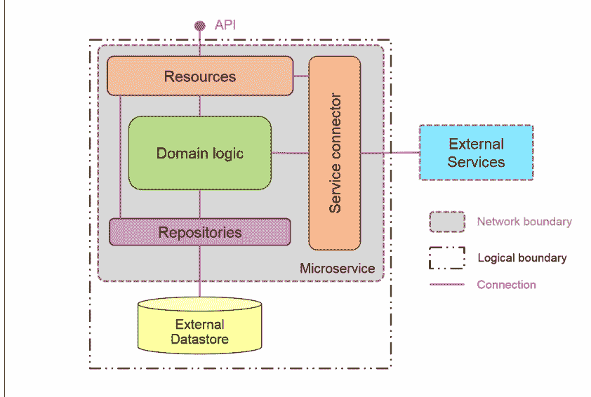

图 2-3 微服务的内部结构

示例结构考虑了以下元素：

- 资源（`Resources`）向外部客户端暴露 `JAX-RS` 资源。此层处理请求验证并将信息传递到领域层。
- 领域逻辑（`Domain logic`）从通用概念上来说有许多形式。在边界-实体-控制（`Boundary-Entity-Control`）模式中，领域逻辑代表实体本身，包含参数验证、状态更改等。
- 存储库（`Repositories`）是可选的，但在存在时，它可以为核心应用领域逻辑和数据存储提供实用的抽象。这种配置允许在不对领域逻辑进行大量更改的情况下更改或替换底层数据存储。
- 服务连接器（`Service connectors`）与存储库抽象类似，封装了与其他服务的通信。此层充当门面或“反腐”层，以保护领域逻辑不受外部资源 API 更改的影响，或者在 API 格式和内部模型结构之间进行转换。

> 5 http://alistair.ckburn.com/#Hexagonal/architecture

> 6 http://martinflower.com/articles/microservice-testing/#anatomy-modules

这种架构确实要求你在创建类时遵循一些规则。例如，你用于实现服务的每个类都应该执行以下任务之一：

- 执行领域逻辑
- 暴露资源
- 对其他服务进行外部调用
- 对数据存储进行外部调用

这些是关于代码结构的通用建议，并不一定需要严格遵守。重要的特征是降低做出更改的风险。例如，如果你想更改数据存储，只需要更新存储库层。你不需要搜索每个类来寻找调用数据存储的方法。如果存在对外部服务的 API 调用，这些更改同样包含在服务连接器中。这种分离进一步简化了测试，正如第 77 页第 7 章“测试”中所述。

### 2.3.4 共享库还是新服务？

敏捷和面向对象方法论中的一个原则是“不要重复自己”（`DRY`）。多次重复相同的代码表明代码应该被转换为可重用的“实体”。在传统的面向对象中，这是一个对象，或者可能是一个工具类。然而，在显而易见的工具类的情况下，严格应用 `DRY` 原则会导致解耦模块的终结。

微服务开发使得退回“面条代码”变得困难。硬性的进程边界可能会使实现细节的追踪变得困难得多，但遗憾的是这并非不可能。那么，你该如何处理代码呢？

- 接受某些冗余
- 将代码封装在共享的、有版本的库中
- 创建一个独立的服务

取决于代码的性质，最好是接受冗余代码并继续。鉴于每个服务都可以并且独立地演进，服务随时间推移的需求可能会改变最初共同代码的阶段。

为数据传输对象（`Data Transfer Objects`）创建共享库尤其具有吸引力，这些类是作为在线路格式（使用 `JSON`）之间转换的载体的轻量级类。这种技术可以消除大量的模板代码，但它可能会泄露实现细节并引入耦合。

建议使用客户端库来减少重复并更容易消费 API。这已经是数据存储的常态，包括提供基于 `REST API` 的新型 `NoSQL` 存储。客户端库对其他服务也有用，特别是那些使用二进制协议的服务。然而，客户端库确实在服务消费者和提供者之间引入了耦合。对于没有良好维护库的平台或语言来说，服务可能更难以消费。

共享库也用于确保可能复杂的算法的一致处理。例如，对于 Game On!，使用共享库来封装请求签名和签名验证，这在第 67 页第 6 章“应用安全”中进行了更详细的描述。这种配置允许你简化内部的服务并确保值计算的一致性。然而，我们没有为所有语言提供库，因此某些服务仍然必须通过硬编码的方法来实现。

共享库何时才真正是一个独立的服务？独立服务独立于所使用的语言，可以单独扩展，并且可以允许更新立即生效，而不需要对消费者进行协调更新。独立服务还会增加额外的处理，并受到第 33 页第 4 章“微服务通信”中提到的所有服务间通信问题的影响。何时进行权衡是一个判断问题，尽管如果一个库需要后端服务，这通常是它本身成为一个服务的线索。

## 2.4 创建 REST API

那么，微服务 API 是什么样子的？设计和记录你的 API 对于确保其有用性和易用性至关重要。遵循约定并使用良好的版本策略可以使 API 更容易被理解并随时间演进。

### 2.4.1 自上而下还是自底而上？

从零开始创建时，你可以先定义需要的 API 并编写代码来满足这些 API，或者编写第一个服务的代码并从实现中导出你的 API。

从原则上说，第一种总是更好。微服务并不是孤立运行的。它要么在调用别人，要么别人在调用它。微服务架构中服务之间的交互应该是定义良好且记录良好的。关于领域设计，API 是边界上下文（`bounded contexts`）之间的交点。

正如 Alan Perlis 所说：“一切都应该从上而下地构建，除了第一次。”在进行概念验证时，你可能不清楚自己正在提供哪些 API。在早期阶段，写一些东西有助于精炼关于你正在尝试做什么的想法。然而，当你对你的服务需要做什么有了更好的理解后，你应该回去并精炼领域模型和面向市场的外部 API。

### 2.4.2 文档化 API

使用工具记录你的 API 可以更容易确保发布文档的准确性和正确性，随后可以用于与 API 消费者的讨论。这些文档还可以用于你的驱动型契约测试（参见第 77 页第 7 章“测试”）。

Open API 倡议（`OAI`）⁸是一个专注于标准化描述 `RESTful` API 的财团。OpenAPI 规范⁹基于 Swagger¹⁰，它定义了用于创建 `RESTful` API Swagger 表示的元数据的结构和格式。此定义通常表示在单个文件中（按照约定为 `swagger.json`，但通过使用 `swagger.yaml` 支持 `YAML`）。Swagger 定义可以使用可视化编辑器创建，也可以通过扫描应用程序中的注解生成。它可以用于生成客户端或服务器存根。

> 7 http://www.cs.yale.edu/homes/perlis-alan/quotes.html

> 8 https://openapi.org/

> 9 https://github.com/OpenAPI/OpenAPI-Specification

> 10 http://swagger.io/

WebSphere Application Server 中的 `apiDiscovery` 功能¹¹ 在运行时集成了对 Swagger 定义的支持。它会自动检测并扫描 `JAX-RS` 应用程序注解，并根据注解动态生成 Swagger 定义。如果存在 Swagger 注解，将包含这些注解的信息，以创建可以在代码中维护的详尽文档。这些生成的文档通过系统提供的端点可用，如图 2-4 所示。

发现 Liberty 中可用的 REST APIs

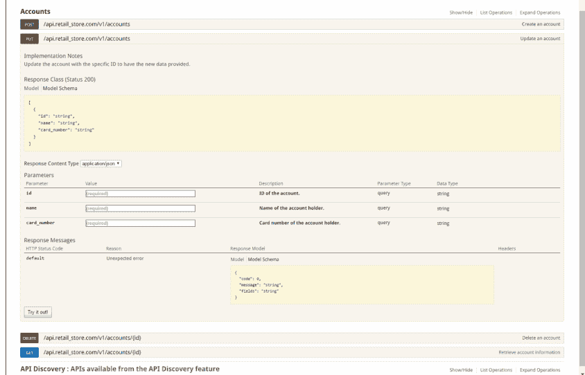

图 2-4 由 `apiDiscovery-1.0` 功能为 APIs 提供的用户界面

在 Web 界面渲染的 Swagger API 定义对于可视化 API 的外部消费者视图非常有帮助。从这个外部视图进行开发或设计 API 有助于确保一致性。这种外部视图与“消费者驱动契约”¹² 一致，该模式主张关注消费者预期来设计 API。

### 2.4.3 使用正确的 HTTP 动词

`REST APIs` 应使用标准的 HTTP 动词进行创建、检索、更新和删除操作，并特别注意操作是否是幂等的（重复多次执行是安全的）。

`POST` 操作可用于创建(C) 资源。`POST` 操作的区分特征是它不是幂等的。例如，如果使用 `POST` 请求创建资源，并启动多次，则每次调用都将创建一个新的唯一资源。

> ¹¹ https://developer.ibm.com/wasdev/blog/2016/02/17/exposing-liberty-rest-apis-swagger/

> ¹² http://martinfowler.com/articles/consumerDrivenContracts.html

`GET` 操作必须同时是幂等的且安全的。它们不应产生任何副作用，并且仅应用于检索(R) 信息。具体来说，带有查询参数的 `GET` 请求不应用于更改或更新信息（应改用 `POST`、`PUT` 或 `PATCH`）。

`PUT` 操作可用于更新(U) 资源。`PUT` 操作通常包含要更新资源的完整副本，使得操作具有幂等性。

`PATCH` 操作允许对资源进行部分更新(U)。取决于数据如何指定以及应用到资源，它们可能是幂等的，也可能不是。例如，如果一个 `PATCH` 操作表示值应从 A 变为 B，那么它就是幂等的；如果启动多次且值已经是 B，则没有影响。对 `PATCH` 操作的支持本身是不一致的。例如，Java EE 的 `JAX-RS` 中没有 `@PATCH` 注解。

`DELETE` 操作用于删除(D) 资源。删除操作是幂等的，因为资源只能删除一次。然而，返回码有所不同，因为第一次操作成功 (200)，而随后的调用找不到资源 (204)。


### 2.4.4 创建机器友好且具描述性的结果

一个表现良好的 REST API 应该对启动操作返回的内容进行仔细考虑。由于 API 是由软件而非用户启动的，应以最高效、最有效的方式向调用者传递信息。

例如，通常做法是返回 `200 (OK)` 状态码以及嵌入错误信息的 HTML。虽然这种技术对于查看网页的用户（当 HTTP 状态被隐藏时）可能有效，但对于判断其请求是否成功的机器来说非常繁琐。

HTTP 状态码应该是相关且有效的。当一切正常时使用 `200 (OK)`。当没有响应时，改用 `204 (NO CONTENT)`。除此之外，对于导致资源创建的 POST 请求，无论是否有正文都应使用 `201 (CREATED)`。当发生并发更改时，使用 `409 (CONFLICT)`，当参数格式错误时，使用 `400 (BAD REQUEST)`。HTTP 状态码集是健壮的，应尽可能具体地表达请求结果。更多信息，请参阅：

https://www.w3.org/Protocols/rfc2616/rfc2616-sec10.html

你还应该考虑响应中返回了哪些数据以实现高效通信。例如，当通过 POST 请求创建资源时，响应应在 `Location` 头中包含新创建资源的位置。你不需要在响应正文中检索有关资源的额外信息。但在实践中，创建的资源通常包含在响应中，因为这消除了调用者执行额外的 GET 请求来获取资源。PUT 和 PATCH 请求也是如此。

### 2.4.5 资源 URI 和版本控制

对于 RESTful URIs 的某些方面存在不同意见。通常，资源应该是名词而非动词，端点应该是复数形式。这种技术确保了检索、更新和删除操作具有清晰的结构：

- `POST /accounts`: 创建新项
- `GET /accounts`: 检索项列表
- `GET /accounts/16`: 检索特定项
- `PUT /accounts/16`: 更新特定项
- `PATCH /accounts/16`: 更新特定项
- `DELETE /accounts/16`: 删除特定项

通用共识是保持 URL 简单。如果你创建了一个跟踪特定种类鼠齿的应用程序，URI 应该是 `/mice/` 而不是 `/mouses/`（如果后者让你感到不适的话）。

关系通过嵌套 URL 来实现，例如像 `/accounts/16/credentials` 用于管理账户的凭据。

在哪些与资源关联但不符合这种结构的操作上，共识较少。处理版本控制没有单一的方法。微服务的主要优势之一是独立演化的能力。如果你决定将版本号放在 URI 中，可以以不同的方式进行管理，部分取决于请求如何路由。然而，你的网关暴露了 `/api/v1/accounts` 映射到服务的 JAX-RS 端点。在这种情况下，`/accounts` 是自然根。之后，你可以在 `@Path` 注解中包含版本，如示例 2-1 所示，当 API 只支持一个版本时效果良好。或者，如果服务应该支持多个版本的 API，可以将版本推送到 `@Path` 注解，如示例 2-2 所示。

如果你要把版本放在 URI 中，该版本应该适用于整个应用程序，例如 `/api/v1/accounts` 而不是 `/accounts/v1`。超媒体态 (HATEOAS) 是提供 URIs 的一种方式，如果后端服务具有独立变化的 URIs，HATEOAS 变得困难甚至不可能。

> ¹³ https://developer.github.com/v3/#hypermedia

#### 示例 2-1 使用 `@ApplicationPath` 注解将版本添加到 URI

```java
package retail_store.accounts.api;
@ApplicationPath("/v1")
public class ApplicationClass extends Application { }
```

#### 示例 2-2 `@ApplicationPath` 定义了不更改 URI 的端点

```java
package retail_store.accounts.api.v1;
@ApplicationPath("/*")
public class ApplicationClass extends Application { }
```

#### 示例 2-3 使用 `@Path` 注解将版本添加到 API

```java
package retail_store.accounts.api.v1;
@Path("/v1/accounts")
public class AccountsAPI {
    @GET
    @Path("{id}")
    @Produces(MediaType.APPLICATION_JSON)
    public Response getAccounts(@PathParam("{id}") String id) {
        getId(id);
    }
}
```

WebSphere Application Server 中的 `apiDiscovery` 功能¹¹ 在运行时集成了对 Swagger 定义的支持。它会自动检测并扫描 JAX-RS 应用程序注解，并根据注解动态生成 Swagger 定义。如果存在 Swagger 注解，将包含这些注解的信息，以创建可以在代码中维护的详尽文档。这些生成的文档通过系统提供的端点可用，如图 2-4 所示。

发现 Liberty 中可用的 REST APIs


图 2-4 由 `apiDiscovery-1.0` 功能为 APIs 提供的用户界面

在 Web 界面渲染的 Swagger API 定义对于可视化 API 的外部消费者视图非常有帮助。从这个外部视图进行开发或设计 API 有助于确保一致性。这种外部视图与“消费者驱动契约”¹² 一致，该模式主张关注消费者预期来设计 API。

### 2.4.3 使用正确的 HTTP 动词

REST APIs 应使用标准的 HTTP 动词进行创建、检索、更新和删除操作，并特别注意操作是否是幂等的（重复多次执行是安全的）。

POST 操作可用于创建(C) 资源。POST 操作的区分特征是它不是幂等的。例如，如果使用 POST 请求创建资源，并启动多次，则每次调用都将创建一个新的唯一资源。

GET 操作必须同时是幂等的且安全的。它们不应产生任何副作用，并且仅应用于检索(R) 信息。具体来说，带有查询参数的 GET 请求不应用于更改或更新信息（应改用 POST、PUT 或 PATCH）。

PUT 操作可用于更新(U) 资源。PUT 操作通常包含要更新资源的完整副本，使得操作具有幂等性。

PATCH 操作允许对资源进行部分更新(U)。取决于数据如何指定以及应用到资源，它们可能是幂等的，也可能不是。例如，如果一个 PATCH 操作表示值应从 A 变为 B，那么它就是幂等的；如果启动多次且值已经是 B，则没有影响。对 PATCH 操作的支持本身是不一致的。例如，Java EE 的 JAX-RS 中没有 `@PATCH` 注解。

DELETE 操作用于删除(D) 资源。删除操作是幂等的，因为资源只能删除一次。然而，返回码有所不同，因为第一次操作成功 (`200`)，而随后的调用找不到资源 (`204`)。

### 2.4.4 创建机器友好且具描述性的结果

一个表现良好的 REST API 应该对启动操作返回的内容进行仔细考虑。由于 API 是由软件而非用户启动的，应以最高效、最有效的方式向调用者传递信息。

例如，通常做法是返回 `200 (OK)` 状态码以及嵌入错误信息的 HTML。虽然这种技术对于查看网页的用户（当 HTTP 状态被隐藏时）可能有效，但对于判断其请求是否成功的机器来说非常繁琐。

HTTP 状态码应该是相关且有效的。当一切正常时使用 `200 (OK)`。当没有响应时，改用 `204 (NO CONTENT)`。除此之外，对于导致资源创建的 POST 请求，无论是否有正文都应使用 `201 (CREATED)`。当发生并发更改时，使用 `409 (CONFLICT)`，当参数格式错误时，使用 `400 (BAD REQUEST)`。HTTP 状态码集是健壮的，应尽可能具体地表达请求结果。更多信息，请参阅：

https://www.w3.org/Protocols/rfc2616/rfc2616-sec10.html

你还应该考虑响应中返回了哪些数据以实现高效通信。例如，当通过 POST 请求创建资源时，响应应在 `Location` 头中包含新创建资源的位置。你不需要在响应正文中检索有关资源的额外信息。但在实践中，创建的资源通常包含在响应中，因为这消除了调用者执行额外的 GET 请求来获取资源。PUT 和 PATCH 请求也是如此。

### 2.4.5 资源 URI 和版本控制

对于 RESTful URIs 的某些方面存在不同意见。通常，资源应该是名词而非动词，端点应该是复数形式。这种技术确保了检索、更新和删除操作具有清晰的结构：

- `POST /accounts`: 创建新项
- `GET /accounts`: 检索项列表
- `GET /accounts/16`: 检索特定项
- `PUT /accounts/16`: 更新特定项
- `PATCH /accounts/16`: 更新特定项
- `DELETE /accounts/16`: 删除特定项

通用共识是保持 URL 简单。如果你创建了一个跟踪特定种类鼠齿的应用程序，URI 应该是 `/mice/` 而不是 `/mouses/`（如果后者让你感到不适的话）。

关系通过嵌套 URL 来实现，例如像 `/accounts/16/credentials` 用于管理账户的凭据。

在哪些与资源关联但不符合这种结构的操作上，共识较少。处理版本控制没有单一的方法。（注意：OCR 文本变成了乱码/重复，我清理了逻辑流）。

> ¹¹ https://developer.ibm.com/wasdev/blog/2016/02/17/exposing-liberty-rest-apis-swagger/
> ¹² http://martinfowler.com/articles/consumerDrivenContracts.html

反对在 URL 中包含版本号的理由之一是对 HTML 标准的严格解释，即 URL 应该代表一个实体，如果所代表的实体发生了变化，URL 就不应该改变。

另一个担忧是，在 URI 中放置版本号需要消费者更新他们的 URI 引用。这种担忧可以通过允许发送不带版本的请求，然后将这些请求映射到最新版本来部分解决。然而，这种方法在最新版本发生变化时容易产生意料之外的行为。

## 添加自定义请求头

你可以添加一个自定义请求头来指示 API 版本。路由器和其他基础设施可以考虑自定义标头，从而将流量路由到特定的后端实例。然而，由于与 `Accept` 请求头同样方便使用的相同原因，这种机制对所有人来说并不易于使用。此外，自定义标头仅适用于你的应用程序，这意味着消费者需要学习如何使用它。

## 修改 Accept 请求头以包含版本

`Accept` 请求头是定义版本的一个明显位置，但它是最难测试的地方之一。URL 易于指定和替换，但指定 HTTP 请求头需要更详细的 API 和命令行调用。

有许多文章描述了这三种方法的优缺点。Troy Hunt 写的这篇博客文章是一个很好的起点：

https://www.troyhunt.com/your-api-versioning-is-wrong-which-is/

以下是本章最重要的要点：

- 从消费者的角度设计你的 API。
- 拥有一处理 API 变化的策略。
- 在你应用程序中的所有服务中使用一致的版本控制技术。


## 定位服务

微服务的设计是为了易于扩展。这种扩展通过扩展单个服务来实现水平扩展。由于微服务有多个实例，你需要一种方法来定位服务，并在你调用的服务的不同实例之间进行负载均衡。本章描述了系统中定位和向微服务发送请求的选项。

涵盖了以下主题：

- 服务注册中心
- 服务调用
- API 网关

## 3.1 服务注册中心

### 注册

服务成功部署后，微服务必须在服务注册中心进行注册。

### 心跳

微服务应该定期向注册中心发送心跳包，以显示它已准备好接收请求。

### 服务发现

为了与另一个服务通信，微服务必须调用服务注册中心以获取可用实例列表（更多细节请参见第 27 页的 3.2“服务调用”）。

### 注销

当服务宕机时，必须从服务注册中心的可用服务列表中移除。

### 3.1.1 第三方注册与自注册

微服务在服务注册中心的注册可以由微服务完成，也可以由第三方完成。使用第三方需要该实体检查状态并将信息传递到服务注册中心。第三方还负责注销。如果微服务本身执行注册和心跳，那么当服务注册中心错过心跳时，它可以注销该服务。

使用第三方的优点是注册和心跳逻辑与业务逻辑分离。缺点是多了一个额外的软件需要部署，并且微服务必须暴露一个健康检查端点供第三方进行轮询。

使用自注册将注册和心跳逻辑引入微服务内部。使用这种方法需要仔细的测试考虑。有关代码分离的更多信息，请参见第 77 页第 7 章“测试”。然而，许多服务注册中心解决方案提供了用于注册的便利库，减少了所需代码的复杂性。

通常，使用服务注册中心会提供一个基于 Java 的注册和心跳库。这种配置使得你的服务代码编写更快，并在系统的每个微服务（即是用 Java 编写的）之间提供一致性。以下可用的服务注册中心解决方案：

- Consul
  https://www.consul.io/
- Eureka
  https://github.com/Netflix/eureka
- Amalgam
  https://github.com/amalgam/

所有这些注册中心都是开源的，并提供了 Java 集成。作为 Netflix 栈的一部分，Eureka 与 Netflix 其他负载均衡和容错的解决方案集成良好。使用 Eureka 作为服务注册中心允许你添加其他解决方案。Amalgam 开源项目同时提供了服务注册和负载均衡。它还提供了可以在测试期间使用的路由配置。更多信息请参见第 77 页第 7 章“测试”。

### 3.1.2 可用性与一致性

大多数服务注册中心提供分区容错性以及一致性或可用性。由于 CAP 定理¹它们无法提供所有特性。例如，Eureka 提供可用性，而 Consul 和 Apache Zookeeper 提供一致性。有些文章认为你应该在两者二选一（Kewton 博客上的这篇帖子²值得一读），但决定取决于应用程序的精确需求。如果你要求所有微服务在同一时刻对世界有一个视图，请选择一致性。如果快速回答请求比等待一致的答案更重要，请选择可用性。这两种方案都有与 Java 集成的解决方案。

## 3.2 服务调用

当服务需要与另一个服务通信时，它使用存储在服务注册中心的信息。对实际微服务的调用随后发生在服务端，也可以发生在客户端。

### 3.2.1 服务端

与微服务的服务端通信是通过使用服务代理（`service proxy`）完成的。服务代理可以作为服务注册中心的一部分提供，也可以作为一个独立的服务提供。当微服务需要进行调用时，它调用服务代理的已知端点。服务代理负责从服务注册中心获取服务的位置并转发请求。代理获取响应并将其传回请求的原始微服务。在示例场景中，负载均衡完全在服务端处理。

¹ https://en.wikipedia.org/wiki/CAP_theorem
² https://zookeeper.apache.org/
³ https://tech.kewton.com/blog/2014/12/eureka-shouldnt-use-zookeeper-service-discovery/

图 3-1 显示了使用服务代理时的请求流。

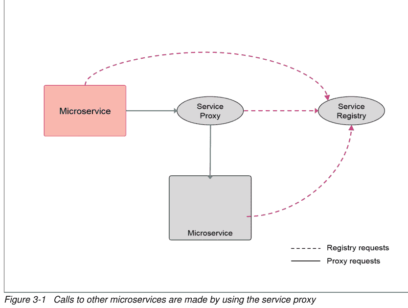

使用服务端调用提供了这些关键优点：

- **请求简单**
  微服务发送的请求是简单的因为它调用的是已知端点。
- **更容易测试**
  使用服务端可以将任何负载均衡或路由逻辑从微服务中提取出来。这种配置允许你使用模拟代理测试服务的完整功能。

在 Cloud Foundry 和 Bluemix 等云平台上，代理是由平台提供的。在 Bluemix 中，每个部署的应用程序都有一个已知端点，称为路由。当另一个服务或应用程序调用此路由时，Bluemix 在后台进行负载均衡。

这种方法有以下主要缺点：

- **跳数增加**
  增加对服务代理的调用增加了每次请求的网络跳数。因此，每次请求的跳数通常高于客户端解决方案。

图 3-2 显示所需的网络跳数。

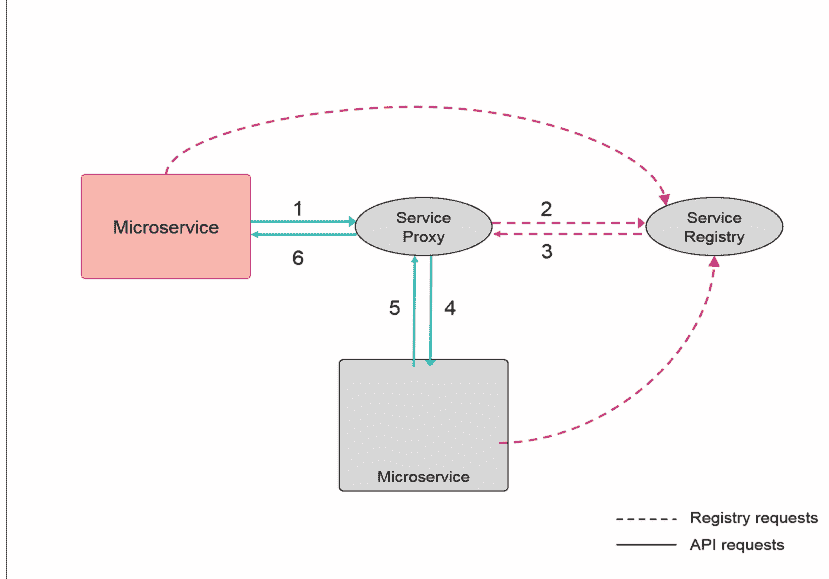

图 3-2 使用服务代理完成请求服务时所需的网络跳数

### 3.2.2 客户端

从一个微服务到另一个微服务的请求可以直接从客户端侧发起。首先，从服务注册中心请求某一个或多个服务实例的位置。其次，在客户端侧向微服务发送请求。微服务的位置通常会被缓存，以便在将来发起请求时无需返回服务注册中心。如果将来请求失败，则客户端可以重复对服务注册中心进行调用。为缓存的微服务位置设置一个超时时间是一种最佳实践。这种配置意味着，如果部署了新版本的服务，其他微服务无需等待其缓存实例返回错误即可获得有关新实例的通知。

与服务代理方法相比，这种方法需要的网络跳数更少。图 3-3 显示了所需的网络跳数。同样，这个跳数是指客户端没有关于服务的缓存信息时。在许多情况下，不需要向服务注册中心发送请求，使其仅需两跳：`3 → 4`。

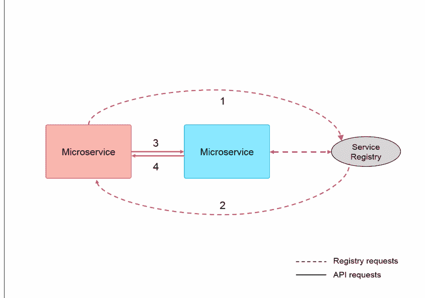

图 3-3 向服务注册中心发起客户端侧请求时的网络跳数

请求以及任何所需的负载均衡可以通过以下两种机制之一来处理：

- 客户端库 (`Client library`)
- 侧边容器 (`Sidecar`)

这两种机制都在客户端侧发起请求。然而，客户端库运行在微服务内部，而侧边容器与微服务一起部署，但运行在独立的进程中。图 3-4 显示了一个示例架构图。


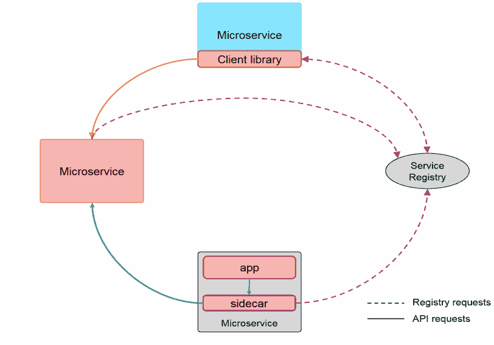

图 3-4 请求由客户端库或侧边容器进程执行

## 客户端库

客户端库因许多原因而非常有用，其中之一是隔离了与远程资源通信的特定细节。对于服务注册中心，像 `Consul` 或 `Netflix Eureka` 提供的客户端库可以实现服务注册和心跳。其他库（如 `Netflix Ribbon`）提供了客户端负载均衡。

通常应该从现有的库开始，而不是自己编写。如果你系统中的任何微服务是用 `Java` 编写的，那么你应该标准化你的库。如果你有一个多语言的微服务系统，那么为每种语言标准化一个库。通过在各处使用相同的库，你保持了将开发者在各个微服务之间移动的灵活性，并避免了让你的基础设施和构建过程过于复杂。

使用客户端库的缺点是，你现在将复杂的服务调用调回了你的应用程序中。这种配置使得测试你的服务变得更加复杂。确保在使用客户端库的代码与微服务中的业务逻辑之间保持良好的分离。请参第 77 页第 7 章“测试”，获取更多关于代码分离的详细信息，以便更容易测试。

## 侧边容器 (Sidecar)

服务代理和客户端库之间良好的平衡点是侧边容器。侧边容器是一个独立的进程，与你的微服务一起部署，可以作为容器内的独立进程，也可以作为一个独立但紧密相关的容器。

侧边容器与服务注册中心维护服务注册，并通常对其他微服务的出站调用执行客户端负载均衡。

由于侧边容器运行在自己的进程中，因此它们与语言无关。你可以为多语言应用程序中的所有微服务使用相同的侧边容器实现，无论服务是用什么语言编写的。

`Netflix Prana` 是一个开源侧边容器，为非 `Java` 应用程序提供了基于 `Java` 的 `Ribbon` 和 `Eureka` 客户端库的功能。更多信息请参阅以下：

```
http://github.com/Netflix/Prana
```

`Kubernetes` 是一个容器编排引擎，提供了侧边容器发现和负载均衡能力。更多信息请参阅以下网站：

```
http://kubernetes.io/docs/user-guide/services
```

`Amalgama` 是一个可以使用容器也可以不使用容器的解决方案。它管理服务注册并提供客户端服务发现、路由和负载均衡。更多信息请参阅以下网站：

```
http://amalgam.io
```

选择一个处理其中几个元素的解决方案可以减少你的服务和基础设施的复杂性。

## 3.3 API 网关

`API` 网关可以用于为内部和外部客户端执行服务调用。`API` 网关的作用类似于服务代理（参见第 27 页第 3.2.1 节“服务端”）。服务向 `API` 网关发送请求，网关在注册表中查找服务、执行请求并返回响应。然而，两者之间存在差异。向服务代理的请求使用终端服务提供的完全 `API`。向 `API` 网关的请求使用网关提供的 `API`。这种配置意味着 `API` 网关可以提供不同于微服务本身提供的 `API`。

内部微服务使用原始完全相同的 `API`，而 `API` 网关为外部客户端提供了更多益处。通常，微服务提供细粒度的 `API`。相比之下，使用该应用程序的外部客户端可能不需要如此细粒度的 `API`。它可能还需要一个使用多个微服务的 `API`。`API` 网关暴露了微服务的实际实现。

# 微服务通信

在分布式系统中，服务间的通信至关重要。构成你应用程序的微服务必须协同工作。第 25 页第 3 章“定位服务”讨论了如何定位特定服务。本章涵盖了实现韧性的方案。

涵盖主题包括：

- 同步与异步
- 容错

## 4.1 同步与异步

同步通信是需要响应的请求，无论是立即响应还是在一段时间后响应。异步通信是不需要响应的消息。

在高度分布的系统中，可以使用异步事件或消息的强有力论据。在某些情况下，使用同步调用更合适，请见 4.1.1 节“同步消息 (REST)”。

对于任何调用样式，服务都应该记录任何发布工具（如 `Swagger`）。事件或消息负载也应该被记录，以确保系统易于理解，便于未来的消费者。

### 4.1.1 同步消息 (REST)

如提到的，在分布式系统中，异步形式的消息非常有价值。当清晰的请求/响应语义适用，或者当一个服务需要触发另一个服务的特定行为时，应该使用异步 `API`。

这些通常是解析 `JSON` 数据的 `RESTful` 操作，但也支持其他协议和数据格式。在 `Java` 微服务中，应用程序使用 `JSON` 是最佳选择。`JSON` 正在广泛采用，使其成为让微服务易于消费的良好选择。

要查看更多 `JAX-RS 2.0` 中异步支持的示例，请参考以下 `GitHub` 项目：

```
https://github.com/WASdev/sample.async.jaxrs
```

另一个选项是使用响应式库如 `RxJava`¹。`RxJava` 是 `ReactiveX`² 的 `Java` 实现，旨在聚合和过滤来自多个并行请求的响应。它扩展了观察者模式³，并与用于处理负载均衡和增加端点韧性的库良好集成，例如 `FailSafe` 和 `Netflix Hystrix`⁵。

### 4.1.2 异步消息（事件）

异步消息用于解耦协调。如果事件的创建者不需要响应，则可以使用异步事件。

来自外部客户端的请求在返回响应之前，通常必须经过多个微服务。如果每个调用都是同步进行的，那么总调用时间就会被阻塞。微服务系统越复杂，每个外部请求所需的微服务间交互越频繁，系统产生的延迟就越大。如果过程中的请求可以替换为异步事件，你应该实现该事件。

对事件使用响应式风格。服务应该只发布关于其自身状态或活动的事件。其他服务可以订阅这些事件并采取正确的行动。

事件是在不引入依赖关系的情况下组合交互模式的极佳方式。它们能够以你在最初创建时未考虑过的方式扩展架构。

微服务模式要求每个微服务拥有自己的数据。这一要求意味着当请求进来时，可能会有多个服务需要更新它们的数据库。服务通过其他其他可以订阅的事件来发布更改。要了解更多关于使用事件进行数据事务和一致性的信息，请参阅第 41 页的第 5 章“处理数据”。

## 内部消息

事件可以在单个微服务内部使用。例如，订单可以通过创建一组事件来处理，服务连接器订阅这些事件，从而触发它们发布外部事件。使用内部事件可以提高你对同步请求的响应速度，因为你不需要在返回响应之前等待同步请求。

利用 `Java EE` 规范对 `CDI` 的支持。内部异步事件可以通过使用上下文和依赖注入 (`CDI`)¹ 来完成。在这种模型中，一个事件由一个 `Java` 事件对象和一组限定符类型组成。任何想要对事件做出反应都使用 `@Observe` 注解进行触发。事件通过 `fire()` 方法触发。示例 4-2 显示了代码中的方法和注解。

示例 4-2 使用上下文和依赖注入的事件

```java
public class PaymentEvent {
    public String paymentType;
    public long value;
    public String dateTime;
    public PaymentEvent() {}
}

public class PaymentEventHandler {
    public void credit(@Observe PaymentEvent event) {
    }
}
public class Payment {
    @Inject
    @Credit
    Event<Payment> creditEvent;
    public String pay() {
        PaymentEvent paymentPayload = new PaymentEvent();
        // 填充负载...
        creditEvent.fire(paymentPayload);
    }
}
```

### 4.1.3 示例

为了说明你应该使用同步和异步通信的场景，本节涵盖两个示例：`Game On!` 和一家在线零售商店。参阅第 7 页的 1.5 节“示例”获取介绍。

## Game On!

考虑一个在 `Game On!` 身份验证并想要更新房间的用户。第 37 页的图 4-1 显示了通信流，请求已编号供参考。当用户向地图服务发送更新请求时，他们期望得到确认响应，因此请求必须是同步的。该同步请求 (1) 返回一个确认，说明更新成功，或者更新已成功添加到队列（取决于更新函数的实现）。

在更新发生后，即通过同步请求 (2) 在数据库中更新了房间，地图服务需要通知其他服务该更改。此更新不需要响应，因此通过使用异步事件 (3) 发送，其他服务订阅了该事件 (4)。

> 1 http://docs.oracle.com/javaee/6/tutorial/doc/gkhic.html

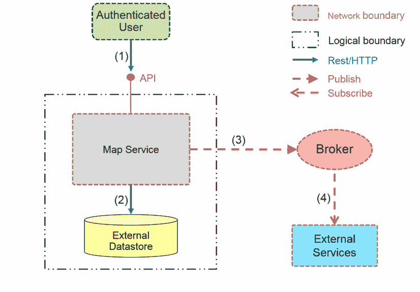

## 在线零售商店

考虑一个想要在在线零售商店上下单的用户。在用户输入订单的所有详情后，他们点击**提交** 按钮。用户期望得到响应以确认订单已通过，因此**提交** 按钮触发了一个返回响应的同步请求。订单被提交后，应用程序开始处理订单。接收订单请求的服务发送其他服务订阅的异步事件。这些事件包括库存更新、发货事件和支付事件。某些服务会响应这些事件触发另一个同步或异步请求。例如，库存服务使用同步请求来更新库存数据库。

## 4.2 容错

迁移到微服务架构的一个强大动力是获得更强的容错性和韧性。现代应用程序需要近乎零的停机时间，并在秒级内响应。本节重点关注你应该使用的技术和工具，使你的微服务具有容错性和韧性。

### 4.2.1 应对变化的韧性

当微服务向另一个服务发出同步请求时，它使用了请求中包含的输入属性和响应中包含的输出属性。假设这些输出属性永远不会改变是不现实的。即使在最好的设计中，需求也在不断变化，导致属性的添加、删除和更改。为了对这些变化具有韧性，微服务必须考虑它们产生的 `API` 和消费的 `API`。

#### 消费 API

作为 `API` 的消费者，有必要验证收到的响应以检查其是否包含执行所需的信息。如果你接收的是 `JSON`，还需要在转换之前进行解析。在进行验证或 `JSON` 解析时，你必须执行以下操作：

- 根据你需要的属性验证请求
- 不要仅仅因为提供了变量就对其进行验证。如果你没有将其作为请求的一部分，请不要依赖它们的存在。
- 接受未知属性
- 如果收到意外变量，不要抛出异常。如果响应包含信息，其他提供了什么并不重要。

选择一个 `JSON` 解析工具，允许你配置它解析输入数据的方式。`Jackson` 项目提供了如示例 4-3 所示的注解来配置解析器。

示例 4-3 用于 `JSON` 解析的 `Jackson` 注解

```java
@JsonInclude(NON_EMPTY)
@JsonIgnoreProperties(ignoreUnknown = true)
public class Account {
    // 账户 ID
    @JsonProperty("id")
    protected String id;
}
```

通过遵循这些规则，你的微服务可以应对任何未直接影响它的变化。即使微服务的生产者移除或添加你正在使用的属性，你的微服务也能正常运行。

#### 提供 API

当向外部客户端提供 `API` 时，在接受请求和返回响应时执行以下操作：

- 接受请求中作为未知属性
- 如果某个服务带有不必要的属性调用了你的 `API`，请丢弃这些值。在这种情况下返回错误会导致不必要的失败。
- 仅返回与调用的 `API` 相关的属性

为服务的实现随时间变化留出尽可能的空间。通过过度共享来留出实现细节。

> 1 https://github.com/FasterXML/jackson

如前所述，这些规则构成了稳健性原则（`Robustness Principle`）。通过遵循这两条规则，你可以让自己在未来更改 `API` 以及适应消费者不断变化的需求时处于最佳位置。有关稳健性原则的更多信息，请参阅：

```
https://en.wikipedia.org/wiki/Robustness_principle
```

### 4.2.2 超时

向另一个微服务发送请求时，无论是异步还是同步，请求都必须有超时设置。因为我们预期的服务会产生又消失，我们不应该无限期等待响应。

`JAX-RS 2.0` 中的异步支持在 `AsyncResponse` 对象上提供了一个 `setTimeout` 函数（参见第 34 页的“同步消息 (REST)”）。`Failsafe` 和 `Netflix` 等工具内置了对超时的支持。

设置超时可以提高微服务的韧性，但仍可能导致糟糕的用户体验，因为端到端的路径会变慢。还可能出现超时对齐不良的情况，即服务 A 到服务 B 的请求超时，而服务 B 正在等待服务 C 的响应。

### 4.2.3 熔断器

使用超时可以防止请求无限期等待响应。然而，如果某个特定请求总是产生超时，你就会浪费大量时间等待超时发生。

熔断器的设计是为了避免重复出现超时。它的工作原理与同名的电子设备类似。每当特定请求失败或产生超时时，熔断器都会记录一次。如果此计数达到某个水平，它将阻止进一步的调用的发生，而不是即时返回错误。它还创建了一种重试机制，可以在一段时间时间后或响应某个事件时进行重试调用。

在调用外部服务时，熔断器至关重要。通常，请使用 `Java` 中现有的熔断器库之一。

### 4.2.4 舱壁

在航海中，舱壁（`bulkhead`）是一种隔板，它能防止一个舱室的泄漏导致整艘船沉没。微服务中的舱壁也是一个类似的概念。你需要确保应用程序某部分的故障不会导致整个系统瘫痪。舱壁模式关注的是你如何创建微服务，而不是使用任何特定的工具或库。在创建微服务时，问问自己你如何隔离不同的部分并防止级联故障。

舱壁模式最简单的实现是提供回退（`fallbacks`）。添加回退允许应用程序在非关键服务不可用时继续运行。例如，在一个在线商店中，可能有一个为用户提供推荐的服务。如果推荐服务宕机，用户应该仍然能够搜索商品并下单。一个有趣的例子是链式回退，当对个性化内容的请求失败时，会回退到对通用内容的请求，这将转而返回缓存的（可能过时的）内容，而不是返回错误。

另一种防止缓慢或受限的远程资源拖垮整个船的策略是限制用于这些出站请求的可用资源。最常用的方法是使用队列和信号量（`Semaphore`）。关于 `Semaphore` 的信息，请参阅以下网站：

```
https://docs.oracle.com/javase/7/docs/api/java/util/concurrent/Semaphore.html
```

队列具有深度，表示待处理工作的最大值。在队列满之后进行的任何请求都将快速失败。队列还分配了有限数量的工作线程，这定义了可以被远程资源阻塞的最大服务器线程数。

信号量机制通过设置固定数量的许可（`permits`）来工作。执行远程请求需要许可。在请求成功完成后，许可会被释放。

两者之间的显著区别在于分配的资源全部用尽时会发生什么。使用信号量方法时，如果无法许可，出站请求将完全跳过，尽管队列方法提供了某种缓冲（至少在队列满之前）。

这些方法也可以用于处理实施速率限制的远程资源，这是另一种形式需要处理的意外失败。

# 数据处理

在微服务系统中可能存在的异构持久化（`polyglot persistence`）环境中，有必要保持数据处理的可受控性。为了解释如何实现这一目标，本章简述了微服务在数据处理方面的特征，然后探讨了如何使用基于 `Java` 的微服务来实现。

涵盖了以下主题：

- 微服务的特定数据特征
- `Java` 中的支持

## 5.1 微服务的特定数据特征

识别必须存储在微服务数据存储中的数据的一种方法是自顶而下的方法。从业务层开始对数据进行建模。接下来的章节将展示如何识别这些数据、如何处理这些数据，以及如何将其与其他微服务的其他数据存储共享。关于自顶而下方法的描述，请参阅以下网站：

```
http://en.wikipedia.org/wiki/Top-down_and_bottom-up_design
```

### 5.1.1 领域驱动设计产生实体

从领域驱动设计的方法中，你可以得到以下对象（但不限于此）：

- 实体（`Entity`）：“一个不是由其属性定义，而是由其连续性和身份定义的对象”
- 值对象（`Value Objects`）：“一个包含属性但没有概念性身份的对象。它们应该被视为不可变对象”
- 聚合（`Aggregate`）：“一个由根实体（也称为聚合根）绑定的对象集合。聚合根通过禁止外部对象持有其成员的引用，来保证聚合内部所做更改的一致性”
- 存储库（`Repository`）：“用于检索领域对象的方法应该委托给专门的存储库对象，这样就可以方便地切换不同的存储实现”

这些引用自以下来源：

```
http://en.wikipedia.org/wiki/Domain-driven_design
```

这些对象应该映射到你的持久化存储中（当实体具有相同的生命周期时应对它们进行聚合）。此领域模型是逻辑数据模型和物理数据模型的基础。

有关领域驱动术语的更多信息，请参阅以下网站：

```
http://dddcommunity.org/resources/ddd_terms/
```

### 5.1.2 微服务的独立数据

每个微服务应该有自己的数据存储（如图 5-1 所示），并与其他微服务及其数据解耦。第二个微服务不能直接访问第一个微服务的数据存储。

该特征的原因如下：

- 如果微服务共享一个数据存储，它们就是紧耦合的。更改一个微服务的数据存储结构（如表）可能会给另一个微服务带来问题。如果微服务以此方式耦合，新版本的部署必须协调，而这是应该避免的。
- 每个微服务应该使用最符合其需求的数据库类型（异构持久化，见 5.1.3，第 45 页“异构持久化”）。在选择数据库系统时，你不需要不同的微服务之间进行权衡。这种配置为每个微服务提供了独立的数据存储。


- 从性能角度来看，每个微服务拥有自己的数据存储可能是很有用的，因为扩展会变得更容易。数据存储可以托管在自己的服务器上。

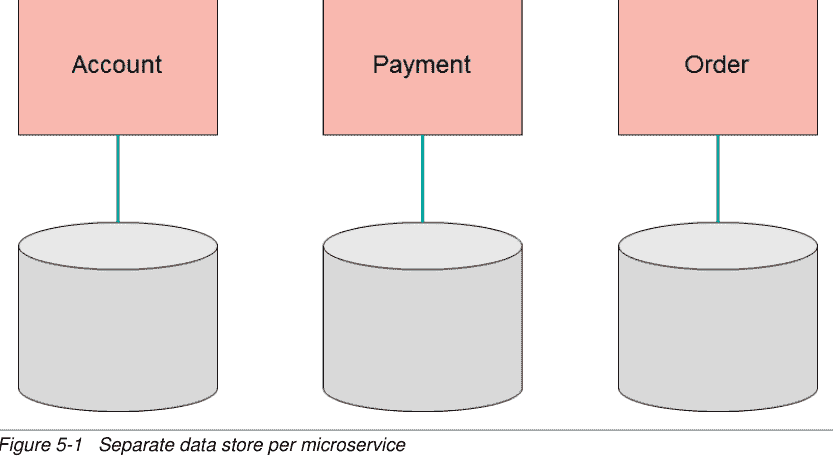

关系型数据库的数据存储分离可以通过以下方式之一实现：

- **每个微服务一个 Schema**：每个服务在数据库中都有自己的 Schema（参见第 44 页的图 5-2）。其他服务可以使用同一个数据库，但必须使用不同的 Schema。这种配置可以通过数据库访问控制机制（使用对连接的数据库用户的授权）来强制执行，因为面临时间压力的开发者倾向于使用捷径，并直接访问另一个 Schema。

- **每个微服务一个数据库**：每个微服务可以有自己的数据库，但与其他微服务共享数据库服务器（参见第 44 页的图 5-2）。通过不同的数据库，用户可以连接到数据库服务器，并且数据库之间有了良好的隔离。

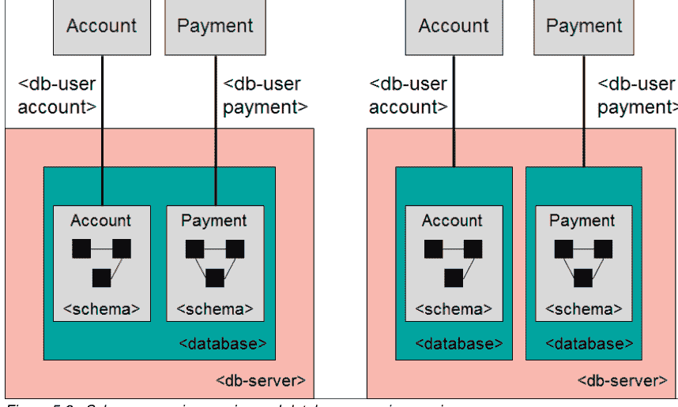

- **微服务的数据库服务器**

这是最高程度的分离。它可以非常有用，例如当需要处理性能方面的问题时（见图 5-3）。

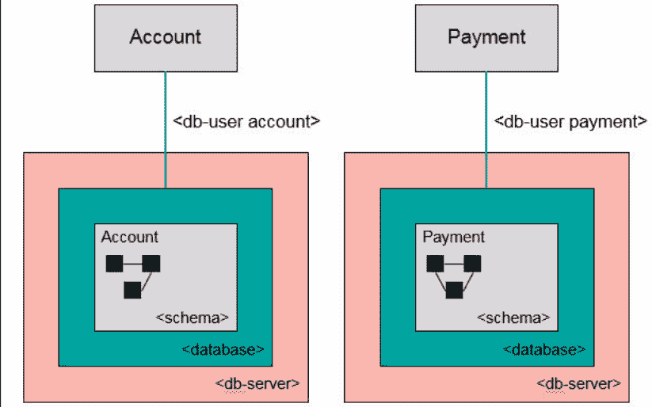

图 5-3 每个微服务对应一个数据库服务器

### 5.1.3 异构持久化（Polyglot persistence）

每个微服务都应该使用自己的数据存储器，这意味着它可以使用不同的数据存储技术。NoSQL 运动催生许多新的数据存储技术，这些技术可以与传统的关系型数据库一起使用。根据应用程序必须实现的实现，它可以在不同类型的技术之间选择来存储其数据。在一个应用程序中使用多种数据存储技术被称为异构持久化（polyglot persistence）。

对于某些微服务，将数据存储在关系型数据库中是最佳的。其他服务具有不同类型的数据（如非结构化、复杂和图导向），可以将数据存储在某些 NoSQL 数据库中。

异构编程（Polyglot programming）是一个术语，意味着应用程序应该使用最适合应用程序必须面对挑战的编程语言来编写。

关于这两个术语的更深入描述可以在 Martin Fowler 网站找到：http://martinfowler.com/biki/PolyglotPersistence.html

### 5.1.4 微服务之间的数据共享

在某些情况下，微服务应用程序的客户端可能想要请求另一个服务的数据。例如，客户端可能想查看他所有的支付（Payments）以及相应的支付状态。他必须查询服务获取他的账户（Account），但之后使用数据库来合并数据这不符合微服务的最佳实践。为了处理这种业务场景，你必须实现一个适配器服务（见图 5-4），该服务查询账户服务和支付服务，然后将收集的数据返回给客户端。适配器服务还负责对收到的数据进行必要的数据转换。

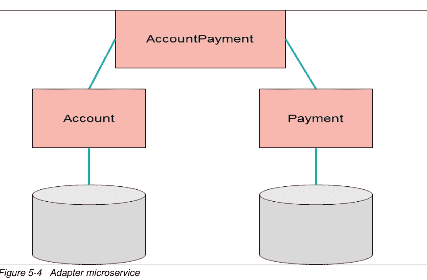

在微服务系统中，更改数据可能会变得更加复杂，因为某些业务事务可以跨越多个微服务。例如，在一个零售店的微服务应用程序中，可能有一个服务用于下单（Order），另一个用于支付（Payment）。因此，如果客户想在你的商店购买某物品并支付费用，该业务事务就跨越了两个微服务。每个微服务都有自己的数据存储器，因此对于跨越两个或多个微服务的业务事务，该业务事务涉及两个或多个数据存储器。本节描述了如何实现这些业务事务。

## 事件驱动架构（Event-Driven architecture）

你需要一种方法来确保跨越两个或多个微服务的业务事务中涉及的数据的一致性。一种方法是使用分布式事务，但有很多原因说明为什么这不应该出现在微服务应用程序中。主要原因是参与分布式事务的微服务之间存在紧密耦合。如果两个微服务参与分布式事务，且其中一个服务失败或出现性能问题，将很难回滚事务。

跨越微服务执行业务事务的最好方法是使用事件驱动架构。要更改数据，第一个服务更新其数据，并在同一个（内部）事务中发布一个事件。订阅了该事件的第二个微服务接收到此事件并对其数据进行更改。使用发布/订阅（publish/subscribe）通信模型，两个微服务是松耦合的。耦合仅存在于它们交换的消息上。这种技术使微服务系统能够在不使用分布式事务的情况下维护所有微服务的一致性。

如果微服务应用程序中有相互发送消息的微服务，那么它们可能是合并为一个服务的良好候选者。但要小心，因为这种配置可能会破坏你微服务的领域驱动设计（domain-driven design）。处理跨服务的复杂更新的适配器也可以事件来实现。

事件驱动架构的编程模型更加复杂，但 Java 可以帮助保持复杂度在可控范围内。

## 最终一致性（Eventual Consistency）

在事件驱动架构中，向其他微服务发送消息会产生名为“最终一致性”（Eventual Consistency）的问题。这通常由于以下情况引起的运行时问题：服务 A 修改其数据存储器中的数据并在同一事务中向微服务 B 发送消息。一段时间后，微服务 B 接收消息并更改其数据存储器中的数据。在正常的短时间内，两个存储器中的数据是不一致的。例如：服务 A 更新其数据存储器中的订单（Order），并向支付发送消息。当处理支付时，有一个尚未支付的订单。当消息接收者无法处理消息时，情况会变得奇怪。在这种情况下，消息系统或接收的微服务需要健壮的策略来应对这个问题！

在微服务应用程序中，每个微服务都有自己的数据库。跨越多个微服务的业务事务引入了最终一致性，因为不鼓励使用分布式事务来解决此问题。处理此类业务事务的一种方法见第 47 页的图 5-5。订单微服务在数据存储器中保存订单，并向支付微服务发送一个事件（例如 OrderCreated）。订单微服务尚未收到支付的确认，因此订单处于等待状态（pending state）。

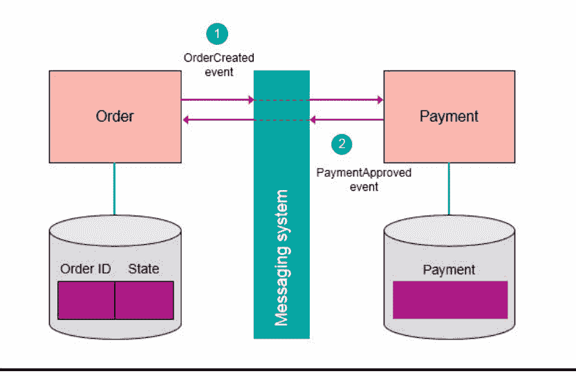

支付服务订阅了 OrderCreated 事件，因此它处理该事件并在数据存储器中执行支付。如果支付成功，它会发布一个订单服务订阅的 Approved 事件。处理 Approved 事件后，订单的状态变为 Approved。在数据不可用的情况下，服务可以向客户端发送“对不起，请重试”。

## 数据复制（Data replication）

数据存储器的分离以及从不同存储器获取数据导致了数据复制机制可以解决问题的想法。这样做（例如使用数据库触发器或其他过程）与微服务共享数据库有相同的缺点。当部署新版本的服务时，数据结构必须进行调整。正如所述，基于事件的处理可以解耦数据存储器。处理事件的服务在需要时可以进行相关的数据转换，并存储在自己的存储器中。

### 5.1.5 事件溯源与命令责任分离（Event Sourcing and CQRS）

在事件驱动架构中，考虑命令责任分离（CQRS）和事件溯源（Event Sourcing）。这两个架构模式可以结合使用来处理微服务应用程序中的事件。

CQRS 将数据存储器的访问分为两个部分：一部分用于读取操作，另一部分用于写入操作。读取操作不改变系统状态；它们只返回状态。写入操作（命令）改变状态但不返回值。事件溯源对发生的事件进行排序。图 5-6 显示了使用 CQRS 的示例。

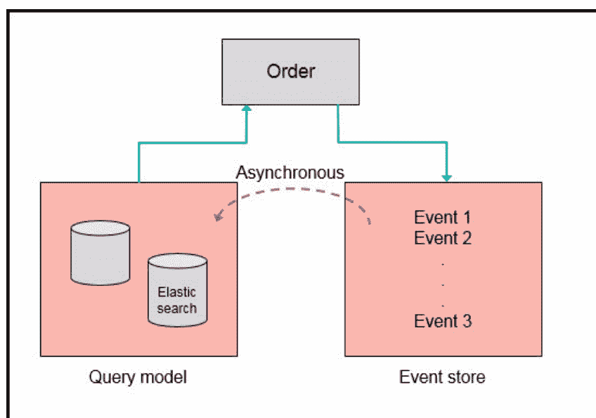

图 5-6 使用 CQRS 的示例

如图 5-6 所示，事件顺序存储在事件存储器中。查询模型中的数据与事件存储器的数据保持同步。为了支持事件存储器或查询模型，可以使用专用系统，例如使用 Elastic Search 来支持微服务的查询。有关 Elastic Search 的更多信息，请参阅：https://www.elastic.co/

### 5.1.6 消息系统（Messaging systems）

你可以使用消息系统或消息面向中间件来支持你的事件驱动架构。

- **消息面向中间件（MOM）**：支持分布式系统之间发送和接收消息的软件或硬件基础设施。MOM 允许应用程序模块在异构平台上进行开发，并降低了跨多个操作系统和网络协议的应用程序开发的复杂性。中间件创建了一个分布式通信层，使应用程序开发人员不受各种操作系统和网络接口细节的影响。跨不同平台和网络的 API 通常由 MOM 提供。MOM 提供了位于客户端/服务器架构中所有通信组件的软件元素，并支持客户端和服务器应用程序之间的异步调用。

减少了应用程序开发人员与客户端/服务器机制主从本质复杂性的参与程度。[2]

为了与面向消息的中间件进行通信，你可以使用不同的协议。以下是常见的协议：

- **高级消息队列协议 (AMQP)**[3]：AMQP 规定了消息提供者和客户端的行为，使得不同厂商的实现具有互操作性，就像 SMTP、HTTP、FTP 等创建了互操作系统一样。[4]

- **MQTT 遥测传输协议 (MQTT)**[5]：MQTT 是一种基于 TCP/IP 协议之上的“发布-订阅轻量级”消息协议。它设计用于“代码占用小”或网络带宽有限的远程连接。[6] 它主要用于物联网 (IoT) 环境。

在 Java 世界中，存在一种与面向消息的中间件通信的 API：Java 消息服务 (JMS)，它是 Java EE 规范的一部分。该规范是 JMS 2.0。[7]

由于 JMS 自 2001 年以来存在已久，现在有许多消息中间件（Message Brokers）可以作为 MOM 系统使用。[8] 但也存在一些实现 AMQP 的消息系统：

- RabbitMQ
- Apache Qpid[9]
- Red Hat Enterprise MRG

所有这些系统都提供了 Java API，因此可以用于你基于 Java 的微服务。

### 5.1.7 分布式事务

大多数（并非所有）消息系统都支持事务。在向消息系统发送消息并更改事务型数据存储中的数据时，也可以使用分布式事务。

分布式事务和两阶段提交可以在微服务及其底层数据存储之间使用，但不应在微服务之间使用。考虑到微服务的独立性，特定的服务实例之间不能存在亲和性，而两阶段提交事务需要这种亲和性。

对于跨服务的交互，必须添加补偿或对账逻辑以确保维持一致性。

[2] http://en.wikipedia.org/wiki/Message-oriented_middleware
[3] http://en.amqp.org/
[4] http://en.wikipedia.org/wiki/Advanced_Message_Queuing_Protocol
[5] http://mqtt.org/
[6] http://en.wikipedia.org/wiki/MQTT
[7] http://jcp.org/en/jsr/detail?id=343
[8] http://en.wikipedia.org/wiki/Java_Message_Service
[9] http://qpid.apache.org/index.html

第 5 章 处理数据 49

## 5.2 Java 中的支持

在多语言持久化环境中，你用于实现微服务的编程语言必须处理不同的持久化技术。你的编程语言必须能够支持持久化数据的每种不同方式。Java 作为一种编程语言，拥有许多 API 和框架，可以帮助开发者处理不同的持久化技术。

### 5.2.1 Java 持久化 API

> "Java 持久化 API (JPA) 是一种用于在 Java 对象/类与关系数据库之间访问、持久化和管理数据的 Java 规范。JPA 定义为 EJB 3.0 规范的一部分，用于替代 EJB 2 CMP 实体豆规范。JPA 现在被认为是 Java 行业中对象关系映射 (ORM) 的标准方法。

JPA 本身是一个规范，而不是产品；它本身无法执行持久化或任何操作。JPA 是一组接口，需要实现。有许多开源和商业 JPA 实现供选择，任何 Java EE 5 应用程序服务器都应该提供其使用。JPA 还需要一个数据库来进行持久化^[1]

Java Enterprise 7 (Java EE 7) 包含了 Java 持久化 2.1 (JSR 338)[11]

集成 JPA 的主要目的是获取一个对象关系映射器将 Java 对象持久化到关系数据库中。API 背后的实现（持久化提供者）可以由不同的开源项目或厂商实现。使用 JPA 的好处是你的持久化层更具移植性。

JPA 定义了自己的查询语言（Java 持久化查询语言 JPQL），它可以为不同的数据库厂商生成查询。Java 类被映射到数据库中的表，可以使用类之间的关系来对应表之间的关系。可以通过这些关系进行级联操作，因此对一个类的操作可以导致对另一个类数据的操作。JPA 2.0 引入了 Criteria API，可以帮助在运行时和编译时获取正确的查询。你在应用程序中实现的所有查询都可以命名并进行寻址。这种配置使得在编程几周后，更容易知道该查询的作用。

JPA 持久化提供者实现了数据库访问。以下是最常见的：

- Hibernate (http://hibernate.org/)
- EclipseLink (http://www.eclipse.org/eclselink/)
- Apache OpenJPA (http://jpa.apache.org/)

Java EE 7 的默认 JPA 提供者是 EclipseLink。

[1] http://en.wikibooks.org/wiki/Java_Persistence/What_is_JPA
[11] http://jcp.org/en/jsr/detail?id=338

## JPA 概览

下面的简要说明和代码片段展示了 JPA 的一些功能。开始使用 JPA 的方法是创建实体类（Entity-Classes）来持有数据（示例 5-1）。

### 示例 5-1 用于持有实体数据的 JPA 类

```java
@Entity
public class Order {
    @Id
    private Long id;
    @GeneratedValue(strategy = GenerationType.IDENTITY)
    private String description;
    @Temporal(Temporal.DATE)
    private Date orderDate;

    public String getDescription() {
        return description;
    }
    public void setDescription(String description) {
        this.description = description;
    }
    public Date getOrderDate() {
        return orderDate;
    }
    public void setOrderDate(Date orderDate) {
        this.orderDate = orderDate;
    }
}
```

*(注：OCR 文本在结尾处截断；我根据标准的 JPA 模式和提供的片段重构了逻辑结构。)*

[12] http://docs.oracle.com/java7/api/persistence.html

第 5 章 处理数据 51

```java
TypedQuery<Order> query = 
em.createQuery("Select o from Order o " + 
"where o.id = :id", Order.class);
query.setParameter("id", orderID);
Order order = query.getSingleResult();
return order;
```

第 52 页的示例 5-6 显示了使用带参数的 JPQL 进行查找的方法。从 `select from Order where o.id = :id` 开始，生成一个 `TypedQuery`。通过 `TypedQuery`，你可以在生成结果对象后省略 Java 强制转换（参见参数 `Order.class`）。JPQL 中的参数通过名称（id）进行引用，这使得开发者来说更具可读性。`getSingleResult` 方法确保数据库中只找到一行。如果 SQL 对应多行，则会抛出 `RuntimeException`。

`merge` 方法在数据库中执行更新（示例 5-7）。参数是一个离散对象（detached object），意味着它不在持久化上下文中。在数据库更新后，`EntityManager` 会返回一个关联的（attached）order 对象（它现在是持久化上下文的一部分）。

### 示例 5-7 JPA 更新操作

```java
public Order updateOrder(Order order, String newDesc) {
    order.setDescription(newDesc);
    em.merge(order);
}
```

要删除数据库中的某行，你需要一个关联对象（示例 5-8）。为了将对象关联到持久化上下文中，你可以先查找它。如果对象已经关联，则不需要使用 `find` 方法。带有关联对象持久化的 `remove` 方法会删除数据库中的该对象。

### 示例 5-8 JPA 删除操作


```java
public void removeOrder(Long orderId) {
    Order order = em.find(Order.class, orderId);
    em.remove(order);
}
```

如之前，必须使用某些配置来告诉持久化提供程序去哪里查找数据库以及如何与数据库交互。这是在 `persistence.xml` 配置文件中完成的。该配置文件需要在服务的类路径（classpath）中。根据你的环境（是否为 Java 容器），配置必须通过两种方式之一完成（示例 5-9）。

## 示例 5-9 Java SE 环境下的 Persistence.xml

```xml
<persistence>
  <persistence-unit name="OrderDB">
    <transaction-type type="RESOURCE_LOCAL">
    <class>com.service.Order</class>
    <properties>
      <!-- Properties to configure the persistence provider -->
    </properties>
  </persistence-unit>
</persistence>
```

```xml
<property name="javax.persistence.jdbc.url" value="jdbc-url-of-database" />
<property name="javax.persistence.jdbc.user" value="user" />
<property name="javax.persistence.jdbc.password" value="password" />
<property name="javax.persistence.jdbc.driver" value="DriverClass" />
</properties>
</persistence-unit>
</persistence>
```

要配置持久化提供程序，必须要做的工作是定义持久化单元（`OrderDB`）。持久化单元的一个属性是 `transaction-type`。可以设置两个值：`RESOURCE_LOCAL` 和 `JTA`。第一种选项让开发者负责在代码中进行事务处理。如果你的环境中没有可用的事务管理器，请使用此选项。第二个选项是 `JTA`，代表 Java Transaction API（Java 事务 API），属于 Java 社区进程（JCP）。该选项允许持久化提供程序将事务处理委托给运行时环境中存在的事务管理器。

通过 `<class></class>` XML 标签，你可以列出在此持久化单元中使用的实体类。

在文件的属性中，你可以设置值来配置持久化提供程序如何与数据库交互。以 `javax.persistence.*` 开头的属性名称由 JPA 标准定义。第 53 页的示例 5-9 显示了如何设置数据库 URL（用于数据库连接）以及用户和密码。`javax.persistence.jdbc.driver` 属性告诉持久化提供程序应该使用哪个 JDBC 驱动程序类。

Java EE 环境配置文件的主要差异在示例 5-10 所示。

```xml
<!-- Example 5-10 Java EE 环境下的 Persistence.xml
<persistence>
  <persistence-unit name="OrderDB">
    <jta-data-source>jdbc:OrderDB</jta-data-source>
    <class>com.widgets.Order</class>
  </persistence-unit>
</persistence>
```

JPA 的默认事务处理是使用 JTA，因此你不需要在配置文件中设置它。`jta-data-source` 属性指向你 Java EE 环境应用程序服务器中配置的数据源的 JNDI 名称。

在没有 Java EE 环境的情况下处理事务管理，`EntityManager` 具有一些如示例 5-11 所示的方法。

```java
// Example 5-11 无 Java EE 环境下的事务管理
EntityManager emf = Persistence.createEntityManagerFactory("OrderDB");
  EntityManager em = emf.createEntityManager();
  EntityTransaction tx = em.getTransaction();
```

```java
tx.begin();
try {
  em.persist(yourEntity);
  em.merge(anotherEntity);
  tx.commit();
} finally {
  if (tx.isActive()) {
    tx.rollback();
  }
}
```

第 54 页的示例 5-11 显示了如何在没有 Java EE 环境的情况下使用事务管理。如果你不熟悉 JPA，最好参考文档。在没有 Java EE 环境的情况下处理事务管理，`EntityManager` 具有一些如示例 5-11 所示的方法。

54 Java 微服务最佳实践

为了实现该策略，每个微服务都应该在关系型数据库中拥有自己的 schema，你可以在 JPA 配置文件 `persistence.xml` 中为你的服务设置默认 schema。

### 5.2.2 Enterprise JavaBeans

Enterprise JavaBeans 3.2 (EJB)由 JSR 345 指定）是 Java EE 规范的一部分。由于以下原因，EJBs 比普通的 Java 类更强大：

- 它们具有生命周期。
- 它们由 EJB 容器（EJB 的运行时环境）管理。
- 它们拥有更多非常有帮助的特性。

EJBs 是服务端软件组件。从 EJB 3.0 开始，不再需要使用部署描述符（Deployment Descriptor）。所有的 EJB 声明都可以在 EJB 类本身中通过注解完成。在 EJB 容器内部处理 EJB 的实现与 CDI beans 一样轻量。EJBs 的线程处理由 EJB 容器完成（类似于 servlet 容器中的线程处理）。EJBs 的一个额外特性是它们可以与 Java EE Security结合使用。

EJBs 可以分为以下几种类型：

- 无状态 (Stateless)
- 有状态 (Stateful)
- 单例 (Singleton)
- 消息驱动豆 (MDB)

无状态 EJBs 无法持有任何状态，但有状态 EJBs 可以。由于微服务的特性，不应在微服务中使用有状态 EJBs。单例（Singleton）在 EE 服务器中只存在一次。MDB 用于在结合 JMS 供应商者的情况下处理异步消息。

EJBs 可以实现多种业务视图，必须对它们进行相应的注解：

- 本地接口 (@Local)
- 远程接口 (@Remote)
- 无接口 (@FactoryBean)

此接口中的方法只能由同一 Java 虚拟机 (JVM) 中的客户端调用。

此接口中列出的方法可以由 JVM 外部的客户端调用。

与本地接口几乎相同，但 EJB 类的所有公共方法都暴露给客户端。

在微服务应该处理的轻量级架构中，将 EJBs 实现为无远程的 EJBs 是很有用的。

EJBs 提供的主要优势之一是自动事务处理。每当调用业务方法时，EJB 容器的事务管理器就会被调用（异常情况：显式关闭了事务支持的 EJB）。因此，结合事务数据存储器使用 EJBs 非常简单。将 EJBs 与 JPA 集成也非常容易。

> 13 http://jcp.org/en/jsr/detail?id=345

示例 5-14 中的代码段展示了如何将 EJBs 与 JPA 框架的示例。

## 示例 5-14 带有 PersistenceContext 的无状态（无接口）EJB

```java
@Stateless
@LocalBean
public class OrderEJB {
    @PersistenceContext
    private EntityManager entityManager;
    public void addOrder(Order order) {
        entityManager.persist(order);
    }
    public void deleteOrder(Order order) {
        entityManager.remove(order);
    }
}
```

`EntityManager` 按照第 50 页第 5.2.1 节“Java Persistence API”所示的方式进行注入。

EJB 可以具有以下事务属性之一以与事务数据存储器操作（必须由 EJB 容器实现）：

- REQUIRED（默认）
- MANDATORY
- NEVER
- NOT_SUPPORTED
- REQUIRES_NEW
- SUPPORTS

关于这些属性的更多信息，请参阅以下网站：

http://docs.oracle.com/7/javaee/javax/ejb/TransactionAttributeType.html

这些称为容器托管事务 (CMTs)，可以用于 EJB 的每个业务方法。应该避免使用同样可用于 EJB 的豆 托管事务 (BMTs)。可以使用注解 `@TransactionAttribute` 来设置类级别的豆，以便该类的类的每个业务方法都具有此事务属性（示例 5-15）。如果未设置任何内容，则所有方法都具有默认的事务级别 (REQUIRED)。方法层面的事务属性会覆盖类级属性。

## 示例 5-15 在 EJB 中显式设置事务属性

```java
@Stateless
@LocalBean
public class OrderEJB {
    …
    @TransactionAttribute(REQUIRES_NEW)
    public void methodA(...)
    @TransactionAttribute(REQUIRED)
    public void methodB(...)
}
```

## 未作为 EJB 实现的 REST 端点

某些数据库更改或验证是在事务管理器决定提交的时间点完成的。在某些情况下，例如数据库中的检查约束是在事务提交前的最后步骤之一进行验证的。如果验证失败，结果将是 JPA 提供者抛出的 `RuntimeException`，因为 JPA 使用异常来报告错误。如果你使用 EJBs 进行事务管理，那么捕获 `RuntimeException` 的地方是在包含事务的 EJB 代码中。存根代码是由 EJB 容器生成的。因此，你无法对此 `RuntimeException` 做出反应，异常会被进一步抛到调用处。

如果你倾向于将 REST 端点实现为 EJB，那么必须在你的 REST 提供者中捕获异常。REST 提供者具有异常映射器将异常转换为 HTTP 错误代码。然而，当在数据库提交期间抛出 `RuntimeException` 时，这些异常映射器不会生效。因此，REST 客户端将接收到 `RuntimeException`，这是应该避免的。

处理这些最佳方法是将 EJBs 实现为无远程的 EJBs。

### 5.2.3 BeanValidation

BeanValidation 也是 Java EE 的一部分。BeanValidation 的意图是对你的数据轻松地定义和强制执行约束。在 Java EE 环境中，BeanValidation 由容器自动完成。开发者只需要以注解的形式在属性、方法或类上设置约束。此过程在生命周期事件中完成。

有关 Bean Validation 的更多信息，请参阅以下网站：

http://beanvalidation.org/

> 14 http://jcp.org/en/jsr/detail?id=349

`javax.validation.constraints` 包中的内置约束示例见示例 5-17。

## 示例 5-17 默认内置约束

```java
private String username; // username 不能为空
@Pattern(regexp="\d{3}-\d{3}-\d{4}")
private String phoneNumber; // phoneNumber 匹配正则表达式
@Size(min=2, max=40)
private String briefMessage; // briefMessage 在 2 到 40 字符之间
```

约束也可以像示例 5-18 所示进行组合。

## 示例 5-18 约束组合

```java
@NotNull
@Size(min=1, max=16)
private String firstName;
```

可以扩展约束（自定义约束）。示例 5-19 显示如何自己进行验证。

## 示例 5-19 程序化验证

```java
Order order = new Order("This is a description", null);
ValidatorFactory factory = Validation.buildDefaultFactory();
Validator validator = factory.getValidator();
Set<ConstraintViolation<Order>> constraintViolations = validator.validate(order);
assertEquals(2, constraintViolations.size());
assertEquals("Id may not be null", constraintViolations.iterator().next().getMessage());
assertEquals("Order may not be null", constraintViolations.iterator().next().getMessage());
```

JPA 可以配置为自动执行 bean validation。JPA 规范规定提供者必须为托管类提供验证（见示例 5-20）。JPA 意义上的托管类是指实体类。所有其他用于 JPA 编程的类都必须验证（例如嵌入类、超类）。

## 示例 5-20 开启 bean 验证的 Persistence.xml

```xml
<persistence>
  <persistence-unit name="OrderDB">
    <provider>
      org.eclipse.persistence.jpa.PersistenceProvider
    </provider>
    <class>...</class>
    <properties>
      <property name="javax.persistence.validation.mode"
        value="AUTO" />
    </properties>
  </persistence-unit>
</persistence>
```

Java EE 栈中使用的所有其他框架都可以用于自动验证 Bean（例如 JAX-RS、CDI），如示例 5-21 所示的 EJB。

## 示例 5-21 EJB 中的 Bean 验证

```java
@Stateless
@LocalBean
public class OrderEJB {
    public String setDescription(@Max(80) String newDescription){
    
    }
}
```

## JPA 和 BeanValidation 的架构分层方面

在只有几层的服务中，事后将 JPA 实体类作为数据传输对象（DTO）较为容易。JPA 对象脱离其持久化上下文后，可以作为一个普通的 Java 对象（POJO）。这个 POJO 也可以用作 DTO 传输到 REST 端点。这种做法有其缺点：验证注解会与 JPA 注解混合在一起，可能导致 Java 类关联了大量注解，并且使你的 REST 端点与数据库的关系变得更加紧密。

如果微服务大一些，或者必须处理更复杂的数据模型，那么使用单独的层来访问数据库可能会更好。这个额外的层基于 JPA 类实现了所有数据访问方法。该层中的类是数据访问对象（DAO）。你可以使用 DAO 类为 REST 端点生成 DTO 类，并专注于：一方面关注数据模型（DAO），另一方面关注客户端（DTO）。这种模式的缺点是，你必须将要在 DAO 中处理的类转换为 DTO，反之亦然。为了避免为了这些操作编写大量的模板代码，你可以使用一些框架来帮助完成转换。以下框架可转换 Java 对象：

- ModelMapper
  http://modelmapper.org/
- MapStruct
  http://mapstruct.org/

为了扩展从 Bean Validation 中获得的功能，使用 Spring 获取额外功能是很有用的。更多信息请参阅“验证、数据绑定和类型配置”：http://docs.spring.io/spring/docs/current/spring-framework-reference/html/validation.html。

### 5.2.4 上下文与依赖注入

如果你的微服务没有将数据存储在事务存储中，那么请使用 CDI Bean 代替 EBs。CDI 1.1 定义在 JSR 346¹ 中，并是 Java EE 7 规范的一部分。在这些情况下，CDI 管理的 Bean 是一个很好的替代方案。

> ¹ http://jcp.org/en/jsr/detail?id=346

关于 CDI 管理的 Bean 的更多信息，请访问以下网站：

http://docs.oracle.com/javaee6/tutorial/giwhl.html

与 EJB 相比，CDI 本身没有 EE 安全机制，也不会注入持久化上下文。这个过程必须由开发者自己完成或使用额外的框架。例如，Apache DeltaSpike 有许多可以扩展 CDI 功能的模块。关于 Apache DeltaSpike 的更多信息，请访问：


http://deltaspike.apache.org/index.html

可以使用额外的框架来扩展 CDI 管理 Bean 的功能。EJB 有可以在应用程序服务器中管理的线程池。目前还没有对应于此的功能。在高负载环境中，能够配置线程池将会有帮助。

为了实现运行在 Java 服务器中的微服务，CDI 和附加模块提供了许多在这些环境中非常有用的功能。

## 5.2. Java 消息服务 API

在 Java 世界中实现事件驱动架构，JMS API 提供了支持，该 API 在 Java Message Service 2.0 JSR 343¹ 中定义。JMS 用于与所谓的消息生产者通信，该生产者必须由面向消息的中间件（MOM）实现。

当 JMS 从版本 1.0 更新到 2.0（EE 7 规范的一部分）时，进行了重构以使 API 易用。JMS 2.0 兼容之前的版本，因此你可以为微服务使用现有代码或新的简化 API。旧 API 不会在下一个版本中弃用。

根据端点和哑管道方法论¹⁷，你的基础微服务只需将 JSON 发送到由 JMS 提供者托管的端点。消息的发送者称为生产者，消息的接收者称为消费者。端点可以是以下类型：

- 队列 (Queue)

队列中的消息仅由一个消费者消费。队列中的消息顺序可能会以不同的顺序消费。队列用于语义。

- 主题 (Topic)

这些消息可以被多个消费者消费。这是发布/订阅语义的实现。

在基于 REST 的微服务中（客户端发送 JSON 请求），为消息系统使用 JSON 格式是一个好主意。其他消息应用程序使用 XML。如果你的微服务系统中只有一种格式，实现 JSON 会更简单。

示例 5-22 使用 EJB 向 JMS 队列发送消息

```java
@Stateless
@LocalBean
public class OrderEJB {
    @Inject
    @JMSConnectionFactory("jms/myConnectionFactory")
    JMSContext jmsContext;
    @Resource(mappedName = "jms/PaymentQueue")
    Queue queue;
    public void sendMessage(String message) {
        jmsContext.createProducer().send(queue, message);
    }
}
```

> ¹ http://jsp.org/en/jsr/detail?id=343
>
> ¹⁷ http://martinflower.com/articles/microservices.html#SmartEndpointsAndDumbPipes

获取相关性 ID。

示例 5-25 从 JMS 消息中检索相关性 ID

```java
// 像之前一样接收到消息
String correlationID = message.getJMSCorrelationID();
```

关于 UUID 的更多信息，请访问以下网站：

http://docs.oracle.com/javase/7/docs/api/util/UUID.html

如果你使用非 JMS 提供者作为消息中间件，JMS 可能不是向该系统发送消息的正确方式。使用 RabbitMQ（一种 AMQP 代理）可以通过 JMS 实现；Pivotal 为 RabbitMQ 实现了一个 JMS Adapter。关于 RabbitMQ 的更多信息，请访问以下网站：

http://www.rabbitmq.com/

Apache Qpid 同样为 AMQP 协议实现了 JMS 客户端。这些示例说明了使用 JMS 与非 JMS 提供者进行通信也是很有用的。但根据你的需求，使用消息系统的原生 Java 驱动程序可能更好。关于 Apache Qpid 的更多信息，请访问该网站：

http://qpid.apache.org/index.html

Spring 对 JMS 消息供应商的支持是处理 JMS 消息的另一种选择。关于 Spring 的更多信息，请访问以下网站：

http://docs.spring.io/spring/docs/current/spring-framework-reference/html/jms.html

### 5.2.6 Java 以及其他消息协议

根据你对消息中间件所需的功能，你可能需要一个非 JMS 提供者系统。MQTT 是一种最适合物联网（IoT）需求的消息协议，还有 AMQP。它是为了跨厂商的可移植性而开发的。JMS 无法与这些系统通信。使用它们提供的客户端允许你使用它们提供的所有特殊功能。关于 MQTT 的更多信息，请参阅：

http://mqtt.org/

Apache Kafka 是一个非 JMS 提供者，一个 Java 驱动。目前有一个请求旨在实现适配器以让客户端与 Apache Kafka 进行 JMS 通信¹⁸，但该问题仍处于开启。因此最好使用 Kafka 提供的 Java 驱动。关于 Kafka 的更多信息，请访问以下网站：

http://kafka.apache.org/

RabbitMQ 是一个实现 AMQP 协议的消息代理系统。它提供了一个 Java 客户端¹⁹。关于 RabbitMQ 的更多信息，请访问以下网站：

https://www.rabbitmq.com/

Spring 拥有一个与基于 AMQP 的消息系统通信的库。Spring 还提供了对 MQTT 协议的支持<sup>20</sup>。关于 Spring 的更多信息，请访问以下网站：

http://projects.spring.io/spring-amqp/

你可以看到，对于非 JMS 消息系统提供了 Java 支持。

> 20 http://docs.spring.io/spring-integration/reference/html/mqtt.html

66 Java 微服务最佳实践


# 6. 应用安全

一如既往，安全性是一个重要的考虑因素。本章描述了云原生微服务架构背景下的安全需求。涵盖了以下主题：

- 微服务架构的安全
- 身份与信任

## 6.1 使微服务架构的安全

微服务架构的动态性质改变了处理应用程序的方法。这种考虑特别与应用程序或服务边界的定义相关。图 6-1 显示了单体架构和微服务架构中请求流的简化表示。为了通用起见，隐藏了微服务与持久化存储服务（RDBMS, NoSQL）之间的连接，但它们代表了网络流量的另一个维度。

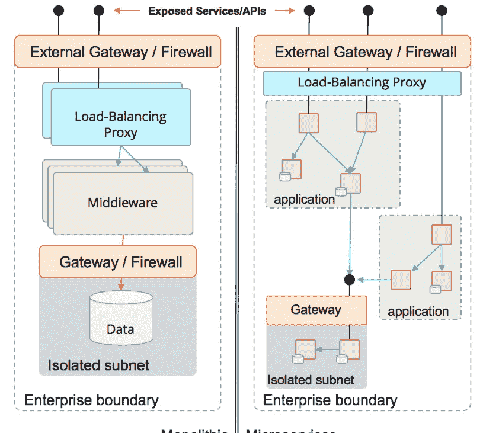

图 6-1 单体架构和微服务架构的简化拓扑结构

图 6-1 左侧显示了传统单体架构的简化。请求通过网关，经过负载均衡器，到达中间件中的业务逻辑，然后到达数据层。

图 6-1 右侧的情况则不那么有序。作为应用程序分组的微服务集合通过网关将外部 API 暴露为端。明显的区别是活动部件的数量。另一个是请求数量多得多。

最大的区别在于，右侧所示的服务组合处于不断变化中。单个服务实例根据负载出现和消失。微服务持续且独立地更新。总而言，跨服务每天可能会有数百次更新。仅保护边界是不够的。问题在于如何以一种有机的方式保护快速变化的基础，同时允许单个服务进行更改和增长，而不需要中心协调。

### 6.1.1 网络分段

第 68 页的图 6-1 显示了两个系统中的隔离子网。在任何环境中，对需要更多层次保护的资源添加额外的防火墙或网关都是好主意。

在第 68 页图 6-1 的微服务方法中观察到的其他点是，API 连接到两个不同的基于微服务的应用程序。定义的边界为独立系统之间提供了合理的隔离，并是在动态环境中维护安全态势的良好方法。

网络分段在托管环境中是自然发生的。例如，第 68 页图 6-1 中的每个微服务应用程序都可以是多租户环境中的独立租户。在没有自然发生的地方，你可能希望这样做。

### 6.1.2 确保隐私

不同类型的数据需要不同级别的保护：

- 不要传输文本。
- 保护私钥。
- 使用加密技术而不是自己发明。关于哈希的更多信息，请参见：
  - https://crackstation.net/hashing-security
- 尽早加密数据，尽晚地解密。

## 后端服务

如前所述，与后端服务的连接是需要保护的网络额外流量源。在许多云环境中，后端服务由平台提供。理解这些特性非常重要，特别是当它们存储静态数据时。

## 日志数据

日志数据是诊断问题所需的内容与出于监管原因必须保护的内容之间的权衡。在写入日志时，充分利用日志级别来控制写入的数据量。对于用户提供的数据，考虑它们是否应该出现在日志中。

### 6.1.3 自动化

如第 1 章第 1 页“概述”所述，微服务环境应尽可能实现自动化，包括通用操作。凭据、证书和密钥必须存储在某处供自动化使用。记住以下考虑因素：

- 不要将你的凭据与应用程序一起存储。
- 不要将你的凭据存储在公共仓库中。
- 只存储加密后的值。

以 Spring Cloud Config 为例，它使用 Git 获取配置。它提供了 API 在进入仓库时自动加密配置值并在使用时解密。关于 Spring Cloud Config 的更多信息，请访问该网站：

https://cloud.spring.io/spring-cloud-config/

Hashicorp 的 Vault 类似，但增加了额外功能允许允许具有过期的动态密钥。关于 Vault 的更多信息，请访问以下网站：

https://www.vaultproject.io/

其他键值存储，例如 etcd、zookeeper 或 consul 也可以使用，但在这些通常为明文的仓库中存储凭据时需要小心。

## 6.2 身份与信任

像微服务架构这样高度分布式、动态的环境对建立身份的通常模式造成了压力。你必须建立并维护用户身份，而不会频繁调用中心服务引入额外的延迟和竞争。在这种环境中建立和维护信任并不是易的。假设私有网络是安全的本质上是不安全的。端到端 SSL 可以带来一些好处，即字节不会以明文传输，但它并没有建立一个信任的环境，并且需要密钥管理。

后续章节概述了执行身份验证、授权和身份传递的技术，以建立和维护服务间通信的信任。

### 6.2.1 身份验证与授权

在微服务环境中管理身份验证和授权时有新的考虑因素。在单体应用中，通常会在中央用户库中拥有细粒度的角色，或至少拥有与角色关联的组。然而，由于微服务强调独立的生命周期，这种依赖关系是一种反模式。这会导致独立微服务的开发在设计上与中心化资源的更新相耦合。

通常，会通过专用的中心化服务甚至 API 网关来完成身份验证（建立用户身份标识）。该中心服务随后可以进一步将身份验证委托给第三方。

在处理授权（建立用户访问受保护资源的权限或许可）时，在微服务环境中，请在跨切面服务中将组或角色的定义保持为粗粒度。允许独立的服务维护自己的细粒度控制。核心指导原则是独立性。必须在通用授权服务中定义的（满足整个应用程序需求的内容）与特定服务的授权需求实现细节之间找到平衡。

## Java EE 安全

传统的访问控制令牌（experience access control tokens）在微服务环境中的吸引性较小。其他编程语言的存在以及无法依赖长会话（session），削弱了 Java EE 安全机制的运行假设。

对于 EE 安全，每个 Java 服务器必须被所有其他服务信任。用户在身份验证后收到的安全令牌（在 WebSphere Application Server 中为 LTPA Token）在所有其他服务器上必须是有效的。这种信任意味着：(a) 每个服务器都需要在其密钥库中包含其他所有服务器的证书，或者 (b) 所有服务都需要使用相同的密钥。向系统身份验证的用户也必须位于为你 Java 服务器定义的安全领域域内。在动态配置的环境中，密钥管理（特别是 Java 应用程序的密钥库管理）是一个难以轻易解决的问题。有关 Java EE 安全的更多信息，请访问此网站：

https://dzone.com/refcardz/getting-started-java-ee

如果你将实现和维护此环境所需的精力与从 Java EE 安全中获得的收益相比较，很难推荐 Java EE 安全。

### 6.2.2 使用 OAuth 2.0 进行委托授权

OAuth 为将授权委托给第三方提供了一个开放框架。尽管该框架没有定义授权的交互模式，但它并不是严格定义的编程接口，不同的 OAuth 提供者之间存在某些差异。有关 OAuth 框架的更多信息，请访问以下网站：

https://tools.iet.org/rfc/rfc6749

OpenID (OIDC) 在 OAuth 2.0 之上提供了一个身份层，使得将身份验证委托给第三方成为可能。它定义了一种基于 REST 的操作机制，根据 OAuth 提供者执行的身份验证步骤来验证身份，并获取授权用户的基本配置信息。有关 OIDC 的更多信息，请访问以下网站：

https://openid.net/connect/

Game On! 使用 OAuth 和 OIDC 定义的三脚域认证来委托给社交登录提供者，特别是 Facebook、GitHub、Google 和 Twitter。如图 6-2 所示，游戏有一个专用的 Auth 服务，作为各种社交登录提供者的代理。该 Auth 服务触发对目标 OAuth 提供者的请求，其中包含了标识 Game On! 应用所需的信息。

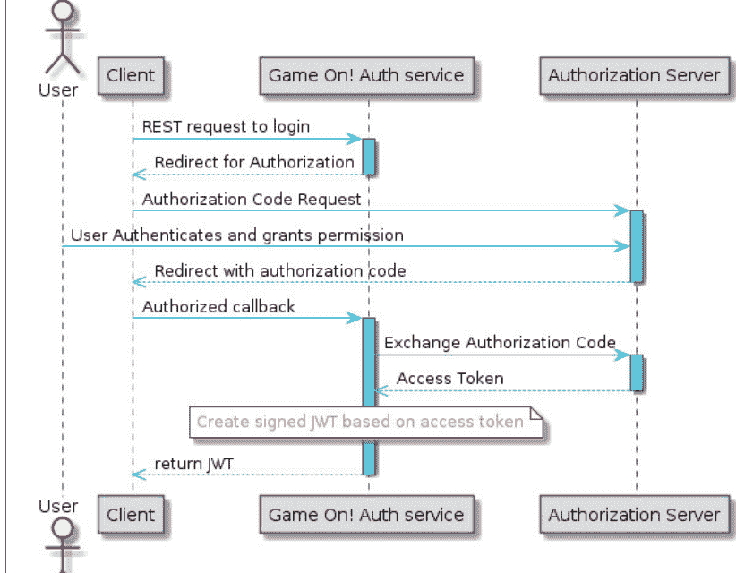

图 6-2 Game On! OAuth 调用序列图

服务交互通过以下步骤进行：

- 前端（Web 客户端或移动应用程序）代表用户向游戏的 Auth 服务发送请求。
- Auth 服务返回一个转发响应，浏览器自动处理该响应并将用户携带应用程序标识重定向到选定的 OAuth 提供者。
- 用户完成身份验证并授予权限后，OAuth 提供者在另一个重定向响应中返回授权码。浏览器自动处理重定向，携带授权码回到 Auth 服务的回调接口。
- Auth 服务随后联系 OAuth 提供者，用授权码交换访问令牌（access token）。
- Auth 服务将该令牌中的数据转换为签名的 JSON Web Tokens (JWTs)，这允许你可以在随后的服务间调用中验证用户身份，而无需返回 OAuth 提供者。

某些应用服务器（如 WebSphere Liberty）具有 OpenID Connect 功能，以便于与 OAuth 提供者通信。截至本文编写，这些功能尚未提供从 OAuth 提供者返回的访问令牌。此外，协议的差异使得使用特定的提供者库比使用更通用的解决方案更容易。

一种更简单的方法可能是使用网关通过 OAuth 提供者进行身份验证。如果你采用这种方法，将提供者特定的令牌转换为包含你所需信息的内部令牌仍然是一个好主意。

### 6.2.3 JSON Web Tokens

身份传递是微服务环境中的另一个挑战。在用户（人类或服务）通过身份验证后，身份需要以安全的方式传递到下一个服务。频繁回中心身份验证服务来验证身份是低效的，特别是考虑到在可能的情况下倾向于直接服务通信，而不是通过中心网关路由，以最小化延迟。

JWTs 可用于携带用户信息的表示。本质上，你将能够完成这些任务：

- 知道请求是由用户请求发起的
- 知道是代表谁进行的身份标识
- 知道此请求不是对之前请求的恶意重放

JWTs 是紧凑且对 URL 好的。正如你从名称中猜的那样，JWT（读作 "jot"）包含一个 JSON 结构。该结构包含一些标准属性（声明，claims），例如发行者（issuer）、主体（subject，即用户）和过期时间，这些与现有机制有明确的映射。声明还有空间可以自定义，允许传递附加信息。

在解析时，你会发现你的 JWT 无效，但原因并不显而。出于安全和隐私考虑，向前端暴露逻辑错误并不是好主意。这样做可能会泄漏被恶意利用的实现细节。JWT.io 提供了一些处理 JWT 的工具，可以让你快速验证在浏览器控制台或跟踪日志中查看的加密 JWT 是否有效。有关 JWT.io 的更多信息，请访问以下网站：

https://jwt.io

#### 处理时间

JWT 的属性之一是它们允许身份传递，但不是永久的。JWT 会过期，从而触发身份刷新并生成新的 JWT。JWT 有三个与时间及过期相关的字段，它们都是可选的。通常，应包含这些字段并在呈现时进行如下验证：

- JWT 创建时间 (iat) 在当前时间之前且有效。
- “在此之前可用”(nbf) 声明在当前时间之前且有效。
- 过期时间 (exp) 在当前时间之后且有效。

所有这些都以 Unix 时间戳表示。

#### 签名的 JWT

签名 JWT 有助于服务之间建立信任，因为接收方可以验证签名者的身份，并确认 JWT 的内容在传输过程中没有被修改。

JWT 可以通过共享密钥或公钥/私钥对（SSL 证书可以使用已知公钥）进行签名。常见的 JWT 库都支持签名。有关 JWT 库的更多信息，请访问以下网站：

https://jwt.io/#libraries-io

## 使用 JWT

常见的 JWT 库让处理 JWT 变得简单。例如，使用 JJWT¹，创建一个新的 JWT 非常直观，如示例 6-1 所示。

示例 6-1 使用 JJWT 创建和验证签名的 JWT


```java
import java.time.Instant;
import java.time.temporal.ChronoUnit;
import java.util.Date;
import io.jsonwebtoken.Claims;
import io.jsonwebtoken.Jwt;
import io.jsonwebtoken.Jwts;
import io.jsonwebtoken.SignatureAlgorithm;

public class JwtExample {
    public String createJwt(String secret) throws Exception {
        // 创建并签名 JWT，包括一个关于
        // 用于签名请求的密钥提示 (kid)
        String newJwt = Jwts.builder()
            .setHeader("kid", "meaningfulName")
            .setSubject("user-12345")
            .setAudience("user")
            .setIssuedAt(Date.from(Instant.now()))
            .setExpiration(Date.from(Instant.now().plus(15, ChronoUnit.MINUTES)))
            .signWith(SignatureAlgorithm.HS512, secret)
            .compact();
        return newJwt;
    }

    public void validateJwt(String jwtParameter, String secret) throws Exception {
        // 验证签名的 JWT！
        // 如果无效则抛出异常
        Jwt jwt = Jwts.parser()
            .setSigningKey(secret)
            .parseClaimsJws(jwtParameter);
        // 检查 claims，就像一个新的 JWT
        // 签名需要密钥)
        Claims claims = jwt.getBody();
        System.out.println(claims.getAudience());
        System.out.println(claims.getIssuer());
        System.out.println(claims.getSubject());
        System.out.println(claims.getIssuedAt());
        System.out.println(claims.getNotBefore());
    }
}
```

示例 6-1 是 `Game On!` 中认证服务的变体，用于从响应式 OAuth 令牌² 创建 JWT。JWT 应该在中心位置（如 JAX-RS 请求过滤器）进行验证。

关于 JWT 生命周期的考虑。如果你的 JWT 是长寿的，你在流量中验证 JWT 时将面临巨大风险，但系统对访问变化的响应可能会有延迟。

> ¹ https://github.com/jjwt/jjwt
>
> ² https://github.com/gameontext/game-auth/

在 `Game On!` 中，用户通过长时间的 WebSocket 连接连接，以实现第三方之间的双向异步通信。JWT 在连接建立时作为查询字符串的一部分传递。在编写本文时，扩展 JWT 会导致不佳的用户体验，因此我们选择使用相对较长的 JWT 过期时间。

## 6.2.4 基于哈希的消息认证码

使用基于哈希的消息认证码 (HMAC) 签名进行认证优于 HTTP Basic 认证。当使用 HMAC 时，请求属性将进行哈希处理并使用共享密钥签名，以生成一个包含在发送请求中的签名。当接收请求时，使用共享密钥对请求属性进行重新哈希处理，以确保值仍然匹配。此过程验证了用户，并确保了消息内容在传输过程中未被篡改。哈希签名还可以用于防止重放攻击。

HMAC 验证可以通过 API 网关执行。在这种情况下

HMAC 尚不是一个完全的标准，API 提供者（网关或单个服务）通常在生成的签名中需要不同的请求属性（HTTP 请求头或消息体头部）。至少使用了标识标识字符串和日期。

在处理 HMAC 签名计算时，鼓励使用共享库，因为 API 消费者和提供者必须以相同的方式执行计算。考虑使用客户端库来帮助消费者正确地对其请求进行签名。

在编写本文时，`Game On!` 没有使用 API 网关。我们提供了一个共享库³，确保 REST 和 WebSocket 请求使用相同的 HMAC 签名算法。该共享库为入站和出站请求提供了 JAX-RS 过滤器以及第三方 Room 服务。我们来看示例 6-2。

示例 6-2 中介者使用 JAX-RS 2.0 客户端通过共享库中的 `SignedClientRequestFilter` 映射 Map⁵

```java
Client client = ClientBuilder.newClient()
    .register(JsonProvider.class);
// 为 JAX-RS 客户端添加了过滤器
// 过滤器将在输出时对请求进行签名
SignedClientRequestFilter apiKey = new SignedClientRequestFilter(userid, secret);
client.register(apiKey);
```

³ https://github.com/gameontext/signed

⁴ https://github.com/gameontext/game-mediator

⁵ https://github.com/gameontext/game-map

第 6 章 应用安全 75

共享库允许使用简单的注解来标记应该验证入站签名的服务器端端点。提供了 JAX-RS 过滤器和拦截器来验证请求头和消息体，如示例 6-3 所示。

示例 6-3 Map JAX-RS 端点：来自共享库的启用签名的注解

```java
@POST
@SignedRequest
@Consumes(MediaType.APPLICATION_JSON)
@Produces(MediaType.APPLICATION_JSON)
public Response createRoom(RoomInfo newRoom) {
    Site mappedRoom = repository.connectRoom(...);
    return Response.created(.).entity(mappedRoom).build();
}
```

这样使用共享库可以保持业务逻辑的整洁。客户端和服务端在生成库时对属性和哈希保持一致。提供者和消费者都需要。

## 6.2.5 API 密钥与密钥

API 密钥可以是几种不同形式之一，用于标识请求来源。标识请求来源对于速率限制等 API 管理功能很重要。API 密钥通常是一个字符串，与密码不同，这些字符串是随机生成的且长度超过 40 个字符。然而，有时该字符串直接作为令牌或查询参数用于请求（通过 https）。当作为共享密钥用于签名令牌 (JWT) 或摘要方法 (HMAC) 时更为安全。

如果你的服务创建 API 密钥，请确保安全地生成并正确存储密钥。确保这些密钥可以随时撤销。如果你的应用程序有不同的部分，考虑为每个部分使用不同的 API 密钥。这种配置可以实现更细粒度的使用跟踪，并在密钥泄露时减少影响。

也可以使用非对称密钥（如 SSL），但需要维护公钥基础设施 (PKI)。虽然它更安全，但这种配置也更耗力，且当 API 消费者是第三方时可能特别难以管理。

根据 12 因素，密钥在服务间通信时应作为配置注入。值不应硬编码，因为这会增加泄露风险（例如以明文提交到仓库）。这会让你的代码对环境敏感，或者要求不同环境使用相同的密钥，这都不是良好的做法。

# 测试

构建微服务应用时必须意识到如何进行测试。良好的测试覆盖率让你对代码更有信心，并带来更好的持续交付流水线。

本章涵盖了构建周期中三个阶段所需的测试：

- 单服务测试：由拥有特定微服务的团队在隔离状态执行的测试。
- 预发布环境：在预发布环境中运行的对象的测试。将形成特定应用程序的微服务部署到预发布环境中进行测试。
- 生产环境：在实时生产系统中执行的测试。

测试应作为构建、发布、运行（交付）流水线的一部分进行自动化。

本文涵盖以下主题：

- 测试类型
- 应用程序架构
- 单服务测试
- 预发布环境
- 生产环境

## 7.1 测试类型

本章重点关注 Java 特定的测试考虑因素，假设你已经具备一些微服务测试的先验知识。涵盖了以下类型的测试：

- 单元测试 (Unit Tests)

  测试单个类或一组紧耦合的类。这些单元测试可以使用与单元交互的实际对象运行，也可以通过使用双倍体（double）或 mock（mocks）来运行。

- 组件测试 (Component Tests)

  测试单个微服务的完整功能。在此类测试期间，对外部服务的任何调用都以某种方式进行 mock 处理。

- 集成测试 (Integration tests)

  集成测试用于测试服务之间的通信。这些测试旨在测试跨网络边界的基本成功路径和错误路径。

- 契约测试 (Contract tests)

  测试微服务提供的 API 及其他资源的约定契约。有关更多信息，请参阅第 38 页的“消费 API”。

- 端到端测试 (End-to-end)

  测试通过整个应用程序或微服务的完整流程。通常用于测试黄金路径（gold path）或验证应用程序是否满足外部需求。

## 7.2 应用架构

微服务的内部结构直接影响了测试的难易程度。图 7-1 显示了第 9 页第 2 章“在 Java 中创建微服务”中描述的微服务架构的简化版本。

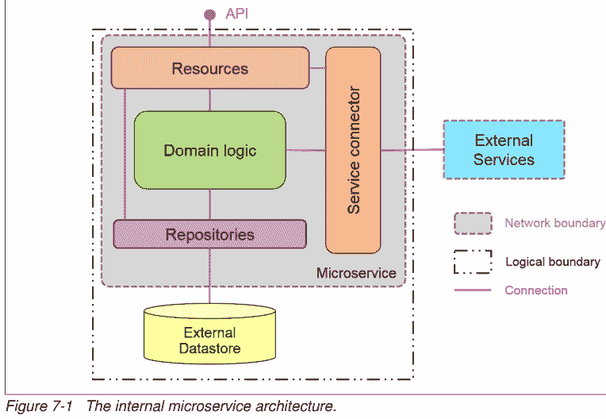

不同的内部部分分为以下子部分：

- 资源 (Resources)

  向外部客户端暴露 JAX-RS 资源。此层可以处理请求的基本验证，但任何业务逻辑都会向下传递。

- 领域逻辑 (Domain logic)

  大部分功能代码所在地。这些代码理解应用的外部依赖。

- 服务连接器 (Service connector)

  处理与外部服务的通信。这些可以是微服务系统内部的服务，也可以是第三方服务。响应经过验证后传递给领域逻辑层。

- 存储库 (Repositories)

  包括数据映射和验证。存储库层包含连接外部数据存储所需的逻辑。

应用程序的不同部分有不同的测试需求。例如，领域逻辑不需要集成测试，而资源层需要。特定 Java 类中的所有代码应该提供来自同一部分的功能。通过这种方式分离代码，可以使得特定类中的所有代码具有相同的测试需求。这种技术使得你的测试套件更简单、结构更好。考虑到微服务固有的复杂性，测试很容易陷入混乱，因此为测试增加结构是一个好主意。

## 7.3 单服务测试

本节定义单服务测试为单个服务的拥有者必须创建并运行的测试。这些测试执行图 7-1 所示的内部微服务架构边界内部的代码。这里适用三类测试：单元测试、组件测试和集成测试。单元测试和集成测试用于测试微服务的各个部分，而组件测试用于测试整个服务。

### 7.3.1 测试领域或业务函数

微服务中执行业务功能的代码不应调用任何外部服务。这些代码可以使用单元测试和诸如 JUnit¹ 这样的测试框架进行测试。单元测试应该测试行为，并使用实际对象（如果没有外部调用）或 mock 涉及任何操作的对象。

当使用实际对象编写测试时，简单的 JUnit 测试即可。若要创建 mock 对象，你可以使用 Java EE 的内置功能或使用 mocking 框架。上下文和依赖注入（DI）规范中的 `@Alternatives` 注解² 允许注入 mock 对象而非实际 bean。Java 有许多可用的 mocking 框架。例如，Mockito 设计用于与 JUnit 配合使用，允许你在测试期间 mock 对象。在 Mockito 最基础的用法中，你可以使用 `@Mock` 注解创建 mock 对象，并在调用它时使用 `Expectations()` 函数定义行为。

¹ http://junit.org/junit4/

² http://docs.oracle.com/javaee/6/tutorial/gjsdf.html

³ http://mockito.org/

第 7 章 测试 79

考虑一个拥有“订单（Order）”微服务的在线支付应用程序。假设名为 `OrderFormatter` 的类接收账户 ID 并返回如示例 7-1 所示的特定格式的订单历史。`DatabaseClient` 处理对数据库请求以获取订单列表。`OrderFormatter` 是 `@ApplicationScoped`，它可以注入到它使用的任何 REST 端点中。

# 示例 7-1 OrderFormatter 类处理来自 Orders 类的响应

```java
@ApplicationScoped
public class OrderFormatter {
    @Inject
    DatabaseClient client;

    public FormattedHistory getOrderHistory(String id) {
        History orderHistory = client.getHistory(id);
        FormattedHistory formatted = format(orderHistory);
        return formatted;
    }

    private FormattedHistory format(History history) {
    }
}
```

要测试此类，假设 `DatabaseClient` 类将从 `getHistory()` 函数返回订单。你想要测试的行为是实际的格式化。然而，你不能直接调用 `format` 对象，因为它是一个私有方法。为了避免为了测试而修改代码（例如将 `format()` 改为 `public`），相反，使用 `DatabaseClient` 类的 mock 版本。示例 7-2 显示了对被测试类的简单测试。该技术使用了 Mockito 和 JUnit。`@Tested` 注解指示了被测试的类。

示例 7-2 OrderFormatter 的简单测试


```java
import static org.junit.Assert.assertEquals;
import static org.mockito.Mockito.*;

public class TestOrderFormatter {
    @Tested
    private OrderFormatter formatter;

    @Mock
    private DatabaseClient client;

    @Test
    public void testOrderHistory() {
        String id = "123";
        History history = new History();
        when(client.getHistory(id)).thenReturn(history);
        FormattedHistory result = formatter.getOrderHistory(id);
        // 此处进行断言
    }
}
```

# 80 微服务最佳实践

## 7.3.2 测试资源

暴露 JAX-RS 资源或接收事件的类应该通过两种类型的测试：集成测试和契约测试。

### 集成测试

集成测试用于验证服务之间的通信。它们测试跨边界路径。这些测试可以以单元测试相同的方式运行，也可以通过启动服务器来运行。要在服务器上运行集成测试，可以使用“运行服务器上的测试”中的方法。要驱动代码，使用 JAX-RS 2.0 发送请求。

集成测试验证应用程序的基本成功和错误路径。

### 消费者驱动契约

特定服务的消费者有一组期望服务遵循的输入和输出属性。这组属性可以是数据结构、性能和对话。契约使用 Swagger 等工具进行记录。更多信息请参阅第 2 章“在 Java 中创建微服务”。通常，服务的消费者驱动契约的定义，这被称为*消费者驱动契约*。

消费者驱动契约测试是一组确定契约是否被遵守的测试。这些测试应该验证资源期望契约中定义的输入属性，但也接受未知属性（应忽略它们）。它们还应该验证资源仅返回文档定义的属性。为了隔离被测试代码，对领域逻辑使用 mock。

维护消费者驱动契约测试引入了一些组织上的复杂性。如果测试没有准确反映定义的契约，它们将毫无用处。此外，如果契约过期，即使是最好的测试也不会为消费者产生实用的资源。因此，保持消费者驱动契约与当前的消费者需求同步至关重要，并确保测试始终测试契约。

## 在运行中的服务器上进行测试

提供了几种方法可以作为自动化测试的一部分启动和停止应用服务器。针对 WebSphere Application Server Liberty 等应用服务器，有 Maven 和 Gradle 插件，允许您将服务器启动添加到构建生命周期中。这种方法将复杂性从您的应用程序中分离出来，并包含在构建代码中。有关这些插件的更多信息，请参考以下内容：

- Maven: https://github.com/WASdev/ci.maven
- Gradle: https://github.com/WASdev/ci.gradle

另一种解决方案是使用 Aquillian。Aquillian 可用于测试期间管理应用服务器。它允许你在测试中途启动和停止服务器，并启动多个服务器。Aquillian 不受容器影响，因此如果你使用 Aquillian 测试，它们可以在任何应用程序服务器上运行。此功能对于契约测试非常有用，因为消费者不需要理解生产者所使用的应用程序服务器或容器。有关 Aquillian 的更多信息，请参考以下内容：

http://aquillian.org

欲需这些不同方法的更详细比较，请查看此处的“为 Liberty 编写功能测试”：

https://developer.ibm.com/wasdev/docs/writing-functional-tests-liberty/

## 7.3.3 测试外部服务请求

不可避免的是，你的微服务会调用外部服务来完成请求，例如调用应用程序中的其他微服务或应用程序外部的服务。执行此操作的类构建请求并处理任何失败。可以使用组集成测试对代码进行测试：一组在服务级别，另一组在阶段环境中。这两组测试都测试了客户端的基本成功和错误处理。有关阶段环境中的测试的更多信息，请参见第 7.4.2 节“集成”。

单个服务级别的集成测试不需要部署被测试的服务或外部服务。要执行集成测试，请对外部服务的响应进行 mock。如果你使用 JAX-RS 2.0 客户端来发送外部请求，可以使用 Mock 框架轻松完成此过程。

考虑第 1.5 节“在线零售店”介绍的在线示例。假设 Order 服务调用 Order Service 以获取特定账户的最近订单列表。创建 OrderClient 的逻辑应该封装在 Test-7.3 的一个简单类中。OrderClient 是一个 `@ApplicationScoped` bean，它会被注入到你使用的类中。我们选择使用 CDI 来注入请求的 URL，而不是使用从注册表中获取服务列表作为请求部分的库。构建 Order 响应。利用 `@PostConstruct` 方法来初始化 JAX-RS 客户端，因为你可以在所需的测试中直接调用该方法。

示例 7-3 OrderClient 处理所有对 Order 服务的请求

```java
@ApplicationScoped
public class OrderClient {
    @Resource(lookup = "orderServiceUrl")
    String orderServiceUrl;

    private Client client;

    @PostConstruct
    public void initClient() {
        this.client = Client.newClient();
    }
    public History getHistory(String id) {
        String orderUrl = orderServiceUrl + "/" + id;
        WebTarget target = client.target(orderUrl);
        Response response = callEndpoint(target, "GET");
        History history = getHistoryFromResponse(response);
        return history;
    }
    private History getHistoryFromResponse(Response response) {
        if (response.getStatus() == Response.Status.OK) {
            return response.readEntity(History.class);
        } else {
            return new History();
        }
    }
    private Response callEndpoint(WebTarget target, String ctype) {
        Invocation.Builder invoker = target.request();
        Response response = invoker.build(ctype).invoke();
        return response;
    }
}
```

要测试此内容，如示例 7-4 所示，对 Order 响应进行 mock。通过将解释响应的逻辑与调用的方法分开，你可以通过直接调用该方法来测试此逻辑。Mockito 提供了一个 Decapsulation 类，允许从测试中调用私有类。这种技术为外部服务响应码的处理提供了测试覆盖。如果类结构需要，也可以对 JAX-RS WebTarget 或 InvocationBuilder 进行 mock。外部请求的更高级覆盖在阶段环境中完成。

示例 7-4 对 Order 服务的响应进行 mock 以实现隔离测试

```java
public class OrderServiceClientTest {
    @Mocked
    Response response;

    OrderServiceClient orderHistoryClient = new OrderServiceClient();

    @Test
    public void test200() {
        History user = new History();
        user.addOrder("Test");
        response.getStatus(); returns(200);
        response.readEntity(History.class); returns(user);
        
        History history = Decapsulation.invoke(orderHistoryClient, "getHistoryFromResponse", response);
        assertTrue("Expected string Test", history.getOrders().contains("Test"));
    }

    @Test
    public void test500() {
        new Expectations() {{
            response.getStatus(); returns(500);
        }};
        History history = Decapsulation.invoke(orderHistoryClient,
            "getHistoryFromResponse", response);
        assertTrue("Expected empty order list", history.getOrders().isEmpty());
    }
}
```

## 7.3.4 测试数据请求

在微服务架构中，每个微服务都拥有自己的数据。更多信息请参见第 5 章“数据”。当你遵循这种方法时，必须确保阶段环境中的测试执行了跨微服务的通信。由于此数据存储器中的数据将比单个微服务级别的数据更完整，因为这些测试正在测试更复杂的交互。

## 7.3.5 组件测试

组件测试旨在将微服务作为一个整体进行测试。组件是网络内部的所有内容。这种方法的缺点是它需要更多的处理器周期。

### Mock

通过 mock 对外部服务的调用，你有更少的对象需要配置。这种方法的缺点是它没有完全执行系统。

### 测试服务

为了完全执行微服务，请包含生产环境中的数据存储器。测试服务可以用于微服务。该系统的缺点是它要求你维护服务。如果你在其他级别使用 mock 框架，那么在部署流水线中重用这些服务是有意义的。构建流水线将通过测试的微服务部署到阶段环境，并在阶段环境中运行测试。

## 7.3.6 安全验证

安全性在分布式系统中至关重要。你不能再将应用程序放在防火墙后面，并假设没有任何东西能攻入。有关保护你的微服务的更多详细信息，请参见第 6 章“应用安全”。

测试微服务的安全性略微取决于你如何实现令牌验证。如果你使用另一个服务或库来验证令牌，那么该服务应该被隔离测试，并且交互应该在阶段环境中进行测试。

最后运行的一种类型的测试是使用 IBM Security AppScan 进行安全扫描器，以突出安全漏洞。AppScan 扫描你的代码并突出任何漏洞。它提供了修复漏洞的建议。有关 AppScan 的更多信息，请参考以下网站：

http://www.ibm.com/software/products/en/appscan

# 7.4 阶段环境

本节将阶段环境定义为（在可能的）与生产环境相同的测试环境。构建流水线将通过测试的微服务部署到阶段环境，并在阶段环境中运行测试。

## 7.4.1 测试数据

阶段环境应该包含生产系统中的任何数据存储器。如第 7.3.4 节“测试数据请求”所述，测试数据不应是不必要地复杂。此数据存储器中的数据将比单个微服务级别的数据更完整，因为这些测试正在测试更复杂的交互。

## 7.4.2 集成测试

集成测试用于测试系统中所有服务之间的交互。在这一阶段，单个服务的深度行为已经过过测试。消费者权利契约测试（consumer right contract tests）应该已经确保服务之间能够成功交互，但这些测试可以识别出被遗漏的错误。测试应该检查与已部署应用程序进行的服务通信的基本成功和错误路径。请使用上一节中讨论的测试数据。

与其一次性测试所有服务，在测试期间可能仍需要对某些服务进行 mock（模拟）。当向集合之外发出调用时，两个特定服务或一小组服务的交互应该处于模拟行为状态。对被测试组外部服务的调用进行 mock 方法与 API 的单元测试相同。用于契约测试启动和停止服务器或容器的相同技术也适用于此处（参见第 7.3.2 节“测试资源”）。

## 7.4.3 合约

每个消费另一个资源的服务都应该有一组针对该资源运行的契约测试（特别是在测试环境中）。由于服务随时间推移独立演进，确保消费者的契约持续得到满足是非常重要的。

这些测试由消费者（客户端）专门编写，并作为消费性服务测试套件的一部分进行运行和管理。相比之下，第 7.3.2 节“测试资源”中讨论的测试是由生产者编写的以验证整个契约。

## 7.4.4 端到端

端到端测试对于发现之前遗漏的错误至关重要。端到端测试应该执行应用程序中的某些“黄金路径”（golden paths）。用端到端测试应用程序的每条路径是不现实的，因此请识别出关键路径。在环境中识别这些路径的良好方法是审查应用程序的关键需求。例如，如果你的应用程序是一个在线商店，你可能会测试以下路径：

- 用户登录
- 用户购买商品
- 用户查看订单摘要
- 用户取消订单

端到端测试还包含用户界面。应该使用 Selenium 等工具自动化与 Web 浏览器的交互以测试。有关 Selenium 的更多信息，请访问以下网站：

http://www.seleniumhq.org/

## 7.4.5 容错与韧性

微服务的设计应该按照第 4.2 节“容错”中的描述以容错的方式进行。可以使用各种技术来增加单个微服务的韧性和容错性，但你仍然应该测试系统的整体容错能力。容错测试应该在所有服务都部署的情况下进行。不要使用任何 mock。

### 关停单个微服务

在微服务系统中，你不能依赖所有微服务在任何时候都可用。在测试阶段，在关闭和重新部署单个服务的同时向系统发送请求。此过程应该包括系统中的微服务和后端数据存储。监控请求返回的时间并为你的应用程序确定可接受的响应时间。如果响应时间太长，考虑减少服务的超时值或激活断路器配置。

工具可以自动化此过程，Java 社区广为人知的是 Netflix Chaos Monkey，它通过终止虚拟机实例来允许进行容错测试。有关 Netflix Chaos Monkey 的更多信息，请访问以下网站：

```
https://github.com/Netflix/SimianArmy/wiki/Chaos-Monkey
```

其他工具（如 Amalg8 使用的 Gremlin）的方法是拦截和操纵对微服务的调用，而不是关闭实例。有关 Gremlin 的更多信息，请访问此网站：

```
https://github.com/ResilienceTesting/gremlin-python
```

### 注入错误数据

与集成测试一样，Amalg8 等工具可以用于测试期间自动注入错误数据。如果你已成功使用隔板模式（bulk head pattern），那么一个微服务中的错误数据不应该传播到其他微服务。

### 压力测试

微服务应该能够处理意外负载。应该使用压力测试来测试微服务中的隔板。如果某个特定的微服务正在阻塞请求，请查看已配置的隔板。

### 可恢复性测试

单个微服务也应该对其部署中的问题具有韧性。如果容器或虚拟机宕机，微服务需要能够快速恢复。如 Amalg8 或 Kubernetes（用于编排）等编排工具会在应用程序崩溃时启动任何应用程序的新实例。微服务必须具有快速的启动时间，并且在需要关机时，应该能够优雅地关闭。使用提供快速启动时间的应用程序服务器也是至关重要的。

将你的恢复性测试与关停服务实例相结合。允许你的编排系统创建新实例并监控启动新服务所需的时间。

# 7.5 生产环境

为了测试你的系统，你应该考虑在生产环境中运行测试。由于有这么多组件和服务在不断地出现和离开，你不应该期望系统能够无限期地完美运行。在应用程序中添加监控和分析以警告任何异常行为是非常重要的。更多信息，请参见第 9 章“管理与运营”。

在生产环境中重复这些测试环境中的特定测试：

- 注入测试数据或错误数据
- 关停服务，以测试其他服务的容错能力以及被关停服务的可恢复性
- 安全性验证

使用与测试环境相同的工具和技术。运行这些测试时要小心。不要在高峰时运行。相反，请选择一个对客户影响最小的时段，以防发生故障。

## 7.5.1 合成监控

为了确定生产系统的状况，你应该创建运行应用程序的合成事务。使用浏览器模拟器实例化合成事务并监控响应。寻找无效响应或大响应时间。你也可以定期运行自动化构建系统，这将发现可能导致问题的应用程序依赖。

## 7.5.2 金丝雀测试

金丝雀测试源于比喻中的矿井金丝雀，作为矿工安全条件的早期预警。它们是测试测试，用于验证依赖和基础运行需求是否存在且运行正常。如果环境不健康，金丝雀测试会快速失败，为错误的部署提供早期预警。

# 8 开发到生产

本章涵盖了如何构建和部署单个微服务。为此，请回顾微服务应具备的、有助于开发到生产平滑过渡的特征：

- 微服务必须是可独立部署的。
- 微服务的新版本应该在几分钟内完成，而不是几小时。
- 微服务必须具有容错性，并防止级联故障。
- 微服务在跨目标环境部署时不应需要任何代码更改。

## 8.1 部署模式


# 从开发到生产

## 8.1 部署策略

传统的单体应用作为一个单元进行构建和部署。部署型单体应用由许多部分组成，例如，许多个独立的 Java 平台企业版归档（EAR），它们被组合成一个部署产物。相比之下，微服务是许多不同的部分，它们都是独立部署的。这种配置在消费者面对服务变化时提供了更大的灵活性：

- 蓝绿部署（Blue/Green Deployment）
- 金丝雀发布（Canary Releasing）
- 切换（Toggling）

### 蓝绿部署（Blue/Green Deployment）

蓝绿部署是单体应用的一种常用模式。这种方法的关键在于维护两个版本的环境，万一如果发生部署失败，其中一个可以作为另一个的回滚。流程大致如下：

1. 你有一个正在活动并运行的蓝色系统（Blue）。
2. 你搭建绿色系统（Green），对其进行测试，验证其运行正常，然后将流量切换到绿色系统。如果在流量移动到绿色系统期间发生故障，蓝色系统将会被留作为回滚。
3. 在绿色系统稳定后，为蓝色系统准备下一次发布，并重复该过程将流量从绿色系统切换回蓝色系统。

在微服务的语境下，这种复制的环境仍然适用。每个系统（蓝色和绿色）都包含你所有的微服务，并以工作良好的配置以稳定版本运行。通过这种方式可以管理对相互解耦服务的周期性、协调性更新，更新将相互获取并稳定，形成一个已知的系统，该系统作为一个整体被启用（或禁用）。

### 金丝雀发布（Canary Releasing）

金丝雀发布也称为分阶段或增量发布。金丝雀发布旨在部署新服务时发现并确认故障。与蓝绿部署一样，金丝雀发布从一个复制的环境开始。在将新功能引入两个系统之一之后，流量会逐渐（且选择性地）路由到新功能，以确保其行为和性能符合预期。

### 切换（Toggling）

功能开关（Feature toggles）是用于服务内部的标记，用于启用或禁用新功能。这一过程可以有效用于允许服务客户选择测试新功能（通过解析自定义 HTTP 请求头），而无需维护不同版本的服务或由工程师协调发布。切换机制在单体环境中也很常见，用以防止行为变化影响客户。

可以在环境中设置开关，使得服务要么启用该功能，要么不启用。它们既可以是动态配置设置，作为服务的二进制模式；也可以与每个请求的机制（如 HTTP 请求头）结合，按每个请求开启或关闭新功能。

切换可以用于做出决策，使得它们可以作为服务为中心的金丝雀发布的选择器。它们也可以用于 A/B 测试，即你尝试对替代实现方案进行并行比较。

## 8.2 部署流水线和工具

微服务架构的优势之一是敏捷性。由于每个单独的服务都有专注范围和独立的生命周期，因此作为微服务实现新功能、测试并将其部署到生产环境的时间更短。微服务通常是迭代构建的，这意味着支持了持续集成和部署的理念。

部署产物运行在不同的系统上，因此必须配置许多系统才能使服务工作。将微服务部署到生产环境的手动步骤越多，由于输入错误或遗漏步骤而出现意外问题的可能性就越大。人工干预应该减少到最低。例如，由于合规原因，在服务新版本发布到生产环境之前可能需要手动批准。然而，在此之前及之后的所有操作都可以自动化。

Martin Fowler 描述的部署流水线（Deployment pipelines）被用作持续部署环境的一部分。它们描述并定义了一系列将微服务引入生产环境的步骤，通过将过程分解为阶段，每个阶段涵盖构建、部署和测试服务，以验证一切无误。使用 DevOps 技术来简化部署流水线的创建以及支持应用从开发到生产的相关工具是很有帮助的。有关 DevOps 技术的更多信息，请参考此链接：

http://blog.xebialabs.com/2015/07/20/xebialabs-launches-the-periodic-table-of-devo-tools/

如所述，你的微服务的源代码应该位于源码管理（SCM）工具中，如 `Subversion` 或 `Git`。它应该使用具有依赖管理的工具（如 `Maven` 或 `Gradle`）进行构建。选择一个仓库管理工具（如 `Nexus` 或 `Artifactory`）来存储你共享库的版本化二进制文件。使用 `Jenkins` 或 `Bamboo` 等 CI 工具之一来构建你的服务。

在微服务的自动构建之后，必须进行测试，对于其中某些测试你需要部署微服务，这意味着你需要在自动置备的系统上放置正确的配置。你可以使用经典脚本来正确配置目标，但你必须在脚本中管理平台或其他系统的差异。像 `Chef`、`Puppet`、`Ansible` 和 `Salt` 等脚本框架/基础设施可以很好地处理这一点。它们都可以以相同的方式用于现有系统的初始安装和修改。定义配置文件的目标内容，如果目标系统发生变化，这些工具将处理差异。

| # | 链接 |
| :--- | :--- |
| 1 | http://martinfowler.com/bliki/DeploymentPipeline.html |
| 2 | http://martinfowler.com/bliki/ContinuousDelivery.html |
| 3 | http://subversion.apache.org/ |
| 4 | http://git-scm.com/ |
| 5 | http://maven.apache.org/ |
| 6 | http://gradle.org/ |
| 7 | http://www.sonatype.org/nexus/ |
| 8 | http://www.jrog.com/artifactory/ |
| 9 | http://jenkins.io/ |
| 10 | http://www.atlassian.com/software/bamboo |
| 11 | http://www.chef.io/ |
| 12 | http://puppet.com/ |
| 13 | http://www.ansible.com/ |
| 14 | http://saltstack.com/ |

## 8.3 打包选项

在构建微服务之后，下一个问题是使用什么打包格式来部署应用程序。十二要素应用（Twelve-factor app）和云原生应用定义中反复出现的主题是创建不可变产物，这些产物可以在不同的部署环境中无需更改地运行。

从部署到部署的变化越多，由于配置错误、缺失依赖等原因导致以意外方式崩溃的风险就越大。构建不可变的、自包含的产物引入了开发和生产环境之间的一致性，并降低了部署时出现惊喜的概率。

可选以下打包方案，但不限于：

- 在预装的中间件上部署 WAR/EAR 文件
- 可执行 JAR 文件
- 容器
- 每个微服务都运行在自己的虚拟化服务器上

通常情况下，你希望尽可能减少服务开发、测试环境与运行环境之间的差异。某些打包和部署方案比其他方案更容易实现开发环境与生产环境的一致性。接下来的章节将探讨每种打包方案的优缺点。

### 8.3.1 在预装的中间件上部署 JAR、WAR 和 EAR 文件

这种打包方式是部署 Java EE 应用程序的默认方式，其中将 WAR 或 EAR 文件部署到预装了应用服务器的专用系统中。在传统环境中，许多 EAR 和 WAR 被部署在同一台运行的服务器上，并按周、月甚至更长的时间周期进行批量部署。

在从开发到生产的过程中，应用程序会在分阶段环境（如质量保证、性能测试和验收测试）中的不同应用程序服务器中托管。每个环境都应该具有相同的配置，但并非总是如此。例如，生产系统在升级方面可能采用比开发或测试系统更保守的方法。

这种方法可能会产生以下问题：

- 可以在更短的时间内（天、小时）实现更频繁的部署。例如，某些应用程序的部署需要重启应用服务器，从而中断同一应用服务器上的其他应用程序。这种中断通常无法每天甚至每小时发生一次。
- 如果不同的应用程序共同托管在同一台应用服务器上，一个应用程序的负载可能会干扰另一个应用程序的性能。
- 应用程序负载的高波动很难在基础设施中被良好地纳管。
- 不同阶段的配置可能不同，这可能导致某个阶段的应用程序问题在另一个阶段中无法复现。
- 职责分离通常会导致在出现部署问题时，开发者和管理员之间进行讨论以寻找“替罪羊”。

如果在微服务中使用这种模式，则服务与预装的中间件服务器之间应该是一一对应的关系。这种配置很常见，例如在 PaaS 环境中，你将 WAR 或 EAR 推送到一个全新的、预定义的服务器上。它也适用于通过 `Chef` 或 `Puppet` 等工具配置应用程序实例，随后放置 WAR 或 EAR 的情况。将服务隔离在它们自己的中间件实例中是非常重要的，这允许服务进行独立扩展，并降低服务更新相互干扰的风险。

如所述，如果服务是隔离的，这种方法存在部署风险，因为服务仍然依赖预装的中间件来提供其所需的所有依赖项。然而，因为它镜像了许多传统的单体应用程序体验，它可以作为启动新微服务应用程序的简单第一步。

### 8.3.2 可执行 JAR 文件

避免依赖部署环境的一种方法是将运行服务所需的所有内容封装在一个可执行的 JAR 文件中。这些“胖型”（fat）uber JAR 文件包含了服务的类文件和辅助共享库，包括 servlet 容器或其他 Java EE 中间件。这种技术消除了由于开发、测试或生产环境之间依赖不匹配而引起的问题。

这些自包含的 JAR 文件通常很容易处理，除了目标部署环境外，还有助于为本地开发和测试创建一个一致、可重复的环境。

正如第 10 页 2.1 节“Java 平台和编程模型”所述，有多种编程模型可以生成独立的可执行 JAR 文件。

#### Spring Boot

`Spring Boot`¹⁵ 生成的可执行 JAR 文件包含一个 Spring 应用程序、其依赖 JAR 文件以及底层 Web 应用程序运行时（`Tomcat`¹⁶、`Jetty`¹⁷、`Undertow`¹⁸）。大多数应用程序配置由 Spring 自动完成，并可以从应用程序外部更改。用于生产支持额外功能（如指标和健康检查）也包含在此包中。

有一种快速且简单的方法可以开始。首先，构建一个简单的项目，如示例 8-1 所示的 maven 文件。

**示例 8-1 Spring Boot Maven Start**

```xml
<parent>
  <dependency>
    <groupId>org.springframework.boot</groupId>
    <artifactId>spring-boot-starter-parent</artifactId>
    <version>1.4.1.RELEASE</version>
  </dependency>
</parent>
<dependencies>
  <dependency>
    <groupId>org.springframework.boot</groupId>
    <artifactId>spring-boot-starter-web</artifactId>
  </dependency>
</dependencies>
```

你必须实现一个 Controller 来响应由 `SpringApplication` 的 HTTP 请求（示例 8-2）。

**示例 8-2 Spring Boot Controller**

```java
@Controller
@EnableAutoConfiguration
public class MyController {
  @RequestMapping("/myservice")
  @ResponseBody
  public String sayHello() {
    return "Greetings from Spring Boot!";
  }
  public static void main(String[] args) throws Exception {
      SpringApplication.run(MyController.class, args);
  }
}
```

> 15 https://projects.springframework.io/spring-boot/
> 16 http://tomcat.apache.org/
> 17 http://www.eclipse.org/jetty/
> 18 http://undertow.io/

应用程序 JAR 文件的依赖管理可以使用 `Maven` 或 `Gradle` 完成。配置遵循“约定优于配置”（Convention over Configuration）¹⁹ 种方法。自动配置会扫描应用程序中包含的 JAR 文件，并为这些 Spring 模块提供默认行为。这一过程也可以通过覆盖默认行为来完成。应用程序应该使用 Spring 生态系统中的框架实现，以充分利用 `Spring Boot` 的优势。

由 `Spring Boot` 构建和打包的微服务包含了在不同部署环境中作为 12 要素运行所需的所有内容。`Spring Cloud` 是 Spring 生态系统的另一组包，提供了第三方技术与 Spring 编程模型之间的额外集成，以支持在云环境中使用 `Spring Boot` 应用程序。例如，`Spring Cloud` 支持从外部配置源注入应用程序配置，`Spring Cloud Netflix` 提供了使用流行的 Netflix 开源软件构建微服务的语言绑定和库。

#### Dropwizard

`Dropwizard` 通过使用增强了嵌入 servlet 容器的预选堆栈来生成独立的 JAR 文件。

#### WildFly Swarm

`WildFly Swarm`²⁰ 将应用程序以及应用程序所需的 `WildFly` 服务器²¹ 打包到可执行 JAR 文件中。使用 `WildFly Swarm` 生成的微服务可以使用更广泛的预包 Java EE 技术，而不是从 servlet 引擎开始并必须收集组装。

#### WebSphere Liberty

IBM `WebSphere Liberty` 可以产生仅包含应用程序所需的不可变执行文件。Liberty 的打包工具可以组合以下元素：

- 自定义的（最小的）Liberty 运行时
- 包为 WAR 文件或 EAR 文件的 Java 应用程序（通常只有一个）
- 辅助配置，如共享库、JNDI 值或数据源配置

Liberty 有合理的默认值，仅对自定义元素需要配置，对注入配置提供了良好支持。Liberty 能够解释环境变量，这可以消除处理文件以插入环境特定值的启动脚本。例如，可以在示例 3 所示的 `server.xml` 中定义数据源。

**示例 3. 使用环境变量配置数据存储**

```xml
<couchdb id="couchdb" jndi="couchdb-connector" libraryRef="couchdb-lib">
  password=${env.COUCHDB_PASSWORD}
  url=${env.COUCHDB_SERVICE_URL}
  username=${env.COUCHDB_USER}
</couchdb>
```

> 19 https://en.wikipedia.org/wiki/Configuration_over_configuration
> 20 http://wildfly-swarm.io/
> 21 http://wildfly.org/

### 8.3.3 容器化

之前的策略都是运行在操作系统上的，该操作系统必须安装并配置可执行的 JAR 文件。为了避免由于操作系统配置不一致导致的问题，一种策略是将更多的操作系统内容“带在身上”。这种策略导致微服务在每个阶段运行在具有相同配置的操作系统上。

容器是托管在现有操作系统上的轻量级虚拟化制品。`Docker` 提供了一种基础设施能力，可以构建一个完整的文件系统，该系统包含了运行应用程序所需的所有操作系统元素（工具、库），包括应用程序本身。`Docker Engine` 是一个轻量级运行时，它提供了 `Docker` 容器与宿主机之间的抽象和隔离，以及用于处理托管容器的支持工具。有关 `Docker` 的更多信息，请参阅此链接：

http://www.docker.com

`Docker` 容器将应用程序与其他应用程序（位于同级容器中）隔离，并将应用程序与宿主机的操作系统分离。这些容器的隔离及其轻量级属性使得在一个操作系统上运行多个 `Docker` 容器成为可能（见图 8-1）。这种配置意味着你需要许多虚拟化服务器来托管你的微服务系统。

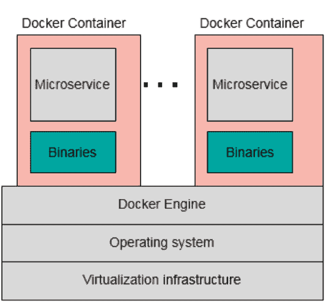

`Docker` 是不可变制品。当应用程序构建成 `Docker` 镜像时，这些镜像就可以在不同的部署环境中启动容器，确保所有环境都使用相同的栈。使用 `Docker` 使得具体的打包格式（可执行 JAR、WAR、EAR、ZIP 文件）变得不再重要，因为镜像配置决定了容器如何启动。容器内部微服务的配置值可以通过使用环境变量或挂载卷来提供。

正如“12要素”中所述，数据存储和其他所有后端不应与微服务本身托管在同一个容器中。这些后端应该被视为服务，这是微服务的一个基本特征。例如，数据存储也可以作为 `Docker` 容器进行管理。出于故障转移考虑，你不应该在同一宿主机上运行多个微服务实例。

### 8.3.4 每个微服务运行在自己的服务器上

另一种保持所有阶段操作系统尽可能相同的替代方案是使用相同的虚拟化服务器作为每个阶段的基础。为了实现这一目标，请安装你需要的操作系统和其他工具，并创建该服务器的模板。使用此模板作为所有托管你微服务系统的服务器的基础，这是另一种形式的不可变服务器。

为了管理这些服务和模板，你可以使用虚拟化提供商、云提供商或其他第三方选项提供的工具。目前可用的选项包括 `Vagrant`²、`VMware`³ 和 `VirtualBox`⁴。当与 `Salt` 或 `Ansible` 等软件配置和自动化技术结合时，将微服务虚拟化到单个服务器上可以变得灵活且敏捷。

这种配置主要导致了两种变体：

- 在单个虚拟化服务器上打包一个微服务。
- 在单个虚拟化服务器上打包多个微服务包（见图 8-2）。

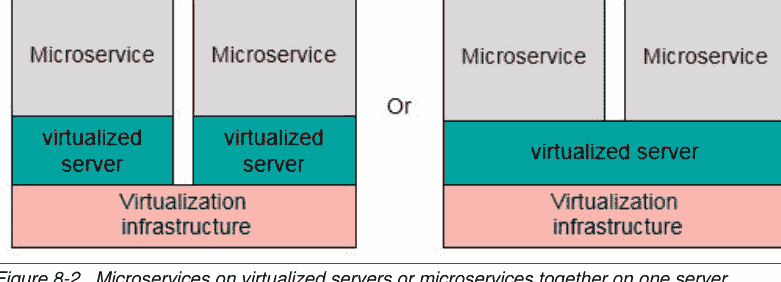

当每个虚拟化服务器仅部署一个微服务时，你可以获得从所有其他托管其他微服务的虚拟化服务器中获得良好的隔离。操作系统可以根据其托管的特定微服务的需要进行配置。当发生错误时，由于不需要分离同一台服务器上其他应用程序产生的无关信息或副作用，问题的确定将不会变得复杂。无关应用程序的影响缺失在性能方面也是有益的。

² http://www.vagrant.com/
³ http://www.vmware.com/
⁴ http://www.virtualbox.org/


当应用程序在不同的虚拟化服务器中相互隔离时，它们无法（轻易地）饿死其他应用程序的资源。

这种替代方案的缺点是，你最终会有许多虚拟化服务器（每个一个微服务实例），必须在你的整个基础设施中对它们进行管理和协调。总资源消耗也更高，因为每个虚拟化服务器都需要自己的操作系统。某些虚拟化解决方案对这个问题有优化，可以帮助减少由多个操作系统导致的处理器使用率。

在一个虚拟化服务器上运行多个微服务应该只在它们具有相似的资源使用模式时才这样做，这样一个微服务就不会对其他微服务产生不利影响或饿死它们。

操作系统的配置也必须兼容在同一虚拟化服务器上托管微服务。不同的配置不能相互干扰，也不应在不同阶段之间要求冲突的配置。这种模式通常会减少托管微服务应用程序所需的虚拟化系统数量，代价是共享系统配置。在这种设置下，你还可以使用 JVM 的共享类配置，这可以缩短微服务的启动时间。

### 8.3.5 在一个服务器上运行多个微服务的方面

以下注释适用于在服务器实例上托管了多一个微服务的部署情况，无论这种配置是通过容器还是虚拟化系统完成的。

如果你的服务器上有一个以上的微服务，那么请注意你的 Java 运行时的线程池争用。JVM 会查询操作系统以获取有关该服务器 CPU 数量的信息，并使用这些信息来定义管理线程池的策略。对于虚拟硬件，JVM 经常会获取有关可用 CPU 的错误信息。

你应该考虑的另一个方面是位于同一服务器上的微服务将如何共享或竞争服务器资源。预先了解每个微服务的需求，以防止资源竞争导致的干扰。例如，微服务内存中的缓存会随着缓存增长而产生问题。因此，通常在外部系统进行缓存。外部缓存服务器应该被视为附加服务，类似于数据存储。

### 8.3.6 最佳实践

从表面上看，在同一服务器上运行包含微服务的多个 Docker 容器与在同一服务器上运行多个微服务包似乎是一样的。但经过进一步审查，这两种部署模式之间存在显著差异。在没有 Docker 的情况下在服务器上运行多个微服务，只有在所有微服务的操作系统配置相同时可行。然而，Docker 在有效利用主机资源的同时提供了更高水平的隔离。

以下是打包最佳实践的总结：

- 虚拟化或云服务是基础设施的基础，因为动态供应可以帮助微服务系统处理变化的容量需求。
- 系统级配置在所有阶段应尽可能相似，或者通过使用容器与应用程序隔离。
- 应产生一个不可变制品，并在阶段之间不更改地进行。
- 微服务的不可变制品应该是独立且自包含的。该项目可以是可执行 JAR 文件或 Docker 容器。
- 每个不可变制品应仅包含一个微服务应用程序及其支持运行时和库。
- 在托管共享资源时应考虑资源需求，以防止资源竞争导致的干扰。
- 共享库应该作为应用程序的一部分构建，而不是共享或作为托管环境提供的依赖。

图 8-3 显示了一个基于 Java EE 的微服务，它与 Java EE 运行时一起打包在 Docker 容器内部作为虚拟化基础设施。这是托管微服务的最佳实践之一。

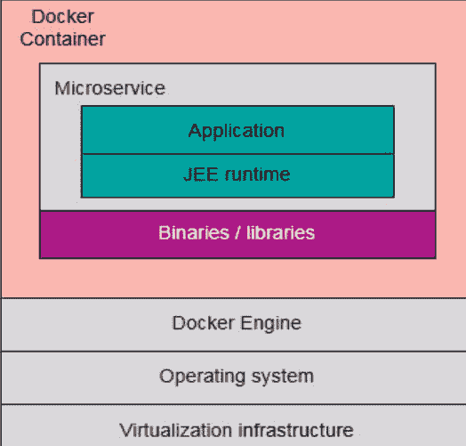

图 8-3 托管在虚拟化基础设施上的 Docker 容器中的 Java Platform, Enterprise Edition 微服务

## 8.4 跨阶段的应用程序配置

每个微服务都应该是不可变的部署构件。在构建之后，它不应针对不同阶段的部署发生更改。因此，可以随阶段改变的环境变量需要从部署构件的外部注入。除了使用不可变服务器进行部署外，应用程序配置也应尽可能保持不可变。仅在不同服务器上更改是必要的值（例如端口、IP 地址、数据库用户、连接池大小）。应用程序配置的其余部分在每个阶段都保持不变。更改的值越多，在下一阶段部署失败的风险就越高。如果后续阶段需要更改值，那么你应该测试在存在这些更改时你的服务的行为。

微服务系统的配置可以通过三种不同的方式实现：

- 环境变量
- 配置文件
- 配置系统

接下来的章节将描述这三种变体。

### 8.4.1 环境变量

从外部向你的微服务获取配置的一种方法是使用环境变量。这是向运行中的进程传递值的常用方法。

环境变量是基于字符的键值对，被映射到 Java 数据类型 `java.lang.String`。设置这些值的方法因操作系统而异。示例 8-4 展示了如何在脚本环境中设置这些变量以启动微服务。

> 示例 8-4 在 Linux Bash 脚本设置环境变量

```bash
#!/bin/bash
export VARIABLE1="Value 1"
export VARIABLE2="Value 2"
```

示例 8-5 中的 Java 示例展示了如何解析环境变量。

示例 8-5 解析环境变量

```java
Map<String, String> envMap = System.getenv();
for (String envVariable : envMap.keySet()) {
    System.out.format("%s=%s%n", envVariable, envMap.get(envVariable));
}
```

与将系统属性（Java 命令行选项 `-D`）传递给微服务相比，使用环境变量是首选方法，因为在云环境中，你通常无法访问进程的命令行。云环境通常使用环境变量。

例如，Cloud Foundry 使用一个名为 `VCAP_SERVICES` 的环境变量。它是一个 JSON 文档，包含了有关绑定到应用程序的服务实例的信息。有关 `VCAP_SERVICES` 的更多信息，请参阅：

http://docs.cloudfoundry.org/devguide/deploy-apps/environment-variable.html#VCAP-SERVICES

示例 8-6 显示了 `VCAP_SERVICES` 如何寻 IBM Cloudant²²⁵ 数据库。

## 示例 8-6 VCAP_SERVICES

```json
VCAP_SERVICES=
{
  "cloudantNoSQLDB": {
    {
      "name": "myMicroservicesCloudant",
      "label": "cloudantNoSQLDB",
      "plan": "Shared",
      "credentials": {
        "username": "xyz",
        "password": "password",
        "host": "yourhost.yourdomain.com",
        "port": 443,
        "url": "https://cloudant.yourhost.yourdomain.com"
      }
    }
  }
}
```

可解析 `VCAP_SERVICES` 变量的连接器。例如，Spring Boot 在其配置服务中有一个用于 `VCAP_SERVICES` 的连接器。更多信息，请访问此网站：

http://spring.io/blog/2015/04/27/binding-to-data-services-with-spring-boot-in-cloud

### 8.4.2 配置文件

从环境中获取配置值的另一种方案是使用 Java 命名和目录接口（JNDI）²²⁶，它是用于查询目录服务的 Java API。JNDI 必须由每个兼容 Java 的服务器提供。在 JNDI 命名空间中定义的元素可以通过 Java CDI 注入，因此访问这些值非常简单。要将元素引入 JNDI 命名空间，必须将它们添加到配置文件。

在 Liberty 中，此过程涉及以下步骤：

1. 在 `server.xml` 中激活 JNDI-Feature，`server.xml` 是 Liberty 的主配置文件，示例 8-7。之后你就可以设置你的 JNDI 变量。

示例 8-7 在 Liberty 中激活 JNDI `server.xml` 中设置 JNDI 变量

```xml
<server>
  <featureManager>
    <feature>jndi-1.0</feature>
  </featureManager>
  <jndiEntry jName="myFirstJNDIEntry" value='myFirstValue'/>
</server>
```

> ²²⁵ http://cloudant.com/
>
> ²²⁶ http://de.wikipedia.org/wiki/Java_Naming_and_Directory_Interface

2. 查找 JNDI 条目的值可以通过两种方式完成。你可以采用示例 8-8 所示的方法。

示例 8-8 解析 JNDI 值

```java
InitialContext ctx = new InitialContext();
String jndiValue = (String) ctx.lookup("myFirstJNDIEntry");
```

或者你可以通过 CDI 使用基于字段的注入（示例 8-9）。

示例 8-9 使用 CDI 对 JNDI 进行基于字段的注入

```java
public class MyClass {
    @Resource(name="myFirstJNDIEntry")
    private String jndiValue;
}
```

使用这种技术，配置文件必须存在于每个阶段并具有正确的阶段值。这样就可以完成此配置。

在 Docker 环境中，在 Docker 容器外部进行配置是正常的。容器本身保持不变，配置必须由 DevOps 工具提供。

Spring Boot 也有从外部配置应用程序的机会。可以使用属性文件、YAML 文件、环境变量和命令行参数。这些值会被注入到 Spring Bean 中并在应用程序内部使用。更多信息请参阅以下内容：

http://docs.spring.io/spring-boot/docs/current/html/boot-features-external-configuration.html

### 8.4.3 配置系统

配置微服务系统的另一种方案是使用特殊的服务器。这些配置系统都是某种用于持久化微服务配置的值存储。

根据 Eric Brewer 提出的 CAP 定理，你必须在一致性（Consistency）、可用性（Availability）和分区容错（Partition Tolerance）中选择两个。由于微服务系统没有配置系统将无法工作，因此配置系统必须是分区的。这一限制意味着你的配置系统要么在值一致的情况下可用，要么可用性有限但具有一致的值。

以下是微服务环境中使用的配置系统示例：

- Apache ZooKeeper
  http://zookeeper.apache.org/
- etcd
  http://etcd.io/
- Netflix archaius
  http://github.com/Netflix/archaius
- Consul
  http://www.consul.io/

### 8.4.4 编程考虑

配置你的微服务不应该在源代码的业务逻辑中完成。最好在中心位置进行此类配置。在大多数情况下，访问配置值是基于技术决策的，不受业务逻辑的影响。

如果你使用 CDI 配置系统，那么你必须处理运行时的值变化。在这种情况下，请为 CDI Bean 使用 `@RequestScoped` 或 `@Dependent` 注解，以确保值在每次请求时都会刷新。某些配置系统提供了回调函数，在值变化时通知客户端。结合 CDI 生产者 `@Produces`，你可以轻松地将配置系统适配到你的应用程序中。

以下示例展示了如何使用 CDI 方式在应用程序中设置配置值。首先，你必须定义一个限定符（Qualifier），如示例 8-12 所示，用于注解注入点 `@Configuration`。

示例 8-12 CDI 限定符

```java
@Qualifier
@Retention(RUNTIME)
@Target({METHOD, FIELD, PARAMETER, TYPE })
public @interface Configuration {

    // 无绑定的值
    @Nonbinding
    String value() default "";
}
```

通用生产者类（MyConfigProducer）示例 8-13 检查限定符内部属性的名称，并从其配置缓存中返回对应的值。需要解决的关键是 `InjectionPoint` 对象，它包含了如第 105 页示例 8-14 所示，EJB 中注入点的生产者所需的信息。

示例 8-13 CDI 生产者

```java
public class MyConfigProducer {
    private Properties environmentProps;
    @Produces
    @Configuration
    public String getConfigValue(InjectionPoint ip) {
        Configuration config = ip.getAnnotated(Configuration.class).getAnnotation(Configuration.class);
        String configKey = config.value();

        if (configKey.isEmpty()) {
            throw new IllegalArgumentException(
                "Property key missing!");
        }
        String value = environmentProps.getProperty(configKey);
        if (value == null) {
            throw new RuntimeException("Property value for key " +
                configKey + " could not be found!");
        }
        return value;
    }
}
```

EJB 的默认 CDI 范围是 `@RequestScoped`，未显式设置时的默认 CDI 范围是 `@default`。生产者会在每次调用 EJB 的请求上注入值。根据你的需求，也可以使用其他的 CDI 范围（示例 8-14）。

示例 8-14 注入了配置值的 EJB

```java
@Stateless
public class MyEJB {
  @Inject
  @Configuration("myConfigValue")
  private String myConfigValue;
}
```

### 8.4.5 配置的优实践

总结来说，以下是进行配置时的优实践：

- 配置应该存在于不可变的部署构构件之外，并且可以通过三种变体形式的配置（环境变量、配置文件和配置系统）提供。选择取决于你的微服务系统所托管的运行环境。
- 动态配置值应通过配置系统管理，但你的应用程序必须处理配置值的变化。
- 尽可能保持系统不变。这一指南同样适用于配置值，以最小化出现意外错误的风险。
- 仅更改必须更改的配置值，并使用定义的方式来管理这些更改（例如，跟踪这些更改）。
- 微服务的业务逻辑不应该处理配置值。这种跟踪工作应该在中心辅助类或包中完成。

## 管理与运维

运行微服务系统在某些方面与运行单体应用有所不同。通过微服务，单个应用程序变成了一个分布式系统，由许多个相互通信的微服务组成。因此，你必须管理一个高度分布的系统，并担心每个服务之间的通信路径。

运行的服务数量通常比单体应用所需的服务要多。当负载特征发生变化时，微服务应用程序应该通过调整运行服务的数量做出反应。因此，你必须能够自动部署新实例并移除现有的服务实例，以确保整个应用程序处于最佳状态。

在每个生产系统中，都有必要进行健康检查以获取运行应用程序的状态信息。这一要求对于微服务系统同样适用，你必须担心每个服务实例的健康状况。

本章涵盖了以下主题：

- 指标与健康检查
- 日志
- 模板化

## 9.1 指标与健康检查

指标和健康检查对于获取运行服务的状态信息是必要的。如 8.3 节提到的第 92 页的“打包选项”，每个基于 Java EE 的微服务都有其自己的运行时，与微服务代码本身打包在一起。基于 Java 的运行时具有工具帮助管理员检查运行中微服务的健康状况。

### 9.1.1 动态供应

通过动态供应，目标是使微服务系统自动保持在最佳状态。这种状态是指系统经过良好平衡，以匹配应用程序用户的需求。这可以通过可用的服务实例来管理吞吐量并将延迟降至最低来实现。例如，当一个微服务实例过载时，可以通过扩容并启动另一个服务实例来补偿。这种更改应该自动完成，不需要管理员干预。同样，未使用的微服务实例可以返回到你虚拟化系统的空闲资源中。

然而，在某些情况下，当达到某些阈值时需要通知管理员以便他们采取行动。如第 3 章第 25 页“定位服务”描述的服务发现是微服务使用的一项关键服务。服务发现服务跟踪可用的微服务实例和当前状态。通过此信息，可以在可用微服务实例之间进行动态负载均衡。微服务运行的一种常见模式是始终运行特定数量的服务实例。具有这些设置的微服务应用程序在设计范围内运行，并扩展到可接受的数量。通过 Liberty 的自动伸缩功能，你可以定义健康系统应运行的服务实例最小数量。你就可以让系统管理保持存活。正在关闭的微服务应该完成正在进行的请求，并且不再接收任何新请求。

可以使用指标执行自动伸缩。

伸缩成员监控服务器进程内的以下资源使用：

- CPU
- 堆
- 内存

伸缩成员监控主机级别的以下资源使用：

- CPU
- 内存

更多信息请参阅“为 Liberty 集群设置自动伸缩”：http://www.ibm.com/support/knowledgecenter/SSAW57_9_0.0/com.ibm.websphere.wlp.ndd/ae/twlp_wve_autoscaling.html


# 9.1.1 服务发现与动态路由

当你启动和停止微服务实例时，必须通知服务发现。一种简单的方法是通知微服务系统前面的 HTTP 服务器已启动或停止的微服务。Liberty 有一个可以与自动伸缩功能相结合的功能。动态路由功能允许在环境变化时无需重新生成 WebSphere 插件配置文件。该功能提供了动态路由服务，该服务从集合存储库中动态检索路由信息并将其传递给 WebSphere 插件。

图 9-1 显示了 Liberty 集合的示例。

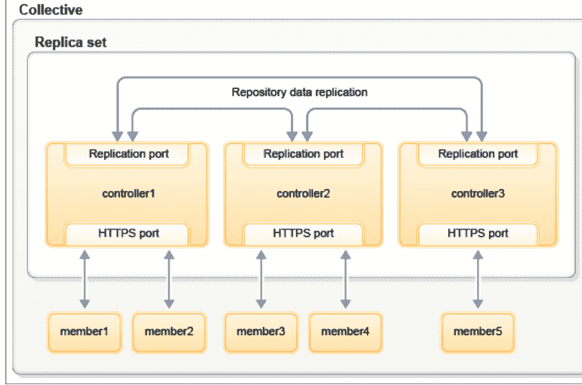

图 9-1 Liberty 集合架构¹

图 9-2 显示了一个展示动态路由功能的拓扑结构示例。

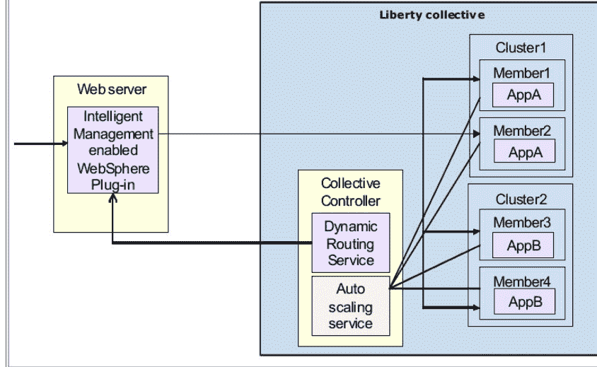

图 9-2 自动伸缩与动态路由拓扑

> ¹ http://www.ibm.com/support/knowledgecenter/en/SSAM57_9.0.0/com.ibm.websphere.wlp.nd.doc/ae/cwlp_collective_active_arch.html

---

### 9.1.2 健康检查

必须识别出出现问题的微服务应用实例。此功能有助于保持整个系统处于最佳状态。为了从你的微服务系统中获取更多信息，Liberty 提供了另一个功能来支持这一点。通过 Liberty 中的健康管理功能，你可以采用策略驱动的方法来监控应用环境，并在发现不健康标准时采取行动。你可以定义健康策略，其中包括要在你的环境中监控的健康状况，以及在满足这些条件时应采取的健康操作。

Liberty 集合中的健康管理可以通过检测常见问题并根据配置的健康策略生成诊断操作，来防止服务中断。健康管理功能由两个 Liberty 功能启用：`Health manager` 和 `health analyzer`。

可以使用以下预定义的健康状况：

- 响应时间过长状况
- 内存状况：内存占用过高
- 内存状况：内存泄漏

当触发其中一个健康状况时，将执行一个预定义的操作。可用操作包括：

- 重启服务器
- 内存转储
- JVM 内存转储
- 将服务器进入维护模式
- 退出维护模式

这些某些操作会产生更多信息以便更好地理解问题。处于维护模式的服务器仍在运行，但不接受新请求。

为了获取有关运行服务器内部的更多信息，Liberty 可以提供帮助。此功能为服务器运行的功能开启了性能监控基础设施（PMI）。在 `MXBeans` 中收集的值可以在 Liberty 服务器的 `AdminCenter` 中查看（必须激活 `adminCenter-1.0` 功能）。

生产系统基础设施中已有的工具（例如 `Nagios`²）也可以帮助管理员保持微服务系统的运行。

---

## 9.2 日志

日志对于应用来说至关重要。微服务系统也是如此。但有一些值得关注的特殊点。

在微服务系统中，业务事务可以使用面向消息的中间件，这也可以是你业务事务的一部分。因此，你需要某种东西来跟踪从进入你的系统到响应离开系统的请求。跟踪请求的一种良好方法是使用关联 ID（`correlation ID`）（参见第 62 页 5.2.5 节“Java Message Service API”）。用于面向消息中间件的相同关联 ID 也可以用于你的微服务请求。

> ² http://www.nagios.org/

你必须在进入微服务系统的第一个请求上创建一个关联 ID，然后在调用其他微服务时发送相同的关联 ID。其他服务只需检查是否存在关联 ID 并在其调用中传递它。可以使用特殊字段（例如 `X-header` 字段）将关联 ID 放在 HTTP 头部中以持有该值。头部字段的处理可以通过 `REST` 过滤器完成，以便将此逻辑保留在中心位置。

使用关联 ID 有以下优势：

- 更容易找到级联错误。
- 你可以跟踪用户请求以获取有关客户行为的信息。
- 你可以发现可以消除的未使用或很少使用的微服务，也可以发现频繁使用的微服务，通过扩展它们你可以获得更多价值。

使用你的日志框架在日志文件中记录关联 ID 的值也有一些好处。其中一些框架使用了日志上下文（`logging context`）。`SLF4j` 或 `Log4j`² 实现了映射诊断上下文（`MDC`）或嵌套诊断上下文（`NDC`），你可以用它们将关联 ID 放入其中。因此，如果任何日志被写入日志文件，你就在使用 `MDC` 或 `NDC`。从 `NDC`/`MDC` 获得的另一个益处是，如果你使用多个线程来获取请求，这些每个线程都会记录相同的 `NDC`/`MDC`。

日志格式的布局应该清晰地定义，以便更容易聚合在不同微服务中产生的日志。日志级别（例如 `FATAL`, `ERROR`, `WARN`, `INFO`, `DEBUG`, `TRACE`, `ALL`）应该在每个微服务中被清晰定义并相应使用，否则你可能会在微服务团队之间产生误解。

在具有动态供应的微服务系统中，你必须确保托管微服务的服务器和日志文件在系统关闭后被删除。在这种情况下，最好使用一个始终运行并收集你微服务日志输出的日志基础设施。这种日志系统也可以帮助你在日志文件分布在不同系统上的情况。在不同服务器的日志文件中进行搜索可能非常耗时。这种限制在对系统没有访问权限或权限极权限的生产环境中也会变得复杂。

因此，微服务应用中日志基础设施的首选方法是 `ELK` 堆栈或 `Elastic Stack`，它是三者的结合：

- `Elasticsearch`（搜索和分析引擎）
- `Logstash`（数据收集和传输）
- `Kibana`（数据可视化）

如果你的微服务使用 Liberty 作为提供程序，则有一个功能可以使用 `logstash-1.0`。使用 `Logstash` 收集并发送到 `Logstash` 服务器。

> ³ http://www.slf4j.org/
>
> ⁴ http://logging.apache.org/log4j/
>
> ⁵ http://www.elastic.com/products

---

### 示例 9-1 在 Liberty 中配置 logstash

```xml
<featureManager>
  <feature>logstashCollector-1.0</feature>
</featureManager>
<keyStore id="defaultKeyStore" password="Liberty" />
<keyStore id="defaultTrustStore" location="trust.jks" password="Liberty" />
<ssl id="mySSLConfig" trustStoreRef="defaultTrustStore" keyStoreRef="defaultKeyStore" />
<logstashCollector source="message,trace,garbageCollection,accessLog" hostName="localhost" port="5043" sslRef="mySSLConfig" />
```

`Splunk`⁷ 是一个也可以用于收集和分析你的日志数据的商业产品。

> ⁶ http://www.ibm.com/support/knowledgecenter/SSAW57-9.0.0/com.ibm.websphere.wlp.nd.doc/ae/twlp_analytics_cs_logstash.html
>
> ⁷ http://www.splunk.com/
>
> ⁸ http://wildfly-swarm.io/generator/
>
> ⁹ http://start.spring.io/
>
> ¹⁰ http://liberty-app-accelerator.wasdev.developer.ibm/

---

## 9.3 模板化

从管理的角度来看，为实现微服务系统的开发团队创建模板是有价值的。在这种意义下，模板化是指定义代码片段骨架，用于生成微服务所需的各个。

微服务模板通常包含这些常见能力：

- 与服务发现注册服务实例
- 与其他微服务通信
- 与消息系统通信
- 日志
- 安全

通过模板拥有这些能力可以获得以下益处：

- 团队启动更快。
- 所有团队使用相同的跨功能服务。

以下是生成器：

---

# 相关出版

本节列出的出版物被认为特别适合对本书的主题进行更详细的讨论。

## IBM Redbooks

以下 IBM Redbooks 出版物提供了关于本文主题的额外信息。请注意，列表中引用的某些出版物可能仅提供电子版。

- *IBM WebSphere Application Server V8.5 Administration and Configuration Guide for Liberty Profile*, SG24-8170-00

您可以在以下网站搜索、查看、下载或订购这些文档以及 Redbooks、Redpapers、Web Docs 和其他材料：

ibm.com/redbooks

## 其他出版

这些出版物作为进一步的信息源也相关：

- "Understanding the Differences between AmQP & JMS", Marc Richards
- "Building Microservices", Sam Newman, 2015年2月
- "Release It!: Design and Deploy Production-Ready Software", Michael T. Nygard, 2017
- "Continuous Delivery: Reliable Software Releases through Build, Test, and Deployment Automation", Jez Humble, David Farley, 2011
- "Enterprise Integration Patterns: Designing, Building, and Deploying Messaging Solutions", Gregor Hohpe and Booby Woolf, Addison-Wesley Professional

## 在线资源

这些网站作为进一步的信息源也相关：

- "1.2.2 Robustness Principle", RFC 1122
  https://tools.iet.org/html/rfc1122#page-12
- Apache Avro
  https://avro.apache.org/
- Amalgam
  https://github.com/amalgam/
- Apache Thrift
  https://thrift.apache.org/
- Troy Hunt 的博客文章
  https://www.troyhunt.com/your-api-versioning-is-wrong-which-is/
- "Chapter 5: Representative State Transfer (REST)", Fielding, Roy Thomas (2000)
  http://www.ics.uci.edu/~fielding/pubs/dissertation/rest_architecture_style.htm
- Cloud Native Computing Foundation ("CNCF") 章程
  https://cncf.io/about/charter
- Consul
  https://www.consul.io/
- Eureka
  https://github.com/Netflix/eureka
- Fallacies of Distributed Computing Explained
  http://www.rgoarchitects.com/Files/fallacies.pdf
- Game On! Player API
  https://game-on.org/swagger/#!/players
- "Microservices: A definition of this new architectural term", Martin Fowler
  http://martinfowler.com/articles/microservices
- Oracle Java Platform, Enterprise Edition (Java EE) 7
  http://docs.oracle.com/javaee/
- Protocol Buffers:
  https://developers.google.com/protocol-buffers/
- "The Twelve-Factor App", Adam Wiggins, 2012
  http://12factor.net

## 来自 IBM 的帮助

IBM 支持与下载
ibm.com/support

IBM 全球服务
ibm.com/services

---

## Redbooks

*Java 微服务最佳实践*

(0.2"脊)

978-3-473-240 页


SG24-8357-00

ISBN 0738442275

美国打印

建立连接


