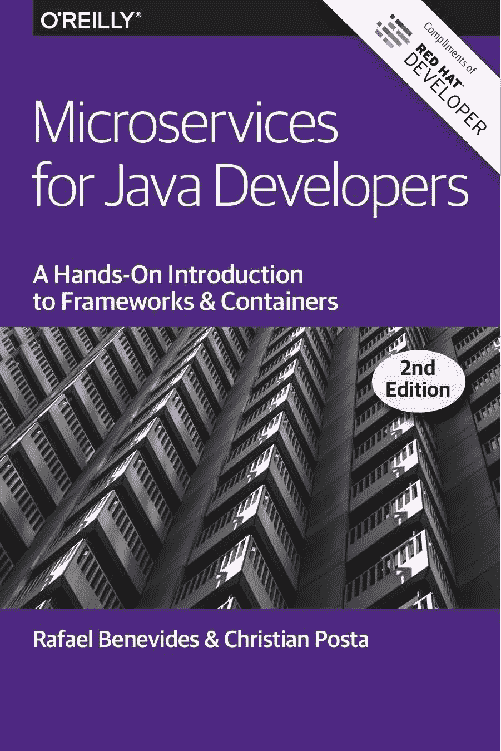
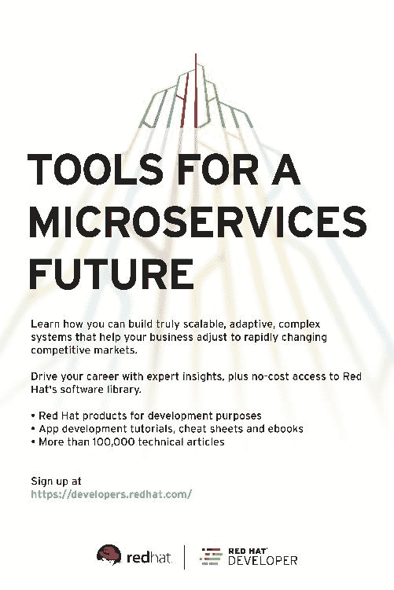
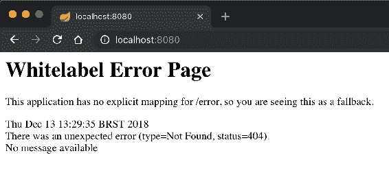
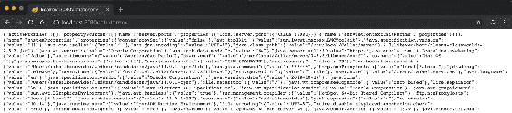
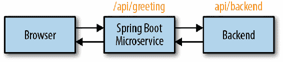
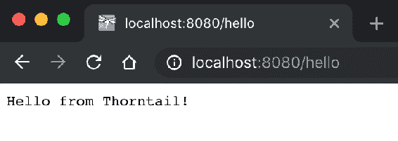
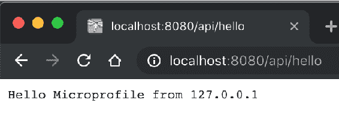
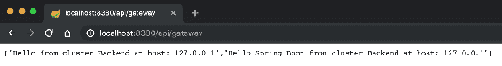

# Java 开发者的微服务指南




## 鸣谢



- 在本地快速构建服务。
- 测试服务。
- 在需要的地方识别架构并进行水平扩展。
- 不必要的会议。
- 企业级统一规范模型。

## 微服务架构适合你吗？

微服务有很多优点，但它们也有许多自己的缺点。你可以将微服务视为对那些需要在大范围内快速更改事物的问题的优化，但这是有代价的。

这种方法并不是高效的。它可能更消耗资源。

你可能会得到看起来像重复的内容。操作复杂性要高得多。从整体理解系统变得非常困难。调试问题变得极其困难。在某些领域，你可能不得不放弃事务的概念。团队的设计可能不是为了这样工作的。

业务的每个部分都需要随时更改。许多面向客户的应用程序是。后端系统可能不是。

但当这两个世界开始融合在一起时，我们可能会看到支持微服务架构的因素推向系统的其他部分。

`8 | 第一章：面向 Java 开发者的微服务`

## 挑战

遵循微服务方法设计云原生应用，需要对如何构建、部署和运行它们进行不同的思考。我们不能简单地在构建应用程序时认为我们知道它可能失败的所有方式，然后仅仅阻止它们。在用微服务构建的复杂系统中，我们必须能够处理不确定性。本节将识别开发微服务时需要牢记的五个主要事项。

### 针对故障的设计

在复杂系统中，万事皆故障。硬盘崩溃、网络电缆被拔掉、我们在活动数据库而不是备份上进行维护、虚拟机（`VMs`）消失。单个故障可能会传播到系统的其他部分，并导致导致整个系统的级联故障。

传统上，在构建应用程序时，我们尝试预测应用程序的哪些部分（例如 `n-tier`）可能会失败，并建立起足够大的墙来防止它们失败。这种思维在大规模下是有问题的，因为我们无法总是预测复杂系统中会发生什么。故障将会发生，所以我们必须开发我们的应用程序使其具有韧性并处理故障，而不仅仅是防止故障。我们应该能够优雅地处理故障，而不是让故障传播导致系统性故障。

构建分布式系统与构建共享内存、单进程单体应用不同。一个显著的区别是，网络通信与共享内存的本地调用不同。网络本质上是不可靠的。网络调用可能由于任何原因而失败（例如信号强度、糟糕的电缆/路由器/交换机以及防火墙），这可能是一个瓶颈的主要来源。网络不可靠性不仅对服务客户的响应时间产生性能影响，还可能导致上游系统的故障。

隐性网络调用可能非常难以调试；理想情况下，如果你的网络调用无法成功完成，它们应该立即失败，并且你的应用程序能够迅速察觉（例如通过 `IOException`）。在这种情况下，你可以快速采取纠正措施、提供降级功能，或者直接返回一条消息，说明请求无法正常完成，用户应稍后重试。但网络请求或分布式应用程序中的错误并不总是那么简单。如果你必须调用的下游应用程序响应时间比正常情况下长怎么办？这是一个致命问题，因为现在你的应用程序必须通过限制请求、下游请求超时以及可能阻塞通过你服务的所有调用来考虑这种延迟。这种积压会导致上游服务出现变慢，甚至停滞。

而且它可能导致级联故障。

## 考虑到依赖关系的设计

模型已经使用了几个世纪了，但 Eric Evans 的开创性著作《领域驱动设计》（Add-Wesley）帮助我们理解，软件中真正的复杂性不在于技术，而是围绕它的语言。我们需要构建在自身语文中具有内聚性的模型。

边界上下文（Bounded context）是一组领域对象，它们实现了一个试图简化业务、代码和组织的模型。通常，我们在设计系统时极力追求效率，但实际上我们需要的是灵活性。例如，在一个汽车零件应用程序中，我们可能会尝试为整个领域创建一个“规范模型”，并得到如 `Part`、`Price` 和 `Address` 等对象。如果库存应用程序使用 `Part` 对象，它指的是某种零件，比如某种刹车或轮子。在汽车质量保证系统中，`Part` 可能指的是一个带有序列号和唯一标识符的特定零件，用于跟踪某些质量测试结果等。我们可能会努力高效地复用同一个模型，但库存跟踪和质量保证是不同的业务关注点，它们在语义上对 `Part` 对象的使用方式不同。通过库存系统的边界上下文，`Part` 被显式地建模为 `PartType`，并在该语文中理解为代表“零件类型”，而不是零件的具体实例。通过两个独立的边界上下文，这些 `Part` 对象可以在它们各自的模型中一致演进，而不会以奇怪的方式相互依赖，从而我们实现了敏捷性或灵活性。上下文映射（Context map）允许我们跟踪应用程序内部不同的上下文，以防止歧义。

对领域的深度理解需要时间。可能需要几次迭代才能完全理解业务模型中存在的歧义，并将其妥分离，允许它们独立变化。这至少是构建微服务之所以困难的原因之一。拆分单体并非易事，但许多概念已经根植于单体中；你的工作是识别并分离它们。对于绿地项目（Greenfield project），在深入理解领域之前，你无法拆分任何东西。事实上，我们听到的所有微服务成功案例（如 Amazon 和 Netflix）在成功转型微服务之前，都是从单体路径开始的。

在一个具有自治团队和服务的微服务环境中，记住服务提供者与服务消费者之间的关系非常重要。作为一个自治的服务团队，你无法对其他团队和服务施加“义务”，因为你并不拥有它们；根据定义，它们是自治的。你所能做的就是选择接受或拒绝他们对功能或行为的承诺。作为他人的服务提供者，你所能做的就是向他们承诺某种行为。他们可以自由选择信任或不信任。承诺理论（Promise theory）是由 Mark Burgess 在 2004 年首次提出的模型，在他的著作 [《In Search of Certainty》](http://bit.ly/1EKwwXG)（O’Reilly）中有所介绍，它是对包括人类、计算机和相互提供服务的组织的自治系统的研究。图 1-6 说明了义务（obligation）与承诺（promise）的区别：义务是施加在团队身上的，而承诺是由团队做出的。

*图 1-6. 义务与承诺*

在分布式系统方面，承诺有助于明确服务可能提供的内容，并明确哪些假设是可以成立的，哪些是不能的。例如，假设我们的团队拥有一个图书推荐服务，我们承诺针对你询问的特定用户提供一组个性化的图书推荐。当你调用我们的服务时，如果我们的其中一个后端（存储该用户当前推荐视图的数据库）不可用，会发生什么？

我们可以向你抛出异常和堆栈跟踪信息，但那将不是非常好的体验，并可能导致系统其他部分的崩溃。因为我们做出了承诺，相反，我们可以尝试尽力遵守它，包括返回一个默认的书籍列表或所有书籍的子集。有时承诺是无法履行的，在这种情况下，确定最佳行动方案应由我们对用户的预期体验或结果驱动。这里的关键在于，我们的服务有责任尝试履行其承诺（返回某些推荐），即使我们依赖的服务无法履行它们的承诺（数据库宕机了）。在尝试履行承诺的过程中，对系统的其他部分以及我们试图维护的服务质量保持同理心是有帮助的。

看待承诺的另一种方式是将其视为一种为双方（如生产者和消费者）都提供价值的约定交换。但我们如何在两个双方之间决定什么是有价值，以及我们想要达成哪些承诺呢？如果没有人调用我们的服务或从我们的承诺中获得价值，这个服务有多大用？阐述消费者和提供者之间承诺的一种方法是使用*消费者驱动契约*（consumer-driven contracts）。通过消费者驱动契约（[W](http://bit.ly/2s69I7x)），我们能够通过代码或断言捕获承诺的价值，作为提供者，我们可以利用这些知识来测试我们是否履行了承诺。

## 分布式系统管理

归根结底，管理单一系统比管理分布式系统容易。如果只有一台机器、一个应用程序服务器，且系统出现问题，我们知道去哪里寻找。如果我们需要更改配置、升级到特定版本或对其进行安全保护，它们都在同一个物理和逻辑位置上。

管理、调试和更改它更加容易。单一系统可能适用于某些用例，但对于需要扩展的用例，我们可能会考虑利用微服务。然而，正如我们之前讨论过的，微服务并不是免费的；拥有灵活性和可扩展性的代价是必须管理一个复杂的系统。

在管理微服务部署时，这里有一些需要考虑的问题：

- 我们如何启动和停止一组服务集群？
- 在服务可以进入、离开、移动等的弹性环境中，我们如何发现服务？
- 我们如何了解我们的集群或单个服务的健康状况？
- 我们如何进行细粒度的 API 路由？
- 如果集群开始崩溃或异常运行，我们如何对其进行限流或断开某些部分的连接？
- 我们如何在大规模服务集群中进行配置更改？

- [Spring Tool Suite（基于 Eclipse 的 IDE）](http://bit.ly/2X9wnze)
- [Thorntail 项目生成器](http://bit.ly/2S6vDHj)
- [Minishift](http://bit.ly/2DRTANk)
- [Docker CLI](https://dockr.ly/2ME0ygi)

# 第二章：用于微服务的 Spring Boot

Spring Boot 是一个基于 Spring 依赖注入框架的 own Java 框架，用于构建微服务。Spring Boot 通过减少样板代码、配置和开发者摩擦来促进微服务的创建。这种方法与我们将查看的另外两个框架类似。

## Spring Boot 的优势

- 默认倾向于自动、约定好的配置。
- 简化应用程序打包。

Spring 在历史上是配置的噩梦。尽管该框架改进了其他高度复杂的组件模型（EJB 1.x、2.x 等），但它确实带来了自己的一套重量级使用模式。也就是说，Spring 需要大量的 XML 配置，并需要深层理解构造 `JdbcTemplates`、`JmsTemplates`、`BeanFactory` 生命周期钩子、servlet 监听器以及许多其他组件时所需的单个 bean。事实上，使用 Spring MVC 编写一个简单的“Hello World”需要理解 `DispatcherServlet` 以及整系列模型-视图-控制器类。Spring Boot 旨在通过一些隐含的约定和简化的注解消除所有这些样板配置——尽管如果你需要，你仍然可以精细地调整底层 bean。

## 启动器依赖

- Java Persistence API（JPA）
- Redis 缓存
- Java Transaction API（JTA）

向应用程序添加子模块会引入一组精选的、已知兼容良好的传递依赖和版本，让开发者无需自己去处理依赖。

## 应用程序打包

Spring Boot 自带了一个名为 `spring boot actuator` 的模块，它可以启用有关应用程序的指标和统计等功能。例如，你可以收集日志、查看指标、执行线程转储、显示环境变量、理解垃圾回收，并显示 `BeanFactory` 中配置了哪些 bean。你可以通过 HTTP 或 Java 管理扩展（JMX）暴露这些信息，你甚至可以通过 SSH 直接登录到进程。

通过 Spring Boot，你可以利用 Spring 框架的力量，并减少样板配置和代码，以更快速构建强大的、生产就绪的微服务。让我们来看看如何实现。

## 入门

一旦安装了 CLI 工具，你应该能够检查你安装的 Spring 版本：

```bash
```

现在导航到你想托管示例的目录并运行以下命令：

```bash
```

运行此命令后，你应该拥有一个名为 `helloworld` 的目录，其中包含完整的 Spring Boot 应用。如果你运行命令并得到了 `demo.zip`，只需将其解压并继续。让我们快速看一眼这些命令行选项：

- `--build`：我们想要使用的构建管理工具（Maven 或 Gradle）。
- `--version`：我们的应用程序版本。
- `--dependencies`：这是一个有趣的参数；我们可以指定用于常见类型开发的完整预制依赖集。例如，`web` 将设置 Spring MVC 并嵌入一个内部 servlet 引擎（默认为 Tomcat，Jetty 和 Undertow 可选）。

`22 | 第 2 章：用于微服务的 Spring Boot`



```bash
```

如果一切都顺利启动且没有错误，你应该能看到类似下面的日志：

```text
: Tomcat started on port(s): 8080 (http) with context path ''
: Started HelloSpringbootApplication in 2.3 seconds
```

恭喜！你刚刚启动并运行了第一个 Spring Boot 应用程序。如果你在浏览器中导航到 `http://localhost:8080`，你应该能看到图 2-1 所示的输出。

*图 2-1. 白标签错误页（Whitelabel error page）*

这个默认错误页面是正常的，因为我们的应用程序目前还没有实现任何功能。让我们进入下一节，添加一个 REST 端点来组合出一个“Hello World”用例。

## Hello World

现在我们已经有了一个可以运行的 Spring Boot 应用程序，让我们添加一些简单的功能。我们希望在 `/api/hello` 暴露一个 HTTP/REST 端点，它将返回“Hello Spring Boot from *X*”，其中 *X* 是服务运行的 IP 地址。要实现这一点，导航到 `src/main/java/com/examples/helloosspringboot`。如果你遵循了之前的步骤，该位置应该已经为你创建好了。然后，如示例 2-1 所示创建一个 `HelloRestController` 的新 Java 类。我们将添加一个名为 `hello()` 的方法，返回字符串以及服务运行的 IP 地址。

你将在第 6 章中看到，当我们讨论负载均衡和服务发现时，将如何使用主机 IP 来演示适当的故障转移、负载均衡等。

*示例 2-1. `src/main/java/com/examples/helloosspringboot/`*

```java
public class HelloRestController {

    String hostname = null;

    hostname = InetAddress.getLocalHost();

    } catch (UnknownHostException e) {

    }

}
```

### 添加 HTTP 端点

在此时，这部分代码只是一个 POJO（纯旧 Java 对象），你可以（也应该）编写一个单元测试来验证它的行为。为了将其暴露为 REST 端点，我们将使用示例 2-2 中的以下注解：

- `@RestController`：告诉 Spring 这是一个 HTTP 控制器，能够暴露 HTTP 端点（GET、PUT、POST 等）。

*`HelloRestController.java`*

```java
@RequestMapping("/api")

@RequestMapping(method = RequestMethod.GET, value = "/hello", produces = "text/plain")

String hostname = null;

hostname = InetAddress.getLocalHost();

} catch (UnknownHostException e) {

}

}
```

在这段代码中，我们所做的只是添加了上述注解。

例如，类级别的 `@RequestMapping("/api")` 表示“映射到此根 URI 路径下的任何方法级 HTTP 端点”。当我们添加 `@RequestMapping(method = RequestMethod.GET, value = "/hello", produces = "text/plain")` 时，我们是在告诉 Spring 在 `/hello` 处暴露一个 HTTP GET 端点（实际上是 `/api/hello`），并将媒体类型为 `Accept: text/plain` 的请求映射到此方法。Spring Boot 默认使用嵌入的 Tomcat Servlet 容器，但也可以切换到 Undertow 或 Jetty 等其他选项。

如果你构建应用程序并再次运行 `spring-boot:run`，你应该能够访问你的 HTTP 端点了：

```bash
```

现在，如果你将浏览器指向 `http://localhost:8080/api/hello`，你应该能看到类似图 2-2 所示的响应。

*图 2-2. 成功的 hello*

如果我们想为应用程序添加一些环境感知的配置呢？例如，与其说“Hello”，也许如果我们为德国用户在生产环境中部署应用，我们可能想说“Guten Tag”。我们需要一种将属性注入到应用程序的方法。

### 外部化配置

Spring Boot 轻松地使用外部属性源，如属性文件、命令行参数、操作系统环境变量或系统属性。我们现在可以外部化根据运行环境变化的属性。诸如服务 URI、数据库 URI 和密码以及消息队列配置都是外部化配置的极佳候选。

`application.properties` 文件在我们创建项目时自动创建。注意我们将文件名改为 `application.yml`，Spring 仍然能识别它。让我们在 `src/main/resources/application.properties` 中添加一个新属性：

```properties
```


接下来，如示例 2-3 所示，我们在`HelloRestController`类中添加`@ConfigurationProperties`注解和新的`saying`字段。注意我们还需要 setter。

*示例 2-3. src/main/java/com/examples/helloosspringboot/*

```java
@RestController
@ConfigurationProperties(prefix="helloapp")
    private String saying;
    public String hello() {
        try {
                .getHostAddress();
            hostname = "unknown";
        return saying + " " + hostname;

        this.saying = saying;
}
```

```bash
mvn clean spring-boot:run
```

```xml
<dependency>
    <artifactId>spring-boot-starter-actuator</artifactId>
</dependency>
```

`management.endpoints.web.exposure.include=beans,env,health,metrics,httptrace,mappings`

- `http://localhost:8080/actuator/env`
- `http://localhost:8080/actuator/metrics`
- `http://localhost:8080/actuator/mappings`

Figure 2-4 显示了`http://localhost:8080/env`端点的示例。



```bash
mvn clean package
```

如果你的项目命名为`demo`而不是`hello-springboot`，请替换为正确的 JAR 文件（`demo-1.0.jar`）。

就这些！我们在下一章探索 MicroProfile 时，也会注意到这种惯用法。

### 调用另一个服务

在微服务环境中，每个服务都负责为其他协作者提供其功能或服务。正如我们在第一章中讨论的，构建分布式系统是困难的，我们无法抽象掉网络或潜在的失败。



我们将在`index_split_000.html_p67`中介绍如何与依赖项构建具有韧性的交互。然而，在本节中，我们将仅关注于让一个服务与一个依赖服务通信。

如果我们希望扩展`hello-springboot`微服务，将需要创建一个可以使用 Spring 的 REST 客户端功能调用的服务。对于此示例以及报告中的其他示例，我们将使用一个后端服务并修改我们的服务以连接后端并生成我们想要使用的问候语，如`index_split_000.html_p36`所示。

*图 2-5. 调用另一个服务*

如果你查看此报告的源代码，你（http://bit.ly/2T33tS9）会看到名为`backend`的 Maven 模块，它包含一个非常简单的 HTTP servlet，可以通过 GET 请求和查询参数调用。该后端的代码非常简单，它没有使用任何微服务框架（Spring Boot、MicroProfile 等）。我们创建了一个`ResponseDTO`对象，封装了时间、ip 和问候字段。我们还利用了非常的 Jackson 库进行 JSON 数据绑定，如下所示：

```java
public class BackendHttpServlet extends HttpServlet {

    protected void doGet(HttpServletRequest req, HttpServletResponse resp) throws ServletException, IOException {

        ObjectMapper mapper = new ObjectMapper();

        ResponseDTO response = new ResponseDTO();

        response.setTime(System.currentTimeMillis());

        PrintWriter out = resp.getWriter();

              .writeValue(out, response);

        String hostname = null;

            hostname = InetAddress.getLocalHost().getHostAddress();

            hostname = "unknown";

        return hostname;

}
```

```bash
mvn wildfly:run
```

```json
{
  "time": 145918960895,
}
```

```bash
curl -X GET http://localhost:8080/api/backend?greeting=Hello
```

```java
@RestController
@ConfigurationProperties(prefix="greeting")

    private String saying;

    private int backendServicePort;

    @RequestMapping(value = "/greeting", method = RequestMethod.GET, produces = "text/plain")

        String backendServiceUrl = String.format("http://%s:%d/api/backend?greeting={greeting}", backendServiceHost, backendServicePort);

        return backendServiceUrl;

}
```

`greeting.saying=Hello Spring Boot`

`greeting.backendServicePort=8080`

使用了 HTTP/网络访问，但你可以将其替换为 Apache HttpComponents、OkHttp、Netty 或其他组件。

示例 2-5 显示了使用 Rest Template 时源码的样式（再次，这里省略了 getter/setter 方法，但它们是必须的）。

我们通过基于注入的主机和端口构建 URL 与后端服务进行通信，并添加了一个名为`greeting`的 GET 查询参数。我们发送到后端服务的`greeting`参数的值来自`GreeterRestController`对象的`saying`字段，该字段在当我们添加`@ConfigurationProperties`注解时，作为配置的一部分被注入进来。

*示例 2-5. src/main/java/com/example/GreeterRestController.java*

```java
@RequestMapping("/api")
public class GreeterRestController {
    private String saying;
    private int backendServicePort;
    @RequestMapping(value = "/greeting",
    public String greeting() {
            "http://%s:%d/api/backend?greeting={greeting}", backendServiceHost, backendServicePort);
        BackendDTO response = template.getForObject(
        return response.getGreeting() + " at host: " +
    }
}
```

### 调用另一个服务

接下来，我们添加`BackendDTO`类，它用于封装来自后端的响应（示例 2-6）。

*示例 2-6. src/main/java/com/examples/hellospringboot/BackendDTO.java*

```java
    private String greeting;
    private String ip;
    public String getGreeting() {
    }
    public void setGreeting(String greeting) {
    }
    public long getTime() {
    }
    public void setTime(long time) {
    }
    public String getIp() {
    }
    public void setIp(String ip) {
    }
```

现在让我们构建微服务并验证我们可以调用这个新的 greeting 端点，以及它是否正确调用了后端。首先，如果后端尚未运行，请启动它。导航到此应用程序源码中的`backend`目录并运行它：

```bash
mvn clean wildfly:run
```

接下来，我们将构建并运行 Spring Boot 微服务。我们还配置该服务运行在默认端口（8080）不同的端口上，以免与已经运行在 8080 端口的后端服务冲突：

```bash
mvn clean spring-boot:run -Dserver.port=9090
```

在报告的后部分，我们将看到在各自的 Linux 容器中运行这些微服务是如何消除运行时端口翻转（port swizzling）限制的。

现在，将浏览器指向`http://localhost:9090/api/greeting`，查看微服务是否正确调用了后端并显示了我们预期的内容，如图 2-6 所示。

*图 2-6. 成功的后端*

### 下一步展望

在本章中，你学习了什么是 Spring Boot 以及它与传统的 WAR/EAR 部署的区别。你还看到了一些简单的用例，包括暴露 HTTP/REST 端点、配置外部、暴露指标以及调用另一个服务。这只是冰山一角；如果你对学习更多 Spring Boot 内容感兴趣，请参考以下参考文献：

- [Spring Boot](http://bit.ly/2U3NbWs)
- [Spring Boot Action*, by Craig Walls (Manning)](http://bit.ly/2BGd3QH)
- [GitHub 上的 Spring Boot ](http://bit.ly/1Ts6swn)

## 第 3 章：用于微服务的 Eclipse MicroProfile

我们将看到的下一个 Java 微服务框架是 MicroProfile。

Java 企业版 (EE)（现称为 Jakarta EE） 15 多年来一直是企业级 Java 应用程序的主力。许多企业对开源和专有的 Java EE 技术投入了大量资金，这影响了从我们招聘软件人才到培训、工具和管理的方方面。Java EE 一直非常擅长通过提供 servlets/JavaServer Pages (JSPs)、事务、组件模型、消息和持久化等功能来帮助开发者构建分层应用。

尽管 Java EE 非常受欢迎，但最近人们开始觉得，Java EE 的创新速度对于一个要求云原生应用、微服务和容器的世界来说太慢了。这种感觉促使了各种 Java 用户组、Java 冠军、供应商和公司齐力合作，发布了 MicroProfile 规范。

MicroProfile 1.0 在 JavaOne 2016 期间宣布，由 CDI、JSON-P 和 JAX-RS 规范组成。这些 API 让丰富的 Java EE 开发者能够利用现有的技能集来应对这一快速迭代、创新的开源规范。

MicroProfile 2.1 定义了基于 Java EE CDI、JSON-P、JAX-RS 和 JSON-B 的基础编程模型，并增加了 Open Tracing、Open API、Rest Client、Config、Fault Tolerance、Metrics、JWT Propagation 和 Health Check API（参见图 3-1）。开发仍然活跃，正在研究 Reactive Streams、Reactive Messaging、GraphQL、长时间运行操作和服务网功能。

*图 3-1. MicroProfile 2.1 API*

### Thorntail

Thorntail 是来自 Red Hat 的 MicroProfile 实现。它是将 WildFly 服务器完全拆分为小型、可重用的组件，这些组件可以组装成微服务应用程序。组装这些组件只需在 Java Maven 或 Gradle 构建文件中包含依赖即可；Thorntail 会处理其余工作。

Thorntail 评估你的`pom.xml`（或 Gradle）文件，确定你的微服务实际使用了哪些依赖（例如 CDI、OpenTracing 和 Metrics），然后构建一个 uber-JAR（类似于 Spring Boot 和 Dropwizard），其中包含了运行服务所需的最小 API 和实现。

除了 MicroProfile API 之外，Thorntail 还提供了许多其他功能。某些组件仅提供对其他 API 的访问，例如 JPA 或 JMS；其他组件则提供了高级功能，例如与 Infinispan 的集成。

### 开始上手

你可以使用 [Thorntail Generator](https://thorntail.io/generator/) 来启动一个新的 Thorntail 项目（类似于 Spring Boot 的 Spring Initializr）。只需打开页面并在字段中填写以下值，如图 3-2 所示：

- Group ID: `com.redhat.examples`
- 依赖: MicroProfile Config, JAX-RS

*图 3-2. Thorntail 生成器*

现在点击蓝色的`Generate Project`按钮。这将下载一个名为`hello-microprofile.zip`的文件。保存该文件并解压。

进入`hello-microprofile`目录，并尝试运行以下命令：

```bash
```

确保你已经停止了在上一中启动的后端服务。

**开始上手 | 39**



如果一切顺利启动且没有任何错误，你应该能看到类似下面的日志：

```
```

恭喜！你刚刚运行并启动了你的第一个 MicroProfile 应用。如果你在浏览器中访问`http://localhost:8080/hello`，你应该能看到图 3-3 所示的输出。

*图 3-3. 来自 Thorntail 的 Hello*

## Hello World

就像在前一节的 Spring Boot 框架一样，我们想要添加一些基本的"Hello World"功能，然后在此基础上量地添加更多功能。

我们希望在`/api/hello`处暴露一个 HTTP/REST 端点，它将返回"Hello MicroProfile from *X*"，其中 *X* 是服务运行的 IP 地址。为了实现这一点，进入`src/main/java/com/examples/hellomicroprofile/rest`目录。如果你遵循了之前的步骤，该位置应该已经为你创建。然后，创建一个名为`HelloRestController`的新 Java 类，如示例 3-1 所示。

我们将添加一个名为`hello()`的方法，它返回一个字符串以及服务运行的 IP 地址。你将在第 6 章的负载均衡和服务发现章节中看到，如何使用主机 IP 来演示适当的故障转移、负载均衡等。

**40 | 第 3 章：用于微服务的 Eclipse MicroProfile**

*示例 3-1. src/main/java/com/examples/hellomicroprofile/rest/*

*HelloRestController.java*

```java
    public String hello() {
        try {
                .getHostAddress();
            hostname = "unknown";
        return "Hello MicroProfile from " + hostname;
}
```

- `@GET`：指定任何 HTTP GET 方法将调用被注解标记的方法。如果路径相同但 HTTP 方法不是 GET，则该方法将不会被调用。

```java
@Path("/api")
    @GET
    @Path("/hello")
        String hostname = null;
            hostname = InetAddress.getLocalHost()
        } catch (UnknownHostException e) {
        }
    }
```

在这些代码中，我们所做的只是添加了上述注解。

例如，类级别的`@Path("/api")`表示"映射到此根 URI 路径下的下的任何方法级 HTTP 端点"。当我们添加`@Path("/hello")`和`@GET`时，我们是在告诉 MicroProfile 在`/hello`处暴露一个 HTTP GET 端点（实际上是`/api/hello`）。注解`@Produces("text/plain")`将媒体类型为`Accept: text/plain`的请求映射到此方法。

如果你构建了应用程序并再次运行`thorntail:run`，你应该能够访问该 HTTP 端点：

```bash
```

现在，如果你将浏览器指向`http://localhost:8080/api/hello`，你应该能看到与图 3-4 所示类似的响应。

*图 3-4. 成功的 hello*


现在，按照我们对 Spring Boot 做的方法，我们将学习如何注入配置。

**Hello World | 41**



### 外部化配置

与 Spring Boot 一样，MicroProfile 定义了外部化配置机制。它使用不同的 `ConfigSources` 从系统属性、环境变量甚至 `src/main/resources/META-INF/config.properties` 文件中读取配置。每个源都有优先级，因此值可以被覆盖。

为了看到这有多简单，我们在 `src/main/resources/META-INF/config.properties` 文件中添加一个新的属性：

```properties
```

现在，如第 3 章所示，我们在 `HelloRestController` 类中添加 `@Inject` 和 `@ConfigProperty("hello.saying")` 注解。注意，与 Spring Boot 不同，我们不需要 setter 或 getter。

**42 | 第 3 章：用于微服务的 Eclipse MicroProfile**

*示例 3-3. src/main/java/com/examples/hellomicroprofile///*

*HelloRestController.java*

```java
public class HelloRestController {
    @ConfigProperty(name="hello.saying")

    @Produces("text/plain")
    public String hello() {
        try {
                .getHostAddress();
            hostname = "unknown";
        return saying + " " + hostname;
}
```

```xml
<?xml version="1.0" encoding="UTF-8"?>
       xmlns:xsi="http://www.w3.org/2001/XMLSchema-instance"
       bean-discovery-mode="all">
```

### 暴露应用程序指标和信息

另一个与 Spring Boot 的相似点是，MicroProfile 应用能够暴露用于监控应用程序的端点。为了启用此功能，我们需要在 `pom.xml` 文件中添加 MicroProfile Metrics 依赖。

打开 `hello-microprofile` 微服务的 `pom.xml` 文件并在 `<dependencies>` 部分添加以下 Maven 依赖：

```xml
    <groupId>io.thorntail</groupId>
</dependency>
```

```bash
mvn clean thorntail:run
```

```bash
$ mvn clean package
```

就这样！这与 `Spring Boot` 使用的方法完全相同。

### 调用另一个服务

在微服务环境中，每个服务都负责为其他协作方提供其功能或服务。如果我们想要扩展 `hello_microprofile` 微服务，我们需要创建一个可以使用 `JAX-RS` 客户端功能调用的服务。就像我们为 `Spring Boot` 微服务所做的那样，我们将利用随本报告提供的源代码后端服务。交互过程将类似于图 3-7](#index_split_000.html_p52)。

*图 3-7. 调用另一个服务*

如果你查看本报告的[源代码](http://bit.ly/2T33tS9)，你会看到一个名为 `backend` 的 Maven 模块，该模块包含一个非常简单的 `HTTP servlet`，可以通过 `GET` 请求和查询参数进行调用。该 `backend` 的代码非常简单，并且没有使用任何微服务框架（`Spring Boot`、`MicroProfile` 等）。

要在端口 8080 上启动后端服务，请导航到 `backend` 目录并运行以下操作：

46 | 第 3 章：用于微服务的 Eclipse MicroProfile

```bash
```

记住，在运行后端服务之前应该停止 `hello-microprofile` 服务。

该服务暴露在 `/api/backend`，并接收一个名为 `greeting` 的查询参数。例如，当我们使用路径 `/api/backend?greeting=Hello` 调用此服务时，如下（你也可以用浏览器访问此 URL）：

```bash
```

我们得到了一个如下的 JSON 对象：

```json
  "greeting": "Hello from cluster Backend",
  "ip": "172.20.10.3"
```

接下来，我们将在 `hellomicroprofile` 微服务中创建一个新的 HTTP 端点 `/api/greeting`，并使用 `JAX-RS Client API` 调用此后端。

首先，我们在 `src/main/java/com/examples/hellomicroprofile` 中创建一个名为 `GreeterRestController` 的新类，并以类似于填充 `HelloRestController` 类的方式来填充它（参见示例 3-5.](#index_split_000.html_p53）。

*示例 3-5. src/main/java/com/example/hellomicroprofile/rest/*

*GreeterRestController.java*

```java
public class GreeterRestController {
    @ConfigProperty(name="greeting.saying", defaultValue = "Hello")

    @ConfigProperty(name = "greeting.backendServiceHost", defaultValue = "localhost")

    @ConfigProperty(name = "greeting.backendServicePort", defaultValue = "8080")

    @Produces("text/plain")
    public String greeting() {
        return "Sending to: " + backendServiceUrl;
}
```

```java
public class BackendDTO {
    private long time;

        return greeting;

        this.greeting = greeting;

        return time;

        this.time = time;

        return ip;
}
```

```java
public class BackendDTO {
    private long time;

        return greeting;

        this.greeting = greeting;

        return time;

        this.time = time;

        return ip;

        this.ip = ip;
}
```

（抱歉，原文提供的 `BackendDTO` 代码块在输入中存在重复和截断，我将根据原文提供的实际文本片段进行对齐）

重新根据原文提供的 `BackendDTO` 文本：

```java
public class BackendDTO {
    private String greeting;
    private String ip;

    public String getGreeting() {
    }

    public void setGreeting(String greeting) {
    }

    public long getTime() {
    }

    public void setTime(long time) {
    }

    public String getIp() {
    }

    public void setIp(String ip) {
    }
}
```

```java
public class BackendDTO {
    private long time;

        return greeting;

        this.greeting = greeting;

        return time;

        this.time = time;

        return ip;

        this.ip = ip;
}
```

（由于原文文本在 `BackendDTO` 处存在严重的排版错误重复，我将基于原文最后显示的逻辑进行翻译）

接下来，我们将添加 `JAX-RS` 实现来实现与后端服务的通信。它看起来像示例 3-7](#index_split_000.html_p55)。

*示例 3-7. src/main/java/com/example/hellomicroprofile/*

*GreeterRestController.java*

```java
public class GreeterRestController {
    @ConfigProperty(name="greeting.saying", defaultValue = "Hello")

    @ConfigProperty(name = "greeting.backendServiceHost", defaultValue = "localhost")

    @ConfigProperty(name = "greeting.backendServicePort", defaultValue = "8080")

    @Produces("text/plain")
    public String greeting() {
        System.out.println("Sending to: " + backendServiceUrl); // 注意：原文此处逻辑略有错乱，按原样翻译
        Client client = ClientBuilder.newClient();
            .path("api")
            .queryParam("greeting", saying)
            .get(BackendDTO.class);
    }
}
```

- [MicroProfile 幻灯片](http://bit.ly/2GWfEty)
- [Thorntail 文档](http://bit.ly/2NjrD5B)
50 | 第 3 章：用于微服务的 Eclipse MicroProfile
- [Thorntail 项目生成器](http://bit.ly/2S6vDHj)

现在你已经了解了如何构建微服务，可以继续构建越来越多的微服务。然而，随着微服务数量的增加，消费这些 API 的客户端复杂度也会随之增加。真实的应用可能有几十个甚至数百个微服务。像在 Amazon 这样的在线商店买书这样一个简单的过程，可能会导致客户端（你的网络浏览器或移动应用）使用其他几个微服务。直接访问微服务的客户端必须自己负责定位、调用它们，并处理它们引发的任何故障。因此，通常更好的方法是将这些服务隐藏在一个新的服务层之后。这个聚合器服务层被称为 `API gateway`。

使用 API 网关的另一个优势是，你可以在这一层添加授权和数据转换等跨切关注点。使用不适合互联网协议的服务也可以从 API 网关的使用中受益。但是，请记住，通常不建议为应用程序中的所有微服务设置单个 API 网关。如果你（错误地）决定采取这种方法，它将像一个单体总线一样，通过耦合所有微服务来违反微服务的独立性。

**在 API 网关中添加业务逻辑是一个错误，应该予以避免。**

### 53

## Apache Camel

Apache Camel 是一个开源集成框架，非常适合实现 API 网关。该框架实现了 Gregor Hohpe 和 Bobby Woolf (Addison-Wesley) 所著的 *Enterprise Integration Patterns* 一书中描述的大多数企业应用集成 (EAI)模式。每个企业集成模式 (EIP) 都描述了许多集成项目中反复出现的常见设计问题的解决方案。该书记录了 65 个 EIP，并采用了与技术无关的方法。

Apache Camel 使用基于 EIP 的一致 API，为集成提供了定义良好的编程模型。通过 200 多个组件，开发者可以将 Apache Camel 连接到几乎任何源/目标。除了 `HTTP`、`FTP`、`File`、`JPA`、`SMTP` 和 `Websocket` 组件外，甚至还有 `Twitter`、`Facebook`、`AWS` 等平台的组件。

Apache Camel 非常强大但又非常简单。这使其成为为我们的微服务创建 API 网关的理想选择。

Apache Camel 可以作为独立应用程序运行，也可以嵌入现有应用程序中。对于我们的 API 网关示例，我们将在 Spring Boot 中使用 `Camel`。

### 快速上手

可以通过在现有应用中声明 Maven 依赖，或使用现有的 Maven Archetype 来创建 Camel 应用程序。

由于我们已经展示了如何使用 Spring CLI 创建 `hel o-springboot` 应用，这次我们将使用 Maven Archetype 方法。

以下命令将在名为 `api-gateway` 的目录中创建一个带有 Camel 的 Spring Boot 应用程序：

```bash
-DarchetypeGroupId=org.apache.camel.archetypes \
-DgroupId=com.redhat.examples \
-Dversion=1.0
```

```bash
mvn spring-boot:run
```

```bash
2018-12-18 INFO 782 --- [main] MySpringBootApplication
(JVM running for 6.866)
Hello World
Hello World
```

```xml
<dependency>
    <artifactId>camel-http4-starter</artifactId>
</dependency>
```

```xml
<dependency>
    <artifactId>camel-servlet-starter</artifactId>
</dependency>
```

```xml
<dependency>
    <artifactId>camel-jackson-starter</artifactId>
</dependency>
```

接下来，我们将修改 `MySpringBootRouter` 类，如示例 4-1 所示连接到两个微服务。我们已经学习过 `@ConfigurationProperties(prefix="gateway")` 注解将网关字符串连接到此类。`@Component` 注解让 Spring Boot 找到并注册此类作为 Spring Bean。稍后，Camel 将查找每个扩展 `RouteBuilder` 的 Spring Bean，并使用 `configure()` 方法来配置路由。

*示例 4-1. src/main/java/com/redhat/examples/MySpringBootRouter.java*

```java
@ConfigurationProperties(prefix="gateway")
    private String springbootsvurl;
    private static final String REST_ENDPOINT="http4:%s/greeting?httpClient.connectTimeout=1000&bridgeEndpoint=true&copyHeaders=true&connectionClose=true";

    @Override
        from("direct:microprofile").streamCaching()
            .log("Response from MicroProfile microservice: ${body}")
            .end();
        from("direct:springboot").streamCaching()
            .log("Response from Spring Boot microservice: ${body}")
            .end();
        rest()
            .route()
            .parallelProcessing()
            .to("direct:springboot")
            .marshal().json(JsonLibrary.Jackson)
            .endRest();
        this.springbootsvurl = springbootsvurl;
        this.microprofilesvcurl = microprofilesvcurl;
}
```

```properties
gateway.springbootsvurl=localhost:8180
```

## 使用 /api/* 代替 /camel/*


# **58 | 第 4 章：使用 Apache Camel 构建 API 网关**



### 调用所有微服务

现在我们的 API 网关已经就绪，我们将使用不同的端口在本地启动所有四个微服务：

- `backend`：8080
- `hello-microprofile`：8280

```bash
mvn clean wildfly:run
mvn clean spring-boot:run -Dserver.port=8180
mvn thorntail:run -Dswarm.network.socket-binding-groups.standard-sockets.port-offset=200
mvn spring-boot:run -Dserver.port=8380
```

- [Camel components](http://bit.ly/2Enyk3y)
- [Camel Spring Boot](http://bit.ly/2STcRZg)

- [Apache Mesos 是为了博士论文而创建的，其创始人（Ben Hindman）曾在 Google 实习，并与 Google 工程师就容器集群、调度和管理进行了多次交流。](#)

在我们深入探讨示例之前，你应该理解 Kubernetes 的一些简单基本原语。在本章中，我们将向你介绍这些概念，在接下来的章节中，我们将利用它们来管理微服务集群。

### Pods

`pod` 是一个或多个 Docker 容器的组（就像鲸鱼群一样吗？）。然而，一个典型的 pod 部署通常与 Docker 容器是一一对应的。如果你有必须与应用程序共同部署的侧车（sidecar）、代理（ambassador）或适配器（adapter）部署，`pod` 是将它们分组的方式。这种抽象也是保证亲和性的方法。

Kubernetes 负责编排、调度和管理 pod。当我们提到运行在 Kubernetes 内部的应用程序时，它是运行在一个 pod 内部的。pod 拥有自己的 IP 地址，pod 内部的所有容器共享此地址（这与纯 Docker 不同，后者每个容器都有一个 IP 地址）。当卷载挂载到 pod 时，它们也是共享的。

关于 pod 的最后一点需要知道：它们是可替换的（fungible）。这意味着它们可能随时消失（可能是因为崩溃，也可能是因为 Kubernetes 杀杀了它们）。它们不像你那样需要呵护和培养的虚拟机（VM）。pod 可以在任何时候销毁。

这符合我们在微服务世界的预期，即事情会（并且确实会）发生，因此我们强烈建议在编写微服务时牢记这一前提。

### Labels

标签（Labels）是我们可以分配给 pod 的简单键/值对，例如 `release=stable` 或 `tier=backend`。pod（以及其他资源，但我们将重点关注 pod）可以有多个标签，以松耦合的方式将它们分组，从而更容易在大规模范围内构建集群。

在我们为 pod 打上标签后，我们可以使用标签选择器（label selectors）来查找哪些 pod 属于哪个组。例如，如果我们有一些标记为 `tier=backend` 的 pod，另一些标记为 `frontend` 的 pod，使用标签选择器 `tier != frontend` 就可以选择所有不是“frontend”的 pod。

标签选择器用于接下来的两个概念：复制控制器（replication controllers）和服务层（services）。

### ReplicationControllers and Deployments

在谈论大规模运行微服务时，我们可能会涉及到任何给定微服务的多个实例。Kubernetes 有一个名为 `ReplicationController` 的概念，用于管理一组特定微服务的副本数量。

例如，假设我们想要管理标记为 `tier=backend` 和 `release=stable` 的 pod 数量。我们可以定义带有适当标签选择器的 `ReplicationController`，然后通过调整定义中的 `replicas` 字段来控制集群中的 pod 数量。

如果我们将副本计数设置为 `10`，那么 Kubernetes 将调整其当前状态，以反映为给定的 `ReplicationController` 运行 10 个 pod。如果目前只有五个在运行，Kubernetes 将再启动另外五个。如果有 20 个在运行，Kubernetes 将杀掉 10 个（对于你的应用程序来说，杀死哪些是不确定的）。

Kubernetes 会尽一切努力以收敛到 10 个副本的预期状态。你可以想象使用 `ReplicationController` 非常容易地控制集群的大小。

后来，Kubernetes 项目引入了另一个名为 `Deployment` 的概念，它会监控副本的配置（如环境变量、CPU 和内存限制、标签等）。如果你更新了这些任何配置，Kubernetes 将执行滚动更新（rolling update），将之前声明的副本数量替换为具有新配置的新副本。

我们将在下一章看到 `Deployments` 运行的示例。

### Services

你应该理解的最后一个 Kubernetes 概念是 Kubernetes `Service`。我们已经看到 `ReplicationControllers` 可以控制我们服务的副本数量。我们还看到 pod 会死亡（要么自己崩溃，要么被杀掉，可能是作为 `ReplicationController` 缩容事件的一部分）。

因此，当我们尝试与一组 pod 通信时，不应该直接依赖它们的 IP 地址（每个 pod 都有自己的 IP 地址），因为 pod 会来来去。我们需要一种分组 pod 的方法以发现它们在哪里以及如何与它们通信，并可能对它们进行负载均衡。

这正是 Kubernetes `Service` 所做的。它允许我们使用标签选择器对 pod 进行分组，并用单个虚拟（集群）IP 将它们抽象化，我们可以使用该 IP 来发现并与它们交互。我们将在下一章展示一些具体的示例。

通过这些简单的概念——pods、labels、`ReplicationControllers` 和 `Services`，我们可以按照 Google 学到的（或学到的反教训）方式来管理和扩展我们的微服务。识别复杂问题的简单解决方案需要多年和多次失败，因此我们强烈鼓励你熟悉这些概念，并体验使用 Kubernetes 管理微服务容器的力量。

### Getting Started with Kubernetes

Docker 和 Kubernetes 都是 Linux 原生技术；因此，它们必须在 Linux 宿主机操作系统上运行。如果你在 Windows 或 Mac 开发机上工作，为了利用 Docker 和 Kubernetes 为你带来的强大功能，你需要在宿主机操作系统上使用客机 Linux 虚拟机。

你可以为你的环境下载 `Docker Machine` 和 `Toolbox`，但那时你需要手动安装 Kubernetes（这可能有点复杂）。你可以使用上游 Kubernetes Vagrant 镜像，但像任何快速迭代的开源项目一样，这些镜像可能会迅速变化且有时不稳定。

此外，为了充分利用 Docker 的可移植性，最好在不同环境之间至少使用相同的 Linux 内核，理想情况下使用相同的 Linux 发行版和版本。我们还有其他选择吗？

### Minishift

为了开始使用 Docker 和 Kubernetes 开发微服务，我们将利用一个名为 `Minishift` 的免费开发者工具（`https://bit.ly/2E3i3zc`）。`Minishift` 是一个运行在开发者机器上的小工具，包含了 Docker、Kubernetes 和 Web 控制台（实际上，它运行的是 Red Hat OpenShift，它基本上是一个包含其他开发者自服务和应用程序生命周期管理功能的 Kubernetes 版本，但在这书中我们将仅使用 Kubernetes API）。

### OpenShift

Red Hat OpenShift 3.x 是一个 Apache v2 许可的开源开发者自服务平台 `OpenShift Origin`（`http://bit.ly/2EpgiNe`），它已经重构为使用 Docker 和 Kubernetes。

OpenShift 曾经拥有自己的集群管理和编排引擎，但考虑到 Kubernetes 为容器集群管理世界带来的知识、简单力量，尝试竞争是愚蠢的。更广泛的社区正在汇聚到 Kubernetes，而 Red Hat 也全力投入 Kubernetes。

```bash
minishift start
eval $(minishift oc-env)
minishift addon apply anyuid
minishift addon apply admin-user
oc login -u admin -p admin
oc new-project <projectname>
oc new-project tutorial
eval $(minishift docker-env)
docker images
```

- [James Strachan 写的《使用 Docker 容器时 Java 应用程序器的衰落》](http://bit.ly/1W6b5OZ)
- [Docker 文档](https://dockr.ly/2EnOU3l)
- [Kubernetes](http://bit.ly/2GCoqxs)
- [Kubernetes 文档：Labels and Selectors](http://bit.ly/2SPuwkq)
- [Kubernetes 文档：Services](http://bit.ly/2NhgFgT)

# 第 6 章：集群管理、故障转移和负载均衡

## 开始使用

在第 5 章中，我们快速查看了微服务。在这一章中，我们将进入集群管理，以解决大规模运行微服务的问题。

部署我们的微服务时，我们将假设一个镜像已经存在。然而，如果你想制作自己的 Docker 镜像，本章将涵盖使其可用的步骤。构建镜像的示例 Dockerfile 如下：

```dockerfile
FROM fabric8/java-alpine-jdk

ENV JAVA_APP_JAR <your-jar-name>
ENV AB_OFF true

ADD target/<your-jar-name> /deployments/
```

然后运行以下命令来构建 Docker 镜像：

```bash
```

```text
向 Docker 守护进程发送构建上下文 111.3MB
---> 4353c2196b11
---> Running in 777ae0de6868
Removing intermediate container 777ae0de6868
---> Running in 02b3780c59a3
Removing intermediate container 02b3780c59a3
---> 3a4e91b41727
Successfully built 3a4e91b41727
```

`-t` 参数指定标签名称，格式如下：`<organization-name>/<image-name>:<version>*`。

如果你想尝试你新构建的镜像，可以使用命令创建一个容器：

```bash
```

`-it` 切换指示 Docker 创建一个交互进程并为其分配一个终端。`--rm` 切换指示 docker 在我们停止容器时删除该容器。`-p 8080:8080` 指示 Docker 将容器的 `8080` 端口映射到 Docker 守护进程主机的 `8080` 端口。

一旦容器启动，你可以打开一个新的终端，并使用 `curl` 命令访问它：

```bash
```

```yaml
apiVersion: extensions/v1beta1
metadata:
  labels:
    book: microservices4javadev
spec:
  selector:
    app: hello-springboot
  template:
    metadata:
      labels:
        book: microservices4javadev
    spec:
      containers:
        - env:
            value: -Xmx256m -Djava.net.preferIPv4Stack=true
            value: backend
          imagePullPolicy: IfNotPresent
          readinessProbe:
            httpGet: # make an HTTP request
              path: /actuator/health # endpoint to hit
            initialDelaySeconds: 20
            timeoutSeconds: 1
          livenessProbe:
            httpGet: # make an HTTP request
              path: /actuator/health # endpoint to hit
            initialDelaySeconds: 10
            timeoutSeconds: 1
          ports:
            - name: http
```

```bash
```

```bash
```

```bash
```

```bash
```

部署文件将创建四个 pod（每个微服务一个副本）。服务文件将使这些每个副本相互可见。你可以通过以下命令检查已创建的 pod：

```bash
```

```text
api-gateway-5985d4fd5-4nsfs          1/1     Running
hello-microprofile-844c6c758-mm4h   1/1     Running
```

```bash
```

```bash
```

```text
api-gateway-5985d4fd5-4nsfs          1/1     Running
hello-microprofile-844c6c758-mm4h   1/1     Running
```

```bash
```

```bash
```

```text
["Hello from cluster Backend at host: 172.17.0.7",
```

| 名称 | 期望 | 当前 | 最新 | 可用性 |
| --- | --- | --- | --- | --- |
| api-gateway | 1 | 1 | 1 | 1 |
| hello-microprofile | 1 | 1 | 1 | 1 |

```bash
oc scale deployment hello-springboot --replicas=3
oc get pods
```

| 名称 | 状态 | 状态 |
| --- | --- | --- |
| backend-659d8c4cb9-5hv2r | 1/1 | Running |
| hello-springboot-5bf5c4c7fd-j77lj | 1/1 | Running |
| hello-springboot-5bf5c4c7fd-w4z7c | 1/1 | Running |

如果这些 pods 中的任何一个死亡或被删除，Kubernetes 将执行必要的操作以确保该服务的副本数量为 3。

另请注意，我们不需要更改这些服务的端口，或进行任何不自然的端口映射。每个服务都监听在 `8080` 端口，并且与其他服务不冲突。

Kubernetes 还具有通过监控 CPU、内存使用情况或用户定义的触发器等指标进行自动扩缩的能力，并根据需要增加或减少副本数量。自动扩缩不在本文报告的范围内，但它是集群管理谜题中非常有价值的一个部分。

## 服务发现

在 Kubernetes 中，`Service` 是一种简单的抽象，它在 pod 组和使用该组 pod 所代表服务的应用程序之间提供了一个间接层。我们已经看到 Kubernetes 如何管理 pod，以及它们是如何随来随去的。我们还看到 Kubernetes 如何轻松地扩展特定服务的实例数量。

在示例中，我们部署了之前章节中的 `backend` 服务来充当提供者。我们的 `hello-springboot` 服务是如何与该服务通信的？

让我们看看存在 Kubernetes 服务：

```bash
```

| 名称 | 类型 | 集群 IP | 端口(s) |
| --- | --- | --- | --- |
| api-gateway | ClusterIP | 172.30.227.148 | 8080/TCP |
| hello-microprofile | ClusterIP | 172.30.31.211 | 8080/TCP |

```yaml
apiVersion: v1

metadata:

labels:

  book: microservices4javadev

  ports:

    port: 8080

    app: backend
```

```java
@ConfigProperty(name = "GREETING_BACKENDHOST", defaultValue = "localhost")
```

另一个我们可以使用的健康检查是存活探针（liveness probe）。这与就绪探针（readiness probe）类似；但它适用于 pod 被确定为“就绪”并有资格接收流量之后。

在 pod 或服务的生命周期内，如果存活探针（也可以是一个简单的 HTTP 端点）开始指示一个不健康状态（例如 HTTP 500 错误），Kubernetes 可以自动杀死该 pod 并重启它。

在之前显示的 `deployment.yml` 文件中，我们通过 `livenessProbe` 和 `readinessProbe` 声明了这两个探针：

```yaml
  httpGet: # 发起 HTTP 请求
    path: /actuator/health # 要访问的端点
...
  httpGet: # 发起 HTTP 请求
    path: /actuator/health # 要访问的端点
```


这意味着 `hello-springboot` pod 的“就绪性”将通过定期轮询 pod 的 `/actuator/health` 端点来确定（该端点是在我们之前为 Spring Boot 微服务添加 actuator 时添加的）。如果 pod 已就绪，它将返回：

```json
```

使用 MicroProfile/Thorntail 和 Apache Camel 实现相同的操作。

## 熔断器

作为服务提供者，你的责任是向消费者提供你所承诺的功能。根据承诺理论（promise theory），服务提供者可能依赖于其他服务或下游系统，但不能也不应该对它们施加要求。服务提供者对其对消费者的承诺 `Fault Tolerance | 83` 负全部责任。

然而，由于分布式系统可能且确实会发生故障，因此会有某些时候无法履行服务承诺或只能部分履行。在我们之前的示例中，我们展示了我们的“hello”微服务调用 `backend` 服务以在 `/api/greeting` 端点形成问候。如果 `backend` 服务不可用会发生什么？我们如何履行我们承诺的责任？

我们需要能够处理这类分布式系统故障。服务可能不可用；网络可能经历间歇性连接；后端服务可能正承受足够的负载以导致其变慢并引入延迟；后端服务中的 bug 可能会导致应用级异常。

如果我们不显式地处理这些情况，就会面临降低我们自己服务的风险；占用线程、数据库锁和资源，并导致滚动性的、级联故障，这种故障可能会导致整个分布式网络崩溃。以下小节介绍了两种帮助我们处理这些故障的不同方法（每种技术一种，即 Spring Boot 和 MicroProfile）。

### 使用 MicroProfile 的熔断器

让我们从 MicroProfile 开始，通过向 Maven `pom.xml` 中添加 `microprofile-fault-tolerance` 依赖：

```xml
  <groupId>io.thorntail</groupId>
</dependency>
```

*GreeterRestController.java*

```java
@RequestMapping("/api")

public class GreeterRestController {

    @Produces("text/plain")

    @CircuitBreaker

    @Fallback(fallbackMethod = "fallback")

        // greeting 实现

        return saying + " at host " +

    }

```

### 使用 Spring Boot 的熔断器

对于 Spring Boot，我们将使用 NetflixOSS 栈中名为 `Hystrix` 的库。该库通过名为 `Spring Cloud` 的 Spring 库与 Spring 集成。

Hystrix 是一个容错 Java 库，允许微服务通过以下方式履行其承诺：

- 监控并提供超时以防止意外的
- 优雅地降级

```xml
<dependency>
  <artifactId>spring-cloud-starter-netflix-hystrix</artifactId>
</dependency>
```

*GreeterRestController.java*

```java
@RequestMapping("/api")

public class GreeterRestController {

    method = RequestMethod.GET, produces = "text/plain")

    public String greeting(){

        "http://%s:%d/api/backend?greeting={greeting}", backendServiceHost, backendServicePort);

        BackendDTO response = template.getForObject(

        return response.getGreeting() + " at host: " +

    }

    public String fallback(){

        System.getenv("HOSTNAME") + " - (fallback)";

}
```

*HelloSpringbootApplication*

```java
@SpringBootApplication
    public static void main(String[] args) {
    }
```

### 测试熔断器

我们知道两个微服务（`hello-microprofile` 和 `hello-springboot`）都依赖于 `backend`。如果在完成最新修改后停止 `backend` 应用，预期的行为是什么？

为了测试这种行为，我们需要重新创建 Docker 镜像并重启容器以便加载新镜像。

如果你想构建自己的源码，请导航到微服务目录，按照指令创建 Dockerfile 在。

参考第 74 页的将我们的微服务打包为 Docker 镜像，并运行以下命令重新构建 Docker 镜像：

```bash
$ mvn clean package

$ mvn clean package
$ docker build -t rhdevelopers/hello-microprofile:1.0 .

$ oc delete pod -l app=hello-springboot
```

我们还需要将 `backend` 服务扩展到 0 个副本副本：

```bash
```

现在，我们等待所有 `backend` 以外的 pod 都处于 Running 状态，并尝试通过 `api-gateway` 服务从两个微服务获取响应：

```bash
```

`/api/gateway`

```
```

响应显示，两个微服务中的 `fallback()` 方法都被调用了，因为无法与 `backend` 服务进行通信。

这个刻意设计的背后的思想无处不在。然而，决定是回退（fallback）、优雅降级还是中断承诺取决于具体的业务领域。

例如，如果你正在银行应用程序中尝试转账，而一个后端服务由于机机了，你可能希望拒绝转账，也可能希望在后端进行对账时只允许转账的某些部分可用。无论哪种，都没有通用的回退方法。

总的来说，理想的回退解决方案取决于暴露了什么样的客户体验，以及如何根据业务领域最好地进行优雅降级。

## 负载均衡

在高度扩展的分布式系统中，我们需要一种方法来发现并对集群中的服务进行负载均衡。正如我们在之前的示例中看到的，我们的微服务能够处理故障；因此，我们必须能够对存在的服务、可能正在加入或离开集群的服务、或存在自动伸缩组中的服务进行负载均衡。

基础的负载均衡方法（如轮询 DNS）是不够的。我们可能还需要会话保持（sticky sessions）、自动伸缩或更复杂的负载均衡算法。让我们来看看微服务环境中进行负载均衡的几种不同方法。

**88 | 第 6 章：实战集群管理、故障转移与负载均衡**

### Kubernetes 负载均衡

Kubernetes 的伟大之处在于它开箱提供了许多分布式系统功能；不需要添加任何额外的组件（服务端）或库（客户端）。Kubernetes Service 提供了发现微服务的方法，同时也提供了服务端负载均衡。

如果你还记得，Kubernetes Service 是一组 pod 的抽象，可以通过标签选择器（label selectors）进行指定。对于所有可以使用指定选择器选中的 pod，Kubernetes 将在它们之间负载均衡任何请求。

Kubernetes 默认的负载均衡算法是轮询，但可以配置为其他算法，例如会话亲性。注意，客户端不需要执行任何操作即可将 pod 添加到 Service 中；只需为 pod 添加标签即可启用被选择。

客户端通过使用 Kubernetes 开箱提供的集群 IP 或集群 DNS 服务来访问 Kubernetes Service。还要记住，集群 DNS 服务不像传统的 DNS，不会受到使用 DNS 进行发现/负载均衡时通常遇到的 DNS 缓存 TTL 问题的影响。

此外，没有硬件负载均衡器需要配置或维护；一切都是内置的。

为了演示负载均衡，让我们扩展集群中的 `backend` 服务，并将我们的 `hello-springboot` 服务缩回一个副本，以减少资源消耗：

```bash
deployment.extensions/hello-springboot scaled
$ oc scale deployment backend --replicas=3
```

现在如果我们检查 pod，应该能看到三个 `backend` pod：

```bash
NAME READY STATUS
backend-859bbd5cc-ck68q 1/1 Running
backend-859bbd5cc-mdvcs 1/1 Running
hello-springboot-f797878bd-24hxm 1/1 Running
```

```bash
$ oc describe service backend
Namespace: microservices4java
Annotations: <none>
Type: ClusterIP
Port: 80/TCP
Endpoints: 172.30.169.193:8080, 172.30.169.194:8080, 172.30.169.195:8080
```

```bash
oc process -f http://raw.githubusercontent.com/jaegertracing/jaeger-openshift/master/all-in-one/jaeger-all-in-one-template.yml | oc create -f -

deployment.extensions "jaeger" created
service "jaeger-collector" created
service "zipkin" created
```

搞定！现在我们可以开始修改微服务，将追踪信息报告到该服务器了。

## 修改微服务以进行分布式追踪

现在我们已经安装了 Jaeger 服务器，是时候修改微服务向其报告信息了。

所有的 Java OpenTracing 库都可以使用[环境](http://bit.ly/2H41cjh)变量进行配置。唯一必需环境变量是 `JAEGER_SERVICE_NAME`，它告诉 Jaeger 服务名称。

这将在每个微服务的 Dockerfile 中声明为一个 `ENV` 指令。由于我们还需要在所有微服务上使用其他环境变量来配置追踪收集器，它们将使用一个名为 `ConfigMap` 的 Kubernetes 特性声明，然后被所有微服务消费。

## 修改 API 网关

我们将修改的第一个微服务是 `api-gateway` 服务。

由于它是使用 Camel 构建的，我们将利用一个名为 `camel-opentracing` 的 Camel 组件。该组件用于追踪传入和流出的 Camel 消息。

要使用这个 Camel 组件，我们只需要向我们的 `pom.xml` 文件添加依赖 `camel-opentracing-starter`，它可以启用 Camel、Spring Boot 和 OpenTracing 的集成。

我们还需要添加两个 Jaeger 库——`jaeger-tracerresolver` 用于获取 `Tracer` 对象并从环境变量配置它，而 `jaeger-thrift` 是一组向后端发送组件的组件：

```xml
<dependency>
  <artifactId>camel-opentracing-starter</artifactId>
<dependency>
  <artifactId>jaeger-tracerresolver</artifactId>
</dependency>
  <groupId>io.jaegertracing</groupId>
  <version>0.32.0</version>
```

现在我们可以通过在主类上添加 `@CamelOpenTracing` 来“开启” OpenTracing 功能，如示例 7-1](#index_split_000.html_p101)所示。

示例 7-1. src/main/java/com/redhat/examples/MySpringBootApplication.java:

```java
@CamelOpenTracing
    /**
     */
        SpringApplication.run(MySpringBootApplication.class, args);
}
```

```dockerfile
FROM fabric8/java-alpine
ADD target/api-gateway.jar /deployments/
```

```bash
mvn clean package
oc delete pod -l app=api-gateway
```

```xml
<!-- OpenTracing -->
  <groupId>io.opentracing.contrib</groupId>
  <version>1.0</version>
<dependency>
  <artifactId>jaeger-tracerresolver</artifactId>
</dependency>
  <groupId>io.jaegertracing</groupId>
  <version>0.32.0</version>
```

为了让追踪头从此微服务转发到后端，`RestTemplate` 需要一个名为 `TracingRestTemplateInterceptor` 的拦截器。

让我们修改 `GreeterRestController` 类以添加此拦截器，如示例 7-2](#index_split_000.html_p103)所示。

示例 7-2. src/main/java/com/redhat/examples/springboot/GreeterRestController.java:

```java
@RequestMapping("/api")
public class GreeterRestController {
    private String saying, backendServiceHost;

    @HystrixCommand(fallbackMethod = "fallback")
        template.setInterceptors(
                new TracingRestTemplateInterceptor(
            )
        String backendServiceUrl = String.format(
        // ...
}

System.out.println("Sending to: " + backendServiceUrl);
backendServiceUrl, BackendDTO.class, saying);
return response.getGreeting() + " at host: " +
// fallback method and setters
```

现在，让我们在 Dockerfile 中添加 `JAEGER_SERVICE_NAME` 环境变量的声明：

**修改分布式追踪的微服务 | 97**

```dockerfile
ENV JAVA_APP_JAR hello-springboot-1.0.jar
ENV JAEGER_SERVICE_NAME hello-springboot
```

然后，我们可以使用以下命令重新构建 JAR 文件和 Docker 镜像，并重启 Kubernetes Pod：

```bash
$ docker build -t rhdevelopers/hello-springboot:1.0 .
```

### 修改 MicroProfile 微服务

对于我们的 `hello_microprofile`，我们将遵循相同的配方：

1. 添加 Maven 依赖。
2. 在 Dockerfile 中添加 `JAEGER_SERVICE_NAME` 环境变量。

让我们先添加与 OpenTracing 和 Jaeger 相关的 Maven 依赖。MicroProfile 支持 OpenTracing，而 Thorntail 与 Jaeger 集成了集成，因此我们需要这两项依赖：

```xml
<dependency>
<artifactId>microprofile-opentracing</artifactId>
<dependency>
<artifactId>jaeger</artifactId>
```

MicroProfile 提供了一个 API，用于在 JAX-RS 应用中访问符合 OpenTracing 标准的 `Tracer` 对象。我们只需要对需要被“追踪”的方法添加 `@Traced` 注解即可。

我们还需要使用 `ClientTracingRegistrar` 类来将追踪功能配置到 JAX-RS 客户端中。让我们对示例 7-3 中 `GreeterRestController` 类的 `greeting()` 方法进行这些修改。

**98 | 第 7 章：使用 OpenTracing 进行分布式追踪**

*示例 7-3. src/main/java/com/redhat/examples/hellomicroprofile/*

```java
@Path("/api")

    @Inject

    private String saying;

    @Inject

    private String backendServiceHost;

    @Inject

    private int backendServicePort;

    @GET

    @Path("greeting")

    @Timeout

    @Traced(operationName = "greeting")
```


```java
String backendServiceUrl = String.format("http://%s:%d", backendServiceHost, backendServicePort);

Client client = ClientTracingRegistrar.configure(ClientBuilder.newBuilder()).build();

    .path("api")
    .queryParam("greeting", saying)
    .get(BackendDTO.class);

}

public String fallback() {

}
```

## 修改分布式追踪的微服务

搞定！只需一个注解，我们就可以开始工作了。但不要忘记 `Dockerfile` 中的 `JAEGER_SERVICE_NAME`：

```dockerfile
ENV JAVA_APP_JAR demo-thorntail.jar
ENV JAEGER_SERVICE_NAME hello-microprofile
```

然后，我们可以使用以下命令重新构建 JAR 文件和 Docker 镜像，并重启 Kubernetes Pod：

```bash
$ docker build -t rhdevelopers/hello-microprofile:1.0 .
```

## 修改 Servlet 后端

最后，我们将为后端应用程序添加追踪能力。

为了实现这一点，我们将在 `pom.xml` 文件中添加 `jaeger-client` 依赖：

```xml
<dependency>
    <artifactId>jaeger-client</artifactId>
</dependency>
```

### 示例 7-4：`src/main/java/com/redhat/examples/backend/`

```java
@WebServlet(urlPatterns = {"/api/backend"})

private Tracer tracer = TracerResolver.resolveTracer();

@Override

// 将 HTTP 头放入 HashMap 中

Enumeration<String> headerNames = req.getHeaderNames();

String name = headerNames.nextElement();

headers.put(name, value);

SpanContext parentSpan = tracer.extract(
    Format.Builtin.HEADERS,
    new TextMapExtractAdapter(headers)
);

// 作为父 Span 的子启动一个新的 Span

.asChildOf(parentSpan)

ObjectMapper mapper = new ObjectMapper();

ResponseDTO response = new ResponseDTO();

response.setTime(System.currentTimeMillis());

mapper.writerWithDefaultPrettyPrinter().writeValue(out, response);

scope.span().finish();

String hostname = null;

hostname = InetAddress.getLocalHost().getHostAddress();

hostname = "unknown";

return hostname;

}
```

```text
Initialized tracer=JaegerTracer(
serviceName=API-Gateway,
sender=UdpSender(),
RemoteControlledSampler(
manager=HttpSamplingManager(
sampler=ProbabilisticSampler(
sampler.param=0.001})),
```

这意味着追踪器的默认配置使用 UDP `Sender`，它将追踪信息发送到 `localhost:5778`。`ProbabilisticSampler` 定义了只有 0.1%（0.001）的请求会被追踪。对于生产环境来说，仅追踪 0.1% 的请求似乎是可以的。但对于我们的教程，我们将追踪器更改为收集所有请求。

根据 `jaeger-core` 模块中环境变量的定义，我们需要为所有微服务配置以下键值对：

- `JAEGER_ENDPOINT`：`http://jaeger-collector:14268/api/traces`
- `JAEGER_SAMPLER_TYPE`：`const`

```bash
oc set env deployment --all --from=configmap/jaeger-config deployment.extensions/api-gateway updated
deployment.extensions/hello-microprofile updated
deployment.extensions/jaeger updated
```

```text
Initialized tracer=JaegerTracer(
serviceName=API-Gateway,
reporters=[RemoteReporter(
closeEnqueueTimeout=1000),
...
decision=true,
tags={hostname=api-gateway-78f6f8dcd7-wckvx,
ip=172.17.0.16},
```

等待 Pod 启动，并尝试向微服务发送请求：

```bash
```

```text
"Hello Spring Boot from cluster Backend at host: 172.17.0.13"]
```

```text
i.j.internal.reporters.LoggingReporter : Span reported: d716584c2fab233d:d716584c2fab233d:0:1
```

```bash
minishift openshift service jaeger-query --in-browser
```

*图 7-2：调用另一个服务*

现在点击顶部菜单中的 `Search`，并选择 `API-Gateway` 服务。向下滚动页面，点击 `Find Traces` 按钮。你应该看到由你的 `curl` 命令生成的追踪，如图 7-3 所示。

*图 7-3：Jaeger 追踪*

点击该追踪，Jaeger 将打开详情。很容易看出 `api-gateway` 服务向 `hello-microprofile` 和 `hello-springboot` 发送了并行请求。你可以点击每个 `Span` 的详情，以验证请求在 `Camel` 路由内部经过的路径，直到它到达微服务。图 7-4 显示了 `Span` 详情。

*图 7-4：Span 详情*

你可以尝试去搜索后端服务的 Span。

### 下一步展望

在本章中，你学习了分布式追踪、CNCF OpenTracing 规范以及 Jaeger 实现。你还学习了如何对不同的技术进行插桩以收集和报告追踪信息，以及如何使用 `ConfigMaps` 来存储这些配置。追踪是一个复杂的课题，我们只涵盖了基础知识，没有深入探讨追踪发生的机制。请查看以下链接获取更多信息：

- [OpenTracing](https://opentracing.io/)
- [The camel-opentracing component](http://bit.ly/2tFBO)
- [Using OpenTracing with Jaeger 在 Kubernetes 中收集应用指标](https://red.ht/2U8q2lu)

同样如此，并且被认为是一种良好的实践。`Kubernetes` 还包含了用于挂载 `Secrets` 的 API，允许我们安全地将用户名、密码和私密钥从应用程序中解耦，并在需要时将其注入 Linux 容器中。此外，最近添加的 `ConfigMaps` 与 `Secrets` 非常相似，它们都允许管理应用程序级别的配置并与应用程序的 Docker 镜像解耦，同时也允许我们通过环境变量和/或容器文件系统上的文件注入配置。如果一个应用程序可以从文件系统消耗配置（我们在所有三个 Java 框架中都看到了这一点）或读取环境变量，它就可以利用 Kubernetes 的配置功能。通过这种方法，我们不需要为消费配置而设置额外的配置服务和复杂的客户端。运行在容器内部（甚至是外部）的微服务的配置，无论使用何种技术，现在都已经内置到集群管理基础设施中了。

## 日志与指标

毫无疑问，实现微服务架构的许多缺点都围绕着日志、指标和追踪方面的服务管理。你将一个系统拆分得越多的部分，就越需要工具支持、远见和洞察来观察大局。当你规模化运行服务时，特别是在假设会发生故障的模型中，你需要一种方法来获取服务信息并将其与其他数据（如指标和追踪）相关起来，无论容器是否仍然存在。

在制定日志和指标策略时，有几种方法可以考虑：

- 开发者暴露他们的日志
- 搜索与关联

# 版权所有

# 目录

# 第 1 章 Java 开发者的微服务

## 你在软件公司工作

### 技术的商品化

### 拥抱组织敏捷性

## 挑战

### 考虑依赖关系的设计

### 考虑承诺的设计

## 技术解决方案

## Spring Boot 的优势

### Starter 依赖

### 生产就绪特性

## Hello World

### 外部化配置

### 在 Maven 之外运行

### 下一步展望

# 第 3 章 用于微服务的 Eclipse MicroProfile

### 入门指南

### 添加 HTTP 端点

### 暴露应用指标和信息

## 调用其他服务

## Apache Camel

## 构建 API 网关

### 调用所有微服务

## 不变交付

## Kubernetes

### 标签（Labels）

### 服务（Services）

### Minishift

### 开始 Minishift

## 入门

### 部署到 Kubernetes

### 集群自愈

## 负载均衡

### 下一步展望

# 第 7 章 使用 OpenTracing 进行分布式追踪

## 修改微服务以实现分布式追踪

### 在 Jaeger 中分析追踪

## 配置

## 持续交付
