# Java EE 架构师微服务：Java EE 架构师手册附录


作者：Derek C. Ashmore


# 前言

《Java EE 架构师手册》第二版的读者对传统应用架构非常熟悉。自从本书出版以来，微服务架构已经出现。这是一种 Java 架构师应该理解并使用的重要架构。本书详细介绍了微服务架构，是《Java EE 架构师手册》第二版的附录。本书将定义微服务架构，并提供成本和收益的概述。与《架构师手册》一样，我将继续针对读者特定的微服务特定的架构、设计和实现问题。

本书将引导读者达到生产微服务的程度。除了可部署之外，还有一个非常有趣的 DevOps 世界，它探讨了如何部署、管理和集群化微服务。

# 本书的组织结构

第一章定义了微服务，并将其与传统应用架构进行了对比。第二章深入探讨微服务的设计考虑。第三章讨论了微服务的跨领域关注点。第四章讨论了微服务的使用指南。第五章讨论了微服务的开发管理。

# 常用资源说明

本书经常引用以下开源项目：

- Apache HttpClient (https://hc.apache.org/)
- Apache CXF (https://cxf.apache.org/)
- Docker (https://www.docker.com/)
- Spring Boot (https://projects.spring.io/)
- Dropwizard (https://dropwizard.io/)
- Hystrix (https://github.com/Netflix/Hystrix)
- SoapUI (http://www.soapui.org/)
- Google Guava (https://code.google.com/p/guava)
- Apache Commons (https://commons.apache.org/lang/)
- GitHub (https://github.com/Derek-Ashmore)

# 反馈

我一直对阅读能改进本书未来版本的评论和建议感兴趣。请直接通过邮件 `derek.ashmore@dvtpress.com` 向我提供反馈。如果您的评论或建议是首创的并用于下一版本，我将乐意送您一本书。此外，读者的问题有时会在我的博客 http://www.derekash.com/ 中被选中解答。

# 关于作者

Derek Ashmore 是一位高级技术专家，在多种技术领域拥有 25 年以上的经验。他过去的角色包括应用架构师、云架构师、项目经理、应用开发者和数据库管理员。他在自定义应用开发以及将应用与 Great Plains、Salesforce、Microsoft Dynamics、DocuSign 等商业产品集成方面拥有丰富经验。自1999年以来，Derek 一直设计并领导 Java 相关项目。

Derek 还是《Java EE 架构师手册》第二版的作者，该书也可由 DVT Press 提供。

可以通过联系 `sales@dvtpress.com` 聘用 Derek。

可以通过以下方式联系 Derek：

- 电子邮件：`derek.ashmore@dvtpress.com`
- LinkedIn：http://www.linkedin.com/in/derekashmore
- Facebook：https://www.facebook.com/JavaEEArchitectHand
- Twitter：https://twitter.com/Derek_Ashmore

# 致谢

本书的编写离不开大量的协助。几位同事在完善书籍概念和编辑草稿方面提供了巨大的帮助，感谢他们防止了我大量营销平庸的作品。我对此不表感激。如果没有以下人的帮助，我无法完成这本书：Budi Kurniawan, David Arthurs, David Greenfield, James Gibbs, Ken Liu, Michael Spuzzica, Peeyush Maharshi, Pradeep Sadhu, Rick Miller, Scott Kramer, Scott Wheeler 和 Silvio de Morais。

非常感谢我的编辑 Kathy Reed，她耐心地纠正了我的许多语法错误，并优雅地指出了我表达不清的地方。非常感谢 Roberts Group 的 Sherry 和 Tony Roberts 及其同事提供的出色的封面艺术、排版、索引以及让书籍美观的各种通用魔法。

非常感谢我的妻子 Beth 和我的孩子们 Zachary 和 Morgan。

在我创作这本书期间，我经常不得不忍受办公室在半夜传出的音乐，而 Beth 也习惯性地照看我们的孩子，这样我就能花时间来写这本书。

我对仍然存在的任何错误承担全部责任。

# 第 1 章：微服务的定义

微服务架构并没有一个具体的定义。微服务架构将应用程序组织为一组离散的、独立的服务的套件。通常，这些 Web 服务采用 RESTful 风格。服务之间的任何耦合都被限制在服务层，在代码或数据库层面没有耦合。这种方法与后文将讨论的面向服务的架构（SOA）有些相似之处，我们稍后将对其进行讨论。我们将其定义为“微服务”所具有的一系列共同特征。

**微服务具有单一的功能目的。** 也就是说，它们有一个单一的业务目的。它们只做一件事，并且做得很好。为了统一标准，“功能（functional）”一词借用自“功能需求（functional requirement）”。**功能需求通常就是业务需求；** 即以某种方式直接支持业务运行。从本质上，“功能”和“业务”这两个词可以互换。

作为具有单一功能目的的副产品，大多数业务变更只会影响少数几个服务（最好只影响一个服务）。事实上，我们将看到，如果一个单一功能的更改需要大量的服务部署，那么这就是你的微服务定义得不够良好的警示信号。

作为微服务具有单一功能目的的副产品，微服务往往更小、更聚焦。这也是微服务架构的一个产物，因为其代码库通常比 Web 应用程序小得多。我们将发现，较小的代码库并不是微服务架构的直接目标，而是拥有这种针对性强的业务重点的副产品。

此外，微服务的单一功能目的应该是自给自足且自治的。它代表一个完整的工作单元，只要其输入正确且资源可用，就可以在任何语境下执行。我使用“工作单元（unit of work）”这个短语不应被意味着单个的数据库事务。我们将了解到，一个功能性工作单元实际上由多次服务调用组成，每个调用都有独立的数据库事务。换句话说，它对之前调用了哪些服务以及之后将调用哪些服务不作任何假设。

所有微服务都具有非功能的跨越关注点，例如提供健康检查、异常处理/日志以及性能指标。这些关注点与服务的功能目的是分开的。此外，这些项目应该由应用程序架构提供，并在整个组织范围内跨服务复用。我将向你展示如何使用 Java 编写服务。

## 微服务具有标准的、技术无关的接口

大多数微服务使用 RESTful Web 服务，但只要是技术无关（即无论服务是用 Java、.Net 还是其他语言编写的），其他标准接口也可以工作。SOAP 服务是技术无关的，并符合这一要求。

需要技术无关的接口来保持微服务的技术栈独立性优势。某个特定的微服务是用 Java、.Net、Go、Php、Python 还是其他任何语言编写的并不重要。我们将了解到，技术无关性使得迁移到更新的技术或现有技术的新版本变得更容易，并且意味着你的技术栈被锁定的风险大大降低。

这意味着 Java EJB 或 RMI 服务不符合微服务接口的定义，因为它们是 Java 特有的。请记住，微服务架构的目标之一是自由切换技术栈。是的，这意味着可能使用除 Java 以外的开发平台来编写微服务。

## 微服务运行在独立的进程中

在 Java 世界中，这意味着它们作为独立的 JVM 运行。在传统应用程序中，将多个 Web 应用程序部署到同一个容器中并不常见；但微服务并不会这样做。它们需要保持独立，以便根据各自的需求进行扩展。例如，一个服务可能只需要一个三节点集群来满足消费者的需求，而另一个服务可能需要集群中更多节点，并需要以不同于其他服务的方式托管。


# 微服务具有标准的、技术无关的接口

大多数微服务使用 RESTful Web 服务，但只要是技术无关（即无论服务是用 `Java`、`.Net` 还是其他语言编写的），其他标准接口也可以工作。`SOAP` 服务是技术无关的，并符合这一要求。

需要技术无关的接口来保持微服务的技术栈独立性优势。某个特定的微服务是用 `Java`、`.Net`、`Go`、`Php`、`Python` 还是其他语言编写的并不重要。我们将了解到，技术无关性使得迁移到更新的技术或现有技术的新版本变得更容易，并且意味着你的技术栈被锁定的风险大大降低。

这意味着 `Java EJB` 或 `RMI` 服务不符合微服务接口的定义，因为它们是 `Java` 特有的。请记住，微服务架构的目标之一是自由切换技术栈。是的，这意味着可能使用除 `Java` 以外的开发平台来编写微服务。

## 微服务运行在独立的进程中

在 `Java` 世界中，这意味着它们作为独立的 `JVM` 运行。在传统应用程序中，将多个 Web 应用程序部署到同一个容器中并不常见；但微服务并不会这样做。它们需要保持独立，以便根据各自的需求进行扩展。例如，一个服务可能只需要一个三节点集群来满足消费者的需求，而另一个服务可能需要集群中更多节点，并需要以不同于其他服务的方式托管。

> **注**：原文存在重复段落，此处已去重。

## 单体架构的数据库耦合问题

通常，整个代码库共享数据库资源。这意味着对数据库的更改可能会影响整个应用程序代码库。是的，我们试图像《Java EE 架构师手册》中讨论的那样，通过分离数据访问层来使应用程序免受这些更改的影响，但这种策略并非总是 100% 有效。数据库的更改需要修改 `Entity` 类，并可能对其他层产生影响这种情况并不常见。

## 什么是单体架构？

通常，代码库在变得不可维护之前，其规模和复杂性是有限度的。接近这一点的应用程序被称为单体架构（`Monoliths`）。

单体应用的部署通常有很长的质量保证/测试周期。对于单体应用，由于功能集非常庞大，执行完整的回归测试需要大量时间。是的，自动化测试序列缩短了开发人员的工作流程，但用户 `QA` 测试通常包含大量的手动操作部分。

随着每一次更改，单体应用往往会遇到意想不到后果的问题。也就是说，你修复了一个问题，却因为该更改意外创建了新的 `bug`。从这个意义上说，在单体中修复 `bug` 就像在“打地鼠”。是的，你的自动化单元测试和集成测试有助于缓解这种情况，但该测试用具并非 100% 有效。

单体架构通常与其技术栈紧密结合。这意味着，在单体应用中升级或更换依赖项要困难得多。例如，如果单体应用使用 `Hibernate ORM` 产品进行数据访问，那么很难更换为其他 `ORM` 产品（如 `iBatis`）。使用 `MyBatis` 不仅会导致应用程序代码内部不一致；而且对于一个实际上并不直接产生业务价值的东西来说，测试工作量将相当巨大。

在单体应用中，新开发者的磨合时间要长得多，因为有太多东西要学。代码库通常非常大且相互关联。其庞大的规模无论涉及哪些技术库和框架，都为新开发者引入了学习曲线。

作为这一点的推论，开发者无法轻易从一个应用程序迁移到另一个应用程序。这种学习曲线是每个单体应用特有的。单体架构的这一特点为资源分配和调整优先级以满足业务优先级的变化制造了管理限制。

在单体架构上，**诊断内存和性能问题通常会更困难**，因为“捞草堆”（代码库的大小）通常要大得多。寻找内存泄漏可能是开发者经历过最令人沮丧且最耗时的活动之一。此外，工具通常不会直接揭示泄漏原因，因此涉及手动分析。在微服务架构中，至少可能成为祸首的代码库规模要小得多，从而能够更快地诊断内存泄漏并更快速地解决。

**微服务的 `QA` 测试周期，由于它们具有单一的功能目的，要短得多且更易于管理。** 微服务通常足够聚焦，其技术栈的组件可以轻松升级或更换，而不会影响服务的消费者。由于代码库通常要小得多，诊断局于单个服务的内存问题和性能问题通常也更容易。

## 微服务库组织

微服务库通常按业务能力进行组织。也就是说，它们根据对业务重要的主题进行组织。领域驱动设计（`DDD`）将这些主题称为**领域（domains）**。领域是一种分析性构件，本质上代表一个独立模型。如果需要，`DDD` 进一步将领域拆分为**子领域（sub-domains）**，并结合**边界上下文（bounded contexts）**。子领域只是更详细、更具体的领域。边界上下文代表构成领域或子区域的物理构件。你可以将微服务视为边界上下文的一个示例。例如，一所学院或大学的领域划分可能如图 1.3 所示。

### 图 1.3：领域示例


另一个适用于微服务架构的理论构件是康威法则（`Conway’s Law`）。康威法则（1968年）基本上表示，企业构建的应用遵循其内部的通信结构。微服务架构也不例外。换句话说这个概念，微服务遵循组织架构图。

微服务通过将庞大的业务问题拆分为许多较小的业务问题来运作。通过将其与已经熟悉的传统的 Web 应用架构进行比较，更容易理解微服务架构的样貌。

## 使用微服务架构的好处

### 减少/消除技术栈锁定

我们有多少人曾将 `JDK` 版本升级看作是一场“上天之过”？在传统世界中，这需要系统管理员以及其他开发团队的协调，而且非常困难。在微服务世界中，让不同的服务运行不同版本的 `JDK` 是很容易的；服务可以独立地进行升级。

技术锁定点甚至比版本升级更深远。在这个世界里，服务可以选择不同的数据库平台，因为它们实际上“拥有”这些平台。一个可能使用像 `Cassandra` 这样的 `NoSQL` 数据库，而另一个可能坚持使用关系型数据库。

尽管如此，组织在可选的数据库选择中获得了规模效应。但有时需要执行恢复工作。这需要技术专家，大多数组织出于经济考虑会将这些专家集中管理。仅仅因为一个做出不同选择的障碍之一被移除了，并不意味着你应该疯狂地拥有 50 个不同的数据库平台。从管理的角度来看，对技术选择设定边界或准则是重要的，以确保所创建的内容是可以支持的。

### 加速交付到市场

也就是说，使用微服务架构，整体开发生产率将提高。例如，根据上份的报告，`Amazon` 的部署率报告为每天 23,000 次。`Netflix` 的部署率报告为每天 5,500 次。公平地说，大多数大规模实施微服务的组织都实施了 `DevOps` 和持续交付。可以预计 `DevOps` 和持续交付也贡献了这些部署率。

额外的生产力取决于通信开销的减少。也就是说，开发者能够“埋头工作”，而不需要与他人进行大量的协调。

为了实现这种通信开销的减少，你必须精通合同管理。也就是说，你需要详细说明将要实现的合同。开发者不需要就接口与其他团队进行通信；他们应该能够独立工作。

每个团队都能独立工作，而没有强制性的团队交互。也就是说，他们有自己的开发/部署计划。

作为架构师，你的大部分时间将花在合同管理上；即详细说明规范，以便开发者实施。开发者提出的问题是对架构师的反馈。如果问题数量和范围很小，说明规范到位。如果开发者感到困惑，说明规范需要改进。

你必须精通合同管理。合同管理赋予了开发团队独立性，并让他们摆脱了通信开销。该合同规范也可以作为服务的文档复用，从而减轻双方的通信开销。正是通信开销的减少提供了开发速度的提升。

### 提供人员配置的灵活性

微服务开发团队规模小且专注。开发者一次只专注于一个服务。该服务应该有一个供他们进行编码的固定合同，最好带有容器化的交付物（即 `Docker`）。重点在于他们主要进行埋头开发。除了与该服务的其他开发者交流外，他们不应该承担（或不必承担）通信开销。

他们作为一个独立的团队运作，与其他所有微服务团队完全异步工作。结合他们具有低通信开销和定义交付物的事实，他们可以在世界上任何地方。

由于团队的工作局限于关注的需求，服务、对代码质量的担忧等至少被限制在小型服务的代码库中。换句话说，该团队可以搞乱代码并产生维护问题的程度是局限的。

> **注意**：微服务的开发可以更容易地外包！

这意味着你能够更好地不受不听话的开发者（`rogue developers`）的影响。我们曾管理过产生不可维护代码的开发者；但通过微服务，这些不听话的开发者被限制在一个微小且集中的代码库中，因此他们能造成的破坏是有限的。此外，如果该代码库很小、专注且定义明确，那么在需要时它更具可替代性。你不会让不听话的开发者在 50 万行的单体应用中大作魔为，造成更大范围的混乱。

## 微服务提供了更好的可用性和恢复能力（如果实现得当）

微服务之间的依赖关系迫使开发者在构建时考虑容错能力，并在设计和开发中将故障视为“一等公民”。根据定义，故障和停机局限于可识别的组件。我们将学习到，水平扩展单个服务的能力可以让你缩短停机时间。

## 使用微服务架构的缺点

如果设计不当，微服务可能更难管理。我们将看到企业架构和合约管理至关重要。如果没有这些，采用微服务的优势将会大幅削弱。我们将看到，采用 `DevOps` 文化是大规模实施微服务的前提。通常情况下，采用微服务的组织也采用了持续交付。底线是：实施微服务对于管理层以及开发者和架构师来说，都是一场范式转移。

微服务的实现更加复杂。是的，每个独立的微服务由于规模较小且专注，对开发者来说更容易处理。然而，在微服务世界中，涉及的部件多得多。这使得交付可能涉及多个微服务的业务功能在设计和管理变得更加困难。此外，这种复杂性使得缺陷更难诊断，性能问题更难调查。

如果合约设计不当，微服务的实现将导致完全的混乱。我将在书后的部分介绍关于设计微服务合约的一些建议。如果合约设计得糟糕，开发者将花费更多时间在消费服务和支持活动上。这些时间会侵蚀你的开发速度，并对最初采用微服务的优势产生负面影响。从管理的角度来看，请考虑专门的合约管理人员。某些架构师比其他人更擅长此道。

值得注意的是，迁移到微服务架构要求你的组织具备 `DevOps` 能力等。我在第五章标题为“采用微服务架构的前提”的节中提供了这些前提的概述。

## 微服务架构与 SOA 的对比

许多人问：“微服务架构不单是换了包装的 `SOA` 吗？”答案在很大程度上是“是”的。请记住，`SOA` 遭受着与微服务相同的定义疾病——在 `SOA` 中，并没有一个具体的定义。`SOA` 对不同的人有不同的含义。

它们在许多方面都是相似的，除了队列/管道的复杂性。`SOA` 在在队列中移动数据时，通常有非常复杂的管道系统。通常使用 `Mule` 或 `Camel` 工作流来转换、复制或重新排序传输中的数据，并适应数据在不同服务之间移动时产生的任何格式差异。

在微服务世界中，进程服务（我们将学到它们是依赖其他服务运行的复杂服务）有效地协调复杂业务功能的交付。编排的角色被委托给了进程服务，而不是 `Mule` 或 `Camel` 工作流。

微服务架构使用“愚蠢管道”和“智能端点”。微服务使用队列，但没有你可能在面向服务的架构（`SOA`）世界中发现的任何转换。通常情况下，没有复杂的流（例如 `Mule` 或 `Camel`）对从服务到服务传输的消息数据进行格式化、过滤或排序更改。以你音响系统的电源供应作为此类管道的例子。电力要么开启，要么关闭，中间没有其他状态。一个“管道”不会再更简单了，管道本身绝对没有任何智能性。

## 重构为微服务架构

通常，应用开始时并不是微服务架构的。通常情况下，应用是单体应用，随着规模变大，被重构为微服务架构。

这令人头疼；在执行复制时需要额外的编码和测试，而且这些复制可能会出现问题。缺陷往往是因为同一份数据的多个副本没有同步导致的。我选择从根本避免这个问题，即为每项信息只保留一个源，并在需要时通过额外的调用来获取它。

如果你选择复制策略，我建议使用发布/订阅模式（`publish/subscribe`）。也就是说，“拥有”业务数据的服务在持久化队列（`persistent queue`）上发布信息变更的事实。任何对这些更改感兴趣的服务都订阅该队列，并在它们自己的数据库中记录必要的事件。

在企业级应用中，我们非常推崇“事实记录且仅记录一次”。因此，发现某些站点有多个应用程序（有时是几十个）维护着相同的数据库数据并不罕见。对于这些组织来说，将架构重构到每个微服务都拥有自己的数据库的程度是一项艰巨的任务。但有一个折中方案。

如果你不能为每个微服务提供独立的数据库，至少要重构到：由一个且仅有一个服务负责更新、插入和删除每项数据项。这可以减少你在解决数据损坏 `bug` 时需要搜索的“大海捞针”。

**你不需要为每个微服务准备独立的物理数据库服务器/许可证。** 目标是消除数据库层面的耦合。使用独立的数据库模式（`schemas`）就足以实现这种程度的解耦。当然，重要的是不要在两个不同微服务使用的表之间创建任何引用完整性规则（例如外键约束），因为这是我们不希望看到的耦合。

# 第 2 章：微服务架构的设计考虑因素

本章详细介绍了微服务架构的重要设计考虑因素。与任何技术范式一样，使用微服务架构也可能编写出过于复杂且难以维护的软件。本章将帮助你避免这种情况。

大多数实现微服务的人都使用 `REST` 风格的 Web 服务。在这里，我展示的所有示例都假设使用 `RESTful` Web 服务接口。需要注意的是，`REST` 并不是实现微服务架构的必要条件；任何标准化接口都可以。大多数微服务架构之所以使用 `REST`，是因为它对资源（即“名词”）的依赖自然地契合微服务的边界。

## 服务边界


微服务最重要的设计考虑因素是定义它的使命。也就是说，定义它必须履行的单一业务目的。处理这个主题有几种方法：一种是像识别 REST 服务资源一样来识别服务边界；另一种是从领域驱动设计（DDD）的角度来识别服务边界，并将你的领域模型精炼到足够具体的程度，以便在定义微服务时使用。两者之间，我通常按 REST 资源来思考。这是一种自然的契合，因为大多数用户倾向于将微服务实现为 RESTful 服务。

## 定义微服务

一个微服务的定义包含以下内容：

- 有意义的名称
- 用业务术语编写的服务的业务功能
- 支持该业务功能的 RESTful Web 服务资源或资源层级结构
- 操作细节，例如：
    - 请求参数
    - 输入的 post 数据格式
    - 输出数据格式
- 保留的资源层级结构属性
- 范围细节
    - 关于哪些业务功能不受此服务管理的显式细节。

让我们来看一个例子。以学院或大学的“学生”业务概念为例。这些机构通常有记录学生详细信息的需求（例如：学生姓名、分配的学生标识符、出生日期、性别、地址、电子邮件、电话号码等）。还有涉及学生的更复杂的业务流程（例如：选课、维护成绩单、处理缴费等），但对于本示例，让我们仅限于维护学生的个人信息。这个服务示例在图 2.1 中直观地展示。

## 图 2.1：核心服务定义示例

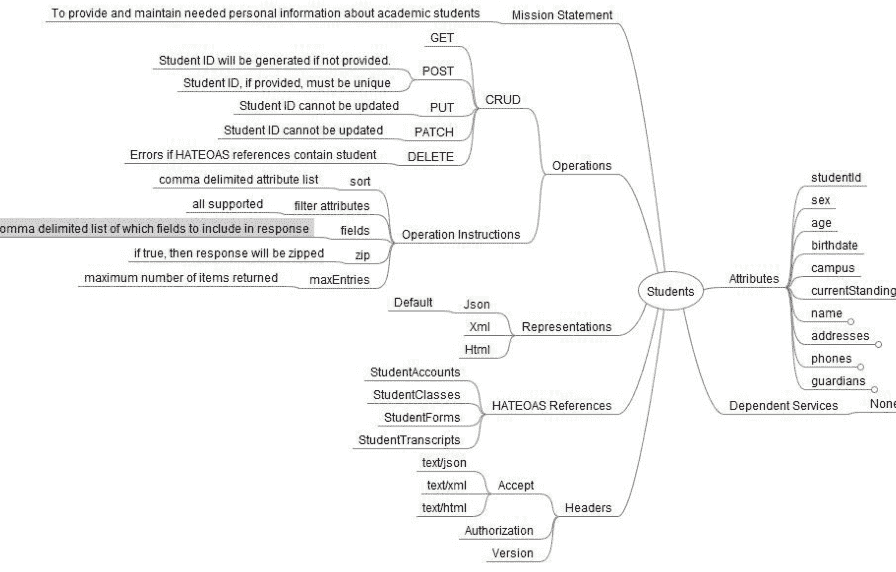

服务名称 `Students` 位于中心。左侧是该服务的业务术语描述。所有操作都详细列在左侧，展示了支持该服务的 HTTP 方法（例如：`PUT`、`POST`、`GET` 等）。右侧是支持这些服务的属性以及 HATEOAS 链接。这些 HTTP 方法的用途呈现在表 2.1 中。

## 表 2.1：HTTP 方法用途

| HTTP 方法 | 用途 |
|---|---|
| GET | 仅用于信息检索。假设资源不会发生变化。 |
| POST | 用于创建新资源。假设资源不存在且正在被创建。 |
| PUT | 用于更新资源。假设资源正在更新。 |
| PATCH | 用于资源的部分更新（例如，资源的属性）。 |
| DELETE | 用于删除资源。 |

从本质上讲，图 2.1 展示了这种核心服务的示例。核心服务通常以名词命名，因为大多数业务事实都是如此。用于识别 RESTful Web 资源的思维模式也可以用于识别核心服务。你通常可以将核心服务的“使命”表达为“关于 __ 的记录”。根据名词填入空白。使命声明的格式通常可以用以下格式表示：

<服务标题> 是 <业务术语> 的记录。

作为一个示例，考虑 2.1 中定义的学生服务：

学生服务是姓名、地址、年龄、紧急联系人等信息的记录系统。

让我们深入探讨一下 2.1 所示的示例。你可能会问我是如何决定将学生账户、学生课程、学生表格和学生成绩单（这些都是 HATEOAS 引用链接）拆分为独立服务的，以及为什么不直接将它们包含在学生服务中。答案是，每个服务引用中都存在特定于该部分的业务逻辑。例如，对于学生课程，为学生选课不仅仅是数据库某处的一条 CRUD。学生是否符合核心先修要求？这门课是否与学生已选的其他课程冲突？这些都是过程问题，最好与学生信息的其他方面分开。

与此相反的，是由学生服务维护的地址或电话。在这个虚构的世界中，记录学生地址或电话没有相关的业务流程。学生提供变更通知，我们记录即可。没有复杂的业务检查。这仅仅是一个类似 CRUD 的功能。因此，将其拆分为独立服务的动力几乎不存在。

我们将世界分为两类服务：核心服务和过程服务。

## 核心服务

核心服务存储关于企业的业务事实。它们负责维护特定区域业务数据。核心服务主要提供 CRUD 功能，且通常不依赖其他服务。无论我们如何对软件进行模块化，某些时刻需要在某种数据库中记录业务事实。核心服务在微服务架构中承担着这一角色。图 2.1 是这样一个服务的示例。

核心服务通常以名词命名，因为大多数业务事实都是如此。用于识别 RESTful Web 资源的思维模式也可以用于识别核心服务。你通常可以将核心服务的“使命”表达为“关于 __ 的记录”。根据名词填入空白。使命声明的格式通常可以用以下格式表示：

<服务标题> 是 <业务术语> 的记录。

作为一个示例，考虑 2.1 中定义的学生服务：

学生服务是姓名、地址、年龄、紧急联系人等信息的记录系统。

存储器，并且没有引用完整性规则防止来自其他服务的数据本质上处于孤立状态。因此，这需要在应用层面强制执行。另一种可能性是级联删除（向依赖服务发布相应的删除操作），这在本质上是危险的。

让我们注意图 2.1 中学生服务的更多特征。

- 严格遵守 HTTP 方法的严格定义。这里是对可用方法的简要总结。`GET` 请求用于检索信息；`GET` 请求永远不会更改任何业务数据（记录 `GET` 请求和响应是一项非功能性的、跨关注的支持性问题，不被视为更改数据）。这简化了你必须向实现契约的服务开发人员提供的通信。
- 严格遵守 HTTP 方法错误代码的严格定义。这些错误代码是标准化的。这里有这些错误代码的简要总结。就像遵循 HTTP 方法定义一样，这简化了你必须向实现契约的服务所提供的通信。
- 在所有微服务中标准化你的操作指令。在学生服务中，我定义了几个常见的操作指令：`sort`（排序）、`fields`（字段）、`maxEntries`（最大条数）。提供一项允许请求者按其指定的顺序接收请求数据的功能是常见的。不要允许某些微服务使用 `sort` 指令而另一些使用 `order`。这种非标准化会给消费者带来困惑，并阻碍提高开发速度的目标。

### 过程服务

过程服务管理复杂的业务任务。它们通常代表特定的业务动作或过程。通常，过程服务依赖其他服务获取处理所需的大部分数据。有时，过程服务需要持久化数据，但并非总是如此。

你通常可以将一个过程服务的“使命”描述为“负责处理 ________ 的服务”。例如，课程类服务负责为学生注册课程并报告学生选课情况。与核心服务示例类似，图 2.2 提供了 `StudentClasses` 服务契约的类似说明。

### 图 2.2：过程服务定义示例

注册 `classId` 并报告已有的课程注册

| 方法 | 描述 |
| :--- | :--- |
| GET | 如果未提供，将生成 `studentClassId` |
| PUT | `studentClassId`，必须唯一；只读属性不能更改；学生必须满足所有前提条件 |
| POST | 学生不能同时被安排到其他课程；学生和时间表分配（`scheduleAssignments`）必须有效 |
| CRUD | 如果学生欠有过去的费用，则无法注册课程；`studentClassId` 不能更新；只读属性有效；分配必须唯一 |
| Operations | 学生不能同时被安排到其他课程；学生和时间表分配必须有效，会导致错误，不支持部分更新 |
| PATCH | 删除分隔符界定的属性列表；所有支持的过滤器操作指令均可更新；限制返回的项目最大数量 |

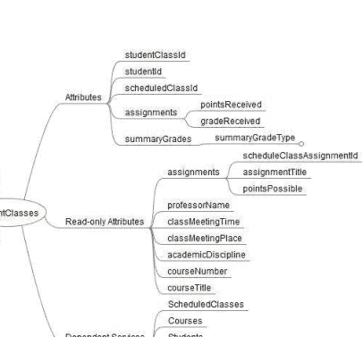

此定义的用格式与图 2.1 中的核心服务相似。让我们看看一些区别。首先，`StudentClasses` 服务对写操作执行了如以下所示的业务规则和约束：

- 学生必须满足所有课程的先决条件
- 学生不能同时被安排到其他课程
- 如果学生欠有过去的费用，则无法注册课程。

这些约束条件纯粹是业务层面的，需要在服务层面强制执行。

此外，并非所有显示的属性都是可更新的。图 2.2 区分了由 `StudentClasses` 服务维护的“属性”与为了方便消费者而展示、但实际上在其他服务中维护的“只读属性”。例如，如果消费者想要更改已安排课程的教授，他们应该通过 `ScheduledClasses` 服务来实现该更改。是的，为了方便而展示这些信息确实需要调用服务，这会对性能产生负面影响。我们将在书的后面讨论缓解这种性能影响的方法。

注意，`StudentClasses` 服务具有依赖性，不像图 2.1 中的学生服务。如果这些服务不可用，`StudentClasses` 服务可能无法正常工作。我们将讨论减轻这种性能影响的方法。

接受微服务架构增加了服务流量。

过程依赖其他服务来完成其工作。过程服务可能有数据库资源，但并非总是如此。

### 分区是一门艺术

决定服务边界或确定服务的使命具有欺骗性的困难。此外，我无法提供一个一个的公式来确定服务的使命。如果你定义得太宽泛，将会得到几个单体而不是微服务。如果你让服务操作过于细粒，将会导致过度网络往返，性能受损。

## 微服务与领域驱动设计

Evans 的领域驱动设计（DDD）概念在确定服务边界方面起着作用。DDD 将世界分为“领域”和“子领域”。领域是知识的领域。它们始终用业务术语表示，并且是纯分析的构造。子领域是领域的任意划分，它们也都是用业务术语表示的。在子领域内部划分了边界上下文。

DDD 中的边界上下文是存在于一个且仅一个子领域的任意边界。通常，边界上下文是一个物理构造，并且通常有部署表示。边界上下文之间的关系是显式定义的。边界上下文之间的关系是由独立服务管理的。核心微服务管理一个且仅一个边界上下文的数据。它们从不跨越边界上下文。

- 1. 客户关系管理（CRM）服务维护着目标营销的人员。这些人包括高中生、在其他大学就读的学生以及这些学生的家长。
- 2. 捐赠服务更新捐赠数据库，记录已捐赠或被请求捐赠的人以及收到的捐赠。这包括校友、校友家长、企业捐赠者以及任何可能被请求捐赠的人。

**使命声明不应包含技术术语。** 第一个例子中的 CRM 指的是一类软件产品。它是一个技术术语，不应成为微服务使命声明的一部分。第二个例子提到了“数据库”，这实际上是在微观层面管理信息的存储方式。微服务的技术实现细节应该是隐藏的。存储机制和特定的产品功能应该是私有的，并且可以在不另行通知服务消费者的情况下进行更改。

**微服务不应尝试维护多个业务概念的信息。** 捐赠服务（第二个反模式示例）在单个服务内部做了太多事情。微服务的初衷是只做一份工作并将其做好。该服务追踪可能被请求捐赠的候选人，*还有*捐赠金额。我会将追踪捐赠意向的业务与记录捐赠请求事件及收到的捐赠的业务分开。处理捐赠和记录以引导捐赠的交互的服务完全可以通过某种方式使用追踪捐赠意向的服务。

值得注意的是，虽然微服务只有一个*目的*，但它们可以被用于多个业务*语境*。例如，我们讨论的捐赠服务可能被某个识别营销目标的服务使用，或者被实施不同类型营销活动的服务使用。换句话说，单一的业务目的并不防止服务拥有多个消费者。

我会这样重写“CRM 服务”的使命声明：

- 营销意向服务是关于目标营销人员信息的记录系统。

除了多于句子外，CRM 服务使命声明还包含“CRM”一词，这是一个技术术语。CRM 应用不仅用于追踪营销活动中的客户和客户代表，还用于管理销售团队效率和不同类型的营销活动。没有必要将所有的 CRM 功能封装在与技术无关的微服务中。使用软件产品提供的部分功能并不稀奇。只需要创建需要被其他服务和应用程序使用的 CRM 功能部分。使命声明关注的是管理营销活动意向的 CRM 功能——“意向”是指潜在的客户或客户代表，他们可能成为某种类型的营销活动或客户交互的主体。

我会重写“捐赠服务”的使命声明并将其拆分为多个服务：

- 捐赠意向服务是可能被请求捐赠的人员的记录系统。
- 请求服务追踪向捐赠意向者请求捐赠的尝试。
- 捐赠接收服务追踪捐赠意向者的承诺以及实际收到的捐赠。

除了多于句子，对“捐赠数据库”的引用是一个技术构造而非业务术语。此外，“捐赠服务”面临着做得过多的危险。微服务只做一份工作并做好。该服务追踪可能被请求捐赠的候选人以及捐赠金额。我会将追踪捐赠意向的业务与记录捐赠请求事件及收到的捐赠的业务分开。处理捐赠和记录引导捐赠交互的服务可以通过某种方式使用追踪捐赠意向的服务。

## 上下文独立性检查

当其他团队出现并想要调用你的服务时，你会感到紧张吗？你开始问这类问题：

- 你们在我们之前和之后还调用了什么？
- 你们为什么要调用我们？
- 我们到底要参与哪一个业务流程，你们期望我们做什么？

这些都是红旗信号，说明你的服务并非真正独立于上下文。它对被调用的业务条件做出了假设。一个定义良好的服务应该对于何时/如何被调用是无关的。如果它有输入和资源，且输入是有效的，它就完成它的工作；仅此。当其他团队出现并想要调用你的服务时，你的反应应该是：“这里是文档。有问题请告诉我们。”

在这些方面还有更详细的问题：

- 你的服务是否有多个消费者？在没有影响的情况下可以运行吗？
- 你的服务是否关心它是批处理执行还是由用户 Web 应用间接触发？
- 你是否花时间分析服务之间的流？

## 故障设计

在传统架构中，大多数调用都是本地的。如果应用程序建立了调用，资源通常是可用的。在微服务中，服务依赖其他服务是很常见的。我们需要为依赖服务出现故障的情况进行设计。

容错设计分层进行。你的服务的第一道防线是水平扩展/集群。也就是说，在不同的虚拟机上运行多个服务副本，从而增加至少一个副本可用的概率。如果有多个副本，整个集群宕机的概率就较低。我们在传统应用程序中也是这样做。

集群宕机是有正当理由的。可能是为了维护而维护，或者它所依赖的资源完全宕机。结论是：在微服务世界中，水平扩展不足以防御故障。

逻辑结论是，如果依赖的资源不存在，服务应该尽可能地失败。这种失败将具有描述性，而且显然不是根因类型的问题。管理员能够快速查出根源，而不需要不可用服务的工作可以继续进行。这是性能调优中一个有趣的视角。

关于“立即且显式失败”这一概念的进一步阅读，可以参考 Jim Shore 的文章《快速失败》。

### 故障编码模式

本节描述了用于更快速失败并在无人工干预的情况下自动恢复的编码模式。

### 重试模式

重试模式简单地不断重试请求的任务，直到最终成功。这让我想起了那句老话：疯狂就是不断地做同样的事情，并最终获得不同的结果。该算法如图 2.3 所示。

图 2.3: 重试模式

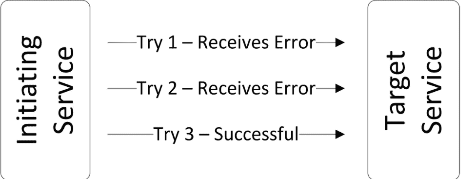

重试机制中通常有两个重试配置选项。可以在 GitHub 上的开源项目 Insanity 中找到重试模式的一个示例实现。

- 放弃操作前的最大重试次数
- 每次重试之间的时间间隔

对于想要开发者级别细节的人来说，Insanity 的默认算法提供了间隔和最大重试的配置选项。列表 2.1 提供了一个使用 10,000 毫秒重试间隔和 2 次最大重试的使用示例。Insanity 要求你将需要重试的代码嵌入实现 JDK `Callable` 接口的类中。是的，如果你愿意，Insanity 允许你编写接受不同配置选项的重试算法。

### 列表 2.1: 使用 Insanity 的 RetryAlgorithm 示例

```
DefaultRetryAlgorithm algorithm = new DefaultRetryAlgorithm(2, 10L);
RetryManager<String> retryManager = new RetryManager<String>(algorithm);
MyCallable callable = new MyCallable();
String call result = retryManager.invoke(callable);
```

重试模式基于故障是暂时的假设——最终会恢复服务，请求的操作将完成。重试模式在工作异步的情况下效果最好，请谨慎使用。在微服务世界中，我们不应该关心执行上下文。

该模式有产品支持。它由 Apache Httpclient 产品提供（因此 CXF 也有支持，因为它依赖于 Httpclient）。Spring batch 提供了一个实现此模式的 `RetryTemplate`。

### 断路器模式

这种模式是房屋或公寓中电路接线盒的软件版本。电路要么是关闭的，要么是打开的。如果它是关闭的，那么电路上的所有设备都有电并可以运行。当发生故障时，电路会跳闸并打开。在电路打开的状态下，电路上的任何设备都没有电或无法运行。当你重置配电盒中的电路时，该电路上的每个设备都会恢复电源。

断路器模式的工作原理是相同的。当遇到错误阈值时，它会跳闸并立即报错。在可配置的时间范围内，任何后续的调用也会立即报错。可以在我的开源 GitHub 项目 CircuitBreaker 中找到断路器模式的示例实现。

图 2.4: 断路器模式

电路处于“关闭”状态

电路跳闸并处于“打开”状态

电路处于“半开”状态

在可配置的间隔后，服务请求操作将作为“测试”通过。如果测试成功，电路将自动关闭并允许所有服务调用。换句话说，服务在没有人工干预的情况下自动恢复。

断路器的软件版本通常具有这些配置选项：

- 触发电路跳闸并关闭服务所需的连续错误次数。
- 关闭服务到允许“测试”服务调用继续之间的时间间隔。

对于想要细节的人来说，CircuitBreaker 的默认算法提供了时间间隔和连续错误次数的配置选项。列表 2.2 提供了一个使用 10,000 毫秒时间间隔和连续错误阈值的配置使用示例。Insanity 要求你将需要重试的代码嵌入实现 JDK `Callable` 接口的类中。如果你愿意，CircuitBreaker 允许你编写接受不同配置选项的算法。

### 列表 2.2: 使用 CircuitBreaker 的 Circuit algorithm 示例


```
DefaultCircuitBreakerAlgorithm algorithm = new DefaultCircuitBreakerAlgorithm(10L, 2L);
Circuit<String> circuit = new Circuit<String>(algorithm);
MyCallable callable = new MyCallable();
```

```
String callResult = circuit.invoke(callable);
```

`Circuit` 类保留了状态（例如，跟踪连续错误的数量，并知道何时允许测试执行），该变量声明实际上至少应该在实例级别。

Hystrix 产品套件中隐藏了该模式的产品支持。如果你出于其他原因使用 Hystrix 套件，你绝对应该利用他们的实现。如果不是的话，那个产品的开销非常大。在这种情况下，我会使用更窄的实现，比如我示例中的那种。

断路器的使用最好放置在客户端代理或适配器中。这样一来，当它跳闸时，你就可以避免调用的网络交互。

## 通过消息分发

我们将其用于传统的 Web 应用程序。其核心思想是将服务指令编码为消息并将其放在持久化队列中。即一个记录指令并保证的队列。

图 2.5: 通过消息分发

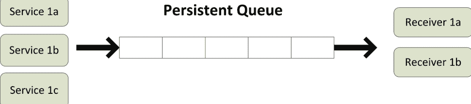

注意，这也是一种性能模式。虽然它并没有真正让工作变得更快，但它通过让工作异步为用户提供了速度提升的错觉。

## 服务调用中介者

服务应该具备部分运行的韧性。核心思想是提供降级服务优于提供无服务。一个例子是经营飞机上销售 WiFi 的业务。

图 2.6: 服务调用中介者模式

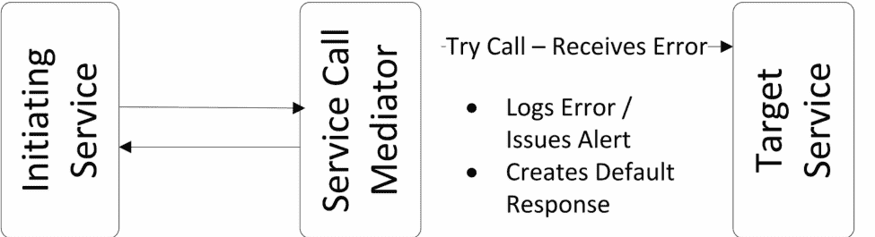

由于发起服务接收到默认/正常的响应，它会照常处理。发起服务中为了提供部分功能所需的代码量被到了最低。然而，从发起服务的角度来看，服务调用中介者记录了错误并启动了任何需要的支持。

对于想要更多代码级示例的人，列表 2.3 提供了一个使用 `TaskMediator` 的服务中介者模式示例。

### 列表 2.3: 使用 TaskMediator 的服务调用中介者算法

```
TaskMediator<String> taskMediator = new TaskMediator<String>(DEFAULT_RESPONSE);
MyCallable myCallable = new MyCallable();
String callResult = taskMediator.invoke(callable);
```

注意可以将中介者模式与断路器模式相结合。通过这种方式，你可以获得更早失败且消耗更少资源的处，同时也获得了提供部分功能的益处。使用 CircuitBreaker 实现此点的示例可以在列表 2.4 中找到。

### 列表 2.4: 结合服务调用中介者与断路器的示例

```
DefaultCircuitBreakerAlgorithm algorithm = new DefaultCircuitBreakerAlgorithm(10L, 2L);
Circuit<String> circuit = new Circuit<String>(algorithm);
MyCallable myCallable = new MyCallable();
CallableCircuit<String> circuitCallable = new CallableCircuit<String>(circuit,myCallable);
TaskMediator<String> taskMediator = new TaskMediator<String>(DEFAULT_RESPONSE);
String callResult = taskMediator.invoke(callable);
```

# 为性能设计

在微服务架构中，存在大量的网络流量。这种增加网络流量可能会让架构师对性能产生担忧。毕竟，与本地方法调用相比，服务调用的成本是非常高昂的。此外，由于架构师可能会“假设”微服务架构使用的是细粒度服务，这也会加剧他们的担忧。但这种假设是错误的。你从 SOA（面向服务的架构）中学到的所有关于粗粒度的知识仍然适用；但即使是粗粒度的服务调用，微服务架构也会导致网络流量的增加。幸运的是，我们可以使用一些设计策略来缓解服务调用流量增加对性能的影响。

## 性能优化的编码模式

有几种编码模式可以帮助缓解服务调用流量对性能的影响。我将带你介绍它们。

这些模式中的“通过消息分发”也是在前节中讨论过的一种失败设计模式，此处不再重复描述。它也是一种性能模式，通过离线工作，为用户提供了感知上的性能提升，因为他们看到的工作量变短了。

## 后端到前端（API 网关）

后端到前端模式通过确保微服务流量位于你的本地局网而非互联网上来提高性能。该模式使用网关服务来为 Web /用户界面产品整合微服务调用。其核心思想是应用程序的浏览器部分对其应用服务提供者进行一次或两次调用。该提供者将执行完成 Web 应用程序用户请求任务所需的多次微服务调用（直接或间接地）。

我使用“应用服务提供者”这一术语来描述整合了用户界面调用和响应的网关服务。

该模式的另一个名称是“API 网关”。然而，我不使用该术语，因为 API 网关模式与 API 网关产品（如 WSO2）之间存在通用混淆。API 网关产品关注的是路由和治理，而不是任何形式的调用整合活动。我专门指代这种模式。

应用服务提供者整合服务调用。也就是说，对它们的单独调用可能意味着对你微服务库中多个服务的调用。来自这些微服务调用的任何数据都会整合并返回给调用者。所有频繁的微服务流量都在你的本地网络上，由你的网络工程师进行适当调优。本地网络也可以进行适当扩展，为微服务架构所需的额外网络流量提供服务。

图 2.7：后端到前端模式

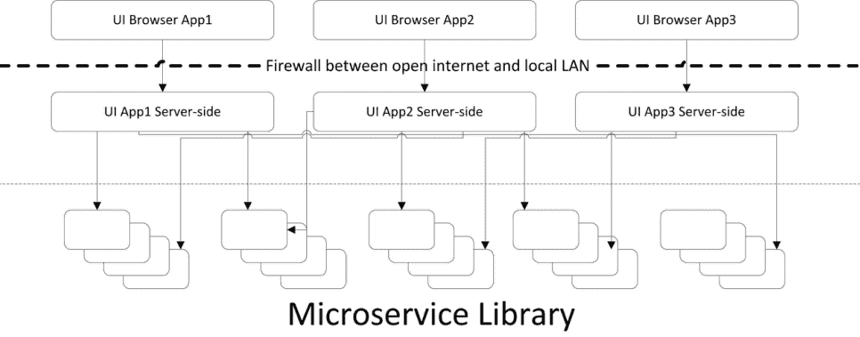

是的，这意味着整合后的调用可能会返回较大量的数据。让我们详细分析一下。服务调用中网络部分的成本可以分为两部分：与服务主机建立连接的成本，以及请求/响应的数据传输成本。通过整合服务调用，后端到前端大大减少了流量中的连接建立部分。

传输成本也可能降低，因为网关服务会筛选所有微服务的输出，并精简结果，使其仅包含特定 Web 应用程序运行所需的内容。例如，核心服务提供调用者不需要的业务主题信息，这并不罕见。“额外”信息会被应用网关管理器过滤掉，不会发送到浏览器。通过这种方式，成本中的数据传输部分得到了优化。

**不要将微服务流量直接暴露给浏览器。** 这是一个坏主意且是一种反模式。请使用后端到前端模式，而不是直接将你的微服务库暴露给浏览器。对于外部网站，你无法控制浏览器与服务库之间的网络。用户将根据其连接互联网的方式获得迥异的性能体验。你无法处于真正帮助他们的立场。仅仅由于这一个原因，所有的浏览器服务调用都应该被整合。

## 过期缓存

过期缓存模式有时被称为“旁路缓存”，它利用了组织中某些数据是静态的、不需要在每次需要时都新鲜读取的事实。其概念是对静态数据读取并缓存一段时间。在此期间，使用该数据的缓存版本，而不是从数据库中重新读取。

过期缓存模式是用内存换速度。该模式消耗内存用于缓存，但平均检索速度极快。

让我们来看一个例子。我的母校印第安纳大学有几个校区：布鲁明顿、印第安波利斯、南本等。每个校区的具体细节都是相对静态的；也就是说，大学很少在每次需要时都读取校园信息，因此它是过期缓存模式的逻辑候选者；特别是在微服务架构中，“读取”很可能是对核心服务的服务调用。

图 2.8：过期缓存模式

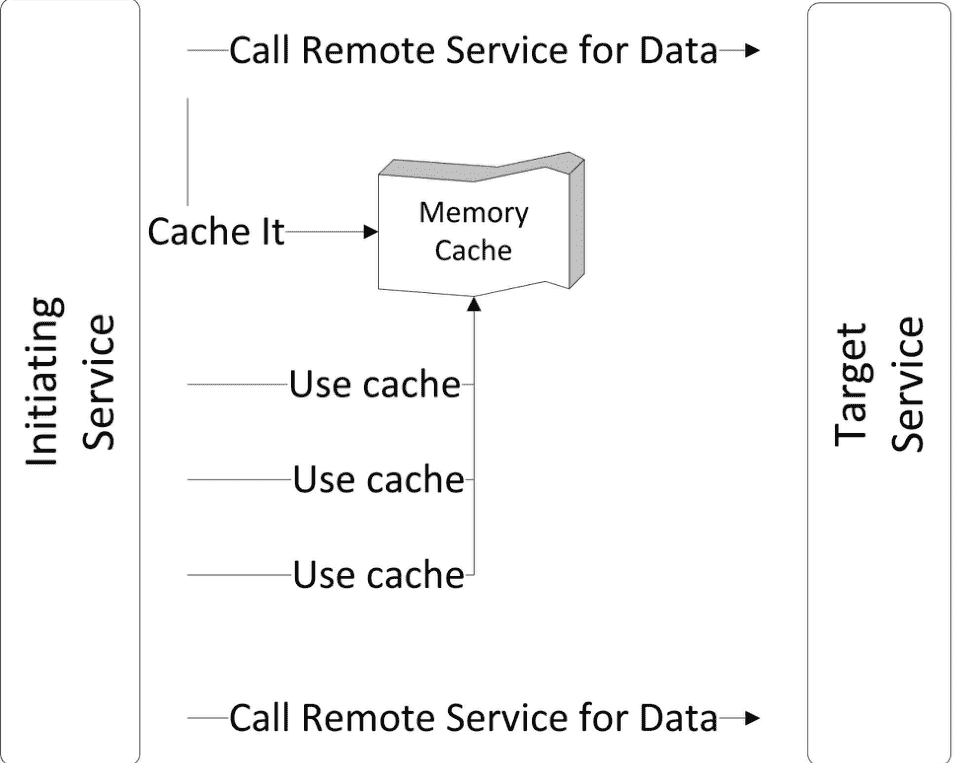

通常，过期缓存具有可配置的过期时间范围。将某些信息缓存较长时间（甚至是一天）可能是安全的，而其他类型的信息则需要在更短的间隔内进行刷新。

在消费服务中使用过期缓存服务，而不是将逻辑集中在目标服务中，原因有几点。性能的提升不仅来自避免数据库读取，还来自对核心服务的服务调用。其次，消费者更了解上下文，并理解当前缓存信息需要什么样的状态。某些服务可能比其他服务需要更实时的数据，并希望有更短的过期时间。

我使用 Google Guava 产品来实现过期缓存。关于 Guava 缓存如何工作的参考可以在此处找到。尽管如此，EHCCache 和其他产品也提供此项功能。到目前，真的没有必要自己实现。使用 Guava 实现过期缓存包含两个部分：扩展 `CacheLoader` 和定义缓存本身。

### 列表 2.5：Guava 定义示例

```
LoadingCache<Integer, String> sampleCache = CacheBuilder.new()
  .expireAfterWrite(100, TimeUnit.MILLISECONDS)
  .build(loader);
```

集群的不同节点可能有不同的答案，因为它们有不同的缓存计划。这通常是可以接受的，因为在使用微服务架构时，你必须接受“最终一致性”的概念。我们稍后会详细讨论这一点。你可能需要强制刷新 Guava 缓存，在缓存上执行 `invalidateAll()` 即可强制刷新。

## 设计完整性

在传统的 Web 应用程序中，我们拥有数据库事务的安全。如果发生错误，通常会执行数据库回滚，使数据库处于一致状态。在用户操作可能利用多个服务的微服务世界中，这种安全网并不存在，因为这些事务发生在由不同服务启动的多个中。是的，核心服务通常具有数据库事务安全网，因为它们的重点主要是 CRUD 相关的，但利用其他服务的处理服务没有。

## 自定义回滚

基本上，这种模式由在你的异常处理逻辑中发布反向事务组成。这种模式也被称为“补偿事务”。本质上，当发生错误时，会对任何可能成功的操作发布反向事务。例如：假设一个处理服务调用导致了对其他微服务的三个调用。假设第一个事务成功，但第二个失败了。在处理服务的异常处理逻辑中，它会对成功的事务发布反向服务调用。

保持数据处于一致状态。

图 2.9: 自定义回滚模式

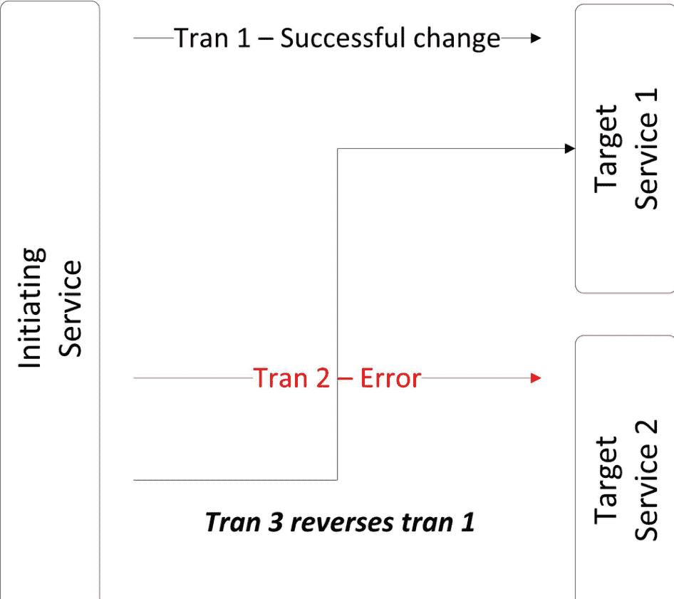

这种策略并非完美。反向事务也可能出错，或者在发布反向事务之前进程服务就会崩溃。无论何种，存储的数据都将处于不一致的状态，因此需要某种类型的修复。通常，这是手动完成的。

编写自定义回滚事务需要耗力，因此你不想在所有场景中都使用这种模式。基本上，你有两个选择：编写自定义回滚以减少对人工干预的需求，或者在错误发生时手动保持数据一致。通常，组织从人工干预开始，然后使用代码自定义回滚来处理故障频率最高的区域。

这种模式极其难以泛化并提供产品支持。反向事务所需的特定逻辑需要自定义编码。

## 管理服务版本

在传统的 Web 应用中，管理服务版本已经足够困难了。在微服务世界，随着服务数量呈指数级增长，问题也随之倍增。目前有两种流行的版本控制策略。第一种是直接将版本号放在服务的 URL 中。第二种允许客户端在请求头中请求服务版本。如果他们没有请求版本，则默认使用最新版本。我将介绍这两种版本控制方法。在此之前，让我们讨论不同类型的更改以及你作为服务生产者或消费者应承担的公民义务。

### 破坏性变更与非破坏性变更

**破坏性变更会导致现有服务调用报错的变更。** 破坏性变更强制消费者必须更改代码以避免错误。是的，你可以通过采用弃用策略（我稍后会讨论）来缓解这种影响，但尽管如此，你仍然强制了改变。根据定义，强制性变更对于消费应用团队来说，其优先级高于大多数其他任务，并可能抢占其他正在开发中的功能增强。从消费团队的角度来看，这种更改是如其来的，不像调度功能增强那样容易管理。

并不是所有的更改都是破坏性变更。如果一个请求主题信息的服务调用突然返回了几个额外的额外信息，这应该是一个非破坏性变更。它是非破坏性的，因为消费者不应该关注提供的额外信息，因为他们没有处理这些信息的逻辑。如果他们决定处理这些额外信息项，可以按照自己的计划来增强服务。事实上，他们可能根本不需要这些额外信息来增强服务。

**作为服务发布者，你的公民义务是仅在万万不得已的情况下引入破坏性变更。** 只有在绝对没有其他办法时才引入破坏性变更。尽管主观意良好，这种情况仍可能发生。可能是因为依赖的服务引入了破坏性变更，从而迫使你做出反应。可能是因为依赖服务所需的功能不再存在，导致某项功能无法再支持。也可能是组织决定废弃某项业务流程，结果是你需要引入破坏性变更来适应该业务决策。请注意，这可能不是导致破坏性变更的原因的完整列表。

**作为消费者，你的公民义务是忽略服务调用中返回的任何你不需要的信息。** 原因是，这会让你的消费端服务更具韧性，并且受你所调用的服务变化的影响更小。你不会受到结果集中新增或你真正需要的属性被移除的影响。这降低了你所调用的服务变化影响消费服务的概率。

**作为服务提供者，你需要建立一套弃用策略。** 也就是说，你不能仅仅引入一个破坏性变更就让消费者手忙脚掷地调整。在一段时间内，你需要同时支持旧服务*和*新服务。你还需要一种通信机制，允许你发布版本变更，并宣布特定版本将不再提供支持的时间点。

**版本控制*仅*适用于破坏性变更。** 非破坏性变更可以在相同版本下发布；如果更改是非破坏性的，提供者不应被迫维护独立版本。这激励了消费者忽略他们不使用的返回数据，因为这样当他们调用的服务得到增强时，可以将对其体验的影响降至最低。

这留下了几个问题。如果客户端实际上在管理自己从服务的*版本 a*到*版本 b*的迁移计划，那么就需要一种方法让客户端指定他们想要的服务版本。在提供者端，架构师需要一个合理的策略，在一段时间内支持服务的两个版本。我之所以说“两个”，是因为理想情况下，在任何时候你都应该有一个弃用版本和一个当前版本。

### 通过 URL 进行版本控制

一种流行的版本控制方法是通过 URL 进行的。也就是说，将版本号编码在 URL 的某处，让消费者在从*版本 a*移动到*版本 b*时更改其请求 URL。URL 版本控制示例可以在列表 2.6 中找到。

### 列表 2.6: URL 版本控制示例

- https://university.edu/services/Students-1.0/12345
- https://university.edu/services/Courses-2.1/PY101

通过 URL 版本控制最初看起来很有吸引力，因为 Web 服务器软件可以轻松支持。你可以部署多个版本的服务，Web 服务器软件可以将客户端路由到正确的版本。例如，Web 服务器软件可以轻松区分 `Students-1.0` 和 `Students-1.1`，并自动将客户端路由到他们请求的版本。当某个版本被弃用时，尝试使用它的客户端可以接收 426（“需要升级”的 HTTP 状态码）或被重定向。

如果你通过 HATEOAS 提供引用，就会出现问题，因为提供 HATEOAS 的服务需要感知所引用服务的版本变化。例如，如果 `Students-1.0` 提供指向 `StudentClasses-1.1` 的 HATEOAS 引用，当引入 `StudentClasses` 新版本时，该服务需要更改。这使得提供 HATEOAS 引用变得复杂且麻烦。

此外，你无法控制何时这些 URL 的何时。在提供和使用之间，编码可能已经被弃用了。这也是我倾向于通过头部进行版本控制（下文）的原因。

### 通过头部进行版本控制

一种版本控制方法是允许客户端在服务的请求头中请求特定版本。没有标准的头部名称可以解决这个问题。有人建议使用 ACCEPT 头来同时指定版本和预期的格式。对我来说，使用 ACCEPT 头是关注点的泄漏。ACCEPT 实际上是关于格式的。版本规范意味着除了 GET 之外的区别。列表 2.7a 和 2.7b 是通过头部进行版本的示例。

### 列表 2.7a: 示例

```
URL: https://university.edu/services/Students/12345
ACCEPT-VERSION: 1.0
ACCEPT: application/json
```

### 列表 2.7b 使用 ACCEPT 头进行版本的示例

```
URL: https://university.edu/services/Students/12345
ACCEPT: application/vnd.students.v1.0+json
```

我倾向于引入自定义头部，如列表 2.7a 所示，因为没有任何标准的头部名称适用于此。这也让 ACCEPT 可以自由指定格式，以防你的服务支持多种表现形式。例如，客户端在调用 Students 服务时可能会指定 `ACCEPT-VERSION=1.0` 请求头。如果该版本已被弃用，则最旧支持的版本将尝试满足请求。也许有效，也许可能无效。毕竟，如果消费者不听从你的弃用公告，他们得到什么就只能什么。如果消费者完全没有指定版本，他们将获得最新的可用版本。通过头部进行版本控制确实需要某种类型的路由器来查询头部值并将请求重定向到适当的版本。我不了解任何针对头部版本控制的产品支持，但对其进行泛化并提供是容易的。

图 2.10: 头部版本控制示例

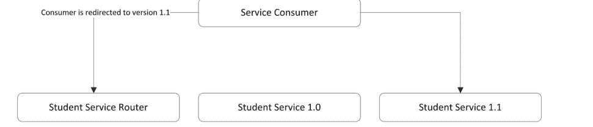

https://university.edu/students https://students_1_1.university.edu/students

**始终提供一个指示所提供版本的响应头（例如，`VERSION=1.1`）。** 由于版本号不是一个标准的响应头，因此需要自行引入它。这些信息对于用于诊断支持问题的消费者来说可能非常有用。

### 支持多版本部署

将所有版本都作为独立的应用程序部署。不要尝试在同一个服务中混合多个版本。这样做存在极大的风险，即无意中的更改可能会影响到之前的版本。此外，这会使服务代码变得复杂得多。


# 微服务版本部署与适配器服务

## 版本部署策略

分别对版本进行水平扩展。可以想象，不同版本之间的消费者负载可能是不完全相同的。例如，你的服务 1.0 版本的负载可能小于 1.1 或 1.2 版本。因此，集群的配置可能有所不同。如果你的集群由 DNS 轮询支持，请使用子域名来区分不同的版本（例如，`students_1_1.university.edu`）。

服务的所有版本应该使用相同的数据库。新版本中引入的功能增强可能需要对数据库进行重构，这会导致对服务旧版本的支持变得困难。《重构数据库》（Refactoring Databases）一书提供了许多可以帮助解决这些问题的模式。

这些概念的示例可见图 2.11。

### 图 2.11：版本部署示例

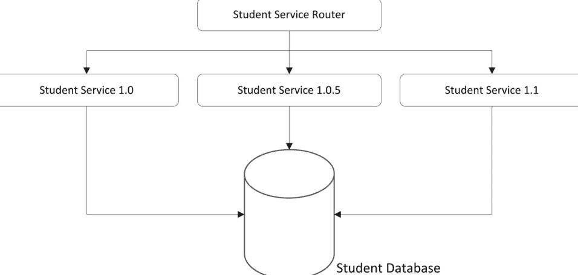

## 用于第三方产品的适配器服务

在传统的 Web 应用部署中，使用适配器来与第三方产品（SalesForce、Microsoft Dynamics、Great Plains 等）进行接口并不罕见。这些适配器在你的服务的内部领域模型与第三方产品使用的模型之间进行转换。

在微服务世界中，我们同样这样做。唯一的区别是适配器是一个完整的服务，而不仅仅是一个类。如果我们把适配器留为一组类，那么对第三方服务的更改（如产品切换或升级）将影响多个服务。这并不是这种世界所追求的。

**适配器服务必须是产品通用的。** 你的服务约中使用的产品领域模型的任何部分都代表了不必要的耦合。这样做的好处是，产品的切换或升级应*仅*影响适配器，而不影响其他任何地方。

**记录所有到第三方产品/服务的请求和响应。** 出于支持考虑这是必要的。如果你需要联系提供商寻求支持，你不希望通过谈论内部代码来混淆问题。弄清楚你在服务请求中需要修正的内容，并反向推导出你在代码中需要更改的内容。

**设计适配器以处理第三方产品或服务的故障。** 你无法直接控制第三方产品或服务的可用性或性能。因此，适配器服务实现断路器或调用中介者以便在第三方停机期间更优雅地运行是很常见的。

我经常被问到的问题之一是服务之间是否可以通用代码。答案是带条件的“可以”。底线是，对通用代码进行版本控制，并像对待 `Hibernate` 或 `Apache Commons Lang` 等第三方产品一样对待它们。由单个服务决定何时以及是否升级。

通用代码的更改或增强不能强制多个服务的部署。这会导致服务之间产生高度的耦合，从而违背了使用微服务架构的优势。因此，业务逻辑出现在通用代码中的情况很罕见。我们不希望业务的更改影响多个服务。

通用代码应该像你使用的任何第三方库一样进行版本控制。利用通用代码库的单个服务应该完全自由地决定何时升级到新版本。不应强制它们对通用代码产品进行升级。

# 第 3 章：微服务的交叉关注点

本章涉及所有微服务都必须解决的众多交叉非功能关注点，无论它们采用何种技术栈。这些交叉关注点包括能够有效地监控服务、检测故障以及诊断和修复报告的缺陷。满足非功能需求使得运维人员能够在微服务架构部署到生产环境后对其提供支持。某些需求存在于传统的 Web 应用中，但随着微服务部署数量的指数级增长，这些需求变得更加迫切。

无论采用何种技术平台或语言，所有微服务都应该满足某些非功能需求。通常，这些非功能需求也是交叉关注点。也就是说，它们并不特定于其提供的业务功能；它们的存在是为了让部署的服务更具维护性。作为架构师，我们应该建立复用且易于实现的方法满足非功能需求。本章将详细说明这些需求是什么，并提供轻松满足它们的选项。为了使微服务更容易被支持，微服务应该具备以下内容：

- 健康检查（通常通过 URL）
- 性能指标和告警
- 资源消耗告警
- 日志和错误处理
- 部署格式（例如 `Docker` 镜像）

所有这些非功能需求都应该是应用程序架构的一部分。单个服务团队不应该需要“开发”工具来满足这些任何一项需求。安装和配置，可以的；但开发，不需要。

提高支持团队的效率。随着微服务的实施使得部署单元的数量指数级增长，它也极大地增加了日志的数量和数据量。

## 为微服务开发并记录非功能性需求，并在企业范围内强制

无论特定的微服务选择了何种语言和工具，整个企业都需要能够利用该服务。这意味着能够部署它并监控其健康状况和资源消耗。

微服务团队负责确保其服务满足所有非功能性需求。实际上，这意味着选择对组织而言是“新”的技术栈固然是带有“税收”的，因为它需要提供满足非功能性需求的能力。对于新的技术栈，企业内部可能不存在处理非功能性需求的策略，需要对其进行识别并可能进行开发。理想情况下，采用企业新技术的微服务团队应该以一种其他人可以复用到其他服务的方式开发这种能力。例如，如果一个企业采用了 `JRuby` 框架并决定使用它编写微服务，则可能需要识别并建立整合健康检查、性能指标以及处理其他非功能性需求的能力。

## 健康检查

健康检查通常是一个 URL，提供某种指示表明服务正在响应并能够履行其功能。该 URL 由某种监控工具（例如 `Nagios`）调用，如果健康检查失败，该工具能够向管理员发出报警。最简单的报警是微服务的 `JVM` 未响应。问题随变为：你对“响应”的定义是什么？通常，仅响应 `HTTP 200` 是不够的。

除了验证服务本身能够无错误地响应 URL 之外，我还喜欢检查对外部资源和依赖项的访问。例如，我喜欢检查数据库连接池的健康状况。是的，数据库和其他外部资源也应该通过独立的健康检查进行监控，但检查用于数据库访问的连接池的健康状况，也可以验证连接池的大小对于服务当前处理的事务量是否合适。这种检查只能在微服务进程内部执行，无法从外部进行有效监控。这种情况在传统的 Web 应用程序中也会发生，对于微服务来说并不新奇。

无论你编写的微服务使用了何种技术栈，健康检查都应该是企业提供的应用程序架构的一部分。没有理由服务生产者不构建自己的检查。我通常利用 `Dropwizard Metrics` 库来编写健康检查代码。

寻找此类健康检查代码级示例的人可以在此处找到。此示例检查连接池，以验证等待数据库连接的事务数少于一个可配置数字（默认为三）。也就是说，如果有太多的事务等待数据库连接，那么该服务就是健康的，因为消费者正遭受性能问题。在这种情况下，连接池可能需要根据服务处理的负载重新调整大小。此外，我还会验证池中的连接，以确保不仅数据库是用的，而且服务与数据库之间的网络连通性也是可用的。

## 性能指标与报警

性能指标有助于开发者调查性能问题。我会跟踪性能指标，对于传统的 Web 应用程序也包括应用中每个页面的性能。在收到关于性能缓慢的模糊报告时，如果有历史数据，那么确切知道当前性能与历史性能相比处于什么水平是非常有用的。更重要的是，它还能加速性能调查。

在微服务架构下，用户操作可能涉及多个服务。定位性能问题（即确定是哪些服务导致了该性能问题）会变成一个耗费时间的问题。掌握所有服务的性能数据将极大地节省开发者的时间。

传统 Web 应用程序的性能更容易衡量。通常，性能指标是在 URL/网页级别收集的。用于收集传统 Web 应用程序单个页面/URL 性能指标的工具非常胜许多。我使用 `Admin4J`，但也有其他产品选择。

对于 `RESTful Web` 服务，性能测量稍微困难一些，因为 URL 包含标识符，且行为随操作（`GET`、`POST`、`DELETE` 等）而不同。详细来说，对于 `RESTful Web` 服务，按严格的 URL 进行衡量没有意义，因为 URL 包含数据标识符。例如，分别衡量 URL `/students/1` 和 `students/2` 的 `GET` 操作是没有意义的。它们是相同的查询，只是针对不同的学生。如果对整个通配符 `/students/*` 进行合并测量效果会更好。如果你的服务提供了返回相关项的选项，这会变得更加困难。例如，如果服务支持 `/students/1/classes`，那么课程搜索结果的行为将与学生搜索结果不同，对它们进行区分是有用的。`Admin4J` 会合并 `RESTful Web` 调用的性能指标；在我写这些时，我还没有发现其他能实现此点的产品。

至少，要衡量每个服务的平均调用时间和总调用次数。由于大多数微服务架构项目拥有大量的部署单元，了解调用次数可以让你集中精力对最频繁使用的的服务进行调优。平均调用时间有助于在用户操作涉及多个服务时定位性能问题。虽然我习惯于拥有调用时间的最小值、最大值和标准差，以及平均值和总数，但这些信息的用性较小，可以视为可选的。

为超过可配置阈值的服务时间设置自动报警。这允许开发者在用户报告之前开始主动诊断并修复性能问题。为每个服务确定一个合理的阈值将涉及某种程度的尝试。阈值过低会产生虚假报警，或者产生并非指示实质性性能问题的报警。

## 资源消耗报警与响应

`JVM` 内部存在一些资源消耗问题实际上是服务问题，它们本应该发生。

监控部署服务的内存使用情况。当你查看 `JVM` 分配的内存时，进程级别的聚合内存并不是相关的，因为测量包含了未使用的原生内存。最相关的是 `JVM` 内部的消耗和可用内存。我使用 `Admin4J` 监控内存使用并发布报警，但也有其他可用工具。

**仅记录一次异常。** 多次记录异常会极大地膨胀日志文件，并使得与报告缺陷相关的特定异常变得难以查找。你可以通过仅在入口点记录异常来避免重复日志消息的问题。例如，实现一个 `servlet filter` 非常简单，它可以记录任何 Web 事务的异常。这确保了异常只被记录一次。此建议假设你已经在本章之前描述的那样，将解决错误所需的任何附加信息封装在异常本身中。列表 3.2 展示了此类 `servlet filter`。

### 列表 3.2：Servlet 过滤器日志示例

```java
public void doFilter(ServletRequest request, ServletResponse response, FilterChain chain) throws
 IOException, ServletException {
    try (chain.doFilter(request, response));
    catch (Throwable t) {
        logger.error("Web Transaction Error", t);
        ServletUtils.reThrowFilterException(t);
    }
}
```

Source: Class `net.admin4j.ui.filters.ErrorLoggingFilter` From Admin4J (http://www.admin4j.net)

这种技术减少了应用程序代码，并增加了生成的异常被记录的概率。此外，如果你利用具有错误处理过滤器的 `Admin4J` 产品，你将获得异常发生时的请求 URL 以及任何请求和会话（`session`）属性的转储。换句话说，你可以利用开源产品来实现这一点，而不是为了此目的创建自己的 `servlet filter`。

顺便提一下，你还需要为批处理作业类、`EJB` 类和消息驱动豆（`Message-Driven beans`）提供类似的架构支持。将异常日志留给应用程序代码会增加异常无法被正确记录的概率。

**不要将事务日志与普通应用程序日志一起提交。** 事务日志（例如，用户 Fred 更改了客户 Acme 的地址）具有不同的目的。通常，普通业务流程需要事务日志，它们并不是针对产品支持的。大多数日志产品都允许你为了此目的将事务日志重定向到单独的输出。

注意，日志保留和存储问题是一个完全独立的话题。大多数日志产品支持以多种格式存储日志，包括文件或数据库格式。应用程序代码应该只关注发布日志消息，而不应关注如何存储的具体细节或保留多久。

**提供一个可以在部署时进行覆盖的默认日志配置。** 这纯粹是为了开发者的便利，他们可能需要运行构建，但可能没有花精力配置本地部署。此外，开发人员无法预测特定部署的日志需求。因此，管理员能够在部署时轻松地配置日志至关重要。

## 发布变更事件

鉴于每个微服务都有自己的数据库，对于多个服务共同需要的通用业务数据，有两种方案。（我之前在这里强调过这个问题。）第一种方案（也是我偏倾向的方案）是不复制通用数据，而是在需要时调用维护该数据的服务。第二种方案是将通用业务数据“复制”到所有服务，而不是嵌套服务调用，复制通常通过发布/订阅（`publishing/subscribe`）消息机制完成。

负责维护通用业务数据的微服务将在已建立的主题（`topic`）下以一致的格式发布任何更改（例如：添加、更改或删除）。例如，大学中负责维护园区信息的服务（例如 `Campus` 微服务）可能会在 `CampusEvent` 主题下发布新校区的添加或现有校区状态的变更。

感兴趣的服务都会订阅该主题并处理任何发布的更改。通常，监听这些更改的服务需要发布一个监听器（`listener`）来监控该主题。例如，一个课程（`Course`）微服务可能会监听 `CampusEvent` 主题并处理收到的任何更改。课程微服务会将收到的任何更改记录在自己的数据库中。

**开发一种从源刷新复制数据的方法。** 复制过程也存在缺陷。当这种情况发生时，数据的“副本”将不同步。在我们的示例中，如果由于原因丢失了事件，或者课程服务在记录更改时出错，那么课程服务中的园区信息副本将与 `Campus` 服务所拥的不符。由于所有代码都有缺陷，如果你在服务之间复制数据，这个问题就会发生。因此，支持开发人员需要一种方法在数据副本损坏时对其进行刷新。

## 微服务的打包选项

在过去的几年里，在传统的 Web 应用程序部署中，某些组织在每个容器中部署多个 Web 应用是常见做法。这通常是由于商业容器的许可费用导致的，从而尽可能减少容器的数量。这种组合策略在微服务世界中是不存在的。微服务作为独立的进程部署，并运行在独立的 `JVM` 中。

有多个产品可以方便将 Java 服务部署为单个进程。在本书期间，最流行的两个产品似乎是 `Spring Boot` 和 `DropWizard`。是的，还有其他产品，且它们运行良好，我专注于专注于写作时最流行的两个产品。

除了这两个产品之外，我还将讨论一种对微服务非常有用的虚拟化产品；它被称为 `Docker`。`Docker` 标准化了进程并提供了支持服务部署的工具。我们将看到 `Docker` 在解耦开发人员与运维方面发挥了巨大作用。

### Spring Boot

`Spring Boot` 将 Web 应用程序打包成单个可执行的 `jar` 文件，可以通过单个命令执行：`java -jar myFunction.jar`。

该可部署的 `jar` 包包含一个嵌入式容器（`Tomcat` 或 `Jetty`），并包含了运行你的应用程序所需的每个依赖类。

除了你的服务之外，`Spring Boot` 还要求你创建一个实现 `main()` 方法的应用程序类，以便可以从命令行运行它。该应用程序类处理大多数配置项（连接池、线程数等）。此外，你还可以添加特定于应用程序的属性。`Spring Boot` 使用类路径下的 `application.properties` 文件。

如果你使用像 `Slf4j` 这样的日志抽象，提供默认日志配置就像在 `Spring Boot jar` 中包含一个 `logback.xml` 文件一样简单。`Spring Boot` 已经将 `Logback` 列为依赖，因为它是默认使用的日志 API。由于日志配置在这一层实际上是默认的，我将所有输出发送到控制台。我不希望对程序运行的位置做出任何文件或磁盘的假设。这些决策是在部署时逻辑上做出的。

`Spring Boot` 有一种使用 `application.properties` 文件配置数据库连接池的方法。参考文档有一个完整的列表，我在列表 3.5 中包含了一个示例。

### 列表 3.5：Spring Boot 连接池 application.properties

```properties
### Connection pool definition
spring.datasource.driver-class=org.hsqdb.jdbc.JDBCDriver
spring.datasource.name=testdb
spring.datasource.url=jdbc:hsqdb:mem:my-sample
spring.datasource.username=SA
spring.datasource.password=
spring.datasource.continue-on-error=true
#### Pooling properties
spring.datasource.max-active=5
spring.datasource.min-idle=1
spring.datasource.test-on-borrow=true
spring.datasource.test-on-return=false
spring.datasource.test-while-idle=false
spring.datasource.time-between-eviction-runs-millis=1
spring.datasource.validation-query=SELECT CURRENT_DATE AS today, CURRENT_TIME AS now FROM (VALUES(null))
```

在高并发部署中，通常需要配置更低级的容器设置，即容器工作线程的最小、最大和空闲超时设置。在高并发部署中，我还有其他想要关注的设置，但在这里我想说明你如何使用 `Spring Boot` 来这些操作。这可以通过重写应用类中的 `servletContainer` 方法来实现。这种如何操作的示例可以在我的示例以及列表 3.6 中找到。

### 列表 3.6：Spring Boot 容器配置示例


```java
@Bean
public EmbeddedServletContainerFactory servletContainer() { // JettyEmbeddedServletContainerFactory
    JettyEmbeddedServletContainerFactory factory = new JettyEmbeddedServletContainerFactory();
    factory.addUserCustomizers(new JettyServerCustomizer() {
        public void customize(final Server server) {
            // Tweak the connection pool by Jetty to handle incoming
            // HTTP connections
            Integer localMaxThreads = deriveValue(serverMaxThreads,
                DEFAULT_SERVER_MAX_THREADS);
            Integer localMinThreads = deriveValue(serverMinThreads,
                DEFAULT_SERVER_MIN_THREADS);
            Integer localIdleTimeout = deriveValue(serverIdleTimeout,
                DEFAULT_SERVER_IDLE_TIMEOUT);

            logger.info("Container Max Threads: {}", localMaxThreads);
            logger.info("Container Min Threads: {}", localMinThreads);
            logger.info("Container Idle Timeout: {}", localIdleTimeout);
            final QueuedThreadPool threadPool = server.getBean(QueuedThreadPool.class);
            threadPool.setMaxThreads(Integer.valueOf(localMaxThreads));
            threadPool.setMinThreads(Integer.valueOf(localMinThreads));
            threadPool.setIdleTimeout(Integer.valueOf(localIdleTimeout));
        }
    });
    return factory;
}
```

来源：`org.moneta.config.spring.MonetaSpringBootApplication` 来自 Moneta (https://github.com/Direk-Ashmore/moneta)

Spring Boot 有了一个名为 Actuator 的扩展，用于健康检查、性能指标和诊断。如果你在使用 Spring Boot，就应该使用 Actuator。注意，如果你的应用程序有自定义的健康检查，编写一个让这些自定义健康检查与 Actuator 适配的适配器是相对容易的。只需要实现 `HealthIndicator` 接口，该接口需要一个方法。你可以在这里找到一个示例。

### Dropwizard

Dropwizard 将 Java Web 应用打包成单个可执行的 jar 文件，可以通过单个命令执行：

`java -jar MyApp.jar server MyAppConfig.yaml`

这个可部署的 jar 包包含一个嵌入式的 Jetty 容器，并包含了运行应用程序所需的所有依赖类。注意，Dropwizard 还需要额外的参数。`server` 参数指定应用程序将作为 HTTP 服务器运行。yaml 文件输入是你的配置。虽然不是严格要求的，但它是列出容器配置项的地方。

与 Spring Boot 一样，Dropwizard 需要一个带有 `main()` 方法的应用程序配置类，该方法加载应用配置、安装健康检查并激活性能指标收集和 JMX。你可以在这里找到一个 Dropwizard 应用类的示例。

应用类还定义了应用程序所需的任何 servlet 或过滤器。在这个世界中，servlet 和过滤器并不是定义在 `web.xml` 配置文件中的。一个 servlet 配置示例可以在列表 3.7 中找到。一个过滤器配置示例可以在列表 3.8 中找到。

### 列表 3.7：Dropwizard Servlet 配置示例

```java
ServletHolder topicHolder = new ServletHolder(Source.EMBEDDED);
topicHolder.setHeldClass(MonetaServlet.class);
topicHolder.setInitOrder(0);
topicHolder.setInitParameter(
    MonetaServlet.CONFIG_IGNORED_CONTEXT_PATH_NODES, "moneta,topic";
    environment.getApplicationContext())
.getServletHandler()
.addServletWithMapping(topicHolder, "/moneta/topic/*");
```

来源：`org.moneta.config.dropwizard.MonetaDropwizardApplication` 来自 Moneta (https://github.com/Derek-Ashmore/moneta)

### 列表 3.8：Dropwizard 过滤器配置示例

```java
FilterHolder perfFilterHolder = new FilterHolder(Holder.Source.EMBEDDED);
perfFilterHolder.setHeldClass(MonetaPerformanceFilter.class);
perfFilterHolder.setInitParameter(
    MonetaPerformanceFilter.PARM_MAX_TRANSACTION_TIME_THRESHOLD_IN_MILLIS,
    "3000",
    environment.getApplicationContext())
.addFilter(perfFilterHolder, "/moneta/*", null);
```

来源：`org.moneta.config.dropwizard.MonetaDropwizardApplication` 来自 Moneta (https://github.com/Derek-Ashmore/moneta)

```
evictionInterval: 5 seconds
### Validation behavior
validationQuery: SELECT CURRENT_DATE AS today, CURRENT_TIME AS now FROM
(VALUES(0))
checkConnectionWhilele: true
checkConnectionOnBorrow: false
checkConnectionOnConnect: false
checkConnectionOnReturn: false
validationInterval: 30 seconds
```

顺带提一下，Dropwizard 配置允许指定相关的时间单位，而不是假设使用通常不方便的“毫秒”。除了毫秒，它还支持秒、分钟、小时、天等。这些信息是从 Dropwizard 源码（`dropwizard-util` 中的 `Duration` 类）获取的；我没有在任何地方找到相关文档。

当需要配置较低层级的容器设置时，Dropwizard 提供了一种使用输入 yaml 配置文件来实现的方法。这里提供了提供的设置列表。关于如何实现此点的示例，可以在我的示例以及列表 3.11 中找到。

### 列表 3.11: Dropwizard 容器设置示例

```
### Container settings
server:
  type: default
  maxThreads: 150
  minThreads: 20
  maxQueuedRequests: 20
```

### Docker

像 Spring Boot 和 Dropwizard 等产品依赖于操作系统和 java 安装才能运行。在大多数组织中，java 安装是多个应用程序共享的。对该 java 安装的任何升级都存在影响多个应用程序的风险，并产生意想不到的后果。换句话说，这种安装是微服务世界中并不需要的耦合类型。Docker 消除了这种耦合，也消除了该 java 应用所依赖的任何相关原生代码的耦合。

Docker 部署可以被看作是一个微型虚拟机。它带有完整的操作系统（一个 linux 内核）以及产品运行所需的所有原生软件。Docker 部署可以包含为该部署服务的 java JDK 安装，并且可以升级该 java JDK，而无需担心会影响多个服务。从本质上说，它提供了升级保障。我们这些在大型企业环境中工作过的人知道，升级 Java 版本是一项非常庞大的工程，因为这种升级固涉及到大量的测试工作。将 java 安装与你的部署包在一起在很大程度上缓解了这些担忧。

Docker 已经成为一种受欢迎的部署格式。对于那些还没有使用过 Docker 的人来说，它是“一次打包，到处运行”。Docker 对软件起的作用就像集装箱对有形货物的作用一样。它为磁盘和网络提供了标准的连接机制。此外，将 Docker“容器”连接在一起很容易（例如，将数据库 Docker 容器与你的应用程序连接）。

这不仅对于系统管理员来说是一个胜利，因为它使得部署管理更简单、更容易自动化；对于 Java 开发者和架构师来说也是胜利。由于应用程序环境是可选的并与应用程序打包在一起的，特定环境的问题和缺陷大大减少了。在生产环境中运行的内容与你测试的内容更加相似。此外，由于你的应用程序运行在自己的 Java 版本和操作系统上，你可以升级 JDK 和你所依赖的任何原生代码，而不必太担心影响其他应用程序，甚至不需要让系统管理员来更改原生软件。

抛开之前的炒作之后，使用 Docker 也有成本和缺点。在 Linux 上运行 Docker 及其相关工具要容易得多；Windows 的支持有限。这一事实在大多数通常在 Windows 上进行开发的企业环境中也造成了不便。在添加 maven 功能以生成 Docker 镜像时，平台差异也带来了问题；maven 构建在理论上应该是与平台无关的。此外，Docker 确实有一个学习曲线。

有些人可能担心额外的虚拟化层会导致性能问题。然而，IBM 进行了一项良好的研究，显示性能影响是可以忽略不计的。总而言之，使用 Docker 的优点大于成本。

对于 Maven 用户来说，有几个 Maven 插件可以将 Docker 镜像作为产物生成。在本文期间，我最喜欢 Spotify 的 `docker-maven-plugin`。它非常容易使用和安装。你可以在我 GitHub 上 Moneta 微服务示例的这个 pom 中找到用法示例。

### 事务跟踪

在传统的 Web 应用程序中，更容易跟踪整个业务流程。异常的堆栈跟踪（stack traces）更有意义，因为给定事务的代码库通常是完整的。

在微服务世界中，情况并非如此。在一个业务事务可能利用多个服务的世界里，跟踪所有事务的历史变成了一个必要项。跨服务调用跟踪事务的常用方法是通过关联 ID（correlation id）。

在事务开始时，会分配一个唯一的事务 ID（或关联 ID）。然后将生成的 ID 随事务一起记录在所有日志条目中。该事务产生的任何服务调用都应该在头中包含关联 ID，以便它可以记录在任何活动中，包括对依赖服务的调用。

图 3.1: 关联 ID 示例

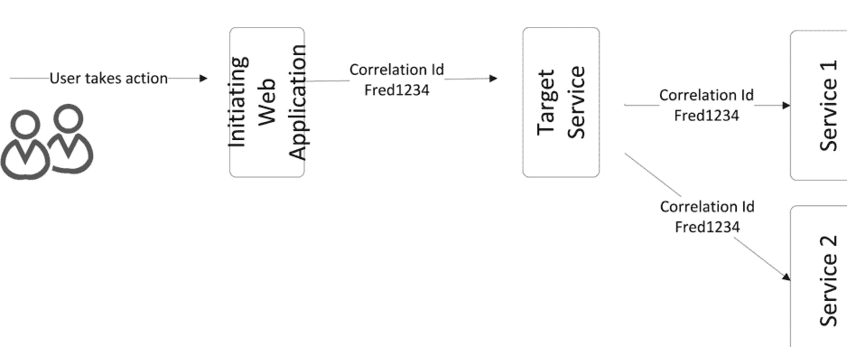

其核心思想是确保事务的任何日志消息都包含关联 ID，这样可以将日志组合起来，提供特定用户操作发生情况的完整图景。日志产品将此称为映射诊断上下文或 MDC。将 MDC 视为事务的线程本地上下文（thread local context）。当事务开始时，你通过程序代码使用 MDC 记录关联 ID。这通常通过 servlet 过滤器（filter）或 Spring 拦截器（interceptor）来实现。你还在日志配置的模式布局（pattern layout）中指定 MDC 信息，以便该 ID 能被报告。一个确保设置了关联 ID 并使用 Slf4j 通过 MDC 记录它的 servlet 过滤器示例可以在这里找到。

### 列表 3.12: Servlet 过滤器关联 ID 示例

```java
void doFilter(ServletRequest request, ServletResponse response,
        chain) throws IOException, ServletException {
    HttpServletRequest httpServlet = (HttpServletRequest) request;
    // 确保分配了关联 ID。
    String correlationId = httpServlet.getHeader(correlationHeader);
    if (StringUtils.isEmpty(correlationId)) {
        correlationId = UUID.randomUUID().toString();
    }
    // 将关联 ID 记录到 MDC：
    MDC.put(loggerName, correlationId);
    try {
        chain.doFilter(httpServlet, response);
    } finally {
        // 从 MDC 中移除关联 ID
        MDC.remove(loggerName);
    }
}
```

例如，假设关联 ID 记录在 MDC 的 requestId 中。该 requestId 可以在你的日志配置的模式布局中指定。一个允许关联 ID 与任何日志一起输出的 logback 配置可以在 3.13 中找到。

### 列表 3.13: Logback 模式示例

```xml
<appender name="STDOUT" class="ch.qos.logback.core.ConsoleAppender">
  <!-- 器默认分配类型 ch.qos.logback.encoder.PatternLayoutEncoder -->
  <pattern>%d{HH:mm:ss.SSS} [%hostname] [%thread] %-5level
  %logger{36} REQUEST_ID=%X(requestId) - %msg%n</pattern>
</appender>
```

关于 Slf4j 的 MDC 实现的信息可以在这里找到。Logback 和 Log4j 都支持 MDC 功能。

从 Java 角度来看，该算法至少包含三个部分。通常，会有一个 servlet 过滤器来确保每个事务都有关联 ID。如果没有，则生成并分配一个。此外，过滤器将关联 ID 注册到所使用的日志框架中，以便该信息包含在日志条集中。

其次，日志格式需要在所有日志条目中包含关联 ID。所有主要的框架都支持这个概念。

第三，所有输出的服务调用都需要在头中包含关联 ID。遗憾的是，所有的实现都是特定产品的。这取决于所使用的 Web 服务框架。对于 Apache HttpClient 产品，你应该将关联 ID 添加到头中。

## 远程调用的异常处理

在微服务架构中，定位问题通常是巨大的花费了大量的支持时间。你可以采取一些简单的步骤来减少在定位问题上所花费的精力。

## 使用带上下文的异常 (Contexted Exceptions)

Apache Commons Lang V3 及更高版本提供的带上下文异常包含 `ContextedException` 和 `ContextedRuntimeException`。这些异常使得在异常中包含信息变得非常容易，便于支持开发人员诊断根本原因。列表 3.14a 提供了如何使用 `ContextedRuntimeException` 的示例。列表 3.14b 提供了异常在日志中报告时的示例输出。如你所见，在日志中提供额外信息不会引入风险（例如防止空指针）或格式化异常消息的劳动负担。

### 列表 3.14a：ContextedRuntimeException 使用示例

```
throw new ContextedRuntimeException("Error adding customer", rEx)
.addValue("accountId", accountId)
.addValue("accountType", accountType)
.addValue("customerName", customerName);
```

### 列表 3.14b：ContextedRuntimeException 日志输出示例

```
org.apache.commons.lang.3.exception.ContextedRuntimeException: Error adding customer
Exception Context:
[1:accountId=12345]
[2:accountType=PERSONAL]
[3:customerName=null]
```


```
at examples.commons.lang.context.ContextedRuntimeException.test(ContextedExceptionTest.java:18)
at sun.reflect.NativeMethodAccessorImpl.invoke(NativeMethodAccessorImpl.java:57)
at sun.reflect.DelegatingMethodAccessorImpl.invoke(DelegatingMethodAccessorImpl.java:43)
at java.lang.reflect.Method.invoke(Method.java:606)
at org.junit.runners.model.FrameworkMethod$1.runReflectiveCall(FrameworkMethod.java:50)
-- Output omitted for brevity
```

记录失败调用的请求和响应。包含与调用相关的请求和响应，这样当需要与支持被调用服务的小组进行通信变得必要时，你已经拥有了该小组诊断问题所需的所有信息。为了说明这有多用：在过去的一个客户项目中，我们对所有远程服务调用都实现了这种做法，结果我们能够 100% 地定位问题并识别出哪个服务出了问题。此外，开发者节省了时间，因为他们有一个现成的测试用例可以在本地执行和调试。使用 `Apache HttpClient` 产品实现此目的的示例可以在列表 3.15 中。

### 列表 3.15：HttpClient 异常示例

```java
public static CloseableHttpResponse execute(String requestURL, Map<String, String> headerMap) throws {
    Validate.empty(requestURL, "Null or blank requestURL was not allowed.");
    HttpRequest requestURL = new HttpGet(requestURL);
    for (String header : headerMap.keySet()) {
        requestURL.addHeader(header, headerMap.get(header));
    }
    CloseableHttpClient httpClient = HttpClientClients.createDefault();
    try {
        HttpResponse response = httpClient.execute(requestURL);
        logger.info("Service Request Execution.uri={} nheaders={} response={}\n", requestURL, headerMap, response);
    } catch (Exception e) {
        throw new ContextualRuntimeException(
            "error making RESTful web service call", e)
            .addContextValue("requestURL", requestURL)
            .addContextValue("headers", headerMap);
    }
    return response;
}
```

有些人会更进一步，建议捕获配置时长内的所有请求和响应。这有助于调试没有产生异常的问题，即导致错误行为但没有抛出异常的问题。拥有一个可搜索的请求/响应库将在开发者调查支持问题时节省时间。

## 服务安全

安全是分层实现的。每一层都代表了攻击者的一个“障碍”。受保护资源越敏感，在其周围设置的安全层就越多；使得对受保护资源的未经授权访问变得更加困难。这是我们随处利用的基本安全概念。作为一个安全层的简单示例，组织使用防火墙在内部资源周围设置安全级别；你必须至少拥有防火墙的内部访问权限才能访问内部 Web 应用和资源。组织不会止于此；他们通常会使用访问组（例如 `LDAP` 组）添加另一层，以区分哪些用户可以访问哪些资源——你明白我的意思。每一层都为攻击者提供了障碍，使资源更难攻破。微服务安全也不例外，并且非常好地符合这一范式。

**限制对你生产环境微服务库的网络访问。** 第一道防线是网络。将你的整个服务器端网络架构（包括你的微服务库）放在防火墙后面，并限制可以访问它的虚拟机 (`VM`)，这并不罕见。也就是说，防火墙允许你的微服务库的消费者进入，但拒绝其他任何东西进入。如果你实现了 `API` 网关模式，你的 Web 应用（包括内部和外部）就是你微服务库的唯一消费者，并且是真正需要访问的虚拟机。支持人员可以通过某些具有网络访问权限的支持环境提供远程访问。组织中的大多数人不需要直接访问微服务库，可以很容易通过防火墙限制他们使用它。该概念的图表可以见图 3.2。开发者需要访问你微服务库的非生产环境实现进行开发，还需要任何所需的数据库和其他资源的非生产环境版本。

图 3.2：微服务库的网络访问

## 微服务安全

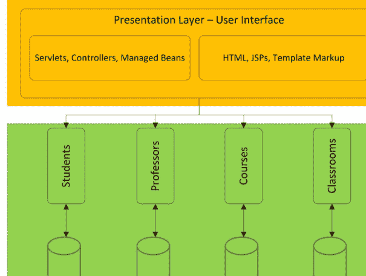

## 用户级安全

## 网络级和/或服务级安全

为你的微服务库使用网络访问安全的优势有几点：它简单又全面。当你实现安全层时，对微服务本身或其打包完全没有影响；而且这可以在不逐个部署最细微服务的情况下进行增强和更改。网络访问安全在开发者端不需要规划；然而，某些服务需要额外的安全。

为需要额外安全的建立服务级帐户。这与通常保护数据的方式非常相似。终端用户凭据不用于数据库连接；建立服务帐户是为了可以使用连接池。大多数微服务使用 `OAuth`，因为它们通常提供 restful 接口。使用 `OAuth` 安全 restful Web 服务的方法并没有不同，书中不会直接讨论。

不要直接为终端用户配置微服务访问。当 Web 应用依赖微服务库时，其终端用户安全性应该是相同的。终端用户凭据通常用于允许/限制用户访问应用程序的功能。但是，不要将终端用户凭据传递给你的服务库。那会增加巨大的复杂度，并且不会提供额外的好处。

## 合约测试程序和要求

出于几个原因，定时和自动化的合约测试程序至关重要。本节将讨论这些问题。

微服务的持续集成是必要的。微服务架构有助于提高开发吞吐量。这意味着更频繁的生产部署和更少的手动测试机会。这意味着微服务库的自动化合约测试是必不可少的。如果没有持续集成以及随之而来的自动化合约测试的保障，你将发现缺陷迁移到了生产环境。持续集成是防止向生产部署缺陷的主要保障。微服务内部代码的单元测试虽然有用，但作为微服务架构的保障并不有效。

持续集成补偿了开发者的近视。在开发者一次只处理一个服务并日益依赖服务调用的世界中，他们并不清楚如果部署了缺陷，从业务角度会破坏什么。你可能认为这是一个负面因素，但这是范式有意的一部分，旨在让开发者更专注、更高效。

持续集成允许单个微服务变得真正可丢弃。在一个服务趋于“可丢弃”的世界中——即可以很容易丢弃一个服务版本并完全重写它——新版本的服务需要与旧版本完全相同的功能。通过良好的自动

测试库，开发者可以更安全地重写和重构服务，而无需担心导致生产环境问题。

**持续集成防止开发者的错误进入生产环境。** 从管理角度来看，契约测试是防止不听从指挥的开发者的“隔舱板”。我们都不得不管理过那些似乎不听从指挥、想按自己的想法事的开发者，有时这种做法对组织并没有好处。微服务架构为你提供了一个机会，为不听从的开发者套上一层容器，特别是当你实施了严谨的契约测试时。

## 基于消费者的契约测试 (Consumer-based Contract Testing)

契约测试领域有一项较新的进展值得关注。我们大多数人已经习惯了为自己发布的服务编写契约测试。在一个服务越来越依赖其他服务的世界里，有些组织开始让消费者来测试他们所依赖的服务功能。也就是说，你消费了一个服务，并为该服务中你所依赖的功能贡献自动化测试。在这些服务通过了所有由消费者提供的测试以及服务发布者提供的测试之前，它将无法部署。

对于流程型服务——即那些依赖于其他服务——你可以认为这仅仅是语义上的变化。根据定义，流程型服务的契约测试测试的是它们依赖的服务。通过这种方式，所有实现微服务的人实际上在某种层面上都实施了基于消费者的测试。然而，对于大多数流程型服务的测试，该测试失败与它依赖的某个服务的实际故障之间可能并没有直接的关联。也就是说，如果不进行某种调查，将无法看出服务契约的变更是导致流程型服务测试失败的原因。

虽然这增加了服务发布者的工作量，但它增加了安全性。你也可以将其视为优化支持资源。是在缺陷进入生产环境后做出反应更高效，还是预防它更容易？许多组织已经得出结论：预防问题更便宜、更简单；因此引入了基于消费者的测试。

基于消费者的测试可以防止你所消费的服务中出现未通知的契约变更。如果一个服务在不通过所有基于消费者的契约测试的情况下无法进入生产环境，那么该服务的开发者就不可能引入破坏契约的更改。对于他们来说，这（恰当）将作为最后的手段。

## 契约测试的工具支持

幸运的是，由于 `RESTful` Web 服务和 `SOA` 架构已经存在很长时间，支持微服务契约测试的工具非常丰富。以下是一些值得考虑的产品：

- `Apache HttpClient`：用于 `RESTful` Web 服务契约测试
- `SoapUI`：用于 `Soap` 或 `RESTful` Web 服务契约测试
- `ActiveMQ`：用于 `JMS` 或 `AQMP` 测试。它们有一个有效的嵌入式代理（`broker`），可以用于测试
- `Jenkins`：用于自动化和计划构建

# 第 4 章：微服务使用指南

本章提供了关于何时使用微服务架构的建议。提示：并不是一直都要使用。当新范式出现时，它们往往容易被过度使用。微服务的使用也不例外。本章将提供关于微服务架构何时可以提供益处的指导，并尝试做到“去壳取真”。也就是说，它会告诉你哪里是营销话术——提示：确实有一些！

## 何时使用微服务架构

微服务架构并不适用于所有的应用程序。任何分布式应用范式（如微服务）从定义上讲都更复杂，需要更多资源来维护。本节将详细说明何时应该考虑使用微服务架构。

**演进为微服务架构。** 根据一般原则，应用程序最初应该被创建为传统应用程序，并随着复杂性的增长演变为混合或微服务架构。传统的 Web 应用程序在初始构建和支持上更容易。`YAGNI`（你不会需要它）原则适用。许多应用程序并不会增长到足以支持微服务架构的复杂。在必要之前，不要耗费精力和财力。

**微服务架构不是全有全无的。** 传统应用程序依赖少数微服务是可能的，没有要求整个应用程序都演变为微服务架构。事实上，当一个传统的 Web 应用程序演变为微服务架构时，过渡过程涉及部署，即传统的 Web 应用程序依赖一个小小的微服务库来完成其部分工作。

**开发微服务的初始尝试应该是小规模且有针对性的。** 与大多数范式一样，有分量地迁移到微服务架构是必要的。在获得利用微服务的经验，以及通过 `DevOps` 流程来支持大幅增加的部署物数量之前，你才能有效地维护一个大型微服务库。良好的初始概念验证微服务应该足够重要以引起注意，但又要足够在受控范围内，以便管理业务风险。

**多个应用程序需要相同的功能。** 在传统的 Web 应用程序中，你可以共享某种公共类库，或者在一个应用程序中发布被另一个应用程序消费的服务。当这种共享功能需要外部资源（如数据库资源）时，情况就会变得复杂。这种共享功能是拆分为独立的、拥有自己数据库的可部署单元的绝佳候选。

**应用程序的部分有不同的扩展需求。** 拆分微服务允许功能以不同的方式扩展。例如，一个微服务可能只需要集群中的三个节点，而另一个微服务由于交易量大可能需要几十个节点。

**应用程序的部分可能有更高的可用性要求。** 将功能拆分为微服务不仅可以增加吞吐量，还能降低服务完全崩溃的可能性。换句话说，规模的扩大也减少了服务集群所有节点同时宕机导致服务不可用的概率。

你的传统应用程序过大的警告信号：

鉴于大多数应用程序都是*演进*到使用微服务架构而不是而不是从那里开始的，你如何知道你的应用程序已经达到了应该考虑微服务架构的程度？没有客观的规则，但我可以提供一些指导建议。

**变更会带来意想不到的后果。** 当应用程序变得巨大且复杂时，很难做到孤立且不产生意外后果。在这些应用程序中，当你解决一个问题时，其他问题就会出现。这就像玩打地鼠游戏，你打掉一个，另一个又跳出来。

**发布和测试周期变得不合理。** 这是应用程序变得复杂到无法作为一个单元管理的信号。在这些情况下，将大问题拆分为易于管理的问题可以降低成本。微服务架构在这种情况下非常有用。

**单个应用程序的开发团队大到无法有效管理。** 我赞同杰夫·贝索斯的话：“如果你无法用两个大披萨喂饱团队，那么这个团队就太大了。”微服务架构可以通过工作单元拆分为独立的、更易管理的团队变得更容易管理。

## 哪里是营销话术？

对于任何新范式，都会伴随着程度的炒作和营销。微服务也不例外。这些销售点将尝试去壳取真，并让你知道哪里是话术。

服务在用户界面中的易用性应当与在批处理过程中的保持一致。所有服务和服务调用都应该是无状态的。例如，不应该有在调用与调用之间传递的上下文（例如会话变量内容）。如果服务使用数据库，则所有服务调用都是完整的工作单元。当服务调用完成后，不应留下任何开启的事务。

## 微服务更容易让开发者理解吗？

微服务架构的卖点之一是它能让问题缩小到可以放入开发者大脑的程度，但实际上，答案是“否定的”。对于开发者来说，孤立地理解某个特定的服务确实更容易。这一点毫无悬疑。它的基数更小，只需要更小、更聚焦即可。

这个卖点具有误导性的地方在于，在微服务世界中可能有几十个服务协同工作来提供某项业务功能。如果你有效地划分了边界，开发者可以将服务视为“黑盒”，而无需深入研究该服务具体如何实现其功能的底层机制。大量的服务意味着整个服务集就像一个复杂的 `API`，开发者需要理解它才能有效地编写流程服务。本质上说，这种复杂性与在传统应用程序中理解大量的包并无区别。

我之前没有将其列为优点是有原因的；我不同意“微服务开发复杂性较低”这一断。虽然理解整个应用程序的某一个部分更容易，但要理解整个应用程序并不更容易。

## 微服务是否增加了开发吞吐量？

也就是说，对于使用微服务架构的工作投入，开发者的速度是否增加了？答案是“可能吧”。

**你必须擅长合同管理。** 正如前面所述，你在这里的能力直接影响通信开销。通信开销会大幅降低你的速度和开发吞吐量。

目标是“提高你向最终用户和业务部门交付功能的速度”。虽然衡量单个团队的开发者速度更容易，但交付给业务的功能才是真正重要的。新的业务级功能通常需要多个新服务，或者对多个微服务进行功能增强，这是很常见的。这意味着有效的合同管理实际上意味着跨多个服务团队协调合同的增强。如果没有这种协调，开发者速度可能会增加，但业务功能的交付速度可能不会。为了提高效率，这种协调是必不可少的。

## 微服务真的是易弃的吗？

微服务确实比传统的 Web 应用程序更易弃性。尽管如此，这个优势被稍微夸大了。让我们仔细思考。

一个服务的替代品必须完全完成其前任的工作，否则你将面临缺陷和意外后果。此外，替代服务需要像其前任一样处理所有的跨切关注点。为了在不引入缺陷的情况下有效替换服务，你需要严谨的合同测试。

在进行更改之前精确地替换微服务；永远不要将更改与替换结合在一起。这简化了测试。你可以针对旧版本和新版本运行测试套件——你应该始终得到相同的答案。如果新版本中有预期的更改，那么这样做将变得困难得多。这引出了一个问题：你在重写服务过程中发现的任何 bug，是否会重复出现？我的回答是“是的”；这能保持测试的简单性。可能你的某个消费者已经发现了你的 bug，并且目前已经编写了代码来绕过它；修复该 bug 就会破坏该消费者。

你必须擅长合同测试。如果没有严谨的合同测试能力，部署重写的服务版本就是一个风险。对两个版本的服务运行测试套件，它们应该都能通过。这里的含义是，测试套件是针对所测试的合同的，而不是针对底层服务。

你必须擅长提供稳健的应用程序架构支持。你不希望开发新服务的开发者在处理跨切关注点上花费超过配置/设置的时间。如果是这样，就会增加建立新服务的成本。它也会让替换服务变得更加困难，因为它们也需要处理这些跨切关注点。

## 最佳实践与常见错误

与所有新范式一样，随着该范式的成熟，在使用时的最佳实践和常见错误随之出现。我们现在已经在微服务架构中看到了这一点。本节将详细介绍其中的一些。

### 最佳实践

#### 记录微服务的请求和响应

这有助于开发者诊断没有产生异常的问题。通常，这种日志是滚动日志，出于空间考虑，它只保留配置时间范围内的事务。这极大地节省了开发者的时间，因为你通常不需要花时间去构建/复制一个产生意外/不想要结果的事务；事务已经存在于你的历史中，修复它通常比重新创建它要快。

将服务请求与响应关联起来。我提到过，管理软件实现（如 `Splunk` 或 `Logstash`）对于微服务架构是至关重要的。记录请求和响应可以简单地将它们记录下来并让开发者可用。开发者能够匹配每个服务调用的请求和响应是极其要求的。如果你利用了前一节提到的将每个日志条目与唯一的事务 ID 或关联 ID 关联的技术，你只需要记录所有的请求和响应，开发者就能拥有这些信息。

### 常见错误

与任何技术范式一样，微服务架构也可以被误用。

### 不恰的服务边界

服务应该是真正的松耦合且自给自足的。如果你发现一个更改需要部署多个服务，这很意味着你存在了不该有的耦合，或者你正在刻意引入一个破坏合同的更改。虽然后者有时是不可避免的，但前者通常表明边界设计缺陷。

服务不应该是关于执行上下文的。例如，它们的易用性应该像用户界面和批处理一样。如果你在获取新消费者时遇到意外后果，很可能意味着该服务并不是真正的上下文无关；它具有你的新消费者无法满足的上下文要求。这很可能是某种类型的合同边界设计缺陷。

### 将微服务暴露给浏览器

微服务并不是为了公共消费而设计的。这种设计的理由已经在部署用户界面的“前端后端”（`BFF`）模式中给出。组织无法控制公共互联网上的性能。结合用户操作通常涉及多次服务调用的事实，变得变得对用户请求进行某些合并是显而易见的。

### 感染性事务日志


# 微服务架构：管理与演进

## 微服务架构中的问题定位

在微服务架构中，定位问题（确定哪个服务包含问题的根源）花费的时间要多得多。对微服务请求和响应进行有效记录可以极大地减少这种时间。由于微服务架构固有的可部署数量增加，如果无法访问服务请求和响应，定位发生缺陷的服务将是一个非常耗时的问题。

### 感染性异常处理

高比例的异常报告在异常中包含足够的信息，至少能定位问题的根源，如果不能让根源可见。如果没有这些信息，支持开发者只能通过耗时的尝试和错误来试图在测试环境中重现问题。这浪费了时间。

### 感染性请求验证

从长远来看，尽早发现错误总是能节省时间。让无效请求通过并最终退化为某种类型的派生异常，比更早、更接近犯罪现场报告异常总会花费开发者更多时间。

### 感染性响应验证

你是否因为调用的服务没有返回预期结果而收到了空指针异常或其他类型的派生异常？如果你依赖这些结果，最好在返回时验证这些值，这样开发者就能获得更清晰的错误信息。这里的原理与验证请求数据的重要性非常相似。

## 为什么是现在？

SOA（面向服务的架构）以及通过服务实现模块化已经存在很久了，因此微服务架构并不是一个全新的概念。这引出了一个问题：为什么是现在？

## 虚拟化和云技术的进步使得微服务架构变得可行

在 SOA 流行时期，为大量新服务寻找并安装硬件是一个真正的问题。现在，大多数组织已经采用了混合云，管理员可以轻松地建立任何托管新服务所需的新的虚拟机。

在 SOA 流行时期，支持数量指数级增长的部署物对于运维人员来说是一个真正的问题。在过去，设置是手动完成的，往往是重复劳动。在 DevOps 世界中，得益于 `Docker`、`Chef` 和 `Puppet` 等工具，新环境可以进行配置且部署以自动化的方式进行；不再需要大量的人工劳动。

- **硬件和网络基础设施比以往任何时候都便宜。**

在过去，调整资源消耗是至关重要的，因为设备极其昂贵。现在，微服务架构所需的额外内存和进程开销不再是令人担忧的问题。

## 模块化的未来方向

微服务架构不是 Java EE 应用模块化的唯一范式。本节将简要描述其他 Java EE 模块化的尝试并将其与微服务架构进行对比。

### Java 9 与 Jigsaw

Jigsaw 正式向 Java 平台引入了模块化。目前已有早期版本，但预计直到 2016 年才会发布正式版本。本质上，该功能带有一个新的部署单元（模块库或 `jmod`），它在进程内工作，但保证拥有自己的微运行时环境。有关 Jigsaw 的更多细节可以查阅。

在将 Jigsaw 与微服务架构比较时，存在几处不同。

Jigsaw 有几个优势：

- 因为在进程内运行，所以内存消耗较低。
- 编译器强制执行约束（而不是运行时）。

然而，微服务架构相比 Jigsaw 仍保留了几个优势：

- 服务可以独立扩展。
- 服务与技术栈无关；不限于 Java。
- 服务部署可以独立管理；不需要被编译到运行时产物中。

正如我们讨论过的硬件成本降低，优化内存不再像以前那样重要。总的来说，微服务架构比 Jigsaw 为企业提供了更多的自由和灵活性。

### OSGi

OSGi 是 Java 平台的一种模块化解决方案，是在平台正式支持模块化之前发明的。与微服务架构相比，它与 Jigsaw 具有相同的优缺点列表。事实上，你可以将 Jigsaw 看作是实现了与 OSGi 相同的目标。

在将 OSGi 与微服务架构比较时，存在几处不同。OSGi 有几个优势：

- 因为在进程内运行，所以内存消耗较低。
- 编译器强制执行约束（而不是运行时）。

微服务架构相比 OSGi 保留了几个优势：

- 服务可以独立扩展。
- 服务与技术栈无关；不限于 Java。
- 服务部署可以独立管理；不需要被编译到运行时产物中。

顺便说，OSGi 的采用率非常低。如果你查看 indeed.com 或 Google Trends 的统计数据，OSGi 的职位一直增长到 2011 年，此后一直在同样的低水平上波动。

## 开源采用

我看到在 GitHub 和其他开源锻造上发布的、旨在用于微服务的开源产品增长得日益巨大。我预计这一趋势将持续。例如，2015 年 6 月在 GitHub 上搜索“microservice”一词，结果略微超过 1,100 个仓库。2016 年 1 月，该数字略微超过 3,200 个。虽然并不是所有仓库都包含设计为作为微服务部署的产品，这是事实，但其中一部分确实是，而且怀疑这个数字在过去的几个月里已经增长了。

# 第 5 章：管理微服务开发

微服务架构对开发者和架构师的影响是巨大的。对管理的影响同样巨大。大多数关于微服务架构主题的作者和演讲者集中在微服务的更技术层面上。作为架构师，我们应该交付业务价值。这些价值的一部分是向管理层建议采用微服务架构的影响，以及他们应该扮演的角色。

## 采用微服务架构的先决条件

微服务架构需要到位并运行的基础设施，只有这样在大规模采用微服务才是可行的。本节将尝试为建议管理层的架构师以及经理本人提供指导。

## 治理的变更

你确实有一套流程和程序来管理开发从测试、用户验收到生产的生命周期。也许在发生生产迁移之前，需要填写表单并获得批准。也许在授予这些批准并发生生产迁移之前，开发者需要满足某些前提条件。这些程序的意图通常是降低部署风险并防止缺陷迁移到生产环境。我确定，这些流程在你目前在没有微服务架构的情况下处理的部署量运行良好。

目标是为微服务架构提供治理和基础设施支持，但其方式不能减慢所有事情。记住，预期的益处之一是更高的开发速度。治理与速度是完全对立的。

大多数治理程序不会呈指数级扩展。微服务架构将指数级增加你管理的部署数量。组织建立的大多数流程并不是为了处理你当前量的 10 倍或 20 倍而设计的。你将开发移至生产的官僚程序可能无法生存那种增长。更有可能的是，你的治理程序需要改变并适应，以处理微服务架构带来的指数级增长。

自动化生产部署过程，包括测试和批准。微服务架构的优点之一是微服务具有“虚拟”用户。因此，它们没有需要视觉检查来验证美感的用户界面。微服务的测试可以是完全自动化的。Web 应用程序界面仍需手动检查，以确保它们的主观质量是正确的，但微服务不需要。是的，自动化整个过程需要投资，但如果你大量投资微服务以意图获得这种范式提供的收益，那么自动化将在某一点收回成本。

自动化缺陷检测和回滚启动。自动化测试将对缺陷部署提供某种程度的保护。需要考虑的额外保护措施是建立一种机制，用于检测部署后失败率的变化，并在失败率的增加超过可配置阈值时自动启动回滚。任何不习惯于依赖完全自动化部署过程的人，都可以通过添加自动回滚（以防部署过程产生错误时）来增加他们的舒适度。

## 运维自动化的投资

拥抱 DevOps 文化。微服务架构的部署物数量呈指数级增长，有时是传统 Web 应用的 20 倍。对于建立新环境和管理部署，实现完全的手工流程是不可能的。拥抱 DevOps 文化，通过程序化创建和管理环境并减少每个环境的人工劳动，对于管理大量的部署物是至关重要的。

快速创建和保护新环境的能力至关重要。随着新服务的识别和资源的请求，你的虚拟机数量将增加。通过利用 `Apache Mesos` 产品或其他类型的资源管理软件可以减少虚拟机的增长。这本身就需要工作和额外的投资。采用微服务架构在技术上并不要求云集成，但许多用户确实选择进行集成，以便他们能够在短时间内指数级地增加他们所支持的虚拟机数量。

## 对数据库管理人员的需求将会增加

大多数人考虑到的是运维人员的额外需求。微服务架构也增加了数据库的数量以及可部署单元的数量，对新模式（schema）/数据库创建和增强的需求也会随之增加。这意味着对数据库管理员的需求也会随之增加。有些组织将数据库管理工作迁移到微服务团队内部，但无论如何组织，工作并不会消失。虽然并不经常讨论，但数据库管理员也需要采用 DevOps 文化，并将其工作的大部分实现自动化。

## 服务契约管理

关于微服务团队如何获取其功能增强任务，目前还没有很多相关的论述。微服务的本质提供了用户请求的能力的核心部分，但并非以那些用户可能理解的语境呈现出来。用户更有可能向提供 Web 应用程序或用户界面的团队提出功能请求。当团队意识到他们没有能力交付该功能请求时，该团队需要将请求中的非 GUI 部分交给一个或多个微服务团队来实现。例如，假设一个 UI 团队接收到了存储某特定课程教授大纲的请求，而目前没有能够记录该信息的可用服务。有人需要引导该请求，弄清楚它属于哪个服务，确保该功能请求包含足够的可操作信息，并对其进行适当路由。这里有一系列工作需要以某种方式完成并妥善处理。大多数组织利用某种任务管理软件（例如 `Jira`）来管理和跟踪此类功能请求。

**管理是至关重要的。** 你可以让开发者作为一种自发努力来设计和发布服务契约。在其他情况下，让他们随心所欲而你不予关注。起初，这是最容易的管理方法。然而，随着部署服务数量的增加，开发者将无法“见树木而不见森林”。你会遇到大量的重复工作，并且在创建和部署的服务中遇到大量的不一致性。最终，这些缺陷将随着服务列表的增加而增长，并侵蚀你从微服务架构中获得的某些收益。

我永远不会建议你在部署和使用之前，强制通过一个正式流程来审查并批准所有服务契约。那会阻碍开发速度，而这是微服务架构的预期收益之一。然而，应该有人跟在开发团队后面，以所有人（包括管理层）都能使用的标准格式对发布的服务进行分类。这样他们就可以记录服务的不一致之处，向服务团队发送更改建议，并帮助开发者采用现有服务——而不是发明现有服务的新版本。他们还可以向管理层指出潜在的风险区域（如果有的话）。

**管理契约变更将是至关重要的。** 在微服务世界中，契约的质量将极大影响你从采用微服务架构中获得的收益。定义不当的契约会导致混乱和无序，并对新功能的开发速度产生负面影响。有些组织谨慎地限制任何时间点的更改量，以保持高质量并防止对开发速度产生负面影响。

**功能增强任务对于微服务团队成员来说必须是不模糊且清晰的。** 请记住，更高的开发速度来自于开发者的专注能力，并且免于通信开销。给他们不明确的功能分配意味着他们将需要去请求功能的用户那里获取清晰度。需要建立一套用于梳理和跟踪功能增强的流程。

## 服务测试与部署自动化

对自动化测试的投资是至关重要的。随着开发速度的提高，生产环境部署率也会呈指数级增长。如果没有测试自动化，缺陷将迅速给你的生产环境带来灾难。自动化契约测试对于减轻这些影响至关重要，在这个世界里，通常没有时间进行手动测试。这种自动化不是免费的；它需要投入人力进行设置，以及后期的维护和管理。它还需要强制。

自动化部署是至关重要的。随着开发速度的增加，每次部署都进行人工干预不再像以前那样可行了。有一种论点认为部署中的手动步骤实际上增加了风险，因为它们增加了错误的概率。是的，这个说法假设了一个编写良好、测试充分的部署过程，这种过程通常没有失败记录。不言而喻，只有通过测试套件的产品才被允许进入生产环境。

**数据库更改也应该是自动化的。** 数据库更改通常伴随着新服务的部署。如今，这些更改也可以是自动化的。像 `FlywayDb` 这样的产品非常适合此类更改。是的，回滚或失败的部署仍然需要一定的人为干预，但希望失败的部署只占总数的一小部分。

**考虑提供一种基于消费者的测试流程。** 基于消费者的测试需要是自动化的，并作为针对服务运行的测试套件的一部分。你可以将其视为一种测试添加，必须通过（显示绿色）才能进行生产部署。唯一的区别是这些测试是由团队提供并维护的。我会将其视为消费其他服务的服务团队的一种“选项”，而不是要求。在过去，我曾不得不依赖被证明不可靠的服务，导致测试失败。对于不可靠的服务，在*开始时*就知道依赖的服务已崩溃且你得到的测试失败是意料之中的将是非常好的。这节省了调查时间。

## 团队管理

**管理团队的契约交付物，而不是团队本身的内部管理。** 微服务架构的好处之一是消除了通信开销。通过交付物管理而不是微观管理团队有助于消除开销。只要你以可接受的速率和质量获得功能增强，团队选择组织方式可以留给他们。

**开发者一次只处理一个服务。** 这有助于防止对在特定顺序或语境下使用服务的业务流程做出假设。我这么说，是因为你不会有一个开发者同时处理一个服务及其调用的服务。这有助于保持专注而不受干扰，并保持他们的高速度。在这个世界里，任何拖慢开发速度的东西都会牺牲你从微服务架构中获得的收益。

**发布服务的开发者应该被要求支持它。** 这激励了明智的产品决策以及编写可维护的高质量代码。换句话说，开发者要“自食狗粮”（自用自己的产品）。大多数开发者都想要良好的家庭生活，这种范式支持了这一点。只要他们产生高质量且低缺陷的服务，他们花在支持上的时间就会降到最低。

## 服务健康监控

对缺陷的自动响应是至关重要的。随着开发速度的提高，生产部署率呈指数级增长。健康监控对于快速发现故障和缺陷至关重要。我的一些客户使用 `Splunk` 或 `Logstash` 在生产环境中遇到错误时自动在工单系统中创建缺陷工单。决定在遇到错误时通知哪个服务团队需要一些思考和规划。例如，一个因错误输入出错的服务应该属于调用团队，而不是生产服务的团队。显然，任何类型的非计划异常都应该归属生产服务的团队。

其他服务团队。结合他们通信开销低且交付物明确等事实，他们位于世界上任何地方、任何时区。无论他们是在公司办公室的内部开发，还是在海外开发，这并不重要。

考虑到团队的工作受限于对特定服务的专注需求，对代码质量等的担忧至少被限制在小型服务代码库中。换句话说，该团队能搞乱并因此产生维护问题的代码量是有限的。

## 这意味着微服务的开发可以更容易地进行外包

这也意味着你能够更好地免受“不负责任开发者”的侵害。我们都管理过那些产生不可维护代码的开发者。由于不负责任开发者被限制在一个小而集中的代码库中，他们对该代码库造成的破坏是有限的。此外，该代码库较小、专注且定义明确；如果有需要，它更具可替代性。你不会让不负责任开发者在一个拥有 50 万行的单体应用中作破坏，造成更大范围的混乱。

## 提高开发速度

假设所需服务的合约以及这些服务之间的依赖关系已完全定义，那么让更多的开发团队加入正在进行的工作就会变得更容易。引入额外开发者的担忧在于，这通常意味着更多的通信开销。由于开销的增加，开发者的生产力会产生递减收益。你每增加一个开发者，所获得的生产力就越少。

虽然微服务团队中单个开发者的生产力确实会增加，因为他们没有那么多通信开销，但任何单个开发者能带来的生产力提升都是有限的。你的速度实际上来自于添加新团队的简易程度。当开发者在一个小而专注的团队中埋头开发时，他们永远看不到也受不到他们所做的整体工作规模的影响。因此，管理层更容易将开发工作扩展到更大数量的开发者。请注意，在所有服务合约都完全定义的情况下，你还必须识别出合约之间的任何依赖关系；某些服务可能要求在完成特定服务的工作之前完成其他服务。请注意，任何开发团队都可以对依赖服务进行存根（stub），并在依赖服务完成之前开始工作。

这里真正发生的情况是，扩展开发的限制因素转移到了负责识别单个服务并规范服务合约的管理层和企业架构师。随着工作规模扩大，会有更多的协调点。由于某些服务会调用其他服务，那些依赖服务需要先构建。工作流向开发团队的顺序需要进行协调。

## 技术栈自由

在微服务世界中，服务是容器化的。也就是说，部署产物包含了操作系统及其所需的其他软件（例如 `Java JVM`、`PHP`、`Python`、`GoLang` 等）。每个服务都可以轻松地在这些技术的不同层上运行。结果是，新技术可以更容易地引入或升级。这使得你能够比传统的单体 Web 应用快得多地利用更新颖的技术。

对于传统的 Web 应用来说，代码库要大得多。因此，升级的影响会大得多，并且需要更广泛的回归测试。此外，在较大的代码库中切换开发语言要困难得多。

这是一项技术上的优势，但我认为它也是一项管理上的优势。经理们一直在寻找更快交付软件的新方法。提高开发者生产力的途径之一是可用工具集的技术进步。通过微服务架构，你利用新开发的工具集并带来业务所期望的生产力提升的能力，比传统的 Web 部署更好。

## 扩展阅读

如果你对微服务架构感兴趣，我可以向你推荐一些额外的资源。

我对微服务的兴趣始于看到 Fred George 的这场演讲。我是偶然发现它的，但他所阐述的微服务架构的影响令我着迷。本质上，是他发起了这本书，尽管他可能对此并不知。具体来说，我被服务是“可弃的”这一观点所吸引。

关于微服务架构是什么以及该范式定义的权威指南，是 Fowler 和 Lewis 编写的《Microservices》。你可能记得我将微服务定义为大多数微服务都具备的特征列表。我希望我能声称那是原创想法，但我做不到。Fowler/Lewis 的文章是微服务特质列表的权威标准。我选择了最重要需要强调的特征。

Fowler 在微服务架构的先决条件（此处）也做出了非常有价值的工作；即在大规模尝试微服务架构之前，你应该具备的能力。

关于领导者级微服务的另一个想法是 Adrian Cockcroft。可以在这个视频中找到他的作品。我关注他的 Twitter Feed。

我密切关注该领域的两个开源项目。第一个是 Netflix 产品套。他们必须支持惊人的吞吐量，并慷慨地开放了支持这些内容的源码。第二个是 `Apache Mesos`，它本质上让计算资源无处不在。也就是说，它允许你通用地查看计算资源，而不必担心资源托管在哪里。由于微服务架构产生了大量的部署产物，这对于减少部署管理问题非常有前景。

感谢你花时间阅读这本书。如果你有意见或问题，请随时通过 `derek.ashmore@dvtconsulting.com` 或 LinkedIn 与我联系。我总是对反馈感兴趣。
