# Spring Boot 和 Spring Cloud 微服务：使用 Java、Spring Boot 3.0 和 Spring Cloud 使用微服务开发现代、弹性、可扩展且高可用的应用程序

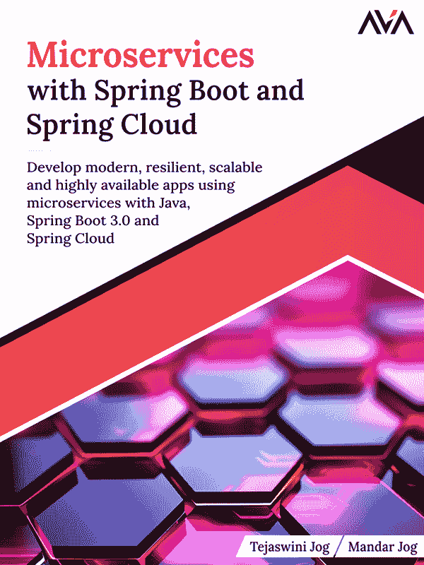


[www.orangeava.com](http://www.orangeava.com)

# 献给

## Ojas 和 Neko

# 关于作者

**Tejaswini Jog** 是一位拥有十年以上经验的专业教育工作者。她帮助了全球数十万学生进入了 `Java` 的世界，而且这个数字每天都在增长。她还编写了一些行业内的顶尖书籍，这些书籍是业余爱好者和专业人士的参考标准。

在没有教学或编辑书籍时，她喜欢像 Bob Ross 和毕加索等大师一样，创作自己的杰作。她不仅是一位出色的丙烯画家，她的烹饪技巧也证明了她是一位烹饪专家，而她家庭花园里的植物无疑展示了她在园艺方面的造诣。

**Mandar Jog** 拥有超过二十年的经验。在过去的几年里，作为一名专业教育工作者和顾问，Mandar Jog 一直帮助各地的学生进入迷人、吸引且奇人的 `Java` 世界。

他是三本书的作者，帮助业余爱好者和专业人士对 `Java` 有不同的看法，同时激发他们的兴趣并让他们一次一次爱上 `Java`。

当他不在电脑前写作或编辑新书，甚至在教学时，他喜欢下棋。此外，由于他非常喜欢唱歌，他总是找时间精炼技能并提升自我。他是一个勤奋的软件爱好者，努力成为最好版本的自己。

# 技术评审人员

**Gil Zilberfeld** 从小就开始接触软件领域，在他信赖的 Sinclair ZX81 上编写 `BASIC` 程序。凭借超过 255 年的商业软件开发经验，他在软件方法论和实践方面拥有丰富的经验。

Gil 应用敏捷原则进行软件开发已十多年久。从自动化测试到探索性测试，从设计实践到团队协作，从 Scrum 到看板，从传统的产品管理到精益创业——他无一不精。

他仍然在从自己的成功和失败中学习。

Gil 经常在国际会议上就单元测试、`TDD`、敏捷实践和产品管理进行演讲。他是《Everyday Unit Testing》和《Everyday Spring Testing》的作者，博客和视频发布者，Agile Practitioners 会议共同组织者，在空闲时间他通过拍摄僵尸视频来娱乐。

**Ankit Kumar** 目前在一家位于明尼苏达州的备份恢复公司担任首席软件工程师。他热于使用 `Spring Boot` 设计可扩展的微服务应用程序。他住在加拿大多伦多。他毕业于北达科达州立大学（美国）计算机科学学士学位，并在明尼苏达大学（美国）获得软件工程硕士学位。他曾在零售、备份恢复和医疗保健等多个行业担任后端软件工程师，工作了约 10 年。当他不在学习或为了兴趣和工作编写代码时，他喜欢烹饪、尝试新餐厅、和妻子（Shaurya Chawla）一起去远足以及环游世界。他认为编程是一门需要通过不断学习来培养的艺术，但一旦你开始享受这门艺术，你就会发现没有局限。

# 致谢

毫无疑问，写书是一项艰巨的工程，需要大量的团队合作和协调。从选择书名到出版的第一项任务开始，我们非常幸运地得到了 Orange Education, AVA 卓越团队的持续支持。他们的奉献使得这一努力得以，我们对整个团队的宝贵贡献表示深表感谢。

此外，我们对父母和朋友表示最诚挚的谢意，他们不断的鼓励激励着通过这本书的文字与他人分享知识。他们对我们愿景的信任是促使我们前行的动力。

我们诚心感谢每一位为这本书成为现实贡献的人。

# 前言

本书是关于构建和设计微服务的完整指南。书中不仅关注微服务的理论概念，还展示了如何使用不同的工具来确保微服务的可扩展性、可维护性和高可用性。

本书从解释微服务的基本技能开始。在书中，微服务是用 `Spring Boot` 开发的。因此，必须熟悉 `Spring Boot` 以及如何使用 `Spring Boot` 创建端点。这两个概念在书中得到了彻底解释。

书的第二部分主要面向微服务架构设计软件时应该考虑的不同事项。该部分讨论了服务间通信、服务发现、API 网关等。

书的最后一部分通常讨论高级概念，如处理服务失败、安全安全以及部署。该章节涵盖了 `Resilience4J` 和 `Oauth2` 等工具，以及基于容器的服务部署。

第一章 将探索 `Spring Boot` 的基础。它涵盖了如何开发、配置和部署简单的 `Spring Boot` 。

第二章 将涵盖 `REST` 的基础。本章讨论了什么是端点或服务。同时，它还涵盖了如何在 `REST` 中处理不同类型的数据和数据库通信。还有一个关于处理异常和编写自描述消息的章节。

第三章 将向读者介绍微服务的概念。该章节详细讨论了为什么我们需要微服务、它们的优势和局限性等。

第四章 将涵盖微服务中集中化配置的方法。该章节强调使用 `GIT` 作为 `Spring Cloud` 配置的集中存储库。

第五章 将深入探讨服务间通信。这将涵盖使用 `RestTemplate` 和 `Feign Client` 等建立服务间通信的不同方法。

第 6 章 将介绍服务发现的概念。本章将详细讨论如何使用 Eureka Discovery Server 注册你的服务并定位它。

第 7 章 将介绍 Gateway API 服务的需求及其用法。本章还将涵盖在实现路由时使用的不同 `GatewayFilter` 工厂。

第 8 章 全关于监控。本章将讨论什么是分布式追踪，以及如何使用 Zipkin 服务器监控服务的行为。

第 9 章 将涵盖处理服务失败的概念。本章将讨论服务失败的原因以及处理此类失败的方法。它还将涵盖 `Resilience4J` 的用法。

第 10 章 将讨论如何保护服务安全。它将探索如何实现 `OAuth2` Token 来用于安全性。

第 11 章 将介绍部署。本章将讨论微服务的容器化部署。

# 下载代码

代码包和彩色图片。

请点击链接下载本书的**代码包**：

# [`github.com/OrangeAVA/Microservices-with-Spring-Boot-and-Spring-Cloud`](https://github.com/OrangeAVA/Microservices-with-Spring-Boot-and-Spring-Cloud)

本书的代码包和图片也托管在

[`rebrand.ly/1b9169`](https://rebrand.ly/1b9169)

如果代码有更新，它将在现有的 GitHub 仓库中更新。

# 错误说明

我们对 Orange Education Pvt Ltd 的工作非常自豪，并遵循最佳实践以确保内容的准确性，为我们的订阅者提供沉浸式的阅读体验。读者是我们的镜子，我们利用他们的反馈来反映并改进出版过程中可能出现的任何人为错误。为了让我们保持质量并帮助可能因任何不可预见的错误而遇到困难的读者，请通过以下邮箱联系我们：

errata@orangeava.com

非常感谢您的支持、建议和反馈。

# 你知道吗

你知道 Orange Education Pvt Ltd 为每出的书都提供 eBook 版本吗，并提供 PDF 和 ePub 文件？你可以在 [www.orangeava.com](http://www.orangeava.com) 升级到 eBook 版本，作为纸质书客户，你有权获得 eBook 版本的折扣。请通过 info@orangeava.com 与我们联系获取详情。

在 [www.orangeava.com](http://www.orangeava.com)，你还可以阅读免费技术文章合集，订阅一系列免费新闻邮件，并获得 AVA™ 书和 eBook 的专属折扣和优惠。

# 版权

如果您在互联网上发现我们任何形式的作品非法盗版，如果您能向我们提供地址或网站名称，我们将不胜感激。请通过 info@orangeava.com 联系我们并提供链接。

# 你有与我们合作写作吗？

如果你有一个擅长的领域，并且对编写或贡献书籍感兴趣，请向 business@orangeava.com 给我们写信。我们致力于帮助开发者和技术专业人员洞察全球范围内的技术进步和创新，并建立一个相信“通过与他人分享和学习是获取知识的最佳方式”的社区。请联系我们了解读者的需求以及你如何参与这场教育改革。我们也欢迎技术专家的想法，并帮助他们为自己的领域构建学习和开发内容。

# 评价

请留下你的评价。在你阅读并使用这本书后，为什么不在你购买的网站上留评价呢？潜在读者就可以看到并利用你的中偏意见做出购买决策。我们 Orange Education 非常想知道你对我们产品的看法，我们的作者也可以从你的反馈中学习。谢谢！

更多关于 Orange Education 的信息，请访问 [www.orangeava.com](http://www.orangeava.com)。

# 第 1 章

# 基础

现在是凌晨 2 点左右，硅谷的某处。软件架构师 Rakesh 仍在办公桌前工作。他感到压力巨大且倍感挫败，脑子里充满了问题。他多他的团队在过去的几个月里一直在开发一个大型业务解决方案。他们将许多业务需求转化成了可以集成到软件中的小型程序。他们的产品负责人对团队的整体表现非常满意。但几天前，其中一名开发者建议选择框架而不是传统的应用程序开发。这个想法是对的，因为框架会让应用程序开发更高效、更易维护且更标准化。但这个想法是抽象的。团队必须决定选择哪个框架。从那天起，在 scrum 会议上产生了大量的脑力风暴。一些团队成员使用收敛思维方法，而另一些人则不吝使用发散思维方法来提出解决方案。但在完成所有这些研究之后，要选择一个百分之百符合所有业务需求的框架是非常困难的。

Rakesh 并不是唯一一个面临选择难题的软件专业人士。他代表了所有急需为他们的问题寻找答案的软件专业人士。本章旨在帮助你理解哪个框架最适合你的大部分业务需求。

## 结构

在本章中，我们将讨论以下主题：

*   框架：救星

*   Spring 框架简介

*   Spring Boot：解决方案

*   快速开始

*   启动过程简介

*   探索 Runners

*   执行应用程序

*   处理属性

*   简短访问服务器部署

## 框架：救星

如今编写代码不再是一项艰巨的任务。我们都非常精通完成所需解决方案的技术技能 set。但现在仅仅有编码技能对于成功的企业级应用开发是不够的。除了编码，开发者还需要考虑安全因素、可扩展性等。坦地说，生命太短，无法完成所有事情。当你努力完成一切时，你可能一无所获。许多伟大的哲学家和商人在早期也面临过类似的问题。著名作家和企业家之一的 `Gary Keller` 引用：“我可以做的哪件事，做了它之后，其他事情就会变得更容易或不再需要？”，这正是框架为开发者所做的事情。

`Framework` 为你提供了各种服务，如集中化配置、代码标准化、日志、数据流等。以前开发者需要手动编写的所有服务，现在都由框架进行自动配置或连接。在此之前，开发者的生活并不轻松。很棒，不是吗？当我们决定开发一个企业级应用时，脑海中会浮现哪些问题？显然，首要的就是技术，或者从众多技术中选择框架。今天，作为开发者，我们有广泛的选择。而这让事情变得有些复杂。地球上最富有的人有时也会感到困惑，因为他有多个选择对象。选择最好的框架完全取决于你应用什么标准。让我们逐一讨论在框架选择中起至关作用的不同标准。

## 应用程序类型

我们需要回答的第一个问题是，我们需要框架的唯一目的是什么？我们需要检查寻找的框架是否适用于 Web 应用程序、Web 服务或独立应用程序。对于不同类型的应用程序有不同的框架可用，它们针对该类型的应用进行了专门优化。

## 框架许可协议

我们是否在考虑商业化发行该应用程序？如果答案是定的，我们需要检查将选择的框架是否需要某些许可。额外的许可成本可能会增加我们应用的成本。此外，许可可能需要定期更新并产生一些额外费用。因此，选项之一是选择像 Spring 框架这样的开源框架。

## 设计模式

当我们开发 Web 服务时，将数据与逻辑分离对我们来说非常重要。能够很好地让我们保持数据（即 `Model`）、逻辑（即 `Controller`）和用户界面（即 `View`）相互分离的设计模式之一就是——是的，你猜得没错！MVC 设计模式。既然我们对 MVC 感感兴趣，我们需要精确定地寻找支持 MVC 架构设计的框架。

## 持久化

并不是所有应用程序都需要持久化层，但许多应用都是需要的。大多数时候，我们需要对数据执行 `CRUD operations`。为这些 CRUD 操作编写代码是非常痛苦的。它涉及到对数据库连接、事务管理等 API 的繁琐使用。使用 `DB` 层涉及构建 SQL 查询语句，以对存储在数据库中的数据执行 `CRUD operations`。如果有人能承担编写这些代码的责任，开发者将非常高兴。如果任何框架能提供这项服务，开发者就可以将更多精力放在业务逻辑上，而不是花费更多时间在与数据库相关的 API 上。不仅如此，有时我们还需要能够轻松迁移数据库的服务。这意味着框架应该提供便捷的 `DB` 集成以及迁移功能。市场上提供的 `ORM frameworks` 为我们提供了数据库操作的自动化 SQL 查询，使数据库通信变得简单。

## 部署过程

一旦我们完成了应用程序开发并在开发环境中进行了测试，就是时候部署应用程序了。部署显然是一个复杂的过程，因为涉及到应用程序及其依赖的打包等。一旦完成，我们需要将应用程序部署到部署服务器上。通常观察到，应用程序上线后，我们需要根据反馈对应用进行修改。这种修改将强制应用程序重新部署，如果手动操作，这将是一个繁琐的过程。我们需要一种方法来实现便捷的打包和便捷的部署过程。如果任何框架能让我们变得轻松，为什么不选择它呢？

## 可扩展性

那是多么美好的日子！当应用程序成功部署且业务繁荣时，我们过去坐着放松。但相信我，现在涉及到企业级应用时，事情不再那么简单了。你需要持续监控应用程序。在某一天，你会发现你的应用程序在市场上非常火爆。访问人数不断增加，这是一种令人慰的感觉。但突然，你可能会发现当负载增加时，应用程序无法响应或无法维持。由于我们只部署了一个实例，它无法同时为更多用户提供服务。为了实现这一点，我们还需要利用 `load balancer`。我们需要某种东西，让我们的应用程序在负载增加时自动扩展。我们需要这样的框架，通过它我们可以预配置负载均衡器，并在需要出现时触发。

## 学习曲线

既然我们已经知道了选择框架的所有标准，我们需要从比如十个框架中选择最适合的一个。我们可能拥有处理所有标准的最佳框架，但其学习曲线可能非常陡峭。框架通常有自己的一套命名规范、包结构、配置等规则。另一方面，某些框架在命名规范和包结构等方面提供了灵活性。这些框架确实提供了一些默认策略，但在你需要时也支持自定义。我们无法忽略的一点是框架所使用的语言。如果我们需要从零开始学习这种语言呢？这会有多容易或多困难？

## 文档支持

当框架有良好的文档时，很容易学习。如果它有足够的配置、带有解释的示例代码以及教程，它将易于遵循。它将吸引开发者并让他们加入。具有混乱、分散文档框架会让开发者感到困惑。选择一个文档良好的框架总是更好的。

## 社区

一个易于学习且文档良好的框架会吸引更多开发者。如果我们是初学者，或者在框架上花费了一些时间，万一我们卡住了怎么办？如果你有一个问题，或需要帮助以正确的方式执行某事，你该怎么办？在这种情况下，框架背后的社区将帮助我们，教我们学习框架并完成工作。具有强大社区支持的框架会让框架走向成功。尽量选择一个具有强大社区支持的框架。

Spring 的第一个版本由 `Rod Johnson` 在 `2002 年 10 月` 编写并发布。`2003 年 6 月`，它首次在 `Apache Foundation` 许可下发布。它非常灵活，提供了多种模块，用于开发独立式应用程序以及`服务端企业级`应用程序。该框架允许开发者利用`依赖注入`（Dependency Injection）、`控制反转`（Inversion of Control）以及用于重复代码的模板。这为开发者开发和测试应用程序提供了便利。然而，使用 Spring 框架的开发者需要对该框架有深入的了解。开发者应该知道如何配置、可以使用哪些注解、服务器上部署应用程序的服务器配置等。

让我们假设你想开发一个配置最少且易于启动的控制台应用程序，或者你想开发一个配置最少的 Web 应用程序/Web 服务。问题是：`我应该使用 Spring 框架吗？` 嗯吧，如果我不知道任何其他替代方案，我会选择 Spring 作为最佳解决方案。但，由于我知道其他替代方案，我建议：`如果你想开发一个对象管理、重复代码模板和跨切关注点由框架管理的应用程序，你可以选择 Spring`。但问题在于，我们需要 XML 文件或使用注解的类定义来配置对象、模板或切面，而这些是我们需要学习。

现在我们不需要负责对象的生命周期，因为它由框架管理，这真是一个巨大的缓解。尽管如此，我们仍然需要学习配置。我们需要彻底了解它，以利用框架的服务。通常，你会对学习过程感到沮丧，并倾向于回到传统的对象创建方法。但请相信，这种情况在你尝试学习任何新概念时都会发生，无论是技术还是日常生活皆如此。`Spring` 也不例外。

`2014 年 4 月`，`Spring Boot 1.0` 作为 Spring 的扩展发布，以便以更快、更简单的方式通过最或无配置开发应用程序。最新版本 `3.x` 于 `2022 年 11 月` 发布。我们可以使用 Spring Boot 开发独立式和 Web 应用程序。很多时候，我们阅读或遇到 Spring 框架或 Spring Boot 框架。然后好奇地开始思考：`这两个是不同的框架吗？``它们之间有什么共同点吗？``对于我的应用程序开发应该选择哪一个？`。在讨论之前，让我们对 Spring 和 Spring Boot 进行详细对比。

`Spring 1.0` 发布于 `2003 年`，旨在为实例管理提供灵活性，允许它们专注于业务逻辑（这是开发者的主要任务）。Spring 使用`控制反转`来管理应用程序实例，这些实例可以通过`依赖注入` 用于应用程序的其他部分。`Spring Boot 支持 IoC 和 DI 吗？` 它们支持。Spring Boot 作为 Spring 的扩展，以最省力的精力支持 Spring 提供的所有功能。


在 Spring 中，当我们开发 Web 应用程序或 Web 服务时，我们需要配置外部 Web 服务器。然而，Spring Boot 自带了如 `Tomcat` 或 `Jetty` 之类的内置服务器。

涉及到 Spring 中的数据库通信时，我们需要在 XML 文件或使用注解的配置类中配置数据库的 `Driver` 类名、`URL`、用户名和密码。Spring Boot 通过两个原因让这变得简单得多：

- 首先，Spring Boot 零 XML 配置。
- 其次，我们可以在属性文件中配置这些属性，属性文件只是 `key-value` 键值组合。

Spring 以模块形式出现，要在应用程序中使用这些模块，我们需要向应用程序添加一些 `.jar` 文件。作为开发者，我们都清楚选择特定版本的 jar 包及其依赖 jar 包有多痛苦。Spring 应用程序需要每个模块都单独配置。但 Spring Boot 带有实用的启动器，可以在 `Maven` 或 `Gradle` 等工具管理的文件中进行配置。我们将在后续讨论中详细介绍其中许多。所以只需放松。

> “生活其实很简单，但我们坚持要把它复杂。”
>
> ——孔子

考虑开发一个学生管理系统的应用程序。我们需要创建一个应用程序，选择包含的 jar 包，选择持久化学生相关记录的数据库，并选择部署应用程序的服务器。一旦做了这些艰难的选择，现在是管理应用程序和所需实例了。例如，用于 CRUD 操作的连接实例。噢，得吧！你可能没有预料一个简单的学生管理系统会如此复杂。要做的事情真多！我们有更好的选择吗？

# Spring Boot：解决方案

Spring Boot 使 Web 及独立式应用程序的开发变得简单，并已准备好投入生产。我们只需要运行应用程序即可完成。它允许开发者快速启动应用程序，并带有在生产环境中进行维护和监控的安排。Spring Boot 管理已配置 bean 的方式比 Spring 简单得多，因为它基本上使用属性进行依赖注入，而不是管理复杂的 XML 文件。这意味着人们可以配置数据库属性，而 Spring Boot 会管理 bean。我要为了获取一个实例就完全学习一个新东西吗？你认为我疯了吗？等一下，亲爱的，要有耐心。正如我刚刚告诉你的，还有很多可以探索的。在一个段落中涵盖所有内容并不简单。你是数据库 CRUD 操作的大粉丝，所以让我通过它的帮助来解释它的力量。

当你想为数据库中的学生添加一条新记录时，你会做什么？我向我团队中的一名新软件开发者 `Joy` 提出了这个问题，她是我在其中一个项目中的成员。你在开玩笑吗？`Joy` 对这个问题感到惊讶，因为每个人都知道答案。是的，大家都知道，但还是让我告诉我你会做什么？，我仍在等待 `Joy` 的回答。

我将获取与要通信的数据库连接，并在表中插入记录。我将使用该连接获取 `PreparedStatement` 实例。使用 `PreparedStatement` 实例，我们将触发查询以在表中插入新学生的记录，`Joy` 说得对！太棒了！现在，要为员工、公司或产品插入记录你会做什么？`Joy` 现在看起来有点有些沮丧了。我会重复相同的步骤，只需更改表名、列的值以及列的数量。但是，你为什么要问这些？

我带着微微的微笑继续问道：“Joy，你有没有考虑过你正在做的代码冗余问题？”“冗余？那是从哪里产生的？首先，我处理了学生记录，然后是员工，然后是产品，等等。我没有看到任何冗余。”Joy 现在想通过每一种可能的方式来证明自己。“让我给你另一个视角。我完全同意你说的‘我处理了不同类型的记录’。然而，观察你为了建立连接而遵循的步骤：建立连接、获取 `PreparedStatement`、创建查询并使用不同的值执行它。你改变了什么？完全什么都没有改。这些步骤意味着冗长的过程保持不变，只改变了查询的参数和列名。”当我向 Joy 解释这一点时，我观察到他的眼睛亮了，仿佛他中了他的彩票一样。许多开发者的思维方式和 Joy 以前的想法是一致的。这种冗余问题可以被 Spring Boot 有效地处理。在 Spring Boot 中，我们可以在配置文件配置数据库连接属性，并使用模板执行 CRUD 操作。即使在未来的某个时刻团队决定更改数据库，代码也不会发生任何变化，只有配置更改和数据库迁移会平滑进行，与 Java 企业级应用相比。

现在，想一想要在应用程序中使用 JPA 所需要包含的 `.jars`。是的，仅仅为了配合 JPA 就需要超过 `15 jars`，然后是 `Spring-JPA integration` jars，还有我们怎么能忘记支持 Spring 模块（如 core、bean、context 或 EL）的 `.jars` 呢？我们要在一个项目配置文件中一个一个包含这些条目吗？管理将变得太冗长且复杂。亲爱的朋友们，Spring Boot 自带实用的启动器（starters），用于添加我们模块所需的所有基础 `.jars`。

我们需要定期自定义应用程序的属性。这可能是与数据库通信的属性，也可能是部署应用程序的服务器属性，例如服务器的端口号。Spring Boot 支持通过属性文件或 YAML 文件将配置外部化。很酷！但是，Spring Boot 支持这些属性的类型安全吗？是的，它提供了强类型安全的配置，以便管理并验证所编写的配置。在日常开发中，我们需要在不同的环境中测试应用程序，Spring Boot 允许开发者在不同的配置文件配置这些不同的环境。

一旦你准备好了应用程序开发，就是进入生产阶段了。你需要遵循更冗长的创建 war 包并在部署的过程吗？坦率地说，这是你必须明智做的选择。如果你决定使用内部服务器进行部署，Spring Boot 自带 `Tomcat` 或 `Jetty` 服务器，只需极少或无需配置。一旦我们开始代码和配置，我们将详细讨论这一点，所以现在请放松，并记住这是可能的。同时，如果你决定在外部服务器上部署应用程序，这也是可能的。

应用程序部署并不是项目生命周期的终点。事实上，有时真正的问题在之后才开始。突然之间，应用程序开始表现异常并抛出某些异常。记住，万物皆有原因。你必须像一个形而上学家一样去找到导致此类异常的原因。你应该能够获取有关 JVM 内存、应用程序健康状况、就绪探针（readiness probe）、环境属性等信息。在正常情况下，寻找这些信息是非常乏味的。然而，Spring Boot 提供了 Actuator 模块，它允许开发者暴露应用程序相关的信息，这些信息可以被管理员用于监控应用程序。

列表持续中……

## 快速上手

在我们深入研究并创建 Spring Boot 应用程序之前，让我们停顿一下。基本上，这是一个 `Maven-based Java` 项目。我们可以从零开始并创建结构。然而，这有点冗长且没有必要。我是说没有必要，因为我们有其他简单的方法创建项目。

## 使用 CLI 创建 Spring Boot 项目

Spring Boot CLI 是一个命令行工具，我们可以用它启动从 `start.spring.io` 开发的新项目。它包含一个 `Groovy` 编译器，并使用 `Grape` 作为依赖管理器。Spring Boot CLI 在无需外部安装的情况下支持 `Groovy Scripts`。

### 安装 CLI

由于我们将使用 `Spring Boot 3.x.x` 版本，它内部基于 `JDK 17`。这是 Spring Boot 3.x.x 的最低 Java 版本要求。因此，在你开始之前，第一件事是检查系统上的 Java 版本，如果你没有 `JDK 17`，请继续进行安装。你可以参考以下链接并设置你的 Java：

[`www.oracle.com/java/technologies/downloads/`](https://www.oracle.com/java/technologies/downloads/)

不要忘记通过直接在命令提示符中输入 `java --version` 来检查你是否指向了正确的 Java 版本。

如果你已经有了所需的 Java 版本，请继续，并从给定的链接下载 Spring Boot CLI：

[`repo.spring.io/ui/native/release/org/springframework/boot/spring-boot-cli/3.0.1/`](https://repo.spring.io/ui/native/release/org/springframework/boot/spring-boot-cli/3.0.1/)

它将下载一个 `.zip` 文件。请将其解压到某个位置。我使用的是 Windows 平台，所以我就在 `D` 盘创建了一个 `Spring Microservices` 文件夹并在该位置解压了 CLI。

要使用 Spring 命令，你需要按照所示设置路径：


我们可以通过命令 `spring --version` 检查路径是否正确。如果下载的版本是 `3.0.1`，它应该显示 `Spring CLI v3.0.1`。

*酷*，舞台已经就绪。现在是创建我们的第一个项目了。我现在不添加任何内容。我们下次再说。在任何你想放置项目的目录下执行以下命令：

```
spring init Spring_CLI_Demo_Basic
```

它将创建一个 Java 17 的 3.0.1 版本 Spring 项目。你可以从项目结构中的构建文件中确认这一点。

同样，我们可以通过以下命令创建一个包含 web 依赖的 `Maven-based project`：

```bash
spring init -d=web --build=maven Spring_CLI_Demo_Maven
```

前面的命令将创建一个支持 web 模块的 Maven 项目。如果你非常好奇，请参考 `pom.xml` 文件并确认 `dependency` 标签下的 Java、Spring Boot 版本和支持的模块。我们很快就会讨论依赖项。

让我们专注于如何使用 `start.spring.io` 的 **Spring Initializr** 开发项目的基础结构。

### 使用 Spring Initializr

Spring Initializr 为开发者提供了可扩展的 API 用于生成基于 JVM 的项目。它允许开发者检查用于生成项目基础结构的元数据。它还允许从列表中选择 Spring Boot 版本，以及开发者想要在应用程序中使用的可用依赖项。

- 在第三部分中，项目元数据包含项目名称、`ArtifactId`、`Group` 名称、Java 的 `Version` 等。
- 在第四部分中，我们可以在 `Dependencies` 标签下包含要包含在应用程序中的模块，例如 `web`、`JPA`、`LDAP` 等。

你将看到如图 1.1 所示的 GUI：

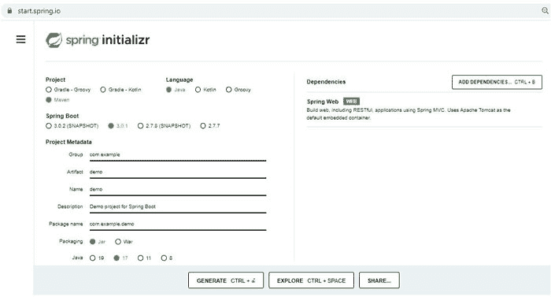

**图 1.1：** 使用 Spring Initializr

在这里，我们选择了一个基于 Maven 的 `Java 17` 项目，版本为 `Spring Boot 3.0.1`，并打包为支持 web 模块的 JAR 包。现在，点击 `GENERATE` 按钮，这将下载一个名为 `demo` 的 `.zip` 文件，该名称是 `Project Metadata` 部分下 `Name` 字段的值。我们现在可以解压文件并将其导入到我们选择的 IDE 中，开始进一步开发应用程序。

# 使用 IDE

现在是使用 IDE 生成 Spring Boot 项目的最后一种方法。诸如 `IntelliJ`、`Eclipse` 和 `Visual Studio` 等 IDE 都支持基于 Spring Boot 的应用程序开发。你可以根据喜好选择其中任何一个。在这里，我们将讨论在哪里下载特定的 IDE 以及如何使用它。

让我们从 `Eclipse` 开始。Eclipse IDE 带有 `Spring Tools Suites` 插件，你可以将其集成到你的 `Eclipse` 中以进行 Spring Boot 开发。或者你也可以单独下载 Spring tools suite，就了。在这里我们将讨论这两种方法。

# 在 Eclipse 中集成 STS 插件

如果你已经安装了 eclipse IDE，那就太好了。在继续之前，请找到 Java 版本支持，因为我们至少需要 Java 17 才能继续。如果你没有 IDE，可以根据你的平台从 [`www.eclipse.org/downloads/packages/site`](https://www.eclipse.org/downloads/packages/site) 下载。

下载完成后，解压它，并使用它启动工作区。我已经启动了工作区，现在将通过点击图 1.2 所示的 `Install` 按钮，从市场商店集成 STS 插件：

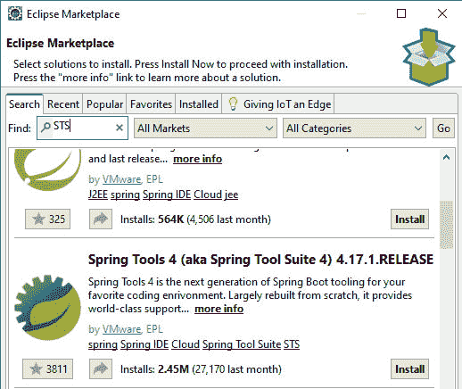

**图 1.2：** 在 Eclipse 中安装 Spring Tools

选择默认选项并继续过程。一旦下载完成后，将出现一个对话框重启工作区，更改将反映出来。工作区重启后，我们可以通过点击 `File` -> `New` -> `Spring Starter Project` 选项来检查更改，我们将得到以下对话框确认我们的插件已正确安装，我们可以如图 1.3 所示使用它：

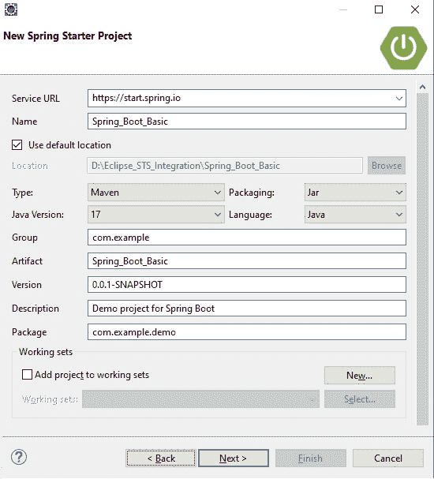

**图 1.3：** 在 Eclipse 中创建 spring boot 项目

`STS tool` 与到相同的站点 [`start.spring.io/`](http://start.spring.io/) 通信并获取详情。正如我们在之前的步骤中所做的，在这里我们也通过点击 `Next` 按钮并在应用程序中添加 web 模块依赖来添加详情和依赖。

# 使用 STS

**Spring Tools Suite** (`STS`) 是 eclipse 的专用版本，专门用于基于 Spring Boot 的开发。最新版本可以从 [`spring.io/tools`](https://spring.io/tools) 根据你偏好的平台下载。我正在下载一个 `Windows-based version`。一旦下载了可执行的 `.jar`，双击它。提取完成后，你将获得 `sts-4.x.x.RELEASE` 文件夹。现在，使用名为 `SpringToolSuiteX` 的应用程序文件启动工作区。工作区启动后，按照与之前步骤相同的步骤创建应用程序。我们在书中将广泛使用 STS，但正如我所说，你可以根据喜好选择任何 IDE。

# 使用 Intellij

如果你已经有了社区版，可以继续集成插件。然而，如果你想下载 `Intellij` 的社区版，请使用适用于 windows 的链接：

[`www.jetbrains.com/idea/download/?fromIDE=#section=windows`](https://www.jetbrains.com/idea/download/?fromIDE=#section=windows)

下载完成后，启动 IDE，你将直接进入对话框，在其中你可以选择用于集成的插件。你可以参考图 1.4：

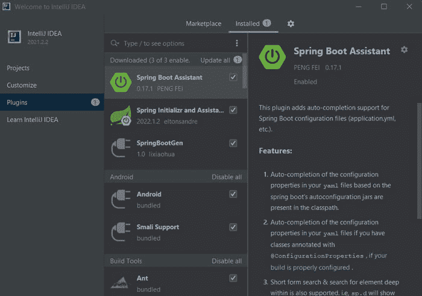

**图 1.4：** 在 Intellij 中添加 Spring 插件

我们需要选择 `Spring Boot Assistant` 和 `Spring Initializr and Assistant` 插件。按照说明完成 STS 插件集成。集成完成后，你现在可以选择项目类型为 `Spring Initializr`，如图 1.5 所示：

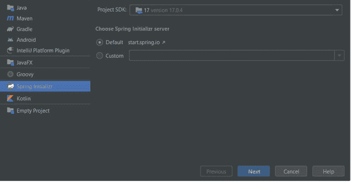

**图 1.5：** 在 Intellij 中创建 spring boot 项目

现在继续提供如项目名称、项目类型、使用的语言以及带有版本在其他元数据信息。外观和感觉不同，但过程与图 1.6 所示非常相同：

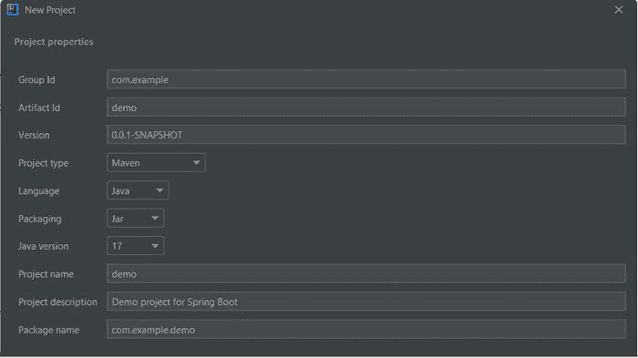

**图 1.6：** 在 Intellij 中配置 spring 项目

除此之外，你也可以从此链接下载 IntelliJ 的 Ultimate 版：[`www.jetbrains.com/idea/framework/`](https://www.jetbrains.com/idea/framework/)。它带有内置对 spring 开发的支持。

我们也可以使用 VSCode 编辑器创建 spring 应用。请参考附录-1 以了解如何配置 VSCode。

# 引导启动

**引导启动**是指带有最少资源进行启动。**引导加载器**是代码的第一部分，用于执行应用程序的初始部分，然后**加载剩余部分**。它不仅允许开发者选择他们在应用程序中需要的内容，以及结构和配置，还提供了自定义方法。

引导 Spring Boot 应用最简单且广泛接受的方法是使用 **Spring Initializr**。我们在之前的章节中已经通过各种方式使用了 Spring Initializr 获取我们应用程序的基础。它可能是 *基于 Maven 的* 或 *基于 Gradle 的*，但它提供了一些基础结构。在进一步开发之前，让我们先探索基础结构、文件、重要性，以及如果我们需要自定义该如何操作。让我们从文件结构开始。

第一个是类级注解 `@Configuration`，它表示被注解的类提供了一个自动定位的应用程序配置。

第二个是 `@ComponentScan`，它能够扫描包以查找 `@Component` 注解。

第三个注解是 `@EnableAutoConfiguration`，它启用了应用程序的自动配置机制。这种自动配置会根据添加到类路径的 `.jars` 文件自动发生。

该类定义包含一个标准的 `public static void main()` 方法。与任何 Java 应用一样，它指示了应用中的入口。在我们的案例中，它也作为入口点。随后，主方法通过调用 `run` 方法来委托应用程序类，如下：

```
SpringApplication.run(SpringBootBasicMavenApplication.class, args);
```


Spring 应用通过启动 Spring 容器来引导我们的应用程序，并根据数据配置开始自动配置 Web 服务器。在这里，如果需要，我们还可以发送一些命令行参数来添加自定义配置。

现在问题是，当我们说配置已定位并采取了操作时，究竟发生了什么？Spring 容器定位配置，并配置和存储 bean 以供以后使用。在 Spring 中，XML 文件或基于注解的配置会被定位并执行相应操作。然而，Spring Boot 没有 XML 配置。因此，所有操作都需要基于应用在类或方法上的注解来完成。应用程序还需要一些应用级 bean，例如 `DataSource`、`LDAP` 或 `RabbitMQ`。我们的应用程序将基于 Gradle 或 Maven。Gradle 拥有 `build.gradle`，而 Maven 有一个 `pom.xml` 文件，其中包含依赖项标签，提供了关于应用程序支持哪些 Spring 模块的信息，如图 1.8 所示：

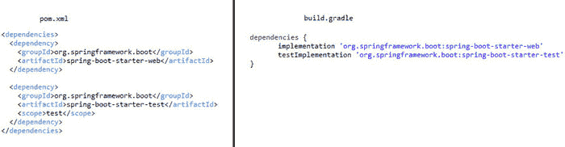

**图 1.8:** 在 Maven 和 Gradle 项目中设置依赖

由于我们在创建应用时仅添加了 web 模块，因此仅添加了一个依赖。测试模块用于编写测试用例。但你是否注意到它不仅仅是一个依赖；它实际上是依赖的启动器（starter）？是的，Spring Boot 提供了许多启动器。在 Spring Boot 引入之前，开发者需要逐个添加每一个所需的依赖。尽管 Gradle 和 Maven 等工具让这个过程变得简单，但开发者仍然需要花费大量时间。启动器让这个耗时且复杂的过程变得简单。这使得开发者能够轻松添加应用所需的模块，并且所有相关的依赖包将自动包含在类路径中。Spring Boot 有 50 多个这样的启动器。在这里我们包含了 web-starter，基础 Spring jar（如 `spring-beans`、`spring-context` 和 `spring-core`）以及 `spring-boot`、`spring-autoconfigure`、`spring-boot-starter` 等都包含在类路径中，而包含哪些 jar 完全取决于 `pom.xml` 或 `build.gradle.build` 文件中添加的依赖，如图 1.8 所示。

我们刚刚讨论了添加第三方 `.jars` 的过程。但 bean 管理呢？Spring Boot 如何管理应用程序所需的 bean？由于 Spring Boot 基于零 XML，配置要简单得多。在应用程序启动时，容器会查找类级和方法级注解来创建实例并管理它们的生命周期。它还会扫描类路径以查找已包含模块的信息，并相应的确定哪些 bean。当我们在类路径中包含 `web-module` 时，应用程序至少一个前端控制器（front controller）的 bean。如果包含了 `spring-jdbc` 模块，那么 `DataSource` 和 `JdbcTemplate` 的 bean 将由容器管理。但现在的问题是，容器如何找到数据库连接的 URL、用户名和密码的值。容器将使用应用程序属性文件中配置的值，并使用它们生成 bean 并进一步管理其生命周期。注意！当你在 `pom.xml` 文件中添加依赖时，`.jars` 会下载并添加到类路径中。类路径会被扫描以管理所需的 bean。因此，如果你添加了一些依赖但没有提供其属性的值，bean 无法无法管理，因此应用程序将无法启动。

# 探索 Runners

现在我们知道，在应用程序启动时，会进行引导并且应用程序将启动。但仍然有一个问题未解决：应用程序将是作为一个独立应用程序启动，还是作为一个 Web 应用程序启动？为了回答这个问题，我们需要讨论 runners。

默认情况下，每当我们创建一个 Spring Boot 时，它都是一种 Web 应用程序。你可以让它成为拥有展示层的完整 Web 应用，也可以是一个暴露端点（endpoints）的基于 Web 服务的应用程序。如果你正在考虑使用 `CommandLineRunner` 来开发独立应用程序，那么你猜错了。`ApplicationRunner` 以及 `CommandLineRunner` 用于在应用程序启动时运行某些逻辑代码，并向其传递运行时参数。`ApplicationRunner` 和 `CommandLineRunner` 都有 `run()` 方法，需要重写它们以执行自定义逻辑。以下代码段将展示如何在 `run()` 方法中访问命令行参数：

```
@SpringBootApplication
public class SpringBootBasicMavenApplication implements CommandLineRunner {
    public static void main(String[] args) {
        SpringApplication.run(SpringBootBasicMavenApplication.class, args);
    }

    @Override
    public void run(String[] args) throws Exception {
        System.out.println("Displaying command line arguments");
        for (String arg : args) {
            System.out.println(arg);
        }
    }
}
```

你可以通过命令执行应用程序：`java -jar SpringBootBasicMavenApplication.jar argument1 argument2`。这将显示输出：

**Displaying command line arguments**

**argument1**

**argument2**

遗憾的是，`CommandLineRunner` 只允许我们向应用程序传递值，然后我们需要记住顺序或应用字符串解析方法来根据场景使用这些值。是否有更好的方法发送特定属性的值？

`ApplicationRunner` 在这里是救星。使用 `ApplicationRunner`，用户可以从命令行参数传递键值对，并如下所示所示在应用程序的 `run` 方法中使用：

```
@SpringBootApplication
public class SpringBootBasicMavenApplication implements ApplicationRunner {
    public static void main(String[] args) {
        SpringApplication.run(SpringBootBasicMavenApplication.class, args);
    }

    @Override
    public void run(ApplicationArguments args) throws Exception {
        System.out.println("Displaying command line arguments");
        for (String arg : args.getOptionNames()) {
            System.out.println(arg);
        }
        System.out.println(args.getOptionValues("application.name"));
        System.out.println(args.getOptionValues("server.port"));
    }
}
```

你可以通过命令执行应用程序：`java -jar SpringBootBasicMavenApplication.jar application.name=sampleapp server.port=8081`。这将显示输出：

**Displaying command line arguments**

**sampleapp**

**server.port**

**[sampleapp]**

**[8081]**

Spring Boot 应用本质上是一个带有 `main()` 方法的 Java 程序。因此，可以像运行 Java 程序一样运行它。然而，我们集成了 STS 插件。我们也可以作为 Spring Boot 应用运行它。它也将作为一个 Java 应用程序执行，但带有一些额外的选项，如图 1.9 所示：

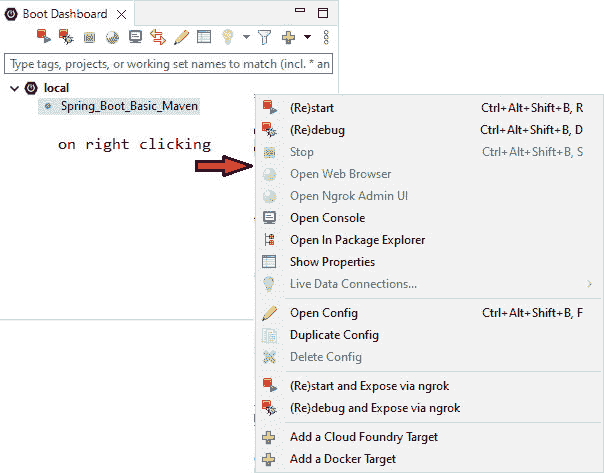

**图 1.9：** 运行 Spring Boot 应用

这就是我们从 IDE 运行应用程序的方法。但如果我想从命令提示符（Command Prompt）运行应用程序呢？问得好。*嗯*，你有各种选项可以选择。最简单的方法是你作为开发者并想要使用 Maven 工具来运行它。我们将此应用创建为基于 Maven 的应用程序，因此我们可以从命令提示符中使用 `mvn spring-boot:run`。

### 使用属性

Spring Boot 是一个高度可定制的应用程序，最简单的方法是可以在 `application.properties` 或 `application.yml` 文件中设置各种与应用程序相关的属性。虽然这些属性的列表无穷无尽，但在这里讨论所有属性是不可行的。我们可以将这些属性分为 16 多个不同的类别，例如核心（Core）、缓存（Cache）、邮件、JSON、数据库和事务、Web、模板、服务器、安全、Actuator、开发工具和测试。我们的目标是开发服务，所以让我们从自定义一些服务器相关的属性开始。第一次，我们向 `application.properties` 文件中添加一些细节。开始阶段可能有些难以消化，但这正是学习过程的意义所在。如果孩子放弃了，在他跌倒的一刻，他将永远无法学会走路。让我们打开 `resources` 文件夹下的 `application.properties` 文件并按下 `ctrl` + `space` 来获取如图 1.10 所示的属性：

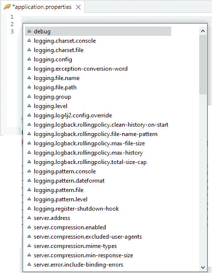

**图 1.10：** 设置服务器端口

如果你的系统中某些应用程序已经在端口 `8080` 上运行，那么在相同的端口号上启动 Spring Boot 应用是不可能的。在这种情况下我们该怎么办？非常简单，通过设置 `server.port=XXX` 来更改 Spring Boot 服务器（在我们的例子中是 Tomcat）的端口，其中 `XXX` 可以是系统上我们希望服务器启动的任何有效可用端口号。一旦你将此属性设置为 `8081`，你的应用程序将在 `8081` 上启动，如图 1.11 所示：

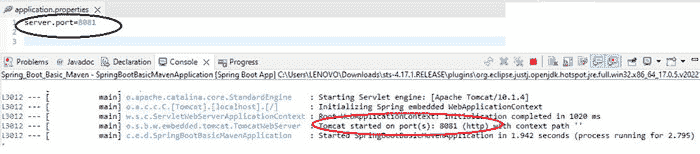

**图 1.11：** 使用修改后的端口启动 Spring Boot 项目

同样，我们可以更改服务器的其他属性。你可以通过输入 server 并在按下 `ctrl` + `space` 来动态获取所有属性，如图 1.12 所示：

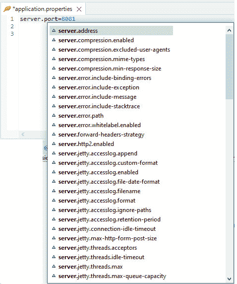

**图 1.12：** 加载属性

让我们来做一些有趣的事。当我们启动应用程序时，控制台会出现一个横幅（banner）。让我们配合一下将其禁用或更改。若要同时禁用控制台和日志文件横幅，我们可以设置 `spring.main.banner-mode=off` 将 `banner-mode` 设置为 `off`。有时我们只想在控制台或日志文件中打印横幅。在这种情况下，我们可以将 `banner-mode` 设置为 `log` 或 `console`。嘿，如果我们想要横幅但不要那个无聊的 Spring Boot 横幅呢？这可以实现吗？显然，我们可以通过在类路径（classpath）中添加 `banner.txt` 文件来随时更改它。如果你添加一个带有某些星号文本的文件，内容如 `This is a new banner`，你将观察到横幅文本的变化，如图 1.13 所示：

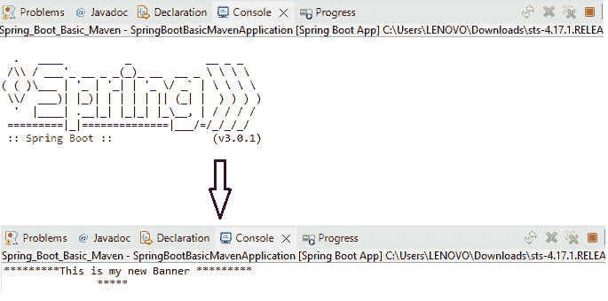

**图 1.13：** 设置横幅文本

你也可以使用 `application.yml` 代替 `application.properties` 文件。你配置的属性没有变化，但文件的结构发生了。YAML 文件与 `application.properties` 文件相比是结构化的。

例如，服务器端口配置可以写成：

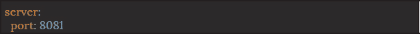

正如你观察到的，这更有结构。所有与服务器相关的属性都可以以类似的方式进行配置。

## 简述部署到服务器

一旦你尝试并测试了应用程序并且对其感到满意，你就想让你的同事使用该应用程序，或者你想分发该应用程序。我们该做什么？分发应用程序我们又有多种选择。在进入细节之前，我想稍微讨论一下运行应用程序时发生了什么。

Spring Boot 应用已准备好运行生产级应用程序。这意味着为了进入生产模式，我们实际上什么都不做或只做很少。当我们创建应用程序时，选择了打包模式为 JAR。因此，当运行应用程序时，IDE 会生成一个可执行的 `.jar` 并执行它。在执行 `.jar` 时，它将启动一个 Tomcat 服务器，我们的应用程序部署其中。一旦 Tomcat 服务器准备就，如果是 Web 应用，就可以从浏览器开始使用；如果是 Web 服务，则可以使用它的客户端。我想说的是，我们不需要依赖服务器的外部配置然后遵循应用程序的部署流程。这节省了大量时间。可执行的 `.jar` 用于托管应用程序的服务器。在这里，我们遵循“每个服务器一个应用程序”（application per server）的设计模式。不用，我们将在相应的章节详细讨论部署设计模式。目前只需记住，我们在 IDE 中运行应用程序时，默认我们的应用程序将托管在 Tomcat 服务器上。

现在我们详细了解了运行应用程序时的过程。现在，让我们关注分发过程。

这非常简单，你们中的很多人已经猜到了。我们可以获取应用程序打包成 JAR 并分发该 JAR。在客户端系统上运行可执行的 `.jar`。现在，你可能想知道如何获取 JAR。我说这可能是因为你们许多人已经多次将应用程序打包为可执行的 `.jar`，或者至少知道 IDE 有这样一套系统。然而，我们将应用程序开发为 Maven 应用程序，使用该工具打包是最佳选择。在命令提示符中，你可以使用 `mvn install` 命令，或者在 IDE 中右键点击应用程序 **→** **Run As** **→** **Maven install**，如图 1.14 所示：


**图 1.14：** 部署 Spring Boot 应用

它将在 target 文件夹中生成 `.jar`。一旦有了 jar，你就可以上传到云端或在客户端系统上执行。应用程序将可以使用。这不简单吗？

有时我们希望将应用程序打包为 `War` 以部署到我们选择的服务器上。在创建应用程序时，可以将打包方式选择为 `War`，如图 1.15 所示：

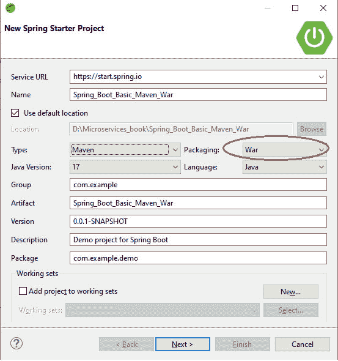

**图 1.15：** 生成 war 或 jar 文件

一旦应用程序就绪，我们可以通过 `mvn install` 命令获取 `war` 文件，在 target 文件夹中生成 `war` 文件。然后我们可以将其部署到选择的外部服务器上。

## 结论

在本章中，我们讨论了 Spring Boot 框架的基础知识。我们讨论了如何开发和执行简单的 Spring Boot 应用程序。我们还讨论了不同类型的运行器 `ApplicationRunner` 和 `CommandLineRunner` 及其用法。此外，我们学习了应用程序的基本结构，以及如何使用属性文件自定义应用程序的不同属性。最后，我们讨论了如何在 Tomcat 服务器上部署应用程序。在下一章中，我们将讨论 REST 应用程序的基础知识，并开发一个与数据库通信的`端到端服务`，然后使用 `Postman` 对其进行测试。

# 第二章

# 破译难懂的内容

在在上一个章节中，我们讨论了框架的必要性以及`为什么要使用 Spring Boot 框架`。显然，这是一个介绍性章节。因此，我们只处理了非常基础的概念。一旦我们决定使用 Spring Boot，就可以利用它提供的不同模块。你们都知道，创建一个应用程序本身是一项非常艰巨的任务。但使用单一技术创建完整应用程序的时代已经过去了。某些技术提供了更好的 UI 开发功能，可以用于创建如 `Angular` 和 `React` 这样的 UI。而某些技术确实提供了更好的 API 来编写灵活的业务逻辑，如 `Java` 或 `.NET`。因此，人们可能会在 `Angular` 中创建 UI 而在 `Java` 中创建业务逻辑。在这种情况下，在 `Angular` 中创建的 UI 层应该将数据传递给在 `Java` 中创建的业务层，反之亦然。任务很大，`不是吗？` 我们预期一个应用程序应该与用不同编程语言或框架开发的应用程序进行通信。在这种情况下，我们需要服务来建立通信，并独立于另一端使用的技术来共享数据。

大多数时候，我们可能详细了解消费者。有时，它是未公开的。我们可能知道它使用什么语言，或者消费者期望以什么格式接收服务提供者的响应。据此，我们可以创建一个理解消费者所用语言的服务提供者。但`如果我们不知道服务和消费者是否使用相同的语言、版本，甚至是它们使用的框架呢？` 或者它们是否正在使用相同的平台？为消费者提供服务总是很复杂的。在这种情况下，我们需要创建一个可以向消费者生成`语言无关响应`的服务。这是通过 REST 服务实现的。本章将介绍 Spring Boot REST 的基础知识。我们将学习如何使用 Spring Boot 创建基于 REST 的服务来支持不同的 HTTP 请求。

## 结构

在本章中，我们将讨论以下主题：

*   应用程序开发的基础

*   服务的需求

*   开发简单的 REST 服务

*   处理不同的媒体类型

*   与数据库的通信

*   REST 中的异常处理

*   编写自描述消息

## 应用程序开发的基础


我们经常遇到如`software`（软件）、`software application`（软件应用程序）、`application`（应用程序）或简单的`app`等术语。无论称呼为什么，它们都是相同的。简单来说，应用程序是一个旨在执行某些任务和相关操作的程序。通常，当我们说它是一个应用程序时，我们的目标是为客户的所有需求设计一个一站式服务。以`在线购物`为例。消费者从在线购物应用程序中需要什么？一个`消费者`可能想找到所有产品的列表或按类别划分的产品列表。消费者可能还想购买一些产品，如果他们愿意就在线支付，并想跟踪`订单`等。同样，你可以考虑`学校管理`、`公司管理`、`银行应用程序`和`股票市场应用程序`，这些可以使用`不同的语言`、`框架`和`平台`来开发。

如今，由于覆盖范围有限，基于控制台的应用程序已经罕见。它们的安装更加复杂。此外，在客户端系统上更新控制台应用程序是一项乏味的工作。今天是 Web 应用程序时代，通过互联网实现了`客户端-服务器连接`。可以从任何浏览器远程访问 Web 应用程序。浏览器作为应用程序的消费者并向服务器发送请求。我们不是在这里学习 Web 架构的。所以，让我们先跳过这些。如果你是 Web 应用程序的新手，请`Google`查找更多详情，不要避开这个话题，因为这对理解基本概念非常重要。

Web 应用程序最大的优点是它们托管在服务器上，版本更改在服务器上。客户端不需要在其系统上进行任何更新即可使用新版本的应用程序。可以使用`.NET`、`Python`、`Java`、`PHP`等许多语言开发 Web 应用程序。通常，如果我们考虑`Java`，可以使用`Servlets`和`JSPs`来开发企业级应用程序。`Spring MVC`和`Struts`框架也具有用于开发 Web 应用程序的强大 API。

除了 Web 应用程序，如今移动应用也广泛使用。移动应用程序通常为移动平台开发，因此是`轻量级`的。`Android`、`IOS`、`Flutter`等可以开发基于移动的应用程序。

企业级 Web 应用程序是`复杂的`、`冗长的`，而且从安全角度来看开发也是`至关重要的`。市场需求很大，团队负担不起花费几个月时间共同开发然后测试应用程序。团队需要决定许多事情，如应用程序的语言、使用的框架、使用的设计模式，最后是开发后测试应用程序的方法。

当从零开始应用程序开发时，需要`时间`和`精力`。此外，它需要经验丰富的开发者。在这个方面，框架提供了一个基础架构以加速开发。

我们可以想象一个没有数据的应用程序吗？嗯，这并非可能的。但识别此类应用程序非常困难。

你一定有一肚子疑问。正如`Peter Abelard`曾经说过的，知识的万能钥匙确实是持续且频繁的提问。别担心，如果你是一个初学者并对服务的细节感兴趣，下一节就是为你准备的。我假设你们中有些人可能已经在开发服务，并且对这些细节不感兴趣。如果是这样，请跳过本节，直接开始开发 REST 应用程序章节。感兴趣继续读下去的朋友，请坐好椅子，享受接下来关于服务的轻松讨论。

## 服务的需求

`Agile Team`的`PO` `John`今天非常兴奋。他的团队已经完成了计划中的一个迭代（刺），他正准备向利益相关者演示结果。开发团队使用`HTML`、`CSS`和`Bootstrap`等传统的 UI 组件完成了冲刺，这些组件与用`Java`或`Servlet/JSP`构建的业务逻辑集成在一起。但当`John`向利益相关者展示当前的冲刺时，他们提出了一个新需求。他们希望将 UI 转换为`Angular`而不是传统的 UI 组件。他们想利用`Angular`为应用程序带来的优势。尽管整体外观和内容保持不变，但这对团队来说是一次彻底的转向。此外，当`John`将此传达给团队时，团队有些不愿意进行这种改变。当然，这是没有的！

`敏捷开发`听起来真的很迷人。但当每个冲刺结束后，利益相关者提出新需求时，它是痛苦的。团队需要更改应用程序代码。有时任务可能是简单的。但很多时候，处理的数据需要更改，大量的代码需要修改，这可能会在团队中产生很多冲突。我们希望客户总是开心，但团队呢？你知道的，这次客户要求新功能。这对他们来说是新的，但我的团队已经在其他项目中开发过类似的解决方案。团队现在必须再次工作，这次显然他们会花费更短的时间，因为解决方案几乎已经就绪了。

解决方案的代码在一种技术中既冗长又复杂，而其他技术可能轻松实现它。现在，团队是否需要从一种技术迁移到另一种技术呢？如果没有其他选择，我们必须这样做。但这需要大量的重复工作，坦率地说，团队可能不想再次经历这种痛苦。如果我们能用一种技术开发解决方案的一部分，用另一种技术开发另一部分，那就太好了。这样，这两个应用程序就可以相互通信。此外，在任何技术中创建的任何解决方案都可以被其他人独立使用。

让我们假设我们正在设计一个 Web 应用程序。团队在业务逻辑上付出了巨大的努力，并且运行得非常好。然而，团队需要更好的 UI。团队可以在 UI 中使用一些模板、`CSS`和主题。但仍然缺少了什么，需要为了更好的 UI 而努力。这可能是因为我们用于开发 Web 应用程序的技术所致。我们正在使用的技术可能为我们提供了编写业务逻辑的最佳`API`，但在 UI 方面它没有提供最佳结果。在这种情况下，我们需要使用新技术进行重构，这种技术能够为我们提供设计迷人 UI 的方法。但这并保证我们选择的技术会像之前的技术一样为业务逻辑开发提供的服务。是否存在一种技术解决方案可以让我既能利用最好的 UI 又利用企业级解决方案？你只需要一个服务。软件系统不同部分之间通过网络交换数据的方法就是服务，或者确切地说是网络服务。软件系统的一部分请求数据，另一部分或几部分则提供细节。请求数据的系统部分是`Service Consumer`，提供细节的部分被称为`Service Provider`。

软件系统的不同部分可能使用不同的编程语言。这些语言有自己的数据类型、声明方式及其用途。当我们想在异构语言之间进行通信时，我们需要注意几点。首先，所有此类通信在跨语言通信的`API`方面都需要大量工作。其次，由于技术差异，即使通信发生了，也是徒劳的。这意味着我们需要一种不于特定编程语言的数据交换方法。与其执行另一个应用程序模块的逻辑，我们请求该模块获取资源、执行逻辑并返回修改后或预期的有效负载响应。

基于服务的应用程序之间通过一次或多次调用来交换数据。正如我们所知，这种通信发生在异构应用程序之间，它们最需要的是某种通用格式的数据，以便所有它们都能在较少工作或不工作的情况下理解它。大多数语言都可以解释、理解并拥有`XML`和`JSON`的`API`。因此，显而易见，大多数服务使用`XML`和`JSON`来交换数据。

## 开发简单的 REST 服务

有很多讨论和理论，我们可以为这个概念专门写一本书。关于此点的实体和非实体格式的材料非常多。所以，让我们不要进入太多细节。现在是行动的时候了。让我们开始吧。

在这里，我们将为医院管理开发一个服务，该服务将与数据库通信以执行 CRUD 操作。我们的应用程序是一个多层服务，部署在服务器上，与其他几个应用程序一起，如图[图 2.1]所示。

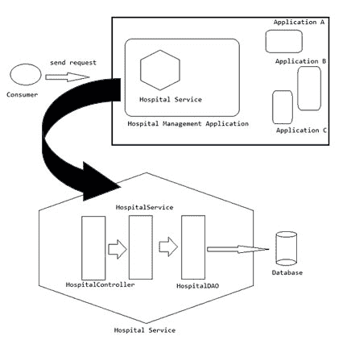

**图 2.1:** 医院服务管理

让我们开始吧。我们将在`Eclipse STS`中开发一个`Spring Boot`应用程序，并将`Spring web`、`JDBC`和`MySQL`作为依赖。想要使用`H2`或任何数据库（如`Oracle`、`PostgreSQL`）的人，请如图[图 2.2]所示从 SQL 部分选择相应的依赖。

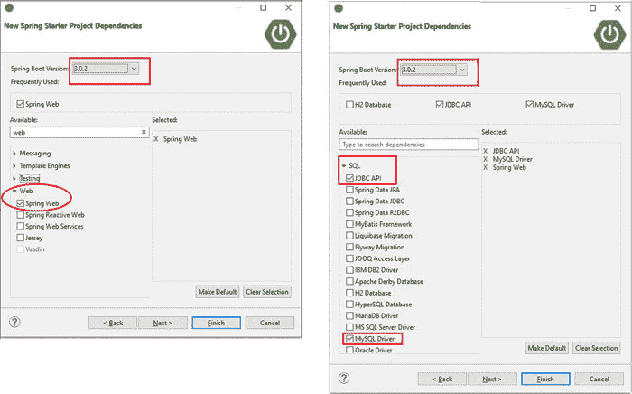

**图 2.2:** 创建带有依赖的 spring boot 应用

一旦生成应用程序，观察`pom.xml`文件中添加的启动器。只需提醒一下——在[第 1 章：基础]中，我们已经讨论过启动器。如果你想复习，请访问[第 1 章，基础]中的`快速开始`部分。我们的应用程序是一个多层应用程序，如图[图 2.1]所示。现在通常，当我们清楚要实现什么概念来完成应用程序时，选择权就在我们手中；是从代码开始还是从配置开始。通常首选从代码开始，但那只是个人的偏好。所以，在这里我们将遵循代码优先的模式。我们的应用程序需要为医生提供服务。这意味着除了将数据从一层传递到另一层的其他层外，我们还需要一些领域对象。在我们的应用程序中，我们需要`Hospital`、`Doctor`、`Patients`等作为领域对象。作为开始，在这里我们将定义一个`Doctor`的 POJO，具有一些数据成员、构造函数以及访问器和修改器方法。`toString()`和`hashCode()`的需求基于场景。我们这里不需要它们。以下代码显示了 POJO 的实际内容：

```java
public class Doctor {
    private int doctorId;
    private String doctorName;
    private String specialization;
}
```

**注意**

在情况下，如果我们不想编写 getter 和 setter 以及默认构造函数和参数构造函数，可以使用 Lombok 或 Record 类。

我们已经知道如何设计 POJOs 了；现在是时候设计我们更感兴趣的控制器层了。正如名称所示，`controller`用于控制、管理或调节应用程序的行为。这是暴露 API 的层。消费者使用这些 API 或由控制器暴露的端点（endpoints）。一旦端点上的执行完成，它就会生成响应。生成的`response/ payload`将被发送回`consumer`。正如我们之前讨论过的，服务处理的是`data/resource`的交换。从现在起，我们不再使用“数据”一词，而是使用`resource`术语。因此，`controller`定义了多个端点来暴露资源。通常情况下，一个资源可以简单如一个`String`，也可以复杂如一个视频文件。任何可以与消费者进行共享的内容，如对象、文件、图像等，都可以被视为资源。在这里，我们将处理对象作为一种资源来处理。

### Note

- Web 服务中的负载（payload）是指在 HTTP 请求或响应中发送的数据。负载是消费者和提供者之间交换的这些。负载可以是多种格式，如文本、XML 和 JSON 等。

## REST 控制器层

让我们声明`DoctorController`，并带有用于对`Doctor`资源执行 CRUD 操作的端点。我们将声明的第一个端点是接受`Doctor`实例的端点。我们目前不会将此资源添加到数据库中，但我们肯定会在接下来的章节中这样做。在本节中，我们将重点关注如何声明、实现和使用端点：

```java
package com.example.demo.controllers;

@RestController
public class DoctorController {
    @PostMapping("/doctors")
    public Doctor createNewDoctorRecord(@RequestBody Doctor doctor) {
        // 向向表中添加记录的逻辑将放在这里
        return doctor;
    }
}
```

控制器类由类型注解`@RestController`标记，它是`@Component`注解的特殊版本，并且通过`classpath`扫描进行自动检测。应用在处理方法`createNewDoctorRecord()`上的`@PostMapping`注解用于读取包含医生详情的传入 HTTP 请求。`@PostMapping`注解是`@RequestMapping(method=RequestMethod.POST)`的简写，它从 Spring 4.3 版本开始可用，此外还有其他注解。我们将在本节稍后的部分讨论其他注解。当我们想要在提供者端创建一个新资源时，使用`@PostMapping`注解。观察端点的声明方式：

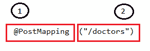

**图 2.3:** 用于创建资源的端点

第一部分定义了一个统一接口。统一接口声明了传入请求映射的 HTTP 方法。第二部分定义了定义端点的路径。这第二个部分通常是名词的复数形式，而不是像我们在 Java 中通常声明的动词。此外，此路径值应该始终以斜杠`/`开头。一组 HTTP 方法和路径对于一个应用程序来说始终唯一的，因此在重用它时要小心。

现在，考虑处理方法并观察它的参数：

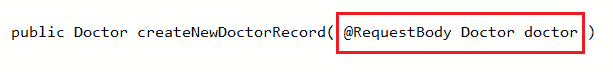

**图 2.4:** 在方法参数中接受 RequestBody

该方法接受类型为`Doctor`的参数，该参数由前图所示的`@RequestBody`注解标记。`@RequestBody`注解将带有主体的传入`HttpRequest`映射到领域对象。在我们的案例中，它是 doctor。它允许将传入的`HttpRequest`体自动反序列化为实例。在这里，由于我们使用默认的反序列化机制，消费者发送的 JSON 数据将使用 Spring Boot 框架的反序列化 API 反序列化为我们的医生实例。目前，我们将返回类型保持为`Doctor`。当然，我们可以自由决定从处理方法中返回什么。我们始终需要记住的一点是，服务是为了两个应用程序或服务之间的通信。当在消费者端接收到响应时，消费者需要根据提供者端或端点发生的情况来决定要执行什么操作。如果不想向消费者发送任何信息，它可以是`void`。它也可以是表中受影响记录的数量，或者像我们在代码段中返回的实例。

现在，让我们使用 Postman 作为客户端测试该端点。Postman 是一个让开发者能够轻松探索、测试和调试控制器 API 的工具。使用 Postman，我们可以使用所有 HTTP 方法，如`GET`、`POST`、`PUT`、`PATCH`以及`DELETE`。除了 HTTP 请求外，我们还可以定义 REST、SOAP、WebSockets 以及 GraphQL 的复杂 API 请求。它还内置了对广泛协议身份验证的支持，包括 AWS Signature、OAuth 1.0、OAuth 2.0 等。

有时候 URI 是`correct`，但我们的服务器已`stopped`，或者在指定的`port`号或指定的`IP address`上不可用。在这种情况下，我们将得到如图 2.9 所示的连接错误：

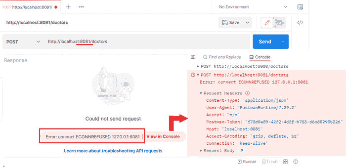

**图 2.9:** POSTMAN 中的连接错误

对于`developer`来说，在所有可能的场景下测试端点是非常重要的。根据测试结果，`developer`将知道在给定情况下消费者端会接收哪种`status code`。测试将允许`developers`编写质量更好的代码，并以适当的方式编写文档供参考。这有助于`consumer`理解收到的响应的原因并采取适当的行动。在这里，我们发送了一个 JSON 类型的请求体，并收到了状态码`200`。你可能想在请求体中发送`XML`或`Text`，或者你可能想用`201`作为状态码代替`200`来响应消费者。我们很快就会详细讨论这些内容。

在前面的案例中，提供者读取了一个对象类型的资源，现在问题是，*是否也可以读取基本类型呢？* 显然，是可以的。Spring Boot 已经让接受基本类型变得非常简单。让我们声明一个消费者请求的端点，根据`doctorId`获取记录。下面的代码片段显示了如何编写相应的处理方法：

```java
@GetMapping("/doctors/{id}")
public Doctor findDoctorById(@PathVariable int id) {
    // logic to find doctor by id will go here
    return new Doctor(id, "dummy name", "dummy specialization" );
}
```

`@GetMapping`处理 HTTP GET 方法。根据某些标准查找资源的端点使用`@GetMapping`注解声明。`consumer`需要发送标准来搜索匹配的记录或记录。如果要交换的信息是敏感的或很长的，最好使用`@RequestBody`注解并通过 body 发送资源，这样它就不会被公开可见。然而，大多数情况下它不是`sensitive`的，可以直接在`URI`本身中发送它。观察如图 2.10 所示的端点声明：

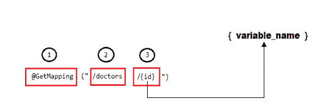

**图 2.10:** 在 URI 中附加数据的 GetMapping

`first`部分定义了传入的 HTTP 请求到`controller`方法的映射。`second`部分是基础 URI 路径。对我们来说，`third`部分（路径的一部分）是最重要的，因为这是我们第一次向提供者发送某些值。它通常被称为`URI path variable`。它始终声明在持有有效`variable name`的一对大括号`{}`中。`curly`括号充当占位符，`consumer`将向其中发送实际信息。

现在，`consumer`发送的值必须供提供者使用。`@PathVariable`注解允许提供者从路径中访问值。当消费者在 URI 中添加该值时，从技术上讲它是`String`类型，但我们直接将其作为`integer`访问。我们能够这样做，因为 Spring Boot 在读取`@PathVariable`注解时会从`URI`路径中读取值。然后，根据我们为`argument`类型声明的数据类型，框架会将`String`值解析为相应的数据类型。我们作为`developer`只需要使用它即可。让我们如图 2.11 所示，在 Postman 中测试`GET`端点：

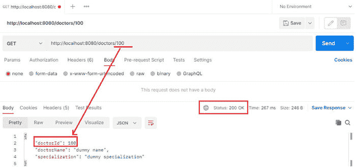

**图 2.11:** 在 POSTMAN 中传递路径变量


如图所示，我们请求了`GET`端点，其`doctorId`的路径变量值为`100`。由于该端点可用，我们收到的响应状态码为`200`。JSON 响应也显示了`doctorId`属性的值等于`100`，证明了之前讨论的`path`变量值到函数参数的正确绑定。我们需要记住一点，默认情况下，参数的名称应与`path`变量名匹配。这只是一个默认策略，人们也可以遵循自己的约定。为了实现这一点，开发者端需要进行一些额外工作。别急！这很容易的，我们将在下一个处理方法中讨论。

所以，不要浪费时间，让我们开始声明`handler`方法来根据专科搜索`doctors`：

```java
@GetMapping("/doctors/{specialization}")
public List<Doctor> findDoctorBySpecialization(@PathVariable
String doctor_specialization) {
    // logic to find all doctors by specialization will go here
    return Arrays.asList(new Doctor(1, "dummy name", doctor_specialization ));
}
```

我们已经讨论了`@GetMapping`和`@PathVariable`注解。你还记得，HTTP 方法和 URI 的组合是唯一的吗？我们不是在重复声明相同的组合吗？不！在第一个`@GetMapping`中我们使用的是`/doctors/{id}`，而这里是`/doctors/{specialization}`。相似之处在哪里？说得对。

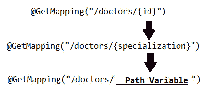

**图 2.12：** 歧义点

我们请求了`GET`端点，其`doctorId`的路径变量值为`100`。由于端点可用，我们收到的响应状态码为`200`。JSON 响应也显示了`doctorId`属性的值等于`100`，证明了之前讨论的`path`变量值到函数参数的正确绑定。我们需要记住一点，默认情况下，参数的名称应与`path`变量名匹配。这只是一个默认策略，人们也可以遵循自己的约定。为了实现这一点，开发者端需要进行一些额外工作。别急！这很容易的，我们将在下一个处理方法中讨论。

现在，我们的端点（endpoint）运行良好。作为开发者，我们想要处理 URI 的某些排列组合。我们可以通过`path`变量传递信息。但我们是否有灵活性来选择是否提供`path`变量呢？简而言之，路径变量可以是可选的吗？或者路径变量可以有默认值吗？运气不错！只要通过添加属性，我们可以实现这种灵活性。让我们快速检查一下`@PathVariable`注解，以深入了解我们可以做什么。

该注解有三个属性：`name`、`required`和`value`，用于修改其默认行为。`name`属性的默认值与`path`变量相同。但我们可以更改它，就像我们在`findDoctorBySpecialization()`方法中做的那样。此外，我们还可以使用`value`属性为`path`变量添加别名。可以使用`name`或`value`属性之一来指定`path`变量到参数的绑定。由于我们只有一个属性，所以不需要指定`name`属性。第二个属性`required`接收一个`boolean`类型的值。默认情况下，`required`的值为`true`，这意味着消费者需要明确指定它，如果未指定则会发生错误。可以使用它来使路径变量变为可选。由于我们现在要指定多个属性，因此我们必须指定每个属性的名称。因此，可用的修改方案如下：

### 情况 1：使用`required`属性指定路径变量为可选

```java
@GetMapping(value={"/doctors/specialization","/doctors/specialization/{specialization}"})
public List<Doctor> findDoctorBySpecialization(@PathVariable(
name="specialization",required = false) String doctor_specialization)
```

### 情况 2：使用`value`属性

```java
@GetMapping(value={"/doctors/specialization","/doctors/specialization/{specialization}"})
public List<Doctor> findDoctorBySpecialization(@PathVariable(
value="specialization",required = false) String doctor_specialization)
```

### 情况 3：同时使用`value`和`name`属性

```java
@GetMapping(value={"/doctors/specialization","/doctors/specialization/{specialization}"})
public List<Doctor> findDoctorBySpecialization(@PathVariable(
name="specialization",required = false,value="specialization") String doctor_specialization)
```

### 情况 4：使用`java.util.Optional`处理路径变量

在 JDK 1.8 之后，与其使用`required`属性，每当我们想要`path`变量是可选时，也可以对参数使用`java.util.Optional`类型。我们需要对代码进行一些更改，将参数类型声明为`<Optional> String`而不是`String`，并且在代码中我们现在必须在逻辑上检查`path`变量是否存在。以下示例代码实现了相同的功能：

```java
@GetMapping(value = { "/doctors/specialization", "/doctors/specialization/{specialization}" })
public List<Doctor> findDoctorBySpecialization(
@PathVariable(name = "specialization")
Optional<String> doctor_specialization) {
    // 按专科查找所有医生的逻辑将放在这里
    String specialization = "all";
    List<Doctor> doctors=new ArrayList<>();
    if (doctor_specialization.isPresent()) {
        doctors= Arrays.asList(new Doctor(1, "dummy name", doctor_specialization.get()));
    }
    return Arrays.asList(new Doctor(1,"dummy name", "any specialization"));
}
```

我们可以运行应用程序，并通过 Postman 发送`GET`请求来测试每一个，URL 使用如`http://localhost:8080/doctors/specialization/child`或`http://localhost:8080/doctors/specialization`。

我们在这里对同一个 URL 映射有多个情况。因此，请一次添加一个情况，否则你将得到模糊映射异常（ambiguous mapping exception）。

在我们刚刚讨论的所有 HTTP GET 方法示例中，我们都预期`path`变量。人们可能还想获取所有医生列表。在这种情况下，我们只需要像下面的代码所示放弃`path`变量来查找所有医生：

```java
@GetMapping(value="/doctors")
public List<Doctor> findAllDoctors() {
    // 查找所有医生的逻辑将放在这里
    return Arrays.asList(new Doctor(1,"dummy name", "all" ));
}
```

现在的问题是我们真的需要这个 URL 吗？坦率地说，不需要。我们已经有了带有可选路径变量的 URL，可以随时复用。需要注意的是，当`/doctors/specialization/{specialization}`开始处理用于搜索特定专科或所有医生的资源请求时，其负载将会增加，性能可能会受到影响。在编写处理多个条件的端点之前，请三思后再做选择！

我们现在有了关于如何创建新资源的信息。让我们使用`PutMapping`或`@RequestMapping(method=RequestMethod.PUT)`注解。让我们像代码所示添加处理方法：

```java
@PutMapping("/doctors")
public List<Doctor> updateDoctor(@RequestBody doctor) {
    // 如果 id 存在则更新医生的逻辑将放在这里
    return doctor;
}
```

我们只需通过发送专科来测试端点。如果我们发送部分值，其余未设置的字段将被设置为各自的默认值。这意味着我们想要更新医生的专科，并且只为该特定字段发送值。在这种情况下，医生名称的值将为`null`，而作为整数的 doctorID 将为`0`。我们不希望这种情况发生。让我们再次尝试以获得更好的理解。这次我们在假设 id 和名称已经存在的情况下提供值，只有专科字段是新的。

在这样的情况下，`@PatchMapping`救了我们。当我们想要部分更新资源时，尝试另一种更好的方法。我们可以使用 HTTP PATCH 方法而不是 PUT 方法。让我们将代码的端点映射修改为：

```java
@PatchMapping("/doctors/{id}/{specialization}")
public List<Doctor> updateDoctor(@PathVariable int id,
@PathVariable String specialization) {
    // 如果 id 存在则更新医生信息的逻辑将放在这里
    return new Doctor(id, "abc", specialization);
}
```

请在 Postman 中进行测试，就像我们对其他端点操作的那样。

恭喜！你现在可以创建新资源、更新它们并搜索它们了。我们费很大精力创建了那个资源，我不想删除它。然而，这是我们讨论的最后一个映射：如何删除现有资源？我们现在将 HTTP DELETE 请求映射到使用`@DeleteMapping`的处理方法上，它是`@RequestMapping(method = RequestMethod.Delete)`注解的快捷方式。

以下处理方法将删除现有资源：

```java
@DeleteMapping("/doctors/{id}")
public Doctor deleteDoctorById(@PathVariable int id) {
    // 如果 id 存在，则在此处编写删除医生信息的逻辑
    return 理论 new Doctor(id, "abc", "dummy specialization");
}
```

到此，我们已经通过虚拟数据涵盖了常用的 HTTP 方法，明确了如何为特定类型 HTTP 请求的 JSON 类型数据声明处理方法以声明端点的概念。现在，在下一节中，我们将专注于处理 XML 或 HTML 类型的数据或来自表单提交的数据等。

### Note

当我们使用 PUT、POST 或 PATCH 方法修改或创建新资源时，访问 API 的客户端应该被告知端点发生的操作。正因如此，每当我们返回资源时（例如`Doctor`），我们在 HTTP DELETE 中也采用了相同的做法。但我们也可以将返回类型声明为`void`或 HTTP 状态码。

## Spring Boot 3.0 中处理 URL 格式的更新

在 Spring Boot 的早期版本中，如果我们使用`/xxx`或`/xxx/`URL，末尾斜杠（即`/`）被认为是不重要的。然而，在更新后的 Spring 6.0 中，末尾斜杠匹配配置选项已弃用。这意味着`/xxx`和`/xxx/`不等等的。如果你不遵循 URL 的精确配置，将导致 HTTP`404`错误。因此，在向 URL 添加末尾斜杠时，我们需要小心。

## 处理不同的媒体类型

如之前讨论的，Spring Boot Web 服务中的端点默认消耗并产生 JSON。然而，某些消费者可能想要发送或接收 XML 表达式。Spring Boot 使用 Jackson Data Binder 库来处理传入请求与输出响应之间的 XML 序列化与反序列化。正如我们所知，我们需要使用 API 来执行转换。仅仅在类路径中放置该库，容器无法自动选择转换或转换器，因为已知 JSON 是默认转换类型。我们还需要在处理方法上指定消费具有 XML 的请求体，或产生具有 XML 呈现的响应。`consumes`和`produces`是`@XXXMapping`注解的属性，它们允许处理不同的媒体类型，而不是使用 JSON 作为默认媒体类型。

最有趣的部分是一个处理方法可以处理多种媒体类型。因此，让我们更新定义的处理方法`createNewDoctorRecord()`，使用`consumes`属性（每个用逗号隔开）同时处理 XML 和 JSON 媒体类型：

```java
@PostMapping(path = "/doctors",
consumes = {
    MediaType.APPLICATION_JSON_VALUE, MediaType.APPLICATION_XML_VALUE
})
```

不要忘记在`pom.xml`中通过所示标签添加`Jackson`库到类路径，以便提供与 XML 之间的消息转换器：

```xml
<dependency>
    <groupId>com.fasterxml.jackson.dataformat</groupId>
    <artifactId>jackson-dataformat-xml</artifactId>
</dependency>
```

我们有暴露端点的服务。很多时候，我们的服务会被 Angular 或基于 React 的前端应用使用。现在考虑我们有一个从浏览器访问的前端应用。客户端现在将填写表单以发送医生信息来创建新的医生记录。当表单提交时，一个 HTTP 请求将从前端发送到后端服务并命中相应的端点。现在在我们的案例中，由于我们要创建一个新资源，它应该命中 POST 端点以接受提交表单的值。让我们添加一个端点来处理表单提交，如[图 2.17]所示：

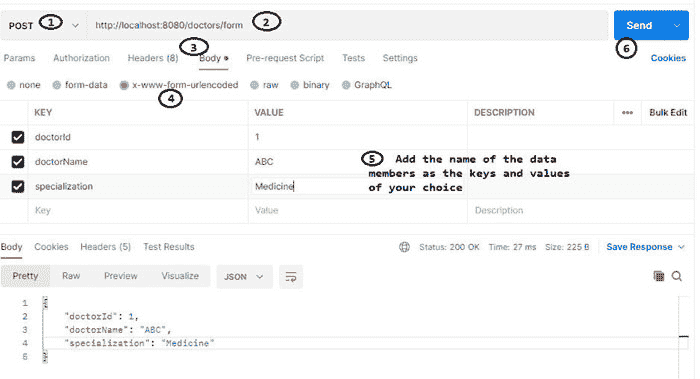

**图 2.17：** 使用表单数据

图中清楚地显示了 JSON 类型的响应，因为这是 Spring Boot 的默认呈现。然而，有时场景需要 XML、HTML 或基于文本的呈现。`produces`属性允许我们指定预期的响应类型。让我们更新端点以从来自表单提交的数据生成 XML 类型响应：

```java
@PostMapping(path = "/doctors/form",
consumes = MediaType.APPLICATION_FORM_URLENCODED_VALUE,
produces = MediaType.APPLICATION_XML_VALUE)
```

现在，让我们执行应用程序并从 Postman 发送请求。幸运的是，我们有之前从 Postman 发送的请求。我们需要点击 Send 按钮。一旦这样做，我们将收到一个具有相同值的响应，但现在我们得到的响应将不是 JSON 类型，而是 XML 呈现，如[图 2.18]所示：

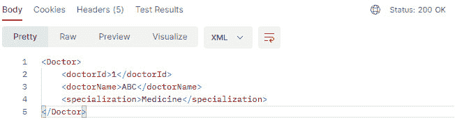

**图 2.18：** XML 响应

提一个问题！我们可以消费多种媒体类型。同样，我们能产生具有多种类型的响应吗？是的，可以的。根据客户端的需求，生产者可以默认生成 JSON 类型响应或指定的类型。为了实现这一点，让我们更新`produces`属性：

```java
@PostMapping(path = "/doctors/form", 
consumes = MediaType.APPLICATION_FORM_URLENCODED_VALUE, 
produces = {MediaType.APPLICATION_JSON_VALUE, MediaType.APPLICATION_XML_VALUE})
```

重新执行应用程序并从 Postman 向特定端点提交请求。你得到 XML 类型的响应了吗？你可以观察到，它不是 XML 类型。你得到的是 JSON 呈现的，因为它是默认的。这意味着我们无法获取 XML 响应吗？如果我们请求，就能获得 XML 响应，为了指定消费者期望的响应类型，消费者必须在请求中添加 Accept 头。让我们在请求中添加头以请求 XML 呈现，如[图 2.19]所示：

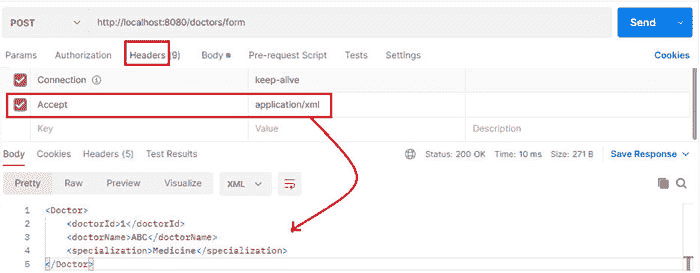

**图 2.19：** 使用 XML 数据

## 与数据库通信

非常好！！！我们很好地理解了服务中控制器处理方法对请求和响应的处理。然而，为了专注于某一个因素，我们没有关注持久化层。此外，由于我们都具有 Java 背景，我们对 JDBC 相关的概念非常有信心并且熟悉。我们可能需要讨论的是一些查询，例如 Spring Boot 如何处理 JDBC 集成、涉及的类和接口，以及如何获取连接。


`spring-jdbc` starter 提供了在我们的代码中使用 JDBC API 所需的所有相关类和接口定义。由于我们正在开发一个多层应用，因此我们有一个专门的 DAO 层来与数据库通信并处理 CRUD 操作。Spring 足够灵活，支持在我们的代码中以 Java 风格使用 JDBC API。这意味着我们可以获取连接、获取相关的语句类型、执行查询并最终处理结果。

所以，如果你还没有添加该 starter，让我们从在应用程序中添加它开始。我们已经创建了包含 `spring-jdbc` starter 的应用程序，因此我们不需要显式地添加它。如果有人遗漏了依赖项或正在分步骤开发项目，请在 `pom.xml` 文件中添加以下依赖，并别忘记添加数据库相关的驱动依赖：

```xml
<dependency>
    <groupId>org.springframework.boot</groupId>
    <artifactId>spring-boot-starter-jdbc</artifactId>
</dependency>
```

正如之前讨论的，我们将使用 `H2 in-memory database` 和 `MySQL` 进行演示。

现在，我们想要创建一个灵活的应用程序，以便在不更改代码的情况下从一个数据库迁移到另一个数据库。无法实现灵活性的主要原因是在类定义中包含了 `URL`、`username` 和 `password` 等数据库属性。Spring Boot 通过将这些及其他属性外部化到 `application.properties` 或 `application.yml` 文件，实现了这些配置。

通过这种方式，我们可以实现数据库连接的灵活性，因为它在任何类定义中都没有配置为静态值。在下一节中，我们将讨论使用内存 H2 数据库的连接。如果你不想使用它并想继续使用 MySQL，请跳过下一节。

`H2 in-memory database` 给我们的优势是可以在配置文件中使用无或最少属性。所以，让我们继续执行代码并观察控制台关于 H2 数据库连接的日志。你在控制台上看到任何与 H2 的日志吗？遗憾的是，没有！因为默认禁用了 H2 控制台，让我们添加属性来启用 H2 控制台，观察图 2.20 中控制台中高亮的部分：

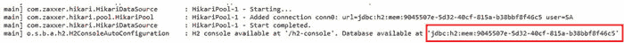

**图 2.20：**启用 H2 控制台

这为我们提供了连接所需的数据库 URL。

你获得了一个连接 H2 数据库的默认 URL。这不酷吗？是的，很酷。但我们不能忘记一点，这是一个内存数据库，因此一旦应用程序重启，我们就有丢失所有持久化数据的风险，且 URL 每次都会变化。让我们尝试使用默认 URL `http://localhost:8080/h2-console` 打开 H2 控制台，如图 2.21 所示：

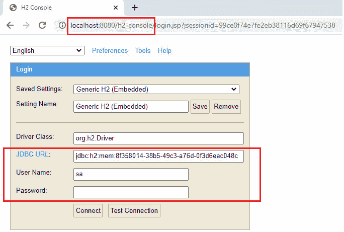

**图 2.21：**启动 H2 控制台

输入从控制台获得的 URL。我们可以使用默认用户名 `sa`，密码留空或为空。尝试先点击 `Test Connection` 按钮测试连接性。如果工作正常并显示消息 `Connection successful`，请继续并连接到数据库。

我们将进入一个页面，在那里我们可以获得输入查询的编辑器以及执行查询的多个选项。此外，在左侧，我们将看到 H2 数据库结构，如图 2.22 所示：

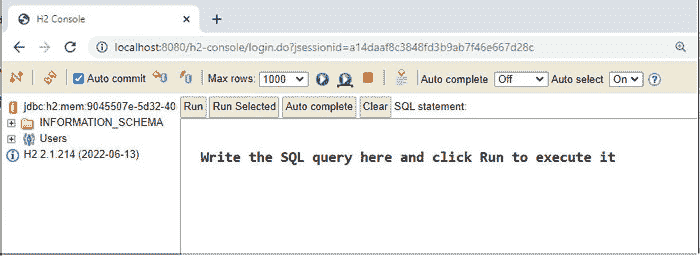

**图 2.22：**探索 H2

游乐场完全属于你，尽管去尝试一些 SQL 命令，以确保数据库运行良好。太棒了，我们能够使用默认值连接到数据库。

然而，使用默认值使我们的应用程序变得脆弱。我们可能想为了安全提供密码，或者想提供一个不同的 URL 来访问 H2 控制台，该 URL 在每次执行时都保持不变，即使重启应用程序也不会更改。对于 `URL`、`password` 或其他凭据，我们不再使用内存文件存储数据，而是能够自定义每一个。

问题是如何自定义 H2 数据库属性的？答案非常简单，更新配置文件。在这里，我们在 `application.properties` 文件中为演示目的配置了几个属性：

```properties
#default is false
spring.h2.console.enabled=true

### default is /h2-console
spring.h2.console.path= /h2

spring.datasource.url=jdbc:h2:mem:sample_db

### default is sa
spring.datasource.username= service

### default is blank
spring.datasource.password= service
```

只需重启应用程序并检查日志中的 H2 URL。控制台日志将显示我们刚刚在属性文件中配置的 `/h2`。让我们使用 `http://locahost:8080/h2` 访问数据库控制台，并使用与 `application.properties` 相同的 `URL`、`username` 和 `password` 值。

太棒了！现在你按照图 2.23 所示，在 `pom.xml` 中将依赖从 H2 改为 MySQL：


**图 2.23：**配置 MySQL

在你开始使用 schema 之前，它必须存在，如果不存在，让我们关注代码。我们正在开发一个多层应用，所以为数据库操作添加一个层：

```java
public interface DoctorDAO {
    int addDoctor(Doctor doctor);
    boolean updateDoctor(Doctor doctor);
    boolean updateSpecialization(int doctorId, String specialization);
    int deleteDoctorById(int doctorId);
    Doctor findDoctorById(int doctorId);
    List<Doctor> findAllDoctors();
    List<Doctor> findAllDoctorsBySpecialization();
}
```

`classpath` 包含了 JDBC 的 starter，这允许容器根据 `application.properties` 中配置的属性创建 `DataSource` bean。我们可以使用此 bean 与底层数据库通信，使用 SQL API 执行原生 JDBC 风格的操作。

然而，Spring `JdbcTemplate` 无需使用 SQL API 即可执行类似的操作。因此，让我们在实现类中注入它并使用它执行 CRUD 操作，如下所示的方法所示：

```java
public int addDoctor(Doctor doctor) {
    int added = 0;
    String INSERT_DOCTOR = "insert into doctor values(?,?,?)";
    added = jdbcTemplate.update(
        INSERT_DOCTOR,
        doctor.getDoctorId(),
        doctor.getDoctorName(),
        doctor.getSpecialization()
    );
    return added;
}

public boolean updateDoctor(Doctor doctor) {
    boolean isUpdated = false;
    String UPDATE_DOCTOR = "update doctor set doctorName=?, specialization=? where doctorId=?";
    int updated = jdbcTemplate.update(
        UPDATE_DOCTOR,
        doctor.getDoctorName(),
        doctor.getSpecialization(),
        doctor.getDoctorId()
    );
    if (updated > 0) {
        isUpdated = true;
    }
    return isUpdated;
}

public int deleteDoctorById(int doctorId) {
    int deleted = 0;
    String DELETE_DOCTOR = "delete from doctor where doctorId=?";
    deleted = jdbcTemplate.update(DELETE_DOCTOR, doctorId);
    return deleted;
}

public Doctor findDoctorById(int doctorId) {
    Doctor doctor = null;
    String FINDDOCTORBYID = "select * from doctor where doctorId=?";
    doctor = jdbcTemplate.queryForObject(FINDDOCTORBYID, (rs, rowNum) -> {
        Doctor d = new Doctor();
        d.setDoctorId(rs.getInt(1));
        d.setDoctorName(rs.getString(2));
        d.setSpecialization(rs.getString(3));
        return d;
    }, doctorId);
    return doctor;
}

public List<Doctor> findAllDoctors() {
    List<Doctor> doctors = new ArrayList<>();
    String FINDDOCTORBYID = "select * from doctor";
    doctors = jdbcTemplate.query(FINDDOCTORBYID, (rs, rowNum) -> {
        Doctor d = new Doctor();
        d.setDoctorId(rs.getInt(1));
        d.setDoctorName(rs.getString(2));
        d.setSpecialization(rs.getString(3));
        return d;
    });
    return doctors;
}
```

现在我们已经准备好了 DAO 层和控制器层。我认为把所有代码都写在这里会非常单调，而且作为优秀的开发者，我们都可以自己编写剩余的代码。`GIT` 仓库包含了所有代码作为参考。

在这里，我们使用了 `JDBC`，这意味着我们需要在数据库中创建一个将要使用的 `doctor` 表。由于我正在使用 `MySQL`，我将使用以下 DDL 在 `MySQL` 的 doctor 模式下添加新表，并以 `doctorId` 作为主键：

```sql
create table doctor(
    doctorId integer PRIMARY KEY,
    doctorName varchar(20),
    specialization varchar(20)
);
```

一旦数据库设置好，现在是时候建立它们之间的通信了，以便对从消费者处接收的数据执行 CRUD 操作。我们之前通过 `JdbcTemplate` 自动装配的方法，现在将通过添加以下语句在 `DoctorController` 中设置 `DoctorDAO` 的自动装配：

```java
@Autowired
DoctorDAO doctorDAO;
```

既然 DAO 实例在控制器中可用，我们还在等什么呢？让我们调用该方法，并在控制器中完成向表中插入新行的逻辑处理：

```java
Doctor d = null;
int added = doctorDAO.addDoctor(doctor);
if (added == 1) {
    return doctor;
}
return d;
```

代码已准备就绪，我们现在可以运行应用程序并使用 Postman 测试用于添加新记录的 POST 请求。我们已经讨论过 Postman 可以使用 JSON 作为媒体类型发送 POST 请求，例如：

```json
{
  "doctorId": 1,
  "doctorName": "Dr. Mandal",
  "specialization": "Orthopedic"
}
```

如果你需要参考，请参阅我们编写 `DoctorController` 的章节。我们将获得状态码 `200`，而且 MySQL 中的 `Doctor` 表现在将有一行具有指定值的新数据。

尝试在不更改请求体的情况下发送相同的请求。哎！我们收到了内部服务器错误 `500`，并且从应用程序控制台中清楚地看到我们收到了重复条目的异常。我们可以在 DAO 层处理此异常，但现在不用。

控制器中有 `createNewDoctorRecord()` 方法来处理提交。之前的代码和这段代码的逻辑是相同的。你可以参考仓库中的代码并使用 Postman 测试端点。

现在表中已有两条记录了。让我们现在更新控制器的 `findDoctorById()` 方法，使用 DAO 层从表中获取记录：

```java
Doctor doctor = doctorDAO.findDoctorById(id);
return doctor;
```

现在是时候使用 Postman 测试端点 `http://localhost:8080/doctors/{id}` 了，确保你请求的记录在表中是存在的 `doctorId`。

尝试该端点，但这次请求一个表中不存在的 id 记录。完全正确！我们将在控制台上收到 `EmptyResultDataAccessException`，Postman 将收到响应为 `500 Internal Server error`。不要担心，我们有专门的章节来详细处理异常处理。

一旦我们成功测试了 `/doctors/{id}` 端点，我们现在可以使用以下代码块，针对控制器章节中讨论的前三种场景，开始按专业科查找医生：

```java
List<Doctor> doctors = doctorDAO.findAllDoctorsBySpecialization(doctor_specialization);
return doctors;
```

对于第四种场景，当我们使用 `java.util.Optional` 来处理可选的 `path` 变量时，我们必须先确认专业科是否来自消费者的请求，然后相应地决定调用哪个 DAO 方法：

```java
List<Doctor> doctors = new ArrayList<>();

if (doctor_specialization.isPresent()) {
    // 根据专业科查找所有医生的逻辑将在这里
    doctors = doctorDAO.findAllDoctorsBySpecialization(
        doctor_specialization.get()
    );
    return doctors;
}

// 当专业科不存在时查找所有医生的逻辑将在这里
doctors = doctorDAO.findAllDoctors();
return doctors;
```

尝试使用以下 URL 测试代码：

`http://localhost:8080/doctors/specialization/{specialization}`

或：

`http://localhost:8080/doctors/specialization`

当我们在请求 URL 中指定专业科时，我们将收到一个匹配指定值的 JSON 对象数组响应。否则，我们将获得表中所有医生的 JSON 数组。同样，其他控制器方法也可以更新以与 DAO 层进行通信。你可以参考仓库中的代码。

## REST 中的异常处理

我们现在正在获取 JSON 或 XML 类型的负载响应，这取决于正向场景下指定的映射，例如发送新资源、请求具有匹配 `doctorId` 的资源、删除已存在的资源等。酷！这已经搞定了。

在实践中，消费者也可以提供数据库中已存在的资源，或者请求搜索不存在的医生。每当消费者请求获取、更新或删除不存在的资源时，消费者收到什么响应？是的，`500 Internal Server Error`。这个响应有什么问题吗？不，这没有问题。

这是一种更好的方法，可以在应用层级为 `developers` 记录异常原因，而不是将其暴露给 `consumer`。在这里，甚至可以定义自定义异常类，例如 `DoctorAlreadyExistsException`，并在控制器中处理它，然后将其暴露给消费者。

目前，让我们为 `doctor` 已经存在的场景定义 `custom` 类如下：

```java
public class DoctorAlreadyExistsException extends RuntimeException {
    private String message;

    public DoctorAlreadyExistsException() {
        // TODO Auto-generated constructor stub
        this("We have similar record");
    }

    public DoctorAlreadyExistsException(String message) {
        super(message);
        this.message = message;
    }
}
```

现在，让我们通过更新 DAO 方法来使用它，以便向 `controller` 暴露专门的错误信息，例如 `RECORD EXISTS`。


```java
public int addDoctor(Doctor doctor) {
    int added = 0;
    String INSERT_DOCTOR = "insert into doctor values(?,?,?)";
    try {
        added = jdbcTemplate.update(INSERT_DOCTOR, doctor.getDoctorId(), doctor.getDoctorName(), doctor.getSpecialization());
    } catch (Exception e) {
        System.out.println(e.getMessage());
        throw new DoctorAlreadyExistsException("RECORD EXISTS");
    }
    return added;
}
```

现在，DAO 抛出的异常将传播到`controller`，我们可以像这样处理：

```java
public Doctor createNewDoctorRecord(@RequestBody Doctor doctor) {
    Doctor d = null;
    int added = 0;
    try {
        added = doctorDAO.addDoctor(doctor);
    } catch (DoctorAlreadyExistsException e) {
        System.out.println(e.getMessage());
    }
    if (added == 1)
        return doctor;
    return d;
}
```

我们稍后将其暴露给`consumer`。现在，我们将执行代码并针对表中已存在的记录发送基于 JSON 的响应。显然，它将抛出一个异常，我们可以通过 Postman 以及控制台观察这种`try-catch`机制是如何运作的。图 2.24 显示了控制台上显示我们为自定义异常设置的消息的`stack trace`部分：

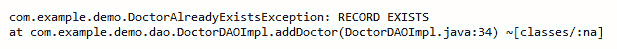

**图 2.24：** 中的自定义异常

然而，Postman 显示的输出如图 2.25 所示：

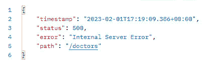

**图 2.25：** POSTMAN 中的自定义异常

这意味着我们的异常处理在 DAO 和层级都起作用了。遗憾的是，我们仍然向消费者暴露了细节。让我们解决这个问题。

# 使用`@ExceptionHandler`

`@ExceptionHandler`注解为处理异常提供了灵活性，它被应用于处理异常的方法。此类`handler`方法接受一个异常或异常列表作为参数，我们希望在定义的方法中处理这些异常。`container`（容器）将检测到此注解，然后将此方法注册为异常处理器。该方法负责处理指定的异常以及传递给注解的其子类。让我们在控制器中定义一个处理方法如下：

```java
@ExceptionHandler(value = DoctorAlreadyExistsException.class)
public String handleDoctorAlreadyExistsException(DoctorAlreadyExistsException blogAlreadyExistsException) {
    return "Doctor already exists";
}
```

每当`DoctorAlreadyExistsException`被抛出，`handleDoctorAlreadyExistsException()`方法就会被调用并生成响应。需要更新控制器方法以抛出异常，而不是像我们之前的代码那样使用`try-catch`进行处理。更新后的控制器代码如下：

```java
@PostMapping(path = "/doctors", consumes = { MediaType.APPLICATION_JSON_VALUE, MediaType.APPLICATION_XML_VALUE })
public Doctor createNewDoctorRecord(@RequestBody Doctor doctor) throws DoctorAlreadyExistsException{
    Doctor d = null;
    int added = 0;
    added = doctorDAO.addDoctor(doctor);
    if (added == 1)
        return doctor;
    return d;
}
```

现在执行代码并向`/doctors`端点发送请求体中具有相同 JSON 对象的请求。这将抛出异常，我们将在 Postman 响应中获得`Doctor already exists`消息。非常酷炫！现在我们正在向`consumer`传递消息，而不暴露错误信息或其原因。但我们刚刚编写的`handler`方法是针对特定的`controller`类的，如果我们需要以更广泛的方式处理怎么办。

# 使用`@ControllerAdvice`

我们刚刚使用`@ExceptionHandler`来处理指定控制器的异常。这意味着它在我们声明的特定控制器中是活跃。听起来不错。但让我们假设我们要在不同的控制器中处理相同的异常。难道我们要为这些不同的控制器再次声明一个方法，而且还是为了同一个异常吗？

**面向切面程序编程 (AOP)** 是 Spring 提供的优秀模块之一，用于处理如`logging`（日志）、`transaction`（事务）、`exception handling`（异常处理）等交叉关注点。AOP 将日志、异常或事务的重复代码从业务逻辑方法中提取出来，这些代码跨层集中在单一处，称为`Advice`（建议）。然后，此建议被插入到各种`join-points`（连接点）中，例如方法执行之前、方法执行之后、方法执行期间或在抛出异常时。`Pointcut`（切点）有助于定义表达式，以便为`class`、`method`、`argument`或`combination`定义连接点。我们不会深入这些细节。这只是在我们使用全局异常处理器时在后台发生的过程。`@ControllerAdvice`与`@ExceptionHandler`一起用于定义全局异常处理器。我们将定义一个全局异常处理器类，为特定或通用异常定义各种处理方法如下：

```java
@ControllerAdvice
@RestController
public class GlobalDoctorExceptionhandler {
    @ExceptionHandler(DoctorAlreadyExistsException.class)
    protected Object handleMyException(Exception ex, WebRequest rq) {
        return "Doctor already Exists";
    }
    @ExceptionHandler(Exception.class)
    protected Object handleAllException(Exception ex, WebRequest rq) {
        return ex.getMessage();
    }
}
```

由于我们已经定义了处理异常的全局异常处理器，让我们注释掉`DoctorController`类中的`handleDoctorAlreadyExistsException()`方法。

现在执行代码并向`/doctors`端点发送请求体具有相同 JSON 对象的请求。这将抛出异常，控制台上会出现消息，并在 Postman 响应中获得`Doctor already exists`。

### 编写自描述性消息

`consumer`正在向服务提供者发送请求。他希望获得他偏好的某些资源。`endpoint`可能拥有该资源，也可能没有。这种`request`和`response`的往返旅行通常发生在`consumer`和`provider`应用之间。当客户端发送正确的请求时，它可以被良好地处理并发送响应。然而，没有什么是完美的。`consumer`可能会在请求中发送`in-sufficient information`，或者发送了提供者无法预期的错误格式信息，导致提供者无法处理。

此外，响应必须是`client`期望的格式。否则，即使收到了响应，客户端也可能无法处理。`consumer`和`provider`都没有遵循通信的基本规则，导致了混乱的局势。始终记住在`consumer`和`provider`之间发送自描述的消息。当客户端发送请求时，他应该传递关于期望的响应类型以及路径变量、路径参数或请求体的正确格式的信息。同样地，`response payload`也应该包含关于状态码、发送的负载类型以及预期资源的实际值的信息。当客户端接收到此类描述性消息时，他可以明智地对响应的下一个处理步骤做出决定。

我们之前讨论的控制器层虽然提供了资源，但它是自描述的吗？在发送 POST 请求时，我们已经遇到过这种场景。让我详细讨论一下。假设我们正使用 POST 映射发送一个请求来添加新资源。我们将发送一个包含`doctorId`的请求体，而这个`doctorId`在表中并不存在。我们会收到什么状态码呢？让我们一起通过 Postman 对`/doctors`端点执行实际请求来找到答案，如`Figure 2.26`所示：

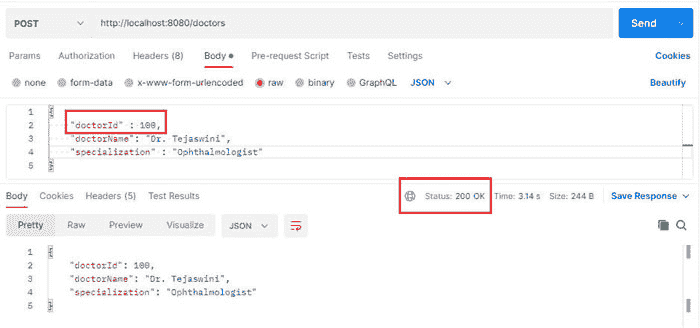

**图 2.26：** HTTP 状态码 200

这个状态码暗示了什么？它表明服务器端一切正常。这意味着资源创建成功了吗？在我们的案例中，发生了异常，因为请求体中具有已有的`doctorId`资源。但这个异常没有传递给`consumer`。这意味着异常被妥善处理了，consumer 不需要担心吗？consumer 会得出什么结论？老实说，没主意！这很模糊。如何处理这种情况？需要修改哪些内容？别担心，这没那么困难。`consumer`端的这种混乱都可以通过发送一个定义良好的状态码来简单避免。例如，当资源创建成功时，provider 将发送`201`。当`consumer`请求一个资源而该资源不存在时，将`204`作为状态码发送给`consumer`。现在问题是，我们有一个类型为`Doctor`的资源，且它不包含状态码字段，那么该怎么做呢？我们要修改 POJO 吗？不！我们有一个类专门负责处理这个问题以及许多其他相关问题。`HttpEntity`类表示 HTTP 请求实体或响应实体，它包含一个体，其中包含预期的资源值和一些标头。`HttpEntity`类被`ResponseEntity`扩展，后者添加了`HttpStatusCode`，将结果作为 HTTP 响应状态码呈现出来。是时候进行现实检查了。让我们更新 POST 映射的控制器代码，使其返回`ResponseEntity`而不是`Doctor` POJO：

```java
@PostMapping(path = "/doctors", consumes = { MediaType.APPLICATION_JSON_VALUE, MediaType.APPLICATION_XML_VALUE })
public ResponseEntity<Doctor> createNewDoctorRecord(@RequestBody Doctor doctor) throws DoctorAlreadyExistsException{
    // 向表中添加记录的逻辑将在这里
    Doctor d = null;
    int added = 0;
    added = doctorDAO.addDoctor(doctor);
    if (added == 1)
        return new ResponseEntity<Doctor>(doctor,HttpStatusCode.valueOf(201));
    return new ResponseEntity<Doctor>(HttpStatusCode.valueOf(204));
}
```

让我们尝试用 Postman 发送具有不同`doctorId`和具有已存在`doctorId`的资源 POST 请求。对于新资源，我们将获得以下输出。观察`Figure 2.27`中的状态码：

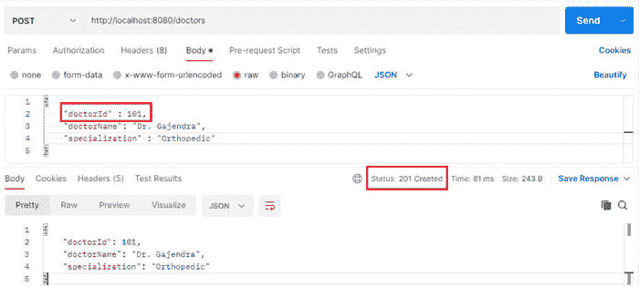

**图 2.27：** HTTP 状态码 201

让我们重试发送相同的请求，不要更改请求体！我们将得到`Doctor already Exists`，但状态码又是怎样的？它还是那个旧的 200 OK！噢！别这样。如果`Doctor`已经存在且没有添加新记录，怎么可能是 OK 呢？同意！我们从`GlobalExceptionHandler`类收到了输出消息，因为抛出了`DoctorAlreadyExistsException`。所以，让我们通过`@ResponseStatus`注解更新`handler`方法，返回正确的状态码，而不是无聊的`200 OK`消息：

```java
@ExceptionHandler(DoctorAlreadyExistsException.class)
@ResponseStatus(code = HttpStatus.MODIFIED)
protected Object handleMyException(Exception ex, WebRequest rq) {
    return "Doctor already Exists";
}
```

此代码更改将导致状态码为`304`的输出，如`Figure 2.28`所示：

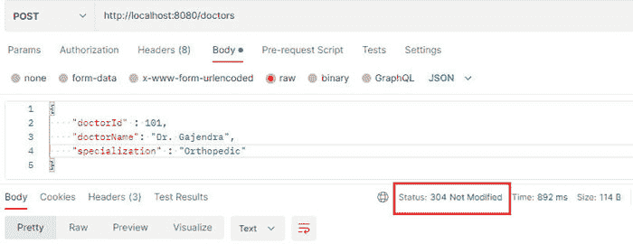

**图 2.28：** 状态码 304

但消息在哪里？在回答这个问题之前，我有一个更重要的问题要回答。如果状态码能够提供`provider`端发生了什么的信息，相应地`consumer`能够做出决策，那么为什么我们需要消息呢？我们并不每次都需要消息。`204`、`304`等由`PUT`、`POST`和`DELETE`方法引发的状态码拒绝发送消息或响应展示。人们需要明智地决定是否需要自定义响应。如果某些消费者需要，他们可以处理错误消息然后做出决定。我们可以创建一个自定义响应并：

```java
public class ExceptionResponse {
    Date timeInfo;
    String message;
    String details;
    //默认参数构造函数
    // getter 和 setter
}
```

根据场景，我们可以添加更多字段来暴露详细信息。现在，是时候在异常处理器方法中使用该响应了：

```java
@ExceptionHandler(DoctorAlreadyExistsException.class)
//@ResponseStatus(code = HttpStatus.NOT_MODIFIED)
protected ResponseEntity<Object> handleMyException(Exception ex, WebRequest rq) {
    ExceptionResponse exceptionResponse = new ExceptionResponse(new Date(),ex.getMessage(),
    rq.getDescription(false));
    return new ResponseEntity<Object>(exceptionResponse, HttpStatusCode.valueOf(400));
}
```

我们注释掉了`@ResponseStatus(code = HttpStatus.NOT_MODIFIED)`，因为我们正在`ResponseEntity`实例中设置它。该行动了，让我们在 Postman 中执行 POST 请求，如`Figure 2.29`所示：

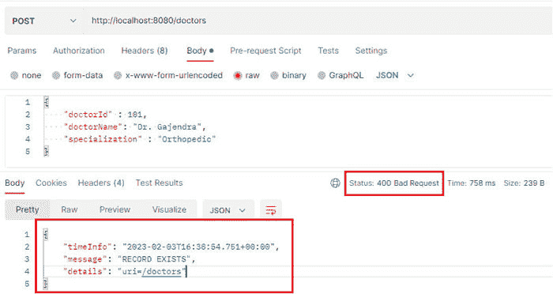

**图 2.29：** 带自描述消息的异常处理

POST 请求体包含一个在表中已存在的`doctorId`的资源。这将导致主键冲突异常，并在`addDoctor()`方法的`try-catch`块中进行处理。随后，将抛出一个带有`RECORD EXISTS`消息的`DoctorAlreadyExistsException`。此时会调用一个回调异常处理方法，并如前述输出响应所示生成自定义响应。

## 日志中的更新

在目前阶段，我们并不打算深入讨论日志记录。但我们需要了解当前版本 Spring Boot 提供的更新。在`Spring Boot 2.x.`x 之前，`date`和`time`组件符合`ISO-8601`标准，这可以同时被`Logback`和`Log4j2`使用。但从`Spring Boot 3.`x 开始，格式被修改为`yyyy-MM-dd’T’HH:mm:ss.SSSXXX`。为了更清晰，请观察图 2.30：

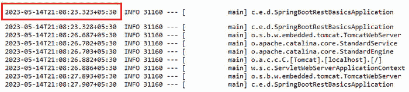

**图 2.30：** 修改后的日志消息格式

此外，注意新格式现在使用字符`T`作为`date`和`time`之间的分隔符，而不是空格。此外，它在末尾添加了时区偏移量。

## 总结


在本章中，我们快速介绍了如何使用 Spring Boot 框架创建基于 REST 的应用程序。Spring Boot 是一个非常庞大的概念。但要进一步迈向微服务，我们应该对支持端点 HTTP 请求和响应的各种 REST 服务基本概念有一个基本的了解。

本章介绍了什么是服务，以及如何设计服务以通过注解暴露端点，从而处理 `GET`、`POST`、`PUT`、`DELETE` 等方法的 HTTP 请求。我们还讨论了如何处理服务可以消费的不同媒体类型，以及如何生成响应。

REST 应用程序中的异常处理方式有所不同，因为服务中抛出的异常需要简洁地与消费者进行通信。在这里，我们讨论了处理服务中抛出异常的不同方法。最后，我们讨论了如何从服务向消费者发送自描述的消息。

现在，我们已经充分掌握了使用 Spring Boot 构建 REST 应用程序的基础知识。然而，我们开启这段旅程是为了理解基于微服务的架构。这是我们下一章的目标。

在下一章中，我们将深入讨论微服务架构、它与传统单体架构的区别、微服务的特征以及更多内容。精彩的在后面，卷起袖子，准备好开启旅程吧！

# 第 3 章

## 缩小规模

上一章开启了整个全新、有趣且不断成长的服务世界的大门。我们使用 Spring Boot 开发了 REST 服务。这只是我们用于开发服务的框架之一。然而，开发服务有许多方法，你可能在不久的将来遇到这些方法。

一旦我们了解了 REST 概念，我们正在使用的实现只是在语法上有所不同。本章为 Spring Boot REST 奠定了相当坚实的基础。我们现在已经准备好开始战斗的第一阶段了。

一旦我们完成了服务，还剩下什么？无所有，也无所有！感到困惑吗？别担心。我们开发服务是为了为想要消费医生服务的消费者提供所有需求的一站式服务。我们需要将所有这些同时整合在一起并运行吗？

这很容易且不复杂，所以我们写得也很容易。但在现实中，所有的服务可能并不那么直观，可能需要复杂的算法。这显然是非常耗时的，而且我们可能无法将所有函数写在一起并供消费者使用。

在企业级应用中，考虑到复杂性，设计的时间、涉及的代码量、测试每个服务的时间以及发布它们都需要时间。当我们提出解决方案时，消费者的需求可能已经改变，或者消费者已经开始使用其他服务。

那么我们的服务怎么办？我们做错什么了吗？坦率地说没有！我们只是采用了一种定义良好的、经过尝试和测试的传统方法。我们唯一忽略的是时间因素。

想象你正在书店购买畅销书《达芬奇密码》。遗憾的是书没货了，店员甚至告诉你已经订购，包裹将在几天后到达。很棒，不是吗？现在你们中有些人也会等待，但像我这样不耐心的买家会去另一家店，或者寻找有那本书的店。

店员？他已经下单了，只是包裹还没有送达。这完全取决于买家需要时书籍是否有货。软件世界的客户也大不相同。如果他们得不到预期的服务，他们将直接切换到另一个浏览器或标签页来满足需求。

在本章中，让我们开始理解传统应用设计（如单体架构）中有什么，以及现在微服务架构提供了什么。我们还将设计微服务，并开始从单体向微服务的迁移。

那么，我们开始吗？让我们开启微服务之旅吧。

## 结构

在本章中，我们将讨论以下主题：

- 熟悉微服务
- 选择微服务的动力
- 微服务的特征
- 从单体迁移到微服务
- 微服务的局限性

## 熟悉微服务

`Mandar` 的团队正在为交通服务供应商构建一个项目，提供约车、注册、充值、账单、行程记录、修改密码等功能。该应用程序是为浏览器和移动客户端开发的。

团队花费了小时开发 Spring Boot REST 应用，并按时完成了部署。`Mandar` 和团队非常开心，准备好迎接周五之夜的庆祝。饮料和食物已经订好，一切都准备好过一个愉快的周末。

正当大家准备举杯时，一个升级请求来了。应用程序运行良好，但它还需要额外的功能，不仅能为客户约车，还能为其他人约车。这并不是客户最初提供的功能需求。但团队需要升级应用程序。毕竟，我们需要满足客户。

开发团队现在需要处理这个新功能。他们需要什么？可能需要为未注册的客户一个新的 `POJO`，或者之前的 `POJO` 需要一个额外的字段来获取信息以便映射。还需要新的功能来接受来自未注册客户的约车请求，以及 `DAO` 层来支持与这种新类型约车请求的数据映射。

这意味着团队需要从控制层到数据库设计进行大量的修改。对于整个团队来说，这显然不是一个那么愉快的周五。

让我们来看另一个场景。我的团队将开始手一个新项目。在最初沟通时，团队对项目的整体情况以及要实现的各个模块有了大致的了解。

当我们讨论技术选型、为实现目标选择一个框架时，我们收到了各种建议。我们也知道，单一的 `framework`、`language` 和 `technology` 无法为我们想要开发的所有模块提供完整的解决方案。某些技术擅长某一项，而另一些则擅长其他。

这对于我们也是如此。我们可能在某项技术上精通或是专家，对另一项了解但没有实操经验。我们可能无法找出一个独特的技术来选择。

但我们要使用所有的它们吗？是的，我们需要使用所有的它们，而且在之前的章节中，当我们决定从基于服务的开发开始时，已经讨论过这一点了。

所以现在有什么不同呢？亲爱的朋友们，请耐心！耐心是成功的通用钥匙。

选择什么技术是开发者之间讨论的话题，他们可能会对此达成某种共识。然而，可用时间是另一个重要因素，在有限的时间内完成所有工作是不可能的。

我们不想丢失项目，但我们该如何处理完成工作所需的时间呢？我们必须拥有更大的团队规模。这是唯一的解决方案。而现在这可能是不可能。

我们该如何规划，以便应用程序能够按时发布？你不认为大型代码库会增加开发的额外复杂性吗？我们可以减少代码量吗？

嗯，我们开发的是企业级应用，而不是为了某些内部演示的 Demo 应用。它涉及到高水平的算法、大量的流程管理以及各种业务逻辑。减少代码量几乎是不可能的，考虑到你的软件应该构建的业务价值。我们确实处于一种恐慌状态中！

在这种情况下，与其缩小代码库，不如我们分部分开发代码库。我们可以将代码拆分。我的意思是，与其一起开发整个应用程序，让我们将其分成许多小块来开发。一旦某个块准备好了，就发布它。

这种持续交付的方法起着非常重要的作用，因为当你的团队处理其他某些代码时，客户能够对其进行测试或使用。

由于我们将分小块构建项目，我们将更高效、更短的时间完成开发，因为复杂度也是逐块构建的。现在，与其说块，我们可以称之为模块吗？

所以现在，我们不再关注整个应用程序。我们将精力和努力投入到较小的任务或模块中。所有这些作为模块的小部分将逐一被开发，然后进行集成，并相互通信，以提供一个完整的解决方案。

我们现在可以自由地作为一个完整的解决方案使用，或者如果我们想在其他地方使用它的某些部分，完全取决于我们，以促进重用性。

我们现在一次关注一个模块。这就像是微餐。与其一次吃大份的食物，我们将取较小的分量并享受它们。这样，我们可以尝试更多口味的食物，而不会感到胃胀。

软件服务就像是一顿正餐，有前菜、主菜以及我怎么忘记甜点呢？较小的服务就像微餐；一次一份。你懂我意思！

微餐，准确地说，微服务是我们实际应用程序的更小部分。尽管我们说正在使用微服务，但这仍然份责任。我仍然想下放并将其切成更小的碎片或微型。

你猜对了，我们谈论的是 `micros`，比 minis 更小，当我们谈论软件设计时这就是微服务。

`Microservices` 是我们应用程序的一个极小部分，然后可以被消费者集成或利用。微服务使开发者能够实现快速、可靠的频繁交付，分部分开发复杂的企业级应用。

微服务背后的动力是部分开发解决方案，这些部分是自自足的、可重用的、可替换的、可测试的、易于部署的、启动快速的，最后但最重要的高可用的。

让我们以定制裁剪单位为例。我们去商店，商店代表带我们首先选择缝制的衣服，然后量尺寸，提供目录选择缝制样式。他会生成收据，最后我们需要付费并离开商店。

你们都会同意这是一个耗时且漫长的过程，等等，这又是针对客户的。当我们有十个代表来接待客户，并且当他们独立完成从开始到结束的所有工作时，他们专门负责一个客户。

现在，让我们把商店分成部门。我们有服装部、样式部、测量部，然后是结算部。我们从一个部门移动到另一个部门获取服务。

我们做了什么不同？我们取了一个完整的解决方案，将其切分成更小的自我管理部分，现在它们可以独立提供服务了。

如果我们知道要选择什么样式，我们只需从服装部移动到测量部。没有任何严格限制，一切都是灵活的。所以，我们的微服务也是如此。

# 选择微服务的动力

嘿，我们使用单体应用已经这么久了，我们仍然想继续使用它。如果它不能满足目的，我们早就放弃它了。

但事实并非如此，在行业中，我们仍然带着很多敬意使用“单体”一词。那么这种新的微服务架构会对我们的生活带来改变吗？我为什么要在这里绕圈子？让我们深入探讨并找出选择微服务的理由。

## 降低代码库复杂度

我们正在讨论企业级应用的开发。正如大家所知，当我们提到企业级时，脑海中第一个事情就是现在我们要开发许多组件，这显然会增加应用程序代码：不同的模块、它们的结构、定义，然后是测试。

随着代码库的增大，复杂度也随之增加。我们是专家，代码库的大小对我们并不重要。酷！如果我们需要修改它以适应建议的更改或新需求怎么办？现在，我们确实需要仔细查看代码，这并不是一项容易的任务。

## 开发时间

在单体应用中，正如我们所讨论的，代码量是巨大的，复杂性也更高。因此，这类应用的开发通常是一项非常耗长的任务。开发只是其中一个阶段，其之后是最重要的步骤——测试。

需要开发的代码越多，测试所花费的时间也就越长，这导致团队在开发上花费更多时间。

现在，当我们编写代码时，如果想更新某些内容该怎么办？应用之间可能存在较高的相互依赖性；一个模块的任何更改都可能导致其他模块出现问题。

有时，开发团队可能还需要全部整合一个新模块。一旦这个新模块开发完成，它就需要与所有其他旧模块整合。因此，整合新模块总是一项耗时的任务。

现在，让我们考虑一下采用微服务时开发所需的时间。微服务是一组独立相互通信的微型服务，每个服务执行单一职责。

由于我们专注于此，我们将以最短的时间交付最高质量的服务。我们将在较小的团队中开发这些服务，这样一个团队就可以开发、测试，然后快速发布它们，供其他团队或服务使用和复用。

## 部署的便利性

在单体应用中，我们需要部署单个文件。部署单个文件总是很容易的。对吧？是的，没错，我们达成了共识。

然而，即使是对单体应用进行非常小的更改，也需要重新部署整个应用。当我们目标一次性部署整个应用时，所有模块将作为一个单一模块一起部署。

这意味着即使只是一个更改，我们也面临着极高的风险。现在假设我们已经完成了单体应用的部署，现在我们必须测试它的每一个独立功能。这意味着应用在没有经过严格测试的情况下无法上线。这真的会非常耗时。

部署需要时间，因此整个生产环境的部署需要计划。部署任务花费的时间越长，导致停机时间越高。

现在，我们已经计划了部署，这意味着我们可能需要通知用户停机，尽管如此，由于系统不可用，停机仍然影响业务和客户。这可能会导致业务收入损失。

与单体应用相比，在微服务中我们开发多个较小的应用，这使得单个应用能够更频繁、更快地发布，并轻松独立部署。

以前在单体应用中，我们可能每周推送一次更新。但现在，由于我们正在开发较小的应用，我们每天可以发布两三次。

较小的应用更容易测试。如果任何服务发生任何更改，只需更新并重新部署该服务即可。

现在，正在部署的服务如果忽视了适当的合约测试，使用该服务的客户端将面临问题。而其他服务的消费者仍然继续顺利地使用它们的服务。

## 可用性

可用性是指什么？应用可用性是一个用于估计应用其功能运行是否良好，以及它是否满足要求的指标。

当由于某种原因应用实例崩溃时，会损害客户体验，这段时间内应用被认为处于机状态。我们可以采取措施重启实例或直接启动一个新实例，但这不会改变用户体验。

对于他们来说，由于规模和资源分配量，应用仍然是不可用的。

现在，当我们处理微服务时，我们拥有具有单一职责且分配资源有限的服务。因此，与单体应用相比，微服务的启动时间更短。

为什么？这很容易猜：服务具有单一职责。这意味着资源分配有限；这显然需要最短的启动时间。

现在让我们想想如果请求过载了怎么办？由于我们已经限制了服务执行的任务，因此请求服务过载的概率较小。关于多个实例等问题，我们将在下一点中讨论。

## 扩展

我们刚刚讨论了应用的可用性以及它如何影响客户体验。我们谈论的是真实世界的应用，而不仅仅是概念性的应用。

所以，无论我们多小心，总会有应用失败的可能性，这是不可避免的。失败的非常重要的原因之一是请求负载突然增加。管理不断增加的负载总是困难。但我们可以进行一些早期测量。

最简单的方法是找到应用需要处理的最大最小负载，然后根据此寻找资源分配以确定内存需求。一旦我们知道了这些，就可以决定在部署应用时使用什么内存配置。

这适用于各种应用。现在，让我们从单体应用和微服务的角度详细讨论一下。

单体应用需要更多的资源分配，所有的请求始终会命中同一个应用。与微服务相比，我们需要分配更多内存来启动应用。

在任何时候，当我们发现之前的内存不足、需要更多内存时，我们需要扩展我们的应用。由于我们谈论的是升级硬件，这属于纵向扩展（vertical scaling）。

我们通常将纵向扩展是指通过升级服务器硬件（如增加输入/输出操作、放大 CPU 或 RAM 容量，或有时增加磁盘容量）来实现。现在，对于单体应用来说，这始终是昂贵的，我不必说出为什么，我们很清楚原因。

对于微服务来说，所需的应用和资源比单体应用要少得多，这意味着即使应用必须进行纵向扩展，成本也会较低。

现在，我们拥有具有足够内存的实例。但这种需求可能随时变化。我们还要再次更改实例配置吗？有时是的，但我们应该总是这样做吗？我们不应该。原因有二：

- 第一，内存的频繁更改意味着要卸载和重新部署应用。这将导致不必要的停机时间，我们不希望那样。
- 第二，我们要更改服务器或其配置多少次？此外，我们不知道未来这个服务器配置是否足够，是需要更多还是更少。

情况下，如果我们拥有了超过需要的资源，那么也是资源和金钱的浪费。在这种情况下，当我们不确定实例需要处理多大的负载时，与其直接倾倒内存，不如我们需要动态地分配实例。

你又猜对了；我谈论的是横向扩展（horizontal scaling）。

当单体应用以单实例方式部署时，它会忙于处理请求，很多时候请求会排队，这本质上阻碍了性能。

让我们举个例子。我们有一个在线购物应用程序。节假日即将到来，这显然会增加访问应用程序的请求数量。而这正是我们想要的。

然而，我们面临一个需要解决的问题：我们收到的请求过多，导致实例无法处理并变得不健康。为什么？原因有很多，我们暂且不深究细节。

现在，对我们最重要的是应用程序应该尽可能保持可用状态。这会让客户感到满意。但事实并非如此。如果实例变得不健康，应用程序将不可用。

我们谈论的是真实世界，在真实世界中期望应用程序始终运行，技术上我们称之为高可用应用程序。

因此，这是一个可用性的问题。实例可能因为许多原因变得不健康，而要预测每一个原因是真的是不可能的。

这意味着应用程序出现不可用也没关系吗？不！我们需要高可用应用程序。

处理这种情况的一种非常简单的方法是，不再使用一个实例，而是在不同的区域部署多个实例，然后由路由器进行路由。

太棒了！现在这样好多了，至少我们有了替代实例来替换不健康的实例。我们得到高可用的单体应用了吗？坦率地说，没有。

仍然存在应用程序宕机并影响客户的可能性。此外，当任何实例宕机时，该实例会尝试重启。应用程序非常庞大，需要分配大量资源，且启动需要时间。

重启应用程序实例的时间越长，应用程序的可用性就越低。

在微服务中，我们说实例永远不会不健康吗？不！在现实中它可以变得不健康。

然而，与单体应用类似，我们会确保始终至少有两个实例可用，以便至少有一个实例始终是可用的。

如果两个都在重启呢？好的，这完全可能。在这里我们需要记住，我们正在开发微服务，所以我们拥有具有单一职责的服务。

这意味着代码量更小、资源分配更少、启动时间更短。因此，即使应用程序宕机，也可以启动另一个实例并在最短时间内准备好服务。

在最坏的情况下，即使实例无法启动，只有请求该实例端点的消费者会面临不便，而所有其他微服务将继续愉快地为他们的消费者服务。

## 复用性

我们现在正在开发具有单一职责的小型定义良好的服务。由于服务遵循基本的 REST 原则，可以进行更多的服务间通信以复用解决方案。

在单体应用中，我们能够共享 API。在一个应用程序中，我们有 API，可以将它们添加到 `JARs` 中，并在另一个应用程序中使用这些 `JARs`。通过这种方式我们复用了代码。

微服务复用解决方案但方式略有不同。在微服务中，当需要某个解决方案而另一个服务拥有它时，我们将使用服务间通信。

因此，不是直接使用代码，而是请求服务执行代码并将结果作为响应提供。此外，也可以采用公共库或源码复制，在这种情况下会有版本分化的空间。

## 使用正确工具的灵活性

在单体架构中，应用程序是一个使用各种第三方 API 和工具的庞大代码。然而，我们使用那些工具是因为它们在应用程序开发期间是市场上最好的。

软件开发不是一项一夜就能完成的任务。有时可能需要几年时间。可能会发生，当我们处于开发中期时，市场上引入了一些新的框架或工具。

此类新框架或技术提供的服务可能比我们目前使用的框架更好。但遗憾的是，我们可能无法用新的替换现有的 API 或框架。

为什么说是框架？即使我们考虑更改任何 API 版本或简单的 Java 版本，我们需要深思熟虑，因为它可能会影响我们多个地方的代码。我们绝不希望那样。

我们的微服务是简单且与其他服务解耦的。这意味着如果发生版本变化或我们采用新技术，我们可以轻松地利用这种优势，而不影响其他服务。

我们唯一需要担心的是不要更改提供者和消费者之间的合约。

## 快速开发

噢，这是一个棘手的问题。我们如何实现快速开发呢？坦率地说，开发从不是容易的，在开始使用之前它必须通过各种参数的测试。

你们都会同意，企业级应用程序开发总是耗时的，而且当整个应用程序必须一次性开发时，它会变得更加复杂。接纳变更也需要时间。

尽管开发企业级应用需要多个团队协作工作，每个团队都会花费自己的时间进行开发，某些团队会一直等待其他完成工作。团队之间的协调对于跟踪进度也至关重要。任何误解都可能大幅增加开发成本。

涉及到微服务时，我们的每个服务都是松耦合的，可以轻松地集成到其他应用程序中。

当需要更改时，人们不需要更改服务的实现，而是共同开发一个新的服务并替换掉旧的。

具有专业知识的小型团队从事微服务开发，由于每个团队都在开发其独立的服务，整个应用程序的开发速度将快得多。


让我们以一个食物外卖应用程序为例。与其将应用程序设计成单体应用，我们认为考虑将其转换为基于微服务的应用程序。我们可以将应用程序分为不同的服务，如搜索菜单、选择菜单创建配送购物车、支付流程，以及随后的配送服务。通过这种方式，不同的团队将同时在不同的服务上工作，且这些每个服务都可以独立启动。

## 基础设施成本

单体应用不仅开发复杂，而且在涉及部署时也是资源密集。为了实现高可用性，可以将应用程序部署在多个实例上，可以使用外部负载均衡器将请求路由到其中一个实例。这种外部负载均衡器会增加应用程序的成本。微服务由于其规模和职责，允许我们优化资源。微服务拥有内部负载均衡器，根据情况我们可能会决定使用外部负载均衡器。

## 持续交付

单体应用由多个在处理 UI、数据库或后端方面具有专家团队开发。尽管一个团队完成了他们的工作，在进行测试的同时，他们仍然需要等待其他人完成。当我们期望持续交付时，这一点变得至关重要。虽然在单体中可以实现持续交付，但非常困难，因为团队需要等待其他模块完成才能发布可运行的软件。

与单体应用不同，对于微服务，我们使用`跨职能团队`来处理应用程序开发，随后采用持续交付模型。在微服务开发中，代码被持续地`开发`、经过`测试`，最后轻松且快速地被`部署`。如果我们的服务依赖于其他服务，由于需要进行集成测试，持续交付可能会受到影响。

## 微服务的特性

一旦我们了解了应该构建基于微服务的应用的原因，现在让我们了解微服务的不同特性。

### 解耦/灵活性

每个微服务都独立地执行其独特的职责。服务可以被其他服务使用，且每个服务都对服务间通信开放。然而，当这些服务被`更改`或`替换`时，对其他服务的影响非常小，因为它们遵循了服务开发的基本原则以及`消费者`与`提供者`之间的契约。因此，当涉及到更改时，`开发者`可以进行更改而不必担心其他服务。每个服务都可以独立地进行`开发`、`构建`、`部署`、`替换`和`监控`。

### 职责

微服务遵循`单一职责原则`。每个微服务都有其独特的职责，这使其更加`专注`、`易于开发`且`维护`。即使服务由于某种原因`宕机`，它只会影响使用该服务的消费者，其他所有部分都可以轻松地享受其他功能。

### 可独立部署的组件

微组件以更小、更易`管理`的单元开发，允许在不影响应用程序其他部分的情况下更快地部署。这使得新功能能够以更小且更易管理的部分进行部署。

### 去中心化

微服务直接或间接地导致了分布式系统拥有去中心化的数据管理。与传统的单体应用不同，微服务拥有分布式数据库。这意味着每个服务都将拥有特定功能所需数据的所有权。你可能会有一个疑问，`为什么`？`为什么我们不能像传统上那样把所有数据放在一个地方呢`？答案非常`简单`，去中心化有助于隔离架构更改的影响。如果数据库再次受到影响，它不会影响整个功能，而将局限于受影响的数据。

### 弹性

每个服务也都是独立地进行`开发`、`测试`和`部署`。如果服务不可用，故障将仅局限于该服务执行的功能，而不会影响整个应用程序。`基于微服务的应用`是具有弹性的，因为它在系统某些服务故障的情况下仍继续运行。

## 从单体向微服务的迁移

现在，我们已经充分了解微服务架构以及它与单体架构的区别。那么，让我们开始微服务的激荡之旅吧。`等一下！`我们刚刚讨论了微服务，现在我们正计划从单体迁移。非常重要的问题是`你如何实现这一点？` `我们计划如何将应用程序拆分成更小的、离散的、可管理的部分？`

### 分解应用程序

我们需要一个稳定的架构，拥有专注、强相关且可测试的功能，这些功能可以由团队轻松地`开发`并独立地`部署`，而不必担心其他部分。

#### 按团队的业务能力进行分解

让我们以`在线外卖应用`为例。该应用包含了`订单管理`、`食品目录管理`和`配送管理`等能力。这意味着我们可以拥有一个专门团队来独立地`开发`、`测试`和`部署`某个模块。由于每个专业团队都负责自己的业务能力，开发的服务将专注于业务价值，而不是集中在技术功能和特性上：


**图 3.1：** 基于业务能力的分解

深厚的领域知识对于识别正确的业务能力起着至关重要的作用。高级领域模型知识以及对组织结构中涉及的不同小组的理解有助于利用业务能力设计微服务。

#### 根据子域进行分解

我们也可以根据`领域驱动设计`（DDD）领域及其相应的子域来定义微服务。现在的问题是，`如何识别子域，因为我们已经知道要为哪个领域设计服务`。人们可以考虑作为应用程序核心部分的子域（其包含主要功能），然后是提供支持功能的服务，最后是具有通用功能服务的子域。

让我们再次以医院管理应用作为例。该领域的子域可以是医生管理、医院管理、患者管理和支付服务管理：

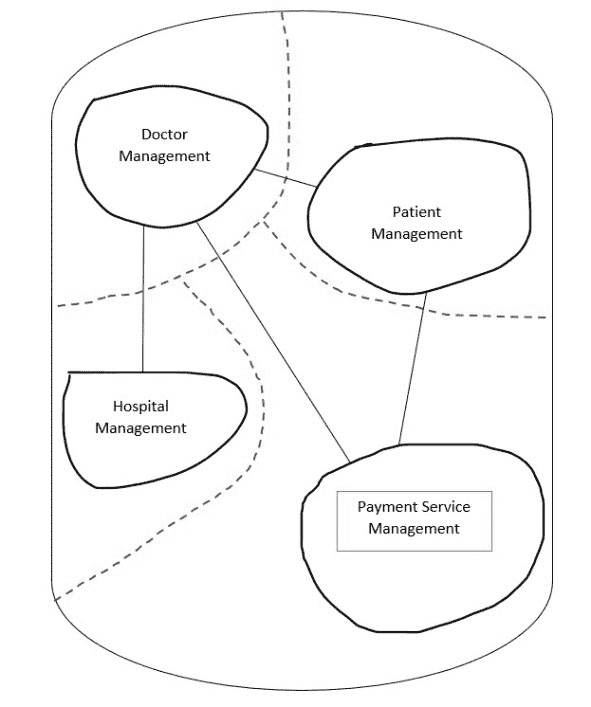

**图 3.2：** 基于子域的分解

深度的业务理解有助于识别子域，这与之前的业务能力非常相似。人们可以通过理解整体组织结构和高级领域模型理解，高效地使用子域来分解应用程序。一个子域可能包含一个或多个子域，以进一步划分功能，实现“子域的子域”。

使用`领域驱动设计`（`DDD`），开发者与领域专家一起使用`统一语言`来共享知识、文档和代码。在 DDD 中，`边界上下文`（`BC`）是特定术语具有确定含义的情况。这些子域的边界上下文之间存在某些关系。让我们再次以`在线配送`为例。一旦`客户`检查了`菜单`并完成了`订单支付`，最后一旦订单`准备就绪`，我们需要与配送部门确认发货。这里，`目录`、`订单`、`支付`和`配送`共享某些关系，这被称为`上下文映射`。类似于`多层企业级应用`，DDD 也为我们提供了`领域模型层`、`应用层`和`基础设施层`等。

#### 通过单一职责原则分解服务

正如所讨论和多次强调的，关键在于拥有小型的独立服务，遵循`单一职责`和`高可用性`。现在的问题是，`什么应该被视为单一职责？`让我们重新回顾在前一章中开发的医生管理服务。我们有一个`医生`服务来执行 CRUD 操作。这里，`医生`服务只在`医生`子域上执行操作；它可以被视为一个`单一职责服务`。它是一个服务；但是，`它是微服务吗？`如果你问我，我会坚定地说`不！` `第一`原因是，它并不`微`。`第二`，它的 SRP 仅存在于表面，但内部它承担了执行各种数据库操作的不同职责。`第三`，从高可用性的角度来看，如果一个端点出现问题，将会渗透到其他端点，所有`消费者`将面临影响。

在`第 2 章，解密晦涩`中，我们已经有了执行 CRUD 操作的医生服务，如`图 3.3`所示：

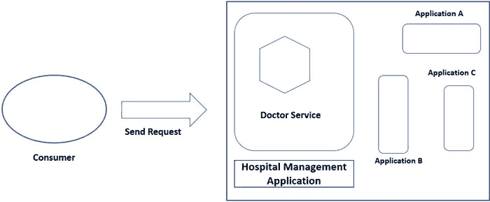

### 图 3.3：Doctor 服务的 CRUD 操作

这意味着我们现在要根据单一职责原则（SRP）将早先版本的 Doctor 服务拆分为多个服务。在这里，`Doctor` 是我们的子域，包含`AddDoctorService`、`UpdateDoctorService`等，如`Figure 3.4`所示：

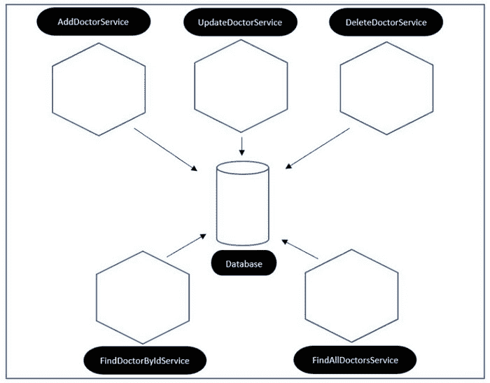

#### 图 3.4：服务与子域

同样地，我们将进一步考虑`Patients`（患者）、`Hospitals Payment`（医院支付）等子域。每个子域根据其职责包含一个到多个服务。那么，`我们应该开始拆分 doctor 服务了吗？`

在这里，我们正在创建一个 Spring Boot 微服务应用程序，用于向表中添加`Doctor`。由于我们之前已经创建过类似的应用程序，因此可以`跳过`逐步创建应用程序的过程。为了保持一致，我们需要添加`web`、`jdbc`的启动器（starters），并不要忘记添加数据库驱动程序。我们将根据`Figure 3.5`所示的项目大纲，使用之前应用程序相同的`doctor`领域类和`DAO implementation`：

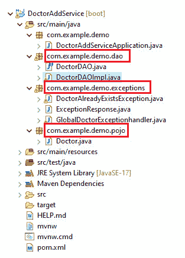

#### 图 3.5：DoctorAddService 的项目结构

让我们添加`DoctorAddController`，它包含一个用于添加新`doctor`资源的单一端点，代码如下：

```java
@RestController
public class DoctorAddController {
    @Autowired
    DoctorDAO doctorDAO;

    @PostMapping(path = "/doctors", consumes = { MediaType.APPLICATION_JSON_VALUE, MediaType.APPLICATION_XML_VALUE })
    public ResponseEntity<Doctor> createNewDoctorRecord(@RequestBody Doctor doctor) throws DoctorAlreadyExistsException{
        // logic to add record in table will go here
        Doctor d = null;
        int added = 0;
        added = doctorDAO.addDoctor(doctor);
        if (added == 1)
            return new ResponseEntity<Doctor>(doctor, HttpStatusCode.valueOf(201));
        return new ResponseEntity<Doctor>(HttpStatusCode.valueOf(٢٠٤));
    }

    @PostMapping(path = "/doctors/form", consumes =
            MediaType.APPLICATION_FORM_URLENCODED_VALUE, produces = {
            MediaType.APPLICATION_JSON_VALUE, MediaType.APPLICATION_XML_VALUE })
    public Doctor createNewDoctorRecord_Form(Doctor doctor) {
        // logic to add record in table will go here
        Doctor d = null;
        int added = doctorDAO.addDoctor(doctor);
        if (added == 1)
            return doctor;
        return d;
    }
}
```

现在是时候在`application.properties`文件中添加`database`、`application`和`server`属性了，如下：

```properties
spring.application.name=doctor-add-service
server.port= 8081
spring.datasource.url=jdbc:mysql://localhost:3306/doctors
spring.datasource.username=root
spring.datasource.password=mysql
```

我们第一次配置应用程序名称。这是微服务架构中非常重要的属性之一。我们在这里不会详细讨论它，等后面几个章节，但对于每个应用程序，我们都会无例外地配置它。

让我们`运行`并`测试``/doctors/form`端点，如`Figure 3.6`所示：

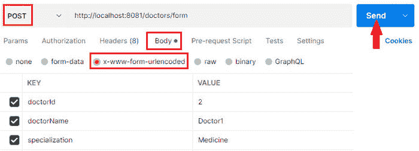

#### 图 3.6：创建新的 Doctor 资源

请求将由控制器处理，向`doctor`表中添加新记录，并获得以下响应：

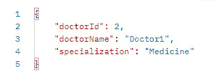

#### 图 3.7：`/doctors/form` API 的 JSON 响应

在`DoctorAddService`中，我们暴露了多个端点。人们可能会将其视为一个具有多个职责的应用程序。然而，我们只是在创建一个新资源，这是一个单一职责。

现在，让我们创建一个新的 Spring Boot 微服务应用程序来查找所有`doctors`（医生）。每个微服务之间都是相互独立的，并且可以共同构成一套不同的技术栈。在这里，我们将使用 JPA 仓库代替 JDBC API 来与 MySQL 中的表进行通信。项目将具有以下大纲：

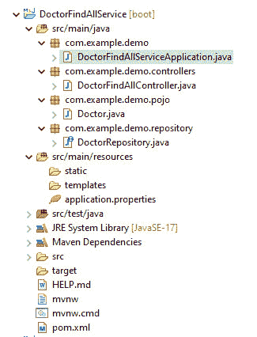

#### 图 3.8：DoctorFindAllService 的项目结构

由于我们将使用 JPA，让我们更新`Doctor`以映射为`entity`（实体）。`Figure 3.9`所示的代码片段详细说明了如何连接 JPA API 以将`Doctor`实体映射到表：


#### 图 3.9：与 Doctor 映射 JPA

### 注意事项

Java EE 已经更改为 Jakarta EE，Spring Boot 3.0 也从 Java EE 升级到了 Jakarta EE API。Spring Boot 选择了兼容 Jakarta EE 10 的依赖。注意，以前以`javax`开头的包名导入语句现在已更改为`jakarta`。

我们正在使用 JPA 仓库与数据库进行通信。你需要一个接口来声明`JPA`和`Doctor`之间的契约。`Figure 3.10`展示了如何进行声明：


#### 图 3.10：Doctor 的 JPARepository 接口

Spring Data JPA 是一个在 JPA 实现者（如 Hibernate 或 eclipseLink）之上增加额外抽象层的库。让我们现在更新配置如下：

```properties
spring.jpa.properties.dialect = org.hibernate.dialect.MySQLDialect
spring.jpa.show-sql= true
```

最后一步是添加暴露`doctor`资源的`controller`：

```java
@RestController
public class DoctorFindAllController {
    @Autowired
    DoctorRepository repo;

    @GetMapping(value = "/doctors")
    public ResponseEntity<List<Doctor>> findAllDoctors() {
        // logic to find all doctors will go here
        List<Doctor> doctors = new ArrayList<>();
        doctors = repo.findAll();
        if(doctors.size()>0)
            return new ResponseEntity<List<Doctor>>(doctors, HttpStatusCode.valueOf(200));
        return new ResponseEntity<List<Doctor>>(HttpStatus.NO_CONTENT);
    }
}
```

在这里，我们没有使用`DoctorDAO`，而是注入并使用了`DoctorRepository`的功能来查找所有`doctors`，然后将其作为`resource`暴露。

同样，我们可能根据`doctorId`创建用于`更新`、`删除`和`查找`资源的微服务。这些微服务的每一个一个都是独立`开发`和`部署`的。

如图 3.11 所示，测试`/doctors`端点：

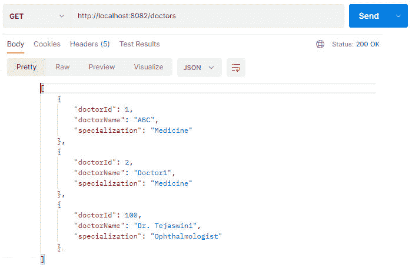

#### 图 3.11：`/doctors` API 的响应

希望我们现在已经非常清楚为什么要选择微服务了。但我们需要密切讨论创建这些许多服务的必要性。我们需要所有这些服务吗？在某种程度上，为了遵循单一职责原则（SRP），我们需要它们。然而，在设计微服务之前，可以应用一些经验法则。在涉及到 SRP 时，工作负载起着非常重要的作用。`AddDoctorService`、`UpdateDoctorService`或`DeleteDoctorService`的请求负载与查找所有医生或按专业领域查找医生的服务相比，显然要少得多。即使我们将这些服务的端点合并，它们也能处理请求而不会出现工作负载问题。同样，即使这个带有许多端点的服务失败了，也不会影响终端用户，最多可能只会影响管理功能。而且这不会是一个主要问题。现在，对于开发和部署来说，它的代码也并不复杂。这意味着即使在我们不遵循 SRP 的情况下也可以利用微服务的优势。

图 3.12 显示了我们带有微服务的第一个子域：

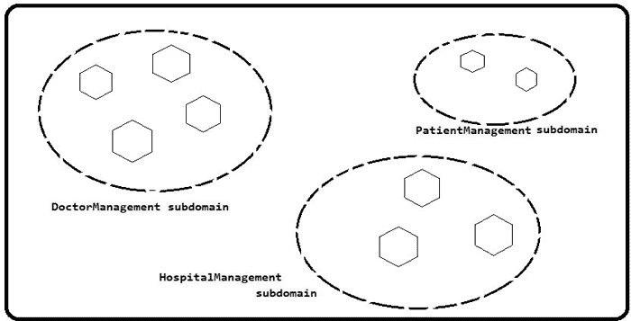

**图 3.12：** 微服务的完整子域

我们设计了服务来处理不断增长的负载，它将是高可用的并被独立开发和部署。非常好！！！但我有一个问题。我们开发了 3-4 个以上的服务，我们是如何连接数据库的呢？没错，我们在`application.properties`文件中单独配置了数据库属性。这难道不是配置的重复吗？在维护中难道不会成为问题吗？让我们先把它搁置。我们将在下一章讨论这个问题。

# 微服务的局限性

到目前为止，我们讨论了微服务的许多优势。但硬币都有两面。让我们来看看硬币的另一面是什么。

## 复杂性

我们现在正在从单体架构向微服务迁移。然而，这带来了更高程度的复杂性。与单体架构相比，设计、映射具有单一职责的服务、管理内容去向、测试以及调试这些服务的复杂性都更大。

## 网络流量

正如已经讨论过的，微服务将遵循单一职责原则，它们的设计方式使其高度支持重用性。这意味着一个微服务将与多个服务通信以完成任务。这种服务间的通信严重依赖于网络。更多的服务间通信会导致网络延迟。由于每个服务都遵循单一职责原则（`SRP`），一个微服务可能与一个或多个服务通信，当其中一个服务由于任何错误失败时，将非常难进行溯源。

## 监控

我们的微服务不仅独立开发，而且独立部署。当然，这有利于高可用性和容错性，但维护呢？现在，我们需要管理可能按区域划分的各种服务器。当服务数量增加时，它们的维护以及监控是一件令人头疼的事。


## 结论

在本章中，我们涵盖了微服务的的基础知识。我们讨论了为什么应该选择微服务而不是单体架构。我们讨论了微服务架构提供的不同特性，这些特性使其成为开发者最佳选择之一。同时，我们还讨论了微服务的局限性，我们在选择微服务作为软件设计的一部分之前需要了解这些局限性。在章节最后，我们学习了如何将软件拆解为不同的部分或模块，以便将单体方法迁移到微服务。

在下一章中，我们将讨论如何使用`Config`服务器通过集中化配置进行工作。

# 第 4 章

## 反射式组合

在大多数应用程序中，我们使用各种属性。大多数时候，与应用程序相关的属性如应用程序名称、数据库配置、应用程序运行的端口等是保持不变的。然而，这并不意味着我们不希望在运行时更改它们。当值是代码的一部分时，它们是静态的，任何我们想要更改最终都需要重新编译和重新打包，然后重新部署。为了避免这种情况，可以使用环境变量、命令行参数以及配置文件来外部化配置。我们作为开发者应该遵循的经验法则之一是不要将频繁变化的值包含在代码中。属性和`YAML`文件是外部化配置的常用方法。然后我们就可以根据需要加载配置文件。我们可能选择将此类属性保留在外部位置，以便在需要时轻松更改配置。由于配置属性在外部位置可用，人们不必访问应用程序即可进行任何更改。此外，所有属性都在一个集中位置，因此更新变得更加容易。

我们可以使用它来配置应用程序属性、与数据库相关的属性（如`Oracle`、`MySQL`等）。此外，我们配置如`Kafka`和`RabbitMQ`等通信信道，有时还包括客户端和服务器应用程序之间频繁使用的通信 URL。

## 结构

在本章中，我们将讨论以下主题：

- 处理集中化配置管理的方法
- 执行集中化配置
- 探索`Cloud Config`服务器
- 在`GIT`中定位属性
- 使用配置（Profiles）
- 使用集中化配置系统的局限性

正如多次讨论过的，传统的单体架构所有功能运行在同一个实例中。应用程序需要各种配置。然而，最棒的部分是，无论我们将它们配置在一个文件中还是分散在多个文件中，所有配置都位于同一个位置。现在，我们处理的是微服务架构，它大多运行在云环境中。我们的微服务将跨越多个按地理区域划分的容器。每个服务都有自己的配置。然而，许多服务具有具有相同值的相似配置。事实上，我们正在将配置从一个服务复制到另一个。但管理如此多的服务及其配置是一项非常复杂的工作。当涉及到几十个服务的配置管理时，将变得困难得多。这些跨越不同位置的配置副本可能会产生错误。我们可能在某处更改了配置，而执行相同任务的其他服务可能在使用旧的配置。这使得维护一致的配置变得困难。由于服务引用两组不同的配置，这直接导致了数据不一致。这意味着管理和维护一致的配置在微服务架构中起着至关重要的作用。

## 处理集中化配置管理的方法

现在，我们的方法是将配置与代码分离，并将其单独存储在某个位置，应用程序在需要时从那里读取。由于配置被分离了，现在可以根据需要单独更新它，而无需连接到应用程序。服务不需要本地存储配置，这意味着即使多个服务也使用同一份配置。我们可以在一个地方更改配置，在不知道所有使用该配置的情况下，更改将反映到所有位置。

让我们观察`图 4.1`，其中我们看到了跨多个服务的 DB 通信配置的重复：

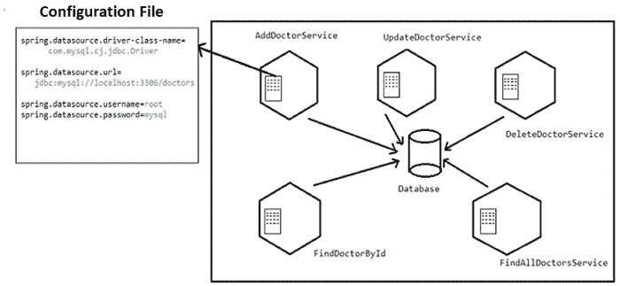

**图 4.1：** 冗余的配置设置

在应用开发中，一旦某个场景完成完成（`DONE`），我们总是希望针对某些环境参数对应用程序进行测试，例如`platform`、`不同的数据库`、`消息工具`、`日志配置`等。我们现在指的是相同的配置，因为它们非常常见，且所有服务都需要它们。*这意味着我们将不断为测试环境在每个文件中更改配置吗？* 我们非常了解 Spring profiles 如何支持隔离应用程序配置的部分，并使其在特定环境下可用。同样，我们现在可以为各种环境（如`dev`、`test`或`production`）存储多个配置。

以前，我们经常为各种服务配置最安全的信息`usernames`和`passwords`。维护它们是一件头疼的事；然而，确保它们的安全性是更大且至关重要的。现在，配置被集中放置在一个安全环境中；它现在是最可靠的。这正是我们想要实现的。`图 4.2`展示了实现集中配置的方法：

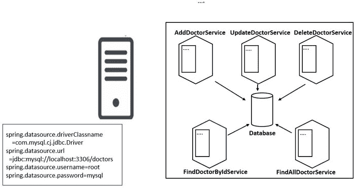

**图 4.2：** 集中式配置

## 执行集中化配置

**集中化配置系统**允许我们通过将可重用的配置从应用程序代码分离到一个集中位置来克服配置管理的复杂度，应用程序可以访问该位置读取配置属性。我们可以在不访问应用程序更新配置，配置的任何更新将自动反映到应用程序级别。**Spring Cloud Config**模块支持在分布式系统中通过`服务端`和`客户端`两种方法实现配置外部化。

该系统由`Config Server`（1）、`后端存储`（2）以及想要读取属性的`服务`（3）组成，如`图 4.3`所示：

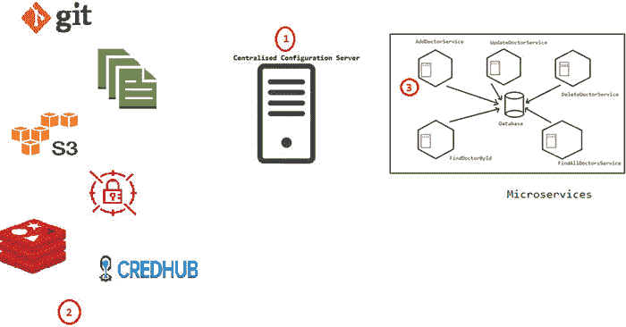

**图 4.3：** `外部化配置系统`

该图显然不是一条直达的高公路。我们需要探索它的不同组件。

为了简单起见，当我们决定采用集中式配置时，可以考虑遵循以下步骤：

1. 决定要外部化的属性，并将它们保留在集中位置以便访问。
2. 从可用的后端中决定使用哪一个，例如`JDBC`、`Vault`、`CredHub`或`Redis`等。
3. 将要外部化的属性添加到后端。
4. 决定如何定位属性，例如使用应用程序名称和 profile、配置文件名、使用 label 和配置文件名、应用程序名称、profile 和 label。
5. 决定维护多少个 profile，如`test`、`dev`或`prod`等。
6. 建立`Config Server`并通过设置属性`spring.cloud.config.server.XXX`添加到后端的连接，其中`XXX`将被替换为后端的名称，随后是其连接属性。

## 探索 Cloud Config Server

既然我们已经知道了步骤，让我们设置并准备好我们的`Cloud Config Server`，一旦设置好，就可以与后端通信。`Config Server`是一个管理应用程序外部化属性的中心位置。属性是外部化的，但问题是我们将把这些配置存储在哪里呢？取决于后端存储，Cloud Config Server 的配置会发生变化。让我们从创建 Config Server 开始。

让我们创建一个 Spring Boot 应用程序`Cloud_Config_Server`，并将`spring-cloud-config-server`作为依赖。由于该服务需要作为服务器的能力，我们将添加`@EnableConfigServer`注解，如`图 4.4`所示，如下：

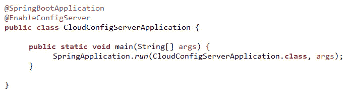

**图 4.4：** 使用`@EnableConfigServer`

太棒了！我们知道如何创建 Config Server。默认情况下，它将尝试与`GIT`通信。然而，我们确实有其他其他后端来定位配置。让我们逐一讨论其他方法。

## 后端选择

有不同的后端存储选项可用。让我们详细讨论它们：

### Vault 后端

大多数应用程序都有各种`passwords`、`API keys`、`certificates`或某些`非常敏感的信息`，需要保持安全以安全地访问各种资源。这些秘密可以存储在 Vault 中。**Vault**是一个允许安全访问秘密的工具。Vault 提供了一个具有紧密访问控制的统一接口，并记录详细的审计日志。

当我们决定使用 Vault 作为后端时，我们需要在依赖中添加`spring-cloud-starter-vault-config`，然后在`application.properties`中配置`spring.profiles.active=vault`。如`图 4.5`所示，我们需要设置以下配置与 Vault 后端通信：

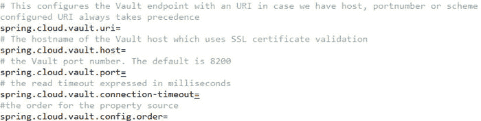

**图 4.5：** 设置 Vault

### JDBC 后端

可以使用 JDBC 作为配置的后端。一旦决定使用 JDBC 存储配置，首要工作是将`jdbc-starter`和数据库驱动程序作为依赖。我们可以使用**PostgreSQL**、**MySQL**以及其他 RDBMS 和 NoSQL 来存储配置。现在，是时候配置与数据库通信了：


**图 4.6：** 设置 JDBC

现在，我们需要如`图 4.7`所示在`configuration`模式下添加`Properties`表：


**图 4.7：** Properties 表结构

让我们添加几行。下图显示了表中的所有条目：


**图 4.8：** Properties 表记录

`Prop_key`是应用程序所需的属性名称。在这里，我们为应用程序插入了值`doctor-find-all-service`，这是我们应用程序的名称。

Cloud Config Server 的默认配置将尝试连接`GIT`。然而，现在我们希望它与 JDBC 通信。以下配置启用了与后端数据库的通信：


**图 4.9：** 与数据库通信

让我们开始并测试 Postman 中如何加载应用程序配置。一旦你访问`doctor-find-all-service/default/latest`来获取配置，你将获得如`图 4.10`所示的输出：


**图 4.10：** 基于 JDBC 的配置

### CredHub 后端

**CredHub**是用于在*Cloud Foundry*中集中管理凭据的组件。它还允许生成安全的凭据、存储和管理，以及访问它们的机制。它还支持加密管理。

我们需要包含`spring-credhub-starter`依赖以启用 CredHub 的集成，将其作为后端存储器。同时，我们还需要在 Cloud Config Server 中包含以下属性：


**图 4.11：** 设置 CredHub 后端

### Redis 后端

Spring Cloud Config Server 支持使用`Redis`作为存储配置的后端。可以通过在应用程序中添加`Spring Data Redis`依赖来使用它。现在，配置必须包含 Redis 服务器的 URL，并将活动配置（profile）设置为`redis`，如图 4.12*所示：


**图 4.12：** 设置 Redis 后端

## AWS Secrets Manager 后端

`AWS Secrets Manager`是一项 AWS 服务，可以更容易地管理如*数据库凭据*、*密码*、*第三方 API 密钥*等密钥。Secrets Manager 控制台允许通过`命令行界面`（`CLI`）、Secrets Manager API 以及 SDK 集中地管理、存储和控制对这些密钥的访问。在添加依赖`software.amazon.awssdk`时，我们还需要配置其他属性，如图 4.13*所示：


**图 4.13：** 设置 AWS Secrets Manager 后端

## AWS S3 后端

`AWS S3`也可以作为配置的存储。为此，我们需要包含`software.amazon.awssdk`依赖并配置如下属性：


**图 4.14：** 设置 AWS S3 后端

## AWS Parameter Store 后端

`AWS Parameter Store`可以作为 Spring Cloud Config Server 的后端存储。需要包含`software.amazon.awssdk`依赖以添加对 AWS Parameter Store 后端的支持。除了依赖，我们还需要配置以下属性：


**图 4.15：** 设置 AWS Parameter Store 后端

## 复合环境仓库

到为止，我们讨论了如何配置存储配置的后端。是否存在一种情况，即需要使用多个后端存储来存储配置，然后从多个环境仓库中拉取配置的数据？是的，这是可能的。可以通过在 config server 应用程序配置中使用复合配置（composite profile）来实现。我们有多种获取数据的选项。让我们讨论其中几个。

### 案例 1：使用 subversion 仓库和 Git 仓库存储配置

以下配置显示了如何配置 Git 仓库以及 subversion 仓库：


**图 4.16：** 使用 Git 仓库配合 subversion 仓库

### 案例 2：使用 Git 仓库和 Vault 服务器存储配置

以下配置显示了如何配置 Git 仓库和 Vault 服务器：


**图 4.17：** 使用 Git 和 Vault

## 文件系统后端

`Tortoise SVN`、`GIT`、`Apache SVN`和`CMS`是一些版本控制工具。`GIT`、`SVN`是支持克隆本地文件系统的工具。属性`spring.cloud.config.server.git.basedir 或 spring.cloud.config.server.svn.basedir`启用了后端位置的支持。`spring.profiles.active=native`将配置设置为`native`，这样就可以从本地类路径或文件系统加载配置文件。我们很快就会详细讨论这一点。

## Git 后端

存储后端的服务器默认实现使用 git。它使得支持配置环境的标签版本变得简单，并让广泛工具访问。然而，*Spring Cloud Config Server*支持多种连接到存储配置属性的后端方法。现在是时候使用期待已存储器——`GIT`了。让我们开始吧。

让我们考虑一下我们的`FindAllDoctorService`，它之前在`application.properties`文件中配置了数据库连接的属性。现在，我们将这些属性从服务中提取出来，并按照描述放在 git 仓库中，如图 4.18*所示：


**图 4.18：** 使用 Git 中的属性工作

我们的系统由*三个*部分组成：Git 仓库拥有属性文件、与后端存储 Git 通信的 Cloud Config Server，以及想要导入配置属性的`FindAllDOctorService`。首先，我们现在需要构建一个带有属性文件的 Git 仓库。在实践中，我们将在远程 Git 上创建仓库。但是，为了测试，我们可以选择使用本地 Git 仓库。在这里，我们将涵盖这两种场景来创建和配置仓库：

### 场景 1：远程仓库

在[`Github.com`](http://Github.com)上，我们将创建一个仓库。可以使用任何你喜欢的名称。不要忘记复制 URL 以便在配置中使用。现在，创建或上传文件`doctor-find-all.properties`，其内容如下：


**图 4.19：** 使用远程仓库工作

并提交该文件到仓库。*为什么属性文件名必须是`doctor-find-service`*？*我们可以更改它吗？* 嗯，我们将在我们讨论配置客户端时进行讨论。

### 场景 2：本地仓库

出于测试目的，而不是使用 Git 账户，可以选择使用本地仓库。我们需要创建一个空文件夹来初始化仓库，然后将`doctor-find-all.properties`文件添加到本地，而不是推送到远程。下图描述了创建仓库的*逐步*过程：


**图 4.20：** 创建本地仓库

一旦有了仓库，让我们将`doctor-find-all.properties`添加到`config-repo`文件夹。按照以下命令序列将文件提交到`config-repo`仓库：


**图 4.21：** 将文件提交到仓库

一旦后端存储准备就绪，现在让我们创建一个名为`Cloud-Config-Server`的服务，如果还没有创建应用程序，可以参考*设置 Cloud Config Server*章节。我们将复用同一个项目。

我们需要在`Cloud-Config-Server`中添加配置定位后端以及它启动的端口：


**图 4.22：** 配置 Cloud Config Server

在（使用本地仓库的情况下，不需要添加*密码*，且 URI 对于 Windows 系统带有`file://`前缀，其他系统带有`file:///`。随后是仓库路径。为了方便选择我们的本地仓库（Windows 系统上的`myrepo`），我们可以这样配置：

`spring.cloud.server.git.uri= file://E:/dir1/dir2/myrepo`

而对于非 Windows 系统，我们可以使用以下命令：

`spring.cloud.config.server.git.uri: file:///dir1/dir2/myrepo`


一旦完成此任务，Config Server 就设置好了。现在，让我们使用`Postman`作为客户端测试配置的加载：


**图 4.23：** 测试配置

恭喜！！！我们的配置正在被定位了。开心吗？

嘿 Tejaswini，但我们为什么要使用`/doctors-find-all-service/default`作为请求呢？我们可以用其他的吗？或者是否有某些预定义的 URI？在讨论新概念之前，让我们先来解决这些问题。

## 在 GIT 中定位属性

Spring Boot 应用的环境被用于枚举属性源，然后根据场景将它们发布到 JSON 端点。这里是定位配置的某些场景：

### 场景 1：使用应用程序名称和配置环境请求资源

我们使用`application name`和与其相关的`profile`来请求资源。图 4.24 展示了客户端如何以类似的方式提交请求：


**图 4.24：** 使用应用程序名称和 profile 请求资源

应用程序的名称是`application.properties`文件中属性`spring.application.name`所设置的值。这与我们刚刚讨论时发出的请求相同。

### 场景 2：使用配置文件请求资源

你也可以使用配置文件名来请求资源。图 4.25 展示了如何根据配置文件名请求资源：


**图 4.25：** 使用文件名请求资源

### 场景 3：使用标签和配置名请求资源

使用标签（label）以及配置文件名进行请求。图 4.26 向你展示了如何提供此类请求：


**图 4.26：** 使用标签和配置文件名请求资源

### 场景 4：使用应用程序名称、profile 和标签请求资源

你也可以提供`application name`、`profile`和`label`的组合来生成资源，如图 4.27 所示：


**图 4.27：** 使用应用程序名称、profile 和标签请求资源

也可以针对应用程序的特定 profile 请求资源。然而，目前我们先将这个问题留在桌面上，因为我们有一个专门的章节来介绍 profile。

一旦 Config Server 的后端存储设置就绪，现在让我们关注 Config Client。让我们继续进行云配置生态系统中最期待的组件——作为配置客户端运行的服务。

## 配置客户端服务以与 Config Server 通信

让我们创建一个`DoctorFindAll_ConfigService`作为 Spring Boot 应用，它是我们指向 Config Server 的客户端。该微服务将包含`spring-boot-starter-data-jpa`、`spring-boot-starter-web`、`mysql-connector-j`和`spring-cloud-starter-config`依赖。`spring-cloud-starter-config`非常特殊，因为它启用了作为 Cloud Config Server 客户端的功能，请求其端缺失的某些配置。

现在，让我们添加`RestController`、`Repository`和`Pojo`。为了简单起见，我们将复用之前在第 3 章“缩小规模”中编写过的`Doctor.java`、`DoctorFindAllController`和`DoctorRepository`，用于`DoctorFindAllService`，其项目结构如图 4.28 所示：


**图 4.28：** `DoctorFindAll_ConfigService`的项目结构

你可以选择使用之前的微服务，但不要忘记添加新的依赖以启用配置客户端模块。我们将`spring.application.name`设置为`doctor-find-all-service`，这与 Git 上的属性文件完全匹配。另一个值得观察的点是，我们没有在`application.properties`文件中添加任何数据库或 JPA 相关的属性。为什么？嗯，我们想从远程仓库加载它们。显然，因为我们想从远程仓库加载它们。该服务拥有`spring-cloud-starter-config`依赖，它在启动时将强制服务定位 Cloud Config Server 并请求其导入配置。在我们的案例中，数据库和 JPA 属性将在此导入。`spring.config.import`属性允许客户端绑定到 Config Server。在 Spring Boot 2.4 之前，我们在客户端服务中设置`spring.cloud.config.uri`属性来与 Cloud Config Server 通信，其值为 Config Server 运行的位置。然而，Spring Boot 2.4 引入了导入配置数据的新方法。现在，我们使用属性`spring.config.import`来绑定到 Config Server，如下：

`spring.config.import=configserver:http://location_of_the_config_server`

我们将其配置为：

`spring.config.import=configserver:http://localhost:8888`

一旦 Config Server 的后端存储设置就绪，现在让我们关注 Config Client。让我们继续进行云配置生态系统中最期待的组件——作为配置客户端运行的服务。

`EnvnmentRepository`负责管理存储详情的策略并将环境作为一个对象提供服务。该仓库的实现行为类似于 Spring Boot 应用，它会从后端（我们存储配置的地方）加载配置文件。我们将拥有多个可能需要加载属性的服务。这意味着我们的后端仓库可能包含各种配置文件。现在，问题是配置是如何被定位的呢。

配置通过以下三种策略进行定位：

- 我们的服务将拥有一个名称，该名称通过`spring.config.name`配置，并为`{application}`参数提供值。
- 我们的服务还可能通过配置`spring.profiles.active`来配置激活的配置（active profile），这为`{profiles}`参数提供值。如果没有配置配置，`{profiles}`将取值为`default`。如果配置了配置，指定的配置将具有更高优先级。我们还可以配置多个配置，此时最后一个配置的配置将具有优先级。
- 服务可能配置了`label`属性，这将为`{label}`提供值，该属性是用于对版本控制下的文件集进行标记的服务端功能。

在微服务启动时，当服务在类路径中找到`spring-cloud-starter-config`依赖时，它尝试通过`spring.config.import`属性提到的属性来定位 Cloud Config Server。现在，向配置服务器发送请求：`http://localhost:{cloud-config-server-location}/{application-name}/{profile}`。还有其他定位配置的场景，我们已经讨论了所有场景。在我们的情况下，它是`http://localhost:8888/doctor-find-all-service/default`。Cloud Config Server 知晓后端存储 Git，以便搜索适用于`default`配置的配置`doctor-find-all-service.properties`。这就是为什么我们将配置文件命名为`name-of-service`（即配置客户端名称）的原因。

## 使用配置（profiles）

Spring Boot profiles 提供了一种在不同的可用环境下分离应用程序配置部分的方法。在开发阶段，人们可能需要一组特定的属性。在测试阶段，我们可能希望测试应用程序在某些不同属性集下的运行情况；这样在生产环境中，应用程序就能平稳运行。为了避免为了寻找运行而反复修改同一个配置文件，Spring Boot profile 允许我们创建多个配置集，然后选择其中一组供应用程序使用。我们刚刚导入了`DoctorFindAll_ConfigService`的默认配置属性数据集。

现在让我们在仓库中添加`test`和`dev`配置，如下所示。

以下配置用于在`doctor_find_all_service-dev.properties`文件中配置`dev`配置：

```properties
spring.datasource.driver-class-name=com.mysql.cj.jdbc.Driver
spring.datasource.url=jdbc:mysql://localhost:3306/doctors_dev
spring.datasource.username=root
spring.datasource.password=mysql
spring.jpa.properties.hibernate.dialect=org.hibernate.dialect.MySQL8Dialect
spring.jpa.show-sql= true
```

以下配置用于在`doctor_find_all_service-test.properties`文件中配置`dev`配置：

```properties
spring.datasource.driver-class-name=com.mysql.cj.jdbc.Driver
spring.datasource.url=jdbc:mysql://localhost:3306/doctors_test
spring.datasource.username=root
spring.datasource.password=mysql
spring.jpa.properties.hibernate.dialect=org.hibernate.dialect.MySQL8Dialect
spring.jpa.show-sql=true
```

为了采样目的，我创建了`doctors_test`和`doctors_dev`模式，并添加了一些测试数据，如图 4.33 所示：


**图 4.33：** `doctor_test`和`doctor_dev`模式下的数据

我们有三个配置`default`、`test`和`dev`。现在，我们只需要通过设置激活配置在`DoctorFindAll_ConfigService`中设置配置：

```properties
spring.profiles.active=dev
```

运行应用程序后，控制台日志将显示激活的配置为`dev`并导入相关数据，如图 4.34 所示：


**图 4.34：** `DoctorFindAllConfigService`应用程序的控制台输出

Postman 也会证明与`dev`配置相关的数据正在加载，如图 4.35 所示：


**图 4.35：** 加载 dev 配置的数据和配置

通过这种方式，在我们将`spring.profiles.active`设置为`test`后，我们可以获得测试配置的响应。我想现在是重新启动我们讨论过的场景的好时候了。

我们已经讨论了四种场景。现在让我们继续基于配置的导入进行讨论。

### 场景 5：使用配置和名称请求资源

你也可以使用应用程序的配置和名称请求资源，如图 4.36 所示：


**图 4.36：** 使用应用程序名称请求资源

### 场景 6：使用文件名请求文件

你可以观察到我们请求了 dev 配置。然而，在策略的情况下，该属性显示将提供与默认配置以及 dev 配置相关的文件。问题是，为什么要关联默认配置呢？这是一种确保高可用性的策略。有时，配置客户端可能会请求导入与某个配置相关的数据，但该配置没有关联配置。在这种情况下，配置客户端将失败。但是，由于这种策略，当指定的配置不可用时，将导入默认配置。很酷吧！

你可以使用文件名直接请求文件内容，如图 4.37 所示：


**图 4.37：** 使用文件名请求文件

### 注意

HTTP 服务具有以下获取资源的形式：

```text
/{application}/{profile}[label}]

/{application}-{profile}.yml

/{label}/{application}-{profile}.yml

/{application}-{profile}.properties

/{label}/{application}-{profile}.properties
```

我们现在非常清楚如何请求配置资源。在开始讨论之前我们提到配置与代码分离，使得更新配置变得灵活。我们要尝试更新配置吗？在这里，为了更新配置，我们将`dev`配置的数据库模式更新为`doctors_dev_new`并提交更改。

为了测试提交的更改，我们创建了一个新模式，然后创建了一个没有任何数据的`doctor`表，如图 4.38 所示：


**图 4.38：** `doctor_dev_new`模式的状态

让我们通过 Postman 中的`/doctors`节点查看更改是如何反映在配置客户端端的，如图 4.39 所示：


**图 4.39：** 更新后的医生列表

响应清楚地显示更改没有反映在配置客户端端，客户端仍在使用旧的架构。为什么呢？原因非常简单：应用程序在启动时导入配置，应用程序启动后发生的任何更新都无法被通知，应用程序将继续使用相同的属性。这不是好事。更新的更改必须反映出来，否则应用程序将面临数据不一致等问题。最简单的解决方案是重启应用程序，之后它将加载更改。然而，这在实践中很难实现。我们可能不知道什么时候该重启应用程序，因为我们不知道更新何时会发生。

## 高可用 Config Server

Cloud Config Server 可能因为某些原因无法启动，反之客户端服务也会无法连接到 Config Server 而无法启动。我们可以将`spring.config.import`设置为`configserver:http://location_of_server`。当我们使用`spring.config.import`设置`optional:configserver:http://location_of_server`时，客户端服务会尝试连接配置服务器，但由于连接是可选的，它仍然会启动。

我们无法阻止 Config Server 失败。它是一个服务，由于多种原因，它可能会失败。当我们知道 Config Server 有偶尔故障的可能性，而且我们甚至不支持将服务器连接设置为可选时，那么唯一的可能就是客户端也会失败。我们选择微服务是为了高可用，但这似乎背道而驰。我们在这里有什么选择？我们的服务因为 Config Server 不可用而失败。如果我们的应用程序启动时 Config Server 不可用，它将不断尝试重连 Config Server。我们的微服务将重试六次，初始退避间隔为`1000ms`，这是默认行为。然而，我们可以通过在配置中设置`spring.cloud.config.retry.*`来覆盖它。需要在类路径中添加`spring-retry`和`spring-boot-starter-aop`依赖以利用`retry`特性。或者，我们可以将`import`属性设置为：

```properties
spring.config.import=configserver:http://location_of_server?fail-fast=true&max-attempts=Number_of_attempts&max-interval=timeinterval&multiplier=multiplier value&initial-interval=initial_interval_time
```

一种策略是重试并与 Config Server 连接。这在出现偶尔故障时非常有效。同样，Config Server 可能会忙于处理请求，导致在队列中等待很长时间的服务可能面临失败。服务由于默认超时而失败。我们也可以设置超时阈值。属性`spring.cloud.config.request-read-timeout`允许我们设置读取超时，`spring.cloud.config.request-connect-timeout`允许我们设置连接超时。

## 使用集中化配置系统的局限性

当涉及到扩展时，Cloud Config Server 具有局限性。Cloud Config Server 可以进行垂直扩展。然而，垂直扩展也有限制。达到限制后，即使我们增加了服务器的硬件或软件能力，其性能在某一点之后也无法增加。

为了使 Cloud Config Server 实现高可用，它需要一直运行。Config Server 可以进行水平扩展，服务器的所有实例必须指向同一个仓库，这只有在共享文件系统下才是可能的。

## 总结

在本章中，我们讨论了集中化配置管理系统的重要性以及实现它的不同方法。我们详细讨论了如何与 Git 后端配合以集中的方式存储配置。我们还讨论了根据应用程序名称、配置文件和文件名加载资源的不同场景，这些资源可以从集中化配置系统中拉取。我们讨论了如何定位属性以及如何使用配置文件的概念来拉取这些属性。我们甚至可以根据需求更改配置，并观察了如何从集中化配置管理系统重新加载修改后的配置。在章节最后，我们讨论了使用集中化配置系统的局限性。

在下一章，我们将讨论如何促进服务之间的通信以及实现它的不同方法。

# 第 5 章：服务间的协作


*Aniket* 是`旧金山`一家顶尖服装工厂的`生产经理`。他的公司一直为许多知名品牌提供服装产品服务。考虑到工作量，工厂被分为`多个单元`。一个单元仅负责为特定公司生产所需的纤维，而另一个单元则使用该`部门`生产的`纤维`。

*Aniket* 的公司采用传统的生产方法进行工作。每当工厂接到任何订单时，生产经理都应该单独通知每个单元。这意味着第一个订单是给纤维制造部门的。一旦纤维制造完成，就会向布料制造单元下达进一步订单。该系统在多年里运行得相当良好。客户数量在增加，生产进展良好，能够匹配收到的订单。但突然在某个晴朗的一天，*Aniket* 震惊地发现生产周期正在增加。这完全出乎意料，因为它也影响了交货时间。这还影响了人力利用，因为观察到少数资源处于空闲状态。*Aniket* 一直处于恐慌中直到直到发现实际问题所在，这是他在不懈努力和分析后发现的。他发现纤维制造团队和布料制造团队是在独立工作。`纤维制造团队`并不清楚对于多少布料订单需要优先准备多少纤维。另一方面，`布料制造部门`一直处于等待模式，直到获得纤维库存，而没有任何线索，因为他们不知道`纤维制造部门`正在进行什么生产。之间完全没有沟通。*如何解决这个问题？*

解决方案相当*简单*，不再给每个部门下达单独的制造订单，订单应该遵循顺序。也就是说，订单应该下给布料制造部门，由它内部与纤维制造单元进行通信。这将确保纤维生产单元切切布料制造单元的需求量。当这种单元间相互通信的方法在 *Aniket* 的工厂实施时，在产品周期方面产生了奇迹的结果。单元之间互连，为组织创造了更多的业务价值。

到此时，你们大家都知道了如何设计`microservice`。你们都知道每个微服务都有其设计时承担的职责。但很多时候，我们可能需要在不同的微服务之间进行通信。在这种情况下，微服务应该能够相互交换数据。这通常就是你们所熟悉的`Producer-Consumer architecture`（生产者-消费者架构）。产生或拥有数据的微服务是我们的生产者或提供者；而消费数据的微服务则是`consumer`（消费者）或`subscriber`（订阅者）。在我们`基于微服务的应用`中，将有很多服务相互通信并遵循`Producer-Consumer model`。现在是时候讨论组织数据的方法，以及如何在微服务之间交换数据了。我们有多种方法可以处理。

## 结构

在本章中，我们将讨论以下主题：

- 重新回顾微服务拆分
- 制定服务间通信策略
- 使用`RestTemplate`进行服务间通信
- 从`RestTemplate`迁移到`feign client`
- 使用消息中间件交换消息
- 匹配需求

## 重新回顾微服务拆分

我们现在设计松耦合的微服务。它们是独立进行`developed`（开发）、`deployed`（部署）和`scaled`（扩展）的。当我们处理数据时，事务与数据密切相关。但与单体应用不同，现在的事务将跨越多个服务。例如，当我们想让`doctor`与`hospital`关联时，首先需要检查`doctor`的详细信息，然后将其添加到映射表中。同样，当有人想查找某个`hospital`中的医生列表（即在该`hospital`中具有某些专长的医生列表）时，我们需要查询属于多个服务的数据，在我们的案例中就是来自`doctor`表和`hospital`表。我们不仅要从不同的表中查询数据，而且一旦获取了数据，还需要连接来自多个服务的数据。我们还必须确保数据的安全和可靠。我们不能忽视数据持久化在物理服务器上的事实，而且服务器始终存在故障的可能性。*我听起来天生很悲观吗？* 显然，*并不是*。著名作家`Stephan King`曾说过，*只要你为最坏的情况做好准备，抱最好的希望并没有坏处*。对我们来说，数据是我们微服务生态系统的胚胎。我们无法失去它。严肃地说，如果我们需要处理这种情况，我们需要一套数据库扩展以及复制策略。同时，我们不能忽视数据存储的不同需求。我们可能有多个服务，它们都有各自的需求。其中一些可能需要关系型数据库，而另一些可能需要 NoSQL 数据库，如`MongoDB`。我们需要微服务持久化属于该特定微服务的私有数据。事实是，*我们需要共享此类数据*。为了共享数据，我们有各种设计模式。让我们在微服务之间共享数据之前讨论它们。

## 共享数据库

在`shared database approach`（共享数据库方法）下，我们使用一个多个服务共享的单一数据库。每个服务都可以使用本地事务访问其他服务拥有的数据。

**优点：**

- 由于与`monolithic architecture`（单体架构）共处多年，开发者对确保数据一致性的 ACID 事务非常熟悉。
- 使用单个数据库工作总是非常简单方便。

**缺点：**

- `development time`（开发时间）很慢，因为开发者需要协调所有的更改，以便其他服务可以访问相同的表。
- 由于数据库在各种服务之间共享，一个微服务执行的操作可能会相互干扰。
- 各种服务对存储数据可能有不同的需求，但当我们使用单一数据库时，它可能无法满足某些服务的数据存储需求。

## 每个服务一个数据库

微服务可以有 API 来暴露这些数据。最重要的是，服务的事务只围绕其数据库。`Figure 5.1`显示了这种方法的典型结构：


**图 5.1：**每个服务一个数据库

`microservice`将拥有特定的数据，且不能被任何其他服务直接访问。由于数据是私有的，问题是：*保持持久化数据对服务私有的不同方法是什么？我们不需要为每个微服务准备一个数据库服务器。这里是一些保持数据对服务私有的策略：*

- **每个服务一个表（Table per service）**：每个服务将拥有一组表，并由该服务访问。
- **每个服务一个模式（Schema per service）**：每个服务将有一个数据库模式，该模式是该服务私有的。
- **每个服务一个数据库服务器（Database server per service）**：每个服务将拥有自己的数据库服务器。

**优点：**

- `Database per service`有助于确保服务松耦合，在一个服务的数据库中进行的更改不会影响任何其他服务。
- 根据微服务的需求，它可以使用最适合其需求的数据库。

**缺点：**

- 最复杂的问题是处理跨越多个服务的`transaction management`（事务管理）。许多数据库并不支持这些事务。
- 当环境处理多个数据库时，连接数据的查询实现变得具有挑战性。
- 在根据服务需求的环境中，它可能处理 SQL 或 NoSQL 数据库，管理这些 SQL 和 NoSQL 数据库是复杂的。

## Saga

我们刚刚讨论了`database per service`，即每个服务都有自己的数据库。然而，在`day-to-day life`（日常）中，某些业务事务可能会跨越多个微服务。当表位于不同的数据库或不同类型的数据库时，我们无法在应用程序中使用本地 ACID 事务。

你可能听过或读过两阶段提交（`2PC`）。`2PC`是一种`标准化的原子提交协议`，它确保事务的 ACID 属性。`2PC`通过参与事务以及监控分布式事务的提交和回滚，确保数据库的数据完整性。`2PC`像一个单一请求。然而，我们刚刚讨论了`database per service`，这意味着每个服务将有自己的事务管理器，并且一个请求可能分多个步骤完成，而不是单步完成。这就是`Saga`发挥重要作用的地方。

`Saga`是一系列本地事务，其中每个更新数据库的本地事务都会发布一条消息，或者它可能触发下一个本地事务的事件。由于某些原因，如果本地事务失败，Saga 将执行一系列补偿事务，以撤销到目前为止在数据库中所所做的更改。

**优点：**

- `Saga`设计模式允许在不使用应用程序中使用分布式事务的情况下，维护多个服务的数据一致性。

**缺点：**

- Saga 编程是复杂的编程。

## API 组合

我们刚刚讨论了服务拥有自己的私有数据以及如何管理跨服务的事务。这意味着，每当我们决定使用每个服务一个数据库时，我们所需的数据可能来自不同的服务。组合此类数据是一个复杂的过程。我们需要一种简单的方法从多个服务获取数据，并在需要时进行组合。这就是 API 组合出现场的地方，它实现了连接来自多个服务数据的查询。

在 API 组合中，我们有一个`API Composer`，它调用我们需要从中获取数据的服务，然后执行*内存连接*以生成结果。

### 优点

- 它为在复杂的微服务架构中查询数据提供了一种简单易便的方法。

### 缺点

- 当我们尝试连接大型数据集时，查询可能会导致效率低的数据集生成。

## 命令查询责任分离（CQRS）

如我们所知，数据被隔离在多个服务之间，每个服务都拥有自己的私有数据。这产生了实现多个查询以连接来自多个服务的数据的需求。我们可以有一个通常需要更新数据库的命令命令。一旦更新完成，它将会发送消息。然而，即使我们应用了*事件溯源模式（Event-Sourcing pattern）*，数据仍然无法被轻松查询。

在 CQRS 中，我们定义了一个视图数据库，它是一个*只读副本*，旨在支持查询。应用程序随后通过订阅由拥有数据的服务发布的领域事件，来保持副本数据的实时更新。

### 优点

- 该模式支持支持可扩展的各种反规范化视图。
- 它支持关注点分离，我们将更简单的命令与查询模型分离开。

### 缺点

- 模式的实现增加了代码重复的复杂性。

在讨论了不同的数据管理方法后，让我们转向服务之间的数据共享。

## 服务间通信的策略

我们现在有了具有单一职责原则（SRP）的微服务。如前所述，我们为了可重用性设计了微服务。这意味着其中一个微服务现在将成为其他微服务的消费者。涉及到服务间通信时，我们有*两种*不同的方式来处理——**同步通信**和**异步通信**。

### 同步通信

在这种方法中，*消费者服务*作为客户端向提供者服务发送请求并等待响应。由于响应对于后续阶段至关重要，客户端将无法继续执行并保持等待。让我们看看*图*5.2所示的货币转换经典示例：


**图 5.2：**同步服务间通信

我们有一个`ConversionRate`微服务，与存储货币汇率的数据库通信。现在，当我们需要计算某个金额的货币转换时，我们需要获取转换汇率。`ConversionCalculationService`需要与`ConversionRateService`通信以获取汇率数据，然后使用该汇率进行进一步计算。现在，这里为了计算转换金额，必须拥有汇率，没有汇率就无法进行计算。在这里，`ConversionCalculationService`必须在微服务之间选择*同步通信*并等待响应。

### 异步通信

服务不再等待响应，而是选择继续执行，这使得应用程序更具*响应*。现在，如果底层服务耗时较长，*客户端服务*可以选择不等待响应。

异步通信使用*发布-订阅模式（publisher-subscriber pattern）*。*提供者*服务发布数据，*消费者*服务订阅发布的数据。在这种场景下，即使发布者服务未能响应，由于*异步通信*，它也不会影响整体流程。

所以，为了不浪费时间，让我们继续关于同步通信的讨论。我们将详细讨论如何使用`RestTemplate`来实现同步服务间通信。

## 使用 RestTemplate 进行服务间通信

可用的*容易*、*简单*、*最流行*且最*直观*的选项是`RestTemplate`。`RestTemplate`基于模板设计模式，为常见场景提供了各种 HTTP 方法。除了这些方法，`RestTemplate`还提供了通用的`exchange()`和`execute()`方法。对于同步客户端请求服务，`RestTemplate`是最佳选择。

在开始演示之前，让我们先看看`RestTemplate`类中提供的常用方法：

- `getForObject()`：该方法通过 HTTP GET 方法请求指定 URL 暴露的资源以获取表示。如果需要，该方法可以向提供者发送预期的 URI `Template`变量。
- `getForEntity()`：该方法通过 HTTP GET 方法请求指定 URL 暴露的资源以获取实体。收到的响应随后转换并存储在`ResponseEntity`实例中。如果需要，该方法可以向提供者发送预期的 URI 模板变量。
- `headForHeaders()`：该方法获取参数中 URI 模板指定资源的所有头。如果需要，该方法可以向提供者发送预期的 URI `Template`变量。
- `postForLocation()`：该方法通过将实例 POST 到指定的 URI 来创建新资源。然后返回`Location header`的值，该值指示新资源存储的位置。如果需要，该方法可以向提供者发送预期的 URI 模板变量。它还可以包含一个类型为 request 的参数，该类型可以是`HttpEntity`类型，以便在请求中添加任何额外的 HTTP 请求头。请求包含 POST 对象的体，该体可以是`MultiValueMap`，以创建一个具有任何`Object`（代表部分体）值的 multipart 请求，或者一个`HttpEntity`实例，代表具有*体*和*请求头*的部。
- `postForEntity()`：该方法通过将实例 POST 到指定的 URI 来创建新资源，并返回`ResponseEntity`类型的响应。如果需要，该方法可以向提供者发送预期的 URI 模板变量。它还可以包含一个类型为 request 的参数，该类型可以是`HttpEntity`类型，以便在请求中添加任何额外的 HTTP 请求头。请求包含 POST 对象的体，该体可以是`MultiValueMap`，以创建一个具有任何`Object`（代表部分体）值的 multipart 请求，或者一个`HttpEntity`实例，代表具有*体*和*请求头*的部。
- `put()`：该方法通过将提供的对象 PUT 到特定 URI 来实现创建或修改资源。该 URI 允许我们在 URI 中提供`URI 变量`。请求参数可以是`HttpEntity`类型，以便为请求提供额外的 HTTP 请求头。
- `patchForObject()`：该方法使用`PATCH`方法对给定的对象到模板实现资源的修改，并在响应中返回表示。如果需要，该方法可以向提供者发送预期的 URI 模板变量。请求参数可以是`HttpEntity`类型，以便向提供者在请求中发送一些额外的 HTTP 请求头。
- `delete()`：该方法允许删除参数指定 URI 处的资源。
- `optionsForAllow()`：该方法获取指定 URI 的`Allow`头值。如果需要，该方法可以向提供者发送预期的 URI `Template`变量。
- `exchange()`：该方法使用请求中的实体在给定的 URI 上执行指定的 HTTP 方法，然后返回`ResponseEntity`类型的响应。如果需要，该方法可以向提供者发送预期的 URI `Template`变量。
- `execute()`：该方法允许对给定的 URI 执行 HTTP 方法，同时使用`RequestCallback`准备请求，并使用`ResponseExtractor`读取响应。
- `doExecute()`：该方法提供了在给定的 URI 上执行指定的 HTTP 方法的能力。随后，通过`RequestCallback`处理`ClientHttpRequest`并处理从`ResponseExtractor`获取的响应。

### Spring 6.0 中的更新

```java
@Nullable
protected <T> T doExecute(URI url, @Nullable String uriTemplate, @Nullable HttpMethod method, @Nullable RequestCallback requestCallback, @Nullable<T> responseExtractor) throws ...
```

让我们开始使用`RestTemplate`实现服务间通信。正如*图 5.3*所示，我们将开发*两个*服务：提供医生数据的`DoctorFind_By_DoctorId`和消费数据的`Hospital_FindDoctors`。这两个服务都将数据存储在各自的模式（schema）中。我们也可以拥有*两种*不同类型的数据库。

现在，人们可能会对数据库设计如何更好或可以选择哪些替代方案进行争论。然而，我们这里的重点不在于讨论如何设计数据库，而是为了理解如何使用`RestTemplate`在服务之间共享数据：


**图 5.3：**使用 RestTemplate 的同步服务间通信

让我们从`DoctorFind_By_DoctorId`微服务开始，它已经添加了`starter-web`、`starter-data-jpa`和数据库驱动依赖。该服务将与`doctors`数据库通信，从`doctor`表中获取数据。这与我们在前面的章节中使用的表相同。它还具有相同的`DoctorRepository`接口，该接口继承自`JpaRepository`，如*图 5.4*所示：


**图 5.4：**DoctorFind_By_DoctorId 项目结构

让我们在`FindDoctorByIdController`中添加端点，以便使用`DoctorRepository`根据`doctorId`从数据库中获取数据：


```java
@RestController
public class FindDoctorByIdController {
    @Autowired
    DoctorRepository repo;
    @GetMapping("/doctors/{doctorId}")
    ResponseEntity<Doctor> findDoctorById(@PathVariable int doctorId){
        Optional<Doctor> optional=repo.findById(doctorId);
        if(optional.isPresent()) {
            Doctor doctor=optional.get();
            return new ResponseEntity<Doctor>(doctor,HttpStatus.OK);
        }
        return new ResponseEntity<Doctor>(HttpStatus.NO_CONTENT);
    }
}
```

一切就绪后，启动应用程序并在 Postman 上使用可用的`doctorId`测试`/doctors/{doctorId}`端点，如下：


**图 5.5:** `FindDoctorByIdController` 针对可用`doctorId`的响应

接下来，再次使用`doctor`表中不可用的`doctorId`进行测试，如图 5.6 所示：


**图 5.6:** `FindDoctorByIdController` 针对不可用`doctorId`的响应

我们必须确保提供者始终处于在线且运行中，以处理来自消费者的传入请求。让我们保持它运行，我们将关注`Hospital_FindDoctors`服务。

该服务的数据存储在医院模式下。该服务将从`hospital`表获取数据，以查找与医院相关的详细信息以及医生的详细信息。正如已经讨论过的，为了案例研究，我们在这里创建了两个表。`hospital`表存储医院相关信息，`doctor_hospital_mapping`表用于将医院与医生映射。查找与医院相关的医生可能是具有挑战性的，因为医院表和医生表之间没有关系，它们不属于同一个模式。此外，它们可能属于不同的数据库。

我记得在某一家顶级跨国公司（MNC）担任软件架构师时的一种情况。开发人员都是数据库设计、范式化等专家。一个聪明的工程师找到了我。“嘿，Mandar！我们不能在这里应用范式化吗？我们为什么不能用连接（joins）呢？这样我们的生活会更容易。”我盯着他了一会儿，还没等我解释，他自己兴奋了起来，“哦！非常抱歉我提这个问题。这些表来自不同的模式，我们无法对它们进行范式化。但这样我们该如何处理这种情况呢？”这真的让我松了一口气；至少我不需要向他解释基础数据库概念。当然，当时团队对微服务架构还很陌生。期望团队理解共享数据库或每个服务一个数据库的概念是不切实际的。

目前，我们在演示中面临着相同的情况。我们无法使用范式化来编写生成连接的查询。因此，我们需要采取替代方法。在这里，我们需要在医院服务和医生服务之间建立通信，以查找医生的详细信息，然后我们将获取的数据设置到医院实例中。在这里我们将使用`RestTemplate`进行同步通信。`Hospital_FindDoctors`微服务将具有`starter-web`、`starter-jdbc`和数据库驱动依赖，如图 5.7 所示：


**图 5.7:** `Hospital_FindDoctors`项目

一旦应用程序就绪，我们在`application.properties`中添加配置。项目还包含医院和医生 POJO。如图 5.8 所示显示了医院 POJO 和文件内容：

在这里，我们使用`JDBC`与数据库通信。因此，我们还需要在`hospitals`模式下创建医院和`doctor_hospital_mapping`表。以下是参考的表结构和示例数据：


**图 5.8:** 设置医院数据库

图 5.9 显示了`hospital`表：


**图 5.9:** 说明`hospital`表

图 5.10 展示了`doctor_hospital_mapping`表：


**图 5.10:** 说明`doctor_hospital_mapping`表

以下是演示数据：


**图 5.11:** `hospital`和`doctor_hospital_mapping`表中的数据

搞定！我们的数据库已经设置好了。现在让我们使用`JdbcTemplate`根据`hospitalId`查找医院，并从匹配`hospitalId`的映射表中查找记录：

```java
public List<Integer> findDoctorIds(int hospitalId) {
    String query = "select doctorId from hospital h inner join " + "doctor_hospital_mapping ON h.hospital_registration_id=doctor_hospital_mapping.hospitalId where h.hospital_registration_id=?";
    return jdbcTemplate.queryForList(query, Integer.class, hospitalId);
}

public Hospital findHospitalById(int hospitalId){
    Hospital hospital=null;
    String Find_Hospital_By_Id="select * from hospital where hospital_registration_id=?";
    try {
        hospital = jdbcTemplate.queryForObject(Find_Hospital_By_Id, new RowMapper<Hospital>() {
            @Override
            public Hospital mapRow(ResultSet rs, int rowNum) throws SQLException {
                Hospital hospital=new Hospital();
                hospital.setHospitalRegistrationId(rs.getInt(1));
                hospital.setAddress(rs.getString(2));
                hospital.setHospitalName(rs.getString(3));
                return hospital;
            }
        },hospitalId);
    }
    catch(Exception e) {
        System.out.println(e.getMessage());
    }
    return hospital;
}
```

最后一步是在控制器中添加端点，使用`HospitalRepository`获取记录并将其暴露给客户端：

```java
@GetMapping("/hospitals/{hospitalId}")
ResponseEntity<Hospital> findAllDoctorsInHospitals(@PathVariable int hospitalId) {
    List<Doctor> doctors = new ArrayList<>();
    Hospital hospital = repo.findHospitalById(hospitalId);
    if (hospital!=null) {
        return new ResponseEntity<Hospital>(hospital, HttpStatus.OK);
    }
    return new ResponseEntity<Hospital>(HttpStatus.NO_CONTENT);
}
```

好了，一切都完成了，现在是按照图 5.12 所示对`HospitalRegistrationId=12345`进行端点测试：


**图 5.12：** `findAllDoctorsInHospitals`匹配`hospitalRegistrationId`的响应

我们在设置示例数据时插入了`hospitalId=12345`的记录，请随时使用你在数据库中插入的`hospitalId`。

我们收到了端点的响应；然而，列表中没有医生。但实际上，我们与医院有关的医生。这些医生存在`doctor`表中，该表与`DoctorFind_By_DoctorId`微服务关联。

现在，我们的`Hospital_FindDoctors`将请求`DoctorFind_By_DoctorId`服务来获取医生详情，然后将其设置为：

```java
@GetMapping("/hospitals/{hospitalId}")
ResponseEntity<Hospital> findAllDoctorsInHospitals(@PathVariable int hospitalId) {
    List<Doctor> doctors = new ArrayList<>();
    Hospital hospital = repo.findHospitalById(hospitalId);
    if (hospital!=null) {
        List<Integer> doctor_ids = repo.findDoctorIds(hospitalId);
        RestTemplate restTemplate = new RestTemplate();
        for (int i = 0; i < doctor_ids.size(); i++) {
            ResponseEntity<Doctor>entity = restTemplate.getForEntity("http://localhost:8085/doctors/{doctorId}", Doctor.class, doctor_ids.get(i));
            if (entity.getStatusCode().equals(HttpStatus.OK)) {
                doctors.add(entity.getBody());
            }
        }
        hospital.setDoctors(doctors);
        return new ResponseEntity<Hospital>(hospital, HttpStatus.OK);
    }
    return new ResponseEntity<Hospital>(HttpStatus.NO_CONTENT);
}
```

我知道你现在急于观察输出结果了。你比以前更有好奇心。但等一下！在继续之前，让我们详细讨论一下服务间通信：

`DoctorFind_By_DoctorId`在`/doctors/{doctorId}`端点通过 HTTP GET 方法暴露资源。`Hospital_FindDoctors`作为消费者将对端点 URI (2) 发起 HTTP GET 请求 (1)，并期望类型为`Doctor`的 (3) 响应。此外，该端点期望`doctorId`作为路径变量 (4)，这将通过方法调用中的参数发送，如图 5.13 所示：


**图 5.13：** `RestTemplate`的`getForEntity()`工作原理

让我们再次请求相同的资源进行最后检查，这次因为我们正在与服务进行内部通信。我们期望获得与医院关联的医生列表。观察图 5.14，我们正在使用`/hospitals`端点，它在内部请求`/doctors`端点以生成与相应医院相关的医生列表：


**图 5.14：** 更新后的`find All Doctors In Hospitals`匹配`hospital Registration Id`的响应

太棒了！！我们现在得到了预期的响应。在这里我们多次调用提供者服务，但更好的方法是添加一个接收`hospitalregistrationId`并返回与其关联医生列表的服务。

但`RestTemplate`有一个小问题。它在所有情况下都不是万无一失的。`RestTemplate`有一些缺点。让我们列出它们。

## `RestTemplate`的缺点

他列出了`RestTemplate`的以下缺点：

- `RestTemplate`配置不支持并发修改，所有配置必须在启动时完成。
- 不同的 HTTP 方法需要重复代码。
- 开发者需要编写每项细节，这提供了对服务间通信的细粒度控制，但过程漫长。
- 路径变量越长，传递给提供者的列表就越长。

考虑到`RestTemplate`的这些缺点，我们也可以选择`RestTemplate`的替代方案，即`Feign client`。

## 从`RestTemplate`到`Feign Client`

`Feign`是一种作为 REST 服务客户端的声明式方法。使用`RestTemplate`时，开发者对另一个服务的请求进行精细化管理。正如前面的演示所示，使用`RestTemplate`的过程很漫长。`DoctorFind_By_DoctorId`在`/doctors/{doctorId}`端点通过 HTTP GET 方法暴露资源。`Hospital_FindDoctors`作为消费者将对端点 URI (2) 发起 HTTP GET 请求 (1)，并期望类型为`Doctor`的 (3) 响应。此外，该端点期望`doctorId`作为路径变量 (4)，这将通过方法调用中的参数发送，如图 5.13 所示。

在此接口中，人们可以声明多个由 HTTP 方法注解的方法。在我们的案例中，我们使用`@GetMapping`对其进行注解。你可以自由选择一个自描述性的方法名。现在是最重要的一点：方法的返回类型应该是提供者预期的响应，并且我们需要指定与提供者的`path`变量或请求体所预期类型相同的参数。图 5.15 是所有这些建议的副本：


**图 5.15：** `FeignClient`的工作原理

同样，我们可以声明更多方法。但建议不要过度设计。我们应该记住，我们正在处理的是微服务。

我们对如何声明接口进行了长时间的讨论。现在，让我们通过在`Find_Doctors_in_Hospital_Controller`控制器中自动装配它，来将其用于服务间通信：

```java
@Autowired

Hospital_Doctor_Feign feign_client;

@GetMapping("/hospitals-feign/{hospitalId}")

ResponseEntity<Hospital> findAllDoctorsInHospitals_feign(@PathVariable int hospitalId) {
    List<Doctor> doctors = new ArrayList<>();
    Hospital hospital = repo.findHospitalById(hospitalId);
    if (hospital!=null) {
        List<Integer> doctor_ids = repo.findDoctorIds(hospitalId);
        for (int i = 0; i < doctor_ids.size(); i++) {
            ResponseEntity<Doctor> entity = feign_client.searchDoctorById(doctor_ids.get(i));
            if (entity.getStatusCode().equals(HttpStatus.OK)) {
                doctors.add(entity.getBody());
            }
        }
        hospital.setDoctors(doctors);
        return new ResponseEntity<Hospital>(hospital, HttpStatus.OK);
    }
    return new ResponseEntity<Hospital>(HttpStatus.NO_CONTENT);
}
```

这不简单吗？我们不再需要为创建`RestTemplate`实例、设置路径变量以及之前做过的所有其他冗长过程编写代码了。现在我们有了整洁的代码，没有任何样板代码。


*我们完成了吗？* *我们要测试代码吗？* *等一下！* 我们还有最后一件事要做的。你必须通过在我们的`main`类上添加`@EnableFeignClients`注解来启用 Feign client。此注解会扫描组件，寻找使用`@FeignClient`注解声明为 Feign client 的接口。

现在，我们已经准备好测试微服务间的通信了。首先，让我们启动提供者`DoctorFind_By_DoctorId`和消费者`Hospital_FindDoctors`微服务。一旦两个服务都*启动*并*运行*，测试如图 5.16 所示的端点`/hospitals/{hospitalId}`：


**图 5.16：** 更新后的`findAllDoctorsInHospitals_feign`匹配`hospitalRegistrationId`的响应

## Feign client 的工作原理

带有`@FeignClient`注解的接口会一个同步实现，每个请求分配一个线程。这意味着当请求发出时，会为其分配一个线程。该分配的线程在接收到提供者服务的响应之前将一直处于*阻塞*状态。

需要注意的是，Feign client 发出的请求会保持多个线程*存活*，这些开启的线程会占用内存和 CPU 周期。当服务流量增加时，线程将开始堆积并持续分配所需的资源。这随后会降低服务的性能。

现在，如果你被要求在`RestTemplate`和 Feign client 之间做出选择，你们很多人肯定会偏于 Feign client。它提供了灵活性，并让我们能够利用声明式方法的优势。现在，我们可以靠在椅子上，通过声明与哪个服务通信、提供什么值以及预期的响应类型来享受咖啡。但并不仅如此。除了声明式方法，Feign Client 还可以与`Eureka`、`CircuitBreaker`和`LoadBalancer`集，以利用位置透明性和性能增强。我们将在下一章讨论这些概念，在本章中我们只关注服务间通信。我们刚刚讨论了同步通信方式。现在让我们关注几点。

**同步通信**是现实世界中的一种面对面对话，双方都必须在场。除非并且收到响应，否则不会继续对响应进行进一步处理或继续进一步通信。有时响应者可能需要更多时间，导致系统阻塞。这会阻碍应用程序的性能，这并不是我们希望看到的。

在同步通信中，一个服务可能会与多个底层提供者服务通信。我们有多个需要考虑的场景：

- 在*第一*场景中，通信将是顺序或相互依赖的。这意味着一个服务的响应可以作为消费另一个服务的输入。随着更多的往返交互，最终响应将花费更多时间，并可能导致超时。
- 在*第二*场景中，服务之间没有依赖关系，我们只是从底层系统收集一些响应。

在`基于轮询的异步通信`中，客户端每隔一段相等的时间向应用程序服务器发送 HTTP 请求。然后，服务器向浏览器返回更新。通过这种方式，应用程序可以保持频繁更新。

# 使用消息代理件交换消息

现在，我们将详细讨论基于代理件的发布和订阅机制。

在`消息驱动系统`中，响应式系统强调`async`（异步）和非阻塞消息。消息的发送不需要等待相应的响应。感兴趣的发送者异步地接收响应。在`同步通信`中，依赖提供者是一个主要挑战。在这种模型中，分配的资源可以立即释放，而无需等待响应来释放。即使发布者处于不健康状态，它已经发布了消息，这意味着订阅者已经拥有了数据。*如果接收者宕机了怎么办？*在这种情况下，我们可以设置消息代理件将消息队列起来，并在接收者可用时将其交付。`发布者`和`订阅者`彼此是解耦的，它们内部的实现更改不会产生对方的影响。在这种情况下，作为开发者，我们拥有灵活选择实现方式的能力。

既然决定使用`发布-订阅模型`，让我们继续详细讨论 Spring Cloud 模块提供的支持。

`Spring Cloud Stream`是 Spring Integration 和 Spring Boot 共同用于数据集成工作负载的扩展产品。Spring Cloud Stream 是一个用于构建消息驱动微服务应用程序的框架。Cloud Stream 允许我们隔离地构建、测试和部署以数据为中心的应用。它允许我们在微服务架构模式（包括组合）中使用消息。它使我们能够使用事件驱动架构开发解耦的应用。消费者和提供者互不感知。它为集成从`RabbitMQ`、`Apache Kafka`到`Amazon Kinesis`的各种消息代理件提供了规范化的支持。该框架支持常用用例的一系列自动`content-type`，并允许结合发布-订阅语义、消费者组和分区进行不同数据类型的转换。

现在的问题是如何将该模块引入应用程序。答案非常简单，通过在`classpath`中添加`spring-cloud-stream`依赖。这使得应用程序能够连接到由提供的`spring-cloud-stream`绑定器暴露的消息代理件。最新版本现在支持使用函数式编程方法来实现功能需求。

我们中的许多人可能已经在使用消息代理件在应用程序中发送和接收消息了。不过，为了保持一致，让我们快速熟悉消息驱动编程模型中的一些概念。如果你已经非常熟悉，可以跳过这一节。

让我们参考`[Figure 5.17]`并理解消息代理件在`实时场景`中的用处：


**图 5.17：** 消息驱动通信

该图是不言而喻的。它描述了发布者将消息发布到绑定器中的交换器，交换器进一步使用路由算法将其绑定到队列，队列再由订阅者进行订阅。这可能没有被很好理解，因为大多数术语尚待解释。

让我们先讨论一下术语。

## 目标绑定器（Destination binders）

`Destination binders`负责提供与外部消息系统的集成。目标绑定器是 Spring Cloud Stream 的扩展组件，负责提供所有关于连接、委托以及生产者和消费者之间消息路由的配置和实现。它还负责数据类型转换。当我们提供绑定配置时，绑定器会处理许多本应由我们手动完成的样板代码。

### 消息（Message）

`Message`是发布者和订阅者用于与目标绑定器通信，或通过外部消息系统与其他应用程序通信的标准数据结构。

### 绑定（Bindings）

`destination binder`创建`bindings`，它充当外部消息系统的队列、主题与应用程序提供的消息发布者和订阅者之间的桥梁。

### 交换器（Exchange）

`exchange`用路由中质。它接收来自发布者的消息，并根据 RabbitMQ 交换类型提供的规则将其推送到消息队列。记住，每个交换器都使用一组独立的参数和绑定来路由消息。

### 队列（Queue）

`queue`是持有我们所有消息的容器，以“先进先出”（`FIFO`）的方式进行处理。在`FIFO`中，处理和交付都按照接收顺序进行。队列接收的第一条消息首先处理并首先发送，也就是说，处理和交付按接收顺序进行。

### 发布者（Publisher）

`publisher`是创建消息并发布到消息代理件的应用程序。

### 订阅者（Subscriber）

`subscriber`是从消息代理件中读取消息的应用程序。

一旦我们了解了技术，就是讨论生产和消费消息方法的时机了。

在`Spring Cloud 2.1 版本`之前，我们使用`@EnableBinding`来触发绑定，使用`@Output`和`@Input`为读写通道指定自定义通道名称，从而允许我们创建`Source`、`Sink`和`Processor`。由于我们正在处理`Spring Cloud 4.x.x 版本`，我们不会详细介绍该模型。为了便于理解，我们将把该模型的弃用注解、类和接口整合在一起。

该模型通过提供消息隐式或显式发布/消费之间的选择来提供支持。第一种函数式方法，数据被隐式地发布或消费；第二是使用`StreamBridge`显式发布消息。

# 使用函数式编程发送/消费消息

在这个版本中，我们的第一种方法是选择对 Spring Cloud Function 的内置支持。在这种方法中，我们可以根据需求表示`type java.util.function.Supplier`、`type java.util.function.Function`和`java.util.function.Consumer`的 Bean。人们还需要使用`spring.cloud.function.definition`属性指定哪个函数 Bean 绑定到哪个外部目标。`spring.cloud.function.definition`属性的配置是可选的。

通过将`spring.cloud.stream.function.autodetect`属性值设置为*false*，我们可以禁用这种自动发现。

让我们观察以下代码片段：

```java
@Bean
public Function<String, String> createGreetingMessage() {
    return s -> s.concate(" welcome to publishing and consuming messages");
}
```

在上一个示例中，我们定义了一个类型为`java.util.function.Function`的 bean，名为`createGreetingMessage()`。该函数充当消息处理器，其输入和输出必须绑定到提供的目标绑定器（destination binder）所暴露的外部目标。默认情况下，输入绑定的名称为`createGreetingMessage-in-0`，而`createGreetingMessage-out-0`作为输出绑定的名称。这些名称是如何定义的呢？

在上一个示例中，我们有一个只有一个函数的应用程序，该函数充当消息处理器。由于我们有一个函数，它既有输入也有输出。

命名输入绑定的命名约定如下：

`input - <name_of_function> + -in- + <index_number>`

命名输入和输出绑定的命名约定如下：

`output - <name_of_function> + -out- + <index_number>`

其中：

- `in`和`out`对应于输入绑定或输出绑定的类型。
- `index`是输入或输出绑定的索引号。

对于具有多个输入和输出参数的函数很重要，因为对于单输入或输出函数，其值始终为`0`。

如果我们想将此函数的输入映射到类型为 topic 且`my-queue`的远程目标，可以通过以下属性来实现：

`--spring.cloud.stream.bindings.createGreetingMessage-in-0.destination=my-queue`

观察我们如何使用`createGreetingMessage-in-0`作为属性名中的一个段，输出绑定也是如此，即`createGreetingMessage-out-0`。

同样，我们可以像下面的代码所示定义`Consumer`和`Supplier`函数：

```
@Bean
public Supplier<Double> generateNumber() {
    return () -> Math.random();
}

@Bean
public Consumer<Double> readNumber() {
    return System.out::println;
}
```

# 在 Spring Cloud Stream 上文之外发送消息

有时，我们可能需要创建式绑定，这些绑定没有关联到任何函数，并且我们需要显式地发布数据。在这种情况下，我们需要选择第二种方法。`Spring Cloud Stream`允许我们通过配置`spring.cloud.stream.input-bindings`和`spring.cloud.stream.output-bindings`属性来显式地定义输入和输出绑定。注意，这里我们在属性名中使用了复数形式。这允许我们简单地使用`;`（分号）作为分隔符来定义多个绑定。我们还可以定义自定义绑定。如果我们不使用函数来发布或消费数据，我们将如何做呢？

`StreamBridge`使我们能够支持与其他框架集成，从而将数据发送到输出绑定。在常见场景中，当我们处理`spring-cloud-stream`应用时，很少需要显式地发送数据。然而，当数据源在`spring-cloud-stream`上文之外时，我们需要将外部源与`spring-cloud-stream` Bridge 接。数据源可以是一个 REST 端点。此类允许通过桥接`non-spring-cloud-stream`应用与 Spring Cloud Stream，在保持类型转换和分区的同时将数据发送到输出绑定。

现在我们有一个带有端点的微服务，我们要不要尝试演示一下？

每当创建一个医生时，`DoctorAddService_Producer`将会在医生被添加到数据库后发布医生数据。然后`Hospital_FindDoctor_Consumer`服务将消费这些数据进行进一步处理。

让我们从生产者`DoctorAddService_Producer`开始，它的依赖项如[图 5.18]所示，包含`spring-boot-starter-data-jdbc`、`spring-boot-starter-web`、`spring-cloud-stream`和`spring-cloud-stream-binder-rabbit`。


**图 5.18：** `DoctorAddService_Producer`的依赖

为了简化编码，我们将复用`DoctorAddService`中的代码，并专注于消息发布，如[图 5.19]所示。


**图 5.19：** `DoctorAddService_Producer`的项目结构

让我们创建`DoctorAddController`并自动注入`DoctorDAO`和`StreamBridge`如下：

```
@RestController
public class DoctorAddController {
    @Autowired
    StreamBridge bridge;
    @Autowired
    DoctorDAO doctorDAO;
}
```

现在，让我们根据某些逻辑添加一个用于发布数据的端点。在这里，我们将每个收到的值发布为：

```
@PostMapping(path = "/doctors", consumes = { MediaType.APPLICATION_JSON_VALUE, MediaType.APPLICATION_XML_VALUE })
public ResponseEntity<Doctor> createNewDoctorRecord(@RequestBody Doctor doctor) throws DoctorAlreadyExistsException{
    Doctor d = null;
    int added = 0;
    added = doctorDAO.addDoctor(doctor);
    if (added == 1) {
        boolean isPublished = bridge.send("doctor-out-0", MessageBuilder.withPayload(doctor).build());
        System.out.println("data published :"+ isPublished);
        return new ResponseEntity<>(doctor, HttpStatus.valueOf(201));
    }
    return new ResponseEntity<>(null, HttpStatus.valueOf(204));
}
```

如已讨论的，`StreamBridge`用于发布数据。它有一个`send`方法，可以将负载发布到输出绑定。以下是`send()`方法的语法：

`boolean send(String bindingName, Object data)`

`send()`方法将数据发送到由`bindingName`指定的绑定。在`send`方法中，我们指定绑定名称。然而，数据发布到哪个交换机（exchange）以及代理（broker）在哪里仍然未知。这些信息现在将在`application.properties`文件中配置，如下所示：

```
spring.rabbitmq.host=localhost
spring.rabbitmq.port=5672
spring.rabbitmq.username=guest
spring.rabbitmq.password=guest
spring.cloud.stream.bindings.doctorSupplier-out-0.destination=doctors-list
spring.cloud.stream.function.bindings.doctorSupplier-out-0.destination=doctors-list
```

在`kafka`的情况下，我们需要添加以下属性：

```
spring.cloud.stream.kafka.binder.brokers=localhost:9092
```

[5.20]显示了`send()`方法与绑定器通信的工作：


**图 5.20：** 生产者中的绑定配置和使用

为了理解，我们将使用`doctor_producer`表来插入医生记录，而不是`doctor`表。如果你愿意，可以使用相同的表更新同一个微服务。在这种情况下，如果你想使用`doctor_producer`表，可以使用以下 DDL 创建表：


```sql
create table doctor_producer(doctorId integer,doctorName varchar(30),specialization varchar(20), PRIMARY KEY(doctorId));
```

并确保在 `DoctorDAOImpl` 实现中将表名改为 `doctor_producer` 而不是 `doctor` 表。

让我们继续通过添加图 5.21 所示的依赖来创建消费者 `Hospital_FindDoctor_Consumer` 微服务。在这里，我们使用了 `spring-cloud-stream-binder-rabbit` 依赖：


**图 5.21：** `Hospital_FindDoctor_Consumer` 的依赖

（如果你有兴趣使用 `Kafka` 作为消息代理，你可以包含 `spring-cloud-starter-stream-kafka` 依赖来代替 RabbitMQ。）

此服务作为发布数据的消费者，并根据场景对数据进行处理。在这里，我们正在读取发布的 `doctor` 并将其添加到 `doctor’s` 列表中。为了进一步关联，我们将使用此列表来查找与 `hospital` 关联的 `doctor`。为了保持简单起见，我们将复用 `Hospital_FindDoctors` 微服务。如果你愿意，可以复用同一个服务，而不是创建一个新服务。

现在，让我们按照下面的代码添加一个 `java.util.function.Function` 处理器：

```java
@Bean
public Consumer<Doctor> readDoctors() {
    System.out.println("***********received doctor details**********");
    return (doctor) -> {
        doctors_received.add(doctor);
        System.out.println("Consumer Received : " + doctor);
    };
}
```

该处理器的 `input` 和 `output` 必须绑定到提供的目标绑定器（destination binder）所暴露的外部目标，如下配置所示：

```properties
spring.cloud.function.definition=readDoctors
spring.cloud.stream.bindings.readDoctors-in-0.destination= doctors-list
```

配置中的 `spring.cloud.function.definition` 属性指定哪个功能 bean 绑定到绑定器暴露的外部目标。然后，`spring.cloud.stream.bindings.readDoctors-in-0.destination` 属性指定消费者将从 `doctor-list exchange` 消费消息：


**图 5.22：** 在消费者中配置和使用绑定

观察我们用于指定目标绑定的方法名称。`exchange` 的名称与生产者（producer）的相同。此外，我们将在 `application.properties` 文件中添加 RabbitMQ 连接属性，与生产者的相同。

场景将决定我们如何使用接收到的数据。在这里，我们将使用列表来查找与 `hospital` 关联的 `doctors`：

```java
//doctors 列表，每向 //doctor 表添加新条目时都会更新
List<Doctor> doctors_received = new ArrayList<>();

@GetMapping("/hospitals/{hospitalId}")
ResponseEntity<Hospital> findAllDoctorsInHospitals(@PathVariable int hospitalId) {
    List<Doctor> doctors = new ArrayList<>();
    Hospital hospital = repo.findHospitalById(hospitalId);
    if (hospital != null) {
        List<Integer> doctor_ids = repo.findDoctorIds(hospitalId);
        for (int i = 0; i < doctor_ids.size(); i++) {
            for (Doctor d : doctors_received) {
                if (d.getDoctorId() == doctor_ids.get(i)) {
                    doctors.add(d);
                }
            }
        }
        hospital.setDoctors(doctors);
        return new ResponseEntity<Hospital>(hospital, HttpStatus.OK);
    }
    return new ResponseEntity<Hospital>(HttpStatus.NO_CONTENT);
}
```

现在，我们预期或预测的是找到与 `hospital` 关联的 `doctors`。在现实中，有一个 `doctor` 在系统中注册。然后该 `doctor` 将与一个 `hospital` 关联。这意味着 `doctor` 和 `hospital` 将通过 `Doctor_registration_service` 映射到 `doctor_hospital_mapping` 表中。听起来很酷。但到目前为止还没有写这样的服务，也不会写。我们想要理解消费者如何读取和使用数据。因此在这里，当我们向生产者服务发送一个 `doctor` 时，我们将手动将该 `doctor` 映射到 `hospitals` 之一。未来，我们可以涵盖注册过程。这应该不是问题。

现在我们的服务已经准备就绪。然而，我们需要一个消息中间件。我们可以安装 RabbitMQ 或使用 Docker 镜像。以下命令显示了如何使用 Docker 镜像 RabbitMQ：

```bash
docker run -it --rm --name rabbitmq -p 5672:5672 -p 15672:15672 rabbitmq:3-management
```

如果你选择使用完整安装，可以在 `rabbitmq.com` 找到。一旦安装了中间件，让我们启动两个服务。此时大家可能都很兴奋地想要继续并发布数据。在此之前，请花点时间访问 RabbitMQ `http://localhost:15672`。系统会提示输入凭据，请输入 `guest` 作为用户名，`guest` 作为密码。这些值都是默认值，如果你想进行配置，请尽管使用。

输入正确的凭据后，我们看到 RabbitMQ 在 `Exchanges` 部分下列出我们的 `doctors-list`，如图 5.23 所示：


**图 5.23：** RabbitMQ Exchanges

你也可以看到 RabbitMQ 通道仪表板，如图 5.24 所示：


**图 5.24：** RabbitMQ Channels

现在是最后一步。正如所讨论的，我们需要在 `doctor-hospital-mapping` 表中添加一些条目。这里是需要输入的记录。你可以选择任何记录；只需确保 `doctorId` 是我们将用于生产者发布的那一个。此外，它必须与映射表匹配，否则我们的逻辑将无法：

```sql
insert into doctor_hospital_mapping values(201,8978);
insert into doctor_hospital_mapping values(444,50000);
```

一切就绪！访问 `/doctors` 接口，如图 5.25 所示：


**图 5.25：** `createNewDoctor` 的响应

现在访问 `Hospital_Find_Consumer` 微服务的控制台，你会看到发布到 `DoctorAddService` 的 `doctor` 详情已被消费。你将在控制台上看到类似的语句，如图 5.26 所示：


**图 5.26：** `Hospital_Find_Consumer` 的控制台输出

让我们发布另一个带有以下值的记录：

```json
{
  "doctorId" : 444,
  "doctorName": "Dr. Tejaswini",
  "specialization" : "Opthalologist"
}
```

现在，让我们使用 `/hospitals/{hospitalId}` 接口查找与 `hospital` 关联的 `doctors`，如图 5.27 所示：


**图 5.27：** `Hospital_Find_Consumer` 的响应

在这里，我们使用消息中间件从生产者发布到消费者，神奇之处在于两个服务之间是松耦合的。这与使用 `RestTemplate` 或 `FeignClient` 进行通信不同，后者双方是紧耦合的。

# 废用性

以下是发送和接收消息的废用注解：

- 现在更多是关于函数式编程。基于注解的编程模型使用注解。`@EnableBinding`、`@StreamListener` 以及所有相关注解现在已被废弃。
- 由 `spring-cloud-stream-reactive` 依赖提供的 `reactive` 模块不再支持，转而由 `spring-cloud-function` 提供原生支持。然而，为了后兼容，我们仍然可以在旧版本中使用。
- 注解 `@StreamMessageConverter` 已废弃，因为函数式编程方法不再需要它。

# 匹配需求

我们的微服务专注于特定的关注点。`RestTemplate` 和 Feign 客户端帮助微服务与其他一对多的微服务进行同步通信，以获取响应并实现可复用。同样，消息驱动的通信能够在不与微服务紧耦合的情况下实现可复用。这对我们来说效果非常好。

我们是否知道会有多少请求命中微服务？提供者现在已经能够处理这些请求负载了。如果未来负载增加，它还能处理吗？如果提供者无法处理这些负载该怎么办？我们能预测不断增长的负载并采取行动吗？嘿，我们不要急于寻求答案。这些都是非常重要的问题。尽管它们涉及服务间通信，但我们还需要诸如 `load-balancing`（负载均衡）和 `service-discovery`（服务发现）等概念来“发现服务”。我们将在下一章讨论其中许多内容。所以，我们下章见。

## 结论

在本章中，我们详细讨论了使用 `RestTemplate` 和 Feign 客户端在微服务之间的同步通信。`RestTemplate` 能够对服务间通信进行精细化管理，而 Feign 客户端是一种声明式方法。除了同步通信外，我们还讨论了如何使用 RabbitMQ 作为消息中间件来实现异步通信。我们讨论了 Spring Cloud Stream 提供的功能方法。本章侧重于服务之间的通信。然而，还有一些我们可能需要处理的实时挑战。在下一章中，我们将讨论此类挑战、如何克服这些挑战，最重要的是如何维护微服务的位置透明性。

# 第 6 章：位置透明性

那是 2 月 9 日；时钟指向上午 11 点左右。Ryan 正忙于他在办公室的日常性工作。他在一家热门在线礼品门户担任网站管理员。他的工作是维护门户整体运行的记录。他的核心工作职责是检查所有客户是否从网站的所有服务收到了高效的响应。

该网站在内部与三个不同的服务进行通信：其中一个服务是 `Find Gifts`（查找礼物），它向最终用户返回一份可用礼物列表，用户可以从中挑选他们想要购买的礼物。该服务是系统的雏形，被网站上的其他服务如 `Update Gifts`（更新礼物）和 `Order Gift`（订单礼物）利用。这些服务分别用于更新礼物状态和提供礼物订单。

该门户在最近几年非常火，业务经理们兴奋于将业务扩展到更多的礼物类别。一切进展顺利，直到 Ryan 收到来自一位客户服务代表的邮件，邮件称许多客户正面临门户的性能问题。当他们尝试订单某些礼物或更新礼物时，门户变得无响应。门户没有产生任何响应。

Ryan 感到很惊讶，认为服务器可能出了一些小问题，很快就会解决。但随后，他观察到有很多类似的邮件，客户服务代表们也感到困扰，因为他们需要给客户一个解释。现在是时候采取行动并找出这个 bug 背后的原因了。

当 Ryan 尝试纠正这一问题时，他发现应用程序正在产生超时异常。Ryan 一头雾水，他向软件维护团队报告了此问题以进行进一步调查。当团队开始测试 API、服务等时，他们找到了罪魁祸首。

他们观察到负责应用程序整个生态系统的核心服务，即 `Find Gifts` 服务运行不正常。它处于亚健康。它没有对请求做出响应。原因有点显而易见。在情人节期间，门户为客户宣布了一些丰厚的优惠。由于这个原因，客户的请求突然增加。这导致服务负载发生了剧变，而服务简单地拒绝接受这样的负载。

这无疑是一个令人担忧的情况。我们的服务应该具有这种可扩展性，能够动态地处理额外的请求。如何实现这一点？Ryan 的团队根据微服务高可用概念工作并解决了这个问题。门户在情人节期间创造了极佳的业务，尽管访问门户的人数增加了。对于业务所有者和最终客户来说，这是一个双赢的局面。不是吗？

让我们在本章中学习几个概念，这些概念也由 Ryan 的团队得以实现。

## 结构

在本章中，我们将涵盖以下内容：

- 重新考虑需求匹配
- 部署的快速之旅
- 定位服务
- 理解服务发现的方法
- 探索服务发现
- 提供服务注册的方法
- 使用 Eureka 发现服务器实现位置透明性
- 开发高可用 Eureka 服务器
- 健康检查
- 修改负载均衡算法

正如我们已经看到的，接收请求更多的服务总是面临着高风险。为服务分配的资源可以处理特定的负载，当负载增加时，请求将排队。服务仍然尝试处理增长的需求，但在某个阈值点，服务会变得有害（产生负面影响）。

观察到的主要原因是不可预测的负载。那并不是唯一的原因，坦率地说，它不是原因。它是影响。有各种原因导致了不可用。这是由于一系列事件接一个一个发生而引起的链反应。让我们从上一章停止讨论的地方重新开始。

### 重新考虑需求匹配

影响响应的首要因素是命中微服务的请求数量。每个微服务都能处理一定数量的请求，当请求数量增加时，情况就变了。有时候，这完全与负载无关。这是一个耗时的过程。微服务执行的任务花费了更多时间，这影响了响应时间，最终影响了性能。是的，我们知道这一点，并且已经讨论了很久。但解决方案是什么呢？

我们在这里可以执行多项操作。然而，我们将讨论最常见的。没有人能预测负载，它可能在任何时间指数级增长，增加的原因不是讨论的重点。服务的职责必须执行，但要准时。这里的关键在于如何处理这些问题。

## 可扩展性

什么是可扩展性？当你尝试 Google 这个词时，我们探索到的直接定义是：改变大小或规模的能力，或者计算过程在能力范围内被使用或产生的能力。

它也被称为 `scaling up`（纵向扩展）。在 `vertical scaling` 中，是对现有基础设施进行增强。有时通过添加或替换组件如 `CPU`、`HDD` 等来实现。由于 `vertical scaling` 需要对现有基础设施进行调试并随后进行拆除，因此它具有更高能力的基础设施。

## Horizontal scaling

`Horizontal scaling` 也经常被称为 `scaling out`（横向扩展）。顾名思义，它意味着通过添加新的计算系统来增强处理和存储能力。`Horizontal scaling` 适用于需要高可用、零停机时间、性能增强等应用。

与 `vertical scaling` 相比，`horizontal scaling` 更快、更容易实现且更具效益。与 `horizontal scaling` 相比，`vertical scaling` 可能需要更长时间，因为它需要重大的基础设施更改。由于整个系统将被替换，`downtime` 也会更多。

在选择扩展选项时，需要考虑负载需求并正确计算资源，否则基础设施将仅分配而无法得到合理使用。在 `vertical scaling` 中，系统会进行升级，当它停止时，应用程序将面临停机时间。在 `horizontal scaling` 方面，我们可以自由分配地理上分离的资源，且停机时间几乎为 `nil`。

在灵活性方面，`horizontal scaling` 极其灵活。它启动实例的数量没有上限，并允许根据成本和性能选择最优配置。`vertical scaling` 并不灵活，因为系统对上限容量有限制。与 `vertical scaling` 相比，`horizontal scaling` 具有内置冗余，而后者是单一系统，一旦故障，一切都会失败。

## A quick trip to deployment

在讨论如何为我们的微服务设计横向扩展之前，我们首先需要了解部署的基础知识。当然，我们将在后面的章节对部署进行详细讨论。这是我现在就给你的承诺。

现在你可能在奇怪为什么我们在讨论部署而不是讨论横向扩展。`horizontal scaling` 是多次启动应用程序。我可以在同一个系统上执行，也可以在多个物理隔离的系统上执行。这就是为什么我们需要先考虑部署的原因。

以下是可以选择的几种主要设计模式，以决定如何进行部署：

- 每个主机多个服务实例
- 每个主机一个服务实例
- 每个虚拟机一个服务实例
- 每个容器一个服务实例


如名所示，我们可以在每个`主机系统`上拥有一个或多个服务。这对于决定在哪里启动应用程序的`第二个`、`第三个`或`n 次`实例起着至关重要的作用。有很多问题，例如`这些模式之间的区别是什么`、`哪种适合我们`以及`如何使用它们？`。我们将在最后的`[第 11 章，“部署”]`以及其他概念中解决所有这些问题。现在，让我们回到`horizontal scaling`。

让我们重新考虑使用`RestTemplate`在`DoctorFind_By_DoctorId`和`Hospital_FindDoctor`之间的服务间通信。我们在`[第 5 章，“服务间的协作”]`中进行过这个演示，通信的总结如图`[图 6.2]`所示。


**图 6.2：** 服务间通信

现在，这里的`DoctorFind_By_DoctorId`作为提供者需要始终处于运行状态。它可能还有与`Hospital_FindDoctors`服务一起的一些其他消费者。我们可以为这两个服务都创建多个实例。然而，在这里我们只为系统中的提供者`DoctorFind_By_DoctorId`启动多个实例。在实际操作中，你可以根据部署方法选择在不同的系统上启动实例。

让我们启动`DoctorFind_By_DoctorId`服务器的第一个实例。我们将使用 IDE 来启动第二个实例，因为我们正处于开发阶段，通过启动如`[图 6.3]`所示的配置。


**图 6.3：** 选择配置选项

如`[图 6.4]`所示，让我们将配置命名为`DoctorFindByDoctor IdApplication_8086`，这只是为了方便。你可以使用任何喜欢的名称。现在添加 VM 参数`-Dserver.port=8086`。这里`8086`是端口号，我们选择它来启动第二个实例。同样，你可以选择任何有效的空闲端口号。点击`Apply`然后点击`Run`，这将启动第二个实例，我们将从两个不同端口的两个控制台中获得确认。


**图 6.4：** 启动 DoctorFindByDoctorIDApplication 的第二个实例

与其假设`为什么我们不通过访问端点来测试它们呢？``[图 6.5]`是我们刚刚讨论的两个实例的证明：


**图 6.5：** 测试两个服务实例的执行

我们可以按照相同的流程手动启动任意数量的实例。

```java
@Bean
RestTemplate restTemplate() {
    return new RestTemplate();
}
```

注意，`@LoadBalanced`注解开启了负载均衡功能。

这个`RestTemplate`将自动注入到`Find_Doctors_in_Hospital_Controller`中，并如代码段所示用于请求：

```java
@Autowired
RestTemplate restTemplate;

@GetMapping("/hospitals-balanced/{hospitalId}")
ResponseEntity<Hospital> findAllDoctorsInHospitals_loadBalanced(@PathVariable int hospitalId) {
    List<Doctor> doctors = new ArrayList<>();
    Hospital hospital = repo.findHospitalById(hospitalId);
    if (hospital!=null) {
        List<Integer> doctor_ids = repo.findDoctorIds(hospitalId);
        for (int i = 0; i < doctor_ids.size(); i++) {
            ResponseEntity<Doctor> entity = restTemplate.getForEntity("http://?/{doctorId}", Doctor.class, doctor_ids.get(i));
            if (entity.getStatusCode().equals(HttpStatus.OK)) {
                doctors.add(entity.getBody());
            }
        }
        hospital.setDoctors(doctors);
        return new ResponseEntity<Hospital>(hospital, HttpStatus.OK);
    }
    return new ResponseEntity<Hospital>(HttpStatus.NO_CONTENT);
}
```

为了简单起见，我们在这里添加了一个新的节点`/hospitals-balanced/{hospitalId}`。如果你愿意，也可以更新之前的代码。之前我们使用实例的位置，例如`localhost:8085`或`localhost:8086`。但现在，我们无法实时知道*服务有多少个可用实例*、*位置在哪里*、*实例运行在何处？*这意味着我们现在不能、也不应该使用静态值。可用实例必须在运行时由负载均衡器选择。但是，*负载均衡器如何定位服务实例呢？*我们目前为止编写的每个服务都有一个名称，负载均衡器将使用该名称来选择与该服务关联的实例。

我们将替换*问号（`?`）*的最终代码为：

```java
restTemplate.getForEntity("http://doctor-find-by-id-service/doctors/{doctorId}", Doctor.class, doctor_ids.get(i));
```

在前面的代码中，我们使用了`doctor-find-by-id-service`，它是服务的名称。*它从哪里来？**我们在某处声明过它吗？是的*，我们已经在属性文件中注册了该名称为：

```properties
spring.application.name=doctor-find-by-id-service
```

观察如前文所示在`DoctorFind_By_DoctorId`的`application.properties`中配置的`spring.application.name`属性。如果你还记得，我们为每个微服务都配置了它。

我们知道在 URL 中使用了服务名称。但现在我们需要回答一个更重要的问题：`RestTemplate`如何知道`doctor-find-by-id-service`与运行在`8085`或`8086`或*两者*上的某个服务关联？`RestTemplate`无法找到它。寻找服务运行何处并不是`RestTemplate`的工作。它的工作是根据指定的 URL 与服务通信。负载均衡器将为`RestTemplate`选择实例，我们需要一个提供这些实例的组件。*我们需要一个服务定位器！*

## 定位服务

为了实现高可用性，我们现在选择在单个实例上启动多个服务实例。当`RestTemplate`请求负载均衡器获取实例时，负载均衡器尝试从路由表项中定位物理地址。这种搜索是基于消费者尝试访问的路径。*路由表*包含了服务的条目及其关联的物理位置列表（这些实际上是其他服务器）。*负载均衡器*随后找到条目，然后选择其中一个位置或服务器供`RestTemplate`进一步使用。现在负载均衡器想要查找服务名称的位置，它需要一个*服务发现机制*。

## 理解服务发现的方式

**服务发现机制**使用一个名为**服务注册中心**（service registry）的中心化服务器，该中心维护微服务的网络位置。当微服务更新其位置时，这些信息按固定间隔更新。感兴趣的客户端连接到服务注册中心以获取与其他微服务位置相关的信息。

这涉及到*两种*服务发现模式：

- 客户端服务发现
- 服务端服务发现

让我们逐一讨论它们。

### 客户端发现

**客户端**负责发现微服务的位置，并在它们之间进行*负载均衡*。客户端连接到*服务注册中心*并检索位置。然后，该客户端使用其专用的负载均衡器从获取列表中选择一个微服务实例，然后将请求发送给它。

## 服务端发现模式

在*客户端发现*中，客户端与服务注册中心紧耦合。*服务端发现*模式通过解耦客户端和服务注册中心解决了这个问题。在这里，负载均衡器负责与服务注册中心通信，与*客户端发现*不同，它有一个专用的负载均衡器。在这里，客户端通过负载均衡器请求微服务。现在负载均衡器将查询发送到服务注册中心，然后获取微服务的位置。使用这些信息，负载均衡器将请求路由到相关的微服务。

**注意**：实现行级安全，限制销售人员仅查看其分配区域的数据。

## 探索服务发现

*服务发现机制*使得服务能够发现服务及其位置。这进一步允许它们在不硬编码主机名和端口号的情况下进行通信。*你曾使用电话目录查找个人或机构的号码吗？*我们按字母顺序搜索个人或机构的名称，一旦获取，就会得到关联的电话号码。我们在手机中也使用相同的模式。

`Zookeeper`使用 Java 编写，作为一种中心化服务来维护配置信息和命名，并提供分布式同步。在这里，服务发现通过列出并观察服务的命名空间来实现。客户端在请求时会接收所有已注册的服务。当任何服务变得不可用或有新服务注册时，客户端也会收到通知。客户端还需要自己处理任何负载均衡或故障转移。`Zookeeper API`想要正确用起来有点困难，并且特定于某些编程语言。如果我们希望使用基于 JVM 的语言，`Curator Service Discovery Extension`可能会有所帮助。

### Etcd

`Etcd`用 Go 语言编写，是一个用于服务发现的高可用键值存储。它使用`Raft`并且具有基于 HTTP 的 API。`Etcd`通常运行在集群中。客户端使用`特定语言的实现`。服务注册依赖于使用一个键，在接收到服务的心跳之前，它会确保该键保持可用。当服务`fails`且无法更新键时，`Etcd`将将其`expire`。当服务不可用时，客户端需要处理连接失败，然后尝试另一个服务实例。服务发现会列出目录下的键，然后等待目录的更改。

### Consul

`Consul`可以作为中心化注册表，实现对服务的`发现`、`跟踪`和`监控`。Consul 暴露 API 供客户端查询和发现服务。它确保所有`服务间通信`都经过身份验证、授权和加密。

## 发现服务器

`Spring Cloud Netflix`项目提供了通常用于 Spring Boot 应用程序的 Netflix OSS 集成，我们将使用它。它还支持自动配置并绑定到 Spring 环境。人们可以使用几个注解在应用程序中快速启用并配置常用的服务发现。有时，我们使用`Eureka server`或直接`Eureka`作为发现服务器。

## 使用 Eureka 发现服务器实现位置透明性

让我们创建我们的发现服务器（`Figure 6.7`）。它再次是一个微服务，唯一的职责是处理服务的注册和发现：


**图 6.7：** 配置 Eureka 服务器

`Figure 6.7`显示了如何在应用程序的`Eureka-Server`中包含一个单一依赖项。默认情况下，它只是一个服务。现在我们通过使用`@EnableEurekaServer`注解将其转换为服务器。该注解启用了与 Eureka 服务器相关的引导、仪表板和对等节点的自动配置。以下配置显示了用于配置独立 Eureka 服务器的属性：

```properties
spring.application.name=netflix-eureka-server
server.port=8761
eureka.client.registerWithEureka=false
eureka.client.fetchRegistry=false
```

让我们启动应用程序。一旦它`up`并且`running`，我们将在`http://localhost:8761`看到带有 UI 的首页，该页面将有一个显示所有注册服务和其他信息的表格，如`Figure 6.8`所示：


**图 6.8：** Eureka dashboard

Eureka 服务器没有后端存储。注册表中的服务实例必须向 Eureka 服务器发送心跳，以便服务器能够保持它们的注册状态。客户端不需要每次请求服务都去注册表，而是拥有 Eureka 注册的`内存缓存`。默认情况下，每个 Eureka 服务器也是 Eureka 的客户端，并且需要一个服务 URL 来定位对等节点。即使我们不提供，服务仍然运行，但我们将收到大量关于无法与对等节点注册的日志。因此，为了在`standalone mode`模式下运行，我们在配置中指定了`eureka.client.registerWithEureka=false`。

此外，Eureka 服务器还有其他可以配置的属性。

以下是 Eureka 服务器配置的可配置属性：

| 属性 | 描述 |
| :--- | :--- |
| `Eureka.client.eureka-connection-idle-timeout-seconds` | 指明到 Eureka 服务器的 HTTP 连接在关闭之前可以保持空闲的秒数。 |
| `Eureka.client.eureka-server-connect-timeout-seconds` | 它表示在服务器需要超时之前等待的秒数。 |
| `Eureka.client.eureka-server-d-n-s-name` | 获取用于查询以服务器服务器列表的 DNS 名称。 |
| `Eureka.client.eureka-server-port` | 当 Eureka 服务器列表来自 DNS 时，此属性获取用于构建联系 Eureka 服务器的构建 URL 所需的端口号。 |

**表 6.1：** Eureka 服务器配置属性

服务器已经准备就绪，现在是时候让一些客户端进行注册了。我们希望`DoctorFind_By_DoctorId`和`Hospital_FindDoctors`服务之间进行服务间通信，让我们在 Eureka 中注册这两个服务。`spring-cloud-starter-netflix-client`依赖项启用了 Eureka 客户端模块。让我们在这两个服务中添加它。现在，我们需要通过添加`@EnableDiscoveryClient`将这两个服务注册为 Eureka 的客户端。

最后，配置属性`eureka.client.serviceUrl.defaultZone`为`http://localhost:8761/eureka/`以与 Eureka 服务器进行通信。

现在启动`DoctorFind_By_DoctorId`实例以及一个`Hospital_FindDoctors`实例。确保 Eureka 服务器已经启动并运行。一旦实例`up`，再次访问 Eureka UI：


**图 6.9：** 带有服务注册的 Eureka 服务器

`Figure 6.9`非常清楚地显示了*两个*`DoctorFind_By_DoctorId`实例和一个`Hospital_FindDoctors`实例已注册在服务器中，并附有相关的 URI。

## 重新考虑作为负载均衡客户端的 RestTemplate

既然我们现在设置好了服务发现生态系统，我们是否应该再次尝试之前获取异常的那个端点？


**图 6.10：** 测试负载均衡器

再次访问同一个端点。现在，访问两个`DoctorFind_By_DoctorId`实例的控制台并观察`Hibernate`查询日志。你会发现你在两个控制台上都收到了查询，这显示我们正在同时利用这两个实例。为什么我们在两个控制台上都都收到日志？负载均衡是如何发生的？让我们考虑以下代码：

```java
restTemplate.getForEntity("http://doctor-find-by-id-service/doctors/{doctorId}", Doctor.class, doctor_ids.get(i));
```

在这里，通过使用`@LoadBalancer`注解，启用了`RestTemplate`的负载均衡。启用了负载均衡的`RestTemplate`将解析 URL。在案例中，服务名称`doctor-find-by-id-service`被用于查询负载均衡器以查找服务的实例。负载均衡器感知到自己是 Eureka 的客户端，将与 Eureka 服务器通信，并尝试查找与该服务关联实例。从所有可用实例中，负载均衡器将应用规则选择一个实例。现在，所选实例的位置将提供给`RestTemplate`。`RestTemplate`使用它并进行服务间通信。默认情况下，负载均衡器使用*轮询算法（round-robin rule）*来选择实例，这就是为什么我们看到查询在控制台上交替显示。

*图 6.11*显示了负载均衡的`RestTemplate`模板是如何与`DoctorFind_By_DoctorId`服务通信的：


**图 6.11：** 作为负载均衡客户端的 Rest Template

## 作为负载均衡客户端的 Feign client（#toc.xhtml_s142a）

在*第 5 章，服务间的协作*中，*从 RestTemplate 切换到 Feign client*节下，我们已经讨论了使用 Feign client 进行服务间通信。让我们像下面的代码所示注释掉代码中的 URL，这允许它实现位置透明性：

```java
@FeignClient(name="doctor-find-by-id-service")//,url ="http://localhost:8085" )
```


```java
public interface Hospital_Doctor_Feign {
  @GetMapping("/doctors/{doctorId}")
  ResponseEntity<Doctor> searchDoctorById(@PathVariable("doctorId") int doctorId);
}
```

让我们运行代码并访问`/hospitals-feign/{hospitalId}`端点，以获取医院中医生的详细信息。响应将类似于图 6.10。这意味着我们使用 Feign client 在不知道服务所在何处的情况下直接与提供者服务进行通信。

现在，我们知道 Eureka 服务器根据应用名称返回实例列表。这意味着它正在暴露端点。让我们讨论一下 Eureka 暴露的端点。

# Eureka 暴露的 REST 端点

我们可以使用 Eureka 暴露的 REST API 来观察注册表的内容。通过访问`http://<eureka_service>:8761/eureka/apps`端点，我们可以找到所有服务实例。`http://<eureka_service>:8761/eureka/apps/<APP_Name>`将提供由`APP_Name`指定单个服务的信息，如图 6.12 所示：


**图 6.12:** 特定服务的 Eureka 注册表

同样，还有其他 REST 端点可以对 Eureka 执行操作。表 6.2 列出了所有此类端点：

| 端点 | 用途 |
| :--- | :--- |
| `/eureka/v2/apps/appID` with POST | 注册新的应用实例。 |
| `/eureka/v2/apps/appID/instanceID` with DELETE | 取消应用实例注册。 |
| `/eureka/v2/apps/appID/instanceID` with PUT | 发送应用实例心跳。 |
| `/eureka/v2/apps` with GET | 查询获取所有实例。 |
| `/eureka/v2/apps/appID` with GET | 查询带有 appID 的所有实例。 |
| `/eureka/v2/apps/appID/instanceID` with GET | 查询特定的 appID 或 instanceID。 |
| `/eureka/v2/apps/appID/instanceID/metadata?key=value` with PUT | 更新元数据。 |
| `/eureka/v2/vips/vipAddress` with GET | 查询特定 VIP 地址的所有实例。 |

**表 6.2:** 查询 Eureka 服务器的 REST API

到目前为止，我们已经完成了在发现生态系统中发生的前两个阶段：

* **服务注册**：每个发现服务器的每个客户端在启动时都会向其注册。
* **发现发现**：发现服务器的客户端可以使用服务名称查找其他服务，以收集关联信息。

剩余的两个阶段是：

* 开发高可用的 Eureka
* 健康检查

让我们逐一介绍。

# 开发高可用的 Eureka

现在的问题是，如果 Eureka 也是一个服务，它就有失败的可能性。当它失败时，应用程序中的所有内容都会失败。通过运行多个实例并让它们相互注册，可以使 Eureka 具有高可用性和故障恢复能力。我们可以让 Eureka 感知节点。这是默认行为，我们在独立模式中通过设置属性更改了它：

```
eureka.client.registerWithEureka=false
eureka.client.fetchRegistry= false
```

属性`eureka.client.serviceUrl.defaultZone`允许 Eureka 与其他 Eureka 实例注册，以形成某种集群：

```
spring.profiles= peer1
eureka.instance.hostname =name of host
eureka.client.serviceUrl.defaultZone= https://address of 2nd peer
```

```
spring.profiles= peer2
eureka.instance.hostname =name of host
eureka.client.serviceUrl.defaultZone= https://address of 1st peer
```

配置显示了两个节点配置。

# 健康检查

现在的问题是，如果 Eureka 也是一个服务，它就有失败的可能性。当它失败时，应用程序中的所有内容都会失败。通过运行多个实例并让它们相互注册，可以使 Eureka 具有高可用性和故障恢复能力。我们可以让 Eureka 感知节点。这是默认行为，我们在独立模式中通过设置属性更改了它：

```
eureka.client.registerWithEureka=false
eureka.client.fetchRegistry= false
```

属性`eureka.client.serviceUrl.defaultZone`允许 Eureka 与其他 Eureka 实例注册，以形成某种集群：

```
spring.profiles= peer1
eureka.instance.hostname =name of host
eureka.client.serviceUrl.defaultZone= https://address of 2nd peer
```

```
spring.profiles= peer2
eureka.instance.hostname =name of host
eureka.client.serviceUrl.defaultZone= https://address of 1st peer
```

上述配置显示了两个节点配置。

通过启用健康检查，Eureka 服务器使用客户端的心跳来确定应用程序的状态。一旦客户端成功注册，Eureka 服务器总是宣布应用程序为正常。可以通过启用健康检查来更改此行为。可以设置以下属性来启用健康检查：

```
eureka.client.healthcheck.enabled= true
```

我们还可以根据场景实现`com.netflix.appinfo.HealthCheckHandler`来自定义健康检查。有助于决定是否向应用程序发送流量。

# 更改负载均衡算法

`RestTemplate`和 Feign client 都使用轮询算法作为默认算法。*我们要尝试更改算法吗？*让我们编写代码来选择之前为我们的实例。

在更改算法之前，清除一次控制台并尝试多次访问端点。你会观察到`DoctorFind_By_DoctorId`实例交替选择。现在，不再使用轮询算法，下面的代码编写了使用相同实例的逻辑：

```java
public class CustomLoadBalancerConfiguration {
  @Bean
  public ServiceInstanceListSupplier sameClientListSupplier(ConfigurableApplicationContext context) {
    return ServiceInstanceListSupplier.builder()
      .withBlockingDiscoveryClient()
      .withSameInstancePreference()
      .build(context);
  }
}
```

最后，我们需要在配置中注册负载均衡器：

```
@LoadBalancerClient(name = "doctor-find-by-id-service", configuration=CustomLoadBalancerConfiguration.class, value ="doctor-find-by-id-service")
```

`@LoadBalancerClient`注解的`name`属性指定为哪个服务提供负载均衡器。`configuration`属性接收提供实例算法的类。

让我们再次运行`Hospital_FindDoctors`服务并访问`/hospitals/{hospitaId}`端点。这次，即使我们多次访问端点，查询日志也将显示在同一个实例上。在这里我们设置了负载均衡器，它倾向于选择之前选择过的实例（如果该实例可用）。

`eureka.instance.metadata-map.zone`属性可以为`DiscoveryClient`配置特定的区域配置。这允许客户端根据区域过滤可用实例。过滤器`ZonePreferenceServiceInstanceListSupplier`会检索实例并返回同一区域内的实例。当区域内不包含相同区域的实例时，过滤器将返回所有检索到的实例。以下是配置基于区域的选择（zone-based selection）的示例代码：

```java
@Bean
public ServiceInstanceListSupplier zoneBasedInstanceListSupplier(
ConfigurableApplicationContext context) {
    return ServiceInstanceListSupplier.builder()
    .withDiscoveryClient()
    .withZonePreference()
    .withCaching()
    .build(context);
}
```

## 加权负载均衡

要启用加权负载均衡，我们提供了`WeightedServiceInstance ListSupplier`。

`WeightFunction`用于计算每个实例的权重。默认情况下，`weight`从`metadata map`中解析，其中`key`为`weight`。当元数据`map`中未提供`weight`时，该实例的`weight`将等于`1`。我们可以配置属性`spring.cloud.loadbalancer.configurations`来设置`weight`，或者像下面的代码所示提供我们的`bean`：

```java
@Bean
public ServiceInstanceListSupplier weightedServiceInstanceListSupplier(
ConfigurableApplicationContext context) {
    return ServiceInstanceListSupplier.builder()
    .withDiscoveryClient()
    .withWeighted()
    .withCaching()
    .build(context);
}
```

可以通过提供函数来配置随机权重：

`withWeighted(instance -> ThreadLocalRandom.current().nextInt(10, 20))`

## 基于健康检查的负载均衡

`HealthCheckServiceInstanceListSupplier`为`LoadBalancer`启用了定时健康检查。这验证了由委托`ServiceInstanceListSupplier`提供的实例仍然存活，然后只返回健康的实例。在没有`healthy`实例的情况下，它将返回所有检索到的实例。`HealthCheckServiceInstanceListSupplier`使用带有`spring.cloud.loadbalancer.health-check`前缀的属性。我们可以设置调度器的`initialDelay`和间隔，`HealthCheckServiceInstanceListSupplier`使用它检查实例的`health`。健康检查 URL 的路径可以通过配置`spring.cloud.loadbalancer.health-check.path.default`属性设置。

观察如下代码：

```java
@Bean
public ServiceInstanceListSupplier healthCheckedInstanceListSupplier(
ConfigurableApplicationContext context) {
    return ServiceInstanceListSupplier.builder()
    .withDiscoveryClient()
    .withHealthChecks()
    .build(context);
}
```

此示例代码展示了如何返回经过健康检查的实例。在使用`SimpleDiscoveryClient`时，使用健康检查非常有帮助。当客户端由实际的服务注册中心支持时，则没有必要，因为它查询`ServiceDiscovery`已经获得了健康实例列表。建议当每个服务的实例数量（number of instances）较少时使用此方法，以避免在故障实例上进行重试调用。

# 基于请求的粘性会话负载均衡

基于请求的粘性会话（Request-based Sticky Session）优先选择请求 cookie 中提供的`instanceId`实例。当请求通过`ClientRequestContext`或`ServerHttpRequestContext`传递给`LoadBalancer`时，这是可能的。在转发发送请求之前，对选定的服务实例进行更新是非常有用的。要启用此功能，我们需要将属性`spring.cloud.loadbalancer.sticky-session.add-service-instance-cookie`设置为`true`。`sc-lb-instance-id`被用作 cookie 的默认名称。属性`spring.cloud.loadbalancer.instance-id-cookie-name`允许修改默认名称。

下面的示例代码展示了如何根据请求的粘性会话选择实例：

```java
@Bean
public ServiceInstanceListSupplier stickySessionServiceInstanceListSupplier(
ConfigurableApplicationContext context) {
    return ServiceInstanceListSupplier.builder()
    .withDiscoveryClient()
    .withRequestBasedStickySession()
    .build(context);
}
```

## 总结

在本章中，我们同时讨论了负载均衡器和发现服务器。独立讨论这两个主题是可能的，但在某一点它们会相互交叉。然而，考虑到真实场景，它们是紧密耦合的。在本章中，我们讨论了通过水平扩展和垂直扩展来提高性能。在微服务架构中，我们经常使用`RestTemplate`和 Feign 客户端进行服务间通信。默认情况下，我们使用特定位置的 URL 与另一个微服务通信。然而，为了增强性能，当我们选择采用水平扩展时，内部负载均衡器帮助它们选择通信的实例，并允许我们扩展或缩减实例，而不必担心启动这些实例的位置。尽管默认情况下，负载均衡器通过轮询规则（round robin rule）选择实例，但我们还讨论了如何通过提供`ServiceInstanceListSupplier`来覆盖默认机制。

这是班加罗尔一家巨型 IT 公司典型的一天。该机构正在使用微服务架构为一家食品外卖公司开发项目。一个团队已经完成了微服务逻辑部分的开发，业务逻辑已经就绪。另一个团队正在并行工作 UI 部分，该部分也接近完成。由于能够在规定的时间内完成任务，团队成员感到欣喜若狂。巧的是，演示也安排在当天晚上。在客户在移动设备上测试应用程序的 UI 之前，一切进展顺利。尽管应用程序本身是同一个，但令所有人感到恐惧的是，它在视觉上与在系统浏览器上的完全不同。客户和产品所有者看起来都很担忧。客户期望团队能够修改应用程序的 UI，使其同样兼容移动设备。利益相关者焦虑地问道：“团队能做到吗？”“是的，我们可以做到。这应该不是问题，”我们自信地回答道，却完全不知道我们团队中没有一个开发者完全确定该如何高效地解决这个问题。

在第二天早晨的脑风暴会议上，团队对于如何处理客户这一新需求几乎毫无头绪。这项任务对我们来说似乎太复杂了。最终，团队负责人 Tejaswini 缓解了房间内的紧张气氛，试图让工作重新运转起来：“与其关注最终结果，让我们只寻找下一步。最终，你会错过每一个没有尝试去击中的目标。所以，从这里开始，我们该做什么才能接近最终目标？目前，让我们把需求列出来，逐个挑选出来，并一个一个完成。首先，必须考虑应用程序与移动设备的兼容性。虽然从微服务接收了响应，但其中包含了大量数据。移动版本不支持这些，这主要是因为手机不需要也不期望这些详尽的数据。它需要简洁格式的数据。其次，该应用程序需要最好的网络。如今的移动网络速度不够快。在当今世界，局域网（LAN）仍然占据优势。由于移动设备网络缓慢，会出现延迟。这意味着整个微服务都需要重写吗？而且这只是冰山一角。假设我们能够解决这个需求，但技术在不断扩张。因此，市场上总会有新设备或新系统出现。那时会发生什么？当我们为新技术提供支持时，我们需要重新审视这个问题吗？”

我们的团队努力设计一个支持不同类型设备前端的应用程序。另一个团队面临着其他问题。该团队遵循领域驱动设计（DDD），并编写了至少十五个服务。他们已经部署了这些服务，现在其中几个必须经历重大更改。在新的 API 测试完成之前，他们不想停止使用旧 API。团队配备了 CI/CD 流水线，他们现在想采用蓝绿部署策略。然而，一旦决定选择蓝绿部署，服务间的通信就面临了重大问题。他们必须不断在旧版本和新版本之间切换。


团队还有另一个担忧。他们已经在服务中拥有一套日志机制。然而，为了更好的监控，他们想更改日志消息以包含不同的格式。他们现在必须进入每个服务并更改日志。在不幸的情况下，即使他们漏掉了任何一个，也会导致监控出现重大问题，而且他们还需要重新部署。这最终会影响客户。

这就是 API 网关（API Gateway）服务大显身手的地方。当开发者需要一个中心节点时可以使用它；在这个地方，可以控制路由、根据设备暴露 API 以及跨越关注点的实现。我们不需要费力地自己处理所有服务，而是可以利用 API 网关服务。

## 结构

在本章中，我们将通过以下几点来探索 API 网关：

- 探索 API 服务器
- 设置用于请求过滤的网关 API
- 深入研究路由
- 逐点介绍 `GatewayFilter` 工厂
- 介绍全局过滤器（Global filters）

## 探索 API 服务器

API 网关是 API 管理系统的组件之一。它是一个位于客户端应用程序和后端微服务之间的 API 管理工具。API 网关也可以充当反向代理。它能够拦截所有传入的请求，进行处理或过滤，然后通过 API 管理系统将其路由到适当的后端微服务。一旦从微服务接收到响应，它最终会生成并返回适当的结果。

Spring Cloud Gateway 项目提供了构建在 Spring 6、Spring Boot 3 和 Project Reactor 之上的 API 网关。Spring Cloud Gateway 为开发者提供了一种简单而有效的方法来路由到 API。它还支持安全、日志和监控等跨越关注点。

## API 网关的必要性

每种应用程序的开发都是为了某个问题陈述提供解决方案。问题陈述的解决方案是应用程序开发的核心。然而，在提供解决方案的同时，应用程序还需要执行某些辅助实现。这可能包括通过事务管理处理数据一致性、编写监控应用程序的日志、处理异常等。

这些不属于任何特定的类、层或微服务。它们跨越了类、层甚至微服务。这些关注点被称为跨越关注点（cross-cutting concerns）。

以下是 API 网关处理的几个跨越关注点：

### 安全

网关是我们防御潜在安全威胁的第一道防线。它可以提供基本的安全功能，如验证、加密、解密、防病毒扫描、令牌转换等。最好的部分是，我们只需要在一个地方配置 API 网关并将其应用于所有服务。

### 日志

API 网关可以执行日志记录并保持集中审计日志。这些日志可以进一步用于分析、调试和报告。

### 频率限制

有时服务会被过度使用。我们可以在 API 网关中提供防止资源过度使用的策略。这允许服务按照某些指定的速率被消费。

### 负载均衡

通过添加更多服务实例可以提高应用程序的性能和可用性。API 网关可以通过平衡服务实例之间的负载来高效处理请求。

API 网关实现了两种不同的方法来满足上述需求：

- 从单入口点的请求路由
- 后端前端（BFF）

## 从单入口点的请求路由

网关 API 有助于通过隐藏 API 端点来保护微服务。客户端与 API 网关通信，然后网关根据某些逻辑将传入的请求路由到特定的微服务：


**图 7.1:** 网关路由模式

客户端对服务的任何内部变化最不敏感，因为他们是在与 API 网关通信。客户端只需要了解 API 网关，因为它是他们的单一接触点。它使得通过向生态系统添加更多微服务，能够快速适应业务的任何变化。

要详细介绍 API 网关，我们需要了解不同的前端对应的后端是如何工作的。

### 为前端提供后端（Backends for frontends）

对于同一个服务，我们可能有具有不同需求的多个客户端。这些客户端可能需要不同的通信协议和不同类型的响应，例如 `GraphQL` 或 `REST API`。我们的客户端可能需要不同的数据，一个可能需要简洁的数据，而另一个对详尽的数据感兴趣。一个客户端使用的网络性能特性可能与使用局域网（LAN）的客户端不同。

例如，当我们使用 Web 应用程序时，它可以向后端服务发送多次请求而不影响用户体验；然而，当我们使用移动客户端时，它向后端的请求非常少：


**图 7.2:** 为前端提供后端

我们可能会遇到某些场景，通过使用不同的身份验证机制提供安全性。在这里，我们需要不同的 API 网关服务，每个服务都拥有仅供单个客户端使用的 `authentication mechanisms`。

现在，我们不再直接与服务通信，而是通过 API 网关服务进行通信。请求首先由 API 网关接收，然后在通过过滤器匹配谓词后，路由到下游服务。

路由（routes）、过滤器（filters）和谓词（predicates）是什么？这些是我们在讨论网关服务时会频繁使用的常用术语。让我们熟悉这些术语以及网关的工作原理。

### 路由（Route）

网关的基本构建单元是 `Route`。它代表了传入请求将要转发到的 URL。路由由一个 `ID`、一个 `destination URI`、一组 `predicates` 以及一组 `filters` 定义，这些可以通过 Java 代码或配置来定义。路由通过与聚合的 `Predicate` 匹配来实现。

### 谓词（Predicate）

`Predicate` 是一个 Java 8 函数 `Predicate`，其输入类型为 `ServerWebExchange`。`ServerWebExchange` 是一个 HTTP `request-response interaction` 的契约。它提供了对 HTTP 请求和响应的访问。它还暴露了针对请求属性等属性和特性的 `server-side processing`。

`Predicate` 允许通过应用条件来匹配 `HTTP request` 中的任何内容，如 `request parameters`、`query` 或 `headers`。一旦谓词匹配，传入的请求将被转发到特定的路由 URL。

### 过滤器（Filter）

过滤器是 `GatewayFilter` 的实例，通过特定的工厂构造。在过滤器中，人们可以在发送请求之前或在接收到下游响应之后修改请求和响应。

是否值得尝试为我们的服务创建一个路线图，以增强对这些技术术语的理解？好的！让我们从实现路由概念开始这段旅程。

## 设置用于请求路由的网关 API

通过在应用程序中添加 `spring-cloud-starter-gateway` 依赖，可以将 `Spring Cloud Gateway` 包含项目中。有时，可能会遇到一种场景：我们有该依赖但不想在应用程序中启用它。在这种情况下，你可以将属性 `spring.cloud.gateway.enabled` 设置为 `false`。

让我们开发 API 网关应用程序。你可以将应用程序命名为 `API_Gateway_service`，并将 `spring-cloud-starter-gateway` 和 `eureka-client` 添加依赖。

该服务的属性，如 `port number`、`service name` 和 `Eureka client registration`，必须按照所示进行配置：

```yaml
spring:
  application:
    name: api-gateway-service
server:
  port: 9097
eureka:
  client:
    serviceUrl:
      defaultZone : http://localhost:8761/eureka/
```

不要忘记添加 `@EnableDiscoveryClient` 注解。通过这样做，我们可以确保应用程序作为 Eureka 服务器的客户端运行。

我们已经有了 `doctors` 和 `hospitals` 相关的服务在执行各种任务。在这里，我们需要重新考虑相互通信的两个 `DoctorFind_By_DoctorId` 和 `Hospital_FindDoctors`。之前，客户端直接访问服务端点。现在我们将引入一个网关，它将处理指向 `DoctorFind_By_DoctorId` 或 `Hospital_FindDoctors` 实际服务端点的请求。

网关服务使用 `Gateway Handler` 通过 `RouteLocator` 来解析路由配置。让我们在 `API_Gateway_service` 中配置 `RouteLocator` Bean，它将匹配路径 `/hospitals`，当匹配到请求时，将请求路由到 `http://localhost:9091/hospitals`，如下代码所示：

```java
@Configuration
public class GatewayRouting {
    @Bean
    public RouteLocator configureRoute(RouteLocatorBuilder builder) {
        return builder.routes()
            .route("hospital_route", r->r.path("/hospitals/**")
            .uri("http://localhost:9091/hospitals"))
            .build();
    }
}
```

在启动 `DoctorFind_By_DoctorId`、`Hospital_FindDoctors` 和 `API_Gateway_service` 服务之前，确保你的 Eureka 服务器已 `up` 且 `running`。

现在是时候通过访问端点 `http://localhost:9097/hospitals/{ hospitalId}` 来检查我们是否能够通过网关获取响应了，如图所示：


**图 7.3:** 使用网关服务

在这里，我们并没有访问 `http://localhost:9091/hospitals/{hospitalId}`。但我们通过运行在 `9097` 上的网关访问它，网关将我们路由到 `downstream service`：


**图 7.4:** 使用 API Gateway 服务进行路由

API 网关位于 `services` 和 `client` 之间，如图图 7.4 所示。一旦请求到达，网关将处理它，然后利用 `Predicate` 将请求引导到相应的目的地。

让我们尝试访问 `http://localhost:9097/doctors/1`。如果你收到 `404 error`，不要担心，因为你还没有配置任何路由。让我们为 `/doctors` 添加一个路由。

现在，我们需要记住 `DoctorFind_By_DoctorId` 有多个运行的实例。因此，静态 URL 将无法像对于 `the Hospital_FindDoctors` 服务那样起作用。为了解决这个问题，我们必须通过添加 `lb://name_of_the_service` 而不是 URL 来请求负载均衡器，如下所示：

```java
route("doctor_route",r->r.path("/doctors/**")
.uri("lb://doctor-find-by-service/doctors"))
```

这种动态路由允许 API 服务器在服务运行多个实例的情况下路由到其中可用实例之一。`RouteLocator` 可以指定多个路由。因此，让我们将其添加到之前的代码中：

```java
@Bean
public RouteLocator configureRoute(RouteLocatorBuilder builder) {
    return builder.routes()
        .route("hospital_route",r->r.path("/hospitals/**")
        .uri("http://localhost:9091/hospitals"))
        .route("doctor_route", r->r.path("/doctors/**")
        .uri("lb://doctor-find-by-service/doctors"))
        .build();
}
```

让我们重启 `API_Gateway_service` 并访问 `http://localhost:9097/doctors/1` 端点。我们将如预期的获得响应。

你可能希望使用配置文件而不是 `Bean configuration` 来配置路由。为了实现这一点，你可以更新 `application.yml`：

```yaml
spring:
  application:
    name: api-gateway-service
  cloud:
    gateway:
      routes:
```

```yaml
- id: hospital_route
  uri: http://localhost:٩٠٩١/hospitals
  predicates:
  - Path=/hospitals/**
- id: doctor_route
  uri: lb://doctor-find-by-id-service/doctors
  predicates:
  - Path=/doctors/**
```

接下来，我们必须对 `GatewayRouting` 中的 `Bean` 配置进行注释。这是我们在 API 网关下整合所有微服务的地方。

### 注意事项

可以使用基于 `@Bean` 的配置或基于属性的配置。此外，在尝试新的路由配置之前，请确保注释是现有的那个。这将帮助你更好地理解路由。一旦你对应用过滤器（filters）有了信心，可以自由添加多个过滤器。

## 深度解析路由

Spring Cloud Gateway 采用 `Spring WebFlux` 处理器映射来比较路由，它包含了一系列预定义的路由谓词工厂（route predicate factories）。

这些谓词匹配传入的 HTTP 请求的不同属性。其优之处在于，可以使用逻辑 `and` 语句组合多个路由谓词工厂：


**图 7.5:** 集成谓词

当客户端请求 Spring Cloud Gateway 时，操作的第一步组件是 `Gateway Handler Mapping`。它决定传入的请求是否匹配路由。如果匹配（`matches`），则将其重定向到 `Gateway Web Handler`。

`handler` 通过过滤器链传播请求。该链是针对特定请求的，且处理器决定将应用哪些过滤器。过滤器可以在发送请求到下游微服务之前执行，也可以在从下游微服务获取响应后应用。

根据过滤器是在之前还是之后应用，它们被归类为内置过滤器（pre-filters）或后置过滤器（post-filters）。你可以决定只执行预置过滤器、只执行后置过滤器，甚至两者都执行。

一旦执行了所有预置过滤器，就会向服务代理请求并产生响应。此响应现在可能再次通过后置过滤器链。最终，最终响应被发送给客户端。

我们的基础演示让我们对请求路由是如何发生的有了了解。这只是方法之一。然而，我们还有不同的路由谓词工厂，例如 `After`、`Before`、`Header` 等。

让我们逐一介绍一些非常常用的谓词。

## After 路由谓词工厂

`After` 路由谓词工厂使用日期时间参数来匹配在指定日期之后发生的请求。以下是 `After` 谓词在路由下指定的示例配置，用于在指定的日期时间之后路由请求：

```yaml
- id: after_route
  uri: lb://doctor-find-by-id-service/doctors
  predicates:
  - After=2023-04-02T20:16:10.420+05:30[Asia/Kolkata]
```

请根据你的时区管理 `data` 和 `time`。在这里，任何在时间 `2023-04-02T20:16:10.420+05:30` 之前提出的请求都将产生 `404 响应`，如下图所示：


**图 7.6:** 未匹配的 After 路由谓词所收到的响应

在指定时间之后，我们将获得以下响应：


**图 7.7:** After 路由谓词工厂的工作

## Before 路由谓词工厂

与 `After` 路由谓词类似，我们可以配置 `Before` 路由谓词工厂，它也接受指定的 `ZonedDateTime` 日期时间参数。所有请求将在指定的 `datetime` 之前路由。以下是 `Before` 路由谓词的配置：

```yaml
- id: before_route
  uri: lb://doctor-find-by-id-service/doctors
  predicates:
  - Before=٢٠٢٣-٠٤-٠٢T٢٠:١٦:١٠.٤٢٠+٠٥:٣٠[Asia/Kolkata]
```

请根据各自的时区调整日期和时间。在指定时间之前的任何请求将被路由，其他所有请求将产生 `404 响应`。

## Between 路由谓词工厂

正如名称所示，`Between` 路由谓词工厂匹配两个日期之间的请求。它接受两个指定的 `ZonedDateTime` 参数 `datetime1` 和 `datetime2` 来匹配条件。确保 `datetime2` 参数指定在 `datetime1` 之后发生至关重要。

添加以下谓词配置以在 2023 年 4 月 1 日到 4 月 30 日之间路由请求：

```yaml
predicates:
- -Between=2023-04-02T20:16:10.420+05:30[Asia/Kolkata], 2023-04-30T20:16:10.420+05:30[Asia/Kolkata]
```

## Cookie 路由谓词工厂


`Cookie` 路由谓词工厂通过正则表达式匹配具有给定名称和对应值的 Cookie。它接受两个参数：`name` 和 `regexp`。以下示例配置了 Cookie 谓词：

```yaml
- id: cookie_route
  uri: lb://doctor-find-by-id-service/doctors
  predicates:
  - Cookie=book_name
```

上述是简写形式。我们也可以采用扩展格式编写相同的配置：

```yaml
- id: cookie_route
  uri: lb://doctor-find-by-id-service/doctors
  predicates:
  - Cookie
      args:
        name: book_name
        regexp: Micro*
```

## Header 路由谓词工厂

`Header` 路由谓词工厂通过正则表达式匹配具有给定名称的 Header。它接受两个参数：`header` 和 `regexp`。以下示例配置了 Header 谓词工厂：

```yaml
- id: header_route
  uri: lb://doctor-find-by-id-service/doctors
  predicates:
  - Header=book_name, Micro*
```

## Host 路由谓词工厂

`Host` 路由谓词根据模式匹配 Header。它接受一个参数，即模式列表。该模式使用点（`.`）作为分隔符。它支持 URI 变量。以下示例演示了如何配置 Host 谓词工厂：

```yaml
- id: host_route
  uri: lb://doctor-find-by-id-service/doctors
  predicates:
  - Host=**.abc.org,**.xyz.org
```

## Method 路由谓词工厂

`Method` 路由谓词工厂接受方法作为参数，即一个或多个 HTTP 方法。以下示例显示了方法谓词工厂的配置，当请求方法为 `PUT`、`POST` 或 `DELETE` 时匹配：

```yaml
- id: host_route
  uri: lb://doctor-find-by-id-service/doctors
  predicates:
  - Method=PUT,POST,DELETE
```

## Query 路由谓词工厂

`Query` 路由谓词工厂匹配具有特定参数的请求。它接受两个参数：`param` 和 `regexp`。`regex` 参数可选，接受 Java 正则表达式。以下示例显示了如何配置 `Query` 路由谓词工厂，在请求包含作为 `query` 参数的 `book_name` 时路由：

```yaml
- id: query_route
  uri: lb://doctor-find-by-id-service/doctors
  predicates:
  - Query=book_name
```

有时在参数名称的同时，我们可能还有兴趣用某些正则表达式匹配值，因此也可以带有 `regex` 来配置 `Query`。随后的配置对应查询参数 `book_name` 并匹配正则表达式 `Micro*`：

```yaml
- Query=book_name, Micro*
```

## RemoteAddr 路由谓词工厂

`Remote` 路由谓词工厂接收一个最小大小为一的源列表。源是 IP 地址的无类域间路由（`CIDR`）表示法。以下配置在请求匹配如 `192.168.1.10` 的地址时，配置了一个 `RemoteAddr` 路由谓词：

```yaml
- id: query_route
  uri: lb://doctor-find-by-id-service/doctors
  predicates:
  - RemoteAddr=192.168.1.1/24
```

### Weight 路由谓词工厂

`Weight` 路由谓词工厂接收两个参数：`group` 和 `weight`。权重按组计算。以下配置配置了一个谓词，将请求流量的 70% 路由到 X，30% 路由到 Y：

```yaml
- id: weight_route_high
  uri: X
  predicates:
  - Weight=group_high, 70
- id: weight_route_low
  uri: Y
  predicates:
  - Weight=group_low, 30
```

### X-Forwarded Remote Addr 路由谓词工厂

`Remote Route` 路由谓词工厂接收一个最小大小为一的源列表。源是 IP 地址的 CIDR 表示法。该路由谓词根据传入请求中的头部 `X-Forwarded-For` 过滤请求。它可以与反向代理（如负载均衡器或 Web 应用防火墙）配合使用，当请求来自反向代理可以使用的信任 IP 地址列表时，它允许请求通过。以下配置为 `X-Forwarded Remote Addr` 路由构建了一个谓词：

```yaml
- id: xforwarded_remoteaddr_route
  uri: lb://doctor-find-by-id-service/doctors
  predicates:
  - XForwardedRemoteAddr=192.168.1.1/24
```

因此，这些是构建谓词以决定到特定下游 URI 的多种方法。实现 API 网关实现了两个目标：

* 首先，它将服务放置在网关之后，并将它们引导到指定的目的地。
* 其次，它在请求到达下游之前对其进行修改。

偶尔，可能需要在响应通过 API 网关传输到客户端之前，修改从下游服务获取的响应。在这种情况下，我们可能希望根据当前情况对请求进行预或后处理。让我们继续检查实现此目的的方法。

## 逐点 GatewayFilter 工厂

路由过滤器允许开发者根据场景修改传入的 HTTP 请求以及输出的 HTTP 响应。路由过滤器始终作用于特定的路由。

Spring Cloud Gateway 包含了大量内置的 `GatewayFilter` 工厂，如下文所示。

### AddRequestHeader GatewayFilter 工厂

`AddRequestHeader` GatewayFilter 工厂接收名称和值参数，它为所有匹配的请求向下游请求的头部中添加请求头部。以下代码描述了如何使用 `AddRequestHeader` GatewayFilter 在请求匹配时添加头部：

```java
@Bean
public RouteLocator configureRoute(RouteLocatorBuilder builder) {
    return builder.routes()
        .route("doctor", r->r.path("/doctors/**")
        .filters(f -> f.addRequestHeader("sort", "Medicine"))
        .uri("lb://doctor-find-by-id-service")) //动态路由
        .build();
}
```

遗憾的是，我们已经在 `DoctorFind_By_DoctorId` 服务中拥有的端点无法利用网关服务添加的头部。因此，让我们继续更新该端点的处理方法。在以下代码中，将添加可选参数以支持我们目前为止编写的所有代码：

```java
@GetMapping("/doctors/{doctorId}")
ResponseEntity<Doctor> findDoctorById(@PathVariable int doctorId,
@RequestHeader(name = "sort",defaultValue = "all") String sort) {
    System.out.println(sort);
    Optional<Doctor> optional = repo.findById(doctorId);
    if (optional.isPresent()) {
        Doctor doctor = optional.get();
        if (sort.equals("all") || doctor.getSpecialization().equals(sort))
            return new ResponseEntity<Doctor>(doctor,HttpStatus.OK);
    }
    return new ResponseEntity<Doctor>(HttpStatus.NO_CONTENT);
    }
}
```

该方法将接收由网关 API 服务添加的请求中的头部，随后它只返回相关领域的专家医生。通过网关 API 服务，我们只请求一位专攻医学的医生。如果缺少头部，响应将如图 7.8 所示返回给任何医生：


**图 7.8：** 如果为 AddRequestHeader GatewayFilter Factory 设置头部时收到的响应

另一方面，如果添加了头部，则如图 7.9 所示仅返回医生：


**图 7.9：** 如果为 AddRequestHeader GatewayFilter Factory 设置头部时收到的响应（注：此处原文描述可能笔误，意应为“设置头部后”） -> 修正：此处根据语境译为：**图 7.9：如果为 AddRequestHeader GatewayFilter Factory 设置头部时收到的响应**

尝试通过 API 服务访问端点 `http://localhost:9097/doctors/100`，您应该收到与前一图类似的输出。这意味着头部也被添加了。这在功能上会以此方式工作吗？


**图 7.10：** AddRequestHeader 中收到的响应

此外，如果你仔细观察由 `Hospital` 服务发起的请求是直接发送到 `Doctor` 服务的，而不是通过网关。为什么头部被转发了？

```java
ResponseEntity<Doctor> entity = restTemplate.getForEntity("http://doctor-find-by-id-service/doctors/{id}", Doctor.class, doctor_ids.get(i));
```

重新执行 `HospitalFindDoctors` 服务并通过 API 服务访问端点后，图 7.11 所示的输出清晰显示 API 服务过滤了发往医院服务和医生服务的请求，并仅检索专攻医学的医生：


**图 7.11：AddRequestHeader 在服务间通信中的请求转发**

`AddRequestHeader` 还允许我们读取 URI 变量并将其作为请求头的值，而不是像我们在前面的示例中那样设置某个静态值。为了做到这一点，我们需要使用如下配置：

```yaml
- id: doctor_route
  uri: lb://doctor-find-by-id-service/doctors
  predicates:
  - Path=/doctors-sort/{value}
  filters:
  - AddRequestHeader= sort,{value}
```

### AddRequestHeadersIfNotPresent 网关过滤器工厂

此工厂接收一组由冒号（colon）分隔的名称和值对。对于所有匹配的请求，该值对将添加到下游请求的请求头中。这与 `AddRequestHeader` 工厂非常相似。然而，与 `AddRequestHeader` 不同，它不会直接添加 `header`。它会首先检查请求中是否存在 `header`，如果 `header` 并不存在（not），则将其添加（`added`）。如果 `header` 已存在（`present`），则将 `client request` 中的原始值发送到下游。

如果 `header` 缺失（`absent`），以下配置将包含它：

```yaml
- id: doctor_route_add_header_if_not_present
  uri: lb://doctor-find-by-id-service/doctors
  predicates:
  - Path=/doctors/**
  filters:
  - AddRequestHeadersIfNotPresent= sort:Medicine
```

为了验证这一点，我们将在请求中添加一个标记为 `sort` 值为 `Orthepedic` 的请求头。这将产生如图 [7.12] 所示的响应。


**图 7.12：** AddRequestHeaderIfNotPresent 网关过滤器工厂的工作

随后，如果我们删除了该请求头，请求头将被附加 `Medicine` 值。就像我们可以通过 `AddRequestHeader` 利用 URI 变量来代替固定值一样，相同的方法也可以应用于这里。

### AddRequestParameter 网关过滤器工厂

`AddRequestParameter` 网关过滤器工厂接收参数名称（parameter name）及其对应的值（value）。以下配置描述了对于所有匹配的请求向下游发送该参数的请求查询：

```yaml
- id: doctor_route_add_request_parameter
  uri: lb://doctor-find-by-id-service/doctors
  predicates:
  - Path=/doctors/**
  filters:
  - AddRequestParameter= value, Microservices
```

`AddRequestParameter` 能够感知可以用于匹配路径或主机的 URI 变量。在运行时，路径中的 URI 变量可以被用作被展开的值。

正如预期的那样，我们需要带有请求参数的 URI，因此让我们包含一个额外的端点。在实践中，我们知道入站请求参数（incoming request parameters）、路径变量（path variables）或请求体（request body），但在这里，为了支持起见，我们在 `DoctorFind_By_DoctorID` 服务中添加了该端点：

```java
@GetMapping("/doctors-values/{doctorId}")
ResponseEntity<Doctor>findDoctorById(@PathVariable int doctorId, @RequestParam String value, @RequestHeader(name = "sort",defaultValue = "all") String sort) {
    //逻辑位于此处
}
```

根据该场景，我们可以在逻辑中使用 `value` 参数。

## AddResponseHeader 网关过滤器工厂

与 `AddRequestParameter` 网关过滤器工厂类似，`AddResponseHeader` 网关过滤器工厂也接收参数名称及其值。以下配置在响应发送到客户端之前，为所有匹配的请求附加一个响应头 `header_value`。这是请求的后置处理（post-processing），因为它修改了从下游接收到的响应：

```yaml
- id: doctor_route_add_response_header
  uri: lb://doctor-find-by-id-service/doctors
  predicates:
  - Path=/doctors/{doctorId}
  filters:
  - AddResponseHeader= header_value
```

在 API 服务上执行请求后，将收到如下响应：


**图 7.13：** 实现 AddResponseHeader 网关过滤器工厂

之前的输出显示，对匹配的请求进行了后置处理，以便在响应中添加头 `header-value`。在这种情况下，我们附加了一个静态（`static`）值。然而，由于工厂感知到用于匹配 `path` 或 `host` 的 URI 变量，这些变量可以在值中使用并在运行时（`runtime`）动态展开。

## DedupeResponseHeader 网关过滤器工厂

`DedupeResponseHeader` 网关过滤器工厂消除了头中的重复值。当网关 CORS 逻辑以及下游逻辑添加重复值时，它会从头移除这些值。当网关 CORS 和下游逻辑都添加了头时，此工厂会从添加的头移除重复值。

此工厂接收名称和策略作为参数。策略是一个可选的（`optional`）策略参数。名称参数可以包含由空格分隔的头名称列表。策略的接受值有 `RETAIN_FIRST`、`RETAIN_LAST` 和 `RETAIN_UNIQUE`。`RETAIN_FIRST` 是默认策略。以下配置显示了如何移除 `Access-Control-Origin` 的重复值：

```yaml
- id: dedupe_response_header
  uri: http://doctors
  filters:
  - DedupeResponseHeader=Access-Control-Origin
```

## LocalResponseCache 网关过滤器

`LocalResponseCache` 工厂过滤器根据路由配置本地缓存，它仅在启用 `spring.cloud.gateway.filter.local-response-cache.enabled` 属性时可用。它接受两个参数：

* 第一个参数覆盖缓存条目的过期时间，单位为 `s`、`m` 和 `h`。


- 第二个参数设置用于驱逐条目的最大容量。单位为 `KB`、`MB` 或 `GB`。

该过滤器允许缓存响应体，遵循以下规则：

- 它仅缓存 `GET` 请求的响应体。
- 它仅缓存状态码为 `200`、`206` 或 `301` 的响应。
- 如果存在 `Cache-Control` 头，则不缓存响应数据。
- 如果使用带有 `no-cache` 值的 `Cache-Control` 头发出新请求，且响应已缓存，则返回状态码为 `304` 的无主体响应。

我们需要在 `API_Gateway_service` 中添加 `spring-boot-starter-cache` 依赖。

你必须添加以下配置：

```yaml
- id: doctor_local_response_cache
  uri: lb://doctor-find-by-id-service/doctors
  predicates:
  - Path=/doctors/**
  filters:
  - LocalResponseCache=30m,500MB
```

# MapRequestHeader GatewayFilter 工厂

`MapRequestHeader` GatewayFilter 工厂接收两个参数，即 `fromHeader` 和 `toHeader`。它从传入的请求中提取 `fromHeader` 的值，然后创建一个新的请求头 `toHeader`，其值等于 `fromHeader` 的值。如果输入请求头不存在，则该过滤器不会产生影响。有时，新命名的请求头可能已经存在，在这种情况下，其值将用新值修改。

以下代码添加了一个名为 `doctor_map_request_header` 的路由，它将 `spec` 作为输入请求头，然后将其值映射到请求头 `sort` 并将其添加到下游。以下代码演示了如何实现这一目标：

```java
@Bean
public RouteLocator configureRoute(RouteLocatorBuilder builder) {
    return builder.routes()
    .route("hospital", r->r.path("/hospitals/**")
    .uri("http://localhost:9091/hospitals")) //静态路由
    .route("doctor_map_request_header -", r->r.path("/ doctors/**")
    .filters(f -> f.mapRequestHeader("spec", "sort"))
    .uri("lb://doctor-find-by-id-service"))
    .build();
}
```

现在，你可以在 Postman 中执行应用程序并访问 URL `http://localhost:9097/doctors/1`，同时带有 `spec` 请求头并将 `Ortho` 作为其值。在这种情况下，我们将获得 `204` 响应，因为我们没有 `doctorId` 为 `1` 且 `specialization` 为 `Ortho` 的医生，如图 7.14 所示：


**图 7.14：** 输入请求头无匹配记录的 MapRequestHeader GatewayFilter 工厂

如果输入请求头不存在，则过滤器不会产生影响，如图 7.15 所示：


**图 7.15：** 无输入请求头的 MapRequestHeader GatewayFilter 工厂

并且，当我们添加一个值为 `Medicine` 的请求头 `spec` 时，我们将收到如图 7.16 所示的响应。这是因为 `doctorId` 为 `1` 的医生的 `specialization` 为 `Medicine`：


**图 7.16：** 输入请求头匹配记录的 MapRequestHeader GatewayFilter 工厂

# ModifyRequestBody GatewayFilter 工厂

`ModifyRequestBody GatewayFilter` 工厂在 Gateway API 服务将请求转发到下游之前修改请求体。我们仅可以通过使用 Java DSL 来配置它，如下面的代码所示：

```java
@Bean
public RouteLocator configureRoute(RouteLocatorBuilder builder) {
    return builder.routes()
    .route("doctor_modify_request_body -", r->r.path("/doctors/**")
    .filters(f -> f.modifyRequestBody(Doctor.class, Doctor.class, (exchange, s) -> Mono.just(new Doctor(s.getDoctorId(), s.getDoctorName().toUpperCase(),s.getSpecialization()))))
    .uri("http://localhost:8081"))
    .build();
}
```

前面的代码在将请求发送到 `DoctorAddService` 之前将医生姓名更改为大写。在这里，请求体将被更改，因此我们使用 `DoctorAddService` 来路由请求。确保该服务已注册到 Eureka 服务器并且运行在 `http://localhost:8081` 是关重要的。现在我们将在 Postman 中添加 POST 请求，以便在响应中接收大写形式的 `doctorName`，如图 7.17 所示：


**图 7.17：** 实现 ModifyRequestBody GatewayFilter 工厂

# ModifyResponsetBody GatewayFilter 工厂

有时，与其在发送请求到下游之前修改请求（称为请求预处理），我们可能需要在将响应发送给客户端之前使用后处理。`ModifyResponsetBody` GatewayFilter 工厂允许我们在将响应返回给客户端之前修改响应体。我们不需要使用之前使用的 `modifyRequestBody()`，而是需要使用 `modifyResponseBody()` 方法。

# PrefixPath GatewayFilter 工厂

`PrefixPath` GatewayFilter 工厂为所有匹配的请求路径添加前缀 `somevalue`。它接受前缀作为参数。以下配置为所有匹配的请求添加了 `PrefixPath`：

```yaml
- id: prefix_path_route
  uri: http://localhost:8085/doctors
  filters:
  - PrefixPath=/my_prefix
```

# PreserveHostHeader GatewayFilter 工厂

`PreserveHostHeader` GatewayFilter 过滤器的目的是允许路由过滤器对随请求发送哪个 `host` 头做出决定。它通过设置一个可以被路由过滤器使用的 `request` 属性来实现这一点。这一决策基于应该发送原始的 `host` 头还是发送由 HTTP 客户端确定的 `host` 头。该工厂不接受任何参数。以下配置配置了 `PreserveHostHeader`：

```yaml
- id: prefix_path_route
  uri: http://localhost:8085/doctors
  filters:
  - PreserveHostHeader
```

# RedirectTo GatewayFilter 工厂

`RedirectTo` Gateway 工厂用于重定向到新位置。它接收两个参数，即 `status` 和 `url`。`status` 参数是 `3xx` 系列，用于重定向 HTTP 代码。`url` 参数接收有效 URL 的值。当我们想要相对重定向时，应该在 `route` 定义中使用 `uri`。

为了执行重定向操作，以下配置发送状态 `301` 以及 `http://localhost:801`：

```yaml
- id: prefixpath_route
  uri: https://localhost:85
  filters:
  - RedirectTo=301, http://localhost:801
```

# RemoveRequestHeader GatewayFilter 工厂

`RemoveRequestHeader` GatewayFilter 工厂从请求中删除指定的头。它接受名称作为参数。默认情况下，请求中没有 `sort` 请求头，因此在这里我们需要先添加它，然后执行删除操作。

以下配置删除了名为 `sort` 的请求头：

```yaml
- id: remove_request_header_route
  uri: lb://doctor-find-by-id-service/doctors
  predicates:
  - Path=/doctors/**
  filters:
  - AddRequestHeadersIfNotPresent= sort:Medicine
  - RemoveRequestHeader=sort
```

要测试 API Gateway 服务的功能，你可以向 `http://localhost:9097/doctors/100` 发送请求来执行服务。

以下输出显示配置添加的请求头已被 `RemoveRequestHeader` 过滤器删除，我们收到的响应显示 `specialization` 为 `Ophthalmologist` 的医生其 `doctorId` 为 `100`：


**图 7.18：** 实现 RemoveRequestHeader GatewayFilter

# RemoveJsonAttributeResponseBody GatewayFilter 工厂

`RemoveJsonAttributesResponseBody` GatewayFilter 工厂提供了一种方便的方法，通过删除属性对 JSON 体内容应用转换。它接收属性名称集合，并在列表中接受可选的最后一个参数，该参数可以是一个 `Boolean`，建议是仅删除根层级属性（默认值为 `false`）还是递归删除（`true`）。

# RemoveRequestParameter GatewayFilter 工厂

`RemoveRequestParameter` GatewayFilter 工厂从请求中删除指定的参数。它接受 `name` 作为要删除的参数。以下配置演示了如何在发送到下游之前移除请求参数值：

```yaml
- id: remove_request_parameter_route
  uri: lb://doctor-find-by-id-service/doctors-values
  predicates:
  - Path=/doctors-values/**
  filters:
  - RemoveRequestParameter=value
```

让我们再次执行 API 服务，并在 Postman 中请求 `http://localhost:9097/doctors-values/1?value=100` 进行测试。我们将收到 `400` 响应，如图 7.19 所示：


**图 7.19：** 实现 RemoveRequestParameter GatewayFilter 工厂

如果你访问 `DoctorFind_By_DoctorId` 控制台，你将观察到缺失的参数：

```text
Resolved [org.springframework.web.bind.MissingServletRequestParameterException: Required request parameter 'value' for method parameter type String is not present]
```

该控制台日志提供了清晰的证据，表明请求参数已被移除。

## RewritePath GatewayFilter Factory

在某些情况下，出于安全考虑，可能需要隐藏正在访问的实际 URL。因此，当客户端访问特定 URL 时，它应该被重定向到不同的 URL。`RewritePath` GatewayFilter 工厂便于我们重写此类路径。它接受正则表达式格式的实际路径和替换路径作为参数。这为重写请求路径提供了一种灵活的方法。

以下代码在向下游发送请求之前，将路径 `/mydoctors` 重写为 `/doctors/{segment}`，并将 `/myhospitals` 重写为 `/hospitals/{segment}`：

```java
@Bean
public RouteLocator configureRoute(RouteLocatorBuilder builder) {
  return builder.routes()
    .route("doctorById",r -> r.path("/mydoctors/**")
    .filters(rw -> rw.rewritePath("/mydoctors/(?<segment>/?.*)", "/doctors/${segment}"))
    .uri("lb://doctor-find-by-id-service"))
    .route("hospitalById", r -> r.path("/myhospitals/**")
    .filters(rw -> rw.rewritePath("/myhospitals/(?<segment>/?.*)", "/hospitals/${segment}"))
    .uri("http://localhost:9091"))
    .build();
}
```

让我们重新运行 API 服务并访问应用了 `RewritePath` GatewayFilter 的任何端点，如图 7.20 所示：


**图 7.20：** 实现 RewritePath GatewayFilter 工厂

从输出中明显看出，我们访问了 `/mydoctors` 端点，它被重写为了 `/doctors` 端点，在转发到下游之前，客户端感知不到实际 URL。

我们可以通过如下配置 `application.yml` 文件来实现相同的效果：

```yaml
- id: rewritepath_route
  uri: lb://doctor-find-by-id-service
  predicates:
  - Path=/mydoctors/**
  filters:
  - RewritePath=/mydoctors/(?<segment>.*), /doctors/${segment}
```

## 引入全局过滤器

全局过滤器是特殊的过滤器，因为它们根据某些条件应用于所有路由。`GlobalFilter` 接口的签名与 `GatewayFilter` 相同。一旦网关处理器确定请求匹配某个路由，框架就会将该请求通过过滤器链。这些过滤器中的某些在请求传播到下游之前执行逻辑，而另一些可能在接收到响应后应用。这种行为通常被称为请求的预处理和后处理。

让我们编写自定义的全局过滤器 `MyLoggingFilter.java` 来添加日志以执行请求的预处理。此类应实现 `GlobalFilter` 接口并重写 `filter()` 方法：

```java
public Mono<Void> filter(ServerWebExchange exchange, GatewayFilterChain chain) {
  //pre processing
  return chain.filter(exchange);
  //post processing
}
```

在调用 `chain.filter()` 方法之前执行的任何操作都被视为请求的预处理。在此过程中，我们可以执行不同的任务，例如修改请求体、为下游添加某些头部等。同样，在从下游接收响应后，可以在将其发送给客户端之前添加头部、修改响应体等。这些逻辑将写在调用 `filter()` 方法之后。

为了对传入的请求进行预处理，我们可以通过重写 `filter()` 方法来自定义其行为。我们将从请求中读取 `spec` 头部的值，然后将此值通过另一个名为 `sort` 的头部发送到下游：


```java
@Component
public class MyLoggingFilter implements GlobalFilter {
  final Logger logger = LoggerFactory.getLogger(MyLoggingFilter.class);

  @Override
  public Mono<Void> filter(ServerWebExchange exchange, GatewayFilterChain chain) {
    logger.info("Global Filter executed");
    ServerHttpRequest request = exchange.getRequest();
    logger.info("path: " + request.getPath());
    logger.info("address: " + request.getRemoteAddress());
    logger.info("method: " + request.getMethodValue());
    logger.info("URI: " + request.getURI());
    logger.info("Headers: " + request.getHeaders());
    ServerHttpRequest newRequest = exchange.getRequest().mutate()
      .headers(httpHeaders -> httpHeaders.add("sort", request.getHeaders().get("spec").get(0))).build();
    return chain.filter(exchange);
  }
}
```

记得在类上加上 `@Component` 注解以将其注册为 Bean。你也可以通过添加带有 `@Bean` 注解的返回 `GlobalFilter` 方法来注册它，如下所示：

```java
@Bean
public GlobalFilter requestFilter(){
  return new MyLoggingFilter();
}
```

确保在配置类中添加该方法，我们也可以将其添加到主类中。但不要同时添加 `@Component` 和 `@Bean` 注解，否则会注册两个执行相同任务的 Bean。

```java
return chain.filter(exchange)
    .then(Mono.fromRunnable(() -> {
        ServerHttpResponse httpResponse= exchange.getResponse();
        HttpHeaders headers= httpResponse.getHeaders();
        headers.add("post_header", "this header is added by post filter");
        logger.info("Post Global Filter");
    }));
```

我们之前对用于预处理的 `filter()` 方法进行了注释，并添加了一个新的 `filter()` 方法。如果你愿意，可以随时更改 `filter()` 方法。让我们执行服务并访问如图 7.23 所示的 URL：


**图 7.23：** 全局过滤器中的后处理

之前的响应清楚地显示，我们不仅收到了响应，而且还收到了修改后的响应标头。

最后，让我们将两段代码合并，如下所示，便于预处理和后处理：

```java
@Override
public Mono<Void> filter(ServerWebExchange exchange, GatewayFilterChain chain) {
    logger.info("Global Pre Filter executed");
    ServerHttpRequest request = exchange.getRequest();
    logger.info("path: " + request.getPath());
    return chain.filter(exchange).then(Mono.fromRunnable(() -> {
        ServerHttpResponse httpResponse = exchange.getResponse();
        HttpHeaders headers = httpResponse.getHeaders();
        headers.add("post_header", "this header is added by post filter");
        logger.info("Post Global Filter");
    }));
}
```

执行完整代码后，我们将在控制台上看到预过滤器和后过滤器的日志。你可以尝试使用 Postman 进行测试。

我们有两种过滤请求的方法：一种是 `GatewayFilter` 工厂和 `GlobalFilter`。我们可以同时应用两者吗？如果同时应用两者，它们将按什么顺序执行？

## GatewayFilter 和 GlobalFilter 的排序

当任何传入请求匹配路由时，过滤 Web 处理器会将 `GlobalFilter` 的所有实例以及所有特定的 `GatewayFilter` 实例添加到链中。该链被识别为过滤器链。现在，`org.springframework.core.Ordered` 接口将对这个合并的过滤器链进行排序。要对过滤器进行排序，我们需要实现 `getOrder()` 方法。任何优先级最高的过滤器都将在预（pre）阶段第一个执行。在后（post）阶段，过滤器链按反向顺序执行。因此，第一个过滤器将是 `post` 阶段的最后一个过滤器。

以下代码显示了修改后的 `MyLoggingFilter.java`，用于对过滤器排序：

```java
@Component
public class MyLoggingFilter implements GlobalFilter, Ordered {
    @Override
    public Mono<Void> filter(ServerWebExchange exchange, GatewayFilterChain chain) {
        // 预处理和后处理逻辑在这里
    }

    @Override
    public int getOrder() {
        // TODO 自动生成的方法存根
        return -1;
    }
}
```

此过滤器的数字最小，将在预处理阶段首先执行，后处理阶段最后执行。

我们从一开始就已经使用了 `ReactiveLoadBalancerClientFilter`。然而，由于它是全局过滤器，我们之前将其搁置了。现在，是深入研究并彻底讨论它的好时机了。

# ReactiveLoadBalancerClientFilter

`ReactiveLoadBalancerClientFilter` 检查名为 `ServerWebExchangeUtils.GATEWAY_REQUEST_URL_ATTR` 的交换属性以获取 URI 的值。如果 URL 具有 `lb` 方案（例如 `lb://doctor-find-by-id-service`），它将使用 Spring Cloud 提供的 `ReactorLoadBalancer` 将服务名称 `doctor-find-by-id-service` 解析为实际的主机和端口。然后它替换相同属性中的 URI。现在，未修改的原始 URL 被附加到 `ServerWebExchangeUtils.GATEWAY_ORIGINAL_REQUEST_URL_ATTR` 属性的列表中。过滤器还会观察 `ServerWebExchangeUtils.GATEWAY_SCHEME_PREFIX_ATTR` 属性，查找其是否也包含 `lb`。如果有，则应用相同的规则。

我们之前已经多次使用了以下配置：

```yaml
- id: doctor_route
  uri: lb://doctor-find-by-id-service/doctors
  predicates:
  - Path=/doctors/**
```

如果 `ReactorLoadBalancer` 未找到服务的实例，它将返回状态码 `503`。如果我们想将状态码更改为返回 `404`，可以将属性 `spring.cloud.gateway.loadbalancer.use404` 配置为 `true`。

## 结论

在本章中，我们讨论了 API 网关在微服务架构中的作用。我们探索了 API 网关使用的不同方法。请求路由是 Gateway API 的重要功能之一。在本章中，我们讨论了实现路由的不同方式。在讨论期间，我们谈到了 Gateway API 使用的各种谓词工厂。Spring 微服务还可以通过使用不同的 GatewayFilters 对请求进行预处理或后处理。我们逐点讨论了不同类型的 GatewayFilter 工厂。在章节结束处，我们讨论了全局过滤器，它可以根据某些预定义的条件应用到所有路由。

在下一章中，我们将讨论如何使用 `Actuator`、`Logging` 和 `Zipkin` 追踪来监控应用程序。

# 第 8 章

# 观测性

我们的团队已经完成了开发阶段，幸运的是服务也已成功部署在容器中。当你开发出一个被许多用户使用且运行无问题的应用程序时，会有巨大的成就感，不是吗？运维团队已经到位并监控着实例。到目前为止，一切顺利，所以我们都很放松。但由于这是生产环境，意外事件可能会随时发生。我们的案例中也是如此。突然，团队发现 `DoctorFind_By_DoctorId` 服务的实例变得健康。运维团队提取了日志并尝试识别原因。但令他们惊讶的是，在情况恶化之前，实例恢复了健康。一切再次开始运行。

但在第二天早上，再次报告了相同的事件。运维团队再次一无所获。遗憾的是，那天团队运气不好，实例没有恢复正常工作状态。团队恐慌了。服务需要在太晚之前返回就绪状态。紧急发送了会议邀请。会议室里的开发者和运维团队正试图识别此事件的根源以及它为什么反复发生。为什么会发生这种情况是每个人脑海中唯一的问题。监控的日志已分享给开发者，以便他们找到根源。但这并没有什么帮助，因为微服务与容器化部署相结合，导致了跨多个层具有各种移动部件的高度动态系统。经过不懈的努力，他们终于发现了服务间通信的瓶颈，当请求排队时就会产生问题。但这只是推测。他们增加了 CPU 内存后，服务恢复了工作。

开发团队的 Manish 提到：“我们的系统会产生海量的高维遥测数据。这些数据从硬件、操作系统、Docker 直到应用层都会生成。此外，还需要考虑业务性能指标。我们目前无法从早先在单体应用中使用的常用监控栈中获得任何帮助。”

Manish 的同事 Abhay 似乎失去了耐心：“是的，你说得对，Manish。但你为什么还要重复这些呢，我们现在都知道了。使用的系统已经不足以为他们兜底了。这是为什么呢？我们打算该怎么办？监控的正确方法是什么？”

Manish 惊呼道：“额，我也毫无头绪。我们需要处理的东西太多了。我们有来自各种系统的数据和指标。我们有与应用程序相关的数据和指标，例如请求速率和持续时间，这是一组数据。我们还有来自主机 CPU 的基础架构指标，如可用内存和已用内存。此外，我们还有容器运行时的指标，关于运行中的 pod 数量、它们的内存、节点资源利用率等。我们的日志中包含了所有信息，但它们对我们没有帮助。这意味着我们必须经历重大的转型，才能克服传统监控方法中的挑战。但问题是，如何做？”

Mandar 从一开始就开始听着对话，并预料到了这个问题。他介入道：“现在，我们作为一个团队必须面对这些挑战，并且采用现代监控系统，这些系统将配备新功能，能够灵活查询并实现高基数。它可以高效地自动化指标采集。最后，它将实现扩展性，以便在集群扩展解决方案中处理大量的指标采集。对于这种复杂的环境，我们不能仅仅依赖日志和基于日志的监控系统。我们首先需要关注开发者如何以最小的精力收集并暴露数据以及指标，这对于处理此类情况是有效的。然后，一旦数据可用，DevOps 团队就可以轻松地监控它们，而且是在 UI 内部，因为它是自解释的。我理解物理监控并非每次都是可能的。所以，我们正在寻找一种基于通知通道的解决方案。一种于设置、监控、自定义和使用的工具或工具集。”

## 结构

在本章中，我们关注的是基于微服务的开发，因此我们将通过以下几点关注开发者收集并暴露指标到监控工具的作用：

- 应用监控
- 深入研究 Actuator
- 深度探讨可观测性
- 日志记录器（Loggers）
- 指标（Metrics）
- 探索分布式追踪
- Micrometer 简介绍
- Zipkin：大局观

然而，如果不知道数据是如何被使用的，那么图景是不完整的。别担心，我们将在快速介绍监控工具的同时，讨论它们如何利用所暴露的信息。那么，让我们从监控的准确定义及其重要性开始。

## 应用监控

通过监控应用，我们可以在问题达到应用关键点之前，在早期识别出性能相关问题，以及内存过载和请求过多等其他关键问题。我们需要在早期阶段解决它们，以免它们对应用以及最终对业务产生负面影响。我们能够找到某些 WH 问题的答案，例如某事在何时、在何地以及为什么发生。虽然跟踪性能至关重要，但确定请求过程中异常发生在何时和何地也同样重要，更重要的是确定它们发生的原因。这就是为什么我们开发者将报告视为监控任何应用程序的性能、健康状况和请求-响应交付的关键方面。任何监控系统通常针对事务时间、系统响应、系统响应时间、事务量和错误率。

考虑参加音乐会的场景。你是否注意到入口处严密的安保措施？这背后的动机是维护安全和管理人群，防止任何潜在的混乱。在某种意义上，这就是对活动进行监控。

## 应用监控的重要性

如今，应用监控已成为生产环境相关运营日常生活中不可或缺的一部分。你是在质疑这背后的逻辑吗？不要忘记，如果你的应用响应时间过长，你的客户可能会变得不满和沮丧，可能寻找替代方案。自然地，我们希望避免这种情况。我们希望我们的应用尽可能快速、准确地响应每个请求。无法预测需求何时会激增，而且无法确定我们的应用和环境是否有足够的准备来处理这种高需求。我们唯一可以帮助的是 24/7 地监控应用。监控应用带来了以下优势：

## 告警

应用程序变得健康的理由数百万。应用程序可能面临重大故障、部分故障，有时还会遇到间歇性性能问题。监控应用提供了服务器性能、CPU 使用和网络流量的洞。它还提供了应用对请求的响应，以衡量与性能相关的潜在问题。人们可以在对终端用户体验产生重大影响之前，很好地识别出响应缓慢和错误等问题。它帮助我们在停机发生之前理解它，我们可以采取措施防止故障。

## 精准定位瓶颈

我们的应用程序非常复杂，有各种独立模块协同工作。单独观察它们可能很容易。然而，如果我们把所有模块结合，它就会变得巨大且复杂。我们现在可以将代码级追踪、应用暴露的指标、异常追踪以及理解错误和事件日志结合起来，作为一个完整的画面来监控应用。一旦信息由应用暴露，DevOps 团队就可以识别导致问题的瓶颈，并决定哪些问题是关键的且需要立即解决的。

## 提高稳定性

我们正在分布式环境中构建企业级微服务应用。应用监控帮助我们理解在发出请求时应用的反应。它在特定服务负载增加时，提供了关于应用性能的洞察。

Spring Boot 提供了若干额外功能，有助于在生产环境中监控和管理应用。我们可以通过使用 `HTTP` 端点或 `JMX` 来管理和监控应用。Spring Boot 提供的 `spring-boot-actuator` 模块为应用增加了生产就绪的功能。

## 深入研究 Actuator

`Actuator` 为我们提供了允许监控应用程序并与其交互的端点。Spring Boot 内置了一组端点，除了这些之外，我们还可以引入自己的端点。内置端点是自动配置的，但仅在它们可用时有效。只有当端点既被暴露（exposed）又被启用（enabled）时，才被认为可用。这些端点通过 `HTTP` 或 `JMX` 暴露。然而，我们不能直接使用它们。我们需要启用端点使其能够远程访问；否则，许多端点默认是禁用的。大多数应用程序选择通过 `HTTP` 暴露端点。暴露端点的 `URL` 通过添加 `/actuator` 作为前缀并加上该端点的 `ID` 来形成。例如，可以使用 `info` 端点获取有关应用程序的信息，它被映射到 URL `/actuator/info`。

只需通过在 `classpath` 中添加 `spring-boot-starter-actuator` 依赖即可启用该功能。让我们在 `DoctorFind_By_DoctorId` 应用中添加此依赖并执行它。确保 Eureka 服务器已处于运行状态，否则你将得到异常。一旦应用程序启动运行，让我们通过访问 `/actuator` 来探索应用程序中 actuator 提供的端点，如图 8.1 所示：


**图 8.1：** Actuator 端点

我们可以观察到，目前只有 `health` 端点被暴露，它提供了健康相关的信息，如图 8.2 所示：


**图 8.2：** 应用程序健康状态

从端点收到的响应表明我们的应用程序正在顺利运行。

最初，我们提到 Spring Boot Actuator 暴露了几个端点。然而，当我们访问 `/actuator` 端点时，注意到只有一两个端点可用。这引发了关于其余端点所在地以及是否可以访问的问题。你的观察值得赞。你还记得我们之前的说法吗，只有当端点既被暴露又启用时，我们才能认为它是可用的。默认情况下，只有 `/health` 端点通过 HTTP 被启用并暴露。让我们通过在 `application.yml` 文件中添加以下配置来暴露所有可端点：

```yaml
management:
  endpoints:
    web:
      exposure:
        include: "*"
```


重启应用程序后，我们将获得额外的 `actuator` 端点，准确来说总共有 16 个端点会被 `actuator` 暴露。我们如何确定端点的数量呢？为了确定这一点，让我们访问 `DoctorFind_By_DoctorId` 控制台并观察以下日志：


**图 8.3：** `DoctorFind_By_DoctorId` 控制台

下表提供了当我们添加 `actuator` 依赖时，应用程序中可用的通用端点列表：

| `Endpoint ID` | 描述 |
| :--- | :--- |
| `Auditevents` | 它暴露与应用程序审计事件相关的信息。然而，它需要一个 `AuditEventRepository` bean。 |
| `Beans` | 它提供了应用程序中所有可用 bean 的完整列表。 |
| `Caches` | 它暴露应用程序中所有可用的缓存。 |
| `Conditions` | 它显示在自动配置和自定义配置类上评估的所有条件，以及它们匹配或不匹配的原因。 |
| `Configprops` | 它显示由 `@ConfigurationProperties` 注解暴露的所有属性列表。 |
| `Env` | 它显示 `Configurable Environment` 中所有可用属性。 |
| `Flyway` | 它显示任何已应用的 `Flyway` 数据库迁移。它需要应用程序中有可用的 `Flyway` bean。 |
| `Health` | 它显示应用程序的健康信息。 |
| `Httpexchanges` | 它默认显示最后 100 条 HTTP 请求响应交换信息。然而，它需要应用程序中有可用的 `HttpExchangeRepository` bean。 |
| `Info` | 它提供有关应用程序的任意信息。 |
| `Integrationgraph` | 它显示 Spring Integration 图。我们需要在应用程序中添加 `spring-integration-core` 依赖。 |
| `Loggers` | 它显示并修改应用程序中日志器可用的配置。 |
| `Liquibase` | 它显示已应用于任何 `Liquibase` 数据库的迁移。我们需要确保应用程序中有可用的 `Liquibase` bean。 |
| `Metrics` | 它显示与应用程序相关的指标信息。 |
| `Mappings` | 它显示由 `@RequestMapping` 注解暴露的所有可用路径的列表。 |
| `Startup` | 它显示由 `ApplicationStartup` 收集的启动步骤数据。要启用此信息，我们需要在 `SpringApplication` 中配置 `BufferingApplicationStartup`。 |
| `Threaddump` | 它执行线程转储。 |

**表 8.1：** `actuator` 端点列表

| ID | 描述 |
| :--- | :--- |
| `heapdump` | 它返回一个堆转储。如果我们使用 HotSpot JVM，则返回一个 HPROF 文件；当我们使用 OpenJ9 时，返回一个 PHD 文件。 |
| `logfile` | 它返回日志文件的内容。需要注意设置 `logging.file.name` 或 `logging.file.path` 属性。它支持 HTTP。 |
| `prometheus` | 它以 Prometheus 服务器可以抓取的格式暴露指标。我们需要在 classpath 中添加 `micrometer-registry-prometheus`。 |

**表 8.2：** Web 端 `actuator` 端点

记得当我们想要更改用于暴露端点（endpoint）的技术时，我们需要使用 `include` 和 `exclude` 属性。在这里，我们将 `actuator` 端点暴露在与应用程序相同的端口上。然而，可以将应用程序和 `actuator` 暴露在不同的端点上。通过这种方式，我们将应用程序端点与监控端点分离。

为了实现这一点，我们需要将管理端口设置为：

```yaml
management:
  server:
    port: 8080
```

到目前为止，我们使用的是预定义的端点。但如果我们需要暴露一些自定义信息呢？可以自定义需要暴露的信息吗？是的，显然可以！我们可以通过两种方式实现：

- 第一种是自定义预定义端点以暴露不同的数据集。
- 第二种是编写一个新的端点。

让我们尝试自定义信息。

### 自定义预定义端点

在开始自定义之前，让我们先获取 `/actuator/health` 的默认响应。正如预期的那样，我们在 JSON 格式中收到了状态：`UP`。让我们自定义响应以获取更多信息。我们可以做的最简单的事情是配置 `management` 属性：

```yaml
management:
  endpoint:
    health:
      show-details: never or when-authorized or always
```

该属性可以配置为以下三个值之一：

- `never`：这是默认值，当我们不希望显示任何细节时使用。
- `when-authorized`：当我们希望显示细节时，仅在用户已授权的情况下使用。可以使用 `management.endpoint.health.roles` 属性配置授权的角色。
- `always`：当我们希望向所有用户显示细节时使用。

让我们将值设置为 `always` 并重新执行服务。Postman 将显示更详细的响应，包括 `db`、`discoveryComposite`、`diskSpace`、`ping`、`readinessState` 和 `refreshScope`，如图 8.5 所示：


**图 8.5：** 探索健康端点的更多信息

如果我们希望之前的响应中不包含细节，我们需要配置 `show-components` 为：

```yaml
management:
  endpoint:
    health:
      show-components: never or when-authorized or always
```

当我们需要更具控制的输出时，甚至可以通过添加 `CustomHealthIndicator` 来自定义响应，如下代码所示：

```java
@Component
public class CustomHealthIndicator implements HealthIndicator {
    private static final String URL = "http://localhost";

    @Override
    public Health health() {
        try (Socket socket = new Socket(new java.net.URL(URL).getHost(), 8761)) {
        } catch (Exception e) {
            System.out.println("Failed to connect to: " + URL);
            return Health.down().withDetail("Eureka connection down", e.getMessage()).build();
        }
        return Health.up().build();
    }
}
```

正如你所注意到的，我们正在尝试访问 Eureka 端点并根据此决定是否将状态设置为 `UP` 或 `DOWN`。重新执行服务。这样，我们就能观察到如图 8.6 所示的显著响应：


**图 8.6：** 自定义健康指示器

同样，我们也可以拥有 `DataSource` 健康指示器，它将显示标准源和路由源的健康状况。如果你不想在指示器的输出中包含路由源和 `db`，请在配置中设置以下内容：

```yaml
management:
  health:
    db: false
    ignore-routing-sources: true
```

在本节中，我们讨论了如何自定义预定义端点。现在让我们添加自己的端点。

### 添加自定义端点

此端点将暴露与操作系统相关的信息。让我们添加 POJO `SystemInfo` 以暴露所需信息。在这里，我们暴露如下代码所示的 OS 名称、版本号和架构：

```java
@Component
public class SystemInfo {
    private Map<String, String> systemDetails;

    public SystemInfo() {
        systemDetails = new LinkedHashMap<>();

        // 操作系统名称
        String osName = System.getProperty("os.name");
        // 操作系统版本
        String osVersion = System.getProperty("os.version");
        // 操作系统架构
        String osArchitecture = System.getProperty("os.arch");

        systemDetails.put("os.name", osName);
        systemDetails.put("os.version", osVersion);
        systemDetails.put("os.arch", osArchitecture);
    }

    @JsonAnyGetter
    public Map<String, String> getsystemDetails() {
        return this.systemDetails;
    }

    public void setSystemDetails(Map<String, String> systemDetails) {
        this.systemDetails = systemDetails;
    }
}
```

在这里我们使用了 `@JsonAnyGetter` 注解，允许我们灵活地使用 map 字段。现在让我们添加带有 `@Endpoint` 注解的类 `MyCustomEndpoint`，并包含一个带有 `@ReadOperation` 注解的 `system()` 方法，如下代码所示：

```java
@Component
@Endpoint(id = "system-endpoint")
public class MyCustomEndpoint {
    @Autowired
    SystemInfo systemInfo;

    @ReadOperation
    public SystemInfo system() {
        return systemInfo;
    }
}
```

当我们添加带有 `@Endpoint` 注解的 bean 后，任何标记了 `@ReadOperation`、`@WriteOperation` 或 `@DeleteOperation` 注解的方法都将通过 JMX 暴露。如果我们有 Web 应用，端点也会通过 HTTP 暴露。让我们执行服务并检查 `/actuator` 下的自定义端点：


**图 8.7：** 创建自定义端点

如图 8.6 所示，由于 `@Endpoint` 注解，我们的端点被添加为 `system-endpoint`。正如第二张图片所示，`@ReadOperation` 添加了一个端点以暴露整个信息。我们还可以通过对方法参数使用 `@Selector` 注解来按需暴露信息。客户端可以使用路径变量请求信息。让我们在 `MyCustomEndpoint` 类中添加以下代码以按需暴露信息：

```java
@ReadOperation
public String readSystemByName(@Selector String name) {
    String info = systemInfo.getystemDetails().get(name);
    return info;
}
```

重新执行服务并访问 `/actuator`，这将生成具有相应名称的响应。当我们访问名为 `os.name` 或 `os.version` 或 `os.arch` 的端点时，我们将获得如下所示的信息：


**图 8.8：** 带有路径变量的自定义端点

如果在 URL 中输入指定位置不存在的值，将返回 `404` 状态码。

现在让我们添加一个端点来更新或删除信息。我们将使用 `@WriteOperation` 在系统信息中添加处理器数量，然后使用 `@DeleteOperation` 从系统信息中删除它：

```java
@WriteOperation
public SystemInfo updateSystemInfo_statusOK(String name) {
    // 执行写入操作
    System.out.println(name);

    if (name.equals("processors")) {
        System.out.println("adding extra info");
        Map<String, String> details = systemInfo.getystemDetails();
        details.put(name, Runtime.getRuntime().availableProcessors() + "");
        systemInfo.setSystemDetails(details);
    }

    return systemInfo;
}

@DeleteOperation
public void modifySystemInfo_queryParam(String name) {
    // 删除操作
}
```

```java
systemInfo.getsystemDetails().remove(name);
```

更新代码后，重新执行应用程序。启动 Postman 并访问通过 `HTTP POST` 方法暴露的 `@WriteOperation`，如图 8.9 所示：


**图 8.9：** 测试 `@WriteOperation`

如你所见，输出现在包含了作为 map 中新增键的处理器。你也可以访问 `http://localhost:8086/actuator/system-endpoint` 上的 HTTP GET，该接口用于检索响应中添加的处理器相关信息。

让我们尝试访问如图 8.10 所示的 `@DeleteOperation`：


**图 8.10：** 测试 `@DeleteOperation`

观察我们如何在 `query` 参数中发送 name，而不是将其作为 `path` 变量发送。如果我们想将其作为 `path` 变量发送，我们需要在方法参数上添加 `@Selector`。奇怪的是，前一个图中状态码是 `204`。这意味着我们没有找到要删除的匹配内容吗？实际上并非如此。尝试访问 `/actuator/system-endpoint`。如图 8.11 所示，我们将无法收到任何处理器相关信息：


**图 8.11：** 在执行 `@WriteOperation` 和 `@DeleteOperation` 后测试 `system-endpoint`

这是因为我们已经使用 `@DeleteOperation` 将其删除了。你仍然对作为状态码的 `204` 感到好奇吗？我们在方法中执行 `@WriteOperation` 或 `@DeleteOperation` 且方法返回值时，我们得到的响应状态为 `200 (OK)`。然而，当方法的返回类型为 `void` 时（表示它不返回任何值），响应状态将为 `204 (No Content)`。在继续下去之前，我们需要从 API Gateway 的角度讨论 `actuator`。

Gateway API 将 `/gateway` 暴露为 `actuator` 端点，这允许我们监控并与 API Gateway 应用程序交互。如果应用程序属性中启用了它们，我们可以远程访问通过 `HTTP` 或 `JMX` 的端点。我们可以在配置中启用它：

```yaml
management:
  endpoint:
    gateway:
      enabled: true
```

如之前讨论的，同时我们通过添加 `management.server.port=8080` 也配置了管理端口。不过这并非必须。我们已经讨论过这一点，但之前还没有尝试。也许现在是探索它的正确时机。所以，让我们观察图 8.12 所示的 `/actuator` 端点的内容：


**图 8.12：** 启用 `gateway` 端点

如果你注意到了，我们之前没有关于 `gateway` 的信息。但现在我们有了，因为我们启用了它。该端点允许我们在 `/actuator/gateway/routes` 查找路由相关信息，如图 8.13 所示：


**图 8.13：** 显示路由信息

你也可以使用 `/actuator/gateway/globalfilters` 提供的全局过滤器，如图 8.14 所示：


**图 8.14：** 在 `actuator` 中检索全局过滤器

你可以观察到，收到的响应也包含了我们的自定义过滤器以及分配给它的顺序。同样，我们还有以下用于特定信息的端点：


- `http://localhost:8080/actuator/gateway/routefilters` 提供所有路由过滤器的信息。
- `http://localhost:8080/actuator/gateway/refresh` 配合 `POST` 用于清除路由缓存。
- `http://localhost:8080/actuator/gateway/actuator/gateway/routes/hospital_route` 使用路由 ID 获取信息，其中 `hospital_route` 是路由 ID。
- `http://localhost:8080/actuator/gateway/actuator/gateway/routes/first_route` 查找关于第一个路由的信息。

我们还可以通过向 `/gateway/routes/{id_for_route_to_create}` 发送 `POST` 请求在运行时创建路由。在这里，我们正在创建一个具有 `my_hospital_route` 路由 ID 的端点：


**图 8.15：** Actuator 的动态路由创建

我们可以在 `/actuator/gateway/routes` 确认路由的添加。

既然我们可以创建路由，我们也可以通过向 `/gateway/routes/{id_to_route_to_delete}` 发送 `Delete` 请求来删除它。

通过配置 actuator，我们的端点使得应用程序相关信息变得可用。但是，应用程序相关信息应该是可用的吗？

这看起来很眼熟！但是，我们将信息发布到了哪个端点呢？如果你还记得的话，在创建自定义执行器端点时我们讨论过 `@WriteOperation`。其实现方式是完全相同的。因此，我们不再再次讨论它。如果你想复习一下这个概念，请参阅我们之前的章节，添加自定义端点。

你可以通过访问 `/actuator/loggers/SQL` 方言端点来验证是否已添加级别。你将获得与图 8.20 所示相同的响应：


**图 8.20：** 为日志器添加级别

有时，我们希望重置日志级别。如果你这样做，将使用日志器的默认值。要重置任何特定级别，我们只需要像如下所示，为 `configuredLevel` 传递 `null` 值：


**图 8.21：** 重置级别

在我们的情况下，由于没有设置默认值，`configurationLevel` 将被移除。

# 指标 Metrics

**指标** 是探索应用程序性能的方式之一。可以在多种参数上评估应用程序性能，例如 `JVM`、`System`、`Application startups`、`loggers`、`Spring MVC`、`HTTP client`、`Jersey server`、`Tomcat`、`DataSource` 等。这些指标信息在 `/actuator/metrics` 端点暴露。使用该端点，我们可以获取与 `JVM`、`System`、`Application Startup`、`Logger`、`TaskExecution and scheduling`、`Spring MVC`、`Spring webflux`、`HTTP Client`、`Tomcat`、`Cache`、`DataSource`、`Hibernate`、`Spring Data Repository`、`RabbitMQ`、`MongoDB`、`Redis` 相关的指标。这些都是支持的指标。不过，我们也可以注册自定义指标。

Micrometer 提供的指标分为三大类型：

- `Counter`（计数器）：用于测量事件的数量。计数器的值递增且从不减少。它对于查找已处理订单、已完成任务或已处理请求的总数有用。
- `Gauge`（仪表）：允许我们测量资源使用情况、容量等。仪表的值可以上升下降，并具有某些固定的上限。它对于查找集合的大小、运行状态线程数量、队列中的消息数量以及内存占用等有用。
- `Timer`（计时器）：时间用于测量短持续事件及其频率。我们可以找到方法执行所需的时间、请求持续时间等。

# 自定义指标 Customizing metrics

为了收集关于控制器方法执行时间和客户端请求频率的信息，让我们使用 `@Times` 注解对方法进行标注。在这里，我们正在更新 `FindDoctorByIdController` 的处理方法。我们也可以对所有其他方法采取相同的操作。更新后的处理方法如下：

```java
@Times(value = "execution.time", description = "Time taken to return Doctor")

@GetMapping("/doctors/{doctorId}")

ResponseEntity<Doctor> findDoctorById(@PathVariable int doctorId, @RequestHeader(name = "sort", defaultValue = "all") String sort) {

}
```

在这里，`@Times` 注解将 `execution.time` 信息作为 `tag` 暴露。让我们重新执行服务并访问 Postman 以获取如下所示的 `execution.time` 指标：


**图 8.22：** 通过 Postman 获取 execution.time

现在，列表中的最后一项是追踪。

# 探索分布式追踪 Exploring distributed tracing

**请求追踪** 是一种技术，用于在请求单个服务端点时，探索跨越多个服务发生的子请求。我们已经讨论过服务间通信，它可以通过向底层服务发送多次请求来收集某些数据。正如我们所知的，微服务架构实际上可以向底层服务发送多次请求来收集某些数据。

# 分布式追踪的重要性 Importance of distributed tracing

随着微服务的使用，对分布式追踪的需求也随之增加。从前端工程师到站点可靠性工程师，都使用分布式追踪进行观测。以下是使分布式追踪变得重要的优点：

- **洞察服务间关系**：在微服务架构中，我们开发遵循 SRP（单一职责原则）的服务。分布式追踪有助于识别性能下降的因果关系。假设比我们在添加新记录时存在服务间通信。
- **理解瓶颈**：分布式追踪还提供了完成执行所花费的时间。追踪帮助开发者识别影响用户体验的瓶颈。
- **提高开发者生产力**：在微服务架构中，专门团队可能设计独立的微服务。换句话说，这些团队拥有其服务的所有权。然而，当运行不符合预期时，识别原因会非常复杂。在这里，分布式追踪帮助开发者识别错误的准确位置以及哪个团队负责修复。
- **平均解决时间**：分布式追踪帮助我们调试复杂问题。这会更快，因为它指出了问题根源，然后确定我们应该关注哪些位置的追踪日志。这确实缩短了解决问题的平均解决时间（`MTTR`）。
- **微服务追踪**：到目前，我们开发了与医生和医院操作相关的各种微服务。我们还使用了 Eureka 服务、网关 API 服务。这完成了我们的生态系统。某些请求处理良好，而有些则不然。有时我们收到响应，有时请求未能收到响应。应对这种场景的方法是实现异常处理。但正如之前讨论的，在知道原因后，如果我们希望在 `MTTR` 内进行调试，我们需要为我们的微服务建立一个追踪系统。让我们不浪费时间来完成它。我们首先需要决定想要记录哪些追踪，以确定要包含在应用程序中的依赖项。Spring Boot 支持 `OpenTelemetry` 配合 `Zipkin` 或 `Wavefront` 的自动配置，以及 `OpenZipkin Brave` 配合 `Zipkin` 或 `Wavefront` 作为追踪器。

当我们旨在为任何应用实现追踪（tracing）时，必须将 `spring-boot-starter-actuator` 作为公共依赖。然后，为了收集数据并报告链路，我们需要选择 `Zipkin` 或 `Wavefront` 之一作为分布式链路系统。我们还需要选择 `Micrometer` 或 `Opentelemetry` 作为指标收集器。根据我们的选择，有以下可选依赖项可供添加：

- 对于配合 Zipkin 的 OpenTelemetry：
  - `io.micrometer:micrometer-tracing-bridge-otel`
  - `io.opentelemetry:opentelemetry-exporter-zipkin`
- 对于配合 Wavefront 的 OpenTelemetry：
  - `io.micrometer:micrometer-tracing-bridge-otel`
  - `io.micrometer:micrometer-tracing-reporter-wavefront`
- 对于配合 Zipkin 的 OpenZipkin Brave：
  - `io.micrometer:micrometer-tracing-bridge-brave`
  - `io.zipkin.reporter2:zipkin-reporter-brave`
- 对于配合 Wavefront 的 OpenZipkin Brave：
  - `io.micrometer:micrometer-tracing-bridge-brave`
  - `io.micrometer:micrometer-tracing-reporter-wavefront`

**记住：**

- 指标数据将表示观测到的每个服务的吞吐量、总体平均延迟、最大延迟以及其他期间的分布统计。
- 分布式链路系统将告知我们特定服务处理给定请求所花费的时间（毫秒级）。

**注意**

**版本变更：** Spring Cloud Sleuth 不支持 Spring Boot 3.x 及更高版本。我们之前在 Spring Boot 2.x 中使用了 Sleuth。然而，在这里我们将改用 Micrometer 代替 Sleuth。

## Micrometer 简述

`Micrometer` 是一个基于 JVM 的应用程序指标插桩库。`Micrometer Tracing` 为最流行的库提供数据，用于追踪请求并使我们能够对应用程序代码进行插桩。它的设计旨在为我们的追踪收集活动增加极少或没有开销。Micrometer Tracing 包含一个带有插桩 SPI 的核心模块。`Micrometer` 为计数器（counters）和测量器（gauges）添加了一系列丰富的度量原语，这些原语在 `Spring Boot 1.X` 中即可用。现在，我们拥有单一的 `Micrometer Timer`，能够产生与吞吐量、总时间、最近样本的最大延迟、百分直方图等相关的时间序列。它支持 `Netflix Atlas`、`CloudWatch`、`Datadog`、`Ganglia`、`Graphite`、`InfluxDB`、`JMX`、`New Relic`、`Prometheus`、`SignalFx`、`StatsD` 和 `Wavefront` 作为监控系统。Micrometer Tracing 借用了 `Dapper` 的术语。

让我们讨论几个术语：

- **Span**：Span 是工作的基本单元。`Span` 包含描述信息、时间戳事件以及由 `tags` 和 `ID` 提供的键值对注解。`Span` 可以启动和停止。它们可以跟踪计时信息。当我们创建一个 span 时，必须在未来某个工作单元完成时停止它。`SpanId` 可能与 `traceId` 相同也可能不同。
- **Trace**：Trace 是一组形成树形结构的 spans。trace 具有 `traceId`，它是 trace 的整体 64 或 128 位 ID。trace 中的每个 span 共享此 ID。
- **Parent ID**：父 ID 是一个可选的 ID，它只可能出现在子 spans 中。当我们拥有没有父 ID 的 span 时，它被视为 trace 的根。
- **Annotation or Event（注解或事件）**：`Annotations` 和 `Events` 用于记录时间内发生的事件。
- **Tracer（追踪器）**：`Tracer` 是一个库，处理 span 的生命周期。tracer 使用报告器（reporters）向外部系统创建、启动、停止并报告 spans。

现在我们了解追踪的基础知识，即提供插桩的库以及追踪我们服务请求的分布式系统。让我们详细探索 Zipkin：

## Zipkin 全景

我们有许多正在运行的服务。因此，是时候追踪请求了。我们可能在创建应用时拥有依赖项，或者在之后需要时添加它们。目前我们的服务还没有这些依赖。让我们按照下面的代码添加配置，除了 actuator 之外，还将向 `classpath` 添加依赖项：

```xml
<dependency>
  <groupId>io.micrometer</groupId>
  <artifactId>micrometer-tracing-bridge-brave</artifactId>
</dependency>
<dependency>
  <groupId>io.zipkin.reporter2</groupId>
  <artifactId>zipkin-reporter-brave</artifactId>
</dependency>
```

现在，让我们探索追踪的实现。在多种场景下我们可以实现追踪。首先，我们将探索简单追踪的实现。让我们关注 `DoctorFind_By_DoctorId` 服务。我们已经添加了 actuator、`micrometer-tracing-bridge-brave` 和 `zipkin-reporter-brave` 作为依赖。如果你想使用不同的收集器或桥接，可以自由选择。

我们不希望被累积的 Zipkin 服务器输出搞混，而是希望在每次更改时都能观察 Zipkin 控制台。因此，我们在每次更改时都会重启它。在实践中，我们并不推荐这样做。

现在，通过 Gateway API 服务访问 hospitals 端点：`http://localhost:9097/hospitals/12345`。

现在，访问 Zipkin UI 并刷新它。注意，现在下拉菜单中不再只有一个服务，而是包含了所有的服务。选择 `api-gateway-service` 并点击 `Find Traces`。现在点击下方提到的条目以获取如图 8.26 所示的描述：


**图 8.26：** 获取服务的摘要

嘿，你可以注意到 API 服务调用了 hospital，而它又调用了 doctors。我们收到了响应，但为什么 doctor-find-by-id-service 却在追踪中不可用呢？确实，观察得很敏锐！

我们向 API 服务发送的请求随后路由到医院服务，然后使用 `RestTemplate` 请求了医生的服务。遗憾的是，无法追踪由 `RestTemplate` 实例发出的请求。如果我们打算追踪由 `RestTemplate` 发出的请求，那么不能简单地创建 `RestTemplate` 实例，而需要使用 `RestTemplateBuilder` 来构建实例。它是一个辅助类，提供了方便的方法来构建和配置 `RestTemplate` 实例。让我们修改 `Hospital_Find_Doctors` 服务中的代码，在 `MyConfiguration` 类中获取 `RestTemplate` 实例如下：

```java
@LoadBalanced
@Bean
public RestTemplate getRestTemplate(RestTemplateBuilder builder) {
    return builder.build();
}
```

一旦修改了代码，让我们重启服务。我们没有碰到控制器代码，也没有必要这样做。我们已经为 `findAllDoctorsInHospitals_loadBalanced()` 方法映射了 `hospital-balanced` 端点，该方法使用了之前配置的实例。现在让我们关注 API 服务。我们的服务是否为 `hospitals-balanced` 端点配置了路由？没有，我们还没有配置。理想情况下，如果你已经有了 `hospital-balanced` 端点的配置，则无需修改代码中的任何内容。然而，由于我们没有此类配置，我们需要在网关路由部分下添加以下配置：

```yaml
- id: hospitals_balanced-route
  uri: http://localhost:9091/hospitals-balanced
  predicates:
  - Path=/hospitals-balanced/**
```

由于我们修改了 API 服务，显然需要重启它。在测试端点之前，请确保所有三个服务、Eureka 服务器和 Zipkin 服务器都已启动并运行。

现在，从 Postman 访问 `http://localhost:9097/hospitals-balanced/12345` URL。一旦收到响应，访问 Zipkin UI。注意，现在医生的服务也被列在请求追踪中。如果你如图 8.27 所示点击它，你将收到任何条目的详细追踪：


**图 8.27：** 在 Zipkin 中注册服务

现在，让我们停止医生服务。并尝试访问同一个端点。如果你收到 `500` 状态码响应，请担心。访问 Zipkin UI 并搜索 `api-gateway-service` 的最新条目。你会注意到它以红色字体显示，如图 8.28 所示：


**图 8.28：** 失败服务的状态

让我们更进一步，点击`hospital-find-doctors-in-hospital`以获取以下输出：


**图 8.29：** 失败服务的追踪详情

它清楚地解释了为什么我们收到状态码 500 作为响应。此外，我们还收到了服务由于某些原因处于离线的信息。注意上图中显示的 ID。它们是如何关联的？处理过程是什么？分布式追踪是如何工作的？让我们来探索一下。

## 追踪的内部工作原理

`trace`是由输入触发的一组相关事件。在我们的案例中，当我们访问端点时就会生成`trace`。每个单独的`trace`由多个`span`组成。每个`span`代表由于启动请求而执行的操作。

当`trace`被启动时，会生成一个父`span`或根`span`（root span）。该`trace`封装了整个端到端的事务。如果任何事务包含多个服务间的通信，则会为每个服务创建一个子`span`（child span）。当此操作进一步拆分时，每个后代被视为孙子`span`（grandchild span）。

正如术语所述，`span`是一个从根`span`开始的层级树结构，对于每个依赖的服务间通信都有相应的后代。在生成根`span`时，它会被分配一个上下文（context）或标识符（identifier），然后被传播到每个子`span`。除了标识符之外，每个`span`还记录了操作的开始和结束时间。它还可能包含可选的额外属性，例如服务实例标识符。

“Tejaswini，我不认为这能行通，”`Manish`气冲冲地走向我。他非常`愤怒`、`沮丧`，更重要的是，他很失望。我问他：“发生什么了？昨天我们进行转换时你还很兴奋。突然发生了什么？”

他坐在我面前说：“我们把应用程序从单体架构转型为了微服务架构。对吧？”我回答道：“是的，没错。”他问道：“为什么？”

我陷入了困境。我不确定他这种态度突然转变的原因。我完全毫无头绪。他为什么现在要提这个问题？我回答道：“当然，它很容易开发和复用。你可以根据需要随时进行修改。此外，我们还可以利用`microservices`的高可用特性。”

他从椅子上跳了起来：“没错！它们应该一直可用，并提供它们被设计的服务。但现实中，我们无法预测现实世界的问题。我们严谨地执行了测试。但根结底我们是人类。我们无法预测服务可能无法提供服务的所有情况。

Tejaswini，我们原以为已经针对所有情况、每种意外情况进行了测试。尽管如此，有时我们仍会遇到偶发性问题，并发现某些实例不可用。一方面，我们很高兴不可用的实例正在恢复到‘存活状态’，但另一方面，那些不可用实例接收到的请求失败了。而且数量相当多。我们无法承担这种代价。

我和我的团队在想，如果我们有多个遵循`SRP`的`services`实例，它应该是可靠的。但我们的假设是错误的。我们现在该怎么办？”

“Manish，我们只能期望所有`services`一直处于`up`和`running`状态。但你说得对，现实场景可能非常`unpredictable`。这几乎不可能完全理解失败的每一种原因。当它们失败时，我们可以通过`exception handling`来处理，或者也`ensure to log`记录下来。

但是，与其抛出异常并让客户端去处理，不如让请求多保持一段时间，直到结果准备好，这样不是更好吗？或者，与其处理异常，我们可以尝试多次发送请求吗？”我对 Manish 回道。

Manish 以一种欢快的语气惊呼道：“是的！这将缓解我们大部分的担忧。”

为了实现这一点，我们需要`services`具备可靠性。这可以通过在`services`中实现`circuit breakers`来完成。

## 结构

在本章中，我们将学习以下主题：

- 理解微服务的可靠性及其重要性
- 服务失败的原因
- 处理失败的方法
- 断路器设计模式
- 作为救星的 Resilience4J

我们从讨论单体应用开始这段旅程。当我们讨论`microservices`时，我们无法停止考虑这种架构。我们遇到了一些困难，并决定与新的伙伴继续。许多原因中最重要的一点是，我们希望我们的`services`一直处于可用状态。以前这是一个神话，但现在它是可能的。

我想，在讨论如何实现它之前，让我们先从`microservices`中可靠性的含义及其重要性开始。

## 理解微服务的可靠性及其重要性

我们有一个应用程序。与其讨论开发过程中发生的复杂性，让我们考虑部署后的灾难。我用“灾难”并不是因为我不想批评它们，而是因为当出现`wrong`时，进行`debugging`、`identifying`、`correcting`，然后`pushing`到生产环境需要很长的时间和巨大的复杂性。

尽管我们已经使用了多年，但突然开始感觉到单体架构的大小引起了问题。我想象，当我们想要击倒一头巨兽但没有大炮/火炮时，与其一击将其击倒，我们将开始分部分地击击。我们在`microservices`中处理的也是一样。

因为应用程序的一部分是`independent`的，内存需求将更`less`，它要处理的任务将是`limited`的。这意味着与单体相比，服务处理的请求要少得多。这使得服务负载更小，工作量减少意味着被更多请求所淹没的机会也随之减少。

但有时情况会超出我们的控制，服务开始变得不健康。我们都知道并理解这不仅仅关于服务本身；服务可能被许多其他`services`使用，当其中一个不舒服时，许多其他也会同样。这不在于为什么，而关乎我们选择`microservices`架构的原因。现在的问题是，为什么可靠性如此重要？

正如之前已经讨论过的几次，我们开发了几个遵循`SRP`的`microservices`，我们不希望反复投入时间开发相同类型的解决方案。因此，我们作为开发者选择可用的`services`，它们能够为我们提供解决方案。

整个生态系统是基于协作的。如果我没有说错，大多数时候为了完成请求，`services`与`one-to-many downstream services`协作以产生最终响应。现在，如果协作是骨干，我不必告诉你们如果断了会发生什么。你们可以自己预测。

我们期望`services`的可用率是`100%`。然而，我们只能这样预期，现实中，服务的行为是不可预测的。`100%`时间可用的`services`是一个神话。我们希望我们的服务具备抵抗所有意外并从问题中恢复的能力。我们期望服务具有韧性。

## 服务失败的原因

我们期望`services`一直可用，以便将其标记为可靠。在讨论失败之前，我们需要理解我们所说的失败。

服务失败意味着什么？我们什么时候说服务失败了？当服务无法执行承诺的任务时，就被认为处于失败阶段。失败后，服务开始恢复。它尝试回到正轨以提供服务，但仍然无法提供服务。

我们可以采取大多数措施来处理这种情况，以确保服务不会失败。但是，即使在我们尽努力让它可靠之后，服务仍可能`fail`。在这种情况下，我们可以通过部署额外的服务实例来提供帮助。当然，还有其他处理`failures`的方法，我们将在适当的时候讨论。现在，让我们逐一关注服务失败的原因。

## 资源不可用

该服务通常与`database`、`LDAP servers`、`Kafka`、`RabbitMQ`或它们的组合进行通信。这些`third-party services`位于独立的专用服务器上。偶尔，这些服务可能忙于为其他服务，或者需要更多时间来响应。

在最坏的情况下，这些服务不可用，我们的服务无法连接它们。由于我们的服务与它们紧密耦合，这些服务的不可用会影响我们服务的正常运行，并可能导致它们`fail`提供服务。

## 部署策略

最佳且理想的情况是每个主机部署一个服务，或者每个主机部署一个具有足够内存的实例。但这太理想化了，在实践中，我们通常采用利用单台主机托管多个服务实例的策略。

当我们有一个耗时较长的服务时，它有时会开始比平时消耗更多资源，正因如此，其他服务将竞争所需的资源。如果该服务持续占用`resources allocated`，其他服务可能需要`more memory to execute`，而如果`memory is unavailable`，就会导致问题。

## 服务不可用

第三方资源故障是故障的原因之一。同时，由于我们遵循 SRP（单一职责原则），每个服务都有其专门的职责。许多情况下，服务需要`one or more services`的帮助来处理请求。

在正常情况下，我们可能很幸运地得到所有服务的响应。但有时，某个下游服务正忙于处理另一个请求。这会导致我们的服务排队，我们的服务可能面临故障。此外，如果有多个下游微服务需要顺序调用，可能由于逻辑执行或资源通信导致其中一个或多个服务花费更多时间。这最终可能导致我们服务的故障。

`third parties`的可用性、`resource allocation`或`memory requirement`可以分开管理，开发者在其中起不了多大作用。但在下游服务不可用的情况下，情况并非如此。正如我们所知的，服务之间经常通过`RestTemplate`或 Feign client 进行通信。如果通信顺畅，它将影响响应。这是服务故障的主要原因之一，是服务不可用性的直接影响。开发者在处理这种情况时可以发挥主要作用。

很有趣的是，开发人员中谁会希望自己的代码失败呢？事实上，`No one!`。为什么有人会希望自己的努力付东流呢？开发者总是希望编写出长期运行的代码。对于我们的微服务来说也是`true`的。我们必须以这种方式开发它，使其履行始终可用的承诺！

但在现实中，它可能会`fail`，如果故障是由代码本身引起的，我们可能需要`modify`代码。如果故障是由于环境原因引起的，我们可能需要检查配置。在第 8 章：可观测性中，我们已经采取了相关措施来阐明故障及其原因，并确定故障的位置。一旦我们掌握了这些知识，就需要关注如何从这种故障中恢复。

在我们继续讨论之前，让我澄清一个关键点。没有本质上的对错之分。它在特定场景下对我们有效，我们就可以采用它。但要考虑长期。不要满足于短期解决方案，要考虑未来并采取行动。这里是一些我们可以采用的处理故障的常用方法。

## 处理故障的方法

接下来的小节将讨论我们可以采用的、用于处理故障的不同方法。

## 处理第三方服务

我们的服务严重依赖于`persisted data`、`messaging servers`、文件`handling servers`等。我们需要确保这些服务始终处于`UP`运行状态。只要可能，尝试设置集群，以避免`failures`。

集群可以实现这些`third-party services`的高可用性。即使一个节点故障，也会由从属节点替换。在持久化层方面，设置集群是一种方法。此外，我们需要对它存储的数据小心。它是一个非常重要的资产，必须妥善保存。通常，数据备份策略可以让我们避免数据丢失。

## 硬件

我们的微服务将部署在某个地方；可能是我们维护的服务器，也可能是某些云提供商。最终，它是运行在硬件之上的系统。它是机械部分，可能会由于`electricity fluctuations`、`natural calamities`、过热、处理不当等许多原因在任何时刻变得`non-functional`。

我们必须通过在受控环境中设置系统来避免所有此类情况。我们还可以在物理隔离的不同位置安装服务的实例，以确保所有系统不会因硬件故障面临相同的问题。

## 设置实例

高可用性是对服务的承诺，我们必须坚持。故障是`unavoidable`且`unpredictable`的。一个实例可能会被多个请求过载。如果我们有同一个服务的多个实例，负载将得到`distributed`，性能也将得到增强。

我们需要确保此类实例启动在不同的区域，以避免由于环境原因导致的故障。我们将在接下来的章节中详细讨论部署策略。

然而，我们还需要考虑，我们讨论的不是`one`或`two`个服务，而是一组服务。每一个至少有`two`个实例。此外，我们还有`discovery server`、`Config client server`和`API service`，列表是`countless`的。

任何人类想要独立处理这一切都是不现实的。即使我们有一支技术专家团队，仍然复杂且困难。因此，我们必须考虑使用工具来自动化这一切。我们也会讨论这一点，但重点是我们需要一个`plan`和`system`。

## 异常及其处理

微服务通常由于硬件而`fail`，我们已经讨论了如何处理它。除外，微服务还取决于从客户端请求接收到的输入。一个`service`可能期望典型的数据类型，或者在某些场景下设有转换。此外，它可能对数据应用验证。如果这些组件的任何一个缺失，都会导致异常。

此外，如果`third-party services`不可用且这些服务的响应不及时，就会导致异常。

处理它的最佳方法是实现一种`exception handling mechanism`。这将引导客户走向正确的方向，并告诉他们为什么没有得到预期的响应。我们在第 2 章，解密不可懂的内容中已经讨论过异常处理了。

我们的服务通常遵循 SRP（单一职责原则）。同时，我们在设计服务时确保它们是`re-usable`（可重用的）。我们之前讨论过服务间通信的概念。当时我们处于学习模式，讨论了下游服务处于可用情况。

那时，我们没有考虑到与我们通信的服务可能不可用的情况。但如果我们的服务响应依赖于`downstream service`（下游服务）的响应，我们将陷入`mess`。我们的意图不仅仅是告知客户端状态码或发生的异常，并让他们一段时间后重新发送请求。预期的是我们使用`exception handling`（异常处理）来处理。

但异常处理的方法是不同的；它不等同于传统的异常处理。这是通过断路器实现的，我们将在下一节中详细讨论。

## 断路器设计模式

我们的服务遵循 SRP，在处理请求时会与其他服务协作。正如我们所知，服务通信可以是`synchronous`（同步）或`asynchronous`（异步）的。

当我们的服务同步与其他服务通信时，失败的概率很高，因为另一个服务可能不可用或响应时间超出意料。这种情况很难处理。接收请求的服务正在等待另一个服务的响应，而在之前的服务被处理之前，另一个请求又开始轰炸。这可能导致`resource exhaustion`（资源耗尽）。我们可能会导致失败。

我们的服务本身没有问题。然而，由于对其他无响应服务的级联影响，我们面临着失败。

我们在这里考虑`two`个服务。`first service`（第一个服务）作为发起请求的客户端，`other`（另一个）是接收`raised requests`并响应的服务。

作为客户端的服务应该通过代理调用下游服务，代理的工作原理类似于电路断路器。当我们打开电路时，电流流动；当开关关闭时，电流停止。

在我们的服务中，当`back-to-back failures`（连续失败）的数量超过阈值时，断路器就会跳闸。然后，在`timeout period`（超时期间内），所有调用下游服务的连续尝试将立即失败。

一旦超时过期，断路器允许有限数量的通过，我们称之为`test requests`（测试请求）。如果`test requests`成功，则断路器恢复正常运行。如果没有成功，则将重新启动超时期。

该模式提供了防止由于对其他服务的级联调用导致的`network`（网络）或`service`（服务）故障的解决方案。它使服务对故障具有韧性。接受这一点，服务将会`fail`（失败）。但韧性特征会让它们`bounce`恢复。`Figure 9.1`显示了断路器的不同状态：`Closed`（关闭）、`Open`（开启）和`Half Open`（半开）。


**图 9.1：** 断路器的状态

- **Closed**：当服务请求另一个处于`up`（可用）的服务并接收到适当`response`时，断路器保持在`Closed`状态，所有对该微服务的调用都将正常进行。当调用`fail back-to-back`（连续失败）并超过我们设置的`threshold`（阈值）时，断路器进入下一个状态，即`Open`状态。
- **Open**：当断路器在未成功执行调用的情况下返回`error`时，称为`Open`状态。
- **Half-Open**：一旦配置的超时期结束，断路器将切换到名为`Half-Open`的状态。它检查客户端服务的问题是否仍然存在。在这里，即使在`Half-Open`状态下单次调用失败，断路器也将再次跳闸到`Open`状态。如果调用成功，则断路器将重置为`normal`状态，即`Closed`状态。

## 断路器的类型

断路器分为`time based circuit breaker`（基于时间的断路器）和`count based circuit breaker`（基于计数的断路器）。让我们逐一讨论：

- **Time based**：当`time-based circuit breaker`尝试与另一个服务通信且在`last N time unit`（最后 N 个时间单位）失败或由于`timeout`（超时）而`fails`时，它从`Closed`状态切换到`Open`状态。
- **Count based**：`count-based circuit breaker`从`Closed`状态切换到`Open`状态。

我相信你已经非常理解了这个问题。在开始实现之前，我们需要讨论`Spring Boot`对断路器的支持。`Spring Cloud Circuitaker`包含了`Resilience4`、`Spring Retry`和`Sentinel`。根据应用程序类型，我们需要包含以下内容：

- 如果应用程序是`non-reactive`（非响应式的）：`org.springframework.cloud:starter-circuitbreaker-resiliencej`
- 如果应用程序是`reactive`（响应式的）：`org.springframework.cloud:starter-circuitbreaker-reactor-resiliencej`


一旦包含了其中任何一个 starter，就会启用 `ResilienceJ`。如果我们打算`disable`（禁用）自动配置，则需要将属性`spring.cloud.circuitbreaker.resiliencej.enabled`设置为`false`。

**注意**

`Spring Cloud Hystrix` 项目现在已弃用，新应用程序将无法使用它。我们有 `Resilience4J` 作为断路器的新选项。

## 作为救星的 ResilienceJ

我们有 **ResilienceJ** 作为实现断路器的新选项。它是一个启用`fault tolerance`（容错能力）的`lightweight library`（轻量级库）。它基于`Java 8`设计，因此支持函数式编程。它提供了高阶装饰器，通过`Circuit Breaker`（断路器）、`Rate Limiter`（速率限制器）、`Retry`（重试）或`Bulkhead`（隔离）实现来增强任何函数接口、Lambda 表达式或方法引用。在任何函数接口、Lambda 表达式或方法引用上可以使用多个装饰器。美之处在于我们只需要选择装饰器，其他一切都由提供。

`ResilienceJ` 提供了`TimeLimiter`、`Bulkhead`、`Retry`、`RateLimiter`和`Circuit Breakers`作为装饰器。让我们逐一讨论：


**图 9.2:** Resilience4J 的装饰器

## 断路器

这与我们在断路器设计模式中讨论的相同，三个状态：`Closed`、`Half-Open`和`Open`。断路器使用滑动窗口来存储并聚合调用结果。我们可以在`count based`（基于计数的）和`time-based sliding window`（基于时间的滑动窗口）之间进行选择。`last N calls`（最后 N 次调用）的结果将聚合在`count-based sliding window`中，而最后`N seconds`的调用结果将聚合在`time-based sliding window`中。

- **基于计数的滑动窗口**：`count-based sliding window` 使用带有 `N measurements`（测量）的循环数组来实现。当计数窗口大小为 `5` 时，循环数组始终包含 `5 measurements`。滑动窗口会增量地更新 `total aggregation`（总聚合）。当新的调用结果被记录时，该总聚合就会更新。现在基于移除原则（`Evict principle`），当旧的测量值被移除时，它将从 `total aggregation` 中减去，然后重置桶（`reset`）。

- **基于时间的滑动窗口**：`time-based sliding window` 使用带有 `N partial aggregations` 或 `buckets`（桶）的循环数组来实现。当时间窗口大小为 `10 seconds` 时，循环数组始终包含 `10 partial aggregations`。每个桶聚合了在特定秒数内发生的所有调用结果。循环数组的头部桶存储当前 `epoch` 秒的调用结果。我们还有其他部分聚合，存储前几秒的调用结果。滑动窗口并不单独存储调用结果。然而，它会增量地更新 `partial aggregations` 和 `total aggregation`。当记录新的调用结果时，总聚合会增量更新。通过从总聚合中减去该桶的部分聚合总和，可以重置该桶。这发生在最旧的桶被移除（`evicted`）时。

### 失败率和低调用率阈值

如前所述，当请求失败率等于（`equal`）或大于（`greater`）我们配置的阈值时，断路器状态从 `Closed`（关闭）变为 `Open`（开启）。我们还需要知道，默认情况下每当发生任何异常时，它都会被计为 `failure`（失败）。因此，如果我们不想将某些异常视为失败，可以定义一个应视为失败的异常列表。一旦配置了该列表，所有其他异常将被视为 `success`（成功）。也可以忽略某些异常，使得这些异常既不计为 `failure` 也计为 `success`。当慢调用的百分比等于或大于可配置的阈值时，断路器也会将其状态从 `Closed` 变为 `Open`。这使得外部系统在面临更多请求负载且仍有响应（`responsive`）时，能够减轻负载。

当记录了最小数量的调用后，就可以计算 `failure rate`（失败率）和 `slow call rate`（慢调率）。例如，如果所需的最小调用次数为 `10`，则必须至少记录 `10 calls` 才能计算失败率。如果只评估了 `9 calls`，即使所有 `9 calls` 都失败，断路器也不会跳转到 `Open` 状态。

### 带有 RestTemplate 的断路器

让我们尝试在代码中使用断路器。在开始之前，确保你已经在 `pom.xml` 文件包含了 actuator 依赖和 `spring-cloud-starter-circuitbreaker-resilience4j`。

我们有如下场景：

`Hospital_FindDoctors service—----> DoctorFind_By_DoctorId service`

在理想情况下，来自 `Hospital_FindDoctors` 的调用能够对 `DoctorFind_By_DoctorId` 服务进行成功调用，并将收到的响应发送给客户端。但是，如果 `DoctorFind_by_DoctorId` 没有响应怎么办？显然会产生异常。为了验证 `real-time scenario`（实时场景），我们可以简单地停止 `DoctorFind_By_DoctorId` 服务并对其进行调用：


**图 9.3:** 微服务间的通信流程

当 `DoctorFind_By_DoctorId` 服务不可用且无法响应（`respond`）时，这种失败会传播并导致整个应用程序崩溃。我们使用的是微服务，它们是有职责的 `fine-grained`（细粒度）服务。这意味着即使这些相互通信服务的某一个发生部分故障、故障或异常，也不会导致整个应用程序崩溃。

让我们更新系统使其具有 `fault tolerant`（容错能力）。

首先，我们必须在应用程序中添加 `resilience4j` 依赖。在我们的案例中，我们将此依赖添加到 `Hospital_Find_Doctors` 服务中。确保在我们希望实现容错的每个服务中都添加相同的依赖。

在这里，我们复制了现有的端点 `/hospitals-balanced`。不需要修改业务逻辑。但为了从概念上跟踪所有代码，我们将添加一个新端点 `/hospitals-circuit-breaker`，并带有 `@CircuitBreaker` 注解，如下代码所示：

```
@CircuitBreaker(name = "circuit-breaker-for-doctor")
@GetMapping("/hospitals-circuit-breaker/{hospitalId}")
ResponseEntity<Hospital> findAllDoctorsInHospitals_cricuitBreaker (@PathVariable int hospitalId) {
    List<Doctor> doctors = new ArrayList<>();
    Hospital hospital = repo.findHospitalById(hospitalId);
    if (hospital != null) {
        List<Integer> doctor_ids = repo.findDoctorIds(hospitalId);
        for (int i = 0; i < doctor_ids.size(); i++) {
            ResponseEntity<Doctor> entity = restTemplate.getForEntity("http://doctor-find-by-id-service/doctors/{doctorId}", Doctor.class, doctor_ids.get(i));
            if (entity.getStatusCode().equals(HttpStatus.OK)) {
                doctors.add(entity.getBody());
            }
        }
        hospital.setDoctors(doctors);
        return new ResponseEntity<Hospital>(hospital, HttpStatus.OK);
    }
    return new ResponseEntity<Hospital>(HttpStatus.NO_CONTENT);
}
```

你不需要创建新的端点。只需对映射到 `@GetMapping("/hospitals/{hospitalId}")` 端点的早期方法 `findAllDoctorsInospitals()` 应用 `@CircuitBreaker` 注解即可。通过这些步骤，我们已经设置好了容错机制。我们的断路器已准备就绪。但现在为了在不同 `states` 之间切换，我们需要设置一些属性。让我们从开始添加以下属性：

`resilience4j.circuitbreaker.instances.circuit-breaker-for-doctor.failure-rate-threshold=50`

`resilience4j.circuitbreaker.instances.circuit-breaker-for-doctor.minimum-number-of-calls=5`

属性 `failure-rate-threshold=50` 表示，如果客户端发出的请求有 50% 失败（`failed`），则打开路器，这将使断路器状态从 `Closed` 变为 `Open`。在配置中，我们使用了 `circuit-breaker-for-doctor`，它是 `@CircuitBreaker` 注解的 `name` 属性。

我们还可以设置属性 `minimum-number-of-calls=5`，这表示为了计算 `failure rate threshold`，我们需要至少 `5 calls`。

让我们先尝试一下这个。我们需要通过访问 `/hospitals-circuit-breaker/{hospitalId}` 端点向医院服务发送请求。但在这里，发送请求的方式略有不同，因为我们的目标是观察断路器状态的变化。根据配置，如果我们发送的请求失败率达到 50%，状态将从 `Closed`（关闭）变为 `Open`（开启）。此外，为了计算阈值，系统必须获取至少 5 次并发调用。因此，执行 `Hospitial_FindDoctors` 服务并访问启用了断路器的端点至少 7-8 次。在调用的同时，观察大致的响应时间。你会发现前 5 次请求花费了大量时间响应，但从之后开始我们收到了较快的响应。前 5 次请求是针对 `/hospitals-circuit-breaker/{hospitalId}` 发出的。你尝试调用下游服务 `DoctorFind_By_DoctorId`。从断路器的角度来看，此时处于 `Closed` 状态，这就是为什么发送了调用。之后，我们达到了阈值计算条件，计算出了阈值，该阈值显然比配置的值高出 100% 更多。这意味着现在断路器状态将从 `Closed` 变为 `Open`。我们完全证明这种状态的变化。让我们打开 `HospitalFind_Doctors` 服务的控制台，并观察图 9.4 所示的最新异常描述：


**图 9.4：**开启状态下的异常

状态为 `Open`，将不再对下游进行调用。当断路器处于 `Open` 状态时，它将通过 `CallNotPermittedException` 拒绝所有后续的调用，如图 9.4 所示。这就是我们从第 6 次请求开始发送的所有后续调用都收到了快速响应的原因。

一旦等待时间结束，断路器状态将从 `Open` 变为 `Half Open`（半开），并允许进一步的调用。你可以在发送请求前等待 `30 sec`，以验证异常 `org.apache.hc.client5.http.HttpHostConnectException`，该异常表示已对下游进行了调用。

我们还可以配置需要进行多少次调用来观察后端是否仍然不可用或已恢复可用。之后，在所有允许的调用完成之前，后续调用将会被 `CallNotPermittedException` 拒绝。

你可以再次尝试对 `/hospitals-circuit-breaker/{hospitalId}` 端点连续请求 7-8 次。注意控制台堆栈跟踪，确保我们收到了 `Open state`。返回并对相同端点发送请求。是的，我们需要等待更多，访问控制台并观察堆栈跟踪。你会注意到异常 `org.apache.hc.client5.http.HttpHostConnectException`。为什么还要尝试连接下游？因为等待期已经结束，它可以验证服务是否可用。

我们不断重复这个过程，因为这是我们探索`threshold`、`minimum calls`或`permitted-number-of-calls-in-half-open-state`的唯一方法。

目前，我们没有设置其他属性。所以，让我们如下设置 `permitted-number-of-calls` 和其他属性：

```
resilience4j.circuitbreaker.instances.circuit-breaker-for-doctor.wait-duration-in-open-state=10s
resilience4j.circuitbreaker.instances.circuit-breaker-for-doctor.permitted-number-of-calls-in-half-open-state=3
resilience4j.circuitbreaker.instances.circuit-breaker-for-doctor.sliding-window-size=10
resilience4j.circuitbreaker.instances.circuit-breaker-for-doctor.sliding-window-type=COUNT_BASED
resilience4j.circuitbreaker.instances.circuit-breaker-for-doctor.automatic-transition-from-open-to-half-open-enabled=true
```

在这里我们设置了 `sliding-window-type=COUNT_BASED`，表示我们正在使用 `COUNT_BASED` 滑动窗口。我们也可以使用 `TIME_BASED` 滑动窗口。`automatic-transition-from-open-to-half-open-enabled=true` 用于确保状态切换到 `Half-Open`，而不是直接从 `Open` 状态转移到 `Closed` 状态。属性 `permitted-number-of-calls-in-half-open-state=1` 表示当断路器处于 `Half-Open` 状态时，考虑向下游发送 3 次请求。如果其中 50% 失败，则切回 `Open` 状态。最后，我们有 `wait-duration-open-state=1s` 属性，表示在 `Open` 状态和 `Closed` 状态之间切换的等待时间间隔为 `1sec`。

我们现在可以重启服务并尝试执行请求。它大部分将按照我们之前讨论的模式运行，但有一个主要变化。这次一旦状态切换到 `Open`，将向下游发送 3 次请求，以识别下游服务在服务器上是可用还是不可用。状态之间的切换也可以通过 actuator 进行观察。这就是为什么我们在服务中包含了 actuator 依赖。在观察之前，请确保你已如下启用了端点：

```
management.endpoints.web.include=*
```

此外，我们可以通过以下属性管理断路器的健康相关信息：

```
management.health.circuitbreakers.enabled=true
```

现在，重启应用程序并访问 `actuator`获取信息：


**图 9.5：** /actuator 端点

让我们在开始请求端点之前，探索状态，如图 9.6 所示：


**图 9.6：** Actuator 端点

现在连续对 `http://localhost:9091/hospitals-circuit-breaker/12345` 端点请求 6 到 7 次，并访问 `actuator/circuitbreakers`，观察图 9.7 所示的状态变化：


**图 9.7：**失败的端点及其断路器状态

图像的第一部分显示了 `10sec` 后从 `Open` 状态到 `Half-Open` 状态的转换。当我们进行调用时，图像的第二部分显示了失败的调用。

但如果我们想在切换到 Open 状态后返回某些值而不是异常呢？我们也可以实现。

所以任务是在下游宕机时返回逻辑值。这将通过 `@CircuitBreaker` 注解的 `fallbackMethod` 属性来实现。

让我们更新早前的注解为：

```
@CircuitBreaker(name = "circuit-breaker-for-doctor", fallbackMethod = "getDoctorFallback")
```

现在，我们必须声明此方法。方法的签名必须与我们 `@CircuitBreaker` 注解的方法一致。并确保具有类型为 `Exception` 的末尾参数，如下代码所示：


```java
public ResponseEntity<Hospital> getDoctorFallback(int hospitalId, Exception e) {
    Hospital hospital = repo.findHospitalById(hospitalId);
    if (hospital != null) {
        return new ResponseEntity<Hospital>(hospital, HttpStatus.OK);
    }
    return new ResponseEntity<Hospital>(HttpStatus.NO_CONTENT);
}
```

逻辑完全取决于开发者处理的场景。

让我们尝试。请确保 Eureka 服务器、`Hospital_FindDoctors` 和 Zipkin 服务器都已启动并运行。一旦设置完成，发起请求。在 Postman 中，让我们发起请求并观察响应，如图 9.8 所示：


**图 9.8：** 回退机制的工作原理

请注意，不再收到 `500 Internal server error` 响应，因为响应是由异常处理程序生成的。我们从回退方法（fallback method）获取了响应。当客户端请求 `/hospitals-circuit-breaker/{hospitalId}` 端点时，它会尝试连接到下游的 `DoctorFind_By_DoctorId` 实例以获取医生详情。由于下游不可用，将生成一个异常。但由于我们在 `@CircuitBreaker` 注解中指定了 `fallbackAttribute`，它将调用与之关联的方法，并由该方法生成响应。

我们刚刚使用了 `@CircuitBreaker` 注解，它方便我们根据下游服务的可用性改变断路器的状态。如果下游服务处于 `down`，它不会抛出异常，而是使用异常处理机制为客户端生成自定义响应。

这很棒，不是吗？但是，如果你注意到了，我们在 `RestTemplate` 中使用了断路器作为容错机制。这意味着我们不能在 Feign Client 中使用它吗？还是我们需要采取不同的方法来实现它？

### 带有 FeignClient 的断路器

Feign Client 支持容错。为了启用容错，我们需要在类路径中添加 Spring Cloud Circuit Breaker 依赖。此外，我们还需要将属性 `spring.cloud.openfeign.circuitbreaker.enabled` 设置为 `true`。一旦设置完成，Feign 将为所有方法配备断路器。如果我们想启用 Spring Cloud Circuit Breaker 组，需要将 `spring.cloud.openfeign.circuitbreaker.group.enabled` 属性设置为 `true`，因为该属性的默认值为 `false`。

所以，让我们在 Feign Client 中使用它吧。在这里，我们将为 Feign Client 使用 `fallback` 方法进行容错。你首先需要确保断路器依赖在类路径上可用，我们已经拥有了。现在，我们需要通过添加配置为 Feign Client 添加断路器支持。此外，我们还将添加一个 `fallback` 方法。

让我们先添加 `fallback` 方法：

```java
@FeignClient(name="doctor-find-by-id-service", fallback = FeignClient_FallBack.class)
```

在 `failure` 之后调用的 `fallback` 方法由 `FeignClient_FallBack` 类提供。让我们添加它。该类简单地实现了 Feign Client 接口并重写了其中的方法，如下代码所示：

```java
@Component
public class FeignClient_FallBack implements Hospital_Doctor_Feign{
    @Override
    public ResponseEntity<Doctor> searchDoctorById(int doctorId) {
        return new ResponseEntity<Doctor>(
        new Doctor(1, "ABCD", "No spec"),HttpStatus.OK);
    }
}
```

**注意**

如果你对 `Hospital_Doctor_Fein` 的声明感到困惑，请重新访问章节：[`第 5 章，“服务间的联系”]中的从 RestTemplate 切换到 Feign Client]。

在我们的控制代码中，针对状态码 `OK` 编写了测试，这就是我在前面的代码中编写 `HttpStatus.OK` 的原因。因此，返回什么以及如何返回取决于场景。

现在是时候添加配置了。与带有容错的 `RestTemplate` 相比，唯一的属性是启用 OpenFeign 的断路器。

完整的配置如下：

```properties
spring.cloud.openfeign.circuitbreaker.enabled= true
resilience4j.circuitbreaker.instances.HospitalDoctorFeignsearchDoctorByIdint.minimum-number-of-calls=5
resilience4j.circuitbreaker.instances.HospitalDoctorFeignsearchDoctorByIdint.failure-rate-threshold=50
resilience4j.circuitbreaker.instances.HospitalDoctorFeignsearchDoctorByIdint.wait-duration-in-open-state=10s
resilience4j.circuitbreaker.instances.HospitalDoctorFeignsearchDoctorByIdint.permitted-number-of-calls-in-half-open-state=3
resilience4j.circuitbreaker.instances.HospitalDoctorFeignsearchDoctorByIdint.sliding-window-size=10
resilience4j.circuitbreaker.instances.HospitalDoctorFeignsearchDoctorByIdint.sliding-window-type=COUNT_BASED
resilience4j.circuitbreaker.instances.HospitalDoctorFeignsearchDoctorByIdint.automatic-transition-from-open-to-half-open-enabled=true
```

观察实例名称。它遵循以下模式：

`name_of_interface+name_of_Method+the_type_of_argument_the_method_accepts`，即 `HospitalDoctorFeignsearchDoctorByIdint`。

**注意**

在这里，我们使用了从 2020.0.2 开始采用的风格，即 `<feignClientName>_ <calledMethod>`。如果你想切换回 Spring Cloud 2022.0.0 之前使用的断路器名称，可以将 `spring.cloud.openfeign.circuitbreaker.alphanumeric-ids.enabled` 设置为 `false`。

观察以下配置设置：

```properties
resilience4j.retry.instances.retry-for-doctor.max-attempts=5
```

```properties
resilience4j.retry.instances.retry-for-doctor.wait-duration=15s
```

`max-attempts` 属性允许我们覆盖默认的仅重试三次的行为。在这里，我们指定重试 `5 次`，并且通过如上一个配置所示的 `wait-duration` 属性，将两次调用之间的等待时间指定为 `15 秒`。

所以，我们有时会继续尝试。但是，如果下游服务不可用且我们不希望接收任何异常，我们该如何实现这一点呢？在这种情况下，你可以配置一个 `fallback`（回退）方法。这将确保即使在重试后服务仍然不可用，回退方法也会被调用并生成响应。为了这一点，我们需要更新代码如下：

```java
@Retry(name = "retry-for-doctor", fallbackMethod = "getDoctorFallback")
```

我们使用了相同的 `fallbackMethod`。如果你打算编写另一个 `fallback` 方法，可以自由这样做。更新完成后，重新运行服务，并再次访问 `http://localhost:9091/hospitals-retry/12345` 端点。控制台将证明重试过程，Postman 的响应将显示由 `fallback` 方法提供的医院详情。

这里的重试发生在所有异常场景下。我们可以针对特定异常进行重试吗？确实，你的观察是准确的，为了实现这一点，我们有一个属性 `retry-exceptions`。当我们希望 Resilience4j 只在发生某些特定类型的异常时才进行重试，需要配置此属性。

观察以下配置：

```properties
resilience4j.retry.instances.retry-for-doctor.retry-exceptions =org.springframework.web.client.RestClientResponseException
```

此配置确保只有在发生 `org.springframework.web.client.ResourceAccessException` 时才会执行重试。

让我们关注 actuator 端点。你将在 `/actuator` 下获得所有与重试相关的端点。

如果我们在访问 `/hospitals-retry/{hostpitalId}` 之前访问 `/actuator/retryevents`，你会发现没有任何关联的重试事件，如图所示：


**图 9.11：** 无重试的 Actuator

现在尝试请求 `/hospitals-retry/{hospitalId}`。请耐心等待获取响应。现在再次访问 `/actuator/retryevents` 以观察如图所示的 `numbreofAttempts`：


**图 9.12：** 带有重试的 Actuator

观察该类型的第 `5th` 次尝试。这是一个错误，如图 9.13 所示：


**图 9.13：** 重试错误

在此之后，`fallback` 方法被调用以生成响应。与此同时，我们还有其他提供更多信息的端点，如图 9.14 所示：


**图 9.14：** 用于处理重试中错误的 Fallback

你可以进一步深入研究此以获取更多信息。让我们继续探索限流（Rate Limiting）。

**注意**

当我们在 Feign Client 中使用重试时，需要添加相同的属性，并且不再使用 `@Retry` 注解中的实例名称，而需要在配置中添加 Feign Client `interface_name+name_of_the_method+the_argument_type`。

## 限流

限流是一种命令式技术，用于准备 API 扩展，并建立微服务的高可用性和可靠性。该技术带有一系列不同的选项，用于处理检测到的限额超出或我们想要限制的请求类型。我们可以简单地拒绝超出限制的请求，或者构建一个队列稍后执行，甚至可以以某种方式结合这两种方法。

限流器限制给定时间内的请求数。有时，我们希望保护资源免受垃圾邮件发送者的攻击、最小化开销或满足服务水平协议（SLA）。在这种情况下，我们可能会在特定时间范围内限制对该端点的请求。无疑，我们可以借助 Resilience4j 提供的注解 `@RateLimiter` 实现这一功能，而无需编写显式代码。

让我们在此处添加 `@RateLimiter` 注解代替 `@Retry`。如前所述，你只需要更新之前的端点。我们在这里更改的一个点是 `fallback` 方法。同样，这并不是必须的。我们正在添加一个新方法来演示 `TOO_MANY_REQUESTS` 状态码。

这两个方法如下：

```java
@RateLimiter(name = "rate-limiter-for-doctor", fallbackMethod = "getDoctorFallback_rateLimiter")

@GetMapping("/hospitals-rate-limiter/{hospitalId}")

ResponseEntity<Hospital> findAllDoctorsInHospitals_rate_limiter (@PathVariable int hospitalId)
{
    System.out.println("Method called");
    // 与之前的实现相同
    return new ResponseEntity<Hospital>(HttpStatus.NO_CONTENT);
}

public ResponseEntity<Hospital> getDoctorFallback_rateLimiter( int hospitalId, Exception e)
{
    System.out.println(e.getMessage());
    return new ResponseEntity<Hospital>(HttpStatus.TOO_MANY_REQUESTS);
}
```

这完全取决于场景来选择特定时间内请求数量的实现，如下配置所示：

```properties
resilience4j.ratelimiter.instances.rate-limiter-for-doctor.limit-for-period=2
resilience4j.ratelimiter.instances.rate-limiter-for-doctor.limit-refresh-period=5s
resilience4j.ratelimiter.instances.rate-limiter-for-doctor.timeout-duration=0
```

为了测试 `@RateLimiter` 的工作，我们首先需要启动 `DoctorFind_By_DoctorId`、`HospitalFind_Doctors`、Eureka 服务以及 Zipkin 服务器。确保这一点后，在 5 秒内访问端点 2-3 次。我们将收到状态码 `429`，这代表 `TOO_MANY_REQUESTS`。你也可以访问 `HospitalFind_Doctors` 服务的控制台查看异常。

在 actuator 方面，我们将获得以下端点：

`/actuator/ratelimiters`、`http://localhost:9091/actuator/ratelerevents/{name}`、`/actuator/metrics/resilience4j.ratelimiter.available.permissions` 以及 `/actuator/metrics/resilience4j.ratelimiter.waiting_threads`

这与之前的讨论非常相似。我们需要启用 `metrics` 和 `health` 信息：

```properties
resilience4j.ratelimiter.metrics.enabled=true
management.health.ratelimiters.enabled=true
```


**图 9.15：** 带有限流的 Actuator

我们还可以启用健康相关的信息：

```properties
resilience4j.ratelimiter.instances.rate-limiter-for-doctor.register-health-indicator=true
```


**图 9.16：** Actuator 的健康信息

当我们使用微服务时，一个微服务会利用另一个服务，然后该服务可以进一步利用另一个服务。偶尔，两个不同的微服务可能会并发地同一个下游服务。这些并发请求可能会给该服务带来额外负担。当我们想要限制并发请求的数量时，`Bulkhead`（隔离）是首选。`Bulkhead` 允许我们在特定时间内限制并发请求的数量。那么问题在于：这与限流（Rate Limiting）有什么区别？答案是它们都在限制请求。为什么我们需要两个不同的装饰器来完成相同的任务？实际上，它们并不是完全相同的。当我们讨论 `Rate Limiter` 时，我们没有提到并发请求。然而，当我们讨论 `Bulkhead` 时，我们总是关注并发请求。我们限制并发请求的数量。`@Bulkhead` 注解允许我们在无需编写自定义代码的情况下启用它。我们需要在类路径中包含 `resilience4j-bulkhead` 依赖以启用对隔离的支持。一旦在类路径中引入了 `resilience4j-bulkhead` 依赖，Spring Cloud Circuit Breaker 就会在 Bulkhead 的支持下封装方法。由于它默认是 `enabled` 的，我们可以通过设置属性 `spring.cloud.circuitbreaker.bulkhead.resilience4j.enabled=false` 来禁用它。


`SemaphoreBulkhead` 和 `FixedThreadPoolBulkhead` 是 Spring Cloud Circuit Breaker Resilience4j 为隔离模式提供的两个实现。

### SemaphoreBulkhead

`java.util.concurrent.Semaphore` 在 `SemaphoreBulkhead` 内部使用，用于控制并发调用次数，同时在当前执行线程上执行代码。`maxConcurrentCalls`、`maxWaitDuration`、`writableStackTraceEnabled` 和 `fairCallHandlingEnabled` 配置封装在 Bulkhead 配置中。

`maxConcurrentCalls` 决定了允许下游服务的最大并发调用数。`maxConcurrentCalls` 的值指定了用于初始化 Semaphore 的许可数。其默认值为 `25`。当超过此限制且线程尝试调用下游服务时，要么会立即抛出 `BulkheadFullException`，要么线程会等待一段时间。这确保了其他线程完成调用，并且服务请求将回到限制范围内。现在，线程的等待时长由 `maxWaitDuration` 的值决定。`maxWaitDuration` 的默认设置为 `0（零）` 秒。

很多时候，多个线程可能在等待许可。配置中的 `fairCallHandlingEnabled` 值决定了等待线程是否按照先来付费（First-in-First-out）顺序获取许可，其默认值设置为 `true`。当发生 `BulkheadFullException` 异常时，我们的控制台或日志可能会被堆栈跟踪淹没。`writableStackTraceEnabled` 配置允许我们减少堆栈跟踪中的信息量。它默认也被设置为 `true`。

是代码代码了。让我们添加一个端点。（你也可以将 `@RateLimiter` 注解修改为 `@Bulkhead`，保持其余代码不变）。

示例代码所示：

```java
@Bulkhead(name = "bulkhead-for-doctor", fallbackMethod = "getDoctorFallback_rateLimiter")
@GetMapping("/hospitals-bulkhead/{hospitalId}")
ResponseEntity<Hospital> findAllDoctorsInHospitals_bulkhead ( @PathVariable int hospitalId) {
    System.out.println("Method called");
    List<Doctor> doctors = new ArrayList<>();
    return new ResponseEntity<Hospital>(hospital, HttpStatus.OK);
    //the implementation is same
    return new ResponseEntity<Hospital>(HttpStatus.NO_CONTENT);
}
```

现在是时候为 `SemaphoreBulkHead` 配置属性了，如下：

```properties
resilience4j.bulkhead.instances.bulkhead-for-doctor.max-concurrent-calls=5
resilience4j.bulkhead.instances.bulkhead-for-doctor.max-wait-duration=1
```

现在，启动 `DoctorFind_By_DoctorId`、`HospitalFind_Doctors`、Eureka 服务以及 Zipkin 服务器，然后从 Postman 或多个浏览器标签页访问该端点超过 `2-3 次`。由于我们已将 `max-concurrent-call` 设置为 `5`，方法调用将在控制台上显示 `5 次`，而对于第 `6^(th)` 次并发请求，我们将像如下所示所示收到 `Bulkhead full` 异常。


**图 9.17：** Bulkhead 设置

一旦你收集了关于 `Semaphore` 的信息，现在让我们关注 `ThreadPoolBulkhead`。

### ThreadPoolBulkhead

来自 `ThreadPool` 的 `thread` 被用于在 `ThreadPool Bulkhead` 中执行我们的代码。并发调用的执行将在内部通过 `java.util.concurrent.ArrayBlockingQueue` 和 `java.util.concurrent.ThreadPoolExecutor` 控制。`coreThreadPoolSize`、`maxThreadPoolSize`、`keepAliveDuration` 和 `queueCapacity` 属性是与 `ThreadPoolBulkhead` 相关配置。众所周知，它内部使用这些配置来构建 `ThreadPoolExecutor`。

内部的 `ThreadPoolExecutor` 在池中可用线程之一上执行传入的请求。当所有线程都 `busy` 且没有 `free` 线程执行请求时，任务会被 `enqueued`。该入队任务一旦线程可用即可被执行。如果达到了 `queueCapacity`，则远程调用被 `rejected` 并抛出 `BulkheadFullException`。我们也可以配置 `writableStackTraceEnabled` 来限制堆栈跟踪中的信息。

对预期函数完成任务的等待时间进行 `limit` 被称为 `Time Limiting`（时间限制）。当操作在指定时间内未完成时，我们打算通过 `timeout error`（超时错误）获取相关通知。通常，可以使用 `Resilience4J’s TimeLimiter` 为使用 `CompletableFuture` 实现的异步操作设置超时。`TimeLimiter` 允许我们限制接收请求响应的持续。

正如刚才讨论的，要使用 `@TimeLimiter`，方法必须是异步的。然而，我们还没有这样的端点或方法。因此，让我们添加一个处理异步请求的端点。逻辑与之前相同。我们代码如下所示更新了返回类型并对代码进行了重构：

```java
@TimeLimiter(name = "timelimiter-for-doctor", fallbackMethod = "getDoctorFallback_timeLimiter")
@GetMapping("/hospitals-timelimiter/{hospitalId}")
CompletableFuture< ResponseEntity<Hospital>>
findAllDoctorsInHospitals_timelimiter(@PathVariable int hospitalId) {
    return CompletableFuture.supplyAsync(() -> {
        return this.getDetails(hospitalId);
    });
}

public ResponseEntity <Hospital> getDetails(int hospitalId) {
    System.out.println("Method called ");
    List<Doctor> doctors = new ArrayList<>();
    Hospital hospital = repo.findHospitalById(hospitalId);
    if (hospital != null) {
        List<Integer> doctor_ids = repo.findDoctorIds(hospitalId);
        for (int i = 0; i < doctor_ids.size(); i++) {
            ResponseEntity<Doctor> entity = restTemplate.getForEntity(
                "http://doctor-find-by-id-service/doctors/{doctorId}", Doctor.class, doctor_ids.get(i));
            if (entity.getStatusCode().equals(HttpStatus.OK)) {
                doctors.add(entity.getBody());
            }
        }
        hospital.setDoctors(doctors);
        new ResponseEntity <Hospital>(hospital, HttpStatus.OK);
    }
    return new ResponseEntity<Hospital>(HttpStatus.NO_CONTENT);
}
```

既然我们更改了端点，也需要更新 `fallback` 方法以匹配方法的签名。以下是更新后的代码，它将返回 `408` 状态码：

```java
public CompletableFuture<ResponseEntity<Hospital>> getDoctorFallback_timeLimiter(int hospitalId, Exception e) {
    System.out.println(e.getMessage());
    return CompletableFuture.supplyAsync(() ->
        new ResponseEntity<Hospital>(HttpStatus.REQUEST_TIMEOUT));
}
```

让我们按照如下方式更新配置将超时时间设置为 `1 ms`。这指定了请求响应允许的最大时间：

```properties
resilience4j.timelimiter.instances.timelimiter-for-doctor.timeout-duration=1ms
resilience4j.timelimiter.instances.timelimiter-for-doctor.cancel-running-future=false
```

`cancel-running-future=false` 指定即使在超时后也不取消正在运行的 `CompletableFuture`。现在发送请求访问端点 `http://localhost:9091/hospitals-timelimiter/12345`。在 `1ms` 之后，你应该会收到如下控制台所示的异常：


**图 9.20：** 超时异常

Postman 也会显示 `408` 作为请求超时的状态码，如图 9.21 所示：


**图 9.21：** 实现 TimeLimiter

如果我们观察 actuator，将拥有以下端点，它们也会如下所示 bulkhead（隔舱）的详细信息：


**图 9.22：** 用于 bulkhead 的 actuator

而指标（metrics）将提供关于线程数、可用线程计数、池大小等信息，如下图所示：


**图 9.23：** Bulkhead 指标

我们将关注 `bulkheadEvents`。过程非常相似。在执行服务后，观察 `/actuator/bulkheadevents` 的输出。我们将收到一个空的 `bulkheadEvents` 数组。现在，发送 6-7 个并发请求，然后观察 `/actuator/bulkheadevents` 响应的输出：


**图 9.24：** 用于并发请求的 bulkhead

我们发送了六个并发请求。对于所有六个请求，我们收到的类型均为 `CALL_PERMITTED`，然后有 1 个调用被拒绝，类型为 `CALL_REJECTED`，因为只允许 5 个并发调用。

我们所有的端点都可以自由访问，这完全不是一个良好的做法。这会让端点变得非常脆弱。我们需要保护的不是所有的端点，但至少要保护其中一些。在下一章节中，我们将介绍保护我们端点的机制。我们还将探索微服务安全和单体架构安全方面的差异。

# 第 10 章

## 保持安全

那是周四下午 4:00；Mandar 正和 Manish 一起喝着拿铁咖啡。与此同时，他们正在讨论最近负责的一个微服务项目。正当他们深入交谈时，同事 Abhay 加入了他们，分享了关于该项目的一个重要更新。

“Mandar，我们在项目中取得了显著进展。最近，我们添加了一个 API 网关（API Gateway），以便为所有的后端微服务提供一个单一入口。现在，我们的没有任何端点是直接暴露的，它们都通过 API 网关暴露。此外，我们还实现了重写路径（rewrite path），这使得某些实际端点对客户端是完全隐藏的。”

Mandar 产生兴趣，问道：“Abhay，根据我的理解，我们已经有了相应的逻辑，使得提供正确凭据的客户端可以访问端点。那么，实现重写路径的目的是什么？”

Abhay 解释道：“重写路径允许我们向客户端隐藏真实的端点。它增加了一层额外的安全性，并改进了整体架构。然而，有几个端点我们不希望向公众暴露。我们实施了认证（authentication）和授权（authorization）机制来保护此类端点。这对于客户端提供必要凭据的独立服务来说效果很好。但是，当我们有多个服务，且每个服务都有不同的安全需求时，挑战就出现了。”

Manish 完全不同意，他着摇头：“我还是不明白你的观点，Abhay。”

Abhay 现在变得更有动力了，他继续表达自己的观点：“认证和授权的概念在独立服务中运行良好，因为客户端提供了凭据。但我们有许多服务，每个服务都需要不同的路径来确保安全，并且需要不同的角色来访问它们。我们在不同的子域中使用不同的数据库。我们每次都要为不同的路径和角色重复相似的逻辑。这完全不是一个可维护的解决方案。以某种方式，我们需要精简这一过程。”

Mandar 似乎对这个观点感到惊讶。他深表忧虑并提问：“Manish，我们对微服务使用的是基础身份验证（basic authentication）吗？为什么在微服务中我们要反复再地重写保护端点的逻辑？”

Manish 迅速回答道：“完全没有，Mandar。我们编写了安全服务并将其封装成一个 `jar` 包。同一个 `jar` 包在每个服务中被复用。但 Abhay 有他自己的观点。”

他继续说道：“我们有大量且复杂的代码。每个服务都是独立的，它可能需要也可能不需要保护端点。我们无法管理服务的状态。这种无状态增加了复杂性。在我们之前的单体应用中，我们有一个内存上下文，例如 `ThreadLocal`，它用于传递信息或典型的用户身份。我们的服务不共享内存，这使得很难使用内存安全上下文来处理身份。我们需要一种不同的机制，以便身份从一个微服务传递到另一个微服务。

在单体架构中，我们也可以使用集中会话（sessions），然后通过访问数据库保留此会话。然而，对于我们来说，每个领域使用一个数据库，所有服务可能并不使用同一个数据库，这意味着在我们的微服务架构中，我们需要不同的会话机制。我们可能独立地保护服务，但相同的技术可能不适用于服务间的通信。”

意识到情况的复杂性，Mandar 点点头回答道：“我们有 API 网关作为入口。所有到下游服务的请求都通过 API 网关传递。我们已经用它用于请求的记录、预处理和后处理。为什么我们不也利用它的服务来实现安全呢？但问题在于，我们如何通知服务请求已经过认证？那么服务间的通信请求呢？我们在哪里添加凭据？”

“Mandar，你记得我们为了安全服务而生成令牌（token）并将其在在请求中传递的逻辑吗？”Manish 问道。

Mandar 印象非常深刻：“噢，是的。我们生成了令牌并将其用于身份验证。此外，当令牌过期时，用户可以请求新的 `refresh_token`。我们可以在这里实现。虽然服务是隔离的，且请求通过 API 网关进行过滤，但我们可以由 API 网关负责保护端点。这将解决在单个服务中添加安全逻辑的问题。”

Abhay 听到令牌后欣喜若狂，他跳了起来说：“这意味着我们不需要每次都包含逻辑。令牌将安全地在请求体或头部中传递。如果我没说错，我们甚至可以使用 IAM 工具来确保只有授权的客户端才能访问资源。”

对这些可能性感到兴奋，三人决定进一步探索集中式安全服务的想法。当团队深入项目时，他们意识到这种集中安全服务不仅能解决他们的问题，还将为未来的扩展性铺平道路。它使他们能够无缝地添加新服务，适应不断变化的安全需求，并简化微服务架构的开发和维护。

## 结构

在本章，我们将讨论以下主题：

- 暴露资源 (Exposing resources)
- 泄露秘密 (Revealing secret)
- 回顾微服务架构 (Revisiting microservice architecture)
- 探索微服务的方法 (Exploring ways of securing microservices)
- 理解基于令牌的安全及其选项 (Understanding token-based security and their available options)
- 深入研究 OAuth 2 令牌 (Digging into OAuth 2 token)

# 暴露资源

我们已经详细讨论了微服务架构。任何服务的主要目标都是暴露数据。这些数据可以是 `text`、`String`、`Object`、`JSON`、`XML`、`HTML` 或 `PDF` 格式。服务暴露的任何数据都被视为资源。


考虑医生相关的服务。它们将`doctor`作为资源暴露，而且这些是独立服务，可以被任何客户端请求。我们还有医院相关的服务，暴露并处理`hospitals`资源。然而，`hospital`不能被认为是完全独立的服务，因为某些`hospital 相关的服务`会与下游的`doctor 相关的服务`通信以执行某些操作。

关于所有这些端点，主要的担忧之一是`security`。我们的资源是公开暴露的。这些资源包含了数据，这是最重要的一部分，应该谨慎处理。遗憾的是，直到为止，我们一直忽略了这一点。我们没有关注过谁在访问`resource`以及访问它的方式。我们一直只关注于暴露资源。不会引起任何问题的资源可以向所有人公开。然而，暴露了漏洞资源的端点必须极其小心地处理。我们需要在发送资源之前对请求该资源的客户端进行验证。

# 揭示秘密

`Security!`听到这个词时，脑海中会浮现什么？对我来说，是手机锁、银行账户凭据或电子邮箱地址，清单列出不穷。通常情况下，我们会随身携带手机和笔记本电脑。如果我们意识到自己的凭据，那为什么还需要保护它们呢？

想象一个场景：你正在办公桌前工作，离开工作站时不小心留下了设备。在这种情况下，有人可能会偷走你的设备并获取你的个人信息。如果在社交媒体上，我们不希望任何匿名用户阅读我们的帖子或看到我们的照片或视频，因为它们具有高度私密性。你将如何实现这一点呢？

对于应用程序来说也是如此。在任何应用程序中，数据都是至关重要的，我们打算极其地处理它。我们的资源暴露在网络上，保护它们免受`malfunctions`、`phishing`、`cybercrimes`或任何其他`cyberattacks`的影响非常重要，以避免`data loss`。如今，由于精明的攻击者和先进的攻击工具，我们需要确保扫描端点以是否存在漏洞。这使得安全测试对于防御攻击至关重要。我们确实需要将资源暴露给客户端，但有时保持资源安全非常重要。这些资源应该只对经过身份验证的客户端可用，而不是对所有人可用。我们将只向那些证明了自己身份的客户端展示资源。

在`monolithic applications`中，大多数时候，前端也是应用程序的一部分。请求和响应属于同一个事务，因此只需在登录应用程序时管理会话并在注销时结束它即可。在微服务的情况下，情况非常不同。首先，我们没有前端。其次，在服务中，通信是发生在应用程序之间，而不是人类与服务之间。所以，在这种情况下，谁来登录以及如何登录？这只是冰山一角，还有更多内容等待揭示。

# 重新审视微服务架构

我们需要为所有需要保护端点的微服务编写`authentication`和`authorization`的逻辑。这意味着部分逻辑需要重复实现。我们可以将代码打包并创建一个`JAR`包，这有助于代码的复用。虽然我们没有在重复代码，但这些微服务将对该代码库产生依赖，这剥夺了我们微服务的灵活性。

正如大家所知，`HTTP`是一个无状态协议。这意味着通过`HTTP`发出的每个请求都是一个`independent`请求，服务器将不会跟踪任何请求，并且无法在来自同一客户端的两个连续请求之间建立连接。考虑用户正在浏览新闻门户网站的`webpages`的情况。在这种情况下，用户每次都会发送一个新请求，两次请求之间不需要共享任何细节。然而，有时从第一个请求的某些细节可能需要传输到另一个请求中。通常，当需要增强用户体验时，`authentication information`和其他数据需要被传递，这时`stateless requests`就会产生问题。

现在考虑一个`online shopping application`。当用户在其中一个请求中向`cart`中添加某些物品时，该信息必须在后续请求中可用，以便跟踪同一个购物车。但由于`stateless HTTP protocol`，默认情况下这是无法实现的。我们需要安排一些机制，使得某些信息能从一个请求传输到另一个，而客户端不需要反复输入。现在，在无状态的基础上，我们的微服务分布在网络上，这会增加复杂性：


**图 10.1：** 微服务架构

如[图 10.1]所示，我们在`Doctor`子域名、`Hospital`子域名和`Patient`子域名下拥有微服务。许多与医院相关的服务端点是`public`，但我们希望`doctor`和`patient-related`端点只对用户可用。我们不希望它们被匿名客户端访问。所以，当我们说要保护`doctor`服务时，我们需要一种保护逻辑。`patients`也是如此。我们不想再增加一个层。所有的调用都通过`API Gateway`路由。噢，是的！我怎么能忘记`Eureka`和`Cloud config`服务器呢？我们需要它们都处于保护之下。

但是，如何做到呢？我们可以做的最简单的事情是，当用户尝试检查电子邮件或访问银行账户时，让他们以完全相同的方式输入凭据。这是一个基于登录安全的直接示例。我们可以在服务中使用登录吗？在某种意义上，是的，可以。但当我们说将要求客户端证明自己是谁、要去哪里以及如何去时呢？我们没有前端，那么我们如何索取凭据呢？

# 探索保护微服务的方法

有不同的方法来保护微服务。让我们探索一下：

- **跟踪依赖关系 (Track the dependencies)**：在我们的服务中使用外部依赖非常常见。这些依赖可能占生产环境中代码的 70%以上。如果你仔细观察，许多这些依赖都有自己的依赖，依此类推。这些依赖可能包含安全漏洞。为了确保应用程序的安全，保持它们更新对我们至关重要，因为这些更新通常会修复漏洞。像`NPM Audit`、`GitHub Dependabot`或`Sink`等工具允许我们跟踪并更新。

- **安全通信**：微服务之间的通信发生在网络上。但我们通常使用`HTTP`，它是不安全的。在应用程序中传输如密码、密钥或秘密（`secrets`等敏感信息时，我们应该尽可能使用`HTTPS`。此外，尽快对其进行加密。我们将尝试避免以明文发送此类信息。相反，在通信时尝试使用双向传输层安全（`mTLS`）和 JSON Web Token（`JWT`）。

- **限制流量**：许多时候，攻击者尝试通过凭据组合发送多次请求以访问我们的安全资源。当我们限制流量时，我们试图限制进入端点的请求数。我们可以防止某些端点占用应用程序的大部分带宽。我们可以根据 IP 或时间监控请求并采取相应的行动。

- **容器安全**：大多数微服务通常部署在容器中。我们必须确保容器的安全。这里是一些我们可以遵循的良好实践：

  - 尝试在运行应用程序时避免使用`sudo`命令：
  - 仅提供所需的最少权限。
  - 尝试不要在容器内部存储密钥。
  - 尝试确保我们的容器镜像仅从安全源下载。
  - 尝试保持我们的容器镜像为最新版本。
  - 始终限制对可用资源的访问。
  - 定期进行安全和漏洞扫描。
  - 使用`Docker scan`扫描 Dockerfile。

- **注意密钥：** 我们应该将`登录凭据`、`密码`和`API`等密钥存储在安全的地方。我们可以它们存储在外部存储中，例如`AWS Secretes Manager`、`AWS KMS`、`Vault`或`AWS Parameter Store`等。避免将它们与代码一起提交。

- **添加安全层：** 我们希望控制对某些资源的访问，使得只有一组特定的预期用户可以访问它们。对于此类设置，我们需要实现安全措施。安全实现可以通过多种方式完成。通常，我们有基本身份验证、`form-based authentication`（基于表单认证）、`digest authentication`（摘要认证）和`Token-based authentication`（基于令牌的认证）。由于我们无法阻止开发者在代码中使用其中任何一种方式，因此它们都是适用的。然而，在微服务等分布式环境中使用`Token-based security`（基于令牌的安全）是很容易的，我们也将实现这种方式。但你可能会疑问，在我们通常通过输入凭据来提供身份验证的地方，*这有什么问题吗？* *我们为什么要采取相同的方法呢？* 这确实是一个`legitimate question`（合理的问题）。但我们不应该忘记，我们正在为其他应用程序开发服务。*这些服务很少由人类通过浏览器来消费！* 所以到底*有什么不同？* 让我们深入研究一下。

在`传统单体架构`中，`基于客户端服务器的应用程序`也包含受限资源。当客户端请求此类受限资源时，请求必须包含客户端`credentials`。这些`credentials`随后被服务器用于对比资源所有者的凭据以验证客户端。在这种模型中，为了向第三方应用程序提供受限资源的访问，资源所有者将其凭据共享给客户端，然后客户端将使用它。*这不有害吗？* *是的，是有害的！* 不仅如此，还有其他需要连接的点。

# 使用密码授予访问的问题

`第三方应用程序`必须存储资源所有者的凭据，以便将来可以使用。问题是`password`是明文的，并且可以被使用。这些密码随后会被发送到服务器，尽管密码具有固有的安全缺陷，服务器仍被支持`password authentication`（密码认证）。一旦客户端应用程序获得了对受限资源的访问，资源所有者就无法限制允许访问的持续。遗憾的是，一旦授予了访问，资源所有者无法撤销对单个第三方的访问。这只能通过更改密码并撤销对所有第三方的访问来实现。这意味着我们可以使用，但*我们不应该这样做！*。

在微服务架构中，我们有集中式和去中心化的访问控制作为管理用户访问的`两种`不同的方法。显然，每种方法都有自己的优势和缺点。*选择其中哪一种*完全取决于微服务实现的需求。

# 理解基于令牌的安全机制及其可用选项

`集中式访问控制`将关于由谁访问哪个资源的所有决策都存储在集中位置。这使得在我们在较小的应用程序中使用它时，添加安全策略的管理变得更简单。然而，当在大规模实现中考虑这一点时，它可能会变成瓶颈，导致可扩展性问题。而且*当集中系统故障时，我们怎么能忘记系统中潜在的单点故障呢？* 当我们在微服务间通信和访问控制服务考虑高层协调时，使用`centralized access control`可能会困难。

`第二`方法是使用`decentralized access control`。与集中式方法相比，它允许更具扩展性的访问控制。访问控制决策在服务级别做出。在发生故障时，由多个服务做出访问控制决策，这直接降低了单点故障的风险。但我们不能忽视每个微服务都必须实现自己的访问控制逻辑这一事实。

在`集中式`和`去中心化`访问管理之间的选择完全取决于`microservices implementation`的需求。规模使得它变得复杂，因为每个层都需要安全性，并且需要恢复能力。

`tokens`实现了`decoupled authentication`（解耦认证），因为`authentication`（认证）和`authorization`（授权）详情存储在单独的服务中，然后可以轻松地在微服务之间共享。这些令牌是`stateless`（无状态的），因为它们在客户端和服务器上都不存储任何数据，从而降低了安全事件的风险。

我们频繁地使用令牌。你难道不想确切知道*什么是令牌吗？* 让我们探索一下。一个`token`是一段数据，它本身是无意义且无用的。然而，当它与正确的令牌系统相结合时，它实现了应用程序最重要的因素：`SECURITY`（安全）。`token-based authentication`（基于令牌的认证）的工作原理是确保对服务器的每个请求都带有一个签名的令牌。服务器接收令牌并验证其真实性，且仅当令牌有效时才发送响应。

# 令牌的类型

你可能听过`access tokens`（访问令牌）或`bearer tokens`（持者令牌）。我们在不同的环境中使用不同类型的令牌，访问令牌和持有令牌是其中几种。*我们将使用哪一个？* 在决定使用哪一个之前，让我们先看看类型：

- **Access tokens**：访问令牌是不透明的令牌，符合`OAuth2.0 framework`框架。通常，访问令牌包含授权信息，但不包含身份信息。我们使用这些令牌来验证 API 并提供授权信息。好的一点是我们不需要管理这些访问令牌。库会自动检索凭据并将其交换为访问令牌。如果需要，还可以发放刷新令牌。

- **ID tokens**：ID 令牌是 JSON 令牌，符合`OpenID Connect`规范。通常，ID 令牌由一组`keys`及其关联的`value pairs`组成，这些也被称为`claim`（声明）。ID 令牌用于`应用级`。这些令牌将由应用程序检查和使用。令牌包含有关签名者的信息，以及发行 ID 令牌的身份，应用程序可以使用这些信息。**Self-Signed JSON web tokens (JWTs)**：自签名 JSON Web 令牌 (JWT) 用于身份验证部署在 API Gateway 的 API。某些 Google API 无需从授权服务器获取访问令牌即可允许我们使用自签名 JWT 进行身份验证。

- **刷新令牌 (Refresh tokens)**：作为客户端，我们将拥有访问令牌（access token）或 ID 令牌来访问资源。提供无期有效的的令牌是一种安全威胁。幸运的是，这两种令牌都有有效期，默认为一小时。这时，我们的救星——刷新令牌登场了，它被用于获取额外的令牌。那么，*我们会在令牌过期后请求刷新令牌吗？* 不，当我们的应用程序首次通过身份验证时，它会同时收到令牌和一个刷新令牌。现在，每当我们颁发的令牌过期时，应用程序将使用刷新令牌来请求新令牌。记住一点：*刷新令牌也会过期的。*

- **联邦令牌 (Federated tokens)**：联邦令牌被`Workload Identity Federation`（工作负载身份联合）用作中间步骤。它们的特殊之处在于它们由安全令牌服务（Security Token services）发放，且不能直接使用，我们需要一个服务账户来实现。

- **持票令牌 (Bearer tokens)**：访问令牌、ID 令牌甚至 JWT 令牌都是持票令牌，它们授予拥有该令牌的应用程序访问权限。当有人使用持票令牌进行身份验证时，我们依赖于加密协议（如`HTTPS`）提供的安全性的。有时它无法提供所需的安全级别，此时我们必须考虑添加另一层加密。我们还可以使用相互`传输层安全`（Transport Layer Security）来限制仅允许受信任设备上经过身份验证的用户访问。

现在，我们理解了什么是令牌以及它们的类型。令牌的使用比传统方法常见得多，因为它们具有以下*优点*：

- 令牌是*无状态的*。正如刚才讨论的，每个令牌都是*自包含的*，包含了身份验证所需的所有信息。由于令牌使我们的服务器无需存储会话状态，它实现了更强的可扩展性。
- 令牌可以从任何地方生成，最棒的部分是令牌生成与*令牌验证*是解耦的，这允许我们在单独的服务器上处理令牌的签名过程。甚至可以为身份验证提供一个不同的服务器。
- 令牌提供了最灵活且细粒度的控制，因为我们可以在有效载荷（payload）中添加指定用户角色、权限以及特定用户可以访问的资源信息。
- 令牌充当屏障，防止黑客攻击访问用户数据和资源。当我们仅使用*基于密码的身份验证*时，黑客拦截用户账户非常容易。然而，当我们使用令牌时，用户可以通过物理令牌验证自己的身份。这增加了额外的安全层，防止黑客即使通过某种方式发现了登录凭据也无法访问账户。

当我们开始考虑使用令牌并知道持票令牌将帮助我们访问资源时，我们需要决定使用哪种令牌以及该模块将如何实现。

# JWT 令牌

在这里，我们将使用被称为`JWT`的`JSON Web Token`。它是一种开放标准，定义了一种*紧凑的*且*自包含的*方法，用于在双方之间安全地传输编码为 JSON 对象的信息。它可以轻松地通过查询字符串、头部属性以及 POST 请求的正文进行传输。

JWT 令牌由`Header`（头部）、`Payload`（有效载荷）和`Signature`（签名）这*三个*不同的部分组成。`header`和`payload`首先被编码为`Base64`，然后通过`period`（句号）连接。最后，结果通过算法签名，生成以`header.claims.signature`形式呈现的最终令牌。`header`包含*元数据*，包括*令牌类型*和用于签名令牌的哈希算法。

令牌并不是加密的，而是通过签名来防止被篡改。遗憾的是，它可以很容易被解码以显示其内容。我们很快就会生成这样的令牌来进一步讨论。

# 深入研究 OAuth2 令牌

为了解决在使用密码对客户端进行身份验证时面临的问题，OAuth 了一个*授权层*。授权层将客户端的角色与资源所有者的角色分离，我们称后者为`resource owner`（资源所有者）。在 OAuth 中，`client`（客户端）通过`access token`请求访问由`resource owner`控制并托管在资源服务器上的受限资源。这些令牌由`authorization server`（授权服务器）发放给第三方客户端。此访问令牌包含一个表示*特定范围*（scope）、*有效期*（lifetime）以及其他*访问属性*的字符串。客户端获取访问令牌后，使用它访问资源服务器托管的受保护资源。

OAuth 定义了*四个*主要角色。对于任何意图使用 OAuth 的开发者来说，理解这些角色至关重要。因此，在继续之前，让我们讨论它们：

- **资源所有者 (Resource owner)**：*资源所有者*是一个能够授予受保护资源访问权的实体。通常，当我们使用资源所有者时，我们考虑的是一个*人*，通常是*终端用户*。
- **资源服务器 (Resource server)**：*受保护资源*托管在服务器上。能够接收令牌请求并做出相应响应的`host server`（宿主机服务器）就是资源服务器。
- **客户端 (The client)**：`client`是任何代表资源所有者请求授权并请求受保护资源的应用程序。在这里，`client`并不指代任何细节，例如应用程序是运行在服务器、桌面还是其他设备上。
- **授权服务器 (Authorization server)**：我们需要访问令牌由一个*实体*发放。*服务器*在对*资源所有者*进行*成功身份验证*并获得*授权*后，向客户端颁发访问令牌。

现在我们对 OAuth 角色有了了解。让我们通过`[Figure 10.2]`看看这些角色通常是如何相互作用的：


**图 10.2：** 抽象协议流程

整个过程由以下步骤说明：

1. **发送授权请求**：客户端向`资源所有者`或`用户`请求访问受保护资源的授权。
2. **接收授权许可**：如果资源所有者授权了请求，则客户端应用程序将收到授权许可（authorization grant）。
3. **请求访问令牌**：客户端应用程序现在向授权服务器请求访问令牌，并携带自身的`身份`和`授权许可`。
4. **接收访问令牌**：在成功验证应用程序身份并验证授权许可后，`授权服务器`向客户端颁发访问令牌。此时，授权过程完成。
5. **使用访问令牌请求资源**：一旦客户端应用程序获取了访问令牌，它将携带访问令牌向资源服务器请求受保护资源。
6. **接收受保护资源**：如果客户端应用程序提供的访问令牌是`有效的`，资源服务器将资源作为响应发送。

现在，你可能好奇`授权类型`（grant types）、资源所有者为什么会发放它、有哪些类型等等。所以，让我们通俗地讨论一下过程。

第一步是**应用程序注册（application registration）**。我们需要在服务应用程序或资源所有者处注册我们的应用程序。通常，这是由`开发者`通过`UI`填写表单完成的。表单收集应用程序名称、重定向 URI 或回调 URL 等信息。这些是服务在授权我们的应用程序后将用户重定向的 URL。

一旦我们的应用被`registered`（注册），资源所有者或服务将以`client identifier`（客户端标识）和`client secret`（客户端密钥）的形式发布凭据。`Client ID`是服务用于识别应用的字符串。它用于构建呈现给用户的授权 URL。`resource owner`（资源所有者）还会发送授权。授权授权类型取决于应用程序请求授权的方法。

OAuth2 定义了三种主要的授权类型：`Authorization Code`（授权码）、`Client Credentials`（客户端凭据）和`Device Code`（设备码）：

- **Authorization code**：这种授权类型是最常用的，因为它针对`server-side applications`（服务端应用）进行了优化。这是一种`基于重定向的流程`，应用程序必须能够与用户的浏览器进行交互，然后接收通过浏览器路由的 API 授权码。
- **Client credentials**：客户端凭据授权类型为应用程序提供了访问具有 API 权限的应用程序的方法。可以使用一个想要更新注册的重定向 URI、访问存储的数据等的应用程序。
- **Device code**：这种授权类型用于设备缺乏浏览器或有输入限制的情况。它为此类设备提供获取访问令牌和访问详情的方法。它使用户授权此类设备上的应用程序访问其账户的过程变得更容易。它通常用于从智能电视或视频游戏机登录视频流媒体应用程序，这些设备没有用于输入的键盘。

# OAuth 或 JWT

`OAuth` 和 `JWT` 都有优缺点。`OAuth` 被广泛使用，市场上有很多`即插即用`的 OAuth 解决方案。大多数身份验证服务都理解并使用它们。它为几乎每种语言和 Web 框架提供了经过测试客户端库。当我们使用 OAuth 时，它允许我们实现`code isolation`（代码隔离）。但对于初学者来说，理解不同的 OAuth 流程非常复杂。这使得决定使用哪一个变得困难。OAuth 可能会引起终端用户的隐私担忧，因为认证服务器知道终端用户登录过的所有站点。

JWT 可以传输用户详情，从而消除了对每个请求进行`DB-based query`（基于数据库的查询）的需求，并使过程更加高效快捷。JWT 令牌仅存储在`client side`（客户端），由客户端负责在每次请求时发送它，从而允许我们节省数据库存储空间。它们经过了`digitally signed`（数字签名），无法被客户端或攻击者修改，这保证了强大的安全性。

然而，JWT 的撤销需要大量的额外工程工作才能实现，因为在验证时没有数据库调用。当签名密钥泄露时，攻击者可以使用它来构建一个有效的 JWT，这是一个担忧。

所以，我们可以将它们结合使用吗？让我们讨论一下。由于我们非常清楚 JWT 和 OAuth2 服务于不同的目的，但我们仍然可以将它们结合使用。由于 OAuth2 协议没有指定令牌格式，它可以与 JWT 结合。从 OAuth2 授权服务器返回的`access token`（访问令牌）可以携带带有额外负载信息的 JWT。这允许我们通过减少资源服务器和认证服务器之间所需的往返来提高性能。因此，将它们结合使用是完全可能的。

提供的`issuer-url`用于`Resource Server`（资源服务器），允许其发现授权服务器的`public`（公共）密钥并同时验证令牌。这与`iss`声明中存在的 URL 类似。

### 注意

`iss`声明表示发布 JWT 的派的身份。它由一个简单的字符串组成，由发布者决定。任何消费者必须始终确保`iss`声明与预期的发布者匹配。

```yaml
spring:
  security:
    oauth2:
      resourceserver:
        Jwt:
          issuer-url: http://localhost:8080/auth/realms/{realm}
```

在启动时，资源服务器将自动配置以验证编码为`bearer token`的 JWT。当我们启动资源服务器时，它会查询授权服务器元数据端点获取`jwks_url`属性。它提供了支持的算法以及其有效的`public`（公共）密钥。然而，这种设置有一个缺点。如果授权服务器`down`（宕机）或`not already up`（尚未启动），则资源服务器的启动也会`fail`（失败）。在这里，`jwk-set-uri`属性可以帮助我们。一旦被`set`（设置），资源服务器在启动时将不会探测授权服务器。然而，`issuer-uri`用于验证传入访问令牌上的 JWT `iss`声明。一旦我们配置了此项，资源服务器在启动时将不会探测授权服务器。`issuer-uri`用于验证传入令牌上的 JWT `iss`声明。Spring Security 提供了扩展点来自定义实现的默认行为。

*图 10.3* 显示了客户端注册、客户端登录以及在发送响应之前授权客户端的流程：


**图 10.3：** 使用 JWT 令牌的流程

在我们的服务中，我们跳过了注册客户端的`Step 1`并直接在`Keycloak`中添加用户。但在实践中，我们可以为注册编写一个单独的微服务。

`OAuth2.0 protocol`基于行业标准执行授权。它关注客户端开发者的便利性，并为`web`（网页）、`desktops`（桌面端）、`mobile phones`（手机）等应用程序提供授权流程。该授权框架允许`third-party applications`（第三方应用程序）访问 HTTP 服务暴露的资源。`token`（令牌）可以代表资源所有者或应用程序本身获取。

## Keycloak

**Keycloak** 是一个开源的`Identity and Access Management tool`（身份和访问管理工具）。它能够验证用户而不是单个应用程序。这意味着应用程序现在不需要处理用户的登录表单、用户验证逻辑或存储凭据等问题。

单点登录（SSO）、身份桥接和社交登录、用户联邦、客户端适配器、管理控制台、账户控制台、多因素认证和社交登录是 Keycloak 提供的某些功能。

Keycloak 可以集成到应用程序中，允许我们设置`authentication`（身份验证）和`authorization`（授权）策略，并配置 Keycloak 服务器和客户端。它还提供了客户端库，可在应用程序中使用以执行 Keycloak 集成过程。Keycloak 为管理用户身份和访问提供了可靠安全的方法。它让开发者能够关注应用程序的核心问题，而不必担心安全问题。

当我们通过`default`创建一个新的 realm（领域）时，它没有关联任何`password policies`（密码策略）。用户可以根据自己的选择创建`short`（短）、`long`（长）或`complex`（复杂）密码。虽然简单的设置对于开发或学习目的可能足够，但在使用 Keycloak 时，它们对于需要`robust security`（健壮安全性）、`scalability`（扩展性）和性能的生产环境是不适当的：


**图 10.4：** 资源与 Eureka 和 Keycloak 的通信

可以从[`www.Keycloak.org/downloads`](https://www.Keycloak.org/downloads)下载 Keycloak。如果你有 Docker 并想要使用 Docker 镜像，请参考页面[`www.Keycloak.org/getting-started/getting-started-docker`](https://www.Keycloak.org/getting-started/getting-started-docker)。

### 注意

我们的 Keycloak 默认运行在`8080`端口上，因为我们没有自定义默认端口。因此，在启动 Keycloak 之前，请确保`8080`端口可用，或将其变为可用。你也可以选择更改默认端口。

一旦`Keycloak`启动并运行，我们需要完成的第一件事就是创建`Realm`（领域）。现在让我们探索如何使用`Keycloak`。

# 设置 Keycloak

1. 在浏览器中打开 URL `http://localhost:8080`。控制面板如图 10.5 所示：

   

   **图 10.5：** Keycloak 控制面板

2. 输入用户名为`admin`，密码为`admin`。

   成功登录后，我们将进入管理控制台页面，如图 10.6 所示，其中了默认 realm `master`：

   

   **图 10.6：** Keycloak 管理控制台

3. 我们要做的第一件事是创建一个 realm。通过点击`master`领域旁边的下拉箭头，我们可以获得`Create Realm`（创建领域）按钮，如图 10.7 所示：

   

   **图 10.7：** 创建领域 - I

4. 将 realm 名称添加为`security_demo`并点击`Create`（创建）按钮，如图 10.8 所示：

   

   **图 10.8：** 创建领域 - II

5. 恭喜！我们刚刚成功创建了一个 Realm。现在，我们需要在该 Realm 下添加 clients（客户端）并注册用户。

   确保你选择了新创建的 Realm，然后点击`Clients`（客户端）来添加客户端，然后点击`Create Client`（创建客户端）按钮，如图 10.9 所示：

   

   **图 10.9：** 创建客户端 - I

6. 在已填充的表单中，添加信息并如图 10.10 所示：

   

   **图 10.10：** 创建客户端 - II

7. 选择`Client type`（客户端类型）为`OpenID`，`Client ID`（客户端 ID）为`microservice_client`，名称（name）为`microservice_client`（如前图所示），然后点击`Next`（下一步）按钮。你将看到如图 10.11 所示的屏幕：

   

   **图 10.11：** 功能配置

8. 如所示，启用`Client authentication`（客户端身份验证）并点击`Next`（下一步）按钮。

9. 在最后阶段，我们将保持所有默认设置，并简单地点击`Save`（保存）按钮。我们将收到`Client added successfully`（客户端添加成功）的消息。

10. 点击`Credentials`（凭据），然后点击`Copy to clipboard`（复制到剪贴板）。将其粘贴到某处。我们在后续步骤中需要它。该步骤如图 10.12 所示：

    

    **图 10.12：** 生成凭据

11. 现在，我们将添加几个用户，为此，我们需要点击`Users`（用户），然后点击`Add user`（添加用户）按钮，如图 10.13 所示：

    

    **图 10.13：** 添加用户 – I

12. 在创建用户的表单中填写`client1`作为用户名。然后点击`Create`（创建）按钮：

    

    **图 10.14：** 添加用户 – II

13. 我们将收到`User added successfully`（用户添加成功）的消息，并进入`client1`主页。如如图和图 10.15 所示点击`Credential`（凭据）标签页：

    

    **图 10.15：** 添加用户

14. 点击`Save`（保存）后，我们需要进行配置。

```yaml
gateway:
  routes:
    - id: hospital_route
      uri: http://localhost:٩٠٩١/hospitals
      predicates:
        - Path=/hospitals/**
    - id: doctor_route
      uri: lb://doctor-find-by-id-service/doctors
      predicates:
        - Path=/doctors/**
    - id: hospital_balanced_route
      uri: http://localhost:9091/hospitals-balanced
      predicates:
        - Path=/hospitals-balanced/**
    - id: hospital_balanced_gateway_route
      uri: http://localhost:9091/hospitals-balanced-gateway
      predicates:
        - Path=/hospitals-balanced-gateway/**
```

true true 时刻到到了。让我们执行 Eureka 服务器、`DoctorFindByDoctorId`、`SecurityProvider`服务以及 Zipkin 服务器。一旦所有服务都处于`up`运行状态，请向`http://localhost:9097/doctors/1`资源发送请求：


**图 10.17：** 访问未授权的资源

我们将得到如`图 10.17`所示的状态码`401`。原因非常简单；我们在`security`下添加了端点，需要有效的 JWT 令牌。这意味着我们首先从 Keycloak 获取令牌：

要生成令牌，请按照以下步骤操作：

1. 从 Postman 中选择`Authorization`标签页。
2. 选择`OAuth2.0`作为`Authorization type`。
3. 在`Configuration`下，编辑新令牌的值为：
   - `Token Name: Token_gateway`（可以添加任何有效的令牌名称）
   - `Grant Type: Password Credentials`
   - `Access Token URL: http://localhost:8080/realms/security_demo/protocol/openid-connect/token`
   - `Client ID: microservice_client`（使用之前在 realm security_demo 下创建的 client ID）
   - `Client Secret: SECRET COPIED EARLIER`（之前复制到剪贴板的 client secret）
   - `Username: client1`（在 Keycloak 中创建的用户）
   - `Password: client 1`（分配给 Keycloak 中 client1 用户的密码）
   - `Scope: openid`
4. 选择`Client Authentication`为`Send as Basic Auth header`。

`图 10.18`描述了生成令牌的整个过程：


**图 10.18：** 令牌生成

当与 Keycloak 身份验证`successful`时，会出现标记为`Get new access token`的弹出窗口，如`图 10.19`所示：


**图 10.19：** 获取新的访问令牌

点击`Proceed`按钮，即可从 Keycloak 获取访问令牌，如`图 10.20`所示：


**图 10.20：** 检索访问令牌

我们将通过点击`Use Token`使用它请求资源。一旦点击，它将被添加到`Current Token`中，当我们请求资源时，它将作为`Bearer token`添加。最后一步再次请求`/doctors`资源，但这次我们添加了令牌。你会注意到我们收到了`doctors`详情，这意味着我们的安全机制起作用了！


现在，我们有一个安全的端点。同样，我们也可以配置其他端点。但在那之前，我们必须确保只打算对`/doctors/**` URL进行身份验证，而让其他 URL 开放。尝试访问`/actuator`端点，我们将收到`401` `Unauthorized`作为`status code`。这意味着什么？这意味着我们需要更新配置以指定哪些 URL 允许，哪些需要身份验证。让我们通过调用如下所示的`permitAll()`方法更新`/actuator`的配置以允许无身份访问：

```java
return httpSecurity.authorizeExchange().pathMatchers(HttpMethod.GET, "/doctors/**")
    .authenticated()
    .and()
    .authorizeExchange()
    .pathMatchers(HttpMethod.GET, "/actuator/**")
    .permitAll()
    .and()
    .oauth2ResourceServer()
    .jwt()
    .and().and()
    .build();
```

太棒了！你会注意到当我们直接与 doctors 服务通信时，代码运行良好。但是服务间的通信又是呢？在`Find_Doctors_in_Hospital_Controller`中，我们有`/hospitals/{hospitalId}`和`/hospitals-balanced/{hospitalId}`端点，它们直接与`/doctors`服务通信。这不是一个好主意，因为这会让`doctor`服务变得不安全并被所有人可以使用。

```java
@GetMapping("/hospitals-balanced/{hospitalId}")
public ResponseEntity<Hospital> findAllDoctorsInHospitals(@PathVariable int hospitalId, @RequestHeader(name = "sort", defaultValue = "all") String sort) {
    List<Doctor> doctors = new ArrayList<>();
    Hospital hospital = repo.findById(hospitalId);
    if (hospital != null) {
        //step 1: set clientId, username, password, grantType etc to obtain the token
        MultiValueMap<String, String> map = new LinkedValueMap<>();
        map.add("username", "client1");
        map.add("password", "client1");
        map.add("grant_type", "client_credentials");
        map.add("client_secret", "e3YNqtUjjG87K5D6Bs");
        map.add("client_id", "microservice_client");
        map.add("scope", "openid");
        HttpHeaders headers = new HttpHeaders();
        headers.setContentType(MediaType.APPLICATION_FORM_ENCODED);
        HttpEntity<MultiValueMap<String, String>> requestBodyFormEncoded = new HttpEntity<>(map, headers);
        //step 2: Use RestTemplate to obtain the token from Keycloak
        String access_token_url = "http://localhost:8080/realms/security_demo/protocol/openid-connect/token";
        RestTemplate restTemplate = new RestTemplate();
        ResponseEntity<MyToken> response_token = restTemplate.exchange(access_token_url, HttpMethod.POST, requestBodyFormEncoded, MyToken.class);
        //set 3: Set the token as Bearer token to the header
        HttpHeaders headers_token = new HttpHeaders();
        headers_token.setBearerAuth(response_token.getBody().getAccess_token());
        HttpEntity<MultiValueMap<String, String>> reqest_doctor_header_entity = new HttpEntity<>(headers_token);
        List<Integer> doctor_ids = repo.findDoctorIds(hospitalId);
        System.out.println(doctor_ids.size());
        for (int i = 0; i < doctor_ids.size(); i++) {
            //step 4 : access the resource via Gateway API along with headers with Bearer token using exchange()
            ResponseEntity<Doctor> entity = restTemplate1.exchange("http://api-gateway-service/doctors/{doctorId}", HttpMethod.GET, reqest_doctor_header_entity, Doctor.class,doctor_ids.get(i));
            if (entity.getStatusCode().equals(HttpStatus.OK)) {
                doctors.add(entity.getBody());
            }
        }
    }
    hospital.setDoctors(doctors);
    return new ResponseEntity<Hospital>(hospital, HttpStatus.OK);
}
```

正如你在前面的代码中所观察到的，代码通过`four`个步骤实现。在`first`步中，我们设置了`clientId`、`secrete`、`username`、`password`、`grant_type`等以获取令牌。在`second`步中，我们使用`RestTemplate`通过`exchange()`方法从 Keycloak 获取令牌。在这里，我们获得了`ResponseEntity`，为了简单起见，将其添加到`Mytoken`类型中。该令牌具有`access_token`、`expires_in`、`refresh_expires_in`、`token_type`、`not_before_policy`和`scope`等成员。在`third`步中，我们将从`Step 2`获取的令牌作为 bearer token 设置到`header`中，并通过`exchange()`使用包含 Bearer token 的头通过 Gateway API 访问资源。`getForEntity()c`方法无法添加新的`headers`。因此，我们在这里使用了`exchange()`方法代替它。

现在我们需要更新安全配置，以指定是否对`/hospitals-balanced-gateway`端点进行认证。我们正在添加几个后续演示将使用的端点，这样我们就不需要反复更新服务了：

```java
return httpSecurity.authorizeExchange().pathMatchers(HttpMethod.GET,
"/doctors/**").authenticated().and().authorizeExchange() .pathMatchers(HttpMethod.GET, "/hospitals/**", "/hospitals-balanced/**", "/hospitals-balanced-gateway/**", /hospitals-feign/**", "/hospitals-feign-interceptor/**")
.authenticated().and().authorizeExchange()`
.pathMatchers("/actuator/health/**")
.permitAll().anyExchange().authenticated()
.and().oauth2ResourceServer().jwt().and().and().build();
```

是时候观察它是如何工作的了。在测试之前，请确保已经在 API Gateway 中添加了`/hospitals-balanced-gateway`端点的路由。确保 Eureka 服务器、`DoctorFind_By_DoctorId`、`Hospital_Find_Doctors`或`Hospital_FindDoctors_FeignClient_Security`、`API_Gateway_Service`或`Security_Provider_Service`、`Zipkin`、`Keycloak`都在运行。

在访问 POSTMAN 之前，我们需要更新 Keycloak 中的服务账户设置，否则我们无法通过认证。要启用它，请访问 Keycloak 管理控制台并选择 realm，在我们的案例中为`security_demo`。然后进入`Clients` → `microservice_client` → `Settings`→ 勾选`Service account roles`复选框，如图 10.21 所示：


**图 10.21：** 服务账户设置

*为什么我们需要服务账户？* 服务账户非常适合管理任务。当任务代表服务执行，而不是由个人用户执行时，服务账户就成了救星。正如我们所知，OAuth2 提供了 *Authorization code*、*Client credentials*、*Resource owner password*以及*Implicit*四种主要的授权类型，这些类型可以与 Keycloak 使用。在 Keycloak 中，我们可以通过勾选`Service Accounts Enabled`复选框来启用*Client Credential Grant Type*。*我们已经准备好了！*

现在在 POSTMAN 中，按照之前演示中相同的方法访问`http://localhost:9097/hospitals-balanced-gateway/12345` URL，并带上 Bearer token。我们将接收到资源和成功状态。你也可以使用 Feign Client 来实现这一点，而不是使用`RestTemplate`。

# Tokens 和 Feign Client (#toc.xhtml_s256a)

正如已经讨论和演示过的，Feign Client 是服务间通信的一种更简单的方法。之前当我们使用 Feign Client 时，提供者服务的端点是公开的，我们不需要做任何额外操作。然而，现在当*hospital*服务与*doctor*服务通信时，它们需要安全的通信。安全通信的过程与我们之前使用`RestTemplate`的做法非常相似。在 Feign Client 方面，我们可以直接通过头信息传递令牌，或者编写一个`RequestInterceptor`来传递头信息。

# 在方法参数中发送授权头信息 (#toc.xhtml_s257a)

当我们决定将头信息传递给 Feign Client 时，我们需要更改方法签名以接收`Authorization`头，如下代码所示：

```java
ResponseEntity<Doctor> searchDoctorById( @RequestHeader(value = “Authorization”, required = true) String authorizationHeader,@PathVariable(“doctorId”)int doctorId);
```

该方法将发送一个带有从 Keycloak 获取的访问令牌的`AuthorizationHeader`的请求。*这不简单吗？*

现在为了演示这一点，我们将修改`Hospital_Doctor_Feign`的定义。之前的代码直接通信到`/doctors/{doctorId}`，且调用没有通过 API Gateway，这是*非安全通信*。现在，我们将更新定义，使其始终通过 API Gateway 运行，如下：

```java
@FeignClient(name=”api-gateway-service”, fallback = FeignClient.class)
public interface Hospital_Doctor_Feign {
//Using Authorization to pass token
@GetMapping("/doctors/{doctorId}")
ResponseEntity<Doctor> searchDoctorById(@RequestHeader(value = “Authorization”, required = true) String authorizationHeader,int doctorId);
}
```

我们声明了另一个`searchDoctorById()`方法，以便我们可以传递访问令牌。Feign 定义已更改，我们也需要更改`fallback`类，更新后的如下：

```java
@Component
public class FeignClient_FallBack implements Hospital_Doctor_Feign {
@Override
public ResponseEntity<Doctor> searchDoctorById(String authorizationHeader,int doctorId) {
    return new ResponseEntity<Doctor>(new Doctor(1, “ABCD”, “No spec”),HttpStatus.OK);
}

@Override
public ResponseEntity<Doctor> searchDoctorById(int doctorId) {
    return new ResponseEntity<Doctor>(new Doctor(1, “ABCD”, “No spec”),HttpStatus.OK);
}
}
```

我们已经详细讨论过`fallback`，所以在这里不再讨论它。如果你有任何疑问，可以参考第 9 章。

现在让我们关注处理方法，代码所示：

```java
@GetMapping("/hospitals-feign/{hospitalId}”)
ResponseEntity<Hospital> findAllDoctorsInHospitals_feign(@PathVariable int hospitalId) {
    //step 1: 获取令牌
    //之前一样使用 RestTemplate 从 Keycloak 获取令牌。
    List<Doctor> doctors = new ArrayList<>();
    Hospital hospital = repo.findHospitalById(hospitalId);
    if (hospital != null) {
        List<Integer> doctor_ids = repo.findDoctorIds(hospitalId);
        for (int i = 0; i < doctor_ids.size(); i++) {
            //step 2: 作为 Authorization Header 发送令牌
            ResponseEntity<Doctor> entity = feign_client.searchDoctorById(String.format("%%s %s", response_token.getBody().getAccess_token()),doctor_ids.get(i));
            if (entity.getStatusCode().equals(HttpStatus.OK)) {
                doctors.add(entity.getBody());
            }
        }
        hospital.setDoctors(doctors);
        return new ResponseEntity<Hospital>(hospital, HttpStatus.OK);
    }
    return new ResponseEntity<Hospital>(HttpStatus.NO_CONTENT);
}
```


让我们启动 `hospital` 服务并使用 POSTMAN 请求是否收到了 `successful` 响应。`Bingo!`！当我们从 POSTMAN 请求中传递访问令牌时，它就能工作；否则，我们将收到 `401` 状态码。

一切进展顺利，直到 Feign Client 请求变得稀少。然而，随着 Feign Clients 数量的`增加`以及安全通信的必要性提高，生成令牌的代码就必须被重复编写。开发者有必要显式地调用令牌生成过程并将其包含在标头中。在这里，`RequestInterceptor` 帮助我们让这一过程变得顺畅。

## 使用 RequestInterceptor 发送授权标头

Feign 提供了一个 `RequestInterceptor` 接口，我们可以用它对请求的一部分进行`添加`、`删除`或`修改`，从而隐式地更新它。同时，我们可以编写多个 `RequestInterceptors`。这将确保所有请求都能得到更新。但无法保证拦截器的应用顺序。`RequestInterceptor` 既可以作为 Bean 添加到配置类中，也可以将其写为接口实现类。在这里我们将其作为 Bean 添加：

```java
@Bean
public RequestInterceptor feinRequestInceptor() {
    return new RequestInterceptor() {
        private static final String AUTHORIZATION_HEADER = “Authorization”;
        private static final String BEARER_TOKEN_TYPE = “bearer”;

        @Override
        public void apply(RequestTemplate template) {
            //step 1: Using RestTemplate Obtain the token
            //step 2: Send the token in the Header
            template.header(AUTHORIZATION_HEADER,
            String.format("%s %s”, BEARER_TOKEN_TYPE,
            response_token.getBody().getAccess_token()));
        }
    };
}
```

现在，我们不需要在 Feign Client 方法签名中发送令牌了。让我们添加另一个端点来查看它是如何协同工作的。如果你愿意，也可以直接更新现有方法。在这里，我们在 `Find_Doctors_in_Hospital_Controller` 控制器中添加了 `/hospitals-feign-interceptor` 作为新的处理器如下：

```java
@GetMapping("/hospitals-feign-interceptor/{hospitalId}")
ResponseEntity<Hospital> findAllDoctorsInHospitals_feign_interceptor(@PathVariable int hospitalId) {
    List<Doctor> doctors = new ArrayList<>();
    Hospital hospital = repo.findHospitalById(hospitalId);
    if (hospital != null) {
        List<Integer> doctor_ids = repo.findDoctorIds(hospitalId);
        for (int i = 0; i < doctor_ids.size(); i++) {
            ResponseEntity<Doctor> entity=feign_client.searchDoctorById(doctor_ids.get(i)); 
            if (entity.getStatusCode().equals(HttpStatus.OK)) {
                doctors.add(entity.getBody());
            }
        }
        hospital.setDoctors(doctors);
        return new ResponseEntity<Hospital>(hospital, HttpStatus.OK);
    }
    return new ResponseEntity<Hospital>(HttpStatus.NO_CONTENT);
}
```

正如你在前面的代码中所观察到的，`RequestInterceptor` 起到了更新请求的作用。

### 注意

我们可以使用 `RequestInterceptor` 将令牌添加到标头中。

## 使用 TokenRelay

Feign 提供了一个 `RequestInterceptor` 接口，我们可以用它对请求的一部分进行`添加`、`删除`或`修改`。例如：

```java
@Autowired
private TokenRelayGatewayFactory filterFactory;

@Bean
public RouteLocator routeLocator(RouteBuilder builder) {
    return builder.routes()
        .route("hospital", r -> r.path("/doctors")
        .filters(f -> f.filter(filterFactory.apply()))
        .uri("http://localhost:9091"))
        .build();
}
```

在 YAML 文件中添加：

```yaml
routes:
  - id: hospitals-feign-interceptor
    uri: http://localhost:9091/hospitals-feign-interceptor
    predicates:
      - Path=/hospitals-feign-interceptor/**
    filters:
      - TokenRelay
```

在本章中，我们详细讨论了安全重要性，以及暴露所有资源将如何构成安全威胁。在*单体应用*中，应用安全层要容易得多。然而，在微服务等分布式环境中，情况就变得复杂了。在讨论过程中，我们探索了在不同服务的端点上应用安全的概念，而无需重复安全配置。我们还讨论了为什么基本身份认证在微服务中没有用处，以及基于令牌的认证如何帮助我们克服基本认证的局限性。接下来，我们详细讨论了不同的令牌，例如 `JWT tokens` 和 `OAuth2 tokens` 及其用途。我们添加了带有 `BCryptPasswordEncoder` 的 `SecurityWebFilterChain` bean，以便为 `/doctors`、`/hospitals`、`/hospitals-balanced` 等端点启用 OAuth2 基于令牌的安全。我们还学习了如何通过添加新的 realm、客户端和用户来将 Keycloak 设置为授权服务器。然后，我们在 `Hospital` 控制器中设置了处理方法，从 Keycloak 生成新令牌，然后通过 `RestTemplate` 以及 Feign Client 将其转发到下游服务。在添加安全功能后，我们使用 POSTMAN 生成令牌并将其作为 Bearer token 添加到请求中。

通过为各种操作创建服务、配置过滤器、实现日志、使用 Resilience 确保高可用性并通过 Eureka 服务器实现位置透明性，我们已经取得了显著进展。现在，下一步是部署这些服务。在下一章中，我们将讨论*部署*、*部署设计模式*以及*使用创建的镜像创建并部署实例*。我很期待探索，*你不也是吗？* 我们下章见。

# 第 11 章：部署

`Abhay` 感到有些恐慌，因为他即将参加正在进行的项目的评审会议。他叫来他的同事 `Vishwas` 问道：“`Vishwas，团队本以为生产环境中有一个新版本的 Hospital_Update_Details 微服务。但刚刚他们告诉我，生产环境中仍然是旧版本。发生什么了？`” `Vishwas` 看起来很忧虑。他回答道：“`Abhay，我和团队尝试部署新版本。然而，我们每次都收到‘版本不支持’的消息。当我们部署第一个版本时，一切进展得非常顺利。我们甚至部署了另一个服务，运行得非常好`” `Abhay` 对此感到惊讶。这不符合计划和预测。他告诉 `Vishwas` 他将调查此事并在稍后回复他。

过了一会儿，`Abhay` 与 `Manish` 进行了长时间的讨论，后者对这也感到惊讶。但随后他想起，新版本的 `Hospital_Update_Details` 微服务是使用 `Spring Boot 3.0.1` 版本构建的，而另一个服务仍在使用 `2.7.8 版本`。`Manish` 与团队再次确认了这一点。遗憾的是，团队没有通知 DevOps 团队变更，导致了这个问题。`Abhay` 给 `Vishwas` 发了邮件，解释了发生了什么，并发送了软件版本要求的变更内容。`Vishwas` 的团队开始根据更改进行部署，但对重新安装感到有些不悦。这已经是他们`第三`次遇到类似的障碍了。其中一名团队成员非常愤怒：“`Vishwas，我们为什么要安装新版本的 Java？这是同一个项目啊。所以为什么他们每次都更改系统要求？这次他们给了我们一个 WAR 文件，我们无法在先前的 Tomcat 8 上部署。我们下载并安装了新的 Tomcat，然后设置了所有配置。`”另一个团队成员补充道，“`是的 Vishwas，为什么他们不坚持使用相同的配置呢？`” 预料到了这种情况，`Vishwas` 冷静地回答道：“`我承认我们遵循了相同的配置，但这是项目需求所必须，我们将为团队提供支持。我理解你们的顾虑，浪费过多的时间是因为系统要求。我们在单体部署中运行良好的传统方法，在这种情况下证明是不够的。这段我一直在积极寻找解决方案，并与其他人进行了讨论。幸运的是，Mandar 提出了一个极好的解决方案。Mandar，你方便向我们解释一下吗？`”

`Mandar` 准备好了他的观点：“`你好团队。我对你们现在面临的问题并不感到意外。这是一个非常常见的问题，随着我们开发更多的微服务，这个问题将会增加。有时我们需要将某些微服务升级到新版本，而有时因为升级的服务导致了问题，我们可能决定使用旧版本。这是一个持续的过程。以前在单体应用中，一旦决定了版本、平台和系统配置，我们几乎不做任何更改。如果需要更改，也只会更改一次。微服务是不同的应用程序，它们并不非遵循相同的版本、平台或系统要求。每次新的配置和设置都会导致问题。谁对此负责？不是你们，而是所有开发者在告知你们系统要求方面负有更多责任。我们现在将改变这种传统方法。相反，我们将采用基于镜像的容器化部署`”，“镜像？`”大家都惊讶地大喊。Mandar 继续道：“`是的，镜像。不是普通镜像，而是 Docker 镜像。这些 Docker 镜像将随实际应用程序处理所有必要的平台或特定 Java 版本的要求。DevOps 团队将在集群环境中使用此镜像并设置所需的实例。不再会有系统、平台、版本相关的问题了`” Vishwas 欣喜若狂，“`哇，那是一个非常棒、高效且简单的方法`。”

你们中的许多人可能在团队中遇到过类似的瓶颈，并期待有一种更好的方法来处理这个问题。你们中有些人对部署过程本身非常陌生，需要详细的理解。你们中有些人可能已经在服务器上进行过部署，但不熟悉 Docker。本章将通过以下几点为你提供详细的*部署过程*、*各种方法*以及*从打包应用程序到从集群暴露的方法*。

## 结构

在本章中，我们将讨论以下概念：

- 回顾微服务架构
- 部署模式
- 部署的选择
- 使用 Kubernetes 部署服务

# 回顾微服务架构

我们已经多次讨论过*为什么从单体架构转向基于微服务的架构*。我们也知道*这种转变带来的益处*。我们还了解在微服务架构中需要管理的不同组件。我确定你现在可以就这个话题聊几个小时。所以，让我们不要重复它。我更倾向于回顾它，以理解当我们打算让应用在这两种架构中上线时，*生产阶段*会发生什么。

让我们从单体架构开始。观察 *图 11.1*：


**图 11.1:** 回顾单体架构

在单体应用中，我们将应用程序开发为一个单一单元，具有`business logic` 层、`database` 层和 `utility` 层。`application` 与一个或多个数据库通信，但需要一个供数据库层使用的单一配置。应用程序由各种模块组成，并需要大量的代码库支持。应用程序的规模在部署时带来了挑战。然而，系统配置将始终保持不变，这使得 DevOps 团队的工作变得很轻松。

现在让我们考虑微服务架构：


## 图 11.2：微服务架构

正如我们观察到的，我们有多个规模的单体应用与各自的数据库通信。某些可能共享数据库，有些则不共享。某些服务选择与其他服务通信。微服务之间是相互独立的，允许开发者实现独立性。这种隔离支持容错性，此外，微服务的可扩展性提高了性能，而且整体开发速度将会更快。但令人担心的问题是，它们的部署如何呢？我们需要部署许多服务。此外，为了增强性能和高可用性，它们需要部署在多个物理隔离的地点。与单体部署相比，我们需要做出战略性决策，例如哪些组件或服务必须部署并暴露到网络上。

以 Eureka Server 为例。为了保持位置透明性，我们有 Eureka，但它本身是一个服务，我们无法保证它的可用性。在生产环境中，单个实例是不够的；我们需要一个集群。同样，Cloud config 实例也需要部署。这些服务是其他微服务所需的，因此我们需要先启动它们，然后逐个地部署微服务。现在我们已经非常熟悉微服务的部署及其不同之处。现在是时候讨论不同的可用模式了。

# 部署模式

部署过程中有以下模式可用：

- **每个主机单个服务**：我们开始使用微服务是为了能够利用更快的开发、更易的部署，最重要的是高可用服务。当我们在每个主机上安装一个实例时，它面临的资源竞争较少，有更多的内存可以利用。如果托管实例的服务器宕机，只有该实例不可用，因为它与其他实例是隔离的。作为一个单一实例，对于监控、管理以及重新部署服务非常直接。在所有优点之上，分配的资源如何？你们都会同意，当我们选择每个主机一个实例时，我们没有有效地利用资源。

- **每个主机多个服务**：正如我们刚刚讨论的，当我们仅部署多个服务时，我们低估了可用资源。为了实现高可用性，我们需要注意不要在同一个主机上安装同一个服务的多个实例。通过这种方式，我们在物理上分离了实例，减少了服务完全宕机的机会。尽管我们利用了资源，但不能忽视资源需求冲突的事实。某些服务实例可能会竞争使用资源，因为很难限制每个服务消耗的资源。由于多个服务运行在同一个主机上，几乎不可能将它们相互隔离。这使得它们的监控比单个实例监控要困难得多。

- **每个容器一个服务实例**：当我们决定使用基于容器的部署时，我们需要将服务封装成容器镜像，然后使用封装的镜像将每个服务实例部署为容器。如今，`Docker` 是一个著名的打包工具，允许我们将服务打包为 `Docker` 镜像，然后使用它在 `Docker` 容器内启动实例。由于我们正在操作容器，通过更改容器实例的数量来伸缩服务是很容易。每个服务实例都是隔离的，监控变得更容易。容器的构建速度极快，允许我们更快地启动实例。

# 使用编排器

由于我们处理的是一组服务并希望在最少量的独立实例上启动它们，我们需要做出战略决策，以便于管理更新、部署和版本控制过程。`Docker swarm` 实现了集群化，便于管理不同的服务及其在容器中的各个实例。我们还有编排器，它们专门用于将容器工作负载分布到跨网络的一组服务器上。`Kubernetes` 和 `Openshift` 是知名的容器管理工具。编排器提供容器管理、路由、安全、负载均衡以及集中日志，这些在微服务架构中是极其需要的。

# 作为无服务器函数的微服务

作为无服务器函数的微服务与我们目前为止讨论的所有内容都非常不同。到目前为止我们使用服务器、容器和编排，但现在我们将使用云来按需运行代码。云平台（如 `AWS`）提供 `AWS Lambda`，`Google Cloud` 提供 `Google Cloud` 函数来处理所有的基础设施细节。它还实现了扩展和高可用性服务，让开发者能够专注于业务逻辑开发。

现在我们打算部署微服务，但问题是我们我们将如何打包应用程序以进行部署或分发。让我们谈谈打包服务及其用法。

# 打包服务

我们正在开发多个微小的、独立的微服务。我们已经在本地系统中成功运行了这些服务。但我们之前处于开发阶段，可以从 IDE 访问代码。现在我们已经完成了开发阶段，并期待生产环境。你们很多人之前工作过基于 `Servlets`、`JSPs`、`Struts`、`JSF` 或 `Spring MVC` 的应用程序，通过创建一个 WAR 文件然后将其部署到服务器上。我们要这样做这样做吗？我们该如何将 JAR 转换为 WAR？我们可以这样做，但这并不是唯一的选择，实际上，我们将讨论打包微服务的各种方法，然后讨论如何使用这些打包好的包来获取它们的实例。所以，让我们继续吧！

# 打包为 JAR


我们开发了许多服务以及一些支持性服务。其中最重要的一点是将微服务打包，以便于分发。由于我们正在开发一个需要服务器进行部署的 Web 应用程序，我们将本书书中开发的所有服务都打包成一个独立的 JAR 文件，该文件包含一个自包含的 Tomcat 服务器。这意味着，根据 Tomcat 服务器，我们部署的是服务的单个实例。

让我们考虑`DoctorFind_By_DoctorId`。当我们运行该服务时，我们的应用程序将部署在内部 Tomcat 服务器上。之前我们正处于开发阶段，没有考虑过分发服务。现在我们正迁移到`production`（生产环境），必须意识到所有可能的选项。我们可以将此服务打包为 JAR，然后使用该 JAR 启动服务的实例。这可以被视为一种“每主机一个服务”（service-per-host）的模式。在继续下一步之前，让我们先实现这一目标。

打包 JAR 非常简单，因为我们在使用`Maven`，并且在创建应用程序时已经选择了将服务打包为 JAR。这与`图 11.3`中所示相似：


**图 11.3：** 设置打包

我们已经选择了将微服务打包为 JAR，且我们的服务是一个 Maven 项目，因此无需担心这个问题。现在，我们只需要使用`maven clean install`命令，应用程序就会被清理，并在`target`文件夹下生成一个新的 JAR 文件，如`图 11.4`所示：


**图 11.4：** 生成 JAR 文件

`Maven install`命令将在`target`文件夹下生成 JAR 文件。有时`target`文件夹不可见。在这种情况下，只需`refresh`（刷新）应用程序。要刷新应用程序，右键点击应用程序并选择`Refresh`。一旦`target`文件夹可见，你就可以获取你的 JAR 文件。

在继续之前，请确保 Eureka 服务器正在运行。让我们在 JAR 文件所在的目录中，使用简单的 Java 命令，利用生成的 JAR 启动我们的微服务实例，如`图 11.5`所示：


**图 11.5：** 使用 JAR 文件启动微服务

*一旦有了 JAR，启动应用程序实例不是很简单吗？* 我们可以去 Postman 并访问 URL `http://localhost:8085/doctors/{doctorId}`来获取`doctor`的详情。这种方法的唯一问题是，每个 JAR 都需要启动一个新的 Tomcat 实例，这会增加内存需求。此外，作为一个服务器，它可以托管多个微服务。

## 打包为 WAR

在这里，我们得到了不同的 Tomcat 服务器，它们会消耗主机的大量内存。我们可以为每个微服务创建一个单独 WAR 文件，然后将所有 WAR 部署到服务器上。我们可以使用 Tomcat 服务器托管多个服务，这可以被视为“每主机多个服务”（multiple services per host）。我们需要在开发期间进行一些更改，然后将它们打包为 WAR。

让我们开始吧。这一切是从我们创建应用程序时开始的。我们需要选择将应用程序打包为 WAR 而不是 JAR，如`图 11.6`所示：


**图 11.6：** 生成 WAR 文件

我们已经添加了与`DoctorFind_By_DoctorId`应用程序相同的依赖。我们简单地复制了来自`DoctorFind_By_DoctorId`应用程序的所有文件。此外，你可以简单地添加一个带有处理方法的控制器。正如我们在创建 JAR 时所的那样，在这里我们也将选择`Run As` → `Maven install`来生成 WAR 文件。

我们现在需要的第一件事是有一个服务器来部署这个 WAR 文件。目前我们正在使用`Tomcat 10`，但我们可以选择任何喜欢的服务器。请确保所选服务器版本支持`jakarta.*`而不是`javaee.*`。我们已经从`https://tomcat.apache.org/download-10.cgi`下载了 Tomcat 的`.zip`文件。

你们中的人可能由于其他用途在使用`8080`端口。在这种情况下，我们可以通过修改`server.xml`中的`Connector port`属性将 Tomcat 服务器端口更新为新端口，如下：

```xml
<Connector port="8083" redirectPort="8443" connectionTimeout="20000" protocol="HTTP/1.1"/>
```

默认情况下，我们没有为 Tomcat 注册任何用户。因此，我们需要一个`admin`角色并在 Tomcat 中注册一个`admin` `user`。为了实现这一点，我们可以编辑 Tomcat 安装`directory/conf`下的`tomcat-users.xml`，如下所示添加角色和用户：

```xml
<role rolename="tomcat"/>
<role rolename="role1"/>
```

多年来，我们一直将企业级应用程序部署在直接系统或云端裸机上。人们可以直接在操作系统上执行应用程序，就像在我们自己的系统上启动它的方式一样。有时，人们可能不会在系统上启动实例，而是选择在虚拟机上启动它。在这两种情况下，开发环境中可用的环境也必须在云系统中进行复制，否则应用程序在生产环境中无法良好运行。

在将实例更新到新版本时，我们可能会遇到问题，而且如果实例不健康，我们必须干预并手动启动另一个实例。这一切使得生产环境难以快速响应业务中不断变化的需求。

容器的工作方式与虚拟机非常相似。然而，容器更加具体，并以细粒度的方式处理部署。容器是隔离的，它们可能包含单个应用程序及其依赖项（即应用程序执行所需的外部软件）。

让我们再进一步简化一下。我想换笔记本电脑，所以我按照我要求的规格在网上订了一台。一周后，我的新笔记本送到了。我非常开心，但同时在设置它时又感到不知所措。我需要做的第一件事是什么？没错，我必须做的第一件事是安装操作系统，然后根据它安装所有其他软件，如`Java`、`IDE`、`database`等。

同样，当我们希望我们的应用程序可以在任何地方安装时，我们需要设置好它的所有要求。例如，如果我想启动医生服务（Doctor’s service），系统至少需要安装`database`和`Java 17`，否则我们的微服务将无法执行。这些都是执行启动任务之前必须满足的条件，而且是相互依赖的。

某些应用程序可能需要`Java 8`、`Java 11`甚至`Java 17`。因此，依赖关系是非常重要的，而 Docker 解决了这些问题，因为 Docker 镜像包含了所有基础软件，在此之上启动应用程序。这消除了生产环境中的主要限制。

正如 Docker 文档所述，Docker 是用于开发、交付和运行应用程序的开放平台。Docker 允许我们实现应用程序与基础设施分离，并实现更快的软件交付。管理基础设施与管理我们的应用程序非常相似。

Docker 方法论允许我们大幅缩短时间来交付、测试和部署应用程序。部署微服务是最好的，因为它尽可能地减少了服务开发到在生产环境中运行的延迟。你可能好奇 Docker 镜像是什么！

# Docker image

开发者开发的应用程序将被打包以便于分发。Docker 镜像是我们开始使用 Docker 的起点。Docker 镜像是一个用于在 Docker 容器执行应用程序代码的文件。Docker 镜像就像一个模板，有一组构建 Docker 容器的指令。

`Dockerfile`是一个非常简单的文本文件，包含了组装 Docker 镜像、打包应用程序以及如何执行它来安装它的所有命令。`Dockerfile`的第一行是基础镜像，我们将在其基础上安装应用程序或其依赖项。我们通常在 Docker hub 中找到此基础镜像。

现在，我们可能想使用一个特定的目录来存放所有文件。这可以通过`WORKDIR`实现。它是可选的。现在我们想让`JAR`文件在容器中可用。`COPY`命令允许从基础系统复制文件到 Docker 镜像。

最后，我们希望解压应用程序并启动实例。这是通过`ENTRYPOINT`命令完成的。我们也可以使用`CMD`命令在执行运行命令后执行一组命令。

我们要创建自己的 Docker 镜像吗？还在等什么？让我们开始吧。请注意，本章并不是为了精通 Docker 或 Kubernetes。我们想要了解部署到底发生了什么，以及我们作为开发者的角色。让我们为`DoctorFind_By_DoctorId`服务创建一个 Docker 镜像。我们需要按照所示开始编写`Dockerfile`：

```
FROM openjdk:17-alpine
COPY DoctorFind_By_DoctorId-0.0.1-SNAPSHOT.jar DoctorFind_By_DoctorId.jar
CMD ["java","-jar","DoctorFind_By_DoctorId.jar"]
```

在实践中，我们不需要特定的位置来保存文件。为了简单起见，我创建了一个文件夹`Deployement_Docker`并将文件存储其中。该文件没有扩展名，甚至没有`.txt`。

你可以使用任何编辑器创建该文件，完成后将其保存为`Dockerfile`。我们可以使用旧的`JAR`文件。然而，存在一个实际的困难。我们的服务需要与运行在 Docker 容器外的 MySQL 服务器通信。默认情况下，网络无法与容器外部通信。

让我们将主机改为`host.docker.internal:3306`。这是一个推荐的方法，通过它我们可以连接到名为`host.docker.internal`的特殊 DNS。这解析为运行我们 MySQL 数据库的主机上使用的内部 IP 地址。再次，这仅用于开发目的，我们不应在生产环境中使用它。在生产环境中，我们将一切都放在容器内，而不是混合模式。

一旦你在`application.yml`文件中进行了连接 MySQL、Eureka 和 Zipkin 的更改，就生成一个新的 JAR。现在，从同一个文件夹`Deployement_Docker`拷贝 JAR。这并不是强制的，但在 Docker 文件中，保留了`DoctorFind_By_DoctorId-0.0.1-SNAPSHOT.jar`。这意味着它是本地可用的。

现在，我们需要从该文件生成 Docker 镜像。如图 11.9 所示执行`build`命令：

```
FROM openjdk:17-alpine
COPY DoctorFind_By_DoctorId-0.0.1-SNAPSHOT.jar DoctorFind_By_DoctorId.jar
CMD ["java","-jar","DoctorFind_By_DoctorId.jar"]
```

希望现在你已经明白了，*为什么我们把 JAR 和 Dockerfile 放在同一个位置？* 在执行构建命令时，镜像将逐步生成。生成此过程的所有中间层可以在图 11.11 中观察到。

我们可以使用`docker images`命令确认镜像的创建。前面的图确认了`doctorfind_by_doctorid`镜像的创建。我们离通过`docker run`命令启动应用程序仅一步之遥。

在此之前，确保你的 Eureka 服务器和 Zipkin 服务器已*启动*并*正在运行*。让我们运行`run`命令。

```bash
docker run -p 8085:8085 doctorfind_by_doctorid:1.0
```

该命令将启动应用程序，当我们从容器外部向 8085 端口发送请求时，它将被转发到 Docker 容器 8085 端口运行的服务。

你可以在命令行中观察`DoctorFind_By_DoctorId`应用程序的启动，有一个巨大的不同。我们没有在主机系统上运行它；它是在 Docker 容器中启动的。一旦应用程序*启动*并*运行*，我们可以通过访问`http://localhost:8085/doctors/{doctorId}` URL 使用 POSTMAN 进行请求。

你刚刚观察到 Doctor 服务正在 Docker 容器中运行。我们不能同样在容器中运行`Eureka`吗？当然可以，为什么不呢！我们只需要重复生成 JAR 包的步骤，并在 Dockerfile 中引用它即可：

```bash
FROM openjdk:17-alpine
COPY Eureka-Server-0.0.1-SNAPSHOT.jar Eureka-Server.jar
CMD ["java","-jar","Eureka-Server.jar"]
```

使用`docker build -t eureka_server:1.0`命令生成 Docker 镜像。在使用`build`启动 Eureka 服务器之前，请先停止宿主机上正在运行的 Eureka 服务器。`build`命令将是`docker run -p 8761:8761 eureka_server:1.0`。

整个基础设施如图图 11.13 所示：


**图 11.13:** Docker 基础设施

你也可以使用 MySQL 镜像在 Docker 容器中启动 MySQL。我正在使用运行在宿主机系统上的 MySQL 服务器。

## Docker 注册表

开发者开发了一个应用程序，现在要进入生产阶段，应用程序实例需要轻松地在不同的系统上启动。为了方便分发，创建了一个 Docker 镜像并将其添加到 Docker Registry，这是一个用于版本控制、存储和分发 Docker 镜像的系统。

`DockerHub`是托管注册表，在我们安装 Docker 引擎时默认使用。除了`DockerHub`，`AWS`和`Google`等云平台也有自己的供公共使用的注册表。因此，你也可以创建一个账户并将镜像推送到 Docker 仓库以便进一步分发。在实践中，我们将所有镜像都添加到 Docker Registry，这样从任何地方访问都会很方便。

作为开发者，创建 Dockerfile 是我们的职责，因为我们了解需求，例如 Java 版本、执行命令等。而我们刚刚完成了。现在呢？你可以直接将镜像上传到`DockerHub`，以便轻松访问。

但我们刚刚在单个系统上启动了实例。我们知道，为了高可用性，至少需要两个实例。我们要去某个单独的系统并重复在这里执行的过程吗？不！如果我们想在集群环境中启动实例，可以选择`Docker Swarm`。

## Docker Swarm

当开发者处理有限的服务及其实例时，使用 Docker 启动单个应用程序可能是行的。然而，这实际上是一个复杂且漫长的过程。Docker 提供了 Docker Swarm 模式。swarm 模式是一个容器调度器，我们可以在任何安装了 Docker Engine 的主机上使用它。

我们可以创建 Docker Swarm 并使用它在各个系统中复制容器。swarm 允许我们添加多个管理节点以增强性能并实现容错能力。尽管 Docker Swarm 是轻量级的，但它提供的自定义和扩展有限，功能较少，自动化能力也较弱。

除了 Docker Swarm，我们还可以使用`Kubernetes`或`OpenShift`等工具来管理集群部署。我把 Docker Swarm 留给你们自行探索，然后进入 Kubernetes。

## 使用 Kubernetes 部署服务

`Kubernetes`是一个开源、可移植的平台，能够管理容器及其生产负载以及可扩展性。Kubernetes 允许 DevOps 团队在高度可用的灵活集群中调度、部署和管理应用程序。

集群中的工作节点由 Kubernetes 主节点（master）管理。主节点控制并监控集群中的所有资源。

Kubernetes 提供了服务发现、使用 ingress 进行路由的功能，以及负载均衡、存储、可扩展性、镜像的自动滚动或回滚。最棒的部分是，它可以在公有云上使用。

它适用于本地部署，许多云提供商如`AWS`、`Azure`、`IBM Cloud`和`Google Cloud Platform`等支持以最简单的方式设置和管理 Kubernetes 集群。

让我们查看管理微服务实例的标准 Kubernetes 集群，如图图 11.14。

**图 11.14:** Kubernetes 集群

我们已经讨论了 Docker、Docker 镜像创建和 Docker Registry。以下是集群的另外几个组件。

## Ingress

Kubernetes Ingress 是一个 API 对象，提供路由规则来管理对 Kubernetes 集群中运行的服务的访问。Ingress 在生产环境中是理想的。它使用 HTTPS 和 HTTP 协议来实现路由。

让我们来看一个例子。当 ingress 规则路径为`/doctors`时，我们可以从 Kubernetes 集群外部通过`/doctors` API 访问它，因为满足 ingress 规则是 Ingress 控制器的职责：

- **负载均衡器 (Load balancer)**：负载均衡器有助于管理特定实例上的负载。它将传入的请求路由到 Ingress。负载均衡器始终配置有公网 IP 并位于 Ingress 之前。
- **可观测性 (Observability)**：除了涉及业务逻辑的后端服务，我们需要各种工具服务，如数据库、缓存、ELK 栈、Prometheus 和 Grafana。我们要么自己设置它们，要么可以选择云管理的可观测性栈。
- **容器仓库 (Container Registry)**：我们可以设置容器仓库，允许存储私有容器镜像，这些镜像可以部署在 Kubernetes 集群上。最棒的是，大多数云提供商都有自己的容器仓库。
- **CI/CD 流水线**：世界是自动化的。开发者的工作是开发业务逻辑，剩下的由工具负责构建、测试、打包并部署。CI/CD 流水线在没有任何干预的情况下完成这些工作。Jenkins 等工具允许自动化构建和部署。


- **Helm**：使用 Kubernetes 时，我们一个一个地管理 `POD`。当我们打算对某些实例进行滚动更新、伸缩时，这将是复杂且耗时的。Helm 是 Kubernetes 的包管理器，允许将 Kubernetes 对象封装成单个单元，以便对其进行部署、版本控制或更新。

我们可以在云上设置 Kubernetes 集群，而这里我们在本地设置。主要的区别在于，我们在本地不需要配置负载均衡器，也不需要 DNS 映射。在云端设置时，其余步骤保持不变。

在这里，我们将设置 Eureka 服务器和 `DoctorFind_By_DoctorId` 服务，然后使用 POSTMAN 请求资源，如图 11.15 所示。

**图 11.15：** 在容器中运行应用程序

如图 11.15 所示，我们需要 `pod`，然后是 `service` 来将它们暴露给世界。但等等！这些 `pod` 和 `service` 是什么？我们以前没有用过它们。请也告诉我们这些术语。

- **Pod**：`Pods` 是我们在 Kubernetes 中可以创建和管理的最小可部署单元。一个 `Pod` 可能包含一个或多个容器，它们共享存储和网络资源，并配有如何运行这些容器的规范。`Pod` 可以被视为一个主机，其中包含多个紧密耦合的应用程序容器。Pod 的标准定义包含 `Pod 的类型`、`Pod 的名称`、`关联的标签`、`带有名称的容器`、与容器一起运行的镜像名称以及决定如何获取镜像的策略。

- **Service**：在 Kubernetes 中，`pods` 是瞬时的，这意味着它们的寿命很短。Pod 的创建和有时的销毁是为了匹配部署中定义的副本数量。每个 pod 都会获得自己的 `IP address`，但遗憾的是，它不是永久的。

这给我们带来了一个问题。当某些 pod 需要与其他 pod 通信时，它们将如何跟踪 IP 地址呢？让我们举个例子。我们有一个用于 Eureka 服务器的 `Pod`，而托管 `DoctorFind_By_DoctorId` 的 `Pod` 需要与 Eureka 通信以注册。它将如何跟踪呢？这就是 `Kubernetes Service` 发挥重要作用的地方。

一个 `Kubernetes Service` 定义了一组 pods 以及用于访问这些 pods 的策略。通常，一组逻辑 pods 通过选择器（selector）确定。我们有四种类型的 Kubernetes 服务：

- **ClusterIP**：默认的服务类型是 `ClusterIP`，它在集群的内部 IP 上暴露服务。当服务类型为 `ClusterIP` 时，它只能在集群内部访问。

- **NodePort**：`NodePort` 在每个节点的 IP 上通过静态端口暴露服务，并允许通过 `IP_of_node:NodePort` 从集群外部访问该服务。

- **Load Balancer**：`Load Balancer` 是最常用的类型，它在云端创建一个外部负载均衡器，并为服务分配一个固定的外部 IP。当我们想要直接从集群外部访问服务时，我们使用 `Load Balancer`。

- **ExternalName**：`ExternalName` 类型的服务将 `Service` 映射到字段 `externalName` 的内容。通常，当我们想要访问不是集群一部分的外部资源（如数据库）时，会使用这种服务。

## 演示 Pod 和 Service

在我们开始之前，请确保你已经为 Eureka 服务器构建了镜像，并知道镜像的名称及其标签。你可以使用命令 `docker images` 轻松找到它。现在我们准备好编写定义了。下面是一个 Pod 的示例定义，它将托管一个 Eureka 服务器并将该服务器暴露给公共网络。我们将两个定义写在同一个文件 `eureka.yml` 中，并用三个横线 `---` 隔开。这样，我们可以轻松地管理和维护与 Eureka 服务器相关的配置。如果你愿意，也可以创建两个独立的文件，但那时你需要分别执行它们：

```yaml
apiVersion: v1
kind: Pod
metadata:
  name: eureka-server
labels:
  app: eureka-server
  release: "٠"
spec:
  containers:
  - name: eureka-server-container
    image: eureka_server:١.٠ # 你的 eureka server 镜像名称及标签
    ports:
    - containerPort: ٨٧٦١
    imagePullPolicy: Never # 我们不想从 docker hub 拉取镜像
---
apiVersion: v1
kind: Service
metadata:
  name: eureka-server-service
labels:
  app: eureka-server-service
spec:
  type : NodePort
  ports:
  - port: ٨٧٦١
  selector:
    app: eureka-server
```

在执行 Kubernetes 命令之前，请确保你已经在 Docker 中启动了 Kubernetes 集群。现在，将在包含 `eureka.yml` 文件的目录下执行此文件：

`kubectl apply -f name-of-the-file`

执行我们的 `eureka.yml` 将创建 pod 和服务，如图 11.16 所示：


**图 11.16：** 执行 `eureka.yml`

我们可以使用 `kubectl get all` 命令确认 pod 和服务的已创建，如图 11.17 所示：


**图 11.17：** 显示所有的 Pod 和 Service

现在是时候更新 `DoctorFind_By_DoctorId` 服务了。根据前面的插图找到 `eureka-server-service` 暴露的端口，以更新 `DoctorFind_By_DoctorId` 服务的属性，以便在特定端口号与 Eureka 通信。在我们的情况下，如图 11.16 所示，它是 `30429`。一旦在 `application.yml` 文件中修改了端口号，就创建一个新的 JAR，然后创建一个新镜像。你可以为镜像使用不同的名称，使用标签可以更容易管理相同应用程序的镜像。因此，我们使用标签 2.0 构建了一个镜像，如下面的命令所示：

`docker build -t doctorfind_by_doctorid:2.0.`

### 注意

我修改了相同的 `application.yaml` 文件以便在生产环境中与 Eureka 通信。我们已经讨论过应用配置剖析（application profiling），它允许我们在不同情况下维护不同的配置。因此，在这里我们可以创建另一个配置文件，例如 `application-prod.yaml`，并在启动实例时使用它。

我们将使用镜像创建 pod 和 service，如下面的 `doctorfind-id.yml` 文件所示：

```yaml
apiVersion: v1
kind: Pod
metadata:
  name: doctorfind-by-doctorid
labels:
  app: doctorfind-by-doctorid
  release: "٠"
spec:
  containers:
  - name: doctorfind-by-doctorid-container
    image: doctorfind_by_doctorid:٢.٠
    ports:
    - containerPort: ٨٠٨٥
    imagePullPolicy: Never
---
apiVersion: v1
kind: Service
metadata:
  name: doctorfind-by-doctorid-service
labels:
  app: doctorfind-by-doctorid-service
spec:
  type : NodePort
  ports:
  - port: ٨٠٨٥
  selector:
    app: doctorfind-by-doctorid
```

是时候应用配置来启动 Pod 和 Service 了。这里是我们执行 `doctorfind-id.yml` 文件时的输出：


**图 11.18：** 执行 `doctorfind-id.yml`

然后找到 service 暴露 pod 的端口：


**图 11.19：** 显示所有的 Pod 和 Service

让我们访问 Eureka 服务，如图 11.20 所示：


**图 11.20：** Eureka 板

你会注意到我们的服务已经注册到了 Eureka。现在，我们可以如图 11.21 所示，从 POSTMAN 请求在 Kubernetes 集群中运行的 `doctor` 服务：


**图 11.21：** 从 POSTMAN 连接到 Kubernetes 集群

观察端口号。这是应用程序在 Kubernetes 内部部署的相同端口，你可以通过使用 `kubectl get all` 命令找到它。

在本章中，我们从部署的角度详细讨论了微服务架构。我们讨论了单主机单服务、单主机多服务，以及无服务器部署和基于编排的部署。无论我们选择何种部署模式，都需要将应用程序打包成一个单元。这使得应用程序共享变得简单。我们讨论了如何将应用程序打包为 `JAR` 或 `WAR`。我们还学习了如何使用它们将其作为带有嵌入式服务器的独立应用程序启动，或者通过部署 `WAR` 在单个服务器上运行多个服务。虽然我们能够以这两种方式启动并消费微服务，但我们发现这个过程有点复杂，而且在大规模下非常耗时。我们转向了现代的应用程序打包方式，它帮助开发者将应用程序及其所有所需的平台、构建构建的框架等打包。`Docker` 不仅帮助开发者，还帮助 DevOps 团队轻松地发布和启动应用程序。然而，在微服务中，我们需要高可用性，这可以通过在物理隔离的位置部署微服务的多个实例来实现。`Docker Swarm`、`Kubernetes` 和 `OpenShift` 使这项任务变得简单。在本章中，我们演示了如何在 `Kubernetes` 集群上启动应用程序，然后使用 `Service` 将其暴露。

部署是一个深邃的海洋。涵盖每一个点真的很困难，并且超出了本书的范围。我们尝试触及边缘部分，这将帮助你理解从开发到部署的端到端过程。因此，随着我们的服务在容器中成功部署，现在是时候迎接现实挑战了。希望你喜欢这次学习，并已准备好征服微服务世界。祝一切！期待你的反馈。好运！！

# 附录 1

## 在 VSCode 中创建 Spring Boot 项目的步骤

1. 安装 Java Extension Pack
2. 安装 Spring Boot Extension Pack
3. 从 View（视图）菜单选择命令面板（Command Palette）。
4. 选择 Spring Initializ: Create maven project 选项。
5. 选择 Spring Boot 版本。
6. 选择项目语言为 Java。
7. 输入 group Id。
8. 输入 artifact Id。
9. 指定打包类型。
10. 指定 Java 版本。
11. 选择依赖项。
12. 选择所需的位置创建项目结构，如下截图所示：

# 附录 2

## REST 端点测试工具

1. Postman：[`www.postman.com`](https://www.postman.com)
2. Soap UI：[`www.soapui.org/`](https://www.soapui.org/)
3. Swagger：[`swagger.io/`](https://swagger.io/)
4. Rapid API：[`rapidapi.com`](https://rapidapi.com)
5. Curlx：[`www.curlx.dev`](https://www.curlx.dev)

## 下载并安装 Postman 作为独立应用程序的步骤

1. 访问 [`https://www.postman.com/downloads/`](https://www.postman.com/downloads/) 并下载 Postman 应用程序。
2. 安装安装文件，弹出的屏幕所示：
3. 选择 Create free account 并使用你的邮箱注册。
4. 或者，你也可以直接使用 Google 账户登录。
5. 一旦成功登录，你将看到如下所示的主界面：
6. 从左侧面板选择选项 -> `Workspaces`。
7. 如图所示选择 `MyWorkspace`。
8. 选择 Overview 标签页相邻的 + 标签来测试你的 API。

# 索引

## 符号

- `ControllerAdvice` 使用 63、64
- `ExceptionHandler` 使用 62、63

## A

- access token 311
- `Actuator` 关于 233-239
- 自定义 endpoint，添加 242-250
- 定义 endpoint，自定义 239-242
- `AddRequestHeader` GatewayFilter 工厂 205-208
- `AddRequestHeadersIfNot` GatewayFilter 工厂 209
- `AddRequestParameter` GatewayFilter 工厂 210
- `AddResponseHeader` GatewayFilter 工厂 210、211
- `After route` 谓词工厂 199、200
- `API composition` 127、128
  - 优势 128
  - 缺点 128
- `API gateway` 关于 191
  - 用于前端的后端 193
  - 过滤器 194
  - 负载均衡 192
  - 日志 192
  - 需要 191
  - 谓词 194
  - 速率限制 192
  - 从单入口点的路由 192、193
  - `Route` 194
  - 安全 191
  - 设置，用于路由 194-198
- `API server` 探索 191
- 应用程序监控 231、232
  - 告报 232
  - 需要 232
  - 锚点 232
  - 稳定性 233
- `Aspect Oriented Programming (AOP)` 63
- 异步通信 129、130
- 方法参数中的授权头 335-337
  - 使用 `RequestInterceptor` 发送 337-339
- `AWS Lambda` 346
- `AWS Parameter Store` 后端 104
- `AWS S3` 后端 104
- `AWS Secrets Manager` 后端 103

## B

- 后端仓库内部属性，位置 114、115
  - 策略 115
- 后端选择 100
- bearer token 312
- `Before route` 谓词工厂 200
- `Between route` 谓词工厂 201
- `bootstrap loader` 16
- `Bootstrapping` 16-19
- `bounded context (BC)` 85
  - 隔离 292、293

## C

- 集中化配置执行 98、99
- 集中化配置管理方法 96-98
- `Centralized Configuration System` 关于 98
- 限制 121、122
- 熔断器关于 274
  - 使用 `FeignClient` 283-285
  - 使用 `RestTemplate` 275-283
- `circuit breaker design pattern` 关于 271
  - 状态 272
- `circuit breaker, types` 关于 272
  - 基于计数的熔断器 272
  - 基于时间的熔断器 272

# 配置

## 配置，与 Config Server 通信 111-114

### Cloud Config Server

- 关于 121
- 探索 99、100
- `ClusterIP` 361
- 命令行接口（CLI）103

### 命令与查询职责分离（CQRS）

- 关于 128
- 优势 128
- 缺点 128

- 复合环境仓库 104、105

### Config Server

- 用于配置客户端服务进行通信 111-114

#### C

- `Consul` 175


- 上下文映射 85
- Cookie 路由谓词工厂 201
- 基于计数的断路器 272
- 基于计数的滑动窗口 274
- CredHub 后端 103
- 交叉关注点 191
- Curator 服务发现扩展 175

## D

### 数据库

- 通信 52-59

### 每个一个数据库

- 关于 126
- 优势 126
- 每个服务一个数据库服务器 126
- 缺点 127
- 每个服务一个模式 126
- 每个服务一个表 126

### DedupeResponseHeader GatewayFilter 工厂 211

- `delete()` 131

### 依赖注入 5

### 部署 167-170

### 部署模式

- 关于 345
- 每个主机多个服务 345
- 每个容器一个服务实例 345
- 每个主机一个服务 345
- 目标绑定器 149
- 发现服务 162
- 发现服务器 175

### 分布式追踪

- 优势 255, 256
- 需求 255, 257

## E

- `Dockerfile` 353
- DockerHub 357

### Docker 镜像

- 关于 353-356
- 打包 352, 353
- Docker 注册表 357
- Docker swarm 346, 357
- `doExecute()` 131

### 领域驱动设计 (DDD) 84, 190

### Eclipse

- 关于 12
- STS 插件，集成 12
- `EnvironmentRepository` 114
- Etcd 175

### Eureka 发现服务器

- 开发 182, 183
- Feign 客户端，作为负载均衡客户端 180, 181
- 基于健康检查的负载均衡 185, 186
- 健康检查检查 183
- 负载均衡算法 183, 184
- 基于请求的会话负载均衡 186, 187
- REST 端点 181, 182
- `RestTemplate`，作为负载均衡客户端 179, 180
- 用于透明性 176-178
- 加权负载均衡 185
- 基于区域的负载均衡 184
- REST 中的异常处理 59, 60
- `exchange()` 131
- `execute()` 131
- `ExternalName` 361

## F

- 失败率 275
- 联邦令牌 312

### Feign 客户端

- 关于 335
- 异步回调 147
- 代理，发布 147
- 代理，订阅 147
- 基于轮询的通信 147
- `RestTemplate`，切换到 141-144
- 工作 145, 146
- 文件系统 105
- 先进先出 (FIFO) 149

### 框架

- 关于 2
- 应用类型 3
- 社区 5
- 部署 4
- 设计模式 3
- 文档化 5
- 学习曲线 4
- 许可证 3
- 持久性 3
- 可扩展性 4

## G

### GatewayFilter 226

### GatewayFilter 工厂

- 工厂关于 204
- AddRequestHeader GatewayFilter 工厂 205-208
- AddRequestHeadersIfNot GatewayFilter 工厂 209
- AddRequestParameter GatewayFilter 工厂 210
- AddResponseHeader GatewayFilter 工厂 210, 211
- DedupeResponseHeader GatewayFilter 工厂 211
- MapRequestHeader GatewayFilter 工厂 213, 214
- ModifyRequestBody GatewayFilter 工厂 215, 216
- ModifyResponsetBody GatewayFilter 工厂 216
- PrefixPath GatewayFilter 工厂 216
- PreserveHostHeader GatewayFilter 工厂 217
- RedirectTo GatewayFilter 工厂 217
- RemoveJson GatewayFilter 工厂 218
- RemoveHeader GatewayFilter 工厂 218, 219
- RemoveRequestParameter GatewayFilter 工厂 219
- RewritePath GatewayFilter 工厂 220, 221

### Gateway Handler 199

- `getEntity()` 131
- `getObject()` 131

### Gateway Handler 108

- GitHub 109
- Gateway Filter properties 111
- Global Filter 226
- Global interface 221
- global filters 221-225
- Google Cloud 346
- Gradle 7
- Grafana 250

## H

- Header 路由谓词工厂 202
- `headHeaders()` 131
- 基于健康检查的负载均衡 185, 186
- Helm 359, 360
- 水平扩展 166, 167
- Host 路由谓词工厂 202

## I

### IDE

- 使用 12
- ID 令牌 311
- 内存 H2 数据库 31

### IntelliJ

- 关于 12
- 使用 14, 15

## 服务间通信

- 异步通信 129, 130
- `RestTemplate`，使用 130-140
- 策略化 129
- 同步通信 129

### 反反转控制 5

## J

- Jackson 数据绑定库 49
- JDBC 后端 101, 102
- Jetty 6
- JSON Web Token (JWT) 308, 311, 313, 316, 317

## K

- Kafka 95

### Keycloak

- 关于 318

## 设置 319-334

### Kubernetes

- 关于 346, 358
- 使用，部署服务 358

### Kubernetes Ingress

- 关于 359
- CI/CD 流水线 359
- 容器镜像仓库 359
- Helm 359, 360
- 负载均衡器 359
- 可观测性 359

### Kubernetes Service

- 关于 361
- ClusterIP 361
- ExternalName 361
- 负载均衡器 361
- NodePort 361

## L

- 负载均衡客户端
  - `RestTemplate`，使用 171, 172
- 负载均衡器 4, 361
- 负载均衡 162
- LocalResponseCache GatewayFilter 工厂 212, 213
- 位置透明性
  - 使用 Eureka 发现服务器接入 176-178
- 日志器 250-253
- 日志
  - 更新 69
- 低调用率阈值 275

## M

- MapRequestHeader GatewayFilter 工厂 213, 214
- Maven 7
- 基于 Maven 的 Java 9
- 平均恢复时间 (MTTR) 256
- 媒体类型
  - 处理 49-51
- 消息代理
  - 绑定 149
  - 废弃 161
  - 目标绑定器 149
  - 交换 149
  - 消息 149
  - 消息，使用函数式编程消费 150, 151
  - 消息，在 Spring Cloud Stream 上下文外发送 152-161
  - 消息，使用函数式编程发送 150, 151
  - 发布者 150
  - 队列 149
  - 订阅者 150
  - 使用消息交换 147-149
- 消息驱动 161, 162
- 方法参数
  - 用于发送授权头 335-337
- Method 路由谓词工厂 202
- 指标
  - 关于 253
  - 自定义 254
  - 分布式追踪，探索 255
  - 分布式追踪，需要 255-257
- 指标类型
  - 计数器 253
  - get 表 253
  - 计时器 254
- Micrometer
  - 关于 257
  - 术语 257, 258
- Micrometer Tracing 257
- 微服务架构
  - 重访 307, 308
  - 重访 343-345
- 微服务分解
  - API 组合 127, 128
  - 每个服务的数据库 126
  - 重访 124, 125
  - Saga 127
  - 共享数据库 125
- 微服务可靠性
  - 需要 266, 267
- 微服务
  - 关于 72-74
  - 无状态函数 346
  - 可用性 77
  - 代码库 75
  - 部署 76
  - 开发 75, 76
  - 使用密码授予访问 310
  - 扩展 77-79
  - 安全 308, 309
  - 选择 75
- 微服务，限制
  - 关于 94
  - 复杂度 94
  - 监控 94
  - 网络流量 94
- ModifyRequestBody GatewayFilter 工厂 215, 216
- ModifyRessetBody GatewayFilter 工厂 216
- 双向传输层安全 (mTLS) 308

## N

- NodePort 361
- NPM 审计 308

## O

- OAuth 316, 317
- OAuth2 318
- OAuth2.0 协议 317
- OAuth2 授权类型
  - 授权码 315
  - 客户端凭据 315
  - 设备码 315
- OAuth2 令牌
  - 深入研究 313-315
- OAuth 角色
  - 授权服务器 314
  - 客户端 314
  - 资源所有者 313
  - 资源服务器 314
- 可观测性
  - 关于 250
  - 日志器 250-253
  - 指标 253
- OpenID 318
- Openshift 346
- `optionsForAllow()` 131
- 编排器
  - Docker 镜像 353-356
  - Docker 镜像，打包 352, 353
  - Docker 仓库 357
  - Docker Swarm 357
  - JAR 347, 348
  - Kubernetes，部署服务 358
  - pod，演示 361-365
  - 服务 346
- `patchObject` 131
- `postForEntity` 131
- `postForLocation` 130
- PrefixPath GatewayFilter 216
- PreserveHostHeader GatewayFilter 217
- Prometheus 250

## Q

- Query 路由谓词工厂 202, 203

## R

- RabbitMQ 95
- 速率限制 289-292
- ReactiveLoadBalancerFilter 227
- RedirectTo GatewayFilter 217
- Redis 后端 103
- 刷新令牌 312
- RemoteAddr 路由谓词工厂 203
- RemoveJsonAttributesResponseBody GatewayFilter 工厂 218
- RemoveRequestHeader GatewayFilter 工厂 217, 218
- RemoveRequestParameter GatewayFilter 工厂 219
- 基于请求的会话保持负载均衡 186, 187
- RequestInterceptor
  - 用于发送授权头 337-339
- 请求预处理 216
- 请求路由
  - 用于设置 API 网关 194-198
- 请求追踪 255

### Resilience4J

- 关于 273, 274
- 熔器隔离 292, 293
- 熔断器 274
- 熔断器，结合 FeignClient 283-285
- 失败率和低调用率阈值 275
- 单方法的多个装饰器，应用 300, 301
- 频率限制 289-292
- 重试 285-289
- SemaphoreBulkhead 293, 294
- ThreadPoolBulkhead 295, 296
- TimeLimiter 296-300

## REST

- 异常处理 59, 60
- REST 控制器层 36-48

### REST 服务

- 开发 33-36

### RestTemplate

- 关于 130
- `delete()` 131
- `doExecute()` 131
- 缺点 141
- `exchange()` 131
- `execute()` 131
- `getForEntity()` 130
- `getForObject()` 130
- `headForHeaders()` 130
- `optionsForAllow()` 131
- `patchForObject()` 131
- `postForEntity()` 131
- `postForLocation()` 130
- `put()` 131
- 迁移到 Feign Client 141-144
- 作为负载均衡客户端使用 171, 172
- 用于服务间通信 130-140
- 重试 285-289

## 可用性

- 关于 79
- 应用解耦 82
- 按团队划分业务能力解耦 83
- 持续交付 81
- 去中心化 82
- 解耦/灵活性 81
- 使用灵活性工具 79, 80
- 可独立部署的组件 81
- 基础设施成本 80
- 微服务特性 81
- 单体架构迁移到微服务 82
- 快速开发 80
- 弹性性的 82
- 职责 81
- 按单职责原则解耦服务 85-93
- 子域解耦 84, 85
- `RewritePath` GatewayFilter 工厂 220, 221

## 路由

- 关于 198, 199
- 路由谓词工厂之后 199, 200
- 路由谓词工厂之前 200
- 路由谓词工厂之间 201
- Cookie 路由谓词工厂 201
- Header 路由谓词工厂 202
- Host 路由谓词工厂 202
- Method 路由谓词工厂 202
- Query 路由谓词工厂 202, 203
- RemoteAddr 路由谓词工厂 203
- Weight 路由谓词工厂 203
- X-Forwarded Addr 路由谓词工厂 204

## 运行

- 探索 19, 20

## S

### Saga

- 关于 127
- 优点 127
- 缺点 127

- SAML 18
- 可扩展性 165
- 横向扩展 166
- 纵向扩展 166
- 揭示 306
- 自描述性写入 64-68
- `SemaphoreBulkhead` 293, 294
- 服务端发现 173
- `ServerWebExchange` 194
- 服务关于 360
- 演示 361 172, 173
- 基于服务的应用需要 32, 33
- 服务消费者 33
- 服务发现关于 173, 174
- 模式 173
- 服务发现 162
- 服务失败 267
- 方法 269
- 部署策略 268
- 异常处理 270, 271
- 硬件 270
- 实例设置 270
- 流量过载 268
- 第三方服务处理 269
- 资源不可用 268
- 服务不可用 268, 269
- 服务提供者 33
- 服务注册表关于 174
- Consul 175
- 发现服务器 175
- Etcd 175
- Zookeeper 174, 175
- 共享数据库方法关于 125
- 优点 125
- 缺点 125
- 单职责原则 (SRP) 81, 94
- Spring 6
- Spring Boot
  - CLI 安装 9
  - 创建 9, 10
  - 属性使用 10, 21
- Spring 1.0 9
- Spring Boot 100c01..__ 1) 15, 48
- Spring Boot 应用 30
- 使用 21
- Spring Boot 3.0 10, 27 c01.._page22)
- 3.0 Spring Spring Boot 10
- Spring Cloud 断路器 27
- Spring Cloud 配置 98
- Spring Cloud 网关 191, 194
- `spring-cloud-starter` 194
- Spring Cloud Stream 148
- Spring 1 7
- Spring Initializer
  - 使用 10, 11
- `spring-jdbc` starter 52
- Spring MVC 框架 31
- STS 工具
  - 关于 12
  - 集成 12, 14
  - 使用 13, 14
- 字符串 36
- Struts 框架 31
- STS
  - 参考链接 13
- 同步通信 129, 146
- 场景 146

## T

- `ThreadPoolBulkhead` 295, 294
- 基于时间的断路器 27
- 基于时间的滑动窗口 24
- `TimeLimiter` 296-300

## U

- URL 格式更新处理，在`Spring Boot 3.0` 48, 49

## V

- Vault 后端 100
- 垂直扩展 166
- Visual Studio 12

## W

- 加权负载均衡 185
- 权重路由谓词工厂 203

## X

- X-Forwarded Remote Addr 路由谓词工厂 204

## Z

- Zipkin 258-264
- 基于区域的负载均衡 184
- Zookeeper 174, 175
- Zookeeper API 175
