# Microsoft WSH 和 VBScript 编程初学者指南，第 4 版

> “这一系列书籍证明，在不枯燥的情况下向新人教授编程语言和良好的编程实践是完全可能的。”

**—LOU GRINZO，《Dr. Dobb's Journal》评论员**

Jerry Lee Ford, Jr.


Jerry Lee Ford, Jr.


Jerry Lee Ford,

致我的父亲；

致我的孩子 Alexander、William 和 Molly；

以及我美丽的妻子 Mary。

# 致谢

许多个人在本书第四版的开发过程中对我提供了巨大的帮助和支持，我对此深表感谢。首先要感谢 Mitzi Kountz，她担任了本书的策划编辑。特别感谢 Kate Shoup 担任本书的项目编辑和校对编辑。我还要感谢 Zac Hester 提供所有宝贵的技术投入和建议。此外，我想感谢 Cengage Learning 的所有人的辛勤工作。

# 作者简介

Jerry Lee Ford, Jr. 是一位作家、教育工作者 IT 专业人士，在信息技术领域拥有超过24年的经验，曾担任自动化分析师、技术经理、技术支持分析师、自动化工程师和安全分析师。他编写了 38 本书，并合著了另外两本书。他的出版著作包括《初入门者的 Microsoft Windows PowerShell 编程》、《初入门者的 Microsoft Visual Basic 2008 Express 编程》、《初入门者的 HTML、XHTML 和 CSS》、《青少年 XNA 3.1 游戏开发》以及《VBScript 专业项目》。Jerry 拥有弗吉尼亚州里士满弗吉尼亚联邦立大学的工商管理硕士学位，并拥有五年以上的兼职教师信息技术网络课程教学经验。

# 目录

- 返回数学游戏 .................................................. 74
    - 定义变量 .................................................. 93
    - 变量命名规则 .............................................. 95
    - 使用 WSH 处理环境变量 .................................. 100
    - 一维数组 .................................................. 103
    - VBScript 数据类型 ........................................ 91
    - 构建动态数组 .............................................. 111
- 返回冒险船长的故事 ........................................ 117
    - 给常量赋值数据 .......................................... 86
- 在字典中存储数据 ............................................ 113
    - 变量命名规则 .............................................. 95
    - 获取数组大小 .............................................. 108
    - 构建动态数组 .............................................. 111
- 返回冒险船长的故事 ........................................ 117
    - 给常量赋值数据 .......................................... 86
    - 一维数组 .................................................. 103
    - 获取字典项 ................................................ 114
- 返回冒险船长的故事 ........................................ 117
    - VBScript 数据类型 ........................................ 91
    - 变量命名规则 .............................................. 95
- 返回冒险船长的故事 ........................................ 117
    - 给常量赋值数据 .......................................... 86
    - 变量命名规则 .............................................. 95
    - 获取数组大小 .............................................. 108
    - 构建动态数组 .............................................. 111
    - 一维数组 .................................................. 103

## 索引 ... 433

# 简介

欢迎阅读《零基础 Microsoft WSH 与 VBScript 编程》第四版。Visual Basic Script 语言（VBScript）是 Visual Basic 编程语言家族的一员。该家族的其他成员包括 Visual Basic 和 Visual Basic for Applications（VBA）。Visual Basic 是一种非常强大且复杂的编程语言，被全球编程专业人士使用。VBA 是一种基于 Visual Basic 的编程语言，旨在为 Excel 和 Access 等 Microsoft Office 应用程序提供编程环境。

与 VBA 类似，VBScript 是 Visual Basic 编程语言的一个子集。任何运行 Windows 95 或更高版本的计算机只要安装了 Windows 脚本主机（WSH），就可以运行 VBScript。WSH 是 VBScript 可以运行的多个环境之一。VBScript 可以运行的其他环境还包括由兼容 Internet Explorer 的浏览器处理的 HTML 页面，以及在 Microsoft Outlook 或 Active Server Pages（ASP）中运行。在所有 VBScript 可以运行的环境中，WSH 是最常用的。然而，通过学习编写 VBScript，你也在学习许多编写在这些其他环境中运行的 VBScript 所需的先验知识。

WSH 为 VBScript 提供了在 Windows 计算机上执行的能力，并可以直接访问和操作 Windows 资源，如桌面、文件系统、注册表、打印机、网络资源等。你可以将 VBScript 与 WSH 的关系理解如下：VBScript 提供创建脚本并应用逻辑来执行特定 Windows 资源操作的能力，而这些资源是通过 WSH 访问的。

## 为什么选择 VBScript？

VBScript 是一门非常优秀的入门编程语言。它的简单性让基础编程概念变得易懂。然而，VBScript 是一种强大的脚本语言，你可以通过它学习最复杂的编程概念以执行基于对象的编程。与 Visual Basic、VBA 以及许多其他编程语言不同，它不需要复杂的开发环境。事实上，你可以使用 Windows 记事本等简单的文本编辑器创建所有的 VBScript。

VBScript 提供了一个基础，将使以后学习 Visual Basic 和 VBA 变得稍微容易。VBScript 是开发用于各种任务的小型但强大的脚本的绝佳语言。事实上，你会发现与使用更传统的编程语言编写的程序相比，许多 VBScript 并不大。当你读完这本书时，我想你会被仅用几行 VBScript 代码就能实现的功能感到惊讶。这使得 VBScript 成为快速开发的完美语言，这意味着你编写一个 VBScript 来执行任务的时间，仅是使用其他编程语言编写执行相同任务程序的时间的一小部分。最棒的是，VBScript 是免费的。

## 谁应该读这本书？

本书旨在教你如何开始使用 WSH 开发 VBScript。它不假设你具有编程背景。然而，它假设你对计算机和 Microsoft Windows 有基本的了解。

如果你是想要寻找一种友好的语言来开启编程生涯的初学者，或者你是一个寻找一本能提供快速 WSH 和 VBScript 学习曲线书籍的资深程序员，请尝试一下这本书。

本书基于游戏的教学方法使其与其他书籍截然不同。这种方法不仅更有趣，而且是学习新编程语言的一种极其有用的技术。

## 学习所需的准备

为了跟进并完成书中的所有练习，你需要一些物品：

- 一台运行 Windows 系统的计算机
- 当前版本的 WSH，即 5.8 版本。如果你运行的是 Windows 7、Windows 8 或 Windows 8.1，那么你已经拥有所需的 WSH 版本。如果你正在使用带有 Service Pack 3 的 XP 或 Windows Vista，可以从 `www.microsoft.com/downloads/` 下载并安装 WSH 5.7
- 一个支持创建纯文本文件的文本编辑器，用于创建和处理你的 VBScript。对于本书，你可以使用记事本程序。或者，你可能更喜欢下载并安装兼容 VBScript 的脚本编辑器。专业的 VBScript 编辑器提供了记事本不具备的许多高级功能，包括语句颜色高亮、内置调试器、行号和列号、从编辑器直接执行脚本、语句缩进等。一个良好的 VBScript 编辑器范例是 Adobe EditPlus。它以共享软件的形式分发，带有有限的免费试用期，可以从 `vbsedit.com` 下载。

## 本书的结构

《零基础 Microsoft WSH 与 VBScript 编程》第四版在许多方面得到了改进。首先，它已更新并涵盖了 WSH 5.8 和 VBScript 5.8，这两者都在 Windows 7 发布时随之进行了更新。所有脚本均在 Windows 7 和 Windows 8.1 上经过了测试和验证。此外，增加了一个新章节，介绍了 HTML 应用程序（HTA），HTA 提供了一种创建具有图形用户界面（GUI）脚本的机制。最后，我简化了书中处理的许多主题的范围，以提供更好的学习体验。

本书分为四个部分，意图是让你从头到尾顺序阅读。如果你是新手或缺乏经验的程序员，你将希望以此方式阅读本书。然而，如果你已经熟悉另一种编程语言，并觉得自己在基础编程概念方面有足够强大的背景，你可能想跳着读，按照最适合你特定要求的顺序处理每个章节。

第一部分“介绍 WSH 和 VBScript”包含两个章节，提供了 WSH 和 VBScript 的介绍。第二部分“学习 VBScript 和 WSH”包含五个章节，此外，你还将发现关于 VBScript 语言的内容。第三部分“高级主题”的七个章节专门介绍高级主题，包括文件和文件夹管理、注册表错误处理、使用 XML 创建脚本、Windows 管理规范（WMI）。第四部分“附录”包含五个附录，为你提供了额外的探索途径，包括脚本示例、图形用户界面以及本书的网站。

本书的基本大纲如下：

- **第 1 章“开始学习 WSH 和 VBScript”**。本章对 WSH 和 VBScript 进行了概要介绍，包括如何安装 WSH 以及如何创建和执行你的第一个 VBScript。
- **第 2 章“Windows 脚本主机简介”**。本章介绍了 WSH 核心对象模型及其组成对象。特别关注了 VBScript 根对象。你还将学习如何配置 WSH 以及指定默认脚本执行。
- **第 3 章“VBScript 基础”**。本章开始你的 VBScript 教育。你将学习 VBScript 的核心对象、运行时对象的属性及其方法。你将学习其他 VBScript 元素，包括 VBScript 的内置函数、语法规则和输出方法。你还将学习 WSH 输出函数。
- **第 4 章“常量、数组和字典”**。本章介绍了如何使用常量、变量和数组在计算机内存中创建和引用数据。你将学习 VBScript 的内置常量。本章还介绍了变量创建和强制使用的规则，以及在数组中存储和检索数据集合的技术。
- **第 5 章“条件逻辑”**。本章将扩展你的脚本背景，让你理解如何为脚本执行添加执行路径。你将研究 VBScript 的 `If` 和 `Select Case` 语句。此外，你还将学习 VBScript 运算符及其优先级。
- **第 6 章“处理数据集合”**。本章教你如何使用 VBScript 循环语句（`For...Next`、`Do While`、`Do...Until`、`While...End` 和 `For Each...Next`）处理数据集合和资源。你将学习编写小型脚本，在 Windows 桌面和开始菜单上添加脚本快捷方式。
- **第 7 章“使用过程组织脚本”**。在本章中，你将学习如何使用过程（procedures）来改进脚本的组织结构。你将接触创建重用过程的概念。这可以帮助你创建更复杂且易于修改的脚本。
- **第 8 章“存储和检索数据”**。本章将教你如何创建可以读写文本文件的 VBScript。除了学习如何创建报告和日志文件外，本章还将向你展示如何在 INI 文件中存储和检索脚本配置，允许你将关键脚本设置外部化。
- **第 9 章“处理错误”**。本章侧重于如何处理脚本开发和执行过程中发生的错误。本章介绍了脚本开发期间的错误，并向你展示如何排查这些错误。此外，你还将学习如何跳过错误并编写处理特定错误条件的代码。
- **第 10 章“使用 Windows 注册表配置脚本设置”**。本章概述了 Windows 注册表，并向你展示如何开发从注册表键值存储和检索数据的脚本。由于大多数 Windows 功能都通过注册表控制，你的这些知识将提供操纵任意 Windows 设置所需的构建模块。

# 引言

## 本书使用的规范

为了帮助本书尽可能易于阅读和理解，我们应用了一些规范来突出显示关键信息并强调特定点。这些规范如下：

### 提示（Hint）

只要可能，我会在“提示”框中提供关于如何以不同方式完成任务的技巧，并指出你可以利用来成为更优秀程序员的技巧。

### 陷阱（Trap）

不时，我会使用“陷阱”框来指出你可能会遇到问题的区域，并提供如何处理这些情况的建议——或者，更好的办法是防止它们从根源上发生。

### 技巧（Trick）

只要可能，我都会分享帮助你成为更优秀、更高效程序员的编程捷径。这些技巧会出现在“技巧”框中。

| 现实世界 | 定义 |
| :--- | :--- |
| 在整本书中，我会随时停下来，指出你正在学习的知识和技术如何应用于现实世界的脚本项目。这些将出现在“现实世界”框中。 | 每当引入新术语时，我会在“定义”框中为你提供该术语含义的解释。 |

《面向初学者的 Microsoft WSH 和 VBScript 编程》，第四版

此外，在每个章节的末尾，你将找到引导你开发一个新电脑游戏的指令。在大多数章节中，紧接每个游戏项目之后，你会发现一系列建议或挑战，旨在为你提供想法，你应该能够应用这些想法来改进游戏并进一步提升你的编程技能。这些内容出现在“挑战”标题下。

## 配套网站下载

你可以从 `www.cengageptr.com/downloads` 下载本书的文件。有关可用文件的更多信息，请参阅附录 E。

# 第一部分：引入 WSH 和 VBScript

- 第 1 章：开始学习 WSH 和 VBScript
- 第 2 章：Windows 脚本主机简介

# 第 1 章：开始学习 WSH 和 VBScript

在本章中，你将接触许多主题。这些包括 Windows 脚本主机（WSH）和 VBScript 的高层概述。你将学习 WSH 和 VBScript 如何协同工作以提供完整的脚本环境。你还将接触 HTML 应用程序（HTA），并学习如何使用 HTA 为你的脚本提供图形用户界面（GUI）。此外，你将了解少量 VBScript 的历史以及它与 Visual Basic 编程家族其他语言的关系。作为总结，你将学习如何创建并执行你的第一个 VBScript。

具体来说，你将学习：

- WSH 的基本机制
- 如何使用 WSH 编写和执行 VBScript
- 关于 VBScript 及其能力的背景信息
- 你如何使用 HTA 为脚本添加 GUI
- 创建你的第一个 VBScript

## 项目预览：敲门游戏

在本章中，与后续所有的章节一样，你将学习如何使用 VBScript 创建游戏。本章的游戏与其说是游戏不如说是谜，但它为演示 VBScript 如何工作提供了一个很好的起点。

敲门游戏通过显示一个写着“敲门”的弹出对话框开始。它等待用户回答“是谁？”游戏与玩家之间的对话一直持续，直到计算机最后显示游戏的梗。图 1.1 到 1.3 展示了脚本在 Windows 上的操作。图 1.4 显示了当用户没有正确玩游戏时出现的消息。

## WSH 组件

WSH 由多个不同的组件组成。这些组件包括以下内容：

- 脚本引擎
- 脚本执行宿主
- WSH 核心对象模型

各个组件之间的关系如图 1.5 所示。

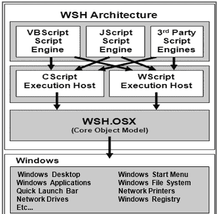

图 1.5 组成 WSH 的组件。


© 2014 Cengage Learning.

# WSH 脚本引擎

脚本执行引擎是一个处理（解释）构成脚本的语句的程序，并将它们翻译成计算机可以理解和执行的机器读代码。通过创建一个允许脚本执行的环境，WSH 使脚本开发变成了一项简单的任务。

WSH 为每个脚本提供了多种资源。WSH 提供了用于处理脚本的脚本引擎。默认情况下，微软为 WSH 提供了两种脚本引擎：

- **VBScript**：基于微软 Visual Basic 编程语言的脚本语言。
- **JScript**：基于 Netscape JavaScript Web 脚本语言的脚本语言。

因此，默认情况下，WSH 可以处理用 VBScript 或 JScript 编写的脚本。WSH 采用模块化设计，允许微软和第三方软件开发人员添加对其他脚本引擎的支持。例如，已经为 Perl、Python 和 Rexx 开发了脚本执行引擎。

# 《面向初学者的微软 WSH 和 VBScript 编程》（第四版）

# 选择 WSH 脚本执行宿主

要运行脚本，WSH 使用脚本执行宿主来处理由脚本引擎解释过的脚本内容。WSH 提供了两种不同的脚本执行宿主：

- **CScript.exe**：一种执行宿主，允许脚本从 Windows 命令行执行并显示基于文本的消息。
- **WScript.exe**：一种执行宿主，允许脚本从 Windows 桌面执行、显示消息并通过弹出对话框收集用户输入。

除 `WScript.exe` 执行时具有显示图形化弹出对话框的能力外，WSH 的两个执行宿主提供的功能是完全相同的。如果你使用 `CScript.exe` 执行宿主运行脚本，根据脚本的编写方式，它仍然可以使用弹出对话框显示消息。

> **定义**：在本文讨论的语境下，“宿主（host）”一词描述一个为脚本执行提供所有所需资源的环境。

由于两个宿主提供相同的基本功能，你可能在想应该用哪一个。这里没有对错之分。通常，选择执行宿主仅仅取决于个人偏好。然而，在某些情况下，你可能希望选择其中一个而不是另一个。例如，如果你计划在后台运行脚本，或者你想使用 Windows 任务计划程序服务来调度脚本且没有与用户交互的需求，你可能想使用 `CScript.exe`。但是，如果你的脚本需要与用户交互——你用这本书创建的游戏将是这种情况——你将想要使用 `WScript.exe` 执行宿主。另一个影响你选择脚本执行环境的因素是你个人对 Windows 命令行的熟悉程度。

# 介绍 WSH 核心对象模型

WSH 提供了最后一个组件，称为核心对象模型，它对于脚本的开发和执行至关重要。WSH 核心对象模型为 VBScript 提供了直接访问 Windows 资源的权限。

WSH 核心对象模型提供的 Windows 资源类型示例：

- Windows 桌面
- Windows 开始菜单
- Windows 文件系统
- 网络打印机
- 网络驱动器
- Windows 注册表

# 第 1 章 · 入门 WSH 和 VBScript

Windows 操作系统可以被视为对象的集合。例如，一个文件就是一个对象。文件夹、磁盘驱动器、打印机或计算机的任何其他资源也是如此。核心对象模型的作用是以一种格式暴露这些对象，允许脚本查看、访问和操作它们。每个暴露的对象都拥有关联的属性和方法，脚本可以使用这些方法与对象交互，并操作其行为或状态。例如，一个文件有许多关联属性，如名称和扩展名。通过暴露 Windows 文件系统，WSH 使脚本能够访问文件及其属性，并执行操作，如重命名特定文件或其扩展名。文件还与其关联的方法。这些方法的示例包括：如果你在网络上工作，你可以编写脚本将文件从一个文件夹移动到另一个文件夹，或者从一台计算机移动到另一台计算机。

> **属性**：在本书中，“属性（property）”一词指的是对象的特定属性，例如文件名，可以用于影响对象的状态。

如果现在觉得 WSH 核心对象模型看起来有点困惑，请**不要**担心。你将在第 2 章“Windows 脚本宿主介绍”中学习更多内容。此外，你可以随时跳转到附录 C“WSH 核心对象模型”以获得额外的见解。重要的理解是，WSH 使脚本能够访问 Windows 资源（对象）并更改它们的特征（属性）或执行影响它们的操作（使用对象方法）。

> **方法**：在本书中，“方法（method）”一词用于指你的脚本执行的内置函数，用于对对象执行操作，例如将文件复制或移动到另一个位置。

# WSH 与脚本相比如何？

Windows 脚本是用特定的脚本语言编写的。与 VBScript 和 JScript 一样，WSH 提供了一个更完整的环境。要编写脚本，你必须熟悉 Windows 命令及其语法。相反，为了有效使用 WSH，你必须精通其支持的语言之一。在许多情况下，你可以使用 Windows 脚本或 WSH 完成相同的任务。通常，任务越复杂，你越需要使用 WSH。

> **Windows 资源包**：Windows 资源包是针对特定 Windows 操作系统设计的附加工具和文档组合，作为单独下载包提供。你可以通过微软下载中心（`www.microsoft.com/en-us/download`）获取。

# 《面向初学者的微软 WSH 和 VBScript 编程》提供 Windows 脚本访问许多命令行工具。

> **提示**：如果你真的对学习 Windows 脚本感兴趣，请阅读《面向初学者的 Windows 脚本》（ISBN 1-59200-085-1）。

# WSH 与 Windows PowerShell

PowerShell 完全集成在微软的 .NET 框架中，为系统管理员提供系统资源。与 VBScript 和 WSH 一样，Windows PowerShell 是面向对象的。PowerShell 允许你执行 PowerShell 命令（称为 cmdlet），并开发和执行使用 cmdlet 的脚本。

与 WSH 和 VBScript 一样，Windows PowerShell 提供了系统资源，并可以通过程序方式与文件系统、Windows 注册表、NET 和 WMI 交互。WSH、VBScript 和 Windows PowerShell 支持强大的语言结构，如变量、条件逻辑和函数。

与 WSH 和 VBScript 不同，PowerShell 不支持弹出对话框，且受限于命令行。与基于广泛流行且易用的 BASIC 编程语言的 VBScript 不同，Windows PowerShell 代表了一种全新的脚本语言，对于初学者来说，它可能更难学习和理解。

微软在 Windows PowerShell 的开发上投入了大量资源，并将其推向 Windows 脚本的未来。然而，微软继续支持将 WSH 作为 Windows 脚本环境，这从最近发布的 WSH 5.8 中可以得到证明。

公司继续依赖 WSH 和 VBScript 并扩展它们的使用范围。因此，在可见的未来，WSH 和 VBScript 编程对于应用程序开发人员和系统管理员来说仍然是必要的。

> **提示**：如果你真的对学习更多 Windows PowerShell 感兴趣，请阅读《Windows PowerShell 2.0 编程入门》（第二版）（ISBN-1-59863-899-8）。

# 理解 Windows Shell 的工作原理

即使你已经使用 Windows 操作系统多年，你可能对 Windows Shell（外壳）的工作经验有限。要成为一名真正高效且精通的脚本程序员，你需要对 Windows Shell 是什么以及如何与它工作有深入理解。

在学习如何使用 `CScript.exe` 执行宿主时，理解如何与 Windows Shell 工作同样重要，因为由该执行宿主运行的脚本通常是从 Windows 命令行启动的。最后，在与 VBScript 执行宿主工作时，理解 Windows Shell 也非常重要，因为它为命令行脚本执行提供了支持。

> 命令提示符允许你将命令提交给 Windows Shell 进行处理。默认情况下，命令提示符的形式为驱动器号后加冒号、反斜杠字符和大于符号（例如 `C:\>`）。

你无法直接操作 Windows 操作系统本身。这将会太复杂且困难。相反，你必须通过接口进行操作。Windows 操作系统支持两种这样的接口：

- **Windows GUI**：Windows GUI 以 Windows 桌面、开始菜单以及你通常使用计算机交互的其他图形元素的形式提供。GUI 的目的是让操作系统更易用。
- **Windows Shell**：Windows Shell 是你或你的脚本与操作系统之间的基于文本的界面。通过在 Windows 命令行提示符中输入命令来与 Windows 通信；Windows Shell 将这些命令翻译成操作系统可以处理的格式。操作系统随后将任何结果返回给 Windows Shell，由它在 Windows 控制台中显示。

# 在普通模式下访问 Windows 控制台

要访问 Windows Shell 并使用命令提示符开始工作，你必须首先打开一个 Windows 控制台。要在运行 Windows Vista 或 Windows 7 的计算机上打开 Windows 控制台（见图 1.6），打开开始菜单，选择“所有程序”，选择“附件”，然后选择“命令提示符”。

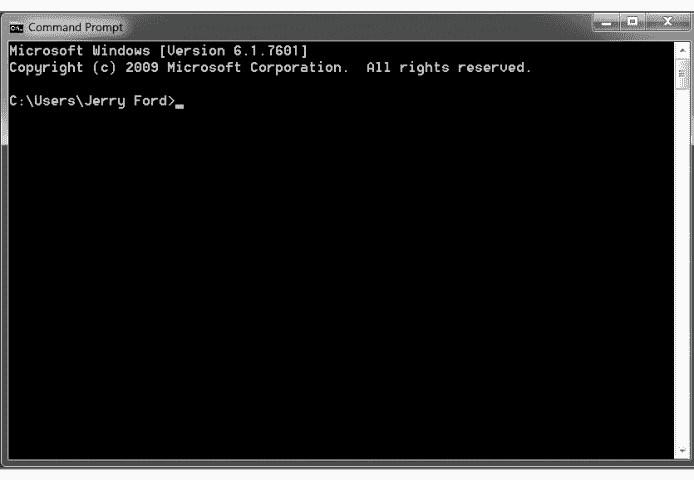
© 2014 Microsoft Corporation。经微软许可使用。

要在 Windows 8.1 上打开 Windows 控制台，按下键盘上的 Windows 键，输入 `cmd`，然后按回车键。

# 在提升模式下访问 Windows 控制台

在本书的之前的版本中，与 Windows Shell 的所有交互都是通过现在被称为“普通模式”的 Windows 控制台完成的。然而，从 Windows Vista 开始，微软引入了提升命令行访问的概念，因此现在 Windows 控制台有两种不同的模式可以运行。在普通模式下，只要命令或脚本不需要管理员权限运行，你就可以执行任何命令或脚本。

> **提示**：对于书中的大多数示例和工作，通过运行在普通模式下的 Windows 控制台访问命令行提示符就足够。

## 启动提升的 Windows 控制台

要执行需要提升权限的命令和脚本，你需要打开一个提升的 Windows 控制台实例。这样做很容易。在 Windows Vista 和 Windows 7 上，你只需要打开开始菜单，在搜索字段中输入 `cmd`，右键点击 `cmd` 实用程序，然后从出现的弹出菜单中选择“以管理员身份运行”（见图 1.7）。

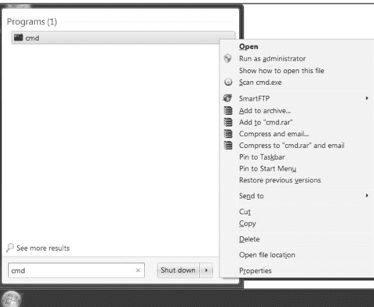
© 2014 Microsoft Corporation。经微软许可使用。

作为响应，Windows Vista 或 Windows 7 将显示图 1.8 中的用户帐户控制对话框。此框要求你确认要以提升模式运行 Windows 控制台。点击“是”；Windows 将显示图 1.9 所示的窗口。你可以通过 Windows 控制台标题栏显示的文本字符串中“管理员”一字的出现判断 Windows 控制台是否正在提升模式下运行（见图 1.9）。

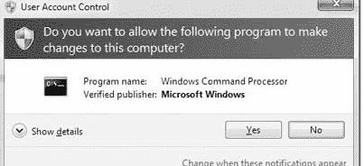
© 2014 Microsoft Corporation。经微软许可使用。

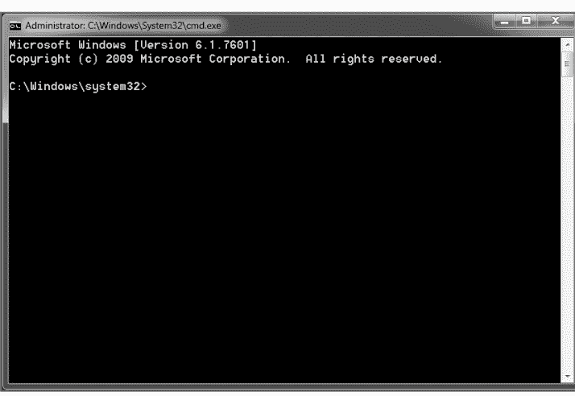
© 2014 Microsoft Corporation。经微软许可使用。

要在 Windows 8.1 上以提升模式打开 Windows 控制台，将光标移动到屏幕底部。如果你经常需要使用提升权限使用 Windows，以下概述了如何设置：

# 通过命令提示符与 Windows Shell 交互

如图所示，当 Windows 控制台打开时，它会显示正在使用的 Windows 版本信息。在命令提示符的右侧，你会看到一个闪烁的光标或下划线。这个字符表示命令提示符已准备好输入。例如，输入 `DIR` 并按回车键。以下输出显示了在我的计算机上执行此操作时返回的结果：

```
C:\>dir
Volume in drive C is OS
Volume Serial Number is 2A2C-CC5
Directory of C:\

03/29/2012  05:37 PM    <DIR>          Apps
03/29/2012  06:27 PM    <DIR>          Drivers
10/08/2013  09:44 AM    <DIR>          history
11/10/2013  11:14 PM    <DIR>          Program Files
11/10/2013  11:19 PM    <DIR>          Program Files (x86)
10/04/2013  04:23 PM    <DIR>          Scripts
01/23/2013  09:46 AM    <DIR>          Temp
03/03/2013  11:25 AM    <DIR>          Users
11/02/2013  10:39 AM    <DIR>          Windows
               5 File(s)         40,180 bytes
              17 Dir(s)   283,386,692 bytes free

C:\>
```


如所示，输出的最后一行是 Windows 命令行提示符。一旦 `DIR` 的输出完成，Windows Shell 就会重新显示命令提示符，允许输入另一个命令。例如，如果我在 C 盘的 `Scripts` 文件夹中名为 `Hello.vbs` 的 VBScript 脚本，可以通过输入 `Script C:\Scripts\Hello.vbs` 并按回车键来执行它。在脚本执行完成后，你可以添加更多命令、运行更多脚本或通过关闭 Windows 控制台来结束我的 Windows Shell。Windows 控制台就像任何其他 Windows 应用程序：点击 Windows 屏幕左上角的关闭 (×) 按钮，或者右键点击左下角的图标并选择“关闭”。

你也可以通过输入 `Exit` 并按回车键来关闭 Windows 控制台。

## 它是如何工作的？

要使用 WSH 执行脚本，你必须先使用 WSH 支持的某种脚本语言之一创建脚本。在本书中，使用的语言是 VBScript。Windows 操作系统通过分配给文件的文件扩展名来识别文件中存储的数据类型。例如，带有 `.txt` 扩展名的文件是文本文件。Windows 自动将此类文件与该扩展名对应的记事本应用程序关联起来。因此，当你双击一个 `.txt` 扩展的文件打开它时，Windows 会自动将该文件加载到记事本中。

当你创建 VBScript 时，需要将它们保存为纯文本文件，并为它们分配 `.vbs` 文件扩展名。这样，Windows 就会知道该文件包含 VBScript。同样，为了使用 JavaScript 编写脚本，你必须将文件保存为 `.js` 扩展名，以便 Windows 能够识别它。

## 陷阱

Windows 根据启动脚本的人的权限来运行脚本。因此，你的脚本对 Windows 及其资源的访问权限并不比你多。如果你创建一个脚本来执行某个你无法通过 GUI 手动完成的任务，那么你的脚本将无法工作。如果是这种情况，你可能需要与你的系统管理员联系，看看是否可以为你分配额外的权限和用户权利。

## 操作系统兼容性

WSH 的当前版本是 5.8。这是微软发布的 WSH 第五个版本。之前的四个版本分别是 5.7、5.6、2.0 和 1.0。取决于你计算机运行的操作系统，你可能已经拥有了这些版本中的之一。例如，如果你正在使用 Windows Server 2008 R2、Windows 7、Windows 8 或 Windows 8.1，那么你已经拥有了 WSH 5.8。然而，如果你使用的是其他操作系统，你可能安装了旧版本的 WSH。表 1.1 提供了 Windows 操作系统列表及其自带的 WSH 版本。

本书涵盖了 WSH 5.8 和 VBScript 5.7。不过，由于 WSH 5.6、WSH 5.7 以及 VBScript 5.7 几乎相同，你在本书书中学到的所有内容都适用于这些较早的版本。

## 表 1.1 微软操作系统上的 WSH 版本

| 操作系统 | WSH 版本 | 操作系统 | WSH 版本 |
| :--- | :--- | :--- | :--- |
| Windows 95 | 无 | Windows 2008 | 5.7 |
| Windows NT 4.0 | 无 | Windows Vista | 5.7 |
| Windows 98 | 1.0 | Windows 7 | 5.8 |
| Windows 2000 | 2.0 | Windows 8 | 5.8 |
| Windows Me | 2.0 | Windows 8.1 | 5.8 |
| Windows XP | 5.6 | Windows 2012 | 5.8 |
| Windows 2003 | 5.6 | | |

> © Jerry Lee Ford, Jr. 版权所有。

## 提示

微软在微软下载中心（`http://www.microsoft.com/downloads/`）免费提供适用于 Windows 2000、Windows XP 和 Windows 2003 的 WSH 5.7。在本书编写时，尚未提供 WSH 5.8。Windows XP 用户还可以通过安装服务包 3 (Service Pack 3) 升级到 WSH 5.7。Windows 95、NT、98 或 Me 不再提供 WSH 升级。

## 如何安装？

你可以在 Windows 2000、XP 或 2003 上下载并升级到 WSH 5.7。微软在 `http://www.microsoft.com/downloads/` 为这三个操作系统中的每一个提供了单独的下载。

## 第 1 章 • WSH 和 VBScript 入门

## 提示

`WScript` 对象是 WSH 的核心对象之一。不要将其与 `WSHScript.exe` 执行宿主混淆。遗憾的是，它们同名，但它们是完全不同的。

正如你编写的两个版本的脚本所示，你可以使用 VScript 函数或 WSH 方法执行相同的任务。此脚本还演示了创建和执行是多么简单，即使是只有一两行的脚本也可以执行一些非常酷炫的技巧，例如显示弹出式对话框。

在上一个例子中，你按照我设置的步骤创建了你的第一个 VScript。根据你将开发的脚本的规模和复杂性，你可以简单地边写边构思。但大多数情况下，你可能希望采用更有规律的方法进行脚本开发。首先，确保你清楚想要实现什么。将任务分解为具体的步骤，这些步骤组合起来就能完成任务。花一点时间勾勒脚本的设计，并尝试将脚本分为不同的部分。然后一次开发一个部分，确保在移动到下一个部分之前当前部分运行正常。我会在整书中指出实现这些操作的方法。

## 从命令行执行你的脚本

在上一个例子中，你通过双击脚本来执行它，一切运行良好。那是因为脚本是为了在 Windows 桌面运行而编写的。有时，你用于从 Windows 桌面运行脚本的执行宿主会对脚本的运行方式产生巨大影响。让我们来看一个：

1. 打开 `Hello.vbs` 脚本，并将脚本内容替换为以下语句：`WScript.Echo "Hello World"`
   该语句使用 `WScript` 对象的 `Echo()` 方法来显示文本消息。
2. 保存脚本并双击执行。除非你修改了默认的 WSH 配置，否则脚本将使用 `WScript.exe` 执行宿主运行。结果是消息显示在弹出对话框中。
3. 将文件复制到计算机的 C 盘，并打开 Windows 控制台（Console）。
4. 在命令提示符处输入 `CD \` 并按回车键。此命令将工作目录更改为 C 盘根目录，`Hello.vbs` 脚本现在就在那里。
5. 输入以下命令并按回车键：
   `cscript Hello.vbs`

这一次你看到的完全不同。脚本的输出不是弹出对话框，而是写入到 Windows 控制台的，如图 1.13 所示。

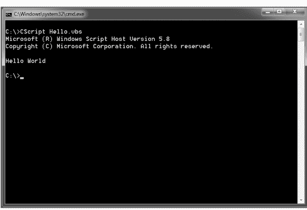

图 1.13 由 `CScript.exe` 执行宿主执行的脚本在 Windows 控制台中显示其输出。
© 2014 Microsoft Corporation。经微软许可使用。

6. 作为最后的实验，在 Windows 命令提示符输入以下命令：
   `wscript Hello.vbs`

如你所见，尽管脚本是从 Windows 命令提示符运行的，脚本产生的消息再次显示在弹出对话框中，`WScript.exe` 执行宿主以图形化方式显示输出。

## WSH 还支持哪些脚本语言？

正如我之前提到的，WSH 除了 VBScript 还支持其他语言。微软在发布 WSH 时同时包含了 JScript 和 VBScript。JScript 是微软对 ECMAScript 语言的实现，最初由 Netscape 开发为 LiveScript，后来更名为 JavaScript。与 VBScript 类似，随 WSH 发布的 JScript 版本是基于浏览器的脚本语言的修改版本。同样与 VBScript 类似，JScript 是一门完整的编程语言，充满了变量、条件循环、数组和过程。

JScript 的整体语法比 VBScript 稍微难掌握，除非你已经熟悉 JavaScript。VBScript 为数组提供了更好的支持，而 JScript 则提供了更强大的数学函数集合。脚本以纯文本文件形式创建并以 `.js` 扩展名保存。

## 提示

了解更多关于 JScript 的信息，请查看 JScript 文档链接：`http://msdn.microsoft.com/en-us/library/visualstudio/72bd815a(v=vs.htm)`

## 初学者的 Microsoft WSH 和 VBScript 编程，第四版

## 第 1 章 • WSH 和 VBScript 入门

## 提示

`WScript` 对象是 WSH 的核心对象之一。不要将其与 `WSHScript.exe` 执行宿主混淆。遗憾的是，它们同名，但它们是完全不同的。

正如你编写的两个版本的脚本所示，你可以使用 VScript 函数或 WSH 方法执行相同的任务。此脚本还演示了创建和执行是多么简单，即使是只有一两行的脚本也可以执行一些非常酷炫的技巧，例如显示弹出式对话框。

在上一个例子中，你按照我设置的步骤创建了你的第一个 VScript。根据你将开发的脚本的规模和复杂性，你可以简单地边写边构思。但大多数情况下，你可能希望采用更有规律的方法进行脚本开发。首先，确保你清楚想要实现什么。将任务分解为具体的步骤，这些步骤组合起来就能完成任务。花一点时间勾勒脚本的设计，并尝试将脚本分为不同的部分。然后一次开发一个部分，确保在移动到下一个部分之前当前部分运行正常。我会在整书中指出实现这些操作的方法。

## WSH 还支持哪些脚本语言？

正如我之前提到的，WSH 除了 VBScript 还支持其他语言。微软在发布 WSH 时同时包含了 JScript 和 VBScript。JScript 是微软对 ECMAScript 语言的实现，最初由 Netscape 开发为 LiveScript，后来更名为 JavaScript。与 VBScript 类似，随 WSH 发布的 JScript 版本是基于浏览器的脚本语言的修改版本。同样与 VBScript 类似，JScript 是一门完整的编程语言，充满了变量、条件循环、数组和过程。

JScript 的整体语法比 VBScript 稍微难掌握，除非你已经熟悉 JavaScript。VBScript 为数组提供了更好的支持，而 JScript 则提供了更强大的数学函数集合。脚本以纯文本文件创建并以 `.js` 扩展名保存。

## 提示

了解更多关于 JScript 的信息，请查看 JScript 文档链接：`http://msdn.microsoft.com/en-us/library/visualstudio/72bd815a(v=vs.htm)`

## 介绍 VBScript

VBScript 是一种强大且灵活的脚本语言，允许你在 Windows 系统中自动化任务。在本章，你将学习如何使用 Windows 脚本主机 (WSH) 使用 VBScript 创建并执行脚本。

VBScript 是一种基于解释器的脚本语言，意味着它是在运行时解释而不是编译成机器码。这使得开发和测试脚本变得简单，因为你不需要等待编译过程。

Windows 脚本主机 (WSH) 提供了运行 VBScript 脚本的环境。WSH 中有两个主要的执行宿主：`WScript.exe` 和 `CScript.exe`。`WScript.exe` 用于提供图形界面的脚本，例如弹出对话框。`CScript.exe` 用于向命令行输出文本的脚本。

在本章中，我们将涵盖 VBScript 的基础，包括：
- 变量和常量
- 数据类型
- 条件结构
- 循环
- 数组和集合
- 错误处理

我们还将探索如何与 WSH 对象交互以各种任务。在本章结束，你将能够编写自己的 VBScript 脚本来优化工作流并提高效率。

## VBScript 能力

VBScript 是一种强大且灵活的脚本语言，允许你在 Windows 系统中自动化任务。在本章，你将学习如何使用 Windows 脚本主机 (WSH) 使用 VBScript 创建并执行脚本。

VBScript 是一种基于解释器的脚本语言，意味着它是在运行时解释而不是编译成机器码。这使得开发和测试脚本变得简单，因为你不需要等待编译过程。

Windows 脚本主机 (WSH) 提供了运行 VBScript 脚本的环境。WSH 中有两个主要的执行宿主：`WScript.exe` 和 `CScript.exe`。`WScript.exe` 用于提供图形界面的脚本，例如弹出对话框。`CScript.exe` 用于向命令行输出文本的脚本。

在本章中，我们将涵盖 VBScript 的基础，包括：
- 变量和常量
- 数据类型
- 条件结构
- 循环
- 数组和集合
- 错误处理

我们还将探索如何与 WSH 对象交互以各种任务。在本章结束，你将能够编写自己的 VBScript 脚本来优化工作流并提高效率。

## 表 1.2 第三方脚本语言

| 语言 | 网站 |
| :--- | :--- |
| VBScript | `www.activestate.com` |
| Python | `www.sourceforge.com` |
| Perl | `www.orex.org` |
| Ruby | `www.ruby-lang.org` |
| ActiveScript | `www.php.net` |
| TclScript | `www.sourceforge.com` |


## 介绍 VBScript

VBScript 是一种强大且灵活的脚本语言，允许你在 Windows 系统中自动化任务。在本章，你将学习如何使用 Windows 脚本主机 (WSH) 使用 VBScript 创建并执行脚本。

VBScript 是一种基于解释器的脚本语言，意味着它是在运行时解释而不是编译成机器码。这使得开发和测试脚本变得简单，因为你不需要等待编译过程。

Windows 脚本主机 (WSH) 提供了运行 VBScript 脚本的环境。WSH 中有两个主要的执行宿主：`WScript.exe` 和 `CScript.exe`。`WScript.exe` 用于提供图形界面的脚本，例如弹出对话框。`CScript.exe` 用于向命令行输出文本的脚本。

在本章中，我们将涵盖 VBScript 的基础，包括：
- 变量和常量
- 数据类型
- 条件结构
- 循环
- 数组和集合
- 错误处理

我们还将探索如何与 WSH 对象交互以各种任务。在本章结束，你将能够编写自己的 VBScript 脚本来优化工作流并提高效率。

## VBScript 能力

VBScript 是一种强大且灵活的脚本语言，允许你在 Windows 系统中自动化任务。在本章，你将学习如何使用 Windows 脚本主机 (WSH) 使用 VBScript 创建并执行脚本。

VBScript 是一种基于解释器的脚本语言，意味着它是在运行时解释而不是编译成机器码。这使得开发和测试脚本变得简单，因为你不需要等待编译过程。

Windows 脚本主机 (WSH) 提供了运行 VBScript 脚本的环境。WSH 中有两个主要的执行宿主：`WScript.exe` 和 `CScript.exe`。`WScript.exe` 用于提供图形界面的脚本，例如弹出对话框。`CScript.exe` 用于向命令行输出文本的脚本。

在本章中，我们将涵盖 VBScript 的基础，包括：
- 变量和常量
- 数据类型
- 条件结构
- 循环
- 数组和集合
- 错误处理

我们还将探索如何与 WSH 对象交互以各种任务。在本章结束，你将能够编写自己的 VBScript 脚本来优化工作流并提高效率。

## VBScript 的根源

微软在 1996 年首次发布了 VBScript，作为 Internet Explorer 3.0 的基于 Web 的客户端脚本语言。与此同时，另一种基于 Web 的客户端脚本语言 JavaScript 已经在互联网社区中引起了巨大波澜。尽管名称相似，但 JavaScript 与 Java 几乎没有共同点，而 Java 在 20 世纪 90 年代后期也迅速流行。

# 第 1 章 • WSH 和 VBScript 入门

如前所述，VBScript 作为一种客户端 Web 脚本语言的流行多年来一直持续，而 Script 则停滞不前。即使在今天，执行客户端 Web 脚本并确保每个访问互联网浏览器的人都能使用的唯一方法也是使用 JavaScript。

尽管如此，微软多年来一直致力于 VBScript 的开发。它发布了随 IIS 3.0 一起发布的 VBScript 2.0，将其转变为服务器端的 Web 开发语言。新开发者可以将 VBScript 嵌入到他们的 ASP 页面，使其具备访问本地数据库和创建动态 HTML 页面的能力。

VBScript 的突破随着 VBScript 3.0 的出现。该版本与多个微软产品捆绑，包括：

- Internet Explorer 4.0
- IIS 4.0
- Outlook 98
- Windows Scripting Host（Windows 脚本主机）

VBScript 3.0 现在可以作为微软电子邮件客户端的脚本语言使用。然而，当 VBScript 被包含为 WSH 的脚本语言时，它才真正开始流行。Visual Basic 程序员、管理员以及具有 Visual Basic 背景的技术爱好者发现 VBScript 易于学习。它很快证明是开发小型脚本的绝佳语言，用于执行那些不值得开发成完整独立应用程序的任务。

微软后来作为 Microsoft Visual Studio 应用开发套件的一部分发布了 VBScript 4.0。微软赋予了 VBScript 访问 Windows 文件系统的能力；否则，VBScript 4.0 与之前的版本相比没有变化。

2000 年，微软作为 Windows 2000 的组件发布了 VBScript 5.0，其中包含了 Internet Explorer 5 和 WSH 2.0。2001 年，微软发布了 Windows XP 专业版、Windows 家庭版和 Internet Explorer 6.0。伴随着这些优良产品，WSH 5.6 和 VBScript 5.6 的推出，VBScript 5.7 于 2007 年作为 WSH 5.7 的一部分发布。它作为 Internet Explorer 7 安装的一部分可用。VBScript 5.8 则于 2009 年作为 WSH 5.8 部分以及 Internet Explorer 8 安装的一部分可用。

## VBScript 的表兄弟：Visual Basic 和 VBA

VBScript 是由三个密切相关的编程语言组成的家族中的第三成员：

- Visual Basic
- Visual Basic for Applications (VBA)
- VBScript

## 24 面向绝对初学者的 Microsoft WSH 和 VBScript 编程，第四版

Visual Basic 是该家族的原始成员。微软于 1991 年首次引入了它。微软一直在改进 Visual Basic，在此期间发布了多个版本。Visual Basic 的最新版本是 Visual Basic 2012。作为一种符合 .NET 标准的语言，Visual Basic 支持微软的 .NET 框架。

## 提示

如果你想了解更多关于 .NET 的信息，请访问 `www.microsoft.com/net`。

Visual Basic 通常用于创建独立程序。这意味着一旦编写并编译成执行代码，Visual Basic 应用程序除了 Windows 操作系统外不需要任何东西。Visual Basic 在很早期就因易于学习而闻名。因此，Basic 没有花多长时间就成为了开发以来最流行的编程语言之一。今天，Visual Basic 在世界各课堂上被教授，并用于构建各种规模和类型的应用程序。

Visual Basic 应用程序是使用 Visual Basic 内置的集成开发环境 (IDE) 创建的。Visual Basic 的 IDE 包含编译器、调试器、帮助系统以及用于管理 Visual 项目的工具。尽管 Visual Basic 的 IDE 提供了一个丰富且强大的编程环境，但学习它需要大量的时间和精力。由于其 IDE 的复杂性，Visual Basic 不太适合开发小型脚本。Visual Basic 的优势在于辅助开发更大、更复杂的程序，这些程序值得投入时间和精力的去开发。

> .NET 是微软的一个框架，它由微软从头开始设计，旨在支持集成桌面、局域网和基于互联网的应用程序。微软的 .NET 框架通过促进网络（互联网）上的数据交换来协助应用程序开发。

## 提示

要了解更多关于 Visual Basic .NET，请查阅《Microsoft Visual Basic 2008 Express Programming for the Absolute Beginner》(ISBN 1-59863-900-5)。

> IDE 是一种应用程序开发程序，为程序员提供使用特定编程语言创建应用程序所需的工具。IDE 提供了工具，例如编译器（将应用程序代码翻译成完成的可执行程序）、调试器（用于协助跟踪和修复程序）以及管理项目的工具（这些项目可能包含多个应用程序）。

Visual Basic 家族的下一代是 Visual Basic for Applications (VBA)，微软于 1993 年首次发布它。VBA 代表 Visual Basic 的子集，旨在为应用程序提供一种类似于 Visual Basic 的编程语言。例如，用于 Microsoft Excel 的 VBA 可以利用 Excel 功能开发整个应用程序。同样，用于 Microsoft Access 的 VBA 为创建需要 Microsoft Access 数据库的应用程序提供了一种强大的编程语言。

## 第 1 章 · WSH 和 VBScript 入门

与 Visual Basic 应用程序一样，VBA 应用程序是使用复杂的 IDE 程序创建的。与可以编译成完全执行程序的 Visual Basic 应用程序不同，VBA 只能编译成称为 p-code 的格式，你可以将其理解为部分编译。使用 p-code，VBA 代码的加载和运行速度比 VBScript 快（VBScript 是一种解释语言），但运行速度仍比 Visual Basic 应用程序慢。VBA 7 已作为 Microsoft Office 的一部分发布。

- Word
- PowerPoint
- Excel

> 提示
> 要了解更多关于 VBA，请查阅《Microsoft Office Programming for the Absolute Beginner》。

与 Visual Basic 应用程序一样，VBA 应用程序是使用复杂的 IDE 程序创建的。与可以编译成完全执行程序的 Visual Basic 应用程序不同，VBA 只能编译成称为 p-code 的格式，你可以将其理解为部分编译。使用 p-code，VBA 代码的加载和运行速度比 VBScript 快（VBScript 是一种解释语言），但运行速度仍比 Visual Basic 应用程序慢。

- Word
- PowerPoint
- Excel

> 提示
> 要了解更多关于 VBA，请查阅《Microsoft Office Programming for the Absolute Beginner》。

## 设计游戏

Knock 游戏的设计非常简单，涉及基础技术。游戏通过弹出“Knock”开始，等待玩家回答“是谁？”，此时显示“Panther”。如果玩家没有准确输入“Panther”，将显示错误消息。

## 面向绝对初学者的 WSH 和 VBScript 编程

该项目将通过五个步骤完成：

- 向玩家展示对话框并收集回复。
- 验证玩家的回复，如果合适继续游戏，否则显示错误消息。
- 向玩家展示门外的名字并收集其回复。
- 验证玩家的回复，如果合适继续游戏，否则显示错误消息。
- 显示游戏的笑点。

## 启动脚本过程

创建脚本的第一步是启动脚本编辑器并使用它创建一个空的 VBScript 文件。例如，在运行 Windows XP 的计算机上使用记事本创建脚本，你需要执行以下步骤：

- 点击开始按钮，选择所有程序，选择辅助工具，然后选择记事本。记事本应用程序打开。
- 打开文件菜单并选择另存。另存对话框出现。
- 指定存储脚本的位置。然后在对话框底部的名称字段输入 `Knockock.vbs` 并点击保存。

记事本标题栏现在应该显示 Knock Knock 脚本的名字。

现在通过编写你的第一个 VBScript 语句开始游戏。游戏的第一件事应该是显示一个带有“Knock!”信息的弹出对话框并等待用户响应。此任务使用 VBScript 执行得非常容易，可以通过单个语句完成：

```
```


# 第 1 章 • WSH 和 VScript 入门

## 提示

VScript `InputBox()` 函数只是收集输入的多种选项之一。`InputBox()` 函数方便了与用户进行直接交互。在不需要直接交互时，你也可以开发 VBScript 来从 Windows 注册表中读取输入文本文件。我将在第 8 章“存储与检索数据”中向你展示如何操作以从文本文件中读取数据，并在第 10 章“使用 Windows 注册表配置脚本设置”中向你展示如何与 Windows 注册表交互。你还可以创建在运行时处理传递给它们的数据 VBScript。我将在第 4 章“常量、变量、数组和字典”中向你展示其工作原理。

为了与玩家通信，`InputBox()` 函数允许你显示消息。在这个示例中，消息仅仅是“Knock Knock（咚咚）”，但也可以轻松地改为“你好，你叫什么名字？”或任何帮助玩家理解脚本试图收集的信息类型的问题。

最后，玩家在弹出的对话框中输入的文本会被临时赋值给变量 `Reply1`。变量为脚本提供了存储数据并在稍后引用数据的能力。

函数和变量是 VBScript 的基础组件。不幸的是，如果不使用它们，即使编写最简单的脚本都很困难。现在，不要过度担心它们，继续专注于创建和运行“咚咚”游戏的整体步骤。我将在第 4 章中详细介绍变量的使用，并在第 7 章“使用过程组织脚本”中详细介绍函数的使用。

## 验证用户输入

玩家在游戏中的角色是输入短语“Who's there?（是谁？）”。拼写或大小写的任何变化都会导致错误。在玩家输入此消息并点击 OK 按钮后，脚本需要执行一个测试来验证玩家是否在正确玩游戏。

以下三行代码完成了任务：

```vbscript
If Reply1 = "Who's there?" Then

End If

If Reply1 <> "Who's there?" Then MsgBox "Incorrect answer. Try again."
```

前两行实际代码——`If Reply1 = "Who's there?"` 和 `End If`——这些代码行之间的点是占位符，将在下一节中插入更多语句。这两行中的第一行测试 `Reply1` 的值。记住 `Reply1` 是一个包含玩家输入响应的变量。此语句检查 `Reply1` 中存储的值是否与短语“Who's there?”匹配。如果完全匹配，将执行你将放在前两个语句中的代码。否则，这些语句将不会被处理。第三行代码反转了前两行代码所执行的测试，通过检查玩家的回复是否不等于（即 `<>`）预期的短语。如果是如此，第三条语句的其余部分将执行显示错误消息。第三条语句执行的文本可能因为多种原因为真，包括以下情况：

- 玩家点击了取消。
- 玩家在没有输入响应的情况下点击了 OK 按钮。
- 玩家输入了错误的响应。

## 完成输入收集

如果你是边读边创建脚本的，那么你的脚本现在应该包含以下语句：

```vbscript
Reply1 = InputBox("Knock Knock!")

If Reply1 = "Who's there?" Then

End If

If Reply1 <> "Who's there?" Then MsgBox "Incorrect answer. Try again."
```

现在是时候添加三行位于目前用点标记的代码了。这三行代码中的第一行如下：

```vbscript
Reply2 = InputBox("Panther!")
```

此语句与脚本中的第一个语句相似，但它不是显示消息“Knock Knock”，而是显示消息“Panther（豹）”并等待玩家输入响应（即“Panther who?（什么豹？）”）。玩家输入的文本存储在名为 `Reply2` 的变量中。

## 验证用户的最后响应

两行代码需要插入到上一个语句之后：

第一行检查存储在 `Reply2` 中的值是否等于短语“Panther who?”。如果是，则语句的其余部分将显示玩家的笑梗。如果玩家输入了“Panther who?”以外的内容，则这两个语句中的第二个将执行，显示一条消息告知玩家没有提供正确的响应。

## 最终结果

现在让我们来看完整装配的脚本。

如你所见，脚本只有七行代码，它显示了多个图形弹出对话框来收集玩家的文本输入，并在弹出对话框中显示三条额外消息中的任何一条。此外，此脚本演示了测试用户输入并根据该输入更改脚本执行过程的方法。

保存并运行脚本，确保一切按预期工作。如果没有，打开脚本并双击每个语句，以确保你输入正确。

## 总结

作为一个入门章节，本章涵盖了很多。你不仅创建了自己的第一个 VBScript，还学习了如何使用 WSH 执行它，并将 WSH 元素整合到你的脚本中。此外，你学习了许多 VBScript 以及它与构成 Visual Basic 编程家族的其他语言的关系。最后，你创建了你的第一个程序。

---

# 第 2 章 • Windows 脚本主机（WSH）简介

## 脚本主机简介

由于 VBScript 没有执行主机就无法运行，因此 WSH 是任何脚本的核心。WSH 不仅提供 VBScript 可以执行的环境，还为脚本直接访问 Windows 资源，如桌面、注册表、事件日志和网络资源。要在此环境中有效创建和执行 VBScript，了解一些 WSH 核心模型是有帮助的。知道如何配置 WSH 以最符合你的需求也很重要。在本章中，你将学习以下内容：

- 构成 WSH 核心模型的对象
- 如何配置命令行执行的脚本
- 如何配置桌面执行的脚本

## 项目预览：剪刀、石头、布

在本章中，你将学习如何创建一个你小时候玩过的剪刀石头布游戏的电脑版。游戏从显示规则开始，要求玩家从三个选项中选择一个。玩家做出选择后，游戏随机进行选择并显示结果。图 2.1 到 2.3 展示了游戏的流程。

![img/337e6368245d3aad0723ff6d4acf23_52_0.png]
**图 2.1** 脚本开始显示游戏规则。
© 2014 Cengage Learning.

![img/337e6368245d3aad0723ff6d4acf23_52_1.png]
**图 2.2** 玩家随后输入选择。
© 2014 Cengage Learning.

![img/337e6368245d3aad0723ff6d4acf23_52_2.png]
**图 2.3** 脚本随机选取一个选择并显示游戏结果。 © 2014 Cengage Learning.

## WSH 组件详解

将计算机、其操作系统及其硬件和软件看作对象的集合，如文件、磁盘驱动器、打印机等。为了在 Windows 操作系统上实现任务自动化，VBScript 需要一种与这些对象交互的方法。这由 WSH 核心对象模型提供。

理解 WSH 核心对象模型对于你成为一名 VBScript 程序员并取得成功至关重要。它不仅能为你提供开发在 Windows 操作系统上运行的脚本所需的所需的见解，还通过向你介绍对象操作，为你处理其他对象模型做好准备。例如，许多 Windows 应用程序（包括 Microsoft Office 应用程序）暴露了自己的对象模型，允许 VBScript 对它们进行程序化操作。此外，其他 VBScript 执行宿主（如 Internet Explorer）为 VBScript 提供了访问其他对象模型的能力。WSH 核心对象模型非常复杂，初看起来可能望人生畏。但不要担心——在学习本书后续内容的过程中，你将继续对这一复杂主题完善理解。当你完成学习时，应该已经对 WSH 核心对象模型有了稳固的掌握。

| 定义 |
| :--- |
| 相关对象的表示，它为脚本或程序提供了查看和交互对象模型中表示的每个对象（文件、磁盘、打印机等）的能力。 |

### WSH 核心对象模型快速介绍

WSH 核心对象模型提供了对 14 个对象的访问，通过这些对象你可以程序化地访问不同类型的 Windows 资源。构成 WSH 核心对象模型的对象如图 2.4 所示。这些对象中的每一个都为你提供了访问特定类别 Windows 资源的权限。

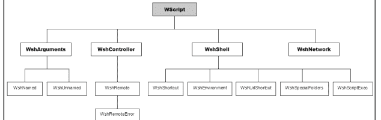
**图 2.4** 这 14 个对象中的每一个具有暴露不同 Windows 操作系统资源的属性和方法。
© 2014 Cengage Learning.

WScript 对象位于 WSH 核心对象模型的顶部，或*根节点*。所有其他 WSH 核心对象模型都是从该对象创建（或实例化）的。WScript 对象在执行开始时会自动为你创建，无需在脚本中预先进行实例化即可被引用。一旦实例化，你就可以处理属于构成 WSH 核心对象模型的任何对象的属性和方法。例如，以下语句演示了如何创建一个单行脚本 Greeting.vbs，该脚本使用 WScript 对象的 `Echo` 方法来显示文本字符串。

```vbscript
WScript.Echo "Example: Using the WScript object's Echo()"
```

要测试这一点，请打开你的脚本编辑器并输入此语句。保存脚本（扩展名为 .vbs），并双击运行它。应该出现如图 2.5 所示的弹出对话框。正如该脚本所示的，你可以直接从脚本自动访问 WScript 对象的任何属性和方法。

> **实例化** 描述了创建新实例的过程。

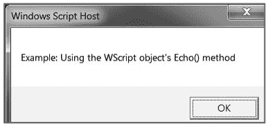
**图 2.5** 使用 WScript 对象的 `Echo()` 方法创建的弹出对话框。
© 2014 Cengage Learning.

### 使用 WScript 对象

WScript 对象是一个极其重要的对象，你在所有的 VBScript 中都会经常与它工作。它提供了许多你在书中各处都能看到的非常有用的方法。这些方法包括：

- `CreateObject()`。建立指定对象的实例。
- `DisconnectObject()`。防止脚本访问之前实例化的对象。
- `Echo()`。在 Windows 控制台或弹出对话框中显示文本消息，取决于由哪种执行环境运行脚本。
- `Quit()`。终止脚本的执行。
- `Sleep()`。暂停脚本的执行。

### 配置 WScript.exe 和 CScript.exe 宿主

WScript.exe 和 CScript.exe 宿主都以相同的方式配置，使用以下语法。你可以使用 WScript.exe 宿主运行需要弹出对话框的脚本，使用 CScript.exe 宿主在后台静默运行。配置这些宿主的语法如下：

```cmd
wscript [/options]
cscript [/options]
```

首先打开 Windows 控制台。在 Windows 命令提示符中，输入要配置的执行主机名称，后跟一个或多个选项，每个选项以 `//` 字符开头。

**表 2.1 WSCRIPT.EXE 和 CSCRIPT.EXE 执行主机的命令行选项**

| 配置选项 | 目的 |
| :--- | :--- |
| `//?` | 显示 CScript.exe 和 WScript.exe 执行主机的命令语法。 |
| `//b` | 以批量模式运行脚本，抑制错误和消息输出。 |
| `//d` | 关闭调试。 |
| `//e:jscript` `//e:vbscript` | 设置运行脚本的引擎。 |
| `//h:wscript` `//h:cscript` | 设置运行脚本的执行主机。 |
| `//i` | 交互式运行脚本，显示所有错误和消息。 |
| `//job:id` | 指定 Windows 脚本文件中要运行的特定作业。 |
| `//logo` | 在脚本执行开始时显示 CScript 或 WScript 主机。 |
| `//nologo` | 抑制指定的选项并将其设置为默认设置。 |
| `//s` | 保存当前指定的选项。 |
| `//t:nn` | 建立超时值以限制脚本运行的时间。默认情况下，对脚本执行不实施任何时间限制。 |
| `//x` | 关闭调试。 |

现在让我们来看一些如何修改执行主机配置的示例。默认情况下，WSH 将 WScript.exe 设置为默认执行主机。然而，你可以通过输入以下命令并按回车键来更改它：

```cmd
cscript //H:cscript //s
```

`//H:cscript` 选项将 CScript 设置为默认执行主机，而 `//s` 选项使更改永久生效。如果你在命令中去掉 `//s` 选项，该更改将仅对当前的工作会话有效。

要将默认的命令行执行主机改回 WScript.exe，请输入以下命令并按回车键：

```cmd
wscript //H:wscript //s
```

现在让我们来尝试一个设置了多个配置选项的示例：

```cmd
wscript //H:nologo //t:60
```


在这个示例中，CScript 执行主机被设置为默认主机。此外，`//nologo` 选项防止在脚本执行期间显示 WScript 标志。它还防止在从命令行执行脚本时，在任何输出文本后显示以下文本：

```
Microsoft (R) Windows Script Host Version 5.8
Copyright (C) Microsoft Corporation. All rights reserved.
```

`//t:60` 选项防止任何脚本执行超过 60 秒。最后，`//s` 选项保存所有指定的设置。

## 技巧

即使是顶级的程序员也会犯错。有时，这些错误会导致脚本以意想不到的方式运行，例如卡在无限执行的循环中。通过为 `WScript.exe` 和 `CScript` 执行主机设置 `//t:nn` 选项，你可以建立一个安全网，防止你运行的任何脚本执行时间超过指定的时间。

## 配置 WScript.exe 桌面执行

`WScript.exe` 执行主机的桌面配置设置与它的命令行配置设置不同。其一，只有两个配置设置。第一个指定了可选的脚本执行时间，第二个指定了从 Windows 控制台运行脚本时是否显示 WScript 标志。

## 《初学者 Microsoft WSH 与 VBScript 编程》，第四版

从 Windows 桌面配置 `WScript.exe` 执行主机的步骤如下：

1. 打开 Windows 控制台。
2. 输入 `WScript` 然后点击确定。出现“Windows Script Host 设置”对话框，如图 2.6 所示。

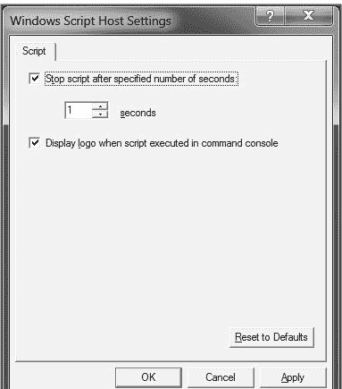

> **图 2.6** 修改 `WScript.exe` 执行主机的桌面配置。© 2014 Microsoft Corporation。经 Microsoft 许可使用。

3. 默认情况下，`WScript.exe` 执行主机没有执行时间设置。要配置执行时间，勾选“在指定秒后停止脚本”复选框，然后指定时间（秒）。
4. 默认情况下，`WScript.exe` 执行主机在从 Windows 控制台执行脚本时显示其标志。要防止此行为，取消勾选“在命令行控制台执行时显示标志”复选框。
5. 点击确定。

通过此程序建立的配置设置存储在以下注册表项中：`HKLM\Software\Microsoft Script Host\Settings`。

## 覆盖命令行执行设置

到为止，你已经学习了如何从 Windows 命令行和桌面配置 `WScript.exe` 和 `CScript.exe` 主机的默认执行。现在让我们看看如何在不永久更改设置的情况下，临时覆盖默认命令行设置，以便临时更改特定脚本的执行。

## 第 2 章 • Windows Script Host 简介

临时覆盖 `WScript.exe` 和 `CScript.exe` 执行的语法如下：

```
wscript scriptname [/options] [arguments]

cscript scriptname [/options] [arguments]
```

首先，打开 Windows 控制台并输入你想要运行脚本的执行主机名称。接下来，输入要执行的脚本名称和路径。然后输入你需要的任意数量的配置设置，每个设置前加一对 `//` 字符。如果你在执行脚本时需要传递任何输入或执行时间，请指定所需的参数。最后，按回车键。

现在让我们来看几个覆盖主机执行设置的示例。假设你正在处理一个名为 `Test.vbs` 的脚本，并希望防止它执行超过 30 秒。打开 Windows 命令行控制台并输入以下命令使用 `WScript.exe` 执行主机运行脚本：

```
wscript Test.vbs //T:30
```

要使用 `CScript.exe` 执行主机执行脚本最长 30 秒，请输入以下命令：

```
cscript Test.vbs //T:30
```

现在让我们来看一个稍微复杂一点的示例，其中覆盖了多个配置设置：

```
wscript Test.vbs //T:30 //nologo
```

在这个示例中，使用 `WScript.exe` 执行主机防止脚本执行超过 30 秒。此外，还抑制了 `WScript.exe` 执行主机的标志，以防止其在脚本执行开始时显示。

## 为单个桌面脚本自定义 WScript.exe 设置

WSH 还提供了一种方法，通过使用 `WScript.exe` 执行主机，永久地覆盖从 Windows 桌面进行的特定运行的配置设置。这是通过创建一个文本文件实现的。

## 《初学者 Microsoft WSH 与 VBScript 编程》，第四版

以下语句显示了一个典型的 WSH 文件的内容：

```
[ScriptFile]
Path=C:\Test.vbs

[Options]
Timeout=30
DisplayLogo=0
```

第一行包含标签 `[ScriptFile]`。下一句提供了脚本的名称和路径。接下来是 `[Options]` 标签。最后两行包含特定设置。`Timeout=30` 指定该脚本不允许处理超过 30 秒，`DisplayLogo=0` 指定抑制标志。

创建 WSH 文件有两种方法。一种是使用文本编辑器（如记事本）手动创建文件。另一种是让 Windows 为你创建 WSH 文件，步骤如下：

1. 找到 VBScript 所在的文件夹。
2. 右键点击并从菜单中选择“属性”。出现脚本属性对话框，如图 2.7 所示。

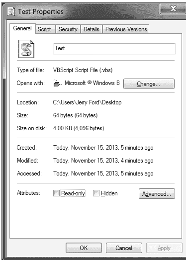

> **图 2.7** 查看脚本属性常规选项卡上的属性。© 2014 Microsoft Corporation。经 Microsoft 许可使用。

3. 点击“脚本”选项卡，如图 2.8 所示。

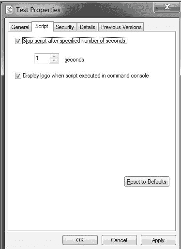

> **图 2.8** 通过脚本属性对话框配置 WSH 文件。© 2014 Microsoft Corporation。经 Microsoft 许可使用。

4. 根据需要指定脚本执行时间限制。
5. 根据需要启用或禁用 WScript 标志的显示。
6. 点击确定。

系统将为你创建一个新的 WSH 文件并将其存储在脚本相同的文件夹中。

## 启用和禁用 Windows Script Host

众所周知，今天的计算机面临着病毒、蠕虫和其他旨在监视、破坏或接管你计算机的讨厌程序的威胁。在过去，聪明的人利用 WSH 的功能和便利性通过脚本传播并感染计算机。为了应对这些威胁，已经有了许多防御措施。例如，某些电子邮件提供商会扫描电子邮件和附件的威胁，并在发现威胁时进行拦截。同样，可以安装防病毒软件来帮助计算机免受这些威胁。防火墙也可以用于保护计算机或整个计算机网络。

尽管有这些保护预防措施，威胁仍然存在。过去人们处理问题的方法之一是尝试阻止未经授权的程序和脚本。对于 WSH，某些人已经禁用了它。

# 初学者 Microsoft WSH 与 VBScript 编程（第四版）

如果你继承了一台禁用了 WSH 的计算机，当你第一次尝试使用 WSH 运行 VBScript 时，你将收到以下通知：

```
CScript Error: Windows Script Host 在此计算机上已禁用。请联系你的管理员获取详细信息。
```

# 重新启用 WSH

如果你的计算机上禁用了 WSH，你可以使用以下程序之一重新启用它。然而，这需要管理员层级的权限。如果你缺乏这些权限，则需要寻找你的计算机管理员并请求其执行此操作。第一种程序仅在你登录计算机时对你个人重新启用 WSH。第二种程序将为任何登录到计算机的用户重新启用 WSH 执行。

要为单个用户重新启用 WSH，请执行以下操作：

1. 点击开始按钮，在搜索字段中输入 `Regedit` 并按回车打开 `Regedit` 实用程序。
2. 在用户账户控制对话框提示时，点击“是”。
3. 导航到以下键值：`HKEY_CURRENT_USER\Software\Microsoft\Windows Script Host\Settings`。
4. 在 DWORD 下，寻找 `Enabled` 项。如果存在，双击它并将分配的值更改为 1。如果不存在，右键点击 `Settings` 键并选择“新建 > DWORD”。然后输入 `Enabled` 作为其名称。最后，双击 `Enabled` DWORD 项并将其赋值为 1。
5. 关闭 `Regedit`。

要为计算机上的所有用户重新启用 WSH，请执行以下操作：

1. 点击开始按钮，在搜索字段中输入 `Regedit` 并按回车打开 `Regedit` 实用程序。
2. 在用户账户控制对话框提示时，点击“是”。
3. 导航到以下键值：`HKEY_LOCAL_MACHINE\Software\Microsoft\Windows Script Host\Settings`。
4. 在 DWORD 下，寻找 `Enabled` 项。如果存在，双击它并将分配的值更改为 1。如果不存在，右键点击 `Settings` 键并选择“新建 > DWORD”。然后输入 `Enabled` 作为其名称。最后，双击 `Enabled` DWORD 项并将其赋值为 1。
5. 关闭 `Regedit`。

# 禁用 WSH

如果你在计算机上启用 WSH 后，决定需要将其恢复到禁用状态，你可以使用以下程序之一来实现。第一种程序仅在你登录计算机时阻止 WSH 执行。第二种程序会影响计算机上任何登录的用户。

# 第 2 章 • Windows Script Host 简介

要为单个用户禁用 WSH，请遵循以下步骤：

1. 点击开始按钮，在搜索字段中输入 `Regedit` 并按回车键打开 `Regedit` 实用程序。
2. 在用户账户控制对话框提示时，点击“是”。
3. 导航到以下键值：`HKEY_CURRENT_USER\Software\Microsoft\Windows Script Host\Settings`。
4. 右键点击该键并选择“新建 > DWORD”。然后输入 `Enabled` 作为其名称。默认情况下，此项被赋值为 0（代表 False 值）。
5. 关闭 `Regedit`。

要为计算机上的所有用户禁用 WSH，请遵循以下步骤：

1. 点击开始按钮，在搜索字段中输入 `Regedit` 并按回车键打开 `Regedit` 实用程序。
2. 在用户账户控制对话框提示时，点击“是”。
3. 导航到以下键值：`HKEY_LOCAL_MACHINE\Software\Microsoft\Windows Script Host\Settings`。
4. 右键点击该键并选择“新建 > DWORD”。然后输入 `Enabled` 作为其名称。默认情况下，此项被赋值为 0（代表 False 值）。
5. 关闭 `Regedit`。

# 回到石头剪刀布游戏

现在是时候回到本章开始的地方了——谈论石头、剪刀、布游戏。在这个项目中，你将创建一个这个经典游戏的脚本版本。这个版本有些局限，因为你还没有机会学习创建更复杂版本所需的所有内容。然而，你已经拥有足够的知识来构建游戏的基础并获得一个可以运行的模型。在第 5 章“条件逻辑”中，你将回到这个项目并让它变得更加有趣。

## 设计游戏

这个游戏的基本设计非常简单。首先，显示游戏规则，并要求玩家输入石头、纸或布。然后让脚本随机选择一个选项并显示结果。

该项目分六步完成：

1. 定义脚本使用的资源。
2. 显示游戏说明。
3. 为用户提供选择的方法。
4. 设计一种让脚本生成随机数的方法。
5. 根据脚本随机数字分配计算机的选择。
6. 显示游戏的最终结果。

## 定义脚本使用的资源

首先打开编辑器并保存一个名为 `RockPaperScissors.vbs` 的空文件。接下来，添加前几行脚本如下：

```vbscript
'在尝试使用变量之前，正式声明脚本使用的变量
Dim WshShell, Answer, CardImage

'创建一个 WScript 对象的实例以便稍后使用 Popup 方法
Set WshShell = WScript.CreateObject("WScript.Shell")
```

> **注意**：原始 OCR 在 `WshShell` 赋值行存在错误；此处根据标准的 VBScript 语法进行了修正。

# 绝对初学者的 Microsoft WSH 和 VBScript 编程，第四版

## 显示游戏结果

在脚本得出的电脑选择后，是时候显示游戏结果了，让用户能够看到谁赢了：

```vbscript
'Display the game's results so that the user can see if he or she won
WshShell.Popup "You picked: " & Answer & Space(12) & "Computer picked: " & CardImage
```

`WshShell` 对象的 `Popup()` 方法用于显示游戏结果。通过使用 `&` 拼接符，我将消息的不同部分组合在一起。这些部分包括包含引号内的文本；`Answer` 变量；`CardImage` 变量（代表用户和电脑的选择）；`Space()` 方法（它在测试消息中添加了 12 个空格）以及 `_` 字符（它允许将消息分布在两个独立的行上）。

## 最终结果

现在让我们把脚本的所有部分组合起来，然后保存并运行脚本：

```vbscript
'Formally declare variables by the script before trying to use them
Dim WshShell, Answer, CardImage
```

```vbscript
'Create an instance of the WScript object in order to later use the Popup method
Set WshShell = WScript.CreateObject("WScript.Shell")
```

```vbscript
'Display the results of the game
WshShell.Popup "Welcome to the Rock, Paper, and Scissors game. Here are the " & _
"rules for playing the game: 1. Get the same thing as the " & _
"computer to tie. 2. Paper covers rock and wins. 3. Rock breaks " & _
"scissors and wins. 4. Scissors cut paper and win."
```

```vbscript
'Prompt the user to select a choice
Answer = InputBox("Type Paper, Rock, or Scissors.", "Let's play a game!")
```

```vbscript
'Time for the computer to randomly pick a choice
Randomize
GetRandomNumber = Round(FormatNumber(Int((3 * Rnd())) + 1))
```

```vbscript
'Assign a value to the randomly selected number
If GetRandomNumber = 3 Then CardImage = "rock"
```

## 第 2 章 • Windows 脚本宿主简介

```vbscript
If GetRandomNumber = 2 Then CardImage = "scissor"
If GetRandomNumber = 1 Then CardImage = "paper"

'Display the game's results so that the user can see if or she won
WshShell.Popup "You picked: " & Answer & Space(12) & "Computer picked: " & _
CardImage
```


## 总结

在本章中，你接触了 WSH 核心对象模型及其 14 个对象。你学习了 `WScript` 对象，并学会了如何使用它在弹出对话框中显示文本消息。你还学习了如何配置 `WScript.exe` 和 `CScript.exe` 执行主机，以最符合你的个人需求和偏好。这包括学习如何为命令行和桌面执行配置脚本，以及对单个桌面脚本进行自定义设置。你还学习了如何启用和禁用 Windows 脚本宿主。

- 1. 尝试通过添加比较玩家选择与脚本随机选择的逻辑，来扩展 `RockPaperScissors.vbs` 以确定胜者。
- 2. 根据前面的比较，显示一段额外的文本，明确说明游戏结果——例如，“你赢了！”、“输了”或“平局”。

# 第二部分 学习 VBScript 和 WSH 脚本编写

- 第 3 章：VBScript 基础
- 第 4 章：常量、变量、数组和字典
- 第 5 章：条件逻辑
- 第 6 章：处理数据集合
- 第 7 章：使用过程组织脚本

# 第 3 章 VBScript 基础

本章将通过教你许多重要概念开始你的 VBScript 教育。你将学习构成 VBScript 核心和运行时对象模型的对象。此外，你将学习基础的 VBScript 语法、函数、保留字和特殊字符。你还将学习 VBScript 和 WSH 输出函数。在此过程中，你将通过创建一个数学游戏，同时学习更多关于 VBScript 如何与 WSH 协作的知识。你还将学习到以下内容：

- 编写 VBScript 时必须遵守的规则
- 构成 VBScript 核心和运行时对象模型的对象
- 如何使用内置的 VBScript 函数增强你的脚本
- 显示脚本输出的不同方法

## 项目预览：数学游戏

本章的游戏项目将向你展示了一种编程技术，该技术允许你编写可以打开并与其他 Windows 应用程序交互的 VBScript。它被称为 `MathGame.vbs`，测试了玩家对求解数值表达式时优先级原则的理解。如果用户答案正确，将祝贺他们拥有卓越的数学技能。如果提供的答案错误，则游戏将教导玩家如何求解该表达式。

为了教玩家如何求解方程，程序将打开 Microsoft Word 应用程序并输入解释解决问题所需步骤的指令。为了进一步演示如何求解该方程，程序将启动 Windows 计算器应用程序并使用它来求解方程。

## 编写 VBScript 的规则

以下是你在编写 VBScript 时应该记住的规则列表：

- 默认情况下，所有 VBScript 语句必须包含在单行内。
- 你可以通过在每行的末尾添加字符 `_`（续行符）将单个语句跨越到多行。
- 你可以通过在每个语句的末尾添加 `:`（冒号）在单行内放置多个 VBScript 语句。
- 默认情况下，VBScript 不区分大小写，这意味着 VBScript 认为用于变量、常量、过程（`procedures`）和子程序（`subroutines`）的单词的不同大小写拼写是相同的。
- 你可以通过在 VBScript 的开始处添加 `Option Explicit` 语句来强制变量声明（原文“强制区分大小写敏感”应为笔误，`Option Explicit` 用于强制变量声明）。
- 默认情况下，错误将停止任何 VBScript 的执行。
- 你可以通过在 VBScript 代码中添加 `On Error Resume Next` 语句来防止错误终止 VBScript 的执行。
- 脚本中的额外空格会被忽略，可用于改进 VBScript 的格式和显示效果。

每个 VBScript 语句都有其特定的语法，必须严格遵守。未能正确遵循语句将导致错误。让我们来看一个例子。以下语句尝试使用 VBScript 的 `MsgBox()` 函数显示文本消息：

```
MsgBox "Thanks for playing!
```

遗憾的是，没有遵循语句的语法要求。`MsgBox()` 函数要求所有文本消息必须包含在一对引号内。如果你仔细观察，会发现省略了结束引号。图 3.5 显示了在运行 Windows 8.1 的计算机上由该语句在运行时产生的错误。

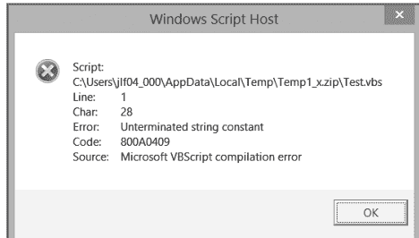

## 保留字

与任何编程语言一样，VBScript 都拥有一组保留字。保留字是你不能在脚本中使用的单词，因为 VBScript 同样为它们分配了特殊含义。其中一些单词被保留是因为它们是语言本身的一部分。另一些保留是为了以后使用。表 3.2 列出了 VBScript 的保留字。关于 VBScript 保留字，需要记住的重要点是，你只能按照预期方式使用它们（即你不能将它们用作变量、常量或过程名称）。

| 表 3.2 VBScript 保留字集合 |
| :--- | :--- | :--- | :--- |
| And | EndIf | LSet | RSet |
| As | Enum | Me | Select |
| Boolean | Eqv | Mod | Set |
| ByRef | Event | New | Shared |
| Byte | Exit | Next | Single |
| ByVal | False | Not | Static |
| Call | For | Nothing | Stop |
| Case | Function | Null | Sub |
| Class | Get | On | Then |
| Const | Goto | Option | To |
| Currency | If | Optional | True |
| Debug | Imp | Or | Type |
| Dim | Implements | ParamArray | TypeOf |
| Do | In | Preserve | Until |
| Double | Integer | Private | Variant |
| Each | Is | Public | Wend |
| Else | Let | RaiseEvent | While |
| ElseIf | Like | ReDim | With |
| Empty | Long | Rem | Xor |
| End | Loop | Resume | |

## 添加注释

最容易理解的 VBScript 语句之一就是注释语句。注释语句让你能够向 VBScript 中添加描述性文本，解释你为何这样编写脚本。通过注释对脚本进行记录可以使其更容易维护，并帮助他人接手。

你可以使用 `'` 字符添加注释来解释复杂的代码。例如，请考虑以下模板：

```
****************************************************
'脚本名称: ScriptName.vbs
'作者: Author Name
'创建日期: MM/DD/YY
'描述: xxxxxxxxxxxxxx。
****************************************************
```

```
'初始化部分
Option Explicit
On Error Resume Next
Dim...
Const...
```

'主处理部分

```
'过程部分

Function Xxxxx(Z)
xxxxxxxxxx
End Function
```

此模板从一个注释部分开始，提供了记录脚本的地方。模板其余分为三个部分：

- **初始化部分**：包含全局影响脚本的语句，包括 `Option Explicit` 和 `On Error Resume Next`。
- **主处理部分**：包含控制脚本逻辑的语句。
- **过程部分**：包含脚本的所有过程。*过程* 是可以被调用和执行的语句组。你将在第 7 章“使用过程组织脚本”中学习如何处理过程。

## 掌握 VBScript 对象模型

在第 2 章“Windows 脚本宿主介绍”中，你学习了 WSH 对象模型及其属性和方法。你还学习了如何实例化 WSH 对象以访问和操作它们的属性。VBScript 还提供了两个你可以使用的对象集合。表 3.3 提供了 VBScript 内置对象的概述。

| 表 3.3 VBScript 内置对象 |
| :--- | :--- | :--- |
| 对象名称 | 描述 |
| `Class` | 提供对类事件访问 |
| `Err` | 提供运行时错误信息 |
| `Match` | 提供正则表达式匹配的只读属性 |
| `Matches Collection` | 正则表达式 `Match` 对象的集合 |
| `RegExp` | 支持正则表达式 |
| `SubMatches Collection` | 提供正则表达式子字符串的只读值 |

## 使用 VBScript 运行时对象

除了核心对象模型外，VBScript 的 `FileSystemObject` 还提供了许多运行时对象。如表 3.4 所示，你的脚本可以使用这些对象及其属性和方法与 Windows 文件系统进行交互。

| 表 3.4 VBScript 运行时对象 |
| :--- | :--- | :--- | :--- |
| 对象名称 | 描述 | 属性 | 方法 |
| `Dictionary` | 存储数据键和项值对 | Count, Item, Key | Add, Exists, Items, Keys, Remove, RemoveAll |
| `Drive` | 提供磁盘属性访问 | AvailableSpace, DriveLetter, DriveType, FileSystem, FreeSpace, IsReady, Path, RootFolder, SerialNumber, ShareName, TotalSize, UserName | None |
| `Drives Collection` | 提供有关驱动器位置的信息 | Count, Item | None |

| 表 3.4 VBScript 运行时对象（续） |
| :--- | :--- | :--- | :--- |
| 对象名称 | 描述 | 属性 | 方法 |
| `File` | 提供文件属性的访问 | Attributes, DateCreated, DateLastAccessed, DateModified, Name, ParentFolder, Path, ShortName, ShortPath, Size | Copy, Delete, Move, OpenTextStream |
| `Files Collection` | 提供对指定文件夹中存储文件的访问 | Count, Item | 无 |
| `FileSystemObject` | 提供对文件系统的访问 | Drives | BuildPath, CopyFile, CopyFolder, CreateFolder, CreateTextFile, DeleteFile, DeleteFolder, DriveExists, FileExists, GetAbsolutePath, GetBaseName, GetDrive, GetExtensionName, GetFile, GetFileName, GetFolder, GetParentName, GetSpecialFolder, GetTempName, MoveFile, MoveFolder, OpenFile |
| `Folder` | 提供文件夹属性的访问 | Attributes, DateCreated, DateLastAccessed, DateModified, Drive, Files, IsRootFolder, Name, ParentFolder, Path, ShortPath, Size, SubFolders, Type | Copy, Delete, Move, OpenTextStream |
| `Folders Collection` | 提供对位于另一个文件夹内的文件夹的访问 | Count, Item | Add |

WSH 核心对象模型提供了许多 Windows 资源的访问。文件系统对象就是该模型的一部分。因此，要通过 VBScript 访问文件系统，您需要学习如何使用 VBScript 的 `FileSystemObject` 对象。

通过此对象，您的脚本将能够执行以下操作：

- 在尝试处理文件和文件夹之前检查其是否存在。
- 创建和删除文件和文件夹。
- 打开并读取文件。
- 向文件写入或追加内容。
- 关闭文件。
- 复制和移动文件及文件夹。

## 属性

与 WSH 对象一样，VBScript 运行时对象支持大量的属性。表 3.5 提供了 VBScript 运行时属性的完整列表。

| 表 3.5 VBScript 运行时属性 |
| :--- | :--- |
| 属性名称 | 描述 |
| `AtEndOfLine` | 根据文件指针是否到达 `TextStream` 对象的行尾标记返回 true 或 false 值。（`TextStream` 是一个提供访问文件便利的内置类。） |
| `AtEndOfStream` | 根据是否到达 `TextStream` 文件对象的末尾返回 true 或 false 值 |
| `Attributes` | 修改或检索文件和文件夹的属性 |
| `AvailableSpace` | 获取指定驱动器上的可用空间量 |
| `Column` | 获取 `TextStream` 文件对象中的当前列位置 |
| `CompareMode` | 设置或检索用于比较 `Dictionary` 对象字符串键的比较模式 |
| `Count` | 返回表示集合或 `Dictionary` 对象中项数量的值 |
| `DateCreated` | 获取文件或文件夹的创建日期和时间 |


# VBScript 运行时属性与方法

## 表 3.5 VBScript 运行时属性

| 属性名称 | 描述 |
|---|---|
| `DateLastAccessed` | 获取文件或文件夹最后访问的日期时间 |
| `DateLastModified` | 获取文件或文件夹最后修改的日期时间 |
| `Drive` | 获取存储文件或文件夹的驱动器 |
| `DriveLetter` | 获取指定的驱动器字母 |
| `Drives` | 建立一个 `Drives` 集合，代表计算机上找到的所有驱动器 |
| `DriveType` | 返回一个识别驱动器类型的值 |
| `Files` | 建立一个 `Files` 集合，代表指定文件夹内的所有的 `File` 对象 |
| `FileSystem` | 获取指定驱动器上使用的文件系统名称 |
| `FreeSpace` | 获取指定驱动器上的可用空间量 |
| `IsReady` | 根据指定驱动器的可用性返回 true 或 false 值 |
| `RootFolder` | 根据指定文件夹是否为根文件夹返回 true 或 false 值 |
| `Item` | 根据指定的 `Dictionary` 对象键检索或设置项 |
| `Key` | 设置 `Dictionary` 对象键 |
| `Line` | 获取 `TextStream` 对象中的当前行号 |
| `Name` | 获取或修改文件或文件夹的名称 |
| `ParentFolder` | 返回指向指定文件或父文件夹对象的引用 |
| `Path` | 获取与指定文件、文件夹或驱动器关联的路径 |
| `RootFolder` | 获取与指定驱动器根文件夹关联的 `Folder` 对象 |
| `SerialNumber` | 获取指定磁盘卷序列号 |
| `ShareName` | 获取指定网络驱动器的共享名称 |
| `ShortName` | 获取指定文件或文件夹的 8.3 字符短名称 |
| `ShortPath` | 获取与文件或文件夹 8.3 字符名称关联的短路径名称 |
| `Size` | 返回组成文件或文件夹的字节数 |
| `SubFolders` | 建立一个 `Folders` 集合，由指定文件夹内的文件夹组成 |
| `TotalSize` | 获取一个表示驱动器上可用总字节数的值 |
| `Type` | 获取有关指定文件或文件夹类型的信息 |
| `VolumeName` | 获取或修改驱动器的卷名称 |

## 方法

VBScript 运行时对象还支持更多的方法，当您处理 Windows 文件系统时，会发现这些方法至关重要。这些方法在表 3.6 中概述。

## 表 3.6 VBScript 运行时方法

| 方法名称 | 描述 |
|---|---|
| `Add` (Dictionary) | 向 `Dictionary` 对象中添加键和项 |
| `Add` (Folders) | 向文件夹集合中添加一个 `Folder` |
| `BuildPath` | 为路径追加名称 |
| `Close` | 关闭打开的 `TextStream` |
| `Copy` | 复制文件或文件夹 |
| `CopyFile` | 复制多个文件 |
| `CopyFolder` | 递归复制文件夹 |
| `CreateFolder` | 创建新文件夹 |
| `CreateTextFile` | 创建一个可以读取和写入的 `TextStream` |
| `Delete` | 删除文件或文件夹 |
| `DeleteFile` | 删除文件 |
| `DeleteFolder` | 删除文件夹 |
| `DriveExists` | 根据驱动器是否存在返回 true 或 false 值 |
| `Exists` | 根据 `Dictionary` 对象中是否存在键返回 true 或 false 值 |
| `FileExists` | 根据指定文件是否存在返回 true 或 false 值 |
| `FolderExists` | 根据指定文件夹是否存在返回 true 或 false 值 |
| `GetAbsolutePathName` | 获取完整路径名 |
| `GetBaseName` | 获取不带扩展的文件名 |
| `GetDrive` | 获取与指定驱动器关联的 `Drive` 对象 |
| `GetDriveName` | 获取驱动器名称 |
| `GetExtensionName` | 获取文件的扩展名 |
| `GetFile` | 返回 `File` 对象 |
| `GetFileName` | 获取路径的最后一个名称 |
| `GetFileVersion` | 获取文件的版本号 |
| `GetFolder` | 获取与指定文件夹关联的 `Folder` 对象 |
| `GetParentFolderName` | 返回父文件夹的名称 |
| `GetSpecialFolder` | 返回特殊文件夹 |
| `GetTempName` | 返回临时文件或文件夹的名称 |
| `Items` | 返回一个存储 `Dictionary` 对象项的数组 |
| `Keys` | 返回一个包含 `Dictionary` 对象键的数组 |
| `Move` | 移动文件或文件夹 |
| `MoveFile` | 移动多个文件 |
| `MoveFolder` | 移动多个文件夹 |
| `OpenAsStream` | 打开文件并检索一个 `TextStream` 对象以提供引用 |
| `OpenTextFile` | 打开文件并检索一个 `TextStream` 对象以提供引用 |
| `Read` | 从 `TextStream` 文件对象返回指定数量字符的字符串 |
| `ReadAll` | 读取整个 `TextStream` 对象及其内容 |
| `ReadLine` | 从 `TextStream` 对象中读取整行 |
| `Remove` | 删除 `Dictionary` 对象的键项对 |
| `RemoveAll` | 删除 `Dictionary` 对象所有的键项对 |
| `Skip` | 在处理 `TextStream` 文件对象时跳过指定数量的字符位置 |
| `SkipLine` | 在处理 `TextStream` 文件对象时跳过整行 |
| `Write` | 在 `TextStream` 对象中放置指定的字符串 |
| `WriteBlankLines` | 向 `TextStream` 对象写入指定数量的换行符 |
| `WriteLine` | 向 `TextStream` 对象写入指定的字符串 |

# 在脚本中使用 VBScript 运行时对象

现在是时候通过示例来了解如何将 VBScript `FileSystemObject` 对象整合到您的脚本中，并使用其属性和方法来处理 Windows 文件系统了。请查看以下脚本：

```
************************************************************************************
'Script Name: FreeSpace.vbs
'Author: Jerry Ford
'Created: 01/22/24
'Description: 此脚本演示了如何使用 VBScript 运行时对象
'及其属性和方法。
************************************************************************************
```

## 初始化部分

```
Option Explicit

Dim FsoObject, DiskDrive, AvailSpace
```

```
'实例化 VBScript FileSystemObject
Set FsoObject = WScript.CreateObject("Scripting.FileSystemObject")
```

```
'使用 FileSystemObject 对象的 GetDrive 方法建立对计算机 C 盘的引用
Set DiskDrive = FsoObject.GetDrive(FsoObject.GetDriveName("c:"))
```

## 主处理部分

```
'使用 FileSystemObject 对象的 FreeSpace 属性来确定 C 盘上的
'可用空间（以 MB 为单位）
AvailSpace = (DiskDrive.FreeSpace / 1024) / 1024
```

```
'使用 VBScript 的 FormatNumber 函数将结果格式化为
'整数
AvailSpace = FormatNumber(AvailSpace, 0)
```

```
'显示 C 盘上的可用空间量
WScript.Echo "你需要 100 MB 的可用空间来玩此游戏。" & _
vCrLf & "当前可用空间总量为: " & AvailSpace & " MB"
```

脚本首先实例化 `FileSystemObject`，如下所示：

```
Set FsoObject = WScript.CreateObject("Scripting.FileSystemObject")
```

然后脚本使用该 `FileSystemObject` 对象的实例执行其 `GetDrive()` 方法，并建立对计算机 C 盘的引用：

```
Set DiskDrive = FsoObject.GetDrive(FsoObject.GetDriveName("c:"))
```

下一个语句使用 `FileSystemObject` 对象的 `FreeSpace` 属性来获取 C 盘上的可用空间量：

`AvailSpace = (DiskDrive.FreeSpace / 1024) / 1024`

该语句将此值除以 1,024，再次除以 1,024，以便以兆字节（MB）显示可用空间量。

下一个语句通过消除小数点右侧的任何数字来进一步格式化该值。最后一个语句显示最终结果。图 3.6 显示了该结果在运行 Windows 8.1 的计算机上的外观。

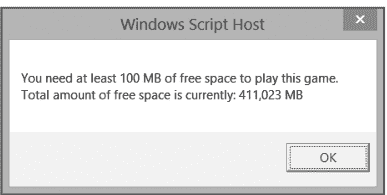

> 图 3.6 使用 FileSystemObject 对象访问磁盘驱动器信息。© 2014 Cengage Learning.

有关如何使用 VBScript `FileSystemObject` 对象的更多信息，请参阅第 5 章“条件逻辑”，在该章中我将展示如何创建和写入 Windows 文件以生成报告和日志文件。在第 8 章“存储和检索数据”中，我将介绍如何打开和读取 Windows 文件。

## 检查内置 VBScript 函数

使用 VBScript 的真实优势之一是可以使用访问其大量的内置函数。在上一个示例中，你已经看到了如何使用 `FormatNumber()` 函数。VBScript 的内置函数太多，无法一一列出。要查看完整列表，请参阅附录 D，“内置 VBScript 函数”。

## 演示：平方根计算器

通过使用函数，你可以真正简化你的脚本。VBScript 的内置函数提供了你无需编写的内置代码。说明这一点的最佳方法是使用两个示例。在第一个示例中，我编写了一个短小的 VBScript，提示用户输入一个数字，以便脚本计算其平方根。在下一节讨论的第二个脚本是第一个脚本的重写，使用 VBScript 的 `Sqr()` 函数代替了原始的编程逻辑。

以下是第一个示例：

```
********************************************************************************************************************
'Script Name: SquareRoot-1.vbs
'Author: Jerry Ford
'Created: 01/22/14
'Description: 此脚本演示了如何使用艾萨克·牛顿爵发明的
'数学解求解平方根计算
********************************************************************************************************************
```

## 初始化部分

```
Option Explicit

Dim UserInput, Counter, X
```

```
UserInput = InputBox("输入一个数字", "平方根计算器")

X = 1
For Counter = 1 To 15
    X = X - ((X^2 - UserInput) / (2 * X))
Next
```

```
MsgBox UserInput & " 的平方根是 " & X
```

如你所见，脚本的第一部分显示一个弹出对话框来收集数字，而最后部分显示脚本的最终结果。中间是实际的工作结果：

```
X = 1
For Counter = 1 To 15
    X = X - ((X^2 - UserInput) / (2 * X))
Next
```

我不会深入探讨这些语句背后的数学逻辑。除非你是数学专业的，否则理解起来有点挑战性。这个解决方案基于艾萨克·牛顿爵士的方法。

## 演示：平方根计算器（使用 Sqr 函数）

现在让我们来看看第一个脚本的重写。

```
************************************************************************************
'Script Name: SquareRoot-2.vbs
'Author: Jerry Ford
'Created: 01/22/14
'Description: 此脚本演示了如何使用 VBScript Sqr() 函数
'求解平方根计算
************************************************************************************
```

## 初始化部分

```
Option Explicit

Dim UserInput, Counter, X
```

```
UserInput = InputBox("输入一个数字", "平方根计算器")

X = Sqr(UserInput)
```

```
MsgBox UserInput & " 的平方根是 " & X
```

# 《初学者 Windows WSH 和 VBScript 编程》，第四版


## 显示脚本输出

你已经看到了许多显示输出的示例。WSH 提供了以下两种形式：

- `Echo()`：它在由 `CScript.exe` 处理时在 Windows 控制台中显示消息，在由 `WScript.exe` 处理时在弹出对话框中显示。
- `Popup()`：它在弹出对话框中显示消息，让你对显示的按钮和图标进行控制。

## WScript 对象的 Echo() 方法

`WScript` 对象的 `Echo()` 方法可以在 Windows 控制台或弹出对话框中显示文本输出，取决于处理它的执行主机。表 3.7 概述了根据处理它的执行主机定义的 `Echo()` 方法的行为。与其他 WSH 对象方法或 VBScript 函数不同，`Echo()` 方法无法收集用户输入。

### 表 3.7 WSCRIPT ECHO 方法执行选项

| WSH 执行主机 | 输出 |
| :--- | :--- |
| `WScript.exe` | 在图形弹出对话框中显示文本消息 |
| `CScript.exe` | 在 Windows 控制台中显示文本消息 |

`WScript` 对象的 `Echo()` 方法语法如下：

```
WScript.Echo [Arg1] [,Arg2]...
```

`Echo()` 方法可以显示任意数量的参数：

```
WScript.Echo "此消息的形式取决于运行它的执行主机。"
```

## WshShell 对象的 Popup() 方法

`WshShell` 的 `Popup()` 方法在弹出对话框中显示消息。你可以通过选择显示的按钮和图标来自定义其外观。你还可以确定用户点击了哪个按钮。要使用 `WshShell` 对象，你必须先在脚本中实例化它，可以通过添加如下所示的语句来实现：

```
Set WshShell = WScript.CreateObject("WScript.Shell")
```

## 零基础入门 Microsoft WSH 与 VBScript 编程，第四版

一旦实例化，你就可以访问 `WshShell` 对象的方法和属性。`WshShell` 对象的 `Popup()` 方法可以用两种方式使用。第一种选项的语法如下：

```vbscript
Response = WshShell.Popup(StrText,[Time],[TitleBarMsg],[DialogSettings])
```

第二种选项的语法如下：

```vbscript
WshShell.Popup StrText,[Time],[TitleBarMsg],[DialogSettings]
```

`Response` 是一个变量，用于存储代表用户点击按钮的数字。`StrText` 表示要显示的消息文本。`Time` 是一个决定弹出框停留时间（以秒为单位）的值；如果省略，默认值为 0。`TitleBarMsg` 是一个可选消息，显示在弹出对话框的标题栏中。`DialogSettings` 是一个数值，用于指定在弹出对话框上显示的按钮和图标。如果省略，弹出对话框将显示没有图标的 OK 按钮。

要确定为 `DialogSettings` 指定什么数值，请参阅表 3.8 和表 3.9。表 3.8 列出了由 `Popup()` 方法创建的弹出对话框上可以显示的不同按钮集合，表 3.9 显示了你可以使用 `Popup()` 方法显示的不同图标。

### 表 3.8 POPUP() 方法按钮类型

| 数值 | 按钮 |
| --- | --- |
| 0 | 显示 OK 按钮 |
| 1 | 显示 OK 和 取消 (Cancel) 按钮 |
| 2 | 显示终止 (Abort)、重试 (Retry) 和 忽略 (Ignore) 按钮 |
| 3 | 显示 是 (Yes)、否 (No) 和 取消 (Cancel) 按钮 |
| 4 | 显示 是 (Yes) 和 否 (No) 按钮 |
| 5 | 显示 重试 (Retry) 和 取消 (Cancel) 按钮 |

### 表 3.9 POPUP() 方法图标类型

| 数值 | 图标 |
| --- | --- |
| 16 | 显示停止图标 |
| 32 | 显示问号图标 |
| 48 | 显示感叹号图标 |
| 64 | 显示信息图标 |

## 第 3 章 • VBScript 基础

例如，要显示一个包含 OK 按钮但没有任何图标的弹出对话框，你需要为 `DialogSettings` 指定值 0。由于这是 `Popup()` 方法的默认选项，你不需要指定此值。要显示一个包含是 (Yes)、否 (No) 和取消 (Cancel) 按钮但没有图标的弹出对话框，你为 `DialogSettings` 指定值 3。要显示一个包含 OK 和取消按钮以及信息图标的弹出对话框，你指定值 65（即 1 和 64 的总和）。

如果你使用 `Popup()` 方法的第一种形式（以便确定用户点击了哪个按钮），你将像此处所示检查 `Response` 的值：

```vbscript
Set WshShell = WScript.CreateObject("WScript.Shell")
Response = WshShell.Popup("This is a text message",,"Test Script", 5)
If Response = 4 Then
    WshShell.Popup("You clicked on Retry")
End If
```

表 3.10 列出了 `Popup()` 方法可以返回的数值范围。

### 表 3.10 POPUP() 方法返回值

| 数值 | 结果 |
| 1 | OK 按钮 |
| 2 | 取消 (Cancel) 按钮 |
| 3 | 终止 (Abort) 按钮 |
| 4 | 重试 (Retry) 按钮 |
| 5 | 忽略 (Ignore) 按钮 |
| 6 | 是 (Yes) 按钮 |
| 7 | 否 (No) 按钮 |

## VBScript InputBox() 函数

VBScript 提供了两个内置函数，可以用它们显示消息并与用户交互。`InputBox()` 函数在弹出对话框中显示你的消息，该对话框还包含一个输入字段。你已经在“敲门”游戏和“剪刀布”游戏中见过 `InputBox()` 函数的作用。

该函数的语法如下：

```vbscript
Response = InputBox(StrText[, TitleBarMsg[, default[, xpos][, ypos]][, helpfile, context]])
```

`Response` 是一个变量，用于存储用户输入的数字。`StrText` 是你想显示的消息。`TitleBarMsg` 是一个可选消息，将显示在弹出对话框的标题栏中。`Default` 是一个可以在弹出对话框中显示的可选答案。`xpos` 和 `ypos` 是可选参数，以对的形式指定弹出对话框在屏幕上的水平和垂直位置。`helpfile` 和 `context` 是可选的。它们指定可选的上下文相关帮助框的位置。

以下语句提供了使用 VBScript `InputBox()` 的另一个示例：

```vbscript
PlayerName = InputBox("please type your name")
MsgBox "You typed: " & PlayerName
```

## VBScript MsgBox() 函数

VBScript `MsgBox()` 显示的弹出对话框与 WSH `Popup()` 方法生成的弹出对话框非常相似。它允许你通过选择要显示的按钮和图标来自定义对话框的外观。你也可以用它确定用户点击了哪个按钮。

`MsgBox()` 的语法如下：

```vbscript
MsgBox(TextMsg, buttons, TitleBarMsg)[, helpfile, context]
```

`TextMsg` 是你想显示的消息。`buttons` 是一个数值，用于指定显示的按钮和图标。`TitleBarMsg` 是一个可选消息，将显示在弹出对话框的标题栏中。`helpfile` 和 `context` 是可选的。它们指定可选的上下文相关帮助框的位置。

表 3.11 定义了由 `MsgBox()` 创建的弹出对话框上可以显示的不同按钮集合。

### 表 3.11 VBScript MsgBox() 按钮

| 数值 | 描述 |
| --- | --- |
| 0 | 显示 OK 按钮 |
| 1 | 显示 OK 和 取消 (Cancel) 按钮 |
| 2 | 显示终止 (Abort)、重试 (Retry) 和 忽略 (Ignore) 按钮 |
| 3 | 显示 是 (Yes)、否 (No) 和 取消 (Cancel) 按钮 |
| 4 | 显示 是 (Yes) 和 否 (No) 按钮 |
| 5 | 显示 重试 (Retry) 和 取消 (Cancel) 按钮 |

表 3.12 显示了你可以使用 `MsgBox()` 方法显示的不同图标。

### 表 3.12 VBScript MsgBox() 图标

| 数值 | 描述 |
| --- | --- |
| 16 | 显示停止图标 |
| 32 | 显示问号图标 |
| 48 | 显示感叹号图标 |
| 64 | 显示信息图标 |

## 陷阱

由于它会将按键发送到当前活跃的 Windows 应用程序，因此在脚本运行时，玩家不要打开任何新窗口（应用程序）是非常重要的。如果他这样做了，脚本将开始将按键发送到玩家打开的任何应用程序，从而导致许多不可预测的问题。

`SendKeys()` 方法的语法如下：

```
SendKeys(string)
```

`string` 是一个代表要发送到目标应用程序的按键的值。你可以通过简单输入它们来发送更多按键，如下：

```
SendKeys "I am"
SendKeys "38"
SendKeys " years old."
```

然而，在许多情况下，你可能想要发送其他类型的按键。例如，要发送回车键，你需要输入以下内容：

```
SendKeys "{ENTER}"
```

表 3.14 提供了可能需要使用的 `SendKeys` 按键列表。

### 表 3.14 SENDKEYS() 按键

| 键 | 对应的 SendKeys() 代码 |
| --- | --- |
| 退格键 (Backspace) | `{BACKSPACE}`, `{BS}`, 或 `{BKSP}` |
| 中断键 (Break) | `{BREAK}` |
| 大写锁定 (Caps Lock) | `{CAPSLOCK}` |
| 删除键 (Del or Delete) | `{DELETE}` 或 `{DEL}` |
| 向下箭头 | `{DOWN}` |
| 结束键 (End) | `{END}` |
| 回车键 (Enter) | `{ENTER}` |
| 键 (Esc) | `{ESC}` |
| 帮助键 (Help) | `{HELP}` |
| Home键 (Home) | `{HOME}` |
| 插入键 (Ins or Insert) | `{INSERT}` 或 `{INS}` |
| 向左箭头 | `{LEFT}` |

### 表 3.14 SENDKEYS() 按键（续）

| 键 | 对应的 SendKeys() 代码 |
| --- | --- |
| 数字锁定 (Num Lock) | `{NUMLOCK}` |
| 下翻页 (Page Down) | `{PGDN}` |
| 上翻页 (Page Up) | `{PGUP}` |
| 打印屏幕 (Print Screen) | `{PRTSC}` |
| 向右箭头 | `{RIGHT}` |
| 滚动锁定 (Scroll Lock) | `{SCROLLLOCK}` |
| 制表键 (Tab) | `{TAB}` |
| 上箭头 | `{UP}` |
| F1 | `{F1}` |
| F2 | `{F2}` |
| F3 | `{F3}` |
| F4 | `{F4}` |
| F5 | `{F5}` |
| F6 | `{F6}` |
| F7 | `{F7}` |
| F8 | `{F8}` |
| F9 | `{F9}` |
| F10 | `{F10}` |
| F11 | `{F11}` |
| F12 | `{F12}` |
| F13 | `{F13}` |
| F14 | `{F14}` |
| F15 | `{F15}` |
| F16 | `{F16}` |

除了表 3.14 列出的按键外，表 3.15 列出了三种按键组合，这些组合可以发送需要与其他键配合按的特殊按键。例如，如果你正在操作一个可以通过按住 Alt 键并按下 F4 键关闭的应用程序，你可以按照如下执行此操作：

```
SendKeys "%F4"
```

### 表 3.15 特殊 SENDKEYS() 按键

| 键 | 对应的 SendKeys() 代码 |
|---|---|
| Shift | `+` |
| Ctrl | `^` |
| Alt | `%` |

## 设计游戏

让我们开始构建数学游戏。这个游戏将分五个步骤完成。前三个步骤创建与用户交互并运行游戏的逻辑。最后两个步骤执行游戏的演示。这些步骤如下：

1. 添加标准文档模板，并定义脚本使用的任何变量、常量和对象。
2. 向玩家展示方程式，并测试玩家的响应，以判断他是否提供了答案以及该答案是否为数字。
3. 测试玩家是否提供了正确答案。如果不是，则提议向用户展示如何得到正确答案。
4. 添加启动和控制 WordPad 应用程序所需的语句。
5. 添加启动和控制计算器应用程序的语句。

## 开始数学游戏

让我们从添加我在本章早期介绍的脚本模板开始，然后按所示对其进行修改。这包括初始化变量和设置对象声明。

```
****************************************************************
'Script Name: Mathgame.vbs
'Author: Jerry Ford
'Created: 1/23/04
'Description: 此脚本提示用户解决一个数学
'表达式，并在用户无法
'解决时演示如何解决它
****************************************************************
```

```vbscript
'初始化部分
Option Explicit

Dim WshSh, QuestionOne, ProveIt

'定义要在在脚本弹出框中显示的标题栏消息
Const titleMsg = "The Math Game"

'实例化 WshShell 对象的实例
Set WshSh = WScript.CreateObject("WScript.Shell")
```

## 获取玩家答案并测试错误

接下来，显示方程式并将玩家的答案存储在名为 `QuestionOne` 的变量中，如下：

```vbscript
'向玩家展示方程式
QuestionOne = InputBox("5 * 9 / 3 的和是多少？", titleMsg)
```

现在验证玩家是否点击了取消而不是输入答案。如果玩家没有输入答案，则显示错误信息。

```vbscript
'向玩家展示答案
If QuestionOne = "" Then
    MsgBox "你需要输入答案。"
    WScript.Quit
End If
```

另一个良好的测试是确保玩家输入的是数字而不是字母：

```vbscript
'确保玩家输入的是数字
If Not IsNumeric(QuestionOne) Then
    MsgBox "你需要输入答案。"
    WScript.Quit
End If
```

## 正答案

检查玩家是否提供了正确答案。如果正确，表扬玩家；否则，教他们如何解决方程式。

```vbscript
'检查玩家提供的正确答案
If QuestionOne = 16 Then
    MsgBox "正确！你数学很好！"
Else
    ProveIt = MsgBox("你想看我的解法吗？", vbYesNo, titleMsg)
End If

'显示解法
If ProveIt = vbYes Then
    '这里编写解法
End If
```

## 与 WordPad 交互

为了与 WordPad 交互，必须先启动它。可以使用 `WshShell` 对象的 `Run` 方法。

```vbscript
'启动 WordPad
WshSh.Run "WordPad"
```

应用程序可能需要几秒钟来启动，因此让脚本暂停两秒钟：

```vbscript
WScript.Sleep 2000
```

## 与计算器应用程序交互

游戏的最后一部分打开 Windows 计算器应用程序并解决方程式，以防玩家对使用 WordPad 显示的答案有疑问。编写此脚本部分的语句如下：

```vbscript
'启动计算器应用程序
WshSh.Run "Calc"
```

```vbscript
'使用计算器应用程序解决方程式
WScript.Sleep 2000
WshSh.SendKeys "5"
WScript.Sleep 500
WshSh.SendKeys "*"
WScript.Sleep 500
WshSh.SendKeys "9"
WScript.Sleep 500
WshSh.SendKeys "/"
WScript.Sleep 500
WshSh.SendKeys "3"
WScript.Sleep 500
WshSh.SendKeys "="
WScript.Sleep 500
WshSh.SendKeys "%{F4}"
```

## 最终结果


我建议你运行并测试此脚本，以确保它按预期工作。例如，尝试在回答答案时输入字母而不是数字。然后什么都不输入，直接点击“确定”或“取消”。尝试输入正确和错误的答案，看看会发生什么。这是一个相当长的脚本，因此第一次输入正确的概率很小。如果你遇到错误，请仔细阅读错误信息，看看错误消息是否告诉了你哪里错了，然后进行修复。否则，你可能需要双击你的输入内容。

# 技巧

随着脚本变得越来越复杂，你在开发过程中会遇到越来越多的错误。我建议你学习以模块化的方式开发脚本，一次编写一个部分，并在移动到下一个部分之前对其进行测试。在第 9 章“处理脚本错误”中，我将向你演示如何这样做。

## 总结

在本章中，你学习了 VBScript 的核心对象和运行时对象以及它们相关的属性和方法，并了解了如何在你的 VBScript 中使用它们。你还学习了 VBScript 语法、保留字和特殊字符。此外，你还学习并看到了 VBScript 函数的强大和便利性。最后，你学习了显示脚本输出的不同方法。

1. 修改数学游戏以使用不同的方程，并修改逻辑以适用于 WordPad 和计算器应用程序的语句。
2. 尝试使用 `SendKeys` 方法与其他应用程序（如记事本）配合。
3. 花些时间复习 VBScript 的内置数学函数，看看你是否可以创建一个类似于平方根计算器的新计算器。
4. 修改本章之前提供的 VBScript 模板，并使其适应你的个人偏好。然后当你开始开发新的 VBScript 时使用它。

## 常量、变量、数组和字典

这是书中五个教授 VBScript 基础知识章节中的第二个。在处理任何编程语言时，你需要理解的概念之一就是如何存储、检索和修改数据。本章将教你执行这些任务的多种方法。当你完成本章后，你将知道如何编写可以收集和处理数据的脚本。具体来说，你将学习以下内容：

- 如何处理执行时传递给脚本的数据
- 如何存储不更改的数据
- 如何处理在脚本执行期间变化的数据
- 如何将相关数据的集合作为一个单元进行处理

# 项目预览：冒险船长的故事

在本章中，你将学习如何创建一个根据用户输入构建幽默冒险故事的游戏。游戏从收集一系列问题的答案开始，并告诉用户答案将如何被使用。在收集完脚本所需的所有信息后，显示故事。图 4.1 到 4.3 显示了该脚本在运行 Windows 8.1 的计算机上的执行情况。

# 初学者 Microsoft WSH 和 VBScript 编程，第四版

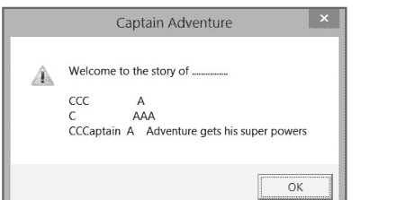

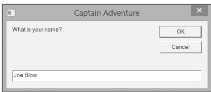

图 4.2 用户是故事的主角。

© 2014 Cengage Learning.

图 4.1 故事的初始启动屏幕。

© 2014 Cengage Learning.

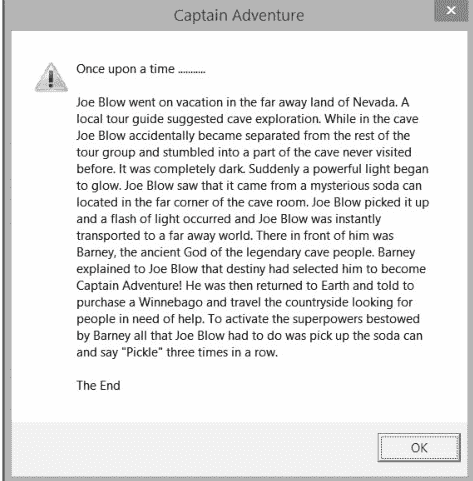

图 4.3 在脚本获取所有所需信息后，故事开始讲述了。© 2014 Cengage Learning.

通过开发这个构建故事的游戏，你将学习许多重要的编程技术，包括如何收集、存储和引用数据。此外，你将学习如何控制脚本输出的呈现。

## 理解脚本如何查看数据

VBScript 与其他编程语言一样，需要一种存储数据的方法以便在脚本执行期间可以访问它。在书中，你已经看到了许多 VBScript 如何临时存储和引用数据的示例。我将解释它是如何工作的。

## 第 4 章 常量、变量、数组和字典

VBScript 提供了许多不同的语句，允许你定义多种类型的数据。这些 VBScript 语句在表 4.1 中列出。

> 数据是计算机程序在执行期间收集、修改、存储和检索的信息。

| 语句 | 描述 |
| --- | --- |
| `Const` | 定义 VBScript 常量 |
| `Dim` | 定义 VBScript 变量或数组 |
| `ReDim` | 定义动态 VBScript 数组 |

`Const` 语句用于定义在整个脚本执行过程中永远不改变的数据。例如，在书中，你有时会使用定义字符串来在弹出对话框中定义标准的问候消息。`Dim` 语句用于定义变量。*变量*存储单条数据，如其名称、数字或日期。`ReDim` 语句用于创建数组。*数组*用于存储一组相关信息。例如，与其定义 20 个不同的变量来存储 20 个人的信息，不如使用单个数组来定义这些。这些每个语句都将被更详细地检查。

*变量*是单条数据，如其名称、数字或日期。*数组*用于存储一组相关信息。

# 处理从不更改的数据

数据应该根据其被使用的方式在脚本内部进行定义。如果你将编写一个脚本，并且确定你需要引用一个或多个在脚本执行期间不会更改的值，那么你可以将每条数据定义为常量。常量的优点之一是，一旦定义，其值就无法更改。

脚本中有两个常量来源。首先，你可以在脚本中定义自己的常量。另一个选项是引用 VBScript 提供的内置常量集合。

> *常量*是一个 VBScript 结构，包含不改变的信息。

# 初学者 Microsoft WSH 和 VBScript 编程，第四版

## 将数据赋值给常量

如果你的脚本尝试在初始赋值后修改分配给常量的值，当脚本执行时，你会看到“illegal assignment: name of constant”错误消息。打开你的脚本，搜索常量的名称，并查找尝试修改你的值的语句以找到错误的源头。

要在 VBScript 中定义常量，必须使用 `Const` 语句。该语句具有以下语法：

```
[Public | Private] ConstName = expression
```

`Public` 和 `Private` 是可选关键字，用于确定常量在整个脚本中的可用性。将常量定义为 `Public` 使对脚本中的所有过程可用。将常量定义为 `Private` 使仅在定义它的过程中可用。`ConstName` 是要定义的常量名称，`expression` 是标识要定义的数据的值。让我们来看一个例子。

> 过程是一个作为一个单元进行处理的脚本语句集合。在第 7 章“使用过程组织脚本”中，你将学习如何使用过程来改进脚本的整体组织并创建可重用的代码单元。

# 第 4 章 • 常量、变量、数组和字典

显示故事

```vbscript
MsgBox "Once upon a time......", vbOnly, cTitleBarMsg
MsgBox "There are 3 little pigs", vbOnly, cTitleBarMsg
MsgBox "Who liked to build things.", vbOnly, cTitleBarMsg
```

在这个示例中，你创建了一个短小的 VBScript 脚本，它讲述了一个关于三只小猪的简短故事。脚本开始时定义了一个命名常量 `cTitleBarMsg`。然后，我使用 `MsgBox()` 语句来显示组成故事的文本。每个 `MsgBox()` 语句的第一个参数是文本消息，后面跟着一个 VBScript `MsgBox()` 常量 `vbOnly`。该常量告诉 VBScript 仅在弹出对话框中显示 OK 按钮（`MsgBox()` 常量的完整列表可见第 3 章“VBScript 基础”）。每个 `MsgBox()` 语句的最后部分是 `cTitleBarMsg` 常量。当脚本执行时，VBScript 会自动将字符串分配给 `cTitleBarMsg` 常量。图 4.4 显示了在运行 Windows 7 的计算机上执行脚本时，第一个弹出对话框是如何出现的。


> 图 4.4 通过引用分配给常量的值，你可以为脚本显示的每个弹出对话框创建一个标题栏消息。

© 2014 Cengage Learning.

## 提示

我建议你为你的常量应用一种命名规范。良好的命名规范会使你的常量易于识别，并提高脚本的整体可读性。例如，在本书中我使用了以下常量命名规范：

- 常量名以小写字母 `c` 开头。
- 常量名使用英文单词或易于识别的部分来描述其内容。

其他与处理常量相关的任务示例还包括将数字、字符串和日期作为值。例如，以下语句为名为 `cUpperLimit` 的常量分配了 `1000` 的值：

```vbscript
Const cUpperLimit = 1000
```

要定义文本字符串，你必须将要赋值的值放在一对引号中，如下：

```vbscript
Const cMyName = "Jerry Lee, Jr."
```

同样，你必须使用一对井号（#）在常量中存储日期值，如下：

```vbscript
Const cMyBirthday = #11-20-64#
```

## VBScript 运行时常量

VBScript 为你提供了丰富的内置常量。在第 3 章中，你学习了与 `MsgBox()` 函数相关的常量。例如，以下 VBScript 语句使用 `vbOnly` 常量执行 `MsgBox()` 函数：

```vbscript
MsgBox "Welcome to my VBScript game!", vbOnly
```

该语句显示一个包含单个 OK 按钮的弹出对话框。除了这些常量，VBScript 还提供了在处理日期和时间很有用的常量。VBScript 还提供了一些可以帮助你操作文本输出显示以及变量中存储的数据类型的常量。

## 使用日期和时间常量

表 4.2 列出了 VBScript 日期和时间常量。

### 表 4.2 VBScript 日期和时间常量

| 常量 | 值 | 描述 |
|---|---|---|
| `vbSunday` | 1 | 周日 |
| `vbMonday` | 2 | 周一 |
| `vbTuesday` | 3 | 周二 |
| `vbWednesday` | 4 | 周三 |
| `vbThursday` | 5 | 周四 |
| `vbFriday` | 6 | 周五 |
| `vbSaturday` | 7 | 周六 |
| `vbFirstFourDays` | 2 | 新年里至少四天的第一个完整周 |
| `vbFirstFullWeek` | 3 | 年的第一个完整周 |
| `vbFirstJan1` | 1 | 包含 1 月 1 日的一周 |
| `vbUseSystemDayOfWeek` | 0 | 操作系统指定的星期 |

© Lee Ford, Jr. All Rights Reserved.

以下脚本演示了如何使用表 4.2 列出的 `vbFriday` 常量来判断是否已到了周末结束：

```vbscript
'********************************************************************************
'Script Name: HappyHour.vbs
'Author: Jerry Ford
'Created: 01/28/14
'Description: 此脚本告诉用户今天是周五
********************************************************************************

'执行脚本初始化活动
Dim TodayDate

' Weekday 是一个返回星期几的 VBScript 函数
TodaysDate = Weekday(Date)

If TodaysDate = vbFriday Then MsgBox "Hurray, it is Friday. Time & " & _
"to get ready for happy hour!"
```

# 技巧

你可能注意到了上一个示例中使用了 `&`。`&` 字符是 VBScript 的字符串连接运算符。它允许你将两段文本合并成一段文本。

脚本的前两行定义了一个变量（我们将在下一节中详细讨论变量）。

第三行为变量分配了一个数值值。在这种情况下，脚本使用了 VBScript `Weekday()` 函数来执行 VBScript `Date()` 函数。`Date()` 函数从计算机获取当前日期。`Weekday()` 函数提供一个数值来表示该日期的星期。表 4.2 在其列中提供了可能值的列表。如果当前是周五，`Weekday()` 函数返回的值将是 `6`。由于 `vbFriday` 常量的值为 `6`，要判断是否为周五只需将 `Weekday()` 函数返回的值与 `vbFriday` 常量进行比较。如果相等，弹出对话框将显示“Hurray, it is Friday. Time to get ready for happy hour!”

## 使用字符串

另一组你非常有用的常量是表 4.3 中列出的字符串常量。

### 表 4.3 VBScript 常量

| 常量 | 值 | 描述 |
|---|---|---|
| `vbCr` | `Chr(13)` | 回车 |
| `vbCrLf` | `Chr(13) & Chr(10)` | 回车换行 |
| `vbFormFeed` | `Chr(12)` | 换页 |
| `vbLf` | `Chr(10)` | 换行 |
| `vbNewLine` | `Chr(13) & Chr(10)` | 换行 |
| `vbNullChar` | `Chr(0)` | 空字符 |
| `vbNullString` | `""` | 空字符串 |
| `vbTab` | `Chr(9)` | 水平制表符 |

# Microsoft VBScript 初学者入门版

使用表 4.3 所示的常量，你可以控制文本显示的方式。例如，查看以下脚本：

```vbscript
'********************************************************************************
'Script Name: HappyHour.vbs
'Author: Jerry Ford
'Created: 01/28/14
'Description: 此脚本告诉用户今天是周五
********************************************************************************

'执行脚本初始化活动
Dim TodayDate

' Weekday 是一个返回星期几的 VBScript 函数
TodaysDate = Weekday(Date)

If TodaysDate = vbFriday Then MsgBox "Hurray, it is Friday. Time & " & _
"to get ready for happy hour!"
```

注意 `vbLf` 和 `vbTab` 常量被放置。在运行 Windows 7 的计算机上执行脚本时，弹出对话框显示如下。


图 4.5 使用 VBScript 常量控制输出。

© 2014 Cengage Learning.

去掉了 `vbLf` 和 `vbTab` 常量后，消息看起来将完全不同，如图 4.6 所示。

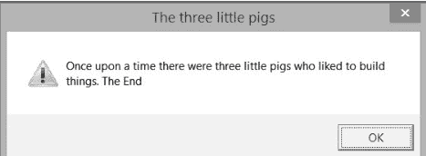

图 4.6 不使用 `vbLf` 和 `vbTab` 常量显示输出。

© 2014 Cengage Learning.

## 存储执行过程中更改的数据

大多数程序都有需要修改的数据。例如，你可能会编写一个请求用户输入并在处理过程中修改数据的脚本。在这种情况下，你可以定义变量。有两种类型的变量：你在脚本定义的变量和脚本可以引用的环境变量。

## VBScript 数据类型

与许多编程语言不同，VBScript 只支持一种类型的变量，称为*变体*。然而，变体非常灵活，可以存储许多类型的数据。表 4.4 列出了 VBScript 支持的数据类型。

> 变体是一种可以包含任意类型数据的变量。

### 表 4.4 VBScript 支持的变体类型

| 子类型 | 描述 |
| --- | --- |
| `Boolean` | 值为 `True` 或 `False` 的变体 |
| `Byte` | 值为在 0 到 255 之间的整数 |
| `Currency` | 货币值在 -922,337,203,685,477,580 到 922,337,203,685,477,580 之间 |
| `Date` | 代表从 100 年 1 月 1 日到 9999 年 12 月 31 日的日期的数字 |
| `Double` | 范围从 -1.79769313486232E308 到 -4.94065458412472E-324 或 1.79769313486232E308 的浮点数 |
| `Empty` | 未初始化的变体 |
| `Error` | VBScript 错误代码 |
| `Integer` | 值在 -32,768 到 32,767 之间的整数 |

### 表 4.4 VBScript 支持的变体子类型（续）

| 子类型 | 说明 |
| --- | --- |
| `Long` | 值在 -2,147,483,648 到 2,147,483,647 之间的整数 |
| `Null` | 设置为空值的变体 |
| `Object` | 一个对象 |
| `Single` | 值在 -3.402823E38 到 -1.401298E-45 或 1.401298E-45 到 3.402823E38 之间的浮点数 |
| `String` | 长度可达二十亿字符的字符串 |

> Jerry Lee Ford, Jr. 版权所有。

变体会自动识别分配给它的数据类型并据此采取相应的操作。如果将一个值赋值给变体，你的脚本可以使用 VBScript 的任何内置函数对其进行处理。同样地，如果将一个字符串赋值给变体，你的脚本可以使用 VBScript 的任何内置字符串函数对其进行处理。

与常量一样，VBScript 允许你控制其识别变体中存储的值类型的方式。例如，如果你将 100 作为变量值赋值，VBScript 会自动将其解释为数字。但如果你将该值括在引号中，VBScript 会将其视为字符串。


# VBScript 数据类型转换与变量定义

## 数据类型转换

VBScript 还提供了使用 VBScript 函数将数据从一种类型转换为另一种类型的能力。你更改 VBScript 视图的脚本处理数据。例如，以下 VBScript 语句定义了一个变量 `MyBirthday`，并为其赋值了一个文本字符串 `"November 20, 1964"`：

```
MyBirthday = "November 20, 1964"
```

VBScript 将此变量的值视为文本字符串。然而，使用 `CDate()` 函数，你可以将字符串值转换为日期格式：

```
MyBirthday = CDate(MyBirthday)
```

现在，VBScript 不再将变量的值视为 `"November 20, 1964"`，而是将其视为 `11/20/1964`。

### 提示

VBScript 提供了大量的转换函数，你可以使用这些函数从一种数据类型转换为另一种数据类型。这些函数包括 `Asc()`、`CBool()`、`CByte()`、`Cbur()`、`CDate()`、`CDbl()`、`Chr()`、`CInt()`、`CLng()`、`CSng()` 和 `CStr()`。有关如何使用这些函数的更多信息，请参阅第 7 章。

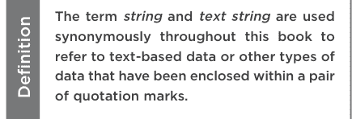

## 定义变量

VBScript 提供两种定义变量的方法：动态定义和使用 `Dim` 语句正式定义。要在脚本中动态创建变量，只需要这样引用它：

```
MyBirthday = "November 20, 1964"
```

使用这种方法，你可以在脚本的任何地方定义变量。然而，我强烈建议不要这样创建变量。更好的做法是在脚本开头一次性正式定义脚本中使用的所有变量。这有助于保持结构。此外，我还强烈建议你使用 `Dim` 语句。`Dim` 语句的语法如下：

```
Dim VariableName
```

`VariableName` 是定义的变量名。例如，以下语句定义了一个名为 `MyBirthday` 的变量：

```
Dim MyBirthday
```

定义变量后，你可以像这样给它赋值：

```
MyBirthday = "November 20, 1964"
```

始终使用 `Dim` 语句可以使你的代码更具可读性，并显式显示你的意图。你可以使用多个 `Dim` 语句在脚本中定义多个变量：

```
Dim MyBirthday
Dim MyName
Dim MyAge
```

然而，为了减少脚本中的代码行数，你可以选择使用单个 `Dim` 语句一次定义多个变量，只需用逗号和空格分隔每个变量：

```
Dim MyBirthday, MyName, MyAge
```

正如我之前所说的，在运行变量之前正式定义它是好的。确保你遵循这一规则的一种方法是在脚本开头放置 `Option Explicit` 语句。`Option Explicit` 语句会在你尝试在未先定义变量的情况下引用它时，在脚本执行期间生成错误。因此，`Option Explicit` 有助于你在处理变量时遵循良好的编程规范。

### Option Explicit 示例

为了测试 `Option Explicit` 语句的使用，让我们来看另一个例子：

```vb
'Script Name: BigBadWolf.vbs
'Author: Jerry Ford
'Created: 01/29/14
'Description: 此脚本演示了如何使用 Option Explicit 语句
'************************************************************************************

'为了显式声明此脚本使用的所有变量
Option Explicit

'创建一个用于存储狼名字的变量
Dim WolfName

'将狼的名字赋值给变量
WolfName = "Mr. Wiggles"

'显示故事
MsgBox "从前，有一只大狼叫 " & WolfName & _
"，它喜欢吃小猪", vbOkOnly
```

在这个示例中，`Option Explicit` 语句是脚本中的第一个语句。通过作为脚本的第一条语句，`Option Explicit` 将影响后续所有的变量。下一个语句定义了一个变量。

---

# 第 4 章 • 常量、变量、数组和字典

之前的两个示例设置并修改了赋值给文本变量的值。然而，这种方法同样适用于其他类型的变量，例如包含数值的变量：

```vb
Option Explicit
Dim intMyAge
intMyAge = 37
intMyAge = 38
```

在这个示例中，定义了一个变量并为其分配了一个数值。然后将赋值给该变量的值修改另一个数字。VBScript 提供了额外的方法，使用等号和 VBS 算术运算符来修改数值变量的值。表 4.5 列出了 VBScript 算术运算符。

### 表 4.5 VBScript 算术运算符

| 运算符 | 描述 |
|---|---|
| `+` | 加法 |
| `-` | 减法 |
| `*` | 乘法 |
| `/` | 除法 |
| `-` | 取负 |
| `^` | 幂 |
| `\` | 整除 |
| `Mod` | 取模 |

解释如何使用这些算术运算符最好的方法是向你展示一个示例。看以下脚本：

```vb
'Script Name: Mathdemo.vbs
'Author: Jerry Ford
'Created: 01/29/14
'Description: 此脚本演示了如何使用各种 VBScript 算术运算符
'****************************************************************************************************

'强制对脚本中使用的所有变量进行显式声明
Option Explicit

'创建一个变量来存储狼的名字
Dim intMyAge

'分配我的初始起始年龄
intMyAge = 37
WScript.Echo "I am " & intMyAge

'明年我将是
intMyAge = intMyAge + 1
WScript.Echo "Next year I will be " & intMyAge

'但我还没有那么老大
intMyAge = -1
WScript.Echo "But I still am " & intMyAge

'如果我的年龄是现在的两倍，我会有多大
intMyAge = intMyAge * 2
WScript.Echo "This is twice my age " & intMyAge

'如果我取那个值，将其除以 5，加上 3，并乘以 10
intMyAge = intMyAge / 5 + 3 * 10
WScript.Echo "This says that I will be " & intMyAge
```

如果你在运行 Windows 8.1 的计算机上运行此脚本，你将看到图 4.8 所示的结果。

前四个计算应该很容易理解。在第一次计算中，我取了 `intMyAge` 的值并对其加了 1。同样，在下一次计算中我减了 1，然后在第三条语句中将 `intMyAge` 乘以 2。最后的计算需要稍作解释。你可能对这个计算结果感到惊讶。起初，看起来 VBScript 将尝试按照以下方式求解方程：

1. 将 `intMyAge`（为 74）除以 5 得到 14.8。
2. 将 14.8 加 3，得到 17.8。
3. 将 17.8 乘以 10，得到的最终结果为 178。

然而，VBScript 说答案是 44.8。这怎么可能是呢？答案在于所谓的“优先级”，它告诉 VBScript 在方程或表达式中执行单个计算的顺序。表 4.6 概述了 VBScript 优先级的出现顺序。

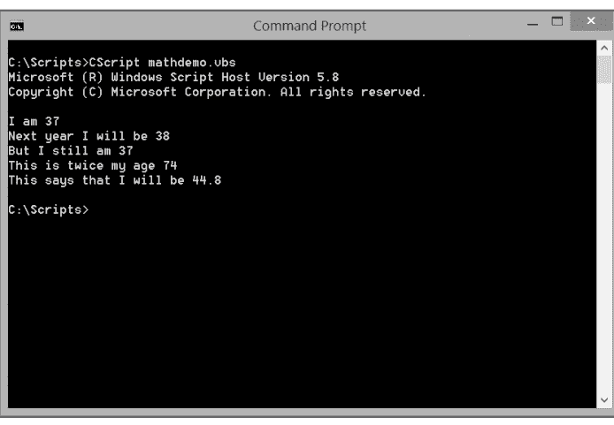

图 4.8 使用 VBScript 算术运算符修改数值变量。

© 2014 Microsoft Corporation. 经许可使用。

### 表 4.6 VBScript 算术运算符的优先级

| 运算符 | 描述 | 运算符 | 描述 |
|---|---|---|---|
| `^` | 幂 | `\` | 整除 |
| `-` | 取负 | `Mod` | 取模 |
| `*` | 乘法 | `+` | 加法 |
| `/` | 除法 | `-` | 减法 |

出现在表格开头的运算符优先级高于出现在表格后部分的运算符。

© Jerry Ford, Jr. 保留所有权利。

幂运算发生在取负之前，取负发生在乘法之前，依此类推。当应用于上一个示例中的最后一次计算时，VBScript 按如下方式求解方程：

1. 将 3 乘以 10 得到 30。
2. 将 `intMyAge`（为 74）除以 5 得到 14.8。
3. 将 14.8 加 30 得到最终结果 44.8。

你可以为你的 VBScript 表达式添加括号，以控制执行单个计算的顺序。例如，你可以将上一个示例中的最后一个表达式重写为：

```vb
intMyAge = ((intMyAge / 5) + 3) * 10
```

VBScript 现在执行括号内的单个计算，如下：

1. 将 `intMyAge`（为 74）除以 5 得到 14.8。
2. 将 14.8 加 3，得到 17.8。
3. 将 17.8 乘以 10，得到的答案为最终结果 178。

## 使用 WSH 处理环境变量

到为止，我们处理了两种类型的环境变量：

- 用户：特定于用户的。
- 系统：由 Windows 定义的。

要访问环境变量，你需要使用 WSH。例如，看以下脚本：

```vb
'Script Name: ComputerAnalyzer.vbs
'Author: Jerry Ford
'Created: 01/29/14
'Description: 此脚本演示了如何使用 WSH 访问环境变量
'************************************************************************************************

'强制对脚本中使用的所有变量进行显式声明
Option Explicit

'创建一个变量来存储变量的名字
Dim objWshObject

'设置 WScript.Shell 对象的实例
Set objWshObject = WScript.CreateObject("WScript.Shell")

'使用 WScript.Shell 的 ExpandEnvironmentStrings() 方法查看环境变量
MsgBox "This computer is running a version of " & _
objWshObject.ExpandEnvironmentStrings("%OS%") & vbCrLf & _
"and has " & _
objWshObject.ExpandEnvironmentStrings("%NUMBER_OF_PROCESSORS%") & _
"processor(s)."
```

你可以按照以下步骤访问环境变量：

1. 将鼠标指针移动到屏幕右底部并点击搜索图标。
2. 在搜索字段中输入控制面板并按回车。
3. 在控制面板中，点击系统和安全，然后点击系统。
4. 点击高级设置以显示。


图 4.9 检查环境变量。

© 2014 Microsoft Corporation. 经许可使用。

### 用户变量包括：

- `TEMP`：一个可以存储临时文件的文件夹。
- `TMP`：另一个可以存储临时文件的文件夹。

### 系统变量包括：

- `NUMBER_OF_PROCESSORS`：对于单处理器计算机显示为 1。
- `OS`：显示操作系统。
- `Path`：指定当前的搜索路径。
- `PATHEXT`：指定一组用于识别可执行文件的扩展名列表。
- `PROCESSOR_ARCHITECTURE`：识别计算机的处理器类型。
- `PROCESSOR_IDENTIFIER`：显示处理器的详细描述。
- `PROCESSOR_LEVEL`：显示处理器的步进级别。
- `PROCESSOR_REVISION`：显示处理器的修订版本。
- `Windir`：标识 Windows 文件夹的位置。

---

虽然脚本演示了如何访问环境变量，但它实际上并没有什么用。环境变量的另一个用途可能是验证脚本启动的操作系统，并在脚本在错误的操作系统上启动时终止其执行，如下：

```vbscript
Set objWObject = WScript.CreateObject("WScript.Shell")
If objWObject.ExpandEnvironmentStrings("%OS%") <> "Windows_NT" Then
    MsgBox "This script is designed to run only on " & "Windows 2000"
    WScript.Quit
End If
```

在此示例中，第一行代码检查脚本是否运行在 Windows NT, 2000, XP, 2003, Vista, 2008, 2012, 7 或 8 上。如果不是，则会执行第二行和第三行代码，告知用户该状况并终止脚本的执行。


## 处理相关数据的集合

使用变量时，你可以在脚本执行期间存储大量的信息。事实上，你的限制仅限于计算机可用内存的大小。然而，维护大量的变量可能是困难的，并会让你的脚本难以维护。

通常，脚本处理的数据项之间存在相互关系。例如，如果你编写了一个脚本从用户那里收集姓名列表以生成个人联系人列表，那么将姓名列表作为一个单元来存储和管理，比作为单个姓名的集合要方便得多。VBScript 提供了对数组的支持，以便执行此类任务。

> **数组**是一个相关数据的索引列表。数组中的第一个元素（或数据项）被分配索引位置为 0。第二个元素被分配索引位置为 1，依此类推。通过引用元素的索引位置，你可以访问其值。

`ItsMyParty` 是一个单维数组的示例。VBScript 能够支持多达 60 维的数组。在大多数情况下，你只需要处理单维数组，因此我将把大部分精力放在这里。

### 单维数组

要创建一个单维数组，你使用 `Dim` 语句。在创建数组时，`Dim` 语句必须具有以下语法：

```vbscript
Dim ArrayName(dimensions)
```

`dimensions` 是用逗号分隔的数字列表，指定了组成数组的维度数。例如，以下 VBScript 语句可以创建一个名为 `ItsParty` 的单维数组，它可以容纳多达 10 个姓名：

```vbscript
Dim ItsParty(9)
```

注意，你使用数字 9 来定义一个可以存储最多 10 个元素的数组。这是因为数组中的第一个索引被自动设置为 0，允许数组存储 10 个元素（即 0–9）。

在定义数组后，可以向其填充数据。

> 存储在数组中的第一个元素的索引为 0，其实际长度等于数组首次定义时提供的数字加 1。

以下 VBScript 语句演示了你如何将数据分配给数组中的每个元素：

```vbscript
ItsParty(0) = "Jerry"
ItsParty(1) = "Molly"
ItsParty(2) = "William"
ItsParty(3) = "Alexander"
ItsParty(9) = "Mary"
```

如你所见，为了给数组中的元素分配名称，我必须指定元素的索引数字。在你填充数组后，可以通过指定其索引数字来访问任何数组元素，如下：

```vbscript
MsgBox ItsParty(1)
```

在此示例中，`ItsParty(1)` 等于 `Molly`。

> 如果你喜欢在本章之前提到的关于命名常量以及在创建变量名称时使用匈牙利命名法的建议，你可能想在为数组命名时结合这两种方法。例如，与其将数组命名为 `ItsParty()`，你可能想将其命名为 `astrItsParty()`。名称的第一个字符标识它是一个数组，接下来的三个字符标识数组中存储的数据类型。这就是我在本书的其余部分在命名数组时将使用的命名标准。

---

### 多维数组


如所述，VBScript 可以支持多达 60 维的数组，尽管一或两个维度通常就足够了。让我们看看如何定义一个二维数组，你可以将其想象成一个两列表格。第一列包含受邀参加派客的姓名，第二列存储宾客的电话号码。

```vbscript
Dim astritsMyParty(3,1)
```

```vbscript
astritsMyParty(0,0) = "Jerry"
astritsMyParty(0,1) = "550-9933"
astritsMyParty(1,0) = "Molly"
astritsMyParty(1,1) = "550-8876"
astritsMyParty(2,0) = "William"
astritsMyParty(2,1) = "550-7766"
astritsMyParty(3,0) = "Alexander"
astritsMyParty(3,1) = "555-4433"
```

在此示例中，创建了一个四行两列的二维数组，允许存储 8 份数据。要引用此二维数组中的任何元素，你必须提供行和列坐标，如下：

```vbscript
WScript.Echo astritsMyParty(0,0)
WScript.Echo astritsMyParty(0,1)
```

之前的语句指的是 `Molly`。第二个语句指的是电话号码。

> 对二维数组的另一种思考方式是将其考虑由单维数组组成的集合。

## 处理数组内容

到目前为止，在所有的示例中，我都是通过专门引用索引来访问每个元素的。只要数组很小，这种方法就可以运行，但对于处理大型数组来说并不实用。处理这种规模的数组需要不同的方法。VBScript 解决此问题的方案是 `For...Next` 循环。`For...Next` 循环的语法如下：

```vbscript
For Each element In group
    Statements
Next
```

`element` 是循环用于遍历每个元素的变量。`group` 指定数组名称。`Statements` 是你添加到每个内容的 VBScript 语句。`For...Next` 循环继续处理直到数组中的每个元素都被检查。

`For...Next` 循环让你的脚本可以使用少数语句处理整个数组。语句的数量不随数组的大小而增加。因此，你可以使用 For 循环轻松地处理极其巨大的数组。例如，下一个脚本定义了一个数组 `GameArray()` 并填充了五个元素。然后它使用循环内部的一行代码处理整个数组。

****************************************************

'脚本名称: ArrayDemo.vbs

'作者: Jerry Ford

'创建日期: 14/01/30

'描述: 此脚本演示了如何使用单维 VBScript 数组

'存储和检索数据

****************************************************

'执行脚本初始化活动

Option Explicit

'定义脚本中使用的变量

Dim intCounter = '控制 For...Each 循环的变量

Dim strMessage = '在弹出对话框中显示的消息

strMessage = "数组包含默认游戏 " & vbCrLf & vbCrLf &

```vbscript
Dim astrGameArray(4) = '定义一个可以存储 5 个索引元素的数组
astrGameArray(0) = "Joe Blew" '默认用户名
astrGameArray(1) = "Nevada" '一个值得一去的地方
astrGameArray(2) = "soda can" '一个有趣的对象
astrGameArray(3) = "Barney" '一个亲密的朋友
astrGameArray(4) = "Pickle" '一个喜喜欢的甜点
```

```vbscript
For Each intCounter In astrGameArray
    strMessage = strMessage & intCounter & vbCrLf
Next
WScript.Echo strMessage
```

## 第 4 章 • 常量、变量、数组和字典

```
PS C:\scripts> CScript arraydemo.ubs
Microsoft (R) Windows Script Host Version 5.8
Copyright (C) Microsoft Corporation. All rights reserved.

该数组包含以下默认游戏信息：

Joe Blow
Neada
soda can
Barney
Pickle

PS C:\scripts>
```

**图 4.10** 迭代处理数组的所有内容。

© 2014 Microsoft Corporation. 经微软许可使用。

这几行代码就可以轻松地处理数组，即使它有几百或上千个元素。`For_Each_Next` 循环的替代方案是编写单独的语句来访问存储数组中的每个元素，如下所示：

```
' ' 显示数组的内容
WScript.Echo strMessage
WScript.Echo strGameArray(0)
WScript.Echo strGameArray(1)
WScript.Echo strGameArray(2)
WScript.Echo strGameArray(3)
WScript.Echo strGameArray(4)
WScript.Echo strGameArray(4)
```

在小型程序中，为单独访问数组内容编写语句可能看起来并不费力，但想象一下处理一个拥有 1,000 个元素的数组吧！

## 交叉引用

有关如何使用 `For_Each_Next` 循环的更多信息，请参见第 6 章“处理数据集合”。

Microsoft WSH and VBScript Programming for the Absolute Beginner, Fourth Edition

## 掌握数组的大小

VBScript 为你提供了两个内置函数，使处理数组变得更容易：

- `Ubound()`。它返回一个数值，表示数组的上界或最高元素。

- `Lbound()`。它返回一个数值，表示数组的下界或最低元素。

`Lbound()` 函数实际上并没有什么用，因为所有 VBScript 数组的下界始终等于 0。相反，`Ubound()` 函数非常有用，特别是在处理动态数组时。我将在本章的稍后部分介绍动态数组。`Ubound()` 函数的语法如下：

```
Ubound(ArrayName, Dimension)
```

`ArrayName` 是要返回其上界的数组名称。`Dimension` 用于指定要返回上界的数组维度。例如，你可以像这里所示检索名为 `astrItsMyParty` 的单维数组的上界：

```
intSize = Ubound(astrItsMyParty)
```

在这种情况下，数组的上界被赋值给名为 `intSize` 的变量。让我们来看一个 `Ubound()` 函数运行的快速示例：

```
Dim intCounter = '定义一个用于处理数组内容的变量'
Dim strMessage = '定义一个用于存储显示输出的变量
```

```
Dim astrGameArray(2) '定义一个可以容三个索引元素的数组
astrGameArray(0) = 'Joe Blow' '默认用户名
astrGameArray(1) = 'Nevada' '一个值得去的地方
astrGameArray(2) = 'soda can' '一个有趣的物体
```

```
intSize = Ubound(astrGameArray(intCounter))

For intCounter = 0 to intSize
strMessage = strMessage & astrGameArray(intCounter) & vbCrLf
Next
```

```
MsgBox strMessage
```

运行此示例，你将看到脚本在弹出对话框中显示数组中的所有三个元素。

## 调整数组大小

在开发脚本时，有时无法知道数组需要存储多少元素。例如，你可能会编写一个使用 `InputBox()` 函数的脚本，提示开发者指定要存储在数组中的数据。你可能预期用户指定几条数据，但用户可能有完全不同的想法。为了处理这种情况，你需要一种调整大小的方法来允许它存储额外数据。

处理这种情况的方法之一是在不指定大小的情况下定义数组，如下：

```
Dim astrGameArray()
```

这允许你在脚本稍后部分定义数组的大小。例如，你可能想定义数组，稍后询问用户他打算提供多少条数据。这通过使用 `ReDim` 语句来实现：

```
ReDim astrGameArray(9)
```

此 `ReDim` 语句设置了数组以存储最多 10 个元素。在最终确定大小后，你就可以向数组填充数据了。

## 陷阱

> 如果你使用 `ReDim` 语句通过意外指定数组名称来设置新数组，现有数组中存储的数据将会丢失。

另一种更灵活的设置数组以便稍后调整大小的方法是将数组原始的 `Dim` 定义语句替换为 `ReDim` 语句。例如，以下语句设置了一个可以容纳多达 10 个元素的新数组：

```
ReDim astrTestArray(9)
```

然而，如果你向此数组填充数据并在稍后尝试调整其大小（如下所示），你将丢失原始存储在数组中的所有数据。

```
ReDim astrTestArray(19)
```

为了防止这种情况的发生，你可以在 `ReDim` 语句中添加 `Preserve` 关键字，如下：

```
ReDim Preserve astrTestArray(19)
```

此语句使用 VBS 扩展数组的大小。该语句使用 VBS 扩展数组的大小。该语句使用 VBS 扩展数组的大小。该语句使用 VBS 扩展数组的大小。该语句使用 VBS 扩展数组的大小。该语句使用 VBS 扩展数组的大小。该语句使用 VBS 扩展数组的大小。该语句使用 VBS 扩展数组的大小。该语句使用 VBS 扩展数组的大小。该语句使用 VBS 扩展数组的大小。该语句使用 VBS 扩展数组的大小。该语句使用 VBS 扩展数组的大小。该语句使用 VBS 扩展数组的大小。该语句使用 VBS 扩展数组的大小。该语句使用 VBS 扩展数组的大小。该语句使用 VBS 扩展数组的大小。该语句使用 VBS 扩展数组的大小。该语句使用 VBS 扩展数组的大小。该语句使用 VBS 扩展数组的大小。该语句使用 VBS 扩展数组的大小。该语句使用 VBS 扩展数组的大小。该语句使用 VBS 扩展数组的大小。该语句使用 VBS 扩展数组的大小。该语句使用 VBS 扩展数组的大小。该语句使用 VBS 扩展数组的大小。该语句使用 VBS 扩展数组的大小。该语句使用 VBS 扩展数组的大小。该语句使用 VBS 扩展数组的大小。该语句使用 VBS 扩展其（数组）的大小以允许其存储额外数据。

## 构建动态数组

到目前为止，书中的所有数组都是静态的，这意味着它们的大小在执行时就已经确定了。在现实世界中，你并不总是知道多少元素。例如，你可能会编写一个脚本，允许用户提供要添加到数组的列表。根据用户拥的数量，存储在数组中的数据量可能会变化。VBScript 这种情况的解决方案是动态数组。动态数组是在执行期间根据需要多次调整大小的数组。

你可以使用 `Dim` 语句来定义动态数组，如下：

```
Dim astrItsMyParty()
```

注意括号内没有提供数组的索引号。这允许你之后返回脚本并使用 `ReDim` 语句调整数组，所示：

```
ReDim astrItsMyParty(2)
```

调整大小后，你可以添加新条目：

```
astrItsMyParty(0) = "Molly"
astrItsMyParty(1) = "William"
astrItsMyParty(2) = "Alexander"
```

如果脚本以后需要向数组添加更多元素，你可以再次调整它：

```
ReDim Preserve astrItsMyParty(4)
```

此语句增加了数组的大小，使其现在可以容纳额外的两个元素。注意在 `ReDim` 语句上使用 `Preserve` 关键字。该参数是防止数组丢失存储在其中的任何数据所必需。

# 零基础入门 Microsoft WSH 和 VBScript 编程，第四版

intCounter = 0

```
Do While UCase(strListOfNames) <> "QUIT"
strListOfNames = InputBox("Enter the name of someone to be invited: ")
```

```
If UCase(strListOfNames) <> "QUIT" Then
astrsMyParty(intCounter) = strListOfNames
Else
Exit Do
End If
```

```
intCounter = intCounter + 1
ReDim Preserve astrMyParty(intCounter)
Loop
```

在这个示例中，名为 `astrsMyParty` 的数组使用一个 `Dim` 语句来定义它，然后使用 `ReDim` 语句设置其初始大小，允许存储单个元素。在通过脚本设置了变量后，我添加了一个 `Do...While` 循环来收集用户输入。该循环一直运行，直到用户输入 `Quit`。

> 注意
>
> `UCase()` 是一个 VBScript 函数，用于将字符串字符转换为大写。使用 `UCase()`，你可以编写出脚本，无论用户在输入数据时如何使用大小写，都能处理用户输入。

假设用户没有输入 `Quit`，脚本会将用户输入的条目添加到字符串中，并存储在名为 `strListOfNames` 的变量中。否则，`Do...While` 循环将终止。每输入一个新名称，就会执行 `ReDim` 语句，通过增加大小来重新调整数组的大小。

## 擦除数组

当你的脚本完成对数组存储的数据的操作后，你可以擦除或删除它，从而为其他工作释放小部分计算机内存。这是通过使用 `Erase` 语句实现的其语法如下：

```
Erase ArrayName
```

例如，可以使用以下语句来擦除名为 `astrGameArray` 的数组：

```
Erase astrGameArray
```

## 在字典中存储数据

除了变量和数组外，VBScript 还允许你使用字典（Dictionary）对象存储和管理数据。使用字典，数据存储在关联数组中，并使用键/值对（key/value pairs）进行检索，而不是像数组那样使用数据索引位置。数据使用键（Keys）存储在字典中。键可以是数字、字符串或 VBScript 支持的任何其他数据类型。字典提供了与数组相同的益处，同时在数据存储和检索方式上提供了更大的灵活性。此外，字典对象提供了许多不同的属性和方法，用于访问和管理数据。

字典对象支持三个属性，列出如下：

- `Count`。返回字典中项目的总数。

- `Item`。使用字典对象中指定的键来检索或添加一个项目。

- `Key`。向字典对象中添加一个键。

字典对象还提供了许多方法的访问：

- `Add`。向字典对象中添加一个键/值对。

- `Exists`。如果字典对象中存在指定的键，则返回布尔值 `true`；如果值不存在，则返回 `false`。

- `Items`。返回字典对象中所有项目的数组。

- `Keys`。返回字典对象中所有键的数组。

- `Remove`。从字典对象中删除一个键/值对。

- `Remove All`。从字典对象中删除所有键/值对。

## 键和值

要将字典对象引入 VBScript，你必须先定义一个引用它的变量。一旦完成操作，你就可以像这里所示创建一个对象的实例：

```
Dim dictObject
Set dictObject = CreateObject("Scripting.Dictionary")
```

# 添加字典项

在你实例化字典对象后，你就可以像这里所示开始以键/值对的形式向其中存储项：

```
dictObject.Add "Model1555", "Red Bike"
dictObject.Add "Model1888", "Blue Bike"
dictObject.Item("Model1999") = "Green Bike"
```

# 零基础入门 Microsoft WSH 和 VBScript 编程，第四版

第一语句使用字典对象的 `Add()` 方法向 `dictObject` 字典添加一个名为 `Model1555` 的键。将 `Red Bike` 的值分配该键。第二个语句向字典添加了第二个名为 `Model1888` 的键，并为其分配 `Blue Bike` 的值。最后一条语句稍有不同，使用 `Item` 属性进行键/值赋值。

## 检索字典项

在你创建并填充字典后，你就可以开始处理其中存储的数据。作为如何操作的示例，请看以下语句：

```
If dictObject.Exists("Model1555") = True Then
    MsgBox "Model1555 is a " & dictObject.Item("Model1555")
End If
```

在这个示例中，使用字典对象的 `Exists()` 方法来确定指定的键是否存在。如果存在，则使用 `Item()` 方法来检索与键关联的值。

## 删除字典项


# 第 4 章 • 常量、变量、数组和字典

## 删除字典项

如有必要，你可以像添加它们一样轻松地从字典中删除键/值对。为了这样做，你使用字典对象的 `Remove()` 方法。例如，以下语句显示了如何使用 `Remove()` 方法删除与其键关联的数据元素：

```
DictObject.Remove "Model1555"
```

如你所见，该语句从字典删除了 `Model1555` 键关联的值。或者，你可以使用字典对象的 `RemoveAll()` 方法删除字典中的所有键/值对。

## 字典方法

在字典中，你可以开始处理其中存储的数据。作为如何操作的示例，请看以下语句：

```
If dictObject.Exists("Model1555") = True Then
    MsgBox "Model1555 is a " & dictObject.Item("Model1555")
End If
```

在这个示例中，使用字典对象的 `Exists()` 方法来确定指定的键是否存在。如果存在，则使用 `Item()` 方法来检索与键关联的值。

## Dictionary 方法

要将字典对象引入 VBScript，你必须先定义一个引用它的变量。一旦完成操作，你就可以像这里所示创建一个对象的实例：

```
Dim dictObject
Set dictObject = CreateObject("Scripting.Dictionary")
```

## 添加字典项

在你实例化字典对象后，你就可以像这里所示开始以键/值对的形式向其中存储项：

## 回到冒险险长的故事

现在让我们回到本章节的编程项目——冒险险长的故事。在这个编程项目中，你将开发一个脚本，用它展示一个描述你的故事主角冒险险长是如何首次获得超能力的故事。通过这个脚本的开发，你将有机会测试你对由于如何操作 VBScript 常量、变量以及字符串格式常量的知识。

## 设计游戏

该项目的基本设计是向用户提出一系列问题（而不告诉玩家这些答案将用于何处），然后玩家提供的信息构建一个关于名为“冒险险长”的虚构英雄的幽默动作故事。

该项目将分五个步骤完成：

1. 添加标准文档模板并填写其中的信息。
2. 定义脚本将要使用的常量和变量。
3. 创建欢迎用户进入故事的启动界面。
4. 使用 `InputBox()` 函数创建存储用户数据的变量。
5. 编写故事，添加存储在脚本变量和常量中的数据。此外，使用 VBScript 字符串控制故事文本的格式化，然后使用 `MsgBox()` 函数显示故事。

## 开始编写冒险险长脚本

在定义了涉及的步骤大纲后，整合该项目的第一步是打开编辑器并按照所示设置你的脚本模板：

```
********************************************************************************
'脚本名称: Captain Adventure.vbs
'作者: Jerry Ford
'创建日期: 02/01/14
'描述: 此脚本提示用户回答若干问题，
'然后使用这些答案创建一个幽默的动作冒险故事。
********************************************************************************
```

'执行脚本初始化活动

`Option Explicit`

这个在上一章中引入的模板为你提供了一个空间，用于对你正在开发的脚本提供一些基础文档。此外，模板包含了 `Option Explicit` 语句，这是基于这样一个假设：你开发的几乎任何脚本都会至少使用一个变量。

## 设置常量和变量

创建冒险险长脚本的下一步是指定脚本将要使用的常量和变量：

```vbscript
'指定在每个弹出对话框标题栏中显示的消息
Const cGameTitle = "Captain Adventure"

'指定脚本使用的变量
Dim strWelcomeMsg, strName, strVocation, strObject, strFriend
Dim strFood, strStory
```

第一行代码定义了一个名为 `cGameTitle` 的常量。这个常量将用于定义一个由脚本在任何对话框标题区域中显示的消息。这允许你只需定义一次标题栏消息，并在需要的地方应用它，而无需每次都重新输入。

最后一行代码定义了脚本将使用的七个变量。第一个变量 `strWelcomeMsg` 将存储在脚本首次执行时出现在启动界面上显示的消息文本。

> 有时，启动界面被用来提醒用户注册应用程序。在其他情况下，当应用程序加载时间较长时，启动界面可能会分散用户的注意力，或者用于宣传应用程序或脚本开发者的网站。在你的脚本中添加启动界面让你有机会在脚本开始执行之前与用户进行交流；它可以用于显示指令或其他有用信息。

接下来的五个变量（`strName`、`strVocation`、`strObject`、`strFriend` 和 `strFood`）用于存储从用户那里收集的数据；它们将在脚本中用于组装冒险险长的故事。最后一个变量 `strStory` 用于存储完整装好的冒险险长故事。

## 创建启动界面

正如我所说，脚本的启动界面为你提供了一个展示你的网站地址、游戏说明或其他你认为对用户有用的机会。

以下语句展示了构建启动界面的一种方法。`strWelcomeMsg` 用于定义显示在启动界面上的文本。显示的消息文本使用 VBScript 字符串常量进行格式化，使其更具力。

```vbscript
'指定在初始启动界面中显示的消息
strWelcomeMsg = "Welcome to the story of ........................" & vbCrLf & _
vbCrLf & "CCC" & space(14) & "A" & vbCrLf & _
"C" & space(17) & "AAA" & vbCrLf & _
"***Captain Adventure gets his super powers***" & _
vbCrLf

'欢迎用户进入故事
Msgbox strWelcomeMsg, vbOkOnly + vbExclamation, cGameTitle
```

最后，使用 VBScript 的 `MsgBox()` 函数显示屏幕。在这种情况下，`MsgBox()` 函数中的 `vbOkOnly + vbExclamation` 常量将在弹出对话框上仅显示 OK 按钮和感叹号图形。此外，添加了常量 `cGameTitle` 以显示脚本的自定义标题栏消息。

## 收集用户输入

接下来显示的五行代码使用 VBScript 的 `InputBox()` 函数收集用户提供的数据。这些代码包含以下问题/指令：

- 你的名字是什么？
- 说出一个你想去的地方的名字。
- 说出一个奇怪的物体。
- 输入一个好朋友的名字。
- 输入你喜欢的甜点的名字。

```vbscript
'从用户处收集故事
strName = InputBox("What is your name?", cGameTitle,"Joe")
strVacation = InputBox("Name a place you would like to visit.", cGameTitle,"Nevada")
strObject = InputBox("Name a strange object.", cGameTitle,"soda")
strFriend = InputBox("Type the name of a close friend.", cGameTitle,"Barney")
strFood = InputBox("Type the name of your favorite dessert.", cGameTitle,"pickle")
```

注意用户仅给了一个默认答案。你在每个 `InputBox()` 语句中注意到最后的参数。这种方式提供默认值有助于用户了解你正尝试收集的信息。

## 组装并显示故事

整合冒险险长脚本的最后一步是组装故事。这是通过输入故事文本并在相应的位置插入引用来实现的。此外，使用 `vbLf` 字符串常量来改进故事的显示。

整个故事被组装成一个字符串，存储在名为 `Story` 的变量中。最后，使用 `MsgBox()` 显示完整的故事。

```vbscript
'组装冒险险长故事
strStory = "Once upon a time " & strName & " went on vacation in " & strVacation & "." & vbLf & vbLf &
"A local tour guide guided cave exploration. While in the cave " & strName & "意外离开了小组，进入了一个从未访问过的洞穴部分。" & vbLf &
"那里一片漆黑。突然，强强的光开始闪烁。" & strName & " 发现光来自洞室角落一个神秘的 " & strObject & "。" & vbLf &
" & strName & " 拿起它，闪光发生了，他 " & strName & " 被传送到一个遥远的世界。在他面前，" & strFriend & " 解释说传奇洞穴命运之神选中了他成为冒险险长！随后他被带回地球，并买了一辆旅行车，在乡村寻找需要帮助的人。为了激活 " & strFriend & " 赋予的超能力，" & strName & " 只需要拿起那个 " & strObject & " 并连续说三次 " & Chr(34) & strFood & Chr(34) & "。" & vbLf & vbLf &
"The End"

'显示故事
MsgBox strStory, vbExclamation, cGameTitle
```

注意上述语句中 `Chr(34)` 的使用。`Chr(34)` 是一个 VBScript 函数，将 ANSI 代码转换为字符。ANSI 代码 34 代表双引号。

## 最终结果

运行脚本并测试它，以确保一切都符合预期。由于此脚本将 VBScript 的字符串长度推向了极限，如果你提供脚本的信息过长，部分故事可能会被截断。

## 总结

在本章中你学习了大量内容。你现在知道如何定义和使用常量以及变量，包括 VBScript 的内置常量和 Windows 环境变量。此外，你学习了如何使用 VBScript 字符串常量通过脚本输出来控制输出的显示方式。你还学习了 VBScript 变体（variant）以及将数据从一种变体类型转换为另一种类型。最后，你学习了如何将相关的数据集合存储在数组中以便更高效的存储和处理，并开发了可以处理运行时传入输入的脚本。

1. 修改“冒险队长”（Captain Adventure）故事，收集额外的用户输入并在故线上添加更多文本。
2. 尝试使用数组来存储“冒险队长”故事中收集的用户输入，而不是使用单个变量存储数据。
3. 为你认识的人编写自己的故事，并通过电子邮件发送给他，作为一种生动的问候卡。
4. 在编写自己的故事时，尝试使用 VBScript 字符串常量，以改进故事输出的格式和呈现。

# 第 5 章 • 条件逻辑

每种编程语言都允许你对两个或多个条件之间进行测试。这种能力是编程逻辑的基石之一。它让你能够开发测试用户输入或用户计算机输入的脚本，并将其与一个或多个条件进行比较。利用测试结果，你可以更改脚本的执行过程，并创建可以根据提供的数据调整其执行方式的动态脚本。

在你完成本章后，你将学习了以下内容：

- 如何编写测试两个条件的脚本
- 如何编写针对单个值测试两个或多个条件的脚本
- 如何编写可以测试各种不同类型条件的脚本
- 如何编写与多种内置 VBScript 函数协同工作的的脚本

## 项目预告：行星常识问答游戏

在本章中，你将创建一个游戏，根据玩家对太阳系行星的了解来进行测验并评分。该游戏向玩家提出一系列问题，然后根据玩家的最终得分分配等级。图 5.1 到 5.3 显示了在运行 Windows 8.1 的计算机上时，玩家与游戏之间的一些交互。

## 《微软 WSH 和 VBScript 编程（专为初学者打造）》（第四版）


**图 5.1** 游戏的启动界面邀请用户参加测验。

© 2014 Cengage Learning.

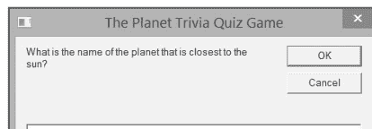

**图 5.2** 玩家面临一系列需要回答的问题。© 2014 Cengage Learning.

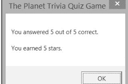

**图 5.3** 当玩家完成问题后，将计算总分，并根据正确回答问题的数量分配等级。© 2014 Cengage Learning.

在游戏开发过程中，你将学习如何应用复杂的条件逻辑。此外，你还将学习如何使用许多内置 VBScript 函数。

## 检查程序数据

在任何编程语言中，你都需要能够测试一个条件是真还是假，以开发复杂的逻辑过程。VBScript 提供了两种执行此功能的不同语句。语句如下：

- **If.** 这种语句允许根据逻辑表达式或条件的结果，允许或跳过程序某部分的执行。
- **Case.** 这是一种正式的编程构造结构，允许程序员在处理简单表达式的结果时，视觉化地对程序流编程。

你已经在本书的早期章节中看到过 `If` 语句的简短演示。这是因为即使是最简单的脚本也需要某种形式的条件逻辑。

这两个语句的力量重要性无论如何强调都不为过。例如，假设你在不知道具体报酬的情况下接受了某人的一份工作，现在你已经完成了工作并正在等薪。在等待期间，你考虑该如何处理这笔新钱。过了一会儿，你决定如果拿了 250 美元，就买一台电视；如果拿得较少，就改买一台收音机。这种测试非常适合使用 `If` 语句。让我们把这个场景重写为更像代码的格式：

```
If your pay is equal to $250
Then Buy a TV
Else
Buy a Radio
EndIf
```

如你所见，逻辑非常直观，并且很好地从英语翻译成了伪代码。我使用了粗体文本来标识示例的各个部分，指出涉及的关键 VBScript 编程组件。我将在本章稍后部分详细介绍这些每个关键字的含义。

回到我们的场景：也许在又思考了几分钟后，你决定根据收到的金额，你可以对报酬做几件事情。在这种情况下，你可以使用 VBScript `Select` 语句来概述决策。

```
Select Case Pay
  Case 250
    Buy a TV
  Case 200
    Buy a DVD
  Case 100
    Buy a radio
  Else
    Just lunch
End Select
```

`If` 语句的语法如下：

```
If condition Then
  statements
ElseIf condition Then
  statements
Else
  statements
End If
```

## If 语句

`If` 语句允许你测试值或条件，并根据测试结果更改脚本的执行。

## 使用 If 语句

`If` 语句以 `If` 关键字开始，以 `End If` 结束。`condition` 表示执行的比较。例如，你可能想要查看 `X` 是否等于 250，如下所示：

```
If X = 250 Then
  WScript.Echo "Go buy that TV!"
End If
```

你可以在 `Then` 和 `End If` 关键字之间添加任意数量的语句。例如，下面的示例是一个完整的 `If` 语句，用于测试变量是否为 250。如果是（即测试为真），则会显示消息：

```
If X = 250 Then
  WScript.Echo "Go buy that TV!"
  WScript.Echo "Buy a TV Guide while you are at it."
  WScript.Echo "And not to forget to say thank you."
End If
```

但如果测试条件证明为假会怎样？在上述测试中，什么都不会发生。但通过添加 `Else` 关键字和一个或多个额外语句，为脚本提供了执行路径。

```
If X = 250 Then
  WScript.Echo "Go buy that TV!"
  WScript.Echo "Buy a TV Guide while you are at it."
  WScript.Echo "And not to forget to say thank you."
Else
  WScript.Echo "OK. Just purchase the radio for today."
End If
```

图 5.4 提供了示例示例逻辑的流程图视图。

# 第 5 章 • 条件逻辑 127

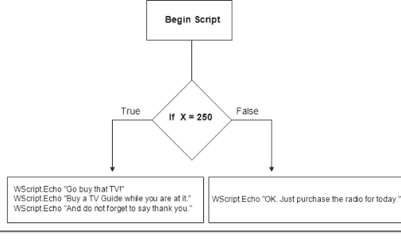

**图 5.4** 概述典型 `If` 语句背后逻辑的流程图。© 2014 Cengage Learning.

## 在现实世界

程序员有时会在开始开发脚本之前首先创建一个流程图。流程图作为脚本开发的视觉工具，描绘了脚本或程序的逻辑流，并提供了宝贵的文档工具。开发流程图对于创建复杂脚本有很大帮助。流程图帮助程序员在脚本开发之前将他们的想法形式化。

你可以通过添加一个或多个 `ElseIf` 关键字来扩展 `If` 语句，每个关键字都可以用于测试另一个备选条件。例如，看以下 VBScript 语句：


# 嵌套 If 语句

使用 If 语句的另一种方法是将它们嵌套彼此内部。这允许你开发测试某个条件，然后根据上一个测试的结果进一步测试其他条件的脚本。

## 示例

为了理解我的意思，请看下面的示例（我加粗了嵌套的 If 语句以便于查看）：

```vbscript
X = 250

If X = 250 Then
    WScript.Echo "It's Sunday. The TV store is closed on Sundays."
Else
    WScript.Echo "Go buy that TV!" & vbCrLf & _
    "Buy a TV guide while you are at it." & vbCrLf & _
    "And do not forget to say thank you."
End If

Else
    WScript.Echo "OK. Just purchase the radio for today."
End If
```

在这个示例中，第一个语句执行测试，以检查赋值给变量 `X` 的值是否等于 250。如果不等于 250，脚本将跳过位于 `If X = 250 Then` 行之间的所有位置，并显示消息“OK. Just purchase the radio for today.”。然而，如果 `X` 的值等于 250，则执行嵌套的 If 语句。这个 If 开始确定当前星期几是星期日。如果是，脚本将通知用户电视商店已关门。否则，它告诉用户去购买。

上一个示例中 If 语句执行的测试值得额外的解释。正如你所见的，它获取了一个代表当前星期几的数值。以下是该语句所用逻辑的分解。首先，它执行了内置的 VBScript `Date()` 函数。该函数获取的值随后被内置的 VBScript `Weekday()` 函数使用，以确定代表当前星期几的数值。这些值如下：

- 1 = 星期日
- 2 = 星期一
- 3 = 星期二
- 4 = 星期三
- 5 = 星期四
- 6 = 星期五
- 7 = 星期六

当这个值确定后，If 语句只需检查它是否等于 1（星期日）。

通过利用内置的 VBScript 函数，你可以用极少的代码完成一些相当复杂的任务。在尝试编写一段代码来执行通用任务之前，始终检查 VBScript 是否有内置函数是一个好主意。

## 提示

通过将一个 If 语句嵌入或嵌套在另一个 If 语句中，你可以开发复杂的编程逻辑。你可以相互嵌套的 If 语句数量没有限制。

# 重温 RockPaperScissors.vbs

好的。你已经学习了许多关于 If 语句的知识，包括它的语法和各种用法。在本书的前四章中编写 VBScript 示例时，我面临的最巨大挑战之一，是使用尚未涵盖的 VBScript 编程语句创建基于 VBScript 的游戏。在大多数情况下我是成功的，但有一个例外：我就是无法避免使用 If 语句——尽管我尝试尽可能少地使用它。在大多数情况下，这意味着限制了所展示游戏的完整性。

其中一个游戏是让我们使用了 `RockPaperScissors.vbs` 脚本。现在我终于提供了对 If 语句的完整复习，让我们重温这个游戏以及我们如何让它变得更好。

## 初始代码片段

```vbscript
'在尝试使用它们之前先通过脚本正式声明每个变量
Dim objWshShell, strAnswer, strCardImage, getRandomNumber

'创建 WScript 对象的实例以便稍后使用 Popup 方法
Set objWshShell = WScript.CreateObject("WScript.Shell")

'显示游戏规则
objWshShell.Popup "Welcome to Rock, Paper, and Scissors game. " & _
"Here are the " & _
"rules of the game: 1. Guess the same as the computer " & _
"to tie. 2. Paper covers rock and wins. 3. Rock breaks " & _
"scissors and wins. 4. Scissors cut paper and win."

'提示用户选择一个选项
strAnswer = InputBox("Type Paper, Rock, or Scissors.", "Let's play a game!")

'是让电脑随机选择一个选项的时间
Randomize
getRandomNumber = Round(FormatNumber(Int((3 * Rnd)) + 1))

'给随机选择的值赋值
If getRandomNumber = 3 Then strCardImage = "rock"
If getRandomNumber = 2 Then strCardImage = "scissors"
If getRandomNumber = 1 Then strCardImage = "paper"

'显示游戏结果以便用户可以看到他赢了
objWshShell.Popup "You picked: " & strAnswer & Space(12) & _
"Computer picked: " & strCardImage
```

## 更新后的完整脚本

首先，通过添加以下语句来更新脚本，使用逻辑。

```vbscript
'脚本名称：RockPaperScissors.vbs
'作者：Jerry
'创建日期：02/04/14
'描述：重温在第 3 章引入的 RockPaperScissors.vbs 脚本，并使用逻辑更新它。
```

接下来，通过添加变量：

```vbscript
Dim objWshShell, strAnswer, strResults
'strResults 用于脚本的结果
```

除非玩家提供了正确的选择，否则该值在整个脚本执行期间将保持为 None 并最终导致脚本终止并显示错误消息。然而，如果玩家提供了正确的选择，则会给 `strResults` 赋值，如下：

```vbscript
strResults = "None"
```

原始的 Paper.vbs 脚本在一个弹出框中显示指令，并在另一个弹出框中提示玩家选择。这在第 3 章引入的，使用两个弹出框有点笨拙。修改脚本以显示指令并同时收集玩家输入，如下：

```vbscript
strImage = "rock"
If getRandomNumber = 2 Then strImage = "scissors"
If getRandomNumber = 1 Then strImage = "paper"
```

正如在第 2 章“Windows Script Host 简介”中解释的那样，第一对语句的结果产生一个 1 到 3 之间的随机数。接下来的三行将为这些每个值分配“石头”、“剪刀”或“纸”。脚本的其余部分将由所有新代码组成。

```vbscript
Randomize
getRandomNumber = Round(FormatNumber(Int(3 * Rnd) + 1))
```

正如你所见，我使用了 `WScript.InputBox()` 来显示对话框，并使用 `vbLf` 常数对指令进行了格式化。

```vbscript
If strAnswer = "rock" Then
    If getRandomNumber = 3 Then strResults = "Tie"
    If getRandomNumber = 2 Then strResults = "You Win"
    If getRandomNumber = 1 Then strResults = "You Lose"
End If
```

这组语句仅在玩家输入了石头时执行。三个 If 语句将玩家的选择与脚本随机选择的决策进行比较，并确定游戏的结果。

现在已经定义了脚本使用的变量和对象，让我们修改脚本以显示指令并同时收集玩家输入，如下：

```vbscript
strAnswer = InputBox("Please type paper, rock, or scissors " & _
"in lowercase letters." & _
vbCrLf & vbCrLf & "Rules:" & vbCrLf & vbCrLf & _
"1. Guess the same as the computer to tie." & vbCrLf & vbCrLf & _
"2. Paper covers rock and wins." & vbCrLf & _
"3. Rock breaks scissors and wins." & vbCrLf & _
"4. Scissors cut paper and win." & vbCrLf & "Let's play a game!")
```

```vbscript
'创建 WScript 对象的实例以便稍后使用 Popup 方法
Set objWshShell = WScript.CreateObject("WScript.Shell")

'显示游戏规则
objWshShell.Popup "Welcome to Rock, Paper, and Scissors game. " & _
"Here are the " & _
"rules of the game: 1. Guess the same as the computer " & _
"to tie. 2. Paper covers rock and wins. 3. Rock breaks " & _
"scissors and wins. 4. Scissors cut paper and win."
```

```vbscript
'在尝试使用它们之前通过脚本正式声明每个变量
Dim objWshShell, strAnswer, strCardImage, getRandomNumber
```

```vbscript
'给随机选择的值赋值
If getRandomNumber = 3 Then strCardImage = "rock"
```

现在复制这组语句两次，并按照如下方式修改每组，以添加对剪刀和布的选择的测试：

```vbscript
If strAnswer = "scissors" Then
    If getRandomNumber = 3 Then strResults = "You Lose"
    If getRandomNumber = 2 Then strResults = "Tie"
    If getRandomNumber = 1 Then strResults = "You Win"
End If
```

```vbscript
If strAnswer = "paper" Then
    If getRandomNumber = 3 Then strResults = "You Win"
    If getRandomNumber = 2 Then strResults = "You Lose"
    If getRandomNumber = 1 Then strResults = "Tie"
End If
```

现在向脚本中添加以下语句：

```vbscript
If strResults = "None" Then
    objWshShell.Popup "Sorry. Your answer was not recognized. " & _
    "Please type rock, paper, or scissors in all lowercase letters."
    WScript.Quit
End If
```

这些语句仅在玩家玩游戏时未能提供正确回答时才会执行。如果发生这种情况，`strResults` 的值将永远不会改变，并将保持为在脚本开始时赋值的 None。在这种情况下，使用 `objWshShell` 的 `Popup()` 和 `Quit()` 方法来显示错误消息并结束游戏。

现在通过添加这几行代码来封装你的脚本：

```vbscript
objWshShell.Popup "You picked: " & Space(12) & strAnswer & vbCrLf & _
vbCrLf & "Computer picked: " & Space(2) & strCardImage & vbCrLf & _
vbCrLf & "--------------------------" & vbCrLf & vbCrLf & "Results: " & _
strResults
```

这些语句仅在玩家提供有效回答时才会执行。使用 `objWshShell` 对象的 `Popup()` 方法显示游戏结果，包括玩家和脚本的选择。

好了。所有内容都保存了。然后执行脚本。图 5.6 显示了在运行 Windows 7 的计算机上执行脚本时，脚本显示的初始弹出的对话框。

图 5.7 显示了一个典型游戏的结果。

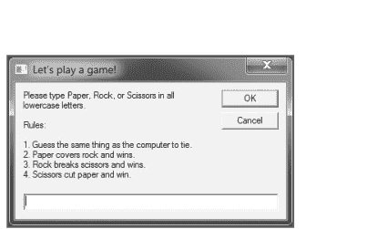
**图 5.6** 新版本的 RockPaperScissors.vbs 显示了一个更具友好的初始对话框。© 2014 Cengage Learning。

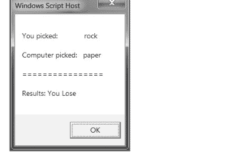
**图 5.7** 新版本 RockPaperScissors.vbs 典型游戏的结果。© 2014 Cengage Learning。

# Select Case 语句

If 语句为测试两个表达式提供了一个很好的工具。使用 `Else`，你可以修改 If 语句来执行额外的测试。VBScript 提供了另一个语句 `Select Case`，它也允许你执行比较操作。在功能上，它与 If 语句没有太大区别。然而，`Select Case` 语句更适合对单个表达式进行大量的测试。

以下是 `Select Case` 语句的语法：

```vbscript
Select Case expression
    Case value
        statements
    Case value
        statements
    Case Else
        statements
End Select
```


Select Case 语句以 `Select Case` 开始。然后它指定要在 `Select Case` 语句之后、`End` 语句之前的 `Select` 语句中与一个或多个值进行比较的表达式。可选地，可以添加一个 `Case Else` 语句，以便在没有任何 `Case` 语句与 `Select Case` 语句指定的表达式匹配时，提供一种备选的行动方案。

为了演示如何操作使用 `Select Case` 语句，我重写了 `RockPaperScissors.vbs` 脚本中实现的大部分逻辑。如下完整的脚本所示，我不仅减少了脚本运行所需的代码行数，还改进了脚本的可读性：

# 初学者入门 Microsoft WSH 与 VBScript 编程，第四版

```
'Script Name: RockPaperScissor-3.vbs
'Author: Jerry Ford
'Created: 02/04/14
'Description: 此脚本重新实现了 RockPaperScissor-2.vbs 脚本，
'将某些 If 语句的逻辑替换为 Case Select 语句。
```

执行脚本初始化活动
```vbscript
Dim objWshShell, strAnswer, strCardImage, strResults, intRandomNumber
Set objWshShell = WScript.CreateObject("WScript.Shell")

strResults = "None"
```

提示用户选择一个选项
```vbscript
strAnswer = InputBox("Please type paper, rock, or scissors " & _
"in all lowercase letters." & _
vbCrLf & vbCrLf & "Rules:" & vbCrLf & vbCrLf & _
"1. 猜和电脑相同以平局。" & vbCrLf & _
"2. 布压石头获胜。" & vbCrLf & _
"3. 石头打碎剪刀获胜。" & vbCrLf & _
"4. 剪刀剪开纸获胜。" & vbCrLf, "Let's play a game!")
```

电脑随机选择的时间
```vbscript
Randomize
intRandomNumber = Round(FormatNumber(Int((3 * Rnd) + 1)))
If intRandomNumber = 1 Then strCardImage = "rock"
If intRandomNumber = 2 Then strCardImage = "paper"
If intRandomNumber = 3 Then strCardImage = "scissors"
```

```vbscript
Select Case strAnswer
Case "rock"
    If intRandomNumber = 1 Then strResults = "Tie"
    If intRandomNumber = 2 Then strResults = "You Win"
    If intRandomNumber = 3 Then strResults = "Lose"
Case "paper"
    If intRandomNumber = 1 Then strResults = "You Win"
    If intRandomNumber = 2 Then strResults = "Tie"
    If intRandomNumber = 3 Then strResults = "You Lose"
Case "scissors"
    If intRandomNumber = 1 Then strResults = "You Lose"
    If intRandomNumber = 2 Then strResults = "You Win"
    If intRandomNumber = 3 Then strResults = "Tie"
Case Else
    objWshShell.Popup "Sorry. Your answer was not recognized. " & _
    "Please type rock, paper, or scissors in all lowercase letters."
    WScript.Quit
End Select
```

```vbscript
objWshShell.Popup "You picked: " & Space(12) & strAnswer & vbCrLf & _
vbCrLf & "Computer picked: " & Space(2) & strCardImage & vbCrLf & _
"--------------------------" & vbCrLf & vbCrLf & "Results: " & _
strResults
```

# 使用 VBScript 运算符进行更多测试

到本书为止，每个 `If` 或 `Case` 示例都涉及单一相等性。这是一种强大的形式，但有时你的脚本需要测试值的范围。例如，假设你想使用 VBScript 小于运算符 (`<`) 来完成此操作，如下所示：

```vbscript
intAge = InputBox("How old you?")
If intAge < 18 Then
    MsgBox("Sorry you are too young to play this game.")
    WScript.Quit()
Else
    MsgBox("OK. Let's play!")
```

也可以使用 VBScript 小于等于运算符 (`<=`) 来编写上述示例：
`If intAge <= 17 Then`

使用 `<=` 运算符，如果用户小于 17 岁，此语句将不会执行。VBScript 还提供了大于运算符 (`>`) 和大于等于运算符 (`>=`)，允许你反转上述示例中的逻辑：

```vbscript
intUserAge = InputBox("How old are you?")

If intAge > 17 Then
    MsgBox "OK. Let's play!"
Else
    MsgBox "Sorry but you are too young to play this game."
    WScript.Quit()
End If
```

表 5.1 列出了 VBScript 比较运算符。

| 运算符 | 描述 |
| --- | --- |
| = | 等于 |
| <> | 不等于 |
| < | 小于 |
| > | 大于 |
| <= | 小于等于 |
| >= | 大于等于 |

> © Jerry Lee Ford, Jr. 保留所有权利

VBScript 不像算术运算符那样对比较运算符施加顺序或优先级。相反，每个比较操作都按照它们出现的顺序从左到右执行。

# 回到星球测验问

现在让我们回到本章的开始处，开发星球测验游戏。在这个程序中，你将创建一个关于星球测验的 VBScript 脚本。该游戏将提出问题、收集玩家答案、计算最终分数、根据分数为玩家分配等级，最后创建一个摘要文本报告。通过完成这个项目，你将更频繁地使用 `If` 和 `Select Case` 语句。你还将学习如何使用许多内置的 VBScript 函数。

## 游戏开发

以下步骤概述了完成游戏开发需要经历的流程：

1. 添加标准文档模板并填写其中的信息。
2. 定义脚本将使用的常量和变量。
3. 创建启动界面，欢迎用户进入游戏，并判断用户是否想玩游戏。
4. 使用 `InputBox()` 函数显示问题、收集玩家答案，并添加逻辑来判断玩家答案的错。
5. 使用 `Select Case` 根据正确回答的问题的数量为玩家分配等级。
6. 显示玩家的分数和等级。

# 开始行星知识问答游戏

打开脚本编辑器，从另一个脚本中剪切并粘贴脚本模板开始此脚本。然后根据与“行星知识问答游戏”相关的信息修改模板：

```vbscript
'执行脚本初始化活动
Option Explicit
```

## 设置常量和变量

下一步是定义脚本使用的变量和常量：

```vbscript
Dim intPlayGame, strSplashImage, strAnswerOne, strAnswerTwo, strAnswer
Dim strAnswerFour, strAnswerFive, intNumberCorrect, strRank
Dim objFSOObject
```

```vbscript
Const cTitlebarMsg = "行星知识问答游戏"
```

```vbscript
'将用户的分数初始化为零
intNumberCorrect = 0
```

# 初学者的 Microsoft WSH 和 VBScript 编程，第四版

`intNumberCorrect` 变量用于统计玩家回答正确的数量。我在这里将 `intNumberCorrect` 设置为 0 以确保它有一个值。玩家可能会错掉所有答案；如果我不设置它，这个值可能不会被赋值。在接下来的脚本开发过程过程中，我将解释每个变量的用途。

## 创建启动界面

让我们创建一个酷的启动界面，询问用户是否想玩游戏。如你所见，我们添加了一幅图形来增加趣味。这种类型的图形开发需要一些时间，并需要经过一些尝试。

```vbscript
'显示启动界面并询问用户是否想玩
strSplashImage = vbCrLf & vbCrLf & vbCrLf & Space(15) & _
" W E L C O M E T O T H E " & vbCrLf & vbCrLf & _
Space(9) & "G P L A N E T T R I V I A Q U I Z" & vbCrLf & _
vbCrLf & Space(35) & "G A M E" & vbCrLf & vbCrLf & vbCrLf & _
"你想测试一下对太阳系的知识吗？"

intPlayGame = MsgBox(strSplashImage, 36, cTitleBarMsg)
```

`If intPlayGame = 6 Then '用户选择了玩游戏`

启动界面是通过 VBScript 的 `MsgBox()` 函数创建的。它包含了游戏邀请以及“是”和“否”按钮。用户点击的按钮值被赋值给变量 `intPlayGame`（也就是说，如果玩家点击“是”按钮，`intPlayGame` 将设置为 6）。

现在让我们检查用户是否想玩游戏。

```vbscript
If intPlayGame = 6 Then '用户选择了玩游戏
    '在此处插入构成游戏的语句
Else '用户不想玩
    MsgBox "感谢参加行星知识问答。" & _
    vbCrLf & vbCrLf & "请尽快再次来!", cTitleBarMsg
    WScript.Quit()
End If
```

如你所见，该语句检查了用户是否点击了“是”按钮。我留了一些空间，以便在用户想玩时添加实际构成游戏的语句。如果用户点击了“否”，则 VBScript 将显示“感谢”消息并使用 `WScript` 对象的 `Quit()` 方法终止执行。

# 显示问答问题并收集玩家答案

下一步是添加构成游戏的问题。以下问题成了问答：

- 距离太阳最近的行星叫什么名字？
- 红行星的名字是什么？
- 金星距离太阳几颗行星？
- 哪颗行星是以海神的名字命名的？
- 你最喜欢的行星的名字是什么？

显示并评分第一个问答问题的语句如下：

```vbscript
strAnswerOne = InputBox("距离太阳最近的行星叫什么名字?" & _
"sun?", cTitleBarMsg)
```

```vbscript
If LCase(strAnswerOne) = "mercury" Then
    intNumberCorrect = intNumberCorrect + 1
End If
```

首先，VBScript 的 `InputBox()` 函数显示问题。用户输入的答案被赋值给变量 `strAnswerOne`。接下来，使用 `If` 语句检查玩家的答案并判断其是否正确。VBScript 的 `LCase()` 函数用于将玩家输入的内容转换为全小写。这样，无论玩家如何输入答案都没有影响。例如，`MERCURY`、`MerCur` 和 `Mercury` 最终都会变成 `mercury`。最后，如果玩家提供了正确答案，`intNumberCorrect` 的值将加 1。

# 142 针对初学者的 Microsoft WSH 和 VBScript 编程，第四版

你可以看到，最后这句话并没有复杂的含义。你只需要使用 VBScript 的 `MsgBox()` 函数、`strNumberCorrect` 和 `strRank` 变量，以及 `vbCrLf` 常量来显示供玩家查看的消息。

## 完整的脚本

就是这样！你已经拥有了创建“行星知识问答游戏”（Planet Trivia Quiz）所需的所有信息。当你准备好后，开始游戏并对其进行测试。在测试时，务必提供不同的正确和错误答案的组合，然后验证游戏是否正确处理了你的答案。当你确认一切运行如预期时，将该游戏分享给你的几个“星际迷”（Trekkie）朋友，看看他们怎么想。

## 总结

本章涵盖了大量内容。你学习了如何以多种方式使用 `If` 和 `Case Select` 语句。利用这些新信息，你更新了“剪刀石头布”游戏，并创建了“行星知识问答游戏”。

1. 修改“行星知识问答游戏”，让它询问玩家的名字，并在游戏结束时使用玩家的名字根据其等级对其进行称呼。
2. 修改“行星知识问答游戏”，让它对玩家错过的任何问题显示正确答案。
3. 通过增加问题来扩展“行星知识问答游戏”。将问题列表存储在数组中，然后使用 `For...Each...Next` 循环来显示并处理问题以及玩家的回答。

## 处理数据集合

在本章中，你将学习使用多种 VBScript 语句，这些语句可以帮助你开发出能够处理海量信息的脚本——仅需少量语句。你可以在脚本中建立循环，让用户根据需要迭代输入数据、处理数组内容、读取文件内容以及控制游戏的执行。我还会向你展示如何为脚本创建快捷方式，以及如何将它们放在 Windows 桌面和程序菜单上。具体而言，你将学习到：

- 如何使用五种不同的 VBScript 循环
- 如何使用循环控制脚本（及游戏）的执行
- 如何通过编程创建 Windows 快捷方式，并使用它们配置 Windows 资源（如桌面和程序菜单）

## 项目预览：猜数字游戏

在本章的项目中，你将创建一个玩猜数字游戏的脚本。游戏会在 1 到 100 之间生成一个随机数，并指示玩家尝试猜中。在玩家猜测的过程中，游戏会提供提示帮助其确定数字。如果玩家输入无效猜测，游戏会告诉他只接受数字输入。玩家可以随时点击“取消”按钮，或在点击“确定”之前未输入猜测来退出。当玩家猜中答案时，游戏会显示他找到正确答案所花费的次数。图 6.1 至 6.4 展示了游戏在运行 Windows 8.1 的电脑上执行时的交互界面预览。

# 针对初学者的 Microsoft WSH 和 VBScript 编程，第四版

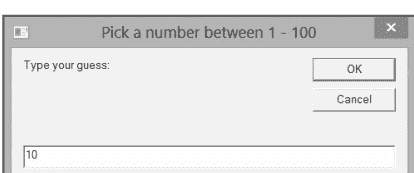

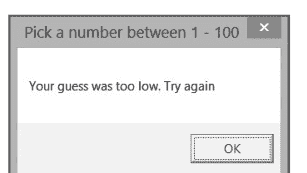

图 6.1 猜数字游戏首先提示玩家输入 1 到 100 之间的数字。© 2014 Cengage Learning。

图 6.2 如果玩家猜的数字太小，游戏告诉玩家再次尝试。© 2014 Cengage Learning。

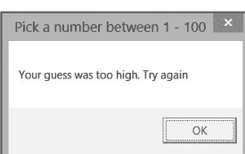

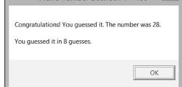

图 6.3 如果玩家猜的数字太大，游戏告诉玩家再次尝试。© 2014 Cengage Learning。

图 6.4 当玩家正确猜中游戏数字时，向玩家表示祝贺。© 2014 Cengage Learning。

该游戏使用 VBScript 继续执行，直到玩家猜中正确答案或退出。通过开发和运行这个游戏，你将巩固对迭代编程的理解，同时专门学习了如何使用 VBScript 应用循环。

# 在脚本中添加逻辑

VBScript 最好的编程特性之一是对循环或迭代语句的强力支持。VBScript 提供了五种可以创建循环的不同语句。通过重复执行极少数语句，让你的脚本具备处理大型数据集合的能力，这种执行可以是针对集合中的每个成员执行，也可以针对指定的次数执行。

以下列表提供了 VBScript 循环语句的高级描述：

- `For...Next`。这建立了一个按指定次数迭代的循环。
- `For...Each...Next`。这建立了一个遍历与对象相关的所有属性的循环。
- `Do...While`。这建立了一个只要指定条件一直为真就一直迭代的循环。

> 定义：循环是一组重复执行的语句集合，以便处理大量数据。

# 第 6 章 • 处理数据集合

- `Do...Until`。这建立了一个直到指定条件变为真为止迭代的循环。
- `While...Wend`。这建立了一个只要指定条件一直为真就一直迭代的循环。

## For...Next 语句

`For...Next` 语句用于创建按指定次数执行的循环。例如，如果你正在创建一个需要输入五个猜测的游戏，可以使用 `For...Next` 循环来处理数据收集部分。

`For...Next` 语句的语法如下：

```vbscript
For counter = begin To end [StepValue]
```

`counter` 是用于控制循环执行的变量。`begin` 指定计数变量的起始值。`end` 指定计数变量的结束值。`StepValue` 是一个可选设置，指定计数器的增量（如果省略，则默认为 1）。

为了更好地理解 `For...Next` 的操作，请看这个示例：


Dim strFoodList

strFoodList = ""

For timeCounter = 1 To 5

   strFoodList = strFoodList & " " & InputBox("输入你喜欢的食物：")

Next

MsgBox "你喜欢的有：" & strFoodList

```

如你所见，这个示例重复了相同的语句来收集用户输入。为了证明它执行了任务，它使用 `MsgBox` 函数显示了它收集的数据。

# 针对初学者的 Microsoft WSH 和 VBScript 编程，第四版

这样收集五份数据有点费劲。现在想象你想要收集更多数据的情况。与其像上一个示例那样重复相同的语句，你可以使用 `For...Next` 循环。

```vbscript
Dim timeCounter, strFoodList

strFoodList = " " *
```

```vbscript
For timeCounter = 1 To 5

   strFoodList = strFoodList & " " & InputBox("输入你喜欢的食物：")

Next

MsgBox "你喜欢的有：" & strFoodList
```

图 6.5 展示了该示例在运行 Windows 8.1 的电脑上执行时的输出。

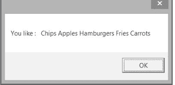

> 图 6.5 使用 For...Next 循环收集并处理用户输入。
© 2014 Cengage Learning.

这个新脚本比上一个示例短了两行。与上一个示例不同，除了循环结束值的值外，此脚本不需要修改即可适应额外数据的收集。例如，为了让 `For...Next` 循环能够收集 10 份数据，你只需要将其修改为：

```vbscript
For timeCounter = 1 To 10

   strFoodList = strFoodList & " " & InputBox("输入你喜欢的食物：")

Next
```

可选情况下，你可以使用 `Exit For` 语句随时退出 `For...Next` 循环，如下：

```vbscript
Dim timeCounter, strFoodList, strNewFood

strFoodList = " " *
```

```vbscript
For timeCounter = 1 To 5

   strNewFood = InputBox("输入你喜欢的食物：")

   If strNewFood = "beans" Then

      MsgBox "抱歉，我不想和任何喜欢豆类的人聊天！",

      Exit For

   End If

Next
```

```vbscript
Exit For

End If

strFoodList = strFoodList & " " & strNewFood

Next

MsgBox "You like : " & strFoodList
```

在这个示例中，数据的赋值被分成了两个不同的语句。第一条语句将用户输入的食物名称赋值给一个名为 `strNewFood` 的变量。只有当 `strNewFood` 不是“beans”（豆子）时，`strNewFood` 的值才会被添加到喜欢的食物列表中；如果是的话，脚本将显示一条消息并终止 `For..Next` 循环的执行。结果是，将显示用户在输入 `beans` 之前所输入的所有食物。

在检查 VBScript 支持的其他循环语句之前，让我们来看最后一个示例。在这个示例中，为 `For..Next` 语句添加了可选关键字 `Step`（步长），以改变循环的行为。

```vbscript
Dim intCounter

For intCounter = 1 To 9 Step 3

Script.Echo intcounter

Next
```

在这个示例中，脚本将显示计数器变量的值，该变量用于控制循环的执行。脚本不是按 1 计数到9，而是像这里演示的样 3 计数：

```text
C:\>Script Text.vbs

Microsoft (R) Windows Script Host Version 5.8

Copyright (C) Microsoft Corporation. All rights reserved.

```

- 1
- 4
- 7

```text
C:\>
```

## For Each...Next 语句

VBScript 的 `For Each..Next` 语句是一个用于处理对象相关的所有属性的编程工具。每个对象都有若干与之相关的属性。使用 `For Each..Next` 循环，你可以编写一个脚本来遍历对象的属性。

《Microsoft WSH and VBScript Programming for the Absolute Beginner, 第四版》

`For...Each...Next` 语句的语法如下：

```vbscript
For Each element In collection

statements

Next [element]
```

`element` 是一个代表集合（或对象）相关属性的变量。看下面的示例：

```vbscript
Dim objFSOObject, objFolderName, strMember, strFileList, strTargetFolder
```

```vbscript
Set objFSOObject = CreateObject("Scripting.FileSystemObject")

Set objFolderName = objFSOObject.GetFolder("C:\Temp")
```

```vbscript
For Each strMember In objFolderName.Files

strFileList = strFileList & strMember.name & vbCrLf

Next
```

```vbscript
MsgBox strFileList, "List of files in " & objFolderName
```

此示例首先定义了变量，然后建立了一个 `FileSystemObject` 对象的实例。它使用 `FileSystemObject` 对象的 `GetFolder()` 方法设置文件夹的引用。接下来，使用该引用通过 `For...Each...Next` 循环处理在文件夹内的所有文件（在这种情况下，这些被视为文件夹的属性）。随着 `For...Each...Next` 循环的执行，它构建了一个存储在文件夹内的列表，并使用 `vbCrLf` 常量以美观的方式格式列表。图 6.6 显示了该脚本在运行 Windows 7 的计算机上执行时显示的结果。

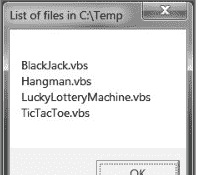

> 图 6.6 使用 For...Each...Next 循环处理文件夹的内容。
© 2014 Cengage Learning.

`For...Each...Next` 循环也是处理数组内容的极佳编程工具。例如，以下语句就足以处理并显示名为 `astrGameArray` 的数组，显示其每个元素：

```vbscript
For Each intCount In astrGameArray

strMessage = strMessage & intCounter & vbCrLf

Next
```

```vbscript
WScript.Echo strMessage
```

## 第6 章 • 处理数据集合

要了解更多关于数组的知识并查看使用 `For Each...Next` 语句的完整脚本示例，请参阅第 4 章“常量、变量、数组和字典”中的“处理数组内容”章节。

## Do...While 语句

`Do...While` 语句创建一个只要指定条件为真就会一直运行的循环。VBScript 支持两个版本的 `Do...While` 循环。第一个版本 `Do...While` 循环的语法如下：

```vbscript
Do While condition

statements

Loop
```

`condition` 以表达式的形式表示，如下所示：

```vbscript
intCounter = 0

Do While intCounter < 10

intCounter = intCounter + 2

Loop
```

在这个示例中，表达式 `(intCounter < 10)` 允许循环只要 `intCounter` 的值小于 10 就继续运行。`intCounter` 的值初始设置为 0，但每次循环执行时都会增加 2。结果是循环迭代了五次。

由于 `While` 关键字被放置在循环的开头，如果计数器的值已经是 10 或更大，循环将不会执行。

第二种格式 `Do...While` 语句的语法如下：

```vbscript
Do

statements

Loop While condition
```

如你所见，`While` 关键字已从循环的开头移动到了末尾。因此，即使条件为假，循环也将至少执行一次。

让我们来看另一个 `Do...While` 循环的运行示例。在这个示例中，`Do...While` 循环被设置为只要条件为真就一直运行。使用计数器变量控制循环的执行。脚本不是按 1 计数到9，而是按 3 计数，正如这里演示的样：

```text
C:\>Script Text.vbs

Microsoft (R) Windows Script Host Version 5.8

Copyright (C) Microsoft Corporation. All rights reserved.

```

- 1
- 4
- 7

```text
C:\>
```

## Do...Until 语句

VBScript `Do...Until` 语句创建一个循环，只要条件为假就会一直执行（即直到条件变为真为止）。VBScript 支持两种版本的 `Do...Until` 语句。第一个版本的语法如下：

```vbscript
Do Until condition

statements

Loop
```

让我们来看一个演示此循环如何运行的示例。在接下来的示例中，脚本提示玩家回答一个问题，并使用 `Do...Until` 循环允许用户最多三次机会正确回答问题。

```vbscript
dim intMissedGuesses
```

Loop

在这个示例中，循环被设置为执行，直到名为 `intMissedGuesses` 的变量值大于 3 为止。该变量初始设置为 1，并在每次循环执行时加 1，除非玩家提供了正确答案，在这种情况下，脚本将 `intMissedGuesses` 的值设为 4，以任意终止循环的执行。

图 6.8 展示了该脚本在运行 Windows 8.1 的计算机上的执行情况，显示了如果玩家在第一次尝试回答时猜错，弹出的对话框。

## 第 6 章 • 数据集合的处理

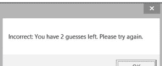

**图 6.8** 使用 Do...Until 循环为玩家提供三次正确回答问题的机会。© 2014 Cengage Learning。

`Do...Until` 语句第二种形式的语法如下：

```vbscript
Do

statements

Loop Until condition
```

如所见，`Until` 关键字及其关联条件已从开头移动到循环末尾，从而确保循环至少执行一次。

## While...Wend 语句

`While...Wend` 语句创建一个循环，只要测试的条件为真就会一直执行。

该循环的语法如下：

```vbscript
While condition

Statements

Wend
```

`Do...While` 和 `Do...Until` 循环提供的功能与 `While...Wend` 循环相同。因此，通用的经验法是，你应该使用 `Do` 循环之一来代替此语句。然而，如果我不向你展示此语句是如何工作的，我将是失职的，所以请看以下示例：

```vbscript
Dim intCounter, strCountList
```


```
intCounter = 0
While intCounter < 10
intCounter = intCounter + 1
strCountList = strCountList & intCounter & vbCrLf
Wend
```

MsgBox "这是如何数到10的：" & vbCrLf & vbCrLf & strCountList, "Counting Example"

## 初学者入门：Microsoft WSH 与 VBScript 编程，第四版

此示例从初始化两个变量开始。`intCount` 用于控制循环执行。`strCount` 用于构建一个包含脚本计数数字的格式化字符串。循环自身迭代 10 次。图 6.9 显示了在运行 Windows 7 的计算机上使用 `WScript.exe` 执行宿主时，该示例创建的输出。

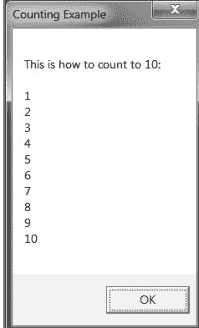

图 6.9 使用 While...Wend 循环数到 10。

© 2014 Cengage Learning.

## 回到猜数字游戏

让我们回到猜数字游戏。在游戏中，玩家被提示猜一个 1 到 100 之间的随机数。玩家每次猜数字时，脚本都会检查是否猜中了正确数字。如果没有命中，脚本将提供提示以帮助玩家进行下一次猜测。

开发此脚本将增强你对使用 Do...Until 循环的知识和理解。你还将接触到 `If` 语句，并学习如何使用许多新的 VBScript 内置函数。

## 设计游戏

猜数字游戏从要求玩家猜一个 1 到 100 之间的数字开始，然后通过提供提示帮助用户猜数字。这个项目分为五个步骤。步骤如下：

1. 添加标准文档模板并定义脚本使用的任何变量、常量或对象。
2. 生成一个 1 到 100 之间的随机数。
3. 创建一个循环，直到玩家猜中正确答案或放弃为止。
4. 测试玩家的答案以检查其是否有效。
5. 测试玩家的答案以检查是否太低、太高或正确。

## 第 6 章 • 数据集合的处理

作为项目的额外奖励，在你完成猜数字游戏后，我将向你展示如何为它创建一个 VBScript 桌面快捷方式。我还将向你展示如何使用快捷方式来配置 Windows 7 程序菜单和 Windows 8.1 应用程序组。

## 开始猜数字游戏

开始创建一个新脚本并添加你的脚本模板。

```
'****************************************************************
'Script Name: GuessANumber.vbs
'Author: Jerry Ford
'Created: 02/20/14
'Description: 此脚本与用户玩猜数字游戏
****************************************************************
```

```
'Initialization Section
Option Explicit
```

接下来，创建一个常量并将要用于弹窗的消息赋值给它。

```
Const cMsg = "Pick a number between 1 and 100"
```

如所示定义四个变量。`intUserNumber` 用于存储玩家的猜测。`strOkToEnd` 是一个用于判断是否应该停止游戏的变量，`intNoGuesses` 用于跟踪猜测次数。

```
Dim intUserNumber, intRandomNo, strOkToEnd, intNoGuesses
intNoGuesses = 0
```

## 生成游戏的随机数

接下来的语句负责生成随机数：

```
'Generate a random number
Randomize
intRandomNo = FormatNumber(Int(100 * Rnd) + 1)
```

`Randomize` 语句确保每次玩游戏时都会生成随机数。最后一条语句使用 VBScript 内置函数生成一个一百以内的数字。

- `Rnd()`：返回一个随机生成的数字。
- `Int()`：返回数字的整数部分。
- `FormatNumber()`：返回一个已格式化为数字的表达式。

## 初学者入门：Microsoft WSH 与 VBScript 编程，第四版

## 创建控制游戏的循环

现在你需要设置控制游戏的 Do...Until 循环。在这个示例中，循环执行直到赋值给 `strToEnd` 的值被设置为 `yes`。

```
Do strToEnd = "yes"
'Prompt users to pick a number
intNumber = InputBox("Type your guess:",cMsg)
intNGuesses = intNGuesses + 1
Loop
```

如所见，目前循环内部唯一的语句提示玩家猜数字并跟踪玩家的次数。

## 测试玩家输入

现在让我们编写用于验证玩家提供的数据的代码。

```
'If the user provided an answer
If Len(intNumber) <> 0 Then
'Make sure that the player typed a number
If IsNumeric(intNumber) = True Then
.
Else
MsgBox "Sorry. You did not enter a number. Try again.", ,cMsg
End If
Else
MsgBox "你未输入值或点击了取消。" & "Please play again soon!", ,cMsg
strToEnd = "yes"
End If
```

第一个验证测试是使用 VBScript 内置函数 `Len()` 完成的。它用于确保玩家在点击确定按钮之前确实输入了数字。如果玩家的输入不是 0 个字符，则游戏继续。否则，将显示错误消息，并将 `strToEnd` 的值设置为 `yes`，从而终止循环和游戏。

如果通过了长度测试，脚本将对玩家的输入进行第二次验证。这次，使用 VBScript 内置函数 `IsNumeric()` 来确保玩家输入的是数字而不是字母或其他特殊字符。如果输入了数字，游戏将继续。如果没有输入数字，则会显示错误信息，游戏将继续循环的下一次迭代。

## 判断玩家的猜想是高了、低还是正确

还有三组语句需要添加到脚本中。它们将一个接一个地插入在执行游戏第二次验证测试的 `If` 语句之后。

这三组语句中的第一组显示在这里。它首先验证用户的猜想是否与游戏随机生成的数字匹配。它会显示一条祝贺玩家的消息，并显示玩家猜中时花费的次数。最后，将 `strkToEnd` 的值设置为等于 `yes`。这将终止循环并允许游戏结束。

```vbscript
'Test to see if the user's guess was correct
If FormatterNumber(intUserName) = intRandomNo Then
MsgBox "Congratulations! You guessed it. The number was " & \
intUserName & vbCrLf & vbCrLf & "You guessed it " & \
"in " & intNoGuesses & " guesses.", ,cGreetingMsg
strkToEnd = "yes"
```

三组语句中的第二组在玩家猜得太低时为其提供帮助。`strkToEnd` 被设置为 `no`。这确保了控制游戏的循环将继续。

```vbscript
'Test to see if the user's guess was too low
If FormatterNumber(intUserName) < intRandomNo Then
MsgBox "Your guess was too low. Try again", ,cGreetingMsg
strkToEnd = "no"
```

最后，最后一组语句在玩家猜得太高时为其提供帮助。`strkToEnd` 被设置为 `no`。这确保了控制游戏的循环将继续。

```vbscript
'Test to see if the user's guess was too high
If FormatterNumber(intUserName) > intRandomNo Then
MsgBox "Your guess was too high. Try again", ,cGreetingMsg
strkToEnd = "no"
```

## 结果

好了，是时候运行脚本看看它是如何工作的了（别担心，会运行的）。在测试脚本是否符合预期后，再次测试它看看你是否把它弄坏了。例如，输入特殊字符或字母而不是数字。一旦你对脚本的运行感到满意，请继续阅读。在本章中，我还为你准备了另一个小惊喜。

## 为你的游戏创建快捷方式

到目前为止，你一直在通过两种方式运行脚本。一种是打开 Windows 控制台，并在 Windows 命令提示符中输入执行热键，然后是脚本的路径和文件名。另一种是找到脚本所在的文件夹并打开它（即双击它）。

Windows 提供了快捷方式作为从 Windows 桌面执行 Windows 和脚本的方便替代方案。快捷方式提供了访问 Windows 资源的方法，而不需要用户查找或知道其代表的资源的实际位置。例如，你在电脑上安装的几乎任何新应用程序都会自动在 Windows 开始菜单的程序菜单中添加快捷方式。此外，大多数安装程序都会提议在 Windows 桌面上为应用程序添加快捷方式。

使用 VBScript 和 WSH，你可以创建一个脚本，为你的 VBS 游戏在这些位置之一配置快捷方式。当然，你可以手动为脚本创建快捷方式，但创建设置脚本的优势在于，一旦编写完成，你可以在任何计算机上重新创建这些快捷方式。例如，如果你购买了一台新电脑，你只需要从旧电脑拷贝你的 VBScript，然后运行你的 VBScript 设置脚本，你的快捷方式就会被重新创建。同样，如果你把 VBScript 游戏的副本发给所有朋友，他们为脚本设置快捷方式需要做的的就是运行设置脚本。

> 快捷方式是指向 Windows 对象的链接或指针。这些对象可以是任何内容，包括 Windows 应用程序、文件夹、文件、打印机、磁盘驱动器和脚本。

## 检查快捷方式属性

Windows 快捷方式通过代表它们的图标左下角的小箭头来识别。快捷方式以属性的形式包含了与其关联的 Windows 资源信息。这些属性中最重要的的是它所代表的 Windows 资源的路径和名称。

你可以通过右键点击快捷方式并选择“属性”来查看与任何快捷方式相关的属性。会出现快捷方式的属性对话框。点击“快捷方式”选项卡查看这些属性，如图 6.10 所示。

## 创建桌面快捷方式

只需五个简单的步骤即可创建一个桌面快捷方式。为了演示，让我们在 Windows 桌面上为 GuessANumber.vbs 游戏创建一个快捷方式。

创建游戏快捷方式的第一步是建立 `WshShell` 对象的实例。脚本需要使用该对象的 `SpecialFolders` 属性来访问代表 Windows 桌面的文件夹。此外，你还需要使用 `WshShell` 对象来实例化 `WshShortcut` 对象，以便设置快捷方式属性。

## 技巧

使用 VBScript 和 WSH 删除快捷方式的简单程度与创建一个快捷方式一样简单。例如，运行以下脚本来删除之前脚本创建的快捷方式：

```
Set objWshShl = WScript.CreateObject("WScript.Shell")
strTargetFolder = objWshShl.SpecialFolders("Desktop")
Set objFooObject = CreateObject("Scripting.FileSystemObject")
Set objNewShortcut = objFooObject.GetFile(strTargetFolder & "\\GuessANumber.lnk")
objNewShortcut.Delete
```

第一条语句建立了 WShell 对象的实例。第二条语句使用 `WshShell` 对象的 `SpecialFolders` 属性来识别快捷方式的位置。第三条语句创建 VBScript `FileSystemObject` 对象的实例。第四条语句使用 `FileSystemObject` 对象的 `GetFile()` 来实例化 `File` 对象并创建引用，最后一条语句使用 `File` 对象的 `Delete()` 方法删除快捷方式。

## 理解如何操作特殊文件夹

Windows 操作系统将文件夹用于许多用途。例如，文件夹被用于存储系统文件。你也使用文件夹来存储自己的个人文件。正如你刚刚学到的，Windows 桌面是一个特殊文件夹。Windows 支持许多特殊文件夹：

- 桌面 (Desktop)
- 程序 (Programs)
- 收藏 (Favorites)
- 启动 (Startup)

通过向 Windows 特殊文件夹添加和删除快捷方式，你可以更改它们的内容。

## 使用快捷方式将你的脚本添加到程序菜单和应用程序组

要操作组成“程序”菜单的文件夹，你需要对程序的特殊文件夹创建一个引用。一旦建立，你就可以像下面的示例所示向程序菜单添加快捷方式了：

```
Set objWshShl = WScript.CreateObject("WScript.Shell")
strTargetFolder = objWshShl.SpecialFolders("Programs")
Set objNewShortcut = objWshShl.CreateShortcut(strTargetFolder & "\\GuessANumber.lnk")
objNewShortcut.TargetPath = "c:\GuessANumber.vbs"
objNewShortcut.Save
```

## 初学者 Microsoft WSH 与 VBScript 编程，第四版

图 6.11 显示了程序菜单添加新快捷方式后的样子。

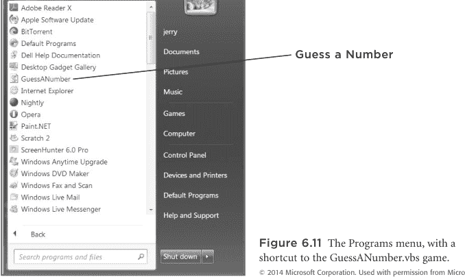

图 6.11 程序菜单，包含一个指向 GuessANumber.vbs 的快捷方式。

© 2014 Microsoft Corporation。经 Microsoft 许可使用。

如果你在运行 Windows 8.1 的计算机上运行此脚本，它会将你的脚本快捷方式添加到应用程序组中，如图 6.12 所示。

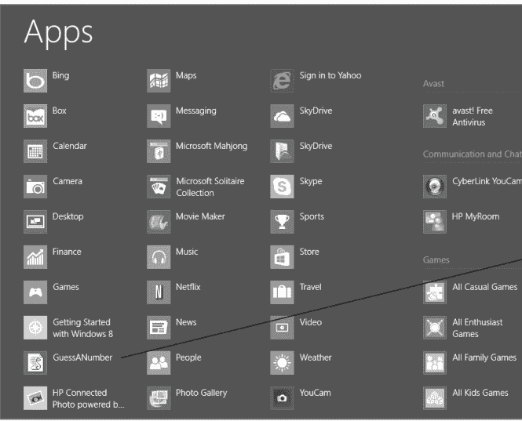

图 6.12 Windows 8.1 应用程序组，包含一个指向 GuessANumber.vbs 的快捷方式。

© 2014 Microsoft Corporation。经 Microsoft 许可使用。

## 一个完整的快捷方式脚本

现在让我们把之前过的过的快捷方式示例组合起来，创建一个新脚本在 Windows 桌面和程序菜单上为 GuessANumber.vbs 创建快捷方式。

```
****************************************************************
'Script Name: ShortcutMaker.vbs
'Author: Jerry Ford
'Created: 02/20/14
'Description: 此脚本在桌面和程序菜单上为 GuessANumber.vbs
'创建快捷方式。
****************************************************************
'初始化部分
Option WshExplicit

Dim objWshShl, strTargetFolder, objDesktopShortcut, objProgramsShortcut
Dim strAppDataPath

'建立 WShell 对象的实例
Set objWshShl = WScript.CreateObject("WScript.Shell")

'创建桌面快捷方式 - 适用于 Windows 7 和 8
strTargetFolder = objWshShl.SpecialFolders("Desktop")
Set objDesktopShortcut = objWshShl.CreateShortcut(strTargetFolder & "\GuessANumber.lnk")
objDesktopShortcut.TargetPath = "c:\GuessANumber.vbs"
objDesktopShortcut.Description = "猜数字游戏"
objDesktopShortcut.Hotkey = "Ctrl+Alt+G"
objDesktopShortcut.Save

'在 Windows 7 上创建程序菜单快捷方式，在 Windows 8 上创建应用程序组快捷方式
strTargetFolder = objWshShl.SpecialFolders("Programs")
Set objProgramsShortcut = objWshShl.CreateShortcut(strTargetFolder & "\GuessANumber.lnk")
objProgramsShortcut.TargetPath = "c:\GuessANumber.vbs"
objProgramsShortcut.Save
```

# 初学者 Microsoft WSH 与 VBScript 编程，第四版


我实现了一些规模效益。首先，我只需要实例化一次 `WShell` 对象。我还反复使用了 `strTargetFolder` 变量。然而，我认为为每个文件夹分配不同的变量会让脚本更具可读性。在运行 Windows 7 的计算机上运行此脚本，你应该能看到 Windows 桌面和程序菜单上添加了 `GuessANumber.vbs` 的快捷方式。在运行 Windows 8 的计算机上运行此脚本，你应该会在桌面和应用程序组中看到一个快捷方式。

## 总结

在这一章中，你学习了循环以及如何将它们应用到你的 VBScript 中。你通过创建“猜数字”游戏，加深了对这一基础概念的理解。你还学习了如何通过编程方式处理快捷方式，包括 Windows 桌面和程序菜单。

| 挑战 |
| :--- |
| 1. 修改“猜数字”游戏，为玩家提供更好的提示。 |
| 2. 修改“猜数字”游戏，将范围从 100 增加到 1000。 |
| 3. 重写“猜数字”游戏，使用 `DoWhile` 语句替换 `DoUntil` 语句。 |
| 4. 以 `ShortcutMaker.vbs` 为起点，创建一个在文件夹中创建多个快捷方式的新脚本。 |

## 使用过程组织脚本

到目前你已经看到并处理了许多 VBScript 项目，所有的脚本都是以相同的方式组织的。首先，你设置了初始化（定义变量、常量、对象等）。然后按顺序编写了脚本的其他部分。你通过在脚本内部嵌套语句进一步完善了你的脚本。在这一章中，你将学习如何使用过程进一步改进你的脚本组织结构。具体来说，你将学习：

- 如何创建自定义函数
- 如何使用子程序创建可重用的语句集合
- 如何将脚本拆分为模块以便于管理
- 如何在过程中控制变量的作用域

## 项目预览：简化黑杰克 (Blackjack Lite)

在这一章中，你将创建一个名为“简化黑杰克”的游戏。这个游戏基于世界各地赌场流行的经典黑杰克游戏。在这个游戏中，玩家和电脑都将分发一张朝上的牌。游戏的目标是尽可能接近 21 点而不超过。玩家可以根据需要要求更多的牌（要牌），并随时停止（停止要牌）。如果玩家总分超过 21，他就爆牌了。电脑也会出牌，直到总分达到 17 点或爆牌为止。图 7.1 到 7.4 展示了在运行 Windows 8.1 的计算机上运行的游戏。

# 初学者 Microsoft WSH 与 VBScript 编程，第四版

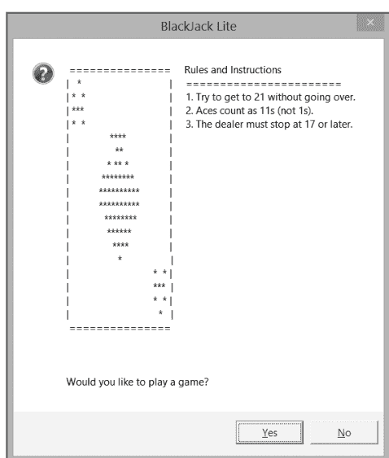

图 7.1 游戏启动界面邀请用户玩简化版黑杰克游戏。© 2014 Cengage Learning。

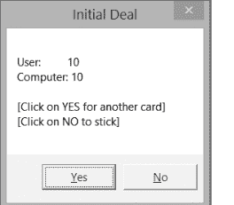

图 7.2 如果用户接受游戏提议，将分发初始手牌。© 2014 Cengage Learning。

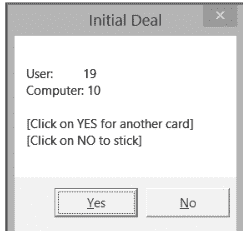

图 7.3 用户一直玩，直到爆牌或停止要牌。© 2014 Cengage Learning。

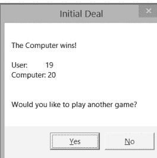

图 7.4 电脑随后出牌，并显示游戏结果。© 2014 Cengage Learning。

# 使用过程改进脚本设计

VBScript 过程可以提高脚本的整体结构和可读性，为你提供了一种将相关语句分组并作为一个单元执行的方法。一旦定义，VBScript 过程就可以从脚本中的任何位置被调用，并根据需要重复执行。这使得你能够创建规模更小、更易维护的脚本。

VBScript 两种类型的过程支持：

- **子程序（Subroutine）**。这是一种执行一组语句但不返回结果的 VBScript 过程。
- **函数（Function）**。这是一种执行一组语句并（可选地）向调用它的语句返回结果的 VBScript 过程。

简单来说，过程就是 VBScript 语句的集合，在被调用时，它们作为一个单元执行。

# 技巧

我建议将过程作为所有 VBScript 的主要组织工具。通过将脚本组织成过程，你将其拆分为一个单元集合。这允许你将各个进程相互分离，从而以模块化的方式开发脚本，一次开发一个组件。

## 引入子程序

VBScript 的 `Sub` 用于创建子程序。子程序非常适合将执行共同任务且不需要结果的语句组合在一起。当被调用时，子程序执行其语句，并将控制权返回给调用语句。

此类过程的语法如下：

```
[Public | Private] Sub name [(arglist)]
statements
End Sub
```

`Private` 是一个可选关键字，指定该子程序不能被脚本中的其他过程调用，从而限制了引用它的能力。`Public` 是一个可选关键字，指定该子程序可以被脚本中的其他过程调用。`name` 是分配给子程序的名称。与变量一样，子程序的名称在定义它的脚本中必须是唯一的。`arglist` 代表一个或多个用逗号隔开的参数列表，这些参数可以传递给子程序进行处理，而 `statements` 代表构成子程序的语句。

例如，下一个子程序被命名为 `DisplaySplashScreen()`。它不接受任何参数，也不会向调用它的 VBScript 语句返回任何内容。它的作用是每当被调用时都显示一个启动界面。

# 《面向初学者的 Microsoft WSH 和 VBScript 编程》，第四版

```
Sub DisplaySplashScreen()
    MsgBox "Thank you for playing the game. © Jerry Ford 2014." & _
    vbCrLf & vbCrLf & "Please play again soon!", 4144, "Test Game"
End Sub
```

你可以通过以下语句从脚本中的任何位置调用它来执行：

`DisplaySplashScreen()`

接下来的示例是之前子程序的重写，只是这次子程序接受一个参数。传递给子程序的参数将是一个消息。通过这种方式使用子程序，你可以开发出使用一个子程序显示所有弹窗对话框的脚本。

```
Sub DisplaySplashScreen(strMessage)
    MsgBox strMessage, 4144, "Test Game"
End Sub
```

你可以像这样从脚本中的任何位置调用此子程序：

`DisplaySplashScreen("Thank you for playing the game. © Jerry Ford " & _ "2014." & vbCrLf & vbCrLf & "Please play again soon!")`

# 创建函数

函数与子程序几乎完全一样。函数可以完成子程序能做的的任何工作。此外，函数还可以向它调用的语句返回结果。作为结果（为了简单起见），我在我的 VBScript 中使用函数而不是子程序。

函数的语法如下：

```
[Public | Private] Function name [(arglist)]
statements
End Function
```

`Private` 是一个可选关键字，指定该函数不能被脚本中的其他过程调用，限制了引用它的能力。`Public` 是一个可选关键字，指定该函数可以被脚本中的其他过程调用。`name` 是分配给函数的名称。在不同情况下，函数的名称在定义它的脚本中必须是唯一的。`arglist` 代表一个或多个用逗号隔开的参数列表，这些参数可以传递给函数进行处理，而 `statements` 代表构成函数的语句。

让我们来看一个不向调用语句返回结果的函数示例：

```
Function DisplaySplashScreen()
    MsgBox "Thank you for playing the game. © Jerry Ford 2014." & _
    vbCrLf & vbCrLf & "Please play again soon!", 4144, "Test Game"
End Function
```

# 第 7 章 • 使用过程组织脚本

按照写法，此函数执行的操作与你之前看到的子程序完全相同。可以使用以下语句从脚本的任何地方调用此函数：

`DisplaySplashScreen()`

与子程序一样，你可以向函数传递任意数量的参数，只要用逗号分隔参数即可，如下所示：

```
Function DisplaySplashScreen(strMessage)
    MsgBox strMessage, 4144, "Test Game"
End Function
```

再次，此函数与你刚刚看到的对应子程序没有区别，并如下调用：

`DisplaySplashScreen("Thank you for playing the game. © Jerry Ford " &_ "2014." & vbCrLf & vbCrLf & "Please play again soon.")`

函数还可以设置为返回给其调用语句。这通过在函数内部创建一个与函数同名的变量，并将该变量设置为你想让函数返回的结果来实现。

再次，这种技术可以通过一个示例来演示：

```
Function GetRandomNumber()
    '生成一个1到10之间的随机数
    Randomize
    GetRandomNumber = FormatNumber(Int((10 * Rnd) + 1))
End Function
```

# 第 7 章 • 使用过程组织脚本

- 我在 `Do...Until` 循环中嵌入了一个 `If` 语句，以确保玩家输入的是数字。
- 我在上一个 `If` 语句中嵌入了第二个 `If` 语句，以确保玩家输入的是数值。
- 我在上一个 `If` 语句中又嵌入了三个 `If` 语句，以判断玩家的猜测是低、高还是正确。

如你所见，我必须将一组语句嵌套在一起，将脚本组织成一个可运行的游戏。由于脚本本身并不大，这项任务是可以完成的。然而，如果脚本大得多或更复杂，将很难追踪所有的嵌套逻辑。

现在你已经理解过程（procedures）以及它们的用途，让我们花一点时间回去，使用过程来重新设计“猜数字游戏”。实现此目标的一种方法如下：

```
****************************************************************
'脚本名称: GuessNumber-2.vbs
'作者: Jerry Ford
'创建日期: 02/01/14
'描述: 此脚本与用户玩一个猜数字游戏
****************************************************************
```

初始化部分

`Option Explicit`

```
Const cGreetingMsg = "请输入 1 - 100 之间的数字"
Dim intUserNumber, intRandomToEnd, intNoGuesses, strBadData

strOkToEnd = "no"
intNoGuesses = 0
```

```
'主处理部分

RandomNumber() '获取游戏的随机数
PlayTheGame() '开始游戏
WScript.Quit() '结束游戏
```

过程部分

'生成游戏的随机数

```
Function RandomNumber()
    '生成一个随机数
    Randomize
    intRandomNo = FormatNumber(Int((100 * Rnd) + 1))
End Function
```

```
'设置一个 Do...Until 循环来控制游戏的执行
Function PlayTheGame()
```

```
'循环直到玩家猜正确或点击“取消”
Do Until strToEnd = "yes"

    '提示玩家选择一个数字
    intUserName = InputBox("your guess:", cGreetingMsg)
    intNoGesses = intNoGesses + 1
    strBadData = "no"
```

```
    '检查玩家的输入是否有错误
    ValidateInput()
```

```
    If strToEnd <> "yes" Then  '玩家输入了内容
        If strBadData <> "yes" Then  '玩家输入的是数字
            TestAnswer()  '让我们看看玩家猜得如何
        End If
    End If

Loop
End Function
```

```
'判断玩家输入的数据是否存在问题
Function ValidateInput()
```

```
    '检查玩家是否提供了答案
    If Len(intUserName) = 0 Then
        MsgBox "你没有输入值或点击了" & _
        "取消。请尽快重玩！", cGreetingMsg
        strToEnd = "yes"
    Else
        '确保玩家输入的是数字
        If IsNumeric(intUserName) = False Then
            MsgBox "抱歉。你没有输入数字。请重试。", .
            cGreetingMsg
            strBadData = "yes"
        End If
    End If
End Function
```

'判断玩家的猜测是太低、太高还是正好

```
Function TestAnswer()
```

```
    '测试玩家的猜测是否正确
    If FormatNumber(intUserName) = intRandomNo Then
        MsgBox "恭喜你！你猜对了。数字是 " & \
        intUserName & " "." & vbCrLf & vbCrLf & "你仅用了 " & \
        intNoGuesses & " 次机会就猜中了。",cGreetingMsg
        strkToEnd = "yes"
    End If
```

```
    '测试玩家的猜测是否太低
    If FormatNumber(intUserName) < intRandomNo Then
        MsgBox "你猜太低了。请重试", .cGreetingMsg
        strkToEnd = "no"
    End If
```

```
    '测试玩家的猜测是否太高
    If FormatNumber(intUserName) > intRandomNo Then
        MsgBox "你猜太高了。请重试", .cGreetingMsg
        strkToEnd = "no"
    End If
End Function
```

如你所见，脚本的初始化部分保持不变，只增加了一个变量，用于指示玩家输入了无效字符。然而，主处理部分现在变得完全不同了。它不再将所有脚本语句嵌入其中，而是通过维持对一组函数的高层级控制来驱动脚本，每个函数都为脚本执行特定的过程。

主处理过程现在做三件事：

- 它调用一个获取游戏随机数的函数（`RandomNumber()`）。
- 它调用一个控制游戏过程的函数（`PlayTheGame()`）。
- 它通过执行 `WScript` 对象的 `Quit()` 方法来结束游戏。

`RandomNumber()` 函数生成游戏使用的随机数。`PlayTheGame()` 函数控制游戏本身的过程。我没有写一个巨大的函数，而是通过删除和修改执行输入验证的 `If` 语句，并将它们放置在名为 `ValidateInput()` 的独立函数中，对其进行了简化。同样，我修改了三个判断玩家猜测是低或正确的 `If` 语句，将它们放入了自己的函数 `TestAnswer()` 中。

# 使用内置 VBScript 函数

VBScript 提供了大量的内置函数，你可以将它们添加到脚本中以节省时间和精力。显然，利用这些内置函数的便利性和强大是非常关键的。事实上，VBScript 的内置函数对于开发非常重要，以至于没有它们很难编写任何复杂的脚本。所有内置函数的完整列表请见附录 D，内置函数。

# 使用过程限制作用范围

在本书书中你见过并使用了变量。到为止，你处理的所有变量都是全局作用域。定义在 VBScript 过程（即函数或子程序）之外的变量具有全局作用域。

`Option Explicit`

```
Dim intRandomNumber
```

```
intRandomNumber = GetRandomNumber()
MsgBox "第一个随机数是 " & intRandomNumber
```

```
GenerateLocalizedVariable()
MsgBox "第二个随机数是 " & intRandomNumber
```

```
WScript.Quit()
```

```
Function GenerateLocalizedVariable()
    Dim intSecondRandomNumber
    intRandomNumber = GetRandomNumber()
    MsgBox "第二个随机数是 " & intSecondRandomNumber
End Function
```

```
Function GetRandomNumber()
    '生成一个1到10之间的随机数
    Randomize
    GetRandomNumber = FormatNumber(Int((10 * Rnd) + 1))
End Function
```

当你运行此脚本时，第一个变量定义在脚本开头，这是一个全局变量。立即显示该变量的值。第二个变量定义在名为 `GenerateLocalizedVariable` 的函数内部。该变量只能在该函数内部被引用，函数中的 `MsgBox()` 语句显示其值证明了这一点。当 `GenerateLocalizedVariable()` 完成执行时，处理控制返回到调用该函数的语句。该语句之后是另一个 `MsgBox()` 语句，它尝试显示在 `GenerateLocalizedVariable()` 函数中定义的变量。然而，由于该函数已结束该变量已被销毁，显示的不是变量值，而是一个错误消息。图 7.5 显示了当此脚本在 Windows 7 上运行时显示的错误消息。

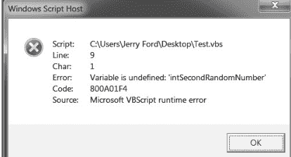

> 图 7.5 在定义它的过程之外尝试访问局部变量会导致错误。

# 零基础初学者的 Microsoft WSH 与 VBScript 编程，第四版


## 返回 BlackJack Lite 游戏

现在，让我们回到 BlackJack Lite 游戏的开发。在这个游戏中，你将开发你自己的版本的赌场黑杰克。BlackJack Lite 是一种玩家与电脑对战的纸牌游戏。游戏的目的是点数尽可能接近 21 点而不超过它，并击败电脑的手牌。电脑像真实的赌场黑杰克经销商一样，会等待玩家完成游戏。然后电脑必须继续出牌，直到它爆牌（超过 21 点）或达到至少 17 点，此时它必须停止。

## 设计游戏

BlackJack Lite 游戏比你在此书中之前看到的其他 VBScript 都要复杂。游戏本身有大量的函数需要执行。例如，必须为玩家和电脑都发初始牌。然后游戏必须便于向玩家发牌，随后向电脑发牌。此外，在此过程中必须发生许多较小的过程。

由于这个脚本相当复杂，我决定将其组织成过程（procedures）。每个过程将被分配执行一项特定的活动。作为准备游戏设计的一部分，我画了一幅游戏整体结构和处理逻辑的高级流程图。该流程图如图 7.6 所示。

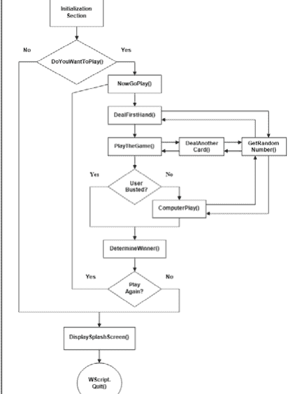

图 7.6 概述 BlackJack Lite 游戏整体设计和执行流程的流程图。© 2014 Cengage Learning。

## 第 7 章 使用过程组织脚本

脚本由九个函数组成。这些函数及其用途如下：

- `DoYouWantToPlay()`。显示启动界面并邀请用户玩游戏。
- `NoGoPlay()`。控制游戏的整体执行，根据需要调用其他过程。
- `DealFirstHand()`。为玩家和电脑展示初始牌。
- `PlayTheGame()`。询问玩家是否想要另一张牌，并确定玩家何时爆牌或决定要牌（hold）。
- `DealAnotherCard()`。为玩家的手牌获取另一张牌。
- `GetRandomNumber()`。此函数由脚本中的其他几个函数调用。它返回一个 1 到 13 之间的随机数，代表纸牌的值。
- `ComputerPlay()`。进行电脑的手牌，持续加牌直到电脑爆牌或大于 17。
- `DetermineWinner()`。比较玩家的手牌和电脑的手牌以决定胜负。它提供让玩家再玩一手的机会。如果玩家接受，则调用 `NoGoPlay()` 函数开始新的一手牌。
- `DisplaySplashScreen()`。显示有关游戏及其作者的信息，并在游戏最终结束后邀请玩家返回再次玩。

## 设置初始化部分

你开始开发 Blackjack Lite 游戏的方法和你开始所有其他游戏的方法相同：创建一个新文件并将其添加到你的 VBScript 模板中，然后在脚本的初始化部分设置变量、常量和对象引用。

```vbscript
****************************************************************
'Script Name: Blackjack.vbs
'Author: Jerry Ford
'Created: 02/03/14
'Description: 此脚本创建一个缩减版的赌场
'blackjack 纸牌游戏
****************************************************************
```

```vbscript
Option Explicit

Dim intPlayGame, strCardImage, intUserCard, intComputerCard, intAnotherCard
Dim intUserNextCard, strUserDone, intNewComputerCard, intPlayAgain
Dim strUserBusted, strTextMsg
```

```vbscript
strUserDone = "False"
strUserBusted = "False"
```

这个游戏相当冗长，需要许多变量：

- `intPlayGame`。存储玩家在被问是否想玩游戏时的回复。
- `strCardImage`。存储在游戏初始弹出对话框中显示的消息。
- `intUserCard`。存储发给用户的纸牌总分值。
- `intComputerCard`。存储发给电脑的纸牌总分值。
- `intAnotherCard`。存储玩家对“是否想要再来一轮”问题的回复。
- `intUserNextCard`。存储获取随机数的函数返回的值，该值稍后加到 `intUserCard` 变量的值上。
- `strUserDone`。存储一个表示玩家是否已准备好要牌（hold）的值。
- `intNewComputerCard`。存储获取随机数的函数返回的值，该值稍后加到 `intComputerCard` 变量的值上。
- `intPlayAgain`。存储玩家在被问是否想玩另一个游戏时的回复。
- `strUserBusted`。存储一个表示玩家是否爆牌的值。
- `strTextMsg`。存储在游戏显示的弹出对话框中出现的文本。

## 开发主处理部分的逻辑

脚本的主处理部分非常精小，仅包含对 `DoYouWantToPlay()` 函数的调用，以确定玩家是否想玩游戏，随后是 `Select Case` 语句，用于确定玩家的回复。

```vbscript
' 主处理部分

' 询问用户其是否想玩游戏
intPlayGame = DoYouWantToPlay()
```

```vbscript
Select Case intPlayGame
    Case 6 ' 用户点击了是
        NowGoPlay()
    Case 7 ' 用户点击了否
        DisplaySplashScreen()
End Select
```

如果玩家点击“是”按钮，则调用 `NowGoPlay()` 函数。否则，调用 `DisplaySplashScreen()` 函数。该函数显示有关游戏及其作者的信息，并在游戏最终结束后邀请玩家返回再次玩。

## `DoYouWantToPlay()` 函数

该函数显示游戏的启动界面并邀请玩家玩游戏。该弹出对话框显示的大部分内容是关于黑杰克游戏的。该对话框中还包含了规则说明。

```vbscript
Function DoYouWantToPlay()
    strCardImage = "Blackjack" & vbCrLf & "==" & vbCrLf & "Rules:" & vbCrLf & "1. 尽可能接近 21 点而不超过。" & vbCrLf & "2. 王牌计 11 点。" & vbCrLf & "3. 经销商在爆牌或达到 17 点时停止。" & vbCrLf & vbCrLf & "Would you like to play a game?"
    DoYouWantToPlay = MsgBox(strCardImage, 36, "Blackjack Lite")
End Function
```

如果玩家点击“是”按钮，则 `DoYouWantToPlay` 的值设置为 6。这个值稍后将在脚本的主处理部分中进行测试，以决定是否继续游戏。

## `NowGoPlay()` 函数

当玩家点击初始弹出对话框中的“是”时，调用 `NowGoPlay()` 函数，表示他想玩游戏。

```vbscript
Function NowGoPlay()
    DealFirstHand()
    PlayTheGame()
    If strUserBusted = "False" Then
        ComputerPlay()
    End If
    DetermineWinner()
End Function
```

此函数控制游戏的进行。它由对其他函数的调用组成。首先它调用 `DealFirstHand()` 函数为玩家和电脑发初始牌。接下来它调用 `PlayTheGame()` 函数，允许玩家继续加牌或要牌，并确定玩家是否爆牌。`NowGoPlay()` 函数检查 `strUserBusted` 变量以决定是否继续游戏。

如果玩家决定要牌，则调用 `ComputerPlay()` 函数，让电脑（经销商）的手牌完成发牌。无论玩家爆牌还是调用了 `ComputerPlay()` 函数，最终都会返回 `NowGoPlay()` 函数并调用 `DetermineWinner()` 函数。该函数决定胜负并给予玩家玩另一手的机会。

## `DealFirstHand()` 函数

`DealFirstHand()` 函数调用两次 `GetRandomNumber()` 函数来发放玩家和电脑的初始牌：

```vbscript
Function DealFirstHand()
    intUserCard = GetRandomNumber()
    intComputerCard = GetRandomNumber()
End Function
```

## `PlayTheGame()` 函数

所示 `PlayTheGame()` 函数设置了一个 `Do Until` 循环，直到玩家爆牌或决定要牌为止。循环中的第一个语句提示玩家决定是否想要另一张牌。如果玩家点击“是”，则调用 `DealAnotherCard()` 函数。`PlayTheGame()` 函数检查玩家是否爆牌，并根据情况设置 `strUserBusted` 和 `strUserDone` 变量的值（True）。

```vbscript
Function PlayTheGame()
    Do Until strUserDone = "True"
        intAnotherCard = MsgBox("User: " & Space(8) & intUserCard & vbCrLf & _ 
            "Computer: " & intComputerCard & vbCrLf & vbCrLf & _
            "[点击 YES 获取另一张牌]" & vbCrLf & _
            "[点击 NO 留牌]", 4, "Initial Deal")

        Select Case intAnotherCard
            Case 6 ' User clicked on Yes
                MsgBox "You decided to take a hit."
                DealAnotherCard()
            Case 7 ' User clicked on No
                strUserDone = "True"
        End Select

        If intUserCard > 21 Then
            strUserBusted = "True"
            strUserDone = "True"
        End If
    Loop
End Function
```

## 创建 `GetRandomNumber()` 函数

当调用时，`GetRandomNumber()` 会生成一个 1 到 13 之间的随机数。如果生成的随机数等于 1（相当于 A），则返回值 11。如果生成的随机数大于 10（相当于 J、Q 或 K），则返回值 10。任何其他随机值都将按原样返回。

```vbscript
Function GetRandomNumber()
    Randomize
    GetRandomNumber = Int((13 * Rnd) + 1)
    If GetRandomNumber = 1 Then GetRandomNumber = 11
    If GetRandomNumber > 10 Then GetRandomNumber = 10
End Function
```

## 创建 `DealAnotherCard()` 函数

当玩家选择要牌（请求另一张牌）时，`PlayTheGame()` 函数会调用 `DealAnotherCard()` 函数。该函数由两个语句组成。第一条语句将 `GetRandomNumber()` 函数返回的牌号赋值给名为 `intNextCard` 的变量。第二条语句通过将新牌的值加到玩家手中已有的牌上，来计算玩家的手牌总和。

```vbscript
Function DealAnotherCard()
    Dim intNextCard
    intNextCard = GetRandomNumber()
    intUserCard = intUserCard + intNextCard
End Function
```

## 创建 `ComputerPlay()` 函数

此处显示的 `ComputerPlay()` 函数负责给电脑发牌。它使用 `Do While` 循环继续给电脑发牌，直到电脑的手牌总和达到 17 或以上，或者直接爆牌。

```vbscript
Function ComputerPlay()
    Do While intComputerCard < 17
        intNewComputerCard = GetRandomNumber()
        intComputerCard = intComputerCard + intNewComputerCard
    Loop
End Function
```

在循环内部有两个语句。第一条语句通过调用 `GetRandomNumber()` 函数来发新牌。第二条语句使用 `GetRandomNumber()` 函数返回的值来更新电脑的手牌（即其总和）。

## 创建 `DetermineWinner()` 函数

此处显示的 `DetermineWinner()` 函数检查 `strUserBusted` 的值是否为 True。它还会通过检查 `intComputerCard` 的值是否大于 21 来检查电脑是否爆牌。如果其中任一条件成立，脚本会将适当的消息赋值给 `strTextMsg` 变量。该变量将作为 `MsgBox()` 弹出框的输入，显示游戏结果。如果这两个条件都不成立，`DetermineWinner()` 将进行三个测试来判断玩家是赢了还是平局。函数会相应设置 `strTextMsg` 的值。

```vbscript
Function DetermineWinner()
    If strUserBusted = "True" Then
        strTextMsg = "The user has busted!"
    ElseIf intComputerCard > 21 Then
        strTextMsg = "The Computer has busted!"
    Else
        If intUserCard > intComputerCard Then strTextMsg = "The user wins!"
        If intUserCard = intComputerCard Then strTextMsg = "Push (i.e. Tie)!"
        If intUserCard < intComputerCard Then strTextMsg = "The Computer wins!"
    End If

    intPlayAgain = MsgBox(strTextMsg & vbCrLf & vbCrLf & "User: " & Space(8) & intUserCard & vbCrLf & "Computer: " & intComputerCard & _ 
        vbCrLf & vbCrLf & vbCrLf & _ 
        "Would you like to play another game?", 4, "Initial Deal")

    If intPlayAgain = 6 Then
        strUserBusted = "False"
        strUserDone = "False"
        NowGoPlay()
    Else
        DisplaySplashScreen()
    End If
End Function
```

最后，通过显示 `strTextMsg` 的值以及玩家和电脑最终手牌的值来显示游戏结果。弹出对话框还会询问玩家是否想再次游戏。如果玩家点击 Yes 按钮，则会调用 `NowGoPlay()` 函数并重新开始游戏。否则，调用 `DisplaySplashScreen()` 函数并结束游戏。

## 创建 `DisplaySplashScreen()` 函数

此函数显示游戏的启动界面，提供关于游戏及其创建者的简要信息，并邀请玩家回来玩。

```vbscript
Function DisplaySplashScreen()
    MsgBox "Thank you for playing!" & vbCrLf & "Please play again", 4, "BlackJack"
    WScript.Quit()
End Function
```

显示启动界面后，`DisplaySplashScreen()` 函数结束游戏。

## 最终结果

## 总结

在本章中，你学习了如何使用过程来简化你的 VBScript。此外，你学会了如何创建可重用代码单元。最后，你学习了如何控制变量的作用域。

## 与 Windows 文件系统交互

WSH 核心对象模型提供了与各种 Windows 资源交互的能力，例如 Windows 桌面和注册表。然而，它没有提供对 Windows 文件系统的任何访问，因此你无法使用它来访问本地驱动器或处理文件和文件夹。微软没有将此功能作为 WSH 核心对象模型的一部分，而是通过 `FileSystemObject` 对象来实现，它是 VBScript 的运行时对象之一。请参阅第 3 章“VBScript 基础”中的表 3.4 获取 VBScript 运行时对象的完整列表。

`FileSystemObject` 对象是 VBScript 的主要运行时对象。除 `Dictionary` 外，所有其他运行时对象都派生自它。要使用 `FileSystemObject` 对象，你必须如下所示实例化：

```vbscript
Set objFso = CreateObject("Scripting.FileSystemObject")
```

设置 `FileSystemObject` 对象实例的第一步是使用 `Set` 语句将变量与它关联。这是通过使用 VBScript 的 `CreateObject()` 方法并指定 `FileSystemObject` 为 `Scripting.FileSystemObject` 来完成的。一旦实例化，你就可以通过引用设置好的变量与 `FileSystemObject` 对象进行交互，从而访问所有 `FileSystemObject` 对象的属性和方法。


为了快速加强对 `FileSystemObject` 对象及其用法的理解，让我们从一个示例开始：创建一个 VBScript，它使用 `FileSystemObject` 对象来检索并显示与名为 `Sample.txt` 的文件相关的属性。脚本首先实例化 `FileSystemObject` 对象并将其与名为 `objFso` 的变量关联。接下来，使用 `FileSystemObject` 对象的 `GetFile()` 方法获取专门指向 `Sample.txt` 的 `File` 引用，该文件位于 `C:\Temp` 文件夹中。

脚本的主处理执行了一系列过程调用。`CreateDisplayString()` 函数使用多个 `File` 对象属性来收集有关 `Sample.txt` 文件的信息。这两个函数显示收集到的文件信息并终止脚本的执行。

```
************************************************************************************
'Script Name: ExtractFileProperties.vbs
'Author': Jerry Ford
'Created: 02/10/14
'Description: 此脚本演示了如何检索文件信息
************************************************************************************
```

### 初始化部分

```
Option Explicit
On Error Resume Next
Dim objFso, strInputFile, strDisplayString
Set objFso = WScript.CreateObject("Scripting.FileSystemObject")
Set strInputFile = objFso.GetFile("C:\Temp\Sample.txt")
```

### 主处理部分

```
CreateDisplayString()
DisplayMessage()
TerminateScript()
```

### 过程部分

```
Function CreateDisplayString()
    strDisplayString = "C:\Temp\Sample.txt" & vbCrLf & _vbbCrLf & "Created on: " & vbTab & strInputFile.DateCreated & _bCrLf & "Last Modified: " & vbTab & strInputFile.DateLastModified & _bCrLf & "Last Accessed: " & vbTab & strInputFile.DateAccessed & _bCrLf
End Function
```

```
Function DisplayMessage()
    MsgBox strDisplayMessage
End Function
```

```
Function TerminateScript()
    '停止此脚本的执行
    WScript.Quit()
End Function
```

从此示例得到的核心点是，它与属于 `File` 对象的 Windows 文件系统属性交互，以收集给定文件的信息。要操作 `File` 对象，你必须使用 `FileSystemObject` 的 `GetFile()` 方法，这首先要求你设置一个 `FileSystemObject` 实例。

如果你在运行 Windows 8.1 的计算机上运行此脚本，将看到与图 8.4 所示类似的输出。

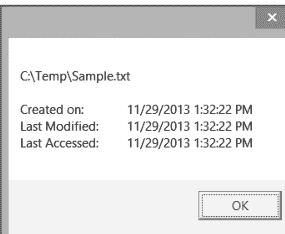

图 8.4 使用 FileSystemObject 属性检索文件信息。© 2014 Cengage Learning.

## 打开和关闭文件

现在你已经知道如何在 VBScript 中实例化 `FileSystemObject` 对象，并看到了如何使用它引用其他运行时对象及其关联属性的示例，你准备好开始学习处理文件和文件夹了。

在打开文件或创建新文件之前，你必须确定文件是否已存在。你可以像所示使用 `FileSystemObject` 对象的 `FileExists()` 方法：

```
Set objFso = WScript.CreateObject("Scripting.FileSystemObject")
If (objFso.FileExists("C:\Temp\Sample.txt")) Then
End If
```

要开始处理文件，你必须打开它。这是通过使用 `FileSystemObject` 对象的 `OpenTextFile()` 方法实现的，它要求你提供以下信息：

- 文件的名称和路径
- 如何打开文件
- 如果文件不存在是否创建新文件

表 8.1 定义了你将使用的常量和值，用于告诉 `OpenTextFile()` 方法如何打开文件。

| 常量 | 描述 | 值 |
| :--- | :--- | :--- |
| ForReading | 读取打开文件 | 1 |
| ForWriting | 用于写入打开文件 | 2 |
| ForAppending | 以追加方式打开文件 | 8 |

表 8.2 OpenTextFile() 选项

| 值 | 描述 |
| :--- | :--- |
| True | 如果文件不存在则创建新文件 |
| False | 如果文件不存在不创建新文件 |

让我们来看一个所学知识付行的 VBScript。在这个示例中，脚本打开位于 C 盘 Temp 目录下的 `Sample.txt` 文件。如果文件存在，脚本将打开它；如果文件不存在，脚本将创建它。打开后，脚本写入几行文本然后关闭文件。

```
********************************************************************************
'Script Name: FileCreate.vbs
'Author': Jerry Ford
'Created: 02/10/14
'Description: 此脚本演示了如何创建、打开并向文件写入文本。
********************************************************************************
```

### 初始化部分

```
Option Explicit
Dim objFso, objFileHandle, strFileName
Set objFso = WScript.CreateObject("Scripting.FileSystemObject")
strFileName = "C:\Temp\Sample.txt"
```

### 主处理部分

```
OpenFile()
WriteTextOutput()
CloseFile()
TerminateScript()
```

### 过程部分

```
Function OpenFile()
    '如果存在则以追加模式打开，否则创建新文件
    If (objFso.FileExists(strFileName)) Then
        Set objFileHandle = objFso.OpenTextFile(strFileName, 8)
    Else
        Set objFileHandle = objFso.OpenTextFile(strFileName, 2, "True")
    End If
End Function
```

```
Function WriteTextOutput()
    '向文本文件写入行文本
    objFileHandle.WriteLine("Once upon a time there was a little boy who")
    objFileHandle.WriteLine("lived in a shoe. Unfortunately it was two sizes")
    objFileHandle.WriteLine("too small!")
End Function
```

```
Function CloseFile()
    '处理完成后关闭文件
    objFileHandle.Close()
End Function
```

```
Function TerminateScript()
    '停止此脚本的执行
    WScript.Quit()
End Function
```

在允许脚本执行之前，务必记住关闭所有打开的文件是非常重要的。你通过使用 `FileSystemObject` 对象的 `Close()` 方法来实现，如下所示：`objFileHandle.Close()`。

如果你在处理文件后忘记关闭它，文件可能会损坏，因为没有为它创建文件结束标记。

### 陷阱

你每次只能以一种模式打开文件。也就是说，如果你以读取模式打开文件，你的脚本就无法向文件中写入新文本，除非你先关闭文件然后以写入模式重新打开它。

---

# 初学者入门 Microsoft WSH 与 VBScript 编程，第四版

如果你在运行 Windows 8.1 的计算机上保存并运行此脚本，然后使用 Windows 记本打开 `Sample.txt` 文件，你将看到图 8.5 所示的输出。

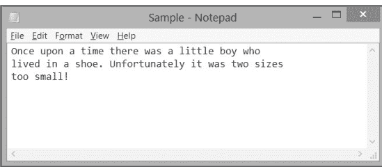

**图 8.5** 写入新文件或现有文件。© 2014 Microsoft Corporation。经微软许可。

## 写入文件

在关于 VBScript 如何将文本写入文件时，你有若干种不同的选择：

- 一次写入一个或多个字符
- 一次写入一行
- 写入空行

当你需要仔细格式化文本输出时（例如当你想创建一个数据列对齐的报告时），一次写入一个或多个字符是很好的。另一方面，当格式较为自由时，一次写入一行文本则非常方便。最后，在文件中插入或写入行可以帮助你改进文件的外观，例如在正式报告的标题和正文之间添加空格。

## 写入字符

要一次性写入一个或多个字符，你需要使用 `FileSystemObject` 对象的 `Write()` 方法。该方法不会在其写入的任何文本末尾添加回车符。如果连续使用 `Write()` 方法执行两次操作，则第二次写入操作的文本将插入到文本文件中，紧跟在第一个脚本写入的文本的同一行之后。要实现这一点，请看以下示例：

```
objFso = WScript.CreateObject("Scripting.FileSystemObject")
objFileHandle = _
objFso.OpenFile("C:\Temp\Sample.txt", 2, "True")
objFileHandle.Write("Once upon a time there ") & _
objFileHandle.Write("were three bears.")
objFileHandle.Close()
```

# 第 8 章 数据的存储与检索

如果你在运行 Windows 8.1 的计算机上保存并运行此示例，你将发现脚本添加到文本文件中的输出位于同一行，如图 8.6 所示。

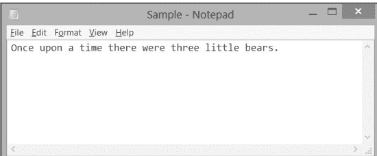

图 8.6 向文本文件写入字符。© 2014 Microsoft Corporation。经微软许可。

## 写入行

你可以通过将 `Write()` 方法替换为 `WriteLine()` 方法来修改之前的示例，从而实现按行写入文本输出：

```
Set objFso = WScript.CreateObject("Scripting.FileSystemObject")
Set objFileHandle = _
objFso.OpenTextFile("C:\Temp\Sample.txt", 2, "True")
objFileHandle.WriteLine("Once upon a time there were three little bears.")
objFileHandle.Close()
```

如果你保存并运行此示例，你会发现结果与上一个示例产生的完全相同。唯一的区别是，当你运行它时，光标现在位于文本文件中下一行的开头，而你运行上一个示例时，光标停留在第一行的末尾。这是因为 `WriteLine()` 方法会自动在每次写入操作的末尾添加换行符。

## 添加空行

你可以使用 `FileSystemObject` 对象的 `WriteBlankLines()` 方法在 VBScript 生成的输出中添加行，以使其看起来更好。该方法通过写入一个空行并将光标移动到文件中下一行的开头来执行。

以下示例演示了如何使用 `FileSystemObject` 对象的 `WriteBlankLines()` 方法：

```
Set objFso = WScript.CreateObject("Scripting.FileSystemObject")
Set strInputFile = objFso.GetFile("C:\VBScriptGames\Hangman.vbs")
Set objFileHandle = _
objFso.OpenTextFile("C:\Temp\Sample.txt", 2, "True")
objFileHandle.WriteBlankLines(1)
objFileHandle.WriteLine("C:\VBScriptGames\Hangman.vbs Properties")
objFileHandle.WriteBlankLines(1)
objFileHandle.WriteLine("--------------------------------------")
objFileHandle.WriteBlankLines(1)
objFileHandle.WriteLine("Creation Date: " & strInputDialog.DateCreated)
objFileHandle.WriteBlankLines(1)
objFileHandle.WriteLine("Last Modified: " & strInputDialog.DateLastModified)
objFileHandle.WriteBlankLines(1)
objFileHandle.WriteLine("--------------------------------------")
objFileHandle.Close()
```

图 8.7 显示了在运行 Windows 8 的计算机上执行脚本后，`Sample.txt` 文件的外观。

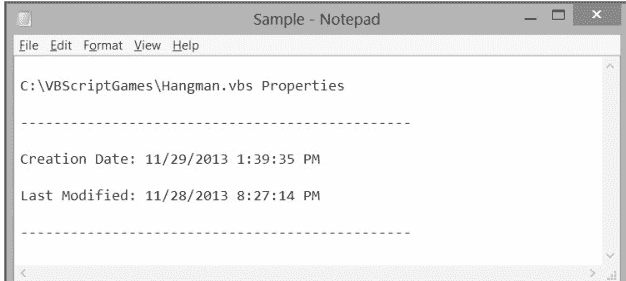

图 8.7 空行改进了 VBScript 创建的报告呈现效果。

## 从文件中读取

VBScript 从文件中读取内容与向文件中写入内容一样简单。然而，在尝试读取或处理文件内容之前，你应该检查文件是否包含数据。你可以使用 `TextStream` 对象的 `AtEndOfStream` 属性来判断文件是否有数据。不仅应该在开始之前检查 `AtEndOfStream` 属性，还应该确保脚本没有到达文件末尾。

为了演示这是如何工作的，请看以下从文件中读取示例：

```
Dim objFso, objFileHandle, strDisplayString
objFso = WScript.CreateObject("Scripting.FileSystemObject")
objFileHandle = objFso.OpenTextFile("C:\Temp\Sample.txt", 1)
Do Until objFileHandle.AtEndOfStream
    strDisplayString = objFileHandle.ReadLine()
    WScript.Echo strDisplayString
Loop
objFileHandle.Close()
```

## 按字符从文件中读取

为了直观了解 `Read()` 方法的用法，请看以下示例。该脚本使用 `For` 循环跳过对 `Sample.txt` 文件前五行的读取。`SkipLine()` 方法跳过文件中下一行（第 6 行）的前 15 个字符。`Read()` 方法从文件中读取后续 22 个字符。然后关闭文件并显示从文件中读取的文本。

```
Dim objFso, objFileHandle, intCounter, strDisplayString
Set objFso = WScript.CreateObject("Scripting.FileSystemObject")
Set objFileHandle = objFso.OpenTextFile("C:\Temp\Sample.txt", 1)
For intCounter = 1 To 5
    objFileHandle.SkipLine()
Next
objFileHandle.Skip(15)
strDisplayString = objFileHandle.Read(22)
objFileHandle.Close()
MsgBox "C:\Temp\Sample.txt was created on " & strDisplayString
```

## 一次性读取文件

有时，你只需要在单次操作中读取整个文件，例如当要读取的文件已经格式化为可以生成你所需的输出内容时。你可以使用 `FileSystemObject` 的 `ReadAll()` 方法来实现这一点，如下所示：

```vb
Dim objFso, objFileHandle, strDisplayString
Set objFso = WScript.CreateObject("Scripting.FileSystemObject")
```


set `objFileHandle` = `objFso.OpenTextFile("C:\Sample.txt",1)`

```vb
strDisplayString = objFileHandle.ReadAll()
objFileHandle.Close()
MsgBox strDisplayString
```

如你所见，脚本使用 `ReadAll()` 操作读取整个文件，并使用 `MsgBox()` 语句显示读取的内容。运行此脚本时显示的输出与图 8.8 所示完全相同，在图中，脚本在显示文件内容之前是逐行读取整个文件的。

# 管理文件和文件夹

除了使用 VBScript 和 WSH 对文件进行读写操作外，你还可以使用它们来帮助管理所有的文件和文件夹。我所说的管理，是指帮助保持它们组织有序——更具体地说，就是自动化组织过程。例如，如果你的计算机连接到局域网，你可以创建一个 VBScript 脚本，复制它在某些文件夹中找到的所有文件并将其存储在网络服务器上。这样，如果你的原始文件发生任何问题，你始终可以通过检索备份副本来恢复它们。

`FileSystemObject` 对象提供了几种方法，用于开发可以自动化管理的脚本：

- `CopyFile()`。复制一个或多个文件。
- `MoveFile()`。移动一个或多个文件。
- `DeleteFile()`。删除一个或多个文件。
- `FileExists()`。判断文件是否存在。

`FileSystemObject` 对象还提供了大量方法用于自动化文件夹管理：

- `CopyFolder()`。复制一个或多个文件夹。
- `MoveFolder()`。移动一个或多个文件夹。
- `DeleteFolder()`。删除一个或多个文件夹。
- `FolderExists()`。判断文件夹是否存在。
- `CreateFolder()`。创建一个新文件夹。

# 初学者入门 Microsoft WSH 和 VBScript 编程，第四版

## 技巧

作为使用 `FileSystemObject` 对象方法的替代方案，你也可以使用共同属于 `File` 和 `Folder` 对象的方法：

- `Copy()`。复制单个文件或文件夹。
- `Delete()`。删除单个文件或文件夹。
- `Move()`。移动单个文件或文件夹。

这些方法有一些缺点。首先，使用这些方法需要同时实例化 `FileSystemObject` 以及 `File` 或 `Folder` 对象，这只是稍微多了一点工作。其次，它们一次只能处理一个文件，而属于 `FileSystemObject` 的对应方法可以一次处理多个文件或进行批量操作。最后，由于 `File` 和 `Folder` 对象共享相同的方法，很容易出错并不小心弄乱。例如，如果你在相同位置有一个同名或相似名称的文件和一个文件夹，很容易不小心删错错误的那个。

## 复制、移动和删除文件

使用 `FileSystemObject` 的 `CopyFile` 方法，你可以创建一个可以复制一个或多个文件的 VBScript 脚本，如下所示：

```vb
Dim objFso
Set objFso = WScript.CreateObject("Scripting.FileSystemObject")
objFso.CopyFile "C:\Temp\Sample.txt", "C:\VBScriptGames\Sample.txt"
```

在这个示例中，位于 C 盘 Temp 文件夹中的名为 Sample.txt 的文件被复制到 C 盘上的 VBScript 文件夹中。通过修改此示例（如下所示），你可以更改脚本以复制多个文件。具体来说，此示例的结果是所有名为 "Sample" 的文件都被复制，无论其文件扩展名是什么。

```vb
Dim objFso
Set objFso = WScript.CreateObject("Scripting.FileSystemObject")
objFso.CopyFile "C:\Temp\Sample.*", "C:\VBScriptGames"
```

## 技巧

通配符使得一次复制、移动或删除多个文件或文件夹成为可能。`*` 和 `?` 字符启用模式匹配。`?`字符用于指定单个字符匹配。`*`字符用于匹配无限数量的字符。例如，在匹配时指定 `*.txt` 可匹配所有具有 .txt 扩展名的文件。指定 `sample?.txt` 则只会匹配文件名为六个字符、前五个字符为 "Sample" 且扩展名为 .txt 的文件。

## 复制一个或多个文件

你可以使用 `CopyFile()` 方法复制一个或多个文件。该方法还支持一个额外的参数，允许你指定当脚本尝试将文件复制到包含同名文件的文件夹时应如何操作。你为此参数指定 `True` 或 `False` 值。如果为 `True`，`CopyFile()` 将替换或覆盖重名文件。如果为 `False`，`CopyFile()` 将取消对同名文件的复制操作。

下面的示例演示了如何将位于 C:\Temp 文件夹中所有具有 .txt 扩展的文件复制到名为 C:\VBScriptGames 的文件夹，且不允许目标位置已存在的任何重复文件被覆盖：

```vb
Dim objFso
Set objFso = WScript.CreateObject("Scripting.FileSystemObject")
objFso.CopyFile("C:\Temp*.txt", "C:\VBScriptGames", False)
```

下一个示例与上一个示例相同，但它允许覆盖重名文件：

```vb
Dim objFso
Set objFso = WScript.CreateObject("Scripting.FileSystemObject")
objFso.CopyFile("C:\Temp*.txt", "C:\VBScriptGames", True)
```

> **技巧** 记住，通过 `FileSystemObject` 的 `FileExists` 和 `FolderExists` 来避免错误。

## 移动一个或多个文件

移动和复制文件的区别在于，复制文件后在两个地方都有副本，而移动文件时，它只位于新位置。你可以使用 `FileSystemObject` 的方法将文件从一个文件夹移动到另一个：

```vb
Dim objFso
Set objFso = WScript.CreateObject("Scripting.FileSystemObject")
objFso.MoveFile("C:\Temp*.txt", "C:\VBScriptGames")
```

在这个示例中，所有 .txt 扩展的文件都从 C:\Temp 文件夹移动到了 VBScriptGames 文件夹。

## 删除多个文件

你可以使用 `FileSystemObject` 的 `DeleteFile()` 方法删除一个或多个文件：

```vb
Dim objFso
Set objFso = WScript.CreateObject("Scripting.FileSystemObject")
objFso.DeleteFile("C:\VBScriptGames*.txt")
```

在这个示例中，C:\VBScriptGames 文件夹中所有名为 *.txt 的文件都被删除。

## 创建新文件夹

你可以使用 `FileSystemObject` 的 `CreateFolder()` 方法创建新文件夹。例如，以下脚本检查 C 盘上是否存在名为 VBScriptGames 的文件夹。如果不存在，脚本将创建它。

```vb
Dim objFso, strNewFolder
Set objFso = WScript.CreateObject("Scripting.FileSystemObject")
If (objFso.FolderExists("C:\VBScriptGames") = False) Then
    Set strNewFolder = objFso.CreateFolder("C:\VBScriptGames")
End If
```

## 陷阱

> 在尝试创建文件夹之前，始终确保它是否存在。如果要创建的文件夹已经存在，你的脚本将报错。

## 复制文件夹

复制文件夹和复制文件的唯一区别在于指定 `CopyFolder()` 方法而不是 `CopyFile()` 方法，并且指定文件夹名称而不是文件名。例如，不仅指定的文件夹被复制到了新位置，其内容也被复制了，如下所示：

```vb
Dim objFso
Set objFso = WScript.CreateObject("Scripting.FileSystemObject")
objFso.CopyFolder("C:\Temp", "C:\VBScriptGames\Temp")
```

在这里，Temp 文件夹及其包含的所有内容复制到了 C:\VBScriptGames 文件夹中。

## 技巧

如果你愿意，可以在复制文件夹时通过简单指定一个新的文件夹名称来给新副本重命名：

```vb
objFso.CopyFolder("C:\Temp", "C:\VBScriptGames\Temporary")
```

# 第 8 章 数据的存储与检索

如果 `CopyFolder()` 方法指定的路径位置已存在同名文件夹，则源文件夹的内容将添加到已存在的文件和文件夹中。你可以通过添加一个可选的第三个参数并将其设置为 `True` 或 `False`，告诉 `CopyFolder()` 方法在目标文件夹中发现重复文件和文件夹名时如何操作。将值指定为 `True` 将匹配匹配的文件。例如，以下 VBScript 语句可以防止重名文件被覆盖：

```vb
Dim objFso
Set objFso = WScript.CreateObject("Scripting.FileSystemObject")
objFso.CopyFolder("C:\Temp", "C:\VBScriptGames\Temp", "False")
```

此示例允许重名文件被覆盖：

```vb
Dim objFso
Set objFso = WScript.CreateObject("Scripting.FileSystemObject")
objFso.CopyFolder("C:\Temp", "C:\VBScriptGames\Temp", "True")
```

## 移动文件夹

你可以使用 `FileSystemObject` 的 `MoveFolder()` 方法将文件夹从一个位置移动到另一个位置。当然，当你移动一个文件夹时，也会将其所有内容移动到新目标。请看下面的示例：

```vb
Dim objFso
Set objFso = WScript.CreateObject("Scripting.FileSystemObject")
objFso.MoveFolder("C:\Temp", "C:\VBScriptGames\Temp")
```

Temp 文件夹及其所有内容已从 C 盘根目录移动到 C:\VBScriptGames 文件夹。

## 删除文件夹

你可以使用 `FileSystemObject` 的 `DeleteFolder()` 方法删除一个或多个文件夹。该方法会删除文件夹以及存储在其中的任何子文件夹或文件。查看它是如何工作的，请参考以下示例，它删除了 C:\VBScriptGames 文件夹中的 Temp 文件夹。

```vb
Dim objFso
Set objFso = WScript.CreateObject("Scripting.FileSystemObject")
objFso.DeleteFolder("C:\VBScriptGames\Temp")
```

## 陷阱

> 使用 `DeleteFolder()` 方法时要小心。执行时，该方法不仅会删除指定的文件夹，还会删除存储其中的任何内容。

## 在外部文件中存储脚本配置设置

到本书为止，你看到过的所有脚本都是由嵌入脚本本身的配置设置控制的。我所说的配置设置是指用于存储数据并随后用于控制脚本执行方式的常量和变量。例如，我通过为每个脚本开头定义的常量赋值字符串，来控制脚本在弹出对话框中的显示内容。要更改特定脚本的这些文本，你必须打开脚本并修改它。然而，每当你打开脚本进行即使是最简单的更改时，都面临着因不小心打错字导致程序崩溃的风险。

移除或外部化脚本配置设置是一个好主意。实现此点的方法是将脚本配置设置存储在外部文本文件中，脚本可以从这些文件中打开并检索设置。这是通过 INI 文件（读作 "eye in eye"）实现的。初始化文件是具有 .ini 扩展名的纯文本文件。程序员使用 ini 文件来存储操作系统的配置、硬件设置和软件设置。

使用 ini 文件的用处是，如果你在编辑它们时出错错误，在 INI 文件中找到拼写错误比在脚本中找到它要容易得多。此外，如果你计划将脚本分享给其他人——特别是那些没有编程背景的人——他们会发现修改 INI 文件相对简单，而编辑你的脚本可能会让他们无从从。

> **注意**
> 你也可以通过将脚本配置设置存储在 Windows 注册表中来实现外部化。你将在第 10 章“使用 Windows 注册表配置脚本设置”中学习如何操作。

## INI 文件结构

创建 INI 文件时需要遵循其特定的结构，如下：
;示例 INI 文件

```
[Section1]
key1=value
key2=value
```

从初级开始，INI 文件被组织成若干节（sections）。每个节的开头都有一个包含在括号对中的节头。在示例中，Section1 是唯一的节。节由零或多个“键值对”组成。在示例中，有两个键值对。你可以将键（key）比作变量名，将值（value）比作分配给键的数据。

INI 文件还包含注释，注释以 `;` 字符开头，如上一个 INI 文件所示。INI 文件还可以包含任意数量的空行，可以将空行添加到 INI 文件中使其更易阅读。

INI 文件按从上到下的顺序进行处理。它们可以有任意数量的节，这些节可以包含任意数量的键值对。INI 文件通常与其关联的脚本或程序同名。例如，如果你为名为 INIDemo.vbs 的 VBScript 创建 INI 文件，你可能会将你的 INI 文件命名为 INIDemo.ini。

## 示例

为了更好地理解如何与 INI 文件配合，让我们来看一个示例。该示例包含一个名为 INIDemo.vbs 的脚本，它设计用于从名为 INIDemo.ini 的 INI 文件检索配置设置。图 8.9 展示了在运行 Windows 的计算机上显示的 INI 格式。

构成设置的 VBScript 所示：

```vbscript
Dim objFso
Set objFso = CreateObject("Scripting.FileSystemObject")
strIniFile = "C:\VBScriptGames\INIDemo.ini"
If objFso.Exists(strIniFile) Then
    Set objOpenFile = objFso.OpenTextFile(strIniFile, 1)
    Do
        strInput = objOpenFile.ReadLine
        If Mid(strInput, 1, 1) = "[" Then
            Exit Do
        End If
        If Len(strInput) <> 0 Then
            intFindEquals = Instr(strInput, "=")
            strKeyName = Mid(strInput, 1, intFindEquals - 1)
            Select Case strKeyName
                Case "Greeting"
                    strGreetingMsg = Mid(strInput, intFindEquals + 1, Len(strInput))
                Case "DisplayFormat"
                    strDisplayType = Mid(strInput, intFindEquals + 1, Len(strInput))
            End Select
        End If
    Loop Until objOpenFile.AtEndOfStream = True
    objOpenFile.Close()
End If
'显示设置
WScript.Echo "Greeting: " & strGreetingMsg & vbCrLf & vbCrLf & "Configuration setting: " & strDisplayType
```

# 第 8 章 · 存储与检索

## 技巧

从 INI 文件的键值对中提取脚本配置设置的技巧，是脚本利用了内置的 VBScript `Mid()` 函数。该函数从字符串中检索或解析指定数量的字符。`Mid()` 函数具有以下语法：

```
Mid(string, StartPosition[,Length])
```


# 第 8 章 · 存储与检索数据

`string` 代表 `Mid()` 函数要解析的字符串。`StartPosition` 指定字符串内开始解析操作的字符位置。`Length` 是可选的。如果指定，`Length` 指定要返回的字符数。如果省略，则返回从起始位置到字符串结尾的所有字符。

处理完一个键后，会设置一个 `Select Case` 语句来检查与该键关联的值以确定其内容。处理完“GameControls”部分后，`Do...Until` 循环终止，脚本将如图 8.10 所示显示从 INI 文件中提取的配置设置，该图显示了运行 Windows 7 的计算机上的结果。


> **图 8.10** INIDemo.vbs 脚本显示的输出演示了如何从 INI 文件中提取配置设置。© 2014 Cengage Learning

当然，一个只显示从 INI 文件提取的配置设置的脚本并没有实际用途。然而，它提供了一个如何处理 INI 文件的运行示例。你将有机会通过调整其逻辑使其适用于“幸运彩票号码选择器”（Lucky Lottery Number Picker）。

## 回到幸运彩票号码选择器

幸运选择器游戏的核心位于脚本的主处理部分，该部分包含一组函数调用和两个循环，用于控制根据玩家请求生成大量的彩票号码。脚本配置设置存储在外部 INI 文件中，脚本在执行时会检索。配置设置用于指定以下内容：

- 完成一组彩票需要多少个号码
- 在脚本显示的标题栏或弹出的对话框中要显示的文本
- 选择彩票号码的数字范围
- 以完整格式还是摘要格式显示脚本生成的的结果

## 设计游戏

脚本总共由 10 个函数组成，每个函数都设计用于执行特定任务。这 10 个函数的名称及其执行的任务如下：

- `SetVariableDefaults()`：为多个脚本变量建立默认值。
- `ProcessScriptInputFile()`：从脚本的外部 INI 文件中检索配置设置。
- `CollectPlayerInput()`：提示玩家选择要生成的彩票号码数量。
- `GetRandomNumber()`：生成随机彩票号码。
- `ProcessRandomNumber()`：确保不会生成重复的彩票号码。
- `DetermineIfSetComplete()`：判断何时已生成了一组完整的彩票号码。
- `BuildDisplayString()`：组装用于向玩家显示生成的彩票号码的显示字符串。
- `ResetVariableDefaults()`：重置默认变量，为脚本生成更多组彩票号码做准备。
- `DisplayFinalResults()`：显示脚本生成的彩票号码。
- `DisplaySplashScreen()`：显示脚本及其作者的信息。

## 设计脚本的 INI 文件

创建幸运彩票号码选择器的第一步是创建游戏的 INI 文件，将其命名为 `LuckyLotteryNumberPicker.ini`。该 INI 文件的完整文本所示：

```
;LuckyLotteryNumberPicker.ini file

[GameControls]

Greeting=Lucky Lottery Number Picker

DisplayName=Full

NoOfPicks=6

RangeOfNumbers=50
```

INI 文件包含一个名为“GameControls”的节。总共定义了四个键值对。

## 设置初始化部分

与书中的所有脚本一样，开发从脚本的初始化部分开始，如下：

```
********************************************************************************
'Script Name: LuckyLotteryNumberPicker.vbs
'Author: Jerry Ford
'Created: 02/08/14
'Description: 此脚本随机抽取彩票号码
********************************************************************************

## 初始化部分 (Initialization Section)

Option Explicit

Dim intLotteryArray(10) '存储随机生成的彩票号码
Dim binAllNumbersPicked '判断一组号码是否已创建
Dim binInputValidated '当玩家输入有效的数字时，设为 True
Dim intNumberCount '跟踪单次游戏的选号次数
Dim intOfValidPicks '跟踪某一组号码中有效选择的数量
Dim intNumberOfPlays '确定要生成多少组彩票号码
Dim intSetCount '用于跟踪已生成了多少组
Dim intRandomNo '用于存储随机生成的彩票号码
Dim intOfPicksToSelect '指定每组生成多少个号码
Dim intRangeOfNumbers '指定生成随机数时使用的范围
Dim strLotteryList '显示一组彩票号码的字符串
Dim strDisplayString '用于显示所选彩票号码列表'
Dim strDisplayType '指定显示完整数据还是摘要数据'
Dim strTitleBarMsg '指定弹出对话框中的标题栏消息'
```

由于脚本使用了数组大量的变量，我选择单独定义它们，并通过在右侧添加注释来记录每个变量的作用。

## 开发主处理部分的逻辑

脚本的主处理部分控制脚本的整体执行。它由10 次调用和两个循环组成：

```
SetVariableDefaults()
ProcessScriptInputFile()
CollectPlayerInput()

For intCount = 1 to intNumberOfPlays
    Do Until binAllPicked = ""
        GetRandomNumber()
        ProcessRandomNumber()
        DetermineIfSetComplete()
    Loop
    BuildDisplayString()
    ResetVariableDefaults()
Next

DisplayFinalResults()
DisplaySplashScreen()
```

第一个循环由 `For` 语句控制，负责生成玩家指定的彩票号码组。第二个循环由 `Do...Until` 语句控制，负责确保每组都生成了完整的数量。

## 构建 SetVariableDefaults() 函数

`SetVariableDefaults()` 函数所示，负责为脚本使用的多个变量建立默认值。前两个变量是布尔型的，用于判断何时生成了一组完整的彩票号码以及玩家是否有有效的次数。第二对变量用于存储整数数据。这对变量中的第一个变量用于跟踪每次游戏生成的彩票号码数量。第二个变量用于在脚本生成时跟踪该组。

```vb
Function SetVariableDefaults()
    blnAllNumbersPicked = "False"
    blnInputValidated = "False"
    intCount = 0
    intNoValidPicks = 0
End Function
```

## 构建 ProcessScriptInfoPlist() 函数

`ProcessScriptInfoPlist()` 函数所示，负责从游戏的 INI 文件读取脚本配置设置。由于该函数被分配的任务特殊，我选择使其完全自包含，因此通过定义它自己的对象和变量。为了让每个变量的作用清晰，我在定义每个变量时在其右侧添加了注释，并在函数的关键语句处添加了注释。

```vb
Function ProcessScriptInfoPlist()
    Dim FsoObject '设置 FileSystemObject 的引用
    Dim OpenFile '设置脚本 INI 文件的引用
    Dim intEquals '用于解析 INI 数据
    Dim strKeyName '代表脚本 INI 文件中的一个键'
    Dim strSourceFile '指定脚本 INI 文件的名称'
    Dim strInput '代表脚本 INI 文件中的一行'

    Set FsoObject = WScript.CreateObject("Scripting.FileSystemObject")

    strSourceFile = "LuckyLotteryMachine.ini" '识别脚本的 ini 文件

    If (FsoObject.FileExists(strSourceFile)) Then '确保 INI 文件存在
        '打开以读取模式
        Set OpenFile = FsoObject.OpenTextFile(strSourceFile, 1)

        Do Until Mid(strInput, 1, 15) = "[GameControls]"
            strInput = OpenFile.ReadLine '从 INI 文件读取一行
        Loop

        '读取到文件末尾
        Do Until OpenFile.EndOfStream = "True"
            strInput = OpenFile.ReadLine '从文件中读取一行

            If Mid(strInput, 1, 1) = "*" Then
                Exit Do '如果执行，则已找到新章节
            End If

            If Len(strInput) <> 0 Then '如果不是空行则执行
                intEquals = InStr(strInput, "=") '定位等号字符
                strKeyName = Mid(strInput, 1, intEquals - 1) '设置键值

                Select Case strKeyName '匹配键与脚本设置
                    Case "Greeting"
                        strTitleBarMsg = Mid(strInput, intEquals + 1, Len(strInput))
                    Case "DisplayFormat"
                        strDisplayType = Mid(strInput, intEquals + 1, Len(strInput))
                    Case "NoOfPicks"
                        intNumberOfPicksToSelect = CInt(Mid(strInput, intEquals + 1, Len(strInput)))
                    Case "RangeOfNumbers"
                        intRangeOfNumbers = CInt(Mid(strInput, intEquals + 1, Len(strInput)))
                End Select
            End If
        Loop

        OpenFile.Close() '读取完成后关闭 INI 文件
    Else
        MsgBox "缺少 INI 文件。无法执行。"
        WScript.Quit()
    End If
End Function
```

该函数开始时实例化了一个 `FileSystemObject` 对象的实例。然后，它指定了 INI 文件的位置。接下来，它检查 INI 文件是否存在并将其打开。该函数读取 INI 文件，直到找到 "GameControls" 章节。一旦函数开始读取 INI 文件的其余部分，它将解析键值对，并使用 `Select Case` 语句将值分配给匹配脚本变量。

## 构建 CollectPlayerInput() 函数

`CollectPlayerInput` 函数负责收集和验证玩家输入。该函数的过度执行由以下 `Do Until` 循环控制，只要布尔变量 `blnInputValidated` 不等于 `True`，循环就会一直执行。

```vb
Function CollectPlayerInput()
    Do Until blnInputValidated = "True"
        intNoOfPlays = InputBox("你需要多少组数字？", strTitleBarMsg)

        If IsNumeric(intNoOfPlays) <> True Then
            MsgBox "对不起。你必须输入数值。请再次尝试。", , strTitleBarMsg
        Else
            If Len(intNoOfPlays) = 0 Then
                MsgBox "输入不能为空。", , strTitleBarMsg
            ElseIf intNoOfPlays = 0 Then
                MsgBox "输入不能为 0。", , strTitleBarMsg
            Else
                blnInputValidated = "True"
            End If
        End If
    Loop
End Function
```

执行了验证性测试。第一个测试使用 VBScript 的 `IsNumeric()` 函数来确保输入是数字。第二个测试使用 `Len()` 函数确保玩家确实输入了内容，而不是仅仅点击“确定”或“取消”。最后一个验证测试检查玩家没有输入值为 0 值。玩家提供的输入通过了这三项测试，然后给 `blnInputValidated` 赋值为 `True`，函数完成执行。

## 构建 GetRandomNumber() 函数

此处显示的 `GetRandomNumber()` 函数负责为脚本检索随机数。它从 `Randomize` 语句开始，以确保数字是随机生成的。接着生成一个随机数。创建此数字的范围由分配给 `intRangeOfNumber` 的值决定，该值之前通过从脚本的 INI 文件获取其值而建立。

```vb
Function GetRandomNumber()
    Randomize
    intRandom = CInt(Int(intRangeOfNumbers * Rnd + 1))
End Function
```

## 构建 ProcessRandomNumber() 函数

此处显示的 `ProcessRandomNumber()` 函数确保在给定的游戏或组不会重复选择相同的彩票号码。这通过建立一个名为 `aLotteryArray` 的数组来实现。该数组被设置为处理最多 11 条目，基于假设这足以处理任何彩票游戏所需的数量的彩票号码。

```vb
Function ProcessRandomNumber()
    Select Case intRandomNo
        Case intLotteryArray(0)
        Case intLotteryArray(1)
        Case intLotteryArray(2)
        Case intLotteryArray(3)
        Case intLotteryArray(4)
        Case intLotteryArray(5)
        Case intLotteryArray(6)
        Case intLotteryArray(7)
        Case intLotteryArray(8)
        Case intLotteryArray(9)
        Case intLotteryArray(10)
        Case Else
            strLotteryList = strLotteryList & " " & intRandomNo
            intOfPicks = intOfPicks + 1
            aLotteryArray(intCount) = intRandomNo
            intCount = intCount + 1
    End Select
End Function
```

该函数通过将生成的数字与数组中的数字进行比较开始。第一次调用此函数时，还没有彩票号码。作为结果，数字被添加到字符串。最后，通过增加 1 来跟踪有效号码的总数。每次调用此函数，它都会检查最近生成的数字是否匹配数组中的任何数字。如果是，则不发生任何操作；否则，将该数字添加到数组。

## 构建 DetermineIsComplete() 函数

此处显示的 `DetermineIsComplete()` 函数通过比较 `intOfPicks` 存储的值来确定是否生成了完整的彩票组合。如果生成了完整的组合，`DetermineIsComplete()` 将 `blnNumbersPicked` 赋值为 `True`。否则，该变量赋值保持为 `False`。

```vb
Function DetermineIsComplete()
    If intOfPicks = intOfPicksToSelect Then
        blnAllNumbersPicked = "True"
    End If
End Function
```

## 构建 BuildDisplayString() 函数

此处显示的 `BuildDisplayString()` 函数使用存储在 `strLotteryList` 变量中的字符串（由 `ProcessRandomNumber()` 函数创建）来构建一个由游戏生成的所有彩票组合组成的较大字符串。为了让输出更美观，此函数使用 `vbTab` 将输出组织成多列格式。

```vb
Function BuildDisplayString()
    strLotteryList = intCount & " *" & vbTab & strLotteryList
    strDisplayString = strDisplayString & strLotteryList & vbCrLf & vbCrLf & vbCrLf
End Function
```

## 构建 ResetVariableDefaults() 函数

此处显示的 `ResetVariableDefaults()` 函数用于在生成组合后将变量值重置为初始值。它读取脚本以开始生成数字。

## 构建 DisplayFinalResults() 函数


# 初学者入门：Microsoft WSH 与 VBScript 编程，第四版

## DisplayFinalResults() 函数

下一个 `DisplayFinalResults()` 函数负责显示所有生成的彩票组合。它根据分配给 `strDisplayType` 的值以两种格式之一显示这些信息，该变量的值之前通过从脚本的 INI 文件获取进行设置。如果 `strDisplayType` 等于 `Full`，则函数将显示有关每组生成的彩票数量的信息以及创建的总组数，然后是组成每个组合的号码。如果 `strDisplayType` 的赋值为其他非 `Full`，则显示彩票组合。

```vbscript
Function DisplayFinalResults()
    If strDisplayType = "Full" Then
        MsgBox vbCrLf & _
        "LUCKY LOTTERY NUMBER PICKER" & _
        vbCrLf & vbCrLf & _ \
        "" " & vbCrLf & vbCrLf & _ \
        "Number of plays: " & intNoOfPlays & vbCrLf & vbCrLf & _ \
        "Number of picks per play: " & intNoOfPicksToSelect & _ \
        vbCrLf & vbCrLf & _ \
        "" " & vbCrLf & vbCrLf & vbCrLf & _ \
        "Your lottery numbers are: " & vbCrLf & vbCrLf & vbCrLf & _ \
        strDisplayString, , strTitleBarMsg
    Else
        MsgBox vbCrLf & _ \
        "LUCKY LOTTERY NUMBER PICKER" & \
        vbCrLf & vbCrLf & _ \
        "" " & vbCrLf & vbCrLf & _ \
        "Your lottery numbers are: " & vbCrLf & vbCrLf & vbCrLf & _ \
        strDisplayString, , strTitleBarMsg
    End If
End Function
```

## 构建 DisplaySplashScreen() 函数

脚本中的最后一个函数用于显示游戏的启动界面，提供有关游戏及其创建者的信息，以此邀请玩家下次回来再次游戏。

```vbscript
Function DisplaySplashScreen()
    MsgBox "Thank you for using the Lucky Lottery Number Picker " & _
    "* Jerry Ford 2014.*" & vbCrLf & vbCrLf & "Please play again " & _
    "*soon!", 4144, strTitleBarMsg
    WScript.Quit()
End Function
```

函数中的最后一条语句使用 `WScript.Quit()` 方法终止脚本的执行。

## 最终结果

好了。此时，你应该已经了完成“幸运彩票选择器”游戏所需的所有信息。如果你还没有这样做，请继续创建自己的游戏副本并运行它，看看它是如何工作的。在清理掉你可能输入的任何错误后，你将拥有一个非常酷的脚本。

## 总结

在本章中，你学习了如何在文本文件中创建和存储数据。你还学习了如何打开文本文件并读取或处理其内容作为输入。此外，你学习了如何使用属于 `WSH FileSystemObject` 对象的属性和方法来执行各种文件管理任务，包括复制、移动和删除单个及一组文件和文件夹。

你现在理解了处理文件和文件夹的基础，并知道了开始开发可以创建报告和日志文件的脚本所需的所有知识。在此基础上，你现在可以开发并利用 INI 文件的力量，作为外部脚本配置设置的存储库。

- 1. 按照目前的写法，“幸运彩票选择器”游戏尝试根据要求显示尽可能多的彩票号码。然而，取决于屏幕分辨率，一次只能显示一组号码。结果是，当指定了许多组号码时，某些号码玩家不可见。为了解决这个问题，请修改脚本，使其每次只显示 10 组号码，并根据需要使用多个弹出对话框来显示脚本的输出。

- 2. 为玩家提供将生成的彩票号码保存到文本文件的功能。这允许玩家打印他们的号码，并在去购买彩票时随身携带列表。

- 3. “幸运彩票选择器”游戏被设置为在结束前始终显示一个关闭启动界面。修改脚本及其关联 INI 文件，让玩家能够启用或禁用启动界面的显示。

- 4. 按照目前的写法，“幸运彩票选择器”游戏防止玩家输入字母和特殊字符等数字输入。它还强迫玩家输入内容（玩家不能只点击确定或取消）。然而，脚本中没有逻辑防止接受负数。虽然玩家输入负数的可能性很小，但修改脚本以防止接受负数仍然是一个好主意。

# 处理脚本错误

每个程序员，无论他表现多么优秀，在编写和测试脚本和程序时都会遇到错误。与任何其他编程语言一样，VBScript 也会遇到许多类型的错误。错误可能是不可避免的，但你可以减少它们的数量并减轻它们的影响。在本章中，我将演示许多脚本错误并教你如何处理它们。具体来说，你将学习：

- 如何通过读取和分析错误消息来修复错误
- 如何编写可以忽略错误并继续运行的 VBScript
- 如何创建错误处理程序以从错误状况中恢复
- 如何生成错误以验证你的错误处理程序的性能
- 如何使用日志文件记录错误

## 项目预览：猜字游戏

本章的编程项目是创建一个 VBScript 版本的经典儿童游戏“猜字游戏”。开发这个游戏需要你使用到目前为止积累的所有 VBScript 知识，包括应用条件逻辑、将过程组织到过程中，以及验证输入以防止游戏过早终止。

“猜字游戏”开始时向玩家展示代表谜底的空白格。然后提示玩家猜字母。如果玩家在做出错误猜测之前猜中了单词，他就获胜了。否则，游戏将通过显示谜底而结束，并询问玩家是否想再次玩。遗憾的是，由于 WSH 的局限性，通过创建一个格式良好的输出，玩家可能永远不会注意到。图 9 到图 12 显示了游戏的流程。

*(注：由于原文未提供图 9-12 的具体内容，此处仅翻译描述性文字)*

## 图 9.5 典型的 VBS 错误消息

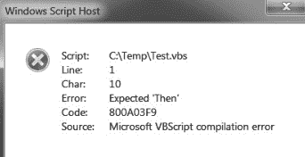

**图 9.5** 典型的 VBS 错误消息。经微软许可使用。

© 2014 微软公司。

图 9.5 中显示的错误消息是语法错误的结果。如你所见，系统自动提供了许多关于该错误的有用信息。解释和理解这些信息对于排查故障和修复 VBScript 脚本至关重要。

此错误消息提供了以下信息：

- **Script（脚本）**：产生错误的 VBScript 脚本的名称和位置
- **Line（行）**：在 VBScript 中检测到错误的行号
- **Char（字符）**：在错误行中检测到错误的列号
- **Error（错误）**：标识错误类型的错误代码
- **Source（源）**：报告错误的资源

你可以在图 9.5 中看到一个位于 `C:\Temp` 的名为 `Test.vbs` 的 VBScript 脚本生成了错误。生成该错误的脚本第 6 行看起来如下语句所示：

```
If X > 5 MsgBox "Hello World!"
```

该语句使用 VBScript 的 `MsgBox()` 函数显示文本字符串。错误消息指出，问题在于 VBScript 期望出现 `Then` 关键字但并没有出现。如果你查看该语句的中间，你会发现缺少了 `Then` 关键字。要纠正此错误，你需要添加缺失的关键字：

```
If X > 5 Then MsgBox "Hello World!"
```

为了验证错误已消除，你可以再次保存并运行脚本。

## 防止逻辑错误

你的 VBScript 脚本会完全按照你指示它们执行的操作，即使那并不是你的真实意图。因此，仔细计划你的 VBScript 项目极其重要。例如，你应该从编写伪代码大纲开始，并将其转换为流程图，概述脚本的每个主要组件。你应该尽可能一次开发一个脚本组件，在开发过程中逐步测试每个组件。我将向你展示在开发“猜字游戏”时，测试单个脚本的几种方法。

逻辑错误通常通过呈现错误或意想不到的结果来显现，并且可能是最难追踪的错误类型。与显示描述问题性质消息的语法错误和运行时错误不同，逻辑错误迫使你一次查看脚本的部分或全部内容以找到有问题的逻辑。好消息是，通过仔细的计划和设计，可以避免逻辑错误。

## 处理错误

你可以采取许多措施来防止错误在你的 VBScript 中发生。我已经提到了需要对脚本进行计划、仔细设计和测试的需求。此外，你可以通过遵循以下建议来避免任何错误：

- 提供简单、易用的界面（如弹出对话框）。
- 提供清晰的指令，让用户确切知道对他的期望。
- 尽可能通过剪切和粘贴已经彻底测试的代码来复用编辑脚本中的代码。
- 尽可能对输入数据进行验证。
- 显式声明你所有的变量。
- 对所有常量、变量、对象引用、数组、函数和子程序使用一致的命名方案。
- 警惕死循环。
- 尽力预测并处理可能发生错误的特定情况。

遗憾的是，错误还是会发生。当错误在你的 VBScript 中出现时，你有三种基本处理方法：

- 仅仅让它们发生，并在问题被发现时处理后果。
- 告诉 VBScript 忽略错误并继续。
- 尝试预测错误最可能发生的地方，并尝试处理它们的方式，要么优雅地终止脚本执行，要么允许脚本恢复并继续。

### 让错误发生

错误是会发生的。处理它们的一种方法是简单让它们发生，并指示用户在错误发生时报告，同时附带尽可能多的关于错误发生时用户正在操作的信息。这样，你就可以尝试重现错误，找出产生原因，然后修复它。

通常我不会建议这种方法。毕竟，你作为 VBScript 专家的声誉取决于脚本的稳健性和可靠性，你编写的每个 VBScript 都伴随着成本。你可以从时间、精力或其他标准来衡量这一点。每当你坐下来创建一个新脚本时，你都必须判断自己有多少时间和精力可以投入到该项目中。你还需要考虑在你正在开发的脚本中发生错误后的后果。毕竟，在几分钟内开发出一个简单的脚本是完全可能的，然后再花一小时或更长时间尝试让它无懈可击，结果却发现出了问题。

如果你正在开发一个极其重要的脚本，它将具有高可见性，且一旦出现问题你将负责，那么你将需要尽一切防止错误发生。相反，如果你被要求创建一个“快速粗糙的”脚本来帮助他人执行非关键任务，你可能只需要列出发生的任何错误即可。你可能只需要告诉那个为你编写脚本的人，如果出现问题请打电话即可。

### 忽略错误

在某些情况下，你在开发脚本时可以考虑的另一种方法是告诉 VBScript 忽略错误。即使你添加了这种语句，某些错误仍然会被报告。使用该语句的关键是它必须放置在你认为可能发生错误的语句之前。要让 VBScript 忽略脚本中的错误，请在脚本开头添加以下语句：

```
On Error Resume Next
```

即使你添加了这种语句，某些错误仍然会被报告。你可以使用以下语句取消该语句的影响：

```
On Error GoTo 0
```

例如，以下语句将产生错误，因为 `WScript` 拼写错误：

```vbscript
WScript.Echo "Hello world!"
```

在语句之前添加 `On Error Resume Next` 可以防止错误出现并允许脚本继续执行：

```vbscript
On Error Resume Next
WScript.Echo "Hello world!"
```

现在看另外两个语句：

```vbscript
On Error Resume Next
WScript.Echo "Hello world!"
On Error GoTo 0
```

`On Error GoTo 0` 语句会消除后续所有语句对 `On Error Resume Next` 语句的影响。第一个错误会被忽略，但第二个错误会被报告且脚本将停止。

与变量一样，VBScript 允许将 `On Error Resume Next` 语句的作用范围限制过程级别。也就是说，如果将此语句放置在过程中，它只在过程执行期间有效，并在过程（即函数或子程序）执行结束时失效。将 `On Error Resume Next` 语句与过程结合，可以显著限制这种强大语句的影响。

### 创建错误处理程序

要设置错误处理程序，你需要了解如何操作 `Err` 对象。`Err` 对象提供了许多属性和方法，允许你的脚本访问错误信息并清除错误状态。要访问有关错误的信息，你需要引用以下三个属性：

- **Number**：这获取上一个错误代码。
- **Description**：这获取上一个错误消息。
- **Source**：这获取引发（或导致）错误的对象的名称。

你可以修改这三个属性中任何一个的内容，这将允许你重新分配自定义错误代码和消息，甚至修改源信息。例如，在特别复杂的脚本中，你可能想要创建并记录一套自定义的错误消息。

创建错误处理程序的第一步是在你的 VBScript 中添加 `On Error Resume Next` 语句。然后你可以像这样添加错误处理语句：

```vbscript
On Error Resume Next
NonExistentFunction()
If Err > 0 Then
    Err.Number = 9999
    Err.Description = "This script is still a work in progress."
    MsgBox "Error: " & Err.Number & " - " & Err.Description
    Err.Clear
End If
```

将这些语句保存为脚本并执行它们。由于脚本不包含名为 `NonExistentFunction()` 的过程，将生成一个错误。然而，错误处理程序并没有显示 VBScript 运行时错误消息，而是创建并显示了图 9.6 所示的错误消息。

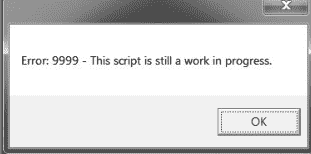

> 图 9.6 在运行 Windows 7 的计算机上看到的 VBScript 错误处理程序生成的自定义错误消息。© 2014 Cengage Learning

`Err` 对象还提供了两个非常有用的方法。其中之一是 `Clear()` 方法。该方法清除或移除之前的错误，确保下一个脚本检查错误时不会获得虚假状态（也就是说，它不会看到一个已经处理过的错误）。

要使用 `Clear()` 方法，请将其放在错误处理程序的末尾，如上一个示例所示。VBScript 会在几种情况下自动执行 `Clear()` 方法，包括：

- 每当执行 `On Error Resume Next` 语句时
- 每当执行 `Exit Sub` 语句时
- 每当执行 `Exit Function` 语句时

第二个 `Err` 对象使用 `Raise()` 方法。这允许你生成错误消息来测试你的错误处理程序。没有这个方法，你测试错误处理程序的唯一方法就是故意在代码中引入错误情况。该方法非常易用，如下所示：

```vbscript
Err.Raise(500)
```

例如，如果你将上述语句保存为脚本并在运行 Windows 7 的计算机上运行它，你将看到图 9.7 所示的错误消息。

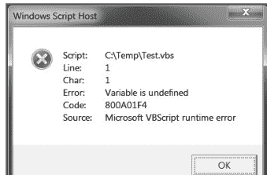

> 图 9.7 使用 Err 对象的 `Raise()` 方法生成测试错误。© 2014 Microsoft Corporation. 经微软许可使用。

要使用 `Raise()` 方法，请将其与你想要生成的错误指示一起，放在脚本中你想要测试的错误处理程序之前。在你验证了错误处理程序按预期工作后，从你的 VBScript 中移除 `Raise` 语句。

## 报告错误

解决错误的最佳方案是从源头上防止它们的发生。然而，这并不总是可能的。次优的方案是设计一种处理错误的方法，无论是处理它们还是简单忽略它们。另一个选项是通过将错误记录到日志文件中来报告错误，以便日后查阅。这允许你回来查看是否发生了任何错误。这很重要，因为许多用户在错误发生时并不会报告，导致错误永远被遗留。通过记录错误消息，你创建了一个审计日志，你可以随时回来查阅，以识别并修复可能发生的任何错误。

### 创建自定义日志文件

在记录错误消息时，你有两个选择：

- 创建你自己的自定义日志文件
- 在 Windows 应用程序事件日志中记录错误消息


# 创建自定义日志文件

要创建自定义日志文件，你必须在 VBScript 中实例化 `FileSystemObject` 对象，然后使用它的 `OpenTextFile()` 方法打开日志文件，以便你的脚本可以写入其中，如下所示：

```vbscript
On Error Resume Next

Err.Raise(7)

Set objFsoObject = WScript.CreateObject("Scripting.FileSystemObject")
If objFsoObject.FileExists("C:\ScriptLog.txt") Then
    Set objLogFile = objFsoObject.OpenTextFile("C:\ScriptLog.txt", 8)
Else
    Set objLogFile = objFsoObject.OpenTextFile("C:\ScriptLog.txt", 2, True)
End If
```

```vbscript
objLogFile.WriteLine "Test.vbs Error: " & Err.Number & " , Description = " & Err.Description & " , Source = " & Err.Source
```

```vbscript
objLogFile.Close()
```

在此示例中，脚本不包含名为 `NonExistentFunction()` 的过程，将生成一个错误。然而，错误处理程序并没有显示 VBScript 运行时错误消息，而是创建并显示了图 9.6 所示的错误消息。（等等，OCR 文本在这里似乎跳回了）。

# 第 9 章 · 处理脚本错误

除了初始化部分和主处理部分外，此脚本由 13 个独立的过程组成。因此，你将按照以下 15 个步骤进行开发：

1. 创建一个新脚本，使用你的 VBScript 模板并定义此脚本使用的变量、常量和数组。
2. 开发主处理部分的控制逻辑。
3. 开发 `DoWantToPlay()` 函数，用于创建一个介绍性的游戏启动界面，并判断用户是否想玩。
4. 使用 `FillArray()` 函数将单词列表赋值给数组。
5. 在 `PlayGame()` 函数中创建一个循环，用于控制游戏的实际流程，并根据需要收集玩家的猜结果并调用其他函数。
6. 使用 `RetrieveWord()` 函数获取一个随机选择的单词。
7. 使用 `InitialDisplayString()` 函数显示用空格分隔的下划线，代表游戏单词中的每个字母。
8. 使用 `FirstLevelValidation()` 函数对玩家的输入进行验证，确保玩家提供的是有效的猜测。
9. 使用 `SecondLevelValidation()` 函数在接受输入之前，检查玩家之前是否已经尝试猜过该字母。
10. 使用 `TestLetterGuess()` 函数检查玩家是否进行了错误的猜测。
11. 使用 `NonGuessedString()` 函数创建一个临时字符串，将玩家正确猜出的字母留空。
12. 使用 `CheckIfGameWon()` 函数检查玩家是否已经猜出了组成谜词的所有字母。
13. 使用 `FlipString()` 函数对第 11 步中创建的脚本进行遍历，并反转字符串中每个字符的显示（即：现在只显示猜对的字母）。
14. 使用 `DisplayResults()` 函数告诉玩家赢了还是输了。
15. 使用 `SplashScreen()` 函数在游戏结束时显示有关游戏的信息。

# 设置脚本和初始化部分

接下来显示的脚本这部分你现在应该觉得很熟悉，不需要太多的解释。从代码可以看出，该部分由脚本模板以及常量、变量和数组的定义组成。

# 初学者 Microsoft WSH 和 VBScript 编程，第四版

****************************************************************

'脚本名称: Hangman.vbs

'作者: Jerry Ford

'创建日期: 02/30/02

'描述: 此脚本演示了如何使用 VBScript 和 WSH 创建一个猜字游戏。

****************************************************************

# 初始化部分

```vbscript
Option Explicit

Const cTitleMsg = "VBScript HANGMAN"

Dim strChoice, strGameWord, intMisses, intNoError, strSplashImage
Dim intPlayNot, strMsgText, intPlayAgain, strWrongGuesses
Dim strRightGuesses, blnWordGuessed, intLetterCounter
Dim strStringType, strStringTwo, strWordLetter, strDisplayString
Dim intFlipCounter, intRandomNo, strGuess, blnGameStatus
Dim strCheckAnswer

Dim WordList(9) '定义一个可以容纳10个单词的数组
```

# 编写主处理部分的逻辑

与你在书中看到的其他脚本一样，脚本主处理部分的逻辑非常直观。它调用过程来判断用户是否想玩、将单词加载到数组中、开始游戏，并最终通过显示启动界面和执行 `WScript.Quit()` 来结束游戏。

# 主处理部分

```vbscript
intPlayOrNot = DoWantToPlay()
If intPlayOrNot = 6 Then '用户选择要玩游戏
    FillArray()
    PlayGame()
End If
SplashScreen()
WScript.Quit()
```

在脚本的此时，你已经准备了足够的代码来运行测试并检查是否有语法错误。现在，我建议你为每个函数编写代码，使用 `MsgBox()` 函数来显示结果。在你准备好完成它们之前，可以保存并运行脚本，确保对话框能够正常出现。使用 `WScript.Quit()` 方法正如我在这一部分这样做的那样，是为了清晰起见并防止某些语句意外执行。

# 编写 DoWantToPlay() 函数

你在之前的章节中见过很多类似的函数。`DoWantToPlay()` 函数的作用是显示启动界面并询问用户是否想玩猜字游戏。

```vbscript
Function DoWantToPlay()
    '显示启动界面并询问用户是否玩
    strSplashImage = "***********" & vbCrLf & _
    "WELCOME TO" & vbCrLf & _
    "VBSCRIPT HANGMAN!" & vbCrLf & _
    "******" & vbCrLf & _
    "Would you like to play a game?"

    DoWantToPlay = MsgBox(strSplashImage, 3, cTitleMsg)
End Function
```

这是一个很好的暂停点，你可以测试该函数是否工作。这允许你评估主处理部分的控制逻辑。

# 编写 FillArray() 函数

接下来显示的 `FillArray()` 函数将单词列表加载到数组中。随后，另一个过程将从数组中随机选择单词。

```vbscript
Function FillArray()
    '填充数组
    WordList(0) = "AUTOMOBILE"
    WordList(1) = "NETWORK"
    WordList(2) = "PRACTICAL"
    WordList(3) = "CONGRESS"
    WordList(4) = "COMMANDER"
    WordList(5) = "STAPPL"
    WordList(6) = "ENTERPRISE"
    WordList(7) = "ESCALATION"
    WordList(8) = "HAPPINESS"
    WordList(9) = "WEDNESDAY"
End Function
```

你无法对此函数进行太多测试，但你可以始终保存并运行脚本以查看是否存在语法问题。你应该创建一个临时脚本，将此函数复制进去，然后确保数组按预期加载。

# 编写 PlayGame() 函数

接下来显示的 `PlayGame()` 函数控制猜字游戏的运行。当我开发这个函数时，我写了几行，停下来测试，然后继续写更多。然而，引导你通过每一个步骤将花费太长时间。相反，我将这个基础过程留给你完成，转而专注于其他函数的开发，这些函数大部分由 `PlayGame()` 调用。

```vbscript
Function PlayGame()
    '初始化对话框显示的变量
    intMisses = 0
    intNoRight = 0
    strWrongGuesses = ""
    strRightGuesses = ""

    '获取游戏谜词
    strGameWord = RetrieveWord()

    '调用格式化显示字符串的函数
    strDisplayString = InitialDisplayString()

    strTempStringOne = strGameWord

    '让玩家开始猜测
    Do Until intMisses = 6

        '收集玩家的猜测
        strChoice = InputBox(vbCrLf & vbTab & strDisplayString & vbCrLf & _
        vbCrLf & vbCrLf & "No of Misses: " & intMisses & _
        "" & vbTab & "Incorrect:" & strWrongGuesses & vbCrLf & _
        vbCrLf & vbCrLf & _
        "Type a letter and click on OK.", , cTitleMsg)
```

此函数设计用于随机选择一个单词供游戏使用。`RetrieveWord()` 首先在 1 到 10 之间选择一个随机数，然后使用该数字从 `WordList()` 数组中检索游戏单词。此函数从数组中随机检索一个单词。

# 第 9 章 · 错误处理

```vbscript
Function RetrieveWord()
    Randomize
    intRandomNo = FormatNumber(Int(10 * Rnd))
    RetrieveWord = WordList(intRandomNo)
End Function
```

这是一个进行另一次测试的好地方。这一次，打开你早些在“构建 `FillArray()` 函数”部分中创建的临时脚本，将其复制并粘贴到上一个函数的语句中。将这三条语句粘贴到临时文件中，使它们成为脚本的第 3 到第 5 行。接下来，将以下语句作为第 6 行添加：

```vbscript
MsgBox RetrieveWord
```

保存并运行脚本。每次执行该临时脚本时，都应该显示一个不同的随机选择单词。如果情况并非如此，说明出了问题。找到并修复可能出现的任何错误，直到临时脚本按预期工作。然后，将任何修正后的脚本语句复制回你的挂字游戏脚本，并移动到下一节。

# 构建 InitialDisplayString() 函数

此函数用于显示一系列下划线，代表组成谜底单词的每个字母：

```vbscript
Function InitialDisplayString()
    '创建一个循环来处理单词的每个字母
    For intLetterCounter = 1 To Len(strGameWord)
        '使用下划线字符来显示表示每个
        '字母的字符串
        InitialDisplayString = InitialDisplayString & "_"
    Next
End Function
```

你可以通过创建一个新的 VBScript，将此函数中的语句剪切粘贴到临时脚本并对其进行修改，来对此函数进行快速测试。

```vbscript
For intLetterCounter = 1 To Len("DOG")
    '使用下划线字符来显示表示每个字母的字符串
    InitialDisplayString = InitialDisplayString & "_"
Next
MsgBox InitialDisplayString
```

运行脚本时，你应该能看到三个用空格分隔的下划线，表示单词的长度。如果有错误，请修复它并将修正后的语句复制回挂字游戏脚本。

# 构建 FirstLevelValidation() 函数

接下来所示的 `FirstLevelValidation()` 函数确保玩家提供了有效的输入。它检查玩家是否输入了内容、玩家输入的字符是否超过一个，以及输入的内容是否为数字或符号。

```vbscript
Function FirstLevelValidation()
    '验证玩家的输入
    '检查玩家是否点击了取消或未输入任何内容
    If strChoice = "" Then
        FirstLevelValidation = "ExitFunction"
        Exit Function
    End If

    '确保玩家只输入了一个字母
    If Len(strChoice) > 1 Then
        MsgBox "Invalid: 你一次只能输入一个字母!"
        FirstLevelValidation = "SkipRest"
    Else
        '确保玩家没有意外输入数字
        If IsNumeric(strChoice) = True Then
            MsgBox "Invalid: 只有字母可以作为有效输入!"
            FirstLevelValidation = "SkipRest"
        Else
            FirstLevelValidation = "Continue"
        End If
    End If
End Function
```

# 构建 SecondLevelValidation() 函数

与上一个函数一样，这里所示的 `SecondLevelValidation()` 函数会对玩家的猜测进行额外的测试，以确保玩家没有尝试重复猜测答案。

```vbscript
Function SecondLevelValidation()
    '检查此字母是否已经在错误猜测列表中
    If InStr(1, strWrongGuesses, UCase(strChoice), 1) <> 0 Then
        SecondLevelValidation = "DuplicateWrongAnswer"
    Else
        '检查此字母是否已经在正确猜测列表中
        If InStr(1, strRightGuesses, UCase(strChoice), 1) <> 0 Then
            SecondLevelValidation = "DuplicateRightAnswer"
        End If
    End If
End Function
```

# 第 9 章 · 脚本错误处理

# 构建 TestLetterGuess() 函数

这里所示的 `TestLetterGuess()` 函数检查字母是否为单词的一部分，并跟踪错过的次数。错过的总数等于 6，则该函数将 `blnWordGuessed` 变量赋值为 `False`。稍后将检查该变量判断玩家是否输了游戏。

```vbscript
Function TestLetterGuess()
    If InStr(1, UCase(strGameWord), UCase(strChoice), 1) = 0 Then
        '将字母添加到错误字母列表中
        strWrongGuesses = strWrongGuesses & " " & UCase(strChoice)
        '将玩家的错误次数加 1
        intNoMisses = intNoMisses + 1
        '如果玩家错过了六次，则他用完了所有机会
        If intNoMisses = 6 Then
            blnWordGuessed = False
        End If
        TestLetterGuess = "IncorrectGuess"
    Else
        TestLetterGuess = "CorrectGuess"
    End If
End Function
```

# 构建 NonGuessedString() 函数

在创建游戏时，我有一种简单的方法来查看随机选择了哪个单词，并跟踪哪些字母需要猜。接下来所示的 `NonGuessedString()` 函数构建一个字符串，如果显示它，它将显示单词的所有字母，减去玩家已经猜过的字母。

```vbscript
Function NonGuessedString()
    '遍历字符串
    For intLetterCounter = 1 To Len(strGameWord)
        '每次检查一个字母
        strLetter = Mid(strGameWord, intLetterCounter, 1)
        '如果字母不在猜测中，添加一个下划线
        '如果字母在猜测中，将字母添加到字符串中
        If InStr(1, UCase(strRightGuesses), UCase(strLetter), 1) = 0 Then
            strGuessedString = strGuessedString & "_"
        Else
            strGuessedString = strGuessedString & strLetter
        End If
    Next
End Function
```

# 零基础入门 Microsoft WSH 与 VBScript 编程，第四版

```vbscript
'显示游戏结果
intPlayAgain = MsgBox(vbCrLf & "单词是: " & _
UCase(strGameWord) & vbCrLf & vbCrLf & vbCrLf & strMsgText & _
vbCrLf & vbCrLf & vbCrLf & _
"你想再次玩吗?", 4, cTitleBarMsg)

'检查玩家是否想玩另一个游戏
If intPlayAgain = 6 Then
    '如果答案是是，则重置以下变量并开始新游戏
    strDisplayString = ""
    strTempStringTwo = ""
    PlayTheGame()
End If

End Function
```

# 构建 SplashScreen() 函数


`SplashScreen()` 函数是脚本中的最后一个函数。正如你在书中其他游戏中看到的，此函数会显示关于游戏及其创建者的信息。在该函数处理完毕后，主处理部分将执行 `WScript.Quit()` 方法，从而终止游戏的执行。

```vbscript
'此函数显示游戏的启动界面
Function SplashScreen()
    MsgBox "感谢玩 VBScript 猜单词游戏 [cw] Jerry Ford 2014." & _
    vbCrLf & vbCrLf & "请尽快再次光!", cTitleBarMsg
End Function
```

## 最终结果

到此时，你应该已经装好了猜单词脚本的所有部分并准备好执行。保存你的工作并尝试运行。当你一切都正确后，可以删除或注释掉那些使用 `MsgBox()` 函数来跟踪游戏中间结果的额外语句。

在彻底测试脚本后，把它交给别人测试。让你的测试人员按照规则玩游戏。然后让他不再遵守规则的情况下玩。让你的测试人员记录他遇到的任何问题，并记录可能出现的任何错误信息。如果出现了错误，让玩家写下他采取的准确步骤，以便你自己生成错误并开始调试。

# 第 9 章 · 处理脚本错误

## 总结

在本章中，你学习了如何为脚本添加编程逻辑以帮助处理错误。这包括从重写错误信息使其更对用户友好，到通过创建错误处理程序忽略错误，使你的脚本能够从某些类型的错误中恢复。我还提供了一些帮助你从源头上防止错误发生、或至少减少错误频率的建议。最后，我回顾了报告无法处理的错误的不同方法。在这一切之上，你还学习了如何创建猜单词游戏以及如何在开发的各个阶段对其测试。

1. 通过扩展游戏词库让猜单词游戏更有趣、更有意思。
2. 通过跟踪会话期间的游戏次数，并显示玩家总胜负次数的摘要来改进猜单词程序。
3. 为猜单词游戏添加逻辑允许你跟踪其使用情况。例如，提示玩家输入姓名，然后在每次玩游戏时向日志文件或 Windows 应用程序事件日志写入消息。

# 第 10 章 · 使用 Windows 注册表配置脚本设置

到为止，你在书中处理的所有脚本都从三个地方收集信息和输入：用户、脚本内部或 INI 文件。我将向你展示另一种外部化脚本设置的方法，即使用 Windows 注册表存储和检索配置数据。作为奖励，在本章的游戏项目中，我还将演示如何从文件中检索输入数据。具体来说，你将学习到：

- 如何查看 Windows 注册表的整体结构和设计
- 如何编程创建、修改和删除注册表项和值
- 如何读取存储在外部文件中的数据并将其作为输入

## 项目预览：猜单词游戏的第 2 部分

在本章中，你将增强在第 9 章“处理脚本错误”中开始开发的猜单词游戏。你将开始创建一个设置脚本，该脚本使用 Windows 注册表存储外部文本文件所在的位置。这些文本文件包含了单词列表，新版本的猜单词游戏将使用这些列表来惩罚玩家。你将通过移除脚本内部存储单词的数组并微调脚本，使其从外部文件中检索单词。你还将修改游戏，允许玩家选择要玩的单词类别。例如，你可能为“食物”或“地点”等类别创建不同的文本文件。

图 10.1 到 10.5 展示了在运行 Windows 7 的计算机上从开始到结束的游戏流程。

# 零基础入门 Microsoft WSH 与 VBScript 编程，第四版

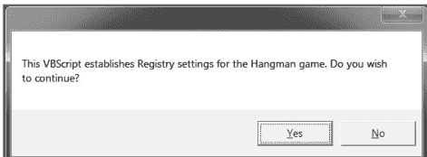

**图 10.1** 首先，你需要运行一次猜单词设置脚本以建立游戏新的注册表设置。

© 2014 Cengage Learning.

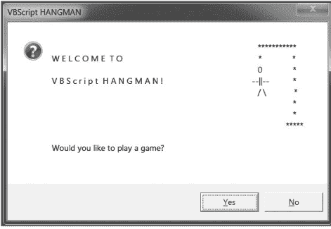

**图 10.2** 猜单词游戏完全按照之前一样开始，通过邀请用户玩游戏。© 2014 Cengage Learning.

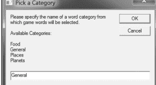

**图 10.3** 现在动态生成了一个类别列表，允许玩家选择单词类别。


**图 10.4** 游戏流程完全按照之前的方式运行，从任意类别中随机选择单词。


**图 10.5** 当游戏结束时，将显示结果并邀请玩家猜一个新单词。

# 第 10 章 · 使用 Windows 注册表配置脚本设置

当你完成新的设置脚本的编写并修改原始猜单词游戏后，你将对 Windows 注册表以及访问和修改它的含义有一个基本的了解。你还将知道如何检索存储在外部文件中数据作为输入。

## 介绍 Windows 注册表

自 Windows 95 引入以来，注册表一直是所有操作系统配置信息的中心存储库。注册表是一种内置数据库，作为配置设置的中心仓库。Windows 使用它来存储影响所有组件的信息，包括：

- Windows 操作系统配置设置
- 软件配置设置
- 用户配置设置
- Windows 服务配置设置
- 硬件配置设置
- 软件设备程序配置设置

可见，注册表用于存储关于计算机的各个方面的信息。因此，通过更改注册表，你可以配置影响计算机任何部分的外观、行为和操作。例如，通过对注册表进行相应的更改，可以直接更改 Windows 桌面或屏幕保护的外观和行为。

注册表对于你每天交互的 Windows 计算机至关重要，你可能从未意识到。例如，每当你打开 Windows 控制面板并使用其中的一个工具或小程序进行更改时，你都在更改存储在注册表中的配置。在控制面板小程序的情况下，微软已经为你方便地创建了一系列图形化界面，每个界面都旨在帮助你更改配置方式。或者，你可以使用 Windows 注册表编辑器查看并修改注册表。

由于注册表是存储和检索信息的非常可靠的存储库，许多应用程序开发人员会利用它存储其应用程序的设置。同样，你也可以将 VBScript 中的设置迁移到注册表中。

你还可以创建 VBScript 脚本来操作注册表内容，从而影响计算机运行的几乎每一个方面。

# 零基础入门 Microsoft WSH 和 VBScript 编程，第四版

## 注册表是如何组织的？

注册表由五个根键（或父键）集合组成，具体定义见表 10.1。注册表中的所有数据都以树形结构存储在这些键之一之下。

### 表 10.1 注册表根键

| 键名 | 简称 | 描述 |
|---|---|---|
| HKEY_CLASSES_ROOT | HKCR | 存储 Windows 文件关联信息 |
| HKEY_CURRENT_USER | HKCU | 存储当前登录用户的信息 |
| HKEY_LOCAL_MACHINE | HKLM | 存储全局计算机设置 |
| HKEY_USERS | — | 存储计算机所有用户的信息 |
| HKEY_CURRENT_CONFIG | — | 存储有关计算机当前配置的信息 |

> © Jerry Lee Ford, Jr. 保留所有权利。

尽管注册表在逻辑上组织为五个根键，但在物理上它由许多文件组成。属于注册表的文件可以在 `%systemroot%\system\config` 文件夹中找到。这些文件包括：

- `DEFAULT`
- `SYSTEM`
- `SECURITY`
- `SAM`
- `SOFTWARE`

## 技巧

`%systemroot%` 是由操作系统创建并维护的环境变量。它标识了 Windows 存储系统文件和文件夹的路径。默认情况下，这是 `C:\Windows`。

Windows 注册表管理的信息还包括关于计算机上每个用户的数据。这些数据存储在用户配置文件中，位于每台计算机用户的“Documents and Settings”文件夹或“Users”文件夹中（取决于你使用的 Windows 版本）。尽管注册表有五个根键，但作为一名 VBScript 程序员，你只需要处理其中的三个。为了方便你的操作，微软为这三个键中的每一个都创建了简称引用。你可以在表 10.1 的第二列中看到这些简称。

# 第 10 章 · 使用 Windows 注册表配置脚本设置

不过，你仍然可以通过指定完整名称（`HKEY_CURRENT_CONFIG` 和 `HKEY_USERS`）来与剩余的键进行交互。

## 理解注册表存储数据

存储在 Windows 注册表中的数据按层次结构组织。这种层次结构由键和值组成。键是一个包含值或实际数据的容器。存储在 Windows 注册表中的所有数据都具有以下格式：

`键 : 键类型 : 值`

**键** 指定了注册表的名称。例如，要引用控制面板子键，你需要指定 `HKCU\Control Panel\`。要引用控制面板子键下的桌面子键，你需要指定 `HKCU\Control Panel\Desktop\`。这个字符标识了被引用的是键而不是值。

**值** 指定了用于存储实际数据的容器。要引用一个值，你必须使用该值的名称且不带末尾字符，而不是键。例如，要引用存储在桌面子键下的 `ScreenSaveActive` 值，你需要指定 `HKCU\Control Panel\Desktop\ScreenSaveActive`。

**键类型** 标识了所存储的数据类型。注册表能够存储许多类型的数据，如表 10.2 所示。

> **定义**  
> 注册表键是一个存储其他注册表键和值的容器。你可以将键比作 Windows 文件系统中的文件夹。

> **定义**  
> 在 Windows 注册表的上下文中，值代表分配给数据的元素名称。因此，注册表的作用在许多方面类似于文件，文件是 Windows 文件系统中用于存储数据的容器。

### 表 10.2 Windows 注册表支持的数据类型

| 数据类型 | 描述 |
|---|---|
| REG_BINARY | 存储二进制值 |
| REG_DWORD | 存储十六进制 DWORD 值 |
| REG_EXPAND_SZ | 存储可扩展字符串 |
| REG_MULTI_SZ | 存储多个字符串 |
| REG_SZ | 存储字符串 |

© Lee Ford, Jr. 保留所有权利。

注册表中的每个值都分为两类：命名的或未命名的。最常见的值类型是命名的。命名值被分配了显式名称。这允许你通过指定其名称来检索存储在值中的数据。正如你可能猜到的那样，未命名值没有分配名称。每个键下都存储一个未命名值。这代表了键的默认值。换句话说，如果你不指定特定的值名称，则将检索该值。Windows 通过显示“Default（默认）”标签以图形化方式识别未命名值。图 10.6 显示了运行 Windows 8.1 的计算机上的这种情况。


**图 10.6** 未命名值被分配了“Default”标签。

© 2014 Microsoft Corporation. 经微软许可使用。

## 访问注册表键和值

你可以使用每个 Windows 版本提供的 `Regedit` 工具手动查看注册表的内容。（在 Windows 7 上，在开始菜单的搜索框中输入 `Regedit` 并按回车。在 Windows 8.1 上，在 Windows 启动屏幕输入 `Regedit` 并按回车。）例如，图 10.7 提供了 Windows 8.1 上注册表的概要视图。如你所示，五个根键是可见的，其中一个键已部分展开以显示其树形结构。

# 第 10 章 · 使用 Windows 注册表配置脚本设置

| 名称 | 类型 | 数据 |
| --- | --- | --- |
| (Default) | REG_SZ | (未设置值) |
| (Device)Disc | REG_SZ | /REGISTRY\MACHINE\System\CurrentControlSet\Ser... |
| (Device)Video0 | REG_SZ | /REGISTRY\MACHINE\System\CurrentControlSet\Cont... |
| (Device)Video1 | REG_SZ | /REGISTRY\MACHINE\System\CurrentControlSet\Cont... |
| (Device)Video2 | REG_SZ | /REGISTRY\MACHINE\System\CurrentControlSet\Cont... |
| (Device)Video3 | REG_SZ | /REGISTRY\MACHINE\SYSTEM\CurrentControlSet001\Serv... |
| MaxObjectNumber | REG_WORD | 00000003 (03) |
| ObjectListLimit | REG_BINARY | 00 00 03 |

**图 10.7** 使用 `Regedit` 工具检查注册表。

© 2014 Microsoft Corporation. 经微软许可使用。

## 陷阱

弄乱计算机的最简单方法之一是在不知道自己在做什么的情况下修改注册表。错误配置键和值会导致 Windows 无法启动。除非你完全确定更改将如何影响注册表，

## 创建键和值存储脚本设置

WSH 对象提供了三种方法，使 VBScript 能够访问、修改和删除注册表。这些方法在随后的章节中演示如下：

- `RegWrite()`：提供创建和修改的能力。
- `RegRead()`：提供检索的能力。
- `RegDelete()`：提供删除的能力。

## 创建或修改注册表键和值

创建新注册表键值的第一步是实例化 Shell 对象。然后，使用 Shell 对象的 `RegWrite()` 方法，你只需要提供新键或值的名称及其在注册键中的位置。例如，以下语句在 `HKEY_CURRENT_USER` 根键下创建一个名为 `GameKey` 的键，然后创建一个名为 `HomeFolder` 的值并赋值为 `"C:\VBScript\Games"`。

你可以像这样后修改注册表值：

单个注册表键可以存储任意数量的值。例如，以下语句在 `GameKey` 下建立一个名为 `FileType` 的值，并赋值字符串 `".txt"`：

## 访问注册表信息

建立注册表键和多个值后，你可以使用 Shell 对象的 `RegRead()` 方法读取它们。例如，以下语句读取并显示上一个示例中存储的值：

```vbscript
Set objWshObject = WScript.CreateObject("WScript.Shell")
strResults = objWshObject.RegRead("HKCU\GameKey\FileType")
MsgBox strResults
```

## 删除键和值

现在让我们使用 Shell 对象的 `RegDelete()` 方法删除我们刚刚创建的两个注册表值，如下：

```vbscript
Set objWshObject = WScript.CreateObject("WScript.Shell")
objWshObject.RegDelete "HKCU\GameKey\FileType"
```

以类似的方式，你可以删除 `GameKey`，从而删除它存储的所有值，如下：

```vbscript
Set objWshObject = WScript.CreateObject("WScript.Shell")
objWshObject.RegDelete "HKCU\GameKey"
```

注意上一个语句中 `GameKey` 之后的字符。这个字符告诉 `RegDelete()` 方法指定的元素是一个注册表键而不是值。

# 第 10 章 · 使用 Windows 注册表配置脚本设置

## 获取存储在注册表中的系统信息

现在你已经了解读取、写入、修改和删除注册表项及值的知识，请查看以下示例。在这个示例中，`ProcessorInfo.vbs` 脚本显示了如何获取运行它的计算机的处理器（即 CPU）信息。

```vbscript
'********************************************************************************************************************************
'脚本名称: ProcessorInfo.vbs
'作者: Jerry Ford
'创建日期: 02/13/14
'描述: 此脚本收集运行它的计算机的 CPU 信息。
'********************************************************************************************************************************

'初始化部分
Option Explicit
Dim objWshShl, intResponse, strCpuSpeed, strCpuVendor, strCpuID

'设置 WshShell 对象的实例
Set objWshShl = WScript.CreateObject("WScript.Shell")

'主处理部分
'提示继续的权限
intResponse = MsgBox("此 VScript 将从 Windows 注册表获取您的 " & _ 
"处理器信息。" & vbCrLf & vbCrLf & _ 
"您要继续吗？", 4)

'调用收集 CPU 信息的函数
If intResponse = 6 Then
    GetProcessorInfo()
End If

WScript.Quit()

'程序部分
Function GetProcessorInfo()
    '获取处理器速度
    strCpuSpeed = objWshShl.RegRead _
    ("HKLM\HARDWARE\DESCRIPTION\System\CentralProcessor\0\~MHz")

    '获取制造商名称
    strCpuVendor = objWshShl.RegRead _
    ("HKLM\HARDWARE\DESCRIPTION\System\CentralProcessor\0\VendorIdentifier")
```


# 第 10 章 · 使用 Windows 注册表配置脚本设置

## 获取处理器 ID 信息

```vbscript
'获取处理器 ID 信息
strCpuID = objWshShl.RegRead _
("HKLM\HARDWARE\DESCRIPTION\System\CentralProcessor\0\Identifier")
```

```vbscript
MsgBox "速度: " & strCpuSpeed & vbCrLf & "制造商: " & _
strCpuVendor & vbCrLf & "ID: " & strCpuID
```

End Function

脚本的初始化部分定义了变量并实例化了 `WshShell` 对象。主处理部分在继续之前使用提示进行确认，然后在执行 `WScript.Quit()` 方法终止脚本执行之前调用 `GetProcessorInfo` 函数。

`GetProcessorInfo` 函数使用 `WshShell` 对象的 `RegRead()` 方法执行注册表读取操作。每次读取操作获取有关计算机处理器的部分信息。然后，该函数使用 VBScript 的 `MsgBox()` 函数显示关于计算机处理器的信息的文本字符串。

有关如何使用 VBScript 与 Windows 注册表交互的更多示例，请参阅附录 A “WSH 管理脚本”中的“桌面管理”部分。你将找到两个脚本，演示了如何通过操作注册表设置来配置 Windows 桌面和屏幕保护程序从而进行桌面管理。

## 回到猜字游戏的第 2 部分

现在你已经回顾了 Windows 注册表（包括其整体结构和设计），让我们修改猜字游戏以与注册表配合工作。你可能想花几分钟回顾一下第 9 章末尾显示的猜字游戏脚本的设计。

由于你已经写好了基础的猜字游戏脚本，完成本章项目只需要专注于创建新的猜字游戏脚本，并修改原始猜字脚本中受更改影响的部分。你将分两个阶段处理此项目：创建一个建立注册表设置的设置，并更新猜字脚本以便每次游戏执行时检索注册表设置。

## 创建设置脚本

首先，你将创建一个 VBScript 脚本 `HangmanSetup.vbs`。该脚本将在 `HKEY_CURRENT_USER` 项（脚本中称为 `HKCU`）中创建并存储一个名为 `Hangman` 的注册表项。在该项内，将创建一个名为 `ListLocation` 的值，并分配一个字符串来标识你计划存储猜字游戏单词的位置。`HangmanSetup.vbs` 脚本将分三个步骤开发：

1. 创建新脚本，添加你的 VBScript 模板并定义此 VBScript 使用的变量和对象。
2. 在主处理部分设置控制逻辑，首先在继续之前提示确认，然后调用创建注册表项和值的过程。
3. 通过添加 `SetHangmanKeyKeyValue()` 函数设置程序部分，该函数执行对注册表的实际修改。

### 定义变量和对象

现在，你对这个脚本应该非常熟悉了。从复制你的 VBScript 模板并填写有关新脚本的信息开始。

```vbscript
'初始化部分
Option Explicit
```

接下来，定义脚本所需的变量和对象。如你在这里看到的，这是一个非常简单的脚本，只有几个需要定义的项：

```vbscript
Dim objWshShl, intResponse
Set objWshShl = WScript.CreateObject("WScript.Shell")
```

第一个变量代表 `WshShell` 对象，第二个变量存储用户对询问其是否想要更改注册表的应答。

### 首先获取确认

主处理部分提示用户确认，并在继续之前测试 `InputBox()` 函数返回的结果。如果结果等于 6，则脚本继续。否则，`WScript.Quit()` 方法将终止执行。

```vbscript
'主处理部分
'询问确认
intResponse = MsgBox("此 VScript 将从 Windows 注册表获取您的 " & _ 
"处理器信息。" & vbCrLf & vbCrLf & _ 
"您要继续吗？", 4)

If intResponse = 6 Then
    SetHangmanKeyKeyValue()
End If

WScript.Quit()
```

### 修改注册表

创建此脚本的最后一步是定义项和值。正如你在本章稍早时候看到的，此操作是使用 `WshShell` 对象的 `RegWrite()` 方法完成的。

```vbscript
'程序部分
Function SetHangmanKeyKeyValue()
    objWshShl.RegWrite "HKCU\Hangman\ListLocation", "C:\Hangman"
End Function
```

### 组装设置脚本

现在我们将脚本的三个部分组合起来；运行脚本并在提示时点击“是”。可以使用 Regedit 工具确保项和值已创建。

你只需要运行一次此脚本来设置游戏。但是如果你决定更改存储单词的位置，则需要重新运行此脚本。

## 更新猜字游戏

在项目的第二部分，你将修改原始猜字脚本，使其能够从注册表检索存储文件夹的位置。你还将添加允许脚本打开并读取文本内容的逻辑。为了实现这一点，原始猜字脚本需要分五个步骤修改：

1. 打开猜字脚本并修改其初始化部分，包含支持脚本新功能的变量和对象引用。
2. 删除脚本中的 `FillArray()` 函数，它负责从内部数组中检索随机单词。
3. 修改 `RetrieveWord()` 函数以调用两个新函数 `GetWordLocation()` 和 `SelectWordCategory()`。添加处理玩家指定的文本文件以随机单词的逻辑。
4. 创建 `GetWordLocation()` 函数，它从 Windows 注册表中检索存储文本文件的文件夹位置。
5. 创建 `SelectWordCategory()` 函数，它根据在文件夹中找到文本文件向玩家展示单词列表。

> **提示**
> 你应该复制当前的猜字脚本并修改副本而不是原始脚本。这样，如果出现问题，你仍然有一个可以玩的原始游戏版本。

## 更新初始化部分

你需要对猜字脚本的初始化部分进行几处更改。这些包括定义脚本新部分使用的变量。这些变量在以下部分中加粗显示：

```vbscript
'初始化部分
Option Explicit

Const cTitlebarMsg = "VBScript HANGMAN"

Dim strCheckAnswer, objWshShl, strGameFolder, objFsoObject, objGameFiles
Dim strSelection, strString, strCharactersToRemove
Dim blInvalidResponse, strCategory, strInput, strWordFile
Dim intNoWordsInFile, intLinesInFile, strWordList
```

此外，你需要删除以下语句，因为原始脚本版本中存储游戏单词的数组已不再支持：

```vbscript
Dim astrWordList(9) '定义一个可以容纳10个游戏单词的数组
```

最后，你需要像这样实例化 `FileSystemObject` 对象和 `WshShell` 对象：

```vbscript
'设置 FileSystemObject 实例
Set objFsoObject = CreateObject("Scripting.FileSystemObject")
```

```vbscript
'设置 WshShell 实例
Set objWshShl = WScript.CreateObject("WScript.Shell")
```

需要属于 `FileSystemObject` 对象的方法和属性来读取和处理存储在游戏文本文件中的单词。此外，还需要 `WshShell` 对象的 `RegRead()` 方法来获取游戏文件所在文件夹的路径。

## 删除过时的语句

下一步是将 `Array()` 函数数组中定义的每个单词复制并粘贴到空白的记事本文件中，每个单词独占一行。将文件保存在电脑的 C 盘上一个名为 `Hangman` 的文件夹中，并将文件命名为 `General.txt`（保存为 `C:\Hangman\General.txt`）。此文件将用于为改进后的游戏版本获取游戏单词。

一旦创建并保存了 `General.txt` 文件，请删除脚本中此处显示的 `Array()` 语句：

```vbscript
Array()
```

该语句目前位于 `PlayTheGame()` 函数调用之前。

然后，它不再需要了，请删除位于 `DoWantToPlay()` 函数定义之后的 `Array()` 函数定义：

```vbscript
Function Array()
  '将单词添加到数组
  astrWordList(0) = "AUTOMOBILE"
  astrWordList(1) = "NETWORKING"
  astrWordList(2) = "PRACTICAL"
  astrWordList(3) = "CONGRESS"
  astrWordList(4) = "COMMANDER"
  astrWordList(5) = "STAPLER"
  astrWordList(6) = "ENTERPRISE"
  astrWordList(7) = "ESCALATION"
  astrWordList(8) = "HAPPINESS"
  astrWordList(9) = "WEDNESDAY"
End Function
```

顺便说一下，你可能想创建一两个其他文本文件，提供一个合适的游戏单词列表并描述它们的内容，然后将它们保存在 `Hangman` 文件夹中。这样，玩家在玩游戏时会有多个类别的单词供选择。

## 修改 RetrieveWord() 函数

你应该首先通过删除 `RetrieveWord()` 函数的所有语句，然后添加以下语句开始修改该函数。如你所见，我为这段代码添加了许多注释，以详细解释其结构。

```vbscript
'此函数从单词文件中随机选择一个单词
Function RetrieveWord()

    '定位存储游戏单词集合的文件夹
    strGameFolder = GetWordFileLocation()

    '让玩家选择一个单词类别
    strSelectCategory = SelectWordCategory(strGameFolder)

    '为选定的文本文件创建完整的路径和名称
    strInputFile = strGameFolder & "\" & strSelectCategory & ".txt"

    '打开文件进行读取
    Set strWordFile = objFsoObject.OpenTextFile(strInputFile, 1)

    '将此变量设置为零。它代表文件中的单词数
    intNoWordsInFile = 0

    '统计文件中的单词数
    Do While False = strWordFile.AtEndOfStream
        '读取一行
        strWordFile.ReadLine()
        '记录已读取的单词（或行）数
        intNoWordsInFile = intNoWordsInFile + 1

        '如果循环迭代超过 50 次，说明出了问题
        If intNoWordsInFile > 50 Then
            Exit Do
        End If
    Loop

    '完成单词数（或行数）计数后关闭文件
    strWordFile.Close

    '在 1 和文件中的单词数之间选取一个随机数
    intRandomNo = FormatNumber(Int((intNoWordsInFile + 1) * Rnd), 0)

    '打开文件进行读取
    Set strWordFile = objFsoObject.OpenTextFile(strInputFile, 1)

    '跳过随机选取单词之前的所有单词
    For intLinesFile = 1 To intRandomNo - 1
        strWordFile.SkipLine()
    Next

    '将随机选取的单词返回给调用语句
    RetrieveWord = strWordFile.ReadLine()

    '完成后关闭文件
    strWordFile.Close
End Function
```

> **陷阱**
> 请确保你创建的任何存储游戏单词的文本文件中都至少有一个单词。没有任何单词的空文件会导致错误。

## 创建 GetWordFileLocation() 函数

`RetrieveWord()` 函数调用了 `GetWordFileLocation()` 函数。

```vbscript
'此函数检索文件夹名称
Function GetWordFileLocation()
    GetWordFileLocation = objWshShl.RegRead("HKCU\Hangman\ListLocation")
End Function
```

## 创建 SelectWordCategory() 函数

`RetrieveWord()` 函数也调用了 `SelectWordCategory()` 函数，以提示玩家选择一个。

```vbscript
'此函数返回一个单词类别
Function SelectWordCategory(TargetFolder)
    '指定文件夹的位置
    Set strGameFolder = objFsoObject.GetFolder(TargetFolder)

    '获取文件列表
    Set objGameFiles = strGameFolder.Files

    strSelection = ""

    '遍历文件
    For Each strWordList In objGameFiles
        '构建包含文件名的字符串
        strSelection = strSelection & Left(strWordList.Name, Len(strWordList.Name) - 4) & vbCrLf
    Next

    blValidResponse = "False"

    '循环直到分类有效
    Do Until blValidResponse = "True"
        '提示玩家选择单词类别
        strChoice = InputBox("请指定单词类别，将选择单词。" & vbCrLf & vbCrLf & _
        "可用类别：" & vbCrLf & vbCrLf & _
        strSelection, "选择类别", "General")

        '如果输入不在主字符串中，玩家必须重试
        If InStr(UCase(strSelection), UCase(strChoice)) = 0 Then
            MsgBox "抱歉，这不是有效的类别。请重试。"
        Else
            blValidResponse = "True"
        End If
    Loop

    '如果玩家没有输入内容，则指定默认单词类别
    If Len(strChoice) = 0 Then
        strChoice = "General"
    End If

    SelectWordCategory = strChoice
End Function
```


'加回文件名的 .txt 部分
`SelectWordCategory = strChoice & ".txt"`

`End Function`

## 查看完成的 Hangman 脚本

完成！假设你在更新 Hangman 时没有跳过任何步骤或出现任何拼写错误，你新版本的 Hangman 脚本应该已经准备好测试了。不要忘记彻底测试，并让别人也测试一下。

## 总结

在本章中，你学习了如何编写与 Windows 注册表交互的脚本。这包括读取、写入和修改注册表项及值。这些新的编程技术为你提供了外部化脚本配置信息的工具，使你能够在不直接修改脚本的情况下更改配置设置，而无需担心在修改时出错。此外，我还向你展示了如何使用文本文件作为 VBScript 的另一种数据输入源。

1. 创建一个新的文本文件集合，以增加玩家可选的类别数量。
2. 在 `HangmanSetup.vbs` 脚本中添加错误处理程序，并使用它报告脚本在尝试执行 `RegWrite()` 方法时可能出现的任何问题。
3. 修改 `HangmanSetup.vbs` 以显示一个弹出对话框，要求用户同意你为玩游戏而指定的任何条款。在注册表中存储一个用于指示用户是否已接受条款的值。每次启动挂钩字游戏时都检查此值，允许用户仅在接受条款的情况下进行游戏。如果用户尚未接受条款，则提示用户再次接受条款。
4. 在注册表中创建并存储一个变量，并修改 `Hangman.vbs` 在每次游戏开始时使该变量加1。使用此值来跟踪游戏次数。每次游戏开始时检查此值，以判断其是否超过 20。如果用户尚未接受你的条款，则阻止游戏运行并强制用户接受条款以进行游戏。

# 使用内置 VBScript 对象

为了完成任何实际工作，VBScript 依赖于访问对象及其相关的属性和方法。到目前为止，你已经学习了如何处理由 WSH 和 VBScript 运行时对象模型提供的对象。除了这些对象集合，你的 VBScript 还可以访问一小部分内置或核心对象集合。使用这些内置 VBScript 对象，你可以创建对错误做出响应的脚本、创建自己的自定义对象，并通过分解字符串内容执行一系列复杂的解析操作。在讨论 VBScript 内置对象的同时，本章还将帮助你创建一个井字棋游戏。具体而言，你将学习到以下内容：

- VBScript 的内置对象和集合
- 如何定义你的自定义对象
- 如何将属性和方法与自定义对象关联
- 如何触发与自定义对象相关的事件
- 如何执行高级字符串解析操作

# 项目预览：井字棋游戏

在本章中，你将开发一个井字棋游戏。通过该游戏的设计，你将学习如何创建和控制双人游戏。为了实现这一点，你必须开发控制谁下一个操作的逻辑，同时确保每个玩家的移动都是有效的。图 11.1 至 11.5 展示了游戏从开始到结束的整体流程，如运行 Windows 8.1 的计算机上所示。

# 零基础学者 Microsoft WSH 和 VBScript 编程，第四版


游戏跟踪每个玩家的回合

图 11.1 游戏开始时会显示空白棋盘并提示第一个玩家做出移动。© 2014 Cengage Learning.


游戏验证所有玩家输入，以确保只接受有效移动

图 11.2 游戏在每个玩家移动后会自动更新棋盘。© 2014 Cengage Learning.


游戏防止玩家在未先提供输入的情况下点击按钮而意外错过回合

图 11.3 在需要时为玩家提供额外说明的消息发布在棋盘顶部。© 2014 Cengage Learning.

# 第 11 章 • 使用内置 VBScript 对象


**图 11.4** 每局游戏的结果发布在棋盘顶部。© 2014 Cengage Learning.

**图 11.5** 在每个游戏结束时，会提示玩家再次游戏。© 2014 Cengage Learning.

到本章结束，你将学习到许多关于处理 VBScript 内置对象集合的知识。你还将开发了自己的第一个多玩家 VBScript 游戏。

# 利用 VBScript 的内置对象集合

VBScript 提供了一小部分内置对象集合。VBScript 解释器提供了对这些对象的访问。因此，无论执行宿主机是什么，任何 VBScript 都可以使用这些对象。这些对象并不多，但它们为 VBScript 提供了强大的能力库，包括：

- 创建具有完备属性和方法的自定义对象
- 拦截并处理你的 VBScript 可能遇到的运行时错误
- 执行复杂的正则表达式模式匹配

表 11.1 显示了 VBScript 内置对象的列表，并对每个对象进行了描述，以及与对象相关的所有属性、方法和事件的完整列表。

# 表 11.1 VBScript 的内置对象集合

| 对象 | 描述 | 属性 | 方法 | 事件 |
|---|---|---|---|---|
| `Class` | 用于创建新对象 | 无 | `Initialize`, `Terminate` | |
| `Err` | 用于检索错误信息 | `Description`, `HelpContext`, `HelpFile`, `Number`, `Source` | `Clear`, `Raise` | |
| `Match` | 返回起始字符位置 | `FirstIndex`, `Length` | | |
| `Matches` | 代表正则表达式集合 | | | |
| `RegExp` | 提供搜索字符串的能力 | `Global`, `IgnoreCase`, `Pattern` | `Execute`, `Replace`, `Test` | |
| `SubMatches` | 用于访问正则表达式字符串 | | | |

# 内置对象属性

如表 11.1 所示，VBScript 内置对象具有若干属性。每个属性的描述见表 11.2。

# 内置对象方法

在所有 VBScript 对象中，`Err` 对象和 `RegExp` 对象具有关联的方法。`Err` 对象的方法用于生成和清除，如下：

- `Clear()`。这会清除 `Err` 设置。
- `Raise()`。这提供了模拟运行时错误的能力。

与 `RegExp` 对象关联的方法提供了搜索和替换字符串部分的能力，如下：

- `Execute()`。执行正则表达式搜索。
- `Replace()`。替换指定的文本。
- `Test()`。这返回一个布尔值，指示字符串内是否存在匹配。

# 表 11.2 内置对象属性

| 属性 | 描述 |
|---|---|
| `Description` | 返回与 `Err` 相关的错误消息 |
| `FirstIndex` | 返回子字符串的起始位置 |
| `Global` | 返回布尔值 |
| `HelpContext` | 返回与文件主题相关的上下文 ID |
| `HelpFile` | 获取指定帮助文件的路径 |
| `IgnoreCase` | 根据模式搜索是否区分大小写返回 `True` 或 `False` |
| `Length` | 获取与搜索匹配相关的字符数 |
| `Number` | 获取错误代码 |
| `Pattern` | 从搜索操作中检索正则表达式模式 |
| `Source` | 返回负责生成错误的对象名称 |
| `Value` | 获取搜索匹配的值 |

# 定义自定义对象

你可以使用 `Class...End Class` 语句来创建自定义对象。`Class` 对象为创建新对象提供了模板。一旦定义，自定义对象必须像其他对象一样被实例化。`Class...End Class` 语句的语法如下：

```
Class ClassName
  Statements
End Class
```

`ClassName` 用于指定分配新对象的名称。`Statements` 是你在对象内部定义的变量、属性和方法。你可以通过在 `Class...End Class` 语句中添加以下任何语句来为对象定义属性：

- `Property Get`（属性获取）：允许检索赋值给私有变量的值。
- `Property Let`（属性赋值）：允许修改赋值给私有变量的值。
- `Property Set`（属性设置）：允许修改赋值给公共变量的值。

# 定义对象属性和方法

在 `Class...End Class` 语句中，可以使用 `Private` 和 `Public` 关键字将变量、属性和方法定义为私有或公共。将变量、属性或方法标记为私有会将其访问限制在类内部。将变量、属性或方法标记为 `Public` 则会使其在整个脚本中可访问。

在未指定的情况下，假设变量、属性和方法是公共的。然而，通常允许变量以公共作用域定义并不是好主意。将变量设为公共会失去在对象内部严格控制其值的能力。相反，将对象变量设为私有并允许使用 `Property Get` 和 `Property Let` 语句进行访问。

为了最好演示这一切是如何工作的，让我们来看一个示例。这里定义了一个新对象并将其命名为 `SuperHero`。

```
Class SuperHero
  Private strName
  Public Property Let Name(strIdentity)
    strName = strIdentity
  End Property
  Function DisplayName()
    MsgBox "Our new hero's name is " & strName & "!"
  End Function
End Class
```

第一条语句定义了对象并分配了名称。下一句定义了一个名为 `strName` 的私有变量。后续三个语句定义了一个对象属性，并允许脚本其余部分写入。接下来的三个语句定义了对象的方法 `DisplayName()`。最后一条语句结束了 `SuperHero` 对象的定义。

为了练习对象定义，请创建一个新脚本并将前述语句添加到脚本的程序部分。然后将以下语句添加到初始化部分。这些语句定义了一个变量，然后使用该变量实例化 `SuperHero` 对象。

```
Dim objFirstHero
Set objFirstHero = New SuperHero
```

实例化后，你可以通过在脚本的主处理部分添加以下语句来为对象的 `Name` 属性赋值：

```
objFirstHero.Name = "Captain Adventure"
```

你可以通过在主处理部分添加以下语句来执行对象的 `DisplayName()` 方法：

```
objFirstHero.DisplayName()
```

一旦组合完成后，上一个示例在运行 Windows 7 的计算机上执行时，将显示图 11.6 所示的输出。


# 创建事件过程

自定义 VBScript 对象自动支持两个事件。这些事件的执行如下：

- `Class_Initialize`：每当实例化对象的新实例时都会执行。
- `Class_Terminate`：每当对象的实例被销毁时都会执行。

这些事件的定义是可选的。如果定义了，`Class_Initialize` 程序将执行诸如定义变量默认值之类的任务。同样，`Class_Terminate` 程序将执行对象不再需要后可能需要的任何清理工作。例如，以下语句为上一个示例中的 `SuperHero` 对象定义了一个初始化过程。

```
Private Sub Class_Initialize
  MsgBox "In a blast of smoke and lightning another new super hero is born!"
End Sub
```

这些语句必须添加到 `Class...End Class` 语句内部。一旦定义，每当建立 `SuperHero` 对象的新实例时，它们就会自动执行。

# 技巧

如果你的脚本实例化了一个不再需要的对象，它可以销毁此处所示的对象实例。

```
Set objFirstHero = Nothing
```

在这个示例中，对象实例被设置为 `Nothing`。这会将指定的对象变量取消关联，释放分配给它的任何内存。

下面的示例演示了如何定义一个包含属性以及其特有方法和事件定义的完整自定义对象：

```
'********************************************************************************
'Script Name: NewObjectDemo.vbs
'Author: Jerry Ford
'Created: 02/20/14
'Description: 此脚本演示了如何创建一个具有自定义属性、方法和事件的自定义对象
'********************************************************************************

'Initialization Section
Option Explicit
Dim objFirstHero '代表第一个超级英雄的对象变量
Dim objSecondHero '代表第二个超级英雄的对象变量

'Main Processing Section
ProcessFirstHero()
ProcessSecondHero()
WScript.Quit()

'Procedure Section
Function ProcessFirstHero()
  Set objFirstHero = New SuperHero '实例化一个新的 SuperHero 对象
  objFirstHero.Name = "Captain Adventure" '给 Name 属性赋值
  objFirstHero.Power = "Laser Vision" '给 Power 属性赋值
  objFirstHero.Weakness = "Dog Whistle" '给 Weakness 属性赋值
  objFirstHero.Identity = "Bruce Tracy" '给 Identity 属性赋值
  objFirstHero.DisplayName() '执行 SuperHero 的方法
End Function

Function ProcessSecondHero()
  Set objSecondHero = New SuperHero
  objSecondHero.Name = "Captain Marvel" '给 Name 属性赋值
  objSecondHero.Power = "Lightning Speed" '给 Power 属性赋值
  objSecondHero.Weakness = "Blue Jello" '给 Weakness 属性赋值
  objSecondHero.Identity = "Rob Denton" '给 Identity 属性赋值
  objSecondHero.DisplayName() '执行 SuperHero 的方法
End Function

Class SuperHero
  Private strName, strPower, strWeakness, strIdentity '定义此类使用的变量
  Public Property Let Name(strIdentity) '定义 Name 属性
    strName = strIdentity
  End Property
  Public Property Let Power(strSuperPower) '定义 Power 属性
    strPower = strSuperPower
  End Property
  Public Property Let Weakness(strHurtBy) '定义 Weakness 属性
    strWeakness = strHurtBy
  End Property
  Public Property Let Identity(strSecretIdentity) '定义 Identity 属性
    strIdentity = strSecretIdentity
  End Property
  Function DisplayName() '此函数定义了 SuperHero 的方法
    MsgBox strName & vbCrLf & vbCrLf & _
      'Hero Power: " & vbTab & strPower & vbCrLf & _
      'Hero Weakness: " & vbTab & strWeakness & vbCrLf & _
      'Hero Identity: " & vbTab & strIdentity
  End Function
  Private Sub Class_Initialize '当 SuperHero 对象实例化时自动执行此事件
    MsgBox "In a blast of smoke and lightning another new super hero is born!"
  End Sub
End Class
```

# 第 11 章 • 使用内置 VBScript 对象

`Err` 对象还提供了两个方法的访问权限：

- `Clear()`。`Clear()` 方法会清除属于 `Err` 对象的属性。当你能够开发出有效的错误处理程序，使你的脚本能够从错误中恢复并继续运行时，这种方法非常有用。
- `Raise()`。`Raise()` 方法非常有用，它使你能够模拟运行时错误，以便你可以测试脚本的错误处理程序。

有关如何操作 `Err` 对象的更多额外信息和示例，请参阅第 9 章“处理脚本错误”。

## 使用正则表达式

所有剩余的 VBScript 内置对象和集合都处理正则表达式。正则表达式是一个由字符和元字符组成的模式。正则表达式被用作在字符串中搜索和替换模式的手段。

在准备 VBScript 使用正则表达式之前，第一步是实例化 `RegExp` 对象。该对象提供了对剩余内置 VBScript 对象的访问。`RegExp` 对象的实例化方式如下：


```vbscript
Dim objReg
Set objExp = New RegExp
```

`RegExp` 对象提供了对以下属性的访问权限：

- `Pattern`：标识要匹配的模式。
- `IgnoreCase`：包含一个 `True` 或 `False` 的值，取决于是否执行区分大小写的搜索。
- `Global`：可选的布尔值，用于指示是否替换所有出现的指定模式的项。

`RegExp` 对象提供了对以下方法的访问：

- `Replace()`：替换匹配的字符串模式。
- `Test()`：执行模式搜索，根据是否找到匹配项生成一个布尔值。
- `Execute()`：提供生成 `Matches` 集合的能力。

> **定义**
>
> 元字符是用于提供其他字符信息的特殊字符。在正则表达式的情况下，元字符指定了如何处理匹配模式。

## 表 11.3 VBScript 正则表达式元字符

| 字符 | 描述 |
| :--- | :--- |
| `\` | 将下一个字符设置为特殊字符、反向引用、字面量或八进制转义符 |
| `^` | 匹配输入字符串的开头 |
| `$` | 匹配输入字符串的末尾 |
| `*` | 匹配前面的表达式（0 次或多次） |
| `+` | 匹配前面的表达式（1 次或多次） |
| `?` | 匹配前面的表达式（0 次或 1 次） |
| `{n}` | 精确匹配 n 次 |
| `{n,m}` | 匹配至少 n 次，最多 m 次 |
| `.` | 匹配除换行符以外的任何单个字符 |
| `(pattern)` | 匹配模式并允许从 `Matches` 集合中检索匹配的子字符串 |
| `x\|y` | 匹配 x 或 y |
| `[xyz]` | 匹配指定的字符任意一个 |
| `[^xyz]` | 匹配除指定字符外的任何字符 |
| `[a-z]` | 匹配范围内指定的字符 |
| `[^a-z]` | 匹配范围内未指定字符的字符 |
| `\b` | 在单词边界处匹配 |
| `\B` | 在非单词边界处匹配 |
| `\cx` | 匹配指定为 x 的控制字符 |
| `\d` | 匹配单个数字 |
| `\D` | 匹配任何单个非数字字符 |
| `\f` | 匹配分页符 |
| `\n` | 匹配换行符 |
| `\r` | 匹配回车符 |
| `\s` | 匹配任何空白字符（例如，空格、制表符、分页符） |
| `\S` | 匹配任何非空白字符 |
| `\t` | 匹配制表符 |

## 表 11.3 VBScript 正则表达式元字符（续表）

| 字符 | 描述 |
| :--- | :--- |
| `\v` | 匹配垂直制表符 |
| `\w` | 匹配任何单词字符（字母、数字、下划线） |
| `\W` | 匹配任何非单词字符 |
| `\xnn` | 匹配 `nn`，其中 `nn` 是两位十六进制转义符 |
| `\num` | 匹配 `num`，其中 `num` 是捕获匹配项的反向引用中的正整数 |
| `\n` | 指定一个八进制值或反向引用 |
| `\nml` | 匹配八进制值 `nml`，其中 `n` 是 0-3 范围内的八进制，`m` 和 `l` 是 0-7 范围内的数字 |
| `\unnnn` | 匹配 `nnnn`，其中 `nnnn` 是四位十六进制 Unicode 字符 |

为了更好地理解如何利用元字符，请看以下示例：

```vbscript
Dim objRegExp
Set objRegExp = New RegExp

objRegExp.Pattern = "\d"
objRegExp.Global = True

MsgBox objRegExp.Replace("*1 years ago on a *far away planet*", "*1000")
```

在此示例中，将 `\d` 元字符指定为赋值给 `RegExp.Pattern` 属性的值会导致替换操作，其中任何单个数字字符都会被识别为匹配项。图 11.10 显示了运行此示例时生成的输出。正如你在示例中所看到的，在运行 Windows 8.1 的计算机上执行，数字 1 被替换为数字 1000。


## 测试匹配模式

`RegExp` 对象的 `Test()` 方法执行模式匹配，而不会实际执行替换操作。`Test(string)` 方法的语法如下：

```vbscript
RegExp.Test(string)
```

以下语句演示了如何使用该方法。在本示例中，根据赋值给 `Pattern` 属性的字符串是否存在于搜索字符串，脚本将显示两条消息之一。

```vbscript
Dim objRegExp
Set objRegExp = New RegExp

objRegExp.Pattern = "planet"

If objRegExp.Test("A long ago on a far away planet") = True Then
    MsgBox "the word " & objRegExp.Pattern & " 找到了!"
Else
    MsgBox "the word " & objRegExp.Pattern & " 未找到!"
End If
```

## 创建 Matches 集合

使用 `RegExp` 对象的 `Execute()` 方法，你可以根据正则表达式的结果生成 `Matches` 集合。`Execute()` 方法的语法如下：

```vbscript
RegExp.Execute(string)
```

一旦生成，`Matches` 集合是只读的。每个 `Match` 对象都有自己的属性集，包括：

- `FirstIndex`：检索匹配的起始位置。
- `Length`：返回匹配的长度。
- `Value`：检索匹配的文本。

```vbscript
Dim objRegExp, objMatchCollection, objMatch, strStory, strDisplayMsg
Set objRegExp = New RegExp

objRegExp.Pattern = "bear"
objRegExp.Global = True

strStory = "Once upon a time there were three bears. There " & _
"was a mama bear, a papa bear, and a baby bear. There was a cousin bear too!"
Set objMatchCollection = objRegExp.Execute(strStory)

For Each objMatch In objMatchCollection
    strDisplayMsg = strDisplayMsg & "instance of " & _
    objRegExp.Pattern & " found于位置 " & objMatch.FirstIndex & _
    vbCrLf
Next

MsgBox strDisplayMsg
```

# 第 11 章 • 与内置 VBScript 对象工作

## 设计游戏

除了初始化和主处理部分外，该游戏由九个函数组成。每个函数执行一个特定的任务。以下是脚本函数列表以及每个相关任务的简要描述：

- `SetVariableDefaults()`：为各种脚本变量建立默认值。
- `ClearGameBoard()`：重置井字游戏棋盘上的每个单元格，使其显示为空或空白。
- `ManageGamePlay()`：控制游戏的整体执行，必要时调用其他函数。
- `DisplayBoard()`：显示游戏板以及说明、错误消息和每个玩家已进行的任何走法。
- `DisplayGameResults()`：显示每局游戏的最终结果，识别谁获胜或游戏是否为平局。
- `ValidateInput()`：确保玩家在回合时只允许输入有效的单元格坐标。
- `MarkPlayerSelection()`：当玩家在游戏板上操作时，将提供的输入与相应的单元格坐标关联。
- `SeeIfWon()`：检查棋盘确定玩家是否获胜或游戏是否以平局结束。
- `DisplaySplashScreen()`：显示关于脚本及其作者的信息。

## 设置脚本模板和初始化部分

井字游戏从定义游戏使用的常量和变量开始。由于游戏使用了大量变量，我将常量嵌入到每个变量的右侧以标识其用途。

> ************************************************************
>
> '初始化部分
>
> `Option Explicit`
>
> ```vbscript
> Const cTitleBarMsg = "VBScript T I C T A C E"
> ```
>
> `Dim A1, A2, A3, B1, B2, B3, C1, C2, C3` '代表井字游戏棋盘部分的变量
>
> `Dim blnGameOver` '确定游戏结束的布尔变量
>
> `Dim blnPlayerTypedQuit` '跟踪玩家是否输入了 Quit 的变量
>
> `Dim blnStopGame` '主处理部分中用于确定何时停止游戏的变量
>
> `Dim blnValidCell` '确定玩家是否指定了有效单元格的布尔变量
>
> `Dim intNoMoves` '跟踪玩家移动数的变量
>
> `Dim intPlayAgain` '在询问是否再次游戏时存储响应的变量
>
> `Dim strNotificationMsg` '向玩家显示消息的变量
>
> `Dim strPlayer` '识别该轮谁操作的变量
>
> `Dim strWinner` '确定游戏是否获胜的变量
>
> `Dim strPlayerInput` '存储玩家单元格选择的变量
>
> `Dim strDirection` '标识玩家如何获胜游戏的变量
>
> `blnGame = "False"`

## 开发主处理部分的逻辑

游戏的主处理部分由一个 `Do..Until` 循环和一系列过程调用组成。循环被设置为执行，直到玩家决定停止游戏，这通过布尔变量 `blnStopGame` 进行跟踪。

```vbscript
Do Until blnStopGame = "True" '继续游戏，直到玩家决定停止
    SetVariableDefaults()
    GameBoard()
    ManageGamePlay()

    If blnPlayerTypedQuit = "True" Then '其中一个玩家输入了 Quit
        blnStopGame = "True"
    Else '游戏结束。询问玩家是否想再玩一次
        intPlayAgain = MsgBox("Would you like to play another game of " & _
        "Tic Tac Toe?", 4, cTitleBarMsg)

        If intPlayAgain = 7 Then '玩家点击了否。跳出循环
            blnStopGame = "True"
        End If
    End If
Loop

DisplaySplashDefaults()
```

## 构建 SetVariableDefaults() 函数

这里显示的 `SetVariableDefaults()` 函数非常简单。它负责设置默认变量值。

```vbscript
Function SetVariableDefaults()
  '建立默认变量设置
  blnGameOver = "False"
  blnPlayerTypedQuit = "False"
  blnValidCell = "False"
  intNoMoves = 0
  strNotificationMsg = "Welcome! To play Tic Toe follow the " & _
  "instructions at the bottom of the screen. Type Quit to terminate " & _
  "the game at any time."
  strPlayer = "X"
  strWinner = "None"
  strDirection = " "
End Function
```

## 构建 ClearGameBoard() 函数

接下来的 `ClearGameBoard()` 函数被执行以清除游戏板的内容，为新游戏做准备。正如你所见，通过为棋板的每个单元格分配空白区域来清除游戏板，从而移除之前的游戏中可能存在的任何 X 或 O。

```vbscript
Function ClearGameBoard()
  '重置游戏棋盘
  A1 = ""
  A2 = ""
  A3 = ""
  B1 = ""
  B2 = ""
  B3 = ""
  C1 = ""
  C2 = ""
  C3 = ""
End Function
```

## 构建 ManageGame() 函数

`ManageGame()` 函数由 `Do...Until` 循环控制，该循环执行到赋值变量 `blnGameOver` 的值设置为 `True`。在循环内部，函数开始执行一系列检查以确定游戏是否已经获胜。第一个检查查看玩家 X 是否获胜。如果是如此，赋值给 `strNotificationMsg` 的值将设置为 "Game over! Player X wins"，并且赋值给变量 `strDirection` 的值用于标识游戏获胜。分配给 `strNotificationMsg` 的显示字符串稍后由 `DisplayGameResults()` 函数使用。下一个检查查看玩家 O 是否获胜。最后一个检查查看游戏是否以平局结束。

```vbscript
Function ManageGame() '管理游戏的整体执行
    Do Until blnGameOver = "True"

        '从开始检查游戏是否已经完成
        If strWinner = "X" Then
            strNotificationMsg = "Game over! Player X wins " & strDirection
            DisplayGameResults()
            blnGameOver = "True"
        End If

        If strWinner = "O" Then
            strNotificationMsg = "Game over! Player O wins " & strDirection
            DisplayGameResults()
            blnGameOver = "True"
        End If

        If strWinner = "Tie" Then
            strNotificationMsg = "Game over. It's a tie!"
            DisplayGameResults()
            blnGameOver = "True"
        End If

        If blnGameOver <> "True" Then '如果游戏未结束
            DisplayBoard()

            If UCase(strPlayerInput) = "QUIT" Then
                blnPlayerTypedQuit = "True"
                blnValidCell = "False"
                blnGameOver = "True"
            End If
        End If

    Loop
    '计算有效选择的数量
    If blnValidCell = "True" Then
        intNoMoves = intNoMoves + 1
    End If

    If intNoMoves = 9 Then
        strWinner = "Tie"
    End If

    '切换玩家
    If strPlayer = "X" Then
        strPlayer = "O"
    Else
        strPlayer = "X"
    End If
End Function
```

## 构建 DisplayBoard() 函数

`DisplayBoard()` 函数由提供图形显示的文本组成。嵌入该函数的游戏板内部的是变量 `A1–A3`、`B1–B3` 和 `C1–C3`，每个代表一个单元格。

```vbscript
Function DisplayBoard()
    strPlayerInput = InputBox(strNotificationMsg & _
    vbCrLf & vbCrLf & vbTab & vbTab & "1" & vbTab & vbTab & "2" & vbTab & vbTab & "3" & vbCrLf & _
    vbCrLf & vbTab & vbTab & "A" & vbTab & A1 & vbTab & "|" & vbTab & A2 & vbTab & _
    "|" & vbTab & A3 & vbCrLf & vbTab & vbTab & "|" & vbTab & vbTab & _
    vbCrLf & "-" & vbCrLf & vbTab & vbTab & "|" & vbTab & vbTab & "B" & vbTab & _
    B1 & vbTab & vbTab & "B2" & vbTab & vbCrLf & vbTab & vbTab & "B3" & _
    vbCrLf & vbTab & vbTab & "|" & vbTab & vbTab & "|" & vbTab & _
    vbCrLf & "-" & vbCrLf & vbTab & vbTab & "|" & vbTab & vbTab & "C" & vbTab & C1 & vbTab & _
    "|" & C2 & vbTab & "|" & vbTab & C3 & vbCrLf & vbTab & vbTab & _
    vbCrLf & vbCrLf & vbCrLf & _
    vbCrLf & "Player " & strPlayer & _
    "'s turn. Type your move:", cTitleBarMsg)
End Function
```

每当调用此函数时，它都会显示游戏板，包括分配给九个嵌入变量的每个值（X 或 O）。

## 构建 DisplayGameResults() 函数

`DisplayGameResults()` 函数负责显示游戏的的结果。此函数生成的对话框与 `DisplayBoard()` 函数创建的板没有太大区别，该函数使用 `MsgBox()` 函数代替了 `InputBox()` 函数。`MsgBox()` 函数对于此函数更合适，因为它可以显示带有单个 OK 按钮的对话框，而使用 `InputBox()` 函数会在对话框底部的文本输入字段上产生不必要的显示。

# 第 11 章 • 使用内置 VBScript 对象


# 构建 DisplayResults() 函数

```vbscript
Function DisplayResults() '游戏结束。显示结果。
    MsgBox vbCrLf & nstrNotificationMsg & _
    vbCrLf & vbCrLf & vbCrLf & vbCrLf & _
    vbTab & "1" & vbTab & vbTab & "2" & vbTab & vbTab & "3" & vbCrLf & _
    vCrLf & vbTab & vbTab & "|" & vbTab & vbTab & _
    vbCrLf & "A" & vbTab & A1 & vbTab & "|" & vbTab & A2 & vbTab & _
    "|" & vbTab & A3 & vbCrLf & vbTab & vbTab & "|" & vbTab & vbTab & _
    "|" & vbTab & vbCrLf & & & _ _
    vbCrLf & vbTab & vbTab & "|" & vbTab & vbTab & _
    "|" & vbTab & vbCrLf & "B" & vbTab & B1 & vbTab & "|" & vbTab & _
    B2 & vbTab & "|" & vbTab & B3 & vbTab & vbTab & "|" & _
    vbTab & vbTab & "|" & vbTab & vbCrLf & "*" & _
    __________ & vbCrLf &
    vbTab & vbTab & "|" & vbTab & vbTab & "|" & vbTab & vbCrLf & _
    "C" & vbTab & C1 & vbTab & "|" & vbTab & C2 & vbTab & "|" & vbTab & _
    C3 & vbCrLf & vbTab & vbTab & "|" & vbTab & vbTab & "|" & _
    cTitleBarMsg
End Function
```

# 构建 ValidateInput() 函数

此处显示的 `ValidateInput()` 函数使用 `Select Case` 语句来处理玩家提供的输入，以确定其是否有效。如果输入是以有效单元格范围的形式提供的，则输入是有效的。接下来，函数将检查玩家是否在移动之前误点击了“确定”。此函数执行的最后一个测试是检查确保玩家指定的单元格尚未被选中。这是通过检查分配给单元格的值是否为空格以外的任何内容来实现的。如果是，无论分配了 X 还是 O，该单元格都是不可用的。

```vbscript
Function ValidateInput() '运行测试以确定玩家输入是否有效

    Select strPlayerInput '确保指定了有效的单元格

        Case "A1"
            blValidCell = "True"

        Case "A2"
            blValidCell = "True"

        Case "A3"
            blValidCell = "True"

        Case "B1"
            blValidCell = "True"

        Case "B2"
            blValidCell = "True"

        Case "B3"
            blValidCell = "True"

        Case "C1"
            blValidCell = "True"

        Case "C2"
            blValidCell = "True"

        Case "C3"
            blValidCell = "True"

        Else
            blValidCell = "False"
            strNotificationMsg = "无效的单元格。请重试。"

    End Select

    If strPlayerInput = "" Then '玩家必须输入某些内容
        strNotificationMsg = "缺少输入。请重试。"
        blValidCell = "False"
    End If

    '检查每个单元格以确保它尚未被选中

    If strPlayerInput = "A1" Then
        If A1 <> "*" Then
            blValidCell = "False"
            strNotificationMsg = "无效输入。单元格已被选中。" & "请重试。"
        End If
    End If

    If strPlayerInput = "A2" Then
        If A2 <> "*" Then
            blValidCell = "False"
            strNotificationMsg = "无效输入。单元格已被选中。" & "请重试。"
        End If
    End If

    If strPlayerInput = "A3" Then
        If A3 <> "" Then
            blnValidCell = "False"
            strNotificationMsg = "无效输入。单元格已被选中。" & "请重试。"
        End If
    End If

    If strPlayerInput = "B1" Then
        If B1 <> "" Then
            blnValidCell = "False"
            strNotificationMsg = "无效输入。单元格已被选中。" & "请重试。"
        End If
    End If

    If strPlayerInput = "B2" Then
        If B2 <> "" Then
            blnValidCell = "False"
            strNotificationMsg = "无效输入。单元格已被选中。" & "请重试。"
        End If
    End If

    If strPlayerInput = "B3" Then
        If B3 <> "" Then
            blnValidCell = "False"
            strNotificationMsg = "无效输入。单元格已被选中。" & "请重试。"
        End If
    End If

    If strPlayerInput = "C1" Then
        If C1 <> "" Then
            blnValidCell = "False"
            strNotificationMsg = "无效输入。单元格已被选中。" & "请重试。"
        End If
    End If

    If strPlayerInput = "C2" Then
        If C2 <> "" Then
            blnValidCell = "False"
            strNotificationMsg = "无效输入。单元格已被选中。" & "请重试。"
        End If
    End If

    If strPlayerInput = "C3" Then
        If C3 <> "" Then
            blnValidCell = "False"
            strNotificationMsg = "无效输入。单元格已被选中。" & "请重试。"
        End If
    End If

    If strPlayerInput = "C3" Then
        If C3 <> "" Then
            blnValidCell = "False"
            strNotificationMsg = "无效输入。单元格已被选中。" & "请重试。"
        End If
    End If

End Function
```

# 构建 MarkSelection() 函数

`MarkSelection()` 函数负责将玩家的移动与相应的单元格关联。它通过在指定的单元格中分配 X 或 O 来实现，取决于当前回合。

```vbscript
Function MarkSelection()

    '在指定的单元格分配 X 或 O

    If strPlayerInput = "A1" Then
        A1 = strPlayer
    End If

    If strPlayerInput = "A2" Then
        A2 = strPlayer
    End If

    If strPlayerInput = "A3" Then
        A3 = strPlayer
    End If

    If strPlayerInput = "B1" Then
        B1 = strPlayer
    End If

    If strPlayerInput = "B2" Then
        B2 = strPlayer
    End If

    If strPlayerInput = "B3" Then
        B3 = strPlayer
    End If

    If strPlayerInput = "C1" Then
        C1 = strPlayer
    End If

    If strPlayerInput = "C2" Then
        C2 = strPlayer
    End If

    If strPlayerInput = "C3" Then
        C3 = strPlayer
    End If

End Function
```

# 构建 SeeWon() 函数

`SeeWon()` 函数在此执行一系列测试，以查看玩家是否获胜。这些测试包括检查每一行、每一列以及对角线查看谁赢了游戏。

```vbscript
Function SeeWon()

    '检查第一行

    If A1 = strPlayer And A2 = strPlayer And A3 = strPlayer Then
        blWon = "True"
        strDirection = "第一行"
    End If

    '检查第二行

    If B1 = strPlayer And B2 = strPlayer And B3 = strPlayer Then
        blWon = "True"
        strDirection = "第二行"
    End If

    '检查第三行

    If C1 = strPlayer And C2 = strPlayer And C3 = strPlayer Then
        blWon = "True"
        strDirection = "第三行"
    End If

    '检查第一列

    If A1 = strPlayer And B1 = strPlayer And C1 = strPlayer Then
        blWon = "True"
        strDirection = "第一列"
    End If

    '检查第二列

    If A2 = strPlayer And B2 = strPlayer And C2 = strPlayer Then
        blWon = "True"
        strDirection = "第二列"
    End If

    '检查第三列

    If A3 = strPlayer And B3 = strPlayer And C3 = strPlayer Then
        blWon = "True"
        strDirection = "第三列"
    End If

    '检查对角线

    If A1 = strPlayer And B2 = strPlayer And C3 = strPlayer Then
        blWon = "True"
        strDirection = "对角线 (A-C)"
    End If

    If A3 = strPlayer And B2 = strPlayer And C1 = strPlayer Then
        blWon = "True"
        strDirection = "对角线 (C-A)"
    End If

End Function
```

# 构建 DisplaySplashScreen() 函数

脚本的最后一个函数 `DisplaySplashScreen()` 显示此处。此函数显示有关脚本及其作者的信息，然后使用 `WScript` 对象的 `Quit()` 方法终止脚本执行。

```vbscript
Function DisplaySplashScreen()  '显示启动界面并结束游戏
    MsgBox "感谢玩井字棋" & \
      "Jerry Ford 2014." & vbCrLf & vbCrLf & "请尽快再次来玩" & \
      "!", 4144, cTitleBarMsg
    WScript.Quit()
End Function
```


## 最终结果

你已经有了构建游戏所需的所有部分。一旦键入所有代码，运行几次井字棋游戏以确保你在编写脚本时没有偶然的拼写错误。如果一切运行正常，找个朋友一起玩，并展示你所学的知识。

## 总结

在本章中，你学习了如何使用内置的 VBScript 对象。这包括学习如何创建具有其独特属性集和方法的自定义对象。你还学习了如何触发与自定义对象相关的事件。此外，你学习了如何通过使用 `RegExp` 对象执行复杂的解析操作，并创建了你的第一个多玩家 VBScript 游戏。

- 1. 通过添加允许玩家获取帮助的选项来增强井字棋游戏。
- 2. 如果你有一个网站，可以考虑修改游戏的关闭时的启动界面以显示其地址。
- 3. 尝试制作该游戏的电脑版本，让单玩家与电脑进行对决。
- 4. 添加逻辑来跟踪游戏总场数，并在最后一个游戏结束时显示此信息，以及每个玩家获胜的总场数。

# 第 12 章 结合不同的脚本语言

在本章中，你将学习如何开发一种新类型的脚本，称为“Windows脚本文件”（Windows Script File），它允许你将 VBScript 与一个或多个其他受 WSH 支持的脚本语言结合创建一个单一的可执行脚本。这样做可以让你利用每种独立脚本语言的优势。具体来说，在本章中我将演示如何开发结合了 VBScript 和 JScript 的 Windows脚本文件。在此过程中，你将接触可扩展标记语言（XML），它允许不同的脚本语言组合到 Windows脚本文件中。具体而言，你将学习以下内容：

- 如何将 VBScript 与另一种脚本语言结合创建Windows脚本文件
- XML 如何用于格式化Windows脚本文件
- JScript 脚本语言的预览
- 如何执行Windows脚本文件

## 项目预览：VBScript 游戏控制台

在本章的项目中，你将学习如何创建Windows脚本文件，将 VBScript 和少量的 JScript 结合，为你所有的 VBScript 游戏创建一个游戏控制台。一旦启动，游戏控制台将显示动态创建的 VBScript 游戏编号列表，并允许用户通过输入游戏名称或其分配的数字来选择玩哪种游戏。

《面向初学 Microsoft WSH 和 VBScript 编程》，第四版

启动时，游戏控制台出现在显示区域的左上角。随着游戏的选择，它们将出现在屏幕中间。这保持了游戏控制台的方便，同时不会显得干扰。图 12.1 到 12.5 展示了游戏控制台在运行 Windows 7 的计算机上执行时从开始到结束的整体操作。


**图 12.1** 显示游戏控制台初始启动界面的 JavaScript。© 2014 Cengage Learning。


**图 12.2** 游戏控制台的核心逻辑由 VBScript 提供，负责显示和控制你的 VBScript 游戏的执行。© 2014 Cengage Learning。

**图 12.3** 当玩家享受你的 VBScript 游戏时，游戏控制台保持收起。© 2014 Cengage Learning。


**图 12.4** 通过选择“关于”选项，用户可以获取有关游戏控制台及其作者的更多信息。© 2014 Cengage Learning。

**图 12.5** 当游戏控制台最终关闭时，会运行另一个 JavaScript 来显示关闭启动界面。© 2014 Cengage Learning。

## 介绍 Windows 脚本文件

WSH 的优势之一是它支持多种不同的脚本语言，包括 VBScript、JavaScript、Perl、Python 和 REXX。微软自动为 WSH 配备了 VBScript 和 JavaScript。第三方软件开发者为其他脚本语言提供支持。除了执行用任何这些脚本语言编写的脚本外，WSH 还允许你将这些语言的任何组合放入单一脚本文件中，称为 Windows脚本文件。

可扩展标记语言（或 XML）为将不同的脚本绑定到 Windows脚本文件提供了胶水。在本章中，我将涵盖一些最常用的 WSH 支持的 XML 语句。然而，书中的空间无法完全涵盖每一个 XML 元素。

使用 XML，你指定了构成Windows脚本文件的组件。例如，你使用 XML 标记Windows脚本文件内嵌入单个脚本（用脚本语言——如 VBScript 或 JavaScript 编写）的位置。Windows脚本文件保存为具有 `.wsf` 扩展名的纯文本文件，并可以使用任何纯文本或脚本编辑器创建。

XML 是区分大小写的，并且对Windows脚本文件的格式实施了一套严格的规则。

## 使用 `<xml>` 标签

`<xml>` 标签用于指定支持 Windows 脚本文件（Windows Script File）所需的 XML 版本。与 `<job>` 标签一样，它的使用是可选的。

使用时，`<?xml ?>` 标签必须是 Windows 脚本文件中的第一个语句。`<?xml ?>` 的语法如下：

```xml
<?xml version="version" standalone="DTDflag" ?>
```

`version` 指定支持 Windows 脚本文件所需的 XML 版本。当前版本为 1.0。`standalone` 用于指定外部文档类型定义（DTD），这是 WSH 目前不支持的一项功能。如果你有需要，可以包含它，但你必须将其值指定为 `Yes`，且它会被忽略。

使用时，`<?xml ?>` 标签将强制对所有 XML 语句进行严格解释。它还强制执行大小写敏感，并要求所有值必须指定在单引号或双引号内。省略此标签将提供限制较松的语法。让我们来看下面的示例，它演示了如何在小型脚本文件的开头放置 `<?xml ?>` 标签：

```xml
<?xml version="1.0" standalone="yes" ?>

<job error="true" debug="true">

<script language="VBScript">
  MsgBox "Error handling and debugging have been enabled."
</script>

</job>
```

## `<comment>` 和 `</comment>` 标签

你可以使用 XML `<comment>` 和 `</comment>` 标签在 Windows 脚本文件中记录 XML 语句。通过这些标签，你可以跨行编写注释。`<comment>` 和 `</comment>` 标签的语法如下：

```xml
<comment>注释文本</comment>
```

下面的示例演示了 XML `<comment>` 和 `</comment>` 标签的使用。

```xml
<?xml version="1.0" standalone="yes" ?>

<job error="true" debug="true">

<comment>The following VBScript displays an information message</comment>

<script language="VBScript">
  MsgBox "Error handling and debugging have been enabled File."
</script>

</job>
```

## `<job>` 和 `</job>` 标签

要将脚本嵌入 Windows 脚本文件中，你必须首先定义一对根标签。`<job>` 和 `</job>` 标签提供了一种根标签对。

所有的 Windows 脚本文件至少由一个 job 组成。job 的开始和结束由 `<job>` 和 `</job>` 标签标识。标签的语法如下：

```xml
<job [id=JobID]>
..
</job>
```

当 Windows 脚本文件内只定义了一个 job 时，可以从起始 `<job>` 标签中省略 `id=JobID` 参数。然而，如果在一个 Windows 脚本文件中定义了两个或多个 job，则每个 job 必须被分配一个唯一的 ID。这种分配允许你执行 Windows 脚本文件中的任何 job。

下面的示例显示了一个包含单个 job 的 Windows 脚本文件。该 job 本身由两个不同的脚本组成：

```xml
<?xml version="1.0" standalone="yes" ?>

<job error="true" debug="true">

<comment>The VBScript displays an information message</comment>

<script language="VBScript">
  MsgBox "VBScript has displayed this message."
</script>

<comment>The JavaScript displays an information message</comment>

<script language="JavaScript">
  WScript.Echo("JavaScript has displayed this message.");
</script>

</job>
```

如果你双击该文件，将看到两个弹出对话框出现。图 12.6 和 12.7 显示了在运行 Windows 8.1 的计算机上执行此操作时这些对话框是如何显示的。VBScript 生成第一个弹出对话框，而 JavaScript 生成第二个。要在 Windows 脚本文件中放置多个 job，你必须使用 `<package>` 和 `</package>` 标签，我将在下文中解释它们。


**图 12.6** 由 Windows 脚本文件的 VBScript 显示的弹出对话框。© 2014 Cengage Learning。

**图 12.7** 由 Windows 脚本文件的 JScript 显示的弹出对话框。© 2014 Cengage Learning。

## `<package>` 和 `</package>` 标签

要在 Windows 脚本文件中放置多个 job，你必须将 job 封装在 `<package>` 和 `</package>` 标签内。这些标签的语法为：

```xml
<package>
</package>
```

为了理解它们的用法，请看下面的示例：

```xml
<?xml version="1.0" standalone="yes" ?>

<package>

<job error="true" debug="true">

<comment>The following VBScript displays an information message</comment>

<script language="VBScript">
  MsgBox "Error handling and debugging have been enabled."
</script>

<comment>The JavaScript displays an information message</comment>

<script language="JavaScript">
  WScript.Echo("JavaScript has displayed this message.");
</script>

</job>

<job error="true" debug="true">

<comment>The VBScript displays an information message</comment>

<script language="VBScript">
  MsgBox "VBScript has displayed this message."
</script>

<comment>The JavaScript displays an information message</comment>

<script language="JavaScript">
  WScript.Echo("JavaScript has displayed this message.");
</script>

</job>

</package>
```

## 执行特定 Job

如果 Windows 脚本文件（WSF）中的两个任务分配了任务 ID `job1` 和 `job2`，你可以通过指定其 ID 来选择性地执行其中一个：

```
wscript Testwf.wsf //job:job2
```

## 返回 VBScript 游戏控制台

VBScript 游戏控制台项目实际上是一个 Windows 脚本文件，根据游戏文件夹的内容动态生成 VBScript 游戏列表。一旦启动，VBScript 控制台可以让用户轻松访问存储在游戏文件夹中的任何 VBScript 游戏。

VBScript 游戏控制台实际上由三个脚本组成，其中一个用 JScript 编写，另一个用 VBScript 编写。本章其余部分将解释如何构建这个 VBScript 游戏控制台。

## 设计控制台

VBScript 游戏控制台由使用两种不同的 WSH 支持脚本语言 VBScript 和 JScript 编写三个脚本组成。由于 JScript 本身是一种功能完整的脚本语言，我无法详细介绍它的语法或结构。不过，我尝试以此组织这个 Windows 脚本文件，以确保你看到的 JScript 不会过于复杂。希望通过我为每个脚本添加的注释，你能够理解每个脚本中发生了什么。

VBScript 游戏控制台将分四个阶段创建：

- 阶段 1：创建一个 WSF 并添加定义脚本结构所需的 XML 语句。
- 阶段 2：创建第一个 JScript，负责显示 VBScript 游戏控制台的初始启动界面，并判断用户是否想要打开控制台。
- 阶段 3：设计 Windows 脚本文件的 VBScript，控制游戏控制台操作的逻辑存储其中。
- 阶段 4：创建第二个 JScript，负责显示 VBScript 游戏控制台的关闭界面。

## 使用 XML 概述脚本结构

开发 VBScript 游戏控制台的第一阶段涉及两个活动。首先，创建一个新文件并以 `.wsf` 扩展名保存，从而创建一个新的脚本文件。其次，添加概述 Windows 脚本文件整体结构所需的 XML 标签，如下所示：

```xml
<package>
  <comment>此 .WSF 构建了一个 VBScript 游戏控制台</comment>
  <job>
    <resource id="cTitleBarMsg">VBScript Game Console</resource>

    <script language="JScript"></script>
    <script language="VBScript"></script>
    <script language="JScript"></script>
    <script language="JScript"></script>
  </job>
</package>
```


`<package>` 和 `</package>` 标签并不是必须的，因为这个 Windows 脚本文件只包含一个任务。但我添加了它们，以防我以后需要通过添加另一个任务来扩展脚本。例如，如果脚本配置迁移到 Windows 注册表，那么在 Windows 脚本文件中快速定义第二个任务来设置安装脚本可能会很有帮助。

添加 `<comment>` 和 `</comment>` 标签是为了记录 Windows 脚本文件的功能。起始 `<job>` 和结束 `</job>` 标签定义了该 Windows 脚本文件的唯一任务。由于只定义了一个任务，我没有麻烦添加 `<job>` 标签的 `id` 属性。最后，创建了三组 `<script>` 和 `</script>` 标签，每个脚本构成 Windows 脚本文件的位置将放置于。

# 编写第一个 JScript

由于本书的重点是 VBScript（一种 WSH 脚本语言）而不是 JScript，我将不会尝试详细解释下面的 JScript。该脚本相对简单，你可以通过查看嵌入脚本内部的注释了解发生了什么。

```
********************************************************************************
//Script    Name: N/A
//Author: Jerry Ford
//Created:  03/01/14
//Description: 显示 WSF 的初始启动界面
********************************************************************************
```

## 初始化部分

```javascript
var objJwsShnl = WScript.CreateObject("WScript.Shell");
var strWelcome;
var strInstructions;
var intResults;
var intReply;
var strTitleBarMsg;
```

```javascript
strWelcome = "欢迎来到 VBScript 游戏控制台";
strInstructions = "点击确定 玩 VBScript 游戏！";
```

## 主处理部分

```javascript
//验证用户是否想要打开 VBScript 游戏控制台
intReply = DisplayInitialSplashScreen();
```

```javascript
// 如果用户点击取消，intReply 将被设置为 2
if (intReply == 2) {
    // 关闭 VBScript 游戏控制台
    WScript.Quit();
}
```

## 过程部分

```javascript
// 此过程提示用户确认
function DisplayInitialSplashScreen() {
    strTitleBarMsg = getResource("cTitleMsg");

    // 使用 WshShell 对象的 Popup() 方法显示对话框
    intResults = objWshShell.Popup(strWelcome + 
    strInstructions, 0, strTitleBarMsg, 1);

    // 将结果返回给调用语句
    return intResults;
}
```

# 技巧

开发此 Windows 脚本文件中使用的三个脚本的一种方法是将每个脚本都作为一个独立的脚本并让它们全部运行起来。如你所见，这段 JavaScript 被分成了相同的三个部分（即初始化部分、处理部分和过程部分）。脚本的唯一函数 `DisplayInitialSplashScreen()` 负责显示 VBScript 游戏控制台的初始启动界面，它使用 `WShell` 的 `Popup()` 方法来实现。JavaScript 没有提供类似于 VBScript `MsgBox()` 或 `InputBox()` 的函数。因此，要在对话框中显示文本，你必须使用 `WShell` 的 `Popup()` 方法或 `WScript` 对象的 `Echo()` 方法。

# 开发 VBScript 游戏控制台

VBScript 部分包含了大部分复杂性。开发此控制台的第一步是插入你的 VBScript 模板并按如下方式填充：

```
********************************************************************************
'Script Name: N/A
'Author: Jerry Ford
'Created: 03/01/14
'Description: 显示 VBScript 游戏界面
********************************************************************************
```

## 定义初始化元素

接下来，让我们定义 VBScript 使用的变量、对象和数组。在本书看到的多数 VBScript 中都包含了一个定义显示在脚本对话框中的标题栏消息的常量。然而，这次我在 VBScript 中省略了这个常量，因为相反，我在 Windows 脚本文件的开头使用 `<reference>` 和 `</reference>` 标签定义了它。这允许我为 Windows 中定义的每个脚本检索并创建一个标准的标题栏消息。

```vb
Dim fsoObject, objWshShl, strPlayOrNot, strConsoleStatus
Dim objGameFolder, objGames, strSelection, objWordList
Dim strFile, intCount, strDisplayString, intNoFilesFound
Dim TitleBarMsg, intResults, strGamePath
```

```vb
' 指定存储脚本文件的位置
strGamePath = "C:\VBScriptGames"
```

```vb
Dim ConsoleArray()
```

```vb
' 设置 FileSystemObject 实例
Set fsoObject = CreateObject("Scripting.FileSystemObject")
```

```vb
' 设置 WshShell 实例
Set objWshShl = CreateObject("WScript.Shell")
```

```vb
' 获取显示在对话框中的标题栏消息
strTitleBarMsg = getResource("cTitleBarMsg")
```

# 初学者 Microsoft WSH 与 VBScript 编程，第四版

## 构建主处理部分

主处理部分列出的语句非常直观。我首先检查 `intResults` 的值，它是由第一个 JScript 设置的。如果 `intResults` 等于 2，则玩家告诉 JScript 关闭游戏控制台。然而，在 JScript 内部执行 VBScript 对象的 `Quit()` 方法后，WSF 脚本会继续运行并执行 VBScript。因此，你需要包含此额外的检查并再次执行 VBScript 对象的 `Quit()` 方法，以防止 VBScript 显示游戏控制台。

我使用了 `FileSystemObject` 对象的 `GetFolder` 方法来建立对游戏控制台中显示的 VBScript 游戏存储位置的引用。执行 `For` 循环来遍历文件夹中存储的文件列表，并记录计数的文件数。

## 陷阱

由于 VBScript 目前正在运行，它期望只在游戏文件夹中找到存储的 VBScript 文件。因此，代码中没有采取任何过滤其他文件类型的步骤。如果你计划在游戏文件夹中存储不同的文件，你将需要为 VBScript 添加逻辑，以防止它也显示这些文件。

接下来，将 VBScript 数组的大小调整为找到的文件数量。此数组用于存储每个 VBScript 游戏的名称，并将每个 VBScript 游戏与其游戏控制台对话框中显示的分配数字关联。最后，调用 `ConsoleLoop()` 函数。该函数负责 VBScript 游戏控制台的整体运行。

```vbscript
'主处理部分
If intResults = 2 Then
    VBScript.Quit()
End If
```

```vbscript
'指定游戏脚本文件所在文件夹的位置
Set objGameFolder = objFSoObject.GetFolder("C:\VBScriptGames")
```

```vbscript
'获取文件夹中存储的文件列表
Set objGames = objGameFolder.Files
```

```vbscript
'查找并统计游戏脚本文件的数量
For Each objWordList In objGames
    intNoFilesFound = intNoFilesFound + 1
Next
```

# 第 12 章 • 结合不同的脚本语言

```vbscript
'根据找到的游戏脚本文件数量重新定义脚本数组
ReDim ConsoleArray(intNoFound)
'调用显示 VBScript 游戏控制台的函数
ConsoleLoop()
```

## 创建 ConsoleLoop() 函数

VBScript 游戏控制台由 `ConsoleLoop()` 函数控制。该函数负责为每个 VBScript 分配数字、加载 VBScript 数组、询问用户输入，并根据输入执行相应的操作。

```vbscript
'此函数显示 VBScript 游戏控制台，接受用户
'输入'，验证输入并启动其他 VBScript 游戏
Function ConsoleLoop()
    '此字符串包含在目标文件夹中
    '发现的所有脚本游戏文件列表
    strSelection = " "

    '此计数器将用于跟踪单个脚本游戏文件，
    '并与数组项保持同步
    intCount = 0

    '遍历脚本游戏文件列表
    For Each objWordList In objGames
        '构建一个包含所有脚本游戏文件的主脚本
        '但从此列表中排除 VBScriptGameConsole.wsf 文件
        If objWordList.Name <> "VBScriptGameConsole.wsf" Then
            '每次循环时增加计数
            intCount = intCount + 1

            strFileString = strFileString & " " & objWordList.Name

            '构建另一个列表，添加数字以便后显示
            strSelection = strSelection & intCount & ". " & objWordList.Name & vbCrLf

            '将每个脚本名称加载到数组
            ConsoleArray(intCount) = objWordList.Name
        End If
    Next

    '此变量用于确定何时关闭控制台
    strConsoleStatus = "Active"

    '创建循环并保持运行，直到用户决定关闭它
    Do Until strConsoleStatus = "Terminate"

        '询问用户的输入
        strPlayOrNot = UCase(PickGame())

        '如果用户没有输入任何内容或他点击了
        '取消则退出函数让一切结束
        If strPlayOrNot = "" Then
            Exit Function
        End If

        '定义一个 Select Case语句并用它来测试各种
        '可能的输入类型
        Select Case UCase(strPlayOrNot)

            '如果用户输入 QUIT 则退出函数让一切
            '结束
            Case "QUIT"
                Exit Function

            '如果用户输入 ABOUT 则调用显示
            '关于 VBScript 游戏控制台额外信息的函数
            Case "ABOUT"
                AboutFunction()

            '如果用户输入 HELP 则调用提供
            '额外帮助信息的函数
            Case "HELP"
                HelpFunction()

            '否则调用运行所选 VBScript 的函数
            '检查用户是否提供了有效的游戏数字
            If IsNumeric(strPlayOrNot) <> 0 Then
                '确保用户没有输入负数
                If strPlayOrNot > 0 Then
                    '确保用户没有输入无效的数字
                    If CInt(strPlayOrNot) <= CInt(intCount) Then
                        '如果数字有效，则运行游戏
                        RunGame(ConsoleArray(CInt(strPlayOrNot)))
                    Else
                        InvalidChoice()
                    End If
                End If
            Else
                InvalidChoice()
            End If
```

# 零基础入门 Microsoft WSH 和 VBScript 编程，第四版

输入无效的示例包括未分配给控制台中出的 VBScript 的数字（例如 -4 或 999），以及拼写错误的 VBScript 游戏名称。

## 创建 InvalidChoice() 函数

```vbscript
'当用户提供无效输入时，将调用此函数
Function InvalidChoice()
    MsgBox "抱歉。您的选择无效。有效的 " & _
    "选择来自以下之一：" & vbCrLf & _
    vbCrLf & "* 与列出的 " & _
    "VBScript 游戏相关的数字" & vbCrLf & "* 列出的 " & _
    "VBScript 游戏名称" & vbCrLf & "* 列出的 " & _
    "VBScript 游戏名称加上其文件扩展名" & vbCrLf & _
    "* Help - 查看信息。" & vbCrLf & _
    "* About - 查看有关此游戏及其" & _
    "作者的额外信息" & vbCrLf & " Quit - 关闭 & " & _
    "VBScript 游戏控制台" & vbCrLf & vbCrLf & _
    "请重试。", strTitleBarMsg
End Function
```

## 创建 HelpFunction() 函数

接下来显示的 `HelpFunction()` 函数使用 VBScript 的 `MsgBox()` 函数来显示有关 VBScript 游戏控制台的额外信息。每当用户输入并点击 OK 时，就会调用该函数。

```vbscript
'此函数在弹出对话框中显示信息
Function HelpFunction()
    MsgBox "VBScript 游戏控制台的 & " & _
    "额外帮助信息可以在此处找到：" & vbCrLf & vbCrLf & _
    "www.xxxxxxxx.com.", , strTitleBarMsg
End Function
```

## 创建 AboutFunction() 函数

接下来显示的 VBScript 中的最后一个函数负责显示有关 VBScript 游戏控制台及其作者的信息。每当用户输入 about VBScript 游戏控制台 并点击 OK 时，就会调用它。如你所见，该函数由一个使用 `MsgBox()` 函数的单一语句组成。这里包含的信息只是一个模板；我留给你来完成添加你认为合适的内容。

```vbscript
'显示有关 VBScript 游戏控制台及其作者的信息
Function AboutFunction()
    MsgBox "VBScript Game Console © Jerry Ford 2014" & vbCrLf & _
    vbCrLf & "向作者发送电子邮件至: xxxxxxxxxx.com。", , strTitleBarMsg
End Function
```

# 第二个 JavaScript

接下来显示的 Windows 脚本文件（WSF）中的最后一个脚本是 JScript。它显示游戏的退出启动屏，其设计原理与第一个 JScript 相同，使用 `WshShell` 对象的 `Popup()` 方法来显示其图形弹出对话框。

```javascript
****************************************************************
//Script Name: N/A
//Author: Jerry Ford
//Created: 03/01/14
//Description: 显示 WSF 的退出启动屏
****************************************************************
```

## 初始化部分

```javascript
var objWshShell = WScript.CreateObject("WScript.Shell");
var strMessage;
var strAuthor;
var dtmDate;
var strTitleBarMsg;
```

```javascript
strMessage = "感谢使用 VBScript Game Console ©";
strAuthor = "Jerry Ford";
dtmDate = "2014";
```

## 主处理部分

```javascript
// 使用 WshShell 对象的 Popup() 方法显示弹出对话框
objWshShell.Popup(strMessage + strAuthor + dtmDate, 0, strTitleBarMsg);
```


## 最终结果

就是这些。如果你还没有这样做，请继续组合整个 Windows 脚本文件。在首次运行之前，请确保你已经创建了一个名为 `C:\VBScriptGames` 的文件夹，并将 VBScript 游戏控制台脚本以及你的其他几个 VBScript 游戏复制到文件夹中。

## 总结

在本章中，你学习了如何使用 Windows 脚本文件将两个或多个不同的脚本合并为一个脚本。Windows 脚本文件使用 XML 和不同脚本语言的组合创建。此外，你还有机会通过开发 VBScript 游戏控制台来展示你处理 Windows 脚本文件的能力。

到此时，你应该对 VBScript 和 WSH 都有坚实的理解，并且不仅对你的游戏开发能力充满信心，而且对所学的知识和技能应用到现实情况的能力充满信心。

# 第 13 章 使用 Windows 管理体系结构 (WMI)

本书展示了 WSH 和 VBScript 的强大和灵活性。这包括教导你如何开发能够与 Windows 文件系统和注册表交互的脚本，以及如何执行系统命令来执行各种管理任务。所有这些类型的任务都是使用不同的 WSH 和 VBScript 对象及其相关的属性和方法完成的。除了使用 WSH 和 VBScript 对象管理系统资源外，WSH 还允许你与 Windows 管理体系结构（或 WMI）交互，以查询和交互计算机和网络上的可用托管资源。在本章中，你将学习到：

- 关于 WMI 基础架构
- 获取 WMI 数据和编写 WMI 任务的基本步骤
- 如何使用 WMI 查询语言
- 如何开发执行 WMI 查询的 VBScript

## 介绍 Windows 管理体系结构

Windows 管理体系结构 (WMI) 是微软用于操作系统的主要系统和应用程序管理技术。WMI 提供了用于定义和暴露 Windows 资源的基础架构，使其能够被监控和配置。

### WMI 体系概述

WMI 框架由三个主要部分组成的架构构成：

- **消费者（Consumers）**。一种脚本、应用程序或管理工具，用于通过 WMI 基础设施访问并管理受托管的资源。
- **WMI 基础设施**。由四个组件组成（WMI 脚本库、CIM 对象管理器、WMI 订阅程序和通用信息模型），这些组件提供了定义和访问受托管资源所需的框架。
- **受托管的资源（Managed resources）**。由 WMI 暴露的物理或逻辑组件（例如磁盘驱动器和 Windows 服务），允许收集有关资源状态的数据，并对资源进行监控和管理。

图 13.1 展示了这些不同组件如何相互作用并共同工作，以支持 WMI 的运行。


对图 13.1 所示的每个组件进行高级理解，对于理解如何与 WMI 工作至关重要，接将在后续章节中提供介绍。

### 识别 WMI 消费者

WMI 暴露的托管资源对 WMI 消费者可用。WMI 消费者是任何通过 WMI 基础设施访问和管理受托管资源的脚本、程序或工具。WMI 消费者以多种形式存在，包括像 Microsoft Systems Management Server 这样的企业级管理应用程序，以及由 WSH 执行的 VBScript。本章将演示如何开发 VBScript，这些脚本作为 WMI 消费者访问并管理 Windows 资源。

### 检查 WMI 基础设施

WMI 基础设施由四个主要组件组成。通过这四个组件，受托管资源被暴露、访问和管理。这些组件如下：

- **WMI 脚本库**。这是一个对象集合，提供了对 WMI 基础设施的访问，为您提供程序化检索 WMI 数据和管理受托管资源所需的所有内容。
- **CIM 对象管理器 (CIMOM)**。这是负责管理消费者应用程序与 WMI 订阅程序之间数据交换的 WMI 组件。
- **通用信息模型 (CIM)**。这是一个用于存储和管理所有 WMI 命名空间的存储库，其中包含了每个受托管资源的类定义。
- **WMI 订阅程序（WMI providers）**。它们作为接口，WMI 通过它与资源进行交互和管理。

#### WMI 脚本库

要使用 VBScript 开发 WMI 消费者，你需要学习脚本如何与 WMI 脚本库进行交互。WMI 脚本库通过提供一组允许访问 WMI 基础设施的对象，促进了 WMI 管理的受托管资源的脚本化。这些对象为访问 WMI 基础设施提供了一致的接口。

正如你将在本章稍后部分学到的，你可以通过连接到 WMI 服务并检索 WMI 托管资源的实例，在 VBScript 内部访问 WMI 资源，从而访问特定类型 WMI 类的属性和方法。你还可以执行查询，根据你指定的标准来检索数据。

#### CIM 对象管理器

CIM 对象管理器（或 CIMOM）管理订阅程序和消费者之间的数据交换。除了管理从受托管资源中检索数据外，CIMOM 还作为消费者访问 WMI 并提交请求的接口。

CIMOM 代表 WMI 提供系列服务，包括以下内容：

- **查询管理**。CIMOM 允许消费者使用 WMI 查询语言 (WQL) 提交查询以收集 WMI 信息。
- **路由管理**。CIMOM 自动将信息请求路由到适当的订阅程序以检索指定资源的数据。
- **远程访问管理**。CIMOM 通过建立与运行在其他计算机上的 CIMOM 连接，方便对网络计算机进行远程访问。
- **订阅程序注册**。CIMOM 允许订阅程序向 WMI 注册，并识别它们可以执行的数据类型和任务。
- **WMI 安全**。CIMOM 通过确保用户具有适当的安全权限来限制对 WMI 资源的访问。

CIMOM 从通用信息模型 (CIM) 中检索信息。这使得 CIMOM 能够确定将请求交给哪个订阅程序以满足 WMI 请求。

#### 通用信息模型

WMI 通过存储在通用信息模型（或 CIM）中的类定义维护有关不同类型资源的信息。CIM 作为 WMI 订阅程序收集的信息存储库，并负责管理所有存储库的定义。

CIM 是一个面向对象的理论，定义了构成受托管系统的所有不同对象。CIM 将这些信息组织成类。类定义了描述和控制受托管资源交互的所有属性和方法。CIM 使用分级结构存储类，类似于 Windows 管理文件系统的方式。在这个层次结构中，“命名空间”（namespace）一词大致等于文件系统文件夹。

CIM 在分级结构中维护命名空间，其中子类继承自父类。命名空间的一个示例是 `root/cim2` 命名空间，其中存储了一系列定义计算机及其操作系统受托管资源的类。

CIM 包含每个受托管资源对应的一个类。例如，`Win32_OperatingSystem` 类代表计算机的操作系统。该类定义了大量的属性和方法。其中一个属性是 `BootDevice`，它识别计算机启动时用于加载 Windows 操作系统的磁盘。该类定义了许多方法，包括 `Win32_Shutdown` 方法，并可以使用 Windows 支持的任何选项关闭计算机（注销、关机、重启等）。

| 定义 | |
| :--- | :--- |
| 类是用于定义和创建对象的模板，其中包含用于交互对象的属性和方法。 | 命名空间是用于组织类之间关系的层次容器。 |

你将看到一些脚本示例，演示如何使用不同的类进行工作并提取数据。这些类包括：

- `Win32_Service`
- `Win32_BIOS`
- `Win32_BaseBoard`
- `Win32_NTLogEvent`
- `Win32_OperatingSystem`

> **提示**
>
> 通过 CIM，类被用于概述托管资源的描述。由于计算机系统的动态性，有关托管资源的数据并不存储在 CIM 中。相反，数据是在需要时收集的，以确保始终更新准确。要与特定的托管资源进行交互，你必须实例化对象，使用相应的类作为实例化对象的依据。

#### 使用 WMI 订阅程序

WMI 通过订阅程序访问托管资源。订阅程序作为 WMI（更具体说是 CIMOM）与操作系统、网络和应用程序不同部分之间的中介。每种受托管资源都有相应的 WMI 订阅程序。

WMI 订阅程序负责从受托管资源中收集数据并向它们发送管理指令。订阅程序的示例包括 Win32、注册表、事件日志和 Active Directory 订阅程序。Win32 订阅程序让你访问有关计算机的信息，包括文件系统、磁盘驱动器、操作系统、打印机、共享。事件日志订阅程序提供了访问、读取、删除、复制和监控事件日志的能力。注册表订阅程序提供了程序化访问、修改和删除注册表项及值的能力。Active Directory 订阅程序允许你交互和管理 Active Directory 对象。

WMI 是一个可扩展的框架，允许软件开发人员开发额外的订阅程序以暴露应用程序的不同部分，从而通过 WMI 进行管理。此类应用程序的示例包括 Internet 服务器和系统管理服务器应用程序。

> **提示**
>
> 要了解更多有关可用 WMI 订阅程序类型的信息，请访问“WMI Providers”页面：http://msdn.microsoft.com/en-us/library/aa394570(VS.85).aspx。

### 识别托管资源

托管资源是经 WMI 暴露的任何硬件或软件组件（已为其定义了类）。WMI 使用提供程序（providers）与托管资源进行通信。托管资源包括如 Windows 文件系统、磁盘驱动器、事件日志、打印机、注册表、主板、进程、服务和共享等。

### WMI 脚本化

得益于 WMI 脚本库，你可以创建与 WMI 交互的脚本。这些脚本可以在你的计算机上本地执行，也可以通过网络在任何你拥有管理访问权限的计算机上远程执行。你执行的脚本不需要预先部署在远程计算机上。WMI 会自动为它被要求执行的任何脚本在远程计算机上创建一个临时副本，这显著简化了整体工作量。

> **定义**
>
> 托管资源是一个被 WMI 暴露并因此受 WMI 管理的硬件或软件组件。

### 开发 WMI 脚本

正如你将学到的，与 WMI 交互的 VBScript 通过执行三个基本步骤来实现的：

1. 连接到 WMI
2. 获取对 WMI 托管资源的访问权限
3. 获取结果或执行类方法

要连接到 WMI（无论是在自己的计算机上还是远程连接到网络计算机），你都需要调用 `GetObject` 函数，传递 WMI 脚本库的名称以及执行脚本的计算机名称，如下所示：

```
Set WMIServices = GetObject("winmgmts:\\DEL-PC")
```

WMI 别名为 `winmgmts:`。计算机名称通过输入这些字符后跟计算机的名称来形成。指定你的计算机名称允许你在自己的计算机上本地执行 VBScript。通过指定远程计算机的名称，你可以在不同的网络计算机上执行脚本（前提是你已获得该计算机的访问权限）。作为在本地通过指定计算机名称来运行脚本的替代方案，你也可以用 `.` 代替计算机名称来执行脚本。因此，你可以重写以下语句：

```
Set WMIServices = GetObject("winmgmts:\\DEL-PC")
```

如下所示：

```
Set WMIServices = GetObject("winmgmts:\\.\")
```

> **技巧**
>
> 确定计算机名称的一种快速简便的方法是登录它并在命令提示符输入 `hostname`，如下所示：
>
> ```
> C:\Users\Jerry>hostname
> 
> DELL-PC
> ```
>
> 在这里，计算机名称是 DELL-PC。

一旦执行，`GetObject` 函数将返回一个指向名为 `SwbemServices` 对象的引用，该对象是 WMI 通过其脚本库提供的对象之一。`SwbemServices` 对象有一个方法 `InstancesOf`，你可以使用它来从 WMI 类中检索数据，如下所示：

```
Set WMICollection = WMIServices.InstancesOf("Win32_OperatingSystem")
```

`InstancesOf` 方法检索一个名为 `SwbemObjectSet` 的集合，该集合会自动填充指定类名下所有托管资源的实例列表。`SwbemObjectSet` 集合中的每个项目都代表指定托管资源的一个实例。一旦 `SwbemObjectSet` 集合生成，你就可以处理其内容并使用不同的 `SwbemObject` 属性和方法。

### 获取操作系统数据

好了，关于 WMI 架构的信息就足够了。现在是时候开始利用你对 WMI 的新理解了。让我们从开发一个脚本开始，该脚本将演示如何检索脚本执行所在的操作系统的信息。这个名为 `GetOSInfo.vbs` 的脚本如下：

```
'Script Name: GetOSInfo.vbs
'Author: Jerry Ford
'Created: 03/06/14
'Description: 此脚本演示了如何使用 WMI 获取
  操作系统信息
```

#### 初始化部分

```
Option Explicit
```

#### 主处理部分

```
DisplayData("DELL-PC") ' 设置脚本将执行的计算机
WScript.Quit() ' 终止脚本执行
```

#### 过程部分

```
'此函数检索并显示操作系统信息
Function DisplayData(trgtSystem)
    DIM WMIServices, WMICollection, WMIObject
    Set WMIServices = GetObject("winmgmts:\\" & trgtSystem)
    Set WMICollection = WMIServices.InstancesOf("Win32_OperatingSystem")
    For Each WMIObject In WMICollection
        Wscript.Echo "Operating System: " & WMIObject.Caption
        Wscript.Echo "OS Version: " & WMIObject.Version
        Wscript.Echo "OS Manufacturer: " & WMIObject.Manufacturer
        Wscript.Echo "Service Pack: " & WMIObject.ServicePackVersion
        Wscript.Echo "SystemDirectory: " & WMIObject.SystemDirectory
    Next
End Function
```

此脚本执行一个名为 `DisplayData()` 的函数，并传递脚本应执行的计算机名称。一旦执行，`DisplayData()` 函数将使用 `GetObject` 方法检索指向 `SwbemServices` 对象的引用。接下来，`InstancesOf` 方法和 `Win32_OperatingSystem` 类（一个代表 Windows 操作系统的集合）被返回。（因为计算机只有一个操作系统，所以该集合包含一个条目。）图 13.2 显示了脚本执行时的输出。


**图 13.2** 使用 WMI 获取关于执行脚本计算机的信息。2014 微软。经许可使用。

> **提示**
>
> WMI 为每个托管资源维护一个类。要了解更多关于可用的 WMI 类型，请访问 http://msdn.microsoft.com/en-us/library/aa3955 “WMI 类”。

### 获取 Windows 服务信息

正如下面的脚本所示，你可以使用相同的步骤来检索并显示任何托管资源的信息。例如，考虑下面的脚本，它与之前的脚本几乎相同。唯一的区别在于，这里引用的不是 `Win32_OperatingSystem` 类，而是 `Win32_Service` 类。

```
'Script Name: GetServicesInfo.vbs
'Author: Jerry Ford
'Created: 03/06/14
'Description: 此脚本演示了如何使用 WMI 获取
    服务信息
```

#### 初始化部分

```
Option Explicit
```

#### 过程部分

```
'此函数显示目标系统的内存信息
Function DisplayData(trgtSystem)
    Set WMIService = GetObject("winmgmts:\\" & trgtSystem)
    Set WMCollection = WMIService.InstancesOf("Win32_Service")
    For Each WMIObject In WMCollection
        WScript.Echo "Name: " & WMIObject.DisplayName & vbCrLf & _
            "State: " & WMIObject.State
    Next
End Function
```

> **技巧**
>
> 注意此示例中使用 `"."` 代替了硬编码的计算机名称。这使得将脚本复制到其他计算机并在本地运行变得更容易；你不需要修改脚本以反映计算机名称。


# 零基础入门 Microsoft WSH 与 VBScript 编程，第四版

## 第 13 章 使用 Windows 管理体系工具 (WMI)

`Win32_Service` 类代表在 Windows 上运行的服务。它的属性包含有关当前状态的信息，它的方法允许你管理服务。由于 Windows 操作系统运行许多服务，脚本执行时显示的结果无法全部显示在控制台上。


### 执行 WMI 查询

除了通过检索指定托管资源的实例来收集数据外，你还可以使用 WMI 查询语言 (WQL) 提交查询，处理后将检索任何匹配的 WMI 资源的信息。WQL 是一种仅用于检索的语言，源自标准 SQL 语言。它由一组语句组成，如表 13.1 所示。

#### 表 13.1 WQL 关键字

| 关键字 | 说明 |
| --- | --- |
| and | 如果两个组合的布尔表达式返回的结果都为真，则返回真 |
| associates of | 返回给定资源类型的每个实例列表 |
| class | 指向与指定查询对象关联的类 |
| from | 指定 select 语句中使用的类 |
| group clause | 指令 WMI 创建代表一组事件的单一通知 |
| having | 通过 `within` 关键字指定在分组间隔期间处理的事件类型，从而精化 select 语句查询 |
| is | 对查询数据进行比较 |
| isa | 对属于指定类的子类进行比较 |
| keysonly | 通过使用 `and` 和 `associations of` 查询生成的实例的键来填充查询结果，从而收小查询范围 |
| like | 通过确定字符串是否出现在查询结果中来精化查询 |
| not | 在处理查询结果时反转逻辑 |
| null | 一个表示对象没有分配值的值 |
| or | 在制定查询时结合两个条件 |
| references of | 返回所有引用指定源实例的实例 |
| select | 指明在制定查询时使用的特定属性 |
| true | 表示真结果的布尔值 |
| where | 通过允许指定所需标准来精化查询范围 |
| within | 设置事件查询使用的轮询或分组间隔 |
| false | 表示假结果的布尔值 |

> © Jerry Lee Ford, Jr. 版权所有。

除了语言关键字外，WQL 还支持一套标准的比较操作符，你可以在开发 `select` 子句时将它们与 `where` 关键字配合使用。这些运算符列在表 13.2 中。

#### 表 13.2 WQL 比较运算符

| 运算符 | 说明 |
| --- | --- |
| = | 等于 |
| < | 小于 |
| <= | 小于等于 |
| > | 大于 |
| >= | 大于等于 |
| != | 不等于 |
| <> | 不等于 |

© Jerry Lee Ford, Jr. 版权所有。

### 获取事件日志记录

让我们来看一个如何使用 WQL 的初始示例，一个从 Windows 系统事件日志中检索事件日志记录的脚本。要编写此处所示的脚本，你需要使用 `ExecQuery` 方法代替 `InstancesOf` 方法。

```
********************************************************************************
'Script Name: GetEventLogInfo.vbs
'Author: Jerry Ford
'Created: 03/06/14
'Description: 此脚本演示了如何使用 WMI 从
Windows 事件日志中检索记录
********************************************************************************

'初始化部分
Option Explicit

'主处理部分
DisplayData(".") '将本地系统设为目标
WScript.Quit() '终止脚本执行

'过程部分
'此函数检索并显示操作系统系统信息
Function DisplayData(trgtSystem)
    DIM WMIServices, WMICollection, WMIObject

    Set WMIService = GetObject("winmgmts:\" & trgtSystem)
    Set WMICollection = WMIService.ExecQuery("Select * from Win32_NTLogEvent where " & \
    "LogFile = 'System' and EventType = 1", , 48)

    For Each WMIObject In WMICollection
        Wscript.Echo "Operating System: " & WMIObject.Message
    Next
End Function
```

如所示，在运行 `ExecQuery` 方法时，你必须传递一个查询字符串来标识你想要访问的 WMI 类。在这里，查询字符串以 `Select` 关键字开头，随后跟着 `*` 字符，该字符指示 WMI 从 `Win32_NTLogEvent` 类返回所有匹配的实例，其中 `where` 关键字用于精化查询。使用时，该查询创建了一个类属性、操作符和常量值的映射。在此脚本中，指定了两个属性 `LogFile` 和 `EventType`，并使用了等于运算符。图 13.4 提供了当此示例在运行 Windows 8.1 的计算机上执行时可能会看到的输出示例。`System` 由 `LogFile` 的值指定，`1` 由 `EventType` 指定。

> **提示**
>
> 你可以指定不同的日志名称（例如 `application`）来修改脚本以处理不同的事件日志。通过将 `EventType` 设置为 `1`，你指示查询检索错误记录。你可以轻松地分配值 `2` 来检索警告记录，`3` 用于信息记录，`4` 用于安全审计成功记录，或 `5` 用于安全审计失败记录。

```
C:\Scripts>GetEventLog.vbs
Microsoft (R) Windows Script Version 5.8
Copyright (C) Microsoft Corporation. all rights reserved.

DCOM unable to communicate with the computer using any of the configured protocols. Requested by PID c81 (C:\Windows\System32\wscript.exe).
DCOM unable to communicate with the computer using any of the configured protocols. Requested by PID 12F0 (C:\Windows\System32\wscript.exe).
```

> **提示**
>
> 取决于你的事件日志文件的大小，此脚本可能会花费大量时间。

### 获取 BIOS 信息

此示例演示了如何制定一个检索信息的查询，展示了 WMI 收集难以数据的能力。

```
********************************************************************************
'Script Name: GetBIOSInfo.vbs
'Author:      Jerry Ford
'Created:    03/06/14
'Description: 此脚本演示了如何使用 WMI 检索
系统 BIOS 信息
********************************************************************************

'初始化部分
Option Explicit

'主处理部分
DisplayData(".") '将本地系统设为目标
WScript.Quit() '终止脚本执行

'过程部分
'此函数检索并显示操作系统信息
Function DisplayData(trgtSystem)
    DIM WMIServices, WMICollection, WMIObject

    Set WMIService = GetObject("winmgmts:\" & trgtSystem)
    Set WMICollection = WMIService.ExecQuery("Select * from Win32_BIOS", , 48)

    For Each WMIObject In WMICollection
        Wscript.Echo "Name": " & WMIObject.Name
        Wscript.Echo "Manufacturer": " & WMIObject.Manufacturer
        Wscript.Echo "Serial Number": " & WMIObject.SerialNumber
        Wscript.Echo "Version": " & WMIObject.Version
        Wscript.Echo "Status": " & WMIObject.Status
    Next
End Function
```

如你所示，该查询使用 `Win32_BIOS` 类检索所有可用记录，并通过引用 `Win32_BIOS` 类属性显示可用信息的子集。图 13.5 显示了当此脚本在运行 Windows 8.1 的计算机上执行时产生的输出。

### 获取主板信息

```
'此函数检索并显示操作系统信息
Function DisplayData(trgtSystem)
    DIM WMIServices, WMICollection, WMIObject

    Set WMIServices = GetObject("winmgmts:\" & trgtSystem)
    Set WMICollection = WMIServices.ExecQuery("Select * from Win32_BaseBoard", , 48)

    For Each WMIObject In WMICollection
        Wscript.Echo " Name: " & WMIObject.Name
        Wscript.Echo " Manufacturer: " & WMIObject.Manufacturer
        Wscript.Echo " Status: " & WMIObject.Status
        Wscript.Echo " Class Name: " & WMIObject.CreationClass
        Wscript.Echo " Version: " & WMIObject.Version
    Next
End Function
```

如你所见，此脚本的 WMI 查询从 `Win32_BaseBoard` 类中提取数据。图 13.6 显示了在该脚本在运行 Windows 8.1 的计算机上执行时产生的输出示例。

> **提示**
>
> 并不是所有的主板报告的数据都相同。如果你在计算机上运行此脚本并发现某些指定的属性未被报告，请不要感到惊讶。

```
C:\Scripts>Script GetMotherboardInfo.vbs
Microsoft (R) Windows Script Host Version 5.8
Copyright (C) Microsoft Corporation. All rights reserved.

Name:           Base Board
Manufacturer    Hewlett-Packard
Status:         OK
Class Name:     Win32_BaseBoard
Version:        0.20

C:\Scripts>_
```

图 13.6 使用 WMI 获取有关计算机主板的信息。

© 2014 Microsoft Corporation. 经 Microsoft 许可使用。

### 使用 WMI 操作受管理资源

到为止，你所看到的所有示例都演示了如何检索和显示 WMI 信息。然而，如接下来的示例所示，除了检索 WMI 数据外，你还可以使用 WMI 与受管理资源进行交互和管理，在本例中这些资源恰是 Windows 服务。

```
********************************************************************************
'脚本名称: WMIServiceCycler.vbs
'作者: Jerry Ford
'创建日期: 03/06/14
'描述: 此脚本演示了如何使用 VBScript 停止和启动 Windows 服务。
********************************************************************************
```

```vb
'初始化部分
Option Explicit
Dim strServiceToManage
```

```vb
'主处理部分
'提示用户指定要循环的服务的名称
strServiceToManage = InputBox("你想循环哪个服务？")

'调用停止服务的程序
StopService(strServiceToManage)
```

```vb
'暂停 5 秒
WScript.Sleep(5000)

'调用启动服务的程序
StartService(strServiceToManage)
```

```vb
'终止脚本执行
WScript.Quit()
```

```vb
'程序部分
'此子程序停止指定的服务
Function StopService(ServiceName)
    Dim wbemService, listOfServices, windowsService

    Set wbemService = GetObject("winmgmt:\.*")
    Set listOfServices = wbemService.InstancesOf("Win32_Service")

    For Each windowsService In listOfServices
        If windowsService.Name = ServiceName Then
            MsgBox("Stopping " + windowsService.Name)
            windowsService.StopService
        End If
    Next
End Function
```

```vb
'此子程序启动指定的服务
Function StartService(ServiceName)
    Dim wbemService, listOfServices, windowsService

    Set wbemService = GetObject("winmgmt:\.*")
    Set listOfServices = wbemService.InstancesOf("Win32_Service")

    For Each windowsService In listOfServices
        If windowsService.Name = ServiceName Then
            MsgBox("Starting " + windowsService.Name)
            windowsService.StartService
        End If
    Next
End Function
```


执行时，该脚本首先会显示一个弹出的框，请求要停止并重启的服务的名称。图 13.7 显示了当脚本在运行 Windows 8.1 的计算机上首次启动时显示的弹出对话框。


图 13.7 脚本需要知道你想循环的服务的名称。

© 2014 Cengage Learning

# 针对初学者的 Microsoft WSH 和 VBScript 编程，第四版

接下来，调用一个名为 `StopService()` 的函数并将服务的名称作为参数传递。脚本随后会暂停执行五秒钟，然后调用 `StartService()` 并传递服务的名称以便其重启。`StopService()` 和 `StartService()` 函数首先连接到 WMI，然后连接到 `Win32_Service` 类以生成 Windows 服务列表。执行时，`StopService()` 函数通过传递给它的 `StopService()` 方法停止作为参数传递的指定服务。同样，`StartService()` 函数使用 `StartService()` 方法重新启动该服务。图 13.8 显示了该脚本在运行 Windows 8.1 的计算机上执行的两个弹出对话框。


图 13.8 脚本在运行 Windows 8.1 的计算机上执行的两个弹出对话框。

## 定位 CIM

CIM 是用于存储和组织所有类的存储。如所述，并不是所有的类在所有操作系统上都可用。查找 WMI 的绝佳来源是 TechNet 网站：http://msdn.microsoft.com/en-us/library/wmi.aspx

## 总结

在本章中，你学习了 WMI 的架构以及它的组件如何工作。本章演示了如何检索和处理 WMI 数据。你学习了如何使用 WMI 查询语言制定查询，并学习了如何将 WMI 整合到你的 VBScript 中。除了使用 WMI 数据外，你还学习了如何使用 WMI 与受管理资源交互。

## 第 13 章 • 使用 Windows 管理体系程序


## Win32_Account 类

`Win32_Account` 类包含有关用户账户和组账户的信息。以下语法自管理对象格式 (MOF)，并包含了所有继承属性。

### 语法

```
class Win32_Account : CIM_LogicalAccount
{
    string Caption;
    string Description;
    datetime InstallDate;
    boolean LocalAccount;
    uint32 SID;
    string Name;
    int Status;
};
```

### 成员

`Win32_Account` 类具有以下类型的成员：

- 属性

## 属性

`Win32_Account` 类具有这些属性。

图 13.9 使用 Microsoft Developer Network 获取有关 WMI 类的信息

© 2014 Microsoft Corporation. 经 Microsoft 许可使用。

# 14

## 为你的脚本添加 GUI

正如你所理解，由 WSH 执行的 VBScript 运行在 `WScript.exe` 或 `CScript.exe` 执行主机的限制内。除了可以在几个弹出对话框中显示文本外，你的脚本始终于 Windows 命令行。然而，还有另一种 Windows 脚本技术可以在利用 WSH 的同时，将你的脚本封装在图形用户界面 (GUI) 中。这种技术被称为 HTML 应用程序 (HTA)。具体来说，你学习：

- 组成 HTA 的组件
- 使用 HTML 将脚本封装在 GUI 中
- 创建事件驱动脚本
- 使用层样式表 (CSS) 配置你的 GUI 应用程序外观

## 项目预览：HTA 石刀剪布游戏

作为本书最后一个项目，你将学习如何更新你在第 5 章“条件逻辑”中完成的石头剪剪布游戏。你将通过将石头剪剪布游戏转换为 HTA，添加创建游戏界面所需的 HTML 标签和内容，以及实现应用程序呈现的少量 CSS 来完成。图 14.1 和 14.2 展示了 WSH 版本和新 HTA 版本的运行情况。

# 零基础学者微软 WSH 与 VBScript 编程，第四版


**图 14.1** 从一开始就能看出，剪刀石头布游戏的 HTA 版本看起来和操作起来都更像 Windows 应用程序。© 2014 Cengage Learning。


**图 14.2** 游戏的 HTA 版本通过点击图形按钮控件进行游戏，加快了游戏速度并消除了输入错误。© 2014 Cengage Learning。

## 介绍 HTML 应用程序 (HTAs)

HTML 应用程序 (HTA) 是由 HTML 和脚本语言组成的 Windows 程序。脚本语言（在本书中为 VBScript）必须是 Internet Explorer 支持的脚本语言。

HTAs 是功能全 Windows 应用程序。HTAs 的外观和执行方式与其他 Windows 应用程序相似，包括使用 Visual Basic、Java 和 C++ 等编程语言开发的程序。HTA 作为受信任的 Windows 应用程序执行。因此，它在 Internet Explorer 安全限制的约束之外执行。

> HTML 应用程序 (HTA) 是一种由 HTML、动态 HTML 和 Internet Explorer 支持的脚本语言（如 VBScript）组成的计算机程序，它具有图形用户界面 (GUI)，并在不受 Internet Explorer 通常对应用程序施加的限制的情况下运行。

# 第 14 章 为你的脚本添加 GUI 341

这允许它执行基于浏览器的脚本所禁止的操作，例如访问计算机的文件系统和注册表。HTAs 还可以与 WMI 交互。HTAs 允许管理员将脚本封装在图形用户界面 (GUI) 之中。HTAs 还用于 Windows 应用程序原型设计、创建桌面应用程序、开发小部件等。

尽管包含了 HTML，但 HTAs 在与 Internet Explorer 不同的进程中执行。HTAs 由 `mshta.exe` 执行宿主运行，这类似于 WSH `WScript.exe` 和 `CScript.exe` 执行宿主。当你执行 HTA 脚本时，`mshta.exe` 执行宿主会初始化 Internet Explorer 的渲染引擎和脚本引擎（例如 `vbscript.dll`）。通过 `mshta.exe` 执行宿主允许脚本访问 WSH 核心对象模型。然而，也存在一些局限。例如，HTA 无法访问 `WScript` 对象的方法，特别是 `Quit`、`Echo` 和 `Sleep`。这些方法仅当你的脚本由 `WScript` 或 `CScript.exe` 执行时才可用。`mshta.exe` 执行宿主没有对应的方法。

HTAs 可以访问 Internet Explorer DOM，这为它们提供了访问浏览器控件（例如文本框、单选按钮、复选框控件等）的能力。使用这些元素，你可以为脚本构建 GUI。HTAs 的另一个优势是，除了 Internet Explorer DOM，你还可以访问 HTML、XHTML 甚至 CSS。因此，你可以在你的 HTAs 中利用这些可选技术。

# 注意事项 (Trap)

要执行 HTA，计算机必须启用 Internet Explorer。不支持其他 Web 浏览器。因此，任何运行 HTA 的计算机都必须启用 Internet Explorer。从 Microsoft Vista 开始，Internet Explorer 是一个可选应用程序，因此它并不总是可用。

# HTA 与 HTML 页面相比如何？

与 WSH 脚本一样，HTAs 是文本文件。然而，HTML 文件的组织方式与 HTML 文件相同。如果你熟悉 Web 页面开发，学习如何开发 HTA 文件对你来说应该很容易。即使你以前没有做过 Web 开发，也不要担心。这将教你基础知识并让你快速上手。以下示例展示了一个基础 HTML 页面的结构：

```html
<html>
<head>
<title>A Simple HTML Page</title>
</head>
<body>
<h2>Hello World!</h2>
</body>
</html>
```

# 零基础学者微软 WSH 与 VBScript 编程，第四版（重复部分）

如果你保存了此 HTML 页面并使用 Internet Explorer 加载它，你将看到图 14.3 所示的输出。


**图 14.3** 一个显示文本字符串的简单 HTML 页面，如运行 Windows 7 的计算机所示。© 2014 Cengage Learning。

# HTML 页面，HTA 中的内容使用 HTML 标签标记。每个 HTML 页面都以 `<html></html>` 标签开始和结束。在这些标签内部有组高级标签：`<head></head>` 标签和 `<body></body>` 标签。其他标签、文本、图形和媒体被嵌入在 `<head>` 和 `<body>` 部分中，即 HTA 页面的内容。例如，前面的 HTML 页面使用 `<title></title>` 标签在浏览器的标题栏中显示文本字符串。它还使用 `<h2></h2>` 标签在窗口本身上显示“Hello World!”的文本消息。`<h2>` 标签是二级标题，用放大的字体大小显示括在其中的文本。

## 创建并执行 HTA

HTAs 的开发方式与 HTML 页面非常相似，主要区别在于它们被保存为 `.hta` 文件扩展名。事实上，你只需将 HTML 文件保存为 `.hta` 扩展名即可创建一个 HTA。以下示例展示了 HTA 的构建：

```html
<html>
<head>
<title>A Simple HTML Page</title>
</head>
<body>
<h2>Hello World!</h2>
</body>
</html>
```

如果你保存了此 HTML 页面并使用 Internet Explorer 加载它，你将看到图 14.4 所示的输出。


**图 14.4** 一个显示文本字符串的简单 HTA，如运行 Windows 7 的计算机所示。© 2014 Cengage Learning。

与 HTML 页面一样，HTA 中的内容使用 HTML 标签标记。每个 HTML 页面都以 `<html></html>` 标签开始和结束。在这些标签内部有组高级标签：`<head></head>` 和 `<body></body>` 标签。其他标签、文本、图形和媒体被嵌入在 `<head>` 和 `<body>` 部分中，即 HTA 页面的内容。例如，前面的 HTML 页面使用 `<title></title>` 标签在浏览器的标题栏中显示文本字符串。它还使用 `<h2></h2>` 标签在窗口本身上显示“Hello World!”的文本消息。`<h2>` 标签是二级标题，用放大的字体大小显示括在其中的文本。

# 构建 HTA

HTAs 的开发方式与 HTML 页面相同，主要区别在于它们被保存为 `.hta` 文件扩展名。事实上，你只需将 HTML 文件保存为 `.hta` 扩展名即可创建一个 HTA。以下示例展示了 HTA：

```html
<html>
<head>
<title>A Simple HTML Page</title>
</head>
<body>
<h2>Hello World!</h2>
</body>
</html>
```

如果你保存了此 HTML 页面并使用 Internet Explorer 加载它，你将看到图 14.3 所示的输出。（注：此处 OCR 文本存在重复，已按逻辑对齐）。

## 表 14.1 HTML 应用程序属性和属性参考

| 属性 | 属性 | 描述 |
| :--- | :--- | :--- |
| APPLICATIONNAME | applicationName | 分配或检索 HTA 的名称 |
| BORDER | border | 分配或检索 HTA 的窗口边界类型 |
| BORDERSTYLE | border | 分配或检索 HTA 的边界样式 |
| CAPTION | caption | 分配或检索一个布尔值，指示 HTA 是否在标题栏中显示标题 |
| | commandLine | 获取启动 HTML 应用程序时传递的参数 |
| CONTEXTMENU | contextMenu | 分配或检索一个字符串，指示当用户右键点击时是否显示上下文菜单 |
| ICON | icon | 分配或检索 HTA 图标的路径和名称 |
| INNERBORDER | innerBorder | 分配或检索一个字符串，指定是否显示 3D 边界 |
| MAXIMIZEBUTTON | maximizeButton | 分配或检索一个字符串，指示在 HTA 标题栏上是否显示最大化按钮 |
| MINIMIZEBUTTON | minimizeButton | 分配或检索一个字符串，指示在 HTA 标题栏上是否显示最小化按钮 |
| NAVIGABLE | navigable | 分配或检索一个字符串，指示链接文档应加载到 HTA 窗口还是新的浏览器窗口中 |
| SCROLL | scroll | 分配或检索一个字符串，指示是否显示滚动条 |
| SCROLLFLAT | scrollFlat | 分配或检索一个字符串，指示要显示的滚动条类型：平坦型或 3D |
| SELECTION | selection | 分配或检索一个字符串，指示是否可以使用键盘或鼠标选择数据内容 |
| SHOWTASKBAR | showInTaskBar | 分配或检索一个字符串，指示 Windows 任务栏是否显示该 HTA |
| SINGLEINSTANCE | singleInstance | 分配或检索一个字符串，指定一次只能运行一个 HTA 实例 |
| SYSMENU | sysMenu | 分配或检索一个布尔值，指定在 HTA 中是否显示系统菜单 |
| VERSION | version | 分配或检索 HTA 版本号 |
| WINDOWSTATE | windowState | 分配或检索 HTA 窗口的初始大小 |

# 初学者级 Microsoft WSH 和 VBScript 编程，第四版

表 14.1 提供了 `<HTA:APPLICATION>` 标签的所有属性和属性的高级概述。然而，这些属性和属性包含的内容远比本章能够涵盖的要。例如，考虑此处所示的 BORDER/border 属性属性：

```
<HTML:APPLICATION BORDER="sType" ... >
```

`sType` 是一个指定以下值之一的文本字符串：

- thick。这将产生一个粗的窗口边界，包含一个尺寸手柄和调整边界，使用户可以手动调整窗口大小。
- Dialog。这将产生一个对话框的窗口边界。
- none。这将显示一个没有边界的窗口。
- thin。这将产生一个没有标题边界的粗窗口边界。

要有效率处理由 `<HTA:APPLICATION>` 标签支持的属性和属性，你需要了解它们的语法以及它们支持的值范围。微软通过 HTML 应用程序参考文档向你提供这些信息，地址为：http://msdn.microsoft.com/en-us/library/ms53647%28VS.85%29.aspx。

# 自定义 HTA 属性和属性

通过在 `<HTA:APPLICATION>` 标签中指定和配置不同的 HTA 属性和属性，你可以对 HTA 可执行文件中窗口的外观和操作进行详细控制。关于如何实现这一点，请考虑以下示例：

```html
<html>
<head>
<title>没有标题栏的窗口</title>
<HTA:APPLICATION
ID="htaNoTitleBar"
APPLICATIONNAME="Window Without a Titlebar"
SCROLL="auto"
SINGLEINSTANCE="yes"
CAPTION="no"
>
</head>
<script language="VBScript">
Sub CloseWindow
  self.close
End Sub
</script>
```

# 第 14 章 为你的脚本添加 GUI

```html
<body onkeypress="CloseWindow">
  按任意键关闭此窗口。
</body>
</html>
```


在这里，`<HTA:APPLICATION>` 标签被分配了 ID `htaNoTitleBar` 和应用程序名称 `Window Without a Titlebar`。此外，窗口被配置为显示滚动条，且一次只能执行一个应用程序实例。最后，`CAPTION` 的值被设置为 `no`，隐藏了窗口标题栏的显示。图 14.6 显示了该示例在运行 Windows 7 的计算机上执行时的样子。


**图 14.6** 没有标题栏的 HTA 无法移动，且不具备系统菜单、最小化、最大化或关闭按钮。2014 Cengage Learning。

像图 14.6 所示的应用程序窗口可以用于显示启动屏幕或其他类型的自定义窗口。由于 HTA 的标题栏已被移除，HTA 必须提供另一种终止应用程序执行的手段。

**技巧**
由于 HTA 的标题栏已被移除，HTA 必须提供另一种终止应用程序执行的手段。在示例中，`<HTA:APPLICATION>` 标签被分配了 ID `htaNoTitleBar` 和应用程序名称 `Window Without a Titlebar`。此外，窗口被配置为显示滚动条，且一次只能执行一个应用程序实例。最后，`CAPTION` 的值被设置为 `no`，隐藏了窗口标题栏的显示。像图 14.6 所示的应用程序窗口可以用于显示启动屏幕或其他类型的自定义窗口。由于 HTA 的标题栏已被移除，HTA 必须提供另一种终止应用程序执行的手段。这是通过 `body` 标签上的 `onkeypress` 事件实现的。

# `<script>` 标签

大多数 HTA 包含嵌入在 `<script>` 标签中的脚本。每个脚本被组织为子程序。HTA 是事件驱动的，因此这些脚本对事件做出响应。与立即启动并运行的 WSH 脚本不同，HTA 会显示 GUI 并等待事件。事件的产生有很多原因。当 HTA 启动时，会发生 `onload` 事件。此外，界面控件会产生 `onClick` 事件。你可以通过指定脚本的名称来触发 VBScript（函数和子程序）的执行。

HTA 发生的一种事件示例是 `onload` 事件，它在 HTA 窗口启动时发生。通过在 `<script>` 标签内部添加 `Window_onload` 子程序，你可以在应用程序启动时自动执行程序语句。以下示例演示了如何处理此事件：

```html
<script language="VBScript">
Sub Window_OnLoad
  self.resizeTo 600, 300
End Sub
</script>
```

```vbscript
Sub ShowResult
  Msgbox "Hello " & textbox.value
  textbox.value = ""
End Sub
```

在这里，两个脚本嵌入在 HTA 的 `<script>` 标签中。每个脚本保存为子程序。第一个子程序名为 `Window_onload`，第二个子程序名为 `ShowResult`。如所述，第一个脚本在 HTA 窗口加载时会自动执行。使用这一点，你可以在用户有机会交互 HTA 之前执行任何编程逻辑。

# 初学者级 Microsoft WSH 和 VBScript 编程，第四版

与立即启动并运行的 WSH 脚本不同，HTA 会显示 GUI 并等待事件。事件的产生有很多原因。当 HTA 启动时，会发生 `onload` 事件。此外，界面控件会产生 `onClick` 事件。你可以通过指定脚本的名称来触发 VBScript（函数和子程序）的执行。

`ShowResult` 子程序可以被另一个脚本调用或由控件触发。在示例中，`ShowResult` 使用 VBScript 的 `MsgBox()` 函数显示文本消息。

# `<body>` 标签

HTA 的 GUI 是使用应用程序 `<body>` 部分定义的 HTML 标签布局的。以下 HTML 标签构建了一个由标签、文本控件和按钮控件组成的简单 GUI。所有这些标签都嵌入在 `<body>` 标签中。

## 提示

对 HTML 及其支持的所有标签进行全面回顾已超出本书的范畴。相反，你将介绍用于构建高效 GUI 的常用标签。如果想更深入地了解 HTML，你可能希望阅读《初学者 HTML、XHTML 和 CSS》(HTML, XHTML, and CSS for the Absolute Beginner, ISBN: 978-1354-5423-1)。

```html
<body>
<p>
  <label for="userName">Enter your name:</label>
  <input type="text" name="textbox" id="userName" size="50" maxLength="50">
</p>
<input type="button" value="Click me!" onclick="ShowResult()">
</body>
```

在此示例中，`<label>` 标签用于在窗口顶部显示标签文本。紧随标签之后是一个文本控件。该控件使用类型赋值为 `text` 的 `<input>` 标签定义。它被分配了名称 `TextBox`，以便通过程序引用。文本控件被分配了一个 `size` 来指定其长度（即它可以显示多少字符），并分配了 `maxLength`（即它可以包含的字符总数）。所有这些标签都包含在 `<p>` 和 `</p>` 标签的边界内，这些段落标签用于在界面控件之间添加一些间距。`<body>` 部分的最后一个标签是第二个 `<input>` 标签，分配类型为 `button`，用于向窗口添加按钮控件。它的 `value` 属性被分配了值 `Click me!`。此字符串显示在按钮上方。最后，`ShowResult` 被分配给按钮的 `onclick` 事件。结果是，每当点击按钮就会执行该子程序。

# `<style>` 标签

在 HTA 中，`<style>` 标签用于指定控制应用程序呈现的级联样式表（CSS）规则。CSS 是一种样式编程语言，影响 HTML 内容的呈现。CSS 提供了许多优势，例如内容与呈现分离。

CSS 有一套优先级方案，规定当一个或多个规则匹配同一个元素时如何应用样式规则。因此，CSS 规则会以可预测的方式向下传递到文档元素（HTML 标签）。CSS 规则用于控制呈现方面，如字体类型、大小和颜色，以及背景样式和内容对齐。

# 《初学者微软 WSH 和 VBScript 编程》，第四版，Microsoft WSH and VBScript Programming for the Absolute Beginner, Fourth Edition

## 提示

对 CSS 进行全面回顾已超出本书的范畴。相反，你将介绍编译本章所示 HTA 所需的少量常用 CSS 规则。要学习更多关于 CSS 的知识，你可能希望阅读《初学者 HTML、XHTML 和 CSS》(HTML, XHTML, and CSS for the Absolute Beginner, ISBN: 978-1-4354-5423-1)。

CSS 具有基于英文关键字的简单语法，用于指定样式及其值。CSS 表由规则列表组成。如图14.7所示，CSS 规则由选择器和声明块组成。

| 选择器 | 声明 |
| --- | --- |
| | { font-family: Arial; font-size: 12; color: red; } |

图 14.7 一个 CSS 规则由一个或多个选择器和一个声明块组成。© 2014 Cengage Learning。

CSS 规则通过选择器识别它们影响的元素。选择器指定规则适用的 HTML 元素。你可以在一个规则中指定多个选择器，只要用逗号分隔它们即可。声明块由一个或多个声明组成，允许你修改元素呈现的一个或多个方面。声明放置在左大括号 `{` 和右大括号 `}` 。它们由一个或多个属性/值对组成，如图14.8所示。

属性标识规则将修改的呈现方面。属性名通过冒号与其对应的值分离。值是应用于所选元素属性的设置。属性/值对通过分号与其他属性/值对隔开。

| 定义 | |
| --- | --- |
| 选择器识别应用 CSS 规则的 HTML 元素。 | |
| 声明块是一个由一个或多个声明组成的 CSS 组织结构。 | |
| 声明是一个修改元素呈现的一个或多个方面的陈述。 | |
| 属性指定 CSS 规则修改的呈现方面。 | |

| 属性 | 值 |
| --- | --- |
| | { font-family: Arial; font-size: 12; color: red; } |

| 定义 | |
| --- | --- |
| 值是分配给所选元素属性的设置。 | |

图 14.8 声明由属性/值对组成。

© 2014 Cengage Learning。

# 第14 章 • 为你的脚本添加 GUI

# CSS 选择器

选择器识别 CSS 规则的效果。换句话说，它决定了哪些元素受规则影响。表 14.2 识别了一些最常用的 CSS 选择器并解释了它们的优先级。

# 表 14.2 常用 CSS 选择器

| 名称 | 示例 | 描述 |
| --- | --- | --- |
| 通用 | * (color: red;) | 通用选择器匹配 HTA 文件中的每个元素。它由字符 `*` 定义。当执行时，“示例”列中的规则将 HTA 窗口中的所有文本显示为红色。 |
| 元素 | p (color: green;) | 元素选择器匹配指定元素的所有实例。 |
| ID | #score (color: blue;) | ID 选择器匹配唯一元素。 |

# 为你的 HTA 添加样式规则

将 CSS 规则集成到你的 HTA 中，你需要将它们嵌入 `<style>` 标签中。以下示例演示了一组规则的构建：

```css
<style>
/* 此规则格式化 h1 标题 */
h1 {
  color: purple;
  text-decoration: underline;
  text-align: center;
}

/* 此规则格式化段落 */
p {
  font-weight: bold;
  font-style: italic;
  color: blue;
}

/* 此规则用于 id 为 p1 的元素 */
#p1 {
  color: red;
}
</style>
```

第一规则修改 `<h1>` 标签的外观。第二规则影响段落，使其加粗、斜体变为蓝色。第三规则适用于特定的段落。CSS 通过在前面添加 `#` 字符来表示 ID。第三规则演示了 CSS 特性：第三规则中的颜色属性赋值与第二规则产生冲突。

# 添加界面元素

你已经看到一个如何向 HTA 添加文本控件和按钮控件的示例。现在是时候深入研究这些控件是如何构建的，以及如何向你的 HTA 添加其他类型的控件了。这些控件如单选按钮、复选框以及各种类型的列表框和文本控件。这些每个控件将在下面的节中进行检查：

> **提示**
>
> 如果你需要帮助开发 HTA，请考虑下载 HTA Helpomatic。HTA Helpomatic 是微软提供的一个免费工具，协助你开发脚本代码。HTA Helpomatic 为你提供了 HTML 元素的列表，例如按钮、复选框和文本控件。它显示了生成这些控件所需的 HTML 代码。它还显示了用于生成每个控件子程序的代码，你可以在此扩展。获取 HTA Helpomatic，请访问 www.microsoft.com/download/en/default.aspx 并搜索其名称。

# 使用 `<input>` 标签创建界面控件

正如前面所示，`<input>` 标签是最功能的 HTML 标签之一。它用于创建许多不同类型的界面控件。这些控件范围包括：

- 文本字段控件
- 密码字段控件
- 复选框控件
- 单选按钮控件
- 按钮控件

## 第 14 章 • 为你的脚本添加 GUI

要使用 `<input>` 标签指定你想要的控件类型，你必须使用 `<input>` 标签的属性指定控件类型，并使用此处概述的语法指定其他控件属性：

```html
<input type="ControlType" name="ControlName" value="ControlValue" onclick="FunctionName">
```

表 14.3 概述了上一个示例中每个 `<input>` 标签属性的功能。

| 属性 | 描述 |
| --- | --- |
| type | 指定放置在应用程序窗口上的控件类型（文本、密码、复选框、按钮） |
| name | 指定分配给控件的名称，允许通过程序对其进行引用 |
| value | 控件显示的标签或分配给控件的默认数据 |
| onClick | 当控件被选中时由控件调用的函数或子程序的名称 |

© Jerry Lee Ford, Jr. 保留所有。

## 添加文本控件

如所示，如果你在 HTA 的 `<body>` 部分放置一个 `<input>` 标签并将 `type` 属性值赋值为 `text`，则会在应用程序窗口中添加一个单行文本控件。文本控件由带有插入边框的矩形文本字段组成。文本控件用于收集少量的文本输入。下面的示例演示了如何向 HTA 添加控件。

```html
<p>
<label for="userName">输入你的姓名：</label>
<input type="text" name="textBox" id="userName" size="50" length="50">
</p>
```

在这里，`<input>` 标签包含了许多额外的可选属性，用于进一步配置文本控件。这些属性解释如下：

- `size`。指定文本控件的宽度（以字符数为单位）。
- `maxLength`。指定文本控件可以存储的输入字符总数（包括空格）。

## 《初学者 Microsoft WSH 和 VBScript 编程》，第四版

下面的 HTA 演示了文本控件和按钮控件的使用：

```html
<html>
<head>
<title>Text Box Demo</title>
<HTA:APPLICATION
ID="htaTextBoxApp"
APPLICATIONNAME="Text Box Demo"
SCROLL="auto"
SINGLEINSTANCE="yes"
</head>
<script language="VBScript">
Sub Window_OnLoad
self.resizeTo 600, 300
End Sub
Sub ShowResult
MsgBox "Hello " & textbox.value
textbox.value = ""
End Sub
</script>
<body>
<p>
<label for="userName">输入你的姓名：</label>
<input type="text" name="textbox" id="userName" size="50" maxlength="50">
</p>
<input type="button" value="Click me!" onclick="ShowResult">
</body>
</html>
```

图 14.9 显示了由上一个示例生成的 HTA 在运行 Windows 7 的计算机上执行时的外观。


图 14.9 一个 HTA GUI 包含一个文本控件和一个按钮控件。© 2014 Cengage Learning。

## 添加密码控件

密码控件是一种特殊类型的文本控件，它使用星号或项目符号字符掩盖输入，以防止窥探的眼睛看到。要向 HTA 添加密码控件，请添加 `<input>` 标签并将 `type` 属性赋值为 `password`，如下所示。

```html
<p>
<label for="passwordBox">输入你的密码：</label>
<input type="password" name="passwordBox" id="passwordBox" size="20" maxlength="10" >
</p>
```

图 14.10 显示了上一个示例在运行 Windows 7 的计算机上为 HTA 提供 GUI 时的外观。注意密码控件中输入了九个字符，但无都可见。


图 14.10 一个 HTA GUI 包含一个密码控件。© 2014 Cengage Learning。

## 添加复选框控件

复选框控件提供了另一种输入方式。复选框控件由一个小正方形组成，用户可以点击它来选中或取消选中。选中时，复选框控件会在控件内部显示标记或类似的字符。未选中的复选框显示为一个空框。

## 《初学者 Microsoft WSH 和 VBScript 编程》，第四版

复选框控件可用于显示列表。每个复选框控件都与其他复选框控件独立工作。你通过向 HTA 添加 `<input>` 标签并将 `type` 属性设置为 `checkbox` 来创建复选框控件。每个复选框必须分配一个唯一的名称和值。可选地，你可以通过将输入元素的 `checked` 属性赋值为 `checked` 来预勾选复选框控件。

下面的示例演示了复选框控件在 HTA 中的使用。注意在 `<body>` 部分定义的五个 `<input>` 标签每个都跟着一个镜像其所分配值的文本。这就是它的尾部文本。

```html
<html>
<head>
<title>Checkbox Demo</title>
<HTA:APPLICATION
ID="htaTextBoxApp"
APPLICATIONNAME="Checkbox Demo"
SCROLL="auto"
SINGLEINSTANCE="yes"
</head>
<script language="VBScript">
Sub Window_OnLoad
self.resizeTo 600, 300
End Sub
</script>
```


# 第 14 章 • 为你的脚本添加 GUI

## 使用 `<input>` 标签添加按钮控件

接下来的示例演示了如何使用 `<input>` 标签为 HTA 添加一个按钮控件。

```html
<body>
  <input type="button" value="Click on Me" onclick="RunProgram">
</body>
```

在这里，单个按钮控件构成了 HTA 的 GUI。它的 `onClick` 设置已配置为执行子程序 `RunProgram`。该子程序显示如下。当执行时，它会在 `MsgBox()` 弹出对话框中显示一条文本消息。

```vbscript
Sub RunProgram
  MsgBox "You clicked on the button!"
End Sub
```

图 14.13 显示了在运行 Windows 7 的计算机上运行之前的示例。


**图 14.13** 按钮提供了在 HTA 中手动启动执行特定子程序或函数的手段。

## 使用 `<button>` 标签添加按钮控件

除了使用 `<input>` 标签为 HTA 添加按钮控件外，你还可以使用 `<button>` 标签。要使用 `<button>` 标签，你只需要将其 `type` 属性赋值为 `button`，并将其 `onclick` 事件设置为调用函数或子程序。可选情况下，你可以为按钮命名，以便在需要时从 VBScript 内部通过程序方式引用它。

接下来的示例演示了如何使用 `<button>` 标签为 HTA 添加一个按钮：

```html
<body>
  <button onclick="RunProgram">Click on Me</button>
</body>
```

从功能和演示角度来看，使用 `<button>` 添加的按钮控件与使用 `<input>` 标签添加的按钮控件没有外部区别。

## 使用 `<textarea>` 标签添加多行文本控件

你已经学习了如何通过为 `<input>` 标签的 `type` 属性赋值 `text` 来添加文本控件和其他类型的控件。文本控件非常适合收集少量的文本。但如果你需要收集单行以外任何内容，将需要使用 `<textarea>` 标签，它会创建一个多行文本字段。字段的大小通过分配给 `rows` 和 `cols` 属性的数值来指定。控件的滚动条会自动启用。

接下来的示例演示了该控件的用法。注意，在示例中，控件被配置为 10 行 60 字符宽。

```html
<label>Type something here:</label>
<p>
  <textarea name="TextBox" rows="10" cols="60"></textarea>
</p>
<input type="button" value="Process" onclick="ShowResult">
```

你可以通过指定其 `name` 和 `value` 属性来通过程序访问输入到此控件中的内容，如下所示的子程序所示：

```vbscript
Sub ShowResult
  Msgbox "You typed: " & textbox.value
  textbox.value = ""
End Sub
```

如有必要，控件可以预填充文本，如下所示：

```html
<label>Type something here:</label>
<p>
  <textarea name="textBox" rows="10" cols="60">
This text will be displayed within the multi-line text box control
when it is initially displayed.</textarea>
</p>
<input type="button" value="Process" onclick="ShowResult">
```

图 14.14 显示了在运行 Windows 的计算机上预填充的多行文本控件的示例。


**图 14.14** 多行文本控件允许收集大量的文本输入。

## 使用列表控件

另一种类型的实用控件是基于列表的控件。这些包括列表框控件、下拉列表控件和多行列表控件。像复选框和单选按钮控件一样，基于列表的控件显示一组预定义的选项，用户可以从中进行选择。

### 添加列表框

列表框控件显示一组预定义的选项，可以从中进行单项选择。从列表中选择项目可以触发一个事件。然而，更常见的做法是*不*通过这种方式触发事件，而是添加一个按钮控件来触发事件。这允许用户做出选择、改变主意，然后在启动处理之前做出一个*不同*的选择。

按照目前的配置，列表将触发事件。创建列表框的下一步是向其填充以供选择的项。接下来的示例提供了一个完整的 HTA：

```html
<html>
<head>
  <title>List Box</title>
</head>
<script language="VBScript">
  Sub Window_OnLoad
    self.resize 600, 300
  End Sub

  Sub ShowResult
  End Sub
</script>
<body>
  <p>
    <label>Pick Size:</label>
    <select size="4" name="PickSize" onChange="ShowResult">
      <option value="Small">Small</option>
      <option value="Medium">Medium</option>
      <option value="Large">Large</option>
      <option value="X-Large">X-Large</option>
    </select>
  </p>
</body>
</html>
```

### 多选列表框

多选列表框是列表控件的一种变体。区别在于对于多选列表，用户可以选择多个。现在，你需要使用循环处理多选列表框以确定哪些项目已被选中：

```vbscript
Sub ShowResult
  strChoices = vbCrLf
  For Each i in PickTeam.Options
    If i.Selected Then
      strChoices = strChoices & i.Value & vbCrLf
    End If
  Next
  MsgBox "You selected: " & strChoices
End Sub
```

### 添加多选列表框

多选列表框的构造与列表框完全相同，只是指定了 `size` 属性并赋值为 `2`，并在 `<select>` 标签中添加了 `multiple` 关键字。

与列表框控件不同，你不能使用 `onclick` 来触发脚本执行。如果你这样做，脚本将在第一次选择时执行。相反，你应该使用另一个控件（例如按钮）来启动脚本执行。这将允许用户在启动处理之前从列表中选择尽可能项目。接下来的示例展示了如何将此控件添加到 HTA 中：

```html
<p>
  <select size="4" name="PickTeam" multiple>
    <option value="Small">Small</option>
    <option value="Medium" selected>Medium</option>
    <option value="Large">Large</option>
    <option value="X-Large">X-Large</option>
  </select>
</p>
```

图 14.16 显示了如果你将此示例转换为 HTA 并在运行 Windows 7 的计算机上执行它看起来像什么样。


**图 14.16** 多选列表框控件允许从列表中选择一个或多个项。

### 添加下拉列表框

另一个常用的控件是下拉列表框。该控件同样使用 `select` 和 `option` 标签进行构建。下拉列表框是节省空间的控件，它允许根据需要在一个向下展开的列表中显示大量项目，而不需要像列表控件显示相同元素那样的占据所有空间。下拉列表框的构建方式与列表框完全相同，只是 `size` 属性被设置为 1。（将其设置为任何大于 1 的数值，就会得到一个列表框。）

以下示例将之前介绍的列表框转换为下拉列表框：

```html
<p>
  <label>T 恤尺寸选项:</label>
  <select size="1" name="PickSize" onChange="ShowResult">
    <option value="Small">选择你的尺寸</option>
    <option value="Medium">中码</option>
    <option value="Large">大号</option>
    <option value="X-Large">特大</option>
  </select>
</p>
```

注意在起始 `<select>` 标签紧之后包含了一组额外的 `<option> </option>` 标签。如果没有此项，原本会在下拉列表框控件中第一个出现的项目将自动被设为默认选择。通过用此额外项目配置控件，你可以用程序来确定用户是否真的做了选择，正如当控件触发 `ShowResult` 子程序的执行时所示：

```vbscript
Sub ShowResult
  ' 此处省略具体实现代码
End Sub
```

图 14.17 显示了在运行 Windows 7 的计算机上，当用户初始选择时下拉列表框的外观。


**图 14.17** 在用户从列表中做出有效选择之前，不会采取任何操作。

## 将 WSH 集成到你的 HTA 中

到目前，本章的重点一直是教你如何创建 HTA GUI 的基础。完成这些，是时候将注意力重新回到 WSH 上，并演示如何开发集成 WSH 和 WMI 的 HTA 了。

### 启动其他应用程序

以下 HTA 利用了 `WScript.Shell` 对象。然后它可以执行该对象的 `Run` 方法来启动记事本应用程序并将文本文件加载其中。

```html
<html>
<head>
  <title>启动 Windows 应用程序</title>
  <HTA:APPLICATION
    ID="htaStartWindowsApp"
    APPLICATIONNAME="启动记事本"
    SCROLL="auto"
    SINGLEINSTANCE="yes"
  >
  <script language="VBScript">
    Sub Window_OnLoad
      self.resizeTo 600, 300
    End Sub

    Sub RunProgram
      Set objShell = CreateObject("WScript.Shell")
      objShell.Run "notepad c:\scripts\test.txt"
    End Sub
  </script>
</head>
<body>
  <p><button onclick="RunProgram">运行程序</button></p>
</body>
</html>
```

如你所见，包含 WSH 语句的 VBScript 已集成到 HTA 的 `RunProgram` 子程序中，该程序会在点击标记为“运行程序”的按钮时执行。要测试此 HTA 的执行情况，请创建一个名为 `test.txt` 包含文本的文本文件，并将其存储在计算机 C 盘上的某个文件夹中。

> 此文本文件已由嵌入在 HTML 应用程序中的 WSH 脚本打开。

现在，运行 HTA 并点击按钮控件。作为响应，记事本将启动并加载文件。图 14.18 显示了在运行 Windows 7 的计算机上显示的结果。


**图 14.18** 一个包含子程序而非 VBScript 的 HTA 利用了 WSH 对象和方法。

> **提示**
>
> 你可以使用 `ShellExecute` 方法代替 `Run` 方法来启动记事本（或任何其他 Windows 应用程序）并打开测试文件。要这样做，只需用提供的子程序替换 HTA 的 `RunProgram` 子程序即可：
>
> ```vbscript
> Sub RunProgram
>   Set objShell = CreateObject("Shell.Application")
>   objShell.ShellExecute "notepad.exe", "C:\scripts\test.txt", , 1
> End Sub
> ```

### 使用 WMI 采集进程信息

HTA 的编程逻辑由两个子程序组成：

- 第一个在应用程序启动时位于 HTA 窗口中，然后使用窗口对象的 `setInterval` 每秒执行一次 `GetData` 子程序。结果是，只要 HTA 运行，它就会持续显示更新的数据。
- 第二个使用 WMI 从操作系统检索数据。格式化一个显示字符串并将应用程序输出写入一对 `<span>` 标签中（实际为 `<div>`），直接显示在 HTA 窗口上。

```html
<html>
<head>
  <title>进程监视器</title>
  <HTA:APPLICATION
    ID="htaStartWindowsApp"
    APPLICATIONNAME="启动记事本"
    SCROLL="auto"
    SINGLEINSTANCE="yes"
  >
  <style>
    body {
      font-family: Courier;
      font-size: 9pt;
    }
    #ProcessOutput {
      font-size: 12pt;
      font-weight: bold;
      color: #FF0000;
    }
    #TotalOutput {
      font-size: 12pt;
    }
  </style>
  <script language="VBScript">
    Sub Window_OnLoad
      self.resizeTo 400, 800
      window.setInterval "GetData", 1000
    End Sub

    Sub GetData
      Set objWMI = GetObject("winmgmts:\\root\cimv2")
      Set astrProcesses = objWMI.ExecQuery("Select * from Win32_Process")
      strProcessList = ""
      intCount = 0
      For Each objProcess in astrProcesses
        strProcessList = strProcessList & objProcess.ProcessId & " - " & objProcess.Name & "<br>"
        intCount = intCount + 1
      Next
      document.getElementById("ProcessOutput").innerHTML = strProcessList
      document.getElementById("TotalOutput").innerHTML = "进程计数 = " & intCount
    End Sub
  </script>
</head>
<body>
  <div id="ProcessOutput"></div>
  <div id="TotalOutput"></div>
</body>
</html>
```


注意使用 `innerHTML` 属性来引用 `<span>` 标签。通过将输出字符串赋值给 `innerHTML`，新的进程数据会自动显示，覆盖之前的数据。图 14.19 显示了在运行 Windows 7 的计算机上此 HTA 的示例。


图 14.19 此 HTA 每秒刷新一次，以提供通过 WMI 采集的数据。

# Microsoft WSH 编程，第四版

# 其他 HTA 示例

有关 HTA 示例，请查看附录 A，“WSH 管理脚本”。在那里，你将找到两个额外的 HTA，如图 14.20 所示。一个将 `ping` 命令封装在 HTA GUI 中，另一个则自动关闭计算机。


> 图 14.20 在此处于 Windows 8.1 上运行的更复杂的 HTA 示例可在附录 A 中找到。
> © 2014 Cengage Learning。

# 回到剪刀石头游戏

现在让我们回到本章的开始的地方，开发剪刀石头游戏的 HTA 版本。作为该项目的一部分，你将修改第 5 章讨论过的剪刀石头游戏。在此过程中，你将 WSH 转换为 HTA，为其提供合适的 GUI，并用少量 CSS 增强其显示效果。图 14.21 显示了在运行 Windows 7 的计算机上，WSH 版本与 HTA 版本的剪刀石头游戏的并排对比。


图 14.21 WSH 版本与 HTA 版本的剪刀石头游戏并排对比。

# 游戏开发

以下步骤概述了你完成游戏开发时将经历的过程：

1. 创建一个基础 HTML 文件并为其添加 `<HTA:APPLICATION>` 标签。
2. 在 `<body></body>` 部分添加适当的控件来构建应用程序的 GUI。
3. 迁移并转换 WSH 石剪刀布游戏的编程逻辑。
4. 为应用程序添加 CSS 以进一步增强其视觉效果。

# 第 1 步：从基础 HTML 文件开始

通过创建一个名为 `RockPaperScissors.HTA` 的新 HTA 开始。然后向其中添加以下 HTML。如你所见，除了标准的 HTA 模板以及对 `<HTA:APPLICATION>` 标签的少量微调外，没有其他内容。

```html
<html>
<head>
<title></title>
<HTA:APPLICATION
    ID="htaGame"
    APPLICATION="Rock Paper Scissors Game"
    SCROLL="auto"
    SINGLEINSTANCE="yes"
>
<style>
</style>
</head>
<script language="VBScript">
</script>
<body>
</body>
</html>
```

# 第 2 步：构建应用程序的 GUI

现在是时候为 HTA 添加 GUI 所需的 HTML 了。首先在 `<body></body>` 部分添加以下语句。该语句将在 HTA 窗口上放置一个一级标题，用大字体显示游戏名称。

```html
<h1>The Rock, Paper, Scissors Game</h1>
```

# 《面向绝对初学者的 Microsoft WSH 和 VBScript 编程》（第四版）

接下来，紧接上一个语句之后，在 `<body></body>` 部分添加以下语句。该语句在 `<div></div>` 标签内放置了三个代表图形按钮的图像文件。这三个图形按钮将在应用程序窗口中预留给 `<div></div>` 标签的地方并排显示。请注意，每个嵌入图像都是使用指定图像类型的 `<input>` 标签放置在 HTA 中的。此外，还请注意每个 `<input>` 标签的 `onclick` 事件。这些语句通过执行 `play()` 函数并传递指定玩家动作的文本字符串来启动新一轮游戏。

```html
<div>
<input type="image" src="rock.png" onclick="play('Rock')">
<input type="image" src="paper.png" onclick="play('Paper')">
<input type="image" src="scissors.png" onclick="play('Scissors')">
</div>
```

## 提示

> 你可以从本书的配套网站下载 `rock.png`、`paper.png` 和 `scissors.png` 文件的副本，该地址为 `wwwww.centgageptr.com/download`。搜索此书的标题即可找到该网站。

不像 WSH 版本的游戏那样在弹出对话框中显示游戏结果，每轮游戏的结果将显示在 HTA 中。为了设置此项，请在紧接上一个组语句之后的的 `<body></body>` 部分添加以下语句。`<p></p>`（段落）标签用于在嵌入其中的文本上下留留出一点空白。这包括两对嵌入的 `<span></span>` 标签，用于显示电脑和玩家的动作。

```html
<p>
Computer's Move: <span id="computer"></span><br>
Player's Move: <span id="player"></span>
</p>
```

最后，在 `<body></body>` 部分的末尾添加以下语句。这些语句将显示显示游戏结果的文本消息。

```html
<p>
Result: <span id="result"></span>
</p>
```

# 第 3 步：迁移程序代码

现在你已经创建了新的 HTA 文件及其 GUI，是时候将应用程序的编程逻辑作为一个函数进行修改和迁移了。然而，在此之前，你需要添加一段新的程序代码。

其目的是在启动时调整 HTA 窗口的大小。要实现这一点，请在 `<script></script>` 标签内部添加以下内容：

```vbscript
Sub Window_OnLoad
    self.resizeTo 500, 300
End Sub
```

控制石剪刀布游戏的所有编程逻辑将放在一个 `play()` 函数中，该函数在此提供。将此函数放在 HTA 的 `<script></script>` 标签内，紧接 `Window_OnLoad` 子程序之后。

每当玩家点击三个图形控件之一时，该函数就会执行一次，信号开始新一轮游戏。玩家的操作作为文本字符串传递给函数。接下来，生成一个 1 到 3 之间的随机数，并用于触发电脑的动作。设置一个 `Select` 语句来确定游戏结果，通过比较玩家和电脑的动作来判断谁胜出。一旦完成此分析，游戏结果就会显示出来。

```vbscript
Function play(strPlayerMove)
    ' 电脑随机选择选择的时间
    Randomize
    RandomNumber = Round(FormatNumber(Int(3 * Rnd) + 1))

    If RandomNumber = 3 Then strComputerMove = "Rock"
    If RandomNumber = 2 Then strComputerMove = "Scissors"
    If RandomNumber = 1 Then strComputerMove = "Paper"

    ' 比较电脑和玩家的动作以确定
    document.getElementById("computer").innerHTML = strComputerMove
    document.getElementById("player").innerHTML = strPlayerMove
End Function
```

# 第 4 步：用 CSS 美化应用程序

到此时，你的石剪刀布游戏已完成并准备好运行。在运行它之前，让我们用一些 CSS 进行美化，如下所示：

```css
h1 {
    color: MidnightBlue;
    text-align: center;
    font-family: Arial;
    font-size: 26px;
}

div {
    text-align: center;
}

p {
    text-align: center;
    font-family: Arial;
    font-size: 18px;
}
```

将这些语句放在位于 HTA `<head></head>` 部分的 `<style></style>` 标签内。如你所见，这里有三条 CSS 规则：

- 第一条规则适用于 `<h1>` 标签的内容，将其居中并用 26 像素的 Arial 字体显示。
- 第二条规则使 HTA `<div>` 标签中的三个图形控件居中显示。
- 第三条 CSS 规则将段落标签内的文本居中对齐，用 18 像素的 Arial 字体显示。

# 完整组装脚本

好了，你拥有创建 HTA 版本石剪刀布游戏所需的所有信息。完成后，启动游戏并对其进行测试。同时，启动 WSH 石剪刀布游戏并比较这两个游戏的视觉效果和感受。我想你会同意的，HTA 版本确实为游戏带来了一次漂亮的面貌！

# 总结

在本章中，你学习了如何利用与 HTA 相关的技术从命令行跨越到 Windows 桌面开发。你学习了组成 HTA 的不同组件以及如何使用它们为你的 WSH 脚本封装一个 GUI。这包括学习如何处理 HTML、`<HTA:APPLICATION>` 标签和 CSS。

| 挑战 |
| :--- |
| 1. 这个新版本的石剪刀布游戏比其 WSH 对应版本更吸引人。通过给它不同的背景颜色或使用更具视觉吸引力的字体进一步增强外观。 |
| 2. 改进石剪刀布游戏的另一种方法是增强其图形。考虑用更吸目的图形替换游戏中的三个图形按钮。 |
| 3. 文本字符串 "Let's play a game!" 显示在游戏窗口的标题栏中。考虑在游戏过程中更改它以反映游戏状态。 |

# 第 IV 部分 附录

- 附录 A：WSH 管理脚本
- 附录 B：介绍远程 WSH
- 附录 C：WSH 核心对象模型
- 附录 D：内置 VBScript 函数
- 附录 E：配套网站上有什么？

# WSH 管理脚本

在书中，你通过开发电脑游戏学习了关于 VBScript 和 WSH 的大量知识。在现实世界中，VBScript 和 WSH 被用于自动化任务。这些任务通常是单调、重复且耗时的，或者是极其复杂且容易出现人为错误的。使用 VBScript 和 WSH 自动化此类任务是非常有意义的。本附录的目的是为你提供一组示例脚本，用于演示一些可以通过脚本完成的现实世界任务。

你将在附录中看到的任何 VBScript 脚本都不应被视为完成品。例如，你不会看到任何复杂的编程逻辑或大量的错误检查。这些脚本是在运行 Windows 7 和 Windows 8.1 的计算机上开发的；在其他操作系统上运行它们之前，你应该检查并测试这些脚本。我提供这些示例脚本的目的是让你感受一些可以使用 VBScript 和 WSH 自动化的现实世界任务。我希望为你提供一组启动脚本，你可以从这里开始创建和开发你自己的脚本集。附录中还包含了两个 HTML 应用程序 (HTA)，它们演示了带有 Windows 图形用户界面的 WSH 管理脚本执行。

我不会花大量时间讲解这些脚本的开发，也不会尝试解释它们执行的每项操作。到目前，你应该能够查看这些每个脚本并确定它们在做什么。为了帮助你，我确保包含了大量的注释。

# 零基础学者 Microsoft WSH 和 VBScript 编程，第四版

# 桌面管理

单台计算机的 Windows 桌面的管理并不非常耗时。然而，对于那些负责维护和照顾大量计算机的人来说，脚本简直是天赐。例如，许多小公司直接从制造商购买计算机。这些计算机在交付时已经安装了操作系统。但是桌面设置（如 Windows 桌面背景颜色或屏幕保护程序设置）会根据计算机管理员的选择而而异。

公司通常试图保持计算机设置配置的标准化。这意味着维护计算机变得更容易，并减少了许多用户的困惑。在这种情况下，配置计算机的一种方法是开发 VBScript，根据公司策略自动配置桌面设置。然后，准备一台新计算机进行部署，你只需要复制脚本并让用户在第一次登录计算机时运行它们即可。

# 配置桌面背景

以下 VBScript 演示了如何使用 `WshShell` 对象的 `RegWrite()` 方法来配置存储在 Windows 注册表中并影响 Windows 桌面背景的值：

```vbscript
' 脚本内容待补充
```


# 附录 A • WSH 管理脚本

## 脚本：Background.vbs

**脚本名称**：`Background.vbs`  
**作者**：Jerry Ford  
**创建日期**：02/25/14  
**描述**：此脚本将用户的背景选择更改为“无”，并将默认背景颜色设置为白色。

```vbscript
'初始化部分
Option Explicit
On Error Resume Next
```

```vbscript
Dim objWshShl, intChangeSettings
Set objWshShl = WScript.CreateObject("WScript.Shell")
```

```vbscript
'主处理部分
'验证用户是否打算更改其屏幕保护程序设置
intChangeSettings = PromptForConfirmation()
```

```vbscript
If intChangeSettings = 6 Then
    ModifySettings()
End If
WScript.Quit()
```

```vbscript
'过程部分
'此函数确定用户是否希望继续
Function PromptForConfirmation()
    PromptForConfirmation = MsgBox("设置标准桌面背景?", 36)
End Function

'此子程序更改屏幕保护程序设置
Sub ModifySettings()
    '关闭壁设置
    objWshShl.RegWrite "HKCU\Control Panel\Desktop\Wallpaper", " "
    '将背景颜色设置为白色
    objWshShl.RegWrite "HKCU\Control Panel\Colors\Background", "255 255 255"
End Sub
```

脚本开始时请求确认，然后开始修改以下注册表值：

```vbscript
objWshShl.RegWrite "HKCU\Control Panel\Desktop\Wallpaper", ""
objWshShl.RegWrite "HKCU\Control Panel\Colors\Background", "255 255 255"
```

第一条语句将 Windows 壁纸设置设置为“ ”（空格）。这等同于右键点击 Windows 桌面，选择“属性”，然后在 Windows 属性对话框的“桌面”选项卡上将“背景”设置为“无”。

第二条语句将背景设置的值设置为 `255 255 255`。这等同于在“桌面”选项卡上选择白色作为颜色设置。

要测试此脚本，请运行它注销再次登录。

## 配置屏幕保护程序

以下 VBScript 演示了如何更改 Windows 屏幕保护程序的配置。此脚本的整体结构与之前的示例非常相似，区别在于编辑的是注册表项。

### 脚本：ScreenSaver.vbs

**脚本名称**：`ScreenSaver.vbs`  
**作者**：Jerry Ford  
**创建日期**：02/25/14  
**描述**：此脚本将用户的背景选择更改为无，并设置默认设置。

```vbscript
'初始化部分
Option Explicit
On Error Resume Next
Dim objWshShl, intChangeSettings
Set objWshShl = WScript.CreateObject("WScript.Shell")
```

```vbscript
'主处理部分
'验证用户是否打算更改其屏幕保护程序设置
intChangeSettings = PromptForConfirmation()

If intChangeSettings = 6 Then
    ModifySettings()
End If
WScript.Quit()
```

```vbscript
'过程部分
'此函数确定用户是否希望继续
Function PromptForConfirmation()
    PromptForConfirmation = MsgBox("设置标准桌面背景?", 36)
End Function

'此子程序更改屏幕保护程序
Sub ModifySettings()
    '启用屏幕保护程序
    objWshShl.RegWrite "HKCU\Control Panel\Desktop\ScreenSaveActive", 1
    '开启密码保护
    objWshShl.RegWrite "HKCU\Control Panel\Desktop\ScreenSaverSecure", 1
    '建立10分钟的空闲期（600秒）
    objWshShl.RegWrite "HKCU\Control Panel\Desktop\ScreenSaveOut", 600
    '启用 Mystify 屏幕保护程序
    objWshShl.RegWrite "HKCU\Control Panel\Desktop\SCRNSAVE.EXE", "C:\Windows\System32\Mystify.scr"
End Sub
```

可见，此脚本修改了四个注册表值。第一个值的修改启用了屏幕保护程序。第二个值的修改开启了屏幕保护密码保护，这意味着如果屏幕保护程序启动，用户必须重新输入密码进入 Windows。第三个修改设置在用户空闲 10 分钟后启动屏幕保护程序。最后，最后一个修改选择了要运行的屏幕保护程序。要测试此脚本，请运行它注销再次登录。

## 网络管理

网络管理对人们来说意味着许多含义。对于一点，它可能意味着建立到网络驱动器的连接，以便脚本可以在网络计算机上移动、复制、创建和删除文件及文件夹。网络管理还意味着建立或移除网络打印机的连接。

### 映射网络驱动器

当你创建网络驱动器的连接（映射）时，你可以通过分配驱动器号让网络驱动器看起来像本地一样，前提是你对网络驱动器具有相应的安全权限。连接和断开网络驱动器通过 `WshNetwork` 对象的方法来实现。

要创建映射驱动器，必须使用 `WshNetwork` 对象的 `MapNetworkDrive()` 方法：

```vbscript
WshNetwork.MapNetworkDrive letter, name, [persistent, username], [password]
```

- `letter` 是你计算机上可用的逻辑驱动器号。
- `name` 是网络驱动器的通用命名规范 (UNC) 名称和网络路径。
- `persistent` 是可选的；它决定映射是否是永久的。该设置的默认值为 `False`，会导致连接仅对当前工作会话有效。
- `username` 和 `password` 是可选的，用于提供访问驱动器所需的用户名和密码。

#### 陷阱

当你从 Windows 桌面或命令行界面运行脚本时，它们将使用你的安全凭据执行。如果你选择执行你的 VBScript，那么你的脚本将没有你所拥有的权限，并且无法建立网络驱动器连接。绕过此问题的一种方法是在脚本内部嵌入用户名和密码。然而，这样做对安全非常不利。另一种选择是设置你的脚本在执行时提示输入有效的用户名和密码，并授权可能在现场的人提供这些凭据。

以下 VBScript 演示了如何建立临时的网络驱动器映射：

**脚本名称**：`DriveMapper.vbs`  
**作者**：Jerry Ford  
**创建日期**：02/25/14  
**描述**：此脚本演示了如何在 VBScript 中添加逻辑以支持网络驱动器映射。

```vbscript
'初始化部分
Option Explicit
On Error Resume Next
Dim objWshNet
```

```vbscript
'实例化 objWshNetwork 对象
Set objWshNet = WScript.CreateObject("WScript.Network")
```

```vbscript
'主处理部分
WScript.Quit() '终止脚本执行
```

```vbscript
'过程部分
'此子程序创建网络驱动器映射
Sub MapNetworkDrive(DriveLetter, NetworkPath)
    '使用 objWshNetwork 对象的 MapNetworkDrive() 方法映射到驱动器
    objWshNet.MapNetworkDrive DriveLetter, NetworkPath
End Sub
```

### 断开已映射的驱动器

你可以使用 `WshNetwork` 对象的 `RemoveNetworkDrive()` 方法在不再需要时断开已映射的驱动器。例如，你可能想在创建驱动器映射的脚本完成其分配的任务后结束时执行此操作。`RemoveNetworkDrive()` 方法的语法如下：

```vbscript
WshNetwork.RemoveNetworkDrive letter, [kill], [persistent]
```

- `letter` 是分配给映射驱动器的驱动器号。
- `kill` 是可选设置，值为 `True` 或 `False`。将其设置为 `True` 即使映射驱动器当前正在使用，也会断开连接。
- `persistent` 也是可选的。将其设置为 `True` 以断开一个持久性映射的驱动器。

以下 VBScript 演示了如何断开由之前的脚本映射的网络驱动器：

**脚本名称**：`DriveBuster.vbs`  
**作者**：Jerry Ford  
**创建日期**：02/25/14  
**描述**：此脚本演示了如何在 VBScript 中添加逻辑以终止网络驱动器映射。

```vbscript
'初始化部分
Option Explicit
On Error Resume Next
Dim objWshNet
```

```vbscript
'实例化 objWshNetwork 对象
Set objWshNet = WScript.CreateObject("WScript.Network")
```

```vbscript
'主处理部分
'调用删除网络驱动器连接的过程，并向传递要删除的驱动器字母
MapNetworkDrive "X:"
WScript.Quit() '终止脚本执行
```

```vbscript
'过程部分
'此子程序断开指定的网络驱动器连接
Sub MapNetworkDrive(DriveLetter)
    '使用 objWshNetwork 对象的 RemoveNetworkDrive() 方法断开指定的网络驱动器
    objWshNet.RemoveNetworkDrive DriveLetter
End Sub
```

## 打印机管理

打印机管理涉及许多任务。其中任务是设置网络打印机连接。其他任务包括管理打印作业和物理管理打印机，包括加纸、墨水、色带或碳粉。另一项任务涉及在不再需要时移除打印机连接。接下来的两个部分演示了如何使用 VBScript 和 WSH 设置和断开网络打印机连接。

### 连接到网络打印机

要创建连接到网络打印机的连接，你需要使用 `WshNetwork` 对象的 `AddWindowsPrinterConnection()` 方法。该方法有两种语法类型，取决于执行脚本的操作系统。

在运行 Windows 7 和 Windows 8.1 的计算机上使用 `AddWindowsPrinterConnection()` 方法的语法如下所示：

```vbscript
WshNetwork.AddWindowsPrinterConnection(strPrinterPath)
```

`strPrinterPath` 是网络打印机的 UNC 路径。

以下 VBScript 演示了如何设置网络打印机连接：

**脚本名称**：`PrinterMapper.vbs`  
**作者**：Jerry Ford  
**创建日期**：02/25/14  
**描述**：此脚本演示了如何使用 VBScript 设置到网络打印机的连接。

```vbscript
'初始化部分
Option Explicit
Dim objWshNet
```

```vbscript
'实例化 objWshNetwork 对象
Set objWshNet = WScript.CreateObject("WScript.Network")
```

```vbscript
'主处理部分
'调用创建网络打印机连接的过程，并传递一个端口号和网络打印机的 UNC 路径
SetupNetworkPrinterConnection "\\HP-PC\HPLaserJet"
WScript.Quit() '终止脚本执行
```

```vbscript
'过程部分
Sub SetupNetworkPrinterConnection(NetworkPath)
    '使用 objWshNetwork 对象的 AddWindowsPrinterConnection() 来连接打印机
    objWshNet.AddWindowsPrinterConnection NetworkPath
End Sub
```

### 断开与网络打印机的连接

对于网络驱动器，移除打印机操作稍微容易一些。例如，由于多种原因需要移除连接。通过启动和停止 Windows，你可以启用和禁用功能。要移除打印机，你需要使用 `WshNetwork` 对象的 `RemovePrinterConnection()` 方法：

```vbscript
WshNetwork.RemovePrinterConnection resource, [kill], [persistent]
```

- `resource` 标识打印机。
- `kill` 是可选设置，值为 `True` 或 `False`。将其设置为 `True` 即使打印机当前正在使用也会断开连接。
- `persistent` 也是可选的。将其设置为 `True` 以断开永久打印机。

以下 VBScript 演示了如何移除由之前的脚本的打印机：

**脚本名称**：`PrinterBuster.vbs`  
**作者**：Jerry Ford  
**创建日期**：02/25/14  
**描述**：此脚本演示了如何使用 VBScript 移除打印机连接。

## 计算机管理

计算机管理术语代表了非常广泛的任务范围。与其列出或解释所有任务，我只需为你展示两个计算机管理示例。第一个示例演示了如何使用 VBScript 和 WSH 管理服务，第二个示例演示了用户账户创建。

### 管理服务

在运行 Windows 7 和 Windows 8.1 操作系统的计算机上，操作系统的许多核心功能以服务的形式提供。这些服务执行任务，例如管理 Windows 即插即用、处理打印作业池以及自动化调度任务的执行。通过启动和停止 Windows 服务，你可以启用和禁用功能——即控制用户可以和不能做什么。

你可以使用 Windows `net stop` 和 `net start` 命令来停止和启动 Windows 服务。要在 VBScript 内部执行这些命令，你可以使用 `WshShell` 对象的 `Run()` 方法，如下所示：

**脚本名称**：`ServiceCycler.vbs`  
**作者**：Jerry Ford  
**创建日期**：02/25/14  
**描述**：此脚本演示了如何使用 VBScript 停止和启动 Windows 服务。


# 零基础入门 Microsoft WSH 与 VBScript 编程，第四版

## 初始化部分

```vbscript
Option Explicit
On Error Resume Next

Dim objWshShl, strServiceToManage
```

## 主处理部分

```vbscript
'实例化 WshShell 对象
Set objWshShl = WScript.CreateObject("WScript.Shell")

'提示用户指定要循环的服务的名称
strServiceToManage = InputBox("你想循环哪个服务？")

'调用停止服务的过程
StopService(strServiceToManage)

'暂停五秒
WScript.Sleep(5000)

'调用启动服务的过程
StartService(strServiceToManage)

'终止脚本执行
WScript.Quit()
```

## 过程部分

```vbscript
'此子程序停止指定的服务
Function StopService(ServiceName)
    objWshShl.Run "net stop " & ServiceName, 0, True
End Function

'此子程序启动指定的服务
Function StartService(ServiceName)
    objWshShl.Run "net start " & ServiceName, 0, True
End Function
```

`ServiceCycle.vbs` 脚本使用 Windows `net stop` 和 `start` 命令来停止和启动服务。你也可以使用 WMI 控制服务状态。第 13 章“使用 Windows 管理体系工具”中提供了一个如何使用 WMI 停止和启动服务的示例。

## 用户账户管理

用户管理涉及许多任务，包括从计算机或计算机所属的 Windows 域创建、修改和删除用户账户。要执行用户管理，你需要在脚本执行的上下文中具有管理员权限（即在计算机级别或域级别上）。

创建新用户账户的一种方法是使用 Windows `net user` 命令。

### 技巧

你还可以使用 `net group` 命令将新创建的用户账户添加到全局组帐户，或使用 `net localgroup` 命令将用户添加到本地组。

例如，以下 VBScript 使用了 `WshShell` 对象的 `Run()` 方法。`net user` 命令可用于在 Windows 7 或 Windows 8.1 上创建新用户账户。

### 陷阱

此脚本要求你以提升的权限（管理员权限）执行它。要执行此操作，请找到 Windows 命令提示符图标，右键点击它，并在出现的菜单中点击“以管理员身份运行”。以此方式进入后，导航到脚本所在的文件夹并执行它。

```vbscript
'****************************************************************
'脚本名称: AccountCreator.vbs
'作者: Jerry Ford
'创建: 14/02/25
'描述: 此脚本演示了如何使用 VBScript 创建新用户账户。
'****************************************************************

'初始化部分
Option Explicit
On Error Resume Next

Dim objFsoObject, objWshShell, strNewAccts, strACCTName

'实例化 FileSystemObject 对象
Set objFsoObject = CreateObject("Scripting.FileSystemObject")

'实例化 WshShell 对象
Set objWshSh = WScript.CreateObject("WScript.Shell")

'指定包含新用户账户名称的文件位置
Set strNewAccts = objFsoObject.OpenTextFile("C:\Temp\UserNames.txt", 1, True)

'主处理部分
CreateNewAccts()    '调用创建新用户账户的过程
WScript.Quit()      '终止脚本执行

'过程部分
Sub CreateNewAccts()    '此过程创建新账户
    '创建一个 Do...While 循环来处理输入文件中的每一行
    Do While False = strNewAccts.EndOfStream
        '文件的每一行指定一个用户账户
        strAcctName = strNewAccts.ReadLine()
        '创建新账户
        objWshShl.Run "net user " & strAcctName & " " & strAcctName & " /add", 0
    Loop
    '关闭输入文件
    strNewAccts.Close
End Sub
```

为了使脚本更具灵活性，它被配置为使用 VBScript `FileSystem` 方法，这使其能够从位于 `C:\Temp` 文件夹的外部文件 `UserNames.txt` 中打开并检索名称列表。这样，脚本就可以在不任何修改的情况下反复使用。你只需要修改脚本的输入文本文件即可。

## 磁盘管理

VBScript 提供了一个自动化执行各种 Windows 系统管理工具的极佳工具。其中一个工具的示例是 Windows 磁盘清理。与许多 Windows 工具一样，该工具提供了命令行界面，这意味着你可以通过脚本使用 `WshShell` 对象的 `Run()` 方法来控制其执行。

```vbscript
'****************************************************************
'脚本名称: VBScleanup.vbs
'作者: Jerry Lee, Jr.
'创建: 14/02/25
'描述: 此脚本演示了如何使用 VBScript 运行磁盘清理工具。
'****************************************************************

'初始化部分
Option Explicit
On Error Resume Next

Dim objWShl

'实例化 WshShell 对象
Set objWShl = WScript.CreateObject("WScript.Shell")

'主处理部分
ExecuteCleanupUtility()
RecordMsgToAppLog()
WScript.Quit() '终止脚本的执行

'过程部分
Function ExecuteCleanupUtility() '运行 Windows 磁盘清理工具
    objWShl.Run "C:\WINDOWS\SYSTEM32\cleanmgr /sagerun:1"
End Function

Function RecordMsgToAppLog() '在应用程序事件日志中记录消息
    objWShl.LogEvent 4, "VBScleanup.vbs - Disk Cleanup has been started."
End Function
```

当你创建脚本时，请确保使用 `/1` 参数。

## 将 VBScript 与其他应用程序集成

除了创建与 Word 等流行应用程序交互的 VBScript 之外，以下脚本演示了如何自动化生成 Word 报告。Word 对象太大，本书中无法涵盖。你可以在此处学习更多信息：`https://learn.microsoft.com/en-us/office/word/object-model`（注意：当你创建脚本时，请确保使用 `/1` 参数）。

以下脚本使用 `WshShell` 对象的 `Run()` 方法来自动化执行 Windows 管理工具。

```vbscript
'****************************************************************
'脚本名称: WordExample.vbs
'作者: Jerry Lee, Jr.
'创建: 14/02/25
'描述: 此脚本演示了如何使用 VBScript Word 对象。
'****************************************************************

'初始化部分
Option Explicit
On Error Resume Next

Dim objWord

'建立 Word 对象的引用
Set objWord = WScript.CreateObject("Word.Application")

'主处理
CreateNewAccts()
WriteWordReport()
SaveWordDoc()
CloseDocAndWord()

'过程部分
Sub CreateNewAccts()
    'Documents 是一个集合。Add() 是属于该集合的方法
    '用于打开一个新的 Word 文档
    objWord.Documents.Add()
End Sub

Sub WriteWordReport()
    '指定 Font 对象的名称、大小、下划线和粗体属性
    objWord.Selection.Font.Name = "Arial"
    objWord.Selection.Font.Size = 16
    objWord.Selection.Font.Underline = True
    objWord.Selection.Font.Bold = True
    '使用 Selection 对象的 TypeText() 方法写入输出
    objWord.Selection.TypeText("Sample VBScript Word Report")
    '使用 Selection 对象的 TypeParagraph() 方法插入换行符
    objWord.Selection.TypeParagraph()
    objWord.Selection.TypeParagraph()
    objWord.Selection.TypeParagraph()
    '使用 Selection 对象的 TypeText() 方法写入输出
    objWord.Selection.TypeText("Prepared on " & Date())
    '使用 Selection 对象的 TypeParagraph() 方法插入换行符
    objWord.Selection.TypeParagraph()
    objWord.Selection.TypeParagraph()
    '使用 Selection 对象的 TypeText() 方法写入输出
    objWord.Selection.TypeText("Copyright - Jerry Lee, Jr.")
End Sub

Sub SaveWordDoc()
    'Applications 对象的 Document 属性建立了
    '对当前 Word 文档的引用。
    'Document 对象的 SaveAs() 方法提供了保存
    'Word 文件的能力
    '将新文档保存到 C:\Temp
    objWord.ActiveDocument.SaveAs("c:\Temp\TextFile.doc")
End Sub

Sub CloseDocAndWord()
    '使用 Document 对象的 Close() 方法关闭文档
    objWord.ActiveDocument.Close()
    '终止 Word
    objWord.Quit()
End Sub

Function TerminateScript()
    WScript.Quit() '终止脚本执行
End Function
```

图 A.1 显示了此脚本创建的 Word 文档在创建后的外观。


图 A.1 自动化创建 Word 文档。
© 2014 Microsoft Corporation.
经 Microsoft 许可使用。

## 自动化执行第三方应用程序

使用 VBScript 和 WSH，你可以自动化一个暴露了其对象模型的应用程序的功能。然而，并不是每个 Windows 应用程序都这样做。相反，许多应用程序通过内置的命令行接口提供了自动化功能的能力，这意味着你可以向应用程序发送命令，然后由应用程序处理这些命令。WinZip 就是此类应用程序的一个良好示例。例如，你可以通过执行 `WinZip32.exe` 程序并传递参数向 WinZip 发送命令。以下 VBScript 演示了如何创建一个脚本来自动创建一个名为 `VBScripts.zip` 的新 ZIP 文件。`WinZip32.exe` 的语法作为注释嵌入在脚本中。

### 提示

要运行此脚本，你必须在计算机上安装了已注册的 WinZip 副本。

```vbscript
'****************************************************************
'脚本名称: ZipCreator.vbs
'作者: Jerry Ford
'创建: 14/02/25
'描述: 此脚本演示了如何使用 VBScript 自动化 WinZip。
'****************************************************************

'初始化部分
Option Explicit
Dim intResponse, objWshShl

'实例化 Windows 壳对象
Set objWshShl = WScript.CreateObject("WScript.Shell")

'主处理部分
PromptForPermission()
If intUserResponse = vbYes Then
    CreateZipFile()
End If
TerminateScriptExecution()

'过程部分
Function PromptForPermission() 
    '向用户请求许可以继续
    intUserResponse = MsgBox("此脚本将创建一个 ZIP 文件，包含" & _
      "在 C:\VBScriptGames 中找到的所有 VBScript 脚本。" & vbCrLf & vbCrLf & _
      "你是否要继续?", 36, "VBScript 压缩器!")
End Function

Function CreateZipFile() '创建新的 ZIP 文件
    'WINZIP32 命令语法:
    'WINZIP32 [-min] action [options] filename[.zip] files
    ' -min 告诉 WinZip 以最小化模式运行
    ' action 代表以下任意一参数
    '   -a 创建新的 ZIP 文件
    '   -f 刷新现有存档
    '   -u 更新现有存档
    '   -m 移动到指定位置
    ' options 可选参数，包括
    '   -r 在添加到 ZIP 文件时添加文件和文件夹
    '   -p 包含任何已添加文件夹的信息
    ' filename[.zip] 要创建的 ZIP 文件的名称
    ' files 要添加到 ZIP 文件的文件名
    objWshShl.Run "WINZIP32 -a C:\Temp\VBScript.zip D:\VBScript\*.vbs", 0, True
End Function

Function TerminateScriptExecution() '终止脚本的执行
    WScript.Quit()
End Function
```

## HTML 应用程序

第 14 章“为你的脚本添加 GUI”引入了 HTML 应用程序 (HTA)，并解释了如何使用它们作为为脚本提供图形用户界面 (GUI) 的手段。本附录以两个示例 HTA 结束。其中一个演示了如何为执行并检索 `ping` 命令结果的 WSH 封装一个 GUI。另一个演示了如何将一个自动关机计算机 WSH 脚本封装在 GUI 内部，为用户提供有关待定关机的友好通知以及取消的手段。

### 为 WSH ping 脚本封装 GUI

你可以创建 HTA 的目的是为任意数量的命令行命令封装一个 GUI。通过这样做，你可以简化它们的使用，甚至让非技术人员也能使用它们，否则他们可能无法妥善使用它们。以下 HTA 提供了一个如何将 `ping` 命令封装在 GUI 内部的工作示例。应用程序中嵌入了注释以解释其结构。图 A.2 显示了 HTA 运行的示例。


图 A.2 使用 HTA 在运行 Windows 8.1 的计算机上为 ping 命令封装 GUI。
© 2014 Cengage Learning.

### 备注

注意 HTA 中不同类型的注释。HTML 注释以 `<!--` 开始，以 `-->` 结束。CSS 注释以 `/*` 开始，以 `*/` 结束。VBScript 注释以 `'` 开始，没有结束字符。

```html
<head>
<title>HTA Ping 应用程序</title> <!--指定标题栏文本 -->
<HTA:APPLICATION ID="htaPingApp"
    APPLICATIONNAME="HTA. Ping"
    BORDER="thin"
    BORDERSTYLE="normal"
    SINGLEINSTANCE="yes"
>
<style>
/*设置 body 部分的样式*/
body {
    background-color:#AAAAAAA;/*设置背景颜色为灰色*/
    font:16px Arial; /*设置字体类型大小*/
}
</style>
</head>
```


# 初学者的微软 WSH 与 VBScript 编程，第四版

```html
<style>
font-family: Arial; font-weight: bold
</style>
```

```vbscript
<script type="text/vbscript">
Sub Window_OnLoad()
    /*指定窗口大小*/
    self.resizeTo 750, 240
End Sub

Sub StopCountdown()
    /*终止 HTA 的子程序*/
    Set WshShell = CreateObject("WScript.Shell")
    Window.Close
End Sub
</script>
```

```html
<!--显示倒计时。当计数达到零时执行关机。-->
<div id="msgCountdown"></div>
```

```html
<!--显示按钮，用于调用终止关机的子程序-->
<p>
<input type="button" value="Cancel" name="btnCancel" onclick="StopCountdown">
</p>
```

```vbscript
<script type="text/vbscript">
noOfIterations = 60 '指定倒计时长度（秒）
SixtySecondCountdown() '调用管理倒计时的子程序

'负责倒计时并启动系统关机的子程序
Sub SixtySecondCountdown
    '暂停程序执行一秒
    timerProcess = window.setTimeout("SixtySecondCountdown", 1000, "VBScript")
    
    '计算剩余的暂停次数
    noOfIterations = noOfIterations - 1
    
    '显示剩余的暂停次数（例如倒计时器）
    document.getElementById("msgCountdown").innerHTML = noOfIterations
    
    '当剩余暂停次数为零时，停止计数并执行关闭计算机系统的子程序
    If noOfIterations = 0 Then
        window.clearTimeout(timerProcess)
        SystemShutdown()
    End If
End Sub
</script>
```

# 附录 B 介绍 Remote WSH

WSH 5.6 引入的一项新技术是 Remote WSH。Remote WSH 提供了启动和监控脚本远程执行的能力。Remote WSH 最初面临过一些死锁和错误代码可靠性问题。这些问题在 Remote WSH 5.7 中已基本消除。本附录将向你介绍 Remote WSH，解释其底层架构并演示其用法。

## 介绍 Remote WSH

Remote WSH 为程序员提供了跨网络远程启动和监控脚本执行的能力。对于在脚本执行期间返回的数据，你可以通过编程对远程执行做出反应，并在必要时将其终止。为了能够利用 Remote WSH，必须满足以下条件：

- 本地计算机必须运行 5.6 或更高版本的 WSH。
- 远程计算机必须运行 5.6 或更高版本的 WSH。
- 本地和远程计算机都必须运行 Windows 2000、XP、2003、Vista、2008、2012、7 或 8。
- 你必须拥有远程计算机的管理员权限。

### 陷阱

Remote WSH 有若干局限性。首先，它不支持远程执行生成弹出对话框的语句。这些包括 VBScript 的 `MsgBox()` 和 `InputBox()` 函数以及 WSH 的 `Echo()` 和 `Popup()` 方法。此外，Remote WSH 脚本无法访问远程计算机上的共享文件夹。最后，Remote WSH 不提供来自远程执行脚本返回输出的消息。

要使用 Remote WSH，在任何执行远程脚本的计算机上必须启用它。要启用它，你必须在以下注册表键添加一个新的值名称 `Remote` 并将其设置为 1：

`HKCU\Software\Microsoft\Windows Script Host\Settings\`

除了修改注册表外，你必须在远程 Windows 计算机上执行以下命令，将 `WScript` 执行主机注册为远程 COM 服务器：

```
WScript -regserver
```

## 理解 Remote WSH 的架构

Remote WSH 由三个对象组成，每个对象都支持多种方法、属性和事件。图 B.1 显示了这些对象及其属性、方法和事件之间的关系。


图 B.1 Remote WSH 由三个高级别对象及其相关的方法、属性和事件组成。© 2014 Cengage Learning。

如图 B.1 所示，`WshController` 对象是这三个对象中最高的。以下语句演示了如何实例化 `WshController` 对象：

```
Set WshControl = CreateObject("WshController")
```

`WshController` 对象有一个方法 `CreateScript()`，用于实例化 `WshRemote` 对象。`CreateScript()` 方法的语法如下：

```
ObjectReference.CreateScript(CommandLine, [CommandName])
```

`ObjectReference` 代表 `WshController` 对象的引用。`CommandLine` 是识别远程脚本位置以及任何需要包含的开关的字符串。`ComputerName` 指定运行远程脚本的网络计算机的 UNC 名称。如果省略，脚本将在本地运行。

以下语句演示了如何实例化名为 `RemoteScript` 的 `WshController` 对象，并将脚本 `Test.vbs` 复制到名为 `DSKTP001` 的远程计算机。

```
Set WshControl = CreateObject("WshController")
Set RemoteScript = WshControl.CreateScript("Test.vbs", "DSKTP001")
```

虽然此示例实例化了一个 `WshRemote` 对象并将脚本复制到远程计算机，但它并没有执行脚本。

## 执行 Remote WSH 方法

`WshRemote` 对象支持两个方法。`Execute()` 方法提供了启动脚本远程执行的能力。该方法的语法列出如下：

```
ObjectReference.Execute
```

`ObjectReference` 指定 `WshRemote` 对象的名称。为了执行之前复制的 `Test.vbs` 脚本，你需要执行以下语句：

```
RemoteScript.Execute
```

`WshRemote` 支持的第二个方法是 `Terminate()` 方法。该方法提供了终止执行的能力。该方法的语法如下：

```
ObjectReference.Terminate
```

`ObjectReference` 指定 `WshRemote` 对象的名称。为了终止 `DSKTP001` 上的 `Test.vbs` 脚本，你可以执行以下语句：

```
RemoteScript.Terminate
```

## 响应 WSH 事件

远程执行的脚本在执行时会产生三种不同的事件。这三种类型的事件列在表 B.1 中。

### 表 B.1 Remote WSH 事件

| 事件 | 描述 |
| --- | --- |
| Start | 远程脚本开始 |
| End | 远程脚本停止 |
| Error | 远程脚本发生错误 |

© Jerry Lee, Jr. 保留所有权利

你可以捕获并响应这些事件。为了捕获这些远程事件，你必须使用 `WScript` 对象的 `ConnectObject()` 方法，其语法如下：

```
ObjectReference.ConnectObject(TargetObject, EventPrefix)
```

`ObjectReference` 代表 `WScript` 对象。`TargetObject` 指定要连接的对象，`EventPrefix` 指定事件的前缀。

使用 `ConnectObject()` 方法，你可以将对象的事件连接到子程序或函数。你必须为每个想要捕获的事件创建一个过程。你通过将每个过程命名为以指定的前缀后跟下划线和事件名称来实现。例如，以下语句将允许本地脚本捕获具有 `RemoteScript_` 前缀的远程脚本返回的事件：

```
WScript.ConnectObject RemoteScript, "RemoteScript_"
```

在建立捕获远程事件的方法后，你需要为你想要响应的事件创建事件处理器，如下所示：

```
Function RemoteScript_Start()
    '在此处添加语句处理开始事件。
End Function
```

在此示例中，当远程脚本开始执行时，已经设置了一个事件处理器。你可以为 `End` 和 `Error` 事件设置类似的事件处理过程。

## 访问 WSH Remote 对象属性

如果远程执行的脚本发生错误，将触发 `Error` 事件，你可以通过设置事件处理器来捕获它。使用该过程，你可以通过检查 `WshRemoteError` 对象的属性来评估错误信息。WSH Remote 会自动捕获并存储通过此对象提供的错误信息。

如果发生错误，你可以使用 `WshRemote` 对象的 `Error` 属性获取错误信息。此属性用于访问 `WshRemoteError` 对象，以便你可以访问存储详细错误信息的 `WshRemoteError` 对象属性。表 B.2 列出了属于 `WshRemoteError` 对象的所有属性。

### 表 B.2 远程 WSH 错误属性

| 属性 | 描述 |
|---|---|
| Description | 错误的描述 |
| Number | 与错误相关的数字错误代码 |
| Line | 发生错误时的行号 |
| Source | 负责报告错误的对象 |
| SourceText | 生成错误的代码行 |
| Character | 错误发生代码行中的字符位置 |

Jerry Lee Ford, Jr. 保留所有权利。

除了 `Error` 属性外，`WshRemote` 对象还有一个 `Status` 属性，你可以用它来跟踪远程脚本执行时的状态。表 B.3 提供了该属性支持的可能值范围，并解释了它们的含义。

### 表 B.3 WSH 远程执行状态

| 值 | 描述 |
|---|---|
| 0 | 远程脚本尚未执行。 |
| 1 | 远程脚本正在执行。 |
| 2 | 远程脚本已执行完毕。 |

Jerry Lee Ford, Jr. 保留所有权利。

## 远程 WSH 操作：演示

为了理解如何与远程 WSH 协作，查看一个运行示例会有帮助。以下示例演示了如何在名为 `DSKTP001` 的远程计算机上远程执行名为 `Test.vbs` 的 VBScript 脚本。

### 基础初学者微软 WSH 和 VBScript 编程，第四版

```
*************************************************************************************
'脚本名称: WSHRemoteDemo.vbs
'作者: Jerry Ford
'创建日期: 2014/03/14
'描述: 此脚本控制名为 Test.vbs 的脚本在名为 DSKTP001 的计算机上
' 远程执行执行该 VBScript 脚本。
************************************************************************************
```

#### 初始化部分

```
Option Explicit

Set wshcontroller = CreateObject("WshController")
Set wshRemote = wshcontroller.CreateScript("Test.vbs", "DSKTP001")
```

#### 主处理部分

```
WScript.ConnectObject wshRemote, "RemoteScript_"
wshRemote.Execute

Do Until wshRemote.Status = 2
    WScript.Sleep 1000
Loop
```

#### 过程部分

```
Sub RemoteScript_Start()
    MsgBox "Test.vbs 已启动!"
End Sub
```

```
Sub RemoteScript_End()
    MsgBox "Test.vbs 已终止!"
End Sub
```


执行该脚本时，它首先设置一个 `WshController` 对象的实例。它设置一个 `WshRemote` 对象的实例，并将 `Test.vbs` 脚本复制到 DSKTP001 计算机的内存中。使用 `ConnectObject()` 方法定义一个事件前缀，允许脚本捕获 Test.vbs 在远程执行期间返回的事件。然后使用 `WshRemote` 对象的 `Execute()` 方法启动远程脚本的执行。设置了一个每秒执行一次的循环，只有当 `WshRemote` 对象的 `Status` 属性值指示远程脚本执行完毕时才会停止。

脚本的过程部分定义了两个作为事件处理程序的子程序。第一个子程序在发生 `Start` 事件时执行，第二个子程序在发生 `End` 事件时执行。


# WSH 核心对象模型

WSH 核心对象模型提供了对 Windows 资源的编程访问。如图 C.1 所示，WSH 核心对象模型中有 14 个对象。这些对象都提供了对特定类别 Windows 资源的访问。

| WScript | | | | | | | | |
|---|---|---|---|---|---|---|---|---|
| WshArguments | WshController | WshShell | WshNetwork | | | | |
| WshNamed | WshUnnamed | WshRemote | WshShortcut | WshEnvironment | WshURLShortcut | WshSpecialFolders | WshScriptExec |

图 C.1 WSH 核心对象模型由 14 个对象组成，所有对象具有暴露 Windows 操作系统不同部分的属性和方法。© 2014 Cengage Learning。

WSH 核心对象模型的顶部（根节点）是 `WScript` 对象。所有其他对象都从该对象实例化。`WScript` 对象在执行宿主启动期间自动建立，因此在脚本中无需先实例化即可直接引用。`WScript` 对象被称为公共对象或公开对象。WSH 核心对象模型还有其他三个公共对象：`WshController`、`WshShell` 和 `WshNetwork`。这三个对象中的每一个都必须在脚本中使用 `WScript` 对象的 `CreateObject()` 方法实例化。WSH 核心对象模型中的所有其他对象只能通过与 `WScript`、`WshController`、`WshShell` 和 `WshNetwork` 相关的属性或方法实例化。

# 基础初学者微软 WSH 和 VBScript 编程，第四版

表 C.1 列出了 WSH 核心对象模型中的其余对象，以及实例化它们所需的对象属性或方法。

| 表 C.1 底层 WSH 对象 | 对象 | 实例化方法 |
|---|---|---|
| WshArguments | WScript.Arguments |
| WshNamed | WScript.Named |
| WshUnnamed | WScript.Unnamed |
| WshRemote | WshController.CreateScript() |
| WshRemoteError | WshRemote.Error |
| WshShortcut | WshShell.CreateShortcut() |
| WshURLShortcut | WshShell.CreateShortcut() |
| WshEnvironment | WshShell.Environment |
| WshSpecialFolders | WshShell.SpecialFolders |
| WshScriptExec | WshShell.Exec() |

> Jerry Lee Ford, Jr. 保留所有权利。

# WSH 对象、属性和方法

WSH 核心对象模型中的每个对象都提供了对 Windows 功能子集的访问或暴露。表 C.2 列出了所有 14 个对象，并对每个对象给出了高级描述。

| 对象 | 描述 | 属性 | 方法 |
|---|---|---|---|
| WScript | 这是 WSH 根对象。它提供了对许多有用属性和方法的访问。它还提供了对 WSH 核心对象模型中其余对象的访问。 | Arguments, FullName, Name, Path, ScriptName, StdErr, Stdin, StdOut, and Version | ConnectObject(), CreateObject(), DisconnectObject(), GetObject(), and Sleep() |
| WshArguments | 此对象允许访问执行时传递给脚本的命令行参数。 | Count, Item, Length, Named, Unnamed | Count() |
| WshNamed | 此对象提供对命名命令行参数的访问。 | Item and Length | Count() |
| WshUnnamed | 此对象提供对未命名命令行参数的访问。 | Item and Length | Count() |
| WshController | 此对象提供了创建远程脚本的能力。 | None | CreateScript() |
| WshRemote | 此对象提供了通过网络管理计算机系统的方法。 | Status and Error | Execute() and Terminate() |
| WshRemoteError | 此对象提供了对远程脚本产生的信息的访问。 | Description, Line, Character, SourceText, Source and Number | None |
| WshNetwork | 此对象提供了对许多不同网络资源（如网络打印机和驱动器）的访问。 | ComputerName, UserDomain, and UserName | AddWindowsPrinterConnection(), AddPrinterConnection(), EnumNetworkDrives(), MapNetworkDrive(), RemoveNetworkDrive(), RemovePrinterConnection(), and SetDefaultPrinter() |
| WshShell | 此对象提供了对 Windows 注册表、事件日志、环境变量、快捷方式和应用程序的访问。 | CurrentDirectory, Environment, and SpecialFolders | AppExecute(), CreateShortcut(), ExpandEnvironmentStrings(), LogEvent(), Popup(), RegDelete(), RegRead(), RegWrite(), Run(), SendKeys() |
| WshShortcut | 此对象为脚本提供了创建和操作 Windows 快捷方式的方法和属性。 | Arguments, Description, FullName, HotKey, IconLocation, TargetPath, WindowStyle, and WorkingDirectory | Save() |

# 表 C.2 WSH 核心对象（续）

| 对象 | 描述 | 属性 | 方法 |
|---|---|---|---|
| WshNamed | 此对象提供对命名命令行参数的访问。 | Item and Length | Count() and Exists() |
| WshUnnamed | 此对象提供对未命名命令行参数的访问。 | Item and Length | Count() |

# 微软 WSH 与 VBScript 编程入门，第四版

### 表 C.2 WSH 核心对象（续）

| 对象 | 说明 | 属性 | 方法 |
|---|---|---|---|
| WshShortcut | 此对象提供了创建和操作 URL 快捷方式的方法和属性。 | FullName 和 TargetPath | Save() |
| WshEnvironment | 此对象提供了访问 Windows 环境变量的权限。 | Item 和 Length | Remove() 和 Count() |
| WshSpecialFolders | 此对象提供了访问特殊文件夹的权限，允许脚本配置开始菜单、桌面、快速启动和其他和其他文件夹。 | Item | Count() |
| WshScriptExec | 此对象提供了对使用 Exec 方法的脚本的错误信息的访问。 | Status, StdOut, StdIn, 和 StdErr | Terminate() |

© Jerry Lee Ford, Jr. 版权所有。

## 检查对象属性

通过访问对象属性，你的脚本在执行时可以收集各种信息。例如，使用与 `WshNetwork` 对象相关的属性，你的脚本可以收集运行脚本的人所属的 Windows 域信息，以及计算机名称和用户名。这些信息随后可以用于，例如防止脚本在某些域或计算机上执行。

有三十多个属性与各种 WSH 对象关联。在许多情况下，一个属性与多个对象关联。请参考表 C.2 查看哪些属性与哪些对象关联。表 C.3 提供了 WSH 对象属性的完整回顾。

## 表 C.3 WSH 对象属性

| 属性 | 说明 |
| --- | --- |
| Arguments | 设置指向 WshArguments 集合的指针引用 |
| AtEndOfLine | 根据流中是否到达行尾标记返回真或假 |
| AtEndOfStream | 根据是否已到达输入流的末尾返回真或假 |
| Character | 识别代码行中发生错误的特定字符 |
| Column | 返回输入流中的当前列位置 |
| ComputerName | 一个计算机名称 |
| CurrentDirectory | 设置或检索脚本的工作目录 |
| Description | 获取指定快捷方式的描述 |
| Environment | 设置指向 WshEnvironment 的指针引用 |
| Error | 提供暴露 WshRemoteError 对象的能力 |
| ExitCode | 获取从使用 Exec() 启动的脚本的现有退出代码 |
| FullName | 获取快捷方式或可执行文件的路径 |
| HotKey | 获取与指定快捷方式关联的热键 |
| IconLocation | 获取图标的位置 |
| Interactive | 提供程序化设置脚本模式的能力 |
| Item | 从集合中检索指定的项目，或提供对存储在 WshNamed 对象中的项目的访问 |
| Length | 获取枚举项目的计数 |
| | 获取输入流中当前行的行号，或标识发生错误的行 |
| Name | 返回表示 WScript 对象名称的字符串 |
| Number | 提供对错误代码的访问 |
| Path | 返回 Cscript.exe 或 Wscript.exe 所在文件夹的位置 |
| ProcessID | 获取使用 WshScriptExec 启动的进程的进程 ID (PID) |
| ScriptFullName | 返回执行脚本的路径 |
| ScriptName | 返回执行脚本的名称 |
| Source | 获取导致脚本错误的对象的标识 |
| SourceText | 获取创建错误的源代码 |

## 表 C.3 WSH 对象属性（续）

| 属性 | 说明 |
| --- | --- |
| SpecialFolders | 提供对 Windows 开始菜单和桌面文件夹的访问 |
| Status | 提供有关远程执行脚本或使用 Exec() 启动的脚本的状态信息 |
| StdErr | 使脚本写入输出流，或提供对 Exec 对象的只读错误输出的访问 |
| StdIn | 提供对输入流的读取访问，或提供对 Exec 对象的只写输入流的访问 |
| StdOut | 提供对输出流的写入访问，或提供对 Exec 对象的只写输出流的访问 |
| TargetPath | 获取快捷方式指向关联对象的路径 |
| UserDomain | 获取域名 |
| UserName | 获取当前登录用户名 |
| Version | 获取 WSH 版本号 |
| WindowStyle | 获取快捷方式的窗口样式 |
| WorkingDirectory | 返回与指定快捷方式关联的工作目录 |

## 使用对象属性

现在让我们来看一个 VBScript 示例，它演示了如何实例化 `WshNetwork` 对象并访问其属性。该脚本名为 NetInfo.vbs，内容如下：

```vbscript
Set WshNwk = WScript.CreateObject("WshNetwork.Network")
```

```vbscript
PropertyInfo = " User Domain" & vbTab & " = " & WshNwk.Info.UserDomain & \
vbCrLf & " Computer Name" & vbTab & " = " & WshNwk.Info.ComputerName & \
vbCrLf & " User Name" & vbTab & " = " & WshNwk.Info.UserName & vbCrLf _
```

```vbscript
MsgBox PropertyInfo, vbOKOnly , "WshNwk Properties Example"
```

如你所见，这不是一个很大的脚本。通过使用 Set 创建 `WshNetwork` 对象的实例，该实例与变量名 `WshNwk` 关联。

## 附录 C. WSH 模型

WSH 提供了大量的方法。通过在你的 VBScript 中使用这些方法，你能够操作资源。例如，使用 `WShell` 对象的 `RegRead()`、`RegWrite()` 和 `RegDelete()` 方法，你可以创建访问 Windows 注册表的脚本。现在让我们来看一个 VBScript 示例，演示了如何实例化 `WshNetwork` 对象并访问其属性。脚本名为 NetInfo.vbs，内容如下：

```vbscript
Set WshNwk = WScript.CreateObject("WshNetwork.Network")
```

```vbscript
PropertyInfo = " User Domain" & vbTab & " = " & WshNwk.Info.UserDomain & \
vbCrLf & " Computer Name" & vbTab & " = " & WshNwk.Info.ComputerName & \
vbCrLf & " User Name" & vbTab & " = " & WshNwk.Info.UserName & vbCrLf _
```

```vbscript
MsgBox PropertyInfo, vbOKOnly , "WshNwk Properties Example"
```


如你所见，这不是一个很大的脚本。通过使用 `Set` 创建 `WshNetwork` 对象的实例，它与变量名 `WshNwk` 关联。

## 检查方法

为了改进演示，我将其分为三行：

- `WshNetwork.UserDomain`：域名称
- `WshNetwork.ComputerName`：计算机名称
- `WshNetwork.UserName`：运行脚本的用户名

`WshNetwork` 对象用于显示以下内容。`Tab` 常数用于指示 `WshNetwork` 对象用于输出。`Tab` 常数显示以下内容：

- `WshNetwork.UserDomain`：域名称
- `WshNetwork.ComputerName`：计算机名称
- `WshNetwork.UserName`：运行脚本的用户名

# 附录 C • WSH 模型

## 表 C.4 WSH 对象方法

| 方法 | 说明 |
|---|---|
| `AddPrinterConnection()` | 创建打印映射 |
| `AddWindowsPrinterConnection()` | 创建新的打印连接 |
| `Activate()` | 激活目标应用程序 |
| `Close()` | 终止或结束打开的数据流 |
| `ConnectObject()` | 与对象建立连接 |
| `Count` | 获取 `WshNamed` 和 `Wsh` 对象中的开关数量 |
| `CreateObject()` | 创建对象的实例 |
| `CreateScript()` | 实例化表示运行脚本的 `WshRemote` 对象 |
| `CreateShortcut()` | 创建 Windows 快捷方式 |
| `DisconnectObject()` | 断开对象的连接 |
| `Echo()` | 显示消息 |
| `EnumNetworkDrives()` | 提供对网络驱动器的访问 |
| `EnumPrinterConnections()` | 提供对网络打印机的访问 |
| `Exec()` | 在子命令壳中执行应用程序并提供对环境变量的访问 |
| `Execute()` | 启动远程脚本的执行 |
| `Exists()` | Determine 指定项是否存在于 `WshNamed` 对象中 |
| `ExpandEnvironmentStrings()` | 获取表示进程环境变量内容的字符串 |
| `GetObject()` | 获取自动化对象 |
| `GetResource()` | 获取由 `<resource>` 标签指定的资源值 |
| `LogEvent()` | 向 Windows 事件日志写入消息 |
| `MapNetworkDrive()` | 创建网络驱动器映射 |
| `Popup()` | 在弹出对话框中显示消息 |
| `Quit()` | 终止或结束脚本 |
| `Read()` | 从输入流中读取字符字符串 |
| `ReadAll()` | 获取由输入流字符组成的字符串 |
| `ReadLine()` | 从输入流中读取包含整行数据的字符串 |

## 表 C.4 WSH 对象方法（续）

| 方法 | 描述 |
|---|---|
| `RegDelete()` | 删除注册表项或值 |
| `RegRead()` | 获取注册表项或值 |
| `RegWrite()` | 创建注册表项或值 |
| `Remove()` | 删除指定的环境变量 |
| `RemoveNetworkDrive()` | 删除到指定网络驱动器的连接 |
| `RemovePrinterConnection()` | 删除到指定网络打印机的连接 |
| `Run()` | 启动一个新进程 |
| `Save()` | 保存快捷方式 |
| `SendKeys()` | 模拟击键并将输入的数据发送到指定的窗口 |
| `SetDefaultPrinter()` | 设置默认 Windows 打印机 |
| `ShowUsage()` | 获取有关脚本应执行方式的相关信息 |
| `Skip()` | 从输入流读取时跳过 x 个字符 |
| `SkipLine()` | 从输入流读取时跳过一整行 |
| `Sleep()` | 暂停执行 x 秒 |
| `Terminate()` | 停止由 `Exec()` 启动的进程 |
| `Write()` | 在输出流中放置一个字符串 |
| `WriteBlankLines()` | 在输出流中放置空行 |
| `WriteLine()` | 在输出流中放置一个字符串 |

## 使用对象方法

为了真正理解对象方法的工作原理，有一个示例会很有帮助。在这个示例中，让我们操作 `WshShell` 对象。该对象提供了对许多 Windows 资源的访问，包括以下内容：

- Windows 应用程序日志
- Windows 注册表
- 任何 Windows 命令行

让我们来看一个使用 `WshShell` 对象的 `LogEvent()` 方法向 Windows 事件日志写入消息的示例。Windows 事件日志的访问方式取决于你所使用的 Windows 版本。

《Microsoft WSH and VBScript Programming for the Absolute Beginner, 第，第四版》。

例如，在 Windows 8.1 上，你可以点击“开始”按钮，输入“查看事件日志”并按回车键，然后点击“事件日志”打开事件查看器。要查看应用程序日志，请展开“Windows 日志”节点并点击“应用程序日志”。然后你可以点击应用程序日志中的任何事件来对其检查。

向 Windows 应用程序日志写入消息的脚本逻辑非常简单：

```
Set Wsh = WScript.CreateObject("Script.Shell")

WshShell.LogEvent 0, "EventLogger.vbs - Beginning script execution."
```


此脚本的第一行建立了 `WshShell` 对象的实例。第二行使用 `WshShell` 对象的 `LogEvent()` 方法向事件日志写入消息。

> **提示**
> `WshShell` 的 `LogEvent()` 方法的一个良好用途是使用 Windows 事件调度程序服务记录脚本的执行情况。这样你每天可以检查应用程序日志，确保你的脚本在需要时正在执行。

使用你的编辑器创建一个名为 `EventLogger.vbs` 的新脚本，包含上述语句。运行脚本，然后检查应用程序日志：你应该发现脚本添加的消息。选择它并查看该事件的“事件属性”对话框，如图 C.3 所示。


图 C.3 在 Windows 8.1 计算机查看 `EventLogger.vbs` 脚本添加到 Windows 应用程序日志。© 2014 Microsoft Corporation。经 Microsoft 许可。

## 内置 VBScript 函数

VBScript 提供了大量的内置函数，如表 D.1 所示。你可以在 VBScript 中使用这些函数来缩短开发时间，并避免重复造轮子。

## 表 D.1 内置 VBScript 函数

| 函数名称 | 描述 |
| --- | --- |
| `Abs` | 返回数字的绝对值 |
| `Array` | 根据提供的参数列表返回一个数组 |
| `Asc` | 返回提供的参数中第一个字母的 ANSI 码 |
| `Atn` | 逆三角函数，返回参数的反正切值 |
| `CBool` | 将表达式转换为布尔值并返回结果 |
| `CByte` | 将表达式转换为 `Byte` 变体子类型并返回结果 |
| `CCur` | 将表达式转换为货币（`Currency`）变体子类型并返回结果 |
| `CDate` | 将表达式转换为 `Date` 变体子类型并返回结果 |
| `CDbl` | 将表达式转换为 `Double` 变体子类型并返回结果 |
| `Chr` | 根据提供的 ANSI 码返回一个字符 |
| `CInt` | 将表达式转换为 `Integer` 变体子类型并返回结果 |
| `CLng` | 将表达式转换为 `Long` 变体子类型并返回结果 |
| `Cos` | 三角函数，返回参数的余弦值 |
| `CreateObject` | 创建一个自动化对象并返回其引用 |
| `CSng` | 将表达式转换为 `Single` 变体子类型并返回结果 |
| `Date` | 返回当前日期 |
| `DateAdd` | 为当前日期增加额外的时间并返回结果 |
| `DateDiff` | 比较两个日期并返回它们之间的间隔数 |
| `DatePart` | 返回指定日期的部分 |
| `DateSerial` | 根据提供的年、月、日返回一个变体 |
| `CDate` | 将字符串转换为 `Date` 并返回结果 |
| `Day` | 返回 1 到 31 之间的数字并返回结果 |
| `Eval` | 返回计算表达式的结果 |
| `Exp` | 返回参数的幂值 |
| `Filter` | 根据过滤元素集返回数组 |
| `FormatCurrency` | 返回格式化为货币的表达式 |
| `FormatDateTime` | 返回格式化为日期或时间的表达式 |
| `FormatNumber` | 返回格式化为数值的表达式 |
| `FormatPercent` | 返回格式化为百分比（包含 %）的表达式 |

## 表 D.1 内置 VBScript 函数（续）

| 函数名称 | 描述 |
|---|---|
| `GetLocale` | 返回区域设置 ID |
| `GetObject` | 返回自动化对象的引用 |
| `GetRef` | 返回过程的引用 |
| `Hex` | 返回表示数字的十六进制字符串 |
| `Hour` | 返回一天中小时的整数（0 到 23） |
| `InputBox` | 从对话框获取用户输入 |
| `InStr` | 返回子串在字符串中的首次出现位置 |
| `InStrRev` | 返回子串在字符串中的最后一次出现位置 |
| `Int` | 返回数字的整数部分 |
| `IsArray` | 根据 a 是否为数组返回 `True` 或 `False` |
| `IsDate` | 根据表达式是否为有效的日期转换格式返回 `True` 或 `False` |
| `IsEmpty` | 根据变量是否初始化返回 `True` 或 `False` |
| `IsNull` | 根据表达式是否设置为 `Null` 返回 `True` 或 `False` |
| `IsNumeric` | 根据表达式求值是否为数字返回 `True` 或 `False` |
| `IsObject` | 根据表达式是否有有效的自动化对象引用返回 `True` 或 `False` |
| `Join` | 返回通过连接数组内容创建的字符串 |
| `LBound` | 返回指定数组维度的最小下标 |
| `LCase` | 返回小写字符串 |
| `Left` | 返回字符串左侧的字符 |
| `Len` | 返回数字或字符串的字符长度 |
| `LoadPicture` | 返回图片对象 |
| `Log` | 返回指定参数的自然对数 |
| `LTrim` | 去除字符串左侧的空格并返回结果 |
| `Mid` | 根据提供的起始和长度从字符串中提取部分字符 |
| `Minute` | 返回一小时内分钟的整数（范围 0 到 59） |
| `Month` | 返回一年内月份的整数（范围 1 到 12） |
| `MonthName` | 返回包含指定月份名称的字符串 |

## 表 D.1 内置 VBScript 函数（续）

| 函数名 | 描述 |
| --- | --- |
| `MsgBox` | 返回一个值，指定用户在对话框中点击的按钮 |
| `Now` | 返回当前日期和时间 |
| `Oct` | 返回一个包含八进制表示的字符串 |
| `Replace` | 返回将一个子字符串的所有出现处替换为另一个子字符串后的字符串 |
| `RGB` | 返回一个表示 RGB 颜色的数字 |
| `Right` | 返回字符串右侧的字符 |
| `Rnd` | 返回一个随机生成的数字 |
| `Round` | 返回按指定的小位数四舍五入后的数字 |
| `RTrim` | 去除字符串末尾的所有空白空格并返回结果 |
| `ScriptEngine` | 返回标识当前脚本语言的字符串 |
| `ScriptEngineMajorVersion` | 返回脚本引擎的主版本号 |
| `ScriptEngineMinorVersion` | 返回脚本引擎的次版本号 |
| `Second` | 返回一个表示 0 到 59 之间秒数的数字 |
| `Sgn` | 返回指定参数的正负号 |
| `Sin` | 一种三角函数，返回参数的正弦值 |
| `Space` | 返回一个由空格组成的字符串 |
| `Split` | 将字符串组织成数组 |
| `Sqr` | 返回一个数字的平方根 |
| `StrComp` | 返回一个值，指定字符串比较的结果 |
| `String` | 返回一个由重复字符序列组成的字符序列 |
| `Tan` | 一种三角函数，返回参数的正切值 |
| `Time` | 返回一个设置为系统当前时间的 `Date` 类型变体 |
| `Timer` | 返回一个表示自午夜以来的秒数的数值 |
| `TimeSerial` | 返回一个设置为指定小时、分钟和秒的 `Date` 类型变体 |

## 表 D.1 内置 VBScript 函数（续）

| 函数名 | 描述 |
|---|---|
| `TimeValue` | 返回一个使用指定时间设置的 `Date` 类型变体 |
| `Trim` | 返回删除任何前导或尾空格后的字符串 |
| `TypeName` | 返回一个字符串，指定指定变量的变体子类型信息 |
| `UBound` | 返回指定数组维的最大下标 |
| `UCase` | 返回一个大写字符串 |
| `VarType` | 返回一个字符串，指定指定变量的变体子类型信息 |
| `Weekday` | 返回 1 到 7 之间的整数，代表一周中的某一天 |
| `WeekdayName` | 返回一个标识一周中特定日期的字符串 |
| `Year` | 返回一个指定年份的数字 |

## 辅助网站上有什么？

成为优秀脚本开发人员最好的方法是花时间编写新脚本。然而，在刚开始时，有一个可以复制和粘贴的脚本集合是有帮助的。希望你在学习本书的过程中，已经一直在创建书中看到的那些脚本了。但以防你漏掉了一些，我已将每个脚本的副本添加到了书的辅助网站上。在本附录中，我将对每个脚本提供简要参考。可以在 `www.cengageptr.com/downloads` 找到辅助网站。输入书名或 ISBN 即可找到。

## 脚本示例

表 E.1 快速概述了书中所有位于辅助网站上的示例脚本。

## 表 E.1 辅助网站上的示例脚本

| 章节 | 脚本名称 | 描述 |
| --- | --- | --- |
| 第 1 章 | `Hello-1.vbs` | 显示经典的“Hello World!”消息 |
| | `Hello-2.vbs` | 使用 `WshShell` 对象的 `Popup()` 方法显示消息 |
| | `Hello-3.vbs` | 使用 `WScript` 对象的 `Echo()` 方法显示消息 |
| | `KnockKnock.vbs` | 一个“敲门”笑话游戏 |
| 第 2 章 | `RockPaperScissor.vbs` | 一个“剪刀、石头、布”游戏 |
| 第 3 章 | `FreeSpace.vbs` | 演示如何确定磁盘驱动器的剩余空间 |
| | `MathGame.vbs` | 提示用户求解数学方程，并在用户无法完成时演示如何求解 |
| | `SquareRootCalc-1.vbs` | 演示如何使用艾萨克·牛顿爵设计的数学方法求解平方根计算 |
| | `SquareRootCalc-2.vbs` | 演示如何使用 VBScript 内置的 `Sqr()` 函数求解平方根计算 |
| 第 4 章 | `ArgumentProcessor.vbs` | 演示如何处理执行时传递给脚本的参数 |
| | `ArrayDemo.vbs` | 演示如何使用单维 VBScript 数组存储和检索数据 |
| | `BigWord.vbs` | 演示如何使用 `Option Explicit` 语句 |
| | `CaptainAvenger.vbs` | 提示用户回答若干问题，并利用答案创建一个滑稽的动作冒险故事 |
| | `ComputerAnalyzer.vbs` | 演示如何使用 WSH 访问环境变量 |
| | `HappyHour.vbs` | 告诉用户今天是不是周五 |
| | `LittlePigs.vbs` | 演示如何使用常量为显示的对话框创建一个标准的标题栏消息 |
| | `MathDemo.vbs` | 演示如何使用 VBScript |
| | `MsgFormatter.vbs` | 演示如何创建 |
| | `ResizeArray.vbs` | 演示如何调整数组大小 |

## 附录 E 辅助网站上有什么

## 表 E.1 辅助网站上的示例脚本（续）

| 章节 | 脚本名称 | 描述 |
| --- | ------|
| 第 5 章 | `RockPaperScissors-2.vbs` | 剪刀、石头、布 |
| | `RockPaperScissors-3.vbs` | 剪刀、石头、布 |
| | `PlanetTrivia.vbs` | 创建行星谜题 |
| 第 6 章 | `GuessANumber.vbs` | 猜数字游戏 |
| | `ShortcutMaker.vbs` | 创建快捷方式 |
| 第 7 章 | `Blackjack.vbs` | 玩二十点游戏 |
| 第 8 章 | `LuckyLottery.vbs` | 创建随机抽奖 |
| | `ExtractProperties.vbs` | 演示如何访问属性 |
| | `FileCreate.vbs` | 演示如何创建文件 |
| | `INIDemo.vbs` | 读取 INI 文件 |
| 第 9 章 | `Hangman.vbs` | 挂字游戏 |
| 第 10 章 | `HangmanSetup-2.vbs` | 挂字游戏设置 |
| | `ProcessorInfo.vbs` | 关于处理器的信息 |
| 第 11 章 | `NewObjectDemo.vbs` | 演示如何创建对象 |
| | `TicTacToe.vbs` | 创建井字棋 |
| 第 12 章 | `VBScriptConsole.ws` | 创建 |
| 第 13 章 | `GetBIOS.vbs` | 使用 WMI 获取 BIOS 信息 |
| | `GetEventLog.vbs` | 使用 WMI 获取事件日志 |
| | `GetMotherboardInfo.vbs` | 使用 WMI 获取主板信息 |
| | `GetOSInfo.vbs` | 使用 WMI 获取操作系统信息 |
| | `GetServicesInfo.vbs` | 使用 WMI 获取服务信息 |
| | `WMIServiceCycl.vbs` | 使用 WMI 停止和启动 Windows 服务 |
| 第 14 章 | `HelloWorld.html` | 一个基础 HTML 文件 |
| | `HelloWorld.hta` | 一个简单的 HTA |
| | `htaHelloWorld.hta` | 显示无标题栏的 HTA |
| | `WindowWithoutTitle.bar` | 演示如何创建和使用文本框控件 |
| | `TextBox.hta` | 演示如何创建和使用文本框控件 |
| | `PasswordBox.hta` | 演示如何创建和使用密码框控件 |
| | `Checkbox.hta` | 演示如何创建和使用复选框控件 |
| | `RadioButtons.hta` | 演示如何创建和使用单选按钮控件 |
| | `Button.hta` | 演示如何使用 `input` 标签创建按钮 |
| | `Button-2.hta` | 演示如何使用 `button` 标签创建按钮 |
| | `Multi-lineTextBox.hta` | 演示如何创建和使用多行文本框控件 |
| | `Multi-lineTextBox-2.hta` | 演示如何创建和使用包含预填充文本的复选框控件 |
| | `ListBox.hta` | 演示如何创建和使用列表框 |

## 表 E.1 辅助网站示例脚本（续）

| 引用 | 脚本 | 描述 |
| --- | --- | --- |
| 第 14 章 | `Multi-ListBox.hta` | 一个 HTA 展示了如何创建和使用多选择列表框控件 |
| | `Drop-downListBox.hta` | 一个 HTA 展示了如何创建和使用下拉列表框控件 |
| | `StartNotepad.hta` | 一个 HTA 展示了如何使用 `WScript.Shell` 对象的 `Run` 方法启动 Windows 应用程序 |
| | `StartNotepad-2.hta` | 一个 HTA 展示了如何使用 `WshShell` 对象的 `Exec` 方法启动 Windows 应用程序 |
| | `AutoRefreshProcessList.hta` | 一个 HTA 展示了如何使用 WMI 获取并持续监控 Windows 进程列表 |
| | `RockPaperScissors.hta` | 石头、剪刀、布游戏的 HTA 实现 |
| | `HTAMFile.hta` | 用作创建新 HTA 基础的模板 |
| 附录 A | `ScreenSaver.vbs` | 更改用户的屏幕保护程序设置 |
| | `BackGround.vbs` | 将用户的背景选择设置为“无”，并将默认背景颜色设置为白色 |
| | `DriveMapper.vbs` | 展示了如何向 VBScript 中添加逻辑以设置网络驱动器映射 |
| | `DriveBuster.vbs` | 展示了如何向 VBScript 中添加逻辑以终止网络驱动器映射 |
| | `PrinterMapper.vbs` | 展示了如何使用 VBScript 设置到网络打印机的连接 |
| | `PrinterBuster.vbs` | 展示了如何使用 VBScript 断开与网络打印机的连接 |
| | `ServiceCycler.vbs` | 展示了如何使用 VBScript 停止和启动 Windows 服务 |
| | `AccountCreator.vbs` | 展示了如何使用 VBScript 创建新用户账户 |
| | `VBSCleanup.vbs` | 展示了如何使用 VBScript 自动执行 Windows 磁盘清理实用程序 |
| | `WordObjectModelExample.vbs` | 展示了如何使用 VBScript 自动创建新的 Word 文档 |
| | `WinZipDemo.vbs` | 展示了如何使用 VBScript 自动创建一个 ZIP 文件 |

## 表 E.1 辅助网站示例脚本（续）

| 引用 | 脚本 | 描述 |
| --- | --- | --- |
| 附录 B | `WSHRemoteDemo.vbs` | 展示了如何在网络计算机上远程执行 VBScript |
| 附录 C | `EventLogger.vbs` | 展示了如何向 Windows 应用程序事件日志写入消息 |
| | `NetInfo.vbs` | 展示了如何收集网络信息 |

## 索引

## 符号

- `_` (下划线), 95
- `%systemroot%` 环境变量, 248
- `&` (和符号), 200
- `=` (等号), 96
- `?` (问号), 200

## A

- `About()` 函数, 314
- 账户, 管理用户, 391–392
- 添加
- 空行, 195–196
- 注释, 57–58
- 控件
  - 按钮, 358–360
  - 复选框, 355–357
  - 多行文本, 360–361
  - 密码, 355
  - 单选按钮, 358–373
  - 文本, 353–354
- 字典项, 113–114
- 下拉列表, 365
- 元素到接口, 352–356
- GUI 到控件, 339–375
- 以管理员身份运行选项, 103
- 脚本
- Apps 组, 161–162
- 程序菜单, 161–162
- 样式规则, 351–352
- 员级打印, 379–404
- 计算机, 389–392
- 桌面, 380–383
- 磁盘管理, 392–394
- 网络, 383–386
- 打印机, 386–388
- 和符号 (`&`), 200
- 回答
- 数学游戏
  - 检查是否正确, 78–79
  - 收集玩家的, 78
- 行星常识, 139–141

## Applications

- 事件日志, 记录, 229
- HTAs, 3, 339
  - 添加样式规则, 351–352
  - 概述, 340–341
- HTML, 399–404
- 开始, 366–367
- 第三方执行, 397–399
- VBScript, 集成, 394–399
- Windows, 33
- WMI, 317. 另见 WMI
- Apps 组, 添加脚本, 162
- `Remote` 方法, WSH, 406–409
- 数组
  - 定义, 114
  - 定义的, 39
  - 输入, 115–116
  - 脚本, 114–115
- 算术运算符, 99
- `ArrayName`, 108
- 数组, 83
  - 内容, 105–107
  - 动态, 111–112
  - 多维, 109
  - 单维, 103–104
- ASP (服务器), 22
- `<APPLICATION>` 标签, 344–347
- `<input>` 标签
- 自动化
  - 第三方应用程序, 执行, 397–399
  - Windows, 33
- 关闭, 402
- 报告, 394–397

## B

- 背景, 300
- BIOS, 获取信息, 331–332
- Blackjack Lite, 165–166
- `ComputerPlay()` 函数, 182
- `DealAnother()` 函数, 182
- `DealFirstHand()` 函数, 180
- `DetermineWinner()` 函数, 182–183
- `SplashScreen()` 函数, 183
- `DoYouPlay()` 函数, 179
- `GetRandomNumber()` 函数, 181
- 初始化序列, 177–178
- 主部分, 178
- `NoGoPlay()` 函数, 180
- `PlayTheGame()` 函数, 180–184
- 空行, 195–196
- 声明, 350
- 列表, 361
- `BuildStringVar()` 函数, 215
- 内置函数, 66–68, 174, 421–425
- 内置对象, 265–293
- 自定义, 269
- 方法, 268–269
- 属性, 268
- VBS, 59
- 按钮, 358–360
- `<button>` 标签, 360

## Microsoft WSH and VBScript Programming for the Absolute Beginner, Fourth Edition

- C++, 4
- 计算器, 51–52, 80
- `Call` 语句, 53
- 字符, 通配符, 200–195
- 写入, 复选框, 355–357
- `CheckIfGame()`, 240
- CIM (Common Information Model), 318, 320–321, 326
- CIM (CIM Object Manager), 320–321
- WMI, 226
- `Class` 对象, 268
- `Class` 语句, 53
- `ClearGameBoard()`, 283, 266, 275
- 关闭, 文件, 194–195, Windows Console, 14
- 代码, 伪代码, 125, 可重用, 170, 303
- 集合, 103–114, 164
- 内置对象, 268
- `Do...Until` 语句, 145, 152–153
- `Do...While`, 144, 149–151
- `For...Next` 语句, 144, 147–148
- `Matches` 集合, 279–280
- 脚本, 添加逻辑到, 144, 153–154
- `While...End`, 145, 153–154
- `CollectPlayerInput()`, 212–213
- 命令行, 排序, 358, 339
- `CSScript.Execute()`, 配置, 36–37
- 命令行提示符, 访问, 10, 导航, 14, 脚本, 执行, 19–20
- 命令, 输入, 14, 注释, 编辑, 57–58
- `<comment>`, 299–300
- 通用网站, 导航, 427–432
- 比较运算符, 135–136
- 兼容性, 操作系统, 15–16, 第三方脚本引擎, 21
- 组件, 33–35
- WMI 接口, 319
- WSH, 5
- `ComputerFunction()`, 182
- 计算机, 员级脚本, 389–392
- 字符串连接, 89
- 逻辑条件, 123–142
- 测试, 126
- 配置设置, 在外部文件中, 204–207

- Blackjack Lite
  - 初始化部分, 177–178
  - 主执行部分, 36–37
- `CSScript.Execute`, 36
- 桌面
  - 背景, 380–381
  - 屏幕保护程序, 383
- 执行宿主, 35–43
- 文件属性, 4
- 多用户, 36
- 剪刀石头布游戏选择, 45
- 以管理员身份运行菜单, 12–13
- 脚本, 注册表, 245–262
- `WScript.Execute`
  - 命令行, 36–37
  - 自定义, 39–41
  - 桌面执行, 37–38
- `ConsoleLog()`, 309–311
- `Console()`, 296, 304–305
- `AboutFunction()`, 314
- `ConsoleLog()`, 309–315
- 设计, 307–314
- `HelpFunction()`, 314
- 初始化部分, 307
- `InvalidChoice()`, 313–314
- JScript, 写入, 305
- 主部分, 308–309
- `PickGame()`, 313
- 结果, 315
- `RunScript()`, 313
- `ValidateAndRun()`, 311–312
- XML, 使用结构, 304–305
- 常数, 83
- 定义, 85
- `OpenFile()`, 191
- 行星常识, 137–138
- 运行时, 88–91
- 脚本, 85
- 冒险故事, 118
- 值, 引用, 87
- `Const` 语句, 56
- (WMI), 320
- 内容, 105–107
- 控件, 358–360
- 复选框, 355–357
- 接口, 352–353
- 多行, 360–361
- 密码, 355
- 转换, 357–358
- 数据, 92
- 函数, 168–199
- 核心对象方法, 5–7, 341–420
- `CreateObject` 方法, 44
- 格式, 328
- `CSScript.exe`, 命令行执行, 配置, 36–37
- 脚本, 执行, 20
- CSS (层叠样式表), 339, 规则, 350, 选择器
- 内置对象, 269–274
- `WScript.exe`, 39–41

## Index 435

- D 数据
- 集合, 处理, 133–164
- 转换, 92
- 定义, 85
- 操作系统, 329–324
- 程序, 查看, 124–135
- 接收, 187–216
- 脚本, 84–85
- 存储, 182
- 应用 WSH, 189–191
- 字典, 113–114
- 修改脚本执行期间, 91–103
- 注册表 (Windows), 91
- 类型
- 注册表 (Windows), 249
- VBScript 定义, 定义, 85
- 数据库, 247. 另见 注册表 (Windows)
- `Date()` 函数, 89
- 日期, 常数, 89
- `DealAnotherCard()` 函数, 182
- `DealFirstHand()` 函数, 180
- 调试, 启用/禁用, 298
- 声明
  - 块, 350
  - 语句, 350
- 默认命令行执行方法, 37
- 定义, 39–114
- 数组, 103
- 命令行提示符, 9
- 常数, 85
- 数据, 85
- 声明块, 350
- 动态数组, 111
- 无限循环, 151
- 错误
  - 逻辑, 221
  - 运行时, 221
  - 语法, 221
- 事件处理程序, 225
- HTAs, 340–341
- IDEs, 24
- 实例化, 34
- 键 (注册表), 249
- 循环, 144
- 方法, 7
- .NET, 24
- 对象模型, 33
- 过程, 166
- 属性, 350
- 伪代码, 125
- 注册表 (Windows), 247
- 选择器, 350
- 快捷方式, 158
- 特殊文件夹, 159
- 字符串,
- 文本字符串, 92
- 值, 249
- 变量, 44
- 变体, 91
- Windows 包, 8
- Windows 脚本文件, 297
- XML, 297

- 删除
- 字典项, 114
- 文件, 200
- 文件夹, 203
- 多重指定, 202
- 改进的平方根计算器, 67–68
- 远程 WSH, 409–410
- 牛顿平方根方法, 66
- `Description` 属性, 226, 269

## 设计

- Blackjack Lite 图片, 176–6
- 控制台 (游戏), 304
- 猜名字, 154–155
- 挂字游戏, 230–231
- 敲门游戏, 25
- 幸运数字选择器, 228
- 数学游戏, 27–80
- 剪刀石头布游戏, 43–44
- 脚本, 接受参数输入, 115–116
- 冒险故事, 117
- 井字游戏, 201

- 桌面
- 员级脚本, 380–383
- 背景, 配置, 380–381
- 执行, 配置 `WScript`, 37–38
- 屏幕保护程序, 配置, 381–383
- 快捷方式, 158

- `DetermineIfComplete()` 函数, 214–215
- `DetermineWinner()` 函数, 182–183

- 控制台 (游戏), 307–314
- 流程图, 127
- 敲门, 26

-
- BIOS, 获取信息, 331–332
- Blackjack Lite, 165–166
- `ComputerPlay()` 函数, 182
- `DealAnother()` 函数, 182
- `DealFirstHand()` 函数, 180
- 设计, 176–7
- `DetermineWinner()` 函数, 182–183
- `SplashScreen()` 函数, 183
- `DoYouPlay()` 函数, 179
- `GetRandomNumber()` 函数, 181
- 初始化序列, 177–178
- 主部分, 178
- `NoGoPlay()` 函数, 180
- `PlayTheGame()` 函数, 180–184
- 空行, 195–196
- 声明, 350
- 列表, 361
- `BuildStringVar()` 函数, 215
- 内置函数, 66–68, 174, 421–425
- 内置对象, 265–293
- 自定义, 269
- 方法, 268–269
- 属性, 268
- VBS, 59
- 按钮, 358–360
- `<button>` 标签, 360

## 微软 WSH 与 VBScript 编程入门，第四版

## E
- `Echo()` 方法, 34, 35, 69
- 提权模式, 访问 Windows 控制台, 10
- `Else` 关键字, 127
- `End If` 关键字, 126
- 无限循环, 151
- 引擎
  - 脚本, 5
  - 选择, 6
  - 脚本, 导航, 32–33
- 环境变量, 100–103
- 环境变量对话框, 100
- `=` (等号), 96
- `Erase` 语句, 53
- 擦除数组, 112
- `Err` 对象, 268, 274–275

错误处理
- 定义
  - 逻辑, 221
  - 运行时, 221
  - 语法, 222
- 处理器, 创建, 225–227
- 逻辑, 防止, 222–223
- 远程 WSH 属性, 409
- 报告, 启用/禁用, 298
- 脚本, 219–243
- 消息, 222
- 概述, 221–223
- 报告, 227–229
- 故障排除, 223–227
- 测试
- 事件
  - `Class_Initialize`, 274
  - 处理器, 225
  - 日志, 227–229
  - 过程, 格式化, 271–274
  - 记录, 检索, 329–331
  - 远程 WSH, 407–408

示例
- HTAs, 370
- INI 文件, 205–208
- 脚本, 427–432
- `ExecuteScript()` 语句, 54
- `Execute()` 方法, 268
- `Execute` 语句, 53

执行
- 命令行, 配置, 36–37
- `For...Next` 语句, 144–145
- HTAs, 341, 342–343
- 远程 WSH, 409
- 脚本, 15
- 命令提示符, 19–20
- 修改数据, 91–103
- 第三方应用程序自动化, 397–399
- Windows 脚本文件, 303–304
- WMI 查询, 327–329

执行主机
- 配置, 35–43
- 默认命令, 17
- 脚本, 5
- `Exit Function` 语句, 227
- `Exit` 语句, 54
- `Exit Sub` 语句, 222

`ExpandEnvironmentStrings()` 方法, 102
幂运算, 99
表达式
- 正则, 275–280
- 变量, 96–100
- 额外文件, 存储配置设置, 204–207

## F
- `FileExists()` 方法, 191
- 文件, 另见 对象
  - 关闭, 191–194
  - 复制, 200
  - 删除, 200
  - 外部, 存储配置设置, 204–207
  - 格式化, 40
  - INI, 295
  - 示例, 205–207
  - 幸运彩号选择器游戏, 208
  - 日志, 自定义, 228
  - 管理, 199–203
  - 移动, 200
  - 多个
    - 复制, 201
    - 删除, 202
    - 移动, 201
  - 打开, 191–194
  - 属性, 配置, 41
  - 读取, 196–199
  - 查看, 199
  - Windows 脚本文件
    - 定义, 297
    - 编码, 303–304
  - 写入, 194–196

- `FileSystemObject`, 59, 66, 190, 191
- `FillArray()` 函数, 233–234
- 完成用户输入, 28
- `FirstIndex` 属性, 269
- `FirstLevelValidation()`, 238
- `FlipString()` 函数, 240–241
- 流程图, 127
- 文件夹
  - 复制, 202–203
  - 删除, 203
  - 格式化, 202
  - 管理, 199–203
  - 移动, 203
- 特殊文件夹
  - Apps, 161
  - 定义, 159
- `For...Next` 循环, 107
- `For...Next` 语句, 54, 144, 147–149
- `FormatNumber()` 函数, 135
- 注释, 57
- 错误, 处理, 225–227
- 事件, 创建, 271–274
- 文件, 40
- 流程图, 127
- 文件夹, 202
- HTAs, 342–343, 343
- 接口, 创建, 352–353
- 注册表键 (Windows), 251–254
- 循环, 155
- `Matches` 集合, 279–280
- 脚本, 255–256, 302–303
- 快捷方式, 158–164
- 启动页, 138
- 启动页, 118–119
- 标签, 297
- 值, 注册表 (Windows), 251–254
- `WScript` 对象, 33
- `For...Next` 语句, 54, 144–145
- `ForReading` 模式, 193
- 框架, WMI: 另见 WMI
- 功能, VBScript, 17

函数
- `AboutFunction()`, 314
- `Rnd()`, 155
- `BuildDisplayString()`, 215
- `RunScript()`, 313
- 快捷方式, 创建, 158–164
- 内置, 421–425
- `SecondLevelValidation()`, 238–239
- 开始, 155
- `CheckGameWindow()`, 240
- `SelfWant()`, 291–293
- GUI (图形用户界面), 3
- `GameBoard()`, 283
- `SelectAllWindows()`, 261–262
- 脚本, 399–402
- `CollectInput()`, 212
- `SetVariableDefaults()`, 210, 283
- `ComputerPlay()`, 182
- `SplashScreen()`, 242
- `ConsoleLog()`, 309
- 添加, 339–375
- 转换为 HTML, 192
- `StartGame()`, 341–342
- 自定义名称, 168–169
- `StopGame()`, 336
- 执行 HTML, 342–343
- `Date()`, 89
- `LogLevel()`, 239
- HTML 格式, 343–352
- `AllContent()`, 182
- `Case()`, 112
- 导航 HTML, 340–341
- `DealFirstHand()`, 180
- `ValidateInput()`, 287–290

## H
- 定义, 18
- VBScript, 66–68, 174
- 处理器
  - 错误, 创建, 225–229
  - 事件, 225
- `DetermineWinner()`, 182–183
- 吊字游戏, 219–220, 240, 245–247, 254–262
- `DisplayBoard()`, 286
- `CheckGameFunction()`, 240
- `DisplayFinal()`, 215–216, 230–231
- `DisplayResults()`, 241–242
- `DisplayGameFunction()`, 241, 286–287
- `DoWantToPlayFunction()`, 233
- `DisplaySplashScreen()`, 183, 293
- `FinalArray()`, 233–234
- `DoWantToPlayInput()`, 179
- `FirstLevelValidation()`, 238–241
- `FlipString()`, 241
- `FirstFunction()`, 240–241
- `FormatException`, 155
- `InitialDisplayFunction()`, 237
- `GetRandomNumber()`, 181, 213
- `GetFileLocation()`, 260–261
- `GetFunction()`, 314
- 初始化设置, 231–232, 257–258
- `InputBox()`, 109
- `Int()`, 155
- 主处理, 232–233
- `InvalidChoice()`, 313–314
- `NonGuessedString()`, 239–240
- `NonGuessedFunction()`, 239
- `ManageGameFunction()`, 286
- `PlayTheFunction()`, 234–246
- `MarkPlayerSelection()`, 290–291
- 结果, 242
- `MsgBox()`, 18, 55
- `RetrieveFunction()`, 236–237
- `NonExistentFunction()`, 226
- `secrets`, 255–256
- `NowGo()`, 180
- 查看, 262
- `PickGame()`, 313
- `SecondLevelValidation()`, 238–239
- `PlayTheGame()`, 180–181, 234
- `SplashScreenFunction()`, 242
- `ProcessScriptInput()`, 210–212
- 模板, 231–232
- `RandomNumber()`, 174
- `ResetVariableDefaults()`, 215
- 更新, 257–258
- `RetrieveWord()`, 236–250
- Hello World, 17–19

## G
游戏. 另见特定游戏
- 二十一点, 165–166
- 连接, 295–296, 314. 另见 控制台
- 猜数字, 143–144, 154
- 击为真, 3–5, 5
- 数学, 51, 53–84
- 幸运数字选择器
- 数学, 188–207
- 星球常识, 123–124, 136–142
- 剪刀石头布, 31–42, 47, 123–139, 330–370, 238
- 冒险故事, 83–84, 117–120
- 井字棋, 206
- 组, 添加设置, 163
- 设计, 154–155
- 循环, 控制游戏, 155
- 玩家输入, 测试, 156

## 微软 WSH 与 VBScript 编程入门，第四版
- VBScript 历史, 66–68, 174
- 语言, 4
- 合并, 295–315
- 编程, 23
- 实例化, 定义, 340–341, 格式化, 342, 343
- HTML 操作, 341–352
- 接口, 添加元素, 352–365
- VBScript 结合其他应用程序, 398–399
- 最后响应, 验证, 28
- 限制范围, 174–175

## I
- `If` 语句, 124
- `If...Then` 语句, 54
- 忽略大小写, 269
- 改进的平方根计算器, 67–68
- 条件, 123–142
- 吊字游戏, 233–252
- 数组索引, 341
- 指示日志, 229
- 基础架构, WMI, 319–323
- INI 文件, 205
- 示例, 205–307
- `InitialDisplayString()` 函数, 237
- 初始化设置
  - Blackjack Lite, 177–178
  - 注释模板, 55
  - 控制台, 307
  - 吊字游戏, 231–232, 257–258
  - 幸运数字选择器游戏, 208–209
  - 井字游戏, 281–282
- 输入
  - 参数, 接收, 115–116
  - 收集 (冒险故事), 119
- `<Job>` 标签, 300–301
- `<Job>` 标签, 298
- 脚本, 5, 305–316

## K
- 定义, 249
- 删除, 252
- 字典, 113
- 注册表 (Windows)
  - 访问, 250–251
  - 格式化, 251–254
  - 根, 248
- 击键
  - 转向, 74
  - `SendKeys()` 方法, 75–76

## L
- 事件, 227–229
- 日志, 自定义, 228
- 检索, 329–331
- 循环. 另见 方法
  - 创建, 155
  - 定义, 144
  - 无限, 151
- `For Each...Next`, 107
- 逻辑, 添加到脚本, 144–154

## 索引 439

- `DetermineIfIsComplete()` 函数, 214–215
- `DisplayFinalResults()`, 215–216
- `DisplaySplashScreen()`, 216
- `GetRandomNumber()`, 213
- 初始化序列, 208–209
- 主处理序列, 209–210
- `ProcessRandomNumber()`, 213–214
- `ProcessInputFile()`, 210–212
- `ResetVariableDefaults()`, 215
- 结果, 216
- `SetVariableDefaults()` 函数, 210
- 主处理序列
  - Blackjack, 178
  - 注释模板, 55
  - 控制台, 308–309
  - 吊字游戏, 232–233, 255–256
  - 幸运彩号包, 209–210
  - 井字游戏, 282–283
- 管理资源 (WMI), 319, 323–334, 336
- `ManagedPlay()` 函数, 284–286
- 管理
  - 磁盘查询, 392–394
  - 文件, 199–203
  - 注册表 (Windows), 脚本, 165–184
  - 使用变量限制范围, 174–175
  - 优化, 169
  - 服务, 389–390
  - 用户帐户, 391–392
  - WMI, 317–336
- 映射网络驱动器, 382–385
- `MarkPlayerSelection()` 函数, 290–291
- `Matches` 集合, 创建, 279–280
- `Matches` 对象, 268
- 匹配模式
  - 替换, 276–278
  - 测试, 279
- `Match` 对象, 268
- 数学游戏, 51–53, 74–81
  - 答案
    - 检查是否正确, 78–79
    - 收集玩家的, 78
  - 计算器, 80
  - 设计, 77–80
  - 结果, 81
- `SendKeys` 方法, 74–77
  - 开始, 77–78
- WordPad, 79–80
- 菜单
  - 程序, 添加脚本, 161–162
  - 以管理员身份运行, 配置, 12–13
- 消息
  - 错误, 221–222
  - 记录, 229
- 模型
  - 核心对象, 5–6, 7, 341–420
  - 对象, 58–59
- 模式, `ForReading`, 193
- 主板数据, 获取, 322–333
- 移动
  - 文件, 200
  - 文件夹, 203
  - 多个文件, 201
- `MsgBox()` 方法, 18, 55, 69–72
- 多行文本框, 360–361
- 多维数组, 105
- 多个文件
  - 复制, 201
  - 删除, 202
  - 移动, 201
- 多用户, 36
- N
- 命名值, 250
- 常量, 86, 87
- 变量, 95–96
- 否定, 99
- 嵌套 `If`, 127–128
- 网络
  - 管理脚本, 383–386
  - 驱动器
    - 断开连接, 385–389
    - 映射, 383–385
- 微软开发者网络 (MDN), 337
- 牛顿, 艾萨克, 67
- `NonExistentFunction()` 函数, 226
- `NonGuessedString()` 函数, 239–240
- 普通模式, 激活窗口, 9–10
- 记法, 匈牙利命名法, 104
- `NowGoPlay()` 函数, 180
- `Number` 属性, 226, 269
- 数字, 生成随机, 155
- 数值变量, 修改, 99
- O
- 对象
  - 内置, 265–293. 参见 内置对象
  - `Class`, 268
  - 核心对象模型, 34, 411–420
  - 定义, 255
  - `Err`, 274–275
  - 内置, 265–293
  - `Clear()`, 226, 287, 255
  - `CreateObject()`, 35, 34, 102
  - 定义
  - `Disconnect()`, 35
  - `Echo()`, 34, 35
  - `Execute()`, 268
  - `ExpandEnvironmentStrings()`, 102
  - `FileSystem()`, 191
  - `GetDrive()`, 65
  - `InputBox()`, 45, 69–72
  - 实例, 305
  - `LBound()`, 108
  - `MsgBox()`, 69, 72–74
  - 对象, 412, 414–470
  - `OpenTextFile()`, 191
  - `Popup()`, 44, 69–71
  - `Quit()`, 35
  - `Raise()`, 268, 275
  - `RegDelete()`, 251
  - `RegRead()`, 251
  - `RegWrite()`, 251, 380
  - 远程 WSH, 407
  - `Replace()`, 268
  - `Rnd()`, 45
  - `SendKeys()`, 74–77
  - `Sleep()`, 35
  - `Test()`, 268
  - `UBound()`, 108
  - VBScript 运行时, 62–64
  - `WScript.Quit()`, 232, 233
  - 微软开发者网络, 337
  - 微软控制台, 251
  - 对象 (续...)
    - `FileSystemObject`, 59, 65, 160, 191
    - `Match`, 268
    - `Matches`, 268
    - 方法, 412, 414–470
    - 属性, 414–417
    - `SubMatches` 集合, 268
    - VBScript 模型, 58–59
    - 运行时, 59–61
    - `WScript`, 18, 19
    - 对象 (Windows), 33
- 过时语句, 258–259
- `On Error Resume Next`, 226
- `On Error` 语句, 54
- 打开文件, 191–194
- `Open` 方法, 191
- 操作系统
  - 兼容性, 15–16
  - 数据, 获取, 324–326
  - Windows 注册表, 248
  - WMI, 317, 参见 WMI
- 优化脚本, 169–170
- 过程, 167–174
- `Option Explicit` 语句, 54, 95
- 组织. 参见 注册表 (Windows), 248
- 脚本, 165–184
- 脚本结构, 304–305
- 输出脚本, 68–74
- 命令行执行设置, 38–39
- P
- `<package>` 标签, 301–302
- 传递参数给, 114–115
- 密码, 添加控件, 355
- `Pattern` 属性, 269
- 模式, 匹配
  - 替换, 276–278
  - 测试, 279
- ping 脚本, 402–402
- `PickGame()` 函数, 313
- 星球知识游戏, 123–134, 136–142
  - 组装, 142
  - 开发, 137–138
  - 问题/答案, 139–141
  - 分数, 142
- 玩家输入
  - 测试, 156–157
- 玩家匹配 (游戏, 78)
- 玩家选择 (剪刀石头布游戏), 45
- `PlayMatch()` 函数, 180–181
- `Popup()` 方法, 44, 69–71
- PowerShell, 8–9
- 优先级, 51, 99
- 预留关键字, 110
- 打印机
  - 管理脚本, 386–388
  - 断开连接, 387–388
- `Private` 语句, 54
- 权限, 配置, 123
- 过程, 165–184
  - 定义, 86, 271–272
  - 事件, 271, 272
- 猜游戏名称, 170–174
  - 变量范围, 174–175
- 脚本, 167
- 过程部分 (注释模板), 58
- `ProcessRandomNumber()` 函数, 213–214
- `ProcessInfoPlist()` 函数, 210
- 程序数据, 查看, 124–135
- 敲门游戏, 95
- Knock Knock, 25
- 语言, 23
- 程序, 41
- 程序菜单, 添加控件, 161–162
- 游戏控制台, 295–296
- 简易二十一点游戏, 165–166
- 吊字游戏, 219–220, 230–242, 245–247, 254–256
- 敲门游戏, 3–4
- 幸运数字选择器, 206, 187–208, 217–226
- 数学游戏, 51, 53–84
- 星球知识游戏, 123–124, 136–142
- 剪刀石头布, 31–122, 133–339, 370–375
- 冒险故事, 83–84, 117–120
- 井字游戏, 265
- 属性
  - 内置对象, 268
  - 定义, 350
  - `Description`, 226
  - 文件配置, 41
  - `FirstIndex`, 269
  - `Global`, 269
  - `HelpContext`, 269
  - `HelpFile`, 269
  - `<APPLICATION>` 标签, 344–344
  - `IgnoreCase`, 269
  - `Length`, 269
  - `Number`, 226, 269
  - 对象, 412, 414–470
  - `Pattern`, 269
- 远程 WSH, 407
- `Source`, 226
- `Value`, 269
- VBScript 运行时, 59–61
- 查看, 40

## 微软 WSH 和 VBScript 编程入门，第四版

脚本 (续...)
- `Select Case` 语句, 54, 124, 133–135
- 语句, 106
- 防止非法对象, 222–223
- 报告, 227–229
- 选择脚本引擎, 6
- 选择器
- `Const`, 86
- 故障排除, 223–227
- 声明, 350
- 定义, 299
- 示例, 427–432
- CSS, 351
- 定义, 350
- `Dim`, 93
- 执行, 15, 91–103
- `SendKeys` 方法, 74–77
- 服务
- `Do...Until`, 145, 152–153
- `Do...While`, 144, 149–151
- 执行, 主机, 5
- `On Error Resume Next`, 226
- 执行, 18
- 格式化, 302–303
- 管理, 389–390
- Windows, 检索信息, 326
- `Exit Function`, 227
- `Exit Sub`, 222
- GUI
- `Set` 语句, 54
- 设置, 创建, 255–256
- `For Each...Next`, 144, 147–149
- `For...Next`, 145, 147
- 添加, 339–375
- 将 HTML 转换为 HTML 标签
- `If`, 124, 123
- 元素, 352–365
- 迭代, 144
- 执行 HTML, 342–343
- 格式化, 343–352
- 过时的, 移除, 258–259
- 导航 HTML, 340–341
- `Option Explicit`, 93
- `Randomize`, 155
- 吊字游戏, 查看
- Hello World, 创建, 17–19
- `ReDim`, 109
- 敲门游戏, 25–29
- `Select Case`, 124, 133–136
- 语言
- VBScript, 53–54, 85
- 组合, 295–315
- `While...End`, 143, 153
- 库, 326
- `StopService()`, 336
- 逻辑添加, 161–162
- 存储, 216
- 优化, 169–170
- 数据, 178–216
- 过程, 167–174
- 字典, 113–114
- 注册表 (Windows), 245–262. 另见
- 修改脚本执行, 91–103
- 注册表 (Windows), 249–250
- 运行时
- ext 文件中的脚本配置设置, 204–207
- 对象, 64–66
- 冒险故事, 83–84, 117–120
- 在此处处理数据, 114–116
- 组装, 120
- 设置, 255–256
- 设计, 117
- 快捷方式, 163–164
- 输入, 收集, 119
- 结果, 120
- 排序, 37
- 启动界面, 118–119
- 结构中的存储配置设置, 304–305
- 字符串
- 测试, 34
- 拼接, 89–91
- VBScript, 302–303, 347–348
- 定义, 92
- 搜索 CLI, 336
- 字符串, 92
- `SecondLevelValidation()` 函数, 238–239
- 结构, 概述脚本, 304–305
- 样式, 添加, 351–352
- 文档章节, 58
- `<style>` 标签, 349–352
- `SelfWant()` 函数, 291–293
- `SubMatches` 集合对象, 268
- `SelectWindow()` 函数, 261–262
- 提升权限的 Windows 控制台, 12
- 应用, 366–367
- 猜数字游戏, 155
- 敲门游戏, 26–27
- 数学游戏, 77–78
- 星星知识游戏, 137
- 用户输入, 26
- `StartService()` 函数, 336

# 索引 443

- 子程序, 概述, 167–168
- `Sub` 语句, 54
- 输入收集 (冒险故事), 119
- 完成, 28
- 开始, 26
- 验证, 27–28
- 多用户, 配置, 36
- 权限子类型, 91–92
- 文本框, 353–355
- 文件, 查看, 197
- 脚本, 将 WSH 编译为脚本, 7–8
- 支持字符串, 92
- `<textarea>` 标签, 360–361
- 第三方应用, 执行, 397–399
- 第三方脚本, 兼容性, 21
- 数据类型 (Windows), 249
- VBScript, 20–21
- 脚本语言, 297
- 语法错误, 221
- 规则, VBScript, 54–58
- `SendKeys()` 方法, 75
- 环境变量, 190
- 从注册表检索, 253–254
- 井字游戏, 265–280
- `ClearBoard()` 函数, 283
- `DisplayBoard()` 函数, 286–287
- `DisplayResults()` 函数, 286–291
- `SplashScreen()` 函数, 281–282
- 初始化序列, 281–282
- 主处理序列, 282–283
- `ManageGame()` 函数, 284–286
- `MarkSelection()` 函数, 290–291
- `SetVariable()` 函数, 283
- `ValidateInput()` 函数, 287–290
- 标签
- `<button>`, 360
- `<HTA:APPLICATION>`, 343–346
- `<html>`, 342
- ``, 352–353
- `<script>`, 347–348
- `<style>`, 349–352
- `<textarea>`, 360–361
- XML, 297–298, 另见
- `<comment>`, 297–300
- `<job>`, 300–301
- `<package>`, 301–302
- `<resource>`, 302
- `<script>`, 302–303
- `<xml>`, 297
- `ValidateAndRun()` 函数, 311–312
- 脚本, 307
- 故障排除序列, 219–242
- 类型 (Windows), 249
- VBScript, 91–92
- 模板
- 吊字游戏, 231–232
- 井字游戏, 281–282
- 测试条件, 126
- 错误, 78
- 匹配模式, 279
- 输入, 156–157
- 脚本, 34
- `TestLevel()` 函数, 239
- `Test()` 方法, 268
- 验证, 最后的响应, 285
- 用户输入, 27–28
- `Value` 属性, 269
- 常量, 引用, 87
- 定义, 249
- 字典, 113
- 命名/未命名, 250
- 注册表 (Windows)
  - 访问, 250–251
  - 格式化, 251–254
- 变量, 44, 83
- 定义, 93–95, 255
- 定义, 85
- 环境, 100–103
- 修改, 96–100
- 命名, 95–96
- 数字, 99
- 星星知识游戏, 137–138
- 范围, 96–174
- 冒险故事, 118, 294
- 变体, 91
- VBA (Visual Basic for Applications), 23–24
- VBScript, 3, 5
- 应用, 集成, 394–399
- 算术运算符, 97, 99
- 内置函数, 66–68, 174, 421–425
- 能力, 22
- 内置对象, 265–293
- 注释, 57–58
- `UBound()` 方法, 108
- `UCase()` 函数, 112
- UNC (通用命名约定), 383
- 防止未定义变量, 94
- 下划线 (`_`), 95
- 未命名值, 250
- 更新吊字游戏, 257–262
- 大写格式化标签, 297
- 用户帐户对话框, 11

# VBScript (续...)

- 常量
  - 日期/时间, 88
  - 运行时, 88
  - 字符串, 89
- 数据类型, 91–92
- 开发, 19
- 错误, 221. 另见 错误处理
- 执行, 11
- 游戏控制台, 295–296, 304–315. 另见 控制台 (游戏)
- Hello World, 创建, 17
- 历史, 22–23
- 导航, 51–81
- 内置, 59
- 模型, 58–59
- 运行时, 59–61
- 运算符, 135–136
- 视图, 21–25
- 预留关键字, 56
- 运行时方法, 62–64
- 属性, 61–62
- 应用运行时对象, 64–66
- 输出, 68–74
- 语句, 53, 54
- 支持, 85
- 语法规则, 54–58
- WSH 版本, 36
- 验证输入, 157
- VBScript, 18–19
- 更新吊字游戏, 257–262
- 冒险故事, 118, 294
- 文本, 197
- Visual Basic for Applications, 23–24
- VBScript, 3, 5
- 应用, 集成, 394–399
- 算术运算符, 97, 99
- 内置函数, 66–68, 174, 421–425
- 能力, 22
- 内置对象, 265–293
- 注释, 57–58
- `UBound()` 方法, 108
- `UCase()` 函数, 112
- UNC (通用命名约定), 383
- 防止未定义变量, 94
- 下划线 (`_`), 95
- 未命名值, 250
- 更新吊字游戏, 257–262
- 大写格式化标签, 297
- 用户帐户对话框, 11
