# 少少的 Minecraft 模组入门指南

Sarah Guthals 博士

Stephen Foster 博士

Lindsey Handley 博士


# 刮擦（Scratch）以显示您的 LearnToMod 试用激活密钥：

请按照以下步骤访问您的 LearnToMod 新账户：

1. 访问 `http://mod.learntomod.com`。第一次登录时，您将被重定向到 ThoughtSTEM 的登录页面创建账户。

2. 使用“注册”（Sign Up）窗口（位于“登录”Log In 窗口下方）创建 LearnToMod 账户。

如果孩子有邮箱地址，建议使用他们的邮箱，这样如果他们需要，可以直接联系 LearnToMod 支持人员。

您可以为账户设置任何您喜欢的密码。

密码**不需要**是激活密钥。

3. 创建 LearnToMod 账户后，您将被重定向到询问激活密钥的页面。复制并粘贴上方激活密钥。

4. 接下来，选择一个 LearnToMod 昵称。任何您喜欢的名字！

现在您可以开始解锁勋章来学习模组开发了！


代码无法运行？

请发送邮件至：`learntomod@thoughtstem.com`

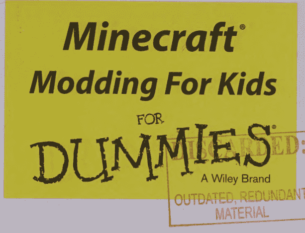

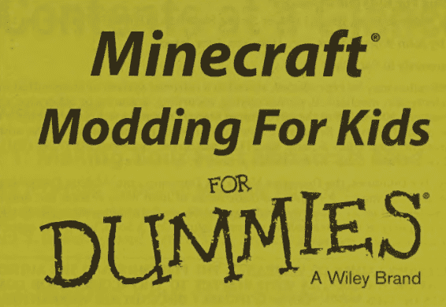

作者：Sarah Guthals, 博士

Stephen Foster, 博士

Lindsey Handley, 博士


# 第一部分：制作你的第一个 Minecraft 模组

# 项目 1：开始 Minecraft 模组开发

- 什么是 Minecraft 模组开发
- 使用 LearnToMod 在线软件
- 熟悉编程环境
- 编写你的第一个 Minecraft 模组
- 在 Minecraft 中运行你的第一个模组
- 编写你自己的 Minecraft 模组
- 与朋友分享你的模组

# 项目 2：获得模组开发勋章

- 使用函数编写模组
- 获得乱序勋章
- 获得缺失勋章
- 创建并调用新函数
- 完成函数勋章代码
- 获得问答勋章
- 挑战勋章之外
- 完成函数挑战

# 项目 3：构建与保护结构

- 使用无人机在 Minecraft 中构建结构
- 通过分阶段编码在 Minecraft 中建造塔
- 在 Minecraft 中使用位置对自己闪电
- 在 Minecraft 中使用位置对无人机闪电
- 调试复杂的模组
- 生成实体并添加物品物品
- 在 Minecraft 中建造一键房屋

# 第四部分：制作你自己的小游戏

- 项目 10：制作你的游戏

## 少年版：Minecraft 模组开发

- 测试多人跳块大战游戏
- 设计并构建爆炸弹物
- 完成额外挑战：使用弹物库制作传送弹物

### 项目 8：制作多人迷你游戏：夺旗战

- 准备夺旗战模组
- 第 2 次迭代：添加玩家 2
- 用其他方式玩游戏

## 第 4 部分：构建你自己的 Minecraft 迷你游戏

## 项目 10：构建你自己的游戏

- 测试你的代码

# 引言

**想制作 Minecraft 模组** —— 这是一个非常棒的主意！你即将从一个 Minecraft 玩家转变为一个创作者，而为了实现这一目标，你需要学习编程。

## 关于本书

Minecraft 模组开发曾是一项只有专家程序员才能完成的任务。成为专家程序员并非易事，因为这个主题在学校里很少教授。幸运的是，书中的信息将教你成为一名*程序员*以及*如何*成为一名 Minecraft 模组开发者。正如整个《傻瓜指南》系列的内容一样，这本书通俗易懂、读起来有趣，并且便于检索。通过使用你的新技能，你将开启在其他应用程序中成功编程之路，并改变你和朋友玩 Minecraft 的方式。

# 引言

## 本书中使用的图标


提示（Tip）图标标记了可以让你模组制作（modding）更简单的建议和快捷方法。


记忆（Remember）图标标记了你应该记住的概念，以使模组更加更加。


代码连接（Coding Connections）图标描述了你正在进行的模组制作与编程宏观概念之间的关系。

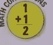

数学连接（Math Connections）图标描述了模组制作中使用的数学知识。


注意！此图标标记了重要信息，可以帮助你避免模组制作者有时必须忍的常见难题。

## 获取 LearnToMod 软件

要访问 LearnToMod 软件，请使用书封上的访问密钥（access key）。然后你只需要按照以下步骤访问你的新 LearnToMod 账户：

1. 访问 `http://mod.learntomod.com`。第一次登录时，网站会将你重定向到 ThoughtSTEM 的登录页面以创建账户。

2. 使用注册（Sign Up）窗口（位于登录窗口下方）创建你的 LearnToMod 账户。

3. 创建 LearnToMod 账户后，将被重定向到一个要求输入访问密钥的页面。复制并粘贴书中内侧封页上显示的访问密钥。

4. 选择一个 LearnToMod 昵称——你喜欢的任何名字！

现在你可以开始解锁勋章来学习如何制作模组了！

## 少少 Minecraft 模组制作

LearnToMod 的开发旨在引导像你这样的学生应对 Minecraft 模组制作的挑战，介绍编程概念，并展示开始制作模组有多有趣。LearnToMod 拥有超过 200 多个勋章，引导你创建简单的模组；然而，你也可以制作自己的创意模组。

本书的前几个章节非常简单，但后期的模组更大、更复杂、也更难。它们旨在按顺序完成，有时它们会相互为基础——欢迎你跳跃着先尝试更具挑战性的项目。在本书的帮助下制作几个模组后，有数百万个模组在等待你。你可以前往 LearnToMod 网站继续获取勋章，或与其他模组制作者继续创建并分享模组。更如此，你正在学习编程！你还可以去寻找其他编程的语言和应用程序。编程是令人兴奋的，我很高兴你不仅选择学习代码，还改变你和朋友玩 Minecraft 的方式！

## 书籍之外

我制作了一些书中没有的额外内容。可以在网上找到这些项目：

- LearnToMod 和基础模组制作的在线快速备忘页（Cheat Sheet）可以在 `www.dummies.com/cheatsheet/minecraftmodding` 获取。基础技能的描述被浓缩在备忘页中，展示了设计和编程的基础。

- 涵盖额外主题的在线文章可以在 `www.dummies.com/extras/minecraftmodding` 获取。

- 如果需要，你可以在 `www.dummies.com/updates/minecraftmodding` 本书的更新。

## 接下来去哪里

# 第一部分 制作你的第一个模组

本周你将：

- 注册 LearnToMod 并制作你的第一个模组。
- 学习 LearnToMod 中不同的勋章类型，并开始获取勋章。
- 使用隐形人在 Minecraft 内部构建结构并用闪电保护它们。

## 入门

在书中，我向你展示如何编写小游戏类 Minecraft 模组。小游戏 Minecraft 模组是在 Minecraft 内部玩的游戏。你可以看到如何制作几个小游戏，并获得完善自己创作的小游戏所需的技能。

LearnToMod 在线软件教你如何制作可以在 Minecraft 多人版本中运行的修改。通过数百个勋章引导你学习各种编程概念和模组，你将获得制作自己的创意模组所需的技能。你应该对玩 Minecraft 有一些基础了解，但不需要成为专家。你只需要电脑版本的 Minecraft 和互联网连接。

| 首页 | 模组 | 学习 | 社交 | 登出 |
| :--- | :--- | :--- | :--- | :--- |
| 入门 (1/6) | 学习编程 (0/178) | 动物园 (0/8) | 魔法魔棒 (0/10) | 实验性 (0/3) |

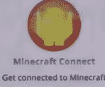


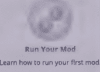

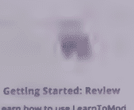


# 第一部分 制作你的第一个模组

在本章中，我解释了什么是模组，描述了如何使用 LearnToMod 在线软件以及如何连接到 LearnToMod 多人服务器，并说明了如何使用隐形人等基础工具来制作你有趣的模组。

### 了解什么是模组制作

视频游戏是由成千上万行代码组成的。代码让你这样的玩家能够探索新世界、与角色互动并获得乐趣。

像 Minecraft 这样的游戏允许玩家添加代码来创建新世界、挑战甚至角色。在书中，我向你展示如何制作这些修改。模组可以包含任何任务：

- 纹理：通过应用纹理包改变外观。
- 方块交互：当玩家破坏木块时引发爆炸。
- 新区块：创建新的区块。
- 小游戏：在 Minecraft 内部创建一个小游戏。
- 大型结构：创建手动制作需要很长时间但用代码只需很短就能的巨大结构。

### 项目 1：开始模组制作

LearnToMod 在线软件引导你完成一系列挑战以获取勋章。这些挑战将帮助你展示基础技能以及如何制作模组。我向你展示如何登录 LearnToMod 软件（可在 `learntomod.com` 获取），创建并运行你的第一个模组，并与其他模组制作者分享该模组。

注册 LearnToMod 在线软件快速简单。只需 5 分钟即可完成注册流程并开始获取勋章。

# 第一部分：制作你的第一个 Minecraft 模组

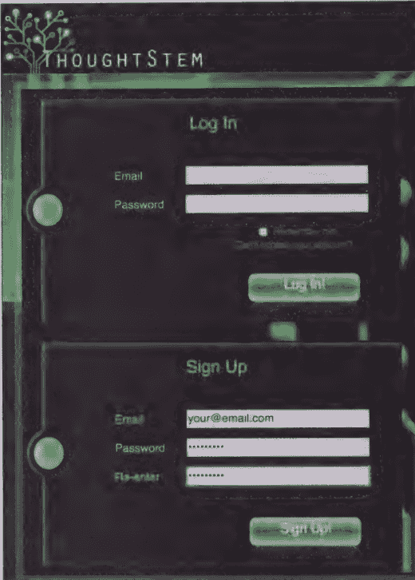

图 1-1

感谢加入 LearnToMod。

看起来你是第一次使用 `your@email.com` 登录。

请输入你购买时获得的访问密钥：

或者，你也可以输入老师提供的课程密钥：

图 1-2

## 项目 1：开始 Minecraft 模组制作

4. 选择一个 LearnToMod 昵称（参见图 1-3）。选择任何你喜欢的名称！

你看到了仪表板（主屏幕），如图 1-4 所示。现在，你可以开始解锁勋章来学习如何制作模组了！


图 1-3

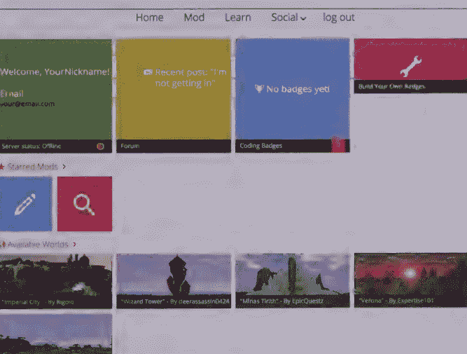

图 1-4

## 开始获取 LearnToMod 勋章

要访问你的 LearnToMod 勋章，请使用注册时的邮箱地址和密码登录 `http://mod.learntomod.com`（参见图 1-1）。你看到了主页（参见图 1-4）。查看挑战列表，点击主页顶部的“Learn”（学习）标签。你看到了第一组挑战，如图 1-5 所示。

# 第一部分：制作你的第一个 Minecraft 模组

首页 模组 学习 社交 登录

| 入 (0/6) | 学习编程 (0/178) | 建造动物 (0/8) | 魔法魔棒 (0/10) | 实验性 (0/3) |
|---|---|---|---|---|

入门

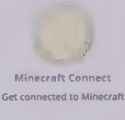

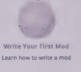

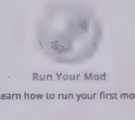

入门：复习


# 学习如何使用 LearnToMod

## 入门：复习

当你完成挑战时，勋章会变成彩色，不再显示为阴影状态。阴影状态的勋章（如图 1-5 所示）尚未获得。

## 将你的模组连接到 Minecraft

要开始之前，请点击第一个勋章“Minecraft Connect”（Minecraft 连接）。在这枚勋章中，你可以找到所有帮助你将模组连接到 Minecraft 的指令，这样你就能在游戏中看到它们的效果。在本节中，我为你总结了这些步骤。

要在 Minecraft 中运行你的模组，你应该拥有最新版本的 Minecraft。随着时间的推移，Minecraft 会通过更新不断改进，你应该始终使用最新版本，以便可以使用最新的 LearnToMod 功能。如需查看你运行的是哪个版本的 Minecraft，请遵循以下步骤：

1. 点击 Minecraft 启动界面左下角的“Edit Profile”（编辑配置）按钮，如图 1-6 所示。
2. 在“Profile Name”（配置名称）文本框中创建一个新配置（参见图 1-7）。
3. 查看“Version Selection”（版本选择）部分（如图 1-8 所示），查看你正在使用的是哪个版本。它在“Version”（版本）文本框中。你应该使用列表顶部版本。在这种情况下，它是 1.8 版本。
4. 点击屏幕底部的“Save Profile”（保存配置）按钮（参见图 1-7）。

如果你使用的是较早的版本（例如 1.7 版本），你应该完成以下操作之一：

- 将其更改为最新版本。
- 创建一个新配置并将版本设置为最新版本。

5. 在勋章上的文本框中输入你的 Minecraft 用户名，将其添加到 LearnToMod 账户，如图 1-9 所示。

Minecraft 用户名必须与你创建时完全相同（包括大小写），这样你的模组才能连接到你的 Minecraft 账户。如果拼写不同，你就无法在 Minecraft 中看到你的模组。

6. 点击“Connect”（连接）按钮。

弹出 Minecraft Connect 勋章，如图 1-10 所示。

在 Minecraft Connect 勋章的文本框下方，你看到了“Success!”（成功！）字样，如图 1-11 所示。

按照 Minecraft Connect 勋章屏幕上显示的 11 个步骤操作：

1. 在 Minecraft 主界面点击“Play”（开始游戏）（参见图 1-6）。
2. 选择“Multiplayer”（多人游戏）。
3. 点击“Add Server”（添加服务器）。
4. 服务器名称输入 `Learn To Mod`，地址输入 `play.learntomod.com`。
5. 点击“Done”（完成）。
6. 点击“Join Server”（加入服务器）。

当你完成这些步骤后，你会看到一个与图 1-4 相似的预设世界。现在你可以开始解锁勋章来学习如何制作模组了！

# 第一部分：制作你的第一个 Minecraft 模组

## 项目 1：开始 Minecraft 模组制作

要获得第二个勋章，请遵循以下步骤：

1. 将一个函数拖入编程环境并将其重命名为 `main`。图 1-19 显示了在哪里找到函数块。
2. 点击文本“do something”，如图 1-20 所示。
3. 输入 `main` 来创建一个 `main` 函数，如图 1-21 所示。
4. 点击 Minecraft 类别，然后点击 Players（玩家），如图 1-22 所示。
5. 点击选择 `send message`（发送消息）块，然后将其拖动连接到 `main` 函数，如图 1-23 所示。
6. 点击选择 Text（文本）代码类别，如图 1-24 所示，然后找到文本块。
7. 将文本块拖动连接到 `send message` 块，然后在文本块内输入 `Hello, World!`。图 1-25 显示如何进行这一步。
8. 点击 Minecraft 类别并点击 Players，如图 1-26 所示。然后找到 `me` 块。
9. 拖动 `me` 块并连接到 `send message` 块的第二个空间，如图 1-27 所示。
10. 在此挑战的四个步骤的底部，点击 Test In Simulator（在模拟器中测试）按钮，如图 1-28 所示。
11. 点击模拟器，然后按下键盘上的 `M` 键。你会看到消息 `Hello, World!`（见图 1-29）。
12. 当你获得的勋章弹出时，你可以点击 Back to Badges（返回勋章列表），如图 1-30 所示。

恭喜！你已经写了第一个 Minecraft 模组。在下一节中，你将在 Minecraft 中测试你的模组。

### 代码构建步骤

步骤 3：找到文本块，将其拖入，并在其中填写消息“Hello, World!”。

```
function main() {
    Send message "Hello, World!" to
}
```

步骤 4：找到“me" 块，并将其拖入缺失的位置。

```
function main() {
    Send message "Hello, World!" to me
}
```

在模拟器中测试：运行模拟器

你卡住了吗？点击此处访问课程帮助论坛...

你可以选择顶部进度条上的链接，或者通过点击屏幕右上角的链接提问，如图 1-31 所示。

## 在 Minecraft 中运行你的第一个模组

在你写完第一个模组后，下一个任务是在 Minecraft 中运行该模组。第三个勋章 Run Your Mod（运行你的模组，参考图 1-18）列出了执行此步骤：

1. 点击编程环境底部的 Mod 按钮。

你可以在图 1-32 的左下角看到该按钮。

当你点击它时，你会看到图 1-33 所示的消息，告知模组已成功发送到你的账号。

2. 点击任务栏上的 Minecraft 图标，如图 1-34 所示。

如果你仍在游戏中，你会看到图 1-35 所示的物品栏中的模组。

如果你不在游戏中，回到 Connect（连接）勋章，按照“Connect mods to Minecraft”中的描述操作。

3. 在 Minecraft 中装备并使用你的模组，请遵循以下步骤：

a. 按下 `M` 打开模组列表，然后右键点击鼠标。
b. 选择你想运行的模组，将其从模组列表拖到物品栏。将鼠标悬停在不同模组上查看它们的名称。
c. 按 `Esc` 键退出模组列表并返回游戏。
d. 按与物品栏中模组位置对应的数字来运行模组。

例如，如果你将模组放在最左侧，如图 1-36 所示，按下 `1` 键并右键点击鼠标来运行模组。

返回 LearnToMod 网站查看你已获得第三个勋章。然后你应该完成接下来的三个挑战，它们是测试题。我不会引导你完成这三个勋章，因为你应该自己测试并获得它们。

## 编写自己的模组

在第 2 章中，我会引导你完成 Learning to Program 标签下的下一组勋章。在你获得至少十个勋章后，你可能会有一个想写的创意模组想法。请遵循以下步骤：

1. 滚动到 LearnToMod 软件顶部并点击图 1-37 所示的 Mod 标签。
2. 在图 1-38 所示的新页面上，你可以为你的模组输入标题，例如 `Say_Hello`。
3. 点击 Blockly（多人）按钮创建一个服务器端模组。这本书将教你如何制作服务器端模组，这意味着它们是多人模式的。出现一个新的模组块，如图 1-39 所示。
4. 点击新的模组块显示模组的描述页（见图 1-40）。
5. 点击 Code 按钮，你会看到图 1-41 所示的编程环境。

现在你可以尝试写一个新模组——例如一个对你个人打招呼的模组（见图 1-42）。

## 与朋友分享你的模组

编写模组并在 Minecraft 中测试它们很有趣，但让朋友在他们的 Minecraft 世界中测试可以帮助你和朋友想出创意模组，因为你可以获得新点。

在你写了一些代码后，让你的朋友为你测试——这是发现 Bug 并成为更好的模组开发者的好方法。

与你的 LearnToMod 同伴们分享模组很容易。只需遵循以下步骤：

1. 点击模组中的 Back（返回）按钮（参考图 1-41）。
2. 点击左上角的图像框，如图 1-43 所示。
3. 按照图 1-44 所示的步骤为模组添加截图和描述。
4. 点击指示器使模组公开，如图 1-45 所示，然后点击 Save（保存）按钮。

如果你的朋友安装了 LearnToMod，他们可以点击自己主页上的“查找 Mod”（Find a Mod）按钮，如图 1-46 所示。

然后可以搜索你名为 `Say_Hello` 的 Mod，如图 1-47 所示。

你的 Mod 出现了，如图 1-48 所示。另一个人可以点击它进行测试并查看你的代码。

# 项目 2：获取 Mod 章

## 获取 Mod 章

在这个项目中，我将帮助你通过完成挑战和获得章程来掌握编程的基本概念。我会在你学习函数的同时为你提供获得不同种类程的步骤，并鼓励你尝试编写自己的 Mod（参见项目 I 的末尾）。

## 使用函数编写 Mod

在项目 1 中，我描述了如何编写一个带有名为 `main` 函数的 Mod（参考项目 1 中的图 1-27）。从现在起，我将称之为主函数。当你在 Minecraft 中运行 Mod 时，你的 Mod 总是从 `main` 函数开始运行的。

注意，“打招呼”（Saying Hello）章与“第一个”（Your First）章相似，但它有三条消息而不是两条。图 2-1 显示了为了完成“打招呼”章你应该编写的代码。

```
main
Send message "Hello" to me
Send message "How are you?" to me
Send message "My name is Steve." to me
```

图 2-1

如需完成章程的帮助，请点击 Mod 顶部进度条上的“点击提示”（Click for Hints）链接，或观看视频查看如何解决挑战。有时将方块放置在正确的位置很棘手，不过你可以在将它们应用到编程环境后随时重新排列顺序。在本书的后续部分，我将向你介绍复制粘贴过程，让编码变得更快。

要获得章程，你必须在 LearnToMod 网站上的 Minecraft 模拟器中测试你的 Mod。此 Mod 中的进度条显示你已编写了 100% 的代码，但它提醒你在模拟器中测试代码（参见图 2-2）。

要在模拟器中测试你的 Mod，请点击 Mod 旁旁“模拟器”（Simulator）按钮（参见图 2-3）。

Minecraft 模拟器有时在旧版本的浏览器中无法工作。如果你下载了 Unity Player 插件后模拟器仍然无法，请更新你的浏览器或使用其他浏览器。你可以下载免费且可靠的浏览器，如 Chrome、Safari 或 Firefox。

Unity Player 是支持你在浏览器中查看 Minecraft 的第三方软件。

当你点击“模拟器”按钮时，模拟器会弹出，如图 2-4 所示。要在模拟器中测试你的 Mod，只需按下键盘上的 `M` 键。

在 Mod 运行后，你就获得了章程。你会看到完成章程的截图，如图 2-5 所示。

要进入模拟器，将鼠标拖入其中并点击任何地方。要退出模拟器，按下键盘上的 `Esc` 键。

## 获取乱序章

你可以获得几种不同类型的章程。我在本项目较早时候描述的是“代码编写章”（Code Writing badge）。要获得它，你编写编写与教程匹配的代码。在本节中，我将向你介绍“乱序章”（Scramble badges），它们与其他类型不同：你所需的所有代码块都已经在编程区域内了——它们只是在屏幕上以动画的形式随机乱序分布的。

要获得乱序章，请遵循以下步骤：

1. 在模拟器或 Minecraft 中测试正确版本的代码，查看它应该执行什么，例如说“Hello, World!”。


# 第 1 部分：制作你的第一个 Minecraft Mod

## 获取“打招呼”章：乱序版

点击章程打开“打招呼（乱序）”挑战，如图 2-7 所示。

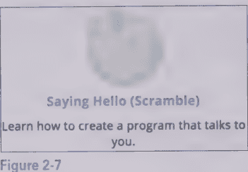

你看到屏幕上有十个乱序分布的方块（参见图 2-6）。

遵循以下步骤解决挑战并获得章程：

1. 点击蓝色的“测试”按钮在 Minecraft 中测试正确版本，或点击橙色的“测试”按钮在模拟器中测试正确版本。然后观察发生了什么（参见图 2-8）。

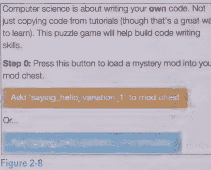

2. 收集这十个方块并开始排列它们，使得当你运行 Mod 时，它执行的是与正确版本完全相同的操作。

3. 在 Minecraft 或模拟器中测试你的 Mod，看它的效果是否与正确版本相同。

4. 继续这种“编辑-测试”循环，直到你组合出正确的方块排列。

## 与计算机通信

编写代码是程序员与计算机通信的方式，也是你与 Minecraft 通信的方式。然而，问题在于计算机完全执行你让它做的事，而不是你所想的。有时将方块放置在正确位置很棘手，不过在你将它们应用到编程环境后，你可以随时重新排列顺序。

## 代码追踪

代码追踪是一项必须掌握的重要技能，你可以通过多种方式来实现。这里有两种非常有用的代码追踪策略：

- **使用计算机**。特别是对于“缺失”勋章，这是追踪代码的一种极佳方法。首先，运行你的代码（或正确版本）并观察发生了什么。然后再次运行代码，但这次在代码执行时指向每一行代码。例如，当你看到“Hello, World!” 消息时，指向图 2-10 所示的代码行。这样，当你的代码缺少某个区块时，你就能找出正确代码中发生了什么。

- **使用铅笔和纸**。如果你写了一个模但它没有按照你的预期运行，请在纸上画出每行代码执行后的情况。例如，图 2-10 所示的代码 `Send Message "Hello, World!" to me` 将打印到屏幕上，所以你应该把它写在纸上。


图 2-10

## 获取“说 Hello”勋章：缺失版

点击勋章打开“Saying Hello（缺失）”挑战。当你获得该勋章时，代码会将 Cat Stevens 一首歌的歌词内容打印到屏幕上（见图 2-11）。

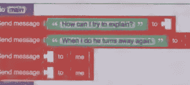

图 2-11

这个模缺少了三个区块。第一个可能是玩家区块（`player block`），因为那是你使用过的唯一玩家，其他区块也在使用它。最后两个可能是文本区块（`text blocks`），因为这是你发送的唯一消息类型，而前两个发送的文本消息。无法猜测文本区块应该放置什么文本，因为可能性的列表非常、非常大。

要完成缺失勋章，请按照以下步骤操作：

1. 在 Minecraft 或模拟器中运行正确版本并观察发生了什么。当你运行代码时，你应该能看到图 2-12 所示的场景。

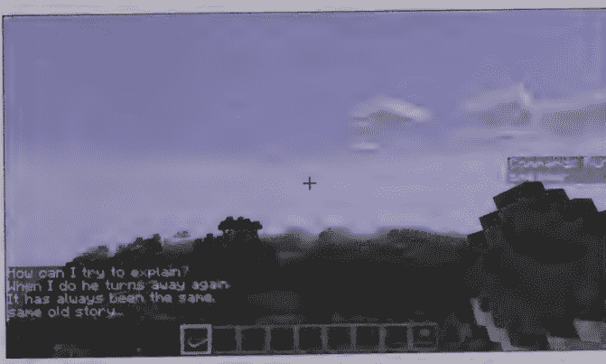

图 2-12

第一行代码发送消息 `How can I try to explain?`，但没有指定哪个玩家是消息的目标（接收消息的玩家）。运行代码后，你可以看到目标应该是 `me` 区块，因为当你运行正确版本时你可以看到该消息（见图 2-13），最后两条消息是：

> It has always been the same, same old story . .

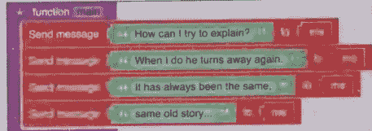

图 2-13

所有发送给 `me` 的内容都会出现在运行模组的人的屏幕上。所以，如果你运行模组并看到了消息，那么消息的目标就是 `me`。

2. 添加 `me` 区块以及两个带有正确消息的文本区块（参考图 2-13）。然后测试你的模组，确保它的功能与正确版本相同（参考图 2-12）。

如果你在完成后返回缺失勋章或错乱勋章，LearnToMod 软件会询问你是否想重置代码使其处于缺失或错乱。如果你选择重置勋章，你仍然拥有该勋章，你只是可以再次尝试挑战。

## 创建并调用新函数

函数是将大量代码分组并命名的方法。当你拖入一个函数区块、更改名称并在内部添加代码时，你就在创建一个新函数（或定义或编写一个新函数）。当你将特定的函数区块拖入另一个函数（如主函数）时，你就是在调用该函数。

以下是主函数的主要特征：

- 每个模组恰好有一个主函数。你的模组从主函数开始，所以你至少需要有一个。如果你有两个或多个主函数，你的模组将不知道该从哪一个开始。事实上，为了避免这种混淆，每个函数的名称必须与该模组中的任何其他函数不同。
- 你可以通过将函数区块拖入编程环境并将其命名为 `main` 来创建主函数。
- 其他代码区块（如 `send message`）都在主函数内部。
- Minecraft 和模拟器首先寻找主函数，然后从上到下、逐行开始运行其内部的代码。

主函数对于编写模组是至关重要的，但编写模组也有其他使用函数的原因。以相同的方式，在书中分组代码可以产生结果，函数允许你对代码分组并命名。图 2-14 显示了一个主函数的示例。在这个模组中，有三个故事。

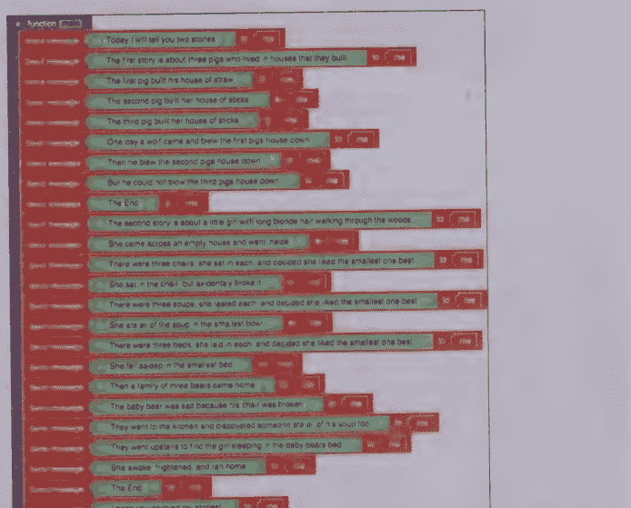

图 2-14

在代码第 13 行，你看到一个拼写错误（见图 2-15）。在测试模组时你可能会发现它，但如果使用函数，寻找错误会容易得多。

```
Message sat on
```

图 2-15

使用更短的代码块很有用，因为你可以快速排列代码。图 2-17 显示了函数代码的顺序。

```
"I hope you enjoyed!",
```

图 2-17

## 完成函数代码

在函数勋章中，名为 `perform` 的区块执行命令。在开始之前，确保你已经点击勋章打开了函数。当你到达本节结束时，你将知道如何定义两个函数：`creeper1` 和 `creeper2`。你的最终代码所示图 2-18。当你运行这段代码时，你会看到与图 2-19 相似的场景。

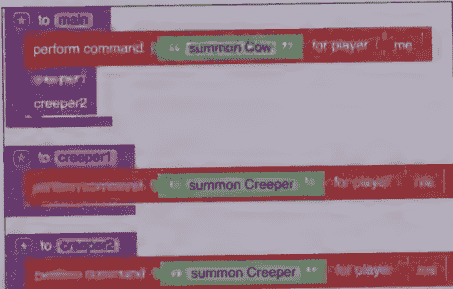

图 2-18

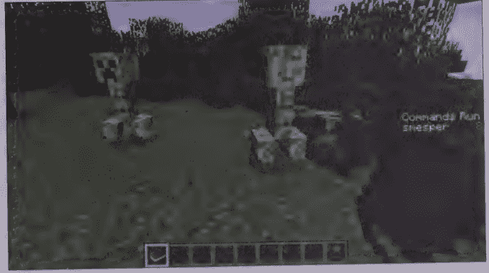

图 2-19

## 使用 `perform` 命令

在函数勋章中，`perform` 区块执行文本区块中的命令。图 2-20 显示了该区块，它会召唤一只羊。Minecraft 有一组可以在游戏中运行的命令。你可以在互联网上搜索“Minecraft commands”来查看介绍它们的网页。例如，如果你想在不写模组的情况下召唤一只羊，可以在 Minecraft 中输入 `/summon`（见图 2-21）。图 2-22 显示了如何操作。

```
/summon Cow
```

图 2-21

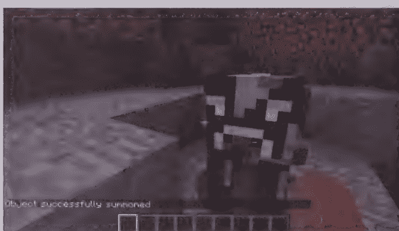

图 2-22

为了让 Minecraft 运行 `perform` 命令，你必须将该区块放在主函数内部，如图 2-23 所示。


图 2-23

在此处测试你的代码，确保它的功能符合你的预期。当你在 Minecraft 中运行这段代码时，你会看到与图 2-24 所示的场景。

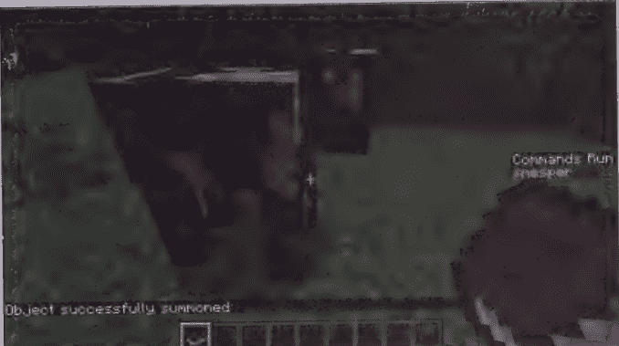

图 2-24

## 创建并调用新函数（续）

正如你在该挑战的完成代码（参考图 2-18）所示，你需要定义两个新函数。定义第一个并测试你的代码以确保其工作正常。然后定义第二个。如果你在不测试的情况下就写完代码，会使错误更难发现，因为你有大量的代码需要追踪。

要创建并调用苦力者函数，请按照以下步骤操作：

1. 将一个函数块拖入编程环境。
2. 点击 `do_something` 单词，并将函数重命名为 `creeper`，如图 2-25 所示。

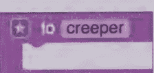

图 2-25

3. 在 `creeper` 函数中添加一个 `perform` 命令块，并在文本区域输入 `summon creeper`，如图 2-26 所示。

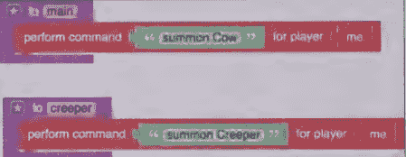

图 2-26

4. 在 Minecraft 或模拟器中运行你的模。

注意，只召唤了一只牛，而不是一个苦力者。原因是只调用了主函数（从 Minecraft 或模拟器调用）。你没有调用 `creeper` 函数，因此它被忽略了。

5. 当你查看函数类别时，注意已经创建了一个新块——`creeper` 调用块，如图 2-27 所示。

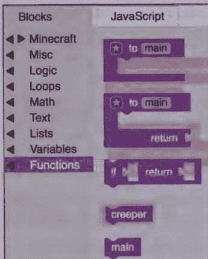

图 2-27

6. 从主函数中调用 `creeper`，如图 2-28 所示。

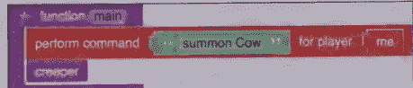

图 2-28

7. 在 Minecraft 或模拟器中运行你的模。

召唤了一只牛和一个苦力者。

## 追踪函数调用

为了更好地理解运行模时发生了什么，请使用在本项目早些部分“追踪代码”节中描述的纸笔策略来追踪你的代码。

要追踪每行代码，请遵循以下步骤：

1. 调用主函数，它执行的第一件事是运行召唤牛的 `perform` 命令块，这使得一只牛出现，所以画一只牛。
2. 调用了 `creeper` 函数，因此 Minecraft 开始查看 `creeper` 函数。你也应该查看它。
3. 当运行召唤苦力者的 `perform` 命令块时，它让一个苦力者出现，所以画一个苦力者。

`creeper` 函数没有更多代码行了，Minecraft 回溯到（你也是如此）主函数。

主函数没有更多代码行了，因此代码执行完毕。

## 添加第二个苦力者函数

以你创建第一个 `creeper` 函数相同的方法，创建第二个 `creeper` 函数。函数挑战中的第 3 步为你提供了关于此任务的说明，如图 2-29 所示。

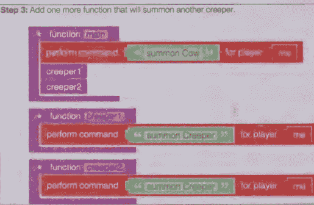

图 2-29

如果你需要帮助，可以点击勋章下方评论区域的 Are You Stuck? 链接来提问，如图 2-30 所示。

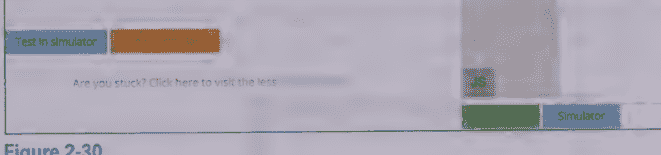

图 2-30

## 获取测试勋章

当你使用 LearnToMod 软件时，你会获得获取测试勋章的机会，例如图 2-31 所示的函数测试勋章。获取测试勋章可能很困难，请务必仔细阅读整个问题和所有选项。

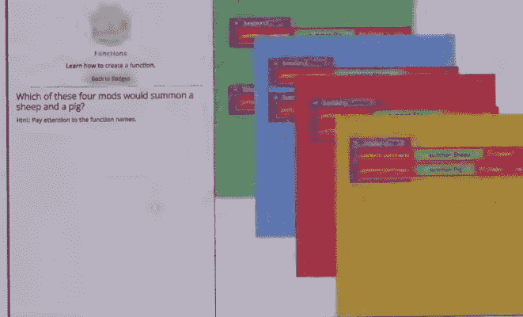

图 2-31

提示：如果有帮助，可以使用纸笔完成测试题，特别是在项目 3 开始使用无人机时。

当你认为答案正确时，点击包含答案的框。如果你回答错误，将看到如图 2-32 所示的消息。否则，你将获得勋章并继续。


图 2-32

## 挑战自我

获取勋章很有趣，但我希望你能够创建自己的模，而不仅仅是跟随勋章。在本节中，你将面对没有勋章相关的挑战。如果你在任何地方卡住了，只需点击主页上的 Social 标签在 LearnToMod 论坛中提问，如图 2-33 所示。

| Home | Mod | Learn | Social |
|---|---|---|---|
| Forums | | | |
| Published Mods | | | |
| Comments | | | |

图 2-33

在尝试本节的挑战之前，你应该已经获得了至少五个函数挑战勋章。

要从头开始编写模（参见项目 1 关于编写自己的模的章节），前往首页并点击顶部的 Mod 链接，如图 2-34 所示。

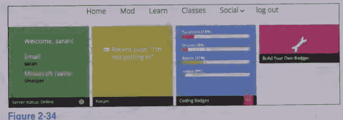

将你的模命名为 `function_challenge_1`，并选择 Blockly（多人）作为语言。点击 mod 块然后点击 Code 按钮，直到进入编程环境。它看起来像图 2-35。

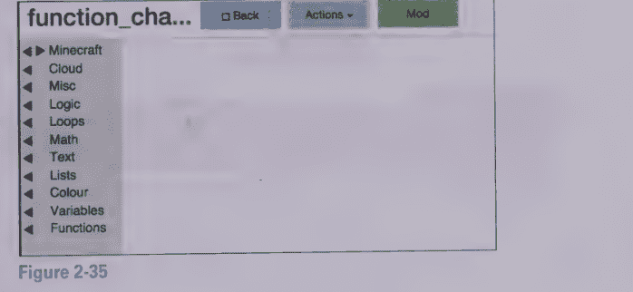

编写具有以下函数的模：

- `summonCree`: 召唤两个苦力者
- `summonZombies`: 召唤三个僵尸
- `summonCreatures`: 召唤四个生物
- `main`: 召唤一组生物

当你认为答案正确时，点击包含答案的框。如果你回答错误，将看到如图 2-32 所示的消息。否则，你将获得勋章并继续。

| functionZombies | functionCreeper |
|---|---|
| 召唤三个僵尸 | 召唤两个苦力者 |


代码块与代码行是不同的。一个代码块可以是一个 `me` 块，而一行代码可以是三个块。当你计算代码行数时，一个空函数是一行。

# 项目 3：构建和保护结构

在这个项目中，我将引导你完成在你的世界中构建和保护结构的步骤。首先，我描述如何构建像塔这样的小结构，然后进入如何构建城堡、村庄等复杂结构。我会告诉你如何逐砖一块地构建结构，如何用闪电保护你的结构，以及如何使用循环来构建它们。

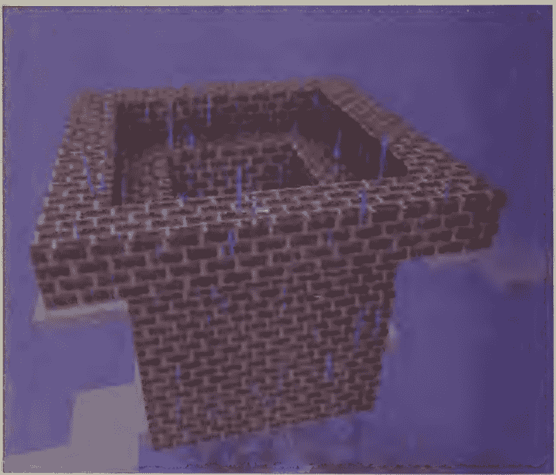

## 使用无人机在 Minecraft 中构建结构

可以使用无人机时，构建结构变得简单得多。无人机是一个可以在其位置放置区块和实体的隐形机器人。例如，在项目 4 中，我向你展示如何制作 Spleef 游戏，这需要你创建一个带有短围栏的平台，然后在平台上铺满岩浆。然后你必须在第一个平台正上方创建另一个带有高围栏的平台。因为平台必须至少有 20 个块宽，逐砖放置将花费很长时间（那超过了 1000 个块！）。相反，你可以编写一个构建这些平台的模，并玩许多版本的游戏，而无需每次重新构建。

## 创建无人机

创建无人机并不复杂，但它需要你使用一种新的编码功能：变量。变量是命名对象的方法。在本节中，你可以跟随我对 LearnToMod 在线软件中无人机挑战的描述。

打开无人机挑战，并遵循以下步骤：

1. 为了能给无人机下命令，你需要命名它。你通过将其赋值给变量来命名对象（如无人机）。首先将一个变量块拖入主函数，如图 3-1 所示。
2. 始终给对象起对你有意义且容易记忆的名字。在这个示例中，点击项目旁边的箭头（见图 3-2）创建一个新变量，并将其命名为 `d`，代表 `drone`（见图 3-3）。

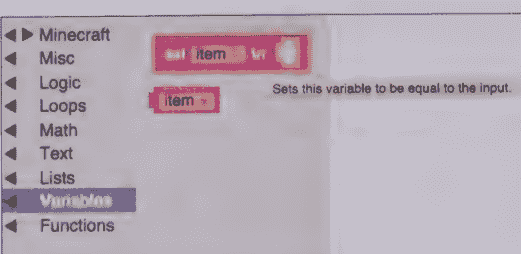

图 3-1

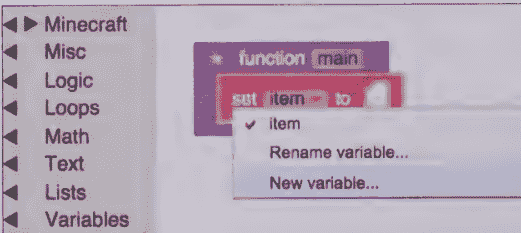

图 3-2

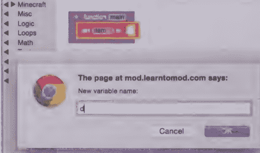

图 3-3

3. 要创建一个无人机，你必须将一个新的无人机赋值给你刚刚创建的变量。图 3-4 显示了可以在哪里找到新的 `Drone` 模块，图 3-5 显示了你将其放在赋值块中的位置。

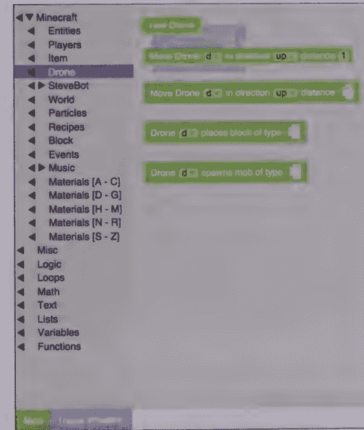

图 3-4

```
set d to New Drone
```

图 3-5

现在你已经有了一个无人机，你可以通过它的名字 `d` 来访问它，并让它执行某些操作，例如放置区块或生成实体。

## 构建结构并移动无人机

在你给新无人机命名后，你就可以给它下命令了。图 3-6 显示了在哪里找到放置区块的代码。

- Minecraft
- 实体
- 玩家
- 物品
- 无人机
- Stevebot
- 单词
- 粒子
- 配方
- 块


# 事件 (Events)

# 音乐 (Music)

# 材料 [A - C]

# 材料 [D - G]

# 材料 [H - M]

# 材料 [N - R]

# 材料 [S - Z]

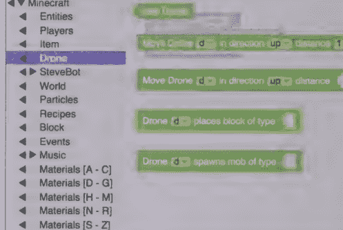

图 3-6

这个代码块要求你指定无人机将放置的区块类型，例如砖块或钻石块。图 3-7 显示了你可以在哪里找到砖块类型，图 3-8 显示了完成后的代码。

如果你在 Minecraft 或模拟器中运行这段代码，你将看到像图 3-9 所示的场景。

你的结构会出现在你观察的区域，所以构建时请移动到一个空旷区域。我甚至喜欢进入创造模式并在空中建造：双击空格键进行悬浮，然后再次按下空格键向上移动。

## 项目 3：构建与保护结构

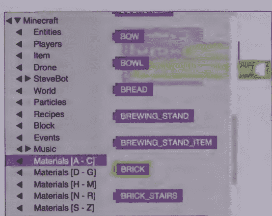

图 3-7

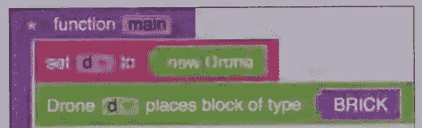

图 3-8

继续无人机挑战的第 3 步，你应该在你的模中添加一个移动（`move`）块。图 3-10 显示了你添加的移动块。你可以在 Minecraft 分类下的 Drones 分类中找到该块，就像你找到的放置区块代码块一样（参阅图 3-6）。

如果你再次运行代码，你会看到与图 3-9 所示的相同结果。无人机是不可见的，所以移动它没有可见的效果。

继续工作通过添加另外三行代码来完成此挑战。图 3-11 显示了获得此勋章所需的完成代码。

# 第一部分：制作你的第一个 Minecraft 模

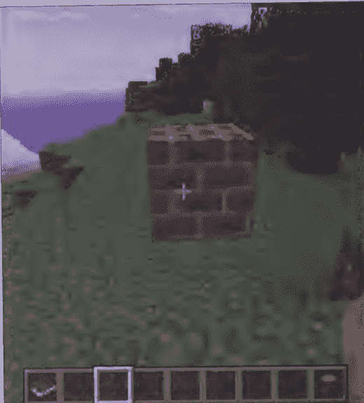

图 3-9

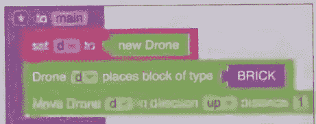

图 3-10

在运行模之前，在纸上预测你将看到什么。然后在模拟器中运行模，并将你的预测与你看到的内容进行比较。

## 项目 3：构建与保护结构

如果你的预测不正确，回到代码，并在纸上或计算机上进行追踪。（访问项目 2 中的“追踪代码”部分了解如何操作）。要使用计算机追踪，通过右键点击并选择“禁用块”（`Disable Block`）来禁用所有代码块（见图 3-12）。然后逐个重新启用块，每次启用时都测试模，看看你是否理解了发生了什么。

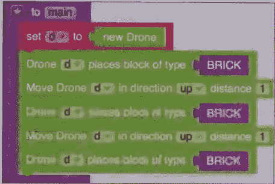

图 3-11

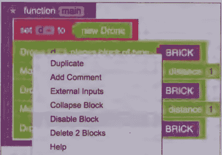

图 3-12

## 第一部分：制作你的第一个 Minecraft 模

## 在 Minecraft 中构建一座塔

了解如何创建无人机、移动它们以及使用它们放置区块可以让你构建你想象的任何东西。然而，构建复杂的结构需要大量的代码。在制作大型结构之前，探索如何使用无人机来构建较小结构。

编码是一个复杂的过程，但它可以分为三个主要阶段：

- **设计 (Design)**：在这个阶段，你（编码者）评估你试图解决的问题，例如在 Minecraft 中建造一座塔。这个阶段需要使用纸和笔。

有时，你会重构你的代码而不改变其功能——这被称为*重构*（`refactoring`）。图 14（在项目 2 中）是一个很长的函数。

- **开发 (Develop)**：在这个阶段，你按照计划编写代码。

- **测试 (Test)**：在这个阶段，你测试代码以确保它符合你的要求。

## 项目 3：构建与保护结构

### 设计：勾勒出塔

你可以以许多不同的方式设计塔。在本节中，我将向你展示如何通过纸上绘图或使用真实的区块来设计它：

1. 勾勒或构建在 Minecraft 中出现那样的塔。如果你在纸上画图，这一步可能会困难，因为纸是二维的 (2D)，而 Minecraft 是三维的 (3D)。绘图不需要完美，你只需要形成想法（例如有多少个区块或什么类型的区块）。图 3-13 显示了塔的两个面。

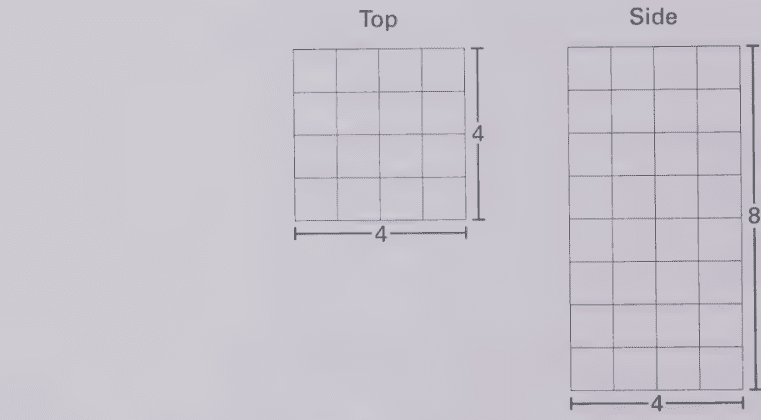

图 3-13

2. 在纸上，将你的设计拆解成可以管理的部分。图 3-14 显示了一种方法：

- 一行区块：指示无人机移动的位置。
- 两行区块：显示你需要如何为每一行重置无人机。这意味着无人机必须返回一行的开头，然后向上移动。
- 一个完整的正方形区块：指示整个正方形，需要 16 个区块。塔由 8 个堆叠在一起的正方形组成。
- 两行正方形：显示你需要如何为每一列重置无人机。
- 四行正方形：确保你仍然处于正确的轨道上。
- 八行正方形：塔。

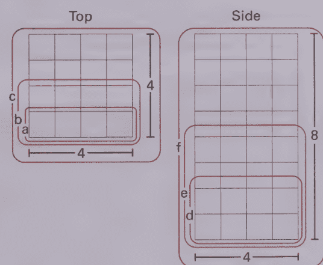

图 3-14

# 第一部分：制作你的第一个 Minecraft Mod

使用 Blockly 语言创建一个名为 Tower（塔）的新新 Mod。

（项目 1 描述了如何创建一个不是勋章的自定义 Mod。如果你忘记了如何创建一个新 Mod，请重新查看“编写你自己的 Minecraft Mod”章节。）

在开始此步骤列表之前，请阅读之前的章节“使用无人机在 Minecraft 中建造结构”，并确保你已经获得了第一个无人机（Drones）勋章。要建造并测试塔，请按照以下步骤操作：

- 1. 设置你的无人机。

图 3-15 显示了设置你的无人机以建造塔的代码。

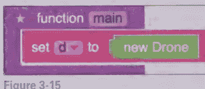

- 2. 制作一行方块。

图 3-16 显示了制作一行方块的代码。如之前所示，在图 3-13 中（从顶部俯视塔），塔的尺寸为四块砖乘以四块砖，因此每行应该有四块砖。

- 3. 测试代码以确保它制作了一行方块。

图 3-17 显示了该行方块应该的样子。

> 记住：结构将出现在你注视的区域，因此建造时最好去一个空旷。我甚至喜欢进入创造模式并在天空中建造。双击空格键进行悬停，然后按空格键向上移动。

## 项目 3：建造和保护结构

```
function main
set d to Drone
Move Drone d in direction forward distance 1
Drone d places batch of type BRICK
Move Drone d in direction forward distance 1
Drone d places batch of type BRICK
Move Drone d in direction forward distance 1
Drone d places batch of type BRICK
Move Drone d in direction forward distance 1
Drone d places batch of type BRICK
```

图 3-16

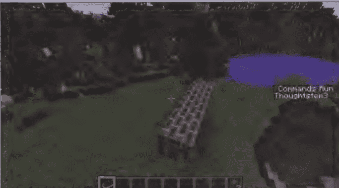

图 3-17

- 4. 通过复制第一行制作两行方块。

图 3-18 显示了制作两行的代码。

# 第一部分：制作你的第一个 Minecraft Mod

- 5. 追踪代码（参见项目 2 中的“追踪代码”部分）。

仔细检查代码，并草画出你认为无人机将要做的操作。图 3-19 显示了画出追踪你代码的一种方法。而且，以防你疑惑，它并没有制作两行——它制作了一行长八八块的行。

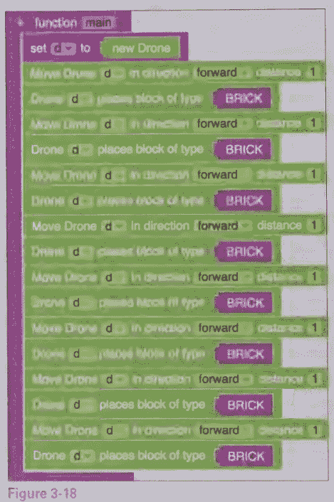

- 6. 测试代码。

你可以看到图 3-19 所示的追踪与图 3-20 场景中制作的内容是一的。

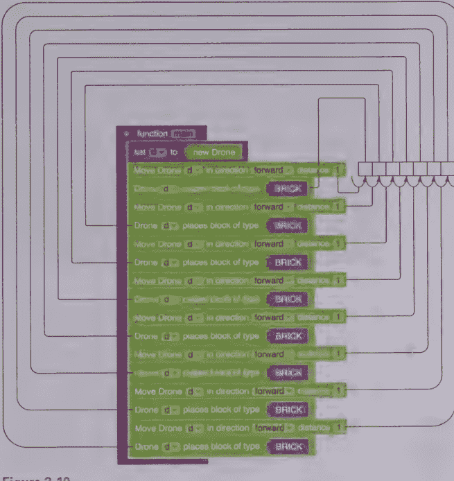

# 7. 编辑代码。

在添加制作第二行的代码之前，通过将无人机移回右侧来重置它。然后如图 3-21 所示让无人机向前移动。

向前和向后是相对于你（玩家）的，而不是相对于无人机。所以，无论你面对哪个方向都是向前，相反的方向就是向后。

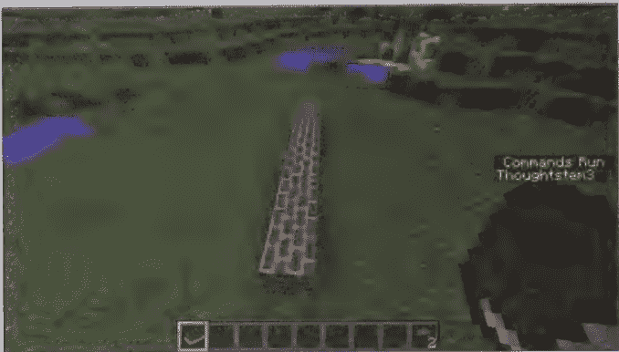

- 8. 再次测试代码。这样做会产生图 3-22 所示的场景：两行方块，每行四块块长。

- 9. 重构你的代码。

重构代码意味着改变它的外观，但不改变它的`功能`。当你的代码变得很长并且你想将其拆分为较小的函数时，这个概念非常有用。

图 3-21 所示的代码已经开始变长了，而你只制作了两行方块。重构此代码简单的方法是找到重复的部分（例如制作四块块的一行），并将它们放在一个单独的函数中。图 3-23 显示了相同的重构后更短的代码。

## 项目 3：建造和保护结构

```
function Drone() {
  Move Drone in forward distance 4
  Drone places block of type BRICK
  Move Drone in forward distance 4
  Drone places block of type BRICK
  Move Drone in forward distance 4
  Drone places block of type BRICK
  Move Drone in forward distance 4
  Drone places block of type BRICK
  Move Drone in backward distance 4
  Drone places block of type BRICK
  Move Drone in right distance 1
  Drone places block of type BRICK
  Move Drone in forward distance 1
  Drone places block of type BRICK
  Move Drone in forward distance 1
  Drone places block of type BRICK
  Move Drone in forward distance 1
  Drone places block of type BRICK
}
```

图 3-21

- 10. 制作一个方块正。

在你重构代码之后，制作一个 4 x 4 的方块正应该看起来很简单。图 3-24 显示了创建该结构的代码，图 3-25 显示了在 Minecraft 中使用该代码的结果。

- 11. 再次重构代码。在第 9 步中，你重构了代码以便于制作多行四块块。现在重构代码以便你更容易制作多行 4 x 4 的方正。重构代码以匹配图 3-26。

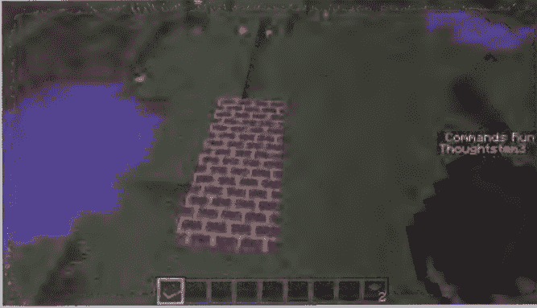


## 项目 3：建造和保护结构


图 25

| function | function |
| :--- | :--- |
| clockwise | right |
| turn right | right |
| counter-clockwise | backward |
| turn left | backward |

图 26

- 12. 制作两个方块正。

在你重构代码之后，制作两个 4 x 4 的方块正应该看起来很简单。

- 13. 制作四行四块块。

图 29 显示了制作 4 x 4 方块的代码的代码，  22     2 2

## 项目 3：构建与保护结构


图 3-32


图 3-33

# 86 第一部分：制作你的第一个 Minecraft 模组

当你在 Minecraft 或模拟器中运行此模组时，会发生两件事：

- 你看到闪电从天空落下，如图 3-34 所示。
- 你周围的草会着火（见图 3-35）。


图 3-34


图 3-35

## 项目 3：构建与保护结构

### 使用位置对 Minecraft 中的无人机召唤闪电

在“位置（Locations）”第二部分的挑战中，你可以学习如何让闪电击中无人机而不是你自己。当你试图保护自己创建的结构时，这些信息会非常有用，比如我在前面的章节“在 Minecraft 中建造塔”中教你如何制作的那座塔。

图 3-36 显示了你需要在自身其他地方召唤闪电所需的代码。


图 3-36

你可以通过使用多个无人机在多个地方召唤闪电——太酷了！

图 3-37 向你展示了如何制作三个无人机并对它们每一个都召唤闪电。


图 3-37

# 第一部分：制作你的第一个 Minecraft 模组

## 记住


如果你想制作多个结构，能够制作多个无人机也会很有帮助。每个无人机都可以负责制作不同的结构，而且你不需要在制作新东西之前重置其中一个。

## 调试复杂的模组

当你的模组代码没有按照你想要的方式运行时时（例如，当你制作了一行八块砖而不是两行四块砖时），你可能遇到了一个错误，或者说 *bug（漏洞）*。如果你的代码中有 bug，你必须对它进行*调试（`debug`）*，即修复它。编写大型、复杂的模组更容易遇到难以发现的错误。

在这一节中，我为你提供了四种调试代码的策略：

- *离开一下。* 当你的代码不再合逻辑时，直接离开一下去看看视频或看电视节目，然后回到手头的任务。有时，当你长时间专注于一个问题时，你会错过那些如果只是休息一下就能容易发现的错误。像微软、谷歌和 Facebook 等科技公司通常都配有 Xbox、PlayStation、足球和乒乓球游戏室，以便他们的成员在遇到棘手的 bug 时可以休息。

- *用纸笔画图。* 编程中很棒的一点是，你可以追踪代码并将其画在纸上。逐行查看并像无人机一样移动你的笔，每当无人机放置一个区块时，就画一个区块。这将帮助你发现任何出错的地方。

- *禁用代码块。* 在这种实用的技术中，你一个接一个地将代码块添加到你的模组中。你不需要删除代码，只需要禁用可能引起问题的特定行。图 3-38 和图 3-39 向你展示了如何禁用代码块。

## 项目 3：构建与保护结构

当你有一个找不到的 bug 时，禁用主函数和主函数中的第一个代码块之外的所有代码块。然后运行你的模组。接着启用下一个代码块，再次运行模组。继续这样做直到找到 bug 为止。


图 3-38


图 3-39

在“物品与实体命令（Inventory and Entity Commands）”勋章集中，你可以找到展示如何使用无人机生成实体（例如，让苦力者和牛出现）以及通过程序向物品栏添加物品（让钻石剑或红石出现）的勋章。

## 项目 3：构建与保护结构

能够生成实体和添加物品物品是有用的。例如，你可以在塔周围创建许多苦力者来保护它。


图 3-42

为了能够生成它们，请命名函数为：

```
function main()
```

图 3-43

### 建造一键房屋

在“一键房屋”章节中，我展示了如何使用无人机快速建造房屋。这要复杂一点，但非常有用。

## 项目 3：构建与保护结构


- 函数 1：制作一个宽 5 块、高 5 块的墙
- 函数 2：4 块宽，5 块高
- 函数 3：4 块宽，5 块高
- 函数 4：3 块宽，5 块高
- 函数 5：无人机将移动


图 3-48

当你拥有房屋结构的一行后，可以轻松地将其扩展到五行来形成整面墙。你可以像之前建造塔楼时那样，放置方块并在大部分时间内移动无人机，或者使用循环。

循环是一种用于重复多行代码的编程构造结构。在 LearnToMod 中，你可以使用四种循环。每种循环都会重复其内部的代码。如果你还没有这样做，请前往 LearnToMod 勋章页面并完成“循环简介”部分的所有勋章，以获得对循环的 Basic 理解。

图 3-49 显示了你可以使用的所有不同类型的循环。在这种情况下，你将看到如何使用重复特定次数的循环，因为你知道你想让它恰好重复五次。

## 96 第1部分：制作你的第一个 Minecraft 模组


图 3-49

此循环会重复你放入其中的任何内容，无论你指定多少次。图 3-50 显示了你使用此循环的墙代码。


图 3-50

## 项目 3：构建与保护结构

现在测试你的模组。你会看到类似于图 3-51 所示的场景。


图 3-51


# 字体 调试你房屋的第一个函数

如果你在代码中遇到错误（参考图 3-51），永远不要害怕：你拥有调试策略。调试是一项重要的技能，因为你很少写出完全正确的代码。当你使用 LearnToMod 或任何其他编码系统时都必须进行调试，因此我在接下来的章节中将为你提供我最喜欢的几种策略。

## 识别错误

假设你的模组中有许多复杂的代码。你的模组不仅有多个行，而且它们重复了五次。在找到错误之前，你应该简化代码。

减少循环重复的次数。你知道有一行是可以有效的（参考图 3-48），所以尝试重复两次，如图 3-52 所示。

测试你的模组，你会看到图 3-53 所示的场景。

```
repeat 2 times
  Move Drone d in direction forward distance 1
  Drone d places block of type BRICK
  Move Drone d in direction forward 1
  Drone d places block of type BRICK
  Move Drone d in direction forward 1
  Drone d places block of type BRICK
  Move Drone d in direction forward 1
  Drone d places block of type BRICK
  Move Drone d in direction up distance 1
  Move Drone d in direction backward 1
```

## 项目 3：构建与保护结构

似乎第二行开始得太早了一个块，所以后移代码可能是错误所在。

### 修改代码并测试（调试方法 1）

错误在于第二行偏离了一个块。“差一”错误在编程中很常见。

解决问题的一种方法是编辑该行并进行测试。你知道后移方块可能是罪魁祸首，所以将后移方块改为 1，如图 3-54 所示。

当你测试模组时，你会发现它工作了！它直接重叠生成了两个行，如图 3-55 所示。

### 使用纸笔（调试方法 2）

另一种调试方法是追踪代码。对于每一行代码，在纸上画出它的作用，例如在放置一个砖块方块时画一个红色正方形。然后画出你希望发生的情况并查看差异。

从图 3-56 中你可以看到你现在是向后移动了五次，但你需要的是向后移动四次。

### 完成你房屋的第一个函数

调试代码后，你可以将循环改回迭代五次，你会看到类似图 3-57 所示的场景。

## 项目 3：构建与保护结构

### 准备编写你房屋的第二个函数

在编写第二个函数之前，你必须确保无人机位于正确的位置。在第一个函数的结束处，无人机向上并返回行的开头。无人机需要重置，以便第二面墙出现在正确的位置。

在主函数中编写这段重置代码，如图 3-58 所示。

当你处理此项目的任何代码时，确保你已经完成了“函数”、“无人机与位置”以及“循环简介”类别中的勋章。你可以随时查看已获得的勋章进行复习，如果仍然遇到问题，可以在 LearnToMod 在线论坛提问。

### 编写你房屋的墙函数

按照图 3-59 所示编写第二个函数。

继续测试和编码，直到你写了所有四个函数来创建房屋的四面墙。

### 绘制屋顶函数

你房屋的屋顶是一个金字塔，制作起来有点复杂，所以为此准备好纸和铅笔。你知道三角形的底部应该是 6x6（这样它就比房屋大一个单位）。图 3-60 显示了一种分解的方法。

当你调用该函数时，你指定了参数的值（参见图 3-70），然后在整个函数执行过程中，该参数（在此情况下为 `size`）将具有该指定值（在此情况下为 `6`）。这允许你使用不同的参数调用同一个函数，从而产生略有不同的结果，如图 3-71 所示。

在方块函数内部，放入位于 2 x 2、4 x 4 和 6 x 6 函数中的那四个循环。不要按特定的数字循环，而是要按参数 `size`（在变量下找到）进行循环。图 3-70 显示了应该如何编写 `square` 函数，以及你应该如何从主函数调用 `square` 函数。

你可以将对 4 x 4 和 2 x 2 函数的调用替换为对 `square` 函数的调用，只需为参数 `size` 传递不同的值（参见图 3-71）。

可以在此处找到最终的重构代码：

```
http://mod.learntomod.com/programs/sarah-Simple_House_Refactored
```

> **挑战本书之外的自我**
>
> 作为一个有趣的挑战，请使用本项目中的信息来构建一个带有建筑、塔楼和防御机制的大型堡垒。
>
> 尝试至少制作四座塔楼和三个建筑，并尝试两种不同的保护堡垒的方法。例如，你可以在一个入口放置苦力怕，在另一个入口放置闪电。
>
> 添加循环或在塔楼中制作图案；不要总是使用砖块。
>
> 在 LearnToMod 论坛和朋友分享你强大的堡垒防御模。你甚至可以邀请朋友进入服务器查看，并尝试避开防御进入。

# 第二部分：制作你的第一个 Minecraft 小游戏

## 本周你将构建：

- Minecraft 内部的 Spleef 游戏 ............... 111
- Minecraft 内部的多级游戏怪物竞技（Monster Arena） .............. 142
- 多人 Spleef 游戏可以和朋友一起玩 ....................... 168

## 在 Minecraft 中制作单人游戏：Spleef

你可以制作的最复杂（但也有趣！）的 Minecraft 模之一是 Minecraft 内部的一个小游戏。在这个项目中，我将引导你制作 Spleef，这是一种玩家在平台上行走并通过踩踏方块让方块消失的游戏。使用这个简单的想法，你可以制作出 Spleef 的许多变体——例如：

- 玩家必须避免掉入你在平台下方放置的岩浆。
- 在你在平台下方放置岩浆并在竞技场内放置其他实体后，玩家尝试让其他实体掉入岩浆。
- 在游戏中，你可以添加玩家必须收集才能生存的物品。
- 在多人版本中，玩家可以尝试让互相掉落。

## 引入游戏循环

在跳入像 Spleef 这样的游戏之前，你应该理解游戏循环。游戏循环是玩家重复执行的动作循环。在 Spleef 中，循环是：在平台上移动、点击方块、并避免掉入岩浆。随着游戏的进行，随着更多的方块被破坏，平台会不断缩小，玩家面临的挑战也越来越大。

图 4-1 显示了游戏循环。

## 项目 4：在 Minecraft 中制作单人游戏

- 目标：添加获胜和失败的方法
- 挑战：让获胜变得困难
- 奖励：让玩家想要赢
- 开始：创建基础场景

要开始制作 Spleef，你首先需要创建一个平台。这可以通过放置方块网格来实现。一旦创建了平台，你需要编写代码允许玩家在点击方块时将其破坏。这可以通过使用 `onBlockBreak` 事件来实现。最后，你需要添加逻辑来检查玩家是否掉入了岩浆。这可以通过检查玩家的坐标来实现。如果他们接触了岩浆，玩家就会失去生命。

为了让游戏变得困难，你可以添加更多挑战。例如，你可以随着时间的推移让平台变小，或者添加玩家必须通过的移动障碍。

你为游戏添加最简单的功能：生命值。你会在游戏中添加逻辑，当玩家生命值耗尽时询问他们是否想要重生。再次，在这一点游戏可能不好玩，但当你到达下一个步骤（挑战后的奖励）时，你开始添加敌人以及玩家赢回生命值的方法。

### 挑战：让获胜变得困难

当你开始让玩家难以赢得时，你的游戏就会变得有趣。起初，你可能想提供一个小挑战。别担心：随着你循环游戏循环，你可以迭代到更困难的挑战。

例如，在上一节中描述的简化 Minecraft 游戏中，你可能添加的第一个挑战是一个苦力怕。你会在世界中放入一个看到玩家后就会尝试攻击的苦力怕。这个挑战让游戏比以前变得困难了。这个游戏可能不是很好玩，因为玩家只会受伤而无法防御，但随着你循环游戏循环，你可以开始添加苦力怕——甚至其他生物，以及玩家用于防御的物品。

## 项目 4：在 Minecraft 中制作单人游戏：Spleef

### 制作 Spleef：迭代版本 1

在你掌握了如何使用游戏循环的基础知识后，就可以开始使用该技术来设计并构建一个简单的单人迷你游戏了。在本节中，我将向你展示如何制作一个和朋友一起玩的游戏，你甚至可以对其个性化定制使其具有独特性。

首先，按照以下步骤创建一个新的 mod（插件）：

1. 回到主页，点击页面顶部的 Mod。将该 mod 命名为 Spleef，如图 4-2 所示。
2. 点击 `Blockly (Multiplayer)` 按钮，然后点击生成的 mod 瓷磁块（tile），如图 4-3 所示。
3. 当 mod 页面打开时，点击 Code 按钮来编辑 mod 的代码，如图 4-4 所示。

现在你已经准备好制作 Spleef 游戏了。在本节的剩余部分，我将引导你如何基于游戏循环进行构建。

### 起始：创建 Spleef 场景

Spleef 中的场景是一个周围有围栏的竞技场，如图 4-5 所示。

要制作这个，你需要使用 LearnToMod 上的 ArenaBuilder 库。库是一个已经为你写好的 mod。你可以直接使用它而不需要知道它是如何写的。

要探索库，请遵循以下步骤：

1. 访问 `mod.learntomod.com/programs/sarah-ArenaBuilder`。

你会看到这五个函数：

- `init`
- `move_drone`
- `ArenaWithFence`
- `Platform`
- `Fence`

2. 点击每个函数旁边的问号 (`?`)。

会弹出一个注释，描述该函数的功能。例如，图 4-6 显示了 `Fence` 函数的注释。

3. 检查这段代码及其参数，查看代码在做什么。

注意，这里没有 `main` 函数（主函数），因为这个 mod 无法在 Minecraft 中独立运行。相反，它必须从其他 mod 中调用，正如下一节所解释的那样。

注意这个代码块：`export`。正如图 4-7 所示，`export` 代码块使得代码块中编写的函数可以被其他 mod 访问，这意味着即使函数在不同的 mod 中，其他 mod 也可以调用它们。

导出了三个函数：`ArenaWithFence`、`init` 和 `move_drone`。

此函数创建一个平台。尺寸由 `size` 参数决定。

`height` 参数控制平台的高度。`material` 参数控制平台由什么材料制成。

```
function Platform(size, height, material)
  repeat size times
    repeat height times
      repeat width times
        spawn d back material
        Move Drone d in direction forward distance
        Move Drone d in direction down distance width
        Move Drone d in direction backward distance size
        Move Drone d in direction left distance size
  Move Drone d in direction right distance size
```

```
export ArenaWithFence
```

### 导入 ArenaBuilder 库

在你公开 ArenaBuilder 库之后，回到你的 Spleef mod 并导入该库。遵循以下步骤：

- 在 Misc 分类下，找到 `import` 代码块，如图 4-8 所示。
- 将其拖入 mod 并输入 `sarah-ArenaBuilder` 来替换文本 `lib-name`，如图 4-9 所示。

如果你正确输入了 mod 名称，代码块将保持绿色，并且在 Functions 分类下会出现新函数，如图 4-10 所示。

注意，你现在可以访问的三个函数是从 ArenaBuilder 库中导出的那三个。

3. 创建一个 `main` 函数，并添加对 ArenaBuilder 库中 `init` 函数的调用。

如果你回看库，`init` 函数基本上创建了将用于为你创建竞技场的无人机。图 4-11 展示了你如何设置你的 Arena。

4. 在 `main` 函数中添加一个对 ArenaBuilder 库中 `ArenaWithFence` 函数的调用。

图 4-12 显示了如何创建一个 20x20、高 5、由钻石制成的带围栏的竞技场。它是填充空气。

```
function main
  sarah-ArenaBuilder.init
  sarah-ArenaBuilder.ArenaWithFence
  FenceHeight 5
  PlatformSize 20
  PlatformWidth 1
  ArenaMaterial DIAMOND
  FillMaterial AIR
```

5. 在准备好无人机后，点击 Mod 按钮保存你的 mod，以便它在 Minecraft 中运行。
6. 在进入下一节之前，重构你的代码。

由于你没有重构由他人编写的 ArenaBuilder 库，但你仍然可以在代码中调用它。如图 4-13。

图 4-14 展示了如何完成这一步。恭喜——你创建了基础的 Spleef 场景！

### 目标：设置胜利和失败条件

在你有一个竞技场可以玩之后，你需要为它设置胜利和失败条件。Spleef 的简单版本如下：

- 胜利：如果你留在钻石平台上。
- 失败：如果你掉下平台。

为了设置 Spleef 迭代版本 1 的胜利条件，请遵循以下步骤：

1. 在 Arena 函数的末尾添加对 `SetArenaCenter` 函数的调用。


# 项目 4：在 Minecraft 中制作单人游戏：跳垫大战 (Spleef)

`SetArenaCenter` 函数位于你导入的 `ArenaBuilder` 库中，我导出了该函数以便你可以使用。

此步骤寻找竞技场的中心，以便玩家可以移动到中心开始游戏。图 4-15 展示了 `Arena` 函数中添加的 `SetArenaCenter` 调用。

```
function Arena
  sarah-ArenaBuilder.init
  sarah-ArenaBuilder.ArenaWithFence
    FenceHeight | 5
    PlatformSize | 20
    PlatformWidth | 1
    ArenaMaterial | DIAMOND
    FillMaterial | AIR
  sarah-ArenaBuilder.SetArenaCenter
```

图 4-15


- 2. 创建一个名为 `StartGame` 的新函数，它接受 `info` 作为参数，如图 4-17 所示。当玩家打破西瓜块时是开始游戏的时间。

特殊的 `StartGame` 函数用于事件。你可以像图 4-18 所示调用它。

现在你添加了一些基础逻辑，确保玩家在正确的位置重生。然后，在下一节中，我将向你展示如何添加一个挑战：区块在接触一秒后消失，使得掉入岩浆成为可能。


图 4-18

如图 4-18 所示，`StartGame` 函数仅在玩家破坏方块时被调用。因此，每当你破坏一个方块时，该函数就会运行。

然而，只有当玩家破坏的方块是西瓜块时，你应该将玩家设置为生存模式。幸运的是，`info` 参数代表了你破坏的方块。

变量由包含两个部分的框表示：名称和数据，如图 4-19 所示。有些变量是简单的。作为证据，图 4-20 显示了一个名为 `num`、数据为 `5` 的变量。图 4-21 显示了一个名为 `name`、数据为 `Sarah` 的变量。


图 4-19


图 4-20


图 4-21

另一方面，另一些变量则更为复杂。例如，图 4-22 显示了与方块相关的事件函数（即 `block_break` 事件）的 `info` 参数。在图 4-22 中，你可以看到 `info` 参数的数据包含一个方块，而该方块有一个类型，其类型数据是“西瓜块”。

`StartGame` 函数中的前两行代码遵循图 4-22 所示的逻辑，用于寻找被破坏的西瓜块类型。然后你检查被破坏的类型是否为西瓜块；如果是，你就将玩家的游戏模式设置为生存模式，这样他们就必须踩在方块上，如果他们掉下平台，可能会失去所有生命值。

- 3. 在 Minecraft 中运行该模组。当你破坏西瓜块时，玩家将进入生存模式。在继续之前，请确保模组运行正常。

- 4. 设置重生事件。

```
function StartGame with: info
  set block to info block
  set block type to block type
```


# 第二部分：制作你的第一个 Minecraft 小游戏

被击败的玩家会重生在竞技场的中心。这一步比较棘手：图 4-23 显示了 `SetupPlayer` 函数，它在玩家重生时被调用；图 4-24 显示了在玩家重生时调用 `SetupPlayer` 函数的一种方法。


图 4-23


图 4-24

再次观察图 4-23。该 JavaScript 代码块被用于调用 `PlayerRespawnEvent` 事件，它需要三个参数：

- 玩家重生时调用的函数。
- 正在重生的玩家。
- 一个真或假的值，指示这是否为床点重生。使用 `false` 值，因为你不想被传回床。

`SetupPlayer` 函数从 `info` 参数中获取数据（参考图 4-22），但这次 `info` 参数是一个玩家，而不是方块。

图 4-25 显示了如何检索这些数据，图 4-26 显示了获取相同数据的另一种方法。

# 项目 4：在 Minecraft 中制作单人游戏：跳垫大战 (Spleef)


图 4-25

获取玩家的名称后，你可以设置一个事件将玩家传送到竞技场中心，但仅在玩家重生两秒（2,000 毫秒）后进行，如图 4-26 所示。

事件可能会很复杂。但如果你需要帮助，可以随时查看已获得的勋章，或在 LearnToMod 论坛上提问。


图 4-26

# 第二部分：制作你的第一个 Minecraft 小游戏

5. 测试模组，运行它并破坏西瓜块。当你这样做时，游戏模式会切换到生存模式。获取玩家的名称后，你可以设置一个事件将玩家传送到竞技场中心，但仅在玩家重生两秒（2,000 毫秒）后进行，如图 4-26 所示。

事件可能会很复杂。但如果你需要帮助，可以随时查看已获得的勋章，或在 LearnToMod 论坛上提问。

## 奖励：为玩家提供积分

在游戏的第一次迭代中，分数可以用玩家在掉落平台死亡之前破坏的方块数量来表示。要实现这一点，你只需要统计被转换为空气的方块数量。按照以下步骤操作：

- 1. 在 `StartGame` 函数中添加一个新变量 `blocks_destroyed` 并将其设置为 0，如图 4-31 所示。

- 2. 在 `removeBlock` 函数中，每次放置空气方块时，给 `blocks_destroyed` 变量加 1，如图 4-32 所示。

```
function StartGame with: info
  set block to info - block
  set block_type in block - type MELON_BLOCK
  perform command gamemode for player me
  set blocksDestroyed to 0
```

图 4-31

```
function removeBlock with: p_location
  set drone to p_location
  move drone in direction down 1
  set location_below_player to drone - location
  set block_below_player to location_below_player block
  set block_below_player_type to block_below_player type
  set block_below_player_type to DIAMOND_BLOCK
  destroy block of type AIR
  change BlocksDestroyed by 1
```

图 4-32

## 项目 4：在 Minecraft 中制作单人游戏：Spleef（跳房子大战）

3. 在 `SetupPlayer` 函数中添加一个 `SendMessage` 模块，让玩家知道他们在掉落平台之前破坏了多少个方块，如图 4-33 所示。

现在当你玩 Spleef 游戏时，重生后会出现一条类似图 4-34 所示的消息。

恭喜你！你已经完成了你的 Spleef 游戏游戏循环的完整迭代。


图 4-33


图 4-34

## Spleef：迭代 2

在你完成 Spleef 游戏的一个迭代后，你可以重复游戏循环，让游戏变得更有趣、更有挑战性且独特。在本节中，我将详细介绍游戏循环每个部分的四个示例，以便你可以：

- 在钻石竞技场下方添加一个岩浆平台。
- 挑战你的玩家破坏 200 个方块。
- 添加一个敌人。
- 在游戏中添加烟花。

### 开始：添加岩浆平台

在你拥有了一个可以运行的游戏后，你可以向场景中添加内容使其变得更有趣。在本节中，我将告诉你如何在竞技场下方添加一个岩浆平台，这样掉落平台的玩家就会掉进岩浆坑。

由于你使用了 `ArenaBuilder` 库，对 Spleef 代码的修改很小。图 4-35 显示了在 `arena` 函数中调用什么内容，以产生图 4-36 所示的场景。

### 目标：至少破坏 200 个方块

由于你已经在迭代 1 的奖励阶段统计了玩家破坏的方块数量，你可以轻松地在 `removeBlock` 函数中添加一些代码，祝贺玩家成为 Spleefer 大师，如图 4-37 所示。

### 挑战：添加敌人

你可以通过使用西瓜块作为生成点，轻松地在竞技场中添加一个敌人。图 4-38 显示了如何在竞技场的随机位置生成一个苦力者。然后玩家必须避开苦力者，并在获得至少 200 个方块之前尽量不要掉落。图 4-39 显示了玩家正在接近苦力者。

## 项目 4：在 Minecraft 中制作单人游戏：Spleef

```
function Arena
  sarah-ArenaBuilder.init
  sarah-ArenaBuilder.ArenaWithFence
    FenceHeight 1
    PlatformSize 20
    PlatformWidth 1
    ArenaMaterial BRICK
    FillMaterial LAVA
  sarah-ArenaBuilder.move_drone
  direction up
  distance 2
  sarah-ArenaBuilder.ArenaWithFence
    FenceHeight 5
    PlatformSize 20
    PlatformWidth 1
    ArenaMaterial DIAMOND_BLOCK
    FillMaterial AIR
  sarah-ArenaBuilder.SetArenaCenter
```

图 4-35


图 4-36

## 第二部分：制作你的第一个 Minecraft 迷你游戏


图 4-37


图 4-38

### 奖励：添加烟花

最后，你可以让奖励更有趣：与其祝贺玩家，不如给他们一场烟花表演！图 4-40 显示了如何向 `removeBlock` 函数中添加烟花模块。你可以在 World 类别下找到烟花模块，如图 4-41 所示。

## 项目 4：在 Minecraft 中制作单人游戏：Spleef


图 4-39

```
function removeblock(with a block) {
  var location = location
  var drone
  drone.down
  if (location_below_player) {
    block_below_player.type = drone
    block_below_player_type = DIAMOND_BLOCK
  }
  drone
  blocks_destroyed += 1
  if (blocks_destroyed > 200) {
    You've destroyed over 200 blocks!
  }
  sarah-ArenaBuilder.control
  low
  sarah-ArenaBuilder.ArenaCenter
```

图 4-40

## 第二部分：制作你的第一个 Minecraft 迷你游戏


图 4-41

在你完成 Spleef 游戏的一个迭代后，你可以重复游戏循环并让游戏变得更有趣、更有挑战性且独特。在本节中，我将介绍游戏循环每个部分的四个示例，以便你可以：

- 在钻石竞技场下方添加岩浆平台。
- 挑战你的玩家破坏 200 个方块。
- 添加一个敌人。
- 在游戏中添加烟花。

### 开始：添加岩浆平台

当你有一个可以运行的游戏后，你可以向场景中添加内容使其更有趣。在本节中，我告诉你如何在竞技场下方添加岩浆平台，这样掉落平台的玩家就会掉进岩浆坑。

由于你使用了 `ArenaBuilder` 库，对 Spleef 代码的修改很小。图 4-35 显示了在 `arena` 函数中调用什么内容，以产生图 4-36 所示的场景。

### 目标：至少破坏 200 个方块

由于你已经在迭代 1 的奖励阶段统计了玩家破坏的方块数量，你可以轻松地在 `removeBlock` 函数中添加一些代码，祝贺玩家成为 Spleefer 大师，如图 4-37 所示。

### 挑战：添加敌人

你可以通过使用西瓜块作为生成点，轻松地在竞技场中添加一个敌人。图 4-38 显示了如何在竞技场的随机位置生成一个苦力者。然后玩家必须避开苦力者，并在获得至少 200 个方块之前尽量不要掉落。图 4-39 显示了玩家正在接近苦力者。

### 奖励：添加烟花

最后，你可以让奖励更有趣：与其祝贺玩家，不如给他们一场烟花表演！图 4-40 显示了如何向 `removeBlock` 函数中添加烟花模块。你可以在 World 类别下找到烟花模块，如图 4-41 所示。

# 项目 5：制作多关卡 Minecraft 迷你游戏

## Spleef：迭代 2

Monster Arena 是一个多关卡迷你游戏，玩家被放在一个有怪物的竞技场中。目标是在不被怪物攻击的情况下到达西瓜块。在这个项目中，我将解释如何制作一个多个关卡的游戏。图 5-1 显示了最终游戏的样子，苦力者站在你和西瓜块之间。


图 5-1

## 绘制游戏循环

在开始编写代码之前，你必须绘制游戏循环。图 5-2 显示了第一次迭代，描述如下：

- 开始：建立竞技场
- 目标：打破西瓜块
- 挑战：添加怪物
- 奖励：升级

迭代是计算机科学中的术语，意思是“做某事并重复”。更重要的是，每当你做某事时，你都在进步。例如，如果你对游戏循环进行迭代，你应该在循环的至少一个地方为你的游戏添加新功能，如新的挑战或新的奖励。

## 挑战：怪物


图 5-2

## 迭代 1：制作 Monster Arena

这是拆分游戏循环迭代的一种方法：

- 1. 开始：创建一个由围栏围住的基础竞技场。

在 Monster Arena 中，场景是一个圆形竞技场。一个大围栏围绕着竞技场，将玩家和怪物留在里面。

- 2. 目标：添加一个可以打破的西瓜块。

在 Monster Arena 游戏中，你需要在竞技场中添加一个西瓜块，并编写代码在玩家打破西瓜块时重置竞技场。

- 3. 挑战：向竞技场添加怪物。

在 Monster Arena 中，你向竞技场添加一个怪物，玩家必须在尝试打破西瓜块的同时避开怪物。如果玩家成功打破了西瓜块，游戏将重置。

## 项目 5：制作一个多级 Minecraft 迷你游戏

现在邀请你的朋友来测试你的游戏吧。他们可能会说玩起来挑战性不大，但你可以借此洞察玩家正在寻找什么样的挑战，例如更多的怪物或更大的竞技场。

- 4. 奖励：重新玩第一关。

在“怪物竞技场”的第一次迭代中，破坏西瓜块的用户将可以再次玩第 1 层。在随后的迭代中，你将添加更多玩家可以玩的关卡。

在你完成步骤 1-4 并规划好游戏循环后，是时候构建“怪物竞技场”了。

- 5. 创建一个新 mod，并将其命名为 `Monster_Arena`。选择 Blockly（多人游戏）作为语言。

## 开始：用围栏创建一个基础竞技场

当你构建任何游戏时，首先需要一个游戏的基础场景。对于“怪物竞技场”，你需要一个大型且封闭的区域。图 5-3 显示了你要构建的竞技场类型——一个半径为 20 格块的大圆平台。竞技场周围围着一圈用石头加固的围栏。设置围栏是为了确保在整个游戏过程中，无论是怪物还是玩家都不会离开竞技场。


图 5-3


正如你可能已经在几何课上学过的那样，半径是从圆心点到圆边缘任意一点的直线。因为 Minecraft 中的所有东西都是由方块组成的，所以你只需要计算圆心到圆边缘之间的方块数量，这就是半径。

初始场景并不是最终版本。你可以对设计进行迭代。创建初始场景的目的是提供一个功能性区域来玩游戏，并将游戏限制在这个区域内。在“怪物竞技场”中，玩家需要：

- 一个玩家和怪物跑动的地方
- 一种确保怪物和玩家不会离开区域的方法

对于这个基础场景，你创建了：

- 一个平台
- 一个围栏

在项目 4 关于制作 Spleef 第一次迭代的章节中，我向你展示了如何使用名为 `sarah-ArenaBuilder` 的 LearnToMod 库来制作竞技场。该库可以制作方形竞技场，而这次你需要制作一个圆形的。幸运的是，你可以使用 WorldEdit 命令在 LearnToMod 中制作竞技场！

WorldEdit 命令是你可以在 Minecraft 中运行用以编辑世界的命令，例如一次生成数千个方块。你可以在网上探索大量的 WorldEdit 命令——使用你喜欢的搜索引擎搜索术词 `minecraft worldedit commands`。

访问 http://wiki.sk89q.com/wiki/WorldEdit（WorldEdit 官方百科）查看 Minecraft 所有的 WorldEdit 命令列表。只需点击类别中的一个链接，例如 Utilities 下的 Filling Pits（填充坑），即可找到与填充坑洞相关的 WorldEdit 命令。

## 项目 5：制作一个多级 Minecraft 迷你游戏

要制作圆形竞技场，你需要创建一个圆柱体和一个圆，你可以在百科的 Generation（生成）分类下找到它们（位于靠底部）。

图 5-4 显示了如何在 Minecraft 中使用 WorldEdit 命令。WorldEdit 命令使用算法（列表的另一种说法）在 Minecraft 世界中创建效果。该图来自关于 WorldEdit 命令的百科页面，地址为：

http://wiki.sk89q.com/wiki/WorldEdit/Generation#Cylinders_and_circles

### 圆柱体和圆

| 命令 |
| :--- |
| `/fill <radius> <height>` |
| `/hollow <radius> <height>` |

WorldEdit 能够生成空心和实心的圆柱体，以及空心和实心的圆。它使用快速算法生成对象，以及垂直和锥形边缘的算法。圆柱体在指定高度创建并向上延伸。如果你正在创建一个圆，只需要创建一个高度为 1 的圆柱体。

示例：创建一个半径为 5、高度为 10 的实心玻璃圆柱

`/fill glass 5 10`

示例：创建一个半径为 5 的空心玻璃圆

`/hollow glass 5 1`

图 5-4

## 在 Minecraft 中测试 WorldEdit 命令

在编写制作竞技场的代码之前，先在 Minecraft 中测试 WorldEdit 命令。

图 5-5 显示了如何创建一个半径为 20 的石头平台，图 5-6 显示了生成的平台。

```
//cyl ... stone 20
```

图 5-5

> 记住
>
> 当你尝试构建一个大型结构时，双击空格键进行悬停，然后按并住空格键移动到空中，然后再运行你的 mod。此操作会在空中创建一个大型平台，并使其更容易观察。

你也可以测试制作围栏。图 5-7 显示了如何制作石头围栏。如果你保持不动，可以输入图 5-8 所示的命令在石头围栏内部创建一个木制围栏。它看起来就像图 5-9。

> 警告
>
> 如果你在创建平台之后、创建围栏之前移动了位置，你的竞技场将无法匹配。你可以使用图 5-5 和图 5-7 所示的命令来制作竞技场。你可以使用图 5-8 所示的命令在石头围栏内部制作木制围栏。

```
//cyl ... stone 20
```

## 挑战：在竞技场中添加怪物

在你设置好所有游戏后，就可以开始让它变得可玩了。在游戏循环的第一次迭代中，你应该添加一个怪物让玩家击败，或者至少让玩家可以避开。这一次，从一开始就编写代码，在一个单独的函数中生成怪物。

图 5-17 显示了你需要添加的代码，以便让 1 个怪物在西瓜块附近生成。注意，在生成苦力怕（creeper）之前，你将无人机移动到距离西瓜块 1 个块的地方，这样苦力怕就不会生成在块内部并立即爆炸。

现在当你测试游戏时，你会看到一个类似于图 5-18 的屏幕。

## 奖励：重玩第一关！

在游戏循环的后续迭代中，你将通过更难完成的关卡来奖励玩家。但对于第一次迭代，让玩家重玩第一关。

要做到这一点，你需要创建一个事件（如项目 4 中所述），每当玩家破坏任何块时，它都会调用 `block_break` 函数。图 5-19 显示了如何将此 `event` 调用添加到主函数中。

`on_block_break` 函数会检查西瓜块是否被破坏。如果是，你就会看到消息“耶！你破坏了西瓜块！”。图 5-20 显示了 `on_block_break` 函数。

除了祝贺玩家破坏块之外，你还希望该玩家重启关卡。要做到这一点，向 `SetupGame` 函数中添加两个变量：一个用于跟踪玩家应该开始的位置，另一个用于指示西瓜块应该放置的位置。图 5-21 显示了如何添加这两个变量。

```
function SetupGame():
  for d in direction backward distance 18
    Move Drone d
  for d in direction up distance 2
    Teleport player to location d
  for PlayerStartLocation to d's location
    for d in direction forward distance 33
      Drone d places block of type MELON_BLOCK
  for MelonLocation to d's location
    spawn_monster
```

图 5-21

现在，你可以写一个 `ResetGame` 函数，该函数可以：

- 破坏竞技场中的所有怪物
- 将玩家传回起始位置
- 将无人机 d 移回西瓜块的起始位置
- 放置一个新的西瓜块
- 再次生成怪物

图 5-22 显示了这个新函数，图 5-23 显示了如何从 `on_block_break` 函数中调用它。

## 测试：迭代 1 完成

在你完成迭代 1 的四个部分后，你就可以测试你的游戏并确保一切都运行正常。你的代码看起来应该就像图 5-24 一样。

> 记住
>
> 在测试时，开发一系列测试用例和预测，这样你就可以确保你所写的所有内容都经过了测试（参见项目 4 中关于计划的章节）。

## 迭代 2：添加关卡

在游戏循环的第二次迭代中，你可以为你的游戏添加更多关卡。你也可以利用这段时间让竞技场变得独特性，或者改变玩家破坏以进入下一关的物品。

### 开始：让竞技场具有独特性

在竞技场地板上添加一些设计。在图 5-25 中，你可以看到我如何使用 WorldEdit 命令制作了一个空心玻璃圆柱和一个钻石圆柱。你可以在图 5-26 中看到改变后的竞技场。你可以花时间为竞技场添加你自己的设计。

### 目标：等待关卡

有时，当你处于游戏循环时，你需要等待西瓜块被破坏。在迭代 2 中，你应该让游戏变得更有挑战。

#### 挑战：添加怪物

避免苦力怕并不困难。在迭代 2 中，你应该在破坏西瓜块时生成更多怪物。图 5-27 显示了由于怪物的存在游戏如何变得更具挑战性。

#### 奖励：添加第二个关卡

在竞技场中，关卡是通过玩家面对的怪物来区分的。为了添加第二个关，你需要做的第一件事是创建一个名为 `Level` 的变量来跟踪玩家处于哪一关。该变量应该从 1 开始，因为玩家处于第一关。

你应该创建一个怪物列表。将列表命名为 `Monsters` 并添加两种怪物。图 5-29 显示了如何在 `SetupGame` 函数中创建这些变量。

现在你有了可以选择的怪物列表，可以修改 `spawn_monster` 函数，根据玩家所在的关卡来选择怪物。最后，每当玩家破坏西瓜块时，你必须增加 `Level` 变量。如果玩家达到了最终关卡（现在是 Level 2），则通知他们游戏结束；否则，游戏将带有新的怪物重置。

图 5-28 显示了由于怪物的存在游戏如何变化。

图 5-31 显示了为了开启新关卡需要对 `on_block_break` 进行的修改。

### 测试：确保两个关卡都正常工作

在你对 `spawn_monster` 函数进行修改后，测试你的模组。当你开始测试时，你应该看到五个苦力怕，如图 5-32 所示。

如果你破坏了西瓜块，游戏将重置，你会看到五个僵尸，如图 5-33 所示。

如果你再次破坏西瓜块，游戏不会发生变化，但你会看到消息“耶！你赢得了所有关卡！干得好！（参见图 5-34）”。

## 迭代 3：添加更多关卡和挑战

当你开始上手制作怪物竞技场（Monster Arena）小游戏后，增加几个关卡和挑战应该不太难。

在这次迭代中，你可以跳过本项目之前描述的“开始”（Start）和“目标”（Goal）部分，因为仅仅通过增加挑战和奖励，游戏就已经变得有趣了。

### 挑战：切换到生存模式

你可能已经注意到，玩家可以很容易地穿过所有生物，因为玩家处于创造模式。正如你在项目 4 中做的那样，你应该添加一个 `PerformCommand` 块，这样游戏开始时，玩家会被放入生存模式（参考图 4-17）。

图 5-35 显示了为了实现此功能对 `SetupGame` 函数进行的修改。

现在你已经让玩家更容易死亡了，你还应该包含一个在玩家每次重生时触发的事件。图 5-36 显示了对主函数的修改以及新的 `RespawnPlayer` 函数，该函数将玩家传送回原区域。

### 奖励：再添加五个关卡

添加关卡非常简单，因为你已经设置了基于列表的关卡。

首先，重构 `on_block_break` 函数，以确认你已经遍历了 `Monster` 列表中的所有怪物，而不是一个特定的数字（如 2）。图 5-37 显示了如何更改条件语句使其基于列表长度。

现在你只需要向你的怪物列表中添加更多怪物即可。图 5-38 显示了更新后的 `SetupGame` 函数。

最后，你可以修改图 5-39 所示的 `spawn_monster` 函数，以便随着关卡挑战性的增加而生成更多的怪物。

```
function StartGame() {
  set D d to new Drone
  Move Drone(d) in direction backward distance: 18
  Move Drone(d) in direction up distance: 2
  Teleport(d) to location of d
  set Player/StartLocation t: d = location
  Move Drone(d) in direction forward distance: 33
  Drone(d) place block of type MELON_BLOCK
  set MelonBlockLocation t: d = location
  set Level t = 12
  let Monsters to = create list with EntityType creeper, EntityType zombie, EntityType spider, EntityType blaze, EntityType skeleton, EntityType cave spider, EntityType witch
  sport player to house
  set gamemode s for player me
}
```

图 5-38

```
function Spawn_monster() {
  set Monster d in direction backward distance: 2
  add Monster to Monsters list
  set Level t = Level
  set Monster d = random item from list Monsters
  spawn d
}
```

图 5-39

## 进行更多迭代：发挥创意并保持独特性

在你创建了一个功能完备、多关卡的怪物竞技场小游戏后，你可以继续对游戏循环进行迭代，以创造更多的挑战和奖励，并设置不同的目标。

你甚至可以让竞技场更加独特，例如在平台上添加图案，如图 5-1 所示。

更具挑战性的增强方法是在每个关卡添加随机怪物。例如，在第 1 关添加 5 只苦力怕，在第 2 关添加总共 10 只（随机的）苦力怕或僵尸。在第 3 关，你添加总共 15 只（随机的）苦力怕、僵尸或蜘蛛。图 5-40 显示了如何向 `spawn_monster` 函数添加随机性。

# 项目 6：和朋友一起进行 Minecraft 整合：Spleef 的多人版本

制作 Minecraft 小游戏非常有趣，因为在你制作完成后，你可以在 Minecraft 里面玩几个小时，但更有趣的是制作可以和你朋友们一起玩的小游戏。在这个项目中，我将向你展示如何将单机游戏（只有一个玩家的游戏）转换为多人游戏（有多个玩家的游戏）。我还会解释如何更改游戏循环（针对项目 3 中的单机 Spleef 游戏），以便你能够从头开始设计多人游戏。

## 从单机 Spleef 游戏开始

与其重做整个 Spleef 游戏，你可以从单机版本开始转换为多人版本。

> 注意
>
> 在开始此部分之前，你应该已经制作了 Spleef。如果你还没有，请回到项目 4 并制作单机 Spleef。

要从单机开始，请遵循以下步骤：

1. 打开单机 Spleef（见项目 4），点击 `Actions` 选项卡，然后从菜单中选择 `Copy`，如图 6-1 所示。
2. 选择 Spleef 的副本版本（如图 6-2 所示），然后点击 `Code` 进入编程环境。


# 第2部分：制作你的第一个 Minecraft 小游戏

## 项目 6：和朋友一起进行 Minecraft 整合

- 3 在顶部点击 `Actions` 选项卡并从菜单中选择 `Rename`，如图 6-3 所示。


- 4 将整合包重命名为 `Spleef_Multiplayer`，如图 6-4 所示。


- 5 页面加载后，再次点击 Spleef 多人版本，如图 6-5 所示。

### 总结游戏循环

即使你正在制作多人游戏，你仍然可以使用游戏循环来引导你进行细小的更改。在每次迭代中，你都可以进行测试以确保没有犯任何错误。这使得回滚到之前的版本变得更容易，因为你是在进行小的增量更改，而且因为这些更改很小，所以更容易撤销。

**游戏循环设定：**

- **开始**：目前不需要对场景进行更改，除非你想扩大竞技场以让游戏持续更久。
- **目标**：新目标是在对手之前破坏 200 个方块。

游戏循环（项目 4）如图 6-6 所示。

### 迭代 1：设置 Player1

为什么要通过替换“我”而不是同时也包含 Player2 来让你的游戏变成多人模式呢？当你对代码进行大量修改，通过名称来引用玩家，而不是使用 `me` 模块时，你可以在添加多个玩家带来的更多复杂性之前，先测试你所做的更改。在迭代 2 中，你将添加 Player2。

首先，你需要确定 Player1 的 Minecraft 用户名，并将该信息放入你的模组中。按照以下步骤操作：

1. 创建一个名为 `Setuppplayer` 的新函数，并在 `main` 中调用它，如图 6-7 所示（并在项目 2 中描述）。


图 6-7

`main` 函数已经包含了其他模块，因为你这是从我在项目 4 中教你构建的 Spleef 游戏开始的。

2. 创建一个名为 `Player1` 的新变量，并设置为第一个玩家的 Minecraft 用户名，如图 6-8 中的示例所示。在这个示例中，我使用 `thoughtstem` 作为 Player1。


图 6-8

3. 检查你的模组，并将任何对 `me` 的引用替换为对名为 `Player1` 变量玩家的引用。

例如，如果你的 Minecraft 名称是 `thoughtstem`，图 6-9 显示了你在 Minecraft 中引用玩家的三种方式。

## 第二部分：制作你的第一个 Minecraft 迷你游戏


图 6-9

从 `main` 开始（如图 6-10 所示）并逐行执行。这意味着当这些函数从 `main` 被调用时，你会查看它们。


图 6-10

- a. 由于 `main` 中的第一个函数调用是 `SetupMultiplayer`，请查看该函数。

`SetupMultiplayer` 如图 6-8 所示，是我为我的多人版本制作的，所以不需要任何更改。

- b. `main` 中的第二行是调用 `arena` 函数。图 6-11 显示了 `arena` 函数。

- c. `arena` 函数只构建竞技场。它没有关于游戏中玩家的指示，所以这里也不需要更改。

- d. `main` 中的下一行是方块被破坏时触发的事件。当任何玩家破坏方块时，就会调用 `StartGame` 函数。

- e. 在你的 `StartGame` 函数中，将 `me` 模块更改为名为 `Player1` 的 Player 模块，如图 6-12 中的黄色框所示。


图 6-11


图 6-12

- f. 事件中的下一行是当玩家重生时触发的事件。当任何玩家重生时，就会调用 `Setup-Player` 函数。

- g. 在 `SetupPlayer` 函数中，将两个 `me` 模块替换为名为 `Player1` 的 Player 模块，如图 6-13 所示。


图 6-13

添加一个 `if` 语句以确保重生的玩家是 Player1 而不是 Minecraft 世界中的任何其他玩家（见图 6-14）。这是为了给该项目的稍后部分做准备，到时候我将向你展示如何向你的 Minecraft 世界添加其他玩家。


图 6-14

在 `main` 的重生事件行中（见图 6-15）有一个对 `me` 的引用。它不需要更改，因为 `me` 是启动模组的玩家。无论是谁在玩多人 Spleef 游戏，游戏启动器（`me`）是唯一发现任何人何时重生的人（这也被描述为 `me` 接收了事件）。

```
events.when("player.PlayerRespawnEvent", SetupPlayer, me, false)
```

图 6-15

`main` 的最后一行是玩家移动时触发的事件。

- j. 修改最后一行，让 Player1（而不是 `me`）触发此事件。

图 6-16 显示了你对 `main` 所做的的更改。


图 6-16

- k. 当任何玩家移动时，会调用 `removeBlockStep` 函数。

将 `removeBlockStep` 函数更改为确保是 Player1 触发了它，如图 6-17 所示。

首先为确保是 Player1 移动添加一个 `if` 语句。


图 6-17

- l. `removeBlockStep` 函数调用 `removeBlock`。在这个函数中，你发送了 `me`，但你需要发送移动玩家的名称。

添加一个名为 `p_name` 的参数。图 6-18 显示了 `removeBlockStep`。


图 6-18

- m. 在 `removeBlock` 函数中，重命名 `blocksDestroyed` 变量以更针对 Player1，然后添加另一个针对 Player2 的破坏方块变量。

图 6-19 显示了 `removeBlock`。

> **提示**：确保使用所有正确的变量，否则当 Player1 重生时，它会将 Player2 传回竞技场。

### 迭代 2：添加 Player2

（此处原文缺失图 6-19 至 6-22 的具体步骤描述，根据上下文衔接后续内容）


图 6-23


图 6-24

图 6-25 显示了如何更改此 `if` 语句。（注意：烟花显示已被移除。）

你完成了！图 6-26 和 6-27 显示了最后一批代码，你也可以在以下处查看它们：

mod.learntomod.com/programs/sarah-Spleef_Multi_player

## 测试多人 Spleef 游戏

要测试这个多人版本的 Spleef，请启动 Minecraft 并像我在项目 1 中向你展示的那样进入 LearnToMod 服务器。然后输入命令 `/open`，如图 6-28 所示。这会向任何其他可以访问 LearnToMod 服务器的人开放你的 Minecraft 世界，但他们进入的唯一方法是必须知道你在图 6-29 中看到的数字。


你会看到图 6-29 中显示的消息，但你的数字可能会不同。

先让一个朋友加入 LearnToMod 服务器，然后输入命令 `/Join ##`，其中 ## 代表你输入 `open` 命令时在服务器上显示的数字。例如，图 6-30 显示了如果消息如图 6-29 所示，另一个人将输入的内容。

```
/Join 98_
```

图 6-30

确保你的 `Setup-Multplayer` 函数中的 Minecraft 用户名是你和你朋友的。例如，如果你的 Minecraft 用户名是 `thoughtstem`，你朋友的用户名是 `thoughtstem2`，那么你的 `SetupMultiplayer` 函数看起来就像图 6-31。


图 6-31

在你的 LearnToMod 账户中点击 Mod，然后在 Minecraft 中运行 `Sleef_Multiplayer` 调制。你和朋友会被传送到竞技场的中心，如图 6-32 所示。

当你们其中一人破坏了西瓜区块时，你们两个都应该开始让下方的区块消失，如图 6-33 所示。

运行多人版本以确保你编写的所有代码都符合你预想的逻辑。


图 6-32


图 6-33

### 迭代 3：200 个块时结束游戏

当一个玩家达到 200 个块时，你就应该拥有多人版本的 Spleef。但在之前，请重新检查你的场景。平台上只有 400 个块，因此要达到破坏 200 个块的目标可能困难，因为这意味着玩家必须破坏一半的块（例如破坏竞技场相反的块）。一个简单的修复方法是增加竞技场的大小。快速修复方法：在 `Arena` 函数中，将岩岩平台和钻石竞技场的 `PlatformSize` 从 20 改为 40，如图 6-34 所示。

```
function Arena
sarah-ArenaBuilder.init
sarah-ArenaBuilder.ArenaWithFence
FenceHeight 1
PlatformSize 40
PlatformWidth
ArenaMaterial BRICK
FenceMaterial LAVA
sarah-ArenaBuilder.move_drone
direction UP
distance 20
sarah-ArenaBuilder.ArenaWithFence
FenceHeight 1
PlatformSize 40
PlatformWidth
ArenaMaterial DIAMOND
FenceMaterial AIR
sarah-ArenaBuilder.SetArenaCenter
```

图 6-34

现在，在 `removeBlock` 函数中，结束游戏的一种简单方法是将两个玩家设置为创造模式，并将他们移动到竞技场的中心（竞技场正上方）。图 35 显示了当玩家破坏 200 个块时结束游戏需要做的更改：


恭喜！你成功制作了一个多人版本的 Spleef！确保继续完善这个游戏（可能添加第三个玩家），并玩得开心！

# 第3部分：设计和制作多人迷你游戏

## 项目 7：使用投射物进行模组开发

本周你将制作：

- 落地时引发爆炸的投射物模组
- Flag 的部分
- 可以和朋友一起玩的多人版 Flag

### 使用投射物模组

能够构建物体、发送无人机或触发事件是有趣的；能够将模组投放到世界并让它们影响落地的区域是非常强大的。在这个项目中，我将向你展示如何制作并运行将方块投放到世界并在落地时引发爆炸的模组。


### 设计并制作爆炸投射物

在本节中，我将向你展示如何编写一个在 Minecraft 中运行时从你的位置抛出方块的模组。当方块落地时，它会引发爆炸，破坏周围的所有物体。你之后可以修改它执行其他操作，例如将你送到所在地。

#### 设计

在开始编写代码之前，规划你的策略。编写这个爆炸投射物没有迷你游戏那么复杂，但你需要设计它的复杂部分（例如它应该从哪里抛出以及落地时会发生什么）。起初，你需要定义这两个动作来制作方块：

- 运行模组时发射
- 落地时爆炸

#### 规划方块发射

当你运行模组时，让一个方块（可能是基岩）从你的位置开始并向上远离你移动。设计三维（3D）模组的代码有点棘手，因为你无法在纸上轻松画出来（3D 涉及六个方向：上、下、左、右、前、后）。编写这个 3D 模组时，使用 `x`、`y` 和 `z` 坐标来规划方块从哪里开始以及如何移动。如果你还不知道它们，请查看以下“数学连接”段落关于 `x`、`y` 和 `z` 坐标的解释。

当你在纸上画东西时，你是在画一张 2D 图。你知道某物是 2D 的因为它只有四个方向（上、下、左、右）。在数学中，`y` 轴（`y` 值越大越上，`y` 值越小越下）。左和右由 `x` 轴表示（`x` 值越大越右，`x` 值越小越左）。这使得 `x` 坐标和 `y` 坐标在 2D 空间中一目可见。


图 7-1 显示了一个 2D x-y 平面在 x=1 和 y=3 的位置有一个点，它也可以表示为 (1,3)。


要理解 3D 世界，你必须引入另一个方向（向前向后），在数学中，这由第三个坐标表示：`z`。图 7-2 显示了一条代表进入屏幕的 `z` 平面的线。绿点是图 7-1 中的同一个点；它位于 (1,3,0)。红点位于 (1, 3, 4)，实际上深在屏幕内部。

图 7-3 显示了立方体在 x, y, z 平面上看起来是什么样的。图 7-2 中的绿点将位于蓝色侧，紧贴屏幕，而红点将位于红色侧，深入屏幕内部。

让方块发射的某种方法是使用 LearnToMod 中的传送块将方块传送到（移动到）特定位置。你可以将方块传送到 (1,1,1)，然后是 (2,2,2)，再是 (3,3,3)，最后是 (4,4,4)，这可能可行，但如果你在 Minecraft 中搜索，会在 LearnToMod 块分类中找到一些实用的方块，如图 7-4 所示。

# 第 3 部分：设计与构建多人小游戏


图 7-2


图 7-3

## 项目 7：使用投影物进行模组开发


即使不编写代码，你也可以通过向你可能使用的编程环境中拖入方块来规划最终代码，如图 7-5 所示。

#### 规划方块爆炸

一旦按照上一节所述启动了你的方块，你应该让它在撞击地面时发生爆炸。你可以查看 LearnToMod 方块，在 `Minecraft: World`（世界）类别下找到爆炸方块，如图 7-6 所示，你可以用它让方块在撞击地面时爆炸。

与我在上一节中的指令类似，你可以按照图 7-7 所示规划爆炸函数。


图 7-5


图 7-6


图 7-7

#### 跟踪状态


# 爆炸性投影物模组中的状态跟踪

在爆炸性投影物模组中，需要跟踪的一个重要方面是方块的**状态**（state）。状态描述了方块在此时正在做什么。为了查看示例，你可以跟踪自己一整天的状态，并使用状态机（一种跟踪世界中事件数据的图表）来记录它，如图 7-8 所示。


图 7-8

在这个模组中，跟踪状态非常重要，因为你不希望方块在发射之前或在着陆之前就爆炸了。如果它爆炸得太早，就无法破坏你的目标（它落下的地方）。状态机是世界上所有可能状态（或至少是你关心的状态）的有效表示方式。图 7-8 展示了你如何创建一个关于你真实生活的状态机，并将其应用于玩 Minecraft。

正如你在图 7-8 中所示，你可能处于以下四种状态之一（在现实生活中）：

- 睡觉
- 吃饭
- 开发模组
- 玩 Minecraft

如果你遵循图中所示从“睡觉”状态出发的箭头，你可以发现当你离开该状态时——或者当你醒来时——唯一可以采取的动作就是吃饭（可能是早餐）。再次遵循箭头的方向，你可以看到在吃饭之后，你可以开发模组，也可以玩 Minecraft。你可以随心所欲在吃饭、开发模组和玩 Minecraft 之间切换。但如果你想再次睡觉，你必须先吃饭（可能是晚餐）。

你方块的状态机看起来类似于图 7-9。线中的线条表示了如果上一个事件发生，则*必须*发生的动作，一旦方块被毁，模组即结束，你可以再次运行它。


图 7-9

图 7-9 中的状态机比图 7-8 更简单，因为你的方块只有一条路径：一旦它被创建，*必须*发射，然后*必须*爆炸，最后被毁。一旦它被毁，模组就完成了。

运行模组会初始化状态，这有助于跟踪方块是否已经发射以及已经爆炸。图 7-10 显示了你需要跟踪方块状态的变量。


图 7-10

## 迭代 1：设置发射循环

虽然这个模组还没有游戏性（如项目 4、5、6 所示），但你应该迭代地编写这个模组。在第一次迭代中，在你运行模组时让方块发射。遵循以下步骤：

1. 创建一个发射方块的函数。
2. 将发射变量设置为 `true`。
3. 使用方块的速度和方向。


图 7-11

2. 在发射函数中，根据玩家看向的方向设置方块的速度和方向。


图 7-12

3. 在主循环中，检查方块是否已经发射。如果是，则让方块向前移动。
4. 如果方块撞击地面，触发爆炸并将发射变量设置为 `false`。

## 项目 7：使用投影物进行模组开发


图 7-13


图 7-14


图 7-15


图 7-16

## 迭代 2：设置爆炸事件

当你确定方块可以发射后，你需要注册它着陆的时间，因为那正是它应该爆炸的时候。要设置爆炸事件，请遵循以下步骤：

1. 创建一个处理爆炸的事件监听器。
2. 使用 `info` 参数获取碰撞的位置。
3. 在该位置产生爆炸。
4. 将发射变量设置为 `false`。

3. 将 `info` 参数添加到爆炸函数中，并用它获取触发事件的方块信息。

# 第 3 部分：设计与构建多人迷你游戏


图 7-18


图 7-19


图 7-20

## 迭代 3：设置破坏事件

你可能已经注意到，基岩块在爆炸过程中不会被破坏。为了让它消失（即破坏它），你可以使用我在 Spleef 迷你游戏中（在项目 4 中描述）使用的技术——将区块替换为空气！图 7-21 显示了如何操作。

```
function destroy with block
  send message "Now Destroying!" to
  set local Drone to new Drone
  move Drone to location of block
  Drone places block of type AIR
```

图 7-21

首先，在 `explode` 函数中调用 `destroy` 函数，如图 7-22 所示。


图 7-22

当你测试该模组时，你会看到爆炸，并且基岩块随之消失，如图 7-23 所示。

## 迭代 4：重构并检查状态机

尽管你现在已经完成了此模组的代码编写，但如果模组易于使用，它们才算完整。在本节中，我将告诉你如何完成迭代 4，即通过重构代码使其更整洁、更易于理解。


图 7-23

图 7-24 显示了你在这个项目中编写的所有代码，它看起来和图 7-25 中的状态机图完全一样。


图 7-24

主函数调用 `launch` 函数，该函数仅在投射体未处于发射或爆炸状态时才会发生。


图 7-27 修改 `explode` 函数以匹配图 7-28。

3. 修改 `explode` 函数以匹配图 7-28。

每当主函数检测到区块撞击了某个东西时，就会调用 `explode` 函数（因为它包含了一个简单等待区块撞击的事件）。只有当区块正在发射且尚未处于爆炸状态时，它才会被调用。


图 7-28

4. 修改 `destroy` 函数以匹配图 7-29。

当 `explode` 函数完成所有爆炸后，会调用 `destroy` 函数，但它只有在区块不再发射状态——并且实际上处于爆炸状态时才会发生。

## 项目 7：使用投射体的模组开发


图 7-29

在爆炸投射体结束时，发射和爆炸变量都需要被设置为 `false`。整个代码示例看起来就像图 7-30 所示。

恭喜你——你制作了一个爆炸投射体！


图 7-30

当你测试代码时，它的运行结果应该与上一节相同。

当代码被重构时，代码本身发生了变化，但其效果保持不变。

## 创建投射体库

除了爆炸之外，你还可以制作许多投射效果。与其从头开始构建所有投射体代码，不如抽象化投射体状态机（使其成为任何效果的投射体状态机，而不仅仅是爆炸），并创建一个帮助你构建许多不同投射体的库。

库是一个允许你调用其他模组函数的模组。在项目 4 中，我向你展示了如何使用 `ArenaBuilder` 库调用 `arena` 函数来构建竞技场。

## 设置投射体模组

设置投射体模组，请复制上一节中解释如何制作的投射体模组。按照以下步骤操作：

1. 点击 Actions 选项卡，然后选择 `Copy` 命令，如图 7-31 所示。你会看到两个版本的投射体模组，如图 7-32 所示。


2. 打开其中一个模组并将其重命名为 `Projectile_Library`，如图 7-33 所示。


图 7-33

3. 打开另一个模组并将其重命名为 `Exploding_Projectile`，如图 7-34 所示。


图 7-34

两个重命名后的模组如图 7-35 所示。


图 7-35

## 投射体库和爆炸模组

打开上一节中重命名为 `Projectile_Library` 的模组。它看起来像图 7-36 所示。


图 7-36

制作 `Projectile_Library` 模组有点复杂，因为它必须处理以下内容：

- 所有状态信息，如发射
- 实际发射过程
- 投射体的破坏

但 `Exploding_Projectile` 模组需要处理：

- 要发射的区块类型
- 区块落地时发生的动作

在接下来的两个节中，我将引导你完成修改 `Projectile_Library` 模组和 `Exploding_Projectile` 模组的步骤。

> **提示**：多复制一份模组并命名为 `Original_Explosion_Projectile`，以防你出错后需要回到可工作的模组。

## 修改 main 和 launch 函数

上一节的列表指定了 `Projectile_Library` 应该处理的信息。在本节中，我将告诉你如何对你的代码进行修改。

要修改 `main` 函数，请遵循以下步骤：

1. 将函数重命名为 `init`。由于此模组现在是一个库，其中的函数是从其他模组调用的——尽管库本身不在 Minecraft 中运行。
2. 导出此函数（使其从其他模组访问），以便从 `Exploding_Projectile` 模组中访问。图 7-37 显示了该函数的样子。你可以如图 7-38 所示在 `Misc` 分类下找到 `export` 模块。


图 7-37


图 7-38

3. 为 `init` 函数添加一个名为 `launch_block` 的参数以定义发射的区块类型，并将参数保存到名为 `block_type` 的变量中。图 7-39 显示了你做的修改。
4. 删除事件。这一步由 `Exploding_Projectile` 模组处理。库不处理它，因为你可能以后想让其他事物触发效果。图 7-40 显示了需要做的修改。


图 7-39


图 7-40

5. 要将 `exploding` 变量命名为 `landing`，点击 `exploding` 单词旁边的箭头，从菜单中选择 `Rename Variable`，如图 7-41 所示。

重命名变量如图 7-42 所示。

你的 `init` 应该像图 7-43 所示。

在完成此步骤列表后，你可能想对 `launch` 函数进行微调。图 7-44 显示了如何将基岩块改为 `block_type` 变量；这样一来，区块类型是在 `Exploding_Projectile` 模组中决定的。


图 7-41


图 7-42

当你重命名它时，`landing` 变量会自动更新，如图 7-43 所示。

## 项目 7：使用投射体的模组开发

```
export init
function init with: launch_block
  set block_type to launch_block
  set launching to false
  set landing to false
  launch
```

图 7-43


图 7-44

## 修改 explode 函数

要修改 `explode` 函数，你首先需要将其更改为具有返回值的函数。该函数在库中的目的是让其他模组知道区块是否已经发射。遵循以下步骤：

1. 将函数重命名为 `check_if_launched`。

图 7-45 显示了你新有的函数块。


图 7-45

2. 创建一个名为 `launched` 的新变量并将其初始化（给它赋值）为 `false`，如图 7-46 所示。

该变量应该被返回，以便其他模组（mod）知道区块是否已经发射。


图 7-46

3. 你需要原始 `explode` 函数中的 `if` 语句，但不是发送消息、爆炸并销毁区块周围的东西，而是将 `launched` 变量设置为 `true`，如图 7-47 所示。


图 7-47

4. 同样导出此函数，以便其他模组可以检查区块是否已经发射。

图 7-48 展示了操作方法。


图 7-48

## 修改 destroy 函数

你还需要更新 `destroy` 函数，使其看起来像图 7-49 所示的示例。请按照以下步骤操作：

1. 添加一个名为 `block` 的参数，它是需要被销毁的区块。
2. 将 `info.block` 改为参数 `block`。
3. 导出 `destroy` 函数。


图 7-49

恭喜！你已经完成了 `Projectile_Library` 模组。整个模组应该看起来像图 7-50 所示的样子。


图 7-50

## 修改 Explosion_Projectile 模组

库编写完成后，你可以定义 `Explosion_Projectile` 模组中发生的情况。首先，打开 `Explosion_Projectile` 模组并导入我在上一节中教你如何制作 `Projectile_Library`。然后按照以下步骤操作：

2. 输入你的 LearnToMod 昵然后加上 `-Projectile_Library`。例如，如果你的 LearnToMod 昵是 sarah，你的导入块应该像图 7-52 所示。

现在你应该对主函数进行修改，因为你已经有了刚刚创建的库，并且你需要调用这些新函数。

3. 删除 `main` 函数中的所有内容，并删除事件块以外的所有区块。这两个事件块应该放入一个名为 `on_land_event` 的新函数中，但应该调用的函数是一个名为 `on_land` 的新函数，它有一个名为 `info` 的参数，如图 7-53 所示。


图 7-51

```
import sarah_Projectile_Library
```

图 7-52


图 7-53

4. 在 `Functions` 类别中查看，你应该看到你刚刚创建的库中的三个新函数，如图 7-54 所示。


图 7-54

5. 添加对 `Projectile_Library.init` 的调用，参数为 `Bedrock`，以及对 `on_land_event` 的调用，如图 7-55 所示。


图 7-55

最后，在你修复了 `main` 函数后，填充 `on_land` 函数。按照以下步骤操作：


- 1. 添加一个 `if` 语句来调用 `Projectile_Library.check_if_launched`，如图 7-56 所示。


- 2. 将旧 `explode` 函数中的爆炸代码放入 `if` 语句中，如图 7-57 所示。


- 3. 添加对 `Projectile_Library.destroy` 的调用，如图 7-58 所示。


恭喜！你已经完成了 `Explosion_Projectile` 模组的代码！模组中的其他内容都可以删除，所以你的整个模组应该像图 7-59 所示。

# 224 第 3 部分：设计和构建多人小游戏


图 7-59

## 测试你的库

如果你遵循了项目中的所有步骤，现在应该有两个模组：

- `Projectile_Library`：看起来像之前的图 7-50 所示。
- `Explosion_Projectile`：看起来像图 7-59 所示。当你测试 `Explosion_Projectile` 模组时，你会看到一个像图 7-60 所示的场景。


图 7-60

恭喜！你成功创建了一个投影库并使用它制作了爆炸投影物。

## 完成额外挑战：使用投影库制作传送投影物

想办法使用你的新库来制作传送投影物的方法。投影物在落地时应该将你传送到区块。你只需要更改图 7-61 所示的两个区块。


# 开发多人小游戏：夺旗战

在项目 7 中，我向你展示了如何创建一个投影库，你可以用它创建一个引起爆炸的模组并创建一个将你传送到另一个地点的模组。仅需一个就能创造出巨大的效果！在这个项目中，我将教你如何创建一个使用这些魔棒来保卫旗帜的夺旗游戏。

20 世纪 80 年代初，Scholastic 在第一批家用电脑上发布了夺旗风格的游戏。从那时起，由于它激发的竞争，许多游戏都以此作为参考（《使命召唤》、《光环》和《要垒风垒2》只是其中几个）。在这个项目中，我将教你如何将 Minecraft 变成夺旗游戏，并按照你的喜好进行制作！


# 项目 8：制作多人小游戏：夺旗战

## 规划夺旗游戏

在开始编写代码之前，你应该在纸上规划你的双玩家夺旗游戏。规划时，请分层考虑游戏。第 1 层是你设置夺旗战游戏的地方。第 2 层是你设置在夺旗战期间使用的库。图 8-1 显示了每层发生的情况，项目的其余部分将引导你完成构建夺旗战小游戏的步骤。


图 8-1

## 准备夺旗模组

首先，在第 1 层准备夺旗战模组：

- 1. 从首页顶部的菜单中选择“Mod”。
- 2. 创建一个名为 `CaptureFlag` 的新模组，如图 8-2 所示。


- 3. 点击箭头（如图 8-3 所示）进入新创建的模组，如图 8-3 所示。


- 4. 点击 `Code` 框，如图 8-4 所示。

现在概述你想要创建模组。先从单玩家开始以便测试。

# 项目 8：制作多人小游戏：夺旗战

想象一下夺旗战模组的逻辑循环。图 8-5 显示了一个包含四个迭代的简单循环：

- **开始：** 为 1 个玩家制作 1 面旗帜和 1 根魔棒。玩家死亡后应在其旗帜重生。
- **挑战：** 添加一个与玩家 1 能力相同的第二个玩家。


图 8-5

## 项目 8：制作一个多人小游戏：夺旗夺战


图 8-8

- 3. 首先，你需要 1 个玩家，因此点击列表上的星号，如图 8-9 所示。


图 8-9

- 4. 将列表中的两个额外项目移出，如图 8-10 所示。
- 5. 在空闲的项目空间中放置一个文本块，并输入你的 Minecraft 用户名，如图 8-11 所示。
- 6. 测试游戏。到目前为止，你只知道玩家是谁，所以只需打印该信息即可。添加一个“发送消息”（Send message）块，如图 8-12 所示。


图 8-10


图 8-11


图 8-12

- 7. 在 Minecraft 中测试游戏。

你将看到图 8-13 所示的场景。

## 添加法杖

在本节中，我将教你如何向背包中添加一个法杖物品。这个法杖并没有*任何功能*；它仅仅是一个带有新皮肤的物品——法杖皮肤。在接下来的章节中，我将教你如何为法杖添加魔法。

幸运的是，LearnToMod 模组专家（LearnToMod 的创建者）已经为你设计了可以在游戏中使用的新法杖。而且，和项目 7 一样，你可以将库导入到你的模组中来使用法杖，而无需重写所有代码。


图 8-13

向背包中添加法杖，请遵循以下步骤：

- 1. 导入 Example Wand 模组。

  可以在 Misc（杂项）分类下找到导入项，如图 8-14 所示。

- 2. 在 `import` 块中输入 `examples-magic_wands`，如图 8-15 所示。

- 3. 创建一个名为 `SetupPlayer` 的新函数，并将 `names` 列表移动到该函数中。然后从 `main` 调用 `SetupPlayer` 函数，如图 8-16 所示。


图 8-14


图 8-15


图 8-16

- 4. 在 Functions（函数）分类下，获取 `examples-magic_wands.init` 函数（如图 8-17 所示）并从 `main` 调用它，如图 8-18 所示。


- 5. 在 Functions（函数）分类下，获取 `examples-magic_wands.give_wand` 函数（如图 8-19 所示）和 `examples-magic_wands.light_green` 函数（如图 8-20 所示）。

- 6. 在 `SetupPlayer` 函数中放入 name 的调用，其中 name 是带有 `ExplosionWand` 的文本块，而 wand 是图 8-20 中的 `light_green` 法杖，就像图 8-21 所示。


图 8-19


图 8-20


图 8-21

- 7. 在 Minecraft 中测试你的模组。

运行时，你会看到一条正在加载纹理包的消息。然后你会看到背包中出现了图 8-22 所示的绿色法杖。纹理包是对 Minecraft 对象外观的改变。


图 8-22

太棒了！现在是时候看看 magic_wand 函数在执行什么了：

- 1. 访问 learntomod.com/examples-magic-wands 查看你正在使用的代码。
- 2. 如图 8-23 所示，`init` 函数加载了 LearnToMod 创建者为你创建的纹理包！


图 8-23

如图 8-24 所示，`light_green` 函数简单的返回 10。在 Minecraft 中，每个材质都有一个 ID，例如 13，而我们使用的代表法杖的 ID 为 3-12。要访问它们必须使用关键字。因此，要使用绿色法杖，你需要用 10 来访问它。`init` 函数中的纹理包基本上是加载一个法杖模型来替换材质。LearnToMod 创建了这些法杖模型。你可以在 Learn 分类下的 Magic Wands 了解更多相关信息。


图 8-25 所示，`give_wand` 函数创建一个你作为参数传递的材质物品（在本例中为 `light_green wand`）。然后它给该物品一个你作为参数传递的名称。最后，它将其添加到玩家的背包中。


## 为法杖准备魔法

在本节中，当玩家与法杖交互时调用一个函数。请遵循以下步骤：

- 1. 创建一个在 `player_interact` 事件发生时调用函数的事件，如图 8-26 所示。


- 2. 然后创建一个名为 `CastSpell` 的新函数，它由事件调用。

该函数唯一需要做的是发送一条显示魔法已释放的消息，如图 8-27 所示。


- 3. 测试模组。

注意当运行模组时，背包中会出现法杖（如上一节所示）。当你尝试使用法杖时，你会看到“正在释放法杖”的消息。

问题在于当你尝试使用任何物品时都会看到“正在释放法杖”的消息。

要将 `CastSpell` 函数与法杖关联，请遵循以下步骤：

- 1. 识别哪个玩家触发了事件，并将信息保存到名为 `WandPlayer` 的局部变量中，如图 8-28 所示。

```
function CastSpell with info
  set local WandPlayer to info.Player
  send message Casting the Exploding Wand
```

图 8-28

- 2. 使用法杖库函数 `Get Item Hand Name` 并传入 `WandPlayer` 作为参数，获取玩家手中物品的名称，如图 8-29 所示。

```
function CastSpell with info
  set local WandPlayer to info.Player
  set local WandItem to examples.magic.wands.item_in_hand_name
  send message Casting the Exploding Wand
```

图 8-29

- 3. 检查玩家刚刚交互的物品是否为爆炸法杖，如果是，则发送消息，如图 8-30 所示。
- 4. 再次测试模组。

这一次，消息只在你尝试使用法杖时出现，而不是使用其他物品时。

```
function Casting(with args)
  set local WandPlayer to Player
  set local Wand to args.Wand
  Wand
    ExplosionWand
    Casting the Exploding Wand
```

图 8-30

## 设计法杖的魔法

在你拥有法杖并知道玩家何时尝试使用它之后，你就可以让法杖施法了！

你在上一节制作的法杖是爆炸法杖。在项目 7 中，你学习了如何制作一个投出一个区块并在落地时引起爆炸的模组。在这里你复用这些代码。（你可以查看图 8-31 和图 8-32 中的代码。）


图 8-31

# 242 第3部分：设计和构建多人迷你游戏


图 8-32

| 抢夺旗帜 | 爆炸射物 | 射物库 |
| --- | --- | --- |
| main | main | init - launch_block |
| init magic_wands | init Projectile Library | set variables |
| setup player | on_land_event | call launch |
| player interact -> Cast Spell | on land_event | |
| SetupPlayer | names("smesper") | launch |
| Give Light Green Wand | Event -> Change block | if OK to launch |
| Called Explosion Wand | on | location of player |
| CastSpell | on land_info | check_if launched |
| WandPlayer | if launched (library) | Checks state |
| Wand | Send Message | |
| if "Explosion" | Explosion | |
| Send Message | Destroy (library) | |
| Exploding Projectile | | destroy - block |
| | | Destroys_block |

图 8-33

阅读每个模块（mod）以确保你理解每个模块的作用：

- `CaptureTheFlag`： 在此模块中，你知道玩家是谁，也知道你想给每个玩家提供哪些魔杖。你需要能够将特定类型的魔杖（例如爆炸射物）与魔杖关联，并且你需要让爆炸射物从使用魔杖的玩家处开始。

# 项目 8：制作一个多人迷你游戏：抢夺旗帜

- `ExplodingProjectile`：爆炸射物会发送消息，该消息需要发送给施法术的玩家，而不是我，因此需要向此模块传递一个参数。
- `ProjectileLibrary`：射物库需要知道射物从哪里产生，这样它就不会总是从我的位置开始。也需要向此模块传递一个参数。

## 修改 ProjectileLibrary 模块

你应该从修改射物库开始：

- 1. 在 `init` 函数中添加一个名为 `casting_player` 的参数，如图 8-34 所示。


- 2. 创建一个名为 `player` 的新全局变量，并将其设置为 `casting_player`，如图 8-35 所示。
- 3. 在 `launch` 函数中，将位置更改为玩家的位置，而不是我的，如图 8-36 所示。

你的模块在编程环境的右上角应该显示绿色的“已保存”图标。

此时，整个 `ProjectileLibrary` 模块应该像图 8-37 所示。

# 244 第3部分：设计和构建多人迷你游戏


图 8-35


图 8-36


图 8-37

# 项目 8：制作一个多人迷你游戏：抢夺旗帜

## 修改 ExplodingProjectile 模块

在你的射物库可以接收施法玩家后，是时候修改 `ExplodingProjectile` 模块使其能够接收施法玩家并将其传递给库了：

- 1. 点击导入语句。删除 `Library` 单词中的 `y`，然后重新输入它，如图 8-38 所示。

这一步会导致 LearnToMod 更新它正在使用的库。


- 2. 现在，每当你查看可以从 `ProjectileLibrary` 使用的函数时，你会发现 `init` 函数有一个新参数 `casting_player`，如图 8-39 所示。
- 3. 将对 `ProjectileLibrary.init` 的调用替换为带有新参数的调用，如图 8-40 所示。
- 4. 在 `main` 中添加一个名为 `casting_player` 的参数，如图 8-41 所示。


- 5. 添加一个全局变量 `player`，将其设置为 `casting_player` 参数，如图 8-42 所示。
- 6. 在 `on_land` 函数中，将 `me` 模块更改为 `player`。确保删除并重新添加对 `check_if_launched` 和 `destroy` 函数的调用。你必须删除旧的并重新添加新的，因为你更新了库。`on_land` 函数现在像图 8-43 所示。

# 第3部分：设计和构建多人迷你游戏


图 8-39


图 8-40

# 项目 8：制作一个多人迷你游戏：抢夺旗帜


图 8-41


图 8-42


图 8-43

- 7. 将 `main` 函数更改为 `launch`，并导出该函数，如图 8-44 所示。

此时，整个 `ExplodingProjectile` 模块像图 8-45 所示。

```
on launch
function: casting_player
set player to casting_player
Projectile_Library.init
casting_player | player
on land_event
```
图 8-44

```
on launch
function: casting_player
player to casting_player
set local_event by
casting_player | player
on land_event
Projectile_Library.check_if_launched
Send message to player
Projectile_Library.destroy
```
图 8-45

## 让你的魔杖生效

当你的旧模块可以处理是谁施法后，你可以从你的 `CaptureFlag` 模块调用 `launch` 模块。按照以下步骤操作：

- 1. 将 `ExplodingProjectile` 库导入你的 `CaptureFlag` 模块，如图 8-46 所示。

```
import Exploding.Projectile
```
图 8-46

- 2. 在 `Functions` 分类中，将 `Launch` 函数拖入编程环境，如图 8-47 所示。


图 8-47

- 3. 在你的 `CastSpell` 函数中添加对 `launch` 函数的调用，并在 `casting_player` 参数中传递 `WandPlayer`。也将消息更改为发送给 `WandPlayer`，如图 8-48 所示。

# 第3部分：设计和构建多人迷你游戏


图 8-48

此时，整个 `CaptureFlag` 模块像图 8-49 所示。


图 8-49

- 4. 测试你的模块。

这一次，当你运行模块时，你会得到一个浅绿色魔杖。当你尝试使用魔杖时，会投出一个射物；当它落地时会导致爆炸。

# 项目 8：制作一个多人迷你游戏：抢夺旗帜

## 给玩家一个旗帜

在玩家拥有可以施术的魔杖后，你应该给她一个旗帜来保护。按照以下步骤操作：

- 1. 创建一个名为 `give_flag` 的函数，接受一个名为 `flag_type` 的参数，如图 8-50 所示。


图 8-50

- 2. 使用计数循环遍历 `names` 列表中的所有名称，如图 8-51 所示。


图 8-51

- 3. 从每个玩家的物品栏移除所有旗帜，如图 8-52 所示。


图 8-52

- 4. 给列表中的每个玩家一个类型为 `flag_type` 的物品，如图 8-53 所示。

# 第3部分：设计和构建多人迷你游戏


图 8-53

- 5. 从 `SetupPlayer` 函数中调用新函数，如图 8-54 所示。


图 8-54

测试模块。

现在你得到了一个浅绿色魔杖和一个要放置的荧光石。

## 存储玩家的旗帜位置

现在你需要设置玩家在旗帜处重生的能力。你需要存储旗帜的位置并将其与放置它的玩家相关联。

这可能很复杂。图 8-55 概述了要做什么，如下列表所示：

- `respawn_locations` 是一个包含其他对象的对象。它包含的对象是与玩家名称关联的列表。
- "smes" 是第一个玩家的名字，但这意味着我必须在游戏中。将其更改为你的 Minecraft 名字。
- `players_respawn_list` 是重生位置的列表，它最初应该是空的。

## 项目 8：制作多人小游戏：夺旗战


图 8-55

你应该在 `give_flag` 函数中设置此对象。按照以下步骤操作：

- 1. 创建一个名为 `respawn_locations` 的新对象，如图 8-56 所示。


图 8-56

- 2. 为每个玩家创建一个名为 `players_respawn_locations` 的空列表，如图 8-57 所示。


图 8-57

- 3. 将空列表放在你刚刚创建的新对象中，并用玩家的名称作为访问该列表的方式，如图 8-58 所示。


图 8-58

当玩家放置旗帜时，将该位置添加到她的特定列表中。按照以下步骤操作：

- 1. 创建一个名为 `setup_respawn_locations` 的函数，参数为 `info`，如图 8-59 所示。


图 8-59

- 2. 当发生 `block_placed` 事件时，从 `main` 调用 `setup_respawn_locations` 函数，如图 8-60 所示。


图 8-60

- 3. 创建六个新的局部变量来收集关于是谁放置了方块的信息，如图 8-61 所示。

```
function setup_respawn_locations with info:
  set local block to info'BlockPlaced
  set local block_type to info'Type
  set local block_location to info'Location
  set local player to info'Player
  set local player_name to player'sDisplayName
```
图 8-61

- 4. 检查放置的方块是否是 `flag_type` 类型的方块，如图 8-62 所示。
- 5. 创建一个名为 `player_respawn_list` 的局部变量，并从你在 `give_flag` 函数中创建的对象获取放置方块玩家的实际列表，如图 8-63 所示。
- 6. 检查该列表是否存在，如图 8-64 所示。如果不存在，则该玩家不是游戏中的玩家之一。


图 8-62


图 8-63


图 8-64

- 7. 如果列表存在，使用 JavaScript 将方块的位置添加到列表中，如图 8-65 所示。


图 8-65

## 在玩家的旗帜位置重生

夺旗战模组（CaptureFlag Mod）版本的最后一步是让玩家在他们的旗帜位置重生。按照以下步骤操作：

- 创建一个名为 `respawn_player` 的函数，参数为 `info`，如图 8-66 所示。


图 8-66

- 当发生 `respawn_event` 时，添加对 `respawn_player` 的调用。使用 JavaScript 块来实现，如图 8-67 所示。


图 8-67

- 3. 创建三个局部变量来从 `info` 参数和重生位置列表中获取数据，如图 8-68 所示。


图 8-68

- 4. 检查该玩家是否存在重生位置，如图 8-69 所示。


图 8-69

- 5. 如果位置存在，创建一个局部变量来表示旗帜的位置，如图 8-70 所示。


图 8-70

- 6. 在玩家重生两秒（2000 毫秒）后，将其传送到旗帜的位置，如图 8-71 所示。


图 8-71

## 测试 1

恭喜！你现在应该有一个相当大的模组了，可以在图 8-72 中看到它的代码。


图 8-72

现在是测试模组的时候了。当你运行它时会发生以下情况：

- 物品栏中添加了一个光亮石（glowstone）和一个魔杖，你进入了生存模式。
- 当你使用魔杖时，会创建一个爆炸物。
- 放置光亮石然后死亡。当你重生时，会被传送到光亮石位置。


在移动项目 9 之前，确保你的代码可以正常工作。

## 对现有游戏进行迭代：夺旗战

在这个项目中，我将向你展示如何将单版的夺旗战转换为多人版。自己玩夺旗战没意思——你需要另一个玩家。在阅读此项目之前，完成项目 8 的所有代码。你的代码应该像图 8-73 所示。在开始更改之前，始终测试项目 8 的代码。

首先，我将向你展示如何修改游戏循环以包含第二个玩家，以及如何在每个函数中添加第二个玩家。这确保了第二个

```
function CastSpell with info & Player:
  set local WandPlayer to info_copy_item_in_hand
  set local Wand to
  if Wand == ExplosionWand:
    Send message Casting the Exploding Wand to WandPlayer
  if Wand == TeleportationWand:
    Send message Casting the Teleportation Wand to WandPlayer
```

也能获取魔杖、获取重生位置并在重生位置重生。查看图 9-1 所示（在项目 8 中定义）：它显示你已完成开始阶段的所有步骤，正面临一个新的挑战——向游戏添加玩家 2。


图 9-1

## 挑战：第二个玩家

添加第二个玩家后，你需要一种赢得游戏的方法。在这个项目中，我将引导你完成游戏循环的最后两次迭代：添加玩家二并获奖。

## 迭代 2：添加玩家 2

在接下来的章节中，我将引导你完成夺旗战游戏添加第二个玩家的步骤。你在项目 8 中编写的代码是为了方便添加玩家。

# 项目 9：使用现有游戏对游戏进行迭代

### 将新玩家添加到你的列表

要添加第二个玩家，你必须先将人添加到代码中的玩家列表中。按照以下步骤操作：

- 1. 点击 `SetupPlayer` 函数中名称列表上的星号，如图 9-2 所示。


图 9-2

- 2. 将你朋友的 Minecraft 用户名添加到列表中，如图 9-3 所示。为了避免错误，请正确拼写你朋友的 Minecraft 用户名。


图 9-3

- 3. 在玩家命令块周围放置一个循环，以便将所有玩家设置为生存模式，如图 9-4 所示。


图 9-4

### 给所有玩家魔杖

要给所有玩家魔杖，请遵循以下步骤：

- 1. 在浏览器的新标签页中，访问 `mod.learntomod.com/programs/examples-magic_wands` 并点击“复制此模组”（Copy This Mod），如图 9-5 所示。


图 9-5

- 2. 访问：`mod.learntomod.com/book/mod` 并点击“示例魔杖”（Examples Magic Wands）模组，如图 9-6 所示。
- 3. 点击右下角的代码框，如图 9-7 所示。

现在你可以领取自己的魔杖勋章副本，并且可以编辑它给超过一个人发放魔杖。

# 项目 9：使用现有游戏进行游戏性迭代


图 9-6


图 9-7

- 4. 在 `init` 函数中添加一个名为 `player_names` 的新参数，如图 9-8 所示。


图 9-8

- 5. 创建一个名为 `players` 的全局变量。全局变量是该 mod 中所有函数都能可见的变量。它们与局部变量相反（参见项目 7）。它是游戏中所有玩家的列表（参见图 9-9）。

## 第 3 部分：设计和构建多人小游戏


图 9-9

- 6. 在纹理包更改周围添加一个循环，如图 9-10 所示。


图 9-10

- 7. 创建一个名为 `player` 的局部变量。当你遍历玩家列表时，该变量将持有每个玩家的名字，如图 9-11 所示。


图 9-11

- 8. 将玩家添加到你在第 5 步中创建的 `players` 列表中，如图 9-12 所示。
- 9. 将 `me` 块替换为 `player` 块，如图 9-13 所示。

## 项目 9：使用现有游戏进行游戏性迭代


图 9-12


图 9-13

- 10. 在 `give_wand` 函数中，在 `give_item` 块周围添加一个循环，以便你可以将物品发给每个玩家，如图 9-14 所示。


图 9-14

## 第 3 部分：设计和构建多人小游戏

- 11. 对 `give_all` 函数执行与第 10 步相同的操作，如图 9-15 所示。


图 9-15

### 导入你自己的魔法杖库


# 项目 9：使用现有游戏进行游戏性迭代

在你的 CaptureTheFlag mod 中，你需要导入 Magic Wands 库（我在上一节中向你展示了如何修改的那个）。

1. 更改 `import` 语句以导入你的魔法杖库，如图 9-16 所示。


图 9-16

2. 删除所有对 `example-magic-wands` 函数的调用，并将它们替换为对你的 `magic_wands` 库函数的调用，就像你在项目 8 中做的那样。将对 `magic_wands.init` 函数的调用移动到 `SetupPlayer` 函数中，并确保对 `give_wands` 和 `light_green` 魔法杖的调用来自你的库，而不是示例库。你的 `SetupPlayer` 函数看起来应该像图 9-17。

3. 将 `CastSpell` 函数中对 `item_in_hand` 函数的调用更改为你的库而不是示例库，如图 9-18 所示。

## 测试你的游戏

到此时，你的整个 mod 应该能够处理多个玩家。CaptureTheFlag 看起来像图 9-19。

要测试你的游戏，请一个朋友加入你的服务器。遵循以下步骤：

1. 在你的 LearnToMod 私有服务器上，输入 `/open`。会出现一条消息，显示你的服务器编号。

2. 在朋友进入她自己的 LearnToMod 私有服务器后，让她输入 `/join ##`，其中 `##` 是你的服务器编号。

在朋友加入后，在 Minecraft 世界中找到彼此并运行你的 mod。你们每个人都应该得到一个浅绿色的 mod 和一面荧光石旗。如果你们其中一人死了，你将重生在自己的荧光石块上，而不是对手的旁边。


图 9-17


图 9-18


图 9-19

### 迭代 3：让某人获胜

我在项目中描述的最后迭代是如何宣布某人失败了。要失败，玩家必须死亡且没有旗帜可以重生。那么，游戏的目标就是摧毁对手的旗帜，让他无法重生。在 Minecraft 中，如果不摧毁就无法捕捉任何东西，所以也许我们应该把这个 mod 命名 DestroyFlag。你只需要修改 `respawn_player` 函数。遵循以下步骤：

1. 添加一个循环遍历所有玩家的 `respawn_locations`，并移除原始数据。该函数看起来像图 9-20。


图 9-20

2. 将 `respawn_location` 变量设置为 `k`，它是重生的位置之一，如图 9-21 所示。


图 9-21

3. 创建一个名为 `block` 的局部变量，它是重生位置块，如图 9-22 所示。


图 9-22

4. 检查位置的块是否为荧光石。如果是荧光石，则旗帜仍在；如果不是，则对手摧毁了旗帜。该函数看起来像图 9-23。


图 9-23

5. 如果旗帜不再存在，遍历所有玩家，如图 9-24 所示。


图 9-24

6. 向所有人发送玩家已失败的消息，如图 9-25 所示。


图 9-25

哇 —— 现在你有了一个多人 Capture the Flag 游戏！

### 让游戏属于自己

使用这个项目中的 Capture the Flag 游戏，你可以对游戏进行迭代。这里有一些增强游戏的想法：

- 为玩家添加旗帜。
- 为玩家添加不同类型的魔法杖。
- 给玩家不同的魔法杖。

你有什么想法？请确保在 LearnToMod 论坛分享它们。

### 给玩家传送魔法杖

在你测试过游戏后，修改代码给每个玩家一个传送魔法杖：

1. 在 `SetupPlayer` 函数内部对 `give_wand` 的第二次调用，如图 9-26 所示。


图 9-26

2. 在 `CastSpell` 中，点击 `if` 语句并添加一个 `else-if` 语句，如图 9-27 所示。


图 9-27

3. 将 `Wand` 与 `TeleportWand` 进行比较，以便只有在使用了 `TeleportWand` 时才调用传送函数，如图 9-28 所示。

4. 转到 `ExplodingProjectile` mod 并创建一个副本。打开复制的 mod 并重命名为 `TeleportWand`。然后将 `TeleportWand` 导入你的 CaptureTheFlag mod 中，如图 9-29 所示。

5. 修改 `Teleportation Wand` mod 中的 `on_land` 函数，让传送玩家而不是爆炸块，如图 9-30 所示。

6. 从 `CastSpell` 函数中调用 `launch` 函数，并发送一条你正在传送玩家的消息，如图 9-31 所示。


图 9-31


图 9-32

### 以替代方式玩游戏

这里是玩 Capture the Flag 游戏的一些替代方式：

- 创建一个更小的竞技场。与其在 Minecraft 的无限世界中隐藏荧光石旗帜，不如创建一个更小的竞技场，以便你面对新的挑战。
- 在你带有竞技场的游戏中加入 Spleef 规则（参考项目 4）。这种方法会增加你死亡的概率——即使你的对手没有攻击你也是如此，因为你可能会直接掉下地板。
- 设置一个计时器。设置一个计时器来限制你隐藏旗帜的时间，然后设置另一个计时器来限制你寻找荧光石旗帜的时间。

你对玩法有什么想法？务必在 forum.learntomod.com 的 LearnToMod 论坛上分享。

---

# 第 4 部分：构建你自己的 Minecraft 小游戏


## 本周你将构建：

- 一个你可以在 Minecraft 中玩玩的、具有创意且充满挑战的游戏

## 项目 10：构建你自己的游戏

### 构建你自己的游戏

在本书中，我描述了许多编程概念和游戏设计策略。然而，在这个项目中，我将引导你完成创建自己的 Minecraft 模的步骤。是时候将你学到的新技能应用到你自己构思的全新创意性项目中了。

构思新的模点子本身就是一个有趣的过程。我们会和朋友聚在一起，询问他们想在 Minecraft 中做些什么，或者观看 YouTube 视频寻找灵感。


### 草拟你的模

设计新模时的首要工作是草拟你想要的结果。在草拟你的模时，请记住这些指南：

- 使用网格纸。在网格纸上草拟你的模比在空白纸上更准确。图 10-1 显示了网格纸的样子。你可以将网格纸上的每个格子看作 Minecraft 中的一个单方块。


图 10-1

- 数学块甚至比网格纸更有用。你可以创建 3D 效果，让你感觉自己就像行走在你正在设计的模中。
- 使用空白纸也有它的用处。有时你只需要对你的模看起来像什么样或将做什么有一个大致的想法，因此不需要添加很多细节。
- 先在 Minecraft 中构建它。如果你正在设计一个包含过山车等结构的模，请先在 Minecraft 中手动构建该结构，以形成对其构造方式的认识。
- 随身备好纸和铅笔。即使在草拟完模之后，你可能仍需要记录主意或解决模中的某个问题。

### 规划你的模

在草拟完你的模后，你可以规划需要的函数，例如一个用于设置模场景的函数。你不需要非常精确，但至少应该对你将拥有的函数有个想法。

这里是关于规划你的模的一些建议：

- 在结构（甚至是结构的一部分）周围画圈，并为它们命名。
- 对于模中非结构的部分（例如事件），画一个包含以下部分的框：
    - 顶部：函数的名称
    - 框内：该函数应该执行的操作列表
- 问问自己数据如何在函数之间传递。它会有参数吗？哪些变量应该是局部的，哪些应该是全局的（参见项目 7）？

当你理解了想要编写的代码后，就可以前往 LearnToMod 网站开始列大纲，正如本项目后面“勾勒你的模”章节中描述的那样。

### 绘制游戏循环

如果你正在制作一个小游戏，请记住绘制项目 4 中详细描述过的游戏循环。你可以使用图 10-2 中的图作为游戏循环的模板。


图 10-2

这里是规划游戏循环的一些策略：

- 为循环的每次迭代制作单独的图。这样，你就知道在制作出一个可以玩的游戏之前需要完成多少工作了。
- 每次迭代都应该产生一个你可以玩的游戏。第一次迭代可能不好玩，但它仍然是一个游戏。
- 随时更改主意。如果你觉得你有三次迭代，而第三次看起来比第二次更容易完成，就把它们调换一下。

游戏循环也可以用于其他情况，作为通用指南。

### 勾勒你的模

当你理解了想要编写的代码后，就可以前往 LearnToMod 网站开始列大纲。

遵循以下步骤：

1. 访问 `mod.learntomod.com` 并找到一个模。
2. 创建新模。
3. 点击 `Code` 按钮。
4. 勾勒你的模。

### 重构你的模

如果一个模变得大到让你无法记忆，就会引起很多问题。

当你的模变得很大时，务必考虑重构。重构模的一种有效方法是将其转换为库，然后将其导入一个新的模中。在开始重构之前，保存一份模的副本，以便始终回到可以运行的版本。

### 测试你的代码

测试并在测试。如果你一直有可以测试的代码，并且在测试期间只进行微小的更改，你更有可能创建出令自豪的、正确的代码。

在 LearnToMod 中编写模最好的部分之一是可以与朋友分享它们。任何拥有 LearnToMod 账号的人不仅可以看到你编写的代码，还可以进行混改！

想要分享你的模的最佳方式，请遵循以下步骤：

- 给它起一个酷炫的名字，例如“爆炸过山车”。
- 正如图 10-3 所示，在页面左侧添加一张截图，在右侧添加描述。
- 将其发布到公共模中，例如 `mod.learntomod.com/program_profiles` 中的模。

你甚至可以邀请朋友进入你的 Minecraft 私有服务器，向他们展示模的效果并与他们交流体验。

### 混改他人的模

在主页上，点击 `Find a Mod` 按钮，如图 10-4 所示。

来自世界各地的千上万的人每天分享他们的模。其中一些在图 10-5 中所示。


图 10-4

- 'The Artic' 作者 Awesomeguy_55 (多人模式)
- 'Christmas Contest' 作者 MinerBoy277 (多人模式)
- 'Animated Christmas Tree' 作者 Mountain_Laurel (多人模式)
- 'Christmanree' 作者 Cricket_biu (多人模式)
- 'Chrommastree' 作者 Eliotky (多人模式)
- 'Snowman' 作者 Tschontoni (多人模式)
- 'Contextcommand' 作者 Narsis alpha (多人模式)
- 'Halloween' 作者 Brendan202613 (多人模式)
- 'Mobarena' 作者 Fabijoeij (多人模式)
- 'Lightning' 作者 Awesomeguy_55 (多人模式)
- 'Deathspawn' 作者 3dsboy08 (多人模式)
- 'Christmas Tree' 作者 Tschontoni (多人模式)
- 'Skin' 作者 Tschontoni (多人模式)
- 'Christmasmastree Co.' 作者 cd (多人模式)
- 'Trod Snowman' 作者 Luke (多人模式)
- 'Furein' 作者 Archey557 (多人模式)
- 'Snowman 3d Mlaurel' 作者 Mountain_Laurel (多人模式)
- 'Espence 2d Snowmanfun' 作者 Essence (多人模式)
- 'My Twed Snowman' 作者 inhaled (多人模式)
- 'Snowman' 作者 demon_haakelee (多人模式)
- 'Sarasnowman' 作者 Cricket_biu (多人模式)
- 'Snowman2' 作者 Depercussion (多人模式)
- 'Snowman Copy' 作者 Cinderglance (多人模式)
- 'Snowman' 作者 AD (多人模式)
- 'Snowman' 作者 Peck (多人模式)
- '2d Snowman' 作者 Dremaster17 (多人模式)
- 'Cresperface' 作者 Dremaster17 (多人模式)
- 'Condition' 作者 Missile (多人模式)
- 'Snowyeck Copy' 作者 Zachill (多人模式)
- 'Mirgoddenroll' 作者 LushH_Tech (多人模式)
- 'Eggerbreaker' 作者 takumi (多人模式)
- 'Ycrowcrefighters Copy' 作者 Assembly45 (多人模式)
- 'War' 作者 AJ (多人模式)
- 'Iron Command Contest' 作者 Snowy776 (多人模式)
- 'Completioncommand' 作者 EagleEve77777 (多人模式)
- 'Morecraftcommand' 作者 Dr_P (多人模式)

图 10-5

浏览模组列表，点击你感兴趣的模组。你可以阅读它的描述以获取更多信息，然后点击 `Code` 按钮在你自己的 LearnToMod 账户中复制一份。

给你的额外挑战是思考如何向别人制作的模组中添加一些有趣的内容。按照以下步骤操作：

1. 测试该模组看看它的作用，并将其与预期功能进行比较。
2. 阅读代码并将其画出来。（这某种程度上是设计代码的逆向步骤。）
3. 为代码设计一个添加功能，并确定它应该放在哪里（例如，在它自己的函数中或另一个函数内部）。
4. 在添加代码时，不断测试、测试、测试、测试！

在你重混该模组后，将其分享给 LearnToMod 网站上的其他人，看看其他程序员如何将其进一步完善。

# 与你的社区互动

如果你在本书中一直遵循了我的说明，那么你现在是一个 LearnToMod Minecraft 模组开发者了！那里有一个庞大的程序员社区供大家学习和分享——他们和你一样热爱制作模组。如果你遇到困难并无法解决某个编程问题，请访问 LearnToMod 论坛并提问。你甚至发现自己也可以为他人回答问题。

永远不要放弃。学习的有效方法之一是无惧失败，这样你就能从错误中学习。

# 索引

## A

- 抽象 (abstract), 已定义, 210
- 访问 LearnToMod 软件, 3–4
- LearnToMod 软件账户, 3
- Actions 选项卡, 169, 210
- 添加
    - 挑战, 136–138, 153–154, 159–160
    - 目标, 151–152
    - 物品, 90–91
    - 岩石平台, 164
    - 等级, 164–166
    - 新玩家, 263–264
    - 玩家, 179–184
    - 奖励, 138–141, 160–161, 164–166
    - 魔棒, 232–238
- 竞技场 (arena), 构建
    - 多层游戏, 144–151
    - 单人 Spleef 游戏, 123–130
- 竞技场代码, 151
- 代码编写, 40–41
- 无人机 (Drones), 84–88
- 实体 (Entity), 90–91
- 制作, 38–40, 48–50, 59–61
- 函数 (Functions), 51–58
- 物品栏 (Inventory), 90–91


# 索引

## 符号

- **位置 (Locations)**: 84–88
- **魔法魔棒 (Magic Wands)**: 264
- **缺失 (Missing)**: 45–48
- **运行你的模组**: 28
- **问候**: 32–43, 46–48
- **打乱 (Scramble)**: 40–45
- **编写你的第一个模组**: 222
- **基岩参数 (Bedrock parameter)**: 219
- **重生 (Bespawn)**: 128
- **区块交互, 已定义**: 10
- **代码块 / 代码行代码**: 61
  - 竞技场函数
  - 基础 Spleef 场景, 121
  - 岩岩平台, 添加, 136
  - 多人游戏, 174, 180
  - 单人 Spleef 游戏, 123–130
- **ArenaBuilder (网站)**: 116
- **ArenaBuilder 库**: 118–121, 136
- **ArenaWithFence 函数**: 116–117, 120
- **分配区块**: 65
  - 分配, 65
- **创建爆炸**: 195
  - 无人机, 65
- **爆炸**: 195–196, 203–204
- **导入 (import)**: 117
- **掉落**: 195
- **烟花 (Fireworks)**: 138–141
- **函数**: 23, 49, 54–55
- **导入**: 118, 233
- **launch_block 函数**: 214
- **发射**: 192–195
- **位置**: 84
- **使其消失**: 130–131
- **我**: 25, 48, 172–173
- **移动**: 67
- **新**: 10

## B

- **返回按钮**: 34
- **返回奖章**: 20
- **奖章 (badges)**
  - 访问, 13–14
- **_block_break 函数**: 155–156, 161, 165
- **执行命令**: 52–53, 54–55, 56, 61, 150–151, 164
- **放置区块代码**: 66–69
- **玩家**: 47, 52–53, 266
- **removeBlock 函数**. 见 **removeStep 函数**.
- **发送消息**: 24–25, 135, 231
- **文本**: 24, 45, 52–53, 61
- **变量**: 63
- **世界闪电, 在**: 84
- **区块破坏**: 134
- **block_type 参数**: 214
- **将代码拆分为阶段**: 70–83
- **复杂模组**: 88–90
- **已定义**: 88
- **事件**: 132–133
- **一点击房屋**: 97–100
- **构建结构**
  - ArenaBuilder 库, 118–121, 126
  - arenas, 123–130, 144–151
  - 调试代码, 88–90
  - 带无人机, 63–69
  - 带围栏, 120, 145–151
  - 一点击房屋, 91–108
  - 塔, 78
  - 为了自己的游戏, 281–289
- **按钮**
  - 返回, 34
  - 返回奖章, 32, 115
  - 区块, 32, 115
  - 代码, 33, 115, 285, 289
  - 寻找模组, 287–289
  - 模组, 20, 28, 36, 38
  - 多人, 32, 115
  - 保存, 35
  - 模拟器, 20, 25, 38–39
  - 测试, 42, 45
- **调用代码, 已定义**: 149
- **事件**: 155
- **函数**: 48–50, 53–56
- **夺旗战 (Capture the Flag)**
  - 替代性玩法, 276–277
  - 爆炸投影模组, 245–248
  - 游戏循环, 229–230
  - 规划, 227
  - 准备模组, 227
  - 夺旗战, 迭代游戏
  - 标志给玩家, 251–252
  - 迭代 1, 230–260
  - 迭代 2, 262–270
  - 迭代 3, 270–276
  - 魔法魔杖库, 268–269
  - 使用魔法, 248–250
  - 新玩家, 添加, 263–264
  - 玩家, 设置, 230–232
  - 准备魔法的方法, 239–241
  - 投影物库, 243–244
  - 在旗帜位置重生玩家, 257–259
  - 单人版本, 230–260
  - 存储玩家位置, 252–257
  - 传送门, 273–276
  - 测试, 250–269–270
  - 魔法, 设计, 241–243
  - 魔法, 添加, 232–238
  - 魔法给玩家, 264–268
  - 胜利, 270–276
- **CaptureFlag 模组**: 242
- **CastSpell 函数**: 239, 268, 274–275
- **挑战**
  - 添加, 136–138, 153–154, 159–160
  - 无人机, 63–69
  - 函数, 59–61
  - 制作, 114, 130–131
- **问候 (Missing)**: 46–48
- **问候 (Scramble)**: 42–43

## 针对少学的 Minecraft 模组入门

- **快速查表 (网站)**: 4
- **check_if_launched_function**: 223, 245
- **代码**
  - 竞技场, 151
  - 奖章, 51–57
  - 将代码拆分为阶段, 70–83
  - 调用, 149
  - 调试, 88–90, 97–100, 132–133
  - 已定义, 43
  - 设计阶段, 70–72
  - 开发阶段, 70, 73–83
  - 行, 61
  - 测试阶段, 71, 73–83
  - 测试, 286
  - 追踪, 45–46
  - 编写, 43, 73–83
- **代码块**
  - 分配, 65
  - 创建爆炸, 195
  - 无人机, 655
  - 爆炸, 195–196, 203–204
  - 导出, 117
  - 掉落, 195
  - 烟花, 138–141
  - 函数, 23, 49–54
  - 导入, 118, 233
  - launch_block 函数, 214
  - 发射, 192–195
  - 位置, 84
  - 使其消失, 130–131
  - 变量, 63
  - 世界闪电, 在 84
- **代码按钮**: 33, 115, 285, 289
- **代码函数**
  - 竞技场, 121, 123, 130, 144, 151, 180
  - ArenaWithFence, 116, 117, 120
  - 代码编写, 40, 41
  - check_if_launched_function, 223, 245
  - CastSpell 函数, 239, 268, 274–275

## 294 少年儿童 Minecraft 模组教程

### 无人机 (drones)

- 创建，63–66
- 定义，63
- 移动，66–69
- 用于构建结构，63–69
- 无人机勋章，84–88
- 无人机调用，63–69

### F

- 落物块，定义，195
- 栅栏，用其建造，120, 145–151
- 栅栏函数 (Fence function)，116–117
- 找到“查找模组”按钮，278–289
- 火花块，138–141
- 旗帜位置
  - 在此处重生玩家，257–259
  - 存储，252–257
- 旗帜，给予玩家，251–252
- 函数块，23, 49–55
- 函数调用，59–61
- 函数

### E

- 获得勋章
  - 勋章，37–61
  - 测验勋章，57–58
  - 说“你好”勋章，46–48
  - 乱码勋章，40–45
- **endGame 函数**: 188
- 实体，生成，90–91
- 实体命令勋章，90–91
- 环境，编程，19–21
- 事件调用，155
- 事件
  - 调试，132–133
  - 销毁，205
  - 在单人游戏中设置，139
  - 触发，132
- Example Word 模组，233
- 爆炸函数 (explode function)
  - 修改，217–219
  - 完成弹物模组，223
- 销毁事件，205
- 本地变量，
  - 缩小视角，195
  - 在步进弹物代码中，203–204
  - 转换到正确的状态，207–209
- ExplodingProjectile 模组，245–248
- 爆炸块，195–196, 203–204
- Explosion_Projectile 模组，212–213, 220–224
- 导出，定义，213
- 导出块，117

### A

- 竞技场 (arena)，121, 123–130, 176, 180
- ArenaWithFence，116–117, 120
- 勋章代码，38–40, 48–61
- 调用新的，48, 50–53
- CastSpell，239, 268–275
- 检查已发射，223, 245
- 苦力生物 (creeper)，54–55, 56
- 调试，97–100
- 定义，22
- 销毁，205, 208–209, 219–220, 245
- 销毁，188
- endGame，185
- 爆炸，195, 200–204, 205, 207–209, 217–219, 223
- 栅栏 (Fence)，116–117
- give_all，268
- give_flag，253
- give魔法棒，238, 267, 273
- init，116–117, 219, 237, 243, 245, 265
- item_in，268
- 发射，200, 207, 213–217, 243, 249, 275
- 发射块 (launch_block)，214
- 位置，200
- long main，49
- 魔法棒，240, 268–269
- main。见 main 函数
- 创建新的，38–40, 48–50, 53–55
- move_drone，116–117
- 多人游戏 (Multiplayer)，185
- on_block_break，155-156, 161, 165-166
- 一键造房子，93-97, 101-108
- on_land，220-224, 245, 275
- 执行命令，52-53
- 平台 (Platform)，116-117
- removeBlock。见 removeBlock 函数
- removeBlockAfterStep，130-131, 132-133, 176-179, 181
- ResetGame，156
- respawn_player，270
- RespawnPlayer，164
- 房顶，102-108
- SetArenaCenter，123-130
- SetupGame，151-152, 155-156, 160, 164, 165-166
- Setupplayer，174, 179, 185
- SetupPlayer。见 SetupPlayer 函数
- setup_respawn_locations，255
- spawn_monster，159-161, 165-167
- Square，105
- StartGame，127-123, 133-134, 175, 180, 188
- 召唤生物 (Creatures)，60
- 召唤苦力生物 (Creepers)，60
- 召唤僵尸 (Zombies)，60
- 追踪调用，55-56
- 墙，101-102
- 使用这些编写模组，38-40
- 勋章函数，51-57
- 测验勋章，57-58
- give_all 函数，268
- give_flag 函数，253
- give_wand 函数，238, 267, 273
- 给予玩家旗帜，251-252
- 给予玩家魔法棒，264-268
- 给予奖励，114
- 全局变量，定义，265
- 目标，制作，113-114, 122-130, 151-152, 159
- 一键造房子 (house, one-click)
  - 调试，97-100
  - 设计，92-93
  - 函数，93-97, 101-108
  - 房顶函数 (roof function)，102-108
- 墙函数 (wall functions)，101-102
- 墙函数 (wall functions)，101-102
- how_many_times 参数，105
- 导入块，118, 233
- 导入 ArenaBuilder 库，118-121
- Magic Wands 库，268-269
- info 参数，203, 220
- Sleef 单人游戏，124, 125, 127, 128
- init 函数
  - 导入 ArenaBuilder 库，119
  - 在 main 函数中，214
- 爆炸弹物模组 (exploding projectile mod)，245
- 弹物库 (projectile library)，修改，243
- Sleef 单人游戏，116-117
- 纹理包，加载，237
- 给予玩家魔法棒，265
- 物品栏勋章，90-91
- 物品栏添加，90-91
- item_in_hand 函数，268
- Capture the Flag 迭代 (iterations, Capture the Flag)
  - 迭代 1，230-260
  - 迭代 2，262-270
  - 迭代 3，270-276
- Monster Arena 迭代 (iterations, Monster Arena)
  - 迭代 1，144-158
  - 迭代 2，158-163
  - 迭代 3，163-166
- 更多迭代，166-167
- 弹物迭代 (iterations, projectiles)
  - 迭代 1，199-202
  - 迭代 2，203-204
  - 迭代 3，206
  - 迭代 4，205-209
- Sleef 迭代 (iterations, Sleef)
  - 迭代 1，115-135, 172-179
  - 迭代 2，136-141, 179-184
  - 迭代 3，187-188
- 迭代的，定义，113
- 使用的基本步骤，11-18
- Capture the Flag。见 Capture the Flag
- 与计算机通信，43-45
- 连接到 Minecraft，14-18
- 论坛，90, 273
- 函数。见函数
- 游戏循环。见游戏循环
- 介绍，1-5
- 物品栏添加，90-91
- 学习标签 (Learn tab)，19, 20
- 学习编程标签 (Learning to Program tab)，32
- 模组标签 (Mod tab)，326
- Monster Arena。见 Monster Arena
- 一键造房子，91-108
- 编程环境，19-21
- 弹物。见 projectiles
- 运行你的模组，28-31
- 共享模式，34-36
- 注册，11-13
- Spleef。见 Sleef
- 结构。见构建结构
- 支持，3, 11, 285
- 网站，3-4, 118
- 编写代码，43
- 使用编写模组，22-28, 32-34
- JavaScript，20
- 大型结构，定义，10
- 发射函数 (launch function)
  - 修改，215-217
  - 事件设置，200
- 爆炸弹物，207
- 弹物库模组 (projectile library mod)，修改，243
- 传送，给予玩家，275
- 为魔法棒添加魔法，249
- launch_block 函数，214
- launch_block_parameter，214
- 发射弹物，192, 199-202
- 岩岩平台，添加，136
- 学习标签 (Learn tab)，19, 20
- 学习编程标签 (Learning to Program tab)，32
- Action 标签 (Action tab)，169, 210
- 勋章，13-14
- 增加，158-163, 160-166
- 重启，155-156
- 光线攻击，创建，84-88
- 代码行 (line of code)
  - 与代码块 (compared to block of code)，61
- 变量，定义，200
- 位置函数，200
- 块位置，84
- 旗帜 (flag)，252-259
- 勋章，84-88
- long main 函数，49
- 循环 (loop)，定义，95
- 游戏循环 (loop, gameplay)
  - 创建基础场景，113
  - 绘制，143-144, 284-285
- 给予奖励，124
- 介绍，112-114
- 挑战，114
- 目标，113-114
- 多人 Capture the Flag 迭代，229-230
- 总结，171-172
- 丢失游戏，122
- 使用这些编写模组，38
- 块消失，130-131
- 挑战，114, 130-131
- 更多迭代，166-167
- 新增函数，48-50, 53-55
- 魔法棒使用，248-250
- me 块，25, 48-172
- Minecraft Craft，14
- 魔法词 (magic words)
  - 添加，232-238
  - 设计，241-243
  - 给予玩家，264-268, 273
- 激活 active，248-250
- 准备魔法，239-241
- 传送，273-276
- Minecraft 勋章，264
- Magic Wands 库，268-269
- magic wands 函数，240, 268-269
- main 函数
  - 勋章，13-14
- Capture the Flag。见 Capture the Flag
- 与计算机通信，43-45
- 连接到 Minecraft，14-18
- 定义，1-2, 10
- 函数。见函数
- 游戏循环。见游戏循环
- 介绍，1-5
- 物品栏添加，90-91
- 游戏，定义，9, 10
- Monster Arena。见 Monster Arena
- 一键造房子，91-108
- 编程，19-21
- 运行你的模组，28-31
- 共享模式，34-36, 286-287
- Spleef。见 Sleef
- 结构。见构建结构
- 编写代码，43
- 使用这些编写模组，22-28, 32-34, 281-289
- megame, Capture the Flag
  - Capture the Flag，230-232
  - 修改，213-215
  - 检查状态机，207
- 无人机，用于构建结构，63
- 爆炸弹物模组，修改，245


# 索引

- 在 Function Challenge 中，60
- 发射设置事件，200
- 在创建和调用新函数中，48-50, 54-55
- 在重构代码中，151
- 重构单人版本，173-179
- 从调用中 removeBlock，130-131
- 从 removeBlockAfterStep 调用，130-131
- 奖励玩家，155-156
- 增加第二个玩家，179-184
- 发送消息块，24
- 在单人 Spleef 游戏中，116-117
- 切换到生存模式，164
- 追踪函数调用，56
- 增加魔法棒，233-238
- 备选游戏玩法，276-277
- 爆炸弹物，245-248
- 给予玩家旗帜，251-252
- 游戏循环，229-230
- 迭代 1，230-260
- 迭代 2，262-270
- 迭代 3，270-276
- Magic Wands 库，268-269
- 魔法棒使用魔法，248-250
- 增加新玩家，263-264
- 缩小视角，227
- 玩家，设置，230-232
- 准备模组，227-230

# 298 少年儿童 Minecraft Mod组开发指南

## 小游戏，夺旗大战（Capture the Flag）（续）

- 弹药库，243–244
- 在旗帜位置重生玩家，257–259
- 奖励，114, 134–135, 138–141
- 从单机游戏开始，169–171
- 总结游戏循环，171–172
- 测试，184–186
- 单机版本，230–260
- 存储旗帜位置，252–257
- 传送法阵，273–276
- 测试，259–260, 269–270
- 魔杖魔法，设计，241–243
- 魔杖，添加，232–238
- 缺失的勋章，45–48
- mod（模组），定义，9–10。另见‘Mod’
- 模组按钮，20, 28, 36, 38
- 模组标签页，32
- modding（模组开发）
  - 给玩家翅膀，264–276
  - 胜利，270–276
- 小游戏，定义，9, 10
- 小游戏，Monster Arena
  - 挑战，添加，153–154, 159–160
  - 创建基础的，144–151
  - 绘制游戏循环，143
  - 目标，添加，151–152
  - 目标，制作，159
  - 勋章，13–14。另见勋章
  - 夺旗大战 见夺旗大战
  - 与计算机通信，43–45
  - 连接到 Minecraft，14–28
  - 定义，1–20
  - 论坛，90, 273
  - 函数。见
  - 游戏循环。见游戏循环。
  - 引言，1–5
  - 迭代，144–158
  - 迭代 2，158–163
  - 迭代 3，163–166
  - 关，添加，158–163, 164–166
  - 更多迭代，制作，166–167
  - 将区域重构到新函数，151
  - 物品物品，添加，90–91
  - 小游戏，定义，9, 10
- Monster Arena
  - 一键房，91–108
  - 编程环境，19–21
  - 弹药。见弹药
  - 运行你的第一个 mod，28–31
  - 粉碎，34–36
  - Spleef。见 Spleef。
  - 结构。见建筑结构
  - 编写代码，43
  - 奖励，155–160, 161, 164–166
  - 生存模式，163–164
  - 测试，152–153, 156–158, 161–163
- 小游戏，Spleef
  - 基础场景，113
  - 用例测试，131–132
  - 挑战，添加，114, 130–131, 136–138
  - 创建场景，116–122
  - 调试事件，132–133
  - 定义，111
  - 在200个区块处结束游戏，187–188
  - 游戏循环，112–114
  - 目标，113–120, 136
  - 从 ArenaBuilder 库导入，118–121
  - 迭代 1，115–135, 172–179
  - 迭代 2，136–141, 179–184
  - 迭代 3，187–188
  - 岩岩平台，136
  - 玩家 2，添加，179–184
  - 重构单机模式，172–179
  - 使用...编写 mod，22–28, 32–34, 281–289
- Monster Arena
  - 挑战，添加，153–154, 159–160
  - 创建基础的，144–151
  - 绘制游戏循环，143–144
  - 目标，添加，151–152
  - 目标，制作，159
  - 迭代，144–158
  - 迭代 2，158–163
  - 迭代 3，163–166
  - 关，添加，158–163, 164–166
  - 更多迭代，制作，166–167
  - 将区域重构到新函数，151
  - 奖励，155–160, 161, 164–166
  - 生存模式，163–164
  - 测试，152–153, 156–158, 161–163
- 移动方块，67
- 

# 索引 299

- 移动方块函数，116–117
- 移动竞技代码，151
- 移动无人机，66–69
- 多层级小游戏（Monster Arena）
  - 挑战，153–154, 159–160
  - 创建基础的，144–151
  - 绘制游戏循环，143–144
  - 目标，添加，151–152
  - 目标，制作，159
  - 迭代 1，144–158
  - 迭代 2，158–163
  - 迭代 3，163–166
  - 关，添加，158–163, 164–166
  - 更多迭代，制作，166–167
  - 重构竞技代码到新函数，151
  - 奖励，155–160, 161, 164–166
  - 生存模式，163–164
  - 测试，152–153, 155–158, 161–163
- 多人按钮，32, 115
- 多人函数，185
- 多人游戏，夺旗大战
  - 替代玩法，276–277
  - 爆炸弹药 mod，245–248
  - 旗帜，给玩家，251–252
  - 游戏循环，229–230
  - 迭代 1，230–260
  - 迭代 2，262–270
  - 迭代 3，270–276
  - Magic Wands 库，268–269
  - 魔杖制作魔法，248–250
  - 新玩家，添加，263–264
  - 规划，227
  - 玩家，设置，230–232
  - 准备魔杖，239–241
  - 弹药库，243–244
  - 在旗帜位置重生魔杖，257–259
  - 单机版本，230–260
  - 存储玩家旗帜位置，252–257
  - 传送魔杖，273–276
  - 测试，259–260, 269–270
  - 魔杖魔法，设计，241–243
  - 魔杖，添加，232–238
  - 魔杖，给玩家，264–268
  - 胜利，270–276
- 多人游戏，Spleef
  - 在200个区块处结束游戏，187–188
  - 迭代 1，172–179
  - 迭代 2，179–184
  - 迭代 3，187–188
  - 玩家 2，添加，179–184
  - 重构单机模式，172–179
  - 从单机游戏开始，169–171
  - 总结游戏循环，171–172
  - 测试，184–186
- 

# 索引 300

- 名称部分，变量代码，125
- 新方块，定义，10
- 新玩家，添加，263–264
- 
- 破坏方块函数，155–156, 161, 165–166
- 一类房
  - 调试，97–100
  - 设计，92–93
  - 函数，93–97, 101–108
  - 屋顶函数，102–108
  - 墙体函数，101–102
- 落地函数，220–224, 245, 275
- 轮廓模式，285
- 轮廓弹药库，212–213
- 

## 参数

- 基岩版，222
- 区块，219
- 区块类型，214
- 决定，283
- 定义，105
- 给与魔杖，238
- 次数，105
- 信息，124, 125, 127, 128, 203, 220
- 发射方块，214
- 参数（续）
  - 玩家名称，265
  - p_name，178
  - 尺寸，105, 107
  - 值，107
  - WandPlayer，240

## 执行命令方块

- 学习使用，52–53, 54–55, 56, 61
- 多层级小游戏，150–151, 164

## 阶段

- 拆分，70–83
- 模组创建，70, 72–73
- 开发，70, 73–83
- 测试，71, 73–83

## 其他条目

- 放置区块代码，66–69
- 方块爆炸，195–196
- 方块发射，192–195
- 夺旗大战游戏，227
- mod，283
- 平台，岩岩，136
- 平台函数，116–117
- 玩家方块，47, 52–53, 266
- p_name 参数，265
- PlayerSpawnEvent，128
- 玩家，添加，179–184, 263–264
- 旗帜，给玩家，251–252
- 重生，128, 257–259
- 奖励，114, 134–135, 138–141, 155–156, 160–161, 164–166
- 设置，230–232
- 魔杖，给玩家，264–268
- players_respawn_list，252
- Unity Player，39
- p_name 参数，178

## 编程工具（LearnToMod）

- 访问，3–4, 169, 210
- 勋章，13–14。另见勋章
- 基础步骤，11–18
- 与计算机通信，43–45
- 连接到 Minecraft，14–28
- 论坛，90, 273
- 函数。见
- 游戏循环。见游戏循环。
- 引言，1–5
- 物品，90–91
- Learn 标签，19, 20
- 学习编程 标签，32
- mod 标签，32
- Monster Arena。见 Monster Arena
- 一键房，91–108

# 索引 301

- 测验勋章，57–58
- 保存按钮，35
- 你好 勋章，38, 42–43, 46–48
- 你好（Missing）挑战，46–48
- 你好（Scramble）挑战，42–43
- 场景，定义，112
- 场景，已创建，113, 116–122
- Scramble 勋章，40–45
- 发送消息区块，24–25, 135, 231
- 服务器端 mod，32
- SetArenaCenter 函数，123–130
- 半径，定义，146
- 重构，定义，70, 121
- 已重构，定义，209
- 销事件，205
- 爆炸，203–204
- 发射，199–202
- 玩家，230–232
- 重构
  - 竞技代码，151
  - 定义，70, 78
  - mod，286
  - 弹药库，205–209
  - 屋顶函数，104–108
  - 单机 Spleef，172–179
  - 混混 mod，288
- removeBlock 函数
  - 多人 Spleef 游戏，176, 179, 181
  - 单机 Spleef 游戏，130–131, 132–133
- 要求，Minecraft 挖掘，9
- ResetGame 函数，156
- 重生玩家，128, 255–259
- respawn_locations，252
- respawn_player 函数，270
- RespawnPlayer 函数，164
- 还原，定义，171
- 奖励玩家
  - 带有关卡的，160–161, 164–166
  - 烟花，131–145
  - 带分数的，134–135
  - 游戏心理学，114
  - 重玩第一关，155–156
- 屋顶函数，102–108
- 运行你的 mod 勋章，28
- 共享 mod，34–36, 286–287
- 注册 LearnToMod 软件，11–13

## 简单房

- 调试，97–100
- 设计，92–93
- 函数，93–97, 101–108
- 屋顶函数，102–108
- 墙体函数，101–102

- Projectile_Library_mod，212–213, 243
- 项目。见 explode 函数
- 设计，192
- 销毁函数，205, 208–209, 219–220, 245
- ExplodingProjectile mod，245–248
- Explosion_Projectile mod，212–213, 220–224
- 迭代 1，199–202
- 迭代 2，203–204
- 迭代 3，205
- 迭代 4，205–209
- 跟踪状态，197–199
- 发射，192–215, 217–251
- 库，210–244
- 主函数，213–215
- 规划区块爆炸，195–196
- 重构，205–209
- 设置，210–211
- 设置销毁事件，205
- 设置爆炸，203–204
- 传送，225
- 测试库，224–225

# 302 少年版 Minecraft 模组开发

## 单人游戏 (Spleef)

- 基础场景, 113
- 用例测试, 131–132
- 挑战，制作, 114–130, 131, 136–138
- 创建场景, 116–122
- 调试事件, 132–133
- 定义, 111
- 游戏循环, 102–114
- 目标, 113–114, 122–120, 136
- 从 ArenaBuilder 库导入, 118–121
- 迭代 1, 115–135
- 迭代 2, 136–141
- 熔岩平台，添加, 136
- 奖励, 14, 134–135, 138–141
- 尺寸参数, 105, 108
- 着色模式, 282–283

## 软件, LearnToMod

- 访问, 3–4
- 操作选项卡 (Action Tab), 169, 210
- 勋章, 13–14. 另见勋章
- 使用的基本步骤, 11–18
- 夺旗赛 (Capture the Flag), 参见夺旗赛
- 与计算机通信, 43–45
- 连接到 Minecraft, 14–48
- 论坛, 90–273
- 函数. 参见函数
- 游戏循环. 参见游戏循环
- 引言, 1–5
- 物品物品，添加, 90–91
- 学习标签卡 (Learn tab), 19, 20
- 学习编程标签卡 (Learning to Program Tab), 32
- 模组标签卡 (Mod tab), 32
- 怪物竞技场 (Monster Arena). 参见怪物竞技场
- 一键房, 91–108
- 编程环境, 19–21
- 射物. 参见射物
- 运行你的第一个模组, 28–31
- 着色模式, 34–36
- 注册, 11–13
- Spleef. 参见 Spleef
- 结构. 参见建筑结构
- 支持, 3, 18
- 网站, 3–4, 185
- 写代码, 43
- 使用该软件编写模组, 22–28, 32–34, 281–289

## 生成生成实体, 90–91

- spawn_monster 函数, 159–161, 165–167

## Spleef, 多人版本

- 在 200 个方块处结束游戏, 187–188
- 迭代 1, 172–179
- 迭代 2, 179–184
- 迭代 3, 187–184
- 玩家 2，添加, 179–184
- 重构-单人, 172–179
- 从单人游戏开始, 169–171
- 总结游戏循环, 171–172
- 测试, 184–186

## Spleef, 单人版本

- 基础场景, 113
- 用例测试, 131–132
- 挑战，制作, 114–130, 136–138
- 创建场景, 116–122
- 调试事件, 132–133
- 定义, 111
- 游戏循环, 102–114
- 目标, 113–114, 122–120, 136
- 从 ArenaBuilder 库导入, 118–121
- 迭代 1, 115–135
- 迭代 2, 136–141
- 熔岩平台，添加, 136
- 奖励, 14, 134–135, 138–141
- 平方函数, 105

## StartGame 函数

- 结束多人游戏, 188
- 玩家，添加新的, 180
- 重构-单人游戏, 127–123, 137–135
- 单人 Spleef 游戏开始
- 定义, 197
- 跟踪, 197–199
- 状态机，定义, 197
- 存储旗帜位置, 252–257
- 闪电, 84–88

## 结构

- ArenaBuilder 库, 118–121, 136
- 竞技场, 123–130, 144–151
- 调试代码, 88–90
- 使用无人机, 63–69
- 使用栅栏, 145–151
- 大的, 10
- 一键房, 91–108
- 塔, 70–83
- 为你的游戏制作, 281–289
- 总结游戏循环, 171–172
- summonCreatures 函数, 60
- summonCreeper 函数, 60
- summonZombies 函数, 60
- LearnToMod 支持人员, 3, 18
- 生存模式, 164

# 索引 303

## U

- Unity 插件, 39

## V

- 变量，定义, 63
- 变量块, 63
- 变量的内容, 125–127
- 速度

## T

- 标签卡
  - 操作选项卡 (Action Tab), 169, 210
  - 学习, 19, 20
  - 学习编程标签卡 (Learning to Program Tab), 32
  - 模组标签卡 (Mod tab), 32
- 传送, 273–276
- 传送, 273
- 测试, 71–83

## 文本

- 编写代码, 43
- 编写模组, 22–28, 32–34, 281–289
- 编写基础模组, 11–18
- 运行你的第一个模组, 28–31

## W

- 墙, 52
- 世界上, 240
- 网站, 246
- 你的第一个模组, 11–13

# 关于作者

Sarah Guth, Ph.D, 是一位计算机科学家和教育者，曾在微软、NASA-JPL 和 ViaSat 工作。她现在是 ThoughtSTEM 的首席技术官 (CTO) 和联合创始人，在那里通过 Minecraft 模组教授计算机科学。


Stephen Foster, Ph.D, 是一位教育者和软件工程师，职业生涯一直在开发用于教学的软件。他是 ThoughtSTEM 的 CEO，并担任其技术的首席开发者（包括 LearnToMod）。他为孩子们通过编程学习铺平了道路。

Lindsey Handley, Ph.D, 是一位教育者，对 K-12 STEM 教育充满热情。她目前是 ThoughtSTEM 的首席运营官，管理跨 25 个地的课后课程和营地。Lindsey 还为想要使用 LearnToMod 软件进行课堂教学的老师提供支持。

# 献辞

我们将这本书献给我们的亲密朋友和家人，他们不仅在我们写作期间支持了我们，也成就了今天的我们。我们特别将这本书献给 Adrian Guth，他在深夜与 Sarah 在 Spleef、怪物竞技场和夺旗赛中战斗。如果没有 Adrian，这些游戏将毫无意义。

# 作者致谢

感谢在制作 Minecraft 时付出的所有努力，这是一款全球范围内数百万玩家喜爱的有趣且开放的游戏。没有 Minecraft，我们就无法制作 LearnToMod，也无法编写这本书。我们还要感谢协助 LearnToMod 的努力工作者——通过他们快速且创造性的解决问题能力，我们能够帮助孩子们用 Minecraft 创造更多可能。当然，我们要感谢全球范围内玩 Minecraft 的孩子们，你们启发了我们通过 Minecraft 进行教学。

# 出版社致谢

- 编辑: Any Findrei
- 项目经理: Colleen Diamond
- 开发编辑: Becky Whitney
- 校对: Becky Whitney
- 技术编辑: Nick Falkner, Ph.D
- 编辑助理: Claire Brock
- 高级编辑助理: Cherie Case
- 制作编辑: Suresh Srinivasan
- 项目经理: Colleen Diamond

## 数学与科学

- 傻呆学代数，第2版 (978-0-470-55964-2)
- 傻呆学解剖学与生理学，第2版 (978-0-470-9236-9)
- 傻呆学天文学，第3版 (978-1-118-37697-3)
- 傻呆学生物学，第2版 (978-0-470-59875-7)
- 傻呆学化学，第2版 (978-1-118-00730-3)
- 傻呆学1001代数II练习题 (978-1-118-44662-1)

## Microsoft Office

- 傻呆学Excel 2013 (978-1-118-51012-4)
- 傻呆学 Office 2013合集 (978-1-118-51636-2)
- 傻呆学PowerPoint 2013 (978-1-118-50253-2)
- 傻呆学Word 2013 (978-1-118-49123-2)

## 音乐

- 傻呆学蓝鲁口琴 (978-1-118-25269-7)
- 傻呆学吉他，第3版 (978-1-118-11554-1)
- 傻呆学iPod & iTunes，第10版 (978-1-118-50864-0)

## 编程

- 傻呆学C语言入门 (978-1-118-73763-7)
- 傻呆学Excel VBA编程，第3版 (978-1-1118-49037-2)
- 傻呆学Java编程，第6版 (978-1-118-40780-6)

## 宗教与启示

- 傻呆学佛教 (978-0-7645-5296-0)
- 傻呆学天主教，第2版 (978-1-118-02379-2)
- 978-1-118-07778-8

## 自我帮助与关系

- 傻呆学应对压力与焦虑 (978-1-118-54655-1)
- 傻呆学冥想，第3版 (978-1-118-29144-3)

## 老年人

- 傻呆学老年人笔记本电脑，第3版 (978-1-118-71105-7)
- 傻呆学老年人电脑，第3版 (978-1-118-11553-4)
- 傻呆学老年人iPad，第6版 (978-1-118-72826-0)
- 傻呆学社会保障 (978-1-118-20573-0)

## 智能手机与平板电脑

- 傻呆学安卓手机，第2版 (978-1-118-72030-1)
- 傻呆学Nexus平板电脑 (978-1-118-77243-0)
- 傻呆学三星Galaxy S4 (978-1-118-64227-0)

## 三星Galaxy Tabs

- 傻呆学系列 (978-1-118-77294-2)

## 备考

- 傻呆学ACT考试，第5版 (978-1-118-01259-8)
- 傻呆学ASVAB考试（入兵考试），第3版 (978-0-470-63760-9)
- 傻呆学GRE考试，第7版 (978-0-470-88921-3)
- 傻呆学军官学员考试 (978-0-470-59874-6)
- 傻呆学医师助理考试 (978-1-118-51156-5)
- 傻呆学Series 7考试 (978-0-470-09932-2)

## Windows 8

- 傻呆学Windows 8.1合集 (978-1-118-82087-2)
- 傻呆学Windows 8.1 (978-1-118-82121-3)
- 傻呆学Windows 8.1，书+DVD套装 (978-1-118-82107-7)


# 为你的Minecraft游戏制作Mod？简单！

在书中，你将通过9个项目，以简单易懂的方式学习模组的基础知识。很快，你就能提升等级、重生玩家、建造传送门、创建一个怪物竞技场等等！

孩子们学习新技能的简单易懂方法是：

- 开始学习如何使用`LearnToMod`软件
- 直接上手编写并运行你的第一个Mod
- 不要单打奋战，和你的朋友、家人分享你的模组。

- 关注我们
- 点赞我们
- 订阅我们
- 加入我们

- Facebook
- Pinterest
- YouTube
- LinkedIn
- Instagram
- TikTok

- 数字摄影
- Microsoft & Office
- 个人财务与投资
- 健康与
- 电脑与手机
- eBay
- 互联网
- 饮食与园艺


## 访问Dummies.com*

获取视频、分步示例、教程文章或进行购物！

$29.99 美国 / $29.99 加拿大 / $21.99 英国

ISBN 978-1-119-05004-9

```
9781119050049
```

*抽奖活动在所有国家均可用，请访问 Dummies.com查看官方规则。
