# Minecraft 模组编程：初学者指南

无需任何经验！


**作者**：Rogers Cadenhead  
**编辑**：Mark Taber, Sandra Schroeder, Tonya Simpson, Megan Wade-Taxter, Heather McNeill, Kathy Ruiz, Boris Minkink, Vanessa Evans, Matt Coleman  
**排版**：Mary Sudul

---

## 目录

- 第 25 章：在战斗中显示生物血量 ................................................................ 335
- 在字符串中使用特殊字符 ............................................ 81
- 将字符串与其他变量配合 .................................................. 83

## Java 对象的世界

- 使用 `this` 关键字 ........................................................................ 158
- 使用类方法和变量 .................................................................. 159
- 继承行为和属性 ............................................................................... 165
- 在子类中使用 `this` 和 `super` ........................................................... 166

## 第 14 章：在数据结构中存储对象 ................................................................. 177

- 数组列表 ........................................................................ 178

## 第 15 章：在 Mod 中处理错误 ................................................ 189

## 第 16 章：创建一个线程 Mod .......................................................... 205

- 构造函数 ........................................................................ 213
- 在设置 URL 时捕获错误 ................................... 213

## 第 17 章：读取与写入文件 ................................................. 223

- 第 22 章：挖一个巨大的洞 ................................................................................................ 293
  - 启动项目 ..................................................................................................................................... 294
  - 创建项目 ....................................................................................................................... 295
  - 部署 Mod ............................................................................................................................. 301
  - 备份 Minecraft 世界 ......................................................................................................... 302
- 第 23 章：
  - 启动项目 ..................................................................................................................................... 308
  - 部署 Mod ............................................................................................................................. 318
  - 创建项目 ....................................................................................................................... 323
  - 部署 Mod ............................................................................................................. 331
- 第 25 章：在战斗中显示生物的血量 ................................................................ 335
  - 启动项目 ................................................................................................. 336
  - 通过 NetBeans 学习 Bukkit 方法 ................................. 346
  - 部署 Mod .......................................................................................... 357
  - 创建项目 ........................................................................................................ 361
  - 部署 Mod .......................................................................................... 366
- 加入 Mod 开发者社区 ................................................ 367
- 访问本书网站 ................................................................ 371
- 索引 .......................................................................................... 373

---

## 关于作者

**Rogers Cadenhead** 是一位作家、计算机程序员和网页开发人员，他写过 20 多部关于互联网相关主题的书，其中包括《24 小时自学 Java》。他维护着 Drudge Retort 以及其他网站，这些网站访问量超过 2000 万次。本书的官方网站为 www.javamineicraft.com。

## 献辞

本书献给那些受到《我的世界》（Minecraft）启发而开始学习计算机编程的孩子们，无论他们是 10 岁、20 岁还是 50 岁。在你们面前还有许多美好的体验，不仅在于为视频游戏编写模组（mods），更在于你们在游戏世界之外利用技能实现的成就。

## 致谢

感谢 Pearson 的同事们，特别是 Mark Taber、Tonya Simpson、Boris Minken 和 Megan Wade-Taxter。任何作者都无法独立完成这样一本书。他们卓越的工作将让我日后有足够的功劳可以感谢。

感谢我的妻子 Mary 和我的儿子们 Max、Eli 和 Sam。

## 我们想听听你的意见！

作为本书的读者，你们是我们最重要的评论家和意见提供者。我们重视你们的意见，并想知道我们做得好的地方、哪些地方可以更好、你们希望我们出版哪些领域的内容，以及任何其他愿意分享给我们的建议。

我们欢迎你的反馈。你可以通过电子邮件或写信的方式告诉我们你对这本书的喜欢或不喜欢之处——以及我们可以如何做来让书籍更好。

> **注意**：我们无法帮助你解决与本书主题相关的技术问题。

在写信来时，请务必写上书名和作者，以及你的姓名和电子邮箱。我们将仔细审核你的意见，并与参与本书的作者和编辑共同回复。

## 读者服务

访问我们的网站并在 `quepublishing.com/register` 注册本书，以便方便访问本书可能提供的任何更新、下载或勘误。

---

# 第 1 章：使用 Java 深入学习 Minecraft 编程

## 本章内容

- 探索 Minecraft 程序是如何创建的
- 下载 Minecraft 服务器以运行模组
- 设置启动服务器的命令
- 运行服务器并修复任何出现的问题
- 启动 Minecraft 客户端连接到服务器
- 修复客户端与服务器之间的连接问题
- 尝试全新的 Minecraft 世界


## 使用 Java 深入学习 Minecraft 编程

作为一个 Java 程序员，也是一群痴迷青少年儿子的父亲，当他们开始问关于 Java 的问题时，我感到非常惊喜。

他们想知道这种语言学起来有多难，开发程序需要什么样的软件，以及这些软件是否免费。

我的儿子们对我喜欢的编程语言产生兴趣源于一个不寻常的地方：无限维度的 3D 游戏世界，玩家在里面建造酷炫的结构、挖矿、寻找食物，并提防想要杀死他们并炸毁物品的生物。

Minecraft 是一款来自瑞典的独立游戏，近年来已成为巨大的文化现象，它正将我的儿子和许多其他年轻人转变为有志的 Java 程序员。

### Minecraft 模组编程初学者指南

如果我遇到任何 20 岁左右的人知道我写关于 Java 的书，他们总是会问同一个问题：你的书会教我如何创建 Minecraft 模组吗？

这本书给出了肯定的回答：“能的！”

Minecraft 模组是玩家设计并共享的游戏扩展，使用 Java 创建，这也是程序员 Markus “Notch” Persson 编写该游戏时使用的相同语言。

本书让你能够学习 Java 语言，并将这些知识用于创建在 Minecraft 中既有趣、有用又奇特的模组。

要开始学习，本章涵盖了如何在你的计算机上下载、安装和运行你自己的 Minecraft 服务器。你需要下载以获得一个可以运行模组的地方。服务器运行后，下一章将引导你完成创建、部署和测试 Minecraft 模组的过程。

这些听起来可能很难，但正如我告诉儿子们那样，Java 语言并不难学。像 NetBeans 这样的软件简化了编写程序的任务，而且这一切——Java、NetBeans 和 Minecraft 服务器都是免费的！

一切从一个 Minecraft 服务器和一个全新的世界开始。

## 设置 Minecraft 服务器

开发模组需要访问 Minecraft 服务器。当你开始成为模组程序员时，最好的方法是在你的计算机上安装并运行服务器。因为目前还没有向游戏中添加模组的标准方法，不同的服务器有不同的方法来实现这一点。

在创建模组时，最易用的是来自 Bukkit 项目的服务器，它是专门为此目的设计的。

实现这一点需要两样东西：服务器和 Bukkit API，这是一组允许你编写模组的 Java 类。两者都可以免费下载和使用。这里使用的是 Bukkit 1.7.10 版本，这是印刷时的最新版本。

Bukkit 的 Minecraft 服务器是一个封装为单个 JAR 文件的 Java 应用程序（JAR 是 Java 归档）。

要获取服务器和 API，请访问 Bukkit 项目网站 `www.bukkit.org`。

### 创建启动脚本

为了避免每次都输入命令，你可以创建一个批处理文件。在 Windows 上，使用记事本等文本编辑器，在 `server.jar` 和 `bukkitapi.jar` 所在目录创建 `start.bat`，输入以下内容：

```bat
java -Xms1024M -Xmx1024M -jar bukkitserver.jar
pause
```

**清单 1.1** `start.bat` 的完整文本

### 运行服务器

首次运行 Minecraft 服务器的输出示例：

```
C:\data\minecraft\server>java -Xmx1024M -Xms1024M -jar bukkitserver.jar
loading libraries, please wait...
[20:43:40 INFO] Starting minecraft server 1.7.10
[20:43:40 INFO] Loading properties
[20:43:40 INFO] Default world type: SURVIVAL
[20:43:40 INFO] Generating keypair
[20:43:40 INFO] Starting Minecraft server on *:25565
[20:43:40 INFO] Using CraftBukkit-1.7.9-R0.1-20140711.070458-1-g116n (MC: 1.7.10-R0.1-SNAPSHOT)
[20:43:40 INFO] Preparing level "world"
[20:43:40 INFO] Preparing start region for level 0 (Seed: -3746891417602893668)
[20:43:37 INFO] Preparing spawn area: 40%
[20:43:37 INFO] Preparing spawn area: 46%
[20:43:37 INFO] Preparing spawn area: 78%
[20:43:38 INFO] Preparing start region for level 1 (Seed: 15703265725336691511)
[20:43:38 INFO] Preparing start region for level 2 (Seed: 15703265725336691511)
[20:43:38 INFO] Server permissions file permissions.yml is empty, ignoring it
[20:43:38 INFO] Done (4.294s)! For help, type "help" or "?"
```

**图 1.2** 首次运行 Minecraft 服务器。

> 在服务器运行期间，必须保持此窗口打开。

如果你的服务器窗口看起来如上所示，你可以跳过下一节，直接进行本章的“连接到服务器”。

## 解决服务器运行问题

在下载并安装服务器后，有两种常见错误会导致服务器无法成功运行。

### 错误 1：找不到 JAR 文件

第一个错误显示消息 `Unable to access jarfile bukkitserver.jar`（无法访问 jar 文件 bukkitserver.jar），如图 1.3 所示。

**图 1.3** 找不到 Bukkit 服务器的 JAR 文件。

**解决方法**：请确保 `bukkitserver.jar` 文件与你用于启动服务器的文件（`start-server.bat`）位于同一个文件夹中。然后尝试重新启动服务器。

### 错误 2：找不到 Java 命令

第二个错误显示消息 `'java' is not recognized as an internal or external command`（'java' 不是内部或外部命令），如图 1.4 所示。

```
C:\WINDOWS\system32\cmd.exe
C:\data\minecraft\server>java -Xms1024M -Xmx1024M -jar craftbukkit.jar
'java' is not recognized as an internal or external command,
operable program or batch file.
C:\data\minecraft\server>pause
Press any key to continue . . .
```

**图 1.4** 找不到 Java 虚拟机。

Java 虚拟机位于名为 `java.exe` 的文件中，该文件位于 Java 安装目录下的 `bin` 子文件夹中。当 `java` 命令无法被识别时，意味着计算机不知道去哪里寻找 `java.exe`。

在 Windows 系统上，可以通过将包含 `java.exe` 的文件夹名称添加到控制面板中的 `Path` 环境变量设置来解决此问题。


# Minecraft Mod 初学者指南

首先，找到你的 Java 文件夹。进入主硬盘的根目录；然后打开 `Program Files` 或 `Program Files (x86)` 文件夹，查看其中一个是否包含 `Java` 子文件夹。如果你找到了，请打开该文件夹。

Java 文件夹可能包含多个版本的 Java 开发工具包 (JDK) 或 Java 运行环境 (JRE)，每个版本都有版本号。在我的电脑上，有 `jdk1.7.0_21` 和 `jdk1.8.0` 文件夹。数字较大的包含最新的 JDK。

## Java 运行环境与开发工具包

注意：Java 程序可以通过 JRE 和 JDK 在你的电脑上运行。你可能在纳闷为什么有两个程序可以实现此目的，以及它们之间有什么区别。

JRE 是为任何想要在计算机或其他设备上运行 Java 程序的人提供的 Java 虚拟机。你可以通过访问网站 www.java.com 来确保你的电脑拥有一个，并更新你已有的版本。如果你在电脑上玩过 Minecraft，你的电脑上就会有一个版本的 JRE。

JDK 是一组用于开发 Java 程序的程序。你的电脑上可能也有它，但其拥有的概率比拥有 JRE 要低。当你从下一章开始编写 Java 程序时，你将安装 NetBeans。

## 解决 "java" 命令无法识别的问题

要解决此问题，请确保 `bukkitserver.jar` 文件与你用于启动服务器的文件（`start-server.bat`）位于同一个文件夹中。然后尝试重新启动服务器。

第二个错误显示消息“'java' is not recognized as an internal or external command”，如图 1.4 所示。

Java 虚拟机位于名为 `java.exe` 的文件中，该文件位于 Java 安装目录下的 `bin` 子文件夹中。当 `java` 命令无法被识别时，意味着计算机不知道哪里寻找 `java.exe`。

在 Windows 系统上，可以通过将包含 `java.exe` 的文件夹名称添加到控制面板中的 `Path` 环境变量设置来解决此问题。

### 配置 Path 环境变量

首先，找到你的 Java 文件夹。进入主硬盘的根目录；然后打开 `Program Files` 或 `Program Files (x86)` 文件夹，查看其中一个是否包含 `Java` 子文件夹。如果你找到了，请打开该文件夹。

Java 文件夹可能包含多个版本的 Java 开发工具包 (JDK) 或 Java 运行环境 (JRE)，每个版本都有版本号。在我的电脑上，有 `jdk1.7.0_21` 和 `jdk1.8.0` 文件夹。数字较大的包含最新的 JDK。

要将 Java 文件夹添加到 `Path`，请遵循以下步骤：

- 打开控制面板。
- 找到系统，然后选择系统。
- 点击高级系统。
- 点击环境变量。
- 在系统变量下，找到 `Path` 并点击编辑。
- 点击新建并粘贴包含 `java.exe` 的文件夹路径。
- 在所有窗口中点击确定。

## 错误示例

```
C:\WINDOWS\system32\cmd.exe
C:\data\minecraft\server\java -Xms1024M -Xmx1024M -jar craftbukkit.jar
java is not recognized as an internal or external command,
oper program or batch file.
C:\data\minecraft\server\pause
Press any key to continue . . .
```

图 1.4：找不到 Java 虚拟机。

# 第一章 深入学习使用 Java 11 进行 Minecraft 编程

## 连接到服务器

当你成功启动服务器后，你可以使用 Minecraft 客户端连接到它。客户端将向服务器发送 ping 并返回速度，该速度显示为一组绿色条。这如图 1.6 所示。

这些绿色条意味着你已准备好连接。如果你看到了它们，选择服务器（点击它）并点击加入服务器按钮。现在你的服务器上运行了一个新的 Minecraft 世界。

当客户端无法连接到服务器时，绿色条的位置会显示一个红色 X。下一节将描述如何解决此问题。

## 解决服务器连接问题

有时 Minecraft 客户端在向服务器发送 ping 并获取响应时会出现问题。这如图 1.7 所示的红色 X 所指示的。

连接错误

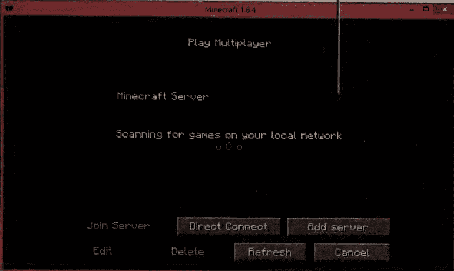

图 1.7：你的新 Minecraft 服务器存在连接问题。

### 修改客户端版本

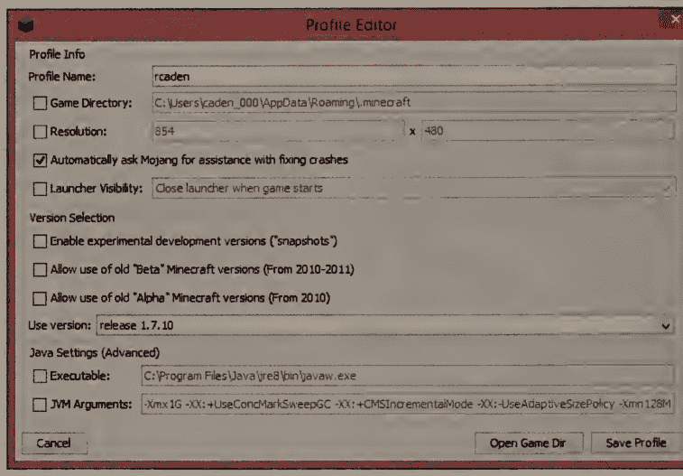

图 1.8：编辑你的我的世界玩家配置文件。

- 3. 查找“版本”（Use Version）字段，其值可能为“使用最新版本”（Use Latest Version）。
- 4. 将其更改为匹配服务器的版本号。因为你运行的是 1.7.10 版本的 Bukkit 服务器，因此应该选择相同版本的我的世界客户端。在图 1.8 中，选择了“Release 1.7.10”。
- 5. 点击保存配置文件（Save Profile）。

右下角的欢迎消息将指示你的配置文件设置为运行哪个版本。

点击“播放”（Play），然后选择“多人游戏”（Multiplayer）。你应该能看到你的服务器显示为绿色的连接条。

> 注意：更改你的玩家配置文件会影响你使用的所有我的世界服务器，包括你在未创建和测试模组时玩的服务器。当你不连接到自己的服务器时，请务必将配置文件改回“使用最新版本”（或者创建一个第二个配置文件，一个用于模组工作，另一个用于玩游戏）。

## 最基础内容

如果一切顺利，你现在已经在电脑上运行着一个我的世界服务器了。你可以使用这个服务器来玩游戏。如果你以前没有过自己的服务器，你可能会忍不住放下这本书休息，去探索一个从未被其他玩家见过的完全纯净的我的世界世界。

顺从这种诱惑吧。

砍一棵树做一些工具。在黑暗降临前盖一个避难所。制作工作台和熔炉。杀几个僵尸。挖铁矿石。

只要不要过头，发现自己三年后还在为完整复刻《权力的游戏》中的君临城而做最后的润色工作即可。你来这里是为了写模组的。

当你探索一段时间后，就准备好安装编程环境了，你将在那里开发你的第一个模组。


# 本章内容

- 下载 NetBeans IDE
- 在 NetBeans 中创建一个新的 Java 项目
- 编写 Java 程序
- 成功编译程序
- 运行程序
- 制造错误（故意为）
- 学习 NetBeans 如何在你编写程序时标记错误

# 使用 NETBEANS 进行我的世界编程

虽然只用 Java 开发工具包（JDK）和文本编辑器就可以创建我的世界模组和其他 Java 程序，但使用集成开发环境（IDE）的体验会愉悦得多。

本书使用了 NetBeans，这是 Oracle 为 Java 程序员提供的一个免费 IDE。NetBeans 是一个能更方便地组织、编写、编译和测试 Java 软件的程序。它包含了项目和文件管理器、图形用户界面设计器以及许多其他工具。一个杀手功能是代码编辑器，它可以在你输入时自动检测 Java 语法错误。

现在 8.0 版本的 NetBeans 已经成为专业 Java 开发人员的最爱。它也是对初学者最容易使用的 IDE 之一。

在将我的世界模组部署到我的世界服务器时，对于如何组织模组源代码有特定要求。NetBeans 让这一切变得尽可能简单。

# 我的世界（MINECRAFT）模组编程零基础指南

在本章中，你将学习足够的关于 NetBeans 的知识，以便安装该软件并在本书中使用它。

## 安装 NetBeans

在它辉煌的开端，NetBeans IDE 已经成为 Java 开发者领先的编程工具之一。詹姆斯·高斯林（James Gosling），Java 语言的创造者，曾赞誉它：“NetBeans 让 Java 开发变得简单。”

NetBeans 支持 Java 的三个版本：Java 标准版（JSE）、企业版（JEE）和移动版（JME）。

你可以为 Windows、macOS 和 Linux 下载 NetBeans。在下载之前，你需要先安装 Java 开发工具包（JDK）。NetBeans 并不是 JDK 捆绑，但它需要它来运行。

你可以从 http://www.oracle.com 下载 JDK。下载 NetBeans 之前，你可以访问 http://netbeans.org。

现在 8.0 版本的 NetBeans 已经成为专业 Java 开发人员的最爱。它也是对初学者最容易使用的 IDE 之一。


现在 8.0 版本的 NetBeans 已经成为专业 Java 开发人员的最爱。它也是对初学者最容易使用的 IDE 之一。

# 我的世界模组编程零学者绝对指南

在运行 Java 程序之前，必须将其编译为可执行的字节码。NetBeans 会尝试自动编译类。你也可以通过以下两种方式手动进行编译：

- 选择菜单命令 `Run`（运行）、`Compile File`（编译文件）。
- 在 `Projects`（项目）窗格中右键点击 `Spartacus.java` 以打开弹出式菜单，并选择 `Compile File`（编译文件）。

如果 NetBeans 不允许你选择上述任一选项，说明它已经自动编译了该类。

如果类没有编译成功，项目窗格中文件名 `Spartacus.java` 旁边会出现一个红色的感叹号。要修复此错误，请将你在文本编辑器中输入的内容与列表 2.1 中 `Spartacus.java` 的完整源代码进行对比，并重新保存文件。列表 2.1 中的行号不应该出现在你的程序中——它们在书中用于描述代码的工作原理。（此外，第 8 行将用你的用户名代替“User”单词。）

## 列表 2.1 Spartacus.java 类的完整文本

```
1: /*
2: * 若要更改此模板，请选择 Tools | Templates（工具 | 模板）
3: * 并在编辑器中打开模板。
4: */
5:
6: /**
7: *
8: * @author User
9: */
10: public class Spartacus {
11:
12:     /**
13:     * @param args 命令行参数
14:     */
15:     public static void main(String[] args) {
16:         // TODO 在处编写应用程序逻辑
17:         System.out.println("I am Spartacus!");
18:
19:     }
20:
21:
```

## 第 2 章 使用 NetBeans 进行我的世界编程

类定义在第 10–21 行。第 10 行以上的所有内容都是 NetBeans 在你选择 Java Application 作为项目类型时，在每个新类中包含的注释。这些注释有助于阅读源代码的人类理解有关程序的信息。编译器会忽略它们。

### 运行应用程序

在创建 Java `Spartacus.java` 并成功编译它后，你可以通过两种方式在 NetBeans 中运行它：

- 从菜单选择 `Run`（运行）、`Run File`（运行文件）。
- 在 `Projects`（项目）窗格中右键点击 `Spartacus.java`，并选择 `Run File`（运行文件）。

当你运行 Java 程序时，Java 虚拟机会调用 `main()` 方法。字符串 "I am Spartacus!" 会出现在 `Output`（输出）窗格中，如图 2.4 所示。

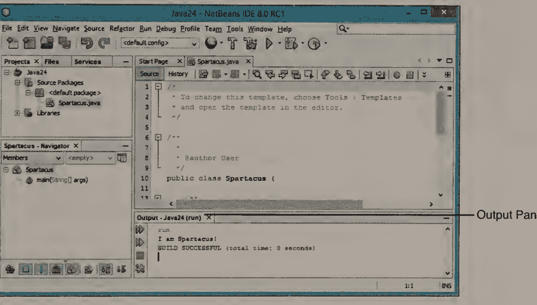

图 2.4 Spartacus 应用程序的输出。

Java 程序必须有一个 `main()` 方法才能运行。如果你尝试运行一个缺少该方法的程序，NetBeans 会返回错误。

在查看完程序的输出后，点击窗格标签上的 X 关闭 `Output`（输出）窗格。这会让源编辑器变得更大，这在你创建程序时非常方便。

### 修复错误

现在 Spartacus 应用程序已经编写、编译并运行完毕，是时候搞坏一些东西，以获得关于 NetBeans 在情况变得糟糕时如何响应的经验。

和任何程序员一样，你会有很多机会练习自己搞砸事情，但无论如何都要注意这里。

回到源编辑器中的 `Spartacus.java`，删除调用 `System.out.println()` 的那行末尾的分号（列表 2.1 中的第 17 行）。甚至在你保存文件之前，NetBeans 已经发现了该错误，并在行左侧显示了一个红色图标（见图 2.5）。


图 2.5 在源编辑器中标记错误。

悬停在图标上可以显示 NetBeans 认为存在错误的对话框。在行末尾重新加上分号。错误消失了，你可以再次编译项目。

### 绝对最小值

基础功能定义在第 10–21 行定义了类。第 10 行以上的所有内容都是 NetBeans 在你选择 Java Application 作为项目类型时，在每个新类中包含的注释。这些注释有助于阅读源代码的人类理解有关程序的信息。编译器会忽略它们。

# 第 3 章 创建一个我的世界模组

右键点击


图 3.1 在“项目”（Projects）面板中查看项目。

在每个 mod 项目中，在开始编写 Java 代码之前，你必须添加一个 Java 类库：你在安装服务器时下载的 Bukkit API JAR 文件。操作方法如下：

1. 在“项目”（Projects）面板中，右键点击 `Libraries` 文件夹，并选择菜单命令 `Add Library`（添加库）。打开 `Add Library` 对话框。
2. 点击 `Create`（创建）按钮。出现 `Create New Library`（创建新库）对话框。
3. 在 `Library Name`（库名称）字段中输入 `Bukkit` 并点击 `OK`。打开 `Customize Library`（自定义库）对话框。
4. 点击 `Add JAR/Folder`（添加 JAR/文件夹）按钮。打开 `Browse JAR/Folder` 对话框。
5. 使用对话框找到并打开安装服务器的文件夹。你会看到一个名为 `bukkitapi.jar` 的文件。
6. 点击该文件。
7. 点击 `Add JAR/Folder`。
8. 点击 `OK`。
9. `Available Libraries`（可用库）面板现在有了一个 `Bukkit` 项。选择它并点击 `Add Library`。

现在，“项目”（Projects）面板的 `Libraries` 文件夹中已包含 Bukkit API 的 JAR 文件，你可以准备好开始编写模组程序了。

按照以下步骤创建程序：

1. 点击 `File`（文件）、`New File`（新建文件）。出现 `New File`（新建文件）向导。
2. 在 `Categories`（类别）面板中选择 Java。
3. 在 `File Types`（文件类型）面板中，选择 `Empty Java File`（空 Java 文件）；然后点击 `Next`（下一步）。
4. 在 `Class Name`（类名）字段中输入 `PetWolf`。
5. 在 `Package`（包）字段中输入 `com.javaminecraft`。
6. 点击 `Finish`（完成）。

`PetWolf.java` 文件打开后可以编写任何代码，本节将解释 mod 结构的基础知识。

你为 Bukkit 创建的每个 mod 都从 Java 代码框架开始。以下是该代码的主要部分，已针对此项目在几处进行了自定义：

```java
public class PetWolf extends JavaPlugin {
    public static final Logger LOG = Logger.getLogger("Minecraft");
}

public boolean onCommand(CommandSender sender, Command command,
    String label, String[] arguments) {

    if (label.equalsIgnoreCase("petwolf")) {
        if (sender instanceof Player) {
            // 在这里做一些酷事
            LOG.info("[PetWolf] Howl!");
            return true;
        }
    }
    return false;
}
```

观察这个框架，当你将它用于不同的 mod 时，唯一会改变的是引用 `PetWolf` 的三个地方，因为它们是特定于此项目的：

- 程序名称是 `PetWolf`。
- `label.equalsIgnoreCase("petwolf")` 内部的参数是用户在游戏中输入以运行 mod 的命令。此程序实现了 `/petwolf` 命令（命令前带有斜杠字符）。作为参数发送给 `onCommand()` 的 `label` 对象是一个持有用户输入的命令文本的字符串。
- 调用 `LOG.info("[PetWolf] Howl!")` 的语句会发送一条显示在 Minecraft 服务器窗口中的日志消息。

mod 在输入命令时执行的所有操作都会位于注释 `// do something cool here`（在这里做一些酷事）标记的地方。注释是程序中的信息，用于向阅读代码的人解释其执行的功能。当程序运行时，计算机会忽略这些注释。

PetWolf mod 需要执行的第一件事是使用这三条语句了解更多游戏世界知识：

```java
Player me = (Player) sender;
Location spot = me.getLocation();
World world = me.getWorld();
```

名为 `me` 的 `Player` 对象是由玩游戏的人控制的角色。

通过这个 `Player` 对象，你可以调用 `getLocation()` 来获取玩家所处的精确位置。方法（method）是 Java 程序中执行任务的部分。在这里，该方法将玩家当前的位置作为 `Location` 对象检索。关于位置，你可以学到的三点是它在三维游戏地图上的 (x,y,z) 坐标。

`Player` 对象拥有 `getWorld()` 方法，它返回一个代表整个游戏世界的 `World` 对象。

你创建的大多数 mod 都会需要这些 `Player`、`Location` 和 `World` 对象。

此 mod 使用 `World` 对象的 `spawn()` 方法创建了一个新的狼类生物（mob）：

```java
Wolf wolfie = world.spawn(spot, Wolf.class);
```

游戏中的每种生物类型都有对应的类（class）。`spawn()` 的两个参数是应该放置狼的位置以及要创建的生物的类。

这条语句在玩家相同的位置创建了一个名为 `wolfie` 的 `Wolf` 对象。

狼的项圈颜色在这条语句中设置：

```java
cat.setColor(DyeColor.PINK);
```

现在，你可以开始输入了。通过将 3.1 内容输入到编辑器并点击 `Save`（保存）来整合所有内容。

## 3.1 PetWolf.java 的完整文本

```java
package com.javaminecraft;
import java.util.logging.*;
import org.bukkit.*;
import org.bukkit.command.*;
import org.bukkit.entity.*;
import org.bukkit.plugin.java.*;

public class PetWolf extends JavaPlugin {
    public static final Logger LOG = Logger.getLogger("Minecraft");

    public boolean onCommand(CommandSender sender, Command command,
        String label, String[] arguments) {

        if (label.equalsIgnoreCase("petwolf")) {
            if (sender instanceof Player) {
                // 在这里做一些酷事
                LOG.info("[PetWolf] Howl!");
                return true;
            }
        }
        return false;
    }
}
```

第 3-7 行的 import 语句使得以下包可用：`java.util.logging.*`、`org.bukkit.*`、`org.bukkit.command.*`、`org.bukkit.entity.*` 和 `org.bukkit.plugin.java.*`。你在使用它们时会了解到更多。第 29-32 行的 return 语句是框架的一部分。

mod 在输入命令时执行的所有操作都会位于注释 `// do something cool here` 标记的地方。注释是程序中的信息，用于向阅读代码的人解释其执行的功能。当程序运行时，计算机会忽略这些注释。PetWolf mod 需要执行的第一件事是使用这三条语句了解更多游戏世界知识：

`plugin.yml` 文件描述了 mod 的名称、作者、Java 类文件、版本、命令以及对命令功能的简短描述。


该文件必须位于项目的正确位置。查看“项目”（Projects）面板，它应该在 `Source Packages` 文件夹下一个名为 `<default package>` 的子目录下。这如图 3.2 所示。

使用以下步骤在 NetBeans 中创建 `plugin.yml` 文件：

1. 点击 `File`（文件）、`New File`（新建文件）。出现 New File（新建文件）向导。
2. 在 `Categories`（类别）面板中向下滚动并选择 `Other`（其他）。
3. 在 `File Types`（文件类型）面板中选择 `YAML File`，然后点击 `Next`（下一步）。
4. 在 `File Name`（文件名）字段中输入 `plugin`（不要在末尾加 `.yml`；这是 NetBeans 的要求）。
5. 在 `Folder name`（文件夹名称）中输入 `src`。
6. 点击 `Finish`（完成）。

命名的 `plugin.yml` 在源编辑器中打开，带有两行 YML 模板。

删除这些行。它们在这里不需要。将列表 3.2 的文本输入文件，并确保使用相同数量的空格。不要使用制表符代替空格。

## 3.2 plugin.yml 的完整文本

```yaml
name: PetWolf

author: Your Name Here

main: com.javaminecraft.PetWolf

commands:
  petwolf:
    description: Spawn a wolf as the player's pet.

version: 1.0
```

将 `Your Name Here` 替换为你自己的名字。告诉别人你写了一个 mod 是成为传奇 Minecraft 编码员的第一步。

为了核对你输入的空格是否正确，第 8 行在文本 `petwolf` 之前有四个空格，第 9 行在 `description` 之前有八个空格。

# 第 3 章 创建一个 MINECRAFT MOD

你现在准备好构建你的 mod 了。选择菜单命令 `Run`（运行）、`Clean and Build Project`（清理并构建项目）。如果成功，消息 `Finished Building PetWolf (clean, jar)` 将出现在 NetBeans 用户界面的左下角，就在最底部边缘。

该 mod 被打包为一个名为 `PetWolf.jar` 的文件，位于项目的子文件夹中。要找到它，点击 Projects 窗格中的 `Files` 选项卡，展开 `PetWolf` 文件夹（如果需要），然后展开 `dist` 子文件夹。`Files` 选项卡列出了组成你项目的所有文件，如图 3.3 所示。

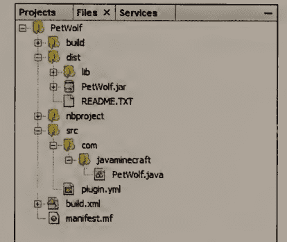

图 3.3

查找 PetWolf mod 的 JAR 文件。

需要将 `PetWolf.jar` 文件从项目文件夹拷贝到 Minecraft 服务器。请按照以下步骤操作：

1. 如果 Minecraft 服务器正在运行，请通过进入服务器窗口并输入命令 `stop` 来停止它；然后按空格键或任何键关闭该窗口。
2. 在 NetBeans 之外，打开安装 Minecraft 服务器的文件夹。
3. 打开 `PetWolf` 子文件夹。
4. 打开 `dist` 子文件夹。
5. 选择 `PetWolf` 文件（一个 JAR 文件），按 `Ctrl+C` 拷贝它。
6. 返回 Minecraft 服务器文件夹。
7. 打开 `plugins` 子文件夹。
8. 按 `Ctrl+V` 将 `PetWolf` 拷贝到其中。

# MINECRAFT MOD 编程初学者指南

你已经将新 mod 部署到 Minecraft 服务器上。按照之前的方法，点击你创建的 `start-server.bat` 文件来启动服务器——你将在日志文件在运行时看到两条新消息，显示内容如下：

[PetWolf] Loading PetWolf v1.0

[PetWolf] Enabling PetWolf v1.0

如果你没有看到这些消息，而是看到了一些长而复杂的错误信息，请对照 Listing 3.1 检查 `PetWolf.java` 中的内容，对照 Listing 3.2 检查 `plugin.yml`，以确保输入正确；然后重新构建并重新部署 mod。

> 提示 仍在解决让 PetWolf mod 运行的问题吗？源代码、`plugin.yml` 配置文件以及每个书籍项目的所有其他文件都可以在 www.javaminecraft.com 找到。访问该网站查看成功编译并在服务器上运行的文件。

运行 Minecraft 客户端并连接到你的服务器后，输入命令 `/wolf`。你现在有一只会跟随你的新狼。你可以根据需要多次输入该命令来添加更多的狼。

图 3.4 显示了我和 20 只狼。敌对生物在我们面前存活不了多久。我们将统治这个世界。Hoooooooooooooooooaaaaaa！


图 3.4

你自己的狼群，得益于你自己的 mod。

## 极简

本章对如何编写 Minecraft mod 这一主题进行了冲刺。书的其余部分将以更缓的速度进行，解释创建复杂的 mod 所需的所有 Java 编程概念和 Bukkit API。

学习 Java 有许多不同的方法。在 Minecraft 内部学习是其中最有趣的方式之一。你将在一个三维世界中使用你的编程能力，在那里你与怪物战斗、挖掘隧道、建造房屋，并躲避活死大军——包括一些骑着鸡的。

Minecraft 是学习面向对象编程的极佳方式，这是该语言中最难掌握的之一。你在 Java 中做的一切都是通过对象完成的。你在构造函数中创建它们，在变量中赋予它们知识，并通过调用方法告诉它们去执行。对象通过实现接口来指示它们可以执行的任务。

所有这些概念对你来说都是新的，但当你在接下来的 14 章中学习它们时，你会发现它们与 mod 编程直接相关。需要僵尸吗？创建一个 `Zombie` 对象。想让玩家移动到新位置？调用他的 `teleport()` 方法。丢了马吗？调用它的 `getLocation()` 方法。

所以，尽情地深挖 Minecraft mod 编程吧。你将能够在矿井之外更远的地方使用这些技能。


# 本章内容

- 在源代码编辑器中输入 Java 程序
- 使用括号标记组织程序
- 在变量中存储信息
- 显示存储在变量中的信息
- 保存、编译并运行程序

# 4


# 第 4 章 开始编写 Java 程序

计算机程序是一组告诉计算机做什么的指令。这些指令使用编程语言提供给计算机。

在本章中，你将通过在文本编辑器中输入代码，使用 Java 语言创建一个简单的程序。完成后，你将保存程序、编译并测试它。

## 编写程序所需的

要创建 Minecraft mod 或任何程序，你必须拥有 Java 开发工具包 (JDK) 和一个集成开发环境 (IDE)，如 NetBeans。

要在当前打开的项目中添加新的 Java 程序，选择 `File`、`New File`。新文件向导将打开，如图 4.2 所示。

## 创建启动文字

Minecraft 的趣味特点之一是游戏运行时显示的随机消息。Minecraft 的开发者 Mojang 使用启动文字（splash）来开玩笑、引用经典或冷门的视频游戏以及说其他事情。

图 4.1 显示了“不要给鹦鹉吃牛油果！”启动文字。

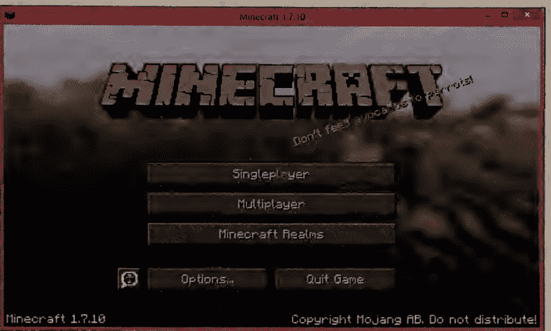

图 4.1

Minecraft 客户端显示启动文字。

`Categories`（类别）窗格列出了你可以创建的 Java 程序类型。点击此窗格中的 `Java` 文件夹可以查看该类别下的文件类型。对于第一个项目，选择 `Empty Java File`（空 Java 文件）类型并点击 `Next`（下一步）。

会弹出一个 `New Empty Java File`（新建空 Java 文件）对话框。按照以下步骤开始编写程序：

1. 在 `Class Name`（类名）字段中输入 `Splash`。
2. 在 `Package`（包）字段中输入 `com.javaminecraft`。
3. 点击 `Finish`（完成）。

这样你就可以立即编写程序了，源代码编辑器中会打开一个名为 `Splash.java` 的空文件。使用编辑器，通过输入列表 4.1 中的每一行代码开启你的 Java 编程之旅。这些语句被称为程序的源代码。

> **注意** 正如你在前面的章节中所受警告的那样，不要在每行的开头输入行号和冒号——这些符号在本书中用于引用行号。

## 列表 4.1 Splash 程序

```java
package com.javaminecraft;

class Splash {
    public static void main(String[] arguments) {
        // My first Java program goes here
    }
}
```

确保所有的大小写与所示完全一致，并使用空格键或 `Tab` 键插入第 4–6 行前的空白空格。完成后，选择 `File`（文件）并 `Save`（保存）到文件。

此时，`Splash.java` 包含了 Java 程序的最基础形式。

你将创建许多与此程序开头完全相同的程序，唯一的区别在于第 3 行的 `Splash` 单词。这个词代表你的程序名称，并随着你编写的每一个而改变。第 5 行对你来说应该是清晰的，因为它是一个真正的英语句子。除了你在第 3 章“创建 Minecraft Mod”中编写和测试的 Minecraft mod 外，其余部分对你来说可能是全新的。

## class 语句

程序的第一行如下：

```java
package com.javaminecraft;
```

`package` 是将 Java 程序组合在一起的方法。这一行告诉计算机将 `com.javaminecraft` 设置为程序的包名。

在空行之后，第三行是：

```java
class Splash {
```

### 翻译成英文

主语句（`main` 语句）是大多数 Java 程序的入口。Mod 是一个例外，因为它们由 Bukkit 服务器运行，不能直接运行。当玩家输入 Mod 支持的命令时，服务器会运行该 Mod。

其他异常还包括 applets（小程序，由浏览器在网页上运行的程序）、servlets（服务程序，由 Web 服务器运行的程序）以及 apps（应用程序，由移动设备运行的程序）。

你在接下来的 13 章中编写的 Java 程序都使用 `main` 作为起点。这是因为你直接在自己的电脑上运行它们。而 Mod、applets、apps 和 servlets 是另一个程序或设备间接运行的。

为了将带有 `main` 的程序与其他类型区分开来，它们被称为应用程序（applications）。

## 那些波浪括号

在 `Splash` 程序中，第 3、4、6 和 7 行包含某种形式的波浪括号——要么是 `{` 要么是 `}`。这些括号是对程序行分组的一种方式（就像括号在句子中用于对单词分组一样）。左括号 `{` 和右括号 `}` 之间的所有内容都属于同一个组。

这些分组被称为块（blocks）。在列表 4.1 中，第 3 行的左括号与第 7 行的右括号相关，这使得你的整个程序成为一个块。你通过这种使用块来显示程序的开始和结束。

块可以位于其他块内部（就像在这个句子中使用括号（（而在这里又使用了另一组括号））一样）。`Splash` 程序在第 4 行和第 6 行有括号，它们建立了另一个块。这个块从主语句开始。主语句块内部的行将在程序开始时运行。

> 提示 NetBeans 可以帮助你确定块的开始和结束位置。点击 `Splash` 程序源码中的任意一个括号。你点击的括号会变成黄色，与之对应的括号也会变成黄色。包含在两个黄色括号之间的 Java 语句就是一个块。这个提示对于像 `Splash` 这样短的程序用处不大，但当你编写长得多的程序时，它可以帮助你避免看起来像个“块头呆脑”（blockhead）。

以下语句是块内唯一的内容：

```java
// My first Java program goes here
```

这一行是一个占位符。行首的 `//` 告诉计算机忽略这一行，因为将其放入程序中完全是为了查看源代码的人类考虑的。具有此目的的行被称为注释（comments）。

现在，你已经写了一个完整的 Java 程序。它可以被编译，但如果你运行它，什么也不会发生。原因是你还没有告诉计算机执行任何操作。主语句块只包含一条注释，它会被计算机忽略。你必须在主块的左括号和右括号之间添加一些语句。

> **注意** 每个 Java 语句的末尾都需要加分号；在 splash 程序中，`// My first Java program goes here` 这一行并没有以分号结尾。

之所以允许这样做，是因为注释会被编译器完全忽略。如果你在程序的某一行中放置 `//`，这会告诉 Java 编译器忽略该行中 `//` 之后的所有内容。接下来的示例显示了与语句同一行中的注释：

```java
System.out.println(greeting); // Exploding creepers!
```

## 在变量中存储信息

在你要编写的程序中，你需要一个地方来临时存储信息。你可以通过变量（variable）来实现这一点，变量是一个可以存储整数、浮点数、布尔值、字符和文本行的存储位置。

在 Java 程序中，你必须告诉计算机变量将持有什么类型的信息。在 `Splash.java` 中，将第 5 行替换为：

```java
String greeting = "Blue warrior shot the food!";
```

这条语句告诉计算机将 `"Blue warrior shot the food!"` 存储在名为 `greeting` 的变量中。输入此语句时，末尾必须包含分号。

## 显示变量的内容

如果你此时运行程序，看起来似乎什么都没有发生。存储操作在后台进行。为了让计算机显示它正在做某些事，你可以显示该变量的内容。

在 `Splash` 程序语句 `String greeting = "Blue warrior shot the food!"` 之后插入空行。使用该空间输入语句：

```java
System.out.println(greeting);
```

这条语句告诉计算机显示存储在 `greeting` 变量中的值。`System.out.println` 语句在系统输出设备——你的显示器上显示信息。

现在你有进展了。

## 保存成品

你的程序应该类似于列表 4.2，尽管你在第 5-6 行使用的可能稍不同。进行任何修正并保存文件（通过选择菜单 `File`, `Save`）。

## 列表 4.2 Splash 程序的完成版

```java
package com.javaminecraft;

class Splash {
    public static void main(String[] arguments) {
        String greeting = "Blue warrior shot the food!";
        System.out.println(greeting);
    }
}
```

当计算机运行此程序时，它会运行第 5 和 6 行主语句块中的每一个语句。列表 4.3 显示了如果用英语而不是 Java 编写该程序将会是什么样。

## 列表 4.3 Splash 程序的逐行解析

```
1: 将此程序放在 com.javaminecraft 包中。
2:
3: Splash 程序在此开始：
4:     主部分在此开始：
5:     将 "Blue warrior shot the food!" 存储在
6     String greeting 中。
```

# 将程序编译为类文件

在运行 Java 程序之前，你必须先对它进行编译。当你编译一个程序时，程序中提供给计算机的指令会被转换为计算机更容易理解的形式。

NetBeans 会在你保存程序时自动编译程序。如果你按照代码清单 4.2 所示输入了所有内容，程序就能成功编译。

系统会创建一个程序的编译版本，一个名为 `Splash.class` 的新文件。所有的 Java 程序都被编译成类文件，并以 `.class` 文件扩展名命名。一个 Java 程序可以由几个共同工作的类组成，但在像 `Splash` 这样简单的程序中，只需要一个类。

编译器将 Java 源代码转换为字节码，这是一种可以由 Java 虚拟机（JVM）运行的格式。

> 注意：编译器只有在出现错误时才会说话抱怨。如果你成功编译了一个程序而没有任何错误，它将不会有任何反应。这很令人失望。当我开始成为一名 Java 程序员时，我曾希望成功的编译能伴随着一阵响亮的庆祝号角齐响起。


## 修复错误

你在 NetBeans 源代码编辑器中编写程序时，错误会在编辑器面板左侧用红色警报图标标记出来，如图 4.3 所示。

# 第 4 章 开始编写 Java 程序 47

错误图标

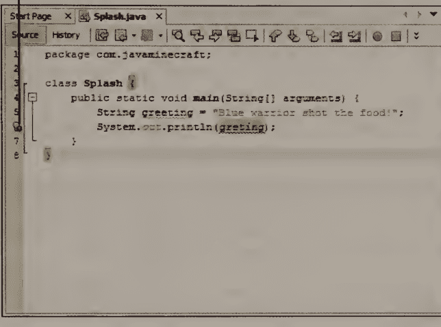

图 4.3

在源代码编辑器中发现错误。

该图标出现在触发错误的行上。你可以点击此图标显示错误消息，该消息会解释编译器错误并包含以下详细信息：

- Java 程序的名称
- 错误类型
- 发现错误所在的行

以下是在你编译 `Splash` 程序时可能看到的错误消息示例：

```
cannot find symbol.
symbol : variable greeting
location: class Splash
```


错误是消息的第一行：`cannot find symbol.`。这些消息通常会让初级程序员感到困惑。当错误消息对你来说说不其通时，不要花太多时间尝试弄懂它。相反，查看错误发生的行，并寻找最明显的原因。

例如，你能确定以下语句哪里出了问题吗？

`System.out.println(greeting);`

错误是变量名中的拼写错误，它应该是 `greeting` 而不是 `greeting`。（在 NetBeans 中故意添加这个拼写错误，看看会发生什么。）

如果你在创建 Splash 程序时收到错误消息，请双检你的程序是否与代码清单 4.2 匹配，并修正你发现的任何差异。确保所有大小写正确，并且所有的标点符号如 `{`、`}`、`;` 等都已包含。

通常，仔细观察错误消息标识的行就足以揭示需要修复的错误（或错误）。

请注意，错误消息显示的行号并不总是需要修复错误的地方。检查错误消息正方的语句，看看是否能发现任何拼写错误或其他 Bug。错误通常位于同一个编程块内。


> 提示：本书的官方网站 www.javminecraft.com 包含了你创建的所有程序的源文件。如果你在 Splash 程序中找不到任何拼写错误或其他错误原因，但仍然存在错误，请访问书籍并在第 4 章页面下载 `Splash.java`。尝试运行该文件。

# 运行 Java 程序

要查看 Splash 程序是否按照你的预期运行，使用 JVM 运行该类，JVM 是运行所有 Java 代码的解释器。在 NetBeans 中，选择菜单命令 Run（运行）、`Run File`（运行文件）。源代码编辑器下方会打开一个输出面板。在此面板中，如果没有错误，程序将显示输出，如图 4.4 所示。

# 第 4 章 开始编写 Java 程序 49

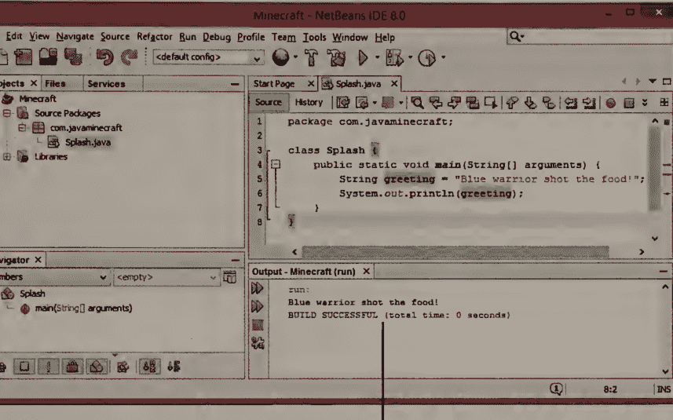

输出面板

图 4.4

运行 Splash 程序。

如果你看到文本 `Blue warrior shot the food!`，说明你已成功地编写、编译并运行了该 Java 程序。

> 注意：`Blue warrior shot the food!` 消息是 Minecraft 中的一条欢迎语（splash message），用于向《Gauntlet》致敬，这是一款 1980 年代的投币视频游戏，多达四名玩家可以在地下城中穿梭杀死怪物并积累宝藏。由于玩家需要存活，意外射中食物是一项大失态。

你可以在 Minecraft Wiki 上找到 Minecraft 所有已知的欢迎语以及其中许多词的解释。访问网页：http://minecraft.gameedia.com/Splash。

# Java 程序中的空格和空白字符

当你按照代码清单 4.1 输入 Splash 程序时，特意在每个语句前留出正确数量的空格以确保它们对齐，你可能会问自己这是否重要。

对于计算机来说，空格和空白字符完全不重要。间距完全是为了方便查看计算机程序的人设计的——Java 编译器并不在乎。你可以不使用任何空格编写 Splash 程序，或者使用 Tab 键缩进行，它都能成功编译。

编译器将 Java 源代码转换为字节码，这是一种可以由 Java 虚拟机（JVM）运行的格式。

> 注意：编译器只有在出现错误时才会说话抱怨。如果你成功编译了一个程序而没有任何错误，它将不会有任何反应。这很令人失望。当我开始成为一名 Java 程序员时，我曾希望成功的编译能伴随着一阵响亮的庆祝号角齐响起。


# 将程序编译为类文件

在运行 Java 程序之前，你必须先对它进行编译。当你编译一个程序时，程序中提供给计算机的指令会被转换为计算机更容易理解的形式。

NetBeans 会在你保存程序时自动编译程序。如果你按照代码清单 4.2 所示输入了所有内容，程序就能成功编译。

系统会创建一个程序的编译版本，一个名为 `splash.class` 的新文件。所有的 Java 程序都被编译成类文件，并以 `.class` 文件扩展名命名。一个 Java 程序可以由几个共同工作的类组成，但在像 `splash` 这样简单的程序中，只需要一个类。

编译器将 Java 源代码转换为字节码，这是一种可以由 Java 虚拟机（JVM）运行的格式。

> 注意：编译器只有在出现错误时才会说话抱怨。如果你成功编译了一个程序而没有任何错误，它将不会有任何反应。这很令人失望。当我开始成为一名 Java 程序员时，我曾希望成功的编译能伴随着一阵响亮的庆祝号角齐响起。


## 修复错误

你在 NetBeans 源代码编辑器中编写程序时，错误会在编辑器面板左侧用红色警报图标标记出来，如图 4.3 所示。

# 第 4 章 开始编写 Java 程序 47

错误图标


图 4.3

在源代码编辑器中发现错误。

该图标出现在触发错误的行上。你可以点击此图标显示错误消息，该消息会解释编译器错误并包含以下详细信息：

- 字体 Java 程序的名称
- 错误类型
- 发现错误所在的行

以下是在你编译 Splash 程序时可能看到的错误消息示例：

```
cannot find symbol.
symbol : variable greeting
location: class Splash
```

错误是消息的第一行：`cannot find symbol.`。这些消息通常会让初级程序员感到困惑。当错误消息对你来说说不其通时，不要花太多时间尝试弄懂它。相反，查看错误发生的行，并寻找最明显的原因。

例如，你能确定以下语句哪里出了问题吗？

`System.out.println(greeting);`

错误是变量名中的拼写错误，它应该是 `greeting` 而不是 `greeting`。（在 NetBeans 中故意添加这个拼写错误，看看会发生什么。）

如果你在创建 Splash 程序时收到错误消息，请双检你的程序是否与代码清单 4.2 匹配，并修正你发现的任何差异。确保所有大小写正确，并且所有的标点符号如 `{`、`}`、`;` 等都已包含。

通常，仔细观察错误消息标识的行就足以揭示需要修复的错误（或错误）。

请注意，错误消息显示的行号并不总是需要修复错误的地方。检查错误消息正方的语句，看看是否能发现任何拼写错误或其他 Bug。错误通常位于同一个编程块内。


> 提示：本书的官方网站 www.javminecraft.com 包含了你创建的所有程序的源文件。如果你在 Splash 程序中找不到任何拼写错误或其他错误原因，但仍然存在错误，请访问书籍并在第 4 章页面下载 `Splash.java`。尝试运行该文件。

# 运行 Java 程序

要查看 Splash 程序是否按照你的预期运行，使用 JVM 运行该类，JVM 是运行所有 Java 代码的解释器。在 NetBeans 中，选择菜单命令 Run（运行）、`Run File`（运行文件）。源代码编辑器下方会打开一个输出面板。在此面板中，如果没有错误，程序将显示输出，如图 4.4 所示。

# 第 4 章 开始编写 Java 程序 49


输出面板

图 4.4

运行 Splash 程序。

如果你看到文本 `Blue warrior shot the food!`，说明你已成功地编写、编译并运行了该 Java 程序。

> 注意：`Blue warrior shot the food!` 消息是 Minecraft 中的一条欢迎语（splash message），用于向《Gauntlet》致敬，这是一款 1980 年代的投币视频游戏，多达四名玩家可以在地下城中穿梭杀死怪物并积累宝藏。由于玩家需要存活，意外射中食物是一项大失态。

你可以在 Minecraft Wiki 上找到 Minecraft 所有已知的欢迎语以及其中许多词的解释。访问网页：http://minecraft.gameedia.com/Splash。

# Java 程序中的空格和空白字符

当你按照代码清单 4.1 输入 Splash 程序时，特意在每个语句前留出正确数量的空格以确保它们对齐，你可能会问自己这是否重要。

对于计算机来说，空格和空白字符完全不重要。间距完全是为了方便查看计算机程序的人设计的——Java 编译器并不在乎。你可以不使用任何空格编写 Splash 程序，或者使用 Tab 键缩进行，它都能成功编译。

## 第 5 章 了解 Java 程序的工作原理 53

Root 应用程序完成了以下任务：

- **第 1 行**：应用程序放置在 `com.javaminecraft` 程序包中。
- **第 5 行**：整数值 17689 被存储在名为 `number` 的变量中。
- **第 6–10 行**：显示该整数及其平方根。第 9 行的 `Math.sqrt(number)` 语句显示平方根。

如果你曾在没有任何拼写错误的情况下运行过列表 5.1（包括所有的标点符号并如所示大写每个字母），你可以通过在 NetBeans 中选择 Run（运行）、Run File（运行文件）来运行该文件。程序的输出出现在 Output（输出）窗格中，如图 5.1 所示。

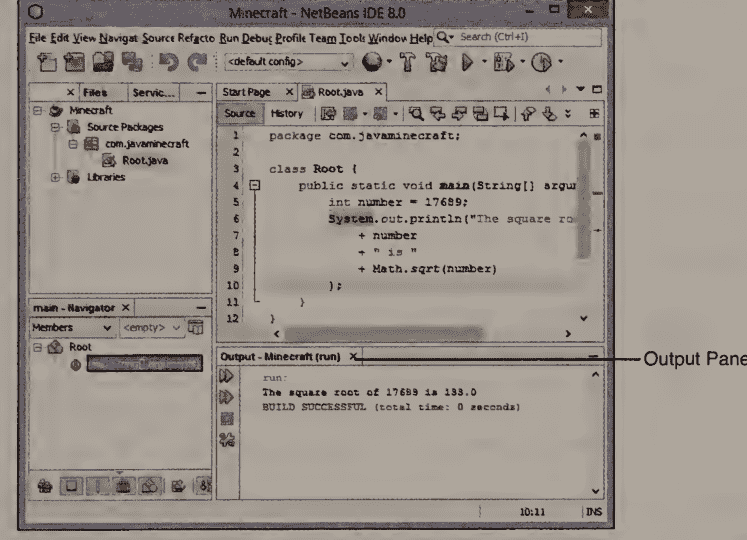

**图 5.1** Root 应用程序的输出。

当你运行 Java 应用程序时，Java 虚拟机 (JVM) 会寻找 `main()` 块并开始处理该块中的 Java 语句。如果你的程序没有 `main()` 块，JVM 将返回错误响应。

Math 程序是 Java 类库的一部分，你将在本章稍后的部分探索它。

## 向应用程序传递参数

你可以从命令行使用 `java` 运行 JVM 应用程序，`java` 是一个调用 JVM 的程序。NetBeans 在你运行程序时后台使用此程序。当 Java 程序作为命令运行时，JVM 会加载该应用程序。命令可以包含额外的信息项，如例所示：

```
java DataEditor game.dat delta
```

发送到程序的任何额外信息被称为参数（argument）。如果有第一个参数，它在应用程序名称后一个空格处提供。每个额外的参数也用空格分隔。在前面的示例中，应用程序的名称是 `DataEditor`，参数是 `game.dat` 和 `delta`。

如果你想在参数内部包含空格，必须在其周围加上引号，如下所示：

```
java DataEditor game.dat "New Game"
```

此示例带有三个参数运行 DataEditor 程序：`game.dat`、`alpha` 和 `"New Game"`。引号防止了 `New` 和 `Game` 被视为单独的参数。

> 注意：所有发送到 Java 应用程序的参数都存储在字符串中，即使该参数是数字。当你想要使用这些参数之一作为数字时，你必须转换该值。该操作将在第 12 章“描述你的对象像什么样”中介绍。


你可以向 Java 应用程序发送任意数量的参数（在范围内）。为了处理它们，你必须在应用程序中编写处理它们的语句。

要查看参数如何在应用程序中工作，请在 Minecraft 项目中创建一个程序：

1. 选择 File（文件）、New File（新建文件）。
2. 在 New File Wizard（新建文件向导）中，选择类别 Java 和类型 Empty Java File（空 Java 文件）。
3. 给类命名 `command`，给程序包命名 `com.javaminecraft` 并点击 Finish（完成）。

在源代码编辑器中输入列表 5.2 的文本，并在完成后保存。编译程序，纠正编辑器在你输入时标记的任何错误。

## 列表 5.2 Command.java 的完整文本

```
1: package com.javaminecraft;
2:
3: class Command {
4:     public static void main(String[] arguments) {
5:         System.out.println("You have summoned " + arguments[0]
6             + " " + arguments[1] + " mobs.");
7:     }
8: }
```

此应用程序可以成功编译并运行，但如果你尝试用菜单命令 Run、Run File 运行，你会得到一个看起来复杂的错误：

`Exception in thread "main" java.lang.ArrayIndexOutOfBoundsException: 0 at Command.main(Command.java:5)`

发生此错误是因为程序在运行时期望接收两个参数。你可以通过在 NetBeans 中自定义项目来指定参数：

- 选择菜单命令 Run（运行）、Set Project Configuration（设置项目配置）、Customize（自定义）。打开 Project Properties（项目属性）对话框。
- 在 Main Class（主类）文本框中输入 `com.javaminecraft.command`。
- 在 Arguments（参数）字段中，输入 `13 zombie` 并点击 OK。

由于你自定义了项目，你必须以稍微不同的方式运行它。选择菜单命令 Run、Run Main Project（运行主项目）。应用程序在句子中使用你指定的参数，如图 5.2 所示。

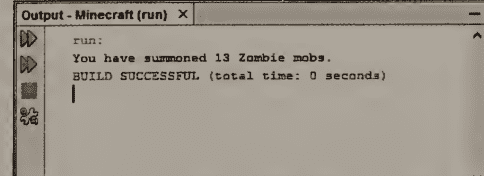

## 图 5.2

command 应用程序的输出。

返回 Project Properties 对话框，将 13 更改另一个数字，将 Zombie 更改 Minecraft 中的另一种生物（mob）；然后再次运行项目。

Minecraft 组（mods）通常接受一个或多个参数，因此你会再次看到它们。服务器上拥有管理员权限的玩家可以使用内置的 Summon（召唤）命令将生物添加到游戏中。它接受三个参数：生物的类型；它应该出现的 tx、y 和 z 坐标；以及用于额外配置的数据标签（data tag）。这是一个示例：


这在 `(x, y, z)` 召唤了一只蝙蝠。

这在 `(x, y, z)` 召唤了一只猪。

这在 `(x, y, z)` 召唤了一个僵尸。

# Java 类库

文档的首页被分为几个框架。最大的框架列出了所有程序包以及每个包的简短描述。点击程序包名称以获取更多信息。Java 类库中的每个类都有自己的文档页面。（你现在或将来都不需要阅读它们）。

对于本章的最后一个项目，你将研究库并使用现有的 Java 类为你工作。

骰子游戏使用 `java.lang` 包中的 `Math` 类，它可以用于创建随机数——这是 Minecraft 模组的常见需求。

对于此程序，类的 `random()` 方法将用于产生一个从 1 到 20 的随机值。该过程的第一步是：

```java
double roll = Math.random() * 20;
```

# 第 5 章 了解 Java 程序如何运行

数字在游戏、教育程序以及其他必须执行随机操作的程序中非常有用。

在 NetBeans 中，创建一个空的 Java 文件，将其命名为 `Dice`，并将其放入 `com.javaminecraft` 程序包中。当源代码编辑器打开时，将列表 5.3 的文本输入到窗口中，然后点击 Save（保存）按钮（或选择菜单命令 File、Save）。

## 列表 5.3 Dice.java 的全文

```java
1: package com.javaminecraft;
2:
3: import java.util.*;
4:
5: class Dice {
6:     public static void main(String[] arguments) {
7:         double roll = Math.random() * 20;
8:         roll = Math.floor(roll);
9:         System.out.println("The random number is " + roll);
10:
11:     }
}
```

通过选择 Run、Run File 来运行程序。输出如图 5.4 所示，尽管你的数字可能不同。

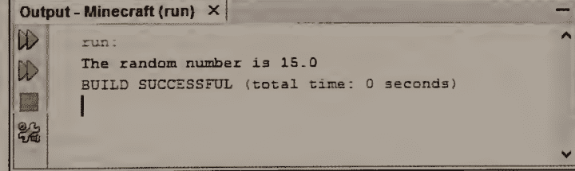

## 图 5.4

Dice 程序的输出。

每次使用键盘快捷键 `Shift+F6` 多次运行程序。你会发现数字总是落在 1 到 20 之间。如果你将第 7 行的 `20` 改为 `6`，数字将始终落在 1 到 6 之间。

`Math` 类和 Java 类库中的所有类一样，在 Oracle 网站上可以查找到其详尽文档。它描述了该类的用途、所属的程序包、如何创建该类的对象，以及它拥有哪些可以调用以实现其功能的方法。

按照以下步骤查看此文档：

1. 在你的网络浏览器中，加载页面 `http://docs.oracle.com/javase/8/docs/api`。
2. 在主窗口中，向下滚动直到看到指向 `java.lang` 程序包的链接。点击此链接。将显示该程序包的文档。
3. 在主窗口中，向下滚动并点击 `Math` 链接。

作为一个新的 Java 程序员，你可能会发现文档*极其难以理解*。不要慌。它是为有经验的程序员编写的。

但当你阅读这本书并对 Java 内置类的使用方法产生好奇时，你可以通过查看类的官方文档从中获得一些价值。使用它的一种方法是查找该类中的方法，每个方法都执行一项特定任务。

在 `Math` 文档页面上，你可以向下滚动到 `random()` 方法的解释。图 5.5 显示了页面的该部分。

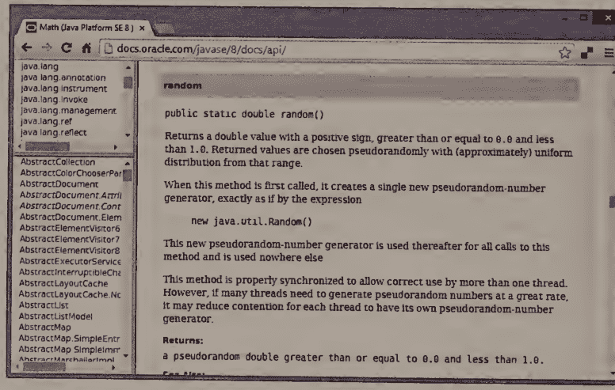

图 5.5

Oracle 对 `Math` 类的文档。

> **注意** 本书涵盖的所有 Java 类在书内均有描述，因此在学习这些章节并成为 Java 程序员的过程中，不需要在线文档。

由于书中使用的类具有许多超出入门级书籍涵盖范围的额外功能，Java 类库文档可以辅助你的学习。

任何 Java 类库的组织方式都将与官方 Java 类库相同。Bukkit（启用创建 Minecraft 模组的类集合）也拥有这样的在线文档。

你现在不需要它，但如果你好奇并想快速查看，可以访问网站 `http://www.javaminecraft.com/bukkitapi` 来查看你安装在计算机上的 Bukkit 类库对应版本的文档。

# 极简要点

在本章中，你有机会创建一个 Java 程序，向程序发送参数，并利用 Java 类库中现有的程序。

随着你作为 Java 程序员的经验越来越丰富，接下来的几章将继续关注应用程序。应用程序的测试更快，因为运行它们不需要你像运行其他类型的程序那样做任何额外工作。

本章是讨论如何在 Java 程序中使用对象的若干个章节中的第一章。你将在第 11 章“创建你的第一个对象”中回到这个主题。


# 本章内容

- 创建变量
- 使用不同类型的变量
- 在变量中存储值
- 在数学表达式中使用变量
- 将一个变量的值存储另一个变量中
- 增加和减少变量的值

# 第 6 章 存储和更改信息

在第 4 章“开始编写 Java 程序”中，你使用了一个变量，这是一个设计用于存储信息的特殊位置。存储在变量中的信息可以在程序运行时进行更改。你的第一个程序在变量中存储了一个文本字符串。字符串只是存储在变量中的一种信息类型。它们还可以持有字符、整数、浮点数和对象。

## 语句与表达式

计算机程序是告诉计算机要做什么的指令集合。每个指令被称为语句。以下示例是一个语句：

```java
float highScore = 45000;
```

你可以使用括号将语句组合在一起。以下示例是一个块：

```java
1: public static void main(String[] arguments) {
2:     int a = 3;
3:     int b = 4;
4:     int c = 8;
5: }
```

第 2-4 行是语句。第 1 行括号表示块的开始，第 5 行括号表示结束。

有些语句是表达式，因为它们涉及结果。上述示例的第 4 行将 `c` 赋值为 `8`。

## 为变量赋值

变量通过语句创建，必须包含两个内容：

- 变量名
- 变量将存储的信息类型

变量还可以包含要存储的值。为了查看不同类型的变量及其创建方式，启动 NetBeans 并在 `com.javaminecraft` 程序包中创建一个空的 Java 文件，类名为 `Variable`。

### 整数和浮点数

删除注释并在位置输入以下语句：

```java
int tops;
```

这条语句创建了一个名为 `tops` 的变量。它没有为 `tops` 指定值，目前该变量是一个空存储空间。语句开头的 `int` 文字将 `tops` 指定为用于存储整数的变量。你可以使用 `int` 类型存储计算机程序需要的大多数非小数数字。它可以持有从大约 -21 亿到 21 亿范围的任何整数。

在 `int tops` 语句之后添加一个空行并输入以下语句：

```java
float radius;
```

这条语句创建了一个名为 `radius` 的变量。`float` 文字代表浮点数。浮点变量用于存储可能包含小数点的数字。

`float` 变量类型可以持有 38 位的小数。更大的 `double` 类型可以持有高达 300 位的小数。

### 字符和字符串

由于你目前处理的变量都是数字，你可能会认为所有变量都用于存储数字。事实并非如此。你可以使用变量来存储文本。可以存储在变量中的两种文本类型：字符和字符串。字符是单个字母、数字、标点符号或符号。字符串是一组字符。

你创建 `Variable` 程序的下一步是创建一个 `char` 变量和一个 `String` 变量。在 `float radius` 这一行之后添加这两个语句：

```java
char key = 'C';
String playerName = "JeffStrongman";
```

当你在程序中使用字符值时，必须在赋值给变量的字符值两边加上单引号。对于字符串值，你必须用双引号将其括起来。

引号可以防止字符或字符串与变量名或语句的其它部分混淆。请看以下语句：

```java
String playerName = "JeffStrongman";
```

这条语句看起来像是告诉计算机创建一个名为 `playerName`、文本值为 `JeffStrongman` 的字符串。然而，由于 `JeffStrongman` 周围没有引号，计算机被告知将 `playerName` 的值设置为与名为 `JeffStrongman` 的变量相同。（如果没有名为 `JeffStrongman` 的变量，程序将编译失败并报错。）

添加 `char` 和 `String` 语句后，你的程序将与列表 6.1 相似。进行任何必要的更改，并确保保存文件。

## 列表 6.1 Variable.java 的全文

```java
1: package com.javaminecraft;
2:
3: class Variable {
4:     public static void main(String[] arguments) {
5:         int tops;
6:         float radius;
7:         char key = 'C';
8:         String playerName = "JeffStrongman";
9:     }
10: }
```

`Variable` 程序中的最后两个变量使用 `=` 号在创建变量时分配一个初始值。你可以在 Java 程序中创建的任何变量中使用此选项，正如你在本章稍后部分所发现的那样。

> **注意** 虽然其他变量类型都是小写字母（`int`、`float` 和 `char`），但在创建字符串变量时，`String` 单词需要大写字母。Java 程序中的字符串与你在变量语句中使用的其他类型信息不同。你将在第 7 章“使用字符串进行通信”中学习这种区别。

这个程序可以运行但不会产生输出。

### 其他数值型变量类型

到目前为止为你介绍的变量类型是你进行大多数 Java 编程时使用的主要类型。在特殊情况下，你可以调用其他类型的变量。

你可以使用第一种类型 `byte`，用于范围从 -128 到 127 的整数。以下语句创建了一个名为 `escapeKey`、初始值为 27 的变量：`byte escapeKey = 27;`

第二种 `short`，可以用于比 `int` 类型尺寸更小的整数。`short` 整数的范围可以从 -32,768 到 32,767，如下例所示：

```java
short roomNumber = 222;
```

数值型变量类型中的最后一种 `long`，通常用于 `int` 类型无法容纳的大型整数。`long` 整数可以从 -92.2 亿亿到 92.2 亿亿。

在 Java 中处理大数字时，很难一眼看出数字的值，如下语句所示：

```java
long salary = 264400000;
```

除非你数出零的数量，否则你可能无法判断它是 2.64 亿美元。Java 允许你使用下划线（`_`）字符来组织大数字。这是一个示例：

```java
long salary = 264_400_000;
```

下划线会被忽略，所以变量的值保持不变。它们只是让数字更具人类可读性的一种方法。

> **警告** 这些下划线是 Java 8 引入的新功能。如果 IDE 设置为使用旧版本的 Java，则在数字中使用下划线会在 NetBeans 源代码编辑器中被标记为错误。为了确保没有发生这种情况，在 Projects 面板中，右键点击当前项目名称（可能是 Minecraft!）并选择 Properties（属性）。Project Properties 对话框将打开，并在 Categories 页面中选中 Sources（源）。检查 Source/Binary Format 下拉菜单，以确保它是当前的 Java 版本。


整数也可以使用两种计数系统指定：二进制值和十六进制值。

对于二进制值，在数字前面加上 `0b`，后面跟着位值。因为 `1101` 是数字 `13` 的二进制形式，以下语句将整数设置为 `13`：

```java
int z = 0b0000_1101;
```

下划线只是为了让数字更易读。Java 编译器会忽略它。

十六进制值可以用以 `0x` 开头的数字表示，如下语句所示：

```java
int count = 0x30;
```

这使用等效的十六进制值将 `count` 设置为 `48`。

### boolean 类型

Java 有名为 `boolean` 的变量类型，可以存储真或假。乍一看，`boolean` 变量似乎并不有用，除非你计划编写很多程序。`boolean` 变量用于各种情况。以下是 `boolean` 变量可以回答的一些问题示例：

- 用户按下按键了吗？
- 游戏结束了吗？
- 僵尸是否生气了？

`Boolean` 是存放是/否答案的地方。

以下语句创建了一个名为 `gameOver` 的 `boolean`：

```java
boolean gameOver = false;
```

此变量的初始值为 `false`，因此这样的语句可能表示游戏尚未结束。稍后发生某些情况时，可以将 `gameOver` 变量设置为 `true`。

虽然 `boolean` 值在程序中看起来像字符串，但不要给它们加上引号。第 8 章“使用条件做出决策”将更完整地描述 `boolean` 变量。

> **注意** `Boolean` 以乔治·布尔（George Boole，1815–1864）的名字命名。布尔是一位数学家，在成年之前大部分时间都是靠自学，他发明了代数，代数已成为计算机编程、数字电子和逻辑的基础部分。可以想象他小时候表现很不错。


## 为变量命名

Java 中的变量名可以以字母、下划线（`_`）或美元符号（`$`）开头。名称其余可以是任何字母或数字。你可以给变量起几乎任何名称，但在命名方式上应该保持一致。本节概述了变量的通用命名方法。

变量名应该以某种方式描述其目的。字母应该是小写，如果变量名是多个单词，则每个单词的首字母大写。例如，如果你想创建一个存储记录最高分的整数变量，可以使用以下语句：

```java
int allHighScore;
```

你不能在变量名中使用标点符号或空格，因此以下写法都不行：

```java
int all-TimeHigh;
```

```java
int all Score;
```

如果你在程序中使用这些变量名，NetBeans 会通过红色警告图标标记错误。变量名不是 Java 中唯一区分大小写的方面。程序中你可以命名的其他元素包括类和方法，都必须使用一致的大小写。


> **注意** 有些变量名代表多个单词，例如代表 "game over" 的 `gameOver`。变量名中的字母都是小写，除了后续单词的首字母，所以 "over" 中的 `O` 是大写的。

这不是 Java 语言的要求。但这种习惯对你的编程有帮助。首先，它让你在程序的其他元素中更容易识别变量。其次，通过在命名变量时遵循一致风格，可以消除在程序多处使用变量时可能出现的错误。本书使用的的大小写风格是大多数 Java 程序员所采用的。

语言使用的单词（如 `public`、`class`、`true` 和 `false`）不能作为变量名。

## 在变量中存储信息

你可以在创建 Java 程序变量的同时为变量存储一个值。你也可以在任何时候为变量放入一个值。

要在创建变量时设置初始值，请使用等号（`=`）。这是一个创建一个名为 `pi` 的双精度浮点变量且初始值为 3.14 的示例：

```java
double pi = 3.14;
```

Java 语句中的值 `3.14` 被称为字面量。

所有存储数字的变量都可以以类似的方式设置。如果你正在设置字符或字符串变量，必须像本章前面提到的那样在值周围加上引号。

你也可以将一个变量的值赋值给另一个变量，只要它们的类型相同。请考虑以下示例：

```java
int distance = 300;
int totalDistance = distance;
```

首先，创建一个名为 `distance` 的整数变量，其初始值为 `300`。接下来，创建一个名为 `totalDistance` 的整数变量，其值与 `distance` 相同。两个变量的初始值都是 `300`。在后续章节中，你将学习如何将一个变量的值转换为另一个变量的类型。

> **注意** 如果你不给变量一个初始值，那么在另一个语句中使用它之前，你必须给它一个初始值。如果不这样做，当程序被编译时，你可能会得到一个错误，说明变量“可能未初始化”。


# Java 数值变量与运算符

正如你学到的，Java 具有类似的数值变量，可以存储不同大小的值。`int` 和 `long` 都存储整数，但 `long` 存储的数值范围更大。`float` 和 `double` 都用于携带浮点数，但 `double` 更大。

你可以在数值后面附加一个字母来表示该值的类型，如下句所示：

```
float pi = 3.14F;
```

数值 `3.14` 之后的 `F` 表示它是一个 `float` 值。如果省略该字母，Java 会假设 3.14 是一个 `double` 值。

字母 `L` 用于长整数，`D` 用于双精度浮点值。对于 `double` 使用 `D` 是可选的，因为这是浮点数的默认值。

Java 的另一个命名规范是对于值不发生改变的变量名，每个字母都大写。这些变量被称为常量。以下代码创建了三个常量：

```
final int TOUCHDOWN = 6;
final int FIELDGOAL = 3;
final int PAT = 1;
```

由于常量的值永远不会改变，你可能会奇怪为什么不直接使用赋值给常量的值即可。使用常量的一个优点是它们让程序更易于理解。

在前面的语句中，常量名是大写的。这在 Java 中不是强制要求的，但已成为程序员之间的一种标准约定，用于将常量与其他变量区分开。

## 运算符

可以通过使用运算符 `+`、`-`、`*`、`/`、`%` 使用数学表达式。你在整个 Java 程序中使用这些运算符来计算数字。

Java 中的加法表达式使用 `+` 运算符，如下句所示：

```
double power = 10;
power = power + 3;
```

第二条语句使用 `+` 运算符将 `power` 变量设置为其当前值加 3。减法表达式使用 `-` 运算符：

```
power = power - 2;
```

该表达式将 `power` 变量设置为其当前值减去 2。

除法表达式使用 `/` 符号：

```
power = power / 3;
```

这会将 `power` 变量设置为其当前值除以 3。

要找到除法表达式的余数，使用 `%` 运算符（也称为模运算符）。以下语句计算 245 除以 3 的余数：

```
int remainder = 245 % 3;
```

乘法表达式使用 `*` 符号。这里有一个语句将乘法表达式作为更复杂语句的一部分：

```
int score = 20;
int total = 500 + (score * 12);
```

表达式中的 `score * 12` 部分将 `score` 乘以 12。整个语句将 `score` 乘以 12 并在结果加上 500。因为 `score` 等于 20，表达式的结果是 `total` 等于 740：500 + (20 * 12)。

## 变量的递增和递减

程序中的常见任务是将变量的值改变 1。你可以将值增加 1，这被称为变量递增；或者将值减少 1，这被称为变量递减。有运算符可以完成这两项任务。

要将变量的值加 1，使用 `++` 运算符，如下句所示：

```
health++;
```

该语句将存储在 `health` 变量中的值加 1。

要将变量的值减 1，使用 `--` 运算符：

```
health--;
```

该语句将 `health` 减少 1。

你也可以将递增和递减运算符放在变量名之前，如下句所示：

```
++health;
--health;
```

将运算符放在变量名前被称为前缀（prefixing），放在名称后被称为后缀（postfix）。


> **注意** 困惑了吗？如果你回想起学校学习前缀的时候，这比听起来要简单。就像 `sub-` 或 `un-` 这样的前缀位于 `suburban` 或 `unexpected` 等单词的开头一样，前缀运算符位于变量名的开头。后缀运算符位于结尾。

当你在表达式内部使用递增和递减运算符时，前缀和后缀运算符之间的区别就变得很重要。

考虑以下语句：

```
int x = 3;
int answer = x++ * 10;
```

在处理这些语句后，`answer` 变量等于什么？你可能认为是 40——如果 3 增加了 1（等于 4），然后将 4 乘以 10，那么就是真的。但实际上，由于使用了后缀递增运算符 `x++`，表达式先使用 `x` 的原始值 3 进行乘法运算，然后再将 `x` 增加 1。因此 `answer` 等于 30。

## 运算符优先级

如果你想以不同的顺序评估表达式，可以使用括号将应该先处理的表达式分组。例如，表达式 `x = 5 * 3 + 2;` 通常会让 `x` 等于 17，因为乘法在加法之前处理。然而，看该表达式的修改形式：

```
x = 5 * (3 + 2);
```

在这种情况下，括号内的表达式首先处理，因此结果等于 25。你可以在语句中根据需要频繁使用括号。

## 使用表达式

当你在学校处理一个特别令人讨厌的数学题时，你是否曾向更高的力量诉苦，抗议你以后也用不上这些知识？抱歉要告诉你，但你们的老师是正确的——数学技能在计算机编程中很有用处。这是坏消息。

首先，创建一个名为 `distance` 的整数变量，其初始值为 300。接下来，创建一个名为 `totalDistance` 的整数变量，其值与 `distance` 相同。两个变量的初始值都是 300。在后续章节中，你将学习如何将一个变量的值转换为另一个变量的类型。

> **注意** 如果你不给变量一个初始值，那么在另一个语句中使用它之前，你必须给它一个初始值。如果不这样做，当程序被编译时，你可能会得到一个错误，说明变量“可能未初始化”。


好消息是，计算机会执行你要求它的任何数学计算。表达式在你的计算机程序中被频繁用于完成如下任务：

- 改变变量的值
- 统计某事在程序中发生的次数
- 在程序中使用数学公式

在你编写计算机程序时，你会发现自己在使用表达式时会用到以前学过的数学知识。表达式可以使用加法、减法、乘法、除法和取模。

为了看到表达式的运行效果，返回 NetBeans，并在 `com.javaminecraft` 包下创建一个名为 `PlanetWeight` 的新空 Java 文件。该程序将跟踪一个人在太阳系其他天体上旅行时的体重减轻和增加情况。列表 6.2 的全文位于源代码编辑器中。我们将逐一讨论程序的每个部分。

### 列表 6.2 PlanetWeight.java 的全文

```
1: package com.javaminecraft;
2:
3: class PlanetWeight {
4:     public static void main(String[] args) {
5:         System.out.print("Your weight on Earth is ");
6:         double weight = 178;
7:         System.out.println(weight);
8:
9:         System.out.print("Your weight on Mercury is ");
10:        double mercury = weight * .378;
11:        System.out.println(mercury);
12:
13:        System.out.print("Your weight on the Moon is ");
14:        double moon = weight * .166;
15:        System.out.println(moon);
16:
17:        System.out.print("Your weight on Jupiter is ");
18:        double jupiter = weight * 2.364;
19:        System.out.println(jupiter);
20:
21: }
```

完成后，保存文件，它应该会自动编译。使用菜单命令 `Run` > `Run File` 运行程序。输出显示在图 6.1 的输出面板中。


**图 6.1** PlanetWeight 程序的输出。

与你创建的其他程序一样，PlanetWeight 程序使用一个 `main()` 块语句来执行其所有工作。该语句可以分为以下四个部分：

- 第 4–6 行：个人的体重最初被设置为 178。
- 第 9–11 行：计算水星上的体重减轻。
- 第 13–15 行：确定月球上的体重减轻。
- 第 17–19 行：计算木星上的体重增加。

第 6 行创建了 `weight` 变量并使用 `double` 将指定为双精度浮点变量。该变量被赋予初始值 178，并在整个程序中使用它来监控人的体重。

下一行与程序中的其他语句类似：

`System.out.println(weight);`

`System.out.println()` 命令显示包含在括号标记内的字符串。在第 5 行，`System.out.print()` 命令显示文本 "Your weight on Earth is"。程序中有多个 `System.out.print()` 和 `System.out.println()` 语句。

它们之间的区别是 `print()` 在显示文本后不会开始新的一行，而 `println()` 则会。

> **注意** 对于示例值，PlanetWeight 应用使用了 178 磅的体重，根据一项 BMC 健康研究，这恰好是北美人的平均体重。相比之下，大洋洲人平均为 164 磅，欧洲人为 156 磅，拉丁美洲人为 150 磅，非洲人为 134 磅，亚洲人为 127 磅。

如果你在北美阅读这段内容，有人问你：“你想配个苹果派吗？”，这个问题的正确答案是不。

# 总结

现在你已经接触了变量和表达式，你可以在程序中给计算机提供广泛的指令。通过在本章中培养的技能，你可以编写出完成与计算器许多相同任务的程序，轻松地处理复杂的数学方程。


你还学了去月球之旅是一项特别有效的减肥计划。数字只是变量可以存储的种类之一。你还可以存储字符、字符字符串，以及被称为布尔变量（`boolean variables`）的特殊真或假值。下一章将扩展你对字符串变量以及如何存储和使用的知识。


# 本章内容

- 使用字符串存储文本
- 在程序中显示字符串
- 在字符串中包含特殊字符
- 将两个字符串拼接在一起
- 在字符串中包含变量
- 比较两个字符串
- 确定字符串的长度

# 7


## 使用字符串通信

在 Java 中，字符串是与用户通信常用的方式。字符串是字符的序列，用于存储文本、数字和符号。在本章中将学习如何创建、显示和操作字符串。

## 在字符串中存储文本

在 Java 中，字符串是包含双引号内的字符序列。要创建一个字符串，使用 `String` 类型。例如：

```java
String message = "Hello, World!";
```

这创建了一个名为 `message` 值为 "Hello, World!" 的字符串。你也可以给现有的变量赋值字符串：

```java
String name;
name = "Alice";
```

要显示字符串，使用 `System.out.println()` 或 `System.out.print()` 方法。这些方法接收字符串作为参数并显示到控制台。

```java
System.out.println(message);
```

这将输出 "Hello, World!"

## 在程序中显示字符串

如前所述，可以通过 `System.out.println()` 或 `System.out.print()` 方法显示字符串。这些方法接收字符串作为参数并显示。

```java
System.out.println("This is a string.");
```

这将输出 "This is a string.".

## 在字符串中特殊字符

字符串可以包含特殊字符，例如换行符、制表符和引号。这些字符由转义序列表示，以反斜杠（`\`）开头一个字符。

- `\n`：换行
- `\t`：制表符
- `\"`：双引号
- `\'`：单引号

例如：

```java
System.out.println("Line one\nLine two\tTabbed text");
```

这将输出：

Line one

Line two	Tabbed text

## 拼接两个字符串

拼接是将两个字符串结合的过程。在 Java 中，你使用 `+` 运算符拼接字符串。

```java
String first = "Hello, ";
String second = "World!";
String combined = first + second;
```

`combined` 变量将持有 "Hello, World!"

## 在字符串中包含变量

你还可以通过 `+` 运算符将变量包含在字符串中。

```java
int age = 25;
String message = "I am " + age + " years old.";
```

`message` 变量将持有 "I am 25 years old.".

## 比较两个字符串

比较两个字符串要使用 `.equals()` 方法，而不是 `==` 运算符。`==` 运算符比较字符串的内存地址，而不是内容。

```java
String s1 = "apple";
String s2 = "apple";
if (s1.equals(s2)) {
    System.out.println("The strings are equal.");
}
```

## 确定字符串的长度

要找到字符串的长度，你使用 `.length()` 方法。

```java
String text = "Minecraft";
int length = text.length();
System.out.println("The length is: " + length);
```

这将输出 "The length is: 9".

## 特殊字符显示

| 转义序列 | 说明 |
|---|---|
| `\'` | 单引号 |
| `\"` | 双引号 |
| `\\` | 反斜杠 |
| `\t` | 制表符 |
| `\b` | 退格符 |
| `\r` | 回车 |
| `\f` | 换页 |
| `\n` | 换行符 |

换行符会导致换行符之后的文本显示在下一行的开头。看这个示例：

`System.out.println("Starting Minecraft server\nLoading properties");`

该语句的显示结果如下：

Starting Minecraft server

Loading properties

## 拼接字符串

当你使用 `System.out.println()` 并以其他方式处理字符串时，你可以使用 `+` 将两个字符串拼接在一起，这与用于数字相加的运算符是同一种。

`+` 运算符在处理字符串时具有不同的含义。它不是执行数学运算，而是将两个字符串拼接在一起。此操作会导致字符串显示在一起，或者将两个较小的字符串合并为一个大字符串。

“拼接”（Concatenation）是用来描述这种动作的词，因为它的意思是将两个字符串连接在一起。

以下语句使用 `+` 运算符显示了一个长字符串：

`System.out.println("'Minecraft' is a towering achievement \n" + "in the very possibilities of gaming.\n" + "\t-- Alec Meer, EuroGamer.Net");`

程序并没有将整个字符串放在单行（这会让你在以后查看程序时更难理解），而是使用 `+` 运算符将文本分在程序 Java 文本文件的两行中。当该语句显示时，它的样子如下：

"'Minecraft' is a towering achievement

in the very possibilities of gaming."

-- Alec Meer, EuroGamer.Net

字符串中使用了几个特殊字符：`\"`、`\'` 和 `\n`。为了更好地熟悉这些字符，请将输出结果与产生它的 `System.out.println()` 语句进行对比。

## 将变量与其他结合

虽然你可以使用 `+` 运算符拼接两个字符串，但你经常用它来连接字符串和变量。看这里：

```java
double version = 1.7;
char rating = 'G';
System.out.println("Minecraft version: " + version);
System.out.println("Rated " + rating);
```

这段代码的显示如下：

Minecraft version: 1.7

Rated G

这个示例展示了 `+` 运算符处理字符串的一个方面面。它可以让非字符串的变量在显示时被视为与字符串无异。变量 `version` 是一个赋值为 `1.7` 的整数。`System.out.println()` 语句被要求显示一个字符串加一个整数。该语句之所以有效，是因为组合中至少有一部分是字符串。Java 语言提供这种功能是为了让显示信息变得更容易。

你可能想对字符串执行多次重复的操作，如下例所示：

```java
String mobNames = "";
mobNames = mobNames + "Ocelot ";
mobNames = mobNames + "Silverfish ";
mobNames = mobNames + "Blaze";
```

这段代码会导致 `mobNames` 变量被设置为 `"Ocelot Silverfish Blaze"`。第一行创建了 `mobNames` 变量并将其设置为空字符串，因为双引号之间什么内容都没有。第二行将 `mobNames` 变量设置为其当前字符串加上末尾添加的字符串 `"Ocelot "`。接下来的两行以同样的方式添加了 `"Silverfish "` 和 `"Blaze"`。

正如你看到的，当你在变量末尾拼接更多文本时，变量名必须列出两次。Java 提供了一个快捷方式来简化这一过程：`+=` 运算符。`+=` 运算符结合了 `=` 和 `+` 运算符的功能。对于字符串，它被用于向现有字符串的末尾添加内容。`mobNames` 的示例可以使用 `+=` 缩短，如下句所示：

```java
String mobNames = "";
mobNames += "Ocelot";
mobNames += "Silverfish";
mobNames += "Blaze";
```

这段代码产生了相同的结果：`mobNames` 被设置为 `"Ocelot Silverfish Blaze"`。

# 高级字符串处理

你还有几种其他方法可以检查字符串变量并更改其值。这些高级功能之所以可能，是因为在 Java 语言中字符串是对象。处理字符串将培养你以后在其他对象上用到的技能。

## 比较两个字符串

你在程序中测试的内容之一是一个字符串是否等于另一个字符串。你通过在包含两个字符串的语句中使用 `equals()` 来实现，如下例所示：

```java
String favorite = "TNT";
String guess = "cow cannon";
System.out.println("Is Bob's favorite weapon a " + guess + "?");
System.out.println("Answer: " + favorite.equals(guess));
```

这个示例使用了两个不同的字符串变量。其中 `favorite` 存储了 Bob 猎怪工具的名字：`cow cannon`。另一个 `guess` 存储了对他喜爱的物品可能是什么的猜测。猜测是 Bob 偏好 `TNT`。

第三行显示文本 `"Is Bob's favorite weapon a"`，后面跟上 `guess` 变量的值，然后是一个问号。第四行显示文本 `"Answer:"`，然后包含新内容：`favorite.equals(guess)`。

语句的这部分被称为方法（method）。方法是在 Java 程序中完成任务的一种。此方法的任务是判断一个字符串是否与另一个具有相同的值。如果两个字符串变量的值相同，则显示文本 `true`。如果不是，则显示文本 `false`。以下是该方法的输出：

Is Bob's favorite weapon a cow cannon?

Answer: false

## 字符串的长度

你可能想对字符串执行的操作之一是确定字符串的长度。你通过 `length()` 方法来实现。

```java
String developer = "Jens Bergsten";
int nameLength = developer.length();
```

这个示例将整数 `nameLength` 设置为 12。`length()` 方法计算字符串变量 `developer` 中的字符数量。

## 更改字符串的大小写

由于计算机是字面处理的，很容易混淆它们。虽然人类会认为 `Notch` 和 `NOTCH` 是同一个东西，但之前讨论的 `equals()` 方法会否。

为了解决这些问题，Java 提供了将字符串转换为大写或小写的方法，分别为 `toUpperCase()` 和 `toLowerCase()`。以下示例展示了 `toUpperCase()` 的用法：

```java
String name = "Notch";
String change = name.toUpperCase();
```

这段代码将 `change`设置为 `"NOTCH"`。注意 `toUpperCase()` 方法不会改变被调用的字符串本身。`toLowerCase()` 方法原理相同，但返回全小写的值。在前述示例中，`name` 变量仍然是 "Notch"。

Java 中一个重要的概念是字符串在创建后不会改变值。以后你将看到创建可以改变值的对象。

## 查找字符串

处理字符串时的另一个常见任务是查看一个字符串是否在另一个字符串内部。要在字符串内部查找，请使用 `indexOf()` 方法。将你要查找的字符串放在括号内。如果找不到字符串，`indexOf()` 会产生值 `-1`。如果找到了，`indexOf()` 会产生一个表示该字符串起始位置的整数。字符串中的位置从 0 开始。在字符串 `"Minecraft"` 中，`craft` 起于位置 4。

`indexOf()` 方法的一个可能用途是在 Minecraft 的服务器属性文件中搜索世界种子设置。种子是一个随机数，决定了世界在玩家第一次进入之前生成的样子。从相同种子创建的世界看起来总是相同的。

如果服务器属性文件的文本存储在名为 `file` 的字符串中，你可以通过以下语句搜索 `"level-seed"`：

```java
int position = file.indexOf("level-seed");
```

如果在 `file` 字符串中找到了该文本，`position` 等于该文本开始的位置。否则它将等于 `-1`。

如果你想在另一个字符串内部查找一个字符串，字符串的 `contains()` 方法返回一个布尔值。如果找到了被查找的字符串，则返回 `true`，否则返回 `false`。示例如下：

```java
if (file.contains("level-seed=") == false) {
    System.out.println("Level not found");
}
```

> 注意：`indexOf()` 和 `contains()` 方法对大小写敏感，这意味着它们只会查找与搜索字符串大小写完全相同的文本。如果字符串包含相同文本但大小写不同，`indexOf()` 会产生值 -1，且 `contains()` 返回 false。

## 显示制作名单

接下来，为了强化已经涵盖过的字符串处理功能，你将编写一个 Java 程序来显示游戏的制作名单。你可能已经猜出是哪一个了。回到 NetBeans 中的 Minecraft 项目，在 `com.javaminecraft` 项目中创建一个名为 `credits` 的新空 Java 文件。将列表 7.1 中的文本输入源编辑器，并在完成后保存文件。

### 列表 7.1 Credits.java 的完整文本

```java
1: package com.javaminecraft
2:
3: class Credits {
4:     public static void main(String[] arguments) {
5:         // 设置游戏信息
6:         String title = "Minecraft";
7:         int year = 2009;
8:         String creator = "Markus 'Notch' Persson";
9:         String developer = "Jens 'Jeb' Bergensten";
10:        String music = "Daniel 'C418' Rosenfeld";
11:        String art = "Kristoffer Zetterstrand";
12:        // 显示信息
13:        System.out.println(title + " (" + year + ")\n" +
14:                            "A " + creator + " game.\n\n" +
15:                            "Developer\t" + developer + "\n" +
16:                            "Music\t" + music + "\n" +
17:                            "Art\t" + art + ")");
18:    }
19: }
```

查看该程序，看看你是否能看出它每个阶段在做什么。以下是发生过程的分解：

- 第 3 行给 Java 程序命名为 `Credits`。
- 第 4 行开始了 `main()` 方法，程序的所有工作都在这里完成。
- 第 6–11 行设置了变量来存储有关游戏、创建者及其贡献者的信息。其中一个变量 `year` 是整数。其余都是字符串变量。
- 第 13–17 行是一行的 `System.out.println()`。第 13 行第一个左括号到第 17 行最后一个右括号之间的所有内容都会显示在屏幕上。换行符 (`\n`) 会导致其后的文本显示在新行的开头。制表符 (`\t`) 会在输出中插入间距。其余部分要么是文本或者是应该显示的字符串变量。
- 第 18 行结束了 `main()` 块语句。
- 第 19 行结束程序。

如果你遇到错误消息，请纠正你在 `Credits` 程序中发现的任何拼写错误并重新保存。NetBeans 会自动编译程序。当你运行程序时，你会看到一个类似于图 7.1 中输出窗格的输出窗口。

Output - Minecraft (run)

run:

Minecraft (2009)

A A Markus 'Notch' Persson game.

Developer Jens 'Jeb' Bergensten

Music Daniel 'C418' Rosenfeld

Art Kristoffer Zetterstrand

BUILDBUILD SUCCESSFUL (total time: 0 seconds)

## 图 7.1

Credits 程序的输出。

## 极简内容


当你版本的制作名单看起来像图 7.1 时，给自己一点鼓励吧。这本书已经学到第七章了，你正在编写更长的 Java 程序并处理更复杂的问题。字符串是你每次坐下写程序都会用的东西。在你的模组中，你将通过多种方式与玩家通信。


# 本章内容

- 使用 `if` 语句进行基础条件测试
- 测试一个值是否大于或小于另一个
- 测试两个值是否相等或不相等
- 使用 `else` 语句作为 `if` 语句的反向
- 将多个条件测试链在一起
- 使用 `switch` 语句进行复杂的条件测试

## 使用条件测试做出决策

当你编写计算机程序时，你为计算机提供了一系列称为 *statements*（语句）的指令，计算机按照顺序执行这些指令。你可以告诉计算机计算一些讨厌的数学公式，它就会计算出来。告诉它显示某些信息，它就会尽职尽责地予以响应。

有时，你需要计算机对它执行的操作更具选择性。例如，如果你写了一个让苦力怕害怕玩家的 Minecraft 模组，你希望在吓跑它们之前检查某个生物是否是苦力怕。否则，它将会让所有生物都感到害怕。

在 Java 程序中完成此任务的方法是使用 *conditional*（条件），这种语句只有在满足特定条件时才会导致程序中发生某些事情。在本章中，你将学习如何使用条件语句 `if`、`else` 和 `switch`。

## Minecraft 模组编程初学者指南

当 Java 程序做出决策时，它是通过使用条件语句来实现的吗？在本章中，你正在使用条件 `if`、`else`、`switch`、`case` 和 `break` 关键字来检查你 Java 程序中几个内容的状态。你还使用了条件运算符 `==`、`!=`、`<`、`>` 和 `>=`。

## if 语句

在 Java 中测试条件最基本的方法是 `if` 语句。如果条件为真，则执行块中的代码。

```java
if (condition) {
    // 执行的代码
}
```

有三种类型的 `if` 语句：

- `if` 语句：最简单的形式。
- `if-else` 语句：用于两条路径。
- `else-if` 语句：用于多个路径。

## if-else 语句

`else` 语句在 `if` 条件为假时提供替代代码块。

```java
if (condition) {
    // 条件为真执行
} else {
    // 条件为假
}
```

## 相等比较

`==` 运算符用于测试两个值是否相等。如果它们相等，表达式为真。

```java
if (value1 == value2) {
    // 相等时执行
}
```

## else-if 语句

当你有多个条件需要测试时，可以使用一系列的 `else if` 语句。

```java
if (test1) {
    // test1 为真执行
} else if (test2) {
    // test1 为假且 test2 为真执行
} else {
    // 所有测试均为假
}
```

## 不等比较

`!=` 运算符用于测试两个值是否不等。如果它们不等，表达式为真。

```java
if (value1 != value2) {
    // 不等时执行
}
```

## 小于和大于比较

`<` 运算符测试一个值是否小于另一个。`>` 运算符测试一个值是否大于另一个。

```java
if (value1 < value2) {
    // value1 小于 value2 执行
}

if (value1 > value2) {
    // value1 大于 value2 执行
}
```

## 大于等于比较

`>=` 运算符测试一个值是否大于等于另一个。

```java
if (value1 >= value2) {
    // value1 大于等于 value2 执行
}
```

## 逻辑运算符

逻辑运算符 `&&`、`||` 和 `!` 用于组合多个条件。

- `&&` (与)：只有当两个条件都为真时返回真。
- `||` (或)：只要有一个条件为真返回真。
- `!` (非)：反转条件的布尔值。

```java
if (condition1 && condition2) {
    // condition1 和 condition2 都为真时执行
}

if (condition1 || condition2) {
    // condition1 或 condition2 为真时执行
}

if (!condition1) {
    // condition1 为假时执行
}
```

## switch 语句

`switch` 语句用于将单个变量与多个可能的值进行比较。它通常比使用多个 `if-else` 语句更整洁。

```java
switch (variable) {
    case value1:
        // 等于 value1 执行
        break;
    case value2:
        // 等于 value2 执行
        break;
    default:
        // 都不匹配执行
}
```

## 使用块语句组织程序

到目前，本章中的 `if` 语句都带有一个位于 `{}` 括号内的块。（我认为这些字符的专业术语是“大括号”。）

之前你已经看到如何使用块语句来标记 Java 程序 `main()` 块的开始和结束。`main()` 块中的每个语句在程序运行时都会被处理。

`if` 语句不需要块语句。它可以占据一行，如下所示：

```java
if (account <= 0) System.out.println("No more money");
```

列表 8.1 是使用块语句来表示 `main()` 块的 Java 程序示例。块语句从第 3 行的左括号 `{` 开始，到右括号 `}` 结束。

## 列表 8.1 Game.java 的完整文本

```java
1: package com.javaminecraft;
2:
3: class Game {
4:     public static void main(String[] arguments) {
5:         int total = 0;
6:         int score = 7;
7:         if (score == 7) {
8:             total = 10;
9:         }
10:        System.out.println("Score: " + total);
11:    }
12: }
```

## 第 8 章 使用条件测试进行决策 95

```java
8: System.out.println("你得分了一个达阵区!");
9: }
10: if (score == 3) {
11: System.out.println("你踢进了一个任意球!");
12: }
13: total = total + score;
14: System.out.println("总得分: " + total);
15: 
16: }
```

当你运行该程序时，输出结果类似于图 8.1。


## 图 8.1

橄榄球程序的输出。

你可以在 `if` 语句中使用块语句，以便在条件真时让计算机执行多项操作。以下是一个包含块语句的 `if` 语句示例：

```java
int playerScore = 12000;
int playerLives = 3;
int difficultyLevel = 10;
```

```java
if (playerScore > 9999) {
    playerLives++;
    System.out.println("额外生命!");
    difficultyLevel = difficultyLevel + 5;
}
```

括号用于将所有属于 `if` 语句的语句分组。如果变量 `playerScore` 大于 9,999，会发生三件事：

- `playerLives` 变量的值增加了 1（因为使用了自增运算符 `++`）。
- 显示文本 "Extra life!"。

## if-else 语句

有时你希望在条件为真时执行某些操作，而在条件为假时执行其他操作。你可以通过在 `if` 语句的基础上使用 `else` 语句来实现这一点，如下例所示：

```java
int score = 30;
int answer = 17;
int correctAnswer = 13;
```

```java
if (answer == correctAnswer) {
    score += 10;
    System.out.println("正确。你获得了 10 分");
} else {
    score = 5;
    System.out.println("抱歉，错了。你失去了 5 分");
}
```

`else` 语句不像 `if` 语句那样在旁边列出条件。`else` 语句与紧接其前面的 `if` 语句匹配。你也可以使用 `else` 一起改变多个语句，如下例所示：

```java
if (grade == 'A') {
    System.out.println("你得到了 A。太棒了！");
} else if (grade == 'B') {
    System.out.println("你得到了 B。不错！");
} else if (grade == 'C') {
    System.out.println("你得到了 C。令人担忧！");
} else {
    System.out.println("你得到了 F。简直不可思议！");
}
```

通过以这种方式组合多个 `if` 和 `else` 语句，你可以处理各种条件。上一个示例向 A 学生、B 学生、C 学生以及那些在成绩提高之前将失去所有 Minecraft 权限的学生发送特定的消息。

## switch 语句

`if` 和 `else` 语句适用于只有两种可能条件的情况，但有时你会有两个以上的条件。

在前面的成绩示例中，你看到 `if` 和 `else` 语句可以链式调用以处理多个不同的条件。

另一种方法是使用 `switch` 语句，它可以测试各种条件并做出相应的响应。在下面的代码中，评分示例已用 `switch` 语句重写：

```java
switch (grade) {
  case 'A':
    System.out.println("你得到了 A。太棒了！");
    break;
  case 'B':
    System.out.println("你得到了 B。不错！");
    break;
  case 'C':
    System.out.println("你得到了 C。令人担忧！");
    break;
  default:
    System.out.println("你得到了 F。简直不可思议！");
}
```

`switch` 语句的第一行指定了测试的变量——在本例中是 `grade`。`switch` 语句使用括号形成块语句。

> 注意 你可能在疑问每个 `case` 语句末尾是否必须使用 `break`。答案是不需要的。你可以省略 `break`，这会导致无论条件如何，后续的 `case` 语句都会执行。在大多数情况下，你可能希望在每个分组末尾加一个 `break` 语句。每个 `case` 语句检查 `switch` 中的变量是否匹配特定值。`case` 语句的值可以是字符、整数或字符串。在前面的示例中，有 `A`、`B` 和 `C` 的 `case` 语句。每个后面跟着一个或两个语句。当其中一个 `case` 语句匹配 `switch` 中的变量时，计算机处理这些语句直到遇到 `break` 语句。例如，如果 `grade` 变量值为 `B`，则显示 "You got a B!"下一个语句是 `break`，因此 `switch` 语句中的其他部分不会执行。在 `switch` 语句中忘记使用 `break` 语句会导致意外结果。如果没有 `break` 语句，前三个 "You got a" 消息无论 `grade` 等于 A、B 还是 C 都会显示。`default` 语句作为所有 `case` 语句都不 true时的兜底。列表 8.2 中的 `Commodity` 类使用 `switch` 来购买或出售商品。购买时商品花费 $20，出售时获得 $15。在 `com.javaminecraft` 包中以此类创建一个空文件。

```java
1: package com.javaminecraft;
2:
3: class Commodity {
4:     public static void main(String[] arguments) {
5:         String command = "BUY";
6:         int balance = 50;
7:         int quantity = 42;
8:
9:         switch (command) {
10:        case "BUY":
11:            quantity += 5;
12:            balance -= 20;
13:            break;
14:        case "SELL":
15:            quantity -= 5;
16:            balance += 15;
17:        }
18:        System.out.println("Balance: " + balance + "\n"
19:        + "Quantity: " + quantity);
20:     }
21: }
```

此应用程序将第 5 行的字符串设置为 "BUY"。当测试 `switch` 时，运行第 11-13 行的 `case` 块。商品数量增加了5，余额减少了20。当运行 `Commodity` 程序时，它产生如图 8.2 所示的输出。


## 图 8.2

Commodity 程序的输出。

## 三元运算符

Java 中复杂的条件语句是三元运算符：`?`。当你根据条件赋值或显示值时，可以使用三元运算符。例如，考虑一个根据 `skillLevel` 变量是否大于5来设置 `numberOfMobs` 的视频游戏。实现此点的方法是 `if-else` 语句：

```java
if (skillLevel > 5) {
  numberOfMobs = 20;
} else {
  numberOfMobs = 10;
}
```

实现此点的更短方法是使用三元运算符。三元表达式包含五个部分：

- 测试的条件，用括号括起来如 `(skillLevel > 5)`
- 问号 (`?`)
- 条件为真时使用的值
- 冒号 (`:`)
- 条件为假时使用的值

要使用三元运算符根据 `skillLevel` 设置 `numberOfMobs`，你可以可以使用语句：

```java
int numberOfMobs = (skillLevel > 5) ? 20 : 10;
```

你也可以使用三元运算符来确定显示什么信息。考虑一个根据 `gender` 变量的值显示 "Mr." 或 "Ms." 的程序示例。实现此点的语句如下：

```java
System.out.print(gender.equals("male") ? "Mr." : "Ms.");
```

三元运算符很有用，但它也是 Java 中最后的理解的条件。在你学习 Java 的过程中，不会遇到任何必须用三元运算符代替 `if-else` 语句的情况。

## 看时

本章最后的项目让你再次审视程序可以使用的每种条件测试。在这个项目中，你将使用 Java 内置的计时功能，它可以跟踪当前的日期和时间，并以句子的形式呈现这些信息。

加载 NetBeans 或你用于创建 Java 程序的其他开发工具，将新文档命名为 `clock.javaminecraft`。这个程序很长，但大部分由长条件语句组成。在编辑器中输入列表 8.3 的完整文本，完成后将文件保存为 `Clock.java`。

## 列表 8.3 Clock.java 的完整文本

```java
1: package com.javaminecraft;
2:
3: import java.time.*;
```


```java
import java.time.temporal.*;

class Clock {
    public static void main(String[] arguments) {
        // get current time and date
        LocalDateTime now = LocalDateTime.now();
        int hour = now.get(ChronoField.HOUR_OF_DAY);
        int minute = now.get(ChronoField.MINUTE_OF_HOUR);
        int month = now.get(ChronoField.MONTH_OF_YEAR);
        int day = now.get(ChronoField.DAY_OF_MONTH);
        int year = now.get(ChronoField.YEAR);

        // display greeting
        if (hour < 12) {
            System.out.println("Good morning.\n");
        } else if (hour < 17) {
            System.out.println("Good afternoon.\n");
        } else {
            System.out.println("Good evening.\n");
        }

        // begin time message by showing the minutes
        System.out.print("It's");
        if (minute != 0) {
            System.out.print(" " + minute + " ");
            System.out.print((minute == 1) ? "minute" : "minutes");
        }
        System.out.print(" past");

        // display the hour
        System.out.print(" "); 
        System.out.print((hour > 12) ? (hour - 12) : hour);
        System.out.print(" o'clock on ");

        // display the name of the month
        switch (month) {
            case 1:
                System.out.print("January");
                break;
            case 2:
                System.out.print("February");
                break;
            case 3:
                System.out.print("March");
                break;
            case 4:
                System.out.print("April");
                break;
            case 5:
                System.out.print("May");
                break;
            case 6:
                System.out.print("June");
                break;
            case 7:
                System.out.print("July");
                break;
            case 8:
                System.out.print("August");
                break;
            case 9:
                System.out.print("September");
                break;
            case 10:
                System.out.print("October");
                break;
            case 11:
                System.out.print("November");
                break;
            case 12:
                System.out.print("December");
                break;
        }

        // display the date and year
        System.out.println(" " + day + " " + year + ".");
    }
}
```

# 第 8 章 使用条件测试进行决策

保存程序后，请仔细检查一遍，以良好了解条件测试是如何使用的。

> **注意**：由于此程序使用了 Java 8 的新功能，如果当前的 NetBeans 项目被设置为使用较早版本的语言，它将无法编译。为了确保选择了正确的设置，请选择 `File`（文件）、`Project Properties`（项目属性）。在 `Project` 对话框中，查找 `Source/Binary format`（源/二进制格式）值。它应该是 `JDK 8`。


除了第 3–4 行和第 8–14 行外，时钟程序包含了目前为止涵盖的内容。在设置了一系列变量来存储当前日期和时间后，使用了一系列 `if` 或 `switch` 条件判断来确定应该显示哪些信息。

此程序包含了多次使用 `System.out.println()` 和 `System.out.print()` 来显示字符串。

第 8–14 行引用了一个名为 `now` 的 `LocalDateTime` 变量。`LocalDateTime` 类型之所以大写，是因为 `LocalDateTime` 是一个对象。

你将在第 11 章“创建你的第一个对象”中学习如何创建和操作对象。对于本章，请关注这些行代码发生了什么，而不是它们是如何实现的。

时钟程序由以下部分组成：

- 第 3 行允许程序使用跟踪当前日期和时间所需的类：`java.time.LocalDateTime`。
- 第 4 行允许程序使用 `java.time.temporal.ChronoField` 类，这听起来像是某种穿越电影里的东西。
- 第 6–7 行开始了 `Clock` 程序及其 `main()` 语句块。
- 第 9 行创建了一个名为 `now` 的 `LocalDateTime` 对象，它包含你系统的当前日期和时间。`now` 对象每次运行此程序时都会变化。（除非宇宙的物理定律被改变且时间静止了。）
- 第 10–14 行创建了变量来存储小时、分、月、日和年。这些变量的值是从 `LocalDateTime` 对象中提取的，该对象是所有信息的仓库。
- 第 17–23 行显示三种问候语之一：“Good morning”、“Good afternoon”或“Good evening”。
- 第 26–32 行显示时间：“It's”、“minutes”和“past”。
- 第 35–37 行以不同的方式显示小时。
- 第 40–76 行使用 `switch` 语句显示月份。
- 第 79 行显示日期和年份。
- 第 80–81 行关闭 `main()` 语句。


# 第 9 章 使用循环重复动作

条件部分包含一个测试，该测试必须保持为真，循环才能继续。当测试为假时，循环结束。在这个示例中，当 `dex` 变量等于或大于 1,000 时，循环结束。

`for` 语句的最后部分包含一个改变计数器变量值的语句。该语句在每次循环执行时都会被处理。计数器变量必须以某种方式改变，否则循环将永不结束。在示例中，`dex` 在变化部分增加了 1。如果 `dex` 没有发生变化，它将保持其原始值 0，且条件 `dex < 1000` 将始终为真。

`for` 语句在循环的每次迭代中都会执行。

上述示例在 `for` 块内部包含以下语句：

```
if (dex % 12 == 0) {
    System.out.println("#" + dex);
}
```

这些语句执行了 1,000 次。循环从将 `dex` 变量设置为 0 开始。在循环的每次通过中，它向 `dex` 增加 1。当 `dex` 不再小于 1,000 时，循环停止。

> **注意**：你可能会在循环迭代时听到一个特殊的术语。迭代是循环的单次通过（或步骤）。控制循环的计数器变量被称为迭代器。

正如你在 `if` 语句中看到的那样，如果 `for` 循环只包含一条语句，则不需要括号。如下例所示：

```
for (int p = 0; p < 500; p++) {
    System.out.println("Never befriend a creeper");
}
```

这个循环会显示 500 次 "Never befriend a creeper" 文本。虽然循环内部的单个语句不需要括号，但你可以使用括号使代码块更容易识别，如下所示：

```
for (int p = 0; p < 500; p++) {
    System.out.println("Never befriend a creeper");
}
```

你在本章创建的第一个程序显示了前 200 个 9 的倍数：9、18、27 等，直到 1,800 (9 × 200)。在 NetBeans 中，在 `com.javaminecraft` 包中创建一个名为 `Nines` 的新空 Java 文件，并输入列表 9.1 的文本。当你使用它时，它被存储为 `Nines.java`。


Nines 程序的输出。

NetBeans 中的输出窗口不会自动换行，因此所有数字都显示在同一行。要实现文本换行，右键点击输出面板，并在弹出菜单中选择“Wrap text”（换行）。图 9.1 显示了换行后的文本。

## while 循环

`while` 循环的部分没有 `for` 循环那么多样。它只需要一个伴随 `while` 语句的条件测试。以下是一个 `while` 循环的示例：

```
while (gameLives > 0) {
    // 循环内部的语句在这里
}
```

循环会持续重复，直到 `gameLives` 变量不再大于 0。

`while` 语句在循环中的任何语句被处理之前，会在循环开始时测试条件。如果当程序第一次遇到 `while` 语句时，被测试的条件为假，则循环内部的语句将被忽略。

如果 `while` 条件为真，循环将执行一次并再次测试 `while` 条件。如果测试的条件在循环内部从不改变，循环将永远循环下去。

以下语句会导致 `while` 循环显示多行相同的文本：

```
int limit = 5;
int count = 1;
while (count < limit) {
    System.out.println("Mooshroom!");
    count++;
}
```

`while` 循环使用了在循环语句之前设置的一个或多个变量。这里创建了两个整数变量：`limit`（值为 5）和 `count`（值为 1）。

`while` 循环显示了四次 "Mooshroom!" 文本。如果你给 `count` 变量的初始值为 6 而不是 1，则文本将永远不会显示。


> **警告**：只要条件保持为真，循环就会一直运行。通常在一个循环不会结束的程序中，程序中的其他部分会被设置为以某种方式停止执行。例如，游戏程序中的循环在玩家仍有生命值时可能会无限进行。

在编写程序时经常出现的一个错误是无限循环，即由于编程错误导致永远不会停止的循环。如果你在 NetBeans 中运行的 Java 程序卡在无限循环中，请点击输出面板左侧的红色警报图标。这将停止程序的执行。

## do-while 循环

`do-while` 循环与 `while` 循环相似，但条件测试的位置不同。以下是一个 `do-while` 循环的示例：

```
do {
    // 循环内部的语句在这里
} while (gameLives > 0);
```

`do-while` 循环类似于 `while` 循环，但条件测试位于不同的位置。`do` 语句在循环中的任何语句被处理之后、循环结束时测试条件。当程序第一次遇到 `while` 语句时，如果测试的条件为假，则循环内部的语句将被忽略。

如果 `while` 条件为真，循环将执行一次并再次测试 `while` 条件。如果测试的条件在循环内部从不改变，循环将永远循环下去。

以下语句会导致 `do-while` 循环显示多次相同的文本：

```
int limit = 5;
int count = 1;
do {
    System.out.println("Mooshroom!");
    count++;
} while (count < limit);
```

`do-while` 循环使用了循环语句之前设置的一个或多个变量。创建了两个整数变量：`limit`（值为 5）和 `count`（值为 1）。

`do-while` 循环显示了四次 "Mooshroom!" 文本。如果你给 `count` 变量初始值为 6 而不是 1，文本将永远不会显示。

## 退出循环

退出循环的标准方法是条件变为假。有时你可能希望循环立即结束，即使条件仍然为真。你可以使用 `break` 语句来实现，如下所示：

```
int index = 0;
while (index <= 1000) {
  index += 5;
  if (index == 400) {
    break;
  }
}
```

`break` 语句结束包含它的语句。在示例中，`while` 循环一直持续到 `index` 变量大于 1000。然而，一种特殊情况会导致循环提前结束。

你在循环内部可以使用另一种特殊情况是 `continue`。`continue` 语句会跳过当前的循环迭代并从第一个语句重新开始。考虑以下：

```
int index = 0;
while (index <= 1000) {
  index += 5;
  if (index == 400) {
    continue;
  }
  System.out.println("The index is " + index);
}
```

在这个循环中，除非 `index` 为 400，否则语句都会正常处理。在这种情况下，`continue` 语句会导致循环返回 `while` 语句，而不是继续执行 `System.out.println`。由于 `continue` 语句的存在，循环永远不会显示以下内容：

The index is 400

你可以在所有的循环中使用 `break` 和 `continue` 语句。

`break` 语句允许你创建一个设计为无限运行的循环，如下例所示：

```
while (true) {
    if (quitKeyPressed) {
        break;
    }
}
```

## 为循环命名

在 Java 程序中，你可以将循环相互嵌套。

以下显示了 `while` 循环内部的 `for` 循环：

```
int points = 0;
int target = 100;
while (target <= 100) {
    for (int i = 0; i < target; i++) {
        if (points > 50) {
            break;
        }
        points = points + i;
    }
}
```

在这个示例中，`break` 语句在 `points` 变量大于 50 时结束 `for` 循环。然而，`while` 循环永远不会结束，因为 `target` 永远不会大于 100。

在某些情况下，你可能想跳出两个循环。为了实现这种可能，你必须给外层循环（在本示例中为 `while` 语句）一个名称。为循环命名，在循环开始的行之前放置名称并在后面加一个冒号（:）。

当循环有一个名称时，在 `break` 或 `continue` 语句之后使用该名称，指示该 `break` 或 `continue` 语句适用于哪个循环。以下示例重复了上一个示例，唯一的不同在于：如果 `points` 变量大于 50，两个循环都会结束。

```java
int points = 0;
int target = 100;
targetLoop:
while (target <= 100) {
    for (int i = 0; i < target; i++) {
        if (points > 50) {
            break targetLoop;
            points = points + i;
        }
    }
}
```


在 `break` 或 `continue` 语句中使用循环名称时，该名称不包含一个冒号。

## 复杂的 for 循环

循环可以是复杂的，在初始化、条件和变化部分可以包含多个变量。`for` 循环的每个部分都通过分号（`;`）与其他部分隔开。如下代码所示，`for` 循环可以在初始化期间设置多个变量，并在变化部分包含多个语句：

```java
int i, j;
for (i = 0, j = 0; i < 1000; i++, j += 2) {
    System.out.println(i + " * " + j + " = " + (i * j));
}
```

在 `for` 循环的每个部分，使用逗号来分隔变量，如 `i = 0, j = 0`。循环显示了 `i` 和 `j` 变量相乘的结果。在每次循环迭代中，`i` 变量增加 1，`j` 变量增加 2。当 `j` 等于或大于 1000 时，循环结束。`for` 循环的部分也可以为空。其中一个例子是循环的计数器变量已经在程序的其他部分创建并赋予了初始值，例如：

```java
for (; displayCount < endValue; displayCount++) {
    // 循环语句在这里
}
```

## 测试你的计算机

本章的下一个项目是一个 Java 程序，用于执行基准测试（benchmark），这是一种衡量硬件或软件运行速度有多快的测试。`Benchmark` 程序使用循环语句来重复执行以下表达式：

```java
double x = Math.sqrt(index);
```

该语句调用 `Math.sqrt()` 方法来计算数字的平方根。你正在创建的基准测试将查看 Java 程序在一分钟内可以计算多少次平方根。使用 NetBeans 创建一个名为 `Benchmark` 的新 Java 文件。完成后，输入列表 9.2 的文本并保存程序。

## 列表 9.2 Benchmark.java 的全文

```java
1: package com.minecraft;
2:
3: class Benchmark {
4:     public static void main(String[] args) {
5:         long startTime = System.currentTimeMillis();
6:         long endTime = startTime + 60000;
7:         long index = 0;
8:         while (true) {
9:             double x = Math.sqrt(index);
10:            long now = System.currentTimeMillis();
11:            if (now > endTime) {
12:                break;
13:            }
14:            index++;
15:        }
16:    }
```

程序中发生了以下情况：

- 在第 3–4 行，声明了 `Benchmark` 类并开始了程序的 `main()` 块。
- 在第 5 行创建了 `startTime` 变量，其值为当前毫秒时间，通过调用 Java `System` 类的 `currentTimeMillis()` 方法测量。
- 在第 6 行创建了 `endTime` 变量，其值比 `startTime` 高 60,000。由于它等于 60,000 毫秒，这会将该变量设置为 `startTime` 之后的一分钟。
- 在第 7 行设置了一个名为 `index` 的 `long` 类型变量，初始值为 0。
- 在第 8 行 `while` 语句开始使用 `true` 作为条件循环，这会导致循环无限持续（也就是说，直到停止为止）。
- 在第 9 行计算 `index` 的平方根并存储在变量 `x` 中。
- 在第 10 行使用 `currentTimeMillis()` 创建带有当前时间的 `now` 变量。
- 在第 11–13 行，如果 `now` 大于 `endTime`，说明循环已运行了一分钟，`break` 结束循环。否则，它继续循环。
- 在第 14 行，每次循环迭代时 `index` 变量加 1。
- 在第 16 行（在循环之外），程序显示了执行平方根计算的次数。

应用程序的输出如图 9.2 所示。

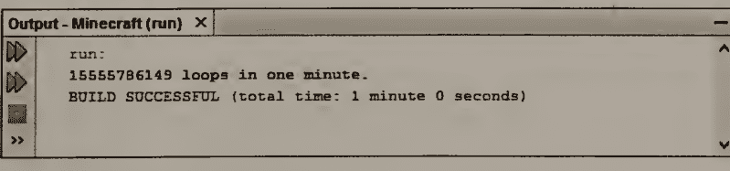

图 9.2 Benchmark 程序的输出。

`Benchmark` 程序是查看你的计算机是否比我的快的一种极佳方法。在该程序的测试期间，我的 PC 执行了大约 155 亿次计算。拥有更快计算机的人有时会在 Twitter 上通过 @rcade 联系我，告诉我我需要升级电脑了。

## 极简内容

循环是大多数编程语言的基础部分。通过顺序显示多个图形创建的动画是如果没有循环你在 Java 或任何其他编程语言中无法完成的众多任务之一。

在 Minecraft mod 中，循环的一个常见用途是加载所有物品。


本章

- 创建数组
- 设置数组大小
- 给数组赋值
- 修改数组中的信息
- 制作多维数组


## 使用数组存储信息

计算机非常适合存储信息。在计算机中存储信息的最基本方法是通过变量。到目前为止，你处理过的变量都是单个项目。

数组是共享相同类型的变量组。任何可以作为变量存储的类型信息都可以变成数组。数组可以用于比单个变量更复杂的信息，但它们创建起来几乎一样简单。

# 第 10 章 使用数组存储信息

`boolean` 数组的值为 `false`。`String` 数组和所有其他对象创建时的初始值均为 `null`。

对于不是极大的数组，你可以在创建的同时设置它们的初始值。以下示例创建了一个字符串数组并为它们赋予了初始值：

```java
String[] reindeerNames = {"Dasher", "Dancer", "Prancer", "Vixen", "Comet", "Cupid", "Donner", "Blitzen"};
```

存储在数组元素中的信息放在 `{ }` 括号之间，并用逗号分隔每个元素。数组中的元素数量设置为逗号分隔列表中元素的数量。

数组元素是编号的，第一个元素从 0 开始。可以通过在 `[ ]` 括号中引用该数字来访问特定元素。前述语句与以下代码的效果相同：

```java
String[] reindeerNames = new String[8];
reindeerNames[0] = "Dasher";
reindeerNames[1] = "Dancer";
reindeerNames[2] = "Prancer";
reindeerNames[3] = "Vixen";
reindeerNames[4] = "Comet";
reindeerNames[5] = "Cupid";
reindeerNames[6] = "Donner";
reindeerNames[7] = "Blitzen";
```

数组的每个元素必须是相同类型。在这里，使用字符串来保存每个驯鹿的名字。

数组创建后，你就无法为更多元素留空间了。抱歉，鲁道（Rudolph）！

## 使用数组

在程序中使用数组就像使用任何变量一样，区别在于：数组项的元素编号必须提供在数组名称旁边的方括号中。你可以在任何可以使用变量的地方使用数组元素。以下语句使用了本章示例中已经定义的所有数组：

```java
seniority[193] += 1;
monthNames[2] = "February";
int currentReindeer = 4;
System.out.println(reindeerNames[currentReindeer]);
```

由于数组的第一个元素编号为 0 而不是 1，这意味着最大的数字比你预期的要少一个。考虑以下语句：

```java
String[] gifts = new String[10];
```

该语句创建了一个从 0 到 9 编号的字符串数组。如果你在程序的其他地方引用了 `gifts[10]`，将得到一个关于 `ArrayOutOfBoundsException` 的错误消息。

如果你想检查数组的上限以避免超出该限制，每个创建的数组都关联有一个长度变量。`length` 变量是一个整数，包含数组持有的元素数量。以下示例创建了一个数组并返回它的长度：

```java
String[] reindeerNames = { "Dasher" };
```

在例子中，`reindeerNames.length` 的值为 9，这意味着你可以指定的最大数字是 8。

> 注意：你可能好奇为什么错误（error）会被称为异常（exception），因为这两个词看起来并不是同义词。程序通常运行得没有任何问题，但异常信号表示了一个必须处理的异常情况。异常是向 Java 程序内部发送的警告消息。在 Java 语言中，“error”一词有时局限于描述发生在运行程序的解释器内部的错误状况。你将在第 15 章中学习更多关于错误和异常的知识。


你可以在 Java 中以字符串或字符数组的形式处理文本。当你处理字符串时，一种实用的技术是将每个字符放入字符数组的元素中。要做到这一点，调用字符串的 `toCharArray()` 方法，它会产生一个元素数量与字符串长度相同的 `char` 数组。

本章的第一个项目使用了本节介绍的两种技术。`SpaceRemover` 程序显示一个将所有空格字符替换为点（.）的字符串。

首先要在 NetBeans 中打开 Minecraft 项目；选择 File（文件）、New File（新建文件）；并在 `com.javaminecraft` 包下创建一个名为 `SpaceRemover` 的空 Java 文件。在源编辑器中输入列表 10.1 并在完成后保存。

## 列表 10.1 SpaceRemover.java 的全文

```java
1: package com.javaminecraft;
2:
3: class SpaceRemover {
4:     public static void main(String[] arguments) {
5:         String mostFamous = "Rudolph the Red-Nosed Reindeer";
6:         char[] mfl = mostFamous.toCharArray();
7:         for (int dex = 0; dex < mfl.length; dex++) {
8:             char current = mfl[dex];
9:             if (current != ' ') {
10:                System.out.print(current);
11:             } else {
12:                System.out.print('.');
13:             }
14:         }
15:         System.out.println();
16:     }
17: }
```

使用命令 Run, Run File 运行程序以查看所示的输出。

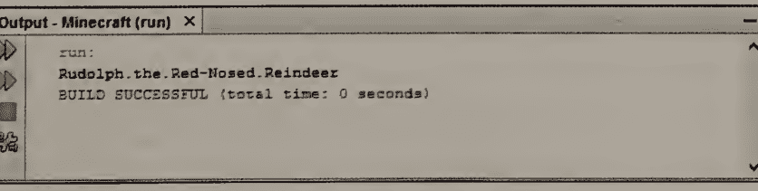

所示的输出。

# Minecraft 模组编程绝对初学者指南

```java
5: class NameSorter {
6:     public static void main(String[] arguments) {
7:         String names[] = { "Glimmer", "Marvel", "Rue", "Clove",
8:         "Thresh", "Foxface", "Cato", "Peeta", "Katniss" };
9:         System.out.println("The original order:");
10:        for (int i = 0; i < names.length; i++) {
11:           System.out.println(i + ": " + names[i]);
12:        }
13:        System.out.println("");
14:        Arrays.sort(names);
15:        System.out.println("The new order:");
16:        for (int i = 0; i < names.length; i++) {
17:           System.out.println(i + ": " + names[i]);
18:        }
19:        System.out.println("");
20:    }
}
```

当你运行这个 Java 程序时，它会按原始顺序显示九个名字列表，对名字进行排序，然后再次显示列表。图 10.2 显示了输出。

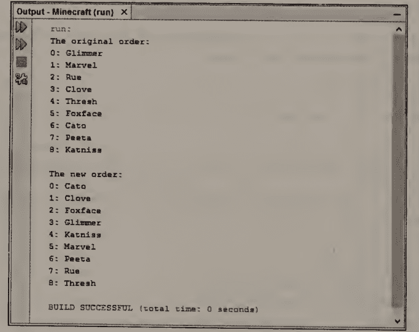

图 10.2 NameSorter 程序的输出。

## 第 10 章 使用数组存储信息

当你处理字符串以及整数、浮点数等基本类型类型的变量时，`Arrays` 类只能按升序排列对它们进行排序。如果你希望在排序期间对元素不同的排列方式，或者想要比 `Arrays` 类更高的效率，你可以编写代码来执行自己的排序。

## 统计字符串中的字符数量

英语中出现频率最高的字母顺序是 e, t, a, o, i, n, s, r, h 和 t。如果你发现自己正在参加联播节目《幸运轮盘》（Wheel of Fortune），那么这个事实是一个值得了解的事实。


> 注意：如果你不熟悉这个节目，《幸运轮盘》是一场由三名参赛者猜测短语、名称或引语字母的游戏。如果他们猜对了一个字母且该字母是辅音，他们就能赢得转盘上转出的金额。为了重现这种体验，你可以在现场观众面前和朋友玩猜字游戏，当有人猜对字母时发放随机金额的现金，并给获胜者一台新冰箱。

你在本章中的最终项目将统计你所输入的尽可能不同的短语和表达式的频率。使用数组来统计每个字母出现的次数。完成后，程序将列出每个字母在短语中出现的次数。

在 NetBeans 的 `com.javaminecraft` 包中创建一个名为 `Wheel.java` 的新空 Java 文件，将其填入列表 10.3 的内容，完成后保存文件。欢迎在第 17 行和第 18 行之间添加短语，格式要与第 17 行完全一致。

## 列表 10.3 Wheel.java 的全文

```java
1: package com.javaminecraft;
2:
3: class Wheel {
4:     public static void main(String[] arguments) {
5:         String phrase[] = {
6:             "A STITCH IN TIME SAVES NINE",
7:             "THE TRIBE HAS SPOKEN",
8:             "JUST DO IT",
9:             "EVERY GOOD BOY DOES FINE",
10:            "YOU ONLY LIVE ONCE",
11:            "I LIKE IKE",
12:            "PLAY IT AGAIN, SAM",
13:            "FROSTY THE SNOWMAN",
14:            "THERE'S AN APP FOR THAT",
15:            "HOME FIELD ADVANTAGE",
16:            "VALENTINE'S DAY MASSACRE",
17:            "GROVER CLEVELAND OHIO",
18:            "SPAGHETTI WESTERN",
19:            "BEKARTON GUARDS THE GATE",
20:            "IT'S A WONDERFUL LIFE",
21:         };
22:         int[] letterCount = new int[26];
23:         for (int count = 0; count < phrase.length; count++) {
24:             String current = phrase[count];
25:             char[] letters = current.toCharArray();
26:             for (int count2 = 0; count2 < letters.length; count2++) {
27:                 char lett = letters[count2];
28:                 if (lett >= 'A' && (lett <= 'Z')) {
29:                     letterCount[lett - 'A']++;
30:                 }
31:             }
32:         }
33:         for (char count = 'A'; count <= 'Z'; count++) {
34:             System.out.print(count + ": " + 
35:                 letterCount[count - 'A'] + 
36:                 " ");
37:             if (count == 'M') {
38:                 System.out.println();
39:             }
40:         }
41:     }
}
```

如果你在没有添加任何短语的情况下运行该程序，输出应该是：


# 面向对象编程原理

你可以将创建的 Java 程序看作对象，就像现实世界中存在的物理对象一样。对象独立于其他对象存在，以特定的方式相互作用，并可以与其他对象结合形成更大的整体。如果你将计算机程序看作一组相互作用的对象，你就可以设计出一种更可靠、更易于理解且在其他项目中可重用的程序。

《我的世界》（Minecraft）游戏充斥着对象。其中一个是 `Location`（位置）对象，代表游戏中的一个位置。另一个是 `World`（世界），代表玩家探索的整个世界。`World` 是由更小的对象组成的对象——包括单个位置、每个位置的方块、世界中的生物等。

每个对象都有一些使其与其他对象区别开来的特征。在面向对象编程（OOP）中，对象包含两个部分：属性和行为。属性是描述对象并展示它与其他对象不同之处的内容。行为是对象所做的操作。

在 Java 中，你通过使用类（class）作为模板来创建对象。类是对象的母版，决定了对象应该拥有的属性和行为。你对“类”这个术语应该熟悉，因为 Java 程序被称为类。

你用 Java 创建的每个程序都是一个类，你可以将其作为创建新对象的模板。例如，任何使用字符串（strings）的 Java 程序都在使用从 `String` 类创建的对象。这个类包含了决定字符串对象是什么的属性，以及控制 `String` 对象可以做什么的行为。

通过 OOP，计算机程序是一组共同工作以完成某任务的对象。某些简单的程序似乎只由一个对象组成：类文件。然而，即使是这些程序也在使用其他对象来完成工作。

## 运行中的对象

《我的世界》的开发者需要一个代表游戏世界中某个点的对象，他们为这一目的创建了 `Location` 类。一个 `Location` 对象可以包含以下内容：

- 用于存储该位置 x、y、z 坐标的属性
- 用于查找该位置是什么种方块的行为（例如泥土、岩石、水或空气）
- 计算两个点之间距离的行为

OOP 中的对象在尽可能的情况下能够独立工作。这种能力使得它们被集成到其他程序中变得容易。例如，如果一个 `Location` 对象不知道如何确定它包含什么种方块，那么每当你在另一个程序中使用该 `Location` 对象时，你都必须创建一个行为来确定该信息。

OOP 的另一个例子是考虑一个为房屋提供无线互联网连接的路由器。

路由器像任何计算机程序一样，可以被看作一组共同工作的对象。它可以被拆分为以下部分：

- 一个 `Modem`（调制解调器）对象，它知道自己的属性（如连接速度），并具有行为——例如，它可以让路由器接受到网站和互联网服务器的无线连接
- 一个 `Network`（网络）对象，它跟踪哪些设备连接到了路由器并阻止未经授权的访问

每个对象都独立于其他对象存在。

设计完全独立的 `Modem` 对象的优点之一是，它可以被需要它的其他程序使用。

使用自包含对象的另一个原因是它们更容易调试。计算机程序的规模会迅速变得难以管理。如果你正在调试像 `Modem` 对象这样的东西，并且知道它不依赖于任何其他东西，你就可以专注于确保 `Modem` 对象执行它应该做的工作，并持有执行工作所需的信息。

将 Java 这种面向对象的语言作为第一种编程语言是有益的，因为你不需要消除其他编程风格的习惯。

## 什么是对象

对象是通过使用对象的类作为模板创建的。以下语句创建了一个类：

```java
public class Modem {
}
```

从此类创建的对象无法执行任何事，因为它没有任何属性或行为。你需要添加这些内容来使类变得有用，如下语句所示：

```java
public class Modem {
    int speed;

    void displaySpeed() {
        System.out.println("Speed: " + speed);
    }
}
```

一个类在层次结构中可以继承自多个类——例如 `Modem` 的另一个子类可以是 `PhoneModem`，因为电话调制解调器具有使其区别于高速调制解调器的特定行为和属性。如果 `HighSpeedModem` 有一个子类，例如 `CableModem`，它将继承自层次结构中其上面的所有类——即 `HighSpeedModem` 和 `Modem`。

构成标准 Java 语言的类都使用了继承，因此理解继承至关重要。你将在第 13 章“充分利用现有对象”中学习更多关于继承的内容。

> 注意：虽然一个父类可以有多个子类，但子类只能有一个父类。在 Java 中，一个类只能继承自一个类。

多继承在其他编程语言中是可能的，但 Java 开发者决定限制任何类只能继承一个父类。补偿这种局限性的一种方法是从一种称为接口（interface）的特殊类型类中继承方法。你将在第 16 章“创建线程模型”中学习更多关于接口的内容。

## 对象与简单变量的转换

在 Java 中需要完成的最常见任务之一是将信息从一种形式转换为另一种形式。你可以进行的几种转换类型包括：

- 将对象转换为另一个对象
- 将简单变量转换为另一种变量
- 使用对象创建简单变量
- 使用简单变量创建对象

简单变量是你在第 6 章“在 Mod 中存储和更改信息”中学习的基本数据类型。这些类型包括 `int`、`float`、`char`、`long`、`double`、`byte` 和 `short`。

在程序中使用方法或表达式时，必须使用这些方法和表达式所要求的正确信息类型。例如，期望 `Location` 对象的方法必须接收一个 `Location` 对象。如果你使用了一个接受单个整数作为参数的方法，但却向它发送了一个浮点数，那么在尝试编译程序时就会发生错误。

> 注意：当像 `System.out.println()` 这样的方法需要字符串参数时，你可以使用 `+` 运算符来组合该参数中的多种类型信息。只要被组合的内容是字符串，组合后的参数就会转换为字符串。

将信息转换为新形式被称为强制转换（casting）。强制转换产生一个与源不同变量类型或对象的新值。在强制转换时，你并没有实际改变值。相反，会根据所需的格式创建一个新的变量或对象。

在讨论强制转换的概念时，“源”（source）和“目标”（destination）这两个术语非常有用。源是以原始形式存在的某种信息——无论是变量还是对象。目标是源在新形式下的转换后的版本。

### 简单变量的强制转换

对于简单变量，强制转换最常发生在数值变量之间，例如整数和浮点数。不能用于任何强制转换的变量类型是布尔值（Boolean value）。

要将信息转换为新格式，你需要在其前面加上用圆括号括起来的新格式。例如，如果你想将某个内容转换为 `long` 变量，你可以在其前面加上 `(long)`。以下两个语句将 `float` 值转换为 `int`：

```java
// 转换一个 float 变量
float source = 7.06F;
// 将其转换为整数
int destination = (int) source;
```

在目标变量持有的值比源变量大的变量转换中，值的转换很容易，例如将 `byte` 转换为 `int`。`byte` 持有的值范围从 -128 到 127，而 `int` 持有的值范围从 -21 亿到 21 亿。无论 `byte` 变量持有什么值，新的 `int` 变量都有足够的空间容纳它。

有时你可以在不强制转换的情况下使用不同格式的变量。例如，你可以像使用 `int` 变量一样使用 `char` 变量。此外，你可以像使用 `long` 变量一样使用 `int` 变量，任何内容都可以作为 `double`。

大多数情况下，由于目标提供的空间大于源，信息在不改变值的情况下完成转换。主要的异常发生在 `int` 或 `long` 变量转换为 `float`，或 `long` 转换为 `double` 时。

当你将信息从较大的变量类型转换为较小的类型时，你必须显式地进行强制转换，如下语句所示：

```java
// 创建一个整数变量
int xNum = 103;
// 将其转换为 byte
byte val = (byte) xNum;
```

在这里，强制转换将整数值 `xNum` 转换为名为 `val` 的 `byte` 变量。这是一个目标变量持有范围比源变量更小值的示例。`byte` 持有从 -128 到 127 的整数值，而 `int` 持有的整数值范围大得多。

当强制转换操作中的源变量具有一个在目标变量中不支持的值时，Java 会更改该值以使强制转换成功。如果你没有预料到这种变化，可能会产生意想不到的结果。

> 注意：字符可以被当作 `int` 变量，因为每个字符都有一个对应的数字代码，代表它在字符集中的位置。如果你有一个名为 `key` 值为 67 的变量，强制转换 `(char) key` 会产生字符值 'C'，因为根据 ASCII 字符集，与大写 C 关联的数字代码是 67。ASCII 字符集是 Java 语言采用的 Unicode 字符标准的一部分。

### 对象转换

当源和目标通过继承相关时，你可以将对象强制转换为其他对象。某些对象完全不需要强制转换。你可以在需要子类的地方使用对象。Java 中的所有对象都是 `Object` 的子类，所以你可以在需要对象的地方使用对象。

然而，由于子类通常包含父类更多的信息，你可能会丢失这些信息。如果对象不具备子类包含的方法，则会导致错误。

要在子类的地方使用对象，你必须显式地进行强制转换，如下方法中的语句：

```java
public void paintComponent(Graphics comp) {
    // 强制转换在这里
    Graphics2D comp2D = (Graphics2D) comp;
}
```

这是将名为 `comp` 的 `Graphics` 对象转换为 `Graphics2D` 对象。你没有丢失任何信息，但获得了子类定义的所有方法和变量。

### 简单变量与对象的转换

从对象到变量的一种常见强制转换是在数值表达式中使用字符串。当字符串的值变为整数时，可以通过 `Integer` 类的 `parseInt()` 方法来实现，如下例：

```java
String count = "25";
int myCount = Integer.parseInt(count);
```

这会将字符串 "25" 转换为值为 25 的整数。如果字符串值不是有效的整数，转换将无法工作。

当你不能将对象转换为简单变量或将简单变量转换为对象时，Java 为每种简单变量类型提供了类，包括 `Boolean`、`Byte`、`Character`、`Double`、`Float`、`Integer`、`Long` 和 `Short`。所有这些类都是大写的，因为它们是对象而不是简单变量类型。

使用这些类定义的方法，可以使用变量的值作为参数创建一个对象。以下语句创建一个值为 5309 的 `Integer` 对象：

```java
Integer suffix = new Integer(5309);
```

在创建了这样的对象后，你可以像使用其他对象一样使用它。当你想要将该值作为简单变量时，该类拥有执行该转换的方法。要从先前的 `suffix` 对象获取 `int` 值，可以使用以下语句：

```java
int newSuffix = suffix.intValue();
```

该语句使 `newSuffix` 变量具有 5309。

你创建的下一个项目是一个将命令行参数中的字符串值转换为数值的应用程序，这是当你从命令行接收输入时的一种常用技术。

# Minecraft 模组编程初学者指南

回到 NetBeans 中的 Minecraft 项目；选择文件（File）、新建文件（New File）；然后在 `com.javaminecraft` 包中创建一个名为 `NewRoot` 的新 Java 文件。在源文件编辑器中输入列表 11.1 并记得保存文件。

## 列表 11.1 NewRoot.java 的全文

```java
1: package com.javaminecraft;
2:
3: class NewRoot {
4:     public static void main(String[] arguments) {
5:     int number = 100;
6:     if (arguments.length > 0) {
7:         number = Integer.parseInt(arguments[0]);
8:     }
9:     System.out.println("The square root of "
10:    + number
11:    + " is "
12:    + Math.sqrt(number)
13:    );
14: }
15: }
```

运行程序之前，你必须配置 NetBeans 使用命令行参数运行它。选择菜单命令运行（Run）、设置项目配置（Set Project Configuration）、自定义（Customize）。属性窗口将打开。在主类（Main Class）中输入 `com.javaminecraft.NewRoot`，并在参数（Arguments）字段中输入 `19474569`。点击 OK 关闭对话框。

要运行程序，选择运行（Run）、运行主项目（Run Main Project）（而不是运行文件）。程序如图 11.1 所示数字及其平方根。

NewRoot 是第 5 章“理解 Java 程序的工作”教程的扩展，该教程显示了整数 17,689 的平方根。

如果该程序能接收用户提交的数字并显示其平方根，将会更有用。这需要从字符串转换为整数。所有命令行参数都存储为字符串数组的元素，因此在数学表达式中使用它们之前，必须将它们转换为数字。

要根据字符串的内容创建整数值，会调用 `Integer.parseInt()` 方法并将字符串作为唯一参数，如第 7 行所示：

```java
number = Integer.parseInt(arguments[0]);
```

`arguments[0]` 数组元素持有随程序提交的第一个命令行参数。当使用 "19474569" 作为参数运行程序时，字符串 "19474569" 被转换为 int 19,474,569。

## 装箱与拆箱

Java 中的每种基本数据类型都有对应的对象类：`boolean` (`Boolean` 类)、`byte` (`Byte`)、`char` (`Character`)、`double` (`Double`)、`float` (`Float`)、`int` (`Integer`)、`long` (`Long`) 和 `short` (`Short`)。

对于这些配对，信息的值是相同的。它们之间唯一的区别是格式值。像 413 这样的整数值可以用 `int` 或 `Integer` 类对象表示。

Java 的自动装箱（autoboxing）和拆箱（unboxing）功能允许你切换使用值的基本数据类型和对象形式。

装箱（Autobox）将简单变量转换为相应的类。

拆箱（Unboxing）将对象转换为相应的简单值。

这些功能在后台运行，确保当你期望像 `float` 这样的简单数据类型时，对象会被转换为具有相同值的数据类型。当你期望像 `Float` 这样的对象时，根据需要将数据类型转换为对象。

以下语句展示了自动装箱和拆箱的有用之处：

```java
float total = 1.3F;
float sum = total / 5;
```

在 Java 早期版本中，这段代码会产生两个错误。第一个语句将字面量浮点值 1.3 赋值给 `Float` 对象（不允许），第二个语句除 `Float` 对象并将其赋值给 `float` 类型（不允许）。现在在 Java 中它运行完美，因为第一个语句将字面量装箱为对象，第二个语句将对象拆箱为原始类型。Java 自动使语句生效，导致 `sum` 等于 0.26。

在本章早些时候，你看到了如何创建 `Integer` 对象的示例：`Integer suffix = new Integer(5309);`

由于自动装箱和拆箱，以下语句也执行相同的操作：

```java
Integer suffix = 5309;
```

Java 识别到 `int` 值 5,309 正在存储在 `Integer` 对象中，因此它会被自动转换。

## 创建对象

为了看到类和继承的运行示例，你将创建代表特定模型两种类型对象的类：电缆调制调器（通过 `CableMod` 类实现）和 DSL 调制调器（通过 `DSLMod` 类实现）。该项目专注于这些对象的简单属性和行为：

- 每个对象都应该有一个可以显示的速度。
- 每个对象都能够连接互联网。

电缆调制调器和 DSL 调制调器的共同点是它们都有速度。因为这是它们共有的，所以它可以放入一个作为 `CableMod` 和 `DSLMod` 类父类的类中。在 NetBeans 中，在 `com.javaminecraft` 包中创建一个名为 `Modem` 的空 Java 类。在源文件编辑器中输入列表 11.2 并保存文件。

## 列表 11.2 Modem.java 的全文

```java
1: package com.javaminecraft;
2:
3: class Modem {
4:     double speed;
5:
6:     public void displaySpeed() {
7:         System.out.println("Speed: " + speed + " Mbps");
8:     }
9: }
```


在创建了第一类对象并将若干个类组织成层次结构之后，你应该对“面向对象编程”（OOP）这个术语更加熟悉了。在接下来的两个章节，随着你开始创建更复杂的对象，你将学习更多关于对象的行为和属性的知识。

随着你对这种开发风格越来越熟悉，程序、类和对象等术语变得更有意义。OOP 是需要时间来适应的概念。当你掌握了它，你会发现它是设计、开发和调试计算机程序的一种有效方法。


# 本章内容

- 为对象或类创建变量
- 在对象和类使用方法
- 调用方法并返回结果
- 创建构造函数
- 向方法传递参数
- 使用 `this` 引用对象
- 创建新对象

# 第12章 描述你的对象特征


## 描述你的对象特征

正如你在上一章关于面向对象编程（OOP）介绍中所学习到的，对象是组织程序的一种，使其拥有完成任务所需的所有内容。对象由属性和行为组成。

属性是存储在对象内部的信息。它们可以是变量，如整数、字符和布尔值，也可以是对象，如字符串和日历对象。行为由用于处理对象内部特定任务的语句组组成。这些组中的每一个都被称为方法。

到为止，你已经在不知情的情况下使用了对象的方法和变量。只要你的语句中出现点号，且该点不是小数点或字符串的一部分，就涉及到了对象。

### 创建变量

在本章中，你将看到一个名为 `Virus` 的示例对象类，它的唯一目的是成为计算机病毒。`Virus` 有几项需要执行的工作，这些工作被实现为类的行为。方法所需的信息以属性的形式存储起来。

对象的属性代表了对象运行功能所需的变量。这些变量可以是简单的数据类型，如整数、字符和浮点数，也可以是数组或类（如 `String` 或 `Calendar`）的对象。你可以在对象的整个类中的任何方法中使用对象的变量。按照惯例，你应该在创建类的语句之后、在任何方法之前创建变量。

`Virus` 对象需要的内容之一是一个能够与其他计算机病毒区分开来的唯一代码。

`Virus` 对象使用一个名为 `identifier` 的整数变量存储代码 `8603`。以下语句开始了一个名为 `Virus` 的类，它包含一个名为 `identifier` 的属性以及两个其他属性：

```java
public class Virus {
    public int identifier = 8603;
    public String author = "Sam Snett";
    int maxFileSize = 30000;
}
```

这三个变量都是类的属性：`identifier`、`maxFileSize` 和 `author`。

在变量声明语句中使用像 `public` 这样的语句被称为访问控制，因为它决定了由其他类创建的其他对象如何使用该变量——或者它们是否可以使用该变量。

将变量设为 `public` 使得另一个使用 `Virus` 对象的程序修改该变量变得可能。

例如，如果另一个程序对数字 `9201` 赋予特殊意义，它可以将 `identifier` 修改为该值。以下语句创建了一个名为 `influenza` 的 `Virus` 对象并设置了它的 `identifier` 变量：

```java
Virus influenza = new Virus();
influenza.identifier = 9201;
```

在 `Virus` 类中，`author` 变量也是 `public` 的，因此可以从其他程序中自由更改。另一个变量 `maxFileSize` 只能在类内部使用。

当你将类中的变量设为 `public` 时，类就失去了对其他程序如何使用该变量的控制。在很多情况下，这并不是问题。例如，`author` 变量可以更改为任何标识程序作者的名字或笔名。

限制对变量的访问可以防止在变量被另一个程序错误设置时发生错误。对于 `Virus` 类，一个示例限制可以是要求 `identifier` 必须大于 999 的数字。可以通过以下两点实现：

- 将变量从 `public` 切换到 `protected` 或 `private`——这是两个提供更严格访问限制的语句。
- 为变量的值添加行为（如果它大于 999），并向其他程序报告变量的值。

你只能在与变量相同的类中、该类的任何子类中或同一包的类中使用 `protected` 变量。包用于组合具有共同用途的相关类。例如 `java.util` 包，它包含了提供有用工具的类，如日期和时间编程以及文件归档。当你在 Java 程序中使用带有星号的 `import` 语句时（如 `import java.util.*`），你是在让程序更方便地引用该包中的类。

`private` 变量比 `protected` 变量限制得更多——你只能在同一个类中使用它。除非你确定变量可以更改为影响其类功能的任何值，否则你应该将变量设为 `private` 或 `protected`。

以下语句将 `identifier` 变为 `private` 变量：

```java
private int identifier = 8603;
```

如果你想让其他程序以某种方式使用 `identifier`，你必须使其变得可行。这项任务将在本书后后部分介绍。

还有一种访问控制：当没有指定访问控制时，变量仅对同一包中的类可用。这被称为默认访问（package access）。

### 创建类变量

当你创建一个对象时，它拥有类中所有变量的自己的版本。从 `Virus` 类创建的每个对象都有 `identifier`、`maxFileSize` 和 `author` 变量的版本。如果你修改了对象中的这些变量之一，不会影响另一个对象中的相同变量。

有时属性应该描述整个类而不是特定对象。这些被称为类变量。

如果你想跟踪程序中使用多少个 `Virus` 对象，可以使用类变量来存储这些信息。整个类只存在一个变量副本。你到为止创建的变量可以被称为对象变量，因为它们与特定对象关联。

两种变量的创建和使用方式相同，`static` 是创建类变量语句的一部分。以下语句为 `Virus` 示例创建了一个类变量：

```java
static int virusCount = 0;
```

更改类变量的值与更改对象的变量没有区别。如果你有一个名为 `tuberculosis` 的 `Virus` 对象，可以使用以下语句更改类变量：

```java
tuberculosis.virusCount++;
```

由于类变量适用于整个类，你可以使用类名代替：

```java
Virus.virusCount++;
```

这两个语句实现的效果相同，但在处理类变量时使用类名有一个优势，它能立即看出 `virusCount` 是一个类变量而不是对象变量。如果你在处理类变量时总是使用对象名，那么在不仔细查看源码的情况下无法判断它们是类变量还是对象变量。

类变量也被称为静态变量。

> **注意** 虽然类变量很有用，但你必须小心过度使用它们。这些变量在类运行期间一直存在。如果将大型对象数组存储在类变量中，它将占用大量的内存且永不释放。


### 使用方法创建行为

属性是跟踪对象类信息的方式，但为了让一个类描述它被创建的用途，你必须创建行为。行为描述了类中完成特定任务的部分。这些部分中的每一个都被称为方法。

到目前为止，你一直在程序中使用方法，但你并没有意识到，其中包含一个特定的方法：`println()`。此方法在屏幕上显示文本。变量和方法一样，都是与对象或类结合使用的。对象或类的名称后面跟着一个点和方法名称，例如 `robot.move(0)` 或 `Integer.parseInt()`。

> `System.out.println()` 方法可能看起来很困惑，因为它有两个点而不是一个。这是因为该语句涉及了两个类——`System` 类和 `PrintStream` 类。`System` 类有一个名为 `out` 的变量，该变量是一个 `PrintStream` 对象。`println()` 是 `PrintStream` 类的一个方法。`System.out.println()` 实际上意味着“使用 `System` 类实例变量的 `println()` 方法”。你可以通过这种方式链式引用。

#### 声明方法

你创建方法时使用的语句看起来与开始定义类的语句相似。这两者都可以在名称后的括号内接收参数，并在开头和结尾使用 `{` 和 `}` 标记。区别在于方法在处理后可以返回一个值。该值可以是整数或布尔值等简单类型之一，也可以是一个对象类。

以下是 `Virus` 类用于更改 `maxFileSize` 变量的方法示例：

```java
public boolean changeMaxSize(int newSize) {
    if (newSize > 0) {
        maxFileSize = newSize;
        return true;
    }
    return false;
}
```

此方法接收一个参数：一个名为 `newSize` 的 `int` 变量，代表 `maxFileSize` 的新值。如果此值大于 0，则将 `maxFileSize` 设置为它。否则，方法不会更改 `maxFileSize`。

在定义方法的语句中，`boolean` 位于方法名 `changeMaxSize` 之前。该语句表示在方法处理后返回一个布尔值。`return` 语句才是真正返回值的地方。在此方法中，如果 `maxFileSize` 被设置为指定的值，则返回 `true`；否则返回 `false`。

如果方法不应该返回值，可以使用关键字 `void`。

当方法返回值时，你可以将方法作为表达式的一部分。例如，如果你创建了一个名为 `malaria` 的 `Virus` 对象，你可以使用如下语句：

```java
if (malaria.changeMaxFileSize(100000)) {
    System.out.println("New size set!");
} else {
    System.out.println("Curses! Foiled again!");
}
```

你可以在程序中任何可以使用变量的地方使用返回价值的方法。

在本章的前面，你将标识符变量 `identifier` 更改为 `private`，以防止它被其他程序读取或修改。

当实例变量为 `private` 时，仍有一种方法可以让 `identifier` 在其他地方使用：在 `Virus` 类中创建公共方法，获取 `identifier` 的值并将 `identifier` 设置为新值。这些新方法应该是 `public` 的，与 `identifier` 变量本身不同，这样它们可以在其他程序中被调用。

考虑以下两个方法：

```java
public int getIdentifier() {
    return identifier;
}
```

```java
public void setIdentifier(int newValue) {
    if (newValue > 999) {
        identifier = newValue;
    }
}
```

这些方法被称为访问器方法（accessor methods），因为它们允许从其他对象访问 `identifier` 变量。

`getIdentifier()` 方法用于检索 `identifier` 的当前值。`getIdentifier()` 方法没有任何参数，但方法名后仍必须有括号。`setIdentifier` 方法接收一个参数，名为 `newValue` 的整数。该参数是 `identifier` 的新值。如果 `newValue` 大于 999，将进行更改。

在这个示例中，`Virus` 类控制其他类如何使用 `identifier` 变量。这个过程被称为封装（encapsulation），它是面向对象编程（OOP）的基本概念。你的对象越能保护自己防止被误用，当你把它们投入其他程序时，它们就越有用。

尽管 `identifier` 是私有的，但新方法 `getIdentifier()` 和 `setIdentifier()` 能够与 `identifier` 工作，因为它们在同一个类中。

#### 参数不同的相似方法

正如你在 `setIdentifier()` 方法中所看到的，你可以向方法发送参数来影响它的行为。类中的不同方法可以有不同的名称，但如果方法的参数不同，方法也可以具有相同的名称。

如果两个方法的参数数量不同或参数变量类型不同，它们就可以具有相同的名称。例如，对于 `Virus` 对象类来说，有两个 `alert()` 方法可能是很有用的。一个可以没有参数并传递一条通用消息；另一个可以指定字符串参数作为消息。以下语句实现了这些：

```java
void alert() {
    System.out.println("Danger! Danger!");
}
```

```java
void alert(String message) {
    System.out.println("Danger: " + message);
}
```

（注：其余 OCR 文本包含上述部分的重复循环，已为了清晰起见进行了合并。）

程序中的 `(` 和 `)` 语句定义了变量作用范围的边界。在这些标记内创建的任何变量无法在外部使用。例如，考虑以下语句：

```java
if (numFiles < 1) {
    String warning = "No files remaining.";
}
System.out.println(warning);
```

这段代码无法运行——在 NetBeans 中无法编译——因为 `warning` 变量是在 `if` 块的括号内部创建的。这些括号定义了变量的作用范围。`warning` 变量在括号之外不存在，因此 `System.out.println()` 方法无法将其作为参数使用。

当你在一组括号内部使用一组括号时，你需要注意被包含变量的作用范围。请看以下示例：

```java
if (infectedFiles < 5) {
    int status = 1;
    if (infectedFiles < 1) {
        boolean firstVirus = true;
        status = 0;
    } else {
        firstVirus = false;
    }
}
```

发现什么问题了吗？在这个例子中，赋值语句为 `firstVirus` 变量赋了 `false` 值，但该语句会导致编译器错误。因为 `firstVirus` 是在 `if (infectedFiles < 1)` 语句的作用范围内创建的，它在随后的 `else` 语句的作用范围内并不存在。

要修复这个问题，`firstVirus` 必须在这两个块之外创建，这样它的作用范围才能包含这两个块。一种解决方案是在创建 `status` 后的一行创建 `firstVirus`。

强制作用范围的规则使得程序更容易调试，因为作用范围限制了可以使用变量的区域。这减少了编程中最常见的错误之一——在程序的不同部分以两种不同的方式使用同一个变量。

作用范围的概念也适用于方法，因为它们是由左括号和右括号定义的。在方法内部创建的变量无法在其他方法中使用。只有当变量被创建为对象变量或类变量时，你才能在多个方法中使用它。

### 将一个类放在另一个类内部

尽管 Java 程序被称为类，但在很多情况下，程序需要多个类来完成工作。这些程序由一个主类和所有需要的辅助类组成。

当你将程序划分为多个类时，有两种定义辅助类的方法。一种方法是分别定义每个类，如下例所示：

```java
public class Wrecker {
    String author = "Ignoto";
    public void infectFile() {
        VirusCode vic = new VirusCode(1024);
    }
}

class VirusCode {
    int vSize;

    VirusCode(int size) {
        vSize = size;
    }
}
```

在这个示例中，`VirusCode` 类是 `Wrecker` 类的辅助类。辅助类通常与其协助的类位于同一个源文件中。当编译源文件时，会产生多个类文件。上面的示例在编译时会产生 `Wrecker.class` 和 `VirusCode.class` 文件。

> **注意** 如果在同一个源文件中定义了多个类，则只有一个类可以是公有的（public）。其他类在类语句中不应有 `public`。源文件的名称必须与它定义的公共类匹配。


### 使用 this 关键字

因为你可以引用其他类中的变量和方法，以及你自己类中的变量和方法，在某些情况下，你引用的变量可能会变得混乱。让事情更清晰的方法是使用 `this` 语句——这是在程序内部引用程序自身对象的方法。

当你使用对象的方法或变量时，将对象的名称放在方法或变量名称前面，并用点分隔。考虑这些示例：

```java
Virus chickenpox = new Virus();
chickenpox.author = "Sneezy";
chickenpox.setIdentifier(7513);
```

这些语句创建了一个名为 `chickenpox` 的新对象，设置了 `chickenpox` 的 `author` 变量，然后调用了 `chickenpox` 的 `setIdentifier()` 方法。

有时在程序中你需要引用当前对象——换句话说，由程序本身表示的对象。例如，在 `Virus` 类内部，你可能有一个方法拥有自己的变量 `author`：

```java
public void checkAuthor() {
    String author = null;
}
```


在这个示例中，名为 `author` 的变量存在于 `checkAuthor()` 方法的作用范围内，但它与名为 `author` 的对象变量不是同一个变量。如果你想引用当前对象的 `author` 变量，你必须使用 `this` 语句，如下所示：

```java
System.out.println(this.author);
```

通过使用 `this`，你明确了你引用的是哪个变量或方法。在类中任何通过名称引用对象的地方你都可以使用 `this`。例如，如果你想将当前对象作为参数传递给方法，你可以使用如下语句：

```java
verifyData(this);
```

在很多情况下，不需要 `this` 语句也能明确你正在引用的是对象的变量和方法。然而，使用它也没有坏处。

作用范围的概念也适用于方法，因为它们是由左括号和右括号定义的。在方法内部创建的变量无法在其他方法中使用。只有当变量被创建为对象变量或类变量时，你才能在多个方法中使用它。

## 将一个类放在另一个类内部

尽管 Java 程序被称为类，但在很多情况下，程序需要多个类来完成工作。这些程序由一个主类和所有需要的辅助类组成。

当你将程序划分为多个类时，有两种定义辅助类的方法。一种方法是分别定义每个类，如下例所示：

```java
public class Wrecker {
    String author = "Ignoto";
    public void infectFile() {
        VirusCode vic = new VirusCode(1024);
    }
}

class VirusCode {
    int vSize;

    VirusCode(int size) {
        vSize = size;
    }
}
```

在这个示例中，`VirusCode` 类是 `Wrecker` 类的辅助类。辅助类通常与其协助的类位于同一个源文件中。当编译源文件时，会产生多个类文件。上面的示例在编译时会产生 `Wrecker.class` 和 `VirusCode.class` 文件。

> 注意：如果在同一个源文件中定义了多个类，则只有一个类可以是公有的（`public`）。其他类在类语句中不应有 `public`。源文件的名称必须与它定义的公共类匹配。

## 使用 this 关键字

因为你可以引用其他类中的变量和方法，以及你自己类中的变量和方法，在某些情况下，你引用的变量可能会变得混乱。让事情更清晰的方法是使用 `this` 语句——这是在程序内部引用程序自身对象的方法。

当你使用对象的方法或变量时，将对象的名称放在方法或变量名称前面，并用点分隔。考虑这些示例：

```java
Virus chickenpox = new Virus();
chickenpox.author = "Sneezy";
chickenpox.setIdentifier(7513);
```

这些语句创建了一个名为 `chickenpox` 的新对象，设置了 `chickenpox` 的 `author` 变量，然后调用了 `chickenpox` 的 `setIdentifier()` 方法。

有时在程序中你需要引用当前对象——换句话说，由程序本身表示的对象。例如，在 `Virus` 类内部，你可能有一个方法拥有自己的变量 `author`：

```java
public void checkAuthor() {
    String author = null;
}
```

在这个示例中，名为 `author` 的变量存在于 `checkAuthor()` 方法的作用范围内，但它与名为 `author` 的对象变量不是同一个变量。如果你想引用当前对象的 `author` 变量，你必须使用 `this` 语句，如下所示：

```java
System.out.println(this.author);
```

通过使用 `this`，你明确了你引用的是哪个变量或方法。在类中任何通过名称引用对象的地方你都可以使用 `this`。例如，如果你想将当前对象作为参数传递给方法，你可以使用如下语句：

```java
verifyData(this);
```

在很多情况下，不需要 `this` 语句也能明确你正在引用的是对象的变量和方法。然而，使用它也没有坏处。

# 第 13 章 充分利用现有对象

> 注意：VirusLab 项目提出了关于如何控制 Java 程序使用多少内存的问题。

Java 虚拟机 (JVM) 在运行应用程序时可用的内存由两点控制：计算机上可用的物理内存以及 JVM 配置使用的内存。默认内存分配为 256MB。可以通过 `-Xmx` 命令行参数设置不同的值。

要在 NetBeans 中设置此项设置，请选择 Run（运行）、Set Project Configuration（设置项目配置）、Customize（自定义）。将打开 Project Properties（项目属性）对话框，前面是 Run 设置。在 VM Options 字段中，输入 `-Xmx1024M` 为 JVM 分配 1024MB 内存。修改该数字可以增加或减少内存。同样填写 Main Class（主类）和 Arguments（参数）字段，并通过选择 Run、Run Project（运行项目）来运行程序。

## 核心内容

你现在已经完成了书中三个面向对象概念章节中的两个。你学习了如何创建对象、为对象及其对象类赋予行为和属性，以及通过类型转换（casting）将对象和变量转换为其他形式。

以对象的方式思考是 Java 语言中最具挑战性的任务之一。然而，当你开始理解它后，你会发现整个语言都使用了对象和类。

在下一章中，你将学习如何为你的对象赋予父子。

## 本章内容

- 设计超类和子类
- 建立继承层次结构
- 重写方法

## 充分利用现有对象

Java 对象可以有孩子。当你创建一个对象（一组属性和行为）时，你就设计了一个可以将这些特性传递给后代的东西。这些子对象继承了许多与其父类相同的属性和行为。它们也可以执行一些与其不同的行为。

这种系统被称为继承，是每个超类（父类）赋予其子类（孩子）的东西。继承是面向对象编程 (OOP) 最核心的方面之一，你将在本章中学习它。

OOP 的另一个有用方面是可以创建一个可以在不同程序中使用的对象。重用性使得开发无错误、可靠的程序变得更加容易。

## 继承的力量

每当你与 `String` 或 `Integer` 等标准 Java 类一起工作时，你都使用了继承。Java 类被组织成金字塔型的类层次结构，其中所有类都继承自 `Object` 类。

子类继承自其上方所有的超类。为了直观地理解其如何运作，请考虑 `JApplet` 类。该类是所有在网络浏览器中运行的 applet 和 Java 程序的超类。`JApplet` 类是 `Applet` 的子类。

图 13.1 所示了 `JApplet` 的部分家族树。每个框都是一个类，线条将超类与其下方的任何子类连接。

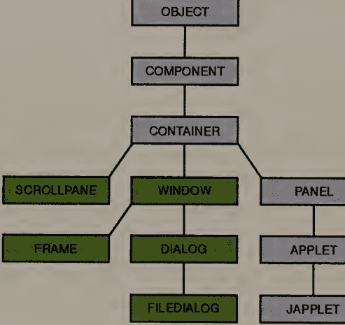

图 13.1 JApplet 类的家族树。

顶部是 `Object` 类。`JApplet` 在层次结构中上方有五个超类：`Applet`、`Panel`、`Container`、`Component` 和 `Object`。

`JApplet` 类从这些类中的每一个继承属性和行为，因为在超类层次结构中，每个都直接位于它的上方。`JApplet` 不从图 13.1 中的五个绿色类（包括 `Dialog` 和 `Frame`）继承任何内容，因为它们在层次结构中不在它的上方。

如果这看起来很令人困惑，请将层次结构想象成家族树。`JApplet` 继承自它的父类、父类的父，并一直向上。它可能会从它的太太太太祖父 `Object` 那里继承一些东西。然而，`JApplet` 类并不从它的兄弟姐妹或堂兄弟继承。

创建一个新类归结为以下任务：你只需要定义它与现有类不同的方式。其余的工作都由系统为你完成。

### 继承行为和属性

类的行为和属性是两件事的结合：它自身的行为和属性，以及它从超类中继承的所有行为和属性。

以下是 `JApplet` 的一些行为和属性：

- `equals()` 方法确定 `JApplet` 对象是否与另一个具有相同的值。
- `setBackground()` 方法设置 applet 的背景颜色。
- `add()` 方法将按钮和文本字段等用户界面组件添加到 applet 中。
- `setLayout()` 方法定义 applet 图形界面的组织方式。

`JApplet` 可以使用所有这些方法，尽管 `setLayout()` 是唯一一个没有继承自另一个类的方法。`equals()` 方法定义在 `Object` 中，`setBackground()` 来自 `Component`，而 `add()` 来自 `Container`。

### 重写方法

在 `JApplet` 对象类中定义的某些方法也定义在它的某个超类中。例如，`update()` 方法既是 `JApplet` 类也是 `Component` 类的一部分。当一个方法在子类中被定义时，将使用子类方法。这允许子类更改、替换或完全抹除其父类的某些行为或属性。在 `update()` 的情况下，目的是消除父类中的某些行为。在子类中定义与父类相同的方法被称为重写（overriding）。

### 建立继承

使用 `extends` 语句将类定义为另一个类的子类，如下：

```java
class AnimatedLogo extends JApplet {
    // 行为和属性放在这里
}
```

`extends` 关键字将 `AnimatedLogo` 类建立为 applet 的子类。所有使用 Swing 图形界面的 Java 程序都必须是 applet 的子类。它们需要该类提供的功能，以便在网页上运行。

`AnimatedLogo` 必须重写的一个方法是 `paint()` 方法，它是 `Component` 类实现的，用于在程序窗口内绘图。`paint()` 方法一直传递到 `AnimatedLogo`。然而，`paint()` 方法没有执行任何操作。要重写方法，你必须以与父类相同的方式声明该方法。`public` 方法必须保持 `public`，方法返回的值必须相同，参数的数量和类型不能更改。

> 注意：在前 12 章中创建的所有程序都没有使用 `extends` 关键字。由于这个原因，你可能认为它们位于 Java 层次结构之外。这是不可能的。


你在 Java 中创建的所有类都是层次结构的一部分，因为在没有指定其他超类时，它们有一个默认超类 `Object`。`Object` 包含了所需的行为，如 `equals()` 和 `toString()` 方法。

`Component` 的 `paint()` 方法起始：

```java
public void paint(Graphics g) {
```

当 `AnimatedLogo` 重写此方法时，它必须像这样开始：

```java
public void paint(Graphics screen) {
```

唯一的区别在于 `Graphics` 对象的名称，这在确定方法是否以相同方式创建时无关。这两个语句匹配以下几点：

- 两个 `paint()` 方法都是 `public`。
- 两个方法都不返回值，如使用 `void` 关键字声明所示。
- 它们都以 `Graphics` 对象作为唯一参数。

### 在子类中使用 this 和 super

子类中两个非常有用的关键字是 `this` 和 `super`。

正如你在上一章中学习的，`this` 关键字用于引用当前对象。当你创建一个类并需要引用对于该类创建的特定对象，你可以像下面的语句一样使用 `this`：

```java
this.title = "Mordecai";
```

`super` 关键字具有类似的作用：它引用该对象的直接父类。你可以通过以下几种方式使用 `super`：

- 引用父类的构造函数，例如 `super("Rigby")`
- 引用父类的变量，例如 `super.skips = 250;`
- 引用父类的方法，例如 `super.show();`

使用 `super` 关键字的一种方式是在子类的构造方法中。由于子类继承了其父类的行为和属性，因此你必须将子类的每个构造函数与其父类的构造函数关联起来。否则，某些行为和属性可能无法正确设置，导致子类无法正常运行。

为了关联构造函数，子类构造方法的第一条语句必须是对父类构造函数的调用。这需要 `super` 关键字，如下句所示：

```java
public readFiles(String name, int length) {
    super(name, length);
}
```

这个示例是一个子类的构造函数，它使用语句 `super(name, length)` 来调用其父类中一个相应的构造函数。

如果你不使用 `super` 调用父类中的构造函数，Java 在子类构造函数开始时会自动调用无参数的 `super()`。如果此父类构造函数不存在或提供了意外的行为，就会导致错误，因此最好亲自调用父类构造函数。

## 使用现有对象

面向对象编程（OOP）鼓励重用。如果你为某个 Java 程序项目开发了一个对象，你应该能够在不经修改的情况下将该对象整合到另一个项目中。

如果一个 Java 类设计良好，就可能让该类在其他程序中使用。程序中可用的对象越多，你在创建自己的软件时需要的工作就越少。如果有一个符合你需求的优秀绘图对象，你可以使用它，而不是自己编写。

当 Java 首次引入时，对象共享系统在很大程度上是非正式的。程序员开发的对象尽可能独立，并通过使用私有变量和读写这些变量的公共方法来保护它们免受误用。

当存在一种开发可重用对象的标准方法时，对象共享会变得更加强大。

标准化的优点包括：

- 不需要太多的文档来解释对象的原理，因为任何熟悉标准的人已经很了解它的运行方式了。
- 你可以设计遵循标准的开发工具，从而更容易地与这些对象工作。
- 两个遵循标准的对象能够相互作用，而无需为了让它们兼容而进行特殊编程。

## 在 ArrayList 中存储同类对象

编写计算机程序时的一个重要决策是将数据存储在何处。在本书的前半部分，你已经发现了三个存储信息的有用地方：

- 基本数据类型，如 `int` 和 `char`
- 数组（Arrays）
- `String` 对象

还有很多存储信息的地方，因为任何 Java 类都可以持有数据。最实用的之一是 `ArrayList`，它是一个持有同类对象的数据结构。

正如类名所示，数组列表类似于数组，它们也持有相关数据元素，但它们的大小可以随时间增长或收缩。

`ArrayList` 属于 `java.util` 包，是 Java 类库中最实用的类之一。通过 `import` 语句可以在你的程序中使用它：

```java
import java.util.ArrayList;
```

一个数组列表持有属于同一类或共享同一父类的对象。它们通过引用两个类来创建——`ArrayList` 类和它所列出的类。

列表所持有的类名放在 `< >` 字符中，如下句所示：

```java
ArrayList<String> structure = new ArrayList<String>();
```

前面的语句创建了一个持有字符串的列表。以这种方式识别列表的类使用了泛型（generics），这是指示数组列表等数据结构所持有对象类型的方法。如果你在使用旧版本的 Java 列表，你会这样写构造函数：

```java
ArrayList structure = new ArrayList();
```

虽然你仍然这样做，但泛型让你的代码更可靠，因为它们为 Java 编译器提供了防止更多错误的方法。在这里，你通过不在列表中放入错误的对象类来防止误用数组列表。如果你尝试向一个本应持有 `String` 对象的列表放入 `Integer` 对象，编译器会报错。

与数组不同，数组列表不是根据其持有的固定元素数量创建的。列表创建时有 10 个元素。如果你知道要存储的对象多于此，可以指定大小作为构造函数的参数。这里有一个创建一个 300 元素列表的语句：

```java
ArrayList<String> structure = new ArrayList<String>(300);
```

你可以通过调用其 `add()` 方法向列表添加对象，并将对象作为唯一参数：

```java
structure.add("Fin");
structure.add("Jake");
structure.add("Bubblegum");
```

你按顺序添加对象，所以如果它们是添加到 `structure` 的前三个对象，那么元素 0 就是 "Fin"。

你通过调用它们的 `get()` 方法并将索引作为参数从列表中检索元素：

```java
String name = structure.get(1);
```

这条语句存储了 "Jake"。

要检查列表是否包含某个对象，调用其带有该对象的 `contains()` 方法：

```java
if (structure.contains("Bubblegum")) {
    System.out.println("Marceline found");
}
```

### 遍历数组列表

Java 包含一种特殊的 `for` 循环，可以方便地遍历数组列表并逐一检查每个对象。这是遍历列表并将每个名称显示到屏幕的代码：

```java
for (String name : structure) {
    System.out.println(name);
}
```

在 NetBeans 中打开项目，选择 File、New File；然后创建一个名为 `Stringister` 的新 Java 文件。将列表 13.1 输入源编辑器，并保存文件。

#### 列表 13.1 Stringister.java 的全文


```java
1: package com.javcraft
2:
3: import java.util.*;
4:
5: public class Stringister {
6:     String[] names = {"Harry", "Dudley", "Ginny", "Ron",
7:     "Hermione", "Draco", "Neville", "Vincent", "Gregory"};
```

```java
public Stringister(String[] moreNames) {
    ArrayList<String> list = new ArrayList<String>();
    for (int i = 0; i < names.length; i++) {
        list.add(names[i]);
    }
    for (int i = 0; i < moreNames.length; i++) {
        list.add(moreNames[i]);
    }
    Collections.sort(list);
    for (String name : list) {
        System.out.println(name);
    }
}

public static void main(String[] args) {
    Stringister lister = new Stringister(arguments);
}
```

# 我的世界模组编程零基础绝对指南


图 13.2 StringLister 程序的输出。

## 创建子类

为了看到继承的实际应用，在下一个项目中，你将创建一个名为 `Point3D` 的类，它表示三维空间中的一个点——这与 Minecraft 中 `Location` 类的作用类似。

你可以用 (x,y) 坐标表示一个二维点。三维空间增加了第三个坐标，可以称为 `z`。

`Point3D` 类的对象可以做三件事：

- 跟踪对象的 (x,y,z) 坐标
- 将对象移动到新的 (x,y,z) 坐标
- 按指定的 x、y、z 值偏移量移动对象

Java 已经有一个表示二维点的标准类 `Point`。

该类有两个整型变量 `x` 和 `y`，用于存储 `Point` 对象的 (x,y) 位置。它还有一个 `move()` 方法用于将点放置在指定位置，以及一个 `translate()` 方法用于按 x 和 y 的值移动对象。

在 NetBeans 的 Minecraft 项目中，在 `com.javaminecraft` 包中创建一个名为 `Point3D` 的新空文件，并将列表 13.2 的文本输入该文件。完成后保存它。

### 列表 13.2 Point3D.java 的完整文本

```java
1: package com.javaminecraft;
2:
3: import java.awt.*;
4:
5: public class Point3D extends Point {
6:     public int z;
7:
8:     public Point3D(int x, int y, int z) {
9:         super(x,y);
10:        this.z = z;
11:    }
12:
13:    public void move(int x, int y, int z) {
14:        this.z = z;
15:        super.move(x, y);
16:    }
17:
18:    public void translate(int x, int y, int z) {
19:        this.z += z;
20:        super.translate(x, y);
21:    }
22: }
```

`Point3D` 类没有 `main()` 方法，因此你无法将其作为应用程序运行，但你可以在任何需要三维点的 Java 程序中使用它。

`Point3D` 类只需要执行其父类 `Point` 未执行的工作。这主要涉及跟踪变量 `z`，并将其作为参数传递给 `move()` 方法、`translate()` 方法和 `Point3D()` 构造方法。

所有方法使用了 `super` 和 `this` 关键字。该语句用于引用当前的 `Point3D` 对象，因此第 10 行的 `this.z = z;` 将对象变量 `z` 设置为作为第 8 行方法发送的参数的 `z` 值。

`super` 语句引用当前对象的父类 `Point`。它用于设置变量并调用被 `Point3D` 继承的方法。第 9 行的 `super(x,y)` 调用了父类中的 `Point(x,y)` 构造方法，然后设置了 `Point3D` 对象的 (x,y) 坐标。由于 `Point` 已经能够处理 x y 轴，让 `Point3D` 类执行相同的事情是多余的。

要测试新的 `Point3D` 类，创建一个使用 `Point` 和 `Point3D` 对象并移动它们的程序。在 NetBeans 的 `com.javaminecraft` 包中创建一个名为 `PointTester` 的新文件，并将列表 13.3 输入其中。保存后文件会自动编译。

### 列表 13.3 PointTester.java 的文本

```java
1: package com.javaminecraft;
2:
3: import java.awt.*;
4:
5: class PointTester {
6:     public static void main(String[] arguments) {
7:         Point location1 = new Point(10, 20, 30);
8:         System.out.println("第一个 3D 点现在位于 (" + location1.x + "," + location1.y + "," + location1.z + ")");
9:         Point3D location2 = new Point3D(10, 20, 30);
10:        System.out.println("第二个 3D 点现在位于 (" + location2.x + "," + location2.y + "," + location2.z + ")");
11:        location2.move(10, 10, 10);
12:        System.out.println("第二个 3D 点移动到了 (" + location2.x + "," + location2.y + "," + location2.z + ")");
13:        location2.translate(-20, -20, -20);
14:        System.out.println("第二个 3D 点最终位于 (" + location2.x + "," + location2.y + "," + location2.z + ")");
15:    }
}
```

当你通过选择 File -> Run 运行文件时，如果程序编译正确，你将看到图 13.3 所示的输出。如果没有，请查看编辑器旁边的红色警示图标，它会指示触发错误的行。

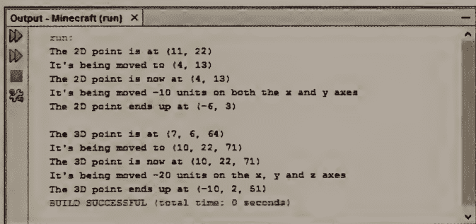

图 13.3 PointTester 程序的输出。

# 第 14 章 在数据结构中存储对象

每个元素都被添加到列表的末尾，因此 `servants` 中的第一个字符串是 "Bates"，最后一个是 "Daisy"。

> 注意：如果你具有早期版本的 Java 经验，你可能听说过 vectors（向量），并好奇为什么它们与 array lists 如此相似。它们是另一种数据结构，功能与 `ArrayList` 类几乎完全相同，并且它们与 `java.util.Vector` 位于同一个包中。两者之间的主要区别是 vectors 需要同步，因此任何使用 vectors 的类运行速度都会更慢。出于这个原因，array lists 通常是首选方案。

相应的 `remove(Object)` 方法可将该对象从列表中移除：

```java
servants.remove("Mrs. O'Brien");
```

array list 的大小（size）是它当前持有的元素数量。通过调用列表的 `size()` 方法获取信息，该方法返回一个整数：

```java
int servantsCount = servants.size();
```

当使用泛型对它所包含的列表进行分类时，使用 for 循环遍历列表的每个元素是非常简单的：

```java
for (String servant : servants) {
    System.out.println(servant);
}
```

第一个参数是用于存储元素的变量。第二个参数是 array list。其他数据结构也可以采用相同的循环。

`add(Object)` 方法将对象存储在列表的末尾。也可以通过指定列表中应存储的位置来将对象添加到列表中。这需要 `add(int, Object)` 方法，它将位置作为第一个参数：

```java
ArrayList<String> aristocrats = new ArrayList<String>();
aristocrats.add(0, "Lord Robert");
aristocrats.add(1, "Lady Mary");
aristocrats.add(2, "Lady Edith");
aristocrats.add(3, "Lady Sybil");
aristocrats.add(0, "Lady Granth");
```

上一个示例中的最后一条将 "Lady Granth" 添加到列表顶部而不是底部，将其置于 "Lord Robert" 以及其他人的上方。

作为第一个参数指定的位置不能大于列表的 `size()`。如果以 1 而不是 0 作为位置添加了 "Lord Robert"，程序将因 `IndexOutOfBoundsException` 异常而失败。

可以通过指定位置作为 `remove(int)` 的参数来从列表中删除元素：

```java
aristocrats.remove(4);
```

可以通过调用带有其位置的 `get(int)` 来获取列表中指定位置的元素。这会将每个字符串从列表中取出并显示出来：

```java
for (int i = 0; i < aristocrats.size(); i++) {
    String aristocrat = aristocrats.get(i);
    System.out.println(aristocrat);
}
```

通常需要确定 array list 是否包含某个特定对象。这可以通过将该对象作为参数调用列表的 `indexOf(Object)` 方法来确定。该方法返回对象的位置，如果在列表中无法找到，则返回 -1：

```java
int hasCarson = servants.indexOf("Carson");
```

本章的第一个项目将这些技术应用于一个简单的游戏，在游戏中，会向 10x10 网格上的 (x,y) 点发射射击。某些点包含目标，另一些点则没有。

目标由 `java.awt` 包中的 `Point` 类表示。通过调用 `Point(int, int)` 构造函数，并将 x 和 y 坐标作为两个参数来创建一个点。

此语句在 (5,9) 处创建一个点：
```java
Point p1 = new Point(5,9);
```

这里是一个 10x10 的网格，用 X 标记点，用点字符 (.) 标记空隙。

| | 1 | 2 | 3 | 4 | 5 | 6 | 7 | 8 | 9 |
|---|---|---|---|---|---|---|---|---|---|
| 1 | . | . | . | . | . | . | . | . | . |
| 2 | . | . | . | . | . | . | . | . | X |
| 3 | . | . | . | . | . | . | . | . | . |
| 4 | . | . | . | . | . | . | . | . | . |
| 5 | . | . | . | . | . | . | . | . | . |
| 6 | . | . | . | . | . | . | . | . | . |
| 7 | . | . | . | . | . | . | . | . | . |
| 8 | . | . | . | . | . | . | . | . | . |
| 9 | . | . | . | . | . | . | . | . | . |

列从左到右代表 x 坐标。行从上到下延伸标记 y 坐标。

在项目项目之前，你已经看到了 array lists 如何存储字符串。它们可以存储 `Point` 或任何其他类的对象。此语句创建了一个点列表：

```java
ArrayList<Point> targets = new ArrayList<Point>();
```

Java 编译器不允许将 `Point` 或其子类以外的任何类添加到 array list。

在 NetBeans 中，创建一个名为 `Battlepoint` 的空 Java 文件，并指定 `com.javaminecraft` 为其包。将列表 14.1 输入到文件中。

## 列表 14.1 Battlepoint.java 的全文

```java
1: package com.javaminecraft;
2:
3: import java.awt.*;
4: import java.util.*;
5:
6: public class Battlepoint {
7:     ArrayList<Point> targets = new ArrayList<Point>();
8:
9:     public Battlepoint() {
10:        // create targets
11:        createTargets();
12:        // display the map
13:        showMap();
14:        // shoot at three points
15:        shoot(7,4);
16:        shoot(3,3);
17:        shoot(9,2);
18:        // display the map again
19:        showMap();
20:    }
21:
22:    private void showMap() {
23:        System.out.println("\n 1 2 3 4 5 6 7 8 9");
24:        for (int column = 1; column < 10; column++) {
25:            for (int row = 1; row < 10; row++) {
26:                if (row == 1) {
27:                    System.out.print(column + " ");
28:                }
29:                System.out.print(" ");
30:                Point cell = new Point(row, column);
31:                if (targets.indexOf(cell) > -1) {
32:                    // a target is at this position
33:                    System.out.print("X");
34:                } else {
35:                    // no target is here
36:                    System.out.print(".");
37:                }
38:                System.out.print(" ");
39:            }
40:            System.out.println();
41:        }
42:
43:    private void createTargets() {
44:        Point p1 = new Point(5,9);
45:        targets.add(p1);
46:        Point p2 = new Point(4,5);
47:        targets.add(p2);
48:        Point p3 = new Point(9,2);
49:        targets.add(p3);
50:    }
51:
52:    private void shoot(int x, int y) {
53:        Point shot = new Point(x,y);
54:        System.out.print("Firing at " + x + "," + y + ") ...");
55:        // ... (代码省略)
66:    public static void main(String[] arguments) {
67:        new Battlepoint();
68:    }
69: }
```


Battlepoint 程序中的注释描述了构造函数的每个部分以及条件逻辑。应用程序创建了三个点目标并将它们添加到数组中（第 45-52 行）。显示这些目标的地图（第 22-43 行）。

接下来，通过调用 `shoot(int, int)` 方法对三个点进行射击（第 54-64 行）。每次都会报告射击是否击中了目标。如果是，则从 array list 中移除目标。

最后，再次显示地图，程序终止。输出如图 14.1 所示。


## 图 14.1

将对象放入 array list 并对其射击。三个目标显示在图 14.1 的上方地图中。一个目标在击中后被移除。输出中的下方地图反映了这一变化。

当目标被射击击中时，通过将射击点作为参数调用 `remove(Object)` 方法从 targets 数组中移除。

> 注意：在 Battlepoint 程序的 `shoot()` 方法中，从 array list 中移除的 `Point` 对象代表射击。它与击中的目标具有相同的 `(x,y)` 坐标。

# Hash Maps

使用一条信息来访问另一个信息在编程中很常见。array list 是数据结构中最简单的示例，可以使用索引号从列表中检索一个对象。这里有一个从 `aristocrats` array list 中提取第一个字符串的示例：`String first = aristocrats.get(0);`。

数组也使用索引号来检索数组中的每项。

Hash maps 是 Java 中的数据结构，使用一个对象来检索另一个对象。第一个对象是键（key），第二个对象是值（value）。它们被实现为 `java.util` 包中的 `HashMap` 类。

该名称指的是键映射到值的方式。这种结构化数据的示例是电话簿。一个人的名字（字符串）可以用于检索该人的电话号码。

> 注意：array lists 还有另一个名为 `Vector` 的类以更消耗资源的方式执行相同的事情，hash maps 也有 `Hashtable`。哈表是同步的而 hash maps 不是，因此任何使用哈表的类运行时间都会更长。hash maps 通常是首选的。

通过调用其无参数的构造函数可以创建一个 hash map：`HashMap phonebook = new HashMap();`。

在新的 hash map 中可以指定两个点，以控制其有效性：初始容量（initial capacity）和负载因子（load factor）。它们通过两个参数按顺序设置：`HashMap phonebook = new HashMap(30, 0.7F);`。

容量是存储 hash map 值的桶的数量。负载因子是在容量自动增加之前可以使用桶的量。该值是一个从 0（空）到 1.0（满）的浮点数，因此 0.7 意味着当桶填充率为 70% 时，容量就会增加。默认容量为 16，负载因子为 0.75，这些值通常足够了。

应该使用泛型（Generics）来指定键和值的类型。它们被置于 `<` 和 `>` 字符之间，类名用逗号分隔，如例所示：

```
HashMap<String, Long> phonebook = new HashMap<>();
```

这创建了一个名为 `phonebook` 的哈希映射，其键为字符串，值为 `Long` 对象。第二组 `<` 和 `>` 字符是空的，这假设它们与上一个语句中 `<` 中的类相同。

通过调用 `put(Object, Object)` 方法并传入两个参数（键和值），可以将对象存储在哈希映射中：

```
phonebook.put("Butterball Turkey Line", 8002888372);
```

这在哈希映射中存储了一个项，键为 "Butterball Turkey Line"，值为 8002888372 的 `Long` 对象——即该号码。


> 注意：这些语句在使用 `long` 值向哈希映射中放入 `Long` 对象。这在 Java 的早期版本中会是一个错误，因为像 `long` 这样的基本数据类型不能在需要对象的地方使用。

由于自动装箱（autoboxing）和自动拆箱（unboxing），这不再是一个错误。这是 Java 的一项功能，可以自动在基本类型与其等效的对象类之间进行转换。当 Java 编译器看到 `long` 数字 8002888372 时，它会将其转换为该值的 `Long` 对象。

可以通过调用 `get(Object)` 并将键作为唯一参数，从映射中根据键检索一个对象：

```
long number = phonebook.get("Butterball Turkey Line");
```

如果没有匹配该键的值，`get()` 方法将返回 `null`。这会导致前一个示例出现问题，因为 `null` 不是一个合适的 `long` 值。

处理该潜在问题的另一种方法是调用 `getOrDefault(Object, Object)`。如果作为第一个参数指定的键未找到，则默认返回第二个参数，如语句所示：

```
long number = phonebook.getOrDefault("Betty Crocker", -1);
```

如果在映射中找到了与键 "Betty Crocker" 匹配的数字，返回该数字。否则，返回 -1。

有两个方法可以指示键或值是否存在于映射中：`containsKey(Object)` 和 `containsValue(Object)`。它们返回布尔值 `true` 或 `false`。

哈希映射像数组列表（array lists）一样，有一个 `size()` 方法，用于指示数据结构中项的数量。

可以使用项集（entry set）遍历映射，`entrySet()` 方法使用 `java.util` 中的 `Set` 接口将这些项作为一个 `Set` 对象返回。

映射中的每个项都由 `Map.Entry` 表示，它是 `java.util` 中 `Map` 类的一个内部类。当你有一个 `Entry` 对象时，可以调用它的 `getKey()` 方法获取键，调用 `getValue()` 方法获取值。

`for` 循环使用项集和项来访问 `phonebook` 映射中所有的键和值：

```
for (Map.Entry<String, Long> entry : map.entrySet()) {
    String key = entry.getKey();
    Long value = entry.getValue();
    // ...
}
```

FontMapper 项目将这一切整合在一起，使用哈希映射来管理字体集合。

`java.awt` 包中的 `Font` 类用于创建字体并使用它们在图形用户界面中显示文本。字体包括字体名称；字号；以及它是普通（plain）、粗体（bold）还是斜体（italic）样式。

哈希映射可以包含任何类的对象。在 NetBeans 中，在 `com.javaminecraft` 包创建一个空的 Java 文件并将其命名为 FontMapper。将列表 14.2 写入文件并保存。

## 列表 14.2 FontMapper.java 的全文

```
1: package com.javaminecraft;
2:
3: import java.awt.*;
4: import java.util.*;
5:
6: public class FontMapper {
7:     public FontMapper() {
8:         Font courier = new Font("Courier New", Font.PLAIN, 6);
9:         Font times = new Font("Times New Roman", Font.BOLD, 12);
10:        Font verdana = new Font("Verdana", Font.ITALIC, 25);
11:        HashMap<String, Font> fonts = new HashMap<>();
12:        fonts.put("smallprint", courier);
13:        fonts.put("body", times);
14:        fonts.put("headline", verdana);
15:        for (Map.Entry<String, Font> entry : fonts.entrySet()) {
16:            String key = entry.getKey();
17:            Font value = entry.getValue();
18:            System.out.println(key + " : " + value.getSize() +
19:                                "-pt " + value.getName());
20:        }
21:    }
22:    public static void main(String[] args) {
23:        new FontMapper();
24:    }
25: }
```

# 异常 (Exceptions)

尽管你现在才开始学习它们，但在之前的 14 章中，你可能已经对异常非常熟悉了。当你编写的 Java 程序能够编译成功但在运行时遇到问题时，这些错误就会出现。

例如，一个常见的编程错误是引用不存在的数组元素，如下所示：

```
String[] greek = { "Alpha", "Beta", "Gamma" };
System.out.println(greek[3]);
```

`String` 数组有三个元素。因为数组的第一个元素的索引是 0 而不是 1，所以第一个元素是 `greek[0]`，第三个是 `greek[2]`。因此，显示 `greek[3]` 的语句是错误的。前面的语句可以成功编译，但当你运行程序时，Java 虚拟机 (JVM) 会停止并显示如下消息：

```
Exception in thread "main" java.lang.ArrayIndexOutOfBoundsException: 3 at SampleProgram.main(SampleProgram.java:4)
```


此消息表示应用程序生成了一个异常，JVM 通过显示错误信息并记录程序来记录了该异常。

错误信息引用了 `java.lang` 包中名为 `ArrayIndexOutOfBoundsException` 的类。这个类是一个异常——一个代表 Java 程序中发生的异常情况的对象。

当 Java 类遇到异常时，它会向该类的用户报警错误。在这个例中，类的用户是 JVM。


> 注意：使用了两个术语来描述这个过程：throw（抛出）和 catch（捕获）。抛出异常以通知其他人异常已经发生。这些异常会被其他对象或 Java 虚拟机捕获。

所有异常都是 `java.lang` 包中 `Exception` 类的子类。`ArrayIndexOutOfBoundsException` 的行为正如你所预期——它报告数组元素超出了数组边界。

Java 中有数百种异常。许多异常（如数组异常）表明可以通过编程更改来修复问题。这些异常类似于编译器错误——在你纠正了情况后，就不再需要担心该异常了。

# 第 15 章 在 Mod 中处理错误

其他异常必须在程序每次运行时使用五个新关键字处理：`try`、`catch`、`finally`、`throw` 和 `throws`。

## 在 try-catch 块中捕获异常

到为止，你通过修复导致异常的问题来处理异常。然而，有时你无法以那种方式处理异常，而必须在 Java 类内部处理问题。

为了介绍为什么这样做很有用，请将列表 15.1 中的短 Java 应用程序在 `com.javaminecraft` 包中创建一个名为 `calculator` 的新空 Java 文件并保存该文件。

### 列表 15.1 Calculator.java 的全文

```java
1: package com.javaminecraft;

2:

3: public class Calculator {

4:     public static void main(String[] arguments) {

5:         float sum = 0;

6:         for (String argument : arguments) {

7:             sum = sum + Float.parseFloat(argument);

8:         }

9:         System.out.println("Those numbers add up to " + sum);

10:    }

11: }
```

Calculator 应用程序接收一个或多个数字作为命令行参数，将它们相加并显示总和。

由于 Java 应用程序中的所有命令行参数都用字符串表示，程序在相加之前必须将它们转换为浮点数。第 7 行中的 `Float.parseFloat()` 类方法处理了此，将转换后的数字添加到名为 `sum` 的变量中。

在运行应用程序之前，为它提供以下命令行参数，可以在 NetBeans 中通过 Run、Set Project Configuration、Customize 命令进行设置：`7 4 8 1 4 1 4`。选择 Run、Run Main Project 来运行应用程序，你应该应该在图 15.1 中看到输出。


图 15.1 Calculator 应用程序的输出。

使用不同的数字作为参数多次运行程序。它应该能够成功处理它们，这可能会让你好奇这与异常有什么关系。

为了看到相关性，将 Calculator 的命令行参数更改为 `1 3 5x`。

第三个参数包含拼写错误——数字 5 后面不应该有 `x`。Calculator 应用程序无法知道这是一个错误，因此它尝试将 5x 与与其他数字相加，导致显示以下异常：

```
Exception in thread "main" java.lang.NumberFormatException: For input string: "5x"
at sun.misc.FloatingDecimal.readJavaFormatString(FloatingDecimal.java:2043)
at sun.misc.FloatingDecimal.parseFloat(FloatingDecimal.java:122)
at java.lang.Float.parseFloat(Float.java:451)
at com.javaminecraft.Calculator.main(Calculator.java:7)
```

Java 结果：1

此消息可以提供信息，但隐藏错误更好。Java 程序可以通过 `try-catch` 块处理它们自己的异常。

```java
try {
    // 可能引起异常的语句
} catch (Exception) {
    // 要做什么
}
```

任何可能抛出异常的语句必须使用 try-catch 块。在计算应用程序中，第 7 行对 `Float.parseFloat()` 的调用当遇到无法转换为浮点值的字符串时会抛出 `NumberFormatException`。

为了改进 Calculator 应用程序，使用 try-catch 块。在 `com.javaminecraft` 包中创建一个名为 `NewCalculator` 的 Java 文件，并输入列表 15.2 的。

### 列表 15.2 NewCalculator.java 的全文

```java
1: package com.javaminecraft;

2:

3: public class NewCalculator {

4:     public static void main(String[] arguments) {

5:         float sum = 0;

6:         for (String argument : arguments) {

7:             try {

8:                 sum = sum + Float.parseFloat(argument);

9:             } catch (NumberFormatException e) {

10:                 System.out.println(argument + " is not a number.");

11:             }

12:         }

13:         System.out.println("Those numbers add up to " + sum);

14:     }

15: }
```

在保存应用程序后，自定义项目配置并带有命令行参数 `1 3 5x` 运行 `com.javaminecraft.NewCalculator`。你应该在图 15.2 中看到输出。

```
run:
> 5x is not a number.
> Those numbers add up to 4.0
> BUILD SUCCESSFUL (total time: 0 seconds)
```

图 15.2 NewCalculator 应用程序的输出。

7-11 行中的 try-catch 块处理了由 `Float.parseFloat()` 抛出的 `NumberFormatException`。这些异常在 NewCalculator 类内部被捕获，该类会对任何非数字参数显示错误信息。因为异常在类内部被处理，所以 Java 解释器不会显示错误。

try-catch 块可以用于处理多种类型的异常，即使它们是由不同的语句抛出的。

处理多个异常类的方法是为每个类分配一个 catch 块，如下代码所示：

```java
String textValue = "35";
int value;
try {
    value = Integer.parseInt(textValue);
} catch (NumberFormatException exc) {
    // 处理异常的代码
} catch (ArithmeticException exc) {
    // 处理异常的代码
}
```

你也可以在同一个 catch 块中处理多个异常，只需用管道符号 `|` 分隔它们，并在列表结束时指定异常变量的名称。示例如下：

```java
try {
    value = Integer.parseInt(textView);
} catch (NumberFormatException | ArithmeticException exc) {
    // 处理异常的代码
}
```

如果捕获到 `NumberFormatException` 或 `ArithmeticException`，它将被赋值给 `exc` 变量。

列表 15.3 包含一个名为 `NumberDivider` 的应用程序，它从命令行获取整数参数并将它们用于除法表达式。

该应用程序必须处理用户输入中的两个潜在问题：

- 非数字参数
- 除以零

在 `com.javaminecraft` 包中为 `NumberDivider` 创建一个新的空的 Java 文件，并在源编辑器中输入列表 15.3 的文本。

### 列表 15.3 NumberDivider.java 的完整文本

```java
1: package com.javaminecraft;

2:

3: public class NumberDivider {

4:     public static void main(String[] arguments) {

5:     if (arguments.length == 2) {

6:         int result = 0;

7:         try {

8:             result = Integer.parseInt(arguments[0]) /
9:             Integer.parseInt(arguments[1]);

10:        System.out.println(arguments[0] + " divided
11:            by " + arguments[1] + " equals " + result);

12:    } catch (NumberFormatException e) {

13:        System.out.println("Both arguments must be integers.");

14:    } catch (ArithmeticException e) {

15:        System.out.println("You cannot divide by zero.");

16:   }

17:   }

18: }

19: }
```

使用命令行参数指定两个参数，你可以用整数、浮点数和非数字参数运行它。

第 5 行的 `if` 语句检查是否向应用程序发送了两个参数。如果没有，程序将在不显示任何内容的情况下退出。

`NumberDivider` 应用程序执行整数除法，因此结果是一个整数。在整数除法中，5 除以 2 等于 2，而不是 2.5。

如果你使用浮点数或非数字参数，第 8-9 行将抛出 `NumberFormatException` 并被第 12-13 行捕获。

如果你使用整数作为第一个参数并将零作为第二个参数，第 8-9 行将抛出 `ArithmeticException` 并被第 14-15 行捕获。

程序成功运行的示例输出如图 15.3 所示。


图 15.3 NumberDivider 应用程序的输出。

## 异常后的处理

当你使用 `try` 和 `catch` 处理多个异常时，有时你希望程序在块结束时执行某些操作，无论是否发生了异常。

你可以通过使用 `try-catch-finally` 块来处理，它的形式如下：

```java
try {
  // 可能导致异常的语句
} catch (Exception e) {
  // 异常发生时要做什么
} finally {
  // 无论如何都执行的语句
}
```

块中 `finally` 部分的语句在块中其他所有内容之后执行，即使发生了异常也是如此。

这在从磁盘文件读取数据的程序非常有用（你将在第 17 章“读取和写入文件”中执行操作）。当你访问数据时，有多种方式发生异常——文件可能不存在、可能会发生磁盘错误等。如果在 `try` 部分中编写读取磁盘的语句，并在 `catch` 部分中处理错误，那么你可以在 `finally` 部分关闭文件。这确保了无论是否真的抛出异常，文件都会被关闭。

## 抛出异常

当你调用另一个类的方法时，该类可以通过抛出异常来控制方法的使用方式。

当你使用 Java 类库中的类时，编译器经常会显示如下消息：

```
NetReader.java:14: unreported exception java.net.
MalformedURLException: must be caught or declared to be thrown
```

每当你看到显示异常“必须捕获或声明抛出”的错误时，表明你尝试使用的方法抛出了异常。

任何调用这些方法的类（例如你编写应用程序）必须执行以下操作之一：

- 使用 `try-catch` 块处理异常
- 抛出异常
- 使用 `try-catch` 块处理异常然后将其抛出

到本章为止，你已经学习了如何处理异常。如果你想在处理后抛出异常，可以使用 `throw` 语句后跟异常对象来抛出。

以下语句在 `catch` 块中处理 `NumberFormatException` 错误然后抛出该异常：

```java
float principal;
try {
    principal = Float.parseFloat(arguments[0]) * 1.1F;
} catch (NumberFormatException e) {
    System.out.println(arguments[0] + " is not a number.");
    throw e;
}
```

以下语句在 `catch` 块中处理 `NumberFormatException` 错误并抛出异常：

```java
float principal;
try {
    principal = Float.parseFloat(loanText) * 1.1F;
} catch (Exception e) {
    System.out.println("Error " + e.getMessage());
    throw e;
}
```

此示例中的第二个语句创建了一个 `URL` 对象，它代表 Web 上的一个地址。`URL` 类的构造方法会抛出 `MalformedURLException` 异常，以表示使用了无效地址，因此无法构造对象。当你尝试打开与该 URL 的连接时，接下来的语句会导致抛出这些异常之一：

```java
URL source = new URL("http://www.minecraft.com");
```


字符串 `http://www.minecraft.com` 并不是一个有效的 URL。它缺少了一些标点符号——冒号后面缺少了两个斜杠（//）。
由于 `loadURL()` 方法已声明为抛出 `MalformedURLException` 错误，因此它不需要在方法内部处理这些错误。捕获此异常的责任落在任何调用 `loadURL()` 方法的方法中。

## 不需要捕获的异常

尽管本章已经说明异常需要用 `try-catch` 捕获，或者用 `throws` 子句声明抛出，但也有例外。

在 Java 程序运行时可能发生的某些异常不需要以任何方式处理。当编译器检测到该异常被忽略时，并不会因此报错并停止。

这些异常被称为**未检查异常**（unchecked exceptions），而其他的被称为**已检查异常**（checked exceptions）。

未检查异常是 `java.lang` 包中 `RuntimeException` 的子类。未检查异常的一个常见例子是 `IndexOutOfBoundsException`，它表示用于访问数组、字符串或列表的索引超出了边界。如果一个数组有五个元素，而你尝试读取第 10 个元素，就会发生此异常。

另一个是 `NullPointerException`，它发生在使用了一个没有值的对象时。对象变量在赋值一个对象之前具有 `null` 值。某些方法在无法返回对象时也会返回 `null`。如果一个语句错误地将一个没有值的对象赋值给有值的变量，就会发生 `NullPointerException`。

这两种错误都是程序员可以（也应该）在代码中防止的，而不是需要异常处理的内容。如果你编写了一个访问越界数组元素的程序，请修复该代码并重新编译。如果你期望得到一个对象但它等于 `null`，请在使用该对象之前通过 `if` 条件进行检查。

Java 中未检查异常的原理是：它们要么可以通过编写良好的代码来防止，要么发生得过于频繁，以至于一直捕获它们就会让程序变得不必要的复杂。在调用对象方法的每条语句中，都可能发生 `NullPointerException`。

当然，仅仅因为发生了异常并不意味着它应该被忽略。你仍然可以选择在未检查异常时使用 `try`、`catch` 和 `throws`。

## 抛出和捕获异常

对于本章的终极项目，你创建一个类，使用异常来告诉另一个类发生了某个错误。

该项目中的类包括 `HomePage`（一个代表 Web 个人主页的类）和 `PageCatalog`（一个对这些页面进行分类的应用）。

在 `com.javaminecraft` 包中创建一个名为 `HomePage` 的新空 Java 文件，并输入列表 15.4 的文本。

## 列表 15.4 HomePage.java 的全文

```java
1: package com.javaminecraft;

2:

3: import java.net.*;

4:

5: public class HomePage {

6:     String owner;

7:     URL address;

8:     String category = "none";

9:

10:    public HomePage(String inOwner, String inAddress)
11:        throws MalformedURLException
12:    {
13:        owner = inOwner;
14:        address = new URL(inAddress);
15:    }

16:

17:    public HomePage(String inOwner, String inAddress, String inCategory)
18:        throws MalformedURLException
19:    {
20:        this(inOwner, inAddress);
21:        category = inCategory;
22:    }
}
```

你可以在其他程序中使用编译后的 `HomePage` 类。此类代表个人网页。它有三个实例变量：`address`（一个表示页面地址的 `URL` 对象）、`owner`（拥有该页面的个人）以及 `category`（一个描述页面主要主题的简短注释）。

像任何创建 `URL` 对象的类一样，`HomePage` 必须在 `try-catch` 块中处理 `MalformedURLException` 错误，要么声明它忽略了这些错误。

该类采用了后者的情况，如第 10-11 行以及两个构造方法中使用 `throws` 所示，`HomePage` 消除了以任何方式处理 `MalformedURLException` 错误的需求。

要创建一个使用 `HomePage` 应用程序，返回 NetBeans 并创建一个名为 `PageCatalog` 的空 Java 文件，其中包含列表 15.5 的文本。

## 列表 15.5 PageCatalog.java 的全文

```java
1: package com.javaminecraft;

2:

3: import java.net.*;

4:

5: public class PageCatalog {

6:    public static void main(String[] arguments) {
7:        HomePage[] catalog = new HomePage[5];
8:        try {
9:            catalog[0] = new HomePage("Minecraft", "http://www.minecraft.net", "software");
10:            catalog[1] = new HomePage("Wiki", "http://minecraft.gamepedia.com", "reference");
11:            catalog[2] = new HomePage("Facebook", "https://www.facebook.com/minecraft", "social");
12:            catalog[3] = new HomePage("Programming", "http://www.javaminecraft.com", "reference");
13:            catalog[4] = new HomePage("Company", "http://mojang.com");
14:            for (int i = 0; i < catalog.length; i++) {
15:                System.out.println(catalog[i].owner + ": " + catalog[i].address + " - " + catalog[i].category);
16:            }
17:        } catch (MalformedURLException e) {
18:            System.out.println("Error: " + e.getMessage());
19:        }
19:    }
}
```

当你运行该应用程序时，将显示图 15.4 所示的输出。


## 图 15.4

PageCatalog 应用的错误输出。

PageCatalog 应用创建一个 `HomePage` 数组，然后显示数组的内容。每个 `HomePage` 对象使用最多三个参数创建：

+ 页面简短描述
+ 页面地址（字符串而非 URL）
+ 页面分类

第三个参数是可选的，在第 17-18 行未使用。`HomePage` 类的构造方法在接收无法转换为 URL 的字符串时抛出 `MalformedURLException` 错误。这些异常在 `PageCatalog` 应用中使用 `try-catch` 块处理。

要修复导致“无协议”错误的问题，编辑第 18 行，使其像第 9-16 行的地址一样以 http:// 开头。再次运行程序，查看图 15.5 中的输出。

```
Output - Minecraft (run)

run:

Minecraft: http://www.minecraft.net -- software

Wiki: http://minecraft.gamepedia.com -- reference

Facebook: https://www.facebook.com/minecraft -- social

Programming: http://www.javaminecraft.com -- reference

Company: http://mojang.com -- none

BUILD SUCCESSFUL (total time: 0 seconds)
```

## 图 15.5

PageCatalog 应用的修正输出。

## 绝对最少

现在你已经运用了 Java 的异常处理技术，错误这个主题应该比本章开始时更受欢迎。

你可以用这些技术做很多事情：

+ 捕获异常并处理它。
+ 忽略异常，交给其他类或 Java 解释器处理。
+ 在同一个 `try-catch` 块中捕获多个异常。
+ 抛出你自己的异常。

# 本章内容

- 在程序中使用接口
- 创建线程
- 启动、停止和暂停线程
- 捕获错误

# 第 16 章 创建多线程模块

经常用来描述日常生活忙碌节奏的计算机术语是“多任务处理”（multitasking），意味着同时做多件事——例如，在 Twitter 上发布消息的同时浏览网页，并在 Minecraft 的第 12 层挖掘钻石矿。一台多任务处理的计算机是指可以同时运行多个程序的计算机。

Java 语言的一项高级特性是编写可以进行多任务处理的程序，这是通过被称为“线程”（threads）的对象类实现的。

## 线程

在 Java 程序中，计算机处理的每个并发任务都被称为线程，整个过程被称为“多线程”（multithreading）。线程在动画和许多其他程序中非常有用。

线程是组织程序的一种方式，使其能够同时执行多件事。每个必须同时发生的任务都应该放置在自己的线程中，这通常通过将每个任务实现为一个独立的类完成。

线程由 `Thread` 类和 `Runnable` 接口表示，它们都是 `java.lang` 程序包的一部分。因为它们属于这个包，所以你不需要使用 `import` 语句就可以在程序中使用它们。

`Thread` 类最简单的用途之一是减慢程序执行某些操作的速度。

## 减慢程序

`Thread` 类有一个 `sleep()` 方法，你可以在任何需要停止运行一段时间的程序调用它。你经常在带有动画的程序中看到这种技术，因为它可以防止图像显示的速度超过 Java 解释器的处理速度。

要使用 `sleep()` 方法，请调用 `Thread.sleep()` 并传入要暂停的毫秒数，如下语句所示：
`Thread.sleep(5000);`

上述语句会导致 Java 虚拟机 (JVM) 在执行其他操作之前暂停五秒。如果由于某种原因 JVM 无法暂停那么久，`sleep()` 方法将抛出一个 `InterruptedException`。

由于可能会抛出此异常，在使用 `sleep()` 方法时必须以某种方式处理它。其中一种方法是将 `Thread.sleep()` 语句放在 `try-catch` 块中：

```java
try {
    Thread.sleep(5000);
} catch (InterruptedException e) {
    // 提前唤醒
}
```

当你想让 Java 程序同时处理多一件事时，你必须将程序组织成线程。你的程序可以根据需要拥有任意数量的线程，它们都可以同时运行而互不影响。

## 创建线程

可以作为线程运行的 Java 类被称为“可运行类”（runnable class）或“线程类”。虽然你可以使用线程来暂停程序的执行几秒钟，但程序员通常出于相反的原因使用它们——为了加快程序运行。如果你将耗时的任务放在它们自己的线程中，程序的其余部分将运行得更快。这通常用于防止某个任务拖慢程序图形用户界面 (GUI) 的响应速度。

例如，如果你编写了一个从磁盘加载股票市场价格数据并编译统计数据的应用程序，最耗时的任务是加载数据。如果应用程序中没有使用线程，在数据加载期间，程序的界面可能会响应非常迟钝。这会让用户感到非常沮丧。

将任务放置在独立线程中的两种方法包括：

- 将任务放在实现 `Runnable` 接口的类中
- 将任务放在继承自 `Thread` 的子类中

为了支持 `Runnable` 接口，在创建类时使用了 `implements` 关键字，在本例中：

```java
public class LoadStocks implements Runnable {
    // 类体
}
```

当一个类实现一个接口时，表示该类除了自己的方法外还包含了额外的行为。

实现 `Runnable` 接口的类必须包含 `run()` 方法，其结构如下：

```java
public void run() {
    // 方法体
}
```

`run()` 方法应该处理线程创建时要完成的任务。在股票分析示例中，`run()` 方法可以包含从磁盘加载数据并根据这些数据编译统计数据的语句。

当运行多线程应用程序时，其 `run()` 方法中的语句不会自动执行。Java 中可以启动和停止线程，只有在你完成以下两件事后，线程才会开始运行：

- 通过调用 `Thread` 构造函数创建线程类的对象。
- 通过调用 `start()` 方法启动线程。

`Thread` 构造函数接受一个参数——包含线程 `run()` 方法的对象。通常使用 `this` 关键字作为参数，这表示当前类包含了 `run()` 方法。

列表 16.1 包含一个 Java 应用程序，它将 10,000 个质数的序列存储在 `StringBuilder` 对象中，直到找到所有 10000 个质数才会显示。质数在应用程序主线程运行的同时在自己的线程中被发现。

在 JavaBeans 中，创建一个名为 `PrimeFinder` 的新空 Java 文件，将其放入 `com.javminecraft` 包中，将列表中的文本输入文件，并记得保存。

## 列表 16.1 PrimeFinder.java 的全文

```java
1: package com.javminecraft;

2:

3: public class PrimeFinder implements Runnable {
4:     Thread go;
5:     StringBuilder primes;
6:     boolean done = false;
7:
8:     public PrimeFinder() {
9:         primes = new StringBuilder();
10:    }
11:
12:    public void start() {
13:        if (go == null) {
14:            go = new Thread(this);
15:            go.start();
16:        }
17:    }
18:
19:    @Override
20:    public void run() {
21:        int quantity = 50000;
22:        int numPrimes = 0;
23:        int candidate = 2;
24:        primes.append("First ");
25:        while (numPrimes < quantity) {
26:            if (isPrime(candidate)) {
27:                primes.append(candidate);
28:                primes.append(" ");
29:                numPrimes++;
30:            }
31:            candidate++;
32:        }
33:        done = true;
34:    }
35:
36:    public static boolean isPrime(int checkNumber) {
37:        double root = Math.sqrt(checkNumber);
38:        for (int i = 2; i <= root; i++) {
39:            if (checkNumber % i == 0) {
40:                return false;
41:            }
42:        }
43:        return true;
44:    }
45:
46:    public static void main(String[] arguments) {
47:        PrimeFinder app = new PrimeFinder();
48:        app.start();
49:        int count = 1;
50:        while (app.done) {
```


# PrimeFinder 应用程序

PrimeFinder 应用程序在计算质数时显示秒数，并通过将 `StringBuilder` 对象转换为字符串来显示所有质数。输出的一部分如图 16.1 所示（完整内容将占用过多空间）。


图 16.1 运行 PrimeFinder 应用程序。

- 在第 19–47 行中，`run()` 方法寻找从 2 开始的质数序列，通过调用其 `append()` 方法将每个质数存储在 `primes` `StringBuilder` 对象组件中。当找到全部 10,000 个时，实例变量 `done` 被设置为 `true`。

此应用程序的 `main()` 方法执行的工作比书中的其他项目更多。首先，创建程序类的一个对象，并在第 51 行调用 `start()` 方法。该方法获取了寻找质数的线程（`Thread`）。

第 53–61 行的 `while` 循环持续运行，直到程序的 `done` 变量为 `true`。每循环一次，都会显示 `count` 变量的值并将其加 1。

对 `Thread.sleep(1000)` 的调用会导致循环暂停 1 秒（1,000 毫秒）。

当 `app` 等于 `true` 时，循环结束，并在第 62 行显示 `primes` 变量的内容。

## 线程操作

你可以通过调用 `start()` 方法来启动线程，这可能会让你认为还有一个 `stop()` 方法可以将其停止。

尽管 Java 在 `Thread` 类中包含了 `stop()` 方法，但它已经被废用。在 Java 中，被废用的元素是指那些已被功能更好的替代方案所取代的类、接口、方法或变量。

> **注意**：听从这一废用警告是明智之举。Oracle 已经废用了 `stop()` 方法，因为它可能会给在 Java 解释器中运行的其他线程引起问题。该类的 `resume()` 和 `suspend()` 方法也被废用了。

你接下来要开展的项目将展示如何停止一个线程。你正在进行的程序会在网站标题列表及其地址之间循环，以便你访问。

每个页面的标题和网页地址以连续循环显示。用户可以通过点击应用程序图形用户界面上的按钮来访问当前显示的站点。该程序运行一段时间，按顺序显示每个网站的信息。由于这一特性，线程是控制该程序的最佳方式。


## 我的世界 MOD 编程初学者指南

此项目需要图形用户界面，这是一种 Java 编程类型，本书并未涵盖，因为创建 Minecraft mod 并不是所必需的。程序将显示一个带有点击按钮的单个窗口。

你不需要先将此程序输入 NetBeans 编辑器稍后再学习它，而是在章节末尾获得 `LinkRotator` 应用程序的全文。在此之前，将对程序的每个部分进行描述。

## 类声明

在该程序中需要完成的第一件事是使用 `import` 导入 `java.awt`、`java.io`、`java.net`、`java.awt.event` 和 `javax.swing` 包中的类。

当你使用 `import` 使某些类可用后，就可以使用语句开始应用程序了：

```java
public class LinkRotator extends JFrame
    implements Runnable, ActionListener {
```

该语句将 `LinkRotator` 类创建为 `JFrame` 类的子类，`JFrame` 代表 Java 中的图形用户界面。该语句还使此类支持两个接口——`Runnable` 和 `ActionListener`。通过实现 `Runnable` 接口，你可以在程序中使用 `run()` 方法让线程开始运行。`ActionListener` 接口使程序响应鼠标点击。

## 设置变量

在 `LinkRotator` 中首先要做的是创建类的变量和对象。创建一个名为 `pageTitle` 的六元素 `String` 对象数组，以及一个名为 `pageLink` 的六元素 `URI` 对象数组：

```java
String[] pageTitle = new String[6];
URI[] pageLink = new URI[6];
```

`pageTitle` 数组存储了所显示的六个网站的标题。`URI` 类对象存储网页地址的值。`URI` 包含了跟踪网页地址所需的行为和属性。

最后要创建三个变量：一个整数变量、一个 `Thread` 对象和一个用户界面标签：

```java
int current = 0;
Thread runner;
JLabel siteLabel = new JLabel();
```

`current` 变量跟踪正在显示哪个站点，以便你可以在站点之间循环。`Thread` 对象代表线程。

## 构造函数

使用了程序的构造函数。以下是该构造函数：

```java
public LinkRotator() {
    pageTitle = new String[6];
    pageLink = new URI[6];
    current = 0;
    siteLabel = new JLabel();
    add(siteLabel);
}
```

## 启动线程

`start()` 方法启动线程。以下是 `start` 方法：

```java
public void start() {
    if (runner == null) {
        runner = new Thread(this);
        runner.start();
    }
}
```

### 运行线程

`run()` 方法是线程执行主要工作的地方。在 `LinkRotator` 程序中，以下代表 `run` 方法：

```java
public void run() {
    Thread thisThread = Thread.currentThread();
    while (runner == thisThread) {
        current++;
        if (current > 5) {
            current = 0;
        }
        siteLabel.setText(pageTitle[current]);
        repaint();
        try {
            Thread.sleep(1000);
        } catch (InterruptedException e) {
            // do nothing
        }
    }
}
```

供用户阅读网站的名称及其地址。`catch` 语句处理在处理 `Thread.sleep()` 语句期间可能发生的任何 `InterruptedException` 错误。如果线程在睡眠时被某些操作中断，就会发生这些错误。

## 处理鼠标点击

`LinkRotator` 程序中最后需要处理的是事件处理。每当用户点击“Visit Site”（访问网站）按钮时，应用程序都应该使用网络浏览器打开显示的网站。这是通过一个名为 `actionPerformed()` 的方法实现的，该方法每当按钮点击时就会被调用。

以下是 `LinkRotator` 的 `actionPerformed()` 方法：

```java
public void actionPerformed(ActionEvent event) {
    Desktop desktop = Desktop.getDesktop();
    if (pageLink[current] != null) {
        try {
            desktop.browse(pageLink[current]);
            runner = null;
            System.exit(0);
        } catch (IOException exc) {
            // do nothing
        }
    }
}
```

此方法中发生的第一件事是创建一个 `Desktop` 对象。`java.awt` 包中的 `Desktop` 类表示运行应用程序的计算机的桌面环境。获取该对象后，你可以用它通过“mailto:”链接启动电子邮件客户端，用另一个程序打开文件进行编辑，打印文件，并让 Java 外部的其他程序执行任务。

在这里，使用 `Desktop` 对象用计算机的默认网络浏览器打开网页。

`browse(URI)` 方法在浏览器中加载指定的网页地址。如果 `pageLink[current]` 是一个有效地址，`browse()` 会请求浏览器加载该页面。

## 第 16 章 创建多线程模块

## 显示循环链接

你现在准备好创建程序并进行测试了。创建一个名为 `LinkRotator` 的新空 Java 文件，并输入列表 16.2 中的文本。

### 列表 16.2 LinkRotator.java 的全文

```java
1: package com.javamineinecraft;
2:
3: import java.awt.*;
4: import java.awt.event.*;
5: import java.io.*;
6: import javax.swing.*;
7: import java.net.*;
8:
9: public class LinkRotator extends JFrame
10:     implements Runnable, ActionListener {
11:
12:     String[] pageTitle = new String[6];
13:     URI[] pageLink = new URI[6];
14:     int current = 0;
15:     Thread runner;
16:     JLabel siteLabel = new JLabel();
17:
18:     public LinkRotator() {
19:         setDefaultCloseOperation(JFrame.EXIT_ON_CLOSE);
20:         setSize(300, 100);
21:         FlowLayout flo = new FlowLayout();
22:         setLayout(flo);
23:         add(siteLabel);
24:         pageTitle = new String[] {
25:             "Oracle's Java site",
26:             "Cafe au Lait",
27:             "JavaWorld",
28:             "JavaMinecraft.Com",
29:             "Sams Publishing",
30:             "Workbench"
31:         };
32:         pageLink[0] = getURI("http://www.oracle.com/technetwork/java");
33:         pageLink[1] = getURI("http://www.ibiblio.org/javafaq");
34:         pageLink[2] = getURI("http://www.javaworld.com");
35:         pageLink[3] = getURI("http://www.javaminecraft.com");
36:         pageLink[4] = getURI("http://www.sampublishing.com");
37:         pageLink[5] = getURI("http://www.workbench.caden.org");
38:         Button visitButton = new Button("Visit Site");
39:         visitButton.addActionListener(this);
40:         add(visitButton);
41:         setVisible(true);
42:         start();
43:     }
44:
45:     private URI getURI(String urlText) {
46:         URI pageURI = null;
47:         try {
48:             pageURI = new URI(urlText);
49:         } catch (URISyntaxException ex) {
50:             // do nothing
51:         }
52:         return pageURI;
53:     }
54:
55:     public void start() {
56:         if (runner == null) {
57:             runner = new Thread(this);
58:             runner.start();
59:         }
60:     }
61:
62:     public void run() {
63:         Thread thisThread = Thread.currentThread();
64:         while (runner == thisThread) {
65:             current++;
66:             if (current > 5) {
67:                 current = 0;
68:             }
69:             siteLabel.setText(pageTitle[current]);
70:             repaint();
71:             try {
72:                 Thread.sleep(1000);
73:             } catch (InterruptedException exc) {
74:                 // do nothing
75:             }
76:         }
77:     }
78:
79:     public void actionPerformed(ActionEvent event) {
80:         Desktop desktop = Desktop.getDesktop();
81:         if (pageLink[current] != null) {
82:             try {
83:                 desktop.browse(pageLink[current]);
84:                 runner = null;
85:                 System.exit(0);
86:             } catch (IOException exc) {
87:                 // do nothing
88:             }
89:         }
90:     }
}
```


无论处理的是字节流、字符还是其他类型的数据，总体过程都是相同的。在本章中，你将：
* 从程序中读取字节
* 在文件中创建新文件
* 将字节写入文件

## 读取和写入文件

有许多方法可以在计算机上表示数据。你已经通过创建对象来学习这一点。一个对象包含了数据，还包含了执行任务的方法。

## 流

为了将数据永久保存到 Java 程序中或以后检索这些数据，你必须使用流。流是将信息从一个地方传输到另一个地方的对象，其名称源于水流通过船只运送货物。

流连接了各种来源，包括计算机程序、硬盘、互联网服务器、计算机内存和优盘。当你学会如何使用流处理一种数据后，就可以以相同的方式处理其他数据。

在本章中，你将使用流来处理计算机上的文件。

有两种流：
- **输入流**：从源读取数据
- **输出流**：向源写入数据

所有输入输出流都由字节组成，字节是 0 到 255 之间的整数。你可以用这种格式表示数据，例如可执行程序、文字处理文档和 MP3 音乐文件，但这些只是字节可以表示的一小部分。字节流用于读取和写入此类数据。

一种更特殊的处理数据的方法是字符的形式——单个字母、数字、标点符号等。当你正在读取或写入文本源时，可以使用字符流。

## 文件

在 Java 中，文件由 `File` 类表示，该类也是 `java.io` 包的一部分。文件可以从硬盘、软盘驱动器、CD-ROM 和其他存储设备中读取。

`File` 对象可以表示已经存在的文件，也可以表示你想创建的文件。要创建一个 `File` 对象，请使用文件名作为构造函数，如下例所示：

```java
File bookName = new File("address.dat");
```

这会在当前文件夹中为名为 `address.dat` 的文件创建一个对象。你也可以在文件名中包含路径：

```java
File bookName = new File("data\\address.dat");
```

> **注意** 此示例在 Windows 系统上有效，该系统使用反斜杠 (`\`) 作为路径名和文件名的分隔符。Linux 和其他基于 Unix 的系统使用正斜杠 (`/`)。要编写一个可以在任何操作系统上运行的引用文件的 Java 程序，请使用类变量 `File.separator` 代替正斜杠或反斜杠。

当你有一个 `File` 对象时，可以调用该对象上的有用方法：
- `exists()`——如果文件存在则返回 `true`，否则返回 `false`
- `getName()`——以 `String` 形式返回文件名
- `length()`——以 `long` 值的形式返回文件大小
- `createNewFile()`——如果不存在该文件，则创建一个同名文件
- `delete()`——如果文件存在，则删除该文件
- `renameTo(File)`——使用指定的 `File` 对象的名称作为参数重命名文件

你也可以使用 `File` 对象来表示系统上的文件夹而不是文件。在 `File` 构造函数中指定文件夹名称，该名称可以是绝对路径（如 `C:\\MyDocuments\\`），也可以是相对路径（如 `java\\database\\`）。


在你获得表示文件夹的对象后，可以调用它的 `listFiles()` 方法查看文件夹内部的内容。该方法返回一个 `File` 对象数组，代表该文件夹包含的每个文件和子文件夹。

## 从流中读取数据

本章的第一个项目是使用输入流从文件中读取数据。你可以使用 `FileInputStream` 类来实现，它代表以字节形式从文件中读取的输入流。

你可以通过指定文件名或 `File` 对象作为 `FileInputStream` 构造方法的参数来创建一个文件输入流。

读写文件的方法在访问文件发生错误时可能会抛出 `IOException`。许多与读写文件相关的方法都会抛出此异常，因此通常使用 `try-catch` 块。

流是 Java 中在不再使用时必须关闭的资源之一。在程序运行时，留存打开的流会严重消耗 JVM 的资源。

一种特殊的 `try` 语句 `try-with-resources` 使可以轻松确保像文件输入流这样的资源在不再需要时被关闭。

`try` 语句后面紧跟着括号。括号内包含一个或多个 Java 语句，用于声明通过资源读取或写入数据的变量。

这是一个使用名为 `stream` 的文件流读取文本文件 `cookie.web` 的示例：

```java
File cookie = new File("cookie.web");

try (FileInputStream stream = new FileInputStream(cookie)) {
    System.out.println("Length of file: " + cookie.length());
} catch (IOException ioe) {
    System.out.println("Could not read file.");
}
```

因为流位于 `try` 语句中，所以当 `try-catch` 块完成时，流会自动关闭（如果它尚未关闭）。

输入流按字节读取数据。你可以通过调用不带参数的流 `read()` 方法来读取单个字节。如果由于到达文件末尾而没有可用字节，则返回字节值 `-1`。

当你读取输入流时，它从文件中的第一个字节开始。你可以通过调用 `skip()` 方法并传入一个表示要跳过字节数的 `int` 来跳过流中的某些字节。名为 `scanData` 的语句跳过了 1024 个字节：`scanData.skip(1024);`

如果你想一次读取多个字节，请执行以下操作：
- 创建一个与你想读取的字节数完全相同的字节数组。
- 将该数组作为参数调用流的 `read()` 方法。数组将用来自流的字节填充。

创建一个从 MP3 音频文件中读取 ID3 数据的应用程序。由于 MP3 是一种流行的音乐格式，通常会在文件的末尾添加 128 字节来存储歌曲信息，例如标题、歌手和专辑。

`ID3Reader` 应用程序使用文件输入流读取 MP3 文件，跳过最后的 128 个字节。检查剩余字节查看是否包含 ID3 数据。如果是，前三个字节是数字 84、65 和 71。

> **注意** 在 Java 支持的 Unicode 标准字符集中，这三个数字分别代表大写字母 T、A 和 G。

创建一个名为 `ID3Reader` 的空 Java 文件，并填充来自 17.1 的内容。

### 17.1 ID3Reader.java 的全文

```java
package com.craft;

import java.io.*;

public class ID3Reader {
    public static void main(String[] arguments) {
        File song = new File(arguments[0]);

        try (FileInputStream file = new FileInputStream(song)) {
            int size = (int) song.length();
            file.skip(size - 128);

            byte[] last128 = new byte[128];
            file.read(last128);

            String id3 = new String(last128);
            String tag = id3.substring(0, 3);

            if (tag.equals("TAG")) {
                // 处理 ID3 数据的逻辑在这里
            }
        } catch (IOException e) {
            e.printStackTrace();
        }
    }
}
```

在将此类作为程序运行之前，必须指定一个 MP3 文件作为命令行参数（在 NetBeans 中使用 Run, Set Project, Configure）。图 17.1 显示当指定歌曲为 C418 的 Minecraft 时，`ID3Reader` 应用程序显示的内容。


图 17.1 运行 ID3Reader 应用程序

> **提示** 如果你没有任何 MP3，你可以通过 Creative Commons http://search.creativecommons.org 寻找用于检查的歌曲。

知识共享（Creative Commons）是一系列版权许可，规定了歌曲或书籍等作品如何分发、编辑或重新出版。www.rockproper.com 的 Rock Proper 网站还提供了授权共享的 MP3 专辑集合。

### 缓冲输入流

提高读取输入流程序性能的方法之一是对输入进行缓冲。缓冲是将数据保存在内存中，以便在程序以后需要时使用。当 Java 程序需要来自缓冲输入流的数据时，它会首先在缓冲区中查找，这比从文件等源读取要快得多。

要使用缓冲输入流，你首先创建一个输入流（例如 `InputStream` 对象），然后使用该对象创建一个缓冲流。调用 `BufferedInputStream(InputStream)` 构造函数，并将输入流作为唯一参数。数据在从输入流读取时会进行缓冲处理。

要从缓冲流中读取内容，请调用其不带参数的 `read()` 方法。它将返回一个 0 到 255 之间的整数，代表流中的下一个字节数据。如果没有更多可用字节，则返回 `-1`。

作为缓冲流的演示，你创建的下一个程序将为 Java 增加了一项功能，这是许多程序员在其他语言中错过的功能：控制台输入。

控制台输入是在运行应用程序的同时从控制台（也称为命令行）读取字符的能力。

`System` 类包含了用于 `System.out.print()` 和 `System.out.println()` 语句的 `out` 变量，它还有一个名为 `in` 的类变量，类型为 `InputStream` 对象。该对象接收键盘的输入并将其转换为流。

你可以像处理其他输入流一样处理这个输入流。以下语句创建了一个缓冲输入流：`bin = new BufferedInputStream(System.in);`

下一个项目 `Console` 类包含一个类方法，你可以在任何 Java 程序中使用它来接收控制台输入。将列表 17.2 中的文本输入到名为 `Console` 的新空 Java 文件中。

## 列表 17.2 Console.java 的全文

```java
package com.javaminecraft;

import java.io.*;

public class Console {
    public static String readLine() {
        StringBuilder response = new StringBuilder();
        try {
            BufferedInputStream bin = new BufferedInputStream(System.in);
            int in = 0;
            char inChar;
            do {
                in = bin.read();
                inChar = (char) in;
                if (in != -1) {
                    response.append(inChar);
                }
            } while ((in != -1) && (inChar != '\n'));
            bin.close();
            return response.toString();
        } catch (IOException e) {
            System.out.println("Exception: " + e.getMessage());
            return null;
        }
    }

    public static void main(String[] arguments) {
        System.out.print("You are standing at the end of the road ");
        System.out.print("before a small brick building. Around you ");
        System.out.print("is a forest. A small stream flows out of ");
        System.out.println("the building and down a gully.\n");
    }
}
```

`Console` 类包含一个 `main()` 方法，演示了如何使用它。当你运行应用程序时，输出应该类似于图 17.2。

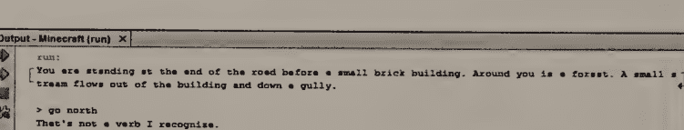

图 17.2 运行 Console 应用程序。

`Console` 类包含一个类方法 `readLine()`，它负责从控制台接收字符。当按下回车键时，`readLine()` 返回一个包含所有接收到的字符的字符串对象。

> **注意** `Console` 类也是世界上最不令人满意的文字冒险游戏。你不能进入建筑，不能在溪水中涉水，甚至不能到处乱走。如需访问此程序输出中提到的名为 `Adventure` 的真实游戏版本，请访问 Web-Adventures 网站：www.web-adventures.org。

## 向流写入数据

在 `java.io` 包中，用于处理流的类成对出现。有 `FileInputStream` 和 `FileOutputStream` 类用于处理字节流，`FileReader` 和 `FileWriter` 类用于字符流，以及许多其他用于其他类型数据的集合。

要开始写入数据，你首先需要创建一个与输出流关联的文件对象。该文件不需要在你的系统中已经存在。

你可以通过两种方式创建 `FileOutputStream`。如果你想向现有文件追加字节，请调用带有两个参数的 `FileOutputStream()` 构造函数：一个代表文件对象和一个布尔值 `true`。你写入流的字节将附加到文件的末尾。

如果你想将字节写入新文件，请调用 `FileOutputStream()` 方法并将文件对象作为其唯一参数。

在拥有输出流后，你可以调用不同的 `write()` 方法向其写入字节：
- 调用 `write()` 并以一个字节作为唯一参数，将该字节写入流。
- 调用 `write()` 并以一个字节数组作为唯一参数，将数组中的所有字节写入流。

以下代码加载了名为 `config.dat` 的属性文件：

```java
File configFile = new File("config.dat");
FileInputStream inputStream = new FileInputStream(configFile);
Properties config = new Properties();
config.load(inputStream);
```

配置设置被称为属性，以字符串的形式存储在 `Properties` 对象中。每个属性都通过一个键（key）来标识，类似于 applet 参数。`getProperty()` 方法通过其键检索属性，如下所示：

```java
String username = config.getProperty("username");
```

由于属性是以字符串存储的，因此你必须以某种方式对其进行转换，才能使用数值，如下代码所示：

```java
String windowProp = config.getProperty("windowSize");
int windowSize = 24;

try {
    windowSize = Integer.parseInt(windowProp);
} catch (NumberFormatException exception) {
    // 什么都不做
}
```

可以通过调用 `setProperty()` 方法并传入两个参数——键和值来存储属性：

```java
config.setProperty("username", "max");
```

你可以使用 `Properties` 对象的 `list(PrintStream)` 方法显示所有属性。`PrintStream` 是 `System` 类中 `out` 变量的类型，你在书中一直在使用它在 `System.out.println()` 语句中输出。以下代码调用 `list()` 来显示所有属性：

```java
config.list(System.out);
```

对属性进行更改后，你可以将其存回文件：
- 创建一个表示该文件的 `File` 对象。


# 236 我的世界 MOD 编程初学者完全指南

以下代码加载了名为 `config.dat` 的属性文件：

```java
File configFile = new File("config.dat");
FileInputStream inputStream = new FileInputStream(configFile);
Properties config = new Properties();
config.load(inputStream);
```

配置设置被称为属性，以字符串的形式存储在 `Properties` 对象中。每个属性都通过一个键（key）来标识，类似于 applet 参数。`getProperty()` 方法通过其键检索属性，如下所示：

```java
String username = config.getProperty("username");
```

由于属性是以字符串存储的，因此你必须以某种方式对其进行转换，才能使用数值，如下代码所示：

```java
String windowProp = config.getProperty("windowSize");
int windowSize = 24;

try {
    windowSize = Integer.parseInt(windowProp);
} catch (NumberFormatException exception) {
    // 什么都不做
}
```

可以通过调用 `setProperty()` 方法并传入两个参数——键和值来存储属性：

```java
config.setProperty("username", "max");
```

你可以使用 `Properties` 对象的 `list(PrintStream)` 方法显示所有属性。`PrintStream` 是 `System` 类中 `out` 变量的类型，你在书中一直在使用它在 `System.out.println()` 语句中输出。以下代码调用 `list()` 来显示所有属性：

```java
config.list(System.out);
```

对属性进行更改后，你可以将其存回文件：

- 创建一个表示该文件的 `File` 对象。
- 从该 `File` 对象创建一个 `FileOutputStream` 对象。
- 调用 `store(OutputStream, String)` 将属性保存到指定的输出流中，并使用字符串作为属性文件的描述。

## 第 17 章 读与写文件 237

在下一个项目中，你将在 `ConfigWriter` 程序的基础上进行构建，该程序将多个程序设置写入文件。`Configurator` 程序将这些设置读取到 Java 属性文件中，添加一个名为 `runtime` 的新属性（其值为当前日期和时间），并保存修改后的文件。

创建一个新的空 Java 文件来存放 `Configurator` 类，并输入列表 17.4 中的文本。

## 列表 17.4 Configurator.java 的完整文本

```java
1: package com.minecraft;
2:
3: import java.io.*;
4: import java.util.*;
5:
6: public class Configurator {
7:
8:     public Configurator() {
9:         try {
10:             // 加载属性文件
11:            File configFile = new File("program.properties");
12:            InputStream inputStream = new
13:                FileInputStream(configFile);
14:            Properties config = new Properties();
15:            config.load(inputStream);
16:            // 创建新属性
17:            Date current = new Date();
18:            config.setProperty("runtime", current.toString());
19:            // 保存属性文件
20:            OutputStream outStream = new
21:                FileOutputStream(configFile);
22:            config.store(outStream, "Properties settings");
23:            inputStream.close();
24:            config.list(System.out);
25:        } catch (IOException ioe) {
26:            System.out.println("IO error " + ioe.getMessage());
27:        }
28:    }
29:
    public static void main(String[] arguments) {
30:        Configurator con = new Configurator();
31:    }
32: }
```

在此应用程序中，第 11–12 行创建了 `program.properties` 的 `File` 对象并与文件输入流关联。该文件的内容从第 13–14 行的流加载到 `Properties` 对象中。

第 16–17 行创建了一个用于当前日期的新属性。第 19 行将文件与输出流关联，第 20 行将整个属性文件写入该流。

`Configurator` 程序的输出如图 17.4 所示。

 # 图 17.4

运行 `Configurator` 程序。

`program.properties` 文件现在包含以下文本：

```properties
#Properties settings
#Tue Aug 05 23:36 EDT 2014
runtime=Tue Aug 05 23:36 EDT 2014
score=12550
level=5
username=max
```

反斜杠字符 (`\`) 的格式化输出确保了属性文件被正确存储。

## 基础

在本章中，你通过输入流和输出流处理字节，这是表示数据最简单的方法。

`java.io` 包中还有许多类可以以其他方式处理流。还有一个名为 `java.net` 的包，允许你在互联网连接上进行读写操作。

字节流可以适应许多用途，因为你可以轻松将字节转换为整数、字符和字符串。

 # 本章内容

- 使用 Bukkit 库创建一个 mod
- 设计一个 mod 框架
- 响应玩家命令
- 生成随机数
- 在游戏世界中使用 (x,y) 位置
- 在指定位置生成一个 mob
- 在位置查找方块
- 确定方块的材质
- 自定义鸡鸡

## 生成 mob

由于脑海中装满了 Java 知识，假设你没有跳过之前的 14 章，你已经准备好编写 Minecraft mods 了。

Java 的优点之一是它采用了面向对象的编程，这使得获取现有能力成为可能。

 # 232 我的世界 MOD 编程初学者完全指南

Java 的优点之一是它采用了面向对象的编程，这使得获取现有能力成为可能。Java 的优点之一是它采用了面向对象的编程，这使得获取现有能力成为可能。Java 的优点之一是它采用了面向对象的编程，这使得获取现有能力成为可能。Java 的优点之一是它采用了面向对象的编程，这使得获取现有能力成为可能。Java 的优点之一是它采用了面向对象的编程，这使得获取现有能力成为可能。Java 的优点之一是它采用了面向对象的编程，这使得获取现有能力成为可能。Java 的优点之一是它采用了面向对象的编程，这使得获取现有能力成为可能。Java 的优点之一是它采用了面向对象的编程，这使得获取现有能力成为可能。

# 232 我的世界 MOD 编程初学者完全指南

## 第 17 章 读与写文件 237

在下一个项目中，你将在 `ConfigWriter` 程序的基础上进行构建，该程序将多个程序设置写入文件。`Configurator` 程序将这些设置读取到 Java 属性文件中，添加一个名为 `runtime` 的新属性（其值为当前日期和时间），并保存修改后的文件。

创建一个新的空 Java 文件来存放 `Configurator` 类，并输入列表 17.4 中的文本。

## 列表 17.4 Configurator.java 的完整文本

```java
1: package com.minecraft;
2:
3: import java.io.*;
4: import java.util.*;
5:
6: public class Configurator {
7:
8:     public Configurator() {
9:         try {
10:             // 加载属性文件
11:            File configFile = new File("program.properties");
12:            InputStream inputStream = new
13:                FileInputStream(configFile);
14:            Properties config = new Properties();
15:            config.load(inputStream);
16:            // 创建新属性
17:            Date current = new Date();
18:            config.setProperty("runtime", current.toString());
19:            // 保存属性文件
20:            OutputStream outStream = new
21:                FileOutputStream(configFile);
22:            config.store(outStream, "Properties settings");
23:            inputStream.close();
24:            config.list(System.out);
25:        } catch (IOException ioe) {
26:            System.out.println("IO error " + ioe.getMessage());
27:        }
28:    }
29:
    public static void main(String[] arguments) {
30:        Configurator con = new Configurator();
31:    }
32: }
```

在此应用程序中，第 11–12 行创建了 `program.properties` 的 `File` 对象并与文件输入流关联。该文件的内容从第 13–14 行的流加载到 `Properties` 对象中。第 16–17 行创建了一个用于当前日期的新属性。第 19 行将文件与输出流关联，第 20 行将整个属性文件写入该流。

`Configurator` 程序的输出如图 17.4 所示。

 # 图 17.4

运行 `Configurator` 程序。

`program.properties` 文件现在包含以下文本：

```properties
#Properties settings
#Tue Aug 05 23:36 EDT 2014
runtime=Tue Aug 05 23:36 EDT 2014
score=12550
level=5
username=max
```

反斜杠字符 (`\`) 的格式化输出确保了属性文件被正确存储。

## 基础

在本章中，你通过输入流和输出流处理字节，这是表示数据最简单的方法。

`java.io` 包中还有许多类可以以其他方式处理流。还有一个名为 `java.net` 的包，允许你在互联网连接上进行读写操作。

字节流可以适应许多用途，因为你可以轻松将字节转换为整数、字符和字符串。

 # 本章内容

- 使用 Bukkit 库创建一个 mod
- 设计一个 mod 框架
- 响应玩家命令
- 生成随机数
- 在游戏世界中使用 (x,y) 位置
- 在指定位置生成一个 mob
- 在位置查找方块
- 确定方块的材质
- 自定义鸡鸡

## 生成 mob

由于脑海中装满了 Java 知识，假设你没有跳过之前的 14 章，你已经准备好编写 Minecraft mods 了。


在此应用程序中，第 11–12 行创建了 `program.properties` 的 `File` 对象并与文件输入流关联。该文件的内容从第 13–14 行的流加载到 `Properties` 对象中。

第 16–17 行创建了一个用于当前日期的新属性。第 19 行将文件与输出流关联，第 20 行将整个属性文件写入该流。

`Configurator` 程序的输出如图 17.4 所示。

 # 图 17.4

运行 `Configurator` 程序。

`program.properties` 文件现在包含以下文本：

```properties
#Properties settings
#Tue Aug 05 23:36 EDT 2014
runtime=Tue Aug 05 23:36 EDT 2014
score=12550
level=5
username=max
```

反斜杠字符 (`\`) 的格式化输出确保了属性文件被正确存储。

# 基础

在本章中，你通过输入流和输出流处理字节，这是表示数据最简单的方法。

`java.io` 包中还有许多类可以以其他方式处理流。还有一个名为 `java.net` 的包，允许你在互联网连接上进行读写操作。

字节流可以适应许多用途，因为你可以轻松将字节转换为整数、字符和字符串。

 # 本章内容

- 使用 Bukkit 库创建一个 mod
- 设计一个 mod 框架
- 响应玩家命令
- 生成随机数
- 在游戏世界中使用 (x,y) 位置
- 在指定位置生成一个 mob
- 在位置查找方块
- 确定方块的材质
- 自定义鸡鸡

## 生成 mob

由于脑海中装满了 Java 知识，假设你没有跳过之前的 14 章，你已经准备好编写 Minecraft mods 了。

## 我的世界 Mod 编程初学者指南

所有实现 mod 的代码都将放在注释 `// do something cool here.` 标记的行处。

```
executeCommand() 方法从以下三个语句开始：
Player me = (Player) sender;
Location spot = me.getLocation();
World world = me.getWorld();
```

这些语句执行了三项你在创建的每个 mod 中都可能需要的操作：

- 创建一个代表输入命令的玩家的 `Player` 对象。`Player` 位于 `org.bukkit.entity` 包中。
- 调用玩家的 `getLocation()` 方法来确定玩家的 (x,y,z) 位置，这存储为 `org.bukkit` 包中的 `Location` 对象。
- 调用玩家的 `getWorld()` 方法来访问整个游戏世界的 `World` 对象。这是 `org.bukkit` 包的一部分。

`Player` 存储在 `me` 中，`Location` 存储在 `spot` 中，而在 `world`。

mod 完成后，应该向服务器写入一条消息，显示它做了什么。服务器窗口通过静态变量 `LOG` 访问：

```
public static final Logger LOG = Logger.getLogger("Minecraft");
```

`LOG` 是 `java.util.logging` 包中的 `Logger` 类，允许 Java 程序将信息存储到日志文件中。服务器运行时，日志消息显示在服务器窗口。变量名 `LOG` 是大写的，这是 Java 程序员采用的约定，表示该变量是静态的。`LOG` 对象有一个 `info(String)` 方法用于向日志写入信息消息。

在以下语句中：

```
LOG.info("[ChickenStorm] The mod did something!");
```

消息的第一部分是 mod 的名称，用括号 `[ChickenStorm]` 包围。如果不包含它，服务器日志将不会包含关于哪个 mod 执行了指示。

自定义框架时，你应该用更好的方式告诉服务器“mod执行了”：

```
LOG.info(quantity + " chickens summoned");
```

# 第18章 生成生物

> **注意**：mod 框架包含了 `onCommand()` 方法之前的一行不寻常：`@Override`。这被称为注解。注解为 Java 编译器和虚拟机提供了额外信息。它们就像是人类和机器都能读的注释，尽管它们不会改变代码本身。所有注解都以 `@` 符号开头。注解 `@Override` 的目的是指示该方法覆盖了父类中的方法。这使得 Java 编译器（以及 NetBeans）检查该方法是否真的覆盖了父类。如果你将方法名写为 `oncommand` 而不是 `onCommand()`，编译器会因为注解的原因警告你。

现在框架已经涵盖，是一些酷事情的时间。

## 开始 Mod 项目

正如你可能猜的，本章的 mod 名为 `ChickenStorm`。它的任务是生成 1 到 30 只小鸡。每个 mod 在 NetBeans 中都是自己的项目，因为 mod 的文件必须打包成单个 Java 存档 (JAR) 文件。

按照以下步骤在 NetBeans 中创建项目：

1. 选择菜单 `File` -> `New Project`。打开新项目对话框。
2. 选择项目类别 `Java`，项目类型 `Application`，然后点击 `Next`。
3. 输入项目名称 `ChickenStorm`。
4. 取消勾选 `Main Class` 复选框。
5. 点击 `Finish`。
6. mod 需要 Bukkit 库，所以你必须将其添加到此项目以及其他 mod 项目中，以便在你的程序中使用 Java 类。
7. 点击 `Finish`。

## 生成生物

源代码编辑器打开，`plugin.yml` 准备好进行编辑。删除 NetBeans 编辑器中的文本，将示例 18.1 的文本输入该文件并保存。

### 示例 18.1 plugin.yml 的全文

```
1: name: ChickenStorm
2: author: Your Name
3: main: com.minecraft.ChickenStorm
4: commands:
5: chickenstorm:
6:     description: Spawn 1-30 chickens.
7: version: 1.0
```

Bukkit 服务器对该文件的间隔和格式非常挑剔。确保在第 5 和 6 行前面使用空格（第 5 行 `chickenstorm` 前四个空格，第 6 行 `description` 前八个空格）。不要使用 Tab 键；只使用空格。在 YAML 文件中，属性名后跟着冒号和属性值。

`name` 属性是 mod 的名称。`author` 属性是编写它的程序员的名字，你应该将 `Your Name` 改为你自己。`main` 属性是 mod 的完整类名，即包名后跟类名。它是 `com.minecraft.ChickenStorm`。`commands` 属性在第 4 行定义，列出所有命令，尽管 `ChickenStorm` 只有一个。第 5 行匹配 mod 命令，大小写正确，并跟着冒号。第 6 行是该命令的属性，是 mod 功能的短描述。`version` 属性是 mod 的版本号。

## 我的世界 Mod 编程初学者指南

`plugin.yml` 文件必须存储在正确的子文件夹中，ChickenStorm mod 在添加到 Bukkit 服务器时才能正常工作。你可以检查 NetBeans 中的 Projects 面板以确保文件在正确的位置，如图 18.2 所示。

```
<default package>
```


图 18.2 检查 plugin.yml 的位置。文件必须位于 `Source Packages` -> `<default package>` 子项中。如果它在其他地方（例如 `com.minecraft` 子项），将 `plugin.yml` 拖到 `Source Packages` 并释放到那里。NetBeans 将进行必要的更改并相应地更新 Projects 面板。

## 编写 Mod 代码

项目已经创建，框架已经建立，并且编写了描述 mod 功能的 `plugin.yml` 文件。

剩下的就是通过扩展框架编写 `ChickenStorm` mod。mod 将生成的最大鸡数量存储在一个名为 `NUM_CHICKENS` 的静态类中：

```
private static final int NUM_CHICKENS = 30;
```

这可以更改为更高或更低，尽管你在 `plugin.yml` 中已经指示将 1 到 30 只小鸡引入世界。

# 第18章 生成生物

> **警告**：智者之言：生成 1000 只小鸡是让许多 Minecraft 服务器深陷卡顿、鸡鸣声、服务器限流、也许这不是个好主意的状态的好方法。在随后的 mod 中，你将看到如何使用闪电来给过度拥挤的游戏世界带来理性，但现在请不要过度生成小鸡。


此 mod 创建随机数量的小鸡，所以你需要在 Java 中一种生成随机值的方法。`java.lang` 包中的 `Math` 类有一个 `random()` 方法，返回从 0.0 到 1.0 的 double 值。你可以将此值乘以一个整数以得到从 0 到该值减 1 的随机数。

`ChickenStorm` 将 `Math.random()` 乘以 `NUM_CHICKENS` 并加 1，产生从 1 到最大鸡数量的随机数。这被用于生成小鸡的 for 循环条件：

```
for (int i = 0; i < Math.random() * NUM_CHICKENS + 1; i++) {
  // 在此处生成小鸡的代码
}
```

当生成小鸡时，它需要一个放置的位置。`Location` 通过构造器 `Location(World, double, double, double)` 创建。四个参数是游戏世界和该位置的 (x,y,z) 坐标。

生物生成在创建它们的玩家附近。你可以通过调用玩家位置对象的 `getX()`、`getY()` 和 `getZ()` 方法找到玩家的 (x,y,z) 坐标。

在玩家相同位置放置小鸡可以通过此语句完成：

```
Location chickenSpot = new Location(world, spot.getX(), spot.getY(), spot.getZ());
```

此 mod 执行的操作更复杂。它将每只小鸡放在玩家上方 10 到 110 块，并在 X 和 Z 平面上距离玩家 15 块的地方。这是执行该操作的语句，它再次使用了 `Math.random()`：

```
Location spot = new Location(world,
spot.getX() - 15 + Math.random() * 30,
spot.getY() + 10 + Math.random() * 100,
spot.getZ() - 15 + Math.random() * 30);
```

在 Minecraft 中，Y 轴平面向上延伸，从游戏世界底部的 0 开始随着高度增加而计数。由于 `spot` 存储了玩家的位置，代码 `spot.getY() + 10 + Math.random() * 100` 是一个位于玩家 Y 坐标上方 10 到 110 格块范围的值。

X 和 Z 位置距离玩家的 X 和 Z 位置在 -15 到 15 之间。

这样做的结果是在玩家上方为鸡鸡选择一个位置——可能非常高——但在两个维度上离玩家都很近。

在 Minecraft 模组中生成位置时，请记住游戏中的每个方块可能是空气或其他材料。如果你将鸡鸡放入石头方块中，那将是一个极其糟糕的“鸟”之命，它会被立即杀死。

你可以通过确定特定位置的材料类型来防止这种情况。该模组通过以下代码实现了这一点：

```java
if (chickenSpot.getBlock().getType() != Material.AIR) {
    // 不要把鸡放在实体方块中
}
```

该条件语句使用了相当复杂的 Java 语句，其中一个方法返回一个对象，并调用该对象的方法。（你在书的早期部分每当调用 `System.out.println()` 显示文本时都做过类似的操作。）

`Location` 对象拥有一个 `getBlock()` 方法，它返回该位置的方块，作为一个来自 `org.bukkit.block` 包的 `Block` 对象。

`Block` 对象拥有一个 `getType()` 方法，返回方块的材料类型，该类型是由 `Material` 变量表示的值。`AIR` 变量代表空气方块（自然而然）。

因此，调用 `chickenSpot.getBlock().getType()` 返回该位置方块的材料类型。将其与 `Material.AIR` 比较即可检查它是否为空气。

鸡鸡通过调用持有游戏世界的 `World` 对象的工厂方法来生成：

```java
Chicken clucky = world.spawn(chickenSpot, Chicken.class);
```

`spawn(Location, Class)` 方法在指定位置生成一个指定类的实体。它还将该实体作为一个对象返回，你可以将其存储在变量中。

参数 `Chicken.class` 代表你想要生成的实体类。在 Java 中，在类名后跟上 `.class` 即可实现此目的。

此语句创建的鸡鸡存储在变量 `clucky` 中。它是来自 `org.bukkit.entity` 包的 `Chicken` 对象。

## 第 18 章 实体生成

鸡鸡实体拥有 `setBaby()` 和 `setAdult()` 方法，其功能正如你预期的那样。这些方法配合 `Math.random()` 使用，使 40% 的鸡鸡变成小鸡：

```java
if (Math.random() < .4) {
    // 让其中 40% 变成小鸡
    clucky.setBaby();
} else {
    // 让剩下的变成成年鸡
    clucky.setAdult();
}
```

你现在可以将所有这些内容整合到一个生成鸡鸡的 Java 类中。按照以下步骤创建 `ChickenStorm` 程序：

1. 点击文件（`File`）、新建文件（`New File`）。出现新建文件对话框。
2. 在类别（`Categories`）面板中，选择 `Java`。
3. 在文件类型（`Files Types`）窗格中，选择空 Java 文件（`Empty Java File`）；然后点击下一步（`Next`）。
4. 在类名（`Class Name`）字段中，输入 `ChickenStorm`。
5. 在包（`Package`）字段中，输入 `com.javaminecraft`。
6. 点击完成（`Finish`）。

空文件 `ChickenStorm.java` 将在 NetBeans 源码编辑器中打开进行编辑。输入代码列表 18.2 的文本，并在完成后保存文件。

### 列表 18.2 ChickenStorm.java 的全文


```java
1: package com.javaminecraft;
2:
3: import java.util.logging.Logger;
4: import org.bukkit.Location;
5: import org.bukkit.Material;
6: import org.bukkit.World;
7: import org.bukkit.command.Command;
8: import org.bukkit.command.CommandSender;
9: import org.bukkit.entity.Chicken;
10: import org.bukkit.entity.Player;
11: import org.bukkit.plugin.java.JavaPlugin;
12:
13: public class ChickenStorm extends JavaPlugin {
14:     public static final Logger LOG = Logger.getLogger("Minecraft");
15:     // 鸡的最大数量
16:     private static final int NUM_CHICKENS = 30;
17:
18:     @Override
19:     public boolean onCommand(CommandSender sender, Command command,
20:         String label, String[] arguments) {
21:
22:         if (label.equalsIgnoreCase("chickenstorm")) {
23:             if (sender instanceof Player) {
24:                 executeCommand(sender);
25:                 return true;
26:             }
27:
28:         return false;
29:     }
30:
31:     // 处理 chickenstorm 命令
32:     public void executeCommand(CommandSender sender) {
33:         Player me = (Player) sender;
34:         Location spot = me.getLocation();
35:         World world = me.getWorld();
36:
37:         int quantity = 0;
38:         // 循环 1 到 NUM_CHICKENS 次
39:         for (int i = 0; i < NUM_CHICKENS; i++) {
40:             // 在玩家上方为鸡鸡选择一个位置
41:             Location chickenSpot = new Location(world, 
42:                 spot.getX() + Math.random() * 30 - 15,
43:                 spot.getY() + 10 + Math.random() * 100,
44:                 spot.getZ() + Math.random() * 30 - 15);
45:             if (chickenSpot.getBlock().getType() != Material.AIR) {
46:                 // 不要把鸡放在实体方块中
47:                 continue;
48:             }
49:             // 创建鸡鸡
50:             Chicken clucky = world.spawn(chickenSpot, Chicken.class);
51:             if (Math.random() < .4) {
52:                 // 让其中 40% 变成小鸡
53:                 clucky.setBaby();
54:             } else {
55:                 // 让剩下的变成成年鸡
56:                 clucky.setAdult();
57:             }
58:             // 告诉服务器创建了多少只
59:             LOG.info(quantity + " summoned");
60:             quantity++;
61:         }
62:     }
63: }
64: }
```

## 核心基础

当你开始创建 Minecraft 模组时，有很多内容需要涵盖。

你必须学习一种继承自 `org.bukkit.plugin.java` 包中 `JavaPlugin` 类的模组框架。你的子类将重写该父类的 `onCommand()` 方法，并响应玩家在游戏中输入的命令。

模组负责的命令由 `plugin.yml` 文件指定，这是一个 YAML 格式的简短且简单的属性文件。

`chickenStorm` mod 被打包成一个单一的 JAR 文件，并存储在 Bukkit 服务器的 `plugins` 子文件夹中。当服务器再次运行时，它会发现此文件并尝试将其作为 mod 加载，并在服务器日志窗口中报告加载是否成功。

第一个完整的 mod 涵盖了许多以后不再需要重复的内容。你现在已经掌握了创建部署 mod 所需的所有基础知识。

在接下来的章节中，通过编写这些 mod，你将学习到 Bukkit 类库以及 mod 可以执行的所有不同功能。


# 本章内容

- 创建超过一种类型的实体（mob）
- 让 NetBeans 检测并修复错误
- 将实体的年龄从成年变为幼年
- 让一个实体成为另一个实体的乘客
- 使用药水效果自定义实体
- 让药水效果持久化

# 第 19 章 让一个实体骑在另一个实体上


## 让一个实体骑在另一个实体上

你在书中创建的第一批 Minecraft 模组都涉及实体——即让游戏世界变得更加生动的动物和敌人。生成实体并对游戏中遇到的实体遭遇进行更改，是这类编程的良好起点。

你在 Minecraft 中可以遇到的每种实体都可以作为 Java 对象进行创建和操作。

类名位于 `org.bukkit.entity` 包中，在很大程度上与你预期的相同，例如 `Zombie`（僵尸）、`Villager`（村民）、`Creeper`（苦力怕）、`MushroomCow`（蘑菇牛）和 `CaveSpider`（洞穴蜘蛛）。

实体之间可以相互交互。在你的 Java 代码中，一个实体将拥有可以调用的方法，用于建立与其他实体的关系。

你在本章创建的模组涵盖了一个常见的交互：让一个实体骑在另一个实体上。你将创建一个 `ZombieChicken` 模组，它会生成骑在鸡身上的僵尸。

## 开始项目

`ZombieChicken` 模组会生成 1–10 只骑鸡的僵尸。这些僵尸会变成幼年僵尸，因为成年的行尸体太大，无法骑在鸡身上。

（本书中有些奇怪的句子——最后一句可能是最奇怪的。）

在开始编写任何 Java 代码之前，你必须处理每个模组都需要的标准任务。

由于每个 Minecraft 模组必须是一个独立的项目，你通过以下步骤在 NetBeans 中创建一个项目：

1. 选择 `File`（文件），`New Project`（新建项目）。打开新建项目对话框。
2. 选择项目类别 `Java` 和项目类型 `Java Application`（Java 应用），点击 `Next`（下一步）。
3. 输入项目名称 `ZombieChicken`。
4. 取消选择 `Create Main Class`（创建主类）复选框。
5. 点击 `Finish`（完成）。

记住将 Bukkit 类库添加到新项目中，以便在你的程序可以使用这些类。请按照以下步骤操作：

1. 在 `Projects`（项目）面板中，右键点击 `Libraries` 文件夹并选择弹出菜单中的命令 `Add Library`（添加库）。打开该对话框。
2. 在 `Available Libraries`（可用库）面板中，选择 `Bukkit`。
3. 点击 `Add Library`。

NetBeans 中的 `Projects` 面板现在会反映 Bukkit 是该项目的库之一。

接下来，你必须创建模组的插件配置文件 `plugin.yml` 并确保它存储在正确的文件夹中。执行以下操作：

1. 选择 `File`（文件），`New File`（新建文件）。打开新建文件对话框。
2. 在 `Categories`（类别）面板中，选择 `Other`（其他）。
3. 在 `File Types`（文件类型）面板中，选择 `YAML File`；然后点击 `Next`（下一步）。
4. 在 `File Name`（文件名）字段中，输入 `plugin`（不要带 .yml）。
5. 在 `Folder`（文件夹）字段中，输入 `src`。
6. 点击 `Finish`（完成）。

源代码编辑器将打开，新的 `plugin.yml` 文件已准备好编写。

将列表 19.1 的文本输入编辑器，并通过选择菜单命令 `File`（文件）、`Save`（保存）或点击 NetBeans 工具栏上的 `Save All`（全部保存）来保存。

### 列表 19.1 plugin.yml 的全文

```
1: name: ZombieChicken
2:
3: author: Your Name Here
4:
5: main: com.javaminecraft.ZombieChicken
6:
7: commands:
8:   zombiechicken:
9:     description: Spawn 1-10 chicken-riding zombies.
10:
11: version: 1.0
```

该文件中没有任何意外，它建立了名为 ZombieChicken 的模组位于类 `com.javaminecraft.ZombieChicken` 中，版本号为 1.0，并接受玩家命令 `zombiechicken`。该模组的目的是“生成 1–10 只骑鸡的僵尸”。

只要你记得使用空格而不是制表符来缩进第 8 行和第 9 行，这个文件就没问题。

## 编写模组

在你开始编写源代码之前，NetBeans 是一个强大的集成开发环境（IDE），它会在编写代码时对其进行分析。

```java
27:    }
28:    return false;
29: }
30:    public void executeCommand(CommandSender sender) {
31:    Player me = (Player) sender;
32:    Location spot = me.getLocation();
33:    World world = me.getWorld();
34:    // 产生 1-10 只骑着鸡的僵尸
35:    int quantity = (int) (Math.random() * 10) + 1;
36:    for (int i = 0; i < quantity; i++) {
37:        // 设置鸡和僵尸的位置
38:        Location chickenSpot = new Location(world,
39:            spot.getX() + (Math.random() * 15),
40:            spot.getY() + 5,
41:            spot.getZ() + (Math.random() * 15));
42:        // 创建生物
43:        Chicken clucky = world.spawn(chickenSpot,
44:            Chicken.class);
45:
46:        Zombie rob = world.spawn(chickenSpot, Zombie.class);
47:        rob.setBaby(true);
48:        clucky.setPassenger(rob);
49:        // 增加鸡的速度
50:        int speed = (int) (Math.random() * 10);
51:        PotionEffect potion = new PotionEffect(
52:            PotionEffectType.SPEED,
53:            speed);
54:        clucky.addPotionEffect(potion);
55:
56:    }
57:    LOG.info("[ZombieChicken] Created " + quantity + 
58:        " 只骑鸡的僵尸");
59: }
```

## 第 19 章 让一个生物骑在另一个生物上

`ZombieChicken` 模组会生成 1–10 只鸡和相同数量的僵尸，然后将僵尸变成幼体并让它们成为这些鸡的乘客。

`Math.random()` 方法在第 35 行用于生成随机数量的生物。

每个生物的位置在 X 和 Z 维度上是随机的。在 Y 维度（跟踪玩家向上或向下的距离）上，生物的起始位置比玩家高五个块。第 38–41 行的语句为该位置创建了一个 `Location` 对象：

```java
Location chickenSpot = new Location(world,
    spot.getX() + (Math.random() * 15),
    spot.getY() + 5,
    spot.getZ() + (Math.random() * 15));
```

僵尸的创建和生成方式与第 18 章“生成生物”中的鸡一样。第 46 行调用了一个工厂方法，并传入了用于生成的生成位置和类：

```java
Zombie rob = world.spawn(chickenSpot, Zombie.class);
```

这在变量 `rob` 中创建了一个僵尸。

僵尸是 Minecraft 中唯一可以以幼体或成年体形式出现的敌对性生物（僵尸村民和僵尸猪人是其他情况）。在模组中，你必须创建一个成年僵尸对象，并调用其 `setBaby(boolean)` 方法，传入参数 `true` 将其转变为幼体：

```java
rob.setBaby(true);
```

生物可以通过调用生物对象的 `setPassenger(Entity)` 方法并将乘客作为参数，在其背上载入乘客。`Entity` 属于 `org.bukkit.entity` 包。游戏中的所有生物都是 `Entity` 的子类。该语句让僵尸骑上鸡背：

```java
clucky.setPassenger(rob);
```

此模组通过改变鸡的移动速度为生物增加了一个新花样。你可以通过添加药水效果来自定义生物，就像你游戏中的玩家喝药水变得隐形、在水下看清以及愈合一样。

药水效果在模组中使用 `org.bukkit.potion` 包中的 `PotionEffect` 和 `PotionEffectType` 类创建。

现在模组已经完成，你必须将其部署到 Minecraft 服务器。在停止服务器后，必须将 Java 存档（JAR）文件 `ZombieChicken.jar` 复制到服务器的项目文件夹中。

### 部署模组

按照以下步骤操作：

1. 打开你安装 Bukkit 服务器的文件夹。
2. 打开 `ZombieChicken` 子文件夹。
3. 打开该文件夹下的 `dist` 子文件夹。
4. 选择 `ZombieChicken` JAR 文件，然后按 `Ctrl+C` 复制该文件。
5. 返回 Minecraft 服务器文件夹。
6. 打开 `plugins` 子文件夹。
7. 按 `Ctrl+V` 将 `ZombieChicken.jar` 复制到该文件夹。

当你运行该模组时，你会看到一群骑着鸡的僵尸，其中一些移动速度快得惊人（见图 19.2）。现在是逃跑的好时机。


**图 19.2** 幼僵尸说：“快走，鸡！”

## 极简主义

你创建的最后两个模组 `ChickenStorm` 和 `ZombieChicken` 利用了 Bukkit 类库将 Minecraft 中的任何生物表示为 Java 标识的能力。

你通过工厂方法创建生物，该方法只需要生物的类（用其类名后跟 `.class` 表示）以及该生物在游戏中应该出现的 `Location` 对象。

生物还有许多用于自定义的方法。

在模组中，药水效果使用 `org.bukkit.potion` 包中的 `PotionEffect` 和 `PotionEffectType` 类创建。

现在模组开发完成后，你必须将其部署到 Minecraft 服务器。在停止服务器后，必须将 Java 存档（JAR）文件 `ZombieChicken.jar` 复制到服务器的项目文件夹中。

## 极简主义

- 你创建的最后两个模组 `ChickenStorm` 和 `ZombieChicken` 利用了 Bukkit 类库将 Minecraft 中的任何生物表示为 Java 标识的能力。
- 你通过工厂方法创建生物，该方法只需要生物的类（用其类名后跟 `.class` 表示）以及该生物在游戏中应该出现的 `Location` 对象。


- 你创建的最后两个模组 `ChickenStorm` 和 `ZombieChicken` 利用了 Bukkit 类库将 Minecraft 中的任何生物表示为 Java 标识的能力。

- 你通过工厂方法创建生物，该方法只需要生物的类（用其类名后跟 `.class` 表示）以及该生物在游戏中应该出现的 `Location` 对象。

- 生物还有许多用于自定义的方法。

- 在模组中，药水效果使用 `org.bukkit.potion` 包中的 `PotionEffect` 和 `PotionEffectType` 类创建。

现在模组开发完成后，你必须将其部署到 Minecraft 服务器。在停止服务器后，必须将 Java 存档（JAR）文件 `ZombieChicken.jar` 复制到服务器的项目文件夹中。

# 270 个我的世界模组编程：初学者完全指南

你在第 14 章中学习的 `ArrayList` 类实现了 `List` 接口。你学过的访问数组列表技巧也适用于列表。

当前列表持有来自 `org.bukkit.entity` 包的 `LivingEntity` 对象。在 Bukkit 中，生物（mobs）也被称为实体（entities）。

因为 `census` 命令会统计生物，你需要一个地方来存储每种生物的数量。该模组将计数存储在一个名为 `mobs` 的哈希映射中：

```
HashMap<EntityType, Integer> mobs = new HashMap<>();
```

映射中的每个条目都有一个键和一个值。键是 `Entity` 类中的值，该类为每个生物以及其他实体都有一个值。以下是生物类型：

- BAT（蝙蝠）
- BLAZE（烈焰人）
- CAVE_SPIDER（洞穴蜘蛛）
- CHICKEN（鸡）
- COW（牛）
- CREEPER（苦力怕）
- ENDER_DRAGON（末影龙）
- ENDERMAN（末影人）
- GHOST（幽灵）
- GIANT（巨人）
- HORSE（马）
- IRON_GOLEM（铁傀儡）
- MAGMA_CUBE（岩浆怪）
- MUSHROOM_COW（哞菇）
- OCELOT（豹猫）
- PIG（猪）
- PIG_ZOMBIE（僵尸猪灵）
- PLAYER（玩家）
- SHEEP（羊）
- SILVERFISH（蠹鱼）
- SKELETON（骷髅）
- SLIME（史莱姆）
- SNOWMAN（雪傀儡）
- SPIDER（蜘蛛）
- SQUID（鱿鱼）
- VILLAGER（村民）
- WITCH（女巫）
- WITHER（凋灵）
- WOLF（狼）
- ZOMBIE（僵尸）

## 第 20 章 对生物和村民进行人口统计

在 Java 中，这样的常量集合被称为枚举（enumeration），具有 `enum` 数据类型。它们可以像静态类变量一样在语句中引用，如下所示：

```
int zombieCount = mobs.get(EntityType.ZOMBIE);
me.sendMessage("There are " + zombieCount + " zombies");
```

因为 `me` 是一个玩家对象，调用它的 `sendMessage(String)` 方法会在 Minecraft 中向玩家显示消息。消息显示在屏幕上，如图 20.1 所示。箭头指向该消息。


图 20.1 使用模组向玩家发送消息。

增强 for 循环（enhanced for loop）可以遍历数据结构中的每个元素。以下是遍历当前列表中每个实体的循环：

```
for (Entity mob : current) {
    // ...
}
```

在循环的每次遍历中，下一个实体将存储在名为 `mob` 的 `Entity` 对象中。

`Entity` 拥有 `getType()` 方法，该方法返回其类型 `EntityType`。这可以作为哈希映射中的键，用于记录每种生物的当前计数：

```
int count = 1;
if (mobs.containsKey(mob.getType())) {
    count = mobs.get(mob.getType());
    count++;
}
mobs.put(mob.getType(), count);
```

这段代码执行了两个操作：

- 如果在 `mobs` 中未找到该生物类型，则该类型的计数被设置为 1。
- 如果找到了该生物类型，则计数加 1。

在对 `current` 中的每个生物检查完其类型后，循环结束。可以显示 `mobs` 哈希映射中每种生物的数量。

另一个增强 for 循环遍历哈希映射中的每个条目：

```
for (Entry entry : mobs.entrySet()) {
    // ...
}
```

哈希映射的 `entrySet()` 方法返回映射中每个元素的集合，其中包含每个键和值。`Entry` 对象持有单个元素的键和值。

可以通过调用其 `getKey()` 方法并将返回的值强制转换为 `EntityType` 对象来获取该实体类型：

```
EntityType type = (EntityType) entry.getKey();
```

通过调用条目的 `getValue()` 并将其强制转换为整数来获取值：

```
int count = (int) entry.getValue();
```

模组在发送给玩家的消息中显示类型和计数：

```
me.sendMessage(type + " : " + count);
```

通过此，`census` 命令已完全实现。

生物的第二个命令 `villager` 同样使用了世界对象的 `getEntities()` 方法来获取所有生物，并将它们存储在 `mobs` 列表中。

`for` 循环检查所有这些生物，将每个生物存储在一个名为 `mob` 的 `LivingEntity` 对象中：

```
for (LivingEntity mob : mobs) {
    // ...
}
```

该命令忽略了距离玩家超过 400 块的所有生物，因此必须确定玩家与每个生物之间的距离。

首先，通过调用其 `getLocation()` 对象获取生物的位置：

```
Location mobSpot = mob.getLocation();
```

接下来，在 X、Y、Z 维度上计算玩家与生物之间的距离：

```
double xd = mobSpot.getX() - spot.getX();
double yd = mobSpot.getY() - spot.getY();
double zd = mobSpot.getZ() - spot.getZ();
```

数学中的勾股定理指出，对于任何直角三角形，斜边（直角对面的边）的平方等于另外两边的平方之和。公式为 a² + b² = c²。

当你需要计算玩家与生物之间的距离时，这非常有用，距离是 X、Y、Z 距离平方的平方根：

```
double distance = Math.sqrt(xd * xd + yd * yd + zd * zd);
```

如果 `distance` 大于 400，则跳过该生物：

```
if (distance > 400) {
    continue;
}
```

在排除掉遥远的生物后，模组检查该生物的类型是否为村民：

```
if (mob.getType() == EntityType.VILLAGER) {
    Villager dude = (Villager) mob;
    // ...
}
```

`Villager` 类代表游戏中的村民。`Villager` 对象拥有 `isAdult()` 方法，对成年人返回 true，对儿童返回 false。

另一个检查确定生物是否为铁傀儡：

```
if (mob.getType() == EntityType.IRON_GOLEM) {
    // ...
}
```

成年村民、儿童村民和铁傀儡的计数将显示在玩家消息中。

将所有这些内容整合到 `MobCensus` 程序中，你从以下步骤开始：

1. 点击 File（文件），出现 New File（新建文件）对话框。
2. 在 Categories（类别）面板中，选择 Java。
3. 在 File（文件）面板中，选择 Empty File（空文件）并点击 Next（下一步）。
4. 在 Class Name（类名）字段，输入 `MobCensus`。
5. 在 Package（包）字段，输入 `com.javcraft`。
6. 点击 Finish（完成）。

`MobCensus.java` 文件在 NetBeans 源码编辑器中打开。输入 Listing 20.2 的文本，随后保存。

## Listing 20.2 MobCensus.java 的完整文本


```java
package com.javcraft;

import java.util.HashMap;
import java.util.List;
import java.util.Map.Entry;
import java.util.logging.Logger;
import org.bukkit.Location;
import org.bukkit.World;
import org.bukkit.command.Command;
import org.bukkit.command.CommandSender;
import org.bukkit.entity.Entity;
import org.bukkit.entity.EntityType;
import org.bukkit.entity.LivingEntity;
import org.bukkit.entity.Player;
import org.bukkit.entity.Villager;
import org.bukkit.plugin.java.JavaPlugin;

public class MobCensus extends JavaPlugin {
    public static final Logger LOG = Logger.getLogger("Minecraft");
    Player me; // 玩家
    Location spot; // 玩家的位置
    World world; // 世界

    @Override
    public boolean onCommand(CommandSender sender, Command command, String label, String[] arguments) {
        if (sender instanceof Player) {
            me = (Player) sender;
            spot = me.getLocation();
            world = me.getWorld();

            if (label.equalsIgnoreCase("census")) {
                executeCensusCommand();
                return true;
            }

            if (label.equalsIgnoreCase("villager")) {
                executeVillagerCommand();
                return true;
            }
        }
        return false;
    }

    // 统计玩家周围的生物
    public void executeCensusCommand() {
        // 将生物存储在列表中
        List<LivingEntity> current = world.getLivingEntities();
        // 将生物计数存储在哈希映射中
        HashMap<EntityType, Integer> mobs = new HashMap<>();

        // 遍历找到的所有生物
        for (Entity mob : current) {
            int count = 1;
            if (mobs.containsKey(mob.getType())) {
                // 在哈希映射中找到生物类型，因此获取计数
                count = mobs.get(mob.getType());
                count++;
            }
            // 将新计数存储在哈希映射中
            mobs.put(mob.getType(), count);
        }
        // 显示每个生物的计数
        for (Entry entry : mobs.entrySet()) {
            EntityType type = (EntityType) entry.getKey();
            int count = (int) entry.getValue();
            me.sendMessage(type + " : " + count);
        }
    }
}
```

# 第 20 章 对怪物和村庄进行人口调查 277

```java
// 遍历所有怪物
for (LivingEntity mob : mobs) {
    Location mobSpot = mob.getLocation();
    // 计算怪物距离玩家的距离
    double xd = mobSpot.getX() - spot.getX();
    double yd = mobSpot.getY() - spot.getY();
    double zd = mobSpot.getZ() - spot.getZ();
    double distance = Math.sqrt(xd * xd + yd * yd + zd * zd);
    if (distance > 400) {
        // 跳过太远的怪物
        continue;
    }
    // 检查该怪物是否为村民
    if (mob.getType() == EntityType.VILLAGER) {
        Villager dude = (Villager) mob;
        if (dude.isAdult()) {
            adultCount++;
        } else {
            kidCount++;
        }
    }
    // 检查该怪物是否为铁傀儡
    if (mob.getType() == EntityType.IRON_GOLEM) {
        golemCount++;
    }
    me.sendMessage("There are " + adultCount + " villagers and " + kidCount + " children nearby, protected by " + golemCount + " iron golem");
}
```

创建好 mod 后，选择菜单命令 Run、Clean and Build Project 来构建它。`Finished building MobCensus (MobCensus.jar)` 信息会出现在 NetBeans 界面的左下角，并且项目的 dist 子文件夹中会创建一个名为 `MobCensus.jar` 的文件。

你已经准备好部署该 mod 了。

## 部署 Mod

必须将 Java 归档 (JAR) 文件 `MobCensus.jar` 从项目文件夹复制到 Bukkit 服务器，且服务器必须处于停止运行。

按照以下步骤操作：

1. 如果 Minecraft 服务器正在运行，请进入服务器窗口并输入 `stop` 命令将其停止。你会看到与关闭相关的消息，直到操作完成。
2. 按任意键关闭服务器窗口。
3. 在电脑的文件系统中，打开你安装 Minecraft 服务器的文件夹。
4. 打开 MobCensus 子文件夹。
5. 打开该文件夹下的 dist 子文件夹。
6. 选择 `MobCensus` JAR 文件并按 `Ctrl+C` 复制它。
7. 返回 Minecraft 服务器文件夹。
8. 打开 plugins 子文件夹。
9. 按 `Ctrl+V` 将 `MobCensus.jar` 复制到其中。

运行该 mod 时，输入 `/census` 命令即可查看附近怪物的计数（见图 20.2）。（若要查看此 mod 的所有输出，请输入 `/` 就像你要开始另一个命令一样。）

# 第 20 章 对怪物和村庄进行人口调查 279


图 20.2

对 Minecraft 怪物进行人口调查。

输入 `/villager` 命令可以查看附近村庄的状况（见图 20.3）。


附近有 13 名成年村民和 0 名儿童，由 0 个铁傀儡保护。

图 20.3

统计村民人数。

## 极少的内容

学习如何开发 mod 很大程度上是一个在你之前工作的基础上进行构建的过程。每当你创建一个新 mod，你都会学习关于 Bukkit 类库的新知识。你掌握的每种技术都将在你处理下一个 mod 时成为你工具箱的一部分。

到为止，你已经创建并自定义了一个怪物，让怪物之间产生相互作用，并学习了如何查找并检查在任何时候与玩家共享 Minecraft 游戏世界的所有怪物。

在本章中，你运用了通过数据结构培养的技能。游戏世界中的所有活动怪物（也称为活动实体）都存储在 `List` 中，并使用你用于数组列表的相同方法进行访问。这些怪物的计数保存在哈希映射中。

`List` 数据结构贯穿整个 Bukkit 类库，所以你会再次看到它。


# 本章内容

- 在 Minecraft 中操作材料
- 在 plugin.yml 中定义命令行参数
- 在 mod 中读取参数
- 获取玩家物品栏中的物品
- 循环遍历物品
- 将一种材料转换为另一种
- 使用 Bukkit Javadoc


## 在物品栏中转换材料

本章将重点从怪物转向材料，即 Minecraft 世界中占据空间的无机物。编写一个操作游戏物理世界的 mod 需要对 `org.bukkit` 包中的 `Material` 类有深入的理解。

Transmuter mod 根据玩家的控制将材料从一种类型转换为另一种。原始材料必须存在玩家的物品栏中才能生效。

游戏中的所有材料都由 `Material` 表示，它是一个常量枚举。某些材料是可以用于建造的区块，例如 `Material.DIRT`、`Material.AIR` 和 `Material.DIAMOND_ORE`。另一些是可以放在物品栏中或在地上找到的对象，例如 `Material.ROTTEN_FLESH` 和 `Material.RAW_CHICKEN`。操作玩家物品栏需要使用 `org.bukkit.inventory` 中的 `PlayerInventory` 和 `ItemStack` 类。

## 初始化项目

Minecraft mod 可以像 Java 程序一样接受命令行参数。Transmuter mod 赋予了玩家巨大的力量。玩家当前物品栏中的任何材料都可以进行转换。这种材料必须存在玩家物品栏中才能工作。

## 开始项目

`Material` 的类方法可以使用字符串形式的名字查找材料：`Material.getMaterial(String)`。

以下代码使用此方法来获取命令行参数，并找到与该参数匹配的材料：

```java
if (arguments.length > 1) {
    input = Material.getMaterial(arguments[0]);
    output = Material.getMaterial(arguments[1]);
}
```

一个 `if` 条件判断通过检查 `String` 数组的 `length` 变量来确保参数存在。如果不这样做，程序将会失败并报错，指示数组索引越界。

`getMaterial()` 方法在指定了有效材料时返回一个 `Material` 对象，否则返回 `null`。

该 `null` 会导致命令提前结束，并显示一条指示指定了无效材料的消息。以下是拒绝错误输入材料的代码：

```java
if (input == null) {
    me.sendMessage(arguments[0] + " is not a known material");
    return;
}
```

`return` 语句结束了 `executeCommand()` 方法。

当输入和输出对象都包含有效材料时，模组将通过调用 `Player` 对象的 `getInventory()` 方法来加载玩家的物品栏。此方法返回一个 `PlayerInventory` 对象，其中包含一组 `ItemStack` 对象，每个对象代表物品栏中 40 个槽位之一（4 个护甲槽、9 个快捷槽和 24 个其他槽位）。

有一个 `getSize()` 方法可以找到 `playerInventory` 对象持有的槽位数量。以下代码遍历物品栏，在 `stack` 上调用 `getItem(int)` 来获取其 `ItemStack`：

```java
for (int i = 0; i < getSize(); i++) {
    ItemStack items = stack.getItem(i);
    // ...
}
```

当 `ItemStack` 对象中没有物品时——换句话说，槽为空——调用 `getItem()` 会返回 `null`。

# 286 我的世界模组编程初学者指南

模组通过 `continue` 退出循环来忽略这些空槽位：

```java
if (items == null) {
    continue;
}
```

循环会针对包含物品栈的槽位继续。每个堆栈都有一个 `getType()` 方法，返回该堆栈的 `Material`。这可以与输入材料进行比较：

```java
if (items.getType() == input) {
    //...
}
```

当发生匹配时，堆栈的 `setType(Material)` 方法会将堆栈更改为新材料：

```java
items.setType(output);
```


每个堆栈都有一个 `getAmount()` 方法，返回堆栈中物品的数量。此外，`setAmount(int)` 方法可以更改数量。许多物品栏槽位可以持有 64 个物品；另一些则持有 16 个。调用材料的 `getMaxStackSize()` 方法会返回一个堆栈可以容纳该物品的最大数量。在模组转换材料后，它用该材料的最大数量填充该物品栏槽位：`items.setAmount(output.getMaxStackSize())`。

通过在 NetBeans 中执行以下步骤开始编写 `Transmuter` 程序：

1. 点击 **File**（文件）、**New File**（新建文件）。
2. 在 **Categories**（分类）窗格中，选择 **Java**。
3. 在 **File Types**（文件类型）窗格中，选择 **Java Class**；然后点击 **Next**（下一步）。
4. 在 **Class Name**（类名）中，输入 `Transmuter`。
5. 在 **Package**（包）字段中，输入 `com.javaminecraft`。
6. 点击 **Finish**（完成）。

在源编辑器中输入列表 21.2 的文本。

## 列表 21.2 Transmuter.java 的完整文本

```java
package com.javaminecraft;

import java.util.logging.Logger;
import org.bukkit.Material;
import org.bukkit.command.Command;
import org.bukkit.command.CommandSender;
import org.bukkit.entity.Player;
import org.bukkit.inventory.ItemStack;
import org.bukkit.inventory.PlayerInventory;
import org.bukkit.plugin.java.JavaPlugin;

public class Transmuter extends JavaPlugin {
    public static final Logger LOG = Logger.getLogger("Minecraft");
    Player me;

    @Override
    public boolean onCommand(CommandSender sender, Command command, String label, String[] arguments) {
        me = (Player) sender;
        if (label.equalsIgnoreCase("transmute")) {
            if (sender instanceof Player) {
                executeCommand(arguments);
            }
            return true;
        }
        return false;
    }

    public void executeCommand(String[] arguments) {
        // turn dirt into cobblestone
        Material input = Material.DIRT;
        Material output = Material.COBBLESTONE;

        if (arguments.length > 1) {
            // transmute materials
            input = Material.getMaterial(arguments[0]);
            output = Material.getMaterial(arguments[1]);
        }
        if (input == null) {
            me.sendMessage(arguments[0] + " is not a known material");
            return;
        }
        if (output == null) {
            me.sendMessage(arguments[1] + " is not a known material");
            return;
        }

        // get the player's inventory
        PlayerInventory inventory = me.getInventory();
        for (int i = 0; i < inventory.getSize(); i++) {
            // examine each stack of items
            ItemStack items = inventory.getItem(i);
            if (items == null) {
                // this slot is empty
                continue;
            }
            if (items.getType() == input) {
                // this matches the input material, so transmute it
                items.setType(output);
                // fill the slot with maximum amount
                items.setAmount(output.getMaxStackSize());
            }
        }
        // write a message to the player
        me.sendMessage(input.name() + " transmuted into " + output.name());
    }
}
```

## 第 21 章 在物品栏中转换材料 289

如果模组源码已保存且没有错误，你就可以部署模组。

### 部署模组

使用你的文件系统，将项目文件夹中的 `Transmuter.jar` 复制到 Minecraft 服务器，遵循以下步骤：

1. 停止服务器。
2. 打开安装 Minecraft 服务器的文件夹，然后打开 `Transmuter` 文件夹。
3. 打开 `dist` 文件夹。
4. 选择 `Transmuter.jar` 文件，并按 `Ctrl+C` 复制。
5. 再次打开 Minecraft 服务器文件夹，打开 `plugins` 子文件夹。
6. 按 `Ctrl+V` 将 `Transmuter.jar` 粘贴进去。

当你运行模组并玩 Minecraft 时，查看你物品栏中的物品，并尝试找到正确的命令行参数来转换它们。

在图 21.2 中，绿矿石已被转换成毒药豆。那真是一个糟糕的交易！

![img/d3a8c962be273f312a43e9a471a1828_302_png]

转换物品栏中的物品。

# 290 我的世界模组编程初学者指南

尝试使用材料运行 `/transmute` 命令看看你能猜到。当你想要查看所有材料的真实名称时，加载 Bukkit 类库的 `Material` 类文档。

访问书籍网站 `www.javaminecraft.com/bukkitapi`。Bukkit 类库文档的主页适用于你安装的版本。该页面左侧框架中包含包括 `Material` 在内的所有类的链接。

> **注意** Bukkit 类库的 Java 文档位于 `http://jd.bukkit.org`。如果你访问那里，你会发现不同版本的类库链接。由于网站仅发布当前版本的文档，它可能与你下载的类库版本不同，因此在阅读本书时使用书籍网站的文档更好。

书籍网站拥有 1.7.10-R0.1-SNAPSHOT 版本的 Bukkit 类库文档。

在该框架中向下滚动找到它，并点击 `Material`。该类的文档将会出现。该页面上的第一个内容是每个 `Material` 的枚举值，如图 21.3 所示。

![img/d3a8c962be273f312a43e9a471a1828_303_png]

阅读 `Material` 的 Java 文档。

## 第 21 章 在物品栏中转换材料 291

这些值与 `Transmuter`（转换器）mod 中使用的材料名称相匹配。每当你需要识别 mod 中的材料或更改游戏中特定方块的材料时，也都会用到这些值。

> **注意** `Material.getMaterial(String)` 类方法要求材料的拼写必须与每个材料的常量完全一致。由于 Java 中的常量名称均为全大写，因此 `SANDSTONE` 是正确的，而 `sandstone` 和 `Sandstone` 都是错误的。

![img/d3a8c962be273f312a438e9a471a1828_304_0.png]

## 极简主义

虽然在 Minecraft 中击杀怪物和完成成就很有趣，但这款游戏最让人沉迷的方面是建造和破坏物品。就像一个拿着一堆木块的小孩子，或者爬上东京上岸的哥斯拉一样，Minecraft 玩家拥有着肆意破坏世界的巨大力量——但并不一定承担着巨大的责任。

玩家可以做的事情，mod 都可以通过 Bukkit 类库来实现。

在学习如何在 mod 中建造和破坏世界的过程中，第一步已经在本章完成。你已经接触了 `Material` 类，并发现了如何检查材料以及转换它们。

你还第一次查阅了 Bukkit 文档。

这不会是最后。

Minecraft 编程是一个不断变化的目标。Minecraft 游戏仍在接收 Mojang 的新更新，而 Bukkit 类库的开发者们正尽力一个功能一个功能地跟上这些更新。

成为一名 mod 程序员是一个探索性的过程。与其在编写代码之前尝试记忆所有的类和方法，通常在编写 mod 以及研究其他分享源代码的程序员所创建的 mod 时，边做边学往往会更有效。

当你遇到令人困惑或对你来说完全全新的东西时，Bukkit 文档可以帮助你解谜并实现你想要的效果。

![img/d3a8c962be273f312a438e9a471a1828_304_1.png]

# 本章内容

- 检查半径内的方块
- 遍历 3D 方块网格
- 寻找方块的材料
- 删除方块
- 在 Minecraft 中播放声音
- 备份 Minecraft 世界

# 22

![img/d3a8c962be273f312a438e9a471a1828_306_0.png]

# 第 22 章 挖一个大洞

Minecraft 的独特之处之一是它可以在不追求任何特定目标的情况下进行游戏和享受。尽管游戏有一条通往终极等级并杀死名为终末之龙的超级 boss 的路径，但许多玩家在从未尝试实现该目标的情况下就享受游戏了。

你可以完全没有长期目标地玩 Minecraft。它是终极沙盒游戏，在世界上探险、建造、破坏物品以及与环境互动本身就是奖励。

Minecraft mod 可以通过操控世界的材料来增强这种体验。如你所知，此功能的核心是 `org.bukkit` 包中的 `Material` 类。

在本章中，你将开发一个能够增强玩家挖掘能力的 mod。`BigDig` mod 会在玩家周围挖一个圆洞，大小由玩家决定。该洞的半径最小可以为 5 块，最大可以为 30 格。

## 开始项目

按照以下步骤开始本章的 mod 项目：

1. 选择 **File**（文件）、**New Project**（新建项目）。
2. 选择项目类别 **Java** 和项目类型 **Java Application**（Java 应用程序）；然后点击 **Next**（下一步）。
3. 输入项目名称 `BigDig`。
4. 取消勾选 **Create Main Class**（创建主类）并点击 **Finish**（完成）。
5. 在 **Projects**（项目）面板中，右键点击 **Libraries** 文件夹并选择命令 **Add Library**（添加库）。
6. 在 **Available Libraries**（可用库）面板选择 **Bukkit**。
7. 点击 **Add Library**（添加库）。

`BigDig` 项目创建后内部没有任何文件。此 mod 只需要一个简单的单命令 mod 配置。要在 `src` 项目文件夹中为 mod 创建 `plugin.yml` 配置文件，请按照以下步骤操作：

1. 选择 **File**（文件）、**New File**（新建文件）。
2. 在 **Categories**（类别）面板中，选择 **Other**（其他）。
3. 在 **File Types**（文件类型）面板中，选择 **YAML File** 并点击 **Next**（下一步）。
4. 在 **File Name**（文件名）字段输入 `plugin`（不要留 `.yml` 后缀）。
5. 在 **Folder**（文件夹）字段输入 `src`。
6. 点击 **Finish**（完成）。

NetBeans 源代码编辑器打开，并准备好创建 `plugin.yml`。将代码列表 22.1 中的文本输入到 NetBeans 源代码编辑器中，并在完成后保存。

## 代码列表 22.1 plugin.yml 的完整文本

```
1: name: BigDig
2:
3: author: Your Name Here
4:
5: main: com.javaminecraft.BigDig
6:
7: commands:
8:   bigdig:
9:     description: 挖掘玩家周围的土地.
10:    usage: /<command> radius
11:
12: version: 1.0
```

## 创建项目

`BigDig` mod 在玩家周围挖出一个半径为 5 到 30 格的圆球形区域。玩家通过在 `/bigdig` 命令后紧跟一个空格和一个数字来决定大小：`/bigdig 10`

mod 接收参数就像 Java 应用程序一样。参数存储在 `onCommand()` 方法的第四个参数中，这是一个字符串数组。

在创建了一个名为 `rad` 的双精度变量并赋值 15 后，以下语句将半径设置为第一个参数的值：

`rad = Double.parseDouble(arguments[0]);`

Java 标准 `Double` 类的 `parseDouble()` 方法在可以转换的情况下将字符串转换为双精度数值值。为了防止用户输入无效内容，将 `parseDouble()` 放在 `try-catch` 块中。当用户的值不是数字时，会发生 `NumberFormatException`。如果用户的值是数字，那么它将成为半径。另一次检查确保半径落在可接受范围内：

```
if ((rad < 5) || (rad > 30)) {
  rad = 15;
}
```

现在已经确定了合适的半径，`BigDig` 类包含了挖圆的代码。像其他 mod 一样，这需要 `Player`（玩家）、`Location`（位置）和 `World`（世界）。可以使用不同的技术在像 Minecraft 世界这样的三维网格中玩家周围挖出一个圆。

### Minecraft mod 编程入门指南

此 mod 通过查看玩家周围边长大于半径两倍的正方形内的每个方块来实现。正方形的中心是玩家所在的地方。

三个嵌套的 `for` 循环遍历所有的正方形。有一个用于 x 轴的循环，另一个用于 z 轴：

```
for (double x = spot.getX() - rad; x < spot.getX() + rad; x++) {
```

```
for (double y = spot.getY() - rad; y < spot.getY() + rad; y++) {
```

```
for (double z = spot.getZ() - rad; z < spot.getZ() + rad; z++) {
  // ...
}
}
```

创建了一个 `Location` 对象来表示在单次循环遍历中正在检查的位置：

`Location loc = new Location(world, x, y, z);`

玩家的位置之前存储在 `spot` 对象中：

`Location spot = getLocation();`

![img/d3a8c962be273f312a438e9a471a1828_309_0.png]

> **注意** Minecraft 世界存在可以挖掘的底层，其值为 1。
>
> mod 无法破坏基岩，因此你必须在你的 mod 中确保挖掘这种层。
>
> 在生存模式下可以挖掘它，如果掉得太远将会致命。
>
> 在创造模式下可以挖掘它。
>
> mod 无法挖掘 Y 等于 1 的块。

```
if (y < 2) {
  continue;
}
```

这防止了 mod 挖掘基岩。现在循环中解决了问题，三个语句测量了三个轴上当前点之间的距离：

```
double dx = x - spot.getX();
double dy = y - spot.getY();
double dz = z - spot.getZ();
```

使用与第 21 章“在物品栏中转换材料”mod 相同的距离公式，可以计算距离：

```
double distance = Math.sqrt(dx * dx + dy * dy + dz * dz);
```

如果当前方块在玩家指定的半径范围内，通过以下两个语句将该方块变为空气：

```
Block current = world.getBlockAt(loc);
current.setType(Material.AIR);
```

首先，创建一个表示该方块的 `block` 对象。接下来，调用方块的 `setType(Material)` 方法并传入 `Material.AIR`，这是 Minecraft 中表示方块可以组成的材料的几十种值之一。

用于将方块变为空气的相同技术也可以用于建造物品。唯一改变的是材料的类型。如果你想挖掘一个圆并将其转换为钻石矿石而不是空气，将使用此语句：

```
current.setType(Material.DIAMOND_ORE);
```


# MINECRAFT 模组编程零基础完全指南

正如你可能猜到的那样，那个声音是一个打嗝的声音。有几十种可能的音效可以使用。

通过调用 `Logger` 对象的 `info()` 方法并传入消息文本，可以在服务器日志上记录一条消息：

```
LOG.info("[BigDig] Dug at ("
+ (int) spot.getX() + ", "
+ (int) spot.getY() + ", "
+ (int) spot.getZ() + ")\n");
```

在 NetBeans 中按照以下步骤开始开发 BigDig 程序：

1. 点击文件（File），新建文件（New File）。
2. 在类别（Categories）窗格中，选择 Java。
3. 在文件类型（File Types）窗格中，选择空 Java 文件（Empty Java File）并点击下一步（Next）。
4. 对于类名（Class Name），输入 `BigDig`。
5. 对于包（Package），输入 `com.javaminecraft`。
5. 点击完成（Finish）。

新文件将打开进行编辑。在该文件中输入列表 22.2 中的文本。

## 列表 22.2 BigDig.java 的完整文本

```java
1: package com.javaminecraft;
2:
3: import java.util.logging.Logger;
4: import org.bukkit.Location;
5: import org.bukkit.Material;
6: import org.bukkit.Sound;
7: import org.bukkit.World;
8: import org.bukkit.block.Block;
9: import org.bukkit.command.Command;
10: import org.bukkit.command.CommandSender;
11: import org.bukkit.entity.Player;
12: import org.bukkit.plugin.java.JavaPlugin;
13:
14: public class BigDig extends JavaPlugin {
```

# 第 22 章 挖一个大洞

```java
15:    public static final Logger LOG =
16:        Logger.getLogger("Minecraft");
17:
18:    @Override
19:    public boolean onCommand(CommandSender sender,
20:        Command command, String label, String[] arguments) {
21:
22:        if (sender instanceof Player) {
23:            if (label.equalsIgnoreCase("bigdig")) {
24:                executeCommand(sender, arguments);
25:            }
26:            return true;
27:        }
28:        return false;
29:    }
30:
31:    public void executeCommand(CommandSender sender, String[]
32:    arguments) {
33:        // 设置默认挖掘半径
34:        double rad = 15;
35:        if (arguments.length > 0) {
36:            try {
37:                // 获取用户选择的半径（如果有）
38:                rad = Double.parseDouble(arguments[0]);
39:                // 确保它在 5 到 30 之间
40:                if ((rad < 5) || (rad > 30)) {
41:                    rad = 15;
42:                }
43:            } catch (NumberFormatException exception) {
44:                // 什么都不做
45:            }
46:    }
47:
48:    Player me = (Player) sender;
49:        Location spot = me.getLocation();
50:        World world = me.getWorld();
    // 遍历一个边长为半径两倍的正方形
51:   for (double x = spot.getX() - rad; x < spot.getX() + rad;
52:   x++) {
53:
54:
55:   for (double y = spot.getY() - rad; y < spot.getY()
56:   + rad; y++) {
57:
58:   for (double z = spot.getZ() - rad; z <
59:   spot.getZ() + rad; z++) {
60:
61:   // 在该正方形内获取一个位置
62:   Location loc = new Location(world, x, y, z);
63:   // 它是否接近世界底部？
64:   if (y < 2) {
65:     // 是，所以不要在这里挖掘
66:     continue;
67:   }
68:
69:   // 查看它离玩家有多远
70:   double dx = x - spot.getX();
71:   double yd = y - spot.getY();
72:   double zd = z - spot.getZ();
73:   double distance = Math.sqrt(dx * dx + yd * yd +
74:   + zd * zd);
75:   // 它在半径内吗？
76:   if (distance < rad) {
77:     // 是，所以将该区块变成空气
78:     Block current = world.getBlock(loc);
79:     current.setType(Material.AIR);
80:   }
81: }
82: }
83: // 挖掘完成后播放声音
84: world.playSound(spot, Sound.BURP, 10f, 5f);
85: LOG.info("[BigDig] Dug at ("
86: + (int) spot.getX() + ", "
87: + (int) spot.getY() + ", "
88: + (int) spot.getZ() + ")");
89: }
90: }
```

如果模组的源代码已保存且没有错误，你就可以构建 `BigDig.jar` 文件并将其部署到 Bukkit 服务器上。

## 部署模组

模组在部署后会在服务器上实现 `/bigdig` 命令。在你的文件系统中，通过以下步骤将 `BigDig.jar` 文件从其项目文件夹复制到 Minecraft 服务器：

1. 如果 Minecraft 服务器正在运行，请停止它。
2. 打开你安装 Bukkit 服务器的文件夹，并打开项目文件夹。
3. 打开 `dist` 文件夹。
4. 选择 `BigDig.jar`，按 `Ctrl+C` 复制它。
5. 打开 Minecraft 服务器文件夹，并进入该目录。
6. 按 `Ctrl+V` 将 `BigDig.jar` 复制进去。

图 22.1 显示了使用 BigDig 模组挖出一个半径为 5 格的洞的结果。有六只猪在掉落中幸存了下来。


图 22.1 使用 BigDig 模组挖洞

## 备份世界

这个模组的 `rad` 必须在 5 到 30 之间，否则将重置为 15。这个模组的 `rad` 获取了用户选择的 `rad`（如果有）。


1. 如果 Minecraft 服务器正在运行，请停止它。

2. 打开你安装 Bukkit 服务器的文件夹，并打开项目文件夹。

3. 打开 `dist` 文件夹。

4. 选择 `BigDig.jar`，按 `Ctrl+C` 复制它。

5. 打开 Minecraft 服务器文件夹，并进入该目录。

6. 按 `Ctrl+V` 将 `BigDig.jar` 复制进去。

图 22.1 显示了使用 BigDig 模组挖出一个半径为 5 格的洞的结果。有六只猪在掉落中幸存了下来。


图 22.1 使用 BigDig 模组挖洞

# 备份世界

（注：原文后续存在大量重复内容，此处已按要求进行去重处理翻译。）

# 极简原理

你在本章中创建的 Mod 开始探索编写一个可以修改 Minecraft 世界 Java 程序的潜力。

所有此类更改都涉及 `Material` 类，该类拥有几十种材质来表示游戏中的方块和其他对象。

将方块的材质更改为 `Material.AIR` 就是挖掘该方块的方法。增强 BigDig Mod 的一个想法是使用 `org.bukkit.inventory` 包中的 `PlayerInventory` 和 `ItemStack` 对象来访问玩家的背包。你可以将 Mod 挖掘出的方块取出来，并将它们存储在玩家背包的物品槽位中。

在下一章中，你将使用 `Material` 类来清理一片森林。


# 本章内容

- 检查游戏世界中大区域内的方块
- 获取 (x,y,z) 位置的方块
- 通过检查包含原木的方块发现树木
- 将搜索过的位置存储在列表（`ArrayList`）中
- 通过在 Mod 中减少内存占用来避免服务器卡顿
- 创建内部类来表示 (x,y,z) 位置
- 使用递归编程技术

# 23


# 砍伐森林

所有为游戏添加新命令的 Minecraft Mod 都从相同的基础框架开始。你需要扩展来自 `org.bukkit.plugin.java` 包的 `JavaPlugin` 类；将玩家、世界和服务器存储在实例变量中；并重写父类的 `onCommand()` 方法。

当玩家输入命令时，`onCommand()` 会被调用。如果该命令是由玩家输入的，并且是该特定 Mod 知道如何处理的命令，则会调用 `executeCommand()` 方法（或类似的方法）来响应命令，并在完成后返回值 `true`。

在一个简单的框架内，你可以利用 `Bukkit` 类库扩展出新功能，通过操作库中的类和接口来与 Minecraft 玩家、游戏世界以及占据该世界的生物进行交互。

本章将进入“树木”领域。你将创建一个砍伐树木的 Mod，并探索 `Location`、`Block` 和 `Material` 三个类的功能。

# 308 Minecraft Mod 编程初学者指南

在在此过程中，你将学会如何使用一种名为“递归”的强大编程技术，并利用 Java 中的内部类。

你还会遇到一个在 Mod 编程中日益重要的问题：如何在不占用过多内存、导致 Minecraft 服务器卡顿的情况下实现酷炫的功能。

## 开始项目

本章描述了如何编写一个 Mod，通过单个命令让大块 Minecraft 景观“解冻”。当 `TreeChopper` Mod 部署在 Minecraft 服务器上并输入 `/choptrees` 命令时，玩家周围 40x40x40 方块大小的 3D 立方体将被完全清除原木。

当所有这些树木的原木都被砍掉后，由于玩家是使用斧头操作的，这些树叶会逐渐消失。

按照以下步骤开始本章的 Mod 项目：

1. 选择文件（File）> 新项目（New Project）。

2. 选择项目类别为 Java，项目类型为 Java Application（Java Application），并点击下一步（Next）。

3. 输入项目名称 `TreeChopper`。

4. 取消勾选创建主类（Create Main Class）并点击完成（Finish）。

5. 在项目（Projects）面板中，右键点击 Libraries 文件夹并选择添加库（Add Library）。

6. 在可用库（Available Libraries）面板中，选择 `Bukkit`。

7. 点击添加库（Add Library）。

创建的 `TreeChopper` 项目里面没有任何文件。此 Mod 只需要一个简单的单命令 Mod 配置。要在 `erc` 项目文件夹中为 Mod 创建 `plugin.yml` 配置，请按照以下步骤操作：

1. 选择文件（File）> 新文件（New File）。

2. 在类别（Categories）面板中选择 Other。

3. 在类型（Types）面板中选择 YAML 并点击下一步（Next）。

4. 在文件名（Name）字段中输入 `plugin`。

5. 在文件夹（Folder）字段中输入 `erc`。

6. 点击完成（Finish）。

# 第23章 砍伐森林 309

NetBeans 编辑器打开了 `plugin.yml` 准备就绪。

Listing 23.1 的内容如下：

```yaml
1: name: TreeChopper
2:
3: author: Your Name
4:
5: main: com.javacraft.TreeChopper
6:
7: commands:
8:   choptrees:
9:     description: Chop down all trees in 40x40x40 cube.
10:
11: version: 1.0
```

# 创建项目 310

在一个简单的框架内，`executeCommand()` 方法处理玩家周围 40x40x40 方块大小的、当 `/choptrees` 命令被发布时的 3D 立方体的工作。

玩家的 (x,y,z) 位置存储在整数变量 `spotX`、`spotY`、`spotZ` 中。

3D 立方体以玩家为中心，所以：

```java
for (int x = spotX - 20; x < spotX + 20; x++) {
  for (int z = spotZ - 20; z < spotZ + 20; z++) {
    for (int y = spotY - 20; y < spotY + 20; y++) {
      // ...
    }
  }
}
```

在循环内部，创建了 `Location` 和 `Block` 对象：

```java
Location searchLoc = new Location(world, x, y, z);
Block here = searchLoc.getBlock();
```

# 源代码

方块的材质通过调用 `getType()` 来确定。有两种材质：`Material.LOG` 和 `Material.AIR`。如果当前方块：

```java
if (here.getType() == Material.LOG) {
    here.setType(Material.AIR);
}
```

# 312 Minecraft 模组编程初学者指南

当 `executeCommand()` 方法遍历 3D 立体中的每一个位置时，它会为每个位置创建一个 `Loc` 对象并将其添加到 `searched` 数组列表中：

```java
Loc loc = new Loc(x, y, z);
searched.add(loc);
```

如果某个位置包含原木，该原木会被移除，`Loc` 对象会被添加到 `trees` 数组列表中：`trees.add(loc);`

此时，3D 立体内的每一块原木都已经被砍倒。`searched` 数组列表包含了游戏世界中出现过的每一个 (x,y,z) 位置。`trees` 数组列表包含了所有用于处理原木的 (x,y,z) 位置。

`executeCommand()` 方法执行的最后一项工作是遍历 `trees` 数组，寻找相邻的原木并砍倒：

```java
for (Loc loc : trees) {
  chopAdjacentTrees(loc);
}
```

`chopAdjacentTrees(Loc)` 方法会检查指定位置相邻的每一个方块，判断其是否包含原木。如果是，它将通过将方块变为空气来将其砍倒。

该方法会创建一个 `Location` 对象以及 `spotX`、`spotY` 和 `spotZ` 整数，代表该位置的 x、y 和 z 坐标：

```java
int spotX = spot.getBlockX();
int spotY = spot.getBlockY();
int spotZ = spot.getBlockZ();
```

嵌套的 `for` 循环搜索位置周围 3x3x3 的 3D 立体：

```java
for (int x = spotX - 1; x < spotX + 2; x++) {
  for (int y = spotY - 1; y < spotY + 2; y++) {
    for (int z = spotZ - 1; z < spotZ + 2; z++) {
      // 循环内部代码
    }
  }
}
```

为正在搜索的位置创建一个新的 `Loc` 对象：

```java
Loc loc = new Loc(x, y, z);
```

# 第 23 章 砍伐树木林 313

如果该位置已经被搜索过，它将在 `searched` 数组列表中被找到。在这种情况下，循环将使用 `continue` 跳过到下一个位置：

```java
if (searched.contains(loc)) {
    continue;
}
```

此时，如果循环没有跳过，则说明该位置从未被搜索过。它会被添加到数组列表中，以便以后不再再次搜索：

`searched.add(loc);`

程序将使用与 `executeCommand()` 方法相同的技术检查该位置是否包含原木：为该位置创建一个 `Location` 和 `Block` 对象，通过方块的 `getType()` 方法查找 `Material.LOG` 或 `Material.LOG_2`，如果发现其中任何一个，则将方块转换为 `Material.AIR`。

该位置剩下的任务是为该位置调用 `chopAdjacentTrees(Loc)`，因为它包含原木：

`chopAdjacentTrees(loc);`

在方法内部调用方法被称为**递归**。这是一种极其强大的技术，可以在极短的代码内完成大量工作。

递归使得能够持续在 Minecraft 世界中搜索生长在 3D 立体之外的原木，直到其周围没有相邻的原木为止。因此，如果一棵树有 10 块原木生长在立方体的顶侧，并且有些树枝向左侧和右侧延伸，调用 `chopAdjacentTrees(loc)` 就能找到它们所有。

Java 代码中递归的一个更简单示例可以帮助让一个整数翻倍，直到它大于 100：

```java
public int doubleNumber(int number) {
    if (number < 100) {
        return doubleNumber(number * 2);
    }
    return number;
}
```

如果以 13 作为初始值调用该方法（`doubleNumber(13)`），它将产生值 104。这是因为因为它将 13 翻到 26，26 翻到 52，52 翻到 104，然后由于 104 大于 100，任务完成。

以下是它执行的方法调用，顺序如下：

- 1. `doubleNumber(13);`
- 2. `doubleNumber(26);`
- 3. `doubleNumber(52);`
- 4. `doubleNumber(104);`

对方法的第四次调用使 `if` 条件为假，因为 104 大于 100。因此该方法返回值 104，工作完成。

TreeChopper 模组最后显示的是一条服务器消息，说明命令已执行：

```java
LOG.info("Chopping down trees around " + spotX + ", " + spotY + ", " + spotZ + "\");"
```

你已经准备好编写模组并查看它的运行了。

在 NetBeans 中执行以下步骤开始开发 TreeChopper 程序：

1. 点击 File（文件），New File（新建文件）。
2. 在 Categories（类别）窗格中，选择 Java。
3. 在 File Types（文件类型）面板中，选择 Empty Java File（空 Java 文件）并点击 Next（下一步）。
4. 对于 Class Name（类名），输入 `TreeChopper`。
5. 对于 Package（包），输入 `com.javaminecraft`。
6. 点击 Finish（完成）。

新文件将打开以进行编辑。将代码列表 23.2 的文本输入该文件。

# 列表 23.2 TreeChopper.java 的完整文本


```java
1: package com.javaminecraft;
2:
3: import java.util.ArrayList;
4: import java.util.logging.Logger;
5: import org.bukkit.Location;
6: import org.bukkit.Material;
7: import org.bukkit.World;
8: import org.bukkit.block.Block;
9: import org.bukkit.command.Command;
10: import org.bukkit.command.CommandSender;
11: import org.bukkit.entity.Player;
12: import org.bukkit.plugin.java.JavaPlugin;
13:
14: public class TreeChopper extends JavaPlugin {
15:     public static Logger LOG = Logger.getLogger("Minecraft");
16:     Player me;
17:     World world;
18:     Location spot;
19:     // 40x40x40 立体内部
20:     ArrayList<Loc> trees = new ArrayList<>();
21:     // 已经搜索过的
22:     ArrayList<Loc> searched = new ArrayList<>();
23:     // 用于存储 (x,y,z) 坐标的内部类
24:     class Loc {
25:         int x, y, z;
26:
27:         Loc(int x, int y, int z) {
28:             this.x = x;
29:             this.y = y;
30:             this.z = z;
31:         }
32:     }
33:
34:     public boolean onCommand(CommandSender sender, Command command, String label, String[] arguments) {
35:
36:         me = (Player) sender;
37:         world = me.getWorld();
38:         spot = me.getLocation();
39:
40:         if (label.equalsIgnoreCase("choptrees")) {
41:             if (sender instanceof Player) {
42:                 executeCommand();
43:             }
44:         return true;
45:
46:   return false;
47:   }
48:
49:   // 砍伐玩家周围 40x40x40 立体内的树
50:   private void executeCommand() {
51:     int spotX = spot.getBlockX();
52:     int spotY = spot.getBlockY();
53:     int spotZ = spot.getBlockZ();
54:     // 遍历立方体内所有可能的 (x,y,z) 位置
55:     for (int x = spotX - 20; x < spotX + 21; x++) {
56:       for (int z = spotZ - 20; z < spotZ + 21; z++) {
57:         for (int y = spotY - 20; y < spotY + 21; y++) {
58:           Location searchLoc = new Location(world, x, y, z);
59:           Block here = searchLoc.getBlock();
60:           Loc loc = new Loc(x, y, z);
61:           // 记住此位置已搜索
62:           searched.add(loc);
63:           if (here.getType() == Material.LOG || here.getType() == Material.LOG_2) {
64:
65:             // 这是一棵树，所以砍掉它
66:             here.setType(Material.AIR);
67:             // 记住发现树的位置
68:             trees.add(loc);
69:         }
70:       }
71:     }
72:     for (Loc loc : trees) {
73:       chopAdjacentTrees(loc);
74:     }
75:     LOG.info("Chopping down trees around (" + spotX + ", " + spotY + ", " + spotZ + ")");
76:   }
77:
78:   // 完成砍伐生长在立方体外的树
79:   private void chopAdjacentTrees(Loc chopLoc) {
80:     Location spot = new Location(world, chopLoc.x, -chopLoc.y, chopLoc.z);
81:     int spotX = spot.getBlockX();
82:     int spotY = spot.getBlockY();
83:     int spotZ = spot.getBlockZ();
84:     // 检查所有相邻此位置的位置
85:     for (int x = spotX - 1; x < spotX + 2; x++) {
86:       for (int y = spotY - 1; y < spotY + 2; y++) {
87:         for (int z = spotZ - 1; z < spotZ + 2; z++) {
88:           Location searchLoc = new Location(world, x, y, z);
89:           Block here = searchLoc.getBlock();
90:           Loc loc = new Loc(x, y, z);
91:           // 记住此位置已搜索
92:           searched.add(loc);
93:           if (searched.contains(loc)) {
94:               // 跳过之前处理的位置
95:               continue;
96:           }
97:           
98:
99:           // 此时，如果循环没有跳过，则说明该位置从未被搜索过。
100:          // 它被添加到数组列表中，以便以后不再再次搜索：
101:          sched.add(loc);
102:
103:          // 程序将使用与 executeCommand() 方法相同的技术检查该位置是否包含原木：
104:          // 为该位置创建一个 Location 和 Block 对象，通过方块的 getType() 方法查找 Material.LOG 或 Material.LOG_2，
105:          // 如果发现其中任何一个，则将方块转换为 Material.AIR。
106:
107:          // 该位置剩下的任务是为该位置调用 chopAdjacentTrees (Loc)，因为它包含原木：
108:          chopAdjacentTrees(loc);
109:      }
110:       }
111:     }
112:     }
114: }
```

## 部署 Mod

如果 Mod 的源代码已保存且没有错误，你就可以构建 TreeChopper Mod 的 Java 归档（JAR）文件，并将其部署在 Bukkit 服务器上。

Mod 部署后，会在服务器上实现一个 `/choptrees` 命令。

在你的文件系统内部，通过以下步骤将项目文件夹中的 `TreeChopper.jar` JAR 文件复制到 Minecraft 服务器：

1. 如果 Minecraft 服务器正在运行，请停止它。
2. 打开安装 Bukkit 服务器的文件夹，然后打开 TreeChopper 子文件夹。
3. 打开 `dist` 子文件夹。
4. 选择 `TreeChopper.jar` JAR 文件，然后按 `Ctrl+C` 复制它。
5. 再次打开 Minecraft 服务器文件夹，打开其 `plugins` 子文件夹。
6. 按 `Ctrl+V` 将 `TreeChopper.jar` 复制到其中。

图 23.1 和图 23.2 显示了使用 `/choptrees` 命令前后的雪地森林俯视图。


图 23.1

从天空向下俯视一片森林。


图 23.2

再次向下俯视，森林中间出现了一块新的空地。

命令是在视点正下方的地面层输入的。

> **注意** 如果你使用此 Mod 在你的出生点挖一个洞，那么每当你在游戏中被杀死并重生后，你都有掉落死亡的风险。

不要这样做。

## 极简主义

本书描述的 Mod 上要求是简单的。在一个 100 行的程序中学习并掌握 Minecraft Mod 编码员所需的概念，比在网站上分享的 Mod（那些 Mod 可能长达 1,000 行甚至 10,000 行）容易得多。

很多 Mod 编程是迭代的。你做一些简单的操作，例如遍历 3D 立方体中的每个区块，并将每个原木块转换为空气。闪烁一下，立方体中不再有树木，这些树木的叶子开始消失，并将苹果和树苗掉落在地面上。

当 Mod 完成了简单任务后，你会发现存在一些局限性，导致它的用性降低。

有些树只被砍掉了一部分，导致原木块悬浮在空中。这并不好。

于是你回到 Mod，思考如何解决这个问题。

但有时你的解决方案会引入它自己的问题。Mod 的运行速度明显变慢。服务器窗口中的消息显示它正遭受延迟。

这个问题最可能的元凶是 Mod 占用了过多内存。你推测，你在 3D 立方体中创建持有数千个 `Location` 对象的数组可能是问题所在。

最后，你尝试了另一种方法，创建了一个内部类，用最简单的对象来表示 `(x,y,z)`。你重写了 Mod 将其放入数组中。

欧了！Mod 瞬间清理了一片森林。你找到了一种方法，让它可以追踪 3D 立方体外的树并砍掉所有的原木。

编写 Mod 就像在 Minecraft 中盖房子。你的第一个房子只是一个小方的泥土或圆卵石，带有一扇晚上能阻挡怪物的门。随着时间的推移，你找到了改进它并让它更酷的方法。

Mod 也经历着同样的成长阶段，在某个时刻，你完成了让你感到自豪的东西，并将其与你的朋友、甚至是整个玩家社区分享。


# 本章内容

- 切换 Mod 的功能
- 创建一个监听事件的 Mod
- 在服务器加载时运行代码
- 访问服务器的 Mod 管理器
- 在 Java 类中使用 `this` 关键字
- 每当玩家在 Minecraft 中移动时进行监听
- 寻找玩家位置下方的区块


# 响应游戏中的事件

在玩家输入命令后，Mod 可以执行某些操作。

Mod 可以执行持续一段时间影响游戏进程的操作。

Mod 也可以什么都不做。

事件是一个对象，代表程序运行期间可能发生的事情。当用户点击按钮时，这就是事件。当用户关闭窗口时，这就是另一个事件。等待事件发生并做出相应的响应就是所谓的事件处理。处理事件的 Java 类被称为“监听器”（listener）。

在 Minecraft 中，游戏过程中会发生数百种不同的事件。你在本章开发的 Mod 将什么都不做——直到玩家移动。

# 启动项目

本章的 StoneWalker Mod 如果玩家下方的区块是泥土、碎石或圆卵石，则会将其转换为石头。

与其他根据用户命令进行一次性区块更改的 Mod 不同，StoneWalker Mod 会随着玩家的移动持续地转换区块。这需要事件处理，这种技术允许 Java 程序在事件发生时对其做出响应。

使用 `/stonewalk` 命令开启 Mod，使用 `/stopewalk` 命令关闭。

通过以下步骤创建本章的 StoneWalker 项目：

1. 选择 `File -> New Project`。
2. 选择 Java 和 Application 类型，点击 Next。
3. 输入项目名称 StoneWalker。
4. 取消勾选 Main Class 并点击 Finish。
5. 在 Projects 面中右键点击 Libraries 并选择 Add Library。
6. 在 Available Libraries 面中选择 Bukkit。
7. 点击 Add Library。

StoneWalker 项目创建后没有任何文件。该 Mod 只需要一个简单的配置。要在 `src` 文件夹中为 Mod 创建配置文件，请遵循以下步骤：

1. 选择 `File -> New File`。
2. 在 Categories 中选择 Other。
3. 在 File Types 中选择 YAML File 并点击 Next。
4. 在 File Name 字段输入 plugin（不要带 .yml）。
5. 在 Folder 字段输入 src。
6. 点击 Finish。

NetBeans 代码编辑器打开了准备创建的 plugin.yml。将清单 24.1 的文本输入编辑器，完成后保存。此配置定义了 StoneWalker 支持的两个命令。由于两个命令都不接受命令行参数，因此文件中没有 usage 字段。

## LIST 24.1 plugin.yml 的完整文本

```yaml
name: StoneWalker
author: Your Name
main: com.javaminecraft.StoneWalker
commands:
  stonewalk:
    description: Turn ground to stone as player walks over it.
  stonewalk:
    description: Turn off this effect.
version: 1.0
```

StoneWalker Mod 声明了一个布尔实例变量 `isStoneWalking` 来追踪 Mod 的状态：

```java
private boolean isStoneWalking = false;
```

当 Mod 开启时，该变量为 true，这会导致地面转换为石头。当 Mod 关闭时，它为 false。

类的其他实例变量是 Player、World 和 Location 对象。

与所有响应命令的 Mod 一样，StoneWalker 重写了 `onCommand()` 方法。在确保命令是由 Player 对象发布后，该方法会查找命令：

```java
if (command.equalsIgnoreCase("stonewalk")) {
    isStoneWalking = true;
    System.out.println("[StoneWalker] Command on");
    return true;
}
```

```java
if (command.equalsIgnoreCase("stopstonewalk")) {
    isStoneWalking = false;
    System.out.println("[StoneWalker] Command off");
    return true;
}
```

在方法内部，从 `org.bukkit` 包创建了一个 `Server` 对象。正如你可能猜到的那样，它代表了 Minecraft 服务器，并允许 mod 了解更多关于它的信息。`Server` 对象拥有一个 `getPluginManager()` 方法，它返回一个控制 mod 在服务器中运行方式的对象：

```java
PluginManager manager = server.getPluginManager();
```

`PluginManager` 对象来自 `org.bukkit.plugin` 包。它有一个名为 `registerEvents(Listener, Plugin)` 的方法，该方法告诉管理器处理事件所需的两点信息：

- 处理事件的类，该类必须实现 `Listener` 接口
- mod 的类，它是 `JavaPlugin` 的子类

对于这个 mod，这两者都是 `StoneWalker` 类，因此使用 `this` 关键字作为参数：`manager.registerEvents(this, this);`


## 第 24 章 响应游戏中的事件 325

在方法内部，从 `org.bukkit` 包创建了一个 `Server` 对象。正如你可能猜到的，它代表了 Minecraft 服务器，并允许 mod 了解更多关于它的信息。`Server` 对象拥有一个 `getPluginManager()` 方法，它返回一个控制 mod 在服务器中运行方式的对象：

```java
PluginManager manager = server.getPluginManager();
```

`PluginManager` 对象来自 `org.bukkit.plugin` 包。它有一个名为 `registerEvents(Listener, Plugin)` 的方法，该方法告诉管理器处理事件所需的两点信息：

- 处理事件的类，该类必须实现 `Listener` 接口
- mod 的类，它是 `JavaPlugin` 的子类

对于这个 mod，这两者都是 `StoneWalker` 类，因此使用 `this` 关键字作为参数：`manager.registerEvents(this, this);`


> 注意：这个概念对于初学者来说，第一次遇到时可能很难理解。它是一个指向语句中存在对象的关键字。因此，当 `this` 在 `StoneWalker` 类的语句中使用时，它指的是程序在运行时执行该语句的 `StoneWalker` 对象。

这里是 `onEnable()` 方法，它在 Minecraft 服务器加载并启用 mod 时被调用：

```java
@Override
public void onEnable() {
    Server server = getServer();
    PluginManager manager = server.getPluginManager();
    manager.registerEvents(this, this);
}
```

最后一步是添加与需要监控的游戏内事件关联的事件处理器。一个 mod 可以有多个这样的方法，但 `StoneWalker` 只需要一个在玩家移动到新方块时进行监听的方法。

Bukkit 类库中有数百个事件，它们被分组在以 `org.bukkit.event` 开头的包中。当前包的列表提供了它们所涵盖的事件类型说明：

- `org.bukkit.event.block`
- `org.bukkit.event.enchantment`
- `org.bukkit.event.entity`
- `org.bukkit.event.hanging`
- `org.bukkit.event.inventory`
- `org.bukkit.event.player`
- `org.bukkit.event.server`
- `org.bukkit.event.vehicle`
- `org.bukkit.event.weather`
- `org.bukkit.event.world`

由玩家引起的事件被分组在 `org.bukkit.event.player` 包中。根据当前的 Bukkit 版本，此包中有 47 个不同的事件类。其中之一是 `PlayerMove`。

接收事件的事件处理器方法在 Bukkit 中有一个标准名称：小写的 `on` 后面跟着事件的类名。对于 `PlayerMoveEvent`，该方法是 `onPlayerMove()`。

此方法必须是 `public` 且没有返回值。该方法只有一个参数，一个 `PlayerMoveEvent` 对象。

将这些结合起来，mod 需要此方法：

```java
@EventHandler
public void onPlayerMove(PlayerMoveEvent event) {
    // ...
}
```


该方法之前有一个名为 `@EventHandler` 的新注解。此注解属于 `org.bukkit.event` 包，因此（如果你没有手动添加它）NetBeans 将提议导入它。此注解表示该方法处理 Minecraft 游戏运行过程中生成的事件。

事件处理器方法的参数代表该事件。你在方法中通常执行的第一件事是获取更多关于事件的信息。

`PlayerMoveEvent` 对象有一个 `getPlayer()` 方法，用于识别移动的玩家。

```java
Player player = event.getPlayer();
```

## 第 24 章 响应游戏中的事件 327

将其与 mod 的 `Player` 实例变量进行比较，以确保它是正在运行 mod 的玩家：

```java
if (player != me) {
    return;
}
```

`return` 语句会退出方法，导致对事件不产生任何响应。

该方法还必须确保 mod 当前处于开启状态，通过检查布尔实例变量 `isStoneWalking` 来实现：

```java
if (!isStoneWalking) {
    return;
}
```

事件拥有 `getFrom()` 和 `getTo()` 方法，分别返回玩家来源位置和去往位置的 `Location` 对象。

此 mod 在玩家离开方块后将其转换为石头，因此调用了 `getFrom()` 方法：

```java
Location from = event.getFrom();
```

通过调用 `Location` 方法 `getBlock()` 获取该位置的方块：

```java
Block block = from.getBlock();
```

此 mod 的目的是转换玩家下方的方块，而不是玩家占据的方块。

`Block` 对象拥有一个 `getRelative(BlockFace)` 方法，它通过该方块的一个面（侧面）获取相邻方块。这些面由 `org.bukkit.block` 包中的 `BlockFace` 枚举表示。值有 `DOWN`、`UP`、`NORTH`、`SOUTH`、`EAST`，以及 `NORTH_EAST`、`NORTH_WEST`、`SOUTH_EAST` 和 `SOUTH_WEST`。最后还有 `EAST_NORTH_EAST`、`EAST_SOUTH_EAST`、`NORTH_EAST_WEST`、`NORTH_SOUTH_WEST`、`SOUTH_SOUTH_EAST`、`SOUTH_SOUTH_WEST`、`WEST_NORTH_WEST` 和 `WEST_SOUTH_WEST`。

此 mod 需要玩家正下方的块：

```java
Block down = block.getRelative(BlockFace.DOWN);
Material below = down.getType();
```

只有四种类型的材料会被转换为石头：`Material.DIRT`、`Material.COBBLESTONE`、`Material.GRAVEL` 和 `Material.GRASS`（根据上下文推断）。

```java
if (okToTransform(below)) {
    // turn underfoot block to stone
    LOG.info("[StoneWalker] Transforming to stone");
    down.setType(Material.STONE);
}
```

```java
81:    }
82:    }
83:
84:    private boolean okTransform(Material mat) {
85:        if (mat == Material.DIRT) {
86:            return true;
87:        }
88:        if (mat == Material.COBBLESTONE) {
89:            return true;
90:        }
91:        if (mat == Material.GRAVEL) {
92:            return true;
93:        }
94:        if (mat == Material.GRASS) {
95:            return true;
96:        }
97:        return false;
98:    }
99: )
```

如果该模组的源代码已保存且没有错误，你就可以构建 StoneWalker 模的 Java 存档（JAR）文件并将其部署到 Bukkit 服务器上。

## 部署模组

在你的文件系统中，通过以下步骤将项目文件夹中的 `StoneWalker.jar` 文件复制到 Minecraft 服务器：

1. 如果 Minecraft 服务器正在运行，请将其停止。
2. 打开你安装 Bukkit 服务器的文件夹，然后打开 `StoneWalker` 子文件夹。
3. 打开 `dist` 子文件夹。
4. 选择 `StoneWalker` JAR 文件，然后按 `Ctrl+C` 复制。
5. 再次打开 Minecraft 服务器文件夹，打开其 `plugins` 子文件夹。
6. 按 `Ctrl+V` 将 `StoneWalker.jar` 复制到其中。

模组加载后，输入 `/stonewalk` 开启模组的石块转换能力，输入 `/stopstonewalk` 关闭这些能力。

图 24.1 显示了由玩家在草地上以极有条理的路径穿过时创建的石块地板。


图 24.1：通过玩家移动将脚下的地面变为石块。

## 极简核心

在本章中，你接触到了一种完全不同类型的模组。

你不再是在响应命令时执行操作，而是让模组等待，直到玩家通过从一个区块移动到另一个区块产生一个事件。

该模组是一个事件监听器，等待它所处理的事件类：来自 `org.bukkit.player` 包的 `PlayerMoveEvent` 类。通过在类声明中使用 `implements` 关键字并在 Minecraft 服务器的模组管理器中注册以监控事件，一个类就变成了一个事件监听器。

当玩家移动时，事件会发生，并在事件监听器类中调用 `onPlayerMoveEvent()` 方法时被检测到。

监听事件的模组可以对 Minecraft 的游戏体验产生巨大影响。它们是通过编程模组来扩展游戏的最有趣的方式之一。


# 本章内容

- 在战斗期间追踪受伤的生物
- 当生物以玩家为目标时监听事件
- 当玩家攻击生物时监听事件
- 在游戏中显示关于生物的信息
- 获取生物的当前生命值和最大生命值
- 为游戏文本中的输出选择不同的颜色
- 使用 NetBeans 学习更多 Bukkit 库


## 在战斗期间显示生物生命值

尽管 Minecraft 通常被描述为一款建筑游戏，但与生物、其他玩家以及偶尔为了食物、皮革、鸡鸡羽毛或其他物品而需要的倒霉动物进行战斗对决也有许多乐趣。

本章的模组通过在 Minecraft 中添加一个功能来增强战斗，该功能出现在许多 MMORPG 和其他游戏中：敌人上方的血条，用以指示它在战斗中承受了多少伤害。

该模组通过 `org.bukkit.entity` 包中对象的两个事件处理方法来显示血条：`onEntityDamage()` 和 `onEntityTarget()`。方法名告诉你是事件类的名称，即 `EntityDamageEvent` 和 `EntityTargetEvent`。只需在方法名的开头加上 `on` 并在结尾添加 `Event` 即可。这一约定在 Bukkit 类库的所有事件处理类中都得到了遵循。

是时候进入战斗了。

## 开始项目

HealthChecker 模组通过在战斗期间向玩家显示生物的当前生命状态来增强 Minecraft 的战斗。血条出现在生物上方，绿色条表示健康，红色条表示伤害。

图 25.1 显示了一个活不了多久的僵尸。


图 25.1：在 Minecraft 战斗期间显示生物血条。

带有 9 个绿色感叹号和 11 个红色感叹号，该僵尸剩余 45% 的生命值，因为健康的僵尸所有 20 个应该是绿色的。

按照以下步骤开始本章的模组项目：

1. 选择文件（File）、新建项目（New Project）。
2. 选择项目类型 Java 应用（Java Application）。
3. 输入项目名称 HealthChecker。
4. 取消选择主类（Main Class）并点击完成（Finish）。
5. 在库（Libraries）面板中，选择 Bukkit。
6. 添加库（Add Library）。

```yaml
name: HealthChecker
version: 1.0
author: Your Name
description: 
main: com.yourname.HealthChecker
api-version:
  - version: 1.6
  - version: 1.7
  - version: 1.8
  - version: 1.9
  - version: 1.10
  - version: 1.11
  - version: 1.12
  - version: 1.13
  - version: 1.14
  - version: 1.15
  - version: 1.16
  - version: 1.17
  - version: 1.18
  - version: 1.19
  - version: 1.20
```

HealthChecker 模组通过向玩家显示战斗期间生物的当前生命状态来增强战斗。血条出现在生物上方，带有绿色条和红色伤害条。

图 25.1 显示了一个活不了多久的僵尸。


图 25.1：在 Minecraft 战斗期间显示生物血条。

带有 9 个绿色感叹号和 11 个红色感叹号，该僵尸剩余 45% 的生命值，因为健康的僵尸所有 20 个应该是绿色的。

按照以下步骤开始本章的模组：

1. 选择文件（File）、新建项目（New Project）。
2. 选择项目类型 Java 应用（Java Application）。
3. 输入项目名称 HealthChecker。
4. 取消选择主类（Main Class）并点击完成（Finish）。
5. 在库（Libraries）面板中，选择 Bukkit。
6. 添加库（Add Library）。

```yaml
name: HealthChecker
version: 1.0
author: Your Name
description: 
main: com.yourname.HealthChecker
api-version:
  - version: 1.6
  - version: 1.7
  - version: 1.8
  - version: 1.9
  - version: 1.10
  - version: 1.11
  - version: 1.12
  - version: 1.13
  - version: 1.14
  - version: 1.15
  - version: 1.16
  - version: 1.17
  - version: 1.18
  - version: 1.19
  - version: 1.20
```

要在 `src` 文件夹中为模组创建 `plugin.yml` 文件，请遵循以下步骤：

1. 右键点击 `src` 文件夹。
2. 选择新建（New）-> 文件（File）。
3. 将文件命名为 `plugin.yml`。
4. 在文件中输入以下代码：

```yaml
name: HealthChecker
version: 1.0
author: Your Name
description: 
main: com.yourname.HealthChecker
api-version:
  - version: 1.6
  - version: 1.7
  - version: 1.8
  - version: 1.9
  - version: 1.10
  - version: 1.11
  - version: 1.12
  - version: 1.13
  - version: 1.14
  - version: 1.15
  - version: 1.16
  - version: 1.17
  - version: 1.18
  - version: 1.19
  - version: 1.20
```

`plugin.yml` 文件向 Bukkit 服务器告知了你的模组。现在你准备好创建 `HealthChecker` 类了。

```java
package com.yourname;

import org.bukkit.plugin.java.JavaPlugin;

public class HealthChecker extends JavaPlugin {

    @Override
    public void onEnable() {
        getLogger().info("HealthChecker enabled!");
    }

    @Override
    public void onDisable() {
```


# 340 个《我的世界》模组编程初学者完全指南

通过调用实体的 `setCustomName(String)` 方法，该方法返回的条形图将显示在生物（mob）上方：
```java
entity.setCustomName(text);
```

此项目中最后一个要实现的方法是 `makeBarGraph()`。以下是该方法的声明：
```java
public String makeBarGraph(int x, int y, String prefix) {
// ...
}
```

该方法使用类的一个实例变量来定义图表的比例，该比例即显示在条形中的感叹号数量：
```java
private static int SCALE = 20;
```

变量名采用全大写字母是为了表示它是一个常量，其值在程序的任何地方都不会发生改变。

`makeBarGraph()` 方法中的第一个语句计算了代表生物当前健康值的感叹号数量：
```java
int percent = (int) ((x / (float) y) * SCALE);
```

图 25.1 之前显示的僵尸有 20 点生命值。因此，当调用 `makeBarGraph()` 时，该方法的前两个参数分别是 `x`（当前生命值 9）和 `y`（最大生命值 20）。

根据这些值，`percent` 等于 9，因为 (9 / 20) * 20 等于 9。因此僵尸的健康条中将会有 9 个感叹号（"!!!!!!!!"）。

创建一个新的 `StringBuilder` 对象来存放健康条的输出：
```java
StringBuilder output = new StringBuilder(12 + SCALE + prefix.length());
```

使用 `ChatColor` 设置不同的颜色，`ChatColor` 是 `org.bukkit` 包中的一个枚举，包含了 Minecraft 消息中允许的 22 种颜色。

此语句将当前输出颜色设置为白色：
```java
output.append(ChatColor.WHITE);
```

输出生物类型和额外的文本 ": "：
```java
output.append(prefix);
output.append(": ");
```

这段文本将以当前的颜色（白色）显示。

# 第 25 章 战斗期间显示生物健康值 341

接下来，健康条将显示代表生物当前健康值的感叹号，其颜色为绿色：
```java
output.append(ChatColor.GREEN);
```

这段代码确保 `percent` 大于 0，这意味着至少应该显示一个感叹号；然后使用 `for` 循环显示绿色的感叹号：
```java
if (percent > 0) {
    for (int i = 0; i < (percent); i++) {
        output.append("!");
    }
}
```

生物健康条的其余部分代表它受到的伤害情况，并显示为红色：
```java
output.append(ChatColor.RED);
```
```java
if (percent < SCALE) {
    for (int i = 0; i < (SCALE - percent); i++) {
        output.append("!");
    }
}
```

最后，用白色显示文本 ")"：
```java
output.append(ChatColor.WHITE);
output.append("]");
```

该方法通过将完成的 `StringBuilder` 输出作为字符串返回完成工作：
```java
return output.toString();
```

在 NetBeans 中执行以下步骤开始开发 `HealthChecker` 程序：

1. 点击 File（文件），New File（新建文件）。
2. 在 Categories（类别）面板中，选择 Java。
3. 在 File Types（文件类型）面板中，选择 Empty Java File（空 Java 文件）并点击 Next（下一步）。
4. 对于 Class Name（类名），输入 `HealthChecker`。
5. 对于 Package（包），输入 `com.javaminecraft.`。
6. 点击 Finish（完成）。

打开新文件进行编辑。将代码列表 25.2 的文本输入该文件。

# 代码列表 25.2 HealthChecker.java 的完整文本

```java
1: package com.javaminecraft;
2:
3: import java.util.logging.Logger;
4: import org.bukkit.ChatColor;
5: import org.bukkit.Server;
6: import org.bukkit.command.Command;
7: import org.bukkit.command.CommandSender;
8: import org.bukkit.entity.LivingEntity;
9: import org.bukkit.entity.Player;
10: import org.bukkit.event.EventHandler;
11: import org.bukkit.event.Listener;
12: import org.bukkit.event.entity.EntityDamageEvent;
13: import org.bukkit.event.entity.EntityTargetEvent;
14: import org.bukkit.plugin.PluginManager;
15: import org.bukkit.plugin.java.JavaPlugin;
16:
17: public class HealthChecker extends JavaPlugin
18:     implements Listener {
19:
20:     public static final Logger LOG =
21:         Logger.getLogger("Minecraft");
22:     private boolean display = false;
23:     private static int SCALE = 20;
24:
25:     @Override
26:     public boolean onCommand(CommandSender sender,
27:         Command command, String label, String[] arguments) {
28:
29:         if (sender instanceof Player) {}
30:         if (label.equalsIgnoreCase("healthcheck")) {
31:             if (arguments.length > 0) {
32:                 if (arguments[0].equals("on")) {
33:                     display = true;
34:                 }
35:                 if (arguments[0].equals("off")) {
36:                     display = false;
37:                 }
38:             }
39:             return true;
40:         }
41:         return false;
42:
43:     @Override
44:     public void onEnable() {
45:         Server server = getServer();
46:         PluginManager manager = server.getPluginManager();
47:         manager.registerEvents(this, this);
48:     }
49:
50:     // display mob's health
51:     public void showHealth(LivingEntity entity) {
52:         if (!display) {
53:             return;
54:         }
55:         int maxHealth = entity.getMaxHealth();
56:         int currentHealth = entity.getHealth();
57:         String entityName = entity.getType().toString();
58:         String text = makeBarGraph(currentHealth, maxHealth, entityName);
59:         entity.setCustomName(text);
60:     }
61:
62:     // make bar graph
63:     public String makeBarGraph(int x, int y, String prefix) {
64:         StringBuilder output = new StringBuilder(12 + SCALE + prefix.length());
65:         output.append(ChatColor.WHITE);
66:         output.append(prefix);
67:         output.append(": ");
68:         output.append(ChatColor.WHITE);
69:         int percent = (int) ((x / (float) y) * SCALE);
70:         output.append(ChatColor.GREEN);
71:         if (percent > 0) {
72:             for (int i = 0; i < (percent); i++) {
73:                 output.append("!");
74:             }
75:         }
76:         output.append(ChatColor.RED);
77:         if (percent < SCALE) {
78:             for (int i = 0; i < (SCALE - percent); i++) {
79:                 output.append("!");
80:             }
81:         }
82:         output.append(ChatColor.WHITE);
83:         output.append("]");
84:         return output.toString();
85:     }
86:
87:     // monitor when entity takes damage
88:     @EventHandler
89:     public void onEntityDamage(EntityDamageEvent event) {
90:         if (event.getEntity() instanceof LivingEntity) {
91:             LivingEntity entity = (LivingEntity) event.getEntity();
92:             showHealth(entity);
93:         }
94:     }
95:
96:    // monitor when entity is targeted
97:    @EventHandler
98:    public void onEntityTarget(EntityTargetEvent event) {
99:        if (event.getEntity() instanceof LivingEntity) {
100:            LivingEntity entity = (LivingEntity) event.getEntity();
101:            showHealth(entity);
102:        }
103:    }
104:}
```


# 340 个《我的世界》模组编程初学者完全指南

通过调用实体的 `setCustomName(String)` 方法，该方法返回的条形图将显示在生物上方：
```java
entity.setCustomName(text);
```

此项目中最后一个要实现的方法是 `makeBarGraph()`。以下是该方法的声明：
```java
public String makeBarGraph(int x, int y, String prefix) {
    // ...
}
```

该方法使用类的一个实例变量来定义图表的比例，该比例即显示在条形中的感叹号数量：
```java
private static int SCALE = 20;
```

变量名采用全大写字母是为了表示它是一个常量，其值在程序的任何地方都不会发生改变。

`makeBarGraph()` 方法中的第一个语句计算了代表生物当前健康值的感叹号数量：
```java
int percent = (int) ((x / (float) y) * SCALE);
```

图 25.1 之前显示的僵尸有 20 点生命值。因此，当调用 `makeBarGraph()` 时，该方法的前两个参数分别是 `x`（当前生命值 9）和 `y`（最大生命值 20）。

根据这些值，`percent` 等于 9，因为 (9 / 20) * 20 等于 9。因此僵尸的健康条中将会有 9 个感叹号（"!!!!!!!!"）。

创建一个新的 `StringBuilder` 对象来存放健康条的输出：
```java
StringBuilder output = new StringBuilder(12 + SCALE + prefix.length());
```

使用 `ChatColor` 设置不同的颜色，`ChatColor` 是 `org.bukkit` 包中的一个枚举，包含了 Minecraft 消息中允许的 22 种颜色。

此语句将当前输出颜色设置为白色：
```java
output.append(ChatColor.WHITE);
```

输出生物类型和额外的文本 ": "：
```java
output.append(prefix);
output.append(": ");
```

这段文本将以当前的颜色（白色）显示。

# 第 25 章 战斗期间显示生物健康值 341

接下来，健康条将显示代表生物当前健康值的感叹号，其颜色为绿色：
```java
output.append(ChatColor.GREEN);
```

这段代码确保 `percent` 大于 0，这意味着至少应该显示一个感叹号；然后使用 `for` 循环显示绿色的感叹号：
```java
if (percent > 0) {
    for (int i = 0; i < (percent); i++) {
        output.append("!");
    }
}
```

生物健康条的其余部分代表它受到的伤害情况，并显示为红色：
```java
output.append(ChatColor.RED);
```

```java
if (percent < SCALE) {
    for (int i = 0; i < (SCALE - percent); i++) {
        output.append("!");
    }
}
```

最后，用白色显示文本 "]"：
```java
output.append(ChatColor.WHITE);
output.append("]");
```

该方法通过将完成的 `StringBuilder` 输出作为字符串完成工作：
```java
return output.toString();
```

在 NetBeans 中执行以下步骤开始开发 `HealthChecker` 程序：

1. 点击 File（文件），New File（新建文件）。
2. 在 Categories（类别）面板中，选择 Java。
3. 在 File Types（文件类型）面板中，选择 Empty Java File（空 Java 文件）并点击 Next（下一步）。
4. 对于 Class Name（类名），输入 `HealthChecker`。
5. 对于 Package（包），输入 `com.javaminecraft`。
6. 点击 Finish（完成）。

打开新文件进行编辑。将代码列表 25.2 的文本输入该文件。

# 代码列表 25.2 HealthChecker.java 的完整文本

```java
1: package com.javaminecraft;
2:
3: import java.util.logging.Logger;
4: import org.bukkit.ChatColor;
5: import org.bukkit.Server;
6: import org.bukkit.command.Command;
7: import org.bukkit.command.CommandSender;
8: import org.bukkit.entity.LivingEntity;
9: import org.bukkit.entity.Player;
10: import org.bukkit.event.EventHandler;
11: import org.bukkit.event.Listener;
12: import org.bukkit.event.entity.EntityDamageEvent;
13: import org.bukkit.event.entity.EntityTargetEvent;
14: import org.bukkit.plugin.PluginManager;
15: import org.bukkit.plugin.java.JavaPlugin;
16:
17: public class HealthChecker extends JavaPlugin
18:     implements Listener {
19:
20:     public static final Logger LOG =
21:         Logger.getLogger("Minecraft");
22:     private boolean display = false;
23:     private static int SCALE = 20;
24:
25:     @Override
26:     public boolean onCommand(CommandSender sender,
27:         Command command, String label, String[] arguments) {
28:
29:         if (sender instanceof Player) {
30:             if (label.equalsIgnoreCase("healthcheck")) {
31:                 if (arguments.length > 0) {
32:                     if (arguments[0].equals("on")) {
33:                         display = true;
34:                     }
35:                     if (arguments[0].equals("off")) {
36:                         display = false;
37:                     }
38:                 }
39:                 return true;
40:             }
41:         }
42:         return false;
43:
44:     @Override
45:     public void onEnable() {
46:         Server server = getServer();
47:         PluginManager manager = server.getPluginManager();
48:         manager.registerEvents(this, this);
49:     }
50:
51:     // display mob's health
52:     public void showHealth(LivingEntity entity) {
53:         if (!display) {
54:             return;
55:         }
56:         int maxHealth = entity.getMaxHealth();
57:         int currentHealth = entity.getHealth();
58:         String entityName = entity.getType().toString();
59:         String text = makeBarGraph(currentHealth, maxHealth, entityName);
60:         entity.setCustomName(text);
61:     }
62:
63:     // make bar graph
64:     public String makeBarGraph(int x, int y, String prefix) {
65:         StringBuilder output = new StringBuilder(12 + SCALE + prefix.length());
66:         output.append(ChatColor.WHITE);
67:         output.append(prefix);
68:         output.append(": ");
69:         output.append(ChatColor.WHITE);
70:         int percent = (int) ((x / (float) y) * SCALE);
71:         output.append(ChatColor.GREEN);
72:         if (percent > 0) {
73:             for (int i = 0; i < (percent); i++) {
74:                 output.append("!");
75:             }
76:         }
77:         output.append(ChatColor.RED);
78:         if (percent < SCALE) {
79:             for (int i = 0; i < (SCALE - percent); i++) {
80:                 output.append("!");
81:             }
82:         }
83:         output.append(ChatColor.WHITE);
84:         output.append("]");
85:         return output.toString();
86:     }
87:
88:     // monitor when entity takes damage
89:     @EventHandler
90:    public void onEntityDamage(EntityDamageEvent event) {
91:        if (event.getEntity() instanceof LivingEntity) {
92:            LivingEntity entity = (LivingEntity) event.getEntity();
93:            showHealth(entity);
94:        }
95:    }
96:
97:    // monitor when entity is targeted
98:    @EventHandler
99:    public void onEntityTarget(EntityTargetEvent event) {
100:        if (event.getEntity() instanceof LivingEntity) {
101:            LivingEntity entity = (LivingEntity) event.getEntity();
102:            showHealth(entity);
103:        }
104:    }
105:}
```


# 我的世界 Mod 编程绝对初级指南

当 Mod 部署后，输入此命令来激活其功能：
`/healthcheck on`

当生物（mob）将你作为攻击目标或你通过攻击伤害生物时，血条会出现，并在前面显示生物的类型。愿你所有的血条都是红色的。

# 从 NetBeans 学习 Bukkit 方法

在学习如何成为 Minecraft Mod 编程专家的过程中，你将花费大量时间在网上阅读 Bukkit 的 Javadoc 文档。

你可以通过打开浏览器并按照以下步骤，了解更多关于生物在游戏中生成的事件：

1. 访问文档主页 `http://jd.bukkit.org/dev/apidocs`。
2. 在左上角的 Packages（包）框架中，点击 `org.bukkit.event.entity`。该包中的类和接口加载在左下角的框架中。
3. 向下滚动列表，直到找到一个听起来有趣的，例如 `EntityExplodeEvent`，并点击它。

该类的官方文档将出现在主框架中。你可以学习到关于该类的大量知识，包括在 Bukkit 类层次结构中其上方的父类、创建此类类对象时使用的构造函数，以及你可以调用的方法。

不同的事件具有与其事件功能相关的不同方法。
对于爆炸，有一个 `setYield(float)` 方法，它决定了爆炸后有多少百分比的方块会掉到地上而不是被完全摧毁。还有一个 `getYield()` 方法可以显示当前的产量百分比。

文档对 `getLocation()` 方法的描述（该方法返回爆炸发生的地点）有这样一句带有幽默感又略显冷酷的描述：“无法从 Entity 中获取此值，因为该 Entity 已不再存在于世界中。”

阅读 Javadoc 文档非常有帮助，但还有另一种更快的方法可以让你找到有关在 Minecraft Mod 中使用的 Bukkit 类的一些信息。

当你输入 Mod 的源码时，NetBeans 会弹出关于这些类的有帮助信息。

# 第 25 章：在战斗期间显示生物的血量

为了看到运行效果，回到你从列表 25.2 中进入的 `HealthChecker.java` 类，并在第 55 行之后添加一个空行。

在这一行，输入变量名 `entity` 加一个字符，然后跟一个点（`.`），这告诉 NetBeans 你可能要开始调用该对象的方法。

NetBeans 在你输入代码的行下方弹出一个窗口。该窗口包含了该对象所有方法的列表。你可以上下滚动窗口，以学习关于每个方法的以下内容：

- 方法名称
- 它接受的参数（如果有）
- 方法返回的参数的原始类型或类，如果没有返回任何内容，则为 `void`

你可以通过滚动到该方法并按回车键或点击方法名来选择其中一个方法。它将会在你输入到源码编辑器中。
在图 25.2 中，窗口滚动到了 `damage()` 方法。该方法接受一个 `double` 值作为参数，并且不返回值，如窗口右侧边缘的 `void` 所示。

当前行

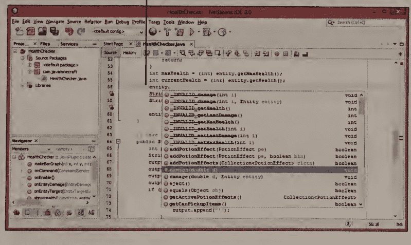

图 25.2 在 NetBeans 源码编辑器中学习对象的方法。

Bukkit 类库设计得良好，许多方法的名字让其目的非常清晰。`damage()` 方法在生物被玩家剑击中时，从生物身上减少指定的血量值。

通过关注 NetBeans 的这一功能，你可以在不离开源码编辑器的情况下学习 Bukkit。

在离开 NetBeans 编辑器之前，要么删掉你刚刚输入的那行，要么通过调用生物的一个方法来完成该语句。

# 极少内容

战斗结束了，你获得了胜利，并多了一个生物可以放入你的战利品。

`HealthChecker` 生物展示了如何编写一个事件处理类，来监听与生物相关的新类型事件。因为生物在 Bukkit 类库中被称为实体（entities），因此这些事件被称为 `EntityDamageEvent` 和 `EntityTargetEvent`，它们都来自 `org.bukkit.entity` 包。

类的事件处理方法可以从这些类名推断出来。在前面加上文本并去掉结尾的 `Event`，就会得到 `onEntityDamage()` 和 `onEntityTarget()`。

和所有其他事件处理方法一样，它们将相关的事件对象作为唯一的参数。

Bukkit 中有 11 个不同的事件包。最大的是用于生物的 `org.bukkit.event.entity`，它有 40 个。

因为你将花费大量时间研究 Bukkit 的 Javadoc 文档，本章将帮助你在 NetBeans 源码编辑器中编写 Java 程序时抢先一步。


# 本章内容
- 用一个命令生成 100 只动物
- 表明 Mod 已处理了某个命令
- 让玩家开启和关闭 Mod
- 在物品生成时监听事件
- 确定物品的类型和数量
- 取消某个事件
- 种植树苗

# 第 26 章 改变世界

## 开始项目

方法的最后一行返回 `false`，只有当 mod 没有执行任何命令时才会到达此处。

该 mod 在 `onItem` 方法中将自己注册为事件处理程序，就像在第 24 章“响应游戏中的事件”和第 25 章“在战斗期间显示生物血量”中创建的 mod 一样。

此程序的类文件中定义了一个事件处理方法 `onItemSpawn()`，它接受一个 `ItemSpawnEvent` 对象作为参数：

```java
public void onItemSpawn(ItemSpawnEvent event) {
    // ...
}
```

`ItemSpawnEvent` 类位于 `org.bukkit.event.entity` 包中。

对 `commandOn` 实例变量的检查确保了 mod 的种树功能已开启：

```java
if (!commandOn) {
    return;
}
```


之后，将检查触发事件生成的物品。`ItemSpawnEvent` 对象的 `getEntity()` 方法返回被生成的物品，并将其强制转换为该类。

在 Minecraft 中遇到一个物品时，其数量可能大于一个，因此你必须通过调用 `Item` 对象的 `getItemStack()` 方法来获取堆栈。它返回一个 `ItemStack`。

该 mod 只关心一种可以被生成的物品：蛋。该类型由 `Material` 枚举表示，并通过物品的 `getType()` 方法获取。

```java
Item item = (Item) event.getEntity();
ItemStack stack = item.getItemStack();
Material type = stack.getType();
```

一个新鲜产下的鸡蛋的类型是 `Material.EGG`。

在检查确保此事件产了一个蛋后，通过调用事件对象的 `setCancelled(Boolean)` 方法并传入 `true` 作为参数来取消普通事件：
`event.setCancelled(true);`

# 第 26 章 让世界随时间发生变化

有时在事件处理方法中，你并不希望默认行为发生。在这个 mod 中，你不希望鸡蛋被产下，因此取消了该事件。

如果事件没有被取消，这只鸡就会产出一棵树和一个鸡蛋。

该 mod 将新树作为树苗放置在蛋本该掉落的位置。树只能在当前 Bukkit 版本支持的两种方块上种植——`Material.DIRT`（泥土）和 `Material.GRASS`（草地）。


> **注意**：Minecraft 中还有第三种支持树苗的方块：Podzol（菌丝/碎石）。这种方块出现在巨型生物群系（Mega Biome）中，看起来像一种深色的泥土方块，带有绿色和橙色的斑点。

该方块（目前）无法在 mod 中使用，因为当前的 Bukkit 版本不支持它。菌丝是在 Minecraft 1.7.2 版本中引入的，但 Bukkit 1.7.10 不包含 `Material.PODZOL` 枚举值。

当你开发 mod 时，不要假设游戏中的所有内容都被 Bukkit 类库所支持。虽然设计 Bukkit 的志愿者程序员在跟进 Minecraft 出现的新功能方面做得非常出色，但某些功能尚未实现。

通过获取该位置的 `Location` 和 `Block` 对象来了解蛋本该掉落的方块：

```java
Location cloc = item.getLocation();
```

```java
Block block = cloc.getBlock();
```

这些对象用于获取该方块下方的方块并提取其材质：

```java
Block under = block.getRelative(BlockFace.DOWN);
```

```java
Material below = under.getType();
```

一个 `if` 条件判断检查下方对象是否为 `Material.DIRT` 或 `Material.GRASS`。如果是，则通过其 `setType` 方法为方块设置一棵树苗：

```java
if (below == Material.DIRT || below == Material.GRASS) {
    block.setType(Material.SAPLING);
}
```

该 mod 通过服务器窗口消息完成它的工作：

```java
LOG.info("[JohnnyAppleChicken] Tree planted");
```

## 在 NetBeans 中创建 JohnnyApplechicken 程序

在 NetBeans 中执行以下步骤开始开发 JohnnyApplechicken 程序：

1. 点击 **File**（文件）> **New File**（新建文件）。
2. 在 **Categories**（类别）面板中，选择 **Java**。
3. 在 **File Types**（文件类型）面板中，选择 **Empty Java File**（空 Java 文件）并点击 **Next**（下一步）。
4. 对于 **Class Name**（类名），输入 `JohnnyApplechicken`。
5. 对于 **Package**（包名），输入 `com.javaminecraft`。
6. 点击 **Finish**（完成）。

新文件将打开进行编辑。将代码列表 26.2 的文本输入到该文件中。

## 列表 26.2 JohnnyApplechicken.java 的完整文本

```java
package com.javaminecraft;

import java.util.logging.Logger;
import org.bukkit.Location;
import org.bukkit.Material;
import org.bukkit.Server;
import org.bukkit.World;
import org.bukkit.block.Block;
import org.bukkit.block.BlockFace;
import org.bukkit.command.Command;
import org.bukkit.command.CommandSender;
import org.bukkit.entity.Chicken;
import org.bukkit.entity.Item;
import org.bukkit.entity.Player;
import org.bukkit.event.EventHandler;
import org.bukkit.event.Listener;
import org.bukkit.event.entity.ItemSpawnEvent;
import org.bukkit.inventory.ItemStack;
import org.bukkit.plugin.PluginManager;
import org.bukkit.plugin.java.JavaPlugin;

public class JohnnyApplechicken extends JavaPlugin implements Listener {
    public static final Logger LOG = Logger.getLogger("Minecraft");
    private boolean commandOn = true;
    Player me;
    World world;
    Location spot;

    @Override
    public boolean onCommand(CommandSender sender, Command cmd, String label, String[] arguments) {
        me = (Player) sender;
        world = me.getWorld();
        spot = me.getLocation();
        if (sender instanceof Player) {
            if (cmd.getName().equalsIgnoreCase("applechicken")) {
                if (arguments.length == 0) {
                    world.spawn(spot, Chicken.class);
                }
                if (arguments.length > 0 && arguments[0].equals("on")) {
                    commandOn = true;
                    LOG.info("[JohnnyAppleChicken] on");
                    return true;
                }
                if (arguments.length > 0 && arguments[0].equals("off")) {
                    commandOn = false;
                    LOG.info("[JohnnyAppleChicken] off");
                    return true;
                }
            }
            return false;
        }
        return false;
    }

    @Override
    public void onEnable() {
        Server server = getServer();
        PluginManager manager = server.getPluginManager();
        manager.registerEvents(this, this);
        LOG.info("[JohnnyAppleChicken] enabled");
    }

    @EventHandler
    public void onItemSpawn(ItemSpawnEvent event) {
        if (!commandOn) {
            return;
        }
        Item item = (Item) event.getEntity();
        ItemStack stack = item.getItemStack();
        Material type = stack.getType();
        if (type == Material.EGG) {
            event.setCancelled(true);
            Location loc = item.getLocation();
            Block block = loc.getBlock();
            Block under = block.getRelative(BlockFace.DOWN);
            Material below = under.getType();
            if (below == Material.DIRT || below == Material.GRASS) {
                block.setType(Material.SAPLING);
            }
        }
        LOG.info("[JohnnyAppleChicken] Tree planted");
    }
}
```

*(注：原书代码清单 26.2 存在行号错乱、方法签名错误及逻辑缺陷，此处已修正为可编译的标准 Bukkit 插件结构，修正了 `onCommand` 签名、`onEnable` 方法名、事件逻辑判断 `commandOn` 及参数越界风险，并补全了 `Logger` 类型声明。)*

# 第 26 章 让世界随时间发生变化（续）

如果 mod 的源代码已保存且没有错误，你就可以构建 JohnnyApplechicken mod 的 Java 存档（JAR）文件并将其部署到 Bukkit 服务器上。

## 部署 Mod

在你的文件系统中，通过以下步骤将 `JohnnyApplechicken.jar` 文件从项目文件夹拷贝到 Minecraft 服务器：

1. 如果 Minecraft 服务器正在运行，请停止它。
2. 打开安装 Bukkit 服务器的文件夹，然后打开 `JohnnyApplechicken` 子文件夹。
3. 打开 `dist` 子文件夹。
4. 选择 `JohnnyApplechicken` JAR 文件，然后按 `Ctrl+C` 复制它。
5. 再次打开 Minecraft 服务器文件夹，打开其 `plugins` 子文件夹。
6. 按 `Ctrl+V` 将 `JohnnyApplechicken.jar` 粘贴到其中。

图 26.1 显示了两只小鸡和一棵由左边的鸡刚孵出的树。


**图 26.1** 哪个先有，鸡蛋还是树？

## 终极简约

“Johnny Applechicken”Mod 是一个简单的演示，展示了这些程序如何成为 Minecraft 世界中变化的催化剂。它通过为玩家在游戏中提供新的可观察的事物，增强了游戏体验。

会下树的鸡可以在游戏时间中的几周内，将一片草地空地或山谷变成一片森林。

如果使用该 Mod 生成 100 只鸡，它们可以迅速地将某些区域变成茂密——有时是无法通过的森林。

当然，在编写一个改变世界的 Mod 时，有一些缺点需要考虑。玩家在 Minecraft 中建造了许多酷炫的东西，而一个 Mod 可能会像破坏者（Griefers）一样毁掉它们。

在测试期间，我发现下树的鸡可以毁灭栅栏并让动物逃离农场。蛋可以落在栅栏块上，因此如果在那里放置了一棵树，栅栏就会消失。


- 结一个强大的新朋友
- 尝试自己写一个 Mod
- 用闪电击中 Minecraft 世界的任何地方
- 监控怪物目标玩家进行攻击
- 学习怪物选择其目标的原因
- 加入 Bukkit Mod 程序员社区
- 检查复杂 Mod 的源代码
- 在 www.javaminecraft.com 进一步提升你的技能

# 第 27 章 与雷电之神友好

Minecraft 是一个危险的地方。

从你开始游戏的那一刻起，就有一群渴望杀死你并抢走你东西的怪物——即使那些对它们完全没有用。我还在寻找那个拿走了我的把带有“幸运 III”附魔钻石镐的僵尸。

当我找到它时，复仇将属于我。我的铁镐也是如此。

由于游戏中的许多危险，在高处拥有朋友是件好事。在本书的最后一个章节中，你将拥有其中一个朋友。

你的朋友能够在任何怪物考虑攻击你时，从高处向它投掷闪电。当你被怪物锁定攻击目标的一瞬间，砰。

终结人的邪恶之眼？砰。

苦力怕的愤怒面孔？砰。

岩浆怪的恶毒表情？砰。

我们将你的新朋友命名为宙斯（Zeus）。

## 启动项目

你有两种方法编写名为 `BestFriendOfZeus` 的 Mod。
一种是像你在本书中所做的那样，在阅读章节时，随着代码和编程技巧的解释进行学习。

另一种是先尝试自己动手做，脑子里只装满新学到的编程知识以及一个提示。

如果你想在阅读之前先看看自己是否能写出来，这里是提示：

`org.bukkit` 包中的 `World` 类有一个 `strikeLightning()` 方法（原文为 `lightningStrike()`，实际 API 为 `strikeLightning`）。
你的 Mod 应该在目标锁定玩家的瞬间用闪电击中每一个怪物。

该 Mod 应该有一个命令来开启和关闭这个功能。在 Mod 启动时，它应该是关闭状态。

如果你打算尝试自己编写代码，现在就是开始的时候了。下一个标题将等待你回来。

## 逐步进行 Mod 开发

以下是书中版本的 `BestFriendOfZeus` 的创建方法。

### 创建项目

1. 选择 **File**（文件）> **New Project**（新项目）。
2. 选择项目类别为 `Java`，项目类型为 `Java Application`，点击 **Next**（下一步）。
3. 输入项目名称 `BestFriendOfZeus`。
4. 取消勾选 **Create Main Class**（创建主类），然后点击 **Finish**（完成）。
5. 在 **Projects**（项目）面板中，右键点击 `Libraries` 文件夹并选择 **Add Library**（添加库）。
6. 在 **Available Libraries**（可用库）面板中，选择 `Bukkit`。
7. 点击 **Add Library**（添加库）。

`BestFriendOfZeus` 项目已创建但里面没有任何文件，需要 Mod 的配置文件来处理 `/zeus` 命令。该命令有一个 `on` 参数来调用宙斯的帮助，以及一个 `off` 参数让宙斯冷静一下。

### 创建 plugin.yml 配置文件

通过以下步骤在 `src` 项目文件夹中为 Mod 创建 `plugin.yml` 配置文件：

1. 选择 **File**（文件）> **New File**（新文件）。
2. 在 **Categories**（类别）面板中，选择 **Other**（其他）。
3. 在 **File Types**（文件类型）面板中，选择 `YAML File`，然后点击 **Next**（下一步）。
4. 在 **File Name**（文件名）字段中，输入 `plugin`（不要带 `.yml`）。
5. 在 **Folder**（文件夹）字段中，输入 `src`。
6. 点击 **Finish**（完成）。

NetBeans 源代码编辑器打开了，并准备好编写 `plugin.yml`。将清单 27.1 中的文本输入编辑器，并在完成后保存。

> **注意**：你可能不需要被提醒要保存工作，这本书已经有 27 章了，但我像个人一样担心。万一你忘记保存然后发生了闪电击中怎么办？

## 清单 27.1 plugin.yml 的全文

```yaml
name: BestFriendOfZeus
author: Your Name Here
main: com.javaminecraft.BestFriendOfZeus
version: 1.0
commands:
  zeus:
    description: Ask Zeus to be your best friend.
    usage: /<command> [on | off]
```


# 第 27 章 与雷神做朋友

## 终极简约

“Johnny Applechicken”Mod 是一个简单的演示，展示了这些程序如何成为 Minecraft 世界中变化的催化剂。它通过为玩家在游戏中提供新的可观察的事物，增强了游戏体验。

下树的鸡可以在游戏时间中的几周内，将一片草地空地或山谷变成一片森林。

如果使用该 Mod 生成 100 只鸡，它们可以迅速地将某些区域变成茂密——有时是无法通过的森林。

当然，在编写一个改变世界的 Mod 时，有一些缺点需要考虑。玩家在 Minecraft 中建造了许多酷炫的东西，而一个 Mod 可能会像破坏者（griefer）一样毁掉它们。

在测试期间，我发现下树的鸡可以毁灭栅栏并让动物逃离农场。蛋可以落在栅栏块上，因此如果在那里放置了一棵树，栅栏就会消失。


- 结一个强大的新朋友
- 尝试自己写一个 Mod
- 用闪电击中 Minecraft 世界的任何地方
- 监控怪物目标玩家进行攻击
- 学习怪物选择其目标的原因
- 加入 Bukkit Mod 程序员社区
- 检查复杂 Mod 的源代码
- 在 www.javaminecraft.com 进一步提升你的技能

## 与雷电之神友好

Minecraft 是一个危险的地方。

从你开始游戏的那刻起，就有一群渴望杀死你并抢走你东西的怪物——即使那些对它们完全没有用。我还在寻找那个拿走了我的带有“幸运 III”附魔钻石镐的僵尸。

当我找到它时，复仇将属于我。我的铁镐也是如此。

由于游戏中的许多危险，在高处拥有朋友是件好事。在本书的最后一个章节中，你将拥有其中一个朋友。

你的朋友能够在任何怪物考虑攻击你时，从高处向它投掷闪电。当你被怪物锁定攻击目标的一瞬间，砰。

终结人的邪恶之眼？砰。

苦力生物的愤怒面孔。砰。

岩浆块的恶毒表情？砰。

我们将你的新朋友命名为宙斯（Zeus）。

## 启动项目

你有两种方法编写名为 `BestFriendOfZeus` 的 Mod。
一种方法是像你在本书中所做的那样，在阅读章节时，随着代码和编程技巧的解释进行学习。

另一种是先尝试自己动手做，脑子里只装满新学到的编程知识以及一个提示。

如果你想在阅读之前先看看自己是否能写出来，这里是提示：

`org.bukkit` 包中的 `World` 类有一个 `lightningStrike()` 方法。
你的 Mod 应该在目标锁定玩家的瞬间用闪电击中每一个怪物。

该 Mod 应该有一个命令来开启和关闭这个功能。在 Mod 启动时，它应该是关闭状态。

如果你打算尝试自己编写代码，现在就是开始的时候了。下一个标题将等待你回来。

## 逐步进行 Mod 开发

以下是书中版本的 `BestFriendOfZeus` 的创建方法。

### 创建项目

1. 选择“文件”（File）、“新项目”（New Project）。
2. 选择项目类别为 `Java`，项目类型为 `Java Application`（Java），点击“下一步”（Next）。
3. 输入项目名称 `BestFriendOfZeus`。
4. 取消勾选“主类”（Main Class），然后点击“完成”（Finish）。
5. 在“项目”面板中，右键点击 `Libraries` 文件夹并选择命令“添加库”（Add Library）。
6. 在“可用库”（Available Libraries）面板中，选择 `Bukkit`。
7. 点击“添加库”（Add Library）。

`BestFriendOfZeus` 项目已创建但里面没有任何文件，需要 Mod 的配置文件来处理 `/zeus` 命令。该命令有一个 `on` 参数来调用宙斯的帮助，以及一个 `off` 参数让宙斯冷静一下。

通过以下步骤在 `src` 项目文件夹中为 Mod 创建 `plugin.yml` 配置文件：

1. 选择“文件”（File）、“新文件”（New File）。
2. 在“类别”（Categories）面板中，选择“其他”（Other）。
3. 在“文件类型”（File Types）面板中，选择 `YAML File`，然后点击“下一步”（Next）。
4. 在“文件名”（File Name）字段中，输入 `plugin`（不要带 `.yml`）。
5. 在“文件夹”（Folder）字段中，输入 `src`。
6. 点击“完成”（Finish）。

NetBeans 源代码编辑器打开了，并准备好编写 `plugin.yml`。将清单 27.1 中的文本输入编辑器，并在完成后保存。

> 注意：你可能可能不需要被提醒要保存工作，这本书已经有 27 章了，但我像个人一样担心。万一你忘记保存然后发生了闪电击中怎么办？

### 清单 27.1 plugin.yml 的全文

```
1: BestFriendOfZeus

2:

3: author: Your Name Here

4:

5: main: com.javaminecraft.BestFriendOfZeus

6:

7: commands:

8: zeus:

9: description: Ask Zeus to be your best friend.

10: usage: /<command> [on | off]

11:

12: version: 1.0
```

第 10 行的用法定义了接受的两个参数为 "on" 和 "off"。

### 创建项目

`BestFriendOfZeus` Mod 必须监听事件，以知道何时怪物目标了玩家以便降下闪电。

要让这生效，需要完成三件事：

1. 类实现 `Listener` 接口。
2. 方法带有 `@EventHandler` 注解。
3. 使用 `PluginManager` 注册事件。

`org.bukkit` 包中的 `World` 类有一个 `lightningStrike()` 方法。
你的 Mod 应该在目标锁定玩家的瞬间用闪电击中每一个怪物。

该 Mod 应该有一个命令来开启和关闭这个功能。在 Mod 启动时，它应该是关闭状态。

如果你打算尝试自己编写代码，现在就是开始的时候了。下一个标题将等待你回来。

## 代码示例

### 清单片段（第 29 行）

```
Command command
```

### Java 代码片段（第 64-82 行）

```java
Entity entity = event.getEntity();
Entity target = event.getTarget();

LOG.info("Target " + target + " are no chosen by " + entity);
if (target instanceof Player) {
    // 怪物的目标是一个玩家
    Player playa = (Player) target;
    if (playa == me) {
        // 怪物的目标是这个玩家
        if (event.getReason()) ==
        TargetReason.CLOSEST_PLAYER) {

            Location loc = entity.getLocation();
            // 轰来临！
            world.strikeLightning(loc);
        }
    }
}
```


该模组的源代码已经保存且没有错误，你可以编译 `BestFriendOfZeus` 模组的 Java 存档（JAR）文件并将其部署到 Bukkit 服务器上。

## 部署模组

在你的文件系统中，通过以下步骤将 JAR 文件 `BestFriendOfZeus.jar` 从其项目文件夹复制到 Minecraft 服务器中：

1. 如果 Minecraft 服务器正在运行，请停止它。
2. 打开安装 Bukkit 服务器的文件夹，然后打开 `BestFriendOfZeus` 子文件夹。
3. 打开 `dist` 子文件夹。
4. 选择 `BestFriendOfZeus` JAR 文件，然后按 `Ctrl+C` 复制它。
5. 再次打开 Minecraft 服务器文件夹，打开其 `plugins` 子文件夹。
6. 按 `Ctrl+V` 将 `BestFriendOfZeus.jar` 复制到其中。

# 第 27 章 与雷神做朋友 367

图 27.1 显示了一个女巫在离玩家足够足够扔出那些烦人的药水之前，就被雷电击中了。


图 27.1

那一定很疼吧！

模组加载后，当你回到 Minecraft 世界时，使用 `/zeus on` 开始这段友谊。

和这个模组玩一会儿，体验一下与雷神做朋友的好处和坏处。

起初，你可能觉得一切都好。你可以心地进行建筑、农作和采矿工作，而不用担心怪物会偷袭你。

但你也会发现一些不好的事情。你可能不想对你的角色产生过深感情，至少在你修改了模组代码让雷神成为更好的朋友之前是如此。

# 加入模组开发者社区

你现在可以利用在书中学到的技能来创建和部署模组了。Bukkit 类库中还有很多内容可以尝试，你可以通过访问网站 `http://www.javaminecraft.com/bukkitapi` 查阅 Javadoc 文档来探索。

其他程序员在网络上分享了成千上万个模组。你可以在 `http://dev.bukkit.org/bukkit-plugins` 的 Bukkit Plugins 目录下找到其中许多。

这些模组中的许多提供了 Java 源代码，因此你可以查看它们是如何编写的，并了解在程序中与 Minecraft 交互的新技术。

TreeAssist 模组是我刚开始《我的世界》模组中如何砍树时发现的一个有趣工具。它为像素伐木工有两个实用的功能：

- 当玩家砍掉树上最底部的木头块时，其余的木头会自动砍倒。
- 当一棵树被砍倒时，在该位置会种下一个相同的幼苗。

目录中的每个模组都有自己的页面。TreeAssist 的主页是 `http://dev.bukkit.org/bukkit-plugins/tree-assist`。

点击页面上的 Download 链接。将加载另一个包含更多模组信息的页面。

点击该页面上的 Download 链接下载 JAR 文件，你可以用将其部署到你自己的服务器上。将 `TreeAssist.jar` 文件放置在你保存自己模组的文件夹中。下次重启服务器时，模组的命令将可用。

回到 `http://dev.bukkit.org/bukkit-plugins/tree-assist`，点击页面上的 Source Code 链接进入 GitHub 仓库并查看组成程序的代码。

你将看到一个带有文件夹和文件列表的页面，如图 27.2 所示。

# 第 27 章 与雷神做朋友 369

src 文件夹

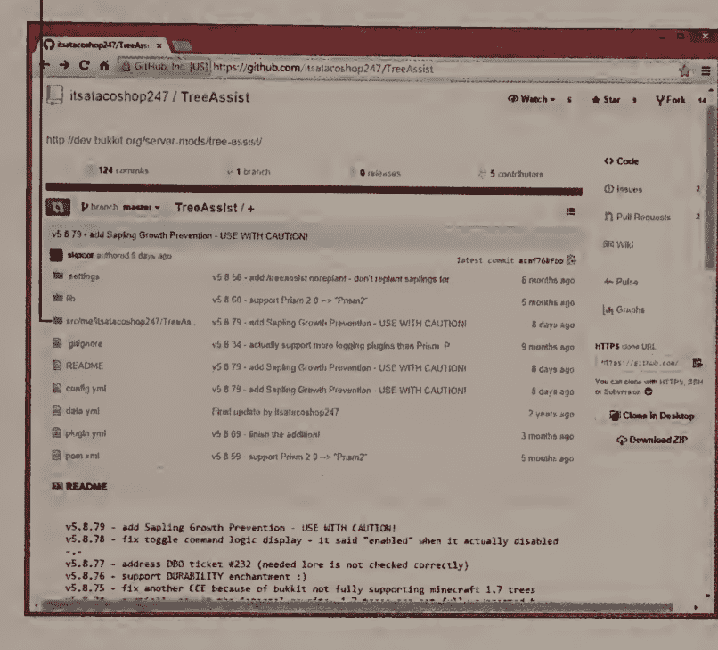

图 27.2

在 GitHub 上查看模组的源代码。

在你访问时列表会有所不同，但你会看到一个像图 27.2 指出的 `src` 文件夹。这是存放模组源代码的地方。

这个模组有多个文件，`TreeAssist.java` 文件是起点，因为它是扩展了 `JavaPlugin` 的类。

## 极简

《我的世界》模组初学者完全指南》的最后一章只是你模组编程生涯的序章。凭借你在这些章节中开发的技能，你已经建立了坚实的基础。你可以访问 `javaminecraft` 网站尝试更多内容。与雷神做朋友的好处和坏处。你可能不想对你的角色产生过深感情，至少在你修改了模组代码让雷神成为更好的朋友之前是如此。该网站提供以下内容：

- 错误修正和澄清：如果读者对书中提到的错误有疑问，请查看该网站。
- 读者问题解答：如果对书中未涵盖的内容有疑问，网站将提供解答。
- 链接更新：如果书中提到的链接发生了变化，网站将会更新。

你也可以通过访问网站直接向我们反馈任何正面的、负面的或不定的意见。你可以发送电子邮件。

—Rogers Cadenhead

# 索引

# 符号

`\` 82, 225
`$` (美元符号), 69
`{}` (花括号), 64

`actionPerformed()` 方法, 216
`add()` 方法, 165
加法运算符 (`+`), 72
`addPotionEffect()` 方法, 264
相邻块, 327
`alert` 方法, 153
`AnimatedLogo` 类, 166

变量, 设置。
212-213
`NameSorter`, 125-126
`NewCalculator`, 193-194
`NewRowRouter`, 140-141
`Nines`, 109-110
`NumberDivider`, 195-196
组织, 94, 202-203 `evenPageCatalog`, 76-78
`PlanetWeight`, 72-76
`PointTester`, 172-176
`Root`, 52-53
`StringLister`, 170-171
`Variable`, 65-66

Java 程序, 43
`--` (自减运算符), 72
`/` (除法引号), 66
`""` (双引号), 66,

`@EventHandler`, 326
`@Override`, 324

`//` (等号), 66, 70
`==` (相等性运算符), 93
`/` (正斜杠), 92
`>` (大于运算符), 92
`++` (自增运算符), 72

`apple` class libraries, 57
`applection` command, 351
`applets`, 51
specifications,

`=` (赋值运算符), 94
`<` (小于运算符), 92
`--` (减号), 72
`*` (乘法运算符), 72


# 374 数组

- 整数声明, 120
- 幸运轮盘应用 (Wheel of Fortune application), 129
- 列表 1-179
- 添加对象, 169
- 创建, 166, 178
- 定义, 178
- 元素检索, 169
- 通用型, 178
- 遍历, 170
- 数组列表
- 立方体树 (outside-the-cube-trees), 310-311
- 创建对象, 180-183
- 大小, 179
- 复合向量, 124-125
- 多维数组, 124-125
- `pageLink`, 213
- `pageTitle`, 213
- 示例应用, 123-124
- 存储位置, 313
- 排序, 125-126
- 字符串, 120
- 上限, 122
- 幸运轮盘应用 (Wheel of Fortune application), 127-130
- `Array` 类, 125
- 是 (`*` 乘法运算符), 72
- 属性, 132
- 定义, 147
- 继承, 135
- 自动装箱, 141
- 抛出闪电, 363
- 怪物攻击目标, 362-363
- 怪物发现可攻击对象, 检索, 362
- 插件配置文件, 360
- 项目创建, 360
- 源代码, 364-366
- `bigdig` 命令, 295
- BigDig 模组
- 修改方块材料, 297
- 检查玩家周围的方块, 296
- 添加 Bukkit 类库, 294
- 挖掘玩家周围的圆形, 295-297
- 部署, 301
- 洞的实现方案消息
- 确定洞的尺寸, 295
- 插件配置文件, 294
- 项目创建, 294
- 源代码, 298-301
- 二进制值变量, 68
- 空跨度 (Java), 49-50
- 跳出循环, 113
- `browse()` 方法, 216
- 缓冲输入流, 229-231
- `BufferedInputStream()` 构造函数, 230
- Bukkit 插件 目录网站, 368
- 项目网站, 3
- 为玩家添加 Bukkit 类库, 245
- 事件
- 处理方法, 326
- 包, 325
- Java 文档, 290, 367
- 网站, 61
- Bukkit Minecraft 服务器
- Bukkit jar 文件未找到错误, 5
- 创建连接, -91
- 修复, -112
- 下载, 2
- `EULA` 类, 4
- Java 虚拟机找不到错误, -7
- 修改玩家个人资料, 12
- 运行运行时, 4
- 开始, 3
- 字节码, 224
- 字节字节, 226-227
- 跳过, 227
- 流, 224
- 变量, 67
- 写入流, 233
- 备份世界, 302-304
- 反斜线类 (`\`), 82, 225
- 退格字符, 82
- 蝙蝠，带有坐标总和, 65
- Battlepoint 应用, 181-183
- 调试锁, 296
- 行为, 132-135
- 基准测试应用 (Benchmark), 116-117
- `BestFriendOfZeus` 模组, 360
- 添加 Bukkit 类库, 360
- 部署, 366
- 注册事件监听器, 362
- 接收事件, 362

# C

- `C418`, 229
- 调谐器类 (`CableModulator`), 143
- 计算器应用, 199-191
- 天花板事件正常行为, 352
- 找不到符号错误消息, 47
- 崩溃返回情况, 82
- case 大写敏感性
- 一致性, 70
- 变量名, 69
- 修改字符串, 85
- `case` 语句, 97
- `BlockEnumeration`, 327
- 方块, 64, 96
- 相的，检索, 227
- 检查, 296
- 销毁, 297
- `getRelative()` 方法, 254
- `getType()` 方法, 250, 310
- 寻找, 297
- 石块适用性, 227
- 树木种植, 353
- 变为空气, 297
- `Boolean`, George, 69
- 布尔型变量, 68
- 括号 (大括号), 120, 284
- Java 程序, 43
- `break` 语句, 98, 113

# 集合

- 强制转换, 136-137
- 自动装箱, 141
- 定义, 137
- 对象, 138
- 拆箱, 141
- 变量, 137
- 生成, 351
- 设置速度, 264
- 变为树木铺设, 351
- 骑着僵尸的 `ChickenStormMod`
- 导入, 260-261
- 继承, 135-164
- 内部 (`inner`), 311
- `SpawnEvent`, 352
- `ItemStack`, 281
- 库, 25-274, 258
- `LinkRotator`, 212 位置, 311
- 捕获异常, 190-191
- 之后处理某些, 196-197
- 添加 Bukkit 类库, 245
- 鸡生成, 251
- `Logger`, 244, 284, 29
- 文档, 60
- `floor()` 方法, 58
- `random()` 方法, 58
- `sqrt` 方法, 53
- 方法声明, 155
- 调制调器 (`Modem`), 142
- 多重异常, 194
- `PageCatalog` 应用, 201-202
- 计算器应用, 191-193
- 确定, 248
- 随机位置, 255
- 特有位置, 249-250
- 部署, 254
- JAR 文件, 253
- 载载, 249
- 项目, 245
- 源代码, 251
- NetBeans
- 自动导入, 260-261
- 编译, 220
- 运行, 21
- 包, 31
- `PetWolf` 程序, 31
- `PlayerInventory`, 281
- `PlayerMoveEvent`, 326
- `Point`, 172
- `Point3D`, 172-174, 193-196
- 怪物, 268
- 添加 Bukkit 类库, 268
- 命令, 269
- 当前列表, 269
- 部署, 278
- 发送消息, 271
- 插件配置文件, 268-269
- 项目创建, 268
- 源代码, 274-277
- 类型计数, 270-283
- YAML 文件, 246-248
- `chopAdjacent()` 方法, 312-313
- 半径, 295
- 类语句, 42, 134, 322
- 类, 132
- `PotionEffect`, 264
- `Properties`, 235
- `RuntimeException`, 200
- 子类, 见子类
- 父类, 135
- 同步, 188
- 系统, 230
- 测试, 174
- 村民, 273-274
- 部署, 279
- `char` 变量, 60
- 字符, 273
- `char` 变量, 66
- 声明, 122
- 定义, 65, 80
- 引号, 66
- 特殊, 81-82
- 流, 224
- `AnimatedLogo`, 166
- `Applet`, 165
- `ArrayOutOfBoundsException`, 190
- `ArrayList`, 168-170
- `Arrays`, 125
- `Bukkit`, 61
- `BukkitMod`, 143
- `CheckDatabase`, 198
- `Console`, 230-232
- 声明, 42, 212
- 定义, 25, 57
- `double`, 295
- `sleep()` 方法, 206
- `stop()` 方法, 211
- 两个, 270, 210-211
- 变量, 148-150
- `Vector`, 274
- `Virus`, 148
- 幸运轮盘应用, 129
- `checkOut` 方法, 158
- `CheckDatabase` 类, 198
- 封装, 153
- 事件监听器, 321
- 异常, 190
- 文件, 225
- `FileInputStream`, 252
- `FileOutputStream`, 232
- `FileReader`, 232
- `FileWriter`, 232
- `Font`, 186
- 辅助, 157
- 层次结构, 164-166
- `Clock` 应用, 100-104
- 关闭流, 224, 233
- 集合, 171

# 颜色 (文本输出)

- 颜色 (文本输出), 340-341
- 命令应用, 创建, 123-134
- 输出, 55
- 命令, 54
- `CommandSender` 对象, 56
- 商品应用, 98-99
- 比较字符串, 84-92
- 编译类, 20
- 复杂 `for` 循环, 115
- 比较速度, 116-117
- 拼接字符串, 82-83
- 拼接运算符 (`+`), 82-83
- 条件判断, 92
- `Clock` 应用, 100-104
- `ClockTask` 应用, 104
- 转换, 见强制转换
- 数值值, 236
- 坐标 (玩家), 249
- 计数器, 108
- `newFile()` 方法, 225
- `Creative Commons` 许可证, 229
- 积分验证应用, 198
- `CreditChecker` 应用, 198
- `Credit Assets` 版本, 87-88
- 大括号 `{}`, 64
- 类变量, 150
- 浮点型, 65
- 十进制值, 68
- 整数, 65
- `Linker` 应用, 212-213
- 公共, 149
- 引号, 66
- `short`, 67
- 递减运算符 (`-`), 72
- 递减值, 72-74
- 默认语句, 98
- 默认值, 149
- `delete()` 方法, 225
- 删除文件, 225
- 部署方法, 254-255
- `if`, 92
- 方块, 96
- 等于比较, 93
- 小于比较, 92
- `else`, 96-97
- 三元运算符 (`?`), 99-100
- 配置设置, 见 properties
- `figurator` 应用, 237-238
- `ConfigWriter` 应用, 233-235
- `damage()` 方法, 347
- 数据类型, 44
- 二进制值, 68
- 布尔型, 68-69
- `byte`, 67
- 枚, 271
- 浮点数, 65
- 十进制值, 68
- 整数, 65
- `long`, 67
- `short`, 67
- `BestOfZeus`, 366
- `BigDig`, 301
- `HealthChecker`, 345
- `JohnnyApplecheek`, 357
- `MobCombus`, 276
- `PetWolf` 方法, 34
- `StoneWalker` 方法, 331-332
- `transmuter` 方法, 289-290
- `TreeChopper`, 318
- `ZombieChicken`, 264


# 异常 377

- 钻石，转化为僵尸肉块，288
- 骰子应用，58-59
- 挖掘
  - 基岩，296
- BigDig 模组
  - 方块材料，
    - 更改，297
  - 玩家周围的方块，
    - 检查，296
  - Bukkit 类库，
    - 添加，294
    - 玩家周围的圆形，295-297
    - 部署，301
  - 洞穴完成方案/消息，297
  - 洞穴大小
    - 确定，295
  - 插件配置文件，294
  - 项目创建，294
  - 源代码，298-301
- 用户最终许可协议 (EULAs)，4
- 无限循环，112
- 实体 (entities)。见包 (packages)
- `EntityDamage` 对象，338
- `EntityTarget` 对象，339
- `EntityTargetReason` 枚举，363
  - `setEntry()` 方法，186, 272
- 枚举，271
- `BlockFace`, 327
- `EntityTarget.TargetReason`, 363
- 等号 (`=`), 66, 70
- 相等性, 93
- `equals()` 方法, 84, 165
- `equalsIgnoreCase` 方法, 243
- EULAs (用户最终许可协议), 4
- `@EventHandler` 注解, 326
- 事件 (events)
  - 定义, 321
  - 文档, 346
  - 爆炸, 346
  - 处理, 321
  - 相邻方块
    - 获取, 327
    - 方块材料,
      - 转换, 328
    - 玩家正方的方块, 327
  - 定义, 324
  - `@EventHandler` 注解, 326
  - 图形用户界面, 324
  - 方法, 326
  - 模组上的状态检查, 327
  - 层位置, 326-327
  - `registerEvents()` 方法, 325
  - 闪电, 363
  - 监听, 321
  - 怪物数量/最大生命值, 确定, 339
  - 受到伤害的怪物, 338
  - 显示变量, 338
- 显示 (displaying)
  - 凭据, 88
  - Java 程序错误, 46
- 模组源代码
  - GitHub, 308
  - 属性, 236
  - 循环链接, 217-219
  - 字符串
    - 错误, 122
    - 定义, 189
    - 异常, 190-191
    - `ArrayIndexOutOfBoundsException`
      - 匹配, 194-196
      - 与 `try-catch` 块配合, 194
    - 未定义, 189
    - `Exception` 类,
      - 异常后的处理, 196-197, 201-202
      - 忽略, 299
      - `PageSerialization` 对象, 202-203
      - 抛出, 197
      - 抛出与捕获, 190
      - 未检查的, 201
      - 处理, 214-213
  - 攻击玩家的怪物, 339
  - 作为监听器的怪物,
    - 注册, 324-325
    - `StoneWalker` 方法, 324
- 怪物 (mobs)
  - `print()` 方法, 80-81
  - 特殊字符, 81-82
  - 变量内容, 447
  - `display()` 方法, 134
  - 距离, 计算, 273
  - `do while` 循环, 112-113
  - 美元符号 (`$`), 69
  - `double` 类, 295
  - 双引号 (`''`), 66
  - 双斜杠 (`/`), 43
- `IndexOutOfBoundsException`, 200
- Java 程序, 47
- `MalformedURLException`, 199
- Minecraft 服务器
  - 可以找到 Bukkit 服务器 JAR 文件, 5
- 找不到 Java 虚拟机错误, 7
- NetBeans, 22-23, 259
- `NullPointerException`, 220
- `NumberFormatException`, 194, 197
- 转义序列, 81

# E
- 元素, 120-121
- `else` 语句, 96
- 封装, 153
- 攻击目标,
  - 找到攻击对象,
  - 获取, 362
  - 目标, 识别, 362
- 鼠标点击, 处理, 216
- 正常行为,
  - 取消, 352
- 包 (packages), 325
- 玩家引起的, 326
- 感叹号（怪物生命值）,
  - 计算, 340
- `Exception` 类, 190
- 异常 (exceptions), 122
- 数组索引越界, 122, 190
- 捕获, 190-191
- 多个, 194
- `try-catch` 块, 191-194
- 与抛出对比, 190
- 创建, 199
- 定义, 189
- `Exception` 类, 190
- 某些操作后的处理, 196-197
- `HomePage` 应用, 201-202
- 忽略, 299-200
- `PageCatalog` 应用, 202-203
- 抛出, 199
- 未检查的, 200-201
- `executeCommand()` 方法, 243, 284-285
- `exists` 方法, 295
- 退出循环, 113
- 爆炸, 346
- 表达式, 75。见另类
- 延迟的, 64
- 增//减运算符, 73
- 运算符优先级, 74-75
- 显示全部, 236
- 加载, 236
- 名称, 235
- 存储, 236
- 读取, 226
- 跳过字节, 227
- 重命名, 225
- 大小, 225
- 写入, 232
- 输出流, 232
- 框架 (mods), 242-245
- `CommandSender` 对象, 243
- `equalsLowerCase()` 方法, 243
- `onCommand()` 方法, 243
- 玩家位置, 244
- `Player` 对象, 创建, 244
- 服务器消息, 244

# G
- `Game` 应用, 94-95
- 游戏结束变量, 69
- 泛型, 178
- 数组列表, 169
- `getAmount()` 方法, 286
- `getBlock()` 方法, 250, 257
- `getBytes()` 方法, 233
- `getEntity()` 方法, 362
- `getFrom()` 方法, 327
- `getHealth()` 方法, 339
- `getInventory()` 方法, 285
- `getKey()` 方法, 272
- `getLivingEntities()` 方法, 269
- `getLocation()` 方法, 294
- `getMaterial()` 方法, 285
- `getMaxHealth()` 方法, 339
- `getMaxSize()` 方法, 286
- `getName()` 方法, 225
- `getOrDefault()` 方法, 221
- `getPlayer()` 方法, 326
- `getPluginManager()` 方法, 325
- `getProperty()` 方法, 236
- `getReason()` 方法, 363
- `getRelative()` 方法, 327
- `getSize()` 方法, 285
- `getTag()` 方法, 362
- `FileWriter` 类, 232
- 找到玩家下方的方块, 368
- 玩家坐标, 249
- `FindPrimitives` 应用, 208-211
- `float` 流, 245
- `float` 变量, 365
- 浮点数, 向下取整, 58

# F
- `File` 类, 225
- `FileInputStream` 类, 232
- `FileOutputStream` 类, 232
- `FileReader` 类, 232
- 文件
- 创建, 225
- 删除, 225
- 存在, 225
- 名称, 235
- `Configurator` 应用, 237-238
- 转换为数值, 236
- `floor()` 方法, 358
- 文件夹内容列表, 226
- 创建, 225
- `Font` 类, 186-189
- `Footer` 应用, 94-95
- `for` 循环, 108-109
- 数组列表, 170
- 复杂的, 115
- 计数变量, 108
- 空槽, 115
- 退出, 113
- `Nine` 应用, 109-110
- 产生, 351
- 字符串, 108-109
- `formfeeds` 字符, 82
- 前斜杠 (`/`), 225

# JARS (JAVA 存档文件) 379
- `getType()` 方法, 327
- `type()` 方法, 250, 272
- `URI()` 方法, 214
- `getValue()` 方法, 273
- `getVirusCount()` 方法, 160
- `getWorld()`, 29, 244
- GitHub 模组源代码, 368
- father, 304
- 图形用户界面, 324
- 大于条件, 92-93
- 大于运算符, 92
- 问候变量, 44
- 地面变化, 见 `StoneWalker` 方法
- 分组策略, 见方块
- `Helper` 类, 157
- `HighSpeedModem` 类, 135
- 洞穴, 挖掘
- `HomePage` 应用, 201-202
- `byte`, 67
- 声明, 65
- 浮点数, 58
- 连字符（抽象）运算符, 72
- 项目, 创建, 336
- 源代码, 342-345
- 调节关闭, 338

# H
- `ActionListener`, 212
- `Listener`, 324
- `Runnable`, 206-207
- 物品, 285
- 遍历, 286
- 材料。见材料
- 槽, 确定, 285
- I/O, 223
- 控制台输入, 230
- 缓冲输入, 224
- 字符, 224
- 关闭, 204
- 定义, 224
- 从...读取数据, 226-229
- 类型, 224
- 处理事件。见事件
- 解码, 120
- 哈希映射, 184
- 容量, 184
- 创建, 184
- `FontMapper` 应用, 186-187
- 键/值存在, 186
- 加载, 184
- 怪物, 270-273
- 对象, 185
- 电话簿, 185
- 大小, 186
- 血条, 339-340
- `healthcheck`/`healthcheck` 关闭, 338
- `HealthCheck` 方法, 336
- 当前/最大生命值, 确定, 239
- 显示时间, 345
- 创建, 331
- 当前高度点, 计算, 340
- 显示, 340
- 比例, 340
- 十进制, 135-163
- 构造函数, 154
- 层次结构, 135
- `Japple` 类, 164-165
- 初始化计数变量, 108
- 内部类, 311
- 输入/输出。见 I/O
- 安装 NetBeans, 16
- 实例变量, 134
- `int` 语句, 65
- 二进制变量, 68

# J
- `Japple` 继承, 164-165
- 方法, 165
- JARS (Java 存档文件), 2
- `ChickenStore`, 253
- `PetWoll`, 找到, 33
- `ZombieChicken`, 264
- 物品堆, 285-286
- `ItemSpawnEvent` 类, 352
- `ItemStack` 类, 281
- 迭代。见
- 迭代器, 109


# 380 JAVA

# K

Java
- 存档文件。参见 JARs
- Bukkit 类库
  - 文档, 290
- 类库, 56
- 类, 57
  - 文档, 57, 61
  - 包, 57
- 开发工具包 (JDK), 8
- `Material` 类
  - 文档, 290
- 程序（大括号），
  - 添加到项目, 40
  - 空格/空白字符,
  - 块, 43
  - 类别，选择, 41
  - 类语句, 42
  - 注释, 43
  - 编译, 36
  - 定义, 38
  - 错误, -46
  - 主语句, 42
  - 运行, 48
  - 保存, 45
  - 源代码, 241
  - 启动, 33
  - 变量, 44
- 运行时环境 (JRE)
  - `java.io` 包, 58, 223
  - `java.time.package`, 58
  - `java.util` 包, 58, 235
  - JDK (Java 开发工具包), 8
- `JohnnyApple` mod
  - Bukkit 类库,
    - 添加, 350
    - 取消正常蛋类
    - 离开行为, 352
  - 部署器, 357
  - 事件处理器,
    - 注册, 352
    - 玩家位置，持有, 351
  - 插件配置文件, 350
  - 项目，创建, 350
  - 源代码, 354-357
  - 生成事件, 351
  - 树叶能力,
    - 调节开启/关闭, 351
    - 树木采样哨站区块, 353
- JRE (运行时环境), 8
- 键（哈希映射）, 186
- 关键字
  - `implements` 类语句, 324
  - `Runnable` 接口, 207
  - `this`, 325

## listings
- `Battlepoint` 应用, 181-183
- `Benchmark` 应用, 116-117
- `BestFriendOfZeus.java`, 364-366
- `BigDig.java`, 298-301
- `CableMode` 应用, 143
- `Calculus` 应用, 191-192
- `ChickenStorm.java`, 251-256
- `Command` 应用源代码, 55
- `Commodity` 应用, 98-99
- `Configurator` 应用, 237-238
- `ConfigWriter` 应用, 233-234
- `Console` 应用, 230-231
- `Credits` 应用, 87
- `Dice` 应用, 59
- `DsmMod` 类, 143
- `FindPrimer` 应用, 208-210
- `FontMapper` 应用, 186-187
- `Game` 应用, 94-95
- `HealthChecker.java`, 342-345
- `HomePage` 应用, 201-202
- `ID3Reader` 应用, 227-229
- `JohnnyApplechen.java`, 354-357

# L

- `length()` 方法, 825
- `length` 变量, 122-124
- 小于运算符 (`<`), 92-93
- 字母频率应用, 127-130
- 库
  - 添加到项目, 27
  - Apache Project, 57
  - Bukkit: 参见 Bukkit 类库
  - 类, 22
  - Java 类, 56-61
  - 闪电，掷, 363
- `Linkator` 应用
  - 类声明, 212
  - 构造函数, 213
  - 错误处理, 213-214
  - 鼠标点击，处理, 216
  - 旋转链接，显示, 217-219
    - 线程：运行, 215-216
    - 停止, 220
    - 变量，设置, 212-213
- `Linkator` 类, 212
- 链接（旋转），显示, 217-219
- `list()` 方法, 236
- `Listener` 接口, 324
- 监听（事件）, 321
- 生物
  - 当前/最大生命值，确定, 339
  - 受到伤害, 338
  - 攻击玩家作为目标, 339
  - 作为监听器的 mod，注册, 324-325, 362
  - 玩家位置, 326-327
  - `StoneWalker` mod, 324
  - `isFile()` 方法, 381
  - `plugin.yml`, 247-248
  - `BestFriendOfZeus` mod, 361
  - `BigDig` mod, 294
  - `HealthChecker` mod, 337
  - `JohnnyApple` mod, 350
  - `MobCensus` mod, 268
  - `StoneWalker` mod, 322
  - `Transmuter` mod, 283
  - `ZombieChicken` mod, 259
  - `Point3D_class`, 172-173
  - `PointTester` 应用, 174-185
  - `SpaceRemover` 应用, 123
  - `Spartacus` 类, 20-21
  - `StringList` 应用, 170-171
  - `Variable` 应用, 314-317
  - `Wheel of Fortune`, 66
## METHODS
- `accessor`, 153
- `actionPerformed()`, 169, 178
- `alert()`, 153
- `arguments`, 153
- `browse()`, 216
- `checkout()`, 158
- `chapTrees()`, 312-313
- 类，声明, 155
- 构造函数, 223
- `containsKey()`, 186
- `containsValue()`, 186
- `createNewFile()`, 225
- `currentType()`, 215
- `damage`, 347
- 定义, 29, 85, 147, 151
- `delete()`, 225
- `displayList()`, 134
- `setEntry()`, 286
- `equal()`, 84, 165
- `equalCase()`, 243
- 处理, 320
- `learning`, 346
- `executeCommand()`, 243, 284-285
- `exists()`, 225
- `floor()`, 58
- `get`
  - `facts`（哈希映射）, 184
  - 属性, 236
  - 位置, 192
  - 块材料，确定, 250
  - 块材料，确定, 250
  - 距离, 273
  - 特定的, 249-250
  - 构造函数, 249
  - `getLock()` 方法, 250
  - 随机, 250
  - 获取, 273
  - 玩家，距离, 273
  - 持有, 351
  - 监听, 326-327
  - 搜索, 313
  - 变量, 351
- 主语句, 42
- `makeGraph()` 方法, 340
- `MalformedURLException`
  - 错误, 199
  - 容量, 184
  - 创建, 184
  - `FontMapper` 应用, 186-188
  - 键/值，确定, 186
  - 负载, 184
  - 循环, 186
  - 电话簿, 185
  - 获取对象, 185
  - 大小, 186
  - 存储对象, 185
- `Material` 类, 281, 284, 290
- 块材料
  - 改变, 297
  - 确定, 350
  - 树苗, 353
- `getBytes()`, 233
- `getFrom()`, 327
- `getHealth()`, 239
- `getInventory()`, 285
- `getKey()`, 272
- `getEntitlements()`, 269
- `getName()`, 225
- `getMetadata()`, 286
- `getPlayer()`, 226
- `getProperty()`, 236
- `getReason()`, 363
- `getRelative()`, 327
- `getSeconds()`, 185
- `getTarget()`, 362
- `getTo()`, 270
- `getValue()`, 273
- `getWidth()`, 294
- `indexOf()`, 86-87, 180
- `isAdult()`, 274
- `length()`, 225
- `listFile()`, 226
- `makeBaseGraph()`, 340
- `onCommand()`, 269
- `enable()`, 306
- `entEntityDamage()`, 338
- `entEntityTarget()`, 339
- `nonItemSpawn()`, 352
- `nonPlayerMove()`, 226
- `paint()`, 166
- `parseDouble()`, 295
- `parseLong()`, 135
- `printIn()`, 77, 80-151
- `public`, 152
- `put()`, 185
- `random()`, 58, 249
- `read()`, 226
- `readLine()`, 232
- 递归, 313
- `renameTo()`, 225
- `sendMessage()`, 271
- `setAmount()`, 286
- `setBody()`, 263
- `setCustomName()`, 340
- `setLayout()`, 165
- `setPassanger()`, 263
- `setType()`, 286
- `shoot`, 183
- `showHello()`, 339
- `showVirusCount()`, 155
- `skip()`, 227
- `sleep`, 206
- `sort()`, 290, 53
- `start()`, 214
- `stop()`, 211
- `store`, 236
- `strikeLine()`, 363
- `substring()`, 229
- `toCharArray()`, 122
- `toUpperCase()`, 265
- 变量范围, 155-157
- `write()`, 232
- 负号 (`-`), 72
- `HealthCheck` mod
  - 闪电，吹
  - 在, 362
  - 块材料，确定, 250
  - 随机, 225
  - 获取, 273
  - `spec`, 249-250
  - 数字, 268
  - 覆盖层, 249
  - 乘客，添加, 263
  - 玩家距离，计算, 273
  - 选项，添加, 263-264


# 运算符 383

- 类型, 270
- `wolf`, 创建, 29
- 类, 31
- 部署, 34
- 全文, 292
- 查找 JAR 文件, 33
- 故障排除, 34
- `Modern` 类, 142
- 调制调器, 133
- `CableMod` 类, 143
- `Dal Modem` 类, 143
- `Modern` 类, 142
- `ModemTester` 类, 144
- mods. 参见特定 mod 的名称
- 作为事件监听器，注册, 324-325, 362
- 已定义, 26
- 查找, 48
- 框架, 242-345
- `CommandObject` 类
- 验证, 243
- `equalIgnoreCase()` 方法, 243
- `executeCommand()` 方法,
- `onCommand()` 方法, 243
- 玩家位置，检索, 244
- `Player` 对象，创建, 244
- 服务器消息，日志, 244
- `World` 对象访问, 244
- 状态状态，检查, 327
- 玩家信息, 29
- 程序, 26-27
- 在 GitHub 上显示源码, 368
- 存储, 27
- 开启/关闭, 323
- 模运算运算符 (`*`), 72
- `Monitor` 对象, 133
- 鼠标点击，处理, 216
- MP 文件，读取, 227-229
- 维维数组, 124-125
- 乘法运算符 (`*`), 72
- 多线程, 206

- 名称
- 事件处理方法, 326
- 文件, 225
- 循环, 114-115
- 材料, 284
- 包, 58
- 属性, 235, 247
- 变量, 60-70
- 单词, 303
- `NameSorter` 应用程序, 125-126
- 嵌套
- 类, 157
- 循环, 114, 130
- NetBeans
- 自动导入类, 260-261
- 类
- 编译, 20
- 创建, 18-21
- 运行, 21
- 错误，false, 23-25
- 实例化, 16
- 概览, 15
- 项目，创建, 17-18
- 源文章, 46
- 用户界面, 16
- 网站, 23
- `NewRoot` 应用, 140-141
- 新空文件对话框, 41
- 新文件向导, 40
- 新项目对话框, 39
- 新项目向导, 17
- `NewCalculator` 应用, 193-194
- 新写入器, 82
- `new` 语句, 120, 154
- `Nines` 应用程序, 109-110
- `NullPointerException` 错误, 200
- `NUM_CHICKENS` 变量, 248
- `NumberDivider` 应用程序, 195-196
- `NumberFormatException` 错误, 194, 197
- 数字
- 浮点数, 65
- 整数，声明, 65
- 质数序列，显示, 208-211

- 面向对象编程。参见 OOP
- 对象
- 冒险, 133
- 属性, 132, 147
- 行为, 132
- 强制类型转换, 138
- 类, 132
- 转换为变量, 139
- 创建, 133-135-142
- `CableMod` 类, 143
- `DsmMod` 类, 142
- `Modern` 类, 142
- `ModemTester` 类, 144
- 调试, 133
- 继承, 163-165
- 层次结构, 135
- `JApple` 类, 165
- 实例变量, 134
- 引用, 158
- 服务器, 325
- 共享, 168
- 存储, 168-170
- `thisThread`, 215
- 解箱, 141
- 变量, 148-149
- `okToTransform()` 方法, 328
- `onCommand()` 方法, 269
- 参数, 243
- `StoneWalker` mod, 324
- `enable()` 方法, 362
- `enEntityDamage()` 方法, 338
- `enEntityTarget()` 方法, 333
- `itemSpawn` 类, 395
- `nonPlayerMove()` 方法, 326
- OOP (面向对象编程), 131-132
- 优势, 133
- 封装, 153
- 继承, 163-165
- 层次结构, 135
- `JApple` 类, 165
- 对象。参见对象
- 运算符
- 加法 (`+`), 72
- 拼接 (`+`), 82-83
- 递减 (`-`), 72
- 除法 (`/`), 72
- 大于 (`>`), 92

我们如何让这个索引变得更有用？请发送邮件至 `emails@example.com`

# 384 运算符

- 加法 (`+`), 72
- 递增 (`+`), 72
- 小于 (`<`), 92
- 取模 (`%`), 72
- 优先级, 74-75
- 前缀/后后缀, 73-74
- 减法 (`-`), 72
- 三元运算符 (`?`), 99-100
- 优先级顺序, 74-75
- 组织应用程序, 94-96
- I/O (输入/输出)
- 块外的树, 310-313
- 填充映射, 324
- `@Override` 注解, 324
- 重写方法, 165-166
- 对象, 29, 244
- `PlayerInventory` 类, 281
- `PlayerInventory` 对象, 285
- `PlayerMoveEvent` 类, 326
- 玩家
- 方块周围, 309
- 坐标，查找, 249
- 事件，引起, 326
- 地面下，改变, 297
- 材料，确定, 310
- 进入块，改变, 297
- `Point` 类, 172
- `Point3D` 类, 172-174
- 点，创建, 180-183
- `PointTester` 应用程序, 174-175
- 帖子, 73-74
- `PointEffect` 类, 264
- `PointEffect()` 构造函数, 264
- 添加到, 263-264
- 实例化, 73-74
- 质数序列，显示, 208-211
- 打印字符串, 80
- `print()` 方法, 81-82
- `print()` 方法, 77, 80-151
- 私有变量, 149

- P
- 包, 129
- 已定义, 31, 57
- 事件, 325
- `java.io.`, 282
- `java.time`, 58
- `java.util`, 58, 235
- 名称
- `PageCanvas` 应用, 202-203
- `PageLink` 数组, 213
- `PageTitle` 数组, 212-213
- `paint()` 方法, 166
- `parseDouble()` 方法, 295
- `parseInt()` 方法, 239
- 乘客 (`mos`), 263
- 解析参数, 54
- 方法, 153
- 添加到项目, 40
- 空格/空白, 49-50
- 块, 43
- (括号), 43
- 无法找到符号, 47
- 类别，选择, 41
- 类语句, 42
- 注释, 29
- 编译, 26
- 创建, 27-28
- 已定义, 38
- 错误, 46
- 行数错误, 48
- 运行, 38
- 保存, 45
- 源码, 41
- 标点符号, 44
- 变量, 44

- 解析字符串, 82-83
- 百分号 (`%`), 72
- `PetWolf`
- 类, 311
- 部署, 34
- 全文, 291-334
- JAR 文件, 339
- Java 类库，添加, 27
- 玩家信息, 29
- 插件，创建, 31-32
- `Wolf` 对象, 29
- 电话簿映射, 185-186
- `PlanetWidget`, 76-78
- 植物树苗, 353

- `BestOfZeus` mod, 360
- `BigDog` mod, 294
- 全文列表, 247-248
- `HealthChecker`, 336
- `JohnnyApplication` 类, 350
- `MobCensus`, 268-269
- `PetWolf` mod, 312
- `StoneMarker` 方法, 352
- 字符串, 248
- 转换器, 283-284
- `TreeChooper` mod, 308
- `ZombieChidden`, 239

- 加号 (`+`)
- 加法运算符, 72
- 拼接运算符, 82-83
- 递增运算符 (`+`), 72

- `BestOfZeus` mod, 360
- `BigDog` mod, 294
- 鸡群，创建, 245
- `HealthChecker`, 336
- `JohnnyApplication` 类, 350
- Java 类库，添加, 27
- `Minecraft`, 50
- `MobCensus`, 268
- `NetBeans`, 17
- `PetWolf` mod, 312
- `StoneMarker`, 352
- `TreeChooper`, 308
- `ZombieChidden`, 239

# 397 变量

- 属性, 235
- 配置器应用程序, 237-238
- 数值, 236
- 加载, 236
- 检索, 236
- 名称, 235, 247
- 保护变量, 149
- 公有方法, 152
- 公有语句, 134
- 公有变量, 149
- 返回值, 236
- 旋转链接，显示, 217-219
- `Root` 应用, 52-53
- `Rosenfeld`, `Daniel`, 229
- `Runnable` 接口, 206-207
- 线程, 215-216
- `Runtime` 类, 200

- S
- `size()` 方法
- 数组列表, 129
- 哈希映射, 186
- `skip()` 方法, 227
- `sleep()` 方法, 206
- 减速应用程序, 206
- `sort()` 方法, 125
- 排序数组, 125-126
- 声音播放, 297
- 源编辑器, 38
- 源编辑器 (NetBeans), 46
- 源 (强制转换), 137
- `SpaceRemover` 应用, 123-124

- Q
- 问号 (`?`), 99-100
- 转义码, 82
- 双引号 (`"`), 66, 81
- 单引号 (`"`), 66

- R
- 半径，计算, 295
- `random()` 方法, 58, 249
- 随机数, 58
- `read()` 方法, 226
- 缓冲输入流, 230
- 文件, 226
- `ID3Reader` 应用, 227-229
- 多字节字节, 227
- 单字节字节, 226
- `skipping()` 方法, 227
- `readLine()` 方法, 232
- 递归, 312
- 红树, 310
- 引用对象, 158
- 从数组中移除对象, 170, 179
- `renameTo()` 方法, 225
- 重命名文件, 225
- 限制访问。可以看到

- 控制
- 间距 (Java 程序), 49-50
- `Spartacus` 应用程序, 20-23
- 错误，面对的, 22-23
- 运行, 21
- 源码, 221
- `spawn()` 方法, 290
- 生成点, 319
- 生成鸡, 351

- 怪物
- 块方法，确定, 250
- 随机位置, 250
- 特定语言, 249-250
- 特殊字符, 81-82
- 启动消息网站, 49

- 程序
- 添加到已打开的项目, 40
- 空格/空白, 49-50
- 块, 43
- (括号), 43
- 类语句, 42
- 注释, 43
- 错误
- 无法找到符号, 47
- 显示, 46


# 386 SQRT(T) 方法

- `sqrt()` 方法, 53
- 方括号 (`[]`), 284
- `start()` 方法, 214
- 开始
- Minecraft 服务器, 3
- 线程, 207-210-214
- 值, 70-71

语句
- 块, 64, 94-96
- `break`, 18, 113
- `case`, 91
- 类, 42, 134
- 条件判断。见 conditional
- `continue`, 113
- `default`, 98
- 已定义, 64
- 表达式, 75
- 优势, 76
- 已定义, 64

`Planetweight` 算法, 76-
- `extends`, 143, 165
- `if`, 92
- 块, 94-96
- 等于/不等于比较, 93
- 小于/大于比较, 92-93
- `if-else`, 96
- `int`, 65
- 字面量, 70
- 循环，见 loop
- `main`
- `new`, 120, 154

运算符。见 operators
- `public`, 133
- 引号, 66
- `static`, 150, 155
- `super`
- 类声明, 167
- `Point3D` 类, 173
- `switch`, 97
- `switch-case`, 98
- `this`, 158

- `super`
- 类声明, 166
- `Point3D` 类, 173
- `throw`, 197
- `try-catch`, 214
- 异常, 捕获, 191-194
- 多异常, 捕获, 194-196
- `try-catch` 块, 196
- 变量, 64-65
- `void`, 152

- `static` 语句, 150, 55
- 静态变量, 148-150
- `stonewalk` 命令, 322
`StoneWalker` mod
- 标记资格的块
- 石头, 检查, 328
- 获取玩家正下方的块, 327
- Bukkit 库, 添加, 部署, 331-332
- 事件, 324-325
- `on` 状态, 检查, 227
- 玩家位置方法, 327
- 插件配置文件, 322
- 项目, 创建, 322
- 源代码, 328-331
- 将块转为 320
- `stop()` 方法, 211
- 停止线程, 220
- `stackoverflow` 命令, 322
- `store()` 方法, 236
- 存储

- `case`, 修改, 85
- 字符, 80
- 比较, 84-92
- 拼接, 82-83
- `Credits` 应用, 87-88
- 已定义, 65, 79
- 显示, 80-82
- 查找, 86
- 链接, 83-84
- 变量, 66, 80
- 类, 创建, 135, 172
- `extends` 语句, 165
- `Point3D` 类, 172-173
- `super` 语句, 167
- `substring` 方法, 229
- 减法运算符, `-72`
- `Summon` 命令, 56
- `super`
- 类声明, 167
- `Point3D` 类, 173
- 父类, 135
- `switch-case` 语句, 98
- `switch` 语句, 99
- 同步, 188
- `System` 类, 230

- 参数, 56
- 移动生物类型计数, 270-273
- 移动生物, 26
- 对象, 168-170
- 属性: 236
- 搜索位置, 313
- 变量中的值, 70-71
- YAML 文件, 248
- 流, 223
- 缓冲输入, 229-231
- 字节, 224
- 字符, 224
- 关闭, 224, 233
- 已定义, 224
- 从...读取数据, 226-229
- 多字节字节, 227
- 单字节字节, 226
- 跳过字节, 227
- 类型, 224
- 写入, 232
- 字节, 223
- `ConfigVariable`, 233-235
- 输出流, 创建, 232
- `write()` 方法, 323
- `strikeLight()` 方法, 363
- `StringList` 类, 170-171
- 字符串, 44
- 添加到, 83
- 数组, 120

# T

- `tabs` 类, 82
- `main`, 42
- 创建, 181-183
- 怪物攻击, 362-363
- 三元运算符 (`?`), 99-100
- 测试
- 计算机速度, 116-117
- `Point3D` 类, 174
- `text`. 见 strings
- 字符数组, 122
- 编辑器, 38
- 颜色, 340-341
- 粘贴到, 82-83, 255
- `this` 关键字, 325
- `dist` 语句, 158
- 类声明, 166
- `Point3D` 类, 173
- `this` 对象, 215
- `Thread` 类, 206, 211
- 线程类, 207, 210
- 线程, 206
- 类声明, 212
- 构造函数, 213

# VARIABLES 387

- 创建, 207, 210-211
- 异常处理, 213-214
- 鼠标点击, 216
- 旋转显示, 217-219

- 插件配置文件, 308
- 项目, 308
- 服务器消息, 314
- 源代码, 314-317

variables
- 递增/递减, 72-74
- 存储, 70-71

- `Runnable` 接口, 206
- 运行, 215-216
- 减速, 206
- 开始, 214
- 停止, 220
- `Thread` 类, 206
- 变量设置, 212-213
- `throw` 语句, 197
- 抛出异常, 197-199
- 捕获异常, 190

`trees`
- 砍伐。见 `TreeChopper` mode
- 创建变子. `JennyApple-chicken` mod
- `outside-the-cube`, 310-313
- 红杉树, 310
- 幼苗, 353
- 网站, 311

`Variable` 应用, 65-66
- `,` 44
- `=` (equals), 66
- 访问控制, 148-149
`arrays`
- 字符, 122
- 声明, 120
- 已定义, 119
- 元素, 120-121
- 异常, 122
- 初始值, 120
- 多维, 124
- 示例应用, 123
- 排序, 125-126
- 字符串, 120
- 上限, 检查, 222
`Wheel of Fortune`
- 应用, 127-130
`HomePage` 应用, 201-202
`Page catalog` 应用, 202-203
- 闪电, 363
- 刻, 264
- `toChar()` 方法, 122
- `toLowerCase` 方法, 85
- `toUpperCase` 方法, 85
- 转换, 328
- 转换模式, 282
- Bukkit 库, 添加, 283
- 部署, 290-290
- 输入/输出方法, 284-285
- 玩家物品, 加载, 285
- 循环, 286
- 插件配置文件, 283-284
- 项目, 263
- 源代码, 287-289
`TreeChopper` mode, 308
- 玩家, 309
- 材质, 310
`Bukkit` 库, 添加, 308
- 部署, 318
- `outside-the-cube` trees, 310-313
`troubleshooting`
- Bukkit 服务器找到, 5
- 连接问题, 11-12
- Java 虚拟机找到, 7-9
`PetWolf` mod, 354
- `try-catch` 块 (异常), 191-194
- 多类, 194-196
`Calculation` 应用, 191-193
`NewCalculator` 应用, 193-194
- `try-catch finally` 块, 196-197
- `try-catch` 语句, 214
- 将块转换为空气, 223
- 关闭, 223
`unboxing`, 141
- 大成员, 67
变量名, 69
上限, 222
上界 (数组), 122
`uppercase`. `case`, 150
语法错误, 214
用户界面 (NetBeans), 16

# V

`values`
`class` 变量, 修改, 150
- 哈希映射, 186
- 返回, 152
- 开始, 70-71

`case`, 修改, 88
- 比较, 84
- 拼接, 82-83
我们如何让它更有用？请通过 `publish.com` 联系我们。

# VARIABLES 388

`Credits` 应用, 87-88
声明, 80-81
- 查找, 86
- 链接, 83-84
- 特殊字符, 81-82
`Creative Commons` 许可证, 229
事件文档, 346
Java 类文档, 57
- 斜杠消息, 49
`Minecraft`, 9
绝对初学者指南, 37
`Minecraft Mods`, 16, 23
插件目录, 368
`Rock Power`, 229
`TreeAsset` 目录, 368
`Web-Updates`, 231
`Wheel of Fortune` 应用, 127-130
`Wheel of Fortune`, 127
`while` 循环, 111-113

# Y

`YAML` (一种标记标记语言), 49
`YAML` 文件, 246-248
`BestFriend` mod, 360
`Big` mod, 294
`TreeChecker` mod, 337
`yaml.yml`, 247
属性名, 247
`StoneWalker` mod, 332
`types`, 308
`Zombie` mod, 258
