# 高性能计算中的 C 与 Java 混合编程

Nazario Irizarry, Jr.

## 摘要

性能计算软件，尤其是高性能嵌入式计算（HPEC）软件，通常使用 C 语言开发，用于数据处理以及基础设施功能。基础设施包括通信、处理器/核心分配、任务管理、作业调度、故障检测、故障处理和日志记录。使用 C 语言和优化的汇编语言是为了在尺寸、重量和功耗的限制下实现最高性能。目前存在一种从专用逻辑和特殊处理器转向基于通用型处理器的趋势。因此，现在可以实现更健壮的软件方案。这些功能中的许多可以快速实现，并利用 Java 框架（某些人对 Oracle 的性能表示怀疑）。Java 框架具有开源和厂商支持，且 Java 的平台独立性减少了随着硬件和操作系统演进而重新开发功能的需求。

测试表明，对于某些问题，如果谨慎使用对象创建且应用程序能够承受短暂的启动和预热时间，Java™ 标准版（在 Intel 处理器上）的性能可以达到 C 语言的水平。Java 可以快速调用原生库。通过一些可用的桥接技术，它可以原生分配数据并将其垃圾回收机制扩展到这些数据上。尽管调用图形处理单元时存在一些 Java 开销，但测试显示，当数据以原生方式分配时，利用图形处理单元（GPU）的速度与原生 C 相同的效果良好。

Java 计算网格框架提供了自动发现、自动故障转移、节点间数据同步、自动数据序列化、多节点工作队列、活动负载监控、自适应负载均衡和动态网格缩放等功能，如果需要这些功能，可以节省大量的开发时间。GridGain 易设置，并且在工作分配和处理节点故障方面有许多选项。Akka 和 Storm 的性能相对于高性能社区的消息传递接口（MPI）表现良好，尽管由于 MPI 框架与 Java 框架功能之间存在显著差异，这种比较是不公平的。在 10 千比特以太网集群上，Akka 和 Storm 每秒实现了 10,000 次异步往返交换，对于应用程序来说完全足够。

简要调查了 Scala 和 Python，以了解它们相互以及相对于 Java 的性能。Scala 较新、更简洁，性能与 Java 平等。Python 较旧，性能较差，但具有广泛的原生库支持和简洁的语法。

混合 Java/C 应用是有意义的，并且执行良好。这为复杂的高性能应用开启了大门，在这些应用中，通过 Java 的开发者效率可以与 C 和原生自定义库所实现的最终计算速度进行权衡。

## 执行摘要

性能计算软件（尤其是高性能嵌入式计算（HPEC）软件）的开发者编写代码不仅是为了计算处理，还为了管理和基础设施任务，如通信、处理器/核心分配、任务管理、作业调度、故障检测、故障处理和日志记录。HPEC 软件开发需要大量的软件开发，以相对于尺寸、重量和功耗的限制获得最高性能。过去，由于处理器特征随时间的推移而缩小，HPEC 处理器中出现了额外的处理器核心，这些限制驱动了在专用逻辑和可编程处理器之间的选择——处理能力相对于这些限制有了显著提高。

随着传感器平台硬件和运行时执行器的更新，此类软件通常会被丢弃、重新设计并重新实现。由于这种额外的能力，现在可以为 HPEC 启用更健壮的软件方案——范围从功能更全的操作系统到支持在多个硬件和操作系统平台之间移植的 Java™ 框架。利用 Java 框架将减少冗余和重新实现。

测试表明，对于某些问题，如果谨慎使用对象创建且应用程序能够承受短暂的启动和预热时间，Java™ 标准版（在 Intel 处理器上）的性能可以达到 C 语言的水平。Java 可以快速调用原生库。通过一些可用的桥接技术，它可以原生分配数据并将其垃圾回收机制扩展到这些数据上。尽管调用图形处理单元时存在一些 Java 开销，但测试显示，当数据以原生方式分配时，利用图形处理单元（GPU）的速度与原生 C 相同的效果良好。

Java 计算网格框架提供了自动发现、自动故障转移、节点间数据同步、自动数据序列化、多节点工作队列、活动负载监控、自适应负载均衡和动态网格缩放等功能，如果需要这些功能，可以节省大量的开发时间。GridGain 易设置，并且在工作分配和处理节点故障方面有许多选项。Akka 和 Storm 的性能相对于高性能社区的消息传递接口（MPI）表现良好，尽管由于 MPI 框架与 Java 框架功能之间存在显著差异，这种比较是不公平的。在 10 千比特以太网集群上，Akka 和 Storm 每秒实现了 10,000 次异步往返交换，对于应用程序来说完全足够。

简要调查了 Scala 和 Python，以了解它们相互以及相对于 Java 的性能。Scala 较新、更简洁，性能与 Java 平等。Python 较旧，性能较差，但具有广泛的原生库支持和简洁的语法。

混合 Java/C 应用是有意义的，并且执行良好。这为复杂的高性能应用开启了大门，在这些应用中，通过 Java 的开发者效率可以与 C 和原生自定义库所实现的最终计算速度进行权衡。

百分比影响。请注意，不同的 JVM 会产生不同的开销。开发者应该对目标平台进行测量。

在混合应用中，Java 可用于通信、处理器/核心分配、任务管理、工作排序、故障检测、故障处理和日志记录。从 Java 调用原生计算是关键。使用低级的 `Java Native Interface (JNI)` 是实现这一目标最快、但也是最繁琐且容易出错的方法。`Java Native Access (JNA)` 既易于使用又与平台无关。如果需要调用，开销为每秒几百微秒。如果每秒需要调用几十或数千次，`BridgJ` 和简化封装器与接口生成器（`SWIG`）可能是更好的选择。在研究者的观点中，`BridgJ` 更加易于使用，并且可以在硬件和操作系统平台上在不依赖外部原生库的情况下使用。`SWIG` 则需要更多工作量，因为它会生成 C 代码，以便基于 `SWIG` 的原生库能够针对任何目标进行编译。

在计算并发性方面，Java 并没有用于并发循环的语法。在四核机器上对各种工作负载进行测试显示，最好的并行并发技术比 C 语言的性能低 4% 到 5%。最快的 Java 并发机制并不是 Java 7 标准内置的。第三方库 `Juvenile` 和 `Parallel Java` 在所使用的纯计算测试中具有最好的并发性性能。这并没有削减内置并发机制的价值。它们具有用于调度、周期性、延迟和递归任务的功能，这些对于许多类型的任务是必不可少的。测试还显示，在 Linux 上添加更多处理器核心而没有缩短总时间会导致性能会出现不稳定的情况。然而，通过使用 Linux 轮询调度缓解了这一问题。

可以从 Java 有效地注入 GPU。研究的方法利用了一个 Java 库，该库调用 GPU 底层的 `OpenCL` 接口。因此，Java 应用永远不会比直接利用 `OpenCL` 接口的 C 应用快。然而，目标是在这种限制下获得所需的性能。

用于 `OpenCL` 的 Java 库只有几个。这里使用了 `JavaCL`。它是由开发上述提到的 `BridgJ` 用的同一位开源开发者开发的。使用最初由 Apple 开发的 GPU 优化内核表明，Java 在设置和调用内核上比 C 语言慢了约 2 微秒。C 代码需要大约 9 毫秒。然而，由于 GPU 计算与内核并行进行，对 GPU 吞吐量的净影响通常小于 2%。但有了这类设置时间，每秒超过数千次的 GPU 交互是合理的答案。

在 10 千比特以太网集群上测试了五个计算网框架：`Parallel Java`、`Java Parallel Processing Framework`、`GridGain`、`Storm` 和 `Akka`。这些框架共同提供了诸如自动发现、自动故障转移、节点间数据同步、自动数据序列化、多节点工作队列、活动负载监控和自适应负载均衡等功能，可以节省大量的开发者时间。它们之间进行了相互比较，并与高性能社区常用的的消息传递接口（MPI）进行了比较，MPI 是性能计算的主力。

由于具有更强的灵活性功能，预计更复杂的框架性能不会像 MPI 好。事实上，只有 MPI 和低级 Java socket 输入/输出（I/O）能够以每秒 10,000 次同步往返交换的速度处理小数据。另一方面，`Akka` 和 `Storm` 实现了每秒 10,000 次异步往返交换，并在某些情况下优于 MPI。`GridGain` 是最设置的，在研究者看来，吞吐量、生产力和生命周期成本之间的权衡是复杂的，必须针对每个应用程序进行解决。

为了了解其他 JVM 语言与 Java 和 C 的性能对比，测试了其他语言。Python 在性能计算世界被使用是为了扩展性、简洁性和易用性，部分归因于无类型变量。Python 有多种实现，例如解释执行的 `CPython`、编译的 `PyPy` 以及运行在 JVM 上的 `Jython`。`Jython 2.7.0` 比 `CPython 2.6` 快一点。使用最初由 Apple 开发的 GPU 优化内核表明，Java 在设置和调用内核上比 C 慢了约 2 微秒。C 代码需要大约 9 毫秒。然而，由于 GPU 计算与内核并行进行，对 GPU 吞吐量的净影响通常小于 2%。但有了这类设置时间，每秒超过数千次的 GPU 交互是合理的。

Scala 是一种运行在 JVM 上的新语言，它具有扩展性且代码简洁。它的强类型比 Java 更易于编写。它还具有函数式编程的功能。Java 7 标准版稍微快一点。Python 在纯计算中比 `CPython` 慢 30%，归因于内存结构。`PyPy` 在调用原生代码时比 `CPython` 快 120 倍。

- 代码清单 2-4. 简单填充的内核...................................................................... 2-12
- 代码清单 3-2. 使用 Timer 和 CountDownLatch 的并行执行示例......... 3-5

本页特意留白

## 1 引言

### 1.1 动机与目标受众

本工作旨在改进高性能计算，特别是针对高性能嵌入式计算（HPEC）应用。HPEC 的涵盖范围从较小的只读存储器（ROM）设备到较大的多板、基于磁盘系统。

HPEC 软件不仅包括计算需求，还包括管理、通信、作业调度、故障检测和日志记录。开发需要管理尺寸、重量和功耗。在过去，限制因素往往决定了专用逻辑和可编程处理器之间的选择。

随着处理器随时间缩小且商品化处理器中出现了更多的核心，处理能力相对于这些限制有了显著提高，导致了远离专用逻辑和特殊处理器的趋势。随着硬件和平台运行时更新，软件通常会被丢弃并重新实现。Java 框架支持平台迁移。存在许多商业和开源 Java 框架，为多处理器基础设施需求提供了硬件无关的现有解决方案。Java 在减少缺陷、增强代码安全等方面的潜力不容忽视。此外，还有大量的 Java 开发人员人才可以利用。

在混合 Java 和 C 时，设计工程师希望根据对这些权衡性能影响的初始定量预期做出决策。本报告试图通过不同的方式测试基于 Oracle HotSpot 的 Java 并与等效 C 进行比较，来量化这些预期。本报告还记录了有助于良好性能的编码模式。

计算网框架，以了解它们提供的功能以及人们可能获得何种性能。

本报告的目的并不是取代 C 语言，而是为了解决“Java 运行缓慢”这一仍然存在的观念。通过 Java、C 和原生库的巧妙结合，可以利用 Java 的高效率和代码安全性以及 C 的速度，构建出性能良好的解决方案，并有效利用日益稀缺的开发资金和现有的 Java 人才。

### 1.2 关于高性能嵌入式计算系统

嵌入式系统的特点是仅运行设计时已知的少数应用程序——即开箱式生产产品。作为生产系统，它们重复运行经过认证的应用程序，且终端用户被允许重新编程或更改它们。它们具有固定的运行时需求，或者至少在输入速率、处理负载和输出速率方面有定义的边界。它们被称为“嵌入式”，是因为它们与大型系统或传感器共存，或作为其的一部分。嵌入式系统可以很小（例如手机），也可以由多个机架的多个处理器节点组成。本研究更多关注中等规模的系统。

### 1.3 为什么选择 Java？

Java 由 Sun 微系统（现 Oracle）于 20 世纪 90 年代初设计，旨在为相互连接的小型嵌入式设备开发软件。1995 年 Java 正式发布，迅速吸引了开发者社区的关注。与 C 语言相比，Java 提供了：

- 相似的控制流语法
- 具有自动垃圾回收的无内存内存管理，以及防止缓冲区溢出的安全保障
- 一种对象结构。社区已接受对象是处理复杂数据结构和大型模块化软件设计的关键
- 内置的线程模型，以及用于跨线程同步和锁的语言结构
- 对网络通信和数据结构序列化的标准支持，且独立于处理程序和操作系统
- 数值类型的标准长度
- 包、类、文件、变量的命名规范，这些规范已被开发者社区广泛接受并通俗实现
- 一种独立于处理器和操作系统的字节码格式，便于代码在开发、测试、部署以及分布式系统（包括异构计算系统）之间的构建、部署和移动迁移
- 提供多种开发工具（包括免费工具）

最后一点为某些项目带来了益处，因为开发者在大部分开发时间内不需要在精确的目标硬件上进行操作。HPEC 硬件通常可以根据外形和功率需求进行定制。在几乎任何机器上开发和测试代码的能力，可以使许多项目从特殊配置系统带来的瓶颈中解放出来。

### 1.4 为什么不选择 Java？

由于报告正文中讨论的原因，Java 程序的启动速度可能比其他语言慢。另一方面，高性能代码通常是长时间运行的。运行时间越长，启动时间的影响就越小。

Java 会导致执行时间可变。实时 Java 系统的供应商提供了 Java 编译器和运行时来解决这个问题。典型的桌面级 Java（可能是用于开发的）可能有可变的执行时间，但目标运行环境可以具有更可预测的执行时间。然而，作者的经验是，某些实时 Java 系统可以实现显著的可预测性，但这是以整体速度为代价的。

Java 比 C 语言更简洁，很大程度上是因为没有 C 包含文件（这些文件通常用于定义结构体和方法签名）。Java 比 Ruby、Python 和 Scala 等语言没那么简洁。MATLAB¹ 等语言在处理许多类型的数值计算时更为简洁。

简洁性是理想的，但代码安全与这些之间往往是相互矛盾的。至少有一种语言² 显示，代码中的缺陷率更多地取决于个人程序员编写的代码行数，而不是取决于语言本身。作者对 Scala 的经验表明，相同的函数可以用四之三代码量编写出来。在一次实验³中，Ruby 也需要大约四之三的代码，而 Python 所需的代码量约为一半。

### 1.5 研究目标

本研究并不是对语言或框架的全面比较。重点在于展示 Java（以及更广泛的 Java 虚拟机 (JVM)）在性能处理中可以发挥良好作用。目标是通过量化不同类型代码的性能来理解其优劣。通过定量的理解，开发者可以更好地做出更好的工程权衡，决定如何混合 Java 和 C。下一节开始分析 Java 在不同算法上的性能。

本页特意留白。

## 2 Java 之一

本节介绍了在 C 和 Java 中执行的几项测试结果。本文使用了下文描述的四核 64 位系统。这些测试已在发布。

下一节描述了为本研究设计的测试准备工作。

### 2.1 方法

本研究设计了基准测试：

- 在 Java 和 C 中测试相同的实现
- 收集性能指标，以尝试哪种语言表现更好
- 在存在替代方案时进行比较

花费了大量时间确保测试在两种语言中的实现是对等的，以避免结果偏差。如果将一个使用 Java `HashMap` 的算法与使用标准库 `HashMap` 的“类似”C 程序进行比较，将会担心实现差异的影响以及是否显著。

由于 Java 是面向对象的且具有垃圾回收机制，而 C 没有，因此将 C 实现的代码翻译成 Java 更容易，反之则较难。C 数据类型、结构体和方法可以直接转换为 Java。我们进行了一些微调。例如，C 中用作真假条件的整数标志在 Java 中实现为布尔变量。

嵌入式计算应用通常会运行一段时间。一旦确定了输入源和输出端，处理流通常会以特定速率持续运行。长时间的稳态吞吐量比启动时间更重要。本研究基准测试中收集的测试和指标关注的是 Java 的预热行为。


# Java 和 C 具有纳秒级精度的计时编程接口（API）

Java 和 C 具有纳秒级精度的计时编程接口（API），尽管平台并不一定具有纳秒精度的时钟。与这些 API 交互可能非常繁琐，因此开发了一个高级工具，以便在 C 代码翻译为 Java 时，计时测量也能同步翻译。

## 2.2 关于测试平台

本研究中展示的结果均在四核 Intel Core 2 Quad Q9650 @ 2.99 GHz 的机器上运行。操作系统为 Linux，内核版本为 2.6.32-220.17.1.el6x86。C 代码使用 GCC 4.4.6 使用 "-O3" 选项编译。机器在没有图形桌面的情况下运行以减少干扰。测试平台具有

> ④ "Java/C Comparative Benchmarks," http://jcompbench.sourceforge.net/

时钟粒度为 34 纳秒。通过 C 代码测量的样本间抖动约为 18 纳秒。

Java 运行在 Oracle Java SE 7 运行时环境（版本 1.7.0_02-b13）以及 Java HotSpot(TM) 64 位服务器虚拟机（版本 22.0-b10，混合模式）下。选择性地使用了其他版本和供应商的 JVM 以验证他人未报告的观察的一致性。对于大多数测试，使用了以下 Java 命令行标记：

`-Xms500m -Xmx1500m -Xincgc -XX:+UseCompressoops -XX:+UseNUMA -server`

由于存在多个版本，必须注意本报告的发现适用于 Oracle Java 7。其他供应商的 JVM 具有不同的执行特性，特别是在抖动、速度和垃圾回收可预测性/行为之间的权衡方面。

## 2.3 Java 初始化与预热

众所周知 Java 标准版（Standard Edition）的启动很慢。公平地说，人们承认某些供应商通过预编译来显著缩短启动时间。然而，接下来的讨论将局限于 Oracle Java 7 标准版。

与后续执行相比，标准版下的代码首次执行较慢，原因有几个。原因之一是类加载。Java 类在运行时根据需要逐个加载。在 C 语言中，整个代码由链接器作为一个单元被提取。在 Java 中，类根据需要加载单个类，这可能需要更多的输入/输出（I/O）。此外，规范还要求在加载类时进行各种类验证和检查。

启动慢的原因是静态初始化。编译后的 Java 代码是平台无关的，它并不是可以直接加载到内存中的内存映像。内存像是依赖平台的。因此，作为初始非零的静态整数变量，初始化实际上需要在运行时执行代码。

加载后，由即时编译器（JIT）——HotSpot 执行执行监控。HotSpot 在代码运行时积极收集统计信息。HotSpot 可能会认为以解释方式运行的代码应该重新编译为原生代码以获得更好的性能。可以安全内联的方法调用会被代码移动到其他方法中，以避免将参数推入栈和方法调用的开销。还有其他优化。因此，采用 HotSpot 的 JVM 在代码运行一段时间后，通常会运行得更快。

“Java 预热”这一短语捕捉了 Java 在加载和初始处理阶段之后运行更快的事实。在本研究中，收集并展示的统计数据要么是预热后的，要么是未预热和预热的结果。如果后续性能良好，对于运行时间长的应用程序，预热时间是可以接受的。

预热的影响如图 2-1 所示。该图显示了一个没有 I/O 的纯内存算法进行顺序迭代的执行时间。在每次迭代中，都会创建一个空黑树并使用一系列键值插入进行填充。执行并对了一系列 get 操作进行计时。第一次迭代花费的时间太长，以至于为了避免纵轴“饱和”。第 2 到 10 次迭代的时间分别为 0.16, 0.30, 0.27, 0.26, 0.22, 0.21, 0.20, 0.19, 0.18, 0.17, 0.16, 0.15, 0.14, 0.13, 0.12, 0.11, 0.10, 0.09, 0.08, 0.07, 0.06, 0.05, 0.04, 0.03, 0.02, 0.01。最终速度要快得多。图 2-1 预热的影响

### 表 2-1 由于预热带来的加速

| 参考迭代 | 加速倍数 |
|---|---|
| 第一次迭代 | 140 |
| 9 | 30 |
| 27 | 27 |
| 60 | 26 |
| 150 | 25 |

## 2.4 抖动的原因

在本研究中，收集并展示的统计数据要么是预热后的，要么是未预热和预热的结果。如果后续性能良好，对于运行时间长的应用程序，预热时间是可以接受的。

许多测试收集了 Java 和 C 的计时统计数据。许多高性能代码更关注吞吐量而非抖动。实时性能。

## 2.5 迭代计算 – 矩阵乘法

设计了一个基准测试，以测试 C 和 Java 中计算密集型算法的执行。编写了一个矩阵乘法测试。测试使用单个数组存储系数，正如向量和矩阵包中常见的做法。这避免了多维间接。

在两种语言中实现了相同的矩阵乘法内核。Java 矩阵乘法内核如列表 2-1。C 内核在结构体引用的语法上几乎相同，例如使用 `a->data[indexA]` 代替 `a.data[indexA]`。

### 列表 2-1. Java 矩阵乘法

```java
/*
 * c = a * b
 */
public static void mult(Matrix a, Matrix b, Matrix c) {
    int aIndexStart = 0;
    int cIndex = 0;

    for(int i = 0; i < a.rows; i++) {
        for(int j = 0; j < b.cols; j++) {
            double total = 0;

            int indexA = aIndexStart;
            int indexB = j;
            int end = indexB + b.rows;
            while(indexA < end) {
                total += a.data[indexA] * b.data[indexB];
                indexA += 1;
                indexB += b.cols;
            }

            c.data[cIndex++] = total;
        }
        aIndexStart += a.cols;
    }
}
```

图 2-2 比较了 C 和 Java 矩阵乘法的性能。Java 计时是在“预热”之后收集的。

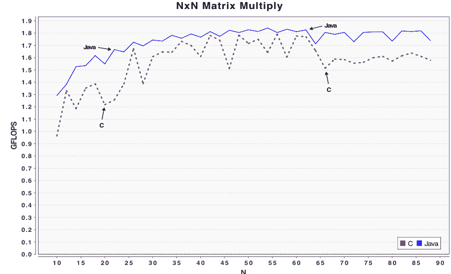

### 图 2-2. 矩阵乘法吞吐量，C 与 Java

在 40 ≤ N ≤ 60 的范围内，Java 的计算吞吐量比 C 高出典型的 3%。

在 75 ≤ N ≤ 88 的范围内，这一比例约为 10%。图 2-3 显示，执行时间抖动（以执行时间的标准差衡量）两者相近。图 2-4 所示的抖动与平均执行时间之比，在 C 和 Java 之间也非常接近。

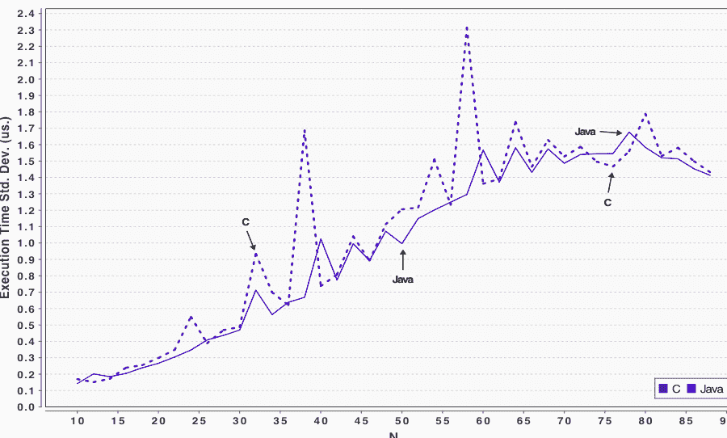

### 图 2-3. 矩阵乘法执行时间抖动，C 与 Java

### NxN 矩阵乘法

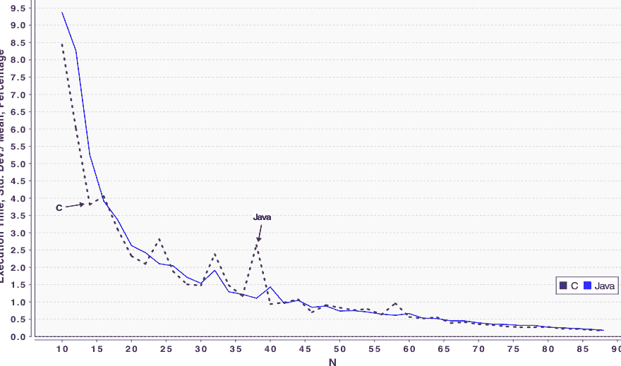

### 图 2-4 矩阵乘法性能，抖动与平均值百分比，C 与 Java

Java 优于 C 的性能在不同的基于 Intel 的机器（带有超线程的 Mac 四核 i7）上得到了验证。Java 的这种细微优势需要客观地来看待。性能细节会随着不同的硬件、L1 和 L2 缓存的大小和速度等而变化。然而，至少可以说，Java 的性能与 C 相当。可以假设，代码的特性允许 Hotspot 能够很好地优化 Java 代码。这是一个纯计算算法，具有以下特征：

- 较小的代码内核（code kernel）
- 边界固定或易于编译器确定的循环
- 具有简单递增的数组索引，其中某些增量在某些循环中是常数
- 计算内核内部没有内存分配/释放。

将此与一个条件不那么简单的算法进行比较是非常有趣的。下一节将进行这种比较。

> “Intel 超线程技术” Intel 公司，<http://www.intel.com/content/www/us/en/architecture-and-technology/hyper-threading/hyper-threading-technology.html>

## 2.6 迭代计算 – 快速傅里叶变换

使用快速傅里叶变换（FFT）代码来比较 Java 和 C，其复杂度比上一节的矩阵乘法更高。由于目标是比较相同的实现，因此选择了可以轻松翻译为多种语言的简单代码。使用了来自哥伦比亚大学的未优化的 FFT 实现并将其应用于测试中。它最初实现为 C13，并翻译为 Java。它使用复数据并实现了一种原地的基 2 抽取（radix-2-decimation）算法。

计算了数据长度从 2^6 到 2^18 (262,144) 的 FFT 变换。对于每个数据长度，都对数千次变换进行计时以收集执行时间统计数据。Java 和 C 的性能见图 2-5。抖动见图 2-6。对于那些对 FFT 感奇并熟悉它的人来说，该图还显示了在相同硬件上运行的优化的单线程“西方最快速傅里叶变换”（FTTW）14 代码的结果。FFTW 有助于确定硬件的极限，但在其他方面不应进行比较。从图中可以看出，C 还是 Java 的 FFT 实现作为 FFT 来说都是有效的。

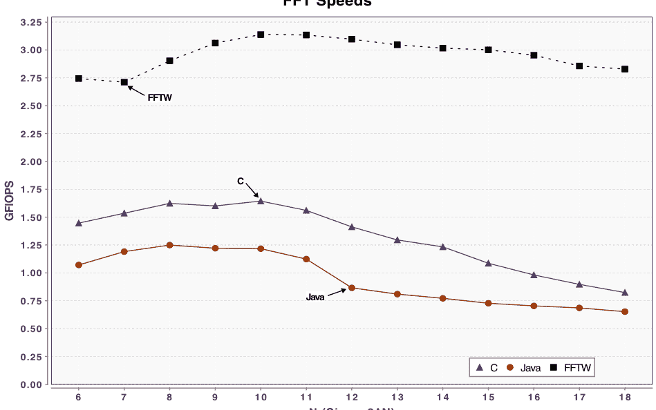

### 图 2-5. C 和 Java FFT 速度比较

Java 代码的执行速度在 C 代码速度的 60% 到 85% 之间。这似乎与上一节矩阵乘法基准测试的结果不一致。然而，如果查看列表 2-2 中的源代码，该代码的特性与矩阵乘法不同：

- 代码内核更长。
- 有更多的数组索引。
- 数组索引的增量不是连续的，这使得 Runtime 的代码分析更难预测。
- 非连续数组访问。
- 循环边界是外层循环的复杂函数。
- 有更多的提取（pickups）。

Java 的安全特性之一是所有数组索引都会经过检查以确保它们在范围内。在简单循环中，编译器可以在循环执行之前分析并检查它们。如果无法确定边界，Java 必须检查每个索引，这会导致巨大的代价。然而，由于资源限制，尚未验证这一因素的影响有多大。FFT 抖动

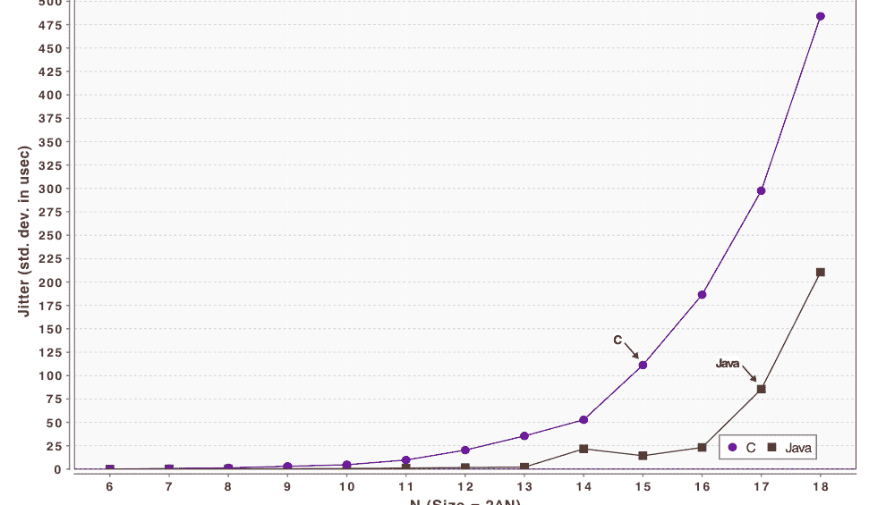

### 图 2-6. C 和 Java 抖动比较

### 列表 2-2. Java 内核

```java
public void fft(double[] x, double[] y) {
  // 位反转
  int j = 0;
  int n2 = n/2;
  for (int i = 1; i < n - 1; i++) {
    int n1 = n2;
    while (j >= n1 ) {
      j -= n1;
    }
    j += n1;
  }
  if (i < j) {
    double t1 = x[i];
    x[j] = t1;
    t1 = y[i];
    y[j] = t1;
  }

  // 蝴蝶变换
  int n1 = 0;
  int n2 = 1;
  for (int i = 0; i < m; i++) {
    n1 = n2;
    n2 += n2;
    int a = 0;
    for (int j = 0; j < n1; j++) {
      double c = cos[a];
      double s = sin[a];
      a += 1 << (m-i);
      for (int k = j; k < n; k+=n2) {
        double t1 = c*x[k+n1] + s*y[k+n1];
        double t2 = s*x[k+n1] - c*y[k+n1];
        x[k+n1] = t1;
        y[k+n1] = t2;
      }
    }
  }
}
```

### 简单填充

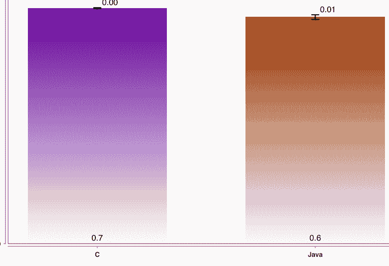

### 图 2-8. 简单的序列生成对比

LFSR 内核的巨大改进表明，Java 实现测量的增益实际上源于代码中位操作（bit-tiddling）部分执行效率的提高，而不仅仅是测试框架的循环代码。当然，通过调优 C 代码，在测试中可能匹配并超过 Java 的性能。但“通用”Java 代码能够匹配关键 C 代码的性能，这一点具有重大意义。不应得出 Java 在此类代码总是更快的结论。在不同的硬件上，实际相对性能将取决于 CPU 整数逻辑单元、地址预取逻辑和内存速度之间的详细交互。本研究者的结论是，只有 Java 的性能是可比的。

## 2.8 内存数据结构创建

设计了一个基准测试，用于比较 C 和 Java 在一种涉及创建内存结构并反复“遍历”这些结构的算法上的表现。所选算法是红黑树结构。红黑树是一种二叉搜索树，维护了键到值的映射，并按键进行排序。随着键的添加，必须遍历旧结构以找到插入键值对的正确位置。偶尔必须对结构的部分进行重新平衡。

由 Emin Martian¹¹ 实现的现有红黑树。该 C 代码设计用于处理任何类型和长度的键和值。为了适应任何类型和长度的键，算法允许用户提供一个与键类型匹配的比较函数。本次测试使用了 4 字节整数键。该算法尽可能直接地翻译成了 Java。编写了一个测试驱动程序来伪随机地生成键并使用它们进行插入和检索。

在给定的运行中，值的长度是固定的，可以在每次运行之间进行更改。不同运行分别使用了 4 字节、512 字节和 2048 字节的长度。在检索时，测试使用相同的伪随机键序列。这意味着所有获取的键都应该存在树中。

插入测试的结果如图 2-9 所示。有三个 C 插入时间：第一个是分配树、键和数据的时间。第二个是在此基础上加上了在重复试验之间释放树的时间。在 Java 中，人们无法控制垃圾回收的何时发生，因此 Java 的性能包含了内存回收。第三个使用 `malloc` 代替 C，以考虑在之前之前清除内容的时间。Java 总是作为分配的副作用来清除内容数据。这三个时间有助于将 C 与等效的 Java 时间进行比较。

### 红黑树插入，C 与 Java

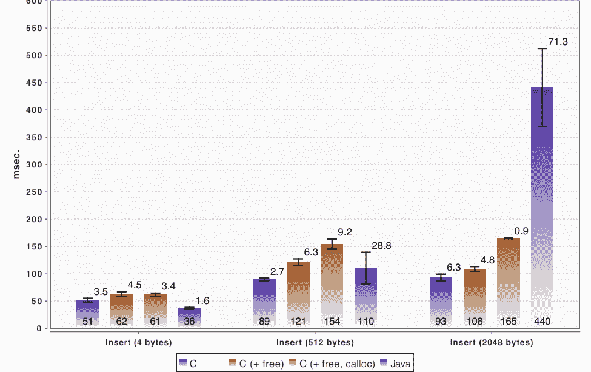

### 图 2-9 插入到红黑树

插入到树中的“值”是整数数组，对于测试的每次运行具有固定大小。可以发现，对于 4 字节和 512 字节的情况，Java 的性能与 C 相当（注：原文此处为 comparable，意为相当）。对于 2048 字节的情况，Java 实现的性能很差。每次测试运行都使用相同的键序列，Java 执行时间的差异似乎源于内存分配和回收的依赖长度的开销。

将插入测试的“C+free”时间与 Java 时间比较显示，Java 在 4 字节值时快了 42%，512 字节值时快了 1%，2048 字节值时则慢了三倍。

检索测试的结果如图 2-10 所示。有趣的是，对于较小的值 Java 慢了约 5%，对于大值快了 18%。

### 红黑树检索，C 与 Java

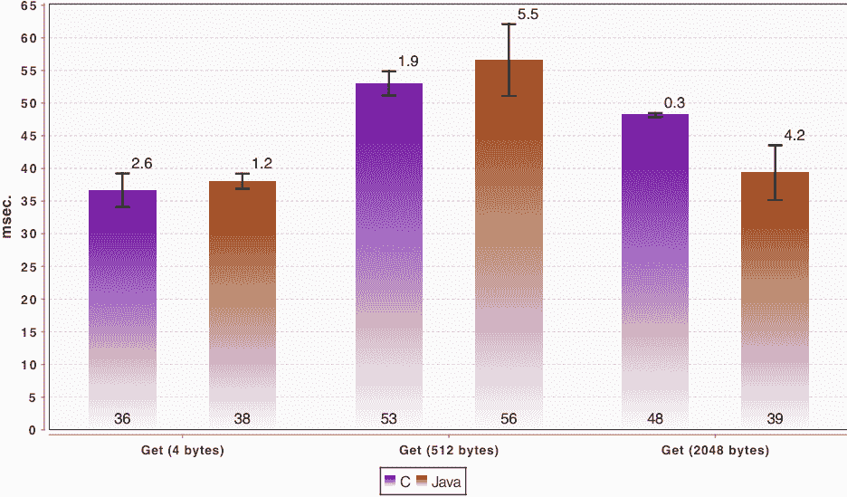

### 图 2-10 红黑树检索

## 2.9 Java 开销

本节尝试量化 JVM 消耗了多少处理器以及有多少是由于垃圾回收。这可以针对特定情况进行，但无法推广，因为很大取决于应用程序在做什么。尽管如此，测试是针对两种情况设计的。一种情况没有动态分配的内存。另一种情况通过选择小堆来强制频繁的垃圾回收。本报告将描述所有 Java 内存和垃圾回收选项的影响。关于调整垃圾回收的资源有很多。

（注：由于原文文本中存在大量重复的 OCR 错误和乱码，译文已根据要求进行了去重处理和翻译。）

### 表 2-2. 内存密集测试中的 JVM 开销

| 用例（均使用两个计算线程） | 内存密集测试 | 无内存测试 |
|---|---|---|
| 2 核心 | 178 sec. (15%) | 155.79 sec. (0%) |
| 3 核心 | 155 sec. | 155.70 sec. |

## 2.10 单核 Java 性能总结

最初在 C 语言中实现的四种算法已转换为 Java。矩阵乘法包含具有小型计算体和顺序数组索引的嵌套循环。FFT 具有中等规模的循环，但数组索引是非顺序的。LFSR 序列需要基于整数的掩码操作和布尔运算。红黑树排序具有高度递归性，并且需要动态对象的创建和清理。

在热身后，Java 矩阵乘法的运行速度比使用 GNU 编译器以最高优化级别编译的 C 版本更快。Java FFT 的性能比 C 慢 20 到 40%。这可能是因为与矩阵乘法相比，数组索引的使用更加复杂且非顺序。Java 版本的 LFSR 序列运行比 C 版本快 30%。

前三个测试在计算时不需要内存分配。相比之下，红黑树排序需要大量使用内存分配，为要插入树的键和值分配空间，整个树及其内容都通过触发垃圾回收系统来恢复未使用的内存。在这项测试中，Java 在插入方面快一点，但在检索方面比 C 慢。似乎存在对象大小依赖性。随着分配大小的增加，较快的插入速度会退化得更差。

Java 有时快、有时慢的事实表明：

- 硬件架构（如缓存大小、指令流水线深度、浮点与整数逻辑单元的数量和吞吐量）会显著影响这些发现。
- 设计者应该测试内核，以了解什么方案对应用产生最佳性能。另一方面，不应假设 C 代码总是是最好的。
- 即使重计算是在 C 中完成的，间接计算也可能由 Java 处理。最终，更大的考虑因素可能是数据位于 Java 侧还是原生侧。

总的来说，这些发现表明，在 Java 热身之后，其性能与 C 相当。这为 Java 和 C 的混合使用提供了许多选择。

## 3 Java 并行性


# 在多核机器上运行的计算方案希望尽可能并发利用多个核心

自 Java 1.0 以来，Java 已经为此提供了标准的语言结构和库支持。然而，尝试实现“简单”并行 for 循环的开发者会发现，Java 中不存在像 C 语言 OpenMP 那样简单的语法来实现此操作。OpenMP 通过利用 `pragma` 语句“扩展”了 C 语言，这些语句允许感知 OpenMP 的编译器将 for 循环的负载分配到可用的核心之间。`pragma` 语句看起来像 C 语言。不支持 OpenMP 的编译器将在单线程内正常地编译该 for 循环。

Java 规范 (JSR 166) 将简化 Java 8 中代码块的并行执行。JSR 并没有解决并行循环。相反，它提供了更改，允许各种类型的集合实现自并行化并对其成员应用函数。

Java 7 开发者有几种并行的替代方案。本项研究比较了三种 Java 7 并行替代方案的性能。该研究还比较了两个额外的第三方开源替代方案的性能。

## 3.1 并行性测试方法

并行 for 循环的概念是设计一种以并行方式执行的简单负载。目标是确定 Java 多么高效地将纯计算负载分配到可用的 CPU 核心之间。在单核心上花费某些时间的计算负载，理想情况下在四个核心上仅需四分之一的时间。实际上，将任务分解为多个独立核心会有很小的时间开销。等待核心完成并汇总结果也有开销。由于这个原因，小型负载可能不值得拆分。大型负载可能会渐近于达到理想增益。

设计了一个可变大小的负载，以便测量不同并行执行级别完成工作的时间。该工作可以在测试系统中内联执行，或分为四个线程。负载如列表 3-1 所示。每个测试执行多次。每次迭代执行四种操作——循环递增、循环测试、除法和累加。

### 列表 3-1. 工作任务

```java
static double sumStartLength(int startIndex, int length) {
  double cum = 0;
  final int endIndex = startIndex + length;
  for (double i = startIndex + 1; i <= endIndex; i++) {
    cum += 1.0 / i;
  }
  return cum;
}
```

下文展示了这些测试的结果。在这些测试中使用的 Linux 系统上，应用程序线程、管理线程和操作系统的线程调度之间似乎存在不利的相互作用，导致了“线程抖动”和不规则的执行时间。图 3-2 到图 3-3 提供了此类示例。

图 3-2 是一个示例，随着负载增加，会出现性能低下的“峰值”。图 3-2 显示了增加额外线程后整体性能的提高，但执行时间随负载增加而出现不规则的波动。最后，图 3-3 显示正如预期，一个和两个线程的执行时间减少，但在三个线程时执行时间反而增加。四线程的线并没有更好。

## 3.2 “半”负载下的并行性

### 3.2.1 带有计时器的并行性

`java.util.Timer` 和 `java.util.CountDownLatch` 自 Java 1 以来一直可用。它们用于并发。列表 3-2 中的示例展示了使用 `CountDownLatch` 信号每个线程完成，从而将 for 循环拆分为多个线程的一种方法。

这种方法取决于必须编码的细节。示例中未显示的细节是，确保即使发生运行时错误导致甚至一个内部 `Runnable` 实例无法创建，`CountDownLatch` 的初始计数也是正确的。

在示例中，每个要执行的工作片段都使用计时器线程。由于有用的处理器，不需要许多计时器线程。调用线程在等待工作线程完成时将处于空闲状态。如果主线程处理最后的片段，将会更高效，从而避免了分发和等待的开销。

额外的线程。因此，如果只需要达到 N 的预期并行度，则需要使用 N-1 个定时器线程。然而，更高效的代码（未显示）实现会稍微复杂一些。

图 3-4 和图 3-5 分别展示了使用 N-1 定时器策略和 N 定时器策略的执行时间与负载大小的关系。这两者之间没有显著区别，不同在于在 N 定时器图中，可以清楚地看到并行带来的开销，表现为内联曲线与 1 线程曲线之间的间隙。然而，除非人们对至少双路并行感兴趣，否则不会使用这任何一种方案。表 3-1 列出了其中一些交叉点。

抖动图分别在图 3-6 和图 3-7 中所示。它们存在微小但非忽略不足道的差异。

#### 使用 CountDownLatch 的 N-1 定时器实现并发

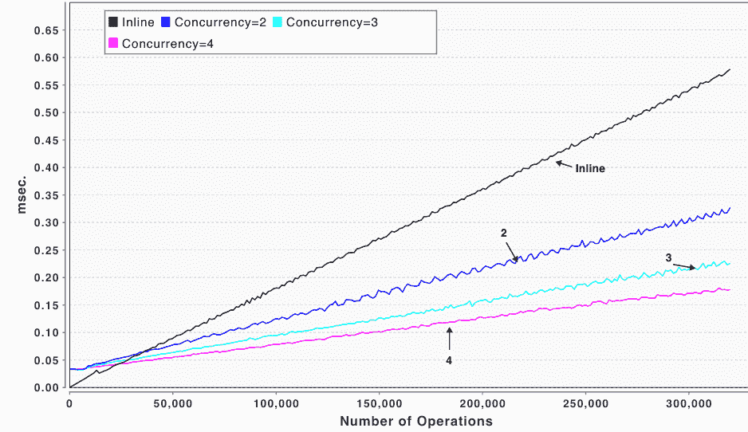

**图 3-4.** 使用 CountDownLatch 和 N-1 线程的 TimerTask

#### 使用 CountDownLatch 的定时器实现并发

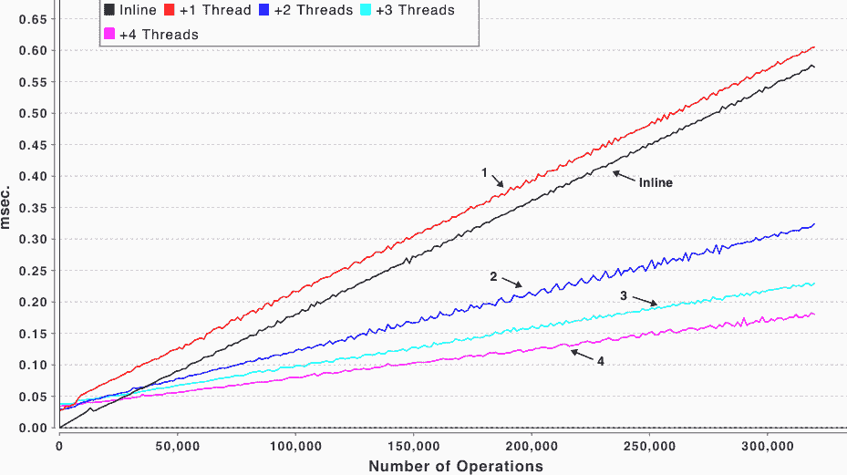

**图 3-5.** 使用 CountDownLatch 和 N 线程的 TimerTask

#### 使用 CountDownLatch 的 N-1 定时器实现执行抖动

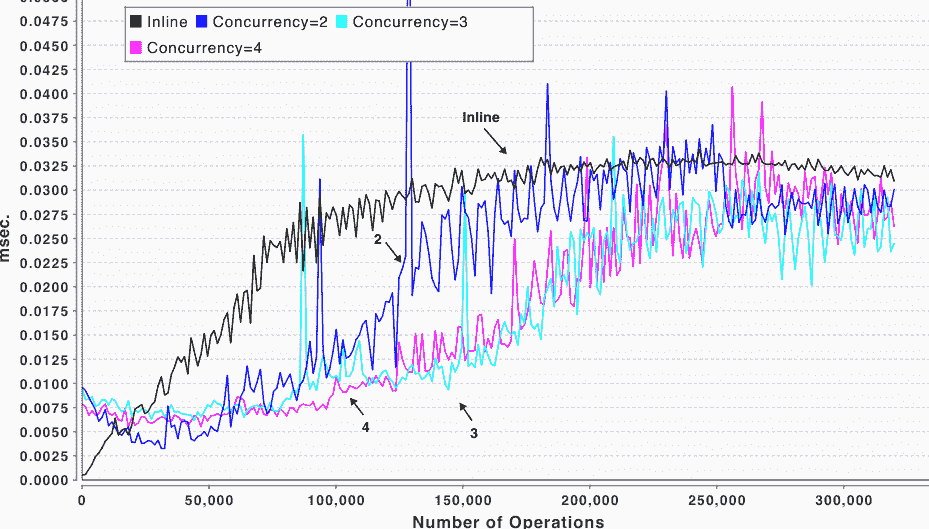

**图 3-6.** 基于 N-1 定时器的并发执行抖动

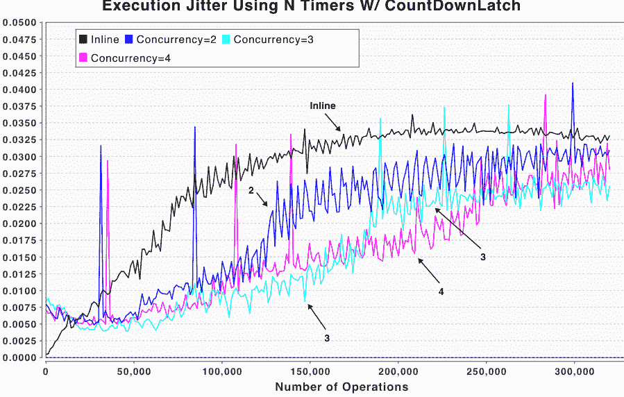

**图 3-7.** 基于 N 定时器的并发执行抖动

### 3.2.2 利用 ExecutorService 线程的并行化

在多个核心之间分配工作的另一种方案是使用 `java.util.concurrent.ExecutorService`。与 `java.util.Timer` 相比，执行服务稍微更易于使用，因为 `invokeAll()` 方法提供了一种更简单的方法来启动并等待所有任务完成。示例见列表 3-3。还有另一种选项是使用 `submit()` 方法单独提交工作片段，并使用 `CountDownLatch` 等待完成。这种方法经过了测试，但发现速度比使用 `invokeAll()` 方法慢。

#### 列表 3-3. 使用 ExecutorService 进行并行执行的示例

```java
import java.util.ArrayList;
import java.util.Collection;
import java.util.concurrent.BrokenBarrierException;
import java.util.concurrent.Callable;
import java.util.concurrent.ExecutorService;
import java.util.concurrent.Executors;

class ExecutorServiceExample {
    final int nThreads = Runtime.getRuntime().availableProcessors();
    final ExecutorService threads = Executors.newFixedThreadPool(nThreads);
    final Collection<Callable<Object>> tasks = new ArrayList<Callable<Object>>(nThreads);

    void execute() throws InterruptedException, BrokenBarrierException {
        int startIndex = 0;
        int loopLength = 1000;
        // this is not exactly correct, ok for illustration
        final int increment = loopLength / nThreads;
        for (int j = 0; j < nThreads; j++) {
            // Can't access the non-final field inside the inner class.
            final int _start = startIndex;
            tasks.add(new Callable<Object>() {
                @Override
                public Object call() {
                    doWorkFragment(_start, increment);
                    return null;
                }
            });
            startIndex += increment;
        }
        threads.invokeAll(tasks);
    }

    void doWorkFragment(int startIndex, int numberOfIterations) {
        // work done here
    }
}
```

#### 使用 invokeAll() 的 ExecutorService 实现并发

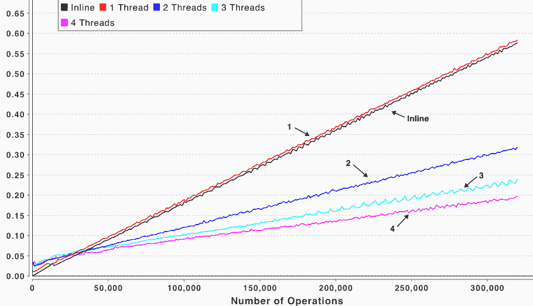

**图 3-8.** 使用 ExecutorService 的并发

#### 使用 invokeAll() 的 ExecutorService 实现执行抖动

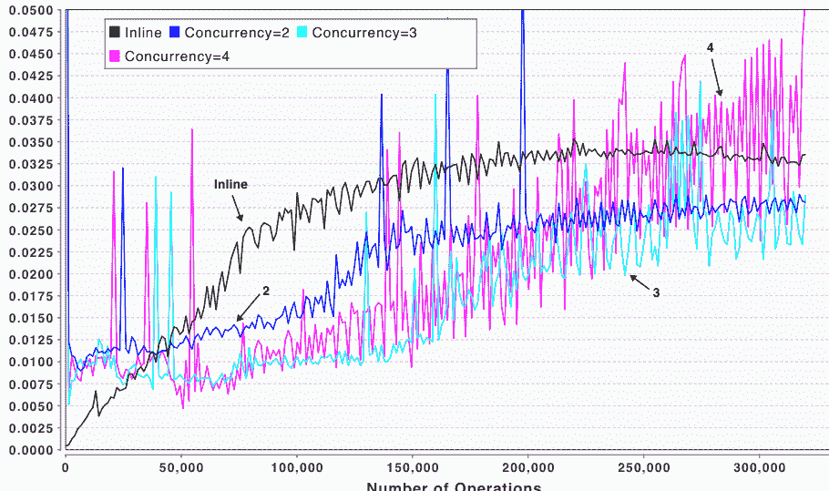

**图 3-9.** 使用 ExecutorService 的执行抖动

### 3.2.3 使用 Java 7 Fork/Join 的并行化

Java 7 增加了对并行的支持，这与 Unix 中的 fork/join 指令有相似之处。然而，Unix 的 fork/join 产生的是进程，而 Java 的 fork/join 则不会。在 Java 7 中，fork/join 机制创建了运行在 `ForkJoinPool` 上的轻量级任务。列表 3-4 是其工作原理的示例。

ForkJoinPool 并行化图如图 3-10 和图 3-11 所示。表 3-1 列出了归一化的执行时间。总体而言，其性能与 `ExecutorService` 大体相当，尽管存在略微开销，导致四线程线的执行时间更长。fork/join 机制在并行化循环时提供了极大的灵活性，但更适用于更复杂的“分治法”算法。

关于 `ForkJoinPool` 的一点是，一些人发现它在多核心机器上的扩展性并不良好。Doug Lea 注意到了这个问题，并发布了优于 Java 7 实现的池化扩展性更新。该版本的 `ForkJoinPool` 已在 JSR-166 中通过了测试，被发现在几个核心上提供了显著的性能提升。出于这个原因，这里展示了标准的 Java 7 ForkJoinPool 数据。

#### 列表 3-4. 使用 Fork/Join 进行并行执行的示例

```java
import java.util.ArrayList;
import java.util.List;
import java.util.concurrent.ForkJoinPool;
import java.util.concurrent.RecursiveAction;

class ForkJoinExample {
    int nThreads = Runtime.getRuntime().availableProcessors();
    ForkJoinPool forkJoinPool = new ForkJoinPool();
    List<RecursiveAction> forks = new ArrayList<>();

    void work() {
        int startIndex = 0;
        int totalIterations = 1000;
        // this increment is not correct, ok for illustration
        final int increment = totalIterations / nThreads;
        for (int j = 0; j < nThreads; j++) {
            final int start = startIndex;
            RecursiveAction subTask = new RecursiveAction() {
                @Override
                protected void compute() {
                    doWorkFragment(start, increment);
                }
            };
            forks.add(subTask);
            startIndex += increment;
        }
        forkJoinPool.invokeAll(forks);
    }

    void doWorkFragment(int startIndex, int numberOfIterations) {
        // work done here
    }
}
```

#### 使用 ForkJoinPool 实现并发

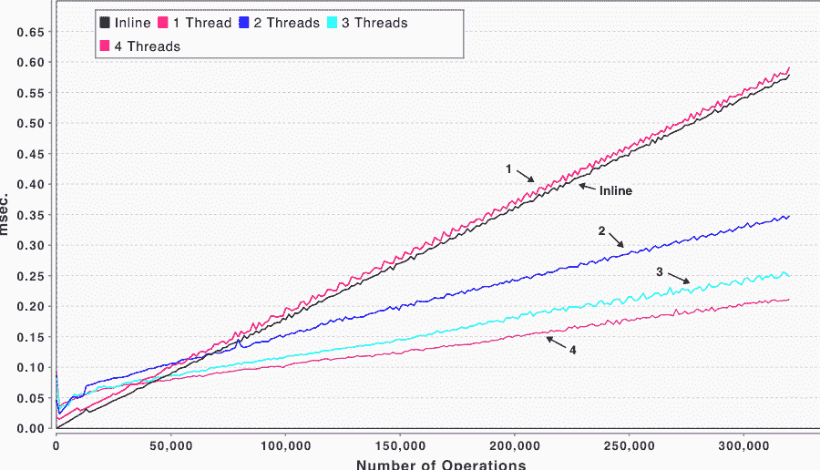

**图 3-10.** 使用 ForkJoinPool 的并发

#### 使用 Fork/Join 实现执行抖动

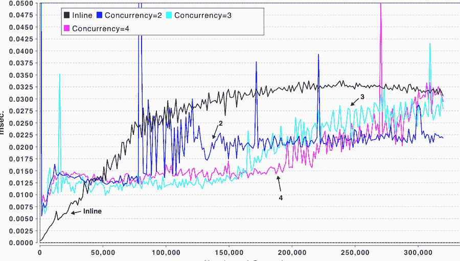

**图 3-11.** 使用 ForkJoinPool 的并发执行抖动

### 3.2.4 使用 Parallel Java 库的并行化

Parallel Java (PJ) 库是为单节点或多节点并行编程开发的全 Java 库。PJ 由罗彻斯特理工学院的 Alan Kaminsky 和 Luke McComber 开发。

PJ 提供了许多简化并行代码语法并提高可读性的类。执行并行 for 循环的示例见列表 3-5。它有一系列与 OpenMP 概念相似的构造结构，包括 `ParallelTeam`、`ParallelRegions`、`ParallelSections`、`ParallelLoops` 和 `ParallelIterations`。具体描述请参阅 PJ 文档。性能如图 3-12 所示，在目前为止设计的所有并发机制中，它的性能最好。它需要的代码最精简。

#### 列表 3-5. 使用 Parallel Java 库进行并行执行的示例

```java
import edu.rit.pj.IntegerLoop;
import edu.rit.pj.ParallelRegion;
import edu.rit.pj.ParallelTeam;

class ParallelJavaExample {

    ParallelTeam parallelThreads = 
        new ParallelTeam(Runtime.getRuntime().availableProcessors());

    int loopIndexBegin = 0;
    int loopIndexEnd = 99;

    void work() throws Exception {

        parallelThreads.execute(new ParallelRegion() {
            @Override
            public void run() throws Exception {
                executeLoop(loopIndexBegin, loopIndexEnd, new IntegerLoop() {
                    @Override
                    public void run(int first, int last) {
                        // work for a range of loop indexes done here
                    }
                });
            }
        });
    }
}
```

#### 使用 ParallelJava 进行并发

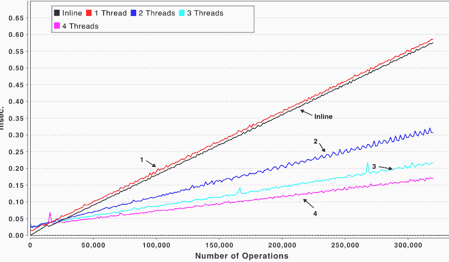

**图 3-12.** 使用 Parallel Java Library 进行并发

#### 使用 ParallelJava 的执行抖动

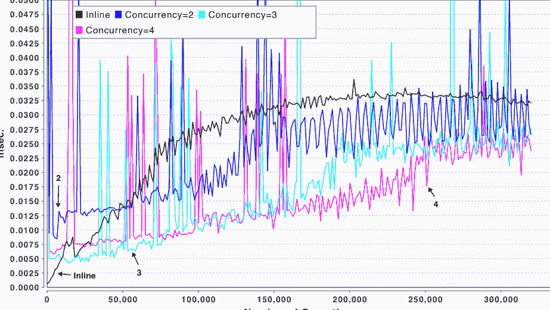

**图 3-13.** 使用 Parallel Java Library 的执行抖动

### 3.2.5 使用 Javolution Library 进行并行化

Javolution¹⁴ 库是一个为实时嵌入式系统开发的开源库。它由 Jean-Marie Dautelle 开发，旨在提供确定性的执行时间。它提供了代码块并发执行的机制以及便于与 C 语言接口的机制。它还提供了作为 Maps 和 Lists 的 Java 结构，这些结构旨在最大限度地减少内存分配，有助于减少垃圾回收器的中断。

列表 3-6 显示了一个使用 Parallel Java 的示例。基准性能见图 3-14，抖动见图 3-15。归一化执行时间见表 3-1。在本次测试中，执行评估了最小的双向交叉点，使其比其他方法更适用于小型工作负载的并行化。


### 列表 3-6. 使用 Javolution Library 进行并行执行的示例

```java
import javolution.context.ConcurrentContext;

public class JavolutionExample {

    void work(final int nThreads, final int length) throws InterruptedException {
        // 这个增可能会可能会偏差
        // 最后一个线程但对这个示例足够了
        final int increment = length / nThreads;
        ConcurrentContext context = new ConcurrentContext();
        try {
            int baseIndex = 0;
            for (int j = 0; j < nThreads; j++) {
                final int startIndex = baseIndex;
                ConcurrentContext.execute(new Runnable() {
                    @Override
                    public void run() {
                        doWorkFragment(startIndex, increment);
                    }
                });
                baseIndex += increment;
            }
        } finally {
            context.exit();
        }
    }

    void doWorkFragment(int startIndex, int numberOfIterations) {
        // 在此处完成工作
    }
}
```

### 使用 Javolution 进行并发

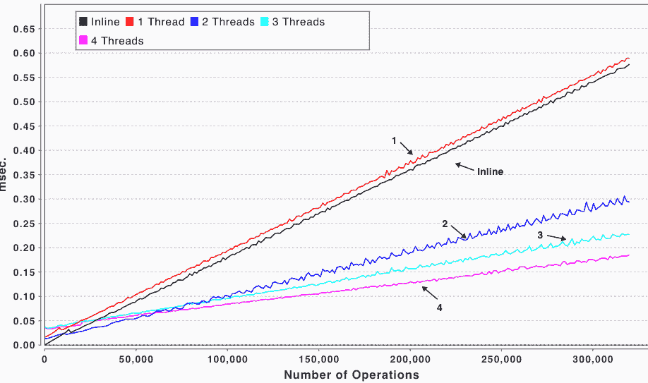

图 3-14. 使用 Javolution Library 进行并发

### 使用 Javolution 的执行抖动

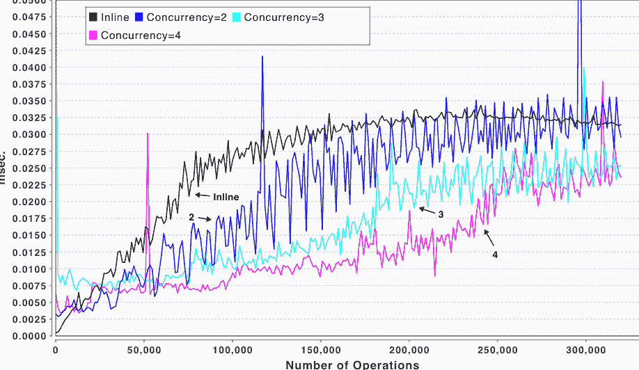

图 3-15. 使用 Javolution Library 的执行抖动

### 3.2.6 使用 OpenMP 进行并行化

为了对比，图 3-16 和图 3-17 显示了 C 代码的性能和抖动。方法相同，即以每毫秒一次让出约一半的负载，并在 Linux 实时优先级级别下运行进程。有趣的是，无并发抖动比 Java 大。双、三、四路并发抖动小得多——C 约为 `0.0022` 毫秒，而 Java 约为 `0.0325` 毫秒。

### C/OpenMP 的半负载并发

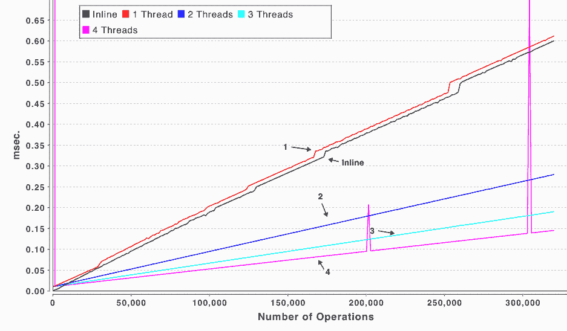

图 3-16. 使用 OpenMP 进行并发

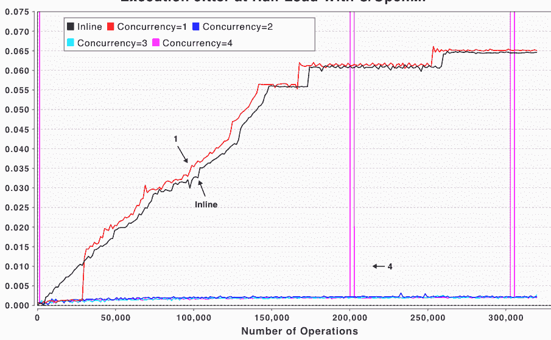

图 3-17. C 和 OpenMP 的执行抖动

表 3-1 “一半”负载下的归一化并行化时间

| 情况 | 双路交叉 | 三路交叉 | 四路交叉 | 双路拆分 | 三路拆分 | 四路拆分 |
|---|---|---|---|---|---|---|
| N-1-Timer | 35600 | 28300 | 23600 | 55% | 39% | 31% |
| N-Timer | 43900 | 29400 | 27500 | 57% | 40% | 31% |
| ExecutorService | 34400 | 35000 | 27700 | 54% | 40% | 34% |
| ForkJoinPool | 68500 | 47900 | 42100 | 60% | 44% | 37% |
| ParallelJava | 28600 | 23500 | 21200 | 53% | 38% | 30% |
| Javolution | 10600 | 28100 | 27500 | 51% | 39% | 32% |
| C | 10400 | 7800 | 7200 | 47% | 32% | 25% |

## 3.3 使用实时调度进行“全负载”并行化

在上一节中，基准代码每毫秒让出一次——导致约 50% 的负载。在本节中，任务以 100% 的负载运行。为了解决线程抖抖（thread-thrashing）问题，Java 测试使用了 Linux 实时优先级。由于在图表中很难看出，图例列出了性能改进的顺序。`ForkJoinPool` 和 `ExecutorService` 性能最差。`ParallelJava` 最好。没有任何 Java 并发技术能超越 C。

### 双路拆分的执行时间

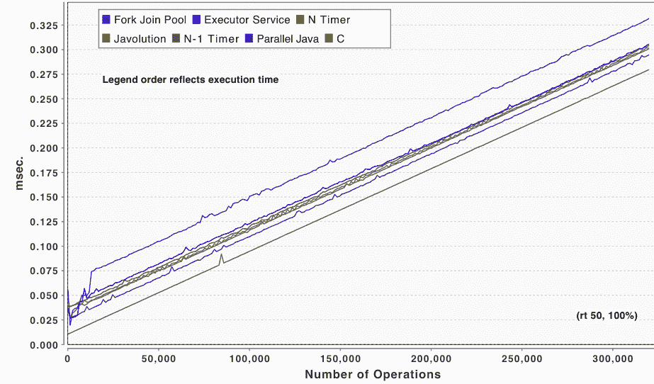

图 3-18. 实时优先级下双路拆分的性能曲线

### 三路拆分的执行时间

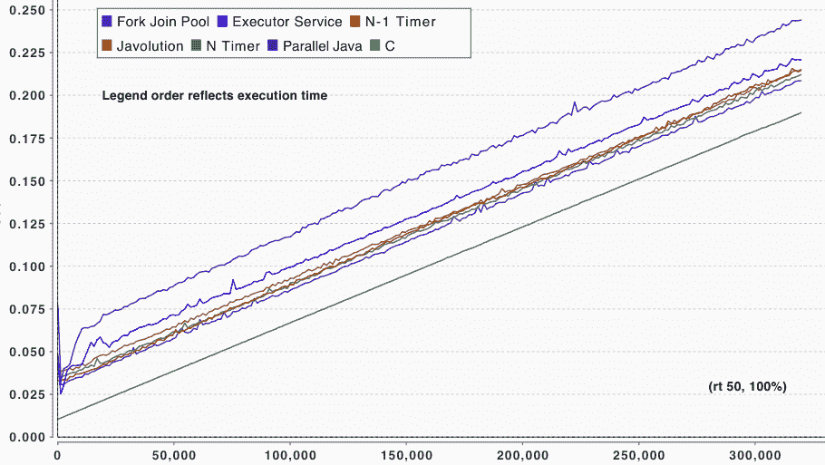

图 3-19. 实时优先级下三路拆分的性能曲线

### 四路拆分的执行时间

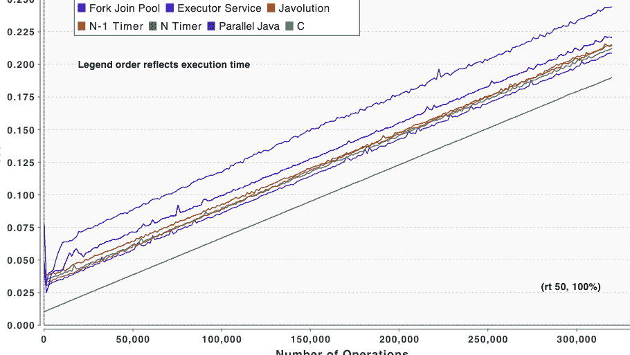

图 3-20. 实时优先级下四路拆分的性能曲线

表 3-2 全负载下的归一化并行化时间

| 情况 | 双路交叉 | 三路交叉 | 四路交叉 | 双路拆分 | 三路拆分 | 四路拆分 |
|---|---|---|---|---|---|---|
| N-1-Timer | 39500 | 28600 | 29500 | 56% | 40% | 35% |
| N-Timer | 43900 | 29400 | 27500 | 57% | 40% | 31% |
| ExecutorService | 47700 | 39300 | 30900 | 56% | 41% | 36% |
| ForkJoinPool | 79300 | 54200 | 46200 | 62% | 46% | 36% |
| ParallelJava | 30800 | 26800 | 25200 | 55% | 39% | 31% |
| Javolution | 40000 | 32500 | 30300 | 56% | 40% | 32% |
| C | 13000 | 10400 | 9100 | 52% | 35% | 27% |

### 双路负载的执行抖动

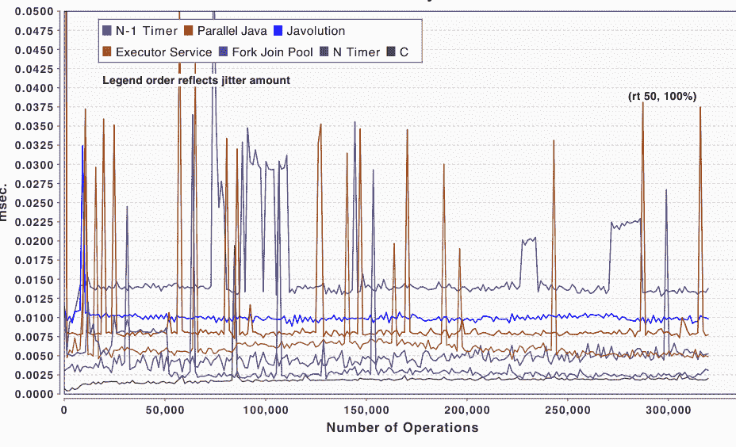

图 3-21. 全负载下双路执行抖动

### 三路负载的执行抖动

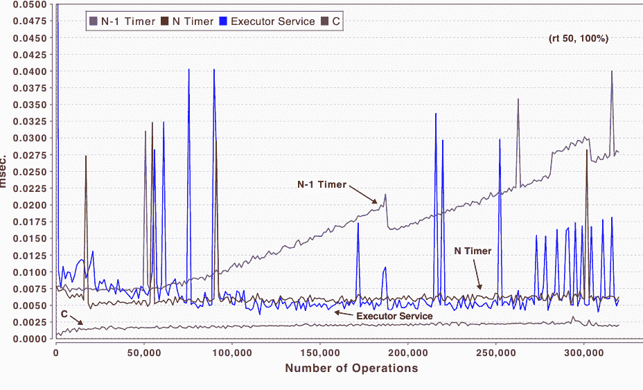

图 3-22. 全负载下三路执行抖动（1 之 2）

### 三路负载的执行抖动

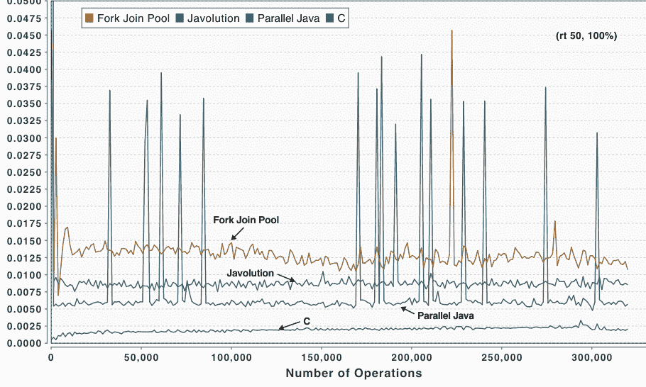

图 3-23. 全负载下三路执行抖动（2 之 2）

## 3.4 数值计算的并行化总结

在四核 Linux 系统上进行了测试，以查看 Java 如何高效地并行化简单的工作负载。Linux 可以使用默认调度运行应用程序，但也提供了在实时调度下运行应用程序的规定。

测试了各种 Java 类，以查看它们在 50% 负载和 100% 负载下的性能。在默认调度下，出现了各种“线程抖动”的情况，导致执行时间不稳定。在其中一种情况下，线程抖动非常严重，导致添加第三个或第四个核心也没有提供任何计算收益。这可能与测试反复“同时”启动多个工作负载并同时完成的方式有关。然而，学生没有资源来调查这是否是问题的根源。注意，C 版本的测试没有这个问题。

缺乏简化并行 `for` 循环迭代的语言特性将让一些具有传统计算背景的人感到沮丧。`ParallelJava` 提供了实现此目标最简洁的方法。另一方面，这项调查的视角非常狭窄，仅基于 `for` 循环的数值计算。读者可能会认为其他方法中的一种更适用于其他类型的并发。

这里有一个核心的教训。鉴于 Java 开发者有多种并发技术可用，开发者应该对应用程序进行插桩，并将应用程序的并行版本和未并行版本进行比较，以确保他们获得了预期的行为。

# Java 调用原生代码

在 Java 和 C 混合使用时，设计者可能会使用 C 进行“数值计算”并执行需要低执行抖动（jitter）的任务。Java 可能被用于执行其他任务，如日志记录、外部应用程序通信、节点间协调和数据持久化。创建基准测试是为了理解如何最快地从 Java 调用 C，以及这些选项的相对难度。这里的重点主要是数值型数据数组。本研究没有调查字符串或结构的使用，尽管此处调查的大多数替代方案都支持这些。

Java 提供了一个低级 API 允许从 Java 调用 C 以及反之亦然。这就是 Java 原生接口（JNI）。直接使用 JNI 可能会很繁琐，因为访问数组可能需要多次 JNI 服务调用。然而，整数参数是直接传递的。

如果从 C API 开始，则方法签名必须修改以接受直接来自 Java 的调用。通常编写一个代理类更简单，它接受 Java 调用，锁定任何 Java 数组（防止垃圾回收器移动数据），在需要时复制数组，然后调用实际函数。当 C 函数返回时，修改后的数组必须写回并解锁。

这是访问 Java 数据最快的方法，尽管它很笨拙。JNI 代理代码是必须为目标机器和操作系统编译并链接的代码。通过 JNI 进行调用不是平台无关的。

Java 到 C 的调用有其他更高级的选项。大多数选项具有平台依赖性，尽管其中一种方案针对一组广泛流行的操作系统和目标硬件实现了平台无关性。

高级别的选项通常隐藏了 JNI 细节，并试图同时提供简单的 Java 接口和 C 接口。它们通常以经典方式构建代理类（作为一种开发时操作），或者通过即时构建“胶水”代码。这四种选项分别是：Java Native Access (JNA)、BridgJ、Simplified Wrapper and Interface Generator (SWIG) 和 HawtJNI。

根据 JNA 仓库的描述：

> “JNA 允许 Java 轻松访问原生共享库（Windows 上的 DLL），而无需编写任何 Java 代码——不需要 JNI 或原生代码。…… 访问在运行时是动态的，无需代码生成。…… Java 使用小型原生库存根来动态调用原生代码。开发者使用 Java 接口来描述目标原生库中的函数和结构。…… 虽然对性能有一定的关注，但正确性和使用优先。”

BridgJ 是一个库：

35 “Java Native Interface Specification.” Oracle SE Documentation. <https://docs.oracle.com/javase/7/technotes/guides/jni/jniTOC.html>.

36 “Java Native Access (JNA).” <https://github.com/twall/jna/readme>

37 “BridgJ: Let Java & Scala Call, C++, Objective-C, C#...” <https://code.google.com/p/bridj/>

“它让你像编写原生代码一样从 Java 调用 C、C++ 和 Objective-C 库。它是 JNA 的近期替代方案。借助工具 `JNAerator`，它提供了到 C/C++ 清晰且无歧的映射，以及一个非常直接且高度类型的 API 来操作指针、类、结构体、联合……”

使用 `JNAerator`，可以生成一个 Java jar 文件，它预置了所有必要的胶水逻辑，并可以将原生库包含在内部以便使用。通过 BridgJ，可以使用 Java 代码在原生内存中分配结构体，消除了将 Java 数据转换为 C 的相关开销。此外，BridgJ 创建的 Java 对象在 Java 对象被回收时可以在 C 端被调用。因此，BridgJ 允许开发者利用 Java 垃圾回收器来确保 C 数据也能正确收集。`JNAerator` 生成的代码是纯 Java 的，这意味着生成的 Java 类将在 BridgJ 已经运行的任何机器和操作系统上运行。

SWIG：

> “是一种软件开发工具，将用 C 和 C++ 编写的程序与各种高级语言连接。SWIG 用于不同类型的目标语言，使用常用的脚本语言如 Perl、PHP、Python、Tcl 和 Ruby [以及 Java] …… SWIG 通常用于解析 C/C++ 接口并生成目标语言调用 C/C++ 所需的‘胶水代码’。”

生成此代码需要开发者提供一个 SWIG 特定的接口文件，该文件识别了各种结构映射选项以及要暴露的 API。SWIG 生成代理 Java 代码。该代码必须为目标机器和操作系统编译并链接。

最后，HawtJNI：

> “HawtJNI 是一个代码生成器，产生实现 Java 原生方法所需的 JNI 代码。它基于 jenigen 代码生成器，该生成器是 SWT Tools 项目的一部分，用于生成驱动 eclipse 平台的所有 JNI 代码。”

HawtJNI 允许开发者编写一个与 C 方法匹配的 Java 源类，并自动生成所需的 JNI 代码代理。对于像 Maven 这样的工具，它很好地集成到了 Maven 中。

## 4.1 为 Java 调用生成桥接代码

每种桥接工具/库都有其创建到 C 的桥接代码的方法。在实验中，目标 C 代码见列表 4-1 和 4-2。

### 列表 4-1 整数参数的 C 方法

```c
int sf1(int i1){
    return i1;
}

int sf2(int i1, int i2){
    return i1;
}

int sf5(int i1, int i2, int i3, int i4, int i5){
    return i1;
}

int sf10(int i1, int i2, int i3,
int i4, int i5, int i6, int i7, int i8, int i9, int i10){
    return i1;
}
```

### 列表 4-2 数组参数的 C 方法

```c
// 访问数组的值
double sa(const double a1[]){
    return a1[0];
}

// 访问数组的值，忽略第二个数组
double sa2(const double a1[], const double a2[], int n){
    return a1[0];
}

// 修改第二个数组的内容，从第一个数组复制
double sarw(const double a1[], double a2[], int n){
    int i;
    for (i = 0; i < n; i++){
        a2[i] = a1[i];
    }
    return a1[0];
}
```

### 4.1.1 Java 原生接口

JNI API 和规范是 Java 标准版的一部分。要使用 JNI，开发者必须：

- 按照 JNI 规范重写原生签名，或
- 编写一个遵循 JNI 规范的 C 代理类并调用所需的 C API。

然后对代码进行编译、链接并作为特定的原生库发布。

测试的 JNI 代码见列表 4-3 和列表 4-4。JNI 为所有调用增加了两个参数：`JNIEnv` 和 `jclass` 参数。这些允许代码回调 Java 以访问元数据和数据。

### 列表 4-3 手动创建的整数参数测试 JNI 代码

```c
JNIEXPORT j jNICALL Java_sfInt1
(JNIEnv * env, jclass cls, j i1)
{
    return i1;
}

JNIEXPORT j jNICALL Java_sfInt5
(JNIEnv * env, jclass cls, j i1, j i2, j i3, j i4, j i5)
{
    return i1;
}

JNIEXPORT j jNICALL Java_sfInt10
(JNIEnv * env, jclass cls, j i1, j i2, j i3,
j i4, j i5, j i6, j i7, j i8, j i9, j i10)
{
    return i1;
}
```

### 列表 4-4 带有数组参数测试方法的手动创建的 JNI 代码


```c
JNIEXPORT jdouble JNICALL Java_sadouble1(
JNIEnv * env, jclass cls, doubleArray _al1)
{
  double firstElement;
  double *a1 = (*env)->GetDoubleArrayElements(env, _al1, );
  firstElement = a1[0];
  (*env)->ReleaseDoubleArrayElements(env, _al1, JNI_ABORT); // 没有更改，不写回
  return firstElement;
}

JNIEXPORT jdouble JNICALL Java_sadouble2(
JNIEnv * env, jclass cls, doubleArray _a1, doubleArray _a2, jint n)
{
  double firstElement;
  double *a1 = (*env)->GetDoubleArrayElements(env, _a1, 0);
  double *a2 = (*env)->GetDoubleArrayElements(env, _a2, 0);
  firstElement = a1[0];
  (*env)->ReleaseDoubleArrayElements(env, _a1, JNI_ABORT); // 没有更改，不写回
  (*env)->ReleaseDoubleArrayElements(env, _a2, JNI_ABORT); // 没有更改，不写回
  return firstElement;
}

JNIEXPORT jdouble JNICALL Java_sadouble2rw(
JNIEnv * env, jclass cls, doubleArray _a1, doubleArray _a2, jint n)
{
  double *a1 = (*env)->GetDoubleArrayElements(env, _a1, 0);
  double *a2 = (*env)->GetIntArrayElements(env, _a2, 0);
  int i;
  for (i = 0; i < n; i++) {
    a2[i] = a1[i];
  }
  double firstElement = a1[0];
  (*env)->ReleaseDoubleArrayElements(env, _a2, a2, 0); // 写回并释放
  (*env)->ReleaseDoubleArrayElements(env, _a1, JNI_ABORT); // 没有更改，不写回
  return firstElement;
}
```

### 4.1.2 Java Native Access

Java Native Access 比 JNI 更容易使用。开发者需要知道 C 方法的签名，然后编写一个与 API 匹配的 Java 类。这里所示测试的匹配 Java 类位于 Listing 4-5。请注意，`Jnaator`⁴ 工具也可以用于从 `.h` 文件为 JNA 生成 Java 类。对于已完成的 JNA 测试，该类是手动编写的。

通过该类，JNA 库会在运行时对其处理并动态生成原生代码。开发者不需要构建和分发特定平台的原生库。然而，这种平台独立性的代价是速度，如下文所示。

> ⁴ 参见 jnaator，http://code.google.com/p/jnaator/Documentation。在 JNA 中使用 Jnaator 需要 `-runtime JNA` 命令行。

### Listing 4-5. Java JNA 类

```java
import com.sun.jna.Native;
public class WorkersJNA {
    public static native int sfInt1(int i1);

    public static native int sfInt2(int i1, int i2);

    public static native int sfInt5(int i1, int i2, int i3, int i4, int i5);

    public static native int sfInt10(int i1, int i2, int i3, int i4, int i5,
    i6, int i7, int i8, int i9, int i10);

    public static native double sadouble1(double a1);

    public static native double sadouble2(double a1, double a2, int n);

    public static native double sadouble2rw(double a1, double a2, int n);
    static {
        String name="WorkersJNA";
        try {
            Native.register("Native library "+name+" loaded");
            System.out.println(name+");
        } catch (UnsatisfiedLinkError e) {
            System.err.println(name+" native library failed to load. \n" + e);
            System.exit(1);
        }
    }
}
```

### 4.1.3 BridJ

除了 BridJ 和 JNA 之外，这里研究的桥接技术需要开发者构建特定平台的原生库。BridJ 尝试通过其内部是特定平台的机制（尽管用户 API 是通用的）来防止开发者构建特定平台的原生库。开发的代码在 BridJ 已支持的平台集内是独立的。

开发者可以手动生成一个与 C API 匹配的 Java 类，或者使用 `JNAerator` “工具”创建 `.h` 文件并生成 Java 类。BridJ 允许在 Java 侧或原生侧创建数组（或结构体）数据。可以分配原生数据并实例化 Java 代理对象，例如：

```java
Pointer<Double> sadouble1 = Pointer.allocate(n);
```

当 Java 数组代理被垃圾回收时，相应的原生数据也会被 BridJ 释放。

使用原生分配调用 C API 有两种方法。第一种是直接传递对象本身，例如：

```c
sadouble1(double i1)
```

第二种方法是传递数组的原生地址，例如：

```c
saDouble1(double1.getPeer())
```

第一种需要 Bridj 运行时回调 Java 以获取原生数组的实际地址。在第二种情况下，调用 `getPeer()` 获取数组地址并直接传递，从而避免了每次调用的额外回调。

Listing 4-6 显示了期望代理参数的 Java 类，而 Listing 4-7 显示了接受原生地址的 Java 类。在两种情况下，开发者的 C 代码是相同的。Bridj 使用不同的胶水代码。

### 4.1.4 简化封装和接口

SWIG 设计用于从 C 开始并生成接口。在与 Java 工作时，SWIG 处理数组。SWIG 非常强大。它允许开发者自定义数组的输入或输出。

### Listing 4-8. 使用 Java 侧的 SWIG 示例

```cpp
%module WorkersSWIG
%include "arrays.java"
{
    %include "Workers.h"
}

%pragma(java) jniclasscode=%{
static {
    String name="WorkersSWIG";
try {
    Native.register("Native library "+name+" loaded");
    System.out.println(name+");
} catch (UnsatisfiedLinkError e) {
    System.err.println(name+" native library failed to load. \n" + e);
    System.exit(1);
}
}
}
}

int sint1(int i1);
int sint2(int i1, int i2);
int sint5(int i1, int i2, int i3, int i4, int i5);
nsint10(int i1, int i2, int i3, int i4, int i5, int i6, int i7, int i8, int i9, int i10);
double double1(const double a1[]);
double double2(const double a1[], const double a2[], int n);
double double2Rm(const double a1[], const double a2[], int n);
```

### Listing 4-9. 使用 C 侧的 SWIG 示例

```cpp
%module WorkersCoSWIG
%include "arrays.h"
%array_class(double, DoubleArray);
{
    %include "Workers.h"
}
```

### 4.1.5 HawtJNI

HawtJNI 提供了一种符合 Maven 习惯的方式来创建平台相关的库和 C 代理类。HawtJNI 的优势之一是能够使用 Java 注解为 HawtJNI 代码生成器提供提示，用于映射结构体、标记指针类型、识别输入/输出参数以及仅输出参数等。列表 4-10 显示了这些注释的一些用法。

### 列表 4-10. HawtJNI 注解 Java API 示例

```java
import static org.fusesource.hawtjni.runtime.ArgFlag.NO_OUT;
import org.fusesource.hawtjni.runtime.JniArg;
import org.fusesource.hawtjni.runtime.JniClass;
import org.fusesource.hawtjni.runtime.Library;

@JniClass
public class WorkersHawtJNI {
    public static native int sfInt1(int i1);

    public static native int sfInt2(int i1, int i2);

    public static native int sfInt5(int i1, int i2, int i3, int i4, int i5);
    public static native int sfInt10(int i1, int i2, int i3, int i4, int i5,
                                     int i6, int i7, int i8, int i9, int i10);

    public static native double saDouble1(@JniArg(flags={NO_OUT}) double a1);

    public static native double saDouble2(@JniArg(flags={NO_OUT}) double a1,
                                         @JniArg(flags={NO_OUT}) double a2, int n);

    public static native double saDoublerw(@JniArg(flags={NO_OUT}) double a1,
                                          double a2, int n);

    static {
        String name = "WorkersHawt";
        Library LIBRARY = new Library(name, WorkersHawtJNI.class);
        try {
            LIBRARY.load(name);
            System.out.println("Native "+name+" loaded ");
        } catch (UnsatisfiedLinkError e) {
            System.err.println(name+" native library failed to load. \n" + e);
            System.exit(1);
        }
    }
}
```

## 4.2 测试结果

使用了具有一个、两个、五个和十个整数参数以及一个和两个数组的 C 方法来测试速度：

- 用于调用带有整数参数的方法
- 用于调用带有数组数据的方法
- 根据需要将 Java 端数据与 C 方法之间进行转换

调用带有整数参数的方法的时间主要是在栈上设置参数的时间。调用带有数组参数的方法的时间包括了如果数据是在 Java 端分配的，则访问并将 Java 数据转换为 C 数据所需的时间。大多数方法只返回单个 double 值，但方法 `saDbl2rw` 还会将一个数组的内容复制到另一个。如果数据源于 Java 端，则数据必须复制并转换回 Java。

这里检查了七个测试用例，涵盖了各种 Java 到 C 的调用技术。这些用例列在表 4-1 中。这里有 BridJ 和 SWIG 测试用于测试原生分配和 Java 端分配。对于其他用例，由于需要移动、固定和/或从 Java 到 C 以及反之转换数据，预计使用原生数据的测试速度最快。

在表中，有一列指示了开发人员对数据是否为原生的控制。从本质上讲，原生数据提供了控制，因为开发者的代码完全控制哪些数组被读写。对于 Java 数据，BridJ 代理允许用户控制何时从原生侧放置或获取数据。HawtJNI 拥有注解来指示非输出和非输入。

### 表 4.1. Java 原生调用选项对比

| 测试用例 | 数组数据在 Java 端 | 数组数据是原生的 | 该方法支持仅输入数组参数 |
|---|---|---|---|
| JNI | ✓ | | ✓ |
| JNA | ✓ | | ✓ |
| BridJ-Ja (Java 数组) | ✓ | | ✓ |
| BridJ-Ca (原生数组) | | ✓ | ✓ |
| SWIG-Ja (Java 数组) | ✓ | | 注释 1 |
| SWIG-Ca (原生数组) | | ✓ | ✓ |
| HawtJNI | ✓ | | ✓ |

注 1：SWIG 是灵活的，可以允许手动实现的仅输入输出数组。它并不支持这种“开箱即用”的功能。

图 4-1 绘制了调用带有简单整数参数的方法的时间。正如预期，时间随着参数数量的增加而增加。手动 JNI 实现最快，而 JNA 实现最慢。调用简单非数组参数的最快方法是 SWIG。BridJ 在具有少量参数（四个或更少）时非常快，但参数增加后速度会变慢。

### 表 4-2. 桥接工具对比

| | 优点 | 缺点 | 研究人员对易用性的排名（1 = 最容易） |
| :--- | :--- | :--- | :--- |
| 手动 JNI | • 可以完全控制哪些数据是只读的，哪些是读写的 | • 必须修改 C 方法参数以实现 JNI 约定，或必须手动编写代理类。<br>• 针对每个不同的目标平台和操作系统都必须重新编译并链接 JNI 代码。 | 4 |


# Java、图形处理器与 OpenCL™

GPU 为许多类型的计算提供了显著的加速优势。OpenCL 提供了一种通用的编程方法，可以在各种硬件和操作系统平台上为各种厂商的 GPU 编写程序。API 1.0、1.1 和 1.2 版本的规范可以在 Kronos Group 网站上找到。GPU 的性能和可用性表明，GPU 不再是一个可选项，而是高性能计算工具箱中关键组成部分。

OpenCL 不是使用 GPU 的唯一方法，但它是关键方法之一。读者可能对研究 Aparapi 和 Roobert 等项目感兴趣，它们简化或消除了显式 GPU 内核的创建和调用。这些项目在研究中未经过测试或评估。本研究基于更现代的 OpenCL 使用方法。

有多个库提供了对 OpenCL 的访问。某些库实现了 OpenCL API，让开发者自己处理内存指针细节。另一些则提供了更高的抽象和安全性。表 5-1 和表 5-2 识别了四种 Java 替代方案。表格提供了每种替代方案关键方面的简要摘要。

一些替代方案使用 Java `.nio` (NIO) 数据缓冲区来原生持有用于 OpenCV 内核的数组数据。NIO 在内存分配后不提供释放内存的方法。NIO 缓冲区的设计使得当不再有引用指向它们时，垃圾回收器最终可以回收内存。然而，由于收集器需要等待堆大部分满，且原生缓冲区内存不在堆上，因此垃圾回收器回收未引用的 NIO 缓冲区可能需要一段时间。

似乎有通过直接调用非公共 Java 类来绕过 NIO 缓冲区的方法。这些方法在所有 Java 实现上可能无效。如果 NIO 缓冲区存储是数组数据的唯一选择，那么最佳方法是分配一次所需的缓冲区，然后在应用程序生命周期内重用它们。这对于减少内存碎片和最小化垃圾回收器工作来说是一个好主意。

> 48 OpenCV 是 Apple 的商标，由 Kronos Group 许可使用。
> 49 "OpenCL - 异构系统并行编程的开放标准。" <http://www.kronos.org/opencl/>
> 50 Aparapi 在运行时 Java 字节码转换为 OpenCL 并在 GPU 上执行。见 <http://github.com/aparapi/>。
> 51 Roobert 是一个图形处理器（GPU）编译器，用于分析标准 Java 字节码并生成基于统一设备架构 (CUDA) 的 GPU 代码。见 <https://github.com/pcprraits/rootbeer1/>。
> 52 关于绕过无法释放 NIO 直接缓冲区的方法，请参见 <http://stackoverflow.com/questions/846200/examples-of-forcing-freeing-of-native-memory-direct-buffer-has-allocated-us>。

## 表 5-1. 基于 Java 的 OpenCL 库、JOCL 和 Java OpenCL

| 库 | 摘要 |
| :--- | :--- |
| JOCL | <http://www.jocl.org/downloads/><br>• OpenCL 1.1<br>• 通过 `jocl` 对象实现了 OpenCL 的原生接口，让不熟悉 OpenCL 的开发者更方便。<br>• 开发者使用原生缓冲区检查错误代码，这由 JNI 支撑。<br>• 使用原生缓冲区来处理 OpenCL 数据。<br>• 通过 `clSetArg` 方法使用 NIO 缓冲区传递 OpenCL 参数。<br>• 适用于 Windows 64, Windows 32 |
| Java OpenCL | <http://www.javaopencl.org/downloads/><br>• OpenCL 1.1<br>• 实现了 OpenCL 的原生接口，让不熟悉 OpenCL 的开发者更方便。<br>• 开发者通过 `jogamp.opencl.CommandQueue` 类使用原生缓冲区检查错误代码。<br>• 在运行时由 `jogamp.opencl` 注册。<br>• 一个 `cl_mem` 对象表示 OpenCL，使用 NIO 缓冲区。<br>• 适用于 Android、Linux x64、Linux x86、Solaris x6 |

## 表 5-2. 基于 Java 的 OpenCL 库、JavaCL 和 LWJGL

| 库 | 摘要 |
| :--- | :--- |
| JavaCL 和 OpenCLJava (nativeLibsJava) | OpenCL 1.2<br>• JavaCL 是构建在 OpenCLJava 之上的抽象层，与 OpenCL API 密切匹配。<br>• 内核执行通过 `native.opencl.kernel` 类处理。该类有多个 `setArgs()` 重载，以便传递标量值并隔离内存指针差异。<br>• 自动检查错误代码并转换为 Java 异常<br>• 在运行 OpenCL 1.0 时增加线程安全<br>• 像 Bridj 一样提供特定平台的原生库，如 macOS (x86, x64)、Linux (x64, x86)、Solaris (64) |
| 轻量级游戏库 (LWJGL) | OpenCL 1.2<br>• OpenCL 支持是针对小型设备（J2ME）开发者的更大库的一部分。位于 `org.lwjgl.org` 包。<br>• 设置内核参数通过 `org.lwjgl.opencl.CLKernel` 类进行。该类有多个 `setArgs()` 重载，以便传递标量值并隔离内存指针差异。排队内核通过以下类之一进行完成：`CL10`、`CL11`、`CL12`。这些类实现了相应 OpenCL 规范 1.0、1.1 和 1.2 的常量和方法。<br>• 开发者必须检查原生 OpenCL 发生的错误代码。<br>• 平台相关的 JNI 原生库用于 Linux (x86, x64)、macOS X (x86, Solaris)(x86, x64)、Windows (32) |

## FFT 性能分析

优化的 FFT 内核由 Apple, Inc.⁵³ 被用作 C 测试的基础。在 Java 测试中，测试代码尽可能直接地翻译为 Java。（转换后的代码已作为向公共领域发布的基准测试代码的一部分可用⁴）。

FFT 处理可以被分解为一系列处理阶段的链。每个阶段进一步被分解为一组变换，这些变换可以在数据子集上并行执行。链中的步数以及每个处理子集的架构根据数据大小进行了优化，还取决于数据是就地的（in-place）还是非就地的（out-of-place）、实部和虚部是在单独数组中还是交替存储。Apple C 生成并排序了 OpenCL 内核。基于 C 和 Java 的测试生成相同的 OpenCL 内核，并以相同的方式进行排序。FFT 内核的执行时间没有差异，但 Java 代码设置内核参数、计算内核组大小以及队列内核执行所需的速率是需要测试的。

测试中的关键性能指标是单次 FFT 设置时间和净 FFT 吞吐量。这些指标是针对 64 到 52,288 个复点的数据规模测量的。对于每种数据大小，分别测量了两种情况下的吞吐量。在同步情况下，代码会在每个 FFT 链的末尾等待（通过调用 `clFinish()`）。在异步情况下，没有等待，所有数千次 FFT 迭代都尽可能快地进入队列。

图 5-1 显示了以每秒十亿次浮点运算次数为单位的有效 FFT 吞吐量。Java 测试使用了 JavaCL。在某些情况下，C 版本仅比 Java 版本快一点。在 N=11 时，C 同步情况快 2%。此图显示了 CPU 代码、GPU 吞吐量以及针对不同长度所使用的 FFT 优化策略的综合影响。它并没有提供关于差异原因的信息。

在较大的数据规模下，总处理时间受 GPU 计算时间的限制。在较小的数据规模下，总处理时间受到为小数据长度队列许多 OpenCL 操作的时间的限制。这在图 5-2 的同步情况下得到了体现。对于小数据规模，使用 JavaCL 的 Java 在设置上的花费相对于总处理时间多占了约 5%。

> ⁵³“OpenCL_FFT.” Mac 开发者库，<http://developer.apple.com/mac/#samplecode/OpenCL_FFT/Introduction/Intro.html>

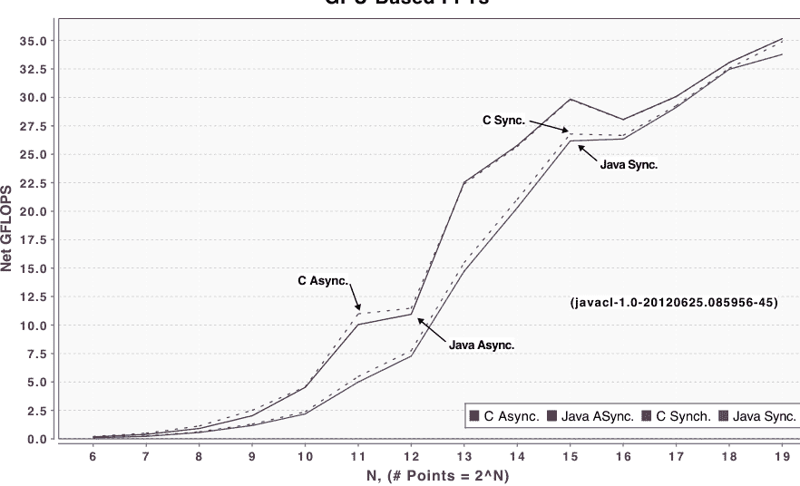

### 设置参数与入队时间占单次 FFT 时间的百分比

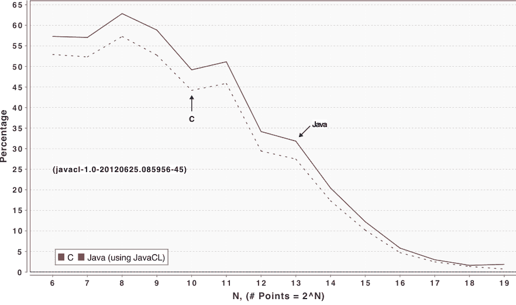

### 入队时间分析

查看 FFT 内核的绝对同步设置和入队时间可以得到图 5-3。该图显示了测试的每次迭代中设置内核参数、计算工作组大小和队列内核链所需的时间。它显示 Java 在设置和入队每个内核时比 C 大多花费了约 2 微秒。由于 Java OpenCL 代码必须调用原生/C 底层，这 2 微秒是 JavaCL 库层级的开销及其调用开销。

这是最后的比较。对于 Linux 内核，在这一硬件上并使用这块 GPU，从 C 端每秒限制为约为 105,000 次内核入队。使用 Java 则每秒限制为约为 87,000 次内核入队。对于许多类型的问题，每秒仅需数百次内核入队。


# 6.2.1 消息传递接口 (MPI)

MPI 专注于多个节点之间可靠的消息传输。这些研究使用了 MPI 2.2。MPI 程序从命令行启动，用户在命令行指定要启动多少个进程副本。这些副本是使用网格拓扑规范文件启动的，该文件标识了候选节点以及每个节点可以启动的进程数量。从 MPI 的角度来看，所有节点都可以连接到所有其他节点。

所有节点上都运行相同的应用程序。MPI 执行器（execute）与每个节点上运行的守护进程或作业控制器通信，以便在该节点上实例化应用程序副本。每个实例由一个唯一的整数标识。这由开发者编写代码来编辑 id，并决定哪些 id 应该处理任务，以及它们应该如何使用其他 id 进行通信。它支持同步和异步通信。开发者必须编写任何必要的队列和缓冲。开发者必须指定什么，使用程序化规范根据需要进行序列化和反序列化。它没有“作业（job）”的概念。可以与不同的上下文关联的属性。存在跨多个节点同步进程流的设施。没有自动处理通信失败的机制。目前有可用的商业和开源的 MPI 实现。这里使用了 OpenMPI 1.6.4。

# 6.2.2 并行 Java (PJ)

PJ 是一个用于集群计算的全 Java 框架。PJ 的部分内容与 MPI 有许多相似之处。PJ 根据通用公共许可证 (GPL) 分发。该分发包含一个与 MPI 非常相似的集群通信 API。它还包含了进程内多线程功能，这类似于 Concept MPI，且在第 3.2.4 节中部分讨论过。最后，PJ 还包含了在 RIT 使用的各种其他支持函数和工具。

PJ 应用通常也从命令行启动。节点上运行着一个调度器，它与其它节点上运行的 Secure Shell (SSH) 守护进程通信，以便在其他节点上启动所需数量的应用程序实例。启动交互与 MPI 略有不同，尽管应用程序实例通常正在运行，但开发者必须处理许多与 MPI 开发者面临的相同的缓冲区和队列的软件设计问题。序列化能力比 MPI 更强，因为由于 Java 对对象序列化提供了通用支持，Java 对象的序列化工作要少得多。

PJ 相当易用，但该框架在交换大量数据时在维护节点间连接方面存在问题。这里使用了版本 20120620。

# 6.2.3 Java 并行处理框架 (JPPF)

虽然 MPI 和 PJ 有基于消息交换的基本集群通信设施，但 JPPF 有一个不同的模型。在 JPPF 中，工作被分分为作业（jobs）和任务（tasks）。作业是一个可以并行执行的任务列表。任务是一个 Java 对象，可以是 `Runnable`、`Callable` 或 `JPPFTask` 的子类。任务可以根据需要使用程序化规范进行序列化和反序列化。

JPPF 任务可以被序列化。JPPF 允许在节点上运行任务。

# 6.2.4 GridGain

GridGain 是一个从早期开源项目演变而来的商业产品，适用于三种网格：计算网格、数据网格和 MapReduce 网格。本研究使用了计算网格。GridGain 是一个非常灵活的框架，允许将工作分发到抽象网格中。它在某种程度上比 JPPF 更具吸引力。GridGain 节点是相互对等的，并根据节点属性来选择任务。节点属性还会动态更新，指标包括：

- 平均 CPU 负载
- 等待作业数
- 垃圾回收 CPU 负载
- 剩余磁盘空间
- 通信计数
- 可用 CPU 数量

# 6.2.5 Storm

Storm 专注于分布式流式计算。在这种模型中，客户端工作被分解为若干相互连接的小型计算任务。输入阶段称为“spout（喷）”，其他阶段称为“bolt（螺）”。

Storm 与所研究的其他框架相比，一个独特的之处是，该框架可以轻松创建相同 spouts（喷射）和 bolts（节点）的多个实例来实现并行处理。指向并行化 bolt 的流元组将自动在各个 bolt 之间“拆分”（stripped）以分配负载。

Storm spouts 和 bolts 可以在包含或不包含元组交付确认（acknowled）的情况下进行定向。故障可能会导致元组重发，尽管这是在检测到缺失确认后由用户代码执行的。spouts 和 bolts 应该保持状态，并能够快速重启。

Storm 处于开发的早期阶段。它假设假设在实例化并行化 bolt 时，所有处理节点的能力是平等的。这使得开发者需要编写专门的着色器来处理更具处理器感知能力的 bolt 实例分配。它没有单一的队列可以进行入队。独一无二的处理必须响应节点的“触发”元组来完成。

Storm 是开源的，并根据 Eclipse 公共许可（Eclipse Public License）发布。Storm 相对较新，缺乏旧框架的某些“打磨”。Storm 运行在 JVM 上，但用 Java 和 Closure 编写。它要求分别安装并配置 Apache Zookeeper⁶、ZeroMQ⁷ 以及 ZeroMQ 的 Java 绑定。测试使用了 Storm 0.8.2。

# 6.2.6 Akka

Akka 提供了一种更进阶的消息分布模型，即 Actor 模型（actor model）。通过 MPI 和 Pj，消息根据整数 ID发送到计算元素。使用 actor 时，通过开发者分配的唯一标识符查找 actor 的引用。该引用用于后续的交付。与 MPI 和 Pj 的整数 ID 不同，actor 的对称标识符不取决于网格的大小。无论 actor 是发送进程的本地还是远程的，都会使用引用机制。这允许应用程序最初编写为多个相互通信的 actor，稍后可以轻松地在不同的节点上实例化。

消息发送是异步的。任何可序列化的 Java 对象（包括 Java 对象的元组）都可以作为消息发送。Actor 可以维护状态并根据需要更改其行为。与 Storm 不同，actor 之间的 I/O 关系没有捕获在静态拓扑中——每个发送者在发送每条消息时都会要求接收者。


# Akka 集群与路由器

Akka 支持集群操作，用户可以编写代码来识别集群事件，例如节点加入或离开集群。Akka 支持将消息分到不同节点上 actor 的并行实例。该框架提供了定义的 actor 作为路由器（`routers`），这对于将消息分到 actor 的并行实例非常有用。然而，使用这些比非路由器分发需要更多的开发者工作和理解。

> ⁶⁰ Apache Zookeeper, <http://zookeeper.apache.org>
>
> ⁶¹ Carl Hewitt, Peter Bishop, and Richard Steiger. 1973. A universal modular ACTOR formalism for artificial intelligence. In Proceedings of the 3rd international conference on Artificial Intelligence (IJCAI73). Morgan Kaufmann Publishers Inc., San Francisco, CA, USA, 235-245

Akka 具有各种类型的路由器，包括一种自适应负载均衡路由器，它使用运行时 CPU 指标来决定向哪些工作节点路由消息。这些指标包括内存利用率、平均负载、CPU 利用率或这些者的混合。测试使用了版本 2.1.2。

## 6.3 特性比较

上一节提供了每个框架的介绍性描述。表 6-1 和表 6-2 比较了这些框架中设计多节点计算应用的人感兴趣的方面。

**架构** 指的是节点之间的关系。在某些框架中存在主节点（`master node`），例如，可能会启动其他节点或在 I/O 中承担特殊角色。节点和工作节点的拓扑在框架运行期间可能是固定的，或者它们可能支持计算节点的临时进入/退出。在后一种情况下，工作代码通常是动态分发的，取决于哪些节点是用的。

**分布模型** 指的是消息或工作是否被分发。为了分配工作，框架必须移动数据，但消息的细节由框架处理。在 Storm 的情况下，数据元组从 sprouts 和 bolts 中显式发射，元组的目标对于 sprout 或 bolt 是不可知的。目标是由提交给框架执行的拓扑确定的。相比之下，Akka 的发送 actor 显式地指定将接收消息的 actor。

框架可能可能不分离操作系统进程来执行工作。GridGain 和 Akka 是唯一不分离的框架。

**负载均衡** 指的是框架在可用节点之间分配工作的能力。简单算法将仅以轮询方式将负载分配到可用资源。更复杂的算法将考虑执行时间，以预测当前分配决策对负载的影响。其他算法还会考虑节点当前的 CPU 和内存负载。JPPF、GridGain 和 Akka 都提供了各种形式的负载均衡，以及为用户提供的负载均衡算法的准备。

**节点故障恢复** 描述了框架是否有助于从节点故障中恢复，而不会给开发者带来过多检测和采取纠正措施的工作。MPI 和 PJ 处于不利，因为它们基于整数 ID 的进程标识使得在特定 ID 下线时难以于恢复，需要用户对工作到其他节点进行某些复杂的重新分配。

### 表 6-1. 框架特性比较 (1 of 2)

| 特性 | MPI | PJ | JPPF | GridGain | Storm | Akka |
|---|---|---|---|---|---|---|
| 使用版本 | OpenMPI 1.6.4 | 20120620 | 3.3.4 | 4.3.1e | 0.8.2 | 2.1.2 |
| 架构 | 固定对等节点；固定网格 | 主/从；固定网格 | 主/从；动态网格 | 主/从；动态拓扑 | 动态数量节点 | 动态数量节点 |
| 分布模型 | 消息传递 | 消息传递 | 任务提交 | 任务提交 | 显式目标 | 显式目标 |
| 分离操作系统进程 | 是 | 是 | 否 | 否 | 否 | 否 |
| 负载均衡 | 否 | 否 | 是 | 是 | 是 | 是 |
| 节点故障恢复 | 否 | 否 | 是 | 是 | 是 | |
| 节点间通信 | TCP/IP; RDMA | TCP/IP; UDP/IP | TCP/IP; UDP/IP | TCP/IP; UDP/IP | ZeroMQ | ZeroMQ |
| 序列化 | 由应用程序提供 | 自动 | 自动 | 自动 | | |
| 执行单元 | 整个应用 | 整个应用 | 细粒度 | 细粒度 | 细粒度 | 细粒度 |
| 分布式工作队列 | 否 | 否 | 是 | 是 | 是 | 是 |
| 任务间同步 | 否 | 否 | 是 | 是 | 是 | |
| 基于节点属性的分布 | 否 | 否 | 否 | 是 | 是 | 是 |
| 基于数据属性的分布 | 否 | 否 | 否 | 否 | 是 | 是 |
| 跨节点实现 join 语义 | 否 | 否 | 是 | 是 | 是 | 是 |
| 节点间同步数据 | 否 | 否 | 否 | 否 | 否 | 否 |

**节点间通信** 标识用于通信的关键协议。MPI 可以使用远程内存访问 (`RDMA`)。`RDMA` 允许一个节点直接另一个内存中放置信息。`ZeroMQ` 是一种促进通信的 API 和协议。

**序列化** 是将数据类型、数组和数据结构转换为字节以便传输。在 MPI 中，数据结构由应用程序提供。在 Java 中，如果遵循某些约定，数据是一个对象。

**执行单元** 指的是代码如何传输和执行。在 MPI 和 PJ 中，整个应用程序在每个节点上运行，由应用程序决定做什么。其他框架提供了更细粒度的代码。JPPF、GridGain、Storm 有将必要代码传输到节点的能力。

**分布式工作队列** 是指任何节点的进程都可以排队执行额外工作，但也跨网格。如果没有框架对此的支持，开发者必须实现可以写入任何节点的队列、从队列获取工作并分发到工作节点的代码，以及将结果传回请求节点的代码。

### 表 6-2. 框架特性比较（2/2）

| 特性 | MPI | PJ | JPPF | GridGain | Storm | Akka |
|---|---|---|---|---|---|---|
| 执行单元 | 整个副本应用 | 整个副本应用 | 可动态部署的单个作业和任务 | 可动态部署的单个作业和任务 | 动态部署的单个代码点和组件 (bolts) | 静态部署的 Actor 对象 |
| 跨节点共享和分布式工作队列 | 不适用 | 不适用 | 是 | 是 | 作为对分片消息的响应 | 是，但需要一些“胶水”代码 |
| 基于节点属性的工作负载 | 不适用 | 不适用 | 否 | 是 | 不适用 | Akka 识别“节点角色”，但用户代码必须手动使用 |
| 基于数据属性的消息分发或数据分区 | 否；需要手动编码 | 否；需要手动编码 | 否；需要手动编码 | 是 | 是 | Akka – 可以通过自定义路由器实现 |
| 跨节点实现 fork/join 语义 | 不适用 | 不适用 | 是（带有 Fork/Join 插件） | 是 | 不适用 | 不适用 |
| 节点间的共享同步数据 | 使用共享文件机制 | 否 | 是（带有 DataProvider） | 是，提供了多种机制 | 否 | 否 |
| 跨节点的任务间或进程间同步 | 是 | 否 | 否 | 是 | 否 | 否 |

这是对这五个 JVM 框架的快速概述。其中四个框架（JPPF、GridGain、Storm 和 Akka）将开发者从底层的消息“处理”（如序列化、缓冲和队列）中解放了出来。它们在负载均衡、并发和故障恢复方面也具有显著的内置能力。熟悉其中任何一个框架的人可能会认为这些描述过于简单。然而，目标是引导那些没有这些框架经验、且需要对其差异有初步印象的读者。

## 6.4 框架性能

人们预期，功能众多的框架性能可能不如功能较少但对性能投入更多关注的小型框架。本节调查了框架的性能。它测量了简单的指标——延迟和吞吐量。

使用了一个简单的 ping-pong 测试来测量延迟和吞吐量。每个框架都创建了同步和异步两个版本的测试。在同步测试中，节点 A 向节点 B 发送固定大小的数据并等待响应。节点 B 在接收到节点 A 的消息后，向节点 A 返回相同大小的消息。这一过程重复进行。在异步测试中，节点 A 向节点 B 发送多条消息但不等待响应。

异步测试需要第一个节点对数据进行队列，因为数据产生速度快于传输速度。因此，异步测试提供了有关框架队列和缓冲能力的信息。MPI 和 PJ 不提供通信软件栈。因此，研究人员在 MPI 和 PJ 的基准测试代码中加入了轮询队列和缓冲。其他框架则不需要此操作。

每次实验运行交换固定长度的数据，其长度从约 80 字节到约 650 千字节不等。对于 MPI，缓冲区大小是可以控制的，因为 C 语言对发送的数据有直接控制权。在 Java 中，数据包含在 Java 对象中。该对象如列表 6-1 所示。序列化 Java 对象会描述所发送内容的元数据，以便在节点上进行重构。因此，传输的字节数大于用户数据的大小。对于列表 6-1 所示的对象，其大小为 182 字节元数据加上 36 字节的非数组字段，再加上数组数据的字节数。某些框架使用标准的 Java 序列化，而另一些则拥有框架特定的序列化器。某些框架允许用户创建更高效的序列化器。对于像 JPPF 这样面向任务/作业的框架，开销可能更大，因为除了用户数据外，作业/任务对象也必须序列化。

### 列表 6-1. Ping-Pong 测试使用的 Java 对象

```java
public class RunInfo implements Serializable {
    private static final long serialVersionUID = 9478L;
    public int jobID;
    public long creationTimeNanos;
    public long remoteReceiveTimeNanos;
    public long intervalNanos;
    public long durationNanos; // 未使用但存在
    public long[] data;
}
```

在基准测试中，从第一个节点发送的消息在调用框架发送数据之前标记了纳秒时间。当第二个节点接收到数据时，它将接收时的纳秒时间添加到消息中并返回相同的消息。随后可以通过比较这两个时间确定延迟。

在使用服务器时钟方面格外小心。机器上的纳秒级时间通常是相对于启动时间的。毫秒级时间通常作为绝对时间可用。可以将两者仔细结合，以获得可以在机器之间比较的绝对纳秒时间。此外，标准时钟硬件在几分钟内可能会显著漂移。开发了校准软件来在每次测试运行中测量相对偏差。校准软件使用的 `JClockSkew` 工具已发布到公共领域。该技术是为了解决测试硬件上反复出现的时钟差异，约为 2 微秒。

测试是在通过 10 千兆以太网交换机连接的 4 台 Xeon E5620 集群上进行的。测量最佳延迟的测试在 C 和 Java 中进行。Java 延迟使用 `JClockSkew` 工具测量。C 延迟也使用与该工具相同的算法测量。

### 表 6-3. 测量延迟

| 语言 | 延迟 |
|---|---|
| Java (TCP 套接) | 33-41 微秒 |
| C (使用 MPI) | 20-27 微秒 |


图 6-3 绘制了以消息大小为函数的同步激活速率。消息大小是用户数据的大小。正如预期，最高消息速率由 MPI 实现。JPPF 速率最低。性能最好的同步 JPPF 框架 Akka 在小数据量下比 MPI 慢约 11 倍，此时 Java 序列化开销不显著，Akka 达到了 MPI 速率的 70%。

图 6-3 同样绘制了仅使用低级 Java 套接 I/O 所实现的消息交换次数。此大小是真实的消息长度（字节），因为没有序列化。将这种无开销的速率-计数曲线与序列化后的 Java 曲线进行比较似乎很奇怪，但其目的是向终端用户展示各种选项的能力，除非用户编写自己的序列化器，否则他们对序列化开销几乎没有控制权。Java 套接 I/O 曲线还表明，在同步测试中，Java 本身并不是吞吐量的限制。

图 6-4 绘制了异步激活速率。这些曲线应该比对应的同步曲线更高，因为在之前的完成之前可以队列新的消息或任务。再次 Akka 拥有最佳 Java 速率，而 JPPF 最低。图中了两 MPI 曲线。MPI-A1 测试维护单个待处理缓冲区。MPI-A4 测试维护 4 个缓冲区并以轮询方式使用，允许 4 个待处理激活。

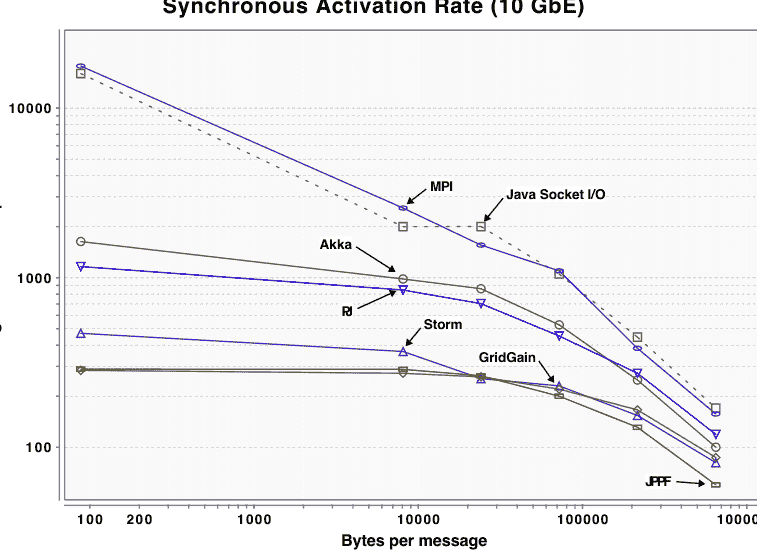

**图 6-3.** 10 GbE 上的同步激活率

对于小消息，Akka 的异步激活率比 MPI 慢四分之一到七分之一，具体取决于 MPI 的曲线。然而，对于大数据量，它比 MPI 快了 30% 到 40%。这种现象可能是由于测试中的结构性差异。在 Akka 中，只有当 actor 不忙于发送消息时，它才能对传入的消息做出响应。因此，有必要在一个独立的线程中实现 Akka 消息发送，以便 actor 能够异步处理传入的消息。而 MPI 实现维持了固定数量的待发送任务，但在同一线程中同时处理发送和接收。

图 6-5 绘制了同步吞吐量，图 6-6 绘制了异步吞吐量。由于吞吐量仅仅是激活率乘以数据大小，因此所示的相对性能与激活率曲线相同。

### 异步激活率 (10 GbE)

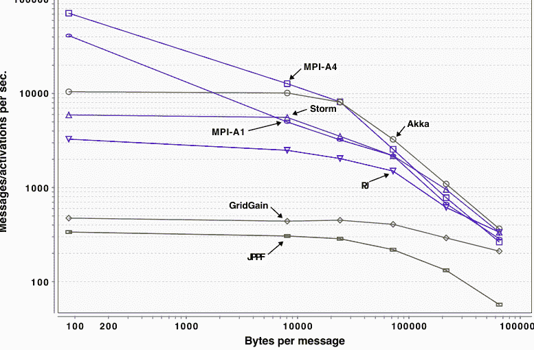

**图 6-4.** 10 GbE 上的异步激活率

### 同步吞吐量 (10 GbE)

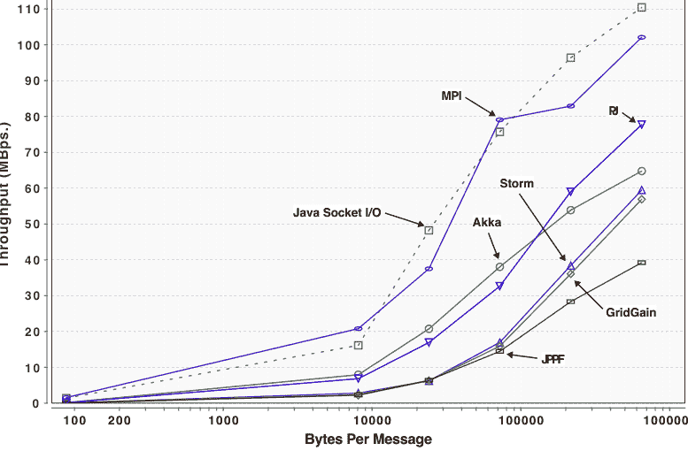

**图 6-5.** 10 GbE 上的同步吞吐量

### 异步吞吐量 (10 GbE)

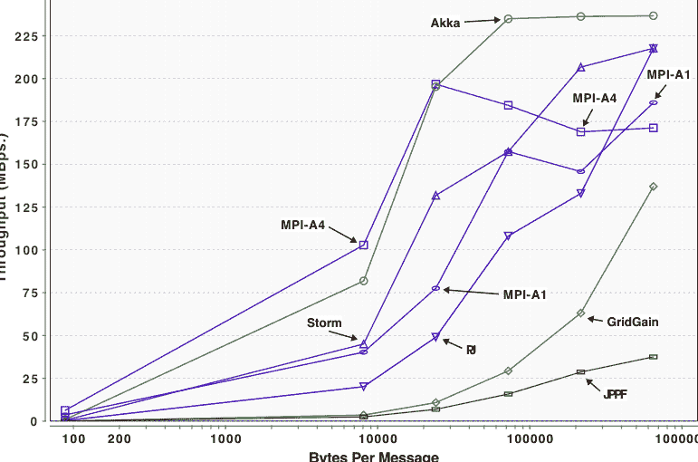

**图 6-6.** 10 GbE 上的异步吞吐量

## 6.5 Java 框架总结与观察

这项研究的动机是希望更快速地描述复杂的性能和 HPEC 应用（包括多节点应用）。在本节中，我们检查了 5 个 Java 计算网格框架，以理解其能力、架构模型和预期性能。Pi³, JPPF⁵⁴、GridGain⁵⁵、Storm⁵⁶ 和 Akka⁵⁷ 在 10 千兆以太网集群上进行了测试。这些框架具有不同的架构、部署模型、设置易用性和易用性。在方法调用、分布式任务和作业队列、多模式同步、actor 通信、数据流处理和故障恢复方面有不同的选项。GridGain 具有最多的内置功能且最容易设置以及分布式方法调用，尽管它不是最快的。

预计性能将低于高性能社区的消息接口 (MPI)，因为某些 Java 框架提供了比 MPI 更强大的能力和灵活性，但这通常是以牺牲性能为代价的。没有任何 Java 框架在小消息上优于 MPI。Java 序列化开销增加了交换消息和移除远程方法的负载。如果数据大小只大几字节，需要更高性能的开发者将编写自定义序列化器以避免默认的序列化开销。

然而，对于较大的数据，发现 Akka 和 Storm 都超过了 MPI 的一个或两个实现。这可能是由于测试代码的详细实现存在差异。这些差异源于显著不同的 API 和交互模型。如果是这样，那么设计上的差异可能导致更好的 Java 性能，这一点非常有意义。当达到设计差异成为关键的点时，说明性能问题的答案不再取决于框架是 C 框架还是 Java 框架。

此外，对于更复杂的应用，原生 MPI 性能可能会产生误导。如果需要高级的队列和节点内功能，开发者的代码将增加 MPI 的单消息开销。这将降低性能。

性能型应用通常有数值要求。某些类应用需要每秒 100 个作业的任务循环时间。测试显示，大多数框架都能轻松支持该速率。在每秒 1000 个作业时，三个 Java 框架可以支持中等数据量下的速率。

关于延迟和 JVM 能力，测试显示在 10 千兆以太网网络上，Java 套接字延迟（通过 `java.io` 包）比 MPI 的 27 微秒延迟高出约 13 毫秒。然而，JVM 套接字开销并不是导致框架延迟高于此值的主要部分。观察到的 Java 框架延迟范围在 236 到 1320 微秒之间。虽然我们无法分析原因，但必须假设巨大的框架延迟是由于网格/数据模型、框架软件架构以及可能未优化的设计实现共同导致的。例如，在 Storm 中，数据必须被“封装”成元组，以便过滤和数据分组，但识别和操作它们也增加了传输延迟。

本次调查中未探索多节点性能的其他方面。未来调查的因素包括：

- 网络负载 – 网格框架支持诸如同行节点参与者的自动发现和节点状态通信等功能需要多少开销
- 内存负载 – 框架运行时需要多少内存
- 随节点数量增加的可扩展性 – 如何有效地利用额外节点来分配负载
- 故障检测时间 – 多快可以检测到节点以便重新分配工作

# 编写用于性能的 Java 代码


# Java 性能优化编码实践

本节描述了有助于充分利用 Java 性能的编码实践。这些实践基于经验以及同仁的经验。

## 7.1 最小化重复路径中的内存分配

一项内存密集型测试发现，重复路径上的垃圾回收器活动导致了 15% 的开销。提高 Java 性能的一种明确方法（特别是在重复路径上）是最小化内存分配。垃圾回收是一个巨大的益处，但其透明性可能导致开发者过度使用动态内存。多年来，垃圾回收器一直是持续开发的重点。

从好的方面来说，开发者无需跟踪未使用的内存。从坏的方面来说，垃圾回收器必须定期运行以恢复内存的额外线程。扫描需要时间，会消耗主进程资源。垃圾回收运行的时间会导致执行抖动。

请注意，在有限范围内分配某些数据结构可能不会产生额外的垃圾回收工作。如果在运行时检测到对象实例化不在范围外使用，则对象可能被分配在栈上。如果对象足够简单，甚至可能不会被创建。在 Java 6 中逃逸分析是关闭的，但在 Java 7 中默认启用。

## 7.2 预分配工作缓冲区和结构

对于非实时应用，最好的做法是让垃圾回收器尽可能少地工作。预分配缓冲区和结构有助于实现这一点。这包括用于分离移动数据和处理数据线程的双缓冲区。

由于预分配倾向于破坏封装，因此在 Java 代码中通常不会这样做。在对象哲学下，对象管理其工作结构的分配，而不考虑复用，依靠内存机制进行清理。因此，“性能型”Java 编码必须背离这种设计实践，转而采用更高效的预分配实践。

## 7.3 使用 `StringBuilder` 进行重复拼接

某些 Java 应用因为过度使用 `String` 类进行解析和拼接而导致速度变慢。Java 字符串是不可变的。拼接两个字符串意味着必须创建第三个字符串，并从两个组成字符串中复制内容到其中。

`StringBuilder` 类起初会分配字符数组，并在需要时重新分配更大的数组。在现有实例上进行追加只是在对象的内部数组中分配空间。`StringBuilder` 实例还可以被重置为长度为零并重用，从而避免内存分配的开销并可能减轻垃圾回收器的负担。

最好的做法是在实例化 `StringBuilder` 时估算其长度，以减少内部数组的中间重新分配。请注意，`StringBuffer` 与其类似，但它提供了线程同步的方法，这可能会增加开销。

## 7.4 使用 SLF4J 获得良好的日志性能和简洁语法

无意中分配对象的一个常见来源是调试语句。考虑以下使用 Log4j 库的代码片段：

```java
for (i = 0; i < 10000; i++) {
  cum += i;
  log.debug("Iteration " + i + " cumulative == " + cum);
}
```

这种形式的调试方法接受一个参数，迫使开发者通过拼接来构建调试所需的正确信息。如果调试语句没有被记录，那么拼接就是浪费。另一方面，使用 Log4j 避免了这种拼接。使用 SLF4J，这可以写为：

```java
for (i = 0; i < 10000; i++) {
  cum += i;
  log.debug("Iteration {} == {}", i, cum);
}
```

如果有很多针对未使用信息的调试语句，那么在部署代码时可以节约的时间将是显著的。我们设计了一个简单的实验来衡量这一点。禁用日志记录，并按照上段代码片段记录了 10,000 条语句。Log4j（带拼接）需要 3.5 ms，而 SLF4J 仅需要 1.3 ms。当然，如果启用了控制台日志，记录字符串开销会大幅反转这些数字。

为了完整起见，应该提到另外两种日志选项：Apache Commons Logging 和标准日志。日志包的详细比较超出了本研究的范围。注意，Apache Commons Logging 也“深受”其调试方法中只有一个参数的影响，迫使开发者进行不必要的字符串拼接。Java 标准日志没有这个问题，但其方法参数的用法用起来更加别扭（在作者看来）。这导致开发者不愿使用它。如果使用内置日志，等效代码将如下所示：

```java
for (int i = 0; i < 10000; i++) {
    cum += i;
    log.log(Level.FINE, "Iteration cumulative == {}", new Object[]{i, cum});
}
```

这避免了字符串拼接，但需要创建一个对象数组，这仍然会导致效率低下。在禁用日志的情况下，执行上述循环的耗时为 2.5 ms。

SLF4J 的优势在于它是 Log4j、Java 日志或 Commons Logging 之上的细粒度封装。开发者的优势在于可以使用方便的 API 进行编码并获得良好的性能，同时在底层日志基础设施上为其“对冲了风险”。

## 7.5 最小化迭代器创建以减少抖动和垃圾回收器活动

`java.util.Iterator` 接口在 Java 集合类中广泛使用。创建迭代器需要对象实例化和未来的垃圾回收。虽然开发者无法更改标准库的设计，但如果满足以下条件，开发者可能可以为自己的类减少迭代器的创建：

- 只有一个线程将遍历该集合。
- 集合的内容在迭代过程中不会改变。

## 7.6 考虑替代类

## 7.7 使用 `final` 关键字和继承

## 7.8 避免重复传递给原生代码分配数据

## 7.9 如果应用需要加速，使用懒性实例化和延迟初始化

Java 的初始化时间通常比 C 更长，正如前一节所述。不同的供应商有不同的方法来加速，包括类时编译（AOT）和缓存。开发者可以编写类，在类加载和实例化时执行最少初始化。这些初始化可以延迟到第一次使用类时，尽管这会增加第一次的时间。

## 7.10 缓存只读实例和类字段的引用

当从方法访问只读类字段和实例字段时，最好的做法是在方法内部获取一次，然后在方法的其余部分使用该局部变量。

## 7.11 条件编译的替代方案

一种标准但未被充分利用的 Java 特性是断言。在 Java 中，断言是一个预期返回 true 的布尔表达式。断言可以是返回布尔结果的函数调用。Java 断言默认是禁用的。如果禁用，断言将不会被评估。禁用时，断言对运行时的影响非常小。

在 C 中，人们可以使用 C 宏来实现选择性的开发阶段断言。但这需要重新编译以从可执行代码中移除它们。

## 7.12 “热身”关键代码路径

在运行 JIT 编译器优化的 JVM 上的应用程序通常在运行一段时间后会变得更快。满意的迭代次数取决于代码细节，特别是当涉及嵌套循环和多级方法调用时。最好的方法是构造应用程序，允许关键代码路径进行单独热身，然后在经过一定次数的迭代后进行热身。

这对于“服务器”型应用程序非常有效，这类应用启动并等待外部事件触发处理或响应。这对于那些在应用程序完全“启动”之前需要达到特定吞吐量的应用也是合适的。

## 7.13 共享中央处理器核心

此项调查人员通过惨痛教训了解了满载状态处理器的不可预测性。如果一个应用程序正在运行多个计算密集型线程，很容易对可用核心提出过高要求。在对并行性的一些初始测试中，即使没有以实时优先级运行，四路负载均衡的性能也低于三路负载均衡。最可能的原因不仅是操作系统被饥饿了，垃圾回收器也被饥饿了。

有两种方法可以采取。一种是刻意在计算密集型任务中添加监控代码，这样如果计算运行时间过长，代码将刻意向其他线程让时间。将整个核心留给操作系统并不能完全解决问题，因为这会导致垃圾回收器在剩余的核心上与计算线程竞争。此外，操作系统很可能需要整个核心的所有算力。这意味着计算密集型线程可能不得不实施第二种方案。

当然，通常会涉及某种形式的 I/O，且计算密集型任务通常会被 I/O 打断。但值得记住这个问题，因为应用程序经过了插桩以测量执行时间，除非在不同的负载划分替代方案下进行比较，否则开发者可能无法意识到性能比预期的要差。

# 8 关于实时 Java 和安全关键型 Java 的说明

本研究的大部分工作都是在 x86_64 硬件上使用 Oracle Java 7 标准版完成的。不同的 JVM 将具有不同的性能。实时 JVM 实现了 JSR 1，“Java 实时规范”(RTSJ)。该规范旨在“允许创建、验证、分析、执行和管理 Java 线程，其正确性性条件包括时间性限制（也称为实时线程）”。

`java.realtime` 包中大约有 70 个对象或接口新增。它们提供了在不受垃圾回收器活动影响的内存范围内分配内存的支持。它们还提供了创建和运行以实时优先级运行线程的机制。这使得编写不被垃圾回收器中断的代码成为可能。此外，虽然标准 Java 中的计时和调度器实现提供了实时 Java 的“近似”计时，但实时操作系统提供了更精确的计时和调度。

还有各种 JVM 环境允许对最终的 Java 代码进行精简，以烧录到 ROM 设备。对于这些 JVM，重点在于如何生成可执行镜像，允许应用程序代码和最少量的 Java 库对象使其能够工作。

安全关键型 Java (SCJ) 是一种“基于 RTSJ (JSR-1) 的 J2ME™ 能力，包含了能够通过认证的安全关键型系统（例如，DO-178B）所需的最少功能”。服务包括启动、并发、调度、同步、内存管理、定时器管理和中断处理。它采用了一种基于区域的内存分配方案，而不是一个通用堆。区域形成了一个作用域栈，这些区域在超出范围时被创建，并可以程序化地回收。这些区域上没有垃圾回收器运行，减少了抖动。

某些 SCJ 实现将 Java 转换为 C。这意味着代码无法从 JIT 优化中受益，且运行速度比 Oracle Java 7 标准版慢。RTSJ 和 SC JVM 供应商采取的方法各异。本研究未尝试表征此类系统的性能，本调查中使用的基准测试和方法如下：

> 参见 JSR 1，“Java 实时规范”，2006 年 7 月，<http://jcp.org/jsr/1>
>
> 参见 JSR 302，“安全关键型 Java”，2011 年 1 月，<http://jcp.org/jsr/302>

# 9 结论

本研究旨在证明 Java 7 标准在某些计算上与 C 一样快。混合应用程序通常使用 Java 将计算密集型工作卸载到 C。本研究探讨了 Java 框架的性能，还研究了单节点 Java 的边界。最后，在附录中展示了关于 Scala（一种运行在 JVM 上的现代语言）和 Jython（一种适用于 JVM 脚本的 Python 版本）的数据。

GPU 吞吐量的百分比下降是因为内核设置和队列过程是与 GPU 执行并行进行的。在 64 到 524,288 之间的多数数据规模下，有效 GPU 吞吐量的差异不超过 2%。

关于调用原生库，研究表明，当使用原生数据时，SWIG 和 Bridj 的性能可以与手写的 JNI（一种底层 Java 调用机制）相当。Bridj 支持许多平台，使得定位和管理原生数据变得非常容易。这包括在 Java 代码不再引用原生数据时对原生数据进行垃圾回收。SWIG 功能很强大，但复杂性更高，且需要更多学习。然而，如果目标平台不在支持的平台列表中，SWIG 可能是最佳选择。

在 10GbE 以太网集群上测试了五个计算机网框架：JPPF、GridGain、Storm 和 Akka。这些框架共同提供了如自动发现、自动故障转移、节点间数据同步、数据序列化、多节点队列、活动监控和负载均衡等功能，可以节省大量的开发时间。它们之间进行了相互比较，并与 MPI（性能计算的基准）进行了比较。

由于更强的灵活性和特性，更复杂的框架预计性能并不会像 MPI 那么好。只有 MPI 和低级 Java I/O 能以每秒 10,000 次同步往返交换的速度处理小规模数据。另一方面，Akka 和 Storm 实现了每秒 10,000 次异步往返交换。对于许多需求较低的应用，也可以使用其他框架，如 GridGain 和 JPPF。即使是提供增强灵活性特性的 C 框架，其性能预计也会比 MPI 差。

进行了两项调查并列在附录中。一项研究了 Scala，因为一些人认为它可能是 Java 的继任者。它对于嵌入式高性能计算具有潜在的吸引力，因为它更简洁，但前提是它必须保持 Java 的吞吐量。在矩阵乘法和 FFT 上，研究发现由于 Scala 的基于 `for` 的循环语句开销增加，`for` 循环需要实现为 `while` 循环。

附录中介绍的第二项语言调查是使用 Python 进行脚本编写。发现 Python 的性能比 Java 或 C 更接近 CPython。它调用原生库的速度比 CPython 快，但在数值计算上较慢。PyPy（一种更快的 Python 实现）被发现矩阵乘法速度比 Java 慢一倍。

Java 和 JVM 可以作为性能工具箱的一部分，用于运行时间足够长、足以让 Java 7 Hotspot 热身优化“起作用”的应用。应通过预分配工作存储空间尽量减少动态内存分配。本文正文还讨论了实现良好性能的其他实践。

Java 和 C 的巧妙结合可以利用 Java 的高效率和代码安全性以及 C 的速度，来构建性能良好的解决方案，并利用日益稀缺的开发者成本和现有的 Java 人才。希望开发者能发现本报告及其发现对于进行量化权衡有所帮助，从而开发出良好的混合应用程序。


此处开发的基准测试已作为开源项目发布在 `http://jcompmarks.sourceforge.net`。性能的系统分析需要易于使用的代码段计时工具和简单统计数据的积累工具。这里为 C、Java 和 Python 开发的计时工具具有相似的 API，并在这些研究中证明了无价之。它们已发布在 `http://jtimeandprofile.sourceforge.net`。最后，一个便于从 C 调用 Java 的工具已发布在 `http://cshimtojava.sourceforge.net`。

## 附录 A Scala

Scala 是一种在 2003 年发布的相对新的语言。它可以在 Java 虚拟机（JVM）上运行，尽管它具有更强大、更简洁的语法。它保留了对象设计，并将函数式编程世界的许多强大特性引入来与对象设计共存。它具有严格的类型检查，但不需要让 Java 感到“臃肿”的许多类型声明。由于它运行在 JVM 上且非常简洁，关于它是否能保留足够的性能以成为高性能工具箱中极具吸引力的补充，这是一个值得的问题。

Scala 可以在 JVM 上运行并轻松地使用 Java 库。在让应用程序内部轻松混合 Java 和 Scala 集合类型及迭代器方面做了大量工作。Scala 拥有力量、灵活性以及定义类型感知操作符的能力，这些操作类似于运算符重载。Scala 的强大是以语言复杂性增加为代价的，这需要比人们预期的更多的学习。

然而，Scala 也很简洁且没有牺牲强类型检查。研究人员对 Scala 的经验表明，相同的 Java 函数用大约四分之三的代码量即可编写。

对 Scala 的第一次实验是实现了第 2.8 节描述的红黑树插入测试。在 Scala 中，一切都可以被视为对象，包括数字。本报告中使用的红黑树算法基于泛型对象，使得翻译到 Scala 非常容易。但该语言还有一项规定，如果为原始类型实例化特定的类而不是对象，就可以生成专门/更快的代码。这创建了泛型类（如红黑树）的多个版本，但应该提供更好的性能。因此，Scala 的红黑树测试分为两种方式：特化和非特化。

图 A-1 比较了 Java 的四字节内容插入和测试与 Scala 版本，以及在红黑树键和红黑节点键上带有 `@specialized` 注解的 Scala 版本。未特化的 Scala 实现比 Java 版本慢一点，尽管仍比本报告早些记录的 C 版本快。特化版本比 Java 版本稍好一点。

### Java 和 Scala 在红黑测试上的对比


图 A-1. Java 和 Scala 红黑树插入和获取性能

矩阵乘法需要三层嵌套循环。这使得理解 Scala 循环性能成为一个很好的测试。Scala 的 `for` 导式也是高阶方法的“语法糖”。`for` 导式是一种通用结构，可以用于对各种类型进行迭代，还可以包含对迭代类型进行过滤。这导致一系列复杂操作具有非常紧凑的语法，但缺点是简单的基于整数的顺序迭代不像字节码循环那样简单。

关于此问题有许多讨论¹。截至 Scala 2.10.2，编译器对于整数循环仍生成较慢的 `for` 导式代码。然而，有一个针对 Scala 2.11 的 Scala 编译器新增将实现所需的优化。²

图 A-2 比较了正文中描述的 Java 矩阵乘法测试与其 Scala 对应版本。分别使用 `for` 导式和将循环转换为 `while` 循环进行了测试。对于 Scala，“for` 导式在 N < 18 时性能很差。另一方面，基于 `while` 循环的 Scala 实现性能与 Java 实现几乎相同。

¹参见许多讨论中的两个：`http://stackoverflow.com/questions/61461822/how-to-optimize-for-comprehensions-and-loopsloops-in-scala` 和 `https://groups.google.com/forum/#topic/scala-user/hq20XLvRjg`。

² 参见票据：`http://issues.scala-lang.org/browse/SI-1338`。

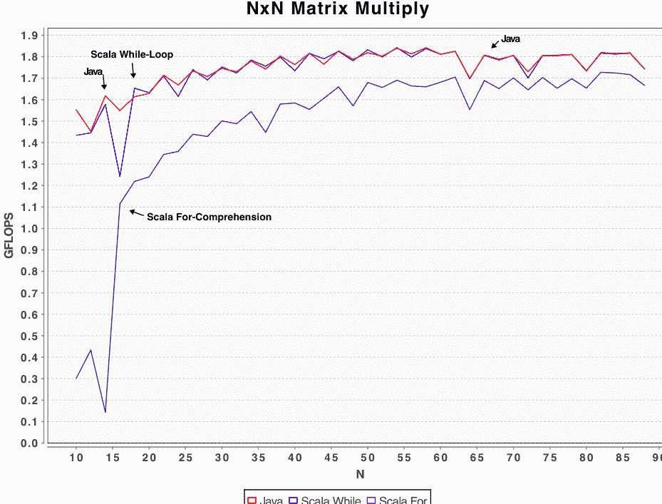

### 图 A-2. Java 与 Scala 矩阵乘法对比

最后进行的测试是比较 Scala 在 FFT 上的速度与 Java。其中一个 FFT 使用 for-comprehension（for 复合表达式）实现，另一个使用 while 循环。图 A-3 显示了结果。Scala 的 for-comprehension 迭代执行速度相当较慢，仅为 Java 代码的 13% 到 34% 之间。除了一个异常点外，Scala 的 while 循环实现在运行速度上与其对应的 Java 版本一致。

### FFT 速度

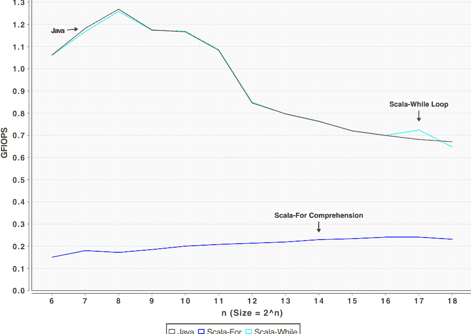

图 A-3. Java 与 Scala FFT 对比

基于这些测试，本研究者的观点是：Scala 可以用于性能环境，只要使用 ScalaCL 插件来加速简单的基于整数的 for-comprehension 循环。许多性能代码依赖于现有的库和算法，这些算法根源于带有 for 循环的老旧 Fortran 代码。手动将这些代码转换为 while 循环将过于负担且容易出错。与 Java 相比，Scala 的简洁性是 JVM 的巨大胜利。

## 附录 B JPython

Jython 是一种运行在 Java 虚拟机 (JVM) 上的 Python 实现。Python 自 20 世纪 80 年代一直存在。它在科学计算和性能计算社区非常流行。由于缺乏类型检查，它的语法比 Java 更简洁。它具有垃圾回收机制。它支持对象；开发者必须管理更多关于子类的机制。它能够轻松地调用外部 C 库，并基于原生库创建语言“扩展”。这使得 Python 成为一种易于使用的脚本语言，用于绑定和序列化原生函数。

CPython 是一种解释型 Python，与编译代码相比其速度相对较慢。PyPy 是一个快速的 Python 实现，包含一个即时编译（JIT）编译器，在几次迭代后也会表现出速度加速行为。

问题出现在 CPython 各版本之间，以及与本报告正文中使用的算法之间的对比。目标是进行定量比较，从而为做出实现权衡的设计师提供潜在帮助。以下是一些“快速”性能调查。

第一次比较是矩阵乘法测试的性能。Python 开发者通常使用 NumPy 包。NumPy 的大部分工作在原生库中完成，不能作为语言相对性能的合理指标。相反，我们用纯 Python 实现了本报告正文中用于 C 和 Java 的相同矩阵代码。所有 Python 测试都使用了 Python 的 array 包进行矩阵存储。所有测试在收集时间之前都会先预运行代码。

结果总结在表 B-1 中，比较了吞吐量比例。原始吞吐量（十亿次浮点运算，giga-flops）如图 B-1 和图 B-2 所示。Jython 在此测试中的吞吐量最慢，约为 CPython 吞吐量的 70%。PyPy 显著快于 CPython，但比 Java 慢三倍。回想正文，热身后的速度始终比 Oracle Java 7 标准版快一点点。

### 表 B-1：Java、Jython、CPython 和 PyPy 的相对矩阵乘法性能

| 吞吐量比例 | 数值 |
|---|---|
| Python/Jython | 1.4 |
| PyPy/CPython | 120 |
| Java/PyPy | 3 |

### NxN 矩阵乘法

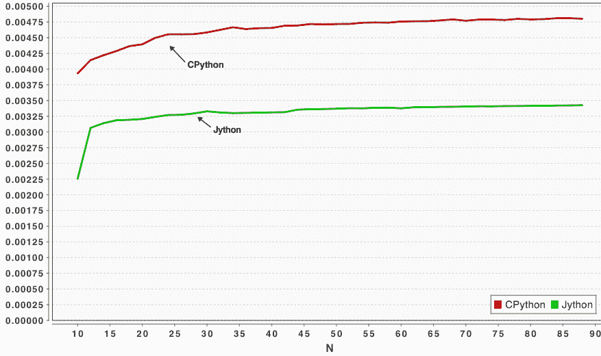

图 B-1. CPython 和 Jython 矩阵乘法（不使用 NumPy）

### NxN 矩阵乘法

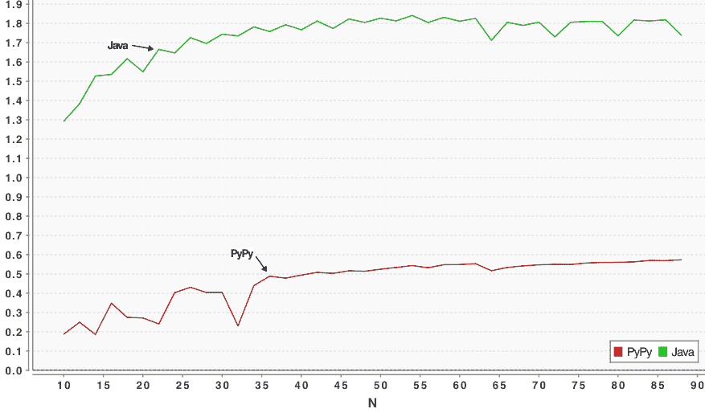

图 B-2. PyPy 和 Java 矩阵乘法（不使用 NumPy）

矩阵乘法测试侧重于计算。第二次测试是正文中描述的红黑树测试的重复，但在 Python 中实现。该测试是关于内存分配和内存结构构建的非计算测试。同样，比较了 Java、Jython、CPython 和 PyPy 实现在完成固定数量的红黑树插入和固定数量的操作时的快慢。

结果如图 B-3 和图 B-4 所示。Jython 和 CPython 性能相当。一个在插入上稍快，另一个在检索上稍快。PyPy 比 CPython 快大约 14 倍。Java 最快。在检索上比 PyPy 快三倍，在插入简单整数内容时比 PyPy 快六倍。

### Jython 与 CPython 在红黑树测试中的对比

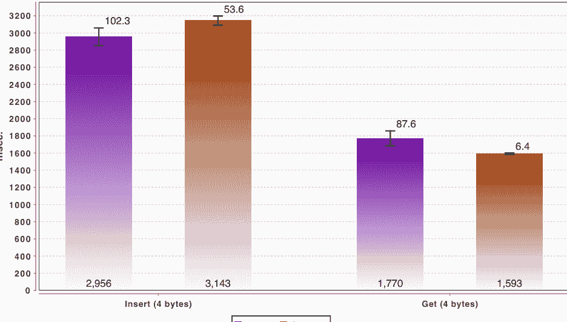

图 B-3. CPython 和 Jython 红黑树测试

最后的调查比较了从 Jython 和 CPython 调用原生库。Jython 拥有一个扩展编程接口 (API)，在概念上与 Java Native Interface (JNI) 相似。对于 CPython，手动编写了一个扩展来通过此 API 调用原生库。另一方面，Jython 已经可以导入类并对 Java 库进行方法调用。重用为之前的研究而开发的 JNI 胶水代码非常容易。

在展示结果之前说明一点：在之前调用 C 的研究中，有多种方式来传递 Java 数组数据，或者是否在 Java 代码控制下创建原生数据。由于所有选项仍然可用，此测试没有重复。相反，此测试侧重于带有简单整数参数的方法调用时间，因为这些时间可以外推以预测各种数组传递方案的性能。

### PyPy 与 Java 在红黑树测试中的对比

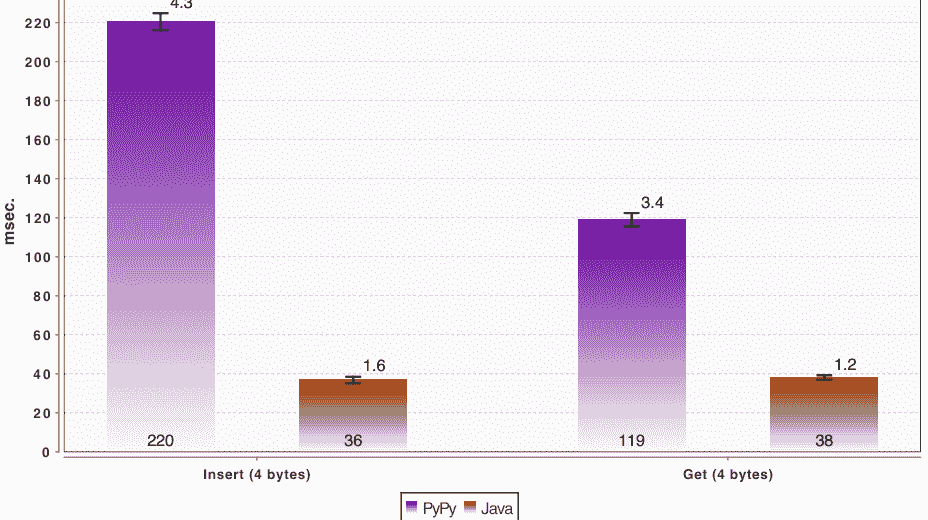

图 B-4. PyPy 和 Java 红黑树测试

### 从 Jython 和 CPython 调用原生库的时间

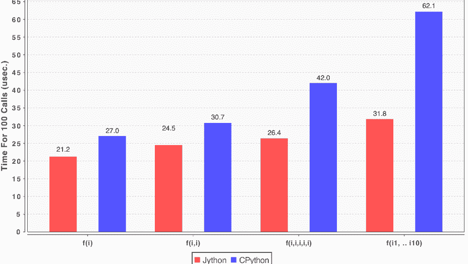

图 B-5. CPython 和 Jython 调用原生方法的时间

测试结果如图 B-6 所示。对于少数参数，可以说时间处于同一“量级”。然而，随着参数数量的增加，这种不成比例的差异越来越大。原因可能是因为在 CPython 中，每个整数（或地址）都是直接传递的，不需要回调。

对于许多应用程序来说，时间差异是不显著的。通过与 CPython 调用 CPython 以及 Jython 调用 Jython 的时间进行对比，将这些调用情况视角化可能会有所帮助。

### 比较 CPython-to-CPython 和 Jython-to-Jython 调用时间


图 B-6. CPython 和 Jython 调用时间

本页特意留空

## 附录 C Java 用于数值计算的库

这是在本研究过程中发现的用于数值计算的 Java 库和基准测试。在这里列出作为感兴趣者的起点。其中一些库的性能在 `http://algo.org/performance, ejml.html` 进行了比较。请注意用于评估 Java 代数库的工具 Java矩阵基准测试 (JMatBench)。

### 表 C-1. Java 数值库 (1/2)

| 名称 | 摘要与 URL |
|---|---|
| Apache Commons Math | 数学和统计，包括线性回归、最小二法拟合、求根、求解线性方程、求解常微分方程等。<br>• `http://commons.apache.org/math/apidocs/index.html` |
| COLT | 在 CRN 开发的高性能科学技术计算库。线性代数、多维数组、统计、直方图、蒙特卡洛模拟等。<br>• `http://acs.lbl.gov/software/colt/` |
| Efficient Java Matrix Library (EJML) | 用于操作密集矩阵的线性代数库<br>• `http://code.google.com/p/efficient-java-matrix-library/` |
| JAMA | 线性代数<br>• `http://math.nist.gov/janumerics/jama/` |
| JAMPACK | 线性代数<br>• `ftp://math.nist.gov/pub/Jpack/Jpack/AboutJanpack.html` |
| jblas | Java 线性代数库；基于 BLAS 和 LAPACK；使用原生库<br>• `http://jblas.org/` |

### 表 C-2. 用于数值计算的 Java 库 (2/2)

| 名称 | 摘要与 URL |
| --- | --- |
| JLAPACK | • 从 Fortran 源代码翻译的 BLAS 和 LAPACK<br>• `http://icl.cs.utk.edu/f2j/` - 也是翻译为 Java 的 f2j 翻译器的首页 |
| JScience | • 单位、坐标表示/变换、数学域、集合、环、向量、线性代数的运算与表示、符号处理和方程求解、物理常数和模型、货币转换等<br>• `http://jcience.org/` |
| Java 线性代数库 (la4j) | • 稀疏和稠密矩阵库<br>• `http://code.google.com/p/la4j/` |
| Matrix-Toolkits-Java (MTJ) | • 矩阵数据结构、线性求解器、最小二乘法、特征值和奇异值分解<br>• 稠密和结构化稀疏计算基于 BLAS 和 LAPACK，稀疏操作基于 Templates<br>• `http://code.google.com/p/matrix-toolkits-java/` |
| ojAlgo | • 线性代数、线性规划、二次规划、混合整数规划、现代投资组合理论、随机数分布<br>• `http://ojalgo.org/` |
| 通用 Java 矩阵包 (UJMP) | • 稀疏和稠密矩阵，以及线性代数计算，如矩阵分解、逆、乘、平均、相关性、标准差等<br>• `http://sourceforge.net/projects/ujmp/` |

## 附录 D 测试框架的 CPU 负载

针对第 6.4 节中提出的同步和异步框架测试收集了中央处理器（CPU）负载数据。表 D-1 和 D-2 显示了这些数据。所示的百分比是两个节点之间 CPU 负载的总和。括号中的两个数字是每个节点的百分比。收集这些数据希望为运行框架的 CPU 时间“成本”提供一些见解。

很难从结果中得出通用的结论。MPI 在同步和异步测试中对不同尺寸显示的负载非常相似。同步和异步测试之间的相似性可以用其唯一区别来解释：异步版本的测试使用了轮询缓冲区系统，允许最多 4 个悬起缓冲区在传输。测试的大部分时间用于传输或接收（尽管有延迟）缓冲区。另一方面，并行测试使用了相同的轮询缓冲方案，但没有表现出一致的行为。

Storm 在同步数据交换时的 CPU 负载非常低，甚至与 MPI 相比也是。它的负载在异步测试中有所增加。

除了 JPPF 之外，Java 框架在同步测试中使用的 CPU 比 MPI 少，但在异步测试中使用的 CPU 比 MPI 高。

这些结果在此列出以供未来参考。

### 表 D-1. 同步测试的处理器负载百分比

| 框架 | 数据大小 | 88 | 8072 | 648072 |
| --- | --- | --- | --- | --- |
| MPI | 51% (26/25) | 55% (31/24) | 51% (26/25) |
| PJ | 24% (12/12) | 29% (13/16) | 17% (7/10) |
| JPPF | 39% (26/13) | 77% (56/21) | 35% (12/23) |
| GridGain | 33% (21/12) | 24% (16/8) | 21% (11/10) |
| Storm | 18% (13/4) | 19% (13/6) | 22% (10/12) |
| Akka | 29% (13/14) | 27% (13/6) | 15% (10/12) |
| 100% = 核心 | | | | |

### 表 D-2. 异步测试的处理器负载百分比

| 框架 | 数据大小 | 88 | 8072 | 648072 |
| --- | --- | --- | --- | --- |
| MPI | 51% (25/26) | 49% (24/25) | 47% (23/24) |
| PJ | 78% (37/41) | 70% (32/38) | 31% (13/18) |
| JPPF | 66% (51/15) | 70% (51/19) | 73% (24/49) |
| GridGain | 77% (38/39) | 118% (48/46) | 72% (34/38) |
| Storm | 89% (46/43) | 134% (62/72) | 102% (83/22) |
| Akka | 94% (48/46) | 94% (48/46) | 74% (34/38) |
| 100% = 核心 | | | | |

## 附录 E 缩写与术语

- AOT 提前编译
- API 应用程序接口
- CPU 中央处理器
- FFT 快速傅里叶变换
- FFTW 西方快速傅里叶变换
- GPL 通用公共许可证
- GPU 图形处理器
- HPEC 高性能嵌入计算
- I/O 输入/输出
- IP 互联网协议
- JIT 即时编译
- JNA Java 原生访问
- JNI Java 原生接口
- JPPF Java 并行框架
- JSR Java 规范请求
- JVM Java 虚拟机
- LFSR 线性反馈移位器
- MPI 消息传递接口
- ms 毫秒
- ns 纳秒
- OS 操作系统
- PJ 并行 Java
- RDMA 远程直接内存访问
- ROM 只读存储器
- RTSJ Java 实时关键性规范
- SCJ 安全关键 Java
- SWIG 简化封装与接口生成器


- **TCP** 传输控制协议
- **UDP** 用户数据协议
- **µs** 微秒
