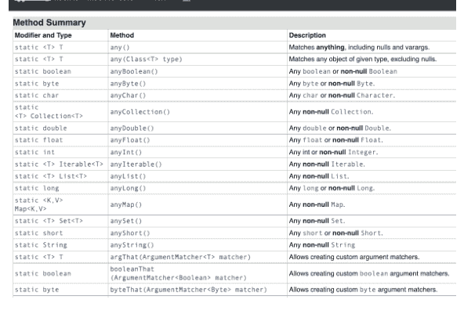

# Mockito 详解：使用 Mock、Stub 和 Spy 进行 Java 单元测试

Venkat Subramaniam 序言

Margaret Eldridge 编辑

# 对《深度解析 Mockito》的早期赞誉

在很多情况下你可以避免使用 Mock，但在需要时，理解你使用的 Mock 框架至关重要。《深度解析 Mockito》是一份极具价值的资源，可以让你快速充分利用 Mockito 的功能，从简单的 Mock 到复杂的交互，再到解决静态方法和 final 类等难以处理的访问性问题。

- Daniel Hinojosa
  顾问、程序员、演讲者及培训师

自 Mockito 于 2007 年诞生以来，该库新增了如此多的功能，以至于只有少数开发者能对其全貌了解。本书简洁而详尽地总结了这些功能。如果你正在使用 Mockito，无论新手还是老手，这本书都适合你！

- Rafael Winterhalter
  软件顾问

Ken 非常棒地准确展示了 Mockito 到底是什么、如何使用它以及何时不该使用它。对于任何想要学习如何编写良好测试的人来说，这绝对是必读之作。

- Marcin Grzejszczak
  书籍及视频课程作者及国际演讲

制作本书的团队包括：

- 首席执行官：Dave Rankin
- 运营官：Janet Furlow
- 主编：Tammy Coron
- 开发编辑：Margaret Eldridge
- 创始人：Andy Hunt 和 Dave Thomas

> *献给 Ginger 和 Xander，他们对我世界上最重要的人。*

# 《深度解析 Mockito》序言

编写自动化测试以验证代码的能力是敏捷开发的一项基本技能。当代码单元没有依赖时，编写测试非常容易。当待测试代码与其他代码或服务耦合时，情况就会变得困难。作为处理依赖的第一步，我们应该解耦、移动依赖，甚至移除它们。良好的设计会尽可能保持低依赖。

一旦我们将依赖精简到最低，我们最终必须与它们周旋以编写有效的测试。这就是本书的用武之地。

要为带有依赖的代码编写测试，你需要一个强大的库来轻松创建测试双（`Stub`、`Mock` 和 `Spy`），这样你就可以专注于设计而不是与依赖作斗。对于 Java 和大多数 JVM 语言，Mockito 多年来已成为明显的获胜者。其次，除了需要良好的测试方法外，你还需要学会如何完美使用这个库。

就像你会想要一个经过测试和验证、存在已久的库一样，你也会希望向一位拥有丰富教学经验的人学习，特别是针对你感兴趣的主题。你不仅找到了一本对你学习有益的书籍，还找到了一位在该领域最出色的导师之一。坐好，放松，喝上你喜欢的饮料，让 Ken 带领你进入处理依赖测试的旅程。

Venkat Subramanian 博士，屡获奖作者，Agile Developer, Inc. 创始人。

# 致谢

这本书的写作时间比我预想的要长得多。虽然我对我参与过的每一本书都可以这么说，但这本书花费如此长时间的真正原因在于，我不断在 Mockito 框架中发现一些有趣的功能，这些功能我要么以前不知道，要么没有真正理解。尽管我在实际工作和培训课程中已经使用了多年 Mockito，但我之前完全不知道它竟然有如此深奥的内容。这就是写书最棒的部分——深入挖掘那些你平时不会遇到的代码部分，而事实证明 Mockito 恰恰拥有大量这样的部分。

我非常想感谢 Mockito 团队构建并维护了这样一个强大的工具。让我特别提一下 Rafael Winterhalter，他对书的测试版本提出了大量建议，极大地提升了最终成品的质量。我还需要感谢其他提交意见的评审员，包括 David Chelminsky、Bauke Scholtz、Ludovico Fischer、Marcin Grzeszczak、Marcin Zajajkowski 和 Daniel Hinojosa。非常感谢你们的贡献和支持。

Venkat Subramanian 也审阅了这本书，我对此表示感谢，但我特别想感谢他撰写的序言。我总是乐意看到他参与任何项目，我们就 Mockito 的使用以及如何编写相关内容进行过几次非常“激烈”的讨论。我尽量不常告诉他这些，因为我不想过度满足他的自尊心，但能将他视为朋友兼同事，是我的荣幸。

我在 O'Reilly Learning 平台和 No Fluff, Just Stuff 巡演中都进行过涉及 Mockito 的培训课程和演讲，感谢这两个平台提供的机会。没有比向一群聪明的专业人士展示信息更能发现自己知识漏洞的方法了，通过这种方式，我对 Mockito 以及通用测试学习到了很多知识。我还想感谢我的编辑 Margaret Eldridge，她提供了恰到好处的反馈、批评和支持，使得项目在受到其他职业事务干扰时依然能够继续进行。事实上，Pragmatic Programmers 的整个团队合作起来非常愉快，我强烈向任何考虑过写技术类书的人推荐他们。

最后，也是特别地，我想感谢我的妻子 Virginia 和我的儿子 Xander，感谢在我忙于另一个写作项目期间对我的耐心等待。我承诺在写完这个之后会休息一下，这次我是真的。

Ken Kousen

ken.kousen@kousenit.com

2023年1月

# 前言

这本书是关于 Mockito 测试框架的，但它并不是一份详尽的参考书。现在没有书会尝试做到这一点。对于任何库，在线文档总是优于纸质书，因为它可以跟软件的新版本同步，并调整以显示新功能和错误修复。书籍的价值在于它们是在线文档的前端，帮助你理解自己正在进入什么领域，以及到达那里后期待什么。书籍是经过策选的内容。它们试图向你展示什么是重要的以及为什么。

对于 Mockito 来说，这样本书尤为重要，因为在线文档存在明显的空白。文档是由开发者编写的，他们理解像 Mockito 生成模拟（`mocks`）、存桩（`stubs`）和间谍（`spies`）的工具并帮助你使用它们。这很好，因为文档专注于如何让框架按照你的意愿运行。缺点是，你需要预先理解 Mockito 解决的问题，除非你已经有了类似工具的经验，否则这些概念可能并不显而易见。

这本书旨在填补这一空白。它更多是关于 Mockito 背后的概念，而不是展示如何使用的具体细节。当然，为了提供具有代表性的示例，书中包含了这些细节，但目标是理解，而不是语法的具体细节。在线文档对于语法（API 中的类和方法）很有用，在较小程度上，对于语义（如何使用工具实现你的目标）也很有用，但它们没有解释为什么 Mockito 起初是有用的，或者它如何能让你的工作变得更容易。

这正是 `Pragmatic Answers`（实战解答）系列的核心所在。该系列回答了那些简单的博客文章无法涵盖、但可能不足以写成 300 页书籍的话题。该系列书籍短小精悍。目标是让你上手该工具，以便在必要时可以在周末内快速掌握。最终结果是让你开始并帮助你理解框架的目标、策略和基本战术。然后你可以在在线资源中找到任何特定细节，并知道如何应用它们。

希望你会发现这本书是你书架上有益的补充，它将确保帮助你在 Java 系统中编写更高效的测试，确保你的代码运行如你所愿。

关于软件版本的一个说明：本书编写时 Mockito 的当前版本是 4.0.0。你可能正在使用 2.x 或 3.x 版本。这没关系，因为这些是唯一的区别：

- Mockito 3 只是 Mockito 2，要求的 Java 版本为 1.8 或以上。
- Mockito 4 只是 Mockito 3，删除了废弃的项目。
- Mockito 5（即将发布）只是 Mockito 4，在核心中包含了内联 mock maker。

换句话说，书中所有的代码都是为 Mockito 4 编写的，但应该可以在任何 Mockito 2.* 或以上版本运行。尽管当前的 LTS（长期支持）版本是 17，但 Java 版本将是 11，因为社区还没有许多用户迁移到该版本。书中的所有代码适用于从 1.8 到 19 的所有 Java 版本。

测试全部基于 JUnit 测试框架¹。附录 1“运行 Mockito 测试”讨论了如何使用 `Gradle` 或 `Maven` 构建工具配置包含 JUnit 4 和 JUnit 5 的 Mockito 项目，以及如何运行相关测试。

现在，是时候开始研究 Mockito 设计解决的问题类型了。

> ¹ https://junit.org/

# 第 1 章 构建测试基础

为什么我们需要像 Mockito 这样的工具，它又是让我们的开发工作变得更轻松的？

像许多开发者一样，我曾是一个职业转换者。我来自工程工程领域，在那里我的大部分时间都在处理数学和（瑟抖）Fortran。最终我转向了软件，在 Java 早期就开始使用它并接受了重新培训。这次转型的一个意外收获是，下一次我去父母家里时，我父亲告诉我家里某个东西坏了，我能够回答：“抱歉，那是硬件问题。”

我对大多数硬件都有这种感觉，诚实地说，对大多数软件也是如此。如果代码运行，我很开心；如果不运行，我就需要缩小范围寻找问题。

Mockito 是一个帮助隔离软件组件的工具。你使用 Mockito 替换测试组件的依赖，以便每个依赖根据输入返回已知输出。这样，当测试组件时发生错误时，你知道在哪里以及为什么。

使用 Mockito 的挑战在于，它建立在测试原则的基础上，你需要了解这些原则才能正确使用该工具。在本章中，我们将使用一个有趣的示例来说明这些基础，以便我们专注于如何让 Mockito 执行你想要的操作。

正确地处理，并展示开发中单元测试、集成测试和功能测试的位置。在此过程中，我们将突出每当你想在项目中使用 Mockito 时需要采取的一系列步骤，同时对你不需要测试的方法进行存桩（`stubbing`）。

## 向 Mockito 问好

自从 Kernighan 和 Richie 首次出版《C 语言程序设计》（1978）以来，每一个编程语言和框架在法律上都要求必须包含一个“Hello, World!”的示例。在本节中，我们将查看 Mockito 的版本，解释 Mockito 的作用以及它是什么，并介绍一个较大系统的一部分，稍后将在书后部分使用它提供更多细节。

对于 Java 来说，Hello, World! 程序无疑是：

```java
// HelloWorld.java
public class HelloWorld {
    public static void main(String[] args) {
        System.out.println("Hello, World!");
    }
}
```

`HelloWorld` 类包含一个 `main` 方法，但 `main` 返回 `void`，而 `void` 方法很难测试。Mockito 是一个测试库，所以让我们修改一下，创建一个类，通过从 `greet` 方法返回的简单字符串来欢迎用户：

```java
// HelloMockito.java
public class HelloMockito {
    private String greeting = "Hello, %s, from Mockito!";
    public String greet(String name) {
        return String.format(greeting, name);
    }
}
```

为 `greet` 方法创建一个 JUnit 5 测试是轻而易举：

```java
// HelloMockitoTest.java
import org.junit.jupiter.api.Test;
import static org.junit.jupiter.api.Assertions.assertEquals;

class HelloMockitoTest {
    private HelloMockito helloMockito = new HelloMockito();
    @Test
    void greetPerson() {
        String greeting = helloMockito.greet("World");
        assertEquals("Hello, World, from Mockito!", greeting);
    }
}
```

由于 `HelloMockito` 类没有任何依赖项，完全不需要 Mockito。让我们看看 Mockito 在什么地方有用，添加几个依赖项，查找一个可以通过名称获取的人员，并将生成的消息翻译成不同的语言：

```java
// HelloMockRevised.java
public class HelloMock {
    private String greeting = "Hello, %s, from Mockito";
    // Dependencies
    private final PersonRepository personRepository;
    private final TranslationService translationService;
    // 注入依赖的构造函数
    public HelloMock(PersonRepository personRepository,
        TranslationService translationService) {
        this.personRepository = personRepository;
        this.translationService = translationService;
    }

    // 我们想要测试的方法
    public String greet(int id, String sourceLang, String targetLang) {
        Optional<Person> person = personRepository.findById(id);
        String name = person.map(Person::getFirstName).orElse("World");
        return translationService.translate(
            String.format(greeting, name), sourceLang, targetLang);
    }
}
```

现在我们开始进展了。现在的 `greet` 方法意图是接收一个整数来获取 `Person` 对象（一个封装了姓名、姓氏和出生日的简单旧 Java 对象——或 `POJO`）。我们从代表某种持久化存储的仓库中检索 `Person`。此外，一旦我们形成了要返回的欢迎语，就让该字符串通过翻译服务，并且首先将那两个依赖项作为 Java 接口处理。

以下是 `PersonRepository`，它拥有的方法比 `HelloMock` 中需要的 `findById` 方法得多：

```java
// PersonRepository.java
public interface PersonRepository {
    Person save(Person person);
    Optional<Person> findById(int id);
    List<Person> findAll();
    long count();
    void delete(Person person);
}
```

（如果你熟悉 Spring Data 框架，这些方法看起来很眼熟。我们将在接下来的几个示例中使用此接口结合 `PersonService`。我们还将在“与 Spring 框架工作”一节查看如何与 Spring 使用 Mockito。）

我们的 `HelloMockito` 实现所需的方法是 `findById`，它接收一个整数，如果该 id 对应数据库中存在的行，则返回一个封装了 `Person` 的 `Optional`，否则返回一个空的 `Optional`。否则，`greet` 方法会在人员存在时提取其名字，如果不存在则默认为 `World` 单词。

接下来是 `TranslationService`，它也是一个接口，因为有很多公开可用的服务可以选择，包括我们自己的：

```java
// TranslationService.java
public interface TranslationService {
    default String translate(String text,
                               String sourceLang,
                               String targetLang) {
        return text;
    }
}
```

我们的默认实现是返回输入字符串。如果我们在真实系统中实现此内容，测试将变得困难得多，因为我们必须处理那两个依赖项。

`HelloMockito` 类现在变得很难测试了。让我们从 Mockito 寻求帮助。Mockito 将为我们生成依赖项的实现，我们可以配置它们执行我们想要的操作。我们可以将这些依赖项注入到被测类中并相应地更新我们的测试。

## 向项目添加 Mockito

首先，为了在项目环境中使用 Mockito，我们将更新构建文件以包含 Mockito。以下示例使用 `Gradle` 作为构建工具，但 `Maven` 版本使用与 JUnit 5 和 Mockito 依赖相同的坐标。

假设项目按照标准的 `Gradle` 或 `Maven` 结构组织，因此应用程序位于 `src/main/java`，而测试源位于 `src/test/java`。此外，假设项目有一个名为 `build.gradle` 的 `Gradle` 构建文件。


```gradle
build.gradle
plugins {
    id 'java'
}

group 'com.exampleit'
version '1.0'

repositories {
    mavenCentral()
}

dependencies {
    // JUnit 5
    testImplementation libs.junit
    // Mockito
    testImplementation libs.mockito
    // AssertJ
    testImplementation libs.assertj
}

tasks.named('test') {
    useJUnitPlatform()
}
```

注意此文件依赖于 Gradle 7.4 引入的版本目录，这意味着 Gradle 文件夹包含一个名为 `libs.toml` 的文件，内容如下：

```toml
[versions]
assertj = "3.23.1"
junit = "5.9.1"
mockito = "4.9.0"
```

```toml
[libraries]
assertj = { module = "org.assertj:assertj-core", version.ref = "assertj" }
junit-jupiter = { module = "org.junit.jupiter:junit-jupiter", version.ref = "junit" }
junit-vintage = { module = "org.junit.vintage:junit-vintage-engine", version.ref = "junit" }
mockito-inline = { module = "org.mockito:mockito-inline", version.ref = "mockito" }
mockito-junit = { module = "org.mockito:mockito-junit-jupiter", version.ref = "mockito" }
```

```toml
[bundles]
junit = ["junit-jupiter", "junit-vintage"]
mockito = ["mockito-inline", "mockito-junit"]
```

- 2. https://docs.gradle.org/current/userguide/platforms.html

TOML 文件包含每个依赖项的版本号，并在 `build.gradle` 中创建 `libs` 引用。

由于我们使用 JUnit 5 进行测试，为 Mockito 包含了两个依赖项：

- `mockito-core` 依赖项，以及
- JUnit 5 扩展，在这里被称为 `mockito-junit`。

你会发现这两个依赖项以包的形式列出，因为它们是一起使用的。

如果项目使用 Maven 而不是 Gradle，仍然需要这两个依赖项，只需在 `pom.xml` 中使用 Maven XML 语法而不包含 TOML 文件。

最后，我们需要 `useJUnitPlatform()` 方法告诉 Gradle 我们正在使用 JUnit 5 进行测试；否则，在 gradle 构建期间将无法检测到测试。现在我们准备好为“Hello, World!”进行完整的测试。

## 包含所有内容的 Mockito 测试类

让我们为生成的测试类注解 `@ExtendWith(MockitoExtension.class)` 并更新测试以为每个 mock 设置期望。

### 在一个示例中演示许多 Mockito 功能

> 下述测试包含了所有内容：Mockito JUnit 5 扩展、`@Mock` 和 `@InjectMocks` 注解、使用 `when/thenReturn` 语法对存桩设置期望，甚至验证了 mock 方法是否以正确的次数和顺序被调用。

我们尚未讨论过这些任何功能，因此请将此示例视为对书中其余部分内容的预告。

在没有其他干扰的情况下，我们完成 Hello, World! 示例：

```java
HelloMockitoTestFull.java
@ExtendWith(MockitoExtension.class)
class HelloMockitoTest {
  @Mock
  private PersonRepository repository;
  @Mock
  private TranslationService translationService;
}
```

```java
@InjectMocks
private HelloMockito mockito;

@Test
@DisplayName("Greet Admiral Hopper")
void greetPersonThatExists() {
    // 在 mocks 上设置期望
    when(repository.findById(anyInt())
        .thenReturn(Optional.of(new Person(1
```

使用像 Mockito 这样的库的优势之一，我们可以在实现这些依赖之前测试带有这些依赖的类。当一个类有依赖项时，我们将使用这种模式：

```java
class ClassUnderTest {
    private DependencyOne dependency1;
    private DependencyTwo dependency2;
    public Result methodToBeTested(Object... args) {
// 使用依赖项和参数返回 Result
return result;
}
```

我们可以通过模拟这两个依赖项，将它们注入到测试类中，然后调用测试方法来测试 `methodToBeTested()`。

## Mockito 测试流程

从形式上说，我们使用的过程包含：

1. 创建存根（stubs）来代表依赖项。
2. 对存根设置期望以执行你想要的操作。
3. 将存根注入到你计划测试的类中。
4. 通过依次调用被测试类中的方法来测试这些方法，确保它们按预期工作。
5. 检查方法是否按预期工作。
6. 验证依赖项上的方法是否以正确的次数、正确的顺序被调用。

你每当想要使用 Mockito（诚实地说，任何类似的工具）来替换被测试类中的依赖项时，都可以使用这些步骤，从而编写真正的单元测试。

本书的其余部分将关于如何使用 Mockito 实现这些步骤。首先，让我们考虑一个使用 RESTful Web 服务下载并将 JSON 数据转换为 Java 对象，然后对这些进行后处理以回答有趣问题的程序。这个问题涉及太空中的宇航员。我选择这个项目是因为：(1) 它规模较小，且 (2) 根据定义，太空中的宇航员是很酷的。

## 按飞船统计宇航员

现在每艘飞船上有多少宇航员？让我们来讨论一种现代 Java 解决方案，它不需要很多类，但使用了你在许多应用程序中常见的熟悉架构。我们将此问题作为对通用测试（特别是 Mockito）的介绍。

最终产品将包含三个组件：

1. 一个名为 `AstroGateway` 的类，它访问 RESTful Web 服务以检索 JSON 形式的宇航员数据，然后将 JSON 结构转换为 Java POJO（普通 Java 对象）。
2. 一个名为 `AstroService` 的类，它处理 Java POJOs 并返回一个字符串到整数的 Map，其中 map 的键是航天器名称，值是每艘飞船上宇航员的数量。
3. 一个驱动过程的应用程序类，在我们的案例中，它将是一系列测试用例，调用正确的方法并打印和验证结果。

## 关于 Java 版本的说明

Mockito 只需要 Java 8。目前的 Java 长期支持（LTS）版本是 17，但截至 2022 年，社区在 Java 8 和之前的 LTS 版本 Java 11 之间存在分歧。

这个“astro”系统的实现使用了 Java 11 版本中添加的 HTTP 客户端，而 11 是我们整个本书将使用的默认 Java 版本。代码中没有使用 records、密封类（sealed classes）、模式匹配（pattern matching）、switch 表达式或任何其他自 11 之后添加的特性。


对于那些仍在使用 Java 8 的人，首先，我表示哀意；其次，我包含了一个使用 Retrofit 库的网关替代实现。希望这样，每个人都能感到被包含在内。

我们正在测试一个现有的代码实现，我们将随着进展进行讨论。如果你对细节感兴趣并想现在查看它们，请查看书的 GitHub 仓库。相关代码在 `com.kousen-it.astro` 包中。

提醒一下，要向项目添加 Mockito，所有需要的依赖项都是 `mockito-core`，以及当像这里一样使用 Mockito JUnit 5 扩展时，则需要 `mockito-junit-jupiter`。

[content-continued]

项目配置好测试后，让我们将类添加到任务中。

## 创建基础类

宇航员数据来自 Open Notify 提供的名为“People in Space”的免费 RESTful Web 服务。它支持所有 HTTP GET 请求，但它是免费的，不需要注册或任何密钥。它返回一个 JSON 响应，显示任何时刻太空中所有的宇航员。如果你发送一个 HTTP GET 请求向 `http://api.open-notify.org/astros.json`，你将得到类似下面的响应：

```json
astro_data.json
{
  "message": "success",
  "people": [
    {
      "name": "Bob Hines",
      "craft": "ISS"
    },
    {
      "name": "Oleg Artemyev",
      "craft": "ISS"
    },
    ...,
    {
      "name": "Cai Xuz",
      "craft": "Tiangong"
    }
  ],
  "number": 10
}
```

正如示例所示，响应包含了太空宇航员总数以及包含每个宇航员名称和飞船的 `people` 集合。Java POJO 用于存储这些信息。只需要两个 Java 类：

- `Assignment`，代表宇航员名称和飞船组合，
- `AstroResponse`，显示总人数和 `people` 数组或列表。

Java 类将具有属性的 getter 和 setter 方法。这里是 `Assignment` 类：

```java
Assignment.java
public class Assignment {
  private final String name;
  private final String craft;
  // 构造函数, getters and setters, toString
}
```

这里是 `AstroResponse` 类：

```java
AstroResponse.java
public class AstroResponse {
  private final int number;
  private final String message;
  private final List<Assignment> people;
  // 构造函数, getters and setters, toString
}
```

为了访问 RESTful Web 服务，我们将使用 Gateway 模式。Gateway 是一个封装了外部资源的类。在特定情况下，我们需要一个连接到远程服务、下载数据并将 JSON 转换为记录的网关，名为 `AstroGateway`。因此，添加包含单个方法 `getResponse()` 的 Gateway 接口：

```java
Gateway.java
public interface Gateway<T> {
    T getResponse();
}
```

`getResponse()` 方法返回其泛型的实例。

实现 `Gateway` 接口的具体类将是 `AstroGateway`。如果你使用 Java 11+，将使用 HttpClient API 实现它；如果你仍在使用 Java 8，则使用 Retrofit 2 库。

| 抽象层 |
| :--- |
| 引入一个只有一个单一实现（`AstroGateway`）的接口（`Gateway`）可能会觉得是不必要的干扰。在特定情况下，将有两个实现：一个使用 Java 11 中添加的 HttpClient API，另一个是在 Java 11 不可用时使用的外部 Retrofit 库。这里只包含 HttpClient 版本，但它们都包含在书的 GitHub 仓库中。 |

我们将在“添加单元和集成（端到端）测试”中获取测试。在这里我们定义基础类，让我们也定义 `AstroService` 类，它的工作是将网关返回的记录转换为 Java Map。该类只需要一个名为 `getAstroData()` 的方法，签名如下：

```java
public Map<String, Long> getAstroData()
```

# 第 1 章 构建测试基础 • 12

包含一个 `AstroResponse`，否则包含一个包含任何抛出异常的 `Failure` 实例。假设执行成功，服务将提取我们所需的数据并转换为映射（map），其中键是航天器名称，值是每艘航天器上的宇航员人数。

最后，我们的应用程序实例化 `AstroService`，调用其 `getAstroData()` 方法并处理结果。结果（基于之前显示的 JSON 数据）如下：

- 天宫号上有 3 名航天员
- 国际空间站（ISS）上有 7 名航天员

现在让我们编写必要的测试来验证实现是否符合预期。

## 添加单元测试和集成（端到端）测试

对于我们而言，集成测试是指测试一个包含与其交互的组件（依赖项）的系统；而单元测试是指在孤立状态下测试一个类，不产生任何交互或依赖关系。

集成测试更容易理解，因为你是按照系统在实践中的实际状态来对待它的，而没有关于其实现细节的额外信息。在这种情况下，系统由 `AstroService` 上的 `getAstroData()` 方法驱动，该方法使用了一个 `AstroGateway`。它的集成测试看起来如下：

```java
AstroServiceTest.java
@Test
void getAstroData_usingRealGateway_withHttpClient() {
    // 使用真实的 Gateway 创建 AstroService 实例
    service = new AstroService(new AstroGateway());
    // 调用被测试的方法
    Map<String, Long> astroData = service.getAstroData();
    // 打印结果并检查它们是否合理
    astroData.forEach((craft, number) -> {
        System.out.println(number + " astronauts aboard " + craft);
        assertAll(
            () -> assertThat(number).isPositive(),
            () -> assertThat(craft).isNotBlank()
        );
    });
}
```

我们通过构造函数参数将 `AstroGateway` 添加到 `AstroService` 中。如果我们想用伪实例替换实际的 `AstroGateway`，可以使用该构造函数将其注入到服务中。关键点是，网关是服务的依赖项。

要使用 Mockito，你首先需要确定要测试的类的依赖项。对于 `AstroService`，唯一的依赖项就是网关。

测试使用该服务调用 `getAstroData()` 方法并检查返回的映射。测试使用了 Java 8 添加到 `Map` 接口的 `forEach(Consumer)` 方法，它会自动分离键和值，因此打印和检查结果非常简单。然后，测试使用 AssertJ 库的断言确认返回的值。该结果检查了 `AstroService` 和 `AstroGateway` 类的组合，如果我们想相信系统运行正常，这是必要的。

## 单元测试与集成测试

“单元（unit）”的概念最初是指软件中可以独立运行的概念部分。这种想法是开发者可以对一个单元进行工作，并通过忽略系统的其余部分来确认其运行正常。随后，你可以将不同的单元组合在一起。确认整个系统的测试被称为集成测试。单元测试与集成测试的区别在于是对孤立的代码进行测试，还是测试组合在一起的代码。

随着时间的推移，随着面向对象系统的发展，单元测试变为孤立地测试单个类，而集成测试则检查与其他类连接的类。这个定义可能比原始概念更细粒度。由于几乎所有的类本身都依赖于某些东西，你可以认为所有测试实际上都是集成测试。

如果你感兴趣阅读更多内容，Martin Fowler 的博客文章讨论了“单元测试”和“集成测试”术语的含义和用法。

在我们的集成测试中，采取了实用的方法。测试的目的是隔离问题。如果我们有一个失败的集成测试，我们将使用单元测试将故障定位在网关或服务上。

- 3. https://github.com/kousen/mockitobook
- 4. https://open-notify.org
- 5. http://open-notify.org/Open-Notify-API/People-In-Space/
- 8. https://assertj.github.io/doc/
- 9. https://martinfowler.com/articles/2021-test-shapes.html

# 第 1 章 构建测试基础

### 失败的集成测试引向单元测试


关键问题始终是：“你如何知道你是正确的？如果测试失败了，你知道有问题，但追踪这些问题有多容易？”成功的集成测试是必要的——否则，你不知道系统是否工作正常。

失败的集成测试会引导你走向单元测试，因为如果单元测试失败，你会很快知道以及为什么。

假设我们的集成测试失败了，现在我们想为 `AstroService` 构建一个测试。

## 网关的存桩

对 `AstroService` 的真正单元测试需要一个网关的替代品——某些伪对象，在我们想要服务调用 `getResponse` 方法时，它会准确地返回。我们不希望网关的任何问题影响我们对服务的测试成功或失败。这个网关的替代品被称为伪对象。从 Mockito 的角度来看，伪对象要么是一个 mock，要么是一个 stub，取决于如何使用它。

在区分这种区别之前，我们始终可以为依赖项提供自己的伪对象。在这种情况下，这里有一个硬编码响应的 `FakeGateway` 调用：

```java
// FakeGateway.java
public class FakeGateway implements Gateway<AstroResponse> {
    @Override
    public AstroResponse getResponse() {
        return new AstroResponse(7, "Success",
            List.of(new Assignment("Kathryn Janeway", "USS Voyager"),
                new Assignment("Seven of Nine", "USS Voyager"),
                new Assignment("Will Robinson", "Jupiter"),
                new Assignment("Lennier", "Babylon 5"),
                new Assignment("James Holden", "Rocinante"),
                new Assignment("Naomi Nagata", "Rocinante"),
                new Assignment("Ellen Ripley", "Nostromo")
            ));
    }
}
```

这是一个使用 mock 的服务的单元测试：

```java
// AstroServiceTest.java
@Test
void testAstroDataUsingMockGateway() {
    // 使用 mock 创建服务
    service = new AstroService(new MockGateway());

    // 调用被测试的方法
    Map<String, Long> astroData = service.getAstroData();

    // 检查测试方法的的结果
    astroData.forEach((craft, number) -> {
        System.out.println(number + " astronauts aboard " + craft);
        assertAll(
            () -> assertThat(number).isPositive(),
            () -> assertThat(craft).isNotBlank()
        );
    });
}
```

根据 mock 网关返回的响应，服务现在打印出：

- Babylon 5 号上有 1 名航天员
- Nostromo 号上有 1 名航天员
- Jupiter 号上有 1 名航天员
- USS Voyager 号上有 2 名航天员
- Rocinante 号上有 2 名航天员

虽然在这种情况下编写自己的 mock 网关相当简单，但有几点值得注意：

1. Mockito 的工作之一是自动化创建像 `FakeGateway` 这样的伪对象。Mockito 将我们生成一个实现 `Gateway` 接口的类。我们可以告诉它调用 `getResponse` 方法时返回什么，剩下的会自动完成。
2. 我们的 `FakeGateway` 是 mock 还是 stub，取决于它是如何被使用的。

### Mockito 术语

所以一个对象根据用法既可以是 mock 也可以是 stub？是的，由于这种说法可能会引起混惑，让我们定义这些术语。

2007 年 1 月，Martin Fowler 写了一篇名为“Mocks Aren't Stubs”¹的博客文章，影响巨大。由于这篇文章塑造了我对 mock 和 stub 的思考，我将以下定义建立在他的思想之上。

#### stub

stub 是一个代表依赖项的对象，它能为已知输入返回已知输出。

#### mock

mock 是一个执行 stub 所操作的对象，它还跟踪了执行的交互。通过跟踪交互，mock 验证被桩的方法以正确的次数、正确的参数和正确的顺序被被测试类调用。

#### spy

Spy 是一个封装了实际依赖对象的对象，允许你通过被测试类跟踪对该对象的调用。Spy 与 mock 类似，它会记录哪些方法被调用了，但 spy 会在实际的底层对象上调用这些方法，而不是在 stub 上调用。

简而言之，这就是我们在整本书中使用 mock、stub 和 spy 术语的方式。

## 为什么不自己写 Stubs？

在像我们的示例这样的简单情况下，你可以很容易地自己创建所需的 stub，将一个实例注入到被测试类中，并继续下去。`GateGateway` 就是一个 stub。stub 在给定已知输入的情况下提供已知输出。如果你还想验证服务恰好在网关上调用了一次 `getResponse`，那么你的同一个对象就会被视为一个 mock。在每种情况下，类都是相同的。唯一的区别在于你在测试中使用它的方式。

自己写 stub 会引起很多问题：

- 如果你尝试打桩的接口包含很多方法，而你计划只调用其中一两个，你仍然必须实现所有方法，而不仅仅是你关心的那些。
- 如果你要写这个 stub，你就得要维护它，所以如果所需的方法发生变化，你就必须更新 stub 类。
- 如果你计划的类没有实现方便的接口，你将不得不创建一个子类。这可能行得通，但如果该类被标记为 `final` 且完全无法扩展怎么办？
- 如果你需要打桩的方法是静态的怎么办？你无法重写静态方法。
- 你如何跟踪被桩的方法是否以正确的次数、正确的顺序、正确的参数被正确调用？

这些问题正是 Mockito 派上用场的地方。Mockito 为你生成 mocks 和 stubs。Mockito 可以生成实现接口的类。它可以重写类（甚至在有一点帮助的情况下，重写 `final` 类）。你甚至有能力对桩静态方法。Mockito 会实现接口中的所有方法，使其返回默认值，然后你就可以对它们进行重写。

现在我们已经看到了集成测试和一个使用我们自己的被桩对象的测试，我们准备好使用 Mockito 来自动化这个过程了。在处理完 Mockito API 的基础之后，我们将回到 Astro 项目，查看如何为服务编写真正的单元测试。

### 总结

到为止，我们引入了 Mockito 会生成伪类来代替实际依赖，这样你就可以隔离你正在测试的类。我们讨论了当我们需要简单地为已知输入提供已知输出时使用 stubs。当我们想要检查被测试类是否以正确的次数、正确的顺序调用了 mock 上的方法时，我们知道要使用 mock。简而言之，我们涵盖了为什么要使用 Mockito 框架。

现在我们准备好进入在测试中使用 Mockito 的过程。在下一章中，我们将创建 mocks，将它们注入到被测试类中，并让它们按照我们想要的方式做出响应。

# 第 2 章 使用 Mockito API

我一直是一个很擅长考试的人——这是我所说的“学校游戏”的一部分，这与接受教育非常不同。在“学校游戏”中，你的首要任务是弄清楚老师想听什么，以及他们想怎么听。这种知识在你不想复习太多的情况下想通过考试时会大派用场。就像那个老师一样，Mockito 也期望某些事情，而现在它们还是个谜。

游戏从 Mockito API 开始。你需要知道它是做什么的以及它期望如何被调用。我们将从创建 mocks 开始。

## 选择要测试的类

为了测试类，我们需要使用一个 stub，如下所示：

```java
public interface PersonRepository {
    Person save(Person person);
    Optional<Person> findById(int id);
    List<Person> findAll();
    long count();
    void delete(Person person);
}
```

为了测试这个类，我们需要一个 `PersonService` 的实例，为了实例化它，我们需要一个 `PersonRepository`。现在让我们看看如何创建代表 `PersonRepository` 的 stub，首先手动，然后使用 Mockito。

## 创建 Mocks 和 Stubs

在使用 Mockito 之前，请注意我们可以编写自己的 stub 实现，例如 `InMemoryRepository`。这是该类的简写版本（完整版本可以在 GitHub 仓库中找到）：

```java
// InMemoryRepository.java
public class InMemoryRepository implements PersonRepository {
  private final List<Person> people =
    Collections.synchronizedList(new ArrayList<>());

  @Override
  public final Person save(Person person) {
    synchronized (people) {
      people.add(person);
    }
    return person;
  }

  @Override
  public final void delete(Person person) {
    synchronized (people) {
      people.remove(person);
    }
  }
  // ... PersonRepository 的其他方法 ...
}
```

你可能已经注意到了这种方法的问题：

- 我们必须实现接口中的所有方法，尽管我们的测试只需要其中一个。
- 我们需要维护这个类，如果我们的存储库方法发生变化，stub 也必须进行更新。
- 如果我们想测试失败模式、验证或异常情况，我们需要额外的类或某些允许我们选择这些替代方案的逻辑。

现在让我们改用 Mockito API。第一步是创建一个 mock 存储库。Mockito 提供了两种实现方式：使用 Mockito 类上的静态 mock 方法，或者使用静态注解。我们将依次介绍。

首先，我们将使用 `Mockito.mock(Class)` 方法来创建一个存根。

### 使用 mock 方法

Mockito 类中的 `mock` 方法具有以下方法签名：

```java
public static <T> T mock(Class<T> classMock)
```

你告诉 Mockito 要 mock 哪个类或接口，Mockito 会返回对应的 mock 对象。以下是在我们的测试中实现该操作的代码行：

```java
PersonRepository mockRepo = mock(PersonRepository.class);
```

这就足够了。Mockito 将生成一个实现该接口的类，其中所有方法都将返回它们的默认值。如果你需要更多，下面的测试演示了这些实现：

```java
// UserServiceTest
@Test
void defaultImplementations() {
    PersonRepository mockRepo = mock(PersonRepository.class);
    assertAll(
        () -> assertNull(mockRepo.save(any(Person.class))),
        () -> assertTrue(mockRepo.findById(anyInt()).isEmpty()),
        () -> assertTrue(mockRepo.findAll().isEmpty()),
        () -> assertEquals(0, mockRepo.count())
    );
}
```

> **智能空值**
>
> 对于 mock 引用类型，Mockito 的表现比返回 null 更好。例如，如果方法的返回类型是列表，Mockito 将返回一个空列表。大多数情况下，你不需要担心这个，但知道 Mockito 正在尝试提供帮助是件好事。

静态方法 `any(Class)` 和 `anyInt` 源自 `ArgumentMatchers` 类，我们将在“使用内置和自定义匹配器”章节中详细介绍。在这里，它们仅代表使用一个 `Person` 类的实例或任何整数来调用方法。

mock 为 `save` 方法返回 `null`，两个查找方法返回 `null`，`count` 返回 0。由于 `delete` 方法已经返回 `void`，所以 mock 不发生变化，因此不需要测试。

回到我们的 mock，为了让对 service 中 `getLastName` 方法的测试通过，我们需要更改 `PersonRepository` 中 `findAll` 方法的默认行为。实现此目标的一种方法是使用静态 `when` 方法链式调用 `thenReturn` 方法。我们需要告诉 mock，当 service 调用 `findAll` 方法时，它应该返回我们准备好的人员列表：

```java
when(mockRepo.findAll()).thenReturn(people);
```

我们不需要对接口中的任何其他方法设置期望。这是使用 Mockito 的巨大优势之一。

现在我们可以运行测试了，它应该会通过。测试的最后行是一个验证步骤：

```java
verify(mockRepo.findAll());
```

这一步是可选的，但它检查了是否遵循了协议——这意味着我们的类准确地调用了 mock 上的 `findAll` 方法。

希望你会发现这个过程很直观。它包含了两个可能会变得繁琐的步骤，因为它们出现在我们编写的每个测试中：

1. 我们每次都需要创建 mock，并且
2. 我们每次都需要将 mock 注入到被测试类中。

虽然像显示所示手动这样做是可以的，但 Mockito 提供了一个使用注解的更简单的替代方案。

### 使用注解创建 Mock

Mockito 为 mock 提供了两个注解：`@Mock` 和 `@InjectMocks`。你向类中任何想要让 Mockito mock 的依赖项添加 `@Mock` 注解，并在被测试的类上添加 `@InjectMocks`；测试类本身不需要任何更改。带有 `@Mock` 的一个或多个属性与测试类上的单个 `@InjectMocks` 结合，会告诉 Mockito 创建必要的 mock，并尽力将它们注入到测试类中。

示例展示了如何在 `PersonServiceTest` 的属性上使用 `@Mock` 和 `@InjectMocks` 注解：

```java
// PersonServiceTest.java
@ExtendWith(MockitoExtension.class)
public class PersonServiceTest {
  @Mock
  private PersonRepository repository;

  @InjectMocks
  private PersonService service;
}
```

我们只有一个依赖项，所以只需要在属性上使用单个 `@Mock` 注解。该属性将被实例化，对其设置期望，然后它将被注入到标记了 `@InjectMocks` 的测试类中。

每当你使用注解时，都需要告诉 Mockito 处理它们。JUnit 5 使用了 `Mockito JUnit 5 Extension`，它是测试类上 `@ExtendWith` 注解的参数。该扩展会初始化 mock，顺带提一句，它“处理严格存根”。这意味着在测试中，你只能 mock 你的实际调用的方法。

你不再需要在测试内部实例化 `PersonService` 了。Mockito 会为你完成所有工作。你仍然需要对 mock 列表设置期望，并可以在最后根据需要验证方法，但 mock 的创建及其向测试类中的注入已是自动化的。


# PersonServiceTest.java

```java
@Test
public void getLastNames_usingAnnotations() {
  when(repository.findAll()).thenReturn(people);
  assertThat(service.getLastNames())
    .contains("Barg", "Goldberg", "Hopper", "Liskov", "Lovelace");
  verify(repository).findAll();
}
```

此测试使用了 `repository` 和 `service` 属性，而不是这些类型的局部变量。

自动实例化类并将它们接线在一起的过程非常强大，但也有一些限制，我们将在下文中讨论。

## 将 Mock 注入到被测试类中

注解方法的好处之一是，Mockito 尝试为你将 mock 注入到测试类中。它具体是如何做到的？查看 `@InjectMocks` 注解的 JavaDoc 细节[^1]，其中提到 Mockito 尝试执行以下步骤：

1. 如果测试类的构造函数接收正确类型的参数，则调用最大的构造函数。
2. 调用正确类型的 setter 方法（如果对于给定类型有多个方法，则调用名称正确的方法）。
3. 直接设置字段。

[^1]: https://javadoc.io/doc/org.mockito/mockito-core/latest/org/mockito/InjectMocks.html

足以说明 Mockito 会尽力将 mock 插入到被测试类中，正如文档所说，“Mockito 不是一个依赖注入框架；不要期望这种简写可以注入复杂的对象图，无论是 mock/spies 还是真实对象”。

尽管有此声称，Mockito 仍会尝试为你完成这些工作，这是支持使用注解方法的有力论点。

这种关于注入的讨论可能会让你联想到 Spring 框架，它是一个真正的依赖注入框架。Spring 不仅包含 Mockito 库作为测试依赖，还提供了自己的名为 `@InjectBean` 的注解来帮助 Mockito。我们将在第 67 页的“使用 Spring 框架”中查看 Spring 和 Mockito。

无论你使用方法还是注解方法来创建 mock，下一步都是对它们设置期望。到目前为止的测试演示了最简单的情况。让我们详细地查看该过程。

## 设置期望

基于 Mockito 的示例 mock 了 `PersonService` 的依赖 `PersonRepository`，使用 `when` 和 `thenReturn` 方法为 `findAll` 方法设置期望。以下是 `when` 的签名：

```java
public static <T> OngoingStubbing<T> when(T methodCall)
```

参数是你想要在存根上调用的方法声明。返回类型连接到各种方法，如 `thenReturn`、`thenThrow`、`thenAnswer`，这些通常是链式的。`thenReturn` 方法有两个重载：

```java
OngoingStubbing<T> thenReturn(T value)
OngoingStubbing<T> thenReturn(T value, T... values)
```

例如，`PersonService` 的另一个方法 `findByIds` 接收一个变长参数 ids 列表并返回 `List<Person>`：

# PersonService.java

```java
public List<Person> findByIds(int... ids) {
  return Arrays.stream(ids)
    .map(repository::findById)
    .filter(Optional::isPresent)
    .map(Optional::get)
    .collect(Collectors.toList());
}
```

为了测试该方法，你需要告诉依赖项 `repository` 在 `findById(int)` 被调用时执行什么。你可以以链式的方式提供这些指令，使用接受单个参数的 `thenReturn` 版本，如下：

# PersonServiceTest.java

```java
@Test
void findByIdExplicit() {
    when(repository.findById(0))
        .thenReturn(Optional.of(people[0]));
    when(repository.findById(1))
        .thenReturn(Optional.of(people[1]));
    when(repository.findById(2))
        .thenReturn(Optional.of(people[2]));
    when(repository.findById(3))
        .thenReturn(Optional.of(people[3]));
    when(repository.findById(4))
        .thenReturn(Optional.of(people[4]));
    when(repository.findById(5))
        .thenReturn(Optional.empty());
}

List<Person> personList = service.findById(0, 1, 2, 3, 4, 5);
assertThat(personList).containsExactly(people);
```

这种写法相当冗长。我们可以这样简化测试：

```java
@Test
void findByIdWithMultipleArgs() {
    when(repository.findById(anyInt()))
        .thenReturn(
            Optional.of(people[0]),
            Optional.of(people[1]),
            Optional.of(people[2]),
            Optional.of(people[3]),
            Optional.of(people[4]),
            Optional.empty()
        );

    List<Person> personList = service.findById(0, 1, 2, 3, 4, 5);
    assertThat(personList).containsExactly(people);
}
```

这个版本使用 `anyInt` 参数匹配器作为 `findById` 的参数。`anyInt` 方法是 `ArgumentMatchers`（类）中的一个静态方法，自然地代表任何整数。我们将在第 3 章“使用内置和自定义匹配器”中详细介绍参数匹配。

有趣的部分是 `thenReturn` 方法，它现在可以接受一系列参数。第一次调用 `findById` 返回包含第一个人的 `Optional`，第二次调用返回第二个人，依此类推。如果该方法被调用了超过 5 次，后续的所有调用将返回一个空的 `Optional`。

例如，以下代码假设多次调用了 `PersonRepository`：

- 第一次调用 `findById` 返回包含第一个人的 `Optional`。
- 第二次调用抛出 `IllegalArgumentException`（假设异常被捕获且代码继续）。
- 第三次调用返回第二个人。
- 第四次及后续所有调用返回空的 `Optional`。

之后，你可以利用 Mockito 的另一个功能：验证 mock 方法被调用的次数和顺序是否正确。

## 验证次数

Mockito 中的静态方法被重载，以接受一个可选的第二个参数。该方法的完整签名如下：

```java
public static <T> T verify(T mock, org.mockito.verification.VerificationMode mode)
```

第一个参数是 mock 对象。第二个参数是一个通常不需要实现的接口，因为它由许多工厂方法生成。这些是列在 `Mockito` 类中的静态方法：

- `times(int)`
- `never(int)`
- `atLeastOnce(int)`
- `atLeast(int)`
- `atMostOnce(int)`
- `atMost(int)`

自然的默认值是 `times(1)`，所以如果你只带一个参数调用 `verify`，检查的是 mock 方法是否恰恰被调用了一次。

请注意，如果你编写自己的 mock，将无法做到这一点。Java 没有提供简单的方法来跟踪方法被调用的次数。通过这种方式，Mockito 允许你验证测试类与其依赖之间的交互协议。

## 无后续交互

使用 `never` 方法可以验证特定方法从未被调用。更通用地说，Mockito 有一个名为 `verifyNoInteractions(mock)` 的方法，它检查除了显式说明的方法外，没有其他方法被调用。

该方法看起来很强大，但 JavaDoc 包含一个警告：许多习惯经典“预期-运行-验证”模式的用户期望经常在每个测试方法中使用 `verifyNoInteractions()`。不建议在每个测试方法中使用 `verifyNoInteractions`。它是交互测试工具包中方便的断言。仅在相关时使用它（例如，遗留代码的回归测试）。滥用它会导致测试过度规格，降低可维护性。


`when/thenReturn/thenThrow/thenAnswer` 模式运行良好，但你不能用于返回 `void` 的方法（即无返回值）；这些需要特殊处理。幸运的是，虽然推荐的语法看起来不同，但用法同样简单。

## Mock 返回 void 的方法

你需要了解 Mockito 语法的一个特殊之处。当你尝试对返回 `void` 的方法设置预期时，不能使用 `when/then` 语法。

在 `PersonRepository` 中，`delete` 方法返回 `void`。假设我们正在测试失败模式，并决定如果 `PersonService` 使用 `null` 参数调用 `delete`（希望永远不会发生），仓库应该抛出一个 `RuntimeException`。

我们通常设置此类预期的方法是这样写（注意：这无法编译）：

```java
when(repository.delete(null)).thenThrow(RuntimeException.class);
```

这段代码不起作用，错误信息为“no instance(s) of type variable(s) T exist so that void conforms to T”。这是一个相当困惑的消息，但幸运的是有一个简单的修复方法。每当我们需要 mock 一个返回 `void` 的方法时，先使用这些方法之一：

```java
doThrow(RuntimeException.class).when(repository).delete(null);
```

# 在 Astro 项目中使用 Mocks 和 Stubs *31

```java
Map<String, Long> astroData = service.getAstroData();

// 检查被测试方法的的结果
assertThat(astroData)
  .containsEntry("Babylon 5", 2L)
  .containsEntry("Nostromo", 1L)
  .containsEntry("USS Cerritos", 4L);
astroData.forEach((craft, number) -> {
  System.out.println(number + " 名员位于 " + craft);
  assertAll(
    () -> assertThat(number).isPositive(),
    () -> assertThat(craft).isNotBlank()
  );
});

// 验证 stubbed 方法是否被调用
verify(gateway).getResponse();
```

我们需要的注解处理了两个步骤：创建 mock 和将其注入到服务中。我们仍然需要设置期望，可以通过 `when/thenReturn` 对来完成。在调用 `AstroService` 中的被测试方法 `getAstroData` 后，我们可以验证结果是否正确。最后，我们可以选择性地检查服务是否恰好调用了一次 gateway 的响应方法。

测试失败的情况类似，并使用 `thenThrow` 方法：

# AstroServiceTest.java

```java
// 网络失败
@Test
void testAstroData_usingFailedGateway() {
  when(gateway.getResponse()).thenThrow(
    new RuntimeException("Network problems"));

  assertThatException(ofType(RuntimeException.class)
    .isThrownBy(() -> service.getAstroData())
    .withInstanceOf(IOException.class)
    .withMessageContaining("Network problems");
}
```

由于 gateway 上的 `getResponse` 返回一个封装了异常的 `Failure`，我们不需要使用 `doThrow/when` 结构（当 mock 的方法返回 `void` 时才需要它）。

使用 Mockito 的另一个优势是，你可以在不禁用网络的情况下测试失败失败。不过航员们会对此感到高兴的。

恭喜。你已成功使用 Mockito mock 了 Gateway，这标志着这一轮 Mockito API 游戏的结束。

报告错误 · 讨论

### 总结

你可以手动创建 mocks 并将其插入到被测试类中，或者使用 Mockito 的注解支持来自动注入它们。Mockito 不提供像 Spring 或 Guice 那样的完整注入框架，但它付出了努力通过构造函数注入、setter 注入，甚至是字段注入来接入你的 mocks。

你现在拥有了告诉你的 mocks（在这种情况下是 stubs）在方法被调用时返回什么的机制。链式方法让这个过程变得简单得多，你可以使用多个参数来对每次调用用不同的结果做出响应。你现在也了解了 mock 返回 `void` 方法时所需的特殊处理。

在下一章中，我们将讨论如何对 mock 方法的参数进行泛化，这样你就不需要每次都提供显式的值。Mockito 有一个类包含了用于该目的的工厂方法——我们还将使用 Java lambda 表达式来实现自定义的参数匹配器。

## 使用内置和自定义匹配器

我记得很久以前，报纸（孩子们，问问你们父母吧）里面有漫画。有一天，我读到一张《花生漫画》的漫画，查理·布朗正试图教他的妹妹萨莉 数数。他给她看一张港口的照片并问她：“你看到了多少艘船？”

她回答：“所有的。”

她会成为一名出色的软件工程师。她的答案虽然没用，但能通过所有基础单元测试。

在本章中，我们将查看 `ArgumentMatchers`（复数）类中的许多方法，这些是静态工厂方法，用于产生实现 `ArgumentMatcher`（单数）接口的对象。我们还将如何使用 lambda 表达式实现我们自己的匹配器。

### 使用现有的 Argument Matchers

第 19 页第 2 章“使用 Mockito API”中的 `ProjectService` 类包含一个名为 `findById(int)` 的方法……该方法反过来调用了 `PersonRepository` 上的 `findById(int)` 方法，我们需要为了测试而隔离我们的 `PersonService`。数据库中不存在针对请求 ID 的服务方法测试测试：

# PersonServiceTest.java

```java
@Test
public void findByIdThatDoesNotExist() {
  when(repository.findById(anyInt()))
    .thenReturn(Optional.empty());
  List<Person> personList = service.findByIds(999);
  assertTrue(personList.isEmpty());
  verify(repository).findById(anyInt());
}
```

`anyInt` 方法在设置期望和验证期望时都被使用了。`anyInt` 方法是 `ArgumentMatchers` 类中的一个静态方法，就像你经常在 Mockito 中使用的许多方法一样，该方法是静态的，所以你可能预期使用静态导入来访问它。这就是为什么测试中使用的语法简单为 `anyInt()` 而不是 `ArgumentMatchers.anyInt()`。

### ArgumentMatchers 的静态导入在哪里？

> `ArgumentMatchers` 类包含了大量实用的静态方法，返回参数匹配器。每个返回的值都实现了 `ArgumentMatcher` 接口。通常情况下，你会发现在实现你自己的自定义匹配器之前，使用静态方法更简单。

然而，如果你查看测试，你会发现只有针对 `Mockito` 类本身的一个静态导入语句。事实证明 `Mockito` 类继承了 `ArgumentMatchers`（复数）类，因此 `Mockito` 的静态导入涵盖了两者。这是一种不寻常的继承用法，但它让编写测试变得更简单。

这里是 JavaDocs 中 `ArgumentMatchers` 方法的片段：




报告错误 - 讨论

`ArgumentMatchers` 类中的大多数静态方法都是直观的，尽管有四十多个，但它们属于几类：

- 匹配原始类型实例的方法：`anyByte`、`anyShort`、`anyInt`、`anyLong`、`anyFloat`、`anyDouble`、`anyChar` 和 `anyBoolean`。这些方法的工作方式完全如你预期那样。

- 匹配集合的方法，如 `anyCollection`、`anyList`、`anySet` 和 `anyMap`。这些方法匹配指定类型的非空集合。

- 适用于字符串的方法，如 `anyString`、`startsWith`、`endsWith` 以及 `matches` 的两个重载，一个接受字符串形式的正则表达式，另一个接受 `Pattern`。

- 用于空值的通用匹配器，即 `isNull` 和 `isNotNull`（以及它的伙伴 `notNull`，它只是一个别名），以及 `nullable(Class)`，它匹配 null 或给定的类型。

- 对于类型，匹配器 `isClass(Class)` 匹配任何可以赋值给该类实例的参数。这导致了 `any()` 匹配该类的任何实例。

`ArgumentMatchers` 类包含一组 `eq` 匹配器，这些方法可能令人困惑。在下一节中，我们将查看这些方法以及它们在验证 mocks 时容易掉入的陷阱。

### 使用 eq Matchers

`ArgumentMatchers` 类有一类你可能没想到的方法：`eq`，它对所有原始类型都有重载，以及 `eq(T)`，它匹配 `T` 的任何实例。当你 stubbing 一个具有多个参数的方法并对其中一个参数使用匹配器时，你必须对所有参数使用匹配器。文档对这一点非常明确并包含了以下示例。假设你想验证对 mock 调用了 `someMethod`，且 `someMethod` 有三个参数：一个整数，一个字符串以及另一个字符串。如果你知道最后一个字符串是什么，你可能认为可以直接提供它，如下（注意：这个示例无效）：

```java
verify(mock).someMethod(anyInt(), anyString(), "third argument");
```

这个调用将失败，因为两个参数使用了匹配器，而最后一个没有。这就是 `eq` 匹配器的用处。如果你使用 `eq`，你可以简单地将调用重写为：

```java
verify(mock).someMethod(anyInt(), anyString(), eq("third argument"));
```

现在一切正常。缺少参数匹配器编译器不会识别错误。代码在运行实际测试时才会失败。这是一个很容易修复的问题。

除了基础的 `ArgumentMatchers`，Mockito 还包含了另一个类名为 `AdditionalMatchers`，它包含了如 `and`、`not` 等组合值的方法，以及比较关系 `lt`、`le`、`geq` 以及各种形式的数组相等性检查。详情见 `AdditionalMatchers` 的 JavaDocs。

现在来看 `ArgumentMatchers` 中的最后一类方法——允许你创建自定义匹配器的方法。

### 创建自定义 Argument Matchers

要创建自己的匹配器，`ArgumentMatchers` 类有一个名为 `argThat` 的方法，它接受一个 `ArgumentMatcher`（单数）作为参数。`ArgumentMatcher` 是一个包含单个抽象方法的接口，签名如下：

```java
boolean matches(T argument)
```

该方法在参数符合你实现的条件时返回 `true`，否则返回 `false`。

在 Java 8 添加 lambda 表达式之前的黑暗时代，实现你自己的匹配器并不困难，但非常冗长。文档给出的示例并不具有启发（添加了注释）：

```java
// ListCustomMatcher.java
// 实现 ArgumentMatcher 接口的自定义匹配器
class ListOfTwoElements implements ArgumentMatcher<List> {
    public boolean matches(List list) {
        return list.size() == 2;
    }

    public String toString() {
        // 在验证错误中打印
        return "[list of 2 elements]";
    }
}

// 创建 mock
List mock = mock(List.class);

// 设置期望值 argThat 和自定义匹配器
when(mock.addAll(argThat(new ListOfTwoElements()))).thenReturn(true);

// 在实际测试某处，测试调用 argAll 的方法
mock.addAll(Arrays.asList("one", "two"));

// 验证测试是否使用自定义匹配器调用了 addAll
verify(mock).addAll(argThat(new ListOfTwoElements()));
```

如果只是因为 mock 的某个方法被一个大小为二的列表调用，那么工作量也相当不少了。幸运的是，你可以轻松地编写 lambda 表达式来实现。只需提供一个接收相应类型参数并返回 Boolean 值的 lambda 表达式即可。你可以消除示例中的类，并在期望中编写以下内容：

```java
verify(mock).addAll(argThat(list -> list.size() == 2));
```

非常轻而易举。通过消除在设置期望和验证期望时实现自定义类并实例化它的带来的摩擦，整个过程变得简单得多。

关于使用 lambda 实现自定义匹配器的工作示例，请参阅第 46 页的《使用交互测试 void 方法》。不过，这里有一个来自 `PersonService` 测试的示例，它导致了一个微妙（但容易修复）的陷阱。我们想要检查不存在的 ID。由于我们知道样本数据集中的所有 ID 都小于 14，我们可以使用如下自定义匹配器：

```java
// PersonService.java
@Test
@Disabled("不要在整数上使用 argThat")
public void findByIdsThatDoNotExist_argThat() {
    when(repository.findById(argThat(id -> id > 14)))
        .thenReturn(Optional.empty());
    List<Person> personList = service.findByIds(15, 42, 78, 999);
    assertTrue(personList.isEmpty());

    verify(repository, times(4)).findById(anyInt());
}
```

然而，这导致了一个问题。测试通过了编译，但我们落入了另一个陷阱，即涉及基本类型时的 `argThat`。幸运的是，这也很修复。

### 为基本类型使用参数匹配器

在 `PersonRepository` 上调用 `findById` 方法时，只要请求的 ID 大于 14，就会返回一个 `Optional`。这是使用 lambda 表达式实现的自定义匹配器表示的：

```java
when(repository.findById(argThat(id -> id > 14))
    .thenReturn(Optional.empty()));
```

这段代码看起来足够简单，lambda 表达式也是正确的。遗憾的是，当你从测试返回时，得到了一个 `NullPointerException`。

为什么 `argThat` 的返回值会是 null？更奇怪的是，如果你查看 `argThat` 方法的 JavaDoc，尽管签名声称它返回 T（类），但文档说它应该返回 null。再次，这为什么是个问题呢？

答案在于 `argThat` 的这个警告中：

> NullPointerException 自动装箱注意事项。在匹配基本类型的情况下，你必须使用相关的 int(That)、float(That) 等。使用这些方法，你将在避免在自动装箱期间出现 NullPointerException。但 Java 的工作机制没有一种整洁的方法来检测这种场景并保护用户。希望 Java 已经很好地描述了问题和解决方案。如果你有修复该问题的想法，请通过邮件列表或问题跟踪器告诉我们。

换句话之，这个问题与将包装类拆箱为基本类型有关，文档声称这不容易被修复。然而，有一个简单的修复方法：与其调用 `argThat` 方法，不如调用它的基本类型变体之一：`byteThat`、`shortThat`、`charThat`、`intThat`、`longThat`、`floatThat`、`doubleThat` 和 `booleanThat`。

因此，在这种情况下添加自定义匹配器的正确方法是使用 `intThat`：

```java
// PersonService.java
@Test
public void findByIdThatDoesNotExistNotExist_intThat() {
    // 作为 lambda 参数传递 intThat 的自定义匹配器：
    repository.findById(intThat(id -> id > 14))
        .thenReturn(Optional.empty());
    List<Person> personList = service.findByIds(15, 42, 78, 999);
    assertTrue(personList.isEmpty());
    verify(repository, times(4)).findById(anyInt());
}
```

- 2. https://www.javadoc.io/doc/org.mockito/mockito-core/2.7.13/org/mockito/hamcrest/MockitoHamcrest.html

现在一切都正常工作了。那组基于基本类型的方法列表是 `ArgumentMatchers` 类中的最后一类方法。

### 基本类型的自定义匹配器

> 当使用基于基本类型的自定义匹配器时，请使用为该目的设计的方法：`byteThat`、`shortThat`、`intThat`、`longThat`、`floatThat`、`doubleThat`，而不是 `argThat`。这种方法可以避免由于装箱导致的指针异常。


我们已经涵盖了 `ArgumentMatchers` 类中的所有重要方法，包括如何实现自己的自定义匹配器。我们现在可以验证方法是否使用正确的参数被调用。但为了验证协议，我们还希望检查 mock 对象上的方法是否按正确的顺序被调用。幸运的是，Mockito 也让变得同样简单。

### 验证方法的顺序

我们可以进行的最后一个检查是验证 mock 对象上的方法是否按正确的顺序被调用。幸运的是，Mockito 也让变得同样简单。

我们使用 `inOrder` 方法来验证 mock 方法是否按正确顺序调用，即使跨越不同的 mock 依赖。这里是 `inOrder` 的签名：

```java
public static InOrder inOrder(Object... mocks)
```

`inOrder` 方法接收可变参数 mock，然后你可以验证它们是按指定的顺序调用的。例如：

```java
InOrder inOrder = inOrder(repository, service);
inOrder.verify(repository).findById(anyInt());
inOrder.verify(service).translate(anyString(), anyString());
```

我们还可以验证某个方法被调用了特定的次数：

```java
InOrder inOrder = inOrder(repository);
inOrder.verify(repository, times(2)).findById(anyInt());
```

如果你想验证某个方法在另一个方法之后没有调用，可以使用 `after` 方法：

```java
InOrder inOrder = inOrder(repository, 
inOrder.verify(repository).findById(anyInt()).after(service.findByIds(15, 42, 78, 999));
```

等待，那不太对。正确的方法是：

```java
InOrder inOrder = inOrder(repository, service);
inOrder.verify(repository).findById(anyInt());
inOrder.verify(service).translate(anyString(), anyString());
```

实际上，`inOrder` 方法用于验证 mock 对象是按正确顺序调用的。这里有一个正确的示例：

```java
InOrder inOrder = inOrder(repository, service);
inOrder.verify(repository).findById(anyInt());
inOrder.verify(service).translate(anyString(), anyString());
```

这确保了 `findById` 在 `translate` 之前被调用。

### 总结

在本章中，我们涵盖了参数匹配器主题。我们使用参数匹配器来简化对 mock 对象的期望设置，并验证期望的方法是否以正确的次数和正确的顺序被调用。

`Mockito` 类扩展了 `ArgumentMatchers` 类，该类包含了许多工厂方法，如 `anyInt()`，提供我们所需多数参数匹配器。它还包含了 `argThat` 方法，该方法接收一个我们可以作为 lambda 表达式提供的自定义 `ArgumentMatcher`。

在此过程中，我们识别了需要注意的两个潜在问题。之一是如果你在一个 mock 方法的参数上使用了参数匹配器，那么你需要对所有参数都使用匹配器——因此对于涉及基本类型的 `eq` 方法，你应该使用它们相关的方法（如 `intThat` 或 `longThat`），而不是 `argThat`，以避免与拆箱相关的空指针问题。

## 第 4 章

## 使用 Mockito 解决问题

我一直倾向于下象棋而不是扑克，部分原因是我有非常糟糕的扑克脸。我很难在表情中隐藏自己的情绪，虽然这在下棋中是件好事，但在扑克中至关重要，因为其他玩家会不断试图判断你的牌好不坏，并据此调整下注。理想情况下，当其他玩家看向我时，我应该没有任何反应，从而增加他们玩游戏的难度。

“无无”在测试时也会导致困难。在 Java 中，开发者经常编写不返回任何内容的方法。这些方法很难测试，因为毕竟什么都没有返回。有时你还需要 mock 一个不返回任何内容的方法，告诉它在某些输入时抛出异常。在第 28 页的*Mocking Methods That Return void* 中，我们讨论了如何 mock 不返回的方法，但没有讨论如何测试不返回的方法。这是 Mockito 轻松解决的难题之一。在本章中，我们将应对 Mockito 可以帮助你解决各种问题：

- 测试返回 void的方法。

- 捕获 mock 方法的实际参数。

- 使用自定义答案根据调用参数返回返回值。

- 监视（Spy）真实对象。

我们还将查看 Mockito 如何支持行为驱动开发（BDD）概念¹。然后我们将测试 void 方法。之后，我们将看到如何捕获 mock 对象上的方法被调用时所使用的实际参数。我们将看到如何让 mock 根据其输入参数返回一个。最后，我们将监视真实对象。

> ¹ https://en.wikipedia.org/wiki/Behavior-driven_development

我应该提到，我把自己缺乏扑克脸看作是一个特性而非缺陷。由于我知道我无法隐藏牌的好坏，所以我我不怎么赌博，即使我玩了的时候，筹码也非常小。尽管如此，如果偶尔能进行一次诈唬也是挺好的。

## 在 Mockito 和 BDDMockito 之间做出选择

Mockito 包含两个功能完全相同的独立 API。通常这被认为一种“代码气味”，但两者都有其原因，而且你在实践中会遇到这两种 API。

到目前为止在使用 Mockito 时，我们是从 Mockito 类的静态方法开始的。你会在 Mockito 的一个子类 `org.mockito.BDDMockito` 中找到一组完全平行的方法。开发者添加 BDMockito 类是为了支持 BDD。

我们一直使用像 `when/thenReturn` 对来设置期望，并使用 `verify` 方法检查存根上的方法是否被调用。BDDMMockito 有不同的 API 来完成相同的任务。BDD 强调使用 `given`、`when` 和 `then` 编写测试来表示测试的设置并立即调用它：你可能一眼就能看出问题：Mockito 类已经有一个名为 `when` 的方法，它的设计并不是为了适应 BDD 模型。

由于 Mockito 的开发者想要支持 BDD 方案，他们添加了 BDMockito 类。在该类中，设置期望从名为 `given` 的方法开始，通过 `when` 的变体来设置返回值。这是 BDMockito 中 `given` 方法的签名：


```java
public static <?> BDDDMStubbing<T> given(T methodCall)
```

在普通的 Mockito 类中，该方法后面链跟的是 `thenReturn`、`thenThrow` 或其他方法。在 BDMMockito 中，`given` 方法后面是 `willReturn`、`willThrow` 或相同的模式。

例如，这里是对 `PersonService` 的 `getMaxId` 的测试，它要求我们 mock `PersonRepository` 的 `findAll` 方法：

```java
PersonServiceTest.java
@Test
public void findMaxId() {
    when(repository.findAll()).thenReturn(people);
    assertThat(service.getHighestId()).isEqualTo(14);
    verify(repository.findAll());
}
```

如果使用 BDMockito 类中对应的方法编写，测试看起来如下：

```java
PersonService.java
@Test
public void findMaxIdBDD() {
    given(repository.findAll()).willReturn(people);
    assertThat(service.getTestId()).isEqualTo(14);
    then(repository).should().findAll();
}
```

设置期望只是将 `when` 替换为 `given`，将 `thenReturn` 替换为 `willReturn`。验证步骤稍微复杂一点，因为除了替换为 `then` 之外，BDDMock 要求你在指定被调用的方法之前添加一个 `should` 方法调用。

为什么需要 `should` 方法？Mockito 的 `verify` 方法被重载以指定复数倍数：

```java
verify(repository, times(1)).findAll()
```

调用一次 `findAll` 方法是默认的，所以你可以省略它，如上面的测试所示。然而，BDDMockito 中的 `then` 方法没有重载版本。要指定倍数，你将参数放在 `should` 内部：

`then(repository).should(times(1)).findAll();`

即使在倍数恰好为 1（默认值）时强制包含 `when` 似乎很奇怪，但对英语母语者来说读起来更顺畅。

BDDMock 类的其余部分是 Mockito 方法的简单替换变体。你也可以以通常的方式使用参数匹配，包括将 lambda 表达式作为自定义匹配器。

对于返回值的方法（在第 46 页的 *Testing void Using Interactions* 中讨论），Mockito 要求你从一个 `do` 方法开始，比如 `doReturn` 或 `doThrow`。在 BDMockito 中，类似的方法以 `given` 开始，例如 `willReturn` 或 `willThrow`，如下例所示所示：

```java
//given
willThrow(new RuntimeException("boo")).given(mock).foo();

//when
Result result = systemUnderTest.perform();

//then
assertEquals(failure, result);
```

注意 "given/when/then" 注释的使用：`given` 部分用于设置期望，`when` 部分调用测试之外的方法，而 `then` 部分检查测试方法的返回值。在本例中完成了这种验证。

你决定使用哪种 API（BDD 还是传统的）完全是风格问题。请注意你在实践中会遇到这两种。

接下来，让我们看看测试（而不是 mock）返回 void 方法，这很好地演示了为什么 mock 能够如此有帮助。

## 使用交互测试 void 方法

随着开发者采用更具测试驱动的风格，他们学会了避免编写不返回任何内容的方法。测试返回 void 方法很困难。毕竟什么都没有返回，你如何知道它执行成功了？Mockito 可以通过让你检查正在测试的类与它的 mock 依赖项之间的交互来提供帮助。让我们引入一个流行的架构示例：发布者/订阅者系统，发布者向订阅者发送信号。（顺便说，这个示例改编自类似的例子。）

这是一个简单的 Publisher 类：

```java
Publisher.java
package com.kousen.pubsub;
import java.util.ArrayList;
import java.util.List;

// 改自 Spock 的一个示例
public class Publisher {
    private final List<Subscriber> subscribers = new ArrayList<>();

    public void addSubscriber(Subscriber sub) {
        subscribers.add(sub);
    }

    // 想测试这个方法
    public void send(String message) {
        for (Subscriber sub : subscribers) {
            try {
                sub.receive(message);
            } catch (Exception ignored) {
                // 糟糕，但你能做什么呢？
            }
        }
    }
}
```

Publisher 维护一个 Subscriber 实例列表。当调用 Publisher 的 `send` 方法时，它调用每个订阅者的 `receive` 方法，并传入字符串参数。挑战在于测试 `send` 方法，因为它不返回任何内容。注意调用发送不会改变 publisher 的任何内容，它的唯一属性是订阅者列表。更糟糕的是，如果任何订阅者抛出异常，publisher 会捕获并忽略它。这肯定会在代码审查中，但对我们没有帮助。动机是如果一个或多个订阅者抛出异常，我们仍然希望发布者能够到达剩余的部分。尽管如此，在某处记录这些异常无疑会更好，但这可能会给我们可以测试的内容，而我们正试图看看在无可用时该怎么办。

Subscriber 来说是一个接口：

```java
Subscriber.java
package com.kousen.pubsub;
public interface Subscriber {
  void receive(String message);
}
```

`receive` 方法也返回 void。

如何测试 Publisher 的 `send` 方法？由于 `send` 方法的工作是调用每个订阅者的方法，你可以使用 Mock mock 订阅者并验证它们是否都带有正确的参数被调用。

为了实现这一点，我们将创建一个 Publisher 实例并向它添加两个 mock 订阅者。注解方法（使用 `@Mock` 和 `@InjectMocks`）没有帮助，因为 publisher 没有用于添加订阅者的构造函数或 setter 方法，而且它的唯一属性是它们的集合。这是一个使用简单的 mock 方法代替注解的情况，尽管这意味着我们需要自己实例化类并注入依赖项。

这里是 PublisherTest 类的开始：

### PublisherTest.java

```java
class PublisherTest {
    private final Publisher pub = new Publisher();
    private final Subscriber sub1 = mock(Subscriber.class);
    private final Subscriber sub2 = mock(Subscriber.class);

    @BeforeEach
    void setUp() {
        pub.addSubscriber(sub1);
        pub.addSubscriber(sub2);
    }
}
```

该测试创建了一个发布者两个 mock 订阅者，并在 `setUp` 方法将订阅者添加到发布者中。

第一个测试通过验证订阅者来检查 `send` 方法：

```java
@Test
void publisherSendsMessageToAllSubscribers() {
    pub.send("Hello");

    verify(sub1).receive("Hello");
    verify(sub2).receive("Hello");
}
```

尽管 `send` 方法没有返回值，订阅者中的 `receive` 方法也没有返回任何内容，但我们知道发布者已经达到了所有订阅者。我们测试了一个返回 `void` 的方法，它所调用的方法也返回 `void`。非常巧妙。

如果我们愿意，甚至可以检查订阅者是否按照它们添加的顺序接收了消息：

```java
@Test
void testSendInOrder() {
    pub.send("Hello");

    InOrder inoder = inOrder(sub1, sub2);
    inorder.verify(sub1).receive("Hello");
    inorder.verify(sub2).receive("Hello");
}
```

这可能没有必要，取决于订阅者的顺序是否重要，但这很容易做到。

如果消息字符串具有某种模式，可以使用参数匹配器（argument matcher）来检查它。在这个测试中使用了 `anyString` 参数匹配器，这可能足够了，或者你可以像下面所示使用自定义匹配器。

# 使用交互测试 void 方法 · 49

PublisherTest.java

```java
@Test
void publisherSendsMessageWithAPat() {
    pub.send("Message 1");
    pub.send("Message 2");

    // 检查任何字符串
    verify(sub1, times(2)).receive(anyString());
    verify(sub2, times(2)).receive(anyString());

    // 或者，检查特定模式
    verify(sub1, times(2)).receive(
        argThat(s -> s.matches("Message \\d")));
    verify(sub1, times(2)).receive(
        argThat(s -> s.matches("Message \\d")));
}
```

在实际工作中你不会这样做（检查任何字符串和具有特定模式的字符串），但示例展示了如何使用 lambda 表达式轻松创建自己的自定义匹配器。

对于抛出异常的异常订阅者怎么办？由于发布者会捕获并忽略所有异常，所有订阅者仍然会接收消息。

```java
@Test
void handleMisbehavingSubscribers() {
    // sub 抛出一个异常
    doThrow(RuntimeException.class).when(sub).receive(anyString());

    pub.send("message 1");
    pub.send("message 2");

    // 两个订阅者仍然接收了消息
    verify(sub1, times(2)).receive(anyString());
    verify(sub2, times(2)).receive(anyString());
}
```

### 返回 void 的方法

> 回忆，对于返回 `void` 的方法，在设置期望时必须使用 `do` 系列方法（`doThrow`、`doNothing` 等）。这就是为什么在告诉 `receive` 方法（返回 `void`）抛出 `RuntimeException` 时使用了 `doThrow`。

底线是，Mockito 让我们轻松地验证 `send` 方法正在执行工作，尽管 `Subscriber` 中的 `receive` 方法都没有返回任何内容。

在接下来的两个部分，我们将看到如何使用 Mockito 处理另外两个挑战：捕获 mock 方法被调用时使用的实际参数，以及如何使用自定义 `Answer` 让方法根据提供的参数返回值。

### 捕获参数

回到 `PersonService` 及其类型为 `PersonRepository` 的依赖项，为服务添加一个方法，从各个参数创建 `Person`。

```java
PersonService.java
public Person createPerson(int id, String first,
    String last, LocalDate dob) {
    Person person = new Person(id, first, last, dob);
    return repository.save(person);
}
```

在此次实例化中，我们在调用仓库的 `save` 方法之前，将 `Person` 实例化为局部变量。在某些情况下，在实例化 `Person` 之前可以修改输入参数。在这里，出生日期参数是一个 `String`，需要解析后才能调用 `Person` 构造函数。我们想要捕获作为 `save` 参数的实例化 `Person` 实例。

要实现这一点，在测试类的 `Person` 实例上添加 `@Captor` 注解，然后在验证步骤中，使用 captor 方法捕获它，并使用 `getValue` 方法获取实际值。

生成的测试如下：

```java
PersonServiceTest.java
@Captor
private Captor<Person> personArg;
@Test
public void createPersonUsingDateString() {
    Person person = people.get(0);
    when(repository.save(hopper)).thenReturn(hopper);
    Person actual = service.createPerson(1, "Grace", "Hopper", "1906-12-09");
    verify(repository).save(personArg.capture());
    assertThat(personArg.getValue()).isEqualTo(hopper);
    assertThat(actual).isEqualTo(hopper);
}
```

`createPerson` 的实现从这些参数中提取局部变量 `Person`。由于该变量被用 mock 方法（save）的参数，我们可以捕获它。然后我们可以使用 `getValue` 从从中提取 `Person` 实例，任务就完成了。

### 使用自定义 Answers 根据输入设置输出

参数捕获允许你确切地发现向 mock 方法提供了哪些参数，即使该参数是在实现中作为局部变量创建的。

Mockito 是一个成熟的库，所以它可能提供了你想要做的一切。但有时功能通过 API 或文档并不显而易见。其中一种功能涉及使用 `Answer` 接口。自定义回答允许你告诉 Mockito mock 方法的输出应该在某种程度上基于其输入。

这里有一个简单的示例。在 `PersonService` 接口中，假设有一个 `savePeople` 方法接收 `Person` 实例的变长列表作为参数，并返回它们生成的主键列表。它通过将每个 `Person` 传递给 `PersonRepository` 中对应的 `save` 方法来实现这一点：

```java
PersonService.java
public List<Integer> savePeople(Person... person) {
    return Arrays.stream(person)
        .map(repository::save) // 生成 ids
        .map(Person::getId)
        .collect(Collectors.toList());
}
```

因此，`PersonService` 依赖 `PersonRepository` 来执行工作。如果你想测试 `PersonService` 中的 `savePeople` 方法，你需要 mock `PersonRepository` 中的 `save(Person)` 方法：

```java
public interface PersonRepository {
    // 其他方法
    Person save(Person);
}
```

这是一个为 `savePeople` 编写测试的尝试：

```java
PersonServiceTest.java
@Test
public void saveAllPeople() {
    when(repository.save(any(Person.class)))
        .thenReturn(people.get(0),
        people.get(1),
        people.get(2),
        people.get(3),
        people.get(4));

    // 测试 service（使用 mock）
    assertEquals(List.of(1, 2, 3, 14, 15),
        service.savePeople(people.toArray(Person[]::new)));
}
```


### PublisherTest.java

```java
class PublisherTest {
    private final Publisher pub = new Publisher();
    private final Subscriber sub1 = mock(Subscriber.class);
    private final Subscriber sub2 = mock(Subscriber.class);

    @BeforeEach
    void setUp() {
        pub.addSubscriber(sub1);
        pub.addSubscriber(sub2);
    }
}
```

该测试创建了一个发布者和两个 mock 订阅者，并在 `setUp` 方法中将订阅者添加到发布者中。

第一个测试通过验证订阅者来检查 `send` 方法：

```java
@Test
void publisherSendsMessageToAllSubscribers() {
    pub.send("Hello");

    verify(sub1).receive("Hello");
    verify(sub2).receive("Hello");
}
```

尽管 `send` 方法没有返回值，订阅者中的 `receive` 方法也没有返回任何内容，但我们知道发布者已经达到了所有订阅者。我们测试了一个返回 `void` 的方法，它所调用的方法也返回 `void`。非常巧妙。

如果我们愿意，甚至可以检查订阅者是否按照它们添加的顺序接收了消息：

```java
@Test
void testSendInOrder() {
    pub.send("Hello");

    InOrder inOrder = inOrder(sub1, sub2);
    inOrder.verify(sub1).receive("Hello");
    inOrder.verify(sub2).receive("Hello");
}
```

这可能没有必要，取决于订阅者的顺序是否重要，但这很容易做到。

如果消息字符串具有某种模式，可以使用参数匹配器来检查它。在这个测试中使用了 `anyString` 参数匹配器，这可能足够了，或者你可以像下面所示使用自定义匹配器。

### 使用交互测试 void 方法

#### PublisherTest.java

```java
@Test
void publisherSendsMessageWithAPattern() {
    pub.send("Message 1");
    pub.send("Message 2");

    // 检查任何字符串
    verify(sub1, times(2)).receive(anyString());
    verify(sub2, times(2)).receive(anyString());

    // 或者，检查特定模式
    verify(sub1, times(2)).receive(
        argThat(s -> s.matches("Message \\d")));
    verify(sub2, times(2)).receive(
        argThat(s -> s.matches("Message \\d")));
}
```

在实际工作中你不会这样做（检查任何字符串和具有特定模式的字符串），但示例展示了如何使用 lambda 表达式轻松创建自己的自定义匹配器。

对于抛出异常的异常订阅者怎么办？由于发布者会捕获并忽略所有异常，所有订阅者仍然会接收消息。

```java
@Test
void handleMisbehavingSubscribers() {
    // sub2 抛出一个异常
    doThrow(RuntimeException.class).when(sub2).receive(anyString());

    pub.send("message 1");
    pub.send("message 2");

    // 两个订阅者仍然接收了消息
    verify(sub1, times(2)).receive(anyString());
    verify(sub2, times(2)).receive(anyString());
}
```

#### 返回 void 的方法

> 回忆，对于返回 `void` 的方法，在设置期望时必须使用 `do` 系列方法（`doThrow`、`doNothing` 等）。这就是为什么在告诉 `receive` 方法（返回 `void`）抛出 `RuntimeException` 时使用了 `doThrow`。

底线是，Mockito 让我们轻松地验证 `send` 方法正在执行工作，尽管 `Subscriber` 中的 `receive` 方法都没有返回任何内容。

在接下来的两个部分，我们将看到如何使用 Mockito 处理另外两个挑战：捕获 mock 方法被调用时使用的实际参数，以及如何使用自定义 `Answer` 让方法根据提供的参数返回值。

### 捕获参数

回到 `PersonService` 及其类型为 `PersonRepository` 的依赖项，为服务添加一个方法，从各个参数创建 `Person`。

#### PersonService.java

```java
public Person createPerson(int id, String first,
    String last, LocalDate dob) {
    Person person = new Person(id, first, last, dob);
    return repository.save(person);
}
```

在此次实例化中，我们在调用仓库的 `save` 方法之前，将 `Person` 实例化为局部变量。在某些情况下，在实例化 `Person` 之前可以修改输入参数。在这里，出生日期参数是一个 `String`，需要解析后才能调用 `Person` 构造函数。我们想要捕获作为 `save` 参数的实例化 `Person` 实例。

要实现这一点，在测试类的 `Person` 实例上添加 `@Captor` 注解，然后在验证步骤中，使用 `capture()` 方法捕获它，并使用 `getValue()` 方法获取实际值。

生成的测试如下：

#### PersonServiceTest.java

```java
@Captor
private ArgumentCaptor<Person> personArg;

@Test
public void createPersonUsingDateString() {
    Person person = people.get(0);
    when(repository.save(person)).thenReturn(person);
    Person actual = service.createPerson(1, "Grace", "Hopper", "1906-12-09");
    verify(repository).save(personArg.capture());
    assertThat(personArg.getValue()).isEqualTo(person);
    assertThat(actual).isEqualTo(person);
}
```

`createPerson` 的实现从这些参数中提取局部变量 `Person`。由于该变量被用作 mock 方法（`save`）的参数，我们可以捕获它。然后我们可以使用 `getValue()` 从中提取 `Person` 实例，任务就完成了。

### 使用自定义 Answers 根据输入设置输出

参数捕获允许你确切地发现向 mock 方法提供了哪些参数，即使该参数是在实现中作为局部变量创建的。

Mockito 是一个成熟的库，所以它可能提供了你想要做的一切。但有时功能通过 API 或文档并不显而易见。其中一种功能涉及使用 `Answer` 接口。自定义回答允许你告诉 Mockito mock 方法的输出应该在某种程度上基于其输入。

这里有一个简单的示例。在 `PersonService` 接口中，假设有一个 `savePeople` 方法接收 `Person` 实例的变长列表作为参数，并返回它们生成的主键列表。它通过将每个 `Person` 传递给 `PersonRepository` 中对应的 `save` 方法来实现这一点：

#### PersonService.java

```java
public List<Integer> savePeople(Person... person) {
    return Arrays.stream(person)
        .map(repository::save) // 生成 ids
        .map(Person::getId)
        .collect(Collectors.toList());
}
```

因此，`PersonService` 依赖 `PersonRepository` 来执行工作。如果你想测试 `PersonService` 中的 `savePeople` 方法，你需要 mock `PersonRepository` 中的 `save(Person)` 方法：

```java
public interface PersonRepository {
    // 其他方法
    Person save(Person);
}
```

这是一个为 `savePeople` 编写测试的尝试：

#### PersonServiceTest.java

```java
@Test
public void saveAllPeople() {
    when(repository.save(any(Person.class)))
        .thenReturn(people.get(0),
        people.get(1),
        people.get(2),
        people.get(3),
        people.get(4));

    // 测试 service（使用 mock）
    assertEquals(List.of(1, 2, 3, 14, 15),
        service.savePeople(people.toArray(Person[]::new)));
}
```

#### 这是生成的测试结果：

```java
PersonServiceTest.java
@Test
public void useAnswer() {
    // Answer<Person> 的 Lambda表达式实现
    when(repository.save(any(Person.class)))
        .thenAnswer(invocation -> invocation.getArgument(0));
    List<Integer> ids = service.savePeople(people.toArray(Person[]::new));
    List<Integer> actuals = people.stream()
        .map(Person::getId)
        .collect(Collectors.toList());
    assertEquals(ids, actuals);
}
```

如果你需要 mock 方法的输出基于你的输入参数，请使用 `Answer`。

### 使用间谍器（Spying）验证交互

最后，我们来谈谈间谍器。间谍器包装了一个实际依赖实例的对象，它允许你跟踪类测试与间谍器之间的交互。间谍器存在于你正在测试的类及其依赖项中。这带给了你两种能力：

1. 你可以拦截对依赖方法的调用，以便稍后验证。
2. 你可以 mock 依赖中的某些方法而不是所有方法。这被称为部分 mock。

我们将从一个 `PersonService` 开始，它使用了 `PersonRepository` 接口的实际实现，称为 `InMemoryPersonRepository`。这个内存版本在内部使用一个（同步的）`ArrayList` 来存储人员。（完整实现包含在本书的 GitHub 仓库中。）

你完全可以测试仓库是否工作正常，而且你不需要使用 Mock 来实现。

#### PersonServiceTest.java

```java
@Test
void testInMemoryPersonRepository() {
    PersonRepository personRepo = new InMemoryPersonRepository();
    PersonService personService = new PersonService(personRepo);

    personService.savePeople(people.toArray(Person[]::new));
    assertThat(personRepo.findAll()).isEqualTo(people);
}
```

你能够和不能检查的预期行为是：验证服务以预期的次数调用了仓库上的 `save` 方法。然而，你可以将仓库包装在间谍器中并使用它来计数：

#### PersonServiceTest.java

```java
@Test
void spyOnRepository() {
    // 对内存仓库进行间谍监控
    PersonRepository personRepo = spy(new InMemoryPersonRepository());
    PersonService personService = new PersonService(personRepo);

    personService.savePeople(people.toArray(Person[]::new));
    assertThat(personRepo.findAll()).isEqualTo(people);

    // 验证间谍器上的方法调用
    verify(personRepo, times(people.size())).save(any(Person.class));
}
```

这很有用，也是使用间谍器的理由。

间谍器还具有 mock 某些方法而非所有方法的能力。但这样做是有风险的，因为真实对象的内部状态可能会变得不一致。例如，如果你 mock 了 `save` 方法但没有 mock `PersonRepository` 中的 `count` 方法，那么当你保存新 `Person` 时，内部计数将不会增加。更糟糕，文档指出 Mockito “不会将调用委托给传递的真实实例，而是创建它的副本”。因此，如果你在间谍器上调用了普通（即未打桩的）方法而在真实实例上没有调用，你将看不到它们的影响。

因此，部分 mock 带来的麻烦远大于它的收益。Mockito 文档讨论了它们可以提供帮助的几种情况，但 Mockito 通常并不建议使用它们。

#### 用于子部分的部分 mock

> 通常情况下你不想使用部分 mock，因为它们的状态在 mock 的方法和未 mock 的方法之间是不维护的。因此，部分 mock 可能实用的一个地方是：mock 的方法与其他方法之间没有交互。
>
> 例如，如果你的系统部分涉及身份验证或授权，你可以使用部分 mock 来确保这些方法能够确认或拒绝用户已被处理。只要系统的其他部分仅通过 mock 的方法与安全系统交互，它就能正常工作。

### 总结

在本章中，我们涵盖了大量内容。首先，我们介绍了如何使用 Mockito。然后，我们讨论了在特殊情况下使用 Mockito 的方法。我们还讨论了使用 `Answer` 的情况。我们还讨论了 Mockito 中处理 `void` 的方法。最后，我们引入了间谍器，它们在 mock 交互时非常完美。

```java
people.remove(person);
}
// ... PersonRepository 中的其他方法 ...
}
```

为了防止任何人意外移除同步块，`save` 和 `delete` 方法被标记为 `final`。假设你想用一个 mock 仓库来测试 `PersonService`，但你没有像我们之前所做的（即 mock `PersonRepository` 接口本身），而是决定 mock 内存中的实现类。通常情况下这没问题，但那两个 `final` 方法呢？

如果你按照上述步骤配置 mock-maker，什么都不会发生变化。生成的测试如下：


```java
PersonServiceTest.java
@Test
void testMockFinalMethod() {
    // 可以 mock 包含 final 方法的类
    PersonRepository personRepo = mock(InMemoryPersonRepository.class);
    // 在 mock 中对 (final) save 方法设置期望
    when(personRepo.save(any(Person.class)))
        .thenAnswer(invocation -> invocation.getArgument(0));
    // 注入 mock
    PersonService personService = new PersonService(personRepo);
    // 测试服务
    List<Integer> ids = personService.savePeople(people.toArray(Person[]::new));
    assert(ids).containsExactly(1, 2, 3, 14, 5);
    // 验证 mock 中的 save 方法被调用了五次
    verify(personRepo, times(5)).save(any(Person.class));
}
```

测试表明，你可以 mock 该类，对 `final` 方法（本例中的 `save`）设置期望，并验证被 mock 方法是否被标记了正确的次数。你也可以 mock 以相同方式标记的类。

诚然，在这种情况下，mock 类比简单地 mock 相关的接口并没有任何收益，但在许多情况下，你只有类而没有接口。假设你拥有该类（意味着你可以修改它），备选方案是从类中提取一个接口并 mock 接口；如果这种可能性不可行，你可以直接 mock 该类。

# 第 5 章. 在特殊情况下的使用 Mockito

你可以以相同的方式 mock 标准库中的类甚至枚举（enums），但要加小心。首先，尝试避免 mock 你不拥有的代码（请参见第 69 页的“何时决定 mock”）。此外，库中的优化可能会通过内联相关代码来利用 `final` 方法，因此 mock 的方法可能永远不会被调用。

还有一些额外的限制。例如，让我们 mock 一个 `String`。我们得到了下面的错误消息：

```
org.mockito.exceptions.base.MockitoException: Cannot mock/spy class java.lang.String Mockito cannot mock/spy because : Cannot mock wrapper types. String.class or Class.class
```

这条信息再不过清晰了。不要尝试 mock `String`、`Class` 或任何包装类（`Byte`、`Short`、`Character`、`Integer`、`Long`、`Float` 或 `Boolean`）。

Mockito API 包含一个名为 `@DoNotMock` 的注解，如果你想防止 Mockito mock 你的类，可以将其添加到你的类中。

谈到 `final`，在本书中我们处理的是 Java，只要方法没有被标记为 `final`，你就可以覆盖任何方法或扩展任何类。然而，Kotlin 的默认情况是相反的——除非被标记为 `open`，否则你无法覆盖任何内容。Kotlin 是 Android 开发的推荐语言，那么 Android 开发者是如何处理 mock 的呢？事实证明，Mockito 有一个为此设计的子项目。

## 在 Android 中使用 Mockito

测试 Android 应用的挑战之一是，虽然普通的单元测试在本地机器上运行，但任何插桩测试（instrumented test）都需要实际设备或模拟器来运行。正如 Android 开发者网站上讨论的，如果你可以 mock Android 库中的类，就可以大幅提高你的测试性能。

虽然通常你不想 mock 你不拥有的类，但 Mockito Android 库专门设计用于帮助你在 Android 应用上执行单元测试，而不需要模拟器或外部设备。Android 测试是一个超出本书范围的议题，但请注意 Mockito 了解此并能够提供帮助。详情请参见在线资源。

Mockito 用于 `final` 方法的相同内联 mock（inline mock）也可用用于 mock 静态方法，我们接下来将介绍。

- 1. https://developer.android.com/training/testing/local-tests#mockable-library

## Mock 静态方法

在 Java 8 之前，接口中根本不能有静态方法。对于类来说，静态方法与整个类相关而不是与实例相关，并且不能被覆盖。那么，mock 一个静态方法到底意味着什么？

很容易想象一个依赖于静态方法的系统。例如，考虑一个名为 `BioService` 的类，它在构造函数中接收一个字符串变长列表（vararg），并获取其在 Wikipedia 上相关面的摘要。Wikipedia 维护了一个 MediaWiki Action API，你可以用它程序化访问 Wikipedia。

（所有 URL 都以 php 结尾，这告诉了 Wikipedia 是如何实现的。）

书的 GitHub 仓库包含一个名为 `com.kousenit.wikipedia` 的包，它使用了该 API。`BioService` 类非常简单：

```java
package com.kousenit.wikipedia;
import java.util.Arrays;
import java.util.List;
import java.util.stream.Collectors;

public class BioService {
    private final List<String> pageNames;
    public BioService(String... pageNames) {
        this.pageNames = Arrays.stream(pageNames)
            .collect(Collectors.toList());
    }
    public List<String> getBios() {
        return pageNames.stream()
            .map(WikiUtil::WikipediaExtract)
            .collect(Collectors.toList());
    }
}
```

在这种情况下，依赖于一个名为 `WikiUtil` 的类，该类有一个名为 `WikipediaExtract` 的静态方法。`WikipediaExtract` 接收一个字符串名称并返回该名称对应的页面。

对于 `BioService`，你给构造函数一个名称列表，而 `getBios` 方法获取每个名称的“提取内容”。`WikiUtil` 类相当复杂，因为它必须根据许多参数制定 HTTP 请求并解析结果。

- 2. https://www.mediawikiwiki.org/wiki/API:Main_page

这是该类的集成测试（使用 Mockito）：

```java
BioServiceTest.java
@Test
// 集成测试
void checkBox() {
    BioService service = new BioService("Anita Borg", "Ada Lovelace",
        "Grace Hopper", "Barbara Liskov");
    assertThat(service.getBios()).hasSize(4);
}
```

这个测试只检查返回了正确数量的简介页面，或者如果你喜欢也可以打印它们。

问题是，当你的依赖是 `WikiUtil` 中的静态方法时，如何为 `BioService` 创建单元测试？

为了 mock 静态方法。Mockito 提供了一个自然而然名为 `mockStatic` 的方法，它接受一个 `Class<T>` 作为参数。该方法返回一个名为 `MockStatic` 的接口。文档说 `mockStatic` 为所提供的类或接口中的所有静态方法创建一个线程本地控制器，你应该在测试完成后调用 `close` 方法。在实践中，该建议意味着你在 `try-with-resources` 块内部调用 `mockStatic`。

这是一个 mock `WikiUtil` 静态方法的 `BioService` 单元测试：

```java
BioServiceTest.java
@Test
void testBioWithMocks() {
    BioService service = new BioService("Anita Borg", "Ada Lovelace",
        "Grace Hopper", "Barbara Liskov");
    // 在 try-with-resources 块中使用 mockStatic
    try (MockStatic<WikiUtil> mocked = mockStatic(WikiUtil.class)) {
        // 与普通 mock 相同的 when/then 方法
        mocked.when(WikiUtil.WikipediaExtract(anyString()))
            .thenAnswer(invocation -> "Bio for " + 
                invocation.getArgument(0));
        assertThat(service.getBios()).hasSize(4);
    } finally {
        // 使用 MockStatic.Verification 参数验证
        mocked.verify(() -> WikiUtil.WikipediaExtract(
            anyString()), times(4));
    }
}
```

你可能注意到这些这些点：

## 模拟构造函数

1. `Mocked` 实例是在 `try-with-resources` 块中创建的。

2. 对静态方法的期望使用了 Lambda 表达式和 `then-Answer` 调用，因为模拟的回复是基于输入参数的。

3. 你可以调用被测试类中的 `getBios` 方法并检查结果的数量。

4. 可选地，你可以验证静态方法被调用的次数是否正确。此版本接受一个 `MockStatic.Verification` 参数，其中单抽象方法 `apply` 不接受任何参数并返回 `void`。因此，调用 `verify` 时使用兼容的表达式 Lambda 表达式，后跟所需的倍数。

该测试可以正常工作，但由于额外的复杂性，它显得有些复杂。每当你需要模拟静态方法时，都可以遵循这个模型。

## 未被模拟的内置方法 (Intics)

> 模拟库方法时要小心。除了违反“不要模拟你不拥有的东西”的原则外，某些静态方法被 JVM “内化（intrinsified）”了，这意味着为了效率考虑，它们有自己的低级实现。例如，如果你尝试模拟 `Math.max`，你的版本可能会被忽略，因为内建实现替换了方法调用。

## 模拟构造函数

到目前为止，我们很幸运，因为每当我们想要模拟被测试类的依赖项时，我们都有简单的方法将模拟对象插入到类中。大多数时候，我们使用构造函数来实现此目的，例如当我们将 `PersonRepository` 的模拟对象注入到 `PersonService` 中测试该服务时。

当然，这完全不是运气；这些应用程序在设计时就考虑了这种构造函数。但如果它们不是这样呢？如果我们有一个类将依赖项实例化为局部变量会呢？我们该如何模拟它呢？

在第 1 节“构建测试基础”的第 1 页，我们查看过一个名为 `HelloMockito` 的类，它有两个依赖项：`PersonRepository` 和 `TranslationService`。这里回顾一下：

```
HelloMockitoRevised.java
public class HelloMockito {
    private String greeting = "Hello, %s, from Mockito!";

    // 依赖项
    private final PersonRepository personRepository;
    private final TranslationService translationService;

    // 用于注入依赖的构造函数
```

```java
public HelloMockito(PersonRepository personRepository,
    TranslationService translationService) {
    this.personRepository = personRepository;
    this.translationService = translationService;
}
```

```java
// 我们想要测试的方法
public String get(int id, String sourceLang, String targetLang) {
    Optional<Person> person = personRepository.findById(id);
    String name = person.map(Person::getFirst).orElse("World");
    return translationService.translate(
        String.format(greeting, name), sourceLang, targetLang);
}
```

如果我们不是从外部替换 `TranslationService` 的实现，而是为 `HelloMockito` 包含一个直接实例化服务的构造函数，会怎样？

```java
public HelloMockito(PersonRepository personRepository)
    this(personRepository, new DefaultTranslationService());
```

`DefaultTranslationService` 是一个实现 `TranslationService` 接口的类。它可以根据需要变得简单或复杂。例如，一个简单微不足道的实现如下：

```java
public class DefaultTranslationService implements TranslationService {
    public String translate(String text,
        String sourceLanguage,
        String targetLanguage) {
        return text;
    }
}
```

这在不作修改的情况下返回消息。

从 3.5 版本开始，Mockito 已经有了模拟 `final` 类的能力。与模拟静态方法一样，你需要使用 `mockito-inline` 依赖来利用这一特性，并且你应该将模拟的对象封装在 `try-with-resources` 块中。因此，你可以这样这样为 `HelloMockito` 编写一个使用默认翻译服务的测试：

```java
@Test
void greetWithMockedConstructor() {
    // 仓库的 mock（HelloMockito 构造函数需要）
    PersonRepository mockRepo = mock(PersonRepository.class);
    when(mockRepo.findById(anyInt()))
        .thenReturn(Optional.of(
            new Person("Grace", "Hopper", LocalDate.now())));
```

```java
// 翻译器的 mock（在 HelloMockito 内部实例化）
try (MockedConstruction<DefaultTranslationService> ignored = mockConstruction(DefaultTranslationService.class, (mock, context) -> {
    when(mock.translate(anyString(), anyString(), anyString()))
        .thenAnswer(invocation -> invocation.getArgument(0) + "(translated)");
})) {
    HelloMockito hello = new HelloMockito(mockRepo);
    String greeting = hello.get(1, "en", "en");
    assert(greeting).isEqualTo("Hello, Grace, from Mockito! (translated)");
}
```

这不是一个巨大的简化，但仍然是很有用的。事实上，我们可以添加多个答案，并且每个答案都会针对不同的 mock 在多次调用该大方法时返回，这显然已经超出了我们讨论的范围。

模拟构造函数并不经常出现，但当它出现时，现在已经有了方法可以这样做。

## 与 Spring 框架一起工作

在早前的“向被测试类中注入 mock 对象”节中（第 24 页），我们讨论了何时使用 `@InjectMocks` 注解。Mockito 会尽尽力将 mock 对象插拔到被测试类中。然而，文档警告你，Mockito 并不是一个真正的依赖注入框架。


事实证明，几乎所有的 Java 开发者都经常使用一个名为 Spring 框架的真正的依赖注入框架。Spring 从一开始就支持 Mockito，每当你创建一个 Spring 应用程序时，Spring 都会包含 Mockito 库。由于对 Spring 框架的全面讨论远超本书的范围，我们假设你对它非常熟悉，并且阅读这一节是因为 Spring 应用程序已经包含了 Mockito 作为测试依赖，而你想将它们结合使用。

Spring Boot 项目提供了一个名为 `@MockBean` 的注解，它执行两个操作：

1. 它为你创建一个 mock 对象，替换 Mockito 的 `@Mock` 注解。
2. 它将你的 mock 替换 `ApplicationContext` 中当前任何被模拟类的实例，以便其可以自动注入（autowiring）。

因此，在 Spring 中，与其使用 `@Mock` 和 `@InjectMocks`，不如使用 `@MockBean` 并依赖 Spring 实例化 mock bean 将它们注入到你的被测试类中。

假设你有一个涉及 RESTful 服务的标准 Spring 应用程序。它包含一个用于业务逻辑和标记事务边界的 service 类，以及一个或多个将对象转换为数据库表反之的 repository 类。目标是测试 service 类中的逻辑，而不需要真实的数据库，因此需要 mock 并将它们注入到 service 中。这就是 `@MockBean` 注解用用场。

再次回到我们依赖 `PersonRepository` 的 `PersonService`，如果这是 Spring 应用程序的一部分，仓库可能会被自动注入到 service 中：

```java
PersonServiceSpring.java
@Service // 只能注入到托管 bean 中
public class PersonService {
    private final PersonRepository repository;

    @Autowired // 如果只有一个构造函数则不需要，但加上也没有坏处
    public PersonService(PersonRepository repository) {
        this.repository = repository;
    }

    // ... 使用 repository 的方法 ...
}
```

在 Spring 外部编写 `PersonService` 的测试时，我们在 repository 上使用了 `@Mock`，在 service 上使用了 `@InjectMock`。但这在 Spring 的自动注入不起不起。相反，你使用 `@MockBean` 注解来创建所需的 repository。

```java
PersonServiceSpringTest.java
@SpringBootTest
class PersonServiceTest {
    @MockBean // 实例化 mock 并放入应用上下文
    private PersonRepository repository;

    @Test
    public void findMaxId() {
        // 在 mock 上设置期望
        when(repository.findAll()).thenReturn(people);

        // 测试 service 方法
        assertEquals(14, service.getHighestId().intValue());

        // 验证 mock 的调用
        verify(repository).findAll();
    }
}
```

`PersonRepository` 上的 `@MockBean` 注解不仅创建一个 mock 对象，还将 mock 替换应用程序上下文中现有的 `PersonRepository`。这使其可以被自动注入，Spring 完成其余工作。

Spring 还有一个类似的注解叫做 `@SpyBean`。该注解在现有字段实例周围包装了一个 Mockito 节点（spy）。和 spy 一样，当你想要验证依赖项的方法以正确的顺序被调用了正确的次数，但你仍然想使用依赖本身的真实实例时，它们是有用的。

接下来我们将考虑另一个争议性观点——什么时候应该避免使用 Mockito？

## 决定何时不使用 Mockito

你可能已经很好掌握了 Mockito 有用的情况。但什么时候使用 Mockito 不是一个好主意呢？让我们探讨这个问题。

如果你查看该案例的 GitHub 仓库，你会发现针对 `AstroGateway` 中 `AstroResponse.getResponse` 方法的测试：

```java
AstroGatewayTest.java
@Test
void testDeserializeToRecords() {
  AstroResponse result = gateway.getResponse();
  result.getPeople().forEach(System.out::println);
  assertAll(
    () -> assertTrue(result.getNumber() >= 0),
    () -> assertEquals(result.getPeople().size(), result.getNumber())
  );
}
```

该测试实例化了类并调用了 `getResponse` 方法。检查数据以确认 `AstroResponse` 记录的数量是非负的（不可能有负数量的宇航员），并且人员集合的大小与数量匹配。

该实现使用了外部库来完成它的工作：

- 一个用于调用 RESTful 服务的 HTTP 客户端。
- 一个 JSON 解析器将响应转换为 Java records。

因此，该测试可以认为是一个集成测试。这没关系，但这意味着如果这些功能中的任何一个出现问题，测试将会失败。网络可能会中断，或者解析器可能不理解如何处理 records，或者任何一个库都存在 bug。如果测试通过，说明没问题；但如果没有通过，问题出在哪里？

隔离潜在问题的一种方法是转换为单元测试。想法是同时 mock 网络库和解析库，以便 `AstroGateway` 作为一个孤立对象进行评估。这个计划很快就会遇到问题。首先，没有明显的方法将 mock 注入到 `AstroGateway` 类中。它并没有允许你通过 setter 方法、构造函数参数或任何其他方式替换网络或 JSON 库。你如何获取 mock `HttpClient` 和 `HttpRequest` 类，你又如何创建一个提供正确行为的 mock `HttpResponse`？

另一个问题——如果库发生了变化怎么办？测试可能仍然有效，因为库被 mock 了，但一旦你将其投入实践，测试就会因为库内部的新变化而突然崩溃。

最后，通过 mock 库，如果库本身很复杂，单个 mock 可能导致一系列 mock。例如，你确实需要 mock `HttpClient` 和 `HttpRequest` 的静态方法吗？它们链上的其他方法怎么办？结果将导致测试过于具体且案例非常复杂。

由于这些原因，Mockito 团队的建议是：

**不要 mock 你不拥有的类型**

这意味着，对于我们的 `AstroGateway`，集成测试是适当的。mock 所有内容是一种反模式。在评估 `AstroGateway` 时，请坚持使用集成测试。

发布（预计很快会有正式发布），据说内联制器（inline maker）将被封装到核心中并成为默认。

如果你在 Mockito 中仅计划使用静态 mock 方法来创建 mock，那么这个依赖就是你需要的全部。然而，如果你计划使用 `@Mock` 和 `@InjectMocks` 等注解，如果你使用的是 JUnit 5，则需要额外的依赖，如下一节所示。

## JUnit 5

JUnit 5 使用扩展类来为 JUnit 添加功能。在 Maven 中的依赖项如下：

```xml
<dependency>
  <groupId>org.mockito</groupId>
  <artifactId>mockito-junit-jupiter</artifactId>
  <version>4.8.1</version>
  <scope>test</scope>
</dependency>
```

对于 Gradle 则是：

```groovy
testImplementation 'org.mockito:mockito-junit-jupiter:4.8.1'
```

再次提醒，如果你在使用 Gradle 的 Kotlin DSL，请添加括号和双引号。无论哪种情况，你现在都可以向测试类中添加以下内容：

```java
@ExtendWith(MockitoExtension.class)
```

该扩展将与你的注解配合使用，以便在测试中使用 Mockito。

记住，如果你计划在 Gradle 中使用 JUnit 5，你必须在构建文件中添加以下内容：

```groovy
tasks.named('test') {
  useJUnitPlatform()
}
```

所示的语法仅在你运行测试任务时才会执行 JUnitPlatform 方法。要实现这一点，你可以直接将该行替换为简单的 test。

如果你计划在同一个项目中同时使用 JUnit 5 和 JUnit 4 测试，请确保在 JUnit 依赖中包含 vintage 引擎（vintage engine）：

```xml
<dependency>
  <groupId>org.junit.vintage</groupId>
  <artifactId>junit-vintage-engine</artifactId>
  <version>5.9.1</version>
  <scope>test</scope>
</dependency>
```

或者，对于 Gradle，使用此项：

```groovy
testImplementation 'org.junit.vintage:junit-vintage-engine:5.9.1'
```

通过结合常规 JUnit 5 依赖和 vintage 引擎，你可以为每个测试类选择使用哪个版本的 JUnit。

## JUnit 4

JUnit 4 有三种方法让 Mockito 与注解配合工作。首先，可以使用 JUnit 运行器（runner）。在你的类上添加以下 `@With` 注解：

```java
@RunWith(MockitoJUnitRunner.class)
```

或者，你可以使用以下 JUnit Rule：

```java
@Rule
public MockitoRule rule = MockitoJUnit.rule()
    .strictness(Strictness.STRICT_STUBS);
```

如果你不指定严格性（如此处所示），JUnit 4 的默认设置是宽松的（lenient）。而 JUnit 5 的默认设置是严格的（strict）。

第三种让 Mockito 使用注解的方法是调用 `openMocks` 方法，它通常在带有 `@Before` 标记的设置方法中调用（该方法在每个测试之前运行）：

```java
@Before
public void setUp() {
    MockitoAnnotations.openMocks(this);
}
```

一旦依赖项添加到构建文件中并配置了注解支持，你就可以像运行任何 JUnit 测试一样运行测试，无论是在 IDE 中还是命令行中。Maven 和 Gradle 都包含了你可以执行的测试任务。

## 感谢！

我们希望你喜欢这本书，并且你已经在思考接下来想学习什么了。为了帮助你做出决策，我们为你准备了这份礼物。

现在前往 <https://pragprog.com>，使用优惠码 `BUYANOTHER2023` 购买下一本电子书时可享受 7 折优惠。该优惠在禁止或限制的地区有效。此优惠不适用于任何版本的《程序员体系》（The Pragmatic Programmer）电子书。

如果你想向世界分享你自己的专业知识，为什么不向我们提出写作想法呢？毕竟，我们许多优秀的作者最初都是我们的读者，而且对于你信任的名字，尝试一下没有任何损失处。今天访问 <https://pragprog.com/become-an-author/> 了解更多并开始。

感谢你的持续支持，我们希望很快再次听到你的消息！

The Pragmatic Bookshelf


## The Pragmatic Bookshelf

Pragmatic Bookshelf 特推出由专业人员为专业人员编写的书籍。这些书籍延续了著名的《程序员体系》风格，并持续获得奖项和好评。随着开发变得日益困难，实战程序员们将提供更多书籍和产品，帮助你保持领先水平。

## 在线访问

### 本书主页

<https://pragprog.com/book/mockito>

本书的源代码、勘误表和其他资源。也请给我们提供反馈吧！

### 保持更新

<https://pragprog.com>

加入我们的公告邮件列表（低频率）或在 Twitter 上关注我们 `@pragprog`，获取新书、销售信息、优惠券等动态。

### 新闻与值得关注

<https://pragprog.com/news>

查看 Pragmatic 的最新进展、新书和其他供应。

## 购买书籍

如果你喜欢这本电子书，也许你想要一本纸质版。你可以在当地的独立书店以及任何销售精装书籍的地方购买纸质版。

## 联系我们

在线订单：<https://pragprog.com/catalog>

客户服务：`support@pragprog.com`

国际版权：`translations@pragprog.com`

学术用途：`academic@pragprog.com`

为我们写作：<http://write-for-us.pragprog.com>

或电话：`+1 800-699-7764`
