# Minecraft 模组：构建构建自己的 Minecraft 模组！（初学者指南）

Sarah Guthhals, 博士

Stephen Foster, 博士

Lindsey Handley, 博士

ThoughtSTEM 创始人

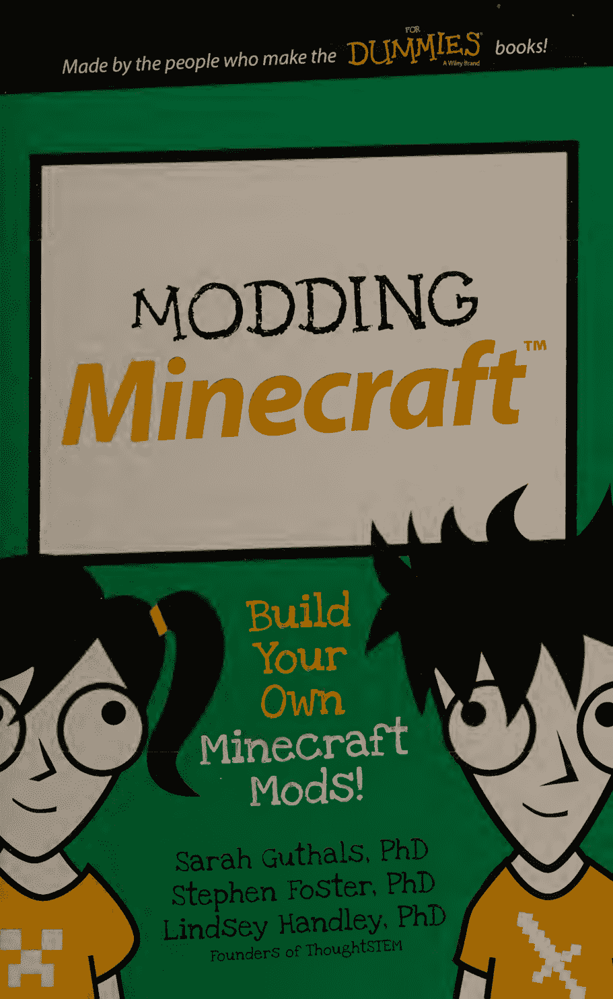

# 在 DUMMIES.COM 获取所需的工具

访问 `www.dummies.com/go/moddingminecraft` 查找：

- 往可以下载 LearnToMod 软件免费终身访问权限的链接，以及本书中所使用的私有 LearnToMod Minecraft 服务器的 60 天免费试用版
- 关于你可以在 Minecraft 中尝试的其他项目的文章和视频
- 其他为青少年学习者编写技术主题书籍的介绍信息链接

> 记住，在家庭电脑上下载和安装软件时，请务必征得父母许可。如果你想将软件下载到学校或其他公共或共享电脑上，请向老师或其他管理员寻求许可。


Sarah Guthhals, 博士

Stephen Foster, 博士

Lindsey Handley, 博士


本书正文和旁注文字使用了 Myriad 字体，章节标题和副标题使用了 Bang 字体。美国合众国制造。

## 第 1 项目：Mod化

## 第 2 项目：SPLEEF

## 第 3 项目：怪物竞技场

## 引言

你想为 Minecraft 开发模（Mod）——这是个棒主意！

你即将从一名 Minecraft 玩家转变为一名 Minecraft 模开发者。要实现这一目标，你需要编写代码。你可以胜任，因为你将利用已有的技能——逻辑、创意、数学、游戏和解决问题的能力——来设计、构建、测试和分享 Minecraft 模。这本书将告诉你一切，从建造一个大型竞技场到制作一个你可以和朋友在 Minecraft 中一起玩的多人游戏。

## 关于 Minecraft 和 LearnToMod

Minecraft 模开发曾仅适用于专家级程序员。现在不再了。LearnToMod 帮助像你这样的学生克服 Minecraft 模开发中的挑战。它解释了编程概念，并展示了制作模有多么有趣。LearnToMod 拥有 200 多个勋章来引导你，你也可以制作自己的模。

LearnToMod 在线软件教你如何制作修改项（或称为模），你可以在你自己的 Minecraft 服务器上在 Minecraft 的多人版本中运行它们。

在 `mod.learntomod.com` 获取 LearnToMod。通过这本书，你将获得 60 天的 LearnToMod 免费访问权限。访问 `www.dummies.com/go/moddingminecraft` 获取试用信息。

## 关于这本书

Minecraft 模开发包含的项目，可以帮助你从头到尾设计、构建和测试每个模。你可以在 Minecraft 内部玩这些小游戏。早期的模较简单，所以你可能想按顺序尝试项目。

如果不在你身边，你如何知道输入什么代码呢？我将展示说明和代码示例——我屏幕的真实图片。

代码使用 monoFont 字体。如果你正在阅读电子书，可以点击网络地址访问网站，例如：`www.dummies.com`。

某些插图会带有一个放大镜，就像放大镜正关注你使用的屏幕部分。高亮文本将将你的注意力引到插图上。

使用 LearnToMod 非常简单：我只需给你提供步骤，例如“将函数拖入编程环境”或“点击 Minecraft 分类然后点击玩家（Players）”。我也可能让你点击某个链接或标签页。

## 关于你

每个人都要从某个地方开始，对吧？我在写这本书时，必须假设你擅长做这些事情：

- 在电脑上打字并使用鼠标。你可能知道如何使用 Windows 系统或 Mac；任何一个都可以。所有编码都在网页浏览器中进行——并在任何平台上的任何浏览器上进行。这本书展示了在 Mac 上使用 Chrome 浏览器运行 LearnToMod。
- 在网站上浏览。点击链接或寻找网站对你来说轻而易。


## 引言

**玩 Minecraft。** 你不需要成为 Minecraft 专家，也不需要编程。你可以在 Windows 或 Macintosh 上玩。在移动设备上玩的口袋版（Pocket Edition）无法配合 LearnToMod 使用。

**基础数学。** 这包括整数加法（如 2+2）和逻辑运算（例如知道 3 比 2 大）。

## 关于图标

当你阅读书中的项目时，你会看到几个图标。这些图标指向不同的内容：


注意！这个图标带有重要信息，可能会帮助你避开模开发者有时会遇到的麻烦。


记住（Remember）图标带有你应该记在脑里的想法。


提示（Tip）图标标记了可以让模开发更简单的建议和快捷方法。


编程乐趣（Fun with Code）图标描述了你正在做的模与大局的关系。

# 项目 1 开始开发

| 开始 (Getting Started) | 学习编程 (Learning To Program) | 建造动物园 (Build A Zoo) | 魔法棒 (Magic Wands) | 实验 (Experimental) |
| :--- | :--- | :--- | :--- | :--- |
| 开始 (1/6) | (0/7) | (0/8) | (6/10) | (0/3) |

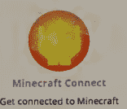
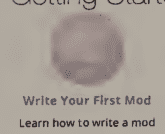
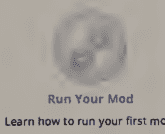
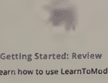
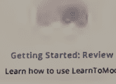
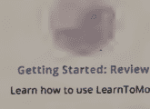

# 了解什么是 Minecraft 模

视频游戏是由代码组成的。数千行代码让玩家——像你一样——探索新世界并与角色互动。有些游戏如 Minecraft 允许玩家添加自己的代码来创建新世界或角色。

# 项目 1 开始开发

Mods 是 modifications（修改）的缩写，可以是几乎任何任务。任务是你做的事情，比如创建一个塔或让山 TNT 爆炸。


你可以制作这些任务：

- 纹理（Texture）：通过加载新纹理改变世界的外观。
- 方块交互（Block interaction）：当玩家破坏方块时引发爆炸。
- 新方块（New block）：创建新的方块，例如产生更大爆炸的 TNT 方块。
- 小游戏（Minigame）：在世界上创建一个游戏。书中的项目可以帮助你。
- 大型结构（Large structure）：创建巨大的结构（手动制作需要很长时间，但用代码则不需要）。

## 使用 LEARNMOD 在线软件

LearnToMod 在线软件引导你完成编程挑战。当你完成挑战时，你会获得一个勋章。查看后续章节开始使用 LearnToMod。


> 在 `mod.learntomod.com` 获取 LearnToMod 在线软件。

这是你在书中项目中使用的软件。勋章将引导你学习编程以及制作酷炫模的不同方法。

## 注册 LEARNMOD

注册 LearnToMod 需要大约五分钟。注册软件请按照以下步骤操作：

- 在网页浏览器中，访问 `mod.learntomod.com`。
- 填写注册表单。
- 弹出另一个对话框。
- 在对话框顶部，输入你在书中获得的访问密钥。
- 设置一个昵称。
- 仪表盘（也称为主屏幕）打开。

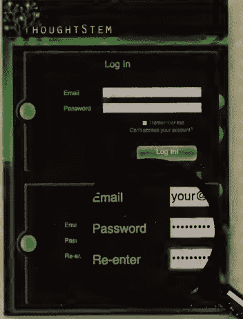

> 这是我聪明的昵称

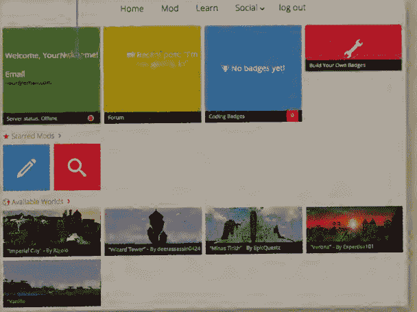

每当你分享模时人们都会看到你的昵称，所以不要使用真名。

# 项目 1 开始开发

## 使用 LEARNMOD 勋章

要访问 LearnToMod 编程挑战，请按照以下步骤操作：

1. 访问 `mod.learntomod.com`。
2. 填写登录表单。使用你注册时的邮箱地址和密码。主屏幕打开。
3. 查看挑战列表，点击 Learn 标签页。

第一组编程挑战出现。

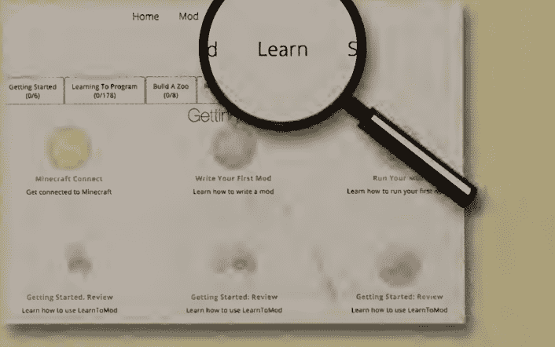

## 将你的模连接到 Minecraft

只需点击第一个勋章：Minecraft Connect（连接）。这个勋章告诉 LearnToMod 你的 Minecraft 账号是什么。这样，当你打开 Minecraft 并连接到 LearnToMod 服务器时，你的模就会那里等你。我稍后会详细解释。

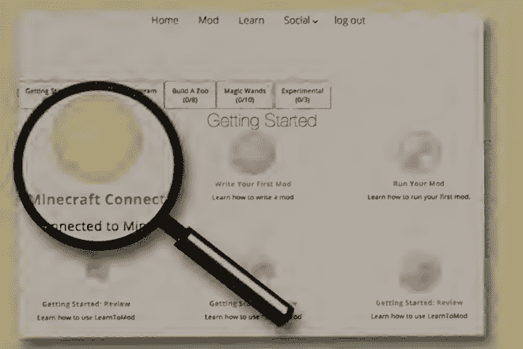

在这个项目中，我将解释你如何使用 LearnToMod 在线软件。我还会解释如何连接到 LearnToMod 多人服务器，并向你展示如何使用基础工具（如机器人）来制作有趣的模。

> 要在 Minecraft 中运行模，请确保你拥有最新版本。

要查看你运行的 Minecraft 版本，请按照以下步骤操作：

1. 点击 Minecraft 启动界面左下角的编辑（Edit）按钮。

# 项目 1 开始开发

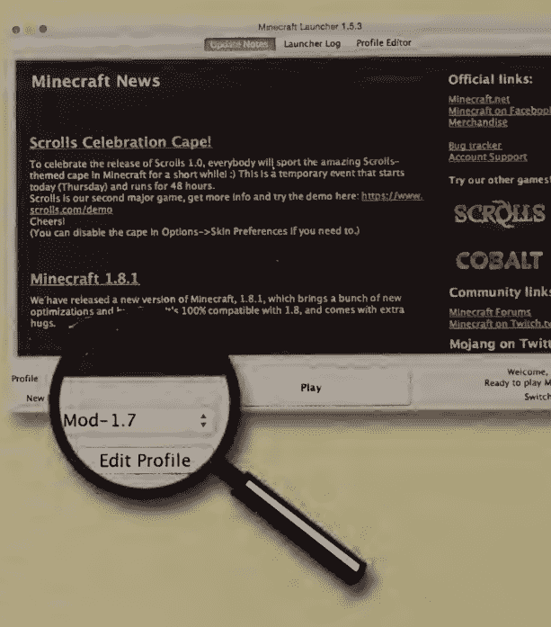

为了庆祝 Scrolls 1.0 的发布，每个人在接下来的 48 小时内都可以免费获得精美的 Scrolls披篷！这是一个限时活动，从今天（周二）开始，持续 48 小时。Scrolls 的第二个重大变化，在此获取更多信息并试用演示：`http://www.scrolls.com/demo/`

祝好！

（如果你需要，可以在选项->皮肤偏好中更改披风。）

Minecraft 1.8.1

我们发布了 Minecraft 1.8.1 版本，它带来了许多新的优化和功能——与 1.8 100% 兼容，并附带额外的

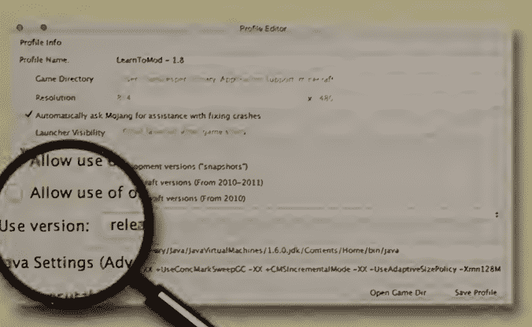

5. 点击屏幕底部的“Save Profile”（保存配置）按钮。
6. 回到 LearnToMod Minecraft Connect 勋章，输入你的 Minecraft 用户名。
7. 在勋章的文本框中输入你的用户名。

你的 Minecraft 用户名已添加到 LearnToMod 账户。

> 你的用户名拼写和大小写必须与创建时完全一致。如果不一致，你将无法看到你的模组（mods）。涉及大小写时，它是区分大小写的。

8. 点击“Connect”（连接）按钮。

弹出 Minecraft Connect 勋章。

在 Minecraft Connect 勋章的文本框下方，你会看到“Success（成功）”。

## 项目 1 开始模化

## 连接到 LEARNTOMOD 服务器

通过 LearnToMod，你可以根据喜好在创意模式（Creative mode）或生存模式（Survival mode）下游戏。

按照 Minecraft Connect 勋章上显示的步骤操作：

1. 在 Minecraft 主界面上点击“Play”（游戏）。
2. 选择“Multiplayer”（多人游戏）。
3. 点击“Add Server”（添加服务器）。
4. 输入 `Learn To Mod As` 作为服务器名称。
5. 输入 `play.learntomod.com` 作为服务器地址。
6. 点击“Done”（完成）。
7. 点击“Join Server”（加入服务器）。

你应该看到这个世界。它像一个候候室。在 Minecraft 寻找新世界（你可以在那里测试模组）时，你可以探索这个世界。你可能不需要等待超过 5 分钟。耐心一点——时间不长的！

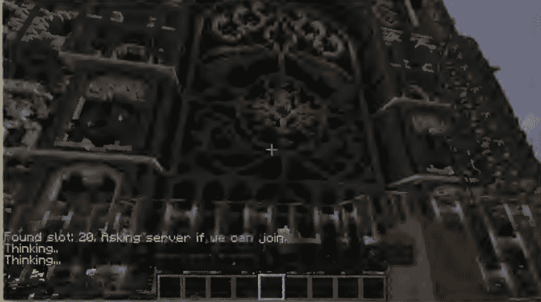

当你连接到测试世界时，你的背包里有一个模组箱（mod chest）。

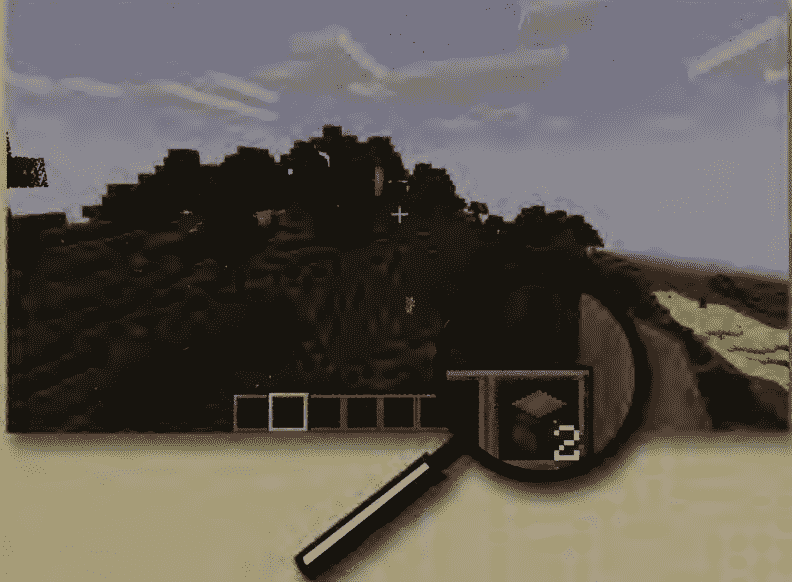

> 提示：如果你无法连接到 LearnToMod 服务器，请向技术支持团队发送邮件至 `learntomod@thoughtstem.com` 并说明你遇到的问题。

## 检查编码环境

在开始你的模化冒险之前，先检查你将使用的编码环境。只需按照以下步骤操作：

- 点击 LearnToMod 网站顶部的“Learn”（学习）选项卡。

你将进入第一组编码挑战。

- 点击“Write Your First Mod”（编写你的第一个模组）勋章。

你会看到编码挑战。

## 项目 1 开始模化

查看此页面的这些区域：

### 勋章图标和名称

### 编码环境

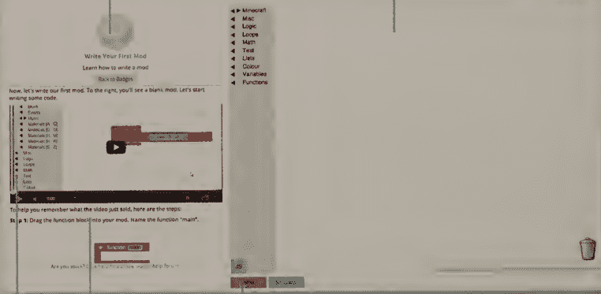

### 视频

### 指令

### 按钮

> 左上角显示勋章名称；其大大的圆形图标以及“Back to Badges”（返回勋章）按钮。

你可以点击屏幕顶部的“Learn”选项卡返回勋章列表。

> 左下角有说明。那里总有一个短视频来解释编码挑战，随后是一系列告诉你该做什么的步骤列表。

> 右侧显示编码环境。在这本书中，你可以学习如何使用基于块的可视化语言进行编码，你也可以尝试基于文本的语言。

进入基于块的代码，点击其中一个代码分类（如 Minecraft）。然后点击并拖动一个区块到空白编码区域。我将在下一节中解释这一点。

底部中央有两个按钮：Mod 和 Simulator（模拟器）。

- Mod 按钮会将你的模组发送到 Minecraft 测试世界。
- Simulator 按钮会在你的浏览器中打开一个 Minecraft 模拟世界。

## 测试你的模组

你还没有完成挑战。你将在下一节完成它。使用 Minecraft 模拟器测试你的模组并获得勋章：

1. 点击 LearnToMod 网站顶部的“Learn”选项卡。
2. 在模拟器区域的任何地方点击。
3. 完成挑战。

如果你没有通过，请前往 `forum.learntomod.com` 论坛寻求帮助，或者进入下一个勋章。

> 如果通过了挑战，会弹出勋章。你可以点击“Back to Badges”退出并进入更多挑战。

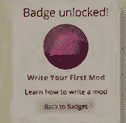

要关闭模拟器，再次点击 Simulator 按钮（或按键盘上的 Esc 键）。

## 编写 Minecraft 模组

## 项目 1 开始模化

当你准备好编写第一个模组时，请遵循步骤操作。

在本节中，我将帮助你获得第二个勋章。你可以在勋章的左栏找到这些步骤。只需观看视频。

在开始这些步骤之前，确保你已经在 `mod.learntomod.com` 登录：

1. 点击“Learn”选项卡。
2. 点击“Write First Mod”勋章。
3. 点击并观看视频。

它在屏幕左下方。

要获得第二个勋章，请按照这些步骤操作：

1. 将 `function`（函数）拖入编码环境。
2. 点击某个项。
3. 输入 `main` 创建一个 `main` 函数。
4. 点击 Minecraft 分类，然后点击 Players。
5. 点击 Send message 块并将其拖入 main 函数。
6. 点击 Text 分类。
7. 将 text 块连接到 Send message 块。
8. 在 text 块内输入 `Hello, World!`
9. 点击 Minecraft 分类，然后点击 Players。
10. 将 me 块拖到 Send message 块的第二个空间。

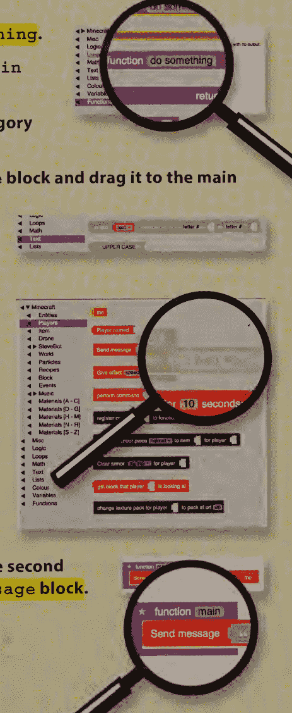

11. 点击步骤底部的“Test in Simulator”按钮。


12. 在模拟器中点击。然后按键盘上的 M 键。

你会看到消息“Hello, World!”

> 如果模拟器（或其他任何地方）运行异常，请访问 `forum.learntomod.com` 查看是否有人找到了解决方案。或者，你可以发帖告诉 LearnToMod 的开发者你发现了一个 bug。他们会帮你修复。

13. 当勋章弹出时，点击“Back to Badges”。

恭喜！你编写了第一个 Minecraft 模组。在下一节中，你将在 Minecraft 中测试你的模组。

> 点击屏幕右上角的 Hints（提示）链接可以帮助你。或者通过 Questions or Feedback（问题或反馈）链接提问。

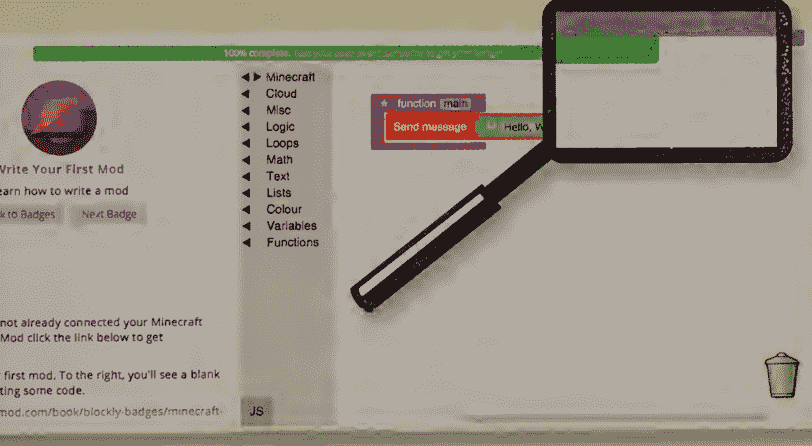

## 在 Minecraft 中运行你的模组

写完第一个模组后，是时候在 Minecraft 中运行它了。


> 如果你不在这个世界中，返回 Minecraft Connect 勋章并重新连接。这些步骤在“Connect Your Mods to Minecraft”章节中。

第三个勋章 Run Your Mod 列出了具体步骤，在这里也提供了：

- 1 点击 Learn 选项卡下的 Run Mod 勋章。
- 2 点击 Mod 按钮。

消息会告诉你模组已发送到你的 Minecraft 账户。

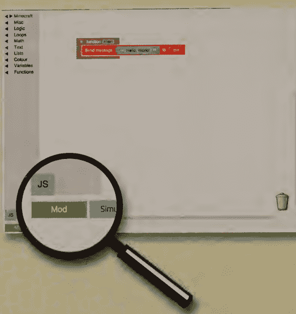

- 3 点击 Minecraft 图标。它在你电脑的任务栏上。

你仍在测试世界中，所以你的模组箱在背包里。

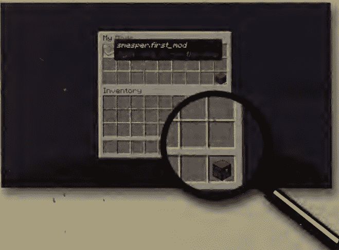

现在你要在你的模组里放入东西并使用它。

- 按 `9` 键，然后点击鼠标按钮。

模组箱打开了。

- 将你想运行的模组拖到 HotBar（快捷栏）。

HotBar 在你背包的底部。


将鼠标悬停在模组上查看其名称。

- 按 `Esc` 键。

你回到游戏界面。

- 按与模组在背包中位置对应的数字。然后点击鼠标。

例如，如果你将模组块放在最左侧，按 `1` 键然后点击鼠标。现在你的模组正在运行。

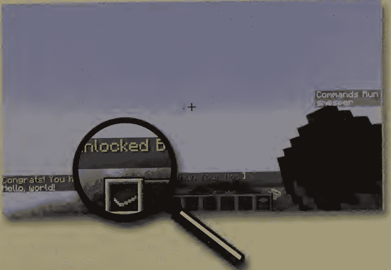

## 项目 1 开始模化

如果你回到 `mod.learntomod.com` 的 LearnToMod 网站，你会发现你获得了第三个勋章。

- 8 完成接三个编码挑战，这些是问答。

我不会带你过这些。你准备好自己挑战它们了！

## 准备编写自己的 Minecraft 模组

获得至少十个勋章后，你可能会产生自己的模组主意。当你准备好编写它时，请遵循以下步骤：

- 1 访问 `mod.learntomod.com` 并点击 LearnToMod 在线软件顶部的“Mod”选项卡。

一个新页面打开了。

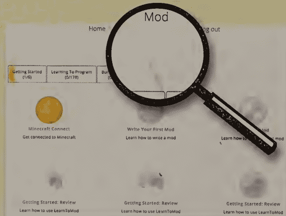

## 为你的模组输入标题

最好为你的模组起一个有意义的名字。例如，如果你的模组会让末影龙填满天空，你可以将其命名为 `Ender_Dragon_Attack`。

在编码中，空格有时会让计算机产生困惑——但空格有助于人类阅读。编码人员/模组制作者会在名称中使用 `_` 代替空格。例如，`ender_dragon_attack` 比 `enderdragonattack` 要读得多！


## 点击 Blockly（多人游戏）按钮

这将创建一个服务端（或多人游戏）模组。一个新的模组代码块将会出现。

## 点击新的模组块查看模组的描述页面

## 点击 Code（代码）按钮

你看到了编程环境。

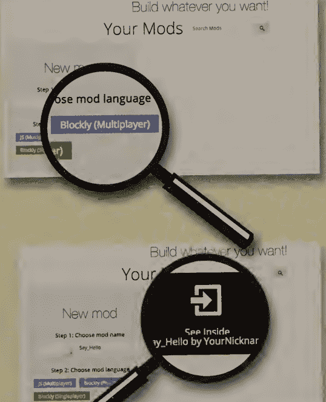

## 项目 1 开始模组制作

6 现在你可以开始编写一个模组了。

例如，你可以写一个向你说“Hi”的模组。我的写的是“Hi Sarah!”，

## 与朋友分享模组

编写和测试模组很有趣，但让你的朋友在他们的 Minecraft 世界中测试可以帮助你们都想出更有创意的想法。

与 LearnToMod 的其他小伙伴分享模组非常简单。只需遵循以下步骤：

- 1 点击你模组中的“返回”按钮。
- 2 点击左上角的图片框。

如果你还没有添加图片，该框将显示为纯色，当你用鼠标悬停在上面时，会显示“Edit This”（编辑此项）。


- 3 为模组添加图片和描述。

只需按照屏幕上的步骤操作即可。

## 点击按钮将模组公开

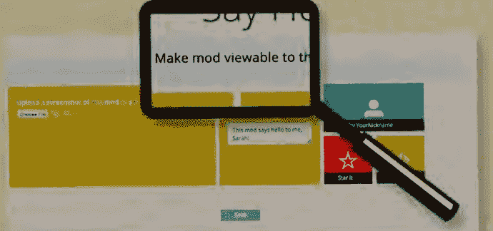

## 点击 Save（保存）按钮

与朋友分享模组并让他们帮你测试是明智的。这是发现漏洞并成为更优秀的模组制作者的好方法。

## 朋友如何找到你的模组

从这里，你的朋友可能需要你的帮助。

- 1 在她自己的电脑上，朋友访问 `mod.learntomod.com` 并使用她的 LearnToMod 邮箱和密码登录。
- 2 朋友点击 Find a Mod（寻找模组）按钮。
- 3 朋友在 Public Mods（公开模组）文本框中输入你的模组名称。

## 项目 1 开始模组制作


你的模组出现了。在这个例子中，模组的名为 `Say_Hello`。

- 你的朋友点击并测试你的模组。

你的朋友也可以看到你的代码。希望能得到一些良好的反馈：哪些部分有效？哪些部分不起？哪些部分真的有趣或真的很无聊？

如果你的朋友没有 LearnToMod 账号，你可以复制并将 URL（网址地址）发送给他。然后他就能看到你的模组，但不能编辑或测试它。

## 昆虫之外的 Bug

Bug（代码中的错误）是编码的一部分。因为你是人类，你会犯错——这没关系！没有哪个编码人员，即使是最优秀的人，第一次写出完美的代码。代码中总会有 Bug。要成为更优秀的编码人员/模组制作者，你必须测试你的代码。并让你的朋友测试代码，这样你就能尽快发现并消除 Bug！

## 获得模组勋章

> 你绝对应该在 Learn 选项卡下获得前六个勋章。

## 获得 Scramble（乱序）勋章

Scramble 挑战包含了你所需的所有代码块，它们已经在编程区域内了——只是在屏幕上被打乱排列了。

要获得 Scramble 勋章，请遵循以下步骤：

- 1 测试（Test）。

在模拟器或 Minecraft 中测试正确版本的代码，看看它应该实现的功能。

- 2 收集（Gather）。

将屏幕上所有被打乱的块组合在一起。只需将它们拖到彼此附近即可。

## 项目 1 开始模组制作

## 3 还原序（Unscramble）

还原代码块并测试你的模组，看看它是否与你在步骤 1 中测试的版本一致。

> 要找到获得勋章所需的所有块（有时，被打乱的块在屏幕外），请使用右侧和底部的滚动条进行移动。

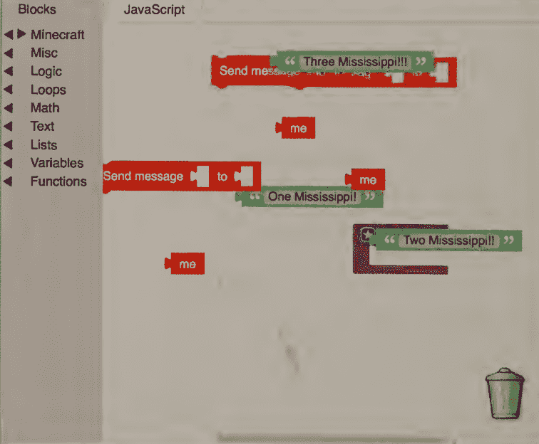

## 获得 SAVING HELLO 勋章：Scramble 版

你可以在 Learn 选项卡下的 Learning To Program（学习编程）类别中找到 Saying Hello (Scramble) 挑战，然后在 Functions（函数）下。你会看到屏幕上有十个被打乱的块。

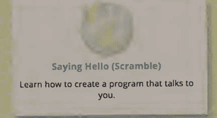

遵循以下步骤获得勋章：

- 1 在模拟器或 Minecraft 中测试正确版本的代码。
- 2 收集屏幕上所有被打乱的块。
- 3 还原代码块并测试你的模组。
- 4 点击按钮将模组公开。

使用计算机。特别是对于“缺失（Missing）”类勋章，这是追踪代码的一种极佳方法。首先，运行正确的代码并观察发生了什么。然后再次运行代码，但这次在每行代码执行时对其进行标记。

使用铅笔和纸。如果你写了一个运行不符合预期的 mod，请在纸上画出每行代码执行后发生的情况。例如，向我发送消息“Hello, World!”会显示在屏幕上，所以你应该把它写在纸上。


# 获得“你好”勋章：缺失版

点击勋章打开“说你好（缺失版）”挑战。当你获得该勋章时，代码会在屏幕上显示一些卡特·斯蒂文斯（Cat Stevens）的一首歌的歌词。

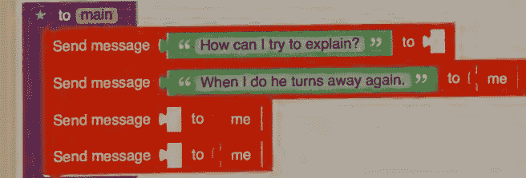

这个 mod 缺少了三个区块。第一个可能是玩家区块，因为那是你使用过的玩家（其他区块也是使用它）。最后两个可能是文本区块，因为那是你发送过的唯一类型的消息（而前两个发送的也是文本消息）。无法猜测文本区块中应该包含什么文本，因为可能性的列表非常、非常大。

要完成一个缺失勋章，请遵循以下步骤：

- 在 Minecraft 或模拟器中运行正确版本，并观察发生了什么。

- 当你运行自自己的代码时，你应该看到这个场景。

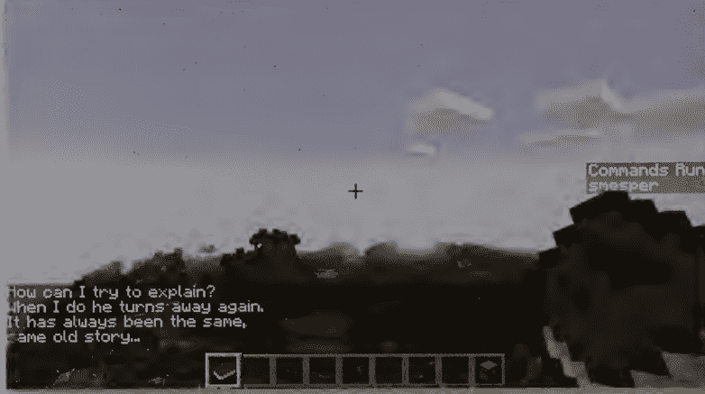

第一行代码发送了消息“How can I try to explain?”，但没有说明哪个玩家是消息的目标（即接收消息的玩家）。运行代码后，目标应该是“我（me）”区块，因为当你运行正确版本时你可以看到这条消息。

```
function main {
  Send message "How can I try to explain?" to me
  Send message "When I do he turns away again," to me
  Send message "It has always been the same," to me
  Send message "same old story..." to me
}
```

最后两条消息是：

It has always been the same,

same old story .

所有发送给“我”的内容都会显示在运行 mod 的人的屏幕上。如果你运行了 mod 并看到了消息，那么消息的目标就是“我”。

## 2 添加“我（me）”区块以及两个包含正确消息的文本区块

## 3 测试你的 mod

如果你在完成后回到“缺失”勋章或“混乱（Scramble）”勋章，LearnToMod 软件会询问你是否想重置代码使其再次缺失或混乱。如果你选择重置勋章，你仍然拥有该勋章。你只需要再次完成挑战即可。

书中的某些项目可能具有挑战性或令人困惑。如果你卡住了，获得更多勋章总是个好主意——它们是为了帮助你理解编码而设计的。

# 项目 2 空地大战（SPLEEF）

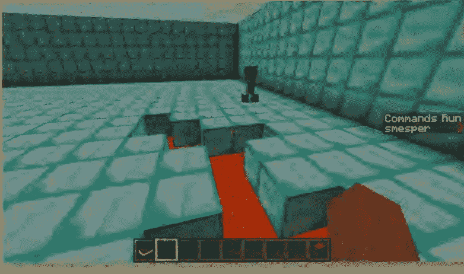

你可以制作的最难（但也最有趣！）的 Minecraft mod 之一就是小游戏。小游戏是 Minecraft 内部的一种游戏。

Spleef 是玩家在平台上行走并通过踩踏来让方块消失的游戏。仅使用这个想法，你就可以制作许多版本的 Spleef，例如：

- 玩家必须尝试不掉进放在平台下方的岩浆中。（这就像你在客厅里玩的岩浆版本！）
- 在平台下方放置岩浆，并向竞技场内放入其他实体（如苦爬者）后，玩家尝试让其他实体掉进岩浆。
- 堆叠多个平台。玩家必须在物品掉入下一层之前，在每一层上收集物品。
- 在多人游戏中，玩家必须尝试在另一个玩家掉落之前自己不掉下去。

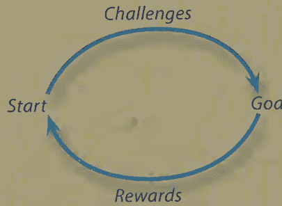


# 项目 2 空地大战（SLEEF）

## 开始：创建一个基础场景

从在纸上画一个想法开始，或在不使用 mod 的 Minecraft 中构建它。开始思考场景将如何影响你的玩家。之后在构建时，你可以让竞技场更大或添加颜色等细节。

例如，使用普通 Minecraft 世界的游戏与另一个游戏是不同的。当你构建时，你可以让竞技场更大或添加颜色等细节。

你可以让一个事件停止触发。你有两种方法：

- 断开服务器连接并重新连接。
- 打开你的模组箱（mod chest）。点击“结束事件”（End Events）图标。

## 调试你的代码

调试是编码的另一个步骤。即使是最好的程序员，也不会第一次就写出完美的代码。当程序员——即使是专家——犯错时，他们会通过调试来寻找并修复错误。

调试意味着逐块地检查代码，并确保它运行正常。你可能需要禁用某些区块来运行模组。（点击该区块，然后点击“禁用区块” `Disable Block` 即可。）

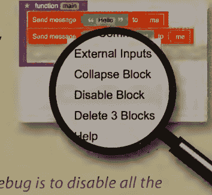

调试最好的方法之一是禁用除小部分以外的所有代码，然后运行模组查看它是否按预期工作（测试一下！）。如果运行正常，再启用一行代码并再次测试。不断重复此过程，直到找到导致错误的那一行代码（或一个区块）。

你会遇到不同的错误，所以我无法为你解决所有问题。但我告诉你，当你找到那个区块时，可能通过阅读代码并对比实际发生的情况与你想要发生的情况，找出问题出在哪里。

## 制作 SPLEEF：迭代 1

在你了解如何使用游戏循环之后，你可以设计并构建一个单机小游戏。

首先，按照以下步骤创建一个新模组：

1. 进入主页并点击页面顶部的模组（Mod）。
2. 将模组命名为 Spleef。
3. 点击“Blockly（多人）”按钮。
4. 点击生成的模组磁片。

   我的模组磁片显示 See Inside: Spleef by sarah。点击磁片时，会打开模组页面。

5. 点击“代码”（Code）按钮。

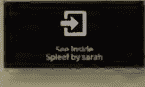

现在你准备好制作 Spleef 游戏了。接下来的章节将帮助你遵循游戏循环。

## 探索 ARENABULDER 库

下一页的场景是一个带有围栏的竞技场。为了制作这个竞技场，你将使用 LearnToMod 上的 ArenaBuilder 库。

> 库是一个专门为你编写的模组。你不需要知道它是如何编写就可以使用它。


你应该仔细研究这个库，以更好地理解如何构建竞技场，以防你某天想要构建自己的竞技场。如果你愿意，可以跳到下一节。

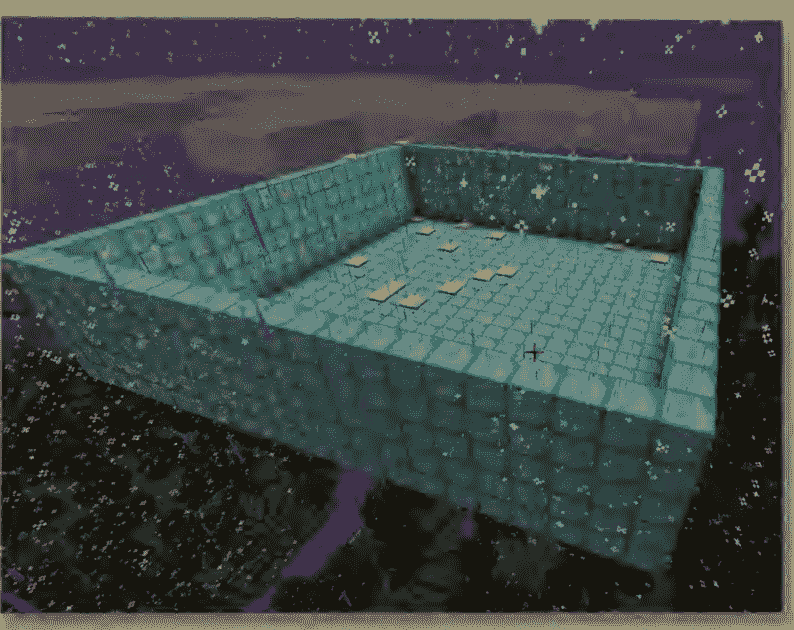

要探索该库，请遵循以下步骤：

- 进入 `mod.learntomod.com/programs/sarah-ArenaBuilder`。

你会看到这五个函数：

- `init`
- `move_drone`
- `ArenaWithFence`
- `Platform`
- `Fence`

- 点击函数上的问号 (`?`)。

弹出的注释来描述该函数。

> 此函数创建了一个正方形。

'height' 周边控制控制玩家使用的材料...

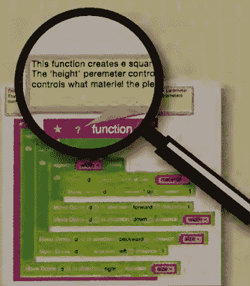

## 项目 2：SPLEEF

### 3 查看代码并观察它在做什么

注意以下几点：

- 没有主函数（`main function`），因为这个模组无法在 Minecraft 中独立运行。没有主函数的模组必须从其他模组中调用。我将在下一节中解释。


为了让模组能够独立运行，必须有一个主函数告诉 Minecraft 从哪里开始。如果你没有主函数，Minecraft 就不知道从哪里开始，也就无法工作。

- 导出区块（`export block`）允许其他模组使用该函数。即使函数在不同的模组中，其他模组也可以调用它们。导出了三个函数：`ArenaWithFence`、`init` 和 `move_drone`。

### 4 现在你可以在你的 Spleef 游戏模组中使用 ArenaWithFence、init 和 move_drone 函数了

## 开始：导入 ARENABULDER 库

在查看 ArenaBuilder 库之后，返回你的 Spleef 模组并按照以下步骤导入该库：


1. 在杂项（Misc）类别下找到导入（import）区块并将其拖入模组。

2. 输入 `sarah-ArenaBuilder` 来替换文本 `lib_name`：

```
import sarah-ArenaBuilder
```

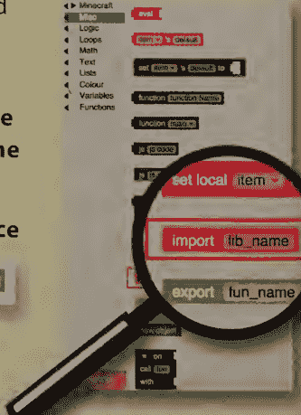

如果你输入正确，你会看到库中的函数出现在函数（Functions）类别中。你可以使用的函数有 `ArenaWithFence`、`init` 和 `move_drone`。

首先，创建一个主函数并拖入工作区。然后在主函数内部调用 `init`。

为了让模组运行，你需要在主函数内部调用 `init` 函数。

```javascript
function main() {
  init();
}
```

接下来，在 `init` 函数内部调用 `ArenaWithFence`。这将构建你的竞技场。

```javascript
function init() {
  ArenaWithFence();
}
```

现在，为 `ArenaWithFence` 设置参数。这些参数定义了竞技场的大小和材料。

```javascript
ArenaWithFence(
  height: 5,
  size: 20,
  width: 1,
  material: "DIAMOND_BLOCK",
  fill: "AIR"
);
```

等等，参数是不一样的。让我们再次查看函数定义。

```javascript
ArenaWithFence(
  5,
  20,
  1,
  "DIAMOND_BLOCK",
  "AIR"
);
```

如果你输入正确，就可以运行你的代码。

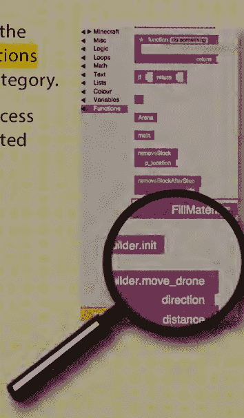

```javascript
function main() {
  init();
}

function init() {
  ArenaWithFence(
    5,
    20,
    1,
    "DIAMOND_BLOCK",
    "AIR"
  );
}
```

现在，运行你的模组！你应该能在 Minecraft 中看到你的竞技场了。恭喜你，你完成了第一个版本的 Spleef！

# 变量是多变的

变量是命名信息或数据的一种。它就像是：我的名字是 Sarah，我知道当人们说“Sarah”时，他们是在和我说话。变量是命名数据的方式，以便计算机知道如何与它交谈或使用它。有些变量是简单的，有些变量则更复杂。

| 变量有两个部分的框：NAME（名称）和 DATA（数据）。 | <NAME> <DATA> |
| :--- | :--- |
| 这个变量命名为 `num`，数据为 5。简单。 | `num` 5 |
| 这个变量名为 `name`，数据为 Sarah。简单。 | `name` Sarah |
| 这个变量显示了与块相关的事件函数的 `info` 参数（即 `block_break` 事件）。`info` 包含一个块作为数据。该块有一个类型作为数据，而该类型的数据是西瓜块（Melon Block）。复杂！ | `info` `type` Melon Block |

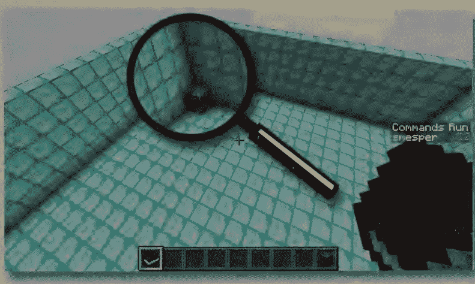

## 创建一个名为 `StartGame` 的新函数，并将 `info` 作为参数。

当玩家破坏西瓜块时，游戏开始。

```javascript
function StartGame with: info
  set block to info 's block
  set block_type to block 's type
  if block_type = MELON_BLOCK
    do perform command "gamemode s" for player me
```

## 调用 `StartGame`。

你可以看到，只有当玩家破坏块时才会调用 `StartGame` 函数。这个函数在玩家每次破坏块时都会运行。现在玩家必须站在特定的块上。

```javascript
function main
  Arena
  do function StartGame() when block break Event happens
```

## 项目 2 睡眠 (SLEEP)

4. 在 Minecraft 中运行此模组。

确保当你破坏西瓜块时，你会进入生存模式。

5. 设置重生函数。

死亡的玩家重生（复活）到竞技场的中心。

- 创建一个名为 `SetupPlayer` 的新函数（就像你创建主函数一样）。
- 点击函数旁边的星号，并将输入块拖入函数中。

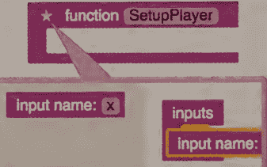

- 将 `x` 改为 `info`，再次点击星号关闭参数框。

6. 确定刚重生的玩家的名称。

- 创建一个新变量 `respawn_player`。
- 点击 Variables（变量）类别，并将一个 Set item to block 物品拖入 `SetupPlayer` 函数。
- 点击单词 `item` 旁边的下拉菜单并点击 New Variable（新变量）。将其命名为 `respawn_player` 并点击 OK。

你的工作现在应该看起来像你在代码中看到的一样。

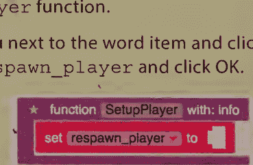

7. 在 Misc（杂项）类别下，拖入项目的默认块并放入你刚刚创建的 `respawn_player` 变量中。

## 从项目下拉列表中选择 `info`，并将 `default` 替换为 `Player`。

要获取玩家名称，重复获取玩家的步骤，但将变量命名为 `player_name` 并获取 `respawn_player` 的 `DisplayName`（显示名称）。

## 从 Minecraft/Events（事件）类别拖入 `do function after` block，从 Misc 类别拖入 `function` 块，从 Math 类别拖入 `number` 块。

将数字改为 2000。按照代码中所示的方式排列它们。

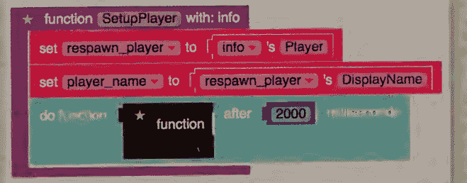

## 从 Entities（实体）类别将 `Teleport` 块拖入函数块，并将 `me`（在 Player 类别中）传送到 `sarah-ArenaBuilder.GetArenaCenter`。

你会在 Functions（函数）类别中找到它。

## 从 Misc 类别获取一个 `js` 块并输入 `on_respawn(player_name)`，如下一页所示。

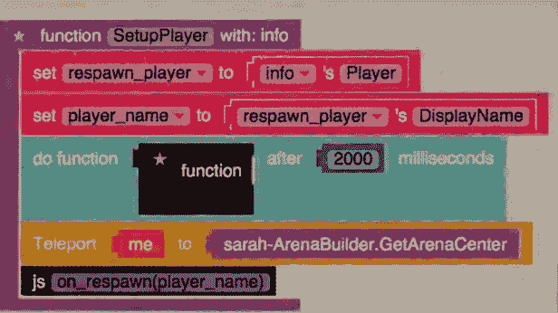

## 设置重生事件。

在你的主函数中添加一个 `js` 块（来自 Misc 类别），并按照此处所示输入：

`events.when("player.PlayerRespawnEvent", SetupPlayer, me, false)`

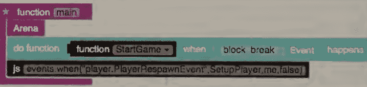

JavaScript 块调用事件 `PlayerRespawnEvent`，它需要这些参数：

- 玩家重生时调用的函数。
- 重生的玩家。
- 一个 `true` 或 `false` 值，告诉模组这是否为床点重生（BedSpawn）。使用 `false` 值，因为你不想被传回床边。

`SetupPlayer` 函数从 `info` 参数获取数据，但这次 `info` 参数是一个玩家，而不是块。

事件可能会很复杂，但如果你需要帮助，可以随时查看你已经获得的勋章，或在 LearnToMod 论坛上提问。

## 挑战：触摸后块消失

要向游戏添加此挑战，你需要创建另一个事件。这次，当玩家移动时，它会检查他们所在的块并将其替换为空气。

```javascript
function main
  Arena
  do function StartGame() when block break Event happens
  events.when("player.PlayerRespawnEvent", SetupPlayer, me, false)
```

## 2. 添加 `removeBlock` 函数。

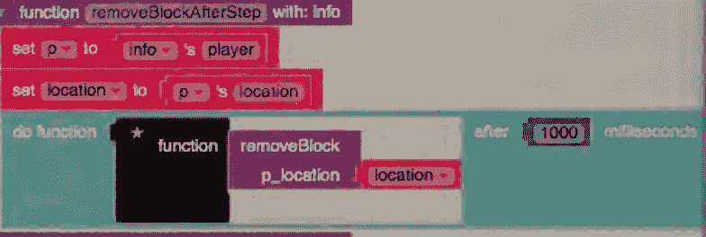

## 3. 从 `main` 函数中调用 `removeBlock`。

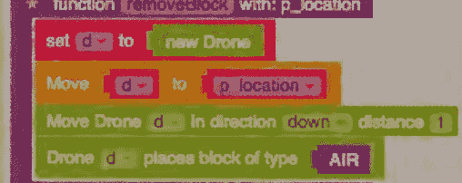

现在它应该应该像你在下一页看到的一样。

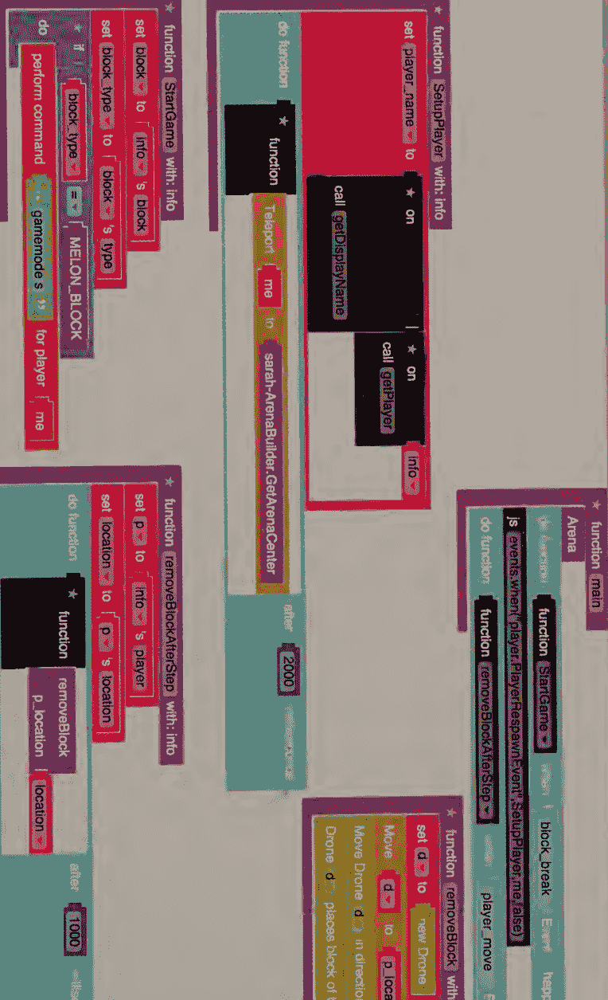

## 4. 在 Minecraft 中运行此模组。

确保当你破坏西瓜块时，你会进入生存模式。

## 5. 设置重生函数。

死亡的玩家重生（复活）到竞技场的中心。

## 项目 2 SPLEEF

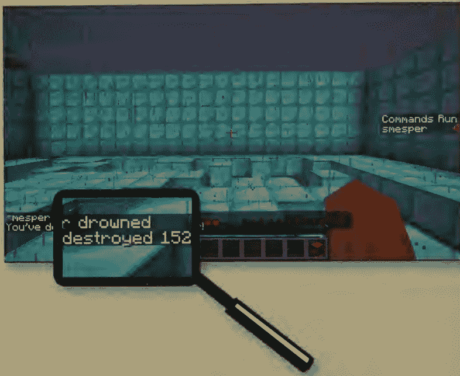

现在当你玩 Spleef 游戏时，重生后会显示一条消息。

你完成了 Spleef 游戏的一个完整游戏循环。Flex —— 你展示了真正的 Minecraft 实力。

## 奖励：给予玩家积分

分数可以是玩家在掉落平台之前破坏的块的数量。你只需要计算变成空气的块的数量。

- 添加一个敌人（给玩家增加另一个挑战）。
- 添加烟花（一种奖励）。

## 开始：添加岩浆平台

在你完成一个可以运行的游戏后，可以向场景中添加岩浆。大家都知道掉进岩浆会发生什么。

因为你使用了 `ArenaBuilder` 库，所以你不需要对 Spleef 代码做很多改动。你可以在这里看到向 `arena` 函数中添加哪个调用。当你添加了它后，你会得到一个不同的场景。

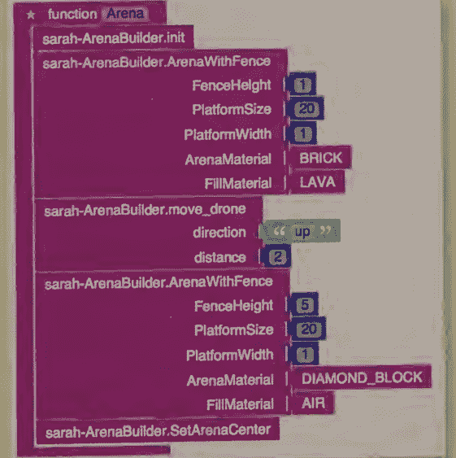

## 目标：破坏至少 200 个方块

你的模组已经在统计玩家破坏的方块数量。你可以通过向 `removeBlock` 函数添加内容来为玩家提供更多奖励。

## 项目 2 SPLEEF

祝贺玩家成为一名 Spleef 大师（Master Spleefer）。

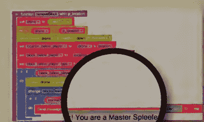

## 挑战：添加一个敌人

没有人讨厌敌人，但它们确实让游戏变得生动。你可以向竞技场添加一个敌人。然后将西瓜块作为生成点。

在随机位置**生成一个苦力怕**，玩家必须避开苦力怕，并在破坏 200 个方块之前尽量不要掉落。

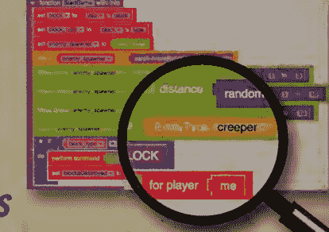

## 奖励：添加烟花

你已经充分挑战了你的玩家，所以确保他们获得足够的奖励。除了祝贺玩家，你还可以给他们举办烟花表演！

**在 `removeBlock` 函数中添加烟花块。**


## 项目 2 SLEEF

烟花块位于“世界”（World）类别下。

- Minecraft
  - 实体 (Entities)
  - 玩家 (Players)
  - 物品 (Item)
  - 无人机 (Drone)
- SteveBot
- 世界 (World)
  - 粒子 (Particles)
  - 配方 (Recipes)
  - 方块 (Block)
  - 事件 (Events)
- 音乐 (Music)
  - 材料 [A - C]
  - 材料 [D - G]
  - 材料 [H - M]
  - 材料 [N - R]
  - 材料 [S - Z]
- 其他 (Misc)
  - 逻辑 (Logic)
  - 循环 (Loops)
  - 数学 (Math)
  - 文本 (Text)
  - 列表 (Lists)
  - 颜色 (Colour)
- 变量 (Variables)
- 函数 (Functions)


Javascript

# 项目 3 怪物竞技场


怪物竞技场是一个多层级的 Minecraft 迷你游戏，玩家在一个巨大的竞技场内，怪物会在一个西瓜块周围生成。玩家的目标是在不被怪物攻击的情况下到达西瓜块。每当玩家到达西瓜块时，他就会进入下一层，下一层会有更多更强力、更难对付的怪物。

在这个项目中，你将制作一个“怪物竞技场”模组。然后你就可以和朋友一起玩怪物竞技场，看看谁能击败最多的怪物！

## 绘制游戏流程循环

为怪物竞技场游戏绘制游戏流程循环（见下一页）。它的工作方式与上一个项目中的完全一样。

- 开始：建造竞技场。
- 目标：破坏西瓜块。
- 挑战：添加怪物。
- 奖励：升级。


这个项目帮助你让游戏循环的每一次迭代变得更加困难。开始时，你拥有一个带西瓜块、一个怪物和一个关卡的简单竞技场。

迭代（Iterate）意味着重复执行某事。每当你这样做时，你就取得了进展。例如，如果你对游戏循环进行迭代，就会添加新功能或奖励。

## 迭代 1：制作怪物竞技场

处理游戏循环第一次迭代的方法如下：

- 1. 开始：创建一个由围栏围绕的基础竞技场。在怪物竞技场中，竞技场是圆形的。一个巨大的围栏围绕着竞技场，将玩家和怪物留在里面。
- 2. 目标：添加一个西瓜块。对于这个迷你游戏，你还需要编写在西瓜块时重置竞技场的代码。

## 挑战：向竞技场添加怪物

你向竞技场添加一个怪物，玩家在尝试破坏西瓜块时必须避免怪物。如果玩家破坏了西瓜块，游戏将重置。

添加怪物后让你的朋友测试游戏。他们可能会说游戏不好玩，但你可以告诉他们什么样的挑战。他们想要更多的怪物还是更大的竞技场？

## 奖励：重玩第一关

在第一次迭代中，破坏西瓜块的用户可以再次玩第一关。在迭代 2 中，你添加更多关卡。

在规划了步骤 1 到 4 的游戏循环后，是时候建造怪物竞技场了。

> 每当你建造任何游戏时，首先需要一个基础场景。


# 项目 3 怪物竞技场

## 开始：创建一个带围栏的基础竞技场

你可能已经知道，半径是从圆心到圆边缘任意一点的距离。Minecraft 中的一切都是由方块构成的。

怪物竞技场需要这些东西：

- 一个玩家和怪物运行的地方
- 一个让怪物和玩家无法离开区域的方法

在这个基础场景中，你创建一个：

- 一个平台
- 一个围栏

在 Spleef 项目中，你使用名为 `ArenaBuilder` 的 LearnToMod 库建造了一个竞技场。该库制作的是方形竞技场。这次你需要一个圆形的。使用 WorldEdit 命令在 LearnToMod 中制作竞技场！

WorldEdit 命令可以在 Minecraft 中运行以编辑世界。

> 你可以在网上探索大量的 WorldEdit 命令。使用搜索引擎搜索“minecraft worldedit commands”。访问 `wiki.sk89q.com/wiki/WorldEdit`（官方 WorldEdit wiki）查看所有适用于 Minecraft 的 WorldEdit 命令。只需点击某个类别（例如位于“Utilities”下的“Filling Pits”）。

当你连接到 LearnToMod Minecraft 服务器时，WorldEdit 命令即可生效。如果你不知道如何连接 LearnToMod Minecraft 服务器，请遵循 Minecraft 连接标志上的说明。

## 在 Minecraft 中测试 WorldEdit 命令

在制作竞技场之前，先在 Minecraft 中测试 WorldEdit 命令。


> # Wiki

Wiki 是人们可以添加内容的信息网站。例如，Wikipedia 是包含数千个主题的网站。

### 圆柱和圆

- `/cyl <radius> <height>`
- `/cylblock <radius> <height>`

WorldEdit 能够生成空心和实心的圆柱，以及空心和实心的圆。如果你创建一个圆，只需要创建一个高度为 1 的圆柱。

```
示例：创建一个半径为 5、高度为 10 的空心圆柱
/cyl glass 5 10

示例：创建一个半径为 5 的空心圆
/cyl glass 1
```

要制作圆形区域，你需要创建一个圆柱（像管子）和一个圆。这些 WorldEdit 命令位于 wiki 的“生成”（Generation）类别下（在页面底部）。

# 项目 3 怪物竞技场

首先，你输入代码来制作：

- 一个平台
- 由石头制成
- 半径为 20

输入：`//cyl stone 20`。然后你就能看到平台。

```
//cyl stone 20
```


> 记住

当你尝试建造一个大型结构时，双击空格键进入悬浮模式，然后点击鼠标并按住空格键移动到空中。这个动作会在空中创建一个大型平台，并让你更容易看到竞技场。

尝试用 WorldEdit 命令制作围栏。如果你不移动，可以在围栏内部制作木质围栏。只需在围栏类型后面输入代码即可：

- 石围栏：`//hcyl stone 20 4`
- 木围栏：`//hcyl fence 19 4`

如果你在创建平台之后、创建围栏之前移动，你的围栏将无法完美地环绕平台。

```
//hcyl stone 20 4
//hcyl fence 19 4
```


如果你在不移动的情况下调用 `//hcyl stone 20` 和 `//hcyl stone 20 4`，你将得到一个带有围栏的竞技场。


# 项目 3 怪物竞技场


## 在 LEARNTOMOD 中制作竞技场

在你测试完 WorldEdit 命令后，从 LearnToMod 插件中调用它们。这是一个疯狂的想法——我明白。

> 要在 LearnToMod 中调用 WorldEdit 命令，你必须使用 `PerformCommand` 模块。它位于 `Players`（玩家）分类下。

## MonsterArena (怪物竞技场)

- Minecraft
  - 实体 (Entities)
    - 玩家 (Players)
    - 物品 (Item)
    - 无机 (Drone)
  - SteveBot
  - 世界 (World)
  - 粒子 (Particles)
  - 配方 (Recipes)
  - 方块 (Block)
  - 事件 (Events)
  - 音乐 (Music)
  - 材料 [A - C]
  - 材料 [D - G]
  - 材料 [H - M]
  - 材料 [N - R]
  - 材料 [S - Z]
- 杂项 (Misc)
  - 逻辑 (Logic)
  - 循环 (Loops)
  - 数学 (Math)
  - 文本 (Text)
  - 列表 (Lists)
  - 颜色 (Colour)
  - 变量 (Variables)
  - 函数 (Functions)


当你使用 `PerformCommand` 模块时，第一个斜杠（/）已经包含了，所以你只需要一个斜杠来制作平台和围栏。你在这里看到初始场景的主函数样式。

```
function main
perform command //cyl stone 20 for player me
perform command //hcyl stone 20 4 for player me
perform command //hcyl fence 19 4 for player me
```

测试你的插件以确保它是正确的竞技场类型。

# 项目 3 怪物竞技场

## 重构：将竞技场代码移动到函数

添加目标之前，重构你的代码，使主函数保持简单。你可以在这里看到如何重构代码以清理主函数。

```
function main
  arena
function arena
perform command //cyl stone 20 for player me
perform command //hcyl stone 24 for player me
perform command //hcyl fence 19 for player me
```

这对于一名程序员来说是有用的，因为它可以让你以后更容易理解代码。


## 目标：添加一个可破坏的西瓜块

`arena` 函数保持不变，但现在在玩家相对于竞技场对面添加一个西瓜块。

这是新的函数 `SetupGame`，它放置西瓜块并将玩家放在起始位置。接下来的步骤将帮助你制作 `SetupGame` 函数。

```
function main
  arena
SetupGame
```

```
function SetupGame
set d to new Drone
Move Drone d in direction backward distance 18
Move Drone d in direction up distance 2
Teleport me to location of d
Move Drone d in direction forward distance 33
Drone d pieces block of type MELON_BLOCK
```

```
perform command /cyl stone 20 for player me
perform command /hcyl stone 20 for player me
perform command /hcyl fence 19 for player me
```

要添加西瓜块，请遵循以下步骤：

1. 创建 `SetupGame` 函数并在 `main` 中添加 `SetupGame` 的调用。
2. 添加一个名为 `d` 的新无人机并将其移动到竞技场的一侧。
   无人机只需移动 18 个格，因为石头和围栏占据了 2 个格，而且你想让玩家在围栏内部。
3. 将无人机向上移动 2 格。
   这会让玩家从平台上方开始掉进竞技场。
4. 将玩家传送到无人机的位置。
   现在玩家位于了起始点。
5. 将无人机移动 33 格到竞技场的对面。
   这在西瓜块和围栏之间留下了两个格的空白。
6. 放置西瓜块并将无人机向后移动 1 个格。
   目前，当玩家破坏西瓜块时什么都不会发生。你将在迭代 2 中编写该代码。

## 测试：确保你的游戏正常运行

通过将插件从你的插件箱拖入快捷栏然后点击运行来测试你的插件。当你运行插件时，你应该看到这个场景。


## 挑战：在竞技场中添加怪物

当你的游戏设置好后，你可以开始让它变得可玩。在游戏循环的第一次迭代中，添加一个怪物供玩家击败（或者至少避开）。

这一次，从一开始就编写在独立函数中生成怪物的代码。这段代码会让怪物在西瓜块附近生成。无人机位于西瓜块，所以它向后移动（朝玩家方向）然后生成苦力怕。

```
function main
  arena
    SetupGame

function Setup Drone
  set d to new Drone
  Move Drone d in direction backward distance 18
  Move Drone d in direction up distance 2
  Teleport me to location of d
  Move Drone d in direction forward distance 33
  Drone d pieces block of type MELON_BLOCK
  spawn_monster

function spawn_monster
  perform command /hcyl stone 20 for player me
  perform command /hcyl stone 20 for player me
  perform command /hcyl fence 19 for player me
```

# 项目 3 怪物竞技场

## 测试：迭代 1 已完成

在你完成迭代 1 的四个部分后，你可以测试你的游戏，并确保一切都运行正常。你的代码看起来应该像这样。

```
function main {
  arena {
    SetupGame {
    do function {
      on_block_break {
        block_break
      }
      Event happens
    }
  }
}

function Setup {
  set d to new Drone
  Move Drone d in direction backward distance 18
  Move Drone d in direction up distance 2
  Teleport me to location of d
  set PlayerStartLocation to d's location
  Move Drone d in direction forward distance 33
  Drone d places block of type MELON_BLOCK
  set MelonLocation to d's location
  spawn_monster
}

function arena {
  perform command //cyl stone 20 for player me
  perform command //hcyl stone 20 4 for player me
  perform command //hcyl fence 19 4 for player me
}
```

（代码继续见下一页。）

```
function on_block_break with: info
  set event_block to info 's block
  set event_block_type to event_block 's type
  if event_block_type = MELON_BLOCK
    do Send message 'Yay! You broke the Melon Block!' to me
      ResetGame

function ResetGame
  perform command butcher 20 for player
  Teleport me to PlayerStartLocation
  Move d to MelonBlockLocation
  Drone d places block of type MELON_BLOCK
  spawn_monster

function spawn_monster
  Move Drone d in direction backward distance d
  Drone d spawns mob of type Enemy Type creeper
```

当你测试时，尝试几个测试用例。这可以确保你测试了所编写的所有内容。（项目 2 解释了测试。）

## 迭代 2：添加关卡

在怪物竞技场游戏循环的迭代 2 中，你可以：

- 添加更多关卡。
- 让竞技场变得不同。
- 让玩家破坏不同的物品。

# 项目 3 怪物竞技场

## 开始：让竞技场独特化

在竞技场地板上添加一些设计。慢慢来。发挥创意。使用平台或围栏。你甚至可能想给竞技场添加一个天花板！

我使用了两个 `//hcyl` WorldEdit 命令制作了一个玻璃空心圆柱（管）和一个钻石钻石圆柱。


你可以看到修改后的 `arena` 函数的代码。

| function arena | |
| :--- | :--- |
| perform command //hcyl stone 20 | for player me |
| perform command //hcyl glass 10 | for player me |
| perform command //hcyl diamond 5 | for player me |
| perform command //hcyl stone 20 4 | for player me |
| perform command //hcyl fence 19 4 | for player me |

如果你添加了天花板，请让玩家从竞技场内部开始。否则，会被锁在外面。

## 目标：等待后续迭代

有时在进行游戏循环时，你不想改变其中一个部分——例如当你的目标仍然相同时。没问题。这次你不需要对目标做任何更改。

坐下休息。放松一分钟。

## 挑战：添加怪物

移动一个苦力爬并不是并不是世界上最难的事情。是时候添加更多怪物了。

```
function spawn_monster
Move Drone d in direction backward distance 2
repeat 5 times
d Drone d spawns mob of type EntityType creeper
```

## 奖励：添加第二个关卡

在怪物竞技场中，关卡根据怪物的种类而不同。要添加第二个关卡，请遵循以下步骤：

1. 创建一个名为 `Level` 的变量。变量初始化为 1。它跟踪玩家处于哪个关卡。它从 1 开始是因为玩家从第一关开始。
2. 创建一个怪物列表。
3. 将列表命名为 `Monsters`。
4. 添加两种类型的怪物：苦力爬和僵尸。

# 项目 3 怪物竞技场

## 打扫你的房间

变量只是为一段信息、数据或对象命名的方法。这就像我的名字叫 Sarah，当我妈妈想让我做某事时，她说：“Sarah，打扫你的房间。”这让我知道由我来打扫我的房间。

计算机的工作方式也是一样的！你作为编码员将为信息命名。当你想要计算机使用该信息时，使用它的名字。例如，你创建了一个变量来跟踪被破坏的方块。这样就可以就可以计算机测试它是否与 `MELON_BLOCK` 是同一类型。

这段代码展示了如何在 `Setup` 函数中创建这两个变量。

```
function SetupGame
set d to new Drone
Move Drone d in direction backward distance 18
Move Drone d in direction up distance 2
Teleport me to location of d
set PlayerStartLocation to d's location
Move Drone d in direction forward distance 33
Drone d places block of type MELON_BLOCK
set MelonBlock to d's location
set Level to d's location
```

# 奖励：再添加五个关卡

添加关卡非常简单，因为你已经设置了基于列表的关卡。要创建更多关卡，请按照以下步骤操作：

1. 修改条件语句，使其基于列表的长度。

> 重构（refactor）意味着在不改变代码功能的情况下改变代码的外观。

你正在确保你已经遍历了“怪物列表”（Monster List）中的所有怪物（而不是一个特定的数字，如 2）。

代码展示了如何更改条件语句，使其基于列表长度。找到你需要修改代码的一个地方。（提示：你不是在检查 `Level` 是否小于 2。你是在检查 `Level` 是否小于列表的长度。）

```
function on_block_break with:info
set event_block to info's block
set event_block_type to event_block's type
if event_block_type = MELON_BLOCK
  Send message "Yay! You broke the Melon Block!" to me
change Level by 1
if Level > length of Monsters
  Send message "Yay! You beat all the levels! Good job!" to me
else
  ResetGame
```

# 项目 3 怪物竞技场

条件语句是比较两个事语句。你可以像读句子一样读它。例如，如果 `level` 大于 `monsters` 的长度，就发送一条消息；否则，重置游戏。


修改 `SetupGame` 函数将怪物添加到你的怪物列表（Monster List）中。

代码展示了更新后的 `SetupGame` 函数。将实体添加到怪物列表中。你可以在 Minecraft 下的 `Entities`（实体）中找到它们。点击黄色箭头并从列表中选择来更改你正在添加的实体。

要向列表中添加更多位置，点击“create list with”文字旁边的星号，并将项目块拖入到列表块中。


```
function SetupGame
set d to new Drone
Move Drone in direction backward distance 18
Move Drone in direction up distance 2
Teleport me to location of d
set PlayerStartLocation to d's location
Move Drone in direction forward distance 33
Drone d to places block of type MELON_BLOCK
set MelonBlockLocation to d's location
set Level to 1
set Monsters to * create list with EntityType creeper
EntityType zombie
EntityType spider
EntityType blaze
EntityType skeleton
EntityType cave spider
EntityType witch
spawn_monster
perfrom command "gamemodes" for player me
```

## 3 修改 spawn_monster 函数。

这段代码展示了如何随着难度的增加生成更多怪物。


## 更多迭代：发挥创意和独特性

如果你遵循了项目中的步骤，你已经创建了一个完整的多关卡怪物竞技场小游戏！（耶！你制作了这么多关卡！干得好！）

持续不断迭代游戏循环，以创造更多的挑战、新的奖励和不同的目标。你可以通过在平台上添加图案来改变竞技场。

> 更有具挑战性的改进是在每个关卡添加随机怪物。

例如，在第 1 关你添加五个苦力怪，在第 2 关你添加十个（随机的）苦力怪或僵尸的怪物。在第 3 关，你总共添加 15 个（随机的）苦力怪、僵尸或蜘蛛的怪物。

这段代码展示了如何为 `spawn_monster` 函数添加随机性。

# 项目 3 怪物竞技场


```
function spawn_monster
  Move Drone d in direction backward distance 2
  repeat (5) times
    set Monster to list (Monsters get) # set random integer from 1 to Level
    Drone d d spawns mob of type Monster
```

# 项目 4 抢旗游戏


你玩过抢旗游戏（CAPTURE THE FLAG）吗？你的玩法是这样的：每个玩家至少获得一面旗帜（实际上是一个萤石块）。每个玩家在世界中隐藏自己的旗帜，如果玩家死亡了（可能是因为掉进了岩浆），她可以在任何有旗帜的地方重生。诀窍是确保你隐藏好你的旗帜。如果你用完了旗帜，你将无法在任何地方重生。

在这个项目中，你将制作一个基础的抢旗游戏，和朋友一起玩，然后添加魔法棒让游戏变得更有趣。每个人都需要多一点魔法，对吧？

## 使用抢旗游戏库

要使用 `Capture the Flag` 库设置你的游戏，请按照以下步骤操作：

1. 创建一个名为 `Magical_Capture_The_Flag` 的新模组（mod）。
2. 进入代码页面。你应该能看到一个空白模组。
3. 进入 `Misc`（杂项）类别，并将 `import`（导入）块拖入编码区域。

现在你已经导入了我的抢旗游戏模组。


你需要正确拼写并大写我的模组名称。


你应该能看到 `Capture the Flag` 下的一些新函数。

## 基础抢旗游戏

你的玩法是这样的：每个玩家至少获得一面旗帜（实际上是一个萤石块）。每个玩家在世界中隐藏自己的旗帜，如果玩家死亡了（可能是因为掉进了岩浆），她可以在任何有旗帜的地方重生。诀窍是确保你隐藏好你的旗帜。如果你用完了旗帜，你将无法在任何地方重生。

在这个项目中，你将制作一个基础的抢旗游戏，和朋友一起玩，然后添加魔法棒让游戏变得更有趣。每个人都需要多一点魔法，对吧？

## 添加魔杖

魔杖可以让你的游戏变得更有趣。按照以下步骤添加一些魔杖：

1. 将导入模块块拖入你的模组（mod）。
2. 在空间中输入 `sarah-magic-wands`。

```
import sarah-magic-wands
import sarah-CaptureTheFlag
function main
  set PlayerNames to create list with "YOUR MINECRAFT USERNAME", "YOUR FRIENDS MINECRAFT USERNAME"
  for each item PlayerName in PlayerNames
    do
      sarah-CaptureTheFlag.give_flag
      flag_type GLOWSTONE
      player_name PlayerName
      number_of_flags 1
      perform command "gamemode" for player named PlayerName
```

当你打开 `Functions`（函数）分类时，你将看到许多关于魔法魔杖的函数。


3. 在你的主函数中添加对 `sarah-magic-wands.give_wand_to_player` 函数的调用。在你导入了我的 `magic_wands` 库后，现在可以在函数分类中找到该函数。

4. 将这些作为参数传入：
   - `ExplosionWand`
   - `sarah-magic-wands.light-green`（在函数分类中）
   - 名为 `PlayerName` 的玩家

| sarah-magic-wands.give_wand_to_player name | ExplosionWand |
| :--- | :--- |
| wand | sarah-magic-wands.light-green |
| casting_player | Player named PlayerName |

| sarah-CaptureTheFlag.give_flag flag_type | GLOWSTONE |
| :--- | :--- |
| player_name | PlayerName |
| number_of_flags | 1 |

## 5 再次测试你的游戏

你和你的朋友应该获得一个魔杖（看起来像一个圆盘）和一面旗。

这太酷了！一个像贝果圈形状的魔杖。唯一的问题是魔杖没有任何作用。下一节将向你展示如何为魔杖附上魔法。


## 为你的魔杖附上魔法

没有魔法的魔杖是什么？一个贝果圈，就是如此。是时候让你的夺旗大战变成一场魔法游戏了：

1. 导入 `sarah-Exploding_Projectile` 库。
2. 从 `Misc`（杂项）分类中获取一个 `js` 块。
3. 输入 `events.when("player.PlayerInteractEvent", CastSpells, player, false)`。

```
import sarah-Exploding-Projectile
import sarah-magic-wands
import sarah-CaptureTheFlag
function main {
  set PlayerNames to create list with "YOUR MINECRAFT USERNAME" "YOUR FRIENDS MINECRAFT USERNAME"
  sarah-CaptureTheFlag.init
  for item PlayerName in list PlayerNames
  do sarah-magic-wands.give_wand_to_player "ExplosionWand"
  name wand sarah-magic-wands.light_green
  casting_player Player named PlayerName
  sarah-CaptureTheFlag.give_flag
  flag_type GLOWSTONE
  player_name PlayerName
  number_of_flags 1
  perform command "gamemode s" for player Player named PlayerName
}
```

```
js events.when("player.PlayerInteractEvent", CastSpells, player, false)
```

你正在设置一个事件来调用函数 `CastSpells`。它在玩家与任何物品交互时被调用。

> 确保 `js` 块中的所有拼写和大小写与步骤 3 所示完全一致。否则它将无法工作。

4. 创建一个名为 `CastSpells` 的函数。它应该接受一个名为 `info` 的参数。

要添加参数，点击函数块上的星号，并将 `input name`（输入名称）块拖入函数中。


5. 创建两个局部变量：
   - `WandPlayer`
   - `Wand`

局部变量位于 `Misc`（杂项）分类下。

6. 从 `Misc` 分类中，将 `item of`（项目的默认）块拖到 `CastSpells` 函数中。
7. 将块更改为 `info Player` 并将其放入 `WandPlayer` 变量中。


8. 选择 `Minecraft` 分类，然后选择 `Item`（物品）分类。拖入“玩家手中物品名称”块并放入 `Wand` 变量中。

`WandPlayer` 是你正在检查的玩家。

```
function CastSpells with: info
  set local WandPlayer to info's Player
  set local Wand to Get item in hand name for player WandPlayer
```

10. 从 `Logic`（逻辑）分类中抓取一个 `if` 块。
11. 如果魔杖的名称是 `ExplosionWand`，调用 `sarah-Exploding_Projectile.launch` 函数。

`WandPlayer` 是你正在检查的玩家。现在，只有当魔杖是 `ExplosionWand` 时，该魔杖的玩家才会释放魔法。

```
function CastSpells with: info
  set local WandPlayer to info's Player
  set local Wand to Get item in hand name for player WandPlayer
  if Wand = "ExplosionWand" then
    sarah-Exploding_Projectile.launch
```


# 项目 4 夺旗大战

## 魔杖

将对 `sarah-magic-wands.change_texture` 的调用添加到你的主函数中。

```
function Wands()
  set local WandPlayer to info's Player
  set local Wand to Get item in hand name for player WandPlayer
end
```

## 项目 4 夺旗战

10. 放置一个 `Teleport`（传送）块，将 `Me` 传送到 `info` 块的位置。

`Teleport` 块位于 `Entities`（实体）分类。现在你有了第二根魔杖。

`Teleport` 和位置块位于 `Minecraft` -> `Entities` 分类。`Me` 块位于 `Minecraft` -> `Players`（玩家）分类。`info` 块位于 `Misc`（杂项）分类，但你必须将其从默认物品更改为 `info` 块。


```
function on_land with: info
  if sarah-Projectile_Library.check_if_launched
    Send message Now Teleporting! to me
    Teleport me to location of info's block
    sarah-Projectile_Library.destroy
    block info's block
```

```
import sarah-Projectile Library
export launch
* function launch with: casting_player
  sarah-Projectile.Library.init
  launch_block | DIAMOND_BLOCK
  casting_player | casting_player
  on_land_event
```

```
function on_land_event
  set local event to 66 entity.EntityChangeBlockEvent
  no local function on_land while event happens
```

```
function on_land with: Info
  * If sarah-Projectile.Library.check_if_launched
  do
    Send message Now Teleporting! to me
    Teleport me to location of info's block
    sarah-Projectile.Library.destroy
    block info's block
```

## 给每个玩家发放两根魔杖

当你拥有了爆炸魔杖和传送魔杖后，就可以回到你的魔法“夺旗战”模组，像没明天一样大发放魔杖了：给你和朋友各一根爆炸魔杖和一根传送魔杖。每人两根。总共四根。满魔法。

1. 导入 `sarah-Teleporting_Projectile` 模组。

## 项目 4 夺旗战

将 `sarah` 替换为你的 LearnToMod 用户名，这样你就可以使用你的 `Teleporting_Projectile` 模组了。

找到 `CastSpells` 函数。点击 `if` 块上的星号。然后将一个 `else if` 块拖入 `if` 块中。


从 `Logic`（逻辑）分类中取一个 `=` 块，将其放入 `if` 块的 `else` 部分。


将 `Wand` 变量放入第一个空位。在第二个空位放入一个显示 `TeleportingWand` 的文本块。

```
function CastSpells with: info
  set local WandPlayer to info's Player
  set local Wand to Get item in hand name for player WandPlayer
  if
    set Wand to ExplosionWand
  do
    sarah-Exploding_Projectile.launch casting_player WandPlayer
  else if
    set Wand to TeleportingWand
  do
```

- 从 `Functions`（函数）分类中取一个 `Teleporting Projectile.launch` 块并放入 `else if` 块中。

`WandPlayer` 变量就是 `casting_player`。

```
function CastSpells with: info
  set local WandPlayer to info's Player
  set local Wand to Get item in hand name for player WandPlayer
  if
    set Wand to ExplosionWand
  do
    sarah-Exploding_Projectile.launch casting_player WandPlayer
  else if
    set Wand to TeleportingWand
  do
    sarah-Teleporting_Projectile.launch casting_player WandPlayer
```

- 找到主函数并在 `for each item` 循环中添加 `sarah-magic_wands.give_wand_to_player` 块。

- 确保三个参数为：
  - 一个带有 `TeleportingWand` 的文本块
  - `sarah-magic_wands.dark_blue`（来自 `Functions` 分类）
  - 来自 `Minecraft/Player` 分类中的玩家和来自 `Variables` 分类中的 `PlayerName`

你的整个魔法“夺旗战”模组应该是这样的。


（代码继续见下一页。）

## 8 测试一下！

当你在 Minecraft 中运行时，你和你的朋友都会得到两根魔杖！！绿色的会引起爆炸，蓝色的会传送你，这样你就可以快速移动。

## 献辞

我们将这本书献给我们亲密的朋友和家人，他们不仅支持我们撰写这本书，还支持我们成为如今的自己。我们特别将这本书献给 Adrian Guthals，他曾熬夜到深夜在 Spleef、怪物竞技场和夺旗战中与 Sarah 激战。如果没有 Adrian 在那里进行游戏测试，这些游戏将不会好玩。

## 关于作者

Sarah Guthals 博士是一位计算机科学家和教育工作者，曾在微软和 NASA-JPL 担任程序员。她曾熬夜到深夜在 Spleef、怪物竞技场和夺旗战中与 Sarah 激战。如果没有 Adrian 在那里进行游戏测试，这些游戏将不会好玩。
