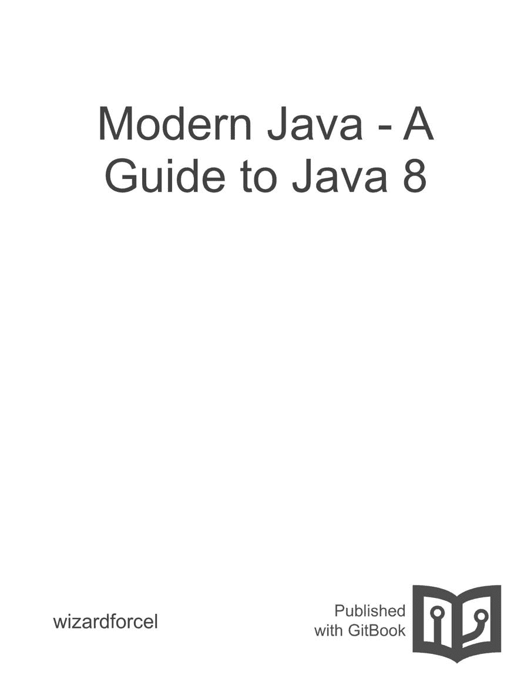
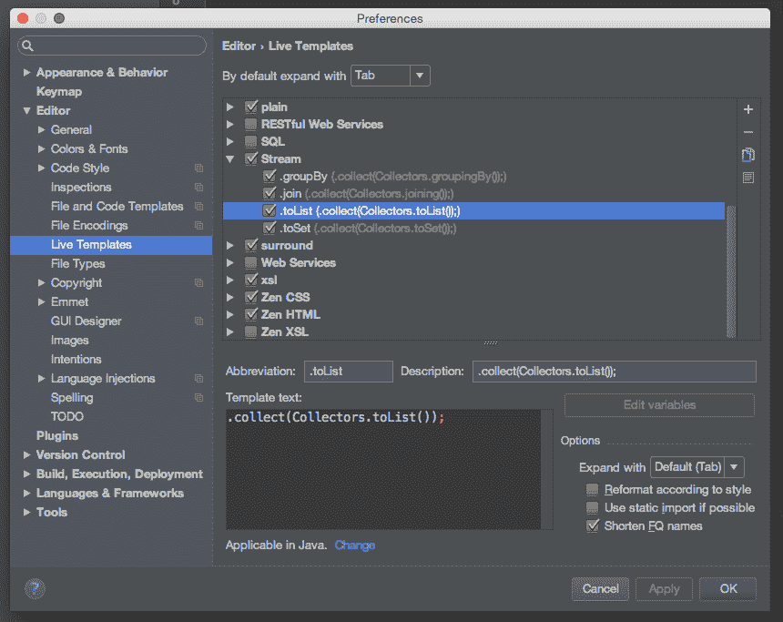
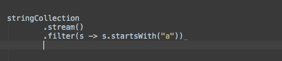
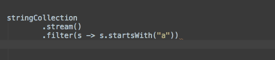

# 现代 Java - Java 8 指南



## 介绍

> [“Java 还没有死——人们开始意识到这一点了。”](https://twitter.com/mreinhold/status/429603588525281280)

欢迎阅读我对 [Java 8](https://jdk8.java.net/) 的介绍。这本教程将引导你逐步学习所有新的语言特性。在简短简单代码示例的支持下，你将学习如何使用默认接口方法、lambda 表达式、方法引用和可重复注解。在文章最后，你将熟悉最新的 [API](http://download.java.net/jdk8/docs/api/) 变化，如流、函数式接口、map 扩展以及新的日期 API。**没有大段文字，只有许多带注释的代码段。尽情享受吧！**

这篇文章最初发布在[我的博客](http://winterbe.com/posts/2014/03/16/java-tutorial/)上。你应该[在 Twitter 上关注我](https://twitter.com/winterbe)。

## 接口的默认方法

Java 8 允许我们通过 `default` 关键字向接口中添加非抽象方法的实现。这一特性被称为[虚拟扩展方法](https://stackoverflow.com/a/24102730)。这是我们的第一个示例：

```java
interface Formula {
    double calculate(int a);

    default double sqrt(int a) {
        return Math.sqrt(a);
    }
}
```

除了抽象方法 `calculate` 之外，接口 `Formula` 还定义了默认方法 `sqrt`。具体类只需要实现抽象方法 `calculate`。默认方法 `sqrt` 可以直接使用。

```java
Formula formula = new Formula() {
    @Override
    public double calculate(int a) {
        return sqrt(a) * 100;
    }
};

formula.calculate(100);     // 100.0
formula.sqrt(16);           // 4.0
```

该公式是通过匿名对象实现的。代码相当冗长：对于 `sqrt(a * 100)` 这样简单的计算，用了 6 行代码。正如我们在下一节中看到的，Java 8 中有更优雅的方法来实现单方法对象。

## Lambda 表达式

让我们从一个在 Java 之前的版本中对字符串列表的简单示例开始：

```java
List<String> names = Arrays.asList("peter", "anna", "mike", "xenia");

Collections.sort(names, new Comparator<String>() {
    @Override
    public int compare(String a, String b) {
        return b.compareTo(a);
    }
});
```

静态工具方法 `Collections.sort` 接受一个列表和一个比较器，以便对给定列表的元素进行排序。你经常发现自己在创建匿名比较器并将它们传递给 sort 方法。

与其整天创建匿名对象，Java 8 提供了更短的语法：lambda 表达式：

```java
Collections.sort(names, (String a, String b) -> {
    return b.compareTo(a);
});
```

你可以看到代码变得更短且更易读。但还可以更短：

```java
Collections.sort(names, (String a, String b) -> b.compareTo(a));
```

对于单行方法体，可以跳过大括号 `{}` 和 `return` 关键字。还可以更短：

```java
names.sort((a, b) -> b.compareTo(a));
```

`List` 现在有了 `sort` 方法。此外，Java 编译器知道参数类型，因此你也可以省略它们。让我们深入研究 lambda 表达式在实际中的用法。

## 函数式接口

lambda 表达式如何适应 Java 的类型系统？每个 lambda 对应一个给定的类型，由接口指定。所谓的*函数式接口*必须包含**一个抽象方法**声明。该类型的 lambda 表达式将匹配到该抽象方法。由于默认方法不是抽象的，你可以自由地向函数式接口中添加默认方法。

只要接口只包含一个抽象方法，我们就可以将任意接口作为 lambda 表达式。为了确保你的接口符合要求，你应该添加 `@FunctionalInterface` 注解。编译器会感知此注解，一旦你尝试向接口添加第二个抽象方法，就会抛出编译错误。

示例：

```java
@FunctionalInterface
interface Converter<F, T> {
    T convert(F from);
}
```

```java
Converter<String, Integer> converter = (from) -> Integer.valueOf(from);
Integer converted = converter.convert("123");
System.out.println(converted);    // 123
```

请记住，如果省略 `@FunctionalInterface` 注解，代码同样有效。

## 方法和构造函数引用

利用静态方法引用可以进一步简化上面的代码：

```java
Converter<String, Integer> converter = Integer::valueOf;
Integer converted = converter.convert("123");
System.out.println(converted);   // 123
```

Java 8 允许通过 `::` 关键字传递方法或构造函数的引用。上面的示例展示了如何引用静态方法。但也可以引用对象方法：

```java
class Something {
    String startsWith(String s) {
        return String.valueOf(s.charAt(0));
    }
}
```

```java
Something something = new Something();
Converter<String, String> converter = something::startsWith;
String converted = converter.convert("Java");
System.out.println(converted);    // "J"
```

让我们看看 `::` 关键字如何作用于构造函数。首先，我们定义一个具有不同构造函数的示例 Bean：

```java
class Person {
    String firstName;
    String lastName;

    Person() {}

    Person(String firstName, String lastName) {
        this.firstName = firstName;
        this.lastName = lastName;
    }
}
```

接下来，我们定义一个人员工厂接口，用于创建新的人员：

```java
interface PersonFactory<P extends Person> {
    P create(String firstName, String lastName);
}
```

我们没有手动实现工厂，而是通过构造器引用将一切组合在一起：

```java
PersonFactory<Person> personFactory = Person::new;
Person person = personFactory.create("Peter", "Parker");
```

我们通过 `Person::new` 创建了对 `Person` 构造函数的引用。Java 编译器会通过匹配 `PersonFactory.create` 的签名自动选择正确的构造函数。

## Lambda 作用域

从 lambda 表达式访问外部作用域变量与匿名对象非常相似。你可以访问局部外部作用域的 final 变量，以及实例字段和静态变量。

### 访问局部变量

我们可以从 lambda 表达式的外部作用域中读取 final 局部变量：

```java
final int num = 1;
Converter<Integer, String> stringConverter =
        (from) -> String.valueOf(from + num);

stringConverter.convert(2);     // 3
```

但与匿名对象不同，变量 `num` 不需要声明为 final。以下代码也是有效的：

```java
int num = 1;
Converter<Integer, String> stringConverter =
        (from) -> String.valueOf(from + num);

stringConverter.convert(2);     // 3
```

然而，为了使代码通过，`num` 必须是隐式的 final。以下代码**无法**编译：

```java
int num = 1;
Converter<Integer, String> stringConverter =
        (from) -> String.valueOf(from + num);
num = 3;
```

在 lambda 表达式内部写入 `num` 也是被禁止的。

### 访问字段和静态变量

与局部变量不同，在 lambda 表达式内部对实例字段和静态变量具有读写权限。这种行为在匿名对象中是为人知的。

```java
class Lambda4 {
    static int outerStaticNum;
    int outerNum;

    void testScopes() {
        Converter<Integer, String> stringConverter1 = (from) -> {
            outerNum = 23;
            return String.valueOf(from);
        };

        Converter<Integer, String> stringConverter2 = (from) -> {
            outerStaticNum = 72;
            return String.valueOf(from);
        };
    }
}
```

### 访问接口默认方法

记得第一节中的公式示例吗？接口 `Formula` 定义了一个默认方法 `sqrt`，可以从每个公式实例（包括匿名对象）访问。这在 lambda 表达式中是不可行的。

默认方法**无法**从 lambda 表达式内部访问。以下代码无法编译：

```java
Formula formula = (a) -> sqrt(a * 100);
```

## 内置函数式接口

JDK 1.8 API 包含了许多函数式接口。其中一些在旧版本的 Java 中已为人知，例如 `Comparator` 或 `Runnable`。这些现有接口被扩展以通过 `@FunctionalInterface` 注解启用 Lambda 支持。

但 Java 8 API 还充满了许多新的函数式接口以让你的生活变得更轻松。其中一些新接口通过 [Google Guava](https://code.google.com/p/guava-libraries/) 库为人知。即使你熟悉这个库，也应该留意这些接口是如何通过一些实用的方法扩展的。

### 谓词 (Predicates)

谓词是接受一个参数的布尔值函数。接口包含各种默认方法，用于将谓词组合成复杂的逻辑项（与、或、取反）。

```java
Predicate<String> predicate = (s) -> s.length() > 0;

predicate.test("foo");              // true
predicate.negate().test("foo");     // false

Predicate<Boolean> nonNull = Objects::nonNull;
Predicate<Boolean> isNull = Objects::isNull;

Predicate<String> isEmpty = String::isEmpty;
Predicate<String> isNotEmpty = isEmpty.negate();
```

### 函数 (Functions)

函数接受一个参数并产生结果。默认方法可以将多个函数链在一起（compose, andThen）。

```java
Function<String, Integer> toInteger = Integer::valueOf;
Function<String, String> backToString = toInteger.andThen(String::valueOf);

backToString.apply(123);     // "123"
```

### 生产者 (Suppliers)

生产者产生给定类型的结果。与函数不同，生产者不接受参数。

```java
Supplier<Person> personSupplier = Person::new;
personSupplier.get();   // new
```

### 消费者 (Consumers)

消费者代表在单个输入上执行的操作。

```java
Consumer<String> greeter = (p) -> System.out.println("Hello, " + p);
greeter.accept("Luke"); // Hello, Luke Skywalker
```

### 比较器 (Comparators)

比较器在旧版本中为人知。Java 8 在该接口中添加了各种方法。

```java
Comparator<String> comparator = (p1, p2) -> p1.compareTo(p2);

String p1 = "John Doe";
String p2 = "Alice Wonderland";

comparator.compare(p1, p2);             // >0
comparator.reversed().compare(p1, p2);  // <0
```

## 可选容器 (Optionals)

`Optional` 是一个可能为 null 的值的简单容器。它是下一节的一个重要概念，让我们看看 `Optional` 是如何工作的。它不是返回 `null`，而是返回 `Optional`。

```java
Optional<String> optional = Optional.of("bam");

optional.isPresent();           // true
optional.get();                 // "bam"
optional.orElse("fallback");    // "bam"

optional.ifPresent((s) -> System.out.println(s.charAt(0))); // "b"
```

## 流 (Streams)

`java.util.Stream` 代表对可以执行一个或多个操作的元素序列。流操作分为中间操作和终结操作。终端操作返回特定类型的结果，中间操作返回流，以便链方法调用。流创建于源，例如 `java.util.Collection`（不支持 map）。流操作可以顺序或并行执行。

> 流非常强大，所以我写了一篇单独的 [Java 8 流教程](http://winterbe.com/posts/2014/07/31/java8-stream-tutorial-examples/)。你还应该查看 [Stream.js](https://github.com/winterbe/streamjs)，它是 Java 8 流 API 的 JavaScript 移植。

让我们先看看顺序流是如何工作的。首先我们以字符串列表的形式创建一个示例源：

```java
List<String> stringCollection = new ArrayList<>();
stringCollection.add("ddd2");
stringCollection.add("aaa2");
stringCollection.add("bbb1");
stringCollection.add("aaa1");
stringCollection.add("bbb3");
stringCollection.add("ccc");
stringCollection.add("bbb2");
stringCollection.add("ddd1");
```

Java 8 中的集合经过了扩展，因此你可以通过调用 `Collection.stream()` 或 `Collection.parallelStream()` 直接创建流。后续章节将解释常用的流操作。

### 过滤 (Filter)

`Filter` 接受一个谓词来过滤流中的所有元素。该操作是中间操作，允许我们在结果上调用另一个流操作（`forEach`）。`forEach` 接受一个消费者，并在过滤后的流的每个元素上执行。`forEach` 是一个终结操作。它是 `void`，所以我们不能调用另一个流操作。


```
stringCollection
    .stream()
    .filter((s) -> s.startsWith("a"))
    .forEach(System.out::println);

// "aaa2", "aaa1"
```

`Sorted` 是一个*中间*操作，它返回一个流的排序视图。除非你传递了自定义的 `Comparator`，否则元素将按照自然顺序排序。

```
stringCollection
    .stream()
    .sorted()
    .filter((s) -> s.startsWith("a"))
    .forEach(System.out::println);

// "aaa1", "aaa2"
```

请记住，`sorted` 仅创建流的排序视图，而不会改变底层集合的顺序。`stringCollection` 的顺序保持不变：

```
System.out.println(stringCollection);
// ddd2, aaa2, bbb1, aaa1, bbb3, ccc, bbb2, ddd1
```

### Map

*中间*操作 `map` 通过给定的函数将每个元素转换为另一个对象。下面的示例将每个字符串转换为大写字符串。但你也可以使用 `map` 将每个对象转换为另一种类型。结果流的泛型取决于你传递给 `map` 的函数的泛型类型。

```
stringCollection
    .stream()
    .map(String::toUpperCase)
    .sorted((a, b) -> b.compareTo(a))
    .forEach(System.out::println);

// "DDD2", "DDD1", "CCC", "BBB3", "BBB2", "AAA2", "AAA1"
```

### Match

可以使用各种匹配操作来检查某个谓词是否匹配流。所有这些操作都是*终端*操作，并返回布尔结果。

```
boolean anyStartsWithA =
    stringCollection
        .stream()
        .anyMatch((s) -> s.startsWith("a"));

System.out.println(anyStartsWithA);      // true

boolean allStartsWithA =
    stringCollection
        .stream()
        .allMatch((s) -> s.startsWith("a"));

System.out.println(allStartsWithA);      // false

boolean noneStartsWithZ =
    stringCollection
        .stream()
        .noneMatch((s) -> s.startsWith("z"));

System.out.println(noneStartsWithZ);      // true
```

### Count

`Count` 是一个*终端*操作，以 `long` 类型返回流中元素的数量。

```
long startsWithB =
    stringCollection
        .stream()
        .filter((s) -> s.startsWith("b"))
        .count();

System.out.println(startsWithB);    // 3
```

### Reduce

此*终端*操作通过给定的函数对流中的元素进行归约。结果是一个包含归约值的 `Optional`。

```
Optional<String> reduced =
    stringCollection
        .stream()
        .sorted()
        .reduce((s1, s2) -> s1 + "#" + s2);

reduced.ifPresent(System.out::println);
// "aaa1#aaa2#bbb1#bbb2#bbb3#ccc#ddd1#ddd2"
```

### Parallel Streams

如上所述，流可以是顺序的，也可以是并行的。顺序流上的操作在单个线程上执行，而并行流上的操作在多个线程上并发执行。

接下来的示例展示了使用并行流提高性能是多么简单。

首先，我们创建一个包含大量唯一元素的列表：

```
int max = 1000000;
List<String> values = new ArrayList<>(max);
for (int i = 0; i < max; i++) {
    UUID uuid = UUID.randomUUID();
    values.add(uuid.toString());
}
```

现在，我们测量对该集合进行排序所需的时间。

### Sequential Sort

```
long t0 = System.nanoTime();

long count = values.stream().sorted().count();
System.out.println(count);

long t1 = System.nanoTime();

long millis = TimeUnit.NANOSECONDS.toMillis(t1 - t0);
System.out.println(String.format("sequential sort took: %d ms", millis));

// sequential sort took: 899 ms
```

### Parallel Sort

```
long t0 = System.nanoTime();

long count = values.parallelStream().sorted().count();
System.out.println(count);

long t1 = System.nanoTime();

long millis = TimeUnit.NANOSECONDS.toMillis(t1 - t0);
System.out.println(String.format("parallel sort took: %d ms", millis));

// parallel sort took: 472 ms
```

你可以看到，两个代码段几乎相同，但并行排序的速度要快了大约 50%。你只需要将 `stream()` 更改为 `parallelStream()`。

### Maps

如前所述，map 不直接支持流。`Map` 接口本身没有提供 `stream()` 方法，但你可以通过 `map.keySet().stream()`、`map.values().stream()` 和 `map.entrySet().stream()` 创建基于键、值或条目的专有流。

此外，map 还提供了许多用于执行常见任务的新实用方法。

```
Map<Integer, String> map = new HashMap<>();

for (int i = 0; i < 10; i++) {
    map.putIfAbsent(i, "val" + i);
}

map.forEach((id, val) -> System.out.println(val));
```

上面的代码自证其明：`putIfAbsent` 避免了我们编写额外的空值检查；以及 `forEach`。

### Date API

Java 8 在 `java.time` 包下包含了一个全新的日期和时间 API。下面的示例涵盖了其中最重要的部分。

### Clock

`Clock` 提供了对当前日期和时间的访问。时钟感知时区，并可以替代 `System.currentTimeMillis()` 来获取毫秒级的当前时间。时间线上的这种瞬间也由 `Instant` 类表示。`Instant` 可以用于创建旧的 `java.util.Date` 对象。

```
Clock clock = Clock.systemDefaultZone();
long millis = clock.millis();

Instant instant = clock.instant();
Date legacyDate = Date.from(instant);   // legacy java.util.Date
```

### Timezones

时区由 `ZoneId` 表示。可以通过静态工厂方法轻松访问。时区定义了偏移量，这对于转换瞬间以及本地日期时间至关重要。

```
System.out.println(ZoneId.getAvailableZoneIds());
// 打印所有可用的时区 id

ZoneId zone1 = ZoneId.of("Europe/Berlin");
ZoneId zone2 = ZoneId.of("Brazil/East");
System.out.println(zone1.getRules());
System.out.println(zone2.getRules());

// ZoneRules[currentStandardOffset=+01:00]
// ZoneRules[currentStandardOffset=-03:00]
```

### LocalTime

`LocalTime` 表示不带时区的时间，例如晚上 10 点或 17:30:15。下面的示例为上面定义的时区创建两个本地时间。然后我们比较这两个时间，并计算它们之间小时和分钟的差异。

```
LocalTime now1 = LocalTime.now(zone1);
LocalTime now2 = LocalTime.now(zone2);

System.out.println(now1.isBefore(now2));  // false

long hoursBetween = ChronoUnit.HOURS.between(now1, now2);
long minutesBetween = ChronoUnit.MINUTES.between(now1, now2);

System.out.println(hoursBetween);       // -3
System.out.println(minutesBetween);     // -239
```

`LocalTime` 提供了各种工厂方法来简化新实例的创建，包括对时间字符串的解析。

```
LocalTime late = LocalTime.of(23, 59, 59);
System.out.println(late);       // 23:59:59

DateTimeFormatter germanFormatter =
    DateTimeFormatter
        .ofLocalizedTime(FormatStyle.SHORT)
        .withLocale(Locale.GERMAN);

LocalTime leetTime = LocalTime.parse("13:37", germanFormatter);
System.out.println(leetTime);   // 13:37
```

### LocalDate

`LocalDate` 表示一个特定的日期，例如 `2014-03-11`。它是不可变的，且工作方式与 `LocalTime` 完全相同。示例演示了如何通过增加或减少天、月或年来计算新日期。请记住，每次操作都会返回一个新实例。

```
LocalDate today = LocalDate.now();
LocalDate tomorrow = today.plus(1, ChronoUnit.DAYS);
LocalDate yesterday = tomorrow.minusDays(2);

LocalDate independenceDay = LocalDate.of(2014, Month.JULY, 4);
DayOfWeek dayOfWeek = independenceDay.getDayOfWeek();
System.out.println(dayOfWeek);    // FRIDAY
```

从字符串解析 `LocalDate` 与解析 `LocalTime` 一样简单：

```
DateTimeFormatter germanFormatter =
    DateTimeFormatter
        .ofLocalizedDate(FormatStyle.MEDIUM)
        .withLocale(Locale.GERMAN);

LocalDate xmas = LocalDate.parse("24.12.2014", germanFormatter);
System.out.println(xmas);   // 2014-12-24
```

### LocalDateTime

`LocalDateTime` 表示一个日期时间。它将上述章节中的日期和时间合并为一个实例。`LocalDateTime` 是不可变的，且工作方式与 `LocalTime` 和 `LocalDate` 相似。我们可以利用方法从日期时间中提取某些字段：

```
LocalDateTime sylvester = LocalDateTime.of(2014, Month.DECEMBER, 31, 23, 59, 59);

DayOfWeek dayOfWeek = sylvester.getDayOfWeek();
System.out.println(dayOfWeek);      // WEDNESDAY

Month month = sylvester.getMonth();
System.out.println(month);          // DECEMBER

long minuteOfDay = sylvester.getLong(ChronoField.MINUTE_OF_DAY);
System.out.println(minuteOfDay);    // 1439
```

带有额外的时区信息，它可以转换为 `Instant`。`Instant` 可以轻松转换为 `java.util.Date` 类型的旧日期。

```
Instant instant = sylvester
        .atZone(ZoneId.systemDefault())
        .toInstant();

Date legacyDate = Date.from(instant);
System.out.println(legacyDate);     // Wed Dec 31 23:59:59 CET 2014
```

格式化日期时间的方法与格式化日期或时间一样。我们不再使用预定义的格式，而是从自定义模式创建格式化器。

```
DateTimeFormatter formatter =
    DateTimeFormatter
        .ofPattern("MMM dd, yyyy - HH:mm");

LocalDateTime parsed = LocalDateTime.parse("Nov 03, 2014 - 07:13", formatter);
String string = formatter.format(parsed);
System.out.println(string);     // Nov 03, 2014 - 07:13
```

与 `java.text.NumberFormat` 不同，新的 `DateTimeFormatter` 是不可变的且**线程安全的**。

关于模式语法的细节，请阅读[此处](https://docs.oracle.com/javase/8/docs/api/java/time/format/DateTimeFormatter.html)。

## 注解 (Annotations)

Java 8 中的注解是可重复的。让我们直接通过一个示例了解这一点。

首先，我们定义了一个包装注解，它持有一个实际注解的数组：

```
@interface Hints {
    Hint[] value();
}

@Repeatable(Hints.class)
@interface Hint {
    String value();
}
```

Java 8 允许我们通过声明注解 `@Repeatable` 来使用相同类型的多个注解。

### 变体 1：使用容器注解（旧式）

```
@Hints({@Hint("hint1"), @Hint("hint2")})
class Person {}
```

### 变体 2：使用重复注解（新式）

```
@Hint("hint1")
@Hint("hint2")
class Person {}
```

使用变体 2 时，Java 编译器会在底层隐含设置 `@Hints` 注解。这对于通过反射读取注解信息非常重要。

```
Hint hint = Person.class.getAnnotation(Hint.class);
System.out.println(hint);                   // null

Hints hints1 = Person.class.getAnnotation(Hints.class);
System.out.println(hints1.value().length);  // 2

Hint[] hints2 = Person.class.getAnnotationsByType(Hint.class);
System.out.println(hints2.length);          // 2
```


尽管我们从未在`Person`类上声明过`@Hints`注解，但仍然可以通过`getAnnotation(Hints.class)`进行读取。然而，更方便的方法是`getAnnotationsByType`，它允许直接访问所有被标记的`@Hint`注解。

此外，Java 8 中注解的使用扩展到了两个新目标：

```
@Target({ElementType.TYPE_PARAMETER, ElementType.TYPE_USE})
@interface MyAnnotation {}
```

## 接下来该去哪里？

我的 Java 8 编程指南到此结束。如果你想更多关于 JDK 8 API 的所有新类和特性，请查看我的 [JDK8 API 探索器](http://winterbe.com/projects/java8-explorer/)。它可以帮助你发现 JDK 8 的所有新类和隐藏珍宝，例如`Arrays.parallelSort`、`StampedLock`和`CompletableFuture`——这仅仅是其中之一。

我还在[博客](http://winterbe.com)上发布了一系列后续文章，你可能也会感兴趣：

* [Java 8 Stream 教程](http://winterbe.com/posts/2014/07/31/java8-stream-tutorial-examples/)
* [Java 8 Nashorn 教程](http://winterbe.com/posts/2014/04/05/java8-nashorn-tutorial/)
* [Java 8 并发教程：线程与执行器](http://winterbe.com/posts/2015/04/07/java8-concurrency-tutorial-thread-executor-examples/)
* [Java 8 并发教程：同步与锁](http://winterbe.com/posts/2015/04/30/java8-concurrency-tutorial-synchronized-locks/)
* [Java 8 并发教程：原子变量与并发 Map](http://winterbe.com/posts/2015/05/22/java8-concurrency-tutorial-atomic-concurrent-map/)
* [Java 8 API 示例：字符串、数字与数学](http://winterbe.com/posts/2015/03/25/java8-examples-string-number-math/)
* [在 Java 8 中避免空检查](http://winterbe.com/posts/2015/03/15/avoid-null-checks-in-java/)

流（Stream）代表元素的序列，并支持各种类型的操作对这些元素执行计算：

```
List<String> myList =
    Arrays.asList("a1", "a2", "b1", "c2", "c1");

myList
    .stream()
    .filter(s -> s.startsWith("c"))
    .map(String::toUpperCase)
    .sorted()
    .forEach(System.out::println);

// C1
// C2
```

流操作分为中间操作（intermediate）和终端操作（terminal）。中间操作返回一个流，因此我们可以在不使用分号的情况下链接多个中间操作。终端操作要么返回`void`，要么返回非流的结果。在上面的示例中，`filter`、`map`和`sorted`是中间操作，而`forEach`是终端操作。所有可用流操作的完整列表，请参阅 [Stream Javadoc](http://docs.oracle.com/javase/8/docs/api/java/util/stream/Stream.html)。示例所示的流操作链被称为“操作流水线”（`operation pipeline`）。

大多数流操作接受某种 Lambda 表达式参数，即指定操作精确行为的函数接口。这些操作大部分必须同时是**非干扰的**（`non-interfering`）和**无状态的**（`stateless`）。这意味着什么？

如果函数没有修改流的底层数据源，则它就是[非干扰的](http://docs.oracle.com/javase/8/docs/api/java/util/stream/package-summary.html#NonInterference)，例如在上面的示例中，没有 Lambda 表达式通过从集合中添加或删除元素来修改`myList`。

如果操作的执行是确定性的，则它就是[无状态的](http://docs.oracle.com/javase/8/docs/api/java/util/stream/package-summary.html#Statelessness)，例如在上面的示例中，没有 Lambda 表达式依赖于外部作用范围内可能在执行期间变化的可变变量或状态。

### 不同类型的流

流可以从各种数据源创建，特别是集合。List 和 Set 支持新方法`stream()`和`parallelStream()`，用于创建顺序流或并行流。并行流能够在多线程上进行操作，将在本教程的后续章节中介绍。我们现在重点关注顺序流：

```
Arrays.asList("a1", "a2", "a3")
    .stream()
    .findFirst()
    .ifPresent(System.out::println);  // a1
```

在对象列表上调用`stream()`方法返回一个普通的对象流。但正如我们在下一个代码示例所示，我们不需要创建集合就可以操作流：

```
Stream.of("a1", "a2", "a3")
    .findFirst()
    .ifPresent(System.out::println);  // a1
```

只需使用`Stream.of()`就能一组对象引用创建一个流。

除了普通的对象流外，Java 8 还提供了用于处理原始数据类型`int`、`long`和`double`的特殊流。正如你可能猜到的，它们是`IntStream`、`LongStream`和`DoubleStream`。

`IntStream`可以利用`IntStream.range()`替换传统的`for`循环：

```
IntStream.range(1, 4)
    .forEach(System.out::println);

// 1
// 2
// 3
```

所有这些原始流的工作方式与普通对象流类似，但区别在于：原始流使用专门的 Lambda 表达式，例如用`IntFunction`代替`Function`，或用`IntPredicate`代替`Predicate`。并且原始流支持额外的终端聚合操作`sum()`和`average()`：

```
Arrays.stream(new int[] {1, 2, 3})
    .map(n -> 2 * n + 1)
    .average()
    .ifPresent(System.out::println);  // 5.0
```

有时将普通对象流转换为原始流或反之是很有用的。为了此目的，对象流支持特殊的映射操作`mapToInt()`、`mapToLong()`和`mapToDouble`：

```
Stream.of("a1", "a2", "a3")
    .map(s -> s.substring(1))
    .mapToInt(Integer::parseInt)
    .max()
    .ifPresent(System.out::println);  // 3
```

原始流可以通过`mapToObj()`转换为对象流：

```
IntStream.range(1, 4)
    .mapToObj(i -> "a" + i)
    .forEach(System.out::println);

// a1
// a2
// a3
```

这是一个组合示例：double 流首先被映射为 int 流，然后映射为字符串的对象流：

```
Stream.of(1.0, 2.0, 3.0)
    .mapToInt(Double::intValue)
    .mapToObj(i -> "a" + i)
    .forEach(System.out::println);

// a1
// a2
// a3
```

### 处理顺序

现在我们已经学习了如何创建和使用不同类型的流，让我们深入研究流操作在底层是如何处理的。

中间操作的一个重要特性是**惰性**（laziness）。看这个缺少终端操作的示例：

```
Stream.of("d2", "a2", "b1", "b2")
    .filter(s -> {
        System.out.println("filter: " + s);
        return true;
    })
```

（注：由于原文中存在大量重复和碎片化文本，此处根据逻辑流进行了整理。）

现在，`map`只会被调用一次，因此对于大量的输入元素，操作流水线的执行速度会快得多。在组合复杂的方法链时，请记住这一点。

让我们通过增加额外的操作`sorted`来扩展上面的示例：

```java
Stream.of("d2", "a2", "b1", "b3", "c")
    .sorted((s1, s2) -> {
        System.out.printf("sort: %s; %s\n", s1, s2);
        return s1.compareTo(s2);
    })
    .filter(s -> {
        System.out.println("filter: " + s);
        return s.startsWith("a");
    })
    .map(s -> {
        System.out.println("map: " + s);
        return s.toUpperCase();
    })
    .forEach(s -> System.out.println("forEach: " + s));
```

排序是一种特殊的中间操作。它被称为“有状态操作”（stateful operation），因为为了对元素集合进行排序，你需要在排序过程中维护状态。

执行此示例将得到以下控制台输出：

```
sort:    a2; d2
sort:    b1; a2
sort:    b1; d2
sort:    b1; a2
sort:    b3; b1
sort:    b3; d2
sort:    c; b3
sort:    c; d2
filter:  a2
map:     a2
forEach: A2
filter:  b1
filter:  b3
filter:  c
filter:  d2
```

首先，排序操作在整个输入集合上执行。换句话说，`sorted`是水平执行的。在这种情况下，`sorted`为输入集合中每个元素的多种组合调用了八次。

我们再次通过重新调整链来优化性能：

```java
Stream.of("d2", "a2", "b1", "b3", "c")
    .filter(s -> {
        System.out.println("filter: " + s);
        return s.startsWith("a");
    })
    .sorted((s1, s2) -> {
        System.out.printf("sort: %s; %s\n", s1, s2);
        return s1.compareTo(s2);
    })
    .map(s -> {
        System.out.println("map: " + s);
        return s.toUpperCase();
    })
    .forEach(s -> System.out.println("forEach: " + s));

// filter:  d2
// filter:  a2
// filter:  b1
// filter:  b3
// filter:  c
// map:     a2
// forEach: A2
```

在这个示例中，`sorted`从未被调用过，因为`filter`将输入集合减少到只有一个元素。因此，对于较大的输入集合，性能大大提高。

### 重用流

Java 8 的流是不可重用的。一旦你调用任何终端操作，流就会关闭：

```java
Stream<String> stream =
    Stream.of("d2", "a2", "b1", "b3", "c")
        .filter(s -> s.startsWith("a"));

stream.anyMatch(s -> true);    // ok
stream.noneMatch(s -> true);   // exception
```

在同一个流上调用`anyMatch`后调用`noneMatch`将导致以下异常：

```
java.lang.IllegalStateException: stream has already been operated upon or closed
    at java.util.stream.AbstractPipeline.evaluate(AbstractPipeline.java:229)
    at java.util.stream.ReferencePipeline.noneMatch(ReferencePipeline.java:459)
    at com.winterbe.java8.Streams5.test7(Streams5.java:38)
    at com.winterbe.java8.Streams5.main(Streams5.java:28)
```

为了克服这个限制，我们必须为为想要执行的每个终端操作创建一个新的流链，例如，我们可以创建一个流供应者（stream supplier）来构造一个已经设置好所有中间操作的新流：

```java
Supplier<Stream<String>> streamSupplier =
    () -> Stream.of("d2", "a2", "b1", "b3", "c")
            .filter(s -> s.startsWith("a"));

streamSupplier.get().anyMatch(s -> true);   // ok
streamSupplier.get().noneMatch(s -> true);  // ok
```

每次调用`get()`都会构建一个新的流，我们在上面安全地调用所需的终端操作。

### 高级操作

流支持许多不同的操作。我们已经学习了如`filter`或`map`这样最重要的操作。我留给你去发现所有其他可用操作（参见 [Stream Javadoc](http://docs.oracle.com/javase/8/docs/api/java/util/stream/Stream.html)）。相反，让我们深入研究更复杂的操作`collect`、`flatMap`和`reduce`。

本节的大多数代码示例使用以下人员列表进行演示：

```java
class Person {
    String name;
    int age;

    Person(String name, int age) {
        this.name = name;
        this.age = age;
    }

    @Override
    public String toString() {
        return name;
    }
}
```

### Collect

本节的大多数代码示例使用以下人员列表进行演示：（见上文）

`collect`是一个终端操作，用于将元素转换为`list`、`set`或`map`。这听起来很复杂，但我们不需要自己实现它。

下一个示例将所有元素合并到一个列表：

```java
List<Person> filtered =
    persons
        .stream()
        .filter(p -> p.name.startsWith("P"))
        .collect(Collectors.toList());

System.out.println(filtered);    // [Peter]
```

如果需要一个集合 - 使用`Collectors.toSet()`：

```java
Set<Person> set =
    persons
        .stream()
        .collect(Collectors.toSet());
```

下一个示例按年龄对所有人分组：

```java
Map<Integer, List<Person>> personsByAge =
    persons
    .stream()
    .collect(Collectors.groupingBy(p -> p.age));

personsByAge
    .forEach((age, p) -> System.out.format("age %s\n", age, p));

// age 18: [Max]
// age 23: [Pamela]
// age 12: [David]
```

为了将流元素转换为 map，我们必须指定键和值如何映射。请记住，映射的键必须唯一，否则将抛出`IllegalStateException`。你可以可选地传递一个合并函数来跳过异常：


```java
Map<Integer, String> map =
    persons.stream()
    .collect(Collectors.toMap(
        p -> p.age,
        p -> p.name,
        (name1, name2) -> name1 + ";" + name2));

System.out.println(map);
// {18=Max, 23=Peter;Pamela, 12=David}
```

`Collectors` 非常通用。你还可以在流上创建聚合，例如计算所有人的平均年龄：

```java
Double averageAge = persons
    .stream()
    .collect(Collectors.averagingInt(p -> p.age));

System.out.println(averageAge);     // 19.0
```

对全面的统计数据感兴趣，汇总收集器返回一个特殊的统计对象。因此我们可以简单地确定 `min`、`max` 和算术平均值 `average`，以及 `sum` 和 `count`。

```java
IntSummaryStatistics ageSummary =
    persons
        .stream()
        .collect(Collectors.summarizingInt(p -> p.age));

System.out.println(ageSummary);
// IntSummaryStatistics{count=4, sum=76, min=12, average=19.000000, max=23}
```

`join` 收集器接受一个分隔符以及可选的前缀和后缀：

```java
String phrase = persons
    .stream()
    .filter(p -> p.age >= 18)
    .map(p -> p.name)
    .collect(Collectors.joining(" and ", "In Germany ", " are of legal age."));

System.out.println(phrase);
// In Germany Max and Pamela are of legal age.
```

现在我们已经了解了一些强大的内置收集器，让我们尝试构建我们自己的特殊收集器。我们想将流中的所有人转换为单个字符串，由大写字母名称组成并用 `|` 管道字符分隔。为了实现这一点，我们通过 `Collector.of()` 创建一个新的收集器。我们必须传递收集器的四个成分：一个*供应者*（supplier）、一个*累加器*（accumulator）、一个*合并器*（combiner）和一个*完成者*（finisher）。

```java
Collector<Person, StringJoiner, String> personNameCollector =
    Collector.of(
        () -> new StringJoiner(" | "),          // supplier
        (j, p) -> j.add(p.name.toUpperCase()),  // accumulator
        (j1, j2) -> j1.merge(j2),               // combiner
        StringJoiner::toString);                // finisher

String names = persons
    .stream()
    .collect(personNameCollector);

System.out.println(names);  // MAX | PETER | PAMELA | DAVID
```

由于 Java 中的字符串是不可变的，我们需要一个像 `StringJoiner` 这样的辅助类来让收集器构建我们的字符串。供给者（supplier）最初构造具有适当分隔符的 `StringJoiner`。累加器（accumulator）用于将每个人的大写名称添加到 `StringJoiner` 中。合并器（combiner）知道如何将两个 `StringJoiner` 合并为一个。在最后一步，完成器（finisher）从 `StringJoiner` 构建出所需的 `String`。

### FlatMap

我们已经学习了如何利用 `map` 操作将流中的对象转换为另一种类型的对象。`map` 有些局限性，因为每个对象只能映射到好一个另一个对象。但如果我们想将一个对象转换为多个对象或者一个都不转换呢？这就是 `flatMap` 大显身用场的地方。

`flatMap` 将流中的每个元素转换为其他对象的流。因此，每个对象都将转换为零、一个或多个由流支持的其他对象。这些流的内容随后将被放入 `flatMap` 操作返回的流中。

在查看 `flatMap` 的实际运行之前，我们需要一个合适的类型层次结构：

```java
class Foo {
    String name;
    List<Bar> bars = new ArrayList<>();

    Foo(String name) {
        this.name = name;
    }
}

class Bar {
    String name;

    Bar(String name) {
        this.name = name;
    }
}
```

接下来，我们利用关于流的知识来实例化对象：

```java
List<Foo> foos = new ArrayList<>();

// create foos
IntStream
    .range(1, 4)
    .forEach(i -> foos.add(new Foo("Foo" + i)));

// create bars
foos.forEach(f ->
    IntStream
        .range(1, 4)
        .forEach(i -> f.bars.add(new Bar("Bar" + i + " <- " + f.name))));
```

现在我们有一个包含三个 foo 的列表，每个 foo 由三个 bar 组成。

`flatMap` 接受一个返回对象流的函数。因此，为了解析每个 foo 的 bar 对象，我们只需要传递相应的函数：

```java
foos.stream()
    .flatMap(f -> f.bars.stream())
    .forEach(b -> System.out.println(b.name));

// Bar1 <- Foo1
// Bar2 <- Foo1
// Bar3 <- Foo1
// Bar1 <- Foo2
// Bar2 <- Foo2
// Bar3 <- Foo2
// Bar1 <- Foo3
// Bar2 <- Foo3
// Bar3 <- Foo3
```

如你所见，我们成功地将三个 foo 对象的流转换为九 bar 对象的流。

最后，上面的代码示例可以简化为单一的流操作流水线：

```java
IntStream.range(1, 4)
    .mapToObj(i -> new Foo("Foo" + i))
    .peek(f -> IntStream.range(1, 4)
        .mapToObj(i -> new Bar("Bar" + i + " <- " + f.name))
        .forEach(f.bars::add))
    .flatMap(f -> f.bars.stream())
    .forEach(b -> System.out.println(b.name));
```

`flatMap` 也适用于 Java 8 引入的 `Optional` 类。`Optional` 的 `flatMap` 操作返回另一个其他类型的可选对象。因此，它可以被用于防止糟糕的 `null` 检查。

想象一个这样一个高度层次化的结构：

```java
class Outer {
    Nested nested;
}

class Nested {
    Inner inner;
}

class Inner {
    String foo;
}
```

为了解析外部实例的内部字符串 `foo`，你必须添加多个空值检查以防止可能的 `NullPointerException`：

```java
Outer outer = new Outer();
if (outer != null && outer.nested != null && outer.nested.inner != null) {
    System.out.println(outer.nested.inner.foo);
}
```

通过利用可选的 `flatMap` 操作可以获得相同的行为：

```java
Optional.of(new Outer())
    .flatMap(o -> Optional.ofNullable(o.nested))
    .flatMap(n -> Optional.ofNullable(n.inner))
    .flatMap(i -> Optional.ofNullable(i.foo))
    .ifPresent(System.out::println);
```

每次调用 `flatMap` 都会返回一个包装了所需对象的 `Optional`，如果不存在则返回 `null`。

### Reduce

归约（reduction）操作将流中的所有元素合并为单个结果。Java 8 支持三种不同的 `reduce` 方法。第一种将元素流归约为流中的恰好一个元素。让我们看看如何使用这种方法来确定年龄最大的人：

```java
persons
    .stream()
    .reduce((p1, p2) -> p1.age > p2.age ? p1 : p2)
```

第二种使用累加器将元素流归约为单个结果。让我们看看如何使用这种方法来确定年龄最大的人：

```java
persons
    .stream()
    .reduce(identity, (p1, p2) -> p1.age > p2.age ? p1 : p2)
```

第三种使用恒等和累加器将元素流归约为单个结果。让我们看看如何使用这种方法来确定年龄最大的人：

```java
persons
    .stream()
    .reduce(identity, (p1, p2) -> p1.age > p2.age ? p1 : p2, combiner);
```

流可以并行执行，以提高处理大量输入元素时的运行时性能。并行流使用通过静态方法 `ForkJoinPool.commonPool()` 可用的公共 `ForkJoinPool`。底层线程池的大小最多使用五个线程——取决于可用物理 CPU 核心的数量：

```java
ForkJoinPool commonPool = ForkJoinPool.commonPool();
System.out.println(commonPool.getParallelism());    // 3
```

在我的机器上，公共池默认初始化并行度为 3。可以通过设置以下 JVM 参数来减少或增加此值：

```java
-Djava.util.concurrent.ForkJoinPool.common.parallelism=5
```

集合（Collections）支持 `parallelStream()` 方法来创建元素的并行流。或者，你也可以在给定的流上调用中间方法 `parallel()` 将顺序流转换为对应的并行流。

为了理解并行流的并行执行行为，接下来的示例将当前线程的信息打印到 `sout` 中：

```java
Arrays.asList("a1", "a2", "b1", "c2", "c1")
    .parallelStream()
    .filter(s -> {
        System.out.format("filter: %s [%s]\n",
            s, Thread.currentThread().getName());
        return true;
    })
    .map(s -> {
        System.out.format("map: %s [%s]\n",
            s, Thread.currentThread().getName());
        return s.toUpperCase();
    })
    .forEach(s -> System.out.format("forEach: %s [%s]\n",
        s, Thread.currentThread().getName()));
```

通过研究调试输出，我们应该更好地了解哪些线程实际上被用于执行流操作：

```java
filter:  b1 [main]
filter:  a2 [ForkJoinPool.commonPool-worker-1]
map:     a2 [ForkJoinPool.commonPool-worker-1]
filter:  c2 [ForkJoinPool.commonPool-worker-3]
map:     c2 [ForkJoinPool.commonPool-worker-3]
filter:  c1 [ForkJoinPool.commonPool-worker-2]
map:     c1 [ForkJoinPool.commonPool-worker-2]
forEach: C2 [ForkJoinPool.commonPool-worker-3]
forEach: A2 [ForkJoinPool.commonPool-worker-1]
map:     b1 [main]
forEach: B1 [main]
filter:  a1 [ForkJoinPool.commonPool-worker-3]
map:     a1 [ForkJoinPool.commonPool-worker-3]
forEach: A1 [ForkJoinPool.commonPool-worker-3]
forEach: C1 [ForkJoinPool.commonPool-worker-2]
```

如你所示，并行流利用了公共 `ForkJoinPool` 中的所有可用线程来执行流操作。连续运行的输出可能会有所不同，因为实际上使用哪个特定线程是非确定性的。

让我们通过增加一个流操作 `sort` 来扩展该示例：

```java
Arrays.asList("a1", "a2", "b1", "c2", "c1")
    .parallelStream()
    .filter(s -> {
        System.out.format("filter: %s [%s]\n",
            s, Thread.currentThread().getName());
        return true;
    })
    .map(s -> {
        System.out.format("map: %s [%s]\n",
            s, Thread.currentThread().getName());
        return s.toUpperCase();
    })
    .sorted((s1, s2) -> {
        System.out.format("sort: %s <> %s [%s]\n",
            s1, s2, Thread.currentThread().getName());
        return s1.compareTo(s2);
    })
    .forEach(s -> System.out.format("forEach: %s [%s]\n",
        s, Thread.currentThread().getName()));
```

结果起初看起来可能很奇怪：

```java
filter:  c2 [ForkJoinPool.commonPool-worker-3]
filter:  c1 [ForkJoinPool.commonPool-worker-2]
map:     c1 [ForkJoinPool.commonPool-worker-2]
filter:  a2 [ForkJoinPool.commonPool-worker-1]
map:     a2 [ForkJoinPool.commonPool-worker-1]
filter:  b1 [main]
map:     b1 [main]
filter:  a1 [ForkJoinPool.commonPool-worker-2]
map:     a1 [ForkJoinPool.commonPool-worker-2]
map:     c2 [ForkJoinPool.commonPool-worker-3]
sort:    A2 <> A1 [main]
sort:    B1 <> A2 [main]
sort:    C2 <> B1 [main]
sort:    C1 <> C2 [main]
sort:    C1 <> B1 [main]
sort:    C1 <> C2 [main]
forEach: A1 [ForkJoinPool.commonPool-worker-1]
forEach: C2 [ForkJoinPool.commonPool-worker-3]
forEach: B1 [main]
forEach: A2 [ForkJoinPool.commonPool-worker-2]
forEach: C1 [ForkJoinPool.commonPool-worker-1]
```


通过简单易懂的代码示例，全面学习 Nashorn JavaScript 引擎。Nashorn JavaScript 引擎是 `Java SE 8` 的一部分，并与其他独立引擎竞争，如 [Google V8](https://code.google.com/p/v8/)（驱动 Google Chrome 和 [Node.js](http://nodejs.org/)）的引擎）。Nashorn 通过在 JVM 上原生运行动态 JavaScript 代码来扩展 Java 的功能。

在接下来的约 15 分钟内，你将学习如何在运行时动态地在 JVM 上评估 JavaScript。我们将通过短代码示例演示最新的 Nashorn 语言特性。你将学习如何从 Java 代码调用 JavaScript 函数，反之亦然。最后，你将准备好将动态脚本到你的日常 Java 业务中。


**更新** - 我目前正在为浏览器实现一个 Java 8 Streams API 的 JavaScript 版本。如果你感兴趣，请查看 GitHub 上的 [Stream.js](https://github.com/winterbe/streamjs)。非常感谢你的反馈。

## 使用 Nashorn

Nashorn JavaScript 引擎既可以通过 Java 程序以编程方式使用，也可以通过位于 `$JAVA_HOME/bin` 的命令行工具 `jjs` 使用。如果你计划使用 `jjs`，你可能想创建一个符号链接以便于访问：

```
$ cd /usr/bin
$ ln -s $JAVA_HOME/bin/jjs jjs
$ jjs
jjs> print('Hello World');
```

本教程侧重于在 Java 代码中使用 nashorn，所以我们暂时跳过 `jjs`。Java 代码中简单的 HelloWorld 如下所示：

```
ScriptEngine engine = new ScriptEngineManager().getEngineByName("nashorn");
engine.eval("print('Hello World!');");
```

为了从 Java 评估 JavaScript 代码，你首先需要利用 `javax.script` 包（已在 [Rhino](https://developer.mozilla.org/en-US/docs/Rhino)（Mozilla 的遗留 JS 引擎）可知）创建一个 nashorn 脚本引擎。

JavaScript 代码可以像上面那样通过将 JavaScript 代码作为字符串传递来直接评估。或者你可以传递一个指向 .js 脚本文件的读取器：

```
ScriptEngine engine = new ScriptEngineManager().getEngineByName("nashorn");
engine.eval(new FileReader("script.js"));
```

Nashorn JavaScript 基于 [ECMAScript 5.1](http://es5.github.io/)，但 nashorn 的未来版本将包含对 ECMAScript 6 的支持：

> Nashorn 的当前策略是遵循 ECMAScript 规范。当我们发布 JDK 8 时，我们将与 ECMAScript 5.1 对齐。Nashorn 的下一个大版本将与 [ECMAScript 第 6 版](http://wiki.ecmascript.org/doku.php?id=harmony:specification_drafts) 对齐。

Nashorn 为 ECMAScript 标准了许多语言和 API 扩展。让我们先来看看 Java 和 JavaScript 代码之间的通信是如何工作的。

## 从 Java 用 JavaScript 函数

Nashorn 支持直接从 Java 代码调用在脚本文件中定义的 JavaScript 函数。你可以将 Java 对象作为函数参数传递，并将数据从函数返回给调用 Java 方法。

以下 JavaScript 函数稍后将从 Java 端调用：

```
var fun1 = function(name) {
    print('Hi there from Javascript, ' + name);
    return "greetings from javascript";
};

var fun2 = function (object) {
    print("JS Class Definition: " + Object.prototype.toString.call(object));
};
```

为了调用函数，你必须先将脚本引擎转换为 `Invocable`。`Invocable` 接口由 `NashornScriptEngine` 实现，并定义了一个方法 `invokeFunction` 来调用给定名称的 JavaScript 函数。

```
ScriptEngine engine = new ScriptEngineManager().getEngineByName("nashorn");
engine.eval(new FileReader("script.js"));

Invocable invocable = (Invocable) engine;

Object result = invocable.invokeFunction("fun1", "Peter Parker");
System.out.println(result);
System.out.println(result.getClass());

// Hi there from Javascript, Peter Parker
// greetings from javascript
// class java.lang.String
```

执行代码会在控制台输出三行内容。调用函数 `print`会将结果传递到 `System.out`，所以我们先看到 JavaScript 的消息。

现在让我们通过传递任意 Java 对象来调用第二个函数：

```
invocable.invokeFunction("fun2", new Date());
// [object java.util.Date]

invocable.invokeFunction("fun2", LocalDateTime.now());
// [object java.time.LocalDateTime]

invocable.invokeFunction("fun2", new Person());
// [object com.winterbe.java8.Person]
```

传递 Java 对象时不会在 JavaScript 端丢失任何类型信息。由于脚本在 JVM 上原生运行，我们可以在 nashorn 上充分利用 Java API 或外部库的所有功能。

## 从 JavaScript 调用 Java 方法

从 JavaScript 调用 Java 方法非常简单。我们首先定义一个静态 Java 方法：

```
static String fun1(String name) {
    System.out.format("Hi there from Java, %s", name);
    return "greetings from java";
}
```

可以通过 `Java.type` API 扩展从 JavaScript 引用 Java 类。这类似于在 Java 代码中导入类。一旦定义了 Java 类型，我们自然而然地调用该方法。

```javascript
var MyJavaClass = Java.type('my.package.MyClass');

var result = MyJavaClass.fun1('John Doe');
print(result);

// Hi there from Java, John Doe
// greetings from java
```

Nashorn 在调用 Java 方法时如何处理类型转换？让我们通过一个简单的示例来发现：

```
static void fun2(Object object) {
    System.out.println(object.getClass());
}
```

为了了解底层如何处理类型，我们用不同的 JavaScript 类型调用此方法：

```
MyJavaClass.fun2(123);
// class java.lang.Integer

MyJavaClass.fun2(49.99);
// class java.lang.Double

MyJavaClass.fun2(true);
// class java.lang.Boolean

MyJavaClass.fun2("hi there")
// class java.lang.String

MyJavaClass.fun2(new Number(23));
// class jdk.nashorn.internal.objects.NativeNumber

MyJavaClass.fun2(new Date());
// class jdk.nashorn.internal.objects.NativeDate

MyJavaClass.fun2(new RegExp());
// class jdk.nashorn.internal.objects.NativeRegExp

MyJavaClass.fun2({foo: 'bar'});
// class jdk.nashorn.internal.scripts.JO4
```

原生 JavaScript 类型被转换为相应的 Java 包装类。相反，原生 JavaScript 对象由内部适配器类表示。请记住，来自 `jdk.nashorn.internal` 的类可能会发生变化，因此不要在客户端代码中这些类进行编程：

> [标记为 internal 的内容可能会在你脚下发生变化](https://twitter.com/wickund/status/451322409661259776)

## ScriptObjectMirror

将原生 JavaScript 对象传递给 Java 时，你可以利用 `ScriptObjectMirror` 类，它实际上是底层 JavaScript 对象的 Java 表示。`ScriptObjectMirror` 实现了 map 接口并位于 `jdk.nashorn.api` 包中。该包中的类供客户端代码。

下一个示例将参数类型从 `Object` 更改为 `ScriptObjectMirror`，以便从传递的 JavaScript 对象中提取一些信息：

```
static void fun3(ScriptObjectMirror mirror) {
    System.out.println(mirror.getClassName() + ": " +
        Arrays.toString(mirror.getOwnKeys(true)));
}
```

当向此方法传递对象哈希时，属性在 Java 端是可用的：

```
MyJavaClass.fun3({
    foo: 'bar',
    bar: 'foo'
});

// Object: [foo, bar]
```

我们还可以从 Java 调用 JavaScript 对象的成员函数。让我们先定义一个 JavaScript 类型 Person，它具有 `firstName` 和 `lastName` 属性以及 `getFullName` 方法。

```javascript
function Person(firstName, lastName) {
    this.firstName = firstName;
    this.lastName = lastName;
    this.getFullName = function() {
        return this.firstName + " " + this.lastName;
    }
}
```

可以通过 `callMember()` 在 `ScriptObjectMirror` 上调用 javascript 方法 `getFullName`。

```javascript
static void fun4(ScriptObjectMirror person) {
    System.out.println("Full Name is: " + person.callMember("getFullName"));
}
```

当将一个新的的 `person` 实例传递给 瓦方法（java）方法 `fun4` 时，我们在控制台上看到了预期的结果：

```javascript
var person1 = new Person("Peter", "Parker");
MyJavaClass.fun4(person1);

// Full Name is: Peter Parker
```

## 语言扩展

Nashorn 为 ECMAScript 标准定义了各种语言和 API 扩展。让我们直接进入最新的特性：

### 类型数组 (Typed Arrays)

原生的 javascript 数组是无类型的。Nashorn 允许你在 javascript 中使用类型 java 数组：

```javascript
var IntArray = Java.type("int[]");

var array = new IntArray(5);
array[0] = 5;
array[1] = 4;
array[2] = 3;
array[3] = 2;
array[4] = 1;

try {
    array[5] = 23;
} catch (e) {
    print(e.message);  // Array index out of range: 5
}

array[0] = "17";
print(array[0]);  // 17

array[0] = "wrong type";
print(array[0]);  // 0

array[0] = "17.3";
print(array[0]);  // 17
```

`int[]` 数组的行为就像真正的 java int 数组。但此外，当我们尝试向数组添加非整数值时，Nashorn 在底层执行了隐式类型转换。字符串会自动转换为 int，这非常方便。

### 集合与 For Each 循环 (Collections and For Each)

与其纠结数组，我们可以使用任何 java 集合。首先通过 `Java.type` 定义 java 类型，然后根据需要创建新实例。

```javascript
var ArrayList = Java.type('java.util.ArrayList');
var list = new ArrayList();
list.add('a');
list.add('b');
list.add('c');

for each (var el in list) print(el);  // a, b, c
```

为了遍历集合和数组，Nashorn 引入了 `for each` 语句。它的工作方式与 java 中的 `foreach` 循环一样。

这是另一个集合 foreach 示例，使用了 `HashMap`：

```javascript
var map = new java.util.HashMap();
map.put('foo', 'val1');
map.put('bar', 'val2');

for each (var e in map.keySet()) print(e);  // foo, bar

for each (var e in map.values()) print(e);  // val1, val2
```

### Lambda 表达式与流 (Lambda expressions and Streams)

每个人喜欢 lambda 和流——Nashorn 也是！尽管 ECMAScript 5.1 缺乏 Java 8 lambda 表达式中的紧凑箭头语法，但我们可以在任何接受 lambda 表达式的地方使用函数字面量。

```javascript
var list2 = new java.util.ArrayList();
list2.add("ddd2");
list2.add("aaa2");
list2.add("bbb1");
list2.add("aaa1");
list2.add("bbb3");
list2.add("ccc");
list2.add("bbb2");
list2.add("ddd1");

list2
    .stream()
    .filter(function(el) {
        return el.startsWith("aaa");
    })
    .sorted()
    .forEach(function(el) {
        print(el);
    });
    // aaa1, aaa2
```

### 类扩展 (Extending classes)

Java 类型可以通过 `Java.extend` 扩展进行简单的扩展。正如下一个示例所示，你甚至可以在脚本中创建多线程代码：


```javascript
var Runnable = Java.type('java.lang.Runnable');
var Printer = Java.extend(Runnable, {
    run: function() {
        print('printed from a separate thread');
    }
});

var Thread = Java.type('java.lang.Thread');
new Thread(new Printer()).start();

new Thread(function() {
    print('printed from another thread');
}).start();

// printed from a separate thread
// printed from another thread
```

### 参数重载 (Parameter overloading)

方法和函数可以使用点符号表示调用，也可以使用方括号表示法调用。

```javascript
var System = Java.type('java.lang.System');
System.out.println(10);              // 10
System.out"println";         // 11.0
System.out"println(double)";   // 12.0
```

在调用带有重载参数的方法时传递可选参数类型 `println(double)` 决定了要调用的精确方法。

### Java Beans

与其显式地处理 getter（getters）和 setter（setters），你只需要使用简单的属性名来从 java bean 中获取或设置值。

```javascript
var Date = Java.type('java.util.Date');
var date = new Date();
date.year += 1900;
print(date.year);  // 2014
```

### 函数字面量 (Function Literals)

对于简单的单行函数，我们可以跳过

如果你对使用 Java 编写命令行（shell）脚本感兴趣，可以尝试一下 [Nake](https://github.com/winterbe/nake)。`Nake` 是一个针对 Java 8 Nashorn 的简化版 Make。你可以在项目特定的 `Nakefile` 中定义任务，然后在命令行中输入 `nake -- myTask` 来运行这些任务。任务使用 javascript 编写，并在 Nashorn 脚本模式下运行，因此你可以充分利用终端的强大功能以及 `JDK8` API 和任何 Java 库。

对于 Java 开发者来说，编写命令行脚本比以往任何时候都变得简单……

### 就此

我希望本指南对你有所帮助，并且你喜欢我们探索 Nashorn JavaScript 引擎的旅程。关于 Nashorn 的更多信息，请参阅[这里](http://docs.oracle.com/javase/8/docs/technotes/guides/scripting/nashorn/)、[这里](http://www.oracle.com/technetwork/articles/java/jf14-nashorn-2126515.html) 以及 [这里](https://wiki.openjdk.java.net/display/Nashorn/Nashorn+extensions)。使用 Nashorn 编写 shell 脚本的指南可以在[这里](http://docs.oracle.com/javase/8/docs/technotes/guides/scripting/nashorn/shell.html#sthref24) 找到。

我最近发布了一篇后续文章，介绍了如何在 Nashorn JavaScript 引擎中使用 Backbone.js 模型。如果你想了解更多关于 Java 8 的信息，请随尽管阅读我的 Java 8 教程 和我的 Java 8 Stream 教程。

本 Nashorn 教程的可运行源代码[托管在 GitHub 上](https://github.com/winterbe/java8-tutorial)。欢迎[分叉（fork）](https://github.com/winterbe/java8-tutorial/fork) 或通过 [Twitter](https://twitter.com/winterbe_) 向我提供反馈。

继续编写代码吧！

# Java 8 并发教程：线程与执行器

2015 年 4 月 7 日

欢迎来到我的 Java 8 并发教程的第一部分。本指南将通过易于理解的代码示例教你在 Java 8 中学习[并发编程](http://en.wikipedia.org/wiki/Concurrent_computing)。这是涵盖 Java 并发 API 系列教程的第一部分。在接下来的 15 分钟内，你将学习如何通过线程、任务和执行服务并行执行代码。

*   第 1 部分：线程与执行器

*   第 2 部分：同步与锁

*   第 3 部分：原子变量与并发 Map

[并发 API](https://docs.oracle.com/javase/8/docs/api/java/util/concurrent/package-summary.html) 首次于 Java 5 发布引入，并在每个新 Java 发布中不断增强。本文展示的大多数概念在旧版本的 Java 中也适用。然而，我的代码示例聚焦于 Java 8，并大量使用了 lambda 表达式和其他新特性。如果你还不熟悉 lambda，我建议先阅读我的 Java 8 教程。

### 线程与 Runnable

所有现代操作系统都通过[进程](http://en.wikipedia.org/wiki/Process_(computing)) 和[线程](http://en.wikipedia.org/wiki/Thread_%28computing%29) 支持并发处理。进程是程序的实例，它们通常彼此独立运行，例如，如果你启动一个 java 程序，操作系统会派生一个新的进程，该进程与其他程序并行运行。在这些进程内部，我们可以利用线程来并发执行代码，从而充分利用 CPU 的可用核心。

Java 从 `JDK 1.0` 开始就支持[线程](https://docs.oracle.com/javase/8/docs/api/java/lang/Thread.html)。在启动新线程之前，你必须指定由该线程执行的代码，通常称为 `task`（任务）。这是通过实现 `Runnable` 完成的——它是一个函数式接口，定义了一个单一的无参 void 方法 `run()`，如下例所示：

```java
Runnable task = () -> {
    String threadName = Thread.currentThread().getName();
    System.out.println("Hello " + threadName);
};

task.run();

Thread thread = new Thread(task);
thread.start();

System.out.println("Done!");
```

由于 `Runnable` 是一个函数式接口，我们可以利用 Java 8 lambda 表达式将当前线程名称打印到控制台。首先，我们在启动新线程之前直接在主线程上执行该 runnable。

控制台上的结果可能如下：

```
Hello main
Hello Thread-0
Done!
```

或者这样：

```
Hello main
Done!
Hello Thread-0
```

由于并发执行，我们无法预测 runnable 会在打印 'done' 之前还是之后被调用。顺序是不确定的，这使得并发编程在大型应用程序中成为一项复杂的任务。

可以使线程睡眠一段时间。这对于在后续代码中模拟耗时任务非常有用：

```java
Runnable runnable = () -> {
    try {
        String name = Thread.currentThread().getName();
        System.out.println("Foo " + name);
        TimeUnit.SECONDS.sleep(1);
        System.out.println("Bar " + name);
    } catch (InterruptedException e) {
        e.printStackTrace();
    }
};

Thread thread = new Thread(runnable);
thread.start();
```

当你运行上述代码时，你会注意到第一个和第二个打印语句之间有一秒钟的延迟。`TimeUnit` 是一个处理时间单位的实用枚举。或者，你也可以通过调用 `Thread.sleep(1000)` 实现相同的效果。

操作 `Thread` 类可能会非常繁琐且容易出错。正因如此，并发 API 在 2004 年随 Java 5 发布时被引入。该 API 位于 `java.util.concurrent` 包中，包含了许多处理并发的有用类。从那时起，并发 API 随着每个新的 Java 版本不断得到了增强，甚至 Java 8 也提供了处理并发的新类和新方法。

现在，让我们深入查看并发 API 中最重要的部分之一——执行服务。

### 执行器 (Executors)

并发 API 引入了 `ExecutorService` 概念，作为操作线程的高级替代方案。执行器能够运行异步任务，并且通常管理一个线程池，因此我们不需要手动创建新线程。内部池的所有线程在底层会被重用于相关任务，因此在应用程序的生命周期内，可以使用单个执行服务运行任意数量的并发任务。

以下是执行器实现的第一个线程示例：

```java
ExecutorService executor = Executors.newSingleThreadExecutor();
executor.submit(() -> {
    String threadName = Thread.currentThread().getName();
    System.out.println("Hello " + threadName);
});

// => Hello pool-1-thread-1
```

`Executors` 类提供了方便工厂方法来创建不同类型的执行服务。在示例中，我们使用了一个线程池大小为一的执行器。

结果与上面的示例相似，但运行代码时你会发现一个重要的区别：Java 进程永远不会停止！执行器必须显式停止——否则它们会一直监听新任务。

`ExecutorService` 提供了两个用于此目的的方法：`shutdown()` 等正在运行的任务完成，而 `shutdownNow()` 则中断所有正在运行的任务并立即关闭执行器。

这是我通常关闭执行器的首选方式：

```
try {
    System.out.println("attempt to shutdown executor");
    executor.shutdown();
    executor.awaitTermination(5, TimeUnit.SECONDS);
}
catch (InterruptedException e) {
    System.err.println("tasks interrupted");
}
finally {
    if (!executor.isTerminated()) {
        System.err.println("cancel non-finished tasks");
    }
    executor.shutdownNow();
    System.out.println("shutdown finished");
}
```

`executor` 通过等待当前运行的任务终止一段特定的时间来执行软关闭。在最多五秒后，`executor` 将通过中断所有正在运行的任务最终关闭。

### Callables 和 Futures

除了 `Runnable` 执行器外，执行器还支持另一种名为 `Callable` 的任务。`Callables` 与 runnable 一样是函数式接口，但它们不是返回 `void`，而是返回一个值。

这个 Lambda 表达式定义了一个在睡眠一秒后返回整数的可调用对象：

```
Callable<Integer> task = () -> {
    try {
        TimeUnit.SECONDS.sleep(1);
        return 123;
    }
    catch (InterruptedException e) {
        throw new IllegalStateException("task interrupted", e);
    }
};
```

`Callables` 可以像 runnable 一样提交给执行器服务。但是 callable 的结果呢？由于 `submit()` 不等待任务完成，因此执行器服务无法直接返回 callable 的结果。相反，执行器返回一个类型为 `Future` 的特殊结果，可以在之后的某个时间获取实际结果。

```
ExecutorService executor = Executors.newFixedThreadPool(1);
Future<Integer> future = executor.submit(task);

System.out.println("future done? " + future.isDone());

Integer result = future.get();

System.out.println("future done? " + future.isDone());
System.out.print("result: " + result);
```

在将 callable 提交给 `executor` 后，我们首先通过 `isDone()` 检查 `future` 是否已经完成执行。我非常确定不是这种情况，因为上面的 callable 在返回整数之前会睡眠一秒。

调用 `get()` 方法会阻塞当前线程并等待 callable 完成后返回实际结果 `123`。现在 `future` 终于完成了，我们在控制台上看到了以下结果：

```
future done? false
future done? true
result: 123
```

`Futures` 与底层执行器服务紧密耦合。请记住，如果你关闭了 `executor`，每个未终止的 `future` 都会抛出异常：

```
executor.shutdownNow();
future.get();
```

你可能已经注意到 `executor` 的创建与之前的示例略有不同。我们使用 `newFixedThreadPool(1)` 创建一个由大小线程池的执行器服务。这等同于 `newSingleThreadExecutor()`，但我们之后可以通过传递大于 1 的值来增加池的大小。

### 超时

任何对 `future.get()` 的调用都会阻塞并等待直到底层 callable 终止。在坏的情况下，callable 会无限运行——从而导致你的应用程序无响应。你可以简单地通过传递超时时间来应对这些场景：

```
ExecutorService executor = Executors.newFixedThreadPool(1);

Future<Integer> future = executor.submit(() -> {
    try {
        TimeUnit.SECONDS.sleep(2);
        return 123;
    }
    catch (InterruptedException e) {
        throw new IllegalStateException("task interrupted", e);
    }
});

future.get(1, TimeUnit.SECONDS);
```

执行上述代码会导致产生 `TimeoutException`：

```
Exception in thread "main" java.util.concurrent.TimeoutException
    at java.util.concurrent.FutureTask.get(FutureTask.java:205)
```

你可能已经猜到为什么抛出这个异常了：我们指定了一个一秒的最大等待时间，但 callable 在返回结果之前实际上需要两秒。

### InvokeAll

执行器支持通过 `invokeAll()` 一次批量提交多个 callable。该方法接受一个 callable 集合并返回一个 futures 列表。

```
ExecutorService executor = Executors.newWorkStealingPool();

List<Callable<String>> callables = Arrays.asList(
        () -> "task1",
        () -> "task2",
        () -> "task3");

executor.invokeAll(callables)
    .stream()
    .map(future -> {
        try {
            return future.get();
        }
        catch (Exception e) {
            throw new IllegalStateException(e);
        }
    })
    .forEach(System.out::println);
```


在这个示例中，我们利用 Java 8 的函数式流来处理`invokeAll()`调用返回的所有 futures。我们首先将每个 future 映射到它的返回值，然后将每个值打印到控制台。如果你还不熟悉流（streams），请阅读我的 Java 8 流教程。

## InvokeAny

另一种批量提交 callable 的方法是`invokeAny()`方法，它的工作方式与`invokeAll()`略有不同。该方法不是返回 future 对象，而是阻塞直到第一个 callable 终止并返回该 callable 的结果。

为了测试这种行为，我们使用这个辅助方法来模拟不同持续时间的 callable。该方法返回一个 callable，它会睡眠一段时间直到返回给定的结果：

```
Callable<String> callable(String result, long sleepSeconds) {
    return () -> {
        TimeUnit.SECONDS.sleep(sleepSeconds);
        return result;
    };
}
```

我们使用这个方法创建持续时间从一秒到三秒不等的一组 callable。通过`invokeAny()`将这些 callable 提交给执行器会返回最快完成的结果——在这种情况下是 task2：

```
ExecutorService executor = Executors.newWorkStealingPool();

List<Callable<String>> callables = Arrays.asList(
    callable("task1", 2),
    callable("task2", 1),
    callable("task3", 3));

String result = executor.invokeAny(callables);
System.out.println(result);

// => task2
```

上面的示例使用了通过`newWorkStealingPool()`创建的另一种类型的执行器。该工厂方法是 Java 8 的一部分，返回一个类型为`ForkJoinPool`的执行器，其工作方式与普通执行器不同。默认情况下，并行度 [ForkJoins](https://docs.oracle.com/javase/8/docs/api/java/util/concurrent/ForkJoinPool.html) 是主机 CPU 的可用核心数。

`ForkJoinPool`自 Java 7 起引入，将在本系列的后续中详细介绍。让我们通过深入研究定时执行器来结束本教程。

## 定时执行器

我们已经学习了如何在执行器上提交并运行单个任务。为了定期多次运行常用任务，我们可以利用定时线程池。

`ScheduledExecutorService`能够调度任务定期运行或在经过特定时间后运行一次。

这段代码示例在初始延迟三秒后调度了一个任务：

```
ScheduledExecutorService executor = Executors.newScheduledThreadPool(1);

Runnable task = () -> System.out.println("Scheduling: " + System.nanoTime());
ScheduledFuture<?> future = executor.schedule(task, 3, TimeUnit.SECONDS);

TimeUnit.MILLISECONDS.sleep(1337);

long remainingDelay = future.getDelay(TimeUnit.MILLISECONDS);
System.out.printf("Remaining Delay: %ms", remainingDelay);
```

调度任务会产生一个类型为`ScheduledFuture`的特殊 future，它除了`Future`之外还提供了`getDelay()`方法来获取剩余延迟。在这一延迟结束后，任务将并发执行。

为了调度定期执行的任务，执行器提供了两个方法`scheduleAtFixedRate()`和`scheduleWithFixedDelay()`。第一个方法能够以固定的时间频率执行任务，例如示例所示每秒执行一次：

```
ScheduledExecutorService executor = Executors.newScheduledThreadPool(1);

Runnable task = () -> System.out.println("Scheduling: " + System.nanoTime());

int initialDelay = 0;
int period = 1;
executor.scheduleAtFixedRate(task, initialDelay, period, TimeUnit.SECONDS);
```

此外，该方法还接受一个初始延迟，用于描述在任务首次执行之前的前的等待时间。

请记住，`scheduleAtFixedRate()`不会考虑任务的实际持续时间。因此，如果你指定了一个一秒的周期，但任务需要 2 秒才能执行，那么线程池很快就会满负荷。

在这种情况下，你应该考虑使用`scheduleWithFixedDelay()`。该方法的工作原理与上述的对应方法相同。区别在于，等待周期适用于上一次任务结束和下一次任务开始之间。例如：

```
ScheduledExecutorService executor = Executors.newScheduledThreadPool(1);

Runnable task = () -> {
    try {
        TimeUnit.SECONDS.sleep(2);
        System.out.println("Scheduling: " + System.nanoTime());
    }
    catch (InterruptedException e) {
        System.err.println("task interrupted");
    }
};

executor.scheduleWithFixedDelay(task, 0, 1, TimeUnit.SECONDS);
```

这个示例调度了一个任务，在执行结束和下一次执行开始之间有一秒的固定延迟。初始延迟为零，任务持续时间为两秒。因此，我们最终得到的执行间隔为 0s、3s、6s、9s 等。正如你所见到的，如果你无法预测调度任务的持续时间，`scheduleWithFixedDelay()`就非常方便。

这是系列并发教程的第一部分。我建议你亲自去练习所展示的代码示例。你可以在 [GitHub](https://github.com/winterbe/java8-tutorial) 上找到本文所有的代码示例，请尽管 fork 仓库并[给我点个 star](https://github.com/winterbe/java8-tutorial/stargazers)。

希望你喜欢这篇文章。如果你有任何进一步的问题，请在下方的评论区或通过 [Twitter](https://twitter.com/winterbe_) 向我发送反馈。

- 第 1 部分：线程与执行器
- 第 2 部分：同步与锁
- 第 3 部分：原子变量与 ConcurrentMap

# Java 8 并发教程：同步与锁

2015 年 4 月 30 日

欢迎阅读我的 Java 8 并发教程的第二部分。该系列指南通过易于理解的代码示例教授 Java 8 中的多线程编程知识。在接下来的 15 分钟内，你将学习如何通过`synchronized`关键字、锁和信号量来同步可变共享变量的访问。

- 第 1 部分：线程与执行器
- 第 2 部分：同步与锁
- 第 3 部分：原子变量与 ConcurrentMap

本文展示的大多数概念在 Java 的旧版本中也适用。然而，代码示例侧重于 Java 8，并大量使用了 lambda 表达式和新的并发特性。如果你还不熟悉 lambdas，我建议先阅读我的 Java 8 教程。

为了简单起见，本教程的代码示例使用了两个辅助方法`sleep(seconds)`和`stop(executor)`，它们定义在[这里](https://github.com/winterbe/java8-tutorial/blob/master/src/com/winterbe/java8/samples/concurrent/ConcurrentUtils.java)。

## Synchronized

在上一个教程中，我们学习了如何通过执行器服务并行执行代码。在编写此类多线程代码时，必须特别注意从多个线程并发访问共享的可变变量。假设我们想要增加一个可以被多个线程同时访问的整数。

我们定义了一个字段`count`并带有一个`increment()`方法来使计数加一：

```
int count = 0;

void increment() {
    count = count + 1;
}
```

当从多个线程并发调用此方法时，我们就陷入了严重的麻烦：

```
ExecutorService executor = Executors.newFixedThreadPool(2);

IntStream.range(0, 10000)
    .forEach(i -> executor.submit(this::increment));

stop(executor);

System.out.println(count);  // 9965
```

我们看到的不是 10000 的常量结果计数，而是实际结果随着上述代码的每次执行而变化。原因是我们在不同线程之间共享了一个可变变量，而没有对该变量的访问进行同步，这导致了[竞态条件](http://en.wikipedia.org/wiki/Race_condition)。

为了增加数字，必须执行三个步骤：

1. 读取当前值
2. 将此值加一
3. 写入新值

如果两个线程并行执行这三个步骤，可能会获取到相同的值。幸运的是，Java 从早期就通过`synchronized`关键字支持线程同步。我们可以利用`synchronized`来修复上述竞态条件：

```
synchronized void incrementSync() {
    count = count + 1;
}
```

当并发使用`incrementSync()`时，我们得到了预期的结果 10000：

```
ExecutorService executor = Executors.newFixedThreadPool(2);

IntStream.range(0, 10000)
    .forEach(i -> executor.submit(this::incrementSync));

stop(executor);

System.out.println(count);  // 10000
```

`synchronized`关键字也可以作为语句块。

```
void incrementSync() {
    synchronized (this) {
        count = count + 1;
    }
}
```

Java 内部使用所谓的监视器（monitor，也称为[监视器锁或内置锁](https://docs.oracle.com/javase/tutorial/essential/concurrency/locksync.html)）来管理同步。例如，使用同步方法时，每个方法共享对应对象的监视器。

所有隐式监视器都实现了重入特性。重入意味着锁绑定到当前线程。一个线程可以安全地多次获取同一个锁，而不会导致死锁（例如，同步方法调用了同一个对象的另一个同步方法）。

## Locks

与其使用通过`synchronized`关键字进行的隐式锁定，并发 API 还支持由`Lock`接口指定的各种显式锁。锁提供了用于细粒度控制的各种方法，因此比隐式监视器更具表现力。

标准 JDK 中提供了多种锁实现，将在后续章节中进行演示。

### ReentrantLock

`ReentrantLock`类是一种互斥锁，与通过`synchronized`关键字访问的隐式监视器基本行为相同，但具有扩展的功能。正如名称所示，这种锁实现了与隐式监视器相同的重入特性。

让我们看看使用`ReentrantLock`的上述示例是什么样子的：

```
ReentrantLock lock = new ReentrantLock();
int count = 0;

void increment() {
    lock.lock();
    try {
        count++;
    } finally {
        lock.unlock();
    }
}
```

锁可以通过`lock()`获取并通过`unlock()`释放。重要的是将代码封装在`try/finally`块中，以确保在发生异常时能够释放锁。该方法是线程安全的，与`synchronized`对应的方法一样。如果另一个线程已经获取了锁，后续对`lock()`的调用将暂停当前线程，直到锁被释放。在任何给定时刻，只有一个线程可以持有锁。

锁支持各种细粒度控制方法，如下一个示例所示：

```
ExecutorService executor = Executors.newFixedThreadPool(2);
ReentrantLock lock = new ReentrantLock();

executor.submit(() -> {
    lock.lock();
    try {
        sleep(1);
    } finally {
        lock.unlock();
    }
});

executor.submit(() -> {
    System.out.println("Locked: " + lock.isLocked());
    System.out.println("Held by me: " + lock.isHeldByCurrentThread());
    boolean locked = lock.tryLock();
    System.out.println("Lock acquired: " + locked);
});

stop(executor);
```

当第一个任务持有锁一秒时，第二个任务获取了关于锁当前状态的不同信息：

```
Locked: true
Held by me: false
Lock acquired: false
```

`tryLock()`方法作为`lock()`的替代方案，尝试在不暂停当前线程的情况下获取锁。在访问任何共享可变变量之前，必须使用布尔结果来检查是否已实际获取锁。

### ReadWriteLock

`ReadWriteLock`接口指定了另一种类型的锁，它维护了一对用于读和写访问的锁。读写锁背后的思想是：只要没有人写入该变量，并发读取可变变量通常是安全的。因此，只要没有线程持有写锁，多个线程就可以同时持有读锁。在读取频率高于写入频率的情况下，这可以提高性能和吞吐量。

```
ExecutorService executor = Executors.newFixedThreadPool(2);
Map<String, String> map = new HashMap<>();
ReadWriteLock lock = new ReentrantReadWriteLock();

executor.submit(() -> {
    lock.writeLock().lock();
    try {
        sleep(1);
        map.put("foo", "bar");
    } finally {
        lock.writeLock().unlock();
    }
});
```

上面的示例首先在睡眠一秒后获取写锁，以便向 map 中放入新值。在该任务完成之前，提交了另外两个任务，尝试从 map 中读取项并睡眠一秒：

```
Runnable readTask = () -> {
    lock.readLock().lock();
    try {
        System.out.println(map.get("foo"));
        sleep(1);
    } finally {
        lock.readLock().unlock();
    }
};

executor.submit(readTask);
executor.submit(readTask);

stop(executor);
```

当执行此代码示例时，你会发现两个读任务都必须等待整个一秒，直到写任务完成。写锁释放后，两个读任务并行执行，并同时将结果打印到控制台。它们不需要等待对方完成，因为只要没有线程持有写锁，就可以安全地并发获取读锁。

### StampedLock

Java 8 附带了一种名为`StampedLock`的新锁，它也像上面的示例一样支持读锁和写锁。与`ReadWriteLock`不同，`StampedLock`的锁定方法返回一个由`long`值表示的标记（stamp）。你可以使用这些标记来释放锁，或检查锁是否仍然有效。此外，带标记锁支持另一种被称为“乐观锁”（optimistic locking）的锁模式。

让我们重写上一个示例代码，使用`StampedLock`代替`ReadWriteLock`：


```
ExecutorService executor = Executors.newFixedThreadPool(2);
Map<String, String> map = new HashMap<>();
StampedLock lock = new StampedLock();

executor.submit(() -> {
    long stamp = lock.writeLock();
    try {
        sleep(1);
        map.put("foo", "bar");
    } finally {
        lock.unlockWrite(stamp);
    }
});

Runnable readTask = () -> {
    long stamp = lock.readLock();
    try {
        System.out.println(map.get("foo"));
        sleep(1);
    } finally {
        lock.unlockRead(stamp);
    }
};

executor.submit(readTask);
executor.submit(readTask);

stop(executor);
```

通过 `readLock()` 或 `writeLock()` 获取读锁或写锁会返回一个标记，随后在 `finally` 块中用于解锁。请记住，带标记锁没有实现重入性特性。每次调用锁方法都会返回一个新的标记，并且如果没有可用锁则会阻塞，即使同一线程已经持有了锁。因此，你必须特别注意不要遇到死锁。

与之前的 `ReadWriteLock` 示例一样，两个读任务都必须等待写锁被释放。然后，两个读任务同时打印到控制台上，因为只要没有持有写锁，多次读取就不会互相阻塞。

下一个示例演示了“乐观锁”：

```
ExecutorService executor = Executors.newFixedThreadPool(2);
StampedLock lock = new StampedLock();

executor.submit(() -> {
    long stamp = lock.tryOptimisticRead();
    try {
        System.out.println("Optimistic Lock Valid: " + lock.validate(stamp));
        sleep(1);
        System.out.println("Optimistic Lock Valid: " + lock.validate(stamp));
        sleep(2);
    } finally {
        lock.unlock(stamp);
    }
});

executor.submit(() -> {
    long stamp = lock.writeLock();
    try {
        System.out.println("Write Lock acquired");
        sleep(2);
    } finally {
        lock.unlock(stamp);
        System.out.println("Write done");
    }
});

stop(executor);
```

乐观读锁通过调用 `tryOptimisticRead()` 获取，无论锁是否可用，它都不会阻塞当前线程。如果存在活跃的写锁，返回的标记等于零。你可以通过调用 `lock.validate(stamp)` 来检查标记是否有效。

执行上述代码会导致如下输出：

```
Optimistic Lock Valid: true
Write Lock acquired
Optimistic Lock Valid: false
Write done
Optimistic Lock Valid: false
```

乐观锁在获取后是有效的。与普通读锁不同，乐观锁不会阻止线程立即获取写锁。在让第一个线程睡眠一秒后，第二个线程无需等待乐观读锁释放即可获取写锁。从该点开始，乐观读锁不再有效。即使写锁被释放，乐观读锁保持无效。

因此，在使用乐观锁时，在每次访问共享可变变量后都必须验证锁，以确保读取仍然有效。

有时在不解锁并重新锁定的情况下将读锁转换为写锁是有用的。`StampedLock` 提供了 `tryConvertToWriteLock()` 方法为此目的，如下一个示例所示：

```
ExecutorService executor = Executors.newFixedThreadPool(2);
StampedLock lock = new StampedLock();

executor.submit(() -> {
    long stamp = lock.readLock();
    try {
        if (count == 0) {
            stamp = lock.tryConvertToWriteLock(stamp);
            if (stamp == 0L) {
                System.out.println("Could not convert to write lock");
                stamp = lock.writeLock();
            }
            count = 23;
        }
        System.out.println(count);
    } finally {
        lock.unlock(stamp);
    }
});

stop(executor);
```

任务首先获取一个读锁，并将字段 `count` 的当前值打印到控制台。但如果当前值为 0，我们想给它赋予新值 `23`。我们必须先将读锁转换为写锁，以避免破坏其他线程潜在的并发访问。调用 `tryConvertToWriteLock()` 不阻塞，但可能会返回一个零时间戳（stamp），表示当前没有可用的写锁。在这种情况下，我们调用 `writeLock()` 来阻塞当前线程，直到写锁可用。

### 信号量 (Semaphores)

除了锁之外，并发 API 还支持计数信号量。锁通常授予变量或资源的独占访问，而 `semaphore` 能够维护一组许可。这在需要限制对应用程序某些部分的并发访问量的场景下非常有用。

以下是一个限制由 `sleep(5)` 模拟的长任务访问的示例：

```
ExecutorService executor = Executors.newFixedThreadPool(10);

Semaphore semaphore = new Semaphore(5);

Runnable longRunningTask = () -> {
    boolean permit = false;
    try {
        permit = semaphore.tryAcquire(1, TimeUnit.SECONDS);
        if (permit) {
            System.out.println("Semaphore acquired");
            sleep(5);
        } else {
            System.out.println("Could not acquire semaphore");
        }
    } catch (InterruptedException e) {
        throw new IllegalStateException(e);
    } finally {
        if (permit) {
            semaphore.release();
        }
    }
}

IntStream.range(0, 10)
    .forEach(i -> executor.submit(longRunningTask));

stop(executor);
```

执行器可能会并发运行 10 个任务，但我们使用大小为 5 的信号量，从而将并发访问限制在 5 个。使用 `try/finally` 块来确保即使发生异常时也能正确释放信号量是非常关重要的。

执行上述代码将得到以下输出：

```
Semaphore acquired
Semaphore acquired
Semaphore acquired
Semaphore acquired
Semaphore acquired
Could not acquire semaphore
Could not acquire semaphore
Could not acquire semaphore
Could not acquire semaphore
Could not acquire semaphore
```

信号量允许对 `sleep(5)` 模拟的实际长耗时操作访问最多 5 次。随后的每个 `tryAcquire()` 调用都会经过一秒的最长等待超时，导致控制台输出相应的提示，即无法获取信号量。

这是系列并发教程中的第二部分。更多部分将在近期发布，请保持关注。一如既往，你可以在 [GitHub](https://github.com/winterbe/java8-tutorial) 上找到本文的所有代码示例，请随时分叉（fork）该仓库并自行尝试。

希望你喜欢这篇文章。如果你有任何进一步的问题，请在下方的评论中向我发送反馈。

- 第 1 部分：线程与执行器
- 第 2 部分：同步与锁
- 第 3 部分：原子变量与并发 Map

# Java 8 并发教程：原子变量与并发 Map

2015 年 5 月 22 日

欢迎阅读我关于 Java 8 多线程编程系列教程的第 3 部分。本教程涵盖了并发 API 的两个重要部分：原子变量和并发 Map。随着最新的 Java 8 版本引入了 Lambda 表达式和函数式编程，这两部分都得到了极大改进。所有这些新功能都通过一系列易懂的代码示例进行了描述。请享受！

- 第 1 部分：线程与执行器
- 第 2 部分：同步与锁
- 第 3 部分：原子变量与并发 Map

为了简单起见，本教程中的代码示例使用了两个辅助方法 `sleep(seconds)` 和 `stop(executor)`，它们定义在[此处](https://github.com/winterbe/java8-tutorial/blob/master/src/com/winterbe/java8/samples/concurrent/ConcurrentUtils.java)。

### AtomicInteger

`java.concurrent.atomic` 包包含许多用于执行原子操作的有用类。当可以在多个线程上安全地并行执行操作，而无需使用 `synchronized` 关键字或锁时（如我之前的教程所示），该操作就是原子的。

在内部，原子类大量使用了[比较并交换](http://en.wikipedia.org/wiki/Compare-and-swap) (CAS)，这是大多数现代 CPU 直接支持的原子指令。这些指令通常通常比通过锁进行同步快得多。因此，我的建议是，如果你只需要并发更改单个可变变量，请优先使用原子类而不是锁。

现在让我们选择其中一个原子类来做几个示例：`AtomicInteger`

```
AtomicInteger atomicInt = new AtomicInteger(0);

ExecutorService executor = Executors.newFixedThreadPool(2);

IntStream.range(0, 1000)
    .forEach(i -> executor.submit(atomicInt::incrementAndGet));

stop(executor);

System.out.println(atomicInt.get());    // => 1000
```

通过使用 `AtomicInteger` 替 `Integer`，我们能够在以线程安全的方式并发地增加数字，而无需对变量访问进行同步。`incrementAndGet()` 方法是一个原子操作，因此我们可以安全地从多个线程调用此方法。

`AtomicInteger` 支持各种原子操作。`updateAndGet()` 方法接受一个 Lambda 表达式，以便对整数执行任意的算术操作：

```
AtomicInteger atomicInt = new AtomicInteger(0);

ExecutorService executor = Executors.newFixedThreadPool(2);

IntStream.range(0, 1000)
    .forEach(i -> {
        Runnable task = () ->
            atomicInt.updateAndGet(n -> n + 2);
        executor.submit(task);
    });

stop(executor);

System.out.println(atomicInt.get());    // => 2000
```

`accumulateAndGet()` 方法接受另一种类型的 `IntBinaryOperator` Lambda 表达式。我们在下一个示例中使用该方法来并发地求和从 0 到 1000 的所有值：

```
AtomicInteger atomicInt = new AtomicInteger(0);

ExecutorService executor = Executors.newFixedThreadPool(2);

IntStream.range(0, 1000)
    .forEach(i -> {
        Runnable task = () ->
            atomicInt.accumulateAndGet(i, (n, m) -> n + m);
        executor.submit(task);
    });

stop(executor);

System.out.println(atomicInt.get());    // => 499500
```

其他有用的原子类有 [AtomicBoolean](https://docs.oracle.com/javase/8/docs/api/java/concurrent/atomic/AtomicBoolean.html)、[AtomicLong](https://docs.oracle.com/javase/8/docs/api/java/concurrent/atomic/AtomicLong.html) 和 [AtomicReference](https://docs.oracle.com/javase/8/docs/api/java/concurrent/atomic/AtomicReference.html)。

### LongAdder

`LongAdder` 类作为 `AtomicLong` 的替代方案，可连续向数字增加值。

```
ExecutorService executor = Executors.newFixedThreadPool(10);

IntStream.range(0, 1000)
    .forEach(i -> executor.submit(adder::increment));

stop(executor);

System.out.println(adder.sumThenReset());   // => 1000
```

`LongAdder` 提供了与原子数字类相似的 `add()` 和 `increment()` 方法，并且同样是线程安全的。但它不是累加单个结果，该类在内部维护了一组变量以减少线程之间的竞争。可以通过调用 `sum()` 或 `sumThenReset()` 获取实际结果。

当多线程的更新操作多于读取操作时，该类通常比原子数字（atomic numbers）更优。这在获取统计数据时很常见，例如你想统计 Web 服务器处理的请求数。`LongAdder` 的缺点是内存消耗更高，因为它在内存中保留了一组变量。

### LongAccumulator

`LongAccumulator` 是 `LongAdder` 的更通用版本。`LongAccumulator` 类不是执行简单的加法操作，而是围绕一个类型为 `LongBinaryOperator` 的 Lambda 表达式构建的，如下面的代码示例所示：

```
LongBinaryOperator op = (x, y) -> 2 * x + y;
LongAccumulator accumulator = new LongAccumulator(op, 1L);

ExecutorService executor = Executors.newFixedThreadPool(2);

IntStream.range(0, 10)
    .forEach(i -> executor.submit(() -> accumulator.accumulate(i)));

stop(executor);

System.out.println(accumulator.getThenReset());     // => 2539
```

我们创建了一个函数为 `2 * x + y` 且初始值为 1 的 `LongAccumulator`。每次调用 `accumulate(i)` 时，当前结果和值 `i` 都会作为参数传递给 Lambda 表达式。

`LongAccumulator` 与 `LongAdder` 一样，内部维护了一组变量以减少线程间的竞争。

### ConcurrentMap

`ConcurrentMap` 接口扩展了 map 接口，定义了最实用的并发集合类型之一。Java 8 通过向此接口添加新方法引入了函数式编程。

在接下来的代码段中，我们使用以下示例 map 来演示这些新方法：


```
ConcurrentMap<String, String> map = new ConcurrentHashMap<>();
map.put("foo", "bar");
map.put("han", "solo");
map.put("r2", "d2");
map.put("c3", "p0");
```

`forEach()` 方法接受一个类型为 `BiConsumer` 的 Lambda 表达式，并将 `map` 的键（`key`）和值（`value`）作为参数传递。它可以替代 `for-each` 循环来遍历并发 `map` 的条目。迭代在当前线程上顺序执行。

```
map.forEach((key, value) -> System.out.printf("%s = %s\n", key, value));
```

`putIfAbsent()` 方法仅在给定键不存在值时才将新值放入 `map` 中。至少对于 `ConcurrentHashMap` 的实现，该方法与 `put()` 一样是线程安全的，因此在从不同线程并发访问 `map` 时不需要同步：

```
String value = map.putIfAbsent("c3", "p1");
System.out.println(value);    // p0
```

`getOrDefault()` 方法返回给定键对应的值。如果该键不存在条目，则返回传递的默认值：

```
String value = map.getOrDefault("hi", "there");
System.out.println(value);    // there
```

`replaceAll()` 方法接受一个类型为 `BiFunction` 的 Lambda 表达式。`BiFunction` 接受两个参数并返回一个单值。在这种情况下，该函数使用每个 `map` 条目的键和值进行调用，并返回一个新值来赋值给当前键：

```
map.replaceAll((key, value) -> "r2".equals(key) ? "d3" : value);
System.out.println(map.get("r2"));    // d3
```

与其替换 `map` 的所有值，不如用 `compute()` 转换单个条目。该方法同时接受要计算的键和一个用于指定值转换的 `BiFunction` 函数：

```
map.compute("foo", (key, value) -> value + value);
System.out.println(map.get("foo"));   // barbar
```

除了 `compute()` 之外，还有两个变体：`computeIfAbsent()` 和 `computeIfPresent()`。这些方法的函数式参数只在键分别不存在或存在时才被调用。

最后，利用 `merge()` 方法可以将一个新值与 `map` 中的现有值合并。`merge()` 接受一个键、要合并到现有条目中的新值以及一个用于指定两个值合并行为的 `BiFunction` 函数：

```
map.merge("foo", "boo", (oldVal, newVal) -> newVal + " was " + oldVal);
System.out.println(map.get("foo"));   // boo was foo
```

## ConcurrentHashMap

上述所有方法都是 `ConcurrentMap` 接口的一部分，因此对该接口的所有实现都可用。此外，最重要的实现 `ConcurrentHashMap` 进一步通过几个新方法进行了增强，以便在 `map` 上执行并行操作。

与并行流（`parallel streams`）一样，这些方法使用了 Java 8 通过 `ForkJoinPool.commonPool()` 提供的特殊 `ForkJoinPool`。该池使用取决于可用核心数的预设并行度。我的机器上有四个 CPU 核心，这导致并行度为三：

```
System.out.println(ForkJoinPool.getCommonPoolParallelism());  // 3
```

可以通过设置以下 JVM 参数来减少或增加此值：

```
-Djava.util.concurrent.ForkJoinPool.common.parallelism=5
```

我们使用相同的示例 `map` 用于演示，但这次操作的是具体实现 `ConcurrentHashMap` 而不是接口 `ConcurrentMap`，因此我们可以访问该类的所有公共方法：

```
ConcurrentHashMap<String, String> map = new ConcurrentHashMap<>();
... (省略部分代码以保持一致)
```

在 Java 8 Streams 中已知的 `reduce()` 方法接受两个类型为 `BiFunction` 的 lambda 表达式。第一个函数将每个键值对转换为任意类型的单个值。第二个函数将所有这些转换后的值合并为一个单个结果，并忽略任何可能存在的 `null` 值。

```java
String result = map.reduce(1,
    (key, value) -> {
        System.out.println("Transform: " + Thread.currentThread().getName());
        return key + "=" + value;
    },
    (s1, s2) -> {
        System.out.println("Reduce: " + Thread.currentThread().getName());
        return s1 + ", " + s2;
    });

System.out.println("Result: " + result);

// Transform: ForkJoinPool.commonPool-worker-2
// Transform: main
// Transform: ForkJoinPool.commonPool-worker-3
// Reduce: ForkJoinPool.commonPool-worker-3
// Transform: main
// Reduce: main
// Reduce: main
// Result: r2=d2, c3=p0, han=solo, foo=bar
```

希望你喜欢这篇关于 Java 8 并发系列教程的第三部分。本教程中的代码示例[托管在 GitHub](https://github.com/winterbe/java8-tutorial) 上，还有许多其他的 Java 8 代码片段。欢迎 fork 仓库并亲自尝试。

如果你想支持我的工作，请将这篇教程分享给你的朋友。你还应该[在 Twitter 上关注我](https://twitter.com/winterbe_)，因为我经常发布关于 Java 和编程相关的内容。

- 第 1 部分：线程与执行器
- 第 2 部分：同步与锁
- 第 3 部分：原子变量和 `ConcurrentMap`

# 示例 Java 8 API：字符串、数字、数学与文件

2015 年 3 月 25 日

大量的教程和文章涵盖了 Java 8 中最重要的变化，例如 lambda 表达式和函数式流。此外，许多现有的类在 JDK 8 API 中得到了增强，增加了实用的功能和方法。

本文涵盖了 Java 8 API 中的一些较小变化——每个变化都通过易于理解的代码示例进行了描述。让我们深入查看字符串、数字、数学和文件。

## 切割字符串

`String` 类提供了两个新方法：`join()` 和 `chars()`。第一个方法使用给定的分隔符将任意数量的字符串合并为一个字符串：

```java
String.join(":", "foobar", "foo", "bar");
// => foobar:foo:bar
```

第二个方法 `chars()` 为字符串中的所有字符创建一个流，因此你可以对这些字符使用流操作：

```java
"foobar:foo:bar"
    .chars()
    .distinct()
    .mapToObj(c -> String.valueOf((char)c))
    .sorted()
    .collect(Collectors.joining());
// => :abfor
```

不仅是字符串，正则表达式模式现在也受益于流。与其为每个字符将字符串拆分为流，我们可以按照任何模式拆分字符串并创建一个供处理的流，如示例所示：

```java
Pattern.compile(":")
    .splitAsStream("foobar:foo:bar")
    .filter(s -> s.contains("bar"))
    .sorted()
    .collect(Collectors.joining(":"));
// => bar:foobar
```

此外，正则表达式模式可以转换为谓词（`predicate`）。这些谓词例如可以用于过滤字符串流：

```java
Pattern pattern = Pattern.compile(".*@gmail\\.com");
Stream.of("bob@gmail.com", "alice@hotmail.com")
    .filter(pattern.asPredicate())
    .count();
// => 1
```

上述模式接受任何以 `@gmail.com` 结尾的字符串，并用作 Java 8 `Predicate` 来过滤电子邮件地址流。

## 计算数字

Java 8 增加了对无符号数字处理的支持。Java 中的数字一直是有符号的。以 `Integer` 为例：

一个 `int` 代表至多 2³² 个二进制位。Java 中的数字默认是有符号的，因此最后一个二进制位表示符号（0 = 正数，1 = 负数）。因此，最大的正有符号 `int` 从十进制零开始是 2³¹ - 1。

你可以通过 `Integer.MAX_VALUE` 访问此值：

```java
System.out.println(Integer.MAX_VALUE);      // 2147483647
System.out.println(Integer.MAX_VALUE + 1);  // -2147483648
```

Java 8 增加了解析无符号 `int` 支持。让我们看看它是如何工作的：

```java
long maxUnsignedInt = (1l << 32) - 1;
String string = String.valueOf(maxUnsignedInt);
```

下一个示例演示了如何在目录或其子目录查找文件。

```
Path start = Paths.get("");
int maxDepth = 5;
try (Stream<Path> stream = Files.find(start, maxDepth, (path, attr) ->
        String.valueOf(path).endsWith(".js"))) {
    String joined = stream
        .sorted()
        .map(String::valueOf)
        .collect(Collectors.joining("; "));
    System.out.println("Found: " + joined);
}
```

`find()` 方法接受三个参数：目录路径 `start` 是初始起点，`maxDepth` 定义了要搜索的最大文件夹深度。第三个参数是一个匹配谓词，它定义了搜索逻辑。在上面的示例中，我们搜索所有的 JavaScript 文件（文件名以 `.js` 结尾）。

我们可以通过利用 `Files.walk()` 方法来实现相同的行为。该方法不是传递搜索谓词，而是直接遍历任何文件。

```
Path start = Paths.get("");
int maxDepth = 5;
try (Stream<Path> stream = Files.walk(start, maxDepth)) {
    String joined = stream
        .map(String::valueOf)
        .filter(path -> path.endsWith(".js"))
        .sorted()
        .collect(Collectors.joining("; "));
    System.out.println("walk(): " + joined);
}
```

在这个示例中，我们使用流操作 `filter` 来实现与上一个示例相同的行为。

## 读取和写入文件

在 Java 8 中，将文本文件读取到内存中并将字符串写入文本文件终于是一项简单的任务。不再需要处理复杂的读取器和写入器。`Files.readAllLines()` 方法将给定文件的所有行读取到字符串列表中。你可以简单地修改此列表并通过 `Files.write()` 将行写入另一个文件：

```
List<String> lines = Files.readAllLines(Paths.get("res/nashorn1.js"));
lines.add("print('foobar");");
Files.write(Paths.get("res/nashorn1-modified.js"), lines);
```

请记住，这些方法并不是内存高效的，因为整个文件会被读取到内存中。文件越大，占用的堆内存就越多。

作为一种内存高效的替代方案，你可以使用 `Files.lines()` 方法。该方法不是一次性将所有行读入内存，而是通过函数式流逐行读取并流式处理每一行。

```
try (Stream<String> stream = Files.lines(Paths.get("res/nashorn1.js"))) {
    stream
        .filter(line -> line.contains("print"))
        .map(String::trim)
        .forEach(System.out::println);
}
```

如果你需要更细粒度的控制，可以构建一个新的缓冲器：

```
Path path = Paths.get("res/nashorn1.js");
try (BufferedReader reader = Files.newBufferedReader(path)) {
    System.out.println(reader.readLine());
}
```

或者在你想写入文件时，只需构建一个缓冲写入器即可：

```
Path path = Paths.get("res/output.js");
try (BufferedWriter writer = Files.newBufferedWriter(path)) {
    writer.write("print('Hello World');");
}
```

缓冲读取器也可以访问函数式流。`lines()` 方法会根据缓冲读取器指示的所有行构造一个函数式流：

```
Path path = Paths.get("res/nashorn1.js");
try (BufferedReader reader = Files.newBufferedReader(path)) {
    long countPrints = reader
        .lines()
        .filter(line -> line.contains("print"))
        .count();
    System.out.println(countPrints);
}
```

如你所见，Java 8 提供了三种简单的方法来读取文本，使得文本处理变得非常方便。遗憾的是，你必须使用 `try/with` 显式关闭函数式流，这使得代码仍然显得很杂乱。我本希望函数式流在调用 `count()` 或 `collect()` 等终端操作时会自动关闭，因为你无法调用两次终端操作。

# 在 Java 8 中避免空值检查

2015 年 3 月 15 日

如何在 Java 中防止著名的 `NullPointerException`？这是每个初学者早晚都会问到的关键问题之一。但中级和专家级程序员也会经常遇到这种错误。它是 Java 以及许多其他语言中最常见的错误类型。

空引用的发明者 `Tony Hoare` 在 2009 年表达了道歉，并将这类错误称为“十亿美元的错误”。

> 我称之为我的十亿美元的错误。它是 1965 年发明的空引用。当时，我正在为一种面向对象的语言 (ALGOL) 设计第一个全面的引用类型系统。我的目标是确保所有引用的使用都是绝对安全的，并由编译器执行检查。但我无法抵制放入空引用的诱惑，仅仅是因为它很容易实现。这导致了无数的错误、漏洞和系统崩溃，在过去的四十年里，这可能造成了十亿美元的痛苦和损失。

总之，我们必须处理它。那么我们能做什么来完全防止 `Null` 呢？显而易见的答案是随处添加空值检查。由于空检查相当繁琐且痛苦，许多语言添加了特殊的语法通过`空合并运算符`来处理空值检查——在 `Groovy` 或 `Kotlin` 等语言中也称为`埃尔维运算符`。

遗憾的是，Java 没有提供这种语法糖。但幸运的是，Java 8 版本中情况变得好起来。这篇文章描述了如何利用 Java 8 的新特性（如 Lambda 表达式）来避免编写空检查的技术。

## 提高 Java 8 中的空安全性

我已经在另一篇文章中展示了我们如何利用 Java 8 的 `Optional` 类型来防止空检查。这里是原始文章中的示例代码。

假设我们有如下分级类结构：


```
class Outer {
    Nested nested;
    Nested getNested() {
        return nested;
    }
}
class Nested {
    Inner inner;
    Inner getInner() {
        return inner;
    }
}
class Inner {
    String foo;
    String getFoo() {
        return foo;
    }
}
```

在这种结构中解析深层嵌套路径可能会很尴尬。我们必须编写大量的空检查来确保不会抛出 `NullPointerException`：

```
Outer outer = new Outer();
if (outer != null && outer.nested != null && outer.nested.inner != null) {
    System.out.println(outer.nested.inner.foo);
}
```

我们可以利用 Java 8 的 `Optional` 类型来消除所有这些空检查。`map` 方法接受 `Function` 类型的 Lambda 表达式，并自动将每个函数结果封装在 `Optional` 中。这使我们能够连续调用多个 `map` 操作。空值检查在底层自动处理。

```
Optional.of(new Outer())
    .map(Outer::getNested)
    .map(Nested::getInner)
    .map(Inner::getFoo)
    .ifPresent(System.out::println);
```

实现相同行为的另一种方法是利用提供者函数来解析嵌套路径：

```
Outer obj = new Outer();
resolve(() -> obj.getNested().getInner().getFoo());
    .ifPresent(System.out::println);
```

调用 `obj.getNested().getInner().getFoo()` 可能会抛出 `NullPointerException`。在这种情况下，异常会被捕获，方法返回 `Optional.empty()`。

```java
public static <T> Optional<T> resolve(Supplier<T> resolver) {
    try {
        T result = resolver.get();
        return Optional.ofNullable(result);
    }
    catch (NullPointerException e) {
        return Optional.empty();
    }
}
```

请记住，这两个解决方案的性能可能都不如传统的空检查。在大多数情况下，这并不是什么问题。

一如既常，上述代码示例托管在 [GitHub](https://github.com/winterbe/java8-tutorial) 上。

祝编码愉快！

> 更新：感谢 Reddit 上用户 [Zukhramm](http://www.reddit.com/user/Zukhramm) 的提示，我已经更新了代码示例。

# 使用 IntelliJ IDEA 修复 Java 8 Stream 陷阱

2015 年 3 月 5 日

Java 8 几乎自 2014 年 3 月发布后已经一年了。在 [Pondus](http://www.pondus.de)，我们成功在 2014 年 5 月将所有的生产服务器更新到了这个新版本。从那时起，我们已经将代码库的大部分迁移到了 lambda expressions、streams 以及新的 Date API。我们还使用 Nashorn 来动态脚本化应用程序中在运行时可能会更改的部分。

除了 lambda 之外，最常用的功能是新的 Stream API。在我见过的几乎任何代码库中，集合操作无处不在。而 Streams 是提高这些集合处理代码可读性的极佳方法。

但关于 streams 有一点非常困扰我：Streams 只直接提供如 `reduce` 和 `findFirst` 这样的少数终端操作，而其他操作只能通过 `collect` 访问。有一个工具类 `Collectors`，提供了一系列方便的收集器，如 `toList`、`toSet`、`joining` 和 `groupingBy`。

例如，这段代码过滤了一个字符串集合并创建一个新列表：

```
stringCollection
    .stream()
    .filter(e -> e.startsWith("a"))
    .collect(Collectors.toList());
```

在将一个拥有 30 万行代码的项目迁移到 streams 之后，我可以说 `toList`、`toSet` 和 `groupingBy` 是到为止我们项目中最常用的终端操作。所以我真的无法理解为什么不将这些方法直接集成到 `Stream` 接口中，这样你就可以直接写：

```
stringCollection
    .stream()
    .filter(e -> e.startsWith("a"))
    .toList();
```

这初看起来可能是一个微小的缺陷，但如果你必须反复使用这类东西，它就会变得非常恼人。

有一个 `toArray()` 方法，但没有 `toList()`。所以我真的希望一些更方便的收集器能在 Java 9 中进入 `Stream` 接口。[Brian](https://twitter.com/briangoetz)? ಠ_ಠ

> 顺便说明：[Stream.js](https://github.com/winterbe/streamjs) 是 Java 8 Streams API 在浏览器中的 JavaScript 移植，它很好地解决了描述的问题。为了方便起见，所有重要的终端操作都可以直接在流本身上访问。详情请参见 [API 文档](https://github.com/winterbe/streamjs/blob/master/APIDOC.md#groupingbykeymapper)。

总之。[IntelliJ IDEA](https://www.jetbrains.com/idea/) 声称是最智能的 Java IDE。那么吧，让我们看看如何利用 IDEA 来为我们解决这个问题。

## IntelliJ IDEA 救场

IntelliJ IDEA 自带名为 Live Templates 的方便功能。如果你还不知道它是什么：Live Templates 是常用代码片段的快捷键。例如，你输入 `sout` + `制表键`，IDEA 就会插入代码片段 `System.out.println()`。点击[这里](https://www.jetbrains.com/idea/help/live-templates.html) 了解更多信息。

Live Templates 如何帮助解决上述问题？实际上，我们可以简单地为所有常用的默认 Stream 收集器创建自己的 Live Templates。例如，我们可以创建一个缩写为 `.toList` 的 Live Template，自动插入相应的收集器 `.collect(Collectors.toList())`。

这是它在运行时的效果：


## 设置你自己的 Live Templates

让我们看看如何设置。首先进入 Settings（设置），并在左侧菜单选择 Live Templates。你也可以使用对话框左上角方便的过滤器输入。



接下来，我们可以通过右侧的 `+` 图标创建一个名为 `Stream` 的新组。我们将所有与流相关的 Live Templates 添加到该组。我经常使用默认收集器 `toList`、`toSet`、`groupingBy` 和 `join`，所以我为这些方法中的每一个创建了一个 Live Template。

这部分**非常重要**：在添加新的 Live Template 后，你必须在对话框底部指定适用上下文。你需要选择 `Java` → `Other`。之后你就可以定义缩写、描述和实际的模板代码。

```
// Abbreviation: .toList
.collect(Collectors.toList())

// Abbreviation: .toSet
.collect(Collectors.toSet())

// Abbreviation: .join
.collect(Collectors.joining("$END$"))

// Abbreviation: .groupBy
.collect(Collectors.groupingBy(e -> $))
```

特殊变量 `$END$` 决定了在使用模板后光标的位置。

> 提示：你应该开启“Add unambiguous imports”选项，以便 IDEA 自动添加 `java.util.stream.Collectors`。该选项位于：*Editor* → *General* → *Auto Import*

让我们来看看这两个模板的效果：

### Join



### GroupBy



Live Templates 在 IntelliJ 中是多功能且强大的工具。它可以极大地提高你的编码效率。你还知道其他 Live Templates 可以节省时间的例子吗？告诉我!

还是不满意？通过我的 Streams 教程 学习关于 Java 8 Streams 的一切。

祝编码愉快。

# 在 Nashorn 中使用 Backbone.js

2014 年 4 月 7 日

本示例演示了如何将 `Backbone.js` 模型与 Java 8 `Nashorn` 引擎结合。Nashorn 于 2014 年 3 月作为 Java SE 8 的发布，通过在 JVM 上原生运行 JavaScript 代码扩展了 Java 的功能。对于 Java 开发者来说，Nashorn 在在服务器端复用客户端代码时可能特别有用。

当使用现代的 JavaScript [MVC](https://en.wikipedia.org/wiki/Model%E2%80%93view%E2%80%93controller) 框架如 [Backbone.js](http://backbonejs.org/) 开发 HTML5 前端时，越来越多的代码从服务器后端移动到 Web 前端。Backbone 允许你定义模型类并绑定到视图（例如 HTML 表单）。Backbone 在用户与 UI 交互时跟踪更新，反之亦然。它还帮助你与服务器同步模型，例如通过调用服务器端 REST 处理器的相应方法。因此，你最终会在前端中实现业务逻辑，而让服务器模型负责数据持久化。

使用 Nashorn 在服务器端复用 Backbone 模型非常简单，如下例所示。在开始之前，请确保你已经熟悉如何为 Nashorn 引擎编写 JavaScript，可以阅读我的 [Nashorn 教程]。

### Java 模型

首先，我们在 Java 代码中定义了一个领域类 `Product`。该类可能用于 CRUD 数据库操作（从数据源保存和从中加载数据）。请记住，这个类是一个没有包含任何业务逻辑的简单 Java Bean，因为我们希望前端能够直接在 UI 上执行业务逻辑。

```java
class Product {
    String name;
    double price;
    int stock;
    double valueOfGoods;
}
```

### 骨架模型 (Backbone Model)

现在我们定义骨架模型作为 Java Bean 的对应物。骨架模型 `Product` 与 Java Bean 使用相同的数据结构，因为这是我们可能希望在 Java 服务器上持久化的数据。

骨架模型还实现了业务逻辑：`getValueOfGoods` 方法通过将 `stock` 乘以 `price` 计算所有产品的值。每当 `stock` 或 `price` 变化时，属性 `valueOfGoods` 都必须重新计算。

```javascript
var Product = Backbone.Model.extend({
    defaults: {
        name: '',
        stock: 0,
        price: 0.0,
        valueOfGoods: 0.0
    },

    initialize: function() {
        this.on('change:stock change:price', function() {
            var stock = this.get('stock');
            var price = this.get('price');
            var valueOfGoods = this.getValueOfGoods(stock, price);
            this.set('valueOfGoods', valueOfGoods);
        });
    },

    getValueOfGoods: function(stock, price) {
        return stock * price;
    }
});
```

由于骨架模型没有使用任何 Nashorn 语言扩展，我们可以安全地在客户端（浏览器）和服务器（Java）端使用相同的代码。

请记住，为了演示目的，我故意选择了一个非常简单的函数。真实的业务逻辑应该更复杂。

### 将两者结合

下一个目标是重用 Nashorn 中的骨架模型，例如在 Java 服务器上使用。我们希望实现以下行为：将 Java Bean 的所有属性绑定到骨架模型；计算属性 `valueOfGoods`；将结果传回 Java。

首先，我们创建一个仅供 Nashorn 评估的新脚本，因此我们在这里安全地使用 Nashorn 扩展：

```javascript
load('http://cdnjs.cloudflare.com/ajax/libs/underscore.js/1.6.0/underscore-min.js');
load('http://cdnjs.cloudflare.com/ajax/libs/backbone.js/1.1.2/backbone-min.js');
load('product-backbone-model.js');

var calculate = function(javaProduct) {
    var model = new Product();
    model.set('name', javaProduct.name);
    model.set('price', javaProduct.price);
    model.set('stock', javaProduct.stock);
    return model.attributes;
};
```

该脚本首先加载相关的外部脚本 [Underscore](http://underscorejs.org/) 和 [Backbone](http://backbonejs.org/)（Underscore 是 Backbone 的前提条件）以及我们上面定义的 `Product` 骨架模型。

`calculate` 函数接收一个 `Product` Java Bean，将所有属性绑定到新创建的骨架 `Product` 中，并将模型的所有属性返回给调用者。通过在骨架模型上设置属性 `stock` 和 `price`，由于在模型的 `initialize` 构造函数中注册了事件处理器，属性 `valueOfGoods` 将被自动计算。

最后，我们从 Java 中调用 `calculate` 函数：

```java
Product product = new Product();
product.setName("Rubber");
product.setPrice(1.99);
product.setStock(1337);

ScriptObjectMirror result = (ScriptObjectMirror)
    invocable.invokeFunction("calculate", product);

System.out.println(result.get("name") + ": " + result.get("valueOfGoods"));
// Rubber: 2660.63
```

我们创建了一个新的 `Product` Java Bean 并将其传递给 JavaScript 函数。结果是 `getValueOfGoods` 方法会被触发，因此我们可以从返回的对象中读取属性 `valueOfGoods`。

### 结论

在 Nashorn 引擎上重用现有的 JavaScript 库非常简单。Backbone 非常适合构建复杂的 HTML5 前端。在我看来，Nashorn 和 JVM 现在是 Node.js 的极佳替代方案，因为你可以在 Nashorn 代码库中使用整个 Java 生态系统，例如整个 JDK API 以及所有可用的库和工具。请记住，在使用 Nashorn 时并不局限于 Java 语言——可以考虑 Scala、Groovy、Clojure 甚至通过 `jjs` 使用纯 JavaScript。


本文的可运行源代码[托管在 GitHub 上](https://github.com/winterbe/java8-tutorial)（参见[此文件](https://github.com/winterbe/java8-tutorial/blob/master/res/nashorn6.js)）。欢迎[fork 仓库仓库](https://github.com/winterbe/java8-tutorial/fork) 或通过 [Twitter](https://twitter.com/winterbe_) 向我提供反馈。
