# 现代 Web 开发：理解领域、技术与用户体验（开发者参考）


**献给我的妻子 Silvia。**

*你让我感觉像水钟里的沙。我不断地排空又填满；但那种沙非常细，以至于即使我满了，没有你，我只感到空虚。*

—DINO

## 引言

# 第一部分 理解领域

## 第 1 章 进行彻底的领域分析

### 领域驱动设计（DDD）的救场

### 介绍由领域驱动的设计

### 消除关于 DDD 的常见误解

### 引入通用语言（Ubiquitous Language）

### 创建领域特定术语表

#### 保持业务与代码的同步

### 引入边界上下文（Bounded Context）

### 发现边界上下文

### 实现边界上下文

### 引入上下文映射（Context Mapping）

### 检查边界上下文之间的关系

### 引入事件风暴（Event Storming）

### 拥有无限的建模空间

### 在领域中寻找事件

### 引导讨论

### 总结

## 第 2 章 选择支持架构

### 核心业务逻辑

### 检查应用逻辑

### 检查领域逻辑

### 探索领域的模式

### 使用单一模型

### 探索面向领域的模型

### 将业务置于内部

### 发现聚合根（Aggregates）

### 检查服务的角色

### 实现命令与查询（Command and Query）

### 使用命令与查询

### 实现 CQRS

### 引入消息基础设施

### 引入事件溯源（Event Sourcing）

### 总结

## 第 3 章 UX 驱动设计

### 自上而下的方法

### 自下而上的基础

### 使用自上而下的方法进行规划

### 从架构角度观察 UX

### 三步解释 UX

### 总结

## 第 4 章 Web 解决方案的架构选择

### 评估可用解决方案

### 决定框架

### 设计解决方案

### 检查 ASP.NET Core 1.0 的角色

### 以 ASP.NET 为起点

### 检查 ASP.NET Core 1.0 中的架构依赖

### 探索选择 ASP.NET Core 1.0 的原因

### 确定你是否应该使用 ASP.NET Web Forms

### 检查常见场景

### ASP.NET Web Forms 概览

### Web Forms 仍然好的地方

### 为什么你应该离开 Web Forms

### 确定你是否应该使用 ASP.NET MVC

### ASP.NET MVC 概览

### ASP.NET MVC 的优点

### ASP.NET MVC 的缺点

### 检查 ASP.NET Web API 的角色

### 从 WCF 迁移到 Web API

### 比较 ASP.NET Web API 和 ASP.NET MVC

### 讨论 REST

### 在 ASP.NET 1.0 中使用 Web API

### 单页应用（SPA）

### 设置 SPA

### 混合 SPA

### SPA 的缺点

### 总结

# 第 5 章 分层架构

## 超越经典的三层系统

## 如今的三层架构实践

### 灰色的中间地带

## 表示层

### 用户体验

### 输入模型

### 视图模型

## 应用层

### 系统后端的入口点

### 业务流程的编排

## 领域层

### 神话化的领域模型

### 同样神话化的领域服务概念

### 更加务实的领域建模视角

## 基础设施层

### 当前状态存储

### 事件存储器

### 缓存层

### 外部服务

### 总结

# 第二部分 开发

## 第 6 章 ASP.NET 的现状

## Web 的各种风格

### Web 本可以有不同的面

### 经典 Web 是赢家

## ASP.NET 功能已完备

### 无可添加即意味着无可添加

### 是潜力已尽还是软件过时？

## ASP.NET Core 1.0 没有新功能

### 在于新的运行时

### 在于业务模式

### 在于开发模型

## ASP.NET 的现状如何？

## 第 7 章 ASP.NET Core 1.0 的原因、缘由与技术方面

## ASP.NET Core 的背景

### 大内存占用的代价

### 重新审视云是否是灵丹妙药

### 论证不同编程模型的必要性

### 对日常工作的影响

## 概述 ASP.NET Core 运行时

### DNX 主机

### 在 DNX 中托管 Web 应用

### ASP.NET Core HTTP 管道

## 面向 ASP.NET 开发者的 ASP.NET Core

### 创建新项目

### 应用启动

### 应用设置

### 身份验证

### Web 编程的其他方面

### 总结

## 第 8 章 ASP.NET MVC 核心

## 路由传入请求

### 模拟 ASP.NET 运行时

### 探索 URL 路由模块

### 使用应用路由

## 探索控制器类

### 查看控制器的各个方面

### 编写控制器类

### 处理输入数据

### 手动参数绑定

### 模型绑定

### 生成操作结果

### 封装结果

### 返回 HTML 标记

### 返回 JSON

### 总结

## 第 9 章 Bootstrap 核心

## 概述 Bootstrap

### LESS 与 Bootstrap 的基础

### 设置 Bootstrap

### 审视 Bootstrap

### 响应式布局

### 网格系统

### 基于屏幕的渲染

### 今日 Web 元素的分类

### 为基础 HTML 元素重样式

### 为列表 HTML 元素设置样式

### 查看更高级的组件

### Bootstrap 扩展

### 自动补全

### 日期选择

### 自定义组件

### 总结

## 第 10 章 组织 ASP.NET MVC 项目

## 项目解决方案

### 将项目映射到分层架构模式

### 应用启动

### 应用服务

### 添加其他资源

### 创建表示布局

### 更有效地提供资源

### 使用合并 (Bundling)

### 使用压缩 (Minification)

### 检查其他方面

### 探索错误处理

### 配置用户身份验证

### 总结

# 第 11 章 呈现数据

### 构建 HTML 视图

### 探索视图模型

### 检查页面布局

### 视图的元素

### 显示数据列表

### 创建网格视图

### 添加分页功能

### 为页面元素添加滚动功能

### 添加详情视图

### 弹出框 (Popover)

### 钻取视图

### 总结

## 第 12 章 编辑数据

## 登录页常用表单

### 呈现表单

### 处理提交的数据

### 输入表单

### Post-Redirect-Get 模式

### 表单验证

### 模态输入表单

### 提升用户体验的小贴士

### 使用日期选择器很棒，但是...

### 使用自动补全代替长列表

### 大型输入表单的杂项提示

### 总结

## 第 13 章 持久化与建模

## 检查模型的不同类型

### 持久化模型

### 领域模型

### 输入模型

### 视图模型

### 设计持久化层

### 使用隐式和遗留数据模型

### 使用 Entity Framework

### 仓库模式 (Repository pattern)

## 多语言持久化

### 多语言持久化实例详解

### 多语言持久化的成本

### 总结

# 第三部分 用户体验

## 第 14 章 创建更具交互性的视图

### 暴露 JSON 内容

### 创建 JSON 端点

### 内容协商

### 解决跨域源难题

### 设计 Web API

### ASP.NET Web API 的用途

### ASP.NET MVC 场景下的 Web API

### 独立 Web API 的安全防护

### 拉取内容

### Ajax 核心

### jQuery 工具

### 将数据绑定到当前 DOM

### 将内容推送到客户端

### 概览 ASP.NET SignalR

### 监控远程任务

### ASP.NET SignalR 的其他场景

### 总结

## 第 15 章 响应式设计的优缺点

### 响应式 Web 设计的基础

### RWD 的简短历史

### CSS 媒体查询

### RWD 与设备无关性

### 将 RWD 适配到非桌面设备

### 处理图像

### 处理字体

### 处理显示方向

### 总结

## 第 16 章 让网站具备移动端友好

### 将视图适配实际设备

### 移动场景下 HTML5 的最佳特性

### 功能检测

### 客户端设备检测

### 展望未来

### 设备友好型图像

### 图像平台

### 自动调整大小

### 提供设备友好型视图

### 提供移动内容的最佳方式是什么？

### 服务端检测

### 总结

索引

你对这本书有什么看法？我们想听听你的意见！微软非常希望听到你的反馈。如需参与简短调查，请访问 `http://aka.ms/tellpress`。

## 引言

在 2008 年夏天之前，我曾进行过几次关于网络未来的演讲。当时聘佣我的客户们从我这个专家的声音中得知，（近期）未来的网络将与 2008 年看起来大不相同。在当时，网络辉煌的未来似乎掌握在从浏览器内部运行的编译代码手中。JavaScript？它终于结束了！`ASP.NET`？谢天谢地，它消失了！按照我当时（以及许多其他专家）的观点，未来为我们数百万人留下的只有富客户端技术。而 Microsoft Silverlight 正处于这个新宇宙的中心。

如果你从 2008 年开始冬眠，并在过去三四年的任何时候醒来，你会发现一个与我（可能也与你）想象不同的世界。它是稳固地基于服务器的，并且与预期不符。今天，你发现了一个由 JavaScript 统治的网络世界，随之而来的是大量的工具和框架。嗯，并不完全如此。这本书出现在一个奇怪的时刻，但它本身并不是一本奇怪的书。二十年的网络经验告诉我们，当一群人由于某种罕见的巧合而恰好具有相同的编程需求时，真正的革命就会发生。对于 Ajax 来说是如此，如今的响应式和交互式前端也是如此。JavaScript 之所以复兴是因为它是程序员实现目标最简单的方式。而且它仍然足够有效，让解决方案易于销售。

今天规划 Web 解决方案意味着拥有一个稳健的服务端环境，来提供富交互且交互式的 HTML 页面，这些页面使用 `CSS` 样式化并由 `JavaScript` 执行。尽管开发了许多新技术，但现代应用程序（大部分是 Web 应用程序）真正的瓶颈在于领域分析和支持架构。其他一切都围绕着针对某些常见任务的少数通用实践的实现，其中一些是相对新的——例如从服务器发送的推送通知。

在本书中，你将找到一套确保为客户提供有效解决方案的实践和技术总结。现在的重点不再是使用最新平台或框架的最新版本。重点只是给客户他们真正想要的。构建软件的工具是存在的；想法和计划才是区别所在。

### 谁应该读这本书

这本书的存在是为了帮助 Web 开发者提高他们的技能。本书的启发性原则是：今天我们编写软件大多是为了反映现实世界的一部分，而不是为了让现实世界屈从某种技术。如果你只是想把日常工作做得更好，从他人的错误中学习，并用更深思的视角审视自己犯过的同样的错误，那么你绝对应该读这本书。

#### 假设

本书假设你熟悉微软 Web 技术栈。这种经验范围可以从进行过多年的 Web Forms 开发到成为一个 `JavaScript` 狂热信徒。核心重点是 `ASP.NET MVC`，因为它将成为 `ASP.NET Core` 的标准，并在 `ASP.NET` 平台的未来保持这一地位。以下是本书读者的一些主要目标：学习一种通用的方法，让你能够在对问题领域有深度理解的情况下启动开发项目，选择正确的方法，并采用可靠的编码实践继续前进。

### 如果……那么这本书可能不适合你

如果你正在寻找关于某些 `ASP.NET MVC` 或可能的 `Bootstrap` 的分步指南，那么这本书可能不是你的最佳选择。它确实涵盖了这两种技术的各种方面，但几乎没有以初学者书籍应有的缓慢速度来讲解。

### 本书的结构

本书分为三个部分：理解业务领域、实现常见功能以及分析用户体验。

第一部分 提供了现代软件架构的总结，简要概述了领域驱动设计概念和架构模式。重点是*领域模型*（*domain model*）一词的真实含义，并研究它与你可能处理的其他类型模型有何不同。今天有效设计的关键——一种结合了领域分析和用户体验的方法——是将命令和查询分离到不同的栈中。这一简单的策略在持久化模型、可扩展性和实际实现方面有许多影响。

第二部分 从 `ASP.NET MVC` 编程模型的概述开始——这是 Web 开发者的选择之路，特别是考虑到新的 `ASP.NET Core` 平台。接下来，它涵盖了用于视图客户端端样式化和结构化的 `Bootstrap`，并查看了数据提交和展示的技术。

第三部分 全专注于 Web 应用程序背景下的用户体验。Web 内容通过各种设备在多种场景下被消费。这产生了对自适应前端的需求，使其能够对请求设备做出智能的“响应”。在本书中，你将看到关于客户端响应的两种视角：一种常见的响应式 Web 设计视角，以及服务器端的设备视角。

所以，到底，这本书是关于什么的呢？

它是关于在 ASP.NET 平台方面，你需要做和知道什么才能以最好的方式为客户提供服务。同时，书中讨论的实践和技术将为你参与 ASP.NET Core 的辉煌未来奠定良好基础。

### 在书中找到你的最佳起点

总的来说，我看到了两种切入本书的主要方法。一种是从头到尾阅读，首先特别关注软件设计和架构，然后留意这些原则是如何应用于常见但孤立的编程任务的。另一种方法是将第一部分——关于软件设计和架构的部分——视为一本独立的书，在你觉得需要时再阅读。

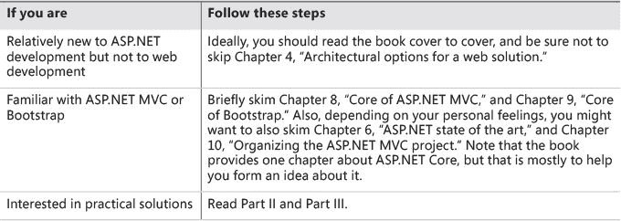

本书的大多数章节都包含了实操示例，你可以使用它们来尝试刚刚学的概念。无论你选择关注哪些章节，请务必在你的系统上下载并安装示例应用程序。

### 系统要求

要打开并运行提供的示例，你只需要一个可运行的 Microsoft Visual Studio 版本。

### 下载

所有示例项目都可以从以下页面下载：

[`aka.ms/ModernWebDev/downloads`](http://aka.ms/ModernWebDev/downloads)

### 致谢

许多优秀的人才促成了这本书的诞生：Devon Musgrave、Roger LeBlanc、Steve Sagman 和 Marc Young。这是一个经过实战的团队，他们高效流畅地工作，将草稿转化为可读的、并希望读起来令人愉悦的文本。

当我们开始这个书籍项目时，我们预计会涵盖一个名为 ASP.NET vNext 的新产品，但那个现在被称为 ASP.NET Core 的新产品仍然几乎不可见。鉴于此，我们在过程中调整了目标，Devon 足够聪明且灵活，接受了我对原计划的建议。

尽管你会在书中找到一些关于 ASP.NET Core 的信息，但一本新的 ASP.NET Core 教程正在出版途中。理想情况下，它将来自同一个团队！

### 错误列表、更新与书籍支持

我们尽了一努力确保本书及其配套内容的准确性。你可以通过以下地址访问本书的更新——形式为提交的错误列表及其相关修正：

[`aka.ms/ModernWebDev`](http://aka.ms/ModernWebDev)

如果你发现了未列出的错误，请在同一页面向我们提交。

如果你需要额外的支持，请将电子邮件发送至 Microsoft Press 书籍支持邮箱：mspinput@microsoft.com。

请注意，微软软件和硬件的产品支持不再通过之前的地址提供。如需微软软件或硬件的帮助，请访问 [`support.microsoft.com`](http://support.microsoft.com)。

### Microsoft Press 的免费电子书

从技术概述到特殊主题的深度信息，Microsoft Press 的免费电子书涵盖了广泛的话题。这些电子书提供 PDF、EPUB 和 Kindle 的 Mobi 格式，供你在此处下载：

[`aka.ms/mspressfree`](http://aka.ms/mspressfree)

经常回来查看新动态！

### 我们想听听你的声音

在 Microsoft Press，你的满意是我们的首要任务，你的反馈是我们最宝贵的资产。请在此处告诉我们你对这本书的看法：

[`aka.ms/tellpress`](http://aka.ms/tellpress)

我们知道你很忙，所以我们保持简短，只有几个问题。你的答案将直接发送给 Microsoft Press 的编辑。（不会要求个人信息。）提前感谢你的参与！

### 保持联系

让我们继续交流！我们在 Twitter 上关注：[`twitter.com/MicrosoftPress`](http://twitter.com/MicrosoftPress)

# 第一部分：理解领域

- **第 1 章** 进行彻底的领域分析
- **第 2 章** 选择支持架构
- **第 3 章** UX 驱动设计
- **第 4 章** Web 解决方案的架构选择
- **第 5 章** 分层架构

## 第 1 章 进行彻底的领域分析

*开发者必须深浸于领域之中，以建立对业务的认知。*

*——Eric Evans*

越来越多的开发者和经理似乎认同今天编写软件是困难的，而且每天变得越来越困难。我自己可以看到软件项目有时会失败、超出分配预算，或者在情况并不太糟的情况下，推迟了几个周才进入生产阶段。我想知道为什么开发项目经常这样令人失望，并环顾四周。我看到了一些可能的答案，但我仍然没有确定的结论可以充满信心地分享。


当我发现很难理解事物的运作机制时，我会尝试回顾我所经历的步骤，这些步骤是如何合理地导致现状的。在我生活的某个时刻，我还是一个学习驾驶和停车的青少年。有一天，我父亲挑战我把车从他停的狭小空间里开出来。

“这不可能，”在尝试了 20 分钟徒劳后我说。

“你错了，”他说，并耐心地解释了他停车时所做的动作。这个信息很明确：既然有办法把车停进去，就有办法把它开出来。

所以，本章尝试回答的问题是：我们应该做什么才能将编写应用程序的过程变成一个可靠的成功流程？我相信我们必须改变目前对软件的看法，并改变我们采取的设计方法。

## 领域驱动设计的救场

在当今世界，软件只有在满足真实需求并帮助简化业务流程时才会产生价值。软件并不一定是为了设计新的业务流程——对此有专门的方法，即业务流程管理（BPM）。相反，软件是关于忠实地建模现实世界的。这些片段被有效地被称为业务领域。

### 介绍领域驱动的设计

尽管听起来很简单，但如果我们几十年来编写的那些以数据库为中心的客户端/服务器应用程序仍然是反映现实世界的最佳方式，那么可能没人会花费多年去思考和讨论领域驱动设计（DDD）了。

DDD（领域驱动设计）是 Eric Evans 在十多年前引入的一种软件设计和开发方法，其明确意目的是寻找一种更有效的方法来应对软件开发固有的复杂性。DDD 的主要优势在于它提供了一种系统化的方法，用于定位并“攻克”业务领域的各个方面。DDD 之具有革命性，因为它并不依赖于日益强大的技术或服务通过软件来实现业务目标。DDD 关乎理解业务领域的核心，以便你作为软件架构师，能够找到构建应用程序的最优工具。而这些具体的工具，也可能是某个数据库的最新版本，也可能不是某个云平台上最新添加的服务。

归根结底，DDD 正如其名：由对业务领域进行彻底分析后驱动的设计。为了让你能够对业务领域进行这种彻底的分析，DDD 提供了三种分析模式：

 通用语言 (Ubiquitous language)

 边界上下文 (Bounded context)

 上文映射 (Context mapping)

我将在在本章的剩余部分介绍所有这些模式。然而，此时我无法忽略关于 DDD 存在的一些误解。因此，在深入探讨 DDD 到底是什么之前，让我先介绍一下 DDD 不是什么。

## 消除关于 DDD 的常见误解

在 Eric Evans 的原书中（*Domain-Driven Design: Tackling Complexity in the Heart of Software*, Addison-Wesley, 2003）中，DDD 被呈现为一套全面的最佳实践和原则，用于更有效地设计和开发软件项目，特别是复杂业务领域中的大型项目。DDD 并不推行新的且革命性的实践，它只是对现有的、巩固的实践进行组织和系统化，将业务领域置于宇宙的中心。

DDD 要求对需求进行分析，然后演化出一个与识别出的业务需求匹配的软件模型。最后，以演化模型的实现结束。在书中，Evans 使用面向对象的范式来说明业务领域软件模型的构建。他将生成的软件模型称为`领域模型` (domain model)。

在几乎同一时间，Martin Fowler（顺便说一下，他是这本书的序言作者）使用了相同的术语——`domain model` 来命名一种组织系统业务逻辑的设计模式。`领域模型`设计模式建立在将业务规则和过程整合到对象体中的想法之上。最终效果是一个相互连接的对象图，它完整地代表了问题的领域。模型中的一切都是对象，并被预期持有数据和暴露行为。

在我看来，DDD 的基础是业务领域软件模型的朴素概念，而 Martin Fowler 定义的 `Domain Model` 模式只是实现这种软件模型的可能方法之一。

从这里开始，产生了一些误解并污染了 DDD 的原始理念。接下来的章节将探讨其中一些。

### 核心就是为领域拥有一个对象模型

现在许多人倾向于将 DDD 简单地认为在业务层中具有某些特殊特征的对象模型，正如 DDD 书中描述的：聚合根、值对象、工厂、行为、私有设置器等。

DDD 包含两个不同的部分：战略设计和战术设计。`战略设计`至关重要，它围绕着分析领域和设计系统顶层架构的模式与实践展开。`战术设计`关于实现战略设计的结果。在这方面，通过对象对领域进行建模只是可能的选项之一。例如，使用函数式方法既不被禁止，也不显突兀。即使你最终编写的是一组函数，或者构建了一个带有存储过程的贫血对象模型来完成繁重工作，你也可以从 DDD 中获益。

### 数据库对模型没有影响

我从未遇到过不需要持久化的应用程序，尽管我遇到过将持久化层隐藏在 HTTP 接口背后的系统。从 DDD 的角度来看，业务层和持久化层是系统的不同部分——相互协作但截然独立。仅此于此。除此之外，DDD 专家和数据库管理员之间并没有宣布战争。

为了设计，如果你目标是构建一个面向对象的软件模型来表示业务领域，那么持久化显然不是你的首要考虑。同时，你设计的对象模型在某处可能需要持久化。涉及到持久化时，数据库以及你访问数据库的 API（例如 `Entity Framework`）是明确的约束，并且不能总是被完全忽略。

如果你打算真正让领域模型完全不受数据库问题的干扰，你应该目标是拥有不同的模型——领域模型和持久化模型——并使用适配器在两者之间切换。

### 通用语言关乎命名规范

在 DDD 中，类、属性和方法的名称被认为是关键因素。所有名称都预期能够反映业务语言以及真实业务流程中的真实步骤。正如你稍后将看到的详细内容，`通用语言` (ubiquitous language) 一词仅指共享的术语词汇，这些词反映在命名类和成员的规范中。

通过使用 DDD 并发现领域的通用语言，你可以理解业务语言，并更详细地了解业务的机制。说通用语言决定了命名规范是正确的，但构建通用词汇的目的是理解业务并用代码镜像业务过程。这比仅仅建立一个有效的命名规范要相关得多。

## 引入通用语言

如果你是一名医生或土木工程师，你每天做的每件事都与你之前在职业生涯中所学习和做的密切相关。相反，如果你是一名律师或软件工程师，情况就不同。

在这两种情况下，你经常被要求在自己知之甚少的领域行使专业知识。作为律师，你可能需要为破产案件的结案陈述学习高级金融；作为软件工程师，你可能需要为了实现在线商店应用程序的业务逻辑而了解国际税法。

这就是通用语言用用之地地。

### 创建领域特定术语的词汇

尽管名称听起来很高级，通用语言（ubiquitous language）其实只是一个特定业务领域专家使用的所有术语的简单词汇表。词表中的每个术语都应该是无歧的，并具有明确定义。术语大部分是名词和动词，词表还包含了名词与动词之间的关联，以便明确哪些动词（即动作）适用于哪些名词（即实体）。在构建词表时，你可能还想查看需求和用户故事中出现的副词短语。副词可能会为你的理解增加额外的细节层次，并指向领域中相关的方面——例如事件、流程以及流程的触发器——这些都是你可能在设计中需要考虑的内容。

词表中的术语应该同时满足领域专家和开发者的预期。当词表中的单词和动词真实反映了业务领域的实际语义时，你就拥有一了完善良好的通用语言。

一旦定义，通用语言将由项目的所有人员共享，无论他们是利益相关者、分析师、开发者、项目经理还是测试人员。换句话说，这种语言将成为项目的通用语言（lingua franca），并用于任何形式的口头和书面通信，包括文档、电子邮件、会议和项目工作项。

开发团队通常负责开发和维护词表。事实上，词表是一个活跃的生命体，随着团队对领域的了解不断深入，它会不断进行更新并增加新元素。

## 为词表选择术语

通用语言并不是在实验室里创造的人工语言。相反，它产生于会议和访谈中的平实讨论。在大多数安排用于分享项目想法和项目目的的会议上，你通常会发现两类人：领域专家和软件专家。软件专家倾向于使用诸如“删除订单”等技术概念。领域专家倾向于对同一个概念使用不同的措辞。也许他们可能会将移除订单的操作统称为“取消订单”。

使用通用语言的另一个目的是消除灰色地带。例如，考虑以下表达式，你可能会在用户故事中发现它，或在会议上听到：“应该在用户账户中强调额外成本。”

预期的业务目的对于专家和她的同事来说可能是众为人知的，但对于该专家圈之外的人可能并不显而易见。预期的目的是什么？在这种情况下，它可以是以下任何一种：

 用户登录时显示成本。

 在详情页列出成本。

 在账单中标记额外成本。

构建无歧义术语词表的努力是值得的，因为它有助于澄清许多可能模糊的点。此外，它有助于确保不同的概念和动作以独特的方式命名，同时确保匹配的概念被检测到并以相似的方式命名。

通用语言既不是业务的原始语言，也不是开发语言。两者都是行业术语（jargon）的形式，而且如果从字面上理解，两者都可能缺乏核心概念，产生误解并导致通信瓶颈。因此，通用语言是业务术语和技术术语的结合。它预计主要包含业务术语，但也允许一些技术概念，以便使最终语言能够忠实地表达系统行为。像`caching`（缓存）、`logging`（日志）和`roles`（角色）之类的术语可能并非业务特定，但在构建系统时是必须的，并可能以某种方式出现在通用语言中。

## 分享词表

语言的价值在于被使用而非被保存。正如拥有一个英语字典来翻译和解释单词可能很有帮助一样，项目中的利益相关者可能会发现拥有一个物理词表是很有用的。

因此，通用语言（ubiquitous language）就是一个术语表。但你应该用哪种语言来构建它？应该是英语还是客户的语言？如果客户说的是比如德语，通用语言仍然应该用英语吗？这不是一个次要问题，特别是对于在同一个项目工作的国际化团队而言。通用语言需要用项目的官方自然语言编写——在这个例子中，可以是英语也可以是德语。如果为了开发目的需要翻译，则应该创建一个词对词表。拥有这样的表格绝对有帮助，但你确实面临引入歧义的风险。

## 处理缩写词

在某些业务场景中，特别是在国防行业，缩写非常流行并被广泛使用。然而，缩写很难记忆和理解。通常情况下，缩写不应该是通用语言的一部分。相反，你应该引入保留缩写词原意的新词汇。

如果缩写在当前处理的业务中很常见，那么不使用它们是否违反了通用语言模式？答案是既是又不是。我同意从严格意义上说，不使用缩写确实违反了该模式。然而，通用语言的核心在于让业务语言以及随后的代码更容易于使用和理解。在这种背景下，缩写难以记忆且阻碍了跨团队的通信。

 注意

聘请具有特定业务领域知识的程序员，可以减少你在创建通用语言时可能遇到的问题。然而，这无法消除根源问题，因为你永远找不到第二个完全相同的领域。

## 引入边界上下文（bounded context）

通用语言与领域模型和代码同步，不断变化，以代表不断发展的业务以及架构师对领域日益增长的理解。然而，通用语言不能无限变化以包纳越来越多的新概念和对现有概念的细微变体。如果你坚持这样做，你可能会导致语言出现重复，并创建一个比本应具备的不严谨的语言。

这就是 DDD 引入一个新概念的地方：`bounded context`（边界上下文）。边界上下文是业务领域的一个区域，它为通用语言的任何元素提供了明确且无歧义的含义。

## 发现边界上下文

特别是在大型组织中，你会发现同一个术语对不同的人有不同的含义，或者使用不同的术语指代同一件事。当你发现这种情况发生时，你可能已经越过了子领域（`subdomain`）的无形边界。这可能意味着你认为是单一且不可分割的业务领域，实际上是在多个子领域中表述的。

## 使用子领域和边界上下文

在 DDD 中，问题空间是业务领域。对于该领域，你在解决方案空间中设计一个软件领域模型。然而，原始领域有时太大，无法进行有效处理，因此你随后将其拆分为多个子领域。当这种情况在问题空间中发生时，你在解决方案空间中就拥有了一个边界上下文。（参见图 1-1）。）

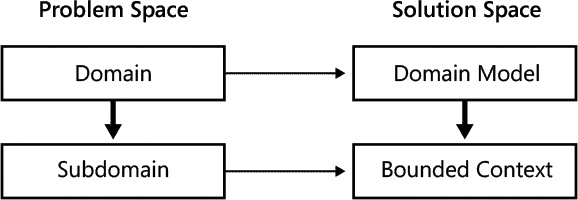

**图 1-1** 问题空间与解决方案空间

### 检查边界上下文的方面

边界上下文是业务子领域在解决方案空间中找到的模型。边界上下文通过其自身的通用语言唯一标识。随后，在边界上下文的边界之外，通用语言发生了变化。只要通用语言相同，上下文就是相同的。

DDD 中的边界上下文有三个主要目的。首先，它们防止产生歧义和概念的重复。其次，边界上下文将领域划分为更小的部分，从而简化了软件模块的设计。最后，边界上下文是集成到系统遗留代码或外部组件的理想工具。

## 检测边界上下文

在 DDD 的愿景中，边界上下文是应用程序的一个区域，拥有自己的通用语言、自己独立的实现（例如领域模型）以及与软件中其他边界上下文通信的接口。在某些情况下，特别是在大型组织中，边界上下文的数量和关系往往反映了物理组织和部门。在其他情况下，边界上下文是在处理需求以及发现原本独特的语言之间的差异过程中逐渐被发现的。

总的来说，在在线商店应用的语境下，以下是成为边界上下文的良好候选者：

 商店

 财务

 交付

 后台

然而，这只是一个指南。实际的划分取决于分析，并取决于具体的语境。通常情况下，我甚至会说任何 Web 应用都应该至少拆分为两个上下文：商店和后台。后台是管理员输入数据和设置规则的部分。

 重要

每个边界上下文都有自己独立的实现。独立实现意味着拥有不同的框架、技术、方法论和架构。换句话说，在一个大型系统的 DDD 语文中，一个边界上下文按照领域模型模式实现，而另一个按照简单的、两层的 CRUD（创建、读取、更新、删除）面向的架构实现，是完全可以接受的。

## 实现边界上下文

在需求分析过程中，你可能会某些概念跨越了业务流程的边界。例如，相同的术语可能被用于表示不同的含义并指代不同的流程。

图 1-2 说明了这种场景。

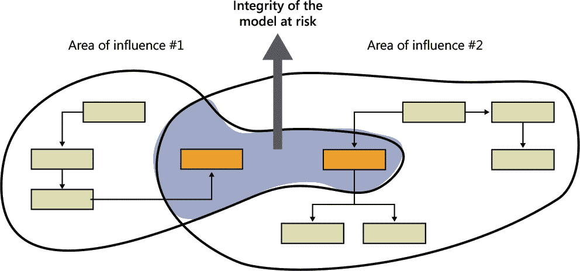

**图 1-2** 重叠的业务上下文

在示例中，整个领域被拆分为两个影响区域，这可能指的是来自不同部门的利益相关者的输入。甚至可能是不同的开发团队正在处理不同的需求集，并且都在尝试定义一段公共领域逻辑。这两个区域有一些共同的概念。对于解决这一点并避免产生脆弱的模型，你有几种选择：全能上下文（all-encompassing context）、共享内核（shared kernel）和不同的边界上下文。

### 使用全能上下文

当业务概念跨越两个或多个影响领域时，频繁需要更改的可能性就会很高。因此，从可维护性的角度来看，将共享概念实现在分离的模块中——某种共享内核（shared kernel）——是一个更好的选择，尽管这并没有解决实体可能承担了过多职责这一核心问题。

## 选择不同的边界上下文

总的来说，每当你识别出在领域中具有不同定义的概念时，最佳选择就是直接采用不同的边界上下文（bounded contexts）。图 1-3 提供了结果架构的图表化证据。

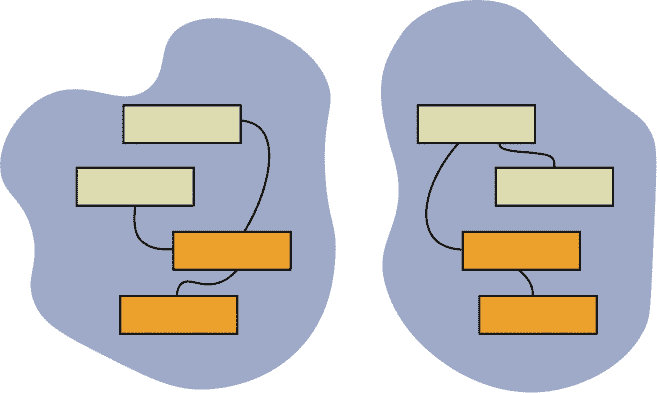

**图 1-3** 处理共享业务概念的不同边界上下文

概念的重叠在业务中很常见，因为你找不到两个完全相同的领域。通常情况下，处理重叠概念最推荐的方法是通过不同的边界上下文。通过这种方法，你保证了每个概念都拥有其可能的最准确的实现，没有任何妥协，没有歧义，且职责恰到好处。

任何其他选择都可能只是通向真正混乱的第一步。

## 为每个上下文提供独立的架构

因为边界上下文是最终系统中一个独特的区域，所以它预计将拥有最合适的架构，无论对其他边界上下文正在做什么。因此，整个软件解决方案由两个或多个上下文组成，每个上下文都使用不同的技术、编程模式和语言实现。

例如，电子商务应用程序的网商店可以是一个 ASP.NET MVC 应用，带有基于命令查询职责分离（`CQRS`）和领域模型模式（Domain Model pattern）的分层后端，以组织业务逻辑。（我将在第 2 章中介绍 `CQRS` 和领域模型模式，“选择支持性架构”。）同时，网站的后台区域可以更有效地编码为简单的双层架构，使用 ASP.NET Web Forms 呈现层和 ADO.NET 数据访问。在单一系统范围内混合多种支持性架构是完全可以的。

## 引入上下文映射

DDD 的作用是识别最终系统的顶层架构。DDD 表达顶层架构的方式是通过通过关系相互连接的多个边界上下文的组合。表示架构的设计产物被称为 `context map`（上下文映射）。换句话说，上下文映射是提供正在设计系统综合视图的图表。

图 1-4 提供了一个示例上下文映射。

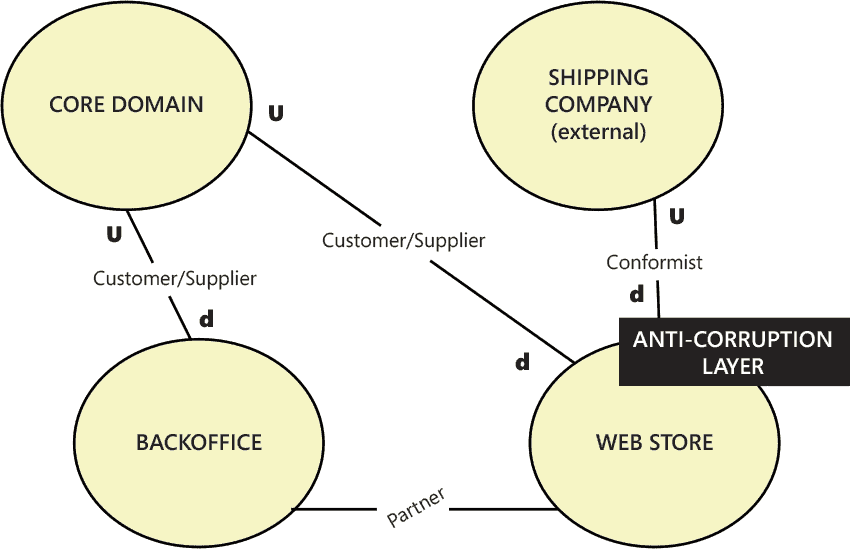

**图 1-4** 显示某些 DDD 关系模式的示例上下文映射

图中有些字母，特别是 `u` 和 `d`，以及一些名称。它们表示了架构师可以在边界上下文之间识别的各种类型的关系。

### 边界上下文之间的关系

两个边界上下文之间的每个 DDD 关系就像连接图中两个节点的弧。更准确地说，该弧具有由字母 `U` 或 `D` 特征的有向边，如图 1-4 所示。`U` 表示上游（upstream）上下文，而 `D` 代表下游（downstream）上下文。

上游上下文影响下游上下文，但反之不然。影响可以以各种形式存在。可以确定，这意味着上游上下文中的代码可以作为下游上下文的引用。但同时也意味着上游上下文的工作计划不能由管理下游上下文的团队根据需要更改。此外，上游团队对变更请求的响应可能并不像下游团队所希望的那样及时。

给定上游和下游上下文，你可以识别出几种特定的关系：

 顺从关系（conformist relationship）

 客户/供应商关系（customer/supplier relationship）

 合作伙伴关系（partner relationship）

## 顺从关系与防腐层


`顺从关系`（conformist relationship）表示下游上下文完全依赖上游上下文，双方之间无法进行谈判。这种安排通常发生在上游上下文基于某些遗留代码或是外部服务时。当同一个团队负责所有的边界上下文，或者团队之间保持联系时，顺从关系可能只出现在真正关键的代码段。

与顺从关系密切相关的是`防腐层`（anticorruption layer）。防腐层是额外的代码层，它为下游上下文提供一个固定的接口来处理，无论上游上下文发生了什么。

拥有防腐层就像拥有一个外模式，在不同但有接口的数据模型之间提供自动翻译。当你拥有顺从关系时，防腐层有助于进一步隔离那些可能受更改的代码区域。

## 客户/供应商关系

`客户/供应商关系`（customer/supplier relationship）与顺从关系类似。两个相互接口的上下文中的上游上下文被识别为供应商，而下游上下文是客户。这与你在顺从关系中拥的关系相同。

然而，在这种情况下，管理两个上下文的团队之间可以进行谈判。例如，客户团队可以分享担忧并预期供应商团队以某种方式解决这些问题。

## 合作伙伴关系

`合作伙伴关系`（partner relationship）指的是两个相关边界上下文之间的一种相互依赖形式。换句话说，两个上下文在代码实际交付方面相互依赖。这意味着任何团队都不可以在不咨询另一个团队的情况下更改上下文的公共接口。

当一个边界上下文被多个上下文和多个团队共享时，就建立了一种更严格的伙伴关系。这种情况被称为拥有共享内核（shared kernel）。

## 引入事件风暴

事件风暴（event storming）是一种用于有效探索业务领域以理解其工作原理并识别关键事件、命令和边界上下文的新兴实践。该技术最初由 Alberto Brandolini 开发，由由让开发人员和领域专家聚集在一个房间里提问并寻找答案组成。

经典的`披萨规则`（two-pizza rule）确定了邀请人员的合适数量。披萨规则说，你永远不要举办一个超过你两个披萨就能供应的人数的会议。

### 拥有无限建模空间

事件风暴会议应该在一个具有足够建模空间的地方进行，以便显示事件和命令的时间线、绘制草图并记录笔记。如果是会议室，你应该计划准备一个大白板或至少一卷很长的纸卷。即使是一面空墙也可以。

事件风暴的一个特点是使用彩色胶带和便利签来添加业务事实、实体、值、规则以及任何其他需要的。当识别出事件时，会将特定颜色的便利签贴在建模表面上。每当你识别出其他领域特定信息（例如，聚合命令和事件的关键实体）时，你也会这样做。

### 在领域中发现事件

事件风暴（event storming）的主要目标是识别相关的领域事件。一旦发现了一个业务事件，就在墙上贴上一张便利签。例如，在电子商务场景中，你会在墙上贴一张便利签，比如代表`Order-Created`（订单创建）事件。

下一步是找出每个被发现事件的触发原因。例如，一个领域事件可能由某些用户请求的命令引起。因此，`Order-Created`事件可能由`checkout`命令引起。在其他情况下，该事件可能由某些异步发生引起，包括超时或绝对时间。在这两种情况下，你都会在墙上添加一张指示原因的便利签。该事件也可以是之前引发的事件的后续者。在这种情况下，你还会在源源事件附近添加另一个事件便签签。

最后，建模表面充当时间线的作用，需要大量的空间来容纳已识别事件、触发事件的命令、随后的事件、用户界面草图、注释等的便利签。

### 引导讨论

需要一个`leader`（领导者）来引导讨论并刺激业务建模的活动。领导者仅负责管理会议、停止过长的讨论并确保焦点不偏离。领导者还将引导会议通过各个阶段。领导者可能是领域专家，也可能不是软件专家。她的目标是帮助他人理解并形式化领域的本质。在此过程中，领导者确保新兴的模型对所有人来说都是合适且准确的。

事件风暴代表了一种快速简单获取业务领域全面视角的方法。事件风暴的有价值输出是边界上下文（bounded contexts）列表以及每个上下文中的聚合（aggregates）列表。观察最终的便利签时间线，聚合本质上是处理相关命令和事件并控制其持久化的软件组件。

## 总结

尽管听起来可能令人震惊，但世界正在用代码重构。引用古代天文学家伽利略的话：“软件是世界的字母。”从这一陈述中可以得出，对于现代应用程序而言，编写镜像真实业务过程的代码比以往任何时候都重要。这种方法比设计一个精确的数据模型和代码组件来表达业务逻辑，最后为流程定义工作流要好得多。

相比于`modeling`（建模），选择`mirroring`（镜像）意味着你相信关注过程是编写有效软件的更直接的方法。它是有效的，因为它创建了一个更接近真实业务的模型，并且因为它简单且直击重点，所以更容易管理。

DDD 在十年前引入，旨在解决软件核心的复杂性。尽管 DDD 的原则是正确的，但 DDD 在实践中的运作从未像在理论中那样成功。我相信这很大程度上是因为我们忽略了 DDD 有两个部分：战略设计和战术设计。在这两者中，战略设计是最关键的，但我们有太多的人过度关注 DDD 的战术部分。

本章探讨了 DDD 战略设计，并以一种独立技术和框架的方式进行。DDD 的战略部分通过使用一些分析模式和通用实践来发现系统的顶层架构。在下一章中，我将研究更具体的支持架构，为已识别的架构块赋予形式和实质。

# 第 2 章 选择支持架构

*你的模型是从一个名为“宇宙”的根对象开始的吗？*

*—Greg Young*

在第 1 章，“进行彻底的领域分析](#part0007.html_ch01)”中，我关注了领域驱动设计（DDD）提供的探索业务领域的技巧以及它产生的输出。你已经看到，DDD 分析的理想输出是上下文映射（context map），地图上的节点代表领域的边界上下文。你可以认为上下文是以某种方式连接的，无论是通过主/从关系，还是作为一起交付并对解决方案有同等责任的伙伴。

DDD 分析产生的上下文映射不像一组服务及其连接的详细草图。DDD 上下文映射比这更通用。你完全可以取每个识别出的边界上下文，并将其实现为微服务、Web 服务、面向服务的架构（SOA）服务，或你能想到的任何其他形式。然后你可以为它们设置一些协议（例如`HTTP`）来通信。但通常情况下，边界上下文识别了领域的一个分段及其与其他分段的关系。

面临的下一个问题是为每个分段提供一个软件模型。独立的独立服务是一个选项，但边界上下文也可以作为独立实体良好地存在于同一个软件系统中。

这里的问题稍有不同：你应该通过哪种方式来识别边界上下文的软件模型？

## 关键在于业务逻辑

尽管这听起来显而易见，但客户要求架构师设计软件的主要原因是业务。业务逻辑是业务中总结最终产品所暴露的规则和功能的部分。业务逻辑可以合理地分为两部分：应用逻辑和领域逻辑。

## 检查应用逻辑

应用逻辑是业务逻辑中关注应用程序视觉端点背后工作流实现的部分。用户从表示层调用的任何内容都会触发某种工作流，而应用逻辑是编排步骤的地方。

例如，考虑电子商务应用程序的经典场景，用户提交订单。接下来通常会发生什么？在许多试图解释 Microsoft ASP.NET 的教程中，事情保持非常简单，向某些数据库表添加一条新的`Order`记录。然而，在现实世界中，你通常会经过更多步骤，例如验证、记账和交付。工作流更加复杂，而这恰恰产生了可能的灰色区域。

### 处理应用逻辑的灰色区域

软件系统中一个有时令人困惑的共同方面是为表示层准备数据的逻辑属于哪里。这是一个灰色区域，在大多数现实系统中，用于读取和保存数据的模型与用于处理和显示数据的模型不同。这些逻辑属于哪里？是在业务层还是表示层？

应用逻辑层（或`application layer`）位于表示层和系统其余部分之间，调介通往后端的数据流。根据设计，应用逻辑负责从表示层获取数据并作为输入发送到后端，接收数据并进行加工以满足用户界面的需求。（参见图 2-1。））

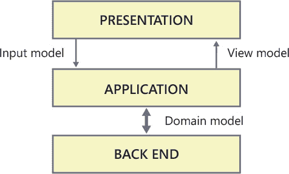

**图 2-1** 从表示层到系统后端的数据流

图展示了一个多层架构，其中表示层使用输入数据模型的类将数据发送到应用层。同时，表示层通过视图数据模型的类接收用于显示的数据。最后，应用层与后端之间的数据交换基于另一个数据模型的类：领域模型。

将业务逻辑分为两个部分（最顶部的是应用逻辑），有助于保持尽可能整洁清晰，并清楚看出谁在做什么以及如何做。

## 探索应用逻辑的模式

应用逻辑由一组由公共端点（endpoints）触发的工作流组成。可以通过 HTTP 或进程内（in process）访问端点，具体实现取决于所采用的技术栈。

## 你将如何编写工作流？

本质上你有两种可以使用的模式。一种是经典方法，即在一个处处编码宏操作的所有逻辑——根据需要硬编码条件和循环。你可以通过纯`C#`代码来实现这一点，也可以使用商用工作流框架支持的脚本。在最终效果方面，这两者的差异并不大，但在灵活性以及修改和扩展现有内容方面，差异是显著的。

另一种方法是使用基于消息的工作流组织方式。在这方面，你的代码中没有条件和循环，而是将每个动作作为命令推送到一个中心化的中间器（mediator）。例如，中间器可以以总线或队列的形式存在。消息的流动和处理程序的顺序可以保证工作流的正确执行，并为这部分业务逻辑的代码提供一个更易于处理且解耦的环境。

## 检查领域逻辑

领域逻辑是业务逻辑的一部分，负责处理业务规则以及领域的相关方面，这些方面与非非业务相关的其他关注点无关。也可以说，领域逻辑是业务逻辑中不同用例之间保持不变的部分。

## 决定什么是领域，什么不是

图 2-2 试图说明领域逻辑与应用逻辑之间的差异。

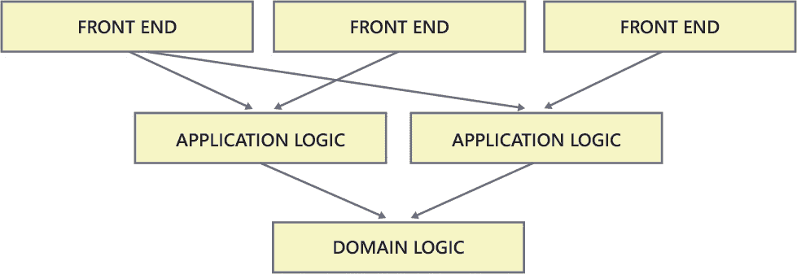

**图 2-2** 领域逻辑与应用逻辑的一览对比

给定一个业务领域，应用逻辑是解决该领域问题或服务于该领域需求的每个应用程序的用例实现。如果你有多个前端（例如一个 Web 前端和一个移动前端），你可能需要多个应用逻辑部分——通常，每个前端的用例对应一个部分。然而，就业务规则而言，所有的应用逻辑层都将始终引用相同的领域逻辑实现。

例如，在银行场景中，多个前端（如柜业务员应用程序和网上银行）可能有它们自己的用例，并可能需要它们自己的应用逻辑层。然而，就核心业务实体（如账户和电汇）而言，两者都将始终引用相同的领域逻辑 API。

## 处理持久化关注点

领域逻辑专门关注用户和利益相关者通过访谈描述的业务各个方面。它对持久化等关注点是无关的，对于对 Web 服务等外部服务的依赖也是无关的。

例如，领域逻辑可能需要知道给定货币的当前汇率，但从外部服务获取该值是一项不属于领域逻辑的任务。这是因为领域逻辑关注的是如何使用货币信息，而不是如何获取这些信息。

表示业务领域中实体的数据类型可能在某点需要将它们的内容持久化。这并不是领域逻辑的关注点。同样，领域对象的实例实例化也不是领域逻辑的关注点。所有这些都属于外层。

## 探索业务逻辑的模式

组织分层系统业务逻辑有几种模式。它们分别是事务脚本（Transaction Script）、表模块（Table Module）和领域模型（Domain Model）模式。

### 事务脚本模式

事务脚本模式可能是用于业务逻辑逻辑的最简单模式，它完全是过程化的。名称中的“脚本（Script）”一词表示你打算在逻辑上将每个用户动作与一系列系统携带的动作（即脚本）相关联。另一方面，“事务（Transaction）”一词与数据库事务没有太大关系。相反，它更通泛地表示你在同一个调用边界内从头到尾执行的业务事务。

不可避免的是，该模式具有某些代码重复的潜力。然而，通过编码纪律，识别出常见的子任务并通过可重例程来实现它们，可以很容易地缓解这一问题。

在架构设计方面，事务脚本模式会导致一种设计：即表示层中可操作的用户界面元素调用应用层的端点，而这些端点为每个任务触发一个事务。

### 表模块模式

正如其名，`Table Module pattern`预示了一种更以数据库为中心的业务逻辑组织方式。核心思想是，系统的逻辑与用于持久化的模型密切相关。因此，表模块模式建议你为每个主数据库表拥有一个业务组件。此类组件暴露出端点，应用层可以通过这些端点对给定表执行命令和查询。

在架构设计方面，表模块模式会导致一种设计：表示层调用应用层。然后，工作流的每一步对应的应用层都会识别涉及的表，找到合适的表-模块组件，并与其协作工作。

### 领域模型模式

领域模型模式建议，在你关心持久化很久之前，就应该关注系统的预期行为以及使其运行的数据流。在实现该模式时，你本质上是在构建一个对象模型。然而，领域模型模式并没有简单地让你只编写一堆`C#`或`Java`类。领域模型模式的重点在于获得一个完全代表某些业务领域的行为和过程的对象模型。

在实现该模式时，你拥有表示领域实体的类。这些类的公共接口引用实际预期的行为。随后，业务规则被整合到类体中，接口反映了即时数据类型和操作。

领域模型中的类应该对持久化是无关的。为了将内容持久化，你将领域模型与额外的服务类配对，这些类包含了将领域类实例化到从持久化层的逻辑。领域模型模式的图形体系图有两个元素：聚合对象模型，以及用于执行跨多个对象或直接处理持久化的特定工作流的领域服务。（参见图 2-3。）

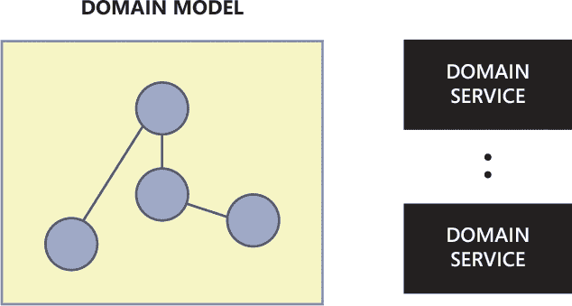

**图 2-3** 领域模型模式的图形体系图

* * *

 注意

“领域模型”一词也经常用于 DDD。然而，在 DDD 中，“领域模型”是一个泛指的术语，指的是为领域拥有软件模型。

## 使用单一模型

DDD 战略分析的结果是获得了为给定业务领域构建软件模型的信息。你用于构建此类领域驱动软件模型的设计方法被称为*支撑架构（supporting architecture）*。

支持架构的第一个示例十年前出现在 Eric Evans 的开基性著作《领域驱动设计：解决软件核心复杂性》（*Domain-Driven Design: Tackling Complexity in the Heart of Software*, Addison-Wesley, 2003）中。那种支持架构是一个单一的面向对象的模型，旨在涵盖领域的所有方面和用途。这种单一的、全方位的模型被称为`domain model`（领域模型），它与刚才提到的用于组织业务逻辑的“领域模型模式”是一致的。

其他支持架构在之后出现，试图解决人们在尝试将 DDD 应用到日益广泛的问题和业务领域时所遇到的问题。在本章中，我介绍命令查询职责分离（CQRS）和事件溯源（ES）——它们都是基于消息的业务逻辑组织的基础。

## 探索面向对象的领域模型的元素

面向对象的领域模型是用于业务域的软件模型，它反映了真实业务流程的所有复杂性，包括由人物（personas）、角色执行的任务，以及命名规范。为了有效服务实现这一目标，面向对象的模型需要满足几项严格的要求。

从编译器的角度来看，领域模型仅仅由类组成，而类是属性和方法的集合。从开发者的角度来看，类主要分为两种类型：实体（entities）和值类型（value types）。这两类协同工作以表达业务逻辑，持久化并不是它们关注点之一。

 注意

特别是在 DDD 引入以及领域模型概念开始生根时，将该模型构建为关联对象的集合听起来是完美的。然而，最近软件行业正在重新发现函数式编程方法。现代函数式语言越来越流行（例如 F#），函数式特征正逐步添加到现有语言中，包括`C#`和 Java。在这种背景下，使用函数式方法构建领域模型仍然不是主流方法，但它无疑是一种正在被评估和测试的可行方法。

### Entities

`entity`是一个代表业务领域自然元素的类——任何诸如发票、交易、汇款或体育比赛。该类具有公共和内部属性，可能还有几个方法。属性是存储和暴露实体当前状态的一种。方法是用于修改状态的可用工具。

在实体的属性中，有一种东西赋予了数据集合独特的属性——身份（identity）。身份是唯一描述实体所封装信息的多个值的组合。总的来说，这与你在关系型数据库中可能熟悉的主键概念相同。

例如，你将如何考虑在同一天发生且涉及相同金额和银行账户的资金转账？它们是仅仅重复相同的操作吗？还是说这些交易是独立发生的不同操作？可能是后者，但具体取决于严格取决于领域。

实体通常由数据和行为组成。不过涉及到行为时，我应该说明`behavior`指的是领域逻辑和业务规则。

 重要

我无论如何强调都不够：持久化不是实体的关注点。如果一个实体有方法，这些方法永远不会是像`Load`或`Save`那样的，它们永远不会被用于 CRUD 操作。在 DDD 的愿景中，所有的持久化关注点都被委托给了领域服务（domain services），特别是存储库（repositories）。我将在本章稍后部分讨论存储库，并在 第 13 章 中的“持久化与建模”中进行讨论。

### Value types

在 DDD 中，`value type`（值类型）是一种类型，其实例完全由存储在公共属性中的值定义。然而，请注意，值类型的属性在实例创建后永远不会改变。如果它们确实发生了变化，该值对象就变成了另一个值对象的实例，并由新的属性集合完全标识。

DDD 值对象也被称为`immutable types`（不可变类型）。`Int32`和`String`类型是 Microsoft .NET Framework 中流行的不可变类型。以下是一个典型值类型的示例实现：

```
点击此处查看代码图像
```


```java
public class Score
{
    public Score(int goal1, int goal2)
    {
        Goal1 = goal1;
        Goal2 = goal2;
    }
    public int Goal1 { get; private set; }
    public int Goal2 { get; private set; }
    public override bool Equals(object obj)
    {
        if (this == obj)
            return true;
        if (obj == null || GetType() != obj.GetType())
            return false;
        var other = (Score) obj;
        return Goal1 == other.Goal1 && Goal2 == other.Goal2;
    }
    // 在 .NET 中，你还需要重写 GetHashCode
}
```

行为与行为无关；值对象可能仍有方法，但那些本质上是辅助方法。与实体不同，值对象不需要身份，因为它们没有状态。在领域模型的上下文中，值类型的角色比许多人认为的要重要得多。值类型关于使用更准确的工具来模拟现实世界。通常，原始类型往往是它们试图描述的现实世界方面的近似。需要一些逻辑来验证它们的使用。为此目的拥有值类型符合 DDD 原则。

## 将业务规则放在内部

你放在实体中的行为本质上是业务规则。当你使用其他模式来组织业务逻辑时，你将业务规则放在作为无状态计算器的独立组件中。在领域模型中，业务规则位于实体的褶皱中。

例如，让我们考虑一场体育比赛。你将如何设计一个供裁判或助理用于跟踪比赛相关事实（得分、犯规、暂停、开始、结束）的软件模型？你将如何定义`Match`类的行为？

### 使用贫血实体类（anemic entity class）

以下类似乎是一个好的开始。显然，它是完美的，因为它让你能够存储和管理通常想与体育比赛关联的内容：

点击此处查看代码图像

```java
public class Match
{
    public int MatchId { get; set; }
    public Score Score { get; set; }
    public int Period { get; set; }
    public string Team1 { get; set; }
    public string Team2 { get; set; }
    public MatchState MatchState { get; set; }
    ...
}
```

该类包含了有效表达比赛状态和演变的所有部分。你可以获取并更改比赛的得分、球队或球员、比赛状态（计划中、进行中、已结束），甚至是当前节等细节。通过进一步的完善，这个类可以成为很棒的代码，特别是当你添加了工厂以及一些读取状态的查询方法后，如`IsInProgress`、`IsTeamLeading`等。

该实体具有某些关联行为。例如，比赛的开始、结束以及某支球队的进球记录。你应该在何处编写此类行为？你可以向`class`中添加方法，也可以保持类不变，并创建一个独立的引擎，在需要操作时一致地修改`class`的状态。从功能角度上来说，这两种方案都是好的，但如果你想采用`Domain Model`（领域模型）模式，则只有前者是有效的。

### 使用私有设置器（private setters）

如果你向实体类添加了方法，你必须先更改公共属性的修饰符。所有的 setter 都应该改为私有，因为你希望确保任何状态更改只通过业务规则引擎发生，而该引擎的作用就是确保一致性。

例如，考虑`MatchState`属性。它在定义时带有一个公共 setter，这使得任何获取`Match`类实例的代码都能任意更改比赛状态。当你在定义一个领域模型时，你实际上是为业务逻辑创建了一个公共 API，并且应该确保防止该 API 被误用。私有 setter 可以防止任意更改，并应该提供额外的方法来允许开发者更改比赛状态。

在这方面，使用`SetMatchState`方法是否合适？

### 使用富行为实体类

从纯粹的功能角度来看，`SetMatchState`方法是合适的。然而，它忽略了操作在业务层面的视角。为什么要更改比赛状态？在业务层面发生了什么导致需要这样做？例如，比赛可能已经开始。如果是这样，`Start`方法更为合适，原因如下：

*   它为你提供了一个富行为的设计。

*   它符合业务规范。

*   它反映了通用语言（ubiquitous language）。

*   它实际上是一致地改变了实体的状态。

这里是重写`Match`类的一种方式：

点击此处查看图片

```java
public class Match
{
   public Match( ... ) { ... }

   public Score Score  { get; internal set; }

   public int Period { get; internal set; }

   ...

   public Match Start() { ... }

   public Match Finish() { ... }

   public Match NewPeriod() { ... }

   public Match Goal( ... ) { ... }
}
```

现在，该类暴露了一个构造函数，通过它你可以初始将类置于有效状态。此外还有只读属性用于快速查看状态：

点击此处查看图片

```java
public Match Start()
{
   if (MatchState != MatchState.Scheduled)
      throw new ArgumentException("Cannot start a match that is not currently scheduled");

   MatchState = MatchState.InProgress;

   return this;
}
```

如你所见，方法的实现可能并不复杂。更重要的是，方法是面向业务的，这使得开发者实现用例变得非常容易。

### 发现聚合（aggregates）

当你继续识别需求并将其转换为正式的软件模型时，你经常会发现几个被频繁使用和引用的单个实体。你可以将它们视为一个富内容的文档中的引用，该文档包含图像、表格和图表。再次观察时，你可能会识别出几个始终共同工作的相关对象集合。在领域模型的术语中，这被称为`aggregate`（聚合）。

### 构建聚合模型

你可以通过两种方式构建聚合，这完全取决于你采取的分析方法。你可以先孤立实体，然后观察它们如何协作，并以这种方式识别聚合。然而，更常见的做法是先将领域模型分解为聚合，然后在任何聚合内部识别领域实体。

另一种观察聚合的方法来自关系型数据库设计的基础任务。构建聚合模型的过程与你在关系型数据库中定义表的逻辑过程是相同的。并不是所有表都处于相同的逻辑层级，某些表仅是为了与其他表配合使用而存在。最典型的例子是`Orders`（订单）和`OrderDetails`（订单详情）。

当你有一个聚合时，如何访问这些对象并对它们进行操作？如果所有对象都能以相同的方式被公开访问，那么划分聚合的意义何在？聚合模型与`aggregate root`（聚合根）的概念有关——每个聚合中的主对象。

### 创建聚合根

聚合根是相关实体和值类型构成的集合中的其中一个实体，作为执行相关业务任务的入口。聚合根在整个领域模型中具有全局可见性，并且可以被直接引用。聚合内部的实体仍然拥有自己的身份和生命周期，但不能从聚合外部直接引用它们。

在更抽象的层面上，聚合定义了一个生成和处理一系列操作与事件的上下文。聚合根是为这些操作和事件定义事务边界的实体。它还提供了一个公共接口，以便这些操作能够在完全尊重业务一致性的情况下被调用和执行。

拥有聚合根并不一定需要编写临时代码（ad hoc code）。识别聚合和根主要是你作为设计辅助手段所做的工作。图 2-4

**图 2-4** 聚合根之间的关系

图中的四个框代表聚合，其中三个是折叠的，仅隐藏了内部实体。例如，`Customer`（客户）和`Order`（订单）框可能会相互交互，但仅通过根的公共接口进行。`Order`聚合包含了`OrderItem`（订单项）实体。`Product`聚合无法直接引用`OrderItem`。它只能通过`Order`的根来实现。此外，`OrderItem`仍然持有另一个聚合根的引用。

聚合根类隐藏了相关类并要求调用者通过它们进行任何交互。换句话说，实体只允许引用同一聚合内的实体或另一个聚合的根。同时，子实体（如图 2-4 中的`OrderItem`）可以持有另一个聚合根的引用。

### 为什么要聚合？

聚合根对象承担着重要的责任：

 聚合根保证包含的对象始终符合适用的业务规则。例如，如果业务规则规定发货后不能更新订单详情，那么根必须阻止这种更新的发生。

 聚合根负责所有封装对象的持久化，包括级联更新和删除。

 任何查询操作只能检索聚合根。对内部对象的访问必须通过聚合根的接口进行。

使用聚合对代码是有利的，因为它暴露了开发者需要处理的少量粗粒度对象。而且这些对象每一个在设计上都是保证一致的。

### 探索领域服务的作用

在业务规则整合到聚合并通过通过公共接口暴露的情况下，整套需求往往划分在识别出的实体和聚合之间。大多数情况下，生成的划分覆盖了 100% 的需求。如果不是这样呢？如果为了评估业务规则，你必须通过持久化数据和持久化层呢？这就是领域服务发挥用场的地方。

根据领域模型的支撑架构，在某个时刻，解决方案会拥有一个`domain layer`（领域层），它位于表现层和基础设施层之间。领域层负责业务逻辑中不随用例和表现层前端而变化的部分。（参见本章前文的图 2-2。）

领域层由两部分组成：领域模型和一组领域服务。`Domain services`（领域服务）是类，负责处理任何不适合领域模型的任务。这些任务包括处理外部系统、遗留代码、数据库以及跨实体业务逻辑的实现。`Domain services`是领域层的一部分，但与领域模型类有所不同。然而，它们会使用并操作领域模型类。它们还可能需要对领域模型类具有`privileged`（特权）访问权限——例如，在公共行为方法之外设置属性。这种行为对于程序集来说是`internal`（内部）的，例如在 .NET 中，它是通过内部（而非私有的或受保护的）属性设置器来实现的。

### 实现跨实体业务逻辑

观察领域服务适用位置的一个佳例是：判断一个特定客户是否达到了`gold customer`（黄金客户）状态。根据需求中对达到状态的定义，该操作可能涉及多个聚合根和数据库访问。例如，假设领域规定，客户在选定产品范围内的订单超过给定阈值后即可获得该状态。

你无法合理地在`Customer`聚合根上拥有一个计算状态的`IsGold`方法。计算状态需要访问数据库，而这并不是聚合根的职责范围。领域服务是完美的选择。事实上，服务能够为某个客户查询订单和产品，并将结果作为`Boolean`存储在新创建的`Customer`聚合根实例中。

在这种情况下，需要向用户界面报告客户金牌状态信息的应用层方法会调用领域服务，并返回一个正确填充了最新数据的实例。`Customer`类的构造函数在内部被调用，`IsGold`属性通过内部设置器进行设置。

作为开发者，我们倾向于将领域服务视为那些无法放入聚合根中的行为的备选方案。然而，有时实体和领域服务之间的边界是微妙的。经验法则是：当无法明显看出哪一个是恰合适的选择时，两种方案都可以使其正常工作。

### 使用存储库

`Repositories`（存储库）是最流行且最常用的领域服务类型。`Repositories`关注聚合根的持久化。当你需要从数据库中实例化一个聚合根或将其保存回数据库时，就会使用存储库。建议每个聚合根拥有一个存储库——`CustomerRepository`、`OrderRepository`等。如前所述，每个聚合根一个存储库足以表明你对一致性和功能性的关注——聚合根负责子对象的持久化和级联操作。

编写存储库有许多方法，可能没有哪一种是明显错误的。尽管如此，存储库通常基于一个通用接口，如`IRepository<T>`：

点击此处查看代码图片

```java
public interface IRepository<T> where T:IAggregateRoot
{
    // 你可以保持 IAggregateRoot 接口作为一个简单的标记接口，
    // 也可以在其中包含一些常用方法。
    T Find (object id);
    void Save (T item);
}
```

具体的存储库类可以从该基接口派生：

点击此处查看代码图片

```java
public interface IOrderRepository : IRepository<Order>
{
    // 成员的实际列表由你决定
    ...
}
```

存储库类的成员实际上会执行数据访问——查询、更新或插入。用于数据访问的技术由你决定。在今天，最常见的是你使用对象对象/关系映射（O/RM）框架，如`Entity Framework`，但没有什么阻止你使用`ADO.NET`、纯存储过程，或者为什么不使用 NoSQL 存储呢。

### 与外部服务和遗留代码工作

当业务逻辑依赖于现有的代码片段或可以通过某些协议（TCP、HTTP 等）访问的外部服务时，领域服务类是理想的封装器，也是存储连接细节的好地方。封装并作为领域服务暴露给应用层的外部服务的一个佳例包括：用于天气预报、股票报价、汇率或可能是进行中比赛实时比分的 Web 服务。

遗留代码可以用相同的方式处理，只要有方法能让领域服务成为代码的一种门面（faç）。

* *

### 不仅仅是任何模型——而是适用于上下文的正确模型

开发者有时会过度抽象，并实现`God antipattern`（上帝对象反模式），这可以总结为：他们设计出一个根对象命名为`GalaxyBase`的模型。领域模型的意义在于拥有一个能够很好地代表业务场景的软件模型。说明这一点的佳例是世界地图。

墨尔卡托投影（Mercator projection）是世界地图的图形化表示。它的独特特征使其适用于航海目的，但不适用于诸如`Google Maps`类的应用程序。如果你从墨尔卡托投影的角度看世界布局，你会说阿拉斯加州和巴西一样大。而事实是，巴西的面积是阿拉斯加的五倍。然而，当你在墨尔卡托投影上画出航线时，航线与赤道的夹角在所有子线上都保持不变。这使得从 1500 世纪以来，通过量角器就可以地测量航向和角度。

* *

### 实现命令查询分离

长期以来，DDD 的执行摘要一直是：拥有一个能够描述整个业务领域的对象模型是一个获胜计划。有些 DDD 项目成功了，有些失败了。在很大程度上，是对对象力量的盲目信仰促使许多开发者尝试这种方法。自 20 世纪 90 年代以来，软件世界痴迷于对象的概念。因此，专注于它们听起来是一个很棒的主意——除了它们在现实世界中效果并不理想。拥有一个统一的对象模型以便在无法访问持久化层、外部服务或两者的情况下处理订单是非常不实际的。将业务事务还原为数据库事务（甚至是分布式数据库事务）可能是痛苦的，因为许多业务事务实际上是长运行事务。

它更多关于业务流程和任务，而不是底层的领域模型。

支持领域模型的架构（Domain Model-supporting architecture）建议你将业务逻辑整合到类中，并通过领域服务来定义流程。这是一种组织业务流程的系统方法，但可能不够灵活，无法建模所有的真实业务流程。当流程接近于简单且快速的数据库事务时，它是有效的。一旦超出此范围，单一模型带来的问题往往多于其解决方案。

## 使用命令与查询分离原则（Command and Query Separation）

早在 20 世纪 80 年代，Bertrand Meyer 在阐述 Eiffel 编程语言时制定了命令与查询分离（`CQS`）原则。该原理易于解释和理解，但它对我们规划软件的方式产生了深远影响。

根据`CQS`，软件执行的任何操作都应该编码为：改变系统状态的**命令**（command），读取但不改变系统状态的**查询**（query）。它永远不应该同时兼具两种属性。大家都认同该原则在形式上的纯洁性，但在实践中，它可能显得有些过于限制性——尤其是当你试图在单个类方法的级别上应用它时。

结果，`CQS`原则被幸福地忽略了多年。

在某个时刻，为了将 DDD 应用于特定的业务领域（涉及大量资金的 24/7 关键服务），有人必须刷新`CQS`原则。在架构层面应用时，`CQS`原则展现了它的真正威力，并获得了一个略不同的名称——`CQRS`，即命令与查询职责分离（Command and Query Responsibility Segregation）。

### 在软件架构中使用不同的堆栈

尽管听起来可能很惊讶，但命令和查询是两个完全不同的事物这一基本事实对系统的整体架构具有深远影响。图 2-5 对比了受 DDD 启发的经典层次架构与考虑到`CQRS`重新设计的相同系统。核心区别在于，你只在命令栈（command stack）中使用领域模型。查询栈由纯数据访问代码组成，并使用简单的数据传输对象（`DTO`）将数据带到表示层。

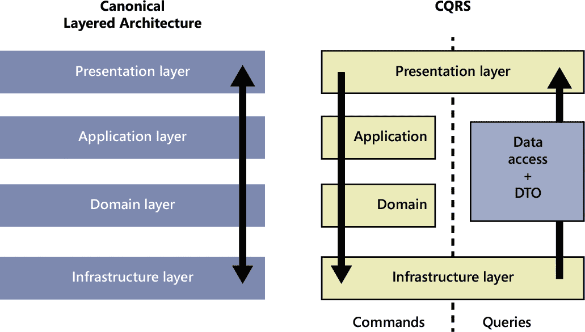

**图 2-5** CQRS 与经典分层架构的对比

应用层负责为从用户界面触发的命令和查询暴露不同的端点。应用层本质上是将请求路由到不同的工作流中。如果是命令，它将通过任何符合需求的业务逻辑实现。在大多数情况下，它只是经典的领域模型模式，将业务逻辑整合在聚合（aggregates）、仓库（repositories）和其他领域服务中以支持业务流程的实现。


拥有不同堆栈的好处在于，你可以使用不同的对象模型来实现命令和查询。这种简单的划分消除了大量的复杂性。你可能有两个相似的对象，但每个对象都会非常简单且直击重点。你通常为命令拥有完整的领域模型，但为表示层量身定制纯数据传输对象。`DTO` 的结构通常直接从 SQL 查询的结果推断出来。此外，当你需要多个表示前端（例如网页、移动端网页和移动应用程序）时，你只需要创建额外的读取模型。复杂度源于各个复杂性的累加，而不是所有复杂性的笛卡尔积。

## 使用不同的数据库

将后端分为不同的堆栈简化了设计和编码，为无与伦比的扩展潜力奠定了基础。然而，这种分离引发了在架构层面应该仔细考虑的新问题。你如何保持两个堆栈的同步，以确保命令写入的任何内容都能一致地读取回来？

取决于你试图解决的业务问题，`CQRS` 实现可以基于一个或两个数据库。如果使用共享数据库，为查询目的获取正确的数据投影只是在读取栈中在纯查询之上执行的额外工作。同时，共享数据库确保了经典的 ACID（原子性、一致性、隔离性、持久性）一致性。

在性能或扩展性等特定问题的情况下，你可以考虑为命令栈和读取栈使用不同的持久化端点。例如，命令栈可能有一个事件存储（event store）、NoSQL 文档存储，或者可能是非持久性存储（如内存缓存）。命令数据与读取数据的同步可以异步进行，甚至可以定期调度，这取决于过期数据对表示层的影响（以及取决于数据过时的程度）。

在不同数据库的情况下，读取数据库通常是一个纯的关系型数据库，仅提供一个（或多个）数据投影。（参见图 2-6。）

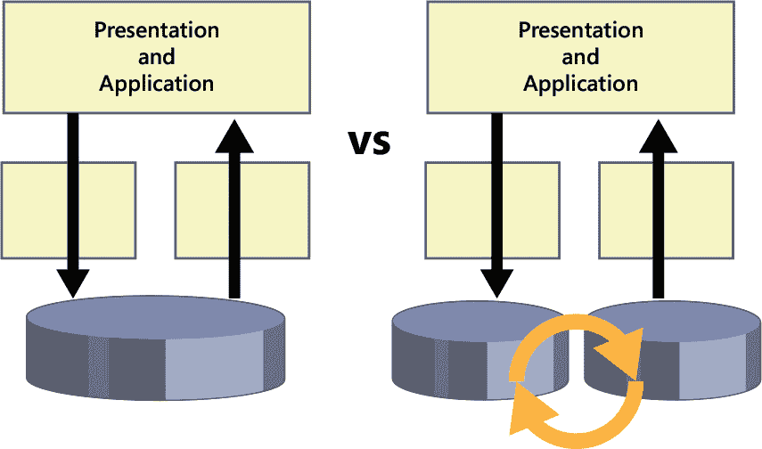

**图 2-6** 使用共享和独立数据库作为命令与查询栈的两种 CQRS 架构对比

## 何时适用 CQRS？

与 DDD 不同，`CQRS` 原则并不是设计企业级系统的全面方法。`CQRS` 仅仅是一个引导你构建可能更大的系统中的特定边界上下文（bounded context）的模式。`CQRS` 是使用领域模型方法的一种有效替代方案。

`CQRS` 架构模式的设计主要是为了解决高并发业务场景下的性能问题，在这些场景下，同步处理命令和执行数据分析变得越来越困难。许多人认为，在此类协作系统之外，`CQRS` 的威力会大大降低。事实上，`CQRS` 的威力在协作系统中更加明显，因为它让你能够以更流畅的方式处理复杂性和竞争资源。我认为这比表面看到的要多得多。

即使在远为简单的场景，`CQRS` 也能充分支付架构成本，因为查询栈和命令栈之间的简单分离导致设计简化，并大幅减少了设计错误的风险。换句话说，`CQRS` 降低了实现复杂系统所需的技能水平。使用 `CQRS` 让几乎任何团队都能实现扩展性和整洁成为负担得起的努力。

## 实现 CQRS

让我们回到之前的 `Match` 类，从 `CQRS` 的视角再次审视它。在一个裁判或其助手可能使用的评分应用程序中，至少有两个通用目标。一个是跟踪分数和比赛的相关事件，如进球、超时或违规。另一个是读取分数并将其显示在场馆比分板上、通过网页实时比分应用，或者可能作为鼓励或停止投注的输入。

在这种背景下，拥有一个 `Match` 类版本是否合适？让我们先从命令栈的角度来看这个问题。

### 探索命令栈

在我们考虑的示例系统中，任何来自表示层的输入都代表了在 `Match` 类上执行的操作。无论是裁判还是助手点击开始或结束比赛、注册进球或叫暂停，并不重要。一个具有只读状态和几个用于更改实体状态的公共方法的 `Match` 类版本非常适合任何这些工作。

领域服务可能会从持久化层具体化并实例化一个类的实例，并根据 ID 进行查询。接下来，根据命令（开始、完成、目标），在实例上调用一个方法，然后将修改后的状态保存回数据存储器。如果某个给定的命令算法被证明不是特别有效，更改它对系统的其他部分没有影响。而且当使用不同的数据存储器时，它甚至不会影响系统其他部分的存储行为。

此外，专注于改变系统状态的实际行为和命令，会使设计变得越发以任务为导向。即使你最终使用领域模型来封装领域逻辑，你的思维方式在本质上也会变得更具功能性，并将更多的注意力放在任务上，而不是抽象模型上。

归根结底，开发者被要求编写软件来解决现实世界特定领域的问题。在大多数情况下，编写软件是为了创建工制品来自动化流程。在大多数情况下，软件的（高）成本源于对现实世界软件被要求自动化的领域产生的误解和错误描述。这就是为什么一种侧重于任务、命令和事件而不是仅仅关注模型（而且往往过于抽象）的方法是受欢迎的。功能性设计以及命令与查询之间的关注点分离是未来软件的两大支柱。即使在今天，你也能看到越来越多这种方法的示例。

***

 重要

尽管 CQRS 非常重要，但它本身并不是什么了不起的东西。它仅仅是承认分离命令与查询之益处的原则。你可以实现这种分离，例如，只需通过在简单的 Entity Framework 解决方案周围使用不同的数据库上下文，而最终系统的愿景保持严格的以数据为中心。

***

### 探索读取栈

在单模型场景中，你现在拥有一个功能丰富的 `Match` 类，它知道如何通过遵循特定应用程序表示层的输入来推进比赛状态。`Match` 类正如我们在本节早些设计的那样（具有 `Start()` 和 `Finish()` 等方法），提供了公共属性来读取当前比分和其他相关信息，例如罚规或请求的超时。

将该类原样传递给某些 O/RM 进行持久化也是一个简单的操作。那么，从持久化层具体化 `Match` 类的实例，并赋予它最后一次良好的状态又是怎样的呢？

这可能不是一项轻松的任务。

正如设计所示，`Match` 类的内部状态只能通过方法进行更改，而方法取决于所执行的业务逻辑和实际行为。将领域模型类初始化为给定状态需要一种折协。特别是某些属性的设置器（setters）应该标记为 `internal` 而不是 `private`，或者应该提供一些内部方法，供同一程序集内的领域服务使用。

尽管假设你绕过了这个问题，但还有另一个问题要面对。表示层代码触发一个查询并返回一个 `Match` 类的实例。它需要的只是读取状态、比赛比分，可能还有参赛队伍的名称。这些信息是可用的，但命令方法也是可用的。类的公共 API 提供的比预期的多，这使得客户端能够可能违反系统一致性的操作。

为了避免这种情况，你可以通过引入权限和条件写入操作让 `Match` 类的源代码变得越来越复杂。然而，当你走上这条斜坡时，很快就会发现它非常滑溜。替代方案是为命令和查询使用不同的类。在专门为查询创建的只读领域模型中，你拥有纯数据传输对象（DTOs），这些对象尽可能地反映了特定表示层所需的投影的本质。

为命令和查询拥有不同的对象模型正是 CQRS 的核心所在。

### 创建示例读取模型

这是一个关于如何实现运行在 Entity Framework 之上并始终返回 `IQueryable` 对象的读取模型的具体示例。以下代码展示了通过 LINQ-to-Entities 的 `DbContext` 类的典型实现，它暴露了数据集合：查看代码

```csharp
public class CommandDatabase : DbContext
{
    public CommandDatabase()
    {
        Products = base.Set();
    }

    public DbSet<Product> Products { get; set; }
}
```

为了将操作减少并构建读取模型，需要一些更改。这里有一个示例：查看代码

```csharp
public class ReadDatabase : DbContext
{
    private DbSet<Product> _products;
    private DbSet<Customer> _customers;
    private DbSet<Order> _orders;

    public ReadDatabase()
    {
        _products = base.Set();
        _customers = base.Set();
        _orders = base.Set();
    }

    public IQueryable<Order> Orders
    {
        return _orders;
    }

    public IQueryable<Customer> Customers
    {
        return _customers;
    }

    public IQueryable<Product> Products
    {
        return _products;
    }
}
```

关键变化是数据集合被暴露作为 `IQueryable` 对象返回。任何接收此类引用的代码只能通过 `IQueryable` 接口进行。特别是，它没有访问保存更改的方法。应用层的代码仅请求使用 `ReadDatabase` 根对象进行查询。相反，从命令栈调用的领域服务将使用 `CommandDatabase` 对象并获得读写底层数据存储的权限。

### 引入基于消息的形式

CQRS 只是迈向适用于任何复杂性的灵活架构的第一步。除了分离命令实现与查询实现的基本事实外，CQRS 将你引向基于消息的任务实现。

#### 临时基础设施

在基于消息的 CQRS 设计中，应用层并不调用任何完整的工作流实现。它只是简单地将来自调用者的任何输入转换为*命令*，并将其推送到一个新的元素——*命令处理器*。

命令处理器在具体实现中可以采用任何形式。一种常见的实现方式是通过 `bus`（总线）。在软件中，`bus` 一术语泛指促进软件模块之间通信的共享通信通道。这里的 `bus` 只是一个共享通道，不需要是商业产品或开源框架。它可以仅仅是你自己的一个 `class`（类）。

### 命令与消息

`command`（命令）是针对系统后端执行的操作。命令的示例可以是注册新用户、处理购物车内容或更新客户个人资料。

命令用一个简单的数据传输对象类（DTO class）表示，该类仅包含在命令实现中使用的输入数据。命令始终指向一个单向任务，该任务从表现层向下到领域层执行，并最终修改某些存储。

命令通过两种方式触发：一种是用户显式地对某些用户界面元素（如按钮）进行操作；另一种是某些自主服务与系统进行异步交互。例如，你可以想象物流公司如何与其合作伙伴进行交互。该公司可能有一个 HTTP 服务，合作伙伴调用该服务来发送请求，这些请求就变成了系统后端的命令。

通常，`command` 是消息的一种特定类型。通常情况下，实现中会让 `Command` 类继承自基础的 `Message` 类：

点击此处查看代码图片

```csharp
public class Message
{
    public DateTime TimeStamp {get; set;}
}

public class Command : Message
{
    // 你希望所有命令共享的某些属性
    ...
}

public class SomeSpecificCommand : Command
{
    // 特定命令的属性
    ...
}
```

应用层从表现层获取输入，准备好命令，并将命令推给处理器。在一些常见的实现中，这一系列事件可能意味着将命令推送到 `bus` 中进行进一步的分发。

### 命令处理器

`command processor`（命令处理器）是一种分发器，它包含一个处理器（handlers）列表——每个受支持的命令都对应一个处理器。处理器只需检查消息的类型并将其交给已注册的处理器。处理器执行其工作，并按照预期的方式改变系统状态。

命令通常指向一个处理器，并可能被系统拒绝，或在由某个处理器执行时失败。通常，命令不会向调用者返回任何响应，除非是某些确认信息。仅靠命令不足以实现业务流程。当一个命令执行时，可能需要通知其他处理器刚刚发生了什么。这产生了对事件（events）的需求。

### 通过消息通知事件

`event`（事件）是对某些事务边界内刚刚发生的事情的通知。尽管与命令不同，事件也可能是对源于它的边界上下文（bounded context）之外发生的事情的通知。以下是一个示例事件：

点击此处查看代码图片

```csharp
public class Event : Message
{
    // 你希望拥有的所有事件的公共属性
    ...
}

public class OrderCreatedEvent : Event
{
    public string OrderId { get; private set; }
    public string TrackingId { get; private set; }
    public string TransactionId { get; private set; }
    public OrderCreatedEvent(string orderId, string trackingId, string transactionId)
    {
        OrderId = orderId;
        TrackingId = trackingId;
        TransactionId = transactionId;
    }
}
```

你可以看到，事件和命令类的结构几乎相同，区别仅在于命名规范——命令是祈使性的，描述一个要执行的操作；而事件指的是刚刚发生的事情。在两种情况下，其名称都应该非常明确地描述消息的意图。

命令和事件交互的典型示例是用户界面触发了订单的结账流程。启动该流程的命令传达了订单中产品、发货地址和客户支付详情的所有细节。结账命令启动了一个工作流，该工作流通过一系列操作和事件来指示给定操作已完成。在最后，当支付完成后，可能会触发 `PaymentCompleted` 事件。该事件的处理器会在数据存储中添加一条 `Order` 记录，并触发 `OrderCreated` 事件，以让可能注册的处理器知道实际的订单 ID 和事务 ID。`OrderCreated` 的处理器可能只是向客户发送一封电子邮件。

### 展示基于消息的架构示例

如所述，实现命令处理器的常用方法是通过 `bus`。在程序启动时，`bus` 会配置一组监听器（listeners）。`listener`（监听器）是一个知道如何处理传入消息的组件。消息处理器有两种类型：`sagas`（长事务组件）和 `handlers`（处理器）。`saga` 是进程的实例，可选是有状态的，它保持对 `bus` 的访问权限，是持久的，并且可能是长时间运行的。`handler` 是任何消息的更简单的一次性执行器。

业务任务背后的完整流程永远不会在应用层展开。相反，它被实现为一系列小步骤，每一步都调用下一步或抛出一个事件以指示其已完成。在消息推送到 `bus` 后，产生的动作序列可以通过添加和删除监听器来改变。处理器会立即结束。而可能长时间运行的 `saga` 则会在接收到最终消息时结束。图 2-7 展示了基于消息的架构的图形视图。


**图 2-7** 基于事件的架构的命令栈

用户界面发生的任何交互都会向系统产生请求。例如，在 ASP.NET MVC 场景中，这些请求以应用层控制器操作和方法的形式存在。在应用层中，创建一个命令并推送到某些机制进行实际处理。

### 定义 saga

Saga 组件看起来像一组逻辑相关的方法和事件处理器。每个 `saga` 都是声明以下信息的组件：

 启动 saga 关联进程的命令或事件

 saga 可以处理的命令以及 saga 感的事件

每当总线接收到可以启动 saga 的命令（或事件）时，它就会创建一个 saga 对象。saga 的构造函数生成一个唯一 ID，这对于处理相同 saga 的并发实例是必要的。ID 可以是 GUID，也可以是启动命令的哈希值或其他任何内容，如会话 ID。一旦创建 saga，它就会执行命令或运行处理事件的代码。执行命令主要意味着写入数据或执行计算。

在 saga 实例生命周期的某个时刻，可能需要发送另一个命令来触发另一个进程，或者更有可能触发一个事件来推进另一个进程。saga 通过将命令和事件推回 `bus` 来实现。saga 还可能在某处停止并等待事件通知。命令和事件的连接保持 saga 存活，直到到达完成点。

事件溯源（`ES`）将事件提升到了新的高度。`ES` 并不仅仅是将事件定义为一种表达业务逻辑的工具，并将动作连接起来形成工作流。`ES` 超出了这一范畴，它预示了一个世界：事件是构成应用程序数据源的真实实体。在 `ES` 场景中，你存储事件，并在需要时通过处理事件来提取数据投影，这些投影记录了系统当前状态的快照。

记录的事件序列是你的主要数据存储。投影是你在特定时间的特定数据快照。事件投影类似于 SQL 查询中的投影——即你对希望返回的数据格式的形式化定义。

正如你所猜的那样，持久化事件而不是领域模型，对你组织系统后端的方式产生巨大影响。事件持久化与 `CQRS` 结合良好，并且与使用不同的数据库来保存应用程序状态并将其暴露给表现层的理念契合。当你向系统添加 `ES` 时，你只需要更改数据源的结构和实现。

## 将事件视为函数

在软件中使用事件并不是新鲜事。行业内的几个领域（银行、保险和金融）一直使用事件来追踪其活动的整个历史。尽管“事件溯源”这一术语相对新，但这些行业在几十年前就找到了在软件中追踪事件的方法。今天，通过事件作为数据源，我们可以编写出更有效的软件，或者编写出以前无法实现的软件。如今，事件的作用远不止于审计——它们构成了许多价值功能的基础，例如高可扩展性，更重要的一点是新的业务场景。

通过将事件作为数据源，你将在所存储的核心数据的抽象层级上降低了一层。从事件中，你可以构建出任何你需要的数据投影。相比之下，使用经典的数据模型，你倾向于存储状态的快照，而不是从初始状态到达当前状态的步骤序列。通过遍历业务事件列表，你当然可以重建业务的当前状态，还可以以许多不同的方式聚合数据以进行许多不同的分析。

### 那么，什么是“事件”？


`event`在很大程度上是一个带有名称和参数的函数，这些应用于状态并产生不同的状态。事件是不可变的（`immutable`），意味着一旦它发生并被记录，它就在那里且不会再改变。正因如此，事件日志可以被无限复制，在应用处理软件时，不会产生并发、同步问题以及业务层面不一致的风险。这是使得`ES`在高可扩展性场景下如此具有吸引力的关键因素。

图 2-8 为你提供了事件数据源内部结构的概念。

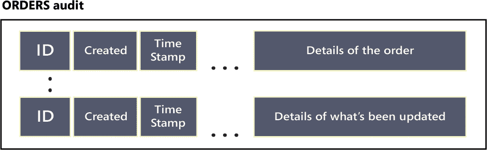

**图 2-8** 数据源中可能存储的事件序列

## 持久化事件

事件持久化后，构成了系统发生情况的审计日志。事件可以持久化到关系型数据库中，但理想情况下它们应该存入一种特殊的数据库中，被称为`event store`（事件存储）。像普通数据库一样，事件存储持久化了一个事件对象列表。事件被表示为事件的普通集合。每个事件将由不同的属性集合组成，这种不规则的模式正是导致关系型持久化变得困难的原因。

事件存储有两个主要特征：

 它作为一个只追加的数据存储工作，且不需要支持任意更新。

 它必须能够返回与给定键关联的事件流。

事件对象必须以某种方式引用业务对象。如果你正在使用`Domain Model`模式来组织命令栈，事件存储必须能够返回与聚合实例（aggregate instance）关联的事件流。如果你没有使用`Domain Model`模式，你仍然有一些可以唯一标识相关业务对象的键值。

## 查询事件

如所述，即使使用关系型数据库，也可以完成事件持久化，尽管 NoSQL 文档数据库可能是更好的选择。但无论如何，这些手段都不是一个专门为处理事件而设计的数据存储。保存事件只是事件溯源的一个方面；通过查询提取事件同样至关重要。

你可能想要查询在特定时间范围内发生的事件、涉及某些数据量的事件，或完成业务事务所需时间超过指定长度的事件。事件存储应该提供一种足够灵活的查询语言，以仅提取你需要的事件，而不仅仅是最后`N`个事件或给定时间之后的所有事件。

与查询事件相关的点还包括构建事件中所存储数据的投影。正如你通过指定想要返回的哪些列来构建 SQL 查询一样，你应该能够查询事件存储以返回一个给定的数据快照。今天创建事件存储最有效的尝试是`geteventstore.com`上的 Event Store 项目。

## 重放事件

由于数据源中有了事件，你并没有现成的系统状态。然而，通过回读消息日志，你可以重建系统状态。这一方面也被称为`replay of the events`（事件重放）。考虑之前显示的图 2-8，并尝试理解事件重放的本质。

其想法是遍历所有记录事件列表，检索与特定订单相关的事件，然后以某种方式在空订单实例上重放这些事件，将其转变为真实状态的实例。

事件本身没有行为，因为事件只是已发生事实的总结。重放事件并不意味着重复产生事件的动作。例如，重放“创建订单”事件并不意味着创建一个订单的副本。它只是获取一个全新的`Order`对象，并以某种方式对其进行由于产生事件的动作而接收的所有更改。

事件重放是否存在性能顾虑？这是可能的，而且完全取决于事件的数量。如果性能成为问题，你可以考虑创建持久化快照，存储聚合对象在给定时间的状态，然后处理该时间之后发生的事件。另一种值得研究的方案是将聚合对象的整个（或相关的）状态随事件本身持久化。

 注意

事件重放是一个强大的概念，因为它允许`what-if`场景，这在某些业务领域（例如金融和科学应用）中非常有用。通过基于事件的存储，你可以轻松地重放事件并更改某些运行时条件，以查看不同的结果。

不错的一点是，what-if 场景不需要应用程序完全不同的架构。你按照事件溯源的方法设计系统，就可以免费获得 what-if 场景。使用 what-if 场景的可能性是使用事件溯源的主要业务原因之一。

### 总结

DDD 的真正价值在于它提供的工具可以帮助我们发现符合领域业务需求的顶层架构。一旦你详细阐述了上下文以及各个部分之间的关系，你就需要考虑实际构建系统的方法。在研究技术和实践之前，你应该先思考支持该设计的架构。在本章中，我介绍了三种架构模式：`Domain Model`（领域模型）、`CQRS`和`Event Sourcing`（事件溯源）。它们接踵而至，每种模式都试图解决在大量使用另一种模式时出现的问题。

单一的、全能的面向对象模型最初与 DDD 关联的架构。多年的经验证明，单一模型过于局限，于是人们通过观察 Eiffel 编程语言的基本`CQS`原则，制定了`CQRS`。`CQRS`并不是一种模式，甚至称不上是一个宏大的概念：它只是建议你将命令（commands）和查询（queries）分开处理。尽管如此，这一简单的观察具有巨大的影响。

归根结底，`CQRS`是基于关系型数据模型的面向对象设计与基于事件溯源的函数式设计之间的一种折中方案。将命令和查询分离可以将焦点转移到任务上，而任务本质上是一系列动作和事件的序列。业务逻辑可以通过组件（进程内组件以及不同的服务）通过消息进行通信来表达。任何事件都可以被存储，最终，当你记录了所有事件后，你就拥有了构建任何所需数据组合的所有要素：包括你现在知道需要的组合，以及你未来某个时候可能需要这些组合。

在书的剩余部分，我将在不同的堆栈中使用命令和查询，并使用不同的编程方法来构建它们。我会在一些场景中演示事件和基于消息的业务逻辑。在下一章中，我将探讨用户体验在软件系统架构和设计过程中的作用。

## 第 3 章. UX 驱动的设计

*空谈是廉的。给我看代码。*

*—Linus Torvalds*

听到开发者抱怨客户改变主意太快是很常见的。这种叙述通常是：“我们讨论了几周的需求，并签署了规格。然后我们开始编码，当两周后交付第一个冲刺版本时，我们发现程序只与他们真正想要的东西模糊接近。”这种经历被总结在一张流行的漫画中，一个服务员对他刚刚送上的咖啡收到了投诉。“我们使用最高级的咖啡和市面上最好的机器。先生，咖啡有什么问题吗？”客户的回答相当令人震惊：“我其实想喝点茶。”

需求获取的过程一直是困难的，而我在`第 1 章`中讨论的`Ubiquitous Language`（通用语言）以及“彻底的领域分析”模式作为领域驱动设计（DDD）的基础，旨在解决软件项目中涉及的各种利益相关者之间的通信问题。然而，对抽象的需求和规格达成共识往往是不够的。当客户真正看到产物时，他们可能并不喜欢。尽管你与客户进行了所有的交流，他们可能已经形成了一个与你完全不同的想法。

这意味着，为了降低软件开发成本，并进一步减少弄清楚用户到底想要什么的迭代次数，必须在`通用语言`之外找到额外的层次的共识。创建一种所有利益相关者共享并在所有口头和书面交流中广泛使用的共同语言，对于确保每一句话都能被正确理解，并使软件规格是正确的具有巨大的帮助。

然而，你知道空谈是廉的，为了给客户一个关于你要做什么的现实视角，你应该展示一些代码。但代码的生产也是昂贵的，没有人喜欢编写可能因为某些假设（未被规格明确解决）被证明是错误的而导致丢弃的代码。

在本章中，我将介绍 UX 驱动的设计（UXDD）。`UX`代表`user experience`（用户体验），`UXDD`是一种实现你为系统选择的任何支持架构的自顶向下方法。`UXDD`与大多数常用方法不同之处在于，它强调表示层以及用户最终将使用的实际屏幕。`UXDD`的主要特征是，在你进入编码模式之前，让客户对通过表示层提供的每个任务签署线框图（wireframes）和故事板（storyboards）。

### 为什么自顶向下的方法比自下而上的更好

在历史进程中，许多伟大想法最初是在某些食堂的纸餐巾上勾勒出来的。这是因为手绘仍然是记录想法的极佳方式，无论是关于系统顶层架构的想法，还是参与者将用于交互的用户界面。通常情况下，客户很难解释他们想要什么，但另一方面，人们并不要求他们详细解释他们想要的体验。应该由开发团队来抓住要点，并从真实流程中学习，将其镜像到软件中。

如果你同意这种软件世界的愿景，你也同意表示层的作用比过去几十年要重要得多。`top-down`（自顶向下）一词在软件领域并不新鲜，它是一个在代码语境中经常使用的术语。Niklaus Wirth 教授——`Pascal`的发明者——是最早创造并广泛使用该术语的人之一。

我想在这里表达的观点是架构方面的。从架构上来说，我敢说在过去的几十年里，我们从未应用过任何自顶向下的设计方法。我们所做的一切都是为了自底向上构建系统。是时候考虑一种不同的方法来降低开发成本了。

### 自下而上方法的基础

在我看来，我们继续以过去至少 15 年的方式设计和构建软件。然而，在同一时期发生了许多变化，无论是在客户端和服务器软件方面，还是更重要的是用户的实际预期。

#### 1990 年代的资产

`图 3-1`中的洋葱图显示了 1990 年代的关键资产。大多数系统的设计方式充分利用了图中描述的实质。

```
[图 3-1]
```

**图 3-1** 1990 年代的软件资产

在 1990 年，大多数公司的 IT 部门都是围绕一台巨大的、昂贵的且必须尽可能使用的服务器构建的。服务器运行所有的业务逻辑并处理所有的持久化任务。在服务器之上，你通常只有几台性能慢得多的个人电脑作为终端，只有一个良好的`Microsoft Visual Basic`用户界面。但最重要的是，在 1990 年，大量用户被动接受软件工程师施加给他们的任何 UI 限制。

表示层被忽视了，所有的设计努力都集中在从公司投入了大量资金的强大服务器中获取最大性能。

#### 现在有什么不同？

今天我们生活和编写软件在一个完全不同的世界中。请看看`图 3-2`中现代的相同洋葱图。

```
[图 3-2]
```

**图 3-2** 现在的软件资产

首先，今天我们拥有了令人惊叹的各种先进技术和无数种客户端设备。这为软件架构师带来了新的挑战，也导致用户开始主动主导界面特征，而不是被动地接受所提供的任何东西。在今天，甚至在未来，糟糕的用户体验可能会变成一个严重的问题，并损害软件的声誉。我们在移动端应用上看到的现象——许多应用被下载后很快被删除——可能会成为所有应用的常态。

 # 重要

我将在本章节的晚些时候回到这一点，尽管现在是进行这样一个重要澄清的好时机：用户界面（UI）与用户体验（UX）并不是一回事，尽管两者之间存在紧密的联系。特别是，`user experience`指的是用户在与应用程序的用户界面交互时所经历的体验。良好的 UI 并不意味着一个优秀的 UX。一个出色的 UX 可能有效，但在美学上可能缺乏某些东西。

### DDD 改变了什么

DDD 是首次改变现状并使主流软件架构适应不断变化的时代的严肃尝试。在 DDD 之前的主流软件架构本质上是使用坚实的关系模型作为基础从零开始构建的，并在此之上放置了业务逻辑组件。业务逻辑组件大多是垂直组件，按表组织行为。数据传输对象（DTO）或像记录集这样的即时数据结构被用于在各个层和层级之间移动数据，并传输到表示层。

DDD 改变了一些东西，但它主要贡献了对整体架构布局的重新思考。（参见图 3-3。）

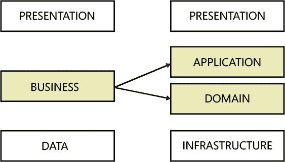

**图 3-3** DDD 如何改变核心软件架构

DDD 导致将单体业务逻辑分为两个较小且逻辑独立的部分——应用逻辑和领域逻辑。`Application logic`是业务逻辑中实现用例背后的工作流的部分。相反，`domain logic`是业务逻辑中实现不随用例而变化的业务规则的部分。在引导这种方法论转变时，DDD 引入了领域层的概念，这是架构中你为业务领域提供软件模型的部分。这种软件模型不必非是面向对象的模型。它应该是你认为的任何模型——包括贫血模型、函数式模型，甚至是基于事件的模型。

最终，多年 DDD 真正改变软件架构的是认知：即数据模型是构建软件的基础。通过 DDD，这种愿景开始转向使用领域模型作为软件的基础。今天，趋势正进一步转向变为使用事件作为数据源，并在关系型或文档 NoSQL 数据存储等规范数据存储之上使用基于事件的数据存储。

#### 采用自顶而下的方法进行规划

尽管近年来我们面临了所有变化，但我相信我们仍然像 20 世纪 90 年代那样设计代码。我们对系统有了良好的理解，并构建了一个可能可行的数据模型。在此基础上，我们又构建了我们认为足够好的用户界面。然后我们去找客户，发现我们做错了。我们迭代得越多，软件项目的最终成本就越高。

为了改进这一点，我们必须认识到用户感知到的系统只是他们正在工作的用户界面。当我们能够确保 UI 和随后的 UX 真正接近用户的预期时，因为我们的错误而重做的机会就会显著减少。

然而，为了达到这一目标，我们必须开始以自顶而下的方式规划系统，将 UX 和表示放在我们关注的首位。

#### 避免“方头插圆孔”的设计

谈到软件时，用户的大多数期望是在他们用于执行实际工作的屏幕上得到满足或未满足的。如果你有一大批被动用户，你可以负担得起从底部构建系统基础。无论你最终得到什么模型，对于具有被动性格的用户都是有效的，但如果用户期望某些特定的 UI/UX 工作，效果就没那么好了。（参见图 3-4。）

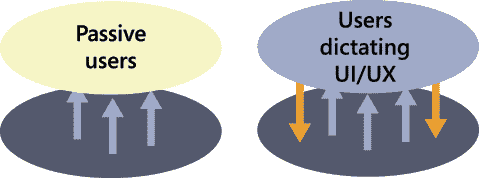

**图 3-4** 被动用户和活跃用户在整体架构设计中的作用

如果用户愿意接受你提供的任何 UI，那么从底部向上构建系统最终会运行得不错。然而，如果用户期望特定的 UI 并且在这一点上不宽容，那么从自底而上的模型中开发的端点可能与通过表示层方法开发的连接点不匹配。这正是需要大量迭代工作才能修复的冲突，并产生了最高成本以及最大程度的困扰和误解。这看起来就像是试图把正方形木钉插进圆孔里。

反过来，从顶部到底部，可以确保固定的点是用户想要拥有的点。接下来，无论你构建了什么样的后端来支持这些固定的 UX 点，都不会降低用户的满意度。换句话说，系统的整个后端变成了约定的表示屏幕和表单下方的一个巨大黑盒。

### 建立两个架构师角色

UXD 推动了软件架构的自顶而下设计。在这种情况下，你可能会发现在一个项目中采用两个不同的架构师角色是有用的。说起`architect role`，我并不是建议你有两个不同的专业人士；相反，我建议你有两套不同的技能，这些技能可能出现在同一个人身上。一个角色是经典的软件架构师角色。另一个是 UX 架构师角色。

软件架构师通过访谈收集需求和信息，目的是构建系统的领域层。另一方面，UX 架构师通过访谈收集可用性需求，目的是构建理想的用户体验和理想的表示层。

### 理解 UX 架构师的职责

用户体验的支柱总结在以下列表中。注意，这个顺序并不是偶然的：

 信息组织

 交互模型

 可用性评审

对于 UX 架构师来说，要点的是展示给用户的信息组织，包括识别`personas`（用户画像），即处理应用程序的用户类型。接下来是允许用户与展示的信息交互的方式，以及你为此提供的图形工具。

如果没有最后一点——`可用性评审`，这一切工作都是毫无意义的。UX 专家可以访谈客户万次——实际上也应该这样做——但这只能带来对客户基本需求的理解。这会产生一些可以讨论和调整的草图。

通常，`UX`一词指的是用户在使用产品（包括软件产品）时所经历的行为和情感。UX 主要是关于交互，而与计算机的交互主要由视觉控制控件组成。视觉控件就是系统的界面。因此，UI 和 UX 之间密切相关但又有所区别。

我的观点是，对于用户来说，UX 比实际的 UI 更相关，UI 主要是为了取悦视觉。与 UI 不同，用户体验在架构层面也相关。因为为了给用户提供客观积极的体验，你可能需要重新考虑设计步骤的执行顺序，以及分配给表现层的重要性。

## UX 不是 UI

大约 30 年前，图形化用户界面（GUI）改变了规则，开发者和用户都学会了视觉设计的重要性。直到几年前，至少在智能手机和平板电脑出现之前，设计良好的视觉界面就足以确保软件应用程序用户获得良好的体验。前面的道路表明，仅仅一个良好的 UI 已经不足以交付设计良好的表现层了。

为了保持在前沿，我们必须将`UI`替换为`UX`。

## 定义线框和其他类似术语

当涉及到 UI 和 UX 时，我们不断听到并使用几个术语，但并不总是对每个术语使用精确的含义。有时，我们实际的意思从上下文中很清楚，但`wireframe`（线框）和`mockup`（原型模型）等术语指的是略有且微妙不同的东西。从通用语言的角度来看，让我澄清一下草图、线框和原型模型等术语通常想要表达的意图：

 **草图 (Sketch)** 草图通常是手绘的，主要为了记录用户界面的想法。总的来说，这是每位设计师必须做的必要步骤，以便将原始想法转化为图形化用户界面。

 **线框 (Wireframe)** 线框是一种更精确的草图类型。它包含了额外信息，并聚焦于布局、导航和要呈现的内容。线框通常与其他线框相关以形成一个故事板。在线框中，你找不到许多关于最终产品实际美学的细节。

 **原型模型 (Mockup)** 原型模型是具有特定视觉效果和感受的线框。原型模型提供了最终产品的预览，对布局、内容组织、导航和美学有清晰的思路。

这些术语有时会被互换使用。即使互换使用可能是可以接受的，我认为了解每个术语的具体含义是很重要的。

## 定义原型和其他类似术语

在引导之后，开发团队和利益相关者之间必须安排的首次同步涉及表现层。如果领域逻辑的复杂性并不高，且任务相对容易理解和实现，那么在表现层级进行签字可能就足够了。在其他情况下，在进入最终验收程序之前，可能需要第二次同步步骤。

当涉及到需要第二次同步时，通常会有其他几个术语被互换使用。对于你被要求提供的是原型（prototype）还是概念证明（PoC）的误解，可能比对线框或原型模型的任何误解都要昂贵得多。让我来澄清一下这些术语：

 **概念证明 (Proof of concept)** 概念证明本质上是一段小段代码，用于测试想法的可行性，并验证某些理论点具有成为或成为有用生产环境功能的潜力。有时，执行 PoC 也是为了对一项新技术或框架进行性能测试。


 **原型 (Prototype)**

原型是一个部分虚假的系统，尝试模拟整个系统。像 PoC 一样，它是为了测试系统的可行性或实用性。它的行为看起来像整个系统，除了大多数功能是部分实现的，或者使用填充数据或硬编码逻辑。重点在于展示整个是如何运作的。与 PoC 相比，原型要复杂且复杂得多，尽管它的成本可能只是完整系统的一分之一。

 **试点 (Pilot)**

试点是一个完整的生产系统，仅针对泛指目标受众的一个子集进行测试，并可能在完整数据集的一个子集上运行。试点可以是运行在阶段系统、数据库或两者上的完整应用程序。

有时，这些术语中的任何一个会被一个更通用（也更流行）的术语取代：`demo`（演示）。概念证明、原型和试点都是演示。当客户要求演示时，尝试让他们对他们想要的东西更具体——得多更具体。而且演示通常不是轻而易举的。

## 体验关乎交互

如果说 UX 分析是现代表现层的核心，那么`可用性评审`（usability review）就是 UX 分析的核心。这里有一个我经常在会议演讲和课程中提到的真实故事。一个客户想要一个工具来根据标签精选推文。他们希望看到推文列表，点击感兴趣的推文，并将它们保存到数据库表中。我们甚至为网页的主用户界面制作了一个线框。（参见图 3-5）。顺便说一下，图中的线框是用 Balsamiq 创建的。）

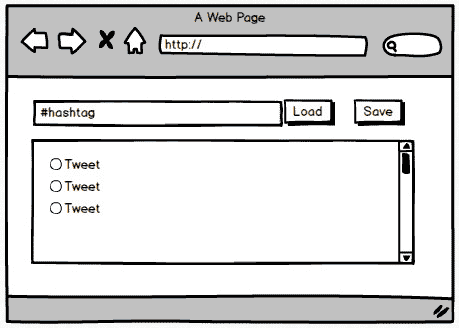

**图 3-5** 用于精选推文的示例页面示例线框

在第一次测试之后，大家都很开心，该应用程序被认为是完美的。然而，在经过几天的高强度使用后，它看起来没那么有吸引力了。短之，缺少了两个关键功能，这显然说明它们对于首次运行来说太先进了。一个是能够选择和隐藏不需要的推文，这样使得挑选真正有趣的推文变成了一项更容易的任务。另一个缺失的功能是隐藏流中已挑选推文的能力。

我从中中学到的第一个教训是，只有通过观察用户使用应用程序，才能可靠地说你提供的 UX 是否好。第二个教训是，`需求`（requirements）一词越来越无法表达用户和开发者之间需要讨论的内容。收集需求只是更长工作流的起点，该工作流涉及到构建任务和业务流程。

最后，第三个教训涉及不可用功能的 UX 优先级排序。一个给定的功能要么有用，要么没用。如果被确定是有用的，它必须从一开始就进行计划。否则，你将要做这项工作——任何工作——至少两遍。

### 三步解释 UXDD

本质上，UXDD 是一种自上而下的三步走设计工作流。首先，你制定屏幕和故事板，以获得用户对界面和底层流程有效性的认可和反馈。其次，根据屏幕，形式化进入和流出这些屏幕的内容，并构建完美匹配该预期数据流的应用层端点。

换句话说，第一步让你发现你将拥有的“钉子”的形状和类型，而第二步确保你也使用了兼容的“孔”。第三步呢？它是关于以一种方式构建后端，使其对前端及其钉子以及应用层孔完全完全透明。（参见图 3-6。）

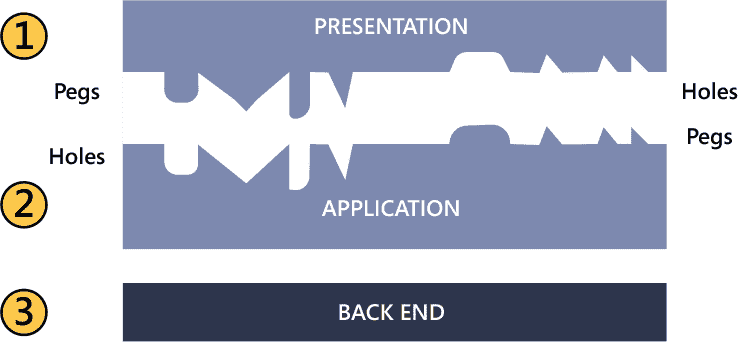

**图 3-6** UXDD 的三个步骤

从 UX 专家那里学到的最重要的事情之一是：通过讨论主动生成的需求，远比通过访谈被动收集的需求要好。多年的实战经验告诉了我们许多人，在从利益相关者获取反馈时过于被动，会导致用户降低对某个功能的优先级，以便尽早使用软件。尽管用户可能会做出这种决定，但这并不能阻止他们在最终获得系统时抱怨系统几乎不可用。

图 3-7 展示了一个我们可以作为讨论起点的示例，你可能一眼就能看出其中的弱点。尽管所示线框图（wireframe）存在缺陷，但通过生成这种类型的大纲，你可以让用户告知你是否遗漏了某些重要内容——例如，某个特定的数据聚合。用户可以立即告诉你，这样你就有充足的时间来组织后端，使那些特定数据更易于获取。

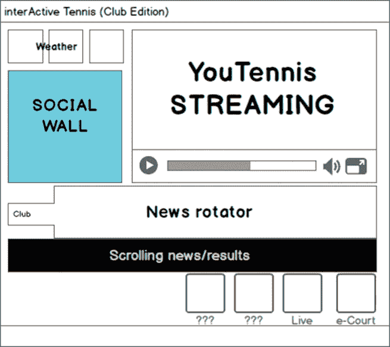

**图 3-7** 示例线框图，让用户对规划中的屏幕有一个清晰的认知

尽早向用户展示屏幕和故事板（storyboards），随后进行迭代运行，并结合反馈，是你从草图转向线框图、甚至转向原型（mockups）时需要执行的关键步骤。你可能认为这在很多项目中或多已经完成了，但真的做到了吗？我认为大部分时候做得不够。而且通常缺失的部分是故事板。

用户的体验源于使用 UI 工具完成任务。很少有任务是完全通过单个屏幕完成。你可能会发现，仅仅看某个屏幕的线框图可能无法提供足够的信息来发现流程实现中的潜在瓶颈。在故事板中连接多个屏幕是一个更好的主意。你将遇到的问题是缺乏能够简单且有效地连接屏幕以构建故事板的工具。

表 3-1 列出了目前可用的一些工具列表。

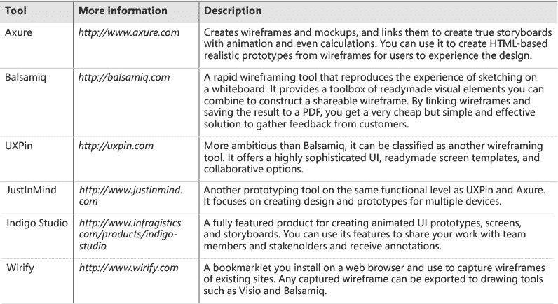

**表 3-1** UX 开发工具简表

屏幕充其量是 HTML 或仅以某种图形方式渲染的 XML 内容。无论如何，它们都是纯粹的静态内容，没有生命也没有动作。你可以使用 表 3-1 中的某些工具，特别是 Indigo Studio 和 UXPin，将线框图转换为真正的故事板，以演示 UI 屏幕的流程。尽管有时，这只是第一步。

#### 将视图转换为原型

记住，即使是最好且最被广泛认同的用户界面，在大量使用时也可能变得糟糕。当你不确定时，你可以采用一个可运行的软件原型，甚至可以录制用户使用原型的视频，以获得他们使用你的软件时真实体验的可靠指示。

 注意事项

无论分层、层次、框架、数据库和技术如何，对于终端用户来说，软件系统唯一重要的是用户界面——具体来说是用户体验和应用程序的感知速度。

在具体技术方面，原型可以是任何服务于收集早期且信息丰富的反馈的工具。它可以是一组 HTML 页面，也可以是一个基于 XAML 的应用程序。原型仅包含表示层，并使用模拟数据（canned data）或虚假的后端来模拟某些行为。取决于你想提供的保真度，针对一组已定的草图创建线框图和原型通常只需要几天工作。根结底，这并不费什么力。

将视图转换为原型的最困难部分可能不是创建原型本身，而是向客户明确他们看到的只是一个原型，距离完成的一半还很远。

#### 任务与工作流

假设在某一点，客户决定喜欢这个原型，并允许你构建应用程序。你验证并准确创建屏幕及相关故事板以响应真实需求越充分，以后需要做的（重）工作就越少。这是让 UXDD（用户体验驱动开发）具有财务价值的关键点。如果你在寻找任何 UXDD 投资的回报可能在哪里，那么就在这里。

确定屏幕会带来很多好处，其中之一是：你准确知道应用程序后端必须产生什么。

你拥有的每个屏幕都可以轻松映射到一个输出类（outbound class），该类成为应用程序层的输入，反之成为系统后端的入口。应用程序层将输入转发到后端，该输入随后向下栈传递。任何计算出的响应都会向上栈传递到应用程序层，封装在视图模型对象（view model object）中并返回给表示层。

现在回看图 3-6](#图 3-6](#part0009.html_ch03fig06)。我在图中所谓的“销钉和孔”（pegs and holes）只是在被应用程序层方法传递和返回时，进出表示层的类。应用程序层方法负责编排用例（use-cases）之后的任务。

#### 后端的其余

对于你在 ASP.NET MVC 应用程序中编写的实际代码，UXDD 的本质总结在以下控制器方法的几行代码中：

点击此处查看代码图片

```csharp
public class SomeController
{
    private ApplicationService _service = new ApplicationService();
    public ActionResult SomeTask(InputModel input)
    {
        var model = _service.GetActionViewModel(input);
        return View(model);
    }
}
```

在 ASP.NET MVC 中，任何控制器都是表示层的一部分。更准确地说，它是你需要的任何表示逻辑的存储。代码片段中的 `_service` 变量是与控制器相关的应用程序层实例。与应用程序层辅助类之间的链接通过任何形式的依赖更优雅地建立，包括最简单的，如下代码所示：

点击此处查看代码图片

```csharp
public class SomeController
{
    private IApplicationLayerService _service;
    public SomeController(IApplicationLayerService service)
    {
        _service = service;
    }
    public SomeController() : this(new ApplicationService())
    {
    }
    public ActionResult SomeTask(InputModel input)
    {
        var model = _service.GetActionViewModel(input);
        return View(model);
    }
}
```

一旦建立了这种代码架构，应用程序层之下的系统其余部分就是一个实现细节，尽管它是系统中完全包含整个领域逻辑和所有领域业务规则的部分。图 3-8 所示的想法看起来非常简单，但它是真实的。

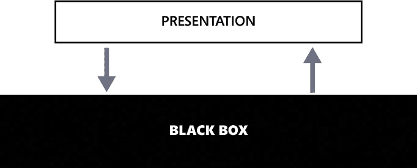

**图 3-8** 遵循 UXDD 原则构建的系统整体布局

# UXDD 简介

正如许多其他以 `DD`（代表“驱动设计”，driven design）结尾的流行语一样，`UXDD` 的诞生也带有拯救软件世界、或至少降低其成本的声明目标。在这方面，`UXDD` 与 `DDD` 具有共同的高尚目标。

然而，`UXDD` 并不会强迫你切换到任何显著不同的软件思考方式或编写方式。它也不需要任何重大的前期培训。当我在会议上或课堂上介绍 `UXDD` 原则时，通常会有人过来跟我说，我所指的作为 `UXDD` 的某些核心想法其实他们多年来一直在做或正在做的事情。

并没有严格需要为本章概述的实践起一个诸如“UX 驱动设计”（`UX-Driven Design`）这样响亮的新名字。然而，一个新而响亮的名字可能有助于对它的关注。

## UXDD 的益处何在

我们编写软件，并且都希望以尽可能高效且可持续的方式编写它。软件是一项复杂的事务，也是工程项目。我们无法合理地降低工程的实际成本，尽管这往往是事实所在。（微笑。）如果客户认为软件成本太高，而且如果我们都认为软件开发的资金投入不足，那么在某个地方、以某种方式，开发者和客户都做错了什么。

## 我们到底哪里做错了？

关于这个问题，我个人的观点是问题出在 `UXDD` 原则上。我从这样一个事实出发：用户关心的只有体验以及他们工作有多方便。任何软件的成功取决于它以始终适当执行业务任务的能力——这只是一个文字游戏，为了避免使用更流行的术语“扩展性”（`scalability`）——并且对用户方便。如果软件在提供满意的用户体验方面失败，它仍然可以使用，也仍然有效，但它不会成为成功的软件。

`UXDD` 建议你先关注屏幕（screens）和故事板（storyboards），按照用户声称喜爱的方式来构建它们，并向同一批用户展示多次。你不断向用户展示它们，直到他们对这些屏幕和故事板签字认可。我指的不仅仅是优先的意图列表，比如“我想要这个”和“我想要那个”或“你可以在 `v2` 中给我这个”，我特别指的是线框图（wireframes）以及可能是动画化的线框图序列。通过这种方式，你向用户展示系统部署后他们将如何使用它。

当然，第一步不是免费的，但其成本仅是开发任何级别、具有任意数量特征的软件的一小部分。反复调整屏幕和线框图，直到你真正接近理想的用户体验。然后决定是否投入更多的时间和资金来构建轻量级的软件原型。我认为这一步是可选的，但在大型项目中，它确实可以成为救星。

## 接下来做什么？

一旦获得了用户对屏幕的认可，你就确切知道系统将产生什么输出以及接收什么输入。下一步简单就是组织展示层之下的层来处理这些数据。

在 `UXDD` 中，几乎没有什么你不需要做的事情。但通过处理屏幕和动画线框图的额外成本，你可以编写出用户第一次可能就非常喜欢的软件。你可以对此非常有把握，因为，嗯，用户刚刚签字认可了！但即使用户在第一次看到屏幕或线框图时不喜欢该软件，修复它需要经历的迭代次数也很大可能会显著减少。除了“节省成本”，你还能管它叫什么？

图 3-9 显示了 `UXDD` 开发的总体图。

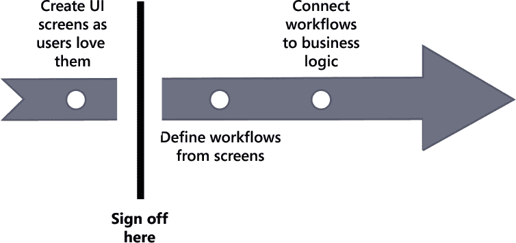

```
UX 驱动设计的总体图
```

**图 3-9** UX 驱动设计的总体图

***

 备注

在咨询场景下，签字认可这一步对于投资回报率（`ROI`）来说似乎比在企业内部开发场景中更为重要。然而，当你为内部客户编写软件时，它仍然关乎与他们达成一个相互满意的协议，以减少软件以最终形式上线并运行所需的总时间。

***

## MVC, MVP, MVVM 以及其他模式

`MVC` 是“模型-视图-控制器”（Model-View-Controller）的缩写，是 20 世纪 80 年代设计的模式，最初用于构建整个应用程序。尽管当时的应用程序本质上是单体结构的，`MVC` 作为一种通用模式完全完全说得通。`MVC` 的主要目标是将应用程序拆分为不同的部分：模型（model）、视图（view）和控制器（controller）。

`model` 指应用程序的状态，封装了应用程序的功能，并通知视图状态的变化。`view` 指显示给用户的任何图形元素的生成，并捕获和处理任何用户手势。`controller` 将用户手势映射到模型上的操作，并选择下一个视图。这三个参与者通常被称为 `MVC 三元组`。

`MVC` 模式演变为“模型-视图-演示者”（Model-View-Presenter，简称 `MVP`），其中演示者元素取代了控制器并承担了更多责任，本质上是将任务编排汇总到了视图的渲染。在 `MVP` 中，视图和模型被整齐地分离，演示者在它们之间进行调解。

`Model-View-ViewModel`（`MVVM`）是对最初作为“演示模型”（Presentation Model）引入的模式的更流行的名称。在 `MVVM` 中，你拥有一个结合了 UI 命令和视图模型的类。一个类——视图模型对象——暴露了可以绑定到 UI 组件的属性以及绑定到 UI 事件的方法。`MVVM` 特别适用于存在强大双向数据绑定机制的应用程序场景。

坦率地说，在如今开发软件时，比了解技术更重要的是知道如何处理具体问题。这意味着，学习设计和架构模式、最佳实践、支持架构以及具有成功记录的适用解决方案更为重要。软件正日益与业务深度融合，仅仅了解技术已不足以解决现实世界中的问题。大多数情况下，一个现实世界的业务解决方案来自于多种（甚至是异构的）技术的结合。因此，如果你不进行细致的分析，你将一无所获，至少无法在规定的时间和预算内完成任务。

在软件开发中，进行细致的分析并不是新鲜事——合理的分析自软件本身一样悠久。正如第 1 章中概述的“进行彻底的领域分析”以及以及第 3 章中概述的“UX 驱动设计”一样，领域驱动设计（DDD）的分析工具和 UX 驱动设计（UXDD）的自顶而下设计往往将重点更多地放在业务流程等具体事物上，而不是放在有时过于抽象的模型上。

你通过技术来实现具体的软件工作，但在今天，仅仅升级某项技术已不再保证成功。过去确实有过那样时期，只需升级到最新的数据库管理系统（DBMS）、操作系统或库就能魔术般地解决任何待解决的问题。如今，软件捕捉现实世界流程越多，对用户来说就越有用。现在是时候让架构师学习“镜像”而非“建模”真实世界了。

在本章中，我将探讨构建 Web 解决方案的几种选择。我将结合新的 Microsoft ASP.NET Core 1.0 框架以及相关的运行时流水线进行讨论。

## 评估可用 Web 解决方案

如今在使用 Microsoft 技术栈规划 Web 解决方案时，你有以下选项：

 ASP.NET Web Forms

 ASP.NET MVC

 单页应用 (SPA)

这些是主要的选项，它们涉及创建解决方案的骨架以及如何为用户提供与应用程序交互的入口点。流行的 ASP.NET Web API 和最新的 ASP.NET Core 1.0 框架为画面增添了两个维度，增加了你可以使用这些主要选项的场景。

### 决定最佳框架

这些选项中的任何一个都是行的。确定其中一个是否优于另一个取决于你需要解决的具体问题以及你所面临的限制，其中最重要的一点就是你团队同事的技能。

熟悉 ASP.NET Web Forms 的团队可能只需要花用 ASP.NET MVC 重建所需的部分时间就能构建出相同的前端。每种技术的范式都是不同的。你可能会发现，由于设计如此，学习 ASP.NET MVC 并用它创建稳健的代码比使用 ASP.NET Web Forms 要耗费更多时间。强迫自己或你的团队切换到使用 ASP.NET MVC 可能是一个痛苦的决定，但 ASP.NET MVC 是一个更现代的框架。

ASP.NET Web Forms 在未来不会再获得微软的太多关注。它是一个老旧的框架，其最后一次重大更新可以追溯到 2010 年，而它的首次发布（very first release）已经是十多年前的事了。然而，仅仅因为一个框架没有经过重大更新并不是停止使用它的理由，特别是当该框架仍然很好地完成了它该做的工作时。

有一种普遍认为 Web Forms 已经过时的情绪。然而，无论你听到什么，我个人的观点是，如果你有充分的理由继续使用 Web Forms，那么就没有明确的业务理由去放弃它。

* * *

 备注

Microsoft Visual Studio 2015 和 ASP.NET Core 1.0 的发布也附带了一个稍微更新的 Web Forms 框架。在我看来，Web Forms 没有频繁更新，是因为对于像 Web Forms 这种设计方式的框架，已经没有多少东西可以添加进去了。

* * *


你可能会发现很难看清今天 Web 框架的全景，尝试去解释它更是困难。一种常见的场景是：在某个长期 `ASP.NET Web Forms` 项目的“山洞”中度过多年后，你现在环顾四周，看到了对项目进行重大更新的替代方案和方法。你看到这么多新框架，会怀疑哪一个最适合另一个长期项目。

嗯，我应该说明的第一点是，你可能并不需要确定哪种框架对你是最理想的。你应该使用的可能是框架、语言和存储技术的组合。如今几乎所有东西都是多语言（polyglot）的，学习语言并弄清楚使用哪种语言的负担取决于你自己。

## 布局解决方案

如今几乎任何软件解决方案都源于分层架构的应用。`layered architecture` 只是经典三层架构的演进，将应用程序分为三个部分：表示层、业务层和数据访问层。

在分层架构中，你仍然有一个表示层，而数据访问层被重命名为基础设施，并扩展以包含额外的服务，如队列和缓存。业务逻辑层被分为两个不同的部分：应用逻辑和领域逻辑。应用逻辑是你发现用户界面用例实现的地方。领域逻辑是任何你需要的、不变化的逻辑。

无论你选择哪种原型解决方案——`Web Forms`、`MVC` 还是单页应用（`SPA`）——你都会面临定义应用程序 `API` 为一组公开调用点的问题。从技术角度来看，这是 `ASP.NET Web API` 大显用场的地方。然而，在关注使用的理想端点之前，你应该关注你想实现的流程，并评估这些流程的支持架构，例如命令查询职责分离（`CQRS`）和事件驱动架构。此外，存储架构也至关重要，无论是基于状态的，还是引入某种程度的事件溯源（`ES`）更好。

在第 3 章中，我在设计架构时关注了用户体验。我建议了一种自顶而下的方法，从迭代定义用户界面屏幕开始，然后建议你随后从进入和离开表单的数据开始设计并构建后端。我最近看到一张关于用户和开发者对软件不同视角的漫画。我尝试在图 4-1 中更严肃地捕捉了这些愿景。

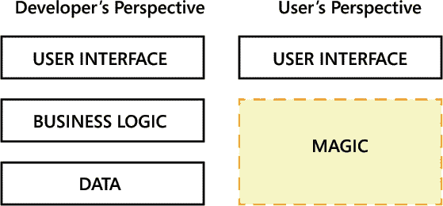

**图 4-1** 用户和开发者对软件的认知

特别是如果图 4-1 让你对用户的天真感到好笑，或者只是会一笑，我建议你重新考虑第 3 章中讨论的 UX 驱动设计（`UXDD`）的核心要点。这可能是我们目前在不减少开发相关环节（如测试和调试）的情况下，降低软件开发成本的唯一方法。

## 审查 ASP.NET Core 1.0 的角色

`ASP.NET Core 1.0` 是一个全新的开源跨平台框架，用于使用 Microsoft `.NET Framework` 构建 Web 应用程序。它与 `ASP.NET` 并列存在，代表了开发者和架构师在选择 Microsoft 技术栈构建 Web 解决方案时可以考虑的第二个选择。换句话说，选择 `ASP.NET` 是不够的：你还必须选择你想依赖的哪种版本的 `ASP.NET` 平台。

### 将 ASP.NET 视为起点

图 4-2 提供了经典 `ASP.NET` 平台的概览，并突出了它将随 `ASP.NET Core 1.0` 发生变化的方面。特别是该图关注了主机环境以及主机与核心应用程序之间的交互模型。

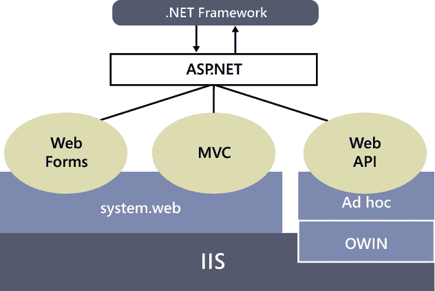

**图 4-2** 经典 ASP.NET 平台的整体图

该图显示了 `ASP.NET Core 1.0` 框架与其他 `.NET` 库之间的依赖关系。特别是 `ASP.NET` 平台包含了 `Web Forms` 和 `ASP.NET MVC` 库，开发者使用这些库构建基于 HTML 的视图。该框架还包含了 `Web API` 模块，可以用于创建基于 HTTP 的 API。这里需要注意的是（特别是考虑到随 `ASP.NET Core 1.0` 带来的变化）是，`Web Forms` 和 `ASP.NET MVC` 运行在与 `Web API` 不同的运行时流水线中。特别是，`Web API` 可以托管在 `ASP.NET` 之下，但在需要时它也可以自托管或从其他容器中运行。`Web API` 引擎的流水线与 `ASP.NET` 和微软 Internet 信息服务（`IIS`）并非紧密集成，而且并不严格依赖于 `system.web` 程序集的服务。此外，经典的 `ASP.NET Core` 框架只能运行在全功能的 `.NET Framework` 和通用语言运行时（`CLR`）之上。

 Note

`OWIN` 是 `Open Web Interface for .NET` 的缩写，它定义了一个标准接口，Web 服务器和 Web 应用程序可以在其中进行交互。`OWIN` 的定义初衷值得赞赞，即将服务器和应用程序解，导致同一个 Web 应用程序可以托管在一个仅暴露 `OWIN` 接口的通用容器中。换句话说，`OWIN` 与那种“集成式 `ASP.NET`/`IIS` 流水线”完全相反，而后者在短短几年前还被推崇为 `ASP.NET` 开发的一项重大成就。

这里并没有讽刺的意思。我只是想承认事物在我们眼前的变化是得有多快。

### 审查 ASP.NET Core 1.0 中的架构依赖关系

我想简要向你展示 `ASP.NET Core 1.0` 中会有什么不同。本节提供了 `ASP.NET Core 1.0` 的高层视角，并指出了新奇或不同之处。我解释解释了为什么某些事物是不同的，并尝试避免陷入新功能的细节细节。最后，我认为，理解 `ASP.NET Core 1.0` 的意义并确定它是否有所帮助，比深入研究这套供开发者熟悉的新工具的技术性描述要关键得多。

首先，`ASP.NET Core 1.0` 比其前身具有更灵活且跨平台的主机环境，这是一个不以任何方式依赖于 `IIS` 和 `system.web` 程序集的环境。此外，`ASP.NET Core 1.0` 可以在几种不同版本的 `.NET Framework` 和 `CLR` 之上运行应用程序。

例如，你可以在 `.NET Framework`（4.5.2 及更高版本）之上运行 `ASP.NET Core 1.0` 应用程序并利用完整的 API 集。这确保了你的解决方案与现有代码具有最大的兼容性。同时，你可以在最新的 `.NET Core` 之上运行 `ASP.NET Core 1.0`，并享受其中的新功能和更小的内存占用。最后，在未来的某个时刻，你还能够在运行在 Linux 和 Mac 上的跨平台 `.NET Core` 实现上运行 `ASP.NET Core 1.0`。

图 4-3 使用与图 4-2 相同的语言展示了 `ASP.NET Core 1.0` 的全景。

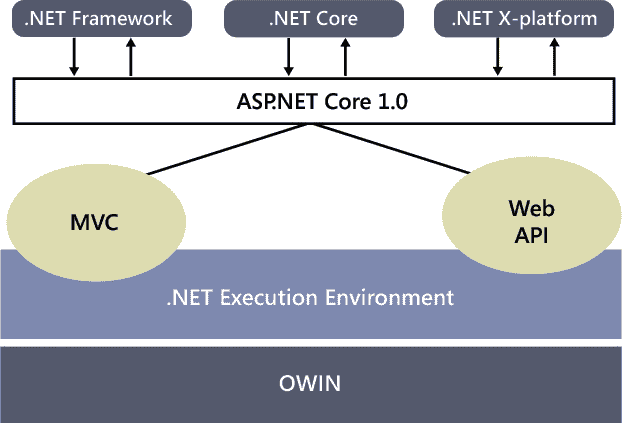

**图 4-3** ASP.NET Core 1.0 平台的整体图

`ASP.NET Core 1.0` 平台包含了用于构建 HTML 视图的 `ASP.NET MVC` 库，它是构建基于 HTTP 的 API 的构建块。正如可以看到，`ASP.NET Core 1.0` 平台不再包含 `Web Forms`。因此，如果你拥抱了 `ASP.NET Core 1.0` 平台，你需要使用 `ASP.NET MVC` 或纯 JavaScript 创建前端。此外，`ASP.NET MVC` 和 `Web API` 现在共享同一个运行时。

### 探讨 ASP.NET Core 1.0 的原因

新的 `ASP.NET` 技术栈显然比当前的栈更简洁、不那么臃肿，并尝试进行一些过时的清理。配置基础设施基于 JSON 文件并且完全可定制，因此不再有如 `web.config` 这样的单一入口。此外，如图 4-3 所示，新的 `ASP.NET` 技术栈可以不同的 `.NET Framework` 版本。

#### 从 CTO 视角看 ASP.NET Core 1.0

`ASP.NET Core 1.0` 并没有为普通的 Web 开发者增加任何编程能力。如果你已经在 `ASP.NET` 技术栈上，`ASP.NET Core 1.0` 是向更好的核心过渡的起点。它引入了如不支持 `Web Forms`、不同的运行时流水线以及更丰富的扩展模型等变化。此外，它将 `ASP.NET` 和 `ASP.NET Web API` 整合到一个模型中。在我尝试寻找一个合适的口号时，我想将 `ASP.NET Core 1.0` 平台总结为一次非常重要的微小更新。我不认为每个人都会同意我的观点，但让我解释一下。

对于某些人来说，这些变化中的可能是重大的破坏性变更。对于另一些人来说，这些变化可能是微不足道的，以至于目前可以完全忽略。总而言之，我看到 CTO 面前有两个选择。

由于 `ASP.NET Core 1.0` 本质上是一个新框架，它可能会给开发者带来一些兼容性问题。跟风 `ASP.NET Core 1.0` 潮流有其利处，但并不意味着你现在就可以轻松地选择它。这是一个必然的选择，但并不意味着采用它的时机就是现在。

 完全忽略 `ASP.NET Core 1.0`，并照常进行进行业务：使用相同的框架、相同的编码体验和相同的部署选项，并且不实现任何额外功能。你不会丢失目前拥有的任何今天可以实现的功能。

 完全拥抱 `ASP.NET Core 1.0`，将其视为一个全新的平台概念——它与你的编码方法兼容，但可能需要对其进行调整。同时也要意识到，这是一个并不难学习的平台，特别是对于任何拥有良好 `MVC` 经验的人来说如此。

`ASP.NET Core 1.0` 为未来至少 10 年的微软 Web 栈奠定了基础。它继承了当前堆栈的足够特性，增加了一些破坏性更改，并设定了新的目标和新方向。无论你喜不喜欢，你都无法长时间忽视 `ASP.NET Core 1.0`。

`ASP.NET Core 1.0` 最复杂的部分涉及对配合使用的 `.NET CLR` 的选择。

## 理解 DNX 运行时环境

`DNX` 运行时环境——新的 `ASP.NET` 运行时——是一个宿主进程，其职责之一是负责加载 `CLR`。如所述，它可以在不同版本的 `.NET` 上运行 `ASP.NET` 应用程序。如果不同平台（例如 `Linux` 或 `Mac`）上可用 `DNX` 环境，那么相同的 `ASP.NET` 源代码也可以运行在任何一个平台上。

然而，对多个版本 `.NET Framework` 的支持并不意味着代码被归一化为通用中间语言。它仅意味着你可以在同一个（新的）运行时之上，使用三组不同的类库编写 `ASP.NET` 应用程序。

## 使用完整的 .NET Framework

迁移到 `ASP.NET Core 1.0` 最简单、最平稳的过渡是通过使用完整的 `.NET Framework` 作为 `CLR` 目标。`ASP.NET Core 1.0` 支持任何等于或新于 `4.5.2` 版本的 `.NET Framework`。在进行此迁移时，你可以使用完整的 `.NET Framework` 类 set。换句话说，如果你正在迁移现有应用程序，你可以在不修改任何代码的情况下升级到最新的平台。另一方面，如果你正在编写新应用程序，则不需要学习任何新的 `API`。

那么，如果你仍然想或需要针对完整的 `.NET Framework`，那么升级到 `ASP.NET Core 1.0` 的意义何？

首先，你的应用程序将在更快速、更具配置性的运行时流水线中运行。其次，通过升级到 `ASP.NET Core 1.0`，你使用了新的基于 JSON 的配置模型和为 `ASP.NET Core 1.0` 量身定制的新工具。我在在本章早些提供的“非常重要的微更新”定义就源于最后一点。

** 重要

请记住，如图 4-3 所示，`ASP.NET Core 1.0` 不支持 `Web Forms`。因此，如果你目前有一个无法原样迁移到 `ASP.NET Core 1.0` 的 `Web Forms` 应用程序，你至少必须重写表示层中最浅的部分，以目标 `ASP.NET MVC` 或纯 `HTML`。**

## 介绍 .NET Core

`.NET Core` 是 `.NET Framework` 的全新跨平台版本，内存占用显著减小。直率地说，目标指向 `.NET Core` 意味着学习一组仅与熟悉的 `.NET Framework` 相似的全新 `APIs`。`.NET Core` 与完整的 `.NET Framework` 之间的差距类似于经典 `Microsoft Visual Basic` 与 `Microsoft Visual Basic .NET` 之间的差距。

选择 `.NET Core` 框架有几个关键优势。

首先，你的任何应用程序都可以被封装为仅包含其所使用的 `.NET Framework` 版本。这使得应用程序无论服务器上安装了哪个版本的运行时都可以运行。因此，你的应用程序可以与安装的任何其他版本的 `.NET Framework` 并排运行。这意味着你再也不需要担心是否将应用程序更新到运行时的不同版本。同样，如果在同一台服务器上安装了另一个版本的框架，也不用担心。它不会影响你的应用程序。

`.NET Core` 让你更容易只选择你需要的功能，从而让你对占用的空间和所依赖的功能拥有完全控制。最后，`.NET Framework` 的 `.NET Core` 版本是为跨平台设计的。因此，当你完成应用程序时，它可以运行在任何托管了兼容版本 `DNX` 运行时的平台上。但这种方式不仅适用于部署。开发也是如此。事实上，开发者可以在任何支持的平台上本地编写并测试应用程序。

** 重要

如果你计划目标是 `.NET Core`，首先要进入从头开始（重）写你整个应用程序的状态——表示层、业务层和后端。这样做可能比你预想的要容易，但努力的范围更接近完全重写而不仅仅是更新。显然，对于开发新应用程序，`.NET Core` 是一个严肃的候选者，唯一的代价是学习一种新版本的 `ASP`。**

## .NET 的跨平台版本

计划有一天有一个 `.NET Core` 的跨平台版本。开发正在通过社区努力进行，但在达到生产水平之前还有很长的路要走。如果你希望以跨平台的方式使用 `.NET`，最好也看看 `Mono`。然而，好消息是，跨平台的 `.NET` 将到来。

## 决定你是否应该使用 ASPNET Web Forms

估计 `ASP.NET` 应用的使用量仅次于 `PHP`。然而，大多数 `ASP.NET` Web 应用程序都基于 `ASP.NET Web Forms` 框架。相反，新的 `ASP.NET Core 1.0` 框架专注于一个新的流水线，其中 `ASP.NET MVC` 用于提供服务的 `HTML` 视图和数据，而 `Web API` 仍然是纯数据服务的选项。

因此，`Web Forms` 未包含在 `ASP.NET Core 1.0` 中。

尽管在可预内 `Web Forms` 将获得完全支持甚至得到稍微改进，但 `ASP.NET Core 1.0` 的方向传递了一个明确的信息：只要业务允许，尽快放弃 `ASP.NET Web Forms`。这种策略对于任何组织及其周围的人来说都是正确的。然而，在这种背景下，许多不同的场景可能会导致不同的决策。让我们来看一些。

### 分析常见场景

这是你现在经常听到的最常见用户故事之一：

公司有一个几年前的 Web 应用程序，但运行良好。由于多年来的调优，它的性能可以接受，甚至没有出现任何大的可扩展性问题。此外，团队成员知道如何维护和演进它。

然而，随着公司面临新的业务挑战，重做的需求出现了。新的业务挑战有时仅仅是让界面符合新的响应式标准，而有时挑战更为复杂，例如添加新的业务或应用程序逻辑。

在微软 Web 技术栈中，`ASP.NET Web Forms` 是迄为止最知名且最常用的框架。大多数应用程序的重构都是从大型 `ASP.NET` 代码库开始的。然而，在一个系统上苦战多年后，软件架构师们会抬起头来，清楚地看到 `ASP.NET Web Forms` 现在已经成为过去了。因此，他们会勤恳寻找替代方案，但发现没有任何比 `ASP.NET Web Forms` 明显优越的东西。更准确地说，他们找不到一个选择 `ASP.NET MVC` 而非 `Web Forms` 的强有力业务理由。当考虑到显著不同的编程范式不可避免地带来的重新培训和重写的成本时，`Web Forms` 并不是一个吸引人的选择。而且在很大程度上，他们是完全正确的。

如果你遇到这些场景，应该如何重构应用程序呢？是应该坚持 `Web Forms`，还是投资于 `ASP.NET MVC` 或 `SPA`？`Web API` 的角色又是什么？让我们准确地指出 `ASP.NET Web Forms` 的优缺点，不带任何偏见。

## 概览 ASP.NET Web Forms

`ASP.NET Web Forms` 最初于 20 世纪 90 年代末浏览器战争激烈时期设计。在那时，任何包含编写 Web 应用程序、同时尽可能减少学习 Web 相关知识的影响并掌握浏览器特定功能的开发方法都受到热烈欢迎。`ASP.NET Web Forms` 确实脱颖而出，其取胜之举是引入了服务器控件（`server controls`）。

`server controls` 不需要学习大量 `HTML` 即可生成用户界面。`server controls` 是 `Visual Basic` 可视组件的 Web 端对应物，它们使得页面原型设计变得快速简单，同时让开发者能够以见即所得（`WYSIWYG`）的方式进行操作。服务器控件的属性还可以使用 `C#` 或 `Visual Basic` 进行编程配置。最终，任何服务器端开发者只需学习一个略新的 `API` 且几乎不接触 `HTML` 和 `JavaScript` 就能创建网页。在运行时，`server controls` 为浏览器生成所需的任何 `HTML` 和 `JavaScript`。最终，`server controls` 设计目标是作为运行在服务器端的 `HTML` 纯工厂。

`server controls` 被证明是一种强大的范式。`Microsoft` 封装了一系列核心控件，同时提供了创建自定义控件的 `API`。整个行业几乎在夜之间兴起，生产并销售日益丰富的服务器控件家族。对于 `Web Forms` 开发者来说，表示层从未是一个需要真正担心的问题。


除了服务器控件的作用外，`Web Forms` 框架的特点是后回（post back）交互模型。它被设计为 Web 编程与桌面编程之间的接点，实现了一种类似于开发者多年来做法的编程模型：渲染用户界面，等待某些命令，让系统执行工作，然后重新渲染。Web 编程的其他方面——如会话状态（session state）、身份验证和状态化——都在托管运行时环境中管理，多年来它最终被支持在 `IIS` 中。

`ASP.NET Web Forms` 在 2005 年的 `2.0` 版本达到了巅峰。从那时起，该框架没有收到过重大更新，除了为了减少 `viewstate`（后回模型中的一个可行部分）的影响，以及对 `HTML` 和 `CSS` 的生成提供更多控制的微小改进。

## Web Forms 哪些仍然之处

`ASP.NET Web Forms` “开箱即用”，但它确实包含了日益过时的 Web 应用程序设计原则。你仍然可以使用 `ASP.NET Web Forms` 构建 Web 应用程序，仍然可以找到并购买大量的商业库和工具。该平台是成熟且可靠的，尽管未来可能不会得到更多对待，但它也不会一夜之间消失。

你可能读过，甚至可能自己认为，任何多年没有更新的产品都是死掉的产品。嗯，这取决于情况。缺乏改进确实表明某个角色不再被认为具有战略意义。但缺乏改进也意味着，如果不根据新原则和更新的愿景从头重写产品，就没有更多可以添加的。然而，旧产品仍然好用。它就像一台几年前的电视。它不会给你提供最好的体验，但你仍然可以用它看你喜欢的节目。你可以买一台新电视，但不应该对那些不买电视的人太挑剔。这完全取决于在业务上跳到新平台有多关键，以及这将花费你多少成本。

从设计角度来看，`Web Forms` 是过时的，但它仍然可以让你用它自己的工具快速安排解决方案。如果你可以使用这些工具来实现你的业务目标，为什么要放弃它们呢？坚持 `Web Forms` 严格取决于你面临的业务需求。要问的问题是：“`Web Forms` 能胜任新任务吗？”

如果你的目标是构建 `SPA`，或者更简单地说是一个 `JavaScript` 密集型应用程序，如果你坚持 `Web Forms`，你可能会发现这样做很难。同样，如果你需要确保网站所有页面的完全可访问性（accessibility），或者具有 `SEO`-友好的 URL 至关重要，你可能会遇到困难。

表示层的需求——特别是响应式、手势和触摸优先的用户体验——是其他可能的痛点。离开 `Web Forms` 可能意味着人员重新培训的成本，以及让人们学习新范式（无论是 `MVC` 还是像 `AngularJS` 的新框架）并精通 `JavaScript` 的困难。另一方面，如果你观察 `ASP.NET Core 1.0`，你会清楚地看到方向是转向 `ASP.NET MVC` 的。在这方面，我敢说越早转换越好。

## 为什么你应该离开 Web Forms

`ASP.NET Web Forms` 设计的时代，对 `HTML` 和 `JavaScript` 的抽象被认为是一种极好的益处。现在情况不再如此。因此，如果你发现 `Web Forms` 编程模型在你面临的业务场景中遇到了限制，请转向 `ASP.NET MVC` 或 `SPA`。如果使用 `Web Forms` 实现你的目标很困难，即使可行，你也应该转向 `ASP.NET MVC`。以这种方式移动，并兼顾 `ASP.NET Core 1.0`，你将处于良好的位置。

总之，离开 `Web Forms` 的主要原因不仅仅是技术上的。现代软件的主要挑战，以及我们希望在遗留代码中修复的主要方面，是信息架构和后端。你可以看到，这与选择 `Web Forms` 还是 `ASP.NET MVC` 并没有太大关系。

如今软件领域的成功很大程度上源于对业务场景的遵循。`Web Forms` 可能仍然被用于处理某些业务场景，但为了保持业务并舒适地运营，规划迁移到 `ASP.NET MVC` 变得越来越必要。

## 关于 Microsoft Silverlight 的几句话

`Silverlight` 是软件技术转瞬即逝的另一个象征。在 2008 年，它曾被誉为编写网络软件的新方式。在几年之后，它成为了关注的焦点和世纪级的技术。接着，一记毒箭射中了它的脚跟，它在深夜之间消亡了。然而，仍有许多公司受困于在 `Silverlight` 构建的表现层上投入了大量资金。

`Silverlight` 仍然可以使用，并且在可见的未来内都会继续运行。正如提到的，一项技术没有更新，并不意味着它会突然停止工作。同时，作为该技术的用户，你必须考虑应该怎么做以及如何远离它。你需要在某个时候找到一个有效的替代方案来重建你的表现层。

## 你应该如何替换 Silverlight？

选项并不多。我认为只有一个选项——使用 `HTML5`。接下来的问题是，如何封装用 `HTML5` 定义的用户界面。在这种情况下，我也没有看到很多选项。只有两个。

你可以选择全单页应用（`SPA`），或者使用托管在某些 `ASP.NET` 容器中的服务器和客户端代码混合。哪个容器？`ASP.NET MVC`。

在这种背景下，你仍然可以找到许多简化开发并提供类似于 `Silverlight` 开发体验的组件包。帮助你过 `Silverlight` 的供应商很可能帮助你在 `HTML5` 之上构建一个良好的用户界面。

在章节的后续部分，我将定义这种方法——即服务器和客户端代码的混合——用于创建混合 `SPA`。

## 确定你应该使用 ASP.NET MVC

`ASP.NET MVC` 大约十年前引入，为开发者提供了编写 Web 应用程序的替代方式。我想，这一转变的灵感源于当时大量基于模型-视图-控制器（`MVC`）模式的开源框架。尽管如此，`ASP.NET MVC` 并不糟糕，从 2010 年开始，它成为了 Web 领域强大的开发框架。

`ASP.NET Core 1.0` 带来的变化强化并证实了这一愿景。要在现在和未来成为微软技术栈的 Web 开发者，你需要掌握 `ASP.NET MVC`。

### ASP.NET MVC 概览

`ASP.NET Web Forms` 的成功归于它在核心 Web 基础设施之上构建的厚厚抽象层。`ASP.NET MVC` 特意反其而行；它让抽象层尽可能薄。`Web Forms` 旨在保护开发者免受 `HTML`、`CSS` 和 `JavaScript` 细节的影响，而 `ASP.NET MVC` 则通过包含 `HTML`、`JavaScript` 和 `CSS` 赋予开发者对标记的完全控制。

`ASP.NET MVC` 使用 `controller` 作为处理传入请求的服务器端任务链的入口。作为开发者，你对 URL 的构建以及它如何映射到 `controller` 拥有完全控制权。内部，`controller` 可以访问周围的 `HTTP` 上下文——包括会话状态、请求、响应和用户信息——并负责协调请求的处理。请求处理产生的任何结果都会交付给 `controller`，由它来决定下一步。下一步涉及生成 `HTML` 视图、将数据封装为 `JSON` 或 `XML` 格式，或交付调用者期望接收的任何其他内容——例如，二进制数据。

与使用 `Web Forms` 相比，视图的构建要困难得多，因为开发者需要负责几乎一切。`Web Forms` 中经常被埋怨的 `viewstate` 实际上为开发者节省了大量工作。它不是 `ASP.NET MVC` 的一部分，现在所有 `viewstate` 的维护工作都必须手动编写代码。除此之外，`ASP.NET MVC` 不使用 `HTML` 工厂组件，任何 `HTML` 标记都完全由开发人员控制。

图 4-4 总结了 `ASP.NET MVC` 的编程模型，并将其与 `ASP.NET Web Forms` 进行对比。

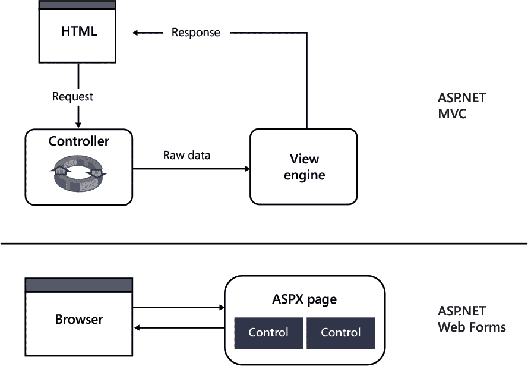

**图 4-4** 对比 `ASP.NET MVC` 和 `ASP.NET Web Forms` 的架构和编程模型

### ASP.NET MVC 的优点

如今的 Web 倾向于密集使用 `JavaScript` 来增强和渲染页面，并使用 `CSS` 为页面设置样式。简单来说，这些任务使用 `ASP.NET MVC` 比使用 `ASP.NET Web Forms` 要容易实现得多。即使你选择了 `SPA`——纯 `JavaScript` 调用 Web 服务——你仍然需要主机。你最可能的选项仍然是 `IIS` 的 `ASP.NET MVC` 应用程序。

通过使用 `ASP.NET MVC`，你可能可以实现现在需要的目标。它并没有阻止你使用 `AngularJS`、`Knockout` 甚至 `React` 等框架。它与 `Twitter Bootstrap` 和 `jQuery` 完美配合。只要你避开 `ASP.NET Core 1.0`，它也可以与 `Web Forms` 并存运行。

这是 CTO 需要考虑的一个重要因素。

如果你有一个大型 `ASP.NET Web Forms` 代码库需要迁移，可以在新创建的 `ASP.NET MVC` 项目中导入所有的 `ASPX` 页面，并部分重写你需要的部分。这是一个缓慢的过渡，保留了你大部分现有投资，并允许开发者以最适合自己的节奏成长并获得新技能。

 重要

`ASP.NET MVC` 和 `ASP.NET Web Forms` 的混用是可能的，因为目前这两个框架共享相同的运行时环境。这将在 `ASP.NET Core 1.0` 平台下发生变化，在该平台上 `Web Forms` 不受支持，因为新的 `DNX` 运行时环境不是基于 `system.web`——后者是 `ASP.NET Web Forms` 的核心。这一点可以帮助你做出关于短期内是否升级到 `ASP.NET Core 1.0` 的业务决策。

## ASP.NET MVC 的弱点

从纯功能角度来看，我没有发现 `ASP.NET MVC` 有任何显著的缺点。作为一个框架，它已经存在了多年，非常稳定，并且符合当今服务器端 Web 开发的需求。`ASP.NET MVC` 的弱点出现在两个层面：基础设施和编码架构。

从一开始开始，`ASP.NET MVC` 的设计是为了不具有侵入性并与 `ASP.NET Web Forms` 并存。由于这个原因，这两个框架共享相同的运行时环境，该环境高度基于 `system.web` 程序集并与 `IIS` 紧密集成。作为时代变化的信号，在几年前，`ASP.NET` 与 `IIS` 的集成管道曾被誉为提升性能的有力措施以及 `ASP.NET` 技术栈的积极演进。然而在今天，`ASP.NET` 技术栈与主机环境之间的紧密依赖被视为 `ASP.NET MVC` 的一个主要弱点。

目前，你有两个选择。你可以留在当前的 `ASP.NET` 技术栈和运行时环境中，并在其上运行最新版本的 `ASP.NET MVC` 框架。或者你可以跳转到 `ASP.NET Core 1.0` 技术栈，享受基于 `OWIN` 标准的、与主机环境通信的更清洁的管道。

在我看来，`ASP.NET MVC` 的另一个不尽如人意的方面与你用于构建 Web 解决方案最常使用的模式有关。`ASP.NET MVC` 作为一个框架，本身显然与架构没有任何关系，但围绕它的交流传达了一些可能难以修改的思想。`ASP.NET MVC` 通常被与在数据模型周围构建某种 REST 接口，并使用控制器类来实现 CRUD 操作联系在一起。

我所看到的问题是，在 Web 上执行 CRUD 操作的 REST 接口在某些情况下才是现实世界业务中运行良好的模型。如果你带着这种观念成长，那么在面对查询堆栈完全不同且需要不同模型的领域时，你可能会遇到严重的问题。抛弃 REST 理念并关注任务（tasks）——这更像是远程过程调用（RPC）风格而不是 REST 风格——是一个更好的方法，因为关注任务并不会阻止你在应用仅需要 REST 的情况下执行 REST，同时，如果有这种需求，它也能让你保持对处理更复杂事务的开放态度。

我建议使用分层架构（我将在下一章中介绍），并使用 `ASP.NET MVC` 作为表现层的框架。在分层架构的语境下，我推荐使用命令查询分离（CQRS）来让命令和查询分开处理。

### 检查 ASP.NET Web API 的角色

`ASP.NET Web API` 是一个为了方便在 Web 上暴露 API 而创建的框架。换句话说，它用于构建并暴露供网页使用的 Web 服务。`ASP.NET Web API` 解决方案仍然需要托管在某处，这最可能（尽管不一定）是在 `IIS` 应用程序内部。`ASP.NET Web API` 前端通常为网页提供 `HTTP` 可达的端点，这些端点返回原始数据（例如 `JSON`、`XML` 或纯文本）。原始数据然后在浏览器中渲染成美观格式。

设置 Web 服务的理想方式是什么？

### 从 WCF 迁移到 Web API

多年来，不同的框架被开发出来，并经常被呈现为暴露 `HTTP` 可达端点的最终解决方案。起初，有 Windows Communication Foundation（`WCF`）。`WCF` 被构建并销售作为一种用于暴露服务的框架，该服务无论传输层如何，工作方式都是相同的。换句话说，任何 `WCF` 服务都可以通过 `TCP` 或 `HTTP` 访问，而无需更改任何内容。

要按这种方式工作，`WCF` 需要一个丰富且通用的基础设施，对于那些只想使用单一协议的场景来说，它太复杂且昂贵了。换句话说，`WCF` 从未关注过 `HTTP`。多年来，`WCF` 经历了许多旨在简化 `HTTP` 编程的扩展，例如 `HTTP` 绑定和 REST 启动工具包。但到头，它一直是运行在 `HTTP` 之上的 `WCF`。它从来不是一个针对 `HTTP` 优化并以该为目标从零开始构建的解决方案。`ASP.NET Web API` 可能是为通过 `HTTP` 暴露 Web 服务提供理想框架的最佳尝试。

尽管有时被认为是 `ASP.NET MVC` 的一个分支，但 `ASP.NET Web API` 是一个通用框架，甚至不限于 Web 场景。`ASP.NET Web API` 可以托管在任何种类的 `.NET` 应用程序中，包括 Windows 服务或控制台应用程序。如果它托管在 `Web Forms` 应用程序中，你会发现编写供 `jQuery` 函数从 `HTML` 页面调用的 Web 服务要容易得多。事实上，你可以使用 `ASP.NET Web API` 作为 `WCF` 的替代品，停止依赖 JavaScript 代理并告别配置上的困难。

在 `ASP.NET MVC` 应用程序中托管 `ASP.NET Web API` 是另一个尚未完全写完的故事。它甚至有一个非常惊喜的结局。


得益于 `ASP.NET Web API`，是安全的，甚至建议将 `WCF` 服务的范围限制在那些确实需要或可能要求非 `HTTP` 通信的场景中。如果你确定要坚持 `HTTP` 作为传输协议，请务必放弃 `WCF` 而改用 `ASP.NET Web API`。使用 `ASP.NET Web API` 编写要容易且快速得多，而且由于内存占用和工作量显著减少，它还提供了更好的性能。

### 比较 ASP.NET Web API 和 ASP.NET MVC

`ASP.NET Web API` 是一个框架，一旦托管在监听器应用程序中，它就会处理通过 `HTTP` 传递其端点的请求。它的整体架构与 `ASP.NET MVC` 相似。两个框架都利用 `controllers` 和 `actions`。两个框架都依赖模型绑定，并拥有内部且可配置的路由系统以及各种扩展点。

它们也有一些重要的区别。

特别是，`Web API` 的运行时与 `ASP.NET MVC` 完全分离。你会遇到名称和行为相似的类，但命名空间和程序集是不同的。`ASP.NET MVC` 和 `ASP.NET Web API` 之间的差异可以总结为以下三点：

 在运行时级别，处理代码和序列化结果是解耦的步骤。

 内容协商是不同的。

 可能在 `IIS` 之外托管。

`ASP.NET Web API` 层由一组派自名为 `ApiController` 的基类的控制器类组成。在 `controller` 上定义的 `HTTP GET` 方法可以直接返回原始数据，而不需要像 `ASP.NET MVC` 那样显式通过 `ActionResult` 容器传递。这是一个示例：

[点击此处查看代码图像

```csharp
// NewsController 类
public IList<News> Get()
{
    // 这是请求的处理代码
    var url = ...;
    var client = new WebClient();
    var rss = client.DownloadString(url);
    var news = DoSomethingToParseFeed(rss);
    // 直接返回数据，让运行时进行任何 HTTP 格式化
    return news;
}
```

让我们对比在 `ASP.NET MVC` 控制器中编写的类似方法：

[点击此处查看代码图像

```csharp
public ActionResult Index()
{
    // 这是请求的处理代码
    var url = ...;
    var client = new WebClient();
    var rss = client.DownloadString(url);
    var news = DoSomethingToParseFeed(rss);
    // 显式的 JSON 序列化步骤
    return Json(news, JsonBehavior.AllowGet);
}
```

差异说明了早期列表的前两点。从 `Web API` 动作返回的任何数据都会通过一个格式化层（称为内容协商的过程），该层最终决定了返回给调用者的流。在大多数情况下，内容协商对开发者来说是不可见的。标准惯例将任何返回的数据默认为 `JSON`。然而，如果 `HTTP` 请求指示 `XML` 作为返回数据的首选格式，框架将自动使用内置架构切换到 `XML`。

存在扩展点来替换原生的 `JSON` 格式器或序列化到自定义的 `XML` 格式器。你在应用程序启动时注册自己的格式器，作为配置工作的一部分。如果你想为每个方法使用自定义的 `XML` 架构，你需要偶尔微调配置。


在 ASP.NET Web API 的底层隐藏着许多约定。例如，所有名称以 `Get` 开头的方法都会自动绑定到 HTTP GET 操作，而 URL 将变为去掉 `Get` 前缀的方法名。在示例中，两个方法都是通过类似 `/news*` 的 URL 调用的。如果你将 ASP.NET Web API 方法重命名为 `GetAll`，那么调用它的 URL 就会是 `/news/all*`。

如果你已经有一个 ASP.NET MVC 应用程序，通过 Web API 暴露领域的 API 并不会给你带来任何显著的收益。这样做是可行的，运行良好，而且甚至不是一个错误的选择。但我并没有看到任何特殊的优势。此外，我看到由于涉及到两个处理请求的运行时环境而产生的一些复杂性。

如果你已经有一个 ASP.NET MVC 应用程序，你仍然可以暴露一个 HTTP 前端，只需使用用于渲染 HTML 的相同控制器类，就可以轻松快速地编写它。这种情况下不会发生内容协商（content negotiation），但返回的数据格式由控制器决定。这是一个控制器在 JSON 和 XML 之间选择的示例：

```csharp
public ActionResult Index(Boolean xml = false)
{
    // 这是处理请求的代码
    var url = ...;
    var client = new WebClient();
    var rss = client.DownloadString(url);
    var news = DoSomethingToParseRssFeed(rss);
    // 显式 JSON 序列化步骤
    if (xml)
      return Content(new ThisMethodXmlFormatter(rss), "text/xml");

    return Json(news, JsonBehavior.AllowGet);
}
```

一切都在你的完全控制之下。没有任何“魔法”发生的地方，你只使用了一个运行时环境。

Web 服务仍然需要托管在某个地方。如果你决定在 IIS 之外或 Web Forms 之下托管 Web 服务，使用 ASP.NET Web API 来实现它是可以接受的。但如果你计划在 ASP.NET MVC 内部托管 Web 服务，你最好在同一个 ASP.NET MVC 应用程序中使用临时控制器（ad hoc controller）来构建该服务。

## 谈论 REST

ASP.NET Web API 经常与 REST 联系在一起。换句话说，关于使用 ASP.NET Web API 构建 Web 服务的观点之一是，它让你更容易围绕后端可能拥有并想要暴露的数据模型构建一个 REST 接口。

事实确实如此。

我并不是 REST 的爱好者，我并不介意承认我强烈倾向于 RPC 风格，因为我发现 RPC API 的这种“自由”语言更具活性，并且更适合表达业务领域及其任务的复杂性。对于我来说，REST 更多是关于建模，而不是对业务场景的镜像。

无论如何，如果你喜欢以 REST 的方式编写代码——即在你服务器端拥有的实体上执行基本的 HTTP 操作——那么即使在 ASP.NET MVC 的背景下使用 ASP.NET Web API 也是一个可以接受的选择。我只是想澄清，并在某种程度上消除这种观点，即“如果你想要一个与核心网站不同的服务层，就需要 ASP.NET Web API”。这其实是老事重提：其关键在于决定如何托管 Web 服务，以及是围绕 REST 还是 RPC 接口来创建它。

在这方面，观察 ASP.NET Core 1.0 的开发是非常有趣的。

## 在 ASP.NET Core 1.0 中使用 Web API

显然，如果你阅读一些关于 ASP.NET Core 1.0 的文档，一切似乎都与图 4-3 所示的一致。在 ASP.NET Core 1.0 中，你支持 ASP.NET MVC 和 ASP.NET Web API，并且它们都运行在相同的运行时环境和管道之上。然而，如果你仔细观察，你拥有的只是单一框架，它从 ASP.NET MVC 的核心功能开始，并通过从 Web API 借鉴的一些特定功能对其进行扩展。具体意味着什么？

Web API 消失了，你只需要创建一个控制器类并决定它返回什么——是一个 `IActionResult` 类型还是普通的 CLR 对象。如果是普通的 CLR 对象，实际的序列化格式将像当年的 Web API 一样，通过查看 HTTP 头部进行协商。换句话说，“我们有一个 ASP.NET MVC 站点和一个 Web API”这种说法在 ASP.NET Core 1.0 中是没有意义的。你所拥有的只是 ASP.NET Core 1.0 应用程序中的一组控制器类。以下是在 ASP.NET Core 1.0 下运行的 ASP.NET MVC 编写器的方法：

```csharp
[Route("api/[controller]")]
public class NewsController : Controller
{
    [HttpGet]
    public IEnumerable<NewsItem> All()
    {
        var data = ...;
        return data;
    }

    [HttpDelete("{id}")]
    public IActionResult DeleteNews(int id)
    {
        // 删除项目
        ...
        return new StatusCodeResult(204);
    }
}
```

控制器上的 `Route` 特性定义了通过控制器的任何内容的默认路由。它以 `/news*` 开头，其中 `news` 是控制器的别名。

我承认我之前的说法“Web API 消失了”（故意地）有些过重了。Web API 并没有消失，而是合并到了 ASP.NET MVC 中。然而，结果是，再也没有将 Web API 视为与 ASP.NET MVC 不同的东西了。至少在 ASP.NET Core 1.0 中是如此。

### 单页应用

单页应用（`SPA`）正如其名所示。它是一个基于单页的 Web 应用程序。

加载时，页面连接到某个远程端点并下载所需的任何数据，以便程序化地准备任何用户界面。接下来，当用户与内容交互时，页面的 DOM 将被更新。“单页”是你从服务器下载一次的且不再更改的内容。

SPA 的主要目标是为用户提供更流畅的体验，消除所有的全页刷新，并使交互类似于桌面应用程序。

### 设置 SPA

典型的 SPA 由一个页面，或者可能几个页面组成，作为纯 HTML 文件或 ASP.NET 服务器应用程序的端点托管在 Web 服务器上。HTML 选项通常意味着容器是一个半空的 HTML `<body>`，带有一个 HEAD 区域和一个作为体的空 DIV。页面加载大量的脚本代码，而脚本代码反过来开始下载数据和标记显示给用户。

任何启动时请求的数据都会导致网站加载时间变长——有时甚至会让用户觉得太久。然而，一旦渲染了第一个视图，交互将变得更快、更流畅，因为大部分内容已经下载并渲染，而且更重要的是，它们不会再被修改。

搭建一个单页应用（SPA）比初看起来要复杂得多，从现实来说，只有使用专门的框架——例如 `AngularJS`——才能让它变得值得。然而，一旦你交付了这样的解决方案，通常通常是满意的。SPA 与经典的 ASP.NET 代码有很大不同，它主要由 JavaScript 代码和客户端数据绑定技术组成。

## 混合式 SPA

混合 SPA 是介于经典 ASP.NET 站点和 SPA 之间的产物。它依赖于服务器端的 ASP.NET 程序，该程序提供通过超链接连接的几个 HTML 页面。你构建混合 SPA 的方式与构建普通的 ASP.NET 站点完全相同，不同之处在于某些 HTML 视图的内容是高度动态的，并且基于 Ajax 交互和客户端 DOM 的动态更新。

在混合 SPA 中，你可能仍然在使用客户端 JavaScript 库来执行数据绑定和 Ajax 调用，但你使用这些特性是为了优化特定的视图，而不是在整个应用程序中使用这种模式。

对于用户来说，其益处在于至少关键页面是高度动态的，并且速度比经典的服务器页面集快得多。初始化过程与普通的服务器网站相同，而且不需要预加载整个页面集。

在技能方面，向 JavaScript 的过渡仅限于学习两种数据绑定框架之一，其中最流行的无疑是 `AngularJS`。不过，你不需要学习所有的 `AngularJS`。此外，从 SEO 的角度来看，你已经成功了一半，可以根据 SEO 要求有效地决定你需要多少个不同的 HTML 视图（以及 HTTP 端点）。

## SPA 的弱点

自相矛盾的是，SPA 的弱点恰恰是那些也是其优势的点。由于拥有预下载内容而带来的用户界面流畅性可能会在首次显示时引入延迟，或者如果远程服务器偶尔响应缓慢，甚至可能会阻塞几秒钟的交互。

我同意响应慢确实不是一个 SPA 特有的问题。但在普通的 ASP.NET 服务器站点上，一旦标记显示出来，你就可以流畅地读取和交互，直到你点击提交或导航到其他地方。在 SPA 中，甚至可能某些内容是隐藏的，并将按需下载。因此，发起远程请求的可能性更大，随后你遇到缓慢响应的可能性也更大。这个问题在移动设备上可能会非常恼人。

我看到的 SPA 的另一个问题是如何向管理层推销它。营销部门通常喜欢能够迅速响应任何用户输入的网站想法，但有时管理层可能会认为网站需要很多页面而不是单个页面。要解释 SPA 是一个页面（或只是极少数页面）以及通过某种方式路由和导航的几十个不同的 HTML 视图，可能是困难的。

我预期的另一个反对意见是关于技能。编写 SPA 需要强大的 JavaScript 技能，并熟悉和精通所选的 SPA 框架。要构建一个真正的 SPA，你需要来自 SPA 专业框架的帮助，例如 `AngularJS`、`Durandal` 或 `Ember`。学习使用其中任何一个都等同于学习一种新的编程语言。入门可能很容易，但要精通可能需要一些时间。而时间就是金钱。

如果你选择混合式，我看到了一个容易得多的学习曲线。首先是因为你仍然编写了大量的服务器端代码，其次是因为你可以将精力限制在仅在客户端使用特定的数据绑定库（例如，`Knockout` 或 `Moustache`）或大型框架的数据绑定模块。

### 总结

本章阐述了你在构建 Web 解决方案时拥有的选择。最后，如今你可以通过许多同样有效的方式来构建 Web 解决方案。关键在于在业务领域背景下定义什么让一个解决方案变得“有效”。

大量使用 `Web Forms` 构建的系统正在等待重做。与此同时，正有一些正在架构的新系统，它们预计寿命很长。还有越来越多的网站只运行几周。你应该做什么？

短命的 Web 应用程序和站点应该使用团队能够良好应对的任何方法来创建，无论所用框架现在和未来如何。ASP.NET 栈的新系统绝对应该采取 `ASP.NET MVC` 路线，并将 `Web API` 视为 `ASP.NET MVC` 的扩展。`Web API` 将消失，因为它将在 `ASP.NET Core 1.0` 中合并到 `ASP.NET MVC` 中。

对于现有的大型 `Web Forms` 代码库，我假设更改框架的成本很高。另一方面，你终某时候会付出这些代价。一个很好的折中方案可以是开始过渡到 `ASP.NET MVC` 而不是进入 `ASP.NET Core 1.0`。这样做，你可以混合使用 `ASP.NET Web Forms` 和 `ASP.NET MVC`，从而让公司处于正确的轨道上，但以可持续的速度。

我不是 SPA 的忠实粉丝，但我确实推荐混合 SPA。对我来说，在 `ASP.NET MVC` 之上的混合 SPA 代表了如今 Web 栈的最佳近似。如果它由一个关注 `CQRS` 的分层架构支持会更好。

最后，我花了几笔文字写了我在第 3 章中称为 `UX 驱动设计`的内容。我看到的今天软件的主要问题是业务视图与软件视图之间的差距。多年来，我们希望能够为整个领域想出一个全能的单一模型。有时它是有效的，有时则不奏效。

我认为我们最好关注屏幕以及用户与应用程序之间的预期交互。这就是我在第 3 章中以 `UX 驱动设计` 形式推荐的内容。

你可能从小就认为这样一个观念：任何软件系统都应该围绕三个部分进行构建：表示层、业务层和数据层。`presentation`部分由屏幕（桌面、移动或 Web 界面）组成，用于收集输入数据和展示结果。`data`部分是你处理数据库、保存和读取信息的地方。`business`部分则是你所需要的其他所有逻辑的归属地。（参见图 5-1）

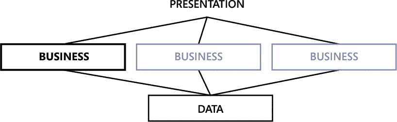

**图 5-1** 软件架构经典的层级分层

行业文献大多将图 5-1 中所示的架构称为`三层架构`。然而，你既可以根据物理层级也可以根据逻辑层来分配划分。这完全取决于你的需求。

## 当今在使用三层架构

三层架构已经存在很长时间了，但它起源于那个时代大多数业务工作要么与数据库相关，要么受限于外部组件（如大型机）。在大多数情况下，三层架构使用单一数据模型，该模型从数据存储一直传输到表示层再返回。

这种架构确实没有阻止你使用其他类型的数据传输对象（DTO），但大多数时候，三层架构是单一数据模型的象征，并且是以数据库为中心的。你如今面临的挑战——也是领域驱动设计（DDD）所预见的——是如何将持久化与表示需求相匹配。尽管任何系统的核心操作仍然是增删改查（CRUD），但业务规则影响这些核心操作的方式要求业务层去处理过多的数据转换和过多的业务流程编排。

尽管许多教程坚持将电子商务平台描述为针对客户和订单的简单 CRUD 操作，但事实并非如此。你绝不会只是简单地向数据库添加一条订单记录。订单的用户界面与 `Orders` 表的模式之间绝不是简单的一对一对应关系。很可能，在表示层你甚至没有“订单”的概念。你更有可能拥有类似购物车这样的东西，一旦处理，它就会在某些数据库表中生成订单记录。

业务过程是三层心理模型中最难组织的部分。而且业务过程不仅仅是软件中最重要的部分；它们是真正重要的东西，而且是无法做出妥协的事情。初一看，业务过程是业务层的核心。然而，在大多数情况下，业务过程的范围太广了，无法轻易限制在那种倾向于轻松转换为物理层的架构边界内。不同的表示层可以触发不同的业务过程，而不同的业务过程可以引用相同的核心行为以及少数规则的实现。

尽管业务逻辑的意义似乎显而易见，但可复用业务逻辑的正确粒度完全并不明显。

## 五十色调灰色地带

在简单的三层场景中，你会将调整数据以适应表示层的逻辑放在哪里？而优化输入数据以供持久化的逻辑又属于哪里？这些问题凸显了一些架构师至今仍在苦斗的两个显著灰色地带。

`gray area`是指某些业务背景下的不确定或无确定状态的领域。在软件架构中，该术语也指一种适用方案并不明显的情况，这种不确定性更多源于存在多种选择，而不是缺乏解决问题的工具。

为了消除灰色地带，我们需要对架构进行稍微的回顾。当埃里克·埃文斯（Eric Evans）首次引入领域驱动设计时（我在第 1 章中讨论过“进行彻底的领域分析”），他同时也引入了分层架构，如图 5-2 所示。

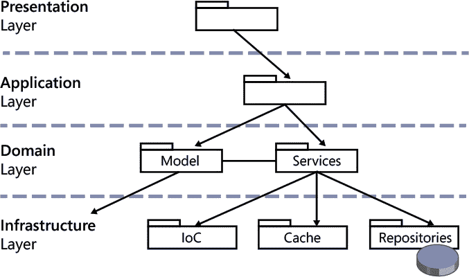

**图 5-2** 分层架构

分层架构多了一层，并将“数据访问层”的概念扩展为任何必要基础设施的提供者，例如通过对象关系映射（ORM）工具进行的数据访问、反转控制（IoC）容器的实现，以及许多其他如安全、日志和缓存等交叉关注点。

业务层分裂为应用层和领域层。这种趋势正试图消除灰色地带，并明确存在两种业务逻辑：应用逻辑和领域逻辑。`application`逻辑负责编排任何由表示层触发的任务。`domain`逻辑是任何在多个表示层之间可复用的特定业务的核心逻辑。

应用层与表示层几乎是——对应的，是进行任何 UI 特有数据转换的地方。领域逻辑涉及业务规则和核心业务任务，并使用一个严格面向业务的数据模型。

## 表示层

表示层负责提供某些用户界面以完成任何必要的任务。表示层由一组屏幕组成，无论是 HTML 表单或其他任何形式。今天，越来越多的系统拥有多个表示层。这是一本 ASP.NET 书籍，所以你可能认为至少在当前语境下，只有一个表示层。我会说，并不完全如此。

移动 Web 是 Web 应用程序必须考虑的另一个表示层。那么，移动 Web 表示层可以通过响应式 HTML 模板或一套完全不同的屏幕来实现。然而，这并没有改变一个基本事实：对于几乎任何 Web 应用程序来说，移动 Web 都是额外的表示层。

### 用户体验

无论你在中间层苦心编写了什么种智能代码，如果没有表示前端，任何应用程序都无法被用户使用。此外，如果没有良好的用户体验，任何应用程序都无法令人愉快且高效。然而长期以来，表示层一直是开发者和架构师最后考虑的问题。

许多架构师将表示层视为系统中不高级的部分——在业务层和数据访问层完全成功完成后，几乎只是一个细节。事实是，在任何复杂性的系统中，表示层与业务逻辑和数据访问代码同等重要。然而，如今用户体验——用户与应用程序交互时的体验——是无价之宝，正如我在第 3 章中所解释的那样……

无论如何，无论是以自顶向下的方式开发系统（如第 3 章建议），还是以更经典的自底向上的方式，你都需要理解表示层。请看图 5-3。

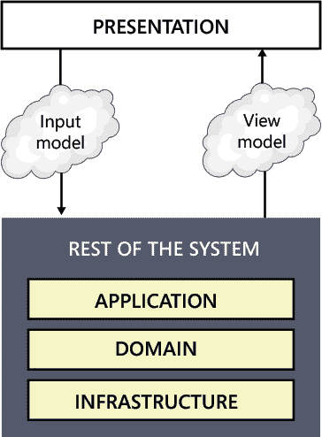

**图 5-3** 描述进出表示屏幕的数据

表现层将数据引导到系统的其他部分，理想情况下，它使用自己的数据模型，该模型能够很好地反映结构并组织屏幕上的数据。你应该将用户界面渲染为一个订单实体（order entity），而不仅仅是因为你最终将数据存储在 `Orders` 表中。例如，当你提交订单时，你通常会收集像收货地址这样的信息，这些信息可能与支付订单的客户相关，也可能无关。而且收货地址并不一定与订单一起存储。可能是收货地址被告知了货运公司，而参考号则存储在订单中。

通常情况下，表现层中每个向系统后端发送命令的屏幕都会将数据分组到输入模型（input model）中，并使用视图模型（view model）中的类接收响应。输入模型和视图模型可能一致，也可能不。同时，它们可能与后端执行实际任务时使用的任何数据模型一致，也可能不。

### 输入模型


在`ASP.NET MVC`中，用户的任何点击都会产生一个由`controller`类处理的请求。每个请求都会转换为一个映射到定义在`controller`类上的公共方法的动作（action）。那么输入数据呢？

在`ASP.NET`中，任何输入数据都封装在 HTTP 请求中，可能在查询字符串中、任何表单提交的数据中，或者可能在 HTTP 头或 Cookie 中。输入数据代表了为了让系统执行操作而提交的数据。无论你如何看待，它们都只是输入参数。你可以将输入数据视为松散的值和变量，也可以将它们分组到一个作为一个容器的类中。输入类的集合构成了应用程序的整体输入模型。

正如你将在后续章节中看到的更多细节那样，在`ASP.NET MVC`中，系统基础设施的一个组件——模型绑定层（model-binding layer）可以自动将 HTTP 请求中稀疏且松散的变量映射到输入模型类的公共属性上。这里是两个同样有效的控制器方法（controller method）示例：

点击此处查看代码图像

```csharp
public ActionResult SignIn(string username, string password, bool rememberme)
{
    ...
}

public ActionResult SignIn(LoginInputModel input)
{
    ...
}
```

在后一种情况下，`LoginInputModel`类将具有公共属性，其名称与上传参数的名称匹配：

点击此处查看代码图像

```csharp
public class LoginInputModel
{
    public string UserName { get; set; }
    public string Password { get; set; }
    public bool RememberMe { get; set; }
}
```

输入模型在系统核心中携带数据，其方式与用户界面的预期是一一对应的。使用输入模型可以更容易以一种强业务导向的方式设计用户界面。应用程序层（如图 5-3 所示）负责解包任何数据并根据需要对其进行消费。

## 视图模型

任何请求都会获得响应，而且通常情况下，你从`ASP.NET MVC`得到的响应是一个 HTML 视图。（诚然，这不是唯一的选项，但它仍然是最常见的。）在`ASP.NET MVC`中，HTML 视图的创建由`controller`管理，它调用系统后端并获取一些响应。然后它选择要使用的 HTML 模板，并将 HTML 模板和数据传递给一个临时系统组件——视图引擎——视图引擎将混合模板和数据并为浏览器生成标记。

在`ASP.NET MVC`中，有几种方法可以将数据传递给视图引擎并将其整合到生成的视图中。你可以使用如`ViewData`之类的公共字典、如`ViewBag`之类的动态对象，或者收集所有属性进行传递的定制类。你创建的任何用于携带数据并整合到响应中的类都有助于创建视图模型。应用程序层是接收输入模型类并返回视图模型类的层：

点击此处查看代码图像

```csharp
public ActionResult Edit(LoginInputModel input)
{
    var model = _applicationLayer.GetSomeDataForNextView(input);
    return View(model);
}
```

在未来，用于持久化的理想格式将与用于表现的理想格式不同。表现层负责定义接受数据的清晰边界，而应用程序层负责以恰恰的格式接收和提供数据。如果你广泛采用这种方法，你就遵循了第 3 章中关于 UX 驱动的软件设计的原则。

* *

 注释

将表现层置于中心是一种有回报的方法，无论你是使用服务器端方法构建 Web 解决方案还是使用客户端解决方案。

* *

## 应用程序层

为了继续业务操作，表现层需要一个指向系统后端的引用。应用程序业务层中入口的形状和颜色取决于你实际上如何组织它。

在`ASP.NET MVC`解决方案中，你可以通过仓库类（repository classes）直接从`controller`调用基础设施层。但通常，你希望在中间有一个或两个中间层。请查看图 5-4。


**图 5-4** 基于聚合的分层架构

从图中可以看出，你可以在控制器内部访问仓库，但那只是在简化设计带来的收益大于痛苦时的一种。分层架构通常基于四个逻辑层。控制器（作为表现层的一部分）和仓库（作为基础设施层的一部分）之间都有自己的位置，如果你不使用任何一层，那应该是你有充分的理由（主要是为了简化）才这样做。

### 系统后端的入口

用户界面的每个交互元素（例如按钮）都会触发系统后端的动作。在某些简单的情况下，用户点击后的后续动作只需要一步即可完成。但在更现实的情况下，用户的点击会触发类似工作流的内容。

应用程序层是系统后端的入口，也是表现与后端之间的接触点。应用程序层由几乎一一对应于表现层用例的方法组成。你可以以你认为合理的方式对方法进行分组。

倾向于将应用程序层的方法组织在与类类对应的类中。通过这种方式，例如`OrderController`类拥有自己的`OrderService`类私有实例。`OrderService`类的方法获取输入模型类并返回视图模型类。内部，该类执行任何必要的转换，以便数据在表现层上呈现得良好，并为后端处理做好准备。

* *

业务流程的编排

应用层的主要目的是将用户感知的业务流程进行抽象，并将这些流程映射到应用程序后端隐藏且受保护的资产。例如，在一个电子商务系统中，用户期望有一个购物车，但物理数据模型中可能并没有“购物车”这样的实体。应用层位于表现层和后端之间，负责执行任何必要的转换。

接收订单通常是一个多步骤的工作流，而绝不是单步的。如果它只是单步，那么你可能无法发现通过应用层的任何益处。否则，应用层极大地有助于将工作流与业务规则和领域特定流程区分开来。为了更好地理解应用逻辑与领域逻辑之间的区别，请考虑以下来自银行场景的示例。

作为客户，你可以与柜员交流并要求存入纸质支票。最终，某些资金将从一个账户取出并存入另一个账户。但实际过程可能会大不同。至少，柜员会执行一个流程：首先向发行银行发送请求，然后向你的账户存入资金。因此，你有两个操作：

 从银行兑取支票。

 向银行账户存入资金。

这两个操作都是领域层级的操作，且都是业务领域的核心任务。另一方面，这两者的结合是一个绑定到表现层特定用例的工作流——让用户存入支票。产生的工作流代表了像“存入支票”这样的语句，取决于实现方式和涉及的外部服务，它可能是核心领域操作，也可能不是。毕竟，这最终是一个架构决策。

将业务逻辑拆分为应用逻辑和领域逻辑，可以为你提供逻辑工具，使业务逻辑尽可能地接近现实世界，并且比其他任何事情都更贴近用户的预期。

***

 注意

如今，对于任何复杂程度的应用程序的成功，用户体验都比以往更加重要。因此，为了提供卓越的用户体验，黄金法则是就是：“你最好有一个应用层。”

***

## 领域层

任何软件——即使是最简单的数据输入应用程序——都是针对某个业务领域编写的。每个业务领域都有自己的规则。规则的数量有时接近于零，但作为架构师，你应该始终为业务规则集合留出空间。最后，每个业务领域都暴露某种应用程序编程接口（`API`）。表现层允许最终用户与此类 API 交互的方式（用例）决定了应用层。

简而言之，领域层托管了所有不特定于一个或多个用例的完整业务逻辑。通常，领域层由一个模型（称为`domain model`）和可能的系列服务（称为领域服务）组成。

### 神话般的领域模型

坦率地说，我发现人们对领域模型的预期角色和目的存在很多困惑。从抽象意义上说，领域模型是一个帮助呈现业务域的纯软件模型。该软件模型可以使用面向对象的范式（最常见的场景）或你认为合适的任何其他方法（例如函数式范式）来定义。领域模型是你实现业务规则以及通用、可重用业务流程的地方。

即使你使用面向对象的范式，领域模型也可能或可能不是纯的实体关系模型，并且可能或可能不与持久化模型具有一对一的关系。领域模型与持久化之间没有严格联系；领域模型必须服务实现业务规则这一最高目的。持久化紧随其后，是基础设施层的关注点之一。

在技术方面，关于`Entity Framework Code First`有很多炒作，它让你能够轻松创建类，然后指示运行时相应地创建数据库表。这并不是领域建模——这是持久化建模。作为架构师，你应该很好地意识到逻辑层：领域模型与持久化模型是不同的东西。然而，这两个模型是可以匹配的——而且通常在简单的场景下匹配——这使得`Entity Framework Code First`发挥了用处。

在一个关注逻辑和业务规则的领域模型中，不可避免地会有带有工厂、方法和只读属性的类。`Factories`（工厂）比构造函数更能让你表达创建新实例所需的逻辑。`Methods`（方法）是根据业务任务和操作更改系统状态的唯一方式。`Properties`（属性）仅仅读取领域模型实例当前状态的方法。

面向对象的领域模型并不一定是实体关系模型。它可以仅仅是稀疏且松散的类的集合，这些类包含数据，并将任何行为存储在只有方法的独立类中。一个没有任何显著行为的实体的模型——即纯粹的数据结构——构成了一个`贫血领域模型`（anemic domain model）。

领域模型存在于内存中，并在很大程度上是无状态的。然而，某些与业务相关的操作需要数据库的读写。与数据库的任何交互——包括判断给定客户是否达到“金牌”客户状态的典型示例（无论这在业务中意味着什么）——都应该发生在领域模型之外。它应该发生在领域层内部。这就是为什么除了领域模型之外，领域层还应该具备领域服务。

### 同样神话化的领域服务概念

解释什么是领域模型非常简单。通常，开发者几乎能瞬间且完全地理解呈现业务域的软件模型概念。问题出现在稍后的时候，当你坚持在领域和持久化之间进行理想的分离时。

点在于，业务逻辑的很大一部分与持久化保存在某些数据存储中或由某些外部服务持有和控制的信息操作有关。在一个电子商务系统中，为了判断一个客户是否达到了金牌客户状态，你需要统计在给定时间范围内的订单数量，并将其与选定的产品范围进行比较。这种复杂计算的输出是一个纯布尔值，你将其存储在`Customer`领域模型类的新实例中。然而，为了获得这个值，你仍然有大量工作要做。

哪个模块负责这些？

领域服务是一个涵盖许多辅助类的伞术。`domain service`是一个执行与业务逻辑相关的重用任务的类，它在领域模型中实现业务规则的类周围执行这些任务。领域服务部分的类可以自由访问基础设施层，包括数据库和外部服务。例如，领域服务负责协调存储库（repositories）——即对持久化模型中的实体执行 CRUD 操作的纯类。

领域服务的简单规则是：对于你任何需要访问外部资源（包括数据库）的逻辑片段，你都拥有这样一个领域服务类。

我在描述领域层时可能过于严谨和抽象了。我所陈述的任何都是正确的，但在现实世界中，你通常会进行某种程度的简化。简化永远不是坏事，只要你确切知道为了简化删除了哪些逻辑层。如果你查看一个简化的模型，你可能会面临错过一些重要架构点，尽管这些点在特定场景下可能是大材小用了。

在简化领域层架构的背景下，我需要在这里进一步解释两个术语：`aggregates`（聚合根）和`repositories`（仓库）。

这两个术语都具有一定的 DDD（领域驱动设计）背景。`aggregate`（聚合根）是由一个或多个在业务中相关的不同领域对象组合成的整体。它是你应用的一种逻辑分组，通过处理更少的粗粒度对象来简化对业务领域的管理。例如，你不需要为了处理订单中的项而专门设置一套函数。离开了订单，订单项几乎没有意义；因此，订单和订单项通常属于同一个聚合根。此外，产品可能会在订单的上下文中被使用，但与订单项不同，产品也可以在订单之外被操作——例如，用户在购买前查看产品描述。

`repository`（仓库）是一个用于管理相关领域对象或领域对象聚合持久化的组件。你可以为仓库分配任何你喜欢的编程，尽管许多开发者设计这些类时会围绕类型`T`（即相关的领域类型）。

在 DDD 领域建模中，聚合根是一个核心概念。我在这里试图传达的愿景更多是面向任务的，因此不再以实体为中心。因此，聚合的角色在领域层背景下的重要性降低了，但在基础设施层领域仍然处于核心地位。

在领域层中，你应该关注表达业务规则和过程的类。你不应该仅仅目标是识别要持久化的数据聚合。你识别的任何聚合都应该源于你的业务理解和建模。接下来，你面临持久化系统状态的问题。

涉及到这个问题时，你至少有两种选择。一种方案是对系统的最后已知良好状态进行经典的持久化；另一种方案是被称为`event sourcing`（事件溯源）的新方法，其中你只需保存发生的事情，并描述发生了什么以及涉及的任何数据。在一种情况下，你需要聚合根；在后情况下，你可能不需要聚合根就能在发生的事件描述中将相关数据保持在一起。

## 基础设施层

基础设施层是任何与使用具体技术相关的内容，无论是数据持久化（如`Entity Framework`等 ORM 框架）、外部 Web 服务、特定的安全 API、日志、追踪、IoC 容器、缓存等。

基础设施层最显著的组件是持久化层——它无非是老实可靠的数据访问层，可能扩展到涵盖除纯关系型数据存储之外的几个数据源。持久化层知道如何读取或保存数据，并由仓库类组成。

### 当前状态存储

如果你使用存储系统当前状态的经典方法，你为每个相关的实体组都需要一个仓库类——这就是聚合根的概念。我所说的“实体组”是指像订单和订单项那样总是在一起的实体。

仓库的结构可以是类似于 CRUD 的，这意味着你在泛型类型`T`上拥有`Save`（保存）、`Delete`（删除）和`Get`（获取）方法，并配合谓词来查询数据的即时部分。没有任何可以阻止你为你的仓库提供远程过程调用（RPC）风格，其方法反映了动作——无论这些动作是读取、删除还是插入——都服务于业务目的。

我通常将其总结为：编写仓库没有错误的方法。从技术上讲，仓库是基础设施层的一部分。然而，从简化的角度来看，仓库可以被视为一个领域服务，并暴露给应用层，以便应用程序能够更好地编排复杂的应用级工作流。

### 事件存储

我打赌事件溯源将对我们编写软件的方式产生巨大影响。正如第 2 章所述，“选择支持性架构”，事件溯源涉及到将事件作为应用程序主要的数据源。

事件溯源对于所有应用程序并不一定有用。事实上，开发者们在几十年里一直幸福地忽略了它。但今天，越来越多的领域专家需要跟踪软件能产生的事件序列。你无法通过以保存当前状态为核心的存储哲学来实现这一点。当事件成为你应用程序的主要数据源时，一些情况会发生变化，对新工具的需求也随之出现。

事件溯源对两个方面有影响：持久化和查询。`Persistence`的特征是三个核心操作：`insert`（插入）、`update`（更新）和`delete`（删除）。在事件溯源场景中，插入几乎与持久化实体当前状态的经典系统相同。系统接收请求并在存储器中写入一个新事件。该事件包含自身的唯一标识符（例如`GUID`）、一个识别事件类型的类型名称或代码、一个时间戳以及关联信息（例如构成被创建的数据实体的内容）。更新则存在于在相同数据实体容器的另一个插入操作中。新条目仅指示了数据——哪些属性发生了变化、新值，以及如果在业务领域中相关，则变化的原因和如何变化。一旦执行了更新，数据存储就会像图 5-5 所示那样演进。

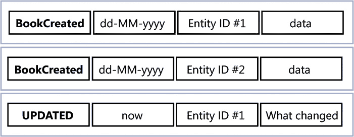

**图 5-5** 指示 ID 为 #1 的书籍实体更新的新记录

删除操作的方式与更新相同，不同之处在于具有类型信息。

在基于事件的数据存储中进行更新会立即为查询带来一些问题。你如何知道给定的记录是否存在，或者如果存在，它的当前状态是什么？这需要一个即时的查询层，在概念上选择所有匹配 ID 的记录，然后分析事件随后的数据集。例如，它可以根据`Created`事件的内容创建一个新的数据实体，然后重放所有后续步骤，并返回末尾的结果。这种技术被称为`event replay`（事件重放）。

单纯重放事件来重建状态可能会因为可能处理的海量事件而引发对性能的担忧。如果你考虑构成银行账户历史的事件列表，这个问题就很容易理解了。作为一个客户，你可能在几年前开了这个银行账户，每年进行数百次操作。在这种背景下，每当你想查看余额时都处理数百个事件是可以接受的吗？事件溯源理论对这种场景有解决方法，其中最重要的方法是创建快照。`snapshot`（快照）是在任何给定时间保存实体已知状态的记录。通过这种方式，获取当前余额时只需处理自上次快照拍摄以来记录的事件。

事件溯源为架构师和领域专家提供了更多力量来设计有效的解决方案，但目前创建和运行必要的设施还需要大量的额外工作。事件溯源需要一系列新工具——`event stores`（事件存储）。事件存储是另一种数据库，具有公共 API 和专为事件数据项定制的编程语言。

### 缓存层

系统中的数据并非所有变化速度都是相同的。鉴于此，每次请求进入时都让数据库服务器读取未更改的数据是没有意义的。同时，在 Web 应用程序中，请求是并发的。一秒内可能有大量请求命中 Web 服务器，而这些并发请求中可能请求同一个页面。为什么你不缓存该页面，或者至少缓存它消耗的数据呢？

极少有应用程序无法在一两秒的数据缓存中生存。在高流量网站中，一两秒就能决定成败。因此，在许多情况下，缓存已成为构建在即时框架（实际上是内存数据库）之外的额外层，例如`Memcached`、`ScaleOut`或`NCache`。

### 外部服务

基础设施层的另一个场景是数据只能通过 Web 服务访问。这种场景的一个例子是 Web 应用程序运行在某些客户关系管理（CRM）软件之上，或者必须消费公司的专有服务。通常，基础设施层负责适地封装外部服务。

总而言之，从架构角度来说，如今我们更倾向于思考一个基础设施层，而不是一个封装关系型数据库的简单数据访问层。缓存、服务和事件都是系统中新兴或整合的方面，它们与简单的持久化并肩工作。

### 总结

软件将永远不再是 10 年前的样子。软件注定会与现实生活变得越来越紧密。为了实现这一点——它将会发生——我们必须重新审视架构原则并改变其中一些。


在本章中，我介绍了一种通用且宽泛的架构，它可以适应你今天可能编写的任何类型的软件。它是我们从小熟悉的经典多层架构的演进阶段。尽管它显然只多增加了一层，但它对我们思考和做事的方式产生了深远影响。

我鼓励你在深入阅读本书之前，先对分层架构的目的及其所有部分形成一个清晰的认知。我看到的问题并不是你可能错失分层架构所代表的意义。这一点是广为人知的，至少在宏观层面上。分层架构中那些不为人知的细节——那些可以简化的部分——才是痛点，也是我建议你花些时间研究的架构方面。即使只是花时间决定你不需要这些部分，也比忽略它们更有成效。

# 第二部分：开发

### 第 6 章 ASP.NET 现状

### 第 7 章 ASP.NET Core 1.0 的原因、何以及技术方面

### 第 8 章 ASP.NET MVC 的核心

### 第 9 章 Bootstrap 的核心

## 第 10 章 组织 ASP.NET MVC 项目

### 第 11 章展示数据

### 第 12 章编辑数据

### 第 13 持久化与建模

## 第 6 章 ASP.NET 现状

*人们对简单答案和半生不熟的解决方案有着近乎普遍的追求。*

*——马丁·路德金*

在`第 4 章`“Web 解决方案的架构选择”中，我列出并讨论了我们今天构建和构建 Web 解决方案的各种选择。如果你正在寻找具体的建议和用例，可以参考该章节，并可能完全跳过本章。

这个简短的章节目的是介绍下一章以及随其后的若干章节。下一章是 `ASP.NET Core 1.0` 的快速指南，它是新的运行时环境，以及如果你选择针对 `Microsoft .NET Core Framework` 时可能会面临的破坏性变更。接下来的章节将回到“经典的”`ASP.NET MVC` 编程主题，这些主题已更新为 `ASP.NET MVC 6`，并且无论你是留在当前的 ASP.NET 平台及其运行时，还是升级到 `ASP.NET Core 1.0` 平台及其相关运行时，它们同样有效。

在`第 4 章`中，我介绍了 `ASP.NET Core 1.0`，并从架构师和首席技术官（CTO）的角度对其进行了讨论。但在该章节中，我参与了关于你今天构建应用程序的具体选择讨论。我列出并讨论了它们，但没有说明我的选择或给出任何明确建议。

本章展示了我对 ASP.NET 技术现状的个人观点以及对它的一些直觉。我出发的点是一个问题：“ASP.NET 将向何处发展？”

### Web 的变体

总的来说，`ASP.NET Framework` 已经存在了近二十。它在 2000 年代初出现时是一个极其成功的平台。它在正确的时间做了正确的事，并从字面上向大量 C、C++ 和 Visual Basic 开发者传授了 Web 开发。多年来，ASP.NET 变了好几次外壳，整合了新功能，并让开发者越来越能够取得惊人的成果。

我们看到 `ASP.NET MVC` 打破了服务器控件的黑盒，将开发向前推进了一步。我们还看到开发向下了一个抽象层级，更接近底层。我们还见证了 `Web Forms` 的一些底层变化，使其可能更具交互性。然后，我们看到了 HTML5 的爆发以及网页中 JavaScript 代码行数的激增。

### Web 本可以是不同的

在过去的十年里，Web 在某个时刻曾有过一个（伟大的？）机会变得完全不同。这本可以通过抛弃 HTML 和 JavaScript 并拥抱更丰富、更强大的模板和编程语言来实现。那是 Microsoft Silverlight 的时代。

我们知道 Silverlight 是如何工作的。然而，全球至少成百上千的公司在 Silverlight 前端上投入了大量资金，而他们是在技术世界全注于 Silverlight 及类富客户端技术时这么做的。现在，这些公司只有一种选择——放弃 Silverlight，拥抱 HTML5 和经典的 Web 开发。

噢是的，还有单页应用（SPA）选项。坦率地说，我不会建议将其作为公司的主流开发策略。我发现它在特定项目中确实有效，但你需要的完全不同的技能组合和优秀的人才。然而，这并不常见。而且如果这不常见，使用 SPA 就是有风险的。此外为整个应用程序获取一个更快、更响应的单页，嗯，这也是一个巨大的挑战。

我并不确定放弃富客户端 Web 开发（以及 Silverlight）是正确还是错误。我将其视为事实并向前看。对我来说，SPA 只是富客户端 Web 的收缩版本。它可能没有那么强大或响应快速敏捷。但话说回来，欢迎你持有不同意见。

### 经典 Web 是赢家

行业决定坚持经典的 Web 模型，即浏览器发送无状态请求并接收 JSON 或 HTML 响应。相关的响应聚合在页面的虚拟概念周围。页面不再是一个物理概念——例如一个 URL——而是由同一个控制器提供的一组相关响应。

无论你喜不喜欢，赢者都是经典 Web 的一个重塑版本。它只是一个普通的请求-响应式 Web，通过 Ajax 风格的调用增强了交互性。有人人将这种模型称为 `hybrid SPA`，这和称之为 Ajax 没什么区别。其核心是在视图中填充一些 JavaScript，以便快速显示和隐藏某些区域，并让视图的更改自动且实时地发生。

现代 Web 在很长一段时间内不存在的一个方面是实时更新。在这方面，`ASP.NET SignalR` 绝对是棒的，是真正的必需品。它对你的代码完全没有侵入性，并且具有惊人的简单且自然的编程模型。它真的让网页看起来是活跃且实时的。

这就是当今的 Web。要使用 JavaScript 片段构建 HTML 响应、暴露 JSON 端点并接收实时更新，你可以使用普通的 `ASP.NET`。我所说的 `plain ASP.NET` 指的就是你多年来使用的同一个 `ASP.NET`，无论是通过 Web Forms 还是 MVC 过滤器。

那么，为什么我们听到关于 `ASP.NET Core 1.0` 新颖、酷炫且具有革命性的炒作呢？让我先直说吧：不，`ASP.NET Core 1.0` 并没有改变 Web 的风味。此外，它甚至没有带来哪怕一点真正的新功能。然而，它对公司来说有一个目的，可能还有一个角色。

## ASP.NET 功能完备

最近，我参与了一个关于如何处理那些不再接收（重大且主要的）更新技术的长贴讨论。正如你可能猜到的，那里有两个观点非常鲜明的阵营。一个阵营认为这些技术已经死了，倾向于尽快放弃它们，就像跳出一艘沉没的船一样。另一个阵营则倾向于只要这些技术还能满足业务需求，就继续使用它们。

我的直觉和第一反应是加入第二个阵营并尽可能大声叫叫。幸运的是，很快出现了第二个想法，让我冷静下来，并让我从更广阔的角度看待问题。

### 无物可加

我刚才描述的讨论最初的主题是 `ASP.NET Web Forms`，但讨论很快扩展并涵盖了 `ASP.NET MVC`。宽地说，`ASP.NET Web Forms` 的最后一次重大更新是 2010 年的 `4` 版本。不久后，`ASP.NET MVC` 出现了最后一次我肯定认为是“重大”的更新。那是 `ASP.NET MVC 3`，尽管版本 `4` 有了一些关于路由、合并和显示模式的优秀功能，但它已经是最后一次更新了。从那以后，我们又有了几次额外的发布，只是以微小的功能变化为代价增加了版本号。

当一项技术简单地无物可加，且其技术团队在挖掘底以寻找任何可以添加的内容时，这项技术的真实健康状况如何？

正如帖中提到的，有些人认为这项技术已经死了，而另一些人则很高兴，因为他们可以继续使用它，而无需担心产生破坏脸的改变，无需花费时间学习新事物，并可以用更高效的方式利用时间。

那么，谁是对错的？谁又是对的？

我认为更好的问题是：“为什么某项技术没有更多东西可加了？” `ASP.NET` 已经达到了它的全部潜力。因此，团队无法添加很多东西让它变得更强大。`ASP.NET`，无论你说的是 Web Forms 还是 MVC，它就在那里，已经成熟且稳固，有工具和框架支持它，并有 `Visual Studio` 来构建解决方案。你可以选取任何你喜欢的 `ASP.NET` 版本并坚持下去。

是达到全部潜力还是软件过时？

正如在第 4 章中提到的，如果 Web Forms 能满足你的需求，你仍然可以使用它。但作为架构师，你应该确保在使用已经表达了其全部功能潜力的技术时做出正确的选择。

全部潜力与过时之间的界限非常模糊，过时紧跟在表达完全部潜力之后。在软件中中，过时不同于硬件，因为几乎不涉及任何物理损坏或消耗。过时的软件仍然可以运行、工作并维持整个公司或业务。（顺便说一下，我们通常称之为 `legacy code`！）

从架构师和 CTO 的角度来看，看到你所在业务的未来至关重要。技术是工具，业务才是交易。你应该观察业务的演进（包括你团队中的成员），评估并选择正确的技术。业务的重要性远大于技术的年龄，所以只要技术能够正常工作并处理任务，它就是可用的。

## ASP.NET Core 1.0 没有新功能

`ASP.NET Core 1.0` 被呈现为一个仅使用 MVC 模式开发 Web 应用程序框架。`ASP.NET Core 1.0` 也提供了暴露 RPC 和 REST 服务以及实时功能的底层。

嗯，这并不新奇。今天在经典的 `ASP.NET` 平台中，我们拥有完全相同的能力。`ASP.NET Core 1.0` 不会给你提供任何增加你编程能力的新功能。因为它是微软 Web 栈的重写，它在 Web 应用程序背景下你通常想做的某些事情提供了一种不同的方式。如果有升级到 `ASP.NET Core 1.0` 的理由，那么，这并不是功能性的理由。

### 它是关于新的运行时

当前的 `ASP.NET` 运行在 20 世纪 90 年代设计的运行时之上。在某个时刻，随着 Internet 信息服务 (`IIS`) `7` 的发布，该运行时被集成到 `IIS` 中，这种集成被呈现为实现更好性能的最佳方式。

这种情况在短短几年内发生了巨大的变化。今天，现实是内存中加载了太多的程序集，每个通过 `ASP.NET` 和 `IIS` 的 HTTP 请求的平均内存约为 `20 KB`。这些数字对某些人和公司是可行的，但对另一些人则不行。

`ASP.NET Core 1.0` 提供了一个新的运行时环境，在相同的特性集之上更高效地运行应用程序。据估计每个请求的内存占用可能低至 `3 KB`。但在你说出“哇！”之前，请稍等一下。

点在于，若想充分利用 ASP.NET Core 1.0 的优势，你应该针对不同版本的 `.NET Framework`，即上述的 `.NET Core`。这个框架消除了一些不常用的 API，并重写了其他 API，以不同的方式实现相同的功能。这些是破坏性变更，不此不言。然而，如果你做了这个改变，你就能很好地体验内存占用的剧烈下降。如果你对现在的 `IIS` 以及它对你的托管情况没有抱怨的理由，那么你仍然可以忽略 `ASP.NET Core 1.0` 并保持快乐，无论外界如何炒作。

### 它是关于业务模式

此时此刻，人们可能会提出的下一个问题是为什么？为什么我们需要 `ASP.NET Core 1.0`，以及微软为什么要进行如此巨大的重构？是因为某些客户要求这样做吗？可能吧，但我认为远不止于此。这就是业务模式，宝贝。

而且不仅仅是微软转向云端和移动服务的业务模式。这也是许多使用微软技术的公司的业务模式。为了提供现代服务，并在需要时按任何方式进行扩展，你必须利用云平台，而云是按需付费的。内存占用和执行时间变得至关重要。

这就是为什么一个云优化的 ASP.NET 平台是有意义的。但不能仅仅是今天平台的扩展。它必须是全新的。而 `ASP.NET Core 1.0` 仅仅是三种 `.NET Framework` 变体的外部容器：经典的 `.NET Framework`、云优化的 `.NET Core` 框架，以及在某个时刻跨平台的 `.NET Core Framework`。

如果你没有可以导出到云端并通过云端实现增长的业务模型，那么你可能并没有迫切需要研究 `ASP.NET Core 1.0`。或者你可以花时间来评估这种转型。

## 这关于开发模型

`ASP.NET Core 1.0` 的另一个方面，更具体说是其运行时环境的一个方面，是它对宿主的独立性。这意味着，使用配备非 Windows 系统的机器在不使用虚拟机的情况下编写和测试 ASP.NET 应用程序变得现实。再次强调，编写和测试并不像听起来那么简单快速，但它绝对会发生。

我认为这是一个很有趣的特性，但在决策时并不是那种真正关重要的因素。然而，有总比没有好，但只有当你目标是仍在开发中的跨平台 `.NET Framework` 时，它才能发挥作用。

## ASP.NET 的现状如何？

我认为 `ASP.NET` 作为一个平台已经接近功能完备。如果你查看最新版本的 `MVC` 和 `Web Forms`（这些版本与 `ASP.NET Core 1.0` 运行时一起发布）的新功能列表，你会看到一些微小的功能，如 `tag helpers` 和 `view components`。这些都是很好的功能，绝对能让 `Razor` 开发变得更容易、更有趣，但考虑到你在执行回归测试和配置兼容性方面将承担的负担，它们并不是足以支撑升级的紧要功能。

当某项技术接近功能完备时，问题就变成了：“下一步是什么？”你可以继续使用这项技术，但一旦你需要解锁更高级别的服务并将其交付给客户，你就应该去别处寻找了。

由于行业因停止使用 `HTML` 和 `JavaScript` 开发并用 `XAML` 和 `C#` 重新开始，错失了改变网页的大机会，我真的不知道在 `ASP.NET` 和 `JavaScript` 之外还能发现什么。如果我必须猜测当前技术水平之外的下一个阶段是什么，我会寻找云服务和基于云的服务部署——如果这对你运营的业务或对持续改进用户体验有意义的话。

如果我必须预测技术之外的下一步，我会说它将涉及更仔细地考虑业务和流程。而且我认为它还将涉及设计 Web、社交和移动集成解决方案，让用户在使用你的软件和服务和服务时感到如在家一样。技术是手段，而不是目的。`ASP.NET Core 1.0` 也不例外。

## 第 7 章 ASP.NET Core 1.0 的原因、由来和技术方面

*如果事实不符合理论，就改变事实。*

*——阿尔伯·爱因斯坦*

让我们面对现实吧，不必担心显得悲观甚至像个消世主义者。在 Web 开发方面，我们已经到了尽头了。在当前的范式下，已经没有什么可以真实地添加以让编程变得更丰富、更强大了。Web 编程的未来要求我们在许多层面上经历巨大的变革。

我们可能想要改变的 Web 编程第一个方面是 `HTML` 和 `JavaScript`。如果我们坚持使用它们，我们可以采用（也许还为自己编写）越来越多不同口味的框架，但它们只是略有不同。期望任何 `JavaScript` 框架都能成为创新的灵丹妙药是纯粹的幻觉。如果我们把服务器端编程也纳入考虑，我们会发现，一旦整合了某种机制来智能地向设备提供标记并将数据推回客户端，我们的任务就完成了。其他一切都是那样的，在过去的十年里一直如此。对于目前的 Web 平台，地平线上还没有出现新的革命性编程特性。

在等待完全不同（坦白说，远超我的想象）的东西的同时，Web 的未来似乎完全关乎性能。我认为它更多是关乎性能而非可扩展性。我不认为地球上的每个网站都需要极高的可扩展性，就好像它们都是拥有十亿用户的流行社交网络一样。云平台让管理负载均衡和按需启动新实例变得简单且具有成本效益。但如果应用程序实例设计糟糕或绑定到某些拥堵的基础设施，那么云并不是魔法。

对更好性能的追求无疑将通过引入新版本的 `HTTP` 协议来实现。`HTTP/2` 草案已经准备就绪，它解决了今天使用 Web 的已知问题，并承诺解决所有我们曾为开发通变方案和一系列临时工具而面临的 Web 开发问题。我们今天所说的`优化`（合并、压缩、雪碧图化和推送通知）将成为 `HTTP/2` 基础设施的一部分。但 `HTTP/2` 成为主流还需要数年。

对更好性能的追求也必须通过 Web 应用程序的现代化来实现。这正是 `ASP.NET Core` 发挥作用的地方。

## ASP.NET Core 的背景

`ASP.NET` 最初设计于 20 世纪 90 年代后期。今天仍在运行的运行时管道核心可以追溯到十多年前——在软件领域这是一个非常长的时间了。此外，起初 `ASP.NET` 设计用于与 `Internet Information Services (IIS)` 紧密集成。就在几年前，微软通过发布 `IIS 7` 庆祝了 `ASP.NET` 和 `IIS` 的完全合并。它被称为“集成流水线（integrated pipeline）”。

几年后，我们现在被告诉情况完全不同了，集成流水线不再是理想的，甚至是有害的，而且它是 Web 上可能面临的任何性能问题的核心。

在我拙看来，在这里很难区分真正的性能问题与底层的业务策略之争。让我介绍一些更深层次的考量。

### 大内存足占用的成本

当前的 `ASP.NET` 流水线设计于一个预期的 Web 服务器必须是 `IIS` 的时代，当时的托管成本并非基于内存和实际使用。让 `ASP.NET` 基于完整的 `.NET Framework` 似乎是一个加项而非问题，而 `system.web` 是允许 Web 应用程序运行的魔法工具。

事实通过当前的 `system.web` 基础设施初始化普通的 Web 请求，其峰值内存消耗在 `100 KB` 左右。此外，整个 `.NET Framework` 的内存占用在 `200 MB` 左右。

`ASP.NET Core` 尝试减少这些数字，以便在云中托管应用程序（按使用量和资源付费）变得更加廉便宜。`ASP.NET Core` 应用程序可以使用 `.NET Framework` 的核心版本来构建，该版本只有完整框架的十分之一。同时，在 `system.web` 之外初始化 Web 请求的成本也按相同的比例下降到了几千字节。

并非所有公司都使用云端进行托管，或者需要云端所提供的无限扩展性潜力。换句话说，大多数应用程序目前保持现状也完全可以。将这些应用迁移到云端并针对云端进行重写，可能不会带来任何切实的益处。无论如何，改变的动力始终应该源于真实的问题和需求，而非仅仅来自营销炒作。

如果你的网站没有遇到性能问题，并且你对目前的托管模型感到满意，那么 `ASP.NET Core` 中可能没有什么是值得投入迁移甚至重写应用程序的成本的。与此同时，如果你正计划进行重大重写或新开发，那么 `ASP.NET Core` 是微软 Web 栈中最新的框架。


没有所谓的“灵丹妙药”解决方案，良好的架构和智能的实现是确保你拥有高效应用程序的最佳方法。它们也是确保部署到云端的应用程序是那些从该环境中获益最大的程序的最佳途径。

## 论证不同编程模型的必要性

为了将云端置于软件宇宙的中心并引导人们向其靠拢，整个 `.NET` 平台在保持完全后兼容的同时必须进行重构。这绝非一项易事。结果是一个双重框架：既有我们今天熟知的经典 `.NET Framework`，它严格绑定于 Windows 平台；还有一个新的较小框架——`.NET Core`。`.NET Core` 从零开始构建，同样支持跨平台，并能够在非 Windows 平台上进行托管。

两者之间的巨大差异在于可用库的集合，`.NET Core` 中的库明显要少得多。这是使应用程序能够使用更小的内存占用以及针对云优化的负载的关键因素。

## ASP.NET 的角色是什么？

`ASP.NET Core` 是第一个支持 `.NET Core` 框架的框架。`ASP.NET Core` 是用于 Web 编程的新框架，它是对如今 `ASP.NET` 的深度重构，其核心是一个经过重写的 HTTP 流水线。`ASP.NET Core` 应用程序不再依赖于 `system.web`，甚至没有专门绑定到 `IIS`。正如你将在本章后续部分看到的，当你创建一个新的 `ASP.NET Core` 项目时，你可以选择目标为完整的 `.NET Framework` 以及 `.NET Core`。在大多数情况下，代码是相同的，底层基础设施负责将应用程序代码映射到实际的 `CLR`。

`ASP.NET` 应用程序的编程模型基于 `ASP.NET MVC`，而全新的 `ASP.NET Core` 应用程序看起来与旧的 `ASP.NET MVC` 应用程序并没有太大区别。迁移现有应用程序并不是一蹴缝的，但一旦你理解了新 HTTP 流水线的原理，它大部分情况下都能正常工作。

 注意

回想起 `CLR` 是什么以及 `.NET Framework` 是什么是有用的。特别是在 `ASP.NET Core` 的情况下，这些术语有时会被互换使用，或者至少被认为是可以互换的。

`.NET Framework` 术语包含了 `CLR`、基础类库以及如 `JIT` 编译器和垃圾回收器等工具。`.NET Core` 框架包含一个较小的 `CLR`（命名为 `CoreCLR`）以及与完整的 `.NET Framework` 相同的工具。然而，它有一套不同的库，并且也计划用于跨平台。`ASP.NET Core` 是一个可以在两个版本的 `.NET Framework` 之上运行的 Web 框架。

## 对日常工作的影响

开发部署一个新的 `ASP.NET Core` 项目的步骤总体上与如今开发和部署 `ASP.NET` 项目的步骤相似。但与此同时，你可能会发现这两种方法在许多方面是完全不同的。

例如，应用程序的配置和整个启动阶段需要不同的代码和不同的 API。此外，你可以使用新功能，例如用于以反转控制（`IoC`）方式将组件注入到其他组件中的内置基础设施。

由于 `ASP.NET Core` 中的 HTTP 流水线完全不同，并且受到 .NET 开放 Web 接口 (`OWIN`) 标准启发，许多 Web 应用程序的常见做法需要以不同的方式进行编码。身份验证就是一个很好的例子。

底线情况是，在目前的技术阶段，如果没有强有力的业务理由（而仅仅是为了尝试新事的快感），现在切换到 `ASP.NET Core` 可能会是一次痛苦的经历。从长远来看，随着主要版本的相继发布，`ASP.NET Core` 最终将稳定下来，并在文档、用例和最佳实践方面达到良好的状态。这将使它对大众来说绝对是的。

坦率地说，对 `ASP.NET Core` 进行存量迁移（brownfield migration）并非一项不可完成的任务，但它并非没有问题。对我来说，最显著的一点是，你必须学习用新的方法处理旧的基础事务。这种必要性浪费了你的时间并增加了不确定性，因为此时文档大多位于博客文章和 StackOverflow 的回答中。

 注意

存量迁移场景中需要考虑的一个方面是重写整个数据访问层以使用最新的 `Entity Framework Core` (`EF Core`) 的成本。你可以将基于 `Entity Framework 6` 的旧代码迁移到新平台，但这可能会使迁移本身的某些优势失效。然而，关于这一点，现在没有人能给出事实。

# 概述 ASP.NET Core 运行时

`ASP.NET Core` 基于一个支持几个不同 `CLR` 的运行时主机（runtime host）。运行时主机也是跨平台的，从而使得 `ASP.NET Core` 应用程序可以在 `IIS` 之外托管。运行时主机命名为 `DNX`，即 .NET Environment 的缩写。

## DNX 主机

`DNX` 为 `ASP.NET Core` 应用程序运行所需的基础。`DNX` 本质上是一个进程，包含了托管 `CLR` 的逻辑，无论是完整的 `CLR` 还是 `CoreCLR`。`DNX` 还包含了发现代码入口点并实际调用它的逻辑。

将 `DNX` 简单视为启动 `ASP.NET Core` 的代理是有局限性的，如图 7-1 所示。

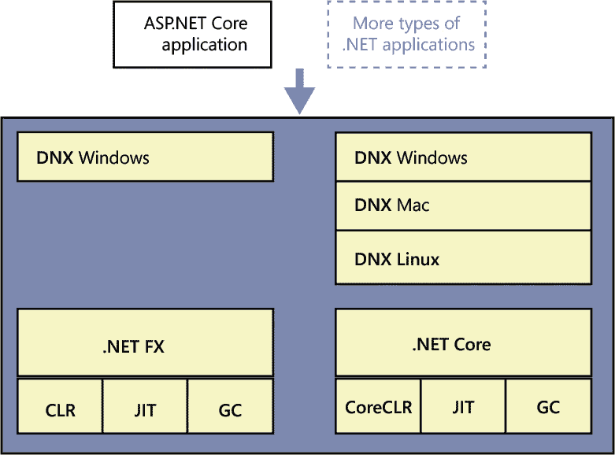

图 7-1 DNX 如何管理 ASP.NET Core 应用程序的执行

目前，`ASP.NET Core` 应用程序是可以使用 `DNX` 的应用程序类型。控制应用程序和其他类型可能在不久后可用。这意味着，`DNX` 是新的（跨平台的）`.NET` 的基础，而不仅仅是 `ASP.NET` 的基础。

### DNX 层

`DNX` 应用程序的内部结构如图 7-2 所示。在顶层是应用程序源代码，底层是操作系统。`DNX` 位于两者之间并使用五个逻辑层来运行应用程序的逻辑。

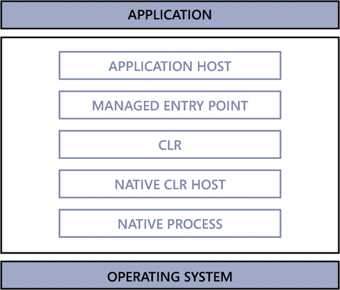

图 7-2 DNX 应用程序的五层

托管入口点（managed entry point）由 .NET 代码组成，它是第一个并非为宿主机原生编写的层。托管入口点由原生 CLR 宿调用，负责加载系统库和设置依赖注入基础设施。当入口点返回时，原生 CLR 宿也负责关闭 CLR 进程。

最后，应用程序主机完成应用程序的加载，解析对 NuGet 包或预先编译的 DLL 代码的依赖。应用程序主机遍历项目依赖列表，并调用启动程序集的入口点。在 ASP.NET Core 应用中，这一步涉及启动类（startup class）的实例化。

## DNX 环境的工具

一系列其他工具完善了 DNX 环境的配置。特别是，你会找到名为 `DNVM`（.NET 版本管理器）和 `DNU`（.NET 开发实用程序）的工具。`DNVM` 安装并更新特定机器上可用的 .NET Framework 版本。

该工具是让多个版本的 .NET Framework 同时绑定到特定 DNX 实例和运行中的程序上并运行的关键。事实上，这是 ASP.NET Core 以及整个新 .NET 带来的一项重要变化：并排运行不同版本的 .NET Framework 的可能。到目前为止，为了运行基于给定框架版本的应用程序，你必须将该版本安装在全局程序集缓存（GAC）中。有了新的 .NET，这不再是必须的。

`DNU` 是新 .NET 运行时环境的包管理工具。它允许你在机器执行环境中下载并恢复所有项目依赖。换句话说，它是新的 NuGet 管理工具。

***

 注意事项

出于兼容性考虑，只有当目标是 CoreCLR 时，才允许并排运行 .NET Framework 版本。换句话说，.NET Framework 的并排版本应被视为 .NET Core 框架的并排版本。

***

## 在 DNX 中托管 Web 应用程序

在图 7-1](#part0014.html_ch07fig01)顶部，你看到代表两种 DNX 类型的区块。而在图 7-2 中，我泛指地了 DNX 应用。当 DNX 应用是 Web 应用程序时，有一个必须考虑的额外层——ASP.NET 托管层。

### ASP.NET 托管层的作用

Web 应用程序需要一个 Web 服务器才能运行。Web 服务器是一个在 80 端口接收 HTTP 请求并将请求推过标准请求流水线，直到生成某些响应的应用程序。这是新 ASP.NET 基础设施中变化最大、甚至引入了全新理念的部分。

ASP.NET 的设计初衷是与 IIS 紧密结合并在 IIS 中进行托管。然而，ASP.NET 的第一个版本发布时带有一个独特的宿主程序，概念上类同于如今的 Kestrel 工具。在 ASP.NET 1.x 中，IIS 监听 80 端口并通过命名管道将请求传递给宿主进程。宿主进程负责加载 CLR、寻找托管入口点并实际处理请求。ASP.NET 1.x 几乎与 IIS 解耦，但有趣的是，这在当时被认为是一坏事。

托管层直接从你在图 7-2](#part0014.html_ch07fig02)中看到的应用程序主机调用。图 7-3](#part0014.html_ch07fig03)显示了更新后的运行时环境图。

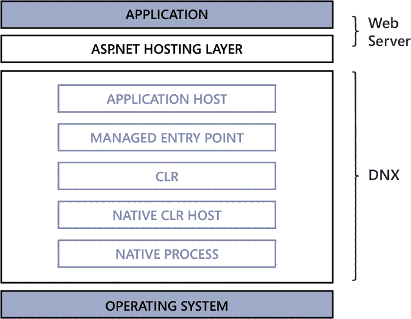

**图 7-3** 在 DNX 图中添加 ASP.NET 托管层

### ASP.NET 托管层的职责

在 ASP.NET Core 中，托管层主要负责查找应用程序将运行的 Web 服务器（无论是 IIS 还是 Apache）以及用于传入请求的 Web 监听器。接下来，托管层将找到启动逻辑并启动应用程序。

通过托管层，你可以配置使用的 Web 服务器并向其传递任何初始化数据。Web 服务器组件必须实现一个已知的工厂接口，通过该接口启动它。一旦 Web 服务器启动运行，它就会开始监听传入的请求并触发应用程序流水线。

托管层还需要启动应用程序代码，为了做到这一点，它需要定位应用程序中的入口点。在 ASP.NET Core 中，应用程序中的入口点是 `Startup` 类上的 `Configure` 方法。

### ASP.NET Core HTTP 流水线

ASP.NET 应用利用了全新的应用程序流水线，这意味着传入的请求将通过一个配置好的运行时模块列表，这些模块有机会在途中读取并修改请求。在流水线的末端，请求由应用程序执行。

新的流水线取代了当前版本 ASP.NET 中支持的 HTTP 处理程序和 HTTP 模块。有趣的是，在 ASP.NET Core 流水线中，模块是按照 `Startup` 类的代码顺序调用的，而不是仅仅列在 `web.config` 文件的某个部分。

流水线内部可以调用的所有模块共同成了应用程序的中间件（middleware）。在完成自己的任务后，每个中间件组件都可以将请求传递给下一个组件，或直接向调用者返回响应。这在很大程度上取决于中间件组件所扮演的角色。

ASP.NET 自带了一系列预定义的中间件组件，其中一个是异常处理器。你希望在流水线的非常早阶段调用这一个，以便获得更多捕获异常的机会。同时，你不希望它短路调用并未能传递给下一个组件。

流水线中的模块可以在执行请求的过程中和返回途中被调用，如图 7-4](#part0014.html_ch07fig04）所示。

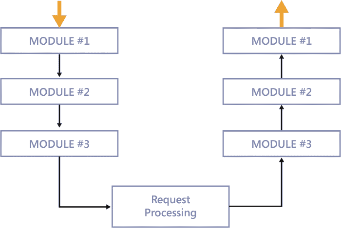

**图 7-4** 每个模块都可以在下一个模块之前之后执行操作

你可以通过调用 `UseXxx`、`Run` 或 `MapXxx` 扩展方法来注册流水线模块。大多数中间件组件以预定义的 `UseXxx` 扩展方法的形式出现，暴露在启动类接收的 `IApplicationBuilder` 对象之外。常用的扩展方法是 `UseExceptionHandler` 和 `UseStaticFiles`，稍后将看到它们的运行。

或者，你可以传递要执行的 lambda 代码。在这种情况下，你使用 `UseXxx` 扩展方法并将 lambda 作为参数。`Run` 扩展方法的作用类似于 `UseXxx`，不同在于它会立即结束流水线并且不会调用流水线中的下一个模块（如果有）。最后，`Map` 和 `MapWhen` 扩展方法允许你配置在什么条件下必须将中间件组件添加到流水线中。

 应用启动

 全局应用设置存储

 身份验证

 HTTP 请求管道

 数据访问

此外，ASP.NET Core 退而使用 ASP.NET MVC 和 Razor 来生成视图和处理逻辑。在 ASP.NET Core 中，不再支持 ASP.NET Web Forms，且 Web API 及其栈现在已完全与 `ASP.NET Core` 控制器合并。事实上，Web API 已经某种程度上过时了，或者说，它现在以不同的身份存在。

让我们从一个空白新项目开始体验 ASP.NET Core 的魅力。通过这种方式，你将体验到选择运行时模块的乐趣——这是减少内存占用的关键。

***

 注意

对于 ASP.NET Core 的第一个版本，Web Pages 和 SignalR 并不包含在包中。但与 Web Forms 不同，两者很快就会被添加到框架中。

***

## 创建新项目

在微软 Microsoft Visual Studio 2015 中为 ASP.NET Core 创建新项目后，解决方案管理器视图将如图 7-5 所示。

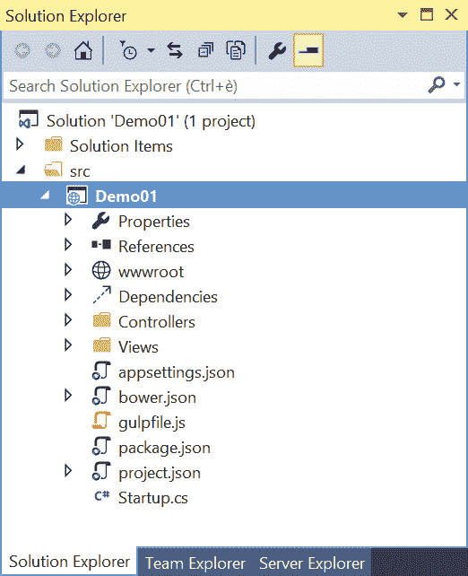

**图 7-5** Visual Studio 2015 中空 ASP.NET Core 新项目的解决方案管理器视图

## `wwwroot` 文件夹

你可能注意到的第一个变化是 `wwwroot` 文件夹，它在 Visual Studio 中也拥有一个特殊的图标。该文件夹没有特殊的函数作用，默认存在是为了清晰地指示你网站的根目录。建议将网站所需的所有静态资源——图像、CSS、脚本、字体和纯 HTML 页面都放在那里。代码文件（如控制器和 Razor 视图）应该放在 `wwwroot` 文件夹之外。换句话说，`wwwroot` 文件夹旨在将代码文件与静态资源分离。

***

 注意

将静态资源存储在如 `wwwroot` 类的独立文件夹中是 ASP.NET Core 项目级鼓励（即使不是强制）的常用做法。然而，ASP.NET Core 要求你将项目文件夹设置为部署网站的 webroot 文件夹，以便任何路径都被视为相对于它的路径。`wwwroot` 只是一个约定的名称。你可以通过（手动）编辑 `project.json` 文件中的 `webroot` 属性来更改它。

***

## Bower 文件

`bower.json` 文件是另一个新条目。从技术上讲，Bower 是一个前端包管理器，它的工作与 `NuGet` 完全相同，只不过它只与客户端资源一起工作。它存在的唯一目的是读取你的文本指令，并确保所有引用的脚本包在项目中都是可用且是新的。如果你不介意管理例如 jQuery 或 Bootstrap 文件，你可以愉快地在没有 Bower 的情况下生活和编码。Bower 只是为你下载脚本和客户端文件。

`bower.json` 文件在概念上仅等同于客户端文件的 `packages.config`。

***

 注意

为什么在新的 ASP.NET Core 项目的默认项目配置中添加了 Bower？这只是一个时尚的选择。你可以直接丢弃 `bower.json` 文件，继续使用 `NuGet` 下载 Bootstrap、jQuery 或 Angular 文件。或者你仍然手动将所需文件复制到你指定的特定项目文件夹。

Bower 和 `NuGet` 之间最大的区别是 Bower 被认为更特定于客户端编程，因此框架开发者更习惯通过 Bower 通道发布更新，而不是通过 `NuGet`。但只有当你认为发布时应用任何框架的最新版本至关重要时，这才会产生些影响。然而，未来微软可能会停止通过 `NuGet` 更新已经存在于 Bower 仓库的 JavaScript 框架。

***

## Gulp 文件

Visual Studio 中处理 Bower 文件的 ASP.NET Core 工具智能地将任何引用的资源复制到 `wwwroot` 文件夹正下方，这几乎是你预期的文件存放的最合理位置。如图 7-6 所示，JS 文件夹留给用户定义的 JavaScript 文件，而 `LIB` 文件夹包含通过 Bower 引用的完整库。

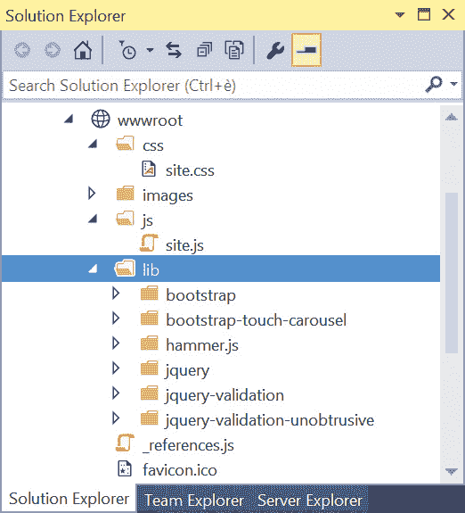

**图 7-6** 通过 Bower 引入的内容扩展 `wwwroot` 文件夹

如果你不喜欢默认的资源文件分布怎么办？如果你需要压缩和合并怎么办？或者需要对资源执行任何其他任务（如运行 JSLint 来检查你的 JavaScript 文件）怎么办？Gulp 和 Grunt 是两种允许通过不同方法编写脚本任务的工具。Grunt 需要配置，而 Gulp 是一个纯 JavaScript 文件，你可以用它编写你想要的代码。

与 Bower 类似，如果你不想处理手动复制、移动和压缩任务，Gulp（或 Grunt）就没有任何价值。因此，如果你觉得不习惯使用它们，可以安全地从 ASP.NET Core 项目中删除 Gulp 文件。

***

 重要

我的建议是先直接丢掉 Bower 和 Gulp 文件，直到你熟悉了它们并开始欣赏它们的用途。在 ASP.NET Core 中，另一个你可能想要考虑的文件是 `package.json`，它最初包含了自动化。

***

## `project.json` 文件

多年来我们使用 `*.csproj` 文件来跟踪外部引用、版本和设置。除了特殊情况外，不需要手动编辑。Visual Studio 提供了图形界面。

在 ASP.NET Core 项目中，JSON 源描述了 `wwwroot` 文件夹的实际名称、应用程序的版本以及它依赖的 NuGet 包。基础 `project.json` 如下：

```
点击此处查看代码
```


```json
{
  "version": "1.0.0",
  "compilationOptions": {
    "emitEntryPoint": true
  },
  "dependencies": {
    "Microsoft.AspNet.IISPlatformHandler": "1.0.0",
    "Microsoft.AspNet.Server.Kestrel": "1.0.0"
  },
  "commands": {
    "web": "Microsoft.AspNet.Server.Kestrel"
  },
  "frameworks": {
    "dnx451": { },
    "dnxcore50": { }
  },
  "exclude": [
    "wwwroot",
    "node_modules"
  ],
  "publishExclude": [
    "**.user",
    "**.vspscc"
  ]
}
```

除非近期提供了特定的工具，否则大多数对 `project.json` 的更新必须手动进行。然而，当你在代码中引用缺失包的类时，Visual Studio 会提供添加这些包并静默编辑项目文件。

## ASP.NET Core 程序的最小依赖

如你所见，ASP.NET Core 项目至少依赖于 IIS 安装程序和被称为 `Kestrel` 的东西。图 7-7 详细说明了 ASP.NET Core 在 Windows 和非 Windows 上的托管模型。要在 IIS 中托管，你需要安装 `IISPlatformHandler` 组件，该组件也必须被应用程序引用。该组件负责启动 DNX 并转发请求。

平台安装程序最终会将请求转发到应用程序 `project.json` 文件中指定的 `web command`。

`DNX` 进程托管了一个通用的 ASP.NET Core Web 服务器（跨平台），它知道如何通过 ASP.NET Core 流水线处理请求。这个通用的 Web 服务器被称为 `Kestrel`。

### 启动

为了启动 Web 应用程序，托管层需要识别用户应用程序中的入口点。该入口点是一个名为 `Main` 的静态方法。按照惯例，该方法被定义在一个名为 `Startup` 的类中。然而，它可以——我认为它应该——被移动到其他地方，以更好地强调它的作用，因为它的作用与 `Startup` 类的作用是不同的。假设你在 Visual Studio 2015 中调用的空项目模板中添加了这样一个类：

点击此处查看代码图像

```csharp
public class App
{
    public static void Main(string[] args) => WebApplication.Run<Startup>(args);
}
```

`WebApplication` 类定义在托管层中，负责实例化名为 `Startup` 的类。

`Startup` 类包含两个方法：`Configure` 和 `ConfigureServices`。这两个方法都由 ASP.NET Core 运行时调用。前者用于配置 HTTP 请求流水线；后者用于将服务注入到 ASP.NET Core 请求堆栈中。

### 配置 HTTP 流水线

至少，流水线必须引用 IIS 平台安装程序，但极可能还需要启用静态文件服务和 MVC 路由：

点击此处查看代码图像

```csharp
public void Configure(IApplicationBuilder app)
{
    app.UseIISPlatformHandler();
    app.UseStaticFiles();
    app.UseMvc(routes =>
        routes.MapRoute( name: "default",
                        template: "{controller=Home}/{action=Index}/{id?}")
    );
}
```

要启用静态文件和路由的服务，你必须添加新的包。幸运的是，Visual Studio 会检测到缺失的包并提供点击一下即可恢复的选项。这种整体体验类似于在早期版本的 Visual Studio 中安装 ReSharper。你可能想要的另一个包是诊断包，这样在开发期间就可以显示详细的异常页面。（参见图 7-8）。

点击此处查看代码图像

```csharp
app.UseDeveloperExceptionPage();
```

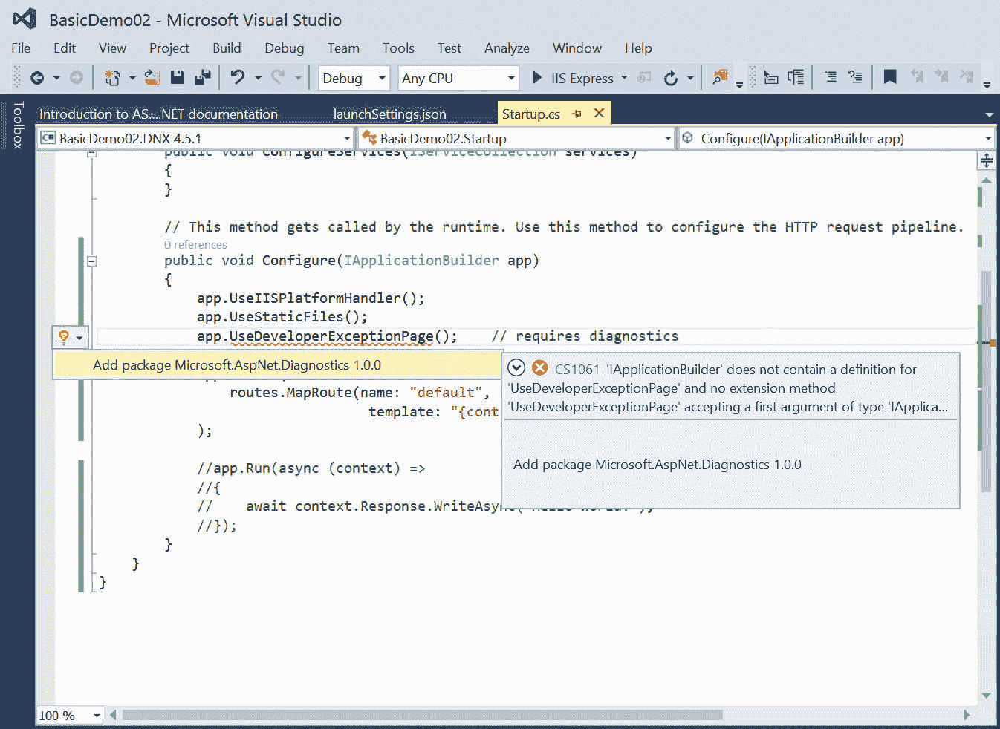

**图 7-8** 在 Visual Studio 2015 ASP.NET Core 项目中添加缺失的包

注意，如果没有上一行代码，你甚至无法获得在经典 Web Forms 和 ASP.NET MVC 中收到过无数次的经典黄色错误页面。

在 ASP.NET Core 之前，从零开始创建一个新项目后，在安排好视图基础设施（包括控制器方法和布局）之前，你是看不到任何具体的输出的。在 ASP.NET Core 中，如果你在 Visual Studio 加载后立即运行空新项目，你仍然能看到东西，最可能是一个 `hello-world` 消息。这是由于以下代码，你可以在 `Startup` 类的 `Configure` 方法中默认找到它：

点击此处查看代码图像

```csharp
app.Run(async (context) =>
{
    await context.Response.WriteAsync("Hello World!");
});
```

当你开始添加控制器类和 Razor 视图时，就会移除这段代码。

 注意

`Configure` 方法必须接受至少一个 `IApplicationBuilder` 参数。然而，你可以可选地添加两个类型为 `IHostingEnvironment` 和 `ILoggerFactory` 的参数，这些参数将由运行时传递给你。

### 向 ASP.NET 请求堆栈中添加服务

仅凭应用程序构建器的配置不足以让网站产生任何重要的内容。在这一阶段，应用程序甚至不能称作为一个 ASP.NET MVC 应用程序。你需要显式地注入对 MVC 核心服务的引用：

点击此处查看代码图像

```csharp
public void ConfigureServices(IServiceCollection services)
{
    services.AddMvc ();
}
```

此时，只要你添加控制器，就会开始获得一些可见的输出。

你可能还想向 ASP.NET 堆栈添加其他几个服务，例如处理应用程序选项并在所有控制器之间全局共享对象实例的服务、额外的代码层以及视图。

在 ASP.NET Core 中，`service`（服务）是应用程序不同部分可能会消费的共享组件。服务通过依赖注入提供给应用程序。ASP.NET Core 自带了一个集成的容器，但它可以被你选择的任何容器所替换。服务有三种类型，这与容器如何管理每个实例有关。

`transient`（瞬态）服务的实例在应用程序中每次需要时都会创建一个。相比之下，标记为 `scoped`（作用域）服务的服务的实例仅在当前作用范围内不存在实例时才会创建。在 Web 应用程序的上下文中，当前作用域等同于当前请求。最后，`singleton`（单例）服务是整个应用程序只有一个实例的服务。

### 显示主页

在 ASP.NET Core 中，控制器和视图的工作方式与 ASP.NET MVC 类似，视图引擎也没有大不同。一个微小的区别是控制器的返回类型现在是 `IActionResult`：

点击此处查看代码图像

```csharp
public class HomeController : Controller
{
    public IActionResult Index()
    {
        ViewBag.Title = "Hello World";
        return View();
    }
}
```

Razor 视图文件以相同的方式组织——即根目录下的 `Views` 文件夹。ASP.NET Core 中的 Razor 语法有一些附加功能，例如标签辅助程序和 `@inject` 方法，但现有代码仍然可以工作。

#### 应用程序设置

在旧的 ASP.NET 应用程序中，开发者将全局设置存储在 `web.config` 文件的 `appSettings` 部分，或者在全局成员中。这现在是不可能的。

#### 从持久化存储读取设置

在 ASP.NET Core 中处理设置是从 `Startup` 类执行的两个步骤的过程。首先从持久化文件读取信息，然后将数据复制到内存容器中，然后作为服务注入。

新的配置基础围绕构建器的概念构建，你可以为几乎任何数据格式创建自定义构建器，无论是 JSON、XML 甚至是数据库模式。默认情况下，你将数据保存在 JSON 文件中。假设你在项目中添加了以下 JSON 文件并将其命名为 `MyAppSettings.json`：

```json
{
  "Data": {
    "Title": "Hello, world",
    "Build": "1.0.0"
  }
}
```

添加到 `Startup` 类构造函数的以下代码将读取它：

点击此处查看代码图像

```csharp
public class Startup
{
    private IConfigurationRoot _appSettings;
    public Startup(IHostingEnvironment env, IApplicationEnvironment appEnv)
    {
        var builder = new ConfigurationBuilder()
            .AddJsonFile("MyAppSettings.json");
        _appSettings = builder.Build();
    }
}
```

`_appSettings` 变量只是 JSON 流中的指针，并不包含从实际文件中提取的任何显式值。还需要另一个步骤将 JSON 文件的内容映射到对象。

点击此处查看代码图片

```csharp
public class MyAppSettings
{
    public string Title { get; set; }
    public string Build { get; set; }
}
```

要将 JSON 内容复制到 `MyAppSettings` 实例中，请按照以下步骤操作。在 `Startup` 类的 `ConfigureServices` 方法中添加以下代码：

点击此处查看代码图片

```csharp
services.Configure<MyAppSettings>(settings =>
{
    settings.Title = _appSettings["Data:Title"];
    settings.Build = _appSettings["Data:Build"];
});
```

刚刚的 `MyAppSettings` 类实例现在已准备好注入到 ASP.NET 应用程序堆栈中。不过，它必须被包装在一个通用接口中，并且必须添加该包装接口的服务：

```csharp
services.AddOptions();
```

现在，任何需要使用全局应用程序设置的类（例如控制器）都需要进行一些工作。

### 使用应用程序设置

应用程序设置现在可以在 ASP.NET 容器控制下创建的任何组件中都是可注入的。这对于控制器以及注入到控制器中的类确实如此。以下是重写控制器类以使用从 JSON 文件配置的任何数据的方法：

点击此处查看代码图片

```csharp
public class HomeController : Controller
{
    private MyAppSettings _settings;
    public HomeController(IOptions<MyAppSettings> accessor)
    {
        _settings = accessor.Value;
    }
    public IActionResult Index()
    {
        ViewBag.Title = String.Format("{0} [{1}]", _settings.Title, _settings.Build);
        return View();
    }
}
```

控制器的构造函数现在接收一个 `IOptions<T>` 参数并将包装的内容保存到本地成员中。控制类的其他成员随后可以使用这些注入的值。

***

 注意

尽管从代码建模的角度来说我并不真正推荐这样做，但你甚至可以通过 `@inject` 命令直接向 Razor 视图注入对象实例。我最喜欢的方法是将 view-model 类传递给视图，并在控制器中直接构建 view-model 类的实例，传递任何所需的注入数据。

### 身份验证

ASP.NET Core 还对身份验证过程引入了一些更改。准确地说，引入这些更改并不是为了仅仅以不同的方式来实现某物，而是因为对 OWIN 标准的支持。简而言之，OWIN 是一个定义 Web 服务器与 Web 应用程序之间交互模型的抽象接口。

正如前面提到的，ASP.NET 最初在 20 世纪 90 年代后期设计，目的是与 IIS 紧密耦合。后来，这种紧密耦合被证明痛苦大于收益，引入 OWIN 是为了为相同的具体事务（如身份验证和授权）定义通用的交互模型。因此，在 ASP.NET Core 中，你必须显式指定你期望的身份验证形式，以及你期望身份令牌如何被保存和携带。最终，这与你预期在 `web.config` 文件的 `authentication` 部分中执行的操作没有太大区别；你只是通过不同的 API 实现了它。

### ASP.NET Identity 与 纯身份验证

大多数 ASP.NET Core 应用程序示例使用 ASP.NET Identity 框架来实现登录表单和凭据验证。我认为 ASP.NET Identity 至少对于那些你只需要检查纯用户名和密码对的基本场景来说，具有极高的复杂性。如果你感兴趣尝试 ASP.NET Identity（以及它一些更高级的功能，如双因子身份验证），你可以简单地使用 Visual Studio 2015 ASP.NET Core 模板并启用身份验证机制。如果你想学习如何在 ASP.NET Core 中逐步构建纯基于 Cookie 的身份验证，请继续阅读下文。

### 启用 Cookie 身份验证

Cookie 身份验证是应用程序配置的一部分。你需要通过从 `Startup` 类的 `Configure` 方法执行的特定调用来启用它：

点击此处查看代码图片

```csharp
app.UseCookieAuthentication(new CookieAuthenticationOptions
{
    LoginPath = "/account/login",
    AuthenticationScheme = "Cookies"
});
```

你看到的这些设置与经典 ASP.NET 中 `web.config` 文件中输入的典型项目没有真正区别。你还使用常用的 `Authorize` 特性将特定控制器部分的访问限制为仅经过身份验证和授权的用户。

要创建身份验证 Cookie，你需要使用不同的代码，这些代码是现在不支持的旧 `FormsAuthentication` 类方法的功能性替代：

点击此处查看代码图片

```csharp
public async Task<IIActionResult> PostLogin(LoginInputModel input)
{
    // 验证凭据
    if (!ValidateCredentials(input.Username, input.Password)
        return RedirectToAction("login", "error");

    // 创建身份验证 cookie
    var claims = new List<Claim>
    {
        new Claim("username",  input.Username)
    };
    var id = new ClaimsIdentity(claims, "Cookies");
    await HttpContext.Authentication.SignInAsync("Cookies", new ClaimsPrincipal(id));
    return Redirect("/");
}
```

### 检测用户

要检测当前用户是否已验证，你使用 `User.Identity` 对象并检查 `IsAuthenticated` 属性：

点击此处查看代码图片

```cshtml
@{
    if (User.Identity.IsAuthenticated)
    {
        <a class="btn-lg btn-primary" href="@Url.Action("logout", "account")">@User.Identity.Name</a>
    }
    else
    {
        <a class="btn-lg btn-primary" href="@Url.Action("login", "account")">登录</a>
    }
}
```

身份验证过程的所有其他方面都保持不变，包括返回 URL 的检测和模型状态的验证。

#### Web 开发的其他方面

ASP.NET Core 的出现也影响了 Web 开发的其他方面。正如前面提到的，ASP.NET Web Forms 不可用。因此，在加入 ASP.NET Core 队列之前，建议你熟悉 ASP.NET MVC 的编程模式。然而，如果你来自 ASP.NET MVC 背景，还有其他一些编程方面的方面需要考虑。

##### Web API


在 ASP.NET Core 出现之前，Web API 和 ASP.NET MVC 是不同的框架，它们具有相同的类名和兼容的概念，但流水线完全不同。作为一个在过去五六年中主要从事 ASP.NET MVC 编程的人，我从未认为 Web API 是一个值得认真关注的框架。

我只是将 Web API 之上的 OData 功能视为一个加分项，这可能引导我使用基于 Web API 的独立 Web 服务。从纯逻辑角度来看，我无法理解为什么需要两种不同类型的控制器，尽管 Web API 是基于与 ASP.NET Core 相似的更现代流水线。

归根结底，在 ASP.NET Core 中，你只需要接收请求并确定它们应该从服务器环境中获取什么响应。谈论 Web API 可能仍然存在，但大多数是为了出于向后兼容性的考虑。从逻辑和功能上来说，Web API 已经“死亡”了，因为它已经合并（并重生）在更现代且全位的 ASP.NET MVC 栈中。

## 中间件 (Middleware)

在经典的 ASP.NET 中，你有两种类型的组件可以用于自定义每个请求的处理方式：HTTP 处理器（HTTP handlers）和 HTTP 模块（HTTP modules）。`HTTP handler` 是当传入的请求的 URL 匹配给定的模式时被调用的部分代码。`HTTP module` 是一个注册到运行时流水线中的组件，它会挂钩任何请求并对其进行处理。

HTTP 处理器主要在 ASP.NET Web Forms 的背景下起着相关作用。这是因为在 Web Forms 中，每个请求都设计为针对特定的页面或视图；因此，`HTTP handler` 是放置一个可能返回也可能不返回视图的操作请求的一种。在 ASP.NET MVC 中，重点转向了操作（actions），因此每个请求都是为了一个操作，然后会被处理，并返回 HTML 视图或 JSON 数据。在 ASP.NET MVC 的背景下，HTTP 处理器失去了所有的吸引力。

HTTP 模块是另一回事。它们是用于预处理请求的组件。ASP.NET 流水线会引发一系列应用程序事件，注册的模块挂钩一个或多个事件并执行自己的逻辑。

在 ASP.NET Core 中，HTTP 流水线已经从头开始重新设计，因此它是运行时组件的核心。`middleware`（中间件）一词现在用于表示组装到流水线以处理请求和响应的组件。中间件组件按照以下模式之一运行：

- 它执行某些操作，并将请求传递给流水线中的下一个组件。
- 它执行某些操作，将请求传递给流水线中的下一个组件，并在之后执行更多工作。
- 它将请求传递给流水线中的下一个组件，并在之后执行更多工作。
- 它执行某些操作并停止链式，向调用者返回响应。

中间件组件代表一个任务，而任务通过组合实际上为给定应用程序的请求组装了流水线。在旧的 ASP.NET 中，一组 HTTP 模块会被自动应用，删除它们需要进行一些配置调整。在 ASP.NET Core 中，流水线的配置完全是程序化的，并发生在 `Startup` 类的 `Configure` 方法中。

归根结底，无论你拥有的 HTTP 模块是独立产品还是应用程序的一部分，它们在 ASP.NET Core 应用程序中必须被重写为中间件组件。

## 数据访问 (Data access)

大多数 .NET 应用程序通过 Entity Framework 的服务处理数据。市上有许多版本的 Entity Framework。从 ASP.NET Core 的角度来看，需要考虑的版本有这些：`Entity Framework 6` 和 `Entity Framework Core`（以及更新版本）。指南是使用 `Entity Framework 6` 引入一些遗留代码并使用 `Entity Framework Core` 进行任何新开发。然而，两个版本运行良好良好，但确实存在一些差异。

首先，重要的是，如果你选择使用 `Entity Framework 6`，你的 ASP.NET Core 应用程序只能针对完整的 .NET Framework。.NET Core 框架不支持 `Entity Framework 6`。换句话说，你没有机会将你的 `Entity Framework 6` 代码转换为跨平台代码。

你像在基于 Code First 的旧 ASP.NET 项目中那样通过 `NuGet`  `Entity Framework 6`。这意味着你应该拥有（或创建）`DbContext` 类，它通过构造函数获取连接字符串。同样，你应该拥有（或适配）Code First 类，在适当且必要的地方添加数据注解属性。

连接字符串将存储在 JSON 文件中，并通过 `Options` 服务传递给数据访问类，如之前在“[应用程序设置]”部分所示的那样。这里是存储类类的示例代码：

```csharp
public class CountryRepository
{
    private string ConnectionString { get; set; }

    public CountryRepository(IOptions<AppConfig> accessor)
    {
        ConnectionString = accessor.Value.DbConnectionString;
    }

    public IList<Country> All()
    {
        using (var db = new CountryContext(ConnectionString))
        {
            var list = (from c in db.Countries select c).ToList();
            return list;
        }
    }
}
```

`Entity Framework Core` 是 `Entity Framework` 的新版本，从头重写以实现跨平台。它仍然是一个 O/RM，并且建立在多年 Entity Framework 成熟的经验之上。在这方面，`Entity Framework Core` 与旧版本基本兼容。它还与 ASP.NET Core 的依赖注入机制完全集成，尽管传递依赖注入引擎并不是强制要求。

`Entity Framework Core` 的最新文档可以在以下 URL 找到：`docs.efproject.net/en/latest/getting-started/index.html`。

## 总结 (Summary)

对于来自 ASP.NET 背景的开发者，旧 ASP.NET 之间的大部分差异在这里总结。除了本章概述的内容之外，编程非常接近你在传统 ASP.NET MVC 应用程序中所做的。

听起来迁移到 ASP.NET Core 是一件显而易见的事吗？嗯，这取决于情况。

正如长期开发路线的第一步所示，ASP.NET Core 在底层与 ASP.NET 完全不同，但在覆盖层大体相同。除非你真的有理由指责当前的 ASP.NET 提供的性能以及它消耗的内存（和资金）——除非对于你的业务真的需要在非 Windows 平台上提供相同的 Web 应用程序——否则我看不到这种更改有任何巨大的好处。

此外，现在迁移到 ASP.NET Core 意味着你将承担迁移成本和某种学习曲线，除非如前所述，你正在积极寻找传统 ASP.NET 的替代方案。

ASP.NET Web Forms 和 ASP.NET MVC 对 HTTP 请求的构想方式有所不同，尽管在 ASP.NET Core 1.0 之前，这两个框架共享相同的运行时环境。在 ASP.NET Web Forms 中，每个请求都指向显示一个给定的 `ASPX` 页面。作为开发者，你围绕一组页面来设计网站。每个页面都提供一组可点击的元素来触发操作。没有哪个操作是通过名称和参数明确标识的；相反，所有操作都是页面向自身发的回调（postbacks）。换句话说，在 ASP.NET Web Forms 中，你处理用户的点击、修改页面的状态并将其渲染回。

在 ASP.NET MVC 中，粒度是不同的，每个请求都会导致一个操作（action）的执行——最终是执行特定 `controller` 类上的一个方法。执行操作的结果连同视图模板一起传递给视图子系统。然后使用这些结果和模板来构建浏览器的最终响应。ASP.NET MVC 应用的用户并不请求页面，而是向服务器请求执行某个特定的操作。

ASP.NET Web Forms 和 ASP.NET MVC 之间的另一个大区别是缺少服务器控件——即能够根据参数值生成标记的黑盒组件。在 ASP.NET MVC 中，你使用原始 HTML 模板为浏览器生成视图。通过这种方式，你获得了对标记的完全控制，并可以使用你最喜欢的 JavaScript 框架随心所应用样式和注入脚本代码。

与 Web Forms 不同，ASP.NET MVC 由多个代码层连接在一起，但它们并不交织，也没有形成一个单一的单体块。由于由于原因，很容易用自定义组件替换这些任何层，从而增强解决方案的可维护性和可测试性。本章将引导你发现 `controller` 的角色和结构——ASP.NET MVC 应用的基础——并向你展示请求是如何路由到控制器并渲染回浏览器的。

## 处理传入的请求

尽管整个 ASP.NET 平台最初是围绕为物理页面提供请求的想法而开发的，但它并不限于调用由特定位置和文件标识的资源。例如，通过编写一个临时的 HTTP 处理程序并将其绑定到固定的 `URL`，你可以让 ASP.NET 处理请求，而无论其对物理文件的依赖如何。这正是 ASP.NET 的一个特性，允许构建受模型-视图-控制器（MVC）模式启发的不同编程框架。在像 ASP.NET MVC 这样强调操作角色的网络框架中，拥有一个将传入请求映射到某些实际类上的方法的路由系统是非常关重要的。

在探索 ASP.NET MVC 的路由系统之前，让我们简要查看如何通过 HTTP 处理程序在 ASP.NET Web Forms 中模拟 ASP.NET MVC 的行为。建议所有所有具有深厚 ASP.NET Web Forms 背景并尝试上手 ASP.NET MVC 的读者。如果你只是想学习 ASP.NET MVC，可以跳过下一节，直接跳转到“URL 路由 HTTP 模块”

### 模拟 ASP.NET MVC 运行时

让我们构建一个简单的 ASP.NET Web Forms 应用，并使用 HTTP 处理程序来了解 ASP.NET MVC 应用的内部机制。你可以从一个空 Web 项目开始，只需添加 ASP.NET Web Forms 依赖

### 定义已识别的 URL 语法

在一个请求的 `URLs` 不一定与 Web 服务器上的物理文件的世界中，要的第一步是列出哪些 `URLs` 对应用程序是有意义的。为了避免过于具体，假设仅支持几个固定的 `URLs`，每个都映射到一个 HTTP 处理程序组件。以下代码段显示了对默认 `web.config` 文件必须进行的更改：

```xml
<system.webServer>
    <validation validateIntegratedModeConfiguration="false" />
    <modules runAllManagedModulesForAllRequests="true" />
    <handlers>
      <add name="MvcEmule"
              path="home/test/*"
              verb="*"
              type="MvcEmule.MvcEmuleHandler" />
    </handlers>
</system.webServer>
```

当应用程序接收到匹配指定 `URL` 的请求时，它会将请求传递给指定的处理程序——即 `MvcEmuleHandler` 类。

### 定义 HTTP 处理程序的行为

在 ASP.NET 中，HTTP 处理程序是实现 `IHttpHandler` 接口的组件。该接口非常简单，包含两个成员，如下所示：

```csharp
public class MvcEmuleHandler : IHttpHandler
{
    public void ProcessRequest(HttpContext context)
    {
        // 逻辑在此处
        ...
    }
    public Boolean IsReusable
    {
        get { return false; }
    }
}
```

大多数情况下，处理程序具有硬编码的行为，仅受某些输入的影响。没有什么能阻止我们使用处理程序作为抽象的间接层。实际上，处理程序可以使用请求中的信息来决定提供哪个类。处理程序可以解析 URL 并识别专门的组件。这是一个它是如何运行的示例：

```csharp
public void ProcessRequest(HttpContext context)
{
    // 解析出 URL、操作和参数
    var segments = context.Request.Segments;
    var controller = segments[1].End('/');
    var action = segments[2].End('/');
    var param1 = segments[3].End('/');

    // 完整的类名和命名空间
    var fullName = String.Format("{0}.{1}Controller", this.GetType().Namespace, controller);
    var controllerType = Type.GetType(fullName, true);

    // 获取控制器的实例
    var instance = Activator.CreateInstance(controllerType);

    // 在实例上调用操作方法
    var methodInfo = controllerType.GetMethod(action, 
        BindingFlags.Instance | 
        BindingFlags.IgnoreCase | 
        BindingFlags.Public);

    string result;
    if (methodInfo.GetParameters().Length == 0)
    {
        result = methodInfo.Invoke(instance, null) as String;
    }
    else
    {
        result = methodInfo.Invoke(instance, new Object[] { param1 }) as String;
    }

    // 输出结果
    if (result != null)
    {
        context.Response.Write(result);
    }
}
```

前面的代码假设服务器名称之后的第一个令牌包含标识提供请求所需的组件的关键信息。第二个令牌引用该组件上调用方法的名称。最后，第三个令牌指示要传递的参数。

### 调用 HTTP 处理程序

对于如 `home/test/**` 的 URL，`home` 标识类，`test` 标识方法，任何后续内容都是参数。类名进一步处理并扩展以包含命名空间和后缀。根据示例，最终类名是 `MvcEmule.HomeController`。该类预计对应用程序可用。该类还预计暴露一个名为 `Test` 的方法，如下所示：

```csharp
namespace MvcEmule
{
    public class HomeController
    {
        public String Test(Object param1)
        {
            var message = "<html><h1>You passed '{0}'</h1></html>";
        }
    }
}
```

```cs
return String.Format(message, param1);

}

}
```

图 8-1 显示了在 ASP.NET Web Forms 应用程序中调用页面无关 URL 的效果。

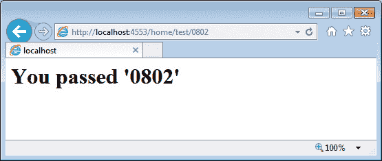

**图 8-1** ASP.NET Web Forms 中处理页面无关的 URL。

这个简单的示例演示了 ASP.NET MVC 使用的基本机制。处理请求的专用组件是控制器（controller）。控制器是一个只有方法而没有状态的类。唯一的系统级 HTTP 句程序负责将传入的请求分发到特定的控制器类，以便该类的实例执行给定的操作方法并产生响应。

URL 的方案又是怎样的？在这个示例中，你只是使用了一个硬编码的 URL。在 ASP.NET MVC 中，你可以使用灵活的语法来表示应用程序识别的 URL。此外，运行时流水线中的一个新系统组件会拦截请求、处理 URL 并触发内置的 ASP.NET MVC HTTP 句程序。该组件就是 URL 路由 HTTP 模块（URL routing HTTP module）。

## 探索 URL 路由 HTTP 模块

URL 路由 HTTP 模块通过查看 URL 并将其分发给最合适的执行程序来处理传入的请求。URL 路由 HTTP 模块取代了旧版本 ASP.NET 的 URL 重写功能。URL 重写的核心包含挂钩请求、解析原始 URL 以及指示 HTTP 运行时环境提供一个“可能相关但不同”的 URL。

### 路由请求


当请求在 ASP.NET MVC 应用程序上下文中敲击互联网信息服务（IIS）大门时究竟发生了什么？图 8-2 为你提供了涉及的各个步骤的概述。

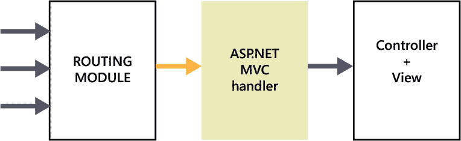

**图 8-2** URL 路由 HTTP 模块在 ASP.NET MVC 中的作用。

URL 路由 HTTP 模块拦截任何无法通过托管环境（最可能是 IIS）提供服务的应用程序请求。如果 URL 指向物理文件（例如 ASPX 文件），除非有其他配置，否则 URL 路由 HTTP 模块将忽略该请求。在任何其他情况下，URL 路由 HTTP 模块都会尝试将请求的 URL 与应用程序定义的任何路由进行匹配。如果找到匹配，请求将进入 ASP.NET MVC 空间，以调用控制器类的形式进行处理。如果没有找到匹配，请求将由标准的 ASP.NET 运行时以最好的方式提供，并可能导致 HTTP 404 错误。

最终，只有匹配预定义 URL 模式（也称为路由）的请求才允许使用 ASP.NET MVC 运行时。所有此类请求都被路由到一个公共 HTTP 句程序，该句程序实例化控制器类并调用其上的定义方法。接下来，控制器方法反过来选择视图组件来生成实际响应。

### 检查 URL 路由 HTTP 模块的内部结构

从实现的角度来说，我应该注意 URL 路由引擎是一个连接 `PostResolveRequestCache` 事件的 HTTP 模块。该事件在检查 ASP.NET 缓存中没有该请求的响应后立即触发。

HTTP 模块将请求的 URL 与用户定义的 URL 路由之一匹配，并设置 HTTP 上使用 ASP.NET MVC 标准 HTTP 句程序来处理请求。作为开发者，你不可能直接处理 URL 路由 HTTP 模块。该模块是系统提供的，不需要你执行任何特定形式的配置。相反，你负责提供应用程序支持且 URL 路由 HTTP 模块实际消耗的路由。

## 使用应用程序路由

如所述，在 ASP.NET MVC 中，用户发送请求来操作资源。然而，框架并没有强制描述资源和操作的语法。我意识到“对资源进行操作”这一表达式可能会让你想到表述状态转换（REST）。当然，你这样想也不会太离谱。

尽管你完全可以在 ASP.NET MVC 应用程序中使用纯 REST 方法，但 ASP.NET MVC 是松散导向 REST 的，因为它承认了资源和操作等概念，但它允许你自由使用自己的语法来表示和实现资源和操作。例如，在纯 REST 解决方案中，你使用 HTTP 动词来表示操作——GET、POST、PUT 和 DELETE——并使用 URL 来标识资源。在 ASP.NET MVC 中实现纯 REST 解决方案是可能的，但需要你承担额外工作。

ASP.NET MVC 的默认行为是使用自定义 URL，这使得你负责通过语法指定操作和资源。这种语法通过 URL 模式集合（也称为路由）来表示。

### 与 URL 模式和路由工作

路由是一种模式匹配字符串，代表 URL 的绝对路径——即不包含协议、服务器和端口信息的 URL 字符串。路由可能是一个常量字符串，但更有可能包含几个占位符。这是一个路由示例：

`/home/test`

该路由是一个常量字符串，且仅与绝对路径为 `/home/test` 的 URL 匹配。然而，大多数时候，你处理的是包含一个或多个占位符的参数路由。这里是两个例子：

`/{resource}/{action}`

`/Customer/{action}`

这两个路由都被任何包含两个段的 URL 匹配。但后者要求第一个段等于 `Customer`。相反，前者没有对分段的内容施加限制。占位符（placeholder）通常称为 URL 参数（URL parameter），它是括在花括号 `{}` 中的一个名称。你可以在路由中拥有多个占位符，只要它们被分隔符隔开即可。正斜线 `/` 作为路由部分之间的分隔符。占位符的名称（例如 `action`）是你的代码用于从实际 URL 中程序化检索分段内容的键。这是 ASP.NET MVC 的默认路由：

`{controller}/{action}/{id}`

在这种情况下，示例路由包含三个被分隔符隔开的占位符。匹配上述路由的 URL 如下：`/Customers/Edit`。你可以根据需要添加尽可能数量的路由和相应数量的占位符。你甚至可以删除路由。

#### 定义路由

应用程序的路由通常在 `global.asax` 文件中注册，并在应用程序启动时处理。让我们来看 `global.asax` 文件中处理路由的部分：

点击此处查看图像

```cs
public class MvcApplication : HttpApplication
{
    protected void Application_Start()
    {
        RouteConfig.RegisterRoutes(RouteTable.Routes);
        // 其他代码
    }
}
```

`RegisterRoutes` 是 `RouteConfig` 类上的一个方法，定义在通常 `App_Start` 的文件夹中。（尽管你可以重命名该文件夹。）这是该类的实现：

点击此处查看图像

```cs
public class RouteConfig
{
    public static void RegisterRoutes(RouteCollection routes)
    {
        // 其他代码
        ...
        // 列出路由
        routes.MapRoute(
            "Default",
            "{controller}/{action}/{id}",
            new {
                controller = "Home",
                action = "Index",
                id = UrlParameter.Optional
            }
        );
    }
}
```

如你所见，`Application_Start` 事件处理程序调用了一个名为 `RegisterRoutes` 的公共静态方法，该方法列出了所有路由。请注意，`RegisterRoutes` 方法名称及其原型都是任意的，如果有正当理由，可以进行更改。

支持的路由必须添加到由 ASP.NET MVC 管理的 `Route` 对象的静态集合中。该集合是 `RouteTable.Routes`。你通常使用方便的 `MapRoute` 方法来填充该集合。`MapRoute` 方法提供了多种重载，并且在大多数情况下运行良好。然而，它并不能让你配置路由对象的每一个可能方面。如果你需要在路由上设置某些 `MapRoute` 不支持的项，你可能需要求助于以下代码：

点击此处查看代码图片

```csharp
// 创建新路由并将其添加到系统集合

var route = new Route(...);

RouteTable.Routes.Add("NameOfTheRoute", route);
```

路由的特征由几个属性决定，例如名称、URL 模式、默认值、约束、数据令牌和路由处理程序。你最常设置的属性是名称、URL 模式和默认值。让我们扩展一下默认路由的代码：

点击此处查看代码图片

```csharp
routes.MapRoute(
    "Default",
    "{controller}/{action}/{id}",
    new {
        controller = "Home",
        action = "Index",
        id = UrlParameter.Optional
    });
```

第一个参数是路由的名称；每个路由都应该有一个唯一的名称。第二个参数是 URL 模式。第三个参数是一个指定 URL 参数默认值的对象。

请注意，URL 即使在不完整的情况下也可以匹配模式。让我们考虑根 URL——`http://yourserver.com`。乍看之下，这样的 URL 不会匹配路由。然而，如果为 URL 参数指定了默认值，该段就会被视为可选的。因此，对于上例所示，当你请求根 URL 时，请求将通过调用 `Home` 控制器上的 `Index` 方法来解析解析。

### 处理路由

ASP.NET URL 路由 HTTP 模块在尝试将传入的请求 URL 匹配到定义的路由时，采用了多条规则。最重要的规则是，路由必须按照它们在 `global.asax` 中注册的顺序进行检查。

为了确保路由按照正确的顺序进行处理，你必须按照最具体到最不具体的顺序来列出它们。在任何情况下，请记住，匹配路由的搜索始终在第一个匹配项处结束。这意味着，仅仅在列表底部添加新路由可能不起作用，并且还可能给你带来一些麻烦。此外，请注意，在列表顶部放置通配捕获模式（catch-all pattern）将导致任何其他模式——无论它们多具体——都会被忽略。

除了出现顺序外，其他因素也会影响 URL 到路由的匹配过程。正如前面提到的，其中之一是你可能为路由提供的默认值集合。默认值仅仅是在 URL 未能提供特定值的情况下，自动分配给定义的占位符的值。请考虑以下两个路由：

`{Orders}/{Year}/{Month}`

`{Orders}/{Year}`

如果在第一个路由中，你同时为 `{Year}` 和 `{Month}` 分配了默认值，那么第二个路由将永远不会被评估，因为得益于默认值，无论 URL 是否指定了年份和月份，第一个路由始终是匹配的。

末尾的正斜线（`/`）也是一个陷阱。路由 `{Orders}/{Year}` 和 `{Orders}/{Year}/` 是两个完全不同的东西。尽管在逻辑上（至少从用户的角度来看）你会期望它们相等，但一个不会匹配另一个。

影响 URL 到路由匹配的另一个因素是你可选地为路由定义的约束列表。路由约束是给定 URL 参数必须满足的额外条件，以使 URL 匹配到路由。URL 不仅应该与 URL 模式兼容，还需要包含兼容的数据。可以通过多种方式定义约束，包括通过正则表达式。这里有一个带有约束的示例路由：

点击此处查看代码图片

```csharp
routes.MapRoute(
    "ProductInfo",
    "{controller}/{productId}/{locale}",
    new { controller = "Product", action = "Index", locale="en-us" },
    new { productId = @"\d{8}",
```

特别是，该路由要求 `productId` 为数字，而 `locale` 必须是一对字母字符串。

### 引入路由处理程序

ASP.NET MVC 框架没有提供许多内置路由处理程序，这可能表明使用自定义路由处理程序的需求并不常见。然而，扩展点是存在的，在需要时，你可以利用它。我稍后会回到自定义路由处理程序并提供一个示例。

最终决定如何映射请求 URL 的组件是路由处理程序。准确地说，它是处理任何请求的对象。它存在的唯一目的是返回将实际处理请求的 HTTP 处理程序。

从技术上说，路由处理程序是一个实现 `IRouteHandler` 的类。该接口定义如下：

点击此处查看代码图片

```csharp
public interface IRouteHandler
{
    IHttpHandler GetHandler(RequestContext requestContext);
}
```

`RequestContext` 类定义在 `System.Web.Routing` 命名空间中，它封装了请求上下文以及任何特定的路由信息，例如 `Route` 对象。这些数据被分组在 `RouteData` 对象中。以下是 `RequestContext` 类的签名：

点击此处查看代码图片

```csharp
public class RequestContext
{
    public RequestContext(HttpContextBase httpContext, RouteData routeData);

    // Properties
    public HttpContextBase HttpContext { get; set; }
    public RouteData RouteData { get; set; }
}
```

### 处理物理文件的请求

路由系统的另一个可配置方面方面，是路由系统是否需要处理匹配物理文件的请求。

默认情况下，ASP.NET 路由系统会忽略可以映射到服务器上物理文件的请求。请注意，如果服务器文件存在，即使请求匹配路由，路由系统也会忽略该请求。

如果你需要，可以通过将 `RouteCollection` 对象的 `RouteExistingFiles` 属性设置为 `true` 来强制路由系统处理所有请求，如下所示：

点击此处查看代码图片

```csharp
// 在 global.asax.cs

public static void RegisterRoutes(RouteCollection routes)
{
    routes.RouteExistingFiles = true;
    ...
}
```

请注意，让所有请求都通过路由处理可能会在 ASP.NET MVC 应用程序中引发问题。例如，如果你将上述代码添加到示例 ASP.NET MVC 应用程序的 `global.asax.cs` 文件中并运行，在访问 `default.aspx` 时将立即遇到 HTTP 404 错误。

ASP.NET URL 路由 HTTP 模块并不限制你维护一个接受的 URL 模式列表。它还允许你将某些 URL 排除在路由机制之外。你可以通过两个步骤防止路由系统处理某些 URL。

首先，你为这些 URL 定义一个模式并将其保存到路由中。其次，将该路由链接到一个特殊的路由处理程序——`StopRoutingHandler` 类。它所做的仅仅是在调用其 `GetHttpHandler` 方法时抛出一个 `NotSupported` 异常。

例如，以下代码指示路由系统忽略任何 `.axd` 请求：

点击此处查看代码图片

```cs
// In global.asax.cs

public static void RegisterRoutes(RouteCollection routes)
{
   routes.IgnoreRoute("{resource}.axd/{*pathInfo}");
   ...
}
```

`IgnoreRoute` 所做的仅仅是将一个 `StopRoutingHandler` 路由处理程序与围绕指定 URL 模式构建的路由关联。

最后，需要对 URL 中的 `{*pathInfo}` 占位符进行简要解释。`pathInfo` 令牌仅代表 `.axd` URL 之后任何内容的占位符。然而，星号（`*`）表示最后一个参数应该匹配 URL 的剩余部分。换句话说，`.axd` 扩展之后的任何内容进入 `pathInfo` 参数。此类参数被称为“通配参数”（catch-all parameters）。

### 使用基于特性的路由

在经典路由中，每当请求进来时，URL 都会与注册路由的模板进行匹配。如果找到匹配项，将确定用于处理请求的适当控制器和操作方法。如果没有找到匹配，请求将被拒绝，结果通常是 404 消息。现在，在大型应用程序中，甚至在具有浓厚 REST 风格的中型应用程序中，路由的数量可能非常大——轻松达到数百个。

你可能会很快发现，经典路由的处理变得有些无从心。特性路由是路由的另一种替代方法，其核心是通过特性直接在控制器操作方法上定义路由，如下所示：

点击此处查看代码图片

```cs
[HttpGet("orders/{orderId}/show")]
public ActionResult GetOrderById(int orderId)
{
   ...
}
```

该代码设置了仅当 URL 模板匹配指定模式时，`GetOrderById` 方法才能通过 HTTP GET 调用。路由参数——`orderId` 令牌——必须匹配方法签名中定义的参数之一。还有几个其他可用的特性——针对每个 HTTP 动词——但特性路由的精髓就在此。

更强大的特性是 `Route`、`RoutePrefix` 和 `RouteArea`。你可以在控制器-方法级别或操作-方法级别使用 `Route` 特性。如果你在控制器级别执行操作，路由定义将影响所有方法，但每个方法可以根据动词基准进行自定义路由，如下所示：

点击此处查看代码图片

```cs
[Route("info/[controller]")]
public class NewsController : Controller
{
    [HttpGet("{id}")]
    public ActionResult Get(int id)
    {
        ...
    }
}
```

方法 `Get` 现在通过 URL `info/news/{id}` 被调用。`RouteArea` 和 `RoutePrefix` 特性通常用于加速配置。这是因为它们会为每个控制器添加一次作为区域名称的字符串，以及用于所有由 `Route` 和其他特定动词特性所扩展的方法的前缀。最后，请注意，ASP.NET MVC 中的特性路由必须显式启用。以下是实现此常用方法：

点击此处查看代码图片

```cs
public static void RegisterRoutes(RouteCollection routes)
{
    routes.IgnoreRoute("{resource}.axd/{*pathInfo}");
   routes.MapMvcAttributeRoutes();
   // Classic convention-based routes
   ...
}
```

如果你将特性路由与经典路由一起使用，你可以在启用基于特性的路由时的相同位置定义路由契约。

***

 注意


在 ASP.NET MVC 中，`area`（区域）仅仅是一个用于标识一组控制器和视图的名称，你希望将它们与其他区域以及应用程序的其余部分隔离开。在某种意义上，定义区域就像在应用程序内部创建一个逻辑上的子应用程序。我之所以说“逻辑子应用程序”，是因为最终你总是将其作为一个单一完整的应用程序进行部署。你通过调用 `global.asax` 中的 `RegisterAllAreas` 方法并创建一个匹配的项目文件夹（其包含自己的控制器和视图子文件夹）来注册区域。

## 探索控制器类

如果路由模块是系统理解请求的地方，那么控制器类就是开发者编写实际处理请求所需代码的地方。让我们简要探索控制器类的一些特性。

### 观察控制器的方面

作为 ASP.NET MVC 的核心，控制器是设计中一个微妙的部分。控制器的粒度影响项目的组织和代码的分布。控制器中持有的（或未持有的）状态可能会影响扩展性和测试性。

最后，仅仅因为 ASP.NET MVC 框架受到 MVC 模式的启发，并不意味着你获得了一个完美分层的系统。有许多工作需要你自己来完成。

### 处理控制器的粒度

ASP.NET MVC 应用程序通常由不同的控制器类组成。你应该有多少个控制器类？实际数量取决于你，并且取决于你想要如何组织操作。

一种常见的做法是为应用程序实现的任何重要功能拥有一个控制器类。然而，定义什么是真正的“重要功能”实际上是有困难的。我建议，作为初步估计，考虑为每个用例拥有一个控制器类。例如，在一个电子商务系统中，你可能想为所有的登录和成员操作准备一个控制器，为订单或购物车准备一个控制器，再准备一个控制器让客户编辑个人资料。你还应该有另一个控制器类来处理库存中的产品。观察控制器粒度的另一种方法是，你应该为预计出现在主菜单中的每个项目拥有一个类。

因此，你可能向类添加的任何状态都将绑定到相同的请求周期。那么，控制器类必须能够从 HTTP 请求流和 HTTP 上下文中检索工作所需的任何数据。控制器类依赖于 HTTP 上下文，因此它可以访问绑定到上下文中的任何信息，无论是随请求而来的最新信息，还是存储在 ASP.NET 基础设施中的信息（例如会话状态或缓存信息）。

作为一个一般原则，请考虑让控制器类依赖状态会降低应用程序的可扩展性，因为这使得在云环境中启动新服务器变得更加困难且不够即时。

## 决定是否使用进一步的分层

ASP.NET MVC 和控制器类通常被呈现为一把魔棒，挥动它可以编写出更整洁、更易读和维护的分层代码。控制器的无状态特性在这方面有很大帮助，但仍然不够。

在 ASP.NET MVC 中，控制器隔离于触发请求的用户界面，也隔离于为浏览器生成视图的引擎。控制器位于视图和系统后端之间。虽然这种与视图的隔离是欢迎的，并解决了 ASP.NET Web Forms 的一个弱点，但仅凭此并不能确保你的代码遵循著名的**关注点分离 (SoC)** 原则。

根据设计，系统为你提供了与视图的最小程度分离，但其他一切都由你决定。请记住，即使在 ASP.NET MVC 中，也没有什么阻止你在控制器类中直接使用 ADO.NET 调用和纯 T-SQL 语句。控制器类不是系统的后端，也不是业务层。相反，应该被认为是 Web Forms 后代码类（code-behind class）的 MVC 对应物。它属于表示层，而不是业务层。

## 检查控制器的测试性

控制器固有的无状态性及其与视图的整洁分离使得控制器类可能易于测试。然而，控制器类的真实测试性应该根据其有效的分层来衡量。让我们来看图 8-3。

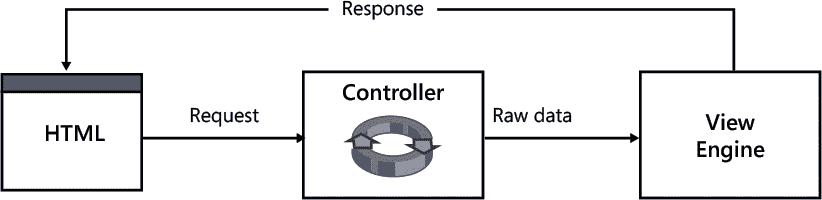

**图 8-3** ASP.NET MVC 中的控制器和视图。

虽然控制器类可以轻松地接收你喜欢的任何固定输入，并且其输出可以在没有大问题的情况下进行断言，但对于操作方法（action methods）的内部结构还无法断言。这些方法的实现越是紧密地与外部资源（例如数据库、服务或组件）绑定，测试控制器的可能性就越不快速和简单。

正如你将在第 10 章的“组织 MVC 项目”中更详细看到的那样，构建控制器类的理想方法是将所有的编排逻辑放入不同的类中——应用层类——并保持控制器类尽可能薄。这样做的好处是控制器类是你唯一绑定到 HTTP 上下文的地方。应用层类，因此每个请求背后的工作流，可以无忧地进行测试，因为它们对周围环境没有依赖。

测试控制器变得可选了。除非你想测试某些特殊的控制器功能（如响应过滤器和操作过滤器），否则你并不严格需要它。在大多数情况下，针对应用层类编写测试就能完成工作。

### 编写控制器类

编写控制器类可以总结为两个简单的步骤：创建一个继承（直接或间接继承）自 `Controller` 的类，并添加一组公共方法。

## 将操作映射到方法

应用于传入请求的 ASP.NET MVC 流水线的最终输出是一对元素，由要实例化的控制器类名和要对其执行的操作名组成。在控制器上执行操作会调用控制器类上的公共方法。然而，有几种不同的方法可以将操作名映射到类方法。

核心规则是，控制器类上的任何公共方法都是具有同名的公共操作（action）。例如，名为 `Index` 的公共方法对应于名为 `Index` 的操作。有时，你需要在控制器类上有一个公共方法，但不想让它从外部作为操作被调用。在这种情况下，你只需要用 `NonAction` 特性（attribute）标记该方法。

最后，你可以将操作名与任何公共方法关联，从而将方法名与操作名解耦。在这种情况下，你使用 `ActionName` 特性来标记该方法。这是一个示例：

```csharp
public class HomeController : Controller

{
    // 隐式操作名：Index
    public ActionResult Index()
    {
        ...
    }

    [NonAction]
    public ActionResult About()
    {
        ...
    }

    [ActionName("About")]
    public ActionResult LoveGermanShepherds()
    {
        ...
    }
}
```

因此，公共且未装饰任何特性的方法 `Index` 被隐式地绑定到具有同名的操作。相反，方法 `About` 被标记为公有，但 `NonAction` 特性使其从外部不可见。你可以在应用程序的服务器端代码中调用它，但它没有绑定到任何可以从浏览器和 JavaScript 代码调用的操作。

示例类中的第三个公共方法有一个华丽的名字，但 `ActionName` 特性将其显式绑定到操作 `About`。最终效果是，每当用户请求操作 `About` 时，`LoveGermanShepherds` 方法就会运行。

方法到操作映射的另一个级别是 HTTP 动词。

## 将操作映射到 HTTP 动词

ASP.NET MVC 足够灵活，允许你仅针对特定的 HTTP 动词将方法绑定到操作。或者，你可以使用参数化的 `AcceptVerbs` 特性或直接使用 `HttpGet`、`HttpPost` 和 `HttpPut` 等直接特性。`AcceptVerbs` 特性允许你指定执行给定方法所需的 HTTP 动词。让我们考虑以下示例：

```csharp
[AcceptVerbs(HttpVerbs.Post)]
public ActionResult Edit(Customer customer)
{
    ...
}
```

给定这段代码，结果 `Edit` 方法不能使用 GET 调用。同样注意，你不允许在一个方法上拥有多个 `AcceptVerbs` 特性。如果你在操作方法上添加多个 `AcceptVerbs` 特性（或类似的直接 HTTP 动词特性），你的代码将无法编译。

`AcceptVerbs` 特性接受 `HttpVerbs` 枚举中的任何值：

```csharp
public enum HttpVerbs
{
    Get = 1,
    Post = 2,
    Put = 4,
    Delete = 8,
    Head = 0x10
}
```

`HttpVerbs` 枚举装饰了 `Flags` 特性。因此，你可以使用位或 (|) 运算符组合枚举中的多个值，并获得另一个 `HttpVerbs` 值：

```csharp
[AcceptVerbs(HttpVerbs.Post|HttpVerbs.Put)]
public ActionResult Edit(Customer customer)
{
    ...
}
```

使用 `AcceptVerbs` 或多个独立的特性（如 `HttpGet` 或 `HttpPost`）完全取决于个人喜好。以下代码完全等效：

```csharp
[HttpPost]
[HttpPut]
public ActionResult Edit(Customer customer)
{
    ...
}
```

在 Web 上，当你点击链接或在地址栏中输入 URL 时，你执行的是 HTTP GET 命令。当你提交 HTML 表单内容时，你执行的是 HTTP POST。任何其他 HTTP 命令只能通过 AJAX 在 Web 上执行，或者向 ASP.NET MVC 应用发送请求的 Microsoft Windows 客户端执行。这是一个你在几乎每个涉及 HTML 表单的 HTML 场景中遇到的常见场景：你需要一个方法来渲染显示表单的视图，还需要一个方法来处理提交的值。你如何处理这种情况？

一种方案是让单个方法绑定到任何可能的 HTTP 动词：

```csharp
public ActionResult Edit(Customer customer)
{
    ...
}
```

在方法体中，你设法判断用户是意图显示表单还是处理提交的值。并没有多少可用信息可以判断这一点；你拥有的最佳来源是从 `Request` 对象中获取的 HTTP 动词：

```csharp
[HttpGet]
public ActionResult Edit(Customer customer)
{
    ...
}

[HttpPost]
public ActionResult Edit(Customer customer)
{
    ...
}
```

现在有两个方法绑定到不同的动作。这对于 ASP.NET MVC 来说是可以接受的，它会根据动词调用相应的方法。然而，对于 Microsoft C# 编译器来说是不可接受的，因为它不允许在同一个类中拥有两个同名同签名的方法。以下是重写后的：

```csharp
[HttpGet]
[ActionName("edit")]
public ActionResult DisplayEditForm(Customer customer)
{
    ...
}

[HttpPost]
[ActionName("edit")]
public ActionResult SaveEditForm(Customer customer)
{
    ...
}
```

方法现在有了不同的名称，但它们都绑定到同一个动作，尽管对应不同的动词。

### 动作方法 (Action methods)

让我们来看一个示例控制器类，其中包含几个简单但功能完备的动作方法：

```csharp
public class HomeController : Controller
{
    public ActionResult Index()
    {
        // 处理输入数据
        ...
        // 执行预期任务
        ...
        // 生成动作的结果
        return View();
    }
    public ActionResult About()
    {
        // 处理输入数据
        ...
        // 执行预期任务
        var results = ...
        // 根据计算结果生成响应
        return View(results);
    }
}
```

动作方法通过任何标准的 HTTP 通道获取可用的输入数据。接下来，它安排某些操作，并可能涉及应用程序的中间层。动作方法的模板可以总结如下：

 **处理输入数据** 动作方法可以从各种源获取输入参数，包括 `Request` 对象暴露的集合。ASP.NET MVC 并不强制动作方法具有特定的签名。然而，出于可测试性的考虑，强烈建议通过签名接收任何输入参数。如果你计划对控制器类进行测试（尽管在大多数时候可能没必要），你应该避免使用从 `Request` 或其他源程序化检索输入数据的方法。在这方面，你可以利用我稍后将讨论的模型绑定层服务。

 **执行任务** 动作方法根据输入参数执行工作，并尝试获取预期结果。在此过程中，方法可能需要与中间层进行交互。建议通过即时的、专用的应用程序服务进行任何交互。在任务结束时，任何应包含在响应中的（计算或引用的）值都将被恰当地封装。如果方法返回 JSON，数据将组合成一个 JSON 可序列化对象。如果方法返回 HTML，数据将封装进一个容器对象并发送到视图引擎。该容器对象通常被称为 `view-model`（视图模型），它可以是一个简单的键/值对字典，也可以是特定于视图的强类型类。

 **生成结果** 在 ASP.NET MVC 中，控制器方法用于生成结果，并设置 `ActionResult`。

### 处理数据

动作方法通过请求访问输入数据。在本节中，我将首先讨论如何手动检索输入数据。接下来，我将转向通过模型绑定器进行自动参数解析。

正如你很快将看到的，ASP.NET MVC 提供了非常有吸引力的功能（例如，模型绑定器），你可能希望使用它们来保持代码更简洁、更紧凑。

### 手动参数绑定

控制器动作方法可以通过请求访问输入数据。输入数据可以从各种源检索，包括表单数据、查询字符串、Cookies、路由值。让我们进入一些细节。

#### 从 Request 对象获取输入数据

在编写动作方法体时，你可以直接访问通过 `Request` 传来的输入数据及其集合，如 `Form`、`Cookies`、`ServerVariables` 和 `QueryString`。尽管如此，没有任何阻止你编写此处所示的基于 `Request` 的旧式代码：

```csharp
public ActionResult Echo()
{
    // 以手动方式获取数据
    var data = Request.Params["today"] ?? String.Empty;
    ...
}
```

在 ASP.NET 中，`Request.Params` 字典由四个不同的字典组成：`QueryString`、`Form`、`Cookies` 和 `ServerVariables`。你也可以使用 `Request` 对象的 `Item` 索引属性，它提供了相同的功能，并按以下顺序搜索匹配项：`QueryString`、`Form`、`Cookies` 和 `ServerVariables`。以下代码与刚刚的代码完全等价：

```csharp
public ActionResult Echo()
{
    // 以手动方式获取数据
    var data = Request["today"] ?? String.Empty;
    ...
}
```

注意，匹配项是不区分大小写的。

#### 从路由获取输入数据

在 ASP.NET MVC 中，你经常通过 URL 提供输入参数。这些值由路由模块捕获并供应用程序使用。路由值并不通过 `Request` 对象暴露给应用程序。你需要使用稍微不同的方法来程序化地检索它们：

```csharp
public ActionResult Echo()
{
    // 以手动方式获取数据
    var data = RouteData.Values["data"] ?? String.Empty;
    ...
}
```

路由数据通过 `Controller` 类的 `RouteData` 属性暴露。在这种情况下，对匹配条目的搜索是以不区分大小的方式进行的。

 备注

`RouteData.Values` 字典是一个 String/Object 字典。大多数时候，该字典只包含字符串。然而，如果你通过程序化的方式填充它（例如，通过自定义路由处理程序），它可能包含其他类型的值。在这种情况下，你负责进行任何必要的类型转换。

### 模型绑定

使用原生的输入数据请求集合在功能上是可行的，但从可读性和维护性的角度来看并不理想。你会发现，使用一个即时模型（ad hoc model）来向控制器暴露数据会更好。这种模型通常被称为“输入模型”（`input model`）。ASP.NET MVC 提供了一个自动绑定层，该层使用一套内置规则将从任何值提供程序的原始请求数据映射到输入模型类的属性上。作为开发者，你很大程度上负责这些输入模型类的设计。

 备注

大多数时候，模型绑定层内置的映射规则已足够让控制器接收清洁且可用的数据。然而，绑定层的逻辑可以在很大程度上进行自定义，从而在处理输入数据方面增加了前所未有的灵活性。

## 默认模型绑定器

任何请求都会通过一个内置绑定器对象的引擎，该对象对应于 `DefaultModelBinder` 类的实例。图 8-4 提供了参数绑定过程的概览。

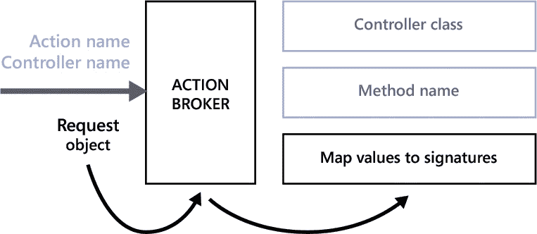


**图 8-4** 将请求值映射到控制器方法签名的过程。

动作调用例程序（action invoker）是 ASP.NET MVC 的内部流水线组件，其目标是将动作名称和控制器名称转换为对控制器类实例方法的调用。在此过程中，它需要调查控制器方法的签名，并查看形式参数名称，试图找到与通过查询字符串、表单、路由或 Cookie 上传的任何数据名称的匹配。

模型绑定器使用基于约定的逻辑将提交值的名称与控制器方法中的参数名称进行匹配。`DefaultModelBinder` 类知道如何处理原始类型和复杂类型，以及集合和字典。鉴于此，默认绑定器在大多数情况下工作得很好。

### 绑定原始类型

诚然，这初听起来可能有点神奇，但模型绑定背后并没有真正的魔术。模型绑定的关键事实是，它让你完全专注于你希望控制器方法接收的数据。你完全忽略了检索这些数据的细节，无论它们是来自查询字符串还是路由。

假设你需要一个控制器方法按照指定的次数重复指定的字符串。你需要的输入数据是一个字符串和一个数字。以下是你的操作：

```c
public class BindingController : Controller
{
    public ActionResult Repeat(string text, int number)
    {
        ...
    }
}
```

采用这样设计，你不需要访问 HTTP 上下文来获取数据。`text` 和 `number` 的值从哪里来？哪个组件实际上将它们读取到 `text` 和 `number` 参数中？

实际值是从请求上下文中读取的，默认模型绑定器对象完成了这项工作。特别是，默认绑定器尝试将形式参数名称（示例中的 `text` 和 `number`）与随请求提交的命名值进行匹配。换句话说，如果请求携带了一个表单字段、查询字符串字段或名为 `text` 的路由参数，则携带的值会自动绑定到 `text` 参数。只要参数类型和实际值兼容，映射就会成功发生。如果无法执行转换，则会抛出参数异常（argument exception）。下一个 URL 可以正常工作：

[`http://server/binding/repeat?text=Dino&number=2`](http://server/binding/repeat?text=Dino&number=2)

相反，以下 URL 会导致异常：

[`http://server/binding/repeat?text=Dino&number=true`](http://server/binding/repeat?text=Dino&number=true)

查询字符串字段 `text` 包含 `Dino`，映射到方法 `Repeat` 上的 `String` 参数 `text` 成功。然而，查询字符串字段 `number` 包含 `true`，它无法成功映射到 `int` 参数。模型绑定器返回一个参数字典，其中 `number` 的条目包含 `null`。由于参数类型是 `int`——即非可空类型——调用例程序抛出了参数异常。

### 处理可选值

注意，因为传递了无效值而发生的参数异常在控制器级别不会被检测到。异常在执行流到达控制器之前就会触发。这意味着你无法通过 `try/catch` 块捕获它。

如果默认模型绑定器找不到匹配必需方法参数的提交值，它会将 `null` 值置在返回给动作调用例程序的参数字典中。再次，如果参数类型不接受 `null` 值，则在调用控制器方法之前就会抛出参数异常。

如果一个方法参数必须被认为为可选的该怎么办？

一种可能的方法是将参数类型更改为可空类型，如下所示：

```csharp
public ActionResult Repeat(string text, Nullable<int> number)
{
    var model = new RepeatViewModel {Number = number.GetValueOrDefault(), Text = text};
    return View(model);
}
```

另一种方法是为参数使用默认值：

```csharp
public ActionResult Repeat(String text, Int32 number=4)
{
    var model = new RepeatViewModel {Number = number, Text = text};
    return View(model);
}
```

关于控制器方法签名的任何决定取决于你。通常情况下，你可能希望使用与请求上传的真实数据非常接近的类型。例如，使用 `Object` 类型的参数将让你免于参数异常，但会让你编写清洁的代码来处理输入变得困难。

### 绑定复杂类型

方法签名中可以列出的参数数量没有限制。然而，一个容器类通常比长长的单独参数更好。对于默认模型绑定器，无论你是列出一系列参数还是只列出一个复杂类型的参数，结果都几乎相同。这两种情况都完全支持。这是一个示例：

```csharp
public class ComplexController : Controller
{
    public ActionResult Repeat(RepeatText inputModel)
    {
        var model = new RepeatViewModel
        {
            Title = "Repeating text",
            Text = inputModel.Text,
            Number = inputModel.Number
        };
        return View(model);
    }
}
```

控制器方法接收一个类型为 `RepeatText` 的对象。该类是一个简单的数据传输对象（DTO），定义如下：

```csharp
public class RepeatText
{
    public String Text { get; set; }
    public Int32 Number { get; set; }
}
```

如你所示，该类包含的成员与你在上一个示例中作为单独参数传递的值相同。模型绑定器（model binder）处理这种复杂类型的方式与处理单值完全一样。

对于声明的类型中的每个公共属性（在本例中为 `RepeatText`），模型绑定器会查找键名与属性名匹配的发布值。匹配是不区分大小写的。以下是一个可以与 `RepeatText` 参数类型工作的示例 URL：

[`http://server/Complex/Repeat?text=ASP.NET%20MVC&number=5`](http://server/Complex/Repeat?text=ASP.NET%20MVC&number=5)

### 绑定集合

如果控制器方法期望的参数是一个集合会怎样？例如，你可以将发布表单的内容绑定到 `IList<T>` 参数吗？`DefaultModelBinder` 类使得这可行，但需要你自己进行一些设计。请查看图 8-5。

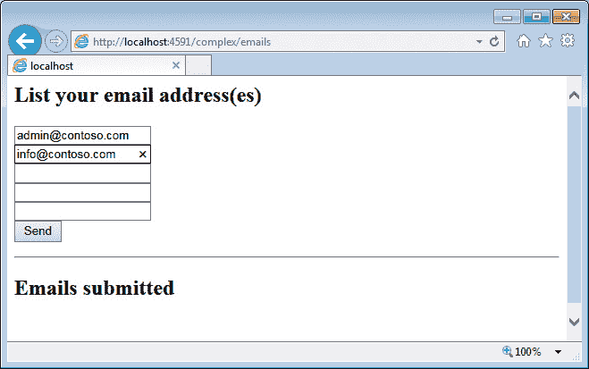

**图 8-5** 页面将发布一个字符串数组。

当用户点击发送按钮时，表单会提交其内容。具体来说，它发送了各个文本框的内容。如果文本框具有不同的 ID，发布的内容将采取如下形式：

`TextBox1=admin@contoso.com&TextBox2=info@contoso.com&TextBox3=&TextBox4=&TextBox5=`

在经典的 ASP.NET 中，这是唯一可能的方法，因为你不能给多个控件分配相同的 ID。然而，如果你自己管理 HTML，没有任何什么能阻止你为图中的五个文本框分配相同的 ID。事实上，HTML DOM 完全支持这种场景（尽管不建议这样做）。因此，以下标记在 ASP.NET MVC 中是完全合法的，并产生在所有浏览器上都能工作的 HTML：

```csharp
@using (Html.BeginForm())
{
    <h2>列出你的电子邮件地址(s)</h2>
    foreach(var email in Model.Emails)
    {
        <input type="text" name="email" value="@email" />
        <br />
    }
    <input type="submit" value="Send" />
}
```

必须处理表单中输入的电子邮件地址的控制器方法，其预期的签名是什么？在这里：

```csharp
public ActionResult Emails(IList<String> email)
{
    ...
}
```

图 8-6 显示，得益于默认绑定类，字符串数组被正确地传递给了方法。

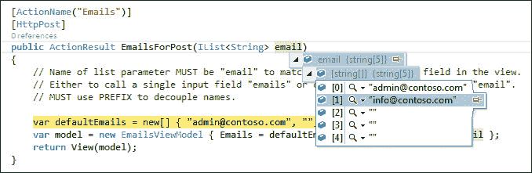

**图 8-6** 发布了一个字符串数组。

最后，为了确保将值集合传递到控制器方法，你需要确保具有相同 ID 的元素被输出到响应流。那么，根据绑定器的常规规则，ID 必须与控制器方法的签名匹配。

#### 生成操作结果（action results）

操作方法（action method）可以产生各种结果。例如，操作方法可以作为一个 Web 服务并在响应请求时返回普通字符串或 JSON 字符串。同样，操作方法也可以判断没有内容要返回，或者需要重定向到另一个 URL。在这两种情况下，浏览器将得到一个没有实际内容体的 HTTP 响应。这意味着，产生操作的原始结果（例如，从中间层收集值）是一回事，而处理该原始结果为浏览器生成实际的 HTTP 响应是另一回事。

### 封装结果

操作方法通常返回一个类型为 `ActionResult` 的对象。然而，`ActionResult` 类型并不是一个数据容器。更准确地说，它是一个抽象类，提供了一个公共编程接口，用于代表操作方法执行某些后续操作。所有这些后续操作都与为请求的生成某些响应有关。

#### 观察 `ActionResult` 类

以下是 ASP.NET MVC 框架中 `ActionResult` 类的定义：

```csharp
public abstract class ActionResult
{
    protected ActionResult()
    {
    }
    public abstract void ExecuteResult(ControllerContext context);
}
```

表 8-1 列出了所有的 `ActionResult` 类型。


**表 8-1** `ActionResult`

注意 `FileContentResult`、`FilePathResult` 和 `FileStreamResult` 派生自同一个类 `FileResult`。`PartialViewResult` 和 `ViewResult` 继承自 `ViewBase`。最后，`HttpUnauthorizedResult` 和 `HttpNotFoundResult` 分别代表未授权访问和资源缺失。两者都派自 `HttpStatusCodeResult`。

##### 操作结果的机制

为了更好地理解操作结果的机制，让我们剖析其中一个类。我选择了 `JavaScriptResult` 类，它提供了一些行为但不会太复杂。`JavaScriptResult` 类代表向浏览器返回某些脚本的操作。以下是一个提供此类操作方法：

```csharp
public JavaScriptResult GetScript()
{
    var script = "alert('Hello')";
    return JavaScript(script);
}
```

在示例中，`JavaScript` 是 `Controller` 类中的一个辅助方法，作为 `JavaScriptResult` 对象的工厂。其实现如下：

```csharp
protected JavaScriptResult JavaScript(string script)
{
    return new JavaScriptResult() { Script = script };
}
```

`JavaScriptResult` 类提供了一个公共属性——`Script` 属性，它包含要写入输出的脚本代码。其实现如下：

```csharp
public class JavaScriptResult : ActionResult
{
    public String Script { get; set; }
    public override void ExecuteResult(ControllerContext context)
    {
        if (context == null)
        {
            throw new ArgumentNullException("context");
        }
        // 准备响应
        HttpResponseBase response = context.HttpContext.Response;
        response.ContentType = "application/x-javascript";
        if (Script != null)
        {
            response.Write(Script);
        }
    }
}
```

如你所示，`ActionResult` 类的最终目的是准备 `HttpResponse` 对象以返回给浏览器。这涉及到设置内容类型、过期策略和标头以及内容。

### 返回 HTML 标记

大多数 ASP.NET MVC 请求都需要将 HTML 标记返回给浏览器。在 ASP.NET MVC 中，操作方法（action method）为用户生成原始结果，视图引擎将这些原始结果组合成 HTML 模板。最后，组合最终产物并作为请求的响应发送。

## 检查视图引擎的结构

视图引擎是物理上为浏览器构建 HTML 输出的组件。对于每个最终返回 HTML 的控制器操作的请求，视图引擎都会启动。它通过将视图模板与控制器传递的任何数据混合在一起来准备输出。模板使用特定引擎的标记语言（例如 Razor）表示；数据则以字典或强类型对象的形式封装并传递。图 8-7 展示了视图引擎和控制器如何协同工作的整体视图。

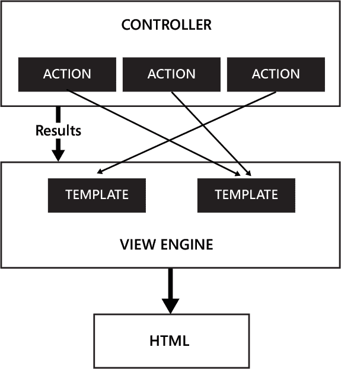

**图 8-7** 控制器（Controllers）和视图引擎。

在 ASP.NET MVC 中，视图引擎仅仅是一个实现了固定接口——`IViewEngine` 接口的类。每个应用程序可以拥有一个或多个视图引擎，并在不同的视图中使用所有它们。在 ASP.NET MVC 中，每个应用程序默认配备了两个视图引擎：Razor 和 ASPX。视图引擎对开发影响最大的方面是它支持的定义视图模板的语法。ASPX 视图引擎使用与 Web Forms 相同的代码块语法。然而，最常用的引擎是 Razor。Razor 语法比 ASPX 清洁高效得多。

## 探索视图引擎的各个方面

在 Razor 中，视图模板本质上是一个带有几个占位符的 HTML 页面。每个占位符包含一个可执行表达式——就像代码片段一样。当视图渲染时，片段中的代码被集成到 HTML 模板中。

Razor 引擎从磁盘上的物理位置读取视图模板。路径使用 ASP.NET 虚拟提供程序检索。任何 ASP.NET MVC 项目都有根 `Views` 文件夹，视图模板存储在特定的目录结构中。`Views` 文件夹通常有若干子目录——以控制器命名。每个子目录包含名称与操作匹配的文件。对于 Razor 视图引擎，扩展名必须是 `.cshtml`（如果你在 Visual Basic 中编写 ASP.NET MVC ，扩展名必须是 `.vbhtml`）。ASP.NET MVC 要求将每个视图模板放在使用它的控制器目录下。如果你期望多个控制器调用同一个视图，请将视图模板移动到 `Shared` 文件夹下。注意，当部署站点时，项目级别相同的 `Views` 目录层级结构必须复制。视图引擎通过几个属性控制视图模板的位置。对于视图引擎的内部工作，你需要为主视图、常规视图和部分视图提供默认位置。表 8-2 显示了 Razor 视图支持的默认位置属性。

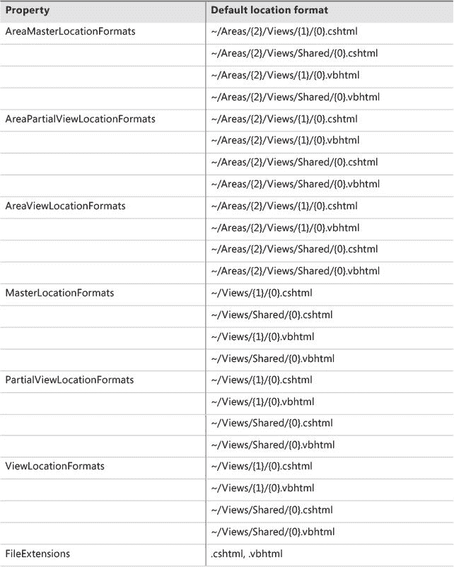

**表 8-2** Razor 视图的位置

可以看到，位置不是完全限定的，但可以包含三个占位符。占位符 `{0}` 指视图名称，因为它是从控制器方法调用的。占位符 `{1}` 指控制器名称，因为它位于 URL 中。最后，指定的 `{2}` 指区域名称。

## 调用视图引擎

在控制器方法内部，通过调用 `View` 方法来调用视图引擎，如下所示：

```cs
public ActionResult Index()
{
   return View(); // 等同于 View("index");
}
```

`View` 方法是创建 `ViewResult` 对象的辅助方法。`ViewResult` 对象需要知道视图模板、主视图以及集成到最终 HTML 中的原始数据。代码片段中 `View` 方法没有参数并不意味着没有传递数据。这里是该方法的完整签名：

```cs
protected ViewResult View(String viewName, String masterViewName, Object viewModel)
```

这是一个更常见的控制器方法模式：

```cs
public ActionResult Index(...)
{
   var model = GetRawDataForTheView(...);
   return View(model);
}
```


在这种情况下，视图名称默认为操作名称，可以从方法名推断或通过`ActionName`属性显式设置。主视图默认为`_Layout.cshtml`。最后，变量`model`指明集成在最终 HTML 中的数据模型。

主视图是视图所依据的通用模板。主视图文件位于`Shared`文件夹中。在最简单的形式下，主视图所示：

```html
<html>
<head>
   <link href="@Url.Content("~/Content/site.css")" rel="stylesheet" type="text/css" />
   <script src="@Url.Content("~/Scripts/jquery.js")" type="text/javascript"></script>
</head>
<body>
   @RenderBody()
</body>
</html>
```

`@RenderBody()`调用指示特定视图注入主模板的插入点。`@Url.Content`表达式是用根目录完成相对 URL 的机制。波浪符号`~`实际上指向根目录。

视图中使用的任何数据模型必须通过`@model`指令声明：

```html
@model MySite.ViewModel
<html>
<head>
   <title>@Model.Title</title>
</head>
<body>
   @RenderBody()
</body>
</html>
```

在指令中声明的类型必须与你从控制器传递给`View`方法的对象类型兼容。在视图体中，使用`@Model.XXX`语法引用视图对象的属性。

让我们进一步了解 Razor 视图中的`@`字符。

## 使用 Razor 代码片段

在 Razor 模板中，你会发现逐字对应的普通 HTML 标记和代码片段。`@`表示代码片段的开始。有趣的地方在于，在 Razor 中你需要指示代码片段的开始，但之后内部解析器使用 Visual Basic 或 C# 解析逻辑来确定一行代码的结束位置。这是一个示例：

```html
<html>
<head>
   <title>@ViewBag.Title</title>
</head>
<body>
   ...
</body>
</html>
```

在代码片段中，`ViewBag.Title`表达式指向另一种从控制器传递数据的方式。`ViewBag`是从控制器构建的动态对象，包含在视图中消耗的数据：

```cs
public ActionResult Index(...)
{
   // 为视图获取数据
   ...
   // 为视图封装数据
   ViewBag.Title = ...;
   ViewBag.Xxx = ...;
   ...
   // ViewBag 隐式传递给视图引擎
   return View();
}
```

`ViewBag`是`dynamic`类型对象，这意味着涉及它的任何表达式都不会预先编译，而是在运行时进行解释。

任何 Razor 代码段都可以与普通标记混合使用，即使代码段包含了如`if/else`或`for/foreach`等控制流语句。这里有一个示例，展示了如何构建 HTML 表格：

```html
<body>
    <h2>我最喜爱的城市</h2>
    <hr />
    <table>
      <thead>
        <th>城市</th>
        <th>国家</th>
        <th>去过那里吗？</th>
      </thead>
      @foreach (var city in ViewBag.Cities) {
        <tr>
          <td>@city.Name</td>
          <td>@city.Country</td>
          <td>@(city.Visited == "Yes" ? "是" : "否")</td>
        </tr>
      }
    </table>
  </body>
</body>
```

请注意，放置在源代码中间的右大括号（你可以在`@foreach`那一行看到它）会被解析器正确地识别和解释。

在 Razor 模板中，只要表达式以`@*`为前缀，你使用任何 C# 或 Visual Basic 指令。这里有一个如何导入命名空间并创建表单块的示例：

```cor
@using MyApp.Components;

...

<body>
    @using (Html.BeginForm()) {
        <div class="editor-field">
            <span>...</span>
        </div>
    }
</body>
```

你可以通过如此处所示将其封装在`@{ code }`块中，在任何地方插入由多行代码组成的完整代码段：

```cor
@{
    var user = "Dino";
}
```

...

`<p>@user</p>`

你创建的任何变量都可以稍后被检索和使用，就像代码属于同一个代码块一样。多个标记（例如，标记和代码）可以使用圆括号组合在同一个表达式中：

```html
<p> @("欢迎， " + user) </p>
```

由 Razor 处理的任何内容都会自动编码，因此你不需要担心这一点。如果你的代码返回了你希望原样输出而不进行自动编码的 HTML 标记，你应该求助于使用`Html.Raw`辅助方法：

```cor
@Html.Raw(Strings.HtmlMessage)
```

最后，在使用`@{ ... }`的多行代码段内部，你使用 C# 或 Visual Basic 语言语法来放置注释。你可以使用`@* ... *@`语法注释掉整个块 Razor 代码。以下是操作方法：

```cor
@*
<div>  Razor 标记 </div>
@*
```

基于 C# 的 Razor 视图和基于 Visual Basic 语言的 Razor 视图之间存在细微的差异。在 Visual Basic 中，你可以直接在源代码中编写 XML 字面量；这会导致某些 Razor 标记的解析出现歧义。以下表达式在 C# 中是可以接受的，但无法原样地移植到 Visual Basic：

```cor
@if (isHelloWorld) {
    <h1> Hello world </h1>
}
```

在 Visual Basic 中，你需要在 HTML 字面量前加上一个额外的`@`符号，如下所示：

```vb
@If (isHelloWorld) Then
    @<<h1>>Hello world</<h1>>
End If
```

正如你可能知道的，大多数 Visual Basic 结构都需要一个结束标签。`For..Each`、`If`、`Using`等都是如此。结束标签不需要带有`@`符号前缀。

### 部分视图

有时，将一些常用的 Razor 标记隔离到单独的文件中并仅从主视图或视图内部对其进行链接是很有用的。如果你熟悉 ASP.NET Web Forms 编程，这是相同的服务。

```cor
@Html.Partial("name_of_view")
```

以下表达式在 C# 中是可以接受的，但无法原样地移植到 Visual Basic：

```cor
@if (isHelloWorld) {
    <h1> Hello world </h1>
}
```

在 Visual Basic 中，你需要在 HTML 字面量前加上一个额外的`@`符号，如下所示：

```vb
@If (isHelloWorld) Then
    @<<h1>>Hello world</<h1>>
End If
```

正如你可能知道的，大多数 Visual Basic 结构都需要一个结束标签。`For..Each`、`If`、`Using`等都是如此。结束标签不需要带有`@`符号前缀。

### 控制器中的异步操作

控制器的主要目的是满足用户界面的需求。你需要实现的任何服务器端函数都应该映射到控制器。控制器方法在完成自己的任务后，会选择下一个视图，封装一些数据并告诉它渲染。

这是控制器行为的核心。然而，控制器通常还需要其他特性，特别是当控制器应用于具有特殊需求的大应用程序时。在早期版本的 ASP.NET 中，你必须遵循特定的模式来赋予控制器方法异步行为。在较版本的 ASP.NET 和 .NET Framework 中，你可以利用`async/await`语言设施和底层的 .NET 机制。以下是编写带有一个或多个异步方法的类的方法：

```cs
public class HomeController : AsyncController
{
    public async Task<ActionResult> Rss()
    {
        // 执行可能耗时的操作
        var client = new HttpClient();
        var rss = await client.GetStringAsync(someRssUrl);
        // 解析 RSS 并构建视图模型
        var model = new HomeIndexModel();
        model.News = ParseRssInternal(rss);
        return model;
    }
}
```

### 返回 JSON

ASP.NET 非常适合实现 Web 服务。你只需要设置一个或多个方法返回 JSON 而不是 HTML。这里有一个示例：

```cs
public JsonResult GetCustomers()
{
    // 获取数据
    var customers = _customerRepository.GetAll();
    // 序列化并返回
    return Json(customers);
}
```

`Json`方法使用`JavaScriptSerializer`类对对象进行序列化。

ASP.NET MVC 的一个特征是它不将 URL 映射到磁盘文件；而是解析 URL 以确定下一个要执行 get 操作（action）。然后，该操作会被映射到控制器类（controller class）中的一个方法。每个方法的执行都会结束，并将结果序列化后传给请求的浏览器。最常见的操作结果类型是 HTML 视图，但也可以存在其他类型的响应，包括 JSON、纯文本、二进制数据和重定向。

在本章中，我简要介绍了构成典型 ASP.NET MVC 请求流的组件。首先，URL 路由 HTTP 模块会检查传入的请求，并确定处理该请求的控制器以及被调用的方法。接着，绑定层（binding layer）介入，并将提交的数据（如查询字符串、表单、Cookie、头部或路由）映射到控制器方法的签名上。如果映射成功，控制器方法将运行并产生原始结果（raw results）。原始结果是你任何想要返回给用户的数据——集合、字符串、数字、日期或任何内容。最后，视图引擎（view engine）获取视图模板并为浏览器生成 HTML。控制器并不局限于返回 HTML。在 ASP.NET MVC 中，控制器可以轻松返回任何序列化为 XML、纯文本或 JSON 的数据类型。

本章仅触及了 ASP.NET MVC 的皮毛，但它提供了运行机制的概述。在下一章中，我将尝试介绍 Twitter Bootstrap——这是一个 CSS 和图形库，你可以用它来有效地排列 HTML 视图的布局和用户界面。从第 11 章“展示数据](#part0018.html_ch11)”开始，我将回到 Razor 并讨论在视图中展示和编辑数据的常用方法。

## 第 9 章 Bootstrap 核心

*计算机的不人性之处在于，一旦它被编写得当且运行顺利，它就是完全诚实的。*

*—— 艾萨·阿西莫夫*

Bootstrap 最初是为 Twitter 内部开发的，是一个 CSS 和 JavaScript 库，旨在简化现代网页的构建。但到底什么是“现代网页”呢？

简单来说，现代网页就是按照如今大多数用户喜好的方式构建的网页。HTML 语言仍然是网页的基础和核心语言。然而，HTML 标记语言的构建块已越来越无法快速、直接地表达构成现代页面的复杂性和精密程度。例如，下拉菜单、分段选项按钮、标签页、折叠面板和模态对话框都是大多数页面的常见元素，但目前还没有直接的 HTML 元素可以方便地实现它们。

Bootstrap 提供了一种直接的方法，可以将 HTML 片段转换为现代网站按所需的、更复杂的视觉元素。

## Bootstrap 概览

Bootstrap 是一个由 CSS 和 JavaScript 文件组成的模块化 Web 库。CSS 文件包含类，用于重新设计常见的 HTML 元素，使它们看起来不同且可能更美观。JavaScript 文件以 jQuery 插件集合的形式出现，并支持仅通过 CSS 无法实现的复杂功能。

Bootstrap 最初是作为一组 LESS 文件开发的，你仍然可以从 LESS 文件文件的集合中获取该库的 CSS 部分。本质上，对于 Bootstrap 库包含的每个模块，你都拥有一个 LESS 或 CSS 文件：表单、按钮、导航栏、对话框等。在深入了解 Bootstrap 库的细节之前，让我们先快速查看 LESS。

### LESS 与 Bootstrap 的基础

LESS 文件是对纯 CSS 语法的抽象，它为开发者提供了声明 CSS 文件最终如何被使用的能力。你可以将 LESS 视为一种编程语言，它在编译后生成 CSS。在 LESS 文件中，你可以使用变量、函数和操作符，从而极大简化了创建和维护大型复杂 CSS 样式表的过程。

### 变量

开发者通过 LESS 处理的最大问题之一是信息的重复。作为一名软件开发者，你可能非常熟悉“不要重复自己”（DRY）原则，并且每天应用它。DRY 的主要用处是减少存储相同信息的地点数量，从而减少需要更新的地点数量。在纯 CSS 中，你根本无法 DRY。例如，如果一个特定的颜色被用于多个 CSS 类——并且在某个时刻你必须更改它——你可能没有比在每个出现的地方都更新它更好的方法来做到这一点。

CSS 类的问题在于，它们在语义化 HTML 元素的层级上运行。在构建各种 CSS 类时，你通常必须重复小段信息，例如颜色或宽度。你无法轻松地为这些可重复的每个片段每一个创建一个类。即使你成功为几乎任何可重复的样式（如颜色和宽度）创建了 CSS 类，但在对语义元素（例如容器）进行样式时，你需要将多个 CSS 类连接在一起以实现所需效果。

考虑以下 CSS 示例：

```css
.container {
   color: #111;
}

.header {
   background-color: #111;
}
```

`container`和`header`CSS 类依赖于同一种颜色。如果该颜色必须更改，你必须遍历所有使用它的地方并进行编辑。以下是你如何用 LESS 的方式重写相同功能的方法：

```less
@black: #111;

.container {
   color: @black;
}

.header {
   background-color: @black;
}
```

现在，颜色被定义在一个地方，作为一个全局变量。因此，LESS 是一种向 CSS 添加了程序员友好型概念（如变量）的语言。但它还可以做得更多。

### 导入

你可以将 LESS 代码拆分到多个文件中，并在需要的地方引用它们。例如，假设你创建一个`container.less`文件，内容如下：

```less
@black: #111;

.container {
   background-color: @black;
}
```

在另一个 LESS 文件中——例如`main.less`——你可以通过导入文件来引用整个 CSS：

```less
@import "container";
.body { .container; }
```

如果`container.less`文件（严格不需要扩展名）位于不同的文件夹，你应该在`@import`调用中指示路径信息。

### 混合（Mixins）

特别是在网页必须适应不同屏幕尺寸的时代，适应分辨率的能力至关重要。例如，当按钮在平板电脑上查看并受到粗指针点击时，开发者通常会增加周围的内边距。通常情况下，如何让同一个 CSS 类根据某些运行时条件发生变化？这就是 LESS 混合大显身手的地方。

这里有两个混合示例：

```less
.shadow(@color) {
   box-shadow: 3px 3px 2px @color;
}

.text-box(@width) {
   .shadow(#555);
   border: solid 1px #000;
   background-color: #dddd00;
   padding: 2px;
   width: @width;
}
```

从这里，你可以推导出更具体的 CSS 类，如下所示：

```less
.text-box-mini {
   .text-box(50px);
}

.text-box-normal {
   .text-box(100px);
}

.text-box-large {
   .text-box(200px);
}
```

这正是 Bootstrap 在内部所做的，以支持按钮和输入字段等常见元素的变体。

## 将 LESS 转换为 CSS

虽然 LESS 可以作为 CSS 的元语言，但它并不是 CSS。它必须经过处理以生成纯 CSS。LESS 代码可以原样下载并通过 JavaScript 代码在客户端进行处理，也可以在服务器上进行预处理并作为纯 CSS 下载到客户端。在一种情况下，一切的工作方式就像你使用纯 CSS 文件一样：服务器端的更改将在下次刷新页面时应用到客户端。


然而，如果你对性能有要求，并且需要处理大型复杂的 CSS 文件，那么服务端预处理可能是更好的选择。服务端预处理是在每次你在服务器上修改 CSS 时都会发生的操作。通常，你会在构建过程的最后阶段使用命令行中的 `LESS` 编译器执行这一额外步骤。像 `Gulp` 这样的工具有助于通过 JavaScript 相关的步骤扩展构建过程。另一个流行的工具如 `Microsoft Web Essentials`——一个 Visual Studio 插件——可以用于添加临时菜单命令，以处理 CSS 和脚本文件等网络资源。

在 `ASP.NET MVC` 中，不过还有另一种可能的路径。你可以将 `LESS` 框架集成到包（bundle）和压缩化（minification）机制中。正如你将在下一节中详细看到的，打包是将多个不同的资源合并成单个可下载资源的过程。例如，一个包可能包含多个 JavaScript 或 CSS 文件，你通过对临时端点发送单个 HTTP 请求将这些文件下载到本地机器。压缩是应用于资源的一种特殊转换。具体来说，压缩是从基于文本的资源中移除所有不必要的字符，且不会改变预期的功能。这意味着移除注释、空白字符、换行符，以及通常情况下所有为了可读性而添加但占用空间且不具有任何实际用途的字符。

## 设置 Bootstrap

你可以从 `NuGet` 获取 Bootstrap，或者直接从 [`getbootstrap.com`](http://getbootstrap.com) 下载。在这种情况下，你可以更轻松地只获取需要的框架部分。在整个网站中使用 Bootstrap 是非常常见的。在这种情况下，你如下所示从主视图（master view）中链接它：

```html
<meta name="viewport" content="width=device-width, initial-scale=1.0">

<link rel="stylesheet" src="@Url.Content("~/content/styles/bootstrap.min.css")">
```

`viewport` meta 标签将浏览器视口的宽度设置为实际设备宽度，并将缩放级别设置为普通（Normal）。`link` 元素引入了 Bootstrap 样式表的压缩版本。如果你打算还使用需要 JavaScript 的 Bootstrap 高级功能，你还需要链接脚本文件，以及它所依赖的 jQuery 文件：

```html
<script type="text/javascript"
        src="@Url.Content("~/content/scripts/jquery-2.1.4.min.js")"></script>

<script type="text/javascript"
        src="@Url.Content("~/content/scripts/bootstrap.min.js")"></script>
```

如果你使用的是完整的 Bootstrap 库，一旦链接了 CSS 和脚本文件，你基本上就完成了。如果你只使用 Bootstrap 库的部分，你必须确保所需的所有部分都已正确链接。请注意，Bootstrap 库的一些功能（例如工具提示 tooltips 和弹出框 popovers）需要在单个页面中添加一些启动时的 JavaScript 代码。

* *

 注意

Bootstrap 不支持旧版的 Internet Explorer 兼容模式。确保你的页面在 Internet Explorer 下以最佳渲染模式查看的最妥方法，是在你的页面中添加以下 `meta` 标签：

```html
<meta http-equiv="X-UA-Compatible" content="IE=edge">
```

Bootstrap 的 CSS 类使用了最新的 CSS 特性（如圆角），这些特性在旧版浏览器上可能不可用。Bootstrap 部分支持的旧浏览器的一个良好例子是 Internet Explorer 8。

* *

## 从视角来看待 Bootstrap

Twitter Bootstrap 在如今几乎是必不可少的。原因在于 Bootstrap 让人们能够快速、方便地为现代网站添加高级功能。Bootstrap 的学习曲线较短，并且有许多基于它的模板可以免费获得。然而，对于任何网页设计师来说，自定义基础的 Bootstrap 模板以获得独特的作品并不是难事。

Bootstrap 是否完美适合你的项目取决于审美有多重要。如果你是为一个要求独特视觉效果和体验的客户开发，那么 Bootstrap 可能是理想的，也可能不是。在这种情况下，开发团队只需接收一个图形模板并直接使用即可。另一方面，Bootstrap 非常适合审美虽然重要但非核心的快速项目。

换句话说，Bootstrap 是一项伟大的成就，但它并没有消除对优秀设计的需求。同时，它也没有消除对根据每个设备定义优秀用户体验的需求。很容易找到提供基于 Bootstrap 的免费或付费模板的网站。如果你限制自己使用默认 Bootstrap 库的样式——且不对 CSS 或 `LESS` 源代码进行任何更改——那么风险是所有网站最终看起来都一模一样。

决定是否使用 Bootstrap 是一个架构决策，必须在项目早期做出，而且这是一个后期很难更改的决定。在正在进行的项目添加或移除 Bootstrap 虽然很棘手，但并非不可能。最后，请考虑完整的 Bootstrap 库大约有 100 KB 的 CSS 加上 30 KB 的脚本。它不是一个巨大的资源，但也不是轻量级的资源——特别是对于较小的设备而言。

Bootstrap 快速采用的关键原因之一是，让页面在不同设备上都有良好显示的成本很低。

* *

## 整体模板

任何意图响应屏幕尺寸变化的 Bootstrap 内容都基于行和列的矩阵。整体容器——即 `matrix`——是一个样式化为 `container` 的 DIV 元素。（参阅 图 9-1。）

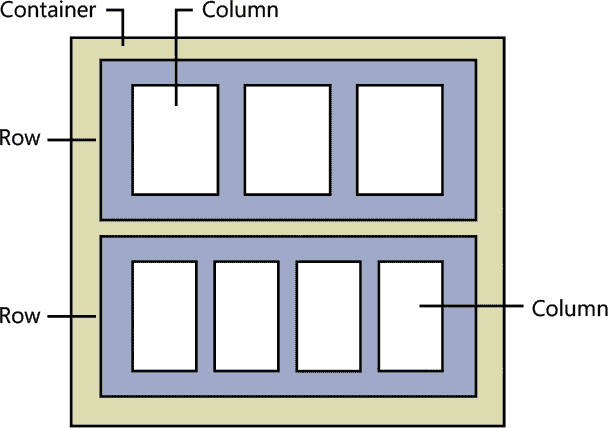

**图 9-1** Bootstrap 中流式网格的架构图

## 容器与行

最外层的容器负责任何必要的对齐，并负责内内边距（padding）。如果你没有显式地定义行（row），则假设有一行全高行。任何用户界面内容都放置在列（column）中。注意，只有列允许作为行的直接子元素。Bootstrap 中的任何内容通常按照以下架构布局：

```
container > row > column
```

上一行代码中的每个单词都指的是你通常应用到 DIV 元素上的 Bootstrap 类名。特别是，`container` 管理页面的宽度和内边距。`row` 样式确保内容放置在同一行内，并让多行垂直堆叠。如果你的代码中没有行元素，容器内的任何内容将水平流动，并在到达屏幕末端时换到下一行。

最后，`column` 元素标识行内的单块内容块。Bootstrap 为列定义了几个实际的类。要在行中定义列，你使用以下模式的类名：`col-XX-N`。在模式中，`XX` 代表设备族的前缀，可以是 表 9-1 中的任何值。正如你稍后看到的，每个 XX 代码都绑定到一个特定的像素宽度，被称为 `breakpoint`（断点）。

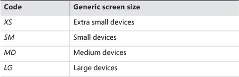

**表 9-1** 设备的 Bootstrap 代码

模板中的 `N` 是一个于 1 到 12 之间的数字，它表示该内容列在虚拟网格中实际上占据了多少列。让我们来看一个例子：

```
<div class="container">
  <div class="row">
      <div class="col-xs-6 col-md-4"> First </div>
      <div class="col-xs-6 col-md-4"> Second </div>
      <div class="col-xs-6 col-md-4"> Third </div>
  </div>
</div>
```

在这种情况下，你希望在单行内渲染三列布局。所有列的大小相等。所有列在中尺寸设备上都显示在单行中。`col-md-4` 样式使得每列的宽度等于虚拟 Bootstrap 网格系统中的四列（总共 12 列）。

### 那么更小和更大的设备又是怎样的？

在 XS 设备上，三列内容在渲染时将各占据屏幕的一半。正如你可能猜的那样，如果每一列都必须占据屏幕的一半，三个布局列就无法放入屏幕中。在这种情况下，第三列将溢出到下一行。SM 设备上也会发生这种情况。相反，在 LG 设备上，规则由 MD 样式设置。

结论是，流式行中的每一列都可以使用多设备属性进行宽度样式设置。这些属性在输入更具体的设置之前，对于较大的设备始终有效。鉴于此，如果你不需要按设备区分布局，你所做的最好的就是始终使用 XS 样式。列样式中 `N` 的总和应始终最多为 12。如果超过这个值，第 12 列之后的任何列都将溢出到下一行。

## 容器与流式容器

到为止，我们只考虑了 DIV 元素的 `container` 类。还有一种微小的变体，你在某些情况下可能需要考虑：`container-fluid` 类。普通容器对于每个断点都有固定宽度，只有当用户在调整浏览器大跨越断点时，视口宽度才会改变。

另一方面，流式容器占据父元素的全宽，通常是可用浏览器视口的 100%。视口宽度在每次调整大小时都会重新计算并更新。使用流式容器时用户体验更流畅，但使用流式容器主要对桌面设备有意义。

### 基于屏幕的渲染

为什么要使用多个列设置？答案很大程度上取决于你必须显示的实际内容。参考之前的示例，三列布局在中等尺寸设备上可能是可以的，但列中的内容可能太丰富，无法在较小屏幕的三分之一处渲染。这就是为什么我在 DIV 样式中添加了 `col-xs-6`。最终效果是 Bootstrap 将根据屏幕的实际尺寸更改最终行为。

在中等和大型设备上将有一个三列布局，而在小型和超小设备上每行只有两列。第三列在小型和超小设备上将换到下一行。如果这不是你想要的，你可以考虑在小型和超小设备上隐藏第三列。让我们看看如何操作。

### 虚拟测量与实际屏幕尺寸

Bootstrap 中的整个网格系统和设备族都基于 `breakpoints`（断点），如 表 9-1 所示（等等，文中说是表 9-2，但指的是 9-1，保持上下文）。每个屏幕对应一个识别了超小、小型和大设备的预期断点。

要监控 Bootstrap 如何更改页面，可以使用以下脚本：

```javascript
<script type="text/javascript">
  updateSize();
  $(window).resize(function() {
    updateSize();
  });

  function currentBootstrapClass() {
    var screen = "LG";
    var width = $(window).width();
    if (width <= 768) {
      screen = "XS";
    } else if (width <= 992) {
      screen = "SM";
    } else if (width <= 1200) {
      screen = "MD";
    }
    return screen;
  }

  function updateSize() {
    var info = currentBootstrapClass();
    $('#currentScreenWidth').text($(window).width() + "px");
    $('#currentViewport').text(info);
  }
</script>
```

显然，网页必须具有具有匹配 ID 的元素：

```html
<span id="currentScreenWidth"></span>
<span id="currentViewport"></span>
```

图 9-2 显示了一个示例。

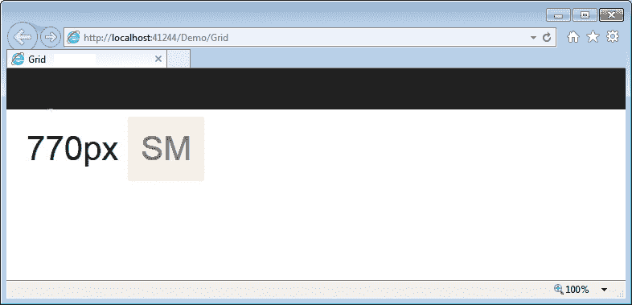

**图 9-2** 显示屏幕尺寸与 Bootstrap 类之间的关系

## 多分辨率视图

正如所述，对于列布局，你可以为容器和行分配多个设置。让我们来看一个有趣的例子：

```html
<div class="container">
  <div class="row">
      <div class="col-xs-6 col-md-4"> Column #1 <br /> Column #1 <br /></div>
      <div class="col-xs-6 col-md-4"> Column #2 </div>
      <div class="col-md-4"> Column #3 </div>
  </div>
</div>
```

第一列在 XS 和 SM 模式下占据空间的一半，在 MD 和 LG 模式下占据三分之一。然而，第一列的内容包含一些 `BR` 元素，这导致它比其他列高。在 MD 和 LG 中，显示效果完全如你预期的——一行三列。但在 XS 和 SM 中，第三列将显示在何处？请查看图 9-3。

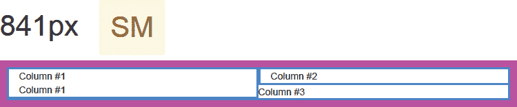

**图 9-3** 第三列浮动在行的紧左侧，占据了任何可用空间。

在 XS 和 SM 模式下，前两列由于使用了 `col-xs-6` 类而占据了整个屏幕。随后，第三列流到下一行。然而，在这个特定的示例中，第一列比其他列高，这会在右侧留出空间。Bootstrap 重复了这些屏幕区域来适应换行到下一行的列。

通常，每当你使用 `col-xx-n` 类时，你实际上是在操作设置为 `left`（或 `right`）的 CSS `float` 属性，并告诉浏览器寻找最左侧（或最右侧）的可用空间放置给定元素。注意，要右对齐，只需在所需的元素上添加 `pull-right` 类即可。

### 尺寸特定类

如果你想强制第三列到下一行但保持在最左侧怎么办？你必须显式地停止默认对齐并恢复 `DIV` 元素的块级属性。在纯 CSS 中，你通过使用带有 `clear:both` 属性的空 `DIV` 来实现这一点。Bootstrap 中的等效方法是 `clearfix` 类：

```html
<div class="clearfix"></div>
```

图 9-4 显示了如果你盲目使用 `clearfix` 类强制第三行到下一行的开头时会得到的结果。

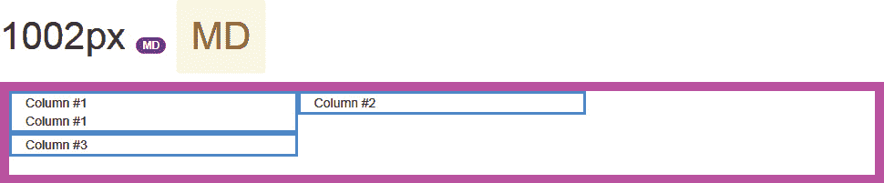

**图 9-4** 第三列现在从下一行的最开始开始。

如果你调整浏览器窗口到 XS 或 SM 模式，一切工作运行良好。然而，图 9-4 仅显示了 MD 和 LG 模式下的情况。如你所示，使用 `clearfix` 类在右侧留下了空白空间，第三列本可以很好地放入那里。理想情况下，你可能想清除 `DIV` 元素的浮动，但仅针对 XS 和 SM 模式。

在 Bootstrap 中，你拥有 `visible-xx` 和 `hidden-xx` 类专门用于此目的：

```html
<div class="clearfix visible-xs"></div>
```

现在的效果正是你所想要的。带有 `clearfix` 类的 `DIV` 现在只在 XS 和 SM 屏幕上输出。同样，你可以使用 `hidden-xx` 类隐藏元素和整行。

***

 备注

`hidden-xx` 类本身是 Bootstrap 提供的一个强大工具，让你能够创建临时的响应式 Web 模板，在用户调整视口大小或在较小的全屏设备上查看相同内容时调整内容。尽管我将在第 15 章中进行更多详细讨论，但响应式 Web 设计是以隐藏不需要的内容为代价的。这种效果对用户来说很棒，但对于应用程序并不一定，特别是当在移动设备上使用 RWD 时。

***

### 灵活渲染

让我们简要查看使用 `hidden-xx` 类的具体示例。假设你有一个登录表单，包含许多介绍文字和一张图片环绕着经典的用户名/密码表单：

```html
<div class="container">
    <h1 class="hidden-xs">WELCOME to CONTOSO Industries</h1>
    <h4 class="visible-xs">WELCOME to CONTOSO</h1>
    <div class="col-md-4 hidden-xs hidden-sm">
        <div class="center">
            
        </div>
    </div>
</div>
```

图 9-5 展示了登录表单在 LG 屏幕上的样子。

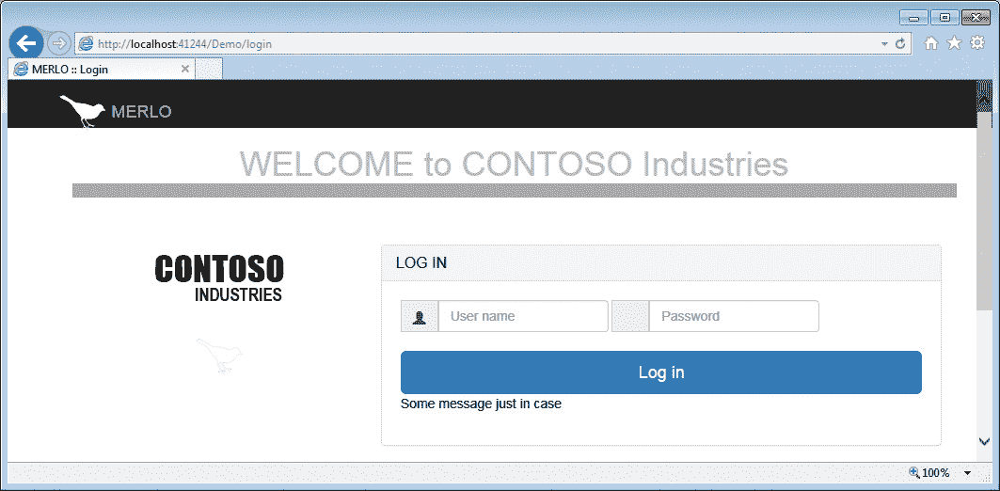

**图 9-5** 在 MD 和 LG 模式下显示的灵活登录表单

`H1` 元素仅在 SM 及更大的设备上显示。在 XS 设备上，`H1` 元素被一个较小的 `H4` 元素取代。那么，图片只在 MD 和 LG 屏幕上显示。当你调整浏览器窗口时就能看到这种差异。

### 列的偏移和拉取

Bootstrap 网格系统还支持列的嵌套。你只需要嵌入一个子行。你只需要嵌入一个子行。

```html
<div class="input-group">
  <label for="password">密码</label>
  <div class="input-group-addon">
    <span class="glyphicon glyphicon-lock"></span>
  </div>
  <input type="password" class="form-control" id="password" name="password" maxlength="30" placeholder="密码">
</div>
```

...

</form>


该 HTML 表单可以接受两个类：`form-inline` 或 `form-horizontal`。正如名称所示，这两者都倾向于指示库将子输入元素的渲染优化在单行内（如图 9-5 所示），或者优化在标签和输入字段垂直布局的多行水平行上。

一个 Bootstrap HTML 表单由多个组组成。每个组通常包含一个标签和一个输入字段——这些可以是 `text`、`date`、`password`、`checkbox`、`hidden` 等。输入元素应该用 `form-control` 类进行装饰，并使用 `input-lg` 或 `input-sm` 类调整尺寸：

```html
<input type="password" class="form-control input-lg" id="password">
```

在输入字段上你可以拥有的所有其他属性——如 `maxlength`、`placeholder`、`id`、`name` 和 `value`——都会像往常一样被使用和处理。

Bootstrap 中一个有趣的功能是输入加框（input add-ons）。输入加框是输入字段与按钮、静态文本或两者的结合。单个输入组中的所有元素都被 Bootstrap 视为同一个 HTML 元素的片段，如图 9-6 所示。

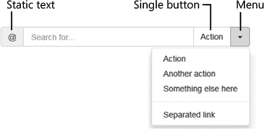

**图 9-6** 带有加框的 Bootstrap 输入组

为了让 Bootstrap 生成如图 9-6 所示的成果，你需要的整体标记如下：

```html
<div class="input-group input-group-lg">
  <span class="input-group-addon">@</span>
  <input type="text" class="form-control" placeholder="搜索内容...">
  <span class="input-group-btn">
    <button class="btn btn-default" type="button">操作</button>
  </span>
  <div class="input-group-btn">
    <button type="button" class="btn btn-default dropdown-toggle" data-toggle="dropdown">
      <span class="caret"></span>
    </button>
    <ul class="dropdown-menu">
      <li><a href="#">操作</a></li>
      ...
    </ul>
  </div>
</div>
```

你使用 `input-group-addon` 类创建文本占位符，并使用 `input-group-btn` 类为输入字段添加按钮或菜单。应用于 `SPAN` 元素时，`caret` 类会渲染指示有更多内容的经典向下三角形。`UL` 元素定义了下拉项列表。caret 按钮通过 `dropdown-toggle` 进行样式处理，表示它有可以根据需要显示的内容。最后，`data-toggle` 类指示了内容显示的模式。在这种情况下，它是下拉显示。

***

 **重要**

在受 Bootstrap 动作作用的页面中，你仍然可以使用普通的输入字段、按钮和 HTML 元素。只要你不向元素添加 Bootstrap 特有的类，Bootstrap 就不会干扰浏览器的渲染。然而，整体的视觉效果可能会与页面的其他部分或应用程序中的其他页面发生冲突，并让用户整体上感到不悦。如果你选择了 Bootstrap，它应该永久出现在你将要访问的所有视图。

***

### 按钮

在 Bootstrap 中，`btn` 类将提交按钮、普通 HTML 按钮和锚点转换为可点击区域。`btn` 类的效果纯粹是视觉上的；它所做的只是添加内边距、边框和圆角。作为一种愉悦的效果，在按钮标题中添加非文本内容没有更简单了。

这里是使用 `btn` 类的最简单方法：

```html
<button class="btn">登录</button>
<a href="#" class="btn" role="button"></a>
```

`btn` 类还带有几个其他辅助类，在尺寸和颜色方面刻画按钮的特征。默认情况下，Bootstrap 按钮占据它渲染分配内容加上内边距所需的空间。`btn-xs` 和 `btn-lg` 等类仅仅是从默认的 `btn` 中移除或添加一些额外的内边距。对于颜色，`btn-primary`、`btn-danger`、`btn-alert`、`btn-success` 和 `btn-info` 使用不同颜色的样式化按钮，以指示操作的相关性。从开发者的角度来看，这是为页面提供更一致设计的一种快速简单的方法。

这里是定义 Bootstrap 按钮的一种常用方法（参见图 9-7）：

```html
<button class="btn">登录</button>
<span class="glyphicon-ok"></span>
```


**图 9-7** 一个 Bootstrap 按钮

```html
<button type="button" class="btn dropdown-toggle" data-toggle="dropdown">
  Numbers
  <span class="caret"></span>
</button>
<ul class="dropdown-menu">
  <li><a href="#">1</a></li>
  <li><a href="#">2</a></li>
  <li><a href="#">3</a></li>
</ul>
```

组中的前两个项目是普通按钮。紧随其后的是一个嵌套的下拉组。该按钮组由一个带有一个下拉菜单的按钮组成。有趣的是，该按钮包含一个 `caret` 小分段，它在视觉上传达了有更多选项可以查看的信息。通过在包裹列表的按钮组上添加 `dropup` 类，你可以让列表向上显示。

***

 **重要**

当你查看 Bootstrap 中的下拉按钮列表时，你可能会想到用户界面中的两种常见元素：下拉菜单和下拉列表。按钮组是普通的下拉菜单。而下拉列表——类似于你在原生 HTML 中使用 `SELECT`/`OPTION` 元素获得的构件——是略有不同的东西。对于选择功能，Bootstrap 没有内置设施。这是一个问题，因为你可能会在表单中使用的 `SELECT` 元素，其样式与其他视觉元素有明显不同。`SELECT` 与普通菜单的区别在于，它会记录被选中的项目，并向用户和程序显示该结果。

***

### 选项按钮

许多用户界面中的共同元素是选项按钮（Option buttons）。它是一组互斥按钮的列表，它们共同工作：一次只能选择一个，且选择新按钮会自动移除当前按钮的选中状态。HTML 提供了一种特殊的输入元素类型来实现选项按钮。通过 Bootstrap，你可以通过混合原生的 HTML 输入选项按钮和分组按钮来添加更漂亮的用户界面。

以下是如何排列一个选项按钮列表，以便在用户个人资料编辑器中选择性别：

```html
<div class="btn-group" data-toggle="buttons">
  <label class="btn btn-primary @active1">
    <input type="radio" id="gender" name="gender" value="X" @checked1>
    不显示
  </label>
  <label class="btn btn-primary @active2">
    <input type="radio" id="gender" name="gender" value="M" @checked2>
    男
  </label>
  <label class="btn btn-primary @active3">
    <input type="radio" id="gender" name="gender" value="F" @checked3>
    女
  </label>
</div>
```

图 9-8 显示了结果。请注意，根据设计，按钮的大小并不相等。你可以通过添加一些额外的自定义样式来实现这一点。

 **图 9-8** Bootstrap 选项按钮

如所述，Bootstrap 分组按钮是并排渲染的普通按钮。相反，选项按钮需要一些逻辑。你既需要逻辑也分组按钮，才能以 Bootstrap 的方式样式化选项按钮。在刚刚显示的代码段中，你看到使用了两组 Razor 变量。理想情况下，在图 9-8 之前应该有以下代码：

```csharp
@{
    var active1 = "";
    var active2 = "active";
    var active3 = "";
    var checked1 = "";
    var checked2 = "checked";
    var checked3 = "";
}
```

变量 `active1`、`active2` 和 `active3` 的作用是为代表当前选择的 `label` 元素添加 `active` 属性。`active` 属性具有视觉效果并指示 Bootstrap 切换按钮样式，使其看起来像被选中。同时，你应该考虑选项按钮是一个正式的 HTML 输入元素。选项按钮列表通常托管在 HTML 表单中，并在某个时刻将表单内容提交到服务器进行进一步处理。不过，只有带有 `checked` 属性的选项按钮会被上传。变量 `checked1`、`checked2` 和 `checked3` 跟踪单个按钮的选中状态，并确保在页面渲染时显示正确的按钮为已选中。

### 导航栏

大多数网站都具有导航栏，通常位于页面的顶部。Bootstrap 提供了一些为网页添加头部的设施。此外，Bootstrap 导航栏足够灵活，可以随着可用视口的变化而折叠和展开。在较小的视图中，导航栏会自动折叠为按钮，并需要 JavaScript 来展开。如果由于某种原因禁用了 JavaScript，已折叠的 Bootstrap 导航栏将无法再次展开。

导航栏是一个普通的 HTML 容器，大部分是 `DIV` 元素。但是，建议将头部封装在 `NAV` 元素中：

```html
<div role="navigation">
  ...
</div>
<nav class="navbar-default">
  ...
</nav>
```

`role` 属性自定义了通用 `DIV` 元素，将其声明为用于屏幕阅读器的导航组件。以下是导航栏的可能结构，带有列表和一个搜索栏：

```html
<nav class="navbar-default">
  <div class="container-fluid">
    <div class="navbar-header">
      <button type="button"
        class="navbar-toggle collapsed"
        data-toggle="collapse"
        data-target="#content">
        <span class="sr-only">更多</span>
        <span class="icon-bar"></span>
        <span class="icon-bar"></span>
        <span class="icon-bar"></span>
      </button>
      <a class="navbar-brand" href="#">首页</a>
    </div>
    <div class="collapse navbar-collapse" id="content">
      <ul class="nav navbar-nav">
        <li><a href="">按钮 1</a></li>
      </ul>
      <form class="navbar-form navbar-left">
        <div class="form-group">
          <input type="text" class="form-control" placeholder="搜索...">
        </div>
        <button type="submit" class="btn btn-primary">查找</button>
      </form>
      <ul class="nav navbar-nav navbar-right">
        <li class="dropdown">
          <a href="#" class="dropdown-toggle" data-toggle="dropdown">
            我想 <span class="caret"></span>
          </a>
          <ul class="dropdown-menu">
            <li><a href="#">创建记录</a></li>
            ...
          </ul>
        </li>
      </ul>
    </div>
  </div>
</nav>
```

常见的导航栏由两部分组成——折叠/展开基础设施以及在较小视图下可以隐藏的实际内容：

```html
<nav class="navbar-default">
  <div class="container-fluid">
    <div class="navbar-header">
      <!-- 在较小视口下的折叠/展开按钮 -->
    </div>
    <div class="collapse navbar-collapse" id="content">
      <!-- 在较小视口下隐藏的实际内容 -->
    </div>
  </div>
</nav>
```

内容区域通过唯一 ID 进行标识（在示例中，ID 为 `content`）。可折叠区域通过执行切换的按钮的 `data-target` 属性与折叠/展开基础设施链接。显示的三个 `SPAN` 元素渲染了此类折叠/展开按钮典型的三横杠：

```html
<div class="navbar-header">
  <button type="button"
    class="navbar-toggle collapsed"
    data-toggle="collapse"
    data-target="#content">
    <span class="sr-only">更多</span>
    <span class="icon-bar"></span>
    <span class="icon-bar"></span>
    <span class="icon-bar"></span>
  </button>
</div>
```

内容区域可以包含你喜欢的任何内容，最重要的是快速访问按钮、下拉按钮和搜索表单。所有按钮通常被渲染为嵌入 `UL`/`LI` 元素中的锚点。

通过向 `NAV` 元素添加 `navbar-fixed-top` 类，可以将导航栏固定在页面顶部。请注意，当你打算将页眉固定在顶部时，必须对页面主体进行相应的内边距填充。换句话说，你必须将主体中任何可见的内容向下移动，距离与导航栏占据的像素相同。如果不这样做，这些内容将被导航栏的绝对定位覆盖：

```css
body { padding-top: 100px; }
```

你可能不需要像顶部对齐那样频繁使用它，但你也可以将导航栏固定在页面底部。在这种情况下，你只需要向 `NAV` 元素添加 `navbar-fixed-bottom` 类即可。

## 文本元素

Bootstrap 提供了三种组件来渲染结构化文本：面板（panels）、警报（alerts）和井（wells）。面板是三个元素的组合：标题、正文和页脚。每个元素都有相应的样式。这是一个示例面板。注意，标题和页脚元素是可选的：

```html
<div class="panel panel-info">
  <div class="panel-heading">
    <span class="panel-title">Title</span>
  </div>
  <div class="panel-body">
    这里可以放置任何内容
  </div>
  <div class="panel-footer">
    Footer
  </div>
</div>
```


可以使用我为按钮识别的相同元类（meta classes）对面板进行样式设置：`panel-default`、`panel-primary`、`panel-info`、`panel-danger`、`panel-warning` 等。你也可以创建自己的元类。

警报（alert）是一个带有某些 HTML 内容的普通 `DIV` 元素，不同之处在于它具有一些预定义的样式，配置如下所示：

```html
<div class="alert alert-success" role="alert">
  这里可以放置任何内容
</div>
```

此外，通过警报，你可以使用 Bootstrap 元类来表示上下文（success、warning、danger、info 以及类似的）。在 Bootstrap 页面中，警报通常用于显示消息。一个有趣的功能是警报是可关闭的：

```html
<div class="alert alert-warning alert-dismissible" role="alert" id="alert-id">
  <button type="button" class="close" data-dismiss="alert" aria-label="Close">
    <span>&times;</span>
  </button>
  <strong>Warning!</strong> 这是给你的消息。
</div>
```

在这种情况下，警报会稍大一些，并在右上角包含一个关闭按钮。通过点击那里，用户可以关闭该 `DIV`，页面内容会向上移动。你可以添加的另一个很棒的功能是设置计时器，它会在指定的毫秒数后向上滑动隐藏警报：

```javascript
window.setTimeout(function () {
  $("#alert-id").slideUp();
}, 4000);
```

***

 注意事项

如果你需要在警报中使用链接，只需向锚点添加 `alert-link` 类，即可使其与父级警报的上下文信息同步进行适当样式。

***

最后，井（wells）是带有边框和一些内边距的纯文本。这是以强调方式展示某些文本的一种非常快速简单的方法：

```html
<div class="well">
  ...
</div>
```

对于井，你也可以使用如 `well-lg` 和 `well-xs` 等尺寸类。

### 重新样式列表 HTML 元素

尽管可以称其为第一批 iOS 用户界面架构师创造的人工需求，但将相关项目分组的可滚动列表已经遍布了整个设备领域，并在短短几年内征服了整个网络。jQuery Mobile 首先意识到分段和可滚动列表的价值，并提供了构建这些列表的专用组件。今天，Bootstrap 提供了提供了特定的 CSS 类，将普通的无序 HTML 列表和锚点标签列表渲染成模仿 iOS 列表的美观区块。

### 列表

在基于 Bootstrap 的页面中，纯列表项序列会自动转换为带边框的表格。让我们考虑以下标记：

```html
<ul class="list-group">
  <li class="list-group-item">第一项</li>
  <li class="list-group-item">第二项</li>
  <li class="list-group-item">第三项</li>
  <li class="list-group-item">第四项</li>
  <li class="list-group-item">第五项</li>
</ul>
```

`list-group` 类负责在内容周围绘制边框。而 `list-group-item` 类则负责间距和字体。所有列表项都以纯文本形式渲染。`list-group` 类的输出类似于传统的旧式列表框，其中呈现了选项列表，并且一个或多个项目可以被渲染为选中状态。要将列表项标记为选中，你需要添加 `active` CSS 类。你可以根据需要向任意数量的列表项添加该类。

普通的列表组本质上是一个没有用户交互的静态列表。列表组的一个有趣变体是链接列表组。关键区别在于链接列表中的项目是锚点而不是纯文本：

```html
<li class="list-group-item">
  <a href="...">第一项</a>
</li>
```

为了防止一个或多个项目变为可点击，你可以使用 `SPAN` 元素代替 `A`。这里有一个示例：

```html
<div class="list-group">
  <span class="list-group-item">标题</span>
  <a href="..." class="list-group-item">第一项</a>
  <a href="..." class="list-group-item active">第二项</a>
</div>
```

你可以使用不可点击元素为列表创建标题。对应 iOS 界面，可以使用角标（badges）使文本更丰富。`badge` 是彩色气泡中的小文本，用于指示某些计数，例如收件箱中的消息。要获得这种效果，只需为 `SPAN` 元素标记 `badge` 类，如下所示：

```html
<a href="..." class="list-group-item">
  第一项 <span class="badge">22</span>
</a>
```

你在列表中使用的任何 `A` 元素的内容都可以自定义。它可以是纯文本以及 HTML 标记，还可以包含图像或媒体：

```html
<a href="#" class="list-group-item">
  <p class="list-group-item-text">一些小文本</p>
  <h4 class="list-group-item-heading">较大的文本</h4>
</a>
```

为了实现更统一的视觉效果，可以使用预定义的样式，如 `list-group-item-text` 和 `list-group-item-heading`。然而，是否使用它们取决于你，因为这完全是一个审美问题。

### 媒体对象

大多数网页的另一个常见特征是由文本和媒体内容（主要是图像）组成的混合标记列表。对齐和图像通常是无趣的。Bootstrap 尝试通过几个类让这个过程变得更加顺利：

```html
<div class="media">
  <div class="media-left">
    <a href="#">
      
    </a>
  </div>
  <div class="media-body">
    <h4 class="media-heading">图像标题</h4>
    <span>图像描述</span>
  </div>
</div>
```

`media-left` 类将图像固定在容器的左边缘。你可以使用 `media-right` 类将图像固定在右侧。不过，如果你打算这样做，应该在标记语言中将最右侧的 `DIV` 放在媒体主体 `DIV` 之后。默认情况下，媒体内容是顶对齐的。你可以通过向图像 `DIV` 添加 `media-middle` 或 `media-bottom` 类来将对齐方式更改为中间或底部。

你还可以在列表中使用媒体内容来创建一个包含图像和文本的项目列表。你使用 `media` 类包裹列表项，并使用 `media-list` 类用于整个列表。`media-object` 类放置在 `IMG` 元素周围。另一方面，`media-body` 类用于装饰图像或你可能有的任何其他媒体对象（例如视频）旁边的文本。

这是一个示例：

```html
<ul class="media-list">
  <li class="media">
    <div class="media-left">
      <a href="#">
        
      </a>
    </div>
    <div class="media-body">
      <h4 class="media-heading">Title of the image</h4>
      <span>Description of the image</span>
    </div>
  </li>
  ...
</ul>
```

请注意，无论是否包含媒体内容，列表（lists）都可以轻松地嵌入到面板（panels）中。

另一方面，`thumbnail` 类可以用于展示带有或不带额外标记的相关的图像。这是一个示例布局，在中等和大型屏幕上显示四张图像，在较小屏幕上显示两个或三个：

```html
<div class="row">
  <div class="col-xs-6 col-sm-4 col-md-3">
    <a href="#" class="thumbnail">
      
    </a>
    <div class="caption">
      <h3>Thumbnail label</h3>
        ...
    </div>
  </div>
  ...
</div>
```

### 表格

多年来，许多开发者使用纯 HTML 表格作为布局网页内容的工具。今天，`DIV` 元素和 CSS 定位属性被更灵活地用于相同的目的。然而，这并不意味着 HTML 表格已经变得没。表格仍然具有呈现表格数据的作用，例如在数据网格的上下文中。

在 Bootstrap 中，你可以找到一些基础类来样式 HTML 表格，特别是控制内边距和行颜色：

```html
<table class="table table-condensed">
    <tr> ... </tr>
</table>
```

`table-condensed` 类将内边距和间距保持在最低限。还存在其他类可实现更复杂但常见的效果——例如交替行着色和悬停效果。请注意，Bootstrap 表格与许多其他 HTML 产物一样，完全是图形化的。这意味着你找到了以特定方式渲染元素的工具，但将样式与数据绑定取决于你。将样式数据绑定到实际数据的最佳方法是通过 Razor 变量和即时类，或者在没有更好方法的情况下使用内联样式。

### 进阶组件预览

尽管 HTML 是 Web 的官方语言，而且它在不久的未来某个点甚至可能成为移动应用程序的通用语言，但它并没有提供创建现代页面所需的所有语法元素。在本章前面的部分，我涵盖了下拉菜单。如所述，在 Bootstrap 中，你可以通过结合按钮和锚点的 HTML 无序锚列表来创建下拉菜单。即使在 HTML5 中，你也没有找到任何用于设置下拉菜单的原生元素。其他一些常见的视觉元素也是如此——在页面中很流行，但 HTML 并没有原生支持，至少在能够减少标记的抽象级别上不是。在本章中，我将介绍如何在 Bootstrap 中设置模态对话框（modal dialog boxes）、标签（tabs）和自定义提示（tooltips）。

### 模态对话框

模态窗口是一个显示在所有其他内容之上的窗口，并在显示期间捕获输入焦点。只有在模态窗口关闭时，底层元素才能重新获得焦点。模态窗口的一个绝例子是浏览器当代码调用 `window.alert` JavaScript 方法时显示的消息框。然而，越来越多的页面通过渲染最顶部的富 `DIV` 元素来向用户强调消息。

模态对话框由三层嵌套的 `DIV` 元素组成。最外层的 `DIV` 使用 `modal` 类样式化。在这里你可以为外观添加一些特定样式——例如 `fade` 或 `slide` 类。它的直接子元素样式化为 `modal-dialog`，而另一层 `DIV` 是 `modal-content`。在内容 `DIV` 中，你会发现头部（header）、主体（body）和页脚（footer）。头部和页脚可选的，但你通常两者都有，并使用头部为对话框添加标题和关闭按钮。相反，页脚通常填充有按钮，用于直接关闭对话框或通过启动服务器端操作关闭。

这是一个示例：

```html
<div class="modal" id="dialogBox">
  <div class="modal-dialog">
    <div class="modal-content">
      <div class="modal-header">
        <button type="button" class="close" data-dismiss="modal">&times;</button>
        <h4 class="modal-title">Rate the article</h4>
      </div>
      <div class="modal-body"></div>
      <div class="modal-footer">
        <button type="button" class="btn btn-default" data-dismiss="modal">Close</button>
        <button type="button" class="btn btn-primary" onclick="...">Vote</button>
      </div>
    </div>
  </div>
</div>
```

在示例中，页脚有两个按钮：*Close*（关闭）和 *Vote*（投票）。由于 `data-dismiss` 属性，*Close* 按钮只能用于关闭对话框。另一方面，*Vote* 按钮通常会附加一些 `onclick` 处理程序以执行某些 JavaScript 任务。

特别是当你使用模态框内联编辑记录时，你需要一种方法将模态框的元素初始化为要显示的实际数据。如果模态框显示某些固定内容，你可以在生成模态框或包含页面的 Razor 视图放置任何初始化逻辑。相反，如果你有一组记录，并希望在用户点击特定记录时显示模态框，理想情况下初始化必须在客户端通过 JSON 获取数据时完成。这可以通过 JavaScript 挂载 Bootstrap Modal 组件触发的某些事件来实现。

这是一个示例：

```javascript
$('#dialogBox).on('show.bs.modal', function (e) {
    $.ajax({
        url: "...",
        cache: false
    }).done(function(json) {
        // 使用下载的数据
        // 更新用户界面
    });
});
```

一旦模态框组件触发 `show.bs.modal` 事件——在内容显示之前——就会向某个 URL 发起 Ajax 调用以下载数据。接下来，对话框的用户界面将使用最新内容进行更新，然后呈现给用户。

***

 注意

如果你只是在寻找一种比系统 alert 框在渲染方面灵活灵活替代方案，可以尝试 `Toastr`。Toastr 是一个 jQuery 插件，它能以丰富的方式显示纯文本，并在定位和计时器方面提供许多选项。以下是展示其工作原理的代码：

```javascript
toastr.options.positionClass = "alert-center";
toastr.success("这个弹窗不是比普通的 alert() 好用吗？", "更好的提醒!");
```

`toastr` 库除了“success”之外，还提供了几种显示方法，每种方法都有不同的图标集和颜色。消息可以一直留在屏幕上直到用户将其关闭，也可以将其与计时器关联。`showDuration` 和 `hideDuration` 等属性表示显示和隐藏内容所需的毫秒。内容通常由标题和文本消息组成。

***

### 选项卡组 (Tab strips)

选项卡是一组视图，一次显示一个，并配有一个顶部菜单允许选择。Bootstrap 支持选项卡的几种变体，包括经典的选项卡组和导航胶丸。所需的 HTML 模板是类似的。

让我们先看看经典的选项卡组：

```html
<div class="tabbable">
  <ul class="nav nav-tabs" id="myTabStrip">
    <li><a class="btn btn-primary" href="#profile" data-toggle="tab">个人资料</a></li>
    <li><a class="btn btn-primary" href="#preferences" data-toggle="tab">偏好</a></li>
    <li><a class="btn btn-primary" href="#friends" data-toggle="tab">朋友</a></li>
  </ul>
</div>
```


第一个包裹 `UL` 元素的 `DIV` 定义了可点击选项卡的列表。每当用户点击任何选项卡时，当前内容就会被隐藏，这样就可以显示与所点击的选项卡相关的内容。`LI` 元素的 `href` 属性指示了通向存储选项卡内容的子 `DIV` 的路径。设置为 `tab` 的 `data-toggle` 属性也是至关重要的，因为它指示组件作为选项卡操作并根据需要隐藏和显示内容。

选项卡内容在同一页面中一个接一个出现。这些 `DIV` 的可见性由随选项卡组件的脚本代码自动管理：

点击此处查看代码图像

```html
<div class="tab-content">
  <div id="profile" class="tab-pane">
    ...
  </div>
  <div id="preferences" class="tab-pane">
    ...
  </div>
  <div id="friends" class="tab-pane">
    ...
  </div>
</div>
```

`LI` 元素的 `href` 属性指示了通向存储选项卡内容的子 `DIV` 的路径。设置为 `tab` 的 `data-toggle` 属性也是至关重要的，因为它指示组件作为选项卡操作并根据需要隐藏和显示内容。

选项卡内容在同一页面中一个接一个出现。这些 `DIV` 的可见性由随选项卡组件的脚本代码自动管理：

第一个包裹 `UL` 元素的 `DIV` 定义了可点击选项卡的列表。每当用户点击任何选项卡时，当前内容就会被隐藏，这样就可以显示与所点击的选项卡相关的内容。`LI` 元素的 `href` 属性指示了通向存储选项卡内容的子 `DIV` 的路径。设置为 `tab` 的 `data-toggle` 属性也是至关重要的，因为它指示组件作为选项卡操作并根据需要隐藏和显示内容。

第一个包裹 `UL` 元素的 `DIV` 定义了可点击选项卡的列表。每当用户点击任何选项卡时，当前内容就会被隐藏，这样就可以显示与所点击的选项卡相关的内容。`LI` 元素的 `href` 属性指示了通向存储选项卡内容的子 `DIV` 的路径。设置为 `tab` 的 `data-toggle` 属性也是至关重要的，因为它指示组件作为选项卡操作并根据需要隐藏和显示内容。

第一个包裹 `UL` 元素的 `DIV` 定义了可点击选项卡的列表。每当用户点击任何选项卡时，当前内容就会被隐藏，这样就可以显示与所点击的选项卡相关的内容。`LI` 元素的 `href` 属性指示了通向存储选项卡内容的子 `DIV` 的路径。设置为 `tab` 的 `data-toggle` 属性也是至关重要的，因为它指示组件作为选项卡操作并根据需要隐藏和显示内容。

第一个包裹 `UL` 元素的 `DIV` 定义了可点击选项卡的列表。每当用户点击任何选项卡时，当前内容就会被隐藏，这样就可以显示与所点击的选项卡相关的内容。`LI` 元素的 `href` 属性指示了通向存储选项卡内容的子 `DIV` 的路径。设置为 `tab` 的 `data-toggle` 属性也是至关重要的，因为它指示组件作为选项卡操作并根据需要隐藏和显示内容。

第一个包裹 `UL` 元素的 `DIV` 定义了可点击选项卡的列表。每当用户点击任何选项卡时，当前内容就会被隐藏，这样就可以显示与所点击的选项卡相关的内容。`LI` 元素的 `href` 属性指示了通向存储选项卡内容的子 `DIV` 的路径。设置为 `tab` 的 `data-toggle` 属性也是至关重要的，因为它指示组件作为选项卡操作并根据需要隐藏和显示内容。

### 提示 (Tooltips)

提示从网页出现早期起就可用了，但它们一直没有变化。原生浏览器提示（无论是今天还是 1990 年代）都是纯文本的弹出窗口。jQuery 的出现导致了各种插件的创建。在 Bootstrap 中，提示是任何装饰有设置为 `tooltip` 的 `data-toggle` 的 HTML 元素。然而如果你只是将标记复制到运行的 Bootstrap 页面中，什么都不会发生。由于设计的原因，Bootstrap 架构师决定将提示作为一种可选功能。

注意，只要发现了默认的 `title` 属性，浏览器就会显示内置的用户界面。

在 Bootstrap 中，需要以下脚本代码启用提示。你可能希望在页面的 `ready` 事件处理器中运行该代码：

```javascript
$(document).ready(function () {
    $("[data-toggle=tooltip]").tooltip();
});
```

另一个有趣的功能是 HTML 内容。基本上，Bootstrap 允许你在 `title` 属性中放置任何 HTML 内容。然而，只有当你在大提示框（tooltip）选项中设置了 `html` 标记时，该内容才会被渲染为 HTML：

点击此处查看代码图片

```javascript
$("[data-toggle=tooltip]").tooltip({
    placement: 'auto',
    html: true
});
```

此外，你可以使用 `trigger` 选项来指定你希望如何触发提示框。默认配置是在鼠标悬停在元素上以及当元素获得焦点时显示提示框。你可以更改或直接添加该选项来通过点击触发它：

点击此处查看代码图片

```javascript
$("[data-toggle=tooltip]").tooltip({
    placement: 'auto',
    html: true,
    trigger: 'click focus hover'
});
```

最后，可以通过方法以编程方式控制提示框，并在显示或隐藏时触发事件。

## 弹出框（Popovers）

提示框和弹出框尽管名称完全不同，但它们是亲戚。提示框会在你悬停在特定元素上时出现；而弹出框支持更丰富的格式选项，并且可以通过多种方式触发，包括用户悬停在特定的 HTML 元素上。更通俗地说，弹出框是 `DIV` 元素，以下拉列表块的形式显示在元素附近。让弹出框特别有趣的地方在于，如果你通过 JavaScript 添加一些数据绑定逻辑，就可以为其填充实时数据。

你首先创建一个初始状态为隐藏的 `DIV` 元素。接下来，你配置弹出框的触发器：它可以是一个按钮或可点击的元素。这与对提示框的操作非常相似。唯一的区别是 `data-toggle` 属性必须设置为 `popover`：

点击此处查看代码图片

```html
<div id="popover-content" class="hidden">
    ...
</div>
```

然后，你添加一些脚本来从指定 `DIV` 元素的内容初始化弹出框：

点击此处查看代码图片

```javascript
$("#sensitive").popover({
    html: true,
    title: "More Details",
    placement: 'right',
    trigger: 'click',
    content: function () {
        return $("#popover-content").html();
    }
});
```

在代码段中，`#sensitive` 路径指的是弹出框所引用的元素。基本上，代码会自动将名为 `popover-content` 的 `DIV` 元素的内容附加到 `#sensitive` 元素，这样每当点击该项目时，弹出框就会显示。弹出框有一个默认大小。你可以通过更改 Bootstrap 库中的 `.popover` CSS 类来更改它。你为弹出框选择的触发机制决定了内容消失的方式。触发选项与提示框相同：`hover`、`click` 和 `focus`。

***

## 提示框和弹出框的优缺点

提示框和弹出框的主要目标是显示关于页面元素的更多信息。然而，尽管如此，决定何时使用提示框具有高度的主观性。以下是几条常识性的规则。

首先，你通过提示框显示的文本不应该是用户决定采取什么操作至关重要的信息。提示框中的文本应该是补充性的。如果提示框文本似乎对于帮助用户决定如何行动非常重要，那么你应该将这些文本直接放在用户界面中。其次，你不应该使用提示框来呈现错误或警告。在这种情况下，警报框可能更合适。

此外，提示框和弹出框不应分散用户的注意力或骚扰他们。呈现的信息不应该是屏幕上已有内容的简单重复或重新表述。

***

### Bootstrap 扩展

Bootstrap 是一个全面的 CSS 和 HTML 库，定义了现代网页的分类法。然而，它并没有为 Web 开发人员的所有常见需求内置组件和类。根据我使用 Bootstrap 的经验，我识别出目前缺失三个关键部分：自动补全、日期选择和下拉列表。对于前两个，你可以使用一些基于 Bootstrap 的额外框架。而对于下拉列表，你应该为 Bootstrap 库创建你自己的自定义扩展。

### 自动补全（Autocompletion）

可用性在网页中变得越来越重要。可用性最重要的方面之一是简化数据输入和选择，特别是当有长选项列表时。例如，与其给用户提供一个包含数百项选择的下拉列表，不如提供一个文本框并让用户输入他们想要的内容。这就是自动补全的作用。

### typeahead 组件（The typeahead component）

使用 Bootstrap 实现自动补全的最佳方法是通过下载一个名为 `typeahead.js` 的独立库。让我们开始添加最新 `typeahead.js` 库的 NuGet 包，看看安排一个简单的搜索表单需要什么：

点击此处查看代码图片

```html
<form action="@Url.Action("Query", "Home")" method="post">
    <input type="hidden" id="queryCode" name="queryCode" />
    <input type="text" name="queryString" id="queryString">
    <button id="queryButton" type="submit">Go it!</button>
</form>
```

注意，为了在网页上使用自动补全，你还需要一个隐藏字段来收集某些唯一标识。要使用该库，你必须引用 jQuery 1.9 或更高版本以及 `typeahead.js` 脚本。在使用 `typeahead.js` 的视图中所需的最小代码所示：

点击此处查看代码图片

```javascript
var hints = new Bloodhound({
    datumTokenizer: Bloodhound.tokenizers.obj('value'),
    queryTokenizer: Bloodhound.tokenizers.whitespace,
    remote: "/yourServer/...?query=%QUERY"
});

hints.initialize();

$('#queryText').typeahead(
    null,
    {
        displayKey: 'value',
        source: hints.ttAdapter()
    }
);
```

虽然你可以从任何 JavaScript 数组绑定数据，但自动补全在从远程下载数据时才有意义。从远程下载会引起很多问题——同源策略、预取和缓存。`typeahead.js` 自带了一个名为 Bloodhound 的建议引擎，它会透明地完成这些工作。如果你从 NuGet 获取包 JavaScript 文件，就可以开始调用 Bloodhound 而无需担心它的下载和设置。

上代码段中的 `hints` 变量是以下标准的 Bloodhound 化的结果：

点击此处查看代码图片

```javascript
var hints = new Bloodhound({
    datumTokenizer: Bloodhound.tokenizers.obj('value'),
    queryTokenizer: Bloodhound.tokenizers.whitespace,
    remote: "/yourServer/...?query=%QUERY"
});

hints.initialize();
```

在 `typeahead.js` 的初始化中，你指定了两个关键信息：前述由 `Bloodhound` 管理的提示集，以及用于填充输入框的显示字段。在刚刚显示的代码段中，显示字段为 `'value'`。默认情况下，`typeahead.js` 在输入单个字符时就会开始获取提示。如果你希望在开始自动补全之前等待缓冲区积累足够的字符，可以向插件的第一个参数添加一个设置对象：

点击此处查看代码图片

```javascript
$('#queryString').typeahead(
    {
      minLength: 2,   // 等待输入 2 个字符
      limit: 15    // 返回的提示不超过 15 个
    },
    {
      displayKey: 'value',
      source: hints.ttAdapter()
    }
);
```

当缓冲区足够满到可以启动远程调用时，`Bloodhound` 开始工作，下载 JSON 数据并对其进行适配以显示。此时，你已经拥有了一个基本可以工作的自动补全引擎，它可以根据你在服务器上的某些逻辑弹出建议。然而，在实际页面中有效使用自动补全之前，还有很多工作要做。

返回待显示提示的远程端点是序列化为 JSON 的 C# 类集合。你可以按照喜欢的方式封装提示数据，但至少你所使用的类型必须包含以下信息：

点击此处查看代码图片

```csharp
public class AutoCompleteItem
{
    public string id { get; set; }
    public string value { get; set; }
    public string label { get; set; }
}
```

`id` 属性包含一个唯一 ID，该 ID 在提交时对接收的控制器具有意义。如果你的提示指的是用户通过名称查找的产品，那么 `id` 可能只是产品 ID。`value` 属性是要显示在下拉列表中的字符串内容，以及在输入框中复制的文本。`label` 属性是可选的，你应该将其视为客户端可能需要的任何其他属性的载荷属性。大多数情况下，可以直接丢弃而不会产生影响。有时我用它来携带服务器生成的提示 HTML 格式。

* *

 注意

在以下 URL 查看如何使用 `typeahead.js` 的文档和示例：[`github.com/twitter/typeahead.js`](http://github.com/twitter/typeahead.js)。

* *

### 修复 CSS

任何足够复杂的插件都需要一些 CSS 来保持美观，`typeahead.js` 也不例外。该插件自带默认的用户界面，特别是当你将其与 Bootstrap 结合时，你需要应用一些修复以避免视觉上的折痕。此外，你可能还会自定义一些视觉属性，例如颜色和内边距。

表 9-3 列出了你可能想要尝试的一些 CSS 类，以个性化 `typeahead.js` 组件的外观和感受。

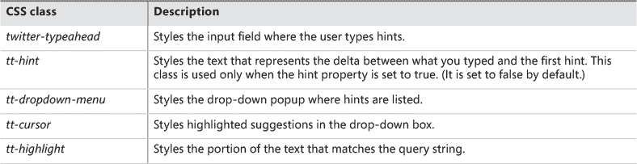

表 9-3 用于自定义 `typeahead.js` 的 CSS 类列表

图 9-9 让你了解通过自定义 CSS 类可以获得什么。


**图 9-9** Bootstrap 单选按钮组

你可以在本书的配套代码中找到配合 Bootstrap 有效使用 `typeahead.js` 的常用 CSS 修复完整列表。同样注意，`typeahead.js` 提供了一种强大的原生机制来覆盖关键的 CSS 样式。它是基于 `classNames` 设置的，如下：

点击此处查看代码图片

```javascript
$('.typeahead').typeahead({
  classNames: {
    input: 'Your-input-class',      // 输入框
    hint: 'Your-hint-class',        // 列表项
    highlight: 'Your-highlight-class'   // 高亮列表项
  }
});
```

显然，分配给 `classNames` 条目的字符串必须与你可用的 CSS 类匹配。

### 调整提示模板

在图 9-9 中，列表项使用了一些额外的格式。特别是国家/地区的名称是加粗的，而实际显示的文本是多个属性组合的结果。使用 `typeahead.js` 时你需要一个单独的引擎。一个流行的引擎是 `Handlebars`。你可以从 [`handlebars.com`](http://handlebars.com) 获取它。以下是使用方法：

点击此处查看代码图片

```javascript
$('#queryString').typeahead(
    {
      minLength: 2,
      limit: 15
    },
    {
      displayKey: 'value',
      templates: {
        suggestion: Handlebars.compile('<p><<strong>{{label}}</strong> – {{id}}</p>')
      },
      source: hints.ttAdapter()
    }
);
```


`Handlebars` 由双括号包裹的表达式组成。在前面的示例中，`label` 和 `id` 是属性。`typeahead` 支持多种类型的模板，如表 9-4 所示。


表 9-4 `typeahead` 支持的模板

模板可以是纯字符串或预编译的模板。如果是模板，它将接收与提示相关的 JSON 对象，`suggestion` 模板除外，它将被渲染在下拉列表中。

* *

 注意

可以使用任何你喜欢的引擎（例如 `mustache.js`），你甚至可以用函数的形式编写自己的模板。

### 处理多个数据集

数据集是与查询关联的提示集。在很多情况下，一个数据集就足够了，但下面的代码展示了如何将多个数据集绑定到给定的输入框：

点击此处查看代码图片

```javascript
$('#queryString').typeahead(

    {

      minLength: 2,

      limit: 15

    },

    {

      name: 'Dataset #1',

      displayKey: 'value',

      templates: {

        suggestion: Handlebars.compile('<p><<strong>{{label}}</strong> – {{id}}</p>')

      },

      source: hints.ttAdapter()

    },

    {

      name: 'Dataset #2',

      displayKey: 'value',

      source: ...

    },

    {

      name: 'Dataset #3',

      displayKey: 'value',

      limit: 10,

      source: ...

    }

);
```

简而言之，当你初始化 `typeahead.js` 组件时，你首先传递通用设置，然后是所有数据集的列表。每个数据集都有名称、显示属性或一组模板，甚至还有一个最大提示数量。当用户在输入框中输入新文本时，每个数据集都会尝试刷新其提示集。

* *

 提示

当输入框为空时，用户通常看不到建议。但在某些情况下，即使是空查询提供一些默认建议可能是合理的。你可以通过将 `minLength` 选项设置为 0 并同时让远程端返回空查询的建议来实现。

* *

### 处理 `Selected` 事件

当待选项目数量达到数百个时，任何经典的下拉列表都会变得缓慢。因此，如果你计划使用自动补全输入框来选择特定值——例如，产品名称或客户名称——那么仅用 `typeahead.js` 插件是不够的。你需要一些额外的脚本代码来绑定到插件的 `selected` 事件，并存储用户的选择以备后后使用。

以下代码将选择保存到隐藏字段中（`#queryCode` 路径），并使用本地变量跟踪是否已进行选择：

点击此处查看代码图片

```javascript
<script type="text/javascript">

  var typeaheadItemSelected = false;

  $('#queryString').on('typeahead:selected', function (e, datum) {

      $("#queryCode").val(datum.id);

      typeaheadItemSelected = true;

  });

</script>
```

自动补全输入框的主要优势是，用户可以输入一些可理解的文本，系统能够理解并将其与唯一代码（如产品 ID）关联。选中的代码必须安全地存储，以便在未来的上传中使用。事实上，大多数情况下，你需要将自动补全文本框作为一种带有过多选项的特殊下拉列表形式。

在 `selected` 事件处理程序中，你从 `datum` 对象中获取 ID 信息并将其安全地存储在隐藏字段中。当属于自动补全输入字段的表单提交时，选中的 ID 也会被提交。`datum` 对象的布局——即从下拉列表中选中的数据项——取决于你从服务器端接收的数据模式（schema）。

### 在输入框中显示文本

那么输入框中显示的文本如何处理？大多数情况下，只需在 `typeahead.js` 组件的配置中设置 `displayKey` 属性即可解决。无论如何，你都可以通过程序方式在输入框中设置任何值：

点击此处查看代码图片

```javascript
$("#queryString").val(datum.label);
```

在某些情况下，自动补全文本框是 HTML 表单中的唯一元素。这意味着你可能希望在数据被选中时立即处理任何被选中的数据。通过向 `typeahead.js` 的 `selected` 事件处理程序添加以下行代码，你可以模拟点击表单的提交按钮：

```javascript
$("#queryButton").click();
```

有时用户在输入框中开始输入，然后停止且没有进行任何选择。当他们返回且输入框重新获得焦点时，你应该做什么？这在很大程度上取决于输入框的预期行为。如果你想将其仅视为特殊下拉列表的形式，并强制用户仅在该处（通过自动补全）输入特定的字符串（例如，用户名或产品），那么在输入焦点移回那里时清空该字段会更好：

点击此处查看代码图片

```javascript
$('#queryString').on('input', function () {

    if (typeaheadItemSelected) {

      typeaheadItemSelected = false;

      $('#queryString').val('');

      $("#queryCode").val('');

    }

});
```

该代码段重置了布尔守护符，该变量控制是否在特定输入字段中进行了选择，并清空了输入字段以及存储选择值的辅助隐藏字段。

***

 **重要**

在此示例中，我使用本地 JavaScript 变量来存储特定输入字段上的选择状态。只要每个视图只有一个自动补全输入框，这种方法就有效。当你有两个或多个输入框时，最好使用输入元素上的属性来跟踪其被选状态。

***

### 选择日期

在 HTML5 中，有一个类型为 `date` 的新 `INPUT` 元素。基于此，你可能期望所有浏览器都提供几乎相同的体验并提供日期选择器功能。目前并非如此，至少是。某些浏览器允许你通过箭头按钮上下导航；某些浏览器甚至没有对日期提供任何特殊支持。不同浏览器之间的体验很大。

一种通用的解决方法是使用 Modernizr 进行功能检测，如果浏览器不支持日期选择功能，则接入某些外部组件。我更倾向于坚持 Bootstrap 并提供一致的体验。Bootstrap 不提供原生日期选择器组件，但存在一个与 Bootstrap 配合良好的外部框架。让我们看看如何使用它。特别是，我将引用你在 `www.nuget.org/packages/Bootstrap.Datepicker/1.5.0` 的包。

### Bootstrap 日期选择器框架

从 NuGet 获取的 Bootstrap Date Picker 包包含一个 CSS 文件和几个 JavaScript 文件，包括日期选择工具（`bootstrap-datepicker.min.js`）、类似 `moment.min.js` 的辅助库，以及用于本地化的临时文件。务必按照确切的顺序引用 `moment.js`、日期选择器和本地化（locales）。你只需要在生产环境中部署你实际使用的本地化：

点击此处查看代码图片

```html
<script type="text/javascript" src="~/content/scripts/moment.min.js"></script>

<script type="text/javascript" src="~/content/scripts/bootstrap-datepicker.min.js"></script>

@foreach(var l in localesOfInterest)

{

    <script type="text/javascript" src="~/content/scripts/locales/" + l + ""></script>

}
```

在代码段中，变量 `localesOfInterest` 假设为格式为 `bootstrap-datepicker.{0}.min.js` 的文件名集合，其中参数是语言字符串，如 `it`、`fr` 或 `es`。

### 绑定选择器

让我们关注一个让用户输入可选日期的输入字段。你可以在系统的个人资料页面找到它，要输入的日期是出生日期。要做的第一件事是从 `INPUT` 元素中删除 `date` 属性。

以下标记生成了你在图 9-10 中所示的内容：

```html
<div class="input-group">

  <input type="text" class="form-control" id="dateofbirth" name="dateofbirth"

    contenteditable="false"

    value="@Model.DateOfBirth.GetValueOrDefault().ToDateString()">

  <span class="input-group-btn">

    <button class="btn btn-dark" type="button" onclick="setNoBirthDate()">

      不显示

    </button>

  </span>

</div>
```

图 9-10

**图 9-10** 运行中的 Bootstrap 日期选择器

`INPUT` 元素的 `value` 属性绑定到视图模型中带有显示日期的属性。日期类型被假设为可空，并在未设置日期时默为空字符串。输入组中的按钮在点击时仅会清空缓冲区：

```javascript
$("#dateofbirth").val("");
```

### 日期选择器的配置

与许多丰富的脚本型组件一样，日期选择器需要一些初始化才能正常工作。刚刚显示的标记只是第一步；下一步是一些连接逻辑和 DOM 元素的脚本。遵循 jQuery 插件设定的标准，你可以通过无参数调用将选择器附加到输入字段，并接受所有默认设置或指定自己的偏好：

```javascript
<script type="text/javascript">

  $(function () {

    $('#dateofbirth').datepicker();

  });

</script>
```

您通过传递给初始化器的对象来指定您的偏好：

点击此处查看代码图片

```razor
@{

    var startBirthDate = new DateTime(1915, 1, 1).ToString("d", culture);

    var endBirthDate = DateTime.Today.AddYears(-5).ToString("d", culture);

}
```

```html
<script type="text/javascript">

    $(function () {

        $('#dateofbirth').datepicker({

            language: 'it',

            startDate: '@startBirthDate',

            endDate: '@endBirthDate'

        });

    });

</script>
```

您可能想要自定义的最常用参数是语言、开始日期和用户可以导航的结束日期。特别是当使用输入字段获取出生日期时，您可能想要限制范围，以避免无意义的日期，例如未达到特定要求年龄用户的日期。

### 自定义组件

Bootstrap 没有提供任何特定的预定义样式来美化和增强像 `SELECT`/`OPTION` 元素那样的下拉列表。虽然可以使用 CSS 设置轻松地为下拉列表样式，但在 Bootstrap 用户界面上下文中使用时，它看起来总是会有些不一致。同时，Bootstrap 拥有许多创建下拉内容的设施，因此安排一个下拉列表组件并不是一项困难的任务。这只需要一个临时的标记模板和一些 JavaScript。

### 创建列表

下面的代码段定义了 Bootstrap 中定义了一个下拉菜单。它向用户显示一个可点击的按钮和一个关联的下拉列表。按钮最初显示文本 `Get one`，后面紧跟一个倒三角形的小箭头符号（caret）。当用户点击按钮时，会弹出一个包含所有列表项的菜单：

点击此处查看代码图片

```html
<div class="btn-group">

    <a class="btn btn-default dropdown-toggle" data-toggle="dropdown>

        Get one <span class="caret"></span

    </a>

    <ul class="dropdown-menu">

        @foreach (var item in list)

        {

            <li><a href="#"><span>@item.Text</span></a></li>

        }

    </ul>

</div>
```

在 Bootstrap 中，下拉菜单仅用于提供一组用于导航的超链接列表。然而，如果您将上述标记与一些 JavaScript 封装在一起，就可以处理超链接的点击，并将导航更改为用户界面的更改。关键在于，为了让 Bootstrap 下拉菜单变成经典的下拉列表，列表项上不应定义任何超链接。理想情况下，您将 `LI` 元素内锚点（anchor）的 `href` 属性设置为 `#`。如果您将其留空，该项仍然可以点击，但鼠标指针会像处理普通文本那样发生变化。

图 9-11 显示了下拉列表的整体行为。


**图 9-11** 当选择下拉项时更改按钮的标题

### 添加选择逻辑

在 HTML 中，普通的 `SELECT` 元素被视为输入元素，浏览器在提交之前会查询它以获取当前选中元素。如果您简单地将 `SELECT` 元素替换为 Bootstrap 的下拉按钮组，这种情况就不会发生。至少，您需要添加一个标记有唯一 ID 的隐藏输入字段。此 ID 也将标识整个下拉列表。隐藏字段必须通过 JavaScript 填充。

下拉列表的标记略有变化，如下：

点击此处查看代码图片

```html
<div class="btn-group">

    <a class="btn btn-default dropdown-toggle" data-toggle="dropdown>

        <input type="hidden" name="Id" id="Id" value="..." />

        Get one <span class="caret"></span>

    </a>

    <ul>

        <li>

            <a href="#" data-value="Value"> Text </a>

        </li>

    </ul>

</div>
```

在 `UL`/`LI` 下拉结构中的每个锚点元素（anchor）都应该与以下代码关联，以响应用户的点击：

点击此处查看代码图片

```javascript
$(".dropdown-menu li a").click(function () {

    // 获取选中的文本

    var selected = $(this).text();

    // 显示选中的文本

    $(this).parents('.btn-group')

        .find('.dropdown-toggle')

        .text(selected + '<span class="caret"></span>');

    // 获取与元素关联的值

    var dataValue = $(this).attr("data-value");

    // 将值存储在隐藏字段中

    $(this).parents('.btn-group')

        .find('input[type=hidden]')

        .val(dataValue);

});
```

现在您有了一个基础的运行解决方案，已经准备好面对下一个挑战了：如何在真实的 HTML 页面中有效使用下拉组件。

### 在真实页面中使用自定义下拉列表

Razor 提供了在 HTML 辅助器（helpers）中封装可重用标记的机会。大多数辅助器被定义为 `HtmlHelper` 类的扩展方法。这种方法使用 `TagBuilder` 类来构建 HTML。然而，在 ASP.NET MVC 中也可以创建基于标记的可重用组件。让我们在 `App_Code` 文件夹创建一个新文件并命名为 `BootstrapExtensions.cshtml`。完整的源代码所示：

点击此处查看代码图片

```razor
@using System.Web.Mvc

@helper DropDown(string id,

    string title,

    SelectList list,

    string buttonStyle="btn-default",

    string width="auto",

    string caret="caret")

{
```


```
var selectedText = title;

var selectedValue = (string) list.SelectedValue ?? "";

if (!String.IsNullOrWhiteSpace(selectedValue))

{

    selectedText = (from item in list

                    where item.Value == selectedValue

                    select item.Text).FirstOrDefault();

}

<div class="btn-group" style="width:@width">

    <a class="btn @buttonStyle dropdown-toggle"

       data-toggle="dropdown"

       style="width:100%">

        <input type="hidden" name="@id" id="@id" value="@selectedValue" />

        <div class="bext-dropdown-selected">@selectedText</div>

        <div style="float:right"><span class="@caret"></span></div>

        <div class="clearfix"></div>

    </a>

    <ul class="dropdown-menu" style="width:100%">

        @foreach (var item in list)

        {

            <li>

                <a href="#" data-value="@item.Value">@item.Text</a>

            </li>

        }

    </ul>

</div>
```

现在您有一个名为 `DropDown` 的新组件，用于 Razor 视图。构造函数接受一些参数，例如下拉组件的 ID、未选择项目时显示的文本、要显示的项目列表以及一些样式属性。在您的 Razor 文件中，可以使用如下所示的代码：

```razor
@BootstrapExtensions.DropDown(
    "btn-select",
    "Get one",
    new SelectList(Model.Data, "Id", "Name"), "btn-primary-lg", "200px")
```

使用自定义下拉列表与使用任何预定义的 Razor HTML 辅助器（如 `Html.CheckBox` 或 `Html.Partial`）没有太大区别。要通过编程读取 Bootstrap 派下拉列表元素的值，您可以使用以下脚本：

```javascript
$("#btn-select").val()
```

`#btn-select` 表达式用于标识隐藏在标记结构折叠中的隐藏字段。具体来说，`btn-select` 是你之前在代码中作为下拉辅助程序的第一个参数传递的 ID。从下拉列表中来看，你通常不需要读取所选项的文本。但是，如果你恰好需要该内容，在给定标记结构的情况下，可以通过以下方式实现：

```javascript
$("#btn-select").next().text()
```

`next()` 选择器假设隐藏字段在层级结构中紧邻包含显示文本的 `DIV` 之前。如果你修改了 HTML 模板，则 JavaScript 代码也需要更新。

### 检查复选框的特殊情况

在普通的 ASP.NET MVC 视图中，你可以通过两种方式使用复选框。你可以直接添加原始 HTML 标记，也可以使用 Razor 助手，如下所示：

<!-- 选项 #1 -->
```html
<input type="checkbox" checked id="checkbox" name="checkbox" />
```

<!-- 选项 #2 -->
```razor
@Html.Checkbox("checkbox", true);
```

尽管听起来可能很奇怪，但在实际页面中使用这两个选项时，它们并不是真正等同的。原因是 ASP.NET MVC 模型绑定层在解析浏览器在使用普通 `INPUT` 时所提交的原始 HTML 信息时会遇到困难。由于这个原因，`Html.CheckBox` 助手包含一个相同 ID 的隐藏字段，该字段用于以绑定层可以理解的布尔值格式提交数据。结论是，在 ASP.NET MVC 中，你应该使用 `Html.CheckBox` 而不是普通的 `INPUT` 复选框元素。

此外，你可以创建自定义的 Bootstrap 复选框，它们还能提供更一致的视觉效果和感受。这非常简单。你可以在 [`getbootstrap.com`](http://getbootstrap.com) 找到思路和代码帮助。

### 总结

最终，我认为在网站中不使用 Bootstrap 的理由非常少。使用它的一个很好的理由是你已经拥有一个模板，它将你在页面中使用的大多数组件在统一的视觉效果和感受下进行整合。像菜单、下拉列表、按钮、复选框、标签页和模态对话框等是网页中常见的元素，并且必须以一种或另一种（图形化）形式存在。

Bootstrap 提供了一些内置设施，但网页设计师可以在制作相同功能的同时，让网站的整体外观非常独特。这是不使用 Bootstrap 的一个理由。但同时，这也是理解 Bootstrap 在现代 Web 中所起的作用和力量的一种良好方法：你要么使用它，要么使用某种能实现其相同功能的东西，只是视觉效果和感受不同。

通过 Bootstrap，你将体验到相对较短的学习曲线，并且有许多模板（Bootstrap 的变体）是免费提供的，甚至更多模板只需支付少量费用即可获得。如果你是网页设计师或打算聘佣网页设计师的人，你可能并且可能应该要求最终模板是基于 Bootstrap 的。

本章提供了 Bootstrap 的概览，并涵盖了它的主要功能和组件。我尝试对 Bootstrap 及其在真实网站中的用途提供真实的愿景。不过，我不确定是否涵盖了它所有的重要方面。我鼓励你直接从 [`getbootstrap.com`](http://getbootstrap.com) 的 Bootstrap 文档查看更多组件、功能、样式和扩展。

作为最后一点，请记住 Bootstrap 开启了响应式 Web 设计（Responsive Web Design）时代，这种设计方法特别强调无论屏幕大小如何，都为用户提供理想的体验。响应式 Web 设计绝对是一个极佳的主意——它是太棒了，以让 Bootstrap 模板适用于任何类型的移动设备。然而，就像 Bootstrap 没有消除对内容需要某些强大图形想法一样，它也没有消除有时需要通过特定的移动站点以特殊方式处理某些设备（特别是智能手机和旧手机手机）的需求。我将在第 15 章 中回到这一点。

## 第 10 章。组织 ASP.NET MVC 项目

*智能是适应变化的能力。*

*—— 蒂芬·霍金*

随着越来越多的开发者利用 ASP.NET Core 1.0 的各种版本，使用 Microsoft Visual Studio 编写、编译和测试 ASP.NET MVC 应用已成为可能的选项之一。当你在 Visual Studio 中创建一个新的 ASP.NET MVC 项目时，你实际上会运行某种向导，根据模板创建一个新的文件夹树。ASP.NET MVC 应用需要一些特定的文件夹和文件，如果缺少这些文件夹，它将无法运行或运行方式有所不同。必需文件夹的一个良实例是 `Views` 文件夹，它包含了 HTML 视图，并且必须在生产环境中原样复制、包含特定数量的子文件夹并命名恰当。

然而，除了 `Views` 文件夹之外，项目结构很大程度上取决于开发团队。除非你使用特定的启动初始化器（startup initializers）或自定义 HTML 助手，否则你不需要遵守强制性的名称和文件夹。

尽管如此，项目文件夹的组织是解决方案的重要部分。所需功能在二进制文件和类库之间的分布也是如此。在本章中，我将介绍一组我每天都在使用的实践。我不指望你对每种观点都认同，但我希望阅读这些内容至少能让你重新审视自己的习惯并改进它们。

### 规划项目解决方案

ASP.NET MVC 项目在 `bin` 文件夹中交付一组 DLL 文件。此类 DLL 文件有两种类型：你自己的应用程序 DLL 文件，以及通过引用的 NuGet 包引入的文件。

构建 ASP.NET MVC 应用需要多少特定的应用程序 DLL？这取决于你构想的项目架构。

#### 将项目映射到分层架构

在我们目前生活的云时代，涉及到可扩展性时，首要考虑因素是代码如何便于复制。这种关注意味着需要将共享数据限制为零或最少，并避免跨进程连接。尽可能将所有内容留在单层中越好。换句话说，项目代码越紧凑越好。

##### 观察大局

你至少需要一个产生 Web 服务器应用程序的项目。在第 5 章中，“分层架构`](part0011.html_ch05),”我主张层优于级，因为它们在今天的技术实践中更容易扩展。分层架构模式识别了四个关键层：表示层、应用层、领域层和基础设施层。

图 10-1 显示了在 ASP.NET MVC 上文中设置分层架构的一种方法。

图中展示了一个真实的 ASP.NET MVC 解决方案。项目被映射到层，用气泡表示。每个气泡代表你想要在代码中的一个典型层。`YourApp.Server` 项目是一个 ASP.NET MVC 项目，结合了表示层和应用层。领域层由三个不同的类库项目组成：分别用于查询栈、命令栈和领域模型。

最后，基础设施层（Infrastructure layer）包含两个类库——用于持久化以及可能需要的其他辅助组件，例如缓存、密码哈希、依赖注入、日志、外部服务等。

### 表示层和应用层

在 ASP.NET MVC 控制器中，类是浏览器与服务器端代码之间的第一个接触点。因此，它们是你可能拥有的任何显示逻辑仓库。你可以在控制器内部编排任何你需要的工作流，但复杂的工作流会让你的控制器类变得相当臃肿。

出于这个原因，你可能希望保持控制器更轻量，并将编排业务任务的代码移动到中间层——应用层。应用层当然可以是一个独立的层，并且是一个单独的类库项目。这完全取决于你的决定。然而，现在的通用做法是尝试让代码尽可能紧凑。此外，将表示层和应用层放在同一个项目中也是完全可以的——你只需要使用项目文件夹来区分内容。

## 领域层

正如书的第一部分讨论过的，将命令栈和查询栈分离正迅速成为一种标准的架构方法。正如第 2 章 所示，这有助于保持简单并避免大多数复杂性。

如果你选择 CQRS 设计，你可能想为查询栈准备一个类库，并将你需要的任何数据传输对象（DTO）放在那里。你还应该为命令栈准备另一个类库，并将领域服务的大部分代码放在那里。你可能还会为领域模型准备一个单独类库。

## 基础设施层

基础设施层大部分持久化层的封装层，通过关系型数据库或 NoSQL 数据库进行数据持久化。该层的通用模式包括拥有一个基础设施类库，并将持久化仅视为基础设施的一个方面，可能在另一个专门的类库中实现。尽管在简单的场景下，你可能只想将基础设施层简化为持久化层。

### 应用启动

几乎每个 ASP.NET MVC 都有一个 `global.asax` 文件，它作为系统级事件处理程序的容器。最常见的事件是应用程序启动问题和应用程序错误。你还可以在 `global.asax` 事件中处理与会话开始和结束相关的问题。

`global.asax` 文件是一个纯文本文件，它所做的只是引用一个包含处理程序的自定义类。以下是典型的 `global.asax` 标记：

```
<% @Application Codebehind="Global.asax.cs" Inherits="YourApp.MvcApplication" Language="C#" %>
```

类 `YourApp.MvcApplication` 包含实际的处理程序，并继承自系统定义的 `HttpApplication` 类。在 `YourApp.MvcApplication` 类中，你放置了完全配置并正确初始化应用程序的所有代码。

#### 注册区域 (areas)

初始化应用程序的常用模式是在 `global.asax` 类的 `Application_Start` 方法中放置一系列调用。至少，你会在启动处理程序中找到以下代码。（注意，这段代码在 ASP.NET Core 1.0 和新的运行时环境中会有所不同。）

```c
protected void Application_Start()
{
   // 注册 ASP.NET MVC 区域（如果有的话）
   AreaRegistration.RegisterAllAreas();

   // 注册应用程序监听的路由
   RouteConfig.RegisterRoutes(RouteTable.Routes);
}
```

第一行处理 ASP.NET MVC 区域，如果特定应用程序支持的话。如果不支持，你只需删除代码片段中的第一个调用即可。ASP.NET MVC 区域是 ASP.NET MVC 中功能独立的模块，通过名称进行识别。本质上，`area` 是主应用程序中的子应用程序，模拟了父 MVC 应用程序相同的文件夹结构和约定。你可能在大型应用程序中也需要区域，以便方便地管理通常大量的控制器和视图。因此，区域是可选的。

每个区域都有自己的控制器、模型和视图。要调用给定区域下的控制器操作，你只需要使用一个区域名称在控制器名称之前的路由即可。以下代码片段显示了定义区域的类：

```c
public class AdminAreaRegistration : AreaRegistration
{
    public override string AreaName
    {
        get { return "Admin"; }
    }

    public override void RegisterArea(AreaRegistrationContext context)
    {
        context.MapRoute(
            "Admin_default",
            "Admin/{controller}/{action}/{id}",
            new { action = "Index", id = UrlParameter.Optional }
        );
    }
}
```

在 Visual Studio 中，你可以使用即用菜单项来创建区域。该菜单项会弹出一个对话框，在其中指定区域名称，创建文件夹结构并自动生成类似所示的类。你在 `global.asax` 中看到的 `RegisterAllAreas` 方法使用反射进入程序集查找包含 `AreaRegistration` 的程序集。对于这些类型，它会调用 `RegisterArea` 方法。

#### 注册路由

在第 8 章，“ASP.NET 核心](#part0015.html_ch08)”中详细讨论了应用程序路由以及如何定义。`global.asax` 文件是加载路由的地方。`Application_Start` 事件确保在第一个请求到达应用程序之前所有必要的路由已就绪。以下是默认路由配置：

```csharp
public class RouteConfig
{
    public static void RegisterRoutes(RouteCollection routes)
    {
        routes.IgnoreRoute("{resource}.axd/{*pathInfo}");

        routes.MapRoute(
            name: "Default",
            url: "{controller}/{action}/{id}",
            defaults: new { controller = "Home", action = "Index", id = UrlParameter.Optional }
        );
    }
}
```


显然，你可以根据意愿修改默认路由并添加尽可能多的新路由。此外，请注意，你只需要将`Route`类实例添加到`RouteTable`类的静态集合`Routes`中。在`RouteConfig`类的上下文使用`MapRoute`扩展方法执行操作是一种推荐的模式，它与任何实现相同结果的代码一样好。

> 请记住，上述代码仅适用于 ASP.NET Core 1.0 新运行时环境之外的 ASP.NET MVC 版本。正如第 7 章，“ASP.NET Core 1.0 的新变化](#part0014.html_ch07)”中所过的，新的运行时环境支持一种稍微不同的语法，不需要任何`RouteConfig`类，尽管定义路由的语法是相似的。

如何配置区域（areas）和路由（routes）是任何 ASP.NET 应用程序共同的问题。然而，每个应用程序都可能有额外的配置需求。如所述，ASP.NET MVC 中的一种流行约定是使用带有静态方法的`xxxConfig`类来执行任何与特定功能相关的初始化，例如资源包处理、Web API 路由、动 过滤器（action filters）、本地化、反转控制（IoC）框架以及特定组件（如设备检测框架或服务总线）的初始化。

Web 应用中需要配置的一个典型任务是从某种存储形式加载全局数据。一些通用设置可以直接以键/值对的形式保存在`web.config`文件中。这种方法通常用于偶尔更改的半常量值，或者在特殊情况下需要启用或禁用的功能。

任何其他指定系统应以特定方式运行的信息，可能更好地存储在独立的数据存储中，无论它是普通的 Microsoft SQL Server 数据库表还是某种形式的云存储。理想情况下，所有配置数据都通过应用程序特定的`HttpApplication`对象暴露的全局静态属性可用。这里有一个示例：

```cs
public class YourApplication : HttpApplication
{
    public static YourAppVersion Version { get; private set; }
    public static YourAppSettings Settings { get; private set; }
    public static IList<INewsProvider> NewsProviders { get; private set; }
    ...
    protected void Application_Start()
    {
        AreaRegistration.RegisterAllAreas();
        RouteConfig.RegisterRoutes(RouteTable.Routes);
        Version = ApplicationConfig.LoadVersionInformation();
        Settings = ApplicationConfig.LoadGeneralSettings();
        NewsProviders = ApplicationConfig.SetupNewsProviders();
        ...
    }
    ...
}
```

完整的版本号可以从`web.config`文件中读取，而设置和新闻提供者则可以从存储中读取。所有信息在应用程序的任何部分都是全局可用的。

**重要**

当你使用全局可访问的数据时，应该小心确保它是只读信息，或者至少确保对共享数据进行的任何更改都不会产生不可预的副作用。

## 多租户应用程序

多租户应用程序是 Web 应用程序的一种特殊类型，其中单个主机网站为多个客户端或租户服务，每个租户从不同的 URL 发起请求。博客引擎是多租户应用程序的一个极佳例子。想象你创建了一个 WordPress 博客并付费让它运行在你自己的域名上。你并没有获得部署在你自己服务器上的博客副本。更可能的情况是你正在指示博客多租户架构，根据该租户的设置和数据，将来自你域名的任何请求映射到 Web 应用程序的特殊配置。

在配置方面，ASP.NET MVC 多租户应用程序需要一个额外的步骤。对于每个操作，控制器将解析主机信息，并加载任何配置应用程序实例以满足请求租户需求和期望的数据。除了应用程序启动时的共享配置外，你还需为每个请求执行一个额外步骤。主机名是用于加载正确信息的判别器。以下是示例控制器的代码：

```cs
public class HomeController : Controller
{
    public ActionResult Index()
    {
        // 获取请求主机的名称
        var host = Request.Url.DnsSafe;
        // 获取租户特定配置
        var tenantSettings = TenantConfig.Load(host);
        // 将租户特定信息整合到响应中
        var model = DoSomeWorkAndGetViewModel(tenantSettings);
        return View(model);
    }
}
```

注意，每个操作都需要租户工作。由于由于原因，在现实场景中，你可能希望将通用代码移动到基类控制器中以尽量减少负担。

## 理解 ASP.NET Core 1.0 配置

全新的 .NET 执行环境 (DNX) 控制 ASP.NET Core 1.0 应用程序的执行。因此，每个 ASP.NET Core 1.0 项目都是 DNX 项目，并遵循一种临时的 JSON 语法。ASP.NET Core 1.0 应用程序与 DNX 管道之间的接触点是 ASP.NET 应用程序托管包。该包的核心是`Startup`类。该类是 ASP.NET Core 1.0 中用于初始化管道并完全配置应用程序的约定，它也基于来自托管环境的信息：

```cs
public class Startup
{
    // 设置请求管道的中间件 (OWIN)
    public void Configure(IApplicationBuilder app)
    {
        ...
    }
    // 设置通过内部 IoC 基础设施使用的服务
    public void ConfigureServices(IServiceCollection services)
    {
        ...
    }
}
```

`Configure`方法配置了每个请求都会经过的管道。它添加了用于处理请求的组件引用。引用是通过在`IApplicationBuilder`对象上定义的`UseXxx`扩展方法添加的。至少，一个 ASP.NET MVC 应用程序包含以下内容：

```cs
public void Configure(IApplicationBuilder app)
{
    app.UseMvc();
}
```

如果你打算使用约定路由，在此处指定你支持的路由：

```cs
public void Configure(IApplicationBuilder app)
{
    app.UseMvc(routes => {
        routes.MapRoute(
            name: "Default",
            template: "{controller=Home}/{action=Index}/{id?}");
    });
}
```

在`ConfigureServices`方法中，你列出应用程序使用的服务。同样，一个 ASP.NET MVC 应用程序至少包含：

```cs
public void ConfigureServices(IServiceCollection services)
{
    // 引用 Entity Framework 和 SQL Server
    services.AddEntityFramework();
    services.AddSqlServer();
    // 引用 ASP.NET MVC 二
    services.AddMvc();
}
```

在`ConfigureServices`方法中，你还有与内部 IoC 框架工作并将接口解析为实际类的调用。

### 应用程序服务

ASP.NET MVC 是一个为了可测试而设计的框架，并关注分离（SoC）和依赖注入（DI）等重要原则。ASP.NET MVC 期望应用程序分为称为控制器（controller）、视图（view）和模型（model）的部分。

被强制创建控制器类并不意味着你自动实现了正确层次的关注点分离，并不意味着你正在编写可测试的代码。ASP.NET MVC 为你提供了一个良好的开始，但任何额外的（必要的）分层都取决于你。

## 使用瘦身控制器

为了支持你创建瘦身控制器，我建议采用基于以下几点的策略：

- 将任何操作委托给特定控制器的工作服务（worker-service）类。该类是应用程序层的一部分，不期望被复用。
- 让`worker-service`类的方法接受来自模型绑定（model binder）的数据。
- 让`worker-service`类的方法返回表示为视图模型（View-Model）对象的数据，这些对象准备好传递给视图引擎。
- 通过特性（attributes）捕获异常。

让我们看看我是如何构思工作服务类的。

## 使用 worker-service 类

`worker service`（工作服务）是一个与控制器配合使用的辅助类。你可能会合理地预期为每个控制器都拥有一个独立的`worker-service`类。另一方面，工作服务仅仅是控制器的扩展，它的产生是将核心行为从控制器类中移动到一个独立的、可测试的类中结果。

图 10-2 展示了 ASP.NET MVC 中工作服务的架构视角。

**图 10-2** 工作服务与控制器

实现工作服务后，控制器的方法变得像此处所示一样：

```csharp
public class HomeService : IHomeService
{
    public IndexViewModel GetIndexViewModel()
    {
        ...
    }
    ...
}

public class HomeController : Controller
{
    private IHomeService _homeService = new HomeService();
    public ActionResult Index(...)
    {
        var model = _homeService.GetIndexViewModel(...);
        return View(model);
    }
}
```

是否将`worker-service`类抽象为接口由你来决定。如果抽象能带来切实的益处，那么它是一件很好的事情。前面的代码也没有使用任何形式的依赖注入。这里展示了一个手工依赖注入的示例：

```csharp
public class HomeController : Controller
{
    private IHomeService _homeService
    public HomeController() : this(new HomeService()) {}
    public HomeController(IHomeService service)
    {
        _homeService = service;
    }
    public ActionResult Index(...)
    {
        var model = _homeService.GetIndexViewModel(...);
        return View(model);
    }
}
```

## 确定 worker-service 类的位置

`worker-service`类是表现层（例如控制器）与中间层（例如领域和基础设施）之间的连接点。所有`worker-service`类集合构成了我在第 5 章中讨论过的应用程序层。

你可以将应用程序层实现为单独的类库，但大多数情况下，它可以轻松地留在主 ASP.NET MVC 项目的边界内。我只需创建一个喜欢的名为`Application`的新项目文件夹，并将所有的`worker-service`类放在那里。由于`worker-service`类只是最终进入单个二进制 DLL 的编译后的类，只要你设计的文件夹结构对你有效，任何结构都是可以接受的。

## 添加其他资产

模型（Models）和资源（Resources）是 ASP.NET MVC 应用程序定义并提供的两种类型的资产。在项目中组织此类资产有很多方法。以下章节总结了我在自己的项目中喜欢的做法。

### 使用模型

通常情况下，任何 Web 应用程序都要处理四种模型。有一个`input model`（输入模型），代表描述传递给控制器动作的数据的类集合。有一个`view model`（视图模型），组组了为渲染视图提供数据所需的所有类。接下来是用于业务逻辑的`domain model`（领域模型），最后是通常配合 Entity Framework 使用的`persistence model`（持久化模型）。

如果你没有复杂的逻辑，或者倾向于将业务逻辑的执行隔离在独立的组件中，领域模型和持久化模型有时可以重合。如果你同时拥有这两种模型，领域模型应该定义在领域层，持久化模型应该定义在基础设施层。相反，输入模型和视图模型属于主 ASP.NET MVC 项目。

图 10-3 展示了将模型映射到层的一种可能方法。

**图 10-3** 将层映射到模型

### 使用资源

Web 应用程序使用四种资源：CSS 类、脚本文件、图像和字体。至少你你为每种资源准备一个文件夹。我更喜欢将这些封装在`Content`文件夹中。

## 创建表现布局

ASP.NET MVC 应用程序生成的标记是通过一个名为`view engine`（视图引擎）的系统组件的服务获得的。视图引擎获取用 Razor 语言编写的 HTML 模板和特定的数据对象，然后生成最终标记。给定的模板可以拆分为更小的重用部分，称为`partial views`（部分视图），并自定义其位置。

### 将模板拆分为部分视图

在 ASP.NET MVC 中，`partial view`只是一个普通的 HTML 模板，只不过它包含了小段标记。每当你想要将现有视图合并到视图中时，就可以部分视图。这种概念类似于 HTML 中的`IFRAME`元素。

部分视图通常位于 Views 下的 Shared 文件夹。如果部分视图仅由某个控制器使用，可以将其存储在控制器相同的视图文件夹中。然而，只能由单个控制器使用的部分视图具有局限性。

我推荐使用部分视图有两个主要原因。首先，它让你获得可重用的界面。其次，它让你的视图模板更整洁、更容易读。这里是调用部分视图的代码：

```cshtml
@Html.Partial("pv_CustomerList")
```

使用前缀来区分部分视图和普通视图是一种常见做法。有些开发者只使用划线作为前缀。我倾向于使用`pv_`前缀。然而，比前缀更重要的是命名视图。在 Razor 模板以及控制器方法中使用纯字符串来命名视图是可以的，但它会让你的代码变得脆弱。我坚持使用常量来引用视图和部分视图的名称。

### 自定义视图引擎

在一个大型 ASP.NET MVC 应用程序中大量使用部分视图，Views 下的 Shared 文件夹很快会被部分视图淹没。当有几十个部分视图文件时，编辑正确的那个可能会变成一项令人厌恶的任务。我希望能能够自由地将所有部分视图放在 Views 文件夹下的独立文件夹中，并可能按控制器对它们进行组织。这并不是一个支持的功能。好吧，不完全是。它并不是原生支持的，但通过编写你自己的个性化版本的视图引擎，你可以从任何地方加载部分视图。

编写自定义视图引擎有两种方法。你可以继承自基类`VirtualPathProviderViewEngine`，也可以从 Razor 引擎派生你的视图引擎——即`RazorViewEngine`类。如果你继承自`VirtualPathProviderViewEngine`，你必须为视图和局部视图提供自己的渲染过程实现。你需要负责定位模板的内容（无论它是来自物理文件还是数据库表），并将其渲染为 HTML 视图。总而言之，我认为这是一个高级选项，在现实世界中偶尔才需要，尽管它是一个很好的特性。

如果你只是想从与通常不同的位置定位 Razor 局部视图（甚至是布局和视图），你只需要以下类。在构造函数中，你为三个属性分配新值：`PartialViewLocationFormats`、`ViewLocationFormats`和`MasterLocationFormats`。

```csharp
public class MyViewEngine : RazorViewEngine
{
    public MyViewEngine()
    {
        // 定义局部视图的位置
        this.PartialViewLocationFormats = new string[]
        {


进入`/path/to/xxx`目录，找到`xxx.json`。

在表达式`cvar = avar + bvar`中，加法运算符（`+`）将`avar`与`bvar`相加，得到它们的和`cvar`。

在`List.of(arg0, arg1, arg2)`中，`List`接口的工厂方法`of()`接受一系列的元素，返回包含它们的只读列表。

之后我们这样调用`cmd`命令：`cmd arg0 arg1 arg2`。

```
if (condVar > someVal) {console.log("xxx")}
```


`lessBundle.Transforms.Add(new CssMinify());`

`bundles.Add(lessBundle);`

`LessTransform` 类负责将 LESS 文件转换为纯 CSS。你可以通过 `dotless` NuGet 包的服务以程序方式实现这一点。一旦安装了该包，你可以执行以下操作：

```csharp
public class LessTransform : IBundleTransform
{
    public void Process(BundleContext context, BundleResponse response)
    {
        response.Content = dotless.Core.Less.Parse(response.Content);
        response.ContentType = "text/css";
    }
}
```

如果你对样式使用了其他中间语言（例如 CoffeeScript 和 SASS），你可以自己创建类似的类。

## 检查其他方面

所有应用程序都需要某种形式的错误处理，而且很大一部分应用程序需要限制授权用户访问内容。通常，开发者对错误处理和安全的最佳实践非常敏感。每个开发团队都倾向于认为自己的解决方案比他们遇到过的任何方案都好。出于这个原因，我不想在本章中花费大量时间提供错误处理和用户验证的逐步操作指南。

相反，我要做的是总结错误处理和用户验证的关键事实，这些可以作为你可能已经过的、或你可以通过搜索 Google 和 StackOverflow 轻松找到的解决方案的清单。

### 探索错误处理

ASP.NET MVC 中的错误处理跨两个主要领域：程序异常和路由异常的处理。前者关注捕获控制器（controllers）和视图（views）中的错误；后者更多关于重定向和 HTTP 错误。

### 处理程序异常

ASP.NET MVC 中的任何堆栈跟踪（stack trace）都源于控制器类中的方法调用。因此，捕获程序异常就是捕获来自类内部的错误。你可以在整个方法体周围放置一个 `try/catch` 块。这很有效，但看起来很丑。更好的选项是重写 `Controller` 类中的 `OnException` 方法。

如果你使用 `HandleError` 特性，可以避免手动编写 `try/catch` 块。然而，重写 `OnException` 方法可以给你更多的控制权。

```csharp
protected override void OnException(FilterContext filterContext)
{
    // 处理异常
}
```

如果你使用 `HandleError` 特性，可以指定异常类型和视图：

```csharp
[HandleError(ExceptionType=typeof(ArgumentException), View="generic")]
```

要全局应用 `HandleError`，请在 `global.asax` 中将其注册为过滤器：

```csharp
public class MvcApplication : System.Web.HttpApplication
{
    protected void Application_Start()
    {
        RegisterGlobalFilters(GlobalFilters.Filters);
    }

    public static void RegisterGlobalFilters(GlobalFilterCollection filters)
    {
        filters.Add(new HandleErrorAttribute());
    }
}
```

### 处理路由异常

除了检测到的任何程序错误外，你的应用程序可能会抛出异常，因为传入请求的 URL 不匹配任何映射的路由——可能是由于无效的 URL 模式（无效的动作或控制器名称）或违反约束。在这种情况下，你的用户将接收 HTTP 404 错误。让用户接收默认的 ASP.NET 404 页面是你可能想要避免的，主要是为了对终端用户更友好。

ASP.NET 框架强制执行的典型解决方案包括为常见的 HTTP 代码（如 404 和 403）定义自定义页面（或 ASP.NET MVC 中的路由）。每当用户输入或遵循无效 URL 时，她就会被重定向到另一个页面，在那里（希望）会提供一些有用信息。以下是在 ASP.NET MVC 中注册路由的方法：

```xml
<customErrors mode="On">
    <error statusCode="404" redirect="/error/show" />
</customErrors>
```

这种技巧可以正常工作，从纯功能角度来看，没有理由质疑它。那么，问题到底出在哪里呢？

第一个问题是安全性。通过将 HTTP 错误映射到个性化的视图，黑客可以区分应用程序内部可能发生的不同类型的错误，并利用这些信息规划进一步的攻击。因此，你应该显式地将 `<customErrors>` 的 `defaultRedirect` 属性设置为一个给定的固定 URL，并确保不设置任何特定状态码的视图。

针对特定状态码视图的第二个问题与搜索引擎优化（SEO）有关。想象一下，搜索引擎请求一个在实现了自定义错误路由的应用程序中不存在的 URL。应用程序首先发出一个 HTTP `302` 状态码，并通知调用者资源已临时移动到另一个位置。此时，调用者会再次尝试并最终到达错误页面。这种方法对人类来说是棒的，因为他们最终会看到一个漂亮的消息；但从 SEO 的角度来看，这并不是理想的，因为它会导致搜索引擎得出结论：内容并不缺失，只是比通常难以获取。而且错误页面会被归类为普通内容并与相似内容关联。

另一方面，路由异常（route exceptions）是一种特殊的错误类型，应该采取一种区别于程序错误的特殊策略。归根结底，路由异常指的是某些内容的缺失。

### 查看所有可能的错误

无论你设置了哪些捕获点，错误总能找到用户。每当未处理的异常到达 ASP.NET 代码的最外层壳时，`global.asax` 中的 `Application_Error` 方法就会被调用。它是开发者代码在出现“死亡蓝屏”（黄色错误页）之前的最后一次。你可以在这个事件处理器中做一些实用的操作，例如发送电子邮件或写入事件日志：

```c
void Application_Error(Object sender, EventArgs e)
{
    var exception = Server.GetLastError();
    if (exception == null) return;

    var mail = new MailMessage { From = new MailAddress("noreply@yourserver.com") };
    mail.To.Add(new MailAddress("administrator@yourserver.com"));
    mail.Subject = "Site Error at " + DateTime.Now;
    mail.Body = "Error Description: " + exception.Message;

    var server = new SmtpClient { Host = "your.smtp.server" };
    server.Send(mail);

    // Clear the error
    Server.ClearError();

    // Redirect to a landing page
    Response.Redirect("home/landing");
}
```

虽然你总是可以自己编写错误处理器，但 ASP.NET 开发者经常使用错误日志模块和处理器（ELMAH）。归根结底，ELMAH 是一个 HTTP 模块，配置后，它会在应用程序级别拦截 `Error` 事件，并根据多个后端存储的配置进行记录。底线是，通过 ELMAH，你可以以更多方式处理错误，并用极少的工作更改或添加操作。ELMAH 还提供了一些实用的功能，例如一个你可以用来查看所有记录的异常并深入研究其中每一个异常的网页。

ELMAH 是一个发布在 [`code.google.com/p/elmah`](http://code.google.com/p/elmah) 的开源项目。它还有许多扩展，大部分位于存储领域。要将其集成到应用程序中，最简单的方法是使用 NuGet 包。

### 收集所有应用程序异常

一种常见的场景是将所有处理过的异常收集到单个存储中，并对它们进行某些分析，以识别它们的发生频率和对用户的影响。异常处理代码越来越采用以下形式：

```c
try {
    // Some operation
}
catch(Exception exception) {
    // Step 1: Handle the exception
    // Step 2: Log the exception to some service
}
```

在 `catch` 块中，第一步是标准的恢复步骤。第二步是将异常信息上传到某些服务器端或云端存储中。根据存储 API 的功能，你只需要上传异常详情或从应用程序当前状态获取的更多数据。这样做的好处是，此类远程或云服务可能会提供一个可视化仪表板，用于对记录的异常运行分析。这类服务的流行代表是 Microsoft Application Insights。其他的还有 Exceptionless 和 Raygun。ELMAH 也提供了类似的日志功能。

### 配置用户身份验证

在 ASP.NET MVC 中，你通过使用根 `web.config` 文件中的 `<authentication>` 部分来选择身份验证机制。子目录会继承应用程序选择的身份验证模式。默认情况下，ASP.NET MVC 应用程序配置为使用 Forms 身份验证。下面的代码片段显示 ASP.NET MVC 中自动生成的 `web.config` 文件的摘要。（我只是编辑了登录 URL）。

```xml
<authentication mode="Forms">
    <forms loginUrl="~/Auth/LogOn" timeout="2880" />
</authentication>
```

这样配置后，每当用户尝试访问保留给已身份验证用户的 URL 时，应用程序都会将用户重定向到指定的登录 URL。在 ASP.NET MVC 中，每当你有一个只有“已知”用户可以调用的控制器时，你就使用 `Authorize` 属性。以下是使用 `Authorize` 属性的方法：

```csharp
[Authorize]
public ActionResult Index()
{
    ...
}
```

你可以将 `Authorize` 属性应用于单个方法，也可以应用于整个控制器类。如果你在控制器类上添加了 `Authorize` 属性，计算器上的任何操作方法将仅对已身份验证的用户可用。`AllowAnonymous` 属性无论控制器的设置如何，都能保持该方法公开可访问。

### 比较验证用户的方法

要验证用户身份，你需要某种成员系统，该系统提供管理任何用户账户的方法，包括提供的凭据。构建成员系统意味着编写创建新用户和删除现有用户的软件及用户界面。它意味着编写用于编辑与用户相关的任何信息的软件，例如用户的电子邮件地址、密码和角色。这听起来工作量太大了，任何可以简化此任务的框架都非常受欢迎。最新且可能最受推荐的框架是 Microsoft ASP.NET Identity。（参见 [`www.asp.net/identity`](http://www.asp.net/identity)。）

但大多数情况下，你只需要验证提供的用户名和密码是否与存储在数据库中的内容匹配。如果验证通过，你想创建身份验证 Cookie；如果不通过，你需要发送一个相应的委婉回复。对于这种简单的任务，使用身份验证框架或编写自定义成员提供程序，坦率地说，是大材小用。这里有一种更简单但同样有效的方法。

你按照预期的创建用户表，并添加一个临时存储类以集中管理对用户表的读写访问。接下来，在 ASP.NET MVC 应用程序中添加一个账户控制器，至少包含两个方法，如下：

```csharp
public ActionResult Login(LoginViewModel input, String returnUrl)
{
    // 获取提交的凭据并进行
    // 实际验证
    ...
}

public ActionResult Logout(String defaultAction="Index", String defaultController="Home")
{
    // 注销并重定向到主页
    FormsAuthentication.SignOut();
    return RedirectToAction(defaultAction, defaultController);
}
```

`Login` 方法将直接使用存储库并进行简单查询，以检查表中是否存在用户名和密码匹配的记录。该方法会获取一个布尔值结果，并在响应为否定时，决定向用户显示什么最合适的消息。如果用户存在，它将仅使用 ASP.NET（或 OWIN）API 来创建身份验证 cookie：

```csharp
FormsAuthentication.SetAuthCookie(userName, rememberMe);
```

出于隐私考虑，开发者需要考虑在数据库中对密码进行哈希处理，并使用服务来检查密码。以下是一个示例：

```csharp
// 检查用户是否存在以及凭据匹配
var found = _passwordHashingService.Validate(password, storedPassword);
if (!found)
{
    response.Message = Strings.AppLogin_InvalidCredentials;
    return response;
}
```

以下代码展示了一个密码密码哈希服务的示例：

```csharp
public class DefaultPasswordHasher : IHashingService
{
    public bool Validate(string clearPassword, string hashedPassword)
    {
        return String.Equals(HashInternal(clearPassword),
                            hashedPassword,
                            StringComparison.InvariantCulture);
    }

    public string Hash(string clearPassword)
    {
        return HashInternal(clearPassword);
    }

    private string HashInternal(string password)
    {
        const string defaultSalt = "112358";
        var md5 = new MD5CryptoServiceProvider();
        var digest = md5.ComputeHash(
                          Encoding.UTF8.GetBytes(string.Concat(password, defaultSalt)));
        var base64Digest = Convert.ToBase64String(digest, 0, digest.Length);
        return base64Digest.Substring(0, base64Digest.Length - 2);
    }
}
```

这种由纯代码组成、没有任何任何外部框架的基础架构对于简单情况是足够的。你越需要支持高级功能——例如角色、更改或重置密码、密码锁定以及双因子身份验证——就越会体会内置功能框架的价值。在这方面，ASP.NET Identity 是事实上的标准，尽管你仍然可以使用老旧但可靠的 ASP.NET Web Forms 成员系统。

### 使用社交身份验证

大多数社交网络使用 OAuth 协议代表客户端应用程序进行身份验证。由于该协议的通用且标准，一些公司开始提供框架和服务，用于针对各种社交网络进行 OAuth 身份验证。这对开发者是有益的，因为你只需要声明你想要启用哪些社交网络进行身份验证，并使用统一的 API 编写一次身份验证代码，而无需处理 Twitter、Facebook、Instagram、LinkedIn 等异构 API。

但在某些情况下，你只想针对单个社交网络进行身份验证。在我看来，在这种情况下，遵循特定 OAuth API 的规则更好。以下是在 ASP.NET MVC 中执行 Facebook 身份验证所需的代码：

```csharp
public class LoginController : Controller
{
    public ActionResult Facebook()
    {
        var returnUri = new UriBuilder(Request.Url)
        {


进入`/path/to/xxx`目录，找到`xxx.json`。

在表达式`cvar = avar + bvar`中，加法运算符（`+`）将`avar`与`bvar`相加，得到它们的和`cvar`。

在`List.of(arg0, arg1, arg2)`中，`List`接口的工厂方法`of()`接受一系列的元素，返回包含它们的只读列表。

之后我们这样调用`cmd`命令：`cmd arg0 arg1 arg2`。

```
if (condVar > someVal) {console.log("xxx")}
```

---

```
Path = Url.Action("FacebookAuthenticated", "Login")
};

var client = new FacebookClient();

var fbLoginUri = client.GetLoginUrl(
{
    client_id = ConfigurationManager.AppSettings["fb_key"],
    redirect_uri = returnUri.Uri.AbsoluteUri,
    response_type = "code",
    display = "popup",
    scope = "email,publish_stream"
});

return Redirect(fbLoginUri.ToString());
}

public ActionResult FacebookAuthenticated(String returnUrl)
{
    var redirectUri = new UriBuilder(Request.Url)
    {
        Path = Url.Action("FacebookAuthenticated", "Login")
    };

    var client = new FacebookClient();

    var oauthResult = client.ParseOAuthUrl(Request.Url);

    // 用 code 交换访问令牌
    dynamic result = client.Get("/oauth/access_token",
    {
        client_id = ConfigurationManager.AppSettings["fb_key"],
        client_secret = ConfigurationManager.AppSettings["fb_secret"],
        redirect_uri = redirectUri.Uri.AbsoluteUri,
        code = oauthResult.Code
    });

    var token = result.access_token;

    SaveAccessTokenToSomeCookie(Response, token);

    // 查询 Facebook 获取关于用户的额外声明
    dynamic user = client.Get("/me", new
    { fields = "first_name,last_name,email", access_token = token });

    var userName = String.Format("{0} {1}", user.first_name, user.last_name);

    var cookie = FormsAuthentication.GetAuthCookie(userName, true);

    Response.AppendCookie(cookie);

    return Redirect(returnUrl ?? "/");
}

public ActionResult Signout(String defaultAction = "Index", String defaultController = "Home")
{
    FormsAuthentication.SignOut();
    return RedirectToAction(defaultAction, defaultController);
}
```

在本章中，我将首先回顾 Razor 视图的结构——用于在 ASP.NET MVC 中排列 HTML 视图的模板语言——然后讨论如何显示数据列表并对其进行分页和滚动处理。

## 构建 HTML 视图

正如你在第 8 章中所看到的，“ASP.NET MVC 核心”，由 ASP.NET MVC 提供的视图可以通过 Razor 模板文件来描述。Razor 模板可以接收以多种方式显示的数据，其中最完整且通用的方法是通过视图模型（view model）对象。Razor 模板通常基于主布局（master layout），主布局可以被分为若干部分，这些部分可以在派生视图中被覆盖。最后，如果你作为部分视图（partial view）提供视图，它就可以被复用。从纯技术角度来看，部分视图与视图没有区别，区别在于部分视图不基于布局。部分视图不仅可以在多个视图和布局中重用，而且由于部分视图的存在，视图和布局是可以组合的，并且便于随时编辑。

让我们查看 ASP.NET MVC 中 HTML 视图的其他方面。

### 探索视图模型

`view model`（视图模型）术语指的是带有特定 Razor 模板将处理并显示的所有数据的类。视图模型类是一个简单的数据传输对象（DTO），主要由属性组成，几乎没有附带行为。然而，是否从视图模型类中暴露方法，这取决于设计决策，在某种程度上也取决于个人偏好。

视图模型类的属性及相关类型的定义应主要为了适应视图的需求。这意味着任何属性都可能是字符串，相关内容可以预先格式化为字符串。然而，这并非强制性的。同时，应该明确视图模型类是一个扮演特定角色的类——即为视图携带数据。视图模型类与领域模型类（domain-model class）或持久化模型类（persistence-model class）是不同的东西，尽管在某些情况下，同一个类可以用于几乎所有工作。区分各种模型有助于你理解事物，并更好地处理复杂的现实世界场景。

#### 定义通用基类

我建议你为构成应用程序视图模型的所有类定义一个通用基类。这是一个很好的起点：

```csharp
public class ViewModelBase
{
    public ViewModelBase()
    {
        Title = "Modern Web Applications";
    }

    public string Title { get; set; }
}
```

至少，这样的基类将拥有一个用于视图标题的读/写属性。在更真实的场景中，页面标题的构造会反映当前的路径。这里有一个稍微复杂一些且更真实的版本：

```csharp
public class ViewModelBase
{
    public ViewModelBase()
    {
        Title = YourApplication.DefaultAppTitle;
        Menu = new Menu();
    }

    public string Title { get; private set; }
    public Menu MainMenu { get; set; }

    public ViewModelBase SetTitle(string extra)
    {
        Title = extra.IsNullOrWhitespace()
            ? YourApplication.DefaultAppTitle
            : String.Format("{0} [{1}]", YourApplication.DefaultAppTitle, extra);
        return this;
    }
}
```

标题通过一个方法设置，该方法包含了将应用程序标题与特定于当前路径和状态的后缀组合的逻辑。也可以添加其他属性，例如`Menu`，它包含了要在视图中渲染的菜单项。通常情况下，视图模型的基类定义了影响应用程序所提供的所有视图的属性，包括公共元素，如菜单、页脚、页头等。

#### 创建视图模型类的实例

每当控制器方法请求渲染视图时，它都会指示要渲染的 Razor 模板并传递一个视图模型实例。因此，视图模型类的实例是在控制器方法的监督下创建的。由于建议保持控制器类尽可能精简，填充视图模型类是一项可以委托给工作服务类（worker-service class）的任务，如下例所示：

```csharp
public class HomeController : Controller
{
    private readonly HomeService _service = new HomeService();

    public ActionResult Index()
    {
        var model = _service.GetHomeViewModel();
        return View(model);
    }
}
```

我在第 10 章中讨论过工作服务类带来的好处，“组织 ASP.NET MVC”。通常，你可能希望为每个 Razor 视图拥有一个视图模型类，那些可以在多个视图之间共享的类。工作服务类与控制器类紧密配合。每个工作服务类协调请求的任务并返回准备好显示的数据。在调用视图之前，控制器端可能需要进一步的处理，但通常你希望控制器作为工作服务的薄封装。

这是一个返回视图模型对象的工作服务方法实现示例：

```csharp
public class CountryService
{
    public CountryListViewModel GetListViewModel()
    {
        // 从存储加载国家/地区列表
        var repository = new CountryRepository();
        var model = new CountryListViewModel
        {
            Countries = repository.All().ToList()
        };

        // 在此处执行进一步的查询和聚合
        // 模型包含了视图的所有信息
        return model;
    }
}
```

工作服务的方法通常接受来自控制器级别模型绑定的数据类型。如果任务实现需要特定数据（例如存储在缓存或会话状态中的数据），数据是由控制器显式传递的。工作服务类必须感知 HTTP 上下文。通过这样做，你确保了它是完全可测试的。

```csharp
public ActionResult List()
{
    // 从会话状态检索数据
    var currentPageIndex = (int) (Session["CurrentPageIndex"]);

    // 使用会话信息调用工作服务
    var model = _service.GetListOfCountriesByPage(currentPageIndex);
    return View(model);
}
```

保持控制器精简意味着创建一个应用层，将表示层（控制器所在地）与位于业务逻辑的后端隔离开。

### 查看页面布局

几乎每个 ASP.NET 应用程序页面都基于固定的布局。在 ASP.NET Web Forms 中，你曾将布局称为主页（master page）。在 ASP.NET MVC 中，相反，你直接拥有布局页面（layout pages）。

#### 设置布局页面

你从控制器调用的用于渲染 HTML 视图的`View`方法有几个重载。你可以使用这些重载之一来指示在渲染视图时使用的布局页面名称：

```csharp
[ActionName("List")]
public ActionResult IndexViaGet()
{
    var model = _service.GetCountryListViewModel();
    return View("index", model, "layout");
}
```

## 概述

`View`方法的第一个参数是指你想要作为模板的 Razor 文件的名称。它必须是位于 Views 项目文件夹下的`.cshtml`文件。如果省略，则视图名称将默认为控制器操作（controller action）的名称。在刚才显示的示例代码中，操作名称是`List`。如果未指定`ActionName`属性，操作名称将默认为方法名。如果`View`方法显式地指定了视图名称，则该设置将覆盖任何默认值。

布局页面（layout page）可以通过名称指定，遵循与普通视图相同的命名约定。布局页面也必须是位于 Views 项目文件夹下的`.cshtml`文件。布局通常被多个视图共享。因此，它们的典型位置是 Views 下的`Shared`文件夹。你也可以使用以下约定直接在视图中设置布局：

```html
@{ Layout = "~/Views/Shared/YourLayout.cshtml"; }
```

最后，你可以指定一个默认布局文件，该文件将适用于所有未显式设置布局的视图。你可以通过在 Views 文件夹中添加带有内容的`_viewstart.cshtml`文件来实现：

```html
@{ Layout = "~/Views/Shared/YourDefaultLayout.cshtml"; }
```

请注意，在 Microsoft Visual Studio 生成的代码中，默认布局文件命名为`_Layout.cshtml`。名称开头的下划线是一种表示布局和部分视图（partial views）的约定。

### 定义页面的 Head 部分

布局页面负责视图的所有公共元素。布局引用了公共样式表和脚本文件，并添加了常见的元标记（meta tags）。所有这些内容都放在 HTML 页面的 HEAD 部分。这是一个真实的示例：

```html
<!DOCTYPE html>
<html>
<head>
    <meta charset="utf-8" />
    <meta name="viewport" content="width=device-width, initial-scale=1.0">
    <meta http-equiv="X-UA-Compatible" content="IE=edge">
    <meta name="description" content="What your web site is for ...">
    <meta name="author" content="Just you ...">
    <link rel="stylesheet" href="@Url.Content("~/content/styles/bootstrap.min.css")">
    <link rel="stylesheet" href="@Url.Content("~/content/styles/font-awesome.min.css")">
    <link rel="stylesheet" href="@Url.Content("~/content/styles/yoursite.css")">
    <link rel="stylesheet" href="http://fonts.googleapis.com/css?family=Montserrat:400,700">
    ...
</head>
...
</html>
```

考虑到移动浏览器的广泛普及，现在为网站提供的任何页面添加`viewport`元标记都是强制性的。此外，一个页面的 HEAD 部分将列出你从绑定到该布局的所有视图引用的所有 CSS 文件。今天，这主要意味着引用 Bootstrap 库和一个用于为样式按钮、菜单和链接添加精美图标的字体库。现在你只需要在各种 HTML 元素中输入 URL `~/...`，Razor 引擎就会为你进行转换。同样注意，正确的波浪号转换仅在你将网站部署在目录中时相关，更重要的是，它不适用于 JavaScript 代码。

---

在 URL 中使用时，波浪号（`~`）指根路径。在 Razor 的很长一段时间内，你必须使用`@Url.Content`函数将波浪号扩展为网站的根路径。如果你使用的是比版本 4 更新的 ASP.NET MVC，就不再需要这样做。现在你可以在各种 HTML 元素中直接将 URL 写为`~/...`，Razor 引擎会自动转换。同样注意，正确的波浪号转换仅与将网站部署在目录中相关，更重要的是，它不适用于 JavaScript 代码。

---

### 定义网站图标

没有图标的现代网站看起来比带有小图形元素的网站要少吸引力得多。拥有图标不会让网站的功能更强大，但由于添加图标的成本有限，我认为没有理由不放一个。定义 favicon（图标）的标准方法如下：

```html
<link rel="icon" href="~/yoursite.ico" type="image/x-icon">
```


关于波浪号的使用，请注意，自动转换只有在标记由 Razor 引擎处理时才会发生。如果你将上述显示的代码行添加到普通 HTML 页面并在浏览器中查看，波浪号将被忽略或以特定浏览器的方式解释。

如果页面中没有指定图标，为了向后兼容，几乎所有浏览器也会在网站的根目录下查找 `favicon.ico` 文件。如果找到任何此类文件，将会被使用。因此，为网站添加图标的最快方法可能直接在根目录下丢一个 `.ico` 文件。

以下定义网站图标的格式已废弃：

```html
<link rel="shortcut icon" href="~/yoursite.ico" type="image/icon">
```

这种格式最初是为 Internet Explorer 引入的。然而，今天只要 `LINK` 元素的 `rel` 属性设置为 `icon`，`type` 属性就会被忽略。当涉及到网站图标时，你可能还想为移动浏览器添加图标。方法如下：

```html
<link rel="icon" sizes="192x192" href="~/yoursite-192x192.png" type="image/png">
<link rel="apple-touch-icon" sizes="180x180" href="~/yoursite-apple-touch-icon-180x180.png">
```

这是覆盖 Android 和 iOS 的最小配置。为了获取完整的移动浏览器图标包，访问 [`www.favicon-generator.org`](http://www.favicon-generator.org)，获取生成的文件并包含建议的标记。这保证了覆盖大多数移动场景。

## 将脚本放置在正确的位置

网页中放置越来越多的脚本意味着需要下载越来越多的脚本文件。浏览器总是同步下载脚本，且并行性有限。下载所有引用的脚本可能是一个耗时操作；更糟糕的是，在 `SCRIPT` 标签之后的任何内容在脚本下载、解析和执行之前都是无法处理的。加快页面加载的一种常用技巧是将所有脚本引用放在页面末尾，紧接 `</body>` 标签之前。然而，请注意，这样做唯一改进的是用户对页面加载速度的感知。它真正意味着页面可见元素更早显示，而不影响渲染的长耗下载被推迟到了最后。

在我看来，这种通用做法需要重新审视。重要的是明确 DOM 的哪些部分被哪些 JavaScript 文件影响，并调整视图的结构以匹配这种关系。即使你将多个脚本放在底部，下载仍然是同步的。因此页面加载和显示速度很快，但在所有脚本有效下载之前，它可能会几秒钟无响应。对于复杂的页面，我正回到旧习惯，将所有脚本放在 `HEAD` 部分，并仅在底部放置执行 DOM 初始化的脚本（例如 jQuery 插件调用）。

为了加快页面加载，你也可以利用 `SCRIPT` 属性，如 `async` 和 `defer`，这些属性指示浏览器异步下载脚本，并隐式假设 DOM 元素与脚本之间不存在依赖。当存在此类依赖关系，且脚本文件之间也存在依赖时，你可以考虑使用如 RequireJS 这样的框架。（参见 [*http://requirejs.org](http://requirejs.org)*。）

## 创建布局的主体

布局定义了一系列视图的骨架。骨架通常包含通用元素，如菜单、导航栏、标签页、页、页脚、侧边栏以及视图除其特定内容外需要向用户展示的任何其他。

在 ASP.NET MVC 中，每个视图每次都会从头渲染，它需要的所有数据都必须以某种方式为每个请求检索。而在 Web Forms 中，视图状态（viewstate）从当前显示的页面携带大部分渲染数据。视图模型类（view-model class）是存储布局通用元素的理想位置，这些元素可以被页面共享。

在本章前面，我引入了 `ViewModelBase` 类作为所有视图模型类的父类。当整个应用程序仅使用单一布局时，单个根类效果良好。当使用多个布局时，最好添加第二层基础视图模型类——为每个布局各一个：

```cs
public class Layout1ModelBase : ViewModelBase { ... }
public class Layout2ModelBase : ViewModelBase { ... }
```

至少，布局页面必须包含一个可替换的区域，以供视图渲染自定义内容。该区域通过 `RenderBody` 方法调用来标识：

```html
<body>
    <header> ... </header>
    <div>
        @RenderBody()
    </div>
    <footer> ... </footer>
</body>
```

如果在布局页面中没有找到 `RenderBody` 方法调用，则会抛出异常。

### 呈现视图的元素

`RenderBody` 方法定义了布局内部的单一注入点。虽然这是一个常见场景，但你可能需要向多个一个位置注入内容。这正是“区域（sections）”派上用场的地方。此外，每个区域可以由部分视图（partial views）组成，而部分视图可以引用小型 HTML 代码工厂，称为 `HTML helpers`，或在最新的 ASP.NET MVC 6 中称为 `tag helpers`。

### 区域

在布局模板中，你通过在希望这些区域出现的位置放置 `RenderSection` 调用来定义一个自定义注入点：

```html
<body>
    <div class="page">
        @RenderBody()
    </div>
    <div id="footer">
        @RenderSection("footer")
    </div>
</body>
```

每个区域通过名称标识，除非你将其标记为可选的，否则所有区域都被视为强制性的：

```html
<div id="footer">
    @RenderSection("footer", false)
</div>
```

`RenderSection` 方法接受一个可选的 `Boolean` 参数，表示该区域是否强制。以下代码在功能上与前面的代码等，但从可读性角度来看，它好得多：

```html
<div id="footer">
    @RenderSection("footer", required:false)
</div>
```

每个区域都可以赋予默认内容，如果该区域在派生视图中未被覆盖，将使用这些内容：

```razor
@section footer {
    <p>由 Dino Esposito 写</p>
}
```

你可以在 Razor 视图模板中的任何地方定义区域内容。特别是，可以在 `HEAD` 元素内定义自定义区域，让派生视图添加临时的 CSS 文件和顶部的脚本文件。另一个放置区域的好位置是在 body 元素结束标签之前，用于延迟加载的脚本文件：

```html
<head>
    ...
    @RenderSection("adhoc_css", required:false)
    @RenderSection("adhoc_script_top", required:false)
</head>
<body>
    ...
    @RenderSection("adhoc_script_bottom", required:false)
</body>
```

使用区域来拆分 CSS 和脚本依赖从性能角度来看并不大有利，因为所有 CSS 和脚本文件很快就会被浏览器本地缓存，不会真的反复花费下载时间。使用区域确实有帮助。

### 部分视图

部分视图是一个未绑定到布局的 Razor 视图。由于其性质，它是一个由代码和标记组成的可重用组件。你可以通过 Visual Studio 向项目中添加一个部分视图。（参见 11。）如果你熟悉 Web Forms，它等同于用户控件（user control）。

**图 11-1 向...添加部分视图**

以下代码显示了一个简单有效的部分视图：

```html
<hr />
<footer>
    <p>&copy; @DateTime.Now.Year - Modern Applications</p>
</footer>
```

假设你创建一个包含上述标记的文件并将其命名为 `_Footer.cshtml`，你可以像这里这样调用它：

```html
<div class="container body-content">
    @RenderBody()
    @Html.Partial("_Footer")
</div>
```

你使用 `Partial` 或 `RenderPartial` 辅助方法在视图中插入部分视图。两种方法都接受部分视图的名称作为参数。它们的唯一区别是 `Partial` 返回一个 HTML 字符串，而 `RenderPartial` 写入输出流并返回 `void`。由于此，用法略有不同：

```razor
@Html.Partial("_Footer")
@{ Html.RenderPartial("_Footer"); }
```

`RenderPartial` 可能稍微快，但不支持对输出进行进一步处理。当你组合独立的标记片段时，你可能更倾向于使用 `Partial`。

部分视图的典型位置是 `Views` 下的 `Shared` 文件夹。这使得部分视图可以从任何控制器操作调用。然而，你也可以将部分视图存储在特定的控制器文件夹。在这种情况下，只有从特定控制器触发的操作可以调用该部分视图。

### 向部分视图传递数据

默认，部分视图接收引擎传递给父视图级别的相同视图模型和数据字典。这种行为可能也可能不理想。这完全取决于部分视图的意图用途。如果你将部分视图视为子程序，主要目的是保持代码的整洁和可维护性，你不需要限制或自定义传递给它的数据。例如，我们刚才考虑的页脚部分视图就是这种情况。但让我们考虑一个不同的场景：

```razor
<table class="table table-condensed">
    @foreach (var country in Model.Countries)
    {
        @Html.Partial("_CountryItem", country)
    }
</table>
```

以下是部分视图：

```razor
@model Mwa.Persistence.Model.Country
```

```html
<tr>
    <td>@Model.CountryName</td>
    <td>@Model.Capital</td>
    <td>@Model.Continent</td>
</tr>
```

在这种情况下，你必须使用 `Partial` 来渲染视图。`RenderPartial` 在此处不起作用，因为你需要通过迭代来构建要发送到输出流的实际标记。

### 使用渲染操作（render actions）

复杂的视图不可避免地是由各种子视图组合而成的。当控制器方法触发视图渲染时，它必须为视图渲染主结构和所有部分所需的所有数据。有时，这需要控制器了解许多关于应用程序中类本身未直接参与的部分的细节。想看个例子吗？

假设你有一个要在许多视图中渲染的菜单。无论你对应用程序执行什么操作，菜单都必须被渲染。因此，渲染菜单是一个与当前正在进行的请求不直接相关的操作。你如何处理它？你可以将所有数据传递给视图并使用部分视图来渲染菜单和侧边栏，或者你可以使用渲染操作。

`render action`（渲染操作）是一种专门设计用于从视图内部调用的控制器方法。因此，渲染操作是控制器类上的普通方法，你通过使用以下 HTML 助手之一：`Action` 或 `RenderAction` 在视图中调用它。这里是一个示例：

```razor
@Html.Action("action")
```

`Action` 和 `RenderAction` 的行为大部分都相同——唯一的区别是 `Action` 将标记作为字符串返回，而 `RenderAction` 则直接写入输出流。接下来所示示例方法触发了一个特定的渲染操作，该操作为视图中的菜单渲染提供数据：

```csharp
public ActionResult Menu()
{
    var options = new MenuOptionsViewModel();
    options.Items.Add(new MenuOption {Url="...", Image="..."});
    options.Items.Add(new MenuOption {Url="...", Image="..."});
    return PartialView(options);
}
```

菜单部分视图的内容在这里并不相关；它所做的只是获取模型对象并渲染适当的标记。

看一看你应用程序中可能有的某个页面的视图源代码：

```html
<div>
    ...
    @Html.RenderAction("Menu")
    ...
</div>
```

`RenderAction` 助手方法调用指定控制器上的 `Menu` 方法（或在请求渲染当前视图的控制器上），并将任何响应重定向到输出流。通过这种方式，你的代码更具细粒度。视图只接收其目的所需的数据，并为它需要的任何标记回调控制器。控制器将创建菜单和侧边栏的逻辑作为独立的方法暴露出来。

 **警告** 渲染操作可能是一个危险的工具。假设你有几个小组件需要渲染——例如菜单、页眉、页脚、几个侧边栏和广告框。如果你使用部分视图，通常会安排单次事务来获取所有所需数据并一次性传递。如果你为每个小组件使用渲染操作，你也将数据获取拆分成了多个步骤。如果处理不当，这种情况可能会导致多次事务和过载。

### 显示数据列表

现在让我们看看在 ASP.NET MVC 中完成与 Web 表示层有关的任务需要什么。第一个示例是渲染一个经典的数据网格。

#### 创建网格视图

作为一个框架，ASP.NET MVC 特意让你能够控制正在渲染的 HTML。这不可避免地破坏了拥有丰富且智能控件（如 `GridView` 或 `ListView`）的想法，这些控件提供了高级模板以及内置的分页和排序。获取结果需要更多工作，但同时，在模板方面可以获得更大的自由。

##### 将数据作为普通网格渲染

数据网格的核心是一个数据表格。因此，在 ASP.NET MVC 中，你只需要将其作为一个普通表格，或许带有一些 Bootstrap 样式让它看起来更好看。参见图 11-2。

```razor
@model GridView.Models.View.CountryListViewModel
<h2>Countries of the World
    <span class="badge">@Model.Countries.Count found</span></h2>
<table class="table-condensed">
    <thead>
        <th>Name</th>
        <th>Capital</th>
        <th>Continent</th>
    </thead>
    @foreach (var country in Model.Countries)
    {
        <tr>
            <td>@country.CountryName</td>
            <td>@country.Capital</td>
            <td>@country.Continent</td>
        </tr>
    }
</table>
```


图 11-2 普通且简单的数据网格

`CountryGrid` 部分视图看起来如下所示：

整个网格，或者只是每一行，可以移动到部分视图中以使解决方案更具维护性：

```razor
@model GridView.Models.View.CountryListViewModel
<h2>Countries of the World
    <span class="badge">@Model.Countries.Count found</span></h2>
@{ Html.RenderPartial("_CountryGrid", Model); }
```

```html
<table class="table-condensed">
    <thead>
        <th>Name</th>
        <th>Capital</th>
        <th>Continent</th>
    </thead>
    @foreach (var country in Model)
    {
        @Html.Partial("_CountryItem", country)
    }
</table>
```


最后，`CountryItem` 部分视图与之前讨论向部分视图传递数据时使用的相同。

##### 将数据作为磁片渲染

在 Web Forms 中，设置网格非常简单，但将布局更改为其他任何可能会相当困难，特别是如果你想实现像某些趋势网站上看到的临时视图。在 ASP.NET MVC 中，你对 HTML 有完全的控制，可以通过有限（但非零）的努力设置几乎任何表示布局。

以下是将相同数据列表作为渲染到容器中的磁片呈现的方式。参见图 11-3。


图 11-3 通过浮动元素顺序渲染的数据

技巧在于你对循环中的每个数据项所做的操作。你可以像图 11-2 那样渲染表格，或者创建浮动的 `DIV` 元素：

```html
<div id="tile-container">
    @foreach (var country in Model.Countries)
    {
        // 创建一个浮动的 DIV
        <div style="float: left; ...">
            ...
        </div>
    }
</div>
<div class="clearfix"></div>
```

假设你需要显示的数据列表过长，用户无法对其进行有效消费。因此，你希望将其拆分为逻辑组。例如，你想按大洲或首字母来组织国家列表。最终，这与分页类似，但需要一些逻辑来创建和显示分组。可以使用的一种通用组件是标签页列表（tab list）。在 Bootstrap 中，你可以找到所需的所有低级工具。

让我们看看如何组织视图以获得图 11-4 所示的效果。


**图 11-4** 逻辑分组的数据

要获得如图 11-4 所示的视图，你需要让控制器将即时数据传递给视图引擎。视图必须接收标签页头部列表以及每个标签页对应的国家/地区列表以进行渲染：

```csharp
public ActionResult Pills()
{
    var model = _service.GetCountryGroupsViewModel();
    return View(model);
}
```

工作服务返回了一个如下所示定义的视图模型类：

```csharp
public class CountryGroupsViewModel : ViewModelBase
{
    public CountryGroupsViewModel()
    {
        Groups = new List<CountryGroup>();
    }
    public IList<CountryGroup> Groups { get; set; }
}

public class CountryGroup
{
    public CountryGroup()
    {
        Header = "?";
        Countries = new List<Country>();
    }
    public string Header { get; set; }
    public IList<Country> Countries { get; set; }
}
```

Razor 视图使用几个 Bootstrap 类来设置一个标签页条。`UL` 元素提供了样式为胶丸（pills）的可选标签页：

```html
<ul class="nav nav-pills">
    @foreach (var g in Model.Groups)
    {
        var isActive = (g.Header.StartsWith("A") ? "active" : "");
        <li role="presentation" class="@isActive">
            <a href="#group_@g.Header" data-toggle="tab">
                @g.Header
                <span class="badge">@g.Countries.Count()</span>
            </a>
        </li>
    }
</ul>
```

以下 `DIV` 元素包含了子章节列表，每个部分都提供一个标签页的详细视图：

```html
<div class="tab-content">
    @foreach (var g in Model.Groups)
    {
        var isActive = (g.Header.StartsWith("A") ? "active" : "");
        <div role="tabpanel" class="tab-pane @isActive" id="group_@g.Header">
            <h3>@g.Header</h3>
            @Html.Partial("_CountryGrid", g.Countries)
        </div>
    }
</div>
```

在较低的抽象层级工作也意味着要花费更多时间考虑要显示数据的理想组织方式，以及用户的理想导航体验。另一方面，当你拥有功能强大的组件时，你不可避免地倾向于将数据视为这些工具功能的函数。这是一个众知的模式：当你手里只有锤子时，什么看起来像钉子。

### 添加分页功能

数据分页并不复杂，但可能会很无味，而且数据并不总是如预期的那样可复用。正如你将看到的，分页列表的模式已经成熟，一些高质量的 NuGet 包也可以简化大多数任务。然而，每次设置用户界面或提供收集数据的端点，都需要一些工作。

#### 选择辅助包

从本质上，分页是从较大的数据集中选择一部分。在这里，你还需要定义页面大小并跟踪当前索引。最后，你需要一个分页工具允许用户跳转到上一页、下一页或特定页面。在 Web Forms 中，分页已集成到 `GridView` 和 `ListView` 等数据绑定控件中。在 ASP.NET MVC 中，你有几种选择：

- 使用完全的 JavaScript 解决方案。
- 为 ASP.NET MVC 使用第三方组件。
- 基于可用设施构建自己的分页解决方案。

数据表格分页的 100% JavaScript 解决方案之一是 jqGrid。产品的演示可以在 [`www.gurid.net/demo/guridoojs`](http://www.gurid.net/demo/guridoojs) 找到。该库完全支持 Bootstrap 但需要许可费用。在视图中集成表格只需要一点 JavaScript。总体工作量类似于在 ASP.NET Web Forms 中配置 `GridView`。以下是页面布局：

```html
<table id="grid"></table>
<div id="pager"></div>
<script>
    $(document).ready(function() {
        $("#grid").jqGrid({
            url: ...,
            colModel: [
                { label: 'Name', key: true, width: 200 }
            ],
            rowNum: 30,
            pager: "#pager"
        });
    });
</script>
```

组件将查询指定的 URL 获取 JSON 并填充表格。分页器也根据下载的数据进行填充。另一个选项是查看 Telerik 等流行供应商的产品。提供分页和排序的强大组件可以在此处找到：[`demos.telerik.com/aspnet-mvc/grid`](http://demos.telerik.com/aspnet-mvc/grid)。

我在这里提供的解决方案基于一个名为 PagedList 的包。（见图 11-5](#part0018.html_ch11fig05)）。


**图 11-5** 示例使用的 PagedList 包

#### 基于分页

为了基于 PagedList 包安排分页解决方案，你可以做的最重要的是暴露一个可以提供每页数据的控制器端点。一旦设置了端点，将图 11-2](#part0018.html_ch11fig02) 的表格转换为分页表格只需这样：

```html
<div style="text-align:center">
    @Html.PagedListPager(Model.CountriesInPage, page => "/country/pagedgrid?p=" + page)
</div>
@{ Html.RenderPartial("_CountryGrid", Model.CountriesInPage.ToList()); }
```

`_CountryGrid` 部分视图是我之前之前使用的同一个。唯一的区别是它现在只接收一页数据。`Html.PagedListPager` 是包中的用于渲染分页器的函数。（见图 11-6](#part0018.html_ch11fig06)。


**图 11-6** 分页表格

分页器中的每个按钮都是锚点标签并指向特定的控制器操作。控制器操作必须接受几个参数，例如页面索引和页面大小：

```csharp
public ActionResult PagedGrid(
    [Bind(Prefix = "p")] int pageIndex = 1,
    [Bind(Prefix = "s")] int pageSize = 20)
{
    var model = _service.GetPagedCountryListViewModel(pageIndex, pageSize);
    return View(model);
}
```

最困难的工作由服务层方法完成，它负责填充视图模型，如下所示：

```csharp
public class PagedCountryListViewModel : ViewModelBase
{
    public PagedList<Country> CountriesInPage { get; set; }
}
```

示例中的 `PagedList` 是在 NuGet 包中定义的一个即用集合类型。它封装了要渲染的数据项，以及关于页索引和大小的信息。在示例中，视图模型（view-model）类仅接收用于在视图中渲染的数据项。

**重要提示**

涉及到分页时，最重要的决定是您如何检索每页的内容。缓存是实现最佳性能的关键。根据整个待分页数据集的大小和存储器类型，缓存可以通过两种主要方式实现。有时，一次性加载并缓存整个数据集是负担得起的。如果您这样做，任何后续的请求都将变得非常快。如果数据集过大，无法进行一次性下载，则您应该找到一种方法来缓存单页的内容，以避免重复查询。

### 基于 Ajax 的分页

`PagedList` NuGet 包也可以与 JavaScript 和 Ajax 结合使用，以检索后续页面。当使用 Ajax 对数据集进行分页时，容器的整体布局如下所示：

```html
<div id="pager">
    
    <!-- 页面加载时动态填充 -->
</div>
<div id="grid">
    <!-- 页面加载时动态填充 -->
</div>
<script type="text/javascript">
    <!-- 加载第一页 -->
</script>
```

控制器的操作与之前的情况几乎相同。您仍然需要一个知道如何为给定页索引检索视图模型的端点。但在这种情况下，您面临着额外的问题：使用检索到的数据刷新 DOM。在您在本书的配套代码中找到解决方案中，页面及其分页器都在服务器上进行渲染，并在单个响应中返回浏览器。客户端页面上的某些即时 JavaScript 代码将负责将分页器的标记与页面的标记分离，并独立更新 DOM 分段。以下是控制器代码片段：

```csharp
public ActionResult Page(
    [Bind(Prefix = "p")] int pageIndex = 1,
    [Bind(Prefix = "s")] int pageSize = 10)
{
    var model = _service.GetPagedCountryListViewModel(pageIndex, pageSize);
    // 为每个部分视图存储视图模型（如果模型类型不同）
    ViewData["_CountryGrid"] = model.CountriesInPage.ToList();
    ViewData["_CountryGridPager"] = model;
    return new MultipleViewResult(
        PartialView("_CountryGridPager"),
        PartialView("_CountryGrid"));
}
```

宿主页中的 JavaScript 代码如下：

```javascript
// 加载第一页
_p(1, 20);

function _p(pageIndex, pageSize) {
    new Paginator({
        urlBase: "/country/page",
        pageIndex: pageIndex,
        pageSize: pageSize,
        loaderSelector: $("#loader"),
        updater: function(chunks) {
            $("#pager").html(chunks[0]);
            $("#grid").html(chunks[1]);
        }
    }).select();
}
```

`Paginator` JavaScript 对象在项目中也被定义，它是对对控制器分页操作的 Ajax 调用的封装：

```javascript
var PaginatorSettings = function () {
    var that = {};
    that.urlBase = false;
    that.pageIndex = 1;
    that.pageSize = 10;
    that.loaderSelector = '';
    that.updater = '';
    return that;
}

var Paginator = function (options) {
    // 合并提供的和默认设置
    var settings = new PaginatorSettings();
    jQuery.extend(settings, options);

    this.select = function() {
        var url = settings.urlBase + "?p=" + settings.pageIndex + "&s=" + settings.pageSize;
        $(settings.loaderSelector).show();
        $.ajax({ url: url })
        .done(function(response) {
            $(settings.loaderSelector).hide();
            window.location.hash = settings.pageIndex;
            // 刷新页面和分页器
            var splitter = new MultipleViewResult();
            var chunks = splitter.split(response);
            settings.updater(chunks);
        });
    };
}
```

正如您可能注意到的，控制器分页操作合并了页面的部分视图和分页器的部分视图。`CountryGridPager` 部分视图使用 `PagedList` 辅助方法来渲染分页器：

```razor
@Html.PagedListPager(
    Model.CountriesInPage,
    page => "javascript:_p(" + page + "," + Model.CountriesInPage.PageSize + ")")
```


总之，手动制作分页（无论是否使用 Ajax）都是可能的，但为了更好的体验，通常建议使用框架。

## 为元素添加滚动功能

现代网页很少是单体式的。更多情况下，它是由几个 `DIV` 元素组合而成的。有时需要滚动功能。而滚动可以是水平的或垂直的。

### 水平滚动

让 HTML `DIV` 水平滚动一直以来一个大问题。随着移动设备的出现，“滑动”手势变得自然。尽管对于桌面设备的视图，一个横跨整个屏幕并允许用户滑动获取更多内容的 `DIV` 是一个强大的工具。

让我们看看如何回到网格示例，使列表支持水平滑动滚动。

首先，水平滚动取决于在正确的位置拥有正确的 CSS。这里是滚动元素的 Razor 结构：

点击此处查看代码图像

```html
<div class="country-container">

@foreach (var country in Model)

{

    <!-- 在此处渲染数据项 -->

}

</div>
```

技巧在于装饰 `DIV` 元素的 CSS 类：

```css
.country-container {

    width: auto;

    height: 320px;

    border: 13px solid #555;

    overflow-x: scroll;

    overflow-y: hidden;

    white-space: nowrap;

    padding: 10px;

}
```

元素的宽度设置为 `auto`，这意味着它的大小由 `content` 和 `container` 元素决定。如果有太多内容，将将水平滚动条。无论内容的实际高度如何，都不会添加任何垂直滚动条。

### 按需滚动

多年来，数据分页意味着给用户提供一组按钮，并期望他们点击以获取更多。最近，一些流行的网站——最著名的 LinkedIn——引入了一种不同的模式：当用户滚动到容器底部时，将下载更多内容并将其动态追加到现有视图。让我们看看如何实现此类功能。

让我们从以下 Razor 代码开始，它渲染数据网格的第一页：

```razor
@{

    const int maxInitialNumber = 40;

}
```

```javascript
const int chunkSize = 10;

}
```

```html
<table id="list" class="table table-condensed" data-last="@maxInitialNumber">

    <thead>

        <th>名称</th>

        <th>首都</th>

        <th>洲份</th>

    </thead>

    @Html.Partial("_CountryTableItems", Model.Countries.Take(maxInitialNumber).ToList())

</table>
```

`_CountryTableItems` 局部视图（partial view）-译：`_CountryTableItems` 部分视图仅负责渲染表格行。视图的标记被隔离在一个部分视图文件中，这是因为当用户滚动到页面底部时，你需要返回一组额外的行集合。当这段代码运行时，用户会看到第一块数据行，并可以使用浏览器的滚动条进行自由滚动。

现在，让我们添加一些脚本代码来检测页面底部：

点击此处查看代码图片

```javascript
<script type="text/javascript">

    $(window).on("scroll", function () {

        var scrollHeight = $(document).height();

        var scrollPosition = $(window).height() + $(window).scrollTop();

        if ((scrollHeight - scrollPosition) / scrollHeight === 0) {

            // 已滚动到页面底部。加载更多数据...

            ...

        }

    });

</script>
```

按需滚动通过获取指定数量的额外数据项来实现。特别是，你可能只想获取紧接在当前显示的最后一个项之后的数据项。最后一项的索引作为自定义 `data-last` 属性存储在可滚动元素中，在此例中是一个 HTML `TABLE` 元素。到达底部时运行的脚本代码将计算最后一个元素的索引并向后端发起调用：

点击此处查看代码图片

```javascript
var from = parseInt($("#list").attr("data-last"));

var size = @chunkSize;

var url = "/country/more?from=" + from + "&howMany=" + size;

$.ajax({ url: url })

    .done(function (markup) {

        // 将下载的数据项添加到当前视图中

    });
```

控制器操作（controller action）被用于测量，并可能接受起始索引和要获取的项目数量：

点击此处查看代码图片

```csharp
public ActionResult More(int from, int howMany = 10)

{

    var model = _service.GetCountryListViewModel();

    return PartialView("_CountryTableItems", model.Countries.Skip(from).Take(howMany).ToList());

}
```

最后一步是找到一种动态向现有 DOM 附加标记的方法。实现这一点取决于可滚动元素的性质。如果是一个 `TABLE` 元素，以下代码运行良好：

点击此处查看代码图片

```javascript
$("#list").attr("data-last", from + size);

$("#list tr:last").after(markup);
```

你首先更新 `data-last` 属性，然后向表格添加更多行。（参见图 11-8。）


**图 11-8** 当滚动到页面底部时添加更多数据项

## 添加详情视图

主/详情视图（master/detail view）的标准实现是用户从主视图选择一个特定元素，并跳转到一个独立的页面，提供关于该特定记录的附加信息。这种模式已经运行多年，今天仍然运行良好。这种模式唯一的问题是，如果网站非常大且包含大量图形元素，对用户来说可能会很繁琐。在这种情况下，在主页面和详情页面之间来回跳转就会变成一种不快的体验。让我们探索一些替代方案。

### 弹出框视图（Popover views）

Bootstrap 让在页面元素上添加 `popover`（或富 HTML 的提示框）变得简单。弹出框包含了额外信息，用于快速深入查看所选元素。注意，弹出框不能完全替代完整的详情页，但它可以作为一种有效的中间方案，并可能为服务器减少往返。同时，弹出框的覆盖性质不会让用户界面充满过多的次级信息。

使用 Bootstrap 配置弹出框功能需要两个步骤。首先，你的数据项列表必须包含触发弹出框的切换元素。其次，你需要通过一行脚本显式选择使用弹出框功能。事实上，在 Bootstrap 中，弹出框被认为是一个侵入性特性，因此需要显式开启（opt-in）。

#### 添加切换功能

弹出框需要一个显式的触发器，用户与之交互以显示和隐藏弹出窗口。这通常是一个锚链接或按钮。如果你希望弹出框在用户悬停在任何页面元素上时出现，最好使用丰富的 Bootstrap 提示框。假设要进一步探索的数据项列表渲染为 HTML 表格。在这种情况下，你做的只是额外添加一列：

点击此处查看代码图片

```html
<td>

    <a tabindex="0"

        class="btn btn-info"

        role="button"

        data-toggle="popover"

        data-trigger="focus"

        data-placement="left"

        data-content="@Model.ToPanel()">更多信息</a>

</td>
```

`data-trigger` 属性设置预期的模型。`focus` 表示弹出框在获得焦点时出现。其他选项是 `hover`。`data-placement` 属性指示弹出框相对于切换元素的显示位置。有关更多信息，请参考[Bootstrap 弹出框](http://getbootstrap.com/javascript/#popovers)。

#### 启用弹出框

如所述，Bootstrap 中的弹出框和提示框是显式开启的功能。这意味着在处理以下代码之前，即使标记已配置也不会发生任何：

点击此处查看代码图片

```javascript
<script type="text/javascript">

    $[data-toggle="popover"]').popover({

        html: true

    });

</script>
```

该脚本位于页面底部，并在 DOM 完全初始化后运行。不过，它必须位于 jQuery 和 Bootstrap 引用之后。jQuery 选择器可以通用地捕捉页面所有的弹出框切换元素，或者特定的某一个。

最后考虑的方面是通过弹出框显示的内容。如果你希望包含 HTML 格式的文本，则必须将 `html` 选项设置为 `true`，如示例所示。

很可能，你想要展示的文本位于 DOM 中，但它是特定于某个数据项的。你如何在插件内部获取调用弹出框（popover）的那个特定数据项呢？假设你想从每个数据项都存在的一个隐藏 `DIV` 中获取弹出框的内容。在切换元素中，你添加一个自定义属性，该属性包含任何能够唯一标识该数据项的标识——例如，`data-id` 属性：

点击此处查看代码图片

```html
<td

    <a tabindex="0"

        ...

        data-toggle="popover"

        data-trigger="focus"

        data-id="@Model.CountryCode">

        More info

</a

</td>
```

接下来，在插件配置中，你获取该属性并为该 `DIV` 构建选择器。接下来的示例假设你数据项的额外的 `DIVs`（元素）被识别为 `yourDiv_XXX`，其中 `XXX` 是数据项的 ID：

点击此处查看代码图片

```javascript
<script type="text/javascript">

    $('[data-toggle="popover"]').popover({

        html: true,

        content: function() {

            var code = $(this).attr("data-id");

            return $("#yourDiv_" + code).html();

        }

    });

</script>
```

图 11-9 显示了一个正在运行的弹出框。


**图 11-9** 运行中的 Bootstrap 弹出框。

## 钻取视图 (Drill-down views)

详情视图另一个常见示例是当你点击某个项时，同一页面的隐藏部分会显示，允许用户对该项进行钻取。与弹出框相比，钻取视图通常呈现更为复杂的布局，这种布局不会为每个绑定的数据项重复。你有一个 `DIV` 代表查看器，并在选择项时动态获取要显示的信息。归根底，这里展示的钻取视图类似于经典的“主/细节”模式，不同在于没有发生浏览器引导的导航。

### 准备列表

钻取视图在一个列表中表述，该列表充当菜单，并在另一个查看器中被选中项的详情将显示在那里。列表必须由可点击的元素组成。这是一个示例：

点击此处查看代码图片

```html
<table class="table table-condensed table-hover">

    @foreach (var country in Model.Countries)

    {

        <tr id="tr_@country.CountryCode" onclick="expand('@country.CountryCode')">

            <td>@country.CountryCode</td>

            <td>@country.CountryName</td>

        </tr>

    }

</table>
```

`TR` 元素被赋予了唯一的 ID 和 `click` 句处理器。通过点击表格行上的任何位置，你都运行了该脚本，该脚本将读取 `ID` 属性并使用它对远程端进行调用以获取更多细节。这是一个示例脚本：

点击此处查看代码图片

```javascript
function expand(code) {

    $("tr").removeClass("active");

    $("#tr_" + code).addClass("active");

    var url = "/country/details/" + code;

    $.getJSON(url).done(function (data) {

        $("#code").html(code);

        $("#name").html(data.CountryName);

        $("#flag").attr("src", "/content/images/flags/" + code + ".png");

        $("#continent").html(data.ContinentName);

        $("#population").html(data.Population);

        $("#area").html(data.AreaInKm);

        $("#languages").html(data.Languages);

        $("#currency").html(data.CurrencyCode);

        $("#drilldownViewer").collapse('show');

    });

}
```

脚本的前两行只是为选中的行设置活动状态。其余代码对远程端点发起调用以获取 JSON 数据，然后更新查看器的元素。

### 设置查看器

查看器是一个普通的 `DIV` 元素，可以选择配置为 Bootstrap `collapsible`（折叠）元素：

点击此处查看代码图片

```html
<div id="drilldownViewer" class="collapse">

    

    <dl class="dl-horizontal">

        <dt>Name</dt>

        <dd><span id="name"></span></dd>

        <dt>Continent</dt>

        <dd><span id="continent"></span></dd>

        <dt>Population</dt>

        ...

    </dl>

</div>
```

数据检索通过 `jQuery` 进行并利用了内置的缓存功能。大多数情况下，JSON 数据的实际请求通过查看浏览器缓存解决。这一事实使得任何性能担忧都是是非常相对的（参见 图 11-9）。

## 展示表单

根据 `web.config` 文件中的信息，ASP.NET 运行时会将未身份验证的用户重定向到登录页面。返回 URL（return URL）会被附加到查询字符串中。用户接下来看到的是登录页面。

 注意

如果一个需要身份验证、授权或两者都有的方法也被配置为支持输出缓存会怎样？输出缓存（特别是 `OutputCache` 属性）会指示 ASP.NET MVC 不要每次都真的处理请求，而是返回之前之前计算过且仍然有效的（例如未过期）的缓存响应。

如果启用了输出缓存，用户可能会请求一个已经在缓存中的受保护 URL。ASP.NET MVC 确保 `Authorize` 属性的优先级高于输出缓存。特别是，对于受 `Authorize` 限制的方法，输出缓存层只有在用户已通过身份验证并授权的情况下，才会返回任何缓存响应。

## 登录表单

登录页面是一个简单的 HTML 表单，包含几个输入字段，例如用于用户名或电子邮件地址的文本框、用于密码的文本框，以及可选的确定身份验证 Cookie 过期日的复选框：

点击此处查看代码图像

```html
<form method="POST" action="@Url.Action("login", "account")">

    <input type="hidden" name="ReturnUrl" value="..." />

    <label for="username">Username</label>

    <input type="text" id="username" name="username" />

    <label for="username">Password</label>
```


`<input type="password" id="password" name="password" />`

`<label>`

`@Html.CheckBox("RememberMe")`

`Remember me`

`</label>`

`</form>`

在 Razor 视图中，你可以将 HTML 元素作为普通 HTML 输出，或者通过几个提供更高级语法的预定义助手方法输出它们。通常，助手方法和普通 HTML 代码之间没有区别，除非所需的 HTML 代码包含多个元素。这正是 `Html.CheckBox` 的情况。类型为复选框的内核 `INPUT` 元素不会上传布尔值，且如果复选框未选中，也不会上传任何值。因此，为了保证 ASP.NET 绑定层（在第 8 章，“ASP.NET MVC 核心”中讨论过）有效工作，你需要一个与复选框具有相同 ID 的隐藏 `INPUT` 字段。这正是使用 `Html.CheckBox` 助手方法时通过紧凑语法实现的。

此外，注意表单中添加的用于存储返回 URL 的隐藏字段。当 ASP.NET 运行时将用户重定向到登录表单时，返回 URL——即原始请求的 URL——会被附加到查询字符串中。因此，处理 `Login` 方法 GET 请求的控制器方法将成功获取返回 URL。通过将其存储在隐藏字段中，代码确保返回 URL 也能提供给处理来自登录页面 POST 请求的控制器方法。

## 从登录表单提交数据

当登录表单提交其内容时，控制器操作方法会接收提交的数据。在第 8 章中介绍的绑定机制使得编写以下代码成为可能：

```csharp
[HttpPost]
[ActionName("login")]
public ActionResult LoginPost(LoginInputModel input, string returnUrl)
{
    // 验证凭据
    ...
    // 如果发生任何错误 ...
    ...
    // 跳转到下一页
    ...
}
```

注意，为了使上述代码工作，`INPUT` 字段必须设置 `name` 属性。仅有 `id` 属性是不够的。

`LoginInputModel` 类是一个应用程序类，用于收集从登录表单流出并成为控制器操作输入的数据。如果验证过程成功结束，用户将被重定向到返回 URL 或某些定义的 URL。否则，必须再次显示登录页面，并带有一些额外信息，例如登录尝试次数和错误消息。因此，显示登录视图时流入的数据可能与输入模型不同。

## 处理提交的数据

处理凭据是将用户名和密码与存储的凭据对比的简单操作。此操作通常涉及访问数据库表并理解给定的数据库架构。ASP.NET Identity 等综合框架提供了固定的数据库架构，但它们也提供了一个抽象接口供重写，以便在不同的存储或不同的数据库架构上提供相同的功能。

通常，检查凭据的过程可能会因为两个原因而失败。失败可能是因为输入的凭据无效（例如：空、`null`、太短、太长或格式错误），也可能是因为提供的凭据与存储的凭据不匹配。根据发生的失败类型，你可以实现一个计数器，在固定次数失败尝试后锁定账户，或者仅报告这些失败尝试。

## 显示登录错误

在验证凭据期间检测到错误时，你可能希望通过消息报告错误，并将表单恢复到用户提交无效数据之前的状态。ASP.NET MVC 有一些有趣的功能可以实现这一点，但应该明确的是，此功能并不像 ASP.NET Web Forms 那样是免费获取的。

考虑以下用于登录 POST 操作的主体：

```csharp
[HttpPost]
[ActionName("login")]
public ActionResult LoginPost(LoginInputModel input, string returnUrl)
{
    // 验证凭据是否有效
    if (String.IsNullOrWhiteSpace(input.UserName) ||
        String.IsNullOrWhiteSpace(input.Password))
    {
        ModelState.AddModelError("", "凭据不完整");
    }
    ...   // 此可以更多检查

    // 验证凭据是否匹配已知用户
    if (ModelState.IsValid)
    {
        if (_service.TryAuthenticate(input))
            return Redirect(returnUrl ?? "/");
        ModelState.AddModelError("", "凭据无效");
    }

    // 发生错误
    return RedirectToAction("login");
}
```

你可以运行多个一致性检查并为每个检测到的缺陷记录错误消息。你可以将错误消息添加到 `ModelState` 字典。当你完成这些操作后，只有在模型状态为空时才进行安全检查。如果安全检查失败，你在模型状态中记录另一个错误并重定向到原始页面以携带反馈。

遗憾的是，刚才的代码无法携带任何反馈。原因是方法末尾的 `RedirectToAction` 指令。在本章的后面，我将回到建议在退出 POST 方法时使用重定向调用而不是直接渲染视图的原因。目前，只需说明如果你调用 `View()` 而不是 `RedirectToAction`，一切将按预期工作，且收集到的反馈也会很好地显示。

## 重定向到视图

调用 `RedirectToAction` 会引入一次额外的 HTTP 302 请求。由于这个原因，`ModelState` 的内容以及输入模型的内容将会丢失。为了在两次连续请求之间保留这些信息，你必须使用 `TempData` 字典：

```csharp
// 发生错误
TempData["ModelState"] = ModelState;
return RedirectToAction("login");
```

`TempData` 字典是 ASP.NET MVC 基础设施的一部分。它会在两个连续请求之间自动持久化到会话（session）状态中，然后自动删除。向 ASP.NET MVC 添加该字典是为了服务这种特定的编程模式——以重定向（redirect）结束 POST 语句。如果在使用 `POST` 时使用了，则必须在 `GET` 中检索该字典：

```csharp
[HttpGet]
[ActionName("login")]
public ActionResult LoginGet(string returnUrl = "/")
{
    var state = TempData["ModelState"] as ModelStateDictionary;
    ModelState.Merge(state);

    // 设置用于显示的默认输入模型
    var input = LoginInputModel();
    var model = new LoginViewModel(input) {ReturnUrl = returnUrl};
    return View(model);
}
```

用于在字典中存储数据项的名称是任意的。图 12-1 显示了一个了不完整凭据的登录表单。


**图 12-1** 一个报告系统反馈的登录表单

> **注意**
> 关于在表单提交期间向用户报告系统反馈的动态过程，还有更多要说的。我将在本章剩余部分进行介绍。

## 输入表单

尽管表面如此，关于登录表单和验证过程的讨论已经涵盖了用户如何通过输入表单与系统交互的大部分内容。你已经看到如何设置 HTML 表单，以及当表单提交到控制器操作（action）时会发生什么。模型绑定层将请求参数（如 `querystring`、`route` 和 `form`）转换为控制器可以轻松管理的 C# 类。

控制器方法对输入数据执行的任何操作都可能是成功的，也可能是失败的。如果是，你需要使用系统的反馈和预存在的数据通知用户。这在登录表单和数据输入表单中的工作方式相同。唯一还需要进一步调查的点是，为什么你可能想要通过重定向来结束 POST 请求。

### POST-重定向-获取 (PRG) 模式

想象用户填写了表单并提交。浏览器从字面上执行 HTML `FORM` 元素的指令并设置一个 `POST` 请求。服务器处理该请求。除非采取计数措施，否则控制器将通过选择 Razor 视图模板并告诉视图引擎将其渲染到输出流来结束其处理。请求已处理，用户收到了某些 HTML。一切都很完美，每个人都很开心。

直到用户尝试刷新页面。

#### F5 效应

当用户点击菜单中的“刷新”或按下 `F5` 键时，浏览器会重复上一次操作。然而，在执行完 `POST` 操作后立即刷新页面可能是一个危险的场景。因此，所有浏览器都会向用户显示你在图 12-2 中看到的确认消息进行提示。


**图 12-2** 浏览器在重新提交表单时显示的确认消息

如果用户继续重试，上一次操作将重复，并产生非常不可预测的影响。用户可能会收到异常（例如，添加了具有相同唯一键的记录），或者系统的状态被不一致地改变（例如，添加了现有记录的副本）。

通过应用 POST-重定向-获取 (PRG) 模式，你可以确保最后的操作总是 `GET`，这消除了出现如图 12-2 中所示对话框的问题（或烦恼）。然而，这种模式也是且主要有益的，因为它清晰地将命令操作（command actions）与查询操作（query actions）分离。整个应用程序架构更接近现代模式，如命令/查询职责分离 (CQRS)。

#### 应用 PRG 模式

将 PRG 应用于 ASP.NET MVC 应用程序的第一步是将 `POST` 操作与 `GET` 操作整洁地分离。以下是重写 `Edit` 操作的方法：

```csharp
[HttpGet]
[ActionName("edit")]
public ActionResult EditViaGet(String id)
{
    // 获取数据项并显示
    var model = _service.GetModelForEdit(id);
    return View("edit", model);
}

[HttpPost]
[ActionName("edit")]
public ActionResult EditViaPost(String id)
{
    // 执行命令
    ...
    // 与其调用 View(...)，而是重定向到负责
    // 显示数据的入口点
    return RedirectToAction("edit", new {id = id});
}
```

PRG 模式的另一个令人愉快的副作用是，显示的 URL 更有意义。用户甚至可以通过简单的理解来导航到不同的页面或不同的数据项。

#### PRG 模式的缺点

PRG 模式只是一个模式。就像任何其他模式一样，它有优缺点。要使用它，你必须稍微改变一些共同习惯。至少考虑一下，你可能需要先听听 PRG 的优点。我的经验是，PRG 在保持代码整洁方面非常有帮助。

使用 PRG，你在表单提交中执行的最后操作始终是 `GET`。然而，因为表单提交是从 `POST` 开始的，你最终放置了一个中间请求。特别地，当你在 `GET` 操作中渲染视图时，`POST` 操作的状态不再可用。

通过重定向到视图而不是在控制器 `POST` 方法底部调用 `View` 而丢失的信息，本质上是由于对数据执行的任何验证结果，包括你想要作为反馈返回的任何信息。如果可以调用 `View` 而不是某些重定向，这些信息将很有用。除非你有静态的成功/失败页面，否则这是一个问题。修复此问题的官方解决方案是使用 `TempData` 字典来持久化模型状态，通常以及随后的 `GET` 方法中无法通过其他方式检索的任何其他信息。`TempData` 字典的寿命很短，每个键仅在连续请求期间保留在那里。那么，缺点在哪里呢？

使用 `TempData` 要求数据被序列化到某处以生存下一次请求。`TempData` 的默认实现使用会话状态。对于单服务器应用程序来说这不是问题，但在 Web 集和 Web 角色的背景下，越少使用会话状态，你的生活就越容易。

#### PRG 与 Web 集

简而言之，在 Web 集或云场景下，你需要会话状态的分布式存储（外部进程或 Microsoft SQL Server）。或者，你可以转向使用 Cookie 或分布式缓存。ASP.NET MVC 包含一个简单的程序机制来更改 `TempData` 的默认实现。`TempData` 的实现是基于控制器的。你需要在任何打算使用 PRG 的控制器类中重写以下方法：

```csharp
protected override ITempDataProvider CreateTempDataProvider()
{
    return new YourTempDataProvider();
}
```

自定义的 `TempData` 提供程序是实现 `ITempDataProvider` 接口的类：

```csharp
interface ITempDataProvider
{
    IDictionary<string, object> LoadTempData(ControllerContext controllerContext);
    void SaveTempData(ControllerContext controllerContext, IDictionary<string, object> values);
}
```

自定义 `TempData` 字典的一种常用方法是使用 Cookie。然而，当你更改了 `TempData` 的实现并开始向请求流中添加 Cookie 时，你应该确保 Cookie 在颁发后立即过期，这样后续的请求就无法再次获取到它们。在 StackOverflow 上可以找到关于该主题的相关讨论以及示例代码链接：[`bit.ly/1jfyehd`](http://bit.ly/1jfyehd)。

## 表单验证

当你要求用户填写并提交表单时，你实际上是在让自己负责只接收有效数据。然而，在验证过程结束时，在 ASP.NET 中，你仍然面临着如何通知用户输入内容存在任何错误的问题。此外，验证过程通常由两个阶段组成：检查结构方面（如类型、范围、长度和是否为空）以及检查输入数据的业务一致性。至少结构方面，可以通过一个支持某种风格声明式编程的框架来完成检查。

在 ASP.NET MVC 中，这个框架被称为 `Data Annotations`（数据注解），并且现在已完全整合到 Microsoft .NET Framework 中。

### 介绍数据注解

数据注解是一组特性，你可以使用这些特性来标记任何 .NET 类的公共属性，以便任何感兴趣的客户端代码都能读取并使用。特性主要分为两大类：显示和验证。在本书中，我们只对验证注解感兴趣。

在第 8 章中，你已经了解了控制器如何通过模型绑定子系统接收输入数据。模型绑定器将请求数据映射到模型类，在此过程中，它根据模型类上设置的注解对输入值进行验证。验证通过提供程序进行。默认的验证提供程序基于数据注解。默认验证提供程序是 `DataAnnotationsModelValidatorProvider` 类。让我们看看可以使用哪些默认验证提供程序理解的特性。

表 12-1 列出了最常用的数据注解属性，这些属性表示了要在模型类上验证的条件。


表 12-1 用于验证的数据注解属性

所有这些都派自同一个基类：`ValidationAttribute`。你也可以使用这个基类创建自己的自定义验证注解。你使用这些属性来装饰用于输入表单的类成员。为了使整个机制运行，你需要拥有将数据绑定到此类数据类型的控制器方法：

```csharp
[HttpPost]
public ActionResult Edit(CountryInputModel input)
{
   ...
}
```

对于任何映射到 `CountryInputModel` 类实例的无效 POST 值，绑定器会自动在系统的 `ModelState` 字典中创建一个条目。提交的值是否有效取决于当前注册的验证提供程序返回的结果。默认验证提供程序根据你在 `CountryInputModel` 模型类上设置的注解来做出响应。

### 装饰输入模型类

下面的列表显示了一个示例类——上述的 `CountryInputModel` 类——它为了验证目的大量使用了数据注解：

```csharp
public class CountryInputModel : ViewModelBase
{
    public CountryInputModel()
    {
        Code = "??";
        Continent = Continent.Unknown;
        RegistrationNumber = String.Empty;
    }

    [Required(ErrorMessage = "Country name is required.")]
    [StringLength(50)]
    public String Name { get; set; }

    [Required(ErrorMessage = "Country code (ISO2) is required.")]
    [StringLength(2, MinimumLength = 2)]
```


`[RegularExpression(@"\b[A-Z]+", ErrorMessage = "ISO2 format")]`

`public String Code { get; set; }`

`[Required]`

`public Continent Continent { get; set; }`

`public Int32 Population { get; set; }`

`public String RegistrationNumber { get; set; }`

}

正如你可能猜到的那样，这个类与你在第 11 章“展示数据”中在大多数示例中看到的 `Country` 类只是远亲。你可以将 `Country` 类视为一个领域类。你为了输入目的而装饰的类只是一个辅助类，其唯一目的是以一种就界面而言反映用户偏好的方式收集数据。

你的下一个目标是找到一种高效的方法来编辑此数据类型实例的内容。ASP.NET MVC 通过其长长的 HTML 助手（HTML helpers）提供了救援。假设你有一个 `AdminController` 类，其中有一个 `New` 方法，通过它可以向系统添加新的国家/地区：

```csharp
[HttpGet]
public ActionResult New()
{
   // 设置显示在表单中的默认值
   var model = new CountryInputModel();
   return View(model);
}
```

让我们来看看用于编辑的 Razor 视图。

### 展示输入表单

HTML 表单具有以下布局。大多数 Bootstrap 样式和填充元素（主要是 `DIV` 元素）为了简洁清晰已从列表中删除了：

```html
<form method="POST" action="@Url.Action("new")">
  <fieldset>
    <legend>New Country</legend>
    @{ Html.RenderPartial("_Alert"); }
    <!-- Registration number -->
    <label for="name">Registration</label>
    <span type="text" id="registration">@Model.RegistrationNumber</span>
    <!-- Name -->
    <label for="name">Name</label>
    @Html.TextBoxFor(m => m.Name, new { placeholder = "Name" })
    <span class="text-danger">@Html.ValidationMessage(m => m.Name)</span>
    <!-- Code -->
    <label for="name">Code</label>
    @Html.TextBoxFor(m => m.Code, new { placeholder = "Code" })
    <span class="text-danger">@Html.ValidationMessage(m => m.Code)</span>
    ...
    <!-- Continent -->
    <label for="name">Continent</label>
    @Html.DropDownListFor(m => m.Continent, new Continent().ToSelectList(@Model.Continent.As<int>()))
    <span class="text-danger">@Html.ValidationMessage(m => m.Continent)</span>
    <!-- Validation summary -->
    <span class="text-danger">@Html.ValidationSummary(true)</span>
    <!-- Submit button -->
    <button type="submit" class="btn btn-primary"> Save </button>
  </fieldset>
</form>
```

在上述代码中值得注意的是使用了 HTML 助手，而不是普通的 HTML5 元素。`Html.TextBoxFor` 与以下 HTML 和 Razor 代码混合之间的真实区别是什么？

```html
<input type="text" name="code" id="code" class="form-control" placeholder="ISO2" value="@Model.Code">
```

如果你查看生成的普通标记，它们之间完全没有区别。（见图 12-3。）


**图 12-3** 向系统添加新国家的表单

如果你查看底层发生了什么，区别是巨大的。HTML 助手是一段代码，而不是普通的标记。因此，它做了许多不可见的工作，这些都与在表单 `INPUT` 元素的 `value` 属性中存储用户最后输入的值有关。

想象这样一个非常经典的场景：用户输入一些数据并点击提交（Submit）按钮。控制器方法接收提交的数据，并将匹配的数据复制到输入模型类型的属性中。然而，该输入模型类型经过了数据注解（data annotations）的装饰，提交的值将根据这些注解进行验证。任何无效的属性都会被记录并保存到 `ModelState` 字典中。

通过 `ModelState` 字典的编程接口，控制器方法会检查输入模型是否处于有效状态。如果是，它将继续任何必要的业务操作（如持久化）。如果输入模型不处于有效状态，控制器方法有两个选项：

- 渲染带有某些错误信息的视图
- 重定向到另一个控制器操作以渲染下一个视图（PRG 模式）

前一种方案会将 `POST` 留在浏览器缓存的最后一次操作，并可能让用户面临 F5 刷新的影响。从设计角度来看，后者更为清晰（命令和查询被视为不同的操作），但它丢失了关于无效状态的信息，以及关于提交数据的信息。

支持 PRG 的控制器仅会将模型状态存储在 `TempData` 字典中并重定向。重定向的方法将从同一个 `TempData` 字典加载模型状态并渲染回视图。`ModelState` 字典包含了所有关于错误和提交值的信息，但纯 HTML5 视图对此一无所知。相反，ASP.NET MVC 的 `xxxFor` 辅助方法执行了读取 `ModelState` 字典的魔法，并设置输入字段的值属性以反映最后已知的状态：

```csharp
[HttpPost]
public ActionResult New(CountryInputModel data)
{
    if (ModelState.IsValid)
    {
        // 执行命令
        var model = _service.Save(data);
        if (model.LastActionResponse.Success)
            return RedirectToAction("...");
    }
    // 检测到错误
    return RedirectToAction("new");
}
```

结果，如果你实现了 PRG 并希望在用户修复错误时在表单中保留任何不正确的输入，你必须在 Razor 视图中使用 `xxxFor` 辅助方法，而不是普通的 HTML5 元素。

### 显示验证消息

在 `xxxFor` HTML 辅助方法中，你会发现 `Html.ValidationMessageFor` 和 `Html.ValidationSummary`。前者显示模型状态中与指定属性相关的错误消息：

```html
<span class="text-danger">@Html.ValidationMessageFor(m => m.Continent)</span>
```

另一方面，后者呈现模型状态中存储的消息消息摘要。从 HTML 的角度来看，这两个辅助方法都渲染出普通的 `SPAN` 标签，可以放在表单的任何位置。通常，你将验证消息放在特定的输入字段旁边，并将摘要放在表单的顶部或底部。

很妙之处在于，在你用数据注解装饰了输入模型并指示控制器方法处理模型状态后，你在图 12-4 中看到的所有内容几乎是免费的。


**图 12-4** 处理输入表单中的错误消息

数据注解的美之处在于，在你为模型类型定义了属性后，工作基本上就完成了。后续大部分工作都会自动完成，得益于 ASP.NET MVC 基础设施对数据注解的深刻理解。然而，在这个不完美的世界里，你需要的任何东西都不是完全免费的。因此，数据注解虽然很好地涵盖了许多简单的情况，但在许多现实应用中，它仍留了一些额外工作需要你自己完成。让我们探索一个更高级的场景。

### 执行跨属性验证

我目前为止涵盖的数据注解是你用于验证单个字段内容的属性。这确实很有用，但在现实世界的场景中，由于你可能需要根据另一个属性存储的值来验证某个属性的内容，这并帮助并不很大。跨属性验证需要一些特定于上下文的代码。

要同时验证两个或多个属性，并且其中一个基于另一个属性的值，你需要在类级别使用全局属性 `CustomValidation`：

```csharp
[CustomValidation(typeof(CountryInputModel), "Validate")]
public class CountryInputModel : ViewModelBase
{
    ...
}
```

简单来说，该属性指定了一个在过程中被调的方法，用于执行任何其他需要跨属性检查的操作：

```csharp
public static ValidationResult Validate(CountryInputModel data, ValidationContext context)
{
    if (data.Continent == Unknown && !data.Name.IsNullOrWhiteSpace())
        return new ValidationResult("Must indicate.");
    return ValidationResult.Success;
}
```

你是否应该只定义一个全局属性而忽略单个属性？点在于，使用单个属性对你来说显示要容易得多，如 12-4

```html
<span class="text-danger">@Html.ValidationSummary(true)
```

`Html.ValidationSummary` 一个有趣的特性是，如果你带有 `true` 值调用它（如示例所示），显示的错误列表将限于那些特定属性的错误。这允许你显示跨属性验证，并帮助避免重复消息。参见图 12-5。


### 下一个视图

到为止，我讨论了输入表单的验证阶段。当提交的数据满足所有要求时，`ModelState` 有效状态，控制器继续执行操作。该操作可以成功，也可以失败。在两种情况下，必须向用户提供反馈。

实现此点的简单方法是在基类中添加几个属性，以便在任何视图中使用。更好，你可以创建一个 `CommandResponse` 类：

```csharp
public class CommandResponse
{
    public bool Success { get; set; }
    public string UserMessage { get; set; }
}

public class ViewModelBase
{
    public CommandResponse LastCommandResponse { get; set; }
}
```

由控制器调用的服务方法或控制器本身会写入命令响应，该响应直接位于视图中并以相同的方式显示。结果是，你现在可以创建一个 HTML 小部件来显示成功或错误：

```html
<!-- _Alert -->
@if (Model.HasMessage())
{
    var style = Model.LastActionResponse.Success ? "alert-success" : "alert-danger";
    var rnd = new Random().Next(1000000, 1000000000);
    <div id="__alert__@rnd" class="alert alert-dismissable @style">
        <button type="button" class="close" data-dismiss="alert" aria-label="Close">
            <span aria-hidden="true">&times;</span>
        </button>
        @Model.LastActionResponse.UserMessage
    </div>
    <script type="text/javascript">
        $("#alert__@rnd").delay(4000).slideUp();
    </script>
}
```

在任何视图中，你只需要添加以下行，即可获得 图 12-6 所示的效果：

```csharp
@{ Html.RenderPartial("_Alert"); }
```


**图 12-6** 一个可重用的警报组件

响应将在屏幕顶部的 Bootstrap 警报框中渲染，几秒钟后会自动消失。

***

## PRG 控制器的自定义属性

如果你探索书中附带源码，你会发现某些围绕输入表单的示例并没有处理 `TempData` 字典，但代码产生的效果与使用该字典完全相同。秘诀在哪里？

要实现 PRG 模式和表单验证，你只需要对 `TempData` 字典执行几次基本操作。对于每个控制器的每个提交方法，这些操作总是相同的，反复出现。

ASP.NET MVC 提供了一项功能，可以在控制器方法中整合额外功能——动作过滤器（action filters）。一旦编译，动作过滤器以属性的形式出现，你可以用它装饰控制器方法或类。在内部，动作过滤器可以覆盖多达两个方法：`OnActionExecuting` 和 `OnActionExecuted`。如名称所示，前者的覆盖表示在执行控制器方法之前要执行的代码。后者方法定义了在控制器方法完成后要执行的代码。

动作过滤器可以访问整个控制器管道，并可以读取和修改视图模型（view model）和模型状态（model state）。注意，`OnActionExecuted` 在控制器方法完成之后但在视图处理和生成之前运行。由于这个原因，对模型状态或视图模型的任何更新都将完全反映在实际视图中。

你在书中配套代码中找到的 `Prg` 属性是最初属于 MvcContrib 项目的类似组件的微变，你可以在 [`mvccontrib.codeplex.com`](http://mvccontrib.codeplex.com) 了解更多信息。使用该属性没有更简单的了：

```csharp
[Authorize]
[Prg]
public class EditorController : Controller
{
    [HttpPost]
    public ActionResult New(CountryInputModel input)
    {
        if (ModelState.IsValid) {
            DoYourTask(input);
            return RedirectToAction("next-view");
        }
        return RedirectToAction("current-view-with-errors");
    }
}
```

这里的代码显示了 POST 控制器方法的模式。

***

## 模态输入表单

在 第 11 章 中，我讨论了一个钻取示例，当用户从列表中选择项目时，数据实体的细节会在侧边栏中显示。同样的模式对于编辑数据有时也很有用。当视图的主要目的是让用户检查和审查信息，并在获得授权的情况下偶尔进行编辑时，它的效果非常好。

长期以来，编辑数据需要跳转到另一个页面或 URL 在那里进行数据输入。在这些视图中，输入表单是围绕 `FORM` 标签和浏览器引导的内容提交构建的。这是我们目前为止处理的场景。是否有方法可以在不刷新整个页的情况下向用户展示输入表单？这就是模态输入表单（modal input forms）。

### 配置模态表单

最终，模态表单只是显示在所有其他内容之上的 DIV，使其下方的任何内容都无响应。换句话说，这里的“模态”（modality）意味着用户的注意力被弹出用户界面捕捉。安排和显示模态表单需要内容 DIV 和一些用于显示和隐藏它的 JavaScript，并注意 `z-index` 和焦点 HTML 属性。不过，手头有一个框架会让一切都变得简单。Bootstrap 为模态框（modals）提供了很好的支持。


在 Bootstrap 中，一个 `modal` 由两个元素组成：触发器（trigger）和内容（content）。内容是一个装饰有一些临时属性的稀疏 `DIV`。该 `DIV` 布局在宿主视图中（通常在底部），并作为内联标记注入，或者更好，作为一个独立的部分视图（partial view）：

```html
<div>
    <!-- 这是宿主视图的模板 -->
</div>

@{ Html.RenderPartial("your_modal_view") }
```

每个模态框有一个或多个触发器。触发器是用户操作以调出模态框的用户界面元素。通常，触发器是一个可点击的元素，例如锚点或按钮。然而，由于 Bootstrap 中的模态组件有自己的编程接口和事件模型，你可以根据你喜欢的任何事件或指令序列，程序化地调出模态框。以下是典型的 Bootstrap 模态表单配置：

```html
<!-- 触发器 -->
<button class="btn btn-xs btn-danger"
        data-toggle="modal"
        data-target="#modalEditor"
        data-id="@country.CountryCode">
    <span class="glyphicon glyphicon-pencil"></span>
    编辑
</button>

<!-- 模态内容 -->
<div class="modal" id="modalEditor">
    <div class="modal-dialog">
        <div class="modal-content">
            <div class="modal-header">
            </div>
            <div class="modal-body"></div>
            <div class="modal-footer">
            </div>
        </div>
    </div>
</div>
```

在触发元素中，关键属性是 `data-toggle` 和 `data-target`。前者告诉 Bootstrap 预期的行为，`data-target` 包含了要调出的 `DIV` 选择器。

模态内容是一个特殊的 HTML 段。它是标记为 `modal` 类的容器，包含一个布局为 `modal-dialog` 的 `DIV`，后者又包含一个布局为 `modal-content` 的 `DIV`。在模态内容中，你可以放置显示在用户面前的内容。通常有三个子部分：头部（header）、主体（body）和页脚（footer）。不过这不是强制的。拥有此类容器有助于边距和定位，但它们并不提供核心功能。

## 模态框常用元素的结构

最好给模态表单一些元素，例如头部的关闭按钮和头部的活动按钮。也建议在某处设置标题并留出反馈，如果用户有的话。

这是一个典型的头部标记。元素的 ID 是任意的：

```html
<button type="button" class="close" data-dismiss="modal">
    <span aria-hidden="true">&times;</span>
</button>
<h4 class="modal-title" id="titleOfTheForm"></h4>
```

这里的代码在头部添加了一个关闭按钮，就像你在 Microsoft Windows 中那样。同样，在页脚添加类似的按钮也很常见。`data-dismiss` 属性告诉 Bootstrap 在按钮点击时关闭对话框：

```html
<button type="button" class="btn btn-default" data-dismiss="modal">关闭</button>
```

模态框可以用于仅展示信息或实现模态输入表单。模态框的内容可以在创建视图时静态定义，也可以在模态框准备时进行更新：

```html
<div class="modal-content">
    <div class="modal-header">
    </div>
    <div class="modal-body">
        @Html.Partial("_ModalEditorForm")
    </div>
</div>
```

代码段中引用的 `ModalEditorForm` 指向用于编辑所选元素的 HTML 表单。HTML 表单中的输入元素通过 JavaScript 设置，该 JavaScript 会拦截模态表单的 `show` 事件。

## 初始化模态表单

当包含模态表单的视图加载时，必须进行某些一次性初始化。具体而言，初始化过程将为 `show` 事件绑定事件处理程序，对于输入表单，还将设置客户端 jQuery 验证规则：

```javascript
$(document).ready(function() {
    // ==> 为 "show" 事件注册事件处理器
    $("#modalEditor").on("show.bs.modal", function (e) {
        // 获取点击国家的代码
        var code = $(e.relatedTarget).attr("data-id");
        // 设置标题
        $("#titleOfTheForm").html(code);
        // 下载详情
        $.ajax({
            url: "/country/find/" + code,
            cache: false
        }).done(function (info) {
            $("#legend").html(info.CountryName);
            $("#code").val(info.CountryCode);
            $("#Population").val(info.Population);
            $("#AreaInKmSq").val(info.AreaInSqKm);
        });
    });
    // ==> 注册 jQuery 验证规则（如果有）
    ...
});
```

其思路是从服务器下载包含待编辑记录的 JSON 数据，并使用这些信息来填充弹出 HTML 表单的输入字段。每当用户触发模态框时，就会发生一次下载，并配置相同的 HTML 标记以显示动态数据。

> **重要**：jQuery 缓存的使用是有争议的。如果过度使用，可能会产生糟糕的副作用，并让用户产生系统忽略了他们命令的感觉。并不罕见的情况是：用户保存了数据，系统显示一切正常，但下一次编辑同一条记录时，表单提供了旧数据，尽管系统已经存储了更新后的信息。嗯，我也经历过这种情况，这确实非常令人恼火和沮丧。你通过在示例中禁用 jQuery 缓存解决了这个问题，但代价是每次都要进行新的下载。

图 2-7 展示了第 1 章钻取示例的修改版本，其中菜单中添加了一个按钮，弹出一个模态表单来编辑某些信息。

 图 2-7 运行中的模态输入表单

## 从表单提交数据

一旦模态表单运行，用户就可以自由地编辑任何内容。让我们暂时假设用户输入和填写的所有内容都是可以接受的。你如何从模态表单提交数据呢？有两种基本方法：

- 浏览器引导的表单提交并跳转到不同页面，在该页面上显示任何反馈（成功或错误消息）
- 由 JavaScript 控制的表单提交，不离开表单，并将任何反馈（成功或错误消息）报告回同一个表单

在这两种情况下，你都可以使用 jQuery 验证在表单上应用一些精妙的效果。

第一种提交选项代码编写非常简单，而且在很多方面都是默认选项。根结底，弹出窗口是一个包含 `FORM` 元素的 `DIV`。因此，`FORM` 元素引用一个服务器操作并托管一个经典的提交按钮。当用户点击提交按钮时，表单的内容被收集并通过 `POST` 请求发送。这与经典的表单实现没有区别。对用户而言，效果是他们在提交后被带到了一个不同的页面，并需要导航回来以继续操作。这本身并不是缺点；它只是一种常见的行为，在任何情况下可能适用也可能不适用。

通过 JavaScript 提交，你需要在提交按钮上绑定点击处理程序，然后将表单的内容序列化为 JSON。这里有一些代码：

```javascript
function __saveChanges(form) {
    // 这里的 form 假设是 jQuery 对象，而不是指向 FORM 元素的 DOM 引用！
    var url = "/editor/save";
    var postData = form.serialize();
    $.post(url, postData, function (data) {
        $("#feedback").removeClass("alert-danger").removeClass("alert-success");
        if (data.toLowerCase() == "ok") {
            $("#feedback").addClass("alert-success").html("Data saved!");
            return;
        }
        $("#feedback").addClass("alert-danger").html("Something went wrong. Please retry!");
    });
}
```

jQuery 方法 `serialize()` 产生一个文本字符串，该字符串完美匹配 HTML 表单的内容以及 `POST` 请求体中使用的浏览器格式。之后，关键在于向给定的 URL 设置 `POST` 请求，并等待任何响应以刷新模态表单的用户界面。以下是负责接收此类提交数据的控制器方法的节录：

```csharp
public ActionResult Save(string code, string population, string area)
{
    // 执行操作并获取响应/反馈
    var model = _service.PerformTask();
    if (Request.IsAjaxRequest())
    {
        var success = model.LastResponse.Success;
        return success ? Content("ok") : Content("fail");
    }
    //
    return RedirectToAction("pickandedit");
}
```

注意，同一个控制器方法可以用于接收等待 HTML 的经典 `POST` 请求以及等待纯数据的 Ajax `POST` 请求。区分请求类型的技巧是使用 `IsAjaxRequest` 方法。图 12-8 显示了从模态表单成功提交的效果。当你打算让用户在表单中停留并在同一会话中多次保存数据时，通过 JavaScript 从模态表单提交是一个极佳的策略。

 图 12-8 在模态表单内提交

> **注意**：客户端验证之所以有效，是因为它能对用户输入的内容提供相当及时的反馈。这是一个你通过少量的 `JavaScript` 和大量的事件处理程序就可以自己编写的功能。然而，正如你之前在查看服务器端验证的数据注解时看到的那样，使用现成的框架可以使编写速度更快且更具重用性。客户端验证的事实标准框架是 `jQuery Validation`。你可以将其作为 `NuGet` 包安装，并只需引用 `jquery.validate.min.js` 文件。或者，你也可以从 [`jqueryvalidation.org/validate`](http://jqueryvalidation.org/validate) 获取它。

要设置客户端验证，你需要为每个打算使用该验证的表单绑定验证规则。你可以在宿主页面或视图的 `ready` 处理程序中执行此操作。这是一个示例：

```javascript
$("#CountryForm").validate({
    rules: {
        Population: { required: true, min: 0 },
        AreaInKmSq: { required: true, min: 0 }
    },
    messages: {
        Population: "Set population to 0 if not available.",
        AreaInKmSq: "Set area to 0 if not available."
    },
    errorContainer: "#validationSummary",
    errorLabelContainer: "#validationSummary ul",
    wrapper: "li",
    submitHandler: function (form) {
        var $form = $(form);    // Normalize to jQuery
        __saveChanges($form);
    }
});
```

在代码段中，`CountryForm` 是要验证的 HTML `FORM` 元素的 ID，`rules` 和 `messages` 集合中的属性名必须与表单输入元素的 ID 匹配。你可以参考框架网站获取有关实际用法和支持的验证表单的更多细节。

验证框架还需要你指定错误消息的显示位置。`errorContainer`、`errorLabelContainer` 和 `wrapper` 属性的组合指示了单个消息何时以及如何显示。在示例中，错误消息将以框的形式出现在 `LI` 元素中，并附加到 `validationSummary` 元素内的 `UL` 子元素中。

最后，`submitHandler` 属性可以用于为已验证表单的提交按钮自动注册处理程序。换句话说，如果你为表单使用并配置了 `jQuery Validation`，你还省去了为提交按钮绑定点击处理程序的负担。图 12-9 显示了客户端验证的实际应用。


**图 12-9** 使用 jQuery 进行客户端验证

## 探讨模态表单的优缺点

无论专家和评论家对可用性怎么说，事实证明，重要的是用户在处理 HTML 视图工作时所经历的体验。而体验是由感知构成的。在编辑或深入查看某些信息时，模态表单是一个值得考虑的选项，并且在某些场景下被认为比其他场景更好。通常建议在以下场景中使用模态：

- 一次性编辑多个输入字段。（这正是上一个示例的场景。）
- 执行单步操作，如预订资源、发布评论或注册信息。（这是前一点的轻微变体。）
- 创建图像、视频或数据列表的快速预览。

同时，在以下情况下，模态的效果要差得多，甚至会让人心烦：

- 操作结果通知（成功或失败）。如之前所示，可忽略的警报文本要理想得多，如果它在几秒钟后消失会更好。
- 验证消息。（如果内联显示或在单个摘要中显示效果要好得多。）
- 对少量数据（如单个字段）进行快速且特定的编辑。
- 多步向导式操作。

我的个人经验是，模态表单是有帮助的，但即使使用得当，它们也永远无法将一个可用性糟糕的用户界面变成出色的界面。换句话说，它们有帮助，但它们永远不是让用户界面变得出色的决定性因素。另一方面，如果误用模态弹出窗口，它们真的会降低优秀用户界面的有效性。

此外，我将模态窗口视为仅适用于桌面视图的资源。我不会在移动设备上使用模态屏幕。

`Modernizr`（参见 [`modernizr.com`](http://modernizr.com)）作为一个特性检测器工作，它可以告诉你当前浏览器是否支持特定功能。基于此，你就可以实现自己的变通方案（workaround）。这里有一个如何检查浏览器是否支持 `date` 类型输入字段的快速示例。如果不支持，你将求助于某些外部日期选择插件：

```javascript
$(function(){
   if(!Modernizr.inputtypes.date) {
       $("#givenInputDateField").someDatePickerPlugin();
   }
});
```

坦率地说，在特定情况下，我没看出使用 `Modernizr` 的意义。其结果是，你会在所有不支持原生 `date` 输入字段的浏览器上使用相同的插件，而在提供该功能的浏览器上则使用略有不同的用户界面。我希望为用户提供相同的体验，而目前浏览器之间的差异仍然远超文本输入框的简单图形样式差异。

另一个需要考虑的关键点是日期输入字段支持的自定义程度。根据具体的输入类型，你可能希望限制日期范围，并按月或年进行导航。输入出生日期与输入发票日期或预订日期不同。尽管 HTML5 标准定义了一些额外的属性，但我发现插件做得更好，而且更重要的是，使用插件绕过 `Modernizr` 可以让所有浏览器的体验都保持一致。


### Bootstrap Datepicker

你应该使用哪个插件呢？多年来，`jQuery UI` 一直是大多数开发者的首选。今天，`Bootstrap` 正在被越来越多的网站使用，作为创建更好布局以及最合适视觉效果的首选工具。`Bootstrap` 并没有原生的日期选择器组件，但有一些项目支持它。其中一个是 [`github.com/eternicode/bootstrap-datepicker`](http://github.com/eternicode/bootstrap-datepicker)，它也可以作为 NuGet 程序包（Bootstrap Datepicker）提供。以下代码片段展示了你需要的标记和脚本：

点击此处查看代码图片

```html
<input type="text" id="dateofbirth" name="dateofbirth" contenteditable="false" value="@birthDate">

<script type="text/javascript">
    $(function () {
        $('#dateofbirth').datepicker({
            language: 'en',
            startDate: '@startBirthDate',
            endDate: '@endBirthDate',
            pickerPosition: "bottom-left",
            autoClose: true
        });
    });
</script>
```

在`INPUT`标记中，请注意`contenteditable`属性被设置为`false`，这使得字段的内容在用户界面之外是不可编辑的。同样重要的是，`INPUT`元素的`type`属性被设置为`text`。

该插件很好地支持本地化，且日期格式反映了这一点。NuGet 程序包包含许多依赖项，但这是现如今实现极端自定义所付出的代价。以下是一些示例代码，将日期范围限制在业务应用程序中作为出生日期合理的范围内：

点击此处查看代码图片

```javascript
var startBirthDate = new DateTime(1915, 1, 1).ToString("d", culture);
var endBirthDate = DateTime.Today.AddYears(-5).ToString("d", culture);
```

图 12-10 显示了该插件的一个（本地化）示例。


**图 12-10** 一个基于 bootstrap 的日期选择器组件

### 将日期作为纯文本呈现

这是我在一次关于 Web 移动开发模式和实践的会议上，第一次从一位著名的移动专家那里听到的：

用户在移动表单中输入日期最快的方法就是顺序输入数字。是 DDMMYY 还是其他格式仅仅只是一个细节。

嗯，最终，我觉得这句话非常正确。

再次，如果你想或需要构建移动端优化的视图，你可以关闭任何插件，只需将日期字段声明为数字输入字段。这种方法还会指示操作系统弹出数字键盘。作为进一步的步骤，你可能希望对输入的文本进行验证，并尽可能尝试猜测出一个日期。

日期选择器很不错，在移动设备上日期也得到了完全支持。然而，将日期作为文本输入仍然是一个选项，而且这比选择日期更快，尤其是当该日期与显示的默认日期相去较远时。

#### 使用自动补全代替长下拉列表

你编写过多少次选择国家名称表单？你最后有多少次得到了一个无止尽的下拉列表？世界上有数百万网站正是这样做，但这真的是最对用户友好的方式吗？仔细观察用户（包括你自己）为了从长列表中选择国家时实际上做了什么：他们将焦点移动到下拉列表，然后快速输入国家名称的前几个字母。如果输入几个字母后下拉列表中尚未选中所需的国家，它也只差一两次击键之遥。

打字是无聊的，但一旦你决定把手放在键盘上，对于某些任务，它可能比任何其他选项都快。

我们为什么不使用纯文本框来输入国家/地区名称呢？主要原因是我们需要消除国家/地区名称中的歧义：对于人类来说，USA 等于 United States，有时 United Kingdom 可能和 Great Britain 一样可以。语言也是一个问题：Italia 不等于 Italy，以此类推。最后，通过自由文本框，用户可能会写错名称。相反，通过下拉列表，页面提供了一个固定列表，更重要的是，每个条目都绑定到一个唯一的 ID。

选择国家/地区更好的方法是什么？类似于智能文本框的东西。

### 引入 Typeahead

如果你计划在网页中使用自动补全功能，最好在执行任何操作之前关闭浏览器的自动补全：

点击此处查看代码图片

```html
<input type="text" autocomplete="off" />
```

接下来，选择你的框架。我最喜欢 Typeahead，你可以通过 NuGet 程序包获取它。该 JavaScript 库包含一个压缩文件和一个 CSS。我邀请你查看示例代码并进行你自己的修改。

一旦你运行了 Typeahead，你的输入中需要这些内容：

点击此处查看代码图片

```javascript
$('#country').typeahead(
    null,
    {
        displayKey: 'value',
        source: hints.ttAdapter()
    }
);
```

Typeahead 可以从本地和远程源多种方式接收提示（hints）。我在这里讨论的示例假设你使用了远程源。你在配置调用中看到的`null`指的是调用的设置。通过传递`null`，你接受了所有默认值。第二个参数定义了组件的行为，并指定了下拉显示的值和数据源。

这是一个完整的初始化示例：

点击此处查看代码图片

```javascript
<script type="text/javascript">
var hints = new Bloodhound({
    datumTokenizer: Bloodhound.tokenizers.obj('value'),
    queryTokenizer: Bloodhound.tokenizers.whitespace,
    remote: yourRemoteUrl + "?query=%QUERY"
});
hints.initialize();

$('#country').typeahead(
    null,
    {
        displayKey: 'value',
        source: hints.ttAdapter()
    }
);
</script>
```

`Bloodhound` 是为`Typeahead`提供的提示（hints）的封装器。它是`Typeahead`软件包的一部分。你只需要获取`Bloodhound`引擎的实例，并将其设置为你选择的远程 URL。这通常是你的 URL 或一个启用了跨源资源共享（CORS）的外部 URL。在任何情况下，都必须使用表达式`%QUERY`来引用文本框中当前输入的文本。只要远程 URL 返回的 JSON 集合包含一个与分词器提供的字符串相似的属性，以及`displayKey`属性（示例中为`value`），你就可以大功告成了。

#### 将文本框用作下拉列表

为了实现将文本框作为仅接受所选字符串的下拉列表，必须为`Typeahead`注册更多的几个事件处理器。其思路是使用一个伴随的隐藏字段来保存所选元素的唯一 ID，同时在文本框中显示元素的全名。接下来，输入文本中的任何编辑都将强制清除缓冲区，直到从列表中进行新的选择。

在刚才所示的同一个`SCRIPT`块中，你添加以下脚本：

点击此处查看代码图片

```javascript
$('#country').on('typeahead:selected', function (e, datum) {
    $("#country").attr("data-itemselected", 1);
    $("#countrycode").val(datum.id);
});

$('#country').on('blur', function() {
    var typeaheadItemSelected = $("#country").attr("data-itemselected");
    if (typeaheadItemSelected != 1) {
        $("#countrycode").val("");
        $('#country').val("");
    }
});

$('#country').on('input', function () {
    var typeaheadItemSelected = $("#country").attr("data-itemselected");
    if (typeaheadItemSelected == 1) {
        $("#country").attr("data-itemselected", 0);
        $("#countrycode").val('');
        $('#queryString').val('');
    }
});
```

在示例中，伴随的隐藏字段名为`countrycode`。当`Typeahead`触发`selected`事件（即从列表中选取了一个提示）时，伴随的隐藏字段将被设置为提示的`id`属性。这里的名称`id`是任意的；它是你任何用于标识提示的唯一属性。如果这是一个国家/地区列表，它将是国家代码。

我很惊讶地发现，今天`persistence model`（持久化模型）与`domain model`（领域模型）之间的清晰区别仍然被许多软件人员忽视，或者至少被低估了。缺乏清晰度的原因之一是，太多声称要说明架构和设计实践的教程仍然使用的示例过于简单，无法在这些模型之间做出有意义的区分。例如，使用 Northwind 数据库来构建一个良好的领域驱动设计示例完全是胡说八道。你不能严肃地根据一个物理数据库就获得灵感去设计出一个具有自己一套业务规则的领域模型。同样，你不能仅仅使用经典的音乐或电影应用程序来有效地展示分层架构的重要性。

在这两种情况下，尽管原因不同，你最终都会得到一个与物理数据库一一对应的数据模型。在整个堆栈中使用单一模型来处理数据本身并没有什么坏处，只要你能有效实现所需的功能，并且意识到存在各种形式的数据模型即可。

### 持久化模型

我经常特意不使用`data model`（数据模型）这个表达式。我觉得这个词太笼统了，因为它的真实含义往往严格取决于业务上下文。如果我需要引用用于在某种持久化存储上读取和保存数据的模型，我倾向于使用`persistence model`（持久化模型）。

为了在脑海中固定一个持久化模型的示例，可以想一下`Entity Framework`。`Entity Framework`从数据库中为你推出的类，或者你指定作为`Code First`模型的类，只是持久化模型的一部分。这些是用于访问数据库的类。这些类需要与所选的数据库架构一一对应。然而，大多数情况下，它们还需要与某些现有的、不可修改的数据库架构一一对应。

如果你被强制使用现有的数据库，你如何声称你建模了业务上下文的领域逻辑呢？

到目前为止，我假设数据库是关系型数据库，例如`Microsoft SQL Server`。关系型数据库对模型施加了一些约束，而其他类型的数据库——例如 NoSQL 数据存储——可能不会施加。关系型数据库受关系模型限制，因此倾向于将数据规范化、避免冗余，并有利于索引和类型约束。而 NoSQL 数据存储只是原样保存对象。在这方面，如果你使用 NoSQL 后端，持久化模型可能已经是你想要工作的唯一模型。但是，只要你在关系环境中工作，就应该将用于读取和写入数据库的类视为持久化模型。

### 持久化模型在系统基础设施范围之外的可见性应该是多少？

答案很简单：随你想展示的程度，只要它能工作即可。如果你面临的需求允许比基础设施更高的层级使用同一组类，请尽管在它们那里使用。如果需求不允许这样做，不要害怕在逐层向上移动时创建一个额外的模型。

### 领域模型

领域驱动设计（DDD）中有一个经常被引用但并不常用的口号是：领域模型中的类必须对数据库结构不可感知。大多数时候，这意味着领域层和基础设施层（持久化发生的地方）必须使用不同的类集合。

然而，这种必要性实际上取决于所设计的应用程序。如果同一组类可以同时适用于领域层（业务逻辑）和基础设施层（持久化），你为什么要为了拥有两个不同的模型而人为增加复杂性呢？理论是每一层可能都需要自己的特定数据模型，以及相应的转换器。你处理的代码行越少（在不排除或显著损害维护性的情况下）越好！

#### 业务规则

总而言之，使用领域模型的核心点是在内部拥有一组包含并暴露业务规则的类。领域模型独特服务于实现业务规则的目的，并通过表达业务概念、业务数据和行为的类来实现这一目标。

将行为视为领域模型关键部分的重点在于，领域模型中的类表达了业务关注点和任务。因为这是唯一的关注点，所以领域模型在设计上完全与数据库无关。

让领域类和持久化类通过某种适配来重合只是一种捷径。它是合法且合理的，但只是捷径。

#### 一个简单的领域建模练习

想象有人要求你为某运动创建一个评分系统——只需是裁判或计分员跟踪比赛进度的那种简单类型应用程序：得分、犯规、暂停、节次以及所有此类事项。例如，考虑足球。你认为下面这个类如何？

点击此处查看代码图片

```java
public class Match
{
    public string Team1 { get; set; }
    public string Team2 { get; set; }
    public int Goals1 { get; set; }
    public int Goals2 { get; set; }
    public int Period { get; set; }
    public MatchState State { get; set; }  /* Scheduled, InProgress, Finished */
}
```

它似乎包含了你可能需要的所有内容，而且持久化也非常简单。你可能会认为，所选的领域对于设计练习来说太简单了。

当你设计领域模型时，你实际上是在为其他开发者（包括你自己）设计一个 API。你应该留心只允许那些符合业务规则和领域特征的合规操作。

以下是对所显示代码的简短反对意见列表：

- 进球数可以随意设置，使得 -3 到 400 万都能成为有效分值。
- 节次可以随意设置，使得任何人都可以分配任何非法值。
- `MatchState`枚举很好用，但它需要某种状态机。例如，只有计划中的比赛可以取`InProgress`值，且该值无法撤回。
- 进球属性只有在比赛进行时才能设置。

你可能会反对说，所有这些问题都涉及到你在独立组件中考虑的业务规则。这完全没问题，而且最终，这就是我们 15 年来设计系统的方式。在这种情况下，你不需要领域模型。你只需要数据传输对象（DTOs）将数据移入和移出业务规则组件。

##### 重写练习解决方案

另一种方案是使用像`Match`这样的领域模型类来整合业务规则。这种设计方法的第一个结果是，你不希望有可设置的属性——你只需要与业务动作匹配的方法，并在内部验证状态并确保其始终与业务保持一致。

这是`Match`类的另一个草稿：

点击此处查看代码图片

```java
public class Match
{
    // 读取状态
    public string Team1 { get; private set; }
    public string Team2 { get; private set; }
    public int Goals1 { get; private set; }
    public int Goals2 { get; private set; }
    public int Period { get; private set; }
    public MatchState State { get; private set; }  /* Scheduled, InProgress, Finished */

    // 行为（带有业务规则）
    public Match(string team1, string team2) { ... }
}
```

```csharp
public Match Start() { ... }

public Match Finish() { ... }

public Match StartPeriod() { ... }

public Match EndPeriod() { ... }

public Match Goal1() { ... }

public Match Goal2() { ... }

...

}
```

列出的这些方法并非仅仅是`read-only public properties`的隐式设置器（implicit-setters）。它们现在完全遵循业务规则。例如，让我们来看`Goal1`方法：

点击此处查看代码图片

```csharp
public Match Goal1()
{
    if (!IsInProgress())
        throw new ArgumentException("Can't score a goal if match is not in progress");

    Goals1 ++;
}
```

如果该方法看起来仍然像一个设置器，请考虑你可能需要访问多个属性来验证规则，而且考虑到我在第 1 章中讨论过的**[通用语言（Ubiquitous Language）]**模式，“进行彻底的领域分析”，方法的命名至关重要。

### 输入模型

输入模型（input model）和视图模型（view model）似乎是同一个东西，而且大多数时候它们的实现方式就像是同一个东西一样。由于一图胜于千言，我将使用图 13-1 来回想你曾经遇到过的插图。


**图 13-1** 描述进入和离开显示屏幕的数据

视图模型和输入模型共同描述了进入和离开显示屏幕的数据流。在 ASP.NET MVC 中，输入模型与控制器的绑定层相关。输入模型是所有用于接收从 HTML 表单提交或 Ajax 调用接收数据的类的并集。相反，视图模型是所有包含要在 Razor 视图中消费的数据类的并集。

输入模型位于架构的最顶端，在现实中与`domain-model`或`persistence-model`类没有任何关系。请注意，缺乏关系并不意味着使用与持久化相同的类来收集数据是错误的。这并不是错误：它是不切实际的。如果你在现实生活中恰好遇到了这种情况，那么，真为你感到高兴！

### 视图模型

在进行实际编码时，输入模型和视图模型通常是同一组类。它们共同代表并表达了用户对应用程序及其必须执行的任务的感知。

在 ASP.NET MVC 中，视图模型和输入模型经常重合，这也是因为 Web 应用具有强大服务器后端的特殊性质。当你在执行控制器操作后生成 HTML 响应时，你将所有包含在用户将看到的下一个视图中的数据封装到视图模型对象中。但在视图在浏览器中渲染并呈现给用户的同一刻，视图中的某些 HTML 元素变成了输入元素。随后，同一个类恰好同时成为输入模型和视图模型。这对于用于渲染 HTML 表单的视图模型来说尤其如此。这里有一个说明性示例：

```csharp
[HttpPost]
[ActionName("login")]
public ActionResult LoginPost(LoginInputModel input, string returnUrl)
{
    // 验证凭据
    ...
    // 重定向 (PRG 模式)
    return RedirectToAction("login");
}

[HttpGet]
[ActionName("login")]
public ActionResult LoginGet(string returnUrl)
{
    var model = new LoginViewModel() {ReturnUrl = returnUrl};
    return View(model);
}
```

`LoginViewModel`类用于准备和初始化登录 HTML 表单。当登录表单被提交时，相同的内容会以 ASP.NET MVC 绑定层创建的`LoginInputModel`类实例的形式返回给系统。

这里没有理由不尝试使用同一个物理类。然而，输入模型和视图模型在概念上是不同的模型。

图 13-2 总结了我在第 5 章中完整描述的分层架构背景下，每种类型数据模型的作用。在此处添加的图中添加的回收箭头表示存在将一种模型转换为另一种模型的适配器。


**图 13-2** 分层架构背景下的数据模型类型

### 设计持久化层

在第 10 章“ASP.NET MVC 项目组织”中，我展示了与图 13-3 相同的图。


**图 13-3** 在分层架构中识别持久化层

持久化是基础设施层的职责之一，通常实现为不同的程序集——例如 ADO.NET，或者现在更有可能是 Entity Framework。持久化层最终是基础设施层中关注连接字符串的部分。

持久化层中持久化的形状和颜色主要取决于你拥有的约束（如 RDBMS 产品、技能、预算、营销政策）。其次，它取决于你作为架构师对应用程序上层所推广的愿景。

#### 使用隐式遗留数据模型

我将提出的第一个场景是设计持久化层的比较旧的方法。在这里，你没有由特定于数据的类组成的显式数据模型；相反，你使用通用的数据容器将数据移入存储器。

我将这种方法称为老旧方法，仅仅是因为它可以追溯到十年前，是 ASP.NET 2.0 辉煌时代的产物。今天生产系统中的很大一部分是在 2000 年初的那个时期创建或经过了深度重构的。

注意：尽管听起来可能很奇怪，但参加我的课程并向我寻求帮助的大多数人属于一个特定类别：在非常老旧但有效的系统之上运行业务的公司。这些系统中的某些工作部分仍用 Microsoft Visual Basic 6 和 ASP.NET Web Forms 编写。

##### 遗留数据模型的动力

当你尝试演进此类遗留系统时，你不能真的在短短几个月内通过用新系统替换旧系统来实现。没有哪个公司可以合理地负担得起这种代价，并接受停止或严重限制业务以安装新生产软件的风险。你通常会开启一个有着明确终点的漫长而程程，并在途中经过几个里程碑。

在这样的遗留背景下，你被允许更改的最后一个标记是数据库。你可以扩展它，或者可能并排引入多种存储技术（这种方法被称为多语言持久化），但你仍然需要在持久化层中有一个隐式数据模型。

十年前，ADO.NET——.NET Framework 中的首个数据访问 API——引入了如`DataSet`和`DataTable`等通用数据容器对象。尽管最近从零开始构建的应用程序中没有严格的业务理由来使用它们，但它们仍然存在于 .NET Framework 中。

`DataSet`对象诞生于成功的 ADO `Recordset`对象的灰烬中，它们并不推行任何显式的数据模型。它们只是灵活地适应底层的任何数据库架构。`DataSet`以及数据读取器等伴随对象，是你持久化层与存储层之间交换的“货币”。普通的 ADO.NET API，或者更易用的 Enterprise Library Data Access Application Block，被用于读写数据。

坦率地说，使用像`DataSet`这样的通用内存容器，在处理命令（Commands）时，当你只需要持久化地写入数据，这没什么大不了。你从上层接收要存储的数据，并必须首先将其转换为存储格式。在这种背景下，`DataSet`模型与任何其他对象模型没有区别。衡量这种选择有效性的唯一良好标准就是性能。

### LINQ-to-DataSet

对于读取栈来说，情况要稍微微妙一些。以`DataSet`对象形式获取的数据可能并不理想用于展示目的。`DataSet`模型反映了存储模型；而展示层很可能不是。为了解决这个问题，引入了那种特殊且少用的 LINQ 变体，即`LINQ-to-DataSet`。

你可以对`DataSet`和`DataTable`对象的内容使用强大的 LINQ 查询语法，并方便地将数据提取到更灵活的 C# 类中。这是一个示例：

```cs
// ds 是你通过某种方式获得的 DataSet 对象。例如，通过 ADO.NET

var customers = ds.Tables[0].AsEnumerable();

var orders = ds.Tables[1].AsEnumerable();

var data = from o in orders
           join c in customers
           on o.Field<string>("CustomerID")
             equals c.Field<string>("CustomerID")
           where o.Field<DateTime>("OrderDate").Year == 1998 &&
                o.Field<DateTime>("OrderDate").Month == 1 &&
                o.Field<DateTime>("OrderDate").Day < 10
           select new QuickOrderListItem {
               OrderID=o.Field<int>("OrderID"),
               Company=c.Field<string>("CompanyName")
           };
```

一个新的数据传输对象（类`QuickOrderListItem`）是根据某种方式获得的`DataSet`构建的，最可能是通过之前的 ADO.NET 查询或存储过程调用。

当你重构旧系统时，这种方法的用处是显而易见的。你维护了现有的数据访问核心（无论基于存储过程还是直接数据库访问），并且仍然可以将架构的其余部分向命令查询职责分离（CQRS）和更现代的设计模式演进。

### 使用 Entity Framework

尽管听起来可能很刺耳，但我认为 Entity Framework 既不是天生具有，也不是在成长过程中形成了强大且定义良好的个性。它是一个像 .NET 空间中流行的 NHibernate 那样简单的对象/关系映射（O/RM）工具吗？还是一个在你尝试表示业务领域时，创建持久化对象模型的更具野勃的工具？名称中的`Framework`一词让我倾向于后种选择，我与微软开发者和产品布道者多次对话的记忆也是如此。

事实是，直到第 6 版本，Entity Framework 是一个带有成为领域建模工具的隐含野心的 O/RM。该工具本身并不坏，它执行持久化工作做得非常好，能够很好地融入大多数业务场景。

我看到的真正问题在于 Entity Framework 的营销，它模糊了领域模型和持久化模型之间的区别。作为架构师，你可能实际上认为在你所构建的系统中，一个模型就足够了，但你可能没有意识到两者之间的概念差异是有害的。

### 业务领域建模是架构师的任务

正如本章前面“领域模型”节所讨论的，业务领域建模是一项完全脱离数据库考虑的努力。这种努力建立在类中编写业务规则的意愿之上。此类类最终代表了业务领域中的实体和任务。

解释 Entity Framework 中`DbContext`对象作用的另一种良好方法是，说它的作用恰就像是`工作单元`（Unit-of-Work）模式的实现。`工作单元`模式指的是一种编程上下文，它持有所有参与业务事务的对象的引用的引用。从概念上讲，工作单元表达了与数据库事务相同的理念，不同在于它旨在更高层次的抽象上进行操作。（欲需更多信息，你可能想查看`martinfowler.com/eaaCatalog/unitOfWork.html`。）

* * *

O/Ms 的设计目标是保护开发者免受 SQL 编程复杂性的影响，并绕过类与记录之间的不匹配。`DbContext`的公共接口由数据容器组成，这些容器代表了物理数据容器（如数据库表）的内存代理。通过操作此类接口的成员，你可以根据意愿限制上下文消费者可以执行的操作。请考虑这里显示的两个类：

```
public class ApplicationDbContext : DbContext
{
    public ApplicationDbContext()
        : base("name=SomeConnectionStringEntry")
    {
    }
    public virtual DbSet<Order> Orders { get; set; }
    public virtual DbSet<Product> Products { get; set; }
}

public class Database : IDisposable
{
    private readonly ApplicationDbContext _context = new ApplicationDbContext();
    public IQueryable<Order> Orders
    {
        get { return _context.Orders; }
    }
    public void Dispose()
    {
        _context.Dispose();
    }
}
```

显示的第一个类是标准的`DbContext`类，它代表围绕指定的数据库连接字符串和绑定到模式的类的操作上下文。任何获取`ApplicationDbContext`实例访问的应用程序都获得了对引用表的完全访问权限。

第二个类是一个只读包装器，它完全封装了一个标准的`DbContext`类——即同一个`ApplicationDbContext`类——并且仅暴露了表的子集，且完全通过 LINQ `IQueryable`接口来实现：

```
using (var db = new Database())
{
    // db 实例上没有可用 SaveChanges 方法。
    // Database 是相同底层数据库的只读上下文。
}
```

通过为`DbContext`对象创建包装器，你可以将数据库的片段暴露给代码的不同部分。

* * *

 注意

通过这种方式通过多个`DbContext`对象暴露的给定数据库片段有时被称为`DDD 边界上下文`（`DDD-bounded contexts`）。在我看来，这种说法太过于牵强了。在 DDD 中，边界上下文是一个与领域分析相关的业务概念。正因如此，它对于数据库设计和结构是完全无关的。我从中看到了这种想法，并赞赏这里表达的分段访问数据库的理念。但我确实认为使用`边界上下文`这一术语只会产生混惑。更糟糕的是，在软件架构如此敏感的部分产生混惑可能是非常昂贵的代价。

* * *

### 代码优先 (Code First)

Entity Framework Code First 是一项功能，让你采用以代码中心的方法来创建处理数据库的代码。本质上，它使用一组（可配置的）约定来确定用于保存你在模型中拥有的类的理想数据库。Code First 主要与新数据库一起工作，但支持迁移包，以便在模型发生变化时更新物理数据库。

Code First 背后的方法将在 Entity Framework 7 以及微软在继 ASP.NET Core 1.0 革命后出现的新一代框架中成为主流方案。

#### Code First 的真实目的是什么？

行业内有一种共识认为 Code First 在 DDD 中非常有用。其论点是，你关注能够更好地表达业务领域的类，而不是先创建数据库再将其与类匹配。正如我在书的第一部分主要在`第 1 章`中解释的那样，DDD 主要是关于发现领域的行为的。因此，DDD 方法可能会引导你使用我在本章早些讨论过的第二个`Match`类来描述一场体育比赛的生命。

该类没有可写属性，由于业务限制，它也不应该具有任何此类属性。对于 O/RM 来说，自动填充该类的新实例将是非常有问题的。Code First 可能是创建持久化模型的最佳方式；领域模型（以及 DDD）是完全不同的东西。

* * *

 注意

我想指出，Code First 是一个用于程序化创建数据库以及轻松编写在启动时创建自身数据库的程序的优秀工具。利用它来平滑某些数据定义语言（DDL）可能是一个有趣的特性。

* * *

#### 仓库模式 (Repository pattern)

今天，持久化层传统上使用仓库模式实现。`repository`是一个类，其中每个方法代表围绕数据源的一个操作。关于仓库类有大量的文献。总而言之，我的观点是，编写仓库层没有一种明显错误的方法。最坏的情况下，为了某些所谓的清晰和优雅，你最终只是得到了几层仅仅的透传代码。

##### 模式的通用性

根据 Martin Fowler 的观点，仓库是介于领域层和负责持久化的下层之间的组件，并使用类似于集合的接口访问领域对象。（参见`martinfowler.com/eaaCatalog/repository.html`。）这个定义似乎与大多数 O/RM 框架暴露的根对象接口非常匹配——例如 Entity Framework 的`DbContext`。

简而言之，仓库类为读写数据存储提供了基本的原子工具。它使用特定的数据访问技术或多种技术执行数据访问，例如 Entity Framework、NHibernate、ADO.NET 以及类似产品。（参见图 13-5。）


**图 13-5** 作为持久化层实现的仓库

##### 仓库类的消费者

仓库类有多种消费方式，取决于你部署的其他架构。在应用层内部调用仓库是可以接受的。如果你在领域层中实现了领域逻辑，仓库可能会被视为领域服务的主要类型。如图 13-5](#part0020.html_ch13fig05) 所示，仓库是业务逻辑（无论是应用逻辑还是领域逻辑）与存储之间的接口层。

 重要

无论模式名称是什么，这里最重要的成就是：将数据访问逻辑隔离在一个封闭的黑盒中，出于什么原因，这个黑盒都易于替换：数据存储的更改或仅仅是不同的持久化算法。你可以以任何喜欢的方式引用这一层。名称并不重要，只要你在项目中有一个地方专门处理连接字符串即可。

***

## 我最喜欢的实现仓库（Repositories）的方式

正如我早早提到的，我并不认为在业务逻辑和存储层之间编写此类数据访问代码有任何一种绝对错误的方法。无论如何，我猜你可能想知道我是如何操作的。

以下是我的核心规则：

 将数据访问 API 的细节（连接字符串、`DbContext`和配置）封装在仓库类中，使得上层代码仅知道可以执行哪些读/写操作。

 为业务领域中的每个重要实体（或可能性的实体组）创建一个仓库类。在 DDD 术语中，`significant entity`（重要实体）被称为`aggregate`（聚合根）。

 最好为每个仓库类提供一个面向任务的编程接口。这意味着拥有写和读方法，这些方法执行从业务角度来看是原子的直接操作。通常情况下，我会在仓库的数据库层级看到原子行为，例如如`Save`、`Delete`和`Get`等操作。


如果你有运行时间很长的任务以及跨越数据存储边界的（分布式）事务，请考虑调整仓库类的接口，以便例如多个数据库操作可以在同一个`DbContext`的伞盖下发生。

为了更清楚地理解最后一点，请看以下代码片段：

```sharp
public class OrderRepository : IOrderRepository
{
    protected ApplicationDbContext _database;

    public OrderRepository()
    {
        _database = new ApplicationDbContext();
    }

    public void Save(Order order)
    {
        _database.Orders.Add(order);
    }

    public void Commit()
    {
        _database.SaveChanges();
    }

    ...
}
```

当你这样编写代码时，仓库对于面向业务的数据库操作是原子的。你可以在同一个事务中运行多个操作，但不能将订单操作和例如产品操作放在同一个事务中。如果这对你来说至关重要，只需将外部创建的`DbContext`注入仓库中。

## 多语言持久化（Polyglot persistence）

说今天存在某些场景使得传统的关系型范式不如预想中那么理想，这不应被视为亵渎。此类场景可能比许多人想象的要少，影响的应用也远比许多声称受影响的应用要少。然而，此类场景确实存在。尽管当你将目光投向关系型范式之外，似乎唯一的替代方案就是使用现有的 NoSQL 数据库之一。

在我看来，这里的重点并不简单是寻找理由宣布关系型存储的死亡，并用你选择的 NoSQL 产品取代它们。重点在于理解系统的机制以及所用数据的特征，并据此制定出最佳的架构和数据存储解决方案。

多语言持久化是指为系统的每个堆栈、甚至为每次操作使用最合适的存储技术。

### 示例说明多语言持久化

多语言持久化随着社交网络的出现而登上舞台。你能想象一下，当有人点赞你朋友发布的帖子的评论时，在拥有数十亿行 Facebook 用户的数据库上更新索引以保证一致性和持久性意味着什么吗？考虑到处理社交网络时涉及的数字，这根本不是一个简单的问题；事实上，已经发现了不同的方法，导致了我们今天所说的`polyglot persistence`。

### 处理异构信息

让我们回顾一下用于说明多语言持久化的经典示例：一个电子商务系统。在这样的系统中，你可能合理需要保存以下信息：

- 客户、订单、付款、发货、产品以及所有与业务交易相关的信息。
- 用户在浏览产品目录时或通过对他们的交易运行业务智能时发现的用户偏好。
- 代表发票的文档、实体店地图（帮助用户找到最近的门店）、路线、照片、送货收据等。
- 任何用户活动的详细日志；用户查看过、购买过、评论、评价或点赞过的产品。
- 购买相同及相似产品的用户图谱、相似产品、用户可能感兴趣的其他产品，以及同一地理区域的用户。

将任何此类信息保存到单个关系型数据库中无疑是可能的，而且可能仍然是脑中浮出的首选。此外，如果根据政策必须选择单一数据库技术，我敢说关系型数据库仍然是最推荐的选项。但让我们看看在持久化上实现“多语言”意味着什么。

### 多语言持久化的经典示例

多语言持久化由混合各种存储并为每种类型的信息选择正确的存储组成：

- 你可以将客户和订单存储在 SQL Server 数据存储中，并通过`Entity Framework`或任何其他 ORM 框架访问这些信息。特别是`Entity Framework`，还可以透明地访问云中的`Azure SQL Database`。
- 用户偏好可以进入 Azure 表存储，并通过消费 JSON 终点的临时层访问。
- 文档可以进入`RavenDB`或`MongoDB`等文档数据库，并通过专用的`.NET API`消费。
- 用户历史可以保存到`Cassandra`等列存储。`Cassandra`的独特之处在于它将键与数量不同的键值对关联。这样做的好处是存储到`Cassandra`中的任何行都可以与其他行具有完全不同的结构。这种效果类似于键值字典，其值是一个键值对集合。
- 层级信息可以存储在图数据库中。今天的优秀选择是`Neo4j`，你可以通过`.NET client`进行访问和编码。层级数据库的问题不在于如何访问，而在于如何组织、创建和维护此类数据库。

多语言持久化的总成本有时不可忽视。在大多数情况下，你最终操作的是相对易用的`.NET clients`。然而，当涉及大量数据并出现性能问题时，需要异构技能，而且技能短缺或文档缺失是常态而非异常。

### 多语言持久化的成本

多语言持久化的主要优势是使用异构存储架构，旨在最大化特定服务的性能。然而，随着你意识到需要技能处理可能的不同的操作系统并学习使用新工具、新语言和新工作方式，这可能会变成一个主要的弱点。

#### 对客户支持的影响

对于一个拥有强大 SQL Server 技能的组织来说，重新转换管理员和 DBA 技能可能是一个问题，而且这会非常耗时。即使你聘佣了新员工，他们也必须是各自领域的真正专家，并且需要时间来熟悉系统及其可能的错综之处。此外，你涉及的语言种类（polyglot）越多，你可能需要招聘的人就越多，或者至少需要掌握的技能就越多。

最后，你永远不知道系统在使用真实数据（而不仅仅是测试数据）时在生产环境中如何反应。现有的知识库和案例研究可能会丢失。你可能会合理地预期客户支持的效率会降低。

## 需要考虑的点

为了评估成本并做出信息丰富的权衡，这里是需要考虑的点列表。该视角是考虑 NoSQL 解决方案的 SQL Server 用户视角：

- 你用于完成常见任务的工具
- 已安装数据库的维护
- 已安装数据库的自定义

表 13-1、表 13-2 和表 13-3 使用 RavenDB 作为 NoSQL 族的代表。我建议你将以下几点作为问题的示例，但需要进一步调查以了解它们如何适应你的特定场景。此外，这些表格中讨论的点和特征指的是产品的快照，在你阅读这些内容时，它们可能已经发生了演进和改进。

**表 13-1** 工具比较

**表 13-2** 维护操作比较

**表 13-3** 自定义选项比较

---

## CQRS 语境下的多语言持久化

CQRS 最基本的形式是使用命令栈和查询栈共享的单一数据库。然而，CQRS 的美之处在于，你可以单独优化每个栈。在这方面，你可以优化每个栈，使其仅使用最适合的数据库技术。

因此，更复杂的 CQRS 形式可以实现多语言持久化。命令栈专注于对发生的事情进行纯存储，在此过程中，可以使用 NoSQL 保存数据，或者更可能使用事件存储（event store）仅将状态作为事件序列保存。

同时，查询栈可以基于关系型数据库（RDBMS），其表与命令栈保持同步，并提供易于查询和展示的现成数据。如果命令栈以事件的形式保存数据，那么同步就是重放事件并构建数据的自定义投影，以将其保存到关系型模式中的问题。

CQRS 架构与多语言持久化的结合，对于必须保证高性能同时随时准备扩展（即使是突然扩展）的系统来说，是一种强大的解决方案。

---

## 总结

没有任何应用程序不需要读取和/或写入数据。这些任务由持久化层执行，理想情况下，它是应用程序中已知并管理连接字符串和 URL 的唯一地方。持久化层是架构中一个较小且简单的部分，但它与系统其余部分的关系至关重要。

在这个示例中尝试说明的关键点是，澄清持久化模型（persistence model——即你通过 O/RM 工具的服务从数据库读写数据的类集合）与领域模型（domain model——即你定义的用于镜像系统逻辑和业务核心任务的类集合）之间的区别。

无论你在设计分层系统时做出任何实际选择，理解这些差异对于成为一名架构师至关重要。

# 第三部分：用户体验

## 第 14 章 创建更具交互性的视图

## 第 15 章 响应式设计的优缺点

## 第 16 章 让网站对移动端友好

## 第 14 章 创建更具交互性的视图

*没有什么比回到一个保持不变的地方，发现你自己所做的改变更有意义了。*

*—尼尔松·曼德拉*

自从 HTML 作为一种标记语言开始以来，网络内容一直具有交互性。今天的痛点不在于将托管在不同来源的相关内容链接起来，而是让产生的体验对用户来说尽可能流畅和快速。我最喜欢的*用户体验*定义表达了这一概念：*用户在与你的视图交互时所经历的体验*。

网络视图在过去的十年中变得相当臃肿和笨重，填充了大量的图形、图像、视频和广告。此外，移动端继承的只需滚动更多内容的观点导致了创建越来越长的页面，在单个视图中包含内容，而这种视图在几年前只会被拆分成多个页面。

在 2000 年代第一个十年的中期，Ajax（现在是一个相当奇怪的术语 *Asynchronous JavaScript and XML* 的缩写）出现，成为一种必不可少的技术，用于刷新视图的部分而无需完全刷新，也不需要重新加载视图及其周围的大量内容。

Ajax 最初是为了处理 XML 设计的，但最终与`JSON`（JavaScript 对象表示法）配合效率高得多。`JSON`是一种语言无关的文本格式，但它使用编程约定来封装。

对于网络开发者来说，挑战在于找到最有效的方法在视图内部提供和消费`JSON`。

- 暴露内容的基础
- 从数据源获取数据
- 向当前视图注入数据的技术
- 将数据源推送到客户端

本章涵盖了这些点。

### 暴露 JSON 内容

我在第 8 章中已经介绍过，“ASP.NET MVC 的核心，通过 action 暴露 JSON 的简短代码片段。”这是在 ASP.NET MVC 应用程序内部暴露 JSON 内容的最简单方法。通常，你可以使用 HTTP 处理程序甚至 Web Forms 页面来返回`JSON`数据。任何可以通过 HTTP 请求访问的代码都可以配置为返回由 JSON 制作的响应。

`JSON`是纯文本，但不是自由文本。典型的`JSON`负载是根据基本语法规则对服务器端对象进行序列化的结果。`JSON`的优点在于，所有类型的浏览器都可以将序列化文本转换为的 JavaScript 对象。要将 HTTP 响应标记为`JSON`内容，你需要使用`application/json` MIME 类型。

在 Microsoft .NET Framework 中，有两个流行的库可以处理`JSON`数据。一个是位于`System.Web.Extensions.dll`程序集的`JavaScriptSerializer`类。另一个是`JSON.NET`，你可以在[`www.newsoft.com/json`](http://www.newsoft.com/json)找到或通过 NuGet 安装。

#### 创建 JSON 端点

任何控制器方法都可以返回`JSON`。它只需要做的是获取`JSON`内容并传递给系统的 action 调用器以完成请求。图 14-1 显示了协同工作处理 ASP.NET 请求的高级部分。该图还解释了系统在被调用返回 HTML 或 JSON 时的不同行为。

**图 14-1** 返回 HTML 或 JSON 的控制器方法的变体行为

### `Json`辅助方法

所有控制器方法都要求返回一个继承自`ActionResult`的类型。特别是，控制器方法可以写为返回`JsonResult`，它只是一个继承并扩展了`ActionResult`的更具体的类。可以通过`Json`辅助方法创建`JsonResult`实例。

下面是一个示例控制器类，它包含一个返回 JSON 数据的方法。该方法使用应用程序服务来检索数据，然后将获取到的数据序列化为 JSON。

```csharp
public class JsonController : Controller
{
    private readonly CountryService _countryService = new CountryService();
    public JsonResult Countries([Bind(Prefix="q")] string initial="")
    {
        var model = _countryService.GetCountryListViewModel(initial);
        return Json(model, JsonRequestBehavior.AllowGet);
    }
}
```

根据这段代码，你现在可以将浏览器指向（例如`/json/countries?q=H`），并获取英文名称以`H`开头的国家/地区列表。你收到的数据类型为 JSON，如图 14-2（使用 Fiddler 捕捉）所示。

**图 14-2** 示例 JSON URL 的响应头

### JSON 劫持的可能性

`Json`方法接受任何 .NET 对象并尝试将其序列化为字符串。第二个参数——来自`JsonRequestBehavior`枚举类型的值——指示了 ASP.NET MVC 是否应该通过 HTTP GET 方法返回 JSON 数据。请注意，默认情况下，ASP.NET MVC 不会通过 HTTP GET 请求返回 JSON 数据。这是一项安全措施，旨在减少你成为某些 JSON 劫持攻击受害者的概率。（参见`http://haacked.com/archive/2009/06/25/json-hijacking.aspx`。）

事实是，`JsonRequestBehavior`类型的额外参数并不能从任何方面保护你免受如 JSON 劫持等可能的钓鱼攻击。然而，它的作用是引起你注意：你正在通过纯 GET 请求暴露了数据。如果你的数据是敏感的，并且你想增加访问难度，请将请求限制为 HTTP POST 或非 HTTP GET 动词。

此外，请注意只有当原始对象的全部或部分使用数组序列化为 JSON 时，JSON 劫持才可能影响你。

### `JsonResult`类内部

`Json`方法只是封装在`JsonResult`类构造函数周围的一段语法糖。该方法在内部创建了一个`JsonResult`类的全新实例，并将其交给操作调用器（action invoker）来实际生成响应。

`JsonResult`类扩展了基类`ActionResult`并带有两个属性：`MaxJsonLength`和`RecursionLimit`。前一个属性表示控制器返回的 JSON 数据最大量。后一个属性指的是被序列化对象结构中允许的最大嵌套层数。两者都是`JsonResult`类的可空整数属性。

`JsonResult`类的内部实现使用`JavaScriptSerializer`实例来执行将 .NET 对象转换为 JSON 字符串的实际工作。当使用`Json`方法创建`JsonResult`类实例时，`MaxJsonLength`和`RecursionLimit`没有被分配特定值。结果是这两个属性都采用了默认值：最大长度为 2 MB，嵌套层数为 100 层。

尽管 100 层嵌套在现实中已经足够，但 2-MB 的限制有时会影响你并在控制器级别抛出异常。让我们看看如何调整控制器的代码，以确保在序列化 JSON 数据时永远不会引发长度异常。

直接调用`JsonResult`构造函数可以让你对可用属性拥有更多控制。通过这种方式，你可以轻松地将设置传递给内部的`JavaScriptSerializer`实例：

```csharp
public JsonResult Countries([Bind(Prefix="q")] string initial="")
{
    var model = _countryService.GetCountryListViewModel(initial);
    return new JsonResult
    {
        MaxJsonLength = Int32.MaxValue,
        Data = model,
        ContentEncoding = Encoding.UTF8,
        JsonRequestBehavior = JsonRequestBehavior.AllowGet
    };
}
```

另一种方法是使用你偏好的序列化器（无论是`JavaScriptSerializer`或 JSON.NET）自己执行序列化：

```csharp
var serializer = new JavaScriptSerializer {MaxJsonLength = Int32.MaxValue};
var result = new Content {
    Content = serializer.Serialize(model),
    ContentType = "application/json"
};
```


这种方法可能是最强大的，因为它让你对整个过程获得完全的控制。你不仅可以控制数据的最大长度，还可以为日期和值注册转换器。即使在本章中重点主要是 JSON，但你仍然需要适应一些客户端。正如你稍后会看到的，协商内容的能力是 ASP.NET 的一个优势。然而，在普通控制器中，提供 JSON 或 XML 并不是问题。这里是一些代码：

```csharp
public ActionResult Countries(
    [Bind(Prefix="q")] string initial = "",
    [Bind(Prefix="x")] bool formatXml = false)
{
    var model = _countryService.GetCountryListViewModel(initial);
    if (formatXml)
    {
        return Content(new XmlFormatter().Serialize(model), "text/xml");
    }
    return new JsonResult
    {
        MaxJsonLength = Int32.MaxValue,
        Data = model,
        ContentEncoding = Encoding.UTF8,
        JsonRequestBehavior = JsonRequestBehavior.AllowGet
    };
}
```

XML 格式化器是一个自定义类，可以按照你喜欢序列化 XML。这里有一个示例：

点击此处查看代码图像

```csharp
public string Serialize(object data)
{
    var list = data as IList<Country>;
    if (list == null)
        return String.Empty;
    var builder = new StringBuilder();
    builder.AppendLine("<?xml version=\"1.0\" encoding=\"utf-8\"?>");
    builder.AppendLine("<countries>");
    foreach (var c in list)
    {
        builder.AppendFormat("<country>");
        builder.AppendFormat("<name>{0}</name>", c.CountryName);
        builder.AppendFormat("<capital>{0}</capital>", c.Capital);
        builder.AppendFormat("<continent>{0}</continent>", c.Continent);
        builder.AppendFormat("</country>");
    }
    builder.AppendLine("</countries>");
    return builder.ToString();
}
```

这里的 XML 序列化器并不是通用的，但在我看来这正是目的所在。今天，JSON 在大多数情况下都有效，而当你需要 XML 时，是因为你需要通用 XML 序列化器无法生成的特定架构。

# 解决跨源难题

正如你可能知道，浏览器会对直接处理的 JavaScript 调用应用同源策略。这条规则是较新的，目的是为了尽可能减少恶意用户的攻击面。此类限制的最终结果是阻止你向与请求页面域名不同的网站发送 Ajax 调用。

JSON 填充 (JSONP) 和跨源资源共享 (CORS) 是解决此问题的两种方法。它们的实现方式不同，适用范围也不同。

 注意事项

除了 `JSONP` 和 `CORS` 之外，你还可以通过使用其中一个控制器作为访问目标远程服务器的代理，来绕过“同源策略”的限制。代理方法非常有效，但缺点是需要在外部跨源端点与同服务器端点之间建立一对一的映射。如果你只有一两个端点，这没什么；但如果你有很多端点，就会涉及到巨大的开发开销。

## 使用 JSONP

奇的是，浏览器会控制 `Ajax` 调用和 `JSON` 数据，但它们仍然完全允许了你处理图像和脚本元素的自由。无论你在 `IMG` 或 `SCRIPT` 元素中使用任何 URL，只要它是可访问的，就能被顺利下载。`SCRIPT` 元素的巧妙用法正是 `JSONP` 协议的原理，可以利用它从显式允许的网站通过 `Ajax` 安全地下载 `JSON` 数据。让我们来看看在网站中需要做什么，以便允许任何网站的调用者访问你的公共 `JSON` 端点。

该技巧的核心是将 `JSON` 内容封装在一个脚本函数调用中返回。换句话说，当你使用这种技巧时，网站不再简单地返回纯 `JSON` 数据，而是返回以下字符串：

点击此处查看代码图片

```javascript
yourFunction("{plain JSON data}");
```

在客户端，如果满足以下两个条件，你就可以调用 `JSONP` 端点：

 你知道服务器封装 `JSON` 数据所需的脚本函数名称，并且在客户端页面中定义了该函数。

 你在 `SCRIPT` 元素内部放置了调用。

当从 `SCRIPT` 标签内部调用 URL 后，浏览器会接收到一个看起来像带有固定输入字符串的普通函数调用。由于任何下载的脚本都会立即执行，你的本地 JavaScript 函数就有机会处理 `JSON` 数据。

`JSONP` 端点会有文档说明，文档会明确说明用于封装任何返回 `JSON` 数据的函数名称。以下是重写后支持 `JSONP` 的之前的端点：

点击此处查看代码图片

```csharp
public JsonpResult CountriesP([Bind(Prefix = "q")] string initial = "")
{
    var model = _countryService.GetCountryListViewModel(initial);
    return new JsonpResult()
    {
        MaxJsonLength = Int32.MaxValue,
        Data = model,
        ContentEncoding = Encoding.UTF8,
        JsonRequestBehavior = JsonRequestBehavior.AllowGet
    };
}
```

你可以看到，唯一的区别是使用了 `JsonpResult` 而不是 `JsonResult`。`JsonpResult` 类是一个扩展原生 `JsonResult` 的自定义类，它将返回的 `JSON` 字符串封装在对指定 JavaScript 函数的调用中：

点击此处查看代码图片

```csharp
public class JsonpResult : JsonResult
{
    private const String JsonpFunctionName = "callback";
    public override void ExecuteResult(ControllerContext context)
    {
        if (context == null)
            throw new ArgumentNullException("context");
        if ((JsonRequestBehavior == JsonRequestBehavior.DenyGet) &&
            String.Equals(context.HttpContext.Request.HttpMethod, "GET"))
            throw new InvalidOperationException();
        var response = context.HttpContext.Response;
        if (!String.IsNullOrEmpty(ContentType))
            response.ContentType = ContentType;
        else
            response.ContentType = "application/json";
        if (ContentEncoding != null)
            response.ContentEncoding = this.ContentEncoding;
        if (Data != null)
        {
            // ... 处理数据的逻辑
        }
    }
}
```

*（注：上面的代码块为了简洁进行了截略，但其逻辑与提供的文本一致）*

注意，所有这些逻辑都在浏览器对 `XMLHttpRequest` 对象的实现中完成。浏览器通常无法处理跨源，因此任何为了涵盖此类场景的后续逻辑都必须在服务器端实现。客户端的部分就到此为止——让我们看看服务器端启用 CORS 需要哪些操作。

CORS 涉及添加响应头。在 ASP.NET MVC 的 JSON 端点中，你可以通过操作过滤器（action filter）或此处所示的简单代码完成此任务：

点击此处查看代码

```cs
Response.AddHeader("Access-Control-Allow-Origin", "*");
```

更好的做法是，你可能希望将 `*` 替换为请求源的 URL。这段代码可以放在每个控制器方法，并使其变得稍微复杂：

点击此处查看代码

```csharp
var origin = Request.Headers["Origin"];

if (String.IsNullOrWhiteSpace(origin))
    return;

if (Request.IsLocal || IsKnownOrigin(origin))
{
    Response.AddHeader("Access-Control-Allow-Origin", origin);
}
```

占位符 `IsKnownOrigin` 可以简单检查指定的 URL 是否属于某些已知且允许的站点集合。

从 Internet Information Services 7 (IIS 7) 开始，你甚至可以使用配置文件的部分来实现相同的目标（但你受限于只能选择所有站点或仅一个特定站点）：

点击此处查看代码

```xml
<system.webServer>
  <httpProtocol>
    <customHeaders>
      <add name="Access-Control-Allow-Origin" value="*" />
    </customHeaders>
  </httpProtocol>
</system.webServer>
```

最后，注意你也可以控制接受请求的 HTTP 动词。额外的头是 `Access-Control-Allow-Methods`。可以通过逗号分隔来指定多个 HTTP 动词。有关关于 CORS 的更多信息，请参阅 [`developer.mozilla.org/en-US/docs/Web/HTTP/Access_control_CORS`](https://developer.mozilla.org/en-US/docs/Web/HTTP/Access_control_CORS)。

## 设计 Web API

ASP.NET Web API 是一个专门设计用于支持和简化 HTTP 服务的框架，这些服务可以被各种客户端消费——特别是 HTML 页面和移动应用程序。你可以使用 Web API 构建 RESTful 和远程过程调用 (RPC) 风格的 HTTP 服务。它涵盖了 ASP.NET MVC 的各个方面，如路由、安全、控制器和可扩展性。同时，它也有纯 ASP.NET MVC 不直接支持的特定领域。

 重要

在 ASP.NET Core 1.0 之前，尽管 Web API 和 ASP.NET MVC 的类名相似且整体架构相似，但使用的是不同的运行时环境。在 ASP.NET Core 1.0 中，运行时环境将是相同的，事实上，任何对 ASP.NET MVC 和 Web API 的使用都变成了同一种东西。在 ASP.NET Core 1.0 中，将只有一种类型的控制器类，其行为合并了 ASP.NET MVC 控制器和 Web API 控制器的特性。

### ASP.NET Web API 的目的

当世界意识到 Web 服务的力量时，标准协议很快被制定出来，并成为 Web 服务与调用者交换的货币。该协议是 SOAP，`Simple Object Access Protocol`（简单对象访问协议）的缩写。此外，许多更深入的规范也正在进行中，统称为 `WS-* 协议`。

Windows Communication Foundation (WCF) 最初的设计理念是为了在各种传输层上支持 SOAP 和 `WS-*`，包括 TCP、微软消息队列 (MSMQ)、命名管道以及最后但至关重要的 HTTP。显而易见，尽管使用 WCF 有明确的动机和理由，但开发者大多是将其用作通往 HTTP 端点的捷径。这引发了 WCF 基础设施需要更有效地支持非 SOAP 服务的需求，并使其能够通过 HTTP 服务的纯 XML、文本和 JSON。多年来，我们首先拥有 WCF 团队提供的 `webHttpBinding` 绑定机制，然后又附加了如 REST 启动套件之类的框架。

最后，这本质上是提供一些语法糖，以便于人们更容易接受“将 HTTP 仅作为传输层”这一做法。WCF 之上的 HTTP 功能并没有消除开发者面临的真实阻碍，例如臭名昭著的 WCF 过度配置、属性的过度使用，以及其结构并非专为可测试性而设计。关键在于是将多传输服务与纯 HTTP 服务分离，并移除 WCF 的所有重型机制，从而为 HTTP 服务创建一个轻量且以 HTTP 为核心的框架。这就是 Web API。

 重要

随着服务重心从 WCF 转移，这是否意味着 WCF 已经是一项没有现实应用价值的过时技术？显然不是。当你真正需要暴露一个可以通过 HTTP 以外的协议调用的服务时，WCF 是唯一的重大选择。当你真正需要安全和事务性等高级功能时，WCF 仍然是一个关键解决方案。

### ASP.NET MVC 场景下的 Web API

正如你到目前所看到的，在 ASP.NET MVC 中，你只需要在控制器中添加一个类或一个方法就可以拥有 HTTP 服务。既然如此，你为什么要看其他的呢？

Web API 框架依赖于一个与 ASP.NET MVC 完全不同的运行时环境。这种这种做法主要是为了让非 ASP.NET MVC 应用（例如 Web Forms）使用 Web API。显然，运行时环境在很大程度上受到了 ASP.NET MVC 的启发。但总体来说，它看起来更简单、更直接，因为它预期只服务于标记。

从 ASP.NET 开发者的角度来看，以下三点总结了 Web API 相比 ASP.NET MVC 的优势：

- **代码与结果序列化的耦**：这意味着 Web API 控制器只需要从方法返回数据，而无需处理结果的序列化。

- **内容协商**：一组被称为格式化（formatters）的新组件负责返回给设备的数据序列化。有趣的是，格式化是根据传入请求的 `Accept` 头自动选择的。提供了内置的 XML 和 JSON 格式化；替换它们只需简单的配置。这简化了开发以各种格式（通常是 XML 和 JSON）返回相同数据的方法。

- **在 IIS 之外托管**：在某种程度上，内容协商可以在纯 ASP.NET MVC 中完成。然而，如果你选择在 ASP.NET MVC 应用中实现 HTTP 服务，会被绑定 IIS 作为 Web 服务器。换句话说，你的 API 无法在其他地方托管。因为 ASP.NET MVC 内生就是为 Web 应用程序框架设计的。相反，Web API 不需要 IIS，你可以将其自托管在自己的主机进程中，例如 Windows 服务或控制台应用程序。（这一方面正是为什么 Web API 服务与 WCF 服务非常相似。）

在 ASP.NET MVC 应用中使用 Web API 并没有真正增加多少编程能力。因此，我认为 Web API 在以下两种情况下真正是一个值得考虑的选择：

1. 你在非 ASP.NET MVC 内部（例如 Web Forms 或桌面应用程序）需要一个 Web 服务层。

 你需要一个位于面向服务的架构中并仅提供内容的独立服务。该服务可以托管在 IIS 中且不提供用户界面，也可以托管在 Windows 服务或控制台应用程序中。

如果你确实需要一个 API——当你有多个客户端并运行在业务对消费者（B2C）和业务对企业（B2B）场景时，你通常需要一个 API——你可能会面临额外的问题，例如版本控制和授权。如果你确实需要一个 API，ASP.NET Web API 是一个极佳的选择。如果你只需要从同一个用户界面或移动应用程序中消费某些 JSON，你可能可以轻松地避开在中间放置 Web API 带来的额外成本。

在 ASP.NET Core 1.0 中，ASP.NET MVC 和 Web API 之间将没有区别。

## 保护独立的 Web API

保护应用程序比保护 Web API 模块更简单，原因只有一个：需要考虑的场景较少。ASP.NET MVC 面向最终用户；因此，安全性意味着对用户进行身份验证，并确保每个经过身份验证的用户只展示其授权执行的操作。

当涉及到 Web API 时，还有额外的场景需要考虑。Web API 模块只是一个为第三方开发者编写的 API。你如何控制客户端是已知且经过授权的？让我们回顾几个场景和方法。

### 宿主机处理安全性


Web API 最简单但并不一定常见的场景是 API 和主机由同一个团队管理。在这种情况下，主机负责对用户进行身份验证，并避免任何可能调用 API 的用户界面。Web API 假设任何身份验证都发生在主机中——例如，在 HTTP 模块中，无论是内置模块还是自定义模块。为了解决这种场景，你在控制器类或单个方法上使用`Authorize`特性。这与你在 ASP.NET MVC 中遇到的场景几乎相同。

### 使用 Basic 验证

除了主机提供身份验证和授权规则的场景外，关键要在 Web API 中引入安全层。简单的方法是利用 Web 服务器内置的 Basic 身份验证。Basic 身份验证有优缺点：它支持主流浏览器；它是互联网标准；而且配置简单。缺点是凭据会随每次请求发送，更糟糕的是它们是以明文发送的。

Basic 身份验证期望凭据被发送到服务器进行验证。只有当凭据有效时，请求会被接受。如果请求中没有凭据，则会显示交互式对话框。实际上，Basic 身份验证还需要一个自定义 HTTP 模块来检查存储在某些数据库中的凭据。

* *

 注意

Basic 身份验证与执行凭据自定义验证的层相结合时既简单又有效。为了克服凭据以明文发送的局限性，你应该始终在 HTTPS 上实现 Basic 身份验证。

* *

### 使用访问令牌

其核心是 Web API 接收访问令牌（通常是`GUID`或字母数字字符串），进行验证，如果令牌未过期且对应用程序有效，则处理请求。发放令牌有多种方法，随后也有不同的解决方案。

令牌最简单的场景是在客户联系你使用你的 API 时发放令牌。你创建令牌并与特定客户关联。从现在起，客户需要对滥用或误用 API 负责。

Web API 后端需要一个检查令牌的层。该层可以作为代码添加到任何方法中，或者更好的是将其配置为消息处理器（message handler）。在 Web API 中，消息处理器是一个检查 HTTP 请求并在请求上设置`principal`的组件，这样`ApiController`上的`User`属性就可以被正确填充。

### 使用 OAuth

一个复杂得场景是使用 OAuth 身份验证来限制对 Web API 模块的访问。在第 6 章“ASP.NET 最新技术”中，我在讨论如何使用 Facebook 或 Twitter 验证网站用户时介绍过 OAuth。这里的重点是将你的 Web API 模块转换为类似于 Twitter 或 Facebook 的 OAuth 服务器。

最后，OAuth 是刚才讨论的令牌场景的变体。区别在于你需要一个独立的组件，在检查用户凭据后在线发放令牌。授权服务器在受保护资源（Web API）和潜在客户之间进行协调。图 14-3 显示了典型的 OAuth 会话布局。


**图 14-3** 客户端与 Web API 服务器之间典型的 OAuth 握手

在实践中你如何编写这些代码？

这主要取决于你，但可能需要一个作为授权服务器的 Web 后端。它将根据经过验证的用户（Facebook）提供的凭据发放访问令牌。接下来，你需要在 Web API 层中有一个消息处理器来处理令牌并设置`principal`以实际授权该调用。在消息处理器中，你还可以引入任何你认为有价值的机制来使令牌失效——过期、误用或由于调用者超过了允许的调用配额。

### 使用 CORS 层

另一个需要考虑的解决方案是 CORS。如所述，CORS 是一个 W3C 标准，定义了意图向不同域发送 Ajax 请求的网页的行为。CORS 放宽了所有浏览器实施的同源策略，该策略限制调用指向发起调用的页面唯一域名。

在 Web API 中，你通过名为`EnableCors`的新特性来启用 CORS。你可以在控制器和方法上设置该特性。为了使特性生效，你还需要在`global.asax`的`HttpConfiguration`对象上调用`EnableCors`方法：

点击此处查看代码

```csharp
using System.Web.Http.Cors;

public static class WebApiConfig
{
    public static void Register(HttpConfiguration config)
    {
        config.EnableCors();
    }
}
```

如果你在控制器级别启用了 CORS 并想在特定方法上禁用它，只需使用`DisableCors`特性。

* *

 注意

Web API `EnableCors`特性与我之前描述的 ASP.NET MVC 控制方法级别启用 CORS 的代码非常相似。

* *

### 获取内容

为了让网页更具交互性，你需要能够程序化地从任何可用的节点获取内容。这需要发布带外 HTTP 请求，同时绕过窗口机制。浏览器还为 JavaScript 开发人员提供了编程 API，用于安排对 HTTP 节点的自主调用，这种调用不会以任何方式更改当前文档的内容。这就是 Ajax 的精髓。

#### Ajax 核心

Ajax 的功能构建在所有浏览器实现的`XMLHttpRequest`对象之上。准确来说，上述对象由所有现代浏览器提供。这里是保证完全向后兼容的代码：

点击此处查看代码

```javascript
var xhr;

if (window.XMLHttpRequest) {
    xhr = new XMLHttpRequest();
} else { // 为了比 IE7 旧的浏览器兼容性
    xhttp = new ActiveXObject("Microsoft.XMLHTTP");
}
```

值得注意的是，尽管微软“发明”了 Ajax 的底层机制，但在 Internet Explorer 7 之前，它仍然是以 ActiveX 对象的形式在 IE 中编写的。而当时所有其他浏览器无需启用 ActiveX 支持即可提供相同的功能。

## 发送 HTTP 请求

`XMLHttpRequest`对象是一个代理，你在显示的 web 视图中的 JavaScript 代码通过它与 HTTP 监听器建立连接并交换数据。准备请求和发送请求是不同的操作。你使用`open`方法准备请求，并使用`send`方法发送请求：

```javascript
xhr.open("GET", url);
xhr.send();
```

`open`的第一个参数是 HTTP 动词；第二个参数是目标 URL。你还可以指定第三个参数，指示请求必须以同步还是异步方式处理。如果你希望它相对于页面的其余代码是异步的，请将参数设置为`true`：

```javascript
xhr.open("GET", url, true);
```

要发送表单数据，你通常使用 POST 并需要设置额外的头部，如下所示：

点击此处查看代码图片

```javascript
xhr.open("POST", url);
xhr.setRequestHeader("Content-type", "application/x-www-form-urlencoded");
xhr.send("firstname=Dino&lastname=Esposito");
```

在 POST 请求的情况下，`send`方法还会获取一个表示所发布数据的字符串。

## 处理 HTTP 响应

当请求以同步方式进行时，你可以在调用`send`方法后立即编写处理响应的代码。`responseText`属性提供了整个响应体：

点击此处查看代码图片

```javascript
xhr.open("GET", url, false);
xhr.send();
console.log(xhr.responseText);
```

注意，`XMLHttpRequest`调用默认是异步的。通常情况下，只有当通过这种方式能够获得其他难以实现的真实益处时，才应该放置同步调用。

但在异步调用的情况下，你的脚本代码必须等待完全接收响应：

点击此处查看代码图片

```javascript
xhr.onreadystatechange = function() {
    if (xhr.readyState == 4 && xhr.status == 200) {
        // 安全地访问 xhr.responseText;
    }
}
xhttp.open("GET", url, true);  // 可以省略 true
xhttp.send();
```

你为`onreadystatechange`事件注册了一个处理程序，当响应准备就绪时就会调用你的代码。你的处理器还获得了机会监控调用的中间状态。当`readyState`属性等于 4 时，调用成功完成。`status`属性反映 HTTP 状态码。在成功的情况下，它设置为 200。

## 正确解释“成功”状态码

注意，从服务器接收到 HTTP 200 状态码并不意味着你尝试的操作成功了。如果服务器端的操作导致了（例如）未处理的异常，你将获得 HTTP 500 状态码。同样，如果未找到 URL，可能会获得 HTTP 404；如果请求未获得授权，可能会获得 HTTP 401。

有两个需要仔细考虑的场景。一个是服务器检测到请求存在某些问题，并在成功的网络操作上下文中返回了错误消息。事实上，将网络层和应用层分开至关重要。你通过`XMLHttpRequest`获取到的状态码始终指的是网络操作的成功或失败。

另一个有趣的场景是 CORS。当你向外部网站发送 JavaScript 调用时，大多数情况下网络操作是成功的，但框架会将其作为错误返回。（参见图 14-4。）


**图 14-4** 一个在应用层失败的 CORS 请求，尽管它在网络层可能仍然成功

## jQuery 工具

在大多数情况下，开发者使用 jQuery 设施而不是`XMLHttpRequest`对象来发送 Ajax 调用。jQuery 库封装了浏览器基础设施，并提供了更好的编程体验。

### $.ajax 函数

jQuery 中 Ajax 的核心元素是`$.ajax`函数，它对指定的端点执行异步调用。该函数接受两个参数——URL 和设置，并返回一个封装了用于实际调用的底层`XMLHttpRequest`对象的对象。这个对象是`jqXHR`：

```javascript
$.ajax( url [, settings ] )
```

设置列表很长，主要包括`type`、`data`和`dataType`属性。这些属性允许你设置 HTTP 动词、发送到服务器的数据以及调用期望从服务器接收的数据类型。更多信息，请参考[`api.jquery.com/jquery.ajax`](http://api.jquery.com/jquery.ajax)。

要捕获 Ajax 用的响应，你可以使用定义在`jqXHR`对象上的函数`done`、`fail`和`always`。在成功时调用`done`；在出错时调用`fail`；在操作完成时（无论结果如何）调用`always`。注意，类似的函数`success`、`error`和`complete`仍在文档中且仍然有效，但它们已被弃用：

点击此处查看代码图片

```javascript
$.ajax({
    url: ...
}).done(function(response, textStatus, xhr) {
    // Success
}).fail(function(xhr, textStatus, errorThrown) {
    // An error occurred
});
```

在成功的情况下，`response`变量代表响应体，无论它是 JSON、HTML 还是其他内容。这里有一个处理返回 JSON 数据的完整示例：

点击此处查看代码图片

```javascript
$(function() {
    $("#button").on("click", function() {
        var query = $("#query").val();
        var url = "http://www.expoware.org/geo/country/all?q=" + query;
        $.ajax({
            url: url
        }).done(function(json) {
            var buffer = "<table class='table table-condensed'>";
            buffer += "<thead><th>Name</th><th>Capital</th><th>Continent</th></thead>";
            for (var index in json.Countries) {
                var country = json.Countries[index];
                buffer += "<tr>";
                buffer += "<td>" + country.CountryName + "</td>";
                buffer += "<td>" + country.Capital + "</td>";
                buffer += "<td>" + country.Continent + "</td>";
                buffer += "</tr>";
            }
            buffer += "</table>";
            $("#output").html(buffer);
        });
    });
});
```

该代码为 HTML 按钮定义了一个点击处理程序。当按钮被点击时，代码读取文本框中的当前值并准备调用的 URL。在示例中，预计 URL 已启用 CORS。`done`处理器接收返回的 JSON 并动态构建 HTML 表格以展示结果。最后，结果被注入页面主体。返回的 JSON 是我在在本章之前讨论过的。（参见图 14-5。）


**图 14-5** 发送 Ajax 调用并动态更新页面

### Ajax 简写函数

jQuery 库还提供了更具体的 Ajax 函数，这些函数在内部使用`$.ajax`，但这些函数为特定场景提供了更简单、更具体的即时编程接口。表 14-1 列出了此类 Ajax 简写函数的列表。所有此类函数都返回一个`jqXHR`对象并依赖`done`、`fail`和`always`函数来处理结果。


# 表 14-1 jQuery 中的 Ajax 简写函数

另一个 de 有趣的简写函数示例是`load`。（参见[`api.jquery.com/load`](http://api.jquery.com/load)。）该函数从服务器加载 HTML 数据并将其插入到匹配选择器的 DOM 元素中。这里有一个示例：

```
$("#content").load(url);
```

请求通常为`GET`类型，但如果你将数据作为函数的第二个参数传递，它将变为`POST`。

## Ajax 与缓存

始终倾向于使用核心的`$.ajax`函数而不是各种简写方法的原因之一是，通过使用`$.ajax`函数，你始终可以控制缓存。你可以指定的设置之一是`cache`，它接受一个布尔值：

点击此处查看代码图片

```javascript
$.ajax({
    url: "http://...",
    type: "GET",
    cache: false
}).done(function(response) {
    // 更新当前页面
    ...
});
```

默认情况下，`cache`设置为`true`，这意味着缓存已开启，如果指定 URL 的响应仍在浏览器缓存中，则不会尝试获取更新的内容。影响所有未指定特定设置请求的默认缓存状态是通过`$.ajaxSetup`方法设置的。默认情况下，所有 Ajax 调用都启用了缓存。

注意，jQuery 本身并不会执行任何缓存操作。当你在 Ajax 请求中禁用缓存时，jQuery 所做的只是使用标头和额外的查询字符串值，以防止浏览器或中间的任何代理返回它们可能拥有的任何未过期的响应。

缓存并不是什么问题，对于对于静态数据的普通`GET`请求来说，它确实是一个很棒的功能。如果你对不断变化的资源一直开启缓存，例如在某些后台应用程序的上下文中（你做的只是编辑数据记录），这可能会成为问题的根源。

***

 注意

当我使用一个可以通过模态窗口编辑记录的应用程序时，我才理解缓存设置在 jQuery 环境下有多有多关键。该模态窗口正通过 jQuery 获取数据以初始化输入字段。第一次运行效果良好，我编辑了记录并了保存。我甚至收到了一条成功消息。但一秒后，当我尝试对同一记录进行第二次更新时，我再次弹出模态窗口，发现所有输入字段的设置看起来就像第一次更新没有生效一样。底层数据库是没问题的；这是客户端缓存过多导致的副作用。

***

## 将数据绑定到当前 DOM

将成功的 Ajax 调用指向有效且设计良好的端点，只是构建更具交互性的 Web 应用的第一步。一个不容忽视的问题是如何刷新浏览器中已渲染的现有内容，以反映最新下载的数据。

### 直接绑定

浏览器为当前渲染的内容暴露了文档对象模型（DOM）。这使得 JavaScript 代码能够实时编辑内容，从而显著提升用户体验。然而，更新 DOM 可能容易也可能困难，这取决于下载数据的结构。其中一种情况是更新字符串或数字。而更新网格或在浏览器中也与大量标记混合在一起的某些数据的表示则是完全另一回事。

如果你收到的数据可以简单地附加到由 ID 标识的特定位置，你在`$.ajax`调用的`done`处理程序中需要做的就是：

点击此处查看代码图片


```javascript
$("#position").html(freshData);
```

你可以根据需要并在整个文档中重复执行许多次类似的调用。你可以使用各种类型的 jQuery 和 DOM 方法，并将新值设置为 HTML 或纯文本。

然而，大多数情况下，你通过发起一个远程调用来获取一组数据，并必须将其以网格或层级布局的形式显示出来。jQuery 或任何其他框架无法为你做这种魔术。最终，你下载的数据必须与所需的布局合并，并将最终结果插入 DOM 中：

```javascript
// 准备标记
var buffer = "<table class='table table-condensed'>";
buffer += "<thead><th>Name</th><th>Capital</th><th>Continent</th></head>";
for (var index in json.Countries) {
    var country = json.Countries[index];
    buffer += "<tr>";
    buffer += "<td>" + country.CountryName + "</td>";
    buffer += "<td>" + country.Capital + "</td>";
    buffer += "<td>" + country.Continent + "</td>";
    buffer += "</tr>";
}
buffer += "</table>";
// 显示
$("#output").html(buffer);
```

合并下载的数据和布局是一个通过程序化创建 HTML 字符串的问题。你可以通过手动编写代码来实现。

### JavaScript 库

客户端数据绑定是单页应用中一个常见但微妙的方面。当 ASP.NET MVC 准备视图时，会发生数据绑定。过去几年中出现了许多功能和简易程度各异的库。Knockout 是最受欢迎的之一。更多信息请参见 [`knockoutjs.com`](http://knockoutjs.com)。另一个可行的选择是 `mustache.js`，尽管它的功能不如 Knockout（参见 [`github.com/janl/mustache.js`](https://github.com/janl/mustache.js)）。`mustache.js` 与更流行的库（如 AngularJS）的区别在于，`mustache.js` 要求模板作为独立的元素，嵌入在希望放置实际内容的正文中。

`mustache.js` 模板的形式如下：

```html
<script id="country-template" type="text/template">
    <table class="table table-condensed">
        <thead>
            <th>Name</th>
            <th>Capital</th>
            <th>Continent</th>
        </thead>
        {{#Countries}}
        <tr>
            <td>{{CountryName}}</td>
            <td>{{Capital}}</td>
            <td>{{Continent}}</td>
        </tr>
        {{/Countries}}
        {{^Countries}}
        未找到任何国家
        {{/Countries}}
    </table>
</script>
```

数据占位符遵循 `{{ ... }}` 模式。双大括号内的名称引用作用域内最近的对象上的属性。每个模板都绑定到代表根数据上下文的 JavaScript 对象上。例如，`Countries` 预期为程序化绑定的对象上的属性。诸如 `{{CountryName}}` 的占位符指的是迭代当前数据元素上的 `CountryName` 属性。

属性名前前的 `#` 符号告诉运行时遍历该属性的内容，该属性被预期为某种类型的集合。最后，`^` 符号用于标识当该属性（预期为集合）为空时要显示的内容。要在模板上激活 `mustache.js`，你需要以下代码：

```javascript
$(function() {
    $("#btnFinder").on("click", function () {
        var initial = $("#initial").val();
        $.ajax({
            url: "/json/countries?q=" + initial,
            cache: false
        }).done(function(json) {
            var dataTemplate = $("#country-template").html();
            $("#output").html(Mustache.to_html(dataTemplate, json));
        });
    });
})
```

该代码首先在按钮上注册了一个点击处理程序。当按钮被点击时，它从输入字段收集首字母，准备一个 URL，并通过 Ajax 调用以获取 JSON 数据。最后，它获取 `mustache.js` 模板作为字符串并在 JSON 数据上对其求值。（参见图 14-6。）


**图 14-6** 示例 mustache.js 模板的效果

## 向客户端推送内容

到为止，你已经从用户从某些服务器环境拉取信息的角度查看交互式 Web 内容。交互性的另一端是通知从服务器推送到客户端。

当我说“推送通知”时，你可能会立即想到，当某处发生你感兴趣的事情时，信息会在你的移动设备上异步显示。推送通知仅表达一个抽象的概念，指的是在服务器上检测到并通过某种方式通知客户端某些信息。它并没有说明该功能的实际实现。

事实证明，推送通知通常是客户端根据服务器约定，定期在某些预定义位置检查新数据的结果。然而，无论网络层的实现细节如何，已经开发了一个与 ASP.NET 相关的框架来简化从服务器到客户端的通知。它的名字是 `ASP.NET SignalR`。

具体来说，`ASP.NET SignalR` 处理的场景包括监控服务器端任务的进度，或在服务器端操作成功完成后刷新用户界面的多个部分。

### ASP.NET SignalR 概览

使用 SignalR 的第一步是从 NuGet 安装包。`ASP.NET SignalR` 包含客户端和服务器部分。客户端部分作为 jQuery 插件提供。服务器部分由程序集组成。其中一个二进制文件是 `OWIN` 库，用于启动和配置 SignalR。因此，首先你需要在项目中创建一个名为 `startup.cs` 的文件：

```csharp
using Microsoft.Owin;
using Owin;

[assembly: OwinStartup(typeof(YourProject.Startup))]

namespace YourProject
{
    public class Startup
    {
        public void Configuration(IAppBuilder app)
        {
            app.MapSignalR();
        }
    }
}
```

在任何打算使用其通知的 Web 视图中链接 JavaScript 核心文件后，SignalR 的配置就完成了：

```html
<script type="text/javascript" src="~/content/scripts/jquery.signalR-2.2.0.min.js"></script>
```

接下来，你添加以下脚本代码，该代码实际上在库的同一实例的客户端和服务器部分之间建立了连接：

```javascript
<script>
$(function() {
    // 保存 SignalR hub 的引用
    var theHub = $.connection.yourHub;
    // 定义在 hub 上可用的函数
theHub.client.notifyProgress = function (total) {
        // 在此处进行任何初始化
    };
    // 启动 SignalR 客户端
    $.connection.start().done(function () {
        // 在此处执行你需要任何工作
    });
});
</script>
```

`$.connection` 是 SignalR 基础设施的封装。`yourHub` 是服务器的客户端对应。通过调用 `start()`，你启动了该过程。`$.connection` 对象是入口点。`yourHub` 是对 SignalR hub 的引用。`$.connection` 对象是 jQuery 插件。

### 监控远程任务

假设你有一个带有按钮的 Web 视图。这段代码的最终效果是接收调用的 ASP.NET 端也知道连接的 ID。换句话说，ASP.NET 服务器端环境知道如何回调作用于特定窗口的 JavaScript。

### 共享通信

加载时，一旦建立连接，你就将 ID 保存到全局以启用按钮：

```javascript
var connectionId;
$.connection.start().done(function () {
    connectionId = $.connection.id;
    $("#taskStarter").removeAttr("disabled");
});
```

```html
<button class="btn btn-primary" disabled="disabled" id="taskStarter" onclick="startTask()"></button>
```

```javascript
function startTask() {
    $.post("/task/lengthy/" + connectionId);
}
```

### 回调客户端

以下代码模拟了某些耗时间完成的工作，并分步向客户端汇报。该模拟随机生成步数，并每步等待两秒：

```csharp
public void Lengthy([Bind(Prefix="id")] string connId)
{
    var steps = new Random().Next(3, 20);
    var increase = (int) 100/steps;
    var hub = new ProgressHub();
    hub.NotifyStart(connId);
    var total = 0;
    for (var i = 0; i < steps; i++)
    {
        Thread.Sleep(2000);
        total += increase;
        hub.NotifyProgress(connId, total);
    }
    hub.NotifyEnd(connId);
}
```

代码中最感兴趣的部分是 `ProgressHub` 类——它是 `ASP.NET SignalR` 框架的服务器端部分。

每个 SignalR 实例都是围绕一个特定的 hub 类构建的，该类负责协调客户端与服务器之间的数据交换。换句话说，hub 是介于服务器代码和 `ASP.NET SignalR` 基础设施之间的代理，它知道如何连接已连接的客户端。

### Hub 的内部机制

SignalR hub 类不包含任何业务逻辑。它所做的只是为服务器代码（业务代码）定义一个编程接口，以便回调原始浏览器：

```csharp
public class ProgressHub : Hub

{
    public void NotifyStart(string connId)
    {
        var hubContext = GlobalHost.ConnectionManager.GetHubContext<ProgressHub>();
        hubContext.Clients.Client(connId).initProgressBar();
    }
    public void NotifyProgress(string connId, int percentage)
    {
        var hubContext = GlobalHost.ConnectionManager.GetHubContext<ProgressHub>();
        hubContext.Clients.Client(connId).updateProgressBar(percentage, connId);
    }
    public void NotifyEnd(string connId)
    {
        var hubContext = GlobalHost.ConnectionManager.GetHubContext<ProgressHub>();
        hubContext.Clients.Client(connId).clearProgressBar();
    }
}
```

hub 中的所有方法都具有相同的结构。它们首先获取 `ASP.NET SignalR` 内部控制台的引用，然后对所有连接的客户端或仅对指定连接的客户端进行调用。

`ASP.NET SignalR` API 还允许你定义客户端组并向所有组进行广播。在这个示例中，通知仅发送给使用该 ID 打开连接的客户端。

### 实时更新用户界面

被调的方法——例如 `updateProgressBar`——只是在客户端定义的 JavaScript 函数的占位符。`updateProgressBar` 类似方法没有服务器端实现。你可以为这些方法提供任何任意名称，只要它们与客户端 SignalR hub 上定义的 JavaScript 函数匹配即可：

```javascript
theHub.client.initProgressBar = function () {
    $("#notification").show();
    theHub.client.updateProgressBar(0);
};

theHub.client.updateProgressBar = function (percentage, connId) {
    $("#workDone").text(percentage);
    $("#taskId").text(connId);
    $('.progress-bar').css('width', percentage + '%').attr('aria-valuenow', percentage);
};

theHub.client.clearProgressBar = function () {
    theHub.client.updateProgressBar(100);
    window.setTimeout(function() {
        $("#notification").hide();
    }, 2000);
};
```

一旦控制权交还给 JavaScript 代码，更新用户界面就像更新 DOM 一样简单。图 14-7 显示了示例应用程序更新用 Bootstrap 创建的进度条。连接 ID 显示在进度条下方：

```html
<div class="progress">
    <div class="progress-bar" role="progressbar"
             aria-valuenow="0"
             aria-valuemin="0"
             aria-valuemax="100">
        <span class="sr-only" id="workDone"></span>
    </div>
</div>
```


**图 14-7** 使用 SignalR 监控远程任务

### ASP.NET SignalR 的其他场景

`ASP.NET SignalR` 可用于为客户端提供几乎任何类型所需的动态变化。以下是关于其他一些常见场景的细节。

### 在模态框更新后刷新视图

类似地，你可以使用 SignalR 瞬时刷新视图。

### 向所有用户广播

`ASP.NET SignalR` 可用于为客户端提供几乎任何类型所需的动态变化。以下是关于其他一些常见场景的细节。

### 统计在线用户

`ASP.NET SignalR` 可用于为客户端提供几乎任何类型所需的动态变化。以下是关于其他一些常见场景的细节。

### 在模态框更新后刷新视图

类似地，你可以使用 SignalR 瞬时刷新视图。

### 向所有用户广播

`ASP.NET SignalR` 可用于为客户端提供几乎任何类型所需的动态变化。以下是关于其他一些常见场景的细节。

### 统计在线用户

`ASP.NET SignalR` 可用于为客户端提供几乎任何类型所需的动态变化。以下是关于其他一些常见场景的细节。

你应当如何构建一个能够让任何内容适应查看设备尺寸的网站？这就涉及到响应式网页设计（RWD）。

## 响应式网页设计的基础


通常情况下，`adaptive`（自适应）和`responsive`（响应式）可以互换，就像它们是同义词一样。实际上，某些字典——特别是韦得词典（Merriam-Webster）——将任何显示出适应能力的特性都定义为“响应式”。但在 Web 开发中，`responsive`一词有时指的是概念之外的特定内容，它更像是一种实现细节。

当销售人员和客户将某物称为`responsive`时，他们的意思是该网站在用于浏览的任何设备上都能良好地显示。而对于开发者和设计师来说，一个`responsive`站点是指使用一组特定的技术和实践构建的自适应站点，这些技术和实践统称为`响应式网页设计`。

在本章中，我将探讨 RWD 的优缺点，并提醒你如果你盲目采用 RWD 来提供移动端视图，可能会遇到的问题。

## RWD 的简史

直到十年前，Web 开发世界还分为两营：一营是桌面浏览器，另一营则是其他所有内容。“其他所有内容”营包括手机手机和少数小型掌上设备（如 Windows CE 设备）。ASP.NET 的早期版本甚至带有一套独特的控件，拥有极简的浏览器检测引擎和针对移动端优化的渲染。移动控件从未流行过，因为移动设备很少被用于浏览网页。

苹果发布 iPhone 后，一切都改变了。随着 iPad 的发布，变化更加剧烈，从而将移动营一分为两个部分：智能手机和平板电脑。再加上不断增加的智能手机品牌和型号，你就能看到大局了。基于用户代理字符串（user agent strings）表达式分析的内置检测引擎变得非常难以管理。由于用户代理字符串（及其变体）的数量数以千计，确定为设备提供理想内容可能很容易演变成一场地狱般的浏览器噩梦。

因此，需要一种截然不同的方法。

Ethan Marcotte 提出了一种他称为响应式网页设计的方法。从那时起，RWD 缩写变得越来越流行，而 RWD 方法背后的实践被认为是获取适应主机设备的响应式网站的唯一途径。归根底，RWD 是一种有效的方法，并得到了 Bootstrap 等流行设计框架的大力支持。（参见第 9 章，“Bootstrap 核心”。）尽管，RWD 只是可能的方法之一——对于移动设备来说，可能不是最有效的一种。

实现 RWD 相对容易，无论你是通过手动编码还是使用从设计师那里获得的即用自适应 HTML 模板。但它是否是提供移动内容的最有效方法，必须根据每个项目进行仔细调查。

## CSS 媒体查询

RWD 方法有三个支柱：流式网格、灵活图像和 CSS 媒体查询。`fluid grid`（流式网格）的理念是，当最外层容器尺寸变化时，其中的所有内容都会重新流式并适应新尺寸。RWD 的在于布局可以在新的、更小或更大的容器中重新渲染的内容。图像可以通过 HTML 属性轻松调整大小，但通过这种方式，它们无论艺术考虑和下载大小，都只是拉伸了。

CSS 媒体查询是组合 HTML 元素可见性、浮动样式，甚至是元素尺寸所需的胶水。

### 媒体类型

CSS 媒体查询是组合 HTML 元素可见性、浮动样式，甚至是元素尺寸所需的胶水。`CSS media queries` 是一个著名的万维网联盟（W3C），已经存在多年了。（文本继续介绍技术细节……）

### 针对屏幕的简单查询语言

CSS 媒体查询是组合 HTML 元素可见性、浮动样式，甚至是元素尺寸所需的胶水。`CSS media queries` 是一个著名的万维网联盟（W3C），已经存在多年了。

### 即将来的 CSS 媒体查询级别 4

media queries 是组合 HTML 元素可见性、浮动样式，甚至是元素尺寸所需的胶水。`CSS media queries` 是一个著名的万维网联盟（W3C），已经存在多年了。

只有当媒体表达式评估为 `true` 时，浏览器才会链接 `view480.css` 文件。在示例中，如果实际屏幕尺寸（浏览器的视口）宽度最多为 480 像素，就会发生这种情况。理想情况下，网页将托管多个 `LINK` 元素，每个元素指向特定条件的不同样式表。评估过程不会在匹配到第一个项时停止，而是遍历整个 CSS 引用列表。页面作者需要确保只有一个 `LINK` 元素的媒体查询评估为 `true`。每当窗口大小发生变化时（无论是由于鼠标操作还是屏幕旋转导致的调整），浏览器都会重新评估链接的 CSS 文件列表。

一旦浏览器检测到屏幕尺寸或方向发生变化，它将选择最合适的 CSS 文件。页面内容将根据当前样式表中的指令重新渲染。媒体查询属性——例如 `width`、`height` 和 `orientation`——是动态变化的。其他属性——特别是来自 CSS Media Queries Level 4 标准的属性——是静态的，因为它们取决于设备的本质属性。

***

 重要

CSS 媒体查询有两种工作方式。其中一种让桌面端用户体验更愉悦的方法是让无论浏览器窗口大小如何，显示的内容都保持可用性。另一种方式是为使用特定非桌面设备访问网站的用户提供愉悦的体验。这不需要开发者处理用户代理字符串（user agent strings）的复杂性即可。

简而言之，RWD（响应式网页设计）不区分调整为 480 像素的桌面浏览器和在智能手机上的全屏浏览器。唯一重要的是屏幕尺寸，但智能手机和笔记本电脑可能通过不同的连接方式（Wi-Fi、3G）并在 CPU 方面存在显著差异。这是最能代表 RWD 本质的观点。这也是 RWD 的主要优势以及其最大的弱点。

***

## 使用媒体查询手工构建网格系统

如今大多数响应式网站都基于某些响应式框架——最可能是 Bootstrap。正如你在第 9 章中所看到的，Bootstrap 自带媒体查询表达式，并将屏幕分为四个主要部分。

你完全可以覆盖 Bootstrap 设置或完全不使用 Bootstrap。在这种情况下，你只会得到一组实现自制网格系统的 CSS 样式。如所述，网格系统是响应式设计的核心。这里有一个简单的示例：

点击此处查看代码图像

```css
.mycontainer {
    clear: both;
    padding: 0;
    margin: 0;
}

/*  容器内列的通用设置  */
.col {
    display: block;
    float: left;
}

/*  根据位置设置列设置：4 个元素  */
.span4_index4 {
    width: 25%;
}

.span4_index3 {
    width: 25%;
    background: #ddd;
}

.span4_index2 {
    width: 25%;
}

.span4_index1 {
    width: 25%;
    background: #ddd;
}

/* 800px 以下为 2x2 */
@media only screen and (max-width: 800px) {
    .span4_index4 {
        width: 50%;
    }
    .span4_index3 {
        width: 50%;
    }
    .span4_index2 {
        width: 50%;
    }
    .span4_index1 {
        width: 50%;
    }
}

/* 400px 以下垂直对齐 */
@media only screen and (max-width: 400px) {
    .span4_index4 {
        width: 100%;
    }
    .span4_index3 {
        width: 100%;
    }
    .span4_index2 {
        width: 100%;
    }
    .span4_index1 {
        width: 100%;
    }
}
```

响应式网页设计（RWD）的基础是一条公理：你应该以移动优先的方式设计模板。移动优先的方法本质上是规定：你首先安排适应较小屏幕的视图模板，然后随着目标屏幕变大逐渐添加越来越多的内容。

如果你是一名设计师，这种方法可能有效；但作为一名 Web 开发人员，你最终总是要提供同一块内容。而这些内容总是为该应用程序支持的最大屏幕准备的。

总而言之，移动优先与移动后优先（等同于`渐进式增强` `progressive enhancement` 与`优雅降级` `graceful degradation`）的对比，主要是针对设计师的争论，而且在很大程度上取决于个人偏好。这取决于你喜欢如何学习新系统。从纯开发的角度来看，移动优先并没有带来任何收益，因为它仍然需要服务器提供所有内容——除非进行了某些设备检测。

## 将 RWD 适配到非桌面设备

只要你在这计算能力、图形处理和屏幕空间方面保持在高端设备的范畴，RWD 就是一个极佳的资源和绝妙的解决方案。在桌面电脑上，你希望下载页面的所有内容。你只需要支付一次成本，而且这很可能不是巨大的代价。在这种背景下，如果你仍然能够从调整大小后的浏览器窗口获取相关信息，那就是一个很棒的功能。同样的机制允许你在无需额外努力的情况下很方便地调整窗口大小。只是，调整大小后的桌面浏览器和全屏手机浏览器是完全不同的东西。

 重要数字并不是观点，物理学中的数量也是如此。一个 15 英寸的屏幕（如你在笔记本或桌面电脑上看到的屏幕）仍然和并排放置的几台 5 英寸手机一样大。这不是观点，甚至与分辨率无关。大屏幕或小屏幕对设计有极大的影响。有时，如果你从移动用户的视角来看待，你的感知就会发生变化。如果你盲目地遵循 RWD，你就无法获得针对特定设备的设计。

### 处理图像

当使用 RWD 为非桌面设备提供内容时，你的开发工作中有几个领域必须经过优化。首先，只要你负担得起仅移动几个 HTML 容器以适应较小屏幕的代价，CSS 都是一个非常强大的工具。在 HTML 容器内部（通常是如 `DIV` 等块级元素）中，你可以包含纯文本和图像。出于各种原因，文本和图像都应该在任何尺寸下经过仔细的审查和测试。特别是在响应式网站中处理图像可能会非常棘手。

#### 跨越 IMG 元素

作为 HTML5，你只有一种方式可以向网页中添加图像——使用 `IMG` 元素。`IMG` 元素可以通过两种方式之一指向指定的图像：

 单一 URL（最常见的方式）

 嵌入的 Base64 流

当 URL 直接引用图像文件时，文件会被下载、缓存，然后根据 CSS 样式指定的任何 `width` 和 `height` 属性的组合进行调整大小。乍看之下，这是非常完美的。通过对 `width` 和 `height` 进行操作并将其表示为百分比，你可以让图像很好地拟合容器，同时保持页面内的宽高比例和视觉比例。尽管这种方法是可行的，但由于几个原因，这种方法通常太简单了：

 你下载的图像在某些设备上可能远大于所需的尺寸。

 一张大图可能代表特写或远景，这使得读者很难理解同一张图像微小缩放后的含义。为什么要在小设备上下载一个 2 MB 的图像呢，而只需要它的一小部分就更容易接受了？你可以节省带宽，并让设备更快地渲染页面。即使下载的大小不是你的首要考虑因素，也要考虑到，通常一个 2 MB 的图像可能包含大量细节（例如，某物的特写），也可能包含极少细节（例如，风景的远景）。当缩放为缩略图时，图像可能会变成一团混乱的像素，或者是一片几乎是单色的平坦荒漠。在为网站调整图像大小时，你希望确保图像准确传载了它应该拥有的含义。在这种情况下，设备及其屏幕宽度确实非常重要。

#### 通向响应式图像

理想情况下，你为不同的设备和屏幕宽度使用不同的图像。理想情况下，由浏览器承担根据媒体类型和媒体属性从一系列选项中选择并下载最合适图像的负担。类似于响应式图像。事实上，在不久的将来，浏览器预计将支持一种用于图像的新 HTML 元素，它不再限于单个源文件。根据 W3C 对响应式图像的愿景，这是你可以在下一代网络浏览器中看到的草案：

点击此处查看代码图像

```
<picture alt="">
  <source media="(min-width: 800px)" srcset="large-1.jpg 1x, large-2.jpg 2x">
  <source media="(min-width: 600px)" srcset="med-1.jpg 1x, med-2.jpg 2x">
  <source srcset="small-1.jpg 1x, small-2.jpg 2x">
  
</picture>
```

最后，除非你需要支持一个很长的旧版浏览器列表，否则使用 `PICTURE` 元素绝对是一个值得考虑的选项。然而，使用 `PICTURE` 元素并非没有问题，它可能会带来一些隐藏成本。

`PICTURE` 元素的优势在于它能让浏览器从一系列选项中智能地选择最合适的图像。维护多个版本的同一逻辑图片需要设计师投入额外工作，并导致在服务器上存储多张图像。对于对于静态的（例如背景图像或偶尔更新的图像），这可能不是什么问题。但使用 `PICTURE` 元素来支持动态画库的实现可能会非常贵。

***

 Note

一种介于 `PICTURE` 和 `IMG` 之间的有趣替代方案是由 `ImageEngine Lite` 服务提供的。`ImageEngine Lite` 是一种服务器端工具，作为代理运行并自动调整大小并提供适合设备的源图像。我将在下一章详细介绍 `ImageEngine Lite`。更多信息，请访问 [`web.wurfl.io`](http://web.wurfl.io)。

***

## 处理字体

响应式网页设计（RWD）是关于在不同大小的容器中重新流内容。那么其中包含文本的大小又是呢？让我们开始回顾在 `Bootstrap`——一个常用的响应式视图框架中是如何运作的。

### 固定和相对单位

在 `Bootstrap` 中，字体大小和行高的设置放置在 `BODY` 级别，并对其他文本元素（如 `P`）进行细微调整。还提供了 CSS 类来增大或减小字体，例如 `small` 和 `lead`。在 `Bootstrap 3.x` 之前，所有字体大小都以像素（pixels）表示。预计将在 `Bootstrap 4` 中发生变化。

在 `Bootstrap` 中使用像素的决定是有争议的，但在当时这绝对是一个合理的决定。开发者主要按像素思考，而像素对文本提供了绝对控制，并确保了所有浏览器中的渲染一致性。另一种方法是通过相对测量值（如 `EM` 或 `REM` 单位）来表示字体大小。

`EM` 和 `REM` 之间的区别非常微妙。这两个单位都将字体大小表示为某个分数：`EM` 将其设定为最近父元素字体大小的分数，而 `REM` 则始终查看在 `HTML` 级别设置的字体大小。通过使用 `REM` 字体大小，你只需要在一个地方关注实际数字——根节点——然后其他一切将自动缩放：

```css
html { font-size: 14px; }
h1 { font-size: 3rem; }
h2 { font-size: 2.5rem; }
h3 { font-size: 2rem; }
```

注意，支持 `REM` 字体的主要论点是它们的可访问性（accessibility）。基于像素的字体大小不会自动缩放，当操作系统级和浏览器级的字体增大时（例如视力有问题的人）。相比之下，通过 `EM` 测量的字体作为浏览器字体大小的百分比增加。这意味着 `EM` 单位不会阻止可访问性，但在 `EM` 单位上构建可访问的解决方案需要更多工作，因为像素不应出现在任何 `HTML` 级别。

在像 `Bootstrap` 这样的通用框架中，从头到使用 `EM` 字体可能会在各种浏览器中引发很多问题。最后，对于非常强调可访问性的网站，`EM` 字体仍然是一个很棒的选择。另一方面，如果你不想自己处理视觉断点，`REM` 字体就有意义。在这种情况下，你可以在 `HTML` 级别设置基于像素的字体，然后忘记数字即可。

### 视口单位

表示字体大小的另一种方法是通过视口单位（viewport units）。视口单位将字体大小测量为视口大小的百分比：

```css
h1 { font-size: 5.9vw; }
```

在示例中，`H1` 元素的大小设置为浏览器窗口宽度的 5.9%。不言而喻，随着浏览器窗口的调整，字体的尺寸也会随之变化。这一切都会自动发生，不需要你进行任何其他 CSS 技巧。

视口单位（`VWs`）有一些变体。

你可以使用 `VW` 将字体大小设置为视口宽的百分比。或者，你可以使用 `VH` 来指定视口高度。最后，你可以使用 `VMIN` 或 `VMAX` 来指定视口宽度和高度之间的最小或最大差异。

***

 Note

我一直对使用视口单位处理字体非常感兴趣，但我一直发现使用它们相当棘手，特别是当你要在移动设备和桌面设备页面中使用它们时。目前，我已经在一个应用程序中使用了它们，但在一个非常严格的场景下：创建为托管在固定尺寸框架或容器中的屏幕页面。

***

### Bootstrap 4 中的变化

`Bootstrap` 作者从一开始就没有选择 `REM` 选项的主要原因与浏览器兼容性有关。例如，`Internet Explorer 8` 不支持 `REM` 测量。选择 `REM` 选项将导致 `Internet Explorer 8` 与 `Bootstrap` 不兼容。

因此，`Bootstrap 3` 是基于像素构建的，但这并没有阻止你在本地使用 `REM` 或 `EM` 字体。`Bootstrap 4` 将放弃对 `Internet Explorer 8` 的支持。随后，你可以毫无限制地采用最好的字体大小逻辑。如果你打算保证支持 `Internet Explorer 8`，最好坚持使用 `Bootstrap 3.x`。

## 处理方向

拥有响应式网站的主要原因之一是让设备用户能够极其轻松地消费内容。当在平板电脑上查看时，网站必须能够适应方向的变化，从竖屏到横屏，反之亦然。


你如何检测方向的变化，又如何处理它？首先，这不是你可以在服务器端检测的编程方面。这只是你可以在客户端感知到的状态。

### 使用媒体查询

从网站的角度来看，方向的变化是窗口的简单调整大小，设置了不同的高度和宽度。取决于你拥有的内容，不同的 CSS 可能就足够处理这种变化。如果 CSS 足够处理所需的更改，你能做的最好的就是添加几个媒体查询表达式，如下所示：

```css
@media screen and (orientation: portrait) {
    /* 竖屏特定样式 */
}
@media screen and (orientation: landscape) {
    /* 横屏特定样式 */
}
```

如果你使用`Bootstrap`，大多数情况下你不需要采取措施来显式支持竖屏和横屏，因为会被检测并被视为普通的调整大小。但在更复杂的情况下，仅仅切换 CSS 可能是不够的，还需要客户端 JavaScript 工作。

### 检测浏览器事件

你可以使用`orientationchange`事件或对于不提供另一种更特定事件的浏览器使用`resize`事件通过编程方式检测方向的变化。当你检测到尺寸变化时，你无法直接从中判断布局是竖屏还是横屏。然而，你可以通过简单的数学计算得出结果。

另一种方法是在浏览器的`window`对象上使用`matchMedia`对象：

```javascript
var orientation = window.matchMedia("(orientation: portrait)");
orientation.addListener(function(portrait) {
    if(portrait.matches) {
        // 内容适配到竖屏
    }
    else {
        // 内容适配到横屏
    }
});
```

`matchMedia`对象在大多数现代浏览器中都受支持。

毫无疑问，响应式网页视图在如今是必不可少的。响应式网页设计（Responsive Web Design）是一种你可以遵循的编程实践，用于创建完全响应式的网页视图。由于这种方法有`Bootstrap`等流行框架的支持，创建响应式视图对于几乎所有人来说都是一项负担得起的努力。但请注意，`Bootstrap`并不是什么魔法——它只是提供了开发者和设计师可以使用来排列响应式视图的临时工具。

这意味着，响应式视图并非易事，而且在所有可能的场景下表现并不相同。流式网格（Fluid grids）是响应式网页设计的基础。流式网格本质上是可调整的容器，可以重流任何编写为重流的内容。流式网格这个相对简单的概念需要大量的复杂代码，并且还需要动态切换 CSS 样式表的能力。

这正是`CSS`媒体查询用场。媒体查询根据几个浏览器属性编写的布尔表达式来选择`CSS`样式表。这些属性中最重要的是屏幕宽度。仅根据屏幕宽度区分内容并没有考虑到底层设备的实际能力。事实上，RWD 刻意忽略了设备——它做的只是根据屏幕宽度提供不同的布局。

在本章中，我回顾了媒体查询的核心机制。（第 9 章 包含了更多关于如何在实际应用中创建流式网格的细节。）在本章的后半部分，我讨论了 RWD 解决方案需要改进的方面。

在下一章中，我将探索包括设备检测和以移动为中心的策略的解决方案。

# 第 16 章 让网站适应移动设备

*未来属于那些今天就为其做准备的人。*

*—马尔民·X*

在软件领域，“移动”（mobile）一词通常与特定平台的原生应用程序相关，例如`Apple iOS`、`Microsoft Windows Phone`或`Android`。一种常见的愿景是，你应该目标为某些平台提供应用，并确保网站可以在手机和（小型）平板电脑上舒适地查看。大多数最新设备都可以舒适地显示几乎任何网站。这导致许多执行人员仅通过几个原生应用来处理移动，从而完全忽略了移动网络更微妙的问题。

我的愿景不同。我不争论拥有（或不拥有）移动应用，因为那方面具有很强的业务特定性，无法用通用术语讨论。但我确实支持提供移动友好的网站，这确实非常重要。更准确地说，我认为任何公司都不应该满足于一个在手机上能显示并可以读取的网站。你通过网站的移动优化设计可以提供的用户体验 (UX) 远好于仅为用户提供缩放功能以供填写表单和阅读新闻。

在第 15 章的“响应式设计的优缺点”中，我已经讨论了流式网格和`CSS`媒体查询在生成不同尺寸网站屏幕方面发挥的作用。在本章中，我将在转向针对智能手机等特定类别设备优化网站的回顾技术和方法之前，涉及一下`HTML5`和功能检测。

## 将视图适配到设备

（注：原文后续部分存在大量重复内容，已根据要求保留核心结构并翻译。）

```html
src="http://maps.googleapis.com/maps/api/js?sensor=true"></script>

<script type="text/javascript">
    function initialize() {
        navigator.geolocation.getCurrentPosition(
            showMap,
            function(e) {alert(e.message);},
            {enableHighAccuracy:true, timeout:10000, maximumAge:0 });
    }
    function showMap(position) {
        var point = new google.maps.LatLng(position.coords.latitude, position.coords.longitude);
        var myOptions = {
            zoom: 16,
            center: point,
            mapTypeId: google.maps.MapTypeId.ROADMAP
        };
        var map = new google.maps.Map(document.getElementById("map_canvas"), myOptions);
        var marker = new google.maps.Marker({
            position: point,
            map: map,
            title: "You are here" });
    }
</script>

<body onload="initialize()">
    <div id="map_canvas" style="width:100%; height:100%"></div
</body>
```

该页面会请求用户许可地理定位权限，然后在地图上显示设备的精确地理位置。

## 特性检测

响应式网页设计`(RWD)`的诞生源于以下发散思维的示例。检测设备很难吗？那么，那就不要做那样的。你只需获取客户端可用的一些基本信息片段（例如，浏览器窗口的大小），设置即时样式表，并让浏览器相应地重流页面中的内容。这产生了“特性检测”的想法，并创建了一个受欢迎的库——`Modernizr`以及一个同样受欢迎的网站，[`caniuse.com`](http://caniuse.com)。

### Modernizr 能为你做什么

特性检测背后的原理非常简单，在某种程度上甚至是极其聪明的。你甚至不需要尝试去检测请求设备的实际能力，因为这被认为是繁琐且困难的。它甚至会在方案的可维护性方面引发严重问题。

配备了特性检测库后，你仅根据在设备上通过程序手段检测到的内容来决定显示什么。你不再通过检测用户代理（User Agent）并盲目假设此类设备不支持某个特定功能，而是只需让像`Modernizr`这样的即时库为你找出该功能在当前浏览器中是否可用，无论宿主机设备是什么。（参见 [`modernizr.com`](http://modernizr.com)。）

例如，与其维护一个哪些浏览器（以及相关的用户代理字符串）支持日期输入字段的列表，你只需通过`Modernizr`检查当前浏览器是否支持日期输入字段。以下是一些说明性的脚本代码：

点击此处查看代码图像

```javascript
<script type="text/javascript">
Modernizr.load({
    test: Modernizr.inputtypes.date,
    nope: ['jquery-ui.min.js', 'jquery-ui.css'],
    complete: function () {
        $('input[type=date]').datepicker({
            dateFormat: 'yy-mm-dd'
        });
    }
});
</script>
```

你告诉`Modernizr`测试日期输入类型。如果测试失败，你将下载 jQuery UI 文件并运行`complete`回调函数，为页面中所有日期类型的`INPUT`元素设置 jQuery UI 日期选择插件。这种方法让你能够愉快地在页面中使用 HTML5 标记，而无论其对终端用户有什么影响：

```html
<input type="date" />
```

为了获取`WURFL.JS`服务，你只需要在任何需要了解实际设备的 HTML 视图中添加以下行：

点击此处查看代码图片

```html
<script type="text/javascript" src="//wurfl.io/wurfl.js"></script>
```

浏览器对`WURFL.JS`端点的性质一无所知。浏览器只是尝试从指定的 URL 下载并执行它能获取的任何脚本代码。接收到请求的`WURFL`服务器会使用调用设备的用户代理（user agent）来确定其实际能力。`WURFL`服务器依赖于`WURFL`框架的服务——这是一个强大的设备数据仓库，也是 Facebook、Google 和 PayPal 使用的跨平台 API。

调用上述 HTTP 端点的最终效果是向浏览器 DOM 注入一个定制的 JavaScript 对象。以下是你将获得的内容示例：

点击此处查看代码图片

```javascript
var WURFL = {
   "complete_device_name":"iPhone 5",
   "is_mobile":false,
   "form_factor":"Smartphone"
};
```

服务器端节点接收随请求发送的用户代理字符串并对其进行彻底分析。然后，它选择表 16-1 所示的三个信息，并安排一个 JavaScript 字符串返回。


**表 16-1** `WURFL.JS`属性

图 16-3 显示了`WURFL.JS`在 *[`www.expoware.org/wjs.htm`](http://www.expoware.org/wjs.htm)* 公共测试页面上的运行情况。


**图 16-3** 根据`WURFL.JS`进行设备检测

在性能方面，`WURFL.JS`相当高效；它进行了大量的缓存，并且不会真的检查它收到的任何用户代理。尽管在开发过程中，你可以通过在 URL 中添加`debug=true`来关闭缓存。

* *

 提示

只要网站是公开的，`WURFL.JS`框架是可以免费使用的。但是，如果在生产环境中使用，在高流量情况下它可能会成为瓶颈。在这种情况下，你可能希望考虑商业方案，该方案可以预留更多带宽，并让你访问更长的设备属性列表。更多信息，请查看 *[`www.scientiamobile.com`](http://www.scientiamobile.com)*。

* *

### 混合客户端检测与响应式页面

`WURFL.JS`可用于许多场景，包括浏览器个性化、增强分析和优化广告。此外，如果你是一个前端开发者，且在服务器端实现设备检测对你来说不可，那么`WURFL.JS`就是你的救星。更多示例，请查看 *[`web.wurfl.io`](http://web.wurfl.io)* 获取`WURFL.JS`文档。

让我们简要考虑几个你想使用客户端设备检测的场景。一个是当下载适合设备尺寸和内容的图像时。你可以使用如下代码：

点击此处查看代码图片

```html
<script>
   if (WURFL.form_factor == "smartphone") {
       $("#myImage").attr("src", "...");
   }
</script>
```

同样，如果请求的设备看起来像手机，你可以使用`WURFL`对象重定向到特定的移动端站点：

点击此处查看代码图片

```html
<script>
   if (WURFL.form_factor == "smartphone") {
       window.location.href = "...";
   }
</script>
```

`WURFL.JS`为你提供了有关实际设备的线索，但目前还没有办法将 CSS 媒体查询与外部信息（如设备特定细节）混合使用。由实际用户代理而非媒体查询参数驱动的响应式设计仍然可能的，但你必须完全靠自己完成。使用`WURFL.JS`最常见的方式是在 Bootstrap 或任何其他 RWD 解决方案的范围内。你获取设备细节，并通过 JavaScript 启用或禁用特定功能，或下载即时内容。

* *

 注意

在随书附带的源码中，你会找到一个使用`WURFL.JS`来确定将用户引导到网站哪个区域的示例。该示例是一个简单的概念证明，但它可以被扩展以适用于一种场景：在该场景中，大多数站点是经典的 RWD 站点，除了少数几个根据设备表单（form factor）重复的区域。

* *

#### 展望未来

*Client Hints*（客户端提示）是一个草案的通俗名称，旨在浏览器和服务器之间交换信息的统一标准。该模型的灵感来自广泛使用的`Accept`请求头。在每次请求时，浏览器发送一些额外的 header；服务器读取这些 header 并据此调整内容。在目前阶段，这些信息足以让服务器感知 3G 连接以及低分辨率设备。关于 Client Hints 预期 header 的早期文档可以在 *[`igrigorik.github.io/client-hints`](http://igrigorik.github.io/client-hints)* 找到。

### 设备友好型图像

在上一章中，我提到了为设备提供适当图像的问题。`PICTURE`元素正在流行，随之而来的是开发者和站点管理员需要维护同一图像的多个版本以适应屏幕大小。另一种不像`PICTURE`元素那样产生兼容性问题的方案是使用`ImageEngine`平台。

#### ImageEngine 平台

`ImageEngine`是作为服务提供的图像调整工具。它特别适用于移动场景，可以显著减少视图负载，从而缩短加载时间。该平台作为内容分发网络（CDN）运行，因为它位于服务器应用程序和客户端浏览器之间，代表服务器向客户端提供图像。（参见图 16-4。）


**图 16-4** ImageEngine 平台的整体架构

`ImageEngine`平台的主要目的是减少图像产生的流量。在这方面，它表现为移动端网站的理想工具。然而，`ImageEngine`不限于此。首先，你可以根据意愿为任何设备或桌面设备提供调整大小的图像。其次，你可以将`ImageEngine`作为基于 URL 的编程接口在线使用。最后，你可以将`ImageEngine`作为你的智能图像专用 CDN，节省维护同一图像多个版本的负担，以提高各种屏幕尺寸的加载速度。

#### 自动调整图像

要使用`ImageEngine`，你需要一个免费账户。该账户通过名称识别你，并帮助服务器将你的流量与其他用户区分开。在创建账户之前，你可以使用测试账户。在 Razor 视图中，如下所示在网页上显示图像：

```html

```

当你使用`ImageEngine`时，你将其替换为以下标记：

点击此处查看代码图像

```html

```

一旦拥有了账户，只需将`try`替换为你的账户名。如果用户名是`contoso`，那么图片的 URL 将变为：

点击此处查看代码图像

```html

```

ImageEngine 支持许多参数，包括裁剪和调整为给定尺寸。它不仅可以将尺寸调整为它认为该设备最理想的大小，还可以接受特定的建议，详见表 16-2。这些参数会被插入到生成的 URL 中。


**表 16-2** ImageEngine 工具的 URL 参数

注意，`width`、`height`和`percentage`是互斥的。如果指示为`none`，则图片将调整为检测到的用户代理建议的尺寸。多个参数可以组合成 URL 的片段。例如，以下 URL 将图片调整为 300 x 300 像素，如果原始尺寸不是正方形，它会从图像中心进行适当裁剪。参数的顺序并不重要。

点击此处查看代码图像

```
//contoso.imgeng.in/w_300/h_300/m_cropbox/IMAGE_URL
```


与即将推出的 `PICTURE` 元素相比，`ImageEngine` 无法让你提供真正完全不同的图像，因此，如果涉及设计引导（art direction），你确实需要托管并提供物理上不同的图像，并通过 `ImageEngine` 对其进行进一步的预处理。不过，如果不考虑设计引导的问题，`ImageEngine` 为你节省了手动调整尺寸的负担并节省了带宽。

`ImageEngine` 是一个免费平台，但更多信息可以查看 [`web.wurfl.io`](http://web.wurfl.io)。

 注意

在书的配套代码中，你还会找到一个 `jQuery` 插件的源代码，该插件简化了为 `ImageEngine` 工具创建所需 URL 的过程。

### 提供设备友好的视图

如果 RWD（响应式 Web 设计）不能完全满足你的预期，即使使用 `WURFL.JS` 和 `ImageEngine` 完成了客户端调整，你除了尝试服务器端设备检测外，也无事可做了。一种相当原始的设备检测形式（实际上是浏览器检测）已经在 ASP.NET 的第一个版本中通过一组 XML `.browser` 文件实现。

今天，鉴于设备、用户代理和边缘情况的庞大数量，简单的单个文件集合已不足以进行现实且可靠的设备检测。如果这对于你的应用程序是一项资产，你需要准备好为专业服务付费。

#### 提供移动内容的最佳方式是什么？

在我探索 ASP.NET MVC 可用的服务器端选项之前，让我先总结一下你今天可以有效提供移动内容的方法。

##### 选项 1：响应式 HTML 模板

如果你从今天开始建立全新的网站，我绝对建议你使用 `Bootstrap` 在你的所有视图中拥有响应式模板。使用响应式 HTML 模板不仅可以确保你的视图在用户调整桌面浏览器窗口大小时显示良好，而且你还为移动用户提供了基础覆盖。事实上，至少移动用户将接收到与桌面用户调整浏览器时相同的视图。

从性能角度来看，这可能不是理想的，但如果设备足够新、足够快，且连接不是真的糟糕，这种效果是可以接受的。对于移动端交互是业务核心部分的网站，我不会建议采用这条路线，但在大多数情况下，它是可行的。

##### 选项 2：添加客户端增强

如果你有时间和预算，你可能想要提高响应式视图的质量并优化图像处理方式，并在检测到合适的设备时添加某些移动特定功能。这一步朝着提供尽可能好的用户体验的方向进行，涵盖了功能检测和设备检测。

你在此阶段可能使用的大多数工具和框架并不严格要求订阅或付费许可。然而，如果你使用它们来实现性能目标，你可能希望确保你没有与地球其他地方共享带宽。如果你计划在生产环境中运行 `ImageEngine` 或 `WURFL.JS` 等产品，我建议你监控实际性能并考虑商业服务水平协议。

##### 选项 3：创建临时移动站点

在移动技术的目前阶段，能够愉快显示配备 `jQuery`、`Bootstrap` 和 `AngularJS` 页面的设备数量已经相当多并且正在增长。这意味着如果整个网站是响应式的，可能可以被使用平板电脑浏览的用户有效使用。

注意，这不是自动发生的——它在很大程度上取决于你可能做出的某些设计选择。例如，模态表单和弹出窗口通常在平板电脑上的效果并不好。此外，手指的粗细与指针不同。为了实现这种简单的变化，你需要更多了解设备并使用如 `WURFL.JS` 等工具。

#### 手机怎么办？

即使是最现代的手机，屏幕宽度也只有 5 到 6 英寸：比平板电脑小得多。你无法现实地为手机用户提供完整站点。浏览器可能可以显示并使其可用，但体验将是不理想的。

如果你真的关心设备和移动用户，你可能希望至少为手机拥有一个临时站点，在那里你可以重新思考用例。

临时移动站点也是当你想为现有非响应式遗留网站提供移动体验时的极佳选择。

##### 重定向到移动网站

假设现在你有两个网站——完整站点（无论是否响应式）和移动站点（在文献中称为 m-site）。你如何引导它们？现实世界充满了以不同方式处理此问题的示例，同时取得了良好的业务结果。

我相信我们可能都会同意，为网站拥有单一的公开 URL 是很好的。用户只需要记住 www 部分，软件就会魔法般地切换到最可用的内容。没有这样做的公司——我们可能同意——可能面临一些业务痛苦。

Amazon 正是这样做，但这是一个相对最近的举动。

在较简单的场景下，你可以考虑使用设备检测，将其重定向到不同 URL 下的物理隔离网站。此外，这种方案也是接受的，因为它仍然将用户引导到他们需要的地方，但代价是始终要输入相同的通用 www URL。

从开发的角度来看，你可以考虑将广告位视为一个特定的项目。这种做法是一项巨大的成就：你可以使用即时技术开发它，将其外包给外部公司，让不同的人员工作，并在任何时候完成。

在所有这些情况下，你都需要一个库可以在服务器端进行检测，无论使用的是 `ASP.NET`、`Java` 还是其他。

## 服务端检测

在 `ASP.NET MVC` 中添加服务端检测的最简单方法是通过 `WURFL` 库，而获取该库的最简单方法是通过 `NuGet`。

### 安装 WURFL

图 16-5 显示了 `NuGet` 包列表。可以看到：云端 API 和本地 API。


**图 16-5** WURFL NuGet 包列表

如果你选择本地 API，在迁移到生产环境之前你需要许可。因为本地 API 与应用程序并排运行，它确保了性能，且一旦缓存建立，几乎是即时访问。发布新版本时，由你负责更新。你可以随时从 [`wurfl.net`](http://wurfl.net) 获取最新的设备数据库。然而，一旦设置了许可，你可以从 [`www.scientobile.com`](http://www.scientobile.com) 获取更新。

云 API 要求你设置一个免费账户，你可以使用最多五种功能。当你创建账户时，可以在任何 API 调用中使用获取的 `API key`。

### 测试 WURFL 云 API

当你配置 WURFL 云账户时，可以根据免费计划从提供的功能列表中选择最多五种。如果你只是想将视图路由到最相关的设备形态（例如智能手机、平板电脑和大屏幕），表 16-3 中描述的功能就足够了。


**表 16-3** 用于路由视图的基本 WURFL 功能

在获取请求设备的值之前，你必须将这些功能添加到你的账户中。允许添加的功能数量取决于你的订阅级别。你可以随时随地更改功能。请注意，由于内部缓存，更改功能后结果可能需要几秒钟刷新。（参见图 16-6）。


**图 16-6** 选择功能的 WURFL 云仪表板

以下示例代码在 Web 视图中报告所选功能的值。当调用示例网站首页时，控制器调用 API 并将结果封装在视图模型对象中：

```csharp
private WurflService _service = new WurflService();

public ActionResult Index()
{
    var model = _service.GetDataByRequest(HttpContext);
    return View(model);
}
```

`WurflService` 类是应用程序层的辅助类。（参见第 5 章）。该类从控制器类中抽离逻辑：

```csharp
public class WurflService
{
    public DeviceInfoViewModel GetDataByRequest(HttpContextBase context)
    {
        var config = new DefaultCloudClientConfig
        {
            ApiKey = "your API key here"
        };
        var manager = new CloudClientManager(config);
        var info = manager.GetDeviceInfo(context, new[]
        {
            "is_smartphone",
            "is_wireless_device",
            "is_tablet",
            "complete_device_name",
            "advertised_device_os"
        });
        var model = new DeviceInfoViewModel
        {
            DeviceId = info.Id,
            DateOfRequest = info.WurflLastUpdate.ToString(),
            Capabilities = info.Capabilities,
            Errors = info.Errors,
            Source = info.ResponseOrigin
        };
        return model;
    }
}
```

图 16-7 显示当你通过模拟 Apple iPad 设备测试示例视图时得到的结果。


**图 16-7** 由 WURFL Cloud 检测到的设备信息

### 在检测到的设备上路由视图

ASP.NET MVC 拥有有效的机制让你根据运行时条件（显示模式）切换视图。通常情况下，显示模式并不是一种特定于设备的特征，因为你也可以用它们来切换到网站的灰度版本或演示版本。通过显示模式，路由到特定视图的逻辑始终是易处理的。

如果你打算构建一个支持多种设备的单一网站，只需为每个支持的设备形态准备一组视图——每种形态都有自己的显示模式。WURFL 帮助确保请求设备映射到正确的显示模式。

以下代码将放在 `global.asax` 中以创建显示模式。如所述，目前最有效的方法是为智能手机以外的所有设备形态构建响应式网站。这里设置了两种显示模式：桌面和智能手机。

```csharp
public static void RegisterDisplayModes(IList<IDisplayMode> displayModes)
{
    var modeDesktop = new DefaultDisplayMode("")
    {
        ContextCondition = (c => c.Request.IsDesktop())
    };
    var modeSmartphone = new DefaultDisplayMode("smartphone")
    {
        ContextCondition = (c => c.Request.IsSmartphone())
    };
    displayModes.Clear();
    displayModes.Add(modeSmartphone);
    displayModes.Add(modeDesktop);
}
```

```csharp
RegisterDisplayModes(DisplayModeProvider.Instance.Modes);
```

### ASP.NET MVC 显示模式

`Request` 对象还扩展了几个特定于模式的方法，如 `IsSmartphone` 和 `IsDesktop`。它们是普通的扩展方法。`IsDesktop` 的实现非常简单。`IsSmartphone` 的实现内部使用了 WURFL Cloud API。

```cs
public static Boolean IsDesktop(this HttpRequestBase request)
{
    return true;
}

public static Boolean IsSmartphone(this HttpRequestBase request)
{
    var info = MvcApplication.WurflContext.GetDeviceInfo(
                request.UserAgent, new[] { "is_smartphone" });
    return info.Capabilities["is_smartphone"].ToBool();
}
```

与之前显示的 WURFL 云端 API 相比，我刚刚成功将管理器对象——`CloudClientManager` 类的静态实例——保存到了全局对象中。我还向项目添加了一个 `index.smartphone.cshtml` 页面。当你使用智能手机导航时，你将看到类似于图 16-8 所示的内容。


**图 16-8** 为智能手机提供的页面

请注意，URL 不会根据设备改变，而且没有任何重定向。请求的处理是相同的：控制器获取请求，计算视图数据，识别根视图名称，并将其传递给视图引擎。然而，如果激活了显示模式，视图名称将经过预处理，并根据设置的条件附加后缀。如果检测到设备是智能手机但未找到特定的智能手机的 Razor 视图，则提供默认页面。

 重要

显示模式（Display modes）是 ASP.NET MVC 中一个非常强大的功能，因为它允许你开发默认网站，然后在需要的地方（更重要的是，在需要的时间点）添加智能手机视图。如果移动端网站完全不同，你可能希望只拥有一个智能手机特定的首页，并让从那里开始的每个链接都指向智能手机特有的页面。因此，内容的重复是非常有限的。

### 总结

服务器端解决方案本质上比纯客户端、基于 RWD 的解决方案更具活性。原因在于它允许你在发送任何内容到网络线缆之前检查设备。通过这种方式，网站可以智能地决定最合适的内容。但在实践中，提供特定设备的视图绝非易事，核心问题不在于检测底层设备的机制，而是成本。

设备检测并不意味着为每个浏览器或设备提供不同版本的页面。更现实的意义是为最常见的规格（桌面电脑、智能手机、平板电脑、旧手机，可能还有大屏幕）最多维护三或四个视图集合。处理多个页面无疑是有成本的。

今天听起来最合理的方法是拥有一个默认的响应式解决方案，以及一个独立的智能手机特定网站，后者仅包含与移动用户相关的用例。你可以通过部署两个不同的网站并使用某些客户端检测进行重定向来实现这一点。或者你也可以使用服务器端方法，这让你对行为有更多的控制，并且在决定接纳更多规格时，可以更容易、更灵活地进行扩展。

无论如何，作为开发者，你不能忽视移动设备上的用户体验，你不能自认为一个响应式模板就是你需要的所有。响应式设计只是答案之一；它可能甚至不是完全正确的。

## 索引

### 符号

`/`（正斜杠），139, 141

### A

abstraction（抽象），226

Accept-* HTTP headers（Accept-* HTTP 请求头）,389

AcceptVerbs,148

Access-Control-Allow-Methods（跨域允许的方法）,346

Access-Control-Allow-Origin（跨域允许的源）,345

access tokens（访问令牌），349

ACID consistency（ACID 一致性），35

Action（动作），257–258

action filters（动作过滤器），295

HandleError（错误处理）,238

xxxConfig,222

action methods（动作方法），150–151

producing results（产生结果），158–168

ActionName（动作名称），148, 163, 250

ActionResult（动作结果），80, 151, 158–159, 338, 340

action result classes（动作结果类），160

actions mapping verbs（动作到动词的映射），148–150

mapping to methods（映射到方法），147–148

active users design（用户设计），51

ActiveX,351

adaptiveness（适应性），365

adding services（添加服务），125

ad hoc event stores（即时事件存储），44

ad hoc frameworks（即时框架），84

ad hoc infrastructure（即时基础设施），39

ad hoc mobile sites（即时移动站点），393

ad hoc model binding（即时模型绑定），153–158

AdminController（管理员控制器），288

ADO.NET,31

calls（调用），146

data access（数据访问），14

data-access layer（数据访问层），214

persistence（持久化），222

repository class（仓库类），227

advertised_device_os（广告设备操作系统），395

advertising, optimizing with WURFL.JS（使用 WURFL.JS 进行优化），388

aggregated objects（聚合对象），23

aggregate root（聚合根），29

aggregates（聚合体），18, 28–30, 96–97, 229

Customer（客户），31

distinct stacks（不同的栈），34

replaying events（重放事件），45

Ajax,104, 351

$.ajax function（$.ajax 函数），353–355

$.ajax method（$.ajax 方法），344

caching（缓存），356

$.get（$.get），355

$.getJSON（$.getJSON），355

JQuery snippets（JQuery 代码段），167

load（加载），355


paging data（分页数据），266–267

placing calls（放置调用），355

`$.post`（`$.post`），355

shorthand functions（简写函数），355

user experience（用户体验），337

`$.ajax` function（`$.ajax` 函数），353–355

`$.ajax` method（`$.ajax` 方法），344

Ajax POST（Ajax POST），301

Ajax requests, CORS（Ajax 请求, CORS），350–351

alert widgets（警报组件），294

all-encompassing context（全局上下文），13

`AllowAnonymous`（匿名访问），242

always, jqXHR（总是, jqXHR），354

Amazon, device detection（亚马逊, 设备检测），393–394

analytics, enhancing with WURFL.JS（使用 WURFL.JS 增强分析），388

AND（与），367–368

CSS media queries level 4 standard（CSS 媒体查询 4 标准），368

date input field（日期输入框），383

PICTURE（图片），376

tel input field（电话输入框），382–383

anemic domain model（贫血域模型），95

AngularJS，77, 84, 104, 358

anticorruption layer（防腐层），16

- `ApiController`, 80, 349

- `APIs` (应用程序编程接口), 95

- `private setters` (私有设置器), 27

- `append-only data stores` (只追加数据存储), 44

- `Apple iPad`, 设备检测, 397

- `Apple iPhone`

- `media types` (媒体类型), 367

- `Responsive Web Design (RWD)` (响应式网页设计), 366

- `ApplicationDbContext`, 226

- `application hosts` (应用主机), 114

- `application/json MIME`, 338

- `application layer` (应用层), 20, 92–94

- `controllers` (控制器), 147

- `data model` (数据模型), 220

- `external services` (外部服务), 32

- `repository classes` (仓库类), 228

- `worker-service class` (后台服务类), 225

- `application-layer methods` (应用层方法), 58

- `application logic` (应用逻辑), 20–21, 50, 65, 89

- `design of` (……的设计), 9

- `difference from domain logic` (与领域逻辑的区别), 21

- `gray areas` (灰色地带), 20

- `patterns of` (……的模式), 21

- `application programming interfaces (APIs)` (应用程序编程接口 (APIs)), 27, 95

- `application routes` (应用路由), 138–145

- `applications` (应用), 90, 227

- `mapping ASP.NET MVC` (映射 ASP.NET MVC), 218–219

- `multitenant` (多租户), 223

- `application services` (应用服务), 225–227

- `application settings` (应用设置), 126–127

- `Application_Start`, 140

- `application startup` (应用启动), 220–224

- `appSettings`, 126–127

- `App_Start`, 140

- `architect role` (架构师角色), 51–52

## architecture (架构)

- `application-layer` (应用层), 58

- `ASP.NET Core`, 122

- `ASP.NET MVC`, 77, 80

- `ASP.NET Web API`, 80

- `bounded context` (边界上下文), 14

- `controller` (控制器), 58

- `data model` (数据模型), 214

- `DDD changes` (DDD 的变化), 50

- `dependencies in ASP.NET Core` (ASP.NET Core 中的依赖), 68

- `gray area` (灰色地带), 89

- `Image platform` (图像平台), 390

- `input model` (输入模型), 218

- `layered` (分层的), 65–66

- `onion diagram 1990s` (1990 年代的洋葱模型图), 48

- `onion diagram today` (今天的洋葱模型图), 49

- `three-tier` (三层的), 65, 88

- `top-down approach` (自上而下的方法), 48

- `user vs. developer perspective` (用户与开发者视角), 66

- `view model` (视图模型), 219–220

- `architecture design` (架构设计)

- `active users` (活跃用户), 51

- `choosing Bootstrap` (选择 Bootstrap), 175

- `passive users` (被动用户), 51

- `Table Module` (表格模块), 23

- `Transaction Script` (事务脚本), 22

- `AreaMasterLocationFormats` (区域主位置格式), 162

- `AreaPartialLocationFormats` (区域部分位置格式), 162

- `areas` (区域), 145

- `ASP.NET MVC`, 220

- `configuration` (配置), 222

- `registering for application startup` (注册应用启动), 220

- `AreaViewLocationFormats` (区域视图格式), 162

- `art direction` (艺术指导), 375, 391

- `Asimov, Isaac` (艾萨克·阿西莫夫), 171

- `aspect ratio` (宽高比), 367

## ASP.NET

- `Application Hosting` (应用托管), 223–224

- `binding layer login form` (绑定层登录表单), 280

- `diagram` (图), 67–68

- `feature-complete` (功能完备), 105–106

- `Identity`, 244

- `middleware components` (中间件组件), 117

- `Responsive Web Design (RWD)` (响应式网页设计), 366

- `SignalR`, 104, 359–361

- `state of` (……的状态), 108

- `URL routing module` (URL 路由模块), 143

- `virtual path provider` (虚拟路径提供程序), 161–163

- `Web Forms` (Web 表单), 105

- `ASP.NET 1.x`, 115

- `ASP.NET Core`, 64, 66–71

- `impact of` (……的影响), 112

- `new functions` (新功能), 106

- `reasons to choose` (选择理由), 69–71

- `runtime` (运行时), 113–118

- `ASP.NET Core 1.0`, 346

- `ASP.NET MVC`, 14, 58, 64, 76, 105, 111, 118

- `vs. ASP.NET Web API`, 80–82

- `display modes` (显示模式), 398

- `exposing JSON content` (暴露 JSON 内容), 338

- `input model` (输入模型), 218

- `login form` (登录表单), 281–282

- `paging data` (分页数据), 263–264

- `planning projects` (项目规划), 217–230

- `registering routes` (注册路由), 221

- `URL routing HTTP module` (URL 路由 HTTP 模块), 137–138

- `weak points` (弱点), 78–79

- `Web API`, 347–348

- `vs. Web Forms` (对比 Web 表单), 133

- `xxxFor`, 291

- `ASP.NET MVC 3`, 105

- `ASP.NET Web API`, 64–65

- `vs. ASP.NET MVC` (对比 ASP.NET MVC), 80–82

- `purpose of` (目的), 346–347

- `REST`, 82

- `role of` (角色), 79–83

- `ASP.NET Web Forms`, 64, 72–75, 118, 133, 221, 244. *See also* Web Forms

- `ASPX`, 161

- `ASPX pages`, 133

- `async`, placing scripts for speed (为了速度放置异步脚本), 252

- `async/await`, 129

- `asynchronous operations` (异步操作), 168

- `attribute routing` (特性路由), 143–145

## attributes (特性)

- `About` (关于), 148

- `AcceptVerbs` (接受动词), 148–150

- `ActionName` (动作名称), 148, 163

- `AllowAnonymous` (允许匿名), 242

- `Authorize` (授权), 242

- `Compare` (比较), 287

- `contentedittable` (可编辑表格), 306

- `CustomValidation` (自定义验证), 287

- `data annotations` (数据注解), 287–288

- `data-id`, 273

- `Flags`, 148

- `float`, 261

- `HandleError`, 238

- `HttpGet`, 148

- `HttpPost`, 148

- `HttpPut`, 148

- `media`, 367

- `NonAction`, 147–148

- `OutputCache`, 280

- `Range`, 287

- `RegularExpression`, 287

- `Remote`, 287

- `Required`, 287

- `route`, 140

- `Route`, 144

- `RouteArea`, 144

- `RoutePrefix`, 144

- `StringLength`, 287

- `type`, 306

- `ValidationAttribute`, 287

- `ViewResult`, 163

- `audit logs`, 44

- `authentication`, 128–129

- `OAuth`, 349–350

- `authorization`, 128

- `by host`, 348

- `Authorize attribute`, 128, 242, 348

- `autocompletion`, 307–310

- `Bootstrap Typeahead`, 307–308

- `simulate a drop-down list`, 310

- `Auto-growth`, 233

- `autosave`, 311

- `Axure`, 56

- `Azure SQL Database`, 231

### B

#### back ends

- `end point`, 93–94

- `from prototype`, 58–59

- `backoffice`, 12

- `Backup`, 232

- `Balsamiq`, 54, 56

- `Base64 text stream, IMG element`, 374

- `Basic authentication`, 348–349

- `basic query language`, 367–368

- `behavior`, 25

- `value objects`, 26

- `binding`, `DOM`, 356–359

- `posting from login form`, 281

- `primitive types`, 154–155

- `webHttpBinding`, 346

- `Bin folder`, 217

- `blog engine, multitenant applications`, 223

- `Bloodhound, Typeahead`, 308

- `BODY, Bootstrap`, 376

- `Boolean model`, 156

- `Boolean value`, 96

- `Bootstrap codes`, 177

- `data-placement`, 272

- `date-picker`, 305–306

- `drill-down view`, 276

- `fluid grid schema`, 176–177

- `fonts in RWD`, 376–378

- `at a glance`, 171–176

- `glyph icons`, 251

- `grid system`, 176–178

- `hidden-xx`, 181–182

- `Internet Explorer Compatibility`, 175

- `line height`, 376

- `media queries`, 369

- `modal`, 296

- `offsetting columns`, 183

- `orientation`, 379

- `overall template`, 176–177

- `popovers in action`, 274

- `popover view`, 271–274

- `progress bar`, 363

- `pulling columns`, 183

- `putting in perspective`, 175–176

- `rendering data in logical groups`, 261–263

- `Responsive HTML templates`, 392

- `Responsive Web Design (RWD)`, 366

- `screen-based rendering`, 178–183

- `setting up`, 174–175

- `tool`, 272

- `visible-xx`, 181

- `W.JS`, 389

- `Bootstrap 3`, 378

- `Bootstrap 3.x`, 376

- `Bootstrap 4`, 376

- `changes in`, 378

- `Internet Explorer`, 175

- `REM`, 376

- `Bootstrap Datepicker`, 305–306

- `Bootstrap Typeahead`, 307–308

- `bottom-up approach`, 48–50

- `bounded context`, 4, 10

- `architecture`, 14

- `backoffice`, 12

- `conformist relationship`, 16

- `customer relationship`, 16

- `DDD`, 22

- `detecting`, 11–12

- `discovering`, 10

- `distinct`, 13–14

- `eventing`, 17–18

- `implementing`, 12–14

- `online example`, 12

- `relationships between`, 16

- `shared kernel`, 16

- `two-pizza rule`, 17

# 脚本文件，233–234

# 使用，231–235

# `xxxConfig`, 222

# 总线 (buses)

## 基于消息的公式化，39

## saga，42

## `xxxConfig`, 222

## 业务领域，4

## 建模，223

## 仓库 (repositories),229

## 业务层，87

## 控制器类，146

## 业务逻辑，19, 88–89

## DDD 变化在，50


# 领域模型 (Domain Model)，23

# 外部服务，32

# 遗留代码，32

# 表模块 (Table Module),23

# 事务脚本 (Transaction Script),22

# 业务逻辑层，65

# 领域模型 (domain model)，216

# 业务模型，ASP.NET Core，107

# 业务流程，88

# 编排的，94

# 业务流程管理 (BPM)，4

# 业务规则，26–28

# 聚合根 (aggregates),30

# 贫血实体类 (anemic entity class),26–27

# 行为丰富的实体类 (behavior-rich entity classes),27–28

# 领域模型 (domain model)，216

# 私有设置器 (private setters)，27

# 按钮，命令，40

## C

### C#

#### 输入表单，284

#### 在 Razor 中，166

#### 缓存 (cache)

#### 数据模型，220

#### `debug=true`,388

#### 缓存，8

#### Ajax，356

#### jQuery，299, 356

#### 分页数据，266

#### 缓存层，99

#### 回调 (calling back),362

#### 规范数据存储 (canonical data stores),50

#### 规范分层架构 (canonical layered architecture),33–34

#### 规范恢复 (canonical recovery),241

#### 级联选项 (cascading options),31

#### 级联样式表 (Cascading Style Sheets)。*参见* CSS

#### Cassandra，231

#### 捕捉 (catch)，241

#### 通配参数 (catch-all parameters),143

#### `CDN` (内容交付)，233

#### `Engine` 平台，390

#### 手机，响应式设计 (Responsive Design)，366

#### 子对象仓库 (child repositories)，31

#### Chrome，选择器 (pickers)，305

#### `PICTURE`，376

#### Churchill，87

#### 类 (classes)，24

#### 清空 (clearfix)，261

#### 实体 (entity)，25

#### 输入模型类 (input model class)，288

#### 命名规范 (naming conventions),6

#### 特定尺寸的 (size-specific)，181–182

#### 工作线程服务 (worker-service)，225–227

#### 经典 Web 模型 (classic web model)，104

#### 类名 (class names)，177

#### 清空 (clearfix)，181, 261

#### 点击，弹出层 (click, popover)，272

#### `Client Hints`，389

#### 广播变化 (broadcasting changes)，364

#### 回调 (calling back)，362

#### 设备检测 (device detection)，388–389

#### `Clients.All`，365

#### 客户端设备检测 (client-side device detection)，386–389

#### 以及响应式页面 (and responsive pages)，388–389

#### User-agent 嗅探 (user-agent sniffing),386

#### `WURFL.JS`，387–388

#### 客户端增强 (client-side enhancements)，392–393

#### 客户端解决方案 (client-side solutions)，92

#### 客户端验证 (client-side validation)

##### HTML5，382

##### 输入表单，301–303

##### jQuery，303, 382

#### 云，托管于 (cloud, hosting with)，111

#### 云 API，NuGet, WURLF 框架，394

#### `CloudClientManager`，398

#### 云优化框架 (cloud-optimized frameworks)，107

#### 云存储 (cloud storage)，222

#### `CLR` (通用语言运行时)，67

#### 作为 DNX 层 (as DNX layer)，114

#### 宿主机 (host),114

## code

### Bootstrap，177

#### 断点 (breakpoints)，179–180

#### Razor，164–167

#### 代码助手 (code assistants), ReSharper，9

#### `Code First`，215, 226–227

#### `col CSS`,370

#### 集合绑定 (collections, model binding)，157–158

#### Bootstrap 中的列 (columns, offsetting in Bootstrap)，183

#### 在 Bootstrap 中拉取 (pulling in Bootstrap)，183

#### 命令与查询分离 (Command and Query Separation (CQS))，33–39

#### `CommandDatabase` 对象，39

#### `command` (command processor)，39

#### 命令查询职责分离 (Command Responsibility Segregation)。*参见* CQRS (Command Responsibility Segregation)

#### `CommandResponse`，293

#### 命令 (commands)，40

##### 按钮 (button)，40

##### 基于消息的公式化 (message-based formulation)，39

##### saga，42

#### 命令栈 (command stack)

##### ASP.NET MVC，219

##### 示例 (Match)，36–39

##### 仓库类 (repository classes)，228

#### 通用基类视图模型 (common base class, view model)，248

#### 通用语言运行时 (Common Language Runtime (CLR)),67–68

#### 通信通道共享 (communication channel, sharing)，361

#### 比较 (Compare)，287

#### 完整的 (complete)，385

#### 完整设备名称 (complete_device_name)，387, 395

#### 条件样式表 (conditional style sheets)。*另参见* CSS

#### CSS 媒体查询 (CSS media queries)，368–369

#### 配置 (configuration),

##### 区域 (areas),222

##### 博客引擎 (blog engine),223

##### 仓库 (repositories),229

##### 路由 (routes),222

##### 理解 (understanding),223–224

#### 配置 (Configure)，116, 123, 131, 223–224

#### 配置服务 (ConfigureServices),123, 224

#### 确认消息 (confirmation messages)，284–285

#### 顺从关系 (conformist relationship),16

#### 反腐蚀层 (anticorruption layer),16

#### 孔子 (Confucius)

## Bootstrap, 177–179

### DIV 元素, 178

### 水平滚动, 268

### 内容

#### 下载到任何用户代理, 372

#### 水平滚动, 268

#### 模态, 296

#### 协商, 341–342

#### 谈判, 81

#### 推送, 359–365

#### Web API, 347

#### 内容分发网络 (CDN), 233

#### ImageEngine Platform, 390

#### 可编辑内容, 306

#### 内容文件夹, 228

#### ContentResult, 159, 168

#### 上文映射, 4, 15

#### 控制器类

##### 探索, 145–151

##### 无状态性, 146

##### 写入, 147–151

#### 控制器方法

##### 示例, 91–92

##### JSON, 338–341

##### POST, 295

#### 控制器, 61, 76, 225

##### ApiController, 80

##### 区域, 145

##### ASP.NET MVC 的区域, 220

##### ASP.NET Core 1.0, 346

##### 异步操作, 168

##### 错误处理, 238–241

##### 粒度, 145–146

##### 映射 ASP.NET MVC, 219

##### 局部视图, 228–229

##### RouteData, 153

##### 可测试性, 147

##### URL 路由 HTTP 模块, 137–138

##### 视图引擎结构, 161

##### 视图模型, 92

#### 控制器特定文件夹, 256

#### Cookie 验证, 128–129

#### Cookies

##### 输入数据, 152–153

##### TempData, 286

#### Cordova, 模态窗口, 304

#### CoreCLR, 112

#### CoreCLR.DNX, 113

#### CORS (跨源资源共享), 342–346, 350–351

##### 启用, 344–346

##### 状态码, 353

#### CQRS (命令查询分离), 14, 24, 33, 65, 79, 219, 285

##### 事件持久化, 43

##### 映射 ASP.NET MVC, 219

##### 匹配示例, 36–39

##### 基于消息的架构, 42

##### 基于消息的配方, 39–42

##### 多语言持久化, 231

##### 仓库类, 228

#### CQS (命令与查询), 33–39

#### 增、查、改、删 (CRUD), 12, 75, 78

#### 跨实体业务逻辑, 30–31

#### 跨源资源共享。查看 CORS (Cross-Origin Sharing)

#### 跨平台 API, WURFL 框架, 387

#### 跨属性验证, 292–293

##### 下一个视图, 293–295

#### CRUD (增、查、改、删), 12, 75, 78

#### CSS

##### 方向, 378

##### 显示/隐藏, 372

##### 样式表, 393

#### CSS 3

##### AND, 367–368

##### 宽高比, 367

##### 核心属性, 367

##### 设备宽高比, 367

##### 设备高度, 367

##### 设备宽度, 367

##### 高度, 367

##### 媒体属性, 367–368

##### Modernizr, 385

##### OR, 367–368

##### 方向, 367

##### 宽度, 367

#### CSS 束, 233

#### CSS 类, 228

#### CSS 文件,合并, 231–232

##### LESS, 174

##### 压缩, 236–237

#### CSS 浮动, 181

#### CSS 媒体查询样式表, 368–369

##### 流体网格, 366–367

##### 媒体类型, 366–367

##### 响应式网页设计 (RWD), 366

#### CSS 媒体查询第 4 , 368

##### Android, 368

##### 新功能, 368

###### 悬停, 368

###### 指针, 368

###### 分辨率, 368

###### 脚本化, 368

#### CssMinify, 236–237

#### 当前状态存储, 97–98

#### Customer 聚合, 29, 31

#### `CustomerRepository`, 31

#### 客户/供应商关系, 16

#### 定制化,工具比较, 233

#### 自定义转换器, 237

#### `CustomValidation`, 287, 292

#### 自定义视图引擎, 229–230

##### `VirtualPathProviderViewEngine`, 229

## D

### DAL (数据访问层), 214

### 数据

#### 验证注解属性, 287

#### 网格视图, 258–259

#### 分页, 263–268

#### 传递到局部视图, 256

#### 从模态输入表单提交, 299–301

#### 处理已提交的数据, 281–283, 290–291

#### 在逻辑组中渲染, 261–263

### 数据访问, 131

#### 数据访问 API, 229

#### 数据访问层 (DAL), 214

#### 数据访问逻辑, 228

### 数据注解

#### 验证消息, 291

#### 验证过程, 287–288

#### DataAnnotationsModelValidatorProvider, 287

## 数据库推断数据模型，224

### 数据库

- 事件存储, 99
- 对模型的影响, 5–6
- 模式, 126
- 分段, 225–226
- 数据定义语言 (DDL), 227。另参见 代码优先
- 数据忽略, 297–298
- 数据 ID, 273
- 数据输入类型, Modernizr, 385
- 数据项显示, 258–271
- 数据-last, 需需滚动, 270–271
- 数据层, 87
- 数据模型, 214
- 数据库推断, 224
- 不同变体, 214–220
- 传统式的, 221
- 数据放置, 弹出框, 272
- 数据仓库, 387
- `DataSet`, 222

### 数据源

- 事件, 43
- 事件溯源, 98
- 数据存储, 98
- 仅追加, 44
- `DataTable`, 222
- 数据-target, 297
- 数据-toggle, 297
- 数据传输对象 (DTOs), 33
- 视图模型, 247
- 数据-触发, 弹出框, 272
- 日期选择, 305–307
- Bootstrap Datepicker, 305–306

### 日期

- 输入字段, 305
- 新输入类型, 382
- 纯文本, 307
- `DbContext`, 38, 225, 227
- 仓库, 229
- `DbSet`, 38
- DDD (领域驱动设计), 4, 88
- 其中的变化, 50
- DDD 边界上下文, 226
- 误解, 4–6
- DDL (数据定义语言), 227。另参见 代码优先
- `debug=true`, 388
- `default.aspx`, 143
- `DefaultOrderer`, 234
- 默认格式, 162
- `DefaultBinder`, 153–154, 157
- 默认值, 140–141
- 延迟, 252
- `DELETE`, 138
- 删除操作, 99
- 演示, 54
- 依赖注入 (DI), 225
- 策略性的, 5
- 战术性的, 5
- 桌面浏览器, 382
- 桌面视图, 模态窗口, 304
- 详情视图, 271–276
- 钻取视图, 274–276
- 模态对话框, 276
- 检测用户, 129
- 开发模型, 107–108
- 设备宽高比, 367
- 设备检测, 392
- `WURFL.JS`, 388
- `xxxConfig`, 222
- 设备友好型图片, 390–392
- 设备友好型视图, 392–399
- 设备高度, 367
- 设备独立性, 371–373
- 设备自适应视图, 381–389
- 设备宽度, 367
- `DI` (依赖注入), 225
- 直接绑定, 356–357
- `DisableCors`, 350
- `displayKey`, 308
- 显示模式, ASP.NET MVC, 398
- 设备检测, 397
- 不同的数据库, 34–35
- 不同的栈, 33–34
- `DIV`
- 模态内容, 297
- 模态对话框, 297
- DLL 文件, 217
- `DNVM` (.NET 版本), 115
- `DNX` (.NET 执行环境), 113–116
- 托管 Web 应用, 115–116
- Kestrel, 122
- 层层, 114
- 配置, 223–224
- `dnx.exe` 工具, 114
- DNX 运行时环境, 70
- NoSQL 数据存储, 50
- `document.write`, 252
- DOM 绑定数据, 356–359
- 领域, 90
- 映射 ASP.NET MVC, 218–219
- 领域类, 288
- 领域驱动设计 (DDD), 4, 88–89
- 领域模型, 216–218
- 误解, 4–6
- 领域驱动设计：解决软件核心复杂性, 4, 24
- 领域风暴, 17
- 领域层, 30, 50, 95
- 数据模型, 220
- 领域模型, 216
- 领域逻辑, 50, 65, 89
- 与应用程序的区别, 21
- 检查, 21–22
- 持久化, 22
- 领域模型, 5, 23–24, 95–97
- 数据模型, 220
- 领域模型, 216
- 聚合, 28–30, 96–97
- 架构, 14
- 边界上下文, 12
- 业务规则, 26–28
- 经典分层架构, 33–34


- 数据模型，220
- 不同的栈，33–34
- 事件存储，44
- Mercator，32
- 仓库，96–97
- 简单练习，216–218
- 单一模型，224
- 体育比赛示例，26–27
- 值类型，26
- 领域模型模式，5
- 领域服务，30, 95, 96
- 跨实体业务逻辑，30–31
- 在领域模型中，23
- 存储库，31
- ...的作用，30–32
- 领域特定术语，6–8
- 完成，`jqXHR`，354
- “不要重复自己”（DRY），172
- 下载到不同设备，372
- 下游上下文，15
- 钻取视图，274–276
- 下拉列表
  - 自动补全，307–310
  - 文本框作为，309–310
  - 下拉菜单，171
- DRY（不要重复自己），172
- DTOs（数据传输对象），33
- 视图模型，247
- 动态，165

### E

- `EF Core`（Entity Framework Core），112
- Eiffel 编程语言，33
- 爱因斯坦，阿尔伯特，109
- `ELMAH`（错误日志模块和处理器），118, 241
- 电子邮件输入字段，382–383
- `EmptyResult`，159
- EM 单位，字体大小，377
- `EnableCors`，350
- `EnableOptimizations`，`BundleTable`，232–233
- 端点，93–94
- JSON，338–341
- Enterprise Library Data Access Application Block，222
- 实体，25
  - 聚合根，29
  - 身份，25
  - 方法，25
  - 持久化，25
  - 属性，25
- `Entity Framework`，5, 31, 37, 97, 131, 223–228
  - `Code First`，226–227
  - 数据库段，225
  - 持久化模型，215
  - 多语言持久化，231
  - 读取模型，38–39
  - 存储库类，227
- `Entity Framework 6`，131
- `Entity Framework Code First`，95, 226–227
- `Entity Framework Core`（`EF Core`），112, 131
- `EnumDataType`，287
- `errorContainer`，302
- `error handling`，238–241
- `errorLabel`，302
- `Error Logging Modules and Handlers`（`ELMAH`），118, 241
- `error messages`，登录，281–282
- `input form`，292
- `status code`，352–353
- `event sourcing`（`ES`），24, 43–45, 97–99
- `Event Store project`，45
- `event storming`，17–18
- `modeling space`，17
- `exception handling tool`，118
- `Exceptionless`，241
- `exceptions`
  - 收集，241
  - `NotSupported`，143
  - `route`，239–240
  - `route not found`，238
- `ExecuteResult`，159
- `extension methods`
  - 语言，9
  - `Map`，117
  - `MapWhen`，117
  - `UseExceptionHandler`，117
  - `UseStaticFiles`，117
  - 外部服务，32
  - 存储数据，99

### F

- `F#`，24
- `F5 effect`，290
- `F5`，284–285
- Facebook
  - OAuth，349–350
  - `polyglot persistence`，230
  - 社交身份认证，244
  - `WUR` 框架，387
  - `Authenticated`，245
- 工厂，95
- 失败，`jqXHR`，354
- fat-free，225
- 特性检测，252
  - `Modernizr`，384–386
  - `RWD`，384–386
- `FileContentResult`，159
- `FileExtensions`，163
- `FilePathResult`，159
- `FileSetList`，234
- `FileStreamResult`，159
- Finish，37
- Firefox
  - 日期选择器，305
  - 设备独立性，371
  - `PICTURE`，376
- Flags，148
- 灵活渲染，182
- 浮动，261
- 数据流，20
- 弹性容器，178
- 弹性网格，366–367
- 文件夹
  - 应用，227
  - 内容，228
  - FontAwesome，251
- 字体
  - RWD，376–378
  - 在 Web 应用中，228
- 格式化器（formatters），Web API，347
- 格式层，81
- 形状因子（`form_factor`），387
- 表单（forms），152–153
  - 输入（input），284
  - 验证（validation），286–295
- 表单认证（Forms authentication），241
- 正斜杠（`/`），141
- URL 参数（URL parameter），139
- 马丁·福勒（Fowler, Martin），5
- 存储库模式（Repository pattern），227

### 框架（frameworks）

- 做出最优选择，64–65
- Web Forms，64
- 功能性特性（functional features），24
- 函数式语言（functional languages），24
- 函数式范式（functional paradigm），95
- `f_XXX`，391

### G

- 全局程序集缓存（GAC（Global Assembly Cache）），115
- GalaxyBase，32
- 伽利略（Galileo），18
- 圣雄甘地（Gandhi, Mahatma），63
- 门控签入（gated check-ins），9
- 地理位置（geolocation），384
- `$.get`
  - Ajax，355
- `GetHttpHandler`，143
- `$.getJSON`，344
  - Ajax，355
- `GetOrderById`，144
- GET 请求，138, 144, 285
  - 缓存（caching），356
  - 登录表单（login form），280
- `global.asax`，139, 397
  - 应用启动（application startup），220–224
  - 捆绑（bundling），231–232
  - `RegisterAllAreas`，221
  - 注册路由（registering routes），221
- 全局程序集缓存（Global Assembly Cache（GAC）），115
- 全局可访问数据（globally accessible data），222
- 术语表（glossary），7
  - 选择术语（choosing terms），7–8
  - 以及国际团队（and international teams），9
  - 共享（sharing），8
- 象形图标（glyph icons），251
- 上帝反模式（God antipattern），32
- 黄金级客户（gold customer），30
- Google，WURFL 框架，387
- Google 地图（Google Maps），32
- 优雅降级（graceful degradation），373
- 粒度（granularity），`controller`，145–146
  - 用户界面（user interface），146
- 图形数据库，多语言持久（graph database, polyglot persistence），231
- 图形界面（GUI）（graphical user interface），52–53
- 灰色区域（gray area），89
- 网格系统（grid system），371
  - Bootstrap，176–178
  - 示例（example），369–370
  - 媒体查询（media queries），369–371
- 网格视图（grid view），258–259
- `GridView`，263–264
- 实体组（group of entities），97
- Grunt，120
- 图形界面（GUI）（graphical interface），52–53
- `GUID`，传奇，42
- Gulp，174
- Gulp 文件，120–121
- Griddo jqGrid，263–264
- GZIP，231

### H

- 手持媒体（handheld media），366–367，参见媒体类型
- `HandleError`，238
- 处理器（handlers），41–42
  - 应用启动（application startup），220
  - 命令处理器（command processor），40
- 史蒂芬·霍金（Hawking, Stephen），217
- 头部（headers），Accept-* HTTP，389
- HEAD 章节（HEAD section），251, 254
- 高（height），CSS 3 媒体查询，367
- `IMG` 元素，374
- 辅助方法（helper methods），338–339
  - ASP.NET MVC xxxFor，291
- 隐藏-xx（hidden-xx），181–182
- 高扩展性（high scalability），43
- `h_NNN`，391
- 首页（home page），125
- `home/test/*`，HTTP 处理器，136
- 托管层（hosting layer），ASP.NET，115–116
- 主机页面（host pages），客户端验证（client-side validation），302
- 悬停（hover）CSS 媒体查询第 4 标准，368
- 浮层（popover），272
- HTML，171
  - 标记（markup），160–161
  - `TextBoxFor`，289
  - Web API，346–350
- HTML5，75
  - 客户端验证（client-side validation），382
  - 日期选择器（date pickers），305–307
  - `IMG` 元素，374
  - `INPUT`，382
  - 针对移动设备（for mobile devices），382–384
  - Modernizr，385
  - 浏览器支持（support for browsers），305–307
- `Html.CheckBox`，280
- HTML FORM，310
- HTML 表单（HTML forms），view model，219–220
- HTML 辅助方法（HTML helpers），254
- `Html.Raw` 辅助方法，166
  - 输入表单（input form），289
- `Html.PagedList`，265
- `Html.ValidationMessageFor`，291
- `Html.ValidationSummary`，291
- HTML 视图（HTML view），247–258
- HTTP，346
- HTTP/2，109
- HTTP 200，352–353
- HTTP 404 错误，137–138, 143, 239, 352–353
- HTTP 500，352–353
- `HttpApplication`，222
  - 应用启动（application startup），220
- `HttpContext`，398
- HTTP 端点（HTTP endpoints），65
- HTTP 错误（HTTP errors），238–241
- `HttpGet`，148
- HTTP GET，80–81
- HTTP 处理器（HTTP handlers），130
  - 定义行为（defining behavior），135–136
  - 导出 JSON 内容（exposing JSON content），338
  - `home/test/*`，136
  - 调用（invoking），136–137
  - `MvcEmule.HomeController`，136
- HTTP 模块（HTTP modules），130
  - URL 路由（URL routing），137–138
- `HttpNotFoundResult`，159
- HTTP 管道线（HTTP pipeline），116–118
  - 配置（configuring），123
  - open，351–352
  - placing，351–352
  - send，351–352
- HTTP 响应处理，352
- `HttpStatusCodeResult`，159
- `HttpUnauthorizedResult`，159
- HTTP 动词，138
  - 将操作映射到，148–150
- `Hub` 类，365
- hubs
  - internals，362–363
  - `ProgressHub`，362
- 混合 SPA，84, 104

### I

- `IActionResult`，17
- `IApplicationBuilder`，117, 124, 223–224
- `IBundleOrderer`，234
- `IBundleTransform`，236–237
- 图标，网站，252
- ID，saga，42
- id 属性，281
- identity，25
  - value 对象，26
- `ID.Next`，36
- `IFRAME`，228–229
- 忽略列表，235
  - `BundleCollection`，234–235
- `IgnoreRoute`，143
- `IHostingEnvironment`，124
- `IHTTPHandler`，135
- IIS（Internet 信息服务），67–68, 347
- IIS 7，106, 110, 345
- `IISPlatformHandler`，122
- `ILoggerFactory`，124
- `ImageEngine`，390, 393
  - 带有账户，391
- `ImageEngine Lite`，376
- 图像缩放工具，390
- images
  - 客户端设备检测，388–389
  - 设备友好，390–392
  - 自动缩放，391–392
  - 响应式，374–376
  - 在应用程序中，228
- IMG 元素，374
  - JSONP，342
- 不可变事件，43
- 不可变类型，25
- imports LESS，173
- `Include`，232
- `IncludeDirectory`，232
- 传入请求，134–145
- Index defagment，232
- index.cshtml，398
- Indigo Studio，57
- infrastructure，90
  - 映射 ASP.NET MVC，218–219
- infrastructure 层，30, 97–100
  - data model，220
  - domain model，216
- `@inject`，127
- 内联编辑，311
- INPUT
  - HTML5，382
  - 登录表单，280
  - test input type，385
- input data
  - action 方法，150–151
  - 移动设备新类型，382–383
  - processing，152–158
  - route，153
- input 表单，284–304
  - 错误消息，292
  - modal，296–304
  - presenting，289–290
  - 针对内容的提示，310–311
- input model 类，153
  - decorating，288
- input models，90–92, 218, 227–228
  - data model，220
- Instagram，244
- instances，248
- Int32 类型，25
- 集成流水线，110
- interactivity，365
- internal state，37
- Internet ActiveX，351
- Bootstrap，175
- pickers，305
- device independence，371
- input 类型，383
- site 图标，252
- Internet Explorer 7，351
- Internet Explorer 8，175
- Bootstrap 4，378


Internet Information Services. 参阅 `IIS (Internet Information Services)`

inversion of control (IoC)

data model, 220

`Config`, 222

`iPad`, Responsive Web Design (RWD), 366

`iPhone`. 参阅 `Apple iPhone`

adapting views for, 381–389

Responsive Web Design (RWD), 366

`IQueryable` 对象, 39

`IRouteHandler`, 142

`IsAjaxRequest`, 301

`IsDesktop`, 398

`IsGold method`, 31

`IsInProgress`, 27

`IsKnownOrigin`, 345

`is_mobile`, 387

`IsSmartphone`, 398

`is_smartphone`, 395

`is_tablet`, 395

`IsTeamLeading`, 27

`is_wireless_device`, 395

`Item indexer`, 152

`IViewEngine`, 161

### J

Java, 24

JavaScript, 68, 109

action 方法带有, 151

for adapting views, 381–389

ASP.NET MVC, 77

in Bootstrap, 171

minification, 236–237

`Paginator`, 267

paging data, 263–264

placing scripts, 252

posting from a modal input form, 299–301

Save button, 310

template libraries, 357–359

`JavaScriptResult`, 159

`JavaScriptSerializer`, 338, 340

`jQuery`, 77, 167

`$.ajax` function, 353–355

`ASP.NET SignalR`, 360–361

caching, 299, 356

client-side validation, 301, 303, 382

- 钻取视图，276

- 文件包化，234–235

- `jqXHR`, 353

- 库，344

- 移动端网站，304

- Bootstrap 中的插件，171

- 工具，353–356

- 验证，299–302

- jQuery UI，305

- 日期选择插件，385

- `JsMinify`,236–237

- `JSON`,81

- 带有动作的方法，151

- 端点，338–341

- 暴露内容，338–346

- 劫持，339–340

- 协商内容，341–342

- 响应数据，339

- 返回，167

- `JSON` 文件，69–70, 126

- `JSON.NET`,338

- `JSONP` (带填充的 JSON)，342–344

- `jsonpCallback`,344

- `JsonpResult`,343

- `JsonRequestBehavior`,339–340

- `JsonResult`,159, 338, 340–341, 343

- `JustInMind`,57

### K

- 肯尼迪，约翰·F.，247

- Kestrel，115

- Kestrel，122

- 丁，马丁·路德，103

- Knockout，77, 85

- 模板库，357

- Kotlin，9

### L

- lambda 代码，117

- 景观，379

- 语言，扩展方法，9

- 分层架构，65–66, 87, 89, 93

- 映射，218–219

- 布局，创建，228–230

- 响应式，176–183

- RWD 中的字体，376

- 讨论领，18

- 旧版代码，32, 106

- 旧版模型，221–223

- `LESS`，Bootstrap，172–174

- `LessTransform`,237

- Bootstrap 行高，376

- `LINK`，367

- LinkedIn，按需滚动，269

- 社交认证，244

- `LINQ IQueryable`，226

- `LINQ-to-DataSet`，222–223

- `LinQ-to-Entities`，38

- Linux，68

- DNX 环境，70

- 监听器，41–42

- 列表，钻取视图，274–275

- `ListView`，分页数据，263–264

- 加载，Ajax，355

- 区域，142

- 本地化，`xxxConfig`，222

- 日志，8

- 逻辑组，261–263

- 登录，243

- Facebook 认证，245

- 登录表单，280

- 常用表单，279–283

- 显示错误，281–282

- 提交自，281

- 处理提交的数据，281–283

- 系统反馈，283

- `LoginInputModel`，91, 129, 219

- 从登录表单提交，281

- `LoginViewModel`，219

- `LoveGermanShepherds`，148

### M

- Mac，68

- DNX 环境，70

- 主，122–123

- 维护操作，232

- `Malcolm X`，381

- 管理入口，114

- 曼德拉，内尔逊，337

- `Map`，117

- 映射到 HTTP 动词，148–150

- 映射到方法，147–148

- 层到模型，228

- 方法，94

- 模型绑定，153

- `MapRoute`，140, 221

- `MapWhen`，117

- `MapXxx`，117

- Marcotte，伊森，响应式设计 (RWD)，366

- `MasterLocation`，162, 229

- 主页面，布局，250

- `Match` 类，26, 37–39

- `matchMedia`，379

- `MatchState` 属性，27

- `matrix`，Bootstrap，176–177

- Bootstrap 中的容器，176–177

- `MaxJsonLength`，340

- 媒体，366

- `LINK`，367

- 打印，366

- 屏幕，366

- 媒体查询，393

- Bootstrap，369

- 网格系统，369–371

- 方向，378

- 媒体类型

- CSS 媒体查询，366–367

- 手持，366–367

- `Memcashed`，99

- 内存占用，

- ASP.NET Core，106

- 成本，110

- 菜单，公共基类，248

- 墨卡托投影，32

- 基于消息的 CQRS 架构，42

- 基于消息的公式，39–42

- 方法，25, 95

- 应用层，58

- `Configure`，123–124

- `ConfigureServices`，123

- `Get`，144

- `GetHttpHandler`，143

- `Include`，232

- `IncludeDirectory`，232

- 登录，243

- `LoveGermanShepherds`，148

- 主，122–123

- 映射到动作，147–148

# 索引列表

## N

- `naming conventions`, 6

- `OnConnected`, 365

- `OnDisconnected`, 365

- `OnReconnected`, 365

- `Partial`, 256

- `private setters`, 27

- `RegisterRoutes`, 140

- `Render`, 233

- `RenderBody`, 253–254

- `RenderPartial`, 256

- `RouteConfig`, 140

- `Run`, 117

- `saga`, 42

- `ToString`, 168

- `UseXxx`, 117

- `value objects`, 26

- `worker-service class`, 225

- `Meyer, Bertrand`, 33

## M

- `Microsoft ActiveX`. 查看 `ActiveX`

- `Microsoft Ajax`. 查看 `Ajax`

- `Microsoft Application Insights`, 241

- `Microsoft ASP.NET Identity`, 242–244

- `Microsoft ASP.NET Web Optimization`, 231

- `WebGrease`, 236–237

- `Microsoft Azure SQL Database`. 查看 `Azure SQL Database`

- `Microsoft C#`, 73

- `Microsoft C# compiler`, 150

- `Microsoft Cordova`, 304

- `Microsoft Edge`, 305

- `Microsoft Entity Framework`. 查看 `Entity Framework`

- `Microsoft Internet Explorer`. 查看 `Internet Explorer`

- `Microsoft Internet Information Services (IIS)`. 查看 `IIS (Internet Information Services)`

- `Microsoft Json`. 查看 `JSON`

- `Microsoft Message Queuing (MSMQ)`, 346

- `Microsoft .NET Framework`, 110

- `ASP.NET Core`, 66

- `data-access layer`, 214

- `JSON data`, 338

- `Microsoft NuGet`. 查看 `NuGet`

- `Microsoft Office Excel`, 8

- `Microsoft OneDrive`, 8

- `Microsoft ReSharper`, 9

- `Microsoft Silverlight`, 75, 104

- `Microsoft SQL Server`, 222

- `persistence model`, 215

- `Microsoft stack`,

- `ASP.NET Core`, 66

- `ASP.NET MVC`, 7679

- `web solutions`, 64–66

- `Microsoft Visual Basic 6`, 222

- `Microsoft Visual Basic interface`, 49

- `Microsoft Visual Studio 2015`, 查看 `Visual Studio 2015`

- `Microsoft Web Essentials`, 174

- `Microsoft Web Forms`. 查看 `Web Forms`

- `middleware`, 130–131

- `ASP.NET`, 117

- `minification`, 174, 236–237

- `mirroring`, 18

- `mixins, LESS`, 172

- `mobile applications`, 346–350

- `mobile content`, 392–394

- `mobile-first`, 373

- `mobile-last`, 373

- `mobile-only-case`, 384

- `mobile-side device`, 386

- `redirecting to`, 393

- `mobile web`, 90

- `mockups`, 53

- `modal`, 297–298

- `modal-content`, 297

- `modal dialog boxes`, 171, 276, 297

- `modal forms`, 296–304

- `configuring`, 296–297

- `initializing`, 298–299

- `posting`, 299–301

- `pros and cons`, 303–304

- `tablets`, 393

- `modal updates`, 364

- `modal windows`,

- `cache setting`, 356

- `desktop view`, 304

- `improving user experience`, 304–311

- `@model`, 164

- `model binders`, 152, 225

- `model binding`, 91, 153–158

- `binding complex types`, 156

- `Boolean`, 156

- `collections`, 157–158

- `default`, 153–154

- `optional values`, 155

通用语言 (ubiquitous language), 6

原生进程 (native process), 114

导航器 (navigator),用户代理嗅探 (user-agent sniffing), 386

NCache, 99

Neo4j, 231

.NET CLR, 70

.NET Core, 67–68, 71, 107, 111

.NET 运行环境 (.NET Execution Environment), 113, 223–224

.NET Framework, 30, 67–68, 110

ADO.NET., 222

ASP.NET Core, 66, 70

数据访问层 (data-access layer), 214

定义 (definition), 112

JSON 数据 (JSON data), 338

.NET 版本管理器 (.NET Version Manager (DNVM)), 115

.NET 跨平台 (.NET X-platform), 67–68

新的 (New), 288

NHibernate, 225, 227

非操作 (NonAction), 148

非桌面设备 (non-desktop devices), 373–379

NoSQL, 31

NoSQL, 223

不支持异常 (NotSupported exception), 143

NuGet, 115, 119, 121, 231

ASP.NET SignalR, 360–361

Bootstrap, 174

云 API (cloud API), 394

ELMAH, 241

http://github.com/eternicode/bootstrap-datepicker, 305–306

jQuery Validation, 302

JSON.NET, 338

LessTransform, 237

PagedList, 264

分页数据 (paging data), 263–268

自动补全 (Typeahead), 307–308

WURLF 框架 (WURLF framework), 394

null, 156

数字，输入类型 (numbers, input types), 382

### OAuth, 244, 349–350

对象模型 (object models, distinct stacks), 34

面向对象的领域模型 (object-oriented domain model), 24–26

面向对象的范式 (object-oriented paradigm), 95

对象/关系映射 (Object/Relational Modeling (O/RM)), 31

过时 (obsolescence), 106

已执行 (OnActionExecuted), 295

正在执行 (OnActionExecuting), 295

已连接 (OnConnected), 265

已断开 (OnDisconnected), 365

异常 (OnException), 238

在线用户计数 (online users, counting), 365

页面状态改变 (onreadystatechange), 352

重新连接 (OnReconnected), 365

.NET 开放 Web 接口 (Open Web Interface for .NET (OWIN)), 67, 112

Opera 选择器 (Opera pickers), 305

PICTURE, 376

优化 (optimization), 109

打包 (bundling), 232–233

可选值绑定 (optional values, model binding), 155–156

OR, CSS 3, 367–368

订单控制器 (OrderController), 93

已创建 (OrderCreated), 17, 41

订单详情 (OrderDetails), 28–29

包集合 (BundleCollection), 234–235

订单 ID (orderId), 144

订单项 (OrderItem), 29

订单模块 (OrderModule), 93

订单仓库库 (OrderRepository), 31, 93

订单 (Orders), 28

订单服务 (OrderService), 93

方向 (orientation), 368–369, 378

Bootstrap, 379

变更 (changes), 379

源 (origin), 345


对象/关系映射 (O/RM (Object/Relational Mapping)), 31, 37, 223

`O/RM` 辅助对象 (O/RM helper object), 224

输出缓存 (output caching), 280

`OWIN` (Open Web Interface for .NET), 67–68, 78, 112, 128

`ASP.NET SignalR`, 360–361

### 包诊断 (package diagnostics), 123

`package.json`, 121

包 (packages), 124

`packages.config`, 119

页面无关 URL (page-agnostic URL), 136

分页列表 (PagedList), 264–265

### Bootstrap 中的页面布局 (page layout in Bootstrap), 179–180

正在检查 (examining), 250–253

为了速度放置页面加载 (page loading, placing scripts for speed), 252

分页器 (Paginator), 267

分页数据 (paging data), 263–268

`Ajax`, 266–267

缓存 (caching), 266

`Grid jqGrid` (Guriddo jqGrid), 263–264

`Html.PagedList`, 265

选择辅助器 (selecting a helper), 263–264

`Telerik`, 264

基于 URL 的 (URL-based), 264–266

手动参数绑定 (parameter binding, manual), 152–153

全捕参数 (parameters, catch-all), 143

部分 (partial), 167, 256

部分视图 (partial view), 167, 228–229

网格视图 (grid view), 255–256

传递数据到 (passing data to), 256

`Razor`, 229

部分视图格式 (PartialViewFormats), 162, 229

部分视图结果 (PartialViewResult), 159

合作伙伴关系 (partner relationship), 16

`Pascal` (Wirth, Niklaus), 48

被动用户 (passive users), 51

密码哈希服务 (password hashing service), 243

路径信息 (pathinfo), 143

### 模式

业务逻辑 (business logic), 22–24

领域模型 (Domain Model), 22–24

模型-视图-控制器 (Model-View-Controller (MVC)), 61–62, 134

模型-视图-呈现者 (Model-View-Presenter (MVP)), 61–62

模型-视图-视图模型 (Model-View-ViewModel (MVVM)), 61–62

后重定向-获取模式 (Post-Redirect-Get pattern (PRG)), 284–286

仓库模式 (Repository pattern), 227–229

表格模块 (Table Module), 22–24

事务脚本 (Transaction Script), 22–24

支付完成 (PaymentCompleted), 41

`PayPal`, `WURFL` 框架 (WURFL framework), 387

`P.CSS`, 376

性能，事件回放, 45

持久, 5, 92

`ADO.NET`, 222

聚合, 30

数据库分段, 225–226

领域逻辑, 22

领域模型, 95, 97

领域模型, 23

实体, 25

`Entity Framework Code First`, 95

事件, 43–44

事件溯源, 98

事件存储, 44

基础设施层, 97

映射 `ASP.NET MVC`, 219

`Match` 示例, 37

仓库, 31

表模块, 23

持久层, 220, 224, 228

设计, 220–229

领域模型, 216

业务领域建模, 223

仓库模式, 227–229

持久化模型, 214–215, 220, 227–228

持久化存储, 126

用户画像, 52

按状态码视图, 240

物理文件，请求, 142–143

图片, 375, 390

`Android`, 376

`Chrome`, 376

`Firefox`, 376

隐藏成本, 376

`Opera`, 376

试点, 54

像素

`Bootstrap`, 378

字体大小, 376–378

占位符，URL 参数, 139

原生 `ASP.NET`, 105

纯存储过程, 31

纯文本日期, 307

项目规划, 217–230

插件

日期选择器, 385

`Modernizr`, 305

`PoC` (概念验证), 53

4 级指针查询, 368

`polyfill`, `Modernizr`, 376

多语言持久化, 222, 230–233

规范示例, 231

成本, 231

客户支持, 231–232

工具, 232

多变化信息, 230

弹出气框, 274

启用, 272

在 `Bootstrap` 中链接, 175

设置内容, 272–273

弹出气框视图, 271–274

弹出窗口，平板, 393

竖屏, 379

位置 `CSS`, 276

`$.post`, `Ajax`, 355

后-重定向-获取 模式 (PRG), 284–286

`PostResolveCache`, 138

`POSTs`, 138, 285

控制器方法, 295

`HTTP` 请求, 351–352

登录表单, 280

模态输入表单, 301

呈现, 48, 218–219

布局, 228–230

呈现层, 30, 87, 90–92

控制器类, 146

数据模型, 220

呈现模型, 61

呈现屏幕, 90

输入模型, 218

`PRG` (后-重定向-获取模式), 284–286

基本类型, 26

绑定, 154–155

主体, 349

打印, 366

特权访问, 30

产品 ID, 142

程序异常, 238–239

任务导向编程接口, 229

`ProgressHub`, 362

渐进增强, 373

投影, 43

事件存储, 44

`project.json`, 121–122

`PoC` (概念验证), 389

`PoC` (概念验证), 53

属性, 25, 95

命名规范, 6

原型, 53–54

将视图转换为, 57

拉取内容, 351–359

右对齐类, 181

推送通知, 359

`PUTs`, 138

### Q

查询, 30

事件溯源, 98

事件存储, 44

`%QUERY`, 308

查询栈, 219

`QueryString`, 152–153, 284

### R

范围, 287

`RavenDB`, 231–232

`Raygun`, 241

`Razor`, 74, 118, 125, 161

`ASP.NET` 虚拟路径提供程序, 161–163

`C#` 指令, 166

代码片段, 164–167

默认位置格式, 162

水平滚动, 268

`ImageEngine`, 391

登录表单, 280

局部视图, 255–256

引用 `CSS` 包, 233

节, 254

模板库, 357–359

视图引擎, 161–163, 228–229

视图模型, 247–250

虚拟路径视图引擎, 229

`Visual Basic` 指令, 166

`Razor` 引擎, 229

读取模型, 样本, 38–39

读取堆栈,

匹配示例/匹配示例, 37–39

基于消息的表述, 39–42

存储库类, 228

就绪处理程序, 客户端验证, 302

`readyState`, 352

`Recordset`, 222

恢复模型, 简单, 完整, 233

`RecusionLimit`, 340

`RedirectResult`, 159

`RedirectToAction`, 282

`RedirectToRouteResult`, 159

重构工具, 9

`Refresh`, 284

`RegisterDisplayModes`, 398

`RegisterRoutes`, 140

`RegularExpression`, 287

关系型数据库管理系统 (RDBMS), 214

关系型数据库, 223

持久化模型, 215

多语言持久化, 230

关系型数据存储, 50

`REM`, `Bootstrap` 4, 378

远程, 287

远程过程调用 (RPCs), 78–79, 98

远程任务, 监控, 361–364

`REM` 单位, 字体大小, 377

渲染, 233

渲染操作, 257–258

`RenderBody`, 页面布局, 253

`@RenderBody`, 164

渲染,

灵活的, 182

基于屏幕的, 178–183

`RenderPartial`, 256

`RenderSection`, 254

`RepeatText`, 156

事件回放, 45

存储库, 25, 31, 96–97, 227–229

数据模型, 220

不同的堆栈, 34

实现, 229

存储库类, 228

存储库模式, 227–229

表述状态转移 (REST), 138

`RequestContext`, 142

`Request.Params`, 152

请求, 152–153

映射到方法, 153–154

物理文件, 142

传入路由, 134–145

`Required`, 287

`RequireJS`, 253

`ResetAll`, 235

`Sharper`, 9

调整大小, 事件, 379

解析, `CSS` 查询 4 标准, 368

资源, 有效服务, 231–237

在 `Web` 应用中使用, 228

`responseText`, 352

响应式, 365

响应式 `HTML` 模板, 392

响应式图像, 374–376

响应式布局, 176–183

响应式页面, 388–389

响应式网页设计 (RWD), 176

适应非桌面设备设备, 373–379

自适应, 365

`Bootstrap`, 366

处理图像, 374–376

设备独立性, 371–373

特性检测, 384–386

字体, 376–378

基础, 365–373

历史, 366

`Marcotte, Ethan`, 366

手机优先, 373

手机最后, 373

方向, 378

悖论, 372

响应式, 365

屏幕尺寸, 369

`REST` (表述状态转移), 78, 138

启动器件, 346

`RESTful`, 346

投资回报率 (ROI), 61

角色, 8

`Route`, 83, 144, 221

`RouteArea`, 144

`RouteCollection`, 142–143

`RouteConfig`, 140, 221

`RouteData`, 153

`RouteData.Values`, 153

`route exceptions`, 239–240

搜索引擎优化 (SEO), 240

`RouteExistingFiles`, 142–143

路由处理程序, 142

`IRouteHandler`, 142

`route not found`, 238

`RoutePrefix`, 144

`routes application`, 138–145

配置, 222

定义应用, 139–141

`global.asax file`, 139, 141

输入数据, 153

输入表单, 284

本地语言, 142

匹配, 141

处理, 141

`productid`, 142

在 `ASP.NET MVC` 中注册, 221

`URL` 路由 `HTTP` 模块, 137–138

`RouteTable`, 221

`RouteTable.Routes`, 140

路由, 137–138

基于属性, 143

启用属性, 144

`MVC` (模型-视图-控制器), 134

防止, 143

`Rowling, J. K.`, 279

行, `Bootstrap`, 177–178

`RPCs` (远程过程调用), 98

运行, 117

运行时

`ASP.NET Core`, 106–107, 113–118

`ASP.NET Core 1.0`, 346

`ASP.NET MVC` (模型-视图-控制器), 134–137

`MVC` (模型-视图-控制器), 134–137

# 输入类型, 383

# Sagas（长事务）, 41–42

# 同源策略, 342

# 保存按钮, 310

# 可扩展性, 60

# 水向扩缩 (ScaleOut), 99

# 架构 (schemas), 126

# Bootstrap 中的流式网格, 176–177

# 登录表单, 281

# 基于屏幕的渲染, 179–180

# 屏幕方向, 368–369

# 屏幕, 55–57, 60, 90, 366

## 屏幕尺寸

### 断点, 179–180

### 条件样式表, 368–369

### RWD (响应式网页设计), 369

### 基于屏幕的渲染, 179–180

### 基于脚本的自定义补丁 (Polyfills), 383

# ScriptBundle, 236–237

# SCRIPT 元素, 342

# 脚本文件

### 打包, 233–234

### 在 Web 应用程序中, 228

# 脚本

### CSS 媒体查询 Level 4 标准, 368

### 放置, 252–253

# 滚动

### 添加到网页, 268–271

### 水平, 268–269

### 按需加载, 269–271

# 搜索引擎优化 (SEO)

### 按状态码视图, 240

### 路由异常, 240

### 章节, 页面布局, 254–255

# 安全,

### HTTP 404 错误, 239

### Web API, 348

### 分段选项按钮, 171

### 发送 HTTP 请求, 351–352

# SEO (搜索引擎优化), 240

### 关注点分离 (SoC), 87, 146, 225

### 序列化, 300, 347

### 服务器控制, 73

### 服务器端方法, 92

### 服务器端检测, 394–399

### 服务器端预处理, 174

### 变量, 152–153

# 服务总线,

### 配置, 222

# 服务,

### 添加, 125

### 数据模型, 220

### Session, NHibernate, 225

### SetState, 27

# 莎士比亚, William, 365

# 共享文件夹,

### 部分视图, 228–229, 256

### 视图 (Views), 250

### 共享内核, 13, 16

### Shell 脚本, 114

### 事件, 298–299

### 显示/隐藏, 372

### 缩小数据库, 232

### 事务日志, 232

# SignalR, 118, 364

# ASP.NET, 104

### 连接 ID, 361

### 刷新视图, 364

### 关键实体, 229

### Silverlight, 75, 104

# 简单对象访问协议 (SOAP), 346

### 简单查询语言, 367–368

### 单页应用 (SPAs), 64, 75, 83–85, 104

### 气泡框 (popovers), 273

### 弱点, 85

### 单例服务, 125

### 站点图标, 252

### 草图, 53

### RWD 中的小字体, 376

# 智能手机,

### 创建移动站点, 393

### HTML5, 382

### 响应式网页设计 (RWD), 366

### 快照, 99

### 代码段, 167

# SOAP (简单对象访问协议), 346

### 关注点分离 (SoC), 146, 225

### 身份认证, 244–245

### 社交网络, 多语言持久化 (polyglot persistence), 230

### 软件架构师, 3, 51–52

### 软件层, 87

# 软件模型

### 业务领域, 50

### 对象对象模型, 24–26

### 解决方案, 118–119

### 来源, 375

### 跨度 (span), 370

### 跨度 (spans), 370

### 单页应用 (SPAs), 64, 75, 83–85, 104

### 气泡框 (popovers), 273

### 弱点, 85

### SQL cmd, 232

### SQL 数据存储, 231

### SQL 查询, 44

# SQL Server, 215, 222

### 工具工具比较, 232

### SQL Server Management Studio, 232

### SQL Server Profiler, 232


# 集合 (srcset), 375

# StackOverflow, 286

## Start 方法, 37

## Start 方法, 27–28

## 启动, 116, 131, 223–224

# 代码优先 (Code First), 226–227

# Main, 122–123

## startup.cs, 360–361

## 无状态性, 146

## 状态码, 352–353

# StopRoutingHandler, 143

# 存储, 架构规划, 65

# 故事板 (storyboards), 55–57

# 策略设计, 5, 18

## StringLength, 287

## 字符串/对象字典, RouteData.Values, 153

## 字符串类型, 25

# StyleBundle, 236–237

# (RPC)-风格 HTTP 服务, Web API, 346

`system.web`, 67–68, 110

`System.Web.Extensions.dll`, 338

`System.Web.Routing`, 142

## T

表格模块 (Table Module), 23

平板电脑 (tablets),

- HTML5, 382
- 模态表单 (modal forms), 393
- 弹出窗口 (popups), 393
- 响应式网页设计 (RWD), 366

选项页条 (tab strips), 171

战术设计 (tactical design), 5, 18

标签辅助程序 (tag helpers), 254

任务导向的编程接口 (task-oriented programming interface), 229

任务 (tasks),

- 远程监控, 361–364
- 使用动作方法执行 (perform with action methods), 151
- 源自原型 (from prototype), 57–58

TCP, 346

Team Foundation Server, 9

电话输入字段 (tel, input field), 382–383

Telerik, 264

`TempData`,

- 登录错误, 282
- 后-重定向-获取模式 (PRG), 285–286

`TempData` 字典, 295

模板库 (template libraries),

- JavaScript, 357–359
- Knockout, 357
- mustache.js, 357

可测试代码 (testable code), 225

文本框 (text boxes), 309–310

三层架构 (three-tier architecture), 65, 87–89

波浪号转换 (tilde conversion), 251

数据渲染块 (tiles, rendering data), 260–261

新输入类型 (time, new input types), 382

切换功能，弹出气层 (toggle facility, popover), 272

令牌访问 (tokens, access), 349

工具提示 (tooltips), 175

自上而下方法 (top-down approach), 48–52

- UX, 51

Linus Torvalds (Linux), 47

`ToString` 方法, 168

触摸式设备 (touch-based devices), 393

事务脚本 (Transaction Script), 22

自定义转换器 (transformers, custom), 237

触发器 (triggers), 296

跨属性验证 (true, cross-property validation), 292

T-SQL 语句, 146

Mark Twain, 214

- Bootstrap, 77, 175
- OAuth, 349–350
- 社交身份验证 (social authentication), 244

双比萨规则 (two-pizza rule), 17

两层架构 (two-tier schema), 75

Typeahead, 307–308

- Bloodhound, 308

类型 (types), 306

## U

通用语言 (ubiquitous language), 4, 218

- 缩写词 (acronyms), 10
- 边界上下文 (bounded context), 10–14
- 选择术语 (choising terms), 7–8
- 组成元素 (constituent elements of), 7
- 扩展方法 (extension methods), 9
- 国际团队 (and international teams), 9
- 模型模型 (mockup), 53
- 命名规范 (naming conventions), 6
- 代码中的反射 (reflecting in code), 8–9
- 草图 (sketch), 53
- 线框图 (wireframe), 53

用户界面 (UI (user interface)), 49

工作单元模式 (Unit-of-Work pattern), 225

通用 Windows 应用 (Universal Windows applications), 62

`updateProgressBar`, 363

上游上下文 (upstream context), 15

URL 输入字段 (url, input field), 382–383

`@Url.Content`, 164

URL 参数 (URL parameters), 138–139

- `ImageEngine`, 391

URL 路由 (URL route), 140

- 路由 (and routes), 138–139

URL 路由模块 (URL routing module), 137–[138]

URL 语法定义 (URLs defining syntax of), 134

- IMG 元素 (IMG element), 374

可用性审查 (usability review), 52, 54

`UseExceptionHandler`, 117

User Agent 探测 (user-agent sniffing), 386

用户身份验证比较 (user authentication, comparing ways), 242–244

- 配置 (configuring), 241
- Microsoft ASP.NET Identity, 242–244

用户体验 (user experience (UX)), 49, 90–91, 94, 337

- 架构 (architecture), 52–59
- 演示 (demo), 54
- 改进 (improving), 304–311
- 试点 (pilot), 54
- 功能优先级 (prioritization of features), 55
- 原型 (prototype), 53–54
- 同步化 (synchronization), 53
- 自上而下方法 (top-down approach), 51

UX 驱动设计 (UX-Driven Design), 47

- 用户界面 (UI (user interface)), 49
- 粒度 (granularity), 146
- 表示层 (presentation layer), 90
- 实时更新 (updating in real time), 363–344
- Visual Basic (Visual for), 49

用户权限位置 (user permission, geolocation), 384

用户偏好 (user preferences), 231

用户 (users), 349

- 检测已验证 (detecting authenticated), 129

`UseStatic`, 117

`UseX`, 117

UX 驱动设计 (UX (UX-Driven Design), 47

- 优势 (benefits), 52–59
- 图图 (diagram), 60–61
- 三步骤图 (diagram of three steps), 55
- 布局 (layout), 59
- 工具列表 (list of tools), 56

`UXPin`, 56

## V

验证步骤 (validate step), 9

`ValidationAttribute`, 287

验证消息 (validation messages), 291–292

验证过程 (validation process), 286–295

`ValidationSummary`, 302

值类型 (value types), 25–26, 29

变量 (variables, LESS), 171

VH 视口单位 (VH, viewport units), 377

`ViewBag`, 92, 165

`ViewData`, 92

视图引擎 (view engines), 92, 228–229

- 自定义 (custom), 229–230
- 调用 (invoking), 163
- 结构 (structure), 161

查看器 (viewers), 275–276

`ViewLocationFormats`, 163, 229

`View` 方法, 163

视图模型 (View-Model), 225

`ViewModelBase`, 253

# 模型 (view models), 90, 92, 219–220, 227–228

- 数据模型 (data model), 220
- 探索 (exploring), 247–250
- 实例 (instances), 249
- Worker 服务方法 (worker-service method), 249

## 视口 (viewports)

- Bootstrap, 174
- Bootstrap 网格系统 (Bootstrap grid system), 176–178
- HEAD 区域, 251
- 视口单位 (viewport units), 377
- VH, 377
- VMAX, 377
- VMIN, 377
- VW, 377

## ViewResult, 159, 163

### ViewResultBase, 159

## 视图 (views), 61, 125, 225

- 适配设备 (adapting to devices), 381–389
- 添加主/详情视图 (adding master/detail), 271–276
- 区域 (areas), 145
- ASP.NET MVC 的区域 (areas of ASP.NET MVC), 220
- ASP.NET MVC, 217
- ASP.NET 虚拟路径提供程序 (ASP.NET virtual path provider), 161–163
- 钻取查询 (drill-down), 274–276
- 错误处理 (error handling), 238–241
- HTML 辅助程序 (HTML helpers), 254
- 图像调整大小工具 (image-resizing tool), 390
- 页面布局 (page layout), 250
- 部分视图 (partial views.), 167
- 后置重定向-获取模式 (PRG), 285–286
- 元素呈现 (presenting elements), 254–258
- 模态更新后刷新 (refreshing after modal update), 364
- 基于检测到的设备的路由 (routing based on detected device), 397–398
- 标签辅助程序 (tag helpers), 254
- URL 路由 HTTP 模块 (URL routing HTTP module), 137–138

## Views 文件夹, 230

### 视图状态 (viewstate), 76

### 虚拟测量，基于屏幕的渲染 (virtual measurements, screen-based rendering), 179–180

### 虚拟路径提供程序 (VirtualPathProvider), 229

### 可见 (visible), 181

### Visual Basic, 73, 221

- Razor 中 (in Razor), 166
- 用户界面 (user interface), 49

### Visual Studio, 64, 118

- ASP.NET MVC 的区域 (areas of ASP.NET MVC), 221
- 错误处理 (error handling), 238
- Gulp 文件, 120–121
- LESS, 174
- 页面布局 (page layout), 251
- 部分视图 (partial views), 255–256

### Visual Studio 2015, 64, 118

- ASP.NET 模板 (ASP.NET template), 128

### VMAX 视口单位 (VMAX, viewport units), 377

### VMIN 视口单位 (VMIN, viewport units), 377

### VW 视口单位 (VW, viewport units), 377

### W3C (World Web Consortium), 366

### WCF (Windows Communication Foundation), 79–80

### Web APIs, 21–22, 67–68, 118

- ASP.NET Core, 82
- ASP.NET MVC, 347–348
- 设计 (designing), 346–350
- 安全 (security), 348–351
- 独立 (standalone), 348

### xxxConfig, 222

### WebApplication, 123

### web.config 文件

- URL 语法定义 (defining syntax of URLs), 134
- 登录页面 (login page), 279–281

### Web 基础 (Web Essentials), 174

### Web 农场 (web farms), 后置重定向-获取模式 (PRG), 286

### Web 变体 (web flavors), 103–105

### Web Forms, 64, 67–68, 72–75, 105, 118, 130

- 控制器 (controller), 146
- 与 ASP.NET MVC 的差异 (differences from ASP.NET MVC), 133
- 优点 (good points), 73–74
- 登录表 (login forms), 281–282
- 页面无关 URL (page-agnostic URLs), 136
- 页面布局 (page layouts), 253
- 分页数据 (paging data), 263–264
- 部分视图 (partial views), 167, 255–256
- 以瓦片形式渲染数据 (rendering data as tiles), 260–261
- 视图引擎 (view engines), 161

### Web ASPX 暴露内容 (Web ASPX, exposing content), 338

### WebGrease, 236–237

### WebHttpBinding (webHttpBinding), 346

### Web Pages (Web Pages), 104, 118

### Web 编程 (web programming), 129–132

### webroot 文件夹 (webroot folder), 119

## Web 服务 (web services)

- 缓存 (caching), 99
- 前端 (front ends), 79
- 托管 (hosting), 82

### 网站图标 (website icons), 252

## 网站资源 (website resources)

- caniuse.com 网站 (cuse.com website), 305–307, 384–386
- detectmobilebrowsers.com 网站 (detectmobilebrowsers.com), 386
- github.com/eternicode/bootstrap-datepicker (github.com/eternicode/bootstrap-datepicker), 305
- haacked.com/archive/2009/06/25/json-hijacking.aspx (haacked.com/archive/2009/06/25/json-hijacking.aspx), 339
- igrigorik.github.io/http-client-hints (igrigorik.github.io/http-client-hints), 389
- knockoutjs.com (knockoutjs.com), 357
- modernizr.com (modernizr.com), 385
- scottjehl.github.io/picturefill (scottjehl.github.io/picturefill), 376
- developer.mozilla.org/en-US/docs/Web/HTTP/Access_control_CORS, 346


## 索引

### github.com/janl/mustache.js, 357

### web.wurfl.io, 376, 387–388, 392

### wurfl.sourceforge.net, 395

### www.expoware.org/wit.html, 375

### www.expoware.org/wjs.htm, 388

### www.json.org, 338

### www.newtonsoft.com/json, 338

### www.quirksmode.org/js/detect.html, 386

### scientiamobile.com, 388, 395

```
http://www.w3.org/TR/css3-mediaqueries
```

- windows, 379
- Web API, 347
- Windows CE 设备, 响应式网页设计 (RWD), 366
- Windows Communication Foundation (WCF), 79–80, 346
- 线框图 (wireframes), 53–54, 56, 60
- Wirify, 57
- Wirth, Niklaus, 48
- `w_NNN`, 391
- worker-service 类, 225–227
  - 放置 (placement), 227
- worker-service 方法, 249
- 工作流 (workflow)
  - 从原型开始, 57–58
  - saga, 42
- 世界维网联盟 (W3C), 366
- 包装器 (wrappers), 302
- 包装结果, 操作方法, 158–160
- WS-* 协议, 346
- WURFL, 394–395
  - 能力 (capabilities), 395
  - 云 API, 395–397
  - 云用户仪表板, 396
  - 框架 (framework), 387
  - NuGet, 394
  - 本地 API (on-premises API), 394
  - 服务器端检测, 394
- WURFL.JS, 393
  - 客户端检测, 387–388
  - 属性 (properties), 387
  - 测试页面, 388
- WURFL 服务器, 387
- `WurlfService` 类, 396
- `wwwroot` 文件夹, 119, 121

### X

- 基于 XAML 的应用程序, 62
- XML, 126
- XML `.browser` 文件, 392
- XML 格式化器, 341
- XMLHttpRequests, 345, 351–352
  - 拉取内容, 351
- XML 序列化器, 342
- XS 设备, Bootstrap 列和行, 178
- `xxxConfig`, 222
- `xxxFor`, 291

### Y

- Young, Greg, 19
- `YourApp.MvcApplication`, 220

## 关于作者

**DINO ESPOSITO** 是 Crionet 的首席技术官兼联合创始人，这家公司为职业网球和体育公司提供软件和 IT 服务。Dino 仍然从事大量的培训和咨询工作，并编写了多本关于 Web 和移动开发的书籍。他最近的作品是与 Andrea Saltarello 合编写的 *Architecting Applications for the Enterprise, Second Edition*。作为 Pluralsight 的作者，Dino 经常在行业会议和社区活动中演讲。你可以通过 Twitter `@despos` 关注 Dino，或者访问他的博客 `http://software2cents.wordpress.com` 了解更多信息。

```

```


