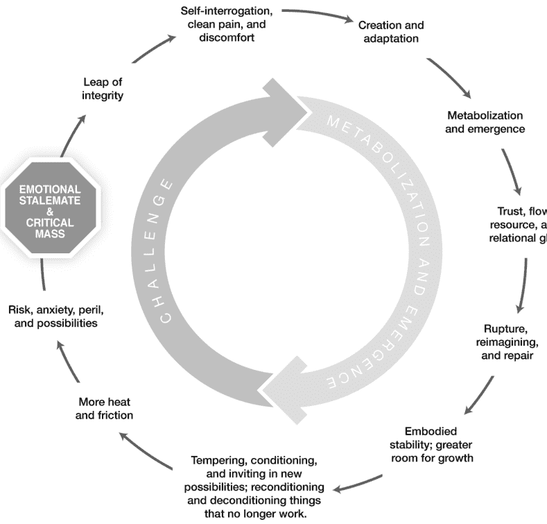
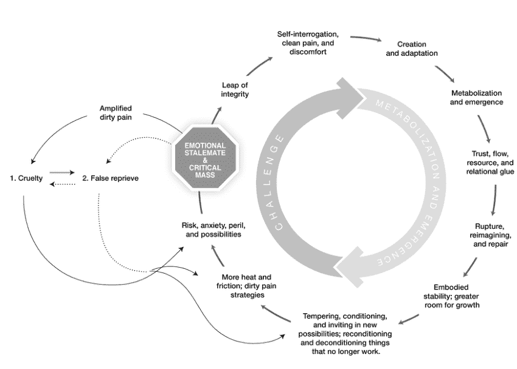

# 爱中的怪物：为什么你的伴侣有时会让你疯狂以及你如何应对

**MSW, LICSW, SEP**

**《纽约时报》畅销作家**

# 对《爱中的怪物》的赞誉

> “《爱中的怪物》带来了一个又一个又真理炸弹。它打破了‘表面和谐是良好关系的标志，剧烈冲突是关系处于边缘的信号’这种神话，这本书论证了学习掌握冲突是拥有一种健康且持久的亲密关系的唯一途径。与卓越的身体废除主义书籍《我祖母的手》（My Grandmother’s Hands）和《美国的震动》（The Quaking of America）中所传递的信息一致，Resmaa 帮助我们看到，维护真实、全心正直（并要求我们的亲密伴侣负责）的唯一方法，就是训练我们的神经系统去承受健康冲突的热度，而不会崩溃或欺凌我们爱的人。我和伴侣如痴如狂地这本书，并开始练习彼此之间像‘怪物’一样相处。这是十年来我读过的最好的关系书籍。”
>
> **Lissa Rankin，医学博士，《心灵战胜疾病》（Mind Over Medicine）和《神圣医学》（Sacred Medicine）《纽约时报》畅销作家**

> “我们生活在一个治疗文化中，重点往往是滋养、降低热度和消除冲突。与他那些关于在分分裂文化中治愈种族创伤的畅销书类似，Resmaa 为亲密关系点亮了明灯，展示了如何超越标准方法、成长，并真正找回我们最好的自我。这关乎成为成年人，并以一种深度且清晰的水平去给予和接受，这种程度非常令人清醒、振奋，并最终能拯救生命和关系。这是对理解深层亲密关系的现实与可能性的一项卓越且独特的贡献。”
>
> **Jeffrey Rediger，医学博士，神学硕士，《治愈》（Cured）作者**

> “Resmaa 又做到了！以所有必要的方式震动了我们。《爱中的怪物》是一本真实、实用、直不虚说的关于真挚、持久之爱的指南。它将以所有必要的方式扰乱你的关系，使其恢复平衡与健康。Resmaa 的方法是革命性的、不过滤的且充满了爱。每个人在关系工具箱中都需要这些练习。”
>
> **Mariel Buqué，博士，** 心理学家，代际创伤专家

**Resmaa Menakem**

封面设计：The Book

内页设计：Sara Streifel

献给所有先辈，

我对你们的爱深感谦卑。

这本书献给记忆中的

**David Schnarch 博士和 James Maddock 博士**

感谢成为我的导师。

**Jodi Nowak**

感谢我的朋友。

**Amelia Brown 和 Vesta Mason**

感谢我的灵感来源——

以及现在的祖先们。

## 致谢

### 从一个怪物到另一个

### 欢迎来到怪物世界

如果没有他的教导，我无法写出这些。Maddock博士起初是我的导师，后来成为了我的精神导师。他在十四年前去世了，我依然非常想念他。

约瑟夫·怀特博士（Dr. Joseph White）常被称为黑人心理学之父，他对我的思维起了关键作用，并在指导我方面非常慷慨。Joe是第一位获得临床心理学博士学位的美国黑人（1962年）。他于2017年去世。

感谢露丝·莫豪斯博士（Dr. Ruth Morehouse）以及前国会议员基思·埃利森（Keith Ellison，后任明尼苏达州总检察长）的友谊与指导。

感谢明尼阿波利斯图曼家庭联盟（Tubman Family Alliance）执行董事贝贝利·杜斯比（Beverly Dusby），她的友谊和指导帮助我成为了更好的人、更专业的人士。我同样感谢密尔沃基阿莎家庭服务中心（Asha Family Services）的安东尼娅·德鲁-范（Antonia Drew-Vann），她对有色人种社区的投入塑造了我对这项重要工作的理解。

我还要感谢许多其他导师和长辈：明尼苏达大学社会工作学院的奥利弗·威廉姆斯博士（Dr. Oliver Williams）；Meta Resources的诺尔·拉尔森博士（Dr. Noel Larson）；被许多爱她的人称为“阿图母亲”（Mother Atum）的玛丽·阿扎希尔（Mary Azzahir）；她的丈夫塞巴·艾哈迈·阿扎希尔；马哈穆德·埃尔卡蒂（Mahmoud El-Kati）。我深感谢妻子玛丽亚（Maria）、女儿布丽妮（Brittany）和儿子特扎拉（Tezara）的爱、陪伴与支持。

如果没有合作伙伴兼文学经纪人斯科特·埃德尔斯坦（Scott Edelstein）的努力，这本书就不会诞生。

我并不是被培养成为一名治疗师、作家或脱口秀主持人。我成长在一个既稳定又混乱的家庭里。我的父亲有时会暴力，多年来一直在与药物成瘾作斗争——那种生活早已在他很多年前结束，我对他感到非常自豪。我的母亲每天工作十二小时来维持我们的生计。父母都教我和我的兄弟如何以不同的方式去打拼和奋斗。我成长在一个中产阶级的多元种族社区，邻居和亲戚都会照看我。尽管如此，作为一个年轻人，我曾感到恐惧、愤恨和天真。我花了很久才找到自己的道路。似乎每个人都比我早懂了生活。

正如小说《弗兰肯斯坦》开头描写，海员们在北极的一块冰上发现了一个男人。这个男人维克多·弗兰肯斯坦博士（Dr. Victor Frankenstein）迷失了、困惑且痛苦。海员们看到他的处境如此糟糕，于是营救并救醒了他。

在我的青少年和二十岁初，我也曾感到迷失、困惑和痛苦。幸运的是，我周围的人来救了我，帮助我重新焕发生命。我的导师、精神导师和长辈都让我对自己负责，但没有对我进行嘲笑。他们教我不要伤害或破坏他人，包括我自己。他们鼓励我长大。我深感谢他们所有人。

尽管我是一个疗愈者，我想对我所学的内容补充一点说明。如果我漏掉了其他人，请指出。这本书关于婚姻以及其他承诺性的、亲密关系的现实。它不提供任何安慰的幻想、虚假的承诺或快速简单的解决方案。相反，它为你和你的伴侣提供了一个机会让你们的关系以及你们的生活变得更加宏大丰富。这本书挑战了关于什么成就成功伙伴关系的常见误解。它还摇动了心理治疗的舟，指出了那些没有为客户付出全部的治疗师。

书中的每一项挑战都不是基于理论、时尚或希望，

书中的每一项挑战都适用于所有承诺中的伴侣，无论任何成员的性别身份（或缺乏身份）或身体构造。¹

距离我完成《摇摆之旅》的原稿已经九年了。我依然和玛丽亚幸福地婚姻，我们在1997年交换了誓言。因为我们是一对承诺中的伴侣，我们仍然会互相抓狂。但每一年，这种承诺都在加深。我们现在都已五十多岁了，我们的孩子（有时会让我们抓狂，反之亦然）已经成年了。在不到十年后，玛丽亚和我都会成为老年人。虽然这个前景并没有让我们感到兴奋，但我们期待一起变老——并继续一起长大。伴随着许多深度的甜蜜、深刻的亲密、感官的性以及因共同为人父母而放声大笑的机会。

**瑞斯玛·梅纳肯（Resmaa Menakem）**

摇摆并不总是刺激性之旅。摇摆会产生冲突与不适、挑战与机会、危险与可能。此外，亲密关系远比承诺要复杂，每一段新的时光都有方向、电、重量、速度和纹理。

我是一名执业临床社会工作者、离婚与家庭调解员，以及认证的军事家庭生活顾问。二十年来，我曾与数百对伴侣、家庭、个人和组织合作过。

我还曾担任明尼阿波利斯非洲裔家庭服务的行为健康总监，以及图曼家庭联盟（一家家庭暴力治疗中心）的咨询服务总监。在明尼阿波利斯，我在这里开发了整体模型以及许多暴力预防计划。

我在阿富汗的一家美国军事承包商工作了两年，设计并监督了平民承包商的咨询计划，并管理了53个美国军事基地的健康和咨询服务。作为一名认证的军事家庭生活顾问，我曾与军人及其家庭就家庭生活、部署和回家等问题进行过交流。

你可能在《奥普拉·温弗瑞秀》或《菲尔博士秀》中见过我，当时我是作为家庭动态和冲突中伴侣的专家出现的。如果你住在双子城，你可能还听过我与前美国众议员（现任明尼苏达州总检察长）基思·埃利森（Keith Ellison）共同主持十年的电台节目，或者我的个人节目《早晨的雷斯马》，这两个节目都来自 KMOJ-FM。

最近，你可能在一些播客节目中听过我的声音，例如Krista Tippett 的 *Being*、Dan Harris 的 *10% Happier*、Gwyneth Paltrow 的 *Goop*、Sounds True 的 *Walking Together*、Sam Fragoso 的 *Talk Easy*、Malcolm Gladwell 的 *Revisionist History*、Eric Zimmer 的 *The One You Feed*, 以及 Pilar Gerasimo 和 Dallas Hartwig 的 *The Living Experiment*。

投入感情的关系可能是骨感的且直击面对的。有时它们看起来很危险。这正是它们应该有的运作方式。它们并不总是平静的。

如果你已经知道这一点，请继续读下去。如果你不确定但很好奇，请继续读下去。但如果你致力于回避骨感、挑战或冲突，现在是时候离开了（离开这本书，而不是离开你的伴侣）。

警告你：如果你对关系追求的是舒适，那么这本书对你将毫无用处。就像投入的关系一样，这本书也是骨感且接地气的。它在临床上是100%可靠的。简单、直接、毫无废话。

如果你想要的只是一个愉快和滋养的体验，请放下这本书去按摩按摩。

很多关于关系的书并不严肃。而这本书是。我并不是说其他书没有价值。一本只谈论除草和铺覆盖的园艺书是有价值的，但它对于整个园艺生态系统来说并不严肃。

你可以买一本教你如何更好地沟通，或者学习男女不同需求和思维方式的书。这些书大部分都有某些价值，但它们并不是关于作为伴侣和作为个人成长这一艰难、痛苦且可能具有转型意义事务的严肃指南。

如果你读这本书是为了给你的关系工具箱增添一些新工具，那么这本书将让你惊讶得大开眼界。你和你的伴侣不需要工具箱。相反，在本书中，你将打开一个玩具盒，拿出一些新玩具——与你的伴侣一起探索、调查和分享。但请留心：这些是成人的玩具，而不是孩子的。每一件都会鼓励你和你的伴侣长大。

仅仅通过他们本身，你的伴侣就会迫使你做出成长或不成长的选择。通过你自己，你也迫使他们做出同样的选择。这种情况日复一日，周而复始。每次发生时，你们都必须选择成长还是不。你无法让你的伴侣长大，他们无法为你成长。

当生活（或你的伴侣）推着你成长时，你通常不想这样做。如果你像大多数人一样，你的第一冲动会将其视为个人攻击并感到被冒犯。你可能会试图将冲突变成他们的问题、他们的病理。随着时间的推移，你可能会变得愤怒甚至变得暴力。

仅仅是待在一起，你和你的伴侣也会揭示彼此的局限性。这起初总是痛苦的。

如果你像大多数夫妇一样，你们会试图互相化解对方的局限性。这可能是可怕的——可怕到至于，有时你们会互相发泄。

相反，你们都需要长大。

这本书是关于选择成长的。这正是它严肃之处。婚姻——或任何投入感情的关系——都不是为软弱或胆小的人准备的。你们中的每一个人即使不经意，也自然会摇动你们关系的船。有时这会令人不舒服或痛苦。有时这看起来几乎无法忍受。然而，这正是应该发生的。

我们都被教导，在关系中最好的做法是不去摇船。让事情自然发展，不要推波，大家都会冷静下来，你的处境会再次变得舒适和熟悉。

对于许多微小的日常问题，这确实是正确的做法。但一段强大的伙伴关系并不总是关于保持你的船尽可能稳定并保持你和伴侣的一致。它还关乎在风吹浪打将你颠簸时保持在场和正直。在诚信问题上，会有你需要摇船的时候——或者让它摇动。有时，在最糟糕的风暴中，当你的船被颠簸时，试图保持它的稳定实际上会让它沉没。

这就是为什么，事实如此，我们最好把伴侣和自己看作真实的本面。

你的伴侣是一个怪物。你已经知道了。

你也是一个怪物。我也是如此。

听我慢慢说。我会解释的。

在《弗兰肯斯坦》的电影版中，怪物在科学家的实验室里活了过来，他好奇纯真，像一个婴儿。一切看起来都是新奇又奇特的。

伴侣之所以寻找“答案”，是因为他们还没有习惯于去应对亲密关系中固有的各种困境和情感瓶颈。这种习惯养成对于关系的健康至关重要。鼓励这种习惯养成和磨练，并在人们进入并穿过这一过程时提供支持，是治疗师最重要的工作。

如果你像大多数夫妇一样，那么你和你的伴侣并没有沟通问题。你完全清楚伴侣想要什么、不想要什么，他们在乎什么、不在乎什么，什么让他们愤怒，又什么让他们快乐。他们对你也同样了如指掌。

是的，你们之间存在问题和差异。解决这些问题可以减少你们的日常冲突，让生活过得更顺畅。但这并不一定能阻止你们变成彼此眼中的“怪物”。

这是因为在婚姻中，我们这些“怪物”自然会创造出一个接一个相互锁定的困境。这些反复出现的危机——我称之为“生命演练”（life reps）——是亲密关系中固有的。每一次危机都挑战着两个怪物去保持自身的完整、去成长，并且往往让他们痛苦得头破脑流。每一次生命演练都迫使两个怪物面对面，相互磨损，施加压力、挤压并粉碎他们，直到双方完全封死了对方的行动。这种现象产生的通常被称为“情感僵局”或“情感瓶颈”，它让人感到极其痛苦。

人们会竭尽一切试图从这种境地中解脱，包括指责伴侣、操纵他们、试图控制他们、出轨、滥用药物或酒精或其他任何事、对伴侣进行情感操控（gaslighting），甚至变得暴力。随着时间的推移，这些策略可能会成为这段关系结构的一部分。

我们所有处于承诺关系中的人——包括治疗师、其他疗愈者和精神领袖——都会经历这些同样的诱惑。但这些策略中没有一种能帮我们成长的。事实上，它们都加深了冲突。

我们每个人需要做的就是成长。我们需要学会对抚平自己内心的酸楚疼痛负责，而不是要求、期待或命令伴侣来为我们抚平这些痛苦。

如果你不学会这一点，你与伴侣之间的情感僵局可能会持续多年，甚至几十年。你们跳这种舞跳了太久，以至于它看起来既熟悉又安心，尽管你知道必须发生改变。然而，你也知道，那种折中式的妥协或寻找中间地带的解决方案是不可能的。

这个过程可能会导致你们最终达到“临界点”——即压力和痛苦变得巨大，使得某些东西必须爆发。某个人决定不能再以这种方式走下去了。某种积累已久（可能持续很久）的弹簧能量被释放了。通常，这种能量有力量代谢掉纯粹的痛苦并转化这段关系。

某种重要的变化发生了。在一个危险与机遇并存的时刻，你们其中一人向着更大的平衡与完整迈出了大跳。这样的时刻考验着你们的决心以及你们的局限性。

如果你们能一起迈出这一步，那就太好了。但这几乎从未发生。通常是一个人独自跃出，而他们的伴侣在旁边大喊道：“你是个白痴！我才不会和你一起跳水！如果你非要跳，你就一个人跳吧，混蛋。”

在那个人迈出这一步之后，他们的伴侣几乎总是要求他们跳回去，回到现状模式——但他们没有这样做。他们的脊背挺直了，眼神亮了，他们坚守了自己的阵地。他们没有逃跑，而是坚定地站在关系之中。他们向伴侣表达：“我全心地爱着，我不会回到过去的样子。”这种觉知和清晰，以及伴随而来的生理变化，通常被称为“自我的觉醒”。

现在，另一个也必须改变。另一个人要么学会新的情感技能，要么退缩。

有时，另一方伴侣也会跳出这一步。如果他们这样做，就有可能创造出更稳固的伙伴关系以及更大的信任、亲密和尊重。

有时另一方伴侣并没有跳跃而是离开了关系，结果在下一个伴侣或其他接近他们的人身上遇到了同样的问题和局限性。

有时，他们会找到方法诱惑那个跳出的伴侣回到旧的、不满意的安排中——那是一种包含巨大痛苦但也包含熟悉舒适感的安排。如果伴侣真的让自己被诱导回去了，这段关系的信任、亲密和尊重将比以前少，而会有更多的愤怒、沉重和焦虑。

正如我所说，婚姻不适合弱者或胆小者。

我刚刚描述的这个过程——侧重于显现化与转化——是本书的主题。

这本书可以帮助你们建立一种更强大、更深层、更有爱的伙伴关系——不是通过魔法公式，而是通过接受承诺关系带给我们的痛苦和成长。

你将在书中的几十个夫妇的故事中看到这种痛苦与成长的说明。所有这些故事都源于我作为心理治疗师的临床实践。有些故事，如第2章中 Melissa 和 Kim 的故事，改编自我在办公室里与客户的真实互动。（为了保护客户的隐私和身份，我更改了姓名和许多细节。）其他故事，如第22章中 Felicia 和 André 的故事，是虚构的，为了说明某一概念；如第23章中 Camilla 的故事，纯属虚构。在书中，我交替使用伴侣、爱人、配偶、另一半等词汇，无论你们是否处于承诺关系中，无论在一起了一年还是六十年，无论你们是异性恋、双性恋还是非二元性别。

在本书的第四部分，我们将讨论治疗在处理伙伴冲突方面的作用。但治疗师既不是高人生物，也不是圣者。至关重要的是要看到我们在个人生活中面临着同样的挑战和选择。

我希望事实是，当治疗师在面对伴侣的情感僵局时，我们总是挺直脊背、做出正确的跃迁并坚守阵地。现实是，我们并非总是如此。

我和妻子在过去的二十九年里，在这方面都进步了许多。但仍会有时候，我们其中一个会对另一个说：“如果你觉得我会和你一起跳水，你就疯了。”我们曾为航行方向发生过争吵。我们经历过几次叛乱。但我们教会了彼此并帮助了彼此成长。我们和其他人以同样的方式学习同样的课程。

我可能是一个经验丰富的治疗师，但我也是一个有时会犯错误的丈夫和父亲，像你一样，经常面临成长的挑战。我经常提醒自己，当我小时候在父母家里成长时，他们也在成长。这种认知帮助我投入到成长的过程中，并与他人互动的能量共处。

心理治疗在许多方面与婚姻相似。如果治疗师既能幽默又有策略，如果他们能理解自己所看到的，如果他们愿意并能够缓解焦虑，他们就能为夫妇提供明智的指导，帮助他们通过瓶颈。

不幸的是，这个过程让许多治疗师感到恐惧。他们通常会本能地让大家冷静下来。当一对夫妇中的某成员开始大动干戈时，治疗师试图稳定局面。但他们需要做的是让冲突展开——不是变成残忍或暴力，而是变成转化。

相反，在关键时刻，优秀的治疗师需要与客户待在一起，保持脊背挺直，在残酷的真相开始显现时坚定地站立。他们需要安抚自己，放下想要“提供帮助”的欲望。然后，他们需要帮助冲突的展开，而不会被其吓跑或卷入其中。最终，他们需要帮助客户构建一个足够大、足够坚固且足够灵活的关系容器，以应对亲密关系和生活的波涛汹涌。

简之，就像婚姻一样，心理治疗不是为弱者或胆小者准备的——无论你是客户还是治疗师。

利用治疗来加强你与伴侣的关系，通常意味着对治疗师提出最高要求。有时，这意味着要换一个。

在最稳固的伙伴中，无论是与治疗师还是伴侣，双方都会持续要求对方最好，并迫使对方成长。这绝非易事也无痛苦。但这比另一种选择好得多：让彼此变得更渺小、更脆弱、更缺乏适应力且更加不快乐。

我写这本书是为了帮助你和你的伴侣建立你们最稳固的伙伴关系。

# 关于治疗、治愈与成长

这本书是关于治疗的——但它更多是一本关于治愈和成长的书。治疗是个人的。它涉及个人、伴侣和家庭。相比之下，治愈既是个人的也是群体的。在治愈中，我们连接到那些一直伴随我们、在我们体内、在我们周围的能量。治愈向他人、向世界散发，提醒着我们已经是什么，以及曾经是什么的一部分。

成长的过程痛苦得要命。但成长的前景和可能性正是你和伴侣在一起的原因。而且，尽管有时看起来并非如此，成长正是你和伴侣渴望从对方身上得到的东西。

最后一点说明：在每一章的末尾，我列了一份“罗针点”列表——该章节的核心观点，可以帮助引导你，并指引和你伴侣走向正确的方向。

- 本书不提供安慰的幻想、虚假的承诺或快速解决办法。相反，它给了你和你的伴侣一个机会，让你们的关系以及你们的生活——比你们想象的更加丰满。
- 在最稳固的伙伴中，双方都要求对方最好并迫使对方成长。这就是为什么婚姻——或任何承诺性的关系——不是为弱者或胆小者准备的。
- 这本书是一本关于成长以及作为伴侣处理冲突的严肃指南。
- 你和你的伴侣不需要工具箱。相反，在本书中，你们将打开一个玩具箱，拿出一些新玩具——用来与伴侣一起探索、调查和分享的事物。但这些是成人的玩具，而不是孩子的。每一个都会鼓励你和你的伴侣成长。
- 在你们的伙伴关系中，你和伴侣都可能尝试去爱，但你们的努力往往会让你们双方陷入困惑和痛苦。
- 当这种情况发生时，**并没有错**。这正是承诺性关系运作的方式。
- 你的伴侣仅仅通过他们的本性，就迫使你做出成长或不成长的选择。你通过你的本性，迫使他们做出同样的选择。这种情况一次又一次，日复一日。每次发生时，你们双方都必须成长或放弃。
- 在伙伴关系中，我们自然地创造出一个又一个相互联锁的困境。危机挑战着双方都要坚守自己的正直并成长。它迫使双方面对面，直到他们达到**情感僵局**或**情感瓶颈**。
- 最终，一个或双方伴侣会达到临界质量点。至少其中一个人无法再以同样的方式走下去。他们可能会通过暴力或指责，或者离开关系来回应。或者他们会提升自我，向更大的平衡、整合和适应迈出飞跃。
- 现在必须有所改变了。要么第二个伴侣做出自己的飞跃，要么关系结束或被重新定义。一种转化发生了。在最好的情况下，双方都成长了——变得更加亲密。
- 为了创造最稳固、最深层、最充满爱的关系，双方必须接受承诺性关系所要求的痛苦和成长。如何做到这一点本书的焦点。

## 面对痛苦，选择成长

你在伴侣关系中经历的痛苦并不是用来压制、药物或回避的。你已经尝试过这些方法，但它们持续的时间并不长。相反，你需要去面对这些痛苦。你必须让自己脚踏实地，并被逼到一个不得不留在关系中的地步，此时成长是别无选择的。

在选择留下并成长时，你可能成为你想成为的人。如果你把握了那个机会，它自然会为你的伴侣创造出同样的可能性。这项工作既是独立完成的也是**共同**完成的。

如果你和爱人一次又一次地发生争吵，不要仅仅顺从，也不要告诉自己这并不重要。不要试图让你的伴侣让步。不要掩盖你们的差异。也不要在一个最终损害某人价值观或安全的妥协上达成一致。你持续发生的每一次争吵，都是你们需要进行的争论。**继续下去**。经常回到这个问题上。挖掘、调查并审问你内心以及你们关系中那些你一直回避——或不愿接受的地方。保持练习，同时给予彼此尽所能的爱与尊重。

为了成长你需要做的事情（你将在本书的后部分学习这些）。要频繁且持续地去做，就像你热爱做它们一样——即使（尤其是如果）它们让你感到不舒服。从关系、情感、身体和文化角度去研究你自己。

最终，通过你和伴侣不断重复的争吵，你们可能会达到临界点并获得转化的机会。

为了度过这个过程，你们每一个人都需要学会坚持自我，在痛苦和不确定性中保持当下、平衡和连接。你可以通过遵循一些简单、务实的做法来实现这一点，我将在第 35 章中详细描述。

## 改变与转化

成长允许改变。但它也需要转化。

人可以改变——甚至变得更好——而不必成长。他们停止了某些有害行为，但并没有改变自己的思维方式或与人以及与世界互动的方式。

转化不仅仅是改变。它是发自本质且根本的。当它发生在我们身上时，我们在身体里感受它。当它发生在别人身上时，我们通过他们的眼神、声音或肢体语言来感知它。

成长是一个接一个转化的持续过程。几乎没有人喜欢长大。我们希望别人成长，尤其是我们的伴侣，但我们却想保持原样。然而，如果我们认真对待成长，这并不是一个选项。

当大多数人与爱人产生摩擦并开始经历成长的痛苦时，他们会寻找缓解压力或发泄情绪的方法。他们投入到爱好、兴趣或痴迷中。或者他们跳入一段外遇或与陌生人的性关系。

大多数人没有转向外遇和约会，并不是因为他们的伴侣对他们不重要。他们这样做是因为他们的爱人太重要了，以至于他们害怕向对方完全展现真实的自我。

卡洛斯在网上约会的对象对他来说其实并无重要。这就是为什么他可以从容地向那个陌生人展示他怪异的一面——他的性癖、S&M 幻想或对被拍打的喜爱。他害怕向伴侣展示自己的这个隐藏侧面，因为他担心爱人会说：“天哪，你真是个该死的怪胎！我不走了。”

有时双方都试图一起发泄情绪。他们去度长假，或者安排频繁约会之夜，或者进行大量的性。这些通常会带来愉快的体验，但无法平息成长的呼唤。

另一些人试图通过将伴侣变成仆人、顺从的孩子或他们的性玩具来减轻压力。还有的人则挑拨伴侣发生争吵、爆发或崩溃成一团哭泣。这一切只会加剧双方对成长的需求。

成长这件事没有任何理智或健康的替代方案。我们每个人都必须独立成长。你和你的伴侣可以同时成长，但成长始终是一个单方面的选择和单方面的过程。

随着时间的推移，当一个人反复选择成长而另一个人反复拒绝时，关系通常会结束。伴侣之间经常将其视为一种

- 你与伴侣之间的冲突都是关于你们每个人如何成为自己最想成为的人。这是关系提供的机会。你们每一个人都需要克服痛苦并成长。
- 随着时间的推移，你和伴侣有一个选择：你们可以互相打磨成宝石，也可以互相磨损成粉末。
- 如果你和爱人一次又一次地发生同样的争吵，这就是你们需要进行的争论。**继续争论下去**，同时给予彼此尽所能的爱与尊重。审问你们过去回避或忽略的事情。
- 有一天，通过那个争吵，你们将达到临界点并创造出转化的机会。

> 我的导师之一，已故的詹姆斯·麦多克（James Maddock）博士帮助我将家庭和稳定的关系视为生态系统。麦多克博士是这种生态疗法的关键人物。他的遗孀诺埃·拉尔森（Noel Larson）博士仍然是一位著名的[执业者](参见 Maddock & Larson, 1995)。

这正是关系设计的初衷：创造一种强制性的选择，让你要么成长要么保持幼稚。

## 情感僵局与真话

伴侣们来到我的办公室，认为他们有关系问题就完蛋了。我告诉他们：“你们并没有完蛋。这很大程度上取决于你们。如果你们来这里是为了寻找一种没有关系问题的方法，那么你们就完蛋了，因为问题、危险和可能性是根植于每一段长期关系中的。”

像许多伴侣一样，当梅莎和金陷入情感僵局时，他们希望我给他们一条路。“瑞斯玛，我不能再这样下去了，”梅莎对我说，“这段关系看起来不再安全了。”几秒后，金说：“而且对我来说，这看起来也不被尊重。我们被困住了，这快把我们都搞疯了。告诉我们我们需要做什么。”

穿过不确定性，你们每一个人都要说出自己的真话。我不认为你们在这样做上有什么策略上的问题。

“你们的每个人已经知道，你的伴侣觉得你很渺小，而且没有在认真改变。你们的每个人都讨厌他们这样看你。你们的每个人都处于一种进退两难的境地。你们必须愿意说出自己的真话，并忍受听伴侣说出关于你的真话时的痛苦。你们都在和一个伤害过你们的人维持关系。现在，你们必须弄清楚从这条分界线开始，你们将如何在这段下去。”

梅丽莎流下了泪。“但我们不知道该怎么办。这就是我们来这里的原因，为了让你帮助我们想出办法并制定计划。”

“这种经历并穿过不确定性的过程至关重要。如果你们双方都不知道该怎么办，那么现在就保持‘我不知道’的状态，不要逃避。照顾好你自己，不要指望伴侣来照顾你。当你能够时，用你内心最好的部分去接触你的伴侣。随着时间的推移，你会对什么是最好和最坏的部分产生一些洞察。这对于帮助你们弄清楚该做什么至关重要。”

## 摩擦：成长的引擎

我们向伴侣寻求和谐、安全感和熟悉感。充满爱的关系提供了一些时间。但它也提供了摩擦。摩擦——而不是和谐或安全感——是成长的引擎。

大多数情侣试图将摩擦最小化，并将和谐最大化，特别是在关系的早期。这是暂时的，但随着时间的推移，摩擦会不断回来。因此，减少摩擦的努力反而创造了更多的摩擦。

这通常是情侣开始回避冲突、绕圈的时候。他们试图通过避免困难的话题和痛苦的选择来减少摩擦。这造成了更多的摩擦。

我告诉情侣：“你们需要那种摩擦以及它产生的热量，因为这可能关乎你们的正直人格。这关乎于你作为一个人的本色，以及你将如何与生命中最重要的那个人建立关系。”问题始终是：‘我能否在成为我努力追求的人的同时，仍然与对我最重要的人保持联系？’

情侣们真正需要做的不是减少摩擦，而是减少伴侣关系中的残酷。

在亲密关系中，残酷远比我们大多数人意识到的或承认的多得多——身体上的、情感上的、心理上的和精神上的。几乎所有的伴侣都会这样做，至少是偶尔。

在所有这类常见的残酷中，我们有意识且刻意地伤害伴侣——或者“吞噬他们的心”——为了让自己变得更渺小。我们实施这种残酷行为是为了强迫他们暂时服从，或者为了他们所做过的（或没做）的事而惩罚他们。我们这样做也是为了避免面对我们在成长过程中自己内心需要做的事情。

当关系中存在身体暴力时，暂时降低摩擦并提供边界和安全对于防止进一步暴力非常重要。但早晚摩擦会回来，因为摩擦并不源于暴力本身，甚至不在于个体伴侣身上，而是在关系本身的动态互动之中。

两位爱人都需要学会忍受摩擦，而不滑回残酷之中。如果他们只专注于压制摩擦，暴力可能会停止，但这对情侣将停滞不前。

拥有一个投入的伴侣总会产生摩擦和问题。我们大多数人都想留住这段关系并摆脱摩擦和问题。那是我们需要成长并脱的幻想。

你们的关系关乎转化。你们经历的摩擦和面临的问题是转化的燃料。

我们每个人起初都是一块煤炭。一段投入的伴侣关系是一个至关重要的炼金过程，在这个过程中，热量、压力和时间的结合可以将我们变成钻石——如果我们允许它的话。

## 核心观点（罗针点）

- 你的伴侣以三种不同的方式让你抓狂。你也以这三种方式让他们抓狂：
- 你对伴侣有某种看法，但这种认知并不完全准确。
- 随着你学会与伴侣的真实面相处，你们的关系会自然产生热量，反复如此。
- 随着时间的推移，当你们和伴侣学会互相支持并爱意挑战对方时，你们都会发生改变。
- 当你的伴侣让你抓狂时，并没有什么错，你正在经历必须经历的。你正在经历一种内在的召唤。
- 关系的设计是为了让人们做出必须做出的选择。
- 你们和伴侣所经历的冲突和问题都是你们所特有的、个人的。但这些可能也是你们文化和历史的反映。
- 在所有这类常见的残酷中，我们有意识且刻意地伤害伴侣——或者“吞噬他们的心”——为了让自己变得更渺小。我们实施这种残酷行为是为了强迫他们暂时服从，或者为了他们所做过的（或没做）的事而惩罚他们。我们这样做也是为了避免面对我们在成长过程中自己内心需要做的事情。
- 当关系中存在身体暴力时，暂时降低摩擦并提供边界和安全对于防止进一步暴力非常重要。但早晚摩擦会回来，因为摩擦并不源于暴力本身，甚至不在于个体伴侣身上，而是在关系本身的动态互动之中。
- 两位爱人都学会忍受摩擦，而不滑回残酷之中。如果他们只专注于压制摩擦，暴力可能会停止，但这对情侣将停滞不前。
- 拥有一个投入的伴侣总会产生摩擦和问题。我们大多数人都想留住这段关系并摆脱摩擦和问题。那是我们需要成长并脱的幻想。
- 你们的关系关乎转化。你们经历的摩擦和面临的问题是转化的燃料。
- 我们每个人起初都是一块煤炭。一段投入的伴侣关系是一个至关重要的炼金过程，在这个过程中，热量、压力和时间的结合可以将我们变成钻石——如果我们允许它的话。
- 你的伴侣以三种不同的方式让你抓狂。你也以这三种方式让他们抓狂：
- 你对伴侣有某种看法，但这种认知并不完全准确。
- 随着你学会与伴侣的真实面相处，你们的关系会自然产生热量，反复如此。
- 随着时间的推移，当你们和伴侣学会互相支持并爱意挑战对方时，你们都会发生改变。
- 当你的伴侣让你抓狂时，并没有什么错，你正在经历必须经历的。你正在经历一种内在的召唤。
- 关系的设计是为了让人们做出必须做出的选择。
- 你们和伴侣所经历的冲突和问题都是你们所特有的、个人的。但这些可能也是你们文化和历史的反映。

## 两条循环路径：成长与残酷

在处理亲密的痛苦时，你和你的伴侣可以走两种循环路径之一：

第一条——一条清痛苦和不适之路——是**成长循环**。这个循环可以为双方创造更高层次的信任、理解和亲密。

第二条——一条通往不信任、伤害有时暴力的脏痛苦之路——是**常见的残酷循环**。这个循环会加深现有的冲突，并经常产生新的冲突。

我将这些序列称为循环，但每个循环中发生的事情并不像洗衣机循环那样平稳且可预测。有时情况恰相反：你和伴侣向前冲动，然后停止，向侧面冲动，然后停止，然后挪动。有时你们看起来完全一致，和

有时会完全错位——甚至在两种模式之间反复横回。

无论你如何移动，你面临的核心问题是：当压力升温时，你将遵循哪种循环？

## 关系的成长周期

让我们更仔细地观察一下成长周期。^6 一个很好的起点是下图中“关系的成长周期”（图 1）图表的底部。

当你和伴侣共同生活时，你会发现自己正面临着越来越多的局限性。这自然地导致了模糊和逆境，让你们两人的压力不断增加。

如果你像大多数夫妇一样，你们会尝试通过迁就、妥协、清晰的沟通以及此类策略来应对压力。在处理小事时，这些方法是有效的，至少是暂时的。但对于大事——那些对你来说重要的事情、关乎你正直人格的事情——你所有的迁就和妥协努力都失败了。任何短期的“脏模式”策略也是如此，比如沉默地顺从（忽视你内心对正直的呼唤却在私下充满怨恨），或者通过性、关注或其他伴侣喜欢的事务来取笑对方。同样，吝留甜蜜和尊重、冷战、批评、感知蔑视的情绪以及防御行为也是如此。相反，它们会让冲突变得更大、更热。你和伴侣一遍又一遍地遇到同样的问题。

你们两个互相折磨——小时、天、月，甚至是年——因为冲突无法通过某种战术决策或协议来解决。你对冲突的焦虑在增加，伴侣也是如此。你们其中一人可以简单地顺从另一，但这意味着违背你的正直——而你不会这样做。你的伴侣处于完全相同的境地。

最终，你们两人达到了**情感僵局**或**瓶颈**。仅仅由于你们各自的存在，每个人都阻碍了对方的位置。似乎没有解决方案。

冲突不断增长，直到达到临界点。你们其中一个——可能都是两个——再也无法忍受现状。必须发生改变。

这是一个既充满危险又充满机遇的时刻。它是危险的时刻，因为你们一个或双方都可能选择平庸的残酷循环。它也是一个机遇的时刻，因为你们都可能选择成长。这意味着立足你的正直并跃入未知。这也意味着你不知道伴侣是会和你一起跃起，还是会逃跑。这意味着对你的伴侣、你自己或两者都说：“我不想再这样下去了。”更重要的是，这意味着要从内心一个平静、中心、锚定的地方说这句话，无论你的船摇得有多剧烈。

为了做到这一点，你需要清楚什么对你来说是重要的，你代表什么。这意味着要培养一些洞察力。这意味着关注你的身体，以及身体内部和通过身体产生的东西。这意味着要穿过你的边界，而不是绕过它们。这意味着以各种方式面对自己（我将在随后的章节中讨论）。这意味着要守住自我并调节你的情绪和行为，使你既坚定又清晰，而不具有威胁性、暴力性或歇斯底里。这意味着愿意接受并忍受纯净的痛苦和不适。

然后事情发生了。某些东西发生了转变。这不会（或不仅仅是）是一个突然的认知觉。你将经历一种突显的转变，你会感觉到它是正确的，而你无法立刻看清的东西将变得稳固且灵活。

这种转变的可能性是无限的，但这里有一些典型的例子：

- 告诉伴侣，你多么担心女儿永远无法在世界上立足。
- 你对伴侣说：“每当我黑人儿子独自出门时，我都吓坏了。我怕再也见不到他活着。尽管你不是他的父亲，我还是希望在这件事上得到你的一些。”
- 告诉伴侣，下次他哥哥在家庭聚会上再次试图找你吵架，你会离开现场。他可以随你一起离开，也可以留下；这是他的选择。
- 你的爱人说：“我无法停止花钱。如果可以我会停止的，但我做不到。我需要找到治疗和康复计划，我们需要弄清楚怎么付钱。”
- 伴侣告诉你：“我不在乎你在麦当劳洗碗，还是在某个廉价酒吧打扫厕所。我不在乎你为了挣钱做什么，只要是诚实合法的。但我不会和一个靠卖毒为生的人结婚。”
- 你对伴侣说：“我一直对自己的肤感到羞耻。我试图摆脱这种情绪，但我真的做不到。我仍然认为自己是个冒牌者，因为我没有白皮肤。有时我觉得自己像个冒牌者。”
- 你告诉你的伴侣，下次他哥哥在家庭聚会上再次试图找你吵架，你会离开活动。他可以和你一起离开，也可以留下；我不再这样了。”

## 平庸的残酷循环

在“情感僵局”阶段，筹码很高。如果其中一个或双方双方都没有找到采取正直立场的方法，可能会出现两种情况：

1. 他们陷入了残酷循环：暴力、愤怒、指责等。
2. 为了避免爆发，他们找到了一种虚假的缓解——暂时的停火。

他们可能会尝试两种路径，并发现自己陷入了焦虑、焦虑和危险之中。挑战是要创造出转化的空间。

接下来会发生什么？你不知道。你的爱人也不知道。没有人知道。这就是为什么那个时刻充满了危险——也充满了机遇。

但在那个时刻，你们其中一人提高了标准。现在轮到另一人做出选择，出于正直并接受痛苦和不适。

如果他们选择了正直，整个关系可能会发生转变。在大多数情况下，伴侣们达到了适应、整合、信任、承诺和尊重的新水平。他们刚刚经历的痛苦可能会减轻。在体内，每个人都感到更大的平衡、希望和解脱。船的摇动开始平静——至少变得可以管理。

当恋人都都选择正直时，结果如何无法预知。但这里有一些我听过的客户之间说过的话：

- 我对你说吧——我有疑虑，但我愿意尝试。让我们按照你的计划试试看。如果情况没有好转，我们可以一起想计划 B。”
- 我不知道你这么在意我的儿子。我原以为你只是在忍受他。你是在告诉我你愿意当继父，而不仅仅是我的男朋友吗？”
- 你知道我父母会对这件事闹出多大的风波吗？他们会把我们当成撒鬼的私生子。但我愿意。”
- 我快疯了。这将是我做过最困难的事情。但是，好吧，我会做的。
- 我不会经历激素注射和体外婴儿的的地狱。我不会再生一个孩子了。但抚养另一个孩子——是的，我可以领养。”
- 你说得对，我们需要钱。但我不会为了给你那个讨厌的叔叔而离开我热爱的工作，即使工资更高。我会找到其他办法多挣钱。我会要求加薪，并在周六打工。”

在所有这些情况下，伴侣们找到了走向更大平衡、意识和和谐的道路。与此同时，核心问题——即让双方相互对峙数周、几个月甚至数年的局面——开始得到解决。

但当伙伴双方达到临界质量且都坚持自己的原则时，也可能出现另一种完全不同的结果。他们可能会清楚地看到，问题已无法解决。他们意识到，一方的正直正阻碍——并将永远阻碍——对方的正直。

这也导致了更深层的意识：意识到这段关系可能已经结束，因为关系持续的唯一方式就是至少有一方要牺牲自己的正直。这让人感到极其心痛，但这也是一种“纯净的痛苦”。对于每一方来说，这也是一种成长。

当双方都坚守自己的正直原则时，上述任何一种结果都是可能的。

遗憾的是，很多时候，人们并没有选择正直——或者说他们没有同时选择正直。在临界质量的热量和压力下，至少其中一人会失去理智，陷入平庸的残忍循环中。

这可以采取各种形式：愤怒、指责、控诉、过度警觉、恐慌、过度焦虑、强硬的要求、对伴侣绝望的控制尝试，甚至是暴力。有时它表现为自残：饮酒、吸毒、其他成瘾行为或自残性暴力。这一切都让局面变得更加困难、复杂且更加痛苦。

平庸的残忍循环会导致信任、尊重、亲密和相互理解的减少。伙伴双方没有展现出最好的一面，而是一个或双方展现出了最糟糕的一面。

在平庸残忍循环的一种常见变体中，双方都感觉到任何博弈已经结束，或即将结束。至少其中一人需要面对他们，并坚守自己的正直原则。

临界质量正视着他们。这恐吓了双方，（通常在心不宣的默契下）他们都从冲突中退缩，寻找虚假的喘息，并本能地通过忽略或搁置冲突来寻求安慰和安全感。

通过这样做，他们也放置了自己的正直原则。这一过程不可避免地创造了进一步加剧冲突的条件。他们制造虚假喘息的尝试只会产生更多肮脏的痛苦。

与此同时，双方对冲突的焦虑持续存在，信任、尊重和亲密关系继续萎缩。

图 2 显示了平庸的残忍循环如何劫持成长循环。在情感僵局点，伙伴们面临选择：他们可以进入平庸的残忍循环——或虚假的喘息——或者他们进入成长循环。

面对痛苦时，我们最初的倾向是试图平息它，或逃避它。但存在着巨大的智慧——以及转化的可能——即与痛苦共处而不对其产生过度反应，同时对你自己和伴侣保持爱意和尊重。这本书的大部分内容都在探讨如何做到这一点。

当你和你的伴侣陷入情感僵局时，你们都会找到通过妥协、转移话题或让对方选择来降低热度的方法。对于那些对你们双方都不重要的琐事，这样做是没问题的——甚至是明智的。但在涉及你们正直原则的处境下，你只需要做相反的事：保持热度并施加压力。正如你将在随后的章节中发现的，从长远来看，这实际上可能减少双方的痛苦，因为你们可能会很快达到临界质量。正如你也将发现，即使你成功降低了冲突的热度，你们的生活状况最终也会再次将其推高。

热量可能会让人不舒服。但每场冲突都需要热量才能“烹饪”。当某事对你或你的伴侣很重要时，你需要学会调节热度，而不是本能地将其调低。

每种情境——就像每份食谱一样——都是独特的。会有最好的做法是让冲突缓慢炖一段时间。在其他时候，最需要的是将冲突推向沸点。在另一些时候，需要暂时移除热量，让事情冷静下来。

随着时间的推移，你和你的爱人可以学会何时以及如何最好调节冲突的热度。你们也可以提高忍受热量并共同度过的能力。这本书将帮助你们建立这两种技能。

在每一段亲密关系中，选择都是：纯净的痛苦或肮脏的痛苦。

+ 在普通残忍循环的变体中，你可以从生理或情感上逃避冲突。这也会产生“脏痛苦”——以及更深层、更久的冲突。
+ 当面对痛苦时，我们最初的倾向是试图让它停止或逃避它。但如果留在痛苦中而不做出反应，同时对自己和伴侣保持爱与尊重，其中包含着巨大的智慧以及转化的可能。
+ 当夫妻陷入情感僵局时，双方通常都会尝试寻找降温的方法。他们需要做的恰恰相反：保持热度和压力。
+ 如果其中一个或双方成功降低了温度，他们的生活状况会让温度再次升高。
+ 热度可能会让人不舒服。伴侣之间需要热量来烹饪。
+ 解决方案永远不是降低温度。解决方案是双方都提高调节温度、忍受温度并穿过温度的能力。
+ 每一个人体以及每段重要的人际关系，都会受到各种地质压力的影响——即我们个体和共同承担的许多社会、文化和环境压力。即使你和伴侣之间一切都好，这些无关的压力也可能为你升温，并迫使你陷入自我对抗。如果你们之间已经酝酿着冲突，这些压力可能会突然让热度升至沸点。

5 “净痛苦”和“脏痛苦”这两个术语由我的导师之一大卫·施纳纳赫（David Schnarnach）博士和史蒂芬·海耶（Steven Hayer）博士普及。然而，海耶博士对这些术语的定义和用法有所不同。

6 图中成长周期和普通残忍循环的概念，源于我与大卫·施纳纳赫博士的工作，以及施纳纳博士的一些个人工作。这些图反映了我对该主题的思考，改编自施纳纳赫博士的“炼炉四平衡点™虐待与增长模型”（版权 2007 年由婚姻与家庭健康中心所有）。

7 我列出了一些具有历史意义和集体性的压力。它们也可以按活动列出——例如：掠夺土地、宗教或文化迫害、种族灭绝、征服与殖民等。

亲密关系自然充满了双重困境：在这些选择中，所有选项似乎都是充满风险、痛苦且不确定的。

每一个双重困境都迫使双方检查并重新审视他们认为重要的事情。它也测试了他们在真实情境、真实时间内，面对他们在乎的人时的正直性。

每个双重困境的呈现方式似乎如下：如果我选择 A，我就不会开心；如果我选择 B，我也不会开心；如果我不做选择，我同样不开。所有的选择似乎都通向痛苦。而且往往确实如此。但通常至少有一个选择涉及净痛苦和不适，这有助于帮助个人建立韧性和辨别力——并可能让他们在痛苦的彼岸获得更大的自由和亲密。

露安（Luanne）和杰基（Jackie）在一起已经六年，结婚了。他们经常就钱问题进行讨论、辩论，有时会争吵。

杰基和露安都想减少工作时间，并且突然获得了减少到每周 30 小时的机会。但露安感到惊恐。“我们的储蓄是应急备用的。它是我们的安全网。我们不能把钱花在任何我们选择的事务上。”

“为什么不能？”杰基问，“那是我们的钱。我们是在用它来购买更多时间来享受生活和彼此。”

“那你就别担心。”

“如果我们妥协一下呢？”杰基问，“我减少到 30 小时工作，你可以继续工作 40 小时。我们仍然可以靠赚的钱生活。”

露安说：“如果目标是拥有更多相处的时间，如果只有我们其中一个人减少工作，那是行不通的。而且，为什么你应该是那个清闲的人？我很快就会变得嫉妒和怨恨。”

“我不知道。我想等一个更好的机会。”

“更好的机会？”杰基问，“你意识到我们两个都有机会做四之三时间有多幸运吗？我们可能再也不会有这样的机会了。”

“花得钱比赚得多这怎么能是机会？那是灾难的根源。”

“你想得太多，”杰基说。

“而你，”露安回答道，“期望别人照顾你。”

杰基和露安处于经典的双重困境中。露安在维护财务安全。杰基在维护彼此共同的时间。双方都想要两者，但谁都不能在妥协的同时不让彼此的关系升温。

双重困境不会自动消失。如果他们继续互相指责，他们就会进入残忍循环，一切地狱都会爆发。

但如果他们能在直面热度的同时从指责中抽离，那么光芒就会出现。

实时，与他们在乎的人在一起。

- 我们的第一本反应是试图避开双重困境，或者恐惧它们，或畏惧它们。但我们需要恰恰相反——迎向它们，因为它们至关重要。
- 任何避开这种困境的尝试——无论是顺从伴侣、欺负他们、出轨，还是结束关系——只会让困境变得更加紧绷。
- 解开双重困境的唯一方法是立足你的正直，并接受痛苦后果的可能。

恨意存在于所有的长期爱情关系中。它是关系运作方式的一部分。

在一段投入的伙伴关系中，每个人都曾短暂地讨厌过伴侣。每个人都是如此。

成长的一部分是承认这种恨意。我们大多数人害怕承认这种恨意，因为这在社会上是不被接受的。所以我们隐藏它，或者假装自己没有经历过它。

治疗师很少向客户谈起恨的话题。但当我问客户时：“你是否曾经对你的伴侣产生过恨意？”几乎所有人都说是肯定的。

否认这种恨意会产生各种问题。首先，当它在你内心涌现时，你不知道如何处理它。躲避它或压制它并不能让你培养出洞察力或对细微差别的感知。因此，你可能会本能地做出反应，产生一种“肮脏的恐慌”。你可能会对伴侣说：“你有问题，”或者你可能会对自己说：“噢该死，我有问题。但我其实完全没问题。”

如果你不承认这种偶尔的恨意，它就会以某种其他更恶劣、更未经过审视的形式出来。你无法识别出这种恨意是完全正常的——你也不会愿意停下来，感受身体里的那种紧缩感，这样洞察力才能发展，资源才能加深，你才能接受那种纯粹的痛苦并穿过它。相反，你会对伴侣很残忍——可能对自己感到愤怒。

事实上，你身体的一部分总是讨厌你的伴侣。事实上，你们的关系越亲密，你变得越脆弱，这一部分就越恨他们。

当你和你的爱人约会时，在对彼此做出长期承诺之前，你们可能有一个默契协议，即你们中的任何一人都可以结束关系。这会很痛苦，但你们都会好好的。你们都有离开的选择。

但一旦你说出“我选择你，”或“让我们专一，”或“让我们住在一起吧，”你的选择就减少了。突然，你的行为和选择变得与伴侣的行为和选择绑定在一起。你想要的事情开始与伴侣想要的事情发生摩擦。

你容忍差异的阈值立即缩小了。你无法再无视那些差异了。“我的爱人想要孩子——我们余生都必须为此谈判妥协。”最终，这变成了一个主要的争论点——不是因为某人不讲理，而是因为这个问题对你们双方都很重要。这就是为什么它会反复出现。

这种情况发生在几乎所有影响你们双方的事情上。任何在伴侣出现之前困扰或让你担心的事，现在都经常出现在你面前——而任何在他们出现之前困扰他们的事，现在都出现在他们面前的中心。

在这个过程中，你们进入了“我选择你”阶段，你做的每件事、做出的每一个决定都必须考虑你的伴侣。你过去用来减轻压力的所有事变成了你必须谈判的事。你不能因为想做就辞职、搬到城另一头、买一辆新自行车，或者欠下一大额信用卡单。这让你变得更加脆弱。

当这种情况发生时，它会让人发疯。突然间他们底下的热量升高了——他们无法轻易降低热量。

自我意识低且洞察力低的人并没有真正意识到这些信息源于何处。他们不理解需要代谢这些信息，将它们转化为对伴侣的关怀以及自身的成长。他们无法忍受“我爱我的伴侣”这种模糊性；而且，该死，我也恨我的伴侣；所以我必须继续爱我的伴侣。相反，他们只是对自己后脑中关于恐惧和危险的信号做出反应。这种“后脑行为”往往是成年人阻止做出寻求治疗决定的时刻。

作为青少年和年轻人，我们几乎所有人都在很大程度上处于反射性地对感知到的一个又一个情感威胁做出反应。当青春期的孩子像往常那样对父母嘟囔“我讨厌你！”时，那是由于他们的后脑在作祟。大多数父母直觉上理解，他们的青少年孩子有时既爱又恨他们。但我们理解伴侣的这一点要困难得多。

然而，随着年龄的增长，我们学会了忍受这种模糊性，并代谢掉对伴侣的原始仇恨。这并不是病态的。我们都会经历这些，特别是在早期的恋爱和性关系中。

你大脑的这部分是与生俱来的。它从未停止过告诉你：我很脆弱！我害怕！摧毁东京！需要时间和精力去代谢你那颗“哥斯拉大脑”发出的压力应激反应信号，并将你自己的处境作为转化的燃料。

我之前提到过，自我意识低且洞察力低的人可能会陷入这些信息中。我指的不仅是青少年和年轻人，或生活在暴力或战火蹂躏社区的人。我指的你和我，当我们处于极端压力之下。如果我们不小心，当困难堆积如山时，我们中的任何一个人都会突然开始“后脑作祟”。指的是任何人——包括奥普拉和斯泰德曼，或者菲尔博士和他的妻子罗宾。我们没有人能达到一个可以对自己说“我再也不会处理这种事了”的地步。我们没有人能对可能导致情感爆发——甚至暴力的内在力量完全免疫。

任何人的技能组合都可能被痛苦的境遇取代，或至少受到挑战。当你最需要保持冷静和专注时，哥斯拉可能会暂时接管。你的伴侣说了一些简短或愤怒的话，你突然就进入了“战斗、逃跑或冻结”模式。你发现自己正在对伴侣大吼，却不知道为什么。

有时我们身体的感觉会助长这一过程。这在从海外冲突回来的服役人员和平民承包商中很常见。在在艰难社区工作的警察和安保人员中常见——当然，在生活在那些社区的人中也是如此。因为他们花大量时间在他们（理所当然）的危险区域，他们的身体变得过度警醒和高度警觉。他们的哥斯拉大脑一直处于激活状态。

在炸弹爆炸、狙击手可能射击你的地方，这是一件好事。因为战斗、逃跑或冻结反应往往能救人们的命。但当这些人回到一个所谓的安全地方时，他们的过度警醒需要很长时间才能消退。当他们走进门，伴侣说：“你忘了买卫生纸了”，他们的蜥蜴大脑就会像霓虹灯一样亮起。即使是伴侣一个异样的眼神、一种负面的能量场，或者一句不耐烦或愤怒说的话，都可能激活他们后脑的压力反应，让他们反射性地想要战斗、逃跑或消灭。如果过度警醒变成慢性的，创伤反应可能会困在他们的身体里——因为对他们的身体来说，日常生活的很多部分已与其生存联系在一起。随着时间的推移，这些反应开始看起来像个人性格的一部分。

对我们正常生理节律的微扰也会激活我们的恐龙大脑。当你与伴侣长期磨合，你的小船剧烈摇晃时，你身体的能量可能会保持固定和僵硬。最终，你的身体会将这种僵硬与你的伴侣联系在一起，你开始认为与他们的关系也是那样僵硬。你的蜥蜴大脑感知到了潜在的危险。

痛苦的境遇可以取代任何人的技能组合，或至少对其提出挑战。当你最需要保持冷静和专注时，哥斯拉可能会暂时接管。你的伴侣说了一些简短或愤怒的话，你突然就进入了“战斗、逃跑或冻结”模式。你发现自己正在对伴侣大吼，却不知道为什么。

有时我们身体的感觉会助长这一过程。这在从海外冲突回来的服役人员和平民承包商中很常见。在在艰难社区工作的警察和安保人员中常见——当然，在生活在那些社区的人中也是如此。因为他们花大量时间在他们（理所当然）的危险区域，他们的身体变得过度警醒和高度警觉。他们的哥斯拉大脑一直处于激活状态。

在炸弹爆炸、狙击手可能射击你的地方，这是一件好事。因为战斗、逃跑或冻结反应往往能救人们的命。但当这些人回到一个所谓的安全地方时，他们的过度警醒需要很长时间才能消退。当他们走进门，伴侣说：“你忘了买卫生纸了”，他们的蜥蜴大脑就会像霓虹灯一样亮起。即使是伴侣一个异样的眼神、一种负面的能量场，或者一句不耐烦或愤怒说的话，都可能激活他们后脑的压力反应，让他们反射性地想要战斗、逃跑或消灭。如果过度警醒变成慢性的，创伤反应可能会困在他们的身体里——因为对他们的身体来说，日常生活的很多部分已与其生存联系在一起。随着时间的推移，这些反应开始看起来像个人性格的一部分。

对我们正常生理节律的微扰也会激活我们的恐龙大脑。当你与伴侣长期磨合，你的小船剧烈摇晃时，你身体的能量可能会保持固定和僵硬。最终，你的身体会将这种僵硬与你的伴侣联系在一起，你开始认为与他们的关系也是那些僵硬。你的蜥蜴大脑感知到了潜在的危险。

在你们的关系中，每一刻都是潜在的危险与痛苦的时刻——也是潜在的成长与转化的时刻。

任何关系中永远没有任何保证。没有人知道自己的伴侣关系会如何发展。即使是最坚固、最亲密的关系，也可能被死亡、疾病、欺骗、贫困、创伤或不幸所撕碎。而一个建立在不稳基础上的关系，也可以绽放成深的爱与尊重，并持续一生。

我们都希望相信爱、关怀和承诺最终会战胜一切。有时它们确实如此。但其他时候，生活会将人们和伴侣拆散。我经历过深爱的关系因为一方被醉酒司机撞死或流弹击中而结束。我经历过理智、充满爱意且忠诚的夫妻因为反社会人格的亲属而离婚。我见过婚姻被战争、自然灾害、疾病、投资不当和医院账单摧毁。

生活总是充满危险。

但危险并不总是我们想象中的样子。我们认为危险阻碍了我们。当我们受伤时，我们想要体验到一些安全感和保障，以便能够承担风险。生活并非如此运作。事实上，事实恰恰相反。安全感和保障是在承担风险之后，而不是之前。

想想你第一次约人出门——或者第一次去约会。想想你的初吻。你的第一次工作面试。你的第一次性行为。那里从未有过“安全第一”。那里总有风险和潜在的危险。

生活也总是充满可能。我见过深爱的关系是在战争、自然灾害、疾病和其他悲剧之中——并因为这些悲剧而建立的。我见过伴侣们通过加深联系、加强信任与承诺来对悲剧性事件做出回应。

我们的大多数人对焦虑、模糊和不确定性的忍受度很低。相反，我们自然地趋向于任何令我们熟悉的事物，即使那是痛苦的，因为我们极度恐惧那些我们不知道且无法预测的事物。

但在生活中，几乎一切都是不确定的且不可预测的。

尽管拥有数百万美元的技术，天气预报员并不非常擅长预测天气。我们都知道自己会死，但除非已经病重了，否则我们不知道什么时候死。准确预测大多数体育锦标赛的胜者是出了名的困难。

你能准确预测你的爱人什么时候心情好吗？你什么时候心情好？下一次什么时候生病？你的车下一次什么时候坏掉？两周后的今天晚饭你想吃什么？

在过去一个月里，你有多少天过没有按照你预期的那样进行？

我们对不确定性的反射性情感反应，是试图夺取生活中不可预测事件的控制权，或者逃离这些事件进入更多、看似危险的领地。这些冲动平行于我们想要操纵或欺负伴侣去做我们的事愿望，或者完全逃避冲突。

这两种反应都不起作用。这两者只会让我们的冲突变得更大、更痛苦。

长大的唯一方法是接受生活中的不确定和模糊——以及我们对这些事的焦虑——并在面对它们时向前迈进。

在我们的关系中尤为如此。仅仅成为某人的承诺伴侣就自动创造了危险：失去他们痛苦的可能。（这就是为什么随性性看起来如此有吸引力。它似乎提供了不冒损失风险而获得快乐的可能。但事实上，随性性充满了危险，包括性传播疾病、情感和精神的空虚，以及与暴力倾向或精神疾病者发生关系的可能。）

成为某人的承诺爱人总是创造了可能：你们双方都转化为你们最希望——并希望彼此——成为的人的可能。

当伴侣陷入情感僵局时，他们自然想要答案。这时他们通常会向作为治疗师的我们（以及向彼此）问：“我们现在该怎么办？”这个问题是一个邀请，而不是惩罚。如果我们所有人都停下来，共同审视并质问这个问题，其他的可能性就会浮现。

这是一个重要的问题，但答案几乎不是战术性的，比如“卖掉房子退休吧”或“把女儿送去寄宿学校”或“每周约会一次”。如果答案是简单的，你们两个已经找到了。

为战术性问题找到良好的答案是重要的。成长并不是为了寻找战术性问题的答案。它是关于一起经历一个过程——自愿地进入危险、痛苦、可能和未知之中。

当伴侣们互相说出这些话时，他们就开启了一个可能性的世界——亲爱的，我不知道该怎么办。我知道的是必须发生改变。我甚至不知道改变是什么。我不会再继续用同样的方式做同样的事了。我接受我现在正在经历的所有痛苦。

这种认知并不是软弱或停滞的迹象。它是成长的必要。

当伴侣们尊重且充满爱地站在一起，在痛苦和不确定的中间，最终一切都可以发生变化。一条出路可能会出现，他们的关系可以加深并转化。

每一段深爱的伴侣关系都建立在慈悲和责任的基础上。我们每个人都需要向伴侣提供共情、尊重和慈悲——而不给予他们攻击我们、像对待狗一样对待我们或逃跑的通行证。我们需要把他们放在心里并与他们同在，同时也让他们对言语、行为和选择负责。

当两个爱人都这样做时，危险往往会转化为可能。

# 核心要点

- 在你们的关系中，每一刻都是潜在的危险与痛苦的时刻——也是潜在的成长与转化的时刻。
- 长大的唯一方法是接受生活中的不确定和模糊——以及我们对这些事的焦虑——并在面对它们时向前迈进。
- 成为某人的承诺爱人总是创造了可能：失去他们痛苦的可能。同时也创造了你们双方都转化为你们最希望——并希望彼此——成为的人的可能。
- 成长并不是为了寻找答案。它是关于与爱人一起经历一个过程，进入危险、痛苦和未知之中。
- 当我们把伴侣放在心里并与他们同在，同时也让他们对言语、行为和选择负责时，危险往往会转化为可能。

¹⁰ 至少对人类如此。一只名叫 Paul 的德国章鱼多年来非常好，正确预测了 85% 的足球锦标赛冠军。真的。去搜搜。

# 你无法选择不选择

当我们需要做出重要选择时，总有失去的可能。这恐吓了我们，并让我们想要战斗、逃跑或冻结。常见的冻结形式是拒绝选择。在伴侣关系中，这通常发生在冲突反复或情感瓶颈时。在这些时刻，所有的选择都会导致困难和严重的痛苦，而且双方都心如明镜。

拒绝选择本身就是一种选择。它是选择了躲避、试图逃避责任、拒绝成长。这种做法只能持续到你们中有一个人想要更好的。

通过拒绝选择，人们希望避免——或不对痛苦的结果负责。默认情况下，他们将选择推给伴侣。这加剧了冲突，并通常会产生更多的困难和痛苦。它减少了伴侣对他们的信任和尊重，因为在承诺关系中，每一个重要选择都关乎成长或不成长。

当你们在关系中面临这样的选择，并且你所有的选项都让你感到恐惧时，问问自己这些问题：我害怕经历什么？我还没有面对什么？什么需要被审视和被更彻底地审问吗？如果我进行这种检查和质问，我会死吗？我一直在忽略和/或避免什么？

有时候，人们害怕选择，是因为他们根本不知道该做什么。但不知道并不错误、不耻，也不异常。如果你不知道该做什么，就立足你的正直性，对你的伴侣说：“老实说，我完全不知道该怎么办。”然后停下来——观察你内心以及正在发生的互动中浮现出什么。

你可能并不需要对做什么有一个主意。观察你的身体。它可能会给你大脑认知部分无法提供的答案或方向。

你身体哪个部位感受到了什么？在哪里？某个选择或行动是否让你感到胃痛、胃部收紧或咬紧牙关？那可能是你的身体在说不。是否有一个选择让你后脑勺发麻、睁大眼睛，或让能量在脊椎上窜？那可能是你的身体在说好。

通过投入每种感觉，你放慢感知和体验的过程。这给了你时间和机会去代谢你所经历的。随着时间的推移，在经历了足够的经历后，你会更擅长识别什么支持你，什么阻碍你。

不选择的一种常见形式是不向伴侣请求你想要的东西。你已经知道如果不请求，你就得不到；这就是为什么你起初需要请求。然而，请求会让你脆弱，因为伴侣的回答可能是拒绝。它甚至可能是“地狱般的拒绝”——或者“地狱般的拒绝，你这个大疯子”。这样一来你不仅没有得到想要的，还会感到受伤和失望。

为了避免这些痛苦的情绪，我们许多人并不向伴侣索要渴望的。这几乎保证了我们得不到——而且我们最终受伤并失望。通过试图保护自己，我们恰恰引来了我们本希望避免的东西。

在关系中，有些恋人如此害怕潜在的失去和失望，以至于避免任何形式的选择。你是否遇到过一对夫妇，其中一人通常说“噢，我不在意；你选吧”或“随你怎么都行？”但事实上，他们非常在意。他们在意以至于害怕提出自己想要的东西。

当一个人反复选择不选择时，他们就在伴侣面前隐藏了部分的自我。他们的恋人敏锐地感知到了这一点，伸出手试图与伴侣建立。由于恐惧，另一方进一步退缩。很快，两人都陷入了一种舞步：一方总在追求，另一方总在逃避。

Gary 来找我是因为他深受焦虑的困扰。正如焦虑症或抑郁症患者常发生的那样，他的大部分痛苦涉及他的伴侣。

Gary 和 Yumiko 在一起七年了，过去五年里一直住在一起。从一开始起，Gary 就担心 Yumiko 随时会离开他。

> “不。她是一个非常注重隐私、安静、谨慎的女性。如果她想向我隐瞒什么，她是能做到的。”

Gary 应对焦虑的策略是每当 Yumiko 回家时，都像对待公主一样对待她。他为 Yumiko 准备特种晚餐，无论她想做什么都满足她提出的任何要求，这一切都是为了防止她出轨。

随着 Gary 和我的聊天，变得很清楚，他所做的并不是爱、连接或慷慨。那是操纵，就像用零食训练狗一样。他的行为并非源于他最好的一面，而是源于最脆弱的一面。这是一种先发制人的策略。

在任何忠诚的关系中，当一方表现得不真实时，另一方最终会感觉到。一段时间内他们可能会忍受，但最终会感到不对劲，即使他们无法表达。

起初，Yumiko 很感激 Gary 的宠溺。但那种新鲜感早已消失了。“现在当她离开一周回来时，”Gary 感叹道，“她会跟我待几个小时，然后就去去看朋友了。”

> “当你做所有她喜欢的事情时，她是怎么说的？”
>
> “她微笑感谢我。但看起来很空洞。”
>
> “她说过她为什么想和朋友待在一起而不是和你在一起吗？”
>
> “并不真的。她只是告诉我要去哪里，见谁，然后亲了我就走了。当我请求她留下来时，她会捏捏我的手臂说：‘亲爱的，我几小时就回来，保证。’她总是像承诺的那样回来。”
>
> “你和 Yumiko 谈过这件事吗？”
>
> “没有。”
>
> “为什么不？”
>
> “我害怕。”

Gary 和 Yumiko 创造了一种舞步，Yumiko 总是在逃离和回来，而 Gary 拒绝面对他自己的焦虑和恐惧。对于她来说，Yumiko 知道她的伴侣并不真实——但她并没有质问 Gary 的行为，而是微笑接受了这种皇室待遇，然后溜去找她的朋友。

他们重复这种舞步的次数越多，恋人之间失去的信任和尊重就越多。

（注：原文后续内容为大量重复段落，已按要求去重处理）

> “你到底什么意思？还是说你以为我嫁给你的时候就把整生都出卖了？”

虽然德里克（Derek）和奥林匹亚（Olympia）结婚时并没有卖掉整个一生，但他确实交易了其中的一部分。在一段承诺关系的初期，人们经常会交易自己的某些部分——甚至没有察觉这正在发生。但任何在初期被交易掉的部分，以后都会重新出现，并要求被解决。

当德里克第一次约奥林匹亚出去时，他被她的财富、成功以及对金钱、地位和影响力的游刃有余所震撼了。事实上，当她接受他的邀请时，他感到很惊讶。尽管存在年龄差，他也觉得她性感又富有魅力。而奥林匹亚方面，德里克的年轻、聪明、长相和性能力——以及对她那毫不掩饰的赞美——让她欣喜不已。

当德里克离开大学去娶奥林匹亚时，他认为自己可以随心所欲工作或回到学校。毕竟，金钱不是问题。奥林匹亚通常会在合理范围内购买他所要求的任何东西。他不理解为什么她认为创业是不合理的。

与此同时，奥林匹亚认为德里克爱她，他会是她旅行、性爱和娱乐的伴侣；孩子的父亲；家里的负责人。现在，他突然不再想要那种生活了——或者说，不再仅仅想要那种生活。

对每个配偶来说，这似乎像是一种背叛。他们彼此认为对方违反了他们在说“我愿意”时所做的基本交易。

根源问题在于，他们从一开始就将婚姻视为一种交易。婚姻是一种重复的承诺，而不是一种交易。

配偶之间会进行各种交易。这些交易可以是“纯洁”的（你送孩子上学，我洗碗），也可以是“肮脏”的（别为我的喝酒烦我，我就不打扰你赌博）。在这些交易之下，是一个简单的、全投入的承诺：我选择你。不是你的钱。不是你的家庭。不是你的地位。不是你的生活方式。而是你。这让我变得更加脆弱。

但奥林匹亚和德里克并没有选择彼此。最终，他们决定接受治疗。在治疗课程中，当每个配偶有机会审视自己时，他们退缩了。相反，他们选择了指责对方。他们将自己的焦虑、失望和恐惧发泄在对方身上。他们互相指责。为金钱、责任和过去的约定而争吵。

但每个伴侣都从未仔细审视过自己。没有人努力长大。结果，没有一个配偶能够真诚地选择对方。

最终，他们离婚了。

- 当情侣面对冲突或情感僵局时，他们所有的选择都是痛苦的。每个爱人都可以选择纯洁的痛苦和不适，或选择肮脏的痛苦，但他们无法避免选择。
- 尽管如此，当面对都是痛苦的选择时，有些人拒绝选择。但这本身也是一种选择：他们选择将选择的行为强加给他们的爱人。
- 人们尝试不选择是因为他们不想变得脆弱，但不选择让他们变得更加脆弱——并产生更多的冲突和痛苦。
- 在承诺的伙伴关系中，每一个重要的选择都是在成长与不成长之间的选择。
- 当你不知道该选择什么或该做什么时，请立足你的正直，对你的伴侣说：“我不知道。”
- 当你的大脑不知道该做什么时，请看看你的身体。
- 当某人反复选择不选择时，他们就向爱人隐瞒了部分自我。这会创造一种舞蹈，一方一直在追逐，另一个总在逃避。
- 通常，至少有一个伴侣没有选择对方。他们将伴侣视为目的的手段——金钱、性、地位、避风港等——或者为了履行某种角色。这最终会引发严重的冲突，因为至少有一个伴侣开始感觉到某些缺失。
- 当一个伴侣没有选择另一个时，双方总是知道的。
- 最终，两个伴侣都必须选择对方。如果他们不这样做，关系可能会枯萎死亡——或者一个伴侣可能会离开。

11 异常情况是那些从一开始就是商业交易且完全虚假的伙伴关系，例如著名的（且是同性恋的）好莱坞当男主角嫁给了金发（且是女性恋的）火辣女郎；或者来自危地马拉的天才工程师嫁给了她遥远的美国亲戚以获得绿卡，以便她搬到硅谷为苹果公司工作。

# 临界质量

临界质量是指夫妻中至少有一名成员无法继续维持现状的地方。对他们来说，某些东西*必须*改变。

情侣经常在有限或稀缺的事物达到临界质量，例如金钱、时间或体力或情感能量。更重要的是，临界质量几乎总是涉及对至少伴侣价值观和正直的挑战。

临界质量不是一个立场、一个决定或一个要求。它不是策略性的。通常甚至不是认知上的。它是你身体中一种明确不疑的、不可否认的感觉。你*知道*游戏玩不下去了。

临界质量的过程反映了煤炭转化为钻石的过程。持续的热量和压力最终创造了潜在转变的条件。

当情侣达到临界质量时，两个爱人都面临失去某些重要事物或某人的可能。他们也到达了一个点，即至少其中一人无法妥协自己的正直。

每个伴侣现在必须做出选择：他们可以*成长*并可能转化（或结束）这段关系，或者他们停滞不前并恶化问题。

这种选择通常涉及一个通牒——不是给你你的伴侣，而是给你你自己。那个通牒通常体现在身体中，也体现在语言、概念和行动中。这个通牒的核心信息是：

> “现在情况不同了。我变了。我不知道事情将如何结束，但我正在做一些不同的事情，从现在开始。”

为了避免平庸的残忍循环，“不同的事情”必须源于你的正直，源于你最好的一部分——而不是来自一个旧世界。带着爱和尊重，你需要站在你的伴侣面前，本质上说：“我再也不要这样做了。我不再愿意为你放弃自我——或者为了某个不再服务于我们的目标或目的。我需要这样做。现在，你去做你需要做的吧。”

这听起来像你在对质你的伴侣，但实际上你是在面对你自己。你在挑战自己继续保持正直，无论接下来发生什么。你需要能够守住自我，安抚自己，并且在你的伴侣反击、退缩或蔑视你时，不要发脾气。当你经历临界质量时，一切似乎都陷入了地狱或正在崩溃。但发生的恰恰相反。关系的轮廓正在推着你成长。度过临界质量总是关于正直，关于成为那个更好的人，无论你的选择会导致什么。

# 迈隆与伊莎贝拉

德里克是一家大型会计师公司的执行官。他在五十多年的人生中从未拥有过超过一年的恋爱关系。但现在，五十四岁的他，正处于一段看起来会坚持下去的关系中。他和伊莎贝拉已经在一起了三年，住在一起七个月。她的三个孩子和他们在一起，德里克告诉我：“这很难。除了我，大家都知道家规。我必须一个个学习它们，有时还要谈判它们。”德里克认为伊莎贝拉是一个非常专注、注重细节的女性。多年来她一直是一个三个孩子的单亲家庭。她会盯着孩子——或者她的未婚夫的眼睛说：“这是我需要你做的，我需要在我上班之前完成。”她并不刻薄或霸道，但她很擅长调动并完成任务。

一天晚上，德里克在就新公司管理团队组成进行了马拉松式的谈判后深夜回家。他精疲力竭，饥饿，渴望得到爱的陪伴。

当他打开大门时，发现狗在焦虑地叫着，两个孩子在哭，第三个在对妈妈大吼，他的未婚妻正叉腰站着说：“你现在需要帮忙并准备睡觉。”当伊莎贝拉转向他时说：“来得正好。卷起袖子帮帮我。”

德里克能感觉到大脑后方的战斗或逃跑本能被激活了。他向伊莎贝拉迈了一步，想让她退开。然后他向门口退了两步，准备抓起东西就跑。然后他制止了自己。他没有急着加速，而是深呼吸了三次气。他说：“好的，最先要做什么？”

几天后，在我的办公室里，德里克告诉我：“我挺过来了，但只是勉强。下次我可能坚持不住了。”

我对他说：“多年来，你一回到家就会面对这样的局面。你不能依赖于任何权宜之计。所以，你打算做什么来让家庭生活变得顺畅呢？”

他若有所思地点头说：“我一直在和我的一个同事聊天。他告诉我他和他妻子以前总是吵架，但现在情况好多了。他找到了一种应对所有压力的方法。他在交友网站上找了一个人搞外遇——非常低调，来自一个老钱家庭。他每当出差时就约会。他说这抵消了所有问题。他告诉我他妻子有几个漂亮的朋友。”迈隆指了指我，“但在我这样做之前，我想听听你的想法。”

我大笑起来：“哥们儿，你是认真的吗？”

“老兄，认真的。我同事说他和妻子现在再也不像以前那样吵架了。”

> “如果效果这么好，”我说，“他为什么不告诉他妻子这件事呢？他应该让她知道他的策略。”

迈隆也笑了起来。他内心的一部分是理解的。

我说：“你觉得对付未婚妻和未来继子女的秘密，就是引入第三个人来做爱吗？你真的认为那是缺失的拼图吗？”

他皱起眉：“雷斯梅亚（Resmaea），你是个男人。你明白我的想法。总之，我和伊莎贝拉还没结婚。”

> “是，但你们住在同一个屋子里，一起抚养孩子。已经达成了承诺。这就是为什么如此痛苦的原因。选择伊莎贝拉这个简单的动作正在产生这种‘临界质量’（critical mass）。如果你没有对她说‘我选择你’，你早就走出门了。对吧？”
>
> “我想是。”他思考了几秒钟，“是的。”
>
> “听着，伙计，”我说，“你可以做你想做的任何事。但搞外遇并不能解决问题。当伊莎贝拉发现时——因为她一定会发现的——你真的认为她会说：‘决定得真好，亲爱的。这比跟我谈话聪明多了。’？”

他笑了。“这就是为什么我想先找你取取这个主的主意。”

> “迈隆，情况是这样的：你会成长并度过这一切——带着所有的风险、痛苦、孩子，以及一个不会百百从你话的未婚妻——或者你不会成长。这就是抉择。这就是目前摆在你面前的选择。

值得赞迈隆的是，他选择了成长。他终于开始正视自己——这是他以前从未做过的。在和伊莎贝拉在一起时，人生中第一次，他在一段浪漫关系中所做或不做什么变得至关重要。这正是导致了他的临界质量。

最终从危机中爆发出来的是恐惧。迈隆害怕伊莎贝拉，害怕所有不顺从的女性。这也是为什么他以前从未有过长久关系的原因。迈隆可以告诉下属该做什么，但在伊莎贝拉面前，一切都必须摆在面上，他们必须以平等的身份协商每一个细节。

当迈隆最终面对自己的恐惧时，他能够解脱并度过它。他没有外遇，而是接受了学习融入不完美家庭那种纯粹的痛苦和不适。

度过临界质量取决于正直，而不是策略。事实上，策略会产生更多肮脏的痛苦。

对于那些工作涉及谈判的人（像迈隆这样）——比如律师、调解员和经纪人来说这似乎是反直觉的。当这些人与伴侣达到临界质量时，他们的第一个冲动可能是尝试谈判一个和解。或者他们可能会尝试通过主动提供基于策略的解决方案来先制冲突（“我预感到我们会为了邀请继子女的问题吵架。所以让我们省去这份罪吧，一个也不邀请。”）。当他们发现这只会加深冲突时，他们会感到受伤和困惑。这是因为成长从来不是一笔生意交易。承诺的关系并不是按照争议解决的规则运行的。

你和你的伴侣可能会提出替代方案或共同商讨行动方案。但如果你制定这些操作原则，你的爱人可能会大发雷霆——甚至不知道为什么。（在临界质量期间，给你们俩带来一堆肮脏痛苦的一种确定的方法，就是对你的伴侣说：“我只是在努力保持理性。你为什么不能呢？”）

临界质量期间让事情变得糟糕的另一种方法是你们双方退缩；回到各自安全的角落；在那里呆一会儿；然后出来假装什么都没发生过；回到你们旧有的熟悉的模式和互动中。

下次，不要这样做。去面对你的问题。如果你需要，去你各自的角落待一会儿舔伤口。但当你出来时，对伴侣说：“我们已经一次又一次重复同样的事了。够了。我不想再按部常班演了。我们是时候解决问题了。”

在临界质量的高热时刻，每个伴侣都需要在痛苦和不确定中保持自我，保持脊梁正直。他们不能指望伴侣为他们做这些。

或者即使他们在一起。保持自己的脊梁并不意味着你的伴侣也会这样做。如果他们用爱、尊重和正直来回应你，那太好了。但他们可能会转身，或者以飓风般的力量反击，或者完全胡说八道。这没办法。”

在几乎所有的伴侣中，总有一个人对准时非常在意，而另一个人则比较随意。

Marta 和 Riaz 就是一个典型的例子。Riaz 总是想早去机场（或约会地点、餐厅），以便留出应对差状况和意外延误的时间。Marta 则很准时，通常不会迟到，但她认为没有必要那么小心。

从他们关系之初，这就导致了持续的冲突。每当他们要一起去某处时，Riaz 总是先准备就绪，手里拿着钥匙，而 Marta 还在穿、化妆或收拾行李。当他们没有按照 Riaz 想要的那样早出发时，他就会感到焦虑。

在在一起的头几年里，Riaz 有时会将这种焦虑发泄给 Marta。他会说：“你会让我们迟到的，”或者“请快点，”或者“都快 5:30 了”。

可以理解，这些话都不让 Marta 感到舒服，她会回道：“走开，冷静点；我们时间充裕，”或者“我知道现在几点——该轮忙我了”。

偶尔，Riaz 会带他们非常早到达目的地，这会让 Marta 感到恼火。偶尔，Marta 会让这对夫妇迟到，这会让 Riaz 感到困扰。

双方都需要成长，并对这种冲突进行自我面对。这花了一段时间，但他们都做到了。

如今，Riaz 和 Marta 在时间观念和优先级上仍然持有相同的价值观。但他们针对这些差异，创造出了一些更明智、更有慈悲的互动模式。

首先，Riaz 停止了试图将自己的焦虑发泄给妻子。他仍然会为准时到达感到焦虑，但现在他会静静地把碗筷收好，或者回几条短信，而不是在妻子耳边哈着粗气。或者他可能会说——出于慷慨，而非不耐烦——“有什么我可以帮你的吗？”

Marta 也做出了积极的改变。如果 Riaz 比她先准备好（大多数时候都是如此），她会说：“噢，你准备好了。太好了。我十五后也会准备好。”给 Riaz 一个具体的出发时间有助于缓解他的焦虑。

通过这些看似微小的行动，他们向彼此传递着振动信息：我爱你，我在乎你，并尊重你处理时间的方式。虽然我不会牺牲自己关于时间的价值观，但我会让你的处变得轻松一点。

# 临界点

- 临界点是一个伴侣中某个成员不再维持现状的地方。对他们来说，必须发生改变。
- 当伴侣达到临界点时，双方都有失去某些重要事物或某人的可能。他们也到了至少其中一人无法妥协自身完整性的程度。
- 双方现在必须选择：成长并可能转化（或结束）这段关系，还是停滞不前并回避问题。
- 选择成长意味着跳跃——并且不知道这种跳跃的后果是什么。这种选择通常涉及一个最后通牒——不是对伴侣，而是对你自己。
- 在临界点的狂热中，双方都需要守住自我，安抚自己，挺直脊梁，不要在痛苦和不确定中发发脾气。他们不能指望伙伴为他们这样做——甚至与他们一起做。
- 在临界点的狂热中，一切似乎都会走向毁灭或分崩。但实际上发生的情况恰恰相反。关系的轮廓正在促使双方成长。
- 度过临界点完全取决于正直，而非策略。策略永远无法创造转化，通常只会产生肮脏的痛苦。正直意味着成为你能成为最好的人和伴侣。
- 在临界点，各种可能性都会显现——情感瓶颈背后积聚的能量可以成为转化的燃料。
- 随着临界点的临近——当你发现自己处于其中时——你的身体可能会出现颤抖或震动。这告诉你正发生着重大的事情。它可能开始向你揭示什么是可能的——或者你需要怎么做。
- 当生活在临界点的狂热和压力下击碎你时，它可能会让你破碎并成为更强大的存在。
- 每当你与伴侣一起度过临界点并选择洁净的痛苦和不适，你就在身体里为成长和治愈留出了更多的空间。每当你们双方在移动临界点时都选择洁净的痛苦和不适，你们就创造了更多的关系胶水。
- 最终，当你们双方在移动临界点时都选择洁净的痛苦和不适，你们创造了更多的关系胶水。

# 正直在艰难时刻出现

长期承诺的关系迫使我们变得正直。我们大多数人并不理解正直是如何运作的。我们认为它是关乎别人的——我们的伴侣、家庭、文化，甚至是宗教。

当你难以妥协或无法妥协时，正直就会出现，因为你被要求妥协的事情对你来说很重要——与你的自我认同紧密相关。正直在冲突或压力中出现。在你们的伙伴关系中，正直大部分是关于面对自我。它推着你面对自己的恐惧、问题和局限性，并挑战你如何处理它们。无论你和伴侣做出什么行动，无论你为什么这样做，你们交织的问题将迫使你们每人都做出选择：从自己最强大的部分做出反应，还是从最脆弱、受损的部分做出反应。

在没有任何阻碍时，做正确的事并不需要正直。如果隔壁就有 `Target`，抵制 `Walmart` 就不需要任何正直。当你和伴侣相处融洽且性生活和谐时，对伴侣忠诚很容易。但当你的伴侣对你说：“在你别想跟我出轨之前……”对伴侣忠诚是需要正直的。

情绪——通过不关注她在身体里经历的悸动和震颤——她创造了一个环绕信任的新冲突。

与此同时，在表象之下，`Jaty` 留下了一个未解决的问题——这个问题与 `Ada` 关系不大。在身体深处，`Jaty` 感到自己在某种程度上天生就是不合格或有缺陷的——没有达到“她”的基本标准。她觉得自己像个冒充者，在虚假中度日。`Jaty` 非常害怕，如果 `Ada` 发现了她的伪装本质，对方就会收拾行李离开。

当然，`Jaty` 绝不是什么冒充者。她和你我一样，是一个完整的人，也为人类生活做好了充分准备。也像我们一样，她也有缺陷。但这些缺陷是她人性的一部分，而不是丑陋。

治疗师经常将这种问题称为自我形象或自尊问题，仿佛这仅仅是一个认知上的假设或想法。但事实并非如此。对于 `Jaty`（以及许多其他人类）来说，这是身体深处一种持续的体验。

在 `Jaty` 的案例中，这种不配感是她的父母通过能量传递给她的，父母双方都觉得自己是冒充者。¹¹³ 如果她能学会停下来，面对身体里的悸动和不适，并审视这些感受背后的真相，她可能能够解开并释放恐惧背后的能量。

# KWAME 和 KIM

`Kwame` 和他的恋人 `Kimber` 已经几周没有性生活了，`Kwame` 不知为何。这种情况让他感到非常焦虑，但 `Kwame` 不愿意面对自己的焦虑。

相反，他试图将焦虑转嫁给伴侣。晚餐时，他突然说：“你觉得我老了、皱了、丑了，对吧？”

`Kimber` 看起来很困惑，开玩笑道：“你又开始抽大麻了吗，哥们儿？你答应过我会戒的。那会让你偏执的。”

因为 `Kwame` 不愿在性关系中保持正直，`Kimber` 就开始质疑他在保持自洁和遵守承诺方面的正直。他的问题本是亲昵的调侃而非对抗——但 `Kwame` 的正直问题依然没有得到解决。

如你所见，真正的问题不在于伴侣性生活的频率。但性生活的暂时缺失产生了足够的压力，迫使 `Kwame` 面对自己的局限性。这也给了他在与 `Kimber` 的关系中坚持正直的机会。如果他抓住这个机会，可以询问 `Kimber` 关于他们缺乏性生活的情况以及背后可能存在的（任何）原因。这给了 `Kimber` 一个从自己的正直立场诚实回答的机会。

想想，如果 `Kimber` 这样回答 `Kwame`：“哇。我还在想你开始对我失去兴趣了。快滚过来亲亲我。”这顿晚饭会发生多么不同的变化。如果他点头说：“是的，我一直想和你谈谈。我的睾酮水平下降了很多。我今天早上刚拿到检测结果，只有正常水平的一半。”（在这种情况下，确实出了一些问题：`Kimber` 的睾酮水平。但他和 `Kwame` 的关系是正常的。）

在长期的伙伴关系中，我们往往必须在正直与平衡之间做出选择。随着时间的推移，许多关系演变成一种双方都选择忍受的不愉快平衡。双方都不喜欢现状，但谁愿意对对方说：“我不再继续下去了。我想要更好的。”

爱人们出于各种原因选择平衡而非正直。他们可能认为自己不配拥有更好的，或者认为根本没有更好的可能。他们可能害怕孤独。他们可能耐心或克制到了神经质的地步。

但通常情况下，双方都害怕改变或冲突——或者最怕失去。他们担心如果他们动摇小船，打破了这种痛苦但可以忍受（且熟悉的）平衡，一切都会陷入失控。他们不愿意冒那个险。

在某些情况下，一切确实会陷入失控。这就是为什么站出来说“我想要更好的”需要正直。创造更好可能性的唯一方法，是接受失去平衡的不安感，以及关系本身——或许还有更多。正直总是要求进入未知。

# 核心点

- 在伙伴关系中，正直主要是关于面对你自己。
- 无论你和伴侣做什么，你都要面对你自己的内心。
- 正直出现在压力或冲突时期。
- 大多数我们试图将问题转嫁给伴侣。
- 在伙伴关系中，我们经常在正直和平衡之间做选择。
- 平衡会产生新的问题。
- 很多时候，我们担心如果我们挑战并打破这种平衡，一切都会失控。
- 在某些情况下，一切都会失控。
- 这就是为什么站出来说“我想要更好的”需要正直。
- 正直总是要求进入不确定性。
- 正直是保护。
- 没有任何关系在没有正直的情况下可以生存。
- 这种冒充者的感觉很常见。

![img/f033d8c5a97fa034166c4444_96.png]

# 关系的持续改进

- 这种冒充者的感觉很常见。

`Beatrice`。`Beatrice` 跑进浴室，锁上门，打了她的表哥 `Chauncey`。

`Chauncey` 半小时后到达。他身材高大，肌肉结实，神情严肃。“你是 `Katarina` 吗？”他透过旅馆窗户轻声问道，“我的表妹还好吗？”

`Katarina` 打开门让他进来。她和 `Beatrice` 都在哭。“我没事，”`Beatrice` 说，“她从来没有碰我。我只是被吓着了。”

`Chauncey` 点了点头。“`Katarina`，”他用同样轻柔、缓慢的声音说道，“你愿意介意跟我一起散散步吗？”

就是现在了，`Katarina` 想。“我被陷套了。他虽然很大，但我会直接攻击他的要害和眼睛。”“好的，”她说，“我们走吧。”

他们一转过角，`Chauncey` 就停下了脚步。他看着 `Katarina`，轻声说：“我的表妹得了卵巢癌，而且病情正在恶化。她告诉过你吗？”

`Katarina` 坐在我房间的沙发上，忍住泪水。“`Resmaa`，我发誓，我当时完全不知道该怎么办。她当然没有告诉我。我只是坐在路边大哭了起来。”

“之后你做了什么？”我问道。

“我转向她的表哥说：‘`Chauncey`，我唯一只会的就是战斗。’”

`Katarina` 流着泪向我讲述了故事的其余部分。“`Chauncey` 问我：‘你知道她为什么不告诉你吗？’他甚至没有等回答。他说：‘因为她认为如果告诉了你，你就会离开她。’”

我和 `Katarina` 花了一些时间关注 `Katarina` 在身体里感受的情绪和感觉。接着我说：“你和 `Beatrice` 在那一天达到了临界点。现在，你们有机会去思考如何以一种以前所未有的方式成长。这就是你们的光亮。这个机会让你们回答那个问题：现在该怎么办？我们希望这段关系变成什么样？”

“你伤害过你深爱的人，也被这段关系的人伤害过。所以，这也是问自己一个问题的时候：现在的我会有何不同？”

然后我对 `Katarina` 说：“也许你和 `Beatrice` 可以一起度过难关，但你们无法住在车里和旅馆房间里做到。如果你想和这个女人在一起，就和她在一起。但不能再按照老样子了。你们目前的生活方式对于患有卵巢癌的人来说是不可行的。问题是，你有能力做到这一点吗？我相信你有，因为你已经挺过了某些糟糕的事情，才走到今天。”

“你有权选择。你可以开始朝稳定努力，你可以离开，也可以尝试把所有的问题都转嫁给同样面临问题的伴侣。”

三天后，`Katarina` 去了一家临时工介绍公司。第二天，她开始规律地做临时工。从那时起，持续改进开始了。

她和 `Beatrice` 去了保险交易所购买了医疗保险；`Beatrice` 的部分治疗费用和 90% 的药物费用报了。

三个月后，他们合租了一间公寓。

`Katarina` 的一份临时工变成了一个永久兼职工作的邀约。她接受了，现在正尝试增加工作时长。慢慢地，`Katarina` 和 `Beatrice` 正在学习如何成为一对关怀彼此的伴侣。这对他们来说都不容易。`Beatrice` 感到疲惫且痛苦。`Katarina` 负责大部分家务和烹饪，所以她大部分时间也很累。他们有时吵吵，像任何情侣一样。但他们不再是处于危机中的情侣了。一步一步，一个挑战一个，日复一日，他们正在不断改进并共同建立生活。

最大的持续改进发生在双方都致力于成长的时候。但即使只有一方做出了这种承诺，关系也可以改善——或者走向结束。

两种不同的能量可以改善亲密关系：修复能量（`reparative energy`）和建设能量（`building energy`）。一段投入的关系需要这两种能量流才能成长和加深。

当关系需要立即关注时，修复能量至关重要。当你的伴侣被裁员后，你对他说：“我去和老板谈谈，看看他能不能给我安排加班”，这就是修复能量。修复能量关注当下。

建设能量面向未来。它关注的是可能性。建设能量可以在伴侣被裁员后促使你说：“我去和老板谈谈，看看他能不能给我安排加班”，这就是建设能量。（注：原文 OCR 后半部分存在严重重复和错误，此处已根据逻辑流进行修正。）

由于 `Aaron` 是在一个受严格控制且日程高度安排的家庭长大的，他的身体会将 `Holly` 的灵活性和适应能力视为深度的支持。在这些及其他积极方面，`Aaron` 和 `Holly` 的躯体通路完美地契合在了一起。

但契合并非全是积极。在任何伴侣关系中，每个人的躯体通路都包含了未解决的问题和肮脏的痛苦。这些问题通常完美地对齐，使得你未解决的问题或局限性的岩石，恰好能嵌入对方问题或局限性的空隙中。这导致了冲突、摩擦，而且通常还有痛苦和困惑。

当这种情况发生时，并没有什么地方错了。这正是应该发生的事情。

契合中积极和愉悦的方面通常出现在关系的早期——它们有助于关系的成长。但最终——在几周、几个月甚至几年之后——局限和问题的契合也会出现。

当这种情况发生时，大多数夫妇起初会认为自己的状况令人惊讶且悲剧——甚至可能认为是一种背叛。但这实际上是一个巨大的机会。

当你的某个局限或问题与伴侣的一个问题对齐时，这是你们双方都需要长大的召唤。这也是你们彼此支持对方成长的理想机会。

如果将你和伴侣联系在一起的唯一因素是兼容性，这类似于因为某人的微笑很美、走姿性感或有让你大笑的天赋而与之在一起。这可能会支撑一些美好的时光，但它无法为长期关系提供基础。

如果你想要的只是一个夏日情缘，或是假期期间一周的性爱和派对，那么找到一个兼容的人可能就足够了。如果你想和另一个人建立一段真实的关系，无论你是否意识到，你都会被“契合”所驱动。

以下是契合两个真实案例（为了隐私更改了一些细节）。

`Clay` 是一个非常随和、好相处、不找麻烦的人。当面对问题时，他会说：“好的，让我们解决它”，并且毫无抱怨地处理。当事情进展顺利时，他自然地感到放松和满足。

`Clay` 喜欢赖在沙发上阅读、看视频，或者只是思考。他是一个大局观、系统思考者，所以他室内设计师的工作非常适合他。

他的妻子 `Greta` 非常有组织性且以任务为导向。她总有一份待办清单，她的一天都在完成并勾选掉这些任务。她担任行政助理的工作同样非常适合她。

人们第一次见到 `Greta` 和 `Clay` 时，他们会想：*这两个人到底是怎么在一起的？* 他像是一只吃了 `LSD` 的懒猴，而她像是一只神经紧张的英国牛犬。但如果你了解他们，就会发现这两种印象都不准确，他们之间有着近乎完美的契合。

在家里，`Clay` 完全不知道自己的鞋在哪里，也不知道家里是否需要买牙膏。但 `Greta` 清楚每一双鞋在哪里；他们什么时候需要买更多牙膏；`Clay` 什么时候需要带儿子 `Jason` 去参加足球训练；以及五百个其他家庭细节让他们的生活井井有条。当她对丈夫说“你需要接一下 `Jason`”时，他知道她已经仔细考虑过时间，所以他立刻放下杂志拿起车钥匙。

`Clay` 也让 `Greta` 的生活变得更有条理。在漫长忙碌的一天结束后，当她上床时，他会按摩她的脚和背部。当她特别紧张时，他会哼唱摇篮曲，让她大笑。当她像蜂鸟一样四处飞动时，他有时会轻轻抓住她，把她拉到自己膝上，说：“你坐静的时候更美了。”

他们的关系并不一直是这样。在结婚的第一年里，他们几乎把对方逼向疯狂。`Greta` 会对 `Clay` 说：“该去接 `Jason` 了”，`Clay` 会说：“好，就五分钟。”然后她会从他手里夺过书，扔到房间另一头，说：“我不是你该死的闹钟。”

当 `Greta` 在晚上十点左右冲来忙碌，`Clay` 把她拉进怀里时，她会推开他说：“放手，伙计，等我的清单做完。”

但随着时间的推移，他们学会了欣赏彼此是如何契合的。

（注：原文后续存在大量重复段落，译文已根据“不要重复输出原文”的要求进行了处理。）

不仅仅是给予彼此想要的东西。我不想再做你的妈妈了。

“契合”自然会创造产生“纯净痛苦”和“肮脏痛苦”的机会。当人们致力于共同成长时，他们可以利用这种契合来解决问题，并突破情感僵局。但伴侣之间也可能为了契合而让彼此陷入“肮脏痛苦”中。

我的祖母和爷爷在一起生活了六十多年，直到我爷爷去世。他们睡同一张床，一起养了六个孩子。他们是契合的典型例子。但这是一种“肮脏的契合”。他们互相看不顺眼。周围的所有人对此清楚并感受到了。他们利用契合来让自己陷入困境，而不是帮助彼此成长。

让我们再次看看 `Edwin` 和 `Cherise`。

一个下午，当 `Antonio` 正在修理他们的空调时，`Cherise` 走进了公寓。`Antonio` 正在嘈杂地收拾他的工具，几乎是把它们扔进工具箱。他抬头看着她，面露苦色，半大声喊道：“人们为什么要住在休斯顿？你完全可以住在桑拿房里。”他指着她，另一只手在空中画圈。“你在这里长大的，女士，”他大声说道，向她走了一步。“一年又一年夏天，你是怎么生存下来的？”

`Cherise` 的胃因恐惧而收缩。她的第一个冲动是逃进卧室并关上门，躲进她的“肮脏痛苦”中。但她立刻意识到这是她蜥蜴脑的压力反应。因此，她没有逃跑，大脑后部告诉她该怎么做，她开始使用锚点。她对自己说：*保持冷静。待在原地。* `Edwin` 在隔壁房间。你并不危险。她注意力集中在脚下的地板和肺部缓慢进出的空气流动上。

一个念头闪过她的脑海。*你站在这里得越久，你的目标就越大。现在就出去！*`Cherise` 没有离开。她深吸了一口气，注意力集中在刚修好的空调吹在皮肤上的凉气上。她的胃因恐惧而作痛，所以她让自己充分体验了那种感觉。

然后她笑了，简单地说道：“`Antonio`，意大利的夏天也很热不是吗？”

“`Grazie`，谢谢，是的，”`Antonio` 说，他用手理了理头发，拿起工具箱。他朝 `Cherise` 的方向点点头示意，说道：“午安，女士。”`Edwin` 放开了她的手，两个男人走出门。

# 指针

- 在每一对伴侣中，双方的优点、缺点、创伤、恐惧、希望和欲望都是交织在一起的。这种交织正是他们两人聚在一起的原因。
- 如果你看着一对伴侣并纳闷想：*他们到底为什么要在一起？他们真妈的在对方身上看到了什么？* 你并没有看到那些交织在一起的东西。
- 一个伴侣头中的“石头”总是能完美地契合另一个头中的“空洞”。这不是偶然。这是承诺性关系运作的方式。
- 当才华横溢的治疗师与伴侣合作时，他们会寻找每个客户大脑中这些比喻性的空洞。每当他们看到一个时，就会在对方的大脑中寻找匹配的“石头”。

# 12

## 协作性与强制性联盟

权力是影响的能力。控制是调节和/或塑造这种影响的能力。

这看起来可能是一个重要的区别。但它是理解许多承诺性关系生态系统的关键。

拥有权力的人让事情发生。他们移动。他们行动。他们动员。他们突破。他们经常打破规则。

拥有控制的人让事情运作良好。他们组织。他们管理。他们制定策略。他们协调。他们制定并执行规则。

使用得当，权力和控制都可以支持并加强一段亲密关系。（在第 33 章中有更多相关内容。）但当任何一种被误用时，它都会严重破坏这种关系。

每段关系都是一种联盟。它可以是协作的——基于爱、信任和尊重——也可以是强制的——基于操纵以及对权力或控制的误用。成长在强制性联盟中是不可能的。滚石乐队的经典歌曲《Under My Thumb》完美地描述了一种强制性联盟以及它产生的所有肮脏痛苦。在歌曲中，一个得意的叙述者解释了他在被对方操纵和控制后，如何找到了扭转动态的方法。她现在变得卑微、顺从。

（注：原文后续部分存在大量重复段落，根据指令“不要重复输出原文”的原则，此处仅翻译核心内容及标题。）

至于 `Bree` 来说，因为 `Phil` 接受了这种贿赂，现在她无法像以前那样信任他了，因为她知道，比起共同的亲密感，他更对自己的性欲满足感兴趣。

`Phil` 和 `Bree` 都没有有意识地意识到自己在做什么。他们只是在努力让事情进展。但由于他们试图用暂时的舒适取代正直，他们陷入了这种肮脏痛苦的洪流中。

假设在那天傍晚的家庭聚会上，`Phil` 按照他的指示做了。没有发生争吵，夜晚也进展得很顺利。

但当他们回到家时，`Bree` 已经半睡半醒，精疲力竭，对性完全没有兴趣。

但菲尔急于开始。他将她拉近，开始脱掉她的衣服。“对不起，亲爱的，”布丽说，“但我现在没心情了。也许明天晚上，好吗？”菲尔把脸埋在她的头发里。“不，”他低声说，“不是明天晚上。就是现在。你答应过的。”

现在，布丽成了她自己策略的囚徒。她必须做一个艰难的选择：

- 她可以推开菲尔，并试图把责任推在他身上。“我告诉过你了，菲尔，我现在对性不感兴趣。让我静静，好吗？我不是那种你起火了就可以随便摆弄的充气娃娃。”这会导致双方都陷入困惑、不信任和怨恨。
- 她可以屈协，和丈夫进行毫无快乐、疏离的性。这同样会导致困惑、不信任和怨恨。
- 她可以挺直脊背，正视自己的行为，并对丈夫说：“菲尔，我真的很抱歉。我不应该通过提供性服务来让你和我的家庭变得更好。我很高兴今晚一切顺利，我希望这种情况能一直持续下去。你和我的家人和谐相处对我来说很重要。我爱你，上帝知道有些时候我想疯狂地和你做个翻天覆地。但现在我只想睡觉。”

在这第三种情况下，布丽审视了自己并承认了错误。她也立足于正直，清楚地告诉菲尔她想要什么。她选择接受在菲尔面前变得脆弱时那种纯洁的痛苦和不适。

同时，她回应了菲尔的恐惧并回答了他的问题——尽管他并没有把这些问题表达出来。

无论她做出哪种选择，由于菲尔和布丽是相互纠缠的，她的立场会阻碍他。此时，菲尔有了新的选择。他也可以通过阻碍她的立场来将两人都拖入肮脏的痛苦中：“你知道吗？我受够了你的欲擒故纵。你真是个冷酷、疯掉的老娘。”或者他也可以正视自己，忍受自己的失望，并对自己说：“今晚我会带着勃起入睡。我可以忍受过去。”他还可以亲吻妻子并对她说：“睡个好觉，布丽。但听着——如果你有什么想要的，直接告诉我就好。请不要试图通过答应开腿来获得它。我不想再玩这种游戏了。”

只要至少有一位伴侣把真实想法摆在桌面上，布丽和菲尔就有机会度过这种情感僵局——并成长。

但如果双方都没有这样做，那种肮脏痛苦的震动信息、操纵、质疑、不信任和肮脏痛苦将继续下去。

布丽并不是一个阴险的小人。她是一个充满爱、关怀但有缺陷的人类，就像你和我一样。但当布丽试图强迫菲尔听从她的指令时，她并不愿意审视自己并成长。她害怕对菲尔说：“亲爱的，我希望你能找到办法和我的家人相处。我知道我兄弟有时在你醉酒时会试图挑起，好从你身上获得最大的反应。我希望他们不要这样做，但我改变不了他们。请今晚不要让他们像在感恩节那天那样把你拉入圈套。”

告诉菲尔她真正想要什么会使布丽变得脆弱，因为她不知道他会如何反应。他可能会拒绝（“如果你的兄弟想吵架，我就给他们吵架”），或者羞辱她的兄弟们（“我再也不会让那些混蛋再次对我说坏话了”），或者羞辱她（“你为什么总是以牺牲我的代价来保护你的家人？”）。因为害怕说出真话会被拒绝，布丽转而试图通过把菲尔变成她的棋子来得到她想要的。

但如果布丽能使用第五章中描述的大部分锚点，她或许就能说出真话：

- 1. 安抚自己并寻找资源，以安静心绪、平静内心并稳定身体。
- 2. 停顿，然后观察并辨别身体中的感觉、震动和情绪，而不是对它们做出反应。
- 3. 接纳并忍受不适，而不是试图逃避它。
- 4. 在说出真话并经历这段充满模糊和不确定性的展开过程时，保持当下并处于身体状态，从自己最好的一面回应。

菲尔不是一个呆子或傻瓜。他不仅仅是想要布丽的性。他想要一个完整的、充满爱且不断深化的伴侣关系。但他同样可以使用那些锚点来安抚自己，观察并忍受他在身体里的感受，挺直脊背，并向生命中最重要的人说出他的真话。

在协作联盟中，双方伴侣都会互相说：“我们遇到了一个问题。我们不知道如何度过，但我们会接受痛苦并尊重彼此。”这意味着协作联盟包含了温柔和自我审视。

在协作联盟中，当一方伴侣感到痛苦时，双方都会识别出是谁的问题，并以最支持的方式做出回应。如果是双方的问题，那么双方都会面对痛苦并共同度过。

但如果只是一方的问题，那么另一方就应该让对方承担成长的责任。

他们各自想要的；共同度过纯粹的痛苦与不适；并创造一种滋养信任、尊重和爱的协作联盟。

强制性联盟是亲密关系中常见的残忍行为中最熟悉的形式之一。这种残忍以极其多样的形式出现——有些是公开的，有些是微妙的，有些隐秘，有些甚至是荒诞。身体残忍占据了 98% 的注意力，但其他形式的残忍要常见得多。

在接下来的章节中，你将读到不同类型的常见残忍。通过你自己的经历，你对其中一些已经熟悉。有些行为，如在公开场合羞辱伴侣（例如，穿一件写着“我跟着笨蛋”的卫衣），被认为是社会可以接受的；而另一些，如打你的伴侣，是不被允许的。少数行为，如贬低你爱人的家人或故意剥夺对方的甜蜜，则处于一种某种混乱的中间地带。

但它们都是同一个基本模板的不同形式：噬你伴侣的心。

听到“噬心”从没有奏效，你不会感到意外。相反，它会给双方带来肮脏的痛苦。

当伴侣能够学会在常见残忍发生时识别它（通常在治疗师的帮助下），他们就可以解钩，共同度过难关，并在彼岸变得更强大、更亲密。

## 指南针

- 每一段伙伴关系都是一种联盟。它可以是协作的——基于相互的爱、信任和尊重——也可以是强制的——基于权力和操控。
- 成长无法在强制联盟中发生。它在死亡、受伤或入禁之后可能会发生。
- 一段承诺的伙伴关系永远不是关于将自己交给伴侣，或让他们把自己交给你。这不关乎谁控制关系，或谁的意志获胜。这永远不关乎谁赢谁输。
- 在协作联盟中，双方都互相说：“我们遇到了一个问题。我们将接受这种痛苦，共同走过它，并在过程中彼此爱和尊重。”
- 想要的东西较少的人会自动控制这段关系的某方面。解决这一常见困境的办法不是强制或操控，而是既单独做又共同做事情，这样每个伴侣都能在没有对方参与的情况下获得他们大部分的需求。
- 强制性联盟是亲密关系中常见的残忍行为中最熟悉的形式。常见残忍有许多形式，但它们都涉及通过伤害伴侣来处理你自己的痛苦。这只会给双方带来肮脏的痛苦。
- 当伴侣能够学会识别常见残忍时，他们就可以解钩，共同度过难关，并在彼岸变得更强大、更亲密。

## 13

## 钩子

你从伴侣那里想要某些重要的东西——性、崇拜、感激、情感支持、乐趣、关注、时间、金钱、地位、认可、鼓励、快乐、乐观或创造力。然而，他们并不给你。

与此同时，许多其他人可能非常愿意给你。他们可能已经给了你，尤其是当这个“东西”是感激、认可或鼓励时。

但你最想从他们那里得到的东西是你的伴侣。无论你说什么或做什么，你无法从他们那里得到。

这对他们来说似乎应该是易事。他们知道你有多渴望从他们那里得到。你一次又一次地请求。他们过去可能习惯性地给你。他们可能经常给他们的兄弟姐妹、孩子、朋友、老板、同事或同僚。但由于某种原因，情况已经演变成他们无法给给你。

这并不是你从伴侣那里想要的每一件事都如此。但它适用于对你来说最重要的某些事情。

在这方面你并不孤单。你的伴侣正经历完全相同的经历。无论他们如何尝试，都无法从你那里得到他们想要的。

这是每段承诺关系的核心困境。

你可以为了从伴侣那里得到想要的东西而抓头发，但这只会让他们生气并让你感到更加沮丧（头发也少了）。最终你意识到，伴侣给你你想要的唯一方法就是他们改变。但你也理解，你无法让他们改变。

与此同时，你的伴侣也处于完全相同的境地。他们想成为你以外的人。但你无法成为你以外的人。

你们的欲望和挫败感交织在一起，你们在情感僵局中互相阻塞。

在每一段承诺的伙伴关系中，事情都会完全以这种方式震动。这是不可避免的。

如果你试图通过离开关系寻找另一个人来避免这个困境，同样的动态最终会出现在新的关系中（通常会有不同的细节）。

如果你试图降低温度，你会加深冲突和挫败感，结果会导致温度升高。如果你的伴侣试图降低温度，同样的事情也会发生。

无论你们双方使用哪种策略，你们都会互相阻塞，就因为你们原本的样子。

这并不是你或伴侣或关系的缺陷。即使你们是世界上最充满爱、最成熟的伴侣，你们也会继续经历这种动态，循环往复。

这是你和伴侣所受困的钩子。我们都试图找到一种脱钩的方法。你可能买这本书是为了学习脱钩的策略。但并没有。

大多数我们都试图通过指责伴侣或发泄来脱钩。每当如此，这些策略都会让钩子陷得更深。

我们有些人试图在没有伴侣的情况下或通过限制为邂逅来避免钩子。那些策略也让钩子陷得更深，因为钩子不是拥有伴侣的结果。它是活下去的结果。无论是否有伴侣，你都会撞上自己的局限性、恐惧。（虽尽管如此，亲密关系往往会让不可见因素变得可见。）

但当你有一个承诺的伙伴关系时，你有更多机会清晰地看到自己是如何处于钩子之中的，因为那些局限性出现得更快、更频繁。

你可以做什么？

首先，停止尝试脱钩。接受钩子是你生活的一部分，也是你伙伴关系的一部分。

使用第 5 章提到的并在第 35 章详细描述的五点。这些将帮助你放慢脚步，稳住自己，并从最好、最强大的部分采取行动。

选择纯粹的痛苦和不适。做出成长的选择，如此

你和你的伴侣永远不会脱钩。但当你们激活自己最好的部分时，你们就可以解锁关系中的毒性，它可以变成通成长和亲密的大门。

……关系。有些人请求上帝让他们自己保持感恩或顺从。有些人去寻求心理咨询以更好地理解自己，但却从未将这种理解带到关系中。

这两种方法都回避了亲密关系中真正需要付出的努力。如果你专注于指责你的伴侣，你就回避了对自己在关系中的行为承担责任。如果你只关注自己，与伴侣建立联系就会变得困难得多。在这两种情况下，你都忽略了内心成长的呼唤。

如果你想要成熟，你需要从两个方向都投入到这段关系中。这可以减轻一个人的热量和压力，让他们回到他们所属的位置：关系本身内部。

尽管你无法逃脱责任，但你可以发生蜕变。

有时候，当你发生蜕变时，整个关系也会随之发生。有时候，仿佛奇迹般，你的伴侣也是如此。

有时如此，但并非总是如此。

这很大程度上取决于你的意图。如果你改变是为了希望伴侣也跟着改变，那无法保证他们会这样做。事实上，他们不会。在亲密关系中，改变很少能作为一种策略奏效。

如果你仅仅是因为伴侣希望你改变而改变，那样也行不通。一方面，你最终会变得愤怒和愤恨；另一方面，这种改变不会持久，因为你并没有真正发生蜕变。你只是同意顺从爱人的意愿。

在我的办公室里，我曾看到一个伴侣转向另一人说：“听着，直接告诉你要什么，我就做。”这只能维持很短时间。它还会导致像这样的对话：

“我不想要你听从我的命令。”

> “你是在开玩笑吗？过去三年里，你一直催促我来达到你的目的。现在，当我终于答应了，你却生气了。我以为你会高兴的！你到底想让我怎么样怎么样？”

“你为什么非要这么该死的冷淡？”

“我说不的时候你不满意，现在我说行的时候你又不满意了！你到底有什么问题？”

在每种情况下，我们都希望伴侣做正确的事——从他们自己最好的一面，并对我们提出同样的要求。

这是我们内心深处共同想要的。这也是我们与他们建立关系的原因。而且这有助于创造更多的“关系胶水剂”。

但这并不总是我们告诉他们的话。通常我们告诉他们恰恰相反的内容。我们告诉他们想要一段开放婚姻，但事实上，我们希望他们坚守原则，对我们负责，并说：“你可以选择我，也可以选择别人，但你不能兼得。”我们在吸大麻的问题上对他们大吼远点，但实际上我们希望他们就此与我们对质。我们催促他们买新大跑车，但我们真正希望他们说：“不——我们已经同意过在汽车上的花费不超过一万美元。”

在深处，我们的伴侣也从我们这里想要完全相同的东西。

这是我们大多数人想要理解的，尽管我们永远不会对他们说：

请做正确的事。无论情况如何，我希望你弄清楚正确的事是什么并去做。

不要试着告诉我那是什么，因为我往往不会说。有时我甚至不知道。

有时我会告诉你，我想要与我真正想要的恰恰相反的东西。当我这样做时，请看穿我的胡话，忽略它，并无论如何都做正确的事。

我希望你始终从自己最好、最坚强的部分去行动。

请帮助我成熟。坚持让我挺直脊梁站起来。

这是我最想从你得到的，无论我告诉过你什么，无论我有时有多努力把把你推向相反的方向。

不要试着跟我谈论这些事情。如果你这么做了，我会感到困惑或愤怒。只需做正确的事。

如果你处于一段才开始变得严肃的关系中，你和伴侣如何为这一切做准备？

你们做不到。

如果你读了这本书或其他其他关于亲密关系的严肃著作，你们会更好地理解你们将面对的情况。但没有任何一种方法能完美地为即将到来的事情做好准备。

你可以做任何你想做的婚前咨询。你可以参加伴侣工作坊和营地。你的父母可以和你们坐下来，建立一段事实关系。

# 14

## 你们不是彼此的宝宝

当我们是婴儿时，我们的生活重心在喂养、怀抱以及保持温暖干燥上。与此同时，我们的父母专注于为我们满足这些需求。

很快我们就学会了，如果我们哭闹，就能得到奶嘴、拥抱或我们想要的东西。

随着年龄增长，我们发现了其他满足需求的方式。我们指点；我们伸出手去抓；我们说几个单词；我们亲吻妈妈或爸爸；我们发脾气。我们学会了越来越复杂、多样的方式来获得想要的东西。

当我们进入青少年时期时，我们已经发展出一套巨大的技巧来达到自己的目的：争论、唠叨、奉承、交易、承诺、指责、撒谎、讨好、安抚、威胁、斗争等等。

但在情感上，我们并没有改变基本的取向。我们的主要关注仍然是得到我们想要的东西。这些都是我们人类正常发育的一部分。

但这种发育并没有停止在青少年早期。成熟意味着学会通过一个比“我如何得到我想要的”更宏大的透镜来看世界。

然而，许多人从未跳出这个问题。他们所改变的只是欲望的对象。伸出手去吮吸一个奶嘴

他们将精力放在获取金钱、安全感、性爱、爱、地位或认可上。他们可能使用一套复杂而精密的策略，但实际上只是在寻找一个乳头。

在某些方面，这完全可以理解。那种渴望被他人照顾并满足我们每一个需求的欲望，在我们在子宫成长时就已经刻在了我们的 DNA 之中。

但，如果我们想成为不仅仅是住着成年人躯壳的婴儿，我们对生活需要做的事情比寻找乳头去吸要多得多。

许多身体上已经成年的人将浪漫关系视为一种向他人提供自己乳头的方式。其中一种变体是奖杯妻子或丈夫，他们提供青春和美貌的乳头来换取财富和安全感的乳头。这是一场商业交易——一种社会可以接受的交易交换，双方在其中互相剥削。

另一些人将浪漫关系看作中东集市上的一场讨价：他们试图尽可能从对方身上获得最大收益，同时只给伴侣提供尽可能少的乳头。我们在那些让女性怀孕后消失的男人身上看到了这一点，在那些与富人结婚后百百待待或离婚的金矿者身上也看到了这一点。

这些都是没有长大的孩子。

遗憾的是，我们的文化很大程度上强化了将浪漫视为两个婴儿互相吸吮的观点。

音乐中最常见的主题——从歌剧到蓝调再到热门40强歌曲——都是“通过做我想做的和成为我想成为的满足我”。在大多数这类歌曲中，恋人们如何称呼对方？*宝贝*。¹⁴

但我们不是婴儿。我们是成年人。我们像婴儿一样行为是在贬低我们和我们的伴侣。

此外，表现得像婴儿一点都不。

这种现象的某些责任完全落在治疗师的肩上。在治疗课程中，许多治疗师会与客户谈论“满足你的需求”。但在浪漫关系中，满足对方的需求并不是任何一方的职责。那是父母照顾婴儿的工作。

如果你把伴侣视为满足你需求的一站式商店，他们最终会产生不满。他们会对你关上心门并说：“我不是你的仆人，不是你的淫器或性爱玩具。我的工作不是在你任何想要的时候给你你想要的任何东西。”

当我治疗室里的一个客户对我说：“我的伴侣没有给我需要的东西”时，我会告诉他们：“很好。这意味着你们两个都是正常的。如果你的伴侣真的表现得像你的代理母亲，你们你们会有大量的情感工作要做。在你饥饿、性冲、恐惧或经历任何事情时提供照顾，并不是你伴侣的职责。他们选择做你喜欢的事固然很好，但他们的角色或义务。因为你是一个成年人，你不能——也不应该——期望他们照顾你。投入的伙伴关系关于平衡自主与亲密之间的能量，而不是关于人们互相成为代理父母。

我也有过那种从一段关系跳到另一段关系的客户，寻找一个能满足他们所有需求的人。他们花费多年甚至几十年时间去“逛乳头”，但显然）没有成功。他们开始认为自己需要一种更好的寻找乳头的方法，但他们真正需要的是长大。

这个主题的一个常见变体是，人们告诉我他们的伴侣抛弃了他们。这根本不是事实。成年人彼此离开。他们不是互相遗弃。

你可以遗弃孩子，因为孩子没有资源和能力自养。当一个成年人离开伴侣时，前伴侣不会饿死，也不会不知如何在这个世界上生存。

如果你的伴侣离开了你，你会痛苦——可能很痛苦——但你不会因此死去，也不会被世界吞噬。

我们所谓的“被遗弃恐惧”只不过是正常的恐惧和恐慌——对失去、对痛苦、改变以及未知的恐惧。

如果以及当你的伴侣真的离开了你——或者你离开了伴侣——这并不意味着你不再是一个成年人。所以要像成年人一样表现：舔舐伤口，振起来，继续你的生活。

无论是满足你的欲望，还是在情感上照顾你，都不是如此。你们双方都不欠对方这些。

- 在一段承诺性的关系中，你们各自享有的应该是面对自我成长的机会。这正是你们的关系所能为你提供的。

> 14 在 20 世纪 90 年代，嘻哈文化反复让成人变成婴儿。歌手 Flavor 在公共公敌乐队的一段视频中脖子上挂着一个奶嘴；在约翰·辛格尔顿的《街头小子》中，十七岁的 Dooky（由 Dedrick Gobert 饰演）在整个电影中都在吸奶嘴。

## 15

## 恶魔通过“氛围”运作

我们大多数情绪是在身体中体验的，而不是在脑子里。这就是为什么我们需要密切关注身体告诉了我们的信息。

在过去的二十年里，我们一次又一次学习到，生物学（我们的感觉和情绪）通常胜过传记（我们对自己讲述的关于发生的事情的故事）。我们对身体体验越关注关注，对自我和关系的理解就越深层。

多年来，大多数心理学家认为认知洞察是转化的关键。他们告诉我们，如果我们能理解某件事背后的故事——如果我们能开启它的意义——那么我们就能解开它，并写下一个全新的、更好的故事。

但这个想法并不完全符合现实。

事实证明，转化的关键不仅是认知洞察，还有内心的体验。

当这种转化发生在别人身上时，我们可以看到他们眼神和姿态的物理性变化；我们可以听到他们声音的变化。他们的眼睛中闪烁着清澈的光芒。他们的声音变得有力、冷静且自信。

然而，这一切通常发生在他们的认知理解之前。理解会在之后到来——有时只是在几秒钟后，但往往要等几周或几个月。

在许多转化案例中，认知洞察是完全缺失的。人们突然在身体里知道自己需要做什么，却不知道为什么。或者某些事情对他们来说就是是对是错的，尽管他们无法解释或用语言表达出来。

严肃对待这种形式的认知至关重要，不要忽视、覆盖它或用问题和怀疑来否定它。这些身体感觉——通常被称为直觉、震动或氛围（vibes））对于理解我们自己和彼此至关重要。

如果你不确定对某事的看法，请咨询你的身体。哪里有耳鸣或僵硬？哪里有流动感或放松？哪里有疼痛？哪里有热量？它是愉快的还是不愉快的？轻轻地将注意力移到那种感觉上，就像进入浴缸一样。当你这样做时，产生了什么样的图像和想法？

# 心理治疗的一个整个分支就是建立在身体意识之上的

它通常被称为躯体心理学、身体心理治疗，或这些术语的其他变体。这种形式的心理学并不否定思考或认知。它只是说：先看看你的身体。

我们的身体是有机天线和放大器，不断地播发、接收和增强各种信号。我们对日常向陌生人广播的氛围非常熟悉：我很友好。我很忙。过来。离开我。快点。我很害怕。我想你。帮帮我。退后，杰克！这些震动信息是清晰、简单、诚实且直接的。

但在关系中，我们许多人以不诚实或矛盾的方式使用氛围。

最常见的变体是“污染”（sliming）。我们向伴侣传递一种传达不尊重、贬低或忽视的氛围，但没有使用难听的词汇或负面的语气。对我们的能量非常敏感的伴侣，会立即在身体里捕捉到那种震动信息。他们能物理上感受到我们氛围与言语之间的不协调。这令人受伤，而且他们往往会做出剧烈反应。当我们装作无知，假装什么都没做，并指责伴侣反应过度时。

这导致了像这样让人疯狂的对话：

> “你去取干洗衣服了吗？”
>
> “当然了。”
>
> “七件都取了吗？”
>
> “当然是全部七件！老死的为什么我不取全部七件？”
>
> “你怎么了？为什么突然对我大大大？我只是问了一下干洗衣服，”
>
> “是的，但我感觉到你觉得我太蠢了，不值得托付一件简单的小事。”
>
> “我不知道你在说什么。如果你有自尊问题，去去看治疗师吧。”

“污染”式信息通常通过模糊的手势或眼神语气来传达。随着时间的推移，大多数夫妻在在这方面变得越来越精通。很快，他们就能通过一个小动作、姿态的轻微改变或语调的细微变化来割伤彼此。他们学会了互相残忍而不留任何指纹。

也许你的爱人因为你没有像他们的父母那样成功而给了你一个眼神。几年后，他们甚至不需要说什么。他们只需要给你一个眼神——你就会冲着他们大大叫。

与此同时，在外部观察者看来，你显然是那个疯子。你的伴侣什么话都没说，但你却在那里歇斯底里，好像他们叫你怪物一样。而且，根据你的行为，旁观者怀疑你也许真的是怪物。

这还不全部。假设观察者对你说：“你怎么了？发生了什么？”你可能会说：“你什么意思，发生了什么？你看到我伴侣刚才给我的眼神了吗？”现在旁观者确定你是个疯子。

当有人“污染”他们的伴侣时，伴侣被搞疯是可以理解的。伴侣的身体清楚地知道什么，因为他们捕捉到了微攻击（micro-aggression）。但他们从认知上无法弄清楚发生了什么。

让我直面自己的局限性，我感到恐惧。所以为了让自己重新感到舒适，我会让你去做某些事，或者停止做某些事。

这会让另一方在想：你妈的凭什么这么死板？离我远点！如果你害怕，就自己去面对它，或者直接告诉我你害怕。

当伴侣因为行为不当而遭到“冷暴力”（slimed）时，他们往往在想：老天，我真希望你停止这样做，但我不确定“这样做”具体是指什么。这是人们用来逃避自身问题且不留下任何痕迹的另一种方式。

“冷暴力”的另外两种常见形式是“压制”（overpowering）和“能量不足”（underpowering）。

## 压制

**压制**指的是对伴侣表现得过于武断、重复或过度沟通，导致他们感到不适。这通常包括欺凌、唠叨、过度解释、说教，或者如果你的伴侣有听力障碍，仅仅是说话声音太大或太慢。在压制中，你将各种情感内容挂钩在一个原本简单的信息上。

## 能量不足

**能量不足**则涉及只给伴侣提供你明知他们想要或需要的部分，尤其是在对话中。通过你的语气、时机或参与程度，你向他们隐瞒了你明知他们想要或期待的东西。通常是你的关注或关怀。

我们每个人都有自己偏好的“能量不足”方式，但这里是一些常见的变体：

- 简短地听伴侣说话，在他们说完之前就转换话题。
- 在与伴侣说话时，你发送短信或浏览邮箱。
- 你中断对话去接听一个并不紧急的电话。
- 你预先撤离：当你的伴侣说“我们以后能聊聊这个吗？”时，你说“好吧”然后迅速走开或立即挂断电话。或者你在开始对话时非常专注，然后突然说“我得走了”并结束对话。
- 你假装在听，可能周期性地说“嗯”和“好”。但你让伴侣知道你根本不在乎这段对话——无论是通过无聊的语气，还是通过问他们诸如“我们又在说谁来着？”或者抱歉，你能再重复一遍吗？”。
- 你说了正确的话——“对不起”或“那一定很疼”或“继续说，我在听”——但用的是无聊、不投入或不关心的语气。
- 当你和伴侣正在（或正准备）做爱时，你提起了一个平淡的话题——例如，“你明天能去学校接安妮塔吗？”或者“车出的声音很奇怪。”

人们往往用“能量不足”的信息回应“压制性”的信息，反之亦然。在亲密关系中，这通常会变成一种舞蹈：一方通过压制来追逐另一方，而另一方通过能量不足来逃避。

当“冷暴力”发生在治疗课程中且我指出这一点时，实施冷暴力的伴侣会说：“雷斯玛，我什么都没做”，并希望他们的伴侣顺从或站在他们这边。

但通常发生的情况是另一方会指责爱人的冷暴力行为。他们挺直脊背说出自己的真话。这可能会导致关系破——但也可能让关系打开，创造出成长和转化的机会。

“冷暴力”的两个近亲是“乐观式情感操纵”（optimistic gaslighting）和“灵魂谋杀”（spirit murder）。前者是一种试图逃避的行为，其氛围像是一个虚伪的微笑；后者是一种残忍的形式，其氛围像是腹部的一记重拳。

## 乐观式情感操纵

**乐观式情感操纵**是一方为另一方表演出的虚假积极感，以避免非常真实的冲突或挑战。例如：

- “噢，别为这事心心；一切都会好起来的。你会看到的。”
- “我们很有韧性。我们能挺过过去的。”
- “这大不了。嘿，我们去看电影吧。不，有个更好的主意——把我扔在床上操爱了我吧。”
- “别担心这么多了。你难道想生活在希望而不是恐惧中吗？”

这些听起来都像健康的反应——而且如果涉及的利益确实微不足道，它们也许确实如此。但通常，一方将乐观式情感操纵作为一种否认现实的形式。他们实际上在说：我们的关系中——或者在我们生活的其他领域——存在一个重要的冲突，我害怕得不敢面对。我不希望你对我生气。或者我不想对你生气。或者两者兼有。无论如何，我都会假装这个冲突并不重要——或者如果我们双方都否认或回避它，它就会消失。

尽管这种冲突通常发生在恋人之间，但也可能来自关系之外。例如，想象六十岁的阿德里安娜在公司最近的裁员中失去了工作。她知道自己在这个年龄退休的机会非常小，理所地担心家庭的财务未来。尽管阿德里安娜和丈夫本有一段长期且相当稳定的婚姻，但阿德里安娜意外的失业让本惊坏了。他无法审视自己的恐惧，所以挥之了妻子的顾虑。“亲爱的，你会找到新工作的——也许比你以前的还要好。别为这事操心了。你知道自己如何站起来的。”

这些话对旁听对话的外人来说听很好听。但对阿德里安娜来说并不是，她察觉到了本的氛围和能量。她无法用语言描述这种不安感，但她的身体识别出他的乐观是一场表演。

本需要面对自己的恐惧，体验这种纯粹的痛苦，并穿过它。他可能还需要对阿德里安娜说：“老天，我快死于担心我们余生都要住在一个单间公寓了。”在他这样做之前，他的乐观式情感操纵可能会持续——而阿德里安娜也将继续不信任每一次重复的表演。

## 灵魂谋杀

**灵魂谋杀**是所有这些手段中最剧毒的一种，它是对他人价值或存在的震动挑战，通常通过蔑视的话语来表达（或伴随）。灵魂谋杀的能量信息是：你是毫无价值的或是不人性的。你不属于这里。你不配属于。

与这些氛围配套的语言信息通常不那么直接。例如：

- “你会看时间吧？”
- “我要给隔壁那个十二岁的孩子打电话。也许他能教你一些关于成熟的知识。你显然拒绝从我这里学到任何东西。”
- “恭喜！你正式是我见过最可怜的男人。”
- “这就是为什么我告诉家人你是被狼养大的。”

# 16

## 沟通陷阱

大多数伴侣都认为自己沟通得不够清晰。他们来寻求心理治疗是希望学会更好地沟通。

治疗师们为了提供帮助，给了他们一大袋沟通工具。使用“我”字句句。轮流发言和倾听，不要打断。说：“我听听到的是……”然后转述伴侣说的话。

这些方法可能有用，但它们仅仅是技术性的修补。当一对伴侣陷入情感瓶颈时，这些工具就失效了。它们就像是给溺水的人扔一把船桨。

大多数伴侣的沟通得已经非常好了。正如 Schnarnach 博士教我的那样，真正的问题在于双方都不喜欢从对方那里收到的信息。

人们经常说他们希望伴侣能更好地理解自己。但他们真正的意思是：“我希望伴侣能多认同我”，或者“我希望伴侣能按照我想要的那样去做——或者去思考、去经历”。

在我的办公室里，客户经常对我说：“Resmaa，我一直一遍遍告诉我的伴侣：‘我想要这个’，或者‘我不喜欢那个’，或者‘如果你愿意做 X、Y 和 Z，你会让我非常开心’。但在过了这么多年以后，他们还是没有听进我的话。”

我告诉他们：“你的伴侣听得清清楚楚。他们只是不愿意或不能做到你想要的，或成为你想要的样子。”

“你一遍又重复同样的话，期望他们会突然开悟并因此变成一个不同的人。但那是不会发生的。如果可能的话，这一切早就发生了。”

“这并不意味着你不应该为你想要的东西坚决地主张。但这意味着你需要从自己最好的一面出发，而不是从软弱和抱怨的部分出发。”

“你们两个必须继续为此苦战。只有你们努力解决它，你们的关系才会好转。你必须为你自己的身份和对你重要的事情站出来——然后，通过某种方式，你们必须共同面对。这可能在明天发生，也可能需要多年时间。但没有其他简单的解决办法。”

在漫画《花生漫画》（Peanuts）中，当露西（Lucy）向查理·布朗（Charlie Brown）承诺不会在他跑过去接球时抽走时，他很清楚会发生什么。她会像以前做过的一样：把球从他面前移开。尽管她说‘我这次保证不做了’，但他们都完全清楚那意味着什么：当然我这次会做的，就像之前的几百次一样。

这种情况发生改变的唯一方法是查理提高自己的水平。他需要做一些不同的事情，比如跑向她，停下来，双手叉腰，盯着她看，而不是去踢球。但他需要这样做是因为这是他自己想做的，而不是为了以此改变露西。

我们每个人需要问问自己的真正问题是：我该如何与我的伴侣更好地沟通？或者，我该如何让我的伴侣给我不同的信息？问题是，我该如何学会忍受伴侣给我的那些我不喜欢的信息？五个锚点可以帮助我们做到这一点。

当你从伴侣那里收到一个痛苦的信息时——比如他们根本不在乎你漫长的通勤，或者你的三胞胎压力，或者你巨大的排卵压力（或作痛的阴蒂）——你需要使用这五个锚点来安抚自己，恢复爱与连接。

最近，我一直在和 Sara 和 Uma 工作，他们是一对结婚五年的年轻夫妇。在我们的第一次咨询中，Uma 阐出了她认为的问题。

## SARA 和 UMA

> “Sara 不听我的。她完全不在乎我说的任何话——如果她真的关注的话。”
>
> Sara 立刻回答道：“完全不是那回事。我有听，我也关注。”
>
> “你表现得不像在听，”Uma 说。她看着我，“我告诉她：‘如果你不听我的，那你就什么也得不到。’”
>
> “天哪，又来了，”Sara 说，“Resmaa，她在过去五年里一直这样做。她总是拿性生活当筹码。这真气死我了。”
>
> Uma 叹了口气对我说：“我们一直这样兜圈子。我真的厌倦了。我们需要学会如何更好地沟通。”
>
> 我对 Uma 说：“我不在乎你是否和你的妻子做性行为。但你刚刚告诉我 Sara 没听你的话。所以帮我理解一件事。如果你觉得让她听你话的方法是告诉她她不能和你亲热，那么在过去的五年里，这是怎么让她听得更清楚的？”
>
> Uma 愤怒地说：“如果不想，我就没必要让她亲热。”我看着他们两个说：“你们的沟通其实非常好。Uma，你已经让 Sara 清楚了，如果她不按你说的做，她什么也得不到。她听到了。她一分钟前刚这么说。你已经准确地告诉了你想要什么以及后果是什么。她只是不想做让你做的。”
>
> “在我看来，你对沟通的理解就是顺从。但她完美地沟通了，无论你是否和她做性行为，她都不会做任何你想让她做的事。”
>
> “你们两个在这里是因为你们沟通得非常好，而且你们中都不喜欢你们……”

在情感僵局中，这些工具是无济于事的。

- 大多数伴侣的沟通已经非常出色了。真正的问题在于双方都不喜欢对方传给的信息。
- 我们每个人需要问自己的一个问题是：“我该如何学会忍受伴侣给我的我不喜欢的信息？”这五个锚点可以帮助我们做到这一点。
- 你的伴侣永远不会在所有（甚至是大多数事情）上同意你。这也是为什么他们是你的伴侣。
- 当你和伴侣刚在一起时，你们似乎对几乎所有事情都达了共识。但你们甚至没有谈论，就约定不讨论那些可能引发你们之间冲突的话题。
- 一旦你和伴侣彼此承诺，那些冲突——以及你们的喜好、厌恶、偏好观点——自然开始浮出水面。
- 你和伴侣在一起的时间越长，你们的沟通自然会变得越来越好。但有时，我们对伴侣的信号以及自己身体的信号变得如此敏感，以至于想象出并不存在的冲突。

# 17

## 兼及两者 (Both/And)

在生活中，我们的许多选择似乎是二选一的——在一起还是分手，运动还是放任身体，保留工作还是留在家带孩子。

但这些许多看似表面的对立关系实际上是“兼及两者”的。两种选择都是真实、有效或有价值的，尽管并不一定同时成立。

这对伴侣来说尤为如此，他们经历着各种表面的对立：我的方式对/她的方式，我的家庭对/他的家庭，我想要的对你想要的。

每一个二选一的困境自然会让双方都感到不适。每个困境也自然地推使伴侣走向情感瓶颈——同时也走向成长。

作为一个爱人的伴侣，你的工作部分是不去阻挡、回避或逃避这种不适感。这也意味着不要试图诱导、辩论、争吵、欺凌、威胁、欺骗、贿赂或胡扯你的伴侣顺从你的意。这也意味着不要顺从伴侣使用任何这些“脏痛苦”策略。

相反，你们双方都需要生活在那个二选一的困境中，直到它转化为“兼及两者”。你可能还需要鼓励爱人跟随你的引导。

每种情况都有局限性和可能性。我们大多数人倾向于反射性地关注局限性，但当我们转向关注可能性时，一种不同的动态就会展开。

在最简单的形式下，“兼及两者”可以意味着纯粹的妥协或创造性的解决方案。我们是在一起还是分手？也许你和配偶维持了婚姻，但你们各自维护并支付自己的公寓。我是运动还是放任身体？也许你和爱人可以一起长距离散步或骑自行车——通过同时活动身体，更多是地享受彼此的陪伴。我是保留工作还是留在家带孩子？也许你安排每周减少到三天工作量，并在其中两天在家居家办公。

这些例子几乎太简单了。大多数“兼及两者”的情况都涉及对双方都至关重要的事情，因此通常不会有简单的、认知上或战术上的解决方案。通常，你和伴侣需要不断互相磨合，同时尽可能地保持爱意和关注，直到一种炼金术般的转化发生。

当这种情况发生时，你就会知道的。结果绝不会是我赢了了我的伴侣输了，或者反之亦然。这将某种形式的“兼及两者”。

# 赫克托、伊里娜和布莱恩

赫克托和伊里娜结婚已经快二十年。赫克托是黑人；伊里娜是白人。他们住在辛辛那提，离伊里娜的父亲布莱恩几英里。伊里娜有两个姐姐，一个在西雅图，另一个在巴尔的摩。

布莱恩是个大头。他不是那种戴兜帽、散布仇恨的大个子，但他从未认同伊里娜与一个黑人的婚姻。当她和赫克托第一次宣布订婚时，布莱恩对赫克托说：“我不明白你为什么找不到一个不错的黑人女性。她们多的是。”

在过去的二十年里，赫克托和布莱恩的关系一直保持僵硬和紧张。在家庭聚会上，布莱恩对女婿很有礼貌，但把他当成局外人。与此同时，他会和伊里娜姐姐的白人丈夫们拥抱、开玩笑。

伊里娜爱她的父亲，在大多数方面他对他来说都是一个好父亲。但她讨厌他的种族主义。她曾多次就此挑战他，但他只是说：“亲爱的，我是这样被养大的。人不应该和动物结婚。男人不应该和男人结婚。而白人不应该和黑人结婚。我不讨厌赫克托。他看起来是个不错的男人。我只是认为他不应该和你结婚。”

有一天，伊里娜接到了父亲的电话。“亲爱的，我需要你的帮助。你知道这些年来我一直有的那些问题吗？今天医生告诉我我需要脊椎手术。这意味着要在卧床上恢复八周。我希望你能帮帮我。”

正如伊里娜很快发现，“帮助”意味着三件事之一：在父亲家里陪他八周；让他那几周在她和赫克托的起居室康复；或者请一个住进去的护工来照顾布莱恩近两个月。

请人是不在考虑内的：伊里娜和赫克托没有钱，布莱恩也没有。伊里娜和两个姐姐都谈了，但没一个也做不到。（注：原文此处存在大量重复的OCR错误文本，已根据要求去重并完成翻译）。

这五个锚点能让他们稳住自我，不至于精神崩溃并开始互相指责。

这个过程不仅为赫克托（Hector）和伊莉娜（Irina）创造了一个可行的解决方案；还帮助增强了他们关系中的能力。他们从危机中走了出来，变得更强大、更灵活、更有韧性，并能够更好地应对未来的冲突。

我们的身体本身既是……也是……（有机体）。如果你定期观察自己身体在这一两周内的经历，你会发现它正经历着一个僵硬与流动的循环，就像一次长期的吸气和呼气。你可能会感到放松和开朗——自然地与世界保持一致——持续一天、一周或一个月。然后，由于某种你无法察觉的原因，在一段时间内，你可能会变得紧张、局促，或者感到尴尬，与万事格格不入。

你与爱人的关系也遵循类似的、自然的流体与僵硬循环。有些时候，你们之间的事情似乎流动得自然且毫不费力，有一种自然的契合感。你们的生活变成了一场自发的舞蹈。你们预判着对方的需求。你可以感受到伴侣正在经历或思考什么。

接着，某一天，事情发生了变化，似乎做什么都不再顺畅了。一切似乎都处于一种僵化的状态。简单的沟通变得几乎是不可能的。

> “你戴表了吗？”
> “如果你想知道时间，看钟。”
> “我不想知道时间。我想知道你戴没戴表。”
> “你为什么要问那个？”
> “因为我看到看起来像你的表的东西掉在车道上。”
> “你为什么起初不直接说？”
> “请告诉我你到底没戴你只该死的表！”
> “别在另一个房间对着我大叫！你今天早上怎么了？”

你明白我接下来要说什么：当这种情况发生时，没有任何错。它是作为人人以及处于亲密关系中自然循环的一部分。它不需要被分析或修复。只需要稳住你自己，不要指责自己或伴侣，直到你们俩度过激流，水流自然平稳下来。

在亲密关系中，也会有舒适的停滞期和痛苦的成长期。在几周或几个月的时间里，你和伴侣可能面临任何重大挑战。但在同一周内——砰！——你们的青少年女儿因为偷窃被捕了，你的车坏了，你的伴侣承认经常在色情网站上花费时间和金钱。如果你在想“到底发生了什么鬼？”，答案是：生活就是如此。

宁静与困难在任何亲密关系中都会此起彼伏。利用这五个锚点稳住自我，继续共同前行。

“既是……也是……”Both/and）植根于亲密关系的本质之中。如果你折断了手臂，或者撞坏了车，或者和姐姐吵了架，在很多方面这都是你的问题。但在其他方面，这也是你和伴侣共同面对的问题。如果你的手臂骨折了，你们俩必须重新商量婴儿女儿纸尿布怎么换以及如何扫雪。如果你的车在修理店，你们俩得想办法怎么去去那里。如果你和姐姐互不说话，你的爱人可能会收到你母亲发来的邮件。

“既是……也是……”植根于虐待性关系中。当一方变成施暴者而另一方变成受害者时，关系中往往存在一个隐藏的次要维度，其中这些角色是反转的。当一个人主要关注权力而另一个人关注控制时，可能还存在一种暗流，让相反的情况同时发生。我将在后面的章节中更多地讨论亲密关系的这一方面。

“既是……也是……”是你和你伴侣的本质。任何亲密关系始终都是三个实体的结合：你、我，以及我们在一起。

# 罗盘点 (COMPASS POINTS)

- 在生活中，我们的许多选择似乎是非此即彼的。但许多表象上的二元对立实际上是“既是……也是……”，两种选项都是真实、有效或有价值的。
- 每一个非此即彼的困境都会自然地将夫妻推向情感瓶颈——并向成长。
- 双方都需要生活在“非此即彼”的困境中——根据需要相互磨合，同时尽可能保持爱意和临当下——直到一种炼金般的转化发生。
- 我们的身体是“既是……也是……”有机体，自然地经历着僵硬与流动的循环。
- 亲密关系遵循类似的自然循环，在流动与收缩之间交替，在舒适的停滞期与成长期之间交替。
- “既是……也是……”植根于亲密关系的本质之中。任何亲密关系始终都是三个实体的结合：你、我，以及我们在一起。

# 大四 (The Big Four)

治疗师经常说，任何亲密关系中冲突最大的四个来源是金钱、性、孩子和姻亲。尽管事实如此，但深层的问题是，大多数夫妻——以及大多数治疗师——都将这些冲突视为需要被解决的问题。但大多数此类困境无法通过战术、战略或根据蓝图来解决。它们也是最频繁的机会，即使冲突源于关系之外。

# 陈、布克和大玉 (CHEN, BROCK, AND DAIYU)

陈（Chen）和布克（Brock）担心陈九十岁的母亲大玉，她住在自己的公寓里。多年来，陈和丈夫一直敦促她搬进养老院，但大玉总是拒绝。大玉每天抽两包烟，而且经常在床上抽，尽管陈和布克多次劝阻她不要这样做。

一天晚上，大玉拿着香烟睡着了；几分钟后，烟雾报警器吵醒了她，毯子的边缘正在烧焦。她滚起来，把它扔进淋浴间，然后打开了水。

陈和布克担心大玉住在自己的公寓里。多年来，陈和丈夫一直敦促她搬进养老院，但大玉总是拒绝。大玉每天抽两包烟，而且经常在床上抽，尽管陈和布克多次劝阻她不要这样做。

一天晚上，大玉拿着香烟睡着了；几分钟后，烟雾报警器吵醒了她，毯子的边缘正在烧焦。她滚起来，把它扔进淋浴间，然后……（注：原文此处似乎有断句，根据逻辑推测为“打开了水”）。

（注：由于原文文本多处存在断句或拼写错误，如 "oldering" 以及重复内容，翻译已根据语境进行了最小化处理。）

- Kris 和 Heidi 的性生活远不如 Heidi 的意愿，但 Kris 经常因为为了支付爷爷的房租和儿子 Drew 的学费而长时间工作，精疲不堪。
- Rosa 给她十岁的儿子 Arturo 一些零钱去买他想要的东西。但 Arturo 有时不做家务或不写作业。Arturo 的继父 Kelly 敦促 Rosa，在 Arturo 没有完成应该做的事情时不要给他钱。Rosa 告诉 Kelly：“我不是像你一样在一个刻薄、吝啬的家庭长大的，我也不希望我的儿子也那样长大。”
- Brock 和 Chen 对 Daiyu 的分歧导致他们在情感和性关系上彼此疏远。当他们围绕着 Daiyu 拉扯时，他们也开始为钱和孩子问题争吵。“也许如果我们同意支付她养老院的费用，妈妈就会搬家。”“既然她有那么多钱，我们为什么要那样做？”“为了让我们逃离这该死的公寓，就为了这个。”“我不会掠夺我女儿的大学基金来救你那该死的老妈。”

当面对这类问题时，许多伴侣试图降低热度，以避免自己陷入情感僵局。但这种方法永远不会持久，因为对伴侣双方都重要的事情——那些与他们的正直品格相关的事物——会一次又一次地出现。即使他们试图避免此类情况，事件也总是迫使他们面对。

这些情况需要双方投入持续的关注、能量、勇气和正念。他们必须共同面对并穿过每一个问题，而不知道会发生什么。同时，每位伴侣都需要通过“五个锚点”来守住自我，同时对伴侣和自己提出最高要求。

谈判和妥协对于任何充满爱的关系都是至关重要的。但对于那些真正重要的事情，谈判和妥协无法让人们远离情感瓶颈。最终，人们必须提高自己的境界并成熟。

## 指南要针 (COMPASS POINTS)

- 任何长期承诺关系中冲突的四大主要来源是金钱、性、孩子和姻亲。
- 这些困境没有哪一个可以通过战术、战略或根据某个蓝图来解决。事实上，使用这些方法通常会让情况恶化。
- 这些冲突不是需要解决的问题。它们是僵局的四个基石——情侣无法轻易妥协的四件事。它们也创造了一些最大且最频繁的成长机会。
- 情侣通常无法逐一解决这些领域的问题，因为僵局的这四个基石并不是独立存在的；它们自然地交织在一起。
- 相反，这些情况需要双方投入持续的关注、能量、勇气和正念。他们必须共同面对并穿过每一个问题，而不知道会发生什么。
- 对于真正重要的事情，谈判和妥协可以帮助人们远离情感瓶颈。最终，人们必须提高自己的境界并成熟。

## 我们脑海中的地图——以及它们如何误导我们

在脑海中，我们每个人都有一张世界的地图，我们利用它来帮助自己应对生活。

你自己的世界地图包含了一张更小的、关于伴侣大脑地形的地图——或者，至少是你认为的爱人大脑地形的地图。它是你脑海中对他们大脑的一种运行中的模拟。

你和伴侣在一起的时间越长，你越认为你对他们大脑的地图越细致、越详细、准确。尽管如此，这张地图总是既有准确的信息也有不准确的信息，因为它是基于许多不同的因素：你与伴侣相处的经验、你的人生经历、你对模糊和不确定性的容忍度、你适应和灵活的程度，以及你保持坚定、专注和投入的能力。

正因为这张地图，你通常（但并非总是）能够预测伴侣在某些情况下会说什么或做什么。当 Anna 给予她的丈夫 Louis 一个特定的眼神时，他知道她口中接下来的话很可能是：“亲爱的，这套路行不通。”当 Corinne 在厨房桌旁看书，突然感觉到 Bobbi 的指尖轻触触她的脊柱底部时，她知道这是一个进入卧室的邀请——或者是在厨房里做爱。当 Ariella 说“我有个事想请你”时，Harvey 知道她要要求他改变其中一个习惯了。

这种心理映射¹帮助我们识别什么时候不对劲，例如当我们的伴侣在欺骗我们、表现得虚假或陷入严重的情感困扰时。我们可以感觉到某些不对劲，因为他们说的话或没说的话与我们脑海中的地图不符。

然而，过去的冲突或创伤会阻碍我们建立敏锐伴侣心理地图的能力。当某些事物激活我们体内的创伤记忆时，我们可能会在心理地图上叠加创伤，并对该创伤做出反应。

而当现实与我们的心理地图不符时，我们必须做出选择：遵循我们（可能不准确的）地图；收集更多信息；或者暂时接受不确定性和模糊性，稍后重新审视差异。

如果我们从创伤的角度做出反应并立即遵循地图，我们可能会让自己和伴侣都变得疯狂。

每张心理地图的一个显著方面是，它永远无法像血有肉的人那样具有动态性和生成性。仅仅因为它是一张地图，它就鼓励我们对伴侣期待（甚至要求）关系的一致性。但简单的一致性是机器人和计算机程序的特征，对于人际关系来说是不够的。

为了在自己以及我们的关系中创造更多的成长空间，我们需要放弃一致性。当我们允许自身中肯定生命的部分存在并接受痛苦和不适时，成长和新的可能性就会出现。

## 麦迪逊和亨利

当 Madison 的伴侣 Henry 在飞往芝加哥落地后没有打电话时，Madison 本能地认为他出轨了，或者他不再爱她了。随后 Madison 产生了一种惩罚或对质 Henry 的冲动，而不是打电话给他获取更多信息。

Madison 开始抛饵。她给 Henry 发短信：“还好吗？”Henry 在接下来的一小时内没有回复。正当 Madison 开始发短信“你混蛋，我以前为什么要信任你”时，她的手机响了。是 Henry，呼吸很急促。“嗨，龙卷风席卷了绍姆堡，他们不得不让我们绕道去密尔沃基。我不得不跑去赶最后一班去往芝加哥的火车。刚赶上。”

当伴侣的某些事情让我们感到意外——或者我们遇到对我们来说完全新的事物时——它可能会让我们措手不及，我们可能会从创伤或困境中做出反射性的反应。这就是村民们第一次看到弗兰肯斯坦博士怪物时发生的情况。尽管他大部分时间在游荡，但每个人都惊坏了。“我的天，快跑！在这个可怕的生物身边我们是不安全的！他会做可怕的事情！”

我们也容易忘记人会改变。这是承诺关系中的核心悖论。我们希望伴侣留在我们欣赏的方面，但我们也希望他们改变那些困扰我们的特质。

随着时间的推移，我们喜欢的伴侣的一些方面将保持不变，但我们讨厌他们的另一些方面将会改善；有些会变得更糟；有些则完全不会改变。

但尽管我们的伴侣或我们的情况发生了变化，我们可能拒绝改变自己的心理地图。这是制造问题的良方，因为现实总是优于我们对它的想法。

每一个我们有伴侣的人，都需要在生活中定期修正自己的心理地图。我们需要放弃任何不准确的元素——包括我们的恐惧、希望和梦想——并与伴侣的真实状态相处。

有时我们迟于做到这一点，特别是当伴侣以我们不喜欢的方式改变时。突然，伴侣不再符合我们的地图了。这让我们心魂飞魄散。

当一对情侣陷入情感僵局时，双方伴侣有时很难区分他们的心理地图与实际发生的情况。他们可能会对压力和拉扯做出反应，它们源于过去而非现在——或者源于创伤而非信任。

在这些情况下，每位恋人都可以使用这五种“锚点”来进入并度过冲突：

1. 安抚自己并寻找资源，以平复心绪、冷静内心，并安顿身体。
2. 停下来，观察身体里的感觉、震动和情绪，而不是对它们做出反应。
3. 接受并忍受这种不适感，而不是试图逃避它。
4. 在经历展开的过程中，保持在场并置于自己的身体中（无论其中包含多少模糊性和不确定性），并从我们内在最好的一面做出回应。
5. 代谢任何剩余的能量。

由于我们一直都在使用心智地图，所以很容易忘记它们只是地图。但现实会帮助我们保持诚实。一旦我们脑海中的地图不再反映客观真实情况，我们就会察觉到，因为我们会感到惊讶、震惊或困惑。

我们对伴侣的心理地图需要足够稳固，使我们不需要每天早上都重新定义与他们的关系。但它也需要足够灵活，以适应不断变化的现实。我们对伴侣的地图需要像健康的脊柱一样：稳固而灵活。它还需要随着新信息的出现而频繁更新。

# 指南针点 (COMPASS POINTS)

- 在你的脑海中，有一张世界的心理地图。这包括一张关于伴侣大脑的小型地图。这张地图既包含准确的信息，也包含错误的信息。
- 因为这张地图，你通常（并非总是）能够预测伴侣在某些情况下会说什么或做什么。它能帮助你识别什么时候不对劲——如果你的伴侣在欺骗你、不真诚，或者正处于严重的情绪困扰。
- 过去的冲突或创伤可能会阻碍你为伴侣建立准确心理地图的能力。
- 当现实与你的心理地图不匹配时，你必须做出选择：顺现实；遵循你（可能不准确的）地图；收集更多信息；或者暂时接受这种不确定性和模糊性，稍后再重新审视差异。
- 如果你从创伤出发并立即听从地图，可能会让你和你的伴侣变得疯狂。
- 你需要在在生活中经常调整对伴侣的心理地图，这样你就能按照真实的他们与他们相处。
- 当一对夫妇陷入情感僵局时，双方有时都难以区分心理地图与真实发生的情况。这时，他们需要使用这五种“锚点”来进入并度过冲突。
- 现实会帮助你保持诚实。一旦你脑海中的地图不再反映客观真实情况，你就会察觉到，因为你会感到惊讶、震惊或困惑。
- 我们的心理地图可能会鼓励我们对伴侣期待（甚至要求）关系的一致性。但比起一致性，我们更需要坚持。当我们面对压力剧增时，我们坚持守住自我；当我们坚持从自己内在最坚强大、最肯定生命的部分去生活；当我们一次又一次地接受并投入纯粹的痛苦时，那么成长和可能性就会随之产生。

## 20

### 人可以忍受被利用，但他们讨厌被忽视

它们源于过去而非现在——或者源于创伤而非信任。

在这些情况下，每位恋人都可以使用这五种“锚点”来进入并度过冲突：

1. 安抚自己并寻找资源，以平复心绪、冷静内心，并安顿身体。
2. 停下来，观察身体里的感觉、震动和情绪，而不是对它们做出反应。
3. 接受并忍受这种不适感，而不是试图逃避它。
4. 在经历展开的过程中，保持在场并置于自己的身体中（无论其中包含多少模糊性和不确定性），并从我们内在最好的一面做出回应。
5. 代谢任何剩余的能量。

由于我们一直都在使用心智地图，所以很容易忘记它们只是地图。但现实会帮助我们保持诚实。一旦我们脑海中的地图不再反映客观真实情况，我们就会察觉到，因为我们会感到惊讶、震惊或困惑。

我们对伴侣的心理地图需要足够稳固，使我们不需要每天早上都重新定义与他们的关系。但它也需要足够灵活，以适应不断变化的现实。我们对伴侣的地图需要像健康的脊柱一样：稳固而灵活。它还需要随着新信息的出现而频繁更新。

# 指南针点 (COMPASS POINTS)

- 在你的脑海中，有一张世界的心理地图。这包括一张关于伴侣大脑的小型地图。这张地图既包含准确的信息，也包含错误的信息。
- 因为这张地图，你通常（并非总是）能够预测伴侣在某些情况下会说什么或做什么。它能帮助你识别什么时候不对劲——如果你的伴侣在欺骗你、不真诚，或者正处于严重的情绪困扰。
- 过去的冲突或创伤可能会阻碍你为伴侣建立准确心理地图的能力。
- 当现实与你的心理地图不匹配时，你必须做出选择：顺现实；遵循你（可能不准确的）地图；收集更多信息；或者暂时接受这种不确定性和模糊性，稍后再重新审视差异。
- 如果你从创伤出发并立即听从地图，可能会让你和你的伴侣变得疯狂。
- 你需要在在生活中经常调整对伴侣的心理地图，这样你就能按照真实的他们与他们相处。
- 当一对夫妇陷入情感僵局时，双方有时都难以区分心理地图与真实发生的情况。这时，他们需要使用这五种“锚点”来进入并度过冲突。
- 现实会帮助你保持诚实。一旦你脑海中的地图不再反映客观真实情况，你就会察觉到，因为你会感到惊讶、震惊或困惑。
- 我们的心理地图可能会鼓励我们对伴侣期待（甚至要求）关系的一致性。但比起一致性，我们更需要坚持。当我们面对压力剧增时，我们坚持守住自我；当我们坚持从自己内在最坚强大、最肯定生命的部分去生活；当我们一次又一次地接受并投入纯粹的痛苦时，那么成长和可能性就会随之产生。

- 你和伴侣正坐在沙发上看电影。你的伴侣伸直腿，把脚放在你的膝盖上。你的回应是轻轻地将手搭在他们的小腿上。
- 你的伴侣在工作时给你打了电话。你回答的不是“哟，什么事？”而是“嘿，亲爱的。你今天早上过得怎么样？”
- 你提议为伴侣加满空咖啡杯。当你倾倒咖啡时，他们轻轻地触碰了你的肩膀。

所有这些姿态，以及成千上万类似的动作，都在传递着同一个简单但至关重要的信息：*对我来说很重要*。

这些被我称为*暗示信号*（cueings）的姿态，是寻求亲密和连接的邀请。它们并不是为了性挑逗（尽管那一刻的能量恰好导致了性行为那也可以），也不是出于高尚意图的表演。

大多数伴侣都会互相提供这些暗示信号。这就是为什么，如果我们的伴侣突然停止提供这些信号，我们的身体就会进入警觉状态。在认知上，我们可能没有意识到——或无法表达——问题所在。但我们可以从身体里感觉到缺失了什么。我们甚至可能会问自己的爱人：“怎么了？”

通常，当伴侣陷入僵局时，他们会停止向对方提供这些微小的暗示信号。或者，有时只有一方会停止提供——而另一方会因此感到不安。作为回应，他们可能会停止自己的暗示信号，从而加剧双方的紧张关系。或者他们可能会*增加*自己的暗示信号，希望伴侣能恢复他们典型的暗示行为作为回应。这通常也会加剧紧张感。

当一方或双方缺乏暗示信号成为新常态时，通常意味着临界点——以及双方提升关系的机会——近在咫尺。

# 指南（COMPASS POINTS）

- 大多数人并不介意被利用，只要这段关系能满足他们的某种需求或为他们提供某种目的。
- 但人们无法忍受被忽视或轻视——更糟糕的是是被抛弃。
- 我们宁愿要伴侣（或前伴侣）的恨或愤怒，也不要他们的冷漠，即使我们必须通过争吵或大闹才能回到他们的视野。
- 一个微小的动作或手势表达就能传达出“你不重要”或“对我来说并不重要”的信息。同样，用愤怒的单调语调说出“我不在乎”、“没所谓”或“没事”之类的短语也可以。这些都是严重冷落的形式。
- 我们大多数人在小时候都被教导过如何应对欺凌和侮辱。但很少有人教过我们如何处理他人冷漠带来的痛苦，尤其是当这种冷漠来自我们在乎的人时。
- 作为成人，我们都需要建立在面对冷漠时保持专注和冷静的技能，以便我们不会陷入战斗、逃跑、冻结、讨好和毁灭。
- 就像我们有百种方法可以微妙地贬低或忽视我们的伴侣一样，我们也有无数种方法可以表现他们对我们很重要。
- 这包括记得：你为伴侣做的事情，认可了他们深在乎的事物——即使你自己对那根本不在乎。
- 它们还包括暗示：你和伴侣可以做的微小、亲密的事，这些是自然的、几乎理所当然的对你们连接和伴侣身份的肯定。
- 通常，当伴侣陷入僵局时，他们会停止向对方提供这些微小的暗示信号。当一方或双方缺乏暗示信号成为新常态时，通常意味着临界点——以及双方提升关系的机会——近在咫尺。

# 让自己退后，好让伴侣不再纠缠你

人们经常利用性来推开伴侣或为了安抚他们。

当冲突发生时，或者当一方感觉到冲突即将陷入情感僵局时，他们可能不愿打破局面或维护自己的底线。他们没有选择与伴侣共同经历纯粹的痛苦和不适，而是试图通过增加额外的性行为——或者伴侣喜欢的性类型——来分散对方的注意力或赢得对方。

充满奶水的乳房是安抚哭泣、饥饿婴儿的恰当之。但试图用乳房（或阴道、阴茎或嘴）来安抚成年伴侣，会让一方变成奶妈，而另一方变成婴儿。

从表面上看，这对恋人似乎都是有效的：一方获得了大量的性，另一个则从关系中的自然压力中解脱出来。只是过了一段时间，性就不那么好了，因为已经变成了一笔生意交易：你对我抽大麻的事放一放，我就按你喜欢的方式做。

这种缓解是一种幻觉。紧张可能会暂时缓解，但冲突并不会消失。事实上，由于性已经沦为一种微妙的交换形式，旧的冲突之上产生了一个新的摩擦源。

有时人们会反过来使用这种方法。他们间接地向伴侣索要性爱，以换不就某个冲突或问题质问对方。本质上，他们对伴侣说：“给我我想要的性，我就不在关系中困难的部分上打扰你。”

利用性来降低关系中的热度可能有效一段时间，但从长远来看从没有成功，因为这无法解决不可避免的冲突。这种冲突并非关乎特定的关系或其中的特定人物。它植根于“让他人对你变得重要”这一动态关系之中。

两个恋人仍在互相折磨。此外，当一方意识到爱人正试图通过性来掩盖或分散他们的注意力时，他们开始失去对对方的尊重。

# 22

# 为什么大多数伴侣停止性生活

我观察到，在长期的关系中，大多数伴侣会停止至少五到七年的性生活。有时是同时停止，有时则是断断续续。

在任何一段关系中，双方都需要为自己也为为彼此投入精力。当这种情况没有发生时，性就失去了它的紧迫性——或者完全消失了。

如果一对夫妇不再性爱，我们会认为这是病态的，认为出了问题。但在绝大多数伴侣中，情况恰恰相反。

# 当一对夫妇不再性爱时

当一对夫妇不再性爱时，是有原因的。如果他们能进入那个原因并面对它，有时就能解开这种僵结。某一方——也许是双方——需要提升自己的表现。

但通常情况下并不是这样发生的。相反，在没有沟通的情况下，他们达成了一种共识：我和我的朋友出去，你和你的朋友出去，我们付账单，我们照顾孩子。不要干涉我怎么发泄情绪，我也不会因为没有性生活而找你麻烦。他们彼此回避，回到各自的角落。

他们需要做的相反的是：在多个方面相互磨合，直到达到一个情感瓶颈。这是一个一方或双方在道路上都无法再进展的地方。你的立场和对方的位置可能互相阻碍。你们处于一种相互锁定的困境中，必须发生改变，无论在一方还是双方。

情感瓶颈是可怕的，因为那是危险与可能并存的地方。这也是我们与伴侣进行大部分情感工作的地方。

## 费莉西娅和安德

我曾接触过一对夫妻，费莉西娅和安德。费莉西娅是黑人；安德是白人。他们已经好几个月没有性生活了。事实上，费莉西娅离开了卧室，所以他们甚至不睡一张床。

他们结婚了二十三年，事实证明在其中的二十年里，安德一直说了算，并且事事如人意。不仅在性方面，在日常生活中也是如此。在从未讨论过，这就是他们达成的交易。

费莉西娅非常娇小——只有五英尺——而安德高大魁梧，声音洪亮。当他焦虑时，他会提高嗓门并前倾，产生一种让某些人感到威胁的存在。

在这样相互磨合了二十年后，费莉西娅再也无法坚持了。她没有对安德说什么，只是开始睡在客厅的沙发上。

安德完全不知道问题在哪里。他一直试图让她谈谈这件事，但她不肯。他也试图让她回到卧室睡觉。她也不愿意。

安德最终找了她对了对质。当她躺在沙发上时，他站在她面前愤怒地说道：“告诉我一件事。你以后还会睡我们的床上吗？”

“我不知道。让我静静。”

“你打算告诉我到底发生什么事了吗？”

“不重要，”费莉西娅说，转过身去避开他。

“对我来说很重要。我是你丈夫。你不想和我做，不想和我睡同一张床，现在你还不跟我说话了。”

“晚安，”费莉西娅说。

安德从她头下拽过枕头。“不。跟我说话。”

她转过脸面对他。“把你的该死的手放远点。把我那该死的枕头还给我。”

他把枕头扔在她的脸上。“你凭什么变得这么刻薄？”

“如果我说了，你就赢了。你只会跟我争吵，我不会因为没有性生活找你。”

“不重要，”费莉西娅说，滚身背对着他。

“对我很重要。我是你丈夫。你不想和我做，不想和我睡同一张床，现在你还不跟我说话了。”

“晚安，”费莉西娅说。

（此处略）

“如果我说了，你就赢了。你只会跟我争吵，告诉我我是错了。你已经没听我的二十年了。”

“好，”安德说，“闭嘴听你的。”

“你又这样了，”费莉西娅说。“你跟我争吵，告诉我我是错了。”

“好，”安德说，“听你的。”

她坐了起来。“我说的‘听你的’不是指你点头而不说话。我指的是真正在乎我，或者我所说的内容。”

“或者你，”安德说，“我累了满足你的需求。那是世界上大多数男人对女性的要求。”

“无论如何，现在这样很好。或者你忘记怎么做了吗？”

“该死的，”安德说。

在下一次会谈中，我问安德：“你觉得谁的欲望更强，你还是费莉西娅？”

“绝对是我。我一直比她更想要性——至少每周三到四次。”

“费莉西娅，”我说，“你同意这一点吗？”

“绝对同意。多年来他一直向我要性——而且如果得不到，他就会不高兴。他表现得像个混蛋或像个闹脾气的孩子。起初这困扰我，但现在我大部分不在。”我问她，“这只是性的问题吗？还是你感到他在其他事情上也逼你？”

她身体前倾。“他在每件事上都逼我。他想让我做他喜欢，去他喜欢的地方。他希望他的朋友也是我的朋友。每当他想要什么，他就向我要求，他真是该死的。他站在我面前，脸上带着那种半哀求半强求的神情。”

费莉西娅的眼睛亮了。她转向她的丈夫。“你知道我为什么一直睡在沙发上吗？因为我不能再做你该死的仆人和妈妈了。我不会再仅仅因为你想做就去做任何事。如果我以后还会和你做爱，那是因为我想做，而不是因为那份该死的婚姻合同里。”

听着费莉西娅和安德烈的话，大多数人会想：“天哪，真是一团糟。”但这完全不是一团糟。有些事情正在变得非常顺利。二十年后，费莉西娅和安德烈开始处理他们缺乏关系“胶水”的问题，以及他们之间实际上正在发生的事情。他们和他们的关系正处于成长和转变的边缘。

关于男性性性的误区之一是，男人必须通过某种形式的生理释放来缓解体内的压力。无论含蓄还是显白，他都在告诉伴侣：“你的任务就是让我不要得‘睾丸炎’。”他下班回来说：“亲爱的，今天太辛苦了。我需要个口交。”

当你或对你的伴侣来说，性爱更多是为了生理释放，而不是渴望对方时，你们的关系最终将陷入情感上的僵局。没有人只想成为一具用来给伴侣带来快感的肉体，或者成为伴侣发泄的方便工具。你想要他们全心投入。我想要被渴望。

当一个爱人说：“我不再满足于为了让你射精而做爱了；我希望你在场。我希望因为我本身而被渴望。如果我们还要继续这段关系，从现在起我们要换一种方式。”这时，事情就变得非常顺利。

这个主题的变体是，一方在性爱时产生解离感且情感缺失。最终，另一方不得不说：“当我们做爱时你根本不在状态，我讨厌这样。我宁愿完全不做，也不愿和机器人做爱。当你像那样消失时，你在想什么？你去哪儿了，为什么要去那儿？”

两节课后，我对安德烈说：“你告诉我你想每周做三次或四次性。但你没有一次提到过你想要费莉西娅。你只是说她是你的妻子，夫妻之间应该有性生活。告诉我这方面的情况。”

安德烈看起来很惊讶。“人就应该和配偶做性爱。这是婚姻的一部分，对吧？还是说我在这方面也错了？”

我说：“在我们的所有会议中，你没有提过一个字是什么吸引了费莉西娅。但你们两个都说过，早期确实有过很强的吸引力。中间发生了一些什么。这让我好奇：你从什么时候开始不再信任费莉西娅的？”

安德烈猛地吸了一口气。费莉西娅看起来很震惊。

过了五六秒后，安德烈叹了口气。他轻声说：“二十年前。”

“所以你不再把她当成你所爱的女人，而是把她当成一个满足你自己需求的‘一站式商店’。发生了什么让你不再信任她？”

直到下一节课上，安德烈才愿意回答这个问题。他转向费莉西娅说：“当我意识到你永远不会反抗你妈妈时，我叫停了。你让你妈妈对你指手气脚。她想做什么你就做什么什么，她说什么你就听什么。你让她操纵你，并让你产生负罪感。你总是把她放在第一位。在我之前。在你自己之前。”

费莉西娅身体前倾，半大声喊道：“什么？”

“你从未对她说：‘妈，这是我的生活，在我的生活里我是重要的。你不仅没有让我进入你生活的中心，你也没有让自己进入生活的中心。’”

费莉西娅陷入了震惊的沉默中。

安德烈对她说：“记得我们刚结婚时我们经常为此争吵吗？你会因为我侮辱你的家人而对我大吼一小时，但无论他们要求你什么，你几乎从不拒绝。我终于意识到，无论我说什么，你和你的家人都会一直保持同样的行为模式。所以我停止了争吵。”

游戏开始改变了。现在，安德烈和费莉西娅都有了成熟。

## 瑞妮和玛里亚娜

瑞妮来找我，是为了一个关于性的完全不同的问题。她和妻子已经在一起了十八年——像任何伴侣一样，他们必须学习——无论是单独还是共同——如何在大浪涌起、小船摇晃时保持锚定状态。他们共同度过了许多风雨，并保持彼此忠诚。但现在他们都六十岁了，他们的性生活在很大程度上已经消失了。

“并不是我们不感兴趣，”瑞妮解释道，“而是我们的身体并不总是配合。我们在沙发上亲吻、互相抚摸。当我们四十岁、五十岁，甚至五十五岁时，一种生化学的冲动会涌现。我们每个人都会感到兴奋，并且进入状态。我们会脱掉对方的衣服开始尽情。”

“但现在，当我们达到那种冲动应该涌现的程度时，什么也没有发生。所以我们更多地感受彼此，但那种紧迫感、那种想要更多、现在就要的冲动并没有出现。我们中没有人变得湿润，大多数时候我们只是互相拥抱结束了。”

“我爱玛里亚娜。我不会冲到酒吧去去找某个寻求刺激的四十岁离婚女人。”

“但是，瑞斯玛，问题是这样的。如果我真的找了一个更年轻的女性，我不认为我会有任何困难让自己真正兴奋。”

“我不确定我是怎么想这的。我甚至不知道我该怎么想。我的一部分想怪自己，为什么不能被我所爱的女人感到兴奋。另一部分想怪玛里亚娜，为什么她不再像以前那样让我兴奋。第三部分在说：‘去看性治疗师吧。帮帮我。’”

我开始开口：“瑞妮，什么都没有——”

“是的，什么都没有出问题。等一下，有些东西出问题了。如果我看着她，看着她二十岁的腿，会让我湿润和兴奋。但我和她结婚了，我不再有那种心感觉了。”

我说：“你和玛里亚娜确实有问题。这是……”

与伴侣诚实相待。这正是转变变得可能的时刻。

当你挺直脊梁并采取立场时，你的性生活可能会得到改善。你思考和处理性的方式也可能随之转变。或者，你们可能会各自走向另一边，而那个更有性的一方会与不同的伴侣在一起。

然而可以确定的是，你们将共同经历危险与可能。如果你们成长并变得更加亲密、更加强大，这将带来更好的性体验，并可能拓展对它的意义和内涵。它也可能让你们之间的一切变得更好。

但“更好”并不一定意味着“身体像多年前那样灵敏”。随着年龄的增长，关于性和亲关系的几乎一切对我们来说都发生了变化——包括我们想要什么、什么带给我们快乐、什么对我们重要，以及我们的能力如何。

随着年龄的增长，我们的生理技术过程可能会减少。¹⁶ 我们越老，越会被迫面对新的生物限制。如果我们没有一种方法来让自己冷静下来，并接受这些限制带来的纯粹痛苦和不适，我们就会变得疯狂。

但正是这些限制也提供了增长的潜力。当我们触及这些限制并代谢掉围绕它们的情绪时，我们的亲密关系方式就会演变。再次，看起来是限制的东西被证明是转化的燃料。

生命是永无止境的涌现。对于子宫中的胎儿、学习用手的婴儿、应对衰老身体的老人以及临终的人来说都是如此。每一个时刻都展开下一个时刻，从一个永恒而广阔的黑暗中涌现出一个不断变化、无处不在的当下。对于我们每一个人来说，每一次呼吸、每一个时刻、每一次体验和每一个限制都是成长和转变的机会¹⁷

## 指南针

- 当与伴侣的性行为不值得时，人们就会停止性行为。
- 大多数伴侣在关系中会有五到七年的停止性行为期——并不是同时停止，而是断断续续。
- 当一对伴侣没有性生活时，是有原因的。如果他们能进入那个原因并面对它，他们就能解除它。通常，情侣中的一方或双方都需要提高表现。
- 许多伴侣停止性爱是因为他们不再像约会时那样互相传递性震动。相反，他们把性爱视为一种普通的活动，就像喝水一样。
- 关于男性欲望的一个常见误区是，男人必须进行某种形式的性释放来缓解体内的压力。当一个男人仅仅将性爱视为一种身体释放的形式时，他的伴侣最终会拒绝和他性交。
- 当某人在性爱期间情感消失时，他们的伴侣最终也会停止与他们性交。
- 在长期关系中获得良好的性体验，那很棒。但站起来并尝试获得良好性体验的过程更重要。那正是转变变得可能的时刻。

¹⁶ 有些人面临性相关的医学问题——勃起功能障碍、润滑不足等——这些问题与年龄无关。如果你认为这可能是你或你伴侣的情况，请咨询医生以排除医学问题。

¹⁷ Zenju Earthlyn Manuel 在她的书《开启黑暗》中以智慧且优美的笔触描述了这一过程。

# 23

## 小创伤可能导致大问题

我们许多人的身体里都带着一些创伤性反应。当我们被置于会让身体想起原始创伤的环境时，它可能会导致我们战斗、逃跑、冻结、讨好或毁灭。就像弗兰肯斯坦博士的怪物一样，我们目睁睁看着自己的身体以我们无法理解也无法轻易控制的方式做出反应。

我想在这里明确。并不是所有个人和伴侣都在创伤中挣扎。在许多情况下，人们只需要开始成长。但有些伴侣确实因为过去的创伤而困在残酷或痛苦的模式中。我与高冲突伴侣的合作让我看到，创伤如何让原本理性的人对看似细微的情况产生过度的反应。

当人们产生这种反应时，大多数治疗师——以及大多数爱人——不知道如何处理。治疗师通常会急于使用愤怒管理等认知过程。但愤怒管理对我们的“哥斯拉大脑”无效，就像对真正的哥斯拉无效一样。哥斯拉是不理性的。

对于创伤来说，愤怒不是问题。相反，可能是身体正试图完成产生创伤时发生的动作，所以它……

每当你的身体感知到某个事件是危险的时，无论多么微小——可能过量、太早、太响或太痛苦——它都会将该事件存储为创伤。这种创伤就会卡在你的身体里。

事件不会产生创伤。但身体会对事件产生创伤性反应——这些事件可能是真实的，也可能是感知的。

创伤性反应因人而异。文化、生活经验和自我形象可能都会影响创伤反应出现的方式以及是否出现。一个人的“没事”经历可能是另一个人的“糟糕了”经历。

生物学通常困住了传记学。你身体的反射反应是无法理性的。无论你告诉它什么，它都会紧抓住创伤，直到你释放掉背后的能量。尽管你的认知大脑可能会告诉你：“没事的；我摔了四英尺落在草地上”，但你的身体对那次坠落已经产生了创伤性反应，那个创伤会留在你身体里，直到你找到完成该动作并代谢掉收缩能量的方法。

没有人能预测你的身体会对任何特定事件做出反应。一个人可以经历战争、灾难或虐待并基本完好无损。另一个人可能从自行车上掉下来，陷入创伤性反应中持续十年。第三个人可能会被一个巨大的、意外的噪音吓到。他们立即环顾四周，确认方位，发现没有危险，就忘了它。第四个人可能会听到同样的声音，但他们的身体会记得多年。

## 卡米拉

想象十岁的卡米拉，一天早晨醒来时感到肚子疼。她的父母带她去看医生，医生告诉他们卡米拉有疝气，可以通过常规手术进行修复。

卡米拉的父母向她解释，她体内撕裂了什么，他们需要带她去医院进行修理。他们向她保证这不是她的错，等气修好就没事的。卡米拉在没有恐惧或焦虑的情况下接受了这个解释。

第二天早晨，一切进展顺利。一名护士让卡米拉脱掉衣服，换上病服，躺在担架上。但当护士用带将她固定住防止移动时，她的身体产生了反抗。她开始尖叫并挣扎。麻醉科医生冲过来，按住她，并将一个面罩罩在她的脸上，让她迅速陷入睡眠状态。

请停片刻。注意你现在身体感受到的感觉。当你阅读上一段文字时，你身体的哪个部位紧绷了？你是否有移动或行动的冲动？是否浮现出记忆或其他画面？

无论在那几秒钟里你的身体发生了什么，请想象这些经历都卡在你的身体里多年——而你不知道如何从中挣脱。这就是创伤及其运作方式的一个缩影。

手术成功了，卡米拉很快回了家。父母向她解释了术前发生的事情，包括为什么医院的人要把她固定住并在她脸上戴上面具。她点头说：“好的。”包括卡米拉在内的所有人很快就忘记了术前那些痛苦的时刻。

但她那无法思考或推理的身体并没有忘记。对她的身体来说，术前的那些时刻是危险且恐怖的。

手术几周后，卡米拉的父母注意到她的行为有些异，尽管他们无法说出具体原因。然后，有一天在学校，一个男孩站得离她太近，她一拳朝在他脸上。两天后，当一个朋友开玩笑把吸管插进她耳朵时，卡米拉也给了对方一拳。

包括卡米拉在内，没有人将其与术前发生的事情联系起来。但从那以后，当有人在未经她许可的情况下身体靠近她时，她的身体就会被激活。对于她的“哥斯拉大脑”来说，有人再次把她按住并窒息她。

两年后，卡米拉和家人一起去了第一次露营。第一晚当她钻进睡袋时，她的身体被激活了。她冲而出，流下恐惧的泪水，直到不知所措的父母收拾好行李，开车开了三十英里进了一家旅馆。

时光回到二十年后。卡米拉和她的伴侣林坐在我的办公室。林向卡米拉抱怨道：“每当我们开始变得亲近时，你就推开我。”卡米拉半声大喊道：“我当然推开你！你总是为了某些事缠着我。你好像不知道该退后。”

每当卡米拉在身体上推开林，或者在情感上疏远，连卡米拉自己也不知道为什么。这是因为正在发生的并不是认知层面的。她的大脑正在对术前的事件做出反应，就像它正在实时发生一样，并通过试图完成那个动作来回应。而这一切都发生在她身上。

创伤能量。认知工作变成了一块创可贴，保护了创伤伤口，但并没有治愈它。

同样，瑜伽和冥想通常不能治愈创伤。在练习得当的情况下，两者都能促进正念、放松和灵性洞察。但没有任何一种方式是以处理身体能量的方式，使其能够穿过并解决创伤。

此外，许多人误用了冥想或瑜伽。他们不是用这些方式来更加专注于当下，而是用它们来解离或进入恍惚状态。他们避开身体中受困的能量，而不是鼓励它显现以便对其进行代谢。这种逃避行为通常被称为“灵性逃避”，只会让身体远离治愈创伤所需要做的事情。

这就是为什么在治疗中，我和我的客户甚至不会寻找或谈论他们创伤核心的那个事件。相反，我会询问他们在身体里的感受。*当你想到伴侣要让你感到窒息时，你的身体有什么感受？在身体的哪个部位感受到的？这种感觉是来来去去的还是保持稳定的？它移动过吗？什么让它变得更糟或变好？* 我可能会让他们关注那种特定的身体感觉；然后说：*当你经历这种感觉时，脑海中浮现在什么图像？* 这有助于人们熟悉这种感觉，以便他们学会减慢过程，并最终代谢掉积累的创伤。

当我们经历压力性事件（或在事件发生后后），我们需要让身体代谢掉能量，而不是认为自己正在做某些奇怪、失控或社交上不可接受的事情。我们需要允许伴侣也这样做，而不要因此贬低他们或为此过度恐慌。当人们不以这种方式代谢能量时，能量就会留在他们体内，并产生更多问题。

这就是为什么，当我们与伴侣陷入情感瓶颈时，我们的身体有时会做出像我们处于战斗、逃跑或冻结状态的反应。我们可能会突然对伴侣爆发，或者开始争吵、跑出房间，或大发雷霆。与此同时，我们的大脑在问：*我到底在干什么鬼？我为什么这么难过？*

因为我们的反应几乎没有或完全不符合认知逻辑，我们可能开始认为自己疯了或坏了。但我们并没有。我们正在经历的是一种正常的创伤反应，这对于我们的身体来说是合理的。

在某些情况下，如果你仔细观察，身体会向你展示它需要做什么。它可能会不断尝试重复一系列动作。或者它可能会尝试重现与创伤相关的场景，直到动作完成且能量释放。

这是生物学上的，而非认知层面的。治愈的关键不在于发现某种“啊哈！”恍然大悟的时刻，而在于保留你的身体，就像建立肌肉的关键不是阅读和思考健身，而是去健身房锻炼一样。

对于伴侣来说，双方对彼此产生创伤反应是很常见的。你可能记得《伴侣关系》第11章中提到的，一个恋人头中的石头完美地契合了另一个头中的空洞。这在创伤中通常也是如此。通过他们的关系，每个伴侣都试图完成自己创伤背后的动作。但结果往往是，伴侣的反应只会强化同一种创伤。为了完成动作并治愈，两个人互相消耗.¹¹⁸ 关系正在将这些事情带出来，以便每个伴侣能够提前处理自己的创伤和局限性。

在情感瓶颈的激烈时刻，如果恋人们能够达到临界点、提升层次并代谢掉创伤背后的能量，他们就创造了从战斗、逃跑或冻结转向爱、让自己被爱并被认知的机会。

我们倾向于认为创伤是个人的——而且通常确实。丹尼尔（Danielle）在大狗面前会僵住，因为她小时候曾被一只罗宾犬追赶并咬伤。科西莫（Cosimo）讨厌参加拥挤嘈闹的户外聚会，因为2017年91号公路收获音乐节期间，枪手斯蒂芬·帕德克向人群开火。玛丽亚（Marya）无法让自己去吃菠菜，四年前，一片菠菜饼（spanakopita）曾导致她严重中毒。

但有些创伤完全不是个人的。创伤也可以是历史性的、代际的，或者是持续性和制度性的。

还记得2021年1月叛乱期间，暴乱分子在美国国会大厦外展示的绞架和绞索绳吗？如果你有一具白人的身体，看到它时可能会感到厌恶和恐惧。但如果你拥有非裔美国人的身体，你可能会看着它并产生创伤反应——一种想要逃跑、尖叫或将绞架撕碎的突然冲动。

那是典型的历史性创伤。虽然你个人可能没有受到私刑的威胁，但以前几代的许多黑美国人曾被追捕、捕获并吊死——你的身体可能将那些历史信息作为创伤储存。

代际创伤是传递给孩子的创伤——通常还会传给孙子、曾孙孙以及后代。这种传递部分通过父母教育和培养方式发生。但也可以通过遗传传递。当父母对特定事件经历创伤时，这种创伤可能会通过其DNA表达传递给孩子¹¹¹，并伴随着对类似事件的遗传厌恶。（这也是为什么在治疗中，我和我的客户可能不会寻找或尝试谈论他们创伤背后的特定事件。）

如果你的母亲在你出生那年曾两次几乎溺水，你可能遗传了对在海洋中游泳的终身不安——这种不安无法通过你生活中的经历来解释。虽然你的认知大脑可能没有在安全与危险之间建立联系，但你的DNA表达有。

持续性和制度性创伤是由于社会认可的机构的反复行为（或不作为）导致的创伤——在某些情况下，是由某种文化或亚文化造成的。想想许多移民孩子被美国移民和海关执法局官员在美国边境强行与父母分离，然后在拘留中心被隔离数月。这些孩子中的许多——以及他们的许多父母——现在遭受着这种创伤。这些分离是非人性化的、针对大群体的，但创伤是由数百个个体身体非常个人化地体验到的。

这些任何形式的创伤都可能在长期关系中引发冲突，就像个人创伤一样。当涉及历史或代际创伤时，情况可能会变得非常困惑，因为伴侣的反应可能与其自己的生活经历没有联系。尽管如此，创伤是真实的，双方或双方可能都需要与信赖的治愈者、治疗师或咨询师一起审视创伤，以克服它。

这不仅仅是系统理论或纯粹的认知意识。我说的是血肉之躯内部及真实的能量流动。当涉及创伤时，你和伴侣可能不需要调查创伤背后的历史——但你确实需要承认并处理停留在体内的创伤能量。

## 指南针

- 有时伴侣会因为未解决的创伤而让彼此疯狂。如果他们能完成创伤周围的动作，他们就能穿过并治愈。
- 事件本身不会产生创伤。是身体对特定事件产生了创伤。
- 创伤并不符合逻辑，因为它不仅发生在认知功能中，主要发生在身体中。
- 伴侣之间经常激活彼此的创伤能量。他们会突然争吵、冻结或情感空白，而不知道为什么。
- 当我们经历创伤时，我们的身体会释放能量。真实的或感知的危险已经过去，我们需要代谢掉能量——无论是在当时还是以后。
- 如果你和伴侣能够代谢创伤背后的能量，你们就创造了从战斗、逃跑或冻结转向爱和接受爱的机会。

- 18 在极端情况下，陷入这种动态关系的伴侣可能会形成所谓的“创伤纽带”。这通常发生在虐待伴侣交替惩罚和奖励其爱人时——或者双方都互相这样做时。处于受害者角色的人会留在关系中，希望从扮演加害者角色的伙伴那里获得下一次奖励——或结束循环的惩罚。
- 19 2015年，瑞切尔·叶胡达（Rachel Yehuda）发表了第一项明确表明压力会导致人类可遗传性基因缺陷的研究（《大屠杀暴露对FKBP5甲基化的跨代影响》，发表于《精神病学》30卷，72-80）。这种通过基因传递创伤的过程被称为表观遗传学。为了获得更有趣且易于阅读的内容，我推荐《大西洋杂志》奥尔加·卡赞（Olga Khazan）的文章《遗传性创伤塑造你的健康》，网址为：`https://www.theatlantic.com/health/archive/2018/10/trauma-inherited-generations/573055`。

## 24 我们带着什么来到这个世界

许多经历和因素塑造了现在的我们：我们的生活史、生物学、心理学、文化、原生家庭以及几十种其他影响。

我们大多数人假设这些力量从我们出生那一刻就开始塑造我们。但事实并非如此。它们开始得早得多。

我们治疗师经常会询问客户成长的环境。但我们经常犯一个错误，即从出生开始调查。

当孕妇饮酒伤害胎儿时，孩子可能会患有胎儿酒精综合征，这会引发一系列情绪、心理和生理问题。某些药物和娱乐药物也可能对发育中的胎儿造成终身伤害。但这些并不是能对子宫中的孩子产生长期影响的化学物质。

### 伊莫金、凯琳和雷蒙德

想象一下伊莫金（Imogene），一个住在拉斯维加斯贫民地区的19岁准妈妈。她身体健康，很会照顾自己，且饮食也算合理。她不抽烟，在怀孕期间也不触碰酒精或药物。但她住在一个危险的街区，被暴力、街头犯罪和持续的混乱包围。孩子的父亲逃离了。她和姐姐住在一起，姐姐的男朋友有时会虐待她。这是一个艰难且充满压力的环境。

作为回应，伊莫金的身体经常产生大量的压力荷尔蒙，如皮质醇和肾上腺素。这些激素进入胎儿的血液，影响了女儿发育中的中枢神经系统。结果是，从那个女孩出生起，她可能对环境产生某些敏感性——或过度敏感。

当伊莫金的女儿凯琳（Karyn）两个月大时，母亲搬到了一个更安全、更安静的社区。尽管如此，凯琳长大后是一个非常焦虑的孩子，非常留心地保护自己。每当她去一个新地方时，她都会立即寻找逃生路线和如果需要可以躲藏的地方。

现在让我们推后二十年后。凯琳和她的未婚夫雷蒙德（Raymond）住在亚特兰大郊区。他们大多数时候相处融洽，但每当雷蒙德稍微有一点不开心时，凯琳就会退缩，离开房子独自呆几个小时。当他问她怎么了时，她通常说：“没事。让我静静。”在接下来的一或两天里，她不会触碰雷蒙德，也不让他触碰她。

在雷蒙德的坚持下，他和凯琳开始看治疗师。治疗师让凯琳谈谈她成长的多年。凯琳描述了一个童年，包括一个慈爱的母亲、一个在她七岁时进入生活的体贴继父，以及一个安全的中产阶级社区。

凯琳报告的所有内容都是准确的。但她遗漏了一个至关重要的部分：她在子宫里的生活是怎样的。

甚至在出生之前，凯琳就学会了如何躲避威胁以保护自己安全。在她对危险产生任何认知之前的几年里，她的身体就已经充斥了应对潜在威胁的荷尔蒙。

“雷蒙德曾经身体上伤害过你或威胁要伤害你吗？”治疗师问。

“那么你为什么觉得有时在他身边并不安全呢？”

“我不知道，”凯琳说。

## 25 尝试从机器上挤奶：与詹姆的对话

- 许多经历和因素塑造了现在的我们：我们的生活史、生物学、心理学、文化、原生家庭以及几十种其他影响。
- 我们大多数人假设这些力量从我们出生那一刻就开始塑造我们。但事实并非如此。它们开始得早得多。
- 我们治疗师经常会询问客户成长的环境。但我们经常犯一个错误，即从出生开始调查。
- 当孕妇饮酒伤害胎儿时，孩子可能会患有胎儿酒精综合征，这会引发一系列情绪、心理和生理问题。某些药物和娱乐药物也可能对发育中的胎儿造成终身伤害。但这些并不是能对子宫中的孩子产生长期影响的化学物质。
- 想象一下伊莫金，一个住在拉斯维加斯贫民地区的19岁准妈妈。她身体健康，很会照顾自己，且饮食也算合理。她不抽烟，在怀孕期间也不触碰酒精或药物。但她住在一个危险的街区，被暴力、街头犯罪和持续的混乱包围。孩子的父亲逃离了。她和姐姐住在一起，姐姐的男朋友有时会虐待她。这是一个艰难且充满压力的环境。
- 作为回应，伊莫金的身体经常产生大量的压力荷尔蒙，如皮质醇和肾上腺素。这些激素进入胎儿的血液，影响了女儿发育中的中枢神经系统。结果是，从那个女孩出生起，她可能对环境产生某些敏感性——或过度敏感。
- 当伊莫金的女儿凯琳两个月大时，母亲搬到了一个更安全、更安静的社区。尽管如此，凯琳长大后是一个非常焦虑的孩子，非常留心地保护自己。每当她去一个新地方时，她都会立即寻找逃生路线和如果需要可以躲藏的地方。
- 现在让我们推后二十年后。凯琳和她的未婚夫雷蒙德住在亚特兰大郊区。他们大多数时候相处融洽，但每当雷蒙德稍微有一点不开心时，凯琳就会退缩，离开房子独自呆几个小时。当他问她怎么了时，她通常说：“没事。让我静静。”在接下来的一或两天里，她不会触碰雷蒙德，也不让他触碰她。
- 在雷蒙德的坚持下，他和凯琳开始看治疗师。治疗师让凯琳谈谈她成长的多年。凯琳描述了一个童年，包括一个慈爱的母亲、一个在她七岁时进入生活的体贴继父，以及一个安全的中产阶级社区。
- 凯琳报告的所有内容都是准确的。但她遗漏了一个至关重要的部分：她在子宫里的生活是怎样的。
- 甚至在出生之前，凯琳就学会了如何躲避威胁以保护自己安全。在她对危险产生任何认知之前的几年里，她的身体就已经充斥了应对潜在威胁的荷尔蒙。
- “雷蒙德曾经身体上伤害过你或威胁要伤害你吗？”治疗师问。
- “那么你为什么觉得有时在他身边并不安全呢？”
- “我不知道，”凯琳说。
- 凯琳在一个充满压力的子宫中形成。结果是，从那个女孩出生起，她可能对环境产生某些敏感性——或过度敏感。

……提供它。假设你希望伴侣告诉你，他们有多感激你对家里所做的所有修理。也许你之前的两任伴侣经常这样做。但你过去七年的婚姻伴侣根本不在乎这儿。他们会走到你面前说：“前门门把手坏了，”并指望你去修，但却从不感谢你。所以你可能在想：*我已经这么做了七年了。我一定修理了上百样东西。我的伴侣最终会感激的。你完全错了。*

RM：你的伴侣将继续做他们过去七年来一直在做的事。

JM：是的。我们需要对伴侣保持现实，就像对待一台自动售货机一样。当你向机器里投了两次钱，结果每次得到的都是可乐而不是牛奶时，你不会对机器说：“你怎么了？为什么你不能给我一盒牛奶？”但对于我们的伴侣，我们多年来一直对他们说：“为什么不能成为我想要的样子，而不是你现在的样子？”

RM：这是渴望、否认和魔幻思维的结合体。

JM：以及一种拒绝长大。当我们大多数人无法从伴侣那里得到想要的东西时，我们会又一次又一次地尝试，通常还是用同样的方式。我们的策略是无休止的重复。每次失败时——我们会埋怨伴侣，或者认为他们不理解我们，或者指责他们有所保留。但他们完全清楚。他们确切知道我们想要什么。他们没有兴趣提供给我们。或者没有能力。或者他们对现状感到满意，不想修改或切除自我中他们熟悉且舒适的任何方面。而且在某些情况下，不给我们想要的东西对他们来说、对我们来说，可能都是最健康的做法。

RM：与此同时，我们却没有做过任何不一样的改变。

JM：这不怎么明智，不是吗？

RM：这是亲密关系中核心的困境之一：每一位恋人都在要求对方成为他们那个时刻并不是真实的样子。

JM：最终双方都必须长大并意识到自己在做什么。遗憾的是，大多数人没有。他们会退回到强迫、操纵、唠叨、争吵或进行交易——如果你为我做这个，我就为你做那个。

RM：这些都是廉价的恐慌。

JM：但很多夫妇确实深陷了其中。

RM：如果有人一直唠叨他们的伴侣——“拜托，宝贝，今天是我的生日，为我做一次吧，就这一次”——他们可能会得到他们想要的，但其中不会有任何甜蜜。那将是尽职且敷衍的，会让双方的关系变得更加疏远，对彼此也更加不满意。他们将错过本可以体验到的蜜意和关系的粘合剂。

JM：所以，让我们来聊聊为什么会发生这种情况。有时，亲密关系中的人认为伴侣欠了他们什么。听着，亲爱的。我向你承诺了。我没有和别人到处跑。我没有和别人一起带孩子。我没有和别人一起付账。我收入不错。我按照我希望被对待的方式来对待你。现在，我可以在我想要的时候得到我想要的吗？

RM：关系不是这样运作的。我们不是受过训练的狗。我们不会对彼此说：“我正坐着乞求你，就像你要求的那样。我的饼干在哪？”那不是婚姻。那充其量是一场生意交易。

JM：你看到这一切是如何成为可乐机的一种变体了吗？“我投了钱；我按了按钮；现在给我牛奶，该死的。”

RM：但如果你实际上坚持住自我并做一些不同的事情，那么整个动态就有机会改变。

JM：不总是如此。如果机器里只有可乐，你还是无法从那里得到牛奶。

RM：但也许你可以改变看待问题的方式。你知道的，我渴了。牛奶是我的首选，但可乐也可以。或者，与其指望可乐机给你牛奶，不如去别处寻找。如果你希望伴侣欣赏你的修理技巧，而他们在过去的七年里一直没有，那就停止期待他们去欣赏。自己雇给邻居去做小修理。然后用挣来的钱带伴侣去一家高级餐厅。突然间，他们可能会开始说：“嘿，你的修理还挺酷的。”

JM：或者他们可能不会。

RM：但无论如何，你都在一点点地长大。当你停止通过修理东西来寻求认可时，这会迫使你开始问诸这样的问题：为什么我想要或需要通过这件事获得认可，以便相信我是一个好伴侣或一个有价值的人？这是一个值得一问的问题。

JM：这并不意味着你应该放弃获得牛奶。这也不意味着想要牛奶是错误的。你甚至可以继续主张牛奶——但不是以那种简单、重复、唠叨的方式。你不会再试图强迫你的伴侣或与他们讨价。你只是在说：“这就是我，这些对我来说很重要。”随着时间的推移，这可以产生一些支持关系演化的重要压力。或者其他。

# 26

## 美德与局限

在长期的伙伴关系中，我们几乎所有人都会抵制改变。

当我们看到伴侣的抵制时，会认为那是固执或不体贴。当他们看我们时，也认为看到了同样的东西。但我们通常都是错的。

处于亲密关系中的人们之所以抵制改变，是因为原则。*无论伴侣希望我们改变什么，我们因为将其视为美德而产生抵制。*

## 克劳迪亚与哈桑

克劳迪亚希望她的丈夫哈桑穿得更有时尚感，尤其是当他们去派对和活动时。她有时会对他打扮的疏忽——甚至是完全的土气——感到尴尬。她经常跟他谈这件事，但他只是耸耸肩说：“亲爱的，我能说什么呢？我根本不在乎时尚。这个世界上有更重要的事情需要担心。”

与此同时，哈桑希望克劳迪亚在油箱快没油时给车加油。通常他早上进车时，为了上班他必须先加油。他多次向克劳迪亚提到这一点，而克劳迪亚告诉他：“你试过带着一个爱闹的两岁孩子去办琐事吗。当我身边有安娜时……”

对哈桑来说，克劳迪亚留给他空油箱的习惯是一种局限。但对克劳迪亚来说，这是一种美德。她告诉丈夫：“我只是想做一个好母亲、好邻居。我想平顺利度过这一天，而不必在蔬菜区中间处理孩子的闹脾气。记得安娜上次把那个茄子扔向蔬菜部经理头顶吗？”

（当然），克劳迪亚或哈桑并没有问题。每个人都是出于自己的原则——出于他们认为重要的事情——在行事。但在此过程中，每个人都不可避免地让对方感到沮丧。

这是因为哈桑和克劳迪亚的美德同时也是他们的局限。哈桑对难民家庭的深度关注，包裹在他对自身外表的漠不关心之中。克劳迪亚对女儿健康、邻居心安以及她自己理智的关怀，则包裹在她对忽略加油的忽视之中。

如果你仔细观察，你会发现每个人的美德也是他们的局限。我们的优点也是我们的弱点。

勒布恩为从不迟到感到自豪，但他可能对时间非常痴迷。苏珊娜相信冷静和深思，但有时她看起来很冷淡且反应缓慢。贝斯特喜欢孩子，但当她自私的成年孩子期望她成为他们免费、私人的托儿员时，她从不拒绝。我是一个果断的人，我的果断给我的生活带来了巨大的积极影响，但我妻子告诉我，有时我表现得像个霸凌者。

同样的动态也出现在他们对待世界的方式上。哈尔和克里斯经常为许多慈善事业担任志愿者，但有时他们因为忙于这些事业而忽视了处于青春期的儿子。玛姬和埃里克为朋友举办极好的晚餐派对；这排挤了他们的父母和兄弟姐妹，这些人只在感恩节和圣诞节被邀请。瑞切尔和莉亚例行为流浪狗寻找领养家；现在他们有五只了，狗的叫声让街区大部分人晚上无法入睡。

美德与局限是同一枚硬币的两面。每当一方开始震动，另一方自然也会随之震动。

我们大多数人都擅长识别并遵循自己的美德生活。但我们更难去识别、承认并放弃自己的局限——恰恰是因为局限正是我们美德的反面。

没有任何关系比亲密伙伴关系更能清晰地凸显这种悖论了。

哈桑稍微注意一下自己的穿衣，克劳迪亚给车加油等等，似乎并不是什么大不了的事。为什么要在这些微小、简单的事情上产生摩擦呢？

因为对他们来说，这不是衣服或汽车。这关乎原则，而他们本身就是原则。哈桑听到克劳迪亚的抱怨是：“我希望你多关注外表的时尚，而不是流离失所的家庭。”克劳迪亚听到哈桑的抱怨是：“我希望你多关注我们的车、我们的孩子、我们的邻居以及你的理智。”每个人都认为对方在说：“我希望你停止按照你的某一种美德生活。”

但这并不是哈桑和克劳迪亚真正想表达的。每个人都在要求对方正视自己的一种局限。

我们大多数人自然地且激烈地抵制任何抛弃某项美德的号召，因为我们的美德与我们是谁以及我们代表的立场紧密相连。但如果我们被问及：“你愿意放弃我们最大的局限吗？”，没多少人会回答：“见鬼，绝不！我珍惜我的局限。”

情感瓶颈的标志之一，是一方或双方在维护美德、坚持原则或建立并保持健康边界的借口下，拒绝修复的尝试。当某件事真正关乎美德时，我们会欢迎任何修复尝试，而不是试图回避它、破坏它或终止它。

为了让克劳迪亚和哈桑开始解决他们的情感瓶颈，每位伙伴都需要意识到自己的局限并超越它，同时仍找到保持其中一种美德的方法。

或者，他们可以放弃那种美德，并用一个更大或更重要的美德来取代。

然而，要达到那里，夫妻可能需要进一步磨合。每位配偶可能还需要面对一些重要的事情：

- 克劳迪亚认为哈桑并不感激她母亲的一切。但做母亲是她的主意。
- 哈桑认为克劳迪亚不在乎家庭的实际需求。
- 克劳迪亚认为哈桑太关注外表了。
- 哈桑认为克劳迪亚太关注做一个“完美”的母亲和邻居了。
- **这会很痛苦。但如果我们诚实地面对自己的局限性，承认它们，并努力成长超越它们，这也可以是一种纯粹的痛苦。**

## 当某些东西缺失时

在我的伴侣工作中，我经常听到一个伴侣说：“Resmaa，我一直觉得我们的关系中缺少了某些东西。”

当客户和我一起探索这种感觉时，我们几乎总是发现这种感觉是直觉的，而不仅仅是认知上的。客户在身体里感受到了缺失。

通常，缺失的是另一方的全心投入。这可能导致其中一方经常要求更多，而另一方则本能地退缩。关系变成了一场不断逃避与追逐的舞蹈。其中一种常见的版本就是我在第15章描述的“压倒性”与“弱势”。

当一个人感觉到伙伴关系中缺失了某些东西时，通常意味着至少有一方伴侣并没有真正选择对方。他们选择的是安全感、魅力、金钱或人脉，但他们没有选择那个人。

亿万富翁和奖杯伴侣的俗套完美符合这个模板。在过着几个月或几年奢侈生活后，奖杯伴侣开始感觉到缺少了某些东西。亿万富翁通过为伴侣买新房子、奢华的假期或某些精美的新珠宝来作为回应。这在短时间内平息了局面，但最终同样的问题会再次回来，因为奖杯伴侣开始维护自己的完整性。

# 选择与承诺

在其他情况下，当一方感觉到缺少了某些东西时，是因为他们让他们自己——他们的父母、伴侣或精神领袖——为自己做了决定。他们与伴侣在一起可能并不是因为想和那个独特的人类在一起，而是因为那个人具备正确的特征。也许他们赚了很多钱，或者有合适的人脉关系，或者在某个职业领域很有名，或者他们提供了一个离开这个城市的快速门票，或者他们让他们父母高兴，但也让他们父母大发雷霆。

或者也许多年前，他们仅仅是害怕说不。他们不想伤害自己的追求者，担心没有别人能比他更好，或者他们害怕失去一段过得下去的（或熟悉的）长期关系。

人们很少谈论这个话题，即使是对自己的伴侣也是如此。但我学到，每个人总是清楚自己是否选择了自己的伴侣。你只需要问问就行。而在我的工作中，我例行公事般地这样做。

有时人们不选择伴侣是因为他们害怕。选择会让人变得脆弱。它让他们暴露于做出错误选择、失败、被拒绝或最终一无所有的可能性之中。让别人为自己做选择似乎更安全。所以他们选择不选择，认为这样他们就不会输或感到失望。

但事实并非如此。他们最终会感到失望。不选择选择实际上让他们变得更加脆弱，尽管他们认为这会产生相反的效果。

最终，他们感觉到缺少了某些东西。而那个东西就是：他们自己的投入。他们最终落在了治疗师的办公室里，希望解开他们欲望、恐惧和失望的乱团。

选择对他人投入是令人敬畏的。我们完全不知道未来会带来什么，或者伴侣会如何改变，或者我们将如何改变，如果不承诺，另一种未来可能会发生什么。

但猜怎么着？如果你不向某人、某事或某个目标承诺，你仍然不知道未来会带来什么，你将如何改变，或者如果你承诺了会发生什么。这与从另一侧体验的是同样的困境。

害怕选择的一种常见变体是害怕渴望，因为渴望让你在面对失去、失败、挫败和失望时变得更加脆弱。通过拒绝选择伴侣——而是通过顺从并仅仅允许自己被选择——这个人否认了自己的愿望，希望这能以某种方式保护自己。但事实从未如此过。

相反，不想要最终会创造出各种关系问题。它通常会建立这样一个负面反馈循环：我害怕渴望我的丈夫，因为渴望让我容易受到被拒绝和失去，而那些痛苦得要命。如果我真的选择了他，以后他离开了我或去世了，我无法承受那种痛苦。所以我不会选择他；相反，我会让他选择我。我会说好。但我并没有选择他——对他来说那太霉了。

这种思路通向了死胡同。如果我们害怕渴望，我们就害怕生活。我们过着安全的生活，但安全不是生活的生活。那是等待的生活。

当时机到来，我们必须做出选择。我们必须选择伴侣，或者必须选择自己。我们必须选择真相，或者必须选择谎言。选择始终在我们手中，代价始终由我们承担。

- 承诺投入另一个人是令人恐惧的。如果你做出了承诺，你不知道未来会带来什么。但如果你不承诺，你*仍然*不知道未来会带来什么。这与另一方所经历的困境是一样的。
- 害怕选择的一种常见变体是害怕*想要*，因为想要会让你在面对失去、失败、挫折和失望时变得更加脆弱。但不想要最终会引发各种关系问题——而且，最终会造成情感瓶颈。
- 迟早，那个回避选择或要求的伴侣必须对他们的伴侣做出真正的承诺，要么离开这段关系。如果他们继续拒绝选择，这段关系可能会结束，因为另一方为了维护自己的完整性将不得不离开。
- 即使其中一方在过去没有选择另一方，这并不意味着这段关系注定失败。双方现在仍然有机会选择彼此。
- 在实践中，这通常发生在另一方挺直脊背说：“要么现在，要么永远。你要完全投入，要么我就离开。”之后。

## 28

# 保护与成长的双人舞曲

当一对伴侣在一起多年后，每个成员都会自动形成一个关于伴侣及其关系的内在叙事——包括它的优点和好处、它的缺点和局限性、什么是可能的，以及是不可能的。

这种叙事并不是双方都会经常思考的事情，除非在强烈冲突的时刻。它大部分时候储存在他们的身体里。通常，这些叙事中的每一个都包含了对伴侣过去做过的某些痛苦事情的身体记忆。

这些痛苦的记忆通常会导致个人发展出一种保护姿态——或一套保护性行为——试图避免再次受到同样的伤害。它们就像伤口上的结痂。

这些姿态和行为通常能提供真正的保护——但也可能让人们陷入困境。在许多伴侣中，随着时间的推移，这两层保护性的结痂反复摩擦。这会导致痛苦、进一步的冲突以及最终的僵局。

### MEG 和 JEAN-PIERRE

九年前，在洗晚餐具时，Jean-Pierre 不小心打碎了他的妻子 Meg 最喜欢的茶杯，那是她最近收到好朋友送的生日礼物。从那以后，Meg 将她的茶杯与其他所有的餐具分开存放，并坚持让 Jean-Pierre 永远不要触碰任何一个。

从九年前那天起，Jean-Pierre 在处理 Meg 的其他心爱物品时会刻意过度小心。这让她感到恼火，几乎不比他打碎茶杯时少。

碎杯事件几个月后，Meg 和 Jean-Pierre 去了她父母家里吃感恩节晚餐。当 Jean-Pierre 的父亲为他们上菜时，Meg 看到他的假发开始从头的一侧滑落。她尽可能温柔地说道：“Bryce，你的假发滑了。可能会掉进肉汁里。”Bryce 脸涨通红，把菜盘砰摔在桌上，冲出房间，一个多小时后才出现。晚上剩下的时间对每个人来说都是紧张且不快的。

从那以后，每当 Meg 和 Jean-Pierre 与她父母在一起时，Meg 都非常安静。她只在被提问时才说话，并给出能给的最简短、简单的回答。

这让 Jean-Pierre 简直疯了。他知道他的父亲在那顿晚餐期间严重反应过度了。但也认为 Meg 也在过度反应。

每当他们试图谈论任何一个问题时，Jean-Pierre 和 Meg 就会互相摩擦他们的矛盾，直到它们变得血红疼痛。这对夫妇总是最后打圈子，彼此生气并提高音量。

> “假发事件发生在九年前。你为什么就不能把它放过去呢？”
>
> “这不是关于假发。这从来不是关于假发。这关乎你父亲脆弱的自尊和他糟糕的脾气。我不想让他再次对我生气。”
>
> “我也不想他再次对你生气。但我无法控制他。他不是我的傀儡。”
>
> “你为什么要站在他那边？”
>
> “我才不是站在他妈的那边！我同意你——他确实很刻薄又无礼。”
>
> “这就是为什么我在他面前一直保持沉默。”

“假发事件发生在九年前。你为什么就不能把它放过去呢？”

“这不是关于假发。这从来不是关于假发。这关乎你父亲脆弱的自尊和他糟糕的脾气。我不想让他再次对我生气。”

“我我也不想他再次对你生气。但我无法控制他。他不是我的傀儡。”

“你为什么要站在他那边？”

“我才不是站在他妈的那边！我同意你——他确实很刻薄又无礼。”

“这就是为什么我在他面前一直保持沉默。”

- 这些痛苦的记忆通常会导致个人产生一种防御姿态——或一组防御性行为——试图避免再次以同样的方式受到伤害。
- 这些姿态和行为会让伴侣陷入僵局，产生痛苦、进一步的冲突，并最终导致僵局。
- 在这种僵局中，夫妻双方都需要问自己：“现在怎么办？我们能一起制定出什么不同的路线？”而且他们需要在不忘记或不忽视过去的情况下做到这一点。
- 这很困难——而且有时是不可能的。这就是为什么伴侣有时需要请治疗师，治疗师可以注意到每个伙伴性格中的哪些“岩石”和“坑洞”，并意识到这些因素是如何导致关系陷入僵局的。在治疗师的一些指导或提问下，双方就可以开始解开这些束缚。

## 29

# 阻抗与矛盾

我们所有人都想变得更好。但同时，我们又完全不想改变。

有时候，当你向成长迈进时，你的伴侣会支持你。有时他们会抵制你。有时他们会两者兼顾。

有时，当他们支持你时，你会抵制这种支持。

有时，当你的伴侣也向成长迈进时，同样的动态会发生，只是规则反了。

当你的伴侣看到你身上的这种矛盾和阻抗时，他们快被逼疯了。与此同时，你在他们身上看到了同样的阻抗和矛盾，你也快被逼疯了。

然而——如你现在所知，并没有哪里出了错。在亲密关系中，阻抗和矛盾是正常的。事实上，它们是非常有益的，因为它们帮助我们对想成为什么样的人以及想如何生活做出重要决定。

当利益较小时，这种矛盾并不成问题也不令人痛苦。如果你和你的爱人无法决定看哪部爱情喜剧，或者决定在哪棵树下野餐，你们可能只是很矛盾，因为这些选择没有太大区别。你可以通过掷硬币来决定。任何结果可能都没问题。

但当我们与重要或困难的事情斗争时，我们感到矛盾是因为涉及的利益实在太大了。错误的选择会产生深层的痛苦波浪。

通常当我们感到矛盾时，我们的第一冲动是做出快速选择，以减轻自己的压力。

我告诉他们：“绝不。你正处于不确定性中，这让你的压力倍增。现在你告诉我你想通过做出仓促决定来降低这种压力。但如果你这样做，某些重要的事情将没有机会‘煮熟’，你将失去一次转变的机会。”

> “与其寻找一种快速直接的方法来解决你的矛盾情绪……”
>
> “我不比你更清楚这会带你通向何方。但我知道没有办法可以逃避你所面对的。你们将一起在其中度过，并穿过它。这是你唯一纯洁的选择。”

阻抗本身没有好坏之分，没有对错。重要的是它源于何处以及目的是什么。当它来自你内在坚强的一部分时——例如，当你抵制爱人过度支出的欲望时——它支持了你们的伙伴关系以及彼此承诺。它也可能导致一个重要的情绪瓶颈。

但当它来自你内在软弱的部分时——如果你害怕贫穷而抵制爱人廉价度假的计划——那么它就会产生不必要的冲突和暗斗。这可能也会导致一个重要的情绪瓶颈。

当你有成长的冲动和机会时，你都会面对同样的阻抗。有些可能来自你的内心。有些可能来自你的家庭、朋友、邻居、同事、文化或宗教。有些可能来自你的伴侣。一个情况提供的成长潜力越大，或者这种成长越重要，产生的阻抗就越大。

## 尼克和桑迪

在做了二十年的基层护士后，尼克接了一份医院管理员的工作。在他职业生涯中第一次，他现在大部分时间都坐在桌旁。几周后，他开始感觉到身体的不活跃。他的背经常不舒服，到一天结束时膝盖作疼。他知道需要做些什么来缓解这种疼痛和不适。

尼克开始在健身房定期锻炼。几周后，他的背和膝盖不再困扰他。他还开始减轻体重——每周半磅。

在每周两次锻炼一年后，尼克处于人生中最好的身体状态。他并不肌肉壮，但确实变得更强了，并且掉了过去几年积累的额外体重。

令尼克惊讶的是，他健康和身体状况的改善并没有给他丈夫桑迪留下印象。事实上，有时当尼克去健身房时，桑迪会心情不好。“好好享受你和哑铃的热恋约会吧，”他经常头也不抬地盯着手机说道。

在家庭聚会上，尼克的父母也不支持他的锻炼计划。他的父亲有时称他为“尼克·拉兰尼”，他的母亲有两次告诉他：“你让我们变得老了、走形了。”尼克微笑并耸耸肩，不知道还能说什么或做什么。

尼克对这些反应感到困惑。他并不是试图伤害任何人或传达任何信息；他只是每隔几天健身几个小时——这是很多人都会做的。但随着时间的推移，他丈夫和父母的冷嘲热讽不断，他的困惑也随之增长。

- 阻力和矛盾心理在亲密关系中不仅是正常的，而且极其有益，因为它们帮助我们就我们想成为什么样以及想如何生活做出重要决定。
- 当利益较小时，矛盾心理并不是有问题的或痛苦的。当我们与重要或困难的事情作斗争时，我们会感到矛盾，是因为涉及的利益太大了。
- 通常当我们感到矛盾时，我们的第一直觉是快速做出选择，或者减轻自己的压力。我们需要反其而行之：投入，停下来，让冲突充分“发酵”。
- 每当你产生成长的冲动和机会时，你都会面对等量的阻力。潜在的增长越大或越重要，阻力就越大。
- 阻力实际上是一个好信号——说明真正的成长正在发生，或者至少是。我们的工作是拥抱它、与之合作并将其代谢，而不是将其驱逐或拒之门外。
- 没有阻力，就没有成长。正是因为有了阻力，我们内在才进行着至关重要的炼金过程，而不是相反。
- 要代谢阻力，你必须愿意经历纯粹的痛苦和不适，并克服它。
- 当阻力产生时，我们会被诱通过三种方式制造“肮脏的痛苦”：我们可以关注伴侣的阻力并就此与其战斗；我们可以将阻力外化为撒旦、社会或“权势者”；或者我们可以将阻力内化为我们的自我、我们的功能障碍或我们的负面思想。
- 代谢阻力和克服矛盾心理的关键始终在于你自己的正直，以及你愿意成长为最好的自己的意愿。

> ² 我并不是在否定耶稣、政治组织或社会正义。我强烈支持这三者。但我不支持将其中任何一种作为回避问题的形式，或作为长大的替代品。宗教、政治组织和社会正义与成长和转型都是百分之百完全兼容的。

## 30

# 改变与成长

变得更好和成长之间存在着本质的区别。

我在我的治疗实践中经常看到这种情况。我有些客户停止了殴打伴侣、停止了喝酒、戒毒，或不再在深夜去酒吧寻找一夜情。我承认所有这些积极的行为改变。但并不意味着做出这些改变的人已经长大了。

“干戒者”是一个典型的例子。他们停止了喝酒，但没有改变他们在这个世界中的生存方式。他们仍然按照成瘾者的心态生活。他们往往会对“康复”上瘾，厌烦地向遇到的每个人传授着“十二步法”的福音。

也很常见的是曾经有暴力的伴侣，他们学会了通过拳击袋、枕头或键盘而不是伴侣来释放。虽然他们可能不再是身体上的威胁，但他们可能完全没有成长。

在这两种情况下，以及无数其他情况下，人们改进了自己的行为，但他们在这个世界上的基本生存方式仍然保持不变。他们做出了更健康的选择，但他们并没有选择正视自我并成长。

我们往往满足于伴侣这些行为改变，因为情况变得比以前好多了。

但这些改变是不够的。你不需要在伴侣身上满足于这些改变。你也不必对自己满足于这些改变。要求你们双方都保持持续的成长。这正是你们最初在一起的原因。

我们大多数人都希望伴侣长大，但我们自己不想长大。相反，我们做了一些更好的改变，并希望就这样混过关。但如果我们的伴侣保持警觉并坚持正直，他们不会让我们这样做；他们会继续向我们索求最好的。

如果你坚守自己的正直，你也不会让伴侣混过关。

如果你们两人达成了一个不成文的协议，即双方都满足于行为的改进而非转型，结果将会怎样。你们的许多早先问题会神奇地再次出现。不等你们发现，你们又回到了一个情感瓶颈。

当你发现自己处于那里时，世界上所有的清醒和身体安全都无法让你离开那里。没有什么是健康的替代方案可以驶向纯粹痛苦和不适的不确定水域。

真正成长和转型所需的条件，与仅仅为了变得更好所需的条件非常不同。你们必须面对持续的热量和压力，直到达到临界质量。那时，且仅那时，你们才会经历一场根本性的、炼金般的转型。

这就是为什么利用五个锚点来坚持自我是如此重要。它们能防止你在压力和热量达到顶点时崩溃、萎缩或逃跑。（或者，如果你真的崩溃、萎缩或逃跑了，它们也可以在下一次高压力情况出现时帮助你。）

## 指南针

- 变得更好和成长之间存在着本质的区别。
- 他们没有正视自我并成长。
- 要求你们双方都保持持续的成长。这正是你们最初在一起的原因。
- 如果你们两人达成了一个不成文的协议，即双方都满足于行为的改进而非转型，你们的许多早先问题会再次出现，你们又回到了一个情感瓶颈。

## 亲密与自主的双重恐惧

如果没有亲密和自主，你就无法拥有一段健康的伴侣关系。如果没有亲密，关系就会变成一场商业交易，双方都为了自己的目的而利用对方。如果没有自主，双方最终会互相窒息。

我们每个人都需要建立同时体验亲密与自主的能力，并根据情况需要在两者之间切换。

我们已经看到，我们的“哥斯拉拉脑”对亲密和亲近感感到恐惧万分。我们大脑的这部分讨厌我们的伴侣，因为这让我们在对方面前变得脆弱。我们投入的感情越多，变得越脆弱，我们的“蜥蜴脑”就越感到惊恐。

然而与此同时，我们大脑的另一个部分——像蜜蜂一样思考的部分——同样对自主感到极其恐惧。我们的“蜜蜂脑”不想长大并独立思考。相反，它希望伴侣属于我们，而我们属于伴侣。这是你大脑中希望你和爱人成为彼此“宝宝”的部分。21

每当你的伴侣想要的亲密感比你多时，你的蜥蜴脑就会被激活，你可能会感到恐惧或焦虑。但每当你的伴侣想要的自主性比你多时，你的蜜蜂脑就会被激活——你可能会经历同样程度的恐惧或焦虑。

这一切都刻在我们的 DNA 中。这并不是错误，也不是功能异常。这是正常、健康的人类布线方式。这些都不是失误，也不是需要克服的问题。这是一种号召——用两种不同的声音——要求我们长大。

我们的工作不是消除来自蜥蜴脑和蜜蜂脑的信息。我们需要这些信息来获得幸福、生存——以及成熟。如果没有你的蜥蜴脑，你可能会变成精神控制教派的成员，听从“圣赫尔伯特”的差。如果没有你的蜜蜂脑，你可能会独自住在爱达荷州的山洞里，囤积武器并挂上“禁止入内”的牌子。

我们的工作是代谢来自蜜蜂脑和蜥蜴脑的信息，利用生活为提供的五个锚点和练习机会。随着时间的推移，定期练习这些技巧将帮助我们成为想成为的人。

我们中的任何一个都可以瞬间从蜥蜴脑切换到蜜蜂脑——反之亦然。我们可以同时体验这两种状态。

例如：

### RAYNELLE 和 QUINTON

Raynelle：我们已经几周没有一起出去玩了。看起来你似乎在忽略我。

Quinton：去看场电影吧！我完全乐意。

Raynelle：现在。

Quinton：现在。

Raynelle：现在看起来你是在逼迫我。

当 Raynelle 对 Quinton 说“看起来你似乎在忽略我”时，她是从她的蜜蜂脑出发的，蜜蜂脑恐惧自主。几秒钟后，当她说“现在看起来你是在逼迫我”时，她是从她的蜥蜴脑出发的，蜥蜴脑逃避亲密。这些话反过来短暂地激活了 Quinton 自己的蜜蜂脑，告诉他：*她在推开你！快刺她！* 在这种紧张局势下，他可能还会想：*哈？你到底怎么了？* 你几秒钟前才说想让我们一起做点什么。

但他不必说出想法或从他的蜜蜂脑做出反应。他可以做得更好。他可以稳住自己，并在心理上退一步。这给了他一个机会问自己：Raynelle 想要我什么？

答案不是现在去进行一次有趣的约会，否则她会说：“太棒了！我们看看在放什么电影。”

答案不是即时的解决方案，否则他的反应对他来说不应该像压力。

答案不是电影以外的什么，否则她不会问：“什么时候？”

正因为 Quinton 能够稳住自己并放慢速度，他从大脑的一个部分切换到了另一个部分。他从一个强大、成熟的地方做出反应，而不是从一个困惑、挫败、原始的地方做出反应。

他亲了吻 Raynelle 的额头，说：“我很想念和你一起出去，很抱歉拖了这么久。我们计划在近期找几个晚上出去。什么时候对你最合适？或者你更倾向于晚一点再出去？”

Quinton 的反应不仅是对爱和关怀的表达；它也是在号召 Raynelle 进行类似的切换并长大。

如果她听从了号召并切换到大脑中成熟的部分，她可能会说：“谢谢，亲爱的；我们今晚谈谈吧，”或者“让我查一下。”但如果她继续从蜥蜴脑做出反应——例如，如果她说：“你这么说只是是因为你知道自己心虚”——那么 Quinton 就需要重复一遍他的内在过程。再次一次，他需要在从自己的软弱或强大部分之间做出选择。如果他选择了大脑中强大、成年的部分，他将再次挑战 Raynelle 与他一起长大：“我有罪，全全意地爱你。罪大该死的，但一点也不羞愧。只要你准备好了，我们很快就出去。我的首选是周六晚上，如果你喜欢可以建议其他时间。”

这种情况为 Raynelle 和 Quinton 提供了一次生活的练习——正如你所见，Quinton 利用五个锚点将局面从冲突转变为联结与关怀。

## 罗盘点

- 如果没有亲密和自主，你就无法拥有一段健康的伴侣关系。
- 我们每个人都需要建立同时体验亲密和自主的能力，并根据情况需要在两者之间切换。
- 你大脑的一个部分——像蜜蜂一样思考的部分——对自主感到极其恐惧。它希望伴侣属于我们，而我们属于伴侣。
- 每当你的伴侣想要的亲密感比你多时，你的蜥蜴脑会被激活；但每当你的伴侣想要的自主性比你多时，你的蜜蜂脑会被激活。
- 我们中的任何一个都可以瞬间从蜥蜴脑切换到蜜蜂脑——反之亦然。我们可以同时体验这两种状态。
- 我们可以从一个强大、成熟的地方做出反应，而不是从一个困惑、挫败、原始的地方做出反应。
- 我们的工作不是消除来自蜥蜴脑和蜜蜂脑的信息。我们需要这些信息来帮助我们长大。

21 我在这里使用的是比喻。人类大脑的物理构造不像蜜蜂脑。（但我对蜥蜴脑并没有使用比喻。）我也在比喻蜜蜂如何行动和处理信息。

## 2. 承诺、权与控制

### 当常见的残忍变为肢体

我们每个人有时都会对伴侣很残忍。我们在内心深处如此。我们通常会克制伤害的冲动。但当某人对伴侣残忍——无论是身体上还是其他——并不是因为他们无可救药。这几乎是因为他们无法忍受自己和伴侣的处境。任何形式的残忍都可以作为压力的释放阀。你因为与伴侣陷入情感瓶颈而失控。与其面对自己的正直，并解决自己和关系中需要解决的问题，你试图把痛苦发泄在伴侣身上。你崩溃了，而你没有内在技能或资源来应对。

## 欢迎回家，怪物们

在大多数发生肢体残忍的关系中，双方都认为自己是独特的耻辱或坏掉了——认为自己与其他情侣本质不同。他们并不是。

我处理过数百对这样的情侣，既在我的私人诊所，也是作为家庭暴力治疗中心的临床总监。我曾处理过数百个对伴侣肢体残忍的个体，以及数百个遭受残忍的个体。以下是我对大多数人说的首要话：

- “你一点也不特别。你和大家一样。你经历同样的事情，也有同样的欲望。作为一种冲动，残忍对人类来说是自然的，就像同情、共情、慷慨和善良一样。”
- “在关系中肢体冲突，你并不罕见。在对 14000 多名年轻人的研究中，24% 的伙伴关系存在肢体残忍。”
- “当某人对伴侣残忍——无论是身体上还是其他——并不是因为他们无可救药。这几乎是因为他们无法忍受自己和伴侣的处境。”
- “这从根本上是一种逃避行为。与其面对自己，至少你们其中一个对伴侣实施了肢体残忍。”
- “每一次独自去面对生活，都是你成长、学会正直立足并停止对伴侣如此残忍的唯一途径。
- 对你来说，解决方案和所有人都是一样的：学习忍受亲密关系中不可避免的热量和摩擦。通过练习那五个‘锚点’来安抚自己，让自己在冲突升级时慢下来。从你内心最强大的部分采取行动，而不是最脆弱的部分。并接受成长的痛苦。
- ‘你在这里是为了开始学习如何处理这一切。’”

## 值得注意的例外

亲密关系中 90% 以上的暴力行为是普通人无法忍受伴侣之间不可避免的热量和摩擦的结果。当他们被压力时，他们从内心最脆弱的部分做出反应，并对伴侣造成伤害。酒精或药物的使用往往会加剧这种反应。

本章关注的是这种行为，但在接下来的五个段落中，我需要谈谈例外。

有两类不符合普通人特征的小群体：患有反社会人格障碍的人（通常被称为反社会人格或精神病态者）和有自恋型人格障碍的人（通常被称为自恋型人格）。这些人的大脑构造确实不同——而且非常危险。

反社会人格者乐于操纵和伤害他人，这纯粹是为了娱乐。自恋型人格者极度自我，对他们来说没有人重要。在这两类人中，都没有良知或同情能力。他们完全忽视他人的需求、欲望和感受。与普通人不同，他们经常是虐待或暴力的。他们还有一个共同特征：他们从不治愈、转化或成长。

大约 4% 到 5% 的人符合这两种特征中的一种（估计值不一，目前还没有准确的计数，但在这个范围内）。

一个好的治疗师可以识别出反社会人格或自恋型人格者——有时是立即，但总是随着时间的推移。以下是这些人表现出的特征：

1. 无论接受多少治疗、指导或训练，他们在第十次治疗时和第一次时完全一样。
2. 他们从不真正理解自己所做的事情是错误的。
3. 他们的伴侣几乎从说“我爱你”或“我想要一段健康的关系”。

## 我们在哪里划定界限

在变得暴力的普通人和患有严重人格障碍的人之间划定一条清晰的界限至关重要。

相反，我们的文化——包括大多数心理健康专业人士——在所有发生暴力的人和没有发生暴力的人之间划了一条单一的界限。在争吵中掌掴、推搡或抓住伴侣的人，通常会被丢进与反社会人格者相同的类别。任何人都可以随意进行情感和精神上的残暴，但任何变得暴力的人突然变成了不可救药的反派和野兽。在这种观点下，你我和波士顿绞手或开膛杀手的区别仅仅在于抓或推。

当然，任何变得暴力的人都需要对自己的行为完全负责——并面临严重的后果。我这里的观点不是暴力有时是合理的，而是我们缺乏一种文化机制来识别导致暴力的多种路径。

情况变得更糟了。许多侣关系中的暴力事件从未报案。结果是，经常殴打伴侣但从未被抓的人被认为是良好公民，而一个扇了不轨情人一耳光但邻居报警的女性可能被视为暴力疯子。

当亲密关系中出现暴力时，残暴的人通常被标记为施暴者、犯罪者或疯子。遭受暴力的一方通常被标记为受害者。但这些称呼很少能说明整个故事。我将在第 33 和 34 章中对此进行更多。

## 三个错误观念

“家庭暴力”一词原本是指家庭内部暴力或亲密伴侣间的暴力——但多年来，它演变成了意味着女性被混蛋男性伴侣欺负。这是对亲密关系中发生的部分暴力行为的准确描述，但不是大部分。现实要复杂得多。

事实上，我们的文化现在正受到三个巨大的、相互交织的误解的影响：

1. 当伴侣之间发生暴力时，几乎 100% 涉及男性伤害女性。性别歧视、性骚扰以及对性侵犯和攻击未经审视的宽忍在我们的文化中都起着重要作用。尽管如此，重要的是女性并不是暴力的唯一受害者。总体而言，在伴侣暴力案例中，约四之三是由男性施加的，约四之三发生在女性身上。根据疾病控制与预防中心（CDC）2010 年的报告，约 24% 的女性曾遭受过伴侣的暴力（这一百分比得到了其他调查的证实）。但男性中也有约 14%。此外，多项研究表明，同性恋伴侣之间发生暴力的比例大致与异性恋伴侣相同。性别并不一定改变基本动态；话虽如此，涉及到纯粹的杀戮，男性的责任更大。80% 杀死伴侣的人是男性。
2. 伴侣要么是非暴力的（善良的），要么是暴力的（坏掉的）。这就像是在说伴侣要么渴要么不渴，要么守法要么犯罪，要么美要么丑。在我们这些普通人中，暴力很大程度上是情境性的。大多数亲密关系中的人拥有相同的动机和情感，并遵循相同的轨迹。
3. 一次罪犯，终身罪犯。一旦某人对伴侣实施暴力，无论以何种方式、何种原因，我们倾向于将他们归类为反社会者。

偶尔，他们确实就是那样。但更多时候，他们只是那些没有被要求长大、且没有接受过任何关于如何成长的严肃训练的**普通怪物**。

当这些人出狱后，通常会发生两种情况之一：

- 他们的老父母一直在等他们。现在他们重聚了，压力再次以与以前完全相同（[sic]）的方式向他们袭来。同样的两个人发现自己正又在处理同样的老情感僵局。这段关系的生态系统并没有改变。在一种常见的变体中，出狱的人变了，但并没有真的变得更好。他们学会了停止对伴侣进行肉体残忍——但也学会了在情感和精神上更加残忍。他们不再打伴侣，而是将一把情感的小刀刺进伴侣的心里，一次又一次。因为没有造成身体伤害，他们就不必因此回监狱。
- 出狱的人不再拥有原来的伴侣了。由于他们没有长大，他们找到了一个新伴侣，这个伴侣的“石头”完美地契合他们头脑中的空隙，就像上一个伴侣的石头一样。很快，同样的互动模式再次出现，伴随着相似的动态和相似的情感瓶颈。压力以同样的方式升级。除非关系中的某人开始面对自己，否则在这段新的伴侣关系中很可能再次出现肉体残忍。

这就是为什么惩罚——尽管通常是必要的——但永远是不够的。人们必须通过一段投入式关系的实际动态来学习。

但在许多情况下，他们不知道如何管理这样的关系。他们可能对于如何面对自己、接受自己的痛苦以及长大也同样一无所知。他们寻常的残忍可能与他们的身份、他们彼此互动的方式以及他们应对世界的方式是紧密相分，以至于他们需要关系之外的帮助。

这正是才华横溢的治疗师可以提供的。他们可以帮助伴侣审视他们关系的整个生态系统并理解其动态。他们可以帮助每一位爱人学会使用“五个锚点”来忍受投入关系中不可避免的压力、摩擦、痛苦和不确定性。最重要的是，他们可以帮助每位伴侣挺直脊梁，直视对方的眼睛说：“我选择了你。因为我选择了你，我愿意接受与你共同处于情感瓶颈中的痛苦。当我受伤时，我不会通过伤害你来试图减轻我的情感痛苦。处理我的情感痛苦是我的工作，不是你的。现在我快吓坏了，但我正在做出承诺。不仅是对自己——而是一个关于长大的承诺。”

“现在轮到你了。你会面对自己吗？你会选择我吗？无论发生什么，再也不要暴力。”

# 指南针点 (COMPASS POINTS)

- 我们每个人有时都会对伴侣在情感和精神上很残忍，但我们通常会克制任何身体伤害他们的冲动。
- 我们对伴侣做的大多数残忍行为都是 100% 被社会接受的。但肉体残忍——无论多么短暂或有限——都是 100% 不可接受的。
- 它本应该是如此。但我们并没有帮助去治合，而是关注于惩罚那个进行肉体残忍的人。
- 在发生过肉体残忍的关系中，双方伴侣与其他夫妇拥有相同的情感和冲动。其中一个或两个爱人只是无法忍受亲密关系中的压力和情感僵局。
- 肉体残忍从根本上是一种回避行为。其中一个爱人并没有面对自己，而是试图通过对方发泄自己的痛苦和焦虑。
- 在发生过肉体残忍的伴侣中，解决方案对所有人都是一样的：学会忍受亲密关系中不可避免的压力和摩擦；练习五个锚点；在压力升级时保持在场；从优势而非弱点行动；并接受成长的痛苦。
- 有两类小群体不符合这种常态特征：反社会性人格障碍者（通常被称为社会病态者或精神病态者）以及患有自大型自恋性人格障碍的人（通常被称为自大型自恋恋者）。这些人的大脑构造截然不同——而且是危险的。他们永远不会痊愈、转化或长大。
- 我们在可能短暂肉体残忍的普通人类怪物与患有严重人格障碍的人之间划清界限至关重要。但我们却在进行过肉体残忍的人与没有的人之间划了界限。一个人在争吵中扇打、推搡或抓住伴侣，即使只有一次，也会被归入与社会病态者同一类。
- 我们的文化深受三个关于伴侣肉体残忍的巨大且相互关联的误解：
  - 几乎所有的肉体残忍都涉及伤害女性。事实上，24% 的女性和 14% 的男性曾遭受伴侣的肉体残忍，而且同性恋和女同恋伴侣中肉体残忍率与异性夫妇大致相当。
  - 伴侣要么是非暴力的（体面的），要么是暴力的（坏掉的）。在我们这些普通怪物中，肉体残忍主要是情境性的，而非根深蒂固的。
  - 现犯终身是犯。事实并非如此。在正确的引导、治疗以及面对自我和长大的意愿下，许多人确实会痊愈并停止对伴侣肉体残忍。正确的治疗是有效的。
- 仅靠法律干预永远无法解决人类怪物不知道如何应对投入关系的问题。他们可能需要帮助。这正是才华横溢的治疗师可以提供的。

² 异常涉及患有严重人格障碍的人。我将在接下来的章节中讨论这些。

23 当然，残忍并不是发生在真空中的。在我居住的美国，我们的文化中有一种长期的征服者传统。它是由征服者、传教士带到美洲的；在过去的 400 年里，它通过种族灭绝、土地掠夺等多种形式广泛体现。（请注意，这是关于文化的，而非肤色。这些文化潮流流经所有肤色的人。）

24 人格障碍中还有第二类子群体，被称为脆弱型自恋症。这些人具有较轻的自恋形式，通常具有共情、痊愈、转化和长大的能力。还有第三类，被称为恶性自恋症，他们既是社会病态者又是自大型自恋者。最后一组人特别危险，往往很残忍，有时会暴力。

25 国家亲密伙伴与性暴力调查，2010 摘要报告，执行摘要，www.cdc.gov/violenceprevention/pdf/nisvs_executive_summary-a.pdf。

他们陷入麻烦——而且往往是制造麻烦。

许多成功的职业关系都涉及一个“权力型”的人和一个“控制型”的人。想想与其经纪人或经理、CEO 和他们的 COO 及 CFO、厨师和他们的准备厨、或者唱音师和他们的工程师。

遗憾的是，许多治疗师很大程度上误解了权力和控制。他们混用这两个术语，好像它们是等同的，而不是同一硬币的两面。这有点像是认为治疗师（`therapist`）和强奸犯（`rapist`）是一个意思的一样。

## 两个人的权力与控制

在大多数投入的伴侣中，一方更倾向于权力，另一方则倾向于控制。

如果你是一个权力导向型的人，你可能会和一个控制导向型的伴侣在一起，反之亦然。你们每个人都为关系带来了对方缺乏的东西。

但当你在关系中行使这种互补的特质时，你的伴侣可能不喜欢。当他们行使他们的互补属性时，你可能也不喜欢。你会意识到这是“石头与空穴”的内在悖论。而当这种情况发生时，当然，并没有哪里出错。

当这对伴侣的双方都理解并承认这一点时，他们可以利用它创造更大的亲密感更顺畅的日常生活。如果他们没有，他们可能会把彼此逼疯，并产生大量的痛苦。

这件事还有另一个方面（或者说两个方面）：伴侣根据情境转换他们的权力/控制平衡并不稀奇。

## 认识极端情况

具有极端权力取向的人往往变得不耐烦且容易冲动。他们喜欢行动，而不是研究方案、制定策略或达成共识。他们生活的关注重心是试图让其他人按照他们的意愿行事。坐着聊天却无所事事让他们感到非常不舒服。

权力型的人倾向于用大脑反应，而不是用心。当你询问他们的意见时，他们通常会说：“我觉得这是一个明明的举措”，而不是“这对我来说似乎是对”。

具有强烈权力倾向的人通常会找到具有强烈控制取向的伴侣——这有其的，因为他们往往难以控制或管理自己的冲动。但，当然，当他们的伴侣试图控制他们时，他们会气得要命。

极端权力取向的人最需要发展的是自控。

相比之下，具有极端控制取向的人会花大量时间思考、考虑和担心。但他们并不经常行动——当他们行动时，很少涉及新的、不同的或具有挑战性的事情。

控制型的人通常对一切事情都有强烈的情绪和观点——尤其是关于他们的关系、他们的伴侣以及伴侣的行为。他们花费大量时间纠正或评论伴侣所做的一切。

具有非常强烈控制倾向的人通常感到自己无权，因此他们寻找具有强烈权力取向的伴侣。伴侣为关系带来了目标感、效性以及解决问题的能力。但，当然，控制导向型的人会本能地尽一切调节他们伴侣的这些特质。

极端控制取向的人最需要发展的是动力：行动的意愿和能力。

就像所有的石头和空穴一样，权力有控制的底层，控制有权力的底层。但当一个具有极端控制取向的人接触他们的权力时，他们起初很容易误用。当一个具有极端权力取向的人开始学习使用控制时，也是如此。他们都就像弗兰肯斯坦的怪物第一次学习使用自己的肢体。

## 当倾向变得残酷

当一段投入的关系中出现肢体残忍时，通常是因为至少一方对权力或控制有极端倾向。

有才华的治疗师可以帮助伴侣检查这个问题，解开它，并建立更平衡的关系。

遗憾的是，当治疗师与对伴侣肢体残忍的人合作时，他们往往会犯这一系列错误：

首先，他们会反射性将实施肢体残忍的人定为犯罪者，将被残忍的人定为受害者。（有时，在异性伴侣的情况下，他们会反射性宣布男性为犯罪者，女性为受害者，而不知道伴侣的动态关系或他们背景故事的细节。）

其次，他们告诉所谓的犯罪者有权力问题，然后针对该问题建立治疗干预。

有时这确实是正确的判断。那个人确实有过度权力导向，他们的肢体残忍是试图通过武力影响他们的伴侣。

但并非总是如此。通常肢体残忍的人根本没有权力问题。相反，他们太倾向于控制了。

## ELOISE 和 AMAHD

在过去的一年里，Eloise 有三次婚外情，同时对她的丈夫 Amahad 隐撒谎。“我当然忠诚，”她一次又一次告诉他，“如果我想和别人在一起，我会离开。”

然而，Amahad 感觉到有些不对劲。他没有针对她的陈辞向她对质，但他尽力监控和跟踪她。

一天晚上，在她告诉他需要加班工作一小时后，他看到她进入一家酒店大堂。他冲进去，在她等电梯时与她对质。被当场抓包，她第一次目口无言。然后她用一个微小而坚定的声音说：“我想做什么就做什么。你阻止不了我。”

Amahad 抓住她的手臂，将她推在门上。“你现在为什么要骗我？”他质问道。

Eloise 瞪着他。“你现在要打我吗？”她愤怒地说道，“你会很受用那个。”

Ahmed 放开 Eloise，向后退了一步。他张开手，收回手臂，准备扇他妻子一个耳光。但当他看到她睁大眼睛时，他停手了。他深呼吸了几次，然后转身走开。

显然，Amahad 和 Eloise 有一些严重的问题需要解决。这些问题涉及的远不止不忠和暴力。但说 Amahad 有问题完全偏离了重点。他的问题在于控制。他的短暂残忍源于完全不同的地方，不同于那个男人的拳，那个人告诉他的治疗师：“这是一个弱肉强食的世界。你得让你的婊娘知道谁是老大，否则她会让你变成婊娘。”

多年来，我与对伴侣实施残忍的犯罪者小组一起工作。小组里的每每个人都被认为在权力方面有问题。我很快发现许多人在控制方面有问题。因为极端权力的人有完全不同的心理模板，我需要针对每种心理模板开发两种互补的方法，来帮助我的客户治愈。每当我开始接触一个新的犯罪者小组时，我必须首先识别哪些在使用哪种模板来应对世界。

当我与具有极端权力倾向的人合作时，我通常会坐得非常近，频繁接触他们，并发表诸如评论：“哥们，我懂。这让你心里真的很疼。”当他们向我讲述故事时，我会问他们：“这在情感上如何影响了你？”

这一切让他们快疯了。最后他们会说类似的话：“哥们，你为什么要摸我并坐得这么近？”我看起来惊讶并问：“这让你不舒服吗？”“该死！你从我身上感受到了什么？”“我非常生气，我希望你离远点。”

现在当他们离开了行动——进入了体验自己的情感和生理感受时——我的脚已经探进了门。“你想站起来揍我一拳吗？”“该死！”所以告诉我你现在身体里感受到了什么。你把它体验为一种火吗？感觉火在生长吗？这和你生气时感受的一样吗？”

“你的伴侣？”我这么说，是因为权力导向型的人在内心和情感上是有局限的。（相反，控制导向型的人通常在头脑和行动上有局限。）

当我与那些具有极端控制倾向的人合作时，我会坐得远一点，双臂交叉。我会保持专注，但只会表现出少量的共情，并显得有些无聊。

通常情况下，他们会开始向我描述他们的许多情绪，而且非常详尽。一旦他们说完，我就会说：“好的，现在让我告诉我你打算如何处理这件事。”当他们又陷入谈论情绪时，我会再次询问：“那么，你计划怎么处理它呢？”我会用各种形式重复这个问题，直到客户最终回答——或者说出诸之如，“这鬼话，我要走了”或者“我现在真的想朝你脸上来一拳”。无论结果哪种情况，他们都开始从情绪转向行动了。

成长从来不是易事。但如果你有一位真正理解你是谁以及你如何看待这个世界的治疗师，这件事情就会变得容易得多。

这里是另外三个案例，说明了权力和控制之间复杂的动态关系：

## 亨利和瓦莱里

亨利和瓦莱里来找我，是为了解决困扰他们婚姻的严重肢体虐待。

多年来瓦莱里抱怨亨利不关心她。他把大部分空闲时间花在互联网或看有线电视上。当他们一起出去时，只要手机一响，亨利就会反射性地接，即使他们正吃晚餐或聊天。

在家里，当亨利没有看电视、接电话或上网时，他是温暖、健谈且全神贯注的。“但当他使用电子设备时，”瓦莱里告诉我，“他就像消失了一样——完全被催眠了。我可以直接走到他面前说：‘亨利，我刚刚在厨房桌子上搞定了你那三个兄弟’，但他却都不会察觉。也许他会点头或说‘好吧’。”

在近三年的时间里，亨利和瓦莱里在这个问题上反复纠缠——但方式并不健康。瓦莱里从没有反抗过亨利说：“有些重要的事情我现在就要和你谈。我需要你关掉那件东西并关注我。”相反，她每次都会坐在亨利旁边开始交谈。当亨利忽视她时，她会感到沮丧、咒骂，然后愤而离开房间。

她也从没有反抗过自己。为什么当我想立刻得到亨利的关注却得不到时，我会感到心心？

一个周日的下午，当亨利躺在沙发上看足球赛时，瓦莱里接到了嫂子帕蒂的电话。帕蒂忍着抽泣告诉她，她的哥哥马特在几小时前的一场车祸中去世了。

瓦莱里大哭着冲进书房。她跪在丈夫身边，拉住他的手。“亨利，”她说，“我们可以谈谈吗？”

亨利点点头，但眼睛没有离开屏幕。“离半场结束只有四分钟了，”他说。

就在那时，瓦莱里崩溃了。她站起来，从墙上拔掉了电视插头。她拔掉了旁边所有的插头，并抓起了旁边的台灯。

“搞什么鬼？”亨利大喊。

瓦莱里转过身，盯着丈夫的眼睛。“你这个混蛋。你这辈子第一次得听听我的。”

“但是帕克人队——”

瓦莱里冲向沙发，站在丈夫面前，手里拿着台灯底座，在他头上方一英尺处。“吃这吧，”她说，然后松了手。

显然，瓦莱里和亨利之间存在一些严重的问题。起初我以为我已经掌握了主要问题——但我错了。当我问“台灯事件是什么时候发生的？”时，我发现了这一点。

“十五年前，”瓦莱里说。

我转向亨利。“从那以后，你们之间有过任何肢体虐待吗？”

他摇了摇头。

瓦莱里也摇了摇头。“我们都不希望那个下午重演。”

“有过任何暴力威胁吗？”

“没有，”亨利说，“暴力不是我们婚姻中的问题。”

“信任，”瓦莱里说，“亨利不信任我。”

“我当然不信任你，”亨利说，“你刚才用一个该死的台灯想杀我。”

瓦莱里张开手。“那是十五年前的事了！”

这是我唯一没有告诉客户“这没问题，一切都在按照应该发生的方式进行”的案例。

那个台灯在亨利的额头上留下了一个大块、疼痛的青肿，在只耳朵上方留下了一个较小的青肿。他的伤势对婚姻无疑没有帮助。尽管如此，那个下午对夫妻双方来说都是一个转折点。

经过几年的治疗，亨利终于意识到了自己的不专心。他向妻子道歉，承认了自己对电子设备的迷恋，并在某种程度上成长了。瓦莱里在那个问题上也算成长了。

他们达成了几项协议。他们每天至少在一起呆一小时，除了手机外的所有设备都关掉。当他们在一起时，除非事先约好，否则双方都不接电话。当其中一方在用电脑或看电视时，另一方不会打扰，除非有重要的事情——如果是那样的话，他们会先说：“这很重要。”

这些协议在近十五年里运作良好。他们的问题完全是另一回事。

在那个痛苦的周日下午，亨利停止了信任他的妻子。那种信任需要重建。

当拉里（Larry）第一次来见我时，是因为三年前他被伴侣斯坦（Stan）狠狠地打过。他们在一起已经快五年了。拉里没有反击，没有报警，也没有离开那段关系。

拉里无精精神地坐在我对对面的椅子上。“别人告诉我，你真的可以帮助受虐待者。我来这里是为了寻求一些支持。”

正如你现在所想到的，我的工作方式不是那样。我不会像发万圣节糖一样发放支持。我想先了解这段关系中的动态机制。在某些情况下，我的“支持”可能意味着建议我的客户从屁股上站起来，挺直脊梁，然后报警。

“告诉我你为什么在这儿，”我说。

“我不明白我哪里出了问题。我三十岁了。这是我的第四段认真的的关系了——在每一段关系里，我的男朋友都虐待了我。”拉里解释道，虐待并不总是肢体的。一个伴侣偷了他的信用卡；另一些则带有情感上的虐待者倾向。

“他们从一开始就开始虐待你的吗？”我问。

“不是。起初不是。总是在一年左右之后。我就像是一个虐待磁石。我来这里是为了弄清楚，究竟是我选错了人，还是我在关系中的行为出了问题。”

我想，这真是一组糟糕的选择。无论哪种，你都让自己承担了责任。

“当你的爱人对待你不好时，他们是怪你，还是说你活该如此？”

拉里的表情好转了一些，但依然蜷缩着身体。“是的。完全如此。”

“那么你认为你该对此怎么办？”

“我不知道。”

我等待着。我们沉默地坐了半分钟。我继续等待。最后，他说：“你还要问我更多问题吗？”

“不，”我说，“我会再问你同样的问题。你认为你该怎么办？”

“这正是我来这里寻找答案的，不是吗？我是在寻求你的指导。”

“如果你告诉我你认为你可以做的事情，我就可以给你最好的指导。那样我才有可以入手的地方了。”

我们的对话就这样持续了三个阶段。但我愿意等待，并继续像坏掉的唱片一样重复。早晚会有别的事情出现的。

当拉里来参加第四次面谈时，他的肩膀已经塌陷了很多。他看起来很紧张且愤怒。“你最近怎么样？”我问。

“还好，”他用短促而空洞的声音说，“但我认为这种疗法没用。别人告诉我你很厉害，但我没听你说过任何有帮助的话。”

拉里在对我对质。对他之前的任何伴侣，他*从没有*这样做。他体内的某种东西开始发生变化。

我说：“似乎有些事情正在发生。你可能对我有一点愤怒。”

当我点出这种愤怒时，他退缩了。“我不生气。”我逼近了些。“拉里。现在是决定你是否有足够的力量来安抚自己，并真正告诉我你发生了什么了。”

“我不生气。”

我坚持立场。“拉里，现在你可以决定你想做什么。你一直以来的做法是闭嘴、忍受、控制、并且不随之情绪波动——或者做一些不同的。”

然后我沉默了。我向后靠在椅子上，让气氛发酵。

我从他的脸上看到他正在纠结。说点什么；保持沉默；说点什么；保持。

最后他说：“你什么都不打算说？”

“你可以继续尝试让这种情绪穿过我，或者你可以带着它向前。这完全取决于你。”

我们又沉默了五秒钟。然后他愤怒地说：“我以为你能够帮到我的。”

我说：“你是因为我帮不了你而感到失望吗？”

我们又静坐了一会儿。然后他说：“你吓到我了。”

“我知道。”

“我讨厌你对待我的方式。我希望你表现得像个正常的治疗师。”

我前倾身体。“你终于在做到了。”

“你不能对这件事漫漫不经，因为你还处于一段危险的关系中。注意你现在身体里正在发生什么，然后接纳它。”

拉里忧伤地看着我。然后他说：“我不再危险了。不再是了。斯坦上周离开我了。”

我们沉默了一段时间。

大约一分钟后，我说：“你必须生出一个新的拉里。你已经开始了。我能看到头顶露出来了，但你必须继续用力。”

拉里盯着我看一会儿。然后我们都大笑起来。

“你知道吗？”拉里说，“你真是个疯子。”

“我知道，我知道。听着，拉里——你必须改变你的思维方式以及你对自己的认同。”

“你现在真的吓到我了。”但他在笑了。他听懂了。

拉里花了几年时间才治愈并成长。有时他会在另一个极端走得太远，对我们大多数人忍受的微小事事指责他人。但对他来说，这是很好的练习，因为他学会了挺直脊梁，活出自己的力量。

有时，改变生活的并不是某个大事件。而是自我的缓慢侵蚀，是那些同意容忍之事的静静积累，直到我们再无法忍受。

有时，当我们终于看向镜子，发现不再认识镜中的那个人。那一刻，我们决定开始重新审视。

最终，布兰登踢开了门。但到那时，他的怒火已经发泄完了。他坐在卧室的地板上，双手抱头。朱迪绕过他，跑进了前院。

几分钟后，当警车停下时，布兰登已经在外面等候被带走了。

八年后，当朱迪和布兰登作为一对伴侣来见我时，他们都进行过一些个人的心理治疗。但他们仍处于离婚边缘。“这是我们我们提交离婚书前的最后一个停站，”布兰登告诉我，“如果你能帮我们从这个深渊里爬出来，太好了。否则，我们准备好结束了。”

我看着朱迪。“你也是这么看待我的角色的吗？”

她耸了耸肩：“是的。”她转向丈夫，“但你仍然要为你对我所做的事付出代价。”

我习惯了有人在伴侣的第一次心理治疗时在旁说话，所以我没有理会那句评论。我说他们：“无论你们喜不喜欢，你们两个都深陷这个深渊之中。但让我们明确一点：我的工作不是让你们从自己多年来亲手挖掘的坑里爬出来。”

朱迪看着我。朱迪给了我一个难色，但什么也没说。

我说：“你们要做的第一件事就是停止互相伤害——我知道这对你们两个来说很难。所以让我解释一下这意味着什么。没有身体上的伤害。没有情感伤害。没有语言上的伤害。”

“你们两个对这件事有多认真，将决定你们是否申请离婚。无论如何，这都是你们的决定，不是我的。”

布兰登和朱迪花了几年时间改变他们的关系。他们都是坚韧且富有弹性的人。循序渐进地，有时跨跃，他们开始审视这种伤害性的互动。

朱迪开始发现自己对任何威胁性的事情都有攻击性的反应。随着时间的推移，她学会了退后、冷静下来并考虑自己的选择。她放弃了那种不忍受的态度。

在布兰登方面，他开始学习如何在不试图辩解的情况下站立起来。大约一年后，他们两个实际上开始开玩笑，他经常使用一句话：“我不受这套了，我不施暴。”

让这段关系发生转折的事情是朱迪的姐姐被捕涉毒了。当地报纸上的头条新闻——《警察局长姐姐因涉毒被捕》——让她泪流满面。接着，记者们提出了不可避免的问题，特别是“你怎么可能不知道你姐姐的情况？”在她成年后的后的第一次，一切似乎完全超出了她的控制——而她无力阻止。

尽管消息如此糟糕，但这正是她需要的。这让她彻底崩溃了。在我的办公室里，多年来第一次承认了自己的恐惧和脆弱。她知道自己和布兰登有机会，她拉着丈夫的手，轻声说：“布兰，我一个人做不到。你能帮我吗？”

## 核心观点

- 权力（Power）是影响的能力。控制（Control）是调节的能力。我们生活中需要权力和控制力。
- 权力和控制是结合的。没有控制，权力是没有目标且无效的；没有权力，则无可控。
- 没有任何人*仅仅*是权力型或控制型。每个健康的人内心两者兼具。这是一个经典的组合。
- 不幸的是，许多治疗师很大程度上误解了权力和控制。他们交叉使用这两个词，好像它们是等同的而非对立。这有时阻碍了客户的治愈和成长。
- 在大多数伴侣中，一方倾向于权力，另一方倾向于控制——尽管伴侣根据情况调整权力和控制平衡并不罕见。
- 具有强烈权力倾向的人通常会找到具有强烈控制倾向的伙伴——反之亦然。
- 当亲密关系中出现身体伤害时，通常是因为至少一方对权力或控制有极端的倾向。
- 成长从不易易。但如果你有一个了解你以及你如何看待世界的治疗师，情况会变得容易一些。

## 文化需要成长

在我写下这些文字时，有三个故事。第一个涉及一个受侵犯的女性。第二个关于一个殴打她的男人。第三个关于一个杀害了女友的男人。

在三个案例中，文化都说：“是她的错。”但错误的是文化。我们需要改变文化。我们需要停止指责受害者，开始让犯罪者承担责任。我们需要创造一个女性安全的世界。只有在那里，我们才能梦想一个没有家暴的世界。

## 我们是如何变成这样的

尽管如此，尽管这些数据如此严峻，但它们代表了相对于过去的的巨大进步。

在美国，直到20世纪50年代后期，女性经常遭受虐待——有时甚至被杀害——而我们的文化却视而不见。当人们殴打伴侣时，通常没有人报警。当警察真的来时，他们会将施暴者带到街角，给他们一顿教训然后离开。很少有问责，很少起诉，也没有可用的治疗方法。没有所谓的危机干预。没有女性收容所。殴打伴侣通常不认为是离婚的理由。

女性没有得到警察、法院、心理学家或宗教的保护。此外，如果你和伴侣是同性恋，或者是同居未婚异性恋，你可能会被捕。心理学尤其是愚蠢。同性恋被视为一种精神疾病。（而离开妻子被认为是健康的。）精神分析学家认为女性会从被伴侣殴打中获得性快；直到1964年，《普通精神病学》上的一篇文章解释说，丈夫对其进行身体伤害的妻子对痛苦有受虐心理的需求，而这种需求被丈夫的攻击性满足了。

到2世纪50年代，女性已经受够了。他们开始亲力亲为。他们建立了地下避难所——女性可以躲避其虐待性伴侣的地方。这些让人想起了南北战争期间“地下铁路”的避难所；它们也是60世纪中期出现的女性收容所的前身。

在接下来的二十年里，情况稳步改善——几乎完全是因为女性的组织、倡导、行动主义和努力工作。法律、公共安全、心理学和政府——这些都是由男性主导的领域——大多无所事事，偶尔还会帮倒。女性主义者明智地放弃了与这些领域接触。相反，他们说：“我们不信任你们能做任何有用的事，所以我们不要求你们。但至少请滚开一边，让我们让世界变得更安全。”这就是发生的情况。女性组织建立了

（前文翻译...）热线、危机中心、咨询计划、收容所和同伴支持小组。男性大多在旁旁观。

社会工作者、心理学家、法院和警察才开始严肃介入，这花了很。当心理学家和社会工作者终于站出来时，他们做的第一件事就是满口胡言道法。这对于建立信任没有任何帮助。

在20世纪70年代中期，肉体虐待问题开始获得一些严肃关注。美国妇女组织将婚姻暴力宣布为一个重大问题，并为此成立了国家任务工作组。1978年，国家反家庭暴力联盟成立，《家庭暴力预防与服务法案》被提交国会。（但直到1984年才通过。）

在20世纪70年代末和80年代初，男士们们终于开始觉醒。1980年，艾伦·彭斯（Ellen Pence）和迈克尔·帕伊马尔（Michael Paymar）在明尼苏达州的杜鲁特开发了“家庭暴力干预项目”。这是一项用于治疗家庭暴力实施者的课程。它的基础是一个前提：在我们的文化中，男性被鼓励并被控制他们的伴侣。

这门课程很快被称为“杜鲁特模型”（Duluth Model）。它传遍全国最终成为处理亲密关系中肉体虐待最广泛使用的方法。今天，它被认为是金标准。

杜鲁特模型是的一大巨大进步。它第一次在警察、法院、社会服务机构和其他相关参与者之间建立了合作，使社区中的每个人都共同努力。它为对伴侣实施肉体虐待的人提供了一种结构化、标准化的治疗方案。它为追究责任制定了清晰且一致的政策。

杜鲁特模型帮助我们的国家做了很多好事。我们大幅减少了被杀害和殴打的人数。警察常规逮捕对伴侣实施肉体虐待的人，而不是与他们交谈后送回家。社区能够制定整合且协调的应对措施。

在杜鲁特模型之前，美国处理亲密关系中肉体虐待的方法是幼稚、碎片化且往往适得其反的。艾伦和迈克尔带我们从童年进入了青少年期。我深感激他们这些重要的改变。我曾在职业上认识艾伦（她于2012年去世），我为这段关系感到自豪。

但杜鲁特模型创建于1980年。四十多年后，我们仍在使用并仰望这个模型。

如果这个模型对每个人都有效就好了。但它并不是。两项研究——一项在2003年，另一项在2011年——得出杜鲁特模型在帮助人们治愈和成长方面的效率略高于零。正如人类创造任何东西一样，它有局限性和缺陷，许多缺陷随着时间的推移才变得可见。

事实上，在使用该模型多年后，艾伦自己也对其产生了怀疑并进行了批评：

- 通过确定对权力的需求或渴望是虐待背后的动力，我们创造了一个概念框架，而这个框架实际上并不符合我们所工作的许多男女的真实经历。就像我们所批评的人们一样，我们将分析简化为一种心理学上的普遍真理……我们都参与了意识形态的实践，并声称其为中立的观察……是案例本身在我们每个人的理论盔甲上留下了划痕。就我个人而言，我发现我采访的许多男性似乎并没有表现出对伴侣拥有权力的欲望。²⁸

杜鲁特模型还有其他严重的缺点。首先，在每一对夫妇中，它总是指定一个人为凶手，另一个人为受害者。然后它要求凶手进来，服从心理健康专业人员，并承认自己的糟糕。这个人被告诉：“承认你是一个虐待者。如果你不说，你就坐牢——或者接受另外三十二周的治疗。”这两个威胁都把人吓坏了。

对于某些人来说，说“我是一个虐待者”是治愈的必要步骤——但作为一种强制性方案，它是过度僵化的。无论如何，面对监狱或治疗的前景，谁会不承认自己完美呢？如果我坐了监狱——无论公平不公平——并被给予这个选择，我会承认我是虐待者，或者是一只设特兰矮，为了早点结束。但我心里会想，你们这些心理医生完全是傻瓜。去你们的。

杜鲁特模型主要是法律主义和惩罚性的。它关注于减少肉体虐待的发生率，并将危险的分子从街道送进监狱和治疗场所。

## 我们需要去向

在我们的文化中，我们如此恐惧亲密关系中的肉体虐待，以至于我们的整个讨论都集中在执法上。尽管如此，仅仅减少暴力是不够的。作为一个社会，我们需要向前迈出一步。我们需要对肉体虐待不再那么恐惧。我们需要立足自己的正直，并以有助于伴侣真正成长的方式来处理它。

## 指南

- 当我们听到名人之间发生肉体虐待的消息时，我们通常通过在博客和热线节目中发表意见来回应。我们大喊：“把那个怪物关进监狱！”并宣布他们是英雄。但这就是我们所做的。我们并没有真正帮助任何人治愈。
- 在美国，整个20世纪，女性经常遭受虐待——有时被谋杀——而我们的文化却视而不见。女性没有警察、法院或宗教的保护。如果你和你的伴侣是同性恋、女同恋，或者是异性恋但住在一起，你们可能会被捕。
- 女性开始自己负责。在随后的几十年里，情况好转了——几乎是因为女性的组织、倡导和努力。
- 1980年，艾伦·彭斯和迈克尔·帕伊马尔开发了家庭暴力干预项目，这是一项用于治疗家庭暴力实施者的课程。它的基础是一个前提：在我们的文化中，男性被鼓励并被控制他们的伴侣。

- 这个模型在警察、法院、社会服务机构和其他相关参与者之间建立了合作，使社区中的每个人都共同努力。它帮助我们的国家大幅减少了被杀害和殴打的人数。

- 但这个模型并没有帮助人们治愈。它主要是法律主义和惩罚性的。它关注于减少肉体虐待的发生率，并将危险的分子从街道送进监狱和治疗场所。

27 这种错误并不仅限于性倾向和侵略性。我可以就这个主题写一本大书（也许有一天我会这么做）。其中最荒谬、愚蠢的错误之一是所谓的“精神疾病”——逃奴狂症（drapetomania），即逃离奴隶制的欲望。1851年，医生萨缪尔·卡特莱普特（Samuel Cartwright）将这种“状况”诊断为被奴役黑人拒绝将奴隶制视为自然秩序的一种功能障碍表现。

28 2003年的研究由美国国家司法研究所发布，2011年的研究由 FISA 基金发布。艾伦·彭斯（Ellen Pence）的引用出自书籍《协调社区应对家庭暴力的反应：来自杜鲁及其他地区的教训》（*Coordinating Community Responses to Domestic Violence: Lessons from Duluth and Beyond*），由梅兰妮·F·谢泼德（Melanie F. Shepard）和艾伦·L·彭斯（Ellen L. Pence）编辑（SAGE 出版，1999年），第29页。

# 第三部分：亲密与炼金术

## 直面自身的完整性

自我对峙主要发生在身体中，它始终涉及到对痛苦的代谢：充分地体验、辨别、接受并穿过它。

为了让这种痛苦变得纯净而非肮脏，你需要在冲突和不确定中学会紧握你自己，而不是你的伴侣。你的伴侣也需要学习同样的东西。你们每一个人都需要学会舔舐自己的伤口，而不是试图把自己的痛苦发泄给爱人。

此外，你们每一个人都需要学会忍受对方的情绪痛苦。当我们看到伴侣受伤时，我们会感到焦虑。然后，为了缓解自己的焦虑，我们会试图安抚他们的痛苦，或者告诉他们不应该为陷入麻烦而自责。我们无法忍受面对他们痛苦时自己的不适，因此通过将焦虑发给他们来让事情变得糟糕。

但处理你的焦虑——即使它是源于对伴侣的共情——也是你的责任，而不是他们的。你需要让自己冷静下来，而不是把鼻子深插进伴侣的事情里。

## 锚点基础课程

自我对峙的核心是五个锚点。这些锚点能让你慢下来，以便看清发生了什么，并做出意识的选择，而不是听从爬虫脑或蜂脑的支配。

正如你现在所知，五个锚点是：

- 1. **安抚并储备资源来平静你的思绪，平复心情，稳定你的身体。**

- 2. **停顿，然后注意身体中的感觉、震动和情绪**，而不是对它们做出反应。

- 3. **接受不适感**，而不是试图逃避它。

- 4. **在经历充满模糊性和不确定性的展开过程中，保持在当下并在身体中**，并从自己最好的一面回应。

- 5. **代谢任何剩余的能量。**

当你第一次在任何新情况下使用这些锚点时，通常会按顺序使用前四个锚点。你先安抚自己以冷静下来，并留意你身体正在经历什么。你察觉自己的身体感觉以便接受它们。你将这种感知作为基准，这样当你的大脑开始走神时，你可以把自己拉回到当下。整个初始序列可能只需要几秒钟。

然而，一旦你开始经历过程，你会发现自己正在同时练习四个锚点，或者在它们之间来回移动。

这五个锚点并不是战术或技术性的。它们的使用是一门艺术，而非科学。它们与其说是执行的场所，不如说是实时活在不确定性中的方式。

你越练习这些锚点，使用它们时就越有能力、越从容。最终，它们将成为你面对冲突或困难时自然的首要反应。

让我们详细看看这些锚点，以便在你感到火药味时随时练习它们。

## 锚点 1：安抚并储备资源来平静你的思绪，平复心情，稳定你的身体

在理想的世界里，当冲突开始沸腾时，你本可以离开房间，深呼吸十次，冥想五分钟，绕着走一圈。但在现实世界中，你几乎没有那种机会。在冲突的白热化中，你需要迅速让自己冷静，以便进入第二个锚点。以下是练习锚点 1 的一些方法：

- 首先并忘记，闭嘴。几秒钟内什么都不要说——无论你多想说、有多少话说，或者你的伴侣叫得有多大。只是呼吸。

- 如果你手里拿着东西，让它掉落或放下。

- 坐下。把手放在腿上或膝盖上。

- 停顿。呼吸一次——或者二、三次。

- 在心里告诉自己，“保持冷静”或“坚持镇住”或（我最喜欢的）“妈的冷静（Calm the fuck damn）”。

- 去厕所。说：“我要去一下厕所，马上回来”；然后进去关上门。这听起来很傻。但在很多情况下，这是获得两分钟独处喘息并离开的最佳方式；或者说：“我需要呆一分钟”，你的伴侣可能会追上来。但他们可能不会跟着你进厕所。（如果可能，请确保在几分钟后回来重新参与。）

- 做些别的事情来放慢节奏，而不贬低伴侣或逃跑。说：“等一下，这里，”然后脱掉毛衣；从杯子里慢地喝口水；打开或关上窗户。

## 锚点 2：停顿，然后注意身体中的感觉、震动和情绪，而不是对它们做出反应

这是在刺激和反应之间创造空间的关键。以下是练习锚点 2 的一些方法：

- 第一，注意物理感觉。你的胸口紧绷吗？胃在翻腾吗？你热吗？

- 注意震动——是否有嗡嗡的能量或沉重的迟钝感？

- 为情绪命名：“我正感到恐惧”，“我正感到怨恨”，“我感到不知所措”。

- 仅仅观察这些东西。不要评判它们。

## 锚点 3：接受不适感，而不是试图逃避它

想要逃避痛苦感的感觉是自然的，但逃避往往会让这种感觉持续。以下是练习锚点 3 的一些方法：

- 当离开或关闭自我的冲动产生时，对自己说：“我不舒服，这没关系。”

- 迎着不适感呼吸。不要推开它。

- 承认这种感觉：“我现在的肩膀感到很紧张。”

## 锚点 4：在经历充满模糊性和不确定性的展开过程中，保持在当下并在身体中，并从自己最好的一面回应

这个锚点关乎在局面变得混乱时保持脚实。以下是练习锚点 4 的一些方法：

- 当你的大脑开始胡思“万一……”或“万一……”时，将注意力集中在脚踩地板上。

- 提醒自己：“我在这里，在这一刻。”

- 选择一个符合你价值观的回应，而不是出于恐惧的反应。

## 锚点 5：代谢任何剩余的能量

冲突结束后，你的身体可能仍然充斥着肾上腺。以下是练习锚点 5 的一些方法：

- 动动身体。抖抖手臂、拉伸或去散步。

- 写下你感受的一切，把它从脑子里写出来。

- 泡个热水澡。

代谢的方式与动物不同。我们需要通过停顿、反思我们刚刚经历的事情，并吸收这些经历可能教给我们的东西，来进行内在处理。

这种过程有时会在身体感知的冲动中迅速完成。但更有可能的是，它会缓慢而逐渐地被代谢，就像食物的消化或伤口的愈合一样。

当你和伴侣结束一段高压处境后，你可能会产生一种通过体力活动释放多余能量的冲动。这没关系，但请记住，这只是在释放能量，而不是代谢能量。所以，如果你想散步、运动、打球或之后做些体力活动，那就去做。不要用它来跳过或回避至关重要的任务——让你的身体充分处理你和伴侣刚刚经历的体验。

回避最常见的形式之一是和好。虽然这可以释放一些多余的体力能量——并带来愉悦的感觉——但它也可能导致一种“肮脏痛苦”的循环：你们交替地互相残忍，然后你必须忍受这种痛苦。在这样的循环中，你们从未解决过冲突，也没有成长。

当你和伴侣陷入了情感瓶颈后，还需要代谢另一种能量：爱与关怀的能量。这种能量需要通过与伴侣的交流来处理。

这种交流需要尊重这段关系，维持连接感，并传达：“我们现在没事了。我爱你。”你可能会牵起伴侣的手和他们一起跳舞。或者你可能会吻他们的额头、脖子，然后是嘴。

通常这种交流表现为非常简单的姿态：

# 文斯与温迪

在文斯和温迪解决了困扰了他们几个月的情感瓶颈后，他们都感到既欣慰又宽慰——并对积聚的能量感到一种令人局促的亢奋。突然，文斯说：“我要去骑自行车放松一下；一小时后见，”然后推门而出。在温迪看来，文斯似乎似乎在轻视她并逃跑，即使只是一小时。当后门砰地关上时，她正要说：“别走那么快，兰斯·阿姆斯特朗，”但她忍住了，闭上嘴巴，开始运用前四个锚点。

幸运的是，文斯也克制了自己。走了几步后，他转过身回到屋内，按住温迪的肩膀，吻了吻她的额头。“我爱你，”他说，“我回来后想去喝咖啡吗？或者你希望我回路上给你带一些回来？”

你看到这是一种辨别力和资源培养的行为了吗？

# 生命练习与受邀的练习

无论我们做什么，生命都会经常让我们每一个人置于冲突和不确定的情境中。每种情境都迫使我们面对自我——并为我们提供了面对自我、坚持自我并成长的机会。

当你处于一段稳定的关系中时，生命会经常让你和伴侣处于这些情境中。每一种都是你和伴侣使用五个锚点的机会，选择“洁净的痛苦和不适”，而不是“肮脏的痛苦”。你们每个人都可以选择坚持自我而不是依靠彼此，挺直脊梁，舔舐自己的伤口，体验自己的痛苦，并代谢并穿这种痛苦。这会一次又发生，只要你活着。

每当你选择洁净的痛苦和不适时，你都会建立更强的辨别力和弹性。每当你和伴侣都选择洁净的痛苦和不适时，你们就会成长一点。这将磨炼并调节你们的关系，帮助你们——无论是独立还是整体——能够更好地应对生活的波诡云谲。

每当你选择洁净的痛苦和不适时，你都在重复一种可以帮助你成长为最好自己的元素的练习。

一遍又一遍地重复一种练习，与人体建立肌肉、耐力和灵活性的过程是相同的。这也是我们学习唱歌、写作、跳舞、绘画、解方程、创造发明、解决问题、成为伟大的运动员，以及成为充满爱的伴侣或父母的相同过程。通过一次又一次的重复，我们学习并成长。

每当你使用五个锚点时，那就是一次练习（rep）。

正如你所看到的，每当生命迫使你陷入冲突和不确定——而你选择了锚点和洁净的痛苦——那就是一次“生命练习”。

但也有第二种练习：即“受邀的练习”（invited rep），即当你选择主动走向洁净的痛苦和不适——走向危险和可能——即便生命在在那一刻并没有迫使你这样做。你练习受邀的练习是因为你意识到，如果你现在不向前迈一步，早晚你的环境会迫使这样做。因为你爱伴侣——也因为你关爱自己——选择接受痛苦并在当下处理它，而不是忽视或否认它，等待它以后来反咬你的屁股。因为迟早会发生的。

这里是一些受邀练习的例子：

- 你告诉你的爱人：“接三周对我工作来说非常艰难。所以，如果我变得暴躁或阴沉，是因为那样。这不针对你。如果我说了或做了任何考虑不周的事，请提醒我，好吗？我爱你。”

- 你和伴侣有三次性行为，他们看起来疏远且心不在焉——但每次你都获得了了巨大的、全身震颤的高潮。在第三次发生后的第二天早晨，当你和伴侣一起喝咖啡时，你说：“亲爱的，我们可以聊一会儿吗？你是一个三十岁的男人，出生在孟加拉国，三岁时随家人搬到了南卡罗来纳州。”你和一位非洲女性交往了七个月。你们刚订婚但还没有告诉任何人。今晚她将在乡村俱乐部见到你的父母。你感到非常紧张，有些害怕。我的父母可能难以预测，如果他们不喜欢你，那是他们的问题。如果他们

# 检查点的重要性

在阿富汗，我曾与军事承包商工作了两年，那里很多路都有大量的检查点。在每个检查点，持枪者会停下你，查看你的身份证，询问问题，并决定让你通过还是让你回去。

当你练习使用五个锚点时，你会发现自己的内部检查点——即你有机会停下来、审视自己、问自己重要的问题，并决定前进还是返回。

你的内部检查点是具体的身体感觉——胃部收紧、胸部紧张、胃部不安、颈后发麻、自主的紧绷、突然出现的冲动或欲望。

每当你的一个检查点被激活时，请调查它。注意你的感受以及在哪里感受到的。注意伴随的画面、想法和情绪。问自己这些重要的问题：这些感觉在告诉我——或警告我什么？它们在鼓励我做什么？我该如何从我最好的部分来回应？

用餐刚开始几分钟，你的伴侣就说：“到底是谁告诉你，在炖里放这么多该死的大蒜是个好主意的？”

你的心脏开始剧烈跳动——正如你预料的那样。想要大喊一声“你知道吗？去死吧”的冲动在心中涌起——但你也预到了这一点。因为你对这些生理和心理反应做好了准备，你能够向前倾，看着伴侣，轻声说：“我不确定刚刚发生了什么，我不想这样做。我不是想惹恼你。我爱你，我的计划是和你一起共用愉快的晚餐。但现在我不知道接下来该怎么办。”尽管你的身体因为危险和可能性而颤抖，你依然保持着开放和连接——尽管你不知道会发生什么。

或者，也许你的蜥蜴脑正威胁要接管并将你推入战斗、逃跑或冻结的反应。你知道，试图咒骂或忽视这些冲动只会加强它们。你 fact知道，无论是战斗还是逃跑都会制造出一片肮脏痛苦的混乱。最重要的是，你意识到这一切都是你的身体向你挥舞的黄色警告。

所以，你明智地向伴侣展示了那面旗。你说：“亲爱的，我快到某个保险丝要断的状态了。我不希望那件事发生。我们需要安静地吃一会儿。我在乎你，也在乎我们的关系。所以，无论我们需要处理什么，我都会陪你——但晚点可以。不是现在。也许今晚晚些，也许明天——只要我们双方方便都可以。”

# 备选锚点

这五个锚点非常有效，但它们并没有什么神奇或非凡的之处。它们是你日常生活中需要经常重复的练习，而不是在你需要鼓励时对自己重复的励志名言。它们也是一种自我发现和正念行动的过程框架，其他治疗师也认可并教授这种方法。

David Schnarch 博士创建了他自己版本的流程，他称之为“熔炉四平衡点”（Crucible Four Points of Balance™）。你可以在 `crucible4points.com` 了解更多关于已故 Schnarch 博士及其工作的信息。（五个锚点建立在四平衡点之上，源于我与 Schnarch 博士的一些合作。）

Peter Levine 博士是身体中心疗法的关键人物，他在处理创伤方面做了开创性的工作，他有一个类似的流程，被称为 SISAM 或 SIMBA。SIMBA 的字母代表：感觉（Sensations）、影像（Images）、意义（Meaning）、行为（Behavior）和情感（Affect）。在与客户合作时，我使用了 SIMBA 的修改版本，称为 VIMBASI。VIMBASI 代表身体和能量震动；影像和思想；意义；行为和冲动；情感和情绪；感觉；以及想象（或幻想）。这些是人类智能的某些，往往被轻微忽视——等一下——不，是由于偏好认知思维而被忽视了。我们都可以从密切关注其中每一项中获益，因为每一项都有其自身的重量、电荷、速度和纹理——以及内在的智慧。

我经常鼓励我的客户进行“灵魂书写”（soul scribe），即写下 VIMBASI 体验。我鼓励你在灵魂触动时——或者当你有强烈或不寻的 VIMBASI 体验时这样做。如果可能，请用手写。我发现，使用钢笔或铅笔的物理动作能帮助大多数人更好地处理其中涉及能量。

另一个实用的框架被称为“停止、丢下、滚动”（Stop, Drop, and Roll）。这是几年前我在领导男性治疗小组时发明的框架。这个框架将五个锚点的关键元素压缩为三个步骤：

- 停止你正在做的和思考的一切。不要继续在你目前所处的任何心理和情绪路径上冲刺。

- 退后并注意你正在经历的什么，你身上发生了什么，你伴侣身上发生了什么，情况是如何展开的，以及你在其中扮演什么角色。

- 顺应发生的情况发展，而不是试图控制它、逃避它，或将其炸得粉碎。

另一种有效的自我资源化方法是通过我所说的“资源图标”（resource icons）。这些是在当你感到压力倍增时，能够安抚、支持或鼓励你的图像、符号和短语。资源图标是记忆、影像或提醒，每当你需要时就可以快速提取。以下是一些例子——但我鼓励你创建属于自己的。

- 当你和最好的朋友一起跑步并进入状态时，对方脸上的微笑。

- 你的姐姐告诉你她是所能要最好的哥哥。

- 从后院草地采摘的、成熟且新鲜草莓的味道。

- 毕业典礼上，毕业证书放在你手里的感觉。

- 当你躺在床上时，脚边熟睡猫的轻柔呼吸。

所有这些框架都可以让你随心所欲、随时使用。

你现在有了一个详细的成长流程。无论你使用哪种自我发现和正念行动的系统，无论你面对什么冲突，你的选择始终是相同的：

- 留在当下或尝试避免它。

- 接受纯净的痛苦和不适，或制造肮脏的痛苦。

- 直面自我或逃避自我。

- 给伴侣一个与成年人应对的机会——或与他们争吵。

- 成长或放弃。

正如我在书开头问你的那样：

- 留在当下或尝试避免它。

- 接受纯净的痛苦和不适，或制造肮脏的痛苦。

- 直面自我或逃避自我。

- 给伴侣一个与成年人应对的机会——或与他们争吵。

- 成长或放弃。

不再像条狗一样，乞求性爱。如果你不想和我做爱，也不想谈谈你为什么不想做爱，那是你的决定。但这并不意味着我会停止渴望，或者不再让你知道我想要。我希望我们的性爱能变得更好。但现在我必须对自己要做什么做出决定了，因为我已经放弃了认为只要我乞求——或者只是忍受并闭不言——性就会改善我们关系的想法。

关键不在于语言，而在于氛围和意图。一个被点亮的自我拥有一种独不容置疑的振动特征。

当这种点亮发生时，这个人就不再是一分钟前的那个人了。一种转化已经发生。你可以从他们的眼神、表情和肢体语言中看到这一点。他们是觉醒的、无畏的、全情投入的，并且去任何地方都不感兴趣。这是一个美丽且令人敬畏的景象，就像看着一位智者或女性从山中走来。

每一次点亮都是独特的，但它总是包含这样一个信息：我不再再那样做了。一定还有别的什么。无论有没有你，我都要弄清楚那个东西是什么。在这个过程中，我会挺直腰板。我接受为此付出的痛苦。

当点亮发生时，房间里的每个人都能看到并直觉地感知。如果这个人的伴侣在房间里，他们会立刻意识到游戏结束了。他们无法再跳那种老套的舞蹈。他们没有退路了。他们要么成长，要么逃避。

自我的点亮始终是健康、理智和勇气的表现。它不过是一种具身的灵魂转化。

艾莉丝·沃尔克的《紫色》（The Color Purple）为自我点亮提供了一个完美的例子。叙述者莉莉（Celie）嫁了一个自私、虐待且年老很多的男人，他已经打了她多年。在故事的大部分时间，莉莉观察并佩服索菲亚（Sofia）。她也被名叫 Shug 的美丽歌手所吸引，Shug最终成为了莉莉的恋人。Sofia 和 Shug 都不允许被虐待。

在多年顺从丈夫后，莉莉与他的关系达到了临界点。她决定离开他并和 Shug 一起搬走。当 Shug 宣布莉莉和她丈夫的晚餐时，丈夫回答说：“除非我死。”就在那时，莉莉的点亮开始了。“你这个卑鄙的狗，”她对他说，“是时候离开你，进入创造了……[你]才不是死马一条。”她的丈夫伸手想打她的耳脸——在电影版中——她从桌子上抓起一把刀。这是她第一次反抗他的虐待。（在书稿版中，这种点亮同样充分且强大，但没有刀。而且，为了说清楚，我从不建议用刀来表达观点。）

几天后，就在莉莉和 Shug 离开之前，莉莉的丈夫再次对质她。“看看你，”他说，“黑漆漆的、可怜的、丑的，你只是个女人……你一无是。”

莉莉的回答简单而坚定：“直到你对我好……否则你梦想的一切都会失败……我很穷，我是黑皮肤人，我可能很丑而且不会做饭，但我在这里。”

和大多数点亮一样，莉莉的经历与思考或做出意识的认知决定无关。在写给姐姐内蒂（Nettie）的信中，她写道：“我给了他，就像它传到我这里一样。它看起来是从树上传来的。”

点亮是一种觉醒。它是创造本身的揭示。

我们都在很多电影中见过自我的点亮。它发生在许多英雄和女主角身上。在经历了许多考验和大量的感瓶颈后，在某个时刻，他们的处境达到了临界点。突然之间，角色必须做某些事。他们没有选择，也没有其他去处。他们要么站出来面对局面，要么屈缩躲避。

那就是人改变的时候。他们带上了英雄的目光。我们可以从他们的脸部和身体中看到他们知道该做什么，并且他们致力于这样做。

这种自我的点亮发生在几乎每种类型的电影中，从《洛奇》到《眼镜道小子》，再到《杀死比尔：月升王国》和《蜜蜂的秘密生活》。

## Twanya 和 Marcus

Twanya 和 Marcus 来看找我，是因为 Marcus 和他的同事 Leslie 之间有一段为期一年的外情。

在前两个月里，每当他们来治疗时，Twanya 大部分时间都在哭泣、叹息或盯着地板。当压力过大时，她有时会站起来离开房间几分钟。

几周前，Twanya 和 Marcus 达到了临界点。在几分钟时间里，Twanya 捂着脸抽泣，而 Marcus 解释为什么他不能直接断了 Leslie 的关系。“我们在一起一年了，”他说，“我不能像挂电话一样直接走开。”

突然 Twanya 停止了哭泣放下了手。她转过身直视她丈夫的眼睛。我看到了那种点亮。

Marcus 也看到了。他沉默了，向后靠去。他开始摆弄他的手表。他看着我。“哥们儿，别看我，”我说，“看你妻子。”

他看了，Twanya 轻声说：“Marcus，我给你满足了你想要的。但至少目前，”（此处原文似乎漏词或重复错误）Twanya 选择了成长。

我不知道 Twanya 和 Marcus 最终会做什么决定。现在他们正在经营一段投入关系的真正工作。Marcus 已经和 Leslie 断了关系。至少目前，Twanya 选择了成长。

伴侣。压力和热量被分给了三个人，而不是两个人。

开放婚姻和与其他伴侣调欢具有相同的功能：在快乐、自由、解放、实验甚至成熟的幌子下，伴侣们拒绝了创造成长与转化的热量。

自我的觉醒总是伴随着字面上的（以及隐喻上的）脊柱挺直，这绝非偶然。

脊柱与人体的任何其他部位都不同。它既是一个物理器官、情感器官也是精神器官。它让我们保持直立，并作为身体电能和情感能量的主要通道。

你的脊柱需要既坚固又灵活。如果它不够坚固，你在冲突、困难和危险中就无法坚守自我。你会退缩并屈服。

但如果它不够灵活，你就无法始终做到适应或做出尊重的妥协。当你需要伸出手或敞开心怀时，你会固执己见。（前国会女员米歇尔·巴赫曼曾自豪自己拥有一根“钛金脊柱”，但这样坚固而僵硬的脊柱实际上是脆弱且功能失调的。）

许多精神传统将脊柱视为身体精神能量的主要通道，通常被称为脉轮（kundalini）、气（chi）或普拉纳（prana）。古代医学实践的符号描绘了一条缠绕在圆圈上的蛇，也代表了脊柱上下的能量路径。同样的埃及符号“杰德柱”（djed）代表稳定，它也是一个象征性的脊柱。在凯米特（Kemetic）传统中，脊柱是转化与优雅的象征。

没有人能预测自我的觉醒何时发生。它无法通过意志、计划或创造来实现。我们不是让它发生；它是发生在我们身上和内在。它部分是奇迹，部分是神秘，部分是恩典。但它只有在剧烈的压力、热量摩擦下才会发生。而且只有在我们内心做出成长的承诺之后才会发生。

## 指南针

- 当一对达到临界点，其中一个成员选择接受成长的痛苦时，一种深刻的变化就会发生。这种变化是生理和神经生物学的，而不仅仅是心理和情感的。身体的能量重新对齐；人的眼睛聚焦并亮起；他们进行直接眼神交流；他们的脊柱变直了。

- 这种变化发生在某人完成飞跃时。突然间，他们从身体深处知道了自己是谁、正在经历什么以及自己代表什么。

- 每一次觉醒都是独特的，但它总是包含这条信息：我不再要那样了。我要挺直腰板。而且我接受这样做所带来的痛苦。

- 自我的觉醒始终是健康、理智和勇敢的行为。它也不异于一种精神上的转化。

- 没有人能预测自我的觉醒何时发生。它无法通过意志、计划或创造来实现。我们不是让它发生；它是发生在我们身上。但只有在我们内心做出成长的承诺之后才会发生。

## 37

## 健康的怪兽与治愈的关系

在较早的章节中，我强调了情感和精神的发展并不仅仅发生在——甚至不主要发生在——大脑皮层。它们发生在身体里，并在全身范围内被体验。

这就是为什么照顾好你的身体是如此重要——只要你的身体允许——以及坚守自我变得越容易——你的小船就不会摇晃。（尽管如此，如果你有残障、患有慢性疾病或者处于人生的第十或第十一十年，你仍然可以学习有效地练习这五个锚点。）

本章提供了一些简单的策略和信息，以支持你的身体和精神健康——反过来，也支持你的情感健康。

这些都是通用策略，而非具体的处方。请根据你自己的身体、心理和情况进行调整。在开始任何运动计划之前，请咨询你的医生。与你的精神领袖或治疗师讨论任何令你好奇或担心的话题。并进一步研究我在这里讨论的任何主题。

我不是医生。书中的任何内容都不旨在提供医疗建议，书中没有任何内容旨在替代合格医疗专业人员的指导。我不是精神领袖或导师。我仅仅是一个经验丰富的心理治疗师和临床社会工作者，提供我能提供的最有帮助的通用指导。

关于健康还有一点：很多人很快就会归咎他人导致了自己的身体状况、慢性疾病和/或体型。请不要这样做。每个人的身体都受到大量因素的影响，包括个人的环境、养养、选择、可选范围范围、社会位置、遗传学、表观遗传学等许多因素。

对他人的健康（或身体）为什么变成那样就下结论是不明智的。你可能在十六岁时像筷子一样瘦，而在六十六六岁时重了四十磅，这完全是因为你的基因——或者部分是因为你的基因、一份需要你每天至少坐七小时的工作，以及在过去的三十年里你嫁给了一位顶级点心师的事实。

我不例外。我做了本章中建议的所有事情；我规律运动；人们经常告诉我我看起来极好——然而我的胆固醇一直处于偏高水平。

我也意识到围绕健康、身体意象和福祉的去殖民化、去羞耻化、去身体羞辱、去健康的心态。（关于这些，两本优秀书籍是 Sabrina Strings 的《恐惧身体》（Fearing the Body）和 Sonya Taylor 的《身体不需要道歉》（The Body Is Not an Apology）。）

成长需要能量、韧性、耐心和对不确定性的忍受。这一切都需要良好的营养、充足睡眠和身体健康。你需要你的成长常规，使其适合你的生活和身体。你的成长常规就像是你生活中的系泊桩。当你与伴侣的生活变得痛苦或困难时，它帮助你保持稳定。没有这种常规，改变的风暴以及亲密关系中的热量和压力会将你撕碎。

当生活中其他所有事情都是痛苦或困惑时，你至少需要一个可以抓住的东西。你需要一些无论发生什么都能让你保持理智和稳定的东西。那个“东西”就是你的成长常规。

一个完全有效的成长常规的核心要素是：

- 充足的休息睡眠（通常每天七到八小时）
- 规律运动（根据你的能力）
- 良好的营养，通常包括有益的补充剂
- 定期享受简单的快乐
- 与自己以及与世界同处

在接下来的页面中，我将讨论这些每一个元素，并回顾成长常规的各种潜在组成部分。你不可能采纳所有的，就像你不可能去超市购物带回所有东西一样。本章中的建议只是供选择的选择。

你需要设计自己的成长常规，使其适合你的生活和身体。不要模仿别人的，即使他们深信不疑并说：“它救了我的命，恢复了我的健康和理智。”他们可能在说实话——但你不在他们的身体里，他们也不在你的身体里。无论我的同事 Judy 多推崇某种防晒霜，对我来说用用。我需要的是有效的防晒霜。

特别不要模仿伴侣的成长常规。你需要创造自己的——一个适合你的。如果你经过一些尝试，发现某种与伴侣相似的成长常规对你有效，那就尽管去做吧。但要是因为它对你有效才执行。

如果你的伴侣没有自己的成长常规，不要强迫他们创建并遵循。继续遵循你自己的。支持自己的健康决定做什么或不做什么由你的伴侣决定。

但我注意到：当一个恋人定期遵循成长常规几个月后，另一半通常会开始认可（至少要认可）这种常规的价值。随着时间的推移，你自身成长常规带来的积极结果可能会缓慢而微妙地鼓励你的爱人更好地照顾他们自己。

它也可能增加你们之间的火药味。你的伴侣可能会被你的成长常规感到威胁，并可能试图破坏它。如果是这样，这可能会创造一个情感瓶颈——你们两个需要共同度过的瓶颈。

当你开始遵循一项新的成长常规时，最好不要尝试一次性推翻一切。大多数人通过从微小的改变开始获得最好的效果，然后随着时间的推移进行增加和调整——循序渐进、温柔地、一个一个来。

尝试。如果某些内容不适合你，就替换或调整它们，直到你找到适合自己的方法。

当你或你的爱人面临任何类型的压力时——情感瓶颈、孩子生病、长时间工作或朋友去世——你会有很多理由不去遵循你的成长常规。然而，这恰恰是遵循成长常规最重要的时候。船摇得越剧烈，你就越需要你的常规。

事实上，在极端压力时期，为了加强你的常规，每天保证三十分到六十分的睡眠。完全避免酒精和其他改变情绪的药物。运动多几分钟，或者频率稍高一点。尽可能健康地饮食。每周奖励自己几个额外的小快乐。尽可能保持脚踏实地和关注当下。

## 获得充足睡眠

医生建议大多数每天睡眠七到八小时。有些人为了获得最佳健康状况需要更多睡眠。如果你需要更多，你会知道的，因为你起床时会感到疲惫和精疲力竭。

你不必在晚上晚上完成所有的睡眠。许多人发现，如果晚上睡得少，白天经常午睡（特别是在下午），他们在工作期间会更加清醒。

充足睡眠可以从多个方面改善你的生活：

- **学习与记忆：** 睡眠帮助大脑集中并保留信息。在多项研究中，在学习新任务后睡觉的人以后执行该任务时表现更好。
- **代谢与体重：** 长期睡眠不足可能会改变影响食欲的激素水平，影响我们身体处理和储存碳水化合物的方式导致体重增加。
- **安全：** 睡眠不足会导致频繁的跌倒、错误和交通事故——当然，还包括在白天睡着。
- **情绪：** 睡眠过少会导致易怒、不耐烦和其他形式的情绪化。睡眠过少还会让你太累而无法做你喜欢的事。长期缺乏睡眠与某些心理和情感障碍的症状有关。
- **愈合：** 睡眠增强你的免疫系统，因此充足睡眠对于从疾病或创伤中恢复至关重要。根据原则，你需要的（无论是身体、情感还是精神上的）越多，睡眠就越多。临床抑郁症的恢复是一个例外。
- **心血管健康：** 严重的睡眠疾病与血压、压力激素水平升高和心律不齐有关。

大多数人认为我们每个人都有一个内部睡眠银行——如果我们周期间剥夺了睡眠，可以在周末补回来。但睡眠并不是这样运作的。如果你周二晚上没有获得充足睡眠，无论你周日睡了多久（或计划周日睡多久），你周三都会不健康、快乐、专注和警觉。

建立规律的睡眠模式也很重要，包括每天结束时的放松常规。这让你更容易入睡和醒来，因为你的身体随着时间的推移会适应这种节奏。这并不意味着你必须每天在完全同一时间睡觉和起床。你只需要创造足够的规律性，让你的身体知道何时自然切换到睡眠模式。

## 定期运动（但不痛苦）

大多数人需要一些规律运动来保持最佳状态，并为自己和伴侣全身投入。身体锻炼还有助于释放我们储存在身体中作为情绪和压力的能量。

多项研究证明了规律运动对心理健康的益处。它可以增强你的韧性并改善你的心情。

理想的运动计划侧重于建立心血管力量。这意味着每次进行三十分或以上的提高心率的运动。快走、跑步、游泳或骑自行车都能让你的心脏得到很好的锻炼。这种运动还会释放对抗抑郁的内啡肽。

如果你不喜欢运动，只需每周五次进行至少两英里的快走。这不会在身体上产生太大负担——至少在最初几周之后是这样——并且可以通过改善心情和身体健康获得回报。

你的运动常规不需要是痛苦或痛苦的。但它必须是真实且持续的。目标每周至少五天，每天三十到六十分。

慢慢开始并逐渐提高是可以的。一旦某常规变得容易，就把它更长或更难——或者改变它。

我重复一遍：在开始任何新的运动常规之前，请咨询你的医生。

## 良好饮食

你已经知道身心是密不可分的。良好的饮食能促进两者的健康。它也有助于改善你的心情并稳定你的能量。（不健康的饮食可能导致情绪和能量的大幅波动。）是一些实用的建议，我邀请你采纳（或根据自己的身体进行调整）：

- 每天喝八到九杯水。你每天都会通过呼吸、出汗、排尿和排便流失水分。大多数人喝的水不够。
- 将饮食的重点放在新鲜蔬菜、水果、瘦肉蛋白和全谷物上。限制高加工食品。
- 尝试多吃少餐。每天五六顿是理想的。
- 随身携带健康的零食或在家里准备。
- 设置手机提醒你每几小时吃点东西。

意识到你对麸质的耐受性。麸质是一种存在于所有小麦中的蛋白质，以及其他谷物，如大麦、黑麦和燕麦。大多数人可以很好地处理麸质，但很大比例的人不行。

对质不耐受通常是遗传的，是指无法吸收。质。敏感的症状包括头痛；口腔溃疡；体重减轻或增加；皮肤问题（如湿疹或皮炎）；抑郁；疲劳；易怒；痉挛；麻木或刺痛；牙齿问题；免疫问题。麸质敏感的女性可能出现不孕或流产；受影响的婴儿和儿童生长异常。

质不耐受最常见的症状是胃肠道的，包括腹泻、呕吐、腹痛、胀气、胃不良（不适感或疼痛）。炎症和关节痛也是常见的，在老年人中尤为困扰。

我无法告诉你有多少客户在停止食用麸质后，他们的健康、消化和心情得到了巨大的改善。

医生现在有简单的血液检查来确定对质不耐受和其他食物过敏。如果你认为自己对消化麸质有有问题，请进行检测。

如果你对麸质不耐受，请尽可能避免。这并不意味着不吃面包或面条。购物商店和面包店现在提供各种无麸质产品，包括面条和面包，许多都很好吃。

避开精制糖。天然存在的糖（如新鲜完整水果中的糖）是有益健康的。但精制糖——包括玉米糖浆——会干扰你的血糖水平并导致体重增加。请限制精制糖的摄入。

生未过滤蜂蜜、未硫化的黑糖蜜、纯枫糖浆、米糖、甜菊糖、龙舌蜜和枣糖比精制糖对你的身体更好，而且适量食用时通常是健康的。

控制你的酒精摄入。最健康的选择是干脆避免酒精类饮料，尤其是当你压力很大时。如果你确实喝酒，每天喝一到两杯也比喝得多要好。

社交时，尝试加了柠檬片或青柠片的天然气泡矿泉水。它清爽、补水，而且比酒精便宜得多——你完全可以和那些喝杜松水的人混得很融入。

将饮食中的大部分脂肪替换为橄榄油和黄油。并不是所有的脂肪都是坏的；事实上，健康的油和脂肪为你的身体提供必需脂肪酸，促进长寿、激素平衡、心脏健康、视力敏锐、皮肤润泽和能量充足。

避免氢化脂肪（也称为反式脂肪），它们被用于许多加工食品，包括许多人造黄油、饼干和像 Crisco 这样的固体植物油。反式脂肪也被加入许多商业花生酱中。然而，由烤过的坚果制成且不添加任何东西（可能除了盐）的传统坚果酱含有健康的脂肪；尽管享受它们。

吃有助于健康血清素水平的食物。这些包括核桃、香蕉、菠萝、猕、大植物和番茄。

吃富含色氨酸的食物。这些火鸡、乳制品、香蕉、鸡蛋、肉、坚果和鱼。

警惕“白色食物”。限制白面粉制品的摄入，包括白面包、面条、饼干等。这些可能会让你感到困倦，并可能破坏你肠道的生化平衡。白米也是如此。相反，请吃糙米、红薯和其他含有更多营养和纤维的碳水。

限制摄入大多数商业加工或腌制的肉类，如意根肠、萨拉米、香肠、腌牛肉和烟熏牛肉。这些肉类的许多品种都充满了化学物质。

少摄咖啡因。咖啡因能让你振作精神并带来兴奋感，但它有时会导致烦躁和愤怒。它还会干扰你的睡眠模式，尤其是如果你在午后晚些时候喝。

咖啡、大多数可乐、大多数运动饮料和能量饮料以及许多茶都含有咖啡因。我通常建议人们每天不要超过一杯或两杯咖啡因饮料。

最健康的含咖啡因饮料是绿茶，一位健康研究人员将其称为“你能喝到的最健康的东西”。它富含抗氧化剂，能改善血液循环、降低胆固醇和血压，帮助预防多种心脏问题，可能有助于预防阿尔茨海默症。它的咖啡因含量只有咖啡的三分之一左右。（如果你想获得高浓度抗氧化剂的好处，可以将绿茶提取物作为补充剂。）

大多数红茶的咖啡因大约是咖啡的一半。大多数草本茶不含咖啡因，而且许多还有健康益。

阅读标签。在任何成分表中，成分出现在列表越靠前，它在食物中的比例就越高。特别要留意糖和玉米糖浆，它们被添加到各种加工食品中，包括味道并不特别甜的食物，如谷物和罐装汤。

如果你花点时间阅读包装，你会发现许多包装食品中添加了惊人数量的化学物质。其中一些无害，但许多并非。避免人工防腐剂（例如 BHA、BHT、硝酸盐、苯甲酸钠等），这些常见于许多加工食品中。避开含有人工色素（在汽水和糖果中尤为常见）或人工香味的食品饮料。还要避免人工甜味剂，如阿斯巴甜、糖精和三糖醇（通常加入味味水、糖尿病食品和其他低热量加工食品中）。

饮食、收入和社会地位是密不可分的。你不需要成为经济学家也能知道，如果食物预算紧张（或没有）——或者你住在“食物沙漠”，吃得好一点要好得多。如果你没有钱遵循上述所有指导，请不要绝望地放弃。只需尽力而为即可。

考虑服用健康、精心挑选且负担得起的补充剂。当人们身体不适或压力大时，服用正确的补充剂可能帮助他们更快恢复健康健康。虽然你可以从数千种不同的补充剂中选择，但只有少数是有益的——有些甚至可能有害。此外，有些还价格过高。

我应该还要指出，由于补充剂很少被医疗保险涵盖，许多人根本负担不起额外的自付费用。这只是贫困（或几乎或没有可支配收入）导致健康状况较的许多系统性方式之一。

在我的工作中，我看到人们在建立并遵循成长常规、认真对待治疗，并在合格营养师的指导下服用以下部分或全部补充剂后，他们的身体和心理健康状况显著改善：

- **源自食物的复合维生素（而非化学品）。** 如果你一直保持健康的饮食，你就不需要复合维生素。但我们大多数人的饮食并没有我们应该的那么好。此外，压力大的生活会消耗体内的营养素。结果是我们许多人缺乏钙、镁、维生素 A 和维生素 C。一种良好的复合维生素可以填补这些空白。
- **食品源 B 族复合维生素。** B 族维生素是营养动力，在身体和心理健康方面都起着至关重要的作用。
- **维生素 D。** 维生素 D 对骨骼健康免疫功能至关重要。
- **镁。** 镁参与体内 300 多种化学反应。
- **亚籽油。** 它是 omega-3 脂肪酸和木脂的来源。
- **辅酶 Q10。** 辅酶 Q10 是一种支持细胞能量产生的抗氧化剂。

## 小快乐

列出一些你喜欢的且容易做的小事——散步、看日落、园艺、和朋友用餐等。每天做一件。将这些小快乐融入你的日程。

### 处于当下与感知

成长常规的一部分是学习完全处于当下——在你的身体里，在此时此地。

这里有一个我大多数客户使用的简单当下练习。它只需要一分钟——尽管有些人自己练习时花费的时间更长。

- 找一把椅子坐好。深呼吸一两次，然后闭上眼睛。
- 想象你位于太太空，看着下方的地球旋转。观察它几秒钟。

# 为什么我们的文化有时会让你疯狂——以及你可以做些什么

就像我们每个个体一样，我们的文化一直在被召唤要长大。像我们许多人一样，它经常拒绝。

美国文化，像所有文化一样，贯穿着未愈合的创伤——其中大部分是历史性的、跨世代的、持续的且制度性的。

美国文化，像所有文化一样，浸泡在肮脏的痛苦中。

我们每个人都惯常受到文化信息的轰炸，这些信息鼓励我们通过向他人发泄来传播这种肮脏的痛苦；也有文化信息鼓励我们停下来，保持自我，探索那种痛苦，并代谢其背后的能量。

一次又一次，我们的文化向我们展示出新浮的危险与机遇。

正如你可能已经直觉到的，你在书中学习的许多关于你与伴侣关系的知识，也适用于你与邻居、同胞以及所有其他人类的关系。

自 2016 年以来，我的工作主要关注躯体消除（Somatic Abolition）、种族化创伤的治愈、我们在种族问题上的集体成长，以及建立一种活的、具身的反种族文化。但种族并不是一个独立的泡泡。无论是个体还是集体，我们在生活的任何方面成长得越多，我们身体中创造的进一步成的空间就越大——我们对他人的鼓励的成长也越多。

你、你的伴侣、我以及其他人都需要作为个体而成长。我们还需要集体地成长——作为伴侣、家庭、社区、文化、国家以及一个物种。

请承诺成为这种成长中持续的一部分。

## 指南针点

- 就像我们每个个体一样，我们的文化一直在被召唤要长大。像我们许多人一样，它经常拒绝。
- 一次又一次，我们的文化向我们展示出新浮的危险与机遇。
- 无论是个体还是集体，我们在生活的任何方面成长得越多，我们身体中创造的进一步成的空间就越大。
- 我们还需要集体地成长——作为伴侣、家庭、社区、文化、国家以及一个物种。
- 请承诺成为这种成长中持续的一部分。

# 第四部分

## 治疗究竟是如何运作的

### 39

### 治疗中的人是英雄

在治疗中，你让自己变得脆弱。你让自己开放于一个你无法控制、无法预测——甚至无法在认知上理解的进程。如果你坚持下去，你可能会穿过某些新奇且未知的领域，而你可能就此变成一个不同的人。

别告诉我那不称得上英雄。

人们在治疗中经历的改变可能是残酷的。坐在治疗室里面对你自己和你伴侣的真相，需要巨大的力量。

我经常告诉客户们：“我真的希望你们能一起度过这一关。我会尽一切努力帮助你们，我希望你们两个都幸福。但我不知道你们在走出这个关头时，是否还在一起。” 当我对伴侣说这些话，而他们说：“好的，Resmaa，我们做吧；让我们度过去吧，”那是英雄主义的。

在我的办公室里，我看到了牧师、拉比和伊玛目们告诉我他们希望能够亲眼见证的转变。我看到伴侣陷入情感僵局，经历过临界点，并以不同人的姿态走出另一头，他们的关系也发生了转化。

之后，这些伴侣感谢我。但我总是说：“让我告诉你们一件事。看着你们两个经历这个过程非常鼓舞。你们做了一件深具精神意义的事。你们对我来说是英雄。”

人们通常来治疗是想面对他们的伴侣。然后他们发现他们必须面对自己。他们必须展现出真实的自己以及他们爱人的真相，并带着这些继续前进。

当他们来时，情况从不体面。从未有人会想：“这太棒了；我很高兴我在做这件事。”情况总是是：“噢，妈的。我已经做了一些糟糕的事情很长时间了。我需要停止。”

这与人们对治疗的预期的完全相反。他们认为自己会学会互相扶持并支持彼此。在第二次或第三次咨询后，当他们意识到正在发生完全不同的事情时，客户看着我说：“这到底在发生什么鬼？这完全不是我预期的。”我告诉他们：“事实如此。没有人能预料到这一点。” 这种改变是残酷的。坐在治疗室中面对你自己和你伴侣的真相，需要巨大的力量。

我经常告诉客户们：“我真的希望你们能一起度过这一关。我会尽一切努力帮助你们，我希望你们两个都幸福。但我不知道你们在走出这个关头时，是否还在一起。” 当我对伴侣说这些话，而他们说：“好的，Resmaa，我们做吧；让我们度过去吧，”那是英雄主义的。

在我的办公室里，我看到了牧师、拉比和伊玛目们告诉我他们希望能够亲眼见证的转变。我看到伴侣陷入情感僵局，经历过临界点，并以不同人的姿态走出另一头，他们的关系也发生了转化。

之后，这些伴侣感谢我。但我总是说：“让我告诉你们一件事。看着你们两个经历这个过程非常鼓舞。你们做了一件深具精神意义的事。你们对我来说是英雄。”

人们通常来治疗是想面对他们的伴侣。然后他们发现他们必须面对自己。他们必须展现出真实的自己以及他们爱人的真相，并带着这些继续前进。

当他们来时，情况从不体面。从未有人会想：“这太棒了；我很高兴我在做这件事。”情况总是是：“噢，妈的。我已经做了一些糟糕的事情很长时间了。我需要停止。”

这与人们对治疗的预期的完全相反。他们认为自己会学会互相扶持并支持彼此。在第二次或第三次咨询后，当他们意识到正在发生完全不同的事情时，客户看着我说：“这到底在发生什么鬼？这完全不是我预期的。”我告诉他们：“事实如此。没有人能预料到这一点。”

## 指南针点

- 在治疗中，你让自己开放于一个你无法控制、无法预测——甚至无法在认知上理解的进程。如果你坚持下去，你可能会穿过某些新奇且未知的领域，而你可能就此变成一个不同的人。
- 治疗总是关于放弃现在的自我并成为你想成为的人。这需要勇气和对不确定性的。
- 当你在治疗中面对自己——而这是任何真实过程中都会发生的——情况从不体面。你会看到一些从未想过的自己。然后，而不是逃避，你会直起腰更仔细地观察。
- 治疗与人们的预期的完全相反。他们认为它是面对伴侣并帮助对方觉醒的平台。它不是。
- 反而，你最终总是面对镜子。那是一个人可以做的英雄之举。

## 地下治疗

当大多数人听到哈丽特·图曼（Harriet Tubman）的名字时，他们想到一个通过地下铁路帮助农场难民逃亡的小黑人女性。

事实如此，但她远不止于此。首先，她是美国陆军的一员，担任间谍等。此外，她带着一把猎枪。

猎枪不是为了对抗联邦军。而是为了让农场难民保持专注。随着时间的推移，图曼意识到，一旦人们离开旧农场有一段距离，许多人会开始动摇。他们知道，向前将面临危险和完全的未知。但如果回到农场，他们将回到一个熟悉的环境——一个他们厌恶又恐惧，但理解的环境。有时人们会改变主意，告诉图曼他们想回去。

这时她举起猎枪说：“你们正在前进。你们不能回去。你可以一直去北方，去过自由的生活。或者你可以转身尝试回去——但如果你这样做，我会开枪打死你。你自己选。”

这不仅仅是一个动力的问题。她知道，如果有人真的回去或被捕，他们会告诉农场主关于那些被用来帮助人们逃生的路线。这会让其他难民陷入危险。

当然，我不知道图布曼（Tubman）使用的确切文字。但她的核心信息无疑是这些这些。

我也不知道图布曼是否能够清晰地表述她在书中提到的五个“锚点”。但她确实对自己一次又一次地使用了它们——并用“猎枪术”的方式在他人身上强化了这些点。

当你熟悉某件事时，即使它对你有害——即使它是一片人间地狱——对你来说依然有一种能量。你害怕离开它。当你远离它时，你会感觉到它的缺失——而这种缺失正拉着你回去。

在内战期间，当难民们经历自由的考验与波折时，奴役有时意味着在一个他们不认识或不理解的世界里自生自灭。他们知道必须非常、非常地成长。北方意味着某种程度的自由，但也意味着一场“洁净痛苦”的侵袭。

治疗是一个相似的过程。它帮助人们从一个旧的、肮脏痛苦的世界逃向安全与自由。但它总是意味着要去一个新的、陌生的地方——一个他们可能无法识别或理解的地方。它总是意味着经历洁净的痛苦和不适。而且——如果治疗师足够优秀——它总是意味着成长。

当你去看治疗师时，就像离开一个熟悉且充满情感的种植园。一切熟悉的东西都会改变。一旦你做出了决定，就无法回头。你必须继续向前。

这就是我在与每位客户开始合作工作时对他们说的话：这将是艰难的。你正在走向自由，走向成长，走向一种与伴侣、与自我以及与世界完全不同的关系。你正在走向洁净的痛苦和不适，而不是肮脏的痛苦。有时，这看起来像是你可能做出的最困难的事情。但你必须继续前进。我不带猎枪，但我的工作部分是帮助每位客户朝着正确的方向移动。

有时，当人们接受了一些真正的治疗后，他们会改变主意，试图回到以前的样子。但已经太迟了。前进的动作本身，即使只是很小，也不可逆转地改变了事情。他们不再是以前的那个自己了。他们试图回去的东西也会随之改变。

有时，我真希望我的办公室里有一把猎枪。当一对夫妻精神崩溃并互相大吼时（“你这个荡妇，简直像你妈一样！”“你这个混蛋蛋，简直像你那个人渣老爸一样！”），我想举起枪说：“你们两个之所以在这里，是因为你们已经离开了原生家庭的种植园。你们正处在自由的路上。我向你们发誓，你们不会回去的。”

当然，我永远不会做这些任何事情。尽管我渴望我所有的客户获得成长和自由，但我知道不能将这些东西强加给任何人。甚至尝试这样做也是对职业伦理的巨大违背——而且通常来说是极度愚蠢的举。

作为一名治疗师，我知道只需做相反的事。当混乱在我周围爆发时，我使用那五个锚点来稳住自己。然后，从一个专注且内在的状态出发，我引导这两个人朝着成长的方向、以及自由的原则。

我不是举起枪，而是稍微提高声音说：“自由和成长是你们要去的地方。我不知道你们两个将如何到达那里，会有一些曲折、洁净的痛苦和不适，你们会找到自己的路。你们不会回到过去。我会是你们的后盾——即使在你们不想我这样做的时候。”

## 指南针

- 当某件事很熟悉时，它就有一种能量，即使它是痛苦的。你害怕离开它。当你远离它时，你会感觉到它的缺失，并似乎被拉了回去。
- 治疗帮助人们从一个旧的、熟悉的、肮脏痛苦的世界逃向安全与自由。但它总是意味着要去一个新的、陌生的地方——一个他们可能无法识别或理解的地方。
- 当你去看治疗师时，就像离开心理和情感的种植园。一切熟悉的东西都会改变。一旦你做出了决定，就无法回头。你必须继续移动。
- 一旦你接受了一些真正的治疗，你就无法回到以前的样子。前进的动作本身不可逆转地改变了事情。你不再是以前的那个自己——你试图回去的东西也会随之改变。

# 41

# 治疗如何映射婚姻

人们在治疗师办公室里所做的一切——在展示他们的优缺点、在逃避和面对自我、在陷入困境和突破——往往反映了亲密伙伴关系中发生的情况。

我发现，当我开始与客户一起工作时，仅仅通过观察他们如何与我相处，就能学到很多关于他们如何与伴侣互动。通常有很多相似之处。以下是最主要、最常见的几种：

大多数人都想通过让伴侣完全按照他们想要的方式改变来解决关系中的问题。当个人和夫妇初次接受治疗时，他们也是这样做，希望只要每小时花 200 美元或更多，治疗师就能为他们解决问题。但治疗师与客户之间的运作模式并非如此。

大多数人都想通过让伴侣完全按照他们想要的方式改变来解决关系中的问题。这反映了我们大多数人在伴侣关系中尝试做的：我们希望别人让我们快乐、为我们解决问题，或为我们承担压力。

大多数人去治疗是因为他们感到自己快被灼焦了。他们希望降低温度，减轻压力，找到绕过的方法。

如果你去看治疗师，他们的工作就是做相反的事：坚持让你（或你和伴侣）面对自己——而不是把任务交给别人——并经历问题，而不是绕过它们。

以下是治疗师与客户关系映射关系的其他方式：

- 许多看起来像痛苦障碍的事情，都是邀请你稳住自己并挺直脊梁。（在许多此类情况下，这也适用于治疗师。）
- 客户和治疗师将经历不确定性和模糊性。会有某些时刻，一方或双方都需要说：“我不知道现在该如何是，但让我们坚持下去并解决它。”
- 各种对立面都会出现，但其中大多数情况是“两者兼顾”而非“非此即一”。
- 偶尔会有停滞期，在此期间似乎没有发生什么，也会有成长的时期。还存在流动性与僵硬之间的自然循环。有时你们两个和治疗师之间一切都显得自然毫不力，仿佛完美对齐。在其他时候，你们两个似乎与他们没有对齐——仿佛你们的关系很僵硬或尴尬。这两种状态都是正常的。不需要急于恢复失去的对齐感。如果你们每个人在治疗中尽了自己的责，对齐最终会回来（然后作为循环的一部分再次消失）。治疗关系暂时不对齐是可以的。与此同时，稳住自己，挺直脊梁，保持专注。
- 发生的一切将成为一个选择的机会：成长，还是不成长。

# 42

# 当治疗师推卸责任时

这一章会让我我的许多同事感到非常愤怒——也会让另一些人感到欣喜。但我并不是为了激怒或取悦任何人。而且我很清楚，我以及我的见解，并不适用于所有人。尽管如此，我只是在说那些迫切需要被说的话——即：

如果一个治疗师反射性地帮助你和你的伴侣降低关系中的“热度”，他们就是在疏职——并且在引导你们误入歧途。

你和你伴侣产生冲突的事情，恰恰是你们需要面对的，因为这些事情关系到你们的完整性。你们的冲突需要“煮”——而没有热量你就无法烹饪。

一个好的治疗师不会反射性地试图降低那种热度。相反，他们会帮助你和你的伴侣学会调节它并穿过它。除非他们自己知道如何应对那种热度，否则他们无法做到这一点。在他们的治疗办公室里，他们有时可能会像一位好厨师一样，为了客户的利益调节那种热度——但他们会反射性地将其调低，然后假装这样做是为了客户的安全。

当客户在治疗师的办公室里陷入情感瓶颈时，治疗师需要能够稳住自己，保持在场并连接，并帮助他们的客户共同度过瓶颈。当人们互相大大叫、咒骂，像摔跤手一样对峙时，情况尤为如此。

优秀的治疗师拥有毅力，并且他们不怕运用这种毅力来服务客户的成长。

治疗师的工作是推着客户成熟。但有些治疗师是软弱的。他们不愿意面对自己并进行自身痛苦的内在工作，因此他们不要求客户付出的努力。

相反，他们教给客户降低关系热度的技巧。这可能让关系变得不那么动荡，但也让关系双方都无法成长。

大多数治疗师对客户的要求与他们对自己的要求完全一模一样。因此，治疗师的局限性往往与客户的局限性完美契合。治疗师带客户能走的远程度，仅限于治疗师自己愿意走的程度。这是一种“石头与坑洞”的版本。因为他们看不见自己的信念、恐惧和局限之外的东西，治疗师没有推他们的他们足够远，工作仍然是不完全的。

当某人在治疗师的办公室里情绪失控，疯狂地摇晃治疗之舟时，治疗师需要挺直脊梁并留下来。

我不是说治疗师要无所畏惧。有时我们会感到害怕，尤其是当人们表现得像要拔刀或挥拳时。在我的办公室里，曾有几次我慢慢伸进口袋握住手机，准备好拨打 911。（到目前为止，还没有拨过那个号码。）

但在这些时刻的白热化，我的恐惧与我无关。我的任务是稳住自己，这样在事情发生、以及我们共同进入未知领域时，我能保持与办公室里的人们的连接。

当治疗师推卸责任时，他们通常利用自己的专业权威来让房间里的每个人冷静——这一切都是为了给自己营造一种安全感。以下是他们常用的策略：

- 他们将客户的注意力重新引导到概念、理论、名字或术语上。
- “哈莉，你的丈夫是个性成瘾者。”“Bonnie，你刚才描述的某些内容与边界性人格障碍一致。”荣格对此有一些非常重要的见解。”这让治疗师能够占据优越的地位，同时将注意力从房间里非常真实且极其重要的冲突中移开。
- 他们不是直说，而是看着客户说：“这不妥体”或“这不尊重”。这听起来像是专业或成熟，但实际传递的信息是：你刚才说的或想的——你做、说或想这些这些，你太糟透了。你意识到它是错的，你更糟透了。而我有权代表对错发声，因为我有心理学或社会工作的硕士学位。重点在于控制互动并建立对客户的权威。这鼓励客户去想：“我哪里有问题？我为什么以前不知道这些？”而不是想：“教教我或让我闭嘴；不要在不告诉我界限在哪里的情况下告诉我我越了界限，或者不告诉我我是什么时候越界的。”
- 他们扮演替代性的妈妈或爸爸，用一种非常克制（且具有控制欲）的声音说：“让我们在这里都冷静一下。”但他们真正想说的是：“你们的行为快把我吓尿了。通过表现得友好、安静，并顺从我这个权威和专家，来照顾好我。”

治疗师一直在使用这些廉劣的技巧。它们听起来可能很有治疗性，但实际上剥夺了伴侣穿越情感瓶颈并转化的机会。

我不是说概念、理论和术语没有用或不存在。此外，某些行为——例如殴打你的伴侣——显然是不妥且不尊重的。但当一个问题在治疗师的办公室里达到沸点时，治疗师不应该去躲避。如果他们的脊梁在情感僵局的白热化中软了，他们的客户就会随从他们，让他们自己的脊梁也软下来。

每位治疗师都需要培养出与他们鼓励（或应该鼓励）客户去培养的那种笔直、稳定、灵活的脊梁。他们必须能够忍受客户的问题和强烈情绪，而不对它们产生反应。他们需要通过使用“五个锚点”来稳住自己。

知识、经验和认知洞察在某些时候是有帮助的。当人们来治疗时，通常是因为他们或他们身边的人存在调节失调。治疗中最重要的是治疗师能够忍受治疗之舟的摇晃，并给出在场、专注且连接的反应。

知识和经验和认知洞察在人们在办公室里大吼时是无关的。当人们寻求治疗时，他们实际上购买的是一个在火药味十足或人们因自身调节失调而疯狂时不会崩溃的治疗师。因为治疗师没有卷入戏剧，他们能够从可以真正帮助客户成长的地方做出反应。

治疗师能带来的最重要的东西之一，就是一个良好的神经系统。

## 指南针

- 如果一个治疗师反射性地帮助你和你的伴侣降低关系中的“热度”，他们就是在疏职——并且在引导你们误入歧途。
- 与其试图降低那种热度，好的治疗师会帮助你和你的伴侣学会调节它并穿过它。
- 除非他们自己知道如何应对那种热度，否则他们无法做到。
- 因为有些治疗师不愿意面对自己并进行自身痛苦的内在工作，他们不要求客户付出的努力。相反，他们教给客户降低关系热度的技巧。
- 当治疗师推卸责任时，他们通常利用自己的专业权威来让房间里的每个人冷静——这一切都是为了给自己营造一种更大的安全感。
- 如果治疗师的脊梁在情感僵局的白热化中软了，他们的客户就会随从他们，让他们自己的脊梁也软下来。
- 治疗中最重要的是治疗师能够忍受治疗之舟的摇晃，并给出在场、专注且连接的反应。
- 治疗师能带来的最重要的东西之一，就是一个良好的神经系统。

# 43

# 为什么治疗往往不起作用

当人们一于躲避，而不是学习忍受热度、摩擦和不适时，治疗永远不会成功。

但这并不是伴侣治疗失败的唯一原因。还有其他六种常见原因：

1. 那些坚信——不顾一切证据——治愈和成长关键在于认知洞察的治疗师。大多数治疗师和自助书籍作者非常看重“意义”，并将其视为情感治愈的圣杯。这些专业人士的目标是帮助客户获得*顿然开悟*（aha）时刻，通常是通过深度挖掘他们的过去来实现。他们认为，只要帮助客户理清生活的意义，治愈自然会随之而来。

接受此类治疗的客户可能会产生大量的感悟。但他们往往并不会发生蜕变，原因有二：首先，这里缺乏对图像、情绪或身体感觉的加工，因为认知洞察倾向于加速心理过程，而不是减缓身体过程。其次，仅凭认知洞察通常对帮助人们接触自己最好的部分、建立力量和成长并无帮助。

我们人类天性地试图为发生在我们身上的事情赋予意义。这通常很有帮助，但在大多数高压力情况下，意义的创造往往会被我们的蜥蜴脑所劫持，因为它完全关注生存。

我们的身体会进入一种收缩的、自我保护的姿态。当我们需要敞开时，却关闭了自我。

不幸的是，许多治疗师沉迷于“制造意义”。当客户在诊室里产生某种联系时——当他们拍头或说“啊！”或者“噢该死”时——这会让治疗师感到很快。有时也会让客户感到很高兴。但认知洞察很少足以让人们真正发生蜕变。他们可能在认知上理解自己需要做什么，但他们并没有感受到足够的“热度”去执行。

有时，治疗师需要要求客户或伴侣暂时放下对意义的追求，专注于他们的身体和情绪。这些地方是产生热量的地方，是问题和冲突可以“烹饪”的地方，而这种“烹饪”的过程有助于伴侣建立自主和亲密共处的能力。这种能力远比产生一个洞察重要得多。

当治疗师仅仅关注制造意义时，产生的洞察——尽管通常是天才之作——往往是微小、狭隘或短视的，因为它们是纯粹认知过程的结果。但如果治疗师首先引导客户或伴侣经历一个涉及存在感、感觉、图像、情绪和整个身体的过程，结果可能就不仅具有洞察力，而且具有转化意义。这就是“知道自己正接近高潮”与“真正获得高潮”之间的区别。前者满足了你的大脑；后者震撼了你的整个灵魂。

2. 那些鼓励客户关注自己最薄弱部分的治疗师。许多人来治疗时认为，这个过程涉及深入内心，揪出自己最薄弱的部分，并说：“在这里——帮我修好这些。”有些治疗师同意这种方法，因此他们与客户合作，让这些弱点不再那么软弱。

但并不是治疗师的首要工作。他们的主要工作是说：“我在这里不是为了帮你修复最薄弱的部分。我在这里帮助你接触自己最好、最强大的部分。这些才是和你伴侣在面对问题时可以依靠的力量。”

3. 那些将自己的想法或信念强加给客户的治疗师。对于这些专业人士来说，治疗与其说是人性的连接与存在，不如说是推进某种哲学或世界观。这可能涉及某种特定的心理学派，或者治疗师在研究生阶段学到的一套信念，或者仅仅是治疗师珍视的观点。无论是什么，治疗师在思想上都受制于此，并向客户坚持这是看待世界的唯一正确方式。起初的治疗逐渐演变成了洗脑。

4. 采取“先发制人”的客户。当客户在治疗课程中崩溃时，通常看起来是因为他们无法忍受正在发生的事情或正在经历的强烈情绪。事实上，情况几乎从未如此。更多时候是因为他们不想处理即将到来的事情。通过崩溃，他们正在进行先发制人。他们试图分散伴侣或治疗师（或两者）的注意力，好让自己不被推向他们不想去的地方。

明智的治疗师或伴侣不会允许自己被先发制人的行为分心。他们会专注于对方不想去的地方，同时提供自己的存在感、支持和关怀。

5. 频繁更换治疗师的客户。当某些客户被迫在“纯净的痛苦”和“肮脏的痛苦”之间做出选择时——或者他们直觉到这种选择近在咫尺——他们会通过离开治疗师来逃避。他们告诉别人那个治疗师不适合他们，并不好，或者没有提供帮助。然后他们又开始找新的治疗师。那些渴望成长的人可以玩这种游戏玩多年。（当然，这与因为现在的治疗师确实没有帮助、没有才华、没有洞察或没有勇气而寻找新治疗师完全不同。）

6. 能力低下——或虐待客户的治疗师。像所有职业的成员一样，治疗师水平从优秀到糟糕不等。我们有专业协会和审查委员会，其工作是监控我们，并禁令或起诉我们中最糟糕的人。这些委员会通常非常认真地对待他们的工作。他们并不完美，因此我们中间中仍然有相当多的无能之辈，还有极少量的掠食者和反社会分子。

明智的治疗师会帮助你治愈并成长。不要满足于那些要求低于此的人。

# 339

## 指南针

- 当人们一于躲避，而不是学习忍受热度、摩擦和不适时，治疗永远不会成功。但这并不是伴侣治疗失败的唯一原因。还有其他六种常见原因：
  1. 坚信——不顾一切证据——治愈和成长关键在于认知洞察的治疗师。
  2. 鼓励客户关注自己最薄弱部分的治疗师。
  3. 将自己的想法或信念强加给客户的治疗师。
  4. 采取“先发制人”的客户。
  5. 频繁更换治疗师的客户。
  6. 能力低下——或虐待客户的治疗师。
- 在与任何治疗师合作（或考虑与其合作）时，不要只相信墙上的证书。听听你身体的反馈。
- 明智的治疗师会帮助你治愈并成长。不要满足于那些要求低于此的人。

# 340

# 44

# 正直、存在与未知

优秀的治疗师知道如何关注身体线索——他们在客户身体上看到的，以及在自己身上看到的。我们察觉和体验这些信号的能力越强，越能提供帮助。

明智的治疗师还知道如何通过各种窗口观察每个客户——以及每对伴侣。这些窗口通常包括亲密关系、育儿、金钱、性、原生家庭、年龄以及许多其他。随着时间的推移，明智的治疗师能够获得整个伙伴关系生态系统的视角——例如，Zoe 的饮酒导致了 Marlon 的退缩，退缩引发了 Zoe 的怨恨，怨恨又了其母亲的鄙视，导致与其儿子之间的争吵，而 Zoe 通过和朋友喝酒来逃避这一切。

我们治疗师也需要向客户展示并告诉他们，我们和他们一样。我们并不特殊。我们的生理构造与其他正常人类完全一样。我们面临着同样的挑战和问题，其中许多涉及我们的伴侣。而且和他们一样，我们必须每天不断成长。

这并不意味着我们总是知道该怎么办。有时我们完全没头绪。但当我们不知道该怎么办时，我们会诚实且勇敢地对客户说：“我现在不知道该做什么或建议什么。但让我们继续聊吧。”

我们可以与客户一起保持投入、持续倾听，并共同面对未知，就像夫妻之间经常需要的那样。这是一种深度支持和诚信的行为，因为我们没有用虚假的专业知识来敷衍客户。

最重要的是，每位治疗师都需要具备谦逊的态度以及服务同人类的承诺。

## 指南针

- 优秀的治疗师知道如何关注客户身体以及自己身体的信号。
- 明智的治疗师知道如何观察每一对伴侣，并看到关系的整个生态系统。
- 我们这些治疗师需要向并告诉客户，我们面临着与他们相同类型的问题，而且我们也必须不断成长。
- 当治疗师不知道该做什么时，他们应该如实相告，保持投入，并与客户共同面对未知。
- 最重要的是，每位治疗师都需要具备谦逊和服务的承诺。

## 结论

### 意义的展开

在真实的治疗中，人们生活的轨迹会向更好的方向改变。人们学会从自己的优势而非弱点出发，并成为他们最想成为的人——以及他们的伴侣最希望他们成为的人。

当人们第一次来到治疗师办公室时，很少理解这一点。他们想按照自己的喜意改变伴侣；或者他们希望治疗师给他们一个神奇的解决方案；或者他们想要一份剧本，将他们的浪漫幻想变为现实。

然而，他们走进治疗师办公室这一事实，通常意味着他们愿意做比单纯获取简单答案更多的事情。他们已经决定不再仅仅指责伴侣、自己或上帝。他们不希望事情维持现状。他们已经准备好迎接转变。

当夫妻开始成长这项痛苦的工作时，他们会乐意放弃幻想。他们变得更擅长察觉身体的感受、保持当下的专注，并在小船被波浪颠簸时紧握自己而非对方；他们减缓思维，而不是从本脑和大脑皮层做出反应，去爱彼此也去爱自己。他们开始以真实的模样去看伴侣——以及他们自己——而不是按照他们愿望、恐惧或想象的样子去对待。

每个人也开始看到*关系*的真面目：这是一个建立自主性与亲密关系的机会，是打造一个充满爱且协作的联盟的机会。

真正的心理治疗是一个深层的精神过程——通常不是宗教性的，而是反思性且具有炼金性质的。这个过程始终涉及某人站在诚信的立场上说：“这就是我，这就是我想要的。”

在夫妻关系中，这意味着至少有一位爱人选择站起来并挺直脊梁。这意味着在情感僵局的激烈时刻，对伴侣说：“我爱你得要命了，但我不想再这样下去了。我们会面对问题的。我不会为了通过这一关而离开或指责你。我也不会恨或责怪自己。一定还有别的办法。我接受为了度过这一关可能会经历的任何痛苦。”这通常意味着在走出关口时变成了一个不同的人。

这就是关系——乃至创造本身意义的展开。这无异于精神上的转化，而且这种转化是通过身体体验到的。

这就是真实心理治疗的意义和目的。

这种炼金般的过程对治疗师来说同样具有精神意义。对我来说无疑如此。

在我的办公室里，我一次又一次地目睹人们和关系的转变。我看到客户乐意地投入未知，深知那里充满了可能与危险。我见证了一个人独特使命的展开。

当这一切发生时，我知道我正见证着创造的诞生。

## 关于作者

Resmaa Menakem 是一位疗愈者、资深治疗师，也是一名执业临床社会工作者，专长夫妻关系、关系冲突、创伤治愈以及家庭暴力预防。他还是一位文化创伤导航员、社区挑动者和教练。

Resmaa 是《纽约时报》畅销书《祖母的手：种族化创伤与修复我们心心的之路》的作者，也是“躯体废除主义”（Somatic Abolition）的发起者和核心倡导者，这是一种具身的反种族主义生活与文化构建实践。他还是《震动的美国：应对国家动荡与种族清算的具身指南》的作者。

十年来，Resmaa 在明尼阿波林的 KMOJ-FM 与美国众议员（后任明尼苏达州总检察）Keith Ellison 合作主持电台节目。他还在 KMOJ 主持了自己的个人节目《早晨的 Resmaa》。Resmaa 曾受邀在《奥普拉·温妮弗莱秀》和《菲尔博士秀》中，担任家庭动力学、冲突中的夫妻以及家庭暴力的专家。

Resmaa 曾担任 Tubman Family Alliance（明尼阿波林一家家庭暴力治疗中心）的咨询服务总监；明尼阿波林非洲裔家庭服务机构的行为健康总监；Wilder Foundation 的家庭暴力咨询师；离婚与家庭调解员；明尼阿波林学校的社会工作者；青少年咨询师；社区组织者以及营销策略师。

2011年至2013年，Resmaa 担任阿富汗平民承包商的社区顾问，管理着53个美国军事基地的健康和咨询服务。作为一名认证的军事家庭生活顾问，他还与军人及其家庭就家庭生活、部署和归家等相关问题进行工作。

Resmaa 帮助人们度过痛苦的边缘。他的工作专注于让不可见变得可见。你可以在 `www.resmaa.com` 了解更多关于他的信息。

## 深化对本书的体验

我邀请你使用 Wyser 应用来充分利用这本书的内容。Wyser 提供了章节划分的链接集，将引导你进入视频、网站、文章、随笔、播客和其他相关信息和观点。

要在智能手机上下载并使用 Wyser，请扫描下方二维码。

你通往知识与文化的门户。人人皆享。

z-library.se singlelogin.re go-to-zlibrary.se single-login.ru

官方 Telegram 频道

Z-Access

https://wikipedia.org/wiki/Z-Library
