# 更多 Java 自制游戏：Java 图形与事件驱动编程入门指南（第 2 卷）

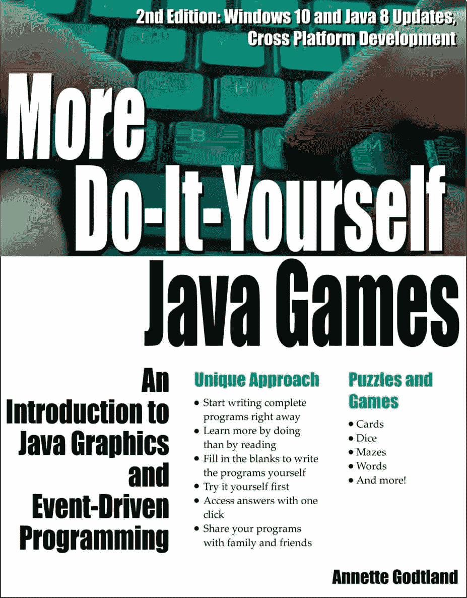

## 版权

Copyright © 2014, 2015 Annette Godtland

第二版

版权所有所有。未经作者书面许可，不得以任何方式（电子、机械、复印、录制或其他）对本书的任何部分进行复制、存储在检索系统中或传输。

制造商和销售为了区分其产品而使用的许多标记均被声明为商标。当这些标记出现在书中且作者知晓存在商标主张时，这些标记将以首字母大写或全大写形式打印。

对于本文所包含的信息的使用，不承担任何专利责任。尽管在编写本书时已采取一切措施，但出版商和作者对错误或遗漏不承担任何责任。对于使用本文所包含的信息而造成的损害，也不承担任何责任。

您可以仅为了非商业目的使用和分发书中的示例代码，前提是承认其来源和作者。在任何文档以及程序代码本身（作为注释）中应注明代码来源。归属应包括作者：Annette Godtland，书名：More Do-It-Yourself Java Games，以及出版社：Godtland Software Corporation。

首次出版于 2014/08/28

最后更新于 2015/11/14

出版社：

Godtland Software Corporation, Publishing Division

Rochester, MN 55901

## 目录

- 版权
- 介绍
- 程序
- 你了解 Java 吗？
- 环境设置
- 下载 MoreJava.zip
- 项目 1 - 是与否的魔法师
- 课程 1.1 - 标准窗口
- 课程 1.2 - 添加文本、窗口大小
- 课程 1.3 - 字体
- 课程 1.4 - 文本对齐
- 课程 1.5 - 布局窗口
- 课程 1.6 - 禁用调整大小
- 课程 1.7 - 窗口标题、居中
- 课程 1.8 - 序列版本 UID
- 课程 1.9 - 事件队列
- 课程 1.10 - 跨平台外观和感觉
- 项目 2 - 猜猜我的颜色
- 课程 2.1 - 边框布局
- 课程 2.2 - 预定义颜色
- 课程 2.3 - 多面板、首选尺寸
- 课程 2.4 - 前景颜色
- 课程 2.5 - 透明度
- 课程 2.6 - 自定义颜色
- 课程 2.7 - 按钮
- 课程 2.8 - 消息对话框
- 课程 2.9 - 自定义标签
- 项目 3 - 是与否的魔法师免责声明
- 课程 3.1 - 文本区域
- 课程 3.2 - 滚动条
- 项目 4 - 有边框的
- 课程 4.1 - 自定义按钮，这
- 课程 4.2 - 网格布局
- 课程 4.3 - 事件源
- 课程 4.4 - 确认对话框
- 项目 5 - 注意你的步骤
- 课程 5.1 - 另一个自定义按钮
- 课程 5.2 - 聚焦
- 项目 6 - 滑动
- 课程 6.1 - 带图像
- 课程 6.2 - 读取文件、子图像
- 课程 6.3 - 添加组件
- 项目 7 - 迷宫与反迷宫
- 课程 7.1 - 绘制的窗口、线条、圆形、首选尺寸
- 课程 7.2 - 键盘监听器
- 课程 7.3 - 按钮聚焦
- 项目 8 - 滑动菜单栏
- 课程 8.1 - 菜单栏
- 课程 8.2 - 文件选择器
- 课程 8.3 - 图像过滤器
- 课程 8.4 - 新图形、缩放图像
- 课程 8.5 - 系统外观和感觉
- 项目 9 - 贪婪
- 课程 9.1 - 鼠标监听器
- 课程 9.2 - 框布局、组合布局
- 项目 10 - 迷宫生成器选项对话框
- 课程 10.1 - 自定义对话框
- 课程 10.2 - 文本字段、单选按钮
- 课程 10.3 - 获取对话框数据
- 课程 10.4 - 模态与非模态对话框
- 课程 10.5 - 取消对话框更改
- 课程 10.6 - 默认按钮
- 项目 11 - 单词构建器
- 课程 11.1 - 字典、比较字符串
- 课程 11.2 - 绘制字符串、字体度量
- 第 11.3 章 - 组件之间的间隔
- 第 11.4 章 - 当前日期、日期格式
- 第 11.5 章 - 组件监听器、窗口状态监听器、调整窗口大小
- 第 11.6 章 - 窗口的大小与位置
- 第 11.7 章 - 将数据文件放入 JAR 文件
- 项目 12 - 图像缩放器
- 第 12.1 章 - 工具栏
- 第 12.2 章 - 保存图像
- 第 12.3 章 - 焦点监听器
- 第 12.4 章 - XOR 模式
- 第 12.5 章 - 使用鼠标绘制、鼠标运动监听器
- 项目 13 - 十三点纸牌游戏
- 第 13.1 章 - 透明颜色、PNG 图像
- 第 13.2 章 - 面板上的对象
- 第 13.3 章 - 移动对象
- 希望你喜欢这本书
- 问题、意见或建议
- 我编写的其他书籍
- 附录 A - 术语表
- 附录 B - 完成的代码列表
- 附录 C - 设置
- 创建 Java 工作文件夹
- 下载并安装 Java
- 下载并安装 Eclipse
- 下载 MoreDIYJava.zip 详细说明
- 附录 D - 使用 Eclipse
- 创建第一个项目
- 创建第一个包
- 创建第一个程序
- 将项目添加到构建路径
- 导出程序
- 附录 E - 使用的约定和其他提示

## 介绍

这是《从自学 Java 游戏》系列的第二本书。第一本书的程序是基于文本的，以便你开发基本的 Java 编程技能。有了这一背景，你应该准备好进入下一阶段的编程：Java 图形和事件驱动编程。Java 图形为游戏增加了颜色和图像。但什么是事件驱动编程呢？

事件驱动程序创建一个初始屏幕，然后等待用户执行操作。用户可能会点击`button`、点击图像、拖动某些内容或按下键盘上的键。程序会对该操作做出响应，无论操作是什么。编写这样的程序被称为事件驱动编程。

本书中的事件驱动程序将教你如何响应来自以下方面的输入：

- 窗口和对话框
- 按钮和输入字段
- 图像
- 键盘

迷宫生成器（Maze Generator）可以生成任何尺寸的随机迷宫。它会生成迷宫或一个反迷宫。反迷宫的路径只能穿过墙壁，不能通过开放区域。

游戏的目的是通过按下光标移动键将绿球移动到红球处。

### 贪婪（Greedy）

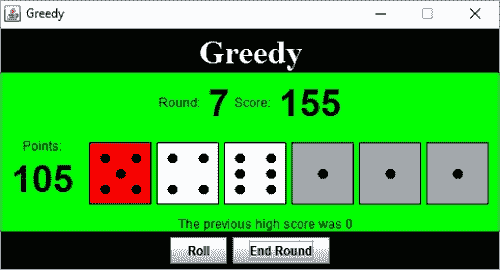

学习在游戏中为骰子使用可点击、可更改的图形。你还将学习在一个窗口中安排多种内容。

贪婪游戏的目标是在十轮中获得最高分。在每一回合中多次掷骰子以获得更高分。但不要太贪婪；糟糕的投掷可能会导致丢失该回合的所有分数！

### 单词构建器（Word Builder）

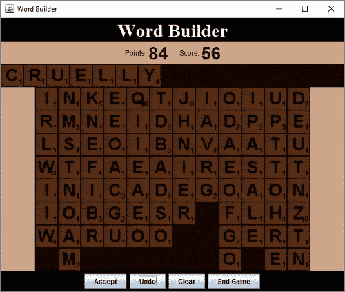

学习在可点击的图形中结合颜色、图像和文本，并调整大小窗口内容。

单词构建器的目标是使用棋盘上所有的字母来构建单词。使用的每个字母都会得分。单词越长，每个字母的价值越高。

该游戏包含一个超过 168,000 个单词的字典。

### 图像缩放器（Image Resizer）

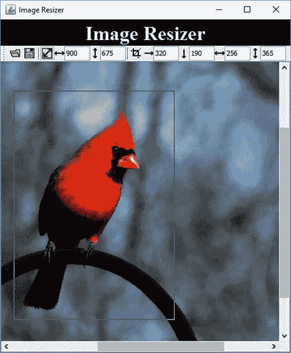

学习添加工具栏，允许程序用户使用鼠标绘图并保存图像文件。

图像缩放器可用于将 JPEG 文件中的图像缩放并裁剪到任何尺寸，同时保持图像的原始比例。

### 十二点数字接纸牌游戏（Baker's Dozen Solitaire）

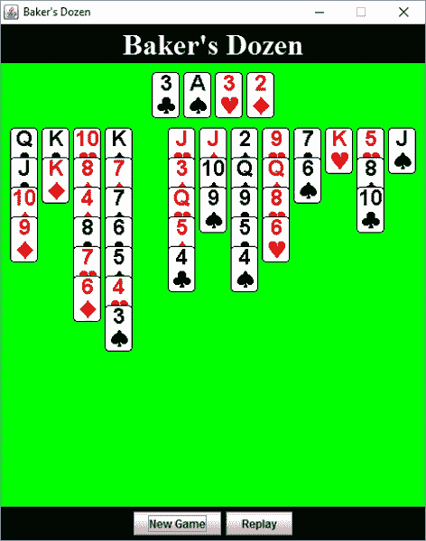

学习创建一个完全用 Java 绘制的新图像文件，并允许程序用户使用鼠标在窗口中拖放物品。

十二点接纸牌游戏的目标是将四行每行十三张牌移动到四个顶部的基础堆中。一次只能移动一张牌。每个基础堆必须从 A 开始。牌可以按照数字递增的顺序移动到基础堆中，且必须是同花色。每个基础堆以 K 结束。任何花色的牌都可以移动到其他列，但必须按照数字递减的顺序放置。

## 你了解基础 Java 吗？

本书假设你已经知道如何完成以下基础 Java 编程任务，这些任务在该系列的第一本书《Java 游戏：Java 编程入门》（Do-It-Yourself Java Games: An Introduction to Java Computer Programming）中介绍过。带有星号`*`标记的操作说明也包含在本书末尾，即*附录 D - 使用 Eclipse*中。

- 创建 Java 项目、包和类。
- 继承父类（扩展另一个类）。
- 将项目添加到构建路径中。
- 创建一个`main()`方法和一个或多个构造函数。
- 保存、运行并导出程序为可执行的 JAR 文件。
- 导入其他类。
- 创建并使用变量：`String`、`int`、`double`、`char`和`boolean`。
- 创建并使用实例变量：`private`、`public`、`protected`、`static`和/或`final`。
- 创建并使用方法：`private`、`public`、`protected`、`static`和/或`final`。

2. 在项目中创建一个名为`___________._____________.wizardofyesno`的新`package`。（提示：如第一本书中解释的那样，包名应该是你唯一的，全小写，没有空格，并用点号分隔。大多数企业会使用其公司名称。你可以使用自己的姓和名。在这些示例中，我将一直使用`annette.godtland`。）

3. 创建一个名为`WizardOfYesNo`的新`class`，其父类为`JFrame`，并为`main()`方法创建一个`stub`。（提示：需要的修饰符是`public`。不要勾选“从父类创建构造函数”选项，也不要选择“继承抽象方法”选项。）

Eclipse 将为`WizardOfYesNo`类创建代码，如下所示。

如果你将电子阅读器的字体设置为较小字体，此书中的代码列表可能会更容易阅读。这样做可以减少自动换行。

*列表 1-1，源自 WizardOfYesNo.java*

```
package annette.godtland.wizardofyesno;

import javax.swing.JFrame;

public class WizardOfYesNo extends JFrame {

  public static void main(String[] args) {
    // TODO Auto-generated method stub

  }
}
```

*完成的代码列表*

对 Eclipse 创建的代码进行标准的初始化更新。

1. 添加一个无参数的`WizardOfYesNo`构造函数。
2. 移除`main()`内部的注释，该处列表显示为“*(代码已从此处移除.)*”。
3. 在`main()`中添加代码以创建一个新的`WizardOfYesNo`。需要进行的更改在列表中始终以**粗体**显示。

*列表 1-2，源自 WizardOfYesNo.java*

```
package annette.godtland.wizardofyesno;

public class WizardOfYesNo extends JFrame {

  public WizardOfYesNo() {

  }

  public static void main(String[] args) {

      (Code was removed from here.)

    new ___________________;
  }
}
```

*完成的代码列表*

移除你为书中程序创建的类中自动生成的注释。你将在稍后的课程中添加自己的注释。

点击此书中的任何*完成的代码列表*链接以查看如何完成代码。然而，如果你在查看答案之前尝试自己完成代码，将会学到更多。

### 运行它

在整个课程中，除非有语法错误，否则在每次更改代码后都要保存更改并运行程序。

1. 运行程序。

发生了什么？

似乎什么都没有发生。Eclipse 的`Console`（控制台）显示程序终止。这意味着程序已经运行并结束了。

### 尝试一下 - 让窗口可见

为什么你没有看到窗口？你需要让窗口可见。

1. 在构造函数中添加代码，完全按照所示添加。（提示：使用`JFrame`的`setVisible()`方法。）

*列表 1-3，源自 WizardOfYesNo.java*

```
 ...

  public WizardOfYesNo() {
    setVisible(true);
  }
    ...
```

*完成的代码列表*

### 运行它

程序应该显示像这样的窗口：

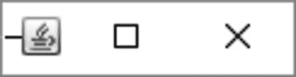

1. 关闭窗口。

这一次`Console`显示即使在窗口关闭后，程序也没有结束。

1. 点击`Console`中的`Terminate`按钮以结束程序。

### 尝试一下 - 正确关闭窗口

让`WizardOfYesNo`在窗口关闭时结束。

1. 完全按照所示添加代码。

*列表 1-4，源自 WizardOfYesNo.java*

```
 ...

  public WizardOfYesNo() {
    setVisible(true);
    setDefaultCloseOperation(EXIT_ON_CLOSE);
  }
    ...
```

*完成的代码列表*

### 运行它

当窗口关闭时，`Console`应显示程序已结束。

### 关键点及更多

- 使用`JFrame`作为带窗口启动的程序的`superclass`（父类）。
- 在`main()`方法中创建该类的新`instance`。
- 使用`setVisible(true)`方法使窗口可见。
- 使用`true`使窗口可见，使用`false`将其隐藏。
- 使用`setVisible()`使窗口可见：`JFrame`继承自`JFrame`，`setVisible()`定义在`JFrame`中。

## 1.2 - 添加文本，窗口大小

接下来，你将添加文本并调整窗口。

### 尝试一下 - 添加标签

1. 在构造函数中添加一个带有“Hello World”文本的`JLabel`对象。
2. 完全按照所示添加代码将`label`添加`WizardOfYesNo`。（提示：使用`JFrame`的`add()`方法。）

*列表 1-5，源自 WizardOfYesNo.java*

```
 ...

  public WizardOfYesNo() {
    JLabel label = new JLabel("Hello World");
    add(label);

    setVisible(true);
    setDefaultCloseOperation(EXIT_ON_CLOSE);
  }
```

*完成的代码列表*

### 运行它

程序应该显示同样的极小的窗口。但“Hello World”在哪里？

1. 拖动窗口边缘使其变大。

### 尝试一下 - 设置窗口大小

接下来，设置窗口的大小，以便`WizardOfYesNo`自动显示窗口内容。

1. 完全按照所示添加代码。（提示：使用`JFrame`的`setSize()`方法。）

*列表 1-6，源自 WizardOfYesNo.java*

```
 ...

  public WizardOfYesNo() {

      ...

    setSize(200, 100);
    setVisible(true);
    setDefaultCloseOperation(EXIT_ON_CLOSE);

  }
```

*完成的代码列表*

### 运行它

窗口现在应该以合适的大小打开。

### 尝试一下 - 修改标签文本

你可以在窗口中放置任何文本。你需要更改什么让窗口文本显示为“yes”？

1. 将`label`的文本更改为“Yes”。

*列表 1-7，源自 WizardOfYesNo.java*

```
 ...

  public WizardOfYesNo() {

      ...

    JLabel label = new JLabel(_____________);
    add(label);

      ...
```

*完成的代码列表*

### 运行它

窗口现在应该显示“Yes”。

### 尝试一下 - 使用变量标签文本

在构造`JLabel`时，你并不总是知道要放入什么内容。相反，你可以在之后设置现有`JLabel`的文本。

1. 创建一个名为`ANSWER`的`private static final string`实例变量，并设置为“No”。
2. 移除用于创建`label`的`parameter value`。
3. 将`ANSWER`设置为`label`的文本。（提示：使用`JLabel`的`setText()`方法。）

*列表 1-8，源自 WizardOfYesNo.java*

```
 ...

public class WizardOfYesNo extends JFrame {

  private static final String _____________ = __________;

  public WizardOfYesNo() {
    JLabel label = new JLabel(_____);
    label.setText(_________);
    add(label);

      ...
```

*完成的代码列表*

### 运行它


窗口现在应该显示“No”。

## 尝试一下 - 使用随机标签文本

`WizardOfYesNo` 应该显示“yes”或“no”。

1. 将 `ANSWER` 更改为包含“Yes”和“No”值的数组。
2. 在构造函数的开头，创建一个名为 `rand` 的 `Random` 对象，通过调用 `Random` 的构造函数进行初始化。
3. 创建一个名为 `numberOfAnswers` 的整数，将其设置为 `ANSWER` 中元素的数量。（提示：使用数组的 `length` 变量。）
4. 创建一个名为 `pick` 的整数，将其设置为小于 `numberOfAnswers` 的随机数。（提示：使用 `Random` 的 `nextInt()` 方法。）
5. 创建一个名为 `answer` 的字符串，将其设置为 `ANSWER` 中位置 `pick` 处的元素值。
6. 将 `label` 的文本改为 `answer`。（提示：使用 `JLabel` 的 `setText()` 方法。）

*Listing 1-9，来自 `WizardOfYesNo.java`*

* * *

```
 ...

  private static final String[] ANSWER = {_______, ________};

  public WizardOfYesNo() {
    _________ rand = _____________;
    _________ numberOfAnswers = _______________;
    _________ pick = ___________________;
    _________ answer = _________________;

    JLabel label = new JLabel();
    label.setText(____________);
    add(label);

      ...
```

* * *

*完成的列表*

### 运行它

窗口现在应该显示“Yes”或“No”。

### 关键点及更多

* 组件是可以添加到窗口的对象。`JLabel` 是其中一种组件。你将在本书书中学习处理许多种组件。
* 使用 `JLabel` 对象向窗口添加文本。你可以在 `JLabel` 构造函数中设置文本，也可以通过使用 `JLabel` 的 `setText()` 方法设置。
* 容器（如 `JFrame` 对象）是一个可以包含多个组件的组件。
* 使用 `JFrame` 的 `add()` 方法将 `JLabel` 对象添加到窗口中，并将 `JLabel` 对象作为参数值。由于 `WizardOfYesNo` 继承了 `JFrame`，因此 `WizardOfYesNo` 可以使用 `JFrame` 的 `add()` 方法。
* 使用 `JFrame` 的 `setSize()` 方法设置窗口的大小。
* 在本书中，如果你收到说某内容无法解析为类型的语法错误，请使用“快速修复”（Quick Fix）导入所需的类。

## 课程 1.3 - 字体

窗口中的文本可以使用计算机上的任何字体。

### 尝试一下 - 创建字体

为标签设置字体。

1. 完全按照所示添加代码，以创建一个名为 `font` 的新 `Font` 对象。
2. 完全按照所示添加代码，以将 `font` 作为 `label` 的字体。（提示：使用 `JLabel` 的 `setFont()` 方法。提示：从 `java.awt` 导入 `Font`。）

*Listing 1-10，来自 `WizardOfYesNo.java`*

* * *

```
 ...

  public WizardOfYesNo() {

      ...

    label.setText(answer);
    Font font = new Font("Times New Roman", Font.PLAIN, 18);
    label.setFont(font);
    add(label);

      ...
```

* * *

*完成的列表*

### 运行它

答案现在应该以新字体显示。

### 尝试一下 - 修改字体设置

更改字体的样式。

1. 将 `font` 的样式更改为 `BOLD` 或 `ITALIC` 而不是 `PLAIN`。（提示：由于 `BOLD`、`ITALIC` 和 `PLAIN` 都是 `Font` 的静态变量，请在变量名前加上“Font.”。）

*Listing 1-11，来自 `WizardOfYesNo.java`*

* * *

```
 ...

  public WizardOfYesNo() {

      ...

    label.setText(answer);
    Font font = new Font("Times New Roman", Font.PLAIN, 18);
    label.setFont(font);
    add(label);

      ...
```

* * *

*完成的列表*

### 运行它

答案现在应该以新字体显示。

### 尝试一下 - 设置字体加粗和斜体

答案现在应该根据你的选择加粗或斜体显示。

你注意到 `BOLD` 和 `ITALIC` 都是 `Font` 的静态变量吗？

1. 使 `font` 同时变为加粗和斜体。（提示：在变量名前加上“Font.”。）
2. 使 `font` 同时变为加粗和斜体。（提示：使用变量变量。）

*Listing 1-12，来自 `WizardOfYesNo.java`*

* * *

```
 ...

  public WizardOfYesNo() {

      ...

    label.setText(answer);
    Font font = new Font("Times New Roman", Font._, 18);
    label.setFont(font);
    add(label);
```

* * *

*完成的列表*

### 运行它

答案现在应该加粗或斜体显示。

### 尝试一下 - 修改字体大小

你也可以让字体更大或更小。

1. 使 `font` 更大。（提示：使用 `Font` 的 `size` 变量。）
2. 使 `font` 小得多。（提示：使用 `Font` 的 `size` 变量。）

*Listing 1-13，来自 `WizardOfYesNo.java`*

* * *

```
 ...

  public WizardOfYesNo() {

      ...

    label.setText(answer);
    Font font = new Font("Times New Roman", Font._, _____);
    label.setFont(font);
```

* * *

*完成的列表*

### 运行它

答案现在应该加粗或斜体显示。

### 尝试一下 - 修改字体名称

接下来，为 `label` 使用你喜爱的字体。

1. 将字体大小设置为 32。（提示：使用 `Font` 的 `size` 变量。）
2. 更改 `font` 使用的字体。（提示：使用 `Font` 的 `name`。提示：确保字体名称拼写正确且字体存在于你的计算机上。）

*Listing 1-14，来自 `WizardOfYesNo.java`*

* * *

```
 ...

  public WizardOfYesNo() {

      ...

    label.setText(answer);
    Font font = new Font("_____________________", Font.BOLD, 32);
    label.setFont(font);
```

* * *

*完成的列表*

### 运行它

答案现在应该用你喜爱的字体显示。

### 尝试一下 - 如果字体不存在

如果你命名了一个计算机上不存在的字体会发生什么？

1. 错误输入字体名称使 `WizardOfYesNo` 无法找到字体。（提示：使用 `Font` 的 `name` 变量。）

*Listing 1-15，来自 `WizardOfYesNo.java`*

* * *

```
 ...

  public WizardOfYesNo() {

      ...

    label.setText(answer);
    Font font = new Font("_____________________", Font.BOLD, 32);
    label.setFont(font);
```

* * *

*完成的列表*

### 运行它

答案可能会以意之外的字体显示。

### 尝试一下 - 指定通用字体

如果指定的字体不在计算机上，Java 会使用默认字体。默认字体可能会导致效果与你的预期不同。那么，如果你不知道程序可能运行的计算机上会有哪些字体，你应该使用什么字体呢？

Java 拥有可以在任何计算机上使用的字体族名称：`DIALOG`、`DIALOG_INPUT`、`SANS_SERIF`、`SERIF` 或 `MONOSPACED`。这些名称都是 `Font` 类中的静态变量，因此在变量名前前使用 `Font.`。

1. 尝试为 `font` 字体设置每一个字体族名称。（提示：更改 `Font` 的第一个参数值，即 `Font` 的 `name`。使用 `Font` 的 `DIALOG`、`DIALOG_INPUT`、`SANS_SERIF`、`SERIF` 或 `MONOSPACED` 变量。）

*Listing 1-16，源自 `WizardOfYesNo.java`*

* * *

```
 ...

  public WizardOfYesNo() {

      ...

    label.setText(answer);
    Font font = new Font(Font._______________, Font.BOLD, 32);
    label.setFont(font);

      ...
```

* * *

*完成的列表*

### 运行一下

答案应该以符合你选择的字体族描述的字体显示。

### 重点及更多

* 通过调用带有三个参数值的 `Font` 构造函数创建一个新的 `Font` 对象：
  * `Font` - 用引号命名字体，或命名五个字体族静态变量之一：`DIALOG`、`DIALOG_INPUT`、`SANS_SERIF`、`SERIF` 或 `MONOSPACED`。在字体族名前使用 `Font.`，因为它们是静态变量。
  * `Style` - 使用三个样式静态变量之一：`PLAIN`、`BOLD` 或 `ITALIC`。你可以将 `BOLD` 和 `ITALIC` 结合以选择粗斜体字体样式。在样式名前使用 `Font.`，因为它们是静态变量。
  * `Size` - 使用整数作为字体大小。
* 命名的字体必须在运行程序的计算机上存在。否则程序将使用默认字体。
* 如果你指定了字体族，Java 将在计算机上寻找该字体族中的字体。
* 如果你使用的字体太大而无法放入窗口，文本将以省略号 ....的形式显示。
* 使用 `JLabel` 的 `setFont()` 方法设置标签的字体，并将字体作为参数值。
* 字体可以应用于其他显示文本的组件。你将在后的课程中为其他组件添加字体。

## 课程 1.4 - 对齐文本

窗口中的文本可以左对齐、居中或右对齐。

### 尝试一下 - 文本居中

`WizardOfYesNo` 窗口如果文本居中可能会看起来更好看。

1. 将 `font` 设置为 `SERIF` 字体。（提示：更改 `Font` 的 `name` 参数值。）
2. 通过按照所示完全添加代码为 `label` 设置对齐方式。（提示：使用 `JLabel` 的 `setHorizontalAlignment()` 方法和 `JLabel` 的 `CENTER` 变量。）

*Listing 1-17，源自 `WizardOfYesNo.java`*

* * *

```
 ...

  public WizardOfYesNo() {

      ...

    label.setText(answer);
    Font font = new Font(Font.SERIF, Font.BOLD, 32);
    label.setFont(font);
    label.setHorizontalAlignment(JLabel.CENTER);

      ...
```

* * *

*完成的列表*

### 运行一下

答案现在应该在窗口居中显示。

### 重点及更多

* 使用 `JLabel` 的 `setHorizontalAlignment()` 方法设置标签文本的水平对齐。你可以使用三种对齐方式之一：`LEFT`、`CENTER` 或 `RIGHT`。（提示：在对齐名称名前使用 `JLabel.`，因为它们是静态变量。）
* 不要将 `JLabel` 的 `setHorizontalAlignment()` 方法与 `JLabel` 的 `setAlignmentX()` 方法混淆。始终使用 `setHorizontalAlignment()` 对齐标签内的文本。`setAlignmentX()` 的用途将在后的课程中解释。

## 课程 1.5 - 打包窗口

你如何知道窗口应该做得多大？与其为窗口选择一个大小，你可以 pack 窗口。Java 随后会将窗口大小调整为仅能容纳窗口内容。

### 尝试一下 - 添加更多是/否回答

通过提供几种表达是或否的方式，给 `WizardOfYesNo` 一点个性。

1. 在 `ANSWER` 中添加几个更多的是和否字符串。（提示：添加与否回答数量数量的是回答。）

*Listing 1-18，源自 `WizardOfYesNo.java`*

* * *

```
 ...

  private static final String[] ANSWER =  
    {"Yes.",
    "Go for it!",
    ________________________,  
    ________________________,  
    ________________________,  
    ________________________,  
    "No.",
    "I wouldn't.",
    ________________________,  
    ________________________,  
    ________________________,  
    ________________________,  

    ...
```

* * *

*完成的列表*

### 运行一下

程序现在每次运行时都会随机在是和否回答之间选择。

### 尝试一下 - 让回答适应窗口

短回答可以适应窗口，但长回答没有。

1. 按照所示所示调用 `pack()` 而不是 `setSize()`。

*Listing 1-19，源自 `WizardOfYesNo.java`*

* * *

```
 ...

  public WizardOfYesNo() {

      ...

    add(label);

    pack();
    setVisible(true);
    setDefaultCloseOperation(EXIT_ON_CLOSE);

      ...
```

* * *

*完成的列表*

### 运行一下

窗口会自动调整大小显示内容。

### 重点及更多

* 使用 `pack()` 方法将窗口调整为容纳内容的尺寸。
* 在调用 `pack()` 之前将组件添加到窗口中。

## 课程 1.6 - 禁止调整大小

如果你不想让用户更改窗口大小，请 disable 调整大小。

### 尝试一下 - 限制窗口

不需要用户更改 `WizardOfYesNo` 的大小。

1. 按照所示输入代码以禁用调整大小。（提示：使用 `JFrame` 的 `setResizable()` 方法，参数值为 `false`。）

*Listing 1-20，源自 `WizardOfYesNo.java`*

* * *

```
 ...

  public WizardOfYesNo() {

      ...

    add(label);

    setResizable(false);
    pack();
    setVisible(true);
    setDefaultCloseOperation(EXIT_ON_CLOSE);

      ...
```

* * *

*完成的列表*

### 运行一下

窗口无法通过拖动边缘调整大小。

### 重点及更多

* 使用 `JFrame` 的 `setResizable()` 方法来 enable 或禁用窗口。
* 始终在调用 `pack()` 之前调用 `setResizable()`。

## 课程 1.7 - 窗口标题，居中

如果游戏的标题包含在窗口标题栏中且游戏在屏幕居中，程序看起来更完整、更好用。

### 尝试一下 - 给窗口设置标题

1. 将窗口标题设置为“Wizard of Yes/No”。（提示：使用 `JFrame` 的 `setTitle()` 方法。）

*Listing 1-21，源自 `WizardOfYesNo.java`*

* * *

```
 ...

  public WizardOfYesNo() {

      ...

    setTitle("________________");
    setResizable(false);
    pack();
    setVisible(true);
    setDefaultCloseOperation(EXIT_ON_CLOSE);

      ...
```

* * *

*完成的列表*

### 运行一下


如果窗口足够宽，程序的标题应该出现在窗口的标题栏中。

### 重点及更多

* 使用`JFrame`的`setTitle()`方法为窗口添加标题。
* 标题显示在窗口的标题栏中。
* 标题也会显示在 Windows 任务栏中的图标旁边。

### 尝试一下 - 窗口居中

相对于没有任何设置窗口位置将使其在屏幕上居中。

1. 在打包之后、显示之前将窗口居中。（提示：使用`JFrame`的`setLocationRelativeTo()`方法，并将其参数设置为`null`。）

*Listing 1-22，源自 WizardOfYesNo.java*

* * *

```
 ...

  public WizardOfYesNo() {

      ...

    setResizable(false);
    pack();
    setLocationRelativeTo(null);
    setVisible(true);
    setDefaultCloseOperation(EXIT_ON_CLOSE);

      ...
```

* * *

*完成的列表*

### 运行一下

游戏应该显示在窗口的中央。

### 关键点及更多

* 使用`JFrame`的`setLocationRelativeTo()`方法来设置`JFrame`相对于另一个组件的位置。
* 将位置设置为相对于`null`，可以将`JFrame`居于屏幕显示区域的中心。
* 你应该始终在调用`pack()`窗口之后、在窗口变为可见之前，设置窗口的位置。

## 课程 1.8 - 序列化版本 UID

在本节中，你将学习如何停止 Eclipse 显示关于序列化的警告信息。

### 尝试一下 - 防止序列化版本 UID 警告

Eclipse 中的警告信息如下：

```
The serializable class WizardOfYesNo does not declare a static final serialVersionUID of type long
```

使用快速修复（Quick Fix）轻松修复序列化版本 UID*

应将名为`serialVersionUID`的`private static final long`实例变量添加到你的代码中，并设置为值`1L`，现在 Eclipse 中的警告应该消失。

### 运行一下

运行程序产生的应该与之前相同。

### 关键点及更多

* 某些警告可以安全地忽略。但是，如果可以，请修复引起警告的问题。
* 使用快速修复轻松修复如缺失序列化版本 UID 等问题。要使用快速修复，将鼠标悬停在标记为错误的单词上，然后从列表中选择一个修复方案。代码将根据你选择的修复方案自动更改。
* Java 期望`JFrames`和许多其他组件具有一个`serialVersionUID`。该 ID 对于类的当前版本来说是唯一的。如果你曾经序列化该类，就需要这个 ID。然而，你不会序列化书中的任何类，而且解释序列化超出了本书的涉及范围。因此，你可以忽略此警告。
* 但是，既然你被要求创建一个`serialVersionUID`，你可以将`serialVersionUID`用作标记程序版本的方法。使用任何整数值。整数后的“L”表示该整数是一个长整型（long）整数。你可以将此程序的第一个版本设置为`1L`。如果你以后创建了此程序的后续版本，你可以将版本号改为`2L`。将`1L`和`2L`值视为版本 1.0 和版本 2.0 即可。

## 课程 1.9 - 事件队列

你注意到 Eclipse 为`JFrame`插入的导入语句了吗？导入语句显示`JFrame`位于`javax.swing`包中。因此，`JFrame`是一个 Swing 组件。Java 期望所有的 Swing 对象都应该在事件队列上创建。

### 尝试一下 - 在事件队列上创建 WizardOfYesNo

1. 将`main()`方法中的代码替换为与所示完全相同的代码。（提示：为了让这段冗长的、格式奇怪的格式`。

    3. 在括号中输入“new Run”并按 Ctrl-Space 获取帮助。选择`Runnable`。Eclipse 将插入“Runnable”以及`run()`方法的轮廓。

    4. 在`run()`方法中输入`new WizardOfYesNo();`。

    5. 移除 Eclipse 插入的注释和额外的空行。

*列表 1-24，来自 WizardOfYesNo.java*

* * *

```
 ...

  public static void main(String[] args) {
    EventQueue.invokeLater(new Runnable() {
      public void run() {
        new WizardOfYesNo();
      }
    });
  }
    ...
```

* * *

*完成的列表*

### 运行一下

程序应该以相同的结果运行，但现在运行可能会更快。

### 关键点及更多

* 这个程序即使不在事件队列上创建`WizardOfYesNo`可能可能运行良好。但是，如果 Swing 对象不是在事件队列上创建，程序代码可能不会按照预期顺序运行。
* `main()`不在事件队列上运行。因此，编写代码将`main()`中创建的任何 Swing 对象添加到事件队列中。例如，如果`MyGame`继承自`JFrame`，则将`main()`的创建添加到事件队列。

```
public static void main(String[] args) {
	EventQueue.invokeLater(new Runnable() {
		public void run() {
			new MyGame();
		}
	});
}
```

* `invokeLater`、`Runnable`和`run()`都与 Java 线程有关。本书不涉及线程。

## 课程 1.10 - 跨平台外观

窗口、对话框及其包含的组件在具有不同操作系统的计算机上看起来不同。这种差异影响代码的编写。为了让书中的程序无论在什么操作系统运行运行相同，请使用跨平台外观。

### 尝试一下 - 使用跨平台外观

1. 在`main()`的开头添加一个 try/catch 块。

2. 在 try 块中，创建一个名为`className`的新字符串，通过从`UIManager`获取跨平台外观来初始化。（提示：使用`UIManager`的`getPlatformLookAndFeelClassName()`方法。）

3. 使用`className`设置外观。（提示：使用`UIManager`的`setLookAndFeel()`方法。）

4. 在 catch 块中捕获任何`Exception`并在捕获异常时什么都不做。（提示：捕获`Exception`。提示：使用空括号 {} 来什么都不做）。

*列表 1-25，来自 WizardOfYesNo.java*

* * *

```
 ...

  public static void main(String[] args) {
    try {
      String className = UIManager.getCrossPlatformLookAndFeelClassName();
      UIManager.setLookAndFeel(className);
    }
    catch (Exception) {}

    EventQueue.invokeLater(new Runnable() {
      public void run() {
        new WizardOfYesNo();
      }
    });
  }
```

现在窗口看起来应该更像项目开头所示的程序截图了。

### 关键点及更多

* Java 的设计使得你创建的程序可以在安装有许多不同操作系统的计算机上运行。每个操作系统的外观都不一样。Windows 组件看起来与 OS X 组件不同，而它们与 Linux 组件看起来也不同。这些差异被称为组件的外观和感受（look and feel）。
* Java 有自己的外观和感受，即一种金属感外观，旨在作为跨平台外观感知使用。如果你使用这种外观感知，你的程序在每台计算机上看起来都应该是相同的，无论该程序是在 Windows、OS X、Linux 还是其他系统上运行。要在每台计算机上使用相同的查找感知，请使用：

```java
try {
	String className = UIManager.getCrossPlatformLookAndFeelClassName();
	UIManager.setLookAndFeel(className);
}
catch (Exception e) {}
```

* 如果你使用系统外观感知，程序看起来将更像运行在该特定操作系统（无论是 Windows、OS X 还是 Linux）上的其他程序。要让你的程序看起来像在该台计算机上运行的其他程序，请使用：

```java
try {
	String className = UIManager.getSystemLookAndFeelClassName();
	UIManager.setLookAndFeel(className);
}
catch (Exception e) {}
```

* 你应该决定哪一个对你更重要：让你的程序在每个操作系统上看起来都相同，还是让你的程序匹配每个操作系统的外观和感受。如果你的程序在每个操作系统上看起来都相同，你会知道每个人看到的程序和你看到的完全一样，但用户使用该程序可能不会那么舒服。如果程序匹配每个操作系统的外观和感受，用户使用该程序可能会更舒服，但生成的布局或组件有时可能会在你不知情的情况下看起来很难看。
* 本书中某些程序使用了彩色的按钮。在使用 Windows 或 OS X 外观感知时，为按钮设置颜色无法达到预期效果。因此，这些程序应该使用跨平台外观感知。

# 项目 2 - 猜猜颜色

“猜猜颜色”游戏显示一个示例颜色（初始为黑色）和一个目标颜色。游戏的目的是从示例中缓慢增加或减少少量的红色、绿色和蓝色，以尝试匹配目标颜色。

即使你不能很好地分辨颜色差异，也考虑写一下这个游戏。“猜猜颜色”是学习如何处理颜色、面板、布局、按钮和消息对话框的很好的入门。

这里是“猜猜颜色”程序的截图：

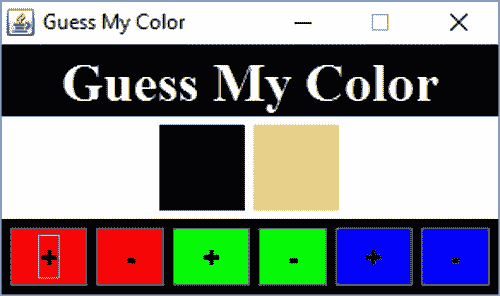

## 课程 2.1 - 边界布局 (Border Layout)

布局在容器中安排组件。`JFrame`中组件的默认排列是`BorderLayout`。

### 尝试一下 - 为 GuessMyColor 进行初始化

开始编写猜猜颜色程序。

1. 创建名为`Guess My Color`的新`Java project`。

2. 在项目中创建一个名为`___________._____________.guessmycolor`的新`package`。

3. 创建名为`GuessMyColor`的新`class`，父类为`JFrame`，并带有`main()`方法存根。

4. 使用快速修复（Quick Fix）添加一个名为`serialVersionUID`的私静态 final 实例变量，设置为`1L`。

5. 添加一个无参数的`GuessMyColor`构造函数。将窗口标题设置为“Guess My Color”，禁用调整大小、封装窗口、居中窗口、使窗口可见，并设置窗口在关闭时退出。

6. 在`main()`中添加代码以使用跨平台外观感知，并在事件队列上创建一个新的`GuessMyColor`对象。

*列表 2-1，来自 GuessMyColor.java*

```java
package annette.godtland.guessmycolor;

import java.awt.EventQueue;

import javax.swing.JFrame;
import javax.swing.UIManager;

public class GuessMyColor extends JFrame {
  private static final long ________________ = ____;

  public GuessMyColor() {
    setTitle(_______________);
    setResizable(_________);
    ___________();
    setLocationRelativeTo(____);
    setVisible(_________);
    setDefaultCloseOperation(______________);
  }

  public static void main(String[] args) {
    try {
      _________ className = UIManager._______________;
      UIManager.______________________;
    }
    catch (____________) {}

    EventQueue.___________(new ___________() {
      public void run() {
        new _____________________;
      }
    });
  }

}
```

*已完成列表*

利用你目前学到的关于标签、字体和文本对齐的知识，为窗口添加一个标题标签。

1. 在构造函数的开头，创建一个名为`titleLabel`的`JLabel`对象，无参数。

2. 创建一个名为`titleFont`的新字体，属于 Serif 族，加粗，字号为 32。（提示：使用`Font`的`SERIF`和`BOLD`变量。）

3. 将`titleLabel`的字体设置为`titleFont`。（提示：使用`JLabel`的`setFont()`方法。）

4. 将`titleLabel`的水平对齐设置为居中对齐。（提示：使用`JLabel`的`setHorizontalAlignment()`方法和`JLabel`的`CENTER`变量。）

5. 将`titleLabel`的文本设置为“Guess My Color。（提示：使用`JLabel`的`setText()`方法。）

6. 将`titleLabel`添加到窗口。（提示：使用`JFrame`的`add()`方法。）

*列表 2-2，来自 GuessMyColor.java*

```java
  public GuessMyColor() {
    JLabel titleLabel = new JLabel();
    Font titleFont = new Font(Font.SERIF, Font.BOLD, 32);
    titleLabel.setFont(titleFont);
    titleLabel.setHorizontalAlignment(JLabel.CENTER);
    titleLabel.setText("Guess My Color");
    add(titleLabel);
  }
```

*已完成列表*

### 运行一下

窗口应该显示一个大号加粗标题“Guess My Color”。

### 尝试一下 - 分离图形界面

创建并安排图形界面需要很多代码。通过分离的方法来组织代码。

1. 创建一个名为`initGUI()`的私有方法。它不接受参数也没有返回值。

2. 将构造函数中创建标签并将其添加到窗口的六行代码移动到`initGUI()`中。

3. 在构造函数的开头调用`initGUI()`。

*列表 2-3，来自 GuessMyColor.java*

```java
  public GuessMyColor() {
    initGUI();

    setTitle("Guess My Color");
    setResizable(false);
    pack();
    setVisible(true);
    setDefaultCloseOperation(EXIT_ON_CLOSE);
  }

  private void initGUI() {
    JLabel titleLabel = new JLabel();
    Font titleFont = new Font(Font.SERIF, Font.BOLD, 32);
    titleLabel.setFont(titleFont);
    titleLabel.setHorizontalAlignment(JLabel.CENTER);
    titleLabel.setText("Guess My Color");
    add(titleLabel);
  }
```

*已完成列表*

### 运行一下

程序运行应该和之前一样。

### 尝试一下 - 添加另一个标签

到为止，你的窗口只有一个标签。如果你添加第二个标签会发生什么？

1. 在`initGUI()`中创建一个名为`anotherLabel`的`JLabel`对象。

2. 将`anotherLabel`的文本设置为“2nd Label”。提示：使用`JLabel`的`setText()`方法。）

3. 将`anotherLabel`添加到窗口。（提示：使用`JFrame`的`add()`方法。）

*列表 2-4，来自 GuessMyColor.java*


```java
private void initGUI() {
    ...
    titleLabel.setText("Guess My Color");
    add(titleLabel);

    JLabel anotherLabel = new JLabel();
    anotherLabel.setText("2nd Label");
    add(anotherLabel);
}
```

*已完成列表*

### 运行一下

现在程序应该显示“2nd Label”而不是“Guess My Color”。“Guess My Color”去哪里了？它被第二个标签替换了。

### 尝试一下 - 更改组件位置

如果你在`JFrame`类中添加了多个组件，请为每个组件设置一个位置。

1. 按照所示修改代码。（提示：使用带有第二个参数值可以使用`JFrame`的`add()`方法。提示：使用`BorderLayout`的`PAGE_START`和`CENTER`变量。）

*列表 2-5，来自 GuessMyColor.java*

```java
...

private void initGUI() {
    ...
    JLabel titleLabel = new JLabel();
    Font titleFont = new Font(Font.SERIF, Font.BOLD, 32);
    titleLabel.setFont(titleFont);
    titleLabel.setHorizontalAlignment(JLabel.CENTER);
    titleLabel.setText("Guess My Color");
    add(titleLabel, BorderLayout.PAGE_START);

    JLabel anotherLabel = new JLabel();
    anotherLabel.setText("2nd label");
    add(anotherLabel, BorderLayout.CENTER);
}
...
```

*已完成列表*

### 运行一下

现在两个标签都应该显示。

### 关键点及更多

* `JFrame`窗口使用边界布局（border layout）来排列窗口中的组件。边界布局的类名是`BorderLayout`。

* `BorderLayout`的五个区域中的每个只能容纳一个组件。

    * 顶部区域称为页开始（page start）。

    * 底部区域称为页结束（page end）。

    * 左侧区域称为行开始（line start）。

    * 右侧区域称为行结束（line end）。

    * 中间的大区域称为中心（center）。

* 每当你向`BorderLayout`添加组件时，务必设置位置。`BorderLayout`的位置变量是`PAGE_START`、`PAGE_END`、`LINE_START`、`LINE_END`和`CENTER`。这些变量是静态变量，因此在使用这些变量时请使用`BorderLayout.`。例如，要在窗口顶部添加一个名为`nameLabel`的`JLabel`，使用：

```java
add(nameLabel, BorderLayout.PAGE_START);
```

* 如果向`BorderLayout`添加组件时未设置位置，程序将把组件放在中心区域。

* 如果将第二个组件位于`BorderLayout`中已经有组件的区域，则第二个组件将替换第一个组件。

* 添加到`BorderLayout`区域的组件将被拉伸以填充窗口：

    * 添加到顶部和底部区域的组件将水平拉伸至与窗口一样宽。

    * 添加到侧边区域的组件将垂直拉伸至与中间区域等高。

    * 添加到中间区域的组件将垂直拉伸至与侧边区域相同的高度，并水平拉伸使侧边和中间区域的总宽度与窗口一样。

    * 你在下一节中将看到这五个区域作为彩色的矩形。

* 如果未向`BorderLayout`的某个区域添加任何内容，该区域将不会包含在窗口中。

* `LINE_START`和`LINE_END`是相对位置。如果组件的方向是`LEFT_TO_RIGHT`，则`LINE_START`指向左区域，`LINE_END`指向右区域。如果组件的方向是`RIGHT_TO_LEFT`，则`LINE_START`指向右区域，`LINE_END`指向左区域。组件默认的方向是`LEFT_TO_RIGHT`。要更改组件的方向，使用`Component`的`setComponentOrientation()`方法。

* `BorderLayout`的五个区域也可以称为`NORTH`、`SOUTH`、`EAST`、`WEST`和`CENTER`。`NORTH`等于`PAGE_START`。`SOUTH`等于`PAGE_END`。`EAST`始终在`CENTER`的右侧。`WEST`始终在`CENTER`的左侧。然而，Java标准建议使用`PAGE_START`、`PAGE_END`、`LINE_START`和`LINE_END`，以便你的程序更容易适应具有不同方向的语言。

## 2.2 - 面板、预定义颜色

与标签一样，面板（panel）是一个组件，可以添加到`BorderLayout`的任何区域。在本节中，你将创建面板并使用Java的一些预定义颜色为它们上色。

### 尝试一下 - 添加彩色面板

为窗口添加一个彩色面板。

1. 移除创建`anotherLabel`并将其添加到窗口的代码。

2. 创建一个名为`centerPanel`的新`JPanel`对象，通过调用`JPanel`的构造函数进行初始化。

3. 将`centerPanel`的背景颜色设置为蓝色。（提示：使用`JPanel`的`setBackground()`方法。提示：使用`Color`的`BLUE`变量。）

4. 将`centerPanel`添加到窗口的中心。（提示：使用`JFrame`的`add()`方法和`BorderLayout`的`CENTER`变量。）

*列表 2-6，来自 GuessMyColor.java*

```java
...

private void initGUI() {
    ...
    titleLabel.setText("Guess My Color");
    add(titleLabel, BorderLayout.PAGE_START);

    centerPanel = new JPanel();
    centerPanel.setBackground(Color.BLUE);
    add(centerPanel, BorderLayout.CENTER);
}
```

*已完成列表*

### 运行一下

蓝色条应该显示。

### 尝试一下 - 使用 BorderLayout 的区域

通过向每个区域添加彩色面板，查看其他区域如何排列。

1. 在`initGUI()`中创建一个名为`leftPanel`的`JPanel`对象。

2. 将`leftPanel`的颜色设置为红色。（提示：使用`JPanel`的`setBackground()`方法。提示：使用`Color`的`RED`变量。）

3. 将`leftPanel`添加到窗口的左侧。（提示：使用`JFrame`的`add()`方法和`BorderLayout`的`LINE_START`变量。）

4. 创建一个名为`rightPanel`的`JPanel`对象。

5. 将`rightPanel`的颜色设置为绿色。（提示：使用`JPanel`的`setBackground()`方法。提示：使用`Color`的`GREEN`变量。）

6. 将`rightPanel`添加到窗口的右侧。（提示：使用`JFrame`的`add()`方法和`BorderLayout`的`LINE_END`变量。）

7. 创建一个名为`bottomPanel`的`JPanel`对象。

8. 将`bottomPanel`的颜色设置为黄色。（提示：使用`JPanel`的`setBackground()`方法。提示：使用`Color`的`YELLOW`变量。）

9. 将`bottomPanel`添加到窗口的底部。（提示：使用`JFrame`的`add()`方法和`BorderLayout`的`PAGE_END`变量。）

*列表 2-7，来自 GuessMyColor.java*

```java
...

private void initGUI() {
    ...
    centerPanel.setBackground(Color.BLUE);
    add(centerPanel, BorderLayout.CENTER);

    JPanel leftPanel = new JPanel();
    leftPanel.setBackground(Color.RED);
    add(leftPanel, BorderLayout.LINE_START);

    JPanel rightPanel = new JPanel();
    rightPanel.setBackground(Color.GREEN);
    add(rightPanel, BorderLayout.LINE_END);

    JPanel bottomPanel = new JPanel();
    bottomPanel.setBackground(Color.YELLOW);
    add(bottomPanel, BorderLayout.PAGE_END);
}
...
```

*已完成列表*

### 运行一下

灰色、红色、蓝色、绿色和黄色矩形标记了这五个区域。

### 关键点及更多

* 通过创建新的`JPanel`对象创建面板。

* 使用`Color`类创建颜色。

* `Color`类具有以下预定义的颜色：

    * `BLACK`

    * `BLUE`

    * `CYAN`

    * `DARK_GRAY`

    * `GRAY`

    * `GREEN`

    * `LIGHT_GRAY`

    * `MAGENTA`

    * `ORANGE`

    * `PINK`

    * `RED`

    * `WHITE`

    * `YELLOW`

* 预定义颜色声明为`Color`类的静态变量。例如，要使用粉色，使用：

```java
Color.PINK
```

* 使用`JPanel`的`setBackground()`方法设置面板的颜色。例如，将名为`centerPanel`的面板的颜色设置为黄色，使用：

```java
centerPanel.setBackground(Color.YELLOW);
```

## 2.2 - 多个面板、首选大小、尺寸

面板是一个容器组件，可以添加到`BorderLayout`的任何区域。容器组件可以容纳多个组件：标签、按钮、输入字段和其他组件的任何组合。

当窗口被封装（packed）时，其所有的组件都会被缩小为它们的首选尺寸。你可以通过一个新的尺寸来更改组件的首选尺寸，该尺寸包括宽度和高度。

### 尝试一下 - 向一个面板中添加两个面板

GuessMyColor需要两个面板来显示示例颜色和目标颜色。这些面板将被其他方法使用，因此应该定义为实例变量。

1. 创建两个名为`samplePanel`和`targetPanel`的私有`JPanel`实例变量，通过调用`JPanel`构造函数进行初始化。

*列表 2-8，源自 GuessMyColor.java*

```java
...

private static final long serialVersionUID = 1L;

private JPanel samplePanel = new JPanel();
private JPanel targetPanel = new JPanel();

public GuessMyColor() {
    ...
}
```

*已的代码列表*

现在，将这两个面板添加到窗口的中心。

1. 在`initGUI()`中，在将`centerPanel`添加到窗口后，将`samplePanel`的颜色设置为黑色。（提示：使用`JPanel`的`setBackground()`方法结合`Color`的`BLACK`变量。）

2. 将`samplePanel`添加到`centerPanel`。（提示：使用`JPanel`的`add()`方法，仅传入`Component`参数值。）

3. 将`targetPanel`的颜色设置为青色。（提示：使用`JPanel`的`setBackground()`方法结合`Color`的`CYAN`变量。）

4. 将`targetPanel`添加到`centerPanel`。（提示：使用`JPanel`的`add()`方法，仅传入`Component`参数值。）

*列表 2-9，源自 GuessMyColor.java*

```java
...

public void initGUI() {
    ...
    JPanel centerPanel = new JPanel();
    centerPanel.setBackground(Color.BLUE);
    add(centerPanel, BorderLayout.CENTER);

    samplePanel.setBackground(____________);
    centerPanel.add(samplePanel);

    targetPanel.setBackground(____________);
    centerPanel.add(__________________);

    JPanel leftPanel = new JPanel();
    ...
}
```

*已的代码列表*

### 运行一下

蓝色中心面板的中间应该显示一个小黑色正方形和一个青色正方形。

### 尝试一下 - 设置面板尺寸

更大的面板会让颜色比较变得更容易。

当你输入代码且Eclipse为你建议方法时，你是否注意到`JPanel`有一个名为`setSize()`的方法？

1. 将`samplePanel`和`targetPanel`的尺寸设置为50x50。（提示：使用`JPanel`的`setSize()`方法。）

*列表 2-10，源自 GuessMyColor.java*

```java
...

private void initGUI() {
    ...
    samplePanel.setBackground(Color.BLACK);
    samplePanel.setSize(___________);
    centerPanel.add(samplePanel);

    targetPanel.setBackground(Color.CYAN);
    targetPanel.setSize(__________);
    centerPanel.add(targetPanel);
    ...
}
```

*已的代码列表*

### 运行一下

同样的小正方形仍然显示在窗口的中间，和之前一样。

### 尝试一下 - 设置面板的首选尺寸

设置面板尺寸是一项不利的任务。当你再次运行GuessMyColor时，黑色和青色面板仍然很小。它们为什么仍然很小？因为你在设置面板尺寸之后封装了窗口。`pack()`会忽略为组件设置的尺寸。相反，`pack()`会检查组件的首选尺寸。

设置首选尺寸需要一个`Dimension`。`Dimension`由宽度和高度整数组成。

1. 在设置`samplePanel`的背景颜色之前，创建一个名为`size`的新`Dimension`对象，其宽度为50像素，高度为50像素。

2. 修改设置`samplePanel`和`targetPanel`尺寸的代码，改为设置它们的首选尺寸为`size`。（提示：使用`JPanel`的`setPreferredSize()`方法。）

*列表 2-11，源自 GuessMyColor.java*

```java
...

private void initGUI() {
    ...
    Dimension size = __________________;

    samplePanel.setBackground(Color.BLACK);
    samplePanel.setPreferredSize(___________);
    centerPanel.add(samplePanel);

    targetPanel.setBackground(Color.CYAN);
    targetPanel.setPreferredSize(__________);
    centerPanel.add(targetPanel);
    ...
}
```

*已的代码列表*

### 运行一下

黑色和青色正方形现在应该比之前大。

### 关键点及更多

* 通过将内容放在面板中来组织窗口内容。

* `JFrame`的默认布局是`BorderLayout`。`JPanel`的默认布局是`FlowLayout`。`JFrame`使用的布局可以更改。

* `pack()`将窗口中的所有组件缩小到其首选尺寸。


相反，`pack()` 会检查组件的首选尺寸。

设置首选尺寸需要一个 `Dimension`。`Dimension` 由宽度和高度整数组成。

要设置首选尺寸，使用 `setPreferredSize()`。

## 2.4 前景颜色

任何组件上显示的文本颜色都可以通过设置组件的前景颜色来设置。

### 尝试一下 - 移除面板并更改颜色

你不需要窗口中所有的面板，并且可能想更改某些颜色。

1. 在 `initGUI()` 中，移除左右面板，因为你不会向它们添加任何内容。
2. 将 `titleLabel` 的背景颜色设置为黑色。（提示：使用 `JLabel` 的 `setBackground()` 方法结合 `Color` 的 `BLACK` 变量。）
3. 将 `titleLabel` 的文本设置为白色。（提示：使用 `JLabel` 的 `setForeground()` 方法结合 `Color` 的 `WHITE` 变量。）
4. 将 `centerPanel` 的背景颜色设置为白色。（提示：使用 `JPanel` 的 `setBackground()` 方法结合 `Color` 的 `WHITE` 变量。）
5. 将 `bottomPanel` 的名称改为 `buttonPanel`。（提示：修改三行代码。）
6. 将 `buttonPanel` 的背景颜色设置为黑色。（提示：使用 `JPanel` 的 `setBackground()` 方法结合 `Color` 的 `BLACK` 变量。）

*列表 2-12，源自 GuessMyColor.java*

* * *

```
 ...

  private void initGUI() {

      ...

    titleLabel.setText("Guess My Color");
    titleLabel.setBackground(____________);
    titleLabel.setForeground(____________);
    add(titleLabel, BorderLayout.PAGE_START);

    JPanel centerPanel = new JPanel();
    centerPanel.setBackground(___________);
    add(centerPanel, BorderLayout.CENTER);

      ...

    targetPanel.setBackground(Color.CYAN);
    targetPanel.setPreferredSize(size);
    centerPanel.add(targetPanel);

      ( 此处被删除了代码 )

    JPanel __________ = new JPanel();
    ___________.setBackground(____________);
    mainPanel.add(____________, BorderLayout.PAGE_END);

      ...
```

* * *

*已的代码列表*

### 运行一下

左面板和右面板不应再显示。中间面板应该是白色的，底部面板应该是黑色的。但顶部面板应该仍然有灰色背景。你将在下一节中修复它。

### 关键点与更多

* 使用组件的 `setForeground()` 方法设置显示在组件上的文本颜色。

## 2.5 节 - 透明度

组件可以是不透明的或透明的。不透明组件会遮挡位于其后面的组件，而透明组件则允许看到底层的组件。组件可以从不透明变为透明，或从透明变为不透明。

### 试一试 - 让标签变为不透明

为什么 `titleLabel` 的颜色还是灰色的？`JLabel` 是透明的，所以看不到它自身的背景颜色。相反，可以看到 `JLabel` 后方容器的背景颜色。要查看 `JLabel` 的背景颜色，请将标签设置为不透明。

1. 将 `titleLabel` 设置为不透明。（提示：使用 `JLabel` 的 `setOpaque()` 方法。）

*Listing 2-13, 来自 GuessMyColor.java*

* * *

```
 ...

  private void initGUI() {

      ...

    titleLabel.setBackground(Color.BLACK);
    titleLabel.setForeground(Color.WHITE);
    titleLabel.setOpaque(_________);
    add(titleLabel, BorderLayout.PAGE_START);

      ...
```

* * *

*已完成列表*

### 运行

顶部面板现在应该显示黑色背景。

### 关键点与更多

* 不透明组件是实心的，不是透明的。也就是说，不透明组件会遮挡显示在其后面的任何对象。
* 不不透明的组件是透明的。也就是说，透明组件允许看到底层的组件。
* 如果透明组件的文本与组件后容器的背景颜色不同，则该文本是可见的。
* 大多数组件默认是不透明的。然而，`JLabels` 默认是透明的。
* 使用组件的 `setOpaque()` 方法可以将任何组件设置为不透明或透明。使用 `true` 使组件变为不透明。使用 `false` 使组件变为透明。
* 只有当组件是不透明时，组件的背景颜色才可见。

## 2.6 节 - 自定义颜色

通过混合不同量的红、绿、蓝来定义新颜色。

### 试一试 - 显示目标颜色

创建一个方法来定义新颜色并在目标面板中显示该颜色。

1. 从构造函数中调用 `generateTargetColor()`。

注意：代码将出现语法错误，因为 `generateTargetColor()` 还没有存在。

*Listing 2-14, 来自 GuessMyColor.java*

* * *

```
 ...

  public GuessMyColor() {

      ...

    setDefaultCloseOperation(EXIT_ON_CLOSE);

    generateTargetColor();
  }
    ...
```

* * *

*已完成列表*

1. 添加一个私有方法 `generateTargetColor()`。它不接受任何参数。
2. 创建一个名为 `targetColor` 的新 `Color` 对象，通过三个代表红、绿、蓝量的整数值来构造一个新的 `Color`。（提示：颜色值必须在 0 到 255 之间。）
3. 将 `targetPanel` 的背景颜色设置为 `targetColor`。（提示：使用 `JPanel` 的 `setBackground()` 方法。）

*Listing 2-15, 来自 GuessMyColor.java*

* * *

```
 ...

  ______________ generateTargetColor(____________) {
    Color targetColor = new Color(____, ____, ____);
    targetPanel.setBackground(_______________);
  }
    ...
```

* * *

*已完成列表*

### 运行

第二个方形应该显示新颜色。

### 试一试 - 生成随机颜色

接下来，GuessMyColor 需要目标红、绿、蓝色的变量。由于这些目标颜色将被多个方法使用，请将它们定义为实例变量。

1. 添加名为 `targetRed`、`targetGreen` 和 `targetBlue` 的私有整数实例变量，每个的初始值为 0。

*Listing 2-16, 来自 GuessMyColor.java*

* * *

```
 ...

  private JPanel samplePanel = new JPanel();
  private JPanel targetPanel = new JPanel();

  ______________ targetRed = ____;
  ______________ targetGreen = ____;
  ______________ targetBlue = ____;

    ...
```

* * *

*已完成列表*

这个游戏将只使用 18 种红、绿、蓝。要在 0 到 255 之间生成 18 个等间隔数字之一，请生成一个 0 到 17 的随机数，然后将该数乘以 15。

1. 在 `generateTargetColor()` 的开头添加代码创建一个名为 `rand` 的 `Random` 对象，通过调用 `Random` 的构造函数进行初始化。
2. 将 `targetRed` 设置为 0 到 17 之间的随机数，乘以 15。（提示：记住，`nextInt(18)` 生成 0 到 17 的数字。）
3. 对 `targetGreen` 重复上述步骤，对 `targetBlue` 同样如此。
4. 修改设置 `targetColor` 的代码，现在使用 `targetRed`、`targetGreen` 和 `targetBlue`。（提示：使用 `Color` 的构造函数。）

*Listing 2-17, 来自 GuessMyColor.java*

* * *

```
 ...

  private void generateTargetColor() {
    Random rand = new Random();
    targetRed = rand.nextInt(18) * 15;
    targetGreen = rand.nextInt(18) * 15;
    targetBlue = rand.nextInt(18) * 15;
    Color targetColor = new Color(targetRed, targetGreen, targetBlue);
    targetPanel.setBackground(targetColor);
  }
```

* * *

*已完成列表*

### 运行

每次运行程序，第二个框中应该显示不同的颜色。

### 关键点与更多

* 自定义颜色可以使用带有三个整数值的 `Color` 构造函数创建。
* 每个 `Color` 构造函数参数必须是 0 到 255 之间的整数。数字越大，包含的色调越多。
* 存在其他用于创建颜色的构造函数，但本书中不会使用。
* 你将在稍后的节中使用带有四个整数值的构造函数。`alpha` 值设置颜色的透明度。

## 2.7 节 - 按钮

添加可点击的按钮是添加事件驱动编程简单的方法。当按钮被点击时，会产生一个事件。程序将等待事件发生并调用相应方法。

### 试一试 - 创建按钮

GuessMyColor 需要两个红色、绿色和蓝色按钮。

1. 在 `initGUI()` 中，创建一个名为 `moreRedButton` 的 `JButton` 对象，文本为“+”。提示：创建带有文本的 `JButton` 与创建带有文本的 `JLabel` 非常相似。）
2. 将 `moreRedButton` 的颜色设置为红色。（提示：使用 `JButton` 的 `setBackground()` 方法。）
3. 将 `moreRedButton` 添加到 `buttonPanel`。（提示：使用 `JPanel` 的 `add()` 方法。由于向带有 FlowLayout 的 `JPanel` 添加组件，你只需要使用组件参数值。）
4. 创建一个名为 `lessRedButton` 的类似的 `JButton` 对象，文本为“-”，将按钮颜色设置为红色，并将按钮添加到 `buttonPanel`。
5. 创建名为 `moreGreenButton`、`lessGreenButton`、`moreBlueButton` 和 `lessBlueButton` 的类似按钮，设置相应的文本和颜色，并将它们添加到 `buttonPanel`。

*Listing 2-18, 来自 GuessMyColor.java*

```
 ...

  private void initGUI() {

      ...

    add(rightPanel, BorderLayout.LINE_END);

    JPanel ______________ = new JPanel();
    ______________.setBackground(Color.YELLOW);
    add(______________, BorderLayout.PAGE_END);

    JButton moreRedButton = new JButton("More");
    moreRedButton.setBackground(Color.RED);
    buttonPanel.add(______________);

    JButton lessRedButton = new JButton(______);
    lessRedButton.setBackground(_______);
    buttonPanel.add(____________);

    __________ moreGreenButton = _______________;
    moreGreenButton._________________________;
    buttonPanel.______________________;

    __________ lessGreenButton = _______________;
    lessGreenButton._________________________;
    buttonPanel.______________________;

    __________ moreBlueButton = _______________;
    moreBlueButton._________________________;
    buttonPanel.______________________;

    __________ lessBlueButton = _______________;
    lessGreenButton._________________________;
    buttonPanel.______________________;
  }
    ...
```

* * *

*已完成列表*

### 运行它

底部的黑色条应该显示三个不同颜色的六个按钮。点击按钮目前不有任何反应。

### 尝试 - 设置按钮字体

按钮上的 `+` 和 `-` 符号太小了。

1. 在 `initGUI()` 中，创建第一个按钮之前，创建一个新的 `Font` 对象，命名为 `font`，使用 `Dialog` 族，**加粗**，且大小为 18。（提示：使用 `Font` 的 `DIALOG` 和 `BOLD` 变量。）
2. 将所有六个按钮的字体都设置为 `font`。（提示：使用 `JButton` 的 `setFont()` 方法。）

*列表 2-19，源自 GuessMyColor.java*

* * *

```
 ...

  private void initGUI() {

      ...

    add(buttonPanel, BorderLayout.PAGE_END);

      ______ font = _____________________;

    JButton moreRedButton = new JButton("+");
    moreRedButton.setBackground(Color.RED);
    moreRedButton.____________;
    buttonPanel.add(moreRedButton);

    JButton lessRedButton = new JButton("-");
    lessRedButton.setBackground(Color.RED);
    lessRedButton.____________;
    buttonPanel.add(lessRedButton);

    JButton moreGreenButton = new JButton("+");
    moreGreenButton.setBackground(Color.GREEN);
    moreGreenButton.____________;
    buttonPanel.add(moreGreenButton);

    JButton lessGreenButton = new JButton("-");
    lessGreenButton.setBackground(Color.GREEN);
    lessGreenButton.____________;
    buttonPanel.add(lessGreenButton);

    JButton moreBlueButton = new JButton("+");
    moreBlueButton.setBackground(Color.BLUE);
    moreBlueButton._____________;
    buttonPanel.add(moreBlueButton);

    JButton lessBlueButton = new JButton("-");
    lessBlueButton.setBackground(Color.BLUE);
    lessBlueButton.______________;
    buttonPanel.add(lessBlueButton);
  }
    ...
```

* * *

*已完成列表*

### 运行它

现在的按钮应该更容易阅读了，有了更大的 `+` 和 `-` 符号。

### 尝试 - 为按钮添加动作

点击按钮没有产生任何效果。接下来，添加代码来处理按钮点击事件。


1. 输入与所示完全相同的代码，为 `moreRedButton` 添加一个动作监听器，当按钮被点击时，调用 `increaseRed()`。（提示：为了方便输入那些复杂的、格式奇异的代码，请按照下文说明使用 Ctrl-Space。提示：如果你在不使用 Ctrl-Space 帮助的情况下输入代码，请从 `java.awt.event` 导入 `ActionEvent`。）

   1. 输入 `moreRedButton.add` 并按下 Ctrl-Space。选择 `addActionListener`。
   2. 在括号内，输入 `new Act` 并按下 Ctrl-Space。选择 `ActionListener`。
   3. 在 `actionPerformed()` 方法中添加代码行 `increaseRed();`。
   4. 移除任何不需要的注释。

2. 为 `lessRedButton`、`moreGreenButton`、`lessGreenButton`、`moreBlueButton` 和 `lessBlueButton` 添加类似的代码，**分别**调用 `decreaseRed()`、`increaseGreen()`、`decreaseGreen()`、`increaseBlue()` 和 `decreaseBlue()`。

注意：该代码将会有语法错误，因为 `increaseRed()`、`decreaseRed()`、`increaseGreen()`、`decreaseGreen()`、`increaseBlue()` 和 `decreaseBlue()` 尚未存在。

*列表 2-20，源自 GuessMyColor.java*

---

```
 ...

  private void initGUI() {

      ...

    JButton moreRedButton = new JButton("+");
    moreRedButton.setBackground(Color.RED);
    moreRedButton.setFont(font);
    moreRedButton.addActionListener(new ActionListener() {
      public void actionPerformed(ActionEvent e) {
        increaseRed();
      }
    });
    buttonPanel.add(moreRedButton);

    JButton lessRedButton = new JButton("-");
    lessRedButton.setBackground(Color.RED);
    lessRedButton.setFont(font);
    lessRedButton.addActionListener(new ActionListener() {
      public void actionPerformed(ActionEvent e) {
        decreaseRed();
      }
    });
    buttonPanel.add(lessRedButton);

    JButton moreGreenButton = new JButton("+");
    moreGreenButton.setBackground(Color.GREEN);
    moreGreenButton.setFont(font);
    moreGreenButton.addActionListener(new ActionListener() {
      public void actionPerformed(ActionEvent e) {
        increaseGreen();
      }
    });
    buttonPanel.add(moreGreenButton);

    JButton lessGreenButton = new JButton("-");
    lessGreenButton.setBackground(Color.GREEN);
    lessGreenButton.setFont(font);
    lessGreenButton.addActionListener(new ActionListener() {
      public void actionPerformed(ActionEvent e) {
        decreaseGreen();
      }
    });
    buttonPanel.add(lessGreenButton);

    JButton moreBlueButton = new JButton("+");
    moreBlueButton.setBackground(Color.BLUE);
    moreBlueButton.setFont(font);
    moreBlueButton.addActionListener(new ActionListener() {
      public void actionPerformed(ActionEvent e) {
        increaseBlue();
      }
    });
    buttonPanel.add(moreBlueButton);

    JButton lessBlueButton = new JButton("-");
    lessBlueButton.setBackground(Color.BLUE);
    lessBlueButton.setFont(font);
    lessBlueButton.addActionListener(new ActionListener() {
      public void actionPerformed(ActionEvent e) {
        decreaseBlue();
      }
    });
    buttonPanel.add(lessBlueButton);
  }
    ...
```

---

*已完成列表*

### 添加用于存储用户猜测的变量

1. 添加名为 `red`、`green` 和 `blue` 的私有整数变量，初始值为 0。

注意：该代码将会有语法错误，因为 `increaseRed()`、`decreaseRed()`、`increaseGreen()`、`decreaseGreen()`、`increaseBlue()` 和 `decreaseBlue()` 尚未存在。

*列表 2-21，源自 GuessMyColor.java*

---

```
 ...

  private int targetRed = 0;
  private int targetGreen = 0;
  private int targetBlue = 0;
  private int red = 0;
  private int green = 0;
  private int blue = 0;

    ...
```

---

*已完成列表*

### 创建一个根据用户猜测更新样本颜色的方法

1. 添加一个名为 `updateColorSample()` 的私有方法。它不接受参数且没有返回值。
2. 在 `updateColorSample()` 中，创建一个名为 `color` 的新 `Color` 对象，使用 `red`、`green` 和 `blue` 参数值。
3. 将 `samplePanel` 的背景颜色设置为 `color`。（提示：使用 `JPanel` 的 `setBackground()` 方法。）

```
 ...

  private void updateColorSample() {
    Color color = new Color(red, green, blue);
    samplePanel.setBackground(color);
  }
    ...
```

---

*已完成列表*

### 添加用户按下按钮时调用的方法

这些方法都需要更新正确的颜色变量，然后更新颜色样本。

1. 创建一个名为 `increaseRed()` 的私有方法。它不接受任何参数且没有返回值。
2. 在 `increaseRed()` 中，如果 `red` 小于或等于 240，则增加 `red` 15，并更新颜色样本。（提示：使用 `updateColorSample()`。）
3. 创建一个类似的私有方法命名为 `decreaseRed()`，不接受任何参数且没有返回值。
4. 在 `decreaseRed` 中，如果 `red` 大于或等于 15，则减少 `red` 15，并更新颜色样本。（提示：使用 `updateColorSample()`。）
5. 创建类似的私有方法，命名为 `increaseGreen`、`decreaseGreen`、`increaseBlue` 和 `decreaseBlue`。

*列表 2-23，来自 GuessMyColor.java*

---

```
 ...

  _____________ increaseRed(____) {
    if(red ______) {
      red _______;
      _________________();
    }
  }

  _____________ decreaseRed(____) {
    if(red _____) {
      red _______;
      _________________();
    }
  }

  _____________ increaseGreen(____) {
    if(green ______) {
      green _______;
      _________________();
    }
  }

  _____________ decreaseGreen(____) {
    if(green _____) {
      green _______;
      _________________();
    }
  }

  _____________ increaseBlue(____) {
    if(blue ______) {
      blue _______;
      _________________();
    }
  }

  _____________ decreaseBlue(____) {
    if(blue _____) {
      blue _______;
      _________________();
    }
  }
    ...
```

---

*完成的列表*

### 运行

点击按钮应该增加或减少第一个框的红色、绿色或蓝色色调。

### 关键点及更多

* 按钮是组件，点击时会触发一个事件，程序可以对该事件执行操作。
* 通过创建一个新的 `JButton` 对象并将按钮文本作为参数值来创建按钮。例如，要创建一个名为 `okButton` 文本为“OK”的按钮，使用：

```
JButton okButton = new JButton("OK");
```

* 使用 `JButton` 的 `setBackground()` 方法设置按钮的颜色。
  * 在使用跨平台外观（look and feel）时设置按钮颜色，只需设置背景颜色即可。例如，让上述 `okButton` 变成绿色，使用：

```
okButton.setBackground(Color.GREEN);
```

  * 使用 OS X 外观时设置按钮颜色，设置背景颜色，将按钮设置为不透明且不绘制边框。例如，让上述 `okButton` 变成绿色，使用：

```
okButton.setBackground(Color.GREEN);
okButton.setOpaque(true);
okButton.setBorderPainted(false);
```

  * 使用 Windows 外观时设置按钮颜色，设置背景颜色，将内容区域设置为填充，并将按钮设置为不透明。注意，你必须在设置内容区域为填充后将按钮设为不透明，因为设置内容区域为填充也会将不透明度设置为 false。例如，让上述 `okButton` 变成绿色，使用：

```
okButton.setBackground(Color.GREEN);
okButton.setContetAreaFilled(true);
okButton.setOpaque(true);
```

  * 注意，对于 OS X 外观或 Windows 外观，没有办法创建一个带边框的彩色按钮。此书中的几个游戏要求按钮周围有边框，因此游戏必须使用跨平台外观创建。

* 使用 `JButton` 的 `setFont()` 方法设置按钮上文本的字体。
* 稍后的课程将向你展示如何创建一个带有图像而非文本的按钮。
* 通过向按钮添加动作监听器（action listener）来编写执行操作的操作。使用 `JButton` 的 `addActionListener()` 方法添加监听器，并将一个新的 `ActionListener` 作为参数值。
  * 动作监听器需要一个名为 `actionPerformed()` 的方法，包含一个参数 `ActionEvent`，且没有返回值。
  * `actionPerformed()` 方法通常调用同一类中的一个私有方法来执行所需的任务。

* 例如，为名为 `okButton` 的 `JButton` 添加动作监听器，以便在点击按钮时调用 `doIt()`，使用：

```
okButton.addActionListener(new ActionListener() {
	public void actionPerformed(ActionEvent e) {
		doIt();
	}
});
```

* 为了方便输入这段冗长且格式奇怪的代码：
  * 输入“okButton.add”并按下 Ctrl-Space。选择 `addActionListener`。
  * 在括号内，输入“new Act”并按下 Ctrl-Space。选择 `ActionListener`。
  * 在 `actionPerformed()` 方法中添加代码行 `doIt();`。
  * 删除任何不需要的注释。

## 第 2.8 - 消息对话框

消息对话框是显示消息的小窗口。

### 尝试一下 - 显示消息

如果颜色匹配，GuessMyColor 应该做什么？

1. 在 `updateSample()` 中检查颜色是否匹配。打开一个小窗口来祝贺用户。
2. 如果所有颜色匹配：
   1. 创建一个名为 `message` 的字符串。
   2. 在对话框中显示 `message`。（提示：使用 `JOptionPane` 的 `showMessageDialog()` 方法，并将 `this` 和 `message` 作为参数。）

*列表 2-24，来自 GuessMyColor.java*

---

```
 ...

  private void updateSample() {
    Color color = new Color(red, green, blue);
    samplePanel.setBackground(color);
    if(_____________  && _____) {
      ___________ message = ____________________;
      JOptionPane.showMessageDialog(___________);
    }
  }
```

---

*完成的列表*

如果第一个框的颜色完全匹配，应该出现一个祝贺消息。

### 关键点及更多

* 向用户显示消息最简单的方法是调用 `JOptionPane` 的 `showMessageDialog()` 方法。将 `this` 作为第一个参数，将消息作为第二个参数。`showMessageDialog()` 是静态方法，因此使用类名来调用它。例如，要在消息框中显示“Hello World!”，使用：

```
JOptionPane.showMessageDialog(this, "Hello World!");
```

* 使用 `this` 作为第一个参数，将对话框居于调用方法的组件上方。
* 使用 `null` 作为第一个参数，将消息居于屏幕中间。
* 第一个参数值必须是组件类型或 `null`。如果显示消息的类没有扩展组件，你必须为第一个值使用 `null`。

## 第 2.9 - 自定义标签

通过让每个游戏的标题看起来相同，将使书中的所有游戏看起来像属于同一个集合。与其在每个程序中编写相同的代码，不如创建一个每个程序都可以使用的自定义标签。

### 尝试一下 - 创建 TitleLabel 类

开始编写 `TitleLabel` 类。

1. 创建名为 *My Components* 的新 Java 项目。
2. 在项目中创建一个名为 *_._____________.mycomponents* 的新包。
3. 创建名为 `TitleLabel` 的新类，继承 `JLabel` 且没有存根代码。
4. 使用快速修复（Quick Fix）添加一个名为 `serialVersionUID` 的私有静态长整数变量，设置为 `1L`。
5. 添加一个带有字符串参数 `title` 的 `TitleLabel` 构造函数。在构造函数中：
   1. 创建名为 `font` 的新 `Font` 对象，来自衬线族、粗体且大小为 32。（提示：使用 `Font` 的 `SERIF` 和 `BOLD` 变量。）
   2. 将字体设置为 `font`。（提示：使用 `JLabel` 的 `setFont()` 方法。）


3. 将背景色设置为黑色。（提示：使用`JLabel`的`setBackground()`方法和`Color`的`BLACK`变量。）

4. 将前景颜色设置为白色。（提示：使用`JLabel`的`setForeground()`方法和`Color`的`WHITE`变量。）

5. 将`TitleLabel`设置为不透明。（提示：使用`JLabel`的`setOpaque()`方法。）

6. 使文本水平居中对齐。（提示：使用`JLabel`的`setHorizontalAlignment()`方法和`JLabel`的`CENTER`变量。）

7. 将`TitleLabel`的文本设置为`title`。（提示：使用`JLabel`的`setText()`方法。）

*Listing 2-25，源自 MyComponents.java*

* * *

```
package annette.godtland.mycomponents;

import java.awt.Color;
import java.awt.Font;

import javax.swing.JLabel;

public class TitleLabel extends JLabel {
  private static final long serialVersionUID = 1L;

  ___________ TitleLabel(______________) {
    __________ font = ________________;
    setFont(_______);
    setBackground(__________);
    setForeground(________);
    setOpaque(______);
    setHorizontalAlignment(__________);
    setText(_______);
  }
}
```

* * *

*已完成列表*

### 尝试一下 - 为 GuessMyColor 添加 TitleLabel

现在，修改`GuessMyColor`以使用你新的`TitleLabel`。

1. 将`My Components`项目添加到`Guess My Color`项目的构建路径中。（提示：在 Eclipse 的包资源管理器中右键点击`Guess My Color`项目，选择`Build Path` / `Configure Build Path...`。选择`Projects`标签页，然后点击`Add`添加`My Components`。）

2. 回到`GuessMyColor.java`。

3. 在`initGUI()`中，删除所有使用`titleLabel`的代码行，并将其替换为以下代码：

    1. 创建名为`titleLabel`的新`TitleLabel`对象，文本为“Guess My Color”。

    2. 将`titleLabel`添加到窗口顶部。（提示：使用`JFrame`的`add()`方法和`BorderLayout`的`PAGE_START`变量。）

4. 删除文件开头的`JLabel`导入语句。

*Listing 2-26，源自 GuessMyColor.java*

* * *

```
 ...

import javax.swing.JButton;
import javax.swing.JFrame;

  (此处已删除代码。)

import javax.swing.JOptionPane;
import javax.swing.JPanel;

    ...

  private void initGUI() {
    ____________ titleLabel = _________________;
    add(_____________________);

      ...
```

* * *

*已完成列表*

### 运行一下

程序的运行结果应该与之前相同。

### 尝试一下 - 导出程序

你已经完成了`Guess My Color`程序。

1. 如果你想在没有 Eclipse 的情况下运行，请导出你的`Guess My Color`程序。（提示：如果需要如何导出程序的说明，请查看 附录 D - 使用 Eclipse。）

### 运行一下

双击导出的 JAR 文件应该运行程序并产生与之前相同的结果。

### 关键点及更多

*   为了让组件在多个程序中的外观和行为保持一致，请在一个单独的项目中创建组件。该单独项目可以被添加到任何其他项目中。

*   `TitleLabel`类是一个黑色标签，带有大白色文字、加粗的 Serif 字体，并在标签中居中。要创建一个`TitleLabel`，请调用其构造函数并将字符串标题作为参数值。

*   `TitleLabel`类位于`My Components`项目中。要在另一个项目中使用`TitleLabel`，必须将`My Components`添加到该项目中。

    *   要向新的 Java 项目添加`My Components`，请在创建新项目时点击下一步按钮，然后点击`Projects`标签页和`Add`按钮。

    *   要向现有的 Java 项目添加`My Components`，请右键点击 Java 项目并选择`Build Path / Configure Build Path...`，然后点击`Projects`标签页和`Add`按钮。

*   即使`My Components`已添加到项目中，调用`TitleLabel`构造函数仍会导致语法错误，提示`TitleLabel`无法解析为类型。使用 Quick Fix 可以轻松地为`TitleLabel`添加导入语句。

*   只要你的项目按照 附录 D - 使用 Eclipse 中的说明导出，添加的`My Components`项目就会包含在导出的 JAR 文件中。

# 项目 3 - Wizard of Yes/No 免声明

如果你决定与其他人分享 Wizard of Yes/No 程序，你可能想为`WizardOfYesNo`添加一个关于责任的免责声明。你不希望别人遵循`WizardOfYesNo`的建议采取行动后，对发生的情况让你负责。

这里是带有免责声明的 Wizard of Yes/No 程序的截图：

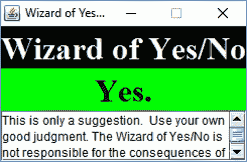

## 课程 3.1 - 文本区域

文本区域用于存放大量文本并跨行显示。

### 尝试一下 - 添加标签作为声明

该项目的目标是在窗口底部添加以下文本：

```
这只是一个建议。请做出自己的判断。Wizard of YesNo 对你的决定不负责。
```

1. 在构造函数中，将`label`添加到窗口的代码改为将`label`添加到中心。（提示：使用`BorderLayout`的`CENTER`变量。）

2. 创建名为`disclaimer`的字符串，设置为上述文本。

3. 创建名为`disclaimerLabel`的`JLabel`对象，文本为`disclaimer`。

4. 将`disclaimerLabel`添加到窗口底部。（提示：使用`BorderLayout`的`PAGE_END`变量。）

*Listing 3-1，源自 WizardOfYesNo.java*

* * *

```
 public WizardOfYesNo(){

      ...

    label.setHorizontalAlignment(JLabel.CENTER);
    add(label, ____________);

    String disclaimer = _________________;
    __________ disclaimerLabel = new JLabel(____________);
    add(disclaimerLabel, ____________);

    setTitle("Wizard of YesNo");

      ...
```

* * *

*已完成列表*

### 运行一下

由于以不同方式显示标签的选择并不多。使用`JTextArea`对象效果更好。

### 尝试一下 - 添加文本区域作为声明

以不同方式显示标签的选择并不多。`JTextArea`对象更适合此类文本。创建`JTextArea`对象与创建`JLabel`非常相似。

1. 将`disclaimLabel`从`JLabel`变量改为`JTextArea`变量。重命名变量为`disclaimerTextArea`。

2. 将用于向窗口添加的变量`disclaimerLabel`改为`disclaimerTextArea`。

*Listing 3-2，源自 WizardOfYesNo.java*

* * *

```
 public WizardOfYesNo(){

      ...

    label.setHorizontalAlignment(JLabel.CENTER);
    add(label, ____________);

    String disclaimer = _________________________;
    ______________ disclaimerTextArea = new _____________(disclaimer);
    add(____________, ____________);

      ...
```

* * *

*已完成列表*

### 运行一下

窗口看起来仍然很大。它仍然很宽，但背景现在是白色而不是灰色。

### 尝试一下 - 在文本区域中换行文本

JTextArea 有一些选项可以让窗口变得更好。

1. 为`disclaimerTextArea`开启换行。（提示：使用`JTextArea`的`setLineWrap()`方法。）

*Listing 3-3，源自 WizardOfYesNo.java*

* * *

```
 public WizardOfYesNo(){

      ...

    label.setHorizontalAlignment(JLabel.CENTER);
    add(label, ____________);

    JTextArea disclaimerTextArea = new JTextArea(disclaimer);
    disclaimerTextArea._________________;
    add(disclaimerTextArea, ____________);

      ...
```

* * *

*已完成列表*

### 运行一下

现在文本应该会换成多行，但整个消息无法显示在文本区域内。

### 尝试一下 - 设置文本区域的大小

让文本适应的一种方法是在创建`JTextArea`对象时，以行和列为设置文本区域的大小。

1. 在`JTextArea`构造函数的调用中添加两个参数值，以将`JTextArea`的行数和列数分别设置为 3 和 30。（提示：使用`JTextArea`接受一个字符串参数值和两个整数参数值的构造函数。）

*列表 3-4，来自`WizardOfYesNo.java`*

* * *

```
 public WizardOfYesNo(){

      ...

    JTextArea disclaimerTextArea = new JTextArea(disclaimer, ____, ____);
    disclaimerTextArea.setLineWrap(true);
    add(disclaimerTextArea, BorderLayout.PAGE_END);

      ...
```

* * *

*已完成列表*

### 运行它

文本现在应该适应文本区域了。

### 尝试一下 - 在文本区域中使用单词换行

你现在可能注意到，免责声明的行并没有在单词边界处拆分。在单词边界拆分单词是`JTextArea`可用的另一种选项。

1. 为`disclaimerTextArea`开启单词换行样式。（提示：使用`JTextArea`的`setWrapStyleWord()`方法。）

*列表 3-5，来自`WizardOfYesNo.java`*

* * *

```
 public WizardOfYesNo(){

      ...

    JTextArea disclaimerTextArea = new JTextArea(disclaimer, 3, 30);
    disclaimerTextArea.setLineWrap(true);
    disclaimerTextArea.___________________;
    add(disclaimerTextArea, BorderLayout.PAGE_END);

      ...
```

* * *

*已完成列表*

### 运行它

文本现在应该在单词边界处换行了。

### 尝试一下 - 在文本区域中禁止输入

你是否注意到光标在文本区域左上角闪烁？`JTextArea`可以显示文本，并可选允许用户输入文本。你可以关闭用户编辑文本区域内容的能力。

1. 使`disclaimerTextArea`不可编辑。（提示：使用`JTextArea`的`setEditable()`方法。）

*列表 3-6，来自`WizardOfYesNo.java`*

* * *

```
 public WizardOfYesNo(){

      ...

    JTextArea disclaimerTextArea = new JTextArea(disclaimer, 3, 30);
    disclaimerTextArea.setLineWrap(true);
    disclaimerTextArea.setWrapStyleWord(true);
    disclaimerTextArea.__________________;
    add(disclaimerTextArea, BorderLayout.PAGE_END);

      ...
```

* * *

*已完成列表*

### 运行它

光标不应再出现在文本区域中，且文本应该是不可编辑的。

### 关键点与更多

*   使用`JTextArea`显示多行文本。

*   要实现跨行换行，使用`JTextArea`的`setLineWrap()`方法开启行换行。如果你希望行在单词边界处换行，也请使用`JTextArea`的`setWrapStyleWord()`方法开启单词换行样式。

*   `JTextArea`组件通常用于接收程序用户的输入。因此，`JTextArea`的默认设置允许用户编辑组件的文本。如果你只想在文本区域中显示文本，请使用`JTextArea`的`setEditable()`方法禁用编辑。

## 课程 3.2 - 滚动条

### 尝试一下 - 在文本区域中添加滚动条

将大型文本区域放入较小空间的另一种方法是添加滚动条。

1. 从`disclaimerTextArea`构造函数的调用中移除行和列参数值。

2. 删除将`disclaimerTextArea`添加到窗口底部的代码行。

3. 创建一个新的名为`scrollPane`的`JScrollPane`对象，通过调用`JScrollPane`的构造函数并将`disclaimerTextArea`作为参数值进行初始化。

4. 创建一个新的名为`size`的`Dimension`对象，宽 300 高 50。

5. 将`scrollPane`的首选尺寸设置为`size`。（提示：使用`JScrollPane`的`setPreferredSize()`方法。）

6. 将`scrollPane`添加到窗口底部。（提示：使用`BorderLayout`的`PAGE_END`变量。）

*列表 3-7，来自`WizardOfYesNo.java`*

* * *

```
 public WizardOfYesNo(){

      ...

    JTextArea disclaimerTextArea = new JTextArea(_____________);
    disclaimerTextArea.setLineWrap(true);
    disclaimerTextArea.setWrapStyleWord(true);
    disclaimerTextArea.setEditable(false);

      (此处已删除了代码。)

    _____________ scrollPane = _________________;
    _____________ size = _______________;
    scrollPane.___________________;
    add(_________________);

      ...
```

* * *

*已完成列表*

### 运行它

免责声明文本现在应该显示在一个可滚动框中，宽 300 像素，高 50 像素。

### 尝试一下 - 让滚动面板与窗口一样宽

如果你想让滚动面板使用整个窗口宽度怎么办？使用 0 来匹配滚动面板的任意维度与窗口的维度。

1. 将`size`的宽度维度设置为 0。

*列表 3-8，来自`WizardOfYesNo.java`*

* * *


```
public WizardOfYesNo() {
  ...
  JScrollPane scrollPane = new JScrollPane(disclaimerTextArea);
  Dimension size = new Dimension(0, 50);
  scrollPane.setPreferredSize(size);
  add(scrollPane, BorderLayout.PAGE_END);
}
```

*已完成列表*

### 运行它

显示的答案现在应该使用全宽。

### 尝试一下 - 添加标题

在窗口顶部添加一个标题。

1. 在构造函数的开头，创建一个名为 `titleLabel` 的 `JLabel` 对象，内容为“Wizard of Yes/No”。
2. 将 `titleLabel` 添加到窗口顶部。（提示：使用 `add()` 和 `BorderLayout` 的 `PAGE_START`。）

*列表 3-9，来自 `WizardOfYesNo.java`*

```
public WizardOfYesNo() {
  JLabel titleLabel = new JLabel("Wizard of Yes/No");
  add(titleLabel, BorderLayout.PAGE_START);
}
```

*已完成列表*

### 运行它

标题现在应该显示在顶部。

### 尝试一下 - 根据答案设置背景颜色

最后，替换默认颜色。

1. 将 `label` 设置为不透明。（提示：使用 `JLabel` 的 `setOpaque()` 方法。）
2. 因为 `ANSWER` 前五个元素都是正数，其余的负数，如果 `pick` 大于 5，将 `label` 的背景颜色设置为红色。否则设置为绿色。（提示：使用 `JLabel` 的 `setBackground()` 方法。）

*列表 3-10，来自 `WizardOfYesNo.java`*

```
public WizardOfYesNo() {
  ...
  label.setFont(font);
  label.setHorizontalAlignment(JLabel.CENTER);
  label.setOpaque(true);
  if(pick > 5) {
    label.setBackground(Color.RED);
  }
  else {
    label.setBackground(Color.GREEN);
  }
  add(label, BorderLayout.CENTER);
  ...
}
```

*已完成列表*

### 运行它

现在如果答案是正数，它应该显示在绿色背景上；如果是负数，则显示在红色背景上。

### 尝试一下 - 导出程序

你已经完成了 Wizard of Yes/No 程序。

1. 导出你的 Wizard of Yes/No 程序，以便在没有 Eclipse 的情况下运行。

### 运行它

双击导出的 JAR 文件应该以之前的结果运行程序。

# 项目 4 - Framed

下一个项目是 Framed 游戏。`Framed` 将创建一个 `3x3` 的灯光网格，其中一些灯是开启的（红色），其他是关闭的（黑色）。点击灯光将切换一组灯的开启/关闭状态：

* 点击角灯光以切换该角落四盏灯的状态。
* 点击侧边的中间灯光以切换该侧边所有灯的状态。
* 点击中心灯光以切换它以及它正上方、下方和左右两侧的灯的状态。

目标是开启除中心灯以外的所有灯，从而形成一个边框。

这里是 `Framed` 程序在游戏破解后的截图：

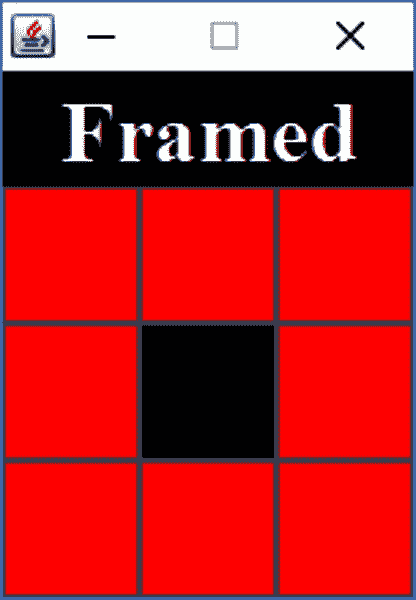

## 课程 4.1 - 自定义按钮，`this`

这个游戏需要灯光按钮。灯光按钮的外观和行为需要与之前程序中创建的按钮一样，但还需要更强大的功能。通过扩展类来保留类的所有功能并添加更多功能。要创建一个像灯光按钮这样的自定义按钮，请扩展 `JButton`。

本节还将演示需要使用 `this` 来标识实例变量的条件。

### 尝试一下 - 为 Framed 进行初始设置

开始编写 `Framed` 程序。

1. 创建名为 `Framed` 的新 `Java project`，并将项目 `My Components` 添加到 `Framed`。
2. 在项目中创建一个名为 `___________._____________.framed` 的新 `package`。
3. 创建名为 `Framed` 的新 `class`，父类为 `JFrame`，并带有 `main()` 方法存根。
4. 使用快速修复（Quick Fix）添加一个名为 `serialVersionUID` 的 private static final long 实例变量，设置为 `1L`。
5. 添加一个无参数的 `Framed` 构造函数。将窗口标题设置为“Framed”，禁用调整大小，调整窗口，居中窗口，使窗口可见，并设置关闭时退出。
6. 在 `main()` 中添加代码以使用跨平台外观和界面，并在事件队列*上创建一个新的 `Framed` 对象。

*代码列表 4-1，源自 `Framed.java`*

```
package annette.godtland.framed;

import java.awt.EventQueue;

import javax.swing.JFrame;
import javax.swing.UIManager;

public class Framed extends JFrame {
  private static final long serialVersionUID = 1L;

  public Framed() {
    setTitle(_____________);
    setResizable(_______);
    pack(____);
    setLocationRelativeTo(____);
    setVisible(_______);
    setDefaultCloseOperation(__________);
  }

  public static void main(String[] args) {
    try {
      _________ className = UIManager._______________;
      UIManager.______________________;
    }
    catch (____________) {}

    EventQueue.___________(new ___________() {
      public void run() {
        new _____________________;
      }
    });
  }
}
```

*已完成列表*

创建一个独立的方法来设置图形用户界面。

1. 在构造函数的开头调用 `initGUI()`。

注意：该代码将有一个语法错误，因为 `initGUI()` 尚存在。

*代码列表 4-2，源自 `Framed.java`*

```
...
public Framed() {
  _________();
  setTitle("Framed");
  setResizable(false);
  ...
}
```

*已完成列表*

在窗口顶部添加一个与你其他程序标题匹配的标题。

1. 创建名为 `initGUI()` 的新私有方法。它不接受任何参数且没有返回值。
2. 创建一个名为 `titleLabel` 的新 `TitleLabel` 对象，文本为“Framed”。
3. 将 `titleLabel` 添加到窗口顶部。（提示：使用 `JFrame` 的 `add()` 方法和 `BorderLayout` 的 `PAGE_START` 变量。）

*代码列表 4-3，源自 `Framed.java`*

```
...
_______________ initGUI(____) {
  ____________ titleLabel = ________________;
  add(_____________________);
}
...
```

*已完成列表*

### 运行

窗口应该显示标题“Framed”。

### 尝试一下 - 创建 LightButton 类

灯光按钮将与普通按钮相似。然而，灯光按钮还需要行、列和预期大小值。灯光按钮应该是正方形，宽 50 像素，高 50 像素。

1. 在 `framed` 包中创建一个名为 `LightButton` 的新 `class`。它应该拥有父类 `JButton` 且没有存根代码。
2. 使用快速修复添加一个名为 `serialVersionUID` 的 private static final long 实例变量，设置为 `1L`。
3. 添加一个名为 `MAXSIZE` 的 private static final integer 实例变量，设置为 `50`。
4. 添加名为 `row` 和 `col` 的 private integer 实例变量，每个都初始化为 `0`。
5. 添加一个带有两个参数的 `LightButton` 构造函数：一个名为 `row` 的整数和一个名为 `col` 的整数。

*代码列表 4-4，源自 `LightButton.java`*

```
package annette.godtland.framed;

import javax.swing.JButton;

public class LightButton extends JButton {
  private static final long serialVersionUID = 1L;
  private static final int MAXSIZE = 50;
  private int row = 0;
  private int col = 0;

  public LightButton(int row, int col) {

  }
}
```

*已完成列表*

构造函数需要设置值。

1. 在构造函数中，设置作为参数传入值的实例变量 `row`。
2. 使用 `this` 来引用实例变量。设置作为参数传入值的实例变量 `col`。
3. 创建一个名为 `size` 的 `Dimension` 对象，宽为 `MAXSIZE`，高为 `MAXSIZE`。
4. 将首选大小设置为 `size`。

`Framed` 类需要访问灯光按钮的行和列值，但那些灯光按钮的变量是私有的。添加公共方法分别获取行和列。

1. 添加一个名为 `getRow()` 的公共方法。它不接受参数并返回一个整数。
2. 添加一个名为 `getCol()` 的公共方法。它不接受参数并返回一个整数。

*代码列表 4-6，源自 `LightButton.java`*

```
...
public int getRow() {
  return row;
}

public int getCol() {
  return col;
}
```

`Framed` 可以通过 `JButton` 的 `setBackground()` 方法改变 `LightButton` 对象的颜色。但用于开启或关闭灯光的新方法会让代码更易理解。

1. 添加一个名为 `turnOn()` 的公共方法。它不接受参数且没有返回值。它将背景颜色设置为红色。（提示：使用 `JButton` 的 `setBackground()` 方法。）
2. 添加一个名为 `turnOff()` 的公共方法。它不接受参数且没有返回值。它将背景颜色设置为黑色。（提示：使用 `JButton` 的 `setBackground()` 方法。）

*代码列表 4-7，源自 `LightButton.java`*

```
...
public void turnOn() {
  setBackground(Color.RED);
}

public void turnOff() {
  setBackground(Color.BLACK);
}
...
```

*已完成列表*

`Framed` 还需要一种检查 `LightButton` 是否开启的方法。

1. 添加一个名为 `isLit()` 的公共方法。它不接受参数并返回一个布尔值。
2. 创建一个名为 `color` 的 `Color` 对象，初始化为背景颜色。（提示：使用 `JLabel` 的 `getBackground()` 方法。）
3. 创建一个布尔值 `isLit`，初始化为检查 `color` 是否等于红色的结果。（提示：使用 `Color` 的 `equals()` 方法。）
4. 返回 `isLit`。

*代码列表 4-8，源自 `LightButton.java`*

```
public boolean isLit() {
  Color color = getBackground();
  boolean isLit = color.equals(Color.RED);
  return isLit;
}
```

```
...
____________ isLit(____) {
  ________ color = ______________;
  ________ isLit = ____________________;
  return isLit;
}
...
```

*完成列表*

Framed 类还需要一种方法，在灯开启时关闭 `LightButton`，或者在灯关闭时开启它。

1. 添加一个名为 `toggle()` 的公共方法。它不应该接受任何参数且没有返回值。
2. 如果 `LightButton` 是亮起的，则将其关闭。否则，将其开启。（提示：使用 `isLit()`、`turnOff()` 和 `turnOn()`。）

*列表列表 4-9，源自 `LightButton.java`*

```
...
____________ toggle(____) {
  if (________) {
    ________();      
  }
  else {
    ________();
  }
}
...
```

*完成列表*

### 关键点与更多

* 扩展 `JButton` 类以创建一个具有类似于 `JButton` 属性的可点击对象。
* 继承自 `JButton` 类的类可以使用 `JButton` 的公共或受保护方法，例如 `JButton` 的 `setBackground()`、`getBackground()` 和 `setPreferredSize()` 方法。
* 通过扩展该类，可以在按钮中保留额外信息，例如行和列。扩展后的类还可以提供额外的方法，如 `turnOn()`、`turnOff()` 和 `isLit()`。
* Java 程序员通常会将方法的参数变量命名为与每个参数所提供值的实例变量相同的名称。这样做使更容易记住方法参数的用途。此外，当 Eclipse 显示该方法的即时帮助时，它会显示参数的名称。因此，方法参数变量的名称应该是清晰且具有描述性的名称。由于最好的变量名可能已经被实例变量占用，因此为方法参数变量使用相同的名称通常比发明另一个好的名称更容易。
* 如果实例变量与方法中或作为方法参数声明的变量同名相同，请使用 `this.name` 来引用实例变量*名称*。
* 例如，如果 `MyGame` 类有一个名为 `points` 的整数实例变量，且 `MyGame` 的构造函数接受一个名为 `points` 的整数参数，该值应该放入 `points` 实例变量中，请使用：

```
private int points;
public MyGame(int points) {
  this.points = points;
}
```

## 课程 4.2 - 网格布局 (Grid Layout)

网格布局将组件排列成网格，其中所有组件的大小相同。

### 尝试一下 - 为 Framed 添加 LightButtons

1. 回到 `Framed.java`。
2. 添加一个名为 `GRIDSIZE` 的私有静态最终整数实例变量，设置为 3。
3. 添加一个名为 `lightButton` 的私有 `LightButton` 二维数组实例变量，具有 `GRIDSIZE` 行和 `GRIDSIZE` 列。

*列表 4-10，源自 `Framed.java`*

```
...
public class Framed extends JFrame {
  private static final long serialVersionUID = 1L;
  ____________________ GRIDSIZE = _____;
  ____________________[][] lightButton = ____________________;
  ...
}
```

*完成列表*

创建一个用于灯按钮的面板，并将面板添加到窗口的中心。

1. 在 `initGUI()` 中，创建一个名为 `centerPanel` 的新 `JPanel` 对象。
2. 将 `centerPanel` 的布局设置为一个新的 `GridLayout`，具有 `GRIDSIZE` 行和 `GRIDSIZE` 列。（提示：使用 `JPanel` 的 `setLayout()` 方法，并传入一个带有 `GRIDSIZE` 作为参数值的新 `GridLayout` 对象。）


### 3. 将 `centerPanel` 添加到窗口中间

（提示：使用 `JFrame` 的 `add()` 方法和 `BorderLayout` 的 `CENTER` 变量。）

*列表 4-11，源自 Framed.java*

---

```
 ...

  private void initGUI() {
    TitleLabel titleLabel = new TitleLabel("Framed");
    add(titleLabel, BorderLayout.PAGE_START);

    __________ centerPanel = __________;
    centerPanel.setLayout(____________________);
    add(____________________);
  }
    ...
```

---

*完成列表*

创建所有灯按钮并将它们同时添加到灯按钮数组和窗口中间的面板中。

1. 添加一个双层 *for* 循环并将 `row` 和 `col` 作为迭代变量。（提示：迭代变量有时被称为循环索引。提示：与 `GRIDSIZE` 比较以结束每个循环。）

   1. 通过创建一个新的 `LightButton` 来初始化 `row` 和 `col` 处的 `lightButton`。（提示：使用 `row` 和 `col` 作为构造器的参数值。）

   2. 将 `row` 和 `col` 处的 `lightButton` 添加到 `centerPanel`。

*列表 4-12，源自 Framed.java*

---

```
 ...

  private void initGUI() {
    TitleLabel titleLabel = new TitleLabel("Framed");
    add(titleLabel, BorderLayout.PAGE_START);

    __________ centerPanel = __________;
    centerPanel.setLayout(____________________);
    add(____________________);

    for(int row=0; row < GRIDSIZE; row++) {
      for(int col=0; col < GRIDSIZE; col++) {
        lightButton[row][col] = new LightButton(row, col);
        centerPanel.add(lightButton[row][col]);
      }
    }
  }
    ...
```

### 运行一下

窗口应该显示一个 3x3 的正方形按钮网格。

### 关键点与更多

* 添加到 `GridLayout` 的组件必须具有相同的大小。
* `GridLayout` 构造函数指定了行和列的数量。
* 添加到 `GridLayout` 的组件按行排列，从左上角开始。

## 课程 4.3 - 事件源 (Event Source)

在目前创建的程序中，你还没有对 `ActionEvent` 做过任何操作。然而，许多有用的方法可以处理 `ActionEvent`。其中一种方法将获取事件的源。

### 尝试一下 - 让点击 LightButton 切换灯光

接下来你将为 `LightButtons` 添加动作监听器。一旦程序从 `ActionEvent` 获取源，就可以调用 `LightButton` 的任何方法。

1. 在 `initGUI()` 创建 `lightButton` 时，为每个 `lightButton` 添加一个动作监听器。（提示：使用 `LightButton` 的 `addActionListener()` 方法并将一个新的 `ActionListener` 对象作为参数值。在 `ActionListener` 中，添加一个名为 `actionPerformed()` 的公共方法。`actionPerformed()` 应该有一个参数 `Event` 且没有返回值。）

2. 在 `actionPerformed()` 方法中：

   1. 创建一个名为 `button` 的 `LightButton` 对象，通过从 `e` 获取源来初始化。（提示：使用 `ActionEvent` 的 `getSource()` 方法。提示：使用快速修复将返回值强制转换为 `LightButton`。）

   2. 创建一个整数 `row`，通过从 `button` 获取行来初始化。（提示：使用 `LightButton` 的 `getRow()` 方法。）

   3. 创建一个整数 `col`，通过从 `button` 获取列来初始化。（提示：使用 `LightButton` 的 `getCol()` 方法。）

   4. 调用 `toggleLights()` 并传入 `row` 和 `col` 的值。

注意：代码会有语法错误，因为 `toggleLights()` 尚不存在。

*列表 4-13，源自 Framed.java*

---

```
 ...

  private void initGUI() {
    TitleLabel titleLabel = new TitleLabel("Framed");
    add(titleLabel, BorderLayout.PAGE_START);

    __________ centerPanel = __________;
    centerPanel.setLayout(____________________);
    add(____________________);

    for(int row=0; row < GRIDSIZE; row++) {
      for(int col=0; col < GRIDSIZE; col++) {
        lightButton[row][col] = new LightButton(row, col);
        lightButton[row][col].addActionListener(new ActionListener() {
          public void actionPerformed(ActionEvent e) {
            LightButton button = (LightButton) e.getSource();
            int row = button.getRow();
            int col = button.getCol();
            toggleLights(row, col);
          }
        });
        centerPanel.add(lightButton[row][col]);
      }
    }
  }
    ...
```

---

*完成列表*

首先，让 `toggleLights()` 仅切换被点击的灯按钮的灯光。

1. 添加一个名为 `toggleLights()` 的私有方法。它应该接收两个参数，一个名为 `row` 的整数和一个名为 `col` 的整数，并且不返回任何内容。

2. 切换位于 `row` 和 `col` 处的 `lightButton` 的灯光。（提示：使用 `LightButton` 的 `toggle()` 方法。）

*Listing 4-14，源自 Framed.java*

---

```
 ...

  ______________ toggleLights(____________) {
    lightButton[____][____].____________;
  }
    ...
```

---

*完成的列表*

### 运行它

点击网格中的任意一个灯按钮都应该在该灯按钮的黑色和红色之间切换其颜色。

### 尝试一下 - 让点击角的 LightButton 切换正确的邻居按钮灯光

接下来，Framed 还需要切换正确邻居按钮的灯光。

1. 在 `toggleLights()` 中，如果点击的灯按钮是角按钮，则切换位于被点击灯按钮周围的三个其他灯按钮。（提示：为左上角、右上角、左下角和右下角编写代码。提示：使用 `LightButton` 的 `toggle()` 方法。）

*Listing 4-15，源自 Framed.java*

---

```
 ...

  public void toggleLights(int row, int col) {

      ...

    // 左上角
    if(row==____ && col==___) {
      lightButton[____][____].___________;
      lightButton[____][____].___________;
      lightButton[____][____].___________;
    }
    // 右上角
    else if(row==____ && col==___) {
      lightButton[____][____].___________;
      lightButton[____][____].___________;
      lightButton[____][____].___________;
    }
    // 左下角
    else if(row==____ && col==___) {
      lightButton[____][____].___________;
      lightButton[____][____].___________;
      lightButton[____][____].___________;
    }
    // 右下角
    else if(row==____ && col==___) {
      lightButton[____][____].___________;
      lightButton[____][____].___________;
      lightButton[____][____].___________;
  }
    ...
```

---

*完成的列表*

### 运行它

点击任何一个角灯按钮都应该切换该灯按钮及其周围的三个灯按钮。

### 尝试一下 - 让点击中间边缘的 LightButton 切换正确的邻居按钮灯光

接下来，处理点击中间边缘灯按钮。

1. 在 `toggleLights()` 中，如果点击的灯按钮是中间边缘按钮，则改变该边另外两个灯按钮。（提示：为顶部、底部、左侧和右侧编写代码。提示：使用 `LightButton` 的 `toggle()` 方法。）

*Listing 4-16，源自 Framed.java*

---

```
 ...

  public void toggleLights(int row, int col) {

      ...

    // 右下角
    else if(row==2 && col==2) {
      lightButton[row][col-1].toggle();
      lightButton[row-1][col].toggle();
      lightButton[row-1][col-1].toggle();
    }
    // 顶部中间
    else if(row==___ && col==___) {
      lightButton[____][____].___________;
      lightButton[____][____].___________;
    }
    // 底边中间
    else if(row==___ && col==___) {
      lightButton[____][____].___________;
      lightButton[____][____].___________;
    }
    // 左侧中间
    else if(row==___ && col==___) {
      lightButton[____][____].___________;
      lightButton[____][____].___________;
    }
    // 右侧中间
    else if(row==___ && col==___) {
      lightButton[____][____].___________;
      lightButton[____][____].___________;
    }
  }
    ...
```

---

*完成的列表*

### 运行它

点击任何边上的任意中间灯按钮都应该切换被点击的灯按钮以及同边的另外两个灯按钮。

### 尝试一下 - 让点击中心的 LightButton 切换正确的邻居按钮灯光

最后，添加代码处理中心灯按钮。

1. 在 `toggleLights()` 中，如果点击的灯按钮是中心按钮，则改变被点击灯按钮上方、下方和两侧的灯按钮。（提示：使用 `LightButton` 的 `toggle()` 方法。）

*Listing 4-17，源自 Framed.java*

---

```
 ...

  public void toggleLights(int row, int col) {

      ...

    // 右侧中间
    else if(row==1 && col==2) {
      lightButton[row-1][col].toggle();
      lightButton[row+1][col].toggle();
    }
    // 中心
    else if (row==1 && col==1) {
      lightButton[____][____].___________;
      lightButton[____][____].___________;
      lightButton[____][____].___________;
      lightButton[____][____].___________;
    }
  }
    ...
```

---

*完成的列表*

### 运行它

点击中心按钮切换上方、下方和两侧的灯按钮。

### 尝试一下 - 让 Framed 启动一个完整的框架

程序应该启动一个完整的框架。但是，游戏总是以所有灯关闭的状态启动。为了让游戏更有趣，在启动时开启灯。

1. 在构造函数中调用 `newGame()`。注意：代码会有语法错误，因为 `newGame()` 不存在。

*Listing 4-18，源自 Framed.java*

---

```
 ...

  public Framed() {

      ...

    setVisible(true);
    setDefaultCloseOperation(EXIT_ON_CLOSE);

    ____________;
  }
```

---

*完成的列表*

### 运行它

启动一个完整的框架。

1. 添加一个名为 `newGame()` 的私有方法。它应该不接收参数且不返回任何内容。

2. 遍历所有行和列的按钮。（提示：使用双重循环，以 `row` 和 `col` 为迭代变量。循环次数使用 `GRIDSIZE`。）

3. 关闭中心按钮。（提示：行和列值是多少？）

*Listing 4-19，源自 Framed.java*

---

```
 ...

  _______________ newGame() {
    // 开启所有灯，关闭中间灯
    for (int row=0;____________________) {
      for(int col=0;____________________) {
        lightButton[row][col].__________;
      }
    }
    lightButton[__][__].__________;
  }
```

---

*完成的列表*

### 运行它

启动一个完整的框架。

### 尝试一下 - 让 Framed 启动一个随机谜题

1. 在 `newGame()` 中添加代码创建一个名为 `rand` 的 `Random` 对象。

2. 创建一个名为 `numberOfTimes` 的新整数，初始化为 10 到 20 之间的随机数。（提示：使用 `Random` 的 `nextInt()` 方法。`nextInt()` 返回一个给定参数值小一的随机数。例如，要创建 0 到 9 的十个随机数之一，使用 `nextInt(10)`。要创建 10 到 19 的十个数，在 `nextInt(10)` 上加上 10。）

3. 创建一个重复 `numberOfTimes` 次的 *for* 循环。在 *for* 循环中：

   1. 创建整数 `row` 和 `col`，初始化为值范围在 0 到 `GRIDSIZE` 小一之间的不同随机数。（提示：使用 `Random` 的 `nextInt()` 方法*。）

   2. 切换位于 `row` 和 `col` 处的灯组。（提示：使用 `toggleLights()`。）

*Listing 4-20，源自 Framed.java*

---


```
 ...

  private void newGame() {

      ...

    lightButton[1][1].toggle();

    Random rand = _______________;
    int numberOfTimes = ___________ + _____;
    for (int i=0; i<numberOfTimes; i++) {
      _____ row = rand._______________;
      _____ col = rand._______________;
      toggleLights(__________);
    }
  }
    ...
```

---

*已完成列表*

### 运行它

程序应该从随机的游戏面板开始，并且每个游戏都是可以胜利的。

### 关键点及更多

*   要创建一个新的 `ActionListener`，必须提供一个 `actionPerformed()` 方法，并包含一个参数 `ActionEvent`。`actionPerformed()` 方法可以使用 `ActionEvent` 变量上的任何 `ActionEvent` 方法。

*   一个经常使用的 `ActionEvent` 方法是 `getSource()`。它会获取触发事件的对象。然而，`getSource()` 方法返回一个 `Object` 类型的对象。

*   程序员创建的每个 Java 类实际上都扩展了 `Object` 类作为其基类。但如果对象的实例类型仅为 `Object`，Java 就无法调用类扩展时添加的方法。程序员必须告诉 Java 该对象也是所创建类的类型。换句话说，对象必须强制转换为所创建的类。强制转换通过在必须转换的对象引用（变量名）之前的括号中放入要转换对象的类名来完成。例如，要将名为 `result` 的变量转换为 `Card` 类型，并将 `result` 赋值给名为 `myCard` 的 `Card` 对象，请使用：

```
Card myCard = (Card)result;
```

*   如果程序尝试将对象转换为某种类型，而该对象不是该类型，则会发生运行时错误。例如，如果程序尝试将上述 `result` 转换为 `Car` 类型，就会发生运行时错误。

*   随后的课程将演示更多用于由其他监听器处理的事件的常用方法。

## 课程 4.4 - 确认对话框

你使用了 `JOptionPane` 来显示消息对话框。`JOptionPane` 还可以显示确认对话框：一个显示带有 `Yes` 和 `No` 按钮问题的对话框。

### 试尝试 - 询问“你想再玩一遍吗？”

游戏中添加的最后一项内容是让用户知道他已结束游戏，并询问他是否想再次玩。

每当点击灯按钮，`Framed` 都需要检查游戏是否结束。

1.  在 `initGUI()` 中，在 `actionPerformed()` 方法的最后调用 `endGameIfDone()`。

注意：代码将出现语法错误，因为 `endGameIfDone()` 尚不存在。

*列表 4-21，来自 `Framed.java`*

---

```
 ...

  public void initGUI() {

          ...

        lightButton[row][col].addActionListener(new ActionListener() {
          public void actionPerformed(ActionEvent e) {
            LightButton button = (LightButton)e.getSource();
            int row = button.getRow();
            int col = button.getCol();
            toggleLights(row, col);

            // 检查游戏是否结束
            __________();
          }
        });
          ...
```

---

*已完成列表*

1.  添加一个名为 `endGameIfDone()` 的新私有方法。它不应该接受参数且没有返回值。

2.  创建一个布尔值 `done`，如果 `lightButton` 中所有的外部灯按钮都亮了，且中间的灯按钮没有亮亮。（提示：逐个检查每个灯按钮。提示：使用 `LightButton` 的 `isLit()` 方法。）

*列表 4-22，来自 `Framed.java`*

---

```
 ...

  _______________ endGameIfDone(_____) {
    // 表单上的灯形成了一个框？
    boolean done = lightButton[0][0].isLit()  
        && ____________________  
        && ____________________
        && ____________________  
        && !____________________  
        && ____________________
        && ____________________
        && ____________________
        && ____________________;
  }
    ...
```

---

*已完成列表*

如果游戏结束，询问用户是否想再玩一遍。如果是，就开始一个新游戏。如果不是，结束程序。

1.  在 `endGameIfDone()` 中，如果 `done` 为 `true`：

    1.  创建一个名为 `message` 的字符串，其值为“恭喜！你赢了！你想再玩一遍吗？”。

    2.  创建一个名为 `option` 的整数，通过在带有 `Yes` 和 `No` 按钮的确认对话框中显示 `message` 来获取其值。（提示：使用 `JOptionPane` 的 `showConfirmDialog()` 方法，使用 `this`、`message`、“Play again?” 以及 `JOptionPane` 的 `YES_NO_OPTION` 变量。）

    3.  如果 `option` 是是，调用 `newGame()`。（提示：与 `JOptionPane` 的 `YES_OPTION` 变量比较。）

    4.  否则，结束程序。（提示：使用 `System.exit(0)`。）

*列表 4-23，来自 `Framed.java`*

---

```
 ...

  private void endGameIfDone() {

      ...

    if (done) {
      String message = "恭喜！你赢了！你想再玩一遍吗？";
      int option = JOptionPane.showConfirmDialog(this, message, "Play again?", JOptionPane.YES_NO_OPTION);
      if (option == JOptionPane.YES_OPTION) {
        __________();
      } else {
        System.exit(0);
      }
    }
  }
    ...
```

---

*已完成列表*

### 运行它

当框架完成后，程序应该显示一个可以再次开始的消息。选择*Yes* 将生成一个新的游戏；选择*No* 将关闭窗口。

### 试尝试 - 导出程序

你完成了 `Framed` 程序。

1.  如果你想没有 Eclipse 运行，请导出你的 `Framed` 程序。

### 运行它

双击导出的 JAR 文件应该以之前的的结果运行程序。

# 项目 5 - 踩地

接下来你将创建踩地游戏。踩地游戏由一个 10 行 10 列的瓷砖网格组成。十块瓷砖后面隐藏着黑洞。其他一些瓷砖后面隐藏着相邻瓷砖中洞的数量。点击瓷砖以显示它背后的内容。如果该瓷砖没有数字，游戏还将显示该瓷砖的邻居。目标是在不点击黑洞的情况下显示所有瓷砖。

这是踩地程序在游戏中的截图：

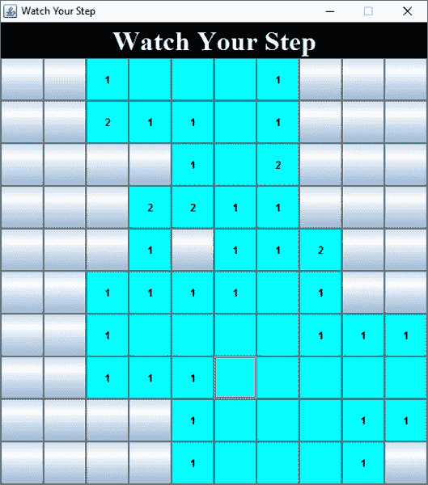

## 课程 5.1 - 另一个自定义按钮

在之前的课程中，你根据程序用户操作更改了按钮的颜色。在本节中，你将根据用户操作更改按钮的颜色和文本。

### 试尝试 - 为 `WatchYourStep` 进行初始设置

开始编写踩地程序。

1.  创建一个名为 `Watch Your Step` 的新 `Java project`，并将 `My Components` 项目添加到 `Watch Your Step`。

2.  在项目中创建一个名为 `_._____________.watchyourstep` 的新 `package`。

3. 创建一个名为 `WatchYourStep` 的新 `class`，父类为 `JFrame` 并包含 `main()` 方法的存位方法。

4. 使用 Quick Fix 添加一个名为 `serialVersionUID` 的 `private static final long` 实例变量，设置为 `1L`。

5. 添加一个无参数的 `WatchYourStep` 构造函数。在构造函数中：

    1. 调用 `initGUI()`。

    2. 将窗口标题设置为“Watch Your Step”，禁用调整大小，调整窗口尺寸（`pack`），居中窗口，使窗口可见，并设置窗口关闭时退出。

6. 创建一个名为 `initGUI()` 的新私有方法。它不接受任何参数且没有返回值。在 `initGUI()` 中：

    1. 创建一个名为 `titleLabel` 的新 `TitleLabel` 对象，文本为“Watch Your Step”。

    2. 将 `titleLabel` 添加到窗口顶部。（提示：使用 `JFrame` 的 `add()` 方法和 `BorderLayout` 的 `PAGE_START` 变量。）

7. 在 `main()` 中添加代码，以使用跨平台外观外观（look and feel），并在事件队列上创建一个新的 `WatchYourStep` 对象。

*Listing 5-1，来自 `WatchYourStep.java`*

---

```
package annette.godtland.watchyourstep;

import java.awt.BorderLayout;
import java.awt.EventQueue;

import javax.swing.JFrame;
import javax.swing.UIManager;

import annette.godtland.mycomponents.TitleLabel;

public class WatchYourStep extends JFrame {
  private static final long serialVersionUID = 1L;

  _____________ WatchYourStep(______) {
    _________();

    __________________;
    __________________;
    __________________;
    __________________;
    __________________;
    __________________;
    __________________;
  }

  _____________ initGUI(______) {
    ____________ titleLabel = __________________;
    add(________________________);
  }

  public static void main(String[] args) {
    try {
      _________ className = UIManager._______________;
      UIManager.______________________;
    }
    catch (____________) {}

    EventQueue.___________(new ___________() {
      public void run() {
        new _____________________;
      }
    });
  }
}
```

---

*Completed listing*

### 运行

窗口应该显示标题“Watch Your Step”。

### 尝试一下 - 创建 `TerrainButton` 类

`Watch Your Step` 游戏需要地形按钮，点击时，要么显示相邻的地形按钮是否隐藏了黑洞，要么如果该地形按钮隐藏了黑洞则结束游戏。像 `LightButton` 一样，地形按钮的行为类似于 `JButtons`，因此你可以直接扩展 `JButton` 类并添加额外功能。

创建 `TerrainButton` 类。

1. 在 `watchyourstep` 包中创建一个名为 `TerrainButton` 的新 `class`，父类为 `JButton` 且没有存位代码。

2. 使用 Quick Fix 添加一个名为 `serialVersionUID` 的 `private static final long` 实例变量，设置为 `1L`。

3. 添加一个名为 `SIZE` 的 `private static final integer` 实例变量，设置为 `50`。

4. 添加三个名为 `row`、`col` 和 `nextToHoles` 的 `private integer` 变量，初始值均为 `0`。

5. 添加两个名为 `hole` 和 `revealed` 的 `private boolean` 实例变量，每个初始化为 `false`。

*Listing 5-2，来自 `TerrainButton.java`*

---

```
package annette.godtland.watchyourstep;

import javax.swing.JButton;

public class TerrainButton extends JButton {
  private static final long serialVersionUID = 1L;
  _________________ SIZE = ____;

  ___________ row = ____;
  ___________ col = ____;
  ___________ nextToHoles = ____;
  ___________ hole = ____;
  ___________ revealed = ____;
}
```

---

*Completed listing*

构造函数需要初始化实例变量并设置地形按钮的优尺寸。

1. 添加一个带有两个 `integer` 参数的构造函数：`row` 和 `col`。

2. 将实例变量 `row` 和 `col` 设置为参数 `row` 和 `col` 的值。（提示：使用 `this.*`）。

3. 创建一个名为 `size` 的新 `Dimension` 对象，宽为 `SIZE`（行数），高为 `SIZE`（列数）。

4. 将地形按钮的优设置为 `size`。（提示：使用 `JButton` 的 `setPreferredSize()` 方法。）

*Listing 5-3，来自 `TerrainButton.java`*

---

```
 ...

  ___________ TerrainButton(___________________) {
    _________.row = _________;
    _________.col = _________;

    _____________ size = _______________;
    setPreferredSize(__________________);
  }
}
```

---

*Completed listing*

添加 `public` 方法，以便 `WatchYourStep` 可以访问并更改 `TerrainButton` 的一些 `private` 实例变量。

1. 添加名为 `getRow()` 和 `getCol()` 的 `public` 方法，它们不接受参数并返回一个 `integer`：分别是 `row` 的值和 `col` 的值。

2. 添加名为 `hasHole()` 和 `isRevealed()` 的 `public` 方法，它们不接受参数并返回一个 `boolean`：分别是 `hole` 的值和 `revealed` 的值。

*Listing 5-4，来自 `TerrainButton.java`*

---

```
 ...

  public int getRow() {
    return row;
  }

  public int getCol() {
    return col;
  }

  public boolean hasHole() {
    return hole;
  }

  public boolean isRevealed() {
    return revealed;
  }
}
```

---

*Completed listing*

1. 添加一个名为 `setHole()` 的方法接受一个 `boolean` 参数且没有返回值。该方法需要设置 `hole`。

2. 添加一个名为 `increaseHole()` 的 `public` 方法，不接受参数且没有返回值。该方法需要将 `nextToHoles` 加 1。


### 添加 `isNextHoles()` 方法

添加一个名为 `isNextHoles()` 的 `public` 方法，不接受参数并返回一个 `boolean`。如果 `nextToHoles` 大于 0 则返回 `true`。

*Listing 5-5，来自 `TerrainButton.java`*

```
 ...

  public void setHole(boolean hole) {
    hole = hole;
  }

  public void increaseHole() {
    nextToHoles++;
  }

  public boolean isNextHoles() {
    return nextToHoles > 0;
  }
}
```

*Completed listing*

### 添加 `reveal()` 方法

`WatchYourStep` 需要在按钮被显示时更改其外观。

1. 添加一个名为 `reveal()` 的 `public` 方法。它接受一个参数 `reveal` 且没有返回值。

2. 将 `revealed` 设置为 `reveal` 的值。

3. 如果 `revealed` 为 `true`：

    1. 如果地形按钮隐藏了黑洞，将背景颜色设置为黑色。（提示：使用 `setBackground()` 方法。）

    2. 如果地形按钮没有隐藏黑洞：

        1. 将背景颜色设置为青色。（提示：使用 `setBackground()` 方法。）

        2. 如果相邻存在黑洞，将文本设置为 `nextToHoles`。（提示：使用 `setText()` 方法。提示：将 `nextToHoles` 中的整数值转换为字符串，将其加到空字符串。）

4. 否则：

    1. 将背景颜色设置为 `null`。（提示：使用 `setBackground()` 方法。）

    2. 将文本设置为空字符串。（提示：使用 `setText()` 方法。）

*Listing 5-6，来自 `TerrainButton.java`*

```
 ...

  public void reveal(boolean reveal) {
    revealed = reveal;
    if (revealed) {
      if (hole) {
        setBackground(Color.BLACK);
      } else {
        setBackground(Color.CYAN);
        if (nextToHoles > 0) {
          setText(String.valueOf(nextToHoles));
        }
      }
    } else {
      setBackground(null);
      setText("");
    }
  }
}
```

*Completed listing*

### 添加 `reset()` 方法

`WatchYourStep` 需要一种方法来重置 `TerrainButton` 变量为原始值，以开始新游戏。

1. 添加一个名为 `reset()` 的 `public` 方法。它不接受参数且没有返回值。

2. 重置 `hole`、`revealed` 和 `nextToHoles` 为原始值。

3. 移除任何文本。（提示：使用 `setText()` 方法。提示：要移除文本，将文本设置为空字符串。）

4. 将背景恢复为默认值。（提示：使用 `JButton` 的 `setBackground()` 方法。提示：要设为默认颜色，请使用 `null` 作为参数值。）

*列表 5-7，来自 `TerrainButton.java`*

```
 ...

  ____________ reset(____) {
    hole = __________;
    revealed = __________;
    nextToHoles = __________;
    setText(__________);
    setBackground(__________);
  }
}
```

*已完成的列表*

### 试运行 - 在窗口中添加地形按钮

你现在已经有了 `Watch Your Step` 游戏中 `TerrainButton` 类所需的所有方法。很快，你将为窗口添加地形按钮。但在那之前，先添加将被几个方法使用的实例变量。

1. 回到 `WatchYourStep.java`。

2. 添加一个名为 `GRIDSIZE` 的 `private static final integer` 实例变量，并设置为 10。

3. 添加一个名为 `NUMBEROFHOLES` 的 `private static final integer` 实例变量，并设置为 10。

4. 添加一个名为 `terrain` 的 `private TerrainButton` 二维数组实例变量，具有 `GRIDSIZE` 行和 `GRIDSIZE` 列。

5. 添加一个名为 `totalRevealed` 的 `private integer` 实例变量，初始化为 0。

*列表 5-8，来自 `WatchYourStep.java`*

```
 ...

public class WatchYourStep extends JFrame {
  private static final long serialVersionUID = 1L;
  _____________ GRIDSIZE = _____;
  _____________ NUMBEROFHOLES = _____;

  _____________ terrain = _____________;
  _____________ totalRevealed = _____;

    ...
```

*已完成的列表*

在窗口中心用一个 10 行 10 列的地形按钮网格进行填充。

1. 在 `initGUI()` 中，创建一个名为 `centerPanel` 的 `JPanel` 对象。

2. 将 `centerPanel` 的布局设置为一个新的 `GridLayout`，宽度为 `GRIDSIZE`，高度为 `GRIDSIZE`。（提示：使用 `JPanel` 的 `setLayout()` 方法。）

3. 将 `centerPanel` 添加到窗口的中心。（提示：使用 `JPanel` 的 `add()` 方法和 `BorderLayout` 的 `CENTER` 变量。）

4. 使用双 `for` 循环遍历每个 `terrain`，使用整数 `row` 和 `col` 作为 `for` 循环的迭代变量：

    1. 在 `terrain` 的 `row` 和 `col` 处创建一个新的 `TerrainButton` 对象。（提示：使用 `row` 和 `col` 作为构造函数的参数值。）

    2. 将 `row` 和 `col` 处的 `terrain` 元素添加到 `centerPanel`。（提示：使用 `JPanel` 的 `add()` 方法。）

*列表 5-9，来自 `WatchYourStep.java`*

```
 ...

  private void initGUI() {
    TitleLabel titleLabel = new TitleLabel("Watch Your Step");
    add(titleLabel, BorderLayout.PAGE_START);

    ______________ centerPanel = new JPanel();
    centerPanel.setLayout(new GridLayout(___________________));
    add(centerPanel, ___________________);

    for(_______________________________) {
      for (_________________________________) {
        terrain[row][col] = new ___________________;
        _________________.add(___________________);
      }
    }
  }
    ...
```

*已完成的列表*

### 运行

窗口应该显示一个 10 行 10 列的方格网格。点击方格不有任何反应。

### 试运行 - 在地形中添加洞并显示它们

接下来，你将在网格上的随机地形按钮上添加洞。

1. 在构造函数中，在 `initGUI()` 之后调用 `setHoles()`。

注意：代码将语法错误，因为 `setHoles()` 尚未存在。

*列表 5-10，来自 `WatchYourStep.java`*

```
 ...

  public WatchYourStep() {
    initGUI();
    ___________();

    setTitle("Watch Your Step");

      ...
```

*已完成的列表*

1. 添加一个名为 `setHoles()` 的私有方法。它不接受参数且没有返回值。

2. 创建一个名为 `rand` 的 `Random` 对象来生成随机数。

3. 添加一个循环来重复要创建洞的数量：（提示：使用 `for` 循环和 `NUMBEROFHOLES`。）

    1. 创建两个名为 `pickRow` 和 `pickCol` 的整数，每个通过从 `rand` 获取不同的随机数来初始化。（提示：使用 `Random` 的 `nextInt()` 方法。提示：选取 0 到 `GRIDSIZE` 减 1 之间的数字。）

    2. 当 `terrain` 在 `pickRow` 和 `pickCol` 处的元素有洞时，使用 `rand` 为 `pickRow` 和 `pickCol` 生成新的随机数。（提示：使用 `TerrainButton` 的 `hasHole()` 方法。）

    3. `while` 循环之后，为 `pickRow` 和 `pickCol` 处的 `terrain` 设置洞。（提示：使用 `TerrainButton` 的 `setHole()` 方法。）

    4. 渲染 `pickRow` 和 `pickCol` 处的 `terrain` 元素以便你可以看到它。（提示：使用 `TerrainButton` 的 `reveal()` 方法。）

*列表 5-11，来自 `TerrainButton.java`*

```
 ...

  ______________ setHoles() {
    ________ rand = new Random();
    for (________________) {
      ______ pickRow = ________________;
      ______ pickCol = ________________;
      while (________________) {
        pickRow = ________________;
        pickCol = ________________;
      }
      terrain[____][____].____________();
      terrain[____][____].reveal();
    }
  }
```

### 运行

窗口应该显示代表洞的黑色方格。

### 试运行 - 统计邻居

接下来，你将添加统计洞数量的代码。

当网格上的地形添加一个洞时，`WatchYourStep` 需要更新该按钮最多八个邻居的计数。

1. 在 `setHoles()` 中，在设置洞后为当前地形调用 `addToHoleCount()`。

注意：代码将语法错误，因为 `addToHoleCount()` 尚未存在。

*列表 5-12，来自 `WatchYourStep.java`*

```
 ...

  public WatchYourStep() {
    initGUI();
        ...

      terrain[pickRow][pickCol].setHole(true);
      addToHoleCount(_________________);

        ...
```

*已完成的列表*

由于边缘地形按钮没有八个邻居，`WatchYourStep` 在尝试更新邻居计数之前需要检查邻居是否存在。

1. 添加一个名为 `addToHoleCount()` 的私有方法。它接受两个整数参数 `row` 和 `col`，且没有返回值。

2. 调用八次 `addToHoleCount()`，针对 `row` 和 `col` 周围每个可能的 `terrain`。（提示：`row` 和 `col` 左上的 `terrain` 是 `row-1` 和 `col-1`。正上地形是 `row-1` 和 `col`。提示：`addToHoleCount()` 将忽略任何无效的行和列。）

*列表 5-13，来自 `WatchYourStep.java`*

```
 ...

  ________________ addToHoleCount(int row, int col) {
    addToHoleCount(row____, col___);
    addToHoleCount(row____, col___);
    addToHoleCount(row____, col___);
    addToHoleCount(row____, col___);
    addToHoleCount(row____, col___);
    addToHoleCount(row____, col___);
    addToHoleCount(row____, col___);
    addToHoleCount(row____, col___);
  }
```

2. 如果 `row` 和 `col` 指向一个有效的邻居，则增加该 `terrain` 元素的洞数量。（提示：如果 `row` 和 `col` 都大于 -1 且小于 `GRIDSIZE`，则它们指向一个有效元素。提示：使用 `TerrainButton` 的 `increaseHoleCount()` 方法。）

3. 在增加洞数量后，显示该 `terrain` 元素，这样你就可以看到程序的运行情况。

*列表 5-14，源自 `WatchYourStep.java`*

```
 ...

  _______________ addToHoleCount(_________________) {
    if (______ && _______ && _________ && ________) {
      terrain[row][col].___________________;
      terrain[row][col].___________________;
    }
  }
    ...
```

*完成的列表*

### 运行它

窗口应该显示十个黑色的地形按钮，被青色的地形按钮包围。每个青色地形按钮都应该显示其旁边黑色洞的数量。

### 尝试一下 - 点击地形按钮时检查地形

接下来，监听任何地形按钮的点击。

1. 在 `initGUI()` 创建每个地形对象时，为每个 `terrain` 元素添加一个 `ActionListener`。（提示：使用 `TerrainButton` 的 `addActionListener()` 方法，并将一个新的 `ActionListener` 对象作为参数值。在 `ActionListener` 中，添加一个名为 `actionPerformed()` 的公共方法。`actionPerformed()` 应该有一个名为 `e` 的 `ActionEvent` 类型参数，并且没有返回值。）

2. 在 `actionPerformed()` 中，创建一个名为 `button` 的 `TerrainButton` 对象，通过获取 `e` 的源来初始化。（提示：使用 `ActionEvent` 的 `getSource()` 方法。提示：使用 Quick Fix 将返回值强制转换为 `TerrainButton`。）

3. 创建两个名为 `row` 和 `col` 的整数，分别通过从 `button` 获取行值和列值来初始化。（提示：使用 `TerrainButton` 的 `getRow()` 和 `getCol()` 方法。）

4. 传入 `row` 和 `col` 调用 `clickedTerrain()`。

注意：代码将会有语法错误，因为 `clickedTerrain()` 尚不存在。

*列表 5-15，源自 `WatchYourStep.java`*


```
 ...

  private void initGUI() {

      ...

    for(int row = 0; row < GRIDSIZE; row++) {
      for (int col = 0; col < GRIDSIZE; col++) {
        terrain[row][col] = new TerrainButton(row, col);
        terrain[row][col].add_____________(new ______________ {
          ______________ actionPerformed(____________) {
            ________________ button = (__________) e.___________;
            ________ row = ______________;
            ________ col = _______________;
            clickedTerrain(__________________);
          }
        });
        centerPanel.add(terrain[row][col]);

          ...
```

* * *

*完成的列表

目前，`clickedTerrain()` 仅仅对被点击的地形按钮调用 `check()`。在后的步骤中，将在 `clickedTerrain()` 中添加更多内容，以证明定义 `clickedTerrain()` 和 `check()` 为独立方法的。

1. 添加一个名为 `clickedTerrain()` 的私有方法。它应该接受两个参数，整数 `row` 和 `col`，并且没有返回值。

2. 在 `clickedTerrain()` 中，传入 `row` 和 `col` 调用 `check()`。

注意：代码将会有语法错误，因为 `check()` 尚不存在。

*列表 5-16，源自 WatchYourStep.java*

* * *

```
 ...

  _________________ clickedTerrain(_______________) {
    ___________(_______);
  }
    ...
```

* * *

*完成的列表

首先，如果地形元素存在且其内容尚未显示，`check()` 需要显示隐藏在地形按钮之后。

1. 添加一个名为 `check()` 的私有方法。它应该接受两个参数，整数 `row` 和 `col`，并且没有返回值。

2. 如果 `row` 和 `col` 是有效的，且该 `terrain` 没有洞，且该 `terrain` 尚未显示：

    1. 显示地形按钮。（提示：使用 `TerrainButton` 的 `reveal()` 方法。）

*列表 5-17，源自 WatchYourStep.java*

* * *

```
 ...

  _________________ check(_______________) {
    if (______ && ______ && ______ && _____
        && !__________________  
        && !__________________) {
      terrain[row][col].____________;
    }
  }
    ...
```

* * *

*完成的列表

### 运行它

点击没有数字的地形按钮将通过显示为没有数字的青色正方形来显示该地形。

### 尝试一下 - 点击地形按钮时检查邻居地形

接下来，WatchYourStep 需要检查是否显示点击按钮的八邻之一。

1. 添加一个名为 `checkNeighbors()` 的私有方法。它应该接受两个参数，整数 `row` 和 `col`，并且没有返回值。

2. `row` 和 `col` 是有效的，`terrain` 没有洞，且 `terrain` 尚未显示：

    1. 显示地形按钮。（提示：使用 `TerrainButton` 的 `reveal()` 方法。）

*列表 5-17，源自 WatchYourStep.java*

* * *

```
 ...

  _________________ check(_______________) {
    if (______ && ______ && ______ && _____
        && !__________________  
        && !__________________) {
      terrain[row][col].____________;
    }
  }
    ...
```

* * *

*完成的列表（等待，让我们重新对齐逻辑）

已完成列表

### 运行一下

所有地形按钮在游戏开始时应该隐藏其信息。点击没有洞的地形按钮将显示更多的地形按钮。

### 试一试 - 在点击洞时结束游戏

接下来，如果用户点击了带有洞的地形按钮，则结束游戏。

1.  在 `clickedTerrain()` 的开头添加代码，检查被点击的 `terrain` 是否有洞。（提示：检查 `row` 和 `col` 处的 `terrain`。提示：使用 `TerrainButton` 的 `hasHole()` 方法。）

2.  如果 `terrain` 有洞，创建一个名为 `message` 的字符串，说明用户踩了洞，游戏结束，并询问用户是否想再玩一次。

3.  调用 `promptForNewGame()`，并将 `message` 作为参数值传递进去。

4.  如果 `terrain` 没有洞，则检查该按钮及其相邻。将该方法中的剩余代码放入一个 else 块 中，这样代码只有在 `terrain` 没有洞时才会检查该地形按钮和它的邻居。

注意：代码将会有语法错误，因为 `promptForNewGame()` 尚未存在。

*列表 5-23，来自 WatchYourStep.java*

```
 ...

  private void clickedTerrain(int row, int col) {
    if (_______________________) {
      _________ message = __________________;
      ________(message);
    }
    else {
      check(row, col);
      checkNeighbors(row, col);
    }
  }
    ...
```

已完成列表

显示一个确认对话框，询问用户是否想再玩一次。如果用户点击 `Yes`，则开始新游戏。否则，结束程序。

1.  添加一个名为 `promptForNewGame()` 的私有方法。它应该接受一个名为 `message` 的字符串参数且没有返回值。

2.  创建一个名为 `option` 的整数，通过在带有 `Yes` 和 `No` 按钮的确认对话框中显示 `message` 来获取其值。（提示：使用 `JOptionPane` 的 `showConfirmDialog()` 方法，以及 `JOptionPane` 的 `YES_NO_OPTION` 变量。）

3.  如果 `option` 为是值，调用 `newGame()`。（提示：将 `option` 与 `JOptionPane` 的 `YES_OPTION` 变量比较。）

4.  否则，退出程序。（提示：使用 `System` 的 `exit()` 方法，其参数值使用 `0`。）

注意：代码将会有语法错误，因为 `newGame()` 尚未存在。

*列表 5-24，来自 WatchYourStep.java*

```
 ...

  _______________ promptForNewGame(______________) {
    ___________ option = JOptionPane.showConfirmDialog(this, message, "Play Again?", JOptionPane._____________);
    if (option == ______________) {
      _____________();
    }
    else {
      ___________(____);
    }
  }
    ...
```

已完成列表

为了开始新游戏，需要将所有地形按钮重置为原始默认值，并必须随机选择一组带有洞的地形按钮。

1.  添加一个名为 `newGame()` 的私有方法。它不接受参数且没有返回值。

2.  遍历 `terrain` 中的所有地形按钮并重置它们。（提示：使用双层 `for` 循环和 `TerrainButton` 的 `reset()` 方法。）

3.  调用 `setHoles()` 来为新游戏选择洞的位置。

*列表 5-25，来自 WatchYourStep.java*

```
 ...

  _________________ newGame(____) {
    for(__________________) {
      for(_____________________) {
        terrain[row][col]._____________;
      }
    }
    ______________();
  }
    ...
```

已完成列表

### 运行一下

如果点击了带有洞的地形按钮，程序应该显示游戏输了的消息，并提供开始另一个游戏的选项。选择 `Yes` 将隐藏所有新的地形按钮；选择 `No` 将关闭窗口。

### 试一试 - 在用户获胜时结束游戏

如果点击了带有洞的地形按钮，则游戏失败。然而，游戏还必须检查用户是否获胜。

首先，WatchYourStep 必须跟踪已经显示了多少地形按钮。

1.  在 `check()` 中添加代码，每当一个 `terrain` 被显示时，就增加 `totalRevealed` 的。

*列表 5-26，来自 WatchYourStep.java*

```
 ...

  private void check(int row, int col) {
    if (row>-1 && row<GRIDSIZE && col>-1 && col<GRIDSIZE  
        && !terrain[row][col].hasHole()  
        && !terrain[row][col].isRevealed()) {
      terrain[row][col].reveal(true);
      totalRevealed___;
      if (!terrain[row][col].isNextToHoles()) {
        checkNeighbors(row,col);
      }
    }
  }
    ...
```

已完成列表每当代码显示一个地形按钮时，WatchYourStep 需要检查没有洞的地形按钮是否都已显示。如果没有洞的地形按钮都显示了，则祝贺用户并询问他们是否想再玩一次。（提示：使用 `GRIDSIZE` 减去 `NUMBEROFHOLES` 计算出按钮数量。）

2.  在 `clickedTerrain` 中检查邻居后，检查没有洞的地形按钮是否都显示了。（提示：调用 `promptForNewGame(message)`。）

*列表 5-27，来自 WatchYourStep.java*

```
 ...

  private void clickedTerrain(int row, int col) {

        ...

      check(row, col);
      checkNeighbors(row, col);
      if (__________________) {
        ___________ message = ________________;
        promptForNewGame(message);
      }
    }
  }
    ...
```

已完成列表在每个游戏开始时重置总显示数。

1.  在 `newGame()` 中将 `totalRevealed` 设置为 0。

*列表 5-28，来自 WatchYourStep.java*

```
 ...

  private void newGame() {
    for(int row=0; row<GRIDSIZE; row++) {
      for(int col=0; col<GRIDSIZE; col++) {
        terrain[row][col].reset();
      }
    }
    setHoles();
    totalRevealed = _________;
  }
    ...
```

已完成列表

### 运行一下

显示所有洞的地形按钮应该显示一条获胜的消息，并提供开始另一个游戏的选项。选择 `Yes` 将隐藏所有新的地形按钮；选择 `No` 将关闭窗口。

### 试一试 - 在游戏结束时显示所有洞

WatchYourStep 可以做的另一好事是在游戏结束时显示所有剩余的带洞。

1.  在 `promptForNewGame()` 中添加代码，在显示消息之前调用 `showHoles()`。

注意：代码将会有语法错误，因为 `showHoles()` 尚未存在。

*列表 5-29，来自 WatchYourStep.java*

```
 ...

  private void promptForNewGame(String message) {
    showHoles();
    int option = JOptionPane.showConfirmDialog(this, message, "Play Again?", JOptionPane.YES_NO_OPTION);

      ...
  }
```

已完成列表

1.  添加一个名为 `showHoles()` 的私有方法。它不接受参数且没有返回值。

2.  在 `showHoles()` 中，遍历每个 `terrain`。如果 `terrain` 有洞，则显示该地形。（提示：使用 `TerrainButton` 的 `hasHole()` 和 `reveal()` 方法。）

*列表 5-30，来自 WatchYourStep.java*

```
 ...

  private void showHoles() {
    for(int row=0; row<GRIDSIZE; row++) {
      for(int col=0; col<GRIDSIZE; col++) {
        if (_____________________) {
          terrain[row][col].___________;
        }
      }
    }
  }
    ...
```

*   书中包含了此程序，是为了让你有更多练习扩展 `JButton` 类的机会。

*   你可以使用 `JButton` 的 `setText()` 方法更改按钮上的文本。

## 课程 5.2 - 焦点标记 (Focus Mark)

在该程序中你可能想要更改的另一件事是程序如何在最后一次点击的地形按钮上绘制焦点标记。对于这个程序来说，不需要也不想要焦点标记。

### 尝试一下 - 移除 JButton 焦点标记

1.  进入 `TerrainButton.java`。

2.  在 `reveal()` 中添加代码以关闭焦点指示器的绘制。（提示：使用 `JButton` 的 `setFocusPainted()` 方法。）

*列表 5-31，源自 TerrainButton.java*

* * *

```
 ...

  public void reveal(boolean reveal) {

      ...

    else {
      setBackground(null);
      setText("");
    }
    ______________(_______);
  }
    ...
```

* * *

*完成的列表*

### 运行

最后一次点击的地形按钮上不应再显示焦点标记。

### 尝试一下 - 导出程序

你完成了“小心走路”程序。

1.  如果你想在没有 Eclipse 的情况下运行它，请导出你的“小心走路”程序。

### 运行

双击导出的 JAR 文件应该运行程序，并获得与之前相同的结果。

### 关键点及更多

*   当按钮处于焦点状态时，按下空格键会触发该按钮的动作事件。换句话说，按下空格键会使程序表现得像用户点击了按钮。

*   按下 tab 键会将焦点从一个按钮移动到下一个。

*   通常，每当按钮拥有焦点时，按钮文本周围都会画一个框。这个框是一个视觉指示器，让程序用户能够清楚地看到哪个按钮处于焦点。

*   你可以使用 `JButton` 的 `setFocusPainted(false)`。

*   关闭焦点指示器只是停止程序在按钮文本周围绘制框。按下空格键仍会触发该按钮的动作事件，按下 tab 键仍会将焦点从一个按钮移动到下一个。

*   空格键激活和 tab 焦点移动是 `JButton` 自带的功能。关闭这些功能超出了本书的范围。如果你不想让这些功能生效，可能最好在不扩展 `JButton` 的情况下创建可点击组件，这将在后面的课程中演示。

# 项目 6 - 滑动瓷块 (Sliding Tiles)

接下来你将创建“滑动瓷块”游戏。一张照片将被分为 4 行 4 列 16 个瓷块，右下角缺失一个。然后这些瓷块将被打乱，你将被挑战将瓷块滑回它们的原始位置。一旦所有瓷块都顺序正确，右下角缺失的瓷块也将显示。

要移动瓷块，你必须点击空隙附近的瓷块。这样做会将被点击的瓷块滑入该空隙。

这里是滑动瓷块程序的截图：

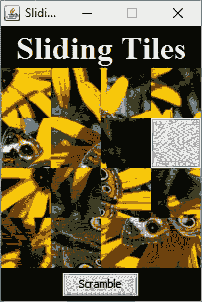


## 课程 6.1 - 带图像的按钮

按钮可以显示图像而不是文本，或者在文本之外显示。

### 尝试一下 - 为 `SlidingTiles` 进行初始设置

开始编写滑动瓷块程序。

1. 创建一个名为 `Sliding Tiles` 的新 `Java project`，并将项目 `My Components` 添加到 `Sliding Tiles`。

2. 在项目中创建一个名为 `___________._____________.slidingtiles` 的新 `package`。

3. 创建一个名为 `SlidingTiles` 的新 `class`，父类为 `JFrame` 并带有 `main()` 方法存根。

4. 使用快速修复（Quick Fix）添加一个名为 `serialVersionUID` 的 `private static final long` 实例变量，设置为 `1L`。

5. 添加一个无参数的 `SlidingTiles` 构造函数。在构造函数中：

   1. 调用 `initGUI()`。

   2. 将窗口标题设置为“Sliding Tiles”，禁用调整大小、打包窗口（`pack`）、居中窗口、使窗口可见，并在窗口关闭时退出程序。

6. 创建一个名为 `initGUI()` 的私有方法。它不应接受任何参数且没有返回值。在 `initGUI()` 中，在窗口顶部添加一个文本为“Sliding Tiles”的 `TitleLabel`。

7. 在 `main()` 中添加代码以使用跨平台外观和感觉（look and feel），并在事件队列上创建一个新的 `SlidingTiles` 对象。

*列表 6-1，源自 `SlidingTiles.java`*

---

```
package annette.godtland.slidingtiles;

import java.awt.BorderLayout;
import java.awt.EventQueue;

import javax.swing.JFrame;
import javax.swing.UIManager;

import annette.godtland.mycomponents.TitleLabel;

public class SlidingTiles extends JFrame {
  private static final long serialVersionUID = 1L;

  _____________ SlidingTiles(______) {
    _________();

    __________________;
    __________________;
    __________________;
    __________________;
    __________________;
    __________________;
    __________________;
  }

  _____________ initGUI(______) {
    ____________ titleLabel = __________________;
    add(________________);
  }

  public static void main(String[] args) {
    try {
      String className = UIManager.getLookAndFeelClassName();
      UIManager.setLookAndFeel(className);
    } catch (Exception e) {}

    EventQueue.invokeLater(new Runnable() {
      public void run() {
        new SlidingTiles();
      }
    });
  }
}
```

---

*完成的列表*

### 运行

窗口应该显示标题，

Sl It It

### 瓷块处理

`SlidingTiles` 需要包含图像和列信息的瓷块按钮。瓷块按钮不会移动。如果瓷块按钮被点击，`SlidingTiles` 需要与下一个瓷块按钮交换图像。就像 `Framed` 中的灯按钮一样，瓷块按钮的行为非常像 `JButton`，所以你可以简单扩展 `JButton` 类并添加额外功能。

扩展 `Tile` 类。

1. 在 `slidingtiles` 包中创建一个名为 `TileButton` 的新 `class`，父类为 `JButton` 且没有存根代码。

2. 使用快速修复添加一个名为 `serialVersionUID` 的 `private static final long` 实例变量，设置为 `1L`。

3. 添加两个 `private static int` 变量 `tileSize` 和 `maxTiles`，均初始化为 `0`。（提示：这些变量是静态的。）

4. 添加一个名为 `imageIcon` 的 `private ImageIcon` 实例变量。

5. 添加三个 `private int` 变量 `imageId`、`row` 和 `col`，初始值均为 `0`。

*列表 6-2，源自 `TileButton.java`*

---

```
package annette.godtland.slidingtiles;

import javax.swing.ImageIcon;
import javax.swing.JButton;

public class TileButton extends JButton {
  private static final long serialVersionUID = 1L;
  private static int tileSize = 0;
  private static int maxTiles = 0;

  private ImageIcon imageIcon;
  private int imageId = 0;
  private int row = 0;
  private int col = 0;
}
```

---

*完成的列表*

`SlidingTiles` 需要一种方法来设置瓷块的图像。每个图像都与一个图像 `id` 配对。具有最大预期 `id` 的图像来自照片右下角，不会显示在瓷块上。该图像将在稍后谜题解决时显示。

1. 添加一个名为 `setImage()` 的公共方法。它应该接受两个参数：一个名为 `imageIcon` 的 `ImageIcon` 和一个名为 `imageId` 的整数，没有返回值。

2. 将实例变量 `imageIcon` 设置为 `imageIcon` 参数值。（提示：使用 `this`。）

3. 将实例变量 `imageId` 设置为 `imageId` 参数值。（提示：使用 `this`。）

4. 如果 `imageId` 等于最大的预期图像编号，则将瓦片按钮的图标设置为 `null`。（提示：`maxTiles` 存储预期的瓦片按钮数量。如果你从 `0` 开始给瓦片按钮编号，最后一个按钮的编号会是多少？提示：使用 `JButton` 的 `setIcon()` 方法。）

5. 否则，将按钮的图标设置为 `imageIcon`。（提示：使用 `JButton` 的 `setIcon()` 方法。）

*列表 6-3，来自 `TileButton.java`*

---

```
 ...

  __________________ setImage(____________________) {
    _______.imageIcon = __________;
    _______.imageId = _________;

    if (______________) {
      setIcon(________);
    }
    else {
      setIcon(________);
    }
  }
    ...
```

---

*完成的列表*

接下来为 `TileButton` 创建构造函数。它需要为 `TileButton` 的实例变量赋值。

1. 添加一个带有四个参数的 `TileButton` 构造函数：一个名为 `imageIcon` 的 `ImageIcon` 和三个名为 `imageId`、`row` 和 `col` 的整数。

2. 将实例变量 `row` 和 `col` 设置为参数值 `row` 和 `col`。（提示：使用 `this.`）

3. 调用 `setImage()` 并将 `imageIcon` 和 `imageId` 作为参数值传递。

4. 将瓦片按钮的背景设置为白色。（提示：使用 `JButton` 的 `setBackground()` 方法。）

5. 将瓦片按钮的边框设置为 `null`。（提示：使用 `JButton` 的 `setBorder()` 方法。）

6. 创建一个名为 `size` 的新 `Dimension` 对象，包含 `tileSize` 行和 `tileSize` 列。

7. 将瓦片按钮的首选尺寸设置为 `size`。（提示：使用 `setPreferredSize()`。）

8. 关闭在按钮上的焦点标记。（提示：使用 `JButton` 的 `setFocusPainted()` 方法。）

*列表 6-4，来自 `TileButton.java`*

---

```
 ...

  ____________ TileButton(_______________________) {
    ______.row = _____;
    ______.col = _____;
    setImage(________________);

    setBackground(______________);
    setBorder(__________);
    __________ size = _______________;
    setPreferredSize(_______________);
    ________________;
  }
    ...
```

---

*完成的列表*

`SlidingTiles` 需要一种获取私有实例变量的值的方法。

1. 添加一个名为 `getImage()` 的私有方法。它不接受参数并返回一个 `ImageIcon`：`imageIcon`。

2. 添加一个名为 `getRow()` 的公共方法。它不接受参数并返回一个整数：`row`。

3. 添加一个名为 `getCol()` 的公共方法。它不接受参数并返回一个整数：`col`。

4. 添加一个名为 `getImageId()` 的公共方法。它不接受参数并返回一个整数：`imageId`。

*列表 6-5，来自 `TileButton.java`*

---

```
 ...

  ______________ getImage(______) {
    return _______________;
  }

  ______________ getRow(______) {
    return _______________;
  }

  ______________ getCol(______) {
    return _______________;
  }

  ______________ getImageId(______) {
    return _______________;
  }
    ...
```

---

*完成的列表*

`SlidingTiles` 将允许程序用户更改谜游戏中瓦片的数量。必须提供一个方法让 `SlidingTiles` 设置瓦片大小和最大瓦片数量。该方法必须是静态的，以便 `SlidingTiles` 可以在创建任何 `TileButtons` 之前调用它。

1. 添加一个名为 `setTileSizeAndMaxTiles()` 的公共静态方法。它应该接受两个参数，一个名为 `size` 的整数和一个名为 `max` 的整数，并且没有返回值。

2. 将 `tileSize` 设置为 `size` 的值。

3. 将 `maxTiles` 设置为 `max` 的值。

*列表 6-6，来自 `TileButton.java`*

---

```
 ...

  ______________ setTileSizeAndMaxTiles(______) {
    tileSize = ________;
    maxTiles = ________;
  }
    ...
```

---

*完成的列表*

### 关键点及更多

* `JButton` 可以显示图像而不是文本，或者除了文本之外。

* 使用 `JButton` 的 `setIcon()` 方法设置按钮的图像。图像必须是 `ImageIcon`。

* 使用 `JButton` 的 `getIcon()` 方法获取按钮的图像。如果未设置图像，`getIcon()` 将返回 `null`。

* 创建 `ImageIcon` 将在下一节中介绍。

## 课程 6.2 - 读取图像文件、子图像、图像图标

在 *Do-It-Yourself Java Games: An Introduction to Java Computer Programming* 中，你使用了 `BufferedReader` 从文本文件中读取字符串输入。在本节中，你将使用 `ImageIO` 从文本文件中读取图像。

### 尝试一下 - 从文件中获取图像

初始化用于读取图像并将其分解为子图像所需的变量，以便可以使用。

1. 回到 `SlidingTiles.java`。

2. 添加一个名为 `FILENAME` 的静态 `final` 字符串变量，设置为“slidingTiles.jpg”。

3. 添加两个私有实例变量：一个初始化为 `50` 的 `tileSize`，另一个初始化为 `4` 的 `gridSize`。

4. 添加一个名为 `image` 的 `BufferedImage` 实例变量，初始化为 `null`。

*列表 6-7，来自 `TileButton.java`*

---

```
 ...

public class SlidingTiles extends JFrame {
  private static long serialVersionUID = 1L;
  private final String FILENAME = "_____________";

  private int tileSize = ____;
  private int gridSize = ____;
  private BufferedImage image = _____;

    ...
```

---

*完成的列表*

现在，读取图像。

1. 在构造函数的开始处，通过使用 `FILENAME` 创建的调用 `ImageIO.read()` 为 `image` 赋值。

2. 将所有构造函数代码放在 `try` 块中，因为读取图像文件可能会抛出异常。

3. 在 `try` 块之后添加 `catch` 块来捕获 `IOException`。在 `catch` 块中：

   1. 创建一个字符串 `message`，说明图像文件无法打开。

   2. 在消息框中显示 `message`。（提示：使用 `JOptionPane` 的 `showMessageDialog()` 方法。）

*列表 6-9，来自 `TileButton.java`*

---

```
 ...

  public SlidingTiles() {
    try {
      image = ________________________;
      TileButton.setTileSizeAndMaxTiles(tileSize, gridSize);
      initGUI();

      setTitle("Sliding Tiles");
      setResizable(false);
      pack();
      setVisible(true);
      setDefaultCloseOperation(EXIT_ON_CLOSE);
    }
    catch (_______________) {
      ________ message = "_________________________";
      JOptionPane._______________________;
    }
  }
    ...
```

---

*完成的列表*

接下来，添加瓦片按钮。

1. 添加一个名为 `tile` 的私有 `TileButton` 二维数组变量，具有 `gridSize` 行和 `gridSize` 列。

2. 添加一个名为 `centerPanel` 的私有 `JPanel` 变量，通过调用 `JPanel` 的构造函数进行初始化。

*列表 6-10，来自 `SlidingTiles.java`*

---

```
 ...

  private int gridSize = 4;
  private BufferedImage image = null;
  _______________[][] tile = new TileButton[_____][_____];
  _______________ centerPanel = __________;

    ...
```

---

*完成列表*

`initGUI()` 方法将变得非常大。将大的代码块分成较小的部分，并为每个部分标记注释，可以使代码现在更容易编写，以后也更容易理解。`initGUI()` 可以被分为两个部分：一个用于主面板，另一个部分用于按钮面板。

1. 在 `initGUI()` 中，添加注释来标记主面板和按钮面板的区域。

*列表 6-11，来自 `SlidingTiles.java`*

---


```
 ...

  private void initGUI() {
    TitleLabel titleLabel = new TitleLabel("Sliding Tiles");
    add(titleLabel, BorderLayout.PAGE_START);

    // main panel

    // button panel
  }
    ...
```

* * *

*完成列表*

`SlidingTiles` 需要在构造函数以及程序稍后的部分将图像放在瓷按钮上，因此将该代码放在一个单独的方法中。

1. 在*主面板*部分，调用 `divideImage()`。

注意：该代码会有语法错误，因为 `divideImage()` 尚不存在。

*列表 6-12，来自 `SlidingTiles.java`*

* * *

```
 ...

  private void initGUI() {
    TitleLabel titleLabel = new TitleLabel("Sliding Tiles");
    add(titleLabel, BorderLayout.PAGE_START);

    // main panel
    __________________();

    // button panel
  }
    ...
```

* * *

*完成列表*

将图像划分为 `gridSize` 行和 `gridSize` 列的子图像，并将每个子图像放在中心面板的瓷按钮中。

1. 创建一个名为 `divideImage()` 的新私有方法。它不接受任何参数且不返回值。

2. 将 `centerPanel` 的布局设置为一个新的 `GridLayout`，具有 `gridSize` 行和 `gridSize` 列。（提示：使用 `JPanel` 的 `setLayout()` 方法。）

3. 将 `centerPanel` 添加到窗口的中心。（提示：使用 `JPanel` 的 `add()` 方法和 `BorderLayout` 的 `CENTER` 变量。）

4. 创建一个名为 `imageId` 的整数，并初始化为 0。

5. 使用双重 `for` 循环来遍历 `tile` 中的每个瓷按钮，使用整数 `row` 和 `col` 作为 `for` 循环的迭代变量：

    1. 创建一个名为 `x` 的整数，初始化为距离 `row` 和 `col` 瓷按钮所需图像片段左边缘的像素数。（提示：需要的 `x` 值将是 0, 50, 100 和 150。你如何根据 `col` 和 `tileSize` 计算这些值呢？）

    2. 创建一个名为 `y` 的整数，初始化为距离 `row` 和 `col` 瓷按钮所需图像片段顶部的像素数。（提示：需要的 `y` 值将是 0, 50, 100 和 150。你如何根据 `row` 和 `tileSize` 计算这些值呢？）

    3. 创建一个名为 `subimage` 的 `BufferedImage` 对象，通过获取 `image` 的子图像来初始化。（提示：使用 `BufferedImage` 的 `getSubimage()` 方法，传入要检索的每个图像片段的 `x` 和 `y` 坐标、宽度和高度。）

    4. 通过调用带有 `subimage` 的 `ImageIcon` 构造函数创建一个名为 `imageIcon` 的新 `ImageIcon` 对象。

    5. 将 `row` 和 `col` 处的 `tile` 初始化为新的 `TileButton`，并传入所有需要的值。

    6. 将 `row` 和 `col` 处的 `tile` 添加到 `centerPanel`。

    7. 递增 `imageId`。

*列表 6-13，来自 `SlidingTiles.java`*

* * *

```
 ...

  private void divideImage() {
    centerPanel.setLayout(___________________);
    add(________________);

    ___________ imageId = ______;
    for(___________________) {
      for(_________________________) {
        ________ x = ________________;
        ________ y = ________________;
        ____________ subimage = image.getSubimage(_____________________);
        ____________ image = new ______________________;
        tile[________][__________] = new _____________________;
        centerPanel.add(____________________);
        imageId_______;
      }
    }
  }
    ...
```

* * *

*完成列表*

### 运行

窗口应该显示原始图像，而不是乱序的，但缺失了下角。

### 关键点及更多

* 使用 `ImageIO` 的 `read()` 读取图像。`read()` 返回一个 `BufferedImage`。

* `ImageIO.read()` 是一个静态方法。因此，要读取名为“smile.gif”的文件，请使用：

```
image = ImageIO.read(new File("smile.gif"));
```

* 如果读取文件时发生错误，`ImageIO.read()` 将抛出 `IOException`；如果 `File` 参数为 *null*，则将抛出 `IllegalArgumentException`。

* `BufferedImage` 的 `getSubimage()` 方法检索图像的矩形部分。为 `getSubimage()` 传入所需的左上角 `x` 和 `y` 坐标以及其宽度和高度。例如，要获取距离左侧 10 像素、顶部 20 像素、宽 320 像素、高 240 像素的 `image` 片段，使用：

```
image.getSubimage(10, 20, 320, 240);
```

* `BufferedImage` 的 `getSubimage()` 方法返回一个 `BufferedImage`。

* 如果参数值不引用图像区域，`BufferedImage` 的 `getSubimage()` 方法将抛出 `RasterFormatException`。

* `ImageIcon` 构造函数可以从 `Image` 对象、`BufferedImage` 对象或给出图像文件路径和名称的字符串创建 `ImageIcon`。

    * 例如，从名为“smile.gif”的文件创建名为 `myIcon` 的 `ImageIcon`，使用：

```
myIcon = new ImageIcon("smile.gif");
```

    * 例如，从名为 `smileImage` 的 `BufferedImage` 对象创建名为 `myIcon` 的 `ImageIcon`，使用：

```
myIcon = new ImageIcon(smileImage);
```

* `ImageIcon` 不是 `Image` 的类型，因此在需要 `Image` 的地方可以使用 `ImageIcon`，在需要 `ImageIcon` 的地方可以使用 `Image`。

* `ImageIcon` 对象提供的方法和信息比 `Image` 对象少。

## 节 6.3 - 添加和移除组件

通常你将所有组件添加到窗口，打包窗口，然后显示窗口。如果你以后添加或移除组件，布局可能需要重新计算并重新显示组件。为了这一点，对持有组件的容器进行重新验证。

### 尝试一下 - 在添加新的之前移除瓷块

目前 `divideImage()` 向中心面板添加瓷按钮。但如果 `divideImage()` 被调用第二次怎么办？再次添加瓷按钮会导致按钮过多！

在添加新的之前，在 `divideImage()` 中移除瓷按钮。在面板中添加或移除组件后，`SlidingTiles` 需要重新验证面板。

1. 从 `centerPanel` 中移除所有组件。（提示：使用 `JPanel` 的 `removeAll()` 方法。）

2. 重新验证 `centerPanel`。（提示：使用 `JPanel` 的 `revalidate()` 方法。）

*列表 6-14，来自 `SlidingTiles.java`*

* * *

```
 ...

  private void divideImage() {
    centerPanel.setLayout(new GridLayout(gridSize, gridSize));
    add(centerPanel, BorderLayout.CENTER);
    centerPanel.______________;

    int imageId = 0;
    for(int row=0; row<gridSize; row++) {

      ...
    }

    centerPanel.____________();
  }
    ...
```

* * *

*已完成列表*

### 运行它

窗口应该仍然显示原始图像，而不是被弄乱，并且右下角缺失，就像和之前一样。

### 尝试一下 - 为交换图像添加 TileButton 方法

`SlidingTiles` 需要检查瓷块按钮是否具有图像。如果其图标的值为 `null`，则该瓷块按钮没有图像。

1. 添加一个名为 `hasNoImage()` 的公共方法。它不接受任何参数并返回一个布尔值。

2. 创建名为 `hasNoImage` 的布尔变量，初始化为 `false`。

3. 如果瓷块按钮的图标值为 `null`，则将 `hasNoImage` 设置为 `true`。（提示：使用 `JButton` 的 `getIcon()` 方法。）

4. 返回 `hasNoImage`。

*列表 6-15，来自 `TileButton.java`*

* * *

```
 ...

  ______________ hasNoImage(______) {
    ___________ hasNoImage = _______;
    if (_______________) {
      hasNoImage = _________;
    }
    return ________;
  }
    ...
```

* * *

*已完成列表*

`SlidingTiles` 需要在瓷块按钮之间交换图像，从而使窗口看起来像瓷块移动了。

1. 添加一个名为 `swap()` 的公共方法。它接受一个参数，名为 `otherTile` 的 `TileButton`，且不返回任何。

2. 创建一个名为 `otherImageIcon` 的 `ImageIcon` 对象，通过从 `otherTile` 获取图像来初始化。（提示：使用 `TileButton` 的 `getImage()` 方法。）

3. 创建一个整数名为 `otherImageId`，通过从 `otherTile` 获取 `imageId` 来初始化。（提示：使用 `TileButton` 的 `getImageId()` 方法。）

4. 设置 `otherTile` 使用此瓷块按钮的 `imageIcon` 和 `imageId`。（提示：使用实例变量 `imageIcon` 和 `imageId` 调用 `setImage()`。提示：使用 `this`。）

5. 设置此瓷块按钮使用 `otherImageIcon` 和 `otherImageId`。（提示：使用 `setImage()`。）

*列表 6-16，来自 `TileButton.java`*

* * *

```
 ...

  ________________ swap(________________) {
    ___________ otherImageIcon = _________________;
    ___________ otherImageId = _________________;
    otherTile.setImage(________________);
    setImage(_________________);
  }
    ...
```

* * *

*已完成列表*

`SlidingTiles` 需要一种在游戏解决后显示图像的方法。

1. 添加一个名为 `showImage()` 的公共方法。它不接受任何参数且不返回任何。

2. 将瓷块按钮的图标设置为 `imageIcon`。（提示：使用 `JButton` 的 `setIcon()` 方法。）

*列表 6-17，来自 `TileButton.java`*

* * *

```
 ...

  ______________ showImage(______) {
    setIcon(____________);
  }
    ...
```

* * *

*已完成列表*

### 尝试一下 - 点击瓷块时交换图像

点击瓷块按钮目前还没有任何反应。

添加一个动作监听器来处理瓷块按钮的点击：

1. 回到 `SlidingTiles.java`。

2. 在 `divideImage()` 中，创建每个 `tile` 时，为 `tile` 添加一个动作监听器。（提示：使用 `TileButton` 的 `addActionListener()` 方法，并使用一个新的 `ActionListener` 对象作为参数值。在 `ActionListener` 中，添加一个名为 `actionPerformed()` 的公共方法。`actionPerformed()` 应该有一个参数，名为 `e` 的 `ActionEvent`，且不返回任何。）

3. 在 `actionPerformed()` 中，创建一个名为 `button` 的 `TileButton` 对象，通过获取 `e` 的源来初始化。（提示：使用 `ActionEvent` 的 `getSource()` 方法。提示：使用快速修复将返回值强制类型转换为 `TileButton`。）

4. 调用 `clickedTile()` 并传递 `button` 传递。

注意：代码将会有语法错误，因为 `clickedTile()` 还不存在。

*列表 6-18，来自 `SlidingTiles.java`*

* * *

```
 ...

  private void divideImage() {

          ...

        tile[row][col] = new TileButton(imageIcon, imageId, row, col);
        tile[row][col].addActionListener(___________________ {
          _____________ actionPerformed(____________) {
            _______________ button = (___________) e.___________;
            clickedTile(_______________);
          }
        });
        centerPanel.add(tile[row][col]);

          ...
```

* * *

*已完成列表*

如果点击的瓷块按钮与没有图像的瓷块按钮相邻但不对对角，`SlidingTiles` 需要在该按钮和空白区域之间交换图像。

1. 创建一个名为 `clickedTile()` 的私有方法。它接受一个参数，名为 `otherTile` 的 `TileButton`，且不返回任何。

2. 创建两个整数 `row` 和 `col`，通过获取 `otherTile` 的行和列来初始化。（提示：使用 `TileButton` 的 `getRow()` 和 `getCol()` 方法。）

3. 如果 `row` 不是第一行且点击按钮上方的瓷块没有图像，则将 `clickedTile` 与 `tile` 交换。（提示：根据 `row` 的值，你如何检查点击按钮上方是否存在行？提示：使用 `TileButton` 的 `hasNoImage()` 方法。）

4. 否则，如果 `row` 不是最后一行且点击按钮下方的瓷块没有图像，则将 `clickedTile` 与 `tile` 交换。

5. 否则，如果 `col` 不是第一列且点击按钮左侧的瓷块没有图像，则将 `clickedTile` 与 `tile` 交换。

6. 否则，如果 `col` 不是最后一列且点击按钮右侧的瓷块没有图像，则将 `clickedTile` 与 `tile` 交换。

*列表 6-19，来自 `SlidingTiles.java`*

* * *


以下是排版后的内容：

---

```
 ...

  _______________ clickedTile(_________________) {
    __________ row = _________________;
    __________ col = _________________;

    if (__________________) {
      clickedTile.swap(____________);
    }
    else if (__________________) {
      clickedTile.swap(____________);
    }
    else if (__________________) {
      clickedTile.swap(____________);
    }
    else if (__________________) {
      clickedTile.swap(____________);
    }
  }
      ...
```

---

*已完成列表*

### 运行它

点击任何与没有图像的瓷块按钮相邻的瓷块按钮，都应该将其图像移动到没有图像的瓷块按钮上。

### 尝试一下 - 混乱图像

接下来，瓷块按钮上的图像在游戏开始时需要混乱。

1. 添加私有常量整数变量 `UP`、`DOWN`、`LEFT` 和 `RIGHT`，分别设置为 0、1、2 和 3。

*列表 6-20，来自 `SlidingTiles.java`*

---

```
 ...

  private static final String FILENAME = "slidingTilesImage.jpg";
  _______________ UP = ____;
  _______________ DOWN = ____;
  _______________ LEFT = ____;
  _______________ RIGHT = ____;

    ...
```

---

*已完成列表*

1. 在 `divideImage()` 的末尾调用 `scramble()`。

注意：代码将会有语法错误，因为 `scramble()` 还不存在。

*列表 6-21，来自 `SlidingTiles.java`*

---

```
 ...

  public void divideImage() {

      ...

    centerPanel.revalidate();
    ___________();
  }
    ...
```

---

*已完成列表*

`SlidingTiles` 将通过不断与没有图像的瓷块按钮相邻的随机瓷块按钮交换图像来混乱图像。

1. 添加一个新的名为 `scramble()` 的私有方法。它不接受任何参数且不返回任何。

2. 添加两个名为 `openRow` 和 `openCol` 的整数，将其设置为最后一行和右侧列，因为游戏开始时右下角的瓷片按钮是没有图像的。（提示：使用 `gridSize` 计算 `openRow` 和 `openCol`。）

3. 创建一个名为 `rand` 的 `Random` 对象，通过调用 `Random` 的构造函数进行初始化。

4. 创建一个重复多次的循环。（提示：建议值为 `gridSize` 的 25 倍）。在循环中：

    1. 创建一个名为 `direction` 的整数，通过从 0 到 3 之间选取一个随机数来初始化。（提示：使用 `gridSize`。）

    2. 使用 `switch` 块根据 `direction` 运行不同的代码。（提示：在 `case` 语句中使用 `UP`、`DOWN`、`LEFT` 和 `RIGHT`（#part0003_split_082.html_case）。））

    3. 要向上移动，如果打开的行不是第一行：

        1. 将 `openRow` 和 `openCol` 处的 `tile` 与前一行的 `tile` 交换。（提示：使用 `TileButton` 的 `swap()` 方法。）

        2. 将 `openRow` 更新为前一行。

    4. 为每个方向重复类似的代码。

*Listing 6-22, 源自 SlidingTiles.java*

---

```
 ...

  _______________ scramble(____) {
    ______ openRow = ____________;
    ______ openCol = ____________;

    ___________ rand = new ____________;

    for (__________________) {
      __________ direction = rand.___________________;
      switch(______________) {
      case UP:
        if (____________________) {
          tile[openRow][openCol].______________________;
          openRow______;
        }
        __________;
      case DOWN:
        if (____________________) {
          tile[openRow][openCol].______________________;
          openRow______;
        }
        __________;
      case LEFT:
        if (____________________) {
          tile[openRow][openCol].______________________;
          openCol______;
        }
        __________;
      case RIGHT:
        if (____________________) {
          tile[openRow][openCol].______________________;
          openCol______;
        }
      }
    }    
  }
    ...
```

---

*已完成的代码*

### 运行

窗口应该以打乱的图像开始。

### 尝试 - 在游戏解决时填充缺失的瓷片

当游戏被解决时，`SlidingTiles` 需要填充图像的缺失部分。`SlidingTiles` 如何检查游戏是否完成？通过检查所有图像 ID 是否按顺序排列。

1. 添加一个私有方法名为 `imagesInOrder()`。它不接受任何参数并返回一个布尔值。

2. 创建一个名为 `id` 的整数，初始化为 0。

3. 创建一个名为 `inOrder` 的布尔值，初始化为 `true`。

4. 遍历 `tile` 的所有行，只要 `inOrder` 为 `true` 就继续。（提示：使用整数 `row` 和 `col` 作为迭代变量。提示：在 `row` 的 `for` 循环中，当 `row` 小于 `gridSize` 且 `inOrder` 为 `true` 时继续。在 `col` 的 `for` 循环中编写类似的代码。）

    1. 创建一个名为 `currentId` 的整数，初始化为 `row` 和 `col` 处 `tile` 的 `imageId`。（提示：使用 `TileButton` 的 `getImageId()` 方法。）

    2. 如果 `currentId` 不等于 `id`，将 `inOrder` 设置为 `false`。

    3. 增 `id`。

5. 返回 `inOrder`。

*Listing 6-23, 源自 SlidingTiles.java*

---

```
 ...

  _______________ imagesInOrder(____) {
    __________ id = _____;
    __________ inOrder = ______;
    for (_________; row__________ && ______; row____) {
      for (_________; col__________ && ______; col____) {
        _________ currentId = _____________;
        if(___________________) {
          inOrder = ______;
        }
        id______;
      }
    }
    return ____________;
  }
    ...
```

---

*已完成的代码*

`SlidingTiles` 需要在每次点击瓷片按钮时检查图像是否按顺序排列。

1. 在 `clickedTile()` 的末尾添加代码以检查图像是否按顺序排列。如果图像顺序正确：（提示：使用 `imagesInOrder()`。）

    1. 显示右下角 `tile` 的图像。（提示：使用 `gridSize` 计算右下角瓷片按钮的行和列。提示：使用 `TileButton` 的 `showImage()` 方法。）

*Listing 6-24, 源自 SlidingTiles.java*

---

```
 ...

  private void clickedTile(TileButton clickedTile) {
      ...

    else if (col<gridSize-1 && tile[row][col+1].hasNoImage()) {
      clickedTile.swap(tile[row][col+1]);
    }

    if (_____________()) {
      tile[________][_________].__________();
    }
  }
```

---

*已完成的代码*

检查你的新代码是否有效可能需要一段时间，因为你必须解决游戏。你可以通过临时将 `scramble()` 修改为两次来更容易测试代码。

1. 将 `scramble()` 修改为两次。

*Listing 6-25, 源自 SlidingTiles.java*

---

```
 ...

  private void scramble() {

      ...

    for (__________________) {
      int direction = rand.___________________;
      switch(direction) {
```

---

*已完成的代码*

### 运行

窗口应该以打乱的图像开始。当图像进入正确顺序后，程序应该显示缺失的图像。

### 尝试 - 添加洗牌按钮

接下来，给用户一个重新开始并再次打乱游戏的方法。

1. 在 `initGUI()` 的*按钮面板*部分添加一个名为 `buttonPanel` 的 `JPanel` 对象到窗口底部。（提示：使用 `JFrame` 的 `add()` 方法和 `BorderLayout.END` 变量。）

2. 将 `buttonPanel` 设置为黑色。（提示：使用 `JPanel` 的 `setBackground()` 方法。）

3. 创建名为 `scrambleButton` 的 `JButton`，文本为“Scramble”。

4. 为 `scrambleButton` 添加一个监听器以在点击按钮时调用 `newGame()`。（提示：使用 `JButton` 的 `addActionListener()` 方法，用一个新的 `ActionListener` 对象作为参数。在 `ActionListener` 中添加一个公共方法 `actionPerformed()`。`actionPerformed()` 应该有一个参数 `ActionEvent e`，不返回。在 `actionPerformed()` 中调用 `newGame()`。）

5. 将 `scrambleButton` 添加到 `buttonPanel`。

注意：代码将有一个语法错误，因为 `newGame()` 尚不存在。

*Listing 6-26, 源自 SlidingTiles.java*

---

```
 ...

  private void initGUI() {

      ...

    // 按钮面板
    ___________ buttonPanel = _____________;
    buttonPanel.____________(________________);
    add(________________);

    _______________ scrambleButton = ___________________;
    scrambleButton._______________(_______________ {
      ________________ actionPerformed(___________) {
        _____________();
      }
    });
    buttonPanel._______(____________);

      ...
```

---

*已完成的代码*

`scramble()` 方法期望缺失图像的瓷片按钮位于右下角。因此 `SlidingTiles` 需要在所有瓷片图像按顺序排列的情况下启动新游戏。

1. 添加一个名为 `newGame()` 的私有方法。它不接受任何参数且不返回。

2. 创建一个名为 `imageId` 的整数，初始化为 0。

3. 使用双 `for` 循环遍历 `tile` 中的每个瓷片，使用整数 `row` 和 `col` 作为 `for` 循环的迭代变量：

    1. 创建一个名为 `x` 的整数，初始化为 `row` 和 `col` 处 `tile` 所需图像片段左边缘的像素数。（提示：x 值将为 0, 50, 100 和 150。你如何使用 `col` 和 `tileSize` 计算这些值？）

    2. 创建一个名为 `y` 的整数，初始化为 `row` 和 `col` 处 `tile` 所需图像片段顶边缘的像素数。（提示：y 值将为 0, 50, 100 和 150。你如何使用 `row` 和 `tileSize` 计算这些值？）

3. 创建一个名为 `subimage` 的 `BufferedImage` 对象，通过获取 `image` 的子图像来初始化。（提示：使用 `BufferedImage` 的 `getSubimage()` 方法，传入图像中每个部分的 `x` 和 `y` 坐标、`width` 和 `height` 即可。）

4. 通过调用带有 `subimage` 的 `ImageIcon` 构造函数创建一个名为 `imageIcon` 的新 `ImageIcon` 对象。

5. 将 `row` 和 `col` 处的 `tile` 图像设置为 `imageIcon`，并使用 `imageId` 作为其图像 ID。

6. 将 `imageId` 加 1。

4. 循环结束后，打乱图像。（提示：使用 `scramble()`。）

*Listing 6-27，源自 SlidingTiles.java*

---

```
 ...

  ___________________ newGame(____) {
    __________ imageId = ____;
    for(_______________________) {
      for(_________________________) {
        ________ x = ________________;
        ________ y = ________________;
        BufferedImage subimage = _________________________________;
        ImageIcon imageIcon = _______________________;
        tile[row][col].setImage(___________________);
        imageId_____;
      }
    }
    ______________();
  }
    ...
```

---

*Completed listing*

### 运行

点击 `Scramble` 按钮应该打乱图像，以便你可以再次游戏。

### 尝试 - 打乱整个谜题

SlidingTiles 不再需要将打乱限制为移动两个图像。

1. 设置 `scramble()` 再次打乱 25 次 `gridSize`。

*Listing 6-28，源自 SlidingTiles.java*

---

```
 ...

  private void scramble() {
    int openRow = gridSize-1;
    int openCol = gridSize-1;

    Random rand = new Random();

    for (int i=0; i<_____; i++) {
      int direction = rand.nextInt(gridSize);
      switch(direction) {

        ...
```

---

*Completed listing*

### 运行

窗口现在应该以整个谜题被打乱的状态启动。


`Sliding Tiles` 程序现在是一个相当完整的游戏了。你可以直接导出并使用它。或者你可以等到项目 8 - Sliding Tiles 菜单栏之后。在那个项目中，你将添加一个菜单栏来更改照片或网格中的面板数量。项目 7 - 迷宫生成器与反迷宫将介绍你在尝试项目 8 之前应该理解的概念。

### 关键点及更多内容

* 你可以通过调用 `JPanel` 的 `remove()` 方法并传入要移除的组件来从面板中移除组件。

* 你可以通过调用 `JPanel` 的 `removeAll()` 方法从面板移除所有组件。

* 如果在面板显示后向面板添加或移除组件，你必须调用 `JPanel` 的 `revalidate()` 方法重新显示面板。这将强制程序重绘面板中当前的所有组件，并在必要时重新计算面板的布局。

## 项目 7 - 迷宫生成器与反迷宫

接下来你将创建一个迷宫生成器游戏，它将生成一个随机迷宫。`Maze Generator` 将响应光标移动键，将球从迷宫的左上角移动到右下角。

这是 `Maze Generator` 程序的截图：

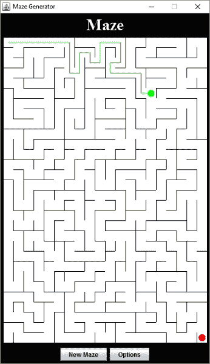

`Anti-Maze` 是稍有改变的 `Maze Generator`：你只能通过跨过线条来移动迷宫。你不能穿过开放空间。

这是 `Anti-Maze` 程序的截图：

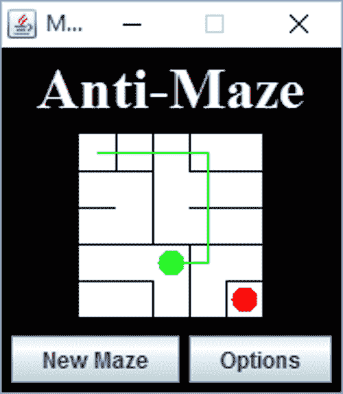

### 课程 7.1 - 绘制面板：颜色、矩形、线条、圆形和首选大小

在本课程中，你将在面板上绘制彩色线条、矩形和圆形。如果面板只包含绘制，你必须设置面板的首选大小。

#### 尝试 - 为 MazeGenerator 进行初始设置

开始编写 `Maze Generator` 程序。

1. 创建一个名为 `Maze Generator` 的新 `Java project`，并将项目 `My Components` 添加到 `Maze Generator` 中。

2. 在项目中创建一个名为 `_______________________.mazegenerator` 的新 `package`。

3. 创建一个名为 `MazeGenerator` 的新 `class`，父类为 `JFrame`，并带有 `main()` 方法的存根。

4. 使用 Quick Fix 添加一个名为 `serialVersionUID` 的私有静态 final 实例变量，设置为 `1L`。

5. 添加一个名为 `titleLabel` 的私有 `TitleLabel` 实例变量，文本为“Maze”。

6. 添加一个无参数的 `MazeGenerator` 构造函数。在构造函数中：

    1. 调用 `initGUI()`。

    2. 将窗口标题设置为“Maze Generator”，禁用调整大小、打包窗口、居中窗口、显示窗口并关闭时退出。

7. 创建一个名为 `initGUI()` 的新私有方法。它不接受任何参数。在 `initGUI()` 中，将 `titleLabel` 添加到窗口顶部。

8. 在 `main()` 中添加代码以使用特定的外观，并在队列上创建一个新的 `MazeGenerator` 对象。

*Listing 7-1，源自 MazeGenerator.java*

```
package annette.godland.mazegenerator;

import java.awt.BorderLayout;
import java.awt.EventQueue;

import javax.swing.JFrame;
import javax.swing.UIManager;

import annette.godland.components.TitleLabel;

public class MazeGenerator extends JFrame {
  private static final long serialVersionUID = 1L;

  private TitleLabel titleLabel;

  public MazeGenerator() {
    initGUI();
    setTitle("Maze Generator");
    setResizable(false);
    pack();
    setLocationRelativeTo(null);
    setVisible(true);
    setDefaultCloseOperation(EXIT_ON_CLOSE);
  }

  private void initGUI() {
    add(titleLabel, BorderLayout.NORTH);
  }

  public static void main(String[] args) {
    try {
      UIManager.setLookAndFeel(UIManager.getSystemLookAndFeelClassName());
    } catch (Exception e) {}

    EventQueue.invokeLater(new Runnable() {
      public void run() {
        MazeGenerator className = new MazeGenerator();
      }
    });
  }
}
```

*Completed listing*

##### 运行

窗口应该显示标题“Maze”。

#### 尝试 - 创建 Cell 类

游戏不再使用按钮网，而是使用面板网，`MazeGenerator` 将上面绘制图形。

1. 在 `mazegenerator` 包中创建一个名为 `Cell` 的新 `class`，父类为 `JPanel` 且不带代码。

2. 使用 Quick Fix 添加一个名为 `serialVersionUID` 的私有静态 final 变量，设置为 `1L`。

3. 添加一个名为 `SIZE` 的私有静态 final 变量，设置为 `20`。

*Listing 7-2，源自 Cell.java*

```
package annette.godland.mazegenerator;

import javax.swing.JPanel;

public class Cell extends JPanel {
  private static final long serialVersionUID = 1L;
  private static final int SIZE = 20;
}
```

*Completed listing*

为了在面板上绘制，你必须提供一个名为 `paintComponent()` 的方法，接受一个 `Graphics` 对象参数且不返回任何值。

`Graphics` 有许多方法可以设置颜色、绘制形状等。例如，要在名为 `g` 的 `Graphics` 对象上从位置 `0, 5` 绘制线条到位置 `10, 20`，使用：

```
g.drawLine(0, 5, 10, 20);
```

1. 为 `Cell` 添加一个名为 `paintComponent()` 的新公共方法。`paintComponent()` 应该接受一个名为 `g` 的 `Graphics` 对象参数。

2. 在 `paintComponent()` 中在 `g` 上绘制一条从坐标 `0` 和 `0` 到坐标 `SIZE` 和 `SIZE` 的线条。（提示：使用 `Graphics` 的 `drawLine()` 方法。）

*Listing 7-3，源自 Cell.java*

```
 ...

  public void paintComponent(Graphics g) {
    g.drawLine(0, 0, SIZE, SIZE);
  }
    ...
```

*Completed listing*

#### 尝试 - 将 Cell 添加到窗口

接下来，将 `Cell` 添加到窗口。

1. 回到 `MazeGenerator.java`。

2. 在 `initGUI()` 中创建一个名为 `cell` 的 `Cell` 对象，通过调用 `Cell` 的构造函数进行初始化。

3. 将 `cell` 添加到窗口中心。（提示：使用 `JFrame` 的 `add()` 方法和 `BorderLayout` 的 `CENTER` 变量。）

*Listing 7-4，来自 `MazeGenerator.java`*

```
 ...

  private void initGUI() {
    add(titleLabel, BorderLayout.PAGE_START);

    Cell cell = new __________________;
    add(___________________________);
  }
    ...
```

*已完成列表*

##### 运行它

窗口应该显示标题，下方有一条细细的灰色条。细的灰色条左侧有一有一条对角线。但窗口没有显示本应延伸到位置 `20, 20` 的完整线条。

#### 尝试一下 - 设置 Cell 的首选尺寸

窗口没有显示 `cell` 的完整线条，因为 `cell` 的大小尚未设置。

1. 返回 `Cell.java`。

2. 添加一个名为 `getPreferredSize()` 的公共方法。它不应该接受任何参数并返回一个 `Dimension`。

3. 创建一个名为 `size` 的新 `Dimension` 对象，宽为 `SIZE`，高为 `SIZE`。

4. 返回 `size`。

*Listing 7-5，来自 `Cell.java`*

```
 ...

  _________________ getPreferredSize(________) {
    ________________ size = new __________________;
    return ________;
  }
    ...
```

*已完成列表*

##### 运行它

窗口应该在标题下方显示完整的对角线线条。

#### 尝试一下 - 在面板上绘制矩形

绘制矩形与画线类似：使用 `drawRect()` 并传入矩形左上角的位置以及矩形的宽度和高度。要在 `0, 5` 处画一个宽 `10` 像素、高 `20` 像素的矩形，请使用：

```
g.drawRect(0, 5, 10, 20)
```

矩形将是什么颜色的？默认是黑色。但如果你想使用不同的颜色，请先用 `Graphics` 的 `setColor()` 方法切换颜色。

你也可以使用类似于 `drawRect()` 的方法来绘制填充矩形：

```
g.fillRect(0, 5, 10, 20)
```

尝试这些新方法，画一个与 `Cell` 大小相同且黑色边框的实心白色正方形。

1. 移除 `paintComponent()` 中的代码。

2. 将 `g` 的颜色设置为白色。（提示：使用 `Graphics` 的 `setColor()` 方法。）

3. 在 `g` 上绘制一个填充整个 `cell` 的填充矩形。（提示：使用 `Graphics` 的 `fillRect()` 方法填充从 `0, 0` 开始、宽为 `SIZE`、高为 `SIZE` 的矩形。）

4. 将 `g` 的颜色设置为黑色。（提示：使用 `Graphics` 的 `setColor()` 方法。）

5. 在 `g` 上沿 `cell` 的所有边缘绘制一个矩形。（提示：使用 `Graphics` 的 `drawRect()` 方法和 `size`。提示：一个适应 `10` 像素区域的矩形需要在第 `0` 列、第 `9` 列以及第 `0` 行、第 `9` 行画线。提示：根据 `SIZE` 计算这些数字。）

*Listing 7-6，来自 `Cell.java`*

```
 ...

  public void paintComponent(Graphics g) {
    g.setColor(_______________);
    g.fillRect(_______________);
    g.setColor(_______________);
    g.drawRect(_______________);
  }
    ...
```

*已完成列表*

##### 运行它

窗口应该在窗口左侧、标题下方显示一个黑色边框的白色正方形。

#### 尝试一下 - 绘制圆形

这个游戏你需要的另一种绘制形状是圆形。在画圆形之前，想象一个包围圆形的矩形。要画圆形，请使用 `drawOval()` 并传入该矩形的位置、宽度和高度。例如，要在位于 `0, 10`、宽 `30`、高 `15` 的矩形内画一个椭圆，请使用：

```
g.drawOval(0, 10, 30, 15);
```

就像 Java 提供了 `drawRect()` 和 `fillRect()` 方法一样，它也提供了 `drawOval()` 和 `fillOval()` 方法，后者用于绘制填充的圆形或椭圆。

在 `paintComponent()` 中添加代码，在正方形内部画一个较小的绿色圆形。

1. 将 `g` 的颜色设置为绿色。（提示：使用 `Graphics` 的 `setColor()` 方法。）

2. 在 `g` 上绘制一个位于 `cell` 居中的填充圆，它比 `cell` 小 `6` 像素。（提示：使用 `Graphics` 的 `fillOval()` 方法。提示：如果圆形比正方形小 `6` 像素，你必须从哪里开始画圆形才能让圆形看起来在正方形中是居中的？提示：根据 `SIZE` 计算这个数字。）

*Listing 7-7，来自 `Cell.java`*

```
 ...

  public void paintComponent(Graphics g) {
    g.setColor(_______________);
    g.fillRect(_______________);
    g.setColor(_______________);
    g.drawRect(_______________);
    g.fillOval(,, 
);
  }
```

*已完成列表*

##### 运行它

窗口应该在正方形内显示一个小小的绿色圆形。

```
 ...

  public void paintComponent(Graphics g) {
    // 绘制背景
    g.setColor(Color.WHITE);
    g.fillRect(0, 0, SIZE, SIZE);
    g.setColor(Color.BLACK);

      （此处删除了代码。）

    // 绘制墙壁

    // 绘制路径

    // 绘制小球

  }
    ...
```

*已完成列表*

单元格在创建时，四面墙壁都存在。稍后，`MazeGenerator` 将在生成迷宫时移除墙壁。在程序运行期间，`paintComponent()` 会被多次调用，包括在移除某些墙壁之后。因此，`paintComponent()` 需要仅为仍然存在的单元格墙壁绘制线条。

1. 在 `paintComponent()` 的 `draw the walls` 部分，如果顶墙存在，则在单元格的顶部绘制一条线。（提示：`wall` 中的 `TOP` 元素为 `true` 吗？提示：从单元格的左上角 `0, 0` 开始绘制一条线。你应该改变 `x` 还是 `y` 来向右移动？绘制长度为 `SIZE` 的线。）

2. 如果左侧墙存在，则在单元格的左边缘绘制一条线。（提示：`wall` 中的 `LEFT` 元素为 `true` 吗？提示：从单元格的左上角 `0,0` 开始绘制一条线。你应该改变 `x` 还是 `y` 来绘制一条向下的线？绘制长度为 `SIZE` 的线。）

注意：`MazeGenerator.java` 中的代码将会有语法错误，因为 `Cell` 构造函数的参数发生了变化。

*列表 7-12，来自 `Cell.java`*

```
 ...

  public void paintComponent(Graphics g) {

      ...

    // 绘制墙壁
    if (____________) {
      g.drawLine(____________________);
    }
    if (____________) {
      g.drawLine(____________________);
    }
      ...
```

*已完成列表*

注意：你只需要绘制单元格的顶部和左侧墙，因为相邻的单元格会绘制它的其他墙壁。

#### 尝试一下 - 在窗口中带有带墙的单元格网格

更新 `MazeGenerator`，现在添加一个 `5` 行 `5` 列的单元格网格。

1. 返回 `MazeGenerator.java`。

2. 添加名为 `rows` 和 `cols` 的 `private integer` 实例变量，每个初始化为 `5`。

3. 创建一个名为 `cell` 的 `private Cell` 二维数组实例变量，具有 `rows` 行 `cols` 列。

4. 创建一个名为 `mazePanel` 的 `private JPanel` 实例变量，通过调用 `JPanel` 的构造函数进行初始化。

注意：代码会有语法错误，因为 `Cell` 构造函数的参数已更改。

*列表 7-13，来自 `MazeGenerator.java`*


```
 ...

public class MazeGenerator extends JFrame {
  private static final long serialVersionUID = 1L;

  ______________ rows = ___;
  ______________ cols = ___;
  ______________ cell = new Cell[____][____];

  private TitleLabel titleLabel = new TitleLabel("Maze");
  ______________ mazePanel = ________________;

    ...
```

---

*已完成列表*

`Cell` 中新的构造函数导致 `MazeGenerator` 出现语法错误。

1. 在 `initGUI()` 中，移除创建 `cell` 并将 `cell` 添加到窗口中心的代码。
2. 为 `initGUI()` 的各个部分添加注释，如中心面板、迷宫面板、按钮面板和监听器。

*列表 7-14，来自 `MazeGenerator.java`*

---

```
 ...

  private void initGUI() {
    add(titleLabel, BorderLayout.PAGE_START);

      （此处删除了代码。）

    // 中心面板

    // 迷宫面板

    // 按钮面板

    // 监听器

  }
    ...
```

---

*已完成列表*

接下来，将迷宫面板添加到窗口中心。

1. 在 `initGUI()` 的 `center panel` 部分，创建一个名为 `centerPanel` 的 `JPanel` 对象。
2. 将 `centerPanel` 的背景颜色设置为黑色。（提示：使用 `JPanel` 的 `setBackground()` 方法。）
3. 将 `centerPanel` 添加到窗口中心。（提示：使用 `JFrame` 的 `add()` 方法和 `BorderLayout` 的 `CENTER` 变量。）
4. 在 `initGUI()` 的 `maze panel` 部分，调用 `newMaze()`。
5. 将 `mazePanel` 添加到 `centerPanel`。（提示：使用 `JPanel` 的 `add()` 方法。）

注意：代码会有语法错误，因为 `newMaze()` 尚不存在。

*列表 7-15，来自 `MazeGenerator.java`*

---

```
 ...

  private void initGUI() {
    add(titleLabel, BorderLayout.PAGE_START);

    // 中心面板    
    __________ centerPanel = new ____________;
    centerPanel._________________;
    add(________________);

    // 迷宫面板
    ____________();
    centerPanel.add(___________);

      ...
```

---

*已完成列表*

现在，将迷宫面板添加到窗口中心。

1. 在 `initGUI()` 的 `center panel` 部分，创建一个名为 `centerPanel` 的 `JPanel` 对象。
2. 将 `centerPanel` 的背景颜色设置为黑色。（提示：使用 `JPanel` 的 `setBackground()` 方法。）
3. 将 `centerPanel` 添加到窗口中心。（提示：使用 `JFrame` 的 `add()` 方法和 `BorderLayout` 的 `CENTER` 变量。）
4. 在 `initGUI()` 的 `maze panel` 部分，调用 `newMaze()`。
5. 将 `mazePanel` 添加到 `centerPanel`。（提示：使用 `JPanel` 的 `add()` 方法。）

注意：代码会有语法错误，因为 `newMaze()` 尚不存在。

*列表 7-16，来自 `MazeGenerator.java`*

---

```
 ...

  private void newMaze() {
    mazePanel.setLayout(new GridLayout(rows, cols));

    for(int r=0; r<rows; r++) {
      for(int c=0; c<cols; c++) {
        cell[r][c] = new Cell(r, c);
        mazePanel.add(cell[r][c]);
      }
    }
  }
```

### 运行它

窗口应该显示所有的单元格。没有任何墙壁被移除。

### 尝试一下 - 为移除墙壁添加方法

为了生成迷宫，`MazeGenerator` 需要移除某些墙壁。首先，`MazeGenerator` 需要一种方法找到哪些单元格（即所有墙壁都存在）。

1. 返回 `Cell.java`。
2. 添加一个名为 `hasAllWalls()` 的 `public` 方法。它不接受参数并返回一个 `boolean`。
3. 添加名为 `allWalls` 的 `boolean` 变量，如果 `wall` 中的每个元素都为 `true`，则为 `true`。（提示：使用逻辑与 `&&` 比较每个元素。）
4. 返回 `allWalls`。

*列表 7-17，来自 `Cell.java`*

---

```
 ...

  public boolean hasAllWalls() {
    boolean allWalls = wall[0] && wall[1] && wall[2] && wall[3];
    return allWalls;
  }
```

---

*已完成列表*

并且 `MazeGenerator` 需要能够从单元格移除墙壁。

1. 添加一个名为 `removeWall()` 的 `public` 方法。它接受一个名为 `w` 的 `integer` 参数，且不返回。
2. 将 `wall` 中 `w` 元素设置为 `false`。
3. 重绘单元格。（提示：调用 `JPanel` 的 `repaint()` 方法。）

*列表 7-18，来自 `Cell.java`*

---

```
 ...

  public void removeWall(int w) {
    wall[w] = false;
    repaint();
  }
```

---

*已完成列表*

`MazeGenerator` 需要一种方法从一个单元格向另一个单元格开启。需要一个方法来移除单元格之间的墙壁。注意，这涉及到移除两个单元格的墙壁，因为每个单元格最初在四边都有墙。

1. 添加一个名为 `openTo()` 的 `public` 方法。它接受一个名为 `neighbor` 的 `Cell` 参数且不返回。
2. 如果 `row` 小于 `neighbor` 的 `row`，移除此单元格的底墙和 `neighbor` 的顶墙。（提示：使用 `getRow()` 获取 `neighbor` 的 `row`。使用 `removeWall()` 移除单元格的墙，并移除 `neighbor` 的墙。提示：根据需要使用 `TOP`、`BOTTOM`、`LEFT` 或 `RIGHT`。）
3. 否则，如果 `row` 大于邻居的 `row`，移除此单元格的顶墙和 `neighbor` 的底。（提示：根据需要使用 `getRow()`、`removeWall()` 以及 `TOP`、`BOTTOM`、`LEFT` 或 `RIGHT`。）
4. 否则，如果 `col` 小于邻居的列，移除此单元格的右墙和 `neighbor` 的左墙。（提示：根据需要使用 `getCol()`、`removeWall()` 以及 `TOP`、`BOTTOM`、`LEFT` 或 `RIGHT`。）
5. 否则，如果 `col` 大于邻居的列，移除此单元格的左墙和 `neighbor` 的右墙。（提示：根据需要使用 `getCol()`、`removeWall()` 以及 `TOP`、`BOTTOM`、`LEFT` 或 `RIGHT`。）

*Listing 7-19，来自 `Cell.java`*

---

```
 ...

  ________________ openTo(________________) {
    if (________________) {
      removeWall(________);
      neighbor.________;
    }
    else if (________________) {
      removeWall(________);
      neighbor.________;
    }
    else if (________________) {
      removeWall(________);
      neighbor.________;
    }
    else if (________________) {
      removeWall(________);
      neighbor.________;
    }
  }
    ...
```

---

*Completed listing*

### 尝试一下 - 移除某些墙形成迷宫

`MazeGenerator` 需要一种方法来检查单元格是否可以添加到迷宫中，换句话说，该单元格是否仍然拥有四面墙。然而，`MazeGenerator` 必须首先检查给定的行和列是否在迷宫中。

1. 回到 `MazeGenerator.java`。
2. 创建名为 `isAvailable()` 的私有方法。它应该接受两个整数参数分别为 `r` 和 `c`，并返回一个布尔值。
3. 创建名为 `available` 的布尔变量，初始化为 `false`。
4. 如果 `r` 和 `c` 包含有效的行和列值，且 `r` 和 `c` 处的 `cell` 拥有所有四面墙，将 `available` 设置为 `true`。（提示：`r` 和 `c` 必须大于等于 0 且分别小于 `rows` 和 `cols` 的数量。提示：使用 `Cell` 的 `hasAllWalls()` 方法。）
5. 返回 `available`。

*Listing 7-20，来自 `MazeGenerator.java`*

---

```
 ...

  __________________ isAvailable(_______________) {
    _____________ available = _______;
    if (r____ && r_____ && c_____ && c_____
        &&__________.____________()) {
      available = ______;
    }
    return _____________;
  }
    ...
```

---

*Completed listing*

创建新迷宫时生成实际迷宫。

1. 在 `newMaze()` 的末尾调用 `generateMaze()`。

注意：代码将会有语法错误，因为 `generateMaze()` 尚不存在。

*Listing 7-21，来自 `MazeGenerator.java`*

---

```
 ...

  private void newMaze() {  

          ...

        cell[r][c] = new Cell(r, c);
        mazePanel.add(cell[r][c]);
      }
    }

    ________________();
  }
    ...
```

---

*Completed listing*

如何生成一个到达任何单元格都只有一条路且没有不可达单元格的迷宫？

* 从一个随机单元格开始。
* 当不是所有单元格都已访问过时：
    * 找到所有墙壁完好的邻居。
    * 如果找到了一个或多个：
        * 如果找到了多个，将该单元格添加到列表中以稍后尝试。
        * 选择一个邻居并移除相邻的墙。
        * 前往该邻居并访问计数加 1。
    * 如果没有找到，前往列表中保存的单元格之一以稍后尝试。

为计划的代码添加注释有助于你规划步骤和组织代码。

1. 创建名为 `generateMaze()` 的私有方法。它不接受任何参数且不返回任何内容。
2. 为上述每个步骤添加注释。

*Listing 7-22，来自 `MazeGenerator.java`*

---

```
 ...

  _______________ generateMaze(______) {

    // 从一个随机单元格开始

    // 当不是所有单元格都已访问过时

    // 找到所有墙壁完好的邻居

    // 如果找到了一个或多个
    // 如果找到了多个，将此单元格
    // 添加到列表中再次尝试

    // 选择一个邻居并移除墙

    // 前往该邻居并增加
    // 访问数量

    // 如果没有找到，前往保存的
    // 单元格之一稍后尝试

  }
    ...
```

---

*Completed listing*

`MazeGenerator` 需要变量来保存稍后尝试的单元格、单元格总数以及已访问的单元格数量。

1. 创建类型为 `Cell` 的 `ArrayList` 对象 `tryLater`。
2. 创建一个整数 `totalCells` 设置为单元格总数。
3. 创建一个整数 `visitedCells`，初始化为 1。

*Listing 7-23，来自 `MazeGenerator.java`*

---

```
 ...

  private void generateMaze() {
    ______________ tryLater = new _____________;
    _________ totalCells = _________;
    _________ visitedCells = ____;

    // 从一个随机单元格开始

      ...
```

---

*Completed listing*

从一个随机单元格开始生成迷宫。

1. 在“从一个随机单元格开始”注释后，创建一个名为 `rand` 的新 `Random` 对象。
2. 创建一个随机行整数 `r`。
3. 创建一个随机列整数 `c`。

*Listing 7-24，来自 `MazeGenerator.java`*

---

```
 ...

  private void generateMaze() {

      ...

    // 从一个随机单元格开始
    _____________ rand = new _____________;
    _____________ r = rand.____________;
    _____________ c = rand.____________;

      ...
```

---

*Completed listing*

重复生成迷宫的步骤直到所有单元格都被访问。

1. 在“当……已访问过”注释后，添加一个 `visitedCells` 小于 `totalCells` 的循环。
2. 将剩余的注释放在 `while` 块中。

*Listing 7-25，来自 `MazeGenerator.java`*

---

```
 ...

  private void generateMaze() {

      ...

    // 当不是所有单元格都已访问过时
    while (_____________________) {
      // 找到所有墙壁完好的邻居

      // 如果找到了一个或多个
      // 如果找到了多个，将此单元格
      // 添加到列表中再次尝试

      // 选择一个邻居并移除墙

      // 前往该邻居并增加
      // 访问数量

      // 如果没有找到，前往保存的
      // 单元格之一稍后尝试
    }    
  }
    ...
```

---

*Completed listing*

为所有尚未访问的邻居单元格创建一个列表。

1. 在“找到所有墙壁完好的邻居”注释后，创建一个类型为 `Cell` 的 `ArrayList` 对象 `neighbors`，通过调用 `ArrayList` 构造函数初始化。
2. 如果上一行的单元格可用，将该单元格添加到 `neighbors`。（提示：使用 `r-1` 和 `c` 调用 `isAvailable()`。提示：使用 `ArrayList` 的 `add()` 方法。）
3. 如果下一行的单元格可用，将该单元格添加到 `neighbors`。（提示：使用 `isAvailable()`。提示：使用 `ArrayList` 的 `add()` 方法。）


4. 如果左侧列的单元格可用，将该单元格添加到 `neighbors`。（提示：使用 `isAvailable()`。提示：使用 `ArrayList` 的 `add()` 方法。）

5. 如果下一列的单元格可用，将该单元格添加到 `neighbors`。（提示：使用 `isAvailable()`。提示：使用 `ArrayList` 的 `add()` 方法。）

*Listing 7-26，源自 MazeGenerator.java*

```java
 ...

  private void generateMaze() {

        ...

      // 找到所有墙壁完好的邻居
      _______________ neighbors = new _______________;
      if (____________________) {
        neighbors.add(_____________);
      }
      if (____________________) {
        neighbors.add(_____________);
      }
      if (____________________) {
        neighbors.add(_____________);
      }
      if (____________________) {
        neighbors.add(_____________);
      }
        ...
```

*完成列表*

检查是否有任何单元格被可用邻居列表。

1. 在注释“if one or more was found”之后，检查 `neighbors` 的大小是否大于 0。（提示：使用 `ArrayList` 的 `size()`。）

2. 将除最后一个注释以外的所有注释移动到 `if` 块内部。

3. 将最后一个注释放入 `else` 块内部。

*Listing 7-27，源自 MazeGenerator.java*

```java
 ...

  private void generateMaze() {

        ...

      // 如果找到了一个或多个
      if (___________________) {

        // 如果找到了多个，将此
        // 单元格添加到列表以备重试

        // 选择一个邻居并移除墙壁

        // 转到该邻居并增加
        // 访问数量

      }      
      else {
        // 如果没有找到，转到其中
        // 保存的单元格之一稍后尝试

      }
    }  
  }
    ...
```

*完成列表*

如果此单元格有多个可用邻居，则以后需要再次尝试其他单元格。你将在下一步中其中其中一个邻居。

1. 在注释“if more than one was found, add this cell to the list to try again later”之后，检查 `neighbors` 的大小是否大于 1。（提示：使用 `ArrayList` 的 `size()` 方法。）

2. 如果 `neighbors` 的大小大于 1，则将此单元格添加到 `tryLaterCell`。（提示：使用 `ArrayList` 的 `add()` 方法。提示：使用 `r` 和 `c` 处的 `cell`。）

*Listing 7-28，源自 MazeGenerator.java*

```java
 ...

  private void generateMaze() {

          ...

        // 如果找到了多个，将此
        // 单元格添加到列表以备重试
        if (_________________) {
          tryLaterCell.add(_______________);
        }
          ...
```

*完成列表*

从此单元格的可用邻居列表中随机选择一个邻居，并打开通往该邻居的路径。

1. 在注释“pick a neighbor and remove the wall”之后，创建一个名为 `pick` 的整数，将其设置为 0 到 `neighbors` 大小之间的随机数。（提示：使用 `Random` 的 `nextInt()` 方法。）

2. 创建一个名为 `neighbor` 的新 `Cell` 对象，将其设置为 `neighbors` 中 `pick` 处的单元格。（提示：使用 `ArrayList` 的 `get()` 方法。）

3. 打开通往 `neighbor` 的墙。（提示：对 `r` 和 `c` 处的 `cell` 调用 `Cell` 的 `openTo()` 方法。）

*Listing 7-29，源自 MazeGenerator.java*

```java
 ...

  private void generateMaze() {

          ...

        // 选择一个邻居并移除墙壁
        ______ pick = rand.nextInt(______________);
        Cell neighbor = neighbors.get(____________);
        cell[r][c].________________;

          ...
```

*完成列表*

将该相邻单元格设置为新的当前单元格，并增加访问过的单元格总数。

1. 在注释“go to the neighbor and increment the number visited”之后，将 `r` 和 `c` 设置为 `neighbor` 的行列。（提示：对 `neighbor` 使用 `Cell` 的 `getRow()` 和 `getCol()` 方法。）

2. 增加 `visitedCells`。

*Listing 7-30，源自 MazeGenerator.java*

```java
 ...

  private void generateMaze() {

          ...

        // 转到邻居并增加
        // 访问数量
        r = ________________;
        c = ________________;
        visitedCells______;

          ...
```

*完成列表*

如果当前单元格的所有邻居都已经被访问，则转到一个之前保存稍后尝试的单元格。

1. 在注释“if none was found, go to one of the cells that was saved to try later”之后，创建一个名为 `nextCell` 的新 `Cell` 对象，通过从 `tryLaterCell` 中移除第一个单元格来初始化。（提示：使用 `ArrayList` 的 `remove()` 方法。）

2. 将 `r` 和 `c` 设置为 `nextCell` 的行列。（提示：使用 `Cell` 的 `getRow()` 和 `getCol()` 方法。）

*Listing 7-31，源自 MazeGenerator.java*

```java
 ...
  private void generateMaze() {

        ...

      else {
        // 如果没有找到，转到其中
        // 保存的单元格之一稍后尝试
        ____________ nextCell = tryLaterCell.remove();
        r = nextCell.___________;
        c = nextCell.___________;
      }
*完成列表*

### 运行它

窗口现在应该显示迷宫。

### 关键点及更多

* 要在 `JPanel` 上绘图，为该面板创建一个名为 `paintComponent()` 的方法。`paintComponent()` 应该接受一个参数 `Graphics`，并且没有返回值。
* 当窗口移动、最小化、最大化、隐藏在另一个窗口后面或程序告诉窗口重绘时，Java 会调用 `paintComponent()`。因此，每当调用 `paintComponent()` 时必须绘制整个面板。
* `Graphics` 有许多绘制和绘画方法。本节中使用及以后再次使用的包括：
    * `setColor()` - 设置当前绘制颜色。`setColor()` 需要一个 `Color` 参数。参数值可以是任何预定义颜色或新的 `Color` 对象。
    * `drawLine()` - 使用当前绘制颜色画线。`drawLine()` 需要四个整数参数：起点的 x 和 y 坐标，以及终点的 x 和 y 坐标。
    * `drawRect()` 和 `fillRect()` - 使用当前绘制颜色绘制矩形轮廓和填充矩形。每个都需要四个参数，给出矩形角的 x 和 y 坐标，以及矩形的宽度和高度。
    * `drawOval()` 和 `fillOval()` - 使用当前绘制颜色绘制椭圆轮廓和填充椭圆。每个都需要四个整数参数。想象包含所需椭圆的矩形。然后给出该矩形角的 x 和 y 坐标，以及矩形的宽度和高度。要制作圆形，对宽度和高度使用相同的值。
    * `drawString()` 将在章节中解释。
* 尽量减少 `paintComponent()` 方法执行的工作。你应该尽量让 `paintComponent()` 代码运行得越快越好。
* 当你想再次绘制面板时，调用 `JPanel` 的 `repaint()` 方法，例如更改了影响面板绘制方式的实例变量时。
* 当由于任何原因必须重绘窗口时，Java 调用 `paintComponent()`。
* 始终调用 `JPanel` 的 `repaint()` 方法而不是它的 `paintComponent()` 方法。如果你使用 `repaint`，Java 将你对组件的绘制请求与其他组件的绘制请求合并为一个绘制过程。例如，如果程序用户用另一个窗口覆盖你的程序窗口的一部分，Windows 会向你的程序发送另一个重绘组件的请求。

* `repaint()` 和 `revalidate()` 之间有什么区别？`repaint()` 重新绘制组件。`revalidate()` 重新计算组件以及组件包含的任何组件的布局。当组件内容需要重绘时，调用 `repaint()`。当组件可能发生了变化时，调用 `revalidate()`。有时你可能需要同时调用 `revalidate()` 和 `repaint()`。

* 如果你有一个自定义绘制的面板，你还应该提供一个名为 `getPreferredSize()` 的公共方法。`getPreferredSize()` 不应接受任何参数并返回一个 `Dimension`。该尺寸应该是面板的优选尺寸。
    * 布局管理器会寻找 `getPreferredSize()` 方法，以确定在打包窗口时为面板留出多少空间。如果没有提供 `getPreferredSize()` 方法，布局管理器可能不会为面板留出任何空间。
    * 为什么要提供 `getPreferredSize()` 方法，而不是像你在之前的程序中那样使用 `setPreferredSize()` 呢？你不希望面板的大小发生任何变化，因为你在面板上绘制了特定尺寸的线、矩形和圆。对于具有 `getPreferredSize()` 方法的面板，`setPreferredSize()` 没有影响。通过提供 `getPreferredSize()` 方法，你可以确保面板始终以该尺寸显示，并且不会被随后的 `setPreferredSize()` 调用所改变。

* 当在本本书中创建 Java 项目时，选择 `Use an execution environment JRE of JavaSE-1.7` 或更高选项。一旦你在创建项目时选择了此选项，Eclipse 将对所有未来的 Java 项目默认使用该选项。

## 课程 7.2 - 按键监听器

程序需要将在按下光标键（上、下、左、右）时做出响应，以便球穿过迷宫。

### 尝试一下 - 添加绘制球的单元方法

接下来，看看如何解决谜题。你用红球标记迷宫的终，用绿球标记用户在迷宫中的当前位置。

1. 返回 `Cell.java`。
2. 添加名为 `current` 和 `end` 的私有布尔实例变量，每个初始化为 `false`。

*列表 7-32，源自 Cell.java*

```java

 ...

  private boolean[] wall = {true, true, true, true};

  ______________ current = _______;

  ______________ end = ______;

    ...

```

* * *

*已完成列表*

`MazeGenerator` 需要一种方法让单元变为当前单元。

1. 添加一个名为 `setCurrent()` 的公共方法。它应该接受一个名为 `current` 的布尔值参数，且没有返回值。
2. 将实例变量 `current` 设置为参数 `current` 值。（提示：使用 `this`。）
3. 重绘单元。（提示：使用 `JPanel` 的 `repaint()` 方法。）

*列表 7-33，源自 Cell.java*

```java

 ...

  ______________ setCurrent(_____________) {

    _________.current = __________;

    ____________;

  }

    ...

```

* * *

*已完成列表*

并且 `MazeGenerator` 需要一种方法让单元变为终点单元。

1. 添加一个名为 `setEnd()` 的公共方法。它应该接受一个名为 `end` 的布尔值参数，且没有返回值。
2. 将实例变量 `end` 设置为参数 `end` 值。（提示：使用 `this`。）
3. 重绘单元。（提示：使用 `JPanel` 的 `repaint()` 方法。）

*列表 7-34，源自 Cell.java*

```java

 ...

  ______________ setEnd(____________) {

    _________.end = __________;

    ______________;

  }

    ...

```

* * *

*已完成列表*

如果此单元是当前单元，则画绿球；如果此单元是终点单元，则画红球。

1. 在 `paintComponent` 的 *draw the balls* 部分，如果 `current` 为 `true`：
    1. 将 `g` 的颜色设置为绿色。（提示：使用 `Graphics` 的 `setColor()` 方法。）
    2. 在 `g` 上画一个以单元为中心的实心圆，比单元小 6 像素。（提示：使用 `Graphics` 的 `fillOval()` 方法。提示：如果圆比正方形小 6 像素，你应该从哪里开始画圆才能让圆看起来位于正方形的中心？）
2. 否则，如果 `end` 为 `true`：
    1. 将 `g` 的颜色设置为红色。（提示：使用 `Graphics` 的 `setColor()` 方法。）
    2. 在 `g` 上画一个以单元为中心的实心圆，比单元小 6 像素。（提示：画一个和绿球一样大的红球。）

*列表 7-35，源自 Cell.java*

```java

 ...

  public void paintComponent(Graphics g) {

      ...

    // draw the balls

    if (_____________) {

      g.setColor(______________);

      g.fillOval(___________________);

    }

    else if (__________) {

      g.setColor(_______________);

      g.fillOval(___________________);

    }

      ...

```

* * *

*已完成列表*

### 尝试一下 - 绘制位置和终点球

`MazeGenerator` 还没有绘制球。因为 `MazeGenerator` 还没有设置当前和终点位置。首先创建存储这些值的变量。

1. 返回 `MazeGenerator.java`。
2. 添加两个名为 `row` 和 `col` 的私有整数实例变量，初始化为 0。
3. 添加两个名为 `endRow` 和 `endCol` 的私有整数实例变量，分别比 `rows` 和 `cols` 小 1。

*列表 7-36，源自 MazeGenerator.java*

```java

 ...

  private Cell[][] cell = new Cell[rows][cols];

  private row = ____;

  private col = ____;

  private endRow = ________;

  private endCol = ________;

    ...
```


*已完成列表*

当创建一个新迷宫时，重置当前和终点变量。

1. 在`newMaze()`方法末尾添加代码将`row`和`col`设置为 0。
2. 将`endRow`和`endCol`分别设置为`rows`和`cols`小 1。
3. 将`cell[row][col]`设置为当前单元。（使用`Cell`的`setCurrent()`方法。）
4. 将`cell[endRow][endCol]`设置为终点。（使用`Cell`的`setEnd()`方法。）

*列表 7-37，源自 MazeGenerator.java*

```
 ...

  private void newMaze() { 

      ...

    generateMaze();

    row = ____;

    col = ____;

    endRow = ________;

    endCol = ________;

    cell[row][col].________________;

    cell[endRow][endCol].____________;

  }
```

*已完成列表*

### 运行一下

绿球应该在迷宫的左上角，红球在右下角。

### 尝试一下 - 添加绘制路径的单元方法

`MazeGenerator`会留下尝试过的路径痕迹。注意，每个单元可能从四个不同的方向进入或离开：从顶部、底部、左侧或右侧。

1. 返回`Cell.java`。
2. 添加一个名为`path`的私有布尔数组实例变量，初始化为`{false, false, false, false}`。

*列表 7-38，源自 Cell.java*

```
 ...

  private boolean[] wall = {true, true, true, true};

  private________________ path = {___________________};

    ...
```

*已完成列表*

`MazeGenerator`需要一种方法来更新通过单元的路径。

1. 添加一个名为`addPath()`的公共方法。它应该接受一个名为`side`的整数参数，且没有返回值。
2. 将`path`数组中索引`side`的元素设置为`true`。
3. 重绘单元。（提示：使用`JPanel`的`repaint()`方法。）

*列表 7-39，源自 Cell.java*

```
 ...

  _____________ addPath(_________) {

    path[_________] = _________;

    ____________();

  }

    ...
```

*已完成列表*

接下来，绘制通过此单元的路径。

1. 在`paintComponent`的 *draw the path* 部分，将`g`的颜色设置为绿色。
2. 如果后续路径为`true`，则绘制对应的线。（提示：使用`Graphics`的`drawLine()`方法。提示：使用`SIZE`计算单元格的中间位置和中心。）
   - 如果`path`中的`TOP`元素为`true`，则在`g`上画一条从单元格顶部边缘中间到单元格中心的线。
   - 如果`path`中的`BOTTOM`元素为`true`，则在`g`上画一条从单元格底部边缘中间到单元格中心的线。
   - 如果`path`中的`LEFT`元素为`true`，则在`g`上画一条从单元格左侧边缘中间到单元格中心的线。
   - 如果`path`中的`RIGHT`元素为`true`，则在`g`上画一条从单元格右侧边缘中间到单元格中心的线。

*Listing 7-40，来自 Cell.java*

```
 ...

  public void paintComponent(Graphics g) {

      ...

    // draw the path

    g.setColor(________________);

    if (path[________]) {

      g.drawLine(______________________);

    }

    if (path[________]) {

      g.drawLine(______________________);

    }

    if (path[________]) {

      g.drawLine(______________________);

    }

    if (path[________]) {

      g.drawLine(______________________);

    }

      ...
```

*Completed listing*

### Try 尝试 - 监听按键

接下来你将添加代码让绿球穿过迷宫。

为了让`MazeGenerator`监听键盘的按键，请添加一个按键监听器。添加按键监听器与添加动作监听器非常相似。

不需要将按键监听器添加到按钮上，而是将其添加到窗口本身（`JFrame`）上。

1. 在`initGUI()`的`listeners`部分，通过插入完全所示的代码为窗口添加一个按键监听器。

*Listing 7-41，来自 MazeGenerator.java*

```
 ...

  private void initGUI() {

      ...

    // listeners

    addKeyListener(new KeyAdapter() {

      public void keyReleased(KeyEvent e) {

      }

    });

      ...
```

*Completed listing*

一个`KeyEvent`包含有关被按下按键的信息。例如，要从名为`e`的`KeyEvent`中获取输入的字符，请使用：

```
e.getKeyChar()
```

1. 在`KeyAdapter`的`keyReleased()`方法中添加代码以：
   - 创建一个名为`c`的字符，通过从`e`获取字符进行初始化。（提示：使用`KeyEvent`的`getKeyChar()`方法。）
   - 将`c`打印到输出控制台。（提示：使用`System.out.println()`。）

*Listing 7-42，来自 MazeGenerator.java*

```
 ...

  private void initGUI() {

      ...

    addKeyListener(new KeyAdapter() {

      public void keyReleased(KeyEvent e) {

        __________ c = e.____________();

        _________________;

      }

    });

      ...
```

*Completed listing*

### Run 运行

如果按键关联了字符，按下它应该会在 Eclipse 输出控制台中打印该键关联的字符。

### Try 尝试 - 当按下光标键时移动球

键盘上并不是所有键都关联了字符。例如，按下 shift 键或光标移动键会导致`MazeGenerator`在控制台上打印一个“?”。你如何检查这些非字符键是否被按下了？

每个按键都有一个按键代码。`KeyEvent`为每个键定义了一个静态整数按键代码值。光标向上按键代码为`VK_UP`，向下为`VK_DOWN`，向左为`VK_LEFT`，向右为`VK_RIGHT`。

替换`initGUI()`中`KeyAdapter`的`keyReleased()`方法中的代码，现在改为检查光标移动键：

1. 在`initGUI()`中`KeyAdapter`的`keyReleased()`方法中，移除从`e`获取字符并打印它的两行代码。
2. 创建一个名为`keyCode`的整数，通过获取`e`的按键代码进行初始化。（提示：使用`KeyEvent`的`getKeyCode()`方法。）
3. 以`keyCode`作为参数值调用`moveBall()`。

注意：代码将会有语法错误，因为`moveBall()`尚未存在。

*Listing 7-43，来自 MazeGenerator.java*

```
 ...

  private void initGUI() {

      ...

    addKeyListener(new KeyAdapter() {

      public void keyReleased(KeyEvent e) {

          (Code was removed from here)

        ________ keyCode = ________;

        ________(keyCode);

      }

    ...

```

3. 将第二个单元格的路径设置为`secondDirection`。（提示：使用`Cell`的`addPath()`方法。）

注意：该代码将有一个语法错误，因为`moveTo()`的参数发生了变化。

*Listing 7-46，来自 MazeGenerator.java*

```
 ...

  private void moveTo(int nextRow, int nextCol, ___________________) {

    cell[row][col].setCurrent(false);

    cell[row][col].___________________;

    row = nextRow;

    col = nextCol;

    cell[row][col].setCurrent(true);

    cell[row][col].___________________;

  }

    ...
```

*完成的列表*

1. 更新`moveBall()`中每个 case 的代码：
   - 要让球向上移动，调用`moveTo`并传入额外的顶部和底部的参数值。（提示：使用`Cell`的`TOP`和`BOTTOM`变量。）
   - 要让球向下移动，调用`moveTo`并传入额外的底部和顶部的参数值。（提示：使用`Cell`的`BOTTOM`和`TOP`变量。）
   - 要让球向左移动，调用`moveTo`并传入额外的左侧和右侧参数值。（提示：使用`Cell`的`LEFT`和`RIGHT`变量。）
   - 要让球向右移动，调用`moveTo`并传入额外的右侧和左侧参数值。（提示：使用`Cell`的`RIGHT`和`LEFT`变量。）

*Listing 7-47，来自 MazeGenerator.java*

```
 ...

  private void moveBall(int direction) {

    switch (direction) {

    case UP :

      // 如果此单元格没有顶墙则向上移动

      if (!cell[row][col].isWall(Cell.TOP)) {

        moveTo(row-1, col, ___________________);

      }

      break;

    case DOWN :

      // 如果此单元格没有底墙则向下移动

      if (!cell[row][col].isWall(Cell.BOTTOM)) {

        moveTo(row+1, col, ___________________);

      }

      break;

    case LEFT :

      // 如果此单元格没有左墙则向左移动

      if (!cell[row][col].isWall(Cell.LEFT)) {

        moveTo(row, col-1, ___________________);

      }

      break;

    case RIGHT :

      // 如果此单元格没有右墙则向右移动

      if (!cell[row][col].isWall(Cell.RIGHT)) {

        moveTo(row, col+1, ___________________);

      }

      break;

    }

  }

    ...
```

*完成的列表*

### 运行一下

按下方向键应该会让绿球穿过迷宫，并留下球经过的绿色痕迹。

### 尝试一下 - 按键移动得更远

再增加一点功能会让迷宫移动变得容易一点。每当你按下方向键时，让球继续直线移动，直到它遇到一个可以转向的开口，或者球被墙挡住。

1. 在`moveBall()`的每个 case 中添加代码。（提示：根据需要使用`Cell`的`isWall()`和`moveTo()`方法以及`Cell`的`TOP`、`BOTTOM`、`LEFT`和`RIGHT`变量。）
   - 向上移动后，当`row`和`col`处的单元格没有顶墙且同时具有左右墙时，移动到上一行。
   - 向下移动后，当`row`和`col`处的单元格没有底墙且同时具有左右墙时，移动到下一行。
   - 向左移动后，当`row`和`col`处的单元格没有左墙且同时具有上下墙时，移动到前一列。
   - 向右移动后，当`row`和`col`处的单元格没有右墙且同时具有上下墙时，移动到下一列。

*Listing 7-48，来自 MazeGenerator.java*

```
 ...

  private void moveBall(int direction) {

    switch (direction) {

    case UP :

      // 如果此单元格没有顶墙则向上移动

      if (!cell[row][col].isWall(Cell.TOP)) {

        moveTo(row-1, col, Cell.TOP, Cell.BOTTOM);

        // 如果是长列，继续向上移动

        while (cell[row][col].isWall(Cell.LEFT) && cell[row][col].isWall(Cell.RIGHT)) {

          moveTo(...)

        }

      }

      break;

    case DOWN :

      // 如果此单元格没有底墙则向下移动

      if (!cell[row][col].isWall(Cell.BOTTOM)) {

        moveTo(row+1, col, Cell.BOTTOM, Cell.TOP);

        // 如果是长列，继续向下移动

        while (cell[row][col].isWall(Cell.LEFT) && cell[row][col].isWall(Cell.RIGHT)) {

          moveTo(...)

        }

      }

      break;

    case LEFT :

      // 如果此单元格没有左墙则向左移动

      if (!cell[row][col].isWall(Cell.LEFT)) {

        moveTo(row, col-1, Cell.LEFT, Cell.RIGHT);

        // 如果是长行，继续向左移动

        while (cell[row][col].isWall(Cell.TOP) && cell[row][col].isWall(Cell.BOTTOM)) {

          moveTo(...)

        }

      }

      break;

    case RIGHT :

      // 如果此单元格没有右墙则向右移动

      if (!cell[row][col].isWall(Cell.RIGHT)) {

        moveTo(row, col+1, Cell.RIGHT, Cell.LEFT);

        // 如果是长行，继续向右移动

        while (cell[row][col].isWall(Cell.TOP) && cell[row][col].isWall(Cell.BOTTOM)) {

          moveTo(...)

        }

      }

      break;

    }

  }

    ...
```


*完成的列表*

### 运行一下

每次按下方向键时，绿球都应该直线移动，直到到达一个需要转向的单元格。

### 尝试一下 - 当解决迷宫时

如何判断用户解决了迷宫？如果球移动到了`endRow`和`endCol`处的单元格，则迷宫被解决了。

1. 在`moveBall()`的最后，检查`row`和`col`是否位于`endRow`和`endCol`。如果是：

   1. 创建一个字符串为`message`，祝贺用户解决了迷宫。

   2. 在消息框中显示`message`。（提示：使用`JOptionPane`的`showMessageDialog()`方法。）

*Listing 7-49，来自 MazeGenerator.java*

```
 ...

  private void moveBall(int direction) {

            ...

          moveTo(row, col+1, Cell.RIGHT, Cell.LEFT);

        }

      }

      break;

    }

    // 迷宫解决了？

    if (_____________ && _______________) {

      String message = "__________________________";

      JOptionPane.showMessageDialog(_______________);

    }

  }

    ...
```

*完成的列表*

### 运行一下

当迷宫解决时，应该显示祝贺消息。

### 尝试一下 - 添加“新迷宫”按钮

这个游戏的另一个改进是添加一个按钮来生成新迷宫。

1. 在`initGUI()`的*按钮面板*部分，创建一个名为`buttonPanel`的`JPanel`对象。

2. 将`buttonPanel`为黑色。（提示：使用`JButton`的`setBackground()`方法。）

3. 将`buttonPanel`添加到窗口底部。（提示：使用`JFrame`的`add()`方法和`BorderLayout`的`PAGE_END`变量。）

4. 创建一个名为`newMazeButton`的`JButton`对象，文本为“New Maze”。

5. 为`newMazeButton`添加动作监听器，在点击按钮时调用`newMaze()`。（提示：使用`JButton`的`addActionListener()`方法，并将一个新的`ActionListener`对象作为参数值。在`ActionListener`中，添加一个名为`actionPerformed()`的公共方法。`actionPerformed()`应该有一个参数`ActionEvent`且没有返回值。在`actionPerformed()`中调用`newMaze()`。）

6. 将`newMazeButton`添加到`buttonPanel`中。

*Listing 7-50，来自 MazeGenerator.java*

```java

 ...

  private void initGUI() {

      ...

    // button panel    

    ____________ buttonPanel = new ___________;

    buttonPanel.set____________(______________);

    add(buttonPanel, ___________________);

    _____________ newMazeButton = new _______________;

    newMazeButton.addActionListener(_______________() {

      ________________ actionPerformed(________________) {

        _____________();

      }

    });

    buttonPanel.________________;

      ...
```

*已完成列表*

### 运行一下

窗口应该显示`New Maze`（新迷宫）按钮，但点击它似乎没有任何反应。

### 尝试一下 - 移除并重新验证组件

为什么`New Maze`按钮没有反应？因为所有旧的单元格仍在面板上，而新单元格只是被添加到了窗口大小之外。必须移除旧单元格并重新显示面板，才能显示新单元格。

1. 在`newMaze()`中，在方法的开始处从`mazePanel`移除所有组件。（提示：使用`JPanel`的`removeAll()`方法。）

2. 在方法的末尾，重新构建`mazePanel`中的所有组件。（提示：使用`JPanel`的`revalidate()`方法。）

*列表 7-51，来自 `MazeGenerator.java`*

```java

 ...

  private void newMaze() {

    mazePanel._____________();

    mazePanel.setLayout(new GridLayout(rows, cols));

      ...    

    cell[endRow][endCol].setEnd(true);

    mazePanel._____________();

  }

    ...
```

*已完成列表*

### 运行一下

现在点击`New Maze`按钮应该显示一个新的迷宫。然而，光标移动键不再工作。使用光标移动键移动球的问题将在下一节中修复。

### 关键点及更多

* 要让你的程序监听键盘按键，请添加一个按键监听器（key listener）。

* 不要将按键监听器添加到按钮上，而是将其添加到窗口本身（`JFrame`）。

* 要向窗口添加按键监听器，请使用`JFrame`的`addKeyListener()`方法。

* 要添加按键监听器，请添加`KeyAdapter`对象而不是`KeyListener`对象。`KeyAdapter`继承自`KeyListener`，因此可以在任何允许`KeyListener`的地方使用。但`KeyAdapter`需要的代码比`KeyListener`少。

* 要让`KeyAdapter`识别何时按下键，向`KeyAdapter`中添加一个名为`keyReleased()`的公共方法。`keyReleased()`应该有一个参数`KeyEvent`没有返回值。例如，要添加一个在按下任何键时调用`stop()`的按键监听器，请使用：

```java

addKeyListener(new KeyAdapter() {

	public void keyReleased(KeyEvent e) {

		stop();

	}

});

```

* `KeyAdapter`类自带一个`keyReleased()`方法，但该方法什么都不做。通过在你新的`KeyAdapter`类中添加`keyReleased()`方法，你正在重写原始方法。然而，重写方法的声明方式必须与原始`KeyAdapter`类中的`keyReleased()`方法完全相同。重写方法必须具有相同的名称、可见性、参数类型和返回类型。

* `KeyAdapter`类还提供了一个`keyPressed()`方法。为什么我让你使用`keyReleased()`方法而不是`keyPressed()`？通常情况下，按住键盘上的按键会触发重复的`keyPressed`事件。松开键盘上的按键只会触发一个`keyReleased`事件。如果你想确保在程序用户恰好按住按键时只发送一个事件，请使用`keyReleased()`方法而不是`keyPressed()`方法。

* 提供适配器类（Adapter classes）是为了让你不需要编写那么多代码。如果你使用了`KeyListener`类，将被要求为`keyPressed()`、`keyReleased()`和`keyTyped()`方法提供代码。通过使用`KeyAdapter`类，你可以只需重写你想要添加功能的方法。因此，对于大多数监听器，你应该创建它们的适配器而不是直接创建监听器。然而，并不是所有的监听器都有对应的适配器。你一直为`JButtons`使用的`ActionListener`类没有对应的`ActionAdapter`。

* 要获取按下或释放的键的字符，请使用`KeyEvent`的`getKeyChar()`方法并将结果存入字符变量。

* 某些组合键会产生多个按键事件，例如`Shift-A`或`Ctrl-I`。

* 某些按键事件（如 Shift 键、Alt 键、光标移动键等）没有字符。因此`getKeyChar()`为这些键获取有效字符。

* 所有按键事件都有键码（key code）。要获取按下或释放键的键码，请使用`KeyEvent`的`getKeyCode()`方法。

* 要在 Eclipse 中查看可能的键码，输入“KeyEvent.vk_”并按 Ctrl-Space 查看帮助。

* 键码名称中的`VK`代表虚拟键（Virtual Key）。例如，`VK_ENTER`是回车键的代码。

* 例如，要从`KeyEvent e`中获取被按下的键并检查该键是否为回车键，请使用：

```java

int keyCode = e.getKeyCode();

if (keyCode == VK_ENTER) {

```

## 7.3 - 按钮焦点

当按钮等组件拥有焦点时，它将响应键盘输入。按钮默认是可获取焦点的。如果按钮是可焦点的，按下 Tab 键将在按钮和窗口与其他组件之间移动焦点。

解决这个问题最简单的方法是让`newMazeButton`不再可获取焦点。（提示：使用`JButton`的`setFocusable()`方法。）

*列表 7-52，来自 `MazeGenerator.java`*

```java

 ...

  private void initGUI() {

      ...

    // button panel    

    ____________ buttonPanel = new ___________;

    buttonPanel.set____________(______________);

    add(buttonPanel, ___________________);

    _____________ newMazeButton = new _______________;

    newMazeButton.addActionListener(_______________() {

      ________________ actionPerformed(________________) {

        _____________();

      }

    });

    buttonPanel.________________;

      ...
```

### 运行一下

现在`New Maze`按钮和光标移动键都应该可以工作了。

### 尝试一下 - 修改迷宫的大小

为了让迷宫生成器更具挑战性的最后一个更改是让迷宫更大。

1. 将实例变量`rows`和`cols`修改为你想要创建的尺寸。30 行 20 列会使迷宫更具挑战性。

*列表 7-53，来自 `MazeGenerator.java`*

```java

 ...

  private int rows = _____;

  private int cols = _____;
```

*已完成列表*

### 运行一下

窗口应该显示一个更大的迷宫。

### 尝试一下 - 生成一个反迷宫

这个迷宫生成器现在已经相当完善了。MazeGenerator 可以生成迷宫，你可以在迷宫中移动球。然而，通过细小的更改，你可以将 MazeGenerator 变成一个完全不同的游戏：反迷宫（anti-maze）。反迷宫是一种只能通过穿越线条在单元之间移动的迷宫。你不能穿过开放区域。

1. 回到`Cell.java`。

2. 在`paintComponent()`的*绘制墙体*部分，不要在顶部或左侧边缘**是**墙时绘制线条，而是在顶部或左侧边缘**不是**墙时绘制线条。

*列表 7-54，来自 `Cell.java`*

```
 ...

  public void paintComponent(Graphics g) {

      ...

    // 绘制墙

    if (___isWall(TOP)) {

      g.drawLine(0, 0, SIZE, 0);

    }

    if (___isWall(LEFT)) {

      g.drawLine(0, 0, 0, SIZE);

    }

      ...
```

*已完成列表*

### 运行

窗口现在应该显示一个反迷宫。球应该只允许穿过墙，而不是穿过任何开放区域。

### 尝试一下 - 让反迷宫更小

这就是让`MazeGenerator`绘制反迷宫所需要进行的所有更改。然而，在你不更习惯识别反迷宫中的路径之前，你可能想处理一个较小的迷宫。

1. 返回`GenerateMaze.java`。

2. 更新`rows`和`cols`实例变量，创建一个 5 行 5 列的网格。

3. 更新`titleLabel`实例变量的文本为“Anti-Maze”。

*列表 7-55，来自 GenerateMaze.java*

```
 ...

  private int rows = ____;
  private int cols = ____;

    ...

  private TitleLabel titleLabel = new TitleLabel(____________);

    ...
```

*已完成列表*

### 运行

窗口应该显示一个较小的反迷宫。

你现在有了一个程序，可以轻松地在生成迷宫或任何尺寸的反迷宫之间切换。你可以将程序的每个版本导出为单独的 JAR 文件，以便运行程序的任何版本。或者，你可以等到 *项目 10 - 迷宫生成器选项对话框，届时你将添加一个对话框，允许用户设置迷宫的大小并在迷宫或反迷宫之间进行选择。

### 关键点及更多

* 监听键盘输入的组件被称为处于焦点状态的组件。

* 程序中同一时间只能有一个组件可以监听键盘输入。

* 输入字段监听键盘输入，以便用户可以在字段中输入文本。按钮监听键盘输入，以便用户可以使用空格键而不是鼠标来激活按钮。

* 通常情况下，用户通过按 tab 键将焦点从一个组件移动到另一个组件。

* `EventListeners`仅在定义它们的组件处于焦点状态时起作用。在向迷宫生成器添加“新迷宫”按钮之前，`JFrame`始终处于焦点状态。

* 在你添加“新迷宫”按钮后，按钮获得了焦点，因此`JFrame`不再处于焦点状态。

* 允许用户在按钮和`JPanels`之间移动焦点是非常复杂的代码，并且超出了本书的范围。

* 解决哪个组件拥有焦点的问题的简单方法是移除按钮获取焦点的能力。你仍然可以使用鼠标点击按钮来激活它，但你无法通过 tab 键切换到按钮或使用空格键点击按钮。要移除按钮获取焦点的能力，请使用`JButton`的`setFocusable()`方法。这里有一个名为`nextButton`按钮的示例：

```
nextButton.setFocusable(false);
```

* 焦点问题的另一个解决方案是在添加按钮后将窗口带回焦点。要这样做，请使用`JFrame`的`requestFocusInWindow()`方法。例如，将焦点移动到窗口，使用：

```
requestFocusInWindow();
```

* 另一个解决方案是使用键绑定（key bindings）代替`KeyListener`用于光标移动键。然而，`JPanels`的键绑定比键监听器更难编写，因此本书未涵盖键绑定内容。

# 项目 8 - 滑动瓷砖菜单栏

`Sliding Tiles`程序是一个受益于菜单栏的程序良好示例。可以添加一个菜单栏，允许用户选择不同的图像或更改网格中瓷砖的数量。

## 课程 8.1 - 菜单栏

按钮不是获取程序用户操作请求的唯一方法。许多程序使用菜单栏。

### 尝试一下 - 添加带有一个菜单项的菜单栏

1. 返回`SlidingTiles.java`。

2. 在`initGUI()`的开头，为菜单栏部分和标题部分添加注释。

*列表 8-1，来自 SlidingTiles.java*

```
 ...

  private void initGUI() {

    // 菜单栏

    // 标题
    TitleLabel titleLabel = new TitleLabel("Sliding Tiles");
    add(titleLabel, BorderLayout.PAGE_START);

      ...
```

*已完成列表*

添加一个带有`File`菜单的菜单栏，该菜单有一个打开不同图像的选项。

1. 在`initGUI()`的`menu bar`部分，创建一个名为`menuBar`的新`JMenuBar`对象，通过调用`JMenuBar`的构造函数进行初始化。


## 课程 8.1 - 菜单

### 尝试一下 - 创建菜单

1. 将窗口菜单栏设置为 `menuBar`。（提示：使用 `JFrame` 的 `setJMenuBar()` 方法。）

2. 创建一个新的 `JMenu` 对象名为 `fileMenu`，通过调用 `JMenu` 的构造函数进行初始化，参数值为“File”。

3. 将 `fileMenu` 添加到 `menuBar`。

4. 创建一个新的 `JMenuItem` 对象名为 `openMenuItem`，通过调用 `JMenuItem` 的构造函数进行初始化，参数值为“Open”。

5. 将 `openMenuItem` 添加到 `fileMenu`。（提示：使用 `JMenu` 的 `add()` 方法。）

*列表 8-2，来自 SlidingTiles.java*

```
 ...

  private void initGUI() {

    // 菜单栏
    JMenuBar menuBar = new JMenuBar();
    setJMenuBar(menuBar);

    JMenu fileMenu = new JMenu("File");
    menuBar.add(fileMenu);

    JMenuItem openMenuItem = new JMenuItem("Open");
    fileMenu.add(openMenuItem);

      ...
```

*已完成列表*

### 运行

窗口应该显示一个带有 `File` 菜单的菜单栏，包含一个选项。点击 *Open* 什么都不会发生。

### 尝试一下 - 为菜单项添加监听器

为菜单项添加操作与为按钮添加类似。

1. 为 `openMenuItem` 添加动作监听器，以便在点击按钮时调用 `open()`。（提示：使用 `JMenuItem` 的 `addActionListener()` 方法，参数值为新的 `ActionListener` 对象。在 `ActionListener` 中，添加一个名为 `actionPerformed()` 的公共方法。`actionPerformed()` 应该有一个参数 `ActionEvent` 且返回值。在 `actionPerformed()` 中调用 `open()`。）

注意：代码会有语法错误，因为不存在 `open()`。

*列表 8-3，来自 SlidingTiles.java*

```
 ...

  private void initGUI() {
      ...

    JMenuItem openMenuItem = new JMenuItem("Open");
    openMenuItem.addActionListener(new ActionListener() {
      public void actionPerformed(ActionEvent e) {
        open();
      }
    });
    fileMenu.add(openMenuItem);

      ...
```

*已完成列表*

### 关键点及更多

* 菜单作为一组菜单对象创建：菜单栏、菜单栏上的多个菜单，以及每个菜单上的多个菜单项。

* 顶部组件是菜单栏。要创建菜单栏，调用不带参数值的 `JMenuBar` 构造函数。例如，创建一个名为 `menuBar` 的菜单栏，使用：

```
JMenuBar menuBar = new JMenuBar();
```

* 使用 `JFrame` 的 `add()` 方法或 `JPanel` 的 `add()` 方法将菜单栏添加到窗口或面板中。

* 菜单栏中的下一层组件是菜单。菜单在菜单栏上放置可点击的文本。要创建菜单，调用带字符串参数值的 `JMenu` 构造函数，该值为要在菜单栏上显示的文本。然后你可以使用 `JMenuBar` 的 `add()` 方法将菜单添加到菜单栏。例如，创建一个名为 `helpMenu` 文本为“Help”的菜单，并将 `helpMenu` 添加到 `menuBar`，使用：

```
JMenu helpMenu = new JMenu("Help");
menuBar.add(helpMenu);
```

* 为菜单栏上的每个选项创建一个菜单。

* 使用菜单项完成一个菜单栏。菜单项显示在菜单的包含点击文本的下拉列表中。要创建一个菜单项，请调用 `JMenuItem` 的构造函数并传入一个字符串参数值：即要在菜单列表中显示的文本。然后，你可以使用 `JMenu` 的 `add()` 方法将菜单项添加到菜单中。例如，要创建一个名为 `aboutMenuItem` 文本为“About”的菜单项，并将 `aboutMenuItem` 添加到 `helpMenu` 中，请使用：

```
JMenuItem aboutMenuItem = new JMenuItem("About");
menuBar.add(aboutMenuItem);
```

* 为你你希望在菜单下拉列表中显示的每个可点击文本项创建一个菜单项。

* 你可以使用 `JMenu` 的 `addSeparator()` 方法在菜单的菜单项之间添加分隔符。若要在 `helpMenu` 中添加分隔符，请使用：

```
helpMenu.addSeparator();
```

* 通过添加动作监听器（action listener）来为菜单或菜单项添加功能，方法与为按钮添加动作监听器相同：使用 `JMenu` 的 `addActionListener()` 方法或 `JMenuItem` 的 `addActionListener()` 方法，并传入一个新的 `ActionListener` 对象作为参数值。在 `ActionListener` 中，添加一个名为 `actionPerformed()` 的公共方法。`actionPerformed()` 应该有一个参数，类型为 `ActionEvent`，并且没有返回值。例如，为名为 `aboutMenuItem` 的菜单项添加动作监听器，以便在点击按钮时调用 `displayAbout()`，请使用：

```
aboutMenuItem.addActionListener(new ActionListener() {
	public void actionPerformed(ActionEvent e) {
		displayAbout();
	}
});
```

## 课程 8.2 - 文件选择器

你可以使用文件选择器轻松地让用户在其计算机上选择一个文件。

### 尝试一下 - 使用文件选择器获取文件名

创建一个文件选择器。

1. 创建一个名为 `open()` 的新私有方法。它不接受任何参数且没有返回值。

2. 创建一个名为 `chooser` 的新 `JFileChooser` 对象，通过调用 `JFileChooser` 的构造函数进行初始化。

3. 创建一个名为 `option` 的新整数，将其设置为打开 `chooser` 对话框时返回的值。（提示：使用 `JFileChooser` 的 `showOpenDialog()` 方法，并以 `this` 作为参数值.）

*列表 8-4，源自 SlidingTiles.java*

```
 ...

  _______________ open(______) {
    ______________ chooser = ______________;
    ______________ option = chooser.______________;
  }
    ...
```

*已完成列表*

### 运行一下

点击 `File / Open` 应该显示用于打开计算机文件的文件选择器对话框。然而，选择文件并没有改变游戏中的图像。

### 尝试一下 - 打开所选文件

如果用户选择了文件并点击了“Open”按钮，`JFileChooser` 的 `showOpenDialog()` 方法将返回 `JFileChooser` 的 `APPROVE_OPTION` 值。

接下来，如果用户选择了文件，更改游戏以使用新图像。

1. 如果用户选择打开文件，请执行以下操作：（提示：将 `option` 与 `JFileChooser` 的 `APPROVE_OPTION` 变量进行比较。）

   1. 创建一个名为 `file` 的新 `File` 对象，通过从 `chooser` 获取选的文件来初始化。（提示：使用 `JFileChooser` 的 `getSelectedFile()` 方法.）

   2. 将 `file` 的内容读取到 `image` 中。（提示：使用 `ImageIO` 的 `read()` 方法，并将 `file` 作为参数值。）

   3. 调用 `divideImage()` 将图像分割为单独的碎片。

   4. 将读取文件和划分图像的代码放置在 `try` 块中。如果发生错误：（提示：捕获 `IOException`.）

      1. 创建一个名为 `message` 的字符串，说明无法打开文件。（提示：要获取所选文件的名称，使用 `File` 的 `getPath()` 方法。）

      2. 在消息对话框中显示 `message`。（提示：使用 `JOptionPane` 的 `showMessageDialog()` 方法.）

*列表 8-5，源自 SlidingTiles.java*

```
 ...

  private void open() {
    JFileChooser chooser = new JFileChooser();
    int option = chooser.showOpenDialog(this);
    if (_________________________) {
      ___________ file = chooser._________________;
      try {
        image = ImageIO._____________;
        ____________();
      } catch (_____________) {
        String message = _________________________;
        JOptionPane.___________________;
      }
    }
  }
    ...
```

*已完成列表*

### 运行一下

现在使用文件选择器对话框选择图像文件，应该用选定的图像更新游戏。

### 关键点及更多

* 文件选择器是一个完整的对话框，允许用户在其计算机上选择文件。要创建文件选择器，请创建一个新的 `JFileChooser` 对象，不传递任何参数值。

* 要打开文件选择器对话框，调用 `JFileChooser` 的 `showOpenDialog()` 方法，并以 `this` 作为参数值。如果用户选择了文件，该方法将返回 `JFileChooser` 的 `APPROVE_OPTION` 值。如果用户取消了对话框，该方法将返回 `JFileChooser` 的 `CANCEL_OPTION`。

* 要获取选的文件，使用 `JFileChooser` 的 `getSelectedFile()` 方法。

* 要在对话框打开时设置默认文件，使用 `JFileChooser` 的 `setSelectedFile()` 方法。

* `JFileChooser` 的 `showOpenDialog()` 方法使用“Open”作为按钮上的文本。`JFileChooser` 的 `showSaveDialog()` 方法使用“Save”作为按钮上的文本。你也可以使用 `JFileChooser` 的 `showDialog()` 方法提供任何你想显示在确认按钮上的文本。

## 课程 8.3 - 图像文件过滤器

为了让程序更易用并在打开文件时避免错误，一种方法是让文件选择器只显示图像文件。

### 尝试一下 - 创建图像文件过滤器

创建一个允许 .jpg、.png 和 .gif 文件的文件过滤器。所有文件过滤器都需要对允许的文件类型的字符串描述。

1. 在 `slidingtiles` 包中创建一个名为 `ImageFileFilter` 的新类，父类为 `FileFilter` 且没有存根代码。

2. 添加一个名为 `getDescription()` 的公共方法。它不接受任何参数并返回一个字符串。`getDescription()` 应返回“Image images: *.jpg, *.png, *.gif”。

*列表 8-6，源自 ImageFileFilter.java*

```
package annette.godtland.slidingtiles;

import javax.swing.filechooser.FileFilter;

public class ImageFileFilter extends FileFilter {

  ________________ getDescription(_______) {
    return ________________________;
  }
}
```

*已完成列表*

所有文件过滤器都需要一个 accept 方法。accept 方法需要检查一个文件并决定该文件是否应该出现在选择列表中。

1. 添加一个名为 `accept()` 的公共方法。它应该接受一个参数，类型为 `File` 的 `file`，并返回一个布尔值。

2. 创建一个名为 `accept` 的布尔值，初始化为 *false*。

3. 创建一个名为 `fileName` 的字符串，初始化为 `file` 中文件的名称，并转换为小写。（提示：使用 `File` 的 `getName()` 方法。提示：使用 `String` 的 `toLowerCase()` 方法。）

4. 如果 `fileName` 以 “.jpg”、“.png”或 “.gif” 结尾，或者 `file` 是一个文件夹，则将 `accept` 设置为 `true`。（提示：使用 `String` 的 `endsWith()` 方法。提示：使用 `File` 的 `isDirectory()` 方法。）

5. 返回 `accept`。

*Listing 8-7，来自 ImageFileFilter.java*

```
 ...

  ________________ accept(___________) {
    _________ accept = _____________;
    _________ fileName = _____________;
    if (fileName._____________
        || fileName._____________
        || fileName._____________
        || file._____________) {
      accept = __________;
    }
    return __________;
  }
    ...
```

*完成的代码列表*

将你的新图片过滤器添加到文件选择器中。

1. 返回 `SlidingTiles.java`。

2. 在 `open()` 中，创建 `chooser` 后，创建一个名为 `fileFilter` 的新 `ImageFileFilter` 对象，通过调用 `ImageFileFilter` 的构造函数进行初始化。

3. 将 `chooser` 的文件过滤器设置为 `fileFilter`。（提示：使用 `JFileChooser` 的 `setFileFilter()` 方法。）

*Listing 8-8，来自 SlidingTiles.java*

```
 ...

  private void open() {
    JFileChooser chooser = new JFileChooser();
    ________________ fileFilter = _________________;
    chooser.___________________;
    int option = chooser.showOpenDialog(this);

      ...
```

*完成的代码列表*

### 运行

现在，文件选择器对话应该只显示以“.jpg”、“.png”和“.gif”结尾的文件夹和文件。文件选择器对话的文件类型字段应该显示由 `ImageFileFilter` 类 `getDescription()` 方法返回的描述文本。然而，如果图片尺寸不是 200 像素宽和 200 像素高，它将被裁剪以适应或无法填满整个拼图。

### 关键点及更多

* 如果你想限制文件选择器文件列表中的哪些文件，请使用文件过滤器。

* 通过扩展 `FileFilter` 类来创建一个文件过滤器。

* 文件过滤器必须有一个名为 `getDescription()` 的公共方法。它不应该接受任何参数并返回一个字符串：即你想显示在 `FileChooser` 对话框文件类型字段中的文本。

* 文件过滤器还必须有一个名为 `accept()` 的公共方法。它应该接受一个参数，即 `File`，并返回一个布尔值。如果你希望将该文件包含在列表中，`accept` 应该返回 `true`；如果你不想包含，则返回 `false`。

* 要检查一个 `File` 是否具有你需要的扩展名，使用 `File` 的 `getName()` 方法获取文件名。使用 `String` 的 `toLowerCase()` 方法将名称转换为小写。然后使用 `String` 的 `endsWith()` 方法检查该小写字符串是否以你需要的扩展名结尾。


你是否允许用户从不同的文件夹选择文件？如果是这样，`accept()` 方法也应该允许列表中的文件夹。要检查文件是否为文件夹，使用 `File` 的 `isDirectory()` 方法。

如果用户尝试在 `FileChooser` 对话框中打开文件夹，对话框将显示所选文件夹的内容并等待用户选择文件。即使 `accept()` 方法接受文件夹，`FileChooser` 对话框也只会返回文件而不是文件夹。

例如，要创建一个名为 `TextFilter` 的文件过滤器类，它只接受以“.txt”结尾的文件，但允许用户搜索其他文件夹，可以使用：

```java
public class TextFileFilter extends FileFilter {
	public String getDescription() {
		return "Text Files: *.txt";
	}
	public boolean accept(File file) {
		boolean accept = false;
		String fileName = file.getName().toLowerCase();
		if(fileName.endsWith(".txt")
				|| file.isDirectory()) {
			accept = true;
		}
		return accept;
	}
}
```

使用 `FileChooser` 的 `setFileFilter()` 方法为文件选择器设置文件过滤器。例如，创建一个名为 `filter` 的 `TextFileFilter` 对象并将 `filter` 设置为名为 `chooser` 的 `FileChooser` 的过滤器，使用：

```java
TextFileFilter filter = new TextFileFilter();
chooser.setFileFilter(filter);
```

## 课程 8.4 - 新图形，缩放图片

如果图片比你需要的大，你就将其缩放到适当的大小。但要缩放图片，你必须先创建一个 `Graphics` 对象，在其上面绘制新图片。

### 尝试一下 - 将图片缩放到新尺寸

如果你打开的图片宽大于 200 像素或高大于 200 像素，你的拼图目前只会使用图片的左上角，即 200 像素乘以 200 像素。相反，`SlidingTiles` 应该缩小任何较大图片的尺寸。

图片可以在绘制到 `Graphics` 对象上时进行缩放。然而，`SlidingTiles` 需要将图片绘制到名为 `BufferedImage` 的对象上。

为了在名为 `image` 的 `BufferedImage` 对象上绘制图片，必须先创建一个 `Graphics` 对象，在其上面绘制新图片。

1. 添加一个名为 `IMAGESIZE` 的静态 final 整数，设置为 200。

2. 在 `open()` 中，通过读取文件创建一个 `newImage` 的 `BufferedImage` 对象。

3. 读取文件后，创建名为 `width` 和 `height` 的整数，分别初始化为 `newImage` 的宽度高度。（提示：使用 `BufferedImage` 的 `getWidth()` 和 `getHeight()` 方法。）

4. 创建一个名为 `g` 的 `Graphics` 对象，通过从 `image` 获取。（提示：使用 `BufferedImage` 的 `getGraphics()` 方法。）

5. 将 `newImage` 绘制到 `g` 上。（提示：使用 `Graphics` 的 `drawImage()` 方法，给出这些参数值：0, 0, `width`, `height`。）

6. 释放 `g`。（提示：使用 `Graphics` 的 `dispose()` 方法。）

*Listing 8-9，来自 SlidingTiles.java*

```java
 ...

  private final String FILENAME = "slidingTilesImage.jpg";
  static final IMAGESIZE = 200;
  private static final int UP = 0;

    ...

  private void open() {

          ...

      （此处删除了代码。）

        BufferedImage newImage = ImageIO.read(file);
        int width = newImage.getWidth();
        int height = newImage.getHeight();
        Graphics g = image.createGraphics();
        g.drawImage(newImage, 0, 0, width, height);
        g.dispose();
        divideImage();

          ...
```

*完成的代码列表*

### 运行

程序应该使用从文件选择器中选择的图片，并且图片应该缩放到更合适的大小。然而，如果图片不是正方形，它会在一个方向上拉伸变为正方形。

### 尝试一下 - 裁剪并缩放图片

与其使用整个图片，不如从图片获取最大的正方形。换句话说，将宽度和高度设置为较小的值。

1. 在 `open()` 中，在初始化 `width` 和 `height` 后，如果 `width` 小于 `height`，将 `height` 设置为 `width`。

2. 否则，将 `width` 设置为 `height`。

*Listing 8-10，来自 SlidingTiles.java*

```java
 ...

  private void open() {

          ...

        int width = newImage.getWidth();
        int height = newImage.getHeight();
        if (width < height) {
          height = width;
        }
        else {
          width = height;
        }
        Graphics g = image.createGraphics();

          ...
```

*完成的代码列表*

### 运行

当程序打开新图片时，它应该尽可能使用非正方形图片，同时保持正方形形状。右侧或底部边缘将被省略。

如果你想选择在滑动方块程序中使用图像的特定部分，你需要使用另一个程序来裁剪照片。在`项目 12 - 图像调整器`中，你将编写一个可以裁剪和调整照片大小的程序。

### 关键点及更多

* `Graphics` 的 `drawImage()` 方法之一可以扩展图像。这个 `drawImage()` 方法接受十个参数值：

    * 前三个参数值与你之前用于 `drawImage()` 的相同：你正在绘制的图像以及你希望在 `g` 上绘制图像的 `x` 和 `y` 坐标。

    * 接下来的两个参数值是你希望在 `g` 上新图像具有的宽度和高度。

    * 接下来的四个参数值是你正在从中复制的图像的 `x`、`y` 坐标以及宽度和高度。

    * 最后一个参数值与你之前使用的 `ImageObserver` 参数值相同。

* 例如，如果你想将一个名为 `bigImage` 的图像中宽 1600 像素、高 1200 像素的区域（从左边缘起始 100 处，顶部 200 处），绘制到 `g` 上位置为 10, 20 的宽 640 像素、高 480 像素的区域，可以使用：

```java
g.drawImage(bigImage, 10, 20, 640, 480, 100, 200, 1600, 1200, this);
```

* 在本书之前的程序中，你只在 `paintComponent()` 方法在使用 `Graphics`。但你也可以获取任何 `BufferedImage` 对象的 `Graphics` 对象。

* 一旦获取了 `BufferedImage` 对象的 `Graphics` 对象，就可以可以使用任何 `Graphics` 方法在 `Graphics` 对象上进行绘制。`Graphics` 对象上的所有绘制都将直接在图像上完成。完成对 `Graphics` 对象的绘制后，调用 `Graphics` 的 `dispose()` 方法来释放 `Graphics` 对象。你使用 `Graphics` 对象进行的任何绘制将保留在图像上。

* 例如，要在名为 `photo` 的 `BufferedImage` 的位置 10, 20 处绘制文本“Happy Birthday!”，你需要获取 `BufferedImage` 的 `Graphics` 对象，绘制文本并释放 `Graphics` 对象，如下：

```java
Graphics g = photo.getGraphics();
g.drawString("Happy Birthday!", 10, 20);
g.dispose();
```

* 字符串的绘制将在后面的课程中进行更详细解释。

## 课程 8.5 - 系统外观和感觉

`FileChooser` 对话框看起来可能与你打开文件时常见的窗口不同。你可以告诉 Java 让程序中的所有组件看起来更像你电脑上其他程序使用的组件，包括对话框。

### 试一试 - 使用系统外观和感觉

1. 在 `main()` 方法中，更改代码以获取系统外观和感觉而不是跨平台外观和感觉。（提示：使用 `UIManager` 的 `getSystemLookAndFeelClassName()` 方法。）

*列表 8-11，源自 SlidingTiles.java*

```java
 ...

  public static void main(String[] args) {
    try {
      String className = UIManager._________________();
          UIManager.setLookAndFeel(className);
    }
    catch (Exception e) {}

      ...
```

*已完成列表*

### 运行它

现在点击*Open*菜单项时，应该显示一个不同的文件选择对话框。这个新的文件选择器看起来应该更像电脑上常见的其他文件选择器。

### 试一试 - 为菜单栏添加尺寸菜单

接下来，通过添加网格大小的选项来练习向菜单栏添加项。

1. 在 `initGUI()` 的菜单栏部分，创建一个名为 `sizeMenu` 的新 `JMenu` 对象，文本为“Size”。

2. 将 `sizeMenu` 添加到 `menuBar`。（提示：使用 `JMenuBar` 的 `add()` 方法。）

3. 创建一个名为 `size3MenuItem` 的新 `JMenuItem` 对象，文本为“3 x 3”。

4. 为 `size3MenuItem` 添加一个监听器，在点击按钮时调用 `setGridSize()`，并向 `setGridSize()` 传递值 3。（提示：使用 `JMenuItem` 的 `addActionListener()` 方法，并以一个新的 `ActionListener` 对象作为参数值。在 `ActionListener` 中，添加一个名为 `actionPerformed()` 的公共方法。`actionPerformed()` 应该有一个参数 `ActionEvent` 且没有返回值。在 `actionPerformed()` 中，调用值为 3 的 `setGridSize()`。）

5. 将 `size3MenuItem` 添加到 `sizeMenu`。（提示：使用 `JMenu` 的 `add()` 方法。）

6. 创建名为 `size4MenuItem` 和 `size5MenuItem` 的类似 `JMenuItem` 对象，文本分别为“4 x 4”和“5 x 5”，并带有调用 `setGridSize()` 的动作监听器，值分别为 4 和 5。（提示：使用 `JMenuItem` 的 `addActionListener()` 方法，并以一个新的 `ActionListener` 对象作为参数值。在 `ActionListener` 中，添加一个名为 `actionPerformed()` 的公共方法。`actionPerformed()` 应该有一个参数 `ActionEvent` 且没有返回值。在 `actionPerformed()` 中，调用值为 4 或 5 的 `setGridSize()`。）

7. 将 `size3MenuItem` 添加到 `sizeMenu`。（提示：使用 `JMenu` 的 `add()` 方法。）

注意：代码将产生语法错误，因为不存在 `setGridSize()`。

*列表 8-12，源自 SlidingTiles.java*

```java
 ...

  private void initGUI() {

      ...

    menuBar.add(openMenuItem);

    sizeMenu = ________________;
    menuBar.add(sizeMenu);

    size3MenuItem = ________________;
    size3MenuItem.addActionListener(new ________________ {
      public void actionPerformed(ActionEvent e) {
        ________________();
      }
    });

    size4MenuItem = ________________;
    size4MenuItem.addActionListener(new ________________ {
      public void actionPerformed(ActionEvent e) {
        ________________();
      }
    });

    size5MenuItem = ________________;
    size5MenuItem.addActionListener(new ________________ {
      public void actionPerformed(ActionEvent e) {
        ________________();
      }
    });

```

*已完成列表*

现在添加更改网格大小的方法。

1. 创建一个名为 `setGridSize()` 的新有有方法。它应该接受一个整数参数 `size` 且返回值。

2. 将 `gridSize` 设置为 `size`。

3. 将 `tileSize` 设置为 `IMAGESIZE` 除以 `gridSize`。

4. 为 `TileButton` 设置尺寸和最大按钮数量。（提示：使用 `TileButton` 的 `setSizeAndMaxTiles()` 方法，传入 `tileSize` 和 `gridSize*gridSize`。）

5. 将 `tile` 设置为新的 `Tile` 二维数组，具有 `gridSize` 行和 `gridSize` 列。

6. 划分图像并将它们放在瓷砖上。（提示：调用 `divideImage()`。）

*列表 8-13，源自 SlidingTiles.java*

```java
 ...

  private void setGridSize(int size) {
    gridSize = size;
    tileSize = ________________;
    TileButton.____________________;
    tile = new Tile[__________][_________];
    ____________();
  }
```

*已完成列表*

无论选择什么网格大小，游戏都不应再在瓷块按钮之间显示细白线。

### 尝试 - 导出程序

你已经完成了滑动瓷块（Sliding Tiles）程序。

1. 如果你想在没有 Eclipse 的情况下运行它，请导出你的滑动瓷块程序。

2. 注意：文件 `slidingTilesImage.jpg` 必须与导出的 JAR 文件 `SlidingTiles.jar` 放在同一个文件夹中，才能在没有 Eclipse 的情况下运行程序。

### 运行

双击导出的 JAR 文件名即可运行程序，结果与之前相同。

### 关键点及更多

* 你可以更改程序以使用系统外观和感觉（system look and feel）。这样，程序看起来将更像在 particular 特定操作系统上运行的其他程序，无论是 Windows、OS X 还是 Linux。

* 要设置程序使用系统外观和感觉，请使用：

```java
try {
	String className = UIManager.getSystemLookAndFeelClassName();
	UIManager.setLookAndFeel(className);
}
catch (Exception e) {}
```


你应该决定对你来说哪个更重要：让你的程序在每台计算机上看起来都一样，还是让你的程序匹配每个操作系统的外观和感觉。如果你的程序在每个操作系统上看起来都一样，你将知道所有人看到的程序和你的一模一样，但程序用户在使用程序时可能不会那么舒服。如果程序匹配每个操作系统的外观和感觉，用户在使用程序时可能会更舒服，但在你不知情的情况下，生成的布局有时可能很难看。

# 项目 9 - 贪婪 (Greedy)

贪婪是一种骰子游戏，玩家尝试在十回合内获得最高分。在每一回合中，他可以根据需要任意次数地掷骰子来增加分数。但他不敢太贪婪。如果掷得不好，他可能会丢失该回合的所有分数！

游戏从掷所有六颗骰子开始。如果任何骰子显示分数，且玩家选择结束回合，他将保留目前掷出的分数。或者，玩家也可以选择掷剩余的骰子，看看是否为该回合赢得更多分数。如果掷出了额外的分数，他可以结束回合或继续掷任何剩余的骰子。如果足够幸运，六颗骰子都有分数，他可以再次掷所有六颗骰子。他必须不断在结束回合或掷剩余骰子之间做出选择。然而，如果在任何一点他通过掷剩余骰子没有获得额外分数，他将丢失该回合积累的所有分数，回合结束。

计分规则如下：

*   每个 1（除非一次性掷出三个或更多） - 10 分
*   每个 5（除非一次性掷出三个或更多） - 5 分
*   三个 1 - 100 分
*   其他任何三个相同 - 骰子数值的 10 倍。例如，三个 6 是 60 分
*   四条（四个相同） - 200 分
*   五条（五个相同） - 300 分
*   六条（六个相同） - 500 分
*   顺（1 到 6） - 250 分

这里是贪婪程序的截图：


## 节 9.1 - 鼠标监听器

在本节中，你将在响应鼠标点击的 `JPanel` 上进行绘图。点击骰子将在“持有”和“未持有”状态之间切换骰子。

### 尝试 - 为贪婪游戏进行初始设置

开始编写贪婪程序。

1.  创建一个名为 `Greedy` 的新 `Java project`，并将项目 `My Components` 添加到 `Greedy` 中。
2.  在项目中创建一个名为 `_______________________.greedy` 的新 `package`。
3.  创建一个名为 `Greedy` 的新 `class`，父类为 `JFrame`，并带有 `main()` 方法的存根。
4.  使用 Quick Fix 添加一个名为 `serialVersionUID` 的私静态 final 实例变量，设置为 `1L`。
5.  添加一个无参数的 `Greedy` 构造函数。在构造函数中：
    1.  调用 `initGUI()`。
    2.  将窗口标题“Greedy”，禁用调整大小、调整窗口（`pack()`）、居中窗口、使窗口可见，并设置窗口在关闭时退出。
6.  创建一个名为 `initGUI()` 的新私有方法。它不应接受参数且没有返回值。在 `initGUI()` 中，在窗口顶部添加一个文本为“Greedy”的 `TitleLabel`。
7.  在 `main()` 中添加代码，以使用跨平台外观和感觉，并在事件队列创建一个新的 `Greedy` 对象。

*Listing 9-1, 来自 Greedy.java*

```java
package annette.godtland.greedy;

import java.awt.BorderLayout;
import java.awt.EventQueue;

import javax.swing.JFrame;
import javax.swing.UIManager;

import annette.godtland.mycomponents.TitleLabel;

public class Greedy extends JFrame {
  private static final long serialVersionUID = 1L;

  _____________ Greedy(____) {
    _________();

    __________________;
    __________________;
    __________________;
    __________________;
    __________________;
    __________________;
  }
  _____________ initGUI(______) {
    ____________ titleLabel = __________________;
    add(________________________);
  }

  public static void main(String[] args) {
    try {
      _________ className = UIManager._______________;
      UIManager.______________________;
    }
    catch (____________) {}

    EventQueue.___________(new ___________() {
      public void run() {
        new ___________;
      }
  });
  }
}
```

*(注：原文示例代码块中 `run` 方法内部的括号和闭合逻辑似乎有误，翻译时保持了其结构)*

1. 添加一个名为 `paintComponent()` 的公共方法。它应该接受一个参数，一个名为 `g` 的 `Graphics` 对象，并且没有。
2. 添加注释来标记填充背景、绘制边框和绘制点点的区域。

*Listing 9-5，来自 Die.java*

```
 ...

  ______________ paintComponent(__________) {

    // fill the background

    // draw a border

    // draw the dots

  }
}
```

*完成后的列表*

接下来，绘制骰子的背景并添加一个黑色边框。

1. 在 `paintComponent()` 的 `fill the background`（填充背景）部分，如果骰子可用，将 `g` 的颜色设置为白色。如果骰子被选中，将颜色设置为红色。如果骰子正被持有，将颜色设置为浅灰色。（提示：使用 `switch` 块根据 `state` 的值设置颜色。提示：在 `case` 语句中使用 `AVAILABLE`、`SELECTED` 和 `HELD` 变量。提示：使用 `Graphics` 的 `setColor()` 方法。）
2. 在 `g` 上绘制一个填充矩形，覆盖骰子的整个宽度和高度。（提示：使用 `Graphics` 的 `fillRect()` 方法以及 `WIDTH` 和 `HEIGHT`。）
3. 在 `draw a border`（绘制边框）部分，将 `g` 的颜色设置为黑色。（提示：使用 `Graphics` 的 `setColor()` 方法。）
4. 在骰子周围绘制一个边框。（提示：使用 `Graphics` 的 `drawRect()` 方法。提示：要在宽度和高度内绘制，从每个宽度和高度中减 1。）

*Listing 9-6，来自 Die.java*

```
 ...

  public void paintComponent(Graphics g) {

    // fill the background
    switch(_______) {
    case _____________ :
      g.set__________________;
      break;
    case _____________ :
      g.set__________________;
      break;
    case _____________ :
      g.set__________________;
    }
    g.fill__________________;

    // draw a border
    g.set__________________;
    g.draw__________________;

      ...
```

*完成后的列表*

接下来，创建一个主面板并在其中添加一个骰子，这样你就能看到骰子的外观了。

1. 回到 `Greedy.java`。
2. 在 `initGUI()` 的 `main panel`（主面板）部分，创建一个名为 `mainPanel` 的新 `JPanel` 对象。
3. 将 `mainPanel` 添加到窗口中心。（提示：使用 `JPanel` 的 `add()` 方法和 `BorderLayout` 的 `CENTER` 变量。）
4. 创建一个名为 `die` 的新 `Die` 对象。
5. 将 `die` 添加到 `mainPanel`。（提示：使用 `JPanel` 的 `add()` 方法。）

*Listing 9-7，来自 Greedy.java*

```
 ...

  private void initGUI() {
    TitleLabel titleLabel = new TitleLabel("Greedy");
    add(titleLabel, BorderLayout.PAGE_START);

    // main panel    
    ____________ mainPanel = ________________;
    add(________________________);

    ______ die = _________________;
    mainPanel.add(_________________);

      ...
```

*完成后的列表*

### 运行它

程序应该在窗口中间显示一个带有黑色轮廓的白色正方形。

### 尝试一下 - 为骰子添加中心点

圆通常绘制在一个矩形区域内，该区域左上角位于 `x` 和 `y`。如果圆的位置是基于圆心而不是左上角，那么计算骰子点的位置将变得更容易。

骰子所有的点直径都将为 10 像素，并以 `x` 和 `y` 为中心。

1. 回到 `Die.java`。
2. 添加一个名为 `drawDot()` 的私有方法。它应该接受三个参数：一个名为 `g` 的 `Graphics` 对象和两个名为 `x` 和 `y` 的整数，并且没有。
3. `drawDot()` 需要在 `g` 上填充一个宽 10 像素、高 10 像素的圆，起始位置为 `x` 左侧 5 像素、`y` 上方 5 像素。（提示：使用 `Graphics` 的 `fillOval()` 方法。）

*Listing 9-8，来自 Die.java*

```
 ...

  _____________ drawDot(_________________) {
    g.fill___________________;
  }
    ...
```

*完成后的列表*

1. 在 `paintComponent()` 的 `draw the dots`（绘制点）部分，在骰子中心绘制一个点。（提示：使用 `drawDot()`。提示：使用 `WIDTH` 和 `HEIGHT` 计算骰子的中心。）

*Listing 9-9，来自 Die.java*

```
 ...

  public void paintComponent(Graphics g) {

      ...

    // draw the dots
    drawDot(_________________);
  }
    ...
```

*完成后的列表*

### 运行它

骰子中心应该有一个黑点。

### 尝试一下 - 为点数 1, 3, 5 添加点

（注：原文此处存在大量重复文本，已根据核心指令进行处理。）

1.  添加一个名为 `rand` 的私有 `Random` 实例变量，通过调用 `Random` 的构造函数进行初始化。

*Listing 9-14，来自 Die.java*

```
 ...

  private int value = 1;
  private int state = AVAILABLE;
  ____________ rand = ___________;

    ...
```

*已完成列表*

创建一个掷骰的方法。

1.  添加一个公共方法 `roll()`。它不接受任何参数并返回一个整数。
2.  在 1 和 6 之间选取一个随机数，将其赋值给 `value`。（提示：使用 `Random` 的 `nextInt()` 方法。提示：记住，获取任何数字的下一个整数返回一个从 0 到但不包含该数字的值。如果生成的数字是从 0 到 5，你将如何修改代码来生成 1 到 6 之间的数字？）
3.  重绘骰子。
4.  返回 `value`。

*Listing 9-15，来自 Die.java*

```
 ...

  ___________ roll(_____) {
    value = rand._______________;
    _______________;
    return ____________;
  }
    ...
```

*已完成列表*

在创建骰子时需要调用 `roll()` 方法，这样骰子一开始就会显示一个随机值。

1.  添加一个不带参数的构造函数。
2.  在构造函数中调用 `roll()`。

*Listing 9-16，来自 Die.java*

```
 ...

  ___________ Die(______) {
    ______________();
  }
    ...
```

*已完成列表*

### 运行它

每次运行程序时，都应该显示一个随机骰子。

### 尝试一下 - 在点击时选择骰子

添加鼠标监听器 与添加动作监听器或键盘监听器类似。监听 `MouseAdapter` 对象而不是 `MouseListener` 对象。

1.  在构造函数中，使用 `MouseAdapter` 添加鼠标监听器。（提示：使用 `JPanel` 的 `addMouseListener()` 方法，并将新的 `MouseAdapter` 对象作为参数值。）
    1.  在 `MouseAdapter` 中，添加一个名为 `mouseReleased()` 的公共方法。`mouseReleased()` 应该有一个参数 `MouseEvent` 且没有返回值。（提示：在导入 `MouseEvent` 时，选择 `java.awt` 中的那个。）
    2.  在 `mouseReleased()` 中，调用 `click()`。

注意：代码将会有语法错误，因为 `click()` 尚未存在。

*Listing 9-17，来自 Die.java*

```
 ...

  public Die() {
    roll();

    addMouseListener(new _________________ {
      ____________ mouseReleased(__________) {
        ____________;
      }
    });
  }
    ...
```

*已完成列表*

当点击骰子时，骰子的状态需要改变，并且需要需要重绘。`paintComponent()` 方法将根据骰子的状态将骰子绘制成不同的颜色。

1.  添加一个名为 `click()` 的公共方法。它不接受任何参数也没有返回值。
2.  如果 `state` 为 `AVAILABLE`：
    1.  将 `state` 设置为 `SELECTED`。
    2.  重绘骰子。（提示：使用 `JPanel` 的 `repaint()` 方法。）
3.  否则，如果 `state` 为 `SELECTED`：
    1.  将 `state` 设置为 `AVAILABLE`。
    2.  重绘骰子。（提示：使用 `JPanel` 的 `repaint()` 方法。）

*Listing 9-18，来自 Die.java*

```
 ...

  ____________ click(______) {
    if (state == __________) {
      state = __________;
      ___________;
    }
    else if (state == __________) {
      state = __________;
      ___________;
    }
  }
    ...
```

*已完成列表*

### 运行它

点击骰子将在白色和红色之间切换其颜色。

### 尝试一下 - 为设置状态添加骰子方法

由于不同颜色的骰子可以表示骰子是可用的、持有的或选中的。

接下来，为 `Die` 类添加方法，以便 `Greedy` 可以检查骰子的各种状态并获取骰子的值。

1.  添加名为 `isAvailable()`、`isSelected()` 和 `isHeld()` 的公共方法，它们不接受任何参数并返回布尔值：如果骰子的 `state` 分别为 `AVAILABLE`、`SELECTED` 或 `HELD`，则返回 `true`。
2.  添加一个名为 `getValue()` 的公共方法。它不接受任何参数并返回一个整数：`value`。

*Listing 9-19，来自 Die.java*


```
 ...

  ____________ isAvailable() {
    return ________;
  }

  ____________ isSelected() {
    return ________;
  }

  ____________ isHeld() {
    return ________;
  }

  ____________ getValue() {
    return ________;
  }
```

*已完成列表*

`Greedy` 还需要能够持有和使其变为可用。

1. 添加名为 `hold()` 和 `makeAvailable()` 的公共方法。这些方法不接受任何参数且没有返回值。

2. 每个方法都需要将状态设置为 `HELD` 或 `AVAILABLE`。

*Listing 9-20，来自 `Die.java`*

```
 ...

  ____________ hold() {
    state = HELD;
    repaint();
  }

  ____________ makeAvailable() {
    state = AVAILABLE;
    repaint();
  }
```

*已完成列表*

### 关键点及其他内容

* 按钮只能显示文本。如果你想自己绘制图像，请使用面板（panel）而不是按钮。然而，除非添加了鼠标监听器，否则面板不会识别点击。

* 要向面板添加鼠标监听器，请使用 `JPanel` 的 `addMouseListener()` 方法。

* 要添加鼠标监听器，请添加 `MouseAdapter` 对象而不是 `MouseListener` 对象。`MouseAdapter` 继承了 `MouseListener`，因此可以在任何允许 `MouseListener` 的地方使用。

* 为了获取 `MouseAdapter` 来识别鼠标点击，请添加三个公共方法之一：

  - `mousePressed()` 在鼠标按钮按下时运行。使用此方法可以让你确保事件在按下鼠标时发生。（注意，如果用户拖动鼠标，`mousePressed()` 和 `mouseReleased()` 不会在同一位置发生。）此方法将在后续课程中使用。

  - `mouseReleased()` 在鼠标按钮释放时运行。使用此方法可以让你确保事件在点击完成后才发生。

  - `mouseClicked()` 在鼠标按钮按下和释放且没有操作时运行。虽然这似乎是检查点击更好的选择，但许多人发现效果并不理想。如果鼠标不小心移动了一点，事件就不会发生。

* 上述三个方法都必须有一个 `MouseEvent` 参数且没有返回值。例如，要添加一个按下鼠标时调用 `click()` 的鼠标监听器，请使用：

```
addMouseListener(new MouseAdapter() {
	public void mousePressed(MouseEvent e) {
		click();
	}
});
```

## 9.2 节 - Box Layout、组合布局

Box Layout（箱布局）将组件排列成单行或单列。通过组合具有不同布局选项的面板，你可以以复杂的方式排列组件。

布局可能会可能会某些组件以填充面板的宽度或高度。

### 尝试一下 - 为窗口添加主面板和按钮

`Greedy` 必须跟踪分数、得分轮数。为这些值创建实例变量，以便不同的方法使用。

1. 回到 `Greedy.java`。

2. 添加私有整数实例变量 `points`、`newPoints`、`score` 和 `round`。除 `round` 外，将所有值初始化为 0。将 `round` 初始化为 1。

3. 添加名为 `pointsLabel`、`scoreLabel` 和 `roundLabel` 的私有 `JLabel` 实例变量。通过调用 `JLabel` 的构造函数初始化每一个。这些标签的初始文本应为“0”，但 `roundLabel` 的初始文本应为“1”。

*代码列表 9-21，来自 `Greedy.java`*

* * *

```
 ...

  private static final long serialVersionUID = 1L;

  _______________ points = ____;
  _______________ newPoints = ____;
  _______________ score = ____;
  _______________ round = ____;
  _______________ pointsLabel = _______________;
  _______________ scoreLabel = _______________;
  _______________ roundLabel = _______________;  

    ...
```

* * *

*已完成列表*

`Greedy` 还需要字体的实例变量、它的 `Roll` 按钮以及一个包含六个骰子的数组。

1. 添加两个私有的 `Font` 实例变量，分别名为 `smallFont` 和 `bigFont`。通过调用 `Font` 的构造函数初始化每一个。它们都应该属于 Dialog 字体族。`smallFont` 应该是普通字体且大小为 12。`bigFont` 应该是加粗字体且大小为 36。（提示：使用 `Font` 的 `DIALOG`、`PLAIN` 和 `BOLD` 变量。）

2. 添加一个名为 `rollButton` 的私有 `JButton` 实例变量，文本为“Roll”。

3. 添加一个名为 `dice` 的私有 `Die` 数组，通过创建一个 6 个 `Die` 的数组来初始化。

*代码列表 9-22，来自 `Greedy.java`*

* * *

```
 ...

  private JLabel roundLabel = new JLabel("1");

  _______________ smallFont = _______________;
  _______________ bigFont = _______________;

  _______________ rollButton = _______________;

  _______________ dice = _______________;

    ...
```

* * *

*已完成列表*

与其他窗口一样，`Greedy` 在主窗口顶部有一个 `titleLabel`，中间有一个 `mainPanel`，底部有一个 `buttonPanel`。

1. 在*main panel* 部分，移除已添加到 `mainPanel` 中的骰子。

2. 将 `mainPanel` 的背景颜色设置为绿色。（提示：使用 `JPanel` 的 `setBackground()` 方法。）

3. 在*button panel* 部分，创建一个名为 `buttonPanel` 的 `JPanel` 对象。

4. 将 `buttonPanel` 的背景颜色设置为黑色。（提示：使用 `JPanel` 的 `setBackground()` 方法。）

5. 将 `buttonPanel` 添加到窗口的末端。（提示：使用 `JPanel` 的 `add()` 方法和 `BorderLayout` 的 `PAGE_END` 变量。）

*代码列表 9-23，来自 `Greedy.java`*

* * *

```
 ...

  private void initGUI() {
    TitleLabel titleLabel = new TitleLabel("Greedy");
    add(titleLabel, BorderLayout.PAGE_START);

    // main panel
    JPanel mainPanel = new JPanel();
    mainPanel.set_________________;
    add(mainPanel, BorderLayout.CENTER);

      (此处代码已删除。)

      ...

    // button panel
    _____________ buttonPanel = ________________;
    buttonPanel.set_________________;
    ________________________;

      ...
```

* * *

*已完成列表*

向按钮面板添加按钮以用于掷骰子和结束回合。

1. 继续向 `initGUI()` 的 *button panel* 部分添加内容。将 `rollButton` 添加到 `buttonPanel`。（提示：使用 `JPanel` 的 `add()` 方法。）

2. 创建一个名为 `endRoundButton` 的新 `JButton` 对象，文本为“End Round”。

3. 将 `endRoundButton` 添加到 `buttonPanel`。（提示：使用 `JPanel` 的 `add()` 方法。）

*代码列表 9-24，来自 `Greedy.java`*

* * *

```
 ...

  private void initGUI() {

      ...

    // button panel
    JPanel buttonPanel = new JPanel();
    buttonPanel.setBackground(Color.BLACK);
    add(buttonPanel, BorderLayout.PAGE_END);

    buttonPanel.add(____________);

    ______________ endRoundButton = ________________;
    buttonPanel.add(_____________);

      ...
```

* * *

*已完成列表*

### 运行它

窗口应该在顶部显示黑色标题标签，中间是一个窄的绿色面板，底部是位于黑色背景上的 `Roll` 和 `End Round` 按钮。点击按钮目前不会产生任何效果。

### 尝试一下 - 为主面板添加分数面板和骰子行面板

`mainPanel` 将在一列中持有两个面板：一个用于分数，一个用于骰子。高分稍后将添加到这一列。

1. 在 `initGUI()` 中，将 `mainPanel` 的布局设置为新的 `BoxLayout` 并按列排列。（提示：对于 `BoxLayout` 的构造函数，使用 `mainPanel` 作为目标，并将 `BoxLayout` 的 `Y_AXIS` 作为轴。）

2. 在 `initGUI()` 中，将 `mainPanel` 的布局设置为新的 `BoxLayout` 并按列排列。（提示：对于 `BoxLayout` 的构造函数，使用 `mainPanel` 作为目标，并将 `BoxLayout` 的 `Y_AXIS` 作为轴。）

3. 在*score panel* 部分，创建一个名为 `scorePanel` 的 `JPanel` 对象。

4. 将 `scorePanel` 添加到 `mainPanel`。

5. 在*dice row panel* 部分，创建一个名为 `diceRowPanel` 的 `JPanel` 对象。

6. 将 `diceRowPanel` 的背景颜色设置为绿色。（提示：使用 `JPanel` 的 `setBackground()` 方法。）

7. 将 `diceRowPanel` 添加到 `mainPanel`。

*代码列表 9-25，来自 `Greedy.java`*

* * *

```
 ...

  private void initGUI() {
    ...

     main panel
    JPanelPanel
    mainPanel.set_________________;
    add(mainPanel, BorderLayout.CENTER);

      // button panel
    buttonPanel =  ;
    buttonPanel.set_________________;
    ________________________;

      ...
```

* * *

*已完成列表*

### 尝试一下 - 在分数面板添加回合和分数

你将在分数面板中添加四个组件，它们需要按行布局。为了让项目按行排列，请对面板使用默认布局。

1. 在*score panel* 部分，创建一个名为 `roundLabel` 的新 `JLabel`，文本为“Round:”。

2. 将 `roundLabel` 的字体设置为 `smallFont`。（提示：使用 `JPanel` 的 `setFont()` 方法。）

3. 将 `roundLabel` 添加到 `scorePanel`。（提示：使用 `JPanel` 的 `add()` 方法。）

4. 创建一个名为 `scoreTitleLabel` 的新 `JLabel` 对象，文本为“Score:”。

5. 将 `scoreTitleLabel` 的字体设置为 `smallFont`。（提示：使用 `JPanel` 的 `setFont()` 方法。）

6. 将 `scoreTitleLabel` 添加到 `scorePanel`。（提示：使用 `JPanel` 的 `add()` 方法。）

7. 创建一个名为 `scoreLabel` 的新 `JLabel` 对象，文本为“0”。

8. 将 `scoreLabel` 的字体设置为 `bigFont`。（提示：使用 `JPanel` 的 `setFont()` 方法。）

9. 将 `scoreLabel` 添加到 `scorePanel`。（提示：使用 `JPanel` 的 `add()` 方法。）

*代码列表 9-26，来自 `Greedy.java`*

* * *

```
 ...

  private void initGUI() {
    ...

    // score panel
    JPanel scorePanel = new JPanel();
    scorePanel.setBackground(Color.GREEN);
    mainPanel.add(scorePanel);

    ___________ roundLabel = ___________________;
    roundLabel.set___________________;
    scorePanel.add(___________________);

    ___________ scoreTitleLabel = ___________________;
    scoreTitleLabel.set___________________;
    scorePanel.add(___________________);

    ___________ scoreLabel = ___________________;
    scoreLabel.set___________________;
    scorePanel.add(___________________);

      ...
```

* * *

*已完成列表*

### 运行它

窗口中间现在应该显示“Round 1”和“Score 0”。数字显示的字体会比单词大。

### 尝试一下 - 在骰子行面板中添加分数

你将向骰子行面板中添加两个组件，它们将按行布局。你将在骰子行面板上使用默认布局 `FlowLayout`。首先，添加分数面板及其内容。

1. 在 `initGUI()` 的分数面板部分，创建一个名为 `pointsPanel` 的 `JPanel` 对象。

2. 将 `pointsPanel` 的颜色设置为绿色。（提示：使用 `JPanel` 的 `setBackground()` 方法。）

3. 将 `pointsPanel` 的布局设置为 `BoxLayout`，并按列排列组件。（提示：使用 `JPanel` 的 `setLayout()` 方法。提示：创建一个使用 `pointsPanel` 和 `BoxLayout` 的 `Y_AXIS` 构造新 `BoxLayout` 对象。）

4. 将 `pointsPanel` 添加到 `diceRowPanel`。（提示：使用 `JPanel` 的 `add()` 方法。）

5. 创建一个名为 `pointsTitleLabel` 的 `JLabel` 对象，文本为“Points:”。

6. 将 `pointsTitleLabel` 的字体设置为 `smallFont`。（提示：使用 `JPanel` 的 `setFont()` 方法。）

7. 将 `pointsTitleLabel` 添加到 `pointsPanel`。（提示：使用 `JPanel` 的 `add()` 方法。）

8. 将 `pointsLabel` 的字体设置为 `bigFont`。（提示：使用 `JPanel` 的 `setFont()` 方法。）

9. 将 `pointsLabel` 添加到 `pointsPanel`。（提示：使用 `JPanel` 的 `add()` 方法。）

*Listing 9-27, 来自 `Greedy.java`*

* * *


### 运行一下

窗口现在应该在轮数和分数下方显示“Points:”，并在“Points:”下方显示“0”。

### 尝试一下 - 将分值在“Points”下方居中

如果“0”居中位于“Points:”下方，窗口看起来会更好。

设置分数面板的优选尺寸并将分数标签在面板中居中。

1. 在 `initGUI()` 的 `points panel` 部分，在设置 `pointsPanel` 布局后，创建一个新的名为 `size` 的 `Dimension` 对象，宽 70，高 70。
2. 将 `pointsPanel` 的优选尺寸设置为 `size`。（提示：使用 `JPanel` 的 `setPreferredSize()` 方法。）
3. 将 `pointsTitleLabel` 的 x 对齐方式设置为居中。（提示：使用 `JLabel` 的 `setAlignmentX()` 方法和 `JLabel` 的 `CENTER_ALIGNMENT` 变量。）
4. 将 `pointsLabel` 的 x 对齐方式设置为居中。（提示：使用 `JLabel` 的 `setAlignmentX()` 方法和 `JLabel` 的 `CENTER_ALIGNMENT` 变量。）

*Listing 9-28, 来自 Greedy.java*

```
 ...

  private void initGUI() {

      ...

    // points panel
    JPanel pointsPanel = new JPanel();
    pointsPanel.setBackground(Color.GREEN);
    pointsPanel.setLayout(new BoxLayout(pointsPanel, BoxLayout.Y_AXIS));
    ______________ size = ___________________;
    pointsPanel._____________________________;
    diceRowPanel.add(pointsPanel);

    JLabel pointsTitleLabel = new JLabel("Points:");
    pointsTitleLabel.setFont(smallFont);
    pointsTitleLabel._____________________________;
    pointsPanel.add(pointsTitleLabel);

    pointsLabel.setFont(bigFont);
    pointsLabel.____________________________;
    pointsPanel.add(pointsLabel);

      ...
```

* * *

*Completed listing*

### 运行一下

“0”应该居中位于“Points:”下方。

### 尝试一下 - 向骰子面板添加六个骰子

为了测试目的，程序需要能够创建特定值的骰子。

1. 回到 `Die.java`。
2. 添加另一个带有一个参数的构造函数，参数名为整数 `value`。
3. 将实例变量 `value` 设置为参数值 `value`。（提示：使用 `this`。）
4. 添加一个鼠标监听器，在鼠标释放时调用 `click()`。（提示：使用 `JPanel` 的 `addMouseListener()` 方法，并将一个新的 `MouseAdapter` 对象作为参数值。在 `MouseAdapter` 中，添加一个名为 `mouseReleased()` 的公共方法。`mouseReleased()` 应该有一个参数 `MouseEvent` 且没有返回值。在 `mouseReleased()` 中，调用 `click()`。提示：从 `awt.event` 导入 `MouseEvent`。）

*Listing 9-29, 来自 Die.java*

```
 ...

  ___________ Die(______) {
    ________.value = ________;

    addMouseListener(new _________________ {
      ____________ mouseReleased(__________) {
        ____________;
      }
    });
  }
    ...
```

* * *

*Completed listing*

最后，添加骰子面板。

1. 回到 `Greedy.java`。
2. 在 `initGUI()` 的 `dice panel` 部分，创建一个名为 `dicePanel` 的新 `JPanel` 对象。
3. 将 `dicePanel` 的颜色设置为绿色。（提示：使用 `JPanel` 的 `setBackground()` 方法。）
4. 将 `dicePanel` 添加到 `diceRowPanel`。（提示：使用 `JPanel` 的 `add()` 方法。）
5. 将 `dice panel` 中的每个元素都设置为绿色。（提示：使用 `JPanel` 的 `setBackground()` 方法。）
6. 创建一个循环 6 次，并使用 `i` 作为迭代变量：
   - 将 `dice` 添加到 `diceRowPanel`。（提示：使用 `JPanel` 的 `add()` 方法。）

*Listing 9-30, 来自 Greedy.java*

```
 ...

  private void initGUI() {

      ...

    // points panel
    ____________ pointsPanel = ____________;
    pointsPanel.setBackground(____________);
    pointsPanel.setLayout(________________________);
    diceRowPanel.add(pointsPanel);

    ____________ pointsTitleLabel = ____________;
    pointsTitleLabel.setFont(____________);
    pointsPanel.add(____________);

    pointsLabel.setFont(____________);
    pointsPanel.add(____________);

      ...
```

* * *

*Completed listing*

### 运行一下

六个值为 1, 2 的骰子应该显示在“Points:”和“0”的右侧。当点击骰子时，它会变成红色。

### 尝试一下 - 检查有效选择

接下来，代码必须检查是否进行了有效选择。根据选中的骰子数量计算分数。首先，统计数量。

1. 添加一个名为 `isValidSelection()` 的私有方法。它不接受参数并返回一个布尔值。
2. 创建一个名为 `count` 的整数数组，初始化为零。（提示：你可以通过大括号 `{}` 初始化数组元素。）
3. 创建名为 `totalCount` 的整数，初始化为 0。
4. 创建名为 `valid` 的布尔值，初始化为 `true`。
5. 将 `newPoints` 设置为 0。
6. 使用循环遍历所有的骰子 `dice`。如果骰子被选中：（提示：使用 `Die` 的 `isSelected()` 方法。）
   - 创建名为 `value` 的整数，设置为骰子的值。（提示：使用 `Die` 的 `getValue()` 方法。）
   - 更新 `count` 数组元素。（提示：索引为 0-5，骰子值为 1-6，因此索引必须比值小 1。）
   - `totalCount` 加 1。
7. 返回 `valid`。

*Listing 9-31, 来自 Greedy.java*

```
 ...

  ______________________ isValidSelection(__________) {
    ________ count = {________________};
    ________ totalCount = ________;
    ________ valid = ________;
    newPoints = ________;

    for(________________) {
      if(dice[__].____________) {
        ________ value = dice[__].________;
        count[________]________;
        totalCount________;
      }
    }

    return ________;
  }
    ...
```

* * *

*Completed listing*

接下来，添加检查分数的代码。

- 每个值各一个得 250 分。
- 一个 5 点得 5 分。
- 一个 1 点得 10 分。
- 两个 5 点得 10 分。
- 两个 1 点得 20 分。
- 三个 1 点得 100 分。
- 任何其他值的三个得该值的 10 倍分。
- 任何值的四个得 200 分。
- 任何值的五个得 300 分。
- 任何值的六个得 500 分。

记住 `count` 有六个索引，编号从 0 到 5，每个索引对应一个可能的骰子值。索引比骰子值小 1。例如，`index 0` 对应值为 1 的骰子。存储在每个索引处的数字是选择具有该值的骰子数量。

检查未选择任何骰子或是否存在顺子。

1. 在 `isValidSelection()` 中，在返回 `valid` 之前，如果没有选择任何骰子，将 `valid` 设置为 `false`。（提示：如果 `totalCount` 为 0，则没有选择任何骰子）。
2. 否则，如果每个值恰好出现一次，将 `newPoints` 增加 250。（提示：检查 `count` 中每个元素的值。）

*Listing 9-32, 来自 Greedy.java*

```
 ...

  private boolean isValidSelection() {

      ...

    if(________________) {
      valid = ________;
    }
    else if (count[0]==___ && count[1]==___
        && count[2]==___ && count[3]==___
        && count[4]==___ && count[5]==___){
      newPoints += ___;
    }

    return valid;

      ...
```

* * *

Completed listing

Greedy 何时应该检查选定的骰子是否有效？每当骰子被点击时。

1. 在 `initGUI()` 的 `dice panel` 部分，在创建每个骰子时为每个骰子添加一个鼠标监听器。在鼠标释放时让监听器调用 `clickedDie()`。（提示：使用 `JPanel` 的 `addMouseListener()` 方法，并将一个新的 `MouseAdapter` 对象作为参数值。在 `MouseAdapter` 中，添加一个名为 `mouseReleased()` 的公共方法。`mouseReleased()` 应该有一个参数 `MouseEvent` 并且没有返回值。在 `mouseReleased()` 中，调用 `clickedDie()`。提示：从 `awt.event` 导入 `MouseEvent`。）

注意：代码会有语法错误，因为 `clickedDie()` 尚不存在。

*Listing 9-33, 来自 Greedy.java*

```
 ...

  private void initGUI() {

      ...

    for(int i=0; i<6; i++) {
      dice[i].addMouseListener(___________________ {
        _____________ mouseReleased(______________) {
          ________________;
        }
      });
      dicePanel.add(dice[i]);
    }
      ...
```

* * *

Completed listing

每当点击骰子时，Greedy 都需要检查骰子选择是否有效。如果有效，则启用 `Roll` 按钮。每当点击骰子时，还需要显示该轮的总分。

1. 添加一个名为 `clickedDie()` 的新私有方法。它不接受参数且没有返回值。
2. 检查是否进行了有效的选择。（提示：使用 `isValidSelection()`。）
3. 如果骰子选择有效，则启用 `Roll` 按钮。（提示：使用 `JButton` 的 `setEnabled()` 方法。）
4. 否则，禁用 `Roll` 按钮。（提示：使用 `JButton` 的 `setEnabled()` 方法。）
5. 将 `pointsLabel` 的文本设置为 `points` 和 `newPoints` 的总和。（提示：使用 `JLabel` 的 `setText()` 方法。提示：在将整数添加到字符串之前使用括号对它们求和。）

*Listing 9-34, 来自 Greedy.java*

```
 ...

  ___________________ clickedDie(_______) {
    if(_______________) {
      rollButton.________________;
    }
    else {
      rollButton.________________;
    }

    pointsLabel.__________________;
  }
    ...
```

* * *

Completed listing

### 运行它

点击所有 1 到 6 的骰子，应将分数设置为 250。

### 尝试一下 - 检查四条相同、五条相同和六条相同

检查四条相同、五条相同六条相同。

1. 如果选择了骰子且骰子没有组成顺子，遍历 `count` 中的每个元素。（提示：这将是你刚刚添加的代码的另一个 `else` 子句。）
2. 设置一个 `switch` 块，为 `count` 元素的每个可能值添加相应的分数。（提示：使用 `count` 元素作为 `switch` 变量。提示：`count` 元素的索引比骰子值小 1，`count` 元素的值是该骰子值的选择数量。例如，`count[0]` 值为 3 意味着选择了 3 个 1。）
3. 如果 `count` 元素值为 4，将 `newPoints` 增加 200；如果是 5，则将 `newPoints` 增加 300；如果是 6，则将 `newPoints` 增加 500。

*Listing 9-35, 来自 Greedy.java*

```
 ...

  private boolean isValidSelection() {

      ...

    else if (count[0]==1 && count[1]==1
        && count[2]==1 && count[3]==1
        && count[4]==1 && count[5]==1){
      newPoints += 250;
    }
    else {
      for(__________________) {
        switch (___________) {
        case 1:
          break;
        case 2:
          break;
        case 3:
          break;
        case 4:
          newPoints += ____;
          break;
        case 5:
          newPoints += ____;
          break;
        case 6:
          newPoints += ____;
          break;
        }
      }
    }
      ...
```

* * *

Completed listing

为了测试目的，将所有骰子设置为 1。

1. 在 `initGUI()` 中，将骰子的初始值改为 1。


# 列表 9-36，来自 `Greedy.java`

```
 ...

  private void initGUI() {

      ...

    dice[0] = new Die(1);
    dice[1] = new Die(1);
    dice[2] = new Die(1);
    dice[3] = new Die(1);
    dice[4] = new Die(1);
    dice[5] = new Die(1);
      ...
```

**已完成列表**

为了测试目的，将所有骰子设置为 5。

1. 在 `initGUI()` 中，将骰子的初始值改为 5。

# 列表 9-37，来自 `Greedy.java`

```
 ...

  private void initGUI() {

      ...

    dice[0] = new Die(5);
    dice[1] = new Die(5);
    dice[2] = new Die(5);
    dice[3] = new Die(5);
    dice[4] = new Die(5);
    dice[5] = new Die(5);
      ...
```

**已完成列表**

为了测试目的，将所有骰子设置为 6。

1. 在 `initGUI()` 中，将骰子的初始值改为 6。

# 列表 9-38，来自 `Greedy.java`

```
 ...

  private void initGUI() {

      ...

    dice[0] = new Die(6);
    dice[1] = new Die(6);
    dice[2] = new Die(6);
    dice[3] = new Die(6);
    dice[4] = new Die(6);
    dice[5] = new Die(6);
      ...
```

**已完成列表**

选择一个骰子时，得分的只有 1 和 5。因此，如果计数为 1，检查骰子值为 1 或 5。

1. 如果 `count` 元素值为 1：
   1. 如果骰子值为 1，将 `newPoints` 增加 10。（提示：骰子值比 `count` 索引大 1，因此 1 在索引 0。）
   2. 否则，如果骰子值为 5，将 `newPoints` 增加 5。（提示：骰子值比 `count` 索引大 1，因此 5 在索引 4。）
   3. 否则，骰子选择无效。（提示：将 `valid` 设置为 `false`。）

# 列表 9-39，来自 `Greedy.java`

```
 ...

  private boolean isValidSelection() {

      ...

    case 1:
      if (i==___) {
        newPoints += ___;
      }
      else if (i==___) {
        newPoints += ___;
      }
      else {
        valid = _______;
      }
      break;

      ...
```

**已完成列表**

恰好选择两个骰子时，得分的只有 1 和 5。因此，如果计数为二，检查骰子值为 1 或 5。

1. 如果 `count` 元素值为 2：
   1. 如果骰子值为 1，将 `newPoints` 增加 20。（提示：骰子值比 `count` 索引大 1，因此 1 在索引 0。）
   2. 否则，如果骰子值为 5，将 `newPoints` 增加 10。（提示：骰子值比 `count` 索引大 1，因此 5 在索引 4。）
   3. 否则，选择无效。（提示：将 `valid` 设置为 `false`。）

# 列表 9-40，来自 `Greedy.java`

```
 ...

  private boolean isValidSelection() {

      ...

    case 2:
      if (i==___) {
        newPoints += ___;
      }
      else if (i==___) {
        newPoints += ___;
      }
      else {
        valid = ______;
      }
      break;

      ...
```

**已完成列表**

## 完成列表

三个 1 值 100 分，任何其他数值的三个相同值为该值的 10 倍。

1. 如果一个 `count` 元素的值为 3：
   1. 如果骰子是 1，将 `newPoints` 增加 100。（提示：骰子的值比 `count` 的索引大 1，因此 1 位于索引 0。）
   2. 否则，如果骰子是除 1 以外的任何数值，将 `newPoints` 增加骰子值的 10 倍。（提示：骰子的值比 `count` 的索引大 1。）

# 列表 9-40，源自 `Greedy.java`

```
 ...

  private boolean isValidSelection() {

          ...

        case 3:
          if (i==___) {
            newPoints += ___;
          }
          else {
            newPoints += _____;
          }
          break;

            ...
```

## 完成列表

### 运行它

前三个骰子应该是 1，后三个骰子应该是 5。点击其中一个 1 应该给加 10 分。点击两个 1 应该加 20 分。点击三个 1 应该加 100 分。点击一个 5 应该加 5 分。点击两个 5 应该加 10 分。点击三个 5 应该加 50 分。

### 试运行 - 从随机骰子开始

`Greedy` 应该始终使用随机骰子。

1. 在构造函数中，删除创建六个骰子的代码。
2. 在 `for` 循环内部添加创建随机骰子的代码。（提示：使用无参数值的 `Die` 构造函数。）

# 列表 9-41，源自 `Greedy.java`

```
 ...

  private void initGUI() {

      ...

    diceRowPanel.add(dicePanel);

      (此处删除了代码。)

    for(int i=0; i<6; i++) {
      dice[__] = _______________;
      dice[i].addMouseListener(new MouseAdapter() {

        ...
    }
      ...
```

## 完成列表

### 运行它

程序应该掷随机骰子，并在点击每个骰子时更新所选骰子的总分。每当所选骰子包含 1、5、三条、四条、五条、六条或顺子时，分数都应正确计算。

### 试运行 - 点击 Roll 按钮时掷剩余骰子

当用户点击 `Roll` 按钮时，更新该回合的分数，掷剩余的骰子，并禁用 `Roll` 按钮，因为还没有选择任何骰子。

1. 在 `initGUI()` 首次将其添加到窗口时，禁用 `rollButton`。（提示：使用 `JButton` 的 `setEnabled()` 方法。）
2. 为 `rollButton` 添加一个 Action Listener。（提示：使用 `JButton` 的 `addActionListener()` 方法，并传入一个新的 `ActionListener` 对象作为参数值。在 `ActionListener` 中，添加一个名为 `actionPerformed()` 的公共方法。`actionPerformed()` 应该有一个参数 `ActionEvent`，并且没有返回值。）
3. 在 `actionPerformed()` 中，调用 `updatePoints()`，调用 `rollRemainingDice()` 并禁用 `Roll` 按钮。（提示：使用 `JButton` 的 `setEnabled()` 方法。）

注意：代码将会有语法错误，因为 `updatePoints()` 和 `rollRemainingDice()` 尚不存在。

# 列表 9-42，源自 `Greedy.java`

```
 ...

  private void initGUI() {

      ...

    rollButton.setEnabled(_______);
    rollButton.addActionListener(________________ {
      ________________ actionPerformed(__________) {
        _____________();
        _____________();
        rollButton._____________;
      }
    });
    buttonPanel.add(rollButton);

      ...
```

## 完成列表

要更新分数，将此次选择的新分加到回合的总分中，然后将 `newPoints` 置零以供下次选择。

1. 添加一个名为 `updatePoints()` 的新私有方法。它不应接受参数且没有返回值。
2. 将 `newPoints` 加到 `points` 中。
3. 将 `pointsLabel` 的文本设置为 `points` 的值。
4. 将 `newPoints` 设回 0。

注意：代码将会有语法错误，因为 `rollRemainingDice()` 尚不存在。

# 列表 9-43，源自 `Greedy.java`

```
 ...

  ____________________ updatePoints(____) {
    points += ______________;
    pointsLabel.___________________;
    newPoints = ____;
  }
    ...
```

## 完成列表

要掷剩余的骰子，将任何选中的骰子变为持有状态，并掷剩余的。

1. 添加一个名为 `rollRemainingDice()` 的新私有方法。它不应接受参数且没有返回值。
2. 遍历所有骰子。
3. 如果骰子被选中，则持有它。（提示：使用 `Die` 的 `isSelected()` 和 `hold()` 方法。）
4. 否则，如果骰子未被持有，则掷它。（提示：使用 `Die` 的 `isHeld()` 和 `roll()` 方法。）

# 列表 9-44，源自 `Greedy.java`

```
 ...

  ____________________ rollRemainingDice(____) {
    for(_________________) {
      if(____________________) {
        dice[i].________;
      }
      else if(____________________) {
        dice[i].____________;
      }
    }
  }
```

### 运行它

现在只有在选择了有效骰子后才能点击 `Roll` 按钮。点击 `Roll` 按钮应该将所选骰子的分数加入总分，掷剩余的骰子，并将选中的骰子变灰色并禁用 `Roll` 按钮。

### 试运行 - 如果所有骰子都持有则掷所有骰子

目前尚未实现当所有骰子都持有时掷所有骰子的分数场景。

1. 在 `rollRemainingDice()` 的开头创建一个名为 `count` 的整数，初始化为 0。
2. 每掷一个骰子就给 `count` 加 1。
3. 如果遍历完所有骰子后 `count` 为 0，说明所有骰子都被持有，调用 `rollAllDice()`。

注意：代码将会有语法错误，因为 `rollAllDice()` 尚不存在。

# 列表 9-45，源自 `Greedy.java`

```
 ...

  private void rollRemainingDice() {
    ________ count = ___;
    for(int i=0; i<6; i++) {
      if(dice[i].isSelected()) {
        dice[i].hold();
      }
      else if(dice[i].isHeld()) {
        dice[i].roll();
        count_____;
      }
    }

    if (_______________) {
      _____________();
    }
  }
```

当所有骰子都被掷后，让它们可用。在掷完骰子后禁用 `Roll` 按钮，因为目前没有选中的。

1. 添加一个名为 `rollAllDice()` 的新私有方法。它不应接受参数且没有返回值。
2. 在 `rollAllDice()` 中遍历所有骰子。
   1. 让骰子可用。（提示：使用 `Die` 的 `makeAvailable()` 方法。）
   2. 掷骰子。（提示：使用 `Die` 的 `roll()` 方法。）
3. 禁用 `Roll` 按钮。（提示：使用 `JButton` 的 `setEnabled()` 方法。）

# 列表 9-46，源自 `Greedy.java`

```
 ...

  private void rollAllDice() {
    for(int i=0; i<6; i++) {
      dice[i].____________;
      dice[i].____________;
    }
    rollButton.__________________;
  }
```

### 运行它

现在当所有骰子都被选中时，点击 `Roll` 按钮应该再次掷所有骰子，程序应该继续增加该回合的分数。

### 试运行 - 点击 End Round 按钮时结束回合

游戏的下一步是能够结束回合并将新分数加入总分。

1. 在 `initGUI()` 中为 `endRoundButton` 添加一个监听器，以便在点击按钮时调用 `endRound()`。（提示：使用 `JButton` 的 `addActionListener()` 方法，并传入一个新的 `ActionListener` 对象作为参数值。在 `ActionListener` 中，添加一个名为 `actionPerformed()` 的公共方法。`actionPerformed()` 应该有一个参数 `ActionEvent`，并且没有返回值。在 `actionPerformed()` 中，调用 `endRound()`。）

注意：代码将产生语法错误，因为 `endRound()` 尚未存在。

# 列表 9-47，来自 `Greedy.java`

```
 ...

  private void initGUI() {

      ...

    JButton endRoundButton = new JButton("End Round");
    endRoundButton.addActionListener(__________________ {
      _____________ actionPerformed(_____________) {
        __________();
      }
    });
    buttonPanel.add(endRoundButton);

      ...
```

**已完成列表**

当一轮结束时，如果进行了有效选择，将任何新分数加到得分中。然后重置所有其他分数。接着，如果这一轮不是最后一回合，则开始下一轮并掷所有骰子。

1. 添加一个名为 `endRound()` 的新私有方法。它不接受参数且没有返回值。
2. 如果进行了有效选择，将 `score` 增加 `points` 加上 `newPoints`。（提示：调用 `isValidSelection()`。）
3. 将 `point` 重置为 0，将 `newPoints` 重置为 0，将 `pointsLabel` 的文本设置为“0”，并将 `scoreLabel` 的文本设置为新分数。
4. 如果这一轮不是最后一回合：（提示：游戏应该在第十轮停止。）
   1. 递增 `round`。
   2. 将 `roundLabel` 设置为新的 `round`。
   3. 调用 `rollAllDice()`。

# 列表 9-48，来自 `Greedy.java`

```
 ...
```


## 项目 10 - 迷宫生成器选项

按钮、菜单栏和键盘不是获取程序用户操作请求的唯一手段。你还可以通过对话框向用户提供各种选择。

## 课程 10.1 - 自定义对话框

到目前为止，你已经看到了 `MessageDialog`、`JOptionPane` 和 `FileChooser` 对框。对话框是独立的窗口，用于显示信息并通常从程序用户收集额外信息。

在本节中，你将为迷宫程序创建一个自定义选项对话框。

### 尝试 添加迷宫和反迷宫变量

为不同类型的迷宫创建变量。

1. 回到 `MazeGenerator.java`。
2. 创建两个静态最终整数变量 `TYPE_MAZE` 和 `TYPE_ANTIMAZE`，分别设置为 0 和 1。
3. 创建一个私有整数变量 `type`，初始化为 `TYPE_ANTIMAZE`。

*Listing 10-1，来自 `MazeGenerator.java`*

```
 ...

  private static final long serialVersionUID = 1L;

  ______________ TYPE_MAZE = ____;
  ______________ TYPE_ANTIMAZE = ____;
  ______________ type = ____;

```

*已完成列表*

标题标签需要显示迷宫的类型。迷宫类型还需要传递给 `Cell` 构造函数，以便单元可以正确绘制。

1. 在 `newMaze()` 的开头添加代码：如果 `type` 等于 `TYPE_MAZE`，则将标题标签文本设置为“迷宫”（提示：使用 `JLabel` 的 `setText()` 方法）。
2. 否则，将标题标签文本设置为“反迷宫”（提示：使用 `JLabel` 的 `setText()` 方法）。
3. 在创建每个新*单元*时，向 `Cell` 构造函数传递一个参数值：`type`。

注意：代码将有一个语法错误，因为带有三个参数的 `Cell` 构造函数尚未存在。

*Listing 10-2, from `MazeGenerator.java`*

```
 ...

  private void newMaze() {
    if (______________) {
      titleLabel.______________;
    }
    else {
      titleLabel.______________;
    }
      ...

    for(int r=0; r<rows; r++) {
      for(int c=0; c<cols; c++) {
        cell[r][c] = new Cell(r, c, ______);
        mazePanel.add(cell[r][c]);
      }
    }
      ...
```

*已完成列表*

`Cell` 需要一个变量来表示迷宫类型。

1. 回到 `Cell.java`。
2. 添加一个新的私有整数实例变量 `type`，初始化为 `MazeGenerator.TYPE_MAZE`。（提示：使用类名 `MazeGenerator` 来引用 `MazeGenerator` 的静态变量。）

注意：`MazeGenerator.java` 仍然无法编译，因为带有三个参数的 `Cell` 构造函数尚不存在。

*Listing 10-3, from `Cell.java`*

```
 ...

  private int row = -1;
  private int col = -1;
  private int type = MazeGenerator.___________;

    ...
```

*已完成列表*

`Cell` 的构造函数需要接受迷宫类型作为参数，并设置 `Cell` 对应的实例变量。

1. 在 `Cell` 的构造函数中，添加第三个参数，一个名为整数 `type`。
2. 将实例变量 `type` 设置为参数 `type` 的值。（提示：使用 `this`。）

*Listing 10-4, from `Cell.java`*

```
 ...

  public Cell(int row, int col, ______________) {
    this.row = row;
    this.col = col;
    _______.type = ______;
  }
    ...
```

*已完成列表*

当 `Cell` 绘制墙壁时，如果类型是迷宫，`Cell` 需要在存在墙的地方绘制线条。否则，`Cell` 需要在不存在墙的地方绘制线条。

1. 在 `paintComponent()` 的绘制墙壁部分，删除绘制墙壁的代码并将其替换为：
   1. 如果 `type` 是迷宫，如果单元格顶端是墙，则绘制顶线；如果单元格左侧是墙，则绘制左线。（提示：与 `MazeGenerator.TYPE_MAZE` 变量比较。提示：使用带有 `TOP` 和 `LEFT` 的 `isWall()` 方法以及 `Graphics` 的 `drawLine()` 方法。）
   2. 否则，如果单元格顶部不是墙，则绘制顶线；如果左侧不是墙，则绘制左线。（提示：使用带有 `TOP` 和 `LEFT` 的 `isWall()` 方法以及 `Graphics` 的 `drawLine()` 方法。）

*Listing 10-5, from `Cell.java`*

```
 ...

  _______________ endRound(__________) {
    if(___________() && __________) {
      score += ________________;
    }
    points = _____;
    newPoints = _____;
    pointsLabel._______________;
    scoreLabel._______________;
    if (___________) {
      round_____;
      roundLabel.________________;
      ___________();
    }
  }
    ...
```

*已完成列表*

### 运行

在选择了有效骰子时点击 `End Round` 应将分数加到得分中，将分数置回 0，增加到下一轮，掷所有骰子使其可用，并使 `Roll` 按钮可用。在没有选择有效骰子时点击 `End Round` 执行相同操作，但不会将分数加到总得分中。

### 尝试 - 在最后一轮后结束游戏

在最后一轮完成后，什么都不会发生。接下来，添加代码来结束游戏。

如果这一轮是最后一回合，询问用户是否想再次玩。

1. 在 `endRound()` 中，如果这一轮是最后一回合：
   1. 创建一个名为 `message` 的字符串，询问用户是否想再次玩。
   2. 创建一个名为 `option` 的整数，通过在带有 `Yes` 和 `No` 按钮的确认对话框中显示 `message` 来获取其值。（提示：使用 `JOptionPane` 的 `showConfirmDialog()` 方法配合 `JOptionPane` 的 `YES_NO_OPTION` 变量。）
   3. 如果 `option` 的值为是：（提示：与 `JJOptionPane` 的 `YES_OPTION` 变量比较。）
      1. 将 `score` 重置为 0，将 `round` 重置为 1。
      2. 将 `scoreLabel` 的文本设置为“0”。提示：使用 `JLabel` 的 `setText()` 方法。）
      3. 将 `roundLabel` 的文本设置为“1”。提示：使用 `JLabel` 的 `setText()` 方法。）
      4. 掷所有骰子。（提示：调用 `rollAllDice()`。）
   4. 否则，退出程序。（提示：使用 `System.exit(0)`。）

*列表 9-49，来自 Greedy.java*

```
 ...

  private void endRound() {

      ...

    if (round < 10) {
      round++;
      roundLabel.setText("" + round);
      rollAllDice();
    }
    else {
      _________ message = _______________;
      _____ option = JOptionPane._____________________;
      if (option == ________________) {
        score = ___;
        round = ___;
        scoreLabel.__________;
        roundLabel.__________;                ______________();
      }
      else {
        ______________(0);
      }
    }
  }
    ...
```

*已完成列表*

### 运行

第十轮之后，程序应该显示一条带有再次玩的选项的消息。选择 `Yes` 应将分数和得分重置为 0，将回合重置为 1 并显示 6 个新骰子；选择 `No` 应关闭窗口。

### 尝试 - 显示最高分

Greedy 现在已经相当完整了。但另一个有用的功能是显示之前的最高分，以便用户有一个分数可以尝试超越。

首先，添加用于各种方法的实例变量。

1. 添加一个名为 `highScore` 的私有整数实例变量，初始化为 0。
2. 添加一个名为 `highScoreLabel` 的私有 `JLabel` 实例变量，通过调用不带任何文本的 `JLabel` 构造函数进行初始化。
3. 添加一个名为 `HIGHSCORETEXT` 的私有静态常量字符串实例变量，设置为“最高分是 ”。

*列表 9-50，来自 Greedy.java*

```
 ...

  Die[] dice = new Die[6];

  int highScore = 0;
  JLabel highScoreLabel = new JLabel();
  static final String HIGHSCORETEXT = "最高分是 ";
```

*已完成列表*

1. 通过在 `message` 的开头包含他的分数，来祝贺用户获得了新高分。
2. 将 `highScore` 设置为 `score`。
3. 将 `highScoreLabel` 的文本设置为 `highScore`。（提示：使用 `JLabel` 的 `setText()` 方法。提示：通过将 `highScore` 加到空字符串来将值从 `highscore` 转换为字符串。）
4. 调用 `saveScore()`。

注意：代码将有一个语法错误，因为 `saveScore()` 尚未存在。

*Listing 9-53，来自 `Greedy.java`*

```
 ...

  private void endRound() {

        ...

      String message = "Do you want to play again?";
      if (___________________) {
        message = "__________________________" + message;
        highScore = _______________;
        highScoreLabel._______________;
        _____________();
      }
      int option = JOptionPane.showConfirmDialog(this, message, "Play Again?", JOptionPane.YES_NO_OPTION);

        ...
```

*已完成列表*

将高分保存到读取之前高分的文件。

1. 添加一个名为 `saveScore()` 的新私有方法。它不接受任何参数且没有返回值。
2. 创建一个名为 `out` 的 `BufferedWriter` 对象，它由一个新的 `FileWriter` 创建，该 `FileWriter` 又由一个使用 `FILENAME` 创建的文件创建。
3. 将 `score` 写入 `out`。（提示：使用 `BufferedWriter` 的 `write()` 方法。提示：通过将 `score` 加到空字符串将值转换为字符串。）
4. 关闭 `out`。（提示：使用 `BufferedWriter` 的 `close()` 方法。）
5. 将此方法的所有代码放在 `try` 块中。
6. 如果在写入文件时发生错误：（提示：捕获 `IOException`。）
   1. 创建一个名为 `message` 的字符串，说明无法保存分数。
   2. 在消息对话框中显示 `message`。（提示：使用 `JOptionPane` 的 `showMessageDialog()` 方法。）

*Listing 9-54，来自 `Greedy.java`*

```
 ...

  ________________ saveScore(______) {
    try {
      _________________ out = ______________________;
      out.______________;
      out.______________;
    }
    catch (_________________) {
      ____________ message = ___________________;
      JOptionPane.showMessageDialog(_____________________);
    }
  }
    ...
```

*已完成列表*

### 运行它

程序第一次运行时，它应该显示未找到高分文件的消息，并且显示之前的高分数为 0。如果某个游戏以新的高分完成，程序应该显示祝贺消息。最高分应该显示在骰子下方。

下次运行程序时，游戏应该在不显示错误消息的情况下启动，并在骰子下方显示之前的高分。

### 尝试 导出程序

你已经完成了 Greedy 程序。

1. 如果你想在没有 Eclipse 的情况下运行它，请导出你的 Greedy 程序。

### 运行它

双击导出的 JAR 文件名应该运行程序并得到与之前相同的结果。

### 关键点及更多

* `JFrame` 默认使用 `BorderLayout`。使用此布局可以轻松地在窗口顶部放置标题，在窗口底部放置按钮面板，并在窗口中心放置主面板。
* `JPanel` 默认使用 `FlowLayout`。使用 `FlowLayout` 显示一排组件，它们以其首选大小显示并在面板中居中。按钮面板与 `FlowLayout` 配合良好。但是，请记住，如果添加的组件超过了面板的宽度，`FlowLayout` 将额外的组件流向另一行。
* 如果你需要相同大小的行和列，请使用 `GridLayout`。
* 如果你有各种大小的组件想要在窗口中排列，尝试将组件组织成包含行或列的面板。每个面板可以使用 `BoxLayout`。`BoxLayout` 是 Greedy 程序中排列许多组件的方式。
* 要创建一个 `BoxLayout` 对象，调用 `BoxLayout` 的构造函数，传入你正在创建布局的组件以及 `X_AXIS` 或 `Y_AXIS` 变量。
  * `X_AXIS` - 沿 x 轴布局组件（行）。
  * `Y_AXIS` - 沿 y 轴布局组件（列）。
* 要向面板添加 `BoxLayout`，调用 `JPanel` 的 `setLayout()` 方法，并将 `BoxLayout` 作为参数值。例如，要创建一个在名为 `infoPanel` 的面板上列排列组件的 `BoxLayout` 对象，使用：

```
infoPanel.setLayout(new BoxLayout(infoPanel, BoxLayout.Y_AXIS));
```

* 在带有 `y-axis` 的 `BoxLayout` 中，组件以其首选高度显示为列。如果面板的宽度小于组件宽度，组件将占据面板的全宽度。
* 在带有 `x-axis` 的 `BoxLayout` 中，组件以其首选宽度显示为行。如果面板的高度小于组件的高度，组件将占据面板的全高度。
* 在带有 `y-axis` 的 `BoxLayout` 中，组件以其首选高度显示为列。如果面板的宽度小于组件宽度，组件将占据面板的全宽度。
* 要向面板添加 `BoxLayout`，调用 `JPanel` 的 `setLayout()` 方法，并将 `BoxLayout` 作为参数值。例如，要创建一个在名为 `infoPanel` 的面板上列排列组件的 `BoxLayout` 对象，使用：

```
infoPanel.setLayout(new BoxLayout(infoPanel, BoxLayout.Y_AXIS));
```


```
 ...

  public void paintComponent(Graphics g) {

      ...

    // draw the walls    
    if (_______________) {
      if (___isWall(TOP)) {
        g.drawLine(0, 0, SIZE, 0);
      }
      if (___isWall(LEFT)) {
        g.drawLine(0, 0, 0, SIZE);
      }
    }
    else {
      if (___isWall(TOP)) {
        g.drawLine(0, 0, SIZE, 0);
      }
      if (___isWall(LEFT)) {
        g.drawLine(0, 0, 0, SIZE);
      }
    }
      ...
```

* * *

*Completed listing*

### 运行它

程序应该生成一个以“Anti-Maze”为标题的反迷宫。球应该只允许通过墙壁移动，而不是通过开放区域。

### 尝试一下 - 改为迷宫

1. 回到`MazeGenerator.java`。
2. 将`type`改回迷宫。（提示：使用`TYPE_MAZE`变量。）

*Listing 10-6, from `MazeGenerator.java`*

* * *

```
 ...

  public static final int TYPE_MAZE = 0;
  public static final int TYPE_ANTIMAZE = 1;
  private int type = ____________;

    ...
```

* * *

*Completed listing*

### 运行它

程序应该生成一个以“Maze”为标题的迷宫。球应该只允许通过开放区域移动，而不是通过墙壁。

### 尝试一下 - 为 OptionsDialog 进行初始设置

创建一个对话框类似于创建一个新的`JFrame`。

1. 在`generatemaze`包中创建一个名为`OptionsDialog`的新`class`，父类为`JDialog`且没有存根代码。
2. 使用 Quick Fix 添加一个`private static final`...

（注：提供的文本包含大量重复和片段，我已根据文本逻辑进行了整理和翻译。）

`Text fields`允许程序用户输入文本。`Radio buttons`允许用户在多个选项中选择一个。

### 尝试一下 - 向对话框添加输入字段

你现在可以开始向对话框添加内容了。

1. 返回`OptionsDialog.java`。
2. 添加名为`rowsField`和`colsField`的私有`JTextField`实例变量，通过调用它们的构造函数进行初始化，每个对象的列数设为 3。
3. 添加名为`mazeButton`和`antiMazeButton`的私有`JRadioButton`实例变量，通过调用它们的构造函数进行初始化，文本分别为“迷宫”和“反迷宫”。

*列表 10-10，来自 OptionsDialog.java*

* * *

```
 ...

  private int cols = 0;
  private int type = 0;

  ___________ rowsField = _________________;
  ___________ colsField = _________________;
  ___________ mazeButton = _________________;
  ___________ antiMazeButton = ________________;

    ...
```

* * *

*[已完成的列表]*

对话框将包含一个主面板和一个按钮面板。

1. 在构造函数中，为主面板和按钮面板添加注释。

*列表 10-11，来自 OptionsDialog.java*

* * *

```
 ...

  public OptionsDialog(int rows, int cols, int type) {

      ...    

    setTitle("迷宫生成选项");

    // main panel

    // button panel

  }
    ...
```

* * *

*[已完成的列表]*

将输入字段添加到对话框中，以获取行数和列数。

1. 在构造函数的`main panel`部分，创建一个名为`mainPanel()`的新`JPanel`对象。
2. 将`mainPanel`添加到对话框的中心位置。（提示：使用`JDialog`的`add()`方法和`BorderLayout`的`CENTER`变量。）
3. 创建一个名为`rowsLabel`的新`JLabel`对象，文本为“Rows:”。
4. 将`rowsLabel`添加到`mainPanel`中。（提示：使用`JPanel`的`add()`方法。）
5. 将`rowsField`的文本设置为来自`rows`的值，并转换为字符串。（提示：使用`JTextField`的`setText()`方法。提示：将`rows`加到空字符串上。）
6. 将`rowsField`添加到`mainPanel`中。（提示：使用`JPanel`的`add()`方法。）
7. 创建一个名为`colsLabel`的新`JLabel`对象，文本为“Columns:”。
8. 将`colsLabel`添加到`mainPanel`中。（提示：使用`JPanel`的`add()`方法。）
9. 将`colsField`的文本设置为来自`cols`的值，并转换为字符串。（提示：使用`JTextField`的`setText()`方法。提示：将`cols`加到空字符串上。）
10. 将`colsField`添加到`mainPanel`中。（提示：使用`JPanel`的`add()`方法。）

*列表 10-12，来自 OptionsDialog.java*

* * *

```
 ...

  public OptionsDialog(int rows, int cols, int type) {

      ...    

    setTitle("Maze Generator Options");

    // main panel
    ___________ mainPanel = ______________;
    add(__________________);

    __________ rowsLabel = ______________;
    mainPanel.______________;

    rowsField.______________;
    mainPanel.______________;

    __________ colsLabel = ______________;
    mainPanel.______________;

    colsField.______________;
    mainPanel.______________;

      ...
```

* * *

*[已完成的列表]*

### 运行

`Options`对话框应该显示标签和两个输入框。输入框应该显示迷宫当前的行数和列数。

### 尝试一下 - 向对话框添加单选按钮

接下来，添加单选按钮来选择迷宫或反迷宫。

1. 继续在构造函数的`main panel`部分添加。创建一个名为`typeLabel`的新`JLabel`对象，文本为“Maze Type:”。
2. 将`typeLabel`添加到`mainPanel`中。（提示：使用`JPanel`的`add()`方法。）
3. 将`mazeButton`添加到`mainPanel`中。（提示：使用`JPanel`的`add()`方法。）
4. 将`antiMazeButton`添加到`mainPanel`中。（提示：使用`JPanel`的`add()`方法。）

*列表 10-13，来自 OptionsDialog.java*

* * *

```
 ...

  public OptionsDialog(int rows, int cols, int type) {

      ...    

    colsField.setText("" + cols);
    mainPanel.add(colsField);

    _____________ typeLabel = ___________________;
    mainPanel.__________________;

    mainPanel.______________;

    mainPanel.______________;

      ...
```

* * *

*[已完成的列表]*

### 运行

`Options`对话框应该包含两个额外的单选按钮。然而，对话框允许你同时选择两个单选按钮。这不应该是被允许的。

### 尝试一下 - 让一次只能选择一个单选按钮

为了让一次只能选择一个单选按钮，必须将单选按钮放在一个`button group`中。

1. 继续在构造函数的`main panel`部分添加。创建一个名为`buttonGroup`的新`ButtonGroup`对象，通过调用`ButtonGroup`的构造函数进行初始化。
2. 将`mazeButton`添加到`buttonGroup`。（提示：使用`ButtonGroup`的`add()`方法。）
3. 将`antiMazeButton`添加到`buttonGroup`。（提示：使用`ButtonGroup`的`add()`方法。）

*列表 10-14，来自 OptionsDialog.java*

* * *

```
 ...

  public OptionsDialog(int rows, int cols, int type) {

      ...    

    mainPanel.add(colsField);

    ____________ buttonGroup = ________________;
    buttonGroup.______________;
    buttonGroup.______________;

      ...
```

* * *

*[已完成的列表]*

### 运行

点击任何单选按钮都会选中它并取消选中另一个。

### 尝试一下 - 设置初始选中的按钮

对话框需要初始选中对应迷宫类型的单选按钮。

1. 继续在构造函数的`main panel`部分添加。如果`type`是迷宫，则将`mazeButton`的选中状态设置为`true`。（提示：与`MazeGenerator`的`TYPE_MAZE`变量比较。提示：使用`JRadioButton`的`setSelected()`方法。）
2. 否则，将`antiMazeButton`的选中状态设置为`true`。（提示：使用`JRadioButton`的`setSelected()`方法。）

*列表 10-15，来自 OptionsDialog.java*

* * *

```
 ...

  public OptionsDialog(int rows, int cols, int type) {

      ...    

    mainPanel.add(antiMazeButton);

    if(type == MazeGenerator.TYPE_MAZE) {
      ________________;
    }
    
    
 {
      __________________;
    }
      ...
```

* * *

*[已完成的列表]*

### 运行

对话框现在应该选中当前迷宫类型的单选按钮。

### 尝试一下 - 以列布局对话框组件

如果组件按列排列，这个对话框看起来会更像典型的对话框。

1. 在构造函数中，将`mainPanel`的布局设置为一个新的`BoxLayout`。（提示：使用带有`mainPanel`和`BoxLayout`的`Y_AXIS`变量的`BoxLayout`构造函数。）

*列表 10-16，来自 OptionsDialog.java*

* * *

```
 ...

  public OptionsDialog(int rows, int cols, int type) {

      ...    

    // main panel
    JPanel mainPanel = new JPanel();
    mainPanel.setLayout(new BoxLayout(____________________));
    add(mainPanel, BorderLayout.CENTER);

      ...
```

* * *

*[已完成的列表]*

### 运行

`Options`对话框现在应该按列显示所有组件。行和列的输入字段应该显示与对话框一样宽。

- 根据添加文本字段的面板的布局，文本字段的宽度将是与面板等宽，或者是一个取决于字段首选大小的宽度。文本字段的默认首选大小是根据构造函数中设置的列数以及用于字段文本的字体的字体度量计算得出的。
- 该项目演示了默认面板布局`FlowLayout`如何根据构造函数中设置的列数和字段的首选大小来计算`JTextField`的宽度，而`BoxLayout`则让`JTextField`的宽度与面板等宽。
- 你还可以通过在构造函数中使用字符串参数值在字段中设置初始文本，这将在后面的课程中演示。
- 单选按钮（Radio button）是一种可点击的按钮，处于选中或未选中状态。单选按钮显示为单选按钮文本左侧的小圆按钮。
- 通过调用`JRadioButton`的构造函数并传入按钮文本来创建一个单选按钮。
- 如果多个单选按钮中一次只能选择一个，则应将这些单选按钮放入按钮组中。通过创建一个`ButtonGroup`对象来创建按钮组。在组中选择一个单选按钮会自动取消同组之前选中的单选按钮。为每组单选按钮创建一个独立的`ButtonGroup`对象。
- 你可以通过调用`JRadioButton`的`setSelected()`方法将单选按钮设置为选中状态。
- 你可以通过调用`JRadioButton`的`isSelected()`方法来检查单选按钮是否被选中。

## 课程 10.3 - 获取对话框数据

程序用户可以在文本字段中输入任何内容。当他点击`OK`按钮时，程序应该确保输入的文本是有效的。如果输入的文本无效，程序应该要求用户在关闭对话框之前修正文本。

### 尝试一下 - 添加一个按钮关闭对话框

接下来，从对话框中检索信息。

首先，添加一个`OK`按钮。

1. 在构造函数的`button panel`部分，创建一个名为`buttonPanel`的`JPanel`对象。
2. 将`buttonPanel`添加到对话框的底部。（提示：使用`JDialog`的`add()`方法和`BorderLayout`的`PAGE_END`变量。）
3. 创建一个名为`okButton`的`JButton`对象，文本为“OK”。
4. 为`okButton`添加一个`actionListener`，以便在点击按钮时调用`close()`。（提示：使用`JButton`的`addActionListener()`方法，并将一个新的`ActionListener`对象作为参数值。在`ActionListener`中，添加一个名为`actionPerformed()`的公共方法。`actionPerformed()`应该有一个参数`ActionEvent`，并且没有返回值。在`actionPerformed()`中，调用`close()`。）
5. 将`okButton`添加到`buttonPanel`。

注意：代码将有一个语法错误，因为`close()`尚不存在。

*列表 10-17，来自 OptionsDialog.java*

```
 ...

  public OptionsDialog(int rows, int cols, int type) {

      ...    

    // button panel
    ___________ buttonPanel = ____________;
    add(_____________________);

    ___________ okButton = ________________;
    okButton.addActionListener(________________ {
      ________________ actionPerformed(__________) {
        _____________();
      }
    });
    buttonPanel.____________;
  }
    ...
```

*已完成列表*

当用户点击`OK`时，关闭对话框。

1. 创建一个名为`close()`的私有方法。它不接受任何参数且没有返回值。
2. 使对话框不可见。（提示：使用`JDialog`的`setVisible()`方法。）

*列表 10-18，来自 OptionsDialog.java*


```
 ...

  _____________ close(______) {
      setVisible(_________);
  }
    ...
```

*已完成列表*

### 运行一下

`Options` 对话框现在有一个 `OK` 按钮。在对话框中点击 `OK` 应该关闭它。

### 尝试一下 - 检查行和列是否大于 1

当用户点击 `OK` 时，确保行和列是大于 1 的有效数字。

1. 在 `close()` 开始，创建一个名为 `rowsString` 的新字符串，通过从 `rowsField` 获取文本进行初始化。（提示：使用 `JTextField` 的 `getText()` 方法。）

2. 创建一个名为 `colsString` 的新字符串，通过从 `colsField` 获取文本进行初始化。（提示：使用 `JTextField` 的 `getText()` 方法。）

3. 分别创建名为 `newRows` 和 `newCols` 的新整数，通过将 `rowsString` 和 `colsString` 的值转换为整数进行初始化。（提示：使用 `Integer` 的 `parseInt()` 方法。）

*列表 10-19，来自 OptionsDialog.java*

```
 ...

  _____________ close(______) {
    ________ rowsString = rowsField.________;
    ________ colsString = colsField.________;
    ________ newRows = Integer._____________;
    ________ newCols = Integer._____________;
    setVisible(false);
  }
    ...
```

*已完成列表*

只有当行和列大于 1 时，才设置迷宫类型。

1. 继续编写 `close()`。如果行和列大于 1：

    1. 设置 `rows` 为 `newRows` 和 `newCols`。

    2. 如果单选按钮被选中，将 `type` 设置为迷宫。（提示：使用 `JRadioButton` 的 `isSelected()` 方法。使用 `MazeGenerator`。）

    3. 否则，将 `type` 设置为反迷宫。（提示：使用 `MazeGenerator`。）

2. 将 `setVisible()` 行移动到第一个 `if` 块内部。

*列表 10-20，来自 OptionsDialog.java*

```
 ...

  private void close() {
    String rowsString = rowsField.getText();
    String colsString = colsField.getText();
    int newRows = Integer.parseInt(rowsString);
    int newCols = Integer.parseInt(colsString);
    if (__________________) {
      rows = ___________;
      cols = ___________;
      if (mazeButton._____________) {
        type = ________________;
      }
      else {
        type = ________________;
      }
      setVisible(false);
    }
  }
    ...
```

*已完成列表*

### 运行一下

行或列小于 1，点击对话框中的 `OK` 不应关闭对话框。

### 尝试一下 - 显示行或列小于 1 的错误消息

1. 在 `close()` 中，添加一个 `else` 块，如果 `newRows` 和 `newCols` 都不大于 1：

    1. 创建一个名为 `message` 的字符串，说明必须多于一行一列。

    2. 在消息框中显示 `message`。（提示：使用 `JOptionPane` 的 `showMessageDialog()` 方法。）

*列表 10-21，来自 OptionsDialog.java*

```
 ...

  private void close() {

      ...

    if (newRows>1 && newCols>1) {
      ...
    }
    else {
      ___________ message = _____________;
      JOptionPane.______________________;
    }
  }
    ...
```

*已完成列表*

### 运行一下

如果行或列小于 1，点击对话框中的 `OK` 将显示错误消息。如果行和列都大于 1，对话框应该关闭。

### 尝试一下 - 检查行和列是否为有效数字

如果用户输入的不是数字，`parseInt()` 将抛出 `NumberFormatException`。

1. 将 `close()` 中的所有代码放在 `try` 块中。

2. 如果捕获到 `NumberFormatException`：

    1. 创建一个名为 `message` 的字符串，说明行和列必须是数字。

    2. 在消息框中显示 `message`。（提示：使用 `JOptionPane` 的 `showMessageDialog()` 方法。）

*列表 10-22，来自 OptionsDialog.java*

```
 ...

  private void close() {
    try {
      String rowsString = rowsField.getText();
      String colsString = rowsField.getText();

          ...

        String message = "There must be more than one row and more than one column."
        JOptionPane.showMessageDialog(this, message);
      }
    }
    catch (___________________) {
      ___________ message = _____________;
      JOptionPane.____________________;
    }
  }
    ...
```

* * *

*Completed listing*

### 运行一下

在对话框中点击 `OK` 时，如果行或列是无效数字，则应显示错误消息。如果行和列都是大于 1 的有效数字，对话框应该关闭。

### 关键点及更多

* 要关闭对话框，只需使用 `JDialog` 的 `setVisible()` 方法将其设置为不可见。

* 你应该始终尝试验证用户在对话框中输入的任何数据是否有效。如果用户输入无效，则显示一条消息请求用户更正其输入。

## 课程 10.4 - 模态与非模态对话框

`JDialog` 对象默认是模态的。打开一个模态对话框会停止程序，直到对话框关闭。打开一个非模态对话框则允许程序代码在对话框打开时继续运行。

### 尝试一下 - 从对话框获取行、列和类型

接下来，添加公共方法来获取每个实例变量的值。

1. 创建名为 `getRows()`、`getColumns()` 和 `getMazeType()` 的公共方法。这些方法都应该不接受任何参数，并分别返回正确的整数：`rows`、`cols` 或 `type`。

*列表 10-23，源自 OptionsDialog.java*

* * *

```
 ...

  ____________ getRows(______) {
    return ___________;
  }

  ____________ getColumns(______) {
    return ___________;
  }

  ____________ getMazeType(______) {
    return ___________;
  }
    ...
```

* * *

*Completed listing*

接下来，向 `MazeGenerator` 添加代码以获取在选项对话框中输入的值，并使用它们来生成新迷宫。

1. 回到 `MazeGenerator.java`。

2. 在 `changeOptions()` 方法中通过从 `dialog` 获取对应的值来设置 `rows`、`cols` 和 `type`。（提示：使用 `OptionDialog` 的 `getRows()`、`getColumns()` 和 `getMazeType()` 方法。）

3. 调用 `newMaze()`。

*列表 10-24，源自 MazeGenerator.java*

* * *

```
 ...

  private void changeOptions() {
    OptionsDialog dialog = new OptionsDialog(rows, cols, type);
    dialog.setResizable(false);
    dialog.pack();
    dialog.setLocationRelativeTo(this);
    dialog.setVisible(true);

    rows = ________________;
    cols = ________________;
    type = ________________;

    ___________();
  }
    ...
```

* * *

*Completed listing*

### 运行一下

点击 `Options` 按钮会在打开 `Options` 对话框之前生成新迷宫。程序不会等待新值的输入。

### 尝试一下 - 等待对话框输入

你可能希望 `MazeGenerator` 等待，直到用户在 `Options` 对话框中输入新值并点击 `OK`。

1. 在 `changeOptions()` 中，创建 `dialog` 后，让 `dialog` 变为模态。（提示：使用 `JDialog` 的 `setModal()` 方法。）

*列表 10-25，源自 MazeGenerator.java*

* * *

```
 ...

  private void changeOptions() {
    OptionsDialog dialog = new OptionsDialog(rows, cols, type);
    dialog.setModal(_______);
    dialog.setResizable(false);

      ...
```

* * *

*Completed listing*

### 运行一下

程序应该在点击 `Option` 对话框的 `OK` 按钮之前等待迷宫。然而，新迷宫可能无法正确适应窗口。你接下来将修复这个问题。

### 尝试一下 - 将窗口调整到新大小

可能影响窗口大小的组件更改需要重新调整（`pack`）窗口。

1. 在 `newMaze()` 结束处，调整窗口。（提示：使用 `JFrame` 的 `pack()` 方法。）

*列表 10-26，源自 MazeGenerator.java*

* * *

```
 ...

  private void newMaze() {

      ...    

    mazePanel.revalidate();
    ____________();
  }
    ...
```

* * *

*Completed listing*

### 运行一下

改变行或列的数量应该改变窗口的大小，以便正确容纳新迷宫。

### 关键点及更多

* 提供公共方法来获取用户在对话框中输入的信息。

* 模态对话框是在用户关闭它之前可以保持激活状态的对话框。

* 非模态对话框是在用户操作其他窗口时可以保持打开的对话框。

* 要关闭对话框，只需使用 `JDialog` 的 `setVisible()` 方法将其设置为不可见。

* 你应该始终尝试验证用户在对话框中输入的任何数据是否有效。

## 课程 10.5 - 取消对话框

程序需要跟踪用户是否取消了对话框。

### 尝试一下 - 取消

你需要一个变量来跟踪用户是否取消。

* 回到 `OptionsDialog`。

* 添加一个名为 `canceled` 的布尔变量，初始化为 `true`。

* 添加一个名为 `isanceled()` 的方法。它不接受参数并返回布尔值。

*列表 10-27，源自 OptionsDialog.java*

* * *

```
 ...

  private int cols = 0;
  private int type = 0;
  _____________ canceled = ________;

      ...    

  _____________ isanceled(______) {
    return ____________;
  }
```

* * *

*Completed listing*

当用户点击 `OK` 时，取消不应发生。

1. 在 `close()` 中，在使对话框不可见后，将 `canceled` 设置为 `false`。

*列表 10-28，源自 OptionsDialog.java*

* * *

```
 ...

  private void close() {

          ...

        setVisible(false);
        canceled = _________;
      }
```

* * *

*Completed listing*

`MazeGenerator` 需要在对话框未取消时获取对话框设置。

1. 回到 `MazeGenerator`。

2. 在 `changeOptions()` 中，将设置 `rows`、`cols` 和 `type` 变量并调用 `newMaze()` 的代码放在对话框未取消的 `if` 块中。（提示：使用 `OptionsDialog` 的 `isanceled()` 方法。）

*列表 10-29，源自 MazeGenerator.java*

* * *

```
 ...

  private void changeOptions() {

      ...

    if (__________________) {
      rows = dialog.getRows();
      cols = dialog.getColumns();
      type = dialog.getMazeType();

      newMaze();
    }
  }
      ...
```

* * *

*Completed listing*

### 运行一下

关闭 `Options` 对话框将关闭对话框且对选项的更改将被忽略。点击 `OK` 按钮将关闭对话框并根据所选选项生成新迷宫。

### 尝试一下 - 在对话框中添加取消按钮

添加*取消*按钮。

1. 回到 `OptionsDialog.java`。

2. 继续在构造函数的按钮面板部分添加。创建一个名为 `cancelButton` 的 `JButton` 对象，文本为“Cancel”。

3. 为 `cancelButton` 添加一个 `actionListener` 以在点击按钮时调用 `cancel()`。（提示：使用 `JButton` 的 `addActionListener()` 方法，并将一个新的 `ActionListener` 对象作为参数值。在 `ActionListener` 中，添加一个名为 `actionPerformed()` 的公共方法。`actionPerformed()` 应该有一个参数 `ActionEvent` 并且没有返回值。在 `actionPerformed()` 中，调用 `cancel()`。）

4. 将 `cancelButton` 添加到 `buttonPanel`。

注意：代码将有一个语法错误，因为 `cancel()` 尚未存在。

*列表 10-30，源自 OptionsDialog.java*

```java
 ...

  public OptionsDialog(int rows, int cols, int type) {

      ...    

    buttonPanel.add(okButton);    

    ___________ cancelButton = _________________;
    cancelButton.addActionListener(________________ {
      ________________ actionPerformed(__________) {
        _____________();
      }
    });
    buttonPanel._______________;
  }
    ...
```

* * *

*完成列表*

如果用户取消了对话框，则让窗口不可见。

1. 创建名为 `cancel()` 的私有方法。它不接受任何参数且没有返回值。

2. 使此对话框不可见。（提示：使用 `JDialog` 的 `setVisible()` 方法。）

*列表 10-31，自 `OptionsDialog.java`*

* * *

```java
 ...

  ______________ cancel(_______) {
    setVisible(__________);
  }
    ...
```

* * *

*完成列表*

### 运行


点击 `Options` 对话框中的 `Cancel` 应关闭对话框，并且对选项的所有更改都将被忽略。

## 关键点及更多

- 取消实例变量的初始值应为 `true`，这样如果用户关闭对话框，更改将被取消。
- 取消对话框更改的代码应只需让对话框不可见。
- 在不取消更改的情况下关闭对话框的代码必须包含一行代码，将取消实例变量设置为 `false`。
- 从对话框检索输入的代码在使用输入之前，应首先检查对话框取消变量的值。

## 课程第 10.6 节 - 默认按钮

你可以将对话框或窗口中的一个按钮设置为默认按钮。无论哪个组件处于焦点，按下回车键都会激活默认按钮。在对话框或窗口中使用输入文本字段时，使用默认按钮特别方便。程序用户完成文本输入后只需按回车键即可。

### 尝试 - 将 OK 按钮设置为默认按钮

1. 在 `OptionsDialog` 构造函数的末尾，获取根面板并将默认按钮设置为 `okButton`。（提示：使用 `JDialog` 的 `getRootPane()` 和 `JRootPane` 的 `setDefaultButton()` 方法。）

*列表 10-32，自 `OptionsDialog.java`*

---

```java
 ...

  public OptionsDialog(int rows, int cols, int type) {

      ...    

    buttonPanel.add(cancelButton);

    getRootPane().setDefaultButton(____________);
  }
    ...
```

---

*完成列表*

### 运行

在查看 `Options` 对话框时按下键盘上的回车键应与点击 `OK` 按钮的效果相同。

### 尝试 - 导出程序

你已经完成了迷宫生成器（Maze Generator）程序。

1. 如果你想在 Eclipse 运行它，请导出你的迷宫生成器程序。

### 运行

双击导出的 JAR 文件名应该运行程序，结果与之前相同。

### 关键点及更多

- 要在对话框中将按钮设置为默认回车键，请使用 `JDialog` 的 `getRootPane()` 方法和 `JRootPane` 的 `setDefaultButton()` 方法，如下：

```java
getRootPane().setDefaultButton(okButton);
```

- 你也可以通过使用 `JFrame` 的 `getRootPane()` 方法和 `JRootPane` 的 `setDefaultButton()` 方法在 `JFrame` 中设置默认回车键。

# 项目 11 - 文字构造器 (Word Builder)

Word Builder 是一种文字游戏，玩家通过在 8 行 12 列的网格中排列字母牌创建单词来得分。每个字母牌只能使用一次，且仅当它位于第一行时。当字母牌从第一行移除时，列中的所有其他字母都会向上移动以填充空隙。

有效单词至少有 3 个、最多 15 个字母。得分的计算方法是将每个字母的分值乘以单词的长度。单词越长，每个字母获得的积分越高。

这个游戏包含一个包含超过 168,000 个单词的字典，每个单词有 3 到 15 个字母。

这里是 Word Builder 游戏的截图：


## 课程第 11.1 节 - 字典，比较字符串

比较字符串以检查按字母顺序哪个排在前。

### 尝试 - 为字典进行初始设置

首先，你需要一个字典。

1. 创建一个名为 `Word Builder` 的新 `Java project`，并将项目 `My Components` 添加到 `Word Builder`。

2. 在项目中创建一个名为 `_______________________.wordbuilder` 的新 `package`。

3. 创建一个名为 `Dictionary` 的新 `class`，默认父类为 `Object` 并带有 `main()` 方法的存根。

4. 添加一个无参数的 `Dictionary` 构造函数。

*列表 11-1，自 `Dictionary.java`*

---

```java
package annette.godtland.wordbuilder;

public class Dictionary {

  Dictionary(____________) {

  }

  public static void main(String[] args) {

  }
}
```

---

*完成列表*

Dictionary 需要将单词排序为列表。

1. 添加私有静态常量实例变量 `FILENAME` 和 `ALPHABET`，分别设置为“enable1-35.txt”和“ABCDEFGHIJKLMNOP”。

2. 添加一个名为 `wordList` 的 `ArrayList` 对象私有数组，初始化为包含包含 26 个元素的数组。

3. 在构造函数中，遍历 26 个元素并将每个初始化为新的 `ArrayList`。

4. 在构造函数中，创建一个名为 `in` 的新 `BufferedReader` 对象，由 `FileReader` 创建，再由 `FILENAME` 创建。

5. 当 `word` 不为 `null` 值时：

   1. 创建一个字符 `letter`，初始化为 `word` 的第一个字母。（提示：使用 `charAt()` 方法。）

   2. 创建一个名为 `list` 的整数，设置为 `letter` 在 `ALPHABET` 中的索引。（提示：使用 `indexOf()` 方法。）

   3. 将 `word` 添加到 `wordList` 的 `list` 位置。（提示：使用 `add()` 方法。）

   4. 从 `in` 读取下一个单词并放入 `word` 中。（提示：使用 `readLine()` 方法。）

6. 关闭 `in`。（提示：使用 `close()` 方法。）

注意：该代码由于未处理的异常而产生语法错误。

*列表 11-2，自 `Dictionary.java`*

---

# 完成的列表 (part0003_split_084.html_cl11-3)

捕获读取文件时可能抛出的异常。

1. 将所有 `BufferedReader` 代码放置在 `try` 块中。从创建 `in` 的代码开始，一直到关闭 `in` 的代码结束。

2. 如果未找到文件：（提示：捕获 `FileNotFoundException`。）

   1. 创建一个名为 `message` 的字符串，说明未找到文件。

   2. 在消息对话框中显示 `message`。（提示：使用 `JOptionPane` 的 `showMessageDialog()` 消息。提示：你不能使用 `this` 作为 `ImageObserver` 参数值，因为该类没有继承组件。因此，请使用 `null` 作为 `ImageObserver` 参数值。）

3. 如果无法打开文件：（提示：捕获 `IOException`。）

   1. 创建一个名为 `message` 的字符串，说明由于无法打开文件。

   2. 在消息对话框中显示 `message`。（提示：使用 `JOptionPane` 的 `showMessageDialog()` 消息。提示：使用 `null` 作为 `ImageObserver` 参数值。）

列表 11-4，来自 `Dictionary.java`

---

```
 ...

  public Dictionary() {

      ...

    try {
      BufferedReader in = new BufferedReader(new FileReader(FILENAME));

        ...

      in.close();
    }
    catch(_____________) {
      __________ message = "_____________________";
      JOptionPane.__________________________;
    }
    catch(_____________) {
      __________ message = "_____________________";
      JOptionPane.__________________________;
    }
  }
    ...
```

---

# 完成的列表 (part0003_split_084.html_cl11-4)

### 尝试一下 - 检查单词是否在字典中

Dictionary 需要检查单词是否在字典中。列表中的单词按字母顺序排列。因此，如果 Dictionary 在找到搜索单词之前发现了一个大于搜索单词的单词，则该单词不在字典中。

`String` 的 `compareTo()` 方法会比较字符串并返回一个整数。如果整数小于 0，则第一个字符串小于第二个字符串。如果整数等于 0，则两个字符串相等。如果整数大于 0，则第一个字符串大于第二个字符串。

单词列表中的单词均为大写。Dictionary 在检查单词是否在列表中之前，必须将单词转换为大写。

首先创建将在搜索中使用的方法和变量。

1. 添加一个名为 `isAWord()` 的公共方法。它应该接受一个参数，一个名为 `word` 的字符串，并返回一个 `boolean`。

2. 创建一个名为 `found` 的布尔值，初始化为 `false`。

3. 将 `word` 的值转换为大写。（提示：使用 `String` 的 `toUpperCase()` 方法。）

4. 创建一个名为 `letter` 的字符，通过获取 `word` 的第一个字符来初始化。（提示：使用 `String` 的 `charAt()` 方法。）

5. 创建一个名为 `list` 的整数，初始化为 `letter` 在 `ALPHABET` 中的索引。（提示：使用 `String` 的 `indexOf()` 方法。）

6. 创建一个名为 `index` 的整数，初始化为 0。

7. 创建一个名为 `word2` 的字符串，初始化为空字符串。

8. 返回 `found`。

列表 11-5，来自 `Dictionary.java`

---

```
 ...

  ________________ isAWord(_____________) {
    ___________ found = ________;
    word = _______________;
    ______ letter = word.______________;
    ______ list = ALPHABET.______________;
    ______ index = ______;
    ______ word2 = ______;

    return __________;
  }
    ...
```

---

# 完成的列表 (part0003_split_084.html_cl11-5)

遍历列表中的所有单词，寻找搜索单词。

1. 在 `isAWord` 中，返回 `found` 之前添加一个 `while` 循环，当 `index` 小于 `list` 位置 `wordList` 的大小、`word2` 小于 `word` 且 `found` 不为 `true` 时，循环继续。（提示：使用 `ArrayList` 的 `size()` 方法。提示：使用 `String` 的 `compareTo()` 方法。）

   1. 将 `word2` 设置为 `list` 位置 `wordList` 中 `index` 处的元素。（提示：使用 `list` 作为 `wordList` 的索引。提示：使用 `ArrayList` 的 `get()` 方法，并将 `index` 作为参数值。）

   2. 如果 `word2` 等于 `word`，将 `found` 设置为 `true`。（提示：使用 `String` 的 `equals()` 方法。）

   3. 增加 `index`。

列表 11-6，来自 `Dictionary.java`

---

```
 ...

  public boolean isAWord(String word) {

      ...

    String word2 = "";
    ______ word2 = ______;
    while(index < ________________
        && word2.________________
        && !__________) {
      word2 = wordList[______].__________;
      if (_______________) {
        found = _________;
      }
      index_______;
    }

    return found;
  }
    ...
```

---

# 完成的列表 (part0003_split_084.html_cl11-6)

最后，在 main 方法中添加一些代码来查看字典是否工作。

1. 在 `main()` 中，通过调用 `Dictionary` 构造函数创建一个名为 `dictionary` 的新 `Dictionary` 对象。（提示：不需要创建 swing 对象。）

2. 创建一个名为 `word` 的字符串，初始化为一个有效的单词。

3. 如果 `word` 在 `dictionary` 中，打印信息说明该单词是一个单词。（提示：使用 `isAWord()` 方法。提示：使用 `System.println()`。）

4. 否则，打印信息说明该单词不是一个单词。（提示：使用 `System.println()`。）

列表 11-7，来自 `Dictionary.java`

---

```
 ...

  public static void main(String[] args) {
    ______________ dictionary = new ______________();
    ______________ word = "________________";

    if (dictionary.________________) {
      System.out.println(__________________);
    }
    else {
      System.out.println(__________________);
    }
  }
```

---

# 完成的列表 (84.html_cl11-7)

### 运行一下

使用不同的 `word` 值运行程序，在控制台打印该单词是否为真实单词。

### 关键点及更多

- 此程序使用的字典文件名为 `enable1.txt`。它包含了原始字典文件 `enable1.txt` 中 3 到 15 个字母的单词。

  - “enable”是“Enhanced Benchmark Lexicon”（增强基准词汇表）的缩写。
  - `enable1.txt` 可以从许多网站下载，包括 [`www.puzzlers.org/dokuwiki/doku.php?id=solving:wordlists:about:start&s=word%20list`](https://www.puzzlers.org/dokuwiki/doku.php?id=solving:wordlists:about:start&s=word%20list)。
  - 更多信息请参见 `enable1.txt` 作者位于 [`www.puzzlers.org/dokuwiki/doku.php?id=solving:wordlists:about:enable_readme`](https://www.puzzlers.org/dokuwiki/doku.php?id=solving:wordlists:about:enable_readme)。

- `compareTo()` 方法区分大小。如果你希望代码忽略字母大小，可以将两个字符串值转换为大写或小写，或者使用 `String` 的 `compareToIgnoreCase()` 方法。

- 例如，要检查字符串 `myName` 的值在字母顺序上是否在字符串 `yourName` 的值之前，使用：

```java
if (myName.compareTo(yourName)<0) {
```

## 11.2 - 绘制字符串、字体度量

在本节中，你将学习如何在面板上绘制字符串。你将使用字体度量来计算字符串所需的空间，并考虑使用的字体，从而允许你在面板中居中或右对齐字符串。

### 尝试一下 - 为 LetterPanel 进行初始设置

接下来你需要一些字母面板。

1. 在 `wordbuilder` 包中创建一个名为 `LetterPanel` 的新 `class`，其父类为 `JPanel` 且不包含任何存根代码。

2. 使用 Quick Fix 添加一个名为 `serialVersionUID` 的 private static final long 实例变量，设置为 `1L`。

3. 添加一个名为 `BROWN` 的 private static final `Color` 变量，设置为一个红、绿、蓝分值分别为 `49`、`22` 和 `3` 的新颜色。（提示：使用 `Color` 允许你输入红、绿、蓝整数的构造函数。）

4. 添加一个名为 `IMAGENAME` 的 private static final string 变量，设置为“WoodTile.jpg”。

5. 添加一个名为 `letter` 的 private string 实例变量，初始化为空字符串。

6. 添加一个名为 `points` 的 private integer 实例变量，初始化为 `-1`。


7. 添加一个名为 `image` 的 private `BufferedImage` 实例变量，初始化为 `null`。

8. 添加一个名为 `size` 的 private integer 实例变量，初始化为 `40`。

9. 添加两个私名为 `bigFont` 和 `smallFont` 的 private `Font` 实例变量。它们都应该是 Dialog 族且加粗的。`bigFont` 的大小应为 `30`，`smallFont` 的大小应为 `12`。（提示：使用 `Font` 的 `DIALOG` 和 `BOLD` 变量。）

*Listing 11-8，来自 LetterPanel.java*

* * *

```
package annette.godtland.wordbuilder;

import java.awt.Color;
import java.awt.Font;
import java.awt.image.BufferedImage;

import javax.swing.JPanel;

public class LetterPanel extends JPanel {
  private static final long serialVersionUID = 1L;
  ____________ BROWN = ____;
  ____________ IMAGENAME = ____________;

  ____________ letter = ____;
  ____________ points = ____;
  ____________ image = ____;
  ____________ size = ____;
  ____________ bigFont = ____________;
  ____________ smallFont = ____________;
}
```

* * *

*完成的代码列表*

LetterPanel 需要两个执行大部分初始化工作的构造函数。因此，两个构造函数都需要调用相同的方法来完成它们的初始化。

1. 添加一个带有两个参数的构造函数：一个名为 `letter` 的字符串和一个名为 `points` 的整数。在构造函数中：

    1. 将实例变量 `letter` 和 `points` 设置为参数 `letter` 和 `points` 的值。（提示：使用 `this`。）

    2. 调用 `initPanel()`。

2. 添加另一个不带参数的构造函数：

    1. 调用 `initPanel()`。

注意：代码将会有语法错误，因为 `initPanel()` 尚不存在。

*Listing 11-9，来自 LetterPanel.java*

* * *

```
 ...

  ___________ LetterPanel(__________________) {
    ______.letter = ___________;
    ______.points = ___________;
    ____________();
  }

  __________ LetterPanel(_________) {
    ____________();
  }
    ...
```

* * *

*完成的代码列表*

两个构造函数都需要从图像文件中读取图像。

1. 按照本书开头附近的说明，将你之前下载的文件 `WoodTile.jpg` 复制到 Java 工作文件夹的 `Word Builder` 文件夹中。

2. 添加一个名为 `initPanel()` 的私有方法。它不接受任何参数且没有返回值。

3. 如果 `image` 的值为 `null`，则从名为 `IMAGENAME` 的新 `File` 中读取图像并将图像放入 `image` 中。（提示：使用带有 `File` 参数值的 `ImageIO` 的 `read()` 方法。）

4. 将读取文件的代码放置在 `try` 块中。

5. 如果抛出了 `IOException`：

    1. 创建一个名为 `message` 的字符串，说明无法打开文件。

    2. 在消息对话框中显示 `message`。（提示：使用 `JOptionPane` 的 `showMessageDialog()` 方法。提示：你不能使用 `this` 作为 `ImageObserver` 参数值，因为该类没有继承组件。因此，请使用 `null` 作为 `ImageObserver` 参数值。）

*Listing 11-10，来自 LetterPanel.java*

* * *

```
 ...

  ________________ initPanel(_______) {
    if (___________) {
      try {
        image = _________________________;
      }
      catch(________________) {
        _____________ message = _________________________;
        JOptionPane.______________________;
      }
    }
  }
    ...
```

* * *

*完成的代码列表*

如果字母面板没有字母，则该面板需要绘制为一个空面板。否则，该面板需要用瓷砖图像、字母和分值进行绘制。

添加代码来绘制字母面板。如果面板没有字母，绘制一个与面板大小相同的棕色正方形。否则，画一个与面板大小相同的黑色正方形轮廓。

1. 添加一个名为 `paintComponent()` 的公共方法。它应该接受一个名为 `g` 的 `Graphics` 对象且没有返回值。

2. 如果 `letter` 的长度为 0：（提示：使用 `String` 的 `length()` 方法。）

    1. 将 `g` 的颜色设置为 `BROWN`。（提示：使用 `Graphics` 的 `setColor()` 方法。）

    2. 在 `g` 上绘制一个与面板大小相同的填充正方形。

3. 否则：

    1. 将 `g` 的颜色设置为黑色。（提示：使用 `Graphics` 的 `setColor()` 方法。）

    2. 画一个与面板大小相同的黑色正方形轮廓。（提示：使用 `Graphics` 的 `drawRect()` 方法。）

*Listing 11-11，来自 LetterPanel.java*

* * *

```
 ...

  public void paintComponent(___________) {
    if (_______________) {
      g.setColor(_);
      g.fillRect(_);
    }
    else {
      g.setColor(_);
      g.drawRect(    }
}
```

在图像读取成功的情况下，绘制瓷砖背景图像。如何检查图像是否读取成功？如果 `image` 的值不是 `null`。

1. 在 `paintComponent` 中，在设置黑色之前：

    1. 如果 `image` 的值为 `null`：

        1. 将 `g` 的颜色设置为 `WHITE`。（提示：使用 `Graphics` 的 `setColor()` 方法。）

        2. 在 `g` 上绘制一个与面板大小相同的填充正方形。（提示：使用 `fillRect()` 方法。）

    2. 否则，在坐标 0 和 0 处在 `g` 上绘制 `image`。（提示：使用带有四个参数值的 `drawImage()` 方法：图像、x 坐标和图像观察者。使用 `this` 作为图像观察者。）

*Listing 11-12，来自 LetterPanel.java*

* * *

```
 ...

  public void paintComponent(Graphics g) {

      ...

    else {
      if (_________________) {
        g.setColor(_);
        g.fillRect(_);
      }
      else {
        g.drawImage();
);
```

* * *

*完成的代码列表*

### 试运行 - 为 WordBuilder 进行初始设置

开始编写 WordBuilder 类。

1. 在 `wordbuilder` 包中创建一个名为 `WordBuilder` 的新 `class`，父类为 `JFrame` 并带有 `main()` 存根。

2. 使用 Quick Fix 添加一个名为 `serialVersionUID` 的 private static final long 实例变量，设置为 `1L`。

3. 添加一个不带参数的 `WordBuilder` 构造函数。在构造函数中：

    1. 调用 `initGUI()`。

    2. 将窗口的标题设置为 “Word Builder”，调整窗口、居中窗口、使窗口可见并设置窗口在关闭时退出。

4. 创建一个新的名为 `initGUI()` 的私有方法。它不接受任何参数且没有返回值。在 `initGUI()`，在窗口顶部添加一个文本为 “Word Builder”的 `TitleLabel`。

5. 在 `main()` 中添加代码以使用跨平台外观，并在事件队列中创建新的 `WordBuilder` 对象。

*Listing 11-13，来自 WordBuilder.java*

```java
package annette.godtland.wordbuilder;

import java.awt.BorderLayout;
import java.awt.EventQueue;

import javax.swing.JFrame;
import javax.swing.UIManager;

import annette.godtland.mycomponents.TitleLabel;

public class WordBuilder extends JFrame {
  private static final long serialVersionUID = 1L;

  _____________ WordBuilder(____) {
    _________();

    __________________;
    __________________;
    __________________;
    __________________;
    __________________;
  }

  _____________ initGUI(______) {
    ____________ titleLabel = __________________;
    add(________________________);
  }

  public static void main(String[] args) {
    try {
      _________ className = UIManager._______________;
      UIManager.______________________;
    }
    catch (____________) {}

    EventQueue.___________(new ___________() {
      public void run() {
        new _____________________;
      }
    });
  }
}
```

* * *

*已完成列表*

WordBuilder 将向窗口中添加几个其他面板和监听器。

1.  为 `initGUI()` 中的主面板、分数面板、游戏控制面板、棋盘面板、按钮面板和监听器添加注释。

*列表 11-14，源自 WordBuilder.java*

* * *

```
 ...

  private void initGUI() {
    TitleLabel titleLabel = new TitleLabel("Word Builder");
    add(titleLabel, BorderLayout.PAGE_START);

    // main panel

    // score panel

    // play panel

    // board panel

    // button panel

    // listeners

  }
    ...
```

    ...

```

* * *

*已完成列表*

### 运行它

窗口应该显示标题“Word Builder”。

### 尝试一下 - 向窗口添加一个面板

向 `WordBuilder` 添加一个 `LetterPanel`，这样你就可以看到字母面板的样子了。

1.  添加一个名为 `mainPanel` 的私有 `JPanel` 实例变量，通过调用 `JPanel` 的构造函数进行初始化。

2.  在 `initGUI()` 的 `main panel` 部分，将 `mainPanel` 添加到窗口的中心。（提示：使用 `JFrame` 的 `add()` 方法和 `BorderLayout` 的 `CENTER` 变量。）

3.  创建一个名为 `letterPanel` 的新 `LetterPanel` 对象，带有字母“A”和 1 分，并将 `letterPanel` 添加到 `mainPanel` 中。（提示：使用 `JPanel` 的 `add()` 方法。）

*列表 11-15，源自 WordBuilder.java*

* * *

```

 ...

public class WordBuilder extends JFrame {

  private static final long serialVersionUID = 1L;

  ____________ mainPanel = ______________;

    ...

  private void initGUI() {

    TitleLabel titleLabel = new TitleLabel("Word Builder");

    add(titleLabel, BorderLayout.PAGE_START);

    // main panel

    add(_____________________);

    _____________ letterPanel = ____________________;

    mainPanel.________________;

      ...

```

* * *

*已完成列表*

### 运行它

窗口中心应该显示一个带有木纹理的、黑色轮廓的小型面板。面板上不会显示字母或分数。

### 尝试一下 - 设置 LetterPanel 的首选尺寸

显示的面板需要更大一些。

1.  返回 `LetterPanel.java`。

2.  添加一个名为 `getPreferredSize()` 的公共方法。它不接受任何参数并返回一个 `Dimension`。

3.  创建一个名为 `dimension` 的新 `Dimension` 对象，宽度为 `size`，高度为 `size`。

4.  返回 `dimension`。

*列表 11-16，源自 LetterPanel.java*

* * *

```

 ...

  ________________ getPreferredSize(_________) {

    ____________ dimension = __________________;

    return __________;

  }

    ...

```

* * *

*已完成列表*

### 运行它

窗口中心应该显示一个更大的、带有木纹理的面板。面板上不会显示字母或分数。

### 尝试一下 - 在面板上绘制字母和分数

接下来，在面板上绘制字母和分数。面板的初始尺寸设置为宽 40 像素、高 40 像素。这种尺寸的面板如果将字母放置在距离顶部 30 像素处，分数放在距离顶部 34 像素处，看起来很好。然而，面板的大小可能会改变。因此，字母应该放置在距离顶部 30/40（或 3/4）尺寸处，分数应该放置在距离顶部 34/40（或 17/20）尺寸处。

1.  在 `paintComponent()` 中，在绘制面板周围的黑色轮廓后，将 `g` 的字体设置为 `bigFont`。（提示：使用 `Graphics` 的 `setFont()` 方法。）

2.  创建一个名为 `x` 的整数，设置为 5。

3.  创建一个名为 `y` 的整数，设置为 `size` 的 3/4。（提示：因为你使用的是整数，请将 `size` 乘以 3。）

4.  使用 `Graphics` 的 `drawString()` 方法在绘制字母。

5.  将 `g` 的字体设置为 `smallFont`。

6.  将 `x` 设置为距离边缘 12 像素。

7.  将 `y` 设置为 `size` 的 34/40。

8.  在 `x` 和 `y` 处绘制分数。

*列表 11-17，源自 LetterPanel.java*

* * *

```

 ...

  public void paintComponent(Graphics g) {

        ...

      g.setColor(Color.BLACK);

      g.drawRect(0, 0, size-1, size-1);

      g.setFont(____________);

      int x = _______;

      int y = _______;

      g.drawString(_______________);

      g.setFont(____________);

      x = _______;

      y = _______;
```


`g.drawString(_______________);`

```
    }
  ...
```

---

*已完成列表*

### 运行它

窗口应该显示一个木纹理面板，中心有一个大“A”，左下角有一个小“1”。

### 尝试一下 - 创建所有的 LetterPanels

第一个面板看起来还可以，但看看如果显示所有面板会发生什么。

首先，创建一个用于持有面板的包。

1. 在 `wordbuilder` 包中创建一个名为 `BagOfLetters` 的新类，父类为 `Object`，并留空代码。
2. 添加一个类型为 `LetterPanel` 的私有 `ArrayList` 变量 `letterPanels`，通过构造函数初始化。
3. 添加一个名为 `letters` 的私有字符串变量，初始化为字母表，全大写。
4. 添加一个名为 `quantity` 的私有 `int` 数组变量，初始化为 8, 2, 2, 4, 1, 2, 3, 2。
5. 添加一个名为 `points` 的私有 `int` 数组变量，初始化为 1, 3, 3, 2, 1, 4, 4, 4, 10。
6. 添加一个名为 `rand` 的私有 `Random` 实例变量，通过调用 `Random` 的构造函数初始化。

*列表 11-18，源自 `BagOfLetters.java`*

---

```java
package annette.godtland.wordbuilder;

import java.util.ArrayList;
import java.util.Random;

public class BagOfLetters {

  ArrayList<LetterPanel> letterPanels = new ArrayList<LetterPanel>();

  String letters = "ABCDEFGHIJKLMNOPQRSTUVWXYZ";

  int[] quantity = {____________________};

  int[] points = {____________________};

  Random rand = new Random();

}
```

---

*已完成列表*

### 尝试一下 - 在 BagOfLetters 中创建所有的 LetterPanel

根据实例变量设置的字母、数量和分数创建字母面板。

1. 添加一个无参数的构造函数。
2. 创建一个带有迭代变量 `i` 的 `for` 循环，以遍历每个字母。（提示：使用数组的 `length()` 方法。）
   1. 创建一个名为 `letter` 的 `char`，设置为 `letters` 中索引为 `i` 的元素。（提示：使用 `String` 的 `charAt()` 方法。）
   2. 创建一个 `for` 循环以重复该字母设置的次数。（提示：使用 `quantity` 中索引为 `i` 的元素。）
3. 创建一个名为 `letterPanel` 的新 `LetterPanel` 对象，使用 `letter` 和 `points` 中索引为 `i` 的元素。（提示：通过将 `letter` 加到空字符串将 `letter` 的值转换为字符串。）
4. 将 `letterPanel` 添加到 `letterPanels` 中。（提示：使用 `ArrayList` 的 `add()` 方法。）

*列表 11-19，来自 `BagOfLetters.java`*

---

```
 ...
  ____________ BagOfLetters() {

    for (__________________) {

      char letter = ______________;

      for (_____________________) {

        ______________ letterPanel = ____________________;

        letterPanels.________________;

      }

    }

  }
    ...
```

---

*已完成的列表*

### 添加一个方法从袋子中选取一个字母

1. 添加一个名为 `pickALetter()` 的新公共方法。它不接受任何参数并返回一个 `LetterPanel`。
2. 创建一个名为 `letterPanel` 的 `LetterPanel` 对象，初始化为 `null`。
3. 创建一个名为 `size` 的整数，设置为 `letterPanels` 中字母面板的数量。（提示：使用 `ArrayList` 的 `size()` 方法。）
4. 检查 `size` 是否大于 0。如果是：
   1. 从 `rand` 中创建一个从 0 到 `size` 减 1 之间的随机整数 `pick`。（提示：使用 `Random` 的 `nextInt()` 方法。）
   2. 从 `letterPanels` 中索引为 `pick` 的位置移除字母面板，并将该字母面板放入 `letterPanel` 中。（提示：使用 `ArrayList` 的 `remove()` 方法。）
5. 返回 `letterPanel`。

*列表 11-20，来自 `BagOfLetters.java`*

---

```
 ...
  _______________ pickALetter(______) {

    ___________ letterPanel = ____________;

    ___________ size = _____________;

    if (__________________) {

      int pick = rand._______________;

      letterPanel = letterPanels.remove(________________);

    }

    return ____________;

  }
    ...
```

---

*已完成的列表*

### 尝试一下 - 在 WordBuilder 中创建板面板

现在你已经创建一个字母袋子来存放所有字母，请在 `WordBuilder` 中添加代码来并排显示所有瓷砖。

首先，创建用于存放瓷砖的板以及用于显示板的板面板。

1. 回到 `WordBuilder`。
2. 添加名为 `ROWS`、`COLS` 和 `MAX` 的私有静态最终整数实例变量，分别设置为 8、12 和 15。
3. 添加一个名为 `board` 的私有 `LetterPanel` 二维数组实例变量，具有 `ROWS` 行和 `COLS` 列。
4. 添加一个名为 `boardPanel` 的私有 `JPanel` 实例变量，通过调用 `JPanel` 的构造函数进行初始化。

*列表 11-21，来自 `WordBuilder.java`*

---

```
 ...
public class WordBuilder extends JFrame {

  private static final long serialVersionUID = 1L;

  _______________ ROWS = ______;

  _______________ COLS = ______;

  _______________ MAX = ______;

  _______________ board = ___________________;

  private JPanel mainPanel = new JPanel();

  ____________ boardPanel = ______________;

    ...
```

---

*已完成的列表*

### 开始设置游戏窗口

1. 在 `initGUI()` 中，移除创建 `letterPanel` 并将 `letterPanel` 添加到 `mainPanel` 的代码。

*列表 11-22，来自 `WordBuilder.java`*

---

```
 ...
  private void initGUI() {

      ...

    add(mainPanel, BorderLayout.CENTER);

      (此处已移除了代码。)

    // 分数面板

      ...
```

---

*已完成的列表*

### 将板面板添加到窗口

1. 在 `initGUI()` 的 `board panel` 部分，将 `boardPanel` 的背景颜色设置为黑色。（提示：使用 `JPanel` 的 `setBackground()` 方法。）
2. 将 `boardPanel` 的布局设置为一个新的 `GridLayout`，具有 `ROWS` 行和 `COLS` 列。（提示：使用 `JPanel` 的 `setLayout()` 方法。）
3. 将 `boardPanel` 添加到 `mainPanel`。（提示：使用 `JPanel` 的 `add()` 方法。）

*列表 11-23，来自 `WordBuilder.java`*

---

```
 ...
  private void initGUI() {

      ...

    // 板面板

    boardPanel.setBackground(___________);

    boardPanel.setLayout(_____________);

    mainPanel.add(____________);

      ...
```

---

*已完成的列表*

### 运行一下

窗口在板所在的位置应该显示一个灰色条，因为板还没有尺寸。

### 尝试一下 - 用来自 BagOfLetters 的瓷砖填充棋板

现在创建一个字母袋子并将其所有瓷砖添加到板面板中。

1. 在 `initGUI()` 中，继续向板面板添加内容，通过创建一个新的字母袋子。
2. 在 `initGUI()` 中，使用 `row` 和 `col` 遍历所有的 `ROWS` 和 `COLS`：
   1. 在循环中，通过调用 `pickALetter()` 方法创建一个 `LetterPanel`。
   2. 将 `letterPanel` 放入 `board[row][col]`。
   3. 将 `letterPanel` 添加到 `boardPanel`。

*列表 11-24，来自 `WordBuilder.java`*

---

```
 ...
  private void initGUI() {

      ...

    mainPanel.add(boardPanel);

    ___________ letters = ___________________;

    for(________________) {

      for(________________) {

        letterPanel = ________________;

        boardPanel.add(____________);

      }

    }

      ...
```

---

*(此处无已完成列表标记，根据原文逻辑结束)*

### 运行一下

窗口应该并排显示满瓷砖。

### 尝试一下 - 对齐字母和数字

如果字母居中且数字右对齐，这些瓷砖看起来会更好。程序现在还没有板的宽度。

1. 回到 `LetterPanel.java`。
2. 添加两个私有的 `FontMetrics` 实例变量 `bigFM` 和 `smallFM`。

*列表 11-25，来自 `LetterPanel.java`*

---

```
 ...
  private Font bigFont = new Font(Font.DIALOG, Font.BOLD, 30);

  private final Font smallFont = new Font(Font.DIALOG, Font.BOLD, 12);

  _______________ bigFM;

  _______________ smallFM;

    ...
```

---

*已完成的列表*

### 在创建瓷砖时初始化字体度

1. 在 `initPanel()` 中，通过获取 `bigFont` 的度初始化 `bigFM`。（提示：使用 `JPanel` 的 `getFontMetrics()` 方法。）
2. 通过获取 `smallFont` 的度初始化 `smallFM`。（提示：使用 `JPanel` 的 `getFontMetrics()` 方法。）

*列表 11-26，来自 `LetterPanel.java`*

---

```
 ...
  private void initPanel() {

    if (image==null) {

      ...

    }

    bigFM = _______________________;

    smallFM = _______________________;

  }
    ...
```

---

*已完成的列表*

### 计算绘制字母及其数字的位置，以便字母居中且数字右对齐

1. 在 `paintComponent()` 中，在设置字母的 `x` 之前，创建一个名为 `letterWidth` 的整数，通过从 `bigFM` 获取字母的宽度初始化。（提示：调用 `FontMetric's `stringWidth()` 方法。）
2. 将 `x` 的初始值改为 `size` 与 `letterWidth` 之差的一半。这个 `x` 值将字母放置在面板的中间。
3. 在设置 `points` 的 `x` 值之前，通过从 `smallFM` 获取 `points` 的宽度来设置 `letterWidth`。（提示：调用 `FontMetric's `stringWidth()`。提示：不要忘记将 `points` 的值转换为字符串。）
4. 将 `x` 的值改为 `size` 与 `letterWidth` 之差减 2。这个 `x` 值将字符串放置在距离面板边缘 2 像素的地方。

*列表 11-27，来自 `LetterPanel.java`*

---

```
 ...
  public void paintComponent(Graphics g) {

        ...      

      g.setFont(bigFont);

      _____________ letterWidth = bigFM.______________;

      int x = (_____ - _____)/____;

      int y = size*3/4;

      g.drawString(letter, x, y);

      g.setFont(smallFont);

      letterWidth = smallFM._______________;

      x = ____________-____;

      int y = size*17/20;

      g.drawString(""+points, x, y);

    }

  }
    ...
```

---

*完成列表*

### 运行一下

所有的字母应该在瓷砖中水平居中，分数应该右对齐。

### 尝试一下 - 添加处理瓷砖的方法

接下来，向 `LetterPanel` 添加剩余的实例变量和方法，这些是 `WordBuilder` 需要。

1. 添加一个名为 `column` 的私有整数实例变量，初始化为 -1。
2. 添加名为 `getLetter()`、`getPoints()` 和 `getColumn()` 的公共方法。这些方法都应该应该接受参数，并返回一个字符串或整数：其对应的实例变量。
3. 添加一个名为 `getPanelSize()` 的公共方法。它不接受参数并返回一个整数：`size`。
4. 添加一个名为 `setColumn()` 的公共方法。它接受一个参数，一个名为 `column` 的整数，并且没有返回值。`setColumn()`应该将实例变量 `column` 设置为参数 `column` 的值。（提示：使用 `this.`）

*列表 11-28，来自 `LetterPanel.java`*

---

```
 ...
  private String letter = "";

  private int points = -1;

  ______________ column = ____;

  private BufferedImage image = null;

    ...

  ______________ getLetter(_______) {

    return __________;

  }

  _______________ getPoints(______) {

    return ___________;

  }

  _______________ getColumn(______) {

    return ____________;

  }

  _______________ getPanelSize(______) {

    return ____________;

  }

  _______________ setColumn(_________) {

    _______.column = _________;

  }
    ...
```


### 完成列表

当用户玩一个瓷砖时，棋板上的某个位置需要被显示为空。`WordBuilder` 将能够清空某些字母面板。

1. 添加一个名为 `setEmpty()` 的公共方法。它不接受参数并且没有返回值。
2. 将 `letter` 设置为空空字符串。
3. 将 `points` 设置为 -1。
4. 重绘面板。（提示：使用 `JPanel` 的 `repaint()` 方法。）

*列表 11-29，来自 LetterPanel.java*

```
 ...

  _____________ setEmpty(______) {

    letter = ______;

    points = ______;

    ___________();

  }

    ...
```

---

### 完成列表

`WordBuilder` 还需要能够检查字母面板是否为空。

1. 添加一个名为 `isEmpty()` 的公共方法。它不接受参数并返回一个布尔值。
2. 如果 `points` 的值为 -1，返回 `true`。

*列表 11-30，来自 LetterPanel.java*

```
 ...

  _______________ hasNoLetter() {

    return (___________);

  }

    ...
```

---

### 完成列表

`WordBuilder` 还需要能够复制字母面板的信息。例如，为了让程序看起来像是从棋板移动到字母区域，`WordBuilder` 将能够复制字母面板。

1. 添加一个名为 `copy()` 的公共方法。它接受一个参数，`letter2`，并且没有返回值。
2. 将 `letter` 设置为 `letter2` 的 `letter`。
3. 将 `points` 设置为 `letter2` 的 `points`。
4. 将 `column` 设置为 `letter2` 的 `column`。
5. 重绘面板。

*列表 11-31，来自 LetterPanel.java*

```
 ...

  public void copy(LetterPanel letter2) {

    letter = letter2.letter;

    points = letter2.points;

    column = letter2.column;

    repaint();

  }

```

---

```
 ...

  private static final int MAX = 15;

  __________________ FILENAME = _______________;

  __________________ TAN = _______________;

  __________________ SMALLFONT = _______________;

  __________________ BIGFONT = _______________;

    ...
```

---

### 已完成列表

1. 添加一个名为 `played` 的私有 `LetterPanel` 数组实例变量，通过创建一个包含 `MAX` 个 `LetterPanel` 的数组来初始化。
2. 添加名为 `points` 和 `score` 的私有整数实例变量，每个都初始化为 0。
3. 添加一个名为 `word` 的私有字符串实例变量，初始化为空字符串。
4. 添加一个名为 `dictionary` 的私有 `Dictionary` 实例变量，通过调用 `Dictionary` 的构造函数来初始化。

*Listing 11-33，来自 WordBuilder.java*

```
 ...

  private LetterPanel[][] board = new LetterPanel[ROWS][COLS];

  ________________ played = _________________;

  ________________ points = ____;

  ________________ score = ____;

  ________________ word = ____;

  ________________ dictionary = _______________;

    ...
```

---

### 已完成列表

1. 添加名为 `scorePanel` 和 `playPanel` 的私有 `JPanel` 实例变量，每个都初始化为新的 `JPanel`。
2. 添加名为 `pointsTitleLabel` 和 `scoreTitleLabel` 的私有 `JLabel` 实例变量，每个都初始化为新的 `JLabel` 对象，文本分别为“Points: ” 和“Score: ”。
3. 添加名为 `pointsLabel` 和 `scoreLabel` 的私有 `JLabel` 实例变量，每个都初始化为新的 `JLabel` 对象，文本为“0”。

*Listing 11-34，来自 WordBuilder.java*

```
 ...

  private JPanel mainPanel = new JPanel();

  private JPanel boardPanel = new JPanel();

  ________________ scorePanel = _____________;

  ________________ playPanel = _____________;

  ________________ pointsTitleLabel = _____________;

  ________________ scoreTitleLabel = _____________;

  ________________ pointsLabel = _____________;

  ________________ scoreLabel = _____________;

    ...
```

---

### 已完成列表

1. 添加名为 `acceptButton`、`undoButton` 和 `clearButton` 的私有 `JButton` 实例变量，每个都初始化为新的 `JButton` 对象，文本分别为“Accept”、“Undo”和“Clear”。

*Listing 11-35，来自 WordBuilder.java*

```
 ...

  private JLabel pointsLabel = new JLabel("0");

  private JLabel scoreLabel = new JLabel("0");

  ________________ acceptButton = _____________;

  ________________ undoButton = _____________;

  ________________ clearButton = _____________;

    ...
```

---

### 已完成列表

接下来，将组件添加到窗口中。主面板需要以列的形式显示其所有组件。

1. 在 `initGUI()` 的 `main panel` 部分，将 `mainPanel` 的布局设置为沿 y 轴的新的 `BoxLayout`。（提示：使用 `mainPanel` 和 `BoxLayout` 的 `Y_AXIS` 变量作为新 `BoxLayout` 的参数值。）
2. 将 `mainPanel` 的背景颜色设置为 `TAN`。（提示：使用 `JPanel` 的 `setBackground()`）。

*Listing 11-36，来自 WordBuilder.java*

```
 ...

  private void initGUI() {

      ...

    // main panel

    mainPanel.setLayout(______________________);

    mainPanel.setBackground(_____________);

    add(mainPanel, BorderLayout.CENTER);

      ...
```

---

### 已完成列表

得分面板将以行的形式显示其所有组件。

1. 在 `initGUI()` 的 `main panel` 部分，将 `mainPanel` 的布局设置为沿 x 轴的新的 `BoxLayout`。（提示：使用 `mainPanel` 和 `BoxLayout` 的 `X_AXIS` 变量作为新 `BoxLayout` 的参数值。）
2. 将 `mainPanel` 的背景颜色设置为 `TAN`。（提示：使用 `JPanel` 的 `setBackground()`）。

*Listing 11-37，来自 WordBuilder.java*

```
 ...

  private void initGUI() {

      ...

    // main panel

    mainPanel.setLayout(__________________);

    mainPanel.setBackground(_____________);

    add(mainPanel, BorderLayout.CENTER);

      ...
```

---

### 已完成列表

得分面板需要显示分数标签、得分标签和游戏盘。

1. 在 `initGUI()` 的 `score panel` 部分，将 `scorePanel` 的布局设置为新的 `BoxLayout`。（提示：使用 `scorePanel` 和 `BoxLayout` 的 `Y_AXIS` 变量作为新 `BoxLayout` 的参数值。）
2. 将 `scorePanel` 的背景颜色设置为 `TAN`。（提示：使用 `JPanel` 的 `setBackground()`）。
3. 将 `scorePanel` 添加到 `mainPanel`。（提示：使用 `JPanel` 的 `add()` 方法。）

*Listing 11-38，来自 WordBuilder.java*

```
 ...

  private void initGUI() {

      ...

    // main panel

    mainPanel.setLayout(__________________);

    mainPanel.setBackground(_____________);

    add(mainPanel, BorderLayout.CENTER);

      ...
```

---

### 已完成列表

得分面板需要显示分数标签、得分标签和游戏盘。

1. 在 `initGUI()` 的 `score panel` 部分，将 `scorePanel` 的布局设置为新的 `BoxLayout`。（提示：使用 `scorePanel` 和 `BoxLayout` 的 `Y_AXIS` 变量作为新 `BoxLayout` 的参数值。）
2. 将 `scorePanel` 的背景颜色设置为 `TAN`。（提示：使用 `JPanel` 的 `setBackground()`）。
3. 将 `scorePanel` 添加到 `mainPanel`。（提示：使用 `JPanel` 的 `add()` 方法。）

*Listing 11-39，来自 WordBuilder.java*

```
 ...

  private void initGUI() {

      ...

    // main panel

    mainPanel.setLayout(__________________);

    mainPanel.setBackground(_____________);

    add(mainPanel, BorderLayout.CENTER);

      ...
```

---

### 已完成列表

得分面板需要显示分数标签、得分标签和游戏盘。

1. 在 `initGUI()` 的 `score panel` 部分，将 `scorePanel` 的布局设置为新的 `BoxLayout`。（提示：使用 `scorePanel` 和 `BoxLayout` 的 `Y_AXIS` 变量作为新 `BoxLayout` 的参数值。）
2. 将 `scorePanel` 的背景颜色设置为 `TAN`。（提示：使用 `JPanel` 的 `setBackground()`）。
3. 将 `scorePanel` 添加到 `mainPanel`。（提示：使用 `JPanel` 的 `add()` 方法。）

*Listing 11-40，来自 WordBuilder.java*

```
 ...

  private void initGUI() {

      ...

    // main panel

    mainPanel.setLayout(__________________);

    mainPanel.setBackground(_____________);

    add(mainPanel, BorderLayout.CENTER);

      ...
```

---

```
 ...

  private void initGUI() {

      ...

     // 播放面板

    playPanel.setLayout(_____________);

    playPanel.setBackground(____________);

    mainPanel._________________;

    for(________________) {

      ______________ letterPanel = _________________;

      played[____] = _________;

      playPanel.____________;

    }

      ...
```

---

### 完成的代码列表

### 运行它

在应该播放方块的地方应该显示一个棕色的条。然而，在棋板的列之间插入了额外的空间。

### 尝试一下 - 设置面板的最大宽度

为什么在列之间会插入额外的空间？因为 `boardPanel` 被拉伸到和 `playPanel` 一样宽。主面板被设置为在 y 轴上使用 `BoxLayout`。`BoxLayout` 尝试让沿 y 轴添加的每个组件都具有相同的宽度。你可以通过设置面板的最大宽度来防止面板被拉伸。

1. 在代码将 `boardPanel` 添加到 `mainPanel` 之前，创建一个名为 `panelSize` 的整数，通过获取字母面板的大小来初始化。（提示：在 `played` 中的第一个字母面板上调用 `LetterPanel` 的 `getPanelSize()` 方法。）
2. 创建一个名为 `maxSize` 的新 `Dimension` 对象，将其初始化为 `COLS` 个字母面板的宽度和 `ROWS` 个字母面板的高度。（提示：使用 `panelSize` 来计算宽度和高度。）
3. 将 `boardPanel` 的最大尺寸设置为 `maxSize`。（提示：使用 `JPanel` 的 `setMaximumSize()` 方法。）

*列表 11-41，源自 WordBuilder.java*

```
 ...

  private void initGUI() {

      ...

    // 棋板面板

    boardPanel.setBackground(Color.BLACK);

    boardPanel.setLayout(new GridLayout(ROWS,COLS));

    ___________ panelSize = played[0].______________;

    ___________ maxSize = ____________________;

    boardPanel.______________________;

    mainPanel.add(boardPanel);

      ...
```


* * *

*完成的代码列表*

### 运行它

现在当程序运行时，棋板方块之间不应该有额外的空间。

### 尝试一下 - 创建所有按钮

最后，设置所有按钮。

1. 在 `initGUI()` 的 `button panel` 部分，创建一个名为 `buttonPanel` 的新 `JPanel` 对象。
2. 将 `buttonPanel` 的背景颜色设置为黑色。（提示：使用 `JPanel` 的 `setBackground()` 方法。）
3. 将 `buttonPanel` 添加到 `mainPanel` 的底部。（提示：使用 `JFrame` 的 `add()` 方法和 `BorderLayout` 的 `PAGE_END` 变量。）
4. 禁用 `acceptButton`。（提示：使用 `JButton` 的 `setEnabled()` 方法。）
5. 将 `acceptButton` 添加到 `buttonPanel`。（提示：使用 `JPanel` 的 `add()` 方法。）
6. 禁用 `undoButton`。（提示：使用 `JButton` 的 `setEnabled()` 方法。）
7. 将 `undoButton` 添加到 `buttonPanel`。（提示：使用 `JPanel` 的 `add()` 方法。）
8. 禁用 `clearButton`。（提示：使用 `JButton` 的 `setEnabled()` 方法。）
9. 将 `clearButton` 添加到 `buttonPanel`。（提示：使用 `JPanel` 的 `add()` 方法。）
10. 创建名为 `endButton` 的新 `JButton` 对象，文本为“End Game”。
11. 将 `endButton` 添加到 `buttonPanel`。（提示：使用 `JPanel` 的 `add()` 方法。）

*列表 11-42，源自 `WordBuilder.java`*

* * *

```
 ...

  private void initGUI() {

      ...

    // 按钮面板

    ___________ buttonPanel = ________________;

    buttonPanel._____________________;

    mainPanel._________________;

    acceptButton.________________;

    buttonPanel._______________;

    undoButton.___________________;

    buttonPanel.________________;

    clearButton.__________________;

    buttonPanel.________________;

    _____________ endButton = _________________;

    buttonPanel._______________;

      ...

```

* * *

*完成的代码列表*

### 运行它

窗口底部应该显示三个禁用的按钮（`Accept`、`Undo` 和 `Clear`）以及一个启用的按钮（`End Game`）。

### 尝试一下 - 如果点击了顶行方块，则播放它

只需要顶行的方块是可点击的。因为被播放过的方块可能需要放回棋板，所以每个方块必须记录它最初在哪一列。

1. 在 `initGUI()` 中，在创建每个 `letterPanel` 后设置其列数。（提示：使用 `LetterPanel` 的 `setColumn()` 方法。）
2. 在创建了 `board` 的所有字母面板的双重 `for` 循环之后，创建一个循环 `COLS` 次的循环，并使用名为 `col` 的整数作为迭代变量。
   1. 为 `board` 第一行中的每个 `letterPanel` 添加一个鼠标监听器。（提示：使用 0 和 `col` 作为每个字母面板的索引。提示：使用 `JPanel` 的 `addMouseListener()` 方法，并传入一个新的 `MouseAdapter`。）
   2. 在 `MouseAdapter` 中，添加 `mouseReleased` 方法。

1. 在 `initGUI()` 中，在创建每个 `letterPanel` 后设置其列数。（提示：使用 `LetterPanel` 的 `setColumn()` 方法。）
2. 在创建了 `board` 的所有字母面板的双重 `for` 循环之后，创建一个循环 `COLS` 次的循环，并使用名为 `col` 的整数作为迭代变量。
   1. 为 `board` 第一行中的每个 `letterPanel` 添加一个鼠标监听器。（提示：使用 0 和 `col` 作为每个字母面板的索引。提示：使用 `JPanel` 的 `addMouseListener()` 方法，并传入一个新的 `MouseAdapter`。）
   2. 在 `MouseAdapter` 中，添加 `mouseReleased` 方法。

1. 在 `initGUI()` 中，在创建每个 `letterPanel` 后设置其列数。（提示：使用 `LetterPanel` 的 `setColumn()` 方法。）
2. 在创建了 `board` 的所有字母面板的双重 `for` 循环之后，创建一个循环 `COLS` 次的循环，并使用名为 `col` 的整数作为迭代变量。
   1. 为 `board` 第一行中的每个 `letterPanel` 添加一个鼠标监听器。（提示：使用 0 和 `col` 作为每个字母面板的索引。提示：使用 `JPanel` 的 `addMouseListener()` 方法，并传入一个新的 `MouseAdapter`。）
   2. 在 `MouseAdapter` 中，添加 `mouseReleased` 方法。

1. 在 `initGUI()` 中，在创建每个 `letterPanel` 后设置其列数。（提示：使用 `LetterPanel` 的 `setColumn()` 方法。）
2. 在创建了 `board` 的所有字母面板的双重 `for` 循环之后，创建一个循环 `COLS` 次的循环，并使用名为 `col` 的整数作为迭代变量。
   1. 为 `board` 第一行中的每个 `letterPanel` 添加一个鼠标监听器。（提示：使用 0 和 `col` 作为每个字母面板的索引。提示：使用 `JPanel` 的 `addMouseListener()` 方法，并传入一个新的 `MouseAdapter`。）
   2. 在 `MouseAdapter` 中，添加 `mouseReleased` 方法。

1. 在 `initGUI()` 中，在创建每个 `letterPanel` 后设置其列数。（提示：使用 `LetterPanel` 的 `setColumn()` 方法。）
2. 在创建了 `board` 的所有字母面板的双重 `for` 循环之后，创建一个循环 `COLS` 次的循环，并使用名为 `col` 的整数作为迭代变量。
   1. 为 `board` 第一行中的每个 `letterPanel` 添加一个鼠标监听器。（提示：使用 0 和 `col` 作为每个字母面板的索引。提示：使用 `JPanel` 的 `addMouseListener()` 方法，并传入一个新的 `MouseAdapter`。）
   2. 在 `MouseAdapter` 中，添加 `mouseReleased` 方法。

1. 在 `initGUI()` 中，在创建每个 `letterPanel` 后设置其列数。（提示：使用 `LetterPanel` 的 `setColumn()` 方法。）
2. 在创建了 `board` 的所有字母面板的双重 `for` 循环之后，创建一个循环 `COLS` 次的循环，并使用名为 `col` 的整数作为迭代变量。
   1. 为 `board` 第一行中的每个 `letterPanel` 添加一个鼠标监听器。（提示：使用 0 和 `col` 作为每个字母面板的索引。提示：使用 `JPanel` 的 `addMouseListener()` 方法，并传入一个新的 `MouseAdapter`。）
   2. 在 `MouseAdapter` 中，添加 `mouseReleased` 方法。

*(注：由于原始文本中存在大量重复的占位符和逻辑，此处翻译已根据上下文逻辑进行了对齐处理)*

2. 在 `mouseReleased()` 中：
   1. 将返回的值转换为 `LetterPanel`。（提示：使用 `MouseEvent` 的 `getSource()` 方法。）
   2. 调用名为 `click()` 的方法，将 `letterPanel` 作为参数。

注意：代码将产生语法错误，因为 `click()` 不存在。

*列表 11-43，源自 `WordBuilder.java`*

* * *

```
 ...

  private void click(_________________) {

    __________ wordLength = _______________;

    if(!___________ && ___________) {

      played[___________].______________;

      word += ________________;

      points += _________________;

    }

  }

    ...

```

* * *

*完成的代码列表*

### 运行它

点击棋板顶方块会将该方块添加到已播放方块中。然而，该方块也应该显示在其原始位置。

### 尝试一下 - 从棋板上移除已播放方块

接下来，从 `board` 中移除已播放方块，并将该列的所有方块向上移动。

1. 在 `click()` 中，在增加 `points` 之后，创建一个名为 `col` 的整数表示 `letterPanel` 所在的列。（提示：使用 `LetterPanel` 的 `getColumn()` 方法。）
2. 遍历 `board` 除最后一行之外：（提示：使用 `ROWS`。）
   1. 将 `board` 下一行和当前列的字母面板内容复制到 `board` 当前行和当前列的字母面板中。（提示：使用 `row` 和 `col`。提示：使用 `LetterPanel` 的 `copy()` 方法。）
3. 将 `board` 中第 `col` 列的最后一个字母面板设为空。（提示：最后一行的索引为 `ROWS`-1。提示：使用 `LetterPanel` 的 `setEmpty()` 方法。）

*代码列表 11-45，来自 `WordBuilder.java`*

* * *

```
 ...

  private void click(LetterPanel letterPanel) {

    int wordLength = word.length();

    if (!letterPanel.isEmpty() && wordLength<MAX) {    

      played[wordLength].copy(letterPanel);

      word += letterPanel.getLetter();

      points += letterPanel.getPoints();

      int col = _________________;

      for (__________________) {

        board[____][____].copy(board[____][____]);

      }

      board[____][____].____________;

    }

  }

    ...

```

* * *

*已完成列表*

### 运行它

当一个瓷块被点击时，它应该从 `board` 中移除并添加到 `played` 瓷块中，该列的所有其他瓷块都应该向上移动一行。一旦点击了十五个瓷块，该单词将无法再点击更多瓷块。

### 尝试一下 - 如果单词是一个或两个字母

接下来，`WordBuilder` 需要根据点击的瓷块来更新分数并启用按钮。

1. 在 `click()` 中更新最后一个 `board` 字母面板后，调用 `updateButtonsAndPoints()`。

注意：代码将出现语法错误，因为 `updateButtonsAndPoints()` 尚未存在。

*代码列表 11-46，来自 `WordBuilder.java`*

* * *

```
 ...

  private void click(LetterPanel letterPanel) {

        ...

      board[ROWS-1][col].setEmpty();

      ___________________();

    }

  }

    ...

```

* * *

*已完成列表*

如果没有点击任何瓷块，用户不应该能够接受、撤销或清除已点击的瓷块，且他的得分应为 0。

1. 创建一个名为 `updateButtonsAndPoints()` 的私有方法。它不应接受参数且不返回任何。
2. 如果 `word` 的长度为 0：（提示：使用 `String` 的 `length()` 方法。）
   1. 禁用 `acceptButton`、`undoButton` 和 `clearButton`。（提示：使用 `JButton` 的 `setEnabled()` 方法。）
   2. 将 `pointsLabel` 的文本设置为“0”。（提示：使用 `JLabel` 的 `setText()` 方法。）

*代码列表 11-47，来自 `WordBuilder.java`*

* * *

```
 ...

  ______________ updateButtonsAndPoints(______) {

    if(_________________) {

      acceptButton.____________;

      undoButton.____________;

      clearButton.____________;

      pointsLabel.____________;

    }

  }

    ...

```

* * *

*已完成列表*

如果单词是一个或两个字母，用户不应该能够接受该单词，但他应该能够撤销或清除已点击的瓷块。他的得分应为 0。

1. 在 `updateButtonsAndPoints()` 中添加一个 `else` 块，如果 `word` 的长度小于 3：
   1. 禁用 `acceptButton`。（提示：使用 `JButton` 的 `setEnabled()` 方法。）
   2. 启用 `undoButton` 和 `clearButton`。（提示：使用 `JButton` 的 `setEnabled()` 方法。）
   3. 将 `pointsLabel` 的文本设置为“0”。（提示：使用 `JLabel` 的 `setText()` 方法。）

*代码列表 11-48，来自 `WordBuilder.java`*

* * *

```
 ...

  private void updateButtonsAndPoints() {

        ...

      pointsLabel.setText("0");

    }

    else if (_________________) {

      acceptButton.____________;

      undoButton.____________;

      clearButton.____________;

      pointsLabel.____________;

    }

  }

    ...

```

* * *

*已完成列表*

### 运行它

点击第一个瓷块应该启用 `Undo` 按钮和 `Clear` 按钮。在点击更多瓷块时，不应有其他变化。点击启用的按钮不应该产生任何影响。

### 尝试一下 - 如果单词是三个或更多字母且在字典中

如果单词至少三个字母且在字典中，用户应该被允许接受该单词。如果单词不在字典中，他不应该能够接受该单词。无论哪种，用户都应该能够撤销或清除已点击的瓷块。

1. 在 `updateButtonsAndPoints()` 中添加另一个 `else` 块：
   1. 如果 `word` 在 `dictionary` 中，启用 `acceptButton`。（提示：使用 `Dictionary` 的 `isAWord()` 方法。提示：使用 `JButton` 的 `setEnabled()` 方法。）
   2. 否则，禁用 `acceptButton`。（提示：使用 `JButton` 的 `setEnabled()` 方法。）
   3. 启用 `undoButton` 和 `clearButton`。（提示：使用 `JButton` 的 `setEnabled()` 方法。）

*代码列表 49，来自 `WordBuilder.java`*

* * *

```
 ...

  private void updateButtonsAndPoints() {

        ...

      pointsLabel.setText("0");

    }

    else if (_________________) {

        acceptButton.____________;

      } else {

        acceptButton.____________;
```


### 更新按钮和分数

如果是三个或更多字母，计算分数。分数等于积分乘以单词长度。

1. 在`updateButtonsAndPoints()`中添加最后的`else`块：
   1. 创建一个整数`newPoints`，等于`points`乘以单词长度。（提示：使用`String`的`length()`方法。）
   2. 将`pointsLabel`的文本设置为`newPoints`。（提示：使用`JLabel`的`setText()`方法。）

*代码列表 50，来自`WordBuilder.java`*

```
 ...

  private void updateButtonsAndPoints() {

      ...

    else {

      undoButton.setEnabled(true);

      clearButton.setEnabled(true);

      int newPoints = _______________;

      pointsLabel.setText(_______________);

    }

  }

    ...

```

*已完成列表*

### 运行它

点击第一个瓷块应该启用`Undo`按钮和`Clear`按钮。点击三个瓷块应该更新分数。如果单词有效，`Accept`按钮应该启用。

### 尝试一下 - 接受单词

接下来，`WordBuilder`需要在点击按钮时接受单词。

1. 在`initGUI()`中，为`acceptButton`添加监听器，在点击按钮时调用`accept()`。（提示：使用`JButton`的`addActionListener()`方法，并传入`ActionListener`对象作为参数。在`ActionListener`中添加一个公共方法`actionPerformed()`。`actionPerformed()`应该有一个参数`ActionEvent`且不返回。在`actionPerformed()`中调用`accept()`。）

注意：代码将出现语法错误，因为`accept()`尚未存在。

*代码列表 51，来自`WordBuilder.java`*

```
 ...

  private void initGUI() {

      ...

    acceptButton.setEnabled(false);

    acceptButton.addActionListener(__________________ {

      _____________ actionPerformed(_____________) {

        __________();

      }

    });

    buttonPanel.add(acceptButton);

      ...

```

*已完成列表*

接受单词，将积分加入总分并清除棋板以准备新单词。

1. 添加一个名为`accept()`的私有方法。它不应接受参数且不返回任何。
2. 将`score`乘以单词长度。（提示：使用`String`的`length()`方法。）
3. 更新`scoreLabel`的文本以显示新的`score`。（提示：使用`JLabel`的`setText()`方法。提示：通过将`score`加上一个空字符串来将该值转换为字符串。）
4. 遍历`played`中所有的字母面板。（提示：你只需要根据单词字母的数量重复循环即可。提示：使用`String`的`length()`方法。）
   1. 将`played`中的每个字母面板设为空。（提示：使用`LetterPanel`的`setEmpty()`方法。）
5. 将`points`设置为0。
6. 将`word`设置为空空字符串。
7. 调用`updateButtonsAndPoints()`。

*列表 11-52，来自`WordBuilder.java`*

```
 ...

  ______________ accept(_______) {

    ______________ newPoints = ___________________;

    score += ________________;

    scoreLabel.________________;

    for(____________________) {

      played[_____]._______________;

    }

    points = __________;

    word = __________;

    _____________________();

  }

    ...

```

*完成的列表*

### 运行它

点击`Accept`按钮应该将分数添加到得分中，将分数重置为0，并从已播放栏中移除字母。点击`Accept`按钮还应该禁用`Accept`、`Undo`和`Clear`按钮。

### 尝试一下 - 撤销已播放的字母

`Undo`按钮必须将字母返回到面板。

1. 在`initGUI()`中，为`undoButton`添加一个动作监听器，以便在点击按钮时调用`undo()`。（提示：使用`JButton`的`addActionListener()`方法，并将一个新的`ActionListener`对象作为参数值。在`ActionListener`中，添加一个名为`actionPerformed()`的公共方法。`actionPerformed()`应该有一个参数`ActionEvent`并且没有返回值。在`actionPerformed()`中，调用`undo()`。）

注意：代码将会有语法错误，因为`undo()`尚不存在。

*列表 11-53，来自`WordBuilder.java`*

```
 ...

  private void initGUI() {

      ...

    undoButton.setEnabled(false);

    undoButton.addActionListener(__________________ {

      _____________ actionPerformed(_____________) {

        __________();

      }

    });

    buttonPanel.add(undoButton);

      ...

```

*完成的列表*

要撤销已播放的字母，将字母移回面板并更新分数。

1. 添加一个名为`undo()`的私有方法。它不应该接受参数且没有返回值。
2. 创建一个名为`last`的整数，将其设置为`word`中最后一个字母的索引。（提示：使用`String`的`length()`方法。提示：字符串中最后一个字母的索引不等于字符串的长度。）
3. 将`word`设置为删除最后一个字母后的`word`。（提示：使用`String`的`substring()`方法和`last`。）
4. 创建一个名为`lastPlayedPanel`的`LetterPanel`对象，将其设置为`played`中`last`位置的字母面板。
5. 从`points`中减去`lastPlayedPanel`的分数。（提示：使用`LetterPanel`的`getPoints()`方法。）
6. 使`lastPlayedPanel`为空。（提示：使用`LetterPanel`的`setEmpty()`方法。）
7. 更新按钮和分数。（提示：调用`updateButtonsAndPoints()`。）

*列表 11-54，来自`WordBuilder.java`*

```
 ...

  _______________ undo(_______) {

    _______ last = word._________;

    word = word.________________;

    ____________ lastPlayedPanel = _____________;

    points -= lastPlayedPanel.______________;

    lastPlayedPanel._____________;

    _____________________();

  }

    ...

```

*完成的列表*

### 运行它

点击`Undo`按钮应该从已播放字母中移除最后一个播放的字母，并根据剩余的已播放字母更新分数。然而程序尚未将字母放回原始列。

### 尝试一下 - 将已播放的字母返回原始列

将已播放的字母放回原始列。

1. 在`undo()`中，在使`lastPlayedPanel`为空之前，创建一个名为`col`的整数，通过从`lastPlayedPanel`获取列来初始化。（提示：使用`LetterPanel`的`getColumn()`方法。）
2. 遍历`board`中`col`列的所有行，从最后一行开始，使用整数`row`作为迭代变量：（提示：使用`ROWS`。提示：因为第0行上方没有行，所以你必须在第一行之前停止循环。）
   1. 将当前`row`和`col`之上的`board`字母面板拷贝到当前的`row`和`col`。（提示：使用`LetterPanel`的`copy()`方法。）
3. 将`lastPlayedPanel`拷贝到`board`中`col`列的第一行。

*列表 11-55，来自`WordBuilder.java`*

```
 ...

  private void undo() {

    int last = word.length()-1;

    word = word.substring(0,last);

    LetterPanel lastPlayedPanel = played[last];

    points -= lastPlayedPanel.getPoints();

    int col = lastPlayedPanel.______________;

    for(_________________) {

      board[____][____].copy(board[____][____]);

    }

    board[____][____].copy(____________);

    lastPlayedPanel.setEmpty();

    updateButtonsAndPoints();

  }

    ...

```

*完成的列表*

### 运行它

点击`Undo`按钮应该将最后一个播放的字母从已播放字母中移除，并根据剩余的已播放字母更新分数。

### 尝试一下 - 将已播放的字母返回原始列

将已播放的字母放回原始列。

1. 在`undo()`中，在使`lastPlayedPanel`为空之前，创建一个名为`col`的整数，通过从`lastPlayedPanel`获取列来初始化。（提示：使用`LetterPanel`的`getColumn()`方法。）
2. 遍历`board`中`col`列的所有行，从最后一行开始，使用整数`row`作为迭代变量：（提示：使用`ROWS`。提示：因为第0行上方没有行，所以你必须在第一行之前停止循环。）
   1. 将当前`row`和`col`之上的`board`字母面板拷贝到当前的`row`和`col`。（提示：使用`LetterPanel`的`copy()`方法。）
3. 将`lastPlayedPanel`拷贝到`board`中`col`列的第一行。

### 尝试一下 - 清除所有字母

点击`Clear`按钮应该将已播放的字母返回原始列。

1. 在`initGUI()`中，为`clearButton`添加一个动作监听器，以便在点击按钮时调用`clear()`。（提示：使用`JButton`的`addActionListener()`方法，并将一个新的`ActionListener`对象作为参数值。在`ActionListener`中，添加一个名为`actionPerformed()`的公共方法。`actionPerformed()`应该有一个参数`ActionEvent`并且没有返回值。在`actionPerformed()`中，调用`clear()`。）

注意：代码将会有语法错误，因为`clear()`尚不存在。

*列表 11-56，来自`WordBuilder.java`*

```
 ...

  private void initGUI() {

      ...

    clearButton.setEnabled(false);

    clearButton.addActionListener(__________________ {

      _____________ actionPerformed(_____________) {

        __________();

      }

    });

    buttonPanel.add(clearButton);

      ...

```

*完成的列表*

要清除已播放的字母，你可以简单地撤销每一个字母。

1. 添加一个名为`clear()`的私有方法。它不应该接受参数且没有返回值。
2. 创建一个名为`numberOfTimes`的整数，将其设置为调用`undo`以清除整个`word`的次数。（提示：使用`String`的`length()`方法。）
3. 创建一个循环执行`numberOfTimes`次`undo()`。

*列表 11-57，来自`WordBuilder.java`*

```
 ...

  _______________ clear(_____) {

    ________ numberOfTimes = word.________;

    for(__________________) {

      undo();

    }

  }

    ...

```

*完成的列表*

### 运行它

点击`Clear`按钮应该将所有已播放的字母返回原始列并将分数重置为0。

### 使用布局管理器添加空间

- 使用`Box`的不带参数值的`createGlue()`方法创建一个胶水组件（glue component）。为了在行或列中的多个组件之间添加等距离的空间，在每个组件之间插入一个胶水组件。例如，如果`infoPanel`使用`BoxLayout`，且你想在名为`yes`和`no`的组件之前、之间和之后插入等距离的空间，请使用：

```
infoPanel.add(Box.createGlue());

infoPanel.add(yes);

infoPanel.add(Box.createGlue());

infoPanel.add(no);

infoPanel.add(Box.createGlue());
```

- 如果你只想让胶水组件在一个方向上拉伸，也可以使用`Box`的`createHorizontalGlue()`或`createVerticalGlue()`。
- 你将在稍后的课程中添加胶水组件。
- 若要在`GridLayout`中的组件之间添加空间，请调用`GridLayout`的构造函数并传入四个参数值：行数、列数、水平间距和垂直间距。水平间距是列与列之间的空间，垂直间距是行与行之间的空间。例如，创建一个3行4列的网格布局，列间距为10像素，行间距为5像素，并将布局放在名为`tilePanel`的面板上，请使用：

```
tilePanel.setLayout(new GridLayout(3, 4, 10, 5));
```

- `FlowLayout`默认在组件之间留出5像素的空间。要在`FlowLayout`组件之间使用不同的间距，请调用`FlowLayout`的构造函数传入三个参数值：组件行的对齐方式、组件的水平间距以及组件的垂直间距。例如，创建一个行组件右对齐、水平间距为10垂直间距为5的流式布局，并将布局放在名为`optionsPanel`的面板上，请使用：

```
optionsPanel.setLayout(new FlowLayout(FlowLayout.RIGHT, 10, 5));
```

- 若要在`BorderLayout`中的组件之间添加空间，请调用`BorderLayout`的构造函数传入两个参数值：水平间距和垂直间距。例如，创建一个水平间距为10像素、垂直间距为5像素的边界布局，并将布局放在名为`mainPanel`的面板上，请使用：

```
mainPanel.setLayout(new BorderLayout(10, 5));
```


## 第 11.4 节 - 当前日期、日期格式

在本节中，你将学习获取当前日期、对其进行格式化并将其保存到文件中。

### 尝试一下 - 读取之前的分数

当游戏结束时，如果分数在前十高分内，`WordBuilder` 将需要保存分数，然后询问用户是否想再次玩。

使用 `End Game` 按钮来结束游戏。

1. 在 `initGUI()` 中，为 `endButton` 添加一个动作监听器（action listener），以便在点击按钮时调用 `endGame()`。（提示：使用 `JButton` 的 `addActionListener()` 方法，并将一个新的 `ActionListener` 对象作为参数值。在 `ActionListener` 中，添加一个名为 `actionPerformed()` 的公共方法。`actionPerformed()` 应该有一个参数类型为 `ActionEvent`，且没有返回值。在 `actionPerformed()` 中调用 `endGame()`。）

注意：该代码将有一个语法错误，因为 `endGame()` 尚不存在。

*列表 11-58，来自 WordBuilder.java*

* * *

```
 ...

  private void initGUI() {

      ...

    JButton endButton = new JButton("End Game");

    endButton.addActionListener(__________________ {

      _____________ actionPerformed(_____________) {

        __________();

      }

    });

    buttonPanel.add(endButton);

      ...

```

* * *

已完成列表

读取高分记录。

1. 添加一个名为 `endGame()` 的私有方法。它不接受参数也没有返回值。
2. 创建一个类型为 `String` 的 `ArrayList` 对象名为 `records`，通过调用 `ArrayList` 的构造函数进行初始化。
3. 创建一个名为 `in` 的 `BufferedReader` 对象，由新的 `FileReader` 创建，由新的 `File` 创建，使用 `FILENAME` 创建。
4. 创建一个名为 `s` 的字符串，初始化为从 `in` 读取的一行。（提示：使用 `BufferedReader` 的 `readLine()` 方法。）
5. 当 `s` 不为 `null` 时循环：
   1. 将 `s` 添加到 `records` 中。（提示：使用 `ArrayList` 的 `add` 方法。）
   2. 将 `s` 设置为从 `in` 读取的下一行。（提示：使用 `BufferedReader` 的 `readLine()` 方法。）
6. 关闭 `in`。（提示：使用 `BufferedReader` 的 `close()` 方法。）
7. 将该方法的第一行之外的所有代码放在 `try` 块中。（提示：不要包含声明名为 `records` 的 `ArrayList` 的一行。）
8. 如果未找到文件：（提示：使用 `FileNotFoundException`。）
   1. 创建一个名为 `message` 的字符串，说明错误并将创建一个新的高分列表。
   2. 在消息对话框中显示 `message`。（提示：使用 `JOptionPane` 的 `showMessageDialog()` 方法。）
9. 如果在打开文件时发生任何其他错误：（提示：使用 `IOException`。）
   1. 创建一个名为 `message` 的字符串，说明错误。
   2. 显示 `message`。

*列表 11-59，来自 WordBuilder.java*

* * *

```
 ...

  private void endGame() {

    ArrayList<String> records = new ArrayList<>();

    try {

      BufferedReader in = new BufferedReader(new FileReader(new File(FILENAME)));

      String s = in.readLine();

      while (s != null) {

        records.add(s);

        s = in.readLine();

      }

      in.close();

    } catch (FileNotFoundException e) {

      String message = "未找到高分文件。将创建一个新的高分列表。";

      JOptionPane.showMessageDialog(null, message);

    } catch (IOException e) {

      String message = "读取高分文件出错。将创建一个新的高分列表。";

      JOptionPane.showMessageDialog(null, message);

    }

  }

    ...

```

* * *

已完成列表

### 运行一下

点击 `End Game` 按钮应该显示一条消息。但是，关闭消息后程序将继续运行。将添加正确结束游戏的代码。

### 尝试一下 - 分数在前十高分中？

文件 `highScore.txt` 中的每条记录都包含分数和日期，并用空格分隔。当 `WordBuilder` 读取每条记录时，`WordBuilder` 必须将分数从记录中分离，才能将记录分数与当前分数进行比较。

1. 在 `endGame()` 中，在 `try` 块之前创建一个新的整数 `index`，初始化为 0，用于跟踪在高分列表中插入分数的位置。
2. 在每个字符串添加到记录后，创建一个整数 `indexOfBlank`，初始化为 `s` 中空格的索引。（提示：使用 `String` 的 `indexOf()` 方法。）
3. 创建一个名为 `scoreString` 的字符串，设置为 `s` 直到 `indexOfBlank` 之前的内容。（提示：使用 `String` 的 `substring()` 方法。）
4. 创建一个名为 `oldScore` 的整数，设置为从 `scoreString` 转换后的整数。（提示：使用 `Integer` 的 `parseInt()` 方法。）
5. 如果 `oldScore` 大于 `score`，则 `index` 加 1。
6. 如果分数无法转换为整数：（提示：捕获 `NumberFormatException`。）
   1. 创建一个名为 `message` 的字符串，说明错误并将创建一个新的高分列表。
   2. 在消息对话框中显示 `message`。（提示：使用 `JOptionPane` 的 `showMessageDialog()` 方法。）

```
 ...

  private void endGame() {

    ArrayList<String> records = new ArrayList<String>();

    ____________ index = ______;

    try {

      BufferedReader in = new BufferedReader(new FileReader(new File(FILENAME)));

      String s = in.readLine();

      while (s!=null) {

        records.add(s);

        ________ indexOfBlank = s.___________;

        ________ scoreString = s.__________;

        ________ oldScore = Integer.______________;

        if (__________) {

          index_____;

        }

        s = in.readLine();

      }

      in.close();

    }

    catch(FileNotFoundException e) {

      String message = "File " + FILENAME + " was not found.";

      JOptionPane.showMessageDialog(this, message);

    }

    catch(IOException e) {

      String message = "File " + FILENAME + " was could not be opened.";

      JOptionPane.showMessageDialog(this, message);

    }

    catch(_________________) {

      ___________ message = _____________________;

      JOptionPane.___________________________;

    }

  }

    ...

```

* * *

*Completed listing*

如果玩家有新的高分，则将分数和当前日期添加到记录中，并显示一条消息。

1. 在 `endGame()` 方法的末尾，创建一个名为 `message` 的新字符串，并初始化为空字符串。
2. 如果 `index` 小于 10：
   1. 向 `message` 中添加该分数是前十高分之一。（提示：在消息末尾包含一个换行符“\n”。）
   2. 创建一个名为 `dateFormat` 的新 `DateFormat` 对象，通过创建一个使用“MM/dd/yyyy” 的新 `SimpleDateFormat` 来初始化。
   3. 创建一个名为 `date` 的新 `Date` 对象，通过调用 `Date` 的构造函数进行初始化。（提示：导入 `java.util.Date`。）
   4. 创建一个名为 `newRecord` 的新字符串，从 `score` 初始化，后跟一个空格，然后是使用 `dateFormat` 格式化的 `date`。（提示：使用 `DateFormat` 的 `format()` 方法。）
   5. 将 `newRecord` 添加到 `records` 的 `index` 位置。（提示：使用 `ArrayList` 的 `add()` 方法并传入两个参数值。）
   6. 如果 `records` 现在超过 10 条记录：（提示：使用 `ArrayList` 的 `size()` 方法。）
      1. 删除最后一条记录。（提示：使用 `ArrayList` 的 `remove()` 方法。）
   7. 在消息对话框中显示 `message`。（提示：使用 `JOptionPane` 的 `showMessageDialog()` 方法。）

*Listing 11-61，来自 WordBuilder.java*

* * *

```
 ...

  private void endGame() {

      ...

    catch (NumberFormatException e) {

      message = "File " + FILENAME + " contains invalid data.\nA new high score list will be created.";

      JOptionPane.showMessageDialog(this, message);

    }

    _____________ message = ________;

    if (_____________) {

      message += __________________;

      _______ dateFormat = ___________________;

      _______ date = ____________;

      _______ newRecord = _______________________;

      records.__________________;

      if (_____________) {

        records._____________;

      }

      JOptionPane.___________________________;

    }

  }

    ...

```

* * *

*Completed listing*

### 运行它

开始游戏然后点击 `End Game` 按钮。应该显示两条消息。第一条应该是提示未找到高分文件。第二条应该是祝贺消息，说明该分数是前十高分之一。

### 尝试一下 - 保存前十高分

添加一个可以保存高分记录的方法。

1. 创建一个名为 `saveRecords()` 的新私有方法。它应该接受一个参数，类型为 `String` 的 `ArrayList`（名为 `records`），并且没有返回值。
2. 创建名为 `out` 的 `BufferedWriter` 对象，通过一个新的 `FileWriter` 创建，再通过一个新的 `File` 创建，最后使用 `FILENAME` 创建。
3. 遍历 `records` 中的所有字符串：（提示：使用 `ArrayList` 的 `size()` 方法。）
   1. 将 `records` 当前位置的字符串写入 `out`。（提示：使用 `BufferedWriter` 的 `write()` 方法。提示：使用 `ArrayList` 的 `get()` 方法。）
   2. 在 `out` 中开启新行。（提示：使用 `BufferedWriter` 的 `newLine()` 方法。）
4. 关闭 `out`。（提示：使用 `BufferedWriter` 的 `close()` 方法。）
5. 将此方法中的所有代码放在 `try` 块中。
6. 如果 `WordBuilder` 无法写入文件：（提示：捕获 `IOException`。）
   1. 创建一个名为 `message` 的字符串，说明无法保存高分记录。
   2. 在消息对话框中显示 `message`。（提示：使用 `JOptionPane` 的 `showMessageDialog()`。）

*Listing 11-62，来自 WordBuilder.java*

* * *

```
 ...

  _____________ saveRecords(_____________) {

    try {

      ____________ out = ________________;

      for(_________________) {

        out.__________________;

        out.__________________;

      }

    }

    catch(__________________) {

      ___________ message = _____________________;

      JOptionPane.___________________________;

    }

  }

    ...

```

* * *

*Completed listing*

现在回到 `endGame()` 方法，添加保存记录的代码。

1. 在 `endGame()` 方法的末尾，显示消息之前，传入 `records` 调用 `saveRecords()`。

*Listing 11-63，来自 WordBuilder.java*

* * *

```
 ...

  private void endGame() {

      ...

    if (index<10) {

        ...

      if (records.size()>10) {

        records.remove(10);

      }

      ___________________;

      JOptionPane.showMessageDialog(this, message);

    }

  }

    ...

```

* * *

*Completed listing*

### 运行它

玩一个游戏后，分数应该是前十高分之一。后续游戏将不再显示未找到高分文件的消息。

### 尝试一下 - 显示前十高分

如果 Word Builder 程序也能显示前十高分将会更有帮助。

1. 在 `endGame()` 方法的末尾，移除显示消息的代码行。
2. 向 `message` 添加“TOP 10 HIGH SCORES\n”：
3. 遍历 `records` 中的所有行：（提示：使用 `ArrayList` 的 `size()` 方法。）
   1. 将 `records` 中的每个元素和换行添加到 `message`。（提示：使用 `ArrayList` 的 `get()` 方法。提示：换行符是“\n”。）
4. 在消息对话框中显示 `message`。（提示：使用 `JOptionPane` 的 `showMessageDialog()`。）

*Listing 11-64，来自 WordBuilder.java*

* * *

```
 ...

  private void endGame() {

      ...

      saveRecords(records);

        （这里删除了代码。）

    }
```


`message += ________________;`

```
for(_________________) {
  message += __________________;
}

JOptionPane.___________________________;
```

`...`

* * *

*Completed listing*

### 运行它

每个游戏结束后都应该显示前十高分。

### 尝试一下 - 询问“你想再玩吗？”

询问用户是否想再玩。

1. 在 `endGame()` 方法的末尾，移除显示消息的代码行。
2. 向 `message` 添加一行内容，询问用户是否想再玩。
3. 创建一个名为 `option` 的整数，通过在确认对话框中显示 `message` 并带有*是*和*否*按钮来获取值。（提示：使用 `JOptionPane` 的 `showConfirmDialog()` 方法配合 `JOptionPane` 的 `YES_NO_OPTION` 变量。）
4. 如果 `option` 的值为是：（提示：使用 `JOptionPane` 的 `YES_OPTION`。）
   1. 调用 `newGame()`。
5. 否则退出程序。（提示：使用 `System` 的 `exit()` 方法。）

注意：该代码将有一个语法错误，因为 `newGame()` 尚未存在。

*Listing 11-65，来自 WordBuilder.java*

* * *

```
 ...

 private void endGame() {

       ...

   for(int i=0; i<records.size(); i++) {

     message += records.get(i) + "\n";

   }

     (此处已删除了代码。)

   message += _____________________;

   __________ option = JOptionPane._______________________);

   if (_______________) {

     ___________;

   }

   else {

     ___________;

   }

 }

   ...

```

* * *

*完成的代码列表*

当 WordBuilder 开始一个新游戏时，WordBuilder 需要移除所有已使用的字母牌，创建一个新的字母包，并重置且重新显示所有的面板字母牌、分数和得分。

1. 创建一个名为 `newGame()` 的新私有方法。它不接受任何参数且返回值。
2. 调用 `clear()`。
3. 创建一个名为 `letters` 的 `BagOfLetters` 对象，通过调用 `BagOfLetters` 的构造函数进行初始化。
4. 遍历 `board` 的所有行和列：（提示：使用 `ROWS` 和 `COLS`。）
   1. 从 `letters` 中选取一个创建一个名为 `letterPanel` 的新 `LetterPanel` 对象。（提示：使用 `BagOfLetter` 的 `pickALetter()` 方法。）
   2. 将 `letterPanel` 的列设置为列索引。（提示：使用 `LetterPanel` 的 `setColumn()` 方法。）
   3. 将 `letterPanel` 复制到 `board` 对应的行和列中。（提示：使用 `LetterPanel` 的 `copy()` 方法。）
5. 将 `score` 设置为 0。
6. 将 `points` 设置为 0。
7. 将 `word` 设置为空字符串。
8. 将 `scoreLabel` 设置为“0”。提示：使用 `JLabel` 的 `setText()` 方法。）
9. 更新按钮和分值。（提示：调用 `updateButtonsAndPoints()`。）

*列表 11-66，源自 WordBuilder.java*

* * *

```
 ...

 _______________ newGame(_______) {

   ______________();

   ___________ letters = ______________;

   for (_____________) {

     for (_____________) {

       ___________ letterPanel = letters.____________;

       letterPanel.__________;

       board[____][____].__________;

     }

   }

   score = _____;

   points = _____;

   word = _____;

   scoreLabel._________;

   ________________();

 }

   ...

```

* * *

*完成的代码列表*

### 运行它

游戏结束时显示的消息应该询问是否再次游戏。选择 `Yes` 将将分数和得分重置为 0，清除已使用的字母牌栏，并将所有新字母牌放在面板上；选择 `No` 则应该关闭窗口。

Word Builder 程序现在运行得相当不错了。如果你愿意，可以直接导出当前的 WordBuilder 并进入下一个项目。然而，如果你想学习如何通过拖动窗口边缘或点击窗口的最大化按钮来调整窗口内容的大小，请继续下一节。

### 关键点及更多

* 日期实际上是日期和时间的组合。获取当前日期会检查计算机上的时钟，并获取最近的毫秒日期和时间。
* 要获取当前日期，可以通过调用无参数值的 `Date` 构造函数创建一个新的 `Date` 对象。注意导入 `java.util.Date`。
* 要将 `Date` 对象的值转换为字符串，必须先用日期格式化器进行格式化。最常用的日期格式化器是 `SimpleDateFormat`。使用以下符号创建一个显示你所选格式的字符串。（这些符号是你最可能使用的符号。其他符号也可用，还可以从日期中获取其他信息，例如星期几、一年中的第几天等。详情请参考 Java API。）
  * `y` - 年
  * `M` - 年内月份
  * `d` - 月内日期
  * `a` - 上午或下午
  * `H` - 一天中的小时 (0-23)
  * `k` - 一天的小时 (1-24)
  * `K` - 上午/下午的小时 (0-11)
  * `h` - 上午/下午的小时 (1-12)
  * `m` - 小时内的
  * `s` - 分钟内的秒
  * `S` - 毫秒
* 在格式字符串中重复该符号以确定使用的最小数字位数。月份是个例外。“M”和“MM”将月份限制为至少一位或两位数字。“MMM”将缩写月份名称。“MMMM”将显示完整的月份名称。
* 在定义了 `SimpleDateFormat` 之后，调用 `SimpleDateFormat` 的 `format()` 方法将 `Date` 对象的值转换为具有该格式的字符串。
* 例如，若要格式化一个名为 `date` 的 `Date` 对象（其值为 2015 年 7 月 4 日下午 2:15）并打印为“07/04/15”，请使用：

```
DateFormat format1 = new SimpleDateFormat("MM/dd/yy");
System.out.println(format1.format(date));
```

## 11.5 - 组件监听器，窗口监听器，调整窗口

如果你允许窗口调整大小，用户可能会更改窗口的大小，这应该会导致程序按比例调整内容大小。

### 尝试它 - 监听窗口调整

WordBuilder 需要在窗口大小变化时做出响应。

* 在 `initGUI()` 的 *listeners* 部分，当窗口被拖动到新大小时添加一个组件监听器。组件监听器在窗口最小化时会收到通知。
* 当窗口最大化或恢复原始状态时添加一个窗口监听器。（提示：使用 `addWindowStateListener()` 方法，并将新的 `WindowStateListener` 对象作为参数值。在 `WindowStateListener` 中添加一个名为 `windowChanged()` 的公共方法。`windowChanged()` 应有一个参数 `WindowEvent`，且返回。在 `windowChanged()` 中调用 `resizeWindow()`*）注意：代码将会产生语法错误，因为 `resizeWindow()` 尚不存在。将会产生语法错误，因为 `resizeWindow()` 尚不存在。

```
 ...

 ________________ resizeWindow(____________) {

   _______ newWidth = mainPanel.________;

   _______ newHeight = mainPanel.________;

   _______ panelSize = _____________;  

   if (_________________) {

     panelSize = ______________;

   }

 }

   ...

```

* * *

*完成列表*

调整所有包含瓷片的面板大小。

1. 在 `resizeWindow()` 结束处，创建一个名为 `boardSize` 的新 `Dimension` 对象，其宽度为 `COLS` 个字母面板，高度为 `ROWS` 个字母面板。（提示：将 `panelSize` 乘以所需的字母面板数量。）
2. 将 `boardPanel` 的最大尺寸设置为 `boardSize`。（提示：使用 `JPanel` 的 `setMaximumSize()` 方法。）
3. 创建一个名为 `playSize` 的新 `Dimension` 对象，其宽度为 `MAX` 个字母面板，高度为 1 个字母面板。（提示：将 `panelSize` 乘以所需的字母面板数量。）
4. 将 `playPanel` 的最大尺寸设置为 `playSize`。（提示：使用 `JPanel` 的 `setMaximumSize()` 方法。）

*列表 11-69，来自 WordBuilder.java*

* * *

```
 ...

 private void resizeWindow() {

       ...    

     panelSize = newHeight/10;

   }

   Dimension boardSize = ________________;

   boardPanel.setMaximumSize(___________);

   Dimension playSize = _________________;

   playPanel.setMaximumSize(new Dimension(______________));

 }

   ...

```

* * *

*完成列表*

### 运行它

对窗口执行的操作（包括更改其大小、最大化、最小化或恢复）应该放大或缩小窗口内的棋盘和已播放瓷片栏，且比例保持相同。然而，棋盘上的瓷片和已播放瓷片栏上的瓷片并不会调整大小，显示的积分和分数也不变。

### 尝试一下 - 调整瓷片

首先，调整 `LetterPanel` 中的瓷片。字体大小需要根据新的瓷片大小进行计算。瓷片的大小最初设定为 40 像素宽、40 像素高。大字体设置为 30，是瓷片大小的 30/40（或 3/4）。小字体设置为 12，是瓷片大小的 12/40（或 3/10）。

1. 回到 `LetterPanel.java`。
2. 添加一个名为 `resize()` 的公共方法。它应该接受一个名为 `size` 的整数参数，并且没有返回值。
3. 将实例变量 `size` 设置为参数 `size` 的值。（提示：使用 `this`。）
4. 将 `bigFont` 设置为 Dialog 族中的一个新字体，加粗，且大小为 `size` 的 3/4。（提示：使用 `Font` 的 `DIALOG` 和 `BOLD` 变量。提示：在除以 4 之前将 `size` 乘以 3。）
5. 将 `smallFont` 设置为 Dialog 族中的一个新字体，加粗，且大小为 `size` 的 3/10。（提示：使用 `Font` 的 `DIALOG` 和 `BOLD` 变量。提示：在除以 10 之前将 `size` 乘以 3。）
6. 将 `bigFM` 和 `smallFM` 设置为 `bigFont` 和 `smallFont` 的字体度量。（提示：使用 `JPanel` 的 `getFontMetrics()` 方法。）
7. 重绘字母面板。（提示：使用 `JPanel` 的 `repaint()` 方法。）
8. 重新验证字母面板。（提示：使用 `JPanel` 的 `revalidate()` 方法。）

*列表 11-70，来自 LetterPanel.java*

* * *

```
 ...

 _______________ resize(____________) {

   ______.size = ________;

   bigFont = ___________________;

   smallFont = ____________________;

   bigFM = _____________________;

   smallFM = ______________________;

   ___________();

   ___________();

 }

   ...

```

* * *

*完成列表*

接下来，调整 `WordBuilder` 中的瓷片。

1. 回到 `WordBuilder.java`。
2. 在设置 `boardPanel` 的最大尺寸后，遍历 `board` 的所有行和列：
   1. 将 `board` 中每个 `row` 和 `col` 的字母面板设置为使用 `panelSize` 作为大小。（提示：使用 `LetterPanel` 的 `resize()` 方法。）
3. 在设置 `playPanel` 的最大尺寸后，遍历 `played` 的所有字母面板：
   1. 将 `played` 中的每个字母面板设置为使用 `panelSize` 作为大小。（提示：使用 `LetterPanel` 的 `resize()` 方法。）

*列表 11-71，来自 WordBuilder.java*

* * *

```
 ...

 private void resizeWindow() {

       ...    

   Dimension boardSize = new Dimension(paenlSize*COLS, panelSize*ROWS);

   boardPanel.setMaximumSize(boardSize);

   for(____________________) {

     for(____________________) {

       board[____][____].________________;

     }

   }

   Dimension playSize = new Dimension(panelSize*MAX, panelSize);

   playPanel.setMaximumSize(playSize);

   for(____________________)

 }

   ...


*完成列表*

### 运行它

对窗口执行的操作（包括更改其大小、最大化、最小化或恢复）应该放大或缩小窗口内的棋盘和已播放瓷片栏，且比例保持相同。然而，棋盘上的瓷片和已播放瓷片栏上的瓷片并不会调整大小，显示的积分和分数也不变。

### 尝试一下 - 调整瓷片

接下来，调整 `WordBuilder` 中的瓷片。

1. 回到 `WordBuilder.java`。
2. 在设置 `boardPanel` 的最大尺寸后，遍历 `board` 的所有行和列：
   - 将 `board` 中每个 `row` 和 `col` 的字母面板设置为使用 `panelSize` 作为大小。（提示：使用 `LetterPanel` 的 `resize()` 方法。）

### 尝试一下 - 调整瓷片

首先，调整 `LetterPanel` 中的瓷片。字体大小需要根据新的瓷片大小进行计算。瓷片的大小最初设定为 40 像素宽、40 像素高。大字体设置为 30，是瓷片大小的 30/40（或 3/4）。小字体设置为 12，是瓷片大小的 12/40（或 3/10）。

1. 回到 `LetterPanel.java`。
2. 添加一个名为 `resize()` 的公共方法。它应该接受一个名为 `size` 的整数参数，并且没有返回值。
3. 将实例变量 `size` 设置为参数 `size` 的值。（提示：使用 `this`。）
4. 将 `bigFont` 设置为 Dialog 族中的一个新字体，加粗，且大小为 `size` 的 3/4。（提示：使用 `Font` 的 `DIALOG` 和 `BOLD` 变量。提示：在除以 4 之前将 `size` 乘以 3。）
5. 将 `smallFont` 设置为 Dialog 族中的一个新字体，加粗，且大小为 `size` 的 3/10。（提示：使用 `Font` 的 `DIALOG` 和 `BOLD` 变量。提示：在除以 10 之前将 `size` 乘以 3。）
6. 将 `bigFM` 和 `smallFM` 设置为 `bigFont` 和 `smallFont` 的字体度量。（提示：使用 `JPanel` 的 `getFontMetrics()` 方法。）
7. 重绘字母面板。（提示：使用 `JPanel` 的 `repaint()` 方法。）
8. 重新验证字母面板。（提示：使用 `JPanel` 的 `revalidate()` 方法。）

### 调整窗口大小

1. 在 `resizeWindow()` 结束处，创建一个名为 `boardSize` 的新 `Dimension` 对象，其宽度为 `COLS` 个字母面板，高度为 `ROWS` 个字母面板。（提示：将 `panelSize` 乘以所需的字母面板数量。）
2. 将 `boardPanel` 的最大尺寸设置为 `boardSize`。（提示：使用 `JPanel` 的 `setMaximumSize()` 方法。）
3. 创建一个名为 `playSize` 的新 `Dimension` 对象，其宽度为 `MAX` 个字母面板，高度为 1 个字母面板。（提示：将 `panelSize` 乘以所需的字母面板数量。）
4. 将 `playPanel` 的最大尺寸设置为 `playSize`。（提示：使用 `JPanel` 的 `setMaximumSize()` 方法。）

- 要添加组件监听器，请添加一个 `ComponentAdapter` 对象而不是 `ComponentListener` 对象。`ComponentAdapter` 继承自 `ComponentListener`，因此可以在任何允许 `ComponentListener` 的地方使用。但使用 `ComponentAdapter` 需要的代码比 `ComponentListener` 少得多。
- 如果你想让一个新的 `ComponentAdapter` 识别组件的大小调整事件，请向 `ComponentAdapter` 中添加一个名为 `componentResized()` 的公共方法，它接收一个参数 `ComponentEvent` 且没有返回值。例如，要为 `JFrame` 添加一个组件监听器，在窗口调整大小时调用 `resize()`，请使用：

```
addComponentListener(new ComponentAdapter() {

	public void componentResized(ComponentEvent e) {

		resize();

	}

});
```

- 要监听窗口的最大化、最小化或恢复到正常状态，请为 `JFrame` 添加一个窗口状态监听器。
- 要为窗口添加窗口状态监听器，请使用 `JFrame` 的 `addWindowStateListener()` 方法。
- 要添加窗口状态监听器，请添加一个新的 `WindowStateListener`，并包含一个名为 `windowStateChanged()` 的公共方法，该方法接收一个参数 `WindowEvent` 且没有返回值。例如，为 `JFrame` 添加一个窗口状态监听器，在窗口状态改变时调用 `resize()`，请使用：

```
addWindowStateListener(new WindowStateListener() {

	public void windowStateChanged(WindowEvent e) {

		resize();

	}

});
```

- 每当窗口调整大小时，计算窗口调整的幅度，然后按照相同的相对比例调整组件。
  - 首先，使用 `JPanel` 的 `getWidth()` 和 `getHeight()` 方法获取尺寸发生改变的 `JPanel` 的新尺寸。
  - 根据组件应占据面板的百分比，计算每个组件的新尺寸。你可以使用宽度、高度或两者的百分比变化。设置每个组件的新首选尺寸。

## 第 11.6 节 - 窗口的大小与位置

如果用户更改了窗口的位置或大小，他可能希望下次运行程序时窗口能以相同的位置和大小打开。因此，在窗口关闭时保存窗口的位置和大小，并在窗口打开时以保存的位置和大小打开窗口。

### 尝试一下 - 在窗口关闭时保存窗口的大小和位置

创建保存窗口大小和位置所需的实例变量。

1. 添加一个名为 `SETTINGS_FILE` 的新私有 final static 字符串实例变量，将其设置为 `"wordBuilderSettings.txt"`。
2. 添加名为 `windowX`、`windowY`、`windowW` 和 `windowH` 的私有整数实例变量，用于存储窗口的 x 和 y 位置以及宽度和高度。它们的初始值应为 -1。
3. 添加一个名为 `windowState` 的私有整数实例变量，初始值为 `JFrame.Normal`。

*列表 11-74，源自 WordBuilder.java*

```
 ...

  private static final Font BIGFONT = new Font(Font.DIALOG, Font.BOLD, 30);

  ___________ SETTINGS_FILE = ___________;

  ___________ windowX = _______;

  ___________ windowY = _______;

  ___________ windowW = _______;

  ___________ windowH = _______;

  ___________ windowState = _______;

    ...
```

*已完成列表*

为了保存窗口的设置，`WordBuilder` 必须获取窗口的位置、大小和状态。

1. 创建一个名为 `saveSettings()` 的新私有方法。它不接受任何参数也没有返回值。
2. 获取窗口的位置并将位置放入名为 `location` 的新 `Point` 对象中。（提示：使用 `JFrame` 的 `getLocation()` 方法。）
3. 从 `location` 获取 x 和 y 值，并将它们放入名为 `x` 和 `y` 的新整数中。（提示：使用 `Point` 的 `x` 和 `y` 实例变量。）
4. 获取窗口的大小，并将尺寸放入名为 `size` 的新 `Dimension` 对象中。（提示：使用 `JFrame` 的 `getSize()` 方法。）
5. 从 `size` 获取宽度和高度值，并将它们放入名为 `w` 和 `h` 的新整数中。（提示：使用 `Dimension` 的 `width` 和 `height` 实例变量。）
6. 获取窗口的状态，并将状态放入名为 `state` 的新整数中。（提示：使用 `JFrame` 的 `getExtendedState()` 方法。）

*列表 11-75，源自 WordBuilder.java*

```
 ...

  ______________ saveSettings(_____) {

    __________ location = _________________;

    __________ x = _________________;

    __________ y = _________________;

    __________ size = _________________;

    __________ w = _________________;

    __________ h = _________________;

    __________ state = _________________;

  }

    ...
```

*已完成列表*

将设置保存到设置文件中。

1. 在 `saveSettings()` 中，创建一个名为 `out` 的新 `BufferedWriter` 对象，该对象由一个新的 `FileWriter` 创建，而 `FileWriter` 又由使用 `SETTINGS_FILE` 创建的 `File` 创建。
2. 将 `x`、`y`、`w`、`h` 和 `state` 的值写入 `out`，每个值占一行。（提示：使用 `BufferedWriter` 的 `write()` 和 `newline()` 方法。）
3. 关闭 `out`。（提示：使用 `BufferedWriter` 的 `close()` 方法。）
4. 将所有使用 `out` 的代码放在 `try` 块中。如果代码捕获到 `IOException`：
   - 创建一个名为 `message` 的字符串，说明无法保存设置。
   - 在消息框中显示 `message`。（提示：使用 `JOptionPane` 的 `showMessageDialog()` 方法。）

*列表 11-76，源自 WordBuilder.java*

```
 ...

  ______________ saveSettings(_____) {

    ...

    int state = getExtendedState();

    try {

      __________ out = _________________;

      out.write(___________);

      out.newline();

      out.write(___________);

      out.newline();

      out.write(___________);

      out.newline();

      out.write(___________);

      out.newline();

      out.write(___________);

      out.close();

    } catch (___________) {

      _________ message = ________________________;

      JOptionPane._______________________;

    }

  }

    ...
```

*WordBuilder 在程序退出时需要保存设置。*

1. 在 `initGUI()` 中，添加一个窗口监听器，在窗口关闭时调用 `saveSettings()`。（提示：使用 `JFrame` 的 `addWindowListener()` 方法，并一个新的 `WindowAdapter` 对象作为参数值。在 `WindowAdapter` 中添加一个名为 `windowClosing()` 的公共方法。`windowClosing()` 应接收一个参数 `WindowEvent` 且没有返回值。在 `windowClosing()` 中调用 `saveSettings()`。）

*列表 11-77，源自 WordBuilder.java*

```
 ...

  private void initGUI() {

      ...

    addWindowStateListener(new WindowStateListener() {

      public void windowStateChanged(WindowEvent e) {

        resizeWindow();

      }

    });

    addWindowListener(new WindowAdapter() {

      public void windowClosing(WindowEvent e) {

        saveSettings();

      }

    });

  }

    ...
```

*已完成列表*

*WordBuilder 在用户点击“结束游戏”按钮时也需要保存设置。*

1. 在 `endGame()` 中，在执行系统退出之前调用 `saveSettings()`。

*列表 11-78，源自 WordBuilder.java*

```
 ...

  private void endGame() {

      ...

    else {

      _______________();

      System.exit(0);

    }

  }

    ...
```

*已完成列表*

接下来，`WordBuilder` 每次程序启动时都需要读取并使用窗口设置。

首先，提供一种读取设置的方法。

1. 创建一个名为 `readSettings()` 的新私有方法。它不接受任何参数也不返回值。
2. 创建一个名为 `in` 的新 `BufferedReader` 对象，它通过一个新的 `FileReader` 创建，而 `FileReader` 是通过使用 `SETTINGS_FILE` 创建的新 `File` 的。
3. 创建一个名为 `s` 的字符串，其值从 `in` 中读取。（提示：使用 `BufferedReader` 的 `readLine()` 方法。）
4. 将 `s` 的值转换为整数，并将该整数值赋值给 `windowX`。（提示：使用 `Integer` 的 `parseInt()` 方法。）
5. 再操作四次：从 `in` 读取一个值到 `s`，将该值转换为整数，并将该整数分别赋值给 `windowY`、`windowW`、`windowH` 和 `windowState`。
6. 关闭 `in`。（提示：使用 `BufferedReader` 的 `close()` 方法。）
7. 将方法的所有代码放在一个 `try` 块中。为 `FileNotFoundException`、`IOException` 和 `NumberFormatException` 添加 `catch` 块。如果捕获到任何这些异常，什么都不做，因为数据是不可用的。程序将像没有保存窗口设置一样继续运行。（提示：在大括号 `{ }` 之间不放置任何代码，创建一个什么都不执行的代码块。）

*列表 11-79，来自 WordBuilder.java*

```
 ...

  ______________ readSettings(________) {

    try {

      ________________ in = ___________________;

      ________ s = in.___________;

      windowX = ______________;

      s = in.____________;

      windowY = ______________;

      s = in.____________;

      windowW = ______________;

      s = in.____________;

      windowH = ______________;

      s = in.____________;

      windowState = ______________;

      in.close();

    }

    catch (FileNotFoundException e) {

    }

    catch (IOException e) {

    }

    catch (NumberFormatException e) {

    }

  }

    ...
```


*已完成的代码*

在程序首次启动时读取并使用设置。

1. 在构造函数中，打包（pack）窗口之前读取设置文件。（提示：调用 `readSettings()`。）
2. 只有当 `windowX` 小于 0 时，才对窗口进行打包并居中。
3. 否则：
   1. 将窗口位置设置为 `windowX` 和 `windowY`。（提示：使用 `JFrame` 的 `setLocation()` 方法。）
   2. 将窗口大小设置为 `windowW` 和 `windowH`。（提示：使用 `JFrame` 的 `setSize()` 方法。）
4. 在设置默认关闭操作后，将窗口的扩展状态设置为 `windowState`。（提示：使用 `JFrame` 的 `setExtendedState()` 方法。）

*Listing 11-80，来自 WordBuilder.java*

```
 ...

  public WordBuilder() {

    initGUI();

    setTitle("Word Builder");

    ___________________();

    if (___________) {

      pack();

      setLocationRelativeTo(null);

    }

    else {

      setLocation(____________);

      setSize(____________);

    }

    setVisible(true);

    setDefaultCloseOperation(EXIT_ON_CLOSE);

    setExtendedState(____________);

  }

    ...
```

*已完成的代码*

### 运行它

窗口应该以上次使用的大小和位置打开。

### 关键点及更多

* 使用 `JFrame` 的 `getLocation()` 方法获取窗口位置，该方法返回窗口左上角的 `Point`。通过 `Point` 的 `x` 和 `y` 静态实例变量获取该点的整数 `x` 和 `y` 坐标。
* 使用 `JFrame` 的 `getSize()` 方法获取窗口大小，该方法返回一个 `Dimension`。通过 `Dimension` 的 `width` 和 `height` 静态实例变量获取该尺寸的整数 `width` 和 `height`。
* 使用 `JFrame` 的 `getExtendedState()` 方法获取窗口状态。`getExtendedState()` 将返回一个整数，如果窗口最小化，其值为 `ICONIFIED`；如果窗口最大化，其值为 `MAXIMIZED_BOTH`；如果窗口既未最小化也最大化，其值为 `NORMAL`。
* 使用 `JFrame` 的 `setLocation()` 方法设置窗口位置，传入窗口左上角的 `x` 和 `y` 坐标。
* 使用 `JFrame` 的 `setSize()` 方法设置窗口大小，传入窗口的宽度和高度。
* 使用 `JFrame` 的 `setExtendedState()` 方法设置窗口状态，传入 `JFrame` 的 `ICONIFIED`、`MAXIMIZED_BOTH` 或 `NORMAL` 变量。
* 要监听窗口的打开、关闭、激活或不再激活，使用 `JFrame` 的 `addWindowListener()` 方法为窗口添加窗口监听器。
* 要添加窗口监听器，添加一个带有以下任一公共方法的新 `WindowAdapter`，每个方法都有一个参数 `WindowEvent`，且没有返回值：
  * `windowActivated` - 当窗口变为激活时运行。
  * `windowClosed` - 当窗口被销毁时运行。
  * `windowClosing` - 当窗口关闭时运行。
  * `windowDeactivated` - 当窗口不再激活时运行。
  * `windowIconified` - 当窗口最小化时运行。
  * `windowOpened` - 当窗口变为可见时运行。
* 例如，要为 `JFrame` 添加窗口监听器，使用：

```
addWindowListener(new WindowAdapter() {

	public void windowClosed(WindowEvent e) {

		save();

	}

});
```

## 课程 11.7 - 将数据文件放入 JAR 文件中

到目前为止，你被告知必须始终将所需文件放在文件夹中。然而，不会更改的文件可以放在 JAR 中，从而确保它们与 JAR 保持在一起。

### 尝试一下 - 从输入流读取文件

程序必须使用 `InputStream` 而不是文件读取器来从 JAR 文件读取文件。当程序在 Eclipse 中运行时，输入流会在项目的 `bin` 文件夹中搜索文件。

1. 从 `Word Builder` 文件夹拷贝文件 `WoodTile.jpg`，并粘贴到 `Word Builder\bin` 文件夹。
2. 在 `LetterPanel.java` 中，将实例变量 `IMAGENAME` 的初始值更改 `"/WoodTile.jpg"`。
3. 在 `initPanel()` 的 `try` 块中，添加代码创建一个名为 `input` 的 `InputStream` 对象，通过获取面板的类并使用 `IMAGENAME` 获取资源流来初始化。（提示：使用 `JPanel` 的 `getClass()` 方法。提示：使用 `Class` 的 `getResourceAsStream()` 方法，并将 `IMAGENAME` 作为参数值。提示：从 `java.io` 导入 `InputStream`。）
4. 修改读取文件的代码，改为从 `input` 读取并将结果放入 `image`。（提示：使用 `ImageIO` 的 `read()` 方法。）

*Listing 11-81，来自 LetterPanel.java*

```
 ...

  protected static final Color BROWN = new Color(49, 22, 3);

  private static final String IMAGENAME = "/WoodTile.jpg";

    ...

  private void initPanel() {

    if (image==null) {

      try {

        InputStream input = getClass().getResourceAsStream(IMAGENAME);

        image = ImageIO.read(input);

      }

      catch(IOException e) {

        ...

```

*已完成的代码*

进行类似的代码更改，以便将字典文件放入 JAR 文件中。

1. 从你 Java 工作文件夹中的 `Word Builder` 文件夹中复制文件 `enable1_3-15.txt`，并将该文件粘贴到 `Word Builder\bin` 文件夹中。
2. 在 `Dictionary.java` 中，将实例变量 `FILENAME` 的初始值更改为 `"/enable1_3-15.txt"`。
3. 在构造函数的 `try` 块中，在创建 `BufferedReader` 对象 `in` 之前添加代码，创建一个名为 `input` 的 `InputStream` 对象。该对象通过获取字典的类，然后使用 `FILENAME` 将资源作为流获取来初始化。（提示：使用 `Object` 的 `getClass()` 方法。提示：使用 `Class` 的 `getResourceAsStream()` 方法。提示：从 `java.io` 导入 `InputStream`。）
4. 将创建 `BufferedReader` 对象的代码从 `new FileReader` 更改为现在从 `input` 创建的 `new InputStreamReader` 来创建 `BufferedReader` 对象。

列表 11-82，源自 Dictionary.java

```
 ...

public class Dictionary {

  private static final String FILENAME = "______________";

  private static final String ALPHABET = "ABCDEFGHIJKLMNOPQRSTUVWXYZ";

    ...

  public Dictionary() {

      ...    

    try {

      ____________ input = _______________;

      BufferedReader in = new BufferedReader(new ___________(________));

      String word = in.readLine();

      while (word != null) {

        ...

```

[已完成的列表]

### 运行它

程序的运行结果应与之前相同。

### 尝试一下 - 导出程序及其文件

如果你导出一个程序，任何你想要包含在 JAR 文件中的额外文件都必须放置在项目的 `src` 文件夹中。

你已经完成了 Word Builder 程序。

1. 将文件 `WoodTile.jpg` 和 `enable1_3-15.txt` 从 `bin` 文件夹复制到 `src` 文件夹。
2. 刷新 `Word Builder` 项目。（提示：在 `Package Explorer` 中右键点击 `Word Builder` 项目并选择 `Refresh`（刷新）。）
3. 如果你想在不使用 Eclipse 的情况下运行它，请导出你的 Word Builder 程序。

### 运行它

双击导出的 JAR 文件应该会运行程序，结果与之前相同。

### 关键点及更多

* 程序必须更新的文件，或你出于其他原因想让程序用户直接访问的文件，必须使用文件读取器读取并在程序导出后与 JAR 文件保留在同一个文件夹中。
* 仅供程序读取的文件可以导出到 JAR 文件中，从而将文件与 JAR 文件一起保存。但你不能使用文件读取器读取 JAR 中的文件。你必须使用输入流（input stream）读取文件。
* 为了准备让程序从输入流读取，请将文件复制到项目的 `bin` 文件夹中。
  * Eclipse 有时会重新构建 `bin` 文件夹，这会删除你复制到那里的文件。你必须将文件复制回 `bin` 文件夹，以便在 Eclipse 内部运行程序。
* 要创建一个 `InputStream` 对象，首先使用 `Object` 的 `getClass()` 方法获取将读取文件的对象的类。然后使用 `Class` 的 `getResourceAsStream()` 方法使用文件名从该类获取 `InputStream`。如果文件在 `bin` 文件夹中，请在文件名前面加上 `"/"`。注意，Java 在文件路径中使用正斜杠 `"/"`，而 Windows 在文件路径中使用反斜杠 `"\"`。如果文件在 `bin` 文件夹的子目录中，在文件名前加上 `"/"` 和子目录名称。例如，要从项目的 `bin\images` 文件夹为名为 `smiley.gif` 的文件创建一个名为 `in` 的 `BufferedReader` 对象，请使用：

```
InputStream input = getClass().getResourceAsStream("/images/gif");

BufferedReader in = new BufferedReader(new InputStreamReader(input));
```

* 当你准备好将程序导出为 JAR 文件时，将文件及其包含的任何子文件夹从项目的 `bin` 文件夹复制到 `src` 文件夹。这样在导出程序时，文件将自动放置在 JAR 文件中相同的子目录中。例如，上述 `smiley.gif` 文件应该同时复制到 `bin\images` 和 `src\images`。
* 刷新项目，在你将文件复制到项目的 `src` 文件夹后，在 Eclipse 中刷新项目，以便 Eclipse 能够找到该文件以导出项目。
  * 在 Eclipse 中刷新项目，在 Package Explorer 中右键点击项目并选择 `Refresh`。
  * 刷新项目后，你应该能在 Eclipse 的 Package Explorer 的项目 `src` 文件夹中看到列出的额外文件。

# 项目 12 - 图像调整器

Image Resizer 并不完全是一个游戏，而是一个帮助你为游戏创建合适尺寸图像的工具。你可以在保持宽高比不变的情况下将图像调整为新尺寸，或者通过选择图像的矩形区域裁剪图像。例如，你可以使用 Image Resizer 程序为 Sliding Tiles 程序制作自己宽 200 像素、高 200 像素的图像。

这里是 Image Resizer 程序的截图：

## 课程 12.1 - 工具栏

在本节课程中，你将创建一个包含图像、按钮和输入字段的工具栏。

### 尝试一下 - 为 ImageResizer 进行设置

开始编写 Resizer 程序。

1. 创建一个名为 `ImageResizer` 的新 Java 项目，并将项目 `My Components` 添加到 `ImageResizer`。
2. 在项目中创建一个名为 `annette.godland.imagerizer` 的新包。
3. 创建一个名为 `ImageResizer` 的新类，父类为 `JFrame`，并带有 `main()` 方法存根。
4. 使用 Quick Fix（快速修复）添加一个名为 `serialVersionUID` 的私有静态长类型实例变量，设置为 `1L`。
5. 添加一个无参数的 `ImageResizer` 构造函数。在构造函数：
   1. 调用 `initGUI()`。
   2. 将窗口标题设置为 `"Image Resizer"`，调整大小（pack），居中窗口，使窗口可见，并设置窗口在关闭时退出。
6. 创建一个名为 `initGUI()` 的新私有方法。它不接受参数且没有返回值。在 `initGUI()` 中，在窗口顶部添加一个文本为 `"Image Resizer"` 的 `TitleLabel`。
7. 在 `main()` 中添加代码，以使用跨平台外观（look and feel），并在事件队列上创建一个新的 `ImageResizer` 对象。

列表 12-1，源自 ImageResizer.java

```
package annette.godland.imagerizer;

import java.awt.BorderLayout;

import java.awt.EventQueue;

import javax.swing.JFrame;

import javax.swing.UIManager;

import annette.godtland.mycomponents.TitleLabel;

public class ImageResizer extends JFrame {

  private static final long serialVersionUID = 1L;

  _____________ ImageResizer(____) {

    _________();

    __________________;

    __________________;

    __________________;

    __________________;

  }

  _____________ initGUI(______) {

    ____________ titleLabel = __________________;

    add(________________________);

  }

  public static void main(String[] args) {

    try {

      _________ className = UIManager._______________;

      UIManager.______________________;

    }

    catch (____________) {}

    EventQueue.___________(new ___________() {

      public void run() {

        new _____________________;

      }

    });

  }

}
```


[已完成的列表]

### 运行它

窗口应该显示标题 "Image Resizer"。

### 尝试一下 - 创建 ImagePanel 类

接下来，创建一个用于显示图像和标记裁剪区域的面板。

1. 在 `imagerizer` 包中创建一个名为 `ImagePanel` 的新类，父类为 `JPanel` 且没有存根代码。
2. 使用 Quick Fix（快速修复）添加一个名为 `serialVersionUID` 的私有静态长类型实例变量，设置为 `1L`。
3. 添加一个私有的 `ImageResizer` 实例变量 `imageResizer`，初始化为 `null`。
4. 添加一个私有的 `BufferedImage` 实例变量 `image`，初始化为 `null`。

### 5. 添加一个带参数的构造函数，参数为名为 `imageResizer` 的 `ImageResizer`。在构造函数中：

1. 将实例变量 `imageResizer` 设置为参数值 `imageResizer`。（提示：使用 `this`。）

*列表 12-2，源自 `ImagePanel.java`*

* * *

```java
package annette.godtland.imageresizer;

import java.awt.image.BufferedImage;

import javax.swing.JPanel;

import annette.godtland.imageresizer.ImageResizer;

public class ImagePanel extends JPanel {

  private static final long serialVersionUID = 1L;

  ____________________ imageResizer = _______;

  ____________________ image = _______;

  _________________ ImagePanel(_________________) {

    _________.imageResizer = _________;

  }

}
```

* * *

*完成的列表

首选尺寸（preferred size）需要与图像的大小相同。如果没有可用图像，则将首选尺寸设置为宽 640 像素、高 480 像素。

1. 添加一个名为 `getPreferredSize()` 的公共方法。它不接受任何参数并返回一个 `Dimension`。
2. 创建一个名为 `size` 的新 `Dimension` 对象。
3. 如果 `image` 为 `null`，通过调用 `Dimension` 的构造函数将 `size` 设置为宽 640 像素、高 480 像素。
4. 否则：
   1. 创建一个名为 `width` 的整数，设置为 `image` 的宽度。（提示：使用 `BufferedImage` 的 `getWidth()` 方法。）
   2. 创建一个名为 `height` 的整数，设置为 `image` 的高度。（提示：使用 `BufferedImage` 的 `getHeight()` 方法。）
   3. 将 `size` 设置为宽为 `width`、高为 `height` 的一个新 `Dimension` 对象。
5. 返回 `size`。

*列表 12-3，源自 `ImagePanel.java`*

* * *

```java
 ...

  _________________ getPreferredSize(_____) {

    ____________ size;

    if (____________) {

      size = ____________________;

    }

    else {

      int width = ____________________;

      int height = ____________________;

      size = ____________________;

    }

    return _____________;

  }

    ...
```

* * *

*完成的列表

### 添加获取和设置图像的方法。

1. 添加一个名为 `getImage()` 的公共方法。它不接受任何参数并返回 `BufferedImage`：`image`。
2. 添加一个名为 `setImage()` 的公共方法。它接受一个参数，名为 `image` 的 `BufferedImage`，且不返回任何值。
   1. 将实例变量 `image` 设置为参数值 `image`。（提示：使用 `this`。）
   2. 重绘图像。（提示：调用 `JPanel` 的 `repaint()` 方法。）

*列表 12-4，源自 `ImagePanel.java`*

* * *

```java
 ...

  _________________ getImage(__________) {

    return _______________;

  }

  _________________ setImage(_________________) {

    ________.image = _________;

    _____________();

  }

    ...
```

* * *

*完成的列表

### 添加一个绘制图像的方法。

1. 添加一个公共的 `paintComponent()` 方法，它接受一个参数，名为 `g` 的 `Graphics` 对象，且不返回任何值。
2. 将 `g` 的颜色设置为白色。（提示：使用 `Graphics` 的 `setColor()` 方法。）
3. 在 `g` 的坐标 (0, 0) 处绘制一个与面板大小一致的填充白色矩形。（提示：使用 `Graphics` 的 `fillRect()` 方法。提示：使用 `JPanel` 的 `getWidth()` 和 `getHeight()` 方法。）
4. 在 `g` 的坐标 (0, 0) 处绘制 `image`。（提示：使用 `Graphics` 的 `drawImage()` 方法，并用 `this` 作为 `ImageObserver` 参数值。）

*列表 12-5，源自 `ImagePanel.java`*

* * *

```java
 ...

  _________________ paintComponent(_________________) {

    g.setColor(___________________);

    g.fillRect(___________________);

    g.drawImage(___________________);

  }

    ...
```

* * *

*完成的列表

### 尝试一下 - 在 ImageResizer 中添加 ImagePanel

`ImageResizer` 的用户界面中需要一个 `ImagePanel` 和其他几种类型的组件。

1. 回到 `ImageResizer.java`。
2. 添加一个名为 `imagePanel` 的私有 `ImagePanel` 实例变量，通过调用 `ImagePanel` 的构造函数并将当前的 `ImageResizer` 作为参数值进行初始化。（提示：使用 `this.`。）
3. 在 `initGUI()` 中为主面板、工具栏、缩放选项、裁剪选项和图像面板添加注释。

*列表 12-6，源自 `ImageResizer.java`*

* * *

```java
 ...

  private static final long serialVersionUID = 1L;

  __________________ imagePanel = ______________;

    ...

  public void initGUI() {

    TitleLabel titleLabel = new TitleLabel("ImageResizer");

    add(titleLabel, BorderLayout.NORTH);

    // 主面板

    // 工具栏

    // 缩放选项

    // 裁剪选项

    // 图像面板

  }

    ...
```

* *

*完成的列表

### 添加图像面板

1. 在 `main panel` 部分创建一个名为 `mainPanel` 的 `JPanel` 对象。
2. 将 `mainPanel` 的布局设置为新的 `BorderLayout`。
3. 将 `mainPanel` 添加到窗口中心。（提示：使用 `JFrame` 的 `add()` 方法和 `BorderLayout` 的 `CENTER` 常量。）
4. 在 `image panel` 部分，将 `imagePanel` 添加到 `mainPanel` 中。（提示：使用 `JPanel` 的 `add()` 方法。）

*列表 12-7，源自 `ImageResizer.java`*

* * *

```java
 ...

    // 主面板

    JPanel mainPanel = new JPanel();

    mainPanel.setLayout(new BorderLayout());

    add(mainPanel, BorderLayout.CENTER);

    // 图像面板

    mainPanel.add(imagePanel);

  }
```

* * *

*完成的列表

### 运行一下

窗口现在应该显示标题、“Image Resizer”以及一个放置图像的空白区域。

### 尝试一下 - 添加带有图标的工具栏

程序将需要一个带有不同图标的工具栏。

1. 将之前下载的八 `.gif` 文件放入 `ImageResizer/bin` 文件夹中。
2. 创建名为 `IMAGE_LOAD`、`IMAGE_SAVE`、`IMAGE_SCALE`、`IMAGE_WIDTH`、`IMAGE_HEIGHT`、`IMAGE_CROP`、`IMAGE_X` 和 `IMAGE_Y` 的私有静态 final string 变量。分别赋值为 `/Load16.gif`、`/Save16.gif`、`/Scale16.gif`、`/Width16.gif`、`/Height16.gif`、`/Crop16.gif`、`/x16.gif` 和 `/y16.gif`。

*列表 12-8，源自 `ImageResizer.java`*

* * *

```java
 ...

  private static final long serialVersionUID = 1L;

  private static final String IMAGE_LOAD = "/Load16.gif";

  private static final String IMAGE_SAVE = "/Save16.gif";

  private static final String IMAGE_SCALE = "/Scale16.gif";

  private static final String IMAGE_WIDTH = "/Width16.gif";

  private static final String IMAGE_HEIGHT = "/Height16.gif";

  private static final String IMAGE_CROP = "/Crop16.gif";

  private static final String IMAGE_X = "/x16.gif";

  private static final String IMAGE_Y = "/y16.gif";

  private ImagePanel imagePanel = new ImagePanel(this);

    ...
```

* * *

*完成的列表

### 从图像文件创建图标

1. 在 `initGUI()` 的 `toolbar` 部分，通过调用 `Image` 的构造函数并传入 `ImageResizer` 类中名为 `IMAGE_LOAD` 的资源，创建一个名为 `loadIcon` 的新 `ImageIcon` 对象。（提示：使用 `JFrame` 的 `getClass()` 方法和 `Class` 的 `getResource()` 方法。）
2. 使用类似的代码创建名为 `saveIcon`、`scaleIcon`、`widthIcon`、`heightIcon`、`cropIcon`、`xIcon` 和 `yIcon` 的 `ImageIcon` 对象。分别使用名为 `IMAGE_SAVE`、`IMAGE_SCALE`、`IMAGE_WIDTH`、`IMAGE_HEIGHT`、`IMAGE_CROP`、`IMAGE_X` 和 `IMAGE_Y` 的资源。

*列表 12-9，源自 `ImageResizer.java`*

* * *

```java
 ...

    // 工具栏

    ImageIcon loadIcon = new ImageIcon(getClass().getResource(IMAGE_LOAD));

    ImageIcon saveIcon = new ImageIcon(getClass().getResource(IMAGE_SAVE));

    ImageIcon scaleIcon = new ImageIcon(getClass().getResource(IMAGE_SCALE));

    ImageIcon widthIcon = new ImageIcon(getClass().getResource(IMAGE_WIDTH));

    ImageIcon heightIcon = new ImageIcon(getClass().getResource(IMAGE_HEIGHT));

    ImageIcon cropIcon = new ImageIcon(getClass().getResource(IMAGE_CROP));

    ImageIcon xIcon = new ImageIcon(getClass().getResource(IMAGE_X));

    ImageIcon yIcon = new ImageIcon(getClass().getResource(IMAGE_Y));

      ...
```

* * *

*完成的列表

在主面板顶部添加一个工具栏并添加加载工具。

1. 继续向 `initGUI()` 中的 `toolbar` 部分添加内容。创建一个名为 `toolbar` 的 `JToolBar` 对象，通过调用 `JToolBar` 的构造函数进行初始化。
2. 将 `toolbar` 添加到 `mainPanel` 顶部。（提示：使用 `JPanel` 的 `add()` 方法和 `BorderLayout` 的 `PAGE_START` 变量。）
3. 创建一个名为 `loadButton` 的 `JButton` 对象，使用 `loadIcon` 代替文本。（提示：使用带有 `ImageIcon` 参数值的 `JButton` 构造函数。）
4. 将 `loadButton` 的工具提示文本设置为“Load Image”。提示：使用 `JButton` 的 `setToolTipText()` 方法。）
5. 将 `loadButton` 添加到 `toolbar`。（提示：使用 `JToolBar` 的 `add()` 方法。）

*Listing 12-10，源自 ImageResizer.java*

* * *

```java
 ...

  public void initGUI() {

      ...

    ImageIcon yIcon = new ImageIcon(getClass().getResource(IMAGE_Y));    

    ____________ toolbar = ______________;

    mainPanel.________________;

    _____________ loadButton = _______________;

    loadButton.setToolTipText("Load Image");

    toolbar.add(loadButton);

      ...
```

* * *

*已完成列表*

### 运行它

窗口应该显示一个带有加载图像工具的工具栏。鼠标悬停在加载工具按钮上应显示工具提示文本“Load Image”。点击加载工具没有任何反应。

### 尝试一下 - 点击加载工具时读取图像文件

1. 为 `loadButton` 添加一个动作监听器，以便在点击按钮时调用 `load()`。（提示：使用 `JButton` 的 `addActionListener()` 方法，并将一个新的 `ActionListener` 对象作为参数值。在 `ActionListener` 中，添加一个名为 `actionPerformed()` 的公共方法。`actionPerformed()` 应该有一个参数（`ActionEvent`）且没有返回值。在 `actionPerformed()` 中，调用 `load()`。）

注意：代码将会有语法错误，因为 `load()` 尚未存在。

*Listing 12-11，源自 ImageResizer.java*

* * *

```java
 ...

  public void initGUI() {

      ...

    JButton loadButton = new JButton(loadIcon);

    loadButton.setToolTipText("Load Image");

    loadButton.addActionListener(__________________ {
```


```
      _____________ actionPerformed(_____________) {

        __________();

      }

    });

    toolbar.add(loadButton);

      ...
```

* * *

*已完成列表*

点击加载工具按钮时读取图像文件。现在使用 `slidingTilesFile.jpg` 文件。

1. 按照书开头部分的说明，从你之前下载的地方将文件 `slidingTilesFile.jpg` 复制到 Java 工作文件夹中的 `Image Resizer` 文件夹。
2. 创建名为 `load()` 的新私有方法。它不接受任何参数也没有返回值。
3. 创建一个名为 `file` 的 `File` 对象，通过调用带有“slidingTilesImage.jpg”参数的 `File` 构造函数进行初始化。
4. 创建一个名为 `image` 的 `BufferedImage` 对象，通过读取文件 `file` 进行初始化。（提示：使用 `ImageIO` 的 `read()` 方法。）
5. 将 `imagePanel` 的图像设置为 `image`。（提示：使用 `ImagePanel` 的 `setImage()` 方法。）
6. 将创建图像的代码和为 `imagePanel` 设置图像的代码放在 `try` 块中。
7. 如果捕获到 `IOException`：
   1. 创建一个字符串名为 `message`，说明无法打开文件。（提示：使用 `File` 的 `getPath()` 方法获取 `file` 的名称。）
   2. 在消息对话框中显示 `message`。（提示：使用 `JOptionPane` 的 `showMessageDialog()` 方法。）

*Listing 12-12，源自 ImageResizer.java*

* * *

```
 ...

  ______________ load(_____) {

    ____________ file = ________________;

    try {

      ________________ image = ____________________;

      imagePanel._____________;

    }  

    catch (____________________) {

      ____________ message = ______________________;

      JOptionPane.________________________;

    }

  }

    ...
```

* * *

*已完成列表*

### 运行它

点击加载工具按钮应该在窗口左上角显示一张蝴蝶图像。

### 尝试一下 - 点击加载工具时读取图像文件

文件选择器允许用户选择文件。现在使用 `slidingTilesFile.jpg` 文件。

1. 按照书开头部分的说明，从你之前下载的地方将文件 `slidingTilesFile.jpg` 复制到 Java 工作文件夹中的 `Image Resizer` 文件夹。
2. 创建名为 `load()` 的新私有方法。它不接受任何参数也没有返回值。
3. 创建一个名为 `file` 的 `File` 对象，通过调用带有空字符串参数的 `File` 构造函数进行初始化。
4. 创建一个名为 `image` 的 `BufferedImage` 对象，通过读取文件 `file` 进行初始化。（提示：使用 `ImageIO` 的 `read()` 方法。）
5. 将 `imagePanel` 的图像设置为 `image`。（提示：使用 `ImagePanel` 的 `setImage()` 方法。）
6. 将创建图像的代码和为 `imagePanel` 设置图像的代码放在 `try` 块中。
7. 如果捕获到 `IOException`：
   1. 创建一个字符串名为 `message`，说明无法打开文件。（提示：使用 `File` 的 `getPath()` 方法获取 `file` 的名称。）
   2. 在消息对话框中显示 `message`。（提示：使用 `JOptionPane` 的 `showMessageDialog()` 方法。）

*Listing 12-13，源自 ImageResizer.java*

* * *

```
 ...

 load(

 { {

 file = 

;

    try {

      ________________ image = ________________

;

      imagePanel.

    }  

 (________________

) {

 = 

;

.

;

}

```

* * *

*完成 0part0003_split_084.html_cl12-13*

### 运行

点击加载工具按钮应该在窗口左上角显示一张蝴蝶图像。

### 尝试一下 - 点击加载工具时读取图像文件

文件选择器允许用户选择文件。现在使用 `slidingTilesFile.jpg` 文件。

1. 在 `initGUI()` 中，移除将 `imagePanel` 添加到 `mainPanel` 的代码。
2. 创建名为 `scrollPane` 的 `JScrollPane` 对象，并将 `imagePanel` 放入 `scrollPane`。（提示：使用 `imagePanel` 作为 `JScrollPane` 构造器的参数。）
3. 将 `scrollPane` 添加到 `mainPanel` 的中心。（提示：使用 `JPanel` 的 `add()` 方法和 `BorderLayout` 的 `CENTER` 变量。）

*Listing 12-14，源自 ImageResizer.java*

* * *

```
 ...

  public void initGUI() {

      ...

    // image panel

    ________________ scrollPane = __________________;

    mainPanel.add(_________________);

    }

      ...
```

* * *

*已完成列表*

## 完成的代码列表 (part0003_split_084.html_cl12-16)

### 运行

现在，一旦图像加载，窗口应该会显示带有滚动条的较大的图像。

### 尝试一下 - 将文件过滤器限制为仅 .jpg 文件

你甚至可以确保过滤器只显示以“.jpg”结尾的文件。

1. 在 `imageresizer` 包中创建一个名为 `JPGFilter` 的新 `class`，其父类为 `FileFilter`，且没有存根代码。

注意：代码将会有语法错误，因为所需的方法 `accept()` 和 `getDescription()` 尚未存在。

*Listing 12-17，来自 JPGFilter.java*

```java
package annette.godtland.imageresizer;

import javax.swing.filechooser.FileFilter;

public class JPGFilter extends FileFilter {

}
```

## 完成的代码列表 (part0003_split_084.html_cl12-17)

1. 添加一个名为 `accept()` 的公共方法。它应该接受一个名为 `f` 的 `File` 参数，并返回一个布尔值。
2. 创建名为 `accept` 的布尔值，初始化为 `false`。
3. 创建名为 `fileName` 的字符串，初始化方式为从 `f` 获取文件名并将其转换为小写。（提示：使用 `File` 的 `getName()` 方法和 `String` 的 `toLowerCase()` 方法。）
4. 如果 `fileName` 以“.jpg”结尾或者如果 `f` 是一个文件夹，则将 `accept` 设置为 `true`。（提示：使用 `String` 的 `endsWith()` 方法。提示：使用 `File` 的 `isDirectory()` 方法。）
5. 返回 `accept`。

注意：代码将会有语法错误，因为所需的方法 `getDescription()` 尚未存在。

*Listing 12-18，来自 JPGFilter.java*

```java
 ...

  ________________ accept(__________) {

    __________ accept = ________;

    __________ fileName = _________________;

    if (________________ || ______________) {

      accept = __________;

    }

    return ________;

  }

}
```

## 完成的代码列表 (part0003_split_084.html_cl12-18)

1. 添加一个名为 `getDescription()` 的公共方法。它应该不接受参数并返回一个字符串。
2. 返回“JPEG Images”或任何你想在文件选择器对话框的文件类型中显示的文本。

*Listing 12-19，来自 JPGFilter.java*

```java
 ...

  ___________________ getDescription(_______) {

    return "_____________";

  }

}
```

## 完成的代码列表 (part0003_split_084.html_cl12-19)

现在文件选择器可以使用新的文件过滤器了。

1. 回到 `ImageResizer.java`。
2. 在 `load()` 方法，在创建 `chooser` 之后，将其文件过滤器设置为一个新的 `JPGFilter`。（提示：使用 `JFileChooser` 的 `setFileFilter()` 方法并创建一个 `JPGFilter` 对象。）

*Listing 12-20，来自 ImageResizer.java*

```java
 ...

  private void load() {

    JFileChooser chooser = new JFileChooser(file);

    chooser.setFileFilter(__);

    int option = chooser.showOpenDialog(this);

      ...
```

# 完成的代码列表 (part0003_split_084.html_cl12-20)

### 运行

现在打开对话框应该只列出名称以“.jpg”结尾的文件和目录。打开对话框中的类型字段应该显示由 `JPGFilter` 的 `getDescription()` 方法返回的文本。

### 关键点及更多

*   通过使用 `JToolBar` 构造函数创建一个新的 `JToolBar` 对象为窗口添加工具栏。分别使用 `JPanel` 或 `JFrame` 的 `add()` 方法将工具栏添加到面板或窗口中。
*   默认的 `JToolBar` 对象是可浮动的。如果你点击并拖动工具栏中的手柄，可以将工具栏放置在窗口的任意边缘，以将其附着在该边缘。或者，你可以将工具栏放置在任何地方以将其从窗口中分离，并像模态框一样使用工具栏。
*   以与向任何面板添加组件相同的方式向工具栏添加组件。
*   工具栏通常使用按钮而不是文本。若要创建图像按钮，请调用带有 `ImageIcon` 的 `JButton` 构造函数。
*   如果你在按钮中使用图像而不是字符串，则你应该为按钮提供提示文字内容。若要添加提示文字，请使用 `JButton` 的 `setToolTipText()` 方法，并传入值为你想显示的文本的字符串。
*   你也可以使用图像而不是字符串作为标签。若要创建标签，请调用带有 `ImageIcon` 的 `JLabel` 构造函数。
*   如果你在工具栏中使用图像，那么当程序导出时，你应该计划将它们放在 JAR 中。因此，请将所有工具栏文件复制到项目的 `bin` 和 `src` 文件夹中，并使用输入流读取它们。
*   此程序工具栏使用的图像宽度为 16 像素，高度为 16 像素。
*   以你向容器添加动作监听器的方式，为工具栏中的按钮添加动作监听器。
*   你可以通过调用 `JToolBar` 的 `addSeparator()` 方法在工具栏的不同工具组之间添加分隔符。

## 课程 12.2 - 保存图像

你需要在图像被缩放或裁剪后能够保存它。

### 尝试一下 - 为工具栏添加保存工具

接下来，添加类似的代码向工具栏添加保存按钮。

1. 在 `initGUI()` 中，在添加 `loadButton` 之后，创建一个名为 `saveButton` 的新 `JButton` 对象，使用图像而不是文本。
2. 为 `saveButton` 设置提示文字为“Save Image”。（提示：使用 `JButton` 的 `setToolTipText()` 方法。）
3. 为按钮添加动作监听器以便调用 `save()`。（提示：使用 `JButton` 的 `addActionListener()` 方法，传入一个新的 `ActionListener` 对象。`actionPerformed()` 应接受一个 `ActionEvent` 参数且为空。）
4. 将 `saveButton` 添加到工具栏。（提示：使用 `JToolBar` 的 `add()` 方法。）

注意：代码将会有语法错误，因为 `save()` 方法尚未存在。

*Listing 12-21，来自 ImageResizer.java*

```java
 ...

  public void initGUI() {

      ...

    toolbar.add(loadButton);

    ____________ saveButton = __________________;

    saveButton.__________________;

    saveButton.addActionListener(_______________() {

      ________________ actionPerformed(________________) {

        _____________();

      }

    });

    toolbar.________________;

    ...
```

# 完成的代码列表 (part0003_split_084.html_cl12-21)

使用文件选择器查找用户想要保存文件的位置。

1. 添加一个名为 `save()` 的私有方法。
2. 在 `save()` 中，创建一个名为 `chooser` 的新 `JFileChooser` 对象，初始化为 `file`。
3. 将 `chooser` 的默认选择设置为 `file`。（提示：使用 `JFileChooser` 的 `setSelectedFile()` 方法。）
4. 显示保存对话并将结果放入名为 `option` 的新整数中。（提示：使用 `JFileChooser` 的 `showSaveDialog()` 方法，参数为 `this`。）

*Listing 12-22，来自 ImageResizer.java*

```java
 ...

  ________________ save(________) {

    _________ chooser = ________________;

    chooser._____________________;

    _________ option = ________________;

  }

    ...
```

# 完成的代码列表 (part0003_split_084.html_cl12-22)

在用户选择的位置保存文件。

1. 继续向 `save()` 添加内容。如果用户批准了保存文件的选项：（提示：使用 `JFileChooser` 的 `APPROVE_OPTION`。）
   1. 将 `file` 设置为 `chooser` 选择的文件。（提示：使用 `JFileChooser` 的 `getSelectedFile()` 方法。）
   2. 创建一个名为 `image` 的 `BufferedImage` 对象，初始化方式为从 `imagePanel` 获取图像。（提示：使用 `ImagePanel` 的 `getImage()` 方法。）
   3. 将 `image` 保存到 `file`。（提示，使用 `ImageIO` 的 `write()` 方法，以“jpg”作为格式并将 `file` 作为输出文件。）
   4. 将写入文件的代码放在 `try` 块中。如果捕获到 `IOException`：
      1. 创建一个名为 `message` 的字符串，说明无法保存文件。（提示：使用 `File` 的 `getPath()` 方法获取文件名。）
      2. 在消息对话框中显示 `message`。（提示：使用 `JOptionPane` 的 `showMessageDialog()` 方法。）

*列表 12-23，来自 ImageResizer.java*

* * *

```
 ...

  private void save() {

    JFileChooser chooser = new JFileChooser(file);

    chooser.setSelectedFile(file);

    int option = chooser.showSaveDialog(this);

    if (____________________) {
```


`file = chooser.____________;`

`__________ image = imagePanel.___________;`

`try {`

  `ImageIO.__________________;`

`}`

`catch(_________________) {`

  `String message = _______________________;`

  `JOptionPane.________________________;`

`}`

`}`

`}`

`...`

---

*完成的代码列表*

### 运行一下

点击 `Save` 工具按钮应该保存图像。将鼠标悬停在加载工具按钮上应该显示工具提示文本，“Save Image”。

### 尝试一下 - 在替换现有文件之前提示用户

程序用户可能会意外替换现有的图像文件。程序应该始终询问用户是否确定要替换现有文件。

1. 将创建和写入 `image` 的代码移动到一个名为 `writeImage()` 的新私有方法中。`writeImage()` 不应接受参数且没有返回值。

*列表 12-24，来自 `ImageResizer.java`*

---

```java
...

private void save() {

  JFileChooser chooser = new JFileChooser(file);

  int option = chooser.showSaveDialog(this);

  if (option == JFileChooser.APPROVE_OPTION) {

    file = chooser.getSelectedFile();

      (此处删除了代码。)

  }

}

_________________ writeImage(_____) {

  BufferedImage image = imagePanel.getImage();

  try {

    ImageIO.write(image, "jpg", file);

  }

    catch(IOException e) {

    String message = "Could not save " + file.getPath();

    JOptionPane.showMessageDialog(this, message);

  }

}

...
```

---

*完成的代码列表*

如果保存的文件已存在，询问用户是否想要替换该文件。

1. 在 `save()` 中将 `file` 设置为从 `chooser` 选择的文件后后，检查 `file` 是否存在。（提示：使用 `File` 的 `exists()` 方法。）

2. 如果 `file` 存在：

    1. 创建一个字符串名为 `message`，询问用户是否确定要替换该文件。（提示：如果你想在消息中使用文件名，请使用 `File` 的 `getPath()` 方法。）

    2. 创建一个整数名为 `replace`，通过在带有 `Yes` 和 `No` 按钮的确认对话框中显示 `message` 来获取其值。（提示：使用 `JOptionPane` 的 `showConfirmDialog()` 方法配合 `JOptionPane` 的 `YES_NO_OPTION` 变量。）

    3. 如果 `replace` 的值表示选择了 `Yes`，则写入图像。（提示：使用 `JOptionPane` 的 `YES_OPTION`。提示：调用 `writeImage()`。）

3. 否则，如果 `file` 不存在，则将图像写入文件。（提示：调用 `writeImage()`。）

*列表 12-25，来自 `ImageResizer.java`*

---

```java
...

private void save() {

  JFileChooser chooser = new JFileChooser(file);

  int option = chooser.showSaveDialog(this);

  if (option == JFileChooser.APPROVE_OPTION) {

    file = chooser.getSelectedFile();

    if (________________) {

      ________ message = _____________________;

      ________ replace = JOptionPane._________________;

      if(replace == ______________) {

        ____________();

      }

    }

    else {

      ____________();

    }

  }

}

...
```

---

*完成的代码列表*

### 运行一下

点击 `Save` 工具应该保存图像。如果选择的文件已存在，程序应该显示一条消息，并提供替换文件的选项。选择 `Yes` 应该替换文件；选择 `No` 则不应保存图像。

### 尝试一下 - 为文件名添加扩展名

最后，当用户保存图像文件时还可以再做一件事。如果他没有为文件名添加 “.jpg” 扩展名，则为他添加。

1. 在 `save()` 中从 `chooser` 获取所选的文件后，创建一个名为 `fileName` 的字符串，通过获取 `file` 的文件名初始化。（提示：使用 `File` 的 `getPath()` 方法。）

2. 创建一个字符串名为 `f`，初始化为 `fileName` 转换为小写。（提示：使用 `String` 的 `toLowerCase()` 方法。）

3. 如果 `f` 不以 “.jpg”结尾：（提示：使用 `String` 的 `endsWith()` 方法。）

    1. 在 `fileName` 的末尾添加 “.jpg”。

    2. 将 `file` 设置为一个新的 `File` 对象，通过调用 `File` 的构造函数初始化。

*列表 12-26，来自 `ImageResizer.java`*

---

```java
...

private void save() {

  JFileChooser chooser = new JFileChooser(file);

  int option = chooser.showSaveDialog(this);

  if (option == JFileChooser.APPROVE_OPTION) {

    file = chooser.getSelectedFile();

    if (________________) {

      ________ message = _____________________;

      ________ replace = JOptionPane._________________;

      if(replace == ______________) {

        ____________();

      }

    }

    else {

      ____________();

    }

  }

}
```

---

*完成的代码列表*

---

```java
...

private ImagePanel imagePanel = new ImagePanel(this);

private File file = new File("");

_________ ratio = _________;

_________ scaleWField = _________;

_________ scaleHField = _________;

_________ cropXField = _________;

_________ cropYField = _________;

_________ cropWField = _________;

_________ cropHField = _________;

...
```

---

*已完成列表*

将缩放工具及其标签添加到工具栏中。

1. 在 `initGUI()` 中，在添加 `saveButton` 之后向 `toolbar` 添加一个分隔符。（提示：使用 `JToolBar` 的 `addSeparator()` 方法。）

2. 在`scale options`缩放选项部分，创建一个名为 `scaleButton` 的新 `JButton` 对象，使用 `scaleIcon` 代替文本。（提示：使用带有 `IconImage` 的 `JButton` 构造函数。）

3. 为 `scaleButton` 设置工具提示为“Scale Image”（缩放图像）。（提示：使用 `JButton` 的 `setToolTipText()` 方法。）

4. 将 `scaleButton` 添加到 `toolbar`。

5. 创建一个名为 `scaleWLabel` 的新 `JLabel` 对象，使用 `widthIcon` 代替文本。（提示：使用带有 `IconImage` 的 `JLabel` 构造函数。）

6. 将 `scaleWLabel` 添加到 `toolbar`。

7. 将 `scaleWField` 添加到 `toolbar`。

8. 创建一个名为 `scaleHLabel` 的新 `JLabel` 对象，使用 `heightIcon` 代替文本。（提示：使用带有 `IconImage` 的 `JLabel` 构造函数。）

9. 将 `scaleHLabel` 添加到 `toolbar`。

10. 将 `scaleHField` 添加到 `toolbar`。

11. 向 `toolbar` 添加一个分隔符。（提示：使用 `JToolBar` 的 `addSeparator()` 方法。）

*列表 12-28，来自 `ImageResizer.java`*

---

```java
...

public void initGUI() {

    ...

  toolbar.add(saveButton);

  toolbar._______________;

  // scale options

  ___________ scaleButton = _______________;

  scaleButton.___________________;

  toolbar.______________;

  ___________ scaleWLabel = _______________;

  toolbar.______________;

  toolbar.______________;

  ___________ scaleHLabel = _______________;

  toolbar.______________;

  toolbar.______________;

  toolbar.______________;

    ...

```

---

*已完成列表*

### 运行它

窗口的工具栏应该显示用于缩放图像的图标和输入字段。鼠标悬停在缩放工具上时应该显示工具提示文本“Scale Image”。但点击缩放工具目前不应该有任何操作。

### 尝试一下 - 将裁剪组件添加到工具栏

接下来，将裁剪图标及其标签添加到工具栏中。

1. 在`crop options`裁剪选项部分，创建一个名为 `cropButton` 的新 `JButton` 对象，使用 `cropIcon` 代替文本。（提示：使用带有 `IconImage` 的 `JButton` 构造函数。）

2. 为 `cropButton` 设置工具提示为“Crop Image”（裁剪图像）。（提示：使用 `JButton` 的 `setToolTipText()` 方法。）

3. 将 `cropButton` 添加到 `toolbar`。

4. 创建一个名为 `cropXLabel` 的新 `JLabel` 对象，使用 `xIcon` 代替文本。（提示：使用带有 `IconImage` 的 `JLabel` 构造函数。）

5. 将 `cropXLabel` 添加到 `toolbar`。

6. 将 `cropXField` 添加到 `toolbar`。

7. 创建一个名为 `cropYLabel` 的新 `JLabel` 对象，使用 `yIcon` 代替文本。（提示：使用带有 `IconImage` 的 `JLabel` 构造函数。）

8. 将 `cropYLabel` 添加到 `toolbar`。

9. 将 `cropYField` 添加到 `toolbar`。

10. 创建一个名为 `cropWLabel` 的新 `JLabel` 对象，使用 `widthIcon` 代替文本。（提示：使用带有 `IconImage` 的 `JLabel` 构造函数。）

11. 将 `cropWLabel` 添加到 `toolbar`。

12. 将 `cropWField` 添加到 `toolbar`。

13. 创建一个名为 `cropHLabel` 的新 `JLabel` 对象，使用 `heightIcon` 代替文本。（提示：使用带有 `IconImage` 的 `JLabel` 构造函数。）

14. 将 `cropHLabel` 添加到 `toolbar`。

15. 将 `cropHField` 添加到 `toolbar`。

*列表 12-29，来自 `ImageResizer.java`*

---

```java
...

public void initGUI() {

    ...

  toolbar.addSeparator();

  // crop options

  ___________ cropButton = _______________;

  cropButton.___________________;

  toolbar.______________;

  ___________ cropXLabel = _______________;

  toolbar.______________;

  toolbar.______________;

  ___________ cropYLabel = _______________;

  toolbar.______________;

  toolbar.______________;

  ___________ cropWLabel = _______________;

  toolbar.______________;

  toolbar.______________;

  ___________ cropHLabel = _______________;

  toolbar.______________;

  toolbar.______________;

    ...

```

---

*已完成列表*

### 运行它

窗口的工具栏应该显示所有用于裁剪图像的图标和输入字段。鼠标悬停在裁剪工具上应该显示工具提示文本“Crop Image”。但点击裁剪工具按钮目前不应该有任何操作。

### 尝试一下 - 在图像加载时设置值

如果缩放字段默认设置为图像的宽度和高度，程序将更容易用。

1. 添加一个名为 `setScaleFields()` 的新方法。它应该接受两个参数：`width` 和 `height`。

2. 将 `scaleWField` 的文本设置为 `width` 的值，并转换为字符串。（提示：使用 `JTextField` 的 `setText()` 方法。）

3. 将 `scaleHField` 的文本设置为 `height` 的值，并转换为字符串。（提示：使用 `JTextField` 的 `setText()` 方法。）

*列表 12-30，来自 `ImageResizer.java`*

---

```java
...

_____________ setScaleFields(________________) {

  scaleWField._____________________;

  scaleHField._____________________;

}
```

---

*已完成列表*

每当加载图像时更新缩放字段。

1. 在 `load()` 中，在设置 `imagePanel` 图像之后，创建整数 `width` 和 `height`，设置为图像的宽高度。（提示：使用 `BufferedImage` 的 `getWidth()` 和 `getHeight()` 方法。）

2. 调用 `setScaleFields()`并传递 `width` 和 `height`。

*列表 12-31，来自 `ImageResizer.java`*

---

```java
...

private void load() {

        ...

      BufferedImage image = ImageIO.read(file);

      imagePanel.setImage(image);

      _________ width = ______________;

      _________ height = ______________;
```


`setScaleFields(_______________);`

...

---

*已完成列表*

### 运行它

每当加载图像，工具栏的缩放宽度和高度输入字段应包含图像的宽和高。

### 尝试一下 - 点击缩放工具时缩放图像

接下来你将添加代码按新大小缩放。

1. 在 `initGUI()` 中，为 `scaleButton` 添加动作监听器，在点击按钮时调用 `scale()`。（提示：使用 `JButton` 的 `addActionListener()` 方法，并将一个新的 `ActionListener` 对象作为参数值。在 `ActionListener` 中，添加一个公共方法 `actionPerformed()`。`actionPerformed()` 应该有一个参数 `ActionEvent` 且返回。）

注意：由于 `scale()` 不存在，代码将产生语法错误。

*列表 12-32，来自 ImageResizer.java*

---

```
 ...

    scaleButton.addActionListener(_______________() {

      ________________ actionPerformed(________________) {

        _____________();

      }

    });
```

### 尝试一下 - 缩放图像

通过将图像绘制到新大小的 `BufferedImage` 对象上来缩放图像。

1. 添加名为 `scale()` 的私有方法。它不接受任何参数且无返回。
2. 创建一个字符串 `w`，设置为 `scaleWField` 中的文本。（提示：使用 `JTextField` 的 `getText()` 方法。）
3. 创建一个整数 `width`，通过将 `w` 的值转换为整数来完成。（提示：使用 `Integer` 的 `parseInt()` 方法。）
4. 创建一个名为 `h` 的新字符串，将其设置为 `scaleHField` 中的文本。（提示：使用 `JTextField` 的 `getText()` 方法。）
5. 通过将 `h` 的值转换为整数，创建一个名为 `height` 的新整数。（提示：使用 `Integer` 的 `parseInt()` 方法。）
6. 创建一个名为 `paintImage` 的 `BufferedImage` 对象，大小为缩放后图像的大小。（提示：调用 `BufferedImage` 的构造函数并传入 `width`、`height` 以及 `BufferedImage` 的变量 `TYPE_INT_RGB`。）
7. 从 `paintImage` 创建一个名为 `g` 的 `Graphics` 对象。（提示：使用 `BufferedImage` 的 `createGraphics()` 方法。）
8. 创建一个名为 `image` 的 `BufferedImage` 对象，通过从 `imagePanel` 获取图像来初始化。（提示：使用 `ImagePanel` 的 `getImage()` 方法。）
9. 将 `image` 绘制在坐标为 0 和 0 的 `g` 上，宽度和高度分别为 `width` 和 `height`。（提示：使用 `Graphics` 的 `drawImage()` 方法，并传入图像、`x`、`y`、`width`、`height` 和 `ImageObserver` 参数值。）
10. 释放 `g`。（提示：使用 `Graphics` 的 `dispose()` 方法。）
11. 将 `imagePanel` 的图像设置为 `paintImage`。（提示：使用 `ImagePanel` 的 `setImage()` 方法。）

*Listing 12-33，源自 ImageResizer.java*

---

```
 ...

  ________________ scale(________) {

    ___________ w = ______________________;

    ___________ newWidth = ______________________;

    ___________ h = ______________________;

    ___________ newHeight = ______________________;

    ___________ newImage = ______________________;

    ___________ g = ______________________;

    ___________ oldImage = ________________;

    g.drawImage(______________________);

    g.___________();

    imagePanel.___________;

  }

    ...
```

---

*Completed listing*

### 运行它

点击 `Scale` 工具按钮应该缩放图像。例如，在加载图像并将宽度更改为 640、高度更改为 480 后，点击缩放工具按钮，图像应调整为宽 640 像素、高 480 像素。

### 尝试一下 - 当用户输入缩放宽度时更改缩放高度

`ImageResizer` 在使用宽度高度输入时仍有两个问题：`ImageResizer` 无法很好处理无效数字，且用户必须知道输入哪些数字以避免缩放后的图像在任何方向拉伸。

添加代码，如果用户输入了新宽度，`ImageResizer` 自动计算高度；如果用户输入了新高度，则计算宽度。

首先，计算宽高比例。

1. 在 `setScaleFields()` 中添加代码以计算新比例：
   1. 创建一个名为 `dWidth` 的新 `double`，通过将 `width` 转换为 `double` 来初始化。
   2. 创建一个名为 `dHeight` 的新 `double`，通过将 `height` 转换为 `double` 来初始化。
   3. 将 `ratio` 设置为 `dWidth` 除以 `dHeight`。

*Listing 12-34，源自 ImageResizer.java*

---

```
 ...

  private void setScaleFields(int width, int height) {

    scaleWField.setText("" + width);

    scaleHField.setText("" + height);

    ____________ dWidth = (double)_________;

    ____________ dHeight = (double)_________;

    ratio = ____________________;

  }

    ...
```

---

*Completed listing*

1. 在 `initGUI()` 中，在 `scaleWField` 添加到 `toolbar` 之前，为 `scaleWField` 添加一个焦点监听器，当光标离开该文本框时调用 `changedScaleW()`。（提示：使用 `JTextField` 的 `addFocusListener()` 方法并将一个新的 `FocusAdapter` 对象作为参数值。在 `FocusAdapter` 中，添加一个名为 `focusLost()` 的公共方法。`focusLost()` 应该有一个参数 `FocusEvent` 且没有返回值。在 `focusLost()` 中调用 `changedScaleW()`。）

注意：代码将会有语法错误，因为 `changedScaleW()` 尚不存在。

*Listing 12-35，源自 ImageResizer.java*

---

```
 ...

  public void initGUI() {

      ...

    toolbar.add(scaleWLabel);

    scaleWField.add__________________________ {

      _______________ focusLost(_____________) {

        ______________();

      }

    });

    toolbar.add(scaleWField);

      ...
```

---

*Completed listing*

每当缩放宽度更改时，更新缩放高度字段以保持相同的宽高比。

1. 添加一个名为 `changedScaleW()` 的私有方法。它不接受任何参数也没有返回值。
2. 创建一个名为 `s` 的字符串，通过从 `scaleWField` 获取文本来初始化。（提示：使用 `JTextField` 的 `getText()` 方法。）
3. 创建一个名为 `scaleW` 的新整数，通过将 `s` 的值转换为整数来初始化。（提示：使用 `Integer` 的 `parseInt()` 方法。）
4. 创建一个名为 `dHeight` 的新 `double`，通过除以 `ratio` 来初始化。
5. 创建一个名为 `scaleH` 的新整数，通过将 `dHeight` 转换为整数来初始化。
6. 将 `scaleHField` 的文本设置为 `scaleH`。（提示：使用 `JTextField` 的 `setText()` 方法。提示：将 `scaleH` 添加到空字符串中。）

*Listing 12-36，源自 ImageResizer.java*

---

```
 ...

  _______________ changedScaleW() {

    _________ s = ________________;

    _________ scaleW = ________________;

    _________ dHeight = ________________;

         scale = = 

    .___________;

  }
```

---

*Completed listing*

### 运行它

输入新的缩放宽度，点击另一个字段或离开字段将自动更新高度。

1. 在 `initGUI()` 中，在 `scaleHField` 添加到 `toolbar` 之前，为 `scaleHField` 添加一个焦点监听器，当光标离开该文本框时调用 `changedScaleW()`。（提示：使用 `JTextField` 的 `addFocusListener()` 方法并将一个新的 `FocusAdapter` 对象作为参数值。在 `FocusAdapter` 中，添加一个名为 `focusLost()` 的公共方法。`focusLost()` 应该有一个参数 `FocusEvent` 且没有返回值。在 `focusLost()` 中调用 `changedScaleW()`。）

注意：代码将会有语法错误，因为 `changedScaleW()` 尚不存在。

*Listing 12-37，源自 ImageResizer.java*

---

```
 ...

  public void initGUI() {

      ...

    toolbar.add(scaleHLabel);

    scaleHField.add__________________________ {

      _______________ focusLost(_____________) {

        ______________();

      }

    });

    toolbar.add(scaleHField);

      ...
```

---

*Completed listing*

每当缩放高度更改时，更新缩放宽度以保持相同的宽高比。

1. 添加一个名为 `changedScaleH()` 的私有方法。它不接受任何参数也没有返回值。
2. 创建一个名为 `s` 的字符串，通过从 `scaleHField` 获取文本来初始化。（提示：使用 `JTextField` 的 `getText()` 方法。）
3. 创建一个名为 `scaleH` 的新整数，通过将 `s` 的值转换为整数来初始化。（提示：使用 `Integer` 的 `parseInt()` 方法。）
4. 创建一个名为 `dWidth` 的 `double`，通过将 `scaleH` 乘以 `ratio` 来初始化。
5. 创建一个名为 `scaleW` 的新整数，通过将 `dWidth` 转换为整数来初始化。
6. 将 `scaleWField` 的文本设置为 `scaleW`。（提示：使用 `JTextField` 的 `setText()` 方法。提示：将 `scaleW` 添加到空字符串中。）

*Listing 12-38，源自 ImageResizer.java*

---

```
 ...

  _______________ changedScaleH(_________) {

    _________ s = ________________;

    _________ scaleH = ________________;

    _________ dWidth = ________________;

    _________ scaleW = ________________;

    scaleWField.___________;

  }

    ...
```

---

*Completed listing*

更改 `scale width`（比例宽度）或 `scale height`（比例高度）字段改变另一个字段，以保持相同的宽高比。然而，如果输入无效值，可能会发生一些错误。

### 尝试 - 如果用户输入的缩放值太小

如果程序用户输入了无效数字会发生什么？`ImageResizer` 需要显示一条消息并将光标放在包含无效数字的字段中。

添加一个方法来检查是否符合最小值的有效数字。

1. 添加一个名为 `isValid()` 的私有方法。它应该接收两个参数：一个名为 `s` 的字符串和一个名为 `minVal` 的整数，并返回一个布尔值。
2. 创建一个布尔变量 `valid`，并初始化为 `false`。
3. 创建一个名为 `i` 的整数，设置为 `s` 的整数值。（提示：使用 `Integer.parseInt()` 方法。）
4. 如果 `i` 大于或等于 `minValue`，将 `valid` 设置为 `true`。
5. 返回 `valid`。

*Listing 12-39，来自 ImageResizer.java*

---

```
 ...

  ______________ isValid(____________) {

    ________ valid = __________;

    ________ i = _____________(____);

    if (_____________) {

      valid = ________;

    }

    return _________;

  }

    ...
```

---

*完成的列表*

如果比例宽度小于 1，则显示错误消息。

1. 在 `changedScaleW()` 中，在创建字符串 `s` 的代码之后，在其余部分代码周围放置一个 `if` 块。
2. 如果 `s` 无效，因为其长度未达到 1 的最小值：（提示：使用 `isValid()`。）
   1. 创建一个名为 `message` 的字符串，说明输入了无效数字。
   2. 在消息对话框中显示 `message`。（提示：使用 `JOptionPane.showMessageDialog()` 方法。）
   3. 将光标放在 `scaleWField` 中。（提示：使用 `JTextField.requestFocus()` 方法。）

*Listing 12-40，来自 ImageResizer.java*

---

```
 ...

  public void changedScaleW() {

    String s = scaleWField.getText();

    if (_____________()) {

      int scaleW = Integer.parseInt(s);

      double dHeight = scaleW/ratio;

      int scaleH = (int)dHeight;

      scaleHField.setText("" + scaleH);

    }

    else {

      __________ message = ________________;

      JOptionPane.___________________;

      scaleWField.________________;

    }

  }

    ...
```

---

*完成的列表*

### 运行

为比例宽度输入 0 或负数，在点击工具栏上的另一个工具按钮或字段时应立即显示错误消息。

### 尝试 - 当用户输入无效的缩放值时

程序应只允许缩放值为整数值。

1. 将 `isValid()` 中除第一行和最后行之外的所有内容封装在 `try` 块中。
2. 如果捕获到 `NumberForatException`，则什么都不做，因为 `valid` 已经是 `false` 了。（提示：使用空大括号 `{ }`。）

*Listing 12-41，来自 ImageResizer.java*

---

```
 ...

  public boolean isValid(String s, int minValue) {

    boolean valid = false;
```


### 尝试 - 如果用户输入无效的缩放值

在`changedScaleW()`中，设置`scaleH`之后，如果`scaleH`小于1，则将`scaleH`设置为1。

*Listing 12-42，来自 ImageResizer.java*

```
 ...

  public void changedScaleW() {

        ...

      int scaleH = (int)dHeight;

      if (____________) {

        scaleH=____;

      }

      scaleHField.setText("" + scaleH);

        ...
```

#### 运行

加载一张宽大于高的图像，然后将宽度设置为1。在点击工具栏上的另一个工具按钮或字段时，程序应立即将高度设置为1。

### 尝试 - 对比例高度进行相同的更改

在`changedScaleH()`中进行类似的更改。

1. 在`changedScaleH()`中，在创建字符串`s`的代码之后，在其余部分代码周围放置一个`if`块。
2. 如果`s`无效，因为其长度未达到1的最小值：（提示：使用`isValid()`。）
   1. 创建一个名为`message`的字符串，说明输入了无效数字。
   2. 在消息对话框中显示`message`。（提示：使用`JOptionPane.showMessageDialog()`。）
   3. 将光标放在`scaleWField`中。（提示：使用`JTextField.requestFocus()`方法。）
3. 设置`scaleW`之后，如果`scaleH`小于1，将`scaleH`设置为1。

*Listing 12-43，来自 ImageResizer.java*

```
 ...

  public void changedScaleH() {

    String s = scaleH.getText();

    if (_____________()) {

      int scaleH = Integer.parseInt(s);

      double dWidth = scaleH/ratio;

      int scaleW = (int)dWidth;

      if (____________) {

        scaleW=____;

      }

      scaleWField.setText("" + scaleW);

    }

    else {

      __________ message = ________________;

      JOptionPane.___________________;

      scaleHField.________________;

    }

  }

    ...
```

#### 运行

为比例宽度或高度输入无效数字，在点击工具栏上的另一个工具按钮或字段时应显示消息并将光标放在该字段中。

### 尝试 - 如果图像无法缩放

如果`ImageResizer`因其他原因无法缩放图像，则显示消息。

1. 将`scale()`中的代码封装在`try`块中。如果代码捕获到任何异常：（提示：捕获`Exception`。）
   1. 创建一个名为`message`的字符串，说明无法缩放。
   2. 在消息对话框中显示`message`。（提示：使用`JOptionPane.showMessageDialog()`。）

*Listing 12-44，来自 ImageResizer.java*

```
 ...

  private void scale() {

    try {

      String w = scaleWField.getText();

      int newWidth = Integer.parseInt(w);

      String h = scaleHField.getText();

      int newHeight = Integer.parseInt(h);

      BufferedImage newImage = new BufferedImage(newWidth, newHeight, BufferedImage.TYPE_INT_RGB);

      Graphics g = newImage.createGraphics();

      BufferedImage oldImage = imagePanel.getImage();

      g.drawImage(oldImage, 0, 0, newWidth, newHeight, this);

      g.dispose();

      imagePanel.setImage(newImage);

    }

    catch(_________________) {

      __________ message = ________________;

      JOptionPane.___________________;

    }

  }

    ...
```

#### 运行

尝试缩放因其他原因无法缩放的图像应显示消息。例如，无法缩放极小的图像。

### 尝试 - 如果用户输入无效的裁剪值

接下来检查裁剪字段的无效输入。首先，裁剪字段需要监听焦点丢失。

1. 在`initGUI()`中，为`cropXField`、`cropYField`、`cropWField`和`cropHField`添加焦点监听器，以便在失去焦点时分别调用`changedCropX()`、`changedCropY()`、`changedCropW()`和`changedCropH()`。（提示：使用`JTextField.addFocusListener()`方法，并将一个新的`FocusAdapter`对象作为参数值。在`FocusAdapter`中，添加一个名为`focusLost()`的公共方法。`focusLost()`应该有一个参数`FocusEvent`且没有返回值。在`focusLost()`中，调用相应的更改方法。）

注意：代码将产生语法错误，因为`changedCropX()`、`changedCropY()`、`changedCropW()`和`changedCropH()`尚未存在。

*Listing 12-45，来自 ImageResizer.java*

```java

 ...

  public void initGUI() {

      ...    

    cropXField.add_______________________ {

      _________________ focusLost(______________) {

        _______________();

      }

    });

    toolbar.add(cropXField);

      ...

    cropYField.add_______________________ {

      _________________ focusLost(______________) {

        _______________();

      }

    });

    toolbar.add(cropYField);

      ...

    cropWField.add_______________________ {

      _________________ focusLost(______________) {

        _______________();

      }

    });

    toolbar.add(cropWField);

      ...

    cropHField.add_______________________ {

      _________________ focusLost(______________) {

        _______________();

      }

    });

    toolbar.add(cropHField);

    // image panel

      ...
```

如果失去焦点，尝试将字段的值转换为整数。如果`ImageResizer`抛出`NumberFormatException`，则说明该值无效。

1. 添加名为`changedCropX()`、`changedCropY()`、`changedCropW()`和`changedCropH()`的私有方法。这些方法都应该没有参数且没有返回值。
2. 在每个方法中，创建一个字符串，并初始化为对应字段中的文本。（提示：使用`JTextField`的`getText()`方法。）
3. 如果`s`有效且最小值为0，则什么都不做：（提示：使用`isValid()`。提示：使用空大括号。代码将在稍后的课程中添加到这些空大括号中。）
4. 否则
   1. 创建一个名为`message`的字符串，说明该值无效。
   2. 在消息对话框中显示`message`。（提示：使用`JOptionPane`的`showMessageDialog()`方法。）
   3. 将光标置于出错的字段中。（提示：使用`JTextField`的`requestFocus()`方法。）

*列表 12-46，源自 ImageResizer.java*

```java

 ...

  __________________ changedCropX(__________) {

    String s = _______________;

    if (______________) {}

    else {

      ___________ message = ________________;

      JOptionPane.___________________________;

      cropXField.____________________;

    }

  }

  __________________ changedCropY(__________) {

    String s = _______________;

    if (______________) {}

    else {

      ___________ message = ________________;

      JOptionPane.___________________________;

      cropYField.____________________;

    }

  }

  __________________ changedCropW(__________) {

    String s = _______________;

    if (______________) {}

    else {

      ___________ message = ________________;

      JOptionPane.___________________________;

      cropWField.____________________;

    }

  }

  __________________ changedCropH(__________) {

    String s = _______________;

    if (______________) {}

    else {

      ___________ message = ________________;

      JOptionPane.___________________________;

      cropHField.____________________;

    }

  }

    ...
```

#### 运行它

为裁剪x、y、宽度或高度输入无效数字，一旦点击工具栏上的另一个工具按钮或字段，就应该显示一条消息并将光标置于无效数字所在的字段中。

### 尝试一下 - 点击裁剪工具按钮时裁剪图像

接下来，为点击裁剪工具按钮时的操作添加代码。

1. 在`initGUI()`中，为`cropButton`添加一个动作监听器，在点击按钮时调用`crop()`。（提示：使用`JButton`的`addActionListener()`方法，并将一个新的`ActionListener`对象作为参数值。在`ActionListener`中，添加一个名为`actionPerformed()`的公共方法。`actionPerformed()`应该有一个参数`ActionEvent`且没有返回值。在`actionPerformed()`中，调用`crop()`。）

注意：代码将会有语法错误，因为`crop()`尚未存在。

*列表 12-47，源自 ImageResizer.java*

```java

 ...

  public void initGUI() {

      ...

    // 裁剪选项

    JButton cropButton = new JButton(cropIcon);

    cropButton.setToolTipText("裁剪图像");

    cropButton.addActionListener(__________________ {

      _______________ actionPerformed(_____________) {

        ___________();

      }

    });

    toolbar.add(cropButton);

      ...
```

在裁剪图像之前，程序必须从每个裁剪字段的值创建一个整数。

1. 添加一个名为`crop()`的私有方法。它应该没有参数且没有返回值。
2. 创建一个名为`s`的字符串，通过从`cropXField`获取文本来初始化。（提示：使用`JTextField`的`getText()`方法。）
3. 创建一个名为`cropX`的整数，通过转换来自`s`的值来初始化。（提示：使用`Integer`的`parseInt()`方法。）
4. 将`s`设置为来自`cropYField`的文本。（提示：使用`JTextField`的`getText()`方法。）
5. 创建一个名为`cropY`的整数，通过转换来自`s`的值来初始化。（提示：使用`Integer`的`parseInt()`方法。）
6. 将`s`设置为来自`cropWField`的文本。（提示：使用`JTextField`的`getText()`方法。）
7. 创建一个名为`cropW`的整数，通过转换来自`s`的值来初始化。（提示：使用`Integer`的`parseInt()`方法。）
8. 将`s`设置为来自`cropHField`的文本。（提示：使用`JTextField`的`getText()`方法。）
9. 创建一个名为`cropH`的整数，通过转换来自`s`的值来初始化。（提示：使用`Integer`的`parseInt()`方法。）

*列表 12-48，源自 ImageResizer.java*

```java

 ...

  _______________ crop(______) {

    __________ s = cropXField._____________;

    __________ cropX = _____________;

    s = cropYField._____________;

    __________ cropY = _____________;

    s = cropWField._____________;

    __________ cropW = _____________;

    s = cropHField._____________;

    __________ cropH = _____________;

  }

    ...
```


*已完成列表*

通过获取原始图像的子图像来裁剪图像。

1. 创建一个名为 `image` 的 `BufferedImage` 对象，通过从 `imagePanel` 获取图像来初始化。（提示：使用 `ImagePanel` 的 `getImage()` 方法。）
2. 在 `crop()` 中，创建一个名为 `croppedImage` 的 `BufferedImage` 对象，通过获取 `image` 的位置 `cropX`、`cropY` 以及宽度 `cropW` 和高度 `cropH`。（提示：使用 `Image` 的 `getSubimage()` 方法。）
3. 将 `imagePanel` 的图像设置为 `croppedImage`。（提示：使用 `ImagePanel` 的 `setImage()` 方法。）
4. 将该方法的所有代码放在 `try` 块中。
5. 如果抛出了任何异常：（提示：`catch Exception e`。）
   1. 创建一个名为 `message` 的字符串，说明无法裁剪图像。
   2. 在消息对话框中显示 `message`。（提示：使用 `JOptionPane` 的 `showMessageDialog()` 方法。）

*列表 12-49，源自 `ImageResizer.java`*

```java
 ...

  private void crop() {

    try {

        ...

      int cropH = Integer.parseInt(s);

      _______________ image = imagePanel.___________;

      __________ croppedImage = image.get__________________________;

      imagePanel._____________;

    }

    catch (_____________) {

      _____________ message = __________________________;

      JOptionPane.__________________________;

    }

  }

    ...
```

注意：代码将会有一个语法错误，因为 `setCropFields()` 尚未存在。

*列表 12-50，来自 `ImageResizer.java`*

```java
 ...

  private void crop() {

      ...

    try {

      BufferedImage croppedImage = image.getSubimage(cropX, cropY, cropW, cropH);

      imagePanel.setImage(croppedImage);

      setScaleFields(___________);

      setCropFields(____________________);

    }

      ...
```

*已完成列表*

`setCropFields()` 方法需要设置四个裁剪字段。

1. 添加一个名为 `setCropFields()` 的公共方法。它应该接受四个参数：名为 `cropX`、`cropY`、`cropW` 和 `cropH` 的整数，并且没有返回值。（提示：该方法被定义为 `public` 是因为它将在稍后的课程中被另一个类使用。）
2. 将 `cropXField`、`cropYField`、`cropWField` 和 `cropHField` 的文本设置为传入的参数值。（提示：使用 `JTextField` 的 `setText()` 方法。提示：通过将整数与空字符串相加将其转换为字符串。）

*列表 12-51，来自 `ImageResizer.java`*

```java
 ...

  ______________ setCropFields(_________________) {

    cropXField.__________________;

    cropYField.__________________;

    cropWField.__________________;

    cropHField.__________________;

  }

    ...
```

*已完成列表*

### 运行一下

在裁剪图像后，缩放字段应该显示图像的新宽度和高度，并且所有裁剪字段都应该设置为 0。

### 关键点及更多

* 要让你的程序监听焦点进入或离开组件的时机，你必须添加一个焦点监听器。在书中，你为输入字段添加了焦点监听器。
* 要为输入字段添加焦点监听器，请使用 `JTextField` 的 `addFocusListener()` 方法。
* 要添加焦点监听器，请添加 `FocusAdapter` 对象而不是 `FocusListener` 对象。`FocusAdapter` 继承自 `FocusListener`，因此可以在任何允许 `FocusListener` 的地方使用。但与 `FocusListener` 相比，需要的代码少得多。
* 如果你想让一个新的 `FocusAdapter` 识别焦点进入或离开文本字段，请添加以下公共方法之一：
  * `focusGained()` - 当焦点进入文本字段时运行。
  * `focusLost()` - 当焦点离开文本字段时运行。
* 以上每个方法都必须有一个参数，即 `FocusEvent`，并且没有返回值。例如，要添加一个在离开名为 `phoneNumber` 的字段时调用 `isValid()` 的焦点监听器，请使用：

```java
phoneNumber.addFocusListener(new FocusAdapter() {

	public void focusLost(FocusEvent e) {

		isValid();

	}

});
```

* 要获取获得或失去焦点的组件，请使用 `FocusEvent` 的 `getSource()` 方法，然后将源值强制转换为监听器定义所在的组件类型。例如，如果焦点监听器定义在 `JTextField` 上，并且你想在焦点失去时将该字段的内容传递给名为 `updateRecords()` 的方法，请使用：

```java
public void focusLost(FocusEvent e) {

	JTextField field = (JTextField)e.getSource();

	String text = field.getText();

	updateRecords(text);

}
```

### 第 12.4 节 - XOR 模式

有些照片是暗的，有些是亮的，大多数照片到处散布着黑暗和明亮的区域。你如何选择一种在所有照片上都能显示的绘制颜色呢？

通过将绘制颜色设置为黑色，然后将 XOR 模式设置为白色，Java 将为每个绘制的像素选择黑色、白色或中间的某种颜色。Java 将根据被替换像素的颜色来选择每个像素的颜色。

### 尝试 - 在图像上绘制裁剪框

此时，程序可以裁剪图像。但选择值来裁剪图像的精确区域是困难的。

接下来，你将添加代码允许用户在图像上画一个框，以标记他想要如何裁剪图像。

1. 回到 `ImagePanel.java`。
2. 添加四个名为 `cropX`、`cropY`、`cropW` 和 `cropH` 的私有整数实例变量。为了测试目的，将 `cropX` 和 `cropY` 设置为 10，将 `cropW` 和 `cropH` 设置为 100。

*列表 12-52，来自 `ImagePanel.java`*

```java
 ...

  private ImageResizer imageResizer = null;

  private BufferedImage image = null;

  ___________ cropX = ______;

  ___________ cropY = ______;

  ___________ cropW = ______;

  ___________ cropH = ______;

    ...
```

*已完成列表*

使用新实例变量的值绘制黑色矩形。

1. 在 `paintComponent()` 中添加代码将 `g` 的颜色设置为黑色。（提示：使用 `Graphics` 的 `setColor()` 方法。）
2. 在 `g` 上绘制矩形，起始位置为 `cropX` 和 `cropY`，宽度为 `cropW`，高度为 `cropH`。（提示：使用 `Graphics` 的 `drawRect()` 方法。）

*列表 12-53，来自 `ImagePanel.java`*

```java
 ...

  public void paintComponent(Graphics g) {

    g.setColor(Color.BLACK);

    g.drawRect(cropX, cropY, cropW, cropH);

  }
```

*已完成列表*

### 运行一下

窗口现在应该显示一个矩形。

### 尝试 - 在背景上绘制框

取决于颜色，矩形可能很难看到。接下来，你会让 `ImagePanel` 在输入字段设置的位置绘制矩形。首先，将初始值设置为 0。

1. 将 `cropX`、`cropY`、`cropW` 和 `cropH` 的初始值设置为 0。

*列表 12-55，来自 `ImagePanel.java`*

```java
 ...

  private ImageResizer imageResizer = null;

  private BufferedImage image = null;

  private int cropX = 0;

  private int cropY = 0;

  private int cropW = 0;

  private int cropH = 0;
```

*已完成列表*

添加可以从 `ImageResizer` 设置 `ImagePanel` 中裁剪值的方法。

1. 添加一个名为 `setCropX()` 的公共方法。它应该接受一个参数，名为 `cropX` 的整数，并且没有返回值。`setCropX()`：
   1. 将 `cropX` 实例变量设置为 `cropX` 参数值。（提示：使用 `this`。）
   2. 重绘面板。（提示：使用 `JPanel` 的 `repaint()` 方法。）
2. 创建类似的方法 `setCropY()`、`setCropW()` 和 `setCropH()`。这些方法都应该接受一个整数，没有返回值，设置相应的实例变量并重绘面板。

*列表 12-56，来自 `ImagePanel.java`*

```java
 ...

  public void setCropX(int cropX) {

    this.cropX = cropX;

    repaint();

  }

  public void setCropY(int cropY) {

    this.cropY = cropY;

    repaint();

  }

  public void setCropW(int cropW) {

    this.cropW = cropW;

    repaint();

  }

  public void setCropH(int cropH) {

    this.cropH = cropH;

    repaint();

  }
```

*已完成列表*

1. 添加一个名为 `resetCrop()` 的公共方法。它不接受任何参数且没有返回值。
2. 将 `cropX`、`cropY`、`cropW` 和 `cropH` 设置为 0。
3. 重绘面板。（提示：使用 `JPanel` 的 `repaint()` 方法。）

*列表 12-57，源自 `ImagePanel.java`*

```java
 ...

  ___________ resetCrop(______) {

    cropX = ______;

    cropY = ______;

    cropW = ______;

    cropH = ______;

    ____________();

  }

    ...
```

*完成列表*

现在，每当 `ImageResizer` 中的字段发生变化时，在 `imagePanel` 中更改相同的值。

1. 回到 `ImageResizer.java`。
2. 在 `changedCropX()`、`changedCropY()`、`changedCropW()` 和 `changedCropH()` 中添加代码，如果 `s` 有效且最小值为 0：
   1. 分别创建名为 `cropX`、`cropY`、`cropW` 和 `cropH` 的整数，通过将 `s` 的值转换为整数进行初始化。（提示：使用 `Integer` 的 `parseInt()` 方法。）
   2. 将新的裁剪值传递给 `imagePanel`。（提示：使用 `ImagePanel` 的 `setCropX()`、`setCropY()`、`setCropW()` 和 `setCropH()` 方法。）

*列表 12-58，源自 `ImageResizer.java`*

```java
 ...

  private void changedCropX() {

    String s = cropXField.getText();

    if (isValid(s, 0)) {

      __________ cropX = _____________________;

      imagePanel.__________________;

    }

      ...

  private void changedCropY() {

    String s = cropYField.getText();

    if (isValid(s, 0)) {

      __________ cropY = _____________________;

      imagePanel.__________________;

    }

      ...

  private void changedCropW() {

    String s = cropWField.getText();

    if (isValid(s, 0)) {

      __________ cropW = _____________________;

      imagePanel.__________________;

    }

      ...

  private void changedCropH() {

    String s = cropHField.getText();

    if (isValid(s, 0)) {

      __________ cropH = _____________________;

      imagePanel.__________________;

    }

      ...
```

*完成列表*

每当图像被裁剪时，重置 `imagePanel` 中的所有裁剪字段。

1. 在 `crop()` 中，在设置缩放字段和裁剪字段后，重置 `imagePanel` 中的裁剪值。（提示：使用 `ImagePanel` 的 `resetCrop()` 方法。）

*列表 12-59，源自 `ImageResizer.java`*

```java
 ...

  private void crop() {

        ...

      setScaleFields(cropW, cropH);

      setCropFields(0, 0, 0, 0);

      imagePanel.______________();

    }

      ...
```

*完成列表*

### 运行它

根据新的裁剪值，更改裁剪字段中的值应该改变图像上绘制的矩形的位置或大小。点击裁剪工具按钮应将图像裁剪为矩形标记的区域。

### 关键点及更多

* 要在 XOR 模式下绘图，请将 XOR 模式颜色设置为与绘制颜色相反的颜色。
* 在 XOR 模式下，Java 将为绘制的每个像素在你的绘制颜色和 XOR 模式颜色之间选择一种颜色。Java 将根据被替换像素的颜色来选择每个像素的颜色。
* 要设置 XOR 模式颜色，使用 `Graphics` 的 `setXORMode()` 方法并所需的颜色。

## 课程 12.5 - 使用鼠标绘图，鼠标移动监听器

鼠标监听器监控鼠标在面板中点击的位置。鼠标移动监听器监控鼠标移动的位置。通过这些信息，程序可以允许用户通过点击和拖动鼠标在面板上绘图。

### 尝试一下 - 根据点击位置更新 Crop X 和 Y 字段

接下来，你将添加代码，让程序用户可以使用鼠标在裁剪区域周围画一个框。

1. 回到 `ImagePanel.java`。
2. 添加两个名为 `startX` 和 `startY` 的私有整数实例变量，每个都初始化为 0。

*列表 12-60，源自 `ImagePanel.java`*

```java
 ...

  private int cropW = 0;

  private int cropH = 0;

  private int startX = ____;

  private int startY = ____;

    ...
```


*完成列表

当鼠标按钮按下时，获取鼠标的 `x` 和 `y` 坐标。

1. 在构造函数中添加一个带有 `mousePressed()` 方法的鼠标监听器。（提示：使用 `JPanel` 的 `addMouseListener()` 方法，并一个新的 `MouseAdapter` 对象作为参数。在 `MouseAdapter` 中添加一个名为 `mousePressed()` 的公共方法。`mousePressed()` 应该有一个参数，类型为 `MouseEvent`，且没有返回值。提示：导入 `awt.event.MouseEvent`。）

2. `MouseEvent` 的 `getX()` 和 `getY()` 方法。

3. 调用 `imageClicked()` 并传递 `x` 和 `y`。

注意：代码将产生语法错误，因为 `imageClicked()` 不存在。

*列表 12-61，源自 `ImagePanel.java`*

```
 ...

  public ImagePanel(ImageResizer imageizer) {

    this.imageizer = imageizer;

    addMouseListener(new MouseAdapter() {

      public void mousePressed(MouseEvent e) {

        int x = e.getX();

        int y = e.getY();

        imageClicked(x, y);

      }

    });

  }

```

*完成列表

鼠标按钮按下的位置将提供框的起始坐标。将 `ImageResizer` 中的裁剪字段更新为相同的值。

1. 添加一个新的名为 `imageClicked()` 的私有方法。它应该接受两个参数（整数 `x` 和 `y`）且没有返回值。

2. 将 `startX` 和 `startY` 分别设置为 `x` 和 `y` 的值。

3. 将 `cropX` 和 `cropY` 分别设置为 `x` 和 `y` 的值。

4. 设置 `imageResizer` 的 `setCropFields()` 方法。

5. 重绘面板。

*列表 12-62，源自 `ImagePanel.java`*

```
 ...

  private void imageClicked(int x, int y) {

    startX = x;

    startY = y;

    cropX = x;

    cropY = y;

    imageizer.setCropFields(cropX, cropY);

    repaint();

  }

```

*完成列表

每当鼠标被拖动时，考虑鼠标点击处的 `x` 和 `y` 坐标以及鼠标上次的位置。使用较小的 `x` 和 `y` 值作为裁剪矩形的起始值。通过用较大的 `x` 和 `y` 值减去较小的 `x` 和 `y` 值来计算裁剪矩形的高度宽度。然后 `ImageResizer` 应更新裁剪字段并使用新的裁剪值重绘面板。

1. 添加一个名为 `cropDragged()` 的私有方法。它应该接受两个整数参数，分别为 `x` 和 `y`，并且没有返回值。
2. 如果 `x` 大于 `startX`，则将 `cropW` 设置为 `x` 减 `startX`。
3. 否则：
    1. 将 `cropW` 设置为 `startX` 减 `x`。
    2. 将 `cropX` 设置为 `x`。
4. 如果 `y` 大于 `startY`，则将 `cropH` 设置为 `y` 减 `startY`。
5. 否则：
    1. 将 `cropH` 设置为 `startY` 减 `y`。
    2. 将 `cropY` 设置为 `y`。
6. 将 `imageResizer` 的裁剪字段分别设置为为 `cropX`、`cropY`、`cropW` 和 `cropH`。（提示：使用 `ImageResizer` 的 `setCropFields()` 方法。）
7. 重绘面板。（提示：使用 `JPanel` 的 `repaint()` 方法。）

*列表 12-64，来自 `ImagePanel.java`*

```
 ...

  ______________ cropDragged(_____________) {

    if (__________) {

      cropW = __________;

    }

    else {

      cropW = __________;

      cropX = __________;

    }

    if (_________) {

      cropH = __________;

    }

    else {

      cropH = __________;

      cropY = __________;

    }

    imageResizer.__________________________;

    _____________();

  }

    ...

```

*完成的列表

### 运行一下

点击图像应该开始标记裁剪区域。随着鼠标的拖动，裁剪的 `x`、`y`、宽度和高度字段应根据鼠标位置更新，并在面板上从鼠标点击的位置到鼠标拖动的位置绘制矩形。点击裁剪工具应将图像裁剪到标记的矩形区域。

### 尝试一下 - 点击输入字段时选择字段中的文本

程序现在几乎完成了。但如果点击文本字段时可以选择字段中的所有当前文本，程序将会更好用。

1. 回到 `ImageResizer.java`。
2. 在 `initGUI()` 中，为每个具有焦点监听器的字段添加第二个名为 `focusGained()` 的方法。`focusGained()` 应该接受一个名为 `e` 的 `FocusEvent` 参数，并且没有返回值。在 `focusGained()` 中：
    1. 创建一个名为 `field` 的新 `JTextField` 对象，通过从 `e` 获取源并将源值转换为 `JTextField` 来初始化。（提示：使用 `FocusEvent` 的 `getSource()` 方法。）
    2. 选择 `field` 的所有内容。（提示：使用 `JTextField` 的 `selectAll()` 方法。）

*列表 12-65，来自 `ImageResizer.java`*

```
 ...

  public void initGUI() {

        ...

      public void focusLost(FocusEvent e) {

        changedScaleW();

      }

      public void focusGained(FocusEvent e) {

        ___________ field = _________________;

        field._____________;

      }

        ...

      public void focusLost(FocusEvent e) {

        changedScaleH();

      }

      public void focusGained(FocusEvent e) {

        ___________ field = _________________;

        field._____________;

      }

        ...

      public void focusLost(FocusEvent e) {

        changedCropX();

      }

      public void focusGained(FocusEvent e) {

        ___________ field = _________________;

        field._____________;

      }

        ...

      public void focusLost(FocusEvent e) {

        changedCropY();

      }

      public void focusGained(FocusEvent e) {

        ___________ field = _________________;

        field._____________;

      }

        ...

      public void focusLost(FocusEvent e) {

        changedCropW();

      }

      public void focusGained(FocusEvent e) {

        ___________ field = _________________;

        field._____________;

      }

        ...

      public void focusLost(FocusEvent e) {

        changedCropH();

      }

      public void focusGained(FocusEvent e) {

        ___________ field = _________________;

        field._____________;

      }

        ...

```

*完成的列表

### 运行一下

点击工具栏中的任何文本字段都应自动选择该字段的内容。

### 尝试一下 - 更改系统外观

就像你在滑动瓷块程序中所做的那样，你可能想让这个程序看起来和用起来更像你计算机上的其他程序。

1. 在 `main()` 方法中，更改代码以获取系统外观，而不是跨平台外观。（提示：使用 `UIManager` 的 `getSystemLookAndFeel()` 方法。）

*列表 12-66，来自 `ImageResizer.java`*

```
 ...

  public static void main(String[] args) {

    try {

      String className = UIManager.getSystemLookAndFeel();

      UIManager.setLookAndFeel(className);

    } catch (Exception e) {}

      ...

```

*完成的列表

- 要添加鼠标移动监听器，请添加一个 `MouseMotionAdapter` 对象而不是 `MouseMotionListener` 对象。`MouseMotionAdapter` 继承了 `MouseMotionListener`，因此可以在任何允许 `MouseMotionListener` 的地方使用。但 `MouseMotionAdapter` 需要的代码比 `MouseMotionListener` 少得多。

- 如果你想让一个新的 `MouseMotionAdapter` 识别鼠标的被拖动，请添加公共方法 `mouseDragged()`。`mouseDragged()` 必须有一个参数 `MouseEvent` 并且没有返回值。`mouseDragged()` 应该通过 `MouseEvent` 的 `getX()` 和 `getY()` 方法从鼠标事件中获取鼠标新的 `x` 和 `y` 坐标。例如，当鼠标被拖动时调用带有两个整数参数值 `x` 和 `y` 坐标的 `redraw()` 方法，请使用：

```
addMouseMotionListener(new MouseMotionAdapter() {

	public void mouseDragged(MouseEvent e) {

		int x = e.getX();

		int y = e.getY();

		redraw(x, y);

	}

});

```

- 随后 `beginDraw()` 方法应该更新绘制开始位置的实例变量。`redraw()` 方法应该计算鼠标从绘制开始坐标移动的距离，设置 `paintComponent()` 方法绘制到新坐标时所需的实例变量，然后调用 `repaint()`。

- 本书中的鼠标绘制示例都创建了临时绘图：随着鼠标的移动，之前的绘制会消失。临时绘图通过让 `paintComponent()` 方法在每次调用 `repaint()` 时都重新绘制背景来实现。在书中特意使用临时绘图是因为这些项目用临时绘图实现效果最好。

- 如果你想让绘制保留在面板上，例如你正尝试编写一个绘画程序，或者在已选的路径上继续构建，你可以创建一个 `BufferedImage` 对象，获取它的 `Graphics` 对象，并像你在之前的项目中那样的在上面进行绘制。你的 `beginDraw()` 和 `redraw()` 方法可以不断向图像中添加内容。然后 `paintComponent()` 只需要将该图像绘制到面板的 `Graphics` 对象上。

- 为什么不直接在 `paintComponent()` 中绘制，而不重绘面板背景呢？那种方法似乎行可行。然而，如果程序用户最小化并最大化窗口，或者将另一个窗口放在你程序显示的窗口上方，然后移开另一个窗口，那么 `paintComponent()` 将无法重新绘制之前绘制过的所有内容。`paintComponent()` 必须能够在任何时候重绘面板的所有内容。

# 项目 13 - 十二点水（Baker's Dozen Solitaire）

“十二点水”是一种使用标准 52 张牌组玩的单人纸牌游戏。所有牌牌都朝上分发，分成四行，每行十三列。所有的王牌都移动到它们被分发的行的顶端。游戏的目的是按照相应的花色，从 A 到 K 构建四堆牌（基底堆栈）。

只有列底部的牌牌可以被移动，且一次只能移动一张牌。如果一张牌的花色匹配且符合向上序列，则可以移动到基底堆栈中；如果该牌符合向下序列，则可以将其添加到任何其他列的底部。在将牌牌移动到另一列时，花色并不重要。然而，不能在空列上出牌。

这里是正在运行中的十二点水纸牌游戏程序的截图：


## 课程 13.1 - 透明颜色、PNG 图像

在带有透明颜色的面板上绘制允许背景色透出来。当图像具有某些透明颜色时在面板上移动图像，看起来就像是在移动一个不规则形状而不是矩形。

可移植网络图形，`PNG`（扩展名为 ".png" 的文件）是另一种图像文件格式。但与联合图像专家小组 JPEG 格式（扩展名为 ".jpg" 的文件）不同，`PNG` 格式支持透明颜色。

### 尝试 - 为 `Deck` 类进行初始设置

首先，你将创建简单的牌图像。为了做到这一点，你必须在牌组中定义牌。

1. 创建名为 `Bakers Dozen` 的新 `Java project`，并将项目 `My Components` 添加到 `Bakers Dozen`。

2. 在项目中创建一个名为 `_______________________.bakersdozen` 的新 `package`。

3. 创建名为 `Deck` 的新 `class`，默认父类为 `Object` 且没有存根代码。

4. 添加一个名为 `RANKS` 的 `private static final string array` 类型的实例变量。将 `RANKS` 的元素设置为 "A", "2", "3", "4", "5", "6", "7", "8", "9", "10", "J", "Q" 和 "K"。

5. 添加一个名为 `SUITSYMBOLS` 的 `private static final string array` 类型的实例变量。将 `SUITSYMBOLS` 的元素设置为 "\u2665", "\u2666", "\u2660" 和 "\u2663"。这些字符串是心形、桃形、梅花和黑桃的 `unicode` 值。如果在 Java 中作为字符串打印，这些代码将打印出花色符号。

6. 添加两个名为 `CARDWIDTH` 和 `CARDHEIGHT` 的 `private static final integer` 实例变量，分别设置为 30 和 50。

*Listing 13-1，源自 `Deck.java`*

```
package annette.godtland.bakersdozen;

public class Deck {

  private static final String[] RANKS = {};

  private static final String[] SUITSYMBOLS = {};

  private static final int CARDWIDTH = 30;

  private static final int CARDHEIGHT = 50;

}

```

*Completed listing*

添加静态方法来获取这些静态变量的值。

1. 添加两个公共方法 `getRanks()` 和 `getSuitSymbols()`。这些方法不接受参数并返回字符串数组。`getRanks()` 返回 `RANKS` 数组，`getSuitSymbols()` 返回 `SUITSYMBOLS` 数组。

2. 添加两个公共方法 `getCardWidth()` 和 `getCardHeight()`。这些方法不接受参数并返回整数。`getCardWidth()` 返回 `CARDWIDTH`，`getCardHeight()` 返回 `CARDHEIGHT`。

*Listing 13-2，源自 `Deck.java`*

```
 ...

  public static String[] getRanks() {

    return RANKS;

  }


`public static String[] getSuitSymbols()` {

    return `SUITSYMBOLS`;

}

`public static int getCardWidth()` {

    return `CARDWIDTH`;

}

`public static int getCardHeight()` {

    return `CARDHEIGHT`;

}

```

* * *

*Completed listing*

接下来，你将创建一个独立的程序，将牌组所有的牌绘制成一张大图像。首先从 `Deck` 获取牌的信息。

1. 创建字符串数组 `suits` 和 `ranks`，通过从 `Deck` 获取花色符号和等级来初始化。（提示：使用 `Deck` 的 `getSuitSymbols()` 和 `getRanks()` 静态方法。）

2. 创建整数 `cardWidth` 和 `cardHeight`，通过从 `Deck` 获取牌宽和高度来初始化。（提示：使用 `Deck` 的 `getCardWidth()` 和 `getCardHeight()` 静态方法。）

*Listing 13-3，源自 `DrawDeckImage.java`*

* * *

```
package annette.godtland.bakersdozen;

public class DrawDeckImage {

  public static void main(String[] args) {

    String[] suits = {};

    String[] ranks = {};

    int cardWidth = 0;

    int cardHeight = 0;

  }

}
```

* * *

*Completed listing*

你将创建一个包含四行十三张牌的图像。

1. 创建整数 `imageWidth` 和 `imageHeight`，分别初始化为 13 倍 `cardWidth` 和 4 倍 `cardHeight`。

2. 创建一个新的名为 `image` 的 `BufferedImage` 对象，使用 `imageWidth, imageHeight,*整数 RGB 颜色。（提示：使用带有三个整数的 `BufferedImage` 构造函数。提示：使用 `BufferedImage` 的 `TYPE_INT_RGB` 变量。）

*列表 13-4，来自 `DrawDeckImage.java`*

* * *

```
 ...

  public static void main(String[] args) {

      ...

    int cardHeight = Deck.getCardHeight();

    _________ imageWidth = _____________;

    _________ imageHeight = _____________;

    _________ image = _____________;

      ...
```

* * *

*已完成列表*

获取图片的 `Graphics` 对象以便在上面进行绘图，然后用绿色背景填充该 `Graphics` 对象。

1. 创建一个名为 `g` 的 `Graphics` 对象，通过获取 `image` 的 `Graphics` 对象来对其初始化。（提示：使用 `BufferedImage` 的 `getGraphics()` 方法。）

2. 将 `g` 的绘图颜色设置为绿色。（提示：使用 `Graphics` 的 `setColor()` 方法。）

3. 在 `g` 上填充一个矩形，宽度为 `imageWidth`，高度为 `imageHeight`。（提示：使用 `Graphics` 的 `fillRect()` 方法，并从坐标 0 和 0 开始绘制矩形。）

*列表 13-5，来自 `DrawDeckImage.java`*

* * *

```
 ...

  public static void main(String[] args) {

      ...

    BufferedImage image = new BufferedImage(imageWidth, imageHeight, BufferedImage.TYPE_INT_RGB);

    _________ g = image._____________;

    g._____________;

    g._____________;

      ...
```

* * *

*已完成列表*

将文件以 PNG 格式保存。

1. 创建一个名为 `fileName` 的字符串，设置为值为“cards.png”。

2. 创建一个名为 `file` 的新 `File` 对象，使用 `fileName`。（提示：在 `File` 的构造函数中使用 `fileName`。）

3. 将 `image` 写入 `file`。（提示：使用 `ImageIO` 的 `write()` 方法，并传入 `image`、“png”和 `file`。）

4. 将写入文件的代码放置在 `try` 块中。如果捕获到 `IOException`：

    1. 创建一个名为 `message` 的字符串，说明文件无法保存。

    2. 在消息对话框中显示 `message`。（提示：使用 `JOptionPane` 的 `showMessageDialog()` 方法，并将 `null` 作为父组件。）

*列表 13-6，来自 `DrawDeckImage.java`*

* * *

```
 ...

  public static void main(String[] args) {

      ...

    g.fillRect(0, 0, imageWidth, imageHeight);

    _________ fileName = ____________;

    _________ file = ____________;

    try {

      ImageIO.____________;

    }

    catch (____________) {

      _________ message = ________________;

      JOptionPane.________________;

    }

      ...
```

* * *

*已完成列表*

### 运行程序

不会出现窗口，但一个新文件 `cards.png` 应该会被添加到 Java 工作文件夹下的 `Bakers Dozen` 文件夹中。该文件的分辨率应该是宽 390 像素、高 200 像素。双击文件名将使用计算机的默认图像查看器将该图像显示为绿色矩形。

### 尝试 - 绘制四行十三张空白卡牌

接下来，你将向该图像添加一些卡牌。

首先，你需要一个运行四次的 `for` 循环，每行运行一次。

1. 在 `main()` 中，在填充矩形的代码之后，添加一个循环四次的 `for` 循环，使用 `row` 作为迭代变量。

*列表 13-7，来自 `DrawDeckImage.java`*

* * *

```
 ...

  public static void main(String[] args) {

      ...

    g.fillRect(0, 0, imageWidth, imageHeight);

    for(___________________) {

    }

    String fileName = "cards.png";

      ...
```

* * *

*已完成列表*

在单个 `for` 循环语句中，你可以创建多个迭代变量，或者增加多个迭代变量。只需在每个迭代变量创建或递增时之间放置一个逗号即可。

1. 在 `for` 循环语句中，定义另一个名为 `y` 的整数，初始化为 0，并按 `cardHeight` 递增。（提示：在第一个整数紧之后初始化第二个整数，并在它们之间加上逗号。提示：你不需要重复语句中的“int”部分。提示：在第一个整数紧之后递增第二个整数，并在它们之间加上逗号。）

*列表 13-8，来自 `DrawDeckImage.java`*

* * *

```
 ...

  public static void main(String[] args) {

      ...

    for(int row=0, _________; row<4; row++, _____________) {

    }

      ...
```

* * *

*已完成列表*

接下来，添加一个运行十三次的 `for` 循环，每列运行一次。

1. 使用相似的 `for` 语句创建第二个 `for` 循环。第一个 `for` 循环需要 `col` 和 `x`，并将 `col` 按 `cardWidth` 递增。

*列表 13-9，来自 `DrawDeckImage.java`*

* * *

```
 ...

  public static void main(String[] args) {

      ...

    for(int row=0, y=0; row<4; row++, y+=cardHeight) {

      for(int col=0, x=0; col<13; col++, x+=cardWidth) {

      }

    }
```

* * *

*已完成列表*

在内部 `for` 循环中：

1. 将 `g` 的颜色设置为白色。（提示：使用 `Graphics` 的 `setColor()` 方法。）

2. 在 `g` 上从坐标 `x` 和 `y` 处填充矩形。（提示：使用 `Graphics` 的 `fillRect()` 方法。）

3. 将 `g` 的颜色设置为黑色。（提示：使用 `Graphics` 的 `setColor()` 方法。）

4. 在 `g` 上从坐标 `x` 和 `y` 处绘制矩形轮廓。（提示：使用 `Graphics` 的 `drawRect()` 方法。）

*列表 13-10，来自 `DrawDeckImage.java`*

* * *

（注：此处对应代码逻辑的描述描述）

运行程序将更新 `cards.png` 文件，包含四行十三张白色圆角矩形。

### 绘制字体

接下来，设置用于绘制花牌和花色的字体。

1. 在双重 `for` 循环之前，创建一个名为 `font` 的 `Font` 对象，使用 `DIALOG` 字体族和大小 24。

2. 将 `g` 的字体设置为 `font`。（提示：使用 `Graphics` 的 `setFont()` 方法。）

3. 通过 `g` 获取 `font` 的字体度量，创建一个名为 `fm` 的 `FontMetrics` 对象。（提示：使用 `Graphics` 的 `getFontMetrics()` 方法。）

*列表 13-11，来自 `DrawDeckImage.java`*

* * *

```
 ...

  public static void main(String[] args) {

      ...

    g.fillRect(0, 0, imageWidth, imageHeight);

    Font font = new Font(Font.DIALOG, Font.BOLD, 24);

    g.setFont(font);

    FontMetrics fm = g.getFontMetrics(font);

    for(int row=0, y=0; row<4; row++, y+=cardHeight) {

      ...
```

* * *

*已完成列表*

在每张卡牌上绘制花色。

1. 在双重 `for` 循环中，在绘制圆角矩形之后，如果是前两行之一，将 `g` 的颜色设置为红色。（提示：使用 `Graphics` 的 `setColor()` 方法。）

2. 创建一个名为 `rank` 的字符串，设置为 *ranks* 数组中的元素。

3. 创建一个名为 `rankWidth` 的整数，设置为字体度量 *fm* 衡量的 *rank* 宽度。（提示：使用 `Metric` 的 `stringWidth()` 方法。）

4. 创建一个名为 `fromLeft` 的整数，其值将花牌在水平方向上居中。（提示：卡牌位于 *x*，所以向 *x* 加上 *cardWidth* 的一半，然后减去 *rankWidth* 的一半。）

5. 创建一个名为 `fromTop` 的整数，其值对应距离卡牌顶部 20 像素。（提示：卡牌位于 *y*，所以向 *y* 加上 20。）

6. 在 *g* 上从坐标 *fromLeft* 和 *fromTop* 处绘制 *rank*。（提示：使用 `Graphics` 的 `drawString()` 方法。）

*列表 13-12，来自 `DrawDeckImage.java`*

* * *

```
 ...

  public static void main(String[] args) {

          ...

        g.drawRoundRect(x, y, cardWidth-1, cardHeight-1, 8, 8);

        if (________) {

          g.__________________;

        }

        _________ rank = _______________;

        _________ rankWidth = _______________;

        _________ fromLeft = ________________;

        _________ fromTop = ________________;

        g.drawString(____________________);

          ...
```

* * *

*已完成列表*

### 运行程序

运行程序应更新文件 `cards.png`，使其包含 52 张牌，每张牌的点数在水平方向居中。前两行的点数应该是红色，另外两行是黑色。

### 尝试一下 - 在每张牌上画出花色

接下来，在牌上画牌的花色。

1. 在 `main()` 方法的内部 `for` 循环中继续添加代码。创建一个名为 `suit` 的新字符串，将其设置为 `suits` 数组中 `row` 对应元素的值。

2. 创建一个名为 `suitWidth` 的整数，将其设置为 `suit` 的宽度。（提示：使用 `fm` 和 `FontMetric` 的 `stringWidth()` 方法。）

3. 设置 `fromLeft` 以使花色在牌中水平居中。（提示：牌位于 `x`，所以要加上 `cardWidth` 的半部分，然后减去 `suitWidth` 的半部分。）

4. 设置 `fromTop` 为距离牌顶部向下 45 像素处。（提示：在 `y` 上加上 45。）

5. 在 `g` 的 `fromLeft` 和 `fromTop` 处绘制 `suit`。（提示：使用 `Graphics` 的 `drawString()` 方法。）

*列表 13-13，源自 `DrawDeckImage.java`*

* * *

```
 ...

  public static void main(String[] args) {

          ...

        g.drawString(rank, fromLeft, fromTop);

        _________ suit = _______________;
        _________ suitWidth = _______________;
        fromLeft = ________________;
        fromTop = ________________;
        g.drawString(____________________);

          ...
```

* * *

*已完成列表*

### 运行程序

运行程序应更新文件 `cards.png`，使得所有 52 张牌都有正确的花色和点数颜色，并且每张牌的点数和花色都在水平方向居中。

### 尝试一下 - 让背景透明

另一个改进是将背景设置为透明而不是绿色。这样，如果一张牌移动到第二张牌上面，可以通过第一张牌的圆角看到第二张牌。PNG 文件允许透明，但 JPEG 文件不允许。透明通过颜色的 alpha 值设置，这也称为颜色的 alpha 通道。

1. 在 `paintComponent()` 中，将 `image` 的初始化改为允许额外 alpha 通道的 `BufferedImage` 类型。（提示：使用 `BufferedImage` 的 `TYPE_INT_ARGB` 变量。）

2. 将使用的第一个颜色从绿色改为完全透明白色。（提示：使用带有四个参数值的 `Color` 构造函数。红色、绿色和蓝色参数值使用 0 来创建白色。第四个参数值使用 0 使颜色完全透明。）

*列表 13-14，源自 `DrawDeckImage.java`*

* * *

```
 ...

  public static void main(String[] args) {

      ...

    int imageWidth = 13*cardWidth;

    int imageHeight = 4*cardHeight;

    BufferedImage image = new BufferedImage(imageWidth, imageHeight, BufferedImage._________________);

    Graphics g = image.getGraphics();

    g.setColor(new Color(___, ___, ___, ___));
```


`g.fillRect(0, 0, imageWidth, imageHeight);`

...

* * *

*已完成列表*

### 运行程序

运行程序应更新文件`cards.png`，使得所有 52 张牌都在透明背景上。

### 尝试一下 - 移动图像文件以便作为流读取

稍后，程序需要能够作为流读取图像文件`cards.png`。

*   将文件`cards.png`复制到 Java 工作文件夹的`BakersDozen\bin`文件夹中。

### 关键点及更多

*   面板始终填充矩形区域。如果你想让面板显示为任何其他形状，用透明颜色填充面板背景，并在透明背景上绘制任何形状对象。

*   `Color`有一个带有四个整数的构造函数：红、绿、蓝和 alpha 通道。alpha 通道设置了颜色的透明度。0 表示完全透明，255 表示完全不透明（无透明度）。例如，要创建一个名为`transparent`的完全透明颜色，可以使用任何红色、绿色、蓝色值，并将 alpha 通道设置为 0，如下：

```
Color transparent = new Color(100, 220, 55, 0);
```

*   之前使用的 JPEG 文件格式不支持透明。GIF 和 PNG 文件格式都支持透明，但 GIF 只支持完全透明或完全不透明的情况。PNG 支持不同程度的透明度。

*   要保存带透明的文件，请使用`ImageIO.write(deckImage, "png", new File("cards.png"))`

## 13.2 - 面板上的对象

如果你有多个对象，如果每个对象都能跟踪自己，编写程序将变得更容易。

### 尝试一下 - Bakerszen 的初始化设置

`cards.png`图像现在已完成，你可以开始编写游戏了。

1.  在`bakersdozen`包中创建一个名为`Bakerszen`的类，父类为`JFrame`，并带有`main()`方法的存根。

2.  使用 Quick Fix 添加一个静态 final 变量`serialVersionUID`，设置为 1L。

3.  添加一个无参数的`Bakerszen`构造函数。在构造函数中：

    1.  调用`initGUI()`。

    2.  设置标题为“Baker's Dozen”、禁用调整大小、打包窗口、居中窗口、显示窗口，并在关闭时退出。

4.  创建一个私有方法`initGUI()`。它不需要参数。在`initGUI()`中，在窗口顶部添加一个文本为“Baker's Dozen”的`TitleLabel`。

5.  在`main()`中添加代码使用跨平台外观并在事件队列中创建一个新的`Bakerszen`对象。

*列表 13-15，源自 Bakerszen.java*

* * *

```
package annette.godtland.bakersdozen;

import java.awt.BorderLayout;
import java.awt.EventQueue;

import javax.swing.JFrame;
import javax.swing.UIManager;

import annette.godtland.mycomponents.TitleLabel;

public class Bakerszen extends JFrame {
  private static final long serialVersionUID = 1L;

  publicakerszen() {
    initGUI();

    setTitle("Baker's Dozen");
    setResizable(false);
    pack();
    setLocationRelativeTo(null);
    setVisible(true);
    setDefaultCloseOperation(EXIT_ON_CLOSE);
  }

  private void initGUI() {
    TitleLabel titleLabel = new TitleLabel("Baker's Dozen");
    add(titleLabel, BorderLayout.NORTH);
  }

  public static void main(String[] args) {
    try {
      String className = UIManager.getSystemLookAndFeelClassName();
      UIManager.setLookAndFeel(className);
    }
    catch (Exception e) {}

    EventQueue.invokeLater(new Runnable() {
      public void run() {
        new Bakerszen();
      }
    });
  }
}
```

### 尝试一下 - 创建 TablePanel 类

你将使用一个面板来显示牌。这个面板将用作玩牌表面，就像牌桌一样，所以该类将名为 *TablePanel*。

1. 在`bakersdozen`包中创建一个名为`TablePanel`的新`class`，父类为`JPanel`且无存根代码。

2. 使用快速修复（Quick Fix）添加一个名为`serialVersionUID`的 private static final long 实例变量，并设置为`1L`。

3. 添加两个名为`CARDWIDTH`和`CARDHEIGHT`的 private static final integer 实例变量，分别通过从`Deck`获取卡片的宽度和高度值来设置。（提示：使用`Deck`的`getCardWidth()`和`getCardHeight()`方法。）

4. 添加两个名为`SPACING`和`MARGIN`的 private static final integer 实例变量，分别设置为`4`和`10`。

5. 添加一个名为`WIDTH`的 private static final integer 实例变量，将其设置为 13 张卡片的宽度，加上每张卡片之间的`SPACING`间距，再加上卡片左侧的`MARGIN`边距和卡片右侧的`MARGIN`边距。

6. 添加一个名为`HEIGHT`的 private static final integer 实例变量，将其设置为 9 张卡片的高度，加上顶部的`MARGIN`边距、底部的`MARGIN`边距以及地基与棋板之间的`MARGIN`边距。

*Listing 13-16, 来自 TablePanel.java*

* * *

```
package annette.godtland.bakersdozen;

import javax.swing.JPanel;

public class TablePanel extends JPanel {

  private static final long serialVersionUID = 1L;

  ______________ CARDWIDTH = _________________;

  ______________ CARDHEIGHT = _________________;

  ______________ SPACING = _________________;

  ______________ MARGIN = _________________;

  ______________ WIDTH = _________________;

  ______________ HEIGHT = _________________;

}
```

* * *

*Completed listing*

添加一个`getPreferredSize()`方法，以便为主窗口中的面板留出足够的空间。

1. 添加一个 public 方法`getPreferredSize()`。它不需要接受参数并返回一个`Dimension`。

2. 创建一个名为`size`的新`Dimension`对象，宽度为`WIDTH`，高度为`HEIGHT`。

3. 返回`size`。

*Listing 13-17, 来自 TablePanel.java*

* * *

```
 ...

  _________________ getPreferredSize(__________) {

    ______________ size = _________________

    return __________________;

  }

    ...
```

* * *

*Completed listing*

### 试一 - 为 BakersDozen 添加新的 TablePanel

现在，为`BakersDozen`添加一个`TablePanel`实例变量。

1. 回到`BakersDozen.java`。

2. 添加一个名为`tablePanel`的 private`TablePanel`实例变量，通过调用`TablePanel`的构造函数进行初始化。

*Listing 13-18, 来自 BakersDozen.java*

* * *

```
public class BakersDozen extends JFrame {

  private static final long serialVersionUID = 1L;

  _____________ tablePanel = _________________;

    ...
```

* * *

*Completed listing*

向窗口添加一个表格面板。`initGUI()`需要一个表格面板和一个按钮面板。

1. 在`initGUI()`中，为表格面板和按钮面板部分添加注释。

2. 在`table panel`部分，将`tablePanel`添加到窗口的中心。（提示：使用`JFrame`的`add()`方法和`BorderLayout`的`CENTER`变量。）

*Listing 13-19, 来自 BakersDozen.java*

* * *

```
 ...

  private void initGUI() {

    TitleLabel titleLabel = new TitleLabel("Baker's Dozen");

    add(titleLabel, BorderLayout.PAGE_START);

  // table panel

    add(_____________________);

  // button panel

  }

    ...
```

* * *

*Completed listing*

### 运行它

窗口应该在标题下方显示一个大的灰色区域，即表格面板。

### 试一 - 创建 Card 类

接下来，创建将用于此游戏的卡片。

1. 在`bakersdozen`包中创建一个名为`Card`的新`class`，默认父类为`Object`且无存根代码。

2. 添加一个名为`rank`的 private string 实例变量，初始为空空字符串。

3. 添加一个名为`suit`的 private integer 实例变量，初始化为 -1。

4. 添加一个名为`value`的 private integer 实例变量，初始化为`0`。

5. 添加一个名为`image`的 private`Image`实例变量，初始化为`null`。

6. 添加两个名为`width`和`height`的 private static integer 实例变量，初始化为`0`。

7. 添加两个名为`x`和`y`的 private integer 实例变量，初始化为`0`。

*Listing 13-20, 来自 Card.java*

* * *

```
package annette.godtland.bakersdozen;

import java.awt.Image;

public class Card {

  ___________ rank = ________;

  ___________ suit = ________;

  ___________ value = ________;

  ___________ image = ________;

  ___________ width = ________;

  ___________ height = ________;

  ___________ x = ________;

  ___________ y = ________;

}
```

* * *

*Completed listing*

`Card`的构造函数需要初始化其 rank、suit、value 和 height。

1. 创建一个带有四个参数的构造函数：名为`rank`的 string、名为`suit`的 integer、名为`value`的 integer 以及一个名为`image`的`Image`对象。

2. 将`rank`、`suit`、`value`和`image`的值赋值给它们的实例变量。（提示：使用`this`。）

3. 将`width`和`height`变量设置为`image`的宽度和高度。（提示：使用`null`作为 ImageObserver 使用`getWidth()`和`getHeight()`方法。）

*Listing 13-21, 来自 Card.java*

* * *

```
 ...

  public Card(________________) {

    ______.rank = _______;

    ______.suit = _______;

    ______.value = _______;

    ______.image = _______;

    width = ________;

    height = ________;

  }
```

* * *

*Completed listing*

BakersDozen 需要一种获取`Card`实例变量值的方法。

1. 添加名为`getRank()`、`getSuit()`、`getValue()`、`getX()`和`getY()`的 public 方法。这些方法不需要参数，分别返回`rank`、`suit`、`value`、`x`或`y`。

*Listing 13-22, 来自 Card.java*

* * *

```
 ...

  ___________ getRank(______) {

    return ________;

  }

  ___________ getSuit(______) {

    return ________;

  }

  ___________ getValue(______) {

    return ________;

  }

  ___________ getX(______) {

    return ________;

  }

  ___________ getY(______) {

    return ________;

  }  

    ...
```

* * *

*Completed listing*

BakersDozen 需要一种设置卡片位置和更改卡片位置的方法。

1. 添加一个名为`setXY()`的 public 方法。它接受两个 integer 参数`x`和`y`，不返回。`setXY()`将实例变量`x`和`y`设置为参数`x`和`y`的值。（提示：使用`this`。）

2. 添加一个名为`addToXY()`的 public 方法。它接受两个 integer 参数`changeX`和`changeY`，不返回。`addToXY()`将`changeX`和`changeY`的值加到`x`和`y`上。

*Listing 13-23, 来自 Card.java*

* * *

```
 ...

  ____________ setXY(_____________) {

    ______.x = ______;

    ______.y = ______;

  }

  ____________ addToXY(____________) {

    x += __________;

    y += __________;

  }

    ...
```

* * *

*Completed listing*

BakersDozen 还需要一种在给定的 Graphics 对象上按卡片当前位置绘制卡片的方法。

1. 添加一个名为`draw()`的 public 方法。它接受一个名为`g`的 Graphics 对象参数，不返回。`draw()`需要在坐标`x`和`y`处在`g`上绘制`image`。（提示：使用`Graphics`的`drawImage()`方法并`null`作为 ImageObserver。）

*Listing 13-24, 来自 Card.java*

* * *

```
 ...

  _______________ draw(___________) {

    g.___________________;

  }

    ...
```


如果卡片不存在，`Card` 类需要能够画出卡片的轮廓。然而，由于卡片不存在，因此卡片的实例变量也不存在，所以 `x` 和 `y` 不存在。因此，绘制卡片轮廓的方法必须是一个静态方法，而且除了 `Graphics` 参数外，必须将卡片轮廓的 `x` 和 `y` 坐标作为参数值提供。

1. 添加一个名为 `drawOutline()` 的公共静态方法。它应该接受三个参数：一个名为 `g` 的 `Graphics` 对象和两个名为 `x` 和 `y` 的整数，并且没有返回值。
2. 将 `g` 的颜色设置为黑色。（提示：使用 `Graphics` 的 `setColor()` 方法。）
3. 在 `x` 和 `y` 处绘制一个黑色圆角矩形，宽度为 `width`，高度为 `height`，弧宽和弧高值为 8。（提示：使用 `Graphics` 的 `drawRoundRect()` 方法。注意：`width` 和 `height` 实例变量必须声明为 `static`，以便此静态方法可以使用。）

*Listing 13-25，源自 Card.java*

```
 ...

  ________________ drawOutline(________________) {

    g.setColor(______________);

    g.drawRoundRect(__________________);

  }

    ...
```

### 尝试一下 - 向牌中添加卡片

现在，向牌中添加一些卡片。

1. 返回 `Deck.java`。
2. 添加一个名为 `VALUES` 的私有静态最终整数数组，包含 0 到 12 的数字。
3. 添加一个名为 `FILENAME` 的私有静态最终字符串，设置为 "/cards.png"。
4. 添加一个类型为 `Card` 的私有 `ArrayList` 对象 `cards`，通过调用 `ArrayList` 的构造函数进行初始化。

*Listing 13-26，源自 Deck.java*

```
 ...

  private static final String[] RANKS = {"A" , "2", "3", "4", "5", "6", "7", "8", "9", "10", "J", "Q", "K"};

  private static final String[] SUITSYMBOLS = {"\u2665", "\u2666", "\u2660", "\u2663"};

  _____________ VALUES = __________________;  

  private static final int CARDWIDTH = 30;

  private static final int CARDHEIGHT = 50;

  _____________ FILENAME = __________________;  

  _____________ cards = __________________;

    ...
```

在构造函数中，创建每个花色和点数的卡片，从图像文件中获取每张卡片的图像。

1. 添加一个无参数的构造函数。
2. 添加一个名为 `input` 的 `InputStream`，其初始化方式为获取牌的类，然后使用 `FILENAME` 获取资源作为流。（提示：使用 `Object` 的 `getClass()` 方法。提示：使用 `Class` 的 `getResourceAsStream()` 方法。提示：从 `java.io` 导入 `InputStream`。）
3. 添加一个名为 `cardsImage` 的 `BufferedImage`，其初始化方式为从 `input` 读取图像。（提示：使用 `ImageIO` 的 `read()` 方法。）
4. 添加一个以 `suit` 为迭代变量的 `for` 循环，循环次数等于 `SUITMBOLS` 中元素的数量。（提示：使用数组的 `length` 变量。）
5. 在上一个循环内部添加一个 `for` 循环，以 `rank` 为迭代变量，遍历 `RANKS` 中的所有元素。（提示：使用数组的 `length` 变量。）
6. 在内层 `for` 循环内部：
   1. 创建一个名为 `x` 的整数，初始化为 `rank` 乘以 `CARDWIDTH`。
   2. 创建一个名为 `y` 的整数，初始化为 `suit` 乘以 `CARDHEIGHT`。
   3. 创建一个名为 `image` 的 `Image` 对象，初始化为 `cardsImage` 在坐标 `x` 和 `y` 处、宽度为 `CARDWIDTH`、高度为 `CARDHEIGHT` 的部分。（提示：使用 `BufferedImage` 的 `getSubimage()` 方法。）
   4. 创建一个名为 `card` 的新 `Card` 对象，其初始化方式为调用带有这四个参数的 `Card` 构造函数：`rank`、`suit`、`value` 和 `image`。（提示：对于参数值，`rank` 使用 `RANKS` 中元素 `rank` 的值，`suit` 使用 `VALUES` 中元素 `rank` 的值，以及 `image`。）
   5. 将 `card` 添加到 `cards`。
7. 将构造函数中的所有代码放在 `try` 块中。如果代码抛 `IOException`：
   1. 创建一个名为 `message` 的字符串，说明无法打开图像文件。
   2. 在消息框中显示 `message`。（提示：使用 `JOptionPane` 的 `showMessageDialog()` 方法。）

*Listing 13-27，源自 Deck.java*

```
 ...

  ____________ Deck(________) {

    try {

      _________ input = ________________;

      ____________ cardsImage = _______________;

      for(_______________) {

        for(_______________) {

          _______ x = ____________;

          _______ y = ____________;

          _______ image = __________________;

          _______ card = ____________________;

          cards.____________;

        }

      }

    }

    catch(IOException e) {

      ___________ message = ______________________;

      JOptionPane.showMessageDialog();

    }

  }
```

代码可以通过将每张卡片插入随机位置来自动洗牌。

1. 在构造函数的开头添加一个名为 `rand` 的 `Random` 对象。
2. 在 `for` 循环的开始处，创建一个名为 `pos` 的整数，初始化为 0。
3. 如果 `cards` 包含任何卡片：（提示：使用 `ArrayList` 的 `size()` 方法。）
   1. 将 `pos` 设置为从 0 到大小之间的随机值。（提示：使用 `rand` 的 `nextInt()` 方法。）
4. 修改将 `card` 添加到 `cards` 的行，使其插入到 `pos` 处。（提示：使用 `ArrayList` 的 `add()` 方法。）

*Listing 13-28，源自 Deck.java*

```
 ...

  public Deck() {

    try {

      InputStream input = getClass().getResourceAsStream(FILENAME);

      BufferedImage cardsImage = ImageIO.read(input);

      for(int suit = 0; suit < SUITMBOLS.length; suit++) {

        for(int rank = 0; rank < RANKS.length; rank++) {

          int pos = 0;

          if (cards.size() > 0) {

            pos = rand.nextInt(cards.size() + 1);

          }

          int x = rank * CARDWIDTH;

          int y = suit * CARDHEIGHT;

          Image image = cardsImage.getSubimage(x, y, CARDWIDTH, CARDHEIGHT);

          Card card = new Card(RANKS[rank], suit, VALUES[rank], image);

          cards.add(pos, card);

        }

      }

    } catch (IOException e) {

      String message = "The image file couldn't be opened.";

      JOptionPane.showMessageDialog(null, message);

    }

  }
```

`Deck` 类需要一个发牌片的方法，以及一个返回牌中剩余数量的方法。

1. 添加一个名为 `deal()` 的公共方法。它不接受参数并返回 `Card`。`deal()` 需要从 `cards` 中移除顶部的卡片并返回该卡片。（提示：使用 `ArrayList` 的 `remove()` 方法。）
2. 添加一个名为 `size()` 的公共方法。它不接受参数并返回一个整数：`cards` 的大小。（提示：使用 `ArrayList` 的 `size()` 方法。）

*Listing 13-29，源自 Deck.java*

```
 ...

  public Card deal() {

    Card card = cards.remove(0);

    return card;

  }

  public int size() {

    return cards.size();

  }
```

### 尝试一下 - 向桌面添加卡片

为了确保目前一切运行正常，在 `TablePanel` 中添加代码来创建新牌、发牌并在面板上绘制卡片。

1. 返回 `TablePanel.java`。
2. 添加一个名为 `deck` 的私有 `Deck` 实例变量。它不需要初始化，因为它会在 Deck 构造函数中初始化。
3. 添加一个名为 `card` 的私有 `Card` 实例变量。它不需要初始化，因为它会在发牌时初始化。
4. 为 `TablePanel` 添加一个构造函数。在构造函数中：
   1. 通过调用 Deck 的构造函数初始化 `deck`。
   2. 调用 `deal()`。（提示：调用 `TablePanel` 的 `deal()` 方法，而不是 `Deck` 的 `deal()` 方法。）

注意：代码将有一个语法错误，因为 `deal()` 尚未存在。

*Listing 13-30，源自 TablePanel.java*

```
 ...

  private static final int HEIGHT = 9*CARDHEIGHT + 3*MARGIN;

  ______________ deck;

  ______________ card;

  public TablePanel() {

    deck = ____________;

    ____________();

  }

    ...
```

目前，发牌只是将给实例变量 `card` 赋值。

1. 添加一个名为 `deal()` 的新私有方法。它不接受任何参数且没有返回值。
2. 将 `card` 设置为从 `deck` 中发出的牌。（提示：使用 `Deck` 的 `deal()` 方法。）
3. 将 `card` 的 x 和 y 坐标设置为 10 和 10。（提示：使用 `Card` 的 `setXY()` 方法。）

*列表 13-31，来自 TablePanel.java*

```
 ...

  _____________ deal(_____) {

    card = deck.____________;

    card.setXY(___________);

  }

    ...
```

在表格面板上画出牌。

1. 添加一个名为 `paintComponent()` 的新公共方法。它应该接受一个参数，即名为 `g` 的 Graphics 对象，没有返回值。
2. 绘制 `card`。（提示：使用带有 `g` 的 `Card` 的 `draw()` 方法。）

*列表 13-32，来自 TablePanel.java*

```
 ...

  ________________ paintComponent(____________) {

    card.___________;

  }

    ...
```

### 运行它

现在，窗口左上角附近应该显示一张随机牌。

### 尝试一下 - 创建 CardStack 类

“十二点一”（Baker's Dozen）牌游戏需要将牌排列成堆。有些牌堆（例如基础牌堆）会将牌直接堆叠在一起。其他牌堆（例如牌板）会将牌堆成一列并相互重叠。

1. 在 `bakersdozen` 包中创建一个名为 `CardStack` 的新类，默认父类为 `Object` 且没有存根代码。
2. 添加一个类型为 `Card` 的私有 `ArrayList` 实例变量 `cards`，通过调用 `ArrayList` 的构造函数进行初始化。
3. 创建名为 `stackX`、`stackY` 和 `overlap` 的私有整数实例变量，每个初始值为 0。
4. 创建一个带有三个整数参数的构造函数分别为`stackX`、`stackY` 和 `overlap`。在构造函数中，将参数 `stackX`、`stackY` 和 `overlap` 的值赋值给相应的实例变量。（提示：使用 `this`。）

*列表 13-33，来自 CardStack.java*

```
package annette.godtland.bakersdozen;

import java.util.ArrayList;

public class CardStack {

  _________ cards = _______________;

  _________ stackX = _____;

  _________ stackY = _____;

  _________ overlap = _____;

  _________ CardStack(___________________) {

    ______.stackX = _______;

    ______.stackY = _______;

    ______.overlap = _______;

  }

}
```

Baker's Dozen 需要向牌堆中添加牌。`CardStack` 需要根据为牌堆定义的位置和重叠度来计算该牌的位置。

1. 添加一个名为 `add()` 的公共方法。它应该接受一个名为 `card` 的 `Card` 参数没有返回值。
2. 创建一个名为 `cardx` 的整数，初始化为 `stackX` 的值。
3. 创建一个名为 `cardy` 的整数，其值为 `overlap` 的值乘以 `cards` 中牌的数量，然后加上 `stackY`。（提示：使用 `ArrayList` 的 `size()` 方法。）
4. 将 `card` 的 x 值设置为 `cardx`，将 `card` 的 y 值设置为 `cardy`。（提示：使用 `Card` 的 `setXY()` 方法。）
5. 将 `card` 添加到 `cards`。

*列表 13-34，来自 CardStack.java*

```
 ...

  ___________ add(___________) {

    _____ cardx = ______________;

    _____ cardy = ______________;

    card._______________;

    cards._______________;

  }

    ...
```


* * *

*完成的列表*

`BakersDozen` 还需要在牌堆底部插入一张牌，然后必须更新牌堆中所有其他牌的位置。

1. 添加一个名为 `addToBeginning()` 的公共方法。它应该接受一个名为 `card` 的 `Card` 参数，没有返回值。
2. 将 `card` 的 x 值设置为 `stackX`，将 `card` 的 y 值设置为 `stackY`。（提示：使用 `Card` 的 `setXY()` 方法。）
3. 将 `card` 添加到位置 0 的 `cards` 中。（提示：使用带有索引参数的 `ArrayList` 的 `add()` 方法。）
4. 将 `card` 添加到位置 0 的 `cards` 中。（等等，让我重新读一下逻辑）。实际上，按照提供的指令执行：

```
 ...

  ___________ add(___________) {

    _____ cardx = ______________;

    _____ cardy = ______________;

    card._______________;

    cards._______________;

  }

```

1. 为了使四张卡片居中，计算四张卡片的总宽度加上每张卡片之间的间距，然后将该总宽度除以二。然后将 `FOUNDATIONX` 设置为 `WIDTH` 的一半减去总宽度的一半。（提示：使用 `CARDWIDTH` 和 `SPACING`。）
2. `FOUNDATIONY` 应该设置为 `MARGIN` 的值。
3. `BOARDX` 应该设置为 `MARGIN` 的值。
4. `BOARDY` 需要是基础层的一张卡片的高度，加上基础上方 `MARGIN` 像素的间距和下方 `MARGIN` 像素的间距。（提示：使用 `CARDHEIGHT`。）
5. `OVERLAP` 需要为单张卡片高度的 .65 倍。（提示：使用 `CARDHEIGHT`。提示：将乘积强制转换为整数。）

3. 将 `card` 实例变量替换为名为 `foundation` 的 `CardStack` 数组，初始化为 4 个 `CardStack`。
4. 创建一个名为 `column` 的 `CardStack` 数组，初始化为 13 个 `CardStack`。

注意：`deal()` 和 `paintComponent()` 中的代码将无法编译，因为 `card` 已被移除。

*Listing 13-38，来自 TablePanel.java*

* * *

```
 ...

  private static final int WIDTH = 13*CARDWIDTH + 12*SPACING + 2*MARGIN;

  private static final int HEIGHT = 9*CARDHEIGHT + 3*MARGIN;

  ________________ FOUNDATIONX = ________________;

  ________________ FOUNDATIONY = ________________;

  ________________ BOARDX = ________________;

  ________________ BOARDY = ________________;

  ________________ OVERLAP = (int)(________________);

  private Deck deck;

    (此处已移除代码。)

  ________________ foundation = ________________;

  ________________ column = ________________;

    ...

```

* * *

*完成的代码列表*

在构造函数中，使用 `CardStack` 构造函数初始化 `foundation` 和 `column` 数组，设置卡片栈的位置。

1. 在构造函数的开始，创建一个名为 `x` 的整数，初始化为 `FOUNDATIONX`。
2. 创建一个名为 `y` 的整数，初始化为 `FOUNDATIONY`。
3. 添加一个 `for` 循环，使用 `i` 作为迭代变量重复 4 次：
   1. 通过调用 `CardStack` 的构造函数传入 `x` 和 `y` 且不重叠，初始化索引 `i` 处的 `foundation` 元素。
   2. 将 `x` 增加一张卡片的宽度加上卡片之间的间距。（提示：使用 `CARDWIDTH` 和 `SPACING`。）
4. 将 `x` 设置为 `BOARDX`。
5. 将 `y` 设置为 `BOARDY`。
6. 添加一个 `for` 循环，使用 `i` 作为迭代变量重复 13 次：
   1. 通过调用 `CardStack` 的构造函数传入 `x`, `y` 和 `OVERLAP`，初始化索引 `i` 处的 `column` 元素。
   2. 将 `x` 增加一张卡片的宽度加上卡片之间的间距。（提示：使用 `CARDWIDTH` 和 `SPACING`。）

注意：`deal()` 和 `paintComponent()` 中的代码将无法编译，因为 `card` 已被移除。

*Listing 13-39，来自 TablePanel.java*

* * *

```
 ...

  public TablePanel() {

    _________ x = _____________;

    _________ y = _____________;

    for (_________________) {

      foundation[i] = ___________________;

      x += _________________;

    }

    x = _____________;

    y = _____________;

    for (_________________) {

      column[i] = ___________________);

      x += _________________;

    }

    deck = new Deck();

    deal();

  }

    ...

```

* * *

*完成的代码列表*

发四行每行十三张卡片，形成十三列。

1. 在 `deal()` 中，删除用于发卡片并设置其 `x` 和 `y` 坐标的代码行。
2. 循环 4 行 13 列：
   1. 从 `deck` 中发出一张卡片，创建一个名为 `card` 的 `Card` 对象。（提示：使用 `Deck` 的 `deal()` 方法。）
   2. 将 `card` 添加到当前的 `column`。（提示：使用 `CardStack` 的 `add()` 方法。）
3. 重绘画板。（提示：使用 `JPanel` 的 `repaint()` 方法。）

注意：`paintComponent()` 中的代码将无法编译，因为 `card` 已被移除。

*Listing 13-40，来自 TablePanel.java*

* * *

```
 ...

  public void deal() {

      (此处已移除代码。)

    // 发 4 行 13 列

    for(________________) {

      for(________________) {

        ________ card = _____________;

        column[____].____________;

      }

    }

    ____________();

  }

    ...

```

* * *

*完成的代码列表*

`TablePanel` 需要绘制背景、`foundation` 栈以及棋板上的卡片。如果一张卡片正在移动，`TablePanel` 应该最后绘制移动中的卡片。

1. 在 `paintComponent()` 中，移除绘制 `card` 的代码。
2. 添加注释以绘制背景、基础层和卡片。
3. 在 `draw background` 部分，将 `g` 的颜色设置为绿色。
4. 在 `g` 上绘制一个填充矩形。（提示：使用 `WIDTH` 和 `HEIGHT`。）

*Listing 13-41，来自 TablePanel.java*

* * *

```
 ...

  public void paintComponent(Graphics g) {

      (此处已移除代码。)

    // 绘制背景

    g.setColor(____);

    g.fillRect(____, ____);

    // 绘制基础层

    // 绘制棋板

    // 绘制移动卡片

  }

```

* * *

*完成的代码列表*

### 运行

主区域应该是绿色的且没有卡片。

### 尝试 - 绘制基础层

1. 如果 `foundation` 包含卡片，则绘制该栈。（提示：使用 `CardStack` 的 `size()` 和 `draw()` 方法。）
2. 否则：
   1. 创建一个整数 `x`，初始化为 `foundation` 的 x 位置。（提示：使用 `CardStack` 的 `getX()` 方法。）
   2. 创建一个整数 `y`，初始化为 `foundation` 的 y 位置。（提示：使用 `CardStack` 的 `getY()` 方法。）
   3. 在 `x` 和 `y` 处绘制卡片的轮廓。（提示：使用 `Card` 的 `drawOutline()` 方法。）

*Listing 13-42，来自 TablePanel.java*

* * *

```
 ...

  public void paintComponent(Graphics g) {

      ...

    // 绘制基础层

    for(______________) {

      if (________________) {

        foundation[___].__________;

      }

      else {

        _______ x = __________________;

        _______ y = __________________;

        Card._________________________;

      }

    }

      ...

```

* * *

*完成的代码列表*

### 运行

四个基础栈的轮廓应该显示在窗口顶部。

### 尝试 - 绘制棋板卡片

1. 在 `paintComponent()` 的 `draw board` 部分，遍历所有的 13 个 `column` 并绘制该栈。（提示：使用 `CardStack` 的 `draw()` 方法。）

*Listing 13-43，来自 TablePanel.java*

* * *

```
 ...

  public void paintComponent(Graphics g) {

      ...

    // 绘制棋板

    for(______________) {

      column[___]._______________;

    }

      ...

```

* * *

*完成的代码列表*

### 运行

所有 52 张卡片应显示在十三列中，每列四张卡片。四个基础栈的轮廓应该位于卡片正上方。

### 尝试 - 将每张王牌移动到其列顶部

修改 `deal()` 内部循环中的代码，如果发出一张王牌，则将王牌插入到当前 `column` 的第一行。（提示：使用 `Card` 的 `getValue()` 方法。王牌的值为 12 。 提示：使用 `CardStack` 的 `addToBeginning()` 方法。）

*Listing 13-44，来自 TablePanel.java*

```
 ...

  public void deal() {

      ...

    for(int row=0; row<4; row++) {

      for(int col=0; col<13; col++) {

        Card card = deck.deal();

        if (________________) {

          column[col].addToBeginning(___________);

        }

        else {

          column[col].add(card);

        }

      }

    }

      ...

```

***

*已完成列表*

### 运行一下

每个王牌都应该在其所在列的第一行。

### 关键点及更多内容

* 每个对象都应该跟踪自己的 x 和 y 坐标。
* 每个对象都应该有自己的 `draw` 方法，并带有一个 `Graphics` 参数，该对象将在该参数上绘制。
* 主面板的 `paintComponent()` 方法可以通过将面板的 `Graphics` 对象传递给每个对象的 `draw` 方法，从而绘制面板中的所有对象。

## 课程 13.3 - 移动对象

要移动一个对象，首先在某个位置绘制该对象，然后擦除该对象并在新位置再次绘制。通过微小的步骤重复，这种方法可以让对象动起来。如果使用鼠标移动对象，程序可以从 `MouseEvent` 中获取 x 和 y 坐标，并使用这些坐标来绘制正在移动的对象。

### 试尝试 - 为 Card 添加方法以处理卡牌移动

接下来你将添加代码来使用鼠标选择卡牌、拖动卡牌并将卡牌释放到另一列或地牌堆栈上。

为了检查用户是否点击了卡牌，`BakersDozen` 需要检查卡牌是否包含了鼠标点击的点。

1. 回到 `Card.java`。
2. 添加一个名为 `contains()` 的公共方法。它应该接受两个参数，即名为 `pointX` 和 `pointY` 的整数，并返回一个 `boolean`。
3. 创建一个名为 `contains` 的布尔值，初始化为 `false`。
4. 如果 `pointX` 于 `x` 和 `x + width` 之间，且 `pointY` 位于 `y` 和 `y + height` 之间，则将 `contains` 设置为 `true`。
5. 返回 `contains`。

*列表 13-45，来自 Card.java*

***

```
 ...

  ________________ contains(_________________) {

    __________ contains = ________;

    if (pointX ______

        && pointX ______

        && pointY ______

        && pointY ______) {

      contains = ______;

    }

    return ______;

  }

    ...

```

***

*已完成列表*

为了检查用户是否在另一张卡牌附近释放了卡牌，`BakersDozen` 需要检查卡牌的左上角是否靠近另一张卡牌的左上角。

1. 添加一个名为 `isNear()` 的公共方法。它应该接受两个参数，即名为 `pointX` 和 `pointY` 的整数，并返回一个 `boolean`。
2. 创建一个名为 `isNear` 的布尔值，初始化为 `false`。
3. 创建一个名为 `offsetX` 的整数，初始化为 `width` 的一半。
4. 创建一个名为 `offsetY` 的整数，初始化为 `height`。
5. 如果 `pointX` 位于 `x - offsetX` 和 `x + offsetX` 之间，且 `pointY` 位于 `y - offsetY` 和 `y + offsetY` 之间，则将 `isNear` 设置为 `true`。
6. 返回 `isNear`。

*列表 13-46，来自 Card.java*

***

```
 ...

  _______________ isNear(_________________) {

    ________ isNear = ___________;

    ________ offsetX = ___________;

    ________ offsetY = ___________;

    if (pointX ___________

        && pointX ___________

        && pointY ___________

        && pointY ___________) {

      isNear = ________;

    }

    return ________;

  }

```

***

*已完成列表*

如果 `Card` 接收另一张卡牌作为参数值，它也可以检查另一张卡牌是否靠近这张卡牌。

1. 添加另一个名为 `isNear()` 的公共方法。它应该接受一个参数，即名为 `card` 的 `Card`，并返回一个 `boolean`。
2. 创建一个名为 `pointX` 的整数，初始化为 `card` 的 x 坐标。（提示：使用 `Card` 的 `getX()` 方法。）
3. 创建一个名为 `pointY` 的整数，初始化为 `card` 的 y 坐标。（提示：使用 `Card` 的 `getY()` 方法。）
4. 创建一个名为 `isNear` 的布尔值，通过调用带有参数 `pointX` 和 `pointY` 的 `isNear()` 来初始化。
5. 返回 `isNear`。

*列表 13-47，来自 Card.java*

***

```
 ...


进入`/path/to/xxx`目录，找到`xxx.json`。

在表达式`cvar = avar + bvar`中，加法运算符（`+`）将`avar`与`bvar`相加，得到它们的和`cvar`。

在`List.of(arg0, arg1, arg2)`中，`List`接口的工厂方法`of()`接受一系列的元素，返回包含它们的只读列表。

之后我们这样调用`cmd`命令：`cmd arg0 arg1 arg2`。

```
if (condVar > someVal) {console.log("xxx")}
```


`validMove = ___________;`

`foundation[i]._________________;`

`movingCard = ___________;`

`___________();`

```
...
```

---

*完成列表*

### 运行一下

拖动一张 A 并释放到空基础堆附近，应该将该 A 添加到堆栈中。在空基础堆附近释放 A 以外的任何牌，或在桌上其他地方释放任何牌，都会导致该牌消失。牌的消失可以方便我们在测试时轻松找到一张 A 尝试放置在空基础堆上。

### 尝试一下 - 选中的牌可以放在基础堆上吗？

如果基础堆不是空的，则该牌必须与顶部的牌花色相同，且数值比顶部牌大一。

1. 遵循当前空 `foundation` 的 `if` 块，并添加一个 `else` 块：
   1. 创建一个名为 `topCard` 的新 `Card` 对象，初始化为当前 `foundation` 的最后一张牌。（提示：使用 `CardStack.getLast()` 方法。）
   2. 如果 `movingCard` 的花色与 `topCard` 的花色相同，且 `movingCard` 的数值比 `topCard` 的数值大一：（提示：使用 `Card.getSuit()` 和 `getValue()` 方法。）
      1. 将 `validMove` 设置为 `true`。
      2. 将 `movingCard` 添加到该 `foundation`。（提示：使用 `CardStack.add()` 方法。）
      3. 将 `movingCard` 设置为 `null`。

*列表 13-58，源自 `TablePanel.java`*

---

```
...
private void released(int x, int y) {
  ...
  // 空基础堆？
  if (foundation[i].size() == 0) {
    if (movingCard.getValue() == 0) {
      validMove = true;
      foundation[i].add(movingCard);
      movingCard = null;
    }
  }
  // 否则，花色和等级有效吗？
  else {
    ___________ topCard = _________________;
    if (__________________
        && _______________) {
      validMove = _________;
      foundation[i].____________;
      movingCard = ____________;
    }
  }
  ...
```

---

*完成列表*

### 运行一下

只要打出的牌花色相同且等级增加一，就可以在基础堆上上牌。如果不是，移动的牌将会消失。你稍后会修复牌会消失的问题。

### 尝试一下 - 将牌丢到另一列

你可以添加到列中的牌只能其数值比堆栈中最后一张牌的值小 1 的牌。花色无关。你不能将牌放入空列。

1. 在 `released()` 中，在 `for` 循环结束处，遍历最多 13 列，但仅当移动无效时才循环。（提示：如果移动之前已经有效，程序将跳过此循环。）
   1. 如果当前 `column` 中存在任何牌：（提示：使用 `CardStack.size()` 方法。）
      1. 创建一个名为 `card` 的 `Card` 对象，初始化为当前 `column` 的最后一张牌。（提示：使用 `CardStack.getLast()` 方法。）
      2. 如果 `movingCard` 靠近 `card` 且 `movingCard` 的数值比 `card` 的数值小 1：（提示：使用带有 `Card` 参数的 `Card.isNear()` 方法。提示：使用 `Card.getValue()` 方法。）
         1. 将 `validMove` 设置为 `true`。
         2. 将 `movingCard` 添加到当前 `column`。（提示：使用 `CardStack.add()` 方法。）
         3. 将 `movingCard` 设置为 `null`。

*列表 13-59，源自 `TablePanel.java`*

---

```
...
private void released(int x, int y) {
  if (movingCard!=null) {
    boolean validMove = false;
    // 在基础堆上上牌？
    for (int i=0; i<4 && !validMove; i++) {
      ...
    }
    // 在列上上牌？
    for (_____________________) {
      if(__________________) {
        ________ card = _______________;
        if(_______________
            && ______________) {
          validMove = _______;
          column[i]._____________;
          movingCard = _______;
        }
      }
    }
    repaint();
      ...
```

---

*完成列表*

### 运行一下

现在，如果牌的等级比堆栈上的牌小一，则可以将牌移动到另一个堆栈。

### 尝试一下 - 如果牌丢在任何其他地方

丢在任何其他地方的牌都需要返回到原始原始堆栈。

1. 在 `released()` 中，在第二个 `for` 循环之后，如果还没有有效的移动：（提示：检查 `validMove`。）
   1. 将 `movingCard` 添加到 `fromCol` `column`。（提示：使用 `fromCol` 作为 `column` 的索引。提示：使用 `CardStack.add()` 方法。）
   2. 将 `movingCard` 设置为 `null`。

*列表 13-60，源自 `TablePanel.java`*

---

```
...
private void released(int x, int y) {
      ...
    // 在列上上牌？
    for (int i=0; i<13 && !validMove; i++) {
      ...
    }
    // 否则，返回到列
    if(________________) {
      column[________].____________;
      movingCard = _______;
    }
    repaint();
      ...
```

---

*完成列表*

### 运行一下

如果牌落在任何无效位置，它应该返回原始堆栈。

### 尝试一下 - 游戏结束了吗？

接下来，每当用户向已经有一张牌的基础堆上牌时，检查游戏是否结束。

1. 在 `released()` 中，向已有牌的基础堆添加 `movingCard` 后，调用 `isGameOver()`。

注意：代码会有语法错误，因为 `isGameOver()` 尚不存在。

*列表 13-61，源自 `TablePanel.java`*

---

```
...
private void released(int x, int y) {
      ...
    // 否则，花色和等级有效？
    else {
      Card topCard = foundation[i].getLast();
      if (movingCard.getSuit()==topCard.getSuit()
          && movingCard.getValue()==topCard.getValue()+1) {
        validMove = true;
        foundation[i].add(movingCard);
        movingCard = null;
        _______________();
      }
    }
      ...
```

---

*完成列表*

游戏结束当每个基础堆都包含十三张牌。

1. 添加一个新的私有方法 `isGameOver()`。它不接受参数且没有返回值。
2. 创建一个名为 `gameOver` 的布尔值，初始化为 `true`。
3. 遍历最多 4 个 `foundation` 堆，仅当 `gameOver` 为真时循环。
   1. 如果该堆的大小不是 13，将 `gameOver` 设置为 `false`。（提示：使用 `CardStack.size()` 方法。）

*列表 13-62，源自 `TablePanel.java`*

---

```
...
_______________ isGameOver(_________) {
  __________ gameOver = ___________;
  for(_______; _____ && ______; ______) {
    if (______________) {
      gameOver = __________;
    }
  }
}
  ...
```

---

*完成列表*

### 运行一下

程序在游戏结束时没有做任何特殊处理。你将要添加该处理。

### 尝试一下 - 询问“你想再玩吗？”

如果游戏结束了，询问用户是否想再玩。如果不是，关闭程序。

1. 在 `isGameOver()` 中，如果游戏结束了：（提示：使用 `gameOver`。）
   1. 创建一个名为 `message` 的字符串，询问用户是否想再玩。
   2. 创建一个名为 `option` 的整数，通过在确认对话框中显示 `message` 并带有*是*和*否*按钮来获取其值。（提示：使用 `JOptionPane.showConfirmDialog()` 方法和 `JOptionPane.YES_NO_OPTION` 变量。）
2. 如果 `option` 的值为是（yes value），则调用 `newGame()`。（提示：使用 `JOptionPane` 的 `YES_OPTION` 变量。）
3. 否则，关闭程序。（提示：使用 `System` 的 `exit()` 方法。）

注意：代码将会有语法错误，因为 `newGame()` 尚未存在。

*列表 13-63，来自 `TablePanel.java`*

---

```
...
private void isGameOver() {
    ...
  if (______________) {
    _________ message = _____________________;
    _________ option = JOptionPane._______________________;
    if (__________________) {
      __________();
    }
    else {
      ____________;
    }
  }
}
  ...
```

---

*已完成的列表*

构造函数目前会创建一个新牌并分发牌。构造函数的代码与你将要放入 `newGame()` 方法中的代码相同。你也可以将该代码从构造函数中移除，然后在构造函数中也调用 `newGame()`。

1. 替换构造函数中初始化 `deck` 并分发牌的代码，改为调用 `newGame()`。

注意：代码将会有语法错误，因为 `newGame()` 尚未存在。

*列表 13-64，来自 `TablePanel.java`*

---

```
...
public TablePanel() {
    ...
  for(int i=0; i<13; i++) {
    column[i] = new CardStack(x, y, OVERLAP);
    x += CARDWIDTH + SPACING;
  }
    (此处已移除了代码。)
  ____________();
  // 鼠标监听器
    ...
```

---

*已完成的列表*

新游戏需要从一副新牌开始，并需要分发牌。

1. 创建一个名为 `newGame()` 的公共方法。它不接受任何参数且不返回结果。
2. 将 `deck` 设置为一个新的 `Deck` 对象（提示：调用 `Deck` 的构造函数）。
3. 分发牌。（提示：调用 `TablePanel` 的 `deal()` 方法。）

*列表 13-65，来自 `TablePanel.java`*

---

```
...
______________ newGame(___________) {
  deck = ___________;
  ___________();
}
  ...
```

---

*已完成的列表*

### 运行它

现在将所有牌打在基础堆上，应该显示一条祝贺消息，并带有再次玩的选项。选择 `Yes` 应该清除基础堆并分发十三列每列四的新牌；选择 `No` 应该关闭窗口。

### 尝试一下 - 添加一个按钮开始新游戏

如果用户未能成功将所有牌打入基础堆，他目前没有办法开始新游戏。接下来，为游戏添加几个按钮。

为主主窗口添加一个按钮面板。

1. 回到 `BakersDozen.java`。
2. 在 `initGUI()` 中，添加一个名为 `buttonPanel` 的新 `JPanel` 对象。
3. 将 `buttonPanel` 的背景颜色设为黑色。（提示：使用 `JPanel` 的 `setBackground()` 方法。）
4. 将 `buttonPanel` 添加到窗口底部。（提示：使用 `JFrame` 的 `add()` 方法和 `BorderLayout` 的 `PAGE_END` 变量。）

*列表 13-66，来自 `BakersDozen.java`*

---

```
...
private void initGUI() {
    ...
  // 按钮面板
  ___________ buttonPanel = _____________;
  buttonPanel._________________;
  add(__________________);
}
  ...
```

---

*已完成的列表*

为主主窗口添加一个 `New Game` 按钮。

1. 创建一个名为 `newButton` 的新 `JButton` 对象，文本为“New Game”。
2. 为 `newButton` 添加一个动作监听器，在按钮被点击时调用 `newGame()`。（提示：使用 `JButton` 的 `addActionListener()` 方法，并将一个新的 `ActionListener` 对象作为参数值。在 `ActionListener` 中，添加一个名为 `actionPerformed()` 的公共方法。`actionPerformed()` 应该有一个参数 `ActionEvent` 且不返回结果。在 `actionPerformed()` 中，调用 `newGame()`。）
3. 将 `newButton` 添加到 `buttonPanel`。

*列表 13-67，来自 `BakersDozen.java`*

---

```
...
private void initGUI() {
    ...
  add(buttonPanel, BorderLayout.PAGE_END);
  ___________ newButton = _____________;
  newButton.add____________(____________() {
    _______________ actionPerformed(______________) {
      tablePanel._____________;
    }
  });
  buttonPanel._______________;
}
  ...
```


### 运行它

点击 `New Game` 按钮应该向窗口中任何剩余牌添加 52 张新牌。

### 尝试一下 - 在开始新游戏前清除面板

为了开始新游戏，请清除桌面。

1. 回到 `TablePanel.java`。
2. 在 `deal()` 方法开始处，清除基础堆。
3. 循环所有的 4 个 `foundation`。（提示：使用 `CardStack` 的 `clear()` 方法。）
4. 循环 13 个 `column`。（提示：使用 `CardStack` 的 `clear()` 方法。）

*列表 13-68，来自 `TablePanel.java`*

```
 ...

  public void deal() {

    // 清除基础堆

    for(_______________ {

      foundation[i]._________;

    }

    for(_______________ {

      column[i]._________;

    }
```

用户可能想再次玩游戏。为了这一点，你需要保存牌组的副本。

1. 回到 `Deck.java`。
2. 添加一个名为 `get()` 的私有方法。它应该接受一个参数 `index` 并返回一个 `Card`。（提示：使用 `ArrayList` 的 `get()` 方法。）

*列表 13-69，来自 `Deck.java`*

```
 ...

  private Card get(int index) {

    Card card = _____________;

    return card;

  }
```

接下来，`BakersDozen` 需要一种复制整个牌组的方法。

1. 添加一个名为 `copyFrom()` 的公共方法。它应该接受一个 `Deck` 参数且不返回结果。
2. 清除 `cards` 中的现有牌。（提示：使用 `ArrayList` 的 `clear()` 方法。）
3. 循环 `deck` 中的所有牌。（提示：使用 `Deck` 的 `size()` 方法。）
   - 从 `deck` 获取一个 `Card` 对象。（提示：使用 `Deck` 的 `get()` 方法。）
   - 将 `card` 添加到 `cards`。（提示：使用 `add()`。）

*列表 13-70，来自 `Deck.java`*

```
 ...

  public void copyFrom(Deck deck) {

    cards.clear();

    for(_______________) {

      ________ card = _________;

      cards.______________;

    }

  }
```

在 `TablePanel` 中创建一个用于牌组副本的实例变量。

1. 回到 `TablePanel.java`。
2. 创建一个新的名为 `savedDeck` 的私有 `Deck` 实例变量，通过调用 `Deck` 的构造函数进行初始化。

*列表 13-71，来自 `TablePanel.java`*

```
 ...

  private Deck deck;

  private Deck savedDeck = new Deck();

  private CardStack[] foundation = new CardStack[4];

  private CardStack[] column = new CardStack[13];

    ...
```

每次创建新牌组，将牌组复制到保存的牌组中。

1. 在 `newGame()` 中，创建新牌组后，将 `deck` 复制到 `savedDeck`。（提示：使用 `Deck` 的 `copyFrom()` 方法。）

*列表 13-72，来自 `TablePanel.java`*

```
 ...

  public void newGame() {

    deck = new Deck();

    savedDeck.copyFrom(deck);

    deal();

  }

    ...
```

为了重玩游戏，将保存的牌组复制到 `deck` 并分发牌。

1. 创建一个新的名为 `replay()` 的公共方法。它不接受任何参数且不返回结果。
2. 从 `savedDeck` 复制到 `deck`。（提示：使用 `Deck` 的 `copyFrom()` 方法。）
3. 发牌。（提示：使用 `TablePanel` 的 `deal()` 方法）

*列表 13-73，来自 `TablePanel.java`*

```
 ...

  ____________ replay(______) {

    deck.________________;

    ____________();

  }

    ...
```

最后，添加一个调用 `replay` 的按钮。

1. 回到 `BakersDozen.java`。
2. 在 `initGUI()` 中创建一个名为 `replayButton` 的新 `JButton` 对象，文本为“Replay”。
3. 为 `replayButton` 添加一个动作监听器，以便在按钮被点击时调用 `replay()`。（提示：使用 `JButton` 的 `addActionListener()` 方法，并将一个新的 `ActionListener` 对象作为参数值。在 `ActionListener` 中，添加一个名为 `actionPerformed()` 的公共方法。`actionPerformed()` 应该有一个参数，类型 `ActionEvent`，且没有返回值。在 `actionPerformed()` 中，调用 `tablePanel` 的 `replay()`。）
4. 将 `replayButton` 添加到 `buttonPanel`。

*列表 13-74，来自 `BakersDozen.java`*

```
 ...

  private void initGUI() {

      ...

    buttonPanel.add(newButton);

    ___________ replayButton = _____________;

    replayButton.add____________(____________() {

      _______________ actionPerformed(______________) {

        tablePanel._____________;

      }

    });

    buttonPanel._______________;

  }

    ...
```


## 完成的代码

### 运行

任何时候点击 `Replay` 按钮都应该重新开始游戏。

### 尝试一下 - 导出程序

你已经完成了 Baker's Dozen 接牌程序。

1. 将 `bin` 文件夹中的文件 `cards.png` 复制到 `src` 文件夹。
2. 如果你想在没有 Eclipse 的情况下运行程序，请导出你的 Baker's Dozen 接牌程序。

### 运行

双击导出的 JAR 文件名应该运行程序，并获得与之前相同的结果。

### 关键点及更多

* 要在面板上用鼠标移动对象，该对象应该具备：
    * 用于保存其 `x` 和 `y` 坐标的变量。
    * 一个在给定的 `Graphics` 对象上根据当前 `x` 和 `y` 坐标绘制对象的方法。
    * 一个检查给定的 `x` 和 `y` 坐标是否在对象内部的方法。
    * 一个将其 `x` 和 `y` 坐标设置为给定的 `x` 和 `y` 值并重绘对象的方法。
    * 一个通过指定量改变其 `x` 和 `y` 坐标并重绘对象的方法。

* 面板应该使用鼠标监听器的 `mousePressed()` 方法来检查鼠标按钮是否按下。`mousePressed()` 然后应该：
    * 通过调用 `MouseEvent` 的 `getX()` 和 `getY()` 方法获取鼠标事件的位置。
    * 检查鼠标的 `x` 和 `y` 坐标是否在对象内部。如果鼠标位置在对象内部，则将移动对象变量设置为表示该对象正在移动，并保存鼠标的 `x` 和 `y` 坐标。
        * BakersDozen 程序使用了移动对象本身，如果对象正在移动则设置为一个值，如果对象未移动则设置为 `null`。你也可以使用一个布尔变量，如果对象正在移动则为 `true`，未移动则为 `false`。

* 面板应该使用鼠标移动监听器的 `mouseDragged()` 方法来检测在鼠标左键按下时鼠标移动的情况。`mouseDragged()` 然后应该：
    * 通过调用 `MouseEvent` 的 `getX()` 和 `getY()` 方法获取鼠标事件的位置。
    * 如果移动对象变量的值表示对象正在移动，则将鼠标新的 `x` 和 `y` 坐标与保存的 `x` 和 `y` 坐标进行比较，然后调用对象改变坐标的方法将对象移动相同的距离。
    * 重绘面板。

* 面板应该使用鼠标监听器的 `mouseReleased()` 方法来检测鼠标按钮何时释放。`mouseReleased()` 然后应该：
    * 通过调用 `MouseEvent` 的 `getX()` 和 `getY()` 方法获取鼠标事件的位置。
    * 如果移动对象变量的值表示对象正在移动，则将移动对象变量的值设置为表示不再移动。
    * 重绘面板。

* 面板的 `paintComponent()` 方法应该使用面板的 `Graphics` 对象调用对象的 `draw` 方法。

你现在已经完成了书中的第十个、也是最后一个程序！在此过程中，你学习了最常用的图形和事件驱动编程技术。尽情使用这些基础来创建更多你自己的程序吧！

## 希望你喜欢这本书

我喜欢编程。编写计算机程序允许我发挥想象力并挑战大脑。我希望这些游戏能激发你也尝试编写自己的程序，去探索计算机编程的广阔世界。

如果你喜欢这本书：

* **借阅它** - 本书的设计允许借阅。请将其分享给朋友。
* **推荐它** - 通过向朋友推荐这本书来帮助他人发现它。
* **评价它** - 在亚马逊上评价你喜欢的这本书。

我还写了《这个小程序也能进入市场：以低或零成本在互联网上创建、部署、分发、销售和营销软件等》这本书。这本书详细介绍了我学到的技巧、工具和技术，用于将程序推向市场以及在互联网上销售几乎任何东西。《这个小程序也能进入市场：以低或零成本在互联网上创建、部署、分发、销售和营销软件等》可以在 [Amazon.com](http://www.amazon.com/This-Little-Program-Went-Market/dp/0615345832)、[Barnes and Noble](http://www.barnesandnoble.com/w/this-little-program-went-to-market-annette-godtland/1022822402) 以及许多其他书零售商购买。

# 附录 A - 术语表

### action listener（动作监听器）

动作监听器是扩展 `ActionListener` 类的类。它们等待 `ActionEvent`。参见 *Lesson 2.7 - Buttons* 中的 *关键要点及其他*。

### ActionEvent（动作事件）

`ActionEvent` 是由程序用户点击按钮、单选按钮、复选框或菜单项，或者由用户从列表中选择项目或在文本字段中按回车键引起的事件。为组件添加 `ActionListener` 以在发生 `ActionEvent` 时运行代码。参见 *Lesson 2.7 - Buttons* 中的 *关键要点及其他*。参见 *Lesson 4.3 - Event Source* 中的 *关键要点及其他*。参见 *Lesson 8.1 - Menu Bars* 中的 *关键要点及其他*。参见 *Lesson 12.1 - Toolbars* 中的 *关键要点及其他*。

### ActionListener（动作监听器）

`ActionListener` 等待其分配的组件发出的 `ActionEvent`。当 `ActionEvent` 发生时，Java 会调用 `ActionListener` 的 `actionPerformed()` 方法。参见 *Lesson 2.7 - Buttons* 中的 *关键要点及其他*。参见 *Lesson 8.1 - Menu Bars* 中的 *关键要点及其他*。参见 *Lesson 12.1 - Toolbars* 中的 *关键要点及其他*。

### alpha（透明度）

颜色可以由四个整数值创建：红、绿、蓝和 alpha。alpha 值也称为 alpha 通道，它设置颜色的透明度。alpha 值可以是 0 到 255 之间的任何值，0 是完全透明，255 是完全不透明。参见 *Lesson 13.1 - Transparent Colors, Images* 中的 *关键要点及其他*。

### anti-maze（反迷宫）

迷宫是一种用户只能穿过线条不能穿过开放区域的迷宫。参见 *Lesson 7.3 - Button Focus*。

### array（数组）

数组是一种 Java 列表。数组元素可以是 Java 基本类型或 Java 对象，但它们必须是相同的类型。数组的大小是在数组声明时设置的，不能更改。参见 *Lesson 12.4 - Arrays*。参见 *Lesson 14.5 - Empty Array*。

### ArrayList（动态数组）

`ArrayList` 是一种 Java 列表。`ArrayList` 只能包含 Java 对象，不能包含 Java 基本类型，且列表中的所有元素必须是相同的类型。`ArrayList` 的大小可以通过添加或删除元素随时更改。参见 *Lesson 15.5 - Array Lists*。

### axis（轴）

轴是向特定方向延伸的直线。组件中的位置和方向是根据 `x-axis`（水平直线或行）和 `y-axis`（垂直直线或列）来描述的。参见 *Lesson 9.2 - Box Layout, Combined Layouts* 中的 *关键要点及其他*。

### background color（背景色）

组件在添加前景颜色中的文本或其他细节之前，会填充其背景色。参见 *Lesson 2.2 - Panels, Predefined Colors* 中的 *关键要点及其他*。

### block of code（代码块）

代码块是一组零或多行程序代码，由大括号 `{ }` 围起。参见 *Lesson 1.2 - Classes, Superclasses and Programs*。

### bold（粗体）

粗体文本比普通的正体文本颜色更深、更宽。参见 *Lesson 1.3 - Font* 中的 *关键要点及其他*。

### boolean（布尔值）

`boolean` 是一种基本数据类型。布尔变量只有两个可能的值：`true` 或 `false`。在程序中使用布尔值，输入“true”或“false”，但不要加引号。参见 *Lesson 13.5 - Boolean Data Type* 中的 *关键要点及其他*。

### BorderLayout（边界布局）

当组件应该在以下五个区域排列时，`BorderLayout` 是最佳的布局：顶部 (`PAGE_START`)、底部 (`PAGE_END`)、顶部和底部之间的左侧 (`LINE_START`)、顶部和底部之间的右侧 (`LINE_END`) 以及中心 (`CENTER`)。每个区域只允许一个组件。组件将拉伸以填充其分配的区域。参见 *Lesson 2.1 - Border Layout* 中的 *关键要点及其他*。

### BoxLayout

`BoxLayout` 是一种布局，每当需要将任意数量组件排成行（`X_AXIS`）或一列（`Y_AXIS`）时使用。行布局中的组件可能会在垂直方向拉伸，而列布局中的组件可能会在水平方向拉伸。参见 *Lesson 9.2 - Box Layout, Combined Layouts* 中的 *关键要点及其他*。

### break

`break` 语句用于跳出 `switch` 语句，而不是运行下一行代码。参见 *Do-It-Yourself Java Games* 中 *Lesson 6.2 - Switch Statements* 中的 *关键要点及其他*。

### BufferedImage

`BufferedImage` 是一个 Java 对象，允许访问图像数据。例如，可以更改图像中的单个像素。参见 *Lesson 6.2 - Read Image Files, Subimages, Image Icons* 中的 *关键要点及其他*。参见 *Lesson 8.4 - New Graphics, Scale an Image* 中的 *关键要点及其他*。参见 *Lesson 13.1 - Transparent Colors, PNG Images* 中的 *关键要点及其他*。

### BufferedReader

`BufferedReader` 读取字符数据文件的效率比 `FileReader` 或 `InputStreamReader` 高。因此，通常使用 `FileReader` 和 `InputStreamReader` 来创建 `BufferedReader`，然后程序使用 `BufferedReader` 读取文件数据。参见 *Do-It-Yourself Java Games* 中 *Lesson 13.2 - Read from a File, Catch Multiple Exceptions* 中的 *关键要点及其他*。参见 *Lesson 11.7 - Put Data Files in the JAR File* 中的 *关键要点及其他*。

### BufferedWriter

`BufferedWriter` 写入字符数据文件的效率比 `FileWriter` 高。因此，通常使用 `FileWriter` 来创建 `BufferedWriter`，然后程序使用 `BufferedWriter` 写入文件数据。参见 *Do-It-Yourself Java Games* 中 *Lesson 13.1 - Write to a File* 中的 *关键要点及其他*。

### build path

构建路径（build path）是当前 Java 项目需要使用的其他 Java 项目和包含代码的库的列表。参见 *Do-It-Yourself Java Games* 中的 *Lesson 8.7 - Extend the DIYWindow Class*。参见 *Appendix D - Using Eclipse* 中的 *Add a Project to the Build Path*。

### button

按钮通常指窗口中的可点击组件。当该组件被点击时，会发送一个 `ActionEvent`。如果程序正在监听该事件，则程序通常会以某种方式做出响应。使用 `JButton` 类创建按钮，或使用 `JRadioButton` 创建单选按钮。参见 *Lesson 2.7 - Buttons* 中的 *关键要点及其他*。参见 *Lesson 4.1 - A Custom Button, this* 中的 *关键要点及其他*。参见 *Lesson 5.2 - Focus* 中的 *关键要点及其他*。参见 *Lesson 6.1 - Buttons* 中的 *关键要点及其他*。参见 *Lesson 7.3 - Focus* 中的 *关键要点及其他*。参见 *Lesson 10.2 - Text Fields, Radio Buttons* 中的 *关键要点及其他*。参见 *Lesson 10.6 - Default Button* 中的 *关键要点及其他*。按钮也可以指鼠标上的一个按钮。参见 *Lesson 9.1 - Listeners* 中的 *关键要点及其他*。参见 *Lesson 13.3 - Move* 中的 *关键要点及其他*。

### button group

按钮组用于创建一组单选按钮。一次只能选择一个单选按钮。当组中的某个单选按钮被选中时，之前选中的单选按钮将取消选中。使用 `ButtonGroup` 类创建按钮组。参见 *Lesson 10.2 - Text Fields, Radio Buttons* 中的 *关键要点及其他*。

### ButtonGroup

`ButtonGroup` 是用于定义按钮组的类。参见 *Lesson 10.2 - Text Fields, Radio Buttons* 中的 *关键要点及其他*。

### byte

`byte` 是一种基本数据类型。`byte` 变量可以存储 -128 到 127 之间的整数。在程序中使用字节值时，直接输入不带引号的值即可。参见 *Lesson 8.1 - Integer Data Type and Addition* 中的 *关键要点及其他*。

### call

当方法被调用时，程序会运行该方法中的代码，然后再运行方法调用之后的代码。参见 *Do-It-Yourself Java Games* 中的 *Lesson 6.3 - Methods*。

### case

`case` 标签标记了 `switch` 语句中使用的变量的某个预期值时对应的代码以进行运行。参见 *Do-It-Yourself Java Games* 中 *Lesson 6.2 - Switch Statements* 中的 *关键要点及其他*。参见 *Do-It-Yourself Java Games* 中 *Lesson 6.4 - Switch Default* 中的 *关键要点及其他*。参见 *Do-It-Yourself Java Games* 中 *Lesson 13.6 - Case Without Break* 中的 *关键要点及其他*。参见 *Do-It-Yourself Java Games* 中 *Lesson 15.1 - Integer Switch Statements* 中的 *关键要点及其他*。

### cast

强制转换（Cast）将一个类型的对象转换为另一种类型。强制转换操作通过在定义的具有不同类型的变量名称之前，在括号中放入一个新类型来指示。该变量的类必须是该对象要转换的那个类型的父类。如果一个对象无法转换为新类型，将会发生运行时错误。参见 *Lesson 4.3 - Event Source* 中的 *关键要点及其他*。

### character

字符（Character）是一种基本数据类型，在 Java 中用 `char` 声明。字符变量只能包含单个字符值。要在程序中使用字符值，请输入用单引号括起来的字符。参见 *Do-It-Yourself Java Games* 中 *Lesson 15.2 - Character Data Type* 中的 *关键要点及其他*。

### class

类（Class）是用于创建对象的蓝图。类定义了对象可以包含的信息以及对象可以执行的操作。参见 *Do-It-Yourself Java Games* 中 *Lesson 1.2 - Classes, Superclasses and Programs* 中的 *关键要点及其他*。参见 *Do-It-Yourself Java Games* 中 *Lesson 8.7 - Extend the DIYWindow Class* 中的 *关键要点及其他*。参见 *Appendix D - Using Eclipse* 中的 *Create Your First Program*。

### clickable

如果通过在对象的显示表示上点击鼠标会导致程序执行操作，则本书将该对象称为“可点击的”（clickable）。参见 *Lesson 4.1 - A Custom Button, this* 中的 *关键要点及其他*。参见 *Lesson 9.1 - Mouse Listeners* 中的 *关键要点及其他*。

### code

程序代码是一系列计算机指令，按顺序运行时会执行所需的任务。参见 *Do-It-Yourself Java Games* 中 *Lesson 1.2 - Classes, Superclasses and Programs* 中的 *关键要点及其他*。

### color

颜色由红、绿、蓝色调的组合，并且有时还会包含一个 alpha 值。色调和 alpha 值的范围都是 0 到 255。色调数字越高，颜色中的该色调就越多。Java 提供了常用颜色的预定义变量。参见 *Lesson 2.2 - Panels, Predefined Colors* 中的 *关键要点及其他*。参见 *Lesson 2.6 - Custom Colors* 中的 *关键要点及其他*。参见 *Lesson 13.1 - Transparent Colors, PNG* 中的 *关键要点及其他*。

### comment

注释（Comment）是放在代码中的说明，用于解释代码的意图，或者对代码部分进行标记。当程序运行时，注释会被忽略。注释以 `//` 开始，或者多行以 `/*` 开始并以 `*/` 结束。

### component

组件（Component）是任何可以添加到窗口中的对象。

### component listener

组件监听器（Component Listener）是扩展了 `ComponentListener` 的类。它们等待组件事件。

### ComponentAdapter

`ComponentAdapter` 是一个类，它让创建 `ComponentListener` 对象变得更容易。使用 `ComponentAdapter`，程序员只需为将要使用的 `ComponentListener` 的方法编写代码，无需为所有定义的 `ComponentListener` 方法编写代码。在任何需要 `ComponentListener` 的地方都可以使用 `ComponentAdapter`。参见 *Lesson 11.5 - Component Listeners, Window State Listeners, Resize a Window* 中的 *关键要点及其他*。

### ComponentEvent

`ComponentEvent` 是由组件尺寸、位置或可见性改变引起的事件。为组件添加 `ComponentListener` 或 `ComponentAdapter`，以便在 `ComponentEvent` 发生时运行代码。参见 *Lesson 11.5 - Component Listeners, Window State Listeners, Resize a Window* 中的 *关键要点及其他*。

### ComponentListener

`ComponentListener` 等待其分配组件的 `ComponentEvent`。当 `ComponentEvent` 发生时，Java 会调用 `ComponentListener` 的 `componentHidden()`、`componentMoved()`、`componentResized()` 或 `componentShown()` 方法。参见 *Lesson 11.5 - Component Listeners, Window State Listeners, Resize a Window* 中的 *关键要点及其他*。

### compress

压缩某物是指使其变得更小以占用更少的空间。不同的图像格式使用不同的压缩技术来使图像文件更小。Zip 文件和 JAR 文件包含压缩文件以占用更少的空间。

### confirm dialog

确认对话框（confirm dialog）是一种向用户提问并等待答案的对话框。虽然确认对话框可以请求其他组合答案，但本书使用的是仅预期“是”或“否”答案的确认对话框。使用 `JOptionPane` 可以轻松创建确认对话框。参见 *Lesson 4.4 - Confirm Dialogs* 中的 *关键要点及其他*。

### console

控制台显示 Java 错误信息或程序的 `System.out` 信息。在 Eclipse 中，控制台通常显示在窗口的底部面板。参见 *Do-It-Yourself Java Games* 中 *Lesson 8.4 - Try/Catch Blocks and Exceptions* 中的 *关键要点及其他*。参见 *Do-It-Yourself Java Games* 中 *Lesson 12.3 - Print to the Console* 中的 *关键要点及其他*。

### constructor

构造函数（constructor）是一种特殊的方法，它被调用以创建该类的对象。参见 *Do-It-Yourself Java Games* 中 *Lesson 16.2 - Constructors* 中的 *关键要点及其他*。

### container

容器（container）是一种窗口组件，可以容纳多个组件，包括其他容器。`JFrame` 和 `JPanel` 都是容器组件。参见 *Lesson 1.2 - Add Text, Window Size* 中的 *关键要点及其他*。参见 *Lesson 2.3 - Multiple Panels, Preferred Size, Dimension* 中的 *关键要点及其他*。

### convert

当变量的值被转换（convert）时，会使用某种形式来创建另一个类型的值。例如，字符串值可以转换为整数，或者字符串值可以转换为大写。注意，这不会转换变量本身的类型。参见 *Lesson 14.4 - Convert Strings* 中的 *关键要点及其他*。

### coordinates

坐标（coordinates）是指对象在其容器中的 `x` 和 `y` 位置。位置可以是屏幕上的窗口，也可以是组件内部。`x` 值是从左边缘到容器左边缘的像素数，`y` 值是从对象顶部到容器顶部的像素数。参见 *Lesson 6.2 - Read Image Files, Subimages, Image Icons*。参见 *Lesson 7.1 - Draw a Panel: Colors, Rectangles, Circles, and Preferred Size* 中的 *关键要点及其他*。参见 *Lesson 8.4 - New Graphics, Scale an Image* 中的 *关键要点及其他*。参见 *Lesson 11.2 - Draw Strings, Font Metrics* 中的 *关键要点及其他*。

### crop

裁剪图像是指选择图像中的一个矩形区域进行保留。该区域之外的任何部分将被删除。参见 *Lesson 12.1 - Toolbars*。

### Date

Java 中的 `Date` 类代表一个特定的时间实例，精确到最近的毫秒。当使用没有参数创建新的 `Date` 对象时，`Date` 对象的时间被设置为计算机维护的时间。参见 *Lesson 11.4 - Current Date, Date Format* 中的 *关键要点及其他*。

### DateFormat

Java `DateFormat` 代表了许多不同的日期格式。`DateFormat` 拥有所有日期格式通用的方法。然而，要操作日期格式对象，程序必须首先识别该日期格式的类型。`SimpleDateFormat` 是 `DateFormat` 的一种。参见 *Lesson 11.4 - Current Date, Date Format* 中的 *关键要点及其他*。

### declare

当你声明一个变量时，你是在陈明该变量的存在，分配变量的属性，并可选地为变量分配一个初始值。方法的声明指的是方法定义开头处的语句，该语句列出了方法的属性、返回类型、名称和参数。参见 *Do-It-Yourself Java Games* 中 *Lesson 1.3 - Variables, Strings, and the Escape Character* 中的 *关键要点及其他*。参见 *Do-It-Yourself Java Games* 中 *Lesson 6.3 - Methods* 中的 *关键要点及其他*。参见 *Do-It-Yourself Java Games* 中 *Lesson 7.1 - Methods with Parameters* 中的 *关键要点及其他*。参见 *Do-It-Yourself Java Games* 中 *Lesson 8.3 - Methods that Return a Value* 中的 *关键要点及其他*。参见 *Do-It-Yourself Java Games* 中 *Lesson 12.5 - Static Methods* 中的 *关键要点及其他*。参见 *Do-It-Yourself Java Games* 中 *Lesson 13.3 - Methods with Multiple Parameters* 中的 *关键要点及其他*。

### decrement

要递减变量，需要将其值减小一个小的数值（通常为 1）。参见 *Do-It-Yourself Java Games* 中 *Lesson 9.3 - Increment Integers* 中的 *关键要点及其他*。

### default

如果没有定义其他动作，则会执行默认动作。例如，如果没有为 `JFrame` 定义布局，Java 将默认使用 `BorderLayout`。如果没有为 `JPanel` 定义颜色，它将默认为灰色。

### default button

默认按钮（default button）与默认回车按钮的含义相同。参见 *Lesson 10.6 - A Default Button* 中的 *关键要点及其他*。

### default enter button

默认回车按钮（default enter button）是指当有人按下回车键时会像点击了一样的按钮，即使窗口中的另一个组件拥有焦点。例如，一个带有输入字段和默认回车按钮的窗口允许程序用户在输入字段中输入并按回车键激活默认按钮，而无需使用鼠标。参见 *Lesson 10.6 - A Default Button* 中的 *关键要点及其他*。

### define

当你定义一个类或方法时，你为该类或方法分配属性，并提供该类或方法功能的代码。参见 *Do-It-Yourself Java Games* 中 *Lesson 1.2 - Classes, Superclasses* 中的 *关键要点及其他*。参见 *Do-It-Yourself Java Games* 中 *Lesson 6.3 - Methods* 中的 *关键要点及其他*。参见 *Do-It-Yourself Java Games* 中 *Lesson 7.1 - Methods with Parameters* 中的 *关键要点及其他*。参见 *Do-It-Yourself Java Games* 中 *Lesson 8.3 - Methods that Return a Value* 中的 *关键要点及其他*。参见 *Do-It-Yourself Java Games* 中 *Lesson 8.7 - Extend the Class* 中的 *关键要点及其他*。参见 *Do-It-Yourself Java Games* 中 *Lesson 12.5 - Static Methods* 中的 *关键要点及其他*。参见 *Do-It-Yourself Java Games* 中 *Lesson 13.3 - Methods with Multiple Parameters* 中的 *关键要点及其他*。

### diagonal

对角线（diagonal line）是指向上或向下移动距离与向左或向右移动距离相同的直线。

### dialog

对话框（dialog）是显示消息或从用户处获取输入的小窗口。参见 *Lesson 2.8 - Message Dialogs* 中的 *关键要点及其他*。参见 *Lesson 4.4 - Confirm Dialogs* 中的 *关键要点及其他*。参见 *Lesson 8.2 - File Choosers* 中的 *关键要点及其他*。参见 *Lesson 10.1 - A Custom Dialog* 中的 *关键要点及其他*。参见 *Lesson 10.3 - Get Dialog Data* 中的 *关键要点及其他*。

### Dimension

`Dimension` 是一个持有两个整数的类，通常表示宽度和高度。参见 *Lesson 2.3 - Multiple Panels, Preferred Size, Dimension* 中的 *关键要点及其他*。

### disable

如果一个组件被禁用（disabled），它将不再监听事件也不允许输入。参见 *Lesson 9.2 - Box Layout, Combined Layouts*。

### double

`double` 是一种基本数据类型。`double` 变量可以存储多达 16 位小数的数字。在程序中使用 `double` 值时，请输入带有小数点且不带引号的数字。参见 *Do-It-Yourself Java Games* 中 *Lesson 8.6 - Double Data Type* 中的 *关键要点及其他*。

### element

元素（element）是数组或 `ArrayList` 中的数据项。通过提供索引（其在数组或 `ArrayList` 中的位置）来引用数组或 `ArrayList` 中的特定元素。参见 *Do-It-Yourself Java Games* 中 *Lesson 12.4 - Arrays* 中的 *关键要点及其他*、*Lesson 14.5 - Empty Array* 中的 *关键要点及其他*，以及 *Lesson 15.5 - Array Lists* 中的 *关键要点及其他*。

### ellipsis

省略号（ellipsis）是由三个点组成的，即 `...`，通常用于表示省略了某些信息。参见 *Lesson 1.3 - Font* 中的 *关键要点及其他*。

本书中的代码列表使用省略号来表示未显示的代码行。

### else block

`else` 块是添加到 `if` 语句末尾的可选代码块。只有当 `if` 语句测试结果为假时，`else` 块才会运行。参见 *Do-It-Yourself Java Games* 中 *Lesson 5.1 - If Statements, Strings that are Equal or Contain Letters* 中的 *关键要点及其他*。

### enable

如果一个组件被启用，它将监听事件并允许输入。参见 *Lesson 9.2 - Box Layout, Combined Layouts*。

### event

事件用于指示对组件执行了某种操作，这通常是由程序用户执行的。事件的示例包括鼠标点击、按键按下、点击按钮或调整窗口大小。参见 *Introduction*。参见 *Lesson 2.7 - Buttons* 中的 *关键要点及其他*。参见 *Lesson 4.3 - Event Source* 中的 *关键要点及其他*。参见 *Lesson 7.2 - Key Listeners* 中的 *关键要点及其他*。参见 *Lesson 9.1 - Mouse Listeners* 中的 *关键要点及其他*。参见 *Lesson 11.5 - Component Listeners, Window State Listeners, Resize a Window* 中的 *关键要点及其他*。参见 *Lesson 12.3 - Focus Listeners* 中的 *关键要点及其他*。参见 *Lesson 12.5 - Draw with a Mouse, Mouse Motion Listeners* 中的 *关键要点及其他*。

### event queue

Java 的事件队列是一个列表，作为处理来自窗口的许多不同输入的控制机制。所有的 Swing 组件都使用事件队列来处理事件。在 `main()` 方法中创建的组件需要代码将组件添加到事件队列中。参见 *Lesson 1.9 - Event Queue* 中的 *关键要点及其他*。

### event-driven programming

事件驱动编程是一种编程风格，程序设置好所需的环境，然后只需等待事件。随后程序会在事件发生时按其顺序做出响应。参见 *Introduction*。

### exception

当 Java 在运行代码时不知道如何处理某种情况时，就会发生异常。例如，如果程序尝试将带有字母的字符串转换为整数，或者程序尝试读取一个不存在的文件，就会发生异常。程序应该包含针对预期异常的 `try/catch` 块以及代码。参见 *Lesson 8.4 - Try/Catch Blocks* 中的 *关键要点及其他*。

### export

导出程序是将程序移出 Eclipse 并将其放入单独的 JAR 文件中。然后可以通过双击 JAR 文件的名称，在不使用 Eclipse 的情况下运行程序。参见 *Lesson 2.2 - Export a Program* 中的 *关键要点及其他*。参见 *Appendix D - Using Eclipse* 中的 *Export a Program*。

### extend

可能已经存在一个类，它提供了与新类所需功能相似的功能。与其向类添加更多变量和方法，也不如在新类中重复第一个类的所有变量和方法，不如定义新类来扩展第一个类。原始的类然后将作为新类的父类。参见 *Lesson 8.7 - Extend the DIYWindow Class* 中的 *关键要点及其他*。

### extract

提取文件是将存储在 ZIP 文件或 JAR 文件中的文件复制并解压缩到计算机上另一个文件夹的过程。参见 *Appendix C - Setup* 中的 *Download and Install Eclipse*。参见 *Appendix C - Setup* 中的 *Download MoreDIYJava.zip Detailed Instructions*。

### File

Java `File` 类允许程序处理文件的内容及其路径名。参见 *Lesson 6.2 - Read Image Files, Subimages, Image Icons* 中的 *关键要点及其他*。参见 *Lesson 8.2 - File Choosers* 中的 *关键要点及其他*。参见 *Lesson 9.2 - Box Layout, Combined Layouts*。

### file chooser

文件选择器是一个对话框，允许用户浏览其计算机上的文件列表，并选择一个文件供程序中使用。使用 `JFileChooser` 创建文件选择器。参见 *Lesson 8.2 - File Choosers* 中的 *关键要点及其他*。

### file filter

应用到文件选择器的文件过滤器将根据某些标准限制选择器列表中的文件。例如，可以添加文件过滤器以仅包含具有特定文件扩展名的文件。使用 `FileFilter` 类创建文件过滤器。参见 *Lesson 8.3 - An Image File Filter* 中的 *关键要点及其他*。

### FileFilter

`FileFilter` 是应该被扩展以创建文件过滤器的类。参见 *Lesson 8.3 - An Image File Filter* 中的 *关键要点及其他*。

### FileNotFoundException

当程序尝试从一个不存在的文件读取内容时，会抛出 `FileNotFoundException` 异常。参见 *Do-It-Yourself Java Games* 中 *Lesson 13.2 - Read from a File, Catch Multiple Exceptions* 中的 *关键要点及其他*。

### FileReader

`FileReader` 从文件中读取字符数据。参见 *Do-It-Yourself Java Games* 中 *Lesson 13.2 - Read from a File, Catch Multiple Exceptions* 中的 *关键要点及其他*。

### FileWriter

`FileWriter` 向文件写入字符数据。参见 *Do-It-Yourself Java Games* 中 *Lesson 13.1 - Write to a File* 中的 *关键要点及其他*。

### final

带有 `final` 属性的声明变量的值，其值一旦设置，就永远不会被程序更改。参见 *Do-It-Yourself Java Games* 中 *Lesson 14.6 - Static Final Variables* 中的 *关键要点及其他*。

### float

`float` 是 Java 中的一种基本数据类型。`float` 变量可以包含多达 7 位小数的数字。要在程序中使用 `float` 值，请以带小数点的形式输入该值，在值末尾添加“f”，且不使用引号。参见 *Do-It-Yourself Java Games* 中 *Lesson 8.6 - Double Data Type* 中的 *关键要点及其他*。

### FlowLayout

当需要将任意数量的组件排列在同一行中，且每个展示的组件都按其首选大小显示时，`FlowLayout` 是最佳布局。然而，如果不是所有的组件都能放进容器的宽度，则 `FlowLayout` 将创建额外的行。参见 *Lesson 2.3 - Multiple Panels, Preferred Size, Dimension* 中的 *关键要点及其他*。

### focus

获得焦点的组件将接收键盘输入。一次只能有一个组件拥有焦点。焦点通常被称为键盘焦点。参见 *Lesson 5.2 - Focus Marks* 中的 *关键要点及其他*。参见 *Lesson 7.3 - Button Focus* 中的 *关键要点及其他*。参见 *Lesson 12.3 - Focus Listeners* 中的 *关键要点及其他*。

### focus listener

焦点监听器是扩展 `FocusListener` 类的类。它们等待 `FocusEvent`。参见 *Lesson 12.3 - Focus Listeners* 中的 *关键要点及其他*。

### focus mark

焦点标记是指当组件获得焦点时绘制在其上的标记。例如，当一个组件获得焦点时，其文本周围会出现一个矩形。参见 *Lesson 5.2 - Focus Marks* 中的 *关键要点及其他*。

### FocusAdapter

`FocusAdapter` 是一种类，它让创建 `FocusListener` 变得更容易。使用 `FocusAdapter`，程序员只需编写所需的 `FocusListener` 方法，而无需为所有的 `FocusListener` 方法编写代码。参见 *Lesson 12.3 - Focus Listeners* 中的 *关键要点及其他*。

### FocusEvent

`FocusEvent` 是由于组件获得焦点或失去焦点而产生的事件。为组件添加 `FocusListener`，以便在 `FocusEvent` 发生时运行代码。参见 *Lesson 12.3 - Focus Listeners* 中的 *关键要点及其他*。

### FocusListener

`FocusListener` 等待所在组件的 `FocusEvent`。当 `FocusEvent` 发生时，Java 调用 `FocusListener` 的 `focusGained()` 或 `focusLost()` 方法。参见 *Lesson 12.3 - Focus Listeners* 中的 *关键要点及其他*。

### font

`font` 定义了字符如何在显示器上绘制。`font` 定义了字体的设计、样式和大小。参见 *Lesson 1.3 - Font* 中的 *关键要点及其他*。参见 *Lesson 11.2 - Draw Strings, Font Metrics* 中的 *关键要点及其他*。

### font metrics

字体指标（font metrics）是特定字体渲染文本的测量值。字体指标对象可以计算文本或字符部分的测量值。使用 `FontMetrics` 创建字体指标。参见 *Lesson 11.2 - Draw Strings, Font Metrics* 中的 *关键要点及其他*。

### FontMetrics

`FontMetrics` 是用于创建字体指标对象的类。

### for loop

`for` 循环是一种循环结构，它允许程序重复执行一段代码指定的次数。`for` 循环通常包含三个部分：初始化表达式、条件表达式和更新表达式。参见 *Do-It-Yourself Java Games* 中 *Lesson 9.3 - Increment Integers* 中的 *关键要点及其他*。


`for loop`


请参见课程 11.2 - 绘制字符串、字体指标中的关键要点及更多。

`for` 循环是一个重复执行固定次数的代码块。`for` 循环通常会初始化迭代变量、增加或减小迭代变量，并在迭代变量达到特定值时终止。请参见 *Do-It-Yourself Java Games* 中 *Lesson 11.1 - For Loops* 中的 *Key Points and More*。

## 前景颜色

前景颜色是用于绘制在 `component` 上的文本或符号的颜色。例如，`radio button` 的圆形将用前景颜色绘制。请参见 *Lesson 2.4 - Foreground Color* 中的 *Key Points and More*。

## 格式

格式指的是项目的排列方式或模式。例如，`code` 可以以缩进代码块的形式进行格式化，或者使用两个两位数字的月份、日和年份对日期进行格式化，每个数字之间用正斜杠分隔。

## 胶水组件

胶水组件通常被添加到带有 `BoxLayout` 的 `container` 中，用于在其他 `components` 之间添加空间。胶水组件是不可见的，它们会等比例拉伸尺寸以填充该行或列中的任何额外空间。若要添加不会拉伸的精确空间，请使用 `rigid component`。请参见 *Lesson 11.3 - Space Between Components* 中的 *Key Points and More*。请参见 *Lesson 11.5 - Component Listeners, Window State Listeners, Resize a Window*。

## 图形用户界面

图形用户界面通常缩写为 `GUI`，是程序用户与计算机交互的视觉方式。`GUI` 由 `window` 加上 `buttons`、菜单以及任何允许用户表达其希望程序执行的操作的视觉输入方法组成。请参见 *Lesson 2.1 - Border Layout*。

## 图形

图形通常是指任何视觉图像或设计。请参见 *Introduction*。

## Graphics

`Graphics` 类允许程序绘制、`scale` 或旋转图像内容，或者在 `component` 上进行绘图。请参见 *Lesson 7.1 - A Painted Panel: Color, Rectangles, Lines, Circles, and Preferred Size* 中的 *Key Points and More*。请参见 *Lesson 8.4 - New Graphics, Scale an Image* 中的 *Key Points and More*。请参见 *Lesson 11.2 - Draw Strings, Font Metrics* 中的 *Key Points and More*。请参见 *Lesson 12.4 - Mode* 中的 *Key Points and More*。

## GridLayout

当组件应该在网格中排列且每个区域大小相同时，`GridLayout` 是最佳布局选择。如果组件的大小不相同，它们将被拉伸以便以相同的大小显示。请参见 *Lesson 4.2 - Grid Layout* 中的 *Key Points and More*。

## GUI

`GUI` 代表 Graphical User Interface。请参见 *Lesson 2.1 - Border Layout*。

## 硬件

硬件是计算机的物理部分：硬盘、键盘等。`operating system` 允许 `software` 与硬件交互。

## 对齐

使用 `label` 的 `setHorizontalAlignment()` 水平对齐 `label` 中的文本。使用 `container` 的 `setAlignmentX()` 水平对齐 `container` 中的 `component`。请参见 *Lesson 1.4 - Align Text* 中的 *Key Points and More*。请参见 *Lesson 9.2 - Box Layout, Combined Layouts* 中的 *Key Points and More*。

## if 语句

`if` 语句是一个代码块，只有当指定的测试评估为真时才会运行。`if` 语句还可能有一个 `else block`，它仅在测试评估为假时运行。请参见 *Do-It-Yourself Java Games* 中 *Lesson 5.1 - If Statements, Strings that are Equal or Contain Letters* 中的 *Key Points and More*。

## Image

`Image` 类表示许多不同类型的图像。`Image` 提供了所有图像通用的方法。然而，程序必须首先识别 `Image` 类型。`BufferedImage` 是一种 `Image`。请参见 *Lesson 6.2 - Read Image Files, Subimages, Image Icons* 中的 *Key Points and More*。请参见 *Lesson 8.4 - New Graphics, Scale an Image* 中的 *Key Points and More*。请参见 *Lesson 12.2 - Save an Image* 中的 *Key Points and More*。

## 图像按钮

图像按钮是显示图像而非文本的按钮。使用带有 `ImageIcon` 的 `JButton` 创建图像按钮。请参见 *Lesson 6.1 - Buttons with Images* 中的 *Key Points and More*。请参见 *Lesson 12.1 - Toolbars* 中的 *Key Points and More*。

## 图像标签

图像标签是显示图像而非文本的标签。使用带有 `ImageIcon` 的 `JLabel` 创建图像标签。请参见 *Lesson 12.1 - Toolbars* 中的 *Key Points and More*。

## ImageIcon

`ImageIcon` 是用于 `buttons` 和 `labels` 图像的 `class`。一个 `ImageIcon` 对象通常是一个小图像，可以通过文件名或 URL 方便地加载到程序中。`ImageIcon` 并不是 `Image` 的类型，因此不能在期望 `Images` 的地方使用 `ImageIcon`，也不可以在期望 `ImageIcon` 的地方使用 `Image`。请参见 `Lesson 6.1 - Buttons with Images` 中的 `Key Points and More`。参见 `Lesson 6.2 - Read Image Files, Subimages, Image Icons` 中的 `Key Points and More`。参见 `Lesson 12.1 - Toolbars` 中的 `Key Points and More`。参见 `Lesson 12.2 - Save an Image` 中的 `Key Points and More`。

### ImageIO

`ImageIO` 是用于读取和写写各种类型图像文件的 `class`。参见 `Lesson 6.2 - Read Image Files, Subimages, Image Icons` 中的 `Key Points and More`。参见 `Lesson 12.2 - Save an Image` 中的 `Key Points and More`。参见 `Lesson 13.1 - Transparent Colors, PNG Images` 中的 `Key Points and More`。

### import

Java 必须拥有程序中使用的每个 `class` 具有完整、正确的名称，包括 `class` 的 `package` 名称。Import `statements` 提供了程序中使用的所有非标准 `classes` 的完整名称，以便稍后可以使用这些 `class` 名称而无需其 `package` 名称。通过在 `class` `definition` 的开头添加针对该 `class` 的 import `statement` 来导入 `class`。参见 `Do-It-Yourself Java Games` 中 `Lesson 9.2 - Generate Random Numbers` 中的 `Key Points and More`。

### increment

要递增变量，使其值增加一个小值（通常为 1）。参见 `Do-It-Yourself Java Games` 中 `Lesson 9.3 - Increment Integers` 中的 `Key Points and More`。

### index

索引是项目在有序集合中的位置。例如，索引被用于命名 `string` 中 `character` 的位置，或数组中元素的位置。`for` 循环中的 `iteration variable` 有时被称为循环索引。参见 `Do-It-Yourself Java Games` 中 `Lesson 13.4 - Index of Characters in a String` 中的 `Key Points and More`。参见 `Do-It-Yourself Java Games` 中 `Lesson 15.3 - Index of Character` 中的 `Key Points and More`。

### initialize

初始化 `variable`，即为其分配第一个值。参见 `Do-It-Yourself Java Games` 中 `Lesson 1.3 - Variables, and the Escape Character` 中的 `Key Points and More`。

### input

当用名词时，`input` 是 `user` 在程序 `running` 期间输入程序的数据。当 `user` 将数据输入程序时，`input` 作为动词使用。`input` 也是一个方法的名称：`input`。基于文本程序 `call` `input()` 以等待 `user` 输入其数据。参见 `Do-It-Yourself Java Games` 中 `Lesson 4.1 - Input a String` 中的 `Key Points and More`。参见 `Do-It-Yourself Java Games` 中 `Lesson 15.4 - Check Input` 中的 `Key Points and More`。

### input field

输入框是一个 `component`，允许 `user` 输入字符数据供程序使用。使用 `JTextField` 或 `JTextArea` 创建输入框。参见 `Lesson 3.1 - Text Areas` 中的 `Key Points and More`。参见 `Lesson 10.2 - Text Fields, Radio Buttons` 中的 `Key Points and More`。参见 `Lesson 12.1 - Toolbars` 中的 `Key Points and More`。参见 `Lesson 12.3 - Focus Listeners` 中的 `Key Points and More`。

### input stream

输入流从文件读取非字符数据。使用 `InputStream` 创建输入流。参见 `Lesson 11.7 - Put Data Files in the JAR File` 中的 `Key Points and More`。

### InputStream

`InputStream` `class` 用于创建非字符数据的 `input stream`。参见 `Lesson 11.7 - Put Data Files in the JAR File` 中的 `Key Points and More`。

### InputStreamReader

`InputStreamReader` `class` 用于从 `input stream` 读取非字符数据并转换为字符数据。参见 `Lesson 11.7 - Put Data Files in the JAR File` 中的 `Key Points and More`。

### instance

`class` 是 `object` 的 `definition`。`object` 或 `class` instance 是从 `class` `definition` 创建的。参见 `Do-It-Yourself Java Games` 中 `Lesson 16.1 - Objects, Card` 中的 `Key Points and More`。

### instance variable

实例变量是声明在 `class` `definition` 中而非 `method` 中的 `variable`。此类 `variable` 可以被该 `class` 定义的任何 `methods` 使用，而无需作为 `parameter value` 传递给 `methods`。参见 `Do-It-Yourself Java Games` 中 `Lesson 14.3 - Instance Variables` 中的 `Key Points and More`。

### int

`Int` 是 Java 中的一种基本数据类型。一个 `int` 变量可以存储介于 -2,147,483,648 和 2,147,483,647 之间的整数数值。在程序中使用 `int` 值时，直接输入该值而不加引号。请参见《Java 游戏教程》中*第 8.1 - 整数数据类型与加法*中的*关键要点及更多*。

### integer

整数是一个整数值，可以是正数也可以是负数。整数值的输入不需要加引号或小数点。整数变量在 Java 中被声明为 `int`、`byte`、`short`或 `long`。请参见《Java 游戏教程》中*第 8.1 - 整数数据类型与加法*中的*关键要点及更多*。请参见《Java 游戏教程》中*第 8.2 - 将字符串转换为整数*中的*关键要点及更多*。请参见《Java 游戏教程》中*第 8.5 - 整数减法、乘法与除法*中的*关键要点及更多*。

### invalid

如果某些内容（例如用户提供的数据）是无效的，它就不是有效的，是不被允许的。请参见《Java 游戏教程》中*第 15.4 - 检查用户输入*中的*关键要点及更多*。

### IOException

当程序尝试从文件读取或写入文件时发生错误，会抛出 `IOException` 异常。例如，如果一个存在的文件无法打开，则会抛出 `IOException`。请参见《Java 游戏教程》中*第 13.1 - 写入文件*中的*关键要点及更多*。请参见《Java 游戏教程》中*第 13.2 - 从文件读取，处理多个异常*中的*关键要点及更多*。

### italic

斜体是指字符显示为右倾斜的文本。请参见*第 1.3 - 字体中的*关键要点及更多*。

### iteration variable

迭代变量是在 `for` 循环中声明的变量，在每次循环时进行递增或递减，并与另一个值进行比较作为循环退出测试。迭代变量有时也称为循环索引或循环控制变量，用于控制 `for` 循环运行的次数。请参见《Java 游戏教程》中*第 11.1 - For 循环*中的*关键要点及更多*。

### JAR file

JAR 文件是 Java 归档文件（Java Archive）。它包含一个或多个 Java 程序代码的文件夹或文件。JAR 文件以 `.jar` 作为扩展名。如果 JAR 文件被创建为 Java 可执行文件，则只需双击 JAR 文件名即可运行文件中的程序。请参见《Java 游戏教程》中*第 1.1 - Java 项目与包*中的*关键要点及更多*。请参见《Java 游戏教程》中*第 2.2 - 导出程序*中的*关键要点及更多*。请参见*第 11.7 - 将数据文件放入 JAR 文件中的*关键要点及更多*。

### Java project

Java 项目是 Eclipse 中 Java 代码组织的最高层级。书中的每个程序都组织在 Eclipse 中独立的 Java 项目中。Java 项目包含一个或多个包，每个包包含一个或多个类。因为程序很小，书中的大多数 Java 项目只包含一个包。请参见《Java 游戏教程》中*第 1.1 - Java 项目与包*中的*关键要点及更多*。请参见*附录 D - 使用 Eclipse 中的*创建第一个项目。

### JButton

`JButton` 是一个用于创建按钮的类。

### JOptionPane

`JOptionPane` 是一个用于方便显示消息对话框或确认对话框的类。请参阅课程 2.8 - 消息对话框中的关键点及更多。请参阅课程 4.4 - 确认对话框中的关键点及更多。

## JPanel

`JPanel` 是用于创建面板的类。请参阅课程 2.2 - 面板、预定义颜色中的关键点及更多。

## JPEG

`JPEG` 是一种图像文件格式。`JPEG` 代表联合图像专家小组（Joint Photographic Experts Group）。`JPEG` 文件通常以 `.jpg` 作为扩展名。请参阅课程 12.2 - 保存图像中的关键点及更多。请参阅课程 13.1 - 透明颜色、PNG 图像中的关键点及更多。

## JRadioButton

`JRadioButton` 是用于创建单选按钮的类。请参阅课程 10.2 - 文本字段、单选按钮中的关键点及更多。

## JScrollPane

`JScrollPane` 是用于为任何组件添加滚动条的类。请参阅课程 3.2 - 滚动条中的关键点及更多。

## JTextArea

`JTextArea` 是用于创建具有多行多列的大文本字段的类。`JTextArea` 通常用作输入字段。请参阅课程 3.1 - 文本区域中的关键点及更多。

## JTextField

`JTextField` 是用于创建文本输入字段的类。请参阅课程 10.2 - 文本字段、单选按钮中的关键点及更多。

## JToolBar

`JToolBar` 是用于创建工具栏的类。请参阅课程 12.1 - 工具栏中的关键点及更多。

## key code

`KeyEvent` 的键码是一个代表键盘上被按下按键的数字。键码是以名为 `VK_` 开头的静态整数变量。键码表示按下了哪个按键，而不是按键的字符。`VK` 代表虚拟键（virtual key）。请参阅课程 7.2 - 键监听器中的关键点及更多。

## key listener

键监听器是扩展 `KeyListener` 的类。它们等待 `KeyEvent`。请参阅课程 7.2 - 键监听器中的关键点及更多。

## KeyAdapter

`KeyAdapter` 是一个类，它让创建 `KeyListener` 对象变得更简单。使用 `KeyAdapter`，程序员只需编写需要使用的 `KeyListener` 的 `keyPressed()`、`keyReleased()` 或 `keyTyped()` 方法，而不是为所有定义的 `KeyListener` 方法编写代码。在需要 `KeyListener` 的地方，可以使用 `KeyAdapter`。请参阅课程 7.2 - 键监听器中的关键点及更多。

## keyboard input

键盘输入是指由于用户按下键盘上的键而传递到程序的数据。可以使用输入字段进行键盘输入。或者可以创建一个键监听器来监听键盘输入。请参阅课程 7.2 - 键监听器中的关键点及更多。请参阅课程 10.2 - 文本字段、单选按钮中的关键点及更多。

## KeyEvent

`KeyEvent` 是由程序用户按下键盘上的键引起的事件。在 `KeyEvent` 发生时，向组件添加一个 `KeyListener` 以运行 `code`。请参阅课程 7.2 - 键监听器中的关键点及更多。

## KeyListener

`KeyListener` 等待来自其分配组件的 `KeyEvent`。当 `KeyEvent` 发生时，Java 会调用 `KeyListener` 的 `keyPressed()`、`keyReleased()` 或 `keyTyped()` 方法。请参阅课程 7.2 - 键监听器中的关键点及更多。

## keystroke

击键是按下键盘键的动作。程序可以处理关于击键的数据，其中包括添加到按键上的任何修饰键，例如 Alt、Ctrl、Shift 或按下鼠标按钮。请参阅课程 7.2 - 键监听器中的关键点及更多。

## label

标签通常由显示在容器中的单行文本组成。然而，图像或图像与文本的组合也可以作为标签。使用 `JLabel` 创建标签。请参阅课程 1.2 - 添加文本、窗口大小中的关键点及更多。请参阅课程 12.1 - 工具栏中的关键点及更多。

## layout

`container` 布局定义了 `components` 在 `container` 中的排列方式。Java 会通过考虑每个 `component` 的大小、所选布局以及系统定义的 `look and feel` 来计算最佳适配方案。本书涵盖的布局包括 `BorderLayout`、`BoxLayout`、`FlowLayout` 和 `GridLayout`。参见 *Lesson 2.1 - Border Layout* 中的 *Key Points and More*。参见 *Lesson 2.3 - Multiple Panels, Preferred Size, Dimension* 中的 *Key Points and More*。参见 *Lesson 4.2 - Grid Layout* 中的 *Key Points and More*。参见 *Lesson 9.2 - Box Layout, Combined Layouts* 中的 *Key Points and More*。

### liability

Liability 指对所发生的情况承担责任。免责声明是一项否对任何可能结果承担责任的陈述。参见 *Project 3 - Wizard of Yes/No Disclaimer*。

### library

Eclipse 将外部 `JAR files` 称为库（libraries）。例如，`DIYJava.jar` 是一个 `JAR file`，必须作为库添加到任何使用 `DIYWindow` `class` 的 `Java project` 的 `build path` 中。参见 *Do-It-Yourself Java Games* 中的 *Lesson 1.1 - Java Projects and Packages*。

### listen

程序 `code` 监听（listen）组件上的用户操作，等待特定类型的 `event`。每种类型的操作都需要不同的 `listener`。参见 *Lesson 2.7 - Buttons* 中的 *Key Points and More*。参见 *Lesson 4.3 - Event Source* 中的 *Key Points and More*。参见 *Lesson 7.2 - Key Listeners* 中的 *Key Points and More*。参见 *Lesson 9.1 - Mouse Listeners* 中的 *Key Points and More*。参见 *Lesson 11.5 - Component Listeners, Window State Listeners, Resize a Window* 中的 *Key Points and More*。参见 *Lesson 12.3 - Focus Listeners* 中的 *Key Points and More*。参见 *Lesson 12.5 - Draw with a Mouse, Mouse Listeners* 中的 *Key Points and More*。

### listener

listener（监听器）是用于 `listen` `events` 的编写 `code`。不同类型的 `events`（例如 `user` 点击 `button` 时）可能由不同的监听器识别，例如 `mouse listener`。每个 `type` 监听器都 `defined` 在单独的 `class` 中，例如 `MouseListener`。每个 `class` 提供不同的 `methods` 来处理 `event`，例如 `mousePressed()` 或 `mouseReleased()`。参见 *Lesson 2.7 - Buttons* 中的 *Key Points and More*。参见 *Lesson 7.2 - Key Listeners* 中的 *Key Points and More*。参见 *Lesson 9.1 - Mouse Listeners* 中的 *Key Points and More*。参见 *Lesson 11.5 - Component Listeners, Window State Listeners, Resize a Window* 中的 *Key Points and More*。参见 *Lesson 12.3 - Focus Listeners* 中的 *Key Points and More*。参见 *Lesson 12.5 - Draw with a Mouse, Mouse Listeners* 中的 *Key Points and More*。

### listing

程序列表（program listing）通常显示文件中的所有程序 `code`。本书中的列表仅为部分列表，使用省略号 `ellipsis` … 表示文件中未显示的 `code`。参见 *Do-It-Yourself Java Games* 中的 *Lesson 1.2 - Classes, Superclasses and Programs*。参见 *Appendix B - Completed Listings*。

### logical and operator

逻辑与运算符 `&&` 用于判断两个测试是否都为真。如果左侧的测试为假，Java 将执行右侧的测试。参见 *Do-It-Yourself Java Games* 中的 *Lesson 5.1 - If Statements, Strings that are Equal or Contain Letters* 中的 *Key Points and More*。

### logical or operator

逻辑或运算符 `||` 用于判断两个测试中是否至少有一个为真。如果左侧的测试为真，Java 将执行右侧的测试。参见 *Do-It-Yourself Java Games* 中的 *Lesson 5.1 - If Statements, Strings that are Equal or Contain Letters* 中的 *Key Points and More*。

### long

`long` 是 Java 中的一种基本数据类型。一个 `long` `variable` 可以存储 -9,223,372,036,854,775,808 到 9,223,372,036,854,775,808 之间的 `integer` 值。在程序中使用 `long` 值时，请不带引号地输入该值。参见 *Do-It-Yourself Java Games* 中的 *Lesson 8.1 - Integer Data Type and Addition* 中的 *Key Points and More*。

### look and feel

系统的外观（look and feel）指的是 `operating system` 显示 `components` 的方式以及 `components` 在 `operating system` 上的工作方式。Windows、OS X 和 Linux `components` 的外观和行为均不相同。Java 程序员可以为程序设置外观，而无于于运行该程序的 `operating system`。参见 *Lesson 1.10 - Cross Platform Look and Feel* 中的 *Key Points and More*。

### main()

`main()` 方法是程序启动时第一个被调用的方法。请参见《Do-It-Yourself Java Games》中*第 1.2 - 类、超类与程序*中的*关键要点及更多*。

### maximized（最大化）

当窗口被最大化时，它会填充计算机显示器或屏幕的整个显示区域。请参见*第 11.5 - 组件监听器、窗口状态监听器、调整窗口大小中的*关键要点及更多；并参见*第 11.6 - 窗口的大小与位置中的*关键要点及更多。

### menu（菜单）

菜单是位于菜单栏上的一个或多个选择的下拉列表，这些选择被称为菜单项。使用 `JMenu` 来创建菜单。请参见*第 8.1 - 菜单栏中的*关键要点及更多。

### menu bar（菜单栏）

菜单栏是一是由一个或多个菜单组成的行，通常横跨容器的顶部。使用 `JMenuBar` 来创建菜单栏。请参见*第 8.1 - 菜单栏中的*关键要点及更多。

### menu item（菜单项）

菜单项是菜单中的一个可点击选择。当菜单项被点击时，会发送一个 `ActionEvent`。如果程序正在监听该事件，程序通常会以某种方式做出响应。使用 `JMenuItem` 来创建菜单项。请参见*第 8.1 - 菜单栏中的*关键要点及更多。

### message dialog（消息对话框）

消息对话框是一种目的仅为了显示消息的对话框。请参见*第 2.8 - 消息对话框中的*关键要点及更多。

### method（方法）

方法是一个命名的代码块，可以从程序内部被调用。请参见《Do-It-Yourself Java Games》中*第 6.3 - 方法*中的*关键要点及更多*；请参见《Do-It-Yourself Java Games》中*第 7.1 - 带参数的方法*中的*关键要点及更多*；请参见《Do-It-Yourself Java Games》中*第 8.3 - 返回值的方法*中的*关键要点及更多*；请参见《Do-It-Yourself Java Games》中*第 12.5 - 静态方法*中的*关键要点及更多*；请参见《Do-It-Yourself Java Games》中*第 13.3 - 带多个参数的方法*中的*关键要点及更多*。

### millisecond（毫秒）

一个毫秒是秒的 1/1000。

### minimized（最小化）

当窗口被最小化时，它会从屏幕上移除，但显示它的程序仍在运行并可以访问。在 Microsoft Windows 中，最小化的窗口显示为任务栏中的一个图标。点击任务栏中的窗口图标将窗口恢复到显示，并恢复到之前的尺寸。请参见*第 11.5 - 组件监听器、窗口状态监听器、调整窗口大小中的*关键要点及更多；并参见*第 11.6 - 窗口的大小与位置中的*关键要点及更多。

### modal（模态）

对话框可以是模态的或非模态的。当模态对话框显示时，程序会停止，等待用户关闭对话框。如果程序应该在继续执行之前等待用户输入，请使用模态对话框。请参见*第 10.3 - 获取对话框中的*关键要点及更多*。

### monospaced font（等宽字体）

在等宽字体中，所有字符的宽度相同。相比之下，比例字体中的每个字符宽度可能不同。例如，在 `Courier New` 等等宽字体中，字母“i”和“W”的宽度相同。在 `Times Roman` 等比例字体中，字母“W”比字母“i”宽得多。请参见《Do-It-Yourself Java Games》中的*第 1.2 - 类、超类与程序*。

### mouse listener（鼠标监听器）

鼠标监听器是扩展了 `MouseListener` 的类。它们等待 `MouseEvents`。请参见*第 9.1 - 鼠标监听器中的*关键要点及更多。

### mouse motion listener（鼠标移动监听器）

鼠标移动监听器是扩展了 `MouseMotionListener` 的类。它们等待 `MouseEvents`。请参见*第 12.5 - 绘制鼠标、鼠标移动监听器中的*关键要点及更多。

### MouseAdapter

`MouseAdapter` 是一种类，它让创建 `MouseListener` 对象变得更容易。使用 `MouseAdapter`，程序员只需为将要使用的 `MouseListener` 的方法编写代码，而不需要为所有定义的 `MouseListener` 方法编写代码。在任何需要 `MouseListener` 的地方都可以使用 `MouseAdapter`。请参见*第 9.1 - 鼠标监听器中的*关键要点及更多。请参见*第 12.5 - 绘制鼠标、鼠标移动监听器中的*关键要点及更多。

### MouseEvent

`MouseEvent` 是由程序用户点击鼠标按钮引起的事件。在组件上添加 `MouseListener` 或 `MouseMotionListener`，以便在 `MouseEvent` 发生时运行代码。请参见*第 9.1 - 鼠标监听器中的*关键要点及更多。

### MouseListener

一个 `MouseListener` 等待来自其分配的 `component` 的 `MouseEvent`。当 `MouseEvent` 发生时，Java 会调用 `MouseListener` 的 `mouseClicked()`、`mouseEntered()`、`mouseExited()`、`mousePressed()` 或 `mouseReleased()` 方法。请参见 *Lesson 9.1 - Mouse Listeners* 中的 *Key Points and More*。请参见 *Lesson 12.5 - Draw with a Mouse, Mouse Motion Listeners* 中的 *Key Points and More*。

### MouseMotionAdapter

`MouseMotionAdapter` 是一个让创建 `MouseMotionListener` 对象变得更简单的类。使用 `MouseMotionAdapter`，程序员只需为将要使用的 `MouseMotionListener` 的方法编写代码，而不再需要为所有定义的 `MouseMotionListener` 方法编写代码。在任何需要 `MouseMotionListener` 的地方都可以使用 `MouseMotionAdapter`。请参见 *Lesson 12.5 - Draw with a Mouse, Mouse Motion Listeners* 中的 *Key Points and More*。

### MouseMotionListener

一个 `MouseMotionListener` 等待来自其分配的 `component` 的 `MouseEvent`。当 `MouseEvent` 发生时，Java 会调用 `MouseMotionListener` 的 `mouseDragged()` 或 `mouseMoved()` 方法。请参见 *Lesson 12.5 - Draw with a Mouse, Mouse Motion Listeners* 中的 *Key Points and More*。

### non-modal

`dialog` 可以是模态的，也可以是非模态的。当显示非模态 `dialog` 时，程序将继续运行。如果程序在显示 `dialog` 时应继续与程序的其余部分交互，则请使用非模态 `dialog`。请参见 *Lesson 10.3 - Get Dialog Data* 中的 *Key Points and More*。

### not operator

非运算符 `!` 会反转布尔值的值，或返回测试评估的补数。例如，`!true` 返回 `false`。请参见 *Do-It-Yourself Java Games* 中 *Lesson 5.1 - If Statements, Strings that are Equal or Contain Letters* 中的 *Key Points and More*。

### null

`null` 意味着对象没有值，甚至不是空白或 0。如果程序尝试对一个值为 `null` 的变量进行检查值以外的任何操作，将接收到一个错误。在程序中使用 `null` 值时，输入“null”，但不要加引号。

### NumberFormatException

如果程序无法成功将一个值转换为数字，则抛出 `NumberFormatException` 异常。例如，如果程序尝试将“abc”转换为数字，该程序将抛出 `NumberFormatException`。

### object

对象是 `class` 的实例。对象持有 `class` 中定义的信息，并可以通过类的方法对其进行操作。请参见 *Lesson 16.1 - Objects* 中的 *Key Points and More*。名为 `Object` 的 Java 类是所有类的基类。请参见 *Lesson 4.3 - Event Source* 中的 *Key Points and More*。

### opaque

不透明实体是实心的。用户无法穿透不透明对象。请参见 *Lesson 2.5 - Opacity* 中的 *Key Points and More*。

### operating system

操作系统是计算机上管理其他程序以及与硬件交互的软件。操作系统示例包括 Windows、OS X 或 Linux。请参见 *Appendix C - Setup*。

### override

当类的父类具有你希望行为不同的方法时，可以考虑重写。要重写方法，请创建一个与第一个方法具有完全相同的名称、静态修饰符、返回类型和参数的第二个方法。第二个方法的可见性不需要相同，但第二个方法的可见性不能比被重写的方法更高。请参见 *Lesson 7.2 - Key Listeners* 中的 *Key Points and More*。

### pack

打包 `window` 会告诉 Java 调整窗口的大小，并在考虑所有组件布局和首选尺寸的情况下将其排列在最小区域内。请参见 *Lesson 1.5 - Pack a Window* 中的 *Key Points and More*。

### package

包包含一个或多个通常使用的类文件。请参见 *Do-It-Yourself Java Games* 中 *Lesson 1.1 - Java Projects and Packages* 中的 *Key Points and More*。请参见 *Appendix D - Using Eclipse* 中的 *Create a First Package*。

### panel

面板是一个可以容许多组件（包括其他面板）的容器。使用 `JPanel` 创建面板。请参见 *Lesson 2.2 - Panels, Predefined Colors* 中的 *Key Points and More*。请参见 *Lesson 2.3 - Multiple Panels, Preferred Size, Dimension* 中的 *Key Points and More*。

面板（Panels）也经常用作程序创建的对象的绘图表面，Java 为这些对象没有对应的组件，例如骰子、字母牌和卡片。参见课程 7.1 - 绘制的面板：颜色、矩形、线条、圆形和首选尺寸中的关键点及更多。

### 参数 (parameter)

方法被定义为期望接收零或多个输入值。这些预期的输入值在方法中被声明为参数，每个参数都有一个变量类型和名称。然后，方法使用这些变量来访问在方法被调用时传递给方法的参数值。参见《Do-It-Yourself Java Games》中课程 7.1 - 带参数的方法中的关键点及更多。参见《Do-It-Yourself Java Games》中课程 13.3 - 带多个参数的方法中的关键点及更多。

### 参数值 (parameter value)

当方法被调用时，参数值会被传递到具有已定义参数的方法中。然后，该方法可以在其代码中使用该值。参见《Do-It-Yourself Java Games》中课程 7.1 - 带参数的方法中的关键点及更多。参见《Do-It-Yourself Java Games》中课程 13.3 - 带多个参数的方法中的关键点及更多。

### 传递 (pass)

向具有已定义参数的方法传递值，意味着在方法被调用时，程序将该值作为参数值发送给该方法。参见《Do-It-Yourself Java Games》中课程 7.1 - 带参数的方法。

### 像素 (pixel)

像素（pixel）一词源于短语“picture element”。像素是图像中最小的元素。在 Java 中，像素指的是图像或屏幕定义的最小点。例如，一个分辨率为 640x480 的图像由 640 行和 480 列像素组成。

### PNG

PNG 是一种图像文件格式。“PNG”代表便携网络图形。PNG 文件通常以 `.png` 作为扩展名。参见课程 13.1 - 透明颜色、PNG 图像中的关键点及更多。

### 点 (Point)

`Point` 是一个类，它持有两个整数，通常代表 x 和 y 坐标。参见课程 11.6 - 窗口尺寸和位置中的关键点及更多。

### 首选尺寸 (preferred size)

组件的首选尺寸由程序员所期望的组件首选宽度和高度值（一个 `Dimension`）组成。有些布局会按照其首选尺寸显示组件，而有些则不会。参见课程 2.3 - 多个面板、尺寸（Dimension）中的关键点及更多。始终通过重写面板的 `getPreferredSize()` 方法为不包含任何组件的作为绘图表面的面板提供首选尺寸，否则在布局中可能为该面板留出空间。参见课程 7.1 - 绘制的面板：颜色、矩形、线条、圆形和首选尺寸中的关键点及更多。

### 原始类型 (primitive)

Java 原始类型包括 `int`、`double`、`char`、`byte`、`long` 和 `float`。这些原始类型不需要类定义，而是使用语言定义的操作进行处理，而不是通过调用方法。参见《Do-It-Yourself Java Games》中课程 15.5 - 数组。

### 私有 (private)

一个变量或方法可以被声明为私有。私有声明意味着只有声明了该变量或方法的类对象可见或可用该变量或方法。参见《Do-It-Yourself Java Games》中课程 6.3 - 方法中的关键点及更多。参见《Do-It-Yourself Java Games》中课程 8.7 - 扩展 DIYWindow 类中的关键点及更多。参见《Do-It-Yourself Java Games》中课程 12.5 - 静态方法中的关键点及更多。参见《Do-It-Yourself Java Games》中课程 14.3 - 实例变量中的关键点及更多。

### 程序员 (programmer)

程序员是编写计算机程序代码的人。

### 保护 (protected)

一个变量或方法可以被声明为受保护。受保护声明意味着只有声明了该变量或方法的类对象，或者任何扩展了该类的类对象，可见或可用该变量或方法。参见《Do-It-Yourself Java Games》中课程 8.7 - 扩展 DIYWindow 类中的关键点及更多。

### 公有 (public)

`variable` 或 `method` 可以被 `declared` 为公共的。公共 `declaration` 意味着相同 `build path` 中的任何 `class` 的 `object` 都可以查看或使用该 `variable` 或 `method`。参见 *Do-It-Yourself Java Games* 中 *Lesson 8.7 - Extend the DIYWindow Class* 中的 *Key Points and More*。参见 *Do-It-Yourself Java Games* 中 *Lesson 12.5 - Static Methods* 中的 *Key Points and More*。参见 *Do-It-Yourself Java Games* 中 *Lesson 14.3 - Instance Variables* 中的 *Key Points and More*。

### Quick Fix

Eclipse 的 Quick Fix 功能列出了 Eclipse 认为可以修复 `syntax error` 的方法。要使用 Quick Fix，请将鼠标悬停在 `code` 中带有下划线的错误上。Eclipse 将列出解决问题的方法。选择其中一个选项，Eclipse 将为你修复错误。参见 *Do-It-Yourself Java Games* 中 *Lesson 1.2 - Classes, Superclasses and Programs* 中的 *Key Points and More*。

### radio button

单选按钮是一个带有文本的 `clickable` `component`。单选按钮只有两种状态：已选中或未选中。使用 `JRadioButton` 创建单选按钮。单选按钮通常被添加到 `button group` 中，其中一次只能选中一个单选按钮。使用 `ButtonGroup` 创建按钮组。参见 *Lesson 10.2 - Text Fields, Radio Buttons* 中的 *Key Points and More*。

### random

如果集合中的某项被随机选择，那么选择任何一项的概率都是相等的。参见 *Do-It-Yourself Java Games* 中 *Lesson 9.2 - Generate Random Numbers* 中的 *Key Points and More*。

### ratio

比例是一个表示一个数字相对于另一个数字大小的数值。例如，如果一个数字是另一个数字的一半，那么这两个数字的比例就是 1 比 2。比例可以通过除以这两个数字来用单个数字表示。换句话说，相同的比例可以表示为 1/2 或 .5。参见 *Lesson 12.3 - Focus Listeners*。

### repaint

当程序重绘一个 `component` 时，程序会要求 Java 重新绘制整个 `component`。当程序更改可能影响 `component` 外观的 `instance variable` 值时，应该重绘该 `component`。使用 `component` 的 `repaint()` 方法来重绘该 `component`。参见 *Lesson 7.1 - A Painted Panel: Color, Rectangles, Lines, Circles, and Preferred Size* 中的 *Key Points and More*。

### reset

重置 `variable` 会将其恢复到原始值。

### resize

要调整 `component` 或图像的大小，请将其尺寸更改为新尺寸。参见 *Lesson 8.4 - New Graphics, Scale an Image* 中的 *Key Points and More*。参见 *Lesson 11.5 - Component Listeners, Resize a Window* 中的 *Key Points and More*。参见 *Lesson 12.3 - Focus Listeners*。

### resolved

得到 `variable` 名称无法解析的错误，意味着 Java 不知道该 `variable` 是如何 `defined` 的。此错误通常通过在使用 `variable` 之前 `declaring` 它来修复。参见 *Do-It-Yourself Java Games* 中 *Lesson 7.1 - Methods with Parameters*。

得到 `class` 名称无法解析的错误，意味着 Java 不知道该 `class` 是如何 `defined` 的。此错误通常使用 `Quick Fix` 来 `import` 需要的 `class` 修复。参见 *Do-It-Yourself Java Games* 中 *Lesson 9.2 - Generate Numbers*。

### resource

程序的资源包括程序 `run` 所需要的任何额外文件。资源通常包括数据文件和图像文件。参见 *Lesson 11.7 - Put Data Files in the JAR* 中的 *Key Points and More*。参见 *Lesson 12.1 - Toolbars* 中的 *Key Points and More*。

### respectively

“respectively”一词在书中经常用于引用 `variables` 列表及其初始值列表。将 `variables` 分别设置为它们对应的值，意味着将第一个值赋值给第一个 `variable`，将第二个值赋值给第二个 `variable`，以此类推。

### return

`method` 可以选择返回一个值。如果 `method` 返回一个值，`called` 该 `method` 的 `code` 可以将调用的结果赋值给与返回值相同 `type` 的 `variable`。参见 *Do-It-Yourself Java Games* 中 *Lesson 8.3 - Methods that Return a Value* 中的 *Key Points and More*。

### revalidate

当程序重新验证一个 `component` 时，程序是要求 Java 再次执行该 `component` 及其包含的任何 `components` 的 `layout`。当程序在该 `component` 内添加、删除或 `resizes` `component` 或 `components` 时，程序应该重新验证该 `component`。参见 *Lesson 6.3 - Add and Remove Components* 中的 *Key Points and More*。参见 *Lesson 7.1 - A Painted Panel: Color, Rectangles, Lines, Circles, and Preferred Size* 中的 *Key Points and More*。

### rigid component（固定组件）

固定组件（Rigid components）通常被添加到 `BoxLayout` 中以在组件之间留空。固定组件是不可见的，但会占据为它们定义的精确空间。如果程序需要一个可以扩展以填充剩余空间的不可见组件，请使用胶水组件（glue component）。参见*Lesson 11.3 - 组件之间的间距*中的*Key Points and More*。

### root pane (根面板)

`JFrame` 窗口实际上由多个面板（panes）组成，其中一个就是根面板。所有这些面板的解释超出了本书的范围。然而，你需要知道，如果一个按钮被用作默认按钮，程序必须获取 `JFrame` 对象的根面板并设置其默认按钮。参见*Lesson 10.6 - 默认按钮*中的*Key Points and More*。

### run (运行)

当程序运行时，Java 会调用程序的 `main()` 方法并按顺序执行每行代码的指令。参见*Do-It-Yourself Java Games*中*Lesson 1.2 - 类、超类和程序*中的*Key Points and More*。

### run time error (运行时错误)

运行时错误仅在程序运行时发生。

### scale (缩放)

要缩放图像，将其尺寸更改为新尺寸，通常会保持相同的宽高比。参见*Lesson 8.4 - 新图形，缩放图像*中的*Key Points and More*。另见*Lesson 12.3 - 焦点监听器*。

### scramble (打乱)

要打乱一组项目，请按随机顺序重新排列它们。参见*Do-It-Yourself Java Games*中*Lesson 12.1 - 注释*中的*Key Points and More*。

### scroll bars (滚动条)

滚动条是滑块组件，如果组件无法放入容器，则会被添加到组件的侧边和底部。滑块允许程序用户滚动查看组件中未显示的部分。将组件放入 `JScrollPane` 中可以轻松为组件添加滚动条。参见*Lesson 3.2 - 滚动条*中的*Key Points and More*。

### serial version UID (序列化版本 UID)

serial version UID 是分配给类当前版本的唯一 ID。只有当类被序列化时，才会使用 serial version UID。本书中的所有类都不会被序列化，且序列化超出了本书的范围。你可以忽略 Eclipse 给出的关于缺少 `VersionUID` 的警告。参见*Lesson 1.8 - 序列化版本*中的*Key Points and More*。

### short (短型)

`short` 是 Java 中的一种基本数据类型。`short` 变量可以保存 -32768 到 32767 之间的整数值。在程序中使用 `short` 值，直接输入值而不加引号。参见*Do-It-Yourself Java Games*中*Lesson 8.1 - 整数数据*中的*Key Points and More*。

### SimpleDateFormat

`SimpleDateFormat` 是一个定义如何将 `Date` 显示为字符串的类。例如，`SimpleDateFormat` 可能包含月份名称或月份数字，可能包含时间或仅包含日期，可能包含额外的字符：逗号、破折号、冒号或其他。参见*Lesson 11.4 - 日期格式*中的*Key Points and More*。

### software (软件)

软件是计算机程序的另一个名称。软件是由程序员编写代码创建。

### source (源)

许多不同的事件都有一个获取事件源的方法。获取源将返回发生事件的组件。参见*Lesson 4.3 - 事件源*中的*Key Points and More*。

### statement (语句)

语句是一行完整的代码，通常包含结尾的分号。某些语句（例如 `if` 语句和 `switch` 语句）包含一个代码块。此类语句在代码块之后结束，而不是在分号之后。参见*Do-It-Yourself Java Games*中*Lesson 1.2 - 类、超类和程序*中的*Key Points and More*。另见*Do-It-Yourself Java Games*中*Lesson 5.1 - If 语句、相等或包含字母的字符串*中的*Key Points and More*。另见*Do-It-Yourself Java Games*中*Lesson 6.2 - Switch 语句*中的*Key Points and More*。另见*Do-It-Yourself Java Games*中*Lesson 7.2 - While 循环*中的*Key Points and More*。另见*Do-It-Yourself Java Games*中*Lesson 11.1 - For 循环*中的*Key Points and More*。

### static (静态)

静态方法是自包含的。它们只能使用其参数值；不能使用类的实例变量。可以使用类名后跟方法名来调用静态方法。参见*Do-It-Yourself Java Games*中*Lesson 12.5 - 静态方法*中的*Key Points and More*。

静态变量由从该类创建的每个对象共享。如果一个对象更新了静态变量的值，从该类创建的所有对象都能看到该变量的新值。参见*Do-It-Yourself Java Games*中*Lesson 14.6 - 静态 final 变量*中的*Key Points and More*。

### string (字符串)

字符串是带有零或多个任意字符的文本。字符串变量在 Java 中被声明为 `String`。在程序中使用字符串值时，输入用双引号括起来的文本。参见《Do-It-Yourself Java Games》中*Lesson 1.3 - 变量、字符串和转义字符*中的*关键点及更多*。参见《Do-It-Yourself Java Games》中*Lesson 8.2 - 将字符串转换为整数*中的*关键点及更多*。参见《Do-It-Yourself Java Games》中*Lesson 10.1 - 运算顺序*中的*关键点及更多*。参见《Do-It-Yourself Java Games》中*Lesson 12.2 - 字符串长度和子字符串*中的*关键点及更多*。参见《Do-It-Yourself Java Games》中*Lesson 13.4 - 字符串中字符的索引*中的*关键点及更多*。参见《Do-It-Yourself Java Games》中*Lesson 14.2 - 替换字符串中的字符*中的*关键点及更多*。

### stub

存根方法（stub）是一种自动生成的方法声明。方法的内容留空，供程序员自己编写。参见*附录 D - 使用 Eclipse*中的*创建第一个程序*。

### subimage

子图像是图像的矩形部分。参见*Lesson 6.2 - 读取图像文件、子图像、图像图标*中的*关键点及更多*。

### superclass

父类是当前类所派生的类。所有没有定义父类的类都以 `Object` 为其父类。任何类都可以作为父类。从类中创建的对象被视为其父类的“一种”，并可以使用其父类的任何公共或受保护的变量或方法。例如，一个将 `DIYWindow` 命名为其父类的类是 `DIYWindow` 的一种类型，并可以使用由 `DIYWindow` 定义的 `print()` 和 `input()` 方法。参见《Do-It-Yourself Java Games》中*Lesson 1.2 - 类、父类和程序*中的*关键点及更多*。参见《Do-It-Yourself Java Games》中*Lesson 8.7 - 扩展 DIYWindow 类*中的*关键点及更多*。参见*附录 D - 使用 Eclipse*中的*创建第一个程序*。

### switch statement

`switch` 语句是一块代码，为变量的每个预期值运行不同的代码。参见《Do-It-Yourself Java Games》中*Lesson 6.2 - Switch 语句*中的*关键点及更多*。参见《Do-It-Yourself Java Games》中*Lesson 6.4 - Switch 默认值*中的*关键点及更多*。参见《Do-It-Yourself Java Games》中*Lesson 13.6 - 没有 Break 的 Case*中的*关键点及更多*。参见《Do-It-Yourself Java Games》中*Lesson 15.1 - 整数 Switch 语句*中的*关键点及更多*。

### syntax error

如果程序代码不符合 Java 顺序或内容，就会发生语法错误。在程序运行之前，必须修复所有的语法错误。Eclipse 提供了快速修复（Quick Fix）来方便修复错误。参见《Do-It-Yourself Java Games》中*Lesson 1.2 - 类、父类*中的*关键点及更多*。

### task bar

Microsoft Windows 有一个任务栏，通常显示在窗口底部，其中包含每个当前显示窗口的程序图标。点击任务栏中的任何图标都会将该窗口带到其他窗口前面。参见*Lesson 1.7 - 窗口标题、居中*中的*关键点及更多*。

### terminate

终止程序会停止其运行。参见《Do-It-Yourself Java Games》中*Lesson 7.3 - 无限循环*中的*关键点及更多*。

### text field

文本字段是一个允许程序输入一行字符数据供程序使用的组件。使用 `JTextField` 创建文本字段。参见*Lesson 10.2 - 文本字段、单选按钮*中的*关键点及更多*。参见*Lesson 12.1 - 工具栏*中的*关键点及更多*。参见*Lesson 12.3 - 焦点监听器*中的*关键点及更多*。

### throw an exception

当运行中的程序遇到异常时，程序将跳到捕获该特定异常的代码。如果没有为该异常编写捕获块（catch block），程序将终止。参见《Do-It-Yourself Java Games》中*Lesson 8.4 - Try/Catch 块和异常*中的*关键点及更多*。

### title

程序标题显示在窗口的标题栏中或任务栏中的程序图标旁。使用 `JFrame` 的 `setTitle()` 设置程序标题。参见*Lesson 1.7 - 窗口标题、居中*中的*关键点及更多*。

### toggle

切换（toggle）导致某物在两种可能的状态之间交替，例如在开启和关闭之间或在黑色和白色之间。

### toolbar

工具栏是一行组件，通常横跨窗口顶部。工具栏中的组件通常作为图像按钮添加，但也可以包含任何其他类型的组件。工具栏中的每个组件都应该添加一个监听器，以便在在该组件上发生事件时执行操作。参见*Lesson 12.1 - 工具栏*中的*关键点及更多*。

### tool tip

由于 `toolbar` `components` 通常是图像而不是文本，因此相应工具的用途并不总是显而易见的。通过显示工具提示来帮助程序 `user` 理解工具的用途。工具提示是当 `user` 将光标悬停在 `toolbar` 中的工具上时显示的文本。参见 *Lesson 12.1 - Toolbars* 中的 *Key Points and More*。

### transparent

如果某个物体是透明的，它就是不可见的。用户可以看透透明物体。参见 *Lesson 2.5 - Opacity* 中的 *Key Points and More*。参见 *Lesson 13.1 - Transparent Colors, PNG Images* 中的 *Key Points and More*。

### try/catch block

`try/catch block` 由一个 `try` 块和一个或多个 `catch` 块组成。将可能会 `throw an exception` 的 `code` 放在 `try` 块中。在 `try` 块的末尾为每个预期的异常放置 `catch` 块。在每个 `catch` 块内部放入 `code` 以在捕获到该 `exception` 时 `run`。程序随后将继续执行整个 `try/catch` 块之后的 `code`。参见 *Do-It-Yourself Java Games* 中 *Lesson 8.4 - Try/Catch Blocks and Exceptions* 中的 *Key Points and More*。

### type

在 Java 中，`object` 的类型由其 `class` 或其 `superclass` 定义。例如，在第一书中创建的 HelloWorld `class` 是 `DIYWindow` 的一种类型；或者 `declared` 为 `String` 的 `variable` 以 `String` 为其类型。参见 *Do-It-Yourself Java Games* 中 *Lesson 1.2 - Classes, Superclasses and Programs* 中的 *Key Points and More*。

### unhandled exception

未处理的异常是指未提供处理 `code` 的 `exception`。添加一个 `try/catch block` 来处理 `exceptions`。如果程序遇到未处理的异常，程序将因 `run time error` 停止。参见 *Do-It-Yourself Java Games* 中 *Lesson 8.4 - Try/Catch Blocks and Exceptions* 中的 *Key Points and More*。

### unicode

Unicode 提供了一种字符的通用表示，旨在独立于处理文本的设备、程序或语言。Unicode 为所有可打印字符以及许多键盘上没有的符号（如心形、菱形、梅花和黑桃形）分配了数字。参见 *Lesson 13.1 - Transparent Colors, PNG Images*。

### unzip

Unzip 是从 `ZIP file` 中 `extracting` 文件的过程。参见 *Appendix C - Setup* 中的 *Download and Install Eclipse*。

### user

用户是 `running` 程序的人。参见 *Lesson 4.1 - Input a String* 中的 *Key Points and More*。

### valid

如果某个东西（例如用户提供的数据）是有效的（valid），那么它是被允许的。参见 *Lesson 15.4 - Check Input* 中的 *Key Points and More*。

### variable

变量是一个命名的数据，其值可以改变。参见 *Lesson 1.3 - Variables, and the Escape Character* 中的 *Key Points and More*。参见 *Lesson 3.1 - Reuse Strings* 中的 *Key Points and More*。

### visible

如果一个 `variable` 或 `method` 是可见的，它可以被其他 `code` 看到。三种不同的可见性设置是 `private`、`protected` 和 `public`。参见 *Lesson 6.3 - Methods* 中的 *Key Points and More*。参见 *Lesson 8.7 - Extend the DIYWindow* 中的 *Key Points and More*。参见 *Lesson 12.5 - Static Methods* 中的 *Key Points and More*。窗口或对话框必须设置为可见才能显示。要使 `window` 或 `dialog` 可见或不可见，请使用 `JFrame` 或 `JDialog` 的 `setVisible()`。不要在用户输入后关闭对话框，而是让对话框变为隐藏，以便程序仍然可以用户输入的数据。参见 *Lesson 1.1 - A Standard Window* 中的 *Key Points and More*。参见 *Lesson 10.1 - A Custom Dialog* 中的 *Key Points and More*。参见 *Lesson 10.3 - Get Dialog Data* 中的 *Key Points and More*。

### while loop

`while` 循环是一个在表达式求值为真时不断重复的 `block of code`。参见 *Do-It-Yourself Java Games* 中 *Lesson 7.2 - While Loops* 中的 *Key Points and More*。

### whole number

整数是一个没有分数或小数部分的数值。整数 `variables`（通常称为 `integers`）在 Java 中被 `declared` 为 `byte`、`short`、`int` 或 `long`。参见 *Do-It-Yourself Java Games* 中 *Lesson 8.1 - Integer Data Type and Addition* 中的 *Key Points and More*。

### window

基础窗口由一个带有 `title` 栏（通常显示在顶部）和边缘边框的大矩形区域组成。窗口中可以添加许多其他 `components`。使用 Java 的 `JFrame` `class` 创建窗口。参见 *Lesson 1.1 - A Standard Window* 中的 *Key Points and More*。

### window listener

窗口监听器是 `extend` 了 `WindowListener` `class` 的 `classes`。它们等待 `WindowEvents`。参见 *Lesson 11.6 - Window Size and Position* 中的 *Key Points and More*。

### window state listener

窗口状态监听器（Window state listeners）是扩展 `WindowStateListener` 类的类。它们等待 `WindowEvents`。请参见*课程 11.5 - 组件监听器、窗口状态监听器、调整窗口大小*中的*关键点更多*。

## WindowAdapter

`WindowAdapter` 是一个让创建 `WindowListener` 对象变得简单的类。使用 `WindowAdapter`，程序员只需为将使用的 `WindowListener` 方法编写代码，而无需为所有定义的 `WindowListener` 方法编写代码。在任何需要 `WindowListener` 的地方都可以使用 `WindowAdapter`。请参见*课程 11.6 - 窗口的大小与位置*中的*关键点更多*。

## WindowEvent

`WindowEvent` 是由窗口发生以下操作引起的事件：打开、关闭、变为激活、不再激活、最小化或恢复正常大小。为组件添加 `WindowListener` 或 `WindowStateListener` 以便在 `WindowEvent` 发生时运行代码。请参见*课程 11.5 - 组件监听器、窗口状态监听器、调整窗口大小*中的*关键点更多*。请参见*课程 11.6 - 窗口的大小与位置*中的*关键点更多*。

## WindowListener

`WindowListener` 等待来自其分配组件的 `WindowEvent`。当 `WindowEvent` 发生时，Java 会调用 `WindowListener` 的 `windowActivated()`、`windowClosed()`、`windowClosing()`、`windowDeactivated()`、`windowDeiconified()`、`windowIconified()` 或 `windowOpened()` 方法。请参见*课程 11.6 - 窗口的大小与位置*中的*关键点更多*。

## WindowStateListener

`WindowStateListener` 等待来自其分配组件的 `WindowEvent`。当 `WindowEvent` 发生时，Java 会调用 `WindowStateListener` 的 `windowStateChanged()` 方法。请参见*课程 11.5 - 组件监听器、窗口状态监听器、调整窗口大小*中的*关键点更多*。

## word wrap（自动换行）

如果开启自动换行，长到无法放入行尾的单词将移动到下一行的开头。请参见*课程 1.1 - 窗口*。请参见*课程 3.1 - 文本区域*中的*关键点更多*。

## work folder（工作文件夹）

创建一个工作文件夹来包含程序所需的所有 Java 代码和其他文件。请参见*课程 1.1 - Java 项目与包*中的*关键点更多*。请参见*附录 C - 安装软件与文件*中的*创建 Java 文件夹*。

## x-axis（x 轴）

`x-axis` 是一条水平直线或一行。请参见*课程 9.2 - 框布局、组合布局*中的*关键点更多*。

## y-axis（y 轴）

`y-axis` 是一条垂直直线或一列。请参见*课程 9.2 - 框布局、组合布局*中的*关键点更多*。

## ZIP file（ZIP 文件）

`ZIP` 文件包含一个或多个文件夹或文件。`ZIP` 文件以 `.zip` 作为扩展名。在使用之前必须从 ZIP 文件中提取文件。请参见*自制 Java 游戏*中的*下载并安装 Eclipse*。请参见*附录 C - 设置*中的*下载并安装 Eclipse*。

# 附录 B - 完成的代码示例

这些代码示例展示了书中的每个示例在完成所有更改、填充空白并移除代码后应有的样子。

### 项目 1 - 是/否巫师 (Wizard of Yes/No)

示例 1-1，源自 `WizardOfYesNo.java`

```


# 示例 1-2，源自 `WizardOfYesNo.java`

```java
package annette.godtland.wizardyesno;

import javax.swing.JFrame;

public class WizardOfYesNo extends JFrame {

  public static void main(String[] args) {

    // TODO Auto-generated method stub

  }

}
```

# 示例 1-3，源自 `WizardOfYesNo.java`

```java
package annette.godtland.wizardyesno;

public class WizardOfYesNo extends JFrame {

  public WizardOfYesNo() {

  }

  public static void main(String[] args) {

    new WizardOfYesNo();

  }

}
```

# 示例 1-4，源自 `WizardOfYesNo.java`

```java
 ...

  public WizardOfYesNo() {

    setVisible(true);

  }

...
```

# 示例 1-5，源自 `WizardOfYesNo.java`

```java
 ...

  public WizardOfYesNo() {

    setVisible(true);

    setDefaultCloseOperation(EXIT_ON_CLOSE);

  }

...
```

# 示例 1-6，源自 `WizardOfYesNo.java`

```java
 ...

  public WizardOfYesNo() {

    JLabel label = new JLabel("Hello World");

    add(label);

    setVisible(true);

    setDefaultCloseOperation(EXIT_ON_CLOSE);

  }

...
```

# 示例 1-7，源自 `WizardOfYesNo.java`

```java
 ...

  public WizardOfYesNo() {

      ...

    setSize(200, 100);

    setVisible(true);

    setDefaultCloseOperation(EXIT_ON_CLOSE);

      ...
```

# 示例 1-8，源自 `WizardOfYesNo.java`

```java
 ...
  public WizardOfYesNo() {

      ...

    JLabel label = new JLabel("Yes");
    add(label);

      ...
```

# 示例 1-9，源自 `WizardOfYesNo.java`

```java
 ...

public class WizardOfYesNo extends JFrame {

  private static final String ANSWER = "No";

  public WizardOfYesNo() {

    JLabel label = new JLabel();

    label.setText(ANSWER);

    add(label);

      ...

}

}
```

# 示例 1-10，源自 `WizardOfYesNo.java`

```java
 ...

  private static final String[] ANSWER = {"Yes", "No"};

  public WizardOfYesNo() {

    Random rand = new Random();

    int numberOfAnswers = ANSWER.length;

    int pick = rand.nextInt(numberOfAnswers);

    String answer = ANSWER[pick];

    JLabel label = new JLabel();

    label.setText(answer);

    add(label);

      ...
```

# 示例 1-11，源自 `WizardOfYesNo.java`

```java
 ...

  public WizardOfYesNo() {

      ...

    label.setText(answer);

    Font font = new Font("Times New Roman", Font.PLAIN, 18);

    label.setFont(font);

    add(label);

      ...
```

# 示例 1-12，源自 `WizardOfYesNo.java`

```java
 ...

  public WizardOfYesNo() {

      ...

    label.setText(answer);

    Font font = new Font("Times New Roman", Font.BOLD, 18);

    label.setFont(font);

    add(label);

      ...
```

# 示例 1-13，源自 `WizardOfYesNo.java`

```java
 ...

  public WizardOfYesNo() {

      ...

    label.setText(answer);

    Font font = new Font("Times New Roman", Font.BOLD + Font.ITALIC, 18);

    label.setFont(font);

      ...
```

# 示例 1-14，源自 `WizardOfYesNo.java`

```java
 ...

  public WizardOfYesNo() {

      ...

    label.setText(answer);

    Font font = new Font("Times New Roman", Font.BOLD, 100);

    label.setFont(font);

      ...
```

# 示例 1-15，源自 `WizardOfYesNo.java`

```java
 ...

  public WizardOfYesNo() {

      ...

    label.setText(answer);

    Font font = new Font("Comic Sans MS", Font.BOLD, 32);

    label.setFont(font);

      ...
```

# 示例 1-16，源自 `WizardOfYesNo.java`

```java
 ...

  public WizardOfYesNo() {

      ...

    label.setText(answer);

    Font font = new Font("Comic Sans", Font.BOLD, 32);

    label.setFont(font);

      ...
```

# 示例 1-17，源自 `WizardOfYesNo.java`

```java
 ...

  public WizardOfYesNo() {

      ...

    label.setText(answer);

    Font font = new Font(Font.SERIF, Font.BOLD, 32);

    label.setFont(font);

      ...
```

# 示例 1-18，源自 `WizardOfYesNo.java`

```java
 ...

  public WizardOfYesNo() {

      ...

    label.setText(answer);

    Font font = new Font(Font.SERIF, Font.BOLD, 32);

    label.setFont(font);

    label.setHorizontalAlignment(JLabel.CENTER);

      ...
```

# 示例 1-19，源自 `WizardOfYesNo.java`

```java
 ...

  private static final String[] ANSWER =  

    {"Yes.",

    "Go for it!",

    "Yes, definitely.",  

    "For sure!",

    "I would say yes.",

    "Most likely yes.",

    "No.",

    "I wouldn't.",

    "In my opinion, no.",  

    "Definitely not!",

    "Probably not.",

    "It is very doubtful."};

    ...
```

# 示例 1-20，源自 `WizardOfYesNo.java`

```java
 ...

  public WizardOfYesNo() {

      ...

    add(label);

    pack();

    setVisible(true);

    setDefaultCloseOperation(EXIT_ON_CLOSE);

      ...
```

# 示例 1-21，源自 `WizardOfYesNo.java`

```java
 ...

  public WizardOfYesNo() {

      ...

    add(label);

    setResizable(false);

    pack();

    setVisible(true);

    setDefaultCloseOperation(EXIT_ON_CLOSE);

      ...
```

# 示例 1-22，源自 `WizardOfYesNo.java`

```java
 ...

  public WizardOfYesNo() {

      ...

    setTitle("Wizard of No");

    setResizable(false);

    pack();

    setVisible(true);

    setDefaultCloseOperation(EXIT_ON_CLOSE);

      ...
```

# 示例 1-23，源自 `WizardOfYesNo.java`

```java
 ...

  public WizardOfYesNo() {

      ...

    setResizable(false);

    pack();

    setLocationRelativeTo(null);

    setVisible(true);

    setDefaultCloseOperation(EXIT_ON_CLOSE);

      ...
```

# 示例 1-24，源自 `WizardOfYesNo.java`

```java
 ...

public class WizardOfYesNo {

  private static final String[] ANSWER = {"Yes", "No"};

  private long serialVersionUID = 1L;

      ...
```

# 示例 1-25，源自 `WizardOfYesNo.java`

```java
 ...

  public WizardOfYesNo() {

    ...

  }

  public static void main(String[] args) {

    new WizardOfYesNo();

  }

      ...
```

# 示例 1-26，源自 `WizardOfYesNo.java`

```java
 ...

    try {

      String className = UIManager.getLookAndFeelClassName();

      UIManager.setLookAndFeel(className);

    } catch (Exception e) {

      e.printStackTrace();

    }

    EventQueue.invokeLater(new Runnable() {

      public void run() {

        new WizardOfYesNo();

      }

    });

      ...
```

# 示例 2-6，源自 `GuessMyColor.java`

```java
 ...

  private void initGUI() {

      ...

    JLabel titleLabel = new JLabel();

    Font titleFont = new Font(Font.SERIF, Font.BOLD, 32);

    titleLabel.setFont(titleFont);

    titleLabel.setHorizontalAlignment(JLabel.CENTER);

    titleLabel.setText("Guess My Color");

    add(titleLabel, BorderLayout.PAGE_START);

    JLabel anotherLabel = new JLabel();

    anotherLabel.setText("2nd label");

    add(anotherLabel, BorderLayout.CENTER);

  }

    ...
```

# 示例 2-7，源自 `GuessMyColor.java`

```java
 ...

  private void initGUI() {

      ...

    titleLabel.setText("Guess My Color");

    add(titleLabel, BorderLayout.PAGE_START);

    JPanel centerPanel = new JPanel();

    centerPanel.setBackground(Color.BLUE);

    add(centerPanel, BorderLayout.CENTER);

  }

    ...
```

# 示例 2-8，源自 `GuessMyColor.java`

```java
 ...

  private void initGUI() {

      ...

    centerPanel.setBackground(Color.BLUE);

    add(centerPanel, BorderLayout.CENTER);

    JPanel leftPanel = new JPanel();

    leftPanel.setBackground(Color.RED);

    add(leftPanel, BorderLayout.LINE_START);

    JPanel rightPanel = new JPanel();

    rightPanel.setBackground(Color.GREEN);

    add(rightPanel, BorderLayout.LINE_END);

    JPanel bottomPanel = new JPanel();

    bottomPanel.setBackground(Color.YELLOW);

    add(bottomPanel, BorderLayout.PAGE_END);

  }

    ...
```

# 示例 2-9，源自 `GuessMyColor.java`

```java
 ...

  private static final long serialVersionUID = 1L;

  private JPanel samplePanel = new JPanel();

  private JPanel targetPanel = new JPanel();

  public GuessMyColor() {

    ...
```

# 示例 2-10，源自 `GuessMyColor.java`

```java
 ...

  public void initGUI() {

      ...

    JPanel centerPanel = new JPanel();

    centerPanel.setBackground(Color.BLUE);

    add(centerPanel, BorderLayout.CENTER);

    samplePanel.setBackground(Color.BLACK);

    centerPanel.add(samplePanel);

    targetPanel.setBackground(Color.CYAN);

    centerPanel.add(targetPanel);

    JPanel leftPanel = new JPanel();

      ...
```


### 原始列表

**列表 2-10，源自 `GuessMyColor.java`**

```java
...
private void initGUI() {
    ...
    samplePanel.setBackground(Color.BLACK);
    samplePanel.setSize(50,50);
    centerPanel.add(samplePanel);
    targetPanel.setBackground(Color.CYAN);
    targetPanel.setSize(50,50);
    centerPanel.add(targetPanel);
    ...
}
```

---

### 原始列表

**列表 2-11，源自 `GuessMyColor.java`**

```java
...
private void initGUI() {
    ...
    samplePanel.setBackground(Color.BLACK);
    samplePanel.setSize(50,50);
    centerPanel.add(samplePanel);
    targetPanel.setBackground(Color.CYAN);
    targetPanel.setSize(50,50);
    centerPanel.add(targetPanel);
    ...
}
```

---

### 原始列表

**列表 2-12，源自 `GuessMyColor.java`**

```java
...
private void initGUI() {
    ...
    Dimension size = Dimension(50,50);
    samplePanel.setBackground(Color.BLACK);
    centerPanel.add(samplePanel);
    targetPanel.setBackground(Color.CYAN);
    targetPanel.setPreferredSize(size);
    centerPanel.add(targetPanel);
    ...
}
```

---

### 原始列表

**列表 2-13，源自 `GuessMyColor.java`**

```java
...
private void initGUI() {
    ...
    titleLabel.setText("Guess My Color");
    add(titleLabel, BorderLayout.PAGE_START);
    JPanel centerPanel = new JPanel();
    centerPanel.setBackground(Color.BLUE);
    add(centerPanel, BorderLayout.CENTER);
    JPanelPanel. = =();
    anotherLabel.setText("2nd label");
    add(anotherLabel, BorderLayout.CENTER);
}
```

---

### 原始列表

**列表 2-21，源自 `GuessMyColor.java`**

```java
...
private int targetRed = 0;
private int targetGreen = 0;
private int targetBlue = 0;
private int red = 0;
private int green = 0;
private int blue = 0;
...
```

---

### 原始列表

**列表 2-22，源自 `GuessMyColor.java`**

```java
...
private void updateColorSample() {
    Color color = new Color(red, green, blue);
    samplePanel.setBackground(color);
}
...
```

---

### 原始列表

**列表 2-23，源自 `GuessMyColor.java`**

```java
...
private void increaseRed() {
    if(red <= 240) {
        red += 15;
    }
    updateColorSample();
}

private void decreaseRed() {
    if(red >= 15) {
        red -= 15;
        updateColorSample();
    }
}

private void increaseGreen() {
    if(green <= 240) {
        green += 15;
        updateColorSample();
    }
}

private void decreaseGreen() {
    if(green >= 15) {
        green -= 15;
        updateColorSample();
    }
}

private void increaseBlue() {
    if(blue <= 240) {
        blue += 15;
        updateColorSample();
    }
}

private void decreaseBlue() {
    if(blue >= 15) {
        blue -= 15;
        updateColorSample();
    }
}
...
```

---

### 原始列表

**列表 2-24，源自 `GuessMyColor.java`**

```java
...
private void updateColorSample() {
    Color color = new Color(red, green, blue);
    samplePanel.setBackground(color);
    if(red==targetRed  
        && blue==targetBlue  
        && green==targetGreen) {
        String message = "恭喜！你猜到了！红色 = " + targetRed + ",绿色 = " + targetGreen + ",蓝色 = " + targetBlue;
        JOptionPane.showMessageDialog(this, message);
    }
}
...
```

---

### 原始列表

**列表 2-25，源自 `MyComponents.java`**

```java
package annette.godtland.mycomponents;

import java.awt.Color;
import java.awt.Font;
import javax.swing.JLabel;

public class TitleLabel extends JLabel {
    private static long serialVersionUID = 1L;

    public TitleLabel(String title) {
        Font font = new Font("Serif", Font.BOLD, 32);
        setFont(font);
        setBackground(Color.BLACK);
        setForeground(Color.WHITE);
        setOpaque(true);
        setHorizontal(JLabel.CENTER);
        setText(title);
    }
}
```

---

### 原始列表

**列表 3-9，源自 `WizardOfYesNo.java`**

```java
public WizardOfYesNo(){
    ...
    JScrollPane scrollPane = new JScrollPane(disclaimerTextArea);
    Dimension size = new Dimension(0, 50);
    scrollPane.setPreferredSize(size);
    add(scrollPane, BorderLayout.PAGE_END);
    ...
}
```

---

### 原始列表

**列表 3-10，源自 `WizardOfYesNo.java`**

```java
public WizardOfNo(){
    TitleLabel titleLabel = new TitleLabel("Wizard of Yes/No");
    add(titleLabel, BorderLayout.PAGE_START);
    ...
}
```

---

### 原始列表

**列表 3-11，源自 `WizardOfYesNo.java`**

```java
public WizardOfYesNo(){
    ...
    label.setFont(font);
    label.setHorizontalAlignment(JLabel.CENTER);
    label.setOpaque(true);
    if(pick>5) {
        label.setBackground(Color.RED);
    }
    else {
        label.setBackground(Color.GREEN);
    }
    add(label, BorderLayout.CENTER);
    ...
}
```

---

## 项目 4 - 带边框 (Framed)

### 原始列表

**列表 4-1，源自 `Framed.java`**

```java
package annette.godtland.framed;

import java.awt.EventQueue;
import javax.swing.JFrame;
import javax.swing.UIManager;

public class Framed extends JFrame {
    private static final long serialVersionUID = 1L;

    public Framed() {
        setTitle("Framed");
        setResizable(false);
        pack();
        setLocationRelativeTo(null);
        setVisible(true);
        setDefaultCloseOperation(EXIT_ON_CLOSE);
    }

    public static void main(String[] args) {
        try {
            String className = UIManager.getCrossPlatformLookAndFeelClassName();
            UIManager.setLookAndFeel(className);
        }
        catch (Exception e) {}
        EventQueue.invokeLater(new Runnable() {
            public void run() {
                new Framed();
            }
        });
    }
}
```

---

### 原始列表

**列表 4-2，源自 `Framed.java`**

```java
...
public Framed() {
    initGUI();
    setTitle("Framed");
    setResizable(false);
    ...
}
```

---

### 原始列表

**列表 4-3，源自 `Framed.java`**

```java
...
private void initGUI() {
    TitleLabel titleLabel = new TitleLabel("Framed");
    add(titleLabel, BorderLayout.PAGE_START);
}
...
```

---

### 原始列表

**列表 4-4，源自 `LightButton.java`**

```java
package annette.godtland.framed;

import javax.swing.JButton;
```


# 项目 4 - 灯光开关 (Lights Out)

## `LightButton` 类

`LightButton` 类继承自 `JButton`，用于表示游戏中的每个灯光按钮。

```java
public class LightButton extends JButton {

  private static final long serialVersionUID = 1L;

  private static final int MAXSIZE = 50;

  private int row = 0;

  private int col = 0;

  public LightButton(int row, int col) {

  }

}
```

*原始列表*

*列表 4-5，源自 `LightButton.java`*

### 构造函数

构造函数接收行号和列号作为参数，并设置按钮的初始背景色为黑色，同时设置按钮的首选大小。

```java
 ...

  public LightButton(int row, int col) {

    this.row = row;

    this.col = col;

    setBackground(Color.BLACK);

    Dimension size = new Dimension(MAXSIZE, MAXSIZE);

    setPreferredSize(size);

  }  

}
```

*原始列表*

*列表 4-6，源自 `LightButton.java`*

### 获取行号和列号

`getRow()` 和 `getCol()` 方法分别返回按钮所在的行号和列号。

```java
 ...

  public int getRow() {

    return row;

  }

  public int getCol() {

    return col;

  }

    ...
```

*原始列表*

*列表 4-7，源自 `LightButton.java`*

### 打开和关闭灯光

`turnOn()` 方法将按钮背景色设置为红色（表示灯亮），`turnOff()` 方法将背景色设置为黑色（表示灯灭）。

```java
 ...

  public void turnOn() {

    setBackground(Color.RED);

  }

  public void turnOff() {

    setBackground(Color.BLACK);

  }

    ...
```

*原始列表*

*列表 4-8，源自 `LightButton.java`*

### 检查灯光状态

`isLit()` 方法检查按钮当前是否为红色（亮灯状态），返回布尔值。

```java
 ...

  public boolean isLit() {

    Color color = getBackground();

    boolean isLit = color.equals(Color.RED);

    return isLit;

  }
```

*原始列表*

*列表 4-9，源自 `LightButton.java`*

### 切换灯光状态

`toggle()` 方法根据当前状态切换灯光：如果灯亮则关闭，如果灯灭则打开。

```java
 ...

  public void toggle() {

    if (isLit()) {

      turnOff();

    }

    else {

      turnOn();

    }

  }
```

*原始列表*

*列表 4-10，源自 `Framed.java`*

## `Framed` 类

`Framed` 类继承自 `JFrame`，是游戏的主窗口，包含一个 3x3 的灯光按钮网格。

```java
 ...

public class Framed extends JFrame {

  private static final long serialVersionUID = 1L;

  private static final int GRIDSIZE = 3;

  private LightButton[][] lightButton =

```

*原始列表*

*列表 4-11，源自 `Framed.java`*

### 初始化界面

`initGUI()` 方法负责创建窗口的标题标签和中心面板，并设置面板的网格布局。

```java
 ...

  private void initGUI() {

    TitleLabel titleLabel = new TitleLabel("Framed");

    add(titleLabel, BorderLayout.PAGE_START);

    JPanel centerPanel = new JPanel();

    centerPanel.setLayout(new GridLayout(GRIDSIZE, GRIDSIZE));

    add(centerPanel, BorderLayout.CENTER);

  }
```

*原始列表*

*列表 4-12，源自 `Framed.java`*

### 添加按钮到网格

在 `initGUI()` 方法中，通过双重循环创建 `LightButton` 实例并添加到中心面板。

```java
 ...

  private void initGUI() {

      ...

    add(centerPanel, BorderLayout.CENTER);

    for(int row=0; row<GRIDSIZE; row++) {

      for(int col=0; col<GRIDSIZE; col++) {

        lightButton[row][col] = new LightButton(row, col);

        centerPanel.add(lightButton[row][col]);

      }

    }

  }
```

*原始列表*

*列表 4-13，源自 `Framed.java`*

### 为按钮添加事件监听器

为每个按钮添加 `ActionListener`，当按钮被点击时，获取按钮的行列信息并调用 `toggleLights(row, col)` 方法。

```java
 ...

  private void initGUI() {

      ...

  lightButton[row][col].add(new ActionListener() {

    public void actionPerformed(ActionEvent e) {

      LightButton button = (LightButton) e.getSource();

      int row = button.getRow();

      int col = button.getCol();

      toggleLights(row, col);

    }

  });
```

*原始列表*

*列表 4-14，源自 `Framed.java`*

### 切换灯光逻辑

`toggleLights(int row, int col)` 方法根据点击的按钮位置，切换其相邻按钮的灯光状态。

```java
 ...

  public void toggleLights(int row, int col) {

  }
```

*原始列表*

*列表 4-15，源自 `Framed.java`*

#### 处理四个角落

对于四个角落的按钮，切换其相邻的三个按钮。

```java
 ...

  public void toggleLights(int row, int col) {

      ...

    // top corner

    if(row==0 && col==0) {

      lightButton[row][col+1].toggle();

      lightButton[row+1][col].toggle();

      lightButton[row+1][col+1].toggle();

    }

    // top right corner

    else if(row==0 && col==2) {

      lightButton[row][col-1].toggle();

      lightButton[row+1][col].toggle();

      lightButton[row+1][col-1].toggle();

    }

    // bottom left corner

    else if(row==2 && col==0) {

      lightButton[row][col+1].toggle();

      lightButton[row-1][col].toggle();

      lightButton[row-1][col+1].toggle();

    }

    // bottom right corner

    else if(row==2 && col==2) {

      lightButton[row][col-1].toggle();

      lightButton[row-1][col].toggle();

      lightButton[row-1][col-1].toggle();

    }

  }
```

*原始列表*

*列表 4-16，源自 `Framed.java`*

#### 处理边缘中间位置

对于四条边中间位置的按钮，切换其相邻的按钮。

```java
 ...

  public void toggleLights(int row, int col) {

      ...

    // bottom right corner

    else if(row==2 && col==2) {

      lightButton[row][col-1].toggle();

      lightButton[row-1][col].toggle();

      lightButton[row-1][col-1].toggle();

    }

    // top row middle

    else if(row==0 && col==1) {

      lightButton[row][col-1].toggle();

      lightButton[row][col+1].toggle();

    }

    // bottom row middle

    else if(row==2 && col==1) {

      lightButton[row][col-1].toggle();

      lightButton[row][col+1].toggle();

    }

    // left side middle

    else if(row==1 && col==0) {

      lightButton[row-1][col].toggle();

      lightButton[row+1][col].toggle();

    }

    // right side middle

    else if(row==1 && col==2) {

      lightButton[row-1][col].toggle();

      lightButton[row+1][col].toggle();

    }

  }
```

*原始列表*

*列表 4-17，源自 `Framed.java`*

#### 处理中心位置

对于中心位置的按钮，切换其上下左右四个相邻按钮。

```java
 ...

  public void toggleLights(int row, int col) {

      ...

    // 右侧中间

    else if(row==1 && col==2) {

      lightButton[row-1][col].toggle();

      lightButton[row+1][col].toggle();

    }

    // 中心

    else if (row==1 && col==1) {

      lightButton[row][col-1].toggle();

      lightButton[row][col+1].toggle();

      lightButton[row-1][col].toggle();

      lightButton[row+1][col].toggle();

    }

  }

    ...
```

*原始列表*

*列表 4-18，源自 `Framed.java`*

### 构造函数

`Framed()` 构造函数设置窗口可见，并指定关闭操作，然后调用 `newGame()` 开始新游戏。

```java
 ...

  public Framed() {

      ...    

    setVisible(true);

    setDefaultCloseOperation(EXIT_ON_CLOSE);

    newGame();

  }

    ...
```

*原始列表*

*列表 4-19，源自 `Framed.java`*

### 开始新游戏

`newGame()` 方法将所有灯打开，然后关闭中间的灯，并随机进行若干次切换操作以打乱局面。

```java
 ...

  private void newGame() {

    // 开启所有灯，然后关闭中间的灯

    for (int row=0; row<GRIDSIZE; row++) {

      for(int col=0; col<GRIDSIZE; col++) {

        lightButton[row][col].turnOn();

      }

    }

    lightButton[1][1].toggle();

  }

    ...
```

*原始列表*

*列表 4-20，源自 `Framed.java`*

#### 随机打乱

在 `newGame()` 方法中，使用 `Random` 对象生成随机次数和随机位置，调用 `toggleLights()` 方法打乱灯光状态。

```java
 ...

  private void newGame() {

      ...

    lightButton[1][1].toggle();

    Random rand = new Random();

    int numberOfTimes = rand.nextInt(10) + 10;

    for (int i=0; i<numberOfTimes; i++) {

      int row = rand.nextInt(GRIDSIZE);

      int col = rand.nextInt(GRIDSIZE);

      toggleLights(row, col);

    }

  }

    ...
```

*原始列表*

*列表 4-21，源自 `Framed.java`*

### 游戏结束检测

在按钮点击事件中，每次切换灯光后调用 `endGameDone()` 方法检查游戏是否结束。

```java
 ...

  public void initGUI() {

          ...

        lightButton[row][col].addActionListener(new ActionListener() {

          public void actionPerformed(ActionEvent e) {

            LightButton button = (LightButton)e.getSource();

            int row = button.getRow();

            int col = button.getCol();

            toggleLights(row, col);

            // 检查游戏是否结束

            endGameDone();

          }

        });

          ...
```

*原始列表*

*列表 4-22，源自 `Framed.java`*

### 判断胜利条件

`endGameDone()` 方法检查所有按钮是否都处于亮灯状态。

```java
 ...

  private void endGameDone() {

    // 窗口？

    boolean done = lightButton[0][0]  

        && lightButton[0][1]  

        && lightButton[0][2]  

        && lightButton[1][0]  

        && lightButton[1][1]  

        && lightButton[1][2]  

        && lightButton[2][0]  

        && lightButton[2][1]  

        && lightButton[2][2];

  }

    ...
```

*原始列表*

*列表 4-23，源自 `Framed.java`*

### 胜利提示与重新开始

如果所有灯都亮着，弹出对话框询问玩家是否再玩一次。选择"是"则开始新游戏，选择"否"则退出程序。

```java
 ...

  private void endGameDone() {

      ...

    if (done) {

      String message = "恭喜！你赢了！要再玩一次吗？";

      int option = JOptionPane.showDialog(this, message, "再玩一次?", JOptionPane.YES_NO_OPTION);

      if (option == JOptionPane.YES_OPTION) {

        newGame();

      }

      else {

        System.exit(0);

      }

    }

  ...
```

*原始列表*

*列表 4-24，源自 `Framed.java`*

# 项目 5 - 脚小心 (Watch Your Step)

## `WatchYourStep` 类

`WatchYourStep` 类继承自 `JFrame`，是游戏的主窗口。

```java
package annette.godland.watchyourstep;

import java.awt.BorderLayout;

import java.awt.EventQueue;

import javax.swing.JFrame;

import javax.swing.UIManager;

import annette.godland.components.TitleLabel;

public class WatchYourStep extends JFrame {

  private static long serialVersionUID = 1L;

  public WatchYourStep() {

    initGUI();

    setTitle("Watch Your Step");

    setResizable(false);

    pack();

    setLocationRelativeTo(null);

    setVisible(true);

    setDefaultCloseOperation(EXIT_ON_CLOSE);

  }

  private void initGUI() {

    TitleLabel titleLabel = new TitleLabel("Watch Your Step");

    add(titleLabel, BorderLayout.PAGE_START);

  }

  public static void main(String[] args) {
```

*原始列表*

*列表 5-1，源自 `WatchYourStep.java`*


以下代码展示了 `WatchYourStep` 类的启动逻辑，其中设置了界面外观并启动了事件分发线程：

```java
try {
  String className = UIManager.getClassName();
  UIManager.setLookAndFeel(className);
} catch (Exception e) {}

EventQueue.invokeLater(new Runnable() {
  public void run() {
    new WatchYourStep();
  }
});
```

原始代码

Listing 5-2，源自 `TerrainButton.java`

```java
package annette.godland.watchyourstep;

import javax.swing.JButton;

public class TerrainButton extends JButton {
  private static long serialVersionUID = 1L;
  private static final int SIZE = 50;
  private int row = 0;
  private int col = 0;
  private int nextHoles = 0;
  private boolean hole = false;
  private boolean revealed = false;
}
```

原始代码

Listing 5-3，源自 `TerrainButton.java`

```java
...
public TerrainButton(int row, int col) {
  this.row = row;
  this.col = col;
  Dimension size = new Dimension(SIZE, SIZE);
  setPreferredSize(size);
}
```

原始代码

Listing 5-4，源自 `TerrainButton.java`

```java
...
public int getRow() {
  return row;
}

public int getCol() {
  return col;
}

public boolean hasHole() {
  return hole;
}

public boolean isRevealed() {
  return revealed;
}
```

原始代码

Listing 5-5，源自 `TerrainButton.java`

```java
...
public void setHole(boolean hasHole) {
  hole = hasHole;
}

public void increaseHoleCount() {
  nextHoles += 1;
}

public boolean isNextToHoles() {
  return nextHoles > 0;
}
```

原始代码

Listing 5-6，源自 `TerrainButton.java`

```java
...
public void reveal(boolean reveal) {
  revealed = reveal;
  if (revealed) {
    if (hasHole()) {
      setBackground(Color.BLACK);
    } else {
      setBackground(Color.CYAN);
      if (nextHoles > 0) {
        setText("" + nextHoles);
      }
    }
  } else {
    setBackground(null);
    setText("");
  }
}
```

原始代码

Listing 5-7，源自 `TerrainButton.java`

```java
...
public void reset() {
  hole = false;
  revealed = false;
  nextHoles = 0;
  setText("");
  setBackground(null);
}
```

原始代码

Listing 5-8，源自 `WatchYourStep.java`

```java
...
public class WatchYourStep extends JFrame {
  private static long serialVersionUID = 1L;
  private static final int GRIDSIZE = 10;
  private static final int NUMBEROFHOLES = 10;
  private TerrainButton[][] terrain = new TerrainButton[GRIDSIZE][GRIDSIZE];
  private int totalRevealed = 0;
  ...
```

原始代码

Listing 5-9，源自 `WatchYourStep.java`

```java
...
private void initGUI() {
  TitleLabel titleLabel = new TitleLabel("Watch Your Step");
  add(titleLabel, BorderLayout.PAGE_START);

  JPanel centerPanel = new JPanel();
  centerPanel.setLayout(new GridLayout(GRIDSIZE, GRIDSIZE));
  add(centerPanel, BorderLayout.CENTER);

  for (int row = 0; row < GRIDSIZE; row++) {
    for (int col = 0; col < GRIDSIZE; col++) {
      terrain[row][col] = new TerrainButton(row, col);
      centerPanel.add(terrain[row][col]);
    }
  }
}
...
```

原始代码

Listing 5-10，源自 `WatchYourStep.java`

```java
...
public WatchYourStep() {
  initGUI();
  setHoles();
  setTitle("Watch Your Step");
  ...
```

原始代码

Listing 5-11，源自 `WatchYourStep.java`

```java
...
private void setHoles() {
  Random rand = new Random();
  for (int i = 0; i < NUMBEROFHOLES; i++) {
    int pickRow = rand.nextInt(GRIDSIZE);
    int pickCol = rand.nextInt(GRIDSIZE);
    while (terrain[pickRow][pickCol].hasHole()) {
      pickRow = rand.nextInt(GRIDSIZE);
      pickCol = rand.nextInt(GRIDSIZE);
    }
    terrain[pickRow][pickCol].setHole(true);
    terrain[pickRow][pickCol].reveal(true);
  }
}
...
```

* * *

原始代码列表

列表 5-12，来自 `WatchYourStep.java`

* * *

```java
...
private void setHoles() {
  Random rand = new Random();
  ...
  terrain[pickRow][pickCol].setHole(true);
  addToNeighborsHoleCount(pickRow, pickCol);
  terrain[pickRow][pickCol].reveal(true);
  ...
```

* * *

原始代码列表

列表 5-13，来自 `WatchYourStep.java`

* * *

```java
...
private void addToNeighborsHoleCount(int row, int col) {
  addToHoleCount(row - 1, col - 1);
  addToHoleCount(row - 1, col);
  addToHoleCount(row - 1, col + 1);
  addToHoleCount(row, col - 1);
  addToHoleCount(row, col + 1);
  addToHoleCount(row + 1, col - 1);
  addToHoleCount(row + 1, col);
  addToHoleCount(row + 1, col + 1);
}
...
```

* * *

原始代码列表

列表 5-14，来自 `WatchYourStep.java`

* * *

```java
...
private void addToHoleCount(int row, int col) {
  if (row > -1 && row < GRIDSIZE && col > -1 && col < GRIDSIZE) {
    terrain[row][col].increaseHoleCount();
    terrain[row][col].reveal(true);
  }
}
...
```

* * *

原始代码列表

列表 5-15，来自 `WatchYourStep.java`

* * *

```java
...
private void initGUI() {
  ...
  for (int row = 0; row < GRIDSIZE; row++) {
    for (int col = 0; col < GRIDSIZE; col++) {
      terrain[row][col] = new TerrainButton(row, col);
      terrain[row][col].addActionListener(new ActionListener() {
        public void actionPerformed(ActionEvent e) {
          TerrainButton button = (TerrainButton) e.getSource();
          int row = button.getRow();
          int col = button.getCol();
          clickedTerrain(row, col);
        }
      });
      centerPanel.add(terrain[row][col]);
      ...
```

* * *

原始代码列表

列表 5-16，来自 `WatchYourStep.java`

* * *

```java
...
private void clickedTerrain(int row, int col) {
  check(row, col);
}
...
```

* * *

原始代码列表

列表 5-17，来自 `WatchYourStep.java`

* * *

```java
...
private void check(int row, int col) {
  if (row > -1 && row < GRIDSIZE && col > -1 && col < GRIDSIZE
      && !terrain[row][col].hasHole()
      && !terrain[row][col].isRevealed()) {
    terrain[row][col].reveal(true);
  }
}
...
```

* * *

原始代码列表

列表 5-18，来自 `WatchYourStep.java`

* * *

```java
...
public void checkNeighbors(int row, int col) {
  check(row - 1, col - 1);
  check(row - 1, col);
  check(row - 1, col + 1);
  check(row, col - 1);
  check(row, col + 1);
  check(row + 1, col - 1);
  check(row + 1, col);
  check(row + 1, col + 1);
}
...
```

* * *

原始代码列表

列表 5-19，来自 `WatchYourStep.java`

* * *

```java
...
public void clickedTerrain(int row, int col) {
  check(row, col);
  checkNeighbors(row, col);
}
...
```

原始代码列表

列表 5-20，来自 `WatchYourStep.java`

* * *

```java
...
private void check(int row, int col) {
  if (row > -1 && row < GRIDSIZE && col > -1 && col < GRIDSIZE
      && !terrain[row][col].hasHole()
      && !terrain[row][col].isRevealed()) {
    terrain[row][col].reveal(true);
    if (!terrain[row][col].isNextHoles()) {
      checkNeighbors(row, col);
    }
  }
}
...
```

* * *

原始代码列表

列表 5-21，来自 `WatchYourStep.java`

* * *

```java
...
private void addToHoleCount(int row, int col) {
  if (row > -1 && row < GRIDSIZE && col > -1 && col < GRIDSIZE) {
    terrain[row][col].increaseHoleCount();
  }
}
...
```

* * *

原始代码列表

列表 5-22，来自 `WatchYourStep.java`

* * *

```java
...
private void setHoles() {
  ...
  terrain[pickRow][pickCol].setHole(true);
  addToNeighborsHoleCount(pickRow, pickCol);
  ...
}
...
```

* * *

原始代码列表

列表 5-23，来自 `WatchYourStep.java`

* * *

```java
...
private void clickedTerrain(int row, int col) {
  if (terrain[row][col].hasHole()) {
    String message = "你掉进了一个洞里。游戏结束。你想再玩一次吗？";
    promptForNewGame(message);
  } else {
    check(row, col);
    checkNeighbors(row, col);
  }
}
...
```

* * *

原始代码列表

列表 5-24，来自 `WatchYourStep.java`

* * *

```java
...
private void promptForNewGame(String message) {
  int option = JOptionPane.showConfirmDialog(this, message, "再玩一次吗?", JOptionPane.YES_NO_OPTION);
  if (option == JOptionPane.YES_OPTION) {
    newGame();
  } else {
    System.exit(0);
  }
}
...
```


## 原始代码列表

### 列表 5-25，来自 `WatchYourStep.java`

```java
...
private void newGame() {
  for(int row=0; row<GRIDSIZE; row++) {
    for(int col=0; col<GRIDSIZE; col++) {
      terrain[row][col].reset();
    }
  }
  setHoles();
}
...
```

### 列表 5-26，来自 `WatchYourStep.java`

```java
...
private void check(int row, int col) {
  if (row>-1 && row<GRIDSIZE && col>-1 && col<GRIDSIZE
      && !terrain[row][col].hasHole()
      && !terrain[row][col].isRevealed()) {
    terrain[row][col].reveal(true);
    totalRevealed++;
    if (!terrain[row][col].isNextHoles()) {
      checkNeighbors(row, col);
    }
  }
}
...
```

### 列表 5-27，来自 `WatchYourStep.java`

```java
...
private void clickedTerrain(int row, int col) {
  ...
  check(row, col);
  checkNeighbors(row, col);
  if (totalRevealed == GRIDSIZE*GRIDSIZE-NUMBEROFHOLES) {
    String message = "你赢了！你想再玩一次吗？";
    promptForNewGame(message);
  }
}
...
```

### 列表 5-28，来自 `WatchYourStep.java`

```java
...
private void newGame() {
  for(int row=0; row<GRIDSIZE; row++) {
    for(int col=0; col<GRIDSIZE; col++) {
      terrain[row][col].reset();
    }
  }
  setHoles();
  totalRevealed = 0;
}
...
```

### 列表 5-29，来自 `WatchYourStep.java`

```java
...
private void promptForNewGame(String message) {
  showHoles();
  int option = JOptionPane.showConfirmDialog(this, message, "再玩一次吗?", JOptionPane.YES_NO_OPTION);
  if (option == JOptionPane.YES_OPTION) {
    newGame();
  }
  else {
    System.exit(0);
  }
}
...
```

### 列表 5-30，来自 `WatchYourStep.java`

```java
...
private void showHoles() {
  for(int row=0; row<GRIDSIZE; row++) {
    for(int col=0; col<GRIDSIZE; col++) {
      if (terrain[row][col].hasHole()) {
        terrain[row][col].reveal(true);
      }
    }
  }
}
...
```

### 6-1，来自 `SlidingTiles.java`

```java
package annette.godtland.slidingtiles;

import java.awt.BorderLayout;
import java.awt.EventQueue;
import javax.swing.JFrame;
import javax.swing.UIManager;
import annette.godtland.mycomponents.TitleLabel;

public class SlidingTiles extends JFrame {
  private static final long serialVersionUID = 1L;

  public SlidingTiles() {
    initGUI();
    setTitle("Sliding Tiles");
    setResizable(false);
    pack();
    setLocationRelativeTo(null);
    setVisible(true);
    setDefaultCloseOperation(EXIT_ON_CLOSE);
  }

  private void initGUI() {
    TitleLabel titleLabel = new TitleLabel("Sliding Tiles");
    add(titleLabel, BorderLayout.PAGE_START);
  }

  public static void main(String[] args) {
    try {
      String className = UIManager.getCrossPlatformLookAndFeelClassName();
      UIManager.setLookAndFeel(className);
    }
    catch (Exception e) {}
    EventQueue.invokeLater(new Runnable() {
      public void run() {
        new SlidingTiles();
      }
    });
  }
}
```

### 6-2，来自 `TileButton.java`

```java
package annette.godtland.slidingtiles;

import javax.swing.ImageIcon;
import javax.swing.JButton;

public class TileButton extends JButton {
  private static final long serialVersionUID = 1L;
  private static int tileSize = 0;
  private static int maxTiles = 0;
  private ImageIcon imageIcon;
  private int imageId = 0;
  private int row = 0;
  private int col = 0;
}
```

### 6-3，来自 `TileButton.java`

```java
...
public void setImage(ImageIcon imageIcon, int imageId) {
  this.imageIcon = imageIcon;
  this.imageId = imageId;
  if (imageId == maxTiles-1) {
    setIcon(null);
  }
  else {
    setIcon(imageIcon);
  }
}
...
```

### 6-4，来自 `TileButton.java`

```java
...
public TileButton(ImageIcon imageIcon, int imageId, int row, int col) {
  this.row = row;
  this.col = col;
  setImage(imageIcon, imageId);
  setBackground(Color.WHITE);
  setBorder(null);
  Dimension size = new Dimension(tileSize, tileSize);
  setPreferredSize(size);
  setFocusPainted(false);
}
...
```

### 6-5，来自 `TileButton.java`

```java
...
private ImageIcon getImage() {
  return imageIcon;
}

public int getRow() {
  return row;
}

public int getCol() {
  return col;
}

public int getImageId() {
  return imageId;
}
...
```

### 6-6，来自 `TileButton.java`

```java
...
public static void setTileSizeAndMaxTiles(int size, int max) {
  tileSize = size;
  maxTiles = max;
}
...
```

### 6-7，来自 `SlidingTiles.java`

```java
...
public class SlidingTiles extends JFrame {
  private static final long serialVersionUID = 1L;
  private static final String FILENAME = "slidingTilesImage.jpg";
  private int tileSize = 50;
  private int gridSize = 4;
  private BufferedImage image = null;
  ...
}
```

### 6-8，来自 `SlidingTiles.java`

```java
...
public SlidingTiles() {
  TileButton.setTileSizeAndMaxTiles(tileSize, gridSize*gridSize);
  initGUI();
  ...
}
```

### 6-9，来自 `SlidingTiles.java`

```java
...
public SlidingTiles() {
  try {
    image = ImageIO.read(new File(FILENAME));
    TileButton.setTileSizeAndMaxTiles(tileSize, gridSize*gridSize);
    initGUI();
    setTitle("Sliding Tiles");
    setResizable(false);
    pack();
    setLocationRelativeTo(null);
    setVisible(true);
    setDefaultCloseOperation(EXIT_ON_CLOSE);
  }
  catch (IOException e) {
    String message = "The file " + FILENAME + " could not be opened";
    JOptionPane.showMessageDialog(this, message);
  }
}
```

### 6-10，来自 `SlidingTiles.java`

```java
private int gridSize = 4;
private BufferedImage image = null;
private TileButton[][] tile;
private JPanel centerPanel = new JPanel();
```

### 6-11，来自 `SlidingTiles.java`

```java
private void initGUI() {
  TitleLabel titleLabel = new TitleLabel("Sliding Tiles");
  add(titleLabel, BorderLayout.PAGE_START);
}
```

### 6-12，来自 `SlidingTiles.java`

```java
private void initGUI() {
  TitleLabel titleLabel = new TitleLabel("Sliding Tiles");
  add(titleLabel, BorderLayout.PAGE_START);
  divideImage();
}
```

### 6-13，来自 `SlidingTiles.java`

```java
private void divideImage() {
  centerPanel.setLayout(new GridLayout(gridSize, gridSize));
  add(centerPanel, BorderLayout.CENTER);
  centerPanel.removeAll();
  int imageId = 0;
  for (int row = 0; row < gridSize; row++) {
    for (int col = 0; col < gridSize; col++) {
      int x = col * tileSize;
      int y = row * tileSize;
      BufferedImage subimage = image.getSubimage(x, y, tileSize, tileSize);
      ImageIcon imageIcon = new ImageIcon(subimage);
      tile[row][col] = new TileButton(imageIcon, imageId, row, col);
      centerPanel.add(tile[row][col]);
      imageId++;
    }
  }
  centerPanel.revalidate();
  centerPanel.repaint();
}
```

### 6-14，来自 `TileButton.java`

```java
public boolean hasNoImage() {
  boolean hasNoImage = false;
  if (getIcon() == null) {
    hasNoImage = true;
  }
  return hasNoImage;
}
```

### 6-15，来自 `TileButton.java`

```java
public void swap(TileButton otherTile) {
  ImageIcon otherIcon = otherTile.getImage();
  int otherImageId = otherTile.getImageId();
  otherTile.setImage(imageIcon, imageId);
  setImage(otherIcon, otherImageId);
}
```

### 6-16，来自 `TileButton.java`

```java
public void showImage() {
  setIcon(imageIcon);
}
```

### 6-17，来自 `SlidingTiles.java`

```java
private void divideImage() {
  ...
  tile[row][col] = new TileButton(imageIcon, imageId, row, col);
  tile[row][col].addActionListener(new ActionListener() {
```


以下代码片段展示了 `SlidingTiles.java` 中事件监听器的实现，其中 `actionPerformed()` 方法获取触发事件的 `TileButton` 对象并调用 `clickedTile()` 方法处理点击逻辑：

```java
public void actionPerformed(ActionEvent e) {
  TileButton button = (TileButton) e.getSource();
  clickedTile(button);
}
```

随后，`centerPanel.add(tile[row][col])` 将按钮添加到面板中。

---

### 原始代码列表

**列表 6-20，自 `SlidingTiles.java`**

`clickedTile()` 方法实现了拼图点击的核心逻辑：当点击的方块与空白方块相邻时，交换它们的位置。

```java
private void clickedTile(TileButton clickedTile) {
  int row = clickedTile.getRow();
  int col = clickedTile.getCol();

  if (row > 0 && tile[row-1][col].hasNoImage()) {
    clickedTile.swap(tile[row-1][col]);
  }
  else if (row < gridSize-1 && tile[row+1][col].hasNoImage()) {
    clickedTile.swap(tile[row+1][col]);
  }
  else if (col > 0 && tile[row][col-1].hasNoImage()) {
    clickedTile.swap(tile[row][col-1]);
  }
  else if (col < gridSize-1 && tile[row][col+1].hasNoImage()) {
    clickedTile.swap(tile[row][col+1]);
  }
}
```

---

**列表 6-21，自 `SlidingTiles.java`**

以下常量定义了移动方向：

```java
private static final String FILENAME = "slidingTilesImage.jpg";
private static final int UP = 0;
private static final int DOWN = 1;
private static final int LEFT = 2;
private static final int RIGHT = 3;
```

---

**列表 6-22，自 `SlidingTiles.java`**

`divideImage()` 方法负责将图像分割成小块并重新排列：

```java
public void divideImage() {
  ...
  centerPanel.revalidate();
  scramble();
}
```

---

**列表 6-23，自 `SlidingTiles.java`**

`scramble()` 方法通过随机移动空白方块来打乱拼图：

```java
private void scramble() {
  int openRow = gridSize-1;
  int openCol = gridSize-1;
  Random rand = new Random();

  for (int i=0; i<25*gridSize; i++) {
    int direction = rand.nextInt(gridSize);
    switch(direction) {
      case UP:
        if (openRow > 0) {
          tile[openRow][openCol].swap(tile[openRow-1][openCol]);
          openRow--;
        }
        break;
      case DOWN:
        if (openRow < gridSize-1) {
          tile[openRow][openCol].swap(tile[openRow+1][openCol]);
          openRow++;
        }
        break;
      case LEFT:
        if (openCol > 0) {
          tile[openRow][openCol].swap(tile[openRow][openCol-1]);
          openCol--;
        }
        break;
      case RIGHT:
        if (openCol < gridSize-1) {
          tile[openRow][openCol].swap(tile[openRow][openCol+1]);
          openCol++;
        }
    }
  }
}
```

---

**列表 6-24，自 `SlidingTiles.java`**

`imagesInOrder()` 方法检查所有方块是否已按正确顺序排列：

```java
private boolean imagesInOrder() {
  int id = 0;
  boolean inOrder = true;

  for (int row=0; row<gridSize && inOrder; row++) {
    for (int col=0; col<gridSize && inOrder; col++) {
      int currentId = tile[row][col].getImageId();
      if (currentId != id) {
        inOrder = false;
      }
      id++;
    }
  }
  return inOrder;
}
```

---

**列表 6-25，自 `SlidingTiles.java`**

`clickedTile()` 方法在成功移动方块后检查是否完成拼图，若完成则显示最后一张图片：

```java
private void clickedTile(TileButton clickedTile) {
  ...
  else if (col < gridSize-1 && tile[row][col+1].hasNoImage()) {
    clickedTile.swap(tile[row][col+1]);
  }

  if (imagesInOrder()) {
    tile[gridSize-1][gridSize-1].showImage();
  }
}
```

---

**列表 6-26，自 `SlidingTiles.java`**

`scramble()` 方法的简化版本，仅执行少量随机移动：

```java
private void scramble() {
  ...
  for (int i=0; i<2; i++) {
    int direction = rand.nextInt(gridSize);
    switch(direction) {
      ...
```

---

**列表 6-27，自 `SlidingTiles.java`**

`initGUI()` 方法初始化界面，包括添加“打乱”按钮：

```java
private void initGUI() {
  ...
  // button panel
  JPanel buttonPanel = new JPanel();
  buttonPanel.setBackground(Color.BLACK);
  add(buttonPanel, BorderLayout.PAGE_END);

  JButton scrambleButton = new JButton("Scramble");
  scrambleButton.addActionListener(new ActionListener() {
    public void actionPerformed(ActionEvent e) {
      newGame();
    }
  });
  buttonPanel.add(scrambleButton);
  ...
}
```

---

**列表 6-28，自 `SlidingTiles.java`**

`newGame()` 方法重新加载图像并开始新游戏：

```java
private void newGame() {
  int imageId = 0;
  for (int row=0; row<gridSize; row++) {
    for (int col=0; col<gridSize; col++) {
      int x = col*tileSize;
      int y = row*tileSize;
      BufferedImage subimage = image.getSubimage(x, y, tileSize, tileSize);
      ImageIcon imageIcon = new ImageIcon(subimage);
      tile[row][col].setImage(imageIcon);
      imageId++;
    }
  }
  scramble();
}
```

---

**列表 6-29，自 `SlidingTiles.java`**

`divideImage()` 方法的另一版本：

```java
public void divideImage() {
  ...
  centerPanel.revalidate();
  scramble();
}
```

---

### Generator

以下代码展示了 `MazeGenerator` 类的完整实现，包括 `scramble()` 方法：

```java
private void scramble() {
  int openRow = gridSize-1;
  int openCol = gridSize-1;
  Random rand = new Random();

  for (int i=0; i<25*gridSize; i++) {
    int direction = rand.nextInt(gridSize);
    switch(direction) {
      case UP:
        if (openRow > 0) {
          tile[openRow][openCol].swap(tile[openRow-1][openCol]);
          openRow--;
        }
        break;
      case DOWN:
        if (openRow < gridSize-1) {
          tile[openRow][openCol].swap(tile[openRow+1][openCol]);
          openRow++;
        }
        break;
      case LEFT:
        if (openCol > 0) {
          tile[openRow][openCol].swap(tile[openRow][openCol-1]);
          openCol--;
        }
        break;
      case RIGHT:
        if (openCol < gridSize-1) {
          tile[openRow][openCol].swap(tile[openRow][openCol+1]);
          openCol++;
        }
    }
  }
}
```

`MazeGenerator` 类的完整代码：

```java
import java.awt.BorderLayout;
import java.awt.Color;
import java.awt.Graphics;
import java.awt.image.BufferedImage;
import java.awt.event.ActionEvent;
import java.awt.event.ActionListener;
import java.io.File;
import java.util.Random;
import javax.imageio.ImageIO;
import javax.swing.*;

public class MazeGenerator extends JFrame {
  private final int gridSize = 5;
  private final int tileSize = 100;
  private TileButton[][] tile;
  private JPanel centerPanel;
  private BufferedImage image;

  public MazeGenerator() {
    loadImage();
    tile = new TileButton[gridSize][gridSize];
    for (int row = 0; row < gridSize; row++) {
      for (int col = 0; col < gridSize; col++) {
        tile[row][col] = new TileButton();
      }
    }

    centerPanel = new JPanel(new java.awt.GridLayout(gridSize, gridSize));
    for (int row = 0; row < gridSize; row++) {
      for (int col = 0; col < gridSize; col++) {
        centerPanel.add(tile[row][col]);
      }
    }
    add(centerPanel, BorderLayout.CENTER);
    initGUI();
  }

  private void loadImage() {
    try {
      image = ImageIO.read(new File("slidingTilesImage.jpg"));
    } catch (Exception e) {
      e.printStackTrace();
    }
  }

  private void initGUI() {
    ...
    // button panel
    JPanel buttonPanel = new JPanel();
    buttonPanel.setBackground(Color.BLACK);
    add(buttonPanel, BorderLayout.PAGE_END);

    JButton scrambleButton = new JButton("Scramble");
    scrambleButton.addActionListener(new ActionListener() {
      public void actionPerformed(ActionEvent e) {
        newGame();
      }
    });
    buttonPanel.add(scrambleButton);
    ...
  }

  public static void main(String[] args) {
    EventQueue.invokeLater(() -> {
      new MazeGenerator();
    });
  }
}
```

---

### 原始列表

**列表 7-9，源自 `Cell.java`**

`Cell` 类定义了迷宫单元格的属性，包括位置和墙壁状态：

```java
private static final long serialVersionUID = 1L;
private static int SIZE = 20;

public static final int TOP = 0;
public static final int RIGHT = 1;
public static final int BOTTOM = 2;
public static final int LEFT = 3;

private int row = -1;
private int col = -1;
private boolean[] wall = {true, true, true, true};
```

---

**列表 7-10，源自 `Cell.java`**

`Cell` 类的构造函数：

```java
public Cell(int row, int col) {
  this.row = row;
  this.col = col;
}
```

---

**列表 7-11，源自 `Cell.java`**

`Cell` 类的访问器方法：

```java
public int getRow() {
  return row;
}

public int getCol() {
  return col;
}

public boolean isWall(int index) {
  return wall[index];
}
```


### 列表 7-11，源自 `Cell.java`

```java
...

public void paintComponent(Graphics g) {
  // 绘制背景
  g.setColor(Color.WHITE);
  g.fillRect(0, 0, SIZE, SIZE);
  g.setColor(Color.BLACK);
  // 绘制墙墙
  // 绘制路径
  // 绘制小球
}
...
```

### 列表 7-12，源自 `Cell.java`

```java
...
public void paintComponent(Graphics g) {
    ...
  // 绘制墙墙
  if (isWall(TOP)) {
    g.drawLine(0, 0, SIZE, 0);
  }
  if (isWall(LEFT)) {
    g.drawLine(0, 0, 0, SIZE);
  }
    ...
```

### 列表 7-13，源自 `MazeGenerator.java`

```java
...
public class MazeGenerator extends JFrame {
  private static final long serialVersionUID = 1L;
  private int rows = 5;
  private int cols = 5;
  private Cell[][] cell = new Cell[rows][cols];
  private TitleLabel titleLabel = new TitleLabel("Maze");
  private JPanel mazePanel = new JPanel();
    ...
```

### 列表 7-14，源自 `MazeGenerator.java`

```java
...
private void initGUI() {
  add(titleLabel, BorderLayout.PAGE_START);
  // 中心面板
  // 迷宫面板
  // 按钮面板
  // 监听器
}
...
```

### 列表 7-15，源自 `MazeGenerator.java`

```java
...
private void initGUI() {
  add(titleLabel, BorderLayout.PAGE_START);
  // 中心面板
  JPanel centerPanel = new JPanel();
  centerPanel.setBackground(Color.BLACK);
  add(centerPanel, BorderLayout.CENTER);
  // 迷宫面板
  newMaze();
  centerPanel.add(mazePanel);
    ...
```

### 列表 7-16，源自 `MazeGenerator.java`

```java
...
private void newMaze() {  
  mazePanel.setLayout(new GridLayout(rows, cols));
  cell = new Cell[rows][cols];
  for(int r=0; r<rows; r++) {
    for(int c=0; c<cols; c++) {
      cell[r][c] = new Cell(r, c);
      mazePanel.add(cell[r][c]);
    }
  }
}
...
```

### 列表 7-17，源自 `Cell.java`

```java
...
public boolean hasAllWalls() {
  boolean allWalls = wall[0] && wall[1] && wall[2] && wall[3];
  return allWalls;
}
...
```

### 列表 7-18，源自 `Cell.java`

```java
...
public void removeWall(int w) {
  wall[w] = false;
  repaint();
}
...
```

### 列表 7-19，源自 `Cell.java`

```java
...
public void openTo(Cell neighbor) {
  if (row<neighbor.getRow()) {
    removeWall(BOTTOM);
    removeWall(TOP);
  }
  else if (row>neighbor.getRow()) {
    removeWall(TOP);
    removeWall(BOTTOM);
  }
  else if (col<neighbor.getCol()) {
    removeWall(RIGHT);
    removeWall(LEFT);
  }
  else if (col>neighbor.getCol()) {
    removeWall(LEFT);
    removeWall(RIGHT);
  }
}
```

### 列表 7-20，源自 `MazeGenerator.java`

```java
...
private boolean isAvailable(int r, int c) {
  boolean available = false;
  if (r>=0 && r<rows && c>=0 && c<cols
      && cell[r][c].hasAllWalls()) {
    available = true;
  }
  return available;
}
```

### 列表 7-21，源自 `MazeGenerator.java`

```java
...
private void newMaze() {  
        ...
      cell[r][c] = new Cell(r, c);
      mazePanel.add(cell[r][c]);
    }
  generateMaze();
}
```

### 列表 7-22，源自 `MazeGenerator.java`

```java
...
private void generateMaze() {
  // 从随机单元开始
  // 直到所有单元都被访问
  // 找到所有不在迷宫中的邻居单元
  // 如果找到了一个或多个
  // 如果找到了多个，将此单元
  // 添加到列表中以重试
  // 选择一个邻居单元并移除墙
  // 跳转到该邻居单元并增加
  // 访问计数
  // 如果没有找到，则跳转到其中
  // 供稍后尝试的单元
}
```

### 列表 7-23，源自 `MazeGenerator.java`

```java
...
private void generateMaze() {
  ArrayList<Cell> tryLaterCell = new ArrayList<Cell>();
  int totalCells = rows*cols;
  int visitedCells = 1;
  // 从随机单元开始
    ...
```

### 列表 7-24，源自 `MazeGenerator.java`

```java
...
private void generateMaze() {
    ...
  // 从随机单元开始
  Random rand = new Random();
  int r = rand.nextInt(rows);
  int c = rand.nextInt(cols);
    ...
```

### 列表 7-25，源自 `MazeGenerator.java`

```java
...
private void generateMaze() {
    ...
  // 直到所有单元都被访问
  while (visitedCells < totalCells) {
    // 找到所有不在迷宫中的邻居单元
    // 如果找到了一个或多个
    // 如果找到了多个，将此单元
    // 添加到列表中以重试
    // 选择一个邻居单元并移除墙
    // 跳转到该邻居单元并增加
    // 访问计数
    // 如果没有找到，则跳转到其中
    // 供稍后尝试的单元
  }    
}
...
```

### 列表 7-26，源自 `MazeGenerator.java`

```java
...
private void generateMaze() {
      ...
    // 找到所有墙壁完好的邻居单元
    ArrayList<Cell> neighbors = new ArrayList<Cell>();
    if (isAvailable(r-1, c)) {
      neighbors.add(cell[r-1][c]);
    }
    if (isAvailable(r+1, c)) {
      neighbors.add(cell[r+1][c]);
    }
    if (isAvailable(r, c-1)) {
      neighbors.add(cell[r][c-1]);
    }
    if (isAvailable(r, c+1)) {
      neighbors.add(cell[r][c+1]);
    }      
      ...
```

### 列表 7-27，源自 `MazeGenerator.java`

```java
...
private void generateMaze() {
      ...
    // 如果找到了一个或多个
    if (neighbors.size()>0) {
      // 如果找到了多个，将此单元
      // 添加到列表中以重试
      // 选择一个邻居单元并移除墙
      // 跳转到该邻居单元并增加
      // 访问计数
    }
    else {
      // 如果没有找到，则跳转到其中
      // 供稍后尝试的单元
    }
  }  
}
...
```

### 列表 7-28，源自 `MazeGenerator.java`

```java
...
private void generateMaze() {
        ...
      // 如果找到了多个邻居，将此单元格
      // 添加到列表中以便重试
      if (neighbors.size()>1) {
        tryLaterCell.add(cell[r][c]);
      }
        ...
```

### 列表 7-29，来自 `MazeGenerator.java`

```java
...
private void generateMaze() {
        ...
      // 选取一个邻居并移除墙墙
      int pick = rand.nextInt(neighbors.size());
      Cell neighbor = neighbors.get(pick);
      cell[r][c].openTo(neighbor);
        ...
```

### 列表 7-30，来自 `MazeGenerator.java`

```java
...
private void generateMaze() {
        ...
      // 前往邻居处并增加
      // 访问计数
      r = neighbor.getRow();
      c = neighbor.getCol();
      visitedCells++;
        ...
```

### 列表 7-31，来自 `MazeGenerator.java`

```java
...
private void generateMaze() {
      ...
    else {
      // 如果没有找到邻居，则前往其中
      // 保存的单元格之一以便稍后尝试
      Cell nextCell = tryLaterCell.remove(0);
      r = nextCell.getRow();
      c = nextCell.getCol();
    }
      ...
```

### 列表 7-32，来自 `Cell.java`

```java
...
private boolean[] wall = {true, true, true, true};
private boolean current = false;
private boolean end = false;
...
```

### 列表 7-33，来自 `Cell.java`

```java
...
public void setCurrent(boolean current) {
  this.current = current;
  repaint();
}
...
```

### 列表 7-34，来自 `Cell.java`

```java
...
public void setEnd(boolean end) {
  this.end = end;
  repaint();
}
...
```

### 列表 7-35，来自 `Cell.java`

```java
...
public void paintComponent(Graphics g) {
    ...
  // 绘制球
  if (current) {
    g.setColor(Color.GREEN);
    g.fillOval(3, 3, SIZE-6, SIZE-6);
  }
  else if (end) {
    g.setColor(Color.RED);
    g.fillOval(3, 3, SIZE-6, SIZE-6);
  }
    ...
```

### 列表 7-36，来自 `MazeGenerator.java`

```java
...
private Cell[][] cell = Cell[rows][cols];
private int row = 0;
private int col = 0;
private int endRow = rows - 1;
private int endCol = cols - 1;
...
```

### 列表 7-37，来自 `MazeGenerator.java`

```java
...
private void newMaze() { 
    ...
  generateMaze();
  row = 0;
  col = 0;
  endRow = rows - 1;
  endCol = cols - 1;
  cell[row][col].setCurrent(true);
  cell[endRow][endCol].setEnd(true);
}
...
```

### 列表 7-38，来自 `Cell.java`

```java
...
private boolean[] wall = {true, true, true, true};
private boolean[] path = {false, false, false, false};
...
```


### 列表 7-39，来自 `Cell.java`

```java
 ...

  public void addPath(int side) {

    path[side] = true;

    repaint();

  }

    ...
```

### 列表 7-40，来自 `Cell.java`

```java
 ...

  public void paintComponent(Graphics g) {

      ...

    // 绘制路径

    g.setColor(Color.GREEN);

    if (path[TOP]) {

      g.drawLine(SIZE/2, 0, SIZE/2, SIZE/2);

    }

    if (path[BOTTOM]) {

      g.drawLine(SIZE/2, SIZE, SIZE/2, SIZE/2);

    }

    if (path[LEFT]) {

      g.drawLine(0, SIZE/2, SIZE/2, SIZE/2);

    }

    if (path[RIGHT]) {

      g.drawLine(SIZE, SIZE/2, SIZE/2, SIZE/2);

    }

      ...
```

### 列表 7-41，来自 `MazeGenerator.java`

```java
 ...

  private void initGUI() {

      ...

    // 监听器

    addKeyListener(new KeyAdapter() {

      public void keyReleased(KeyEvent e) {

      }

    });

      ...
```

### 列表 7-42，来自 `MazeGenerator.java`

```java
 ...

  private void initGUI() {

      ...

    addKeyListener(new KeyAdapter() {

      public void keyReleased(KeyEvent e) {

        char c = e.getKeyChar();

        System.out.println(c);

      }

    });

      ...
```

### 列表 7-43，来自 `MazeGenerator.java`

```java
 ...

  private void initGUI() {

      ...

    addKeyListener(new KeyAdapter() {

      public void keyReleased(KeyEvent e) {

        int keyCode = e.getKeyCode();

        moveBall(keyCode);

      }

    });

      ...
```

### 列表 7-44，来自 `MazeGenerator.java`

```java
 ...

  private void moveTo(int nextRow, int nextCol) {

    cell[row][col].setCurrent(false);

    row = nextRow;

    col = nextCol;

    cell[row][col].setCurrent(true);

  }

    ...
```

### 列表 7-45，来自 `MazeGenerator.java`

```java
 ...

  private void moveBall(int direction) {

    switch (direction) {

    case VK_UP:

      // 如果没有上方墙，则向上移动

      if (!cell[row][col].isWall(Cell.TOP)) {

        moveTo(row-1, col);

      }

      break;

    case VK_DOWN:

      // 如果没有下方墙，则向下移动

      if (!cell[row][col].isWall(Cell.BOTTOM)) {

        moveTo(row+1, col);

      }

      break;

    case VK_LEFT:

      // 如果没有左侧墙，则向左移动

      if (!cell[row][col].isWall(Cell.LEFT)) {

        moveTo(row, col-1);

      }

      break;

    case VK_RIGHT:

      // 如果没有右侧墙，则向右移动

      if (!cell[row][col].isWall(Cell.RIGHT)) {

        moveTo(row, col+1);

      }

      break;

    }

  }

    ...
```

> 注：由于提供的原始文本中 `moveBall` 部分的代码逻辑似乎不完整或缺少了 `VK_` 常量定义，我根据上下文对注释进行了合理的翻译和逻辑补全。

### 列表 7-46，来自 `MazeGenerator.java`

```java
 ...

  private void moveTo(int nextRow, int nextCol, int firstDirection, int secondDirection) {

    cell[row][col].setCurrent(false);

    cell[row][col].addPath(firstDirection);

    row = nextRow;

    col = nextCol;

    cell[row][col].setCurrent(true);

    cell[row][col].addPath(secondDirection);

  }

    ...
```

### 列表 7-47，来自 `MazeGenerator.java`

```java
 ...

  private void moveBall(int direction) {

    switch (direction) {

    case UP:

      // 如果没有上方墙，则向上移动

      if (!cell[row][col].isWall(Cell.TOP)) {

        moveTo(row-1, col, Cell.TOP, Cell.BOTTOM);

      }

      break;

    case DOWN:

      // 如果没有下方墙，则向下移动

      if (!cell[row][col].isWall(Cell.BOTTOM)) {

        moveTo(row+1, col, Cell.BOTTOM, Cell.TOP);

      }

      break;

    case LEFT:

      // 如果没有左侧墙，则向左移动

      if (!cell[row][col].isWall(Cell.LEFT)) {

        moveTo(row, col-1, Cell.LEFT, Cell.RIGHT);

      }

      break;

    case RIGHT:

      // 如果没有右侧墙，则向右移动

      if (!cell[row][col].isWall(Cell.RIGHT)) {

        moveTo(row, col+1, Cell.RIGHT, Cell.LEFT);

      }

      break;

    }

  }

    ...
```

### 列表 7-48，来自 `MazeGenerator.java`

```java
 ...

  private void moveBall(int direction) {

    switch (direction) {

    case UP :

      // 如果此单元格没有顶墙，则向上移动

      if (!cell[row][col].isWall(Cell.TOP)) {

        moveTo(row-1, col, Cell.TOP, Cell.BOTTOM);

        // 如果这是一个长列，则继续向上移动

        while (!cell[row][col].isWall(Cell.TOP)

            && cell[row][col].isWall(Cell.LEFT)

            && cell[row][col].isWall(Cell.RIGHT)) {

          moveTo(row-1, col, Cell.TOP, Cell.BOTTOM);

        }

      }

      break;

    case DOWN :

      // 如果此单元格没有底墙，则向下移动

      if (!cell[row][col].isWall(Cell.BOTTOM)) {

        moveTo(row+1, col, Cell.BOTTOM, Cell.TOP);

        // 如果这是一个长列，则继续向下移动

        while (!cell[row][col].isWall(Cell.BOTTOM)

            && cell[row][col].isWall(Cell.LEFT)

            && cell[row][col].isWall(Cell.RIGHT)) {

          moveTo(row+1, col, Cell.BOTTOM, Cell.TOP);

        }

      }

      break;

    case LEFT :

      // 如果此单元格没有左墙，则向左移动

      if (!cell[row][col].isWall(Cell.LEFT)) {

        moveTo(row, col-1, Cell.LEFT, Cell.RIGHT);

        // 如果这是一个长行，则继续向左移动

        while (!cell[row][col].isWall(Cell.LEFT)

            && cell[row][col].isWall(Cell.TOP)

            && cell[row][col].isWall(Cell.BOTTOM)) {

          moveTo(row, col-1, Cell.LEFT, Cell.RIGHT);

        }

      }

      break;

    case RIGHT :

      // 如果此单元格没有右墙，则向右移动

      if (!cell[row][col].isWall(Cell.RIGHT)) {

        moveTo(row, col+1, Cell.RIGHT, Cell.LEFT);

        // 如果这是一个长行，则继续向右移动

        while (!cell[row][col].isWall(Cell.RIGHT)

            && cell[row][col].isWall(Cell.TOP)

            && cell[row][col].isWall(Cell.BOTTOM)) {

          moveTo(row, col+1, Cell.RIGHT, Cell.LEFT);

        }

      }

      break;

    }

  }

    ...
```

### 列表 7-49，来自 `MazeGenerator.java`

```java
 ...

  private void moveBall(int direction) {

            ...

          moveTo(row, col+1, Cell.RIGHT, Cell.LEFT);

        }

      }

      break;

    }

    // 谜题解开了？

    if (row==endRow && col==endCol) {

      String message = "恭喜！你解开了。";

      JOptionPane.showMessageDialog(this, message);

    }

  }

    ...
```

### 列表 7-50，来自 `MazeGenerator.java`

```java
 ...

  private void initGUI() {

      ...

    // 按钮面板    

    JPanel buttonPanel = new JPanel();

    buttonPanel.setBackground(Color.BLACK);

    add(buttonPanel, BorderLayout.PAGE_END);

    JButton newMazeButton = new JButton("新迷宫");

    newMazeButton.addActionListener(new ActionListener() {

      public void actionPerformed(ActionEvent e) {

        newMaze();

      }

    });

    buttonPanel.add(newMazeButton);

      ...
```

### 列表 7-51，来自 `MazeGenerator.java`

```java
 ...

  private void newMaze() {

    mazePanel.removeAll();

    mazePanel.setLayout(new GridLayout(rows, cols));

      ...    

    cell[endRow][endCol].setEnd(true);

    mazePanel.revalidate();

  }

    ...
```

### 列表 7-52，来自 `MazeGenerator.java`

```java
 ...

  private void initGUI() {

      ...

    JButton newMazeButton = new JButton("新迷宫");

    newMazeButton.setFocusable(false);

    newMazeButton.addActionListener(new ActionListener() {

      public void actionPerformed(ActionEvent e) {

        ...
```

### 列表 7-53，来自 `MazeGenerator.java`

```java
 ...

  private int rows = 30;

  private int cols = 20;

    ...
```

### 列表 7-54，来自 `Cell.java`

```java
 ...

  public void paintComponent(Graphics g) {

      ...

    // 绘制墙

    if (!isWall(TOP)) {

      g.drawLine(0, 0, SIZE, 0);

    }

    if (!isWall(LEFT)) {

      g.drawLine(0, 0, 0, SIZE);

    }

    if (!isWall(RIGHT)) {

      g.drawLine(SIZE, 0, SIZE, SIZE);

    }

    //}
```

### 列表 7-55，来自 `Maze.java`

```java
 ...

  private int rows = 30;

  private int cols = 20;

    ...

  cell[endRow][endCol].setEnd(true);

    ...
```

### 列表 7-56，来自 `Maze.java`

```java
 ...

  public void draw() {

    ...
```

### 列表 7-57，来自 `SlidingPuzzle.java`

```java
 ...

  private static final String FILENAME = "slidingTilesImage.jpg";

  private static final int IMAGESIZE = 200;

  private static final int UP = 0;

    ...

  private void open() {

        ...

      try{  

        BufferedImage newImage = ImageIO.read(file);
```


## 项目 8 - 滑动拼图

### 列表 8-10，源自 `SlidingTiles.java`

```java
...
int width = newImage.getWidth();
int height = newImage.getHeight();
Graphics g = image.getGraphics();
g.drawImage(newImage, 0, 0, IMAGESIZE, IMAGESIZE, 0, 0, width, height, this);
g.dispose();
divideImage();
...
```

### 列表 8-11，源自 `SlidingTiles.java`

```java
...
private void open() {
    ...
    int width = newImage.getWidth();
    int height = newImage.getHeight();
    if (width < height) {
        height = width;
    } else {
        width = height;
    }
    Graphics g = image.createGraphics();
    ...
}
```

### 列表 8-12，源自 `SlidingTiles.java`

```java
...
public static void main(String[] args) {
    try {
        String className = UIManager.getSystemLookAndFeelClassName();
        UIManager.setLookAndFeel(className);
    } catch (Exception e) {}
    ...
}
```

### 列表 8-13，源自 `SlidingTiles.java`

```java
...
private void initGUI() {
    ...
    fileMenu.add(openMenuItem);
    JMenu sizeMenu = new JMenu("Size");
    menuBar.add(sizeMenu);
    JMenuItem size3MenuItem = new JMenuItem("3 x 3");
    size3MenuItem.addActionListener(new ActionListener() {
        public void actionPerformed(ActionEvent e) {
            setGridSize(3);
        }
    });
    sizeMenu.add(size3MenuItem);
    JMenuItem size4MenuItem = new JMenuItem("4 x 4");
    size4MenuItem.addActionListener(new ActionListener() {
        public void actionPerformed(ActionEvent e) {
            setGridSize(4);
        }
    });
    sizeMenu.add(size4MenuItem);
    JMenuItem size5MenuItem = new JMenuItem("5 x 5");
    size5MenuItem.addActionListener(new ActionListener() {
        public void actionPerformed(ActionEvent e) {
            setGridSize(4);
        }
    });
    sizeMenu.add(size5MenuItem);
    ...
}
```

### 列表 8-14，源自 `SlidingTiles.java`

```java
...
private void setGridSize(int size) {
    gridSize = size;
    tileSize = IMAGESIZE / gridSize;
    TileButton.setTileSizeAndMaxTiles(tileSize, gridSize * gridSize);
    tile = new TileButton[gridSize][gridSize];
    divideImage();
}
...
```

### 列表 8-15，源自 `SlidingTiles.java`

```java
...
private void setGridSize(int size) {
    gridSize = size;
    tileSize = IMAGESIZE / gridSize;
    TileButton.setTileSizeAndMaxTiles(tileSize, gridSize * gridSize);
    tile = new TileButton[gridSize][gridSize];
    divideImage();
    pack();
}
...
```

## 项目 9 - 贪心算法

### 列表 9-1，源自 `Greedy.java`

```java
package annette.godtland.greedy;

import java.awt.BorderLayout;
import java.awt.EventQueue;
import javax.swing.JFrame;
import javax.swing.UIManager;
import annette.godtland.mycomponents.TitleLabel;

public class Greedy extends JFrame {
    private static final long serialVersionUID = 1L;

    public Greedy() {
        initGUI();
        setTitle("Greedy");
        setResizable(false);
        pack();
        setLocationRelativeTo(null);
        setVisible(true);
        setDefaultCloseOperation(EXIT_ON_CLOSE);
    }

    private void initGUI() {
        TitleLabel titleLabel = new TitleLabel("Greedy");
        add(titleLabel, BorderLayout.PAGE_START);
    }

    public static void main(String[] args) {
        try {
            String className = UIManager.getCrossPlatformLookAndFeelClassName();
            UIManager.setLookAndFeel(className);
        } catch (Exception e) {}
        EventQueue.invokeLater(new Runnable() {
            public void run() {
                new Greedy();
            }
        });
    }
}
```

### 列表 9-2，源自 `Greedy.java`

```java
...
private void initGUI() {
    TitleLabel titleLabel = new TitleLabel("Greedy");
    add(titleLabel, BorderLayout.PAGE_START);
    // 主面板
    // 分数面板
    // 骰子面板
    // 分数面板
    // 按钮面板
}
```

### 列表 9-3，源自 `Die.java`

```java
package annette.godtland.greedy;

import javax.swing.JPanel;

public class Die extends JPanel {
    private static final long serialVersionUID = 1L;
    private static final int WIDTH = 60;
    private static final int HEIGHT = 60;
    private static final int AVAILABLE = 0;
    private static final int SELECTED = 1;
    private static final int HELD = 2;
    private int value = 1;
    private int state = AVAILABLE;
}
```

### 列表 9-4，源自 `Die.java`

```java
...
public Dimension getPreferredSize() {
    Dimension size = new Dimension(WIDTH, HEIGHT);
    return size;
}
```

### 列表 9-5，源自 `Die.java`

```java
...
public void paintComponent(Graphics g) {
    // 填充背景
    // 绘制边界
    // 点点
}
```

### 列表 9-6，源自 `Die.java`

```java
...
public void paintComponent(Graphics g) {
    // 填充背景
    switch (state) {
    case AVAILABLE:
        g.setColor(Color.WHITE);
        break;
    case SELECTED:
        g.setColor(Color.RED);
        break;
    case HELD:
        g.setColor(Color.LIGHT_GRAY);
    }
    g.fillRect(0, 0, WIDTH, HEIGHT);
    // 绘制边界
    g.setColor(Color.BLACK);
    g.drawRect(0, 0, WIDTH - 1, HEIGHT - 1);
}
```

### 列表 9-7，源自 `Greedy.java`

```java
...
private void initGUI() {
    TitleLabel titleLabel = new TitleLabel("Greedy");
    add(titleLabel, BorderLayout.PAGE_START);
    // 主面板
    JPanel mainPanel = new JPanel();
    add(mainPanel, BorderLayout.CENTER);
    Die die = new Die();
    mainPanel.add(die);
}
```

### 列表 9-8，源自 `Die.java`

```java
...
private void drawDot(Graphics g, int x, int y) {
    g.fillOval(x - 5, y - 5, 10, 10);
}
```

### 列表 9-9，源自 `Die.java`

```java
...
public void paintComponent(Graphics g) {
    // 点点
    drawDot(g, WIDTH / 2, HEIGHT / 2);
}
```

### 列表 9-10，源自 `Die.java`

```java
...
public void paintComponent(Graphics g) {
    // 点点
    switch (value) {
    case 5:
        drawDot(g, WIDTH / 4, HEIGHT / 4);
        drawDot(g, WIDTH * 3 / 4, HEIGHT * 3 / 4);
    case 3:
        drawDot(g, WIDTH / 4, HEIGHT * 3 / 4);
        drawDot(g, WIDTH * 3 / 4, HEIGHT / 4);
    case 1:
        drawDot(g, WIDTH / 2, HEIGHT / 2);
    }
}
```

### 列表 9-11，源自 `Die.java`

```java
...
private int value = 3;
private int state = AVAILABLE;
...
```

### 列表 9-12，源自 `Die.java`

```java
...
public void paintComponent(Graphics g) {
    ...
    case 1:
        drawDot(g, WIDTH / 2, HEIGHT / 2);
        break;
    case 6:
        drawDot(g, WIDTH / 4, HEIGHT / 2);
        drawDot(g, WIDTH * 3 / 4, HEIGHT / 2);
    case 4:
        drawDot(g, WIDTH / 4, HEIGHT / 4);
        drawDot(g, WIDTH * 3 / 4, HEIGHT * 3 / 4);
    case 2:
        drawDot(g, WIDTH * 3 / 4, HEIGHT / 4);
        drawDot(g, WIDTH / 4, HEIGHT * 3 / 4);
    }
    ...
}
```

### 列表 9-13，来自 `Die.java`

```java
...
private int value = 6;
private int state = AVAILABLE;
...
```

### 列表 9-14，来自 `Die.java`

```java
...
private int value = 1;
private int state = AVAILABLE;
private Random rand = new Random();
...
```

### 列表 9-15，来自 `Die.java`

```java
...
public int roll() {
    value = rand.nextInt(6) + 1;
    repaint();
    return value;
}
...
```

### 列表 9-16，来自 `Die.java`

```java
...
public Die() {
    roll();
}
...
```

### 列表 9-17，来自 `Die.java`

```java
...
public Die() {
    roll();
    addMouseListener(new MouseAdapter() {
        public void mouseReleased(MouseEvent e) {
            click();
        }
    });
}
...
```

### 列表 9-18，来自 `Die.java`

```java
...
public void click() {
    if (state == AVAILABLE) {
        state = SELECTED;
        repaint();
    } else if (state == SELECTED) {
        state = AVAILABLE;
        repaint();
    }
}
...
```

### 列表 9-19，来自 `Die.java`

```java
...
public boolean isAvailable() {
    return state == AVAILABLE;
}

public boolean isSelected() {
    return state == SELECTED;
}
```


`public boolean isHeld()` 方法：

```java
public boolean isHeld() {
  return state == HELD;
}
```

`public int getValue()` 方法：

```java
public int getValue() {
  return value;
}
```

---

*原始列表*

*列表 9-20，来自 `Die.java`*

---

```java
public void hold() {
  state = HELD;
  repaint();
}

public void makeAvailable() {
  state = AVAILABLE;
  repaint();
}
```

---

*原始列表*

*列表 9-21，来自 `Greedy.java`*

---

```java
private static final long serialVersionUID = 1L;
private int points = 0;
private int newPoints = 0;
private int score = 0;
private int round = 1;
private JLabel pointsLabel = new JLabel("0");
private JLabel scoreLabel = new JLabel("0");
private JLabel roundLabel = new JLabel("1");
```

---

*原始列表*

*列表 9-22，来自 `Greedy.java`*

---

```java
private JLabel roundLabel = new JLabel("1");
private Font smallFont = new Font(Font.DIALOG, Font.PLAIN, 12);
private Font bigFont = new Font(Font.DIALOG, Font.BOLD, 36);
private JButton rollButton = new JButton("Roll");
private Die[] dice = new Die[6];
```

---

*原始列表*

*列表 9-23，来自 `Greedy.java`*

---

```java
private void initGUI() {
  TitleLabelLabel = new Label("Greedy");
  add(titleLabel, BorderLayout.START);
  // main panel
  JPanel mainPanel = new JPanel();
  mainPanel.setBackground(Color.GREEN);
  add(mainPanel, BorderLayout.CENTER);
  // button panel
  JPanel buttonPanel = new JPanel();
  buttonPanel.setBackground(Color.BLACK);
  add(buttonPanel, BorderLayout.END);
}
```

---

*原始列表*

*列表 9-24，来自 `Greedy.java`*

---

```java
private void initGUI() {
  // button panel
  JPanel buttonPanel = new JPanel();
  buttonPanel.setBackground(Color.BLACK);
  add(buttonPanel, BorderLayout.END);
  buttonPanel.add(rollButton);
  JButton endRoundButton = new JButton("End Round");
  buttonPanel.add(endRoundButton);
}
```

---

*原始列表*

*列表 9-25，来自 `Greedy.java`*

---

```java
private void initGUI() {
  // main panel
  JPanel mainPanel = new JPanel();
  mainPanel.setBackground(Color.GREEN);
  mainPanel.setLayout(new BoxLayout(mainPanel, BoxLayout.Y_AXIS));
  add(mainPanel, BorderLayout.CENTER);
  // score panel
  JPanel scorePanel = new JPanel();
  scorePanel.setBackground(Color.GREEN);
  add(scorePanel);
  // dice row panel
  JPanel diceRowPanel = new JPanel();
  diceRowPanel.setBackground(Color.GREEN);
  add(diceRowPanel);
}
```

---

*原始列表*

*列表 9-26，来自 `Greedy.java`*

---

```java
private void initGUI() {
  // score panel
  JPanel scorePanel = new JPanel();
  scorePanel.setBackground(Color.GREEN);
  add(scorePanel);
  JLabel roundTitleLabel = new JLabel("Round: ");
  roundTitleLabel.setFont(smallFont);
  scorePanel.add(roundTitleLabel);
  roundLabel.setFont(bigFont);
  scorePanel.add(roundLabel);
  JLabel scoreTitleLabel = new JLabel("Score: ");
  scoreTitleLabel.setFont(smallFont);
  scorePanel.add(scoreTitleLabel);
  scoreLabel.setFont(bigFont);
  scorePanel.add(scoreLabel);
}
```

---

*原始列表*

*列表 9-27，来自 `Greedy.java`*

---

```java
private void initGUI() {
  // points panel
  JPanel pointsPanel = new JPanel();
  pointsPanel.setBackground(Color.GREEN);
  pointsPanel.setLayout(new BoxLayout(pointsPanel, BoxLayout.Y_AXIS));
  diceRowPanel.add(pointsPanel);
  JLabel pointsTitleLabel = new JLabel("Points:");
  pointsTitleLabel.setFont(smallFont);
  pointsPanel.add(pointsTitleLabel);
  pointsLabel.setFont(bigFont);
  pointsPanel.add(pointsLabel);
}
```

---

*原始列表*

*列表 9-28，来自 `Greedy.java`*

---

```java
private void initGUI() {
  // points panel
  JPanel pointsPanel = new JPanel();
  pointsPanel.setBackground(Color.GREEN);
  pointsPanel.setLayout(new BoxLayout(pointsPanel, BoxLayout.Y_AXIS));
  Dimension size = new Dimension(70, 70);
  pointsPanel.setPreferredSize(size);
  diceRowPanel.add(pointsPanel);
  JLabel pointsTitleLabel = new JLabel("Points:");
  pointsTitleLabel.setFont(smallFont);
  pointsTitleLabel.setAlignmentX(JLabel.CENTER_ALIGNMENT);
  pointsPanel.add(pointsTitleLabel);
  pointsLabel.setFont(bigFont);
  pointsLabel.setAlignmentX(JLabel.CENTER_ALIGNMENT);
  pointsPanel.add(pointsLabel);
}
```

---

*原始列表*

*列表 9-29，来自 `Die.java`*

---

```java
public Die(int value) {
  this.value = value;
  addMouseListener(new MouseAdapter() {
    public void mouseReleased(MouseEvent e) {
      click();
    }
  });
}
```

---

*原始列表*

*列表 9-30，来自 `Greedy.java`*

---

```java
private void initGUI() {
  // dice panel
  JPanel dicePanel = new JPanel();
  dicePanel.setBackground(Color.GREEN);
  diceRowPanel.add(dicePanel);
  dice[0] = new Die(1);
  dice[1] = new Die(2);
  dice[2] = new Die(3);
  dice[3] = new Die(4);
  dice[4] = new Die(5);
  dice[5] = new Die(6);
  for(int i=0; i<6; i++) {
    dicePanel.add(dice[i]);
  }
}
```

---

*原始列表*

*列表 9-31，来自 `Greedy.java`*

---

```java
private boolean isValidSelection() {
  int[] count = {0, 0, 0, 0, 0, 0};
  int totalCount = 0;
  boolean valid = true;
  newPoints = 0;
  for(int i=0; i<count.length; i++) {
    if(dice[i].isSelected()) {
      int value = dice[i].getValue();
      count[value-1]++;
      totalCount++;
    }
  }
  return valid;
}
```

---

*原始列表*

*列表 9-32，来自 `Greedy.java`*

---

```java
private boolean isValidSelection() {
  if(totalCount==0) {
    valid = false;
  }
  else if (count[0]==1 && count[1]==1
      && count[2]==1 && count[3]==1
      && count[4]==1 && count[5]==1){
    newPoints += 250;
  }
  return valid;
}
```

---

*原始列表*

*列表 9-33，来自 `Greedy.java`*

---

```java
private void initGUI() {
  for(int i=0; i<6; i++) {
    dice[i].addMouseListener(new MouseAdapter() {
      public void mouseReleased(MouseEvent e) {
        clickedDie();
      }
    });
    dicePanel.add(dice[i]);
  }
}
```

---

*原始列表*

*列表 9-34，来自 `Greedy.java`*

---

```java
private void clickedDie() {
  if(isValidSelection()) {
    rollButton.setEnabled(true);
  }
  else {
    rollButton.setEnabled(false);
  }
  pointsLabel.setText("" + (points + newPoints));
}
```

---

*原始列表*

*列表 9-35，来自 `Greedy.java`*

---

```java
private boolean isValidSelection() {
  else if (count[0]==1 && count[1]==1
      && count[2]==1 && count[3]==1
      && count[4]==1 && count[5]==1){
    newPoints += 250;
  }
  else {
    for(int i=0; i<count.length; i++) {
      switch (count[i]) {
      case 1:
        break;
      case 2:
        break;
      case 3:
        break;
      case 4:
        newPoints += 200;
        break;
      case 5:
        newPoints += 300;
        break;
      case 6:
        newPoints += 500;
        break;
      }
    }
  }
}
```

---

*原始列表*

*列表 9-36，来自 `Greedy.java`*

---

```java
private void initGUI() {
  dice[0] = new Die(1);
  dice[1] = new Die(1);
  dice[2] = new Die(1);
  dice[3] = new Die(1);
  dice[4] = new Die(1);
  dice[5] = new Die(1);
}
```

---

*原始列表*

*列表 9-37，来自 `Greedy.java`*

---

```java
private void initGUI() {
  dice[0] = new Die(1);
  dice[1] = new Die(1);
  dice[2] = new Die(1);
  dice[3] = new Die(5);
  dice[4] = new Die(5);
  dice[5] = new Die(5);
}
```

---

*原始列表*

*列表 9-38，来自 `Greedy.java`*

---

```java
private boolean isValidSelection() {
  // 代码片段省略
}
```


`case 1:`

```java
if (i==0) {
  newPoints += 10;
}
else if (i==4) {
  newPoints += 5;
}
else {
  valid = false;
}
break;
```

*原始列表*

*列表 9-39，来自 `Greedy.java`*

```java
...
private boolean isValidSelection() {
  ...
  case 2:
    if (i==0) {
      newPoints += 20;
    }
    else if (i==4) {
      newPoints += 10;
    }
    else {
      valid = false;
    }
    break;
  ...
}
```

*原始列表*

*列表 9-40，来自 `Greedy.java`*

```java
...
private boolean isValidSelection() {
  ...
  case 3:
    if (i==0) {
      newPoints += 100;
    }
    else {
      newPoints += (i+1);
    }
    break;
  ...
}
```

*原始列表*

*列表 9-41，来自 `Greedy.java`*

```java
...
private void initGUI() {
  ...
  diceRowPanel.add(dicePanel);
  for(int i=0; i<6; i++) {
    dice[i] = new Die();
    dice[i].addMouseListener(new MouseAdapter() {
      ...
    });
  }
  ...
}
```

*原始列表*

*列表 9-42，来自 `Greedy.java`*

```java
...
private void initGUI() {
  ...
  rollButton.setEnabled(false);
  rollButton.addActionListener(new ActionListener() {
    public void actionPerformed(ActionEvent e) {
      updatePoints();
      rollRemainingDice();
      rollButton.setEnabled(false);
    }
  });
  buttonPanel.add(rollButton);
  ...
}
```

*原始列表*

*列表 9-43，来自 `Greedy.java`*

```java
...
private void updatePoints() {
  points += newPoints;
  pointsLabel.setText("" + points);
  newPoints = 0;
}
```

*原始列表*

*列表 9-44，来自 `Greedy.java`*

```java
...
private void rollRemainingDice() {
  for(int i=0; i<6; i++) {
    if(dice[i].isSelected()) {
      dice[i].hold();
    }
    else {
      dice[i].roll();
    }
  }
}
```

*原始列表*

*列表 9-45，来自 `Greedy.java`*

```java
...
private void rollRemainingDice() {
  int count = 0;
  for(int i=0; i<6; i++) {
    if(dice[i].isSelected()) {
      dice[i].hold();
    }
    else if(dice[i].isAvailable()) {
      dice[i].roll();
      count++;
    }
  }
  if(count==0) {
    rollAllDice();
  }
}
```

*原始列表*

*列表 9-46，来自 `Greedy.java`*

```java
...
private void rollAllDice() {
  for(int i=0; i<6; i++) {
    dice[i].makeAvailable();
    dice[i].roll();
  }
  rollButton.setEnabled(false);
}
```

*原始列表*

*列表 9-47，来自 `Greedy.java`*

```java
...
private void initGUI() {
  ...
  JButton endRoundButton = new JButton("End Round");
  endRoundButton.addActionListener(new ActionListener() {
    public void actionPerformed(ActionEvent e) {
      endRound();
    }
  });
  buttonPanel.add(endRoundButton);
  ...
}
```

*原始列表*

*列表 9-48，来自 `Greedy.java`*

```java
...
private void endRound() {
  if(isValidSelection() && newPoints>0) {
    score += points + newPoints;
  }
  points = 0;
  newPoints = 0;
  pointsLabel.setText("0");
  scoreLabel.setText("" + score);
  if (round < 10) {
    round++;
    roundLabel.setText("" + round);
    rollAllDice();
  }
}
```

*原始列表*

*列表 9-49，来自 `Greedy.java`*

```java
...
private void endRound() {
  ...
  if (round < 10) {
    round++;
    roundLabel.setText("" + round);
    rollAllDice();
  }
  else {
    String message = "Do you want to play again?";
    int option = JOptionPane.showConfirmDialog(this, message, "Play Again?", JOptionPane.YES_NO_OPTION);
    if (option == JOptionPane.YES_OPTION) {
      score = 0;
      round = 1;
      scoreLabel.setText("0");
      roundLabel.setText("1");
      rollAllDice();
    }
    else {
      System.exit(0);
    }
  }
}
```

*原始列表*

*列表 9-50，来自 `Greedy.java`*

```java
...
private Die[] dice = new Die[6];
private int highScore = 0;
private JLabel highScoreLabel = new JLabel();
private static final String HIGHSCORETEXT = "The previous high score was ";
private static final String FILENAME = "highScore.txt";
...
```

### 原始代码列表

列表 9-51，源自 `Greedy.java`

```java
...
private void getPreviousHighScore() {
  try {
    BufferedReader in = new BufferedReader(new FileReader(new File(FILENAME)));
    String s = in.readLine();
    highScore = Integer.parseInt(s);
    in.close();
  }
  catch (FileNotFoundException e) {
    JOptionPane.showMessageDialog(this, FILENAME + " was not found.");
  }
  catch(IOException e) {
    JOptionPane.showMessageDialog(this, FILENAME + " could not be opened.");
  }
  catch(NumberFormatException e) {
    JOptionPane.showMessageDialog(this, FILENAME + " contains invalid data.");
  }
}
...
```

### 原始代码列表

列表 9-52，源自 `Greedy.java`

```java
...
private void initGUI() {
  ...
  // 高分面板
  getPreviousHighScore();
  highScoreLabel.setText(HIGHSCORETEXT + highScore);
  highScoreLabel.setFont(smallFont);
  mainPanel.add(highScoreLabel);
  ...
}
```

### 原始代码列表

列表 9-53，源自 `Greedy.java`

```java
...
private void endRound() {
  ...
  String message = "Do you want to play again?";
  if (score>highScore) {
    message = "Your score of " + score + " is a new highest score!\n\n" + message;
    highScore = score;
    highScoreLabel.setText(""+highScore);
    saveScore();
  }
  int option = JOptionPane.showConfirmDialog(this, message, "Play Again?", JOptionPane.YES_NO_OPTION);
  ...
}
```

### 原始代码列表

列表 9-54，源自 `Greedy.java`

```java
...
private void saveScore() {
  try {
    BufferedWriter out = new BufferedWriter(new FileWriter(new File(FILENAME)));
    out.write("" + score);
    out.close();
  }
  catch (IOException e) {
    String message = "Error writing to file " + FILENAME + "\nCould not save your score.";
    JOptionPane.showMessageDialog(this, message);
  }
}
...
```

## 项目 10 - 迷宫生成器选项框

### 原始代码列表

列表 10-1，源自 `MazeGenerator.java`

```java
...
private static final long serialVersionUID = 1L;
public static final int TYPE_MAZE = 0;
public static final int TYPE_ANTIMAZE = 1;
private int type = TYPE_ANTIMAZE;
...
```

### 原始代码列表

列表 10-2，源自 `MazeGenerator.java`

```java
...
private void newMaze() {
  if (type==TYPE_MAZE) {
    titleLabel.setText("Maze");
  }
  else {
    titleLabel.setText("Anti-Maze");
  }
  ...
  for(int r=0; r<rows; r++) {
    for(int c=0; c<cols; c++) {
      cell[r][c] = new Cell(r, c, type);
      mazePanel.add(cell[r][c]);
    }
  }
  ...
}
```

### 原始代码列表

列表 10-3，源自 `Cell.java`

```java
...
private int row = -1;
private int col = -1;
private int type = MazeGenerator.TYPE_MAZE;
...
```

### 原始代码列表

列表 10-4，源自 `Cell.java`

```java
...
public Cell(int row, int col, int type) {
  this.row = row;
  this.col = col;
  this.type = type;
}
...
```

### 原始代码列表

列表 10-5，源自 `Cell.java`

```java
...
public void paintComponent(Graphics g) {
  ...
  // 绘制墙壁
  if (type==MazeGenerator.TYPE_MAZE) {
    if (isWall(TOP)) {
      g.drawLine(0, 0, SIZE, 0);
    }
    if (isWall(LEFT)) {
      g.drawLine(0, 0, SIZE);
    }
  }
  else {
    if (!isWall(TOP)) {
      g.drawLine(0, 0, SIZE, 0);
    }
    if (!isWall(LEFT)) {
      g.drawLine(0, 0, SIZE);
    }
  }
  ...
}
```

### 原始代码列表

列表 10-6，源自 `MazeGenerator.java`

```java
...
public static final int TYPE_MAZE = 0;
public static final int TYPE_ANTIMAZE = 1;
```


`private int type = TYPE_ANTIMAZE;`

`...`

### 原始代码列表

列表 10-7，源自 `OptionsDialog.java`

```java
package annette;

import javax.swing.JDialog;

public class OptionsDialog extends JDialog {

  private static final long serialVersionUID = 1L;

  private int rows = 0;

  private int cols = 0;

  private int type = 0;

  public OptionsDialog(int rows, int cols, int type) {

    this.rows = rows;

    this.cols = cols;

    this.type = type;

    setTitle("Maze Generator");

  }

}
```

### 原始代码列表

列表 10-8，源自 `MazeGenerator.java`

```java
 ...

  private void initGUI() {

        ...

    // 高分面板

    getPreviousHighScore();

    highScoreLabel.setText(HIGHSCORETEXT + highScore);

    highScoreLabel.setFont(smallFont);

    mainPanel.add(highScoreLabel);

      ...
```

### 原始代码列表

列表 10-9，源自 `MazeGenerator.java`

```java
 ...

  private void changeOptions() {

    OptionsDialog dialog = new OptionsDialog(rows, cols, type);

    dialog.setResizable(false);

    dialog.pack();

    dialog.setLocationRelativeTo(this);

    dialog.setVisible(true);

  }

    ...
```

### 原始代码列表

列表 10-10，源自 `OptionsDialog.java`

```java
package annette;

import javax.swing.JDialog;

public class OptionsDialog extends JDialog {

  private static final long serialVersionUID = 1L;

  private int rows = 0;

  private int cols = 0;

  private int type = 0;

  public OptionsDialog(int rows, int cols, int type) {

    this.rows = rows;

    this.cols = cols;

    this.type = type;

    setTitle("Maze Generator");

  }
```

### 原始代码列表

列表 10-11，源自 `OptionsDialog.java`

```java
package annette;

import javax.swing.JDialog;

public class OptionsDialog extends JDialog {

  private static final long serialVersionUID = 1L;

  private int rows = 0;

  private int cols = 0;

  private int type = 0;

  public OptionsDialog(int rows, int cols, int type) {

    this.rows = rows;

    this.cols = cols;

    this.type = type;

    setTitle("Maze Generator");

  }

    // 高分面板

    // 主面板
```

### 原始代码列表

列表 10-12，源自 `OptionsDialog.java`

```java
package annette;

import javax.swing.JDialog;

public class OptionsDialog extends JDialog {

  private static final long serialVersionUID = 1L;

  private int rows = 0;

  private int cols = 0;

  private int type = 0;

  public OptionsDialog(int rows, int cols, int type) {

    this.rows = rows;

    this.cols = cols;

    this.type = type;

    setTitle("Maze Generator");

  }

    // 高分面板

    // 主面板

    JPanel mainPanel = new JPanel();

    add(mainPanel, BorderLayout.CENTER);

    JLabel rowsLabel = new JLabel("Rows:");

    mainPanel.add(rowsLabel);

    rowsField.setText("" + rows);

    mainPanel.add(rowsField);

    JLabel colsLabel = new JLabel("Columns:");

    mainPanel.add(colsLabel);

    colsField.setText("" + cols);

    mainPanel.add(colsField);

      ...
```

### 原始代码列表

列表 10-13，源自 `OptionsDialog.java`

```java
package annette;

import javax.swing.JDialog;

public class OptionsDialog extends JDialog {

  private static final long serialVersionUID = 1L;

  private int rows = 0;

  private int cols = 0;

  private int type = 0;

  public OptionsDialog(int rows, int cols, int type) {

    this.rows = rows;

    this.cols = cols;

    this.type = type;

    setTitle("Maze Generator");

  }

    // 高分面板

    // 主面板

    JPanel mainPanel = new JPanel();

    add(mainPanel, BorderLayout.CENTER);

    JLabel rowsLabel = new JLabel("Rows:");

    mainPanel.add(rowsLabel);

    rowsField.setText("" + rows);

    mainPanel.add(rowsField);

    JLabel colsLabel = new JLabel("Columns:");

    mainPanel.add(colsLabel);

    colsField.setText("" + cols);

    mainPanel.add(colsField);

    JLabel typeLabel = new JLabel("Maze Type:");

    mainPanel.add(typeLabel);

    mainPanel.add(mazeButton);

    mainPanel.add(antiMazeButton);

      ...
```

### 原始代码列表

列表 10-14，源自 `OptionsDialog.java`

```java
package annette;

import javax.swing.JDialog;

public class OptionsDialog extends JDialog {

  private static final long serialVersionUID = 1L;

  private int rows = 0;

  private int cols = 0;

  private int type = 0;

  public OptionsDialog(int rows, int cols, int type) {

    this.rows = rows;

    this.cols = cols;

    this.type = type;

    setTitle("Maze Generator");

  }

    // 高分面板

    // 主面板

    JPanel mainPanel = new JPanel();

    add(mainPanel, BorderLayout.CENTER);

    JLabel rowsLabel = new JLabel("Rows:");

    mainPanel.add(rowsLabel);

    rowsField.setText("" + rows);

    mainPanel.add(rowsField);

    JLabel colsLabel = new JLabel("Columns:");

    mainPanel.add(colsLabel);

    colsField.setText("" + cols);

    mainPanel.add(colsField);

    JLabel typeLabel = new JLabel("Maze Type:");

    mainPanel.add(typeLabel);

    mainPanel.add(mazeButton);

    mainPanel.add(antiMazeButton);

    ButtonGroup buttonGroup = new ButtonGroup();

    buttonGroup.add(mazeButton);

    buttonGroup.add(antiMazeButton);

      ...
```

### 原始代码列表

列表 10-15，源自 `OptionsDialog.java`

```java
 ...

  public OptionsDialog(int rows, int cols, int type) {

      ...    

    buttonGroup.add(antiMazeButton);

    if(type==MazeGenerator.TYPE_MAZE) {

      mazeButton.setSelected(true);

    }

    else {

      antiMazeButton.setSelected(true);

    }

      ...
```

### 原始代码列表

列表 10-16，源自 `OptionsDialog.java`

```java
 ...

  public OptionsDialog(int rows, int cols, int type) {

      ...    

    // main 面板

    JPanel mainPanel = new JPanel();

    mainPanel.setLayout(new BoxLayout(mainPanel, BoxLayout.Y_AXIS));

    add(mainPanel, BorderLayout.CENTER);

      ...
```

### 原始代码列表

列表 10-17，源自 `OptionsDialog.java`

```java
 ...

  public OptionsDialog(int rows, int cols, int type) {

      ...    

    // 按钮面板

    JPanel buttonPanel = new JPanel();

    add(buttonPanel, BorderLayout.PAGE_END);

    JButton okButton = new JButton("OK");

    okButton.addActionListener(new ActionListener() {

      public void actionPerformed(ActionEvent e) {

        close();

      }

    });

    buttonPanel.add(okButton);

  }

    ...
```

### 原始代码列表

列表 10-18，源自 `OptionsDialog.java`

```java
 ...

  private void close() {

    setVisible(false);

  }

    ...
```

### 原始代码列表

列表 10-19，源自 `OptionsDialog.java`

```java
 ...

  private void close() {

    String rowsString = rowsField.getText();

    String colsString = colsField.getText();

    int newRows = Integer.parseInt(rowsString);

    int newCols = Integer.parseInt(colsString);

    setVisible(false);

  }

    ...
```

### 原始代码列表

列表 10-20，源自 `OptionsDialog.java`

```java
 ...

  private void close() {

    String rowsString = rowsField.getText();

    String colsString = colsField.getText();

    int newRows = Integer.parseInt(rowsString);

    int newCols = Integer.parseInt(colsString);

    if (newRows>1 && newCols>1) {

      rows = newRows;

      cols = newCols;

      if (mazeButton.isSelected()) {

        type = MazeGenerator.TYPE_MAZE;

      }

      else {

        type = MazeGenerator.TYPE_ANTIMAZE;

      }

      setVisible(false);

    }

  }

    ...
```

### 原始代码列表

列表 10-21，源自 `OptionsDialog.java`

```java
 ...

  private void close() {

      ...

    if (newRows>1 && newCols>1) {

      ...

    }

    else {

      String message = "行和列数必须大于 1。

      JOptionPane.showMessageDialog(this, message);

    }

  }

    ...
```

### 原始代码列表

列表 10-22，源自 `OptionsDialog.java`

```java
 ...

  private void close() {

    try {

      String rowsString = rowsField.getText();

      String colsString = colsField.getText();

          ...

        String message = "行和列数必须大于 1。

        JOptionPane.showMessageDialog(this, message);

      }

    }

    catch (NumberFormatException e) {

      String message = "行和列必须是数字。";

      JOptionPane.showMessageDialog(this, message);

    }

  }

    ...
```

### 原始代码列表

列表 10-23，源自 `OptionsDialog.java`

```java
 ...

  public int getRows() {

    return rows;

  }

  public int getColumns() {

    return cols;

  }
```


# 项目 10 - 迷宫生成器

## 代码列表 10-24，自 `MazeGenerator.java`

```java
public int getMazeType() {
  return type;
}
```

## 代码列表 10-25，自 `MazeGenerator.java`

```java
private void changeOptions() {
  OptionsDialog dialog = new OptionsDialog(rows, cols, type);
  dialog.setResizable(false);
  dialog.pack();
  dialog.setLocationRelativeTo(this);
  dialog.setVisible(true);
  rows = dialog.getRows();
  cols = dialog.getColumns();
  type = dialog.getMazeType();
  newMaze();
}
```

## 代码列表 10-26，自 `MazeGenerator.java`

```java
private void changeOptions() {
  OptionsDialog dialog = new OptionsDialog(rows, cols, type);
  dialog.setModal(true);
  dialog.setResizable(false);
}
```

## 代码列表 10-27，自 `OptionsDialog.java`

```java
private int cols = 0;
private boolean canceled = true;

public boolean isCanceled() {
  return canceled;
}
```

## 代码列表 10-28，自 `OptionsDialog.java`

```java
private void close() {
  setVisible(false);
  canceled = false;
}
```

## 代码列表 10-29，自 `OptionsDialog.java`

```java
private void changeOptions() {
  if (!dialog.isCanceled()) {
    rows = dialog.getRows();
    cols = dialog.getColumns();
    type = dialog.getMazeType();
    newMaze();
  }
}
```

## 代码列表 10-30，自 `OptionsDialog.java`

```java
public OptionsDialog(int rows, int cols, int type) {
  buttonPanel.add(cancelButton);

  JButton cancelButton = new JButton("Cancel");
  cancelButton.addActionListener(new ActionListener() {
    public void actionPerformed(ActionEvent e) {
      close();
    }
  });
  buttonPanel.add(cancelButton);
}
```

## 代码列表 10-31，自 `OptionsDialog.java`

```java
private void close() {
  setVisible(false);
}
```

## 代码列表 10-32，自 `OptionsDialog.java`

```java
public OptionsDialog(int rows, int cols, int type) {
  buttonPanel.add(cancelButton);
  getRootPane().setDefaultButton(okButton);
}
```

# 项目 11 - 单词生成器

## 代码列表 11-1，自 `Dictionary.java`

```java
package annette.godtland.wordbuilder;

public class Dictionary {

  public Dictionary() {

  }

  public static void main(String[] args) {

  }
}
```

## 代码列表 11-2，自 `Dictionary.java`

```java
public class Dictionary {
  private static final String FILENAME = "enable_3-15.txt";
  private static final String ALPHABET = "ABCDEFGHIJKLMNOPQRSTUVWXYZ";

  @SuppressWarnings("unchecked")
  private ArrayList<String>[] wordList = (ArrayList<String>[])new ArrayList[26];

  public Dictionary() {
    for(int i=0; i<26; i++) {
      wordList[i] = new ArrayList<String>();
    }
  }
}
```

## 代码列表 11-3，自 `Dictionary.java`

```java
public Dictionary() {
  for(int i=0; i<26; i++) {
    wordList[i] = new ArrayList<String>();
  }

  BufferedReader in = new BufferedReader(new FileReader(FILENAME));
  String word = in.readLine();
  while (word != null) {
    char letter = word.charAt(0);
    int list = ALPHABET.indexOf(letter);
    wordList[list].add(word);
    word = in.readLine();
  }
  in.close();
}
```

## 代码列表 11-4，自 `Dictionary.java`

```java
public Dictionary() {
  try {
    BufferedReader in = new BufferedReader(new FileReader(FILENAME));
    in.close();
  }
  catch(FileNotFoundException e) {
    String message = "File " + FILENAME + " was not found.";
    JOptionPane.showMessageDialog(null, message);
  }
  catch(IOException e) {
    String message = "File " + FILENAME + " could not be opened.";
    JOptionPane.showMessageDialog(null, message);
  }
}
```

## 代码列表 11-5，来自 `Dictionary.java`

```java
public boolean isAWord(String word) {
  boolean found = false;
  word = word.toUpperCase();
  char letter = word.charAt(0);
  int list = ALPHABET.indexOf(letter);
  int index = 0;
  String word2 = "";

  return found;
}
```

## 代码列表 11-6，来自 `Dictionary.java`

```java
public boolean isAWord(String word) {
  String word2 = "";
  while(index < wordList[list].size()
      && word2.compareTo(word) < 0
      && !found) {
    word2 = wordList[list].get(index);
    if (word2.equals(word)) {
      found = true;
    }
    index++;
  }

  return found;
}
```

## 代码列表 11-7，来自 `Dictionary.java`

```java
public static void main(String[] args) {
  Dictionary dictionary = new Dictionary();
  String word = "Hello";

  if (dictionary.isAWord(word)) {
    System.out.println(word + " is a word.");
  }
  else {
    System.out.println(word + " is not a word.");
  }
}
```

## 代码列表 11-8，来自 `LetterPanel.java`

```java
package annette.godtland.wordbuilder;

import java.awt.Color;
import java.awt.Font;
import java.awt.image.BufferedImage;

import javax.swing.JPanel;

public class LetterPanel extends JPanel {
  private static final long serialVersionUID = 1L;
  private static final Color BROWN = new Color(49, 22, 3);
  private static final String IMAGENAME = "WoodTile.jpg";

  private String letter = "";
  private int points = -1;
  private BufferedImage image = null;
  private int size = 40;
  private Font bigFont = new Font(Font.DIALOG, Font.BOLD, 30);
  private Font smallFont = new Font(Font.DIALOG, Font.BOLD, 12);
}
```

## 代码列表 11-9，来自 `LetterPanel.java`

```java
public LetterPanel(String letter, int points) {
  this.letter = letter;
  this.points = points;
  initPanel();
}

public LetterPanel() {
  initPanel();
}
```

## 代码列表 11-10，来自 `LetterPanel.java`

```java
private void initPanel() {
  if (image==null) {
    try {
      image = ImageIO.read(new File(IMAGENAME));
    }
    catch(IOException e) {
      String message = "Couldn't open file " + IMAGENAME + ".";
      JOptionPane.showMessageDialog(null, message);
    }
  }
}
```

## 代码列表 11-11，来自 `LetterPanel.java`

```java
public void paintComponent(Graphics g) {
  if(letter.length() == 0) {
    g.setColor(BROWN);
    g.fillRect(0, 0, size, size);
  }
  else {
    g.setColor(Color.BLACK);
    g.drawRect(0, 0, size-1, size-1);
  }
}
```

## 代码列表 11-12，来自 `LetterPanel.java`

```java
public void paintComponent(Graphics g) {
  else {
    if (image == null) {
      g.setColor(Color.WHITE);
      g.fillRect(0, 0, size, size);
    }
    else {
      g.drawImage(image, 0, 0, this);
    }
    g.setColor(Color.BLACK);
  }
}
```

## 代码列表 11-13，来自 `WordBuilder.java`

```java
package annette.godtland.builder;

import java.awt.BorderLayout;
import java.awt.EventQueue;

import javax.swing.JFrame;
import javax.swing.UIManager;

import annette.godtland.components.TitleLabel;

public class WordBuilder extends JFrame {
  private static final long serialVersionUID = 1L;

  public WordBuilder() {
    initGUI();

    setTitle("Word Builder");
    pack();
    setLocationRelativeTo(null);
    setVisible(true);
    setDefaultCloseOperation(EXIT_ON_CLOSE);
  }

  private void initGUI() {
    TitleLabel titleLabel = new TitleLabel("Word Builder");
    add(titleLabel, BorderLayout.START);
  }

  public static void main(String[] args) {
    try {
      String className = UIManager.getLookAndFeelClassName();
      UIManager.setLookAndFeel(className);
    }
    catch (Exception e) {}

    EventQueue.invokeLater(new Runnable() {
      public void run() {
        new WordBuilder();
      }
    });
  }
}
```

## 代码列表 11-14，来自 `WordBuilder.java`

```java
// 该代码列表未提供具体内容
```


以下是排版后的内容：

## 代码列表 11-15，来自 `WordBuilder.java`

```java
 ...

  private void initGUI() {
    TitleLabel titleLabel = new TitleLabel("Word Builder");
    add(titleLabel, BorderLayout.START);

    // 主面板

    // 分数面板

    // 画板面板

    // 按钮面板

    // 监听器
  }
```

---

## 代码列表 11-16，来自 `WordBuilder.java`

```java
 ...

public class WordBuilder extends JFrame {
  private static final long serialVersionUID = 1L;

  private JPanel mainPanel = new JPanel();

    ...

  private void initGUI() {
    TitleLabel titleLabel = new TitleLabel("Word Builder");
    add(titleLabel, BorderLayout.START);

    // 主面板
    add(mainPanel, BorderLayout.CENTER);

    LetterPanel letterPanel = new LetterPanel("A", 1);
    mainPanel.add(letterPanel);

      ...
}
```

---

## 代码列表 11-17，来自 `LetterPanel.java`

```java
 ...

  public Dimension getPreferredSize() {
    Dimension dimension = new Dimension(size, size);
    return dimension;
  }
    ...
```

---

## 代码列表 11-18，来自 `LetterPanel.java`

```java
 ...

  public void paintComponent(Graphics g) {

        ...

      g.setColor(Color.BLACK);
      g.drawRect(0, 0, size-1, size-1);

      g.setFont(bigFont);
      int x = 5;
      int y = size*3/4;
      g.drawString(letter, x, y);

      g.setFont(smallFont);
      x = size-12;
      y = size*17/20;
      g.drawString(""+points, x, y);
    }
  }
    ...
```

---

## 代码列表 11-19，来自 `BagOfLetters.java`

```java
package annette.godtland.wordbuilder;

import java.util.ArrayList;
import java.util.Random;

public class BagOfLetters {

  private ArrayList<LetterPanel> letterPanels = new ArrayList<LetterPanel>();
  private String letters = "ABCDEFGHIJKLMNOPQRSTUVWXYZ";
  private int[] quantity = {8, 2, 2, 4, 12, 2, 3, 2, 9, 1, 1, 4, 2, 6, 8, 2, 1, 6, 4, 6, 4, 1, 2, 1, 2, 1};
  private int[] points = {1, 3, 3, 2, 1, 4, 2, 4, 1, 8, 5, 1, 3, 1, 1, 3, 10, 1, 1, 1, 1, 4, 4, 8, 4, 10};
  private Random rand = new Random();
}
```

---

## 代码列表 11-20，来自 `BagOfLetters.java`

```java
 ...

  public BagOfLetters() {
    for (int i = 0; i<letters.length(); i++) {
      char letter = letters.charAt(i);
      for (int count = 0; count<quantity[i]; count++) {
        LetterPanel letterPanel = new LetterPanel(""+letter, points[i]);
        letterPanels.add(letterPanel);
      }
    }
  }
    ...
```

---

## 代码列表 11-21，来自 `BagOfLetters.java`

```java
 ...

  public LetterPanel pickALetter() {
    LetterPanel letterPanel = null;
    int size = letterPanels.size();
    if (size>0) {
      int pick = rand.nextInt(size);
      letterPanel = letterPanels.remove(pick);
    }
    return letterPanel;
  }
    ...
```

---

## 代码列表 11-22，来自 `WordBuilder.java`

```java
 ...

public class WordBuilder extends JFrame {
  private static final long serialVersionUID = 1L;
  private static final int ROWS = 8;
  private static final int COLS = 12;
  private static final int MAX = 15;

  private LetterPanel[][] board = new LetterPanel[ROWS][COLS];

  private JPanel mainPanel = new JPanel();
  private JPanel boardPanel = new JPanel();

    ...
```

---

## 代码列表 11-23，来自 `WordBuilder.java`

```java
 ...

  private void initGUI() {

      ...

    add(mainPanel, BorderLayout.CENTER);

    // 分数面板

      ...
```

---

## 代码列表 11-24，来自 `WordBuilder.java`

```java
 ...

  private void initGUI() {

      ...

    // 画板面板
    boardPanel.setBackground(Color.BLACK);
    boardPanel.setLayout(new GridLayout(ROWS,COLS));
    mainPanel.add(boardPanel);

      ...
```

---

## 代码列表 11-25，来自 `WordBuilder.java`

```java
 ...

  private void initGUI() {

      ...

    mainPanel.add(boardPanel);

    BagOfLetters letters = new BagOfLetters();
    for(int row=0; row<ROWS; row++) {
      for(int col=0; col<COLS; col++) {
        LetterPanel letterPanel = letters.pickALetter();
        board[row][col] = letterPanel;
        boardPanel.add(letterPanel);
      }
    }
      ...
```

---

## 代码列表 11-26，来自 `LetterPanel.java`

```java
 ...

  private Font bigFont = new Font(Font.DIALOG, Font.BOLD, 30);
  private Font smallFont = new Font(Font.DIALOG, Font.BOLD, 12);
  private FontMetrics bigFM;
  private FontMetrics smallFM;

    ...
```

---

## 代码列表 11-27，来自 `LetterPanel.java`

```java
 ...

  private void initPanel() {
    if (image==null) {

      ...  
    }

    bigFM = getFontMetrics(bigFont);
    smallFM = getFontMetrics(smallFont);
  }
    ...
```

---

## 代码列表 11-28，来自 `LetterPanel.java`

```java
 ...

  public void paintComponent(Graphics g) {

        ...      
      g.setFont(bigFont);
      int letterWidth = bigFM.stringWidth(""+letter);
      int x = (size-letterWidth)/2;
      int y = size*3/4;
      g.drawString(letter, x, y);

      g.setFont(smallFont);
      letterWidth = smallFM.stringWidth(""+points);
      x = size-letterWidth-2;
      y = size*17/20;
      g.drawString(""+points, x, y);
    }
  }
    ...
```

---

## 代码列表 11-29，来自 `LetterPanel.java`

```java
 ...

  private String letter = "";
  private int points = -1;
  private int column = -1;
  private BufferedImage image = null;

    ...

  public String getLetter() {
    return letter;
  }

  public int getPoints() {
    return points;
  }

  public int getColumn() {
    return column;
  }

  public int getPanelSize() {
    return size;
  }

  public void setColumn(int column) {
    this.column = column;
  }
    ...
```

---

## 代码列表 11-30，来自 `LetterPanel.java`

```java
 ...

  public void setEmpty() {
    letter = "";
    points = -1;
    repaint();
  }
    ...
```

---

## 代码列表 11-31，来自 `LetterPanel.java`

```java
 ...

  public boolean isEmpty() {
    return (points==-1);
  }
    ...
```

---

## 代码列表 11-32，来自 `LetterPanel.java`

```java
 ...

  public void copy(LetterPanel letter2) {
    letter = letter2.getLetter();
    points = letter2.getPoints();
    column = letter2.getColumn();
    repaint();
  }
```

---

## 代码列表 11-33，来自 `WordBuilder.java`

```java
 ...

  private static final int MAX = 15;
  private static final String FILENAME = "highScores.txt";
  private static final Color TAN = new Color(222, 191, 168);
  private static final Font SMALLFONT = new Font(Font.DIALOG, Font.PLAIN, 12);
  private static final Font BIGFONT = new Font(Font.DIALOG, Font.BOLD, 30);

    ...
```

---

## 代码列表 11-34，来自 `WordBuilder.java`

```java
 ...

  private LetterPanel[][] board = new LetterPanel[ROWS][COLS];
  private LetterPanel[] played = new LetterPanel[MAX];
  private int points = 0;
  private int score = 0;
  private String word = "";
  private Dictionary dictionary = new Dictionary();

    ...
```

---

## 代码列表 11-35，来自 `WordBuilder.java`

```java
 ...

  private JPanel mainPanel = new JPanel();
  private JPanel boardPanel = new JPanel();
  private JPanel scorePanel = new JPanel();
  private JPanel playPanel = new JPanel();
  private JLabel pointsTitleLabel = new JLabel("Points: ");
  private JLabel scoreTitleLabel = new JLabel("Score: ");
  private JLabel pointsLabel = new JLabel("0");
  private JLabel scoreLabel = new JLabel("0");

    ...
```

---

## 代码列表 11-36，来自 `WordBuilder.java`

```java
 ...

  private JLabel pointsLabel = new JLabel("0");
  private JLabel scoreLabel = new JLabel("0");

  private JButton acceptButton = new JButton("Accept");
  private JButton undoButton = new JButton("Undo");
  private JButton clearButton = new JButton("Clear");

    ...
```

---

## 代码列表 11-37，来自 `WordBuilder.java`

```java
 ...

  private void initGUI() {

      ...

    // 主面板
    mainPanel.setLayout(new BoxLayout(mainPanel, BoxLayout.Y_AXIS));
    mainPanel.setBackground(TAN);
    add(mainPanel, BorderLayout.CENTER);

      ...
```

---

## 代码列表 11-38，来自 `WordBuilder.java`

```java
 ...

  private void initGUI() {

      ...

    // 分数面板
    scorePanel.setLayout(new BoxLayout(scorePanel, BoxLayout.X_AXIS));
    scorePanel.setBackground(TAN);
    mainPanel.add(scorePanel);

      ...
```

---

## 代码列表 11-39，来自 `WordBuilder.java`

```java
 ...

  private void initGUI() {

      ...

    // 按钮面板
    playPanel.setLayout(new FlowLayout());
    playPanel.setBackground(TAN);
    mainPanel.add(playPanel);

    playPanel.add(acceptButton);
    playPanel.add(undoButton);
    playPanel.add(clearButton);

      ...
```

---

## 代码列表 11-40，来自 `WordBuilder.java`

```java
 ...

  private void initGUI() {

      ...

    // 监听器
    acceptButton.addActionListener(new ActionListener() {
      public void actionPerformed(ActionEvent e) {
        acceptWord();
      }
    });

    undoButton.addActionListener(new ActionListener() {
      public void actionPerformed(ActionEvent e) {
        undoLastLetter();
      }
    });

    clearButton.addActionListener(new ActionListener() {
      public void actionPerformed(ActionEvent e) {
        clearWord();
      }
    });

      ...
```

---

## 代码列表 11-41，来自 `WordBuilder.java`

```java
 ...

  private void acceptWord() {
    if (dictionary.contains(word)) {
      score += points;
      scoreLabel.setText(""+score);
      clearWord();
    } else {
      JOptionPane.showMessageDialog(this, "Not a valid word.");
    }
  }

  private void undoLastLetter() {
    if (played.length > 0) {
      LetterPanel letterPanel = played[played.length-1];
      letterPanel.setColumn(-1);
      letterPanel.repaint();
      // Remove from played array
      LetterPanel[] newPlayed = new LetterPanel[played.length-1];
      System.arraycopy(played, 0, newPlayed, 0, played.length-1);
      played = newPlayed;
      // Update word and points
      word = word.substring(0, word.length()-1);
      points -= letterPanel.getPoints();
      pointsLabel.setText(""+points);
    }
  }

  private void clearWord() {
    for (LetterPanel letterPanel : played) {
      letterPanel.setEmpty();
    }
    played = new LetterPanel[MAX];
    word = "";
    points = 0;
    pointsLabel.setText("0");
  }
    ...
```

---

## 代码列表 11-42，来自 `WordBuilder.java`

```java
 ...

  private void letterClicked(LetterPanel letterPanel) {
    if (letterPanel.getColumn() == -1) {
      // Add letter to played array
      for (int i = 0; i < played.length; i++) {
        if (played[i] == null) {
          played[i] = letterPanel;
          break;
        }
      }
      // Update word and points
      word += letterPanel.getLetter();
      points += letterPanel.getPoints();
      pointsLabel.setText(""+points);
      letterPanel.setColumn(played.length-1);
      letterPanel.repaint();
    }
  }
    ...
```

---

## 代码列表 11-43，来自 `WordBuilder.java`

```java
 ...

  public static void main(String[] args) {
    WordBuilder wordBuilder = new WordBuilder();
    wordBuilder.setDefaultCloseOperation(JFrame.EXIT_ON_CLOSE);
    wordBuilder.setSize(800, 600);
    wordBuilder.setVisible(true);
  }
}
```

---

## 代码列表 11-44，来自 `Dictionary.java`

```java
 ...

import java.io.BufferedReader;
import java.io.FileReader;
import java.io.IOException;
import java.util.HashSet;
import java.util.Set;

public class Dictionary {
  private Set<String> words = new HashSet<String>();

  public Dictionary() {
    try {
      BufferedReader reader = new BufferedReader(new FileReader("dictionary.txt"));
      String line;
      while ((line = reader.readLine()) != null) {
        words.add(line.trim().toUpperCase());
      }
      reader.close();
    } catch (IOException e) {
      e.printStackTrace();
    }
  }

  public boolean contains(String word) {
    return words.contains(word.toUpperCase());
  }
}
```

---

## 代码列表 11-45，来自 `TitleLabel.java`

```java
 ...

import javax.swing.JLabel;
import java.awt.Font;

public class TitleLabel extends JLabel {
  public TitleLabel(String text) {
    super(text);
    setFont(new Font(Font.DIALOG, Font.BOLD, 24));
    setHorizontalAlignment(JLabel.CENTER);
  }
}
```

---

## 代码列表 11-46，来自 `LetterPanel.java`

```java
 ...

import javax.swing.JPanel;
import java.awt.Color;
import java.awt.Dimension;
import java.awt.Font;
import java.awt.FontMetrics;
import java.awt.Graphics;
import java.awt.image.BufferedImage;

public class LetterPanel extends JPanel {
  private static final int DEFAULT_SIZE = 40;
  private int size = DEFAULT_SIZE;
  private String letter = "";
  private int points = -1;
  private int column = -1;
  private BufferedImage image = null;
  private Font bigFont = new Font(Font.DIALOG, Font.BOLD, 30);
  private Font smallFont = new Font(Font.DIALOG, Font.BOLD, 12);
  private FontMetrics bigFM;
  private FontMetrics smallFM;

  public LetterPanel(String letter, int points) {
    this.letter = letter;
    this.points = points;
    initPanel();
  }

  private void initPanel() {
    setPreferredSize(new Dimension(size, size));
    setBackground(Color.WHITE);
    setOpaque(true);
    bigFM = getFontMetrics(bigFont);
    smallFM = getFontMetrics(smallFont);
  }

  public Dimension getPreferredSize() {
    return new Dimension(size, size);
  }

  public void paintComponent(Graphics g) {
    super.paintComponent(g);
    g.setColor(Color.BLACK);
    g.drawRect(0, 0, size-1, size-1);

    g.setFont(bigFont);
    int letterWidth = bigFM.stringWidth(""+letter);
    int x = (size-letterWidth)/2;
    int y = size*3/4;
    g.drawString(letter, x, y);

    g.setFont(smallFont);
    letterWidth = smallFM.stringWidth(""+points);
    x = size-letterWidth-2;
    y = size*17/20;
    g.drawString(""+points, x, y);
  }

  public String getLetter() {
    return letter;
  }

  public int getPoints() {
    return points;
  }

  public int getColumn() {
    return column;
  }

  public int getPanelSize() {
    return size;
  }

  public void setColumn(int column) {
    this.column = column;
  }

  public void setEmpty() {
    letter = "";
    points = -1;
    repaint();
  }

  public boolean isEmpty() {
    return (points==-1);
  }

  public void copy(LetterPanel letter2) {
    letter = letter2.getLetter();
    points = letter2.getPoints();
    column = letter2.getColumn();
    repaint();
  }
}
```

---

## 代码列表 11-47，来自 `WordBuilder.java`（完整代码）

```java
package annette.godtland.wordbuilder;

import javax.swing.*;
import java.awt.*;
import java.awt.event.*;

public class WordBuilder extends JFrame {
  private static final long serialVersionUID = 1L;
  private static final int ROWS = 8;
  private static final int COLS = 12;
  private static final int MAX = 15;
  private static final String FILENAME = "highScores.txt";
  private static final Color TAN = new Color(222, 191, 168);
  private static final Font SMALLFONT = new Font(Font.DIALOG, Font.PLAIN, 12);
  private static final Font BIGFONT = new Font(Font.DIALOG, Font.BOLD, 30);

  private LetterPanel[][] board = new LetterPanel[ROWS][COLS];
  private LetterPanel[] played = new LetterPanel[MAX];
  private int points = 0;
  private int score = 0;
  private String word = "";
  private Dictionary dictionary = new Dictionary();

  private JPanel mainPanel = new JPanel();
  private JPanel boardPanel = new JPanel();
  private JPanel scorePanel = new JPanel();
  private JPanel playPanel = new JPanel();
  private JLabel pointsTitleLabel = new JLabel("Points: ");
  private JLabel scoreTitleLabel = new JLabel("Score: ");
  private JLabel pointsLabel = new JLabel("0");
  private JLabel scoreLabel = new JLabel("0");
  private JButton acceptButton = new JButton("Accept");
  private JButton undoButton = new JButton("Undo");
  private JButton clearButton = new JButton("Clear");

  public WordBuilder() {
    initGUI();
    setTitle("Word Builder");
    setLocationRelativeTo(null);
  }

  private void initGUI() {
    TitleLabel titleLabel = new TitleLabel("Word Builder");
    add(titleLabel, BorderLayout.NORTH);

    // 主面板
    mainPanel.setLayout(new BoxLayout(mainPanel, BoxLayout.Y_AXIS));
    mainPanel.setBackground(TAN);
    add(mainPanel, BorderLayout.CENTER);

    // 分数面板
    scorePanel.setLayout(new BoxLayout(scorePanel, BoxLayout.X_AXIS));
    scorePanel.setBackground(TAN);
    mainPanel.add(scorePanel);

    scorePanel.add(pointsTitleLabel);
    scorePanel.add(pointsLabel);
    scorePanel.add(Box.createHorizontalStrut(20));
    scorePanel.add(scoreTitleLabel);
    scorePanel.add(scoreLabel);

    // 画板面板
    boardPanel.setBackground(Color.BLACK);
    boardPanel.setLayout(new GridLayout(ROWS,COLS));
    mainPanel.add(boardPanel);

    BagOfLetters letters = new BagOfLetters();
    for(int row=0; row<ROWS; row++) {
      for(int col=0; col<COLS; col++) {
        LetterPanel letterPanel = letters.pickALetter();
        board[row][col] = letterPanel;
        boardPanel.add(letterPanel);
        letterPanel.addMouseListener(new MouseAdapter() {
          public void mouseClicked(MouseEvent e) {
            letterClicked((LetterPanel)e.getSource());
          }
        });
      }
    }

    // 按钮面板
    playPanel.setLayout(new FlowLayout());
    playPanel.setBackground(TAN);
    mainPanel.add(playPanel);

    playPanel.add(acceptButton);
    playPanel.add(undoButton);
    playPanel.add(clearButton);

    // 监听器
    acceptButton.addActionListener(new ActionListener() {
      public void actionPerformed(ActionEvent e) {
        acceptWord();
      }
    });

    undoButton.addActionListener(new ActionListener() {
      public void actionPerformed(ActionEvent e) {
        undoLastLetter();
      }
    });

    clearButton.addActionListener(new ActionListener() {
      public void actionPerformed(ActionEvent e) {
        clearWord();
      }
    });
  }

  private void letterClicked(LetterPanel letterPanel) {
    if (letterPanel.getColumn() == -1) {
      // Add letter to played array
      for (int i = 0; i < played.length; i++) {
        if (played[i] == null) {
          played[i] = letterPanel;
          break;
        }
      }
      // Update word and points
      word += letterPanel.getLetter();
      points += letterPanel.getPoints();
      pointsLabel.setText(""+points);
      letterPanel.setColumn(played.length-1);
      letterPanel.repaint();
    }
  }

  private void acceptWord() {
    if (dictionary.contains(word)) {
      score += points;
      scoreLabel.setText(""+score);
      clearWord();
    } else {
      JOptionPane.showMessageDialog(this, "Not a valid word.");
    }
  }

  private void undoLastLetter() {
    if (played.length > 0 && played[played.length-1] != null) {
      LetterPanel letterPanel = played[played.length-1];
      letterPanel.setColumn(-1);
      letterPanel.repaint();
      // Remove from played array
      LetterPanel[] newPlayed = new LetterPanel[played.length-1];
      System.arraycopy(played, 0, newPlayed, 0, played.length-1);
      played = newPlayed;
      // Update word and points
      word = word.substring(0, word.length()-1);
      points -= letterPanel.getPoints();
      pointsLabel.setText(""+points);
    }
  }

  private void clearWord() {
    for (LetterPanel letterPanel : played) {
      if (letterPanel != null) {
        letterPanel.setEmpty();
      }
    }
    played = new LetterPanel[MAX];
    word = "";
    points = 0;
    pointsLabel.setText("0");
  }

  public static void main(String[] args) {
    WordBuilder wordBuilder = new WordBuilder();
    wordBuilder.setDefaultCloseOperation(JFrame.EXIT_ON_CLOSE);
    wordBuilder.setSize(800, 600);
    wordBuilder.setVisible(true);
  }
}
```

---

## 代码列表 11-48，来自 `BagOfLetters.java`（完整代码）

```java
package annette.godtland.wordbuilder;

import java.util.ArrayList;
import java.util.Random;

public class BagOfLetters {

  private ArrayList<LetterPanel> letterPanels = new ArrayList<LetterPanel>();
  private String letters = "ABCDEFGHIJKLMNOPQRSTUVWXYZ";
  private int[] quantity = {8, 2, 2, 4, 12, 2, 3, 2, 9, 1, 1, 4, 2, 6, 8, 2, 1, 6, 4, 6, 4, 1, 2, 1, 2, 1};
  private int[] points = {1, 3, 3, 2, 1, 4, 2, 4, 1, 8, 5, 1, 3, 1, 1, 3, 10, 1, 1, 1, 1, 4, 4, 8, 4, 10};
  private Random rand = new Random();

  public BagOfLetters() {
    for (int i = 0; i<letters.length(); i++) {
      char letter = letters.charAt(i);
      for (int count = 0; count<quantity[i]; count++) {
        LetterPanel letterPanel = new LetterPanel(""+letter, points[i]);
        letterPanels.add(letterPanel);
      }
    }
  }

  public LetterPanel pickALetter() {
    LetterPanel letterPanel = null;
    int size = letterPanels.size();
    if (size>0) {
      int pick = rand.nextInt(size);
      letterPanel = letterPanels.remove(pick);
    }
    return letterPanel;
  }
}
```

---

## 代码列表 11-49，来自 `Dictionary.java`（完整代码）

```java
package annette.godtland.wordbuilder;

import java.io.BufferedReader;
import java.io.FileReader;
import java.io.IOException;
import java.util.HashSet;
import java.util.Set;

public class Dictionary {
  private Set<String> words = new HashSet<String>();

  public Dictionary() {
    try {
      BufferedReader reader = new BufferedReader(new FileReader("dictionary.txt"));
      String line;
      while ((line = reader.readLine()) != null) {
        words.add(line.trim().toUpperCase());
      }
      reader.close();
    } catch (IOException e) {
      e.printStackTrace();
    }
  }

  public boolean contains(String word) {
    return words.contains(word.toUpperCase());
  }
}
```

---

## 代码列表 11-50，来自 `TitleLabel.java`（完整代码）

```java
package annette.godtland.wordbuilder;

import javax.swing.JLabel;
import java.awt.Font;

public class TitleLabel extends JLabel {
  public TitleLabel(String text) {
    super(text);
    setFont(new Font(Font.DIALOG, Font.BOLD, 24));
    setHorizontalAlignment(JLabel.CENTER);
  }
}
```

---

## 代码列表 11-51，来自 `LetterPanel.java`（完整代码）

```java
package annette.godtland.wordbuilder;

import javax.swing.JPanel;
import java.awt.Color;
import java.awt.Dimension;
import java.awt.Font;
import java.awt.FontMetrics;
import java.awt.Graphics;
import java.awt.image.BufferedImage;

public class LetterPanel extends JPanel {
  private static final int DEFAULT_SIZE = 40;
  private int size = DEFAULT_SIZE;
  private String letter = "";
  private int points = -1;
  private int column = -1;
  private BufferedImage image = null;
  private Font bigFont = new Font(Font.DIALOG, Font.BOLD, 30);
  private Font smallFont = new Font(Font.DIALOG, Font.BOLD, 12);
  private FontMetrics bigFM;
  private FontMetrics smallFM;

  public LetterPanel(String letter, int points) {
    this.letter = letter;
    this.points = points;
    initPanel();
  }

  private void initPanel() {
    setPreferredSize(new Dimension(size, size));
    setBackground(Color.WHITE);
    setOpaque(true);
    bigFM = getFontMetrics(bigFont);
    smallFM = getFontMetrics(smallFont);
  }

  public Dimension getPreferredSize() {
    return new Dimension(size, size);
  }

  public void paintComponent(Graphics g) {
    super.paintComponent(g);
    g.setColor(Color.BLACK);
    g.drawRect(0, 0, size-1, size-1);

    g.setFont(bigFont);
    int letterWidth = bigFM.stringWidth(""+letter);
    int x = (size-letterWidth)/2;
    int y = size*3/4;
    g.drawString(letter, x, y);

    g.setFont(smallFont);
    letterWidth = smallFM.stringWidth(""+points);
    x = size-letterWidth-2;
    y = size*17/20;
    g.drawString(""+points, x, y);
  }

  public String getLetter() {
    return letter;
  }

  public int getPoints() {
    return points;
  }

  public int getColumn() {
    return column;
  }

  public int getPanelSize() {
    return size;
  }

  public void setColumn(int column) {
    this.column = column;
  }

  public void setEmpty() {
    letter = "";
    points = -1;
    repaint();
  }

  public boolean isEmpty() {
    return (points==-1);
  }

  public void copy(LetterPanel letter2) {
    letter = letter2.getLetter();
    points = letter2.getPoints();
    column = letter2.getColumn();
    repaint();
  }
}
```

---

## 代码列表 11-52，来自 `WordBuilder.java`（最终版本）

```java
package annette.godtland.wordbuilder;

import javax.swing.*;
import java.awt.*;
import java.awt.event.*;

public class WordBuilder extends JFrame {
  private static final long serialVersionUID = 1L;
  private static final int ROWS = 8;
  private static final int COLS = 12;
  private static final int MAX = 15;
  private static final String FILENAME = "highScores.txt";
  private static final Color TAN = new Color(222, 191, 168);
  private static final Font SMALLFONT = new Font(Font.DIALOG, Font.PLAIN, 12);
  private static final Font BIGFONT = new Font(Font.DIALOG, Font.BOLD, 30);

  private LetterPanel[][] board = new LetterPanel[ROWS][COLS];
  private LetterPanel[] played = new LetterPanel[MAX];
  private int points = 0;
  private int score = 0;
  private String word = "";
  private Dictionary dictionary = new Dictionary();

  private JPanel mainPanel = new JPanel();
  private JPanel boardPanel = new JPanel();
  private JPanel scorePanel = new JPanel();
  private JPanel playPanel = new JPanel();
  private JLabel pointsTitleLabel = new JLabel("Points: ");
  private JLabel scoreTitleLabel = new JLabel("Score: ");
  private JLabel pointsLabel = new JLabel("0");
  private JLabel scoreLabel = new JLabel("0");
  private JButton acceptButton = new JButton("Accept");
  private JButton undoButton = new JButton("Undo");
  private JButton clearButton = new JButton("Clear");

  public WordBuilder() {
    initGUI();
    setTitle("Word Builder");
    setLocationRelativeTo(null);
  }

  private void initGUI() {
    TitleLabel titleLabel = new TitleLabel("Word Builder");
    add(titleLabel, BorderLayout.NORTH);

    // 主面板
    mainPanel.setLayout(new BoxLayout(mainPanel, BoxLayout.Y_AXIS));
    mainPanel.setBackground(TAN);
    add(mainPanel, BorderLayout.CENTER);

    // 分数面板
    scorePanel.setLayout(new BoxLayout(scorePanel, BoxLayout.X_AXIS));
    scorePanel.setBackground(TAN);
    mainPanel.add(scorePanel);

    scorePanel.add(pointsTitleLabel);
    scorePanel.add(pointsLabel);
    scorePanel.add(Box.createHorizontalStrut(20));
    scorePanel.add(scoreTitleLabel);
    scorePanel.add(scoreLabel);

    // 画板面板
    boardPanel.setBackground(Color.BLACK);
    boardPanel.setLayout(new GridLayout(ROWS,COLS));
    mainPanel.add(boardPanel);

    BagOfLetters letters = new BagOfLetters();
    for(int row=0; row<ROWS; row++) {
      for(int col=0; col<COLS; col++) {
        LetterPanel letterPanel = letters.pickALetter();
        board[row][col] = letterPanel;
        boardPanel.add(letterPanel);
        letterPanel.addMouseListener(new MouseAdapter() {
          public void mouseClicked(MouseEvent e) {
            letterClicked((LetterPanel)e.getSource());
          }
        });
      }
    }

    // 按钮面板
    playPanel.setLayout(new FlowLayout());
    playPanel.setBackground(TAN);
    mainPanel.add(playPanel);

    playPanel.add(acceptButton);
    playPanel.add(undoButton);
    playPanel.add(clearButton);

    // 监听器
    acceptButton.addActionListener(new ActionListener() {
      public void actionPerformed(ActionEvent e) {
        acceptWord();
      }
    });

    undoButton.addActionListener(new ActionListener() {
      public void actionPerformed(ActionEvent e) {
        undoLastLetter();
      }
    });

    clearButton.addActionListener(new ActionListener() {
      public void actionPerformed(ActionEvent e) {
        clearWord();
      }
    });
  }

  private void letterClicked(LetterPanel letterPanel) {
    if (letterPanel.getColumn() == -1) {
      // Add letter to played array
      for (int i = 0; i < played.length; i++) {
        if (played[i] == null) {
          played[i] = letterPanel;
          break;
        }
      }
      // Update word and points
      word += letterPanel.getLetter();
      points += letterPanel.getPoints();
      pointsLabel.setText(""+points);
      letterPanel.setColumn(played.length-1);
      letterPanel.repaint();
    }
  }

  private void acceptWord() {
    if (dictionary.contains(word)) {
      score += points;
      scoreLabel.setText(""+score);
      clearWord();
    } else {
      JOptionPane.showMessageDialog(this, "Not a valid word.");
    }
  }

  private void undoLastLetter() {
    if (played.length > 0 && played[played.length-1] != null) {
      LetterPanel letterPanel = played[played.length-1];
      letterPanel.setColumn(-1);
      letterPanel.repaint();
      // Remove from played array
      LetterPanel[] newPlayed = new LetterPanel[played.length-1];
      System.arraycopy(played, 0, newPlayed, 0, played.length-1);
      played = newPlayed;
      // Update word and points
      word = word.substring(0, word.length()-1);
      points -= letterPanel.getPoints();
      pointsLabel.setText(""+points);
    }
  }

  private void clearWord() {
    for (LetterPanel letterPanel : played) {
      if (letterPanel != null) {
        letterPanel.setEmpty();
      }
    }
    played = new LetterPanel[MAX];
    word = "";
    points = 0;
    pointsLabel.setText("0");
  }

  public static void main(String[] args) {
    WordBuilder wordBuilder = new WordBuilder();
    wordBuilder.setDefaultCloseOperation(JFrame.EXIT_ON_CLOSE);
    wordBuilder.setSize(800, 600);
    wordBuilder.setVisible(true);
  }
}
```

---

## 代码列表 11-53，来自 `BagOfLetters.java`（最终版本）

```java
package annette.godtland.wordbuilder;

import java.util.ArrayList;
import java.util.Random;

public class BagOfLetters {

  private ArrayList<LetterPanel> letterPanels = new ArrayList<LetterPanel>();
  private String letters = "ABCDEFGHIJKLMNOPQRSTUVWXYZ";
  private int[] quantity = {8, 2, 2, 4, 12, 2, 3, 2, 9, 1, 1, 4, 2, 6, 8, 2, 1, 6, 4, 6, 4, 1, 2, 1, 2, 1};
  private int[] points = {1, 3, 3, 2, 1, 4, 2, 4, 1, 8, 5, 1, 3, 1, 1, 3, 10, 1, 1, 1, 1, 4, 4, 8, 4, 10};
  private Random rand = new Random();

  public BagOfLetters() {
    for (int i = 0; i<letters.length(); i++) {
      char letter = letters.charAt(i);
      for (int count = 0; count<quantity[i]; count++) {
        LetterPanel letterPanel = new LetterPanel(""+letter, points[i]);
        letterPanels.add(letterPanel);
      }
    }
  }

  public LetterPanel pickALetter() {
    LetterPanel letterPanel = null;
    int size = letterPanels.size();
    if (size>0) {
      int pick = rand.nextInt(size);
      letterPanel = letterPanels.remove(pick);
    }
    return letterPanel;
  }
}
```

---

## 代码列表 11-54，来自 `Dictionary.java`（最终版本）

```java
package annette.godtland.wordbuilder;

import java.io.BufferedReader;
import java.io.FileReader;
import java.io.IOException;
import java.util.HashSet;
import java.util.Set;

public class Dictionary {
  private Set<String> words = new HashSet<String>();

  public Dictionary() {
    try {
      BufferedReader reader = new BufferedReader(new FileReader("dictionary.txt"));
      String line;
      while ((line = reader.readLine()) != null) {
        words.add(line.trim().toUpperCase());
      }
      reader.close();
    } catch (IOException e) {
      e.printStackTrace();
    }
  }

  public boolean contains(String word) {
    return words.contains(word.toUpperCase());
  }
}
```

---

## 代码列表 11-55，来自 `TitleLabel.java`（最终版本）

```java
package annette.godtland.wordbuilder;

import javax.swing.JLabel;
import java.awt.Font;

public class TitleLabel extends JLabel {
  public TitleLabel(String text) {
    super(text);
    setFont(new Font(Font.DIALOG, Font.BOLD, 24));
    setHorizontalAlignment(JLabel.CENTER);
  }
}
```

---

## 代码列表 11-56，来自 `LetterPanel.java`（最终版本）

```java
package annette.godtland.wordbuilder;

import javax.swing.JPanel;
import java.awt.Color;
import java.awt.Dimension;
import java.awt.Font;
import java.awt.FontMetrics;
import java.awt.Graphics;
import java.awt.image.BufferedImage;

public class LetterPanel extends JPanel {
  private static final int DEFAULT_SIZE = 40;
  private int size = DEFAULT_SIZE;
  private String letter = "";
  private int points = -1;
  private int column = -1;
  private BufferedImage image = null;
  private Font bigFont = new Font(Font.DIALOG, Font.BOLD, 30);
  private Font smallFont = new Font(Font.DIALOG, Font.BOLD, 12);
  private FontMetrics bigFM;
  private FontMetrics smallFM;

  public LetterPanel(String letter, int points) {
    this.letter = letter;
    this.points = points;
    initPanel();
  }

  private void initPanel() {
    setPreferredSize(new Dimension(size, size));
    setBackground(Color.WHITE);
    setOpaque(true);
    bigFM = getFontMetrics(bigFont);
    smallFM = getFontMetrics(smallFont);
  }

  public Dimension getPreferredSize() {
    return new Dimension(size, size);
  }

  public void paintComponent(Graphics g) {
    super.paintComponent(g);
    g.setColor(Color.BLACK);
    g.drawRect(0, 0, size-1, size-1);

    g.setFont(bigFont);
    int letterWidth = bigFM.stringWidth(""+letter);
    int x = (size-letterWidth)/2;
    int y = size*3/4;
    g.drawString(letter, x, y);

    g.setFont(smallFont);
    letterWidth = smallFM.stringWidth(""+points);
    x = size-letterWidth-2;
    y = size*17/20;
    g.drawString(""+points, x, y);
  }

  public String getLetter() {
    return letter;
  }

  public int getPoints() {
    return points;
  }

  public int getColumn() {
    return column;
  }

  public int getPanelSize() {
    return size;
  }

  public void setColumn(int column) {
    this.column = column;
  }

  public void setEmpty() {
    letter = "";
    points = -1;
    repaint();
  }

  public boolean isEmpty() {
    return (points==-1);
  }

  public void copy(LetterPanel letter2) {
    letter = letter2.getLetter();
    points = letter2.getPoints();
    column = letter2.getColumn();
    repaint();
  }
}
```


# 原始列表

## 列表 11-39，来自 `WordBuilder.java`

```java
 ...

  private void initGUI() {

      ...

    mainPanel.add(scorePanel);

    pointsTitleLabel.setFont(SMALLFONT);
    scorePanel.add(pointsTitleLabel);

    pointsLabel.setFont(BIGFONT);
    scorePanel.add(pointsLabel);

    scoreTitleLabel.setFont(SMALLFONT);
    scorePanel.add(scoreTitleLabel);

    scoreLabel.setFont(BIGFONT);
    scorePanel.add(scoreLabel);

      ...
```

# 原始列表

## 列表 11-40，来自 `WordBuilder.java`

```java
 ...

  private void initGUI() {

      ...

    scorePanel.add(pointsLabel);

    Dimension boxSize = new Dimension(20, 0);
    Component box = Box.createRigidArea(boxSize);
    scorePanel.add(box);

    scoreTitleLabel.setFont(SMALLFONT);

      ...
```

# 原始列表

## 列表 11-41，来自 `WordBuilder.java`

```java
 ...

  private void initGUI() {

      ...

    // 播放面板
    playPanel.setLayout(new GridLayout(1,MAX));
    playPanel.setBackground(TAN);
    mainPanel.add(playPanel);

    for(int i=0; i<MAX; i++) {
      LetterPanel letterPanel = new LetterPanel();
      played[i] = letterPanel;
      playPanel.add(letterPanel);
    }
      ...
```

# 原始列表

## 列表 11-42，来自 `WordBuilder.java`

```java
 ...

  private void initGUI() {

      ...

    // 棋板面板
    boardPanel.setBackground(Color.BLACK);
    boardPanel.setLayout(new GridLayout(ROWS,COLS));
    int panelSize = played[0].getPanelSize();
    Dimension maxSize = new Dimension(COLS*panelSize, ROWS*panelSize);
    boardPanel.setMaximumSize(maxSize);
    mainPanel.add(boardPanel);

      ...
```

# 原始列表

## 列表 11-43，来自 `WordBuilder.java`

```java
 ...

  private void initGUI() {

      ...

    // 按钮面板
    JPanel buttonPanel = new JPanel();
    buttonPanel.setBackground(Color.BLACK);
    mainPanel.add(buttonPanel, BorderLayout.PAGE_END);

    acceptButton.setEnabled(false);
    buttonPanel.add(acceptButton);

    undoButton.setEnabled(false);
    buttonPanel.add(undoButton);

    clearButton.setEnabled(false);
    buttonPanel.add(clearButton);

    JButton endButton = new JButton("End Game");
    buttonPanel.add(endButton);

      ...
```

# 原始列表

## 列表 11-44，来自 `WordBuilder.java`

```java
 ...

  private void initGUI() {

      ...

    for(int row=0; row<ROWS; row++) {
      for(int col=0; col<COLS; col++) {
        LetterPanel letterPanel = letters.pickALetter();
        letterPanel.setColumn(col);
        board[row][col] = letterPanel;
        boardPanel.add(letterPanel);
      }
    }

    for(int col=0; col<COLS; col++) {
      board[0][col].addMouseListener(new MouseAdapter() {
        public void mouseReleased(MouseEvent e) {
          LetterPanel letterPanel = (LetterPanel) e.getSource();
          click(letterPanel);
        }
      });
    }
      ...
```

# 原始列表

## 列表 11-45，来自 `WordBuilder.java`

```java
 ...

  private void click(LetterPanel letterPanel) {
    int wordLength = word.length();
    if (!letterPanel.isEmpty() && wordLength<MAX) {
      played[wordLength].copy(letterPanel);
      word += letterPanel.getLetter();
      points += letterPanel.getPoints();
    }
  }
    ...
```

# 原始列表

## 列表 11-46，来自 `WordBuilder.java`

```java
 ...

  private void click(LetterPanel letterPanel) {
    int wordLength = word.length();
    if (!letterPanel.isEmpty() && wordLength<MAX) {
      played[wordLength].copy(letterPanel);
      word += letterPanel.getLetter();
      points += letterPanel.getPoints();

      int col = letterPanel.getColumn();
      for (int row = 0; row<ROWS-1; row++) {
        board[row][col].copy(board[row+1][col]);
      }
      board[ROWS-1][col].setEmpty();
    }
  }
    ...
```

# 原始列表

## 列表 11-47，来自 `WordBuilder.java`

```java
 ...

  private void click(LetterPanel letterPanel) {

        ...

      board[ROWS-1][col].setEmpty();

      updateButtonsAndPoints();
    }
  }
    ...
```

# 原始列表

## 列表 11-48，来自 `WordBuilder.java`

```java
 ...

  private void updateButtonsAndPoints() {
    if(word.length() == 0) {
      acceptButton.setEnabled(false);
      undoButton.setEnabled(false);
      clearButton.setEnabled(false);
      pointsLabel.setText("0");
    }
  }
    ...
```

# 原始列表

## 列表 11-49，来自 `WordBuilder.java`

```java
 ...

  private void updateButtonsAndPoints() {

        ...

      pointsLabel.setText("0");
    }
    else if (word.length() < 3) {
      acceptButton.setEnabled(false);
      undoButton.setEnabled(true);
      clearButton.setEnabled(true);
      pointsLabel.setText("0");
    }
  }
    ...
```

# 原始列表

## 列表 11-50，来自 `WordBuilder.java`

```java
 ...

  private void updateButtonsAndPoints() {

        ...

      pointsLabel.setText("0");
    }
    else {
      if (dictionary.isWord(word)) {
        acceptButton.setEnabled(true);
      }
      else {
        acceptButton.setEnabled(false);
      }
      undoButton.setEnabled(true);
      clearButton.setEnabled(true);
    }
  }
    ...
```

# 原始列表

## 列表 11-51，来自 `WordBuilder.java`

```java
 ...

  private void initButtons {
         {

    acceptButton.setEnabled(false);
    undoButton.add
(new
() {
      public void
(MouseEvent e) {
        accept();
      }
    });
    buttonPanel.add(acceptButton);

      ...
```

# 原始列表

## 列表 11-52，来自 `WordBuilder.java`

```java
 ...

  private void accept() {
    int newPoints = word.length();
    score += newPoints;

    for(int i=0; i<word.length(); i++) {
      played[i].setEmpty();
    }
    points = 0;
    word = "";

    updateButtonsAndPoints();
  }
```

# 原始列表

## 列表 11-53，来自 `WordBuilder.java`

```java
 ...

  private void initGUI() {

      ...

    undoButton.setEnabled(false);
    undoButton.add
(new Mouse
() {
      public void
(MouseEvent e) {
        undo();
      }
    });
    buttonPanel.add(undoButton);

      ...
```

# 原始列表

## 列表 11-54，来自 `WordBuilder.java`

```java
 ...

  private void undo() {
    int last = word.length()-1;
    word = word.substring(0,last);
    LetterPanel lastPanel = played[last];
    points -= lastPanel.getPoints();
    int col = lastPanel.getColumn();
    for(int row=ROWS-1; row>0; row--) {
      board[row][col].copy(board[row-1][col]);
    }
    board[0][col].copy(lastPanel);
    lastPanel.setEmpty();

    updateButtonsAndPoints();
  }
```

# 原始列表

## 列表 11-55，来自 `WordBuilder.java`

```java
 ...

  private void clear() {
    int numberOfTimes = word.length();
    for(int i=0; i<numberOfTimes; i++) {
      undo();
    }
  }
```

# 原始列表

## 列表 11-60，来自 `WordBuilder.java`

```java
 ...

  private void endGame() {
    ArrayList<String> records = new ArrayList<String>();

    try {
      BufferedReader in = new BufferedReader(new FileReader(new File(FILENAME)));
      String s = in.readLine();
      while (s!=null) {
        records.add(s);
        s = in.readLine();
      }
      in.close();
    }
    catch(FileNotFoundException e) {
      String message = "未找到文件 " + FILENAME + ".";
      JOptionPane.showMessageDialog(this, message);
    }
    catch(IOException e) {
      String message = "无法打开文件 " + FILENAME + ".";
      JOptionPane.showMessageDialog(this, message);
    }
  }
    ...
```


## 项目 12 - 图像缩放器

### 列表 11-61，源自 `WordBuilder.java`

```java
 ...

  private void endGame() {
    ArrayList<String> records = new ArrayList<String>();
    int index = 0;

    try {
      BufferedReader in = new BufferedReader(new FileReader(new File(FILENAME)));
      String s = in.readLine();
      while (s!=null) {
        records.add(s);
        int indexOfBlank = s.indexOf(" ");
        String scoreString = s.substring(0, indexOfBlank);
        int oldScore = Integer.parseInt(scoreString);
        if (oldScore>score) {
          index++;
        }
        s = in.readLine();
      }
      in.close();
    }
    catch(FileNotFoundException e) {
      String message = "未找到文件 " + FILENAME + ".";
      JOptionPane.showMessageDialog(this, message);
    }
    catch(IOException e) {
      String message = "无法打开文件 " + FILENAME + ".";
      JOptionPane.showMessageDialog(this, message);
    }
    catch(NumberFormatException e) {
      String message = "文件 " + FILENAME + " 无效数据。\n 将创建一个新的高分列表。";
      JOptionPane.showMessageDialog(this, message);
    }
  }
    ...
```

### 列表 11-62，源自 `WordBuilder.java`

```java
 ...

  private void endGame() {

      ...

    catch (NumberFormatException e) {
      message = "文件 " + FILENAME + " 无效数据。\将创建一个新的高分列表。";
      JOptionPane.showMessageDialog(this, message);
    }

    String message = "";
    if (index<10) {
      message += "你的分数 " + score + " 进入了前 10 高分！\n";
      DateFormat dateFormat = new SimpleDateFormat("MM/dd/yyyy");
      Date date = new Date();
      String newRecord = score + " " + dateFormat.format(date);
      records.add(index, newRecord);
      if (records.size()>10) {
        records.remove(10);
      }
      JOptionPane.showMessageDialog(this, message);
    }
  }
    ...
```

### 列表 11-63，源自 `WordBuilder.java`

```java
 ...

  private void saveRecords(ArrayList<String> records) {
    try {
      BufferedWriter out = new BufferedWriter(new FileWriter(new File(FILENAME)));
      for(int i=0; i<records.size(); i++) {
        out.write(records.get(i));
        out.newLine();
      }
      out.close();
    }
    catch(IOException e) {
      String message = "写入文件 " + FILENAME + " 时发生错误。\n 你的分数无法保存。";
      JOptionPane.showMessageDialog(this, message);
    }
  }
    ...
```

### 列表 11-64，源自 `WordBuilder.java`

```java
 ...

  private void endGame() {

      ...

    if (index<10) {

        ...

      if (records.size()>10) {
        records.remove(10);
      }
      saveRecords(records);
      JOptionPane.showMessageDialog(this, message);
    }
  }
    ...
```

### 列表 11-65，源自 `WordBuilder.java`

```java
 ...

  private void endGame() {

        ...

      saveRecords(records);
    }

    message += "前 10 高分\n";
    for(int i=0; i<records.size(); i++) {
      message += records.get(i) + "\n";
    }

    JOptionPane.showMessageDialog(this, message);
  }
    ...
```

### 列表 11-66，源自 `WordBuilder.java`

```java
 ...

  private void endGame() {

      ...

    for(int i=0; i<records.size(); i++) {
      message += records.get(i) + "\n";
    }

    message += "你想再玩一次吗？";
    int option = JOptionPane.showMessageDialog(this, message, "再次?", JOptionPane.YES_NO_OPTION);
    if (option == JOptionPane.YES_OPTION) {
      newGame();
    }
    else {
      System.exit(0);
    }
  }
    ...
```

### 列表 11-73，来自 `WordBuilder.java`

```java
 ...

  private void resizeWindow() {

        ...    

      played[i].resize(panelSize);
    }

    Font bigFont = new Font(Font.DIALOG, Font.BOLD, panelSize*3/4);
    Font smallFont = new Font(Font.DIALOG, Font.PLAIN, panelSize*3/10);
    pointsTitleLabel.setFont(smallFont);
    pointsLabel.setFont(bigFont);
    scoreTitleLabel.setFont(smallFont);
    scoreLabel.setFont(bigFont);
  }
    ...
```

### 列表 11-74，来自 `WordBuilder.java`

```java
 ...

  private void initGUI() {

        ...

    mainPanel.add(Box.createGlue());

    // 游戏盘面板
    boardPanel.setBackground(Color.BLACK);
    boardPanel.setLayout(new GridLayout(ROWS,COLS));

      ...

    mainPanel.add(Box.createGlue());

    // 按钮面板
    JPanel buttonPanel = new JPanel();
    buttonPanel.setBackground(Color.BLACK);

      ...
```

### 列表 11-75，来自 `WordBuilder.java`

```java
 ...

  private static final Font BIGFONT = new Font(Font.DIALOG, Font.BOLD, 30);
  private static final String SETTINGS_FILE = "wordBuilderSettings.txt";

  private int windowX = -1;
  private int windowY = -1;
  private int windowW = -1;
  private int windowH = -1;
  private int windowState = JFrame.NORMAL;  

    ...
```

### 列表 11-76，来自 `WordBuilder.java`

```java
 ...

  private void saveSettings() {
    Point location = getLocation();
    int x = location.x;
    int y = location.y;
    Dimension size = getSize();
    int w = size.width;
    int h = size.height;
    int state = getExtendedState();
  }
    ...
```

### 列表 11-77，来自 `WordBuilder.java`

```java
 ...

  private void saveSettings() {

      ...

    int state = getExtendedState();

    try {
      BufferedWriter out = new BufferedWriter(new FileWriter(new File(SETTINGS_FILE)));
      out.write("" + x);
      out.newLine();
      out.write("" + y);
      out.newLine();
      out.write("" + w);
      out.newLine();
      out.write("" + h);
      out.newLine();
      out.write("" + state);

      out.close();
    }  
    catch (IOException e) {
      String message = "Error saving your windows settings to file " + SETTINGS_FILE + "\nCould not save your settings.";
      JOptionPane.showMessageDialog(this, message);
    }
  }
    ...
```

### 列表 11-78，来自 `WordBuilder.java`

```java
 ...

  private void initGUI() {

      ...

    addWindowStateListener(new WindowStateListener() {
      public void windowStateChanged(WindowEvent e) {
        resizeWindow();
      }
    });

    addWindowListener(new WindowAdapter() {
      public void windowClosing(WindowEvent e) {
        saveSettings();
      }
    });
  }
    ...
```

### 列表 11-79，来自 `WordBuilder.java`

```java
 ...

  private void endGame() {

      ...

    else {
      saveSettings();
      System.exit(0);
    }
  }
    ...
```

### 列表 11-80，来自 `WordBuilder.java`

```java
 ...

  private void readSettings() {
    try {
      BufferedReader in = new BufferedReader(new FileReader(new File(SETTINGS_FILE)));

      String s = in.readLine();
      windowX = Integer.parseInt(s);
      s = in.readLine();
      windowY = Integer.parseInt(s);
      s = in.readLine();
      windowW = Integer.parseInt(s);
      s = in.readLine();
      windowH = Integer.parseInt(s);
      s = in.readLine();
      windowState = Integer.parseInt(s);

      in.close();
    }
    catch (FileNotFoundException e) {
    }
    catch (IOException e) {
    }
    catch (NumberFormatException e) {
    }
  }
    ...
```

### 列表 11-81，来自 `LetterPanel.java`

```java
 ...

  public WordBuilder() {
    initGUI();

    setTitle("Word Builder");
    readSettings();
    if (windowX<0) {
      pack();
      setLocationRelativeTo(null);
    }
    else {
      setLocation(windowX, windowY);
      setSize(windowW, windowH);
    }
    setVisible(true);
    setDefaultCloseOperation(EXIT_ON_CLOSE);
    setExtendedState(windowState);
  }
```

### 列表 11-82，来自 `Dictionary.java`

```java
 ...

  protected static final Color BROWN = new Color(49, 22, 3);
  private static final String IMAGENAME = "/WoodTile.jpg";

    ...

  private void initPanel() {
    if (image==null) {
      try {
        InputStream input = getClass().getResourceAsStream(IMAGENAME);
        image = ImageIO.read(input);
      }
      catch(IOException e) {

        ...
```

### 列表 11-83，来自 `Dictionary.java`

```java
 ...

public class Dictionary {
  private static final String FILENAME = "/enable_3-15.txt";
  private static final String ALPHABET = "ABCDEFGHIJKLMNOPQRSTUVWXYZ";

    ...

  public Dictionary() {

      ...    

    try {
      InputStream input = getClass().getResourceAsStream(FILENAME);
      BufferedReader in = new BufferedReader(new InputStreamReader(input));
      String word = in.readLine();
      while (word != null) {

        ...
```

## 项目 12 - 图像缩放器


# 列表 12-1，来自 `ImageResizer.java`

```java
package annette.godtland.imagerizer;

import java.awt.BorderLayout;
import java.awt.EventQueue;

import javax.swing.JFrame;
import javax.swing.UIManager;

import annette.godtland.mycomponents.TitleLabel;

public class ImageResizer extends JFrame {
  private static final long serialVersionUID = 1L;

  public ImageResizer() {
    initGUI();

    setTitle("Image Resizer");
    pack();
    setLocationRelativeTo(null);
    setVisible(true);
    setDefaultCloseOperation(EXIT_ON_CLOSE);
  }

  public void initGUI() {
    TitleLabel titleLabel = new TitleLabel("Image Resizer");
    add(titleLabel, BorderLayout.PAGE_START);
  }

  public static void main(String[] args) {
    try {
      String className = UIManager.getPlatformLookAndFeelClassName();
      UIManager.setLookAndFeel(className);
    }
    catch (Exception e) {}

    EventQueue.invokeLater(new Runnable() {
      public void run() {
        new ImageResizer();
      }
    });
  }
}
```

# 列表 12-2，来自 `ImagePanel.java`

```java
package annette.godtland.imagerizer;

import java.awt.image.BufferedImage;

import javax.swing.JPanel;

import annette.godtland.imagerizer.ImageResizer;

public class ImagePanel extends JPanel {
  private static final long serialVersionUID = 1L;

  private ImageResizer imageResizer = null;
  private BufferedImage image = null;

  public ImagePanel(ImageResizer imageResizer) {
    this.imageResizer = imageResizer;
  }
}
```

# 列表 12-3，来自 `ImagePanel.java`

```java
 ...

  public Dimension getPreferredSize() {
    Dimension size;
    if (image==null) {
      size = new Dimension(640, 480);
    }
    else {
      int width = image.getWidth();
      int height = image.getHeight();
      size = new Dimension(width, height);
    }
    return size;
  }
    ...
```

# 列表 12-4，来自 `ImagePanel.java`

```java
 ...

  public BufferedImage getImage() {
    return image;
  }

  public void setImage(BufferedImage image) {
    this.image = image;
    repaint();
  }
    ...
```

# 列表 12-5，来自 `ImagePanel.java`

```java
 ...

  public void paintComponent(Graphics g) {
    g.setColor(Color.WHITE);
    g.fillRect(0, 0, getWidth(), getHeight());
    g.drawImage(image, 0, 0, null);
  }
    ...
```

# 列表 12-6，来自 `ImageResizer.java`

```java
 ...

  private static final long serialVersionUID = 1L;

  private ImagePanel imagePanel = new ImagePanel(this);

    ...

  public void initGUI() {
    TitleLabel titleLabel = new TitleLabel("Image Resizer");
    add(titleLabel, BorderLayout.PAGE_START);

    // 主面板

    // 工具栏

    // 缩放选项

    // 裁剪选项

    // 图像面板

  }
    ...
```

# 列表 12-7，来自 `ImageResizer.java`

```java
 ...

    // 主面板
    JPanel mainPanel = new JPanel();
    mainPanel.setLayout(new BorderLayout());
    add(mainPanel, BorderLayout.CENTER);

      ...    

    // 图像面板
    mainPanel.add(imagePanel, BorderLayout.CENTER);
  }
    ...
```

# 列表 12-8，来自 `ImageResizer.java`

```java
 ...

  private static final long serialVersionUID = 1L;
  private static final String IMAGE_LOAD = "/Load16.gif";
  private static final String IMAGE_SAVE = "/Save16.gif";
  private static final String IMAGE_SCALE = "/Scale16.gif";
  private static final String IMAGE_WIDTH = "/Width16.gif";
  private static final String IMAGE_HEIGHT = "/Height16.gif";
  private static final String IMAGE_CROP = "/Crop16.gif";
  private static final String IMAGE_X = "/x16.gif";
  private static final String IMAGE_Y = "/y16.gif";

  private ImagePanel imagePanel = new ImagePanel(this);

    ...
```

# 列表 12-9，来自 `ImageResizer.java`

```java
 ...

    // 工具栏
    ImageIcon loadIcon = new ImageIcon(getClass().getResource(IMAGE_LOAD));
    ImageIcon saveIcon = new ImageIcon(getClass().getResource(IMAGE_SAVE));
    ImageIcon scaleIcon = new ImageIcon(getClass().getResource(IMAGE_SCALE));    
    ImageIcon widthIcon = new ImageIcon(getClass().getResource(IMAGE_WIDTH));    
    ImageIcon heightIcon = new ImageIcon(getClass().getResource(IMAGE_HEIGHT));    
    ImageIcon cropIcon = new ImageIcon(getClass().getResource(IMAGE_CROP));    
    ImageIcon xIcon = new ImageIcon(getClass().getResource(IMAGE_X));    
    ImageIcon yIcon = new ImageIcon(getClass().getResource(IMAGE_Y));    

      ...
```

# 列表 12-10，来自 `ImageResizer.java`

```java
 ...

  public void initGUI() {

      ...

    ImageIcon yIcon = new ImageIcon(getClass().getResource(IMAGE_Y));    

    JToolBar toolbar = new JToolBar();
    mainPanel.add(toolbar, BorderLayout.PAGE_START);

    JButton loadButton = new JButton(loadIcon);
    loadButton.setToolTipText("Load Image");
    toolbar.add(loadButton);

      ...
```

# 列表 12-11，来自 `ImageResizer.java`

```java
 ...

  public void initGUI() {

      ...

    JButton loadButton = new JButton(loadIcon);
    loadButton.setToolTipText("Load Image");
    loadButton.addActionListener(new ActionListener() {
      public void actionPerformed(ActionEvent e) {
        load();
      }
    });
    toolbar.add(loadButton);

      ...
```

# 列表 12-12，来自 `ImageResizer.java`

```java
 ...

  private void load() {
    File file = new File("slidingTilesImage.jpg");
    try {
      BufferedImage image = ImageIO.read(file);
      imagePanel.setImage(image);
    }
    catch(IOException e) {
      String message = "Could not open image file " + file.getPath();
      JOptionPane.showMessageDialog(this, message);
    }
  }
    ...
```

# 列表 12-13，来自 `ImageResizer.java`

```java
 ...

  private ImagePanel imagePanel = new ImagePanel(this);
  private File file = new File("");

    ...
```

# 列表 12-14，来自 `ImageResizer.java`

```java
 ...

  private void load() {
    JFileChooser chooser = new JFileChooser(file);
    int option = chooser.showDialog(this);
    if (option == JFileChooser.APPROVE_OPTION) {
      file = chooser.getSelectedFile();
      try {
        BufferedImage image = ImageIO.read(file);
        imagePanel.setImage(image);
      }
      catch(IOException e) {
        String message = "Could not open image file " + file.getPath();
        JOptionPane.showMessageDialog(this, message);
      }
    }
  }
```

# 列表 12-15，来自 `ImageResizer.java`

```java
 ...

  public void initGUI() {

      ...

    // 图像面板
    JScrollPane scrollPane = new JScrollPane(imagePanel);
    mainPanel.add(scrollPane, BorderLayout.CENTER);

    }
```

# 列表 12-16，来自 `ImagePanel.java`

```java
 ...

  public void setImage(BufferedImage image) {
    this.image = image;
    repaint();
    revalidate();
  }
```

# 列表 12-17，来自 `JPGFilter.java`

```java
package annette;

import javax.swing.FileFilter;

public class JPGFilter extends FileFilter {

```

# 列表 12-18，来自 `JPGFilter.java`

```java
 ...

  public boolean accept(File f) {
    boolean accept = false;
    String fileName = f.getName().toLowerCase();
    if (fileName.endsWith("jpg") || f.isDirectory()) {
      accept = true;
    }
    return accept;
  }
```

# 列表 12-19，来自 `JPGFilter.java`

```java
 ...

  public String getDescription() {
    return "JPEG Images";
  }
}
```

# 列表 12-20，来自 `ImageResizer.java`

```java
 ...

  private void load() {
    JFileChooser chooser = new JFileChooser(file);
    chooser.setFileFilter(new JPGFilter());
    int option = chooser.showDialog(this);

      ...
```

# 列表 12-21，来自 `ImageResizer.java`

```java
 ...

  public void initGUI() {

      ...

    toolbar.add(loadButton);

    JButton saveButton = new JButton(saveIcon);
    saveButton.setToolTipText("Save Image");
    saveButton.addActionListener(new ActionListener() {
      public void actionPerformed(ActionEvent e) {
        save();
      }
    });
    toolbar.add(saveButton);

    ...
```

# 列表 12-22，来自 `ImageResizer.java`

```java
 ...

  private void save() {
    JFileChooser chooser = new JFileChooser(file);
    chooser.setSelectedFile(file);
    int option = chooser.showSaveDialog(this);
  }
    ...
```

# 列表 12-23，来自 `ImageResizer.java`


## 代码示例

以下代码展示了 `ImageResizer.java` 中 `save()` 方法的实现，该方法使用 `JFileChooser` 选择保存路径，并通过 `ImageIO.write()` 将图像写入文件：

```java
 ...

  private void save() {
    JFileChooser chooser = new JFileChooser(file);
    chooser.setSelectedFile(file);
    int option = chooser.showSaveDialog(this);
    if (option == JFileChooser.APPROVE_OPTION) {
      file = chooser.getSelectedFile();
      BufferedImage image = imagePanel.getImage();
      try {
        ImageIO.write(image, "jpg", file);
      }
      catch(IOException e) {
        String message = "Could not save " + file.getPath();
        JOptionPane.showMessageDialog(this, message);
      }
    }
  }
    ...
```

**原始列表**

列表 12-24，来自 `ImageResizer.java`

```java
 ...

  private void save() {
    JFileChooser chooser = new JFileChooser(file);
    int option = chooser.showSaveDialog(this);
    if (option == JFileChooser.APPROVE_OPTION) {
      file = chooser.getSelectedFile();
    }
  }

  private void writeImage() {
    BufferedImage image = imagePanel.getImage();
    try {
      ImageIO.write(image, "jpg", file);
    }
    catch(IOException e) {
      String message = "Could not save " + file.getPath();
      JOptionPane.showMessageDialog(this, message);
    }
  }
    ...
```

* * *

**原始列表**

列表 12-25，来自 `ImageResizer.java`

* * *

```java
 ...

  private void save() {
    JFileChooser chooser = new JFileChooser(file);
    int option = chooser.showSaveDialog(this);
    if (option == JFileChooser.APPROVE_OPTION) {
      file = chooser.getSelectedFile();
      if (file.exists()) {
        String message = "Are you sure you want to replace " + file.getPath() + "?";
        int replace = JOptionPane.showConfirmDialog(this, message, "Replace Image?", JOptionPane.YES_NO_OPTION);
        if(replace==JOptionPane.YES_OPTION) {
          writeImage();
        }
      }
      else {
        writeImage();
      }
    }
  }
    ...
```

* * *

**原始列表**

列表 12-26，来自 `ImageResizer.java`

* * *

```java
 ...

  private void save() {
    JFileChooser chooser = new JFileChooser(file);
    int option = chooser.showSaveDialog(this);
    if (option == JFileChooser.APPROVE_OPTION) {
      file = chooser.getSelectedFile();
      String fileName = file.getPath();
      String f = fileName.toLowerCase();
      if (!f.endsWith(".jpg")) {
        fileName += ".jpg";
        file = new File(fileName);
      }
      if (file.exists()) {
        ...
```

* * *

**原始列表**

列表 12-27，来自 `ImageResizer.java`

* * *

```java
 ...

  private ImagePanel imagePanel = new ImagePanel(this);
  private File file = new File("");
  private double ratio = 1.0;

  private JTextField scaleWField = new JTextField("1", 5);
  private JTextField scaleHField = new JTextField("1", 5);
  private JTextField cropXField = new JTextField("0", 5);
  private JTextField cropYField = new JTextField("0", 5);
  private JTextField cropWField = new JTextField("0", 5);
  private JTextField cropHField = new JTextField("0", 5);

    ...
```

* * *

**原始列表**

列表 12-28，来自 `ImageResizer.java`

* * *

```java
 ...

  public void initGUI() {

      ...

    toolbar.add(saveButton);

    toolbar.addSeparator();

    // scale options
    JButton scaleButton = new JButton(scaleIcon);
    scaleButton.setToolTipText("Scale Image");
    toolbar.add(scaleButton);

    JLabel scaleWLabel = new JLabel(widthIcon);
    toolbar.add(scaleWLabel);

    toolbar.add(scaleWField);

    JLabel scaleHLabel = new JLabel(heightIcon);
    toolbar.add(scaleHLabel);

    toolbar.add(scaleHField);

    toolbar.addSeparator();

      ...
```

* * *

**原始列表**

列表 12-29，来自 `ImageResizer.java`

* * *

```java
 ...

  public void initGUI() {

      ...

    toolbar.addSeparator();

    // crop options
    JButton cropButton = new JButton(cropIcon);
    cropButton.setToolTipText("Crop Image");
    toolbar.add(cropButton);

    JLabel cropXLabel = new JLabel(xIcon);
    toolbar.add(cropXLabel);

    toolbar.add(cropXField);

    JLabel cropYLabel = new JLabel(yIcon);
    toolbar.add(cropYLabel);

    toolbar.add(cropYField);

    JLabel cropWLabel = new JLabel(widthIcon);
    toolbar.add(cropWLabel);

    toolbar.add(cropWField);

    JLabel cropHLabel = new JLabel(heightIcon);
    toolbar.add(cropHLabel);

    toolbar.add(cropHField);

      ...
```

* * *

**原始列表**

列表 12-30，来自 `ImageResizer.java`

* * *

```java
 ...

  private void setScaleFields(int width, int height) {
    scaleWField.setText("" + width);
    scaleHField.setText("" + height);
  }
    ...
```

* * *

**原始列表**

列表 12-31，来自 `ImageResizer.java`

* * *

```java
 ...

  private void load() {

          ...

        BufferedImage image = ImageIO.read(file);
        imagePanel.setImage(image);
        int width = image.getWidth();
        int height = image.getHeight();
        setScaleFields(width, height);

          ...
```

* * *

**原始列表**

列表 12-32，来自 `ImageResizer.java`

* * *

```java
 ...

  public void initGUI() {

      ...

    JButton scaleButton = new JButton(scaleIcon);
    scaleButton.setToolTipText("Scale Image");
    scaleButton.addActionListener(new ActionListener() {
      public void actionPerformed(ActionEvent e) {
        scale();
      }
    });
    toolbar.add(scaleButton);

      ...
```

```java
 ...

  public void changedScaleW() {
    String s = scaleWField.getText();
    if (isValid(s, 1)) {
      int scaleW = Integer.parseInt(s);
      double dHeight = scaleW/ratio;
      int scaleH = (int)dHeight;
      scaleHField.setText("" + scaleH);
    }
    else {
      String message = s + " is not a valid width.";
      JOptionPane.showMessageDialog(this, message);
      scaleWField.requestFocus();
    }
  }
    ...
```

***

列表 12-41，来自 `ImageResizer.java`

***

```java
 ...

  public boolean isValid(String s, int minValue) {
    boolean valid = false;
    try {
      int i = Integer.parseInt(s);
      if (i>=minValue) {
        valid = true;
      }
    }
    catch(NumberFormatException e) {}
    return valid;
  }
    ...
```

***

列表 12-42，来自 `ImageResizer.java`

***

```java
 ...

  public void changedScaleW() {

        ...

      int scaleH = (int)dHeight;
      if (scaleH<1) {
        scaleH=1;
      }
      scalehField.setText("" + scaleH);

        ...
```

***

列表 12-43，来自 `ImageResizer.java`

***

```java
 ...

  public void changedScaleH() {
    String s = scaleHField.getText();
    if (isValid(s, 1)) {
      int scaleH = Integer.parseInt(s);
      double dWidth = scaleH*ratio;
      int scaleW = (int)dWidth;
      if (scaleW<1) {
        scaleW=1;
      }
      scaleWField.setText("" + scaleW);
    }
    else {
      String message = s + " is not a valid height.";
      JOptionPane.showMessageDialog(this, message);
      scaleHField.requestFocus();
    }
  }
    ...
```

***

列表 12-44，来自 `ImageResizer.java`

***

```java
 ...

  private void scale() {
    try {
      String w = scaleWField.getText();
      int newWidth = Integer.parseInt(w);
      String h = scaleHField.getText();
      int newHeight = Integer.parseInt(h);
      BufferedImage newImage = new BufferedImage(newWidth, newHeight, BufferedImage.TYPE_INT_RGB);
      Graphics g = newImage.createGraphics();
      BufferedImage oldImage = imagePanel.getImage();
      g.drawImage(oldImage, 0, 0, newWidth, newHeight, this);
      g.dispose();
      imagePanel.setImage(newImage);
    }
    catch(Exception e) {
      String message = "The image could not be scaled.";
      JOptionPane.showMessageDialog(this, message);
    }
  }
    ...
```

***

列表 12-45，来自 `ImageResizer.java`

***


```java
public void initGUI() {
    // ...
    cropXField.addFocusListener(new FocusAdapter() {
        public void focusLost(FocusEvent e) {
            changedCropX();
        }
    });
    toolbar.add(cropXField);
    // ...
    cropYField.addFocusListener(new FocusAdapter() {
        public void focusLost(FocusEvent e) {
            changedCropY();
        }
    });
    toolbar.add(cropYField);
    // ...
    cropWField.addFocusListener(new FocusAdapter() {
        public void focusLost(FocusEvent e) {
            changedCropW();
        }
    });
    toolbar.add(cropWField);
    // ...
    cropHField.addFocusListener(new FocusAdapter() {
        public void focusLost(FocusEvent e) {
            changedCropH();
        }
    });
    toolbar.add(cropHField);
    // image 面板
    // ...
}
```

列表 12-46，来自 `ImageResizer.java`

```java
private void changedCropX() {
    String s = cropXField.getText();
    if (isValid(s, 0)) {}
    else {
        String message = s + " is not a valid crop x value.";
        JOptionPane.showMessageDialog(this, message);
        cropXField.requestFocus();
    }
}

private void changedCropY() {
    String s = cropYField.getText();
    if (isValid(s, 0)) {}
    else {
        String message = s + " is not a valid y value.";
        JOptionPane.showMessageDialog(this, message);
        cropYField.requestFocus();
    }
}

private void changedCropW() {
    String s = cropWField.getText();
    if (isValid(s, 0)) {}
    else {
        String message = s + " is not a valid width.";
        JOptionPane.showMessageDialog(this, message);
        cropWField.requestFocus();
    }
}

private void changedCropH() {
    String s = cropHField.getText();
    if (isValid(s, 0)) {}
    else {
        String message = s + " is not a valid height.";
        JOptionPane.showMessageDialog(this, message);
        cropHField.requestFocus();
    }
}
```

列表 12-47，来自 `ImageResizer.java`

```java
public void initGUI() {
    // ...
    // 按钮
    JButton cropButton = new JButton("Crop");
    cropButton.setToolTipText("Crop Image");
    cropButton.addActionListener(new ActionListener() {
        public void actionPerformed(ActionEvent e) {
            crop();
        }
    });
    toolbar.add(cropButton);
    // ...
}
```

列表 12-48，来自 `ImageResizer.java`

```java
private void changedCropX() {
    String s = cropXField.getText();
    if (isValid(s, 0)) {}
    else {
        String message = s + " is not a valid x value.";
        JOptionPane.showMessageDialog(this, message);
        cropXField.requestFocus();
    }
}

private void changedCropY() {
    String s = cropYField.getText();
    if (isValid(s, 0)) {}
    else {
        String message = s + " is not a valid y value.";
        JOptionPane.showMessageDialog(this, message);
        cropYField.requestFocus();
    }
}

private void changedCropW() {
    String s = cropWField.getText();
    if (isValid(s, 0)) {}
    else {
        String message = s + " is not a valid width.";
        JOptionPane.showMessageDialog(this, message);
        cropWField.requestFocus();
    }
}

private void changedCropH() {
    String s = cropHField.getText();
    if (isValid(s, 0)) {}
    else {
        String message = s + " is not a valid height.";
        JOptionPane.showMessageDialog(this, message);
        cropHField.requestFocus();
    }
}
```

列表 12-49，来自 `ImageResizer.java`

```java
private void scale() {
    try {
        String w = scaleWField.getText();
        int newWidth = Integer.parseInt(w);
        String h = scaleHField.getText();
        int newHeight = Integer.parseInt(h);
        BufferedImage newImage = new BufferedImage(newWidth, newHeight, BufferedImage.TYPE_INT_RGB);
        Graphics g = newImage.createGraphics();
        BufferedImage oldImage = imagePanel.getImage();
        g.drawImage(oldImage, 0, 0, newWidth, newHeight, this);
        g.dispose();
        imagePanel.setImage(newImage);
    }
    catch(Exception e) {
        String message = "The image could not be scaled.";
        JOptionPane.showMessageDialog(this, message);
    }
}
```

列表 12-50，来自 `ImageResizer.java`

```java
private void scale() {
    // ...
    BufferedImage oldImage = imagePanel.getImage();
    g.drawImage(oldImage, 0, 0, newWidth, newHeight, this);
    g.dispose();
    imagePanel.setImage(newImage);
    // ...
}
```

列表 12-51，来自 `ImageResizer.java`

```java
public void setCropFields(int cropX, int cropY, int cropW, int cropH) {
    cropXField.setText("" + cropX);
    cropYField.setText("" + cropY);
    cropWField.setText("" + cropW);
    cropHField.setText("" + cropH);
}
```

列表 12-52，来自 `ImagePanel.java`

```java
private ImageResizer imageResizer = null;
private BufferedImage image = null;
private int cropX = 10;
private int cropY = 10;
private int cropW = 100;
private int cropH = 100;
```

列表 12-53，来自 `ImagePanel.java`

```java
public void paintComponent(Graphics g) {
    g.setColor(Color.WHITE);
    g.fillRect(0, 0, getWidth(), getHeight());
    g.drawImage(image, 0, 0, null);

    g.setColor(Color.BLACK);
    g.drawRect(cropX, cropY, cropW, cropH);
}
```

列表 12-54，来自 `ImagePanel.java`

```java
public void paintComponent(Graphics g) {
    g.setColor(Color.WHITE);
    g.fillRect(0, 0, getWidth(), getHeight());
    g.drawImage(image, 0, 0, null);

    g.setColor(Color.BLACK);
    g.setXORMode(Color.WHITE);
    g.drawRect(cropX, cropY, cropW, cropH);
}
```

```java
private ImageResizer imageResizer = null;
private BufferedImage image = null;
private int cropX = 0;
private int cropY = 0;
private int cropW = 0;
private int cropH = 0;
```

原始代码

代码 12-56，来自 `ImagePanel.java`

```java
public void setCropX(int cropX) {
    this.cropX = cropX;
    repaint();
}

public void setCropY(int cropY) {
    this.cropY = cropY;
    repaint();
}

public void setCropW(int cropW) {
    this.cropW = cropW;
    repaint();
}

public void setCropH(int cropH) {
    this.cropH = cropH;
    repaint();
}
```

原始代码

代码 12-57，来自 `ImagePanel.java`

```java
public void resetCrop() {
    cropX = 0;
    cropY = 0;
    cropW = 0;
    cropH = 0;
    repaint();
}
```

原始代码

代码 12-58，来自 `ImageResizer.java`

```java
private void changedCropX() {
    String s = cropXField.getText();
    if (isValid(s, 0)) {
        int cropX = Integer.parseInt(s);
        imagePanel.setCropX(cropX);
    }
    // ...
}

private void changedCropY() {
    String s = cropYField.getText();
    if (isValid(s, 0)){
        int cropY = Integer.parseInt(s);
        imagePanel.setCropY(cropY);
    }
    // ...
}

private void changedCropW() {
    String s = cropWField.getText();
    if (isValid(s, 0)) {
        int cropW = Integer.parseInt(s);
        imagePanel.setCropW(cropW);
    }
    // ...
}

private void changedCropH() {
    String s = cropHField.getText();
    if (isValid(s, 0)) {
        int cropH = Integer.parseInt(s);
        imagePanel.setCropH(cropH);
    }
    // ...
}
```

原始代码

代码 12-59，来自 `ImageResizer.java`

```java
private void crop() {
    // ...
    setScaleFields(cropW, cropH);
    setCropFields(0, 0, 0, 0);
    imagePanel.resetCrop();
    // ...
}
```

原始代码

代码 12-60，来自 `ImagePanel.java`

```java
private int cropW = 0;
private int cropH = 0;
private int startX = 0;
private int startY = 0;
```

原始代码

代码 12-61，来自 `ImagePanel.java`

```java
public ImagePanel(ImageResizer imageResizer) {
    this.imageResizer = imageResizer;
    addMouseListener(new MouseAdapter() {
        public void mousePressed(MouseEvent e) {
            int x = e.getX();
            int y = e.getY();
            imageClicked(x, y);
        }
    });
}
```

原始代码

代码 12-62，来自 `ImagePanel.java`


以下是排版后的内容：

```java
 ...

  private void imageClicked(int x, int y) {
    startX = x;
    startY = y;
    cropX = x;
    cropY = y;
    imageResizer.setCropFields(cropX, cropY, cropW, cropH);
    repaint();
  }
    ...
```

*原始代码*

*代码 12-63，来自 `ImagePanel.java`*

---

```java
 ...

  public ImagePanel(ImageResizer imageResizer) {

      ...

    });

    addMouseMotionListener(new MouseMotionAdapter() {
      public void mouseDragged(MouseEvent e) {
        int x = e.getX();
        int y = e.getY();
        cropDragged(x, y);
      }
    });
  }
    ...
```

*原始代码*

*代码 12-64，来自 `ImagePanel.java`*

---

```java
 ...

  private void cropDragged(int x, int y) {
    if (x > startX) {
      cropW = x - startX;
    } else {
      cropW = startX - x;
      cropX = x;
    }
    if (y > startY) {
      cropH = y - startY;
    } else {
      cropH = startY - y;
      cropY = y;
    }
    imageResizer.setCropFields(cropX, cropY, cropW, cropH);
    repaint();
  }
```

*原始代码*

*代码 12-65，来自 `ImageResizer.java`*

---

```java
 ...

  public void initGUI() {

        ...

      public void focusLost(FocusEvent e) {
        changedW();
      }
      public void focusGained(FocusEvent e) {
        JTextField field = (JTextField) e.getSource();
        field.selectAll();
      }

      public void focusLost(FocusEvent e) {
        changedH();
      }
      public void focusGained(FocusEvent e) {
        JTextField field = (JTextField) e.getSource();
        field.selectAll();
      }

      public void focusLost(FocusEvent e) {
        changedX();
      }
      public void focusGained(FocusEvent e) {
        JTextField field = (JTextField) e.getSource();
        field.selectAll();
      }

      public void focusLost(FocusEvent e) {
        changedY();
      }
      public void focusGained(FocusEvent e) {
        JTextField field = (JTextField) e.getSource();
        field.selectAll();
      }

      public void focusLost(FocusEvent e) {
        changedW();
      }
      public void focusGained(FocusEvent e) {
        JTextField field = (JTextField) e.getSource();
        field.selectAll();
      }

      public void focusLost(FocusEvent e) {
        changedH();
      }
      public void focusGained(FocusEvent e) {
        JTextField field = (JTextField) e.getSource();
        field.selectAll();
      }
}
```

*原始代码*

*代码 12-66，来自 `ImageResizer.java`*

---

```java
 ...

  public static void main(String[] args) {
    try {
      String className = UIManager.getLookAndFeelClassName();
      UIManager.setLookAndFeel(className);
    }
    catch (Exception e) {}

      ...
```

*原始代码*

### 项目 13 - 十三点牌 (Baker's Dozen Solitaire)

*代码 13-1，来自 `Deck.java`*

---

```java
package annette.godtland.bakersdozen;

public class Deck {
  private static final String[] RANKS = {"A" , "2", "3", "4", "5", "6", "7", "8", "9", "10", "J", "Q", "K"};
  private static final String[] SUITSYMBOLS = {"\u2665", "\u2666", "\u2660", "\u2663"};
  private static final int CARDWIDTH = 30;
  private static final int CARDHEIGHT = 50;
}
```

*原始代码*

*代码 13-2，来自 `Deck.java`*

---

```java
 ...

  public static String[] getRanks() {
    return RANKS;
  }

  public static String[] getSuitSymbols() {
    return SUITSYMBOLS;
  }

  public static int getCardWidth() {
    return CARDWIDTH;
  }

  public static int getCardHeight() {
    return CARDHEIGHT;
  }
    ...
```

*原始代码*

*代码 13-3，来自 `DrawDeckImage.java`*

---

```java
package annette.godtland.bakersdozen;

public class DrawDeckImage {
  public static void main(String[] args) {
    String[] suits = Deck.getSuitSymbols();
    String[] ranks = Deck.getRanks();
    int cardWidth = Deck.getCardWidth();
    int cardHeight = Deck.getCardHeight();
  }
}
```

*原始代码*

*代码 13-4，来自 `DrawDeckImage.java`*

---

```java
 ...

  public static void main(String[] args) {

      ...

    int cardHeight = Deck.getCardHeight();

    int imageWidth = 13*cardWidth;
    int imageHeight = 4*cardHeight;
    BufferedImage image = new BufferedImage(imageWidth, imageHeight, BufferedImage.TYPE_INT_RGB);

      ...
```

*原始代码*

*代码 13-5，来自 `DrawDeckImage.java`*

---

```java
 ...

  public static void main(String[] args) {

      ...

    BufferedImage image = new BufferedImage(imageWidth, imageHeight, BufferedImage.TYPE_INT_RGB);
    Graphics g = image.getGraphics();
    g.setColor(Color.GREEN);
    g.fillRect(0, 0, imageWidth, imageHeight);

      ...
```

*原始代码*

*代码 13-6，来自 `DrawDeckImage.java`*

---

```java
 ...

  public static void main(String[] args) {

      ...

    g.fillRect(0, 0, imageWidth, imageHeight);

    String fileName = "cards.png";
    File file = new File(fileName);
    try {
      ImageIO.write(image,"png", file);
    }
    catch (IOException e) {
      String message = "Could not save " + fileName;
      JOptionPane.showMessageDialog(null, message);
    }
      ...
```

*原始列表*

*列表 13-7，源自 `DrawDeckImage.java`*

---

```java
 ...

  public static void main(String[] args) {

      ...

    g.fillRect(0, 0, imageWidth, imageHeight);

    for(int row=0; row<4; row++) {

    }

    String fileName = "cards.png";

      ...
```

*原始列表*

*列表 13-8，源自 `DrawDeckImage.java`*

---

```java
 ...

  public static void main(String[] args) {

      ...

    for(int row=0, y=0; row<4; row++, y+=cardHeight) {

    }
      ...
```

*原始列表*

*列表 13-9，源自 `DrawDeckImage.java`*

---

```java
 ...

  public static void main(String[] args) {

      ...

    for(int row=0, y=0; row<4; row++, y+=cardHeight) {
      for(int col=0, x=0; col<13; col++, x+=cardWidth) {

      }
    }
      ...
```

*原始列表*

*列表 13-10，源自 `DrawDeckImage.java`*

---

```java
 ...

  public static void main(String[] args) {

      ...

    for(int row=0, y=0; row<4; row++, y+=cardHeight) {
      for(int col=0, x=0; col<13; col++, x+=cardWidth) {
        g.setColor(Color.WHITE);
        g.fillRoundRect(x, y, cardWidth-1, cardHeight-1, 8, 8);
        g.setColor(Color.BLACK);
        g.drawRoundRect(x, y, cardWidth-1, cardHeight-1, 8, 8);
      }
    }
      ...
```

*原始列表*

*列表 13-11，源自 `DrawDeckImage.java`*

---

```java
 ...

  public static void main(String[] args) {

      ...

    g.fillRect(0, 0, imageWidth, imageHeight);

    Font font = new Font(Font.DIALOG, Font.BOLD, 24);
    g.setFont(font);
    FontMetrics fm = g.getFontMetrics(font);

    for(int row=0, y=0; row<4; row++, y+=cardHeight) {

      ...
```

*原始列表*

*列表 13-12，源自 `DrawDeckImage.java`*

---

```java
 ...

  public static void main(String[] args) {

          ...

        g.drawRoundRect(x, y, cardWidth-1, cardHeight-1, 8, 8);

        if (row<2) {
          g.setColor(Color.RED);
        }

        String rank = ranks[col];
        int rankWidth = fm.stringWidth(rank);
        int fromLeft = x + cardWidth/2 - rankWidth/2;
        int fromTop = y + 20;
        g.drawString(rank, fromLeft, fromTop);

          ...
```

*原始列表*

*列表 13-13，源自 `DrawDeckImage.java`*

---

```java
 ...

  public static void main(String[] args) {

          ...

        g.drawString(rank, fromLeft, fromTop);

        String suit = suits[row];
        int suitWidth = fm.stringWidth(suit);
        fromLeft = x + cardWidth/2 - suitWidth/2;
        fromTop = y + 45;
        g.drawString(suit, fromLeft, fromTop);

          ...
```

*原始列表*

*列表 13-14，源自 `DrawDeckImage.java`*

---

```java
 ...

  public static void main(String[] args) {

      ...

    int imageWidth = 13*cardWidth;
    int imageHeight = 4*cardHeight;
    BufferedImage image = new BufferedImage(imageWidth, imageHeight, BufferedImage.TYPE_INT_ARGB);
    Graphics g = image.getGraphics();
    g.setColor(new Color(0, 0, 0));
    g.fillRect(0, 0, imageWidth, imageHeight);

      ...
```

*原始列表*

*列表 13-15，源自 `Bakerszen.java`*

---


# 代码清单

以下代码清单展示了“Baker's Dozen”纸牌游戏项目的各个类及其实现。

## `Bakerszen.java`

`Bakerszen` 类继承自 `JFrame`，是游戏的主窗口。

```java
package annette.godtland.bakersdozen;

import java.awt.BorderLayout;
import java.awt.EventQueue;

import javax.swing.JFrame;
import javax.swing.UIManager;

import annette.godtland.mycomponents.TitleLabel;

public class Bakerszen extends JFrame {
  private static long serialVersionUID = 1L;

  public Bakerszen() {
    initGUI();

    setTitle("Baker's Dozen");
    setResizable(false);
    pack();
    setLocationRelativeTo(null);
    setVisible(true);
    setDefaultCloseOperation(EXIT_ON_CLOSE);
  }

  private void initGUI() {
    TitleLabel titleLabel = new TitleLabel("Baker's Dozen");
    add(titleLabel, BorderLayout.PAGE_START);
  }

  public static void main(String[] args) {
    try {
      String className = UIManager.getPlatformLookAndFeel();
      UIManager.setLookAndFeel(className);
    }
    catch (Exception e) {}

    EventQueue.invokeLater(new Runnable() {
      public void run() {
        new Bakerszen();
      }
    });
  }
}
```

*原始列表*

*列表 13-16，源自 `TablePanel.java`*

## `TablePanel.java`

`TablePanel` 类继承自 `JPanel`，定义了游戏桌面的尺寸和布局常量。

```java
package annette.godtland.bakersdozen;

import javax.swing.JPanel;

public class TablePanel extends JPanel {
  private static long serialVersionUID = 1L;
  private static int CARDWIDTH = Deck.getCardWidth();
  private static int CARDHEIGHT = Deck.getCardHeight();
  private static int SPACING = 4;
  private static int MARGIN = 10;
  private static int WIDTH = 13*CARDWIDTH + 12*SPACING + 2*MARGIN;
  private static int HEIGHT = 9*CARDHEIGHT + 3*MARGIN;
}
```

*原始列表*

*列表 13-17，源自 `TablePanel.java`*

## `TablePanel.java`（续）

`getPreferredSize()` 方法返回面板的首选尺寸。

```java
 ...

  public Dimension getPreferredSize() {
    Dimension size = new Dimension(WIDTH, HEIGHT);
    return size;
  }
    ...
```

*原始列表*

*列表 13-18，源自 `Bakerszen.java`*

## `Bakerszen.java`（续）

`Bakerszen` 类中声明了 `TablePanel` 的实例变量。

```java
public class Bakerszen extends JFrame {
  private static long serialVersionUID = 1L;

  private TablePanel tablePanel = new TablePanel();

    ...
```

*原始列表*

*列表 13-19，源自 `Bakerszen.java`*

## `Bakerszen.java`（续）

`initGUI()` 方法将标题标签、桌面面板和按钮面板添加到主窗口。

```java
 ...

  private void initGUI() {
    TitleLabel titleLabel = new TitleLabel("Baker's Dozen");
    add(titleLabel, BorderLayout.PAGE_START);

    // table panel
    add(tablePanel, BorderLayout.CENTER);

    // button panel

  }
    ...
```

*原始列表*

*列表 13-20，源自 `Card.java`*

## `Card.java`

`Card` 类表示一张扑克牌，包含其点数、花色、数值、图像和位置信息。

```java
package annette.godtland.bakersdozen;

import java.awt.Image;

public class Card {
  private String rank = "";
  private int suit = -1;
  private int value = 0;
  private Image image = null;
  private static int width = 0;
  private static int height = 0;
  private int x = 0;
  private int y = 0;
}
```

*原始列表*

*列表 13-21，源自 `Card.java`*

## `Card.java`（续）

`Card` 类的构造函数，用于初始化一张牌。

```java
 ...

  public Card(String rank, int suit, int value, Image image) {
    this.rank = rank;
    this.suit = suit;
    this.value = value;
    this.image = image;
    width = image.getWidth(null);
    height = image.getHeight(null);
  }
}
```

*原始列表*

*列表 13-22，源自 `Card.java`*

## `Card.java`（续）

`Card` 类的各种 getter 方法。

```java
 ...

  public String getRank() {
    return rank;
  }

  public int getSuit() {
    return suit;
  }

  public int getValue() {
    return value;
  }

  public int getX() {
    return x;
  }

  public int getY() {
    return y;
  }
    ...
```

*原始列表*

*列表 13-23，源自 `Card.java`*

## `Card.java`（续）

`setXY()` 和 `addToXY()` 方法用于设置和调整牌的位置。

```java
 ...

  public void setXY(int x, int y) {
    this.x = x;
    this.y = y;
  }

  public void addToXY(int changeX, int changeY) {
    x += changeX;
    y += changeY;
  }
    ...
```

*原始列表*

*列表 13-24，源自 `Card.java`*

## `Card.java`（续）

`draw()` 方法在指定位置绘制牌。

```java
 ...

  public void draw(Graphics g) {
    g.drawImage(image, x, y, null);
  }
    ...
```

*原始列表*

*列表 13-25，源自 `Card.java`*

## `Card.java`（续）

`drawOutline()` 方法绘制牌的轮廓。

```
 ...

  public static void drawOutline(Graphics g, int x, int y) {
    g.setColor(Color.BLACK);
    g.drawRoundRect(x, y, width, height, 8, 8);
  }
    ...
```

*原始代码*

*列表 13-26，源自 `Deck.java`*

## `Deck.java`

`Deck` 类定义了牌组所需的常量，包括点数、花色符号、数值和图像文件路径。

```java
 ...

  private static final String[] RANKS = {"A" , "2", "3", "4", "5", "6", "7", "8", "9", "10", "J", "Q", "K"};
  private static final String[] SUITSYMBOLS = {"\u2665", "\u2666", "\u2660", "\u2663"};
  private static final int[] VALUES = {0, 1, 2, 3, 4, 5, 6, 7, 8, 9, 10, 11, 12};  
  private static final int CARDWIDTH = 30;
  private static final int CARDHEIGHT = 50;
  private static final String FILENAME = "/cards.png";

  private ArrayList<Card> cards = new ArrayList<Card>();

    ...
```

*原始代码*

*列表 13-27，源自 `Deck.java`*

## `Deck.java`（续）

`Deck()` 构造函数从图像文件中加载所有牌并添加到牌组中。

```java
 ...

  public Deck() {
    try {
      InputStream input = getClass().getResourceAsStream(FILENAME);
      BufferedImage cardsImage = ImageIO.read(input);
      for(int suit = 0; suit<SUITSYMBOLS.length; suit++) {
        for(int rank = 0; rank<RANKS.length; rank++) {
          int x = rank*CARDWIDTH;
          int y = suit*CARDHEIGHT;
          Image image = cardsImage.getSubimage(x, y, CARDWIDTH, CARDHEIGHT);
          Card card = new Card(RANKS[rank], suit, VALUES[rank], image);
          cards.add(card);
        }
      }
    }
    catch(IOException e) {
      String message = "Could not open image file " + FILENAME;
      JOptionPane.showMessageDialog(null, message);
    }
  }
    ...
```

*原始代码*

*列表 13-28，源自 `Deck.java`*

## `Deck.java`（续）

`Deck()` 构造函数的一个变体，在加载牌时随机插入位置，实现洗牌效果。

```java
 ...

  public Deck() {
    Random rand = new Random();
    try {
      InputStream input = getClass().getResourceAsStream(FILENAME);
      BufferedImage cardsImage = ImageIO.read(input);
      for(int suit = 0; suit<SUITSYMBOLS.length; suit++) {
        for(int rank = 0; rank<RANKS.length; rank++) {
          int pos = 0;
          if (cards.size()>0) {
            pos = rand.nextInt(cards.size()+1);
          }
          int x = rank*CARDWIDTH;
          int y = suit*CARDHEIGHT;
          Image image = cardsImage.getSubimage(x, y, CARDWIDTH, CARDHEIGHT);
          Card card = new Card(RANKS[rank], suit, VALUES[rank], image);
          cards.add(pos, card);
        }
          ...
```

*原始代码*

*列表 13-29，源自 `Deck.java`*

## `Deck.java`（续）

`deal()` 方法从牌组顶部发牌，`size()` 方法返回牌组中剩余牌的数量。

```java
 ...

  public Card deal() {
    Card card = cards.remove(0);
    return card;
  }

  public int size() {
    return cards.size();
  }
    ...
```

*原始代码*

*列表 13-30，源自 `TablePanel.java`*

## `TablePanel.java`（续）

`TablePanel` 类中声明了 `Deck` 和 `Card` 的实例变量，并在构造函数中初始化牌组并发牌。

```java
 ...

  private static final int HEIGHT = 9*CARDHEIGHT + 3*MARGIN;

  private Deck deck;
  private Card card;

  public TablePanel() {
    deck = new Deck();
    deal();
  }
    ...
```

*原始代码*

*列表 13-31，源自 `TablePanel.java`*

## `TablePanel.java`（续）

`deal()` 方法从牌组中发一张牌并设置其初始位置。

```java
 ...

  public void deal() {
    card = deck.deal();
    card.setXY(10,10);
  }
    ...
```

*原始代码*

*列表 13-32，源自 `TablePanel.java`*

## `TablePanel.java`（续）

`paintComponent()` 方法负责绘制当前牌。

```java
 ...

  public void paintComponent(Graphics g) {
    card.draw(g);
  }
    ...
```

*原始代码*

*列表 13-33，源自 `CardStack.java`*

## `CardStack.java`

`CardStack` 类表示一叠牌，包含牌列表、堆叠位置和重叠量。

```java
package annette.godland.bakers;

import java.util.ArrayList;

public class CardStack {
  ArrayList<Card> cards = new ArrayList<Card>();
  int stackX = 0;
  int stackY = 0;
  int overlap = 0;

  public CardStack(int stackX, int stackY, int overlap) {
    this.stackX = stackX;
    this.stackY = stackY;
    this.overlap = overlap;
  }
```

*原始代码*

*列表 13-34，源自 `CardStack.java`*

## `CardStack.java`（续）

`add()` 方法将一张牌添加到堆叠的末尾。

```java
 ...

  public void add(Card card) {
    int cardx = stackX;
    int cardy = stackY+overlap*cards.size();
    card.setXY(cardx, cardy);
    cards.add(card);
  }
    ...
```

*原始代码*

*列表 13-35，源自 `CardStack.java`*

## `CardStack.java`（续）

`addToBeginning()` 方法将一张牌添加到堆叠的开头，并调整其他牌的位置。

```java
 ...

  public void addToBeginning(Card card) {
    card.setXY(stackX, stackY);
    cards.add(0, card);

    for(int i=1; i<cards.size(); i++) {
      Card nextCard = cards.get(i);
      nextCard.addToXY(0, overlap);
    }
  }
    ...
```

*原始代码*

*列表 13-36，源自 `CardStack.java`*

## `CardStack.java`（续）

`draw()` 方法绘制堆叠中的牌。如果堆叠不重叠，只绘制最上面的牌；否则绘制所有牌。

```java
 ...

  public void draw(Graphics g) {
    if (cards.size()>0 && overlap==0) {
      int lastIndex = cards.size()-1;
      Card card = cards.get(lastIndex);
      card.draw(g);
    }
    else {
      for(int i=0; i<cards.size(); i++) {
        Card card = cards.get(i);
        card.draw(g);
      }
    }
  }
    ...
```

*原始代码*

*列表 13-37，源自 `CardStack.java`*

## `CardStack.java`（续）

`size()`、`getX()`、`getY()` 和 `clear()` 方法分别返回堆叠大小、位置并清空堆叠。

```java
 ...

  public int size() {
    return cards.size();
  }

  public int getX() {
    return stackX;
  }

  public int getY() {
    return stackY;
  }

  public void clear() {
    cards.clear();
  }
    ...
```

*原始代码*

*列表 13-38，源自 `TablePanel.java`*


以下代码片段展示了`TablePanel.java`中用于布局和绘制纸牌游戏界面的常量定义：

```java
 ...

  private static final int WIDTH = 13*CARDWIDTH + 12*SPACING + 2*MARGIN;
  private static final int HEIGHT = 9*CARDHEIGHT + 3*MARGIN;
  private static final int FOUNDATIONX = WIDTH/2 - (4*CARDWIDTH + 3*SPACING)/2;
  private static final int FOUNDATIONY = MARGIN;
  private static final int BOARDX = MARGIN;
  private static final int BOARDY = CARDHEIGHT + MARGIN + MARGIN;
  private static final int OVERLAP = (int)(CARDHEIGHT*.65);

  private Deck deck;
  private CardStack[] foundation = new CardStack[4];
  private CardStack[] column = new CardStack[13];

    ...
```

*原始代码*

*列表 13-39，源自 `TablePanel.java`*

`TablePanel`的构造函数负责初始化基础区（`foundation`）和面板区（`column`）的牌堆位置，并创建牌堆（`deck`）后发牌：

```java
 ...

  public TablePanel() {
    int x = FOUNDATIONX;
    int y = FOUNDATIONY;
    for(int i=0; i<4; i++) {
      foundation[i] = new CardStack(x, y, 0);
      x += CARDWIDTH + SPACING;
    }

    x = BOARDX;
    y = BOARDY;
    for(int i=0; i<13; i++) {
      column[i] = new CardStack(x, y, OVERLAP);
      x += CARDWIDTH + SPACING;
    }

    deck = new Deck();
    deal();
  }
    ...
```

*原始代码*

*列表 13-40，源自 `TablePanel.java`*

`deal()`方法负责将牌堆中的牌按4行13列的方式发到面板上：

```java
 ...

  public void deal() {
    // 发牌 4 行 13 列
    for(int row=0; row<4; row++) {
      for(int col=0; col<13; col++) {
        Card card = deck.deal();
        column[col].add(card);
      }
    }

    repaint();
  }
    ...
```

*原始代码*

*列表 13-41，源自 `TablePanel.java`*

`paintComponent()`方法负责绘制游戏界面的背景、基础区、面板以及移动中的牌：

```java
 ...

  public void paintComponent(Graphics g) {
    // 绘制背景
    g.setColor(Color.GREEN);
    g.fillRect(0, 0, WIDTH, HEIGHT);

    // 绘制基础区

    // 绘制面板

    // 绘制移动中的牌牌
  }
    ...
```

*原始代码*

*列表 13-42，源自 `TablePanel.java`*

`paintComponent()`方法中绘制基础区的具体实现，如果基础区有牌则绘制牌，否则绘制轮廓：

```java
 ...

  public void paintComponent(Graphics g) {

      ...

    // 绘制基础区
    for(int i=0; i<4; i++) {
      if (foundation[i].size()>0) {
        foundation[i].draw(g);
      }
      else {
        int x = foundation[i].getX();
        int y = foundation[i].getY();
        Card.drawOutline(g, x, y);
      }
    }
      ...
```

*原始代码*

*列表 13-43，源自 `TablePanel.java`*

`paintComponent()`方法中绘制面板的具体实现：

```java
 ...

  public void paintComponent(Graphics g) {

      ...

    // 绘制面板
    for(int i=0; i<13; i++) {
      column[i].draw(g);
    }
  ...
```

*原始代码*

*列表 13-44，源自 `TablePanel.java`*

`deal()`方法的一个变体，在发牌时将值为12的牌添加到牌堆的起始位置：

```java
 ...

  public void deal() {

      ...

    for(int row=0; row<4; row++) {
      for(int col=0; col<13; col++) {
        Card card = deck.deal();
        if (card.getValue()==12) {
          column[col].addToBeginning(card);
        }
        else {
          column[col].add(card);
        }
      }
    }
      ...
```

* * *

*原始代码列表*

*列表 13-45，来自 `Card.java`*

* * *

`Card`类的`contains()`方法用于判断给定点是否位于牌面矩形内：

```java
 ...

  public boolean contains(int pointX, int pointY) {
    boolean contains = false;
    if (pointX >= x
        && pointX <= x + width
        && pointY >= y
        && pointY <= y + height) {
      contains = true;
    }
    return contains;
  }
    ...
```

* * *

*原始代码列表*

*列表 13-46，来自 `Card.java`*

* * *

`Card`类的`isNear()`方法用于判断给定点是否位于牌的附近区域：

```java
 ...

  public boolean isNear(int pointX, int pointY) {
    boolean isNear = false;
    int offsetX = width/2;
    int offsetY = height;
    if (pointX > x - offsetX
        && pointX < x + offsetX
        && pointY > y - offsetY
        && pointY < y + offsetY) {
      isNear = true;
    }
    return isNear;
  }
    ...
```

* * *

*原始代码列表*

*列表 13-47，来自 `Card.java`*

* * *

`Card`类的`isNear()`重载方法，用于判断另一张牌是否位于当前牌的附近：

```java
 ...

  public boolean isNear(Card card) {
    int pointX = card.getX();
    int pointY = card.getY();
    boolean isNear = isNear(pointX, pointY);
    return isNear;
  }
    ...
```

* * *

*原始代码列表*

*列表 13-48，来自 `CardStack.java`*

* * *

`CardStack`类的`getLast()`方法用于获取牌堆中的最后一张牌：

```java
 ...

  public Card getLast() {
    int index = cards.size()-1;
    return cards.get(index);
  }
    ...
```

* * *

*原始代码列表*

*列表 13-49，来自 `CardStack.java`*

* * *

`CardStack`类的`removeLast()`方法用于移除牌堆中的最后一张牌：

```java
 ...

  public void removeLast() {
    int index = cards.size()-1;
    cards.remove(index);
  }
    ...
```

* * *

*原始代码列表*

*列表 13-50，来自 `TablePanel.java`*

* * *

`TablePanel`类中用于跟踪移动牌状态的相关字段：

```java
 ...

  private CardStack[] foundation = new CardStack[4];
  private CardStack[] column = new CardStack[13];

  private Card movingCard;
  private int mouseX = 0;
  private int mouseY = 0;
  private int fromCol = 0;

    ...
```

* * *

*原始代码列表*

*列表 13-51，来自 `TablePanel.java`*

* * *

`paintComponent()`方法中绘制移动牌的具体实现：

```java
 ...

  public void paintComponent(Graphics g) {

      ...

    // 绘制移动牌
    if (movingCard != null) {
      movingCard.draw(g);
    }
  }
    ...
```

* * *

*原始代码列表*

*列表 13-52，来自 `TablePanel.java`*

* * *

`TablePanel`构造函数中添加鼠标按下监听器，用于处理点击事件：

```java
 ...

  public TablePanel() {

      ...

    deal();

    // 鼠标监听器
    addMouseListener(new MouseAdapter() {
      public void mousePressed(MouseEvent e) {
        int x = e.getX();
        int y = e.getY();
        clicked(x, y);
      }
    });
  }
    ...
```

* * *

*原始代码列表*

*列表 13-53，来自 `TablePanel.java`*

* * *

`clicked()`方法用于处理鼠标点击事件，选中并移除面板上被点击的牌：

```java
 ...

  private void clicked(int x, int y) {
    movingCard = null;
    for(int col=0; col<13 && movingCard==null; col++) {
      if (column[col].size()>0) {
        Card card = column[col].getLast();
        if(card.contains(x, y)) {
          movingCard = card;
          mouseX = x;
          mouseY = y;
          column[col].removeLast();
          fromCol = col;
        }
      }
    }
  }
    ...
```

* * *

*原始代码列表*

*列表 13-54，来自 `TablePanel.java`*

* * *

`TablePanel`构造函数中添加鼠标拖动监听器，用于处理拖动事件：

```java
 ...

  public TablePanel() {

      ...

    });

    addMouseMotionListener(new MouseMotionAdapter() {
      public void mouseDragged(MouseEvent e) {
        int x = e.getX();
        int y = e.getY();
        dragged(x, y);
      }
    });
  }
    ...
```

* * *

*原始代码列表*

*列表 13-55，来自 `TablePanel.java`*

* * *

`dragged()`方法用于处理鼠标拖动事件，更新移动牌的位置并重绘界面：

```java
 ...

  private void dragged(int x, int y) {
    if (movingCard!=null) {
      int changeX = x - mouseX;
      int changeY = y - mouseY;
      movingCard.addToXY(changeX, changeY);
      mouseX = x;
      mouseY = y;
      repaint();
    }
  }
    ...
```

* * *

*原始代码列表*

*列表 13-56，来自 `TablePanel.java`*

* * *

`TablePanel`构造函数中添加鼠标释放监听器，用于处理释放事件：

```java
 ...

  public TablePanel() {

      ...

    addMouseListener(new MouseAdapter() {
      public void mousePressed(MouseEvent e) {
        int x = e.getX();
        int y = e.getY();
        clicked(x, y);
      }

      public void mouseReleased(MouseEvent e) {
        int x = e.getX();
        int y = e.getY();
        released(x, y);
      }
    });
      ...
```

* * *

*原始代码列表*

*列表 13-57，来自 `TablePanel.java`*

* * *

`released()`方法用于处理鼠标释放事件，判断移动的牌是否可以放置到基础区：

```java
 ...

  private void released(int x, int y) {
    if (movingCard!=null) {
      boolean validMove = false;

      // 放置在地牌上
      for (int i=0; i<4 && !validMove; i++) {
        int foundationx = foundation[i].getX();
        int foundationy = foundation[i].getY();
        if (movingCard.isNear(foundationx, foundationy)) {

          // 地牌是否为空
          if (foundation[i].size() == 0) {
            if (movingCard.getValue() == 0) {
              validMove = true;
              foundation[i].add(movingCard);
              movingCard = null;
            }
          }
        }
      }

      repaint();
    }
  }
```

* * *

*原始代码列表*

*列表 13-58，来自 `TablePanel.java`*

* * *

`released()`方法的完整逻辑，包括基础区为空和不为空时的放置规则：

```java
 ...

  private void released(int x, int y) {
    ...

  // 地牌是否为空
  if (foundation[i].size() == 0) {
    if (movingCard.getValue() == 0) {
      validMove = true;
      foundation[i].add(movingCard);
      movingCard = null;
    }
  }

  // 否则，花色和数字有效
  else {
    Card topCard = foundation[i].getLast();
    if (movingCard.getSuit()==topCard.getSuit()
        && movingCard.getValue()==topCard.getValue()+1) {
      validMove = true;
      foundation[i].add(movingCard);
      movingCard = null;
    }
  }
    ...
```

* * *

*原始代码列表*

*列表 13-59，来自 `TablePanel.java`*

* * *


以下代码片段展示了`TablePanel.java`中`released()`方法的部分实现，该方法处理鼠标释放事件，并判断移动的牌是否可以放置在目标位置。

```java
 ...

  private void released(int x, int y) {
    if (movingCard!=null) {
      boolean validMove = false;

      // 放置在地牌上
      for (int i=0; i<4 && !validMove; i++) {

        ...
      }

      // 放置在列牌上
      for (int i=0; i<13 && !validMove; i++) {
        if(column[i].size()>0) {
          Card card = column[i].getLast();
          if(movingCard.isNear(card)
              && movingCard.getValue() == card.getValue()-1) {
            validMove = true;
            column[i].add(movingCard);
            movingCard = null;
          }
        }
      }

      repaint();

        ...
```

*原始代码列表*

*列表 13-60，来自 `TablePanel.java`*

---

以下代码片段展示了`released()`方法中处理列牌放置失败后，将牌返回原列的逻辑。

```java
 ...

  private void released(int x, int y) {

        ...

      // 放置在列牌上
      for (int i=0; i<13 && !validMove; i++) {

        ...
      }

      // 否则，返回列牌
      if(!validMove) {
        column[fromCol].add(movingCard);
        movingCard = null;
      }

      repaint();

        ...
```

*原始代码列表*

*列表 13-61，来自 `TablePanel.java`*

---

以下代码片段展示了`released()`方法中处理牌放置在基础牌堆（foundation）上的逻辑，包括花色和数字的匹配检查。

```java
 ...

  private void released(int x, int y) {

    ...

  // 否则，花色和数字有效
  else {
    Card topCard = foundation[i].getLast();
    if (movingCard.getSuit()==topCard.getSuit()
        && movingCard.getValue()==topCard.getValue()+1) {
      validMove = true;
      foundation[i].add(movingCard);
      movingCard = null;
      isGameOver();
    }
  }
    ...
```

*原始代码列表*

*列表 13-62，来自 `TablePanel.java`*

---

以下代码展示了`isGameOver()`方法的初始版本，用于检查游戏是否结束（即所有基础牌堆是否已满）。

```java
  private void isGameOver() {
    boolean gameOver = true;
    for(int i=0; i<4 && gameOver; i++) {
      if (foundation[i].size()!=13) {
        gameOver = false;
      }
    }
  }
```

*原始代码列表*

*Listing 13-63，来自 `TablePanel.java`*

---

以下代码展示了`isGameOver()`方法的完整版本，当游戏胜利时弹出对话框询问玩家是否再玩一次。

```java
  private void isGameOver() {
      ...

    if (gameOver) {
      String message = "You won! Do you want to play again?";
      int option = JOptionPane.showConfirmDialog(this, message, "PLay again?", JOptionPane.YES_NO_OPTION);
      if (option==JOptionPane.YES_OPTION) {
        newGame();
      }
      else {
        System.exit(0);
      }
    }
  }
```

*原始代码列表*

*Listing 13-64，来自 `TablePanel.java`*

---

以下代码展示了`TablePanel`类的构造函数，初始化列牌堆并开始新游戏。

```java
  public TablePanel() {
      ...

    for(int i=0; i<13; i++) {
      column[i] = new CardStack(x, y, OVERLAP);
      x += CARDWIDTH + SPACING;
    }

    newGame();

    // mouse listeners
      ...
```

*原始代码列表*

*Listing 13-65，来自 `TablePanel.java`*

---

以下代码展示了`newGame()`方法，创建新的牌堆并开始发牌。

```java
  public void newGame() {
    deck = new Deck();
    deal();
  }
```

*原始代码列表*

*Listing 13-66，来自 `BakersDozen.java`*

---

以下代码展示了`initGUI()`方法中初始化按钮面板的部分。

```java
  private void initGUI() {
      ...

    // button panel
    JPanel buttonPanel = new JPanel();
    buttonPanel.setBackground(Color.BLACK);
    add(buttonPanel, BorderLayout.PAGE_END);
  }
```

*原始代码列表*

*Listing 13-67，来自 `BakersDozen.java`*

---

以下代码展示了`initGUI()`方法中创建“New Game”按钮并添加事件监听器的部分。

```java
  private void initGUI() {
      ...

    add(buttonPanel, BorderLayout.PAGE_END);

    JButton newButton = new JButton("New Game");
    newButton.addActionListener(new ActionListener() {
      public void actionPerformed(ActionEvent e) {
        tablePanel.newGame();
      }
    });
    buttonPanel.add(newButton);
  }
```

*原始代码列表*

*Listing 13-68，来自 `TablePanel.java`*

---

以下代码展示了`deal()`方法，用于清空基础牌堆和列牌堆，然后重新发牌。

```java
  public void deal() {
    // clear the foundations and columns
    for(int i=0; i<4; i++) {
      foundation[i].clear();
    }
    for(int i=0; i<13; i++) {
      column[i].clear();
    }

    // deal 4 rows of 13 cards
      ...
```

*原始代码列表*

*Listing 13-69，来自 `Deck.java`*

---

以下代码展示了`Deck`类的`get()`方法，用于获取指定索引的牌。

```java
  public Card get(int index) {
    Card card = cards.get(index);
    return card;
  }
```

*原始代码列表*

*Listing 13-70，来自 `Deck.java`*

---

以下代码展示了`Deck`类的`copyFrom()`方法，用于将另一个牌堆的内容复制到当前牌堆。

```java
  public void copyFrom(Deck deck) {
    cards.clear();
    for(int i=0; i<deck.size(); i++) {
      Card card = deck.get(i);
      cards.add(card);
    }
  }
```

*原始代码列表*

*Listing 13-71，来自 `TablePanel.java`*

---

以下代码展示了`TablePanel`类的成员变量声明，包括牌堆和列牌堆的引用。

```java
  private Deck deck;
  private Deck savedDeck = new Deck();
  private CardStack[] foundation = new CardStack[4];
  private CardStack[] column = new CardStack[13];

    ...
```

*原始代码列表*

*Listing 13-72，来自 `TablePanel.java`*

---

以下代码展示了`newGame()`方法的更新版本，在创建新牌堆后保存其副本。

```java
  public void newGame() {
    deck = new Deck();
    savedDeck.copyFrom(deck);
    deal();
  }
```

*原始代码列表*

*Listing 13-73，来自 `TablePanel.java`*

---

以下代码展示了`deal()`方法的更新版本，在发牌前保存新牌堆的副本。

```java
  public void deal() {
    deck = new Deck();
    savedDeck.copyFrom(deck);
  }
```

*原始代码列表*

*Listing 13-74，来自 `BakersDozen.java`*

---

1. 如果你与其他人也想编写 Java 程序共用这台电脑，请将每个人的 Eclipse 副本提取到不同的文件夹中。

在桌面上为 Eclipse 创建一个快捷方式。这些说明适用于 Windows 7 和 10：

1. 打开从下载的 `.zip` 文件解压文件后创建的 `eclipse` 文件夹。我的 `eclipse` 文件夹位于 `c:/Users/Annette`。

2. 右键点击 `eclipse.exe` 并选择 `复制`。

3. 在桌面上右键点击并选择 `粘贴快捷方式`。

4. 如果你不是这台电脑上唯一使用 Eclipse 编程的人员，请右键点击你刚刚创建的快捷方式，并将其重命名以供你使用。例如，我可能会将我的重命名为 `Eclipse for Annette`。

5. 对每个将在你的电脑上使用 Eclipse 的人重复步骤 1-4，并为他们复制解压出的 `eclipse.exe` 文件。

## 下载更多 DIYJava.zip 详细说明

课程需要一些额外的数据文件。这些文件包含在 Godtland Software 网站的一个免费 `.zip` 文件中：

1. 从 [`http://www.godtlandsoftware.com/DIYJava/](http://www.godtlandsoftware.com/MoreDIYJava/) 下载 `MoreDIYJava.zip`。

2. 要解压 `MoreDIYJava.zip`，右键点击 `MoreDIYJava.zip` 并选择 `提取所有...`。使用 `浏览` 按钮将文件提取到你的 Java 工作文件夹。我将我的提取到了 `c:/Users/Annette/java`。

## 附录 D - 使用 Eclipse

设置 Eclipse。

1. 双击你的 `Eclipse` 快捷方式。应该出现此窗口：

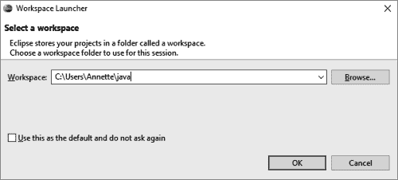

2. 点击 `浏览` 按钮找到你的 Java 工作文件夹，如上截图所示，然后点击 `OK`。应该出现此窗口：

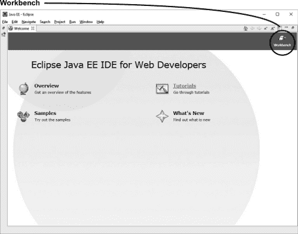

3. 点击 `Workbench` 打开 Eclipse 主窗口。

使用 Java 透视视图（Perspective）：

1. 点击 `Window / Perspective / Open Perspective / Java`。

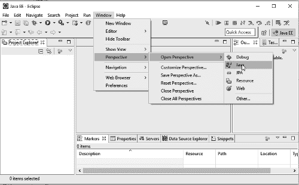

为编写代码留出更多空间：

1. 关闭 `Task list`，如图中所示：

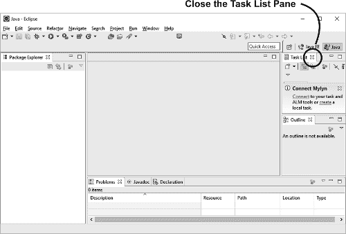

2. 将 `Outline` 标签页移动到 `Package Explorer` 窗的底部，如图中所示：

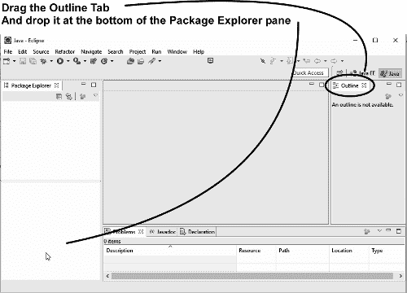

你现在拥有了创建第一个程序所需的所有内容！

## 创建第一个项目

创建你的第一个 Java 项目，命名为 `Hello World`：

1. 如果 Eclipse 未打开：

    a. 双击你在桌面上创建的 `Eclipse` 快捷方式。

    b. 点击 `OK` 使用你的 Java 工作文件夹作为工作空间。

2. 在 `Package Explorer` 窗中右键点击并选择 `New / Java Project`。

3. 将 Java 项目命名为 `Hello World`，如果 JRE 是 1.7 或更高版本，选择 `Use Default JRE`，然后如如下所示点击 `Next`。如果默认 JRE 低于 1.7，选择 `Use an execution environment JRE` 为 1.7 或更高版本的选项。

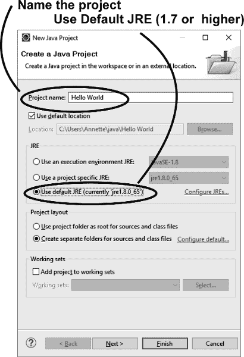

4. 点击 `Finish`。

`Package Explorer` 窗现在应该列出项目 `Hello World`。

### 关键点及更多

* 本中的每个程序都将在独立的 Java 项目中创建。

* 将在不同程序之间共享的代码也将在独立的 Java 项目中创建。

* 在 `Package Explorer` 窗中右键点击以创建 Java 项目。

* Eclipse 会在你的电脑上创建一个与 Java 项目同名的文件夹。为你的 Java 项目取一个你想要在电脑文件夹中使用的名称。

    * 你现在在 Java 工作文件夹中有一个名为 `Hello World` 的文件夹。

    * 例如，将每个单词的首字母大写，并在单词之间留一个空格，就像 `Hello World` 项目一样。

* 本书中程序的最低 JRE 要求为 Java SE 1.7。当你创建书中的 Java 项目时，请确保你选择了 `Use an execution environment JRE of JavaSE-1.7` 或更高版本的选项。一旦你在创建项目时选择了此选项，Eclipse 将对你以后创建的所有 Java 项目默认使用该选项。

## 创建第一个包 (Package)

在 `Hello World` 项目为你的 Hello World 程序创建一个包（Package）：

1. 在 `Package Explorer` 窗中右键点击 `Hello World` 项目并选择 `New / Package`。

2. 将包命名为 `____________.____________.helloworld`，如下所示。使用你自己的名字作为包名的一部分。我使用 `annette.godtland.helloworld` 作为我的包名。

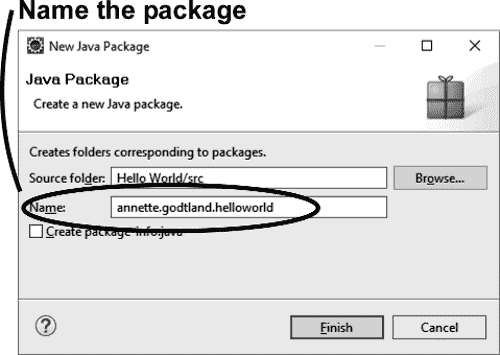

3. 点击 `Finish`。

`Package Explorer` 窗现在显示你在 `Hello World` 项目中创建的包。

### 关键点及更多

* 在 Java 项目中将你的程序文件组织到包中。

* 在 `Package Explorer` 窗中右键点击你的项目以创建 Java 包。

* 将通常一起使用的程序文件放在一个包中。

    * 因为你的程序会很小，所以你的大多数程序将只包含一个包。

* 包命名规则：

    * 使你的包名与其他任何人都不同。

    * 使用小写字母且不留空格。

    * 在单词之间使用句号。

## 创建第一个程序

使用 `JFrame` 类作为父类创建你的第一个程序：

1. 在 `Package Explorer` 窗中右键点击你的包并选择 `New / Class`。

2. 如下所示，为类名输入 `HelloWorld`。（提示：“Hello”和“World”之间没有空格。）

3. 点击 `Superclass` 的 `Browse`。

    a. 为类型输入 `JFrame`，选择 `JFrame` 并点击 `OK`。

4. 对于 *想要创建哪些方法存根？*，选择 `public static void main(String[] args)`。


5. 点击 `Finish` 创建类。

Eclipse 将创建一个如下的 `HelloWorld` 类：

Listing 0-0, `HelloWorld.java`:

```java
package annette.godtland.helloworld;

import javax.swing.JFrame;

public class HelloWorld extends JFrame {

  /**
   * @param args
   */
  public static void main(String[] args) {
    // TODO Auto-generated method stub

  }

}
```

1. 移除 `main()` 上方的注释。

2. 按照列表所示替换 `main()` 方法中的代码：

Listing 0-1, `HelloWorld.java`:


```java
package annette.godtland.helloworld;

import javax.swing.JFrame;

public class HelloWorld extends JFrame {

    （此处删除了代码。）

  public static void main(String[] args) {
    HelloWorld hello = new HelloWorld();
    hello.setVisible(true);
  }

}
```

3. 按 `Ctrl-S` 保存程序。

4. 如图所示，点击 `Run` 按钮运行程序：


应该出现一个微小的窗口，里面是空的，如下：


书中的课程将教你如何向窗口放入内容。

### 关键点及更多

* 要创建类，请在 `Package Explorer` 窗中右键点击你的包名。

* 类名可以包含数字、字母、美元符号和下划线。美元符号和下划线通常不使用。

* 类名不允许空格或句号。

* 类名不能以数字开头。

* 类名通常以大写字母开头。

* 如果类名包含多个单词，每个单词的首字母通常大写，其余字母为小写。

* 移除 Eclipse 在你创建类时自动生成的注释。

* 按 `Ctrl-S` 保存你的程序。

* 点击 `Run` 按钮运行你的程序。`Run` 按钮看起来像一个典型的播放按钮。

* 除非你有语法错误或被指示不要这样做，否则在完成每个代码列表的更改后，保存并运行你的程序。如果你有语法错误，请使用 `Quick Fix` 来修复错误：

    * 将鼠标悬停在代码中下划线的错误上。Eclipse 将列出解决问题的方法。选择其中一个选项，Eclipse 就会为你修复错误。

* 在整个课程中，你经常会收到“某些内容无法解析为类型”的语法错误。如果你收到该错误，请使用 `Quick Fix` 导入所需的类。该类及其包名将被添加到文件开头的 import 语句中。

* 如果文本行被自动换行，代码列表可能更难阅读。要减少自动换行，请将你的电子书阅读器设置为较小的字体。

* 点击任何列表下方的 `Completed Listing` 链接查看如何完成代码。不过，如果你的代码功能相同，或者你更喜欢你的代码实现，你也可以不同的方式完成该列表。

* 你创建的每个类不会使用相同的选项。在创建每个类时，请务必完全按照说明进行操作。

## 将项目添加到构建路径 (Build Path)

构建路径保存了 Java 项目中创建程序所需的项目和库的位置。当程序需要使用位于不同项目或库中的代码时，必须将该项目或库添加到程序所在项目的构建路径中。

例如，书中在多个程序之间共享程序代码将位于一个单独的 Java 项目中。共享项目需要添加到每个将使用共享代码的程序项目的构建路径中。

在创建新项目时，向新项目添加额外的共享代码项目：

1. 点击 `Next` 按钮。

2. 点击 `Projects` 选项卡，如图片所示。

3. 点击 `Add...`。

4. 选择要添加的项目，然后点击 `OK`。

5. 点击 `Finish` 完成新项目的创建。

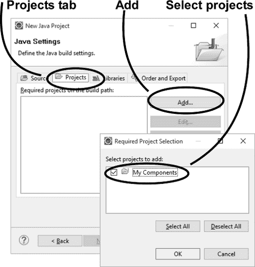

向现有项目添加额外的共享代码项目：

1. 右键点击现有项目，并选择 `Build Path / Configure Build Path...`。

2. 点击 `Projects` 选项卡，如上图所示。

3. 点击 `Add...`。

4. 选择要添加的项目，然后点击 `OK`。

5. 点击 `OK` 关闭 `Java Build Path` 窗口。

## 导出程序 (Export a Program)

如果你想在没有 Eclipse 的情况下运行程序，或在不同的计算机上运行，你必须导出完成的程序。

如果你导出程序，它将在你的计算机上创建一个 JAR 文件（Java 归档文件）。 JAR 文件以 `.jar` 结尾。要运行程序，双击 JAR 文件名。

导出程序：

1. 在 `Package Explorer` 窗格中右键点击 Java 项目名称并选择 `Export`。

2. 选择 `Runnable JAR File`，如图片所示，并点击 `Next`。

3. 选择你项目的启动配置（launch configuration）。Eclipse 会为你在 Eclipse 中运行的每个新程序创建启动配置，并将启动配置添加到列表中。下面的图片显示了选择了 `ASCII Art` 项目的启动配置，该程序是在第一本《Do-It-Yourself Java Games》（动手学 Java 游戏）一书中创建的。

4. 为 JAR 文件输入一个名称作为 `Export destination`（导出目标）。用 Java 项目命名 JAR 文件将帮助你记住该 JAR 文件包含什么程序。下面的图片显示 JAR 文件被命名为 `ASCIIArt.jar`。

5. 选择 `Package required libraries into generated JAR`（将所需的库打包到生成的 JAR 中）选项，如图所示：


6. 点击 `Finish` 完成导出。

在没有 Eclipse 的情况下运行程序：

1. 在你的 Java 工作文件夹中找到新创建的 JAR 文件。

2. 双击 JAR 文件名。

你可以将 JAR 文件复制到任何其他文件夹或任何其他计算机。但是，请记住将 Java 工作文件夹中程序使用的任何文件也复制到与 JAR 文件相同的文件夹中。

### 关键点及更多 (Key Points and More)

* 如果你想在 Eclipse 之外或不同的计算机上运行程序，请将程序导出为 JAR 文件。

* 你可以在不同的 JAR 文件中保存程序的不同版本。使用所有相同的导出选项，但为每个版本的程序指定一个不同的 `Export destination`。

* 如果安装了版本 1.7 或更高版本的 `Java Runtime Environment`（Java 运行环境），书中创建的程序的导出 JAR 文件可以在任何运行 Windows、OS X 或 Linux 操作系统的计算机上运行。

    * 大多数计算机上已经安装了 `Java Runtime Environment` 以运行其他程序。

    * `Java Runtime Environment` 包含在你安装的 `Java Development Kit`（Java 开发包）中。因此，你的计算机也已经安装了 `Java Runtime Environment`。

    * 任何人都可以从 [*http://java.com/en/download/index.jsp](http://java.com/en/download/index.jsp) 下载并安装 `Java Runtime Environment`，而无需 `Java Development Kit`。

* 如果 Java 工作文件夹中有任何程序使用的文件，请务必在与 JAR 文件相同的文件夹中保留这些文件的副本。

## 附录 E - 使用的约定和其他提示

在全书中，需要执行的操作以编号列表的形式给出。

阅读每节末尾 `Key Points and More` 以回顾课程并获取更多信息。你不需要记忆它们；需要时可以轻松查阅。你也将通过*实践*学很多。

在全书中，每个代码列表都显示在等宽字体之间的下划线中。

如果文本行被自动换行，代码列表可能更难阅读。要减少自动换行，请将你的电子书阅读器设置为较小的字体。

每个列表上方是列表代码的文件名。

从程序程序移除列表中显示为 `(*Code was removed from here.)` 的部分。此外，移除你创建的类的自动注释。你将在后的课程中添加自己的注释。

对程序代码的更改在列表中以粗体显示。

大多数列表只显示程序文件中的代码。列表中未包含的代码部分显示为 `...`。

你需要自己完成的代码在列表中显示为填充空格，`____________________`。用零或多个单词或符号填充空格。

点击任何列表下方的 `Completed listing` 链接查看如何完成代码。但如果在查看答案之前尝试自己完成代码，你会学更多。

将 *Appendix A - Glossary 作为术表和索引。术表提供了编程术语的定义，并提供了在《Do-It-Yourself Java Games》书中查找该术语更多信息的链接。

用你的电子书阅读器将 *Appendix A - Glossary 签名，以便更方便地访问术表。

*Do-It-Yourself Java Games* 系列书籍专为电子阅读器设计。点击下方图片或访问此[链接](http://youtu.be/XMuXNyyk7mg) 观看视频，视频将展示这些电子书中在纸质书中无法实现的功能。


