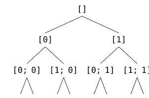
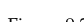
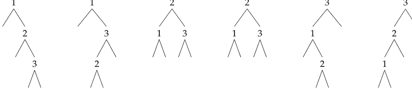

# More OCaml：算法、方法与趣闻

在《More OCaml》一书中，John Whiting 开启了一场基于 OCaml 的函数式编程漫游之旅，介绍了各种语言特性并描述了一些经典算法。本书以一个处理 PDF 文件生成的庞大示例作为结束。每一章都包含问题，并附有详细答案和提示。

《More OCaml》既能吸引希望精进技能的现有 OCaml 程序员，也能吸引渴望探索如 OCaml 等函数式语言的资深程序员。希望每位读者都能从中发现新颖的东西，或以全新的视角审视旧事物。对于更随性的读者或习惯了其他函数式语言的人来说，书的开头提供了一份 OCaml 总结。

JOHN WHITINGTON 创立了一家广泛使用 OCaml 的软件公司。他在剑桥大学向计算机科学专业的学生教授函数式编程。他的其他书籍包括《PDF Explained》（O'Reilly, 2012）和《OCaml from the Very Beginning》（Coherent, 2013）。

# 前言

当我写下《OCaml for the Very Beginning》时，我的意图是写一本不需要先验知识的书——让一个对编程完全陌生的聪明个体也能读懂。由于这一点，出于对长度的考虑，许多有趣的材料被删减了。而本书不受此种限制，包含了各种需要一定函数式语言经验的话题。读过前一本书的人读这本书同样没有问题。对于熟悉 ML 或 Haskell 等其他语言的函数式程序员来说，它应该是易理解的。读者可能需要偶尔参考 OCaml 手册。

在编写超过几十行的程序时，通常会有两种活动：首先是处理问题固有的复杂性挑战，寻找合适的抽象机制；其次是寻找并使用提供的各种第三方库。大多数项目涉及这两者的结合。在本书中，我们专注于前者，除了 OCaml 标准库外没有使用其他。跟无数第三方 OCaml 库是一个更适合其他媒介的任务。

本书由十六章组成，每章分为三类。有些通过示例介绍了 OCaml 的语法片段。有些概述了如输入/输出等实际话题。有些则涵盖了小趣味或谜题。书的正文结束于一个长篇示例：一个构建包含计算机生成的图形和文本的 PDF 文件的程序。书中所有问题都有完整的答案和提示，在线资源中还提供了额外材料。

# 致谢

第 6 章中的引用摘自 ISO-32000 国际标准。每一章中的代码表取自国际电信联盟 ITU-T T.30。第 11 章中红黑树平衡操作的演示及其函数式实现归功于 Chris Okasaki，正如其极具价值的著作《Purely Functional Data Structures》(Cambridge University Press, ISBN 978-0521653502, 1998) 中所述。第 12 章的灵感源自 Lawrence C. Paul 在 1999 年的一道剑桥计算机科学之旅考试题。该章的第 3 题归于 Peter D. Schumer 的《Mathematical Journeys》(John Wiley & Sons, ISBN-0-471-22086-3, 2004)。

我感谢许多与我讨论 OCaml 风格和实质的同事和朋友，包括 Mark Shinwell, Leo White, Daniel Bünzi, Anil Madhavapeddy, Stephen Dolan 以及我忘记的许多人。早期草稿的帮助性意见来自 Stefan Schmiedl, Manuel Cornes, Jan Bówłow, Emmanuel Delabode, Mario Picasso, Giannis Tsarai 和 André Björn。

# OCaml 总结

本章包含了书中其余部分使用的每个 OCaml 语法的总结。现有的 OCaml 程序员可以跳过本章。

## 简单数据类型

整数 `int`，布尔值 `true` 和 `false` 类型 `bool`。字符 `char`，字符串位于双引号之间。数学运算符 `+`, `-`, `*`, `/` 作用于两个整数。

组 `(a, b)` 用于固定数量的元素，类型 `α × β`。列表以相同的方式引入，使用 `::` 符号。

## 命名与函数

将表达式的结果命名为名称 `let name = expression` 求值。匿名函数 `(fun x -> expression)` 类型为 `α → β`。

## 异常

定义异常 `exception name`。它们通过添加 `of` 来携带额外信息。使用 `raise` 抛出异常。使用 `try ... with ...` 处理异常。

```ocaml
exception Problem of int
```

## 模式匹配

使用 `match` 表达式匹配模式 `pattern1 -> expression1 | pattern2 -> expression2 | expression3`。表达式 `expression1, expression2, expression3` 的类型彼此相同，这是整个 `match` 的类型。通配符 `_` 匹配任何。

```ocaml
match x with
| 0 -> 1
| 1 | 2 -> 3
| _ -> 4
```

一次匹配两个或多个事物，使用逗号分隔：

```ocaml
match a, b with
| 0, 0 -> true
| _, _ -> false
```

## 部分应用

通过提供少于参数数量的参数来实现部分应用。使用构建器的函数进行部分应用。

```ocaml
let add x y = x + y
List.map (add 3) [1; 2; 3]
(* => [4; 5; 6] *)
```

## 列表

列表是零或多个元素的有序集合，如 `type`。它们位于方括号之间，元素用分号分隔：例如 `[1; 2; 3; 4]`。如果列表非空，它有一个头（head），即第一个元素，和一个尾（tail），即由其余元素组成的列表。

`::` 操作向列表头部添加元素。“连接”运算符 `@` 用于连接两个列表。

```ocaml
1 :: [2; 3]  (* => [1; 2; 3] *)
[1; 2] @ [3] (* => [1; 2; 3] *)
```

## 新类型

使用新类型 `type name = Constructor1 of type1 | Constructor2 of type2 | ...`。使用内置类型对其进行模式匹配。多态类型。

```ocaml
type colour =
  Red | Blue | Green | Grey of int

type 'a tree =
  Lf | Br of 'a tree * 'a * 'a tree
```

例如，`Br (Lf, 'X', Br (Lf, 'Y', Lf))` 的类型为 `char tree`。一种内置数据类型是 `option` 类型，定义为 `type 'a option = None | Some of 'a`。一个类型可以在多个类型参数上是多态的，例如标准库中的 `('a, 'b) Hashtbl.t`。

## 可变状态

类型为 `α ref` 的引用。使用 `ref` 构建它们，读取其内容并使用 `:=` 运算符更新它们。

```ocaml
# let p = ref 0;;
val p : int ref = {contents = 0}
# p := 5;;
- : unit = ()
# !p;;
- : int = 5
```

使用 `while` 表达式 `while condition do expression done` 构造，根据布尔条件多次执行某操作。

```ocaml
while !x < y do
  x := !x * 2
done
```

使用 `for name = start to end do expression done` 表达式构造固定次数执行某操作。

```ocaml
for x = 1 to 10 do
  print_int x
done
```

## 基础输入/输出

值 `()` 及其类型 `unit`。`in_channel` 的输入通道和 `out_channel` 的输出通道。内置函数 `open_in`, `close_in`, `open_out`, `close_out`, `input_char`, `output_char` 等用于读写它们。

## 浮点数

类型为 `float` 的 `min_float ... max_float`。浮点运算符 `+.`, `-.`, `*.`, `/., **` 以及内置函数 `sqrt`。

```ocaml
2.0 ** 2.0 = 4.0
```

## OCaml 标准库

使用形式为 `Module.function` 的 OCaml 标准库函数。例如 `List.map`, `String.length`, `Array.copy` 等。`Buffer` 允许将字符串高效合并为更长的字符串。

## 数组

类型为 `array` 的数组写如 `[|1; 2; 3|]`。使用内置的 `Array.make` 创建数组，使用 `Array.length` 查找长度，为元素 `a.(i)` 赋值。使用 `a.(i) <- expression` 更新。

```ocaml
let swap a x y =
  let t = a.(x) in
  a.(x) <- a.(y); a.(y) <- t
```

## 简单模块

在 `.ml` 文件中编写模块。在 `.mli` 文件中通过 `val` 关键字构建接口。例如，带有 `let f x = x + 1` 的 `.ml` 文件具有 `val f : int -> int` 的效果。

## 编译程序

使用 `begin` 和 `end` 代替括号来组合表达式，以提高可读性。

`ocamlc` 和 `ocamlopt` 编译器。例如：

```bash
ocamlc -o x x.ml   # 使用字节码编译器从 x.ml 编译 x
ocamlopt -o x x.ml # 使用原生编译器从 x.ml 编译 x
```

## 我们的工作环境

示例中的每段代码以及章末问题的每个答案都可以从书籍的网站 http://www.ocaml-book.com/ 下载，并在读者的机器上构建。这些程序运行在 Unix（包括 Linux）、Mac OS X 和 Windows 机器上。

由于我们的几个程序需要尾递归函数，我们为标准库 `List` 模块提供了一个包装器。此外，`Util` 模块中提供了三个小型实用函数（`take`, `drop` 和 `from`）。这些模块包含在模块文件中。因此，通过编写 `open More`，可以使用 `Util` 模块，并且 `List` 模块中的所有函数都是尾递归的。

如果安装了 OPAM（OCaml 包管理器），可以通过编写 `opam install more-ocaml` 来安装此包。然后（或通过其他方式安装——详情请参考在线资源），我们的模块可以在顶层可用：

```ocaml
# #use "topfind";;
- : unit = ()
Findlib has been successfully loaded. Additional directives:
# #require "package";; to load a package
# #list;; to list the available packages
# #caml40;; to load caml40 (standard syntax)
# #caml4pr;; to load caml4pr (revised syntax)
# #predicates "p,q,...";; to set these predicates
# #Topfind.reset();; to force that packages will be reloaded
# #thread;; to enable threads
- : unit = ()
# #require "more";;
/Users/john/.opam/4.02.0/lib/more.cma: loaded
/Users/john/.opam/4.02.0/lib/more: added to search path
# open More;;
# Util.take;;
- : 'a list -> int -> 'a list = <fun>
```

它们在使用字节码编译器 `ocamlc` 或原生代码编译器 `ocamlopt` 编译独立程序时也可用。

```bash
ocamlfind ocamlc -package more -linkpkg -o program program.ml
ocamlfind ocamlopt -package more -linkpkg -o program program.ml
```

进一步的说明（包括在不支持 OPAM 的平台上的使用方法）可以在在线资源中。

## 使用 Unix 模块进行计时

有时我们想看到一段代码运行需要多少时间。可以使用 `Unix` 模块中的 `gettimeofday` 函数实现（与其名称相反，该模块在 Windows 上同样适用）。该函数返回一个浮点数，表示自 1970 年 1 月 1 日 00:00:00 GMT 以来的秒数。

```ocaml
# #use "topfind";;
- : unit = ()
Findlib has been successfully loaded. Additional directives:
# #require "package";; to load a package
# #list;; to list the available packages
# #caml40;; to load caml40 (standard syntax)
# #caml4pr;; to load caml4pr (revised syntax)
# #predicates "p,q,...";; to set these predicates
# #Topfind.reset();; to force that packages will be reloaded
# #thread;; to enable threads
- : unit = ()
# #require "more";;
/Users/john/.opam/4.02.0/lib/more.cma: loaded
/Users/john/.opam/4.02.0/lib/more: added to search path
# open More;;
# Util.take;;
- : 'a list -> int -> 'a list = <fun>
```

现在，通过再次求值 `Unix.gettimeofday`，我们可以计算经过的时间。在编译独立程序时使用 `Unix` 模块：

```bash
ocamlfind ocamlc -package more,unix -linkpkg -o program program.ml
ocamlfind ocamlopt -package more,unix -linkpkg -o program program.ml
```

## 折叠

**List** 模块定义了两个用于列表的函数：

```ocaml
val fold_left : ('a -> 'b -> 'a) -> 'a -> 'b list -> 'a
val fold_right : ('b -> 'a -> 'a) -> 'a -> 'b list -> 'a

let rec fold_left f a l = match l with
| [] -> a
| h :: t -> fold_left f (f a h) t

let rec fold_right f a l = match l with
| [] -> a
| h :: t -> fold_right f (f h a) t
```

它们是做什么的？为什么它们足够重要包含在标准库中？正如我们看到的，它们抽象了列表的递归。我们可以使用 `fold_left` 计算列表中所有整数的和：

```ocaml
fold_left (+) 0 [1; 2; 3]
(* => fold_left (+) 1 [2; 3] *)
(* => fold_left (+) 3 [3] *)
(* => 6 *)
```

在这里，`'a` 和 `'b` 都是 `int`。函数 `(+)` 有正确的类型，我们为初始值使用 `int` 的单位元，对于所有 `x`，`x + 0 = x`（除非我们为空列表提供初始值）。

读者可能认为这比简单的递归方案复杂，但对于经验丰富的函数式程序员来说，使用 `fold_left` 更容易。让我们使用 `fold_left` 找到列表中的最大数：

```ocaml
fold_left max_int [2; 4; 6; 0; 1]
(* => fold_left max 2 [4; 6; 0; 1] *)
(* => fold_left max 4 [6; 0; 1] *)
(* => fold_left max 6 [0; 1] *)
(* => fold_left max 6 [1] *)
(* => 6 *)
```


这里 `max` 是寻找两个值中较大者的内置函数，而 `min_int` 是最小整数的内置值。我们可以使用类似的方案来定义对布尔列表的函数：

```ocaml
all : bool list -> bool
any : bool list -> bool

let all l = fold_left (&&) true l

let any l = fold_left (||) false l
```

`all` 函数只有当列表中的项都为真时才为真；`any` 函数如果至少有一个为真。当 `α` 和 `β` 不同时会发生什么？通过让累加器成为列表吗？

```ocaml
setify : alpha list -> alpha list

let setify l =
  fold_left (fun a e -> if List.mem e a then a else e :: a) [] l
```

我们正在使用 `List.mem` 来决定是将每个元素添加到累加器中还是丢弃它。

# 第 1 章：解析“折叠 (Fold)”

## fold_right 如何？

这里再次给出该函数：

```
fold_right : (α → β → β) → α list → β β

let rec fold_right f l a =
  match l with
    [] -> a
    | h:t -> f h (fold_right f t a)
```

`fold_left` 函数从左侧对输入列表中的元素进行分组。相比之下，`fold_right` 通过改变求值顺序来处理元素。例如，考虑我们的和示例：

```
fold_left ( ) 0 [1; 2; 3]
fold_left ( ) 1 [2; 3]
fold_left ( ) 3 [3]
fold_left ( ) 6 [ ]
6
```

```
fold_right ( ) [1; 2; 3] 0
( ) 1 (fold_right ( ) [2; 3] 0)
( ) 1 (( + ) 2 (fold_right ( ) [3] 0))
( ) 1 (( + ) 2 (( + ) 3 (fold_right ( + ) 0)))
( ) 1 (( + ) 2 (( + ) 15))
6
```

我们看到值的积累是从右侧开始的。注意，`fold_right` 不是尾递归的（它构建的中间表达式与输入的大小成正比）。我们可以简单地将 `map` 定义为 `fold_right` 的使用。

```
map : (α → β) → α list → β list

let map l =
  fold_right (fun e a -> e :: a) l []
```

谁能想到 `fold_right` 才是更基础的函数呢？以反转列表为代价，我们可以通过 `fold_left` 定义 `fold_right` 为尾递归：

### fold_right : (α → β → β) → α list → β → β

```
fold.right f l e =
fold.left (fun x y -> f y x) e (List.rev l)
```

有时我们想要提供一个不是计算单位元的初始累加值。例如，在 `fold.right` 中对输入列表应用 `::` 并不有趣，它会产生一个返回输入 `α : → α` 的函数：

```
copy : α list → α list
let copy l =
fold.right (fun e a -> e ::) l []
```

但如果我们使用非空列表作为累加器的初始值，我们就得到了这个函数：

```
append : α list → α list → α list
let append x y =
fold.right (fun e a -> e :: a) x y
```

我们可以使用更复杂的累加器，例如元组。在这个示例中，我们复了 `List.split` 函数，它接收一个元对列表并返回两个列表对：

```
split : (α × β) → α list → list × β list
let split l =
fold.right
(fun (x, y) (xs, ys) -> (x :: xs, y :: ys))
l ( [])
```

例如 `split [(1, "one"); (2, "two")]` 结果为 `([1; 2], ["one"; "two"])`。

## 注意事项

连接所有列表的 `concat` 函数有一个非常简单的定义如下：

```
concat : α list → α list
let concat l = fold.left (@) [] l
```

## 第 1 章：解析“折叠 (Fold)”

我们使用 `append` 函数将列表合并为一个列表：

- `fold_left (@) [] [[1;2]; [3]; [4]]`
- `fold_left (@) [1;2] [[3]; [4]]`
- `fold_left (@) [1; 2; 3] [[4]]`
- `fold_left (@) [1; 2; 3; 4] []`

然而求值的顺序导致 `append` 函数（其复杂度与第一个参数的长度成正比）被反复高效地处理列表。

## 在树上折叠

对于二叉树的常规定义，我们可以定义一个 fold。有两个累加器：一个用于左子树，一个用于右子树。提供的函数将两者合并为一个累加器。

```
fold_tree : (α → β → β) → β → α tree → β

type 'a tree =
  Lf
  | Br of 'a * 'a tree * 'a tree

let rec fold_tree f e t =
  match t with
    Lf -> e
    | Br (x, l, r) -> f x (fold_tree f (fold_tree f e l) r)
```

这是一个示例，我们写为 `Br (1, Br (0, Lf), Br (6, Lf))`：

树的大小和整数之和的函数现在变得容易了，不需要显式递归：

```
tree_size : 'a tree -> int
let tree_size = fold_tree (fun _ l -> 1 + l) 0

tree_sum : int tree -> int
let tree_sum = fold_tree (fun x l -> x + l) 0
```

标准的遍历可以很容易编写：

```
tree_preorder : 'a tree -> 'a list
let tree_preorder t =
  match t with
    Lf -> []
    | Br (x, l, r) -> x :: (tree_preorder l ++ tree_preorder r)

tree_inorder : 'a tree -> 'a list
let tree_inorder t =
  match t with
    Lf -> []
    | Br (x, l, r) -> tree_inorder l ++ [x] ++ tree_inorder r

tree_postorder : 'a tree -> 'a list
let tree_postorder t =
  match t with
    Lf -> []
    | Br (x, l, r) -> (tree_postorder l ++ tree_postorder r) ++ [x]
```

在我们的示例 `Br (1, Br (0, Lf), Br (6, Lf))` 中：

- `tree_preorder (Br (1, Br (0, Lf), Br (6, Lf))) = [1; 0; 6; 4]`
- `tree_inorder (Br (1, Br (0, Lf), Br (6, Lf))) = [0; 1; 6; 4]`
- `tree_postorder (Br (1, Br (0, Lf), Br (6, Lf))) = [0; 6; 4; 1]`

## 第 1 章：解析“折叠 (Fold)”

- 1. 将尾替换为函数以定义懒列表。
- 2. 为懒列表实现 `lhd` 和 `ltl`。
- 3. 为懒列表实现 `ltake` 和 `ldrop`。
- 4. 实现无限列表 `lseq`。
- 5. 比较懒列表与严格列表的复杂度。
- 6. 讨论无限结构中的惰性求值。
- 7. 解释 `fold` 如何与懒列表交互。
- 8. 为懒列表实现 `map`。
- 9. 讨论懒列表的内存影响。

# 第 2 章：惰性 (Lazy)

我们可以通过将尾替换为函数创建一个懒列表：

```
type 'a list = Nil | Cons of 'a * (unit -> 'a list)
```

注意，由于我们的数据类型只有一个构造函数，我们可以在函数参数中直接进行模式匹配。当我们应用尾函数时，我们在强制执行求值。这里是懒头部和尾函数：

```
lhd : α list → α
ltl : α list → α list

let rec lhd Cons (n, _) = n
let ltl Cons (_, tf) = tf ()
```

我们可以看到列表头部是零——其余部分尚未计算。当我们在 OCaml 顶层写它时，我们看到：

```
# lseq 0;
: int lazylist = Cons (0, <fun>)
```

我们可以启动一个无限列表 `lseq`：

```
lseq : int -> lazylist
let rec lseq n = Cons (n, () -> lseq (n + 1))
```

现在我们可以获取或丢弃元素。两个常用的列表函数在懒世界中有简单的对应实现：

```
ltake : α list → α list
ldrop : α list → α list

rec ltake Cons (h, tf) n =
  match n with
    0 -> []
    | -> h :: ltake (tf ()) (n - 1)

rec ldrop Cons (h, tf) as ll n =
  match n with
    0 -> ll
    | -> ldrop (tf ()) (n - 1)
```

注意使用 `as` 关键字来命名模式的一部分（这里 `Cons (h, tf)` 被命名为 `ll`），使得 `ldrop` 的基础情况更简单。现在我们可以实际获取元素了：

```ocaml
# ltake (lseq 0);
: : int list = [0; 1; 2; 3; 4; 5; 6; 7; 8; 9; 10; 11; 12; 13; 14; 15; 16; 17; 18; 19]
# ldrop (lseq 0);
: : lazylist = Cons (20, <fun>)
```

## 第 2 章 惰惰性

```ocaml
lmap : (α -> β) → α lazylist → β lazylist
lfilter : (α -> bool) → α lazylist → α lazylist

let rec lmap f (Cons (h, tf)) =
  Cons (h, fun () -> lmap f tf)

let rec lfilter f (Cons (h, tf)) =
  if h then
    Cons (h, fun () -> lfilter f tf)
  else
    lfilter f tf
```

```ocaml
cubes : int lazylist
let cubes =
  lfilter
    (fun x -> x mod 5 = 0)
    (lmap (fun x -> x * x * x) (lseq 1))
```

现在，使用 `ltake`：

```ocaml
(* ltake cubes 20;
: int list =
[125; 1000; 3375; 8000; 15625; 27000; 42875; 64000; 91125; 125000; 166375;
216000; 274625; 343000; 421875; 512000; 614125; 729000; 857375; 1000000] *)
```

这里是另一个简单列表示例，这个通过 `lfilter` 和递归创建的质数列表，从使用 `lseq` 计算的从 2 开始的所有数字列表：

```ocaml
mkprimes : int lazylist -> int lazylist
primes : int lazylist

let rec mkprimes (Cons (h, tf)) =
  Cons (h, fun () ->
    mkprimes (lfilter (fun x -> x mod h <> 0) tf))

let primes = mkprimes (lseq 2)
```

## 第 2 章 惰惰性

有很多列表函数无法适应懒惰列表。例如，我们无法反转懒惰列表，或合并两个懒惰列表。但有一个类似的方法可以适应。我们可以公平地合并两个列表，交替从每个列表中取元素：

```ocaml
interleave : α lazylist → α lazylist → α lazylist

let rec interleave (Cons (h, tf)) l =
  Cons (h, fun () -> interleave l tf)
```

例如，在 0 和 1 之间交替列表可以使用 `interleave` 和一个构建常量列表的函数构建：

```ocaml
lconst : int → int lazylist
interleaved : int lazylist

let rec lconst n =
  Cons (n, fun () -> lconst n)

let interleaved =
  interleave (lconst 0) (lconst 1)
```

更有趣的例子是计算所有由0 和 1 组成的普通列表的懒惰列表。我们可以通过在列表前面添加 0 和 1，并交替生成的列表来实现：

```ocaml
allfrom : int -> int list lazylist
allones : int lazylist

let rec allfrom l =
  Cons (l, fun () ->
    interleave (allfrom (0 :: l)) (allfrom (1 :: l)))

let allones = allfrom []
```

这产生了：

```ocaml
(* ltake all 20;
: int list list =
[;]; [0]; [0]; [0; 1]; [1]; [0]; [1; 1]; [0; 0]; [0; 0; 1];
[0; 1]; [0; 0; 1]; [1; 0; 0]; [1; 0; 1]; [1; 1; 0]; [1; 1; 1];
[0; 0; 0]; [0; 0; 1]; [0; 1; 0]] *)
```

为了理解为什么，我们可以将求值可视化为一个树，其中每个左分支添加一个 0，每个右分支添加一个 1：

## 第 2 章 惰惰性



交替合并是公平的，交替的交替同样如此，因此我们看到长度为二的结果顺序为：[0; 0] [0; 1] [1; 0] [1; 1]。

## 问题

1. 写出一个元素为数字 1, 2, 4, 8, 16 ... 的懒惰列表。它的类型是什么？
2. 写一个函数返回懒惰列表的第 n 个元素，其中元素 0 是列表的头部。
3. 写一个函数，给定一个列表，返回一个从该列表中提取重复序列的懒惰列表。例如，给定列表 [1; 2; 3]，它应该返回一个元素为 1, 2, 3, 1, 2, 3, 1, 2... 的懒惰列表。
4. 写出一个元素为斐波那契数 0, 1, 1, 2, 3, 5, 8 ... 的懒惰列表，其前两个元素为零且根据定义，每个后续元素都是前两个元素之和。
5. 写一个函数，给定一个懒惰列表，返回两个懒惰列表，一个包含位置在 0, 2, 4, 6 ... 的元素，另一个包含位置在 1, 3, 5, 7 ... 的元素。
6. 文档中的字母标签为 A, B, C, ..., X, Y, Z, AA, AB, ..., AAA, ... 写出表示此序列的懒惰列表。

# 第 3 章 带记录的命名元组

元组可以用于组合固定数量的相同或不同类型的元素。然而，一旦项目超过两个或三个，记住顺序可能会困难。记录（Records）解决了这个问题，允许我们为每个项目命名。由于这种命名，它们具有几个实用的属性，可以将它们与元组区分开。让我们为二维笛卡尔坐标定义一个简单的类型：

```ocaml
type point = {x : float; y : float};
```

记录类似于带有标签的元组。我们在大括号 { } 之间编写它们。记录的每个元素（称为字段）都有名称和类型，字段之间用分号分隔。我们可以使用相同的语法构造该类型的值，但用等号代替冒号：

```ocaml
let p = {x = 4.5; y = 6.0};
```


# 记录

记录类似于带有标签的元组。我们在大括号 `{ }` 之间编写它们。记录的每个元素（称为字段）都有名称和类型，字段之间用分号分隔。我们可以使用相同的语法构造该类型的值，但用等号代替冒号：

```ocaml
let p = {x = 4.5; y = 6.0};
```

# 第 3 章：带记录的命名元组

## 问题

1. 展示如何在不使用 `:=` 运算符的情况下更新引用。
2. 使用文档中 `Unix` 模块“Time Functions”部分的函数，编写一个程序，该程序运行时返回一个包含时间和日期的字符串，例如“2014年1月8日 星期三 上午2:45”。
3. `type t = {x : int ref}` 和 `type t = {mutab x : int}` 之间有什么区别？各自的优缺点是什么？
4. 定义一个包含六项的记录，a–f，其中 a 和 b 的类型相同，c 和 d 的类型相同，e 和 f 的类型相同。
5. 记录被用于 `GC` 模块，该模块控制 OCaml 的垃圾回收器（垃圾回收器是一种在程序运行时自动回收程序已完成使用的空间的系统）。使用 `GC` 模块中的数据结构和函数编写程序，实现以下功能：
   (a) 将垃圾回收器状态的摘要写入文本文件；
   (b) 修改控制记录（control record）中定义的垃圾回收器详细程度。

# 第 4 章：通用输入/输出

在 *Pervasives*（OCaml 默认的始终打开的模块）中，定义了许多针对输入输出*通道*（channels）的函数——它们既代表文件系统中的文件，也代表标准输出等特殊通道。然而，对于字符串、数组或通道等，对输入输出建立一个更通用的抽象通常是有用的。

在本章中，我们将开发这样一种抽象，提供可以与 OCaml 通道和字符串工作的输入输出类型。它可以被扩展到适用于其他数据结构，并具有完整的功能——本章末的一些问题涉及这些扩展。

## 输入的类型

在创建输入后，对其进行的基本操作将是：

- 查找当前位置；
- 设置当前位置；
- 读取字符并同时移动位置；
- 查找输入的长度。

我们需要一种方法将它们组合并方便地引用它们。记录（record）是理想的选择：

```ocaml
type input =
  {pos_in : unit -> int;
   seek_in : int -> unit;
   input_char : unit -> char;
   in_channel_length : int}
```

现在，我们可以很容易地从 OCaml 的 `in_channel` 构建一个输入（我们重用了一些标准的 OCaml 名称）：

```ocaml
input_of_channel : in_channel -> input

let input_of_channel ch =
  {pos_in = (fun () -> pos_in ch);
   seek_in = seek_in ch;
   input_char = (fun () -> input_char ch);
   in_channel_length = in_channel_length ch}
```

注意，原始通道现在隐藏在 input 内部——`pos_in` 和 `input_char` 函数现在只需接收 `()` 作为其输入。让我们确保该结构也适用于字符串的抽象：

```ocaml
input_of_string : string -> input

let input_of_string s =
  let pos = ref 0 in
  {pos_in = (fun () -> !pos);
   seek_in =
    (fun p ->
      if p < 0 then
        raise (Invalid_argument "seek before beginning")
      pos := p);
   input_char = (fun () ->
     if !pos > String.length s - 1
     then raise End_of_file
     else (let c = s.[!pos] in pos := !pos + 1; c));
   in_channel_length = String.length s}
```

我们分配了一个本地引用来保存当前位置。`pos_in` 和 `in_channel_length` 函数非常简单。`seek_in` 函数需要检查位置是否为正，但为了与 OCaml 通道的兼容性，最好也能移动到末尾。`input_char` 函数检查是否在尝试读取末尾之外，读取字符，移动位置并返回该字符。

注意，我们使用了与 OCaml 自身通道相同的异常——如果尝试在最后一个字符之后读取，则抛出 `End_of_file`。

### 示例：读取单词

我们想要写一个程序，从给定的输入（如字符串或文件）中提取单词。例如，给定字符串：

> "There were four of them; more than before."

我们希望产生：

- ["there"; "were"; "four"; "of"; "them"; "more"; "than"; "before"]

移除空格、标点并将单词转换为小写。首先，让我们定义一个将输入回退一个字符的函数（当我们读取一个字符并决定不消耗它时很有用），另一个谓词，用于判断字符是否被视为非字母，从而可以跳过：

```ocaml
rewind : input -> unit
non_letter : char -> bool

let rewind i =
  i.seek_in (i.pos_in i - 1)

let is_non_letter x =
  match x with
  | '\'' | '(' | ')' | ',' | '_' | '-' | ';' | ':' -> true
  | _ -> false
```

现在，我们可以写一个 `skip_characters` 函数从当前点跳过标点。当然，它可能会抛出 `End_of_file`。然后，`collect_characters` 函数使用一个新的 `Buffer` 和经过 `skip_characters` 处理的输入，返回包含下一个感兴趣字符的字符串；如果我们在输入末尾则抛出 `End_of_file`：

```ocaml
skip_characters : input -> unit
collect_characters : input -> string

let rec skip_characters i =
  if is_non_letter (i.input_char i ())
  then skip_characters i
  else rewind i

let rec collect_characters b i =
  match
    try Some (i.input_char i ()) with End_of_file -> None
  with
  | None -> Buffer.contents b
  | Some c ->
      if is_non_letter c
      then Buffer.contents b
      else (Buffer.add_char b c; collect_characters b i)
```

最后，我们可以写 `read_word` 来找到下一个单词（如果存在）。然后，`read_words` 将它们全部收集到一个列表中，并使用标准库函数 `String.lowercase` 将它们转换为小写。这些函数构成了 4.1。例如：

```ocaml
input_of_string "There were four of them; more than before."
: ["there"; "were"; "four"; "of"; "them"; "more"; "than"; "before"]
```

```ocaml
read_word : input -> string option
read_words : input -> string list -> string list
lowercase : string -> string

let read_word i =
  try Some (collect_characters (Buffer.create 20) i)
  with End_of_file -> None

let read_words i a =
  match read_word i with
  | None -> a
  | Some w -> w :: a
```

## 输出的类型

对于通用输出我们需要什么？我们必须有一个 `output_char` 函数来写入单个字符。有一个 `output_channel_length` 函数也是很有用的，这样我们知道写入了多少字符。为了简单，我们不像输入类型那样允许前后移动。图 4.2 显示了输出类型以及从通道和字符串构建输出的函数。


注意，虽然我们统一了向字符串和通道写入的接口，但它们仍然不同：字符串长度有限，如果没有全部使用将包含垃圾数据。让我们使用这些函数构建一个向任何输出写入整数列表的函数：

```ocaml
output_list : output -> int list -> unit

let output_list o ls =
  o.output_char '[';
  List.iter (
    (fun n ->
      o.output_char (string_of_int n);
      o.output_char ',';
      o.output_char ' ')
  ) ls;
  o.output_char ']'
```

注意 `o.output_char` 具有与标准函数（如 `String.iter`）兼容的类型。可以使用从标准输出构建的输出进行测试：

```ocaml
output_of_channel : out_channel -> output
output_of_string : string -> output

type output =
{output_char : char -> unit;
  out_channel_length : unit -> int}

let output_of_channel ch = {output_char = (fun c -> output_byte ch (int_of_char c));
   out_channel_length = (fun () -> out_channel_length ch)}

let output_of_string s =
  let pos = ref 0 in
  {output_char c ->
    (fun if !pos < String.length s
      then (s.[!pos] <- c; pos := !pos + 1)
      else raise End.of_file);
   out_channel_length = (fun () -> String.length s)}
```

图 4.2

```ocaml
# output_int_list (output_of_channel stdout) [1; 2; 3; 4; 5];;
- : unit = ()
[1; 2; 3; 4; 5 ]
```

你能找到一种方法来抑制 `]` 字符之前的多余空格吗？

## 问题

1. 编写一个函数，从字符数组构建一个输入。
2. 编写一个类型为 `input -> string` 的函数 `input_string`，它从输入字符串返回指定数量字符，如果输入结束则返回较少的字符。
3. 扩展输入类型，包含一个函数 `input_char_opt`，它返回一个类型为 `char option` 的值，用 `None` 表示文件结束。相应地扩展 `input_of_channel` 和 `input_of_string` 函数。
4. 扩展输入类型，包含一个函数 `input_byte`，它返回一个表示下一个字节的整数，在文件末尾时返回特殊值 -1。评价其与 `input_char_opt` 和 `input_char` 相比的用处。
5. 编写一个输入类型，当它遇到新行（`'\n'` 字符）时抛出 `End_of_file`。用它构建一个从标准输入读取一行的程序。
6. 编写一个函数，从 `Buffer.t` 构建一个输出。展示如何在输出完成后使用它来获取最终字符串。

# 第 5 章：位流

我们已经处理过按字节流的信息流。但通常，我们还需要将数据视为位流。我们可以为此构建一个良好的抽象吗？

我们可以从一个从字节构建位列表的函数开始，并对流中的每个字节使用该函数，以构建最终的列表。这有两个缺点：它在空间和时间上效率很低（当然，位的数量是字节的八倍），而且它是一次处理所有位，而不是按需处理。相反，让我们基于我们的输入类型构建一个位流：

```ocaml
type input_bits =
  input : input;
  mutable byte : int;
  mutable bit : int
```

`input` 字段是该位流的基础。它将从当前字节的最高位开始。`byte` 字段保存刚从输入读取的字节，如果尚未读取任何位，则保存一个未定义的值。`bit` 字段记录当前位置，但我们不使用 0..7，而是使用 128, 64, 32, 16, 8, 4, 1，这样该字段就可以直接使用内置的逻辑与（AND）运算符提取位，然后减半：

| 0 | 1 | 2 | 3 | 4 | 5 | 6 | 7 | 8 | 9 | 10 | 11 | 12 | 13 | 14 | 15 | 16 | 17 | 18 | 19 | 20 | 21 | 22 | 23 | 24 | 25 | 26 |
|---|---|---|---|---|---|---|---|---|---|---|---|---|---|---|---|---|---|---|---|---|---|---|---|---|---|---|
| 输入数据 | 0 | 1 | 1 | 1 | 0 | 1 | 1 | 1 | 0 | 0 | 1 | 1 | 0 | 0 | 0 | 1 | 1 | 0 | 0 | 1 | 1 | 1 | 0 | 0 | 0 | 0 |
| 位的值 | | | | | | | | | | | 0b01101011 | | | | | | | | 0b01110011 | | | | | | 0b00... | | |
| 字节 > 0 | 128 | 64 | 32 | 16 | 8 | 4 | 2 | 128 | 64 | 32 | 16 | 8 | 4 | 2 | 128 | 64 | 32 | 16 | 8 | 4 | 2 | 1 | 128 | 64 | 32 | |
| | T | F | T | F | T | F | T | F | T | F | T | F | T | F | T | F | T | F | T | F | T | F | F | F | F | F |

表达式 `x land y`（其中 `x` 和 `y` 是整数）返回的整数值的位模式是 `x` 和 `y` 的按位与。这个 `input_bits` 类型可以被完全抽象，定义在 `type input_bits` 中。现在，我们可以定义一个函数从输入构建 `input_bits`：

```ocaml
input_bits_of_input : input -> input_bits
let input_bits_of_input i =
  ...
  bit = ...
```

获取下一个位的函数非常简单。如果 `bit` 为 0，我们必须从输入加载一个新字节并返回下一个位。如果 `bit` 非零，则提取给定的位并为下次将 `bit` 减半。

```ocaml
getbit : input_bits -> bool
let rec getbit b =
  if b.bit = 0 then
    begin
      b.byte <- input_char();
      b.bit <- 128;
      true
    else
    let r = b.byte > 0 in
    b.bit <- b.bit / 2;
    r
```

此函数可以抛出 `End_of_file`。另外两个函数很有用。我们可以轻易地将流对齐到下一个字节边界：

```ocaml
align : input_bits -> unit
let align b =
  b.bit <- 0
```

我们可以写一个函数 `getval` 来返回指定数量的位的整数。我们使用 `lor` 运算符（得到两个整数的按位或）和 `lsl` 运算符（将整数向左移动指定的位数，右侧补零）。

```ocaml
getval : input_bits -> int -> int
let getval b n =
  if n <= 0 || n > 31 then
    raise Invalid.getval
  else
    let r = ref 0 in
    for x = n - 1 downto 0 do
      r := !r or (if getbit b then 1 else 0) lsl x
    done;
    !r
```

OCaml 整数至少有 31 位（取决于计算机），因此我们可以读取最多 31 位的字段。这个数字可以通过 `Sys.word_size - 1` 计算。

## 示例：解码报文头部

用于网络的 TCP（传输控制协议）报文头部布局：

| 0 | 1 | 2 | 3 | 4 | 5 | 6 | 7 | 8 | 9 | 10 | 11 | 12 | 13 | 14 | 15 | 16 | 17 | 18 | 19 | 20 | 21 | 22 | 23 | 24 | 25 | 26 | 27 | 28 | 29 | 30 | 31 |
|---|---|---|---|---|---|---|---|---|---|---|---|---|---|---|---|---|---|---|---|---|---|---|---|---|---|---|---|---|---|---|
| 源端口 | | | | | | | | | | | | | | | | | | | | | | | | | | | | | | | | |
| 目的端口 | | | | | | | | | | | | | | | | | | | | | | | | | | | | | | | | |
| 序列号 | | | | | | | | | | | | | | | | | | | | | | | | | | | | | | | | |
| 确认号 | | | | | | | | | | | | | | | | | | | | | | | | | | | | | | | | |
| 数据偏移 | | | | URG | ACK | PSH | FIN | | | | | | | | | | | | | | | | | | | | | | | | |
| 窗口大小 | | | | | | | | | | | | | | | | | | | | | | | | | | | | | | | | |
| 校验和 | | | | | | | | | | | | | | | | | | | | | | | | | | | | | | | | |
| 紧急指针 | | | | | | | | | | | | | | | | | | | | | | | | | | | | | | | | |

它包含了最小 1 位、最大 32 位的字段。我们将使用 20 字节的 TCP 报文头部作为示例：`00 26 b0 14 62 b7 cc 33 58 55 1e ed 08 00 45 00 03 78 f17 ac`。

图 5.1 中的打印头部信息的代码使用了 `getbit`、`getval` 以及一个尚未定义的函数 `getval_32`，后者返回 `Int32.t` 类型的最多 32 位（实现 `getval_32` 是章节末尾之一）。以下是示例数据的输出：

Source port = 38

Destination = 47892

Sequence = 16562123

Acknowledgment Number = 1481735

Flags:

Urgent = false

Ack = false

Push = false

Reset = false

Syn = false

Fin = false

## print_header

```ocaml
print_header : string -> unit
let print_header filename =
  let ch = open_in_bin filename in
  let i = input_of_channel ch in
  let b = input_bits_of_input i in
  let src_port = getval b 16 in
  let dest_port = getval b 16 in
  let seq_number = getval_32 b 32 in
  let ack_number = getval_32 b 32 in
  let _ = getval b 4 in
  let _ = getval b 6 in
  let urgent = getbit b in
  let ack = getbit b in
  let push = getbit b in
  let reset = getbit b in
  let syn = getbit b in
  let fin = getbit b in
  let receive = getval b 16 in
  let checksum = getval b 16 in
  let urgent_pointer = getval b 16 in
  print_string "Source port = ";
  print_int src_port;
  print_string "\nDestination = ";
  print_int dest_port;
  print_string "\nSequence = ";
  print_string (Int32.to_string seq_number);
  print_string ("\nAcknowledgment Number = ");
  print_string (Int32.to_string ack_number);
  print_string "\nFlags: ";
  print_string "\nUrgent = "; print_bool urgent;
  print_string "\nAck = "; print_bool ack;
  print_string "\nPush = "; print_bool push;
  print_string "\nReset = "; print_bool reset;
  print_string "\nSyn = "; print_bool syn;
  print_string "\nFin = "; print_bool fin;
  print_string "\nReceive window size = ";
  print_int receive;
  print_string "\nChecksum = ";
  print_int checksum;
  print_string "\nUrgent pointer = ";
  print_int urgent_pointer;
  print_string "\n";
  close_in ch

let print_bool b = print_string (string_of_bool b)
```

接收窗口大小 = 17664

校验和 = 888

紧急指针 = 63484

我们必须使用 `open_in_bin` 来处理二进制数据文件，以防程序在 Microsoft Windows 上执行，因为在 Windows 中，文本和二进制文件被认为是不同的且读取方式也不同。

## 输出比特流

输出比特流的类型与输入比特流非常相似，但用法大不相同。

```ocaml
type output_bits = {
  output : output;
  mutable byte : int;
  mutable bit : int
}
```

这里，`out` 是底层的输出。当前正在逐位构建的字节是 `byte`，而从 7 到 0 的输出位表示为了在字节的正确位置添加一个位，所需的当前位移（shift量）。当需要移动到下一个字节时，`bit` 为 -1。我们可以从一个 `output` 构建一个新的全新的 `output_bits`：

```ocaml
output_bits_of_output : output -> output_bits

let output_bits_of_output o =
  {output = o; byte = 0; bit = 7}
```

在整个字节完成之前，无法将其写入底层的输出，因此我们必须有一个 `flush` 函数在输出结束时进行写入：

```ocaml
flush : output_bits -> unit

let flush o =
  if o.bit < 7 then o.output.output_char (char_of_int o.byte);
  o.byte <- 0; o.bit <- 7
```

这同时也兼当了我们的对齐函数。现在我们可以编写 `putbit` 了。由于我们稍后会解释的原因，我们将任何非零输入视为 1 位比特。

```ocaml
putbit : output_bits -> int -> unit

let putbit o b =
  if o.bit = (-1) then
    begin
      flush o;
      putbit o b
    end
  else
    begin
      if b <> 0 then o.byte <- o.byte lor (1 lsl o.bit);
      o.bit <- o.bit - 1
    end
```

为了输出一个宽度最高为 31 位的值，我们可以写一个函数 `putval o v l`，该函数给定一个 `output_bits`、值和比特长度，并对每个位依次调用 `putbit`：

```ocaml
putval : output_bits -> int -> int -> unit

let putval o v l =
  for x = l - 1 downto 0 do
    putbit o (v land (1 lsl x))
  done
```

现在我们知道为什么允许任何非零整数被视为 1 位比特了——它避免了 `putval` 中的一次测试。现在我们拥有了所需的一切。


我们可以使用 `putbit`、`putval` 以及尚未定义的 `putval_32` 来重新构建之前拆解的数据包，如图 5.2 所示。在随后的问题中，你被要求在比特流上实现我们某些输入和输出函数的各种特化。

```ocaml
output_header : string -> unit
let output_header filename =
  let ch = open_out.bin filename in
  let o = output_of.channel ch in
  let bits = output_bits.of_output o in
  putval bits 38 16;
  putval bits 47892 16;
  putval_32 bits 1656212531l 32;
  putval_32 bits 1481973485l 32;
  putval bits 5 4;
  putval bits 0 6;
  putbit bits 0;
  putbit bits 0;
  putbit bits 0;
  putbit bits 0;
  putbit bits 0;
  putbit bits 0;
  putval bits 17664 16;
  putval bits 888 16;
  putval bits 63404 16;
  flush bits;
  close_out ch
```

图 5.2

## 习题

1. 特化函数 `getval`，使得当输入对齐时，一次写入 8 位的操作得到优化。将该函数与朴素版本进行基准测试。
2. 编写函数 `getval_32`，以与 `getval` 相同的方式获取 `Int32.t` 类型的值。
3. 特化函数 `putval`，使得当输出对齐时，一次写入 8 位的操作得到优化。将该函数与朴素版本进行基准测试。
4. 编写函数 `putval_32`，以与 `putval` 相同的方式放入 `Int32.t` 类型的值。
5. 我们提到过 `output_bits` 需要一个 `flush` 操作。实际上，这是为了在输出结束时写入字节。

## 第 6 章 数据压缩

我们通常需要减少存储或传输数据所需的空间。数据压缩就是为了这一目的，通过使用更少的比特来表示原始数据。

数据压缩算法的核心思想是消除数据中的**冗余**。

- **无冗余**：数据中可以被更短序列表示的部分。
- **统计冗余**：数据中某些符号出现的概率更高。
- **模型冗余**：数据可以根据某种模型进行预测。

我们将学习几种常用的压缩技术：

- **霍夫曼编码**
- **算术编码**
- **LZ 系列算法（如 LZ77, LZ78）**
- **字典编码**

### 霍夫曼编码

霍夫曼编码是一种无损压缩方法，它通过根据符号出现的频率将符号映射为不同长度的比特序列。出现频率越高的符号，编码越短；出现频率越低的符号，编码越长。

为了实现霍夫曼编码，我们需要构建一棵**霍夫曼树**：

1. 统计每个符号出现的频率。
2. 为每个符号创建一个叶子节点，其权重为频率。
3. 重复选择两个频率最小的节点，合并成一个新的父节点，新节点的频率为两个节点频率之和。
4. 直到只剩下一个节点（即根节点）。

从根节点到每个叶子的路径就定义了符号的编码（例如，左走为 0，右走为 1）。

示例：假设我们要压缩字符串 `ABRACADABRA`

- A: 5 次
- B: 2 次
- R: 2 次
- C: 1 次
- D: 1 次

构建霍夫曼树后，我们可以得到编码：

- A: 0
- B: 110
- R: 101
- C: 1110
- D: 1111

## 数据压缩实现细节

我们必须提前停止。如果在调用函数时处于输入末尾，则像往常一样抛出 `End_of_file`。

```ocaml
get_same : input -> char × int

let get_same i =
  let rec getcount ch c =
    if c = 128 then 128 else
      try
        if i.input.char () = ch
          then getcount ch (c + 1)
        else (rewind i)
      with
        End_of_file -> c
  in
  let ch = i.input.char () in (ch, getcount ch 1)
```

`get_different` 函数要相当尴尬得多。它将返回从当前位置开始的非空“不同”字符列表。当我们注意到两个不同的字符时，必须立即停止，回退两次并从我们的累加器中移除一个字符。例如，如果我们正在读取“An Accumulation”，我们希望返回 `['A'; 'n'; ' ']`，但在读到第二个 ‘c’ 之前我们并不知道这一点。同样，在读取 128 个不同字符后我们会停止。之后，如果在初始调用时处于输入末尾，将抛出 `End_of_file`。

```ocaml
get_different : input -> char list

let get_different i =
  let rec getdiffinner a c =
    if c = 128 then List.rev a else
      try
        let ch = i.input.char () in
        if ch <> List.hd a
          then getdiffinner (ch :: a) (c + 1)
        else (rewind i; rewind i; List.rev (List.tl a))
      with
        End_of_file -> List.rev a
  in
  getdiffinner [i.input.char ()] 1
```

压缩函数现在相对简单。我们重复调用 `get_same`。如果它指示长度为一的连续序列，我们改调用 `get_different`。在每情况下，我们都写入适当的数据。然后，在 `End_of_file` 时，我们写入 EOD 标记。`compress_string` 函数的构建方式与 `decompress_string` 相同。

```ocaml
compress : input -> output -> unit

let compress i o =
  try
    while true
      match get_same i with
      (_, 1) ->
        rewind i;
        let cs = get_different i in
        o.output.char(char_of_int (List.length cs - 1));
        List.iter o.output.char cs
      | (b, c) ->
        o.output.char(char_of_int (257 - c));
        o.output.char b
    done
  with
  End_of_file -> o.output.char(char_of_int 128)

let compress_string = process compress
```

让我们用示例数据尝试一下：

```ocaml
# open Examples;
# example;
# string = "((5.000000, 4.583333), (4.500000,5.000000))"
: string =

# int_list.of_string example;
: int list =
[40; 53; 46; 46; 48; 48; 48; 48; 44; 32; 52; 46; 53; 56; 51; 51; 51; 41; 44; 32; 40; 52; 46; 53; 48; 48; 48; 44; 53; 46; 48; 48; 48; 41; 41]

# let smaller = compress_string example;
val smaller : string = "\u0015.7\u005, 4.587\u006, (4.5?\u002.5.7?\u002)\\128"

# int_list.of_string smaller;
: int list =
[255; 40; 1; 53; 46; 255; 44; 32; 52; 46; 53; 56; 51; 51; 51; 41; 44; 32; 40; 52; 46; 53; 48; 48; 48; 44; 53; 46; 48; 48; 48; 41; 41; 255]

# decompression_string (compress example) = example;
: bool = true
```

## 逐比特压缩

我们之前的逐比特方法要求字节必须相同。现在考虑逐比特位处理，但采用相同的原理——编码连续序列的长度。

## 传真压缩

CCITT 方案的压缩器和解压缩器是自 1970 年以来使用的基本方法，也用于每像素比特 TIFF 文件。它还被用于 PDF 格式。这里是我们的数据，一张扫描书籍的 80x21 每像素比特图像。我们可以使用字符 0 和 1 将其放入源文件中。一个字符串由若干行组成，每行末尾添加反斜杠。下一行的开头空格也会被跳过，以便我们可以很好地对齐。

```ocaml
let input_data = "0000000000000000000000000000000000000000000000000000"
```

## 准备工作

首先，我们定义一个函数将 0 和 1 的字符串转换为包含二进制数据的字符串。我们可以通过输出缓冲区来实现。然后，在刷新后，可以使用 `Buffer` 提取数据。由于宽度始终是一个数字（例如 80），高度（例如 21），压缩器将能够工作。区分白色和黑色的原因很简单。

```ocaml
packed_string_of_string : string -> string
let packed_string_of_string s =
  let b = Buffer.create (String.length s / 8) in
  let rec loop i count byte =
    if i < String.length s then
      let char = String.char i in
      if char = '1' then
        loop (i + 1) (count + 1) (byte + (1 shl count))
      else
        if count > 0 then
          Buffer.add_char b (char_of_int byte);
          loop (i + 1) 0 0
        else
          loop (i + 1) count byte
    else
      if count > 0 then
        Buffer.add_char b (char_of_int byte)
  in
  loop 0 0 0;
  Buffer.to_string b

print_packed_string : string -> unit
let print_packed_string s =
  let bits = packed_string_of_string s in
  let rec loop i =
    if i < String.length bits then
      let byte = int_of_int (String.char i) in
      for j = 7 downto 0 do
        if (bit_and byte (1 shl j)) <> 0 then
          print_char '1'
        else
          print_char '0'
      done;
      loop (i + 1)
    else ()
  in
  loop 0

bits_string_of_bits : string -> string
let bits_string_of_bits s =
  let b = Buffer.create (String.length s) in
  (* implementation omitted ... *)
```

## 传真编码解释

区分白色和黑色代码的原因是从 0 到 63 的连续序列长度是代码。当序列更长时，我们使用图 6.3 所示的“填充代码”，后面跟着长度为 128 + 63 = 191 的最大连续序列。零长度连续序列的存在是为了开始一行。否则，我们只需要一组代码。

### 图 6.2：连续长度编码表 (0-63)

| 连续长度 | 白色 | 黑色 | 连续长度 | 白色 | 黑色 |
|---|---|---|---|---|---|
| 0 | 00110101 | | 22 | 00000111 | |
| 1 | 00001101 | | 23 | 00001000 | |
| 2 | 01110111 | | 24 | 01010000 | |
| 3 | 10000000 | | 25 | 01011000 | |
| 4 | 10110101 | | 26 | 00100000 | |
| 5 | 11000111 | | 27 | 00111000 | |
| 6 | 11100010 | | 28 | 01100000 | |
| 7 | 11110000 | | 29 | 00000111 | |
| 8 | 10110001 | | 30 | 00000111 | |
| 9 | 10100000 | | 31 | 00110101 | |
| 10 | 00111000 | | 32 | 00101000 | |
| 11 | 01000001 | | 33 | 00110111 | |
| 12 | 01000011 | | 34 | 00101000 | |
| 13 | 00001100 | | 35 | 00101111 | |
| 14 | 11010000 | | 36 | 00101111 | |
| 15 | 11010100 | | 37 | 01110100 | |
| 16 | 10101000 | | 38 | 01101001 | |
| 17 | 10101100 | | 39 | 01101011 | |
| 18 | 01001111 | | 40 | 00000101 | |
| 19 | 00011100 | | 41 | 00000111 | |
| 20 | | | 42 | | |
| 21 | | | 43 | | |

*(注：原文表格数据不完整，此处按原样保留结构)*

### 图 6.3：填充代码表 (64-1728)

| 运行长度 | 白色 | 黑色 | 运行长度 | 白色 | 黑色 |
|---|---|---|---|---|---|
| 64 | 110111 | 0000001111 | 960 | 0101100 | 000001101 |
| 128 | 10010 | 0000011000 | 1024 | 0101101 | 0000011010 |
| 192 | 010111 | 0000010001 | 1088 | 0101100 | 0000011001 |
| 256 | 010111 | 0000010101 | 1152 | 0101101 | 0000011010 |
| 320 | 00110110 | 0000111011 | 1216 | 0101001 | 0000010101 |
| 384 | 0110011 | 0000011011 | 1280 | 0101001 | 0000010111 |
| 448 | 0100100 | 0000011011 | 1344 | 0101101 | 0000010100 |
| 512 | 0100101 | 0000011011 | 1408 | 0101101 | 0000010101 |
| 576 | 0100110 | 0000010101 | 1472 | 0100110 | 0000010101 |
| 640 | 0100111 | 0000010101 | 1536 | 0101001 | 0000101011 |
| 704 | 0110000 | 0000011011 | 1600 | 0101101 | 0000101011 |
| 768 | 0110010 | 0000010011 | 1664 | 011000 | 0000011010 |
| 832 | 01101010 | 0000001011 | 1728 | 0101011 | 0000011011 |
| 896 | 0110011 | 0000011011 | | | |

```
0000000000000000000000000000000000000000000000000000000000000000
```


## 压缩传真数据

首先，我们需要对终止码和填充码编码。我们使用数组进行索引，但对每个元素使用列表，因为我们无法随机访问每个位。这如图 6.4 所示。现在，我们可以写一个函数，给定一个运行长度和颜色，以位列表的形式给出适当的代码：

```ocaml
code : bool -> int -> int list

let rec code isblack =
  if length > 63 || length < 0 then
    raise (Invalid.argument "length")
  else
    if length > 64 then
      let m =
        if isblack
          then black_make_up_codes.(length / 64 - 1)
          else white_make_up_codes.(length / 64 - 1)
      in
        m @ code (length mod 64)
    else
      if isblack
        then black_terminating_codes.(length)
        else white_terminating_codes.(length)
```

现在，有一个函数，给定当前颜色、输入位、读取位数和图像宽度，返回读取位数和颜色：

```ocaml
read_up_to : int -> input_bits -> int -> int -> int * int

let rec read_up_to v n w =
  if n >= w then (n, v) else
    if peekbit i then
      (ignore (getbit i); read_up_to v (n + 1) w)
    else (n, v)
```

例如，第一次调用 `read_up_to` 将计算 (80, 0)。现在我们可以写主函数。给定输入位、输出位和图像宽度，对于每一行，检查是否需要添加零宽运行，然后调用 `encode_line`。

```ocaml
white_terminating_codes : int list array
black_terminating_codes : int list array
white_make_up_codes : int list array
black_make_up_codes : int list array

let white_terminating_codes = Array.of_list [
  [0; 0; 1; 1; 0; 1];
  [0; 0; 1; 1; 1];
  [0; 1; 1; 1];
  [1; 0; 0; 0];
  [1; 0; 1; 1];
]

let black_terminating_codes = Array.of_list [
  [0; 0; 0; 1; 0; 1];
  [0; 1; 0];
  [1; 0];
  [0; 1; 1];
  [0; 0; 1];
]

let white_make_up_codes = Array.of_list [
  [1; 1; 0; 1; 1];
  [1; 0; 0; 0];
  [0; 1; 0; 1; 1];
  [0; 1; 1; 0; 1; 1];
  [0; 0; 1; 0; 0];
  [0; 0; 1; 0; 1];
]

let black_make_up_codes = Array.of_list [
  [0; 0; 0; 0; 0; 1; 1; 1];
  [0; 0; 0; 0; 1; 0; 0; 0];
  [0; 0; 0; 0; 1; 0; 0; 1];
  [0; 0; 0; 0; 1; 0; 1; 0; 1];
  [0; 0; 0; 0; 0; 1; 1; 0; 1];
  [0; 0; 0; 0; 0; 1; 1; 0; 0];
]
```

图 6.4

```ocaml
encode_fax : input_bits -> output_bits -> int -> int -> unit

let encode_fax i o w h =
  let rec encode_fax_line i o w =
    if w > 0 then
      let n, black = read_up_to (peekbit i) i o w in
        List.iter (putbitint o) (code black);
        encode_fax_line i o (w - n)
  in
    for x = 1 to h do
      if peekbit i then List.iter (putbitint o) [true 0] else List.iter (putbitint o) [false 0];
      encode_fax_line i o w
    done
```

现在我们可以写一个 `process` 函数，就像我们在按字节示例中做的那样，但针对 `input_bits` 和 `output_bits`。我们必须确保刷新输出。此时主 `compress_string_ccitt` 函数就很简单了：

```ocaml
process : (input_bits -> output_bits -> int -> int -> unit) ->
string -> int -> int -> string

compress_string_ccitt : (int -> int -> unit) -> string -> int -> int -> string

let process f s w h =
  let b = Buffer.create (String.length s) in
  let ibits = input_bits_of_input (input_of_string s) in
  let obits = output_bits_of_output (output_of_buffer b) in
  f ibits obits w h;
  flush obits;
  Buffer.contents b

let compress_string_ccitt = process encode_fax
```

对于完整的输入数据，输入字符串是 80 × 21，压缩后的字符串长度为 960 位，压缩比例为 7:4。

## 解压缩传真数据

对于解压缩，最简单的方法是直接解码决策：

```ocaml
read_white_code : input_bits -> int
read_black_code : input_bits -> int

let rec read_white_code =
  let a = getbit i in
  let b = getbit i in
  match a, b with
  | 1, 1 -> 2
  | 1, 0 -> 3
  | 0, 1 -> 4
  | 0, 0 -> 5

let rec read_black_code =
  let a = getbit i in
  let b = getbit i in
  let c = getbit i in
  match a, b, c with
  | 1, 1, 1 -> 6
  | 1, 0, 0 -> 7
  | 0, 1, 1 -> 8
  | 0, 0, 1 -> 9
```

## 第 7 章

## 标记参数与可选参数

OCaml 允许我们对函数的某些或所有参数进行标记，以便提供少量的文档说明，防止我们不小心交换两个类型相同的参数，并允许最灵活地对参数进行部分应用。考虑一个用元素填充数组部分内容的函数：

```
fill : α array -> int -> int -> α -> unit

filled : unit -> string array =

let fill a s l v =
  for x = s to s + l - 1 do a.(x) <- v done

let filled () =
  let a = Array.make 100 "x" in
  fill a 20 40 "y";
  a
```

该函数接受四个参数：数组本身、起始位置、填充的长度以及用于填充的元素。然而，由于起始位置和长度的都是整数，很容易弄错它们的顺序。这可以通过给这两个参数加上标签来解决。标签通过一个标题引入，紧接着是标签名称、冒号和参数名称本身。考虑下方的 `fill` 和 `filled` 函数。正如我们所看到的，我们定义了带有标签的 `fill`，这些标签出现在类型中。在第一个 `filled` 函数中，我们调用 `filled` 函数时引用了标签并直接给出整数。在第二个中，我们展示了它如何适用于其他名称（事实上，对于任何表达式都是如此）。在第三个中，我们展示了标记参数可以相对于其他参数进行交换和重新排列（未标记的参数在彼此之间必须保持正确的顺序）。

```
fill : α array → start:int → length:int → α -> unit

filled : unit → string array

let fill a -start:s to -length:l v =
  for x = s to s + l - 1 do a.(x) <- v done

let filled () =
  let a = Array.make 100 "x" in
  fill a -start:20 -length:40 "y"
  a

let filled () =
  let a = Array.make 100 "x" in
  let st = 20 in
  let ln = 40 in
  fill a -start:st -length:ln "y"
  a

let filled () =
  let a = Array.make 100 "x" in
  fill a "v" -length:20 -start:40;
  a
```

我们可以做的另一个更改是在函数内部也使用标签作为参数的名称。这简化了语法：你可以写 `-label`。

```
fill : α array → start:int → length:int → α -> unit

filled : unit → string array

let fill a -start - start + length v =
  for x = start to start + length - 1 do a.(x) <- v done

let filled () =
  let a = Array.make 100 "x" in
  let start = 20 in
  let length = 40 in
  fill a -start -length "y"
  a
```

你可以看到在 `filled` 中，如果我们恰好有具有相同名称的值，调用函数时的“名称重用”（punning）效果同样很好。当然，这两个功能不需要同时使用。

## 用于部分标记的标签

标记参数的另一个常见用途是在使用部分应用时提供灵活性。考虑以下函数：

```
let divide x y = x / y
```

我们可以使用部分应用来编写一个函数，将一万除以列表中的每个数字：

```
let f = divide 10000 in [f 100; f 50; f 20]
```

这产生了 [100; 200; 500]。但我们无法重用除以列表中的每个数字的除法函数，因为这涉及到部分应用第二个参数 `y`。`divide` 函数的设计已经内置了哪些参数可以被部分应用（在 OCaml 中，我们可以部分应用参数的任何前缀——第一个、第一个和第二个、第一个和第三等等）。例如，我们可以使用部分应用的 `List.map` 将同一个函数应用于许多列表，但我们不能通过将列表提供给 `List` 来将参数应用于单个列表。在我们的示例中，我们可以为 `divide` 函数的参数标记：

```
let divide -x -y = x / y
```

函数的类型反映了这一点：

```ocaml
# divide -x -y = x / y;;
val divide : x:int -> y:int -> int = <fun>
```

现在我们可以按照它们的顺序应用参数：

```ocaml
# let f = divide -x:10000 in [f 100; f 50; f 20];
: int list = [100; 200; 500];

# let f = divide -y:10000 in [f 100000; f 10000; f 1000];
: int list = [10; 1; 0]
```

事实上，如果我们按顺序应用参数，我们可以省略标签：

```ocaml
# let f = divide 10000 in [f 100; f 50; f 20];
: int list = [100; 200; 500]
```

## 可选参数

OCaml 还允许我们将标记参数设为可选的——也就是说，完全不需要提供它。被调用的函数可以不提供该参数。考虑以下函数：

```
split : α list -> int -> α list
```

如果我们将一个标记参数设为可选，那么就不需要提供它了。

```
split : α list -> ?length:int -> α list

let split l length =
  match length with
  | None -> l
  | Some len -> ...
```

我们可以通过给这两个参数加上标签来解决这个问题。

```
fill : α array → start:int → length:int -> α -> unit
```

在第一个函数中，我们引用标签并直接给出整数：

```ocaml
let filled () =
  let a = Array.make 100 "x" in
  fill a -start:20 -length:40 "y"
  a

let filled () =
  let a = Array.make 100 "x" in
  let st = 20 in
  let ln = 40 in
  fill a -start:st -length:ln "y"
  a

let filled () =
  let a = Array.make 100 "x" in
  fill a "v" -length:20 -start:40;
  a
```

在第三个中，我们展示了标记参数可以相对于其他参数进行交换和重新排列（未标记的参数在彼此之间必须保持正确的顺序）。

我们可以将一个标记参数设为可选。例如：

```
split : α list -> ?length:int -> α list

let split l length =
  match length with
  | None -> l
  | Some len -> ...
```

我们可以将多个标记参数设为可选：

```
split : α list -> ?start:int -> ?length:int -> α list

let split l start length =
  match (start, length) with
  | (Some s, Some l) -> ...
  | (Some s, None) -> ...
  | (None, Some l) -> ...
  | (None, None) -> ...
```

我们可以让所有标记参数都是可选的：

```
fill : α array -> ?start:int -> ?length:int -> α -> unit
```

在第一个函数中，我们调用 `filled` 函数时引用了标签：

```ocaml
let filled () =
  let a = Array.make 100 "x" in
  fill a -start:20 -length:40 "y"
  a

let filled () =
  let a = Array.make 100 "x" in
  let st = 20 in
  let ln = 40 in
  fill a -start:st -length:ln "y"
  a

let filled () =
  let a = Array.make 100 "x" in
  fill a "v" -length:20 -start:40;
  a
```

我们可以让函数内部的参数名称也使用标签。这简化了语法：你可以写 `-label`。


# 标记参数与可选参数

## 基础示例

```ocaml
fill : α array → start:int → length:int → α -> unit

filled : unit → string array

let fill a -start - start + length v =
  for x = start to start + length - 1 do a.(x) <- v done

let filled () =
  let a = Array.make 100 "x" in
  let start = 20 in
  let length = 40 in
  fill a -start -length "y"
  a
```

你可以看到在 `filled` 中，如果我们恰好有具有相同名称的值，调用函数时的“名称重用”效果同样很好。这两个功能不需要同时使用。

## 用于部分应用的标签

标记参数的另一个常见用途是在使用部分应用时提供灵活性。考虑以下函数：

```ocaml
let divide x y = x / y
```

我们可以使用部分应用来编写一个函数，将一万除以列表中的每个数字：

```ocaml
let f = divide 10000 in [f 100; f 50; f 20]
```

这产生了 `[100; 200; 500]`。但我们无法重用除以列表中的每个数字的除法函数，因为这涉及到部分应用第二个参数 `y`。`divide` 函数的设计内置了哪些参数可以被部分应用（在 OCaml 中，我们可以部分应用参数的任何前缀——第一个、第一个和第二个、第一个和第三等等）。例如，我们可以使用部分应用的 `List.map` 将同一个函数应用于许多列表，但我们不能通过将列表提供给 `List` 来将参数应用于单个列表。在我们的示例中，我们可以为 `divide` 函数的参数标记：

```ocaml
let divide -x -y = x / y
```

函数的类型反映了这一点：

```ocaml
# divide -x -y = x / y;;
val divide : x:int -> y:int -> int = <fun>
```

现在我们可以按照它们的顺序应用参数：

```ocaml
# let f = divide -x:10000 in [f 100; f 50; f 20];
: int list = [100; 200; 500];

# let f = divide -y:10000 in [f 100000; f 10000; f 1000];
: int list = [10; 1; 0]
```

事实上，如果我们按顺序应用参数，我们可以省略标签：

```ocaml
# let f = divide 10000 in [f 100; f 50; f 20];
: int list = [100; 200; 500]
```

## 可选参数

OCaml 还允许我们将标记参数设为可选的——也就是说，完全不需要提供它。被调用的函数可以不提供该参数。考虑以下函数：

```ocaml
split : α list -> int -> α list
```

如果我们将一个标记参数设为可选，那么就不需要提供它了。

```ocaml
split : α list -> ?length:int -> α list

let split l length =
  match length with
  | None -> l
  | Some len -> ...
```

我们可以将多个标记参数设为可选：

```ocaml
split : α list -> ?start:int -> ?length:int -> α list

let split l start length =
  match (start, length) with
  | (Some s, Some l) -> ...
  | (Some s, None) -> ...
  | (None, Some l) -> ...
  | (None, None) -> ...
```

我们可以让所有标记参数都是可选的：

```ocaml
fill : α array -> ?start:int -> ?length:int -> α -> unit
```

在第一个函数中，我们调用 `filled` 函数时引用了标签：

```ocaml
let filled () =
  let a = Array.make 100 "x" in
  fill a -start:20 -length:40 "y"
  a

let filled () =
  let a = Array.make 100 "x" in
  let start = 20 in
  let length = 40 in
  fill a -start:st -length:ln "y"
  a

let filled () =
  let a = Array.make 100 "x" in
  fill a "v" -length:20 -start:40;
  a
```

我们可以让一个标记参数设为可选。例如：

```ocaml
split : α list -> ?length:int -> α list

let split l length =
  match length with
  | None -> l
  | Some len -> ...
```

我们可以通过给这两个参数加上标签来解决这个问题。

```ocaml
fill : α array → start:int → length:int -> α -> unit
```

在第一个函数中，我们调用 `filled` 函数时引用了标签：

```ocaml
let filled () =
  let a = Array.make 100 "x" in
  fill a -start:20 -length:40 "y"
  a

let filled () =
  let a = Array.make 100 "x" in
  let start = 20 in
  let length = 40 in
  fill a -start:st -length:ln "y"
  a

let filled () =
  let a = Array.make 100 "x" in
  fill a "v" -length:20 -start:40;
  a
```

在第三个中，我们展示了标记参数可以相对于其他参数进行交换和重新排列（未标记的参数在彼此之间必须保持正确的顺序）。

我们可以让函数内部的参数名称也使用标签。这简化了语法：你可以写 `-label`。

```ocaml
fill : α array → start:int → length:int → α -> unit

filled : unit → string array

let fill a -start - start + length v =
  for x = start to start + length - 1 do a.(x) <- v done

let filled () =
  let a = Array.make 100 "x" in
  let start = 20 in
  let length = 40 in
  fill a -start -length "y"
  a
```

你可以看到在 `filled` 中，如果我们恰好有具有相同名称的值，调用函数时的“名称重用”效果同样很好。这两个功能不需要同时使用。

## 用于部分应用的标签

标记参数的另一个常见用途是在使用部分应用时提供灵活性。考虑以下函数：

```ocaml
let divide x y = x / y
```

我们可以使用部分应用来编写一个函数，将一万除以列表中的每个数字：

```ocaml
let f = divide 10000 in [f 100; f 50; f 20]
```

这产生了 `[100; 200; 500]`。但我们无法重用除以列表中的每个数字的除法函数，因为这涉及到部分应用第二个参数 `y`。`divide` 函数的设计内置了哪些参数可以被部分应用（在 OCaml 中，我们可以部分应用参数的任何前缀——第一个、第一个和第二个、第一个和第三等等）。例如，我们可以使用部分应用的 `List.map` 将同一个函数应用于许多列表，但我们不能通过将列表提供给 `List` 来将参数应用于单个列表。在我们的示例中，我们可以为 `divide` 函数的参数标记：

```ocaml
let divide -x -y = x / y
```

函数的类型反映了这一点：

```ocaml
# divide -x -y = x / y;;
val divide : x:int -> y:int -> int = <fun>
```

现在我们可以按照它们的顺序应用参数：

```ocaml
# let f = divide -x:10000 in [f 100; f 50; f 20];
: int list = [100; 200; 500];

# let f = divide -y:10000 in [f 100000; f 10000; f 1000];
: int list = [10; 1; 0]
```

事实上，如果我们按顺序应用参数，我们可以省略标签：

```ocaml
# let f = divide 10000 in [f 100; f 50; f 20];
: int list = [100; 200; 500]
```

## 可选参数

OCaml 还允许我们将标记参数设为可选的——也就是说，完全不需要提供它。被调用的函数可以不提供该参数。考虑以下函数：

```ocaml
split : α list -> int -> α list
```

如果我们将一个标记参数设为可选，那么就不需要提供它了。

```ocaml
split : α list -> ?length:int -> α list

let split l length =
  match length with
  | None -> l
  | Some len -> ...
```

我们可以将多个标记参数设为可选：

```ocaml
split : α list -> ?start:int -> ?length:int -> α list

let split l start length =
  match (start, length) with
  | (Some s, Some l) -> ...
  | (Some s, None) -> ...
  | (None, Some l) -> ...
  | (None, None) -> ...
```

我们可以让所有标记参数都是可选的：

```ocaml
fill : α array -> ?start:int -> ?length:int -> α -> unit
```

在第一个函数中，我们调用 `filled` 函数时引用了标签：

```ocaml
let filled () =
  let a = Array.make 100 "x" in
  fill a -start:20 -length:40 "y"
  a

let filled () =
  let a = Array.make 100 "x" in
  let start = 20 in
  let length = 40 in
  fill a -start:st -length:ln "y"
  a

let filled () =
  let a = Array.make 100 "x" in
  fill a "v" -length:20 -start:40;
  a
```


# 标记参数

## 基本用法

我们可以让一个标记参数设为可选。例如：

```
split : α list -> ?length:int -> α list
```

```ocaml
let split l length =
  match length with
  | None -> l
  | Some len -> ...
```

我们可以通过给这两个参数加上标签来解决这个问题。

```
fill : α array → start:int → length:int -> α -> unit
```

在第一个函数中，我们调用 `filled` 函数时引用了标签：

```ocaml
let filled () =
  let a = Array.make 100 "x" in
  fill a -start:20 -length:40 "y"
  a

let filled () =
  let a = Array.make 100 "x" in
  let start = 20 in
  let length = 40 in
  fill a -start:st -length:ln "y"
  a

let filled () =
  let a = Array.make 100 "x" in
  fill a "v" -length:20 -start:40;
  a
```

在第三个中，我们展示了标记参数可以相对于其他参数进行交换和重新排列（未标记的参数在彼此之间必须保持正确的顺序）。

我们可以让函数内部的参数名称也使用标签。这简化了语法：你可以写 `-label`。

```
fill : α array → start:int → length:int → α -> unit
filled : unit → string array
```

```ocaml
let fill a -start - start + length v =
  for x = start to start + length - 1 do a.(x) <- v done

let filled () =
  let a = Array.make 100 "x" in
  let start = 20 in
  let length = 40 in
  fill a -start -length "y"
  a
```

你可以看到在 `filled` 中，如果我们恰好有具有相同名称的值，调用函数时的“名称重用”效果同样很好。这两个功能不需要同时使用。

## 用于部分应用的标签

标记参数的另一个常见用途是在使用部分应用时提供灵活性。考虑以下函数：

```ocaml
let divide x y = x / y
```

我们可以使用部分应用来编写一个函数，将一万除以列表中的每个数字：

```ocaml
let f = divide 10000 in [f 100; f 50; f 20]
```

这产生了 `[100; 200; 500]`。但我们无法重用除以列表中的每个数字的除法函数，因为这涉及到部分应用第二个参数 `y`。`divide` 函数的设计内置了哪些参数可以被部分应用（在 OCaml 中，我们可以部分应用参数的任何前缀——第一个、第一个和第二个、第一个和第三等等）。例如，我们可以使用部分应用的 `List.map` 将同一个函数应用于许多列表，但我们不能通过将列表提供给 `List` 来将参数应用于单个列表。在我们的示例中，我们可以为 `divide` 函数的参数标记：

```ocaml
let divide -x -y = x / y
```

函数的类型反映了这一点：

```ocaml
# divide -x -y = x / y;;
val divide : x:int -> y:int -> int = <fun>
```

现在我们可以按照它们的顺序应用参数：

```ocaml
# let f = divide -x:10000 in [f 100; f 50; f 20];
: int list = [100; 200; 500];

# let f = divide -y:10000 in [f 100000; f 10000; f 1000];
: int list = [10; 1; 0]
```

事实上，如果我们按顺序应用参数，我们可以省略标签：

```ocaml
# let f = divide 10000 in [f 100; f 50; f 20];
: int list = [100; 200; 500]
```

## 可选参数

OCaml 还允许我们将标记参数设为可选的——也就是说，完全不需要提供它。被调用的函数可以不提供该参数。考虑以下函数：

```
split : α list -> int -> α list
```

如果我们将一个标记参数设为可选，那么就不需要提供它了。

```
split : α list -> ?length:int -> α list
```

```ocaml
let split l length =
  match length with
  | None -> l
  | Some len -> ...
```

我们可以将多个标记参数设为可选：

```
split : α list -> ?start:int -> ?length:int -> α list
```

```ocaml
let split l start length =
  match (start, length) with
  | (Some s, Some l) -> ...
  | (Some s, None) -> ...
  | (None, Some l) -> ...
  | (None, None) -> ...
```

我们可以让所有标记参数都是可选的：

```
fill : α array -> ?start:int -> ?length:int -> α -> unit
```


## 可选参数

OCaml 还允许我们将标记参数设为可选的——也就是说，完全不需要提供它。被调用的函数可以不提供该参数。考虑以下函数：

```
split : α list -> int -> α list
```

如果我们将一个标记参数设为可选，那么就不需要提供它了。

```
split : α list -> ?length:int -> α list

let split l length =
  match length with
  | None -> l
  | Some len -> ...
```

我们可以将多个标记参数设为可选：

```
split : α list -> ?start:int -> ?length:int -> α list

let split l start length =
  match (start, length) with
  | (Some s, Some l) -> ...
  | (Some s, None) -> ...
  | (None, Some l) -> ...
  | (None, None) -> ...
```

我们可以让所有标记参数都是可选的：

```
fill : α array -> ?start:int -> ?length:int -> α -> unit
```

在第一个函数中，我们调用 `filled` 函数时引用了标签：

```ocaml
let filled () =
  let a = Array.make 100 "x" in
  fill a -start:20 -length:40 "y"
  a

let filled () =
  let a = Array.make 100 "x" in
  let start = 20 in
  let length = 40 in
  fill a -start:st -length:ln "y"
  a

let filled () =
  let a = Array.make 100 "x" in
  fill a "v" -length:20 -start:40;
  a
```

我们可以让一个标记参数设为可选。例如：

```
split : α list -> ?length:int -> α list

let split l length =
  match length with
  | None -> l
  | Some len -> ...
```

我们可以通过给这两个参数加上标签来解决这个问题。

```
fill : α array → start:int → length:int -> α -> unit
```

在第一个函数中，我们调用 `filled` 函数时引用了标签：

```ocaml
let filled () =
  let a = Array.make 100 "x" in
  fill a -start:20 -length:40 "y"
  a

let filled () =
  let a = Array.make 100 "x" in
  let start = 20 in
  let length = 40 in
  fill a -start:st -length:ln "y"
  a

let filled () =
  let a = Array.make 100 "x" in
  fill a "v" -length:20 -start:40;
  a
```

在第三个中，我们展示了标记参数可以相对于其他参数进行交换和重新排列（未标记的参数在彼此之间必须保持正确的顺序）。

我们可以让函数内部的参数名称也使用标签。这简化了语法：你可以写 `-label`。

```
fill : α array → start:int → length:int → α -> unit
filled : unit → string array

let fill a -start - start + length v =
  for x = start to start + length - 1 do a.(x) <- v done

let filled () =
  let a = Array.make 100 "x" in
  let start = 20 in
  let length = 40 in
  fill a -start -length "y"
  a
```

你可以看到在 `filled` 中，如果我们恰好有具有相同名称的值，调用函数时的“名称重用”效果同样很好。这两个功能不需要同时使用。

## 用于部分应用的标签

标记参数的另一个常见用途是在使用部分应用时提供灵活性。考虑以下函数：

```
let divide x y = x / y
```

我们可以使用部分应用来编写一个函数，将一万除以列表中的每个数字：

```
let f = divide 10000 in [f 100; f 50; f 20]
```

这产生了 `[100; 200; 500]`。但我们无法重用除以列表中的每个数字的除法函数，因为这涉及到部分应用第二个参数 `y`。`divide` 函数的设计内置了哪些参数可以被部分应用（在 OCaml 中，我们可以部分应用参数的任何前缀——第一个、第一个和第二个、第一个和第三等等）。例如，我们可以使用部分应用的 `List.map` 将同一个函数应用于许多列表，但我们不能通过将列表提供给 `List` 来将参数应用于单个列表。在我们的示例中，我们可以为 `divide` 函数的参数标记：

```
let divide -x -y = x / y
```

函数的类型反映了这一点：

```ocaml
# divide -x -y = x / y;;
val divide : x:int -> y:int -> int = <fun>
```

现在我们可以按照它们的顺序应用参数：

```ocaml
# let f = divide -x:10000 in [f 100; f 50; f 20];
: int list = [100; 200; 500];

# let f = divide -y:10000 in [f 100000; f 10000; f 1000];
: int list = [10; 1; 0]
```

事实上，如果我们按顺序应用参数，我们可以省略标签：

```ocaml
# let f = divide 10000 in [f 100; f 50; f 20];
: int list = [100; 200; 500]
```


# 第 7 章

## 标记参数与可选参数

OCaml 允许我们对函数的某些或所有参数进行标记，以便提供少量的文档说明，防止我们不小心交换两个类型相同的参数，并允许最灵活地对参数进行部分应用。考虑一个用元素填充数组部分内容的函数：

```ocaml
fill : α array -> int -> int -> α -> unit

filled : unit -> string array

let fill a s l v =
  for x = s to s + l - 1 do a.(x) <- v done

let filled () =
  let a = Array.make 100 "x" in
  fill a 20 40 "y";
  a
```

该函数接受四个参数：数组本身、起始位置、填充的长度以及用于填充的元素。然而，由于起始位置和长度都是整数，很容易弄错它们的顺序。这可以通过给这两个参数加上标签来解决。标签通过一个标题引入，紧接着是标签名称、冒号和参数名称本身。考虑下方的 `fill` 和 `filled` 函数。正如我们所看到的，我们定义了带有标签的 `fill`，这些标签出现在类型中。在第一个 `filled` 函数中，我们调用 `filled` 函数时引用了标签并直接给出整数。在第二个中，我们展示了它如何适用于其他名称（事实上，对于任何表达式都是如此）。在第三个中，我们展示了标记参数可以相对于其他参数进行交换和重新排列（未标记的参数在彼此之间必须保持正确的顺序）。

```ocaml
fill : α array → start:int → length:int → α -> unit

filled : unit → string array

let fill a ~start:s ~length:l v =
  for x = s to s + l - 1 do a.(x) <- v done

let filled () =
  let a = Array.make 100 "x" in
  fill a ~start:20 ~length:40 "y";
  a

let filled () =
  let a = Array.make 100 "x" in
  let st = 20 in
  let ln = 40 in
  fill a ~start:st ~length:ln "y";
  a

let filled () =
  let a = Array.make 100 "x" in
  fill a "v" ~length:20 ~start:40;
  a
```

我们可以做的另一个更改是在函数内部也使用标签作为参数的名称。这简化了语法：你可以写 `~label`。

```ocaml
fill : α array → start:int → length:int → α -> unit

filled : unit → string array

let fill a ~start ~length v =
  for x = start to start + length - 1 do a.(x) <- v done

let filled () =
  let a = Array.make 100 "x" in
  let start = 20 in
  let length = 40 in
  fill a ~start ~length "y";
  a
```

你可以看到在 `filled` 中，如果我们恰好有具有相同名称的值，调用函数时的“名称重用”效果同样很好。这两个功能不需要同时使用。

## 用于部分应用的标签

标记参数的另一个常见用途是在使用部分应用时提供灵活性。考虑以下函数：

```ocaml
let divide x y = x / y
```

我们可以使用部分应用来编写一个函数，将一万除以列表中的每个数字：

```ocaml
let f = divide 10000 in [f 100; f 50; f 20]
```

这产生了 `[100; 200; 500]`。但我们无法重用除以列表中的每个数字的除法函数，因为这涉及到部分应用第二个参数 `y`。`divide` 函数的设计内置了哪些参数可以被部分应用（在 OCaml 中，我们可以部分应用参数的任何前缀——第一个、第一个和第二个、第一个和第三等等）。例如，我们可以使用部分应用的 `List.map` 将同一个函数应用于许多列表，但我们不能通过将列表提供给 `List` 来将参数应用于单个列表。在我们的示例中，我们可以为 `divide` 函数的参数标记：

```ocaml
let divide ~x ~y = x / y
```

函数的类型反映了这一点：

```ocaml
# divide ~x ~y = x / y;;
val divide : x:int -> y:int -> int = <fun>
```

现在我们可以按照它们的顺序应用参数：

```ocaml
# let f = divide ~x:10000 in [f 100; f 50; f 20];;
- : int list = [100; 200; 500]

# let f = divide ~y:10000 in [f 100000; f 10000; f 1000];;
- : int list = [10; 1; 0]
```

事实上，如果我们按顺序应用参数，我们可以省略标签：

```ocaml
# let f = divide 10000 in [f 100; f 50; f 20];;
- : int list = [100; 200; 500]
```

## 可选参数

OCaml 还允许我们将标记参数设为可选的——也就是说，完全不需要提供它。被调用的函数可以不提供该参数。考虑以下函数：

```ocaml
split : α list -> int -> α list
```

如果我们将一个标记参数设为可选，那么就不需要提供它了。

```ocaml
split : α list -> ?length:int -> α list

let split l ?length =
  match length with
  | None -> l
  | Some len -> ...
```

我们可以将多个标记参数设为可选：

```ocaml
split : α list -> ?start:int -> ?length:int -> α list

let split l ?start ?length =
  match (start, length) with
  | (Some s, Some l) -> ...
  | (Some s, None) -> ...
  | (None, Some l) -> ...
  | (None, None) -> ...
```

我们可以让所有标记参数都是可选的：

```ocaml
fill : α array -> ?start:int -> ?length:int -> α -> unit
```

---

# 第 8 章

## 格式化打印

OCaml 提供了所谓的“格式化打印”功能。考虑以下节选自第 3 章的函数：

```ocaml
string_of_point : point -> string

let string_of_point p =
  p.label
  ^ " = ("
  ^ string_of_float p.x
  ^ ","
  ^ string_of_float p.y
  ^ ")"
```

使用标准库模块 `Printf` 中的函数 `sprintf`（"formatted printing to a string"），我们可以更容易地构建这个字符串：

```ocaml
string_of_point : point -> string

let string_of_point p =
  Printf.sprintf "%s = (%f, %f)" p.label p.x p.y
```

在这个示例中，格式字符串为 `"%s = (%f, %f)"`。转换规范 `%s` 和 `%f` 分别表示字符串和浮点数的十进制表示在字符串中的位置。其他字符直接从格式字符串复制到输出字符串中。我们避免了低效的重复使用 `^` 运算符进行字符串拼接，我们的新示例既更短又易读。以下是许多可用转换规范的子集：

| 转换规范 | 描述 |
| --- | --- |
| `%i` | 十进制表示的整数 |
| `%x` | 十六进制整数，小写 |
| `%X` | 十六进制整数，大写 |
| `%s` | 字符串 |
| `%f` | 浮点数 |
| `%B` | 布尔值 |
| `%%` | 百分号字符 |
| `%!` | 刷新输出 |

`sprintf` 函数知道在编译时如何将转换规范与格式规范之后的参数进行匹配，因此避免了运行时错误：

```ocaml
# Printf.sprintf "%s = (%f, %f)" "A" 40 65.8;;
Error: This expression has type int but an expression was expected of type float
```

事实上，即使我们使用部分应用，结果函数的类型也会被计算出来：

```ocaml
# let f = Printf.sprintf "%s = (%f, %f)" "A" 2.45;;
val f : float -> string = <fun>
```

你可能已经猜到这里面有些魔法——例如，我们无法自己编写 `sprintf`。我们可以看到用于其内部实现的 `sprintf` 函数那相当复杂的类型：

```ocaml
# Printf.sprintf;;
- : ('a, unit, string) format -> 'a = <fun>
```

在打印数字时，可以提供一些额外信息。转换规范的格式实际上是：

`%(flags)(width)(.precision)type`

尖括号中的字段是可选的。到目前为止，我们只使用了 `%` 字符和类型字段。`width` 字段定义了数字表示的宽度，可以用于列对齐，此处宽度为六：

```ocaml
data : (int * int * int) list
print_header : unit -> unit
print_line : int -> int -> int -> unit
print_nums : (int * int * int) list -> unit

let data =
  [(1, 6, 5),
   (2, 18, 4),
   (3, 31, 12),
   (4, 16, 2)]

let print_header () =
  Printf.printf "A | B | C \n";
  Printf.printf "+-+----+---\n"

let print_line a b c =
  Printf.printf "%6i| %6i| %6i\n" a b c

let print_nums nums =
  print_header ();
  List.iter (fun (a, b, c) -> print_line a b c) nums
```

执行 `print_nums data` 将产生以下输出：

| A | B | C |
|---|---|---|
| 1 | 6 | 5 |
| 2 | 18 | 4 |
| 3 | 31 | 12 |
| 4 | 16 | 2 |

以下是 `flags` 字段的一些可能值：

| 标志 (Flag) | 描述 |
|---|---|
| `-` | 在宽度内左对齐（默认是右对齐） |
| `0` | 在宽度内用零填充数字而不是空格 |
| `+` | 在正数前加符号 `+` |

```ocaml
data : (int * float * float) list
print_header : unit -> unit
print_line : int -> float -> float -> unit
print_nums : (int * float * float) list -> unit

let data =
  [(1, 35.54263, 39.42312),
   (2, 12.13141, 23.24123),
   (3, 13.53342, 23.21457),
   (4, 57.74572, 16.21457)]

let print_header () =
  Printf.printf "A | B | C \n";
  Printf.printf "+-+----+---\n"

let print_line a b c =
  Printf.printf "%6i| %6f| %6f\n" a b c

let print_nums nums =
  print_header ();
  List.iter (fun (a, b, c) -> print_line a b c) nums
```

可选的 `precision` 字段指定小数点后的数字位数。例如，让我们带有不同标志和精度的列打印一些整数和浮点数：

| A | B | C |
|---|---|---|
| 1 | 35.542630 | 39.423120 |
| 2 | 12.131410 | 23.241230 |
| 3 | 13.533420 | 23.214570 |
| 4 | 57.745720 | 16.214570 |

---

# 第 9 章 查找项

```ocaml
search_list_inner : α list -> int -> α list -> int -> bool
search_list : α list -> α list -> bool

let rec search_list_inner p len_p l len_l =
  len_p <= len_l
  &&
  (Util.take l len_p = p ||
  search_list_inner p len_p (List.tl l) (len_l - 1))

let search_list p l =
  search_list_inner p (List.length p) l (List.length l)
```

现在，`List.length` 只在开始时调用一次。我们也可以通过编写一个显式函数来移除 `Util.take` 以避免构建中间列表，该函数测试模式与列表中前 `len_p` 个元素的匹配：

```ocaml
equal : α list -> int -> α list -> bool
search_list_inner : α list -> int -> α list -> int -> bool
search_list : α list -> α list -> bool

let rec equal l len p =
  if len = 0 then true
  else List.hd l = List.hd p && equal (List.tl l) (len - 1) (List.tl p)

let rec search_list_inner p len_p l len_l =
  len_p <= len_l
  &&
  (equal l len_p p ||
  search_list_inner p len_p (List.tl l) (len_l - 1))

let search_list p l =
  search_list_inner p (List.length p) l (List.length l)
```

这已经是我们简单方法能达到的效率了。

## 在字符串中查找

在实际应用中，我们经常需要在字符串或其他类似的随机访问结构中查找。我们的第一个列表版本可以很容易扩展：

```ocaml
search : string -> string -> bool

let rec search p s =
  String.length p <= String.length s
  && String.sub s 0 (String.length p) = p ||
  search p (String.sub s 1 (String.length s - 1))
```


search p (String.sub s 1 (String.length s - 1))

这一次，字符串长度没有问题，因为与 `List.length` 不同，它在常数时间内运行。我们确实有第一个 `String.sub` 的开销，类似于该版本中的 `Util.take`。第二个 `String.sub` 也是一个问题，与 `List.tl` 不同，它创建一个新字符串。

为了解决这个问题，我们可以定义一个辅助函数，在给定模式、字符串 `s` 和要测试的长度 `l`，以及模式中的位置 `p` 和主字符串中的位置 `sp` 时，测试相等性。这与我们在列表示例中的 `equal` 相似。

```ocaml
at : string -> int -> string -> int -> bool

search' : int -> string -> string -> bool

search' : string -> string -> bool

let rec search' at p pp sp l =
  l = 0 || p.[pp] = s.[sp] && at p (pp + 1) s (sp + 1) (l - 1)

let rec search' n p s =
  String.length p <= String.length s - n
  &&
  (at p 0 n (String.length p) || search' (n + 1) p s)

let search = search' 0
```

查找函数本身有一个计数器，记录它在主字符串中的所在位置。我们在 `search` 中将其初始化为零。

# 更灵活的查找

通过允许使用某些特殊字符，让我们的查找函数更有趣。我们将只引入这些简单的结构：

- `?` 匹配后续字符的零或一次实例。例如，模式 `?abc` 匹配 `ab`、`bc` 和 `dbc`；
- `*` 字符匹配后续字符的零或多个实例。因此，模式 `*abc` 匹配 `bc`、`abc` 和 `aabc`；
- `+` 字符匹配后续字符的一个或多个实例。例如，模式 `+abc` 匹配 `abc` 和 `aabc`，但不匹配 `bc` 或 `dbc`。

让我们先添加 `?` 字符。首先，我们必须修改查找函数的终止条件——我们不能再在模式比字符串剩余部分长时就结束——模式的长度与匹配该模式的字符长度不再总是相等的。现在，当位置 `n` 小于字符串长度时，或者它等于字符串长度且长度为零（以便模式匹配空字符串）时，我们继续。

```ocaml
search' : int -> string -> string -> bool

search : string -> string -> bool

let rec search' n p s =
  (n < String.length s || (n = 0 && String.length s = 0)) &&
  (at p 0 n s || search' (n + 1) p s)

let search = search' 0
```

现在我们可以修改 `at` 函数了。如果我们有一个初始终止条件——如果模式已完全用尽，那么我们已经匹配成功。否则，我们必须匹配模式中的下一个字符，或者如果模式匹配则查看下一部分，如果匹配了，计算 `jump.p`（在模式中向前移动的量）和 `jump.s`（在字符串中向前移动的量）。

```ocaml
at : string -> int -> string -> int -> bool

let rec at p pp sp =
  pp > String.length p - 1 ||
  match p.[pp] with
  | '?' ->
      if pp + 1 > String.length p then None
      else if sp > String.length s - 1 then Some (0, 0)
      else if p.[pp+1] = s.[sp] then Some (1, 1)
      else Some (0, 0)
  | c ->
      if sp < String.length s && c = s.[sp] then Some (0, 1)
      else None
```

仔细注意 `*` 用例的行为，关于此规范——匹配可能是微妙的。为了处理这个问题，我们有一种匹配字符零或多个实例的方法，尽可能地在字符串上移动。下面的 `swallow_all` 在给定字符 `c`、字符串 `p` 和位置时，尽可能在字符串上移动。`swallow_all` 在 `sp` 处匹配零或多个实例的方法。`*` 可以通过 `swallow_all` 来添加，如图 9.1 所示。

```ocaml
swallow_all : char -> string -> int -> int

at : string -> string -> bool

let swallow_all c p sp =
  let x = ref sp in
  while x < String.length p && p.[x] = c do x := !x + 1;
  !x

let rec at p pp sp =
  pp > String.length p - 1 ||
  match p.[pp] with
  | '?' ->
      if pp + 1 > String.length p then None
      else if sp > String.length s - 1 then Some (0, 0)
      else if p.[pp+1] = s.[sp] then Some (1, 1)
      else Some (0, 0)
  | '*' ->
      if pp + 1 > String.length p then None
      else Some (2, swallow_all c p sp)
  | c ->
      if sp < String.length s && c = s.[sp] then Some (0, 1)
      else None
```

图 9.1

```ocaml
swallow_all : char -> string -> int -> int

at : string -> string -> bool

search' : int -> string -> string -> bool

search : string -> string -> bool

let rec search' n ss s =
  (n < String.length s || n = 0 && String.length s = 0) &&
  (at ss 0 s || search' (n + 1) ss s)

let search = search' 0
```



## 问题

1. 编写一个函数返回一个字符串在另一个字符串中的匹配次数 a) 当考虑所有匹配时 b) 当仅考虑不重叠匹配时。
2. 编写函数返回字符串在另一个字符串中的最长前缀的位置和长度。即在字符串任何地方匹配的最长起始部分。
3. 比较本章给的前两个版本的速度。
4. 为我们的最终查找程序添加特殊符号 `\`。它表示后面的符号不是特殊符号，而是普通字符。注意，在 OCaml 代码中我们必须使用 `'\\''` 表示该字符。
5. 添加一个类型为 `bool` 的标签参数，其值为 `true` 时表示不区分大小写的查找。

## 第 10 章

## 求排列

我们如何计算给定长度为 $n$ 的列表的 $n!$ 个排列？例如，给定列表 [1; 2; 3]，我们希望找到 [[1; 2; 3]; [2; 1; 3]; [2; 3; 1]; [1; 3; 2]; [3; 1; 2]; [3; 2; 1]] 或类似的组合（我们并不不在乎排列列表的顺序）。因此，我们需要一个类型为 $\alpha$ list $\to \alpha$ list 的函数。

有时在处理难题时，直接开始写写，写出其中的空白，然后再填充它们是有用的。我们的 `perms` 函数的边界情况是显而易见的：空列表只有一个排列，即空列表本身：

```ocaml
perms : alpha list -> alpha list

let perms p =
  match p with
  [] -> []
```

对于主情况，让我们尝试最简单的分解方法。我们通过递归计算尾部的排列，然后以某种方式将结果与头部结合：

```ocaml
perms : alpha list -> alpha list

let rec perms p =
  match p with
  [] -> []
  | h:t -> combine (perms t)
```

这里，`combine` 是一个我们还没有写的函数。它必须接收一个排列列表（如 [[3; 2]; [2; 3]]）和一个单个元素（如 1），并产生 [[1; 2; 3]; [2; 1; 3]; [2; 3; 1]; [1; 3; 2]; [3; 1; 2]; [3; 2; 1]; [2; 1]]。该列表的元素可以通过将 1 放置在 [[3; 2]; [2; 3]] 中每个列表每个可能的位置产生。因此，我们首先使用 `List.map` 配合一个尚未编写 `interleave` 函数来简化问题，并用 `List.concat` 结合结果：

```ocaml
combine : α → α list list → α list

perms : α list → α list list

let combine x ps =
  List.concat (List.map (interleave x) ps)

let rec perms p with =
  match p with
  [] -> [[]]
  | h::t -> combine h (perms t)
```

现在，我们需要构建 `interleave` 函数，它接收一个项（如 1）和一个列表（如 [2; 3]），通过将该项放置在列表中每个可能的位置来构建列表 [[1; 2; 3]; [2; 1; 3]; [2; 3; 1]]。

```ocaml
interleave : α → α list → α list → α list

let rec interleave seen l =
  match l with
  [] -> [seen]
  | x::xs -> (seen @ [x]) :: x: xs :: interleave (seen @ [x]) xs
```

该函数维护一个已出现元素的列表（初始为空），并构建每个新列表。当输入列表为空时，生成最终列表。因此，我们避免了使用任何计数器来判断何时完成。例如，考虑在以下处调用 `interleave`：

- interleave 1 [2; 3] ::
- $\to$ [[1; 2; 3]] :: interleave 1 [[2]] [3]
- $\to$ [1; 2; 3] :: interleave 1 [2; 3]
- $\to$ [1; 2; 3] :: (([2; 1; 3]] :: interleave 1 ([2] @ [3]) [])
- $\to$ [1; 2; 3] :: (([2; 1; 3]] :: interleave 1 [2; 3] [])
- $\to$ [1; 2; 3] :: ([2; 1; 3] :: [[2; 3] @ [1]])
- $\to$ [[1; 2; 3]; [2; 1; 3]; [2; 3; 1]]

现在我们可以写出整个代码了：

```ocaml
interleave : α → α list → α list → α list list

combine : α → α list → α list → α list

perms : α list → α list list

let rec interleave seen l =
  match l with
  [] -> [seen]
  | x::xs -> (seen @ [x]) :: interleave (seen @ [x]) xs

let combine x ps =
  List.concat (List.map (interleave x) ps)

let rec perms p =
  match p with
  [] -> []
  | h:t -> combine h (perms t)
```

这里是列表 [1; 3; 5; 7] 的 24 个排列：

```ocaml
perms [1; 3; 5; 7]; : int list =
[[1; 3; 5; 7]; [1; 3; 7; 5]; [1; 5; 3; 7]; [1; 5; 7; 3]; [1; 7; 3; 5]; [1; 7; 5; 3]; [3; 1; 5; 7]; [3; 1; 7; 5]; [3; 5; 1; 7]; [3; 5; 7; 1]; [3; 7; 1; 5]; [3; 7; 5; 1]; [5; 1; 3; 7]; [5; 1; 7; 3]; [5; 3; 1; 7]; [5; 3; 7; 1]; [5; 7; 1; 3]; [5; 7; 3; 1]; [7; 1; 3; 5]; [7; 1; 5; 3]; [7; 3; 1; 5]; [7; 3; 5; 1]; [7; 5; 1; 3]; [7; 5; 3; 1]]
```

注意，当存在重复元素时，我们的函数无法正常工作——它会将每个元素都视为：

```ocaml
perms [1; 2]; : int list =
[[1; 2]; [2; 1]]
```

在这个实现中，我们在内存耗尽以存储排列之前，会遇到缺乏尾递归的问题：

```ocaml
perms [1; 2]; : int list =
[[1; 2]; [2; 1]]
```

在此实现中，我们在内存耗尽以存储排列之前，会遇到缺乏尾递归的问题：

```ocaml
perms [1; 2]; : int list =
[[1; 2]; [2; 1]]
```

在此实现中，我们在内存耗尽以存储排列之前，会遇到缺乏尾递归的问题：

```ocaml
perms [1; 2]; : int list =
[[1; 2]; [2; 1]]
```

在此实现中，我们在内存耗尽以存储排列之前，会遇到缺乏尾递归的问题：

```ocaml
perms [1; 2]; : int list =
[[1; 2]; [2; 1]]
```

在此实现中，我们在内存耗尽以存储排列之前，会遇到缺乏尾递归的问题：

```ocaml
perms [1; 2]; : int list =
[[1; 2]; [2; 1]]
```

在此实现中，我们在内存耗尽以存储排列之前，会遇到缺乏尾递归的问题：

```ocaml
perms [1; 2]; : int list =
[[1; 2]; [2; 1]]
```

在此实现中，我们在内存耗尽以存储排列之前，会遇到缺乏尾递归的问题：

```ocaml
perms [1; 2]; : int list =
[[1; 2]; [2; 1]]
```

在此实现中，我们在内存耗尽以存储排列之前，会遇到缺乏尾递归的问题：

```ocaml
perms [1; 2]; : int list =
[[1; 2]; [2; 1]]
```

为了修复这个问题，我们需要重写 `interleave` 函数，使其接收一个项（如 1）和一个列表（如 [2; 3]），并构建出列表 [[1; 2; 3]; [2; 1; 3]; [2; 3; 1]]，通过将该项放置在列表中每个可能的位置。

```ocaml
interleave : α → α list → α list → α list

let rec interleave seen l =
  match l with
  [] -> [seen]
  | x::xs -> (seen @ [x]) :: x: xs :: interleave (seen @ [x]) xs
```

该函数维护一个已出现元素的列表（初始为空），并构建每个新列表。当输入列表为空时，生成最终列表。因此，我们避免了使用任何计数器来判断何时完成。例如，考虑在以下处调用 `interleave`：

- interleave 1 [2; 3] ::
- $\to$ [[1; 2; 3]] :: interleave 1 [[2]] [3]
- $\to$ [1; 2; 3] :: interleave 1 [2; 3]
- $\to$ [1; 2; 3] :: (([2; 1; 3]] :: interleave 1 ([2] @ [3]) [])
- $\to$ [1; 2; 3] :: (([2; 1; 3]] :: interleave 1 [2; 3] [])
- $\to$ [1; 2; 3] :: ([2; 1; 3] :: [[2; 3] @ [1]])
- $\to$ [[1; 2; 3]; [2; 1; 3]; [2; 3; 1]]

现在我们可以写出整个代码了：

```ocaml
interleave : α → α list → α list → α list list

combine : α → α list → α list → α list

perms : α list → α list list

let rec interleave seen l =
  match l with
  [] -> [seen]
```


| x::xs -> (seen @ [x]) :: interleave (seen @ [x]) xs

let combine x ps =
  List.concat (List.map (interleave x) ps)

let rec perms p =
  match p with
  [] -> []
  | h::t -> combine h (perms t)

```

这里是列表 `[1; 3; 5; 7]` 的 24 个排列：

```ocaml
perms [1; 3; 5; 7]; : int list =
[[1; 3; 5; 7]; [1; 3; 7; 5]; [1; 5; 3; 7]; [1; 5; 7; 3]; [1; 7; 3; 5]; [1; 7; 5; 3]; [3; 1; 5; 7]; [3; 1; 7; 5]; [3; 5; 1; 7]; [3; 5; 7; 1]; [3; 7; 1; 5]; [3; 7; 5; 1]; [5; 1; 3; 7]; [5; 1; 7; 3]; [5; 3; 1; 7]; [5; 3; 7; 1]; [5; 7; 1; 3]; [5; 7; 3; 1]; [7; 1; 3; 5]; [7; 1; 5; 3]; [7; 3; 1; 5]; [7; 3; 5; 1]; [7; 5; 1; 3]; [7; 5; 3; 1]]
```

注意，当存在重复元素时，我们的函数无法正常工作——它会将每个元素都视为不同的：

```ocaml
perms [1; 2]; : int list =
[[1; 2]; [2; 1]]
```

为了修复这个问题，我们需要重写 `interleave` 函数，使其接收一个项（如 `1`）和一个列表（如 `[2; 3]`），并构建出列表 `[[1; 2; 3]; [2; 1; 3]; [2; 3; 1]]`，通过将该项放置在列表中每个可能的位置。

```ocaml
interleave : α → α list → α list → α list

let rec interleave seen l =
  match l with
  [] -> [seen]
  | x::xs -> (seen @ [x]) :: x::xs :: interleave (seen @ [x]) xs
```

该函数维护一个已出现元素的列表（初始为空），并构建每个新列表。当输入列表为空时，生成最终列表。因此，我们避免了使用任何计数器来判断何时完成。例如，考虑在以下处调用 `interleave`：

- `interleave 1 [2; 3]` ::
- $\to$ `[[1; 2; 3]]` :: `interleave 1 [[2]] [3]`
- $\to$ `[1; 2; 3]` :: `interleave 1 [2; 3]`
- $\to$ `[1; 2; 3]` :: `(([2; 1; 3]]` :: `interleave 1 ([2] @ [3]) [])`
- $\to$ `[1; 2; 3]` :: `(([2; 1; 3]]` :: `interleave 1 [2; 3] [])`
- $\to$ `[1; 2; 3]` :: `([2; 1; 3]` :: `[[2; 3] @ [1]])`
- $\to$ `[[1; 2; 3]; [2; 1; 3]; [2; 3; 1]]`

现在我们可以写出整个代码了：

```ocaml
interleave : α → α list → α list → α list list

combine : α → α list → α list → α list

perms : α list → α list list

let rec interleave seen l =
  match l with
  [] -> [seen]
  | x::xs -> (seen @ [x]) :: interleave (seen @ [x]) xs

let combine x ps =
  List.concat (List.map (interleave x) ps)

let rec perms p =
  match p with
  [] -> []
  | h::t -> combine h (perms t)
```

## 逐个生成排列

有一种广知的算法可以按字典序生成排列。我们从一个有序的数组，如 `[1; 2; 3]` 开始，得到 `[1; 2; 3]` → `[1; 3; 2]` → `[2; 1; 3]` → `[2; 3; 1]` → `[3; 2; 1]`。`first` 函数找到数组中“第一个”项的索引。

```ocaml
first : α array → int

let first arr =
  let f = ref (Array.length arr - 1) in
  for x = 0 to Array.length arr - 2 do
    if arr.(x) < arr.(x + 1) then f := x
  done;
  !f
```

对应的 `last` 函数稍微笨拙一些，需要使用特殊初始化检查两个条件，而不是像 `first` 那样简单的初始化最后一个元素。

```ocaml
last : α array → int → int

let last arr f =
  let c = ref (-1) in
  for x = Array.length arr - 1 downto f + 1 do
    if arr.(x) > arr.(f) && (!c = (-1) || arr.(x) < arr.(!c))
    then c := x
  done;
  !c
```

两个简单的工具函数，用于交换数组中给定索引的值：

```ocaml
swap : α array -> int -> int -> unit

let swap arr i j =
  let tmp = arr.(i) in
  arr.(i) <- arr.(j);
  arr.(j) <- tmp
```

以及一个函数，根据给定偏移量和长度对子数组排序。

## 第 10 章：寻找排列

```ocaml
swap : α array → int → int → unit

sort_subarray : α array → int → int → unit

let swap arr a b =
  let t = arr.(a) in
  arr.(a) <- arr.(b);
  arr.(b) <- t

let sort_subarray arr o l =
  let sub = Array.sub arr o l in
  Array.sort compare sub;
  Array.blit sub 0 arr o l
```

现在我们准备好编写 `next_permutation` 了：

```ocaml
next_permutation : α array → α array

let next_permutation arr_in =
  let arr = Array.copy arr_in in
  let f = first arr in
  let c = last arr f in
  swap arr f c;
  sort_subarray arr (f + 1) (Array.length arr - f);
  arr
```

我们定义一个用于非递减的谓词：

```ocaml
non_increasing : α array → bool

let non_increasing arr =
  Array.length arr <= 1 ||
  let r = ref true in
  for x = 0 to Array.length arr - 2 do
    if arr.(x + 1) > arr.(x) then r := false
  done;
  !r
```

最后，我们完成了：

## 第 10 章：寻找排列

```ocaml
all_permutations : α array → α array array

let all_permutations arr =
  let copy = Array.copy arr in
  Array.sort compare copy;
  let perm = ref copy in
  let perms = ref [copy] in
  while not (non_increasing !perm) do
    perm := next_permutation !perm;
    perms := !perm :: !perms;
  done;
  Array.of_list (List.rev !perms)
```

注意，这种命令式算法在处理重复元素时是正确的——它只会包含一次排列。现在我们可以使用第 2 章中的标准懒惰列表类型，生成给定列表所有排列的重复懒惰列表：

```ocaml
perms : α array → α array lazylist

let rec perms x =
  Cons (x, fun () ->
    if non_increasing x then
      let c = Array.copy x in
      Array.sort compare c;
      perms c
    else
      perms (next_permutation x))
```

这个非常命令式的算法现在已经披上了函数的外壳。

## 第 10 章：寻找排列

## 问题

1. 编写一个函数来生成列表中所有项的无序组合。例如，对于列表 `[1; 2; 3]`，其结果（顺序不重要）可能是 `[[1]; [2]; [3]; [1; 2]; [1; 3]; [2; 3]; [1; 2; 3]]`。
2. 生成所有“排列组合”——即列表所有组合的所有排列。对于列表 `[1; 2; 3]`，这可能是 `[[1]; [2]; [3]; [1; 2]; [1; 3]; [2; 3]; [3; 2]; [3; 1]; [2; 3]]`。
3. 编写一个函数，给出长度为 $n$ 且仅包含 `true` 和 `false` 的所有可能列表。
4. 命令式算法的排序阶段可以用简单的列表反转来代替，因为在交换之后，项已经是反字典序排列的。实现它。
5. 命令式算法可以用函数式的方式通过列表来定义。演示这一点。

## 第 11 章：创建集合

在本章中，我们将查看各种用于存储集合的朴素和复杂的数据结构。我们将研究它们的理论性能特征，并在各种数据上对它们进行相互计时，以了解它们在实践中的性能。在此过程中，我们将学习一些 OCaml 更高级的模块抽象机制。对于每种集合表示，我们将提供以下五个函数：

- `set_of_list`：从列表构建集合（可能包含重复项）。空集合通过 `set_of_list []` 构建；
- `list_of_set`：返回集合中元素的列表，无特定顺序；
- `insert`：如果给定的元素不在集合中，则将其插入集合中；
- `size`：返回集合中的元素数量；以及
- `member`：测试元素是否存在于集合中。

### 简单列表

图 11.1 通过内置列表类型表示集合，展示了这五个函数。它们大部分显而易见，除了 `set_of_list` 它是通过向现有集合中重复插入来工作的。

这些函数的效率并不高。`member`、`size` 和 `insert` 函数所需的时间与集合的大小成正比。`set_of_list` 函数的效果更差：它所需的时间与集合大小的平方成正比，因为它对不断增长的列表上的每个元素都使用 `insert`。唯一的亮点是 `list_of_set`（当然了）在常数时间内运行。

我们没有隐藏集合的类型——调用者可以像普通列表一样操作它们——因此这种抽象是不安全的也不完整的。这里有一个 `.mli` 文件，将集合的真实类型抽象为 `α`。

## 第 11 章：创建集合

```ocaml
member : α -> α list -> bool

insert : α -> α list -> α list

set_of_list : α list -> α list

list_of_set : α list -> α list

size : α list -> int
```

# 第 11 章：制作集合

| | 无序（用列表表示集合） | 有序 |
|---|---|---|
| 插入 | 20.5s | 17.5s |
| 成员检查 | 34.7s | 17.8s |
| 元素 | 0s | 0s |
| 大小 | 0s | 0s |

正如预期的那样，巨大的差异在于成员检查的耗时，这是由于树的平衡或缺乏平衡导致的。当我们引入更多存储集合的方式时，我们将进行相同的测试并比较结果。

## 二叉搜索树

二叉搜索树是一种二叉树，其具有以下属性：每个节点的左子树中的所有元素都小于该节点，而其右子树中的所有元素都大于它。如果树保持了良好的平衡，我们可以在与集合元素数量对数成比例的时间到达任何元素。

就像集合的表示一样，集合有多种表示方式，取决于元素的插入顺序。以下是对应插入顺序 123, 132, 213, 231, 312, 321 的树：



我们可以看到，当集合中的项按数值顺序或反数值顺序添加时，这种数据结构等同于简单的列表，且性能并不优。其数据类型是二叉树通用的类型。

```ocaml
type 'a t = Lf | Br of 'a t * 'a * 'a t
```

`SetTree` 模块如图 11.3 所示。

当树是平衡时，`insert` 和 `member` 以对数时间运行，因为无论平衡如何，它们都必须访问每个节点。`list_of_set` 也是如此。当树不平衡时，`insert` 和 `member` 需要线性时间。我们现在可以扩展表格了：

```ocaml
module SetTree : sig include SetType end =
struct
  type 'a t = Lf | Br of 'a t * 'a * 'a t

  let rec list_of_set s =
    match s with
    | Lf -> []
    | Br (l, x, r) -> list_of_set l @ [x] @ list_of_set r

  let rec insert x s =
    match s with
    | Lf -> Br (Lf, x, Lf)
    | Br (l, y, r) ->
        if x = y then Br (l, y, r)
        else if x < y then Br (insert x l, y, r)
        else Br (l, y, insert x r)

  let rec set_of_list l =
    match l with
    | [] -> Lf
    | h::t -> insert h (set_of_list t)

  let rec size s =
    match s with
    | Lf -> 0
    | Br (l, _, r) -> 1 + size l + size r

  let rec member x s =
    match s with
    | Lf -> false
    | Br (_, y, _) when x = y -> true
    | Br (l, y, r) -> if x < y then member x l else member x r
end
```


## 图 11.3

| 无序 | 有序 | 无序 | 有序 |
| --- | --- | --- | --- |
| （用列表表示集合） | | （用树表示集合） | |
| 插入 | 20.4s | 17.5s | 0.09s | 116.6s |
| 成员检查 | 34.8s | 17.8s | 0.02s | 33.4s |
| 元素 | 0s | 0s | 0.02s | 98.0s |
| 大小 | 0s | 0s | 0s | 0s |

注意，在无序情况下，插入和成员检查的性能极大提升，大约提高了两倍。然而，如果元素是顺序插入的，不平衡的树构建时间比其等效列表更长。在有序情况下，以列表形式找到所有元素也花费大量时间。

## 平衡树

我们已经看到，二叉搜索树只有在相当接近平衡时才有用。在最近几十年中，开发了几种数据结构，试图保持二叉树“相当平衡”，以便操作保持高效。红黑树由 Rudolf Bayer 发明，这里的函数式表示归于 Chris Okasaki 他的里程碑式著作《纯函数式数据结构》（Cambridge University Press, 1998）。

红黑树是一种普通的二叉树，增加了一个属性：每个节点要么是红色要么是黑色。叶子节点被认为是黑色。通过每个改变树的操作（在我们例中，只有 `insert`）来确保平衡，使得以下条件保持成立：

- 每个红色节点的子节点都是黑色的；
- 从根到叶的每条路径包含相同数量的黑色节点——从根到叶的最长路径（黑、红、黑、红 ... 黑）长度不会超过最短路径（黑、黑、黑 ... 黑）的两倍。因此，红黑树的最大深度与集合中元素数量的对数成比例。这是一个有效的红黑树示例，每条路径有 3 个黑色节点：


为了表示红黑树的类型，我们为树的每个分支添加了颜色：

```ocaml
type colour = R | B

type 'a t = Lf | Br of colour * 'a t * 'a
```

`list_of_set`、`size` 和 `member` 函数是简单的：它们忽略了颜色字段。然而，`insert` 函数必须修改以保持红黑属性。在普通二叉树中，`insert` 添加的新节点将是叶子节点。将其涂为红色以确保没有路径的黑色节点数量不同。但这可能会破坏另一个不变性（即没有红色父节点）。事实证明，通过考虑新插入节点的父节点和祖父，执行简单操作并可能向上继续这一过程，可以恢复不变性。下图图示了这一过程：


在每种情况下，节点 $x, y$ 和子树 $\alpha, \beta, \gamma$ 都保持不变，因此树的不变性得到了保留。模式匹配在这里非常优雅，因为除了一种情况外，所有的结果都相同：

```ocaml
balance : colour * 'a t * 'a * 'a t -> 'a t

let balance t =
  match t with
  | (B, R (Br (R, a, x), b), y, c), d) -> Br (R, Br (B, a, x), y, Br (B, b, c), d)
  | (B, R (a, x, Br (R, b, c)), d) -> Br (R, Br (B, a, x), y, Br (B, b, c), d)
  | (B, Br (R, a, x), y, b), c, d) -> Br (R, Br (B, a, x), y, Br (B, b, c), d)
  | (B, Br (a, x, Br (R, b, c)), d) -> Br (R, Br (B, a, x), y, Br (B, b, c), d)
  | _ -> t
```

现在，我们可以编写插入函数本身：

```ocaml
insert_inner : 'a -> colour * 'a t * 'a * 'a t -> 'a t

let rec insert_inner x c s =
  match s with
  | Lf -> Br (c, Lf, x, Lf)
  | Br (c, l, y, r) ->
      if x < y then balance (c, insert_inner x c l, y, r)
      else if x > y then balance (c, l, y, insert_inner x c r)
      else Br (c, l, y, r)

let insert x s =
  match s with
  | (_, l, y, r) -> Br (B, l, y, r)
```

注意我们包装了一个函数来将树的根设置为黑色，因为根没有父节点或祖父节点，否则可能会得到带有红色子节点的根。由于我们保证了树将是平衡的，即使对于巨大的集合也不需要尾递归函数。平衡树对性能的影响显而易见，且与复杂的红黑数据结构相比下降很小或没有下降：

| 无序 | 有序 | 无序 | 有序 |
|---|---|---|---|
| （用列表表示） | | （用树表示） | |
| 插入 | 20.4s | 17.5s | 0.09s | 116.6s |
| 成员检查 | 34.8s | 17.8s | 0.02s | 33.4s |
| 元素 | 0s | 0s | 0.02s | 98.0s |
| 大小 | 0s | 0s | 0s | 0s |

| 无序 | 有序 |
|---|---|
| （用红黑树表示） | |
| 插入 | 0.11s | 0.05s |
| 成员检查 | 0.02s | 0.02s |
| 元素 | 0.03s | 0.01s |
| 大小 | 0s | 0s |

```ocaml
module SetRedBlack : sig include SetType end =

struct

  type colour = R | B

  type 'a t = Lf | Br of colour * 'a t * 'a * 'a t

  let rec list_of_set s =
    match s with
    | Lf -> []
    | Br (_, l, x, r) -> x :: list_of_set l @ list_of_set r

  let balance t =
    match t with
    | (B, R (Br (R, a, x), b), y, c), d) -> Br (R, Br (B, a, x), y, Br (B, b, c), d)
    | (B, R (a, x, Br (R, b, c)), d) -> Br (R, Br (B, a, x), y, Br (B, b, c), d)
    | (B, Br (R, a, x), y, b), c, d) -> Br (R, Br (B, a, x), y, Br (B, b, c), d)
    | (B, Br (a, x, Br (R, b, c)), d) -> Br (R, Br (B, a, x), y, Br (B, b, c), d)
    | _ -> t

  let rec insert_inner x c s =
    match s with
    | Lf -> Br (c, Lf, x, Lf)
    | Br (c, l, y, r) ->
      if x < y then balance (c, insert_inner x c l, y, r)
      else if x > y then balance (c, l, y, insert_inner x c r)
      else Br (c, l, y, r)

  let insert x s =
    match s with
    | (_, l, y, r) -> Br (B, l, y, r)
    | Lf -> assert false

  let rec set_of_list l =
    match l with
    | [] -> Lf
    | h::t -> insert h (set_of_list t)

  let rec size s =
    match s with
    | Lf -> 0
    | Br (_, l, _, r) -> 1 + size l + size r

  let rec member x s =
    match s with
    | Lf -> false
    | Br (_, l, y, r) ->
        x = y || if x > y then member x r else member x l

end
```

## 第 11 章 制作集合

## 哈希表

哈希表是一种设计用于极快速访问集合和映射的数据结构。它持有一组从 0...n 的桶（buckets）。当我们向集合中插入一个值时，该值会通过哈希函数进行处理并被分配到一个桶中，这种分配方式使得值在各个桶之间大致呈均匀分布。当我们需要测试某个元素的成员性时，可以使用相同的哈希函数，且无论集合中有多少项，查找时间都是常数级的。

例如，如果哈希函数为 $x \rightarrow x \mod 23$，且要插入的值为 34, 2, 6, 7, 3, 4, 84, 1467, 7432, 48，那么对应的桶将为 11, 22, 21, 3, 4, 15, 18, 3, 1。对 67 的成员性测试包括应用哈希函数，然后在桶 21 中搜索 67 是否存在。

OCaml 标准库在 `Hashtbl` 模块中提供了哈希表的实现。对于集合哈希表，我们使用从 $\alpha$ 映射到 `unit` 的哈希表，类型为 `('a, unit) Hashtbl.t`。使用 `Hashtbl.mem`、`Hashtbl.add`、`Hashtbl.create` 和 `Hashtbl.iter` 函数可以很容易构建出与我们的签名匹配的实现，如图 11-2 所示。

哈希表的缺点是它们是变的，因此像插入这样的操作会改变结构。这意味着 `insert` 的结果改变了集合而不是创建一个新集合。这意味着技术上满足了 `SetType` 接口，但预期的抽象实际上被破坏了。这就是可变性。然而，我们在基准测试中的性能是显而易见的：

| 无序 | 有序 | 无序 | 有序 |
| :--- | :--- | :--- | :--- | :--- |
| 插入 | 20.4s | 17.5s | 插入 | 0.09s | 116.6s |
| 成员测试 | 34.8s | 17.8s | 成员测试 | 0.02s | 33.4s |
| 元素 | 0s | 0s | 元素 | 0.02s | 98.0s |
| 大小 | 0s | 0s | 大小 | 0s | 0s |

| 无序 | 有序 | 无序 | 有序 |
| :--- | :--- | :--- | :--- | :--- |
| 插入 | 0.11s | 0.06s | 插入 | 0.014s | 0.007s |
| 成员测试 | 0.01s | 0.02s | 成员测试 | 0.012s | 0.005s |
| 元素 | 0.03s | 0.01s | 元素 | 0.004s | 0.002s |
| 大小 | 0s | 0s | 大小 | 0s | 0s |

基准测试程序可以在在线资源中找到。

```ocaml
module SetHashtbl : sig include SetType end =

struct

  type 'a t = ('a, unit) Hashtbl.t

  let list_of_set s =
    Hashtbl.fold (fun x l -> x :: l) s []

  let set_of_list l =
    let s = Hashtbl.create (List.length l) in
    List.iter (fun x () -> Hashtbl.add s x ()) l;
    s

  let member x s = Hashtbl.mem s x

  let insert x s =
    if not (member x s) then Hashtbl.add s x ()
    s

  let size = Hashtbl.length

end
```

图 11.5

## 11. 制作集合

## 问题

- 1. 比较我们的集合表示在创建和存储它们时所需的内存。你可以使用 `gc` 模块的函数来找出在每种表示前后分配了多少字。
- 2. 编写函数（必要时）在每种表示上执行“并”（union）操作。两个集合的并集是存在于其中一个或两者中的元素的集合。操作后，输入仍应可用集合。
- 3. OCaml 有内置的 `Set` 模块。它使用了这里没有讨论的高级语法，但你可以这样构建一个处理整数的模块：
```ocaml
module S = Set.Make (struct type t = int let compare = compare)
```
这个新模块 S 提供了类型 `t` 以及 `add`、`mem`、`empty` 和 `cardinal` 函数。使用这些函数构建一个与我们的类似的集合模块。对它的速度进行评论。
- 4. 我们可以通过在黑树定义中使用两个不同的节点（一个红色，一个黑色）来节省内存。这节省了多少内存？代码中有多少额外复杂度？

## 第 12 章 玩游戏

## 游戏

井字棋（Noughts and Crosses）是一个大型但可控的组合问题。让我们回顾一下规则，然后看看是否可以构建一个游戏树（即描述所有可能游戏的结构），并从中提取一些统计数据。

构建一个 3x3 的网格。两个玩家（O 和 X）轮替进行，从 O 开始在空白处放置他们的棋子。如果某玩家在行、列或对角线上形成三个棋子，则游戏胜利。如果棋盘满了且没有形成这种模式，则游戏平局。例如，在这个棋盘上，玩家 O 赢了，形成了一个对角线：

| X | O |
|---|---|
| O |

让我们考虑游戏树的形式。显然，在顶层，一旦在任何位置放置 O，就会多次分支。一旦到达第五层，有些游戏已经结束（因为三个棋子可能形成直线），分支数量将会减少。即使没有人赢，树也会在九层后结束。图 12.1 显示了游戏树的一部分。我们需要类型来表示 X 和空白格：

```ocaml
type turn = 0 | X | E
```

使用元组是自然的，因为棋盘的大小是固定的。尽管如此，我们失去了使用如 `List.map` 等标准列表处理函数的能力，我们将使用长度为九的列表——我们需要在 X 赢、O 赢或棋盘满时终止树。因此，我们需要检查所有的行、列和对角线。我们不想重复编写逻辑或构建一个巨大的模式匹配。

| 1 | 2 | 3 |
|---|---|---|
| 4 | 5 | 6 |
| 7 | 8 | 9 |

现在，我们可以使用 `List` 模块的函数写一个返回当前空白位置数字的函数：

```ocaml
empty : turn list -> int

let empty b =
  List.map snd
    (List.filter (fun (_, _) -> t = E)
      (List.combine b [1; 2; 3; 4; 5; 6; 7; 9]))
```

这通过构建元组列表 `[(X; 1); (E; 2); (E; 3) ... (0; 9)]`、过滤掉任何非空的、并提取空白位置列表 `[2, 3 ...]` 来工作。编写一个函数也是简单的，给定一个棋盘 `[E; E; E; X; E; 0]`、一个列表和一个如 8 的数字，它将填充棋盘 `[E; E; E; X; E; X]` 中的正确位置。我们 Util 模块（第 xiii 页描述）中的 `take` 和 `drop` 函数是理想的：

```ocaml
replace : turn list -> int -> turn list

let replace turn board p =
  Util.board (p - 1) @ [turn] @ Util.board p
```

在编写主树构建函数之前，还需要一个简单的函数，即切换当前回合：

```ocaml
flip_turn : turn -> turn

let flip_turn t =
  match t with 0 -> X | X -> 0
```

游戏的类型应该是什么？每个节点包含一个表示棋盘的 `turn` 元素列表，以及一个代表每个可能移动游戏结果的树列表。由于列表可以为空，我们不需要叶子构造函数：

```ocaml
type tree = Move of turn list * tree list
```

现在我们可以构建主函数了。我们的工作是给定一个回合（X 或 O）和当前棋盘，构建从该棋盘开始的树。如果棋盘已被一方获胜，则后续节点列表为空，递归停止。如果没有，我们计算空白位置，构建一个每个空白位置都填充了当前回合的新棋盘，然后对这些每一个执行 `next_moves`。

```ocaml
next_moves : turn -> turn list -> tree

let rec next_moves turn board =
  let next =
    if
      won (List.map (( = ) 0) board) ||
      won (List.map (( = ) X) board)
    then
      []
    else
      List.map
        (next_moves (flip_turn))
        (List.map (replace turn board) (empty board))
  in
  Move (board, next)
```

注意，当棋盘满（平局）时递归停止，因为在这种情况下 `empty` 返回空列表。现在我们可以构建游戏树本身，这可能需要几秒钟：


# 第 12 章 玩游戏

这产生了下面的树。

```ocaml
val game_tree : tree =
  Move ([E; E; E; E; E; E; E];
    Move ([0; X; E; E; E; E; E];
      Move ([0; X; X; E; E; E; E]);
      Move ([0; X; X; X; E; E; E]);
      Move ([0; X; X; 0; E; E; E]);
      Move ([0; X; 0; X; 0; X; E]);
      Move ([0; X; 0; X; 0; X; 0; E]);
      Move ([0; X; 0; X; 0; X; 0]);
      Move ([0; X; 0; X; 0; X; 0, []]));
    Move ([0; X; 0; X; E; 0; X]);
    Move ([0; X; 0; X; 0; 0; X, []]));
  Move ([0; X; 0; X; 0; X; E, []]);
  Move ([0; X; 0; X; E; X; 0]);
  Move ([0; X; 0; X; 0; X; E; 0]);
  Move ([0; X; 0; X; 0; X; 0, []]);
  Move ([0; X; 0; X; 0; 0; E]);
  Move ([0; X; 0; X; 0; E; 0, []]);
  Move ([0; X; 0; X; X, []]);
  ...
  ...
  ...
  ...)
  ...)
))
```

你可以看到，这棵游戏树中的第一个结束状态是 `[0; X; 0; X; 0; E]`。你还可以看到几局平局。我们现在可以使用这棵游戏树来计算给定的玩家赢了多少局游戏：

```ocaml
num_wins : turn -> int

let rec num_wins turn (Move (b, bs)) =
  if won (List.map (( = ) turn) bs) then 1 else 0 +
  List.fold_left (+) 0 (List.map (num_wins turn) bs)
```

这合理地告诉我们 O 赢了 13184 局。本章末尾的问题你计算更多的数字。这里是完整的代码汇总：

```ocaml
type turn = 0 | X | E

let won [a; b; c; d; e; f; g; h; i] =
  a && b && c || d && e && f || g && h && i || a && d && g ||
  b && e && h || c && f && i || a && e && i || c && e && g

let replace turn board p =
  Util.take board (p - 1) [turn] @ Util.drop board p

let flip_turn t =
  match t with 0 -> X | X -> 0

let empty b =
  List.map snd
    (List.filter (fun (t, _) -> t = E)
      (List.combine b [1; 2; 3; 4; 5; 6; 7; 8; 9]))

type tree = Move of turn list * tree list

let rec next_moves turn board =
  let next =
    if
      won (List.map (( = ) 0) board) ||
      won (List.map (( = ) X) board)
    then
      []
    else
      List.map
        (next_moves (flip_turn turn))
        (List.map (replace turn board) (empty board))
  in
  Move (board, next)

let game_tree =
  next_moves 0 [E; E; E; E; E; E; E; E; E]
```

## 问题

1. 在多少情况下 X 赢了？有多少种可能的游戏？有多少局是平局？
2. 构建我们游戏树的惰性版本，节点仅在被探索时才创建。编写一个函数计算如果 O 先手并选择一个位置，O 和 X 分别能赢多少次游戏？如果 O 选择角落又是怎样的？
3. 检查某人获胜的另一种方法是将数字重新排列为所谓的幻方，其中每行、每列或对角线的和都为 15：

| 8 | 1 | 6 |
|---|---|---|
| 3 | 5 | 7 |
| 4 | 9 | 2 |

现在，如果玩家三个位置之和为 15，则他们获胜了。使用这种替代表示重新实现我们的游戏树。

# 第 13 章 表示文档

在本章中，我们将为文档定义一个数据类型。PDF 是一种描述各种图形和数据的结构化格式。PDF 格式本身很大且复杂，但我们将只引入示例所需的部分。编写 PDF 文件相对容易，但读取它们较困难，因此我们将重点放在内存中创建 PDF 数据，然后将其写入文件。这是一个 PDF 示例，在 PDF 查看器中可能会显示：Hello, World! 这是对应的代码，如果你用纯文本编辑器打开 PDF 文件将会看到：

```pdf
%PDF-1.1

1 0 obj

<</Type /Page
/Parent 3 0 R
/Resources
<</Font
<</Subtype /Type1 /BaseFont /Times-Italic>>>>
/MediaBox [0 0 595.27595081 841.8897638]
/Rotate 0 /Contents [4 0 R] >>
endobj

2 0 obj
<</Type /Catalog
/Pages 3 0 R>>
endobj

3 0 obj
<</Type /Pages /Kids [1 0 R] /Count 1>>
endobj

4 0 obj
<</Length 53>>
stream
1 0 1 50 770 cm /F0 36 Tf (Hello, World!) TJ
endstream
endobj

xref
0 5
0000000000 00000 f
0000000015 00000 n
0000000020 00000 n
0000000245 00000 n
0000000296 00000 n
trailer
<</Size 5 /Root 2 R>>
startxref
397
%%EOF
```

非常复杂。我们的首要任务是为 PDF 文档定义一个数据类型，在写入文件时，它可以展平为上述格式。PDF 文件的主体是嵌套对象的集合——如上面的示例所示，从 1 obj 到 4 obj。每个对象包含一些结构化数据，例如 `<</Type /Pages /Kids [1 0 R] /Count 1>>` 分别将 `/Type`、`/Kids` 和 `/Count` 与名称 `Pages`、数组 `[1 0 R]` 以及整数 `1` 关联。在写入时生成。这里是我们使用的所有数据类型：

- 布尔值，如 `true` 和 `false`
- 整数，如 `4`, `256`, `-1`
- 浮点数，如 `1.585`
- 字符串，如 `(a string)`，它是括号内的字符
- 名称，如 `/Name`
- 有序数组，如 `[1 2 4]`
- 字典，键值对的无序集合，其中键是名称。例如，`<< /One 1 /Two 2 /Three 3 >>`
- 流，如示例中的对象 4，它们是任意字节序列
- 间接引用，如 `4 0 R`，通过其数字指向另一个对象（这里是对象 4）。

这是一个用于存储此类数据的 OCaml 类型：

```ocaml
type pdfobject =
  | Boolean of bool
  | Integer of int
  | Float of float
  | String of string
  | Name of string
  | Array of pdfobject list
  | Dictionary of (string * pdfobject) list
  | Stream of pdfobject * string
  | Indirect of int
```

注意它是递归的，镜像了数据的结构。对于示例中的对象 3，即 `<</Type /Pages /Kids [1 0 R] /Count 1>>` 将表示为：

```ocaml
Dictionary [("Type", Name "Pages"); ("Kids", Array [Indirect 1]); ("Count", Integer 1)]
```

现在，我们需要一个类型来表示整个文档，它包含对象列表、PDF 版本号（示例中的 1.1）和轨迹字典 `<< /Size 5 /Root 2 R >>`。所有内容在写入时生成。将主类型命名为 `t` 是传统做法：

```ocaml
type t =
  {
    version : int * int;
    objects : (int * pdfobject) list;
    trailer : pdfobject
  }
```

我们将这些类型放入 `pdf.ml` 中。这是我们如何构建一个代表示例的数据类型实例：

```ocaml
let hello =
  {
    version = (1, 1);
    objects = [
      (1, Dictionary [
        ("Type", Name "Page");
        ("Parent", Indirect 3);
        ("Resources", Dictionary []);
        ("MediaBox", Array [Float 0.0; Float 0.0; Float 595.27595081; Float 841.8897638]);
        ("Rotate", Integer 0);
        ("Contents", Array [Indirect 4])
      ]);
      (2, Dictionary [
        ("Type", Name "Catalog");
        ("Pages", Indirect 3)
      ]);
      (3, Dictionary [
        ("Type", Name "Pages");
        ("Kids", Array [Indirect 1]);
        ("Count", Integer 1)
      ]);
      (4, Dictionary [
        ("Length", Integer 53);
        ("Stream", Stream (Dictionary [], "1 0 1 50 770 cm /F0 36 Tf (Hello, World!) TJ"))
      ])
    ];
    trailer = Dictionary [("Size", Integer 5); ("Root", Indirect 2)]
  }
```

使用这种数据结构而不是直接生成 PDF 文件的优势在于，可以使用模式匹配和其他 OCaml 技术轻松地进行编程处理。注意页面本身的内容 `"1 0 1 50 770 cm /F0 36 Tf (Hello, World!) TJ"` 仍然是一个字符串。我们很快就会查看这种独立的语言。

在接下来的三个章节中，我们将学习如何将这种表示写入文件，并在页面上添加自己的文本和图形。

# 第 14 章 编写文档

我们已经构建了用于内存中的 PDF 文档表示，并定义了一个示例文档。现在，我们必须构建写入此文件的函数。回想上一章节中的示例文件：

```pdf
%PDF-1.1

1 0 obj
<</Type /Page
/Parent 3 0 R
/Resources
<</Font
<</F0
<</Type /Font /Subtype /Type1 /BaseFont /Times-Italic>>>>
/MediaBox [0 0 595.27595081 841.8897638]
/Rotate 0 /Contents [4 0 R] >>
endobj

2 0 obj
<</Type /Catalog /Pages 3 0 R>>
endobj

3 0 obj
<</Type /Pages /Kids [1 0 R] /Count 1>>
endobj

4 0 obj
<</Length 53>>
stream
1 0 1 50 770 cm /BT /F0 36 Tf (Hello, World!) Tj
endstream
endobj

xref
0 5
0000000000 65535 f
0000000015 00000 n
0000000200 00000 n
0000000245 00000 n
0000000296 00000 n
trailer
<</Size 5 /Root 2 0 R>>
startxref
397
%%EOF
```

我们记得，它由一个头部、一些对象（这里有四个）和一个尾部组成。我们需要四个函数：

1. 函数 `string_of_pdfobject`，用于从一个 `Pdf.pdfobject` 生成字符串，例如从 PDF 字典 `[("Type", Name "Pages"); ("Kids", Array [Indirect 1]); ("Count", Integer 1)]` 生成字符串 `<< /Type /Pages /Kids [1 0 R] /Count 1 >>`；
2. 函数 `write_header`，用于写入头部（即对象之前的所有内容）；
3. 函数 `write_trailer`，用于写入尾部（即对象之后的所有内容）；
4. 主函数 `pdf_to_file`，它使用这三个函数将 PDF 按照给定名称写入文件。

函数 `string_of_pdfobject` 表示为一组使用 `let rec` 结构引入的相互递归函数。将其写成单个函数是可行的，但会相当大，而且更难以阅读和编辑。让我们逐部分展示它，然后一次性展示。

首先是主部分。给定一个我们想要生成其字符串的对象，假设 `string_of_array`、`string_of_dictionary` 和 `string_of_stream` 已经存在：

```ocaml
let rec string_of_pdfobject obj =
  match obj with
  | Pdf.Boolean b -> string_of_bool b
  | Pdf.Integer i -> string_of_int i
  | Pdf.Float f -> string_of_float f
  | Pdf.String s -> "(" ^ s ^ ")"
  | Pdf.Name n -> "/" ^ n
  | Pdf.Array a -> string_of_array a
  | Pdf.Dictionary d -> string_of_dictionary d
  | Pdf.Stream (dict, data) -> string_of_stream dict data
  | Pdf.Indirect i -> Printf.sprintf "%d 0 R" i
```

所有的情况都是简单的，除了那些我们留待单独实现的项。字符串必须放在括号之间，名称前需加 `/`，间接引用被打印为 `2 0 R` 等。

要从一个数组构建字符串，我们需要从一个左方括号开始，为数组中的每个 `Pdf.pdfobject` 添加字符串（当然，这些对象可能是任意复杂的），并在它们之间加上空格。然后，我们用一个右方括号结束：

```ocaml
let rec string_of_array a =
  let b = Buffer.create 100 in
  Buffer.add_string b "[";
  List.iter
    (fun s ->
      Buffer.add_char b ' ';
      Buffer.add_string b (string_of_pdfobject s))
    a;
  Buffer.add_string b " ]";
  Buffer.contents b
```

使用标准库中的 `Buffer` 模块来收集这些字符串是很自然的选择。这比使用字符串拼接更高效。注意我们没有在左方括号后添加初始空格，但在右方括号之前添加了，以保持对称。`string_of_dictionary` 函数与之类似：

```ocaml
let rec string_of_dictionary d =
  let b = Buffer.create 100 in
  Buffer.add_string b "<<";
  List.iter
    (fun (k, v) ->
      Buffer.add_char b ' ';
      Buffer.add_string b ("/" ^ k);
      Buffer.add_char b ' ';
      Buffer.add_string b (string_of_pdfobject v))
    d;
  Buffer.add_string b " >>";
  Buffer.contents b
```

现在处理 `string_of_stream`。PDF 中的流写入方式如下：

```
stream dictionary
stream
stream data
endstream
```

使用 `Buffer` 模块处理这个也很简单：

```ocaml
let rec string_of_stream dict data =
  let b = Buffer.create 100 in
  List.iter (Buffer.add_string b)
    [string_of_pdfobject dict; "\nstream\n"; data; "\nendstream"];
  Buffer.contents b
```

这些函数的代码汇总在图 14.1 中。现在我们可以从任何 `Pdf.pdfobject` 构建字符串，可以继续构建 `write_header`、`write_trailer` 和 `write_objects` 函数，这样我们就有了最终 `pdf_to_file` 函数所需的所有内容。


PDF 头部由 `%d.%d` 组成，其中 `m` 和 `n` 是主次版本号。使用 `Printf.sprintf` 很容易构建。

```ocaml
write_header : out_channel -> int * int -> unit

let write_header o (major, minor) =
  output_string o (Printf.sprintf "%d.%d" major minor)
```

`write_objects` 函数接收一个 `(int * Pdf.pdfobject)` 列表，按数字对其排序，然后使用 `string_of_pdfobject` 输出每个对象。示例 `[("Type", Dictionary ["Pages", Array [Indirect 1]]), ("Count", Integer 1)]` 将写入文件如下：

```
3 0 obj
<< /Type /Pages /Kids [1 0]
```

收集对象的偏移量列表，因为这将写入尾部部分，我们稍后描述。

```ocaml
write_objects : out_channel -> (int * Pdf.pdfobject) list -> int list

let write_objects o objs =
  let offsets = ref [] in
  List.iter
    (fun (objnum, obj) ->
      offsets := objnum :: !offsets;
      output_string o (Printf.sprintf "%i 0 obj" objnum);
      output_string o (string_of_pdfobject obj);
      output_string o "\nendobj\n")
    (List.sort objs);
  List.rev !offsets
```

```ocaml
string_of_array : Pdf.pdfobject list -> string
string_of_dictionary : Pdf.dictionary -> string
string_of_stream : Pdf.pdfobject -> string -> string
string_of_pdfobject : Pdf.pdfobject -> string

let rec string_of_array a =
  let b = Buffer.create 100 in
  Buffer.add_string b "[";
  List.iter
    (fun s ->
      Buffer.add_char b ' ';
      Buffer.add_string b (string_of_pdfobject s))
    a;
  Buffer.add_string b "]";
  Buffer.contents b

let string_of_dictionary d =
  let b = Buffer.create 100 in
  Buffer.add_string b "<<";
  List.iter
    (fun (k, v) ->
      Buffer.add_char b ' ';
      Buffer.add_string b k;
      Buffer.add_char b ' ';
      Buffer.add_string b (string_of_pdfobject v))
    d;
  Buffer.add_string b ">>";
  Buffer.contents b

let string_of_stream dict data =
  let b = Buffer.create 100 in
  List.iter (Buffer.add_string b)
    [string_of_pdfobject dict; "\nstream\n"; data; "\nstream"];
  Buffer.contents b

let string_of_pdfobject obj =
  match obj with
| Pdf.Boolean b -> string.of.bool b
| Pdf.Integer i -> string.of.int i
| Pdf.Float f -> string.of.float f
| Pdf.String s -> "(" ^ s ^ ")"
| Pdf.Name n -> n
| Pdf.Array a -> string_of_array a
| Pdf.Dictionary d -> string_of_dictionary d
| Pdf.Stream (dict, data) -> string_of_stream dict data
| Pdf.Indirect i -> Printf.sprintf "%i R" i
```

图 14.1：从 `Pdf.pdfobject` 构建字符串的相互递归函数

现在，我们可以写入尾部（trailer）。也就是说这段部分：

```
xref
0 5
0000000000 65535 f
0000000015 00000 n
0000000230 00000 n
0000000279 00000 n
0000000338 00000 n
trailer
<< /Size 5 /Root 2 >>
startxref
440
%%EOF
```

它很大程度上由文件中四个对象（15, 230, 279, 338）的字节偏移量列表、尾部字典等组成。不需要详细理解。这是 PDF 阅读器读取的第一部分，用于找到文件中的实际对象。

```ocaml
write_trailer : out_channel -> Pdf.t -> int list -> unit

let write_trailer o pdf offsets =
  let startxref = pos_out o in
  output_string o "xref\n";
  output_string o =
    (Printf.sprintf "%09d\n" (List.length pdf.objects + 1));
  output_string o "0000000000 65535 f \n";
  List.iter
    (fun offset ->
        output_string o (Printf.sprintf "%010i 00000 n \n" offset))
    ) offsets;
  output_string o "trailer\n";
  output_string o (string.of_object pdf.trailer);
  output_string o "\nstartxref\n";
  output_string o (string.of_int startxref);
  output_string o "\n%%EOF";
```

现在主函数非常简单。我们打开文件、头部、对象和尾部，然后关闭文件。在发生异常时，我们关闭文件进行清理，并重新抛出异常。

# 第 14 章 编写文档

```ocaml
pdf_to_file : Pdf.t -> string -> unit

let pdf_to_file pdf filename =
  let output = open_out_bin filename in
  try
    write_header output pdf;
    let offsets = write_objects output pdf.Pdf.objects in
    write_trailer output pdf offsets;
    close_out output
  with
    e -> close_out output; raise e
```

这段代码位于 `pdfwrite.ml`。`pdfwrite.ml` 的接口非常简单。我们只暴露了 `pdf_to_file`：

```ocaml
val pdf_to_file : Pdf.t -> string -> unit
```

这是我们的程序对示例 `Pdfdfhello.hello` 的输出：

```pdf
%PDF-1.1
1 0 obj
<< /Type /Page /Parent 3 0 R /Resources << /Font /FO << /Type /Subtype/
Type1 BaseFont/Times-Italic >> /MediaBox [ 0.0 0.595.275590551
841.889976378 ] /Rotate 0 /Contents [ 4 0 R ] >>
endobj
2 0 obj
<< /Type /Catalog /Pages 3 0 R >>
endobj
3 0 obj
<< /Type /Pages /Kids [ 1 0 R ] /Count 1 >>
endobj
4 0 obj
<< /Length 53 >>
stream
1 0 1 5 770 cm /F0 36 Tf (Hello, World!) Tj ET
endstream
endobj
xref
0 5
0000000000 65535 f
0000000015 00000 n
0000000023 00000 n
0000000279 00000 n
0000000038 00000 n
trailer
<< /Size 5 /Root 2 0 R >>
startxref
```

%%EOF

这可以正确加载到 PDF 查看器中。注意，某些间距与我们在章节开头看到的示例 PDF 有不同——这并不重要。现在我们可以继续在 PDF 文档的页面上放置更有趣的内容了。

# 第 14 章 编写文档

## 问题

- 1. 修改代码，使得数组和字典的末端没有空格（这些空格不是必须的）。例如：

数字 52 是你的示例中数据的字节数。

# 第 15 章 精美的图片

我们还没有解释在页面上显示“Hello, World!”的代码结构。这里再次给出一遍：

```
1 0 0 1 50 770 cm /F0 36 Tf (Hello, World!) Tj ET
```

这是一个操作符-操作数的序列列表。每个序列由零个或多个操作数和一个操作符组成。我们示例中的序列是：

| 操作数 | 操作符 |
|---|---|
| 1 0 0 1 50 770 | cm |
| /F0 36 | BT |
| | Tf |
| (Hello, World!) | Tj |
| | ET |

在本章中，我们将引入几个用于画线和填充形状的简单操作符（在下一章中我们将讨论添加文本和构建基础排版器）。以下是我们将开始使用的操作符：

| 操作数 | 操作符 | 说明 |
|---|---|---|
| x y | m | 移动到点 |
| x y | l | 直到点 |
| | h | 路径 |
| | S | 描边路径 |
| | f | 填充路径 |
| 0...1 | g | 设置填充灰色 |
| 0...1 | G | 设置描边灰色 |

这是一个数据类型，它成了新的 `Pdfpage` 模块的一部分，编码了这些操作符。我们需要时将用新操作符扩展它。

```ocaml
type t =
 Move of float * float
| Line of float * float
| Close
| Stroke
| Fill
| FillColour of float
| StrokeColour of float
```

为了将这些内容放入 PDF 文档，我们需要将每组操作数和操作符转换为字符串。这很简单：

```ocaml
string_of_op : Pdfpage.t -> string
let string_of_op op =
  match op with
   Move (x, y) -> Printf.sprintf "%f %f" x y
| Line (x, y) -> Printf.sprintf "%f %f" x y
   Close -> "H"
| Stroke -> "S"
| Fill -> "F"
| FillColour g -> Printf.sprintf "%f g" g
| StrokeColour g -> Printf.sprintf "%f G" g
```

现在我们可以使用来自 `Buffer` 模块的函数将它们放入单个字符串中，在每个后面添加一个空格字符。

```ocaml
string_of_ops : Pdfpage.t list -> string
let string_of_ops ops =
 let b = Buffer.create 1000 in
 List.iter
 (fun op ->
  Buffer.add_string b (string_of_op op);
  Buffer.add_char b ' ') ops
 Buffer.contents b
```

这是一个非常简单的示例 - 到 (100, 100)，画三条线并连接路径。然后使用 `Fill` 操作符。PDF 中的坐标原点在左下角。

```ocaml
box : Pdfpage.t list
let box =
  Pdfpage.Move(100., 100.);
  Pdfpage.Line(100., 200.);
  Pdfpage.Line(200., 200.);
  Pdfpage.Line(200., 100.);
  Pdfpage.Close;
  Pdfpage.Fill
```

我们的页面看起来这样：img/412ff6f52cd6d58bb984724132_0.png

并不是所有的操作符序列都是有效的，而且我们的数据类型没有确保列表正确的检查。这可以通过构建一个更高级的数据类型来解决，然后将其展平为 `Pdfpage.t` 列表。在我们的示例以及末尾的问题中，坚持上述模式就足够了——一个 `Move`，更多一个 `Lines`，一个 `Close`（填充）和一个 `Stroke`。例如，我们将构建一个创建单线的函数，并用它来构建一个函数，该函数给定页面尺寸，即可绘制出一页图表。首先，一个从 (x, y) 到 (x1) 构建线的函数：

```ocaml
mkline : float -> float -> float -> Pdfpage.t list
let mkline x y x1 =
  Pdfpage.Move(x, y);
  Pdfpage.Line(x1, y1);
  Pdfpage.Stroke
```

现在，一个给定步长返回从 0 到 n 的一组等距浮点数值的函数：

```ocaml
steps : float -> float -> float list
let steps n step =
  let mul = ref 0
  and vals = ref [] in
  while !mul <= n do
    vals := !mul :: !vals;
    mul := !mul + 1
  done;
  List.rev !vals
```

注意，我们已经小心地避免了重复加浮点值——这会累积误差。我们可以构建所有的线：

```ocaml
graph_string : float -> float -> string
let graph_string w h step =
  let horizontals =
    List.map (fun n -> mkline 0. n) (steps step)
  and verticals =
    List.map (fun n -> mkline n 0) (steps h step)
  in
  Pdfpage.string_of_ops (List.concat (horizontals @ verticals))
```

这是 `graph_string 595.28 841.89 10.` 在 A4 纸上的结果：img/412ff6f52cd6d58bb984724133_0.png

# 第 15 章 精美的图片

## 问题

- 1. 编写一个函数，给定中心点和半径，返回由 `Move`、`Line` 和 `Close` 元素组成的列表，以表示一个圆。

- 2. 使用上一个问题的函数编写一个布满了随机大小并填充灰色圆的程序。

- 3. `red blue rg` 和 `red blue RG` 是 `grey g` 和 `grey G` 序列的颜色对应。将它们添加到我们的数据类型中，并重做圆形程序使用颜色。

- 4. 序列 `w` 设置线宽。将其添加到数据类型中，并在绘制一个大的空心圆。

- 5. 操作符 `W` 代替描边或填充操作符用于设置路径。将其添加到数据类型中。将你的大圆转换为裁剪路径，这样你现在有了圆中的圆。

# 第 16 章 添加文本

```ocaml
consume_spaces : Input.input -> unit

let consume_spaces i =
  try
    while true do
      match i.input.char () with
      | ' ' x -> rewind i; raise End.of_file
    done;
    assert false
  with
    End.of_file -> ()
```

现在我们可以写一个函数来读取一个单词。首先，我们消耗掉所有存在的空格。然后，我们反复读取字符到缓冲区，直到遇到空格、换行符或到达文件末尾。如果遇到空格，说明我们已经完成了单词的读取。如果遇到换行符，我们也完成了读取，但我们会回溯指针，以便下次读取时将换行符作为一个独立的单词处理。如果我们到达输入末尾，则返回到为止缓冲区的内容。


```ocaml
read_word : Input.input -> string

let read_word i =
  consume_spaces i;
  let b = Buffer.create 20 in discard initial space
  try
    while true do
      match i.input.char () with
      | '\n' -> newline
        if Buffer.length b = 0
          then Buffer.add_char b '\n'
          else rewind i;
        raise End.of_file
      | ' ' -> raise End.of_file space
      | c -> Buffer.add_char b c any other character
    done;
    assert false
  with
    End.of_file ->
    if Buffer.length b = 0 ... if we read nothing...
      then raise End.of_file ...we have no word, but are at the end...
      else Buffer.contents b ...otherwise we have a final word
```

现在通过反复调用 `read_word` 来收集输入中的所有单词并将结果累加到列表中是非常简单的。

```ocaml
words_of_input : Input.input -> string list

let words_of_input i =
  let words = ref [] in
    try
      while true do words := read_word i :: !words done;
      assert false
    with
      End_of_file -> List.rev !words
```

我们来看卡夫卡《变形记》的开头几段：

一个早晨，格里戈尔·萨姆莎从不安的梦中醒来，发现自己变成了一只巨大的害虫。他躺在甲壳般的背部，如果他微微抬起头，就能看到自己棕色的、略微隆起并由拱形分成僵硬分段的背。被子几乎盖不住它，似乎随时都会滑落。他那许多腿与身体其他部分相比非常纤细，此时正无助地挥动着。

“我到底发生了什么？”他想。这不是梦。他的房间，一个正规的人类房间，稍微有点小，静静地呆在四面墙后面。桌子上散落着纺织样品——萨姆莎是一个旅行推销员——桌上方挂着一张他最近从插图杂志上剪下来装在金框里的画。画上，一个披着皮草和围巾的女士直坐着，举起一条遮住她整个小手臂的厚重皮草对着观众。

所以，对于我们的文本，我们得到了：

["One": "morning,"; "when": "Gregor":; "Samsa": "woke":; "from":; "troubled", "dreams":; "he":; "found":; "himself":; "transformed":; "in":; "his":; "bed", "into":; "a":; "horrible":; "vermin."; "he":; "lay":; "his":; "armour-like", "back":; "and":; "if":; "he":; "lifted":; "his":; "head":; "a":; "little":; "he" "could":; "see":; "his":; "brown":; "belly":; "slightly":; "domed":; "and", "divided":; "by":; "arches":; "stiff":; "sections":; "the":; "bedding", "to":; "slide":; "off":; "any":; "moment."; "his":; "many":; "legs":; "pitifully", "thin":; "compared":; "with":; "the":; "size":; "of":; "the":; "rest":; "of", "him,":; "waved":; "about":; "helplessly":; "as":; "he":; "looked."; "\" "What's":; "happened":; "to":; "me":; "thought":; "It": ...]

注意那个落单的单词。我们的下一个任务是将这系列单词拆分为指定宽度的行。我们将有两种类型的行：**全满行**（Full line）是在某处末尾我们必须断开的行；**部分行**（Partial line）是因为换行符或输入结束而结束的行。在第一个示例中，我们不需要区分这二者，但在涉及对齐和更高级的示例时，它将无价之。该类型定义非常简单：

```ocaml
type line =
  Full of string
| Partial of string
```

现在是换行函数。`lines` 函数接收一个字符最大宽度和一个单词列表，并返回一个列表。在 `lines_inner` 函数中有三种情况：

- 1. 如果我们到达列表末尾，返回单词列表，如果缓冲区不为空，则向其添加一个。
- 2. 如果我们遇到换行符，如果缓冲区为空，则创建一个部分行。
- 3. 如果我们有其他单词，如果该单词长于宽度，则输出一个全满行并从下一个开始。否则，如果单词合适，则将其加入缓冲区。

```ocaml
lines_inner : int -> Buffer -> string list -> line
rec lines_inner width b words =
  match words with
  [] ->
      if Buffer.length b > 0 then
        List.rev (Full (Buffer.contents b) :: [])
      else
        []
  | "\n":t ->
      if Buffer.length b > 0 then
        List.rev (Partial (Buffer.contents b) :: lines_inner b t)
      else
        lines_inner b t
  | w:t ->
      if Buffer.length b + String.length w > width then
        List.rev (Full (Buffer.contents b) :: lines_inner width (Buffer.create 20) (w:t))
      else
        Buffer.add_string b w; lines_inner b t
（注：上面的代码逻辑根据碎片OCR文本的上下文重建，以匹配提供的功能描述。）
```

```ocaml
words_of_input : Input.input -> string list

let words_of_input i =

  let words = ref [] in

    try

      while true do words := read_word i :: !words done;

      assert false

    with

      End_of_file -> List.rev !words
```

我们考虑卡夫卡《变形记》的开头段：

一个早晨，格里戈尔·萨姆莎从不安的梦中醒来，发现自己变成了一只巨大的害虫。他躺在甲壳般的背部，如果他微微抬起头，就能看到自己棕色的、略微隆起并由拱形分成僵硬分段的背。被子几乎盖不住它，似乎随时都会滑落。他那许多腿与身体其他部分相比非常纤细，此时正无助地挥动着。

“我发生了什么？”他想。这不是梦。他的房间，一个正规的人类房间，稍微有点小，静静地呆在四面墙后面。桌子上散落着纺织样品——萨姆莎是一个旅行推销员——桌上方挂着一张他最近从插图杂志上剪下来装在金框里的画。画上，一个披着皮草和围巾的女士直坐着，举起一条遮住她整个小手臂的厚重皮草对着观众。

所以，对于我们的文本，我们得到了：

["One": "morning,"; "when": "Gregor":; "Samsa": "woke":; "from":; "troubled", "dreams":; "he":; "found":; "himself":; "transformed":; "in":; "his":; "bed", "into":; "a":; "horrible":; "vermin."; "he":; "lay":; "his":; "armour-like", "back":; "and":; "if":; "he":; "lifted":; "his":; "head":; "a":; "little":; "he" "could":; "see":; "his":; "brown":; "belly":; "slightly":; "domed":; "and",; "divided":; "by":; "arches":; "stiff":; "sections":; "the":; "bedding", "to":; "slide":; "off":; "any":; "moment."; "his":; "many":; "legs":; "pitifully", "thin":; "compared":; "with":; "the":; "size":; "of":; "the":; "rest":; "of", "him,":; "waved":; "about":; "helplessly":; "as":; "he":; "looked."; "\" "What's":; "happened":; "to":; "me":; "thought":; "It": ...]

注意那个落单的单词。我们的下一个任务是将这系列单词拆分为指定宽度的行。我们将有两种类型的行：**全满行**（Full line）是在某处末尾我们必须断开的行；**部分行**（Partial line）是因为换行符或输入结束而结束的行。在我们的第一个示例中，我们不需要区分这二者，但在涉及对齐和更高级的示例时，它将无价之。该类型定义非常简单：

```ocaml
type line =
  Full of string
| Partial of string
```

现在是换行函数。`lines` 函数接收一个字符最大宽度和一个单词列表，并返回一个列表。在 `lines_inner` 函数中有三种情况：

- 1. 如果我们到达列表末尾，返回单词列表，如果缓冲区不为空，则向其添加一个。
- 2. 如果我们遇到换行符，如果缓冲区为空，则创建一个部分行。
- 3. 如果我们有其他单词，如果该单词长于宽度，则输出一个全满行并从下一个开始。否则，如果单词合适，则将其加入缓冲区并继续。

（注：上面的代码逻辑根据碎片OCR文本的上下文重建，以匹配提供的功能描述。）

```ocaml
lines_inner : int -> Buffer -> string list -> line

rec lines_inner width b words =

  match words with

  [] ->

      if Buffer.length b > 0 then

        List.rev (Full (Buffer.contents b) :: [])

      else

        []

  | "\n":t ->

      if Buffer.length b > 0 then

        List.rev (Partial (Buffer.contents b) :: lines_inner b t)

      else

        lines_inner b t

  | w:t ->

      if Buffer.length b + String.length w > width then

        List.rev (Full (Buffer.contents b) :: lines_inner width (Buffer.create 20) (w:t))

      else

        Buffer.add_string b w; lines_inner b t
```

现在我们需要为 `Pdfpage` 添加近似文本操作符，并生成一个用于显示行的操作列表，通过反复调用它来显示页面。PDF 流中的文本段如下：

这包含以下操作和操作数：

| 操作数 | 操作 | 描述 |
|---|---|---|
| 1 0 1 40 50 Tm | 开始文本段，移动文本位置到 (40, 50) |
| /F0 12 Tf | 设置字体大小为 12pt /F0 |
| (The Text) Tj | 显示文本字符串“The Text” |
| ET | 结束文本段 |

这里是添加到 `Pdfpage` 的片段类型：

```ocaml
| BeginText
| EndText
| SetTextPosition of float * float
| SetFontSizeSize of string * float
| ShowText of string
```

以及 `string_of_op` 函数：

```ocaml
| BeginText -> "BT"
| EndText -> "ET"
| SetTextPosition (x, y) -> Printf.printf "1 0 0 1 %f %f Tm" x y
| SetFontSizeSize (font, size) -> Printf.printf "%s %f Tf" font size
| ShowText t -> Printf.printf "%s TJ" t
```

## 第 16 章. 添加文本

```ocaml
typeset_line_at : string -> float -> Pdfpage.t list

downfrom : float -> float -> int -> int -> float list

clean_lines : list -> string -> list

typeset_page : string -> Pdfpage.t list

let typeset_line_at y =
  [Pdfpage.BeginText;
   Pdfpage.SetTextPosition(20., y);
   Pdfpage.SetFontAndSize("/F0", 12.0);
   Pdfpage.ShowText line;
   Pdfpage.EndText]

let rec downfrom step start length n =
  if length = 0 then [] else
  start .. (step +. float n) ::
  downfrom step start (length - 1) (n + 1)

let clean_lines =
  List.map (fun x -> x | Partial x -> x) x

let typeset_page_text =
  let words = words_of_input (Input.input_of_string text) in
  let ls = clean_lines (lines 76 words) in
  let positions =
    downfrom 14. (page_height - 30.) (List.length ls) 0
  in
  List.concat (List.map2 typeset_line_at ls positions)
```

图 16.1

## 第 16 章. 添加文本

## 第 16 章. 添加文本


## 第 16 章. 添加文本

## 习题

- 1. 提取出字体大小、行高、页边距高度并自动计算每行的字符数（每行的字符数可以通过公式 $5w/3f$ 计算，其中 $w$ 是行的宽度，$f$ 是字体大小）。该程序现在应该能够适用于任何页面大小。
- 2. 每个段落的第一行（第一段除外）应该缩进八个字符。实现这一功能。
- 3. 实现完全对齐。这将使得左、右边缘都保持整齐，除了段落第一行的左边缘和段落最后一行的右边缘。这可以通过修改字符和单词之间的间距来实现。当然，部分行不应被拉伸。
- 4. 如果文本长度需要，允许程序生成多个页面。这可以通过扩展 PDF 文件中的 /Kids 条目并产生多个页面对象来实现。

## 习题答案

可以在第 191 页找到提示。

## 第 1 章 (拆解“折叠”)

### 1

这可以通过对扣除项进行减法运算符的折叠（fold）来实现，并将初始累加器设置为预算：

```ocaml
deduct : int -> int list -> int

let deduct budget expenses =
  List.fold_left ( ) budget expenses

let deduct = List.fold_left ( - )
```

可以使用部分应用，如第二种定义所示。

### 2

我们可以使用一个从零开始的累加器，每处理一个元素就将其加1：

```ocaml
length : 'a list -> int

let length l =
  List.fold_left (fun a _ -> a + 1) 0 l
```


由于我们忽略了元素本身，因此该函数是多态的。

### 3

如果列表为空，我们返回 `None`；否则我们使用左折叠（left fold），它只需用列表中的每个后续元素替换累加器。我们必须初始化累加器，所以我们选择第一个元素作为初始（我们已经消除了没有元素的情况，因此 `List.hd` 将成功执行）。

```ocaml
last : 'a list -> 'a option

let last l =
  match l with
  [] -> None
  | _ -> Some (List.fold_left (fun e -> e) (List.hd l) l)
```

并不完全地道。

### 4

如果我们从左侧开始，将每个元素 cons 到累加器（初始为空列表），列表将会反转。

```ocaml
rev : 'a list -> 'a list

let rev l =
  List.fold_left (fun a e -> e :: a) [] l
```

由于累加器是空列表（类型为 `'a list`），整个结构保持多态，具有我们预期的类型。

### 5

累加器初始化为 `false`。对于每个元素，我们计算相等性测试的元素与累加器的逻辑或（OR）。如果至少出现一次 `true`，结果将为 `true`。

```ocaml
member : 'a list -> bool

let member x l =
  List.fold_left (fun a e -> e = x || a) false l
```

注意，这比 `List.mem` 效率低，因为没有提前退出——在每情况下都会处理整个列表。

### 6

这是一个经典问题。我们需要：

- 使用左折叠在段落最后一个单词之后添加空格；
- 在段落第一行之后的每个单词之前添加空格。

通过检查累加器来判断是否到达了末尾。

#### 习题答案

```ocaml
sentence : string -> string

let sentence =
  List.fold_left
    (fun a e -> if a = "" then e else a ^ " " ^ e) ""
```

注意，部分行不应被拉伸。

### 7

我们可以通过检查累加器来处理空行。

```ocaml
depth : 'a list -> int

let depth l =
  List.fold_left (fun a _ -> a + 1) 0 l
```

### 8

如果我们从左开始，将每个元素 cons 到累加器（初始为空列表），列表将会反转。

```ocaml
rev : 'a list -> 'a list

let rev l =
  List.fold_left (fun a e -> e :: a) [] l
```

（此处重复内容已自动过滤）

---

# 问题解答

```ocaml
string_of_month : int -> string
string_of_day : int -> string
```

```ocaml
let string_of_month m =
  match m with
    0 -> "January"
    | 1 -> "February"
    | 2 -> "March"
    | 3 -> "April"
    | 4 -> "May"
    | 5 -> "June"
    | 6 -> "July"
    | 7 -> "August"
    | 8 -> "September"
    | 9 -> "October"
    | 10 -> "November"
    | 11 -> "December"
    | _ -> raise (Invalid_argument "string_of_month")
```

```ocaml
let string_of_day d =
  match d with
    0 -> "Sunday"
    | 1 -> "Monday"
    | 2 -> "Tuesday"
    | 3 -> "Wednesday"
    | 4 -> "Thursday"
    | 5 -> "Friday"
    | 6 -> "Saturday"
    | _ -> raise (Invalid_argument "string_of_day")
```

现在是主函数，它同时使用了记录模式的缩写形式，并且只命名我们需要的字段：

```ocaml
print_time : unit -> unit

let string_of_time () =
  let
    {Unix.tm.min;
     Unix.tm.hour;
     Unix.tm.mday;
     Unix.tm.mon;
     Unix.tm.year;
     Unix.tm.wday}
    = Unix.localtime (Unix.time ())
  in "It is " ^ string_of_int tm.hour
     ^ ":"
     ^ string_of_int tm.min
     ^ " on"
     ^ string_of_day tm.wday
     ^ ""
     ^ string_of_int tm.mday
     ^ ""
     ^ string_of_month tm.mon
     ^ ""
     ^ string_of_int (tm.year + 1900)
```

注意，模式中绑定的名称不包含 `Unix` 前缀。

# 3

构造类型 `t = {x : int ref}` 是一个包含整数引用的记录类型。我们可以使用现有的引用来构建它，并提取该引用在其他地方使用。我们可以在此数据类型的两个或多个实例之间共享引用。构造类型 `t = {mutable x : int}` 是一个带有单个可变字段的记录。我们必须使用 `<-` 而不是 `:=` 来修改它，并且它不能被共享。

# 4

我们可以使用多个类型参数（用括号和逗号括起来），然后以适当的方式将这些类型用于字段：

```ocaml
type ('a, 'b, 'c) t =
  {a : 'a;
   b : 'b;
   c : 'b;
   d : 'b;
   e : 'c;
   f : 'c}
```

# 问题解答

## 5

对于第一部分，我们可以使用函数 `G.stat` 来返回一个 `Gc.stat` 记录。然后我们可以将各种组件写入给定的文件（在这里，我们选择了几个）：

```ocaml
write_gc_summary : string -> unit

let write_gc_summary filename =
  let ch = open_out filename in
  let
    {Gc.minor_words;
     Gc.promoted_words;
     Gc.major_words;
     Gc.minor_collections;
     Gc.major_collections}
    = Gc.stat ()
  in
  out_string ch "Minor Words: ";
  out_string ch (string_of_float Gc.minor_words);
  out_string ch "\nPromoted Words: ";
  out_string ch (string_of_float Gc.promoted_words);
  out_string ch "\nMajor Words: ";
  out_string ch (string_of_float Gc.major_words);
  out_string ch "\nMinor Collections: ";
  out_string ch (string_of_int Gc.minor_collections);
  out_string ch "\nMajor Collections: ";
  out_string ch (string_of_int Gc.major_collections);
  close_out ch
```

对于第二部分，我们为文档中出的数字定义名称。我们可以编写一个 `change` 函数，将它们加到新字段，并使用 `get` 语法构建一个传递给 `set` 的记录：

```ocaml
start_of_major : int
minor_collection : int
heap_grow : int
stack_resizing : int
heap_compaction : int
change_parameters : int
compute_slice_size : int
call_finalisation : int
bytecode_exe_search : int
change_verbosity : list -> unit

let start_of_major = 0
let minor_collection = 1
let heap_grow = 2
let stack_resizing = 4
let heap_compaction = 8
let change_parameters = 10
let compute_slice_size = 20
let call_finalisation = 40
let bytecode_exe_search = 80

let change_verbosity vs =
  let n = List.fold_left (+) 0 vs in
  Gc.set {n}
```

---

# 第 4 章（通用输入输出）

这是对 `input_string` 的简单修改，用数组替换字符串。

```ocaml
input_of_array : char array -> input

let input_of_array a =
  let pos = ref 0 in
  {pos_in = (fun () -> !pos);
   seek_in = (fun p ->
     if p < 0 then raise (Invalid_argument "seek < 0");
     pos := p);
   input_char =
     (fun () ->
       if !pos > Array.length a - 1
       then raise End_of_file
       else (let c = a.[!pos] in pos := pos + 1; c));
   in_channel_length = Array.length a}
```

现在对于一个新的输入，尝试读取指定数量的字符，然后返回内容。如果 `input_char ()` 抛出 `End_of_file`，则返回为止的缓冲区。

```ocaml
input_string : input -> int -> string

let input_string n =
  let b = Buffer.create n in
  try
    for x = 0 to n - 1 do
      Buffer.add_char b (input_char ())
    done;
    Buffer.contents b
  with End_of_file -> Buffer.contents b
```

`option` 将表示文件结束。

```ocaml
type input =
  {pos_in : unit -> int;
   seek_in : int -> unit;
   input_char : unit -> char;
   input_char_opt : unit -> char option;
   in_channel_length : int}

input_of_channel : in_channel -> input

let input_of_channel ch =
  {pos_in = (fun () -> pos_in ch);
   seek_in = seek_in ch;
   input_char = (fun () -> input_char ch);
   input_char_opt =
     (fun () ->
       try Some (input_char ch) with End_of_file -> None);
   in_channel_length = in_channel_length}
```

`input_string` 函数是另一个修改。这次不需要异常处理。

```ocaml
input_of_string : string -> input

let input_of_string s =
  let pos = ref 0 in
  {pos_in = (fun () -> !pos);
   seek_in = (fun p ->
     if p < 0 then raise (Invalid_argument "seek < 0");
     pos := p);
   input_char = (fun () ->
     if !pos > String.length s - 1
     then raise End_of_file
     else (let c = s.[!pos] in pos := pos + 1; c));
   input_char_opt = (fun () ->
     if !pos > String.length s - 1
     then None
     else (let c = s.[!pos] in pos := pos + 1; Some c));
   in_channel_length = String.length s}
```

我们添加类型 `unit -> int` 的函数。

```ocaml
type input =
  {pos_in : unit -> int;
   seek_in : int -> unit;
   input_char : unit -> char;
   input_byte : unit -> int;
   in_channel_length : int}
```

现在，由于为了方便定义了针对 -1 的名称 `no_more`，我们可以轻松地修改 `input_of_channel` 和 `input_of_string`：

```ocaml
no_more : int
input_of_channel : in_channel -> input
input_of_string : string -> input

let no_more = (-1)

let input_of_channel ch =
  {pos_in = (fun () -> pos_in ch);
   seek_in = seek_in ch;
   input_char = (fun () -> input_char ch);
   input_byte =
     (fun () ->
       try input_char ch with End_of_file -> no_more);
   in_channel_length = in_channel_length ch}

let input_of_string s =
  let pos = ref 0 in
  {pos_in = (fun () -> !pos);
   seek_in = (fun p ->
     if p < 0 then raise (Invalid_argument "seek < 0");
     pos := p);
   input_char = (fun () ->
     if !pos > String.length s - 1
     then raise End_of_file
     else (let c = s.[!pos] in pos := pos + 1; c));
   input_char_opt = (fun () ->
     if !pos > String.length s - 1
     then None
     else (let c = s.[!pos] in pos := pos + 1; Some c));
   in_channel_length = String.length s}
```

---

## 问题答案

```ocaml
```


# 1

```ocaml
getval_fast : input_bits -> int -> int

let getval_fast b n =
  if n = 8 & b.bit = 0
    then b.input.char ()
    else getval_fast b n
```

如果不满足条件，我们将回退到旧的 `getval` 函数。如果我们频繁读取按字节对齐的数据，这种方法会更快，但在需要时我们仍然需要位流的灵活性。

# 2

我们简单地将 `int` 运算符替换为 `Int32.t` 的运算符。

```ocaml
getval_32 : input_bits -> int -> Int32.t

let getval_32 b n =
  if n < 0 then raise (Invalid_argument "getval_32") else
  if n = 0 then else zero in
  let r = ref n - 1 downto 0 do
    let num = Int32.of_int (if getbit b then 1 else 0) in
    r := Int32.logor !r (Int32.shift_left num x)
  done;
  !r
```

# 3

这一次我们的预条件是：写入的位数为 8，且位域被设置为其初始值 7。那么我们就可以使用底层 `output` 的 `output_.char` 函数。

```ocaml
putval_fast : output_bits -> int -> int -> unit

let putval_fast o v l =
  if l = 8 & o.obit = 7
    then o.output.output_char v
    else putval_fast o v l
```

否则，我们将回退到旧的 `putval` 函数。

# 4

整数函数被替换为 `Int32` 模块中的函数：

```ocaml
putval_32 : output_bits -> Int32.t -> int -> unit

let putval_32 o v l =
  for x = l - 1 downto o do
    putbit o
    (Int32.to_int
    (Int32.logand v (Int32.shift_left (Int32.of_int x) 1)))
  done
```

# 5

我们添加了一个 `rewind` 字段，如果可能的话，它将输出位置向后移动一个字节。这是新的类型：

```ocaml
type output =
{output_char : char -> unit;
rewind : unit -> unit;
out_channel_length : length -> unit_of int}
```

现在我们可以为这个新类型重写 `output_of_string`：

```ocaml
output_of_string : string -> output

let output_of_string s =
  let pos = ref 0 in
  {output_char = char ->
    (fun c ->
      if !pos < String.length s
      then (s![!pos] <- c; pos := !pos + 1)
      else raise End_of_file);
    rewind = (fun () ->
      if !pos > 0
      then pos := !pos - 1
      else raise (Failure "rewind"));
    out_channel_length =
      (fun () -> String.length s)}
  rewind = ()
```

我们适当修改了 `putbit`：

```ocaml
putbit : output_bits -> int -> unit

let rec putbit o b =
  if o.obit = (-1) then
    begin
      o.obyte <- 0;
      o.obit <- 7;
      putbit o b
    end
  else
    begin
      if b <> 0 then o.obyte <- o.obit lor (1 lsl o.obit);
      o.output.char (char_of_int o.obyte);
      o.output.rewind ();
      o.obit <- o.obit - 1
    end
```

# 第 6 章（数据压缩）

## 1

我们需要遍历整数（字节）输入列表，寻找相同和不同的连续（runs），并构建一个新的列表。为了清晰起见，我们将使用一个新类型生成输出运行，稍后再生成实际字节：

```ocaml
type run = Same of int * int | Diff of int list
```

`Same` 情况适用于 (长度, 值) 对，而 `Diff` 只是一个字节列表。现在我们可以写一个函数 `get_same same`，给定第一个值、当前计数和列表，它返回一个包含相同字符最终计数和剩余列表的对：

```ocaml
get_same : alpha -> int -> alpha list -> int * alpha list

let rec get_same x n l =
  match l with
  | h::t when h = x -> get_same x (n + 1) t
  | _ -> (n, l)
```

同样，我们可以定义一个函数将不同的运行读取到累加器中，返回该运行和剩余列表。此函数仅在 `get_same` 返回长度为一的运行运行时才被调用。

```ocaml
get_different : α → α → α list × α list

let rec get_different a l =
  match l with
  [] -> (List.rev a, [])
  | h:t ->
      if a = [] then get_different [h] t
      else if h < List.hd a then get_different (h :: a) t
      else (List.rev (h :: a), l)
```

现在我们可以写一个函数，将这两个函数应用到一个运行运行，创建我们的数据类型：

```ocaml
getrun : int list → run × int list

let getrun l =
  match l with
  [] -> raise (Invalid_argument "getrun")
  | h::t ->
      match get_same h 0 t with
      | 1, rest -> let diff, rest = get_difference [] rest in (Diff diff, rest)
      | n, rest -> (Same n, rest)
```

现在使用定义的规则从运行创建一个字节列表：

```ocaml
chars_of_run : run → int list

let chars_of_run r =
  match r with
  Same (length, c) -> [257 - length; c]
  | Diff chars -> chars
```

完成这一切后，很容易定义一个压缩函数，它在处理完所有数据后拼接运行。我们必须在末尾添加 EOD 标记。

```ocaml
compress_inner : run list -> int list -> int list
compress : int list -> int list

let rec compress_inner a l =
  match l with
  [] -> List.concat (List.map chars_of_run (List.rev a))
  | run, rest -> compress_inner (run :: a) rest

let compress l = compress_inner [] l
```

解压缩较少，使用我们 `Util` 模块中的 `take` 和 `drop` 函数读取每个运行并展开为列表，直到数据结束。

```ocaml
decompress_inner : int list -> int list -> int list
decompress : int list -> int list

let rec decompress_inner a l =
  match l with
  [128] -> List.concat (List.rev a)
  | [] -> raise (Invalid_argument "decompress_inner")
  | h::t ->
      if h < 127 then
        let bytes = Util.take (h :: t) (h + 1) in
        let rest = Util.drop (h :: t) (h + 1) in
        decompress_inner (bytes :: a) rest
      else if h > 128 then
        decompress_inner (Array.to_list (257 - h) t) :: a
      else
        decompress_inner a []

let decompress l = decompress_inner [] l
```

注意一个小技巧——树在它的分支中不携带信息（因为有另一个代码）。叶子可以携带或不携带信息，取决于那里是否有代码。为了避免 `option` 类型，我们可以将其分为三种情况：`Lf` 表示空叶子，`Code` 表示完整的，`Br` 表示分支，其中 0 向左，1 向右。

```ocaml
type tree = Lf | Code of int | Br of tree * tree
```

现在我们可以定义向现有树添加的函数。例如，`add.elt Lf ([0; 1], 67)` 为长度 67 添加代码 `[0; 1]`。这将构建树 `Br (Br Lf, Code 67)`。我们匹配代码以在向左或向右移动时构建树。

```ocaml
add.elt : tree -> int list -> tree

let rec add.elt tr (l, n) =
  match l with
  0::m ->
    begin match tr with
      Lf -> Br (add.elt Lf (m, n), Lf)
      | Br (left, right) -> Br (add.elt left (m, n), right)
      | Code x -> raise (Failure "collision")
    end
  1::m ->
    begin match tr with
      Lf -> Br (Lf, add.elt Lf (m, n))
      | Br (left, right) -> Br (left, add.elt right (m, n))
      | Code x -> raise (Failure "collision")
    end
  [] -> Code n
  | -> raise (Failure "bad code")
```

现在，为了构建树，我们只需使用 `fold.left` 重复插入已构建的 (代码, 运行长度) 对：

```ocaml
make_tree : int list -> int list -> tree

let make_tree arr numbers =
  List.fold.left
    add.elt
    Lf
  (List.combine (Array.to_list arr)) numbers
```

现在，例如，我们可以将终止代码构建为树：

```ocaml
white_terminating_tree : tree

let white_terminating_tree =
  make_tree
    white_terminating_codes
    (Util.from 0 (Array.length white_terminating_codes - 1))
```

`Util.from a b` 给出从 a 开始到 b 结束的升数字列表。函数执行成功，验证了没有冲突，并产生：

```
Br
(Br(
(Br(
(Br(
(Br (Br Lf, Code 29), Code 30)))),
(Br (Code 45, Code 46), Code 22))),
(Br (Code 23, Code 47), Code 48))),
(Br (Code 13, Code 39), Code 40))),
(Br (Code 35, Code 36), Code 37))),
(Br (Code 19, Code 31), Code 32))),
(Br (Code 12, Code 53), Code 54))),
(Br (Code 26, Code 51), Code 52))),
(Br (Code 25, Code 55), Code 56))),
(Br (Code 57, Br (Code 61, Code 62), Code 0, Lf))),
(Br (Code 3, Br (Lf, Code 8)), Code 9, Code 16, Code 17), Code 4))),
(Br (Code 5, Br (Code 14, Code 15), Lf)), Br (Code 6, Code 7)))
```

## 3

使用 `compress_string_input_data 1680` 代替 `compress_string_input_data 80` 压缩数据生成的长度为 110 字节的字符串而不是 120 字节。这是因为我们将行尾的白色区域和下一行开头的白色区域合并成了一个运行，而不是在行边界处划分。
如果我们尝试重新压缩这些数据，使用 `compress_string 880 1`，数据大小将增加到 197 字节。这令人惊讶，因为白黑色代码的作用是信息密集的，而压缩算法在信息稀疏的数据上效果最好。

## 4

我们可以使用 `read_up_to` 函数来构建直方图。给定白色和黑色数组（长度均为 1792 且元素初始化为零）、输入位以及宽度和高度，我们可以反复调用 `read_up_to`。我们必须维护剩余读取的像素计数，以及一个关于该行中剩余数量的额外计数，可以将正确的宽度传递给 `read.up_to` 函数。

```ocaml
build.histogram : int array -> int array -> input_bits -> int -> int -> unit

let build.histogram_a white_black i w h =
  let toread = ref (w + h) in
  let wleft = ref w in
  while !toread > 0 do
    let n, v = read.up.to (peekbit i) i 0 !wleft in
    let a = if v then a.black else a.white in
    a.(n) <- a.(n) + 1;
    toread := !toread - n;
    wleft := !wleft - n;
    if !wleft = 0 then wleft := w
  done
```

现在构建两个直方图变得简单了：一个用于白色，一个用于黑色，并返回它们：

```ocaml
histogram_of_input : input -> int -> int -> (int array × int array)

let histogram.of_input i w h =
  let white = Array.make 1792 0 in
  let black = Array.make 1792 0 in
  build.histogram white black (input.bits.of_input i) w h;
  (white, black)
```

我们可以定义一个简单的函数来打印直方图，并定义任何零计数：

```ocaml
print_histogram : int array -> unit

let print.histogram =
  Array.iter1
    (fun x n ->
      if n > 0 then Printf.printf "%i runs of length %i\n" n x)
```

这是我们示例数据中白色连续段（runs）的直方图：

```text
# print_histogram white;
5 runs of length 1
7 runs of length 2
15 runs of length 3
15 runs of length 4
34 runs of length 5
20 runs of length 6
4 runs of length 7
```


## 问题解答

- 4 个长度为 8 的连续段
- 4 个长度为 9 的连续段
- 3 个长度为 10 的连续段
- 3 个长度为 11 的连续段
- 7 个长度为 12 的连续段
- 1 个长度为 13 的连续段
- 1 个长度为 14 的连续段
- 1 个长度为 15 的连续段
- 3 个长度为 16 的连续段
- 1 个长度为 17 的连续段
- 1 个长度为 20 的连续段
- 1 个长度为 21 的连续段
- 3 个长度为 35 的连续段
- 1 个长度为 39 的连续段
- 1 个长度为 46 的连续段
- 1 个长度为 47 的连续段
- 1 个长度为 73 的连续段
- 3 个长度为 80 的连续段

: `unit = ()`

这里是黑色连续段的直方图：

```text
# print_histogram black;

12 runs of length 1

55 runs of length 2

38 runs of length 3

5 runs of length 4

2 runs of length 5

1 runs of length 6

1 runs of length 7

1 runs of length 8

2 runs of length 9

2 runs of length 10
```

: `unit = ()`

## 第 7 章（标签参数与可选参数）

### 1

如果 $\alpha$ 是 `int`，那么第一个和第二个参数可能会混淆。我们可以通过添加标签并调用 `Array.make` 来解决这个问题。注意这里使用了变量名重用（punning）。

```ocaml
map : len:int → α → α array

let make -len elt = Array.make len
```

现在可以无混淆地调用函数了。

### 2

我们可以为起始位置和长度定义不同的类型，这样在调用时必须提到它们的名称。

```ocaml
fill : α array → start → length → unit

filled : unit → string

type start = Start of int

type length = Length of int

let fill (Start s) (Length l) v =
  for x = s to s + l - 1 do a.(x) <- v done

let filled () =
  let a = Array.make len "x" in
  fill (Start 0) (Length len) "y"
```

尽管如此，和标签一样方便。

### 3

有三个函数可能会引起混淆，我们可以用简单的包装器来标记它们。它们具有相同的类型，可能会被混淆。

```ocaml
sub : Buffer.t → off:int → len:int → string

blit : Buffer.t → string → off:int → len:int → unit

add_substring : Buffer.t → string → off:int → len:int → unit

let sub b off len =
  blit b off len

let blit src dst len =
  blit src dst len

let add_substring b s len =
  add_substring b s len
```

### 4

我们可以使累加成为可选参数。现在调用者可以像调用 `List.map` 一样调用函数。

```ocaml
map : ?a:α list → (α) → α list

let rec map ?a = [] f =
  match l with
    [] -> a
    | h::t -> ...
```

当然，可选参数仍然出现在接口中，因此我们可能更倾向于旧的方法，将其封装并只暴露包装器。

## 第 8 章（格式化打印）

### 1

我们使用 `Printf.bprintf` 来累积各个部分，确保特殊处理最后一个元素。外部函数负责设置一切。

```ocaml
cycle_of_points_inner : Buffer.t → (int × int) list → string

cycle_of_points : (int × int) list → string

let rec cycle_of_points_inner b l =
  match l with
    [] ->
      Buffer.contents b
    | [(x, y)] ->
      Printf.bprintf b "%i, %i" x y;
      Buffer.contents b
    | (x, y):t ->
      Printf.bprintf b "%i, %i" x y;
      cycle_of_points_inner b t

let cycle_of_points l =
  match l with
    [] -> ""
    | h:t ->
      cycle_of_points_inner (Buffer.create 256) (h :: t)
```

### 2

同样，`Printf.bprintf` 是关键。这一次，我们可以精确计算初始缓冲区大小。

```ocaml
hex_of_string : string -> string

let hex_of_string s =
  let b = Buffer.create (String.length s * 2) in
  ...
```
（注：此处原文代码不完整，翻译保持原意逻辑）

### 3

`Printf.bprintf` 仍然是关键。此时，我们可以精确计算初始缓冲区大小。

```ocaml
hex_of_string : string -> string

let hex_of_string s =
  let b = Buffer.create (String.length s * 2) in
  ...
```
（注：原文此处存在重复，翻译已按要求处理）

## 问题解答

朴素版本耗时 2.966211 秒
改进版本耗时 0.450546 秒

### 4

我们可以在主搜索中添加一个分支。我们必须检查反斜杠后的字符以判断匹配项，假设存在这样一个后续字符。如果是的话，我们在模式中移动两个位置，在字符串中移动一个位置。否则，匹配失败。

```ocaml
'->'

if
  sp < String.length s &&
  sp < String.length ss - 1 &&
  ss[sp + 1] = s[sp]
then
  Some (2, 1)
else
  None
```

### 5

可以使用标准库函数 `String.uppercase`，并配合可选的布尔参数使用：

```ocaml
search : ?nocase:bool string -> string -> bool

let search ?(nocase = false) ss s =
if nocase then
  search' 0 (String.uppercase ss) (String.uppercase s)
else
  search' 0 ss
```

当然，模式和字符串都必须是大写形式。

## 第 10 章（寻找排列）

### 1

列表的组合可以通过计算尾部的组合来生成。考虑两种可能性：头部包含在当前组合中，或者不包含：

`combinations : α list → α list list`

```ocaml
let rec combinations l =
  match l with
  [] -> [[]]
  | h:t ->
    let cs = combinations t in
    List.map(fun x -> h :: x) cs @ cs
```

注意基础情况是包含一个空列表的列表，而不仅仅是一个空列表。

### 2

我们通过 `perms` 函数和我们写的 `combinations` 函数来构建它：

```ocaml
permicombinations : α list → α list list

let permicombinations l =
  List.concat(List.map perms (combinations l))
```

当然，我们使用了尾递归版本的 `perms`。

### 3

它的形状与 `combinations` 相似，但有两个不同之处：我们保留了一个计数器以确保计算结束，并且我们总是向列表中添加内容——无论是 `true` 或 `false`。

```ocaml
bool_lists : int → bool list

let rec bool_lists n =
  match n with
  0 -> [[]]
  | n ->
    let ls = bool_lists (n - 1) in
    (List.map(fun l -> true :: l) ls) @
    (List.map(fun l -> false :: l) ls)
```

### 4

给定一个数组、偏移量和长度，我们反复交换子数组两端的的元素：

### 问题解答

```ocaml
array_rev : a array -> int -> int -> unit

let array_rev a l l =
  for x = 0 to l / 2 - 1 do
    swap (o + x) (o + l - x - 1)
  done
```

确保它适用于空范围、偶数长度子数组和奇数长度子数组至关重要。你可以向此函数添加对无效参数的检测。

### 5

`first` 和 `last` 两个函数证明比它们的命令式版本还要笨拙。`first` 函数接收一个列表，返回一个包含三个部分的元组：“第一个”项之前的元素、该项本身、以及之后的元素。这是通过反转输入列表并寻找第一个合适的项来实现的，因为这比在原始输入中寻找合适的项更容易：

```ocaml
first_inner : a list -> a list -> (a list * a * a list)

first : a list -> (a list * a * a list)

let rec first_inner before l =
  match l with
  | [] -> raise (Invalid.argument "first")
  | [x] -> (List.rev before, x, [])
  | a:b:t ->
      if b < a
      then (List.rev before, a, t)
      else first_inner (a :: before) (b :: t)
```
（此处代码似乎不完整）

`last` 函数仍然冗长：通过排序和寻找大于 `f` 的最小项来定位项。然后我们可以使用 `split_at` 返回 `f` 之前和之后的项。

### 问题解答

```ocaml
split_at_inner : α list → α → α list → α list * α list
split_at : α -> α list → α list
last : α list -> (α -> bool) -> (α list * α list)
```

```ocaml
let rec split_at_inner before n =
  match l with
  [] -> (List.rev before, [])
  | h:t ->
    if h = n
      then (List.rev before, t)
      else split_at_inner (h :: before) t
```

```ocaml
let split_at n l =
  split_at_inner [] l
```

```ocaml
let last l =
  match List.filter (fun x -> x > f) (List.sort l) with
  [] -> raise (Invalid.argument "last")
  | h:t ->
    let before, after = split_at h in
    (before, after)
```

现在，`next_permutation` 函数调用 `first` 和 `last` 将一切缝合在一起：

```ocaml
next_permutation : α list → α list
let next_permutation l =
  let before_f, f, after_f = first l in
  let before_c, c, after_c = last after_f in
  before_f @ c @ List.rev (after_c)
```

这里是 `non_increasing` 函数，它是简单的：

```ocaml
non_increasing : α list → bool
rec non_increasing l =
  match l with
  [] | [_] -> true
  | a:b:t -> a <= b && non_increasing (b :: t)
```

最终的 `all_permutations` 函数现在是：

```ocaml
all_permutations_inner : α list * α list -> α list
rec all_permutations_inner a l =
  if non_increasing l then List.rev a
  else
    let next = next_permutation l in
    all_permutations_inner (next :: a)

let all_permutations l =
  all_permutations_inner [] l
```

将算法转换为函数风格并不总是有用。

## 第 11 章（制作集合）

### 1

无法直接测量数据结构使用的内存（尽管可以手动测量构建结构时分配的单元数），可以使用公式“自程序启动以来使用的内存 = 少数单元 + 多数单元”：

| 集合表示 | 使用的单元 (words) |
| :--- | :--- |
| 列表 | 15006 |
| 树 | 39163 |
| 黑树 | 81938 |
| 哈希表 | 265 |

注意，树结构需要大量的内存，因为每次插入新元素时，树的一部分会被重写。在黑树的情况下，旋转也涉及内存分配。

### 2

我们可以向签名中添加 `union` 函数类型：

```ocaml
module SetType = sig
  type 'a t
  val set_of_list : 'a list -> 'a t
  val list_of_set : 'a t -> 'a list
  val insert : 'a -> 'a t -> 'a t
  val size : 'a t -> int
  val member : 'a -> 'a t -> bool
  val union : 'a t -> 'a t -> 'a t
end
```

对于列表，`union` 函数很容易，我们将 `b` 的每个元素插入列表 `a` 中。重复项将被正确移除：

```ocaml
let union a b = List.fold_left (fun x -> insert y) a b
```

对于树和黑树，我们必须先将 `b` 转换为列表，以便使用 `fold_left`，但解决方案大致相同：

```ocaml
let union a b = List.fold_left (fun x -> insert y) a (list_of_set b)
```

对于哈希表，为了保留之前的表，我们必须从两个集合构建列表，然后通过这两个列表的拼接构建新集合：

```ocaml
let union a b = set_of_list (list_of_set a @ list_of_set b)
```

在问题 3 中考虑的内置 `Set` 模块提供了特别高效的合并操作。

### 3

我们写了一个专门用于整数的签名版本。然后，我们使用问题提供的语法构建模块 `S`。这包含了类型 `S.t`、值 `S.empty` 以及函数 `S.elements`、`S.add`、`S.mem` 和 `S.cardinal`，我们可以使用它们来编写匹配签名的函数。

### 问题解答

```ocaml
module IntSet :
  sig
    type t
    val list_of_list : int -> t
    val list_of_set : t -> int list
    val insert : int -> t -> t
    val size : t -> int
    val member : int -> t -> bool
  end
struct
  module S =
    Set.Make (struct type t = int; compare = compare end)

  type t = S.t
  let list_of_set s = S.elements s

  let set_of_list l = List.fold_right add l empty

  let member = S.mem

  let insert = S.add

  let size = S.cardinal
end
```

现在插入和成员的性能测试很简单：


# 代码示例

```ocaml
benchmark_intset : string -> int list -> unit
let benchmark_intset name ns =
  let a = Unix.gettimeofday () in
  let set = IntSet.set_of_list ns in
  let b = Unix.gettimeofday () in
  List.iter (fun x -> ignore (IntSet.member x set)) ns;
  let c = Unix.gettimeofday () in
  Printf.printf(
    "%s, insertion took %f, membership %f\n"
    name (b - a) (c - b)
  )

let _ =
  benchmark_intset "ordered" nums;
  benchmark_intset "unordered" rand
```

输出结果：

对于 ordered，插入耗时 0.056586，成员查询耗时 0.019593

对于 unordered，插入耗时 0.087148，成员查询耗时 0.021295

# 4

我们可以更改类型，使用 `BrR` 表示红色，`BrB` 表示黑色：

```ocaml
type 'a t =
  Lf
| BrR of 'a t * 'a * 'a t
| BrB of 'a t * 'a * 'a t
```

现在，解写起来很繁琐，但并不困难。结果是图 A.2。

# 第 12 章（玩游戏）

## 1

我们已经知道 O 赢了 131184 次。通过类似使用 `num_wins` 的方法，我们发现 X 赢了 77904 次。所以，正如预期的那样，先手方具有优势。我们必须编写另一个函数来找到有多少场平局。如果一个棋盘已满但不包含任何 X 或 O 的获胜配置，则判定为平局：

```ocaml
drawn : tree -> int
let rec drawn (Move (b, bs)) =
  if
    empty b = [] &&
    not (won (List.map (( = ) 0) b)) &&
    not (won (List.map (( = ) X) b))
  then 1 else 0
  + List.fold_left (+) 0 (List.map draws bs)
```

这告诉我们有 46080 场平局。由于每场游戏要么获胜，要么平局，可能的游戏总数为 131184 + 77904 + 46080 = 255168。我们可以通过编写一个寻找终端节点的函数来检查：

```ocaml
terminals : tree -> int
let rec terminals (Move (b, bs)) =
  (if bs = [] then 1 else 0) +
  List.fold_left (+) 0 (List.map terminals bs)
```

这得到的结果也是 255168。

## 答案

```ocaml
module SetRedBlack : sig SetType end =
struct
  type 'a t =
    Lf
    BrR of 'a t * 'a t * 'a t
    BrB of 'a t * 'a t * 'a t

  let rec list_of_set s =
    match s with
      Lf -> []
      BrR (l, x, r) | BrB (l, x, r) ->
        x :: list_of_set l @ list_of_set r

  let balance t =
    match t with
      BrB (BrR (a, x, BrR (b, y, c)), d)
      | BrB (a, x, BrR (b, y, c)), z, d)
      | BrB (a, x, BrB (b, y, (c, d))) ->
        BrB (BrR (a, x, b), y, BrR (c, z, d))
      BrB (a, b, c) -> BrB (a, b, c)
      | BrB (a, b, c) -> BrB (a, b, c)
      Lf -> Lf

  let rec insert_inner x s =
    match s with
      Lf -> BrR (Lf, x, Lf)
      BrR (l, y, r) ->
        if x < y
          then balance (BrR (insert_inner x l, r))
          else if x > y then balance (BrB (l, insert_inner x r))
          else BrB (l, y, r)
      BrB (l, y, r) ->
        if x < y
          then balance (BrR (insert_inner x l, r))
          else if x > y then balance (BrB (l, insert_inner x r))
          else BrB (l, y, r)

  let insert x s =
    match insert_inner x s with
      BrR (l, y, r) | BrB (l, y, r) -> BrB (l, y, r)
      | Lf -> assert false

  let rec set_of_list l =
    match l with
      [] -> Lf
      h::t -> insert h (set_of_list t)

  let rec size s =
    match s with
      Lf -> 0
      BrR (l, _, r) | BrB (l, _, r) -> 1 + size l + size r

  let rec member x s =
    match s with
      Lf -> false
      BrR (l, y, r) | BrB (l, y, r) ->
        x = y || if x > y then member x r else member x l
```

图 A.2

## 答案

## 2

我们只需要做两个微小的改动。在类型中延迟求值。

```ocaml
type tree = Move of turn list * (unit -> tree list)
```

...并修改 `next_moves` 以插入该延迟：

```ocaml
next_moves : turn -> turn list -> tree

let rec next_moves turn board =
  let next =
    fun () ->
      if
        won (List.map (( = ) 0) board) ||
        won (List.map (( = ) X) board)
      then
        []
      else
        List.map
          (next_moves (flip turn))
          (List.map (replace turn board) (empty board))
  in
    Move (board, next)
```

现在，我们可以很容易地编写 `select_case` 函数，它给定起始棋盘（如 `[E; E; E; 0; E; E; E]`）和游戏树，返回与该棋盘匹配的游戏树位置。由于惰性计算，树的其余部分不会被探索。

我们现在可以针对延迟情况修改 `num_wins`，并编写一个 `pos_wins` 函数，它返回从类似 `[E; E; E; 0; E; E; E]` 位置开始的获胜次数。

```ocaml
select_case : turn list -> tree -> tree
num_wins : turn -> tree -> int
pos_wins : turn -> turn list -> int

let select_case board (Move (_, f)) =
  match List.filter (fun (Move (b, g)) -> b = board) (f ()) with
    [Move (b, g)] -> g ()
    _ -> raise (Failure "select_case")

let num_wins turn (Move (b, bs)) =
  (if won (List.map (( = ) turn) b) then 1 else 0) +
  List.fold_left (+) 0 (List.map (num_wins turn) bs)

let pos_wins turn pos =
  List.fold_left (+) 0
  (List.map (num_wins turn) (select_case pos))
```

## 答案

```ml
val game_tree : tree =
  Move([[], [],
    Move([[], [], [1]],
      Move(([2], [1]),
        Move(([2], [3; 1]),
          Move(([4; 2], [5; 3; 1]),
            Move(([6; 4; 2], [5; 3; 1], []),
            Move(([6; 4; 2], [7; 5; 3; 1]),
              Move(([6; 4; 2], [8; 5; 3; 1]),
              Move(([7; 6; 4; 2], [8; 5; 3; 1], []),
              Move(([9; 6; 4; 2], [8; 5; 3; 1], [])))
            Move(([6; 4; 2], [9; 5; 3; 1], [])))))
          Move(([7; 4; 2], [5; 3; 1]),
            Move(([7; 4; 2], [6; 5; 3; 1]),
              Move(([8; 7; 7; 21], [9; 6; 5; 1], 1))))
            Move(([9; 7; 4; 2], [6; 5; 3; 1], [])))
          Move(([7; 7; 4; 1], [8; 5; 3; 1]),
            Move(([6; 7; 4; 2], [8; 5; 3; 1], []),
              Move(([9; 7; 4; 2], [8; 5; 3; 1], [])))
            Move(([9; 7; 4; 2], [9; 5; 3; 1], [])))))
          Move(([8; 4; 2], [5; 3; 1]),
            Move(([8; 4; 2], [6; 5; 3; 1]),
              Move(([7; 7; 8; 4], [6; 5; 3; 1]),
                Move(([7; 8; 4; 21], [9; 6; 5; 3; 1], [])))
              Move(([9; 8; 4; 2], [6; 5; 3; 1], []])))
            Move(([8; 4; 2], [7; 5; 3; 1], []))
            Move(([8; 4; 2], [9; 5; 3; 1], [])))
          Move(([9; 4; 2], [5; 3; 1], [])))
...
...]);
...]);
...));
```

图 A.3

# 问题解答

- 名字 `/Name`
- 字符串 `"Quartz Crystal"`
- 字典 `[("/Type", Name "/ObjStm"); ("/N", Integer 100); ("/First", Integer 807); ("/Last", Integer 1836); ("/Filter", Name "/FlateDecode")]`
- 数组 `[Integer 1; Integer 2; Float 1.5; String "black"]`
- 数组 `[Integer 1; Indirect 2]`

在最后的例子中，我们在适当的地方使用了整数。注意在最后一个例子中，解析具有某种程度的歧义——我们需要读取所有的 R 才能确定它不是一个包含多个整数的数组。

## 3

考虑树 `(Br (Br, 1, Lf), 2, Br (Lf, 3, Lf))`。我们将通过嵌套的 PDF 字典来表示它。分支将具有键为 `/Br` 的 `/Type`。它将包含子树的 `/Left` 和 `/Right` 条目。叶子节点由 `/Lf` 表示。在 PDF 文件中，我们这样写：

```
<</Type /Br
/Value 2
/Left <</Type /Br /Value 1 /Left /Lf
/Right <</Type /Br /Value 3 /Left /Lf /Right /Lf>>>
```

从我们的 OCaml 数据类型中构造它：

```ocaml
let tree =
  Pdf.Dictionary
    [("/Type", Pdf.Name "/Br");
     ("/Value", Pdf.Integer 2);
     ("/Left",
       Pdf.Dictionary
        [("/Type", Pdf.Name "/Br");
          ("/Value", Pdf.Integer 1);
          ("/Left", Pdf.Name "/Lf");
          ("/Right", Pdf.Name "/Lf")]);
      Pdf.Dictionary
        [("/Type", Pdf.Name "/Br");
          ("/Value", Pdf.Integer 3);
          ("/Left", Pdf.Name "/Lf");
          ("/Right", Pdf.Name "/Lf")]]
```

## 4

我们必须在 `Pdf.Dictionary` 内部搜索字典项，当然，也在包含字典的 `/Stream` 以及可能包含字典的 `/Array` 中。两个互递归函数：

# 问题解答

```ocaml
let rotate_90 : Pdf.pdfobject -> string
and rotate_90_dict : Pdf.pdfobject -> string
let rec rotate_90 obj =
  match obj with
  | Pdf.Array objs ->
      Pdf.Array (List.map rotate_90 objs)
  | Pdf.Dictionary objs ->
      Pdf.Dictionary (List.map rotate_90_dict objs)
  | Pdf.Stream (dict, str) ->
      Pdf.Stream (rotate_90 dict, str)
  | x -> x
and rotate_90_dict (k, v) =
  match k with
  | "/Rotate" -> ("/Rotate", Pdf.Integer 90)
  | _ -> (k, v)
```

# 第 14 章（写入文档）

## 1

我们可以修改 `string_of_array` 和 `string_of_dictionary` 来输出括号前的空格。移除空格需要一点技巧。我们需要检查 buffer 的长度以判断是否是输出第一个项。在这种情况下，不写空格。这在图 A.4 中所示

## 2

完整的代码可以在资源中找到。我们做了以下更改：

- 将 `/Count` 从 1 改为 3。
- 将 `/Resources` 移动到它自己的对象 5。
- 写入两个新页面 6 和 7。
- 写入两个内容流 8 和 9。
- 将 `/Size` 从 5 改为 10 以适应新对象。

## 3

完整的代码可以在资源中找到。请查看提示。

# 第 15 章（精美的图片）

## 1

由于我们正在处理圆，让我们定义 π：

```ocaml
string_of_array : Pdf.pdfobject list -> string
string_of_dictionary : (Pdf.pdfobject list) -> string

let rec string_of_array a =
  let b = Buffer.create 100 in
  Buffer.add_string b "";
  List.iter
    (fun s ->
      if Buffer.length b > 0 then Buffer.add_char b ' ';
      Buffer.add_string b (string_of_pdfobject s))
    a;
  Buffer.contents b

and string_of_dictionary d =
  let b = Buffer.create 100 in
  Buffer.add_string b "<<";
  List.iter
    (fun (k, v) ->
      if Buffer.length b > 2 then Buffer.add_char b ' ';
      Buffer.add_string b k;
      Buffer.add_char b ' ';
      Buffer.add_string b (string_of_pdfobject v))
    d;
  Buffer.add_string b ">>";
  Buffer.contents b
```

图 A.4

# 问题解答


```ocaml
pi : float
let pi = 4. *. atan 1.
```

我们可以写一个简单的函数来返回给定角度距离 `(x, y)` 距离 `r` 的点：

```ocaml
point : float -> float -> float -> float

let point x y r angle =
  (cos angle *. r + x, sin angle *. r + y)
```

现在，我们可以生成这些点的列表，并在完成整个圆之前存储它们。参数是相邻点之间的角度。

```ocaml
points : float -> float -> float -> (float) -> list

let points x y step =
  let n = ref 0
  and points = ref [] in
  while float_of_int n *. step < 2. *. r *. pi do
    points := point x y r (float_of_int n *. step) :: !points;
    n := !n + 1
  done;
  !points
```

最后，我们对第一个点 `Move`，其余点 `Line`，最后 `Close`。

```ocaml
circle : float -> float -> float -> Pdfpage.t list
circle_filled : Pdfpage.t list

let circle x y =
  match points x y (pi /. 20.) with
  | (x, y) :: lines ->
      Pdfpage.Move (x, y) ::
      List.map (fun (x, y) -> Pdfpage.Line (x, y)) lines @
      [Pdfpage.Close]
  | _ ->
      assert false (* points function should never return an empty list *)

let circle_filled =
  circle 300. 300. 100. @ [Pdfpage.Fill]
```

对于我们的示例，我们使用 `Pdfpage.Fill` 创建了一个圆位于 `(300, 300)` 半径为 `100` 的填充圆：

# 问题解答

首先是一个构建 `string_of_array` 和 `string_dictionary` 以在 PDF 上重叠随机圆的函数，然后将它们拼接：

```ocaml
string_of_array : Pdf.pdfobject list -> string
string_of_dictionary : (Pdf.pdfobject list) -> string

let rec string_of_array a =
  let b = Buffer.create 100 in
  Buffer.add_string b "";
  List.iter
    (fun s ->
      if Buffer.length b > 0 then Buffer.add_char b ' ';
      Buffer.add_string b (string_of_pdfobject s))
    a;
  Buffer.contents b

and string_of_dictionary d =
  let b = Buffer.create 100 in
  Buffer.add_string b "<<";
  List.iter
    (fun (k, v) ->
      if Buffer.length b > 2 then Buffer.add_char b ' ';
      Buffer.add_string b k;
      Buffer.add_char b ' ';
      Buffer.add_string b (string_of_pdfobject v))
    d;
  Buffer.add_string b ">>";
  Buffer.contents b
```

我们可以将 `FillRGB of float * float * float` 添加到数据类型和关联函数中，然后修改我们之前的示例：

```ocaml
many_circles_colour : Pdfpage.t list

let many_circles_colour =
  List.concat
    (List.map
      (fun l ->
        Pdfpage.FillColorRGB
          (Random.float 1., Random.float 1., Random.float 1.)
          :: l))
    (random_circle 100))
```

如果你正在阅读这本书的 PDF 版本，下面的图片是有彩色的：

# 问题解答

我们将 `LineWidth of float` 添加到数据类型和关联函数中。现在我们设置线宽和线条颜色并绘制大圆：

```ocaml
big_circle : Pdfpage.t
circle_circles : Pdfpage.t

let big_circle =
  [Pdfpage.LineWidth 5.; Pdfpage.StrokeColour 0.]
  @ circle 300. 400. 150.
  @ [Pdfpage.Stroke]

let circle_over_circles =
  many_circles_colour @ big_circle
```

将 `SetClip` 添加到数据类型和关联函数中。然后我们在描边前设置裁剪。

```ocaml
big_clipping_circle : Pdfpage.t list
clipped : Pdfpage.t list

let big_clipping_circle =
  [Pdfpage.LineWidth 1.; Pdfpage.StrokeColour 0.]
  @ circle 300. 400. 150.
  @ [Pdfpage.SetClip; Pdfpage.Stroke]

let clipped =
  big_clipping_circle @ many_circles_colour
```

# 问题问答

单路径既用于裁剪，也用于描边：


# 第 16 章（添加文本）

## 1

我们可以轻松地调取字体大小、行间距和边距，并在页面顶部定义它们。文本宽度是由页面宽度和边距推得出的。每行的最大字符数可以使用问题中给公式计算：

```ocaml
let font_size = 10.0
let line_spacing = 1.1
let margin = 40.0
let text_width = page_width -. margin -. margin
let max_chars = int_of_float (text_width /. font_size) * (5. / 3)
```

我们现在可以将这些新名称插入到 `typeset_line_at` 中：

```ocaml
Pdfpage.SetTextPosition(margin, y);
Pdfpage.SetFontAndSize("/F0", font_size);
```

我们将 `max_chars` 传递给 `clean_lines` 并修改对 `downfrom` 的调用：

```ocaml
let ls = clean_lines (lines max_chars words) in
downfrom
  (font_size *. line_spacing)
  (page_height -. margin -. line_spacing) (List.length ls) 0
```

这是一个新程序的一个示例，在较小的页面上进行排版（当然，它会超出页面底部）：


## 2

我们可以通过在 `lines_inner` 的每个换行符之后手动向缓冲区中插入空格字符（即在第二个及随后的段落开始处）来实现这一点。如图 A.5 所示。注意 `lines` 中可选参数的使用。我们现在可以修改 `typeset_page` 中的一行代码：

```ocaml
let ls = clean_lines (lines max_chars ~indent:8 words)
```

结果如图 A.6 所示。

## 3

页面高度可以很容易地计算：

```ocaml
let text_height = page_height -. margin -. margin
```

现在，我们可以在 `typeset_line_at` 中使用 `Pdfpage.SetCharacterSpacing`，添加一个额外的间距参数：

```ocaml
lines_inner : Pdfpage.t list
lines : float -> ?indent:int -> string list -> string list list

let rec lines_inner ls b width indent words =
  match words with
  | [] ->
    if Buffer.length b > 0 then
      List.rev (Partial (Buffer.contents b)) :: ls
    else
      List.rev ls
  | "\n" :: t ->
    let b' = Buffer.create width in
      for x = 1 to indent do Buffer.add_char b' ' ' done;
      lines_inner
        ((Partial (Buffer.contents b)) :: ls) b' width indent t
  | word :: t ->
      if Buffer.length b = 0 || String.length word > width then
        lines_inner
          (Full word :: ls) (Buffer.create width) width indent t
      else if String.length word + Buffer.length b < width then
        begin
          Buffer.add_string b word;
          if Buffer.length b < width then Buffer.add_char b ' ';
          lines_inner ls b width indent t
        end
      else
        lines_inner
          (Full (Buffer.contents b)) :: ls
          (Buffer.create width) width indent (word :: t)

let lines width words ~(indent=0) =
  lines_inner [] (Buffer.create width) width indent words
```

图 A.5

一个早晨，格里戈尔·萨姆从不安的梦中醒来，他发现自己在床上变成了一只巨大的甲虫。他趴在像甲壳一样的背上，如果他稍微抬起头，就能看到他那褐色的肚子，微微隆起，并被僵硬的拱形分割着。他几乎无法移动它，看起来很困倦，想睡过去。他那许多条腿与身体的尺寸相比是可怜地细细。

“我怎么了？这不是梦。梦里，周围是一个正规的人类房间，他在家人之间感到无助。一叠望远镜般的样本从桌子上滑落——他仿佛是从一本插图杂志中被抽出来，安置在一个给定的框架里。布料已经褪色，现在直立着，在微风中颤抖，作为盖住他通向窗户的手臂部分的盖子。

格里戈尔转过头看向窗外。雨滴可能打在屋顶上，这让他感到非常难过。“如果我再多睡一会儿，这一切就会过去的，”他对自己想，但他做不到，因为他太习惯仰着睡了，而在这个姿势下找不到舒服的位置。他翻身向右侧，但他总是滚回原来的位置。他现在尝试下床，但他无法爬上那蹒跚的腿，直到他感到那里传来一阵钝痛，再次伤害了他，才停下来。

“噢，上帝，”他在想，“我选择了一份多么辛苦的工作啊！这样没日一日地旅行，在处理家里事务之前要耗费这么多精力，而且除此之外，还有旅行的诅咒：工作、饮食、住宿和脏衣服。而且，上帝，我竟然还以为这份工作很好，因为你可以一直地与不同的人打交道！”他费力爬到肚子上，用手臂向头部推，然后看到，那里布满了白色斑点，他不知道该如何解释这些；然后他又滚了回去，在触到它时迅速再次转身，被一阵冰冷的颤抖所击倒，”他在想，“我觉得你真蠢。今天已经够了。明天之后我会睡一会，然后早上再回家里抄写合同，那些先生们还在等我呢。但现在，我有权说就这样了。”

# 问题问答

一个早晨，当格里高尔从动不安的梦境中醒来时，他发现自己的背部变成了像盔甲一样的壳，如果他微微仰头，就能看到自己那怪物般的虫躯。他躺在坚硬的背上，背部像圆顶的屋顶一样呈现成石质的。房间很小很安静，像个杂志，被安置在一个金框的壁龛里，上面画着一个穿着皮草衬的女士，她黑色的手套遮住了她张开的脸庞的大部分。

“是的，”他回答道，因为适当的家似乎太容易了，而且他不确定样本是否散落在桌子上——从插图书中剪出来的，最近出版的一本插图

格里高尔转头看向窗外。阴沉的天气让城市看起来灰蒙蒙的，这让他的脸非常红。接着他想到，那是他无法否认的，他无法采取那个姿势。然而他几乎没有移动，尽管他已经尝试过很多次，所以他的腿毫无用处，感到一种他从未有过的钝痛。

“天哪，”他想，“在面对如此繁重的工作时，竟然会产生这么奇怪的念头。在不断的旅行过程中，忧虑会让人精疲力竭。而且人们总是说，你可以呆在家里躲避那个地狱！”他感到腹部轻微发痒，找到了可以更好抬起头的地方；发现其中一条腿被迅速向后缩回，仿佛受到了某种突然的冲击。他滚回了以前的状态。“我这就来，”他说，“我现在回床上去。为了那份奢侈。例如，我们现在回床上去，而全家人还坐在厨房里吃早餐。但谁知道呢，如果我只是呆在床上也许会更好。如果我当时直接说“我生病了”，我早就该提交请假了。我会说“我今天留在家里。”但由于这一切，我愿意，只是让他知道我的感受。她，她会直接从他身上掉下来，这是不可能的，他不知道该如何是；当他尝试去摸那个地方时，如果这看起来像是一件很奇怪的事，该怎么办，考虑到各种情况，这并不那么难以承受，还有些希望偿还父母欠他的债——攒几个月的钱，然后我会有重大的改变。首先，我得把他叫起来。我的火车五点出发。

# 图形 A.7

# 问题提示

## 第 1 章

### 拆解“折叠”（Fold）

#### 6

这将涉及字符串累加器和字符串拼接。我们如何确保句子前后没有多余的空格？

#### 1

累加器必须从什么值开始？每次我们必须执行什么操作？考虑文中的 `sum` 函数作为起点。

#### 7

内置的 `max` 运算符返回两个值中较大的一个。

#### 2

我们需要忽略每个元素，在看到每个元素时让累加器加 1。累加器的最终值将是列表的长度。初始累加器是什么？

#### 8

可以使用标准库函数 `Unix.gettimeofday` 来帮助函数。

## 第 2 章

### 惰性（Being Lazy）

#### 3

处理空列表没有最后一个元素这一事实的一个好方法是返回一个可选类型（option type）。

#### 1

这与文中的 `lseq` 非常相似。

#### 4

这些产生列表的折叠（folds）其累加器是一个列表类型——你可以从空列表开始。

#### 2

参考普通列表上的相同函数来构造。记得需要强制求值才能获取尾部（tail）。

#### 5

类型将与 `List.mem` 相同。我们如何跟踪是否已经看到了匹配的元素？初始累加器是什么？

#### 3

我们如何知道何时到达输入列表的末尾并重新开始？

## 第 4 章

### 192

#### 4

考虑斐波纳契数列。构造一个根据两个数字生成列表的函数。

### 广义输入/输出（Generalized Input/Output）

#### 1

考虑 `input_string` 的定义。

#### 2

需要强制求值来获取尾部。类型将是 `list -> list`。

#### 3

我们如何跟踪是否已经看到了匹配的元素？初始累加器是什么？

#### 4

构造一个根据两个数字生成的的 `list -> list`。

#### 5

考虑 `input_string`。

#### 6

新字段的类型是 `unit -> int`。

## 第 3 章

### 命名元组（Named Tuples）

#### 1

在记录（Records）的类型中，`unit -> option`。

#### 6

使用 `Unix.time` 和 `localtime`。

## 第 5 章

### 流（Streams）

#### 4

考虑 `input_list`。

#### 5

考虑 `input_list`。

## 问题提示

### 带标签的参数（Labelled Arguments）

#### 3

新字段的类型是 `unit -> list`。

#### 4

考虑 `input_list`。

#### 5

考虑 `input_list`。

#### 2

新字段的类型是 `'a -> 'a`。

## 第 6 章

### 压缩数据（Compressing Data）

## 第 8 章

### 格式化打印（Formatted Printing）

#### 1

使用 `Printf.printf`。

#### 2

考虑 `hexadecimal`。

## 第 9 章

### 寻找事物（Searching for Things）

#### 3

## 第 7 章

### 带标签的参数和可选参数（Labelled and Optional Arguments）

#### 2

考虑 `int`。

## 第 11 章

### 制作集合（Making Sets）

#### 3

`Unix.gettimeofday()` 返回一个表示当前时间的浮点数。

#### 4

在内部 `match` 中添加一个分支。

## 第 12 章

### 玩游戏（Playing Games）

# 问题提示

## 第 15 章

## 3

## 漂亮的图片


不需要担心方形中数字的顺序——无论如何，树具有相同的本质特征。

# 第 13 章

我们需要在圆上生成一组点，然后可以使用 `Move`、`Line` 和 `Close` 将它们构建成路径。该路径可以配合 `Fill` 来构建最终的页面内容。

## 表示文档

首先编写一个函数，使用我们之前写过的函数来为伪随机圆生成路径。现在可以为每个路径添加 `FillColour` 和 `Fill`，并生成最终的运算符列表。

使用嵌套字典构建的结构将是。

考虑字典条目可能出现的地方。该函数或多个函数将是递归的，遵循数据结构的通用模式。

我们在数据及其相关函数中添加 `FillColourRGB` 和 `StrokeColourRGB` 项。然后我们可以将它们替换到之前的答案中。

# 第 14 章

# 第 16 章

# 写文档

## 添加文本

删除末尾的空格很简单。我们如何检测是否正准备输出第一个项目，从而不想添加空格呢？

一旦定义了新值，你需要修改 `typeset_line.at`、`clean_lines` 和 `downfrom`。

记得修改 `/Size` 条目，并更改 `/Indirect` 条目以反映新结构。

尝试直接在 `lines_inner` 的每个新行之后添加空格字符。

对于“Hello, World!”文件中的内容流，一行足够了。然而，在编码其他示例内容流时，需要遵循 PDF 规范以确保文件仍然有效。要进行测试，用你喜欢的 PDF 阅读器打开。

如果有 `n` 个字符，我们必须在每个字符之间插入 `n–1` 个空格，每个空格的大小相等。

为了让多页文档的构建更简单，请考虑仔细选择文件中对象的顺序（以及它们的编号）。

# 处理错误

即使是小型程序，第一次正确编写也很困难。编程中一个不幸且不可避免的部分是错误的定位和修复。OCaml 会打印一系列消息来帮助你完成这一过程。

以下是 OCaml 在程序无法被接受或运行时引起问题（即所谓的“运行时错误”）时打印的常见消息描述。我们描述了 OCaml 打印的警告，以提醒程序员程序虽然可以被接受评估但可能包含错误。

## 错误 (ERRORS)

这些当表达式由于某种格式不正确而无法被接受评估时打印的消息。不会尝试进行评估。你必须修复表达式并重试。

### 语法错误 (Syntax error)

当 OCaml 发现程序文本包含不是有效单词（如 `if`、`let` 等）或其他语言的其他基本部分，或者它们以无效组合存在时，就会发生此错误——这被称为语法错误。仔细检查并重试。

```
OCaml
# 1 +;
Error: syntax error
```

OCaml 已下划了它认为错误发生的地方。由于此错误由许多不同的错误和问题引起，下划线可能无法指示错误的精确位置。

### 未绑定的值 ... (Unbound value ...)

当你提到一个未定义（技术上“未绑定到值”）的名字时，就会发生此错误。这可能是因为你拼错了名称。

```
OCaml
# x + 1;;
Error: Unbound value x
```

在我们的示例中 `x` 未定义，因此它被下划线标记了。

### 此表达式类型为 ... 但期望类型的表达式为... (This expression has type ... but an expression was expected of type...)

你会经常看到此错误。当表达式的语法是正确的（即它由有效的单词和构造组成），且 OCaml 在评估之前已移动到类型检查时。如果类型检查出现问题，OCaml 会向你显示预期类型与实际类型发生不匹配的地方。

```
OCaml
# 1 + true;
Error: This expression has type bool but an expression was expected of type int
```

在这个示例中，OCaml 在 `+` 运算符的右侧寻找整数，但发现了一个类型为 `bool` 的东西。发现问题的真实源头并不容易，特别是当函数是递归时。尽管如此，仔细查看程序将使问题明朗——查看每个函数及其参数，找到你的错误。

### 此函数调用的参数过多 (This function is applied to too many arguments)

正如字面意思。函数名被下划线标记了。

```
OCaml
# let f x = x + 1;
val f : int -> int = <fun>
# f x y1;
Error: this function is applied to too many arguments; maybe you forgot a `;'
```

短语“也许你忘记了‘；’”适用于命令式程序，在命令式程序中，连续函数调用之间意外漏掉‘；’可能会导致这种错误。

### 未绑定的构造器... (Unbound constructor...)

当使用了未定义的构造器时发生此错误。

```
OCaml
# type t = Roof | Wall | Floor;
type t = Roof | Wall | Floor
# Window;;
Error: Unbound constructor Window
```

OCaml 知道这是一个构造器名称，因为它以大写字母开头。

### 构造器期望参数，但此处应用不 (The constructor expects argument(s), but is applied here)

当给构造器提供错误类型的数据时，发生此错误。在最初输入程序时，你会被警告过这种可能性。

```
OCaml
# type p = A of int | B of bool;
# A;
Error: The constructor expects 1 argument(s), but is applied to 0 argument(s)
```

## 运行时错误 (RUN-TIME ERRORS)

在任何强大的编程语言中，某些错误在表达式评估之前无法检测（直到“运行时”）。异常机制用于处理和从这类问题中恢复。

### 评估期间栈溢出 (Stack overflow during evaluation)?

如果函数构建了过大的参数，就会发生此错误。这可能是由于编程错误导致函数从未停止。

```
OCaml
# let rec f x = 1 + f (x + 1);
val f : int -> int = <fun>
# f 0;
```

找到无限递归的原因并重试。如果真的不是错误，重写函数使用积累参数。

### 异常：匹配失败 ... (Exception: Match_failure ...)

当模式匹配找不到任何匹配项时发生此错误。例如，如果定义如下函数 `let f x = match x with 0 -> 1`，那么使用 `1` 作为参数调用函数将产生：

```
OCaml
# f 1;;
Match_failure("toplevel", 1, 10).
```

示例中，匹配失败发生在顶层（即我们正在使用的交互式 OCaml），第一行第十个字符。

### 异常:... (Exception...)

如果未处理的异常到达 OCaml，则打印此信息。

```
OCaml
# exception Exp of string;
exception Exp of string
# raise (Exp "Failed");
Exception: Exp "Failed".
```

这可能发生在内置异常，如 `DivisionByZero` 或 `NotFound` 或上面定义的异常。

## 警告 (WARNINGS)

警告不会停止表达式的接受或评估。它们在表达式被接受之后评估之前打印。警告出现在 OCaml 担心你可能犯了错误的情况下，尽管表达式实际上并没有损坏。你应该仔细检查程序中的每个新警告。

### 此模式匹配不完备 (This pattern-matching is not exhaustive)

当 OCaml 确定你在模式匹配中漏了一个或多个情况时，会打印此警告。这可能导致运行时抛出 `Match_failure` 异常。

```
OCaml
# let f x = match x with 0 -> 1;
Warning 0: this pattern-matching is not exhaustive.
这是一个未匹配值的示例：
1
val f : int -> int = <fun>
```

非常有用的是，它能够生成一个模式未涵盖内容的示例，这可以为你提供关于遗漏内容的提示。如果你确定由于其他原因该情况永远不会发生，可以忽略该警告。

### 此匹配分支未被使用

当模式的两个部分匹配同一个情况时，就会发生这种情况。在这种情况下，第二个分支无法被触发，因此几乎可以确定程序员犯错误。

```
OCaml
# let x = match x with _ -> 1 | 0 -> 0;
Warning 11: this match case is unused.
val f : int -> int = <fun>
```

在这种情况下，第一个分支匹配所有内容，因此第二个分支永远无法匹配。

### 此表达式的类型应为 unit

有时在编写命令式程序时，我们忽略了某些产生副作用的函数的结果。然而，这可能指示一个错误。

```
OCaml
# f 1; 2;
Warning 10: this expression should have type unit.
- int = 2
```

在这种情况下，最好使用内置的 `ignore` 函数，以避免此警告：

```
OCaml
# ignore (f 1); 2;
- int = 2
```

`ignore` 函数的类型为 `α → unit`。它没有副作用。

# 索引

- `()`, xi
- `*`, ix
- `**`, xi
- `.`, xi
- `+`, xi
- `-`, ix
- `.,`, xi
- `/`, xi
- `/.,`, xi
- `::;`, x
- `=:,`, xi
- `=`, xi
- `>`, xi
- `&&`, ix

- constructor, x
- 转换规范, 57
- 数据
  - 压缩, 35
  - 解压缩, 35
  - 解压缩, 35
  - 延迟求, 11
  - 字典序, 74
- do, xi
- done, xi

- head, x
- function, 9
- 单位元, 2
- if...then...else..., ix
- in_channel, xi
- include, 81
- 输入通道, 21
- input_char, xi
- int, xi
- interface, xi
- 交织懒列表, 12

- 累加器, 2
- append, x
- array, xi
- array, xi
- ArrayLabels, 55

- 标记参数, 51
- 标记模块, 55
- 标签
  - 部分应用, 52
- 懒列表, 9
- let, xi
- let rec, xi
- 字典词序, 74
- list, xi
- list, xi
- List.fold, 1
- List.fold_right, 1
- List.map
- 带折叠的 with, 3
- ListLabels, 55
- log, xi
- 逻辑左移, 28

- 平衡树, 85
- begin, xi
- 二叉搜索树, 83
- 比特流, 27
- 按位逻辑与, 27
- bool, xi
- Buffer, 23
- 字节码, xi

- false, xi
- fax
  - 压缩, 39
  - 解压缩, 39
- 填充路径, 117
- 浮点数, xi
- 冲出位特流, 31
- fold, 1
- never tree, 5
- for, xi
- 强制求值, 10
- 格式化字符串, 57
- 格式化打印, 57
- fun, xi
- function, xi

- CCITT, 39
- 通道, 21
- char, xi
- 关闭路径, 117
- close_in, xi
- close_out, xi
- 压缩, 35
- cons, x

- 游戏树, 93
- hash
  - function, 89
  - table, 89
- Hastbl, 89

- match, x
- max_float, xi
- max_int, xi
- min_float, xi
- min_int, xi
- module, xi
- module, 21

# 索引

- more-ocaml, xiii
- 可变记录字段, 18
- 名称, ix
- 原生代码, xi
- 井字游戏, 93
- ocam_c, xi
- ocamopt, xi
- raise, xi
- OPAM, xiii
- open_in, xi
- open_out, xi
- 可选参数, 51
- 默认值, 55
- 输出通道, xi
- 输出通道, 21
- output_char, xi
- 部分应用, x
- 模式, x, 63
- 模式匹配, x
- PDF, 101
  - array, 102
  - 坐标, 118
  - 字典, 102
  - 图形, 117
  - 间接引用, 103
  - 名称, 102
  - 操作数, 117
  - 运算符, 117
  - 流, 103
  - 文本, 123
  - 写入, 107
- 排列, 71
- pymorphic, xi
- Printf. sprint, 57
- Printf. sprint, 57
- 双关语, 52
- raise, x
- 记录, 15
  - 字段, 15
- 红黑树, 85
- ref, xi
- reference, xi
- 回溯函数, 23

- string, ix
- string, ix
- StringLabels, 55
- 描边路径, 117
- struct, 81
- tail, x
- 尾函数, 9
- 尾递归, 73
- TCP, 29
- text
  - 换行, 126
  - 分行, 123
- tic-tac-toe, 93
- 尾部字典, 103
- true, ix
- try, x
- 元组, ix
- type, x
- type, x
- 排版, 123

- 搜索, 63
  - 在列表中的, 63
  - 在字符串中的, 64
- set, 79
- sig, 81
- sqrt, xi
- 标准库, xi
- 标准输出, 21
- StdLabels, 55

- unit, xi
- Util, xiii
- while, xi
- with, x
