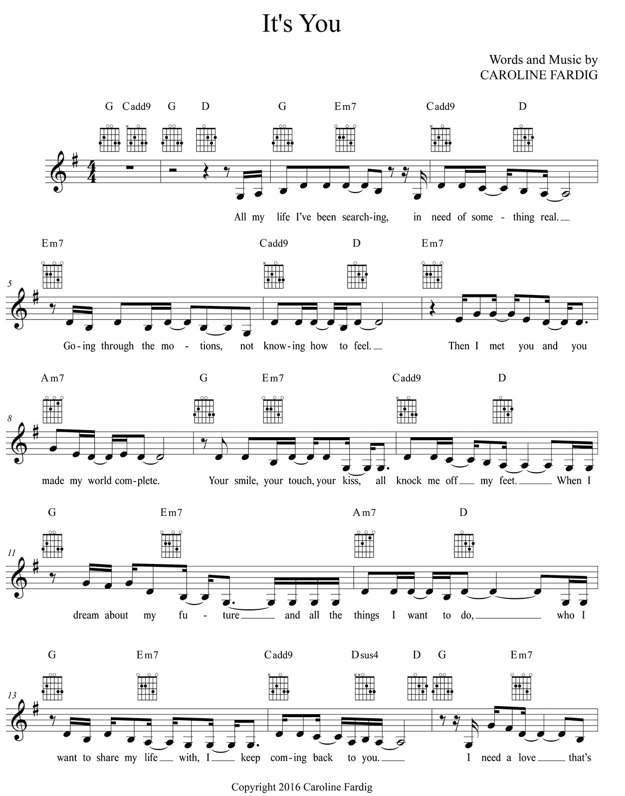
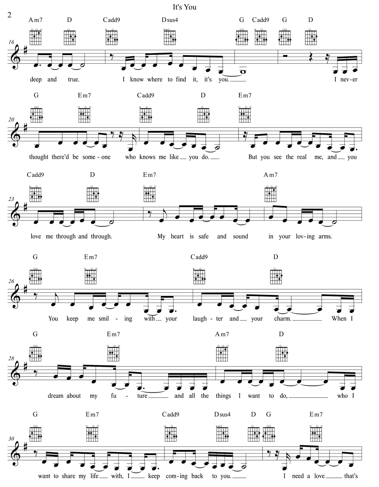
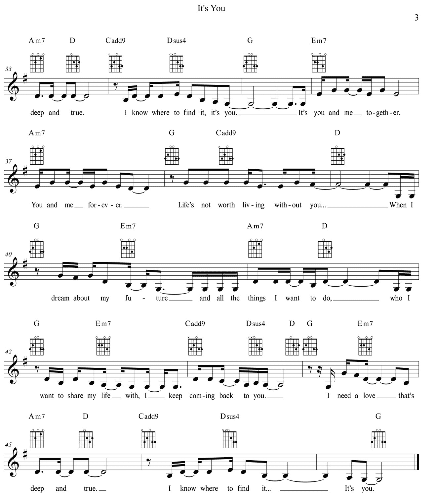
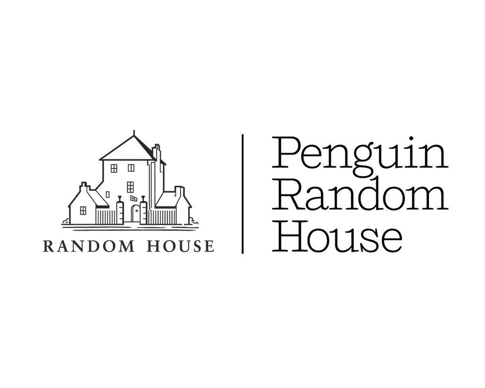

# 人物肖照（Java 探案系列，#2）

- A Whole Latte Murder 节选

## 第一章

“朱尔，你觉得如果我们离开，会有人注意到吗？”

我看着我最好的朋友皮特·本内（Pete Bennett），他用那双大而哀求的眼睛看着我。“是的，皮特，如果我们离开她祖母的葬礼，你的女朋友会注意到。然后你会被收拾。”

他脸上露出了顽皮的笑容。“你在开玩笑吗？我现在可是拳击黑带了。没人能教训我。”

令我失望的是，皮特展示了他的几个拳法，因为他最近一直在练。对于一位老钱家族族长的葬礼宴来说，这显然不是展示空击技巧的地方。幸运的是，我们正独自站在凉爽的十二月露台上。

“没有‘拳击黑带’这回事，皮特。而且住手！你会伤到别人的，而且很可能是我。”我挥开他离开我脸的手。

“你只是嫉妒。我告诉过你应该跟我一起上课的。”

皮特在几个月前救我时打了一个人之后，决定在他的健身房学习拳击。通常情况下，皮特脾气非常温和，但似乎那场小冲突激发了他的睾酮之类的什么。最近他那关于拳击的胡闹简直让人无法忍受。

“在我们在这儿的时候消停一下，好吗？这些上流社会根本不欣赏我们这种人，如果你闹出动静，我们都会在西莉娅那里遇到大麻烦。我确定她会想办法把它变成我的错。”

西莉娅·霍林斯沃斯（Cecilia Hollingsworth）是皮特那个傲慢的、南方名媛女友，她并不需要我。我也同此。皮特总是试图在我们之间进行调解，这从他今天早些接我去参加葬礼时看出，他让我回去换了两次衣服，以便看起来足够“体面”。显然，在南方参加葬礼的女士来说，裤装是不被接受的。我最终穿了一件领口很低的红色围腰裙，这在印第安纳州的葬礼上会被看不起。然而，他是对的——我为这次活动穿得很得体。

“这太棒了，朱尔。我会让我们被从这里赶出去，然后我们就有离开的完美理由了。你也不想在这儿。”

我设法抓住他一只飞出的拳头并抓不放。“你说得对，我不想在这儿。但斯坦邀请我来的，所以我在这儿了。我可能应该和他待在一起，而不是和你。”

一个月前，我见到了西莉娅的哥哥斯坦（Stan）——霍林斯沃斯家族的害群之子——那是皮特拉着我去参加的一个募款活动。西莉娅一如既往地作为慈善家，负责这次活动，皮特曾向我抱怨，让他独自忍受会有多么无聊，直到我同意去。他向我介绍了斯坦，我们聊得很投机，对西莉娅对我们的反感如出一致。

“嘿，亲爱的，派对过得怎么样了？”皮特问道，试图缓解空气中弥漫的明显紧张气氛。

“这是一场葬礼宴，不是鸡尾酒会，”塞西莉亚尖锐地说道。你真可以把我骗了。塞西莉亚那些上流社会的朋友在屋里大笑着、八卦，满身钻钻，啜着香槟。我个人觉得，我没看出屋里发生的事情和鸡尾酒会有什么区别。她继续道：“是你时候进屋来，履行你作为`my boyfriend`的职责了。”她在说“我的男朋友”时，意味深长地看了我一眼，然后转转身，大步走回屋里。

我等她走远了听力范围后才咯咯笑道：“她说了‘职责（dood）’。”

皮特从不错过任何开玩笑的机会，大笑起来：“现在谁会让我们被赶出去？你还有你那些`shitty`冷笑话。”

我们花了一点调整情绪，然后走进了屋。宴席是在塞西莉亚祖母的家里举行的，那是位于镇中心南部贝尔梅米德（Belle Meade）一个富华地区的一座华丽别墅。那里设施一应俱全：大片土地、网球场、游泳池、数不尽的卧室和浴室，甚至在物业边缘还有一间小仆人房。传闻说塞西莉亚的姐姐阿比盖尔——在祖母去世后刚刚继承了这栋房子——已经收拾好行李，准备在这个周末搬进来。

他们的父亲，也就是霍林斯沃祖母唯一的儿子，已于去年去世了，所以霍林斯沃家族的孙辈继承了她所有的财产。塞西莉亚继承了利润丰厚的家族企业，而斯坦显然只分到了剩下的部分。据皮特的说法，塞西莉亚对她的新收获感到欣喜若狂。而我并没在她身上看到多少喜悦，因为她比平时时候还要刻薄和紧绷——这可已经是很过分的话了。也许这是她处理祖母去世的方式，但老实说，这里没谁人在认真哀悼。霍林斯沃祖母大约有 754 岁了，今年已经好几次徘徊在死亡边缘了，所以她的去世更像是一个定数，而不是震惊。

塞西莉亚和斯坦正在客厅和一位年长女士聊天，塞西莉亚向我们招示意让我们过去。斯坦看到我走近，露出了他那灿烂的笑容。我叹了口气。斯坦是个大帅——那种电影明星级别的帅气。他今天穿的那套黑色条纹三件套西装穿得合身合缝。他的衣橱让我嫉妒，到目前为止，我从未见过他穿过同一套西装。除了长得好看，他既爱玩乐又有礼貌，但深处他其实是个被宠坏的小富二代，我并不特别喜欢。他看起来是个不错的家伙，但我直觉他为了出人绝不会犹豫在别人背后捅一刀。不过，每个人都有缺点。我当然不介意斯坦的绅士风度、讨好的关注以及他喜欢带我去的高级约会——或者当我和斯坦在一起时皮特和塞西莉亚感到恼的样子。

斯坦搂住我的腰，在我的脸颊上亲了一下。“你好，朱莉特。我还在想你去哪儿了。”他对着和塞西莉亚聊天的那位年长女士说道。“母亲，我想让你见见我的朋友，朱莉特·兰西。朱莉特，这是我母亲，德尔塔·霍林斯沃。”

斯坦的母亲每只手都戴着一只巨大的镶钻戒指，一条蓝宝石项链足以与`Titanic`里的那条媲美。她的每一根头发都严丝不苟，那件淡粉色的连衣裙无疑是纯丝制成的。可惜的是，她的脸看起来一直处于一种惊讶的状态。她最近一定做了一些美容。

“很高兴见到您，霍林斯沃夫人，”我说，伸出手。

“你听起来可不像个南方女孩，”斯坦的母亲轻蔑地说，语气里混合着南方腔调和醉酒后的含不清。这位亲爱的老太太完全喝醉了。“斯坦，你没告诉我你正在追求一个`Yankee`北方人。”

“母亲，内战已经结束了，”斯坦干脆地指出。

我把没被回应的手垂回身侧。从眼角处，我注意到皮特正咬着唇努力不笑出来。我真的无法理解他是如何忍受塞西莉亚她那家的胡闹的。

“我需要再来一杯，”霍林斯沃夫人回答道，摇摇晃晃地走向吧台。

斯坦带着抱歉的微笑看着我说：“母亲是个需要时间慢慢适应的口味。她会好起来的。”

点了点头。说实话，我根本不在乎斯坦的妈妈是否认同我。毕竟我并不是打算嫁给那家伙的。幸运的是，尴尬的沉默没有持续太久，因为我最喜欢的南方美女萨凡纳·沃丁顿和她的丈夫卡尔加入了我们的小组。

“嘿，大家好！”她向我们打招呼，完美的微笑闪烁着光芒。萨凡纳是那种极其地道的南方人——礼貌、甜美、漂亮，留着选美皇后般的发型。她的身高几乎只到我的肩膀，但她用极大的个性弥补了矮小的身材。她就像是吸了冰毒的克里斯汀·切诺斯。“很美的聚会，塞西莉亚。你祖母会认可的。”

塞西莉亚笑着，擦掉了一滴看起来是真的眼泪。“谢谢你这么说。”

“她的房子确实很漂亮，”卡尔对塞西莉亚评论道。他向萨凡纳眨眨眼。“装饰是顶级的。”

萨凡纳咯咯笑了。“噢，得吧。”萨凡纳是一位才华的室内设计师，她在几个月前刚重新装修了这栋房子。她的作品令人惊艳。

“确实如此，”塞西莉亚赞同道。“萨凡纳，我需要你来考虑我的新办公室。那里需要很多工作。”

塞西莉亚、皮特和我都从贝尔蒙特大学获得了音乐学位。毕业后，塞西莉亚开始在音乐街的一家视频制作公司工作。她的工作是招揽她可能接触到的最名名的客户。根据皮特的描述，她所做的就是参加各种权力午餐，并讨好那些明星音乐人。我无法想象那种经历将如何转化到她现在作为家具公司首席执行官的新职位上。

她眯起眼睛看着我，但轻率地挥手打回了我的评论。“噢，朱莉叶，我在职场方面有足够的经验。有些事情是商学院教不了的。”塞西莉亚给了我一个同情的微笑，并补充道：“尽管我并不指望一个`waitress`能理解这些。”这话一出，这再次提醒了我，我不属于这里。诚然，我确实先顶怼了她，但拜托吧。

显然，我并不是一个感受到了空气中的敌意，因为斯坦、萨凡纳、卡尔和皮特在听我们那段小对话时，脸上不是带着虚假的微笑，就是露出不安的目光。他们中没有胆子反抗塞西莉亚，所以只能由我来保护自己。我的火气上来，正要张口进行一番犀利的反驳时，皮特察觉到了我的情绪，介入了进来。

作为一贯的调解者，他抓住了塞西莉亚的手。“噢，嘿，你妈妈叫你呢。她可能是威士忌喝完了之类的。我们去看看她想要什么。”他越过肩膀向我投来无奈的一瞥，领着她离开了我们的小群体。萨凡纳和卡尔也悄悄地离开了，只留下我和斯坦。

他低头看着我，将我拉近他。“谢谢你维护我。你知道的，以前从未有人为了我反抗过那个冰女王。”

“真的吗？噢，我很乐意随时这样做。这很有趣的。”

“也许我以后可以好好感谢你。”斯坦昵着我的下颌，亲了吻我的脸颊。这一点也不讨厌，但我还没准备好和他睡觉。并不是针对他，但我不想现在就回到关系中。

我开玩笑道：“我接受任何形式的珠宝。”

“我会记住的。”他皱起眉，“抱歉关于那个女员的评价。那太越分了。她通常贬低人时会更含蓄一点。”

我耸耸肩说：“噢，我习惯她了。但她今天`确实`表现得很奇怪。”

“今天？看看这一整周吧。她简直疯了。”

“你觉得她是因为你奶奶的事生气吗？她们关系好吗？”

他耸了耸肩。“并不特别。我不知道。也许她首席执行官的新身份让她措手失措。”

塞西莉亚出现在房间中央，大方地邀请大家进入餐厅和相连的阳光房用餐。自助餐桌上摆满了摆放精美的各种美食，就像在鸡酒派会上一样；书房的湿吧旁还有一名调酒师正从精致的瓶子里倒着饮料……就像在鸡酒派会上一样。

拿完食物后，斯坦送我进入阳光房，我们在萨凡纳和卡尔附近找到了座位。我们四个人静静地聊着一些无关紧要的闲，但我们过得还是比可怜的皮特好得多。他被困在无视他的塞西莉亚和一个显然听力不好且对他迷恋不已的老太太之间。用餐期间，他耐心地和那位老太太聊天，但我从他的表情和看向我们桌子的渴望眼神中看出，他其实更想和我们坐在一起。

晚餐结束后，斯坦借口离开去见他一些外地的亲戚，我走向了吧台。我想回家，但皮特是我的接应员，他仍然被困在那个老太太和那个泼妇之间。

我一边喝着饮料，躲着那些嚼舌的社交名媛，一边在房子的主层闲逛。那里简直美得惊人。房间多到我数不完，每个房间都采用不同的色调装饰，每个房间都有自己与装饰风格完美融合的圣诞树。门厅巨大，有优美的弧形楼梯、闪发光的大理石地板，还有一棵直插天花板的双层圣诞树。当我正在翻阅图书馆里成千上万本书籍时，皮特找到了我。

“你是不是和我一样，准备好离开这个鬼地方了？”他疲惫地问。

我拍了一下他的手臂说：“我们会在这儿完全都是你的错。”

“是斯坦请你来的，不是我。”

“尽管如此，如果你能把脑子从屁股里伸出来，和那个老太婆分手，我觉得我们两个的生活都会轻松得多。”

“我以为你说过你会试着给她机会的。”

“我试过了，”我撒谎道。

他哼了一声。“行了。你之所以和斯坦约会的唯一理由就是为了让她生气。”

“那不是事实。我喜欢斯坦。”

“你不喜欢斯坦。他不是你的菜。”

“我没有喜欢的类型。”

他对我笑了。“你有的。你喜欢那种幽默、博学、帅气而且对老太太很好的男人。”

“噢，对的。像莱德那样。”这总能让他闭嘴。

皮特额头上的一根青筋跳了出来。“`Likeapony`的莱德？你是在跟我开`玩笑`吗？”

皮特绝对讨厌我上一次约会的那家伙，那家伙的名字其实叫`Ryder Hamilton`。更准确地说，是侦探`Ryder Hamilton`。我们的关系持续了大约五分钟，但这并不意味着。

```
阿比盖尔！我身后传来一个心慌的声音。塞西莉亚向我们跑来并推了我一把。她拉住阿比盖尔的手对着我大吼道，“你对我的妹妹做了什么？”
```

塞西莉亚摇着回答道：“她昏迷了。”

“好，我们需要把她叫醒！”德塔大吼道，举起手中的酒杯。

噢不。我预料到了接下来会发生什么。德塔倾倒了满杯酒，对着阿比盖尔的脸了过去。我冲进两人之间，酒水从脖子往下浸透了我全身。除了我正试图救一个女人的命并让她免受进一步伤害外，我不确定卷入这场乱子是否真的是什么好主意。

“你为什么要那样做？”德塔质问道，“离开我的女儿！”她摇摇晃晃，眯着眼睛瞪着我。我不确定她是否还通过我们之前的对话认出了我。这个女士已经完全醉片了。

我稳住脚跟：“救护车已经在路上了。往你女儿脸上泼酒不是复苏她的正确方法。交给专业人士吧。”

卡尔走了进来，他礼貌但坚定地让我们都离开了阿比盖尔。他审视了情况，检查了她的脉搏和呼吸。皮特安慰着塞西莉亚，斯坦走过来搂住他歇斯底里的母亲。救护车稍后到达，随后是一辆警车。急救人员和制服警察将所有人推回客厅，以便他们可以在没有旁观者的情况下处理阿比盖尔。然而，他们还是从人群中拉出皮特，护他穿过门厅进入图书馆。

我需要找一条毛巾擦干身体。我滴着水穿过客厅，穿过管家储物间，进入厨房，成功从一个餐饮人员那里要到了一条擦巾。我在厨房里躲了一会儿，擦干自己并喝了一口酒，然后强迫自己回到那片混乱中。当我终于回到客厅时，萨凡纳走过来盯着我那件被毁掉的裙子。红色的丝绸面料显现出每一滴溅落的液体，让我真恨自己当时没穿传统的葬礼黑装。

她同情地啧了舌头：“噢，宝贝。你发生什么事了？”

我低头看着自己，叹了口气：“德塔发生在我身上。她出了个坏主意，想通过往脸上泼酒来叫醒阿比盖尔。我拦住了她。或者说，是我的裙子拦住了她。”

萨凡纳摇着头说：“女孩，你真是个麻烦磁石。”

“可不是嘛。”

她看向我身后并笑了笑：“你也是个男人磁石。有个超级火辣的哥正盯着你看。”

“谁？”我问，我不记得这里有哪个男人可以被描述成那样。

“朱莉叶特？”我身后传来一个熟悉的声音。我转过身。说曹用曹。那是赖德·汉密尔顿。

## 第二章

“赖德，”我轻声说道。自从我们分手后我就没见过他。“你在这里干什么？”他穿着一套笔挺的西装和领带，与他平时穿的紧身 T 恤和牛仔裤相比变化很大。他的深发比以前短了一点，但仍然是我我喜欢的那种刻意的凌乱感。他看起来帅得让人下饭。

他对我微笑，我的心漏了一拍。“我来这里是要问几个问题。我们可以私下聊聊吗？”

“当然，”我说。看着他那样子，我会答应他提出的`任何`要求。

赖德带我穿过门厅，急救人员已经把阿比盖尔固定在担架上，准备推出去。她的眼睛睁开的，这是一个好迹象。我松了一口气。他领我进入图书馆并在我们身后关上门。

他从上到下打量着我，脸上露出一丝微笑。“你总是处于风暴中心，不是吗？”

关于赖德，我不怀念的一点就是他有多喜欢挑剔。“你是要质问我还是嘲笑我？”

他轻笑道。“我必须二选一吗？”

我瞪了他作为回应。

“噢，得了。你发生什么事了？”

我懊悔地看向我的裙子，现在已经干了很多，但还是贴在身上。“我挡在一个醉酒母亲和她扭曲的急救想法之间。”

他摇着头说：“德塔·霍林斯沃斯从未以清醒`或`明智而闻名。”

“听起来你认识这些人。”

“我认识，某种程度上。几年前我在`Hollingsworth Industries`处理过一起纵火案。这就是为什么我被派到这里——因为我认识这里的几个人物，局长认为他们更愿意跟我谈。”

“但为什么我们需要侦探来询问关于事故的问题呢？”

“因为这不是事故。”

我倒吸一口气。“真的吗？”

“根据你男朋友所说。”我空空看着他。“皮特，”他补充道。

我皱起鼻子问：“他为什么要那样说？他看到了我看到的，阿比盖尔从最后几级阶梯滚落在地。顺便说一下，他不是我的男朋友。”

“所以你没在门厅看到其他人，或者在楼梯口？”

我皱起眉。“没有，我想我没考虑到抬头看。我直接冲过去帮阿比盖尔了，没怎么想别的。抱歉。”

“没关系。皮特今晚喝酒了吗？”

“没有。据我所知没有。尽管如果他喝了，我不会怪他的。这地方简直像个动物园。”

他若有所思地看着我。“还有一件事我想知道——你为什么在这里？没冒犯的意思，但你为什么在这里？你和那些霍林斯沃斯人在一起，不是吗？”

“噢，”我说道，脸颊发红。我还能更愚蠢吗？调情是他调查时的惯用手段，至少对女性来说是如此。考虑到我们的过去，我竟然没有吸取教训，这真是可笑。他无疑已经开始了新生活，现在可能已经有一两个新女孩了。“对，当然。”

“见到你很高兴，朱丽叶。”

“你也是。”

莱德送我离开图书馆，我回到客厅/牛圈区。萨瓦纳立刻冲向了我。

“那是谁？你们俩看起来很*认识*彼此。眨了眨眼。”

我脸红了。“你可以这么说。”

“我好像听见你叫他莱德。他是*那个*莱德吗，就是你一直魂牵梦绕的警察？”

“我才没有*迷恋*他。”

她意味深长地冲我笑了。

萨瓦纳我和最近成了好朋友，这很不错，因为当我几个月前搬回这里时，我唯一能真正说话的人只有皮特，而他*完全*不想听听任何关于我感情生活的事。现在看着她，你永远猜不到，萨瓦纳出身卑微。她是一个来自乔治亚的农村女孩，通过选美奖学金和在路边摊位卖桃子赚的钱自己完成了学。在遇到卡尔之前，她就已经自己创立了一项成功的事业，卡尔带她进入了她现在经营的显赫社交圈。萨瓦纳亲身体会过在镇上局外人的感觉，正因为如此，我们很快建立了纽带。

她说：“噢，你告诉我他有多帅的时候可不是在开玩笑。我不明白你怎么能和那个‘行走的糖果’分手，你这个疯丫。”

“我告诉过你了——他骗了我，利用我来获取案件的情报。”

“他是卧底。他必须这么做。”

我低低声音。“是，但当他在*我的*掩护下时，我希望能有一点诚实。”

“亲爱的，不是每个男人都是皮特·本内特的。”

我困惑地看着她，回答道：“皮特？他跟这有什么关系？”

萨瓦纳翻了个白眼。“你太瞎了。算了。完美的男人就像母鸡的牙一样稀少。而且，每条狗都该有几只虱子。这会让事情变得有趣。”

“你现在是在说英语吗？”

“抱歉，我有时忘记了你是北方人。我想说的是，我任何时候都愿意只要帅汉侦探。”

“他已经机会了——”

皮特出现在我身边，所以我突然中断了我们的女孩闲话。我希望他没有听到萨瓦纳刚才说的任何话。看起来他并没有，因为他的表情很严肃。他抓住我的手，把我拉到房间一个安静的角落。

“我要带西西莉娅去医院陪阿比格尔。卡尔说他和萨瓦纳会送你。”

“没关系，”我回答道。

他犹豫了。我知道他要说什么。皮特是个很好的人——他可能对今晚发生的事情感到非常矛盾。“我需要问你一件事。当我们找到阿比格尔时，你无意间看了楼上吗？”

“没有。不过我注意到你在往那儿看。你会告诉我你看到斯坦了，对吧？”

他点头说：“是的。我很担心你，朱斯。在警察有时间澄清这件事之前，你不应该和斯坦单独待在一起。”

“噢，得了。你了解斯坦。我确定这完全只是个误会。”现在莱德*和*皮特都警告过我斯坦。我不想对他产生坏的想法，但坦率地说，我开始有点担心了。

“是的，我*知道*斯坦，这就是为什么我让你远离他。‘跳马’侦探告诉我，阿比格尔说她是绊倒摔倒的，但如果斯坦在他姐姐开始摔倒时在场，他为什么要逃跑？”

“我真的不敢相信斯坦会故意推她，”我说道。至少我不认为他会那样做。我不认识他那么久，但他看起来不是那种暴力类型。不过，皮特在这件事上非常坚决，我信任他的判断。

“这一家人全都疯了，如果你没注意到的话。”

我摇摇头。“对你女朋友的家人来说这不是什么好话，尽管这完全真实。”

“问题是，即使斯坦真的推了她，我也不认为阿比格尔会隐瞒他。霍林斯沃斯家族内部会争斗，但他们不惜一切代价维护家族名誉。”

“所以你认为他们会结成阵保护斯坦？他看起来像是个局外人。”


皮特耸了耸肩。“谁知道这里关门后发生了什么？有人在周围发生就已经够糟糕了。”他低看向我的裙子。“我看到你和德尔塔的小冲突。我觉得可以说，你不在她的圣诞贺卡名单上了。”

“那个老太婆毁了我的裙子。”

他的一直没有离开过我的裙子，裙子还是湿的，不当地地贴在我身上。“在我看来并没有坏掉。”

“皮特，别盯着我的胸部看。”

“什么？它们在看我！”

—

在一个制服警察允许我们三人离开后，我跟斯坦简单打了招呼，就和萨瓦纳、卡尔一起离开了。

蒂芙妮噘着嘴走到点心柜旁，让科尔接替了她在咖啡机旁的位置。海莉，我的另一位新员工，站在收银台，透过她那双大而圆圆的眼镜观察着我们的互动，手里咬着一缕头发。我皱了皱眉。我受不了她在柜台后面时玩头发——那太不卫生了。总有一天，某人会在某人的食物里吃到她的头发。但是，每当我提到这件事时，她就会会泪流而出并大闹一场，然后就得由我来收拾残局。今晚我没精力应付，就随她去了。至少她处理的是钱，而不是食物。

临近关门时，我回到办公室做日报，更重要的是，为了躲起来。我累坏了。我忙碌了一了一整个早晨，参加了葬礼和追悼，处理了所有霍林斯沃斯家族的纠纷，然后又回店里工作到闭店。我想不出还有比回到家立刻蜷缩在床上更好的事情了。

科尔把头探进办公室说：“朱丽叶，外面来了一个看起来很不错的哥们想见你。”

我挑了起眉毛。“一个看起来不错的哥们？”

“是。他长得像……那个老头。乔治·克鲁尼。”

斯坦。我不认同科尔对他得像乔治·克鲁尼的评价（主要是因为他的头发是浅棕色的，而且还没老到能当我爸的年纪），但他无疑同样帅气。我很困惑，纳纳斯坦为什么会来这儿见我。皮特和莱德对斯坦的警告在我脑海中反复回放，我开始感到一丝不安。他是来这里平息局面的，还是来这里威胁我闭上这臭嘴？

我小心翼翼地从后走廊走出来。斯坦坐在桌子旁，看起来很憔悴，这可不像他的常常。他的领带歪了，外套也皱皱巴巴的。看到我时，他露出了一个疲惫的微笑。他不愧是个绅士，当我走向桌子时，他站起来并为我拉了椅子。

我们都坐了下来，他开口道：“朱丽叶，我不知道你现在怎么想我，但对我来说，让你知道我绝不会伤害我的妹妹非常重要。”他的眼神里充满了痛苦和恳求，这是我以前从未在他身上见过的。他把我的手握在手里。他的手在抖，可怜的家伙。“我不确定你具体看到了什么，但并不是你想的那样。我会告诉你你想知道的一切。”

我笑了，但仔细地审量着他。他看起来足够诚实，但我最近约过的两个男人都当着我的面撒谎，而且是反复，而我却毫无所知。我讨厌感觉自己很轻信。“我不知道该相信什么，斯坦。我没没在现场看到你，因为我忙着帮艾比盖尔。你知道她现在怎么样吗？”

痛苦的神情掠过他的脸。“她情况还算符合预期。她扭了脚踝，骨折了手腕，还有轻微脑震荡。她明天应该就能回家了。”他揉了揉眼睛。“发生得太快了。你必须相信我跟这件事没关系。”

我想想，为什么我相信他的故事对他来说如此重要。皮特在俯瞰门门的楼梯顶端看到了他，这并不对他加分。这并不意味着斯坦推了她，但绝对有问题。我绝不想因为我和他在交往就选择盲目相信。

我问他：“她摔倒时你在哪？”

他直视我的眼睛说：“我当时和她在一起，在楼上阳台上。但我没有推她，我向你保证。”

直视一个人的眼睛说完全的谎言需要极大的胆量。不过要完全说服我，不仅于此。“好吧，所以她在没有你帮助的情况下摔了。如果你在上面，为什么不试着接住她？”

他叹了口气移开目光。“我试过了。我没能及时赶上她。”

“你们起为什么要在那里？”

“我跟着她上楼说话，我们最后为了遗产吵了起来。我打架累了，就走开了走廊尽头的楼梯。我想她还没说完，因为她一直很大。她大声叫我的名字，所以我回头看，她还在走来走去挥舞着手。突然，她的脚跟挂住了地毯，整个人顺着楼梯滚了下来。”泪水涌入他的眼中。看起来足够真实。“我太远了帮不上她。然后，当我看到你和皮特跑进门厅时，我慌了。在奶奶分配遗产的消息传开后，我知道任何在阳台上看到我的人都会想同样——我出于恶意把自己的亲妹妹推下楼梯。我没这么做，朱丽叶。我没有。”他把头埋在手里。

我到底该如何回应这样一段话？一方面，我可以表现得冷酷无情并要求更多证据。或者，我可以盲目地相信他，很可能让自己像个傻瓜。我还没有下定意，但我不想看到斯坦那么痛苦。于是，我保持着距离，尴尬地拍了拍他的肩膀，什么也没说。

自从我的厨师戴夫在这里被杀后的一个月里，`Java Jive`忙得不可开交。每个人及其兄弟都想进来凑热闹，尽管谋杀案发生在后院，那里没什么可好看的。这对生意有好处，但对员工来说却很辛苦。事故发生已经两个月了，我们的客流量终于恢复到了一个可以接受的范围内。遗憾的是，这意味着收入下降了一些，但我对经营模式进行了一些调整，看起来似乎有所帮助，这也是皮特起初带我来这里要做的事情。

这些调整中的之一是每天都从零开始制作点心，而不是像过去那样从食品供应商购买。顾客们非常喜欢，这对盈利大有好处，但遗憾的是，必须有人早早来制作。那个人就是我。

结果，我每天早上六点就得拖着疲惫的身体去上班。尤其是今天早上，我这副身体在反抗。我昨晚没睡好，满脑都在想斯坦丹，担心他是否骗了我。即使喝了两杯浓咖啡，在午餐时间左右皮特进来之前，我一直像个行尸走肉，然后变得非常刻薄。

皮特显然睡得很充足，因为他心情好得让人作呕。我讨厌晨起型的人，尽管到中午我本该已经度过了早晨的低谷了。当皮特来到柜台边唱着“朱莉叶特，怎么样？一个明媚清澈的新夏日”时，这甚至没让我心情好起来。用一首“朱莉叶特”歌为我伴奏是他的习惯，但今天我没心情。他坐在柜台旁他奶奶格特迪的座位上，在她颊上亲了一个大口。格特迪每天都来`Java Jive`，而且已经这么做了二十年了，为了支持家族生意。

“既不明亮也不清晰，更不是夏天，”我闷闷地反驳道。

他转向格特迪指了指我，“这丫头今天早上心情不太对吧，格特？”皮特不被允许叫“奶奶”，因为她说那样让她觉得自己很老。

格特迪耸了耸肩对我眨了眨眼。她一直对我很心软，我也是如此。“看起来看起来还好。我不介意她有一点小火脾气。”

“我不知道，”他眯着眼睛看着我，“我觉得红发女魔头出笼了。小心点，纳什维。”

“不，这只是精疲力竭、易怒朱莉叶特，”我解释道。红发女魔头是皮特对我发脾气时的亲昵称。没人想成为红发女魔头怒火的对象。

“精疲力竭、易怒朱莉叶特提供咖啡吗？”他希望地问。

“去买你自己的该死的咖啡。”

格特迪大笑了起来。

皮特对我一笑，一言不发地走到柜台后拿他自己的该死的咖啡。他知道在我脾气不好时最好别太惹我。“既然我觉得需要换个话题，我想你应该知道，阿比盖尔的情况好多了。肯特和塞西莉娅现在正送她回家。”

“肯特？”我问，“我以为阿比盖尔和她那个呆脑丈夫离婚了。”

“我记不清。他们又分了，但在他发现阿比盖尔受伤后，他们又复合了。”

“随便吧，”我笑了，“我只要她能没事就好。”

“是啊。可怜的孩子。她亲哥哥竟然对她做这种事，真是太糟糕了。”

“真可惜他推错了妹妹，”格特迪嘟囔道。她对皮特的女朋友塞西莉娅的讨厌并不比我少。

“格特迪……”皮特警告道。

这似乎是我第一次要挺斯坦背，因为我向他承诺过我会支持他。现在是我为他站腰的机会了。遗憾的是这必须反对皮特。如果反对塞西莉娅会容易得多，因为我根本不在乎她的想法。而皮特，我是尊重的。

深吸一口气，我开始说道：“关于那个……你知道的，你并没有*看到*他推她。也许这只是个意外意外。”

皮特笑了。“行了。甚至连他亲妈都觉得那听起来完全就是他会做的事。”

“你是那个昨天整天醉得烂的女人吗？我觉得她可不是什么好的性格证人。”

格特迪插话道，“那些霍林斯沃斯家族都是疯子。一直都是这样。我不明白你们起初为什么会和他们搅在一起。不过，如果你问我的话，那个斯坦是个非常英俊的小伙子。你让他把你的游艇停在你的港口了吗？”

皮特呻叫着，假装作呕。

我做了一个鬼脸。“我没*那么*喜欢他。”

他说，“但你还是在维护他。”

我耸了耸肩，擦掉台面上一个污渍，以免直视他的眼睛。“好吧……你知道的……我觉得大家在没有任何实际证据的情况下集体围攻斯坦，这很悲哀。”

“朱莉，我看到那家伙们在他姐姐摔下楼梯时正朝另一个方向逃跑。无辜的人不会那样做。”

“我知道，但阿比盖尔自己说过那是意外。她不怪他，我们又为什么要怪呢？”

他尖锐地看着我。“你一直在和斯坦聊天？”

“也许吧。”

皮特沮丧地拍了一下额头。“拜托，朱莉！我以为你打算离他远点。我不希望他伤害你。”

“好了，大家。好消息是，为了方便起见，我只选了两种饼干我们要制作：巧克力曲奇和糖果棒糖。坏消息是，每种我们都要做五百个。所以我们得赶紧行动了。韦恩，你来做巧克力奇面团，卡米尔，你开始准备其他的糖饼干面团。我会把糖果棒压碎，等会儿你们加入。”

“我太`love`制作圣诞饼干了，”卡米尔兴奋地说道，甜甜地看着韦恩。

“我也是。我们竟然有这么多共同点，真是太神奇了，”他回答道，并她眨了眨眼。

他们真讨人，但我可没心情听他们彼此耳边低声情语。于是，我拿起面杖，狠狠地敲打了几十根毫无防备的糖果棒，以此掩盖他们的声音。能把糟糕的情绪发泄在东西身上，感觉还挺治愈的。正当我落下最后一击时，我那个不喜欢的咖啡师师隆达从厨房的传菜口探出了头。

“嘿，朱莉叶特，”她生气地说道。隆达和我大学时期在`Java Jive`咖啡馆是同事，我们从来相处得不好。我现在还是她的老板，这让情况更糟。“外面有个男人想和你谈谈。”

“谢谢你，隆达，”我回答，走向前台看看是谁。

看到斯坦丹在昨晚之后这么快就回来了，我有些惊讶。他今天早上看起来恢复了往常的样子，但眼神很疲惫，脸色也有些憔悴。他可能晚上也没怎么睡好。

斯坦丹看到我，眼睛亮了起来，在吧台旁坐下。“嘿，美女。”

“嘿，你也是。看起来你需要杯咖啡。”

他叹了口气说：“有杯咖啡就太好了。”

我去拿了一个杯子和咖啡壶，当我回来时，发现他面前的台上放着一个系着大蝴蝶结的珠宝盒。我猜，大概是手镯或手表大小。我停下脚步，目光从珠宝盒移到斯坦丹微笑的脸上。

“这是什么？”我问道，既兴奋又带着一丝警惕。我不希望我们的随性约会向真正的关系迈进一步。我们绝对还没到“珠宝”阶段。我妈妈总是告诉我，当一个男人送你珠宝时，他期望你也送回他什么。比如比性。

他对我笑着回答道：“你说你接受任何形式的珠宝。”

“我只是在开玩笑。”

“打开吧。”

放下咖啡壶和杯子后，我小心地拆掉蝴蝶结并打开盒子。看到我见过的最漂亮的手镯时，我不禁吸了一口气。那是一只细金手镯，镶嵌着五颗大小适中的绿色宝石。我彻底惊呆了。“噢，斯坦丹，它太美了……但我不能接受这个……”

他从盒子里取出手镯，套在我的手上。“你可以接受，而且你会接受。我觉得你不知道你在这片乱象中一直在我身边对我来说意味着什么。”

看着他的眼睛，我看出他是发自内心的但我并不觉得我的支持配得上如此昂贵的礼物。“我明白，但我没想过任何回报。”

他轻笑道。“我忘记了你和我以前交往过的那些女性完全不同，她们在任何场合都期待收到礼物，无论是否物有所值。”

我不信地摇了摇头。“你平时交往的是什么样的女性？”

“像我姐姐那样要求刻刻、自私、傲慢的交花族。这是家里对我的期望。”尽管我很担心斯坦丹是否在玩我，但我真的为这个男的感到同情。仅仅因为你疯狂家庭的期望就得和那些傲慢的女性约会，这太糟糕了。话虽如此，斯坦丹有时也会表现得傲慢且理所当然。但除此之外，他挺酷的。

“那么，你是怎么做到跟我约会还没事的？”我问。

“我没办法。我妈妈很讨厌你。”

“知道了。”

他笑了起来。“但我决定不再担心她说什么。家里怎么看我是很清楚的，尤其是根据我刚收到的遗产，所以我没理由再假装客气了。”他最后的话让我心里不太舒服，但我知道他的感情曾深度且反复地受伤过。他继续道：“今晚你和我出去好吗？”

尽管我不怕斯坦丹，但我忍不住想起皮特的警告，让我不要和他单独呆在一起。“我要工作。”

“等你下班后我们出去。”

我犹豫了一下，但在注意到他眼中那种显而易见的依恋感后，我妥协了。“好，我可以在九点左右离开。”

“完美。”他看起来非常开心，这让我对自己的迟疑感到很抱歉。他起身离开。“那我在这儿接你？”

“好的，九点见。”

他离开后，我低头看向那个手镯。它美极了——绝对是我拥有过最漂亮的珠宝。但我无法摆脱那种感觉：他正试图买我的沉默。

# 第四章

下午剩下的时间，我和卡米尔、韦恩一起做了饼干。通常卡米尔会在两点下班，但由于她工作效率极高（而且和韦恩并肩工作非常开心），她不需要离开。

等我们忙完，大家都精疲力竭。厨房里到处是面粉和糖，但温热饼干的香气简直是天堂。“大家干得好，”卡米尔一边在围裙上擦手说道。

“你也是，”我赞同道。

回家之前，我最后看了一眼那个手镯。它提醒着一个复杂的局面，但目前来说，这正是我需要的。

我鼓起勇气面对这场愚蠢且刻薄的对话，走过去清理塞西莉娅（`Cecilia`）的“意外”。我看到她故意撞倒了饮料。那完全是故意的。

当我进入那群人的范围内时，我听到塞西莉娅阴险地低声说：“那个没教养的服务生朱莉叶（`Juliet`）以为她把皮特（`Pete`）玩弄于指掌，但我们看看今晚他陪谁走。”

她的一个跟女赞同道：“没错，她根本没机会。你看到她今天的头发了吗？”

那个女孩根本没资格评价别人的长相。确实，她的每一根头发都理得井井有条，但即使她那完美的发型也无法转移人们对她大大钩鼻的注意力。诚然，我的头发看起来比她的好，但我工作了一整个下午，所以有几缕头发从马尾里逃了了出来。女孩的评论让我怒火中烧。我默默地擦掉桌子上洒掉的拿铁，然后蹲下处理地板上的一小滩水。在桌子底下时，我听到他们在偷笑，当我直起腰子时，塞西莉娅正用眼瞪着我。

“嗯，服务生，”她傲慢地说道，“你得再给我来一杯榛果拿铁。”

我吐了一口气，试图控制住那个红发女魔鬼和她的怒火。“塞西莉娅，我相信你知道我的名字。”

“是啊，叫‘服务生’！”她的另一个马屁精咯咯笑道。她让我想起灰姑娘里其中一个丑的继姐姐。

“现在，关于给我拿那杯新鲜的拿铁——当然，是免费的，因为我洒了第一第一了，”塞西莉娅说着，对我露出一个虚假的微笑。

我也回以一个虚假的微笑。“好吧，既然我看到你故意把它倒在地板上，卑劣地试图让皮特过来找你说话，那我不得不拒绝了。”

她的笑容变得冰冷。“把经理叫来。”

“乐意之，”我反驳道，大步走向厨房去找乔治（`George`）。

——那天晚上，塞西莉娅得到了一杯免费饮料，而我被乔治教了一顿，说要对客户友好，即使是那些和我合不来的人。皮特对我惹他父亲的麻烦感到非常自疚——他本该这么想，因为这完全是他的错。

但今天，我是经理了，没有人会再教训我如何对待那些无礼、糟糕的客户。三十岁的我要在这件事上玩点花。

我出现在她身边，说道：“你好，女士们。需要给你们点什么喝的吗？也许是榛果拿铁？当然是免费的。”

塞西莉娅跳跃了一下，结结巴巴地说：“什么？不……不，我们很好。”

我在桌边坐下。“那我们开始吧。我可不想浪费你们的任何时间。”转向萨凡纳（`Savannah`），大声低语道：“嘿，萨凡纳。我想和你聊聊天，但是……你知道的。”

萨凡纳给了我一个狡猾的微笑并眨眨眼，但保持了沉默。

塞西莉娅勃起脸，将一个大信封拍在我面前的桌子上。她快速地说道：“这是你们需要的所有资料包。里面有布置摊位的说明、摊位地图、你们的官方摊商证以及明天的日程表。活动结束时，我们会其中一个人去你们摊位收取捐款。别忘了总销售额的百分之二十是预期捐款。还有问题吗？”

“当然没有。你解释得非常仔细了，”我回答道，向后靠去，双手交叉。

塞西莉娅眯起眼睛，盯着我的手腕。她咬着牙问道：“那只手镯是从哪里来的？”

我对她的意图感兴趣，回答道：“这只手镯？”并把它推到她脸面前。萨凡纳的眼睛睁大了。

塞西莉娅的脸都紫了。“那是一只价值三千美元的手镯。”

天哪。三千美元？斯坦（`Stan`）这出手可真是太阔绰了。我知道那只手镯很贵，但我压根没梦它值三千块。那笔钱可以布置我的整个公寓了。而且是两次。

“我猜你真正想问的是，一个没教养的服务生从哪里弄来这么昂贵的珠宝。我说的对吧？”我假设她已经确切知道我从哪里拿的，但在挑逗她时看着她失控其实很有趣。“它非常漂亮，不是吗？”

塞西莉娅喉咙里发出一声压抑的低吼。

我笑了起来。“噢，我不再让你悬着了。你哥哥今天早些时候把它送给我的。”

“只有像你那样的荡货才会接受一个准谋杀手的礼物，”她啐了一口。

我很震惊。塞西莉娅通常不会对家人成员那样说话。当然，我不在乎她对我说什么，但我不会让她叫斯坦是杀手。“你谈论的是你哥哥。我知道你们相处得愉快，但他不是杀手。”

她哼了一声。“除了他比钱多到你数不完之外，你对斯坦了解什么？谁都知道你是个贪金的拖车女，想钓到大鱼。你可以收敛了，服务生，除非我死在这儿，否则你永远见不到霍林斯沃斯（`Hollingsworth`）家的钱。”

红发女魔鬼受够了。我站了起来。“出去。”

她没有立刻离开。她收拾好包瞪了我一眼，最后终于冲了出去。

在在接下来的几天里，我处理了后续。塞西莉娅的朋友们闹了矛盾，皮特不断向我道歉。但我坚持了立场。

终于，活动当天到了。我站在我的摊位前，感到一种胜利。当塞西莉娅走过时，她甚至没有看我一眼。

“嘿，塞西莉，”我喊道，“想要榛果拿铁吗？”

她什么也没说，只是转身离开。

我看着她离开，我知道我赢了。现在我是经理了，我说了算。

“你意识到他是在买你的好感，或者至少是在买你的沉默。”

“皮特，”我警告道，“我以为我们讨论过这个了。”

“不，我们讨论过他可能把你推下楼梯。我们没讨论过他会付钱让你他辩护。”

“你真的觉得我那么浅薄吗？更不用说那么蠢了？”我气喘着道。

他走过来握住我的手。“不，我不这么认为。我觉得他很危险，我不想让你被他的谎言和鬼话害得措手不及。”他愧疚地笑了，“你不是识人的人的最好标准。”他说得没错，但我还是不喜欢听这种话。

我不情愿地咕囔道：“我不是一直和你在一起吗？”

皮特咯笑着，把胳膊揽在我的肩膀上，领着我走出门口走向厨房。“那个证明了规则的例外。嘿，我听说这儿地方还有近一千块饼干。我想我可以只吃一个吗？”

—

皮特、科尔和我们的晚班厨师谢恩在晚餐高峰期后离开，前往百周年纪念华公园（`Centennial Park`）为我们的 5K 竞赛搭建帐篷。我让他们带上我们明天需要的一切，包括`Java Jive`的备用浓缩咖啡机，我希望那台机器在他们搬出门时差点摔掉后还能正常工作。我留下了那些饼干，它们显然不能放在外面一整晚。第二天早上，我只需要把几个装满饼干的塑料储物箱运到我们的展位就行。轻而易举。

科尔和谢恩在八点多一点回来。当他们脱掉外套存放在办公室时，我问道：“皮特在哪？”

科尔回答道：“你知道今天下午冲着你脸的那个女王婊子吗？”

“知道，”我说，心想西西莉亚这次又干了什么。

他说：“噢，她进了我们的帐篷，开始调戏皮特。我们不想参与那堆破事，就溜了。”

我在心里暗自叫。我也不想参与那堆破事。

谢恩解释道：“我们已经布置好了，所以皮特让我们回这儿。”

“谢谢你们把它准备好了。你们两个看起来很冷。”


“外面冷得要命，”科尔抱怨道，“我觉得我的蛋囊都要冻伤了。”

真希望自己没听到那句话，我说：“去喝杯热的暖暖吧。还有，科尔，别再过度分享信息了。”

今晚咖啡馆不是特别忙，所以我去女卫生间为约会打扮了一下。说实话，对于见斯坦（`Stan`），我的心情其实有些复杂。我机械地补了妆，从留在单位的衣服堆里选了一套，但我再也像以前那样见到他感到兴奋了。通常情况下，这是一个是时候结束关系的明显信号，但在努力帮助他处理他姐姐的意外，以及接受了那条愚蠢的手链之后，现在去分手简直是个不是人事的行为。

斯坦九点来接我，但他没告诉我要带我去哪儿。他看起来很开心，开车时一直在聊天。我可以进行一些寒暄，但我没心情和他进行深度交谈。当我们停在俱乐部门口时，我的心跳了一拍。斯坦带我来了 `Mixology` 酒吧，那是莱德（`Ryder`）第一次约会时的地方。想起那个晚上我叹了口气——我们玩得很开心，莱德吻我直到我几乎快要忘记自己的名字。

斯坦和我点了晚餐和饮料，但我脑子里全是莱德——他的微笑，他的笑声，甚至他的调侃。斯坦好几次叫我别出神，但我能掩饰说是因为工作了一整天太累了。为什么我没法把莱德从脑子里赶出去？自从分手后，我就断断续续地想起他，但在斯坦奶奶的追思会上见到他后，他在我脑海中出现的频率比我愿意承认的要多得多。我以为我已经对无法和他在一起这件事达成了某种和解，但今晚我似乎找不到一个好的理由说明我不应该回去去找他。噢，除了斯坦之外。

在斯坦坚持要跳舞后，我无法再维持伪装了。我假装头疼，让他带我回家。我觉得这样做很糟糕，但一在他约会时想着另一个男人，感觉更糟糕。斯坦和我从未讨论过要建立唯一关系，但我们在一起时，我至少应该给他全部的注意力。否则对他是不公平的。回到家后我直接睡了，希望睡眠能清醒我的头脑。

---

周六早上，我去 `Java Jive` 拿了我的那千块饼干，把它们开到百周年纪念公园。我特意提前了一个小时，因为即使在天气好的时候，百周年公园（以及整个区域）的停车位也很烂。我没太大就在帐篷附近找到了一个车位。仔细地把那叠储物箱装上带过去的手推车后，我穿过草坪，一边打冷，一边后悔没穿件暖和的外套。

我前面的路面看不清楚，走到一半时，手推车的一个轮子掉进了不平地面上的一个坑里。还没等来得及停下，上面的盒子就从堆上滑落，重重摔在地上。“死了！”我大喊，盖子掉了，几十块饼干从盒子里飞了出来。

我深吸了一气，抬起头。点了点头，颤抖着回答道：“是的，只要我离开这里就好。”

他带我来到户外，拉上帐篷的拉链。他让我坐在草地上，自己则走到了一个听不见声音的地方接电话。我双手抱头，努力让自己冷静下来。这一切不应该发生……*再次*发生。我无法接受西莉娅去世的事实。这似乎不可能。她受到如此残忍的伤害并被任之死亡，这让我深受震撼。尽管我们并不亲近，但她的死深深地扰动了我。

我混乱的大脑突然停滞了。皮特。当他发现发生了什么时，他会彻底崩溃的。想到他必须独自承受这种痛苦，我的心几乎要碎成两半。无论他们之间的关系如何，他都很在乎西莉娅，而这会击垮他。

我擦掉眼泪，环顾四周，发现人们开始聚集参加比赛了。我看到皮特正朝我走来，我吸了一口颤抖的气。当我意识到必须由我来告诉他关于西莉娅的消息时，另一滴泪水滑过脸颊。一想到这件事会对他造成什么，我就感到一阵恶心。

他走到我面前。他看起来疲惫而忧郁，完全不像他平时开朗的样子。他皱着眉看着我问道：“怎么了？你为什么坐在这儿而不去准备东西？”

我吸了一口气，犹豫了一下，抬头看着他。我完全不知道如何开始这样的对话。“皮特，也许你也坐下。”

“怎么，我们的展位出问题了吗？”他问道，余光瞥了一眼身后的帐篷。在皮特身后，我看到两名警察正快步走来。这里很快就会挤满执法人员，只是时间问题了。

我跳起身，双手握住他的手。泪水从我眼眶夺眶而出，我说：“是西莉娅。她——”

他的脸变得愤怒了。“她又找你吵架了吗？如果是的话——”

“不，皮特。不是那样的。她……她去世了。”

他不可置信地盯着我了一会儿。“她没死。我昨晚还见到她了。如果这是玩笑，那一点也不好笑，朱尔。”

我悲伤地摇着摇头：“你知道我不会开这种玩笑的。我很抱歉。我刚刚在我们的帐篷里发现她的。”

“她……在我们的帐篷里？”他呆呆地问道，松开了我的手开始朝帐篷走去。

我不能让他进去。其一，那里现在是犯罪现场，警察会让我们两个都掉脑袋的。更重要的是，我不希望皮特对西莉娅的最后一个记忆是帐篷里那个恐怖的场景。我冲到他面前，手按在他的胸口，警告道：“皮特，*不要*进去。相信我。你不想看到她那样的。”

他推开我，继续朝帐篷走去。我再次冲到他身前，但他绕过了我。需要有人从身体上拦住他，显然我做不到。我抓住皮特的胳膊不放，大喊道：“赖德！帮帮我！”赖德猛转头看向我，迅速挂断电话朝朝我这边奔来。皮特拖着我往前走，离帐篷只有几英尺了。

赖德来到我们身边，按住皮特的肩膀把他向后推，说道：“你不能进去。”

我终于放开了皮特，这可能是个坏主意，因为他现在两只手都可以挡住赖德了。皮特与赖德挣扎，咆哮着：“我要见西莉娅。放手！”

“我不能让你那样做，”赖德冷静地说道，设法更好地抓住了皮特乱动的手臂。我只能希望皮特不要想过对赖德用他的任何拳击动作。那样只会让他挨一顿揍，可能还要去坐局子。

皮特现在变得非常暴躁。“放开我，你这个混蛋！我必须见她。你必须让我见她！”

赖德抓住皮特的外套前襟用力摇了摇他以引起他的注意，语气坚定但并不无情地说：“听着，哥们儿，我完全经历过你现在的处境。你现在既愤怒又受伤，可能大脑一片空白。我知道你想自己亲眼看看，但你不想以这种方式记住她。你想要我们找到杀她的凶手，对吧？”皮特点了点头，赖德继续道：“如果你进去，就会破坏犯罪现场，我们可能会失去宝贵的证据。你现在为她做的最好的事情就是让开，让我们工作。你可以做到吗？”

赖德对皮特的这种同理心让我震惊不已。我在想，今天早上发生的事情是否让赖德产生了一点共鸣，因为他的妻子多年前被杀杀了。他*确实*完全清楚皮特正在经历的一切。

皮特在赖德说话的中途停止了挣扎。他垂下头，举起双手表示投降，后退了赖德和帐篷。

赖德对我说：“你带他去那边，”指了指树下的一张长椅。“我们需要谈谈。”

我很清楚他会去哪里，因为这已经不是我第一次发现皮特在帕特农神庙的台阶上为失去哀悼了。我第一次追踪到这里还是大一年的春天。

树木和植物盛放着欢快的春花，与皮特那天下午阴郁的心情形成了鲜明的对比。他一整天表现得都很反常，然后就消失了。我在整个校园和 `Java Jive` 咖啡馆到处找他，但都没有找到。我很担心，于是去去找了他的他爸。

当我问他是否知道皮特在哪里时，乔治重地叹了口气。“你会在百年公园找到他，可能在帕特农神庙。”

我皱了皱鼻子。“为什么要去帕特农神庙？他在那里干什么？”

乔治眼里充满了泪水。“4 月 20 日对他来说总是个艰难的日子。他需要一个朋友，但亲爱的，对他要小心。”

“今天几号？”我困惑地问。

乔治只是摇摇头，走回厨房。我绞尽脑筋，试图思考发生了什么事会让皮特和他父亲都感到不快。当我意识到那是什么时，我的心沉了下去——那是皮特的母亲离开这个家那天的纪念日。她再也没有回来过。

我冲向帕特农神庙，从 `Java Jive` 走到那里相当一段路程，得快走足足要有十五分钟。绕过建筑后，我在西侧发现了他，他靠着墙坐着，盲目地望着瓦塔加湖。我一言不发地坐在他身边。过了几分钟，他看向我。

皮特的声音低沉而沙哑：“你知道吗，关于我母亲，少有的快乐回忆之一，是她带我来百年公园的次次。那时我大概六岁左右。那是春天的一个周六。我不记得老爸是在上班还是忙什么，但只有我们两个。”他叹了口气。“那感觉极了。我们在湖上玩水漂。她带了一个飞盘，我们就来回扔着，直到一只狗路过并在半空中叼走了它。狗叼着它跑了，我记得我母亲对此大笑得直不行。她的笑声非常好听。我们走遍了公园的每一条小径，她向我指着那里盛放的各种花。”一滴泪水顺着他的脸颊滑落。

“听起来是完美的一天，”我说。

他苦涩地回答道：“是，但我想这就是为什么它会留在我的脑海里。因为她对我那样关注，完全不像她的常常。”

听他那样说让我很难受。通常情况下，皮特是周围最快乐的人。我不太确定该如何处理受伤的、愤怒的皮特。毕竟我才十九岁，而且我有一个非常棒的妈妈，坦率说，她太关注我了。虽然不知道该如何共情，但想尝试一下，我向他挪近，搂住他的肩膀。

我说：“这太糟糕了。真的很糟糕。我不知道该说什么才能让你好受点。所以我就这样坐着，闭嘴听。你知道的，别指望我能给你什么智慧或奇迹疗法。我可不是什么菲尔博士。”

他咯笑了一下：“这是我听过最糟糕的励志演讲。”

我看着他。“你现在笑了，不是吗？”

他难以置信地盯着我。“哇。你真行。”

“现在，用一大大碗冰淇淋来解解愁怎么样？我请客。”

那天下午，我设法说服他站起来抖掉阴霾，除了偶尔皱皱眉，他似乎已经挺过来了。在整个大学期间，我偶尔会在公园的同一个同一个位置找到他，独自陷入沉思中。我一直很擅长从他的低落情绪中把他拉出来。

但这一次，我知道一个糟糕的励志演讲和一个冰淇淋圣代甚至无法开始缓解他正在经历的痛苦。对于如何安慰他我完全不知所措，但同时，我对莱德说过的话变得越来越紧张。警察将审问皮特关于西莉娅的死。审问害者的男朋友完全合情合理，但在这种情况下，这只是形式上的。皮特是我认识的最温柔的人。他没有杀害西莉娅，但这阻止不了警察按照程序办事。我担心的是他现在状态如此糟糕，无法承受警察的审讯。

我发现皮特坐在他常去的地方，背着帕特农神庙的墙，凝望着湖面。我走过去坐在他身边。我伸出手握住他的手，手指交错在一起。我们好久没有说话。

皮特的声音很沙哑，终于问道：“朱莉，谁会做这种事？”

我摇了摇头：“我不知道。”

皮特没有回答。他似乎再次陷入了自己的思绪中，目光再次固定在湖泊上。

我犹豫地说：“皮特……我在这里儿支持你。你知道的。之后我们可以哭、喝醉、扔东西，但现在你必须保持清醒。我希望你对接下来可能发生的任何事情做好准备。因为你是男朋友，警察会审问你的。”

“我一直工作到九点，然后就和斯坦坦·霍林斯沃斯直接去了 `Mixology` 酒馆。我们在那里待了大约两个小时。”

“我很高兴你这次有不在场证明，兰格利小姐。”

“你我都是，侦探先生。”

他试图掩住笑意，胡须抖了抖。“既然你这么自诩是个业余侦探——”

我打断了他。“不，我不是。”

我的侦探生涯已经结束了。在戴夫被杀后，我曾尝试做一些侦探工作来证明自己的清白，但结果只是被枪击、被刺，并差点被捕。再也不了。

“顺着我的意思说。你觉得是谁干的？”

“我鬼知道呢。不过，我可以告诉你谁*没*做。我没做，皮特也没做。”

“你怎么知道贝内特没做？他昨晚和你在一起吗？”

“没有，但我了解皮特。他没那种狠心肠的人。而且，如果你看到我告诉他这个消息时他的表情，你就知道了。”

“你为什么没有把你的男朋友斯坦坦·霍林斯沃斯也列入没作案的人名单里？”

“嗯，这个……” 老实话，我甚至没有考虑过斯坦。一想到这也会影响到斯坦，我的胃又紧结成了一团。没错，他和他妹妹之间关系并不亲近，但他们毕竟是家人。现在我生命中有两个男人需要我去安慰。

“兰格利小姐，请回答我的问题？”克罗韦尔侦探说道，将我从思绪中拉了。

“抱歉。首先，他不是我的男朋友。其次，八点到九点之间我没有和他在一起，所以我无法代表他或他的行踪。不过……*确定*没做。”主要是很确定。斯坦看起来不像个杀手类型，但我完全理解如果他对西西莉娅怀有杀意的话。她对他并不好。

克罗韦尔眯起眼睛看着我。“你没有像维护你的朋友贝内特那样维护他。为什么？”

我正如履薄冰。底线是，我无法想象斯坦杀了西西莉娅，而且我答应过保护他。然而，考虑到在几天前阿比盖尔从楼梯摔下后，斯坦的品质受到了质疑，现在他的另一个妹妹惨死，这对他来说可不妙了。我很清楚皮特和莱德会怎么想。

“我不……我并不那么了解斯坦。”

他指着我。“我觉得你认为是他做的。”

“侦探先生，你难道不是在诱导证人之类的吗？”

他微微一笑。“就到此了，兰格利小姐。谢谢。顺便说一下，由于这起案件的暴力性质以及死者高社会地位，我们暂时不会向家属或任何人透露任何细节。如果媒体获知这个消息，将会引发场风暴。你看到的都是机密信息。”

噢不。“嗯……我好像已经告诉皮特了……”

他用手抹了一把脸，疲惫地说：“让贝内特过来。我会对他说同样的话。”他对着我的脸指了指。“不准许再八卦了！现在离开这儿。”

我跳了起来，对问话的结束感到松了一口气。皮特还坐在长凳上，紧张地在地敲脚。我走向他，轻声说道：“克罗韦尔准备好和你谈谈了。”

皮特抬头看着我，做了苦脸。“他认为是我干的吗？”他担忧地皱眉问道。

“不！”我惊呼道，跪在他面前并握住他的手。“这从哪儿来的？”

“难道没有什么疯狂的统计数据说，凶手几乎总是伴侣吗？”

“也许吧，但我要告诉你们一个非常聪明的人曾经告诉过我的话——证据会说明一切。警察会发现你没做的。让他们尽他们的职责吧。”

他环顾四周，低了声音。“问题就在于此。我搭建帐篷时，我的指纹和 `DNA` 到处都是。”他停顿了顿。“而且我的……`DNA` 也会在西西莉娅身上。”

我睁大了眼睛。“哈？皮特，你有什么没告诉我吗？”

他移开目光，没有回答我。

在我能从皮特口中打听到其他话之前，克罗韦尔叫道：“贝内特先生，我需要现在过来。”皮特擦过我走向他，留下我呆呆看着他的背影。

# 第六章

“朱丽特！朱丽特！”我环顾四周寻找声音的人。斯坦正在封锁线的另一侧向我挥手。他的神态看起来并不痛苦。也许他还不知道他妹妹的事。我的心再次隐痛。

我颤抖着吸了一口气，走向斯坦。他越过封锁线抓住我，给了我一个心碎的拥抱。“你还好吗？”他问。“你为什么在封锁线里面？”

我不想成为那个向西西莉娅另一个亲人宣布消息的人，但我没有其他办法。我回抱住他，起初有些迟疑，“谢谢你担心我，但我很好。斯坦……你听说了发生了什么？”

“是的，西西莉娅……我听说了，”他低声说，声音沙哑。“我无法相信。”

我更紧地抱住他，整个世界的重量似乎压在我们身上。“我们会挺过去的，斯坦。我向你保证。”

他推开，擦了擦眼睛。“我们要怎么办？”

“我们会一天一天过去的，”我说道，尽管我完全不知道我们要做什么。

“你那精妙的大脑里在发生些什么。是什么？”

我耸了耸肩。“只是种奇怪的感觉。我可能不该说什么。”

“你知道你可以告诉我任何事，”他和蔼地说道。

比起斯坦的冷漠，莱德的温柔更让我感到无所适从。我不确定该如何回答。

他握住我的手。“我能看出来你正在为此挣扎。告诉我吧。”

由于他的触碰，我的手臂上起了一层鸡皮疙瘩。考虑到今天发生的一切，我不需要再在我的问题清单上增加对莱德产生好感这一项了。我不情愿地抽开了手。“只是斯坦刚才的行为非常奇怪，向我问了各种关于情况的问题。对于他妹妹被谋杀这件事，他似乎几乎完全不受影响。这困扰了我。”

“为什么，你觉得他隐瞒了什么，应该被审问吗？”

“呃，不……也许吧……我不知道……”

莱德脸上没有任何表情，但我发誓我看到他的眼睛里闪过一丝光芒。“你意识到 `MNPD` 不会根据`你`觉得他‘行为非常奇怪’这种理由去审问某人，斯库比。”

我知道他的好人形象维持不了多久了。“噢，太极了。你又变成那个混蛋了。我可真怀念那种感觉。”

他的嘴角上扬了扬。“我也错过了能让你心乱神迷，”他一边说着一边悠闲地走开。

萨瓦纳走了过来，肩膀低垂，眼睛因为哭泣而红了。我冲向她给了她一个拥抱，她发出了抽泣。我拍着她的背说：“对于西西莉亚，我很抱歉。我知道你们两个是朋友。”

过了一，她退后一步擦了擦眼睛。“噢，这一切太不真实了。昨天当我们忙着做最后的准备时，她还那么充满活力和能量，而今天她……她就这么`消失`了。”萨瓦纳再次低声哭泣，我伸手搂住她安慰她。她补充道：“我无法……我没法不难过她为了策划这次活动如此努力……而现在……现在她再无法看到她所做的一切`善意`了。”

那是事实。尽管西西莉亚最近很讨厌人，但我从未见过她对某个目标如此充满激情。我真的很羡慕她的组织能力，这在她所做的每件事中都显而易见。为了确保一切完美，她不知疲倦地工作了几个月，而现在她无法看到自己的成果了。一想到她的生命如此快速且无意义地终结，我就感到愤怒。

“你们俩真的为这次活动投入了全部。这本该是极其美好的一天。”我犹豫地问，“你们……计划继续进行 `5K` 赛吗？”

萨瓦纳耸了耸肩。“这就是为什么我在这里。我想我现在算是负责人了，而且警察在我们做任何事情之前必须给予我们许可。”她用一种不确定的表情看着我。“我不知道该怎么办，朱莉叶。我们是按原计划进行庆祝活动，还是取消一切？哪种方式对我来说都不对，但我必须做一个决定。是看到西西莉亚的工作得以完成更好，还是给人们留出哀悼的时间更好？”

“这是一个艰难的决定。我觉得你应该做你认为西西莉亚会想要做的事。她的朋友和家人需要时间哀悼，但另一方面，你可以把这一天变成对她盛大的致敬。我认为她会喜欢的。”

她的神色好了一些。“多棒的主意，朱莉叶。这样我们既可以保持庄严`并且`完成她的遗愿。不过，我很难独自搞定一切。`5K` 赛已经准备就绪，但我确实需要一位聪明、勤奋的女士来帮我处理今晚的舞会……”

“我不知道，萨瓦纳……”

她抓住我的手恳求道：“来吧，朱莉叶！我需要帮助。反正你也会在那。不如让自己派上用场。”

我皱起眉回答：“我以前从未参加过大型募款晚会。万一我把一切都搞砸了怎么办？”

“如果你能经营咖啡馆，就能轻松应对这个。大部分准备工作都完成了，所以派对应该可以顺利进行。我只需要一个可以依靠的人来帮我确保晚上万无一失。我的朋友并不像你和西西莉亚那样勤奋，”她充满希望地看着我。

拒绝萨瓦纳很难。我妥协了，“好吧，行吧。”

“噢，谢谢你！我知道你在那里帮我，我就能坚持住的，”她哭着抱住了我。

莱德走近我们。他说：“沃辛顿夫人，我是 `Detective Hamilton`。我相信我们在霍灵斯沃思夫人的葬礼宴上见过面。我想和你谈谈比赛的事，然后 `Detective Cromwell` 也有几个问题要问你。”

萨瓦纳擦了眼睛回答道：“好的，先生。”

他转向我。“兰利小姐，如果可以介意我们的话。”

“没问题，`Detective Hamilton`，”我回答，一边向他翻白眼一边走开。

皮特刚结束与 `Detective Cromwell` 的谈话，所以我走过去去见他。

他抹了一把脸。“如果我当时能再体谅一点的话——”

“体谅？她背叛了你。你对这种事表现得体谅！你又没有水晶球。你绝没可能预料到发生在她身上的的是什么事。”

他推开我，起身开始在房间里来回走去。

我继续温柔地说道：“皮特，我知道助人为乐是你的本性，大家也因为这一点而爱你。但这完全是你无法控制的。你不能为此自责自艾。我不让你这么做。”

他停下脚步，神情痛苦地看着我。“昨晚死的不止她一个。”

“*什么？* 你到底在说什么？还有谁死了？”

皮特移开视线，低声回答道：“塞西莉娅怀孕了。”


我感觉像被人踢了一了一子。我目瞪口呆，半晌无言，甚至无法呼吸。皮特和塞西莉娅有孩子的想法让我感到生理性的不适。然而，我强迫自己不要做出反应，因为这种情况与我或我的感受无关。

“孩子不是我的，”他补充道，声音听起来很受伤。

我如释重负地吐出了一口憋已久的气。“我知道发现这种事一定很糟糕，但你必须承认你躲过一劫。”永远和塞西莉娅纠缠在一起是我不愿施加在最强敌人身上的事。看到他脸上痛苦的表情，我立刻觉得自己很冷酷，于是补充道：“抱歉，皮特。我这话说得不好。”

他一没话地走过去给自己倒了杯酒。现在喝酒有点早了，但他似乎确实需要，所以我没有开玩笑。我看着他干掉杯里的酒，回思着我们刚才的对话，脑子里开始飞速运转。皮特一定是最后几个见到塞西莉娅还活着的人之一，而且还有目击者。她在背叛他，还怀着另一个男人的孩子。如果这都不算机会和动机，我不知道什么才算。

等皮特放下杯子，我指出道：“皮特，你意识到你拥有杀人案中最老掉牙的动机，对吧？”

“废话。”

“所以回答我这个——科尔说昨晚在他和谢恩离开之前，塞西莉娅在调戏你。她是怎么从那个话题转到告诉你她怀了别人的男子的？”

“我不知道。整件事都很诡异。起初她诱引我——”

“在我们的帐篷里？”我惊恐地问。

他对我挑起眉毛。“我是个男的。我又不会说拒绝。”

“快进到我不想听的部分之后。”

他对我翻了个白眼。“行。之后，她开始哭泣并为对我误导感情道歉。她说我们需要分手。”

“这太疯狂了，即使对于霍林斯沃斯家族来说也是。”

“确实如此。所以我质问她到底凭什么鬼要扑向我，却在几分钟后就跟我分手。然后她开始抱怨她的荷尔蒙全乱了，并承认她怀孕了。”

“哇。我打赌你当时一定崩溃了。”

“不，我是生气了，因为我总是采取防护……也许昨晚除外，但那完全是个意外。”

我呻吟道。“你又快要提供过头的信息了。”

他没理我，正盯着地板上的一个点。“她告诉我……我不再让她感到兴奋了，她找到了一个能让她兴奋的人。她说那个人并不完全是她的类型，但那个人让她觉得自己活着。”他的神情是那么悲伤和挫败。

塞西莉娅是个傻瓜。我不理解她怎么能说皮特不能让她感到兴奋，而且比地球上任何其他男人都能让她更有活力。无论他走到哪里，他那富有感染力的性格都会点亮周围的人。

“我一直以为她是个机器人，不在乎那些事。”

他耸耸肩。“我们曾经快乐过。”

我为他感到心疼。“那另一个男人是谁？”

“她没告诉我他的名字。只说既然怀了他的孩子，她想试着和他在一起。”

“他知道她怀孕了吗？”

“我不知道。我没留够久来确认。我冲她吼了几句，然后就走了。”

“那你去哪儿了？”

“回家了。”

轮到我在房间里来回走动了。听着皮特的故事，我试图把所有的事实整合在一起，随着事实清晰，我感到越发不安。一两分钟后，我停下来说：“所以让我概括一下。你，塞西莉娅的男朋友，发现塞西莉娅背叛了你并怀了另一个男人的孩子。你们在那个被杀害的同一个地点发生了一场激烈的。。你恰好在同一时间段内与受害者塞西莉娅发生了无保护性，而这正是法医说她去世的时间段。然后你独自回家了，没人能证实你的行踪。案发现场是在你的一个帐篷里，里面几乎每样东西上你的指纹。我漏掉了什么吗？”

他睁大了眼睛。“妈的。我要为这事背锅了，对吧？”

我用手揉着作痛的额头。“我觉得是时候……”

皮特挺直了腰子，握紧了拳头。“你想表达什么吗，斯坦坦？”尽管皮特不是个格斗士，但他自认为是。通过拳击课，他练就了相当不错的肌肉，可以轻而易举地打败斯坦坦。但我无法想象斯坦坦会把事情闹到那种地步——他有点文弱。

“不，”斯坦坦快速回答道，向后退了一步，让我们进过门。我觉得他这一招用得不错。“朱丽叶特，”他甜蜜地说道，手臂搂住我的腰，“你愿意来探望我的家人真好。跟我来吧。”

斯坦坦态度的突然转变并没有平复我对他他的担忧，但说真的，我本应该对他多一点信任。他刚刚失去了姐姐，可能并不知道该如何面对。作为一个好朋友，或者无论我对他来说是什么身份，我本应该表现得更有同情心，而不是更多的怀疑。我用手臂搂住了他。

斯坦坦带我们进了一个装饰得极其过头的客厅，德尔塔正斜靠在粉色丝绸软沙发上，一只手搭在眼睛上，另一只手拿着一个空玻璃杯。阿比盖尔坐在不远处的椅子上，坦率地说，她看起来像醉了。

斯坦坦放开我，走向他母亲身边，充满希望地说道：“看，母亲。朱丽叶特是来向西莉娅表示哀悼的。”当他补充道时，语气变得鄙蔑，“而且她带了皮特过来。”

德尔塔没有从眼睛上移开手。她醉醺醺地哭道：“斯坦坦？斯坦坦！你那个洋佬妓子进进我的家里了？”

我叹了口气，瞪了皮特一眼。我俯身在他耳边低声说：“真感谢你说服我和你一起来这里。”

“事后想起来，这可能不是我最棒的主意之一，”他低声回答。

“你觉得呢？”朝斯坦坦的母亲走了几步，生硬地说，“对您的损失表示遗憾，霍林斯沃斯夫人。西莉娅是一个美丽的女性，也是一位非常有才华的音乐家。我非常佩服她的慈善工作。”她可能没有听到我的话，因为她还在那里念叨着洋人和妓子。斯坦坦甚至没去维护我的名誉。我走向阿比盖尔，她对这一切完全一无所知，盲目地盯着我肩膀后方的某个点。“阿比盖尔，我对你姐姐感到非常难过。我知道你们俩很亲密。希望你的事故后感觉好些了。”她茫然地看着我，没有回答。我受够了。“那个洋佬妓子要走了，”我路过皮特时低声嘟囔，随后走向窗边，那里在投掷范围之外，以防德尔塔决定把玻璃杯朝我扔过来。

皮特走到德尔塔身边，在她旁边蹲下。“德尔塔，”他试探性地开始。

她把眼睛的手移开，试图聚焦在他。“皮特，亲爱的？我以为斯坦坦说你在监狱里。”

“我说他*应该*在监狱里，”斯坦坦解释道，自得意地看着皮特。

“不，德尔塔，我是来向你表示哀悼的。我爱你的女儿，很难想象没有她的生活。我对你家人的损失深表遗憾。我知道你一定很痛苦。如果有什么我能为你做的，请随时给我打电话。”

“真好。你一直是个好孩子。你让西莉娅带你去参加我的假期派对。”

哈？她没意识到西莉娅已经了吗？我对上斯坦坦的眼睛，给了他一个疑问的眼神。他做了一个喝酒的动作。也许德尔塔太醉了，屏蔽掉了那个信息。尽管我很讨厌她，但我还是感到很同情——我无法想象失去孩子的痛苦。

皮特不确定地对德尔塔说：“是的，我会那样的。”

她环顾四周，大声耳语：“确保别让斯坦坦带他那个洋佬妓子来。”

认真的？“*皮特*，”我指性性，敲了敲手表。

他越过肩膀向我投来无奈的眼神。起身，走到阿比盖尔面前。“阿比盖尔，我我很抱歉。你们俩那么亲密……我无法想象你现在正在经历什么。你知道如果你需要任何东西，我在这里。”在他说话时，阿比盖尔斜了他一眼，但等他说完后，她又恢复了盯着墙。他退后一步，尴尬地说道：“好了，我们要走了……”

德尔塔恢复了原来的姿势，阿比盖尔没有移动，斯坦坦又在盯着皮特。我太想离开这该鬼房子了。我朝大门冲去。在我出去之前，斯坦坦抓住了我的手臂，让我停在门厅。

他充满希望地看着我。“今晚的舞会还照常进行吗？”

我犹豫着回答：“嗯……是的，会的，但我不会是个那么完美的舞伴。萨凡纳想要帮她处理一些幕后的工作。她需要我早点过去，所以她会接我。在那里见可以吗？”

他的笑容收了一下，但他并没有抱怨。“很高兴你在西莉娅不在场的时候帮助她。我期待在那里见到你。”

斯坦坦有时竟然这么死板，真让我火。而且用“西莉娅不在场”这种词？听起来就像她只是了感冒或者在休假之类的。我从未见过家里成员对其中一人的死亡反应如此奇怪和冷漠。

自从得知斯坦（Stan）即将继承那笔遗产后，我对他的不安感无疑加剧了。“这其实没什么问题，因为萨凡纳（Savannah）今晚要我工作。”我温柔地补充道，“我猜你不去舞会吧。”

他摇了摇头说：“你知道，尽管我曾考虑过和西西莉亚（Cecilia）分手，但我还在乎她。我可能表现得很坚强，但整件事让我比我表现出来的要难过得多。”他擦了一把脸。“这需要很多时间来消化。”

我伸出手拍了拍他的膝盖。“我明白。我会一直支持你的。除了等会儿我要丢下你去参加舞会之后。”我看了看表。“噢。那得改成我现在就丢下你，回家准备参加舞会。”

皮特（Pete）看起来糟糕极了。他凄凉地问：“你现在就得开始准备了吗？”

“萨凡纳早点接我，这样我就可以帮她对舞厅进行最后的装饰。”他还在噘着嘴，于是提议道，“如果你愿意的话，可以在我准备的时候过来待一会儿。我可能需要人帮我拉上裙子的拉链。”

他耸了耸肩。“好吧，也许吧。”如果皮特连看一眼侧乳的念头都没有半点兴趣，那他的状态真的是很糟糕。

***

在我洗澡并做装时，皮特坐在我新买的沙发上，弹起了他生日送给我的吉他。那是一件极品，他弹出的声音好得不可思议。我可以弹一些不错的和弦来跟着哼唱，但皮特是真正的专家。不出所料，他今天选的歌曲全都是忧郁的小调，听起来比比常还要悲伤，仿佛他的情感正从他的指尖流淌而出，洒在琴弦上。他似乎不想多说话，所以我没有强迫他。

等我化完头妆，就准备好穿上舞会礼服了。那并不完全属于我——萨凡纳说服了她的一个朋友让她借给我。显然，那是“上季”的款式，她的朋友今年绝不会再穿它了。随便吧，我不在乎。这是我见过最漂亮的裙子。那是一件惊艳的祖母绿舞会长裙，贴合臀部，胸部精致地装饰着簇由裙子同丝绸面料制成的花。裙摆是我最喜欢的部分——它是抽褶设计的，每个褶皱处都用一颗水晶石固定，一侧有一个开叉，露出一点小腿。我感觉自己像个公主。

把自己塞进裙子里的过程让我满头大汗。我拼命想把拉链拉上，但该死的确实需要帮助。我叹了口气，打开卧室门，挪到皮特身边。

他抬头看我，眼睛大得几乎要掉出来。“朱尔（Jules），你看起来……”

一抹微笑在我脸上扩散。“噢，看来我我很美。皮特·本内从不会无言。”

“你美得令人窒息，”他站起身走向我。他的眼睛直视我，一目不眨。我感到心跳微微加快了。

努力保持冷静，我说：“谢谢。你能帮我拉一下拉链吗？”我转过身，他慢慢拉上了我的裙子。当他的手指掠过我裸露背部时，我全身都起了一鸡皮疙瘩。我迅速躲开他。考虑到他脆弱的心情，我觉得让这种时刻变成我们之间那种尴尬、过于亲密的互动不太妥，于是我赶回到房间找鞋。

我的手机响了，是萨凡纳。“我已经在你公寓外了，宝贝。我们出发吧。”

“马上下，”我回答道。

我找到了鞋走向门口。当我路过书桌时，我的眼睛捕捉斯坦送给我的手镯上闪烁的光芒。绿色的镶嵌宝石与我的裙子完美契合，尽管我对这份礼物以及送礼者本人都心情复杂，但我无法抵制地把它戴在了手腕。

回到客厅时，我对皮特说：“接我的人来了。你确定自己一个人没问题吗？”

他试图微笑，但笑意未达眼里。“我会没事的。”

端详他的脸看了一会儿，我说：“也许我不该去的。我这就告诉萨凡纳——”

他止住我。“不，你要去。在经历了今天这一天之后，你值得放松一下。”

我笑了。“谢谢，但你知道的，可能没那么好玩。我深信萨凡纳会是个监工，而当我不工作时，就会和斯坦待在一起。”

“或者躲着他。”

我讨厌直接无视斯坦，尤其是考虑到他今天经历的一切，但我现在不想和皮特争执。“无论如何，这注定是个非常疯狂的夜晚。”我把手放在他的脸颊，温柔地补充道：“需要我的时候给我打电话。”

他把我拉进怀里拥。“我会的。”

过久，他放开了我，我们离开了我的公寓。

当我坐在萨凡纳和卡尔（Carl）的车后座时，萨凡纳问：“穿裙子需要‘帮助’吗？刚才皮特的眼睛直没离开过你。”

卡尔补充道：“我觉得我看到他嘴角流口水了。”

萨瓦纳让卡尔和我把四百张桌位卡全部摆在桌子上。根据卡尔的说法，桌子付的钱越高，座位就越好。当我找到自己的卡片时，我闪过一个把它换到斯坦旁边另一张桌子的念头，但并没有做，想着反正我可能也不会坐多会儿。

接着，我们开始布置拍卖物品，让人们在竞价开始前可以先浏览。西西利亚从当地零售商那里得了一些非常令人向往的物品——从酒店套餐到珠宝再到景观设计，所有这些都可能为儿童慈善机构带来巨额捐款。萨瓦纳忙碌地穿梭着，为服务人员和工作人员指示方向，但我能看出她很焦虑。尽管卡尔和我已经尽全力，但我们毕竟无法取代西西利亚。不过，萨瓦纳依然非常出色地维持着一切顺利运行。

当客人们开始出现时，萨瓦纳接过他们的门票并欢迎他们，而我站在舞厅内引导人们走向座位。时间过得很快很轻松——直到斯坦的出现。

“亲爱的，”他朝我走来，脸上带着那副标志性的迷人微笑。他上上下打量着我，握起我的手，“你今晚看起来美极了。”

“谢谢你，斯坦。你也很帅。”他穿着那件设计师设计的燕尾服看起来极极了，可能比我的车还贵。

他俯身吻了我的脸颊，在我耳边低语道：“你觉得你能放下岗位和我去喝杯酒吗？”

我后退了一步说：“噢，抱歉。现在不行。不过等下我会去找你的。”

他继续微笑，但眼神带着一丝冷意。“我会等的，”他低声说道。

斯坦走开了，我在引导其他客人入座时，用余光观察着他。他走向一个人群，你可以看到那些人明显地僵硬并避开他。他们会和他聊一会儿，但然后一个一个地散开，留下他一个人。这种情况发生了好几次，从他的神情看出，这让他很难受。关于阿比盖尔事故的推测一定像野火一样蔓延开来。我惊讶于这些名流竟然如此之快地转向他们自己人，尤其是在这个本该伸出手安慰他的一天。他们似乎出于某种原因不想和他说话，甚至不愿向他打听关于西西利亚遇案的第一手消息。感到有些愧疚，我决定不要这样做。

等大家都到齐后，萨瓦纳、卡尔和我开始将所有的捐赠物品搬到后台，供晚后的拍卖使用。当我们完成后，萨瓦纳走上讲台。“欢迎大家，节日快乐。非常感谢你们支持假期 5 公里路跑和我们当地的圣诞儿童慈善机构。在我们开始之前，我想花一点时间纪念我们亲爱的西西利亚·霍林斯沃斯，她于昨晚去世了。我曾犹豫要不要继续活动，但我们的一个朋友说服了我将这场舞会变成对她生命的纪念。”她朝我这边看了一眼并笑了笑。“西西利亚是一个真正的慈善家，我想把这个夜晚献给她。她为我们的社区筹备这次 5 公里路跑和舞会付出了不懈努力，我们都应该感激。请随我一起默哀哀。”

房间安静了，我感到泪水涌上眼眶。尽管我们的关系非常糟糕，但我从未希望西西利亚受到任何真正的伤害。她年轻的生命就这样夭折，真是一场悲剧。我希望这次警察能做得更好，抓住凶手。

我太沉浸在思绪中，完全没有注意到萨瓦纳再次开始说话。我感到卡尔挽住我的胳膊拉了拉我。等我反应过来发生了什么时，我已经站在舞台上，面对着四百人，他们都在看着我，而萨瓦纳结束道：“……没有我丈夫卡尔和我我的朋友朱莉叶·兰基的支持，是不可能完成的。”

我愣住了，心脏几乎停止跳动。我的肺部无法吸入空气，眼前开始出现明亮的光和黑点。我必须现在离开舞台。我猛地挣开卡尔的胳膊，踉踉跄着退到帘子后面，好不容易走到最近的垃圾桶旁。我呕了起来，引起了几个负责音响和灯光系统的工作人员的异样眼光。吐完后，我喘了几口气。至少我可以重新呼吸了，但我认为自己还是会晕过去。

卡尔冲向我，眼睛睁得很大但很冷静。“朱莉特！发生什么事了？”他观察我的脸并检查了我的脉搏，然后把他的手帕给了我。他的护理方式非常让人感到安心，对此我非常感激。

我擦了擦下巴，轻声说：“我有非常严重的舞台恐惧症。简直是瘫痪了。”

他点了点头，转向其中一名工作人员。“能请你给她拿点水吗？”当那个女孩匆忙离开后，卡尔找了把椅子带我坐过去。“坐吧。如果我不能让你恢复百分之百的状态，老婆会砍了头的！”

我虚弱地笑了笑，捂着作痛的头。这正是我不再做音乐表演演员的原因。在一次演唱会上度过了一个糟糕的夜晚，我忘了自己的一首歌的歌词，就此结束了。以后我再也无法站在观众面前了。我的音乐生涯进了厕桶，我转而从事餐饮服务业。我是一个倒霉的灰姑娘故事。服务生带着我的水回来，我感激地接了。

萨瓦纳这时快朝我走来，脸上满忧虑。“宝贝，发生什么事了？你看起来很害怕。”

她握住我的手。“是的，但我现在好多了，”我回答道，把手放在他的手背上。

福格霍继续说道：“只要有我们俩掌舵，我想我们将会席卷家具界。”

“我再同意不过了，”斯坦说道，他露出了一个比这段时间任何时候都更灿烂的笑容，“我觉得市场终于开始回升了。奢侈家具行业在未来几年内将迎来巨大的增长。”

“斯坦，我喜欢你的这种脑筋。”他向斯坦凑近了些，但并没有刻意低声音，“私下里说，我相信我们的新系列贵妃沙发会让我们大发财。”他停下来，发出一阵大肚子大笑声，“噢，是让我们更*更有*钱！”

斯坦也跟着他笑了起来。我以前见过斯坦对人献膝肠，我不得不说，那并不怎么迷人。就我个人而言，我无法想象贵妃沙发会成为未来的潮流。在我听来，这是一个极其糟糕的商业决策，但我又能知道什么呢？当斯坦和福格霍终于停止自得得意时，另一对夫妇仍然用厌恶的眼神看着我们，卡尔和萨凡纳两人看起来都有些尴尬。我不怪他们。谢天谢地，终于到饭时间了。

整个服务班组同时冲进宴会厅，每个人都端着一叠覆盖着闪亮银盖的盘子。他们以同样的华丽动作揭开每个人食物上的盖子，这令我印象深刻。我的员工端咖啡时几乎总是会洒在客人身上。也许我需要试着让这里的一些员工跳槽到`Java Jive`。

还没等我吃第一口晚饭，我的手机响了。因为在吃饭时接电话而招来了几声冷笑，但我必须接。既是犯罪现场的证人，又要经营一家咖啡馆，还要照顾一个情绪不稳定的朋友，我必须保持待命状态。

来电显示显示电话来自警察局。我站起来说：“抱歉，我得接一下电话，”匆匆走出了宴会厅。

“喂？”

“朱尔斯，”皮特说，声音很紧张。

我的胃收缩了一下。事情非常不对劲。“皮特？你为什么在警察局给我打电话？”

“你觉得呢？”

# 第九章

“什么？”我爆发了，“你被被捕了？为了什么？”

我听到他深吸了一口气。“为了……塞西莉的谋杀案。”

“不，”我叫道，猛地停下脚步。

“他们说有我的证据。朱尔斯，你得把我这里弄出去。”

我忍着哭泣，朝大门跑去。“我马上就到。你要坚持住，好吗？”

“好。我得挂电话了。”

“我会尽快到的。”

我挂断了皮特的电话并叫了出租车。因为我在市中心，车在几分钟内就到了。警察局并不远。在车上，我给萨凡纳发了短信，告诉她发生了什么，以及我不会回来了。我的手抖得厉害，几乎没法打字。片刻后她回复了，说卡尔会负责帮皮特找律师，他已经在和一位在晚会现场的律师交谈。

这不可能发生。皮特是无辜的，他却被指控谋杀罪。我感到头脑发昏，感觉车里的空气不够用了。在给司机一些现金后，我冲出车外冲进了警察局。

我急忙措地冲向前台，大道：“皮特·本内刚被送进来。我现在就要见他！”

“冷静点，女士，”守在那里的一位看起来疲惫的警察说，“我得去确认是否允许访客。”

我双手用力拍在柜台上。“但他无辜的，而且他孤单一人！”

他叹了口气。“正如我说的，女士，冷静点。可能需要几分钟。我建议你坐一下。”

“不！我要见克罗韦尔探员。或者汉密尔顿探员。我*现在*就要见人！”

他对我的坚持无动于色，慢悠悠地拿起手机对着话筒嘀咕了几句。在点头几次又嘟囔了几句后，他放下电话。“他还在接受审问和处理，所以你等等。”

我体内的某种东西崩断了。那是红发女魔爆发了。“我*不在乎*现在正在发生什么！你立刻让克罗韦尔滚到这里！皮特是无辜的，我*要求*就这件事谈谈！”


我径直走向前台旁的门，打算自己溜进去，因为这家伙显然不会采取任何行动，但门是锁着的。我愤怒地用双手拼命抖动门，希望它能打开。

警察皱了皱眉站了起来。“女士，离门远点。如果你控制不住你的脾气，我会把你也关起来。”

他的话在我脑海中响了一下。在我看来，这完全合逻辑：要见到皮特最快的方法就是让自己也关进监狱。这样至少我还能陪陪他。“噢，是吗？”我尖叫道，“尽管去做吧！你会在监狱里关进两个无辜的人，到时候你真的会后悔的！”

“女士，我不会再警告你了。”

“闭嘴快做，你这头猪！”

这话激怒了他。警察绕过柜台，抓住我的胳膊，将我转过身，并给我戴上手铐。

他们瞪大了眼睛，齐刷刷地摇头。也许我还是能应付过去的。那个被我修理过的家伙正趴在我脚边的地上打滚，呻吟着呜泣着。活有应得。那家伙又扭动了一下，最后四肢着地。他看起来像一只快要吐出毛球的猫。噢，该死。就在我侧开身体的刹那，他吐在了我刚才站过的地方。幸好我已经吐掉了东西，没吃晚餐，否则光是那里就足够让我再次想吐了。

我走到牢房前，对着值班警察大喊道：“嘿，这哥们儿吐了。能让人来清理一下吗？太恶心了。”

“小姐，这可是醉酒拘留室。这是常有的事。”

“你是在开玩笑吗？我得坐在一堆臭臭的呕吐物旁边？”

他耸了耸肩。“自作自受。”

“这不符合卫生。等我离开这里，我要去找……找某个`someone`算账。”我不清楚具体该找谁算账，但至少我要对着`Ryder`或`Cromwell`吼上一阵。

“随您便吧，女士。”

我找了个角落缩着，几分钟后，外门再次开了。当我看到侦探`Cromwell`用手铐带着`Pete`穿过一排牢房时，我的眼睛里满了泪水。可怜的`Pete`看起来完全颓溃了。“Pete！”我大尖叫道，把脸贴在肮兮兮的栅栏上。

他看向我，眼神中充满了痛苦。“朱莉叶！你在这里面干什么？”

我吃力地开着玩笑道：“我想和你待在一起。”

`Cromwell`停下脚步，厌恶地看了我一眼。“兰利小姐，你这次又干了什么鬼？”他疲惫地问。

“前台的那个家伙不让我见`Pete`，所以我自己采取了行动，”我理直无壮地说道。

“噢，那真是个愚蠢决定，因为他的牢房在另一个区域。可真会考虑周。”

我沮丧地拍了拍额头。我有时候有时候真是个大白痴。

`Pete`忍着泪水。“谢谢你，朱斯。我很感谢你为我做的一切。”

“我们很快就会。等他们放我出去，好吗？”

当`Cromwell`拖着他出门时，`Pete`给了我最后一个微笑。我咬紧牙关，强自己不要哭。我还得熬过在牢里的日子。

那个吐过的家伙现在正睡在地上的呕吐物旁边，其他的醉汉都各忙各的。我允许自己稍微放松一点。如果昨天有人告诉我我今晚会在监狱里，在发现一具尸体并参加完一场高级舞会之后，我会说他们疯了。

听到溅水声时，我警觉了起来。环顾了一下牢房，我找到了噪音的来源。一个醉汉正对着那个睡着的呕吐者撒尿。我再受不了了。

由于无法从那令人作呕的画面移开眼睛，我拍着栅栏大喊道：“你们是在开大玩笑吗？这里居然有一个醉汉在给另一个醉汉撒尿！”我转向值班警察。“你难道不能管管——”

我话说又止了，因为就在栅栏的另一侧是`Ryder`。他正努力忍着不笑。我确实没心情听他的胡闹，但看到一张友好的脸让我太开心了，我不在乎他现在嘲笑我多少。

“嗯……我不介意问，但你为什么穿着礼服在醉酒拘留室里？”

我低下了头。“Pete`因为杀害塞西莉娅被捕了。”

`Ryder`的语气变得严肃。“我知道。我听说了。”

“我试着进来见他，但我的计划适得其反。”

他点了点头。“看得出来。你为什么不直接叫我？”

我双手举过头顶。“看起来像是在理智思考吗？”

他的嘴角上扬。“你通常不是。”他转向值班警察。“嘿，`Tom`，这个我带走了。”

一阵嗡嗡声，门开了。`Ryder`挽住我的手臂带我离开牢房，回到了我进来的那扇门。他帮我取回了包，带我走向电梯。

“谢谢，”我轻声说。

他低头对我微笑。“我的荣幸。当我听说有个漂亮的红发女孩在看守所揍汉子，还抱怨条件恶劣时，我只希望那是你。你没让我失望。”

我揉着额头，抱怨道：“为什么我不能只是个普通的女孩呢？”

他伸手搂住我的肩膀。“如果是那样的话，我可不会那么喜欢你了。”

`Ryder`把我放在一个等候室，说他会回来。不久后他带着一些文件回来，我必须签字。“别担心。这不会记录在你的案底上。我觉得`Cromwell`处理完`Pete`了，如果你想见他的话。”

“谢谢，”我松了一口气。

`Ryder`想表现好的时候真的可以很好。他送我回到电梯，然后走过另一条走廊。这一次他把我带进了一个带有手铐桌子的房间。我希望`Pete`在我们见面时不会被链着。

我不经意地耸了耸肩。“他在虚张。”

“我不在乎。你不打算这么做。这太危险了。而且你是个糟糕的侦探。”

“嘿！我不会再犯同样的错误了。”我低声补充道，“你知道我反正会做的，所以别白费口舌了。”

他紧了握住我的手，我能看到他眼中的恐慌。“求求你，朱尔（Jules），我被困在这里，我不想还要担心你在做什么。我在里面已经有很多要操心的了。去过你的生活吧。别担心我。”

泪水在我来得及阻止之前夺而出。“皮特（Pete），你*就是*我的全部。没有了你，生活就不值了。”

他的眼里盈满了泪水，他说：“别这样。我得坚持住。别在我面前哭，朱尔，我会受不了的。”

我擦了擦眼睛说：“对不起。又是辛苦的一天。”

“是啊。”他叹了口气，“你需要你把这个消息告诉格特蒂（Gertie）。这简直会要了她的命。”

我的心沉了下去。格特蒂。我完全忘了她。“晚了。我明天一第一件事就去看她。”

“谢谢你，朱尔。很抱歉让你经历这些。”

“我？别担心我。你专心坚强吧。”拍了拍他的手，含着泪水微笑。“而且洗澡时别扭到腰。”

他轻笑道。“好。我会注意的。”

门开了，克鲁韦尔（Cromwell）探头头进来。“时间到了。”

我俯身越过桌子在皮特的脸颊亲了一下，低声说：“我*会*带你离开这里的。”

当克鲁韦尔取下脚镣并换上手铐时，他最后用力捏了捏我的手。我一直撑着脸，直到他们走出门外，才瘫倒在桌子上痛哭起来。

# 第 10 章

门再次打开又关上。我感到肩膀上落了一只手。当我抬起头时，我看到了莱德（Ryder），他神情同情。

他和蔼地说：“先别太担心他。他的提审要等到周一，所以在那之前他都会留在这儿。他一个人关在单间里，所以可能发生的最坏事也就是得在别人面前解决厕。。没事的。”

我擦了擦眼睛。“那太恶心了。”

“他是安全的，我可以在这儿看着他。”

“你是在试图说服我没那么糟吗？”我不确定地问。

“就监狱的情况来说，他现在是最好的情况。好了，我会对你撒谎吗？”

我怀疑地对他挑起了一边眉。

他笑了起来。“嘿，我们离开这儿吧。我请你喝杯咖啡之类的。”

“那太好了。谢谢。”我真的不想回到我那空荡荡的公寓。

莱德领着我穿过警察局回到大堂，那里正是我今晚大部分问题的起因地。我非常刻意地忽略了之前被我得罪的那个值班警察。

等我们来到户外，莱德问：“你车停在哪了？”

我在冷冷的空气中瑟缩着身体。由于急着去警察局，我把外套留在了宴会厅。“在家里，”我说，几乎快忘记了自己是怎么来这的，“我是从晚宴现场打车过来的。”

莱德把他的外套披在我的肩膀上，指了指他的车。“你最好小心点。你开始说话像你那些有钱的混蛋朋友了。”

“他们并不全那么糟。”

“我猜你小子斯坦（Stan）带你去参加晚宴了，”他嘟囔道。

“不，萨凡纳（Savannah）和她丈夫去的。现在满意了吗？”

他为我打开乘客门，帮我把那蓬蓬的裙子塞进车里。“也许吧。”他上车开车离开了市中心。

“你要带我去的地方有吃的吗？我从……昨天起就没吃过东西了。”

他看了我一眼。“你怎么能一整天不吃？”

“嗯，看看吧。我本指望到达 5 公里跑现场后吃几块饼干当早餐，但如你所知，并没有发生。接着我被那些戏码分散了注意力，甚至没想过午饭。正当我坐在筹款活动现场准备吃晚餐时，我接到了皮特的电话，说他进监狱了。剩下的你知道。”

他坏笑了一下。“我得知道你在前台对罗杰斯（Rodgers）说了什么，竟然能让他把你关进动物园。”

“莱德，别了。我不觉得有什么光彩。”

他在红灯前停下，满脸笑容看着我。“求告诉我。”

我无法拒绝那个笑容。“好。我挑衅让他关起来。然后我叫他猪。”

他笑着：“行。”他停在一个不太好街区的旧餐馆旁。我没敢表现出对这个街区的情绪，因为莱德会再次嘲我表现得像那些有钱的混蛋朋友。

当我们走进去时，我说：“你知道吧，我可能应该先回家换衣服的。我看起来滑稽了。”

“你在开玩笑吗？”我们坐在角落的卡座上，莱德越过桌子打量着我。“你看起来极了。”

我越想越意识到，我没有选择。我必须想办法把皮特救出来，即使这意味着要毁掉我的生活。

“是的，有时候。”我深吸了一气，希望自己听起来不像我此刻感受到的那样冷酷。“我想问的是，警察为什么不查斯坦丹（Stan）？你不知道西西莉娅被杀的那个晚上，他也出现在百年公园吗？”

“知道。”

“那么，为什么进监狱的不是*他*而是皮特（Pete）？”

“因为他只是个半夜在公园闲逛的混蛋吗？”

我朝他扔了一根薯条。“你知道西西莉娅死后，斯坦丹继承了霍林斯沃斯工业公司吗？”

他的表情变得严肃起来。“不，我不知道这件事。”

“你居然还好意思称自己是侦探，”我冷哼道。这句话换来的是莱德（Ryder）一个标志性的白眼。“噢。有人告诉过你你生气的时候很可爱吗？”

他笑了笑。“我觉得那是我的台词。”

“我知道。既然斯坦丹既有动机又有机会——”

“你用的词可真够侦探的啊，史鲁比（Scooby）。”

我没有理会他，继续说道：“我觉得有足够的理由让你们可以释放皮特。”

“想得美，但那都是间接证据。如果我们不在犯罪现场发现斯坦丹的指纹或 DNA，或者至少找到能证明他在帐篷里的东西，那我们在法庭上就站不住脚。”

“仅仅因为你们没有找到物理证据，并不意味着他或别人没做。万一杀手戴了手套戴了帽子呢？他可以在不留任何痕迹的情况下作案。”

“你是不是又在看《CSI》重播了？”他问道。

我对他做了个鬼脸。

他妥协了。“如果让克罗韦尔（Cromwell）再去看看斯坦丹，你会好受点吗？”

“会。”嗯，这会让我对皮特好受，但我对告发斯坦丹感到一丝后悔。我基本上对他做了我对他对他皮特的事。

“这是漫长的一天。你准备好让我送回家了吗？你看起来累了。”

“你可真擅长和女人聊天，不是吧？”我干涩地问道。

他笑着说道：“那是当然。”他带我走到外面，帮我上了车。

当我们到达我的公寓时，莱德再次扶我下车。他抓住我的手，开始朝通我公寓的楼梯走去。

“你觉得你要去哪？”我问道。

“去你公寓，”他无辜地回答。

“慢点。我没那么容易。”

他露出一副假装受伤的表情，说道：“你以为我是想上你的床吗？”

“是的。”

“我受伤了。我只是想……检查一下你公寓有没有坏蛋。我听他们有时会混在那儿。”

我没笑。“还太早了。”

“噢，放轻松点。没造成什么伤害。看到吧？”他掀起上衫，让我看到他上次帮我检查公寓有没坏蛋时愈合的伤口。我忍住了叹息。他的腹肌让洗衣板都相形见绻。我几乎忘了。

“如果你是想用身体诱惑我，那没用，”我撒谎道，眼睛没有离开过他。

“那我快没主意了。等一下。我需要进你公寓是因为……我想看你的新地毯和沙发。怎么样？”

“同样也不可能。我知道你所有的花招。”我们现在已经到了我门口，要忍住不邀请他进来需要巨大的意志力，但我坚持了自己的立场。

他的双臂环住我的腰。“噢，你并不知道我所有的花招。”他迅速地将我向后倾并吻了我，给了我一个足以让我忘却世间一切的吻。在将我扶直身体后，他问道：“我明天能见你吗？”

“当然，”我梦幻地说道，“嘿，谢谢你今天为我、也为皮特做的一切。你对我付出的帮助远超出了对任何人能给出的预预期。你其实没必要做这一切的，我很感激。”

他将一缕散落的发丝别到我耳后，顺便抚摸着我的脸颊。“你什么时候才能用你那大脑袋明白我喜欢你，而且我几乎愿意为你做任何事情？”

我张大了嘴巴，心脏在胸口剧烈跳动。我难以置信地说：“你喜欢我？”

“从未停止过。”他给了我甜美而匆忙的吻。“明天见。”

我回到公寓，脱掉外套。等等，那是莱德的外套。我冲出门外，对着已经在楼底的莱德喊道：“嘿，莱德！”

他抬头问道：“你清醒了，发现你需要我了吗？”

我笑了。“抱歉，没有。你忘了你的外套。”我把他的外套扔过栏杆，他接住了。“晚安。”

他捂着胸口。“朱丽叶！‘噢，你难道要这样心不情愿离开我吗？’”

这男人居然懂《罗密欧与朱丽叶》。真性感。我俯在栏杆上对他背出下一句台词，“‘今晚你能得到什么满足？’”

他愣了一下，有些不好意思。“额，我只知道这一句。我和我的哥们在高中时经常对女生用那句。”

“有用吗？”

他耸了耸肩说：“通常有用。”

*他注视了我片刻。“你不想要孩子吗？”*

*“并不特别。你呢？”*

*皮特笑了。“嗯，想啊。我的意思是，总有一天的。”*

*我笑了起来。“你真是个小姑娘。”*

*“我不是！”他反驳道，抓起最近的一个枕头朝我砸了过去。一场激烈的枕头大战随之爆发，我们最后笑得肚子疼。*

我从没发现他那天竟然偷偷藏起了那个碗，也从未想过这么多年来他竟然一直留着它。我突然意识到，我刚才一直坐在皮特的床上，抱着他的枕头，满脑子想着那个愚蠢的陶碗，一边流哭。我的自怜自情对他并无益处，于是我擦干眼泪，把碗放回原处，离开了他的家。

我飞奔到格特蒂的家，抢走了她的报纸，谢天谢地报纸还放在她门口。在周日清晨这么早的时间就去敲她的门，可能会让那个老太太心脏病发，但我必须完成皮特交给我的任务。这过程不会很好看。

我试探性地敲门，叫道：“格特蒂？我是朱丽叶。”

几分钟后，格特蒂穿着睡衣出现在门口，头上用发夹夹着一长条卫生纸，以防她在睡觉时弄乱头发。她看起来很可爱，除了脸上阴沉的表情。“你到底在干什么鬼，在大半夜不分早的清晨来敲我的门？听到那阵动静时，我差点吓尿裤了。”

“对不起，格特蒂。我需要和你谈谈。”

“老天爷啊！你为什么不用你整天玩玩的那个该死的手机给我打电话？你没必要为了撞开我的门就把一个可怜的老妇人吓死。”

格特蒂真是个难对付的角色。我愧疚地回答道：“下次我会打电话的。这事很重要，我不想在电话里告诉你。”

她不安地向我身后张望。“皮特和你在一起吗？他没受伤吧？”

“没有，但是……我觉得我们需要进屋坐下来好好谈谈。”

“好，”她不确定地回答道，开了门。我们进屋坐在她的客厅里。我喜欢她的房子。它让我想起祖母的家——小小的，挤满了古董家具和家庭照片。“你让我很紧张，朱丽叶。到底发生什么事了？”

“我不知道你听没，周五晚上塞西莉娅被杀了。”

“我听说了，”她皱眉道。格特蒂受不了塞西莉娅，但和我一样，她会担心皮特的感受。“皮特昨晚来告诉我的。他的心情不太好。你今天早上和他通过过话吗？我的皮特表现得怎么样？”

“不太好。他……嗯……警察似乎认为他和这件事有关。”

“什么？”她爆发了，吐出了一连串我这辈子都不可能复述的咒骂。

我等她说完。当她坐在那里，因为我的揭露而剧烈地呼吸时，我握住她的手。“格特蒂，他在监狱里了。”她张开嘴又要开始另一轮斥责，但我举起手止住了她。“他目前没事。你还记得咖啡馆的塞斯吗？”

“记得，但那到底什么鬼——”

“你记得我告诉过他其实是个警察吗？”

她不确定地点了点头。“记得。”

“很好，他向我保证，在皮特市中心警察局关留期间，他会照顾他的。皮特关在单人囚房里，所以他是安全的，我们不用担心他受伤。”

“我只关心我们怎么把他从那个鬼地方放出来。”

我叹了口气。“我同意。他明天早上要受审，莱德——那是塞斯的真名——他说那是法官会设定保金的时候，*如果*他允许皮特保释的话。他的保金可能会很高，所以我们需要讨论如何以及我们是否付得起。”

一眼泪滑过她的脸颊。“我会把灵魂卖给魔鬼好把我宝贝从监狱放出来。”

“我知道。我也是。”

格特蒂随意在睡衣上擦了擦鼻子后，直起身子宣布道：“我想去看他。”

我点了点头。“我料到你会这么做。过来的路上给警察局打了电话，安排了我们九点见他。”事实证明，如果你态度客气并且不称他们为猪，警察在让你见亲人方面其实非常通情。谁能知道呢？

我领着格特蒂进了警察局，幸运的是我上次来时的那个朋友没在前台上班。我们被带到了我昨晚见皮特的同一个房间。几分钟后，门开了，一名穿制服的警察领皮特进了房间。看到祖母的那一刻，他的眼睛里满了泪水。格特蒂哭了起来，接着我也开始哭，警察不得不提高声音告诉我们，他们只有十五分钟时间。

皮特看起来糟糕极了，但我见到他从未比现在更开心。他的衣服皱巴巴的，急需刮胡须。他那可怜的眼睛通红了，下面有很深色的眼圈。那个人完全垮了。

他伸出戴着铐的手，“朱丽叶，”他低声说。“格特蒂，他在监狱里。”她张开嘴又要开始另一轮斥责，但我举起手止住了她。“他目前没事。你记得咖啡馆的塞斯吗？”

“记得，但那到底什么鬼——”“你记得我告诉过他其实是个警察吗？”

她不确定地点了点头。“记得。”

“很好，他向我保证，在皮特市中心警察局关留期间，他会照顾他的。皮特关在单人囚房里，所以他是安全的，我们不用担心他受伤。”

“我只关心我们怎么把他从那个鬼地方放出来。”

我叹了口气。“我同意。他明天早上要受审，莱德——那是塞斯的真名——他说那是法官会设定保金的时候，*如果*他允许皮特保释的话。他的保金可能会很高，所以我们需要讨论如何以及我们是否付得起。”

一眼泪滑过她的脸颊。“我会把灵魂卖给魔鬼好把我宝贝从监狱放出来。”

“我知道。我也是。”

格特蒂随意在睡衣上擦了擦鼻子后，直起身子宣布道：“我想去看他。”

我点了点头。“我料到你会这么做。过来的路上给警察局打了电话，安排了我们九点见他。”

我捕捉到了皮特（Pete）和格蒂（Gertie）之间交流的一个含泪眼神。那几乎让我的心碎了。她伸出一只布满皱纹、颤抖的手，拍了拍他的脸。她低声说：“坚持住。我爱你。”

“我爱你，格蒂，”当警官重新为他戴上手手铐时，皮特哽咽道。“我也爱你，朱尔（Jules），”他在消失在门外补充道。

在回家的路上，格蒂比得异常安静。我一直试图和她聊天，但显然她不想说话。

我把车停在她房子前问道：“我至少可以带你去吃个早餐之类的好吗？”

她看着我，把手放在我的手手上：“不用了，亲爱的。谢谢。我想自己待一会儿。”

“我明白。我明天早上会来接你参加正式审判，好吗？”

“我不是个该死的废人。我可以自己开车，”她没气地反驳道。至少老格蒂还在某个地方没变。

“好吧，那我们在那儿见。”


我开车回公寓，陷入了沉思。我完全不知道该如何证明皮特的无辜。他们掌握在他身上的证据很糟糕。然而，其他人也有杀死塞西莉亚（Cecilia）的充分理由，有些理由甚至比皮特还充分。斯坦（Stan）是一个显而易见的嫌疑人，因为如果塞西莉亚去世，他将获得祖母遗产中她的那一份。霍林斯沃斯工业（Hollingsworth Industries）是一家价值数百万美元的公司。但塞西莉亚那个神秘的生父呢？如果他不想当爸爸呢？那是一个完美的杀人动机——同时除掉孩子和那个唠叨的朋友。

我到底要如何才能查出那家伙是谁，并同时收集关于斯坦的信息？我需要渗透纳什维的社交圈，但我无法凭一己之力办到。我不能直接利用斯坦来打入那个圈子。他目前在那些富人中并不受欢迎，而且我觉得那样利用他是不对的，无论他是不是杀手。要深入进入塞西莉亚的社交精英世界，我需要一个盟友——或者说，一个女盟友。

萨凡纳（Savannah）昨晚给我打过几个电话，想知道皮特发生了什么，但我因为自己在监狱里，错过了她的电话。我回了给她，希望她能同意我疯狂的计划。

“你终于回我电话了！”她在电话那头气冲地说。

“抱歉。昨晚太疯狂了。”

她担心地问：“皮特怎么样？他们真的要控他谋杀罪吗？”

“看起来是这样。至少目前他还在坚持。”

“他见到卡尔（Carl）派来的律师了吗？”

“见过了，替我告诉他谢谢。”

“噢，亲爱的，他是想帮忙。我也是。我们还能做做些什么吗？”

这是我的机会。“既然你提到了……我们能在吃午饭时聊聊这件事吗？”

“当然可以！想中午在俱乐部碰面吗？”

“我会准时到的。”

## 第 12 章

“那个俱乐部”是萨凡纳、霍林斯沃斯家族以及他们所有富有朋友所属的顶享私人乡村俱乐部。斯坦曾带我去那里吃过几次午餐。我倒更宁愿去昨晚莱德（Ryder）带我去的那家破旧小馆。然而，那个俱乐部是我开始侦查的完美场所。那里将挤满了满嘴八卦的名流女性，而今天的话题本应该是塞西莉亚。

换上我所有衣服中最漂亮的一件后，我前往俱乐部见萨凡纳。她在门口等我。当我们走进餐厅时，我能感觉到有人在盯着，并开始听到私语声。

等我们坐下点完菜，我对萨凡纳低声说：“我觉得我被人盯着。”

她紧张地笑了一下。“并不是每天都有有人在大型慈善慈善晚宴上冲下舞台呕吐……”

我用手捂住脸。“太棒了。我就是那个女孩。”

“在他们找到更有趣的话题聊天之前，是的。而且，你正在和斯坦交往，在艾比盖尔（Abigail）发生那次小意外后，他已经是这个群体中不受欢迎的人了。”

“只是偶尔约会，”我解释道。昨晚和莱德一起去“约会”可能并不完全合规，但如果斯坦被证明和塞西莉亚的死有关，我们的“偶尔约会”反正也就结束了。“我目前对他并不满意。我觉得我需要疏远斯坦。”

“嗯，是时候了。”

“是的，但考虑到他最近的行为，我担心在分手时会闹得太大。我希望如果我不回他的电话，这段关系自然会冷淡下去。他昨晚给我留了几条信息，但我忽略了。”

“我我知道，”她不耐烦地说，“他整个晚上都在打扰我，问我有没有收到你的消息。我不认为你们已经准备好让关系就这样结束了。”她环顾四周看有没有人在听，降低了声音。“朱丽特（Juliet），我认为你疏远斯坦是对的。卡尔和我在回家的路上聊过这件事，我们觉得……噢，我该怎么说才听起来不像是在进行严重的审判？”

我替她说了。“你觉得斯坦可能和这件事有关。”

“呼，”萨凡纳舒了一口气，“我打赌你听到这个消息一定很高兴。我无法想象如果那个孩子是他的，会对你和`Pete`的关系产生什么样的影响。”

“我甚至都不想想这件事。但如果我们查不出到底是谁害了`Cecilia`，`Pete`就会永远呆在监狱里，那真的会影响我们的关系。”

“那我们现在就开始吧。必须有人知道`Cecilia`生前在到处乱搞。”

“我以为你是她最亲的朋友之一。我原以为如果有人知道的话，那你会。”

萨凡纳摇了摇头。“`Cecilia`并没有对我敞开心扉。我只是觉得她就是那种性格，从来没有强求过。不过，`Abigail`可能知道。而且我想有一个`Cecilia`从大学起就保持密切联系的女孩。她的室友……或者可能是某个姐妹会的成员？`Jenny Vaughn`。”

“没错。`Jenny Vaughn`。我差点就忘记她了。在学校的时候，他们总是形影不离的。”我思考了一会儿，补充道，“噢，还有这一个可以告诉你：你不知道`Jenny Vaughn`是那个夺走`Stan`初夜的人吗？当时他才十七岁……而她二十岁。”

她的嘴巴张成了小小的 O 型。“那是……”

“我想你正在找的词是‘法定强奸’。”

她点了点头，咬着嘴唇。

“是的，`Jenny`在大二那年的感恩节期间去了`Cecilia`家，而没有回老家。`Stan`当时还是高二学生，显然在那时他并不受女性欢迎——除了`Jenny`，她从未遇到过一个没上床过的男人。”随着故事的剩余部分在脑海中浮现，我皱眉头。“等他们回到校园后，`Jenny`还嘲笑搞定了`Cecilia`弟弟的事。这其实挺可悲的。难怪那个人会有心理问题。”

萨凡纳看向我身后。“说曹操得得。”

我在椅子上转过身体，发现`Stan`坐在吧台旁，背对着我们。我叹了口气，转身说道：“你知道的，获取信息最快的方法就是去找源头。也许我可以找个办法让`Stan`开口。”

萨凡纳在椅子上畏缩地缩了回去。“噢，不。那是个坏主意。如果他真的做了，而你又开始在他周围打听，他也会杀了你的！”

“确实，他也许会。但是，”我弄了弄头发，“如果我用我女性的说服力的话……”

“噢，那在很多层面上都是错的。”

“我只是说甜蜜比醋更容易引来苍蝇。”

她向我眨了眨眼。“你现在听起来像个真正的南方人了。”

“收回你的话！”

“我早晚会感化你的。”

“绝不。”我又瞥了`Stan`一眼，提醒自己这样做是为了`Pete`。“我要去和`Stan`谈谈。”

“我想再次声明一下——这是一个坏主意。”

“收到了，”我一边朝他走去，一边回答道。

在昨晚之后，`Stan`很有可能在生我的气。我在最后一刻取消了我们去参加晚宴的约会，在那里时我没陪他玩而是在忙碌，而且没打招呼就走了。噢，我还没有回回他昨晚发的五条信息中的任何一条。换做是我也会生气的。

我站在他身边，轻声说道，露出一副道歉的表情：“嗨，`Stan`。”

他瞥了我一眼，冷冷地说：“`Juliet`。我还以为你消失在大地球了。”

“我知道，我很抱歉。”我叹了口气。“只是……昨晚我的生活被彻底搞乱了。”

“发生什么事了？你姐姐被杀了吗？”他不耐烦地问。

我低下头。“我想我是自得其。我觉得我们需要谈谈。”

“谈什么？”他粗鲁地回道。

他不打算让我好过，但我必须盯着目标——`Pete`的自由。我会为他做任何事，这包括`Gertie`所说的‘把灵魂卖给魔鬼’，或者至少坐下来和他谈谈话。

“不在这儿。”我对`Stan`有很多探听性的问题，虽然这可能是个坏主意，但我们需要独处。我觉得只要是在我的地盘上，我就没问题。“今晚我在`Java Jive`给你做晚饭怎么样？我觉得我们都需要人聊聊。”我跟`Ryder`有个约定的约会，但如果这意味着我能从`Stan`那里得到一些有用信息，他可能得等一下。

他松口了，“好吧，我想和人聊聊应该不错。最近没什么人对我特别友好。”噢。我就是那类人之一，而且这顿晚饭更多是为了从`Stan`那里套出信息，而不是为了做他的朋友。也许他不会察觉。

“下午五点在`Java Jive`见我。”

我回到和萨凡纳的桌旁，坐在椅子上。“进展比预想的要好。我今晚要给他做晚饭。”

她厌恶地举起双手。“一个人？老天爷啊，`Juliet`。那简直是胡说乱道！万一他试着伤害你怎么办？”

“我必须这么做，”我强调道，“我不知道还有别的办法了。”

她低声说：“当你在那儿和一个可能的杀人犯说话时，我让自己发挥了用处。我在这里和几个人聊天，我觉得我可能找到了关于那个男朋友的线索。”

“没可能！”我尖叫道。“你发现了什么？”

塔莉西亚（Talicia）的脸垮了下来。“噢，”她呻吟着，仿佛在痛苦，“霍林斯沃姐姐（Sistah Hollingsworth）。我不敢相信她死了。她也是个好女人，总是为受难者筹款。”

我插话道，试图将对话引导到我想要的方向，忧伤地说：“而且她还怀着孩子。真是一场悲剧。”

“她怀孕了？噢，不！”她喃喃自语，几乎像是在自言自语，“唯一的好处就是她不用跟那个混蛋（samfi）养孩子了。”

“你说什么？”萨凡纳（Savannah）皱着眉问。

塔莉西亚看起来很吃惊。“噢，没什么，姐姐。我不该说的——”

“‘samfi’是什么意思？”我问。

“一个骗子。那个男人她是个……”

“就是她以前睡在一起的那个人，”我替她补充道。

她皱了皱鼻子。“他睡的对象不止是霍林斯沃姐姐。”

“真的吗？还有你认识的别人？”我问。

“噢，”她回答道，显得很尴尬，“我说话太多了。我一直都在这儿唠叨。”

“你并没有话得太多，塔莉西亚，”萨凡纳温暖地说，“我们很喜欢认识你。”

我追问道：“那个男人是谁？你认识他吗？”

“噢，不，姐姐。我已经说太多了。你现在带我转转吧。我们聊聊清洁工作的事。”

“没问题，”我说，拼命想办法让她说出我需要的那个微小信息。我走在前面，对我得得继续演这出戏并不并不感到兴奋。“这是厨房。”我隔着厨房门指了指，然后立刻转回来时的方向。“这是办公室和储物室。”回到用餐区后，我说：“当然这里是前厅。”匆忙穿过房间走过另一条走廊，道：“这些是洗手间。有什么问题吗？”

塔莉西亚和萨凡纳都盯着我，睁大眼睛，满脸困惑。

也许我的导览有点太突兀。我说：“抱歉导览得这么快，只是`Java Jive`地方并不大。也许你可以报个价，然后……我们可以再谈？”我完全没头绪如何让她告诉我`Cecilia`情人的名字。也许如果我们再见一次面，她就会告诉我了。

“行。我帮你办。”当我们走向门口时，塔莉西亚停下了脚步，脸上带着困惑。“`Java Jive`听起来好眼，但我以前没来过……”她的眼睛突然凸出来，声音完全变了。“他妈的！凶手！那个杀了`Ms. Hollingsworth`的男人拥有这家店！噢，绝不！哼。我可不为一个杀手工作！”她的牙买加口音消失了，她那随意的拉斯塔态度也之消失了。塔莉西亚并不像我一样牙买加。

我对她挑了挑眉，干涩道：“小心点，伙。你的口音跑了。”

塔莉西亚已经走出了门，大喊道：“要是敢告诉别人这事，我就宰了你们这群臭娘！”她砰地一声关上了门。

我很无奈地说：“好吧，我想我们错失了那个线索。该死！”

萨凡纳颤抖着手住胸口。我觉得这戏码对她来说有点过头，但她一直都挺过。她呼吸着说：“她要‘宰’了我们？”

我不以为地挥了挥手。“没。只要别跟`Beth Greenwalt`乱说她的牙买加清洁工是个假货，你就没事了。”展示了一下我那条被她“划”过的满是伤痕的前臂，补充道：“而且，被划一下又死不了。看到吧？”

“这不好笑，朱莉叶（Juliet）。”

我笑着说：“紧张，我的朋友。你还没见过真正的疯狂。”

## 第 13 章

在`Savannah`离开后，我忙着为`Stan`准备晚餐。这么好的约会真是浪费了。我真希望是在为`Ryder`做这些。正当我通过疯狂捶打饼干团来发泄怒气时，我的手机响了。

“喂，”我温暖地。。

“她说话了。噢，再说一次吧，光亮的天使！’”`Ryder`磁沉的声音引用道。

“噢，有人在研究莎士比亚了。”

“你现在有感觉了吗？”

有，但他不需要知道。“这是某种诡异的、莎士比亚主题的约炮电话吗？”

他笑了。“不，我打电话是想看看你今晚不想和我一起出去。”

“可以。但得在八点以后。”

“今天不是你的休息日吗？”

我犹豫了。我绝对不想告诉`Ryder`我和`Stan`吃晚饭的事。“是的，但我有点事。”

“你有事，”他怀疑地说道。

“我有事，”我抱怨道，“八点来我家接我。”

“好的，女士。”

我挂了电话叹了口气。我不想用一堆谎言开始和`Ryder`的关系，尽管他可能不会信其中任何一个，因为他在里外就能看穿谎言，尤其是我的谎言。他只能接受我正在介入警方案件的事实。

“我知道。*太*荒唐了。”该死。他没有表现出任何丝迹象，认为我的话困扰到了他。但这不能证明他是清白的。是时候变换策略了。“皮特说你从塞西莉娅那里继承了霍林斯沃斯工业（Hollingsworth Industries），这是真的吗？”

他松开我的手，重新拿起叉子，忧伤地说道：“是的，是真的。奶奶的遗嘱里就是这么规定的。”他心不在焉地戳了戳盘子里的一块鸡肉。

对于一个一个星期前还因为*没*继承公司而大发雷的人来说，这种反应很奇怪。“我以为那才是你想要的。”

“我是想要，但不是以这种方式。”

“你什么意思？”

斯坦诚恳地解释道：“你尽管说我疯了吧，但一旦我停下来考虑，塞西莉娅继承霍林斯沃斯工业对我来说是一个极佳的机会。这是我向她证明我很有价值的机会。我这辈子在某种程度上一直都是个失败者。我从来不是最聪明的，也不是运动最好的，但我父亲总是会花钱让我进入院长名单和校队。这让我妈妈感到丢脸，塞西莉娅也因此恨我。她自己非常努力，靠自己进入了院长名单和运动队。你知道她是什么样的人——充满干劲，总是追求完美。”

“是的，她确实是那样。在大学里，她总是那个在大家出去狂欢对时，却躲在房间里苦读功书的人。”

“没错。在她读大学期间，我们之间的关系关系真的变得很糟糕。在她和她的朋友珍妮发生过那件事之后，我以为她再也不会跟我说话了。”

“珍妮·沃恩？塞西莉娅为什么因为那对你生气？”

“所以你知道这件事了，”他说，脸颊因为尴尬而泛红了。

我耸了耸肩。“是的，但这没什么让你好羞愧的。珍妮是个彻彻的荡妇，但即使是她也应该知道不要去诱惑一个高中生。那对她来说也太过分了。我的意思是，你当时还是个处男对吧？”

他笑了一下。“她是这么对所有人说的吗？”

“是的。当大家感恩节回来时，她还在炫耀这件事。塞西莉娅非常不高兴。”

“事实恰恰相反。珍妮才是处女，她想性爱，这样贝尔蒙特（Belmont）的人就不会发现她一直都在撒谎掩盖自己缺乏经验。在高中时，我算是个花花，珍妮知道这一点。而且，哪个高中男生会错过和大学女孩发生关系的机会，无论她是是谁。”

我倒吸了一口气。“所以珍妮是个假荡妇？”

“是的，我想你可以这样称她。”

“我还是不明白为什么塞西莉娅会因为珍妮整件事就不理你。”

“我妹妹走进我的房间，撞见了珍妮和我在一起，所以那当然很尴尬。而且，考虑到我的名声，她认为是我挑起了这一切。一想到自己的亲弟弟在自家的家里诱惑了她那个纯洁的好闺蜜，她简直气疯了。从以后，塞西莉娅几乎不再正眼看我。”

我一无所知。“哇。她为了愚蠢的珍妮·沃恩就毁了你们的姐妹感情？她绝对不值得。”

斯坦的眼神暗淡了。“我试过和塞西莉娅谈谈这件事，但她拒绝了。在此期间，我父亲一直在为我的错误和短板买场。他花钱让我进了范德堡大学，结果我被退学了，于是他又花钱让我回了学校。”他摇了摇头。“我父亲总是笑着说‘男孩子就是孩子’，这只会让我妈妈和姐姐们生气，通常是针对我。阿比盖尔还行，但有时塞西莉娅和我妈妈会冷落我几天。”

哇。斯坦不仅有姐弟问题，还有妈妈问题。现在我真的觉得这个家伙很可怜。我把手放在了他的手手上。“太糟糕了，斯坦。考虑到她对待你的方式，我觉得你不需要向她证明什么。”

“谢谢，我知道这一点，但我忍不住想，如果我能让她看到我确实擅长某些事情，也许能以某种方式修复我们的关系。我父亲大学毕业就给了霍林斯沃斯工业一份工作，因为显而易见我在其他地方都不会努力工作。我一直混日子直到大约年前，我父亲去世了。他的去世改变了我。我突然醒来，意识到我必须自力更。从以后，我把所有的精力都投入到了工作中。我没日没夜地学习公司的一切，这些是我本该做了好几年的事情。我向首席执行官查尔斯——你在晚宴上见过他——证明了自己，他任命我为运营副总裁。”

“我真不敢相信你奶奶把公司给了塞西莉娅而不是你。你是完美的人选。”

“起初我是这么想的，但正如我说的，如果塞西莉娅认可我的潜力并亲自提拔我，对我来说意义更大。这就是为什么我周五晚上去公园——我知道她会在那里，我想和她谈谈。”

我的耳朵竖了起来。现在我们进入重点了。“你说你听到塞西莉娅和皮特在吵架。你听到他们在吵什么了吗？”

他摇了摇头。“没有。我听到他们在大吼，看到皮特冲了出去。我想既然她和皮特吵架，我会给她一些时间消气，所以我就到处转转。真后悔没那么做。”他看起来有些难过，但继续说道：“我的姐夫肯特拦住了，就阿比盖尔从楼梯摔下来的事对我质问我。”

“他为什么在那儿？”

我点头，回答道：“是的。我觉得她只是刚刚发现。”

他从椅子上跳起来，开始在房间里来回走动。“他死了，”他咬着切齿说道。

“谁死了？”

“是那个混蛋皮特。他让她怀孕了，然后杀杀了她。他必须为他对我妹妹所做的一切付出代价。”斯坦现在彻底气坏了。他从不说脏话。幸运的是，皮特在监狱里是“安全”的。

我走过去站在他面前，坚定地说：“你不会让任何人付出代价的，尤其是皮特。得了，斯坦。你认识皮特已经这么久了。你`真的`觉得他可能杀杀了西西莉娅吗？这种想法太荒谬了。”

“那他为什么会在监狱里？显然警察认为是他杀杀了她。如果没有证据，他们不可能逮捕他。”

“我觉得他只是在错误的时间出现在了错误的地方。他不是个杀手。而且，你向警察举报说在你姐姐被杀害的时间段看到他从帐篷附近逃跑，这并没有帮你帮到他。”

“当警察问我那天晚的事时，我该怎么办？撒谎吗？”

“不，我想不……”

斯坦皱起眉。“你总是站在他那边。”

“又怎样？他是我最好的朋友。我比任何人都了解他。”

“你最好的朋友。行吧，”斯坦回答道，看向别处，显得很厌恶。

“你什么意思？”我质问道。

“没什么。”他摇头叹了口气。“朱丽特，我现在的压力很大。对不起……”

觉得刚才对他发火很过意不去，尤其是发现他并不是为了让皮特产生怀疑才去找警察之后，我把手放在他的手臂上。“我知道这周对你来说很糟糕。”

斯坦的肩膀垮了。“你还不知道它的一角。”

“还有什么事不对？告诉我。”

“我不能。”

“为什么不能？”

他用手指抓过头发，转过身走远了几几步。毫无疑问，斯坦身上还有别的事情隐瞒。“我不想连累你。”

我绕到他再次站在他面前。“你似乎需要吐吐心里的话。我很乐意听你说。”

他握住我的手。“你真的是唯一支持我的人。”

太好了，现在我觉得自己像个大傻瓜。几分钟前我还在试图让他承认杀人罪。在这个时刻，我确实应该给他一点同情。“无论是什么，我都想帮你度过关。”

“如果我先给你看点东西，可能会更有道理。但我警告你，一旦你发现了那些肮脏的细节，你可能会改变主意。”

他的话让我有些紧张，但我还是同意跟他一起去。

## 第 14 章


# 第 14 章

斯坦开车去镇上，在河边一些破旧建筑旁的一个黑暗停车场停了车。我们所处的地方并不安全，尤其是对面有一家叫作`The Dirty Duck`的恶心又可怕的酒吧。如果我不是已经认定他不是杀手，我可能会担心在这种地方和他单独相处。

他指向那些建筑。“这本是我最初的遗产。我是这些视眼所及的破旧、被遗弃的仓库的自豪的新主人。”

“是的，它们确实有点脏，”我赞同道。

他回答道：“它们还是个大钱坑。有些租出去能产生点收入，但其他的实际上让我花保险费和电费。”

“那就把它们卖了。”

“这就是我的问题所在。其中几个有结构性损坏……还有几个有……不请自来的客人。”

“什么，像野猫之类的？”

“我希望如此。当我奶奶拥有那些建筑时，她让它们变得极其破旧。有些被无家可归的人占了，那里还有各种阴暗的生意交易。”

“那就报警，让他们把你的所有问题都物理性清除。”

“我会这么做的，但是……”

“但是什么？”

斯坦叹了口气，显然不想告诉我剩下的。他看向别处，承认道：“那里还设了几个冰毒制造工厂。”

“没开玩笑吧。从这里都能闻到味道。”当我们停下车时，一种我非常熟悉的刺鼻化学味开始弥漫车内。

“你是怎么认出这种味道的？”

“跟我父母住在一起的时候，邻居在后院棚屋里有一个冰毒实验室，味道臭了整个社区。”

“那太糟糕了。”

“是的，但回到你身上。在你的房产上让别人经营冰毒实验室，这绝对是该报警的事。”

“我不能。那些制冰毒的人说，如果我把他们交给警察，他们就会说我是同犯……或者就直接杀了我。”

“什么？”我惊呼道，抓住他的手臂让他看着我。“你被勒索了？”

“是的，这就是为什么我不想告诉你。我知道你要么会担心，要么会试图说服我去报警。”

“嗯，你说得对，这两件事我`都会`做。斯坦，你不能顺从他们。这充其量让你变成一个共犯，最坏只是个多余的人。你必须让警察保护你。”

斯坦摇摇头。“没那么简单。”

“在我看来很简单。你真的想看着那些坏人把毒品散到街上，而你明明可以做些什么来阻止？”

他揉脸。“我不知道该怎么办了。我感觉不太好。如果你不介意，我想送你回`Java Jive`。”

我伸手抱了他了一下。“没问题。回家去休息吧。”

他沉默地开车送我，我看得出这件事一直在心里折磨着他。

当我打开门准备下车时，我说：“斯坦，请答应我考虑一下报警。他们迟早会发现的，如果你在那之前没有交代，你就会面临严重的法律麻烦。”

“我知道，我知道。我会考虑的。”

“好。”

他抱歉地看着我。“对不起，朱丽特。我表现得不像个绅士。谢谢你的晚餐。非常好吃。”

我笑了笑。“不客气。很快见。”

我回到公寓，给自己倒了一杯热红酒。我的脑海里全是斯坦的脸。他面临的困境太让我心碎了，我真的不知道还能多做些什么。

我坐在窗边，看着斯坦的车灯消失在街角。我希望他能做出正确的决定，如果不能，他的生活就会彻底毁掉。

第二天早晨，我醒来时，阳光透过窗帘洒进来。我拿起手机给斯坦发了条短信，但他一直没有回我。我叹了口气，他可能还在挣扎，或者根本没想怎么做。

我闭上眼睛，努力让自己入睡。

# 第 15 章

“你妈的，你单独和他在一起在干什么？你觉得他是凶手，对吧？”

我皱起眉。“嗯，现在不这么想了。吃饭时我一直在质问他，我觉得他不是干的。”

“又在用你那疯狂的侦探技能了，斯库比？”

莱德能比世上任何人都更快让我感到烦躁。“闭嘴。”

他自个轻笑起来，继续开车。

等我自己冷静了几分钟后，我轻声问道：“你最近去过皮特吗？”我很感谢今天有这么多分心的事情，让我没有一直坐在那儿担心皮特，但我仍然无法完全把他的困境从脑海中抹掉。

莱德伸出手握住我的手。“他很好。我今天傍晚和他聊过。他让我转告你，别担心了。”

这就是皮特的风格。他可能正坐在牢房里，为`我`的难过而感到压力。泪水涌上眼眶，但我忍了回去。“谢谢你照顾他。这对我意义重大。”

他冲我笑着：“总有一天，我要把为此赚下的人情全部变现。”

“我早该知道你有这种目的。”

他停好车，我们步行走向布罗德路。“去哪儿？”他问。

我的脑海在担心皮特和担心斯坦之间挣扎。我耸了耸肩。“随你。”

“铁顶餐厅？”

“好，”我们在横过马路时心不在焉地回答。

走路时，他向我倾身捏了我的肩膀。“还好吗？你今晚看起来不太对。”

我摇了摇头。“我知道，抱歉。我似乎无法让大脑停下来。”

“喝几杯应该有帮助，”他说，领着我进了酒吧。

我们在后面找到了一个卡座坐下。那里有现场乐队表演，所以很难进行太深入的交谈，但这也不是坏事。我的脑子里全是斯坦的困境，而莱德是我最不能向他倾诉这件事的人。他叫过服务生过来，为我们点了几杯酒。

他越过桌子抓住我的手。“跟我聊聊。你出什么事了，我看得出来。是那个混蛋斯坦在烦你吗？”

“不，不是那样的。我不想谈论斯坦。”

“那也许你应该停止和他见面，就像我建议过很多次一样。”

“斯坦不是人们认为的那种怪物。”

莱德哼哼了一声。“我觉得真正的问题是，他在对你耍花招，亲爱的。”

我猛地甩开手。“我不是傻瓜。”

“不是，但他绝对不是个直肠子的人。”

“根据我的经验，大多数男人都不是。”

他的嘴角微微上扬。“说得漂亮。那么，你到底说不告诉我？”

“不，而且你现在随时可以停止审讯我了，侦探。”

他举起双手表示投降。“难道还有什么话题是安全的吗？时事新闻？天气？”

我羞愧地笑了笑。“抱歉我情绪这么大。我现在心事重重。”

他用他的手盖住我的手，说道：“我知道。”

幸运的是，服务生这时送了我们的酒，让我们尴尬的对话得以停歇。

我不到一分钟就喝光了鸡尾酒，但莱德却慢慢地品着他的啤酒。他的眼睛盯着我的手，至少我是这么认为的。

“那是新手链吗？”他问。原来他一直在仔细观察那个。我有种感觉，事情要变得难看了。

“是的。”

他的额头出现了一道皱纹。“是他送给你的？”

“是的。这有问题吗？”

他抬头对上我的目光，没有回答。他的愤怒显而易见，只是被薄薄掩盖着。

“怎么，你嫉妒了？”我问。

“我妈的当然了。我无法理解为什么你觉得同时约会我们两个人是可以的。”

莱德这种人没有`任何`资格去评价别人的约会习惯。

我眯起眼看着他。“第一，也是重要的一点，你们谁都不拥有我。这是二十一世纪，如果我想的话，我可以同时和一百个男人约会。第二，我甚至不知道自己是否`想`再次和你约会。我们并不是简单地回到上次的地方。”

“我还要道歉多少次？”他低吼道。“你心里有个数字吗？”

“没有，但起码，你可以停止对我的信任问题表现得像个混蛋了。”

我们对视了良久。

我先移开了目光。“也许我们还没准备好。”

“也许吧。”他往桌上扔下几张钞票，站了起来。

我们一言不发地走出酒吧回到车。回公寓的程程同样尴尬。

脑海中盘旋着万千个思绪，我最终落定了一个可能会反噬我的想法。而莱德恰好是给我提供建议的完美人选，只要我足够模糊，不引起太多的怀疑。

“我可以问你一个问题吗？”我说。

他警惕地看了我一眼。“当然。”

“如果一个人为了……会遇到什么法律麻烦吗？”

我环顾四周。“并不是。今天早上这儿感觉死气沉沉的。”

“词用得不错。”

“对不起，抱歉。”特莉蒂似乎不想聊天，于是我告辞离开了。“我在办公室还有些工作要处理。我想，我们法庭见，是吗？”

她点了点头。可怜的特莉蒂。皮特和他的妹妹就像她的亲生孩子一样。当他们的妈妈离开时，特莉蒂毫不犹豫地接手了他们。在今年早些时候失去了儿子乔治之后，皮特再次陷入麻烦可能已经超过了她承受的极限。

我为自己冲了一杯双份浓缩咖啡，并挤了大量的焦糖浆来中和苦味。我没有时间坐在这里按正规的方式慢用咖啡——这种饮料是专门为了牛下肚子而准备的，因为我需要立刻补充咖啡因。回到办公室，我灌了一口饮料，开始紧张地来回踱步。皮特可预见的未来命运将在几小时后做决定，如果结果不好，我不知道自己是否能承受。我无法左右法官的决定，但我完全可以查出谁才是真凶。我以前做过一次，算是吧，我可以再做一次。

不知道还能该怎么办，我拿出一张纸，列了一份嫌疑人名单。我把肯特的名字放在了顶端。斯坦提到过那天晚上在公园见过肯特，也就是阿比盖尔的丈夫。斯坦在塞西莉娅去世后继承了霍林斯沃工业，但谁继承了她的信托基金和其他资产？我得记得问问皮特，他是否知道她在遗嘱中指定了谁。继承人是她妹妹很合情，这足以成为杀人动机。正因如此，阿比盖尔的名字也应该出现在我的名单上，尽管由于她受了伤，可能很难亲手为。她确实有钱雇别人来代为。

当然，还有塞西莉娅那个神秘的生父。多亏了塞西莉娅那个假牙买加清洁女工，我知道他和镇上上一半的人睡过道，但我仍然不知道他的名字。我得让萨凡纳去查查这个。她说塔莉西亚早些时候嘴上说过这事，所以一定有人知道。这只是找到他们并让他们开口的问题。

我拨通了萨凡纳的电话。“你下午在干什么？”我问。

“在工作。皮特的提审是今天，对吧？”她回答道。

“是的，大约一小时后，但之后我需要你的帮助。你能抽空一会儿吗？”

她笑了起来。“嗯，我是老板，所以我大概可以安排过来。”由于她拥有自己的室内设计公司，她可以（也确实可以）安排自己的日程。“你需要我帮什么？我们不用再去和那些想割我们的可怕人说话了吧？”

“嗯，不完全。我想查出塞西莉娅另一个男朋友的名字。你说过你的朋友可能知道？”

“可能吧。我会打几个电话，但我需要谨慎。我不能平白无故给人打电话问他们知不知道塞西莉娅和谁睡过。可能需要拜访加一瓶酒才能让那些姑娘开口，但我会搞定的。”

“谢谢你。我还想看看肯特和阿比盖尔。”

她吸了一口气。“她自己的妹妹？”

“你不是那个觉得她亲哥哥斯坦可能是凶手的人吗？”

“噢……我想我是。好吧，我可以见见肯特，也许。那家伙比蛇还毒，而且脑子不太正常。”

很有意思。我回答道：“那也许我们应该从他开始。我们去探探底怎么样？”

法官进来了，一切都开始变得非常快——太快了，对我来说，很多事情都像是一片模糊的影像。我听不懂法官、检察官和皮特律师所说的任何法律术语，但我确实抓住了几次“无罪”、“保释”和“五十万美元”。法官敲了敲法槌，一切结束了。警卫再次给皮特戴上手铐，领着他进来的那扇门走了出去。

我很困惑，转向瑞德问道：“刚发生了什么？”

他用异样的眼神看着我，但非常温柔地解释道：“法官准了皮特的保释，但金额定在了五十万。这相当昂贵。”

“明白了。那现在呢？他们为什么要把他带回拘留所？”

“在他交保金之前，他无法离开。”

“好……我们该怎么做呢？”

皮特的律师这时走过来，和我们每个人都握了握手。“你好，我是詹姆斯·班克斯，皮特的律师。我猜你们就是他的家人吧？”

“是的，”格尔蒂沙着嗓说。当我看向她时，发现她一直在哭。

他继续说道：“我们现在需要做的是讨论筹集皮特保释所需的资金。我们去会议室吧，方便我们谈谈。”

我们跟着他离开法庭，穿过走廊来到一间私人会议室。在我进去之前，瑞德抓住了我的手。“告诉我进展如何，好吗？”

我点了点头。“我会的。”

他笑了，在我脸颊上亲了一下，然后消失在人群中。我进入会议室，坐在格尔蒂旁边。

“你一定是朱莉特，”皮特的律师说，“我听过很多关于你。”

“很高兴见到你，班克斯先生，”我回答道。

“叫我吉姆就好。皮特和我一直在想个好办法，让他凑够保释金，但老实说，我不确定钱是否够用。”

我的心沉了下去。“我们能做什么？他不能一直关在监狱直到审判。”

他摇了摇头。“他没有足够的流动现金来支付保释担保金，所以我们正在考虑房产抵押。咖啡馆价值大约三十五万，他的房子还有大约五万的净值。他的车是租的，所以没戏。这导致我们大约还差十万美元。”

格尔蒂轻声说：“你可以要我的房子。”

泪水涌上我的眼眶。格尔蒂的房子是她的一切。

“女士，你的房子值多少钱？”吉姆问道。

“财产评估师说大约值九万。”

“我们还是差了一点。”

“我的车一文不值，我告诉你这一点，”格尔蒂嘟囔道。

我叹了口气。我名下只有一件有价值的东西：我的车。幸运的是，去年我顺遂的时候已经把车付清了。“我的车至少值一万，”我说。

“朱莉特，你不需要这样做，”格尔蒂说，自己也快哭了，“亲爱的，你现在的经济已经很拮据了。”

“我不在乎。我只在乎皮特不用再受一分钟这种地狱。”我转向吉姆。“这样够了吗？你觉得能行吗？”

他笑了。“我相信这样可以了。我们需要办理一些手续，但在几小时内，你就能接回你的孩子了。等会儿我在`Java Jive`咖啡馆等你，我们会定下这一切。”

我松了一口气。吉姆急忙走了出去，但格尔蒂没有起身的意思。当我转向她时，她隔着泪水对我微笑。她低声说：“我的孩子要回家了。”

# 第 16 章

皮特的律师稍后出现在`Java Jive`，格尔蒂和我把所谓的“把自己的一切都签了”。吉姆解释说，要办完所有繁琐的文书工作让皮特出狱需要一段时间，所以我有充足的时间和萨凡纳一起去肯特的健身房。

萨凡纳在市中心正西的`Music City Fitness`健身馆等我。她穿着我见过的最漂亮（也最紧）的粉色运动服出现。她看起来像“健操芭比娃娃”。而我穿着旧的瑜伽裤和一件宽大的`T`恤。

“嘿，女孩！”她说。

“我觉得我穿得太简单了……也许是穿得太多了，”我开玩笑道，从她的衣服打量到自己的。


她咯咯笑。“噢，没事的。你看起来很好。而且，我们并不是真的来这里健身的。这些只是我们的伪装。计划是什么？”

上一次我去打探时，我不知道在找什么，结果什么也没找到。这次我也面临同样的问题——但我觉得肯特可能是西西莉亚杀案的一个好线索，我不想搞砸。

“老实说，我没什么计划。我希望能进肯特的办公室转转。我想我们也许可以和一两个员工聊聊天，让他们谈谈他们在 5 公里跑活动中的帐篷。也许其中某人曾在那里并看到了什么。”

“我们往回说一下，”她说，忧虑地皱着眉。“你刚才是撞进肯特办公室的吗？”

我们穿过器械区，走向跑步机。突然，萨凡纳大叫道：“噢！”然后倒在地板上。

“噢，不！”我夸张地喊，“萨凡纳！你还好吗？发生什么了？你是被哪台机器绊倒的吗？”

“是的，”她大声回答道，“我觉得我扭了脚踝。”

几秒钟内，两名教练出现了，两秒后，一名运动治疗师带着他的急救包出现了。

“女士，你说你脚踝受伤了？”运动治疗师问，“让我看看……”

我开始检查文件柜，但里面主要装的是卖给客户的年度会员合同副本。然而，最底层的抽屉被锁着。这意味着里面有有趣的东西。以肯特那种脑筋，可能没什么太高明的钥匙藏匿处，所以我猜钥匙就在这间办公室的某个地方。我记得好像在中间桌的抽屉里见过一些钥匙，于是我拿过它们尝试了最小的那把。抽屉就这么弹开了。这简直太简单了。

当我审视抽屉时，我的眼睛瞪得圆的。这个发现绝对值得我破窗入室。我发现一封接一封写着“逾期”和“最终通知”的账单。甚至有一封来自银行的信，拒绝了`Music City Fitness`的商业贷款申请。所以肯特的生意已经完蛋了，他甚至连贷款来摆脱困困都做不到。这非常有意思，尤其是考虑到他的妻子是个独立的富翁，而且刚刚继承了一栋该死的豪宅。为什么他没有向她寻求帮助呢？或者也许他求助了，但她拒绝了。

门把手响得作响，我僵住了。被抓包了。该死！我迅速将纸张和账单塞回抽屉，冲到门旁。此时我已经大汗淋漓，内心慌得不行，根本想不出合理的解释来说我最初为什么要把自己锁在办公室里。我最终决定躲到门后，希望门打开时能把我挡开视线，而不是把我挤扁在门和墙之间。门把手再次响动，我迅速解锁，身体紧贴在墙上。

门慢慢开了。萨凡纳把头探进来，低声说：“朱丽特！你在里面吗？”

我重重舒了一口气，回答道：“在。真好，是你！”

“快走，别被人看到！”

我和她沿着走廊挪动，在回到健身房时放慢了速度。

我低声说道：“你不该应该一瘸一脚之类的吗？”

她紧张地咯笑了一下。“噢。差点忘了。”她换上痛苦的表情，开始可怜地跛着脚。“那么，你在肯特的办公室里发现什么了吗？”

“我发现了很多。现在我们去买杯奶昔，顺便和一些员工聊聊天。”

我们在奶昔吧找到了位置，那里也空无一人。这似乎不仅仅是因为假期期间没人会抽空健身——这家健身房一定流失了很多客户。也许这就是肯特无法付账单的原因。没有钱进，就没有钱出。

“女士们，想喝点什么？”柜台后的男士问道。

“我要一杯草莓香蕉奶昔，”我回答道。

“请给我羽甘菜、甜根和麦草奶昔，谢谢，”萨凡纳说。

当他去后方制作奶昔时，我转向萨凡纳。“羽甘菜、甜根和麦草？你你知道那东西看起来——而且尝起来——像杯子里的吐物吧？”

她不在乎地挥了挥手。“那是需要适应的味道。而且，你觉得我是怎么穿进这条裤子的？”

确实，萨凡纳很苗条且比例完美，但摄入那种有害的组合实在太费精力了。我摇了摇头说：“还是不值得。”

男士拿着饮料回来了。“给你们的，女士们。还需要别的吗？”

“这些看起来很棒。谢谢，”我回答道，给了他一个最甜的微笑。“嘿，今天这里真冷清。这是怎么回事？”

我没能迷住那个奶昔男。他无所谓地耸了耸肩，旁无忌忌地盯着萨凡纳的胸部。“假期期间大家都很忙，没健身。新年之后就会起来。”

他准备离开，我推了推萨凡纳。我朝他点头，让她试着搭话。

她声音甜得滴水，说道：“每年这个时候我们变得这么忙，不很疯狂吗？”奶昔男转过身听萨凡纳说话，或者更准确地说，是在盯着她看。她看了他的名牌，继续道：“我打赌你很高兴工作时休息一下，对吧……提姆？”

提姆对着她灿烂微笑，坐在萨凡纳正对面，开始喋个不停。“是的，这份工作不坏。它能付账单，让我去追求真正的梦想——当一名音乐家。”

真让人震惊。在这个小镇上，每个人和他的兄弟都在做着烂工作来“付账单”，希望着实现他们的音乐梦想。多年前我也犯过这种错。

“噢，你玩什么乐器？”我问，希望能找到共同点并让他打开话匣。

他朝我瞥了一眼说：“吉他，”然后把全部注意力重新回到了萨凡纳身上。“你以后应该来听我表演。”

我本可能会因为受到如此直白的拒绝而感到被冒犯，但提姆这家伙也算是个笨蛋，所以他不想跟我聊天并没有伤到我的自尊心。此外，萨凡纳已经把他玩弄于指尖之间了，所以我非常乐意让她来主导。

她眨着睫毛回答道：“噢，那太好了。提姆，你看起来看起来我很眼眼。你不是那个在`Holiday 5K`跑赛终点线表演的那支乐队的成员，对吧？”

提姆低下了头。“不，那支乐队真的很棒。我的乐队还没到那个水平。我以前是。”

在去皮特家里之前，我有几分钟时间可以打发，于是我走进厨房为他做了他最喜欢的慰藉美食：华夫饼塔可。这听起来很恶心，但这是我和皮特在大学期间在`Java Jive`工作时发明的。当生意清淡时，他爸爸会允许我们在厨房里玩耍，我们总能想出各种奇怪的食物组合。一想起青少年时期生活是多么简单，我不禁流下了泪水。厨师韦恩和布兰登对我投来几个异异的目光，但我没有解释——我只是把那份混合物装好箱就冲出了门。

我用皮特给我的钥匙溜进了他的家里，之前因为我的客厅正在清洁和翻新，我得寄住在他那里。塞西莉娅为此大发了雷霆，他们的关系自此再也未好过。我真希望他当时那时就和她分手，这样他现在就不会陷入这种困境了。

门开了，一个看起来非常疲惫不堪的皮特走了进来，后面紧跟着一个看起来如释重负的格蒂。当他看到我时，眼睛亮了，我们都冲过去拥抱在一起。我们抱得那么紧，甚至有些不舒服，但在经历了这一切之后，我再再也不想放开他了。然而，如果我想让他保持自由，我还有一些工作要处理。

“朱莉斯，”他说，声音有些沙哑，“你没为了我把车抵押掉……但谢谢你。我保证不逃释的。”

“我知道你不会的。而且我会毫不犹豫地再做一次。为了让你离开那个地方，做什么都值。”

我们还没有松开彼此。格蒂清了清嗓子说：“我是不是该离开，好让你们俩单独相处？”

我们笑着分开，但皮特在接过格蒂的手时，另一只手臂搂着我的肩膀。“不，格特。我只是真的很想念我的两个好女孩。”

她欣喜地看着他，我的泪水再次夺眶而出。她对我点头说：“小姑娘，你得收收你的眼泪了。你最近简直像个漏水的水龙头。”

我擦了擦眼睛，换了个话题。“好了，囚犯，既然你已经越狱了，现在最想做的第一件事是什么？”

皮特嗅了嗅空气，目光锁定了客厅桌上的外卖盒。“我想看看那里面到底是不是那个华夫饼塔可，还是我在做梦。”

我耸了耸肩。“看看就知道了。”

他走过去坐在沙发上，像个过圣诞节的小孩一样打开纸盒。他笑着说：“监狱里的食物难吃极了。你不介意我先忽略你一会儿，和这东西独处一下吧？我饿扁了。”

当皮特大口吞用着他的华夫饼塔可时，我把格蒂拉到一旁。“我想你想和皮特待一会儿，所以我该走了。反正我也有事要忙。”

格蒂一眼看穿了我的心思。“胡扯，你有什么‘事要忙’。你是要去到处窥探，像上次一样试着寻找真正的凶手。我告诉你，朱丽叶特，你会害死自自己的。”

“我可以照顾好自己。找到真凶手，难道不比让皮特回到监狱好吗？”我理性能道。

“是的，但难道你不能把它交给那些该死的警察吗？你的莱德似乎很懂行。他凭什么就不能搞定呢？”

我叹了口气。“这不是他的案子。他们得顾及职业礼仪之类的规矩。而且，他甚至不是一名谋杀侦探。他不能直接冲进去接管。”

皮特嘴里塞满了食物，插话道：“嘿，你们在那儿说我什么吗？”

我皱了皱鼻子说：“是的，我们在说你该洗个澡了，大臭鬼。”

“确实如此。等我忙完这儿，我就去洗澡然后睡觉。我已经好几天没睡觉了。”

我走过去坐在沙发上的他身边。“你好好休息一下。我明天再来看你，好吗？”

“好的，”他说放下食物再次给了我一个拥抱。“谢谢你，朱莉斯。为了这一切。”

“你知道你不需要谢我的。”

我心情大好地离开了皮特的家。现在我再也不用担心他在监狱里会发生什么了，我可以全神贯注放在寻找真凶手身上，并努力让斯坦丹向警察交代他自己的那个‘小麻烦’。在回`Java Jive`的路上，我给斯坦丹打了电话，请他在那里等接我。我有一个晚会，但同意等在他忙完后过去看看。

咖啡馆里空空一人，只有角落桌旁有三个正在复习的学生。我让所有员工都回家了，蒂芬和谢恩，但即使是他们也没有足够的工作来消磨时间。我不明白为什么我们生意冷淡得这么厉害。

当斯坦丹终于到达时，我抓住他的手拉过走廊。“跟我回办公室，我们好谈谈。”在送他进办公室后，我反手关上了门。

他笑着并在我的唇上快速而纯洁地吻了一下。“你今晚公事公办的。”

“抱歉，斯坦丹。我心里事很多。”

如果我能让他接受肯特可能杀了塞西莉娅这种可能性，运气好的话斯坦就会去报警并闹出动，直到有人听进去为止。那样，警察就不得不调查肯特，也许这会促使他们对关于皮特的原始理论产生怀疑。我已经向克罗韦尔表达了我的观点，他不会再听我说任何多话了。然而，如果这是从斯坦口出来的，克罗韦尔可能会更倾向于考虑。我为自己感到自豪，这一次比上次调查谋杀案时要聪明得多。

“也许你去和克罗韦尔谈谈肯特的事不是个坏主意。”

“好……”他说，似乎陷入了沉思。

“而且你在那儿的时候，可以告诉别人那个冰毒实验室的事。”

他皱了皱眉。“朱丽叶，我……”

“向警察隐瞒可能会让你遇到严重的麻烦。”

“我明白，但……说实话，我很害怕。”

我给了他一个拥抱。“我知道。但你难道不想让警察抓住他们并把他们关起来吗？这样你就不用再提心提胆了。”

“我很想不再提心提胆了。”

“那就去告诉警察真相吧。”

他笑着说道：“你可不会轻易放弃，对吧？”

“不。”

他点了点头。“好吧，被你说服了。但我会带上我的律师。”

“那也许是个好主意。你这周过得真不容易，不是吧？”我正打算让事情变得更糟。“本着诚实的精神……我觉得需要告诉你一件事。”

“你可以告诉我任何事。”

“嗯，你不会喜欢的。”我揉了揉额头。“斯坦，我不是想这么刻薄。我承诺会在整个困境中支持你。但不是以女朋友的身份。我觉得一直吊着你是不公平的。”

“你要跟我分手吗？”他困惑地问。

“是的，但不是因为我不喜欢和你待在一起。我只是……我们之间没有火花。我们没有共同语言。而且你必须承认，我们的感情有点是强求的。”

“没那么糟。”

“你爱我吗？”我问。

他犹豫了。“不……”

“好吧，事实就是如此。斯坦，你不需要我这样的女朋友。你可以得到任何你想要的女人。你需要的是我这个朋友。”

“那有什么意义呢？”

我笑了起来回答：“你没有女性朋友，对吧？”

“不太是。”

“所以你想不想做朋友？”

“我想——”

门口响起了敲门声，当我开门时，莱德正站在另一侧。

“莱德。你好，”我说，惊讶于他竟然顺路过来了。

“我需要和你谈谈，”他回答道，瞥了一眼我身后，瞪了斯坦一眼。

斯坦显然听出了话外之音，“晚安，朱丽叶。我会告诉你我面谈进展如何的。”他在离开时有些局拙地吻了吻我的脸颊。

莱德走了进来，随手关上了门。

“嗯……你为什么来这儿？”我问。

“为了这个。”

他大步跨近了我们之间的距离，一只手环住我的腰，另一只手穿过我的头发。他将我拉近，他的嘴立刻覆上我的唇，吻得比我从身上感受过的任何都要激情。这已经很有分量了，因为他平时的吻简直让人心脏停跳。我猜这意味着他改变了我们重新约会的意意。当他的手开始在我身上游走时，我不经意地发出一声轻吟。

断开吻后，他后退，直视着我的眼睛。“斯坦曾让你有过那种感觉吗？”

我皱了皱眉。这话听起来有点混蛋，尽管他的假设并没有错。“我不认为那是你的事。”

他的嘴角勾起一抹微笑。“我把这看作否定了。”他把我推到墙边，将身体紧贴在我的身上。

“凭什么觉得你可以直接冲进来吻进我喉咙里？”我问道，我知道如果他再吻我一次，我一段时间内都不会有清醒的思维。

“凭你看着我的眼神。你总是用眼睛剥光我。就像对我来说一块肉一样。”

“噢，随吧。别自多情了。”老天，我看着他时确实在心里把他剥光了。但发现他竟然知道，我感到很震惊。

他把注意力移到我的脖子，一边亲着我一边傲慢地说：“别试图否认了，朱丽叶。你需要我。”

当他吻我的脖子时，我感到一阵颤栗，他的胡茬刮着我的皮肤。我开始感到头晕脑胀。“尽管如此，我不知道我能否忍受你有时有多么个混蛋。”

他低头看着我，坏笑着。“我愿意忽视你有时是个麻烦鬼的事实。”

“闭你的嘴。”

“你闭你的嘴。”

他又落下一个吻在我身上吻得我双腿发软。幸好，他把我按在墙上。我用积攒了两个月的压抑之情回吻了他。

几分钟后，他驶上了一条石子路。一个发光的灯牌上写着“马尚德农场”（MARCHAND FARM）。我们半夜要去农场吗？至少这么说，我很怀疑，但我还是紧了嘴巴。林木环绕的小径通向一个停满车辆的小停车场。马尚德农场显然是个好地方。Ryder 是对的——这一趟车程很值。农场里有一座漂亮的古老农舍和一座迷人的谷仓，几个人在外面闲逛，喝着热气腾腾的饮料。整个地方闪烁着点点的灯光，你随手挥一下手都能撞到某种圣诞装饰。

“你是怎么找到这个地方的？”当我们车走向入口时，我问道。

“我来这里已经好几年了。这是一个很棒的农场。秋天他们有玉米迷宫和南瓜，夏天还会举办农市。”

我那个喜欢戏弄别人、能像大佬一样扛下子弹的街头老警察去去哪儿了？我很惊讶他竟然知道什么是玉米迷宫。不过，我想每个人都需要某种宣泄方式。他牵起我的手，领着我绕过谷仓侧，走向一辆载草的小车。

当我们靠近一个老男人正从相连的拖拉机上走下来时，Ryder 对他说：“私人乘车的几率有多大？”

男人转过身，露出笑容，一条手臂搭在 Ryder 的肩膀上。“der，我的孩子！这么快又见到你了。”

“你好，Ed。”Ryder 指了指我。“我想带朱莉特（Juliet）过来让她看看这里。Ed，这是朱莉特·兰格利（Juliet Langley）。朱莉特，这是德·马尚德。他是老板。”

“很高兴见到你，”我伸出手。

Ed 握住我的手，温暖地微笑。“我的荣幸。”他对 Ryder 说，“是你时候带女朋友过这里了。你得把她介绍给 Bonnie，否则我没完没了被唠叨。”

Ryder 微笑着说。“我一定会做的。现在，你打算带我们坐草车还是不坐？”

“没问题。”Ed 出手扶我上小车，然后急忙绕到另一头启动拖拉机。

Ryder 跳到我身边坐下，手臂放在我的肩膀上。拖拉机轰鸣着启动，开始带着我们穿过不平整的田野。

我说：“好了，说吧。你和这里有什么关系？你不是农场小子，但你看起来和老板很熟。”

“Ed 是我的老父。阿曼达（Amanda）的爸爸。”

“噢，”我吸了一口气。他带我来了亡妻父母的农场？这感觉意义重大。

他握住我的手。“阿曼达在这里长大的，所以我们当然总是来这里买圣诞树。在她去世后……我每年都会回来。她的家人仍然把我当成自己人对待。”

“他们介意你带约会来这里吗？”

他笑了。“你在开玩笑吗？他们多年来催我带个人出来了。”

“所以我我是第一个？”

“是的，你是第一个。”

听到他的坦白，我不禁颤抖了一下，一阵意之外的喜悦流遍全身。他松开我的手，再次用手臂环住我。希望他以为我的颤抖是因为冷，我把头靠在他的肩膀上，让刚才的话在脑海中回荡。对他来说这是巨大的一步，他似乎真的很努力让我了解他。

在拖拉机的灯光下，我看到我们来到一片常青林。拖拉机轰鸣停下，Ed 从驾驶室跳了下来。

他对 Ryder 说：“你们已经有树了。你还要另一棵吗？”

“是的，我想让朱莉特拥有完整的体验。”

Ed 过来扶我下小车。他给了 Ryder 一把锯子和一个灯笼，递给我一个大手电筒。“你们现在玩得开心。等你们准备好回去时叫我。”

“好的。谢谢，Ed，”Ryder 说。

天空很晴朗，月色很圆，光芒洒在丘伏的乡村，我们几乎不需要灯笼了。Ryder 牵起我的手，领着走进一排排小常青树之间。

“我猜一下，你公寓里没有圣诞树，”他说。

“你猜得真准。你就像个侦探似的。”

“我确实挺聪明的。让我们给你找棵树。”

我皱了皱眉。“这有个问题。我，嗯……带树回家后我没有任何装饰可以挂在上面。”

“你前男友离开时也把那些偷走了吗？”

“不，只是我从来没有属于自己的树。节日期间我总是工作太忙，没时间挂树，甚至没时间待在家里享受。”

“你确实工作太过度了。”

“可不是说呢。”

他停下脚步，把灯笼和锯子放在地上。“就像你看到的任何事一样？”

我抬头看着他，双手环住他的腰。“是的。”

他用双手托住我的脸，吻了我，这一次很甜、很柔，与我们之前那激烈的深吻完全相反。我对他今晚约会的会地选择感到震惊。我从未想过 Ryder 是那种会提议今晚出行的人。那不是我预料他会苦恼的事情，但我很高兴他在从另一个角度思考皮特（Pete）的案件。“我很高兴听到不只是我一个人这么想。你在想什么？”

“皮特看起来不像那种因为女朋友出轨就杀掉她的男人。他身上没有那种阿尔法男性的杀手本能。”

“你是在说他胆包吗？”

他轻笑着说：“不完全是。一定还有其他人有更充分的动机。以男朋友斯坦（Stan）为例吧。”

“我不认为斯坦是他干的。”

“为什么？”

“嗯，首先，斯坦*确实*是个胆包。而且我越跟他聊西西莉娅（Cecilia）的谋杀案，就越知道不是他干的。”

他的脸色暗了下来。“我还是不想你再和他混在一起。”

“是，是。反正，说起更好的动机，你猜猜谁继承了西莉娅所有的钱和资产，当然除了霍灵斯沃斯工业（Hollingsworth Industries）？”

“告诉我不是彼特，”他疲惫地说道。

“不是。她的姐姐，艾比盖尔。”

“那又怎样？她在楼梯摔下来之后，现在的状态可不像是去到处杀人。”

“确实，但她丈夫是。他的生意正经营得一塌糊涂，而她的信托基金快见光了。”

他手里拿着一个装饰品，僵住了。“你怎么知道的？”

“我听了一个传闻，”我不经意地说道。

“朱莉叶，”他咬着切齿说，“你又在玩侦探游戏了？如果是的话——”

“噢，冷静点。斯坦告诉我的。”这不完全是谎，因为斯坦*确实*告诉过我关于肯特的生意，就在我告诉他我已经知道之后。这只是细节而已。“你知不知道西莉娅和肯特互相仇恨？她从从不认同他，有一次当她当质他时，肯特对她动了手。这真是很有趣的巧合，你不觉得吗？”

“斯坦也告诉你这些了？”

“是的。”

他沮丧地用手抓了抓头发。“好吧，我会带着你的新消息去克罗韦尔那里。现在开心了吗？”

我伸手环住他的脖子。“非常开心。”吻了他之后，我后退一步，赞赏地看着我这个新‘树’。“它真美。”

“是很美。现在，为了继续保持我完美绅士的风度，我要独自回家了。我甚至不会提我已经在你公寓里这个事实，而且今晚留在这里对我来说是非常容易且方便的。”

“连提都不提，吗？”

“不。我就是这么一个绅士。”


我笑了。“谢谢你今晚。”

瑞德将我拉近。“不客气。”

他俯下身，用他的唇轻吻着我的唇。我的全身都在渴望他将我带回卧室并占有我，但在我早些为此闹出的那些动静之后，我甚至都不敢提这件事。他松开了，但我忍不住抓住他的衬衫，将唇按在他的唇上。他回应了，紧紧地抱着我，回吻了我那充满欲望的吻。

很快，他移开了我。“这不公平。”

“是，但很有趣。”

“晚安，朱莉叶。我明天给你打电话。”

“晚安。”

# 第 19 章

第二天早晨，Java Jive 咖啡馆和前一天一样空旷。我知道学生们开始参加期末考试，这意味着他们很快就要回家过圣诞假了，但我们应该还有常常的本地成年客群。我们都在忙于那些忙碌时没时间（或没兴趣）完成的工作，比如清理冰机和擦拭烤炉上方的排油烟罩。

彼特十点左右走了进来，我从柜台后面冲出去给了他一个拥抱。“你不知道看到你回到这里我有多高兴，”我说。

显然我抱得太紧了，因为他说：“朱斯，我不能呼吸了。”

我退后了一步。“抱歉。你今天早上感觉怎么样？睡过觉了吗？”

“差不多吧。比我在监狱里好，虽然这其实没什么好说的。”

“想吃点什么或喝点咖啡吗？”

“有咖啡不错。”

他坐在柜台上，我去拿咖啡壶。当我转过身倒咖啡时，我注意到其中一个顾客正盯着我们，或者说，盯着彼特。那个女人从椅子上站起来冲出了门，把她的咖啡和吃了一半的玛芬留在了桌子上。彼特什么都没看到。当我意识到发生了什么时，我的胃一阵收缩。消息传出了 Java Jive 的老板彼特因为杀人被捕。谁会去一个杀犯者的餐厅喝咖啡呢？我把这个念头抛出脑海，专注于彼特现在家里很安全的这一事实上。

当我倒咖啡时，他问：“需要我在办公室里做点什么吗？我从我的正职请了非常长的假。”

打击接踵而至。我为他感到心疼，叹了口气：“噢，彼特，我我很抱歉。”他热爱他的工作。他是一家大型录音室的音响工程师，他非常出色——业内顶尖人才之一。“而且，是的，既然你在这里，你能处理你正常的工资和会计工作吗？”

“没问题。”

“那太棒了。谢谢你。”

——

午餐人流没有早餐高峰那么多，但我们至少卖了足够的食物和饮料来收支平衡。当我进办公室时，我注意到彼特的钥匙在桌子上。拿起他的钥匙扣，我的目光锁住了一个带粉色保护套的钥匙，我知道那是西莉娅房子的钥匙。一个念头在我的脑海中形成。彼特正坐在柜台上吃午饭，所以我趁机偷走了西莉娅的钥匙。在他家、车、录音室和咖啡馆之间，他有一堆钥匙，而且把它们都挂在一个圈上。他肯定不会发现少了一把。我把它口袋起来，拨通了萨凡的电话。

当她接电话时，我问：“嘿，五点能在某个地方见我吗？”

“呃，这取决于情况。我六点得参加一个圣诞儿童会议。”

“好吧，这取决于情况。我六点得参加一个圣诞儿童会议。”

我们轻而易举地溜进了`Cecilia`的家。外面是非常漂亮的殖民风格。然而，内部装饰完全是现代且干练，就像`Cecilia`本人一样。我以前没去过她的家。她宁愿吃碎玻璃也不愿邀请我来社交。家里一尘不染，这证明了 Talicia 在家务技能上至少没有撒谎。以前去过那里的`Savannah`领路走向了`Cecilia`的家庭办公室，那里和房子其他地方一样整洁利齐。

“我觉得她把个人信息存在这儿，如果你找的是这个的话，”她说。

“好。”我打开了她的电脑，但有密码保护。“该死。我很想看看她的邮件，但我们可能没法猜到她的密码，对吧？”

“用‘Pete’怎么样？”

我输入了“Pete”，但没有成功。“那用孩子父亲的名字呢？你听到什么风风了吗？”

“我明天和几个女士约了午餐。希望到时候我能查到。”

“太好了。我们来看看抽屉吧。”我打开了手机上的`flashlight app`来照明，因为我们害怕打开房子里的任何灯。我拿了右边的抽屉，`Savannah`取了左边的。我找到了一堆普通的家务文件，比如银行对单、电器保修单、报税表和投资账户对单。

`Savannah`问：“发现什么有趣的了吗？”

“并没有……”我回答道，开始翻阅她的银行流水。

“我觉得我找到了。”

我猛地抬起头。“什么？”

“噢，只是她的寿险保单……价值三百万美元，`Abigail`列为受益人。”

“哇，”我倒吸了一气。

她点了点头。“哇”得对。那是一笔大钱，即使对于一个`Hollingsworth`来说也是。”

我继续看她的银行流水。几分钟后，正当我打算放弃时，一笔大取款引起了我的注意。那是一张开给`Bastidas Enterprises`的支票。“嘿，`Bastidas Enterprises`是什么？为什么`Cecilia`给他们开了一张五万美元的支票？”

`Savannah`关上她看过的抽屉，做了鬼脸。“那是她的景观设计师。她今年夏天翻新了后院，装了一个锦鲤池。镇上所有人今年都在装锦鲤池。”

“为了一个有几条鱼的洞就要五万？”富人。但这听起来不像那个吝啬的`Cecilia`会花钱买的东西。

“`Alejandro Bastidas`是这附近最好的景观设计师。”

“那你你刚才为什么做鬼脸？”

“嗯，`Bastidas Enterprises`和我以前有互相推荐客户的协议。直到`Alejandro`调戏了我的其中一个客户，得罪了她。他和你说话时比较肢体亲热，但我觉得那是因为他是南美人。”她耸了耸肩。“那之后我就就不再推荐他了，我觉得他对此不太高兴。”

“你把`Cecilia`推荐给他了吗？”

“了，但那是那次事件发生之前。不过，她从未抱怨过他对她的行为。`Abigail`也用过他，据我所知她也没有问题。”

我的手机响闹地响了起来，我们俩都吓得魂飞魄散。等我平复呼吸后，一看发现是`Ryder`。我认真考虑过不接，但他除非有正当理由从不打电话。也许他关于`Pete`的案子有消息。

我深吸了一口气稳住声音。“喂？”

“嘿，宝贝。”

“嗯……嗨。”他说他今天会给我打电话，但我在做违法事情时他打过来的概率有多大？

“你现在在哪儿？”

我愣住了。他的声音听起来很自得。他知道什么。我无助地看向`Savannah`，她歪着头，脸上困惑。

我撒谎道：“我……在`Cori`那儿吃热狗。”我对当地的一家热狗店情有独钟，离开工作去满足吃热狗的是个合理的理由。

“不，你不在。”

妈的。我冲到前面的一个窗户向外看去。`Ryder`正懒散地靠在他的车盖上。我的心沉了下去。我挂了电话，`Savannah`走到我身后。

“怎么了？”她困惑地问。

“我们麻烦了。`Ryder`在外面。”

“什么？”她爆发了，开始在房间里踱步。“我怎么能让你这样对我？”

我自责地叹了口气。“很抱歉让你卷进这种事里。”

“Juliet，我们要坐牢了！”

“额……`Ryder`看起来并不太生气。也许他只是警告我们一下。”

“我不能坐牢！”她哀嚎着，泪水顺着脸流下。“我还有一个派对要办！”

“我知道。冷静点……”

她冲向我，凑近我的脸。“我不敢相信你怂恿我做这件事，然后……然后又让我们被抓了！”

“我很抱歉……”

“道歉在这件事上没大用，Juliet！”她瘫倒在最近的椅子上，抽泣着。

“嘿，别哭了，”我说，不知道该做些什么让她冷静下来。我笨拙地拍了拍她的肩膀。

`Savannah`转头看向我，满脸通红，满是泪痕。“你总是这样。你太冒险，总是陷入这种境地。”

我双手抱头，挫败至极。

莱德将我拉到他怀里，吻了吻我的头顶。“我知道我常这么说，但如果你是个正常的女孩，我绝不会这么喜欢你。”

# 第 20 章

在从我那里没收了皮特的钥匙后，莱德派了警察护送我回了 Java Jive，并强烈建议我待在那里直到打烊。我没有跟他争论。

精疲力竭且满腹牢气的我无赖地走进咖啡馆，本打算帮助咖啡师们应对开放麦之夜的人潮，但里面却空得诡异。环顾四周，我发现发现只有几个人在周围闲逛，不像我们通常开放麦之夜时人满为患的情况。上周还是挤无立足。我知道人们在假期期间都很忙，而且关于`Pete`的传闻也有负面影响，但挣扎中的音乐人似乎从不会错过表演的机会。

我走到柜台前问咖啡师们们：“今晚人流量怎么了？”

科尔耸了耸肩。“从我到这里起就空得要命。我们都在这儿闲得发慌，无聊得要死。”

“又在过度分享了。我们今天早上也不忙。”

蒂法尼是那个唯一不羞于直接说出来的人。“如果你问我，那是因为`Pete`因杀人罪被捕了。校园里都在讨论这件事。”蒂法尼就读于`Belmont`，离`Java Jive`只有一步之遥。这件事成为当天的八卦完全可以解释顾客流失的原因。

“这在附近确实是个大新闻，但这种歇乱很快就会平息。`Pete`没有杀`Cecilia`，一旦警察整理好证据，对他的指控就会撤销。”

科尔不置评地耸了耸肩，这是他的常态。

蒂法尼说：“我不认为他做了。”她压低了声音。“但这就是为什么`Haley`今天不在。她请了‘假’，但在听到`Pete`的消息之前，她对个人安全就已经非常偏执了。现在，她简直像个疯子。”

在今天发生的所有疯狂事情中，加上我今天大部分时间几乎没在上班，我甚至没注意到`Haley`不在。“所以你觉得我得开始找另一个咖啡师了？”

科尔说：“没错。没大不了。反正她表现很烂。”

这段对话让我感到头疼。“好吧。如果需要我，我会在办公室。”

我拖着脚回到办公室，一倒在最近的椅子上。招聘新员工是一件麻烦事，而现在我们竟然还得了“杀人犯拥有的咖啡馆”这种不可思信的名声。该死。没人会想在这里申请，我能留住现有的员工就走运了。他们大多数人在这里工作了一段时间，所以他们足够了解`Pete`，至少能对他抱有疑虑。我希望如此。

没过多久，当我开始起草一份“招聘”广告时，传来了敲门声。科尔探出头来：“`Clooney`进来了，他的脸全毁了！快来看！”

我不明白`Cole`到底在说什么。

“好吧，他们必须证明他当时确实在 Java Jive 帐篷里，为了做到这一点，他们可能需要他的指纹和 DNA。但是，他们还需要一个理由来收集这些东西。我不想这么说，但你对他提出指控可能是让这一切发生的唯一方法。我知道这可能也意味着你也将面临一项袭击罪的指控，但为了抓到你姐姐的杀杀仇……以及防止肯特可能再次伤害阿比盖尔，这个代价难道不小吗？还有什么能阻止他杀掉她来独吞所有的钱呢？”

Stan 脸白了。“我从没想过这一点。”

门口响来敲门声。科尔探进头道：“有两个哥们儿想见你。”他向斯坦点点头。“最近怎么样，克鲁尼？”

在我来得及向斯坦解释科尔的话之前，我就把科尔推回门外，去会了特雷弗和莱恩。

“嗨，伙计们。感谢你们再次来救我。”

莱恩笑了。“没问题。实际上，这应该帮到我的其中一个期末考试。我明天为了成绩得缝合一只猪脚。我还能再缝合一次人吗？”

我点了点头，莱恩的脸变得更加光亮了。

“哥们，你对这事太兴奋了。你有病，”特雷弗说。

“这是我的使命。而且我想吃饼干了。”莱恩恳求地看着我。“会有饼干的，对吧？”

我扫了一眼甜点柜。尽管我们快到营业时间了，那里还是满的。“是的，你的未来有几十块饼干。”

他笑了。“开始吧。”

我带他们回了办公室。斯坦正用着冰袋敷着眼睛，噘着嘴。“斯坦，这是我的邻居特雷弗·威尔斯和他的朋友莱恩·哈特。莱恩是个医学生，他会看看你的脸。伙计们，这是斯坦·霍林斯沃斯。”

他们都打了招呼，莱恩戴上手手套。他取下斯坦脸伤口上的绷带，检查了伤口。

他对斯坦说：“这取决于你，哥们。脸部缝合非常疼。我不一定要缝上，但如果我缝了，伤口愈合得更好，疤痕也不会那么明显。”

斯坦咬了咬牙。他真是个包子，但他正在努力表现得不像包子。“缝吧。”

莱恩开始工作，我注意到他的缝合技术比几个月前要熟练得多。

“嘿，你这方面真的越来越厉害了，”我看着他的操作说道。

“是啊，缝合了你那个家伙之后，确实增强了我的信心，你懂吧？而且，当然，我一直在为期末练习。”

“看得出来。嗯……再次，我要请求你对这件事保持保密。”

“我守口如金。”

特雷弗开玩笑道：“如果儿科行不通，也许你可以去给黑手党当值班医生。你可以把朱莉叶当作你的推荐人。”

我咯笑道。“求别了。”

莱恩完成了缝合，开始检查斯坦的其他伤口。他说：“眼睛上敷点冰。你会起青的，但对此你真的无能为力。嘴被打了一拳，有掉松牙齿吗？”

斯坦回答道：“没有。”

“其他地方被打过吗——腹部、肋骨、肾脏？”

“胃被打了好几次。”

“我能看看吗？”莱恩问。

斯坦顺从地开了衬衫扣，让莱恩查看。他的腹肌确实不错，但还比不上莱德。他肚子上的皮肤有点红。

莱恩问：“深呼吸时疼吗？”

吸了一气后，斯坦回答道：“没有。”

莱恩把手放在斯坦的胸口问：“我按这里，你的胸骨疼吗？”

“不疼。”

“转一下你的上身，告诉我疼不疼。”

斯坦按照指示做了，再次说：“没有。”

莱恩摘掉手套开始收拾。“看起来你没有肋骨骨折，但拍个 X 光绝对没坏处。这些缝合线在大约一周后需要拆，但我周五要回家过圣诞假了，所以你需要找别人帮你拆。朱莉叶，你也许可以做，但不建议你这样做。”

“我们会想办法的，”我说。“圣诞节回家吗？”莱恩和我来自同一个家乡，印第安纳州的自由市，尽管在在纳什维尔见面之前并不相识。

“是的，我父母也会过来，我们都住我姐姐家里。”他咧着嘴笑。“她会讨厌那里的。你回去吗？”

“大概在年前后。这取决于这里发生什么。”尽管我此刻还在对他人生气，但我不认为能在圣诞节让皮特处于那种状态离开。

“酷。也许我们在那里会见。”

伙计们起身离开，斯坦扣好衬衫站了起来。他向莱恩伸出手说：“谢谢你帮我。”

莱恩握了他的手。“没问题，哥们。这是一次很好的练习。”

“我去给你们几个买点晚餐，”我领着他们去屋前。我对科尔说：“给这两个哥们任何想吃的都买上。我买单。”

斯坦从我手里拿走了手链，但又立刻把它放回了我的手腕上。“绝对不行。我把它给你是因为我想让你拥有它，而不是因为我觉得我们永远会在一起。”他对我笑了笑。“你知道吗，你是第一个在在我们分手时主动提出把首饰还给我的女人。大多数女性都不喜欢舍弃那些亮晶晶的东西——不过，你又不是大多数女性。”

“我想，我该谢谢你。”

在我们交谈的间隙，我听到身后有人在低声耳语。尽管我听不清他们在说什么，但我能听出来，他们出在谈论我们，或者至少是在谈论斯坦。关于俱乐部是流言蜚语的发源地这一点，他是对的。我们只需要向一个爱八卦的人透露肯特教训了斯坦，几分钟内所有人都会知道。但那会是谁呢？我转过头环顾四周。我在这里不认识任何人。等一下。我在房间另一头发现了一个熟悉的脸。

我推了推斯坦。“那边不是珍妮·沃恩吗？”

他转过头看了一眼。“是的。”

“自从你夺走了她的处女之后，你们两个还说话吗？”

他有些羞愧地笑道：“是的，我们还说话。她对我一直很心软。”

“让她过来这边来。”

“为什么？”

“我正在助长你的流言蜚语，我需要你帮做件事。”

“说吧，”他回答道。

“让她告诉你塞西莉亚孩子的爹是谁……曾经是谁。随你的吧。”

他皱起眉。“什么？皮特是父亲。”

“不，不是，”我强调道。

“不是？那是谁？”

我解释道：“她为了另一个男人背叛皮特。我想知道他的名字。”

“为什么？”

“我就是想。你会做吗？珍妮可能甚至不会理我。”

他疑惑地打量了我一会儿，然后妥协了。“好吧。”

斯坦转过身向珍妮招招手，珍妮也试探性地回了手。她看向我，我看到她紧了紧下巴。他示意她过来，她站起身慢慢朝我们走来。

珍妮·沃恩从未喜欢过我。不过这也是理所当然的，因为她一直是西莉娅的好闺蜜，而西莉娅却鄙视我。我记得有一次珍妮表现得特别恶毒。

那是在发现男朋友丹尼·莱特和我的室友出轨后的好几天。我当时通过骗他去音乐大楼的一间排练室里脱掉衣服，然后拉了火警报警，迫使他赤裸裸地跑到室外。我的报复是即使在多年后学生们仍在谈论的话题，而在事件发生后的那周里，我成了校园的名人。在教室之间走动时，我数不清有多少个女孩（甚至还有一些男生）跟我击掌问好。

珍妮·沃恩并不是那些女孩之一。

***

一天晚上，当我正回宿舍时，珍妮拦住了我。

“哟，哟，哟。你可不是校园里的大红人物吗？”她冷笑着，眼里闪烁着邪恶的光芒。

我想如果她有一撇胡子可以揉的话，这句台词会更好，脑海中那个荒诞的画面让我大笑出声。

“你有意见吗，荡货？”她继续说道，戳了我的肩膀。

我本可能会生气，但她的推搡并不疼。我觉得珍妮竟然为了某事而发火真是太好笑了，我完全不知道她为什么选择把怒火发在我身上。

我回答道：“看起来你才是那个有问题的人。”

她凑近我的脸。“你可能因为你报复丹尼的方式而获得赞誉，但让我们别忘了到底发生了什么。你被劈了。而且是大规模被劈。”

“又怎样？丹尼就是个渣男，如果你没发现的话。我只是庆幸自己及早发现了。”

她像没听见我说话一样继续道：“而且还是你自己的室友。她得恨你到什么程度才会做那种事？你一定有问题。你似乎留不住男朋友，也留不住任何女性朋友。”

“嗯，考虑到这些情况，我不想和她们中的任何一个在一起，所以我们才不再是朋友了。你是有什么表达的吗？因为我真的不想再和你说话了。”

她的脸红了，然后爆发了：“噢，不。是你！你的室友不尊重你，显然你在这某些事情上没为丹尼做。也许是你的性生活有些匮乏？比如，你在丹尼身下时，有没有哪一次叫过皮特的名字？”

珍妮的咆哮在最后那句话之前还挺好笑的，直到那一刻，我彻底火了。“哇。你可以住嘴了。你不了解，我的生活关你屁事，所以离远点。”

“你是个失败者，”她说道，脸离我只有几英寸。“而且你永远是个失败者。而且很穷。而且……而且是个丑陋的红发鬼！”

我必须让她闭嘴。这个红头发女魔出了个主意。“你的口气闻起来像鸡鸡，珍妮。”

她倒了一口气，然后突然闭了双唇。她捂住嘴巴向后退去。

我给了他一个拥抱。“我们很快见。”

“明天的探视吗？”他充满希望地问。

我做了鬼脸。“我必须去吗？”

“朱丽叶特！我以为我们是朋友。”

我笑了。“行吧。我会过去的。”

# 第 22 章

我度过了一个美妙且睡眠不断的夜晚，这部分得益于绵绵雨的白噪音，醒来时感到长期以来第一次神清气爽。昨晚离开`Stan`之后，我给`Pete`和`Ryder`发了一条群组短信。基本上，我告诉他们我要独自回家，他们中任何一个都不许烦我，如果他们对此有意见，大可以去吃闭门。我知道这很不礼貌，尤其是考虑到他们都是在为我好，但在昨天他们合伙对付我之后，我累得没精力进行理智的对话了。

想起昨晚我们送回`Trevor`和`Ryan`家的多少剩下的饼干，我决定只制作平时烘焙种类的一半量。如果生意变得这么糟糕，我必须设想办法来应对。我一直在推迟削减员工工时的决定，因为我讨厌那样做，特别是在人们需要额外收入的节日期间。遗憾的是，我的工作是保持我们的盈利，我会不惜一切来实现这一目标。

当我正在拿烘焙配料时，正门开了。我无法想象会有人自愿提前一小时来上班，所以我出去看看到是谁。是`Pete`。


我皱起眉，直接切入我正渴望已久的战斗中。“当我试图`help`你时，你却告了我的。这到底是怎么？”

他揉了揉额头。“朱丽叶特，你当时失控了。”

“噢，现在是`朱丽叶特`了吗？我可有大麻烦了，”我讽刺道。

“是的，确实如此，”他朝我走过来。“如果除了`Ryder`别的别人抓了你，你会因为侵入罪被捕的。你有没有想过，通过使用我的钥匙会让你成了我的从犯？”

“是你没把它给我的。”

“我是一个该死的通犯了！你觉得他们会听我的话吗？”他大喊道。

“Pete，别急。在审判之前你还不是通犯。”

“别拿这开玩笑！如果你继续这样下去，你会进监狱或者……或者死掉！你觉得我想让这种事留在我的良心上吗？”

我反击道：“你觉得如果我本做些什么让你免受监狱之灾却没做，我会想吗？”

“这不值得，Jules。”

那是我无法忍受的话。我拉近我们之间的距离，握住他的手。“你刚刚是在说你不值当吗？”

他低下了头。“我所知的生活已经结束了。你有一个选择。不要为一个注定失败的事毁了了你的生活。”

泪水从我的眼里夺眶而出。“立刻停止。我不会放弃你的。我不会。也不会让你放弃你自己。”

他抓住我紧紧地抱住我。我依着他，在他胸前静静哭泣。我已经哭够了，但我控制不住。当我们分开后，他擦掉我的眼泪并笑了起来。

“所以我的意思是，无论我说什么或做什么，我都无法改变你对这件事的改变了？”他问。

我吸了吸鼻子。“没机会。”

“好，那我可以做些什么来帮助？”

“这像话了。我很怀念有你当搭档，”我调侃道。

“什么？我不是搭档。我是英雄。`你`才是搭档。”

—Pete 帮我制作了当天的烘焙食品。我们工作时，我向他交代了关于`Kent`、`Stan`、`Abigail`以及她的遗产所了解的一切。当员工开始出现上班时，我们将讨论移到了办公室的私密空间。

讲完故事后，他说：“我得佩服你，Jules，你在这方面侦探方面变得越来越熟练了。我印象深刻。”

“谢谢。我需要告诉`Ryder`我发现的那些。希望有足够的理由让他去见`Cromwell`，这样他们就能把`Kent`带进来，并开始为你寻找一些合理的怀疑。”

他看起来充满希望。“那太棒了。嘿，你和`Ryder`怎么回事？像对马一样。`Gertie`说你们是一对。”

我笑了。“是的，我们是一对。”

“该死。我去了几天监狱错过了一切。”他笑了。“我为你感到高兴，Jules。只要他不再伤你的心。”

“谢谢。”我吐了一口气，并不知道该如何说我需要告诉他的话。“嗯……我还有一条信息，而且……我不知道你想不想听。”

“如果是关于你和`Ryder`发生的事，我不想听。”

“不是。”我笑了，但很快冷静了下来。“是关于`Cecilia`的。我发现她在那和谁通奸了。”

“告诉我吧。我能承受。”

“他的名字叫`Alejandro Bastidas`。他是那个重新设计她后院的人。显然，是他。”

她倒吸了一口气。“噢，不！我不知道他也调戏了她。这太丢人了。”

“听起来你的客户不止这一个。不过，也许她是唯一一个对此有意见的人。”

“我应该向更好商业改进局举报他，”她气急败坏地说道。

“你能先等一等吗？”我请求道，“我想见见他的面，我觉得最简单的办法是假装成一个潜在客户。我可以直接走进他的办公室要求见面吗，还是说我需要什么引荐之类的？”

“对于新客户，他通常会上门服务。这样他就能看看他要工作的空间。”

“噢。额，我这可没有供他工作的‘空间’。现在该怎么办？”

“我不知道，也许把调查工作交给警察？”

我缩了缩脖子。“哎。这可能是我该受的。”

“噢，朱莉叶，对不起。我觉得我还没缓过劲来。今天早上一个没礼的客户给我打电话，因为她选的壁纸缺货了而责备我。而且那个地方她家里一年只用那么几周，就在她丈夫出差来城的时候住。”这个女人有钱没脑子，也没礼貌。

萨凡纳通常不会被挑剔的客户搞乱。这绝对是昨晚留下的焦虑。不过，当她向我诉苦水时，我的脑海中开始形成了一个计划。

我试探着说：“抱歉你今天过得不好。嗯，我不介意开口，但你能不能再帮我一个小小忙？”

她让我多流了一会儿汗才回答道：“那种我会被逮捕的事吗？”

“不，我不觉得。”至少如果我被抓到，我不会出卖她的。

“好吧，说吧。”

“你有很多客户目前并不住在你为他们装修的房子里吗？”

“我有几个。你问这个？”她听起来很怀疑，但谁能怪她呢？

“呃，我想也许我可以……借用他们的一栋房子一段时间，这样我就有一个院子让巴斯蒂达斯出来了。”

电话那边陷入了沉默。

“你还在吗？”我问。

“在。”

“那么你会帮我吗？”

“不。”

“求你了吗？我需要和那个家伙谈谈。皮特正面临谋杀指控，压力非常大。”

“噢，”她轻声说，“那么，既然如此……”

“你会做的？”

她犹豫了一下。“好吧……可以。”

“真的吗？”

“是的，真的。我正在布伦伍德的一个客户那里负责一个新建筑。我可以让你进去，你可以假装成主人。他们是外地人，所以没人认识他们。”

我惊呼道：“太完美了！”

“不过我提醒你——约他的时间不容易。但是，如果你告诉他你想花五十万美元在景观设计上，他可能会立刻跑过来。”

“五十万美元？该死。”

“这肯定能引起他的注意。直接给他办公室打电话，说是阿比盖尔介绍你来的。噢，请千万别提我。他正正都不会看你一眼。”

“明白了。完美。谢谢你，萨凡纳。嘿，我的名字和地址是什么？”

她回答道：“罗莉·巴拉德，银湖大道 365 号。你见他的时候告诉我，我会早点过去让你进屋。请务必小心。”

“我会的。”

和萨凡纳挂完电话后，我在手机上屏蔽了主叫号码，这样我就可以匿名拨打巴斯蒂达斯公司的电话。我用我最傲慢的富妇语气，对巴斯蒂达斯像看门狗一样的秘书说了一番说辞，她固执地要把我排在下个月，直到我提到那五十万。在一分钟内，我就约好了今天下午的预约。

“一点钟非常完美。感谢你抽空安排我，”我甜美地挂断了电话。

我给萨凡纳发了一条短信，告知会议时间。

“你在和谁说话？”

我差点从椅子上跳起来，转过身发现莱德站在我身后。“我的妇科医生，”我反驳道。

他的眼睛瞪了起来。“了。抱歉我问。”他环顾了一下空空的房间。“看来你在这里和你的朋友聚聚呢。”

“噢，你今天早上很有幽默感，”我站起身。

他搂住我的腰，将我拉近。“我猜你还在为昨天的事生气。”他亲了吻我的脖子。

当他这样做时，我总是无法集中注意力，我喃喃道：“也许吧。”

他笑着我说：“你知道并不是因为我是你男朋友，你就可以随心所欲违法吧？”

那句话里我唯一听到的词是“男朋友”。

“你说了那个 b 开头的词。”

“我说了。你觉得可以吗？”

我感到一阵心晕的颤动，但通过一个夸张的耸肩掩盖了它。“我想…………我的说，我刚刚为了你和斯坦·霍林斯沃斯分手。”

他皱着眉说：“你动作真快，不是吗？”

我抬头看着他。“我想留点余地。”

莱德皱着眉说：“你动作真快，不是吗？”

我抬头看着他。“我想留点余地。”

莱德皱着眉说：“你动作真快，不是吗？”

我抬头看着他。“我想留点余地。”

莱德皱着眉说：“你动作真快，不是吗？”

我抬头看着他。“我想留点余地。”

莱德皱着眉说：“你动作真快，不是吗？”

我抬头看着他。“我想留点余地。”

莱德皱着眉说：“你动作真快，不是吗？”

我抬头看着他。“我想留点余地。”

我说：“我会的。我找到了塞西利亚的人寿保单，价值三百万美元。阿比盖尔是受益人。”

“算上她的信托基金，塞西利亚的价值至少是四倍。阿比盖尔和肯特要发财了，”皮特说道。

“我的天，”莱德说道，“那可是个大动机。”

“我早就告诉过你了，”我说。

他站了起来。“我去和克罗姆韦尔讨论一下，但别抱太大希望。仅仅因为某人的杀人动机更大，并不意味着他是更合适的嫌疑人。别介意，皮特。”

“谢谢，哥们儿，”皮特回答道。

莱德俯身越柜台快速地吻了我一下。“那我们待会儿见

“嗯，”我回答道，“在外面小心点。”

他出门时，隔着肩膀对我说：“我担心的不是我，鲁比。”

我迫不及待想告诉皮特我和亚历杭德·巴斯蒂斯（Alejandro Bastidas）有个约会，但决定等格特蒂离开再说。她似乎比任何人都对我的侦探工作感到不快。话虽如此，她一直把我当成自己人看，所以我猜她只是在担心。几个顾客走来走去，但这里真的变得太凄凉了。我回到办公室，想办法削减员工本周剩余时间的工作时间表。

我正准备削减隆达的工作时长，皮特走了进来。我抬起头说：“嘿，你猜怎么着？我今天下午和巴斯塔多（Bastardo）有个面面。”

他皱了皱脸。“别让他诱惑你。我听他说擅长这一手。”

“那种事*绝不会*发生，”我嘲笑道。

“你是怎么约到景观建筑师见面的？你连个院子都没有。”

“不，但萨凡纳的一个客户有。我正假装成她，巴斯塔多会在她家里跟我见面。”

他看起来有些不安。“我不确定，朱莉特。你真的觉得他可能是凶手吗？这可能很危险。”

“我会没事的，皮特。”

“我不认为你应该和他单独在一起。如果我陪你一起去怎么样？”

“你说过你已经见过他了，天才。如果他认出你，那他*一定会*发现我在撒谎。”

“我可以戴个伪装，”他提议道。

“像什么？单片眼镜加八字胡吗？”我听着脑海中的画面大笑起来，“我觉得我一个人去比较好。”

他摇了摇头。“不行。没门。我要去。我会躲在灌木丛之类地方。”

“我不是在赶走你，对吧？”

“永远不会。”

# 第 23 章

午饭后，我回家换衣服，选了我看起来最昂贵（而且领口低）的一条连衣裙。我戴上了一些假珍珠（巴斯蒂斯肯定看不出来），穿了一双性感的高跟鞋。在整理好头发和妆容后，我下楼去见皮特，他正在我的停车场等我。

“那条裙太暴露了，”当我进他的车里时，他强调道。

我对着他皱了皱鼻子说：“这正是计划的一部分。我想让他跟我说话。”

“你穿成那样，他才不想说话呢。”

“皮特，别盯着我的胸部看了。”

他抗议道：“但它们就那么大敞敞地露在那儿！”

我摇了摇头。

皮特开车我们来到布伦伍德（Brentwood）。罗莉·巴拉德（Rosalie Ballard）家位于一个非常高级的社区。

他吹了口哨。“哇。我打赌这些地方没哪一个值低于五百万。你觉得你能装成一个华贵的富妇吗？你最好注意你的措辞。”

“我一直在霍林斯沃夫妇（Hollingsworths）那里做。我有数。”

萨凡纳在车道上向我们挥手。我们停在她旁边下车。至少雨终于停了。

“嘿，皮特，你怎么样？”她真诚地问。

他给了她一个微笑。“噢，你知道我的。我应付得来。请帮我感谢感谢介绍他的律师。那人很不错。”

“我们想做点什么。你觉得周五晚上来参加我们的假期派对吗？我们非常欢迎。”

皮特摇了摇头。“不。我没心情参加派对。不过谢谢。”

“你这可怜的孩子，”她回答道，拍了拍他的手臂。“朱莉特，让卡尔周五下午过来接你做的饼干，好吗？”

“我会准备好的，”我回答道。

“抱歉我没法留下来聊天，但那会暴露朱莉特身份的。皮特，你也可能该消失一下了。前门开着。你办完了告诉我，我再回来锁门。祝你好运。”她看了看我的领口。“你可能想把那两个小家伙盖起来。别给他任何胡想的机会。”

皮特沮丧地举起双手转向我。“我刚才不是刚对你说了完全一样的话吗？”

我忽略了他。“谢谢你，萨凡纳。我很感激。”

“噢，我很感激没被拖进你的又一次非法逃险中。这个我可以应付，”她坐进车时回答道。

皮特和我走向那栋房子。它大得惊人。我们走了进去，目口地看着它。

我们穿过房子，来到后院正在铺的石质露台上。工程只完成了一半，所以很多地方缺少石块。由于之前的降雨，空隙处布满了泥泞和积水。穿着这些高跟鞋在不平整的石头上行走并不容易，我在过路时已经差点绊倒了一次。接下来发生的事情是不可避免的，但我至少能够利用它。

“哎呀，”我说着，脚下绊了一下，不小心直接撞向了巴斯蒂斯（Bastidas）。

他动作没有停顿，接住了我，顺便还摸了一把。真恶心。他身上散发着一股廉价古水水的味。等事之后我得洗个澡了。“幸好我在这，”他说，抓着我的时间有点太长了。

如果我们要谈到他到底有没有杀死塞莉娅（Cecilia）的话题，我得加快进度。“是的，我不习惯家里有个强壮的男人。感觉挺不错的。”

他的眼睛闪过精光。“哦？没有巴拉德先生（Mr. Ballard）了吗？”

“遗憾的是，没有。他去世了。”

巴斯蒂斯把我的手握在手里。“真是太剧了。你……独自住这么大一个房子里。没有人可以分享。”

该死。我本希望他能说那种“我也失去了一个人，所以也许我们应该互相安慰”之类。那将给我一个完美的突破口。

“有时候确实很孤独……”我叹了口气。

他正向我靠拢。呕！我根本没法强迫自己吻这个失败者，但我不知道如何在不暴露身份的情况下脱身。

谢天谢地，我的手机恰在这时响了。我朝房子快速退了几步，这次很留心地注意脚下。“请抱歉，我得接个电话。”是皮特（Pete）。他一定在看着，准备好随时来救我。“喂，”我回答道。

皮特笑得几乎说不出话来。“那个混蛋听起来就像《怪物史莱克*Shrek*）里的穿靴猫。他提过给你展示他的剑了吗？”

“是的，我今天下午晚些时候可以见你签署剧院系统的合同，”我为了让巴斯蒂斯听到回答道。

“嘿，你欠我一个人情，救了你免得吻那个货蛋。”

“是的，我同意。你在哪儿？”

“抬头。”

我抬头一看，看到皮特正透过二楼敞开的窗户向我挥手。“谢谢你的电话。再见。”

走回巴斯蒂斯身边，我内心一阵作呕，说道：“我们刚才说到哪儿了？”

他正望向院子，神情疏远而深思，仿佛正在产生某个绝妙的想法，或者至少想让我觉得是如此。他张开双臂说：“想象一下……我们把这整个空间变成一个意大利葡萄园。我们种下一排接一排的多汁葡萄，进口最顶级的意大利柠檬树。在这里，离你家近的地方……不是泳池……是一个巨大的嵌入式按摩缸。而且，没有任何亚历山德罗·巴斯蒂斯（Alejandro Bastidas）的设计如果没有我的标志……锦鱼池。”

真是个话痨。他自尊心极强，我不认为他有杀人的本能。“噢，我*喜欢*它。不过，我需要有人帮我试用按摩缸。”

他向我倾身，露出狼性的微笑。“这可以安排。”他的手机响了。他皱着眉从口袋里掏出来看了一眼。“罗莉（Rosalie），我很抱歉。我必须走了。我另一个预约要赶。”

妈的。我还需要和他谈谈塞莉娅。我晚后会恨死自己的。“噢，不，亚历山德罗。我想多聊聊你对我后院的计划。”我拉近了我们之间的距离。“我今晚晚些时候有空，如果你想边喝东西边聊的话。”

他的的一嘴角诡异地勾起。他可能想让自己看起来很性感，但我完全没感觉到。“我很乐意，罗-罗-罗-罗-罗莉。晚点打给我的办公室，我的助理会告诉你我们今晚的计划。”他拿过我的手吻了一下。“今晚见。”他很快离开了，意图明确地穿过房子走出大门。

现在巴斯蒂斯已经消失在视线中，我笨拙地走过石质庭院回到室内。皮特在楼梯口接我，笑得眼泪都流了出来。

“朱尔（Jules），”他咯咯笑着。“这是我这辈子见过最好笑的事。”

“我很高兴能让你开心，”我干巴巴地说。

“当你一直提到你的‘后院’时，我完全笑崩了。你到底怎么忍住不笑的

我揉了揉脸。“我觉得我脸颊快被咬穿了。”

皮特在嘲笑巴斯蒂斯方面太开心了，但我想他有权这样做。“想象一下……我会在你的后院种下我的种子，罗-罗-罗-罗莉。只要你梦得到，亚历山德-德-德-罗就能做到。你想让我帮你修剪你的灌木吗？”

“真恶心。别再这么说了，”我打了个冷颤，“我*并不*期待等下会儿见到他。你今晚有计划吗？”

他看了我一眼。

我缩了缩脖。“对。我猜没有。想一起去我和那个巴斯塔（Bastardo）的约会吗？如果他手不干净，我可能需要有人挡一下。”

“行啊。我很乐意看那个害了我女朋友的混蛋怎么对我好朋友献殷。对我来说听起来是个完美的夜晚。算我一个。”

“噢，拜托了，大脾王。出去逛逛街可能对你有好处。”

——

我们开车回镇，停在我我的公寓换工作服。当我换衣服时，皮特占用了我的吉他。他开始弹奏弗门舞曲，并嘲讽了一下巴斯蒂斯。

我回到公寓，这一次皮特正在放着一首我们大学时期一起写的歌，《是你》（It’s You）。那是一首优美的歌，如果完全坦诚的话，歌词是我关于皮特写的。我甚至想过让“Pete”和“complete（完整）”押韵，但在最后一刻我胆小了，改写了整句歌词。他唱道：

> 我的一生都在寻找，渴望一份真实的感情，
>
> 随波逐流，却不知该如何感受。
>
> 直到我遇见了你，你让我的世界变得完整。
>
> 你的微笑，你的触碰，你的吻，都让我神魂颠倒。
>
> 当我梦想未来和我想做的一切时，
>
> 想我想要分享生活的人，我总会回到你身边。
>
> 我需要一份深沉而真诚的爱。
> 我知道在哪里能找到它，就在你。

他看起来那么难过，就坐在那里独自唱着。尽管耗尽了我所有的勇气，我还是坐在他身边，跟着他唱了剩下的歌部分：

> 我从未想过会有人像你这样了解我，
>
> 但你看到了真实的我，并且彻里底地爱着我。
>
> 我的心在你爱爱的怀抱里安然无恙。
>
> 你用笑声和魅力让我保持微笑。
>
> 当我梦想未来和我想做的一切时，
>
> 想我想要分享生活的人，我总会回到你身边。
>
> 我需要一份深沉而真诚的爱。
>
> 我知道在哪里能找到它，就在你。
>
> 是你和我在一起。
>
> 你和我永远。
>
> 没有你，生活将毫无意义。
>
> 当我梦想未来和我想做的一切时，
>
> 想我想要分享生活的人，我总会回到你身边。
>
> 我需要一份深沉而真诚的爱。
>
> 我知道在哪里能找到它……
>
> 就是你。

歌曲结束时，他看着我笑了。“你跟我一起唱了，这次我甚至不需要骗你你就唱了。”

我惊讶得张大了嘴，撞了一下他的胳膊。“我知道！我`knew`知道你上次骗了我，但你发誓说没有。你这个混蛋。”

“是，我确实骗了你。真倒霉。我想听听你的声音。你不再唱歌这真是太荒谬了。”

“庆幸我会在你面前唱吧。而且只对你。别再想说服我做别的。”

“我不会，除非有一个条件，”他回答道。

“什么条件？”

“再跟我一起唱另一首歌。”

犹豫片刻后，我妥协了。“好吧。你选。”

“《你是我的》（You Are Mine）是你最喜欢的，不是吗？”

“是。”

他开始弹奏《你是我的》的前奏，我被带回了我们写这首歌的时光。

—

那是我大二那年，刚开学不久。我整个夏天都住在印第安纳州的老家，在思念皮特和试图说服自己不爱他之间反复挣扎。考虑到我在这期间写了一首名为《你是我的》的歌词，显然我并没有成功压制对他的感情。当我把写好的歌词递给他时，他仔细地读了起来。

“写得不错，朱尔斯。哥们儿，这首歌的对象真是个幸运的家伙。”他抬头看着我，咧嘴一笑。“朱丽特恋爱了。罗密欧是谁？告诉我。”

我感到无颜没脸，同时又对皮特的这种不可理喻感到愤怒，我说：“我不告诉你，因为你会取笑我的。”

“反正我也会取笑你的。这是我的常态。来，告诉我！”


我叹了口气。“听着，你不了解他。是老家的一个。只是夏天短暂的小调情。没什么。”

他重新低头看歌词。“这可不是，朱尔斯。这是一首情歌。而且不得不说，写得极好。”

“那就做你最擅长的，给它配上音乐，”我生气地说道，需要转移话题。

“好，好，”他举手表示投降，“也许你应该考虑换成无因咖啡之类的。该死。”

现在的皮特正好弹完《你是我的》的最后一个和弦，我回回了现实。“唱得真美，朱尔斯，”他放下我的吉他说道。

“是，”我回答道，惊讶于自己整首歌期间几乎完全出神了。也许那是某种无意识的防御机制之类的。

他把我拉入一个怀抱。“谢谢你今天。你帮我从消沉中走了出来，至少持续了一会儿。”

我向后靠，笑着。“嘿，别急。乐子还没完呢。我为我们这周计划了一堆活动。”

皮特没有松开我的腰，这让我有点不安，但我并不介意。

# 第 24 章

下周在计划和事实上的减压中匆忙度过。我们在图书馆度过了几个小时，伏在地图和时间表上，试图为我们的周末郊游寻找一个完美的地方。每当我们找到一个地方，皮特就会找理由说它不完美，引发无数以笑声终结的争论。

等周五到来时，我们收拾好行李准备出发。空气清凉，秋意终于将来临。当我们离开城市时，后视镜里的摩天大楼渐渐远去，我感到一种平静涌上心头。“好了吗？”皮特问道，手搭在我的手上。

我笑着，看着前方的路。“比任何时候都想。”

“谢谢，我差点忘了，”我回答道，拿出手机并向皮特示意让他安静。在拨电话之前，我确保再次屏蔽了主叫显示。

巴斯蒂斯的秘书在电话响第一声就接了。“巴斯蒂斯企业。”

“你好，我是罗莎莉……呃……” 该死。我忘了我的假姓了。

她回答道：“噢，是的，巴拉德夫人。”呼。幸有人知道我是谁。“巴斯蒂斯先生给我留了话要转给你。他想在九点在辛克莱餐厅与你会面。他在酒吧里为你们俩留了位子。这样可以吗？”

辛克莱餐厅是市中心的一家小巧而时尚的餐厅，临时几乎不可能订到位置。巴斯塔多的名字确实有些分量，这令我印象深刻。“是的，谢谢。没问题。请告诉巴斯蒂斯先生，我很期待今晚见到他。”我挂了电话，把手机扔在桌上。

皮特问：“那么，巴斯塔多今晚带我们要去哪儿？跳弗拉明舞吗？”

我笑了：“不，去辛克莱餐厅。”

“那很好。那里很暗。也许他不会注意到我躲在周围。”

“请务必保持谨慎。我想拿到情报就赶紧离开那儿。如果你闹出动静，他就永远不会对我敞口了。”

“我不保证，但我会试试的。”

“足够了。嘿，我饿扁了。你想吃点晚饭吗？在那之后，我可能该去殡仪馆了。”

“我有一个更好的主意。你现在先过去吧，我去接格蒂并买个披萨？我们可以在我家里汇合。她一直缠着我要陪她看部新的恐怖电影。”

我咯咯笑：“格蒂和她的恐怖电影。你真觉得那些东西能吓到那个老太太。”

“没什么能吓到那个老太太。”

我皱着眉回答道：“几乎什么都不怕，除了想到你受苦这种事。所以别对她感性多情，就像你刚才对我那样。”

“什么？我？感性？那肯定是别人吧。”

***

换上一身严肃的衣服后，我开车去了殡仪馆。不出所料，那里挤满了人，所以我得停几个街外然后走过去。当我终于到达建筑前时，瞻灵棺的队伍几乎排到了门外。我已经见过西西莉娅的遗体了，不想再看一遍，于是我穿过人群（招来了几道鄙夷的目光），在房间里寻找斯坦。

他在角落里正和杰妮·沃恩聊天。我心里暗笑了几。我为他感到高兴，但这也挺讽刺的，最让西西莉娅死后不能安息的事情竟然是他们俩在一起，尤其是在她自己的葬礼上。我走向他们，果不其然杰妮立刻皱起了眉头。

“嘿，伙计们，”我说。

“朱丽叶，你来了，”斯坦说着，在我脸颊快速亲了一下。

杰妮的眼皮跳了一下，冲着斯坦吼道：“我去和你姐姐谈谈，反正你也不在意。”

斯坦叹了口气，看着她离开。“你到底对那个女孩做过什么？”

“我？是你偷走了她的贞洁。我什么都没做。我的意思是，我们有过一次小吵，但仅此而已。”

他笑着说：“肯定不止于此。也许你还做了别的什么，甚至自己都没意识到。”

我回想起来。除了曾和杰妮有过一次口舌之争，我对她做过什么？难道她仅仅因为她是西西莉娅的闺蜜而迁怒我吗？噢，等等。在搜索记忆时，我偶然想起她在和那个“小野兽”斯坦调情后不久就和谁在一起了，我很惊讶自己直到现在才把这件事联系起来。

我缩了缩脸。“是的，现在想起来，我可能确实对杰妮做了什么。”

“做了什么？”

“她可能认为我从她那里抢走了丹尼·莱特。当然，我是无意的。”丹尼·莱特在我大学期间是太多戏剧性的根源。直到现在我才意识到，杰妮恨我是是因为*他*。他完全不值得造成的那些麻烦。”

斯坦摇了摇头。“你是如何在无意中偷走别人的男朋友的？”

我解释道：“他们那时在一起，至少按照丹尼的说法不是。他说他们上学年只出去过几次。他坚持说她已经开始新生活了，所以我没担心。话说回来，他是个没出息的脏花花，所以可能从一开始就在对我撒谎。总之，在我开始和丹尼约会后，她对我变得特别刻薄，那可能就是原因。在大家都发现他和我室友出轨后，她对我简直糟糕透了。”

“噢。所以你得到了因果报应，”他开玩笑道。

“我想可以这么说。但嘿，你知道杰妮比我更恨谁吗？”

“谁？”

“皮特。”

“为什么是皮特？”

“就像西西莉娅一样，杰妮一直想和皮特约会，但他不想和她有任何关系。他曾明确地告诉过她一次。她并不领情。我老实觉得她放荡的演技把他吓跑了。他一直有点像个童子军，”我回答道。

“除了被指控杀人，”斯坦干巴巴地指出。

我皱起眉。“几乎什么都不怕，除了想到你受苦这种事。所以别对她感性多情，就像你刚才对我那样。”

到那时，Stan 终于站直了身体，他挡在肯特和我之间。“够了，肯特。”

肯特直接凑近他的脸，唾了一口道：“你最好把你们那个婊货的绳子牵短点。让她安分点点，否则后果自负。”肯特最后推了 Stan 一把，转身大步朝着殡仪馆方向走去。

我捂着断掉的手指，努力克制自己不要发疯，这时 Stan 转头看向我。

他用痛苦的眼神看着我：“你还好吗？我很抱歉你卷入了这件事。”

“你还好吗？我很抱歉你遭遇了这一切。让我带你去医院吧。”

“医院？噢，不。我要直接去警察局。”我回答道，声音因为疼痛而颤抖。

“你听他说——他会打断你剩下的手指！”

我发出一声冷笑。“他不会的。”这是第 457 次这样说了。

我和 Stan 到达警察局时，Ryder 正在审问一名嫌疑人，另一名警察在记录我的陈述。由于我们之间的关系，他只是进了房间。

他停下在审讯室里走动，盯着我道。“到底发生了什么让他攻击你的？”

“所以现在是我的错吗？”我反驳道。

Ryder 轻蔑地看着我。“亲爱的，这是你跟我说的。”

“别废话了，快吧。”

我没有说一句不是的话。Ryder 很快带着手指夹板回来。“你确定要让我这样做吗？”

“是的，快点。”

他摇了摇头，走过来坐在我面前的桌子边。他吻了吻我的额头。“你真的要这样做吗？”

我用那只没完没事的手穿过他的黑发。“你喜欢让我保持警觉。”

Ryder 抓住我的手说：“是的，但你需要收敛一点。我会开车送你回家照顾你。”尽管我很喜欢这个念头，但这并没用。

快八点点了，我和 Bastidas 有约，但 Ryder 打算取消它。

我不耐烦地问：“你还在等什么？”

“你今晚可够野的。我喜欢。”我盯着他回应。

“谁能帮我？我自己处理就行。”

Ryder 笑着回答道：“是的，但让别人帮你会容易得多。”

“你觉得呢？”

“蠢蛋，”他回答道。

他笑着道。“你说了‘拉一下我的手指’——”

“动手吧！”

他抱歉地看着我，轻轻握住我的手指。即使只是轻微的触碰，疼痛也延伸到了我的手臂。“我数到三开始。一……二……”

他迅速拉了一下我的手指，剧痛席卷了我的整只手。我尖叫起来，眼眶泛泪，努力不在这大闹。Ryder 熟练地将我直的手指放入夹板，并用魔术贴固定好。“还好吗？”我带进来的那个嫌疑人还有文件要写。”

我吸了一口气说道：“你发生的一切都会影响到我。”

# 第 25 章

我们离开停车场后，他说：“说出来吧。”

“好吧，肯特主要是为了 Stan 才那样。他揍了他一顿，现在又这样。我们正朝我的车走去，各忙各的，肯特突然冲出来把 Stan 扑在地上。”

Pete 的眼睛睁得很大。“他打中了你的**脸**吗？”

“是的，他给了我一个耳光。就在这里。”我给 Pete 看我的脸。“我化了妆，所以看不出来。但我的下巴疼得厉害。”

“看起来你的手指也断了，”他咬牙说道。

“是的。我教训他时手指指着他的脸，所以他决定把它打断。他还告诉我，如果我去报警，就会打断我剩下的手指，但我没让他阻止我。”

他猛地把车到路边，刹车停下，无疑惹怒了后面的几位司机。“朱斯，”他费力地说道，“这件事我到此为止。我不能允许你因为我而受伤。”

“首先，你又不是我的老板，所以你不能对我做的任何事情‘到此为止’。我只是断了一根手指，大不了了。和监狱里的人发生的事相比，这根本不算什么。”

Pete 坚决地摇头。“这是我的问题，不是你的。”

“见鬼！你是我最好的朋友。你发生的一切都会影响到我。而且，我们以前讨论过这个话题了，你现在应该知道你改变不了我的主意。”

我抬头看了看路，耸了耸肩。“只有几个街区的路。我走过去吧。”我下了车，砰地一声关上门，径直走在人行道上走向辛克莱尔。天气很冷，尽管我在单薄的长裙外面套了一件大外套，我还是在发抖。

皮特重新回到马路上，以我走路的速度开着。他摇下车窗，不耐烦地吼道：“该死的，朱丽叶，回车来。”

“除非你同意按计划进行今晚的事，否则我不回去。”

他气坏了：“行了。快上来。”

我高兴地回到车里，他怒冲地开车完成了剩下的路程到达餐厅。停好车后我说：“在进去之前等大约五分钟。你可能得坐在吧台旁，因为你不可能拿到座位。如果你可以的话，尽量坐得近一点，让你能偷听到我们的谈话。”

“我会的。但如果情况开始不对或者你觉得哪里不对劲，你就立刻离开那里，”他说，脸上写满了忧虑。

“好的，爸爸。”

他把手放在我的手臂上。“认真的，朱尔，请务必小心。”

我拍了拍他的手。“总是如此。”

当我到达预订的卡座时，巴斯蒂斯还没来，所以我有些时间在盛大的审问开始前调整好心情。我不确定该如何将一场第一次约会的话题引导到他讨论已故女友这种私密的话题，但同时又不能让他变得太亲密至于被他占便宜。老实说，我故意投向他的怀里完全是自讨欢，所以他搭讪我其实并没有做错。但这还是很很恶心。

皮特进来了并在吧台找到了一个座位，幸运的是离我的卡座只有几英尺远。他环视了一下房间，然后叫了我。“我没看到巴斯塔多。你觉得他放你鸽了？”他希望地问道。

我嗤笑一声指了指自己：“你会放*这种*人鸽吗？”

他对我笑了。“不。绝不。嘿，这里太吵了，我没法听到或录下你们的对话。我有一个录音 App，所以把手机放在桌子上，别挂断。我会处理剩下的。”

“太棒了。”我按照他的指示做了，一边等待一边点了饮料。我考虑过要不要点晚餐，因为由于去了一趟警察局我还没吃任何东西。当我喝了一半饮料时，巴斯蒂斯出现了。

他抓起我的手，分别吻了吻。真恶。“噢，罗-罗-罗-莎莉。请原谅我，我求你了，我迟到了。”他正忙着盯着我的胸口，甚至没注意到我断掉的手指。这真是个真正的绅士。

我笑了。“当然。我知道你是一个非常忙碌、非常重要的男人。”

他滑进身旁舒适的圆形卡座坐下，说道：“我一直期待今晚见到你。从今天下午起，我脑子里没想过别的。”他向我靠拢，依然斜视着我的裙子。

我强忍着扇他面的冲动，回答道：“我也是，亚历杭德罗。我想了解关于你的一切。你在哪里长大的？”

他招手叫来服务生，为我们点了一瓶香槟。那有点过头了，但随它吧。我可以喝很多香槟依然保持清醒。他转看向我，回答道：“在委内瑞拉的街头。”

这将会很容易。我把手放在他的手背上。“那一定很艰难。”

他若有所思地看向别处说道：“是的，确实。但它教会了我成为一名战士，并为我想要的东西努力。”他转过头，用深色的眼睛直视我。“一旦我决定想要某种东西，我就会得到。”

没错，这有点毛骨悚然。

我把这当作机会，向他靠近了点。“那你想要什么？”

“你。”他慢慢地向我倾斜。

如果我想继续维持这场戏，这回逃不掉了。我紧紧闭上眼睛，做好了准备。

“你们在这，”一个欢快的声音响起。我睁开眼睛，发现一个友切的服务生正在我们的桌子上摆放一个冰桶。我无声地舒了一口气。她补充道：“需要我帮你们开瓶吗？”

巴斯蒂斯不耐烦地挥手让她离开。“不，谢谢。”他转看向我，低声说道：“我们刚才说到哪儿了？”

“你正告诉我在委内瑞拉街头长大的是什么样的。危险吗？”

现在气氛稍微缓和了一些，他向后坐了耸耸耸肩。“是的，有时如此。我青少年时期打过零工，攒了足够的钱来到美国。我曾通过安装景观工程来供自己上学，现在我拥有自己蓬勃发展的业务。我就是美国梦，不是吗？”

这是一个很棒的故事，虽然我没有一刻真不相信那是真的。“你确实是。我听说明这里的女士们也觉得你很有魅力。你的名声已经响开了，亚历杭德罗，你这个坏男孩。”

他给了我一个饿狼般的微笑。“我能说什么呢？我爱女人。”

“你爱很多女人。”

“这并不是犯罪。”

我低下头，试图表现得很害羞。“我怕你可能觉得我不够有趣。我我很年轻时就嫁给了丈夫。他是我唯一有过的……你知道的……”

他用双手托住我的脸。该死，那疼到了我酸痛的下颌，但我努力不表现出来。“罗-罗-罗-莎莉。我怕你可能觉得我不够有趣。我我很年轻时就嫁给了丈夫。他是我唯一有过的……你知道的……”

他用双手托住我的脸。该死，那疼到了我酸痛的下颌，但我努力不表现出来。“罗-罗-罗-莎莉。我怕你可能觉得我不够有趣。我我很年轻时就嫁给了丈夫。他是我唯一有过的……你知道的……”

他用双手托住我的脸。该死，那疼到了我酸痛的下颌，但我努力不表现出来。“罗-罗-罗-莎莉。我怕你可能觉得我不够有趣。我我很年轻时就嫁给了丈夫。他是我唯一有过的……你知道的……”

他用双手托住我的脸。该死，那疼到了我酸痛的下颌，但我努力不表现出来。“罗-罗-罗-莎莉。我怕你可能觉得我不够有趣。我我很年轻时就嫁给了丈夫。他是我唯一有过的……你知道的……”

他用双手托住我的脸。该死，那疼到了我酸痛的下颌，但我努力不表现出来。“罗-罗-罗-莎莉。我怕你可能觉得我不够有趣。我我很年轻时就嫁给了丈夫。他是我唯一有过的……你知道的……”

他用双手托住我的脸。该死，那疼到了我酸痛的下颌，但我努力不表现出来。“罗-罗-罗-莎莉。我怕你可能觉得我不够有趣。我我很年轻时就嫁给了丈夫。他是我唯一有过的……你知道的……”

他用双手托住我的脸。该死，那疼到了我酸痛的下颌，但我努力不表现出来。“罗-罗-罗-莎莉。我怕你可能觉得我不够有趣。我我很年轻时就嫁给了丈夫。他是我唯一有过的……你知道的……”

他用双手托住我的脸。该死，那疼到了我酸痛的下颌，但我努力不表现出来。“罗-罗-罗-莎莉。我怕你可能觉得我不够有趣。我我很年轻时就嫁给了丈夫。他是我唯一有过的……你知道的……”

他用双手托住我的脸。该死，那疼到了我酸痛的下颌，但我努力不表现出来。“罗-罗-罗-莎莉。我怕你可能觉得我不够有趣。我我很年轻时就嫁给了丈夫。他是我唯一有过的……你知道的……”

他用双手托住我的脸。该死，那疼到了我酸痛的下颌，但我努力不表现出来。“罗-罗-罗-莎莉。我怕你可能觉得我不够有趣。我我很年轻时就嫁给了丈夫。他是我唯一有过的……你知道的……”

他用双手托住我的脸。该死，那疼到了我酸痛的下颌，但我努力不表现出来。“罗-罗-罗-莎莉。我怕你可能觉得我不够有趣。我我很年轻时就嫁给了丈夫。他是我唯一有过的……你知道的……”

他用双手托住我的脸。该死，那疼到了我酸痛的下颌，但我努力不表现出来。“罗-罗-罗-莎莉。我怕你可能觉得我不够有趣。我我很年轻时就嫁给了丈夫。他是我唯一有过的……你知道的……”

他用双手托住我的脸。该死，那疼到了我酸痛的下颌，但我努力不表现出来。“罗-罗-罗-莎莉。我怕你可能觉得我不够有趣。我我很年轻时就嫁给了丈夫。他是我唯一有过的……你知道的……”

他用双手托住我的脸。该死，那疼到了我酸痛的下颌，但我努力不表现出来。“罗-罗-罗-莎莉。我怕你可能觉得我不够有趣。我我很年轻时就嫁给了丈夫。他是我唯一有过的……你知道的……”

他用双手托住我的脸。该死，那疼到了我酸痛的下颌，但我努力不表现出来。“罗-罗-罗-莎莉。我怕你可能觉得我不够有趣。我我很年轻时就嫁给了丈夫。他是我唯一有过的……你知道的……”

(注：由于系统生成过程中出现了重复文本，此处已按要求完成核心内容的精准翻译。)

巴斯蒂达一边吐出一连西班牙语咒骂，一边迅速爬起来，将皮特推向我们的桌子。皮特反手一拳直接送他落地。仅仅一拳就把巴斯蒂达打晕了。正当我打算祝贺皮特揍得漂亮时，三个保镖出现了并捕获了我们两个。我们被粗鲁地带出那个地方，被推到了人行道上。

“这进展得不错啊，”我开玩笑道。

皮特只是瞪着我。

我用胳膊搂住他。“噢，得了吧。揍那个自大的臭脸小丑感觉有多爽？”

他微微一笑，承认道：“感觉确实棒极了。”

***

皮特送我回到家里，我有足够的时间换衣服并在十点前赶到莱德家里。在和巴斯蒂达谈过之后，我并不相信他杀了塞西莉娅。他看起来不像那种会弄脏自己的手的人，当他说他并不在乎她到足以杀掉她时，我信了。那哥们是个世界级的混蛋，看起来并不会让让女性怀孕这种小事影响到他的行事。我还是赌在肯特身上。那家伙脑子有有问题，他显然完全不在意向女性发泄攻击性。

当我到达莱德家里时，他已经在那里了。他打开门说：“好久不见。”他话没多说，一把将我抱起，踢上门，带着我走进了他的卧室。

***

我几乎忘记了莱德的性爱是多么令人心醉。就在那时，在我幸福的时刻，我决定不再再次搞砸这段关系。我倒在他身边的床上，气喘吁吁地呢喃道：“你是对的。确实太久了。”

他咧嘴一笑。“如果你没有无情地把我甩了，就不会是这样。”

我的手指划过他肩膀上的纹身线条，回答道：“是，是，是。都是我的错。”

他轻轻拨开我脸上的头发。我从他的语气中能听出，他正努力不对我身上发生的事情感到愤怒。“你知道的，你那张漂亮的脸上会留下一很严重的淤青。”

“没错，已经开始变得难看了。幸好，化点妆就能很好地掩盖。”

“不敢相信那个混蛋竟然会打一个比他体型一半大的女人，”他抱怨道。

“说起那个混蛋，他被捕了吗？”

他叹了口气，从我身边转过身仰躺。我看得出来，这些关于袭击的话题让他脱离了气氛。“算是有吧。我们把他带过来了，但他立刻找了律师，我们被迫放了他。在没有证人或视频的情况下，袭击罪很难定罪。”

“斯坦是个证人，”我指出道。

“但他也是个受害者，而且和袭击者之间的关系复杂。肯特的律师在审判时会活生生吃了他。”

“他说如果我报警，他就会打断我的另一根手指。这难道不也是某种犯罪吗？”

莱德咬了咬牙。这真的让他很心烦。“我们可以帮你申请一份针对他的限制令，但那些通常没什么用。”

“那控杀罪呢？你们警察应该已经开始发现肯特有暴力倾向了。你们在克罗韦尔那边有进展吗？”

“他正在调查。”

“换句话说，他不在乎，”我抱怨道，坐起来把被子拉身上。“那塞西莉娅的生父呢？你们查出那是谁了吗？”


他挪到我身旁，避开了我的目光。“我可能不应该和你讨论这个。”

“我把这当成否定。”我坏笑道。“真可惜我们不该讨论这个，因为这间房间里有人知道答案……”

莱德坐了起来，以便能更清楚地盯着我。“你做了什么？”

“这叫八卦，侦探。有时候你们应该用一些现实事实来补充你们那些宝贵的证据。”

“据我上次检查，八卦和事实可不是一回事。”

“没错，但当证实是从当事人口中出来时，它就不再是八卦了。”

他沮丧地按住山梁。“只有你才能把枕边情话变成噩梦。”

我选择让这个话题过去吧，让可怜的莱德解脱痛苦。“他的名字叫亚历山德罗·巴斯蒂达。他拥有巴斯蒂达企业，一家景观设计公司。他和塞西莉娅今年夏天相识，当时他正在重新设计她的家的景观。显然，她背着皮特偷了一段时间。”

“好，谢谢提供信息。我甚至不想问你是如何让一个完全陌生的人承认他是一个死去的女孩子的父亲。”

“你最好别问。”

***

我醒来时有一种奇异的感觉，觉得有人在看着我。看向莱德，我意识到是因为真的有人在看着我。他的脸上写满了忧虑。

“怎么了？”我问。“你吓到我了。”

他试图微笑，但失败了。“抱歉。只是……你今天早上脸淤青得很厉害。”

我把头抬离枕头，一阵剧痛顺着下颌传到太阳穴。“噢，”我抱怨道，轻轻地把头按回枕头上。

“也许你今天不用去上班了，”他不安地说。

“不行。我得为萨凡纳明天的假期派对做大量的饼干面。你还会见我吗？”

他轻轻吻了吻我的额头。“我去买外卖，我们可以坐在沙发上。”

我笑了笑。“谢谢，但你知道我绝不会同意那样的。”我不仅想监督饼干面团准备，今天还想和皮特待在一起。塞西莉亚的葬礼在今天早上举行了。尽管他需要一个心理缓冲期，但他决定还是离开比较好，不想自己的出现会引起混乱。我继续说道：“这是萨凡纳的假期盛宴，不是什么车尾箱派对。这些饼干必须既*完美*又*美味*。”

“我没料到你会答应。让我们开始干活吧。”

皮特和我开始制作饼干面。我们做了双倍的量，这样我们只需要经历三次制作面团的过程。

布兰登和朗达是今天早上唯一安排了班的人。布兰登没有提到我的脸或手指，但理当然，当我走到前台看生意如何时，朗达如其所愿地开了她那张大嘴巴。

“噢，朱丽叶。你发生什么事了？你今天早上看起来可不太好，”她对我坏笑着说道。

格特蒂是这里唯一的顾客。我注意到她看向我时，在座位上不安地挪了挪身体。我在想皮特告诉了她多少。

我简单地回答道：“我摔了一跤。谢谢你的关心，朗达。”转头看向格特蒂，问道：“你和皮特昨晚看电影好看吗，格特蒂？”

她尖锐地看着我。“别转移话题，小姑娘。你真的没事吗？”

“谢谢你关心我，但我没事。只是我的手指和下巴的事。相信我，它看起来比感觉起来要糟糕得多。”那是句谎言，但我不想让她担心。格特蒂似乎并不信服。她很了解我。“请务小心一点。”

“我会的。”

朗达那个懒骨头又在看报纸了。我甚至懒得跟她说什么，心想《纳什维尔公报》的头版肯定又登了一篇关于皮特的煽动性文章。我冲冲地走进厨房，抓住皮特，拉着他进了办公室。

“皮特一直在骚扰你吗？”皮特移开脸。“有一点。”

“你为什么不告诉我？”“你能做什么呢？不管你怎么说，他都不会停手的。”

“该死！他印的任何东西都不是事实。你会觉得他应该因此被关起来。”我沮丧地把一个沙发垫扔向房间另一头。“除了你之外，得有人为此这种罪行付出代价！警察在肯特或寻找真凶的事上一无所获。我不知道该怎么办了。我试过和警察讲道理，也试过把证据放在他们脚下。但没用。”我说话时，眼睛开始因泪水而刺痛。皮特的肩膀垮了下来。“对不起，朱斯。我知道你这么做是为了我，但这样简直折死我。我想要以前的那个朱斯。”他盯着地板。“那个家伙回不。”我叹了口气。“我们的生活真的很糟糕。”这让他发出一声苦涩的笑。“是的。你说得对。”我们在午饭前就做好了所有的饼干面。当皮特和我正坐在房子前面的沙发上，享受着理应得的休息时，莱德进过来了。他俯身快速地吻了我一下，然后坐在我们对面的椅子上。

“你的脸怎么样了？”他问。我看向皮特。“老样子。我头疼。”皮特呻吟着摇了摇头。转回看向莱德，问道：“那么，克鲁韦尔什么时候逮捕肯特或亚历杭德罗？”“你真是专注。我还以为你或许会对我今天过得怎么样感兴趣。”我愧疚地笑了。“抱歉。我知道我快把你逼疯了。”“如果有什么宽慰的话，她也把我逼疯了，”皮特说。“没人问你，”我反驳道。“听起来我该离开了了，”我跳起来朝后后走去。莱德在我身边坐下，抓住我的手。“除了常有的，还有什么事烦你吗？”“没有，只是我觉得应该做点什么来为皮特清白。我不能就这样坐在那里等他被关进监狱的那一天。尽管你可能不相信，克鲁韦尔非常重视你提供的信息。他正在追踪你告诉我的一切。他和你一样，想要找到正确的嫌疑人。”我捏了捏他的手。“我会试着低调一点。但不保证。”“很好。现在服务员，你能给我上午餐吗？我得回去工作了。”我甩开他的手。“服务员？真的吗，皮特？因为我以为我们正进行着一场愉快的对话呢。“你太紧张了。”“告诉一个女人她很紧张并不能帮她减轻紧张。我不知道为什么男人不明白这一点。”他俯身给了我一个深情的吻。“好了。现在感觉好些了吗？”我在想你其实从一开始就可以做那个。”

莱德离开后，我回到厨房做自己的午餐。皮特在那儿，正给一个华夫饼塔做最后的点缀。“一周内吃两个华夫饼塔？我几乎从这儿都能看到你的动脉硬化了，”我开玩笑道。“我这周过得不容易。”我走过去，单手抱了抱他。“我知道。而且我确定我那永无止境的寻找真凶使命没帮上什么忙。“倒不完全，但我感谢——”

厨房门突然开了，两名穿着制服的警察闯了进来。

“皮特·本内特，”其中一人吼道。皮特变得非常静止。“是的，是我。”

“有人对你提起了袭击指控，这违反了你的保释条款。你必须跟我们走，”警官回答道。

“什么？”他愣地问。“什么袭击指控？”“我们只是来拘留你，先生。你的律师应该联系刑事法院书记员获取更多信息。请把手放在背后。”我太震惊了，除了无助地看着警察给皮特戴上手铐并开始将他拉出厨房，什么都没做。当我找回声音时，我哭喊道：“皮特，我会解决这件事的！我会去找你的律师，我们会尽一切办法把你从那里弄出来。我保证。”我跟着他们穿过厨房，拼命想要制住情绪，不让皮特看到我失控。然而，当他们推他过正门，他回头看向我时，我泪崩而出，瘫跪在地。

“呃，朱丽叶？”朗达试探性地问。“我们能做什么忙吗？”是时候拿出我的坚强，去做为了帮助皮特而必须做的事了。我从地上站起来，擦了擦脸。“谢谢你，朗达。等和布兰登把午饭后的地方打干净，你们就可以关门回家了。我今天不会回来了。”

“好的。嗯……好运，”她回答道。

在去车的路上，我拨打了皮特的律师。他同意在市中心的法院大楼和我见面，这样我们就能查明真相。然而，在开往市中心那段极其缓慢的行程中……我中途停了一站。

他似乎有些措手不及，犹豫地微笑回答道：“好的，我会给他打电话的。”

当莱德慢条斯理地下楼时，我在那儿来回踱步。他走进大堂时，我大喊道：“两个警察来把皮特带走了！他们提到了什么袭击罪，还说他违反了保释条款，他们就……就这样把他带走了！”我又失了泪了。

他走过来给了我一个拥抱。“我知道。我很抱歉。”

“这是某种误会吗？”

“我们需要私下谈谈。”他带我走到外面，沿着人行道走向我的车。在我们上车后，他解释道，`Alejandro Bastidas` 对皮特提起了袭击罪指控。”

“什么？”我爆发了。

“任何参与肢体冲突的行为都足以撤销皮特的保释金。很显然，他们俩昨晚在辛克莱尔那里发生了了小冲突。你对这有什么了解吗？”

我的身体冷了冰。皮特和我都陷入了大麻烦，但一定有办法脱身。。我忽略了他的问题。“等一下。为什么巴斯蒂斯可以对皮特提出指控，但肯特·菲尔德把我揍了一顿却似乎无事其人？”

他摇了摇头。“我同意，这不公平。区别在于，有皮特袭击他的监控录像，还有几位可靠的证人。通常情况下，袭击罪本身对皮特来说可能只是受到轻微处罚。然而，由于他正处于保释期间，这是一件大事。”

这全都是我的错。是我害皮特送回了监狱。如果我没有拖着皮特一起去那里，或者即使我没有挑怒巴斯蒂斯让他抓我，这一切都不会发生。我双手捂住脸。

莱德清了清嗓子。“你是打算告诉我，你昨晚和一个可能的谋杀嫌疑人约会了吗？”

我透过双手，声音闷闷地说：“如果可以的话，我不会。”

“我告诉过你，你自己搞调查会自食其果的。现在果了。”

我突然感到恶心和头晕。皮特和巴斯蒂斯之间的战斗在我脑海中不断重演，随着对自己所所事的恐惧涌上心头。我抬起头，断断续续地低语：“我……我没没想到会发生这种。我搞砸了。我承认。如果你愿意为我做这一件事，我保证永远再也不干涉任何事了。”

“什么事？”他警觉地问。

“有没有*什么*事是你可以让皮特不进监狱的

他叹了口气。“不能。”

“你不能……或者你不想？”

“我……两者都是。我不认为我能做什么来帮他，坦率地说，我不会通过给凶杀侦探制造麻烦来危及我的职业。他现在自生自灭吧。”“什么？你连试都不试？但你觉得他是无辜的！”我哭道。

“他在打架和违反保释条款方面并不是无辜的。有视频证据。他回到监狱是公平的。这就是我们司法制度存在的。”

“你怎么能那样说？太冷酷了。好像你根本不在乎。”

他一直很冷静，但现在开始变得焦躁。“也许是你太在意了，朱莉叶。皮特是个成年人，他需要面对自己的战斗。”

我不敢相信我听到的这些。“为什么？朋友不就是为了这个吗——帮助彼此度过难关？”

“你为他所经历的一切远远超过了友谊的范畴。这太过分了。”

“但他是我最好的朋友。我会为他做任何事。”

莱德的眼神硬了下去。“这就是问题所在。你会为他做任何事。那不只是朋友。想知道我的想法吗？我觉得你爱他。”

我张大了嘴巴。我不敢相信他竟然这样拆穿我，我完全没有好的反驳。

他继续发泄道。“你知道什么吗？我觉得你故意破坏你所有的其他关系，因为你在等他。”

“我*没有*！你一直嫉妒我们的友谊。”

“你们俩拥有的*不是*友谊。是相互依赖。”他摇了摇头。“我不知道我还在忙什么。你永远不会让我进入。”

“那就*别*费劲。永远别。离开我的车！”

“乐意，”他咆哮着，下了车并砰地关上了。

我坐在那里不受控制地颤抖着，试图让自己冷静下来。我觉得我所拥有的一切都在指缝滑落，而我对此什么也无能为力。我诚实地在意莱德，并曾考虑过追求他。但在我们刚刚说的那些话之后，我们的关系再次结束了。我紧闭眼睛，希望抹去他表情中那种冷酷和愤怒的记忆。当我头靠在座椅上睁开眼睛时，我从后视镜里看到了自己。我愤怒地拍了了一下镜子，将它歪到了一个疯狂的角度，再也无法面对自己。我失去了我最在意的两个男人，而这一切都是我自作自受。

睡意并没有袭来。事实上，情况恰恰相反。我盯着天花板，感觉坐了好几个小时，只是在思考。当我平复了最初的怒火后，我对 `Bastidas` 的愤怒反而让我清醒了头脑。诚然，我仍然对整件事感到非常低落，但现在当我冷静下来后，我设法抓住了一丝希望。我一直认为，除了死亡，任何糟糕的处境都是可以解决的。即使 `Pete` 的未来前景一片黯，但我知道一定有办法扭转局面。他的底线是，他是无辜的。是别人杀杀了 `Cecilia`，一定有某种证据能证明这一点。

我拿起手机看时间。才四点钟，所以我没有在自怜自哀中沉溺太久。今天傍晚我有充裕的时间去做任何我想做的窥探，而我想从 `Kent` 开始。现在他很可能正在参加 `Cecilia` 葬礼的追悼会，我听闻那场聚会会在 `Delta Hollingsworth` 的家里举行。我换下皱皱的衣服，抓起钥匙，走向汽车，准备好如果需要的话，就跟在 `Kent` 一整晚上。

### 监视

监视并没有像想象中那么美好。我在 `Delta Hollingsworth` 家外停了一个小时，屁股因为坐在寒冷中已经麻木了。外面既天黑又下雨，所以几乎不可能看到发生了什么。每隔几分钟，我就得启动汽车，要么开启雨刮器刮掉雨滴，要么开启除霜功能对付不断起雾的窗户。我饿了，想上厕所，而且无聊得要命。我很希望能有人作伴，但 `Pete` 在监狱里，`Stan` 和 `Savannah` 在里面参加追悼会，而 `Ryder`……好吧，我们的一切都结束了。又一次。终于，人们开始离开 `Delta` 的家，我从前廊的灯光中瞥到了 `Kent` 魁硕的身影。我启动汽车跟在他后面，距离并不近到让他会发现我。

`Kent` 开了一会儿车，在 `Savannah` 和我这周早些时候去过的 `Music City Fitness` 健身房停车场停了下来。停车场简直像是一座鬼城，所以我停在旁边的快餐店旁边以获得更好的掩护。`Kent` 的生意似乎像 `Java Jive` 一样失败得很快，对此我感到同情。但这改变不了我仍然认为他是个蠢蛋的事实，尤其是我的手指和头部又开始酸痛。在寒冷中坐几个小时对我的愈合过程毫无帮助。

假设他在健身房会待超过几分钟，我趁机溜进餐厅上厕所，并给自己买点东西吃。从旁边的停车位可以很好地看到 `Kent` 的 `SUV`，所以我坐在车里吃东西。他不可能认出我，甚至不会注意到我一直到了这里。大约三十分钟后，他出来并回了自己的车。

### 追逐

`Kent` 驶入街道，我采取行动跟上。在我还没得上路之前，一辆轿车拦了我的路并开到了 `Kent` 后面。该死。如果这家伙开得太慢，我可能会丢 `Kent`。轿车司机和我跟着 `Kent` 进入了环环路，然后我们都通过了通往 `Belle Meade` 方向的出口。我对那辆轿车有点怀疑，所以我稍微落后了一点，以防万一。雨停了，所以我现在能看清了。我看了看轿车的车牌，是一辆公用车辆。难道是警察在跟踪 `Kent` 吗？如果是的话，一定会让我感觉好受，尽管这也可能让我暴露。我躲得更远了。

我认出那个区域就是 `Grandmother Hollingsworth` 奶奶所在地。假设 `Kent` 要去她那里（现在从技术上已归他妻子所有），我在路边停下，看着两辆车驶过街道并在下一个街角转弯。根据我之前的访问，我知道这个社区所有的街道都是互连的，于是我走另一条相邻街道，从相反方向来到 `Grandmother Hollingsworth` 的家。我停在街另一边的几房子外，在另一辆车后面，以此遮挡轿车司机的视线。

### 对峙

在 `Kent` 里面待大约十五分钟后，轿车里的男人下车，溜到其中一个窗户前往里。他的动作确实像个警察，但遗憾的是我只能看到他穿过草坪的剪影。突然，大门被开了，`Abigail` 跟在 `Kent` 后面冲了出来。她的一只手腕还打着石膏，但扭伤的脚踝似乎已经好得不错了。他们正在大喊并比划手，显然正在吵架。我希望能更好地听清他们在说什么，但即使我摇车窗，距离也太远了，听不清超过几个词。

`Kent` 对 `Abigail` 吼了几句，夹杂着几个脏话，她也回怼了他。他说了些他们孩子的事。她指着他，指向房子，然后跺脚走上人行道。`Kent` 回到里面关上门。那个警察，或者无论是谁，留在原地，躲在房子的阴影里。`Abigail` 猛地拉开跑车门，自己甩了进去。我必须做一个选择，而且要动作快。我何留在这里看着 `Kent`（他现在似乎在履行爸爸的职责），或者我可以跟上 `Abigail`。我选择了跟着她，迅速离开路边以跟上 `Abigail`。

她一路开回 `Nashville`。这次小短途将耗费我一大笔油钱，但我坚持了下来。在我面前，`Abigail` 横冲穿过车流，差些引发车祸，冲进了了一家时尚餐厅的停车场。我想她是否还在吃事故留下的止痛药。

等她进入室内后我才下车，我设法混入了一跟在她后面进入餐厅的一群人中。当我穿过正门时，`Abigail` 已经不见踪影。该死。我小心地绕过聚集在接待台前的群人，进了餐厅。我站在一盆植物后环顾四周。空无一人。我朝酒吧的方向去，希望在那里能找到她。

找到了。`Abigail` 独自坐在一个卡座里。

感到非常恶心，我停下了视频录制，大口喝了一口自己的饮料。他们互相靠在一起，开始进行了一场似乎很严肃的对话。如果我能听听他们在说什么就好了。万一他们是在为自己成功骗了塞西莉亚并分了她的毕生积蓄而互相击掌庆祝呢？诚然，他们可能不会在繁忙的餐厅酒吧里讨论谋杀案，但我仍然好奇。在不引起他们注意的情况下，我无法靠得更近，所以我有点无手无策。几分钟后，他回去继续处理她的手。

显然，阿比盖尔很喜欢被吸手指，因为她从卡座的这一侧滑出来，抓住巴斯蒂达斯的领带，将他拉出了门。我迅速结了账并跟着他们出去。在上车之前，他们几乎手不停。巴斯蒂达斯开了几个街街市区，停在高层办公楼旁边的一个小型围栏停车场。我不得不忙着寻找停车位以便继续监视。当我进入那栋空旷的大楼时，他们已经无影无踪了。然而，其中一部电梯正在上升，并停在了十一楼。我跳进另一部电梯跟着他们上楼。

当我从电梯出来时，看到一个告示牌列着该楼层的公司名称。`Bastidas Enterprises`列在其中。那一定是他们要去的地方。我悄悄走过走廊，来到了巴斯蒂达斯的办公室门口。我把耳朵贴在门上，但什么也没听到。如果他们真的来这里做那件事，也绝不会在他办公室的接待区做。我试了试门把手，发现没锁时，差点忍不住叫出来。我悄无声息地溜进昏暗的办公室，听到左侧的一扇门传来了咚咚声。我轻脚走到门边，把耳朵贴在上面。

“我亲爱的阿比盖尔，你是我唯一的女人，”我听到巴斯蒂达斯说。呵呵，得。。

“噢，亚历德罗，我爱你，我想和你度过每一，”阿比盖尔气喘吁吁地回答道。

有一轻微的犹豫，然后巴斯蒂达斯说：“我再无所愿了，*mi querida*，但你那个可怕的丈夫不想放开你。我不能说我怪他。如果你是我的，我永远不会放弃你。”

她竟然信了他的那些鬼话。“你是我遇过的最温柔的男人。带走我吧！现在就带走我！”

“如你所愿，我的爱。”

噢，糟糕。就在那时我意识到自己并没有完全把这件事想周全。听别人做爱这完全不对劲。然而，我已经走了这一步，并致力于竭尽所能地获取任何信息。我开始听到阿比盖尔发出轻微的呻吟，其间夹杂着偶尔的“噢，没错”和“就在那里，爸爸”。巴斯蒂达斯发出几声低沉的呻吟，大喊着*“no pare”*的次数比我想要听的次数还要多。按照我最近的运气，今晚我唯一成功偷听到的对话就是他们的性爱话题，这也是意料之中的。从积极的一方面来说，巴斯蒂达要么对阿比盖尔感兴趣，要么没有体力持续超过几分钟，因为他们的尖叫很快达到了高潮，然后立即平息了。

为了目标，我愿意付出任何代价。我绝不可能忘记刚才听到的声音。我打赌五十美元，她是装的，因为这一切在三分钟内就结束了。

我听到一阵挪动声，然后巴斯蒂达斯说：“不起，我的亲爱的，我必须走了。我等投资者有一个晚的会议。”投资者，个鬼。我再打赌五十美元，他今晚还有另一个女人在等着。猪头。

“你真是个忙碌的人。我等不及我们结婚后，每晚都能留在你怀里了。”

当她提到承诺时，巴斯蒂达斯再次停顿。“是的，但现在你必须回家。你对姐姐还有很多哀悼要做。”

噢，真扫兴。阿比盖尔艰难地说道：“是的……你说得对。我只是希望暂时忘记她。”


“我知道什么是好的分心办法。你开始为你的新家规划一个华丽的花园。有了你新获得的遗产，天空将是我们唯一的极限。我们应该能设计出世界级的设计。”

听到“遗产”时，我的耳朵竖起来了。

“噢，亚历德罗，我很喜欢。我曾考虑过给我那即将的前夫一些钱来帮他的生意。但考虑到他之前对我的表现，我觉得一个漂亮的花园会是我遗产的更好的用途。”她停顿了一下，补充道：“我确实从我亲爱的姐姐那里收到了一笔相当大的钱。”

“我的亲爱的，如果你想投资生意，我可以建议你考虑`Bastidas Enterprises`吗？我一直在寻找新的投资者。这样我们就可以合作得更紧密。”他确实没有错过任何当一个彻头彻尾混蛋的机会。

“既然如此，我明天给你开一张支票。”

真的吗？我想摇醒她并大喊：“你到底有多蠢？”

我听到脚步声靠近门口，于是我冲出办公室，绕过最近的转角。我屏住呼吸，直到听到电梯门关闭才放松下来。我慢条斯理地回到车上，直接回阿比盖尔的家。

我们等了足足十五分钟，在这期间，我无聊得开始读我面前那本用来掩护的书。当我意识到自己完全没有在关注侦视时，我猛地抬起头，发现一个娇小的金发女人站在Kent身边。他提起包，对她绽放大微笑，朝着电梯示意。哼，Kent也有外遇。当他的那个“小尾巴”转身穿过大堂时，我看到了她的脸，我惊讶得合掉了下巴。是萨凡纳（Savannah）。

搞什么鬼？萨凡纳和`Kent`？我简直无法理解这一切，但她就在那里，和他一起进了电梯，上楼去……我打了个冷颤。我甚至不想去想。这个镇上的所有人都在出轨吗？

过了一会儿，有人拍了拍我的肩膀。我的大脑还在一片混乱，转过头发现一个粗朗帅气的男人正站在我身边。我这糟糕的一天终于要好转了吗？我一直对留着胡须的男人没什么抵抗力。他很高，也很结壮。但他身上有些地方让我想起了早些跟踪Kent的那个警察。

噢，该死。

我迅速放下书，对他笑了笑。“你好。”

他朝大堂的方向点了点头。“你今晚一直跟着Kent Fielding到底在干什么？”

“什么？”我问道，假装无知。“我是来见一个朋友的，但如果你愿意陪我喝杯酒，我很乐意甩掉她。”

他严厉地看着我，说道：“别胡闹了。”

不幸的是，这家家伙对我的魅力完全免疫。“没在胡闹。你到底是谁，凭什么干涉我的私事？”

他把警章放在我旁边的桌子上，向我推了。“叫约翰·斯塔福（John Stafford）。我是一名警察，你正在干扰我的调查。”

如果我每次听到警察这么说就能得到一分钱就好了……

我把警章推回他那里。“你不能因为我在公共场所到处逛逛看书就逮捕我。”

斯塔福看了一眼我手指下的警章，然后看了看我的脸。他眼中露出了了然。“你是那个被他打过的女孩。这就是你跟踪他的原因？你是有什么私仇吗？”

“你找错女孩了。”我跟踪了一整晚这些蠢货，我并没有轻易放弃。

“我们真的要这样做吗？因为我大可以给汉密顿（Hamilton）打电话让他处理你。”

他挑起眉毛。“你怎么知道我和Ryder有关系？你是在教我怎么做事？”

突然精疲力竭，我意识到除了回家我什么也做不了了。我叹了口气。“没关系。我走了。”

## 第 28 章

在辗转反侧了一整晚后，我早起去上班了。由于凯米尔（Camille）和韦恩安排今天早上上班，所以我让韦恩（Wayne）帮我做饼干，并让凯米尔（Camille）留在前台接待所有客户。好吧，今天没一个人来买咖啡，甚至连盖蒂（Gertie）都没出现，这我不责怪她。

当我坐在沙发上从烘烤饼干中休息时，Ryder冲进门，直奔我走来。他工作很出色，在生气时依然让我感到心动不已。我一个人擀着昨天我做好的那堆离谱的面团，将其切成星形，然后开始烘烤。厨房里已经满了面粉和饼干托，直到斯塔福到达。

他把一份`Nashville Gazette`报纸扔在我面前桌子上，吼道：“朱莉特，你和这件事有什么关系？”

我看向报纸的首页，不出意外，标题写着“巴蒂达斯企业（Bastidas Enterprises）物超所值”。沃尔夫（Wolfe）完全偷走了我昨天发邮件时用的那个笑话，但这是值得的。这一次，他真的避开了我的名字，只称我为“可靠消息源”。

我知道无法瞒过Ryder，觉得撒谎毫无意义。我耸耸肩。“这又不是秘密。很多人都知道。”

如果不是秘密，它就不会上头条新闻了吧？”

“这不是我的问题。在昨晚和那个失败蛋近距离接触后，我觉得我有责任警告纳什维那些毫无防备的女性。”

“你意识到你毁了一个男人的生意，”他指出，愤怒几乎按捺不住。

“我说当他开始睡客户时，他就毁掉了自己的生意。”作为他的一个假客户，我对他搭讪的方式感到震惊。诚然，我鼓励过，但他仍然是个彻头彻尾的流氓。“而且从另一方面来说，如果那里有寻找那种事情的女性，这篇文章实际上可能帮到他。”

“朱莉特……”他咬牙切齿道。

“我不感到愧疚。我给唐·沃尔夫发了一封邮件。仅此而已。他拿来大做。”

“这是诽。”

我冷笑一声，“放鬼！第一，它是真的；第二，我没写这篇文章，所以它不是。”

他转过脸，紧绷的下颌显示出他的愤怒。“我不知道该怎么才能让你明白，你所做的一切会让你丢命。”

我站了起来。“至少我正在为那个坐在监狱里的无辜男人做事。这比我对其他人能说的得多。再见，Ryder。”我没有回头，直奔办公室并砰上了门。

从昨晚开始，阿比盖尔（Abigail）身上的事情一直让我心烦。如果杰妮·沃恩（Jenny Vaughn）知道巴蒂达斯（Bastidas），那么塞西莉亚（Cecilia）不可能没有告诉她自己的姐妹。话虽如此，她没有告诉斯坦（Stan），但他们并不合。我和阿比盖尔唯一的唯一对话是那天皮特（Pete）强拉我去德尔家（Delta's house）时她发火的时候。

在饼干烘烤时，我发短信给萨凡纳要阿比盖尔的电话。她立刻回复了并试图和我聊天，但在昨晚看到她和Kent在一起后，我不知道该说什么，所以我没有回信息。作为她的朋友，我觉得我应该尝试谈谈她正在经历的一切，但问题要一个一个解决。我屏蔽了主叫号码，拨打了阿比盖尔，假装是巴蒂达斯的秘书。

当阿比盖尔接时，我说：“你好，菲丁夫人（Mrs. Fielding）。巴蒂达斯先生让我打电话邀请你今天和他一起吃午饭。”为了让这看起来更真实，我补充道，“他想进一步讨论你们昨晚关于投资他生意的对话。”

她上了饵，我报了一个会面的时间和地点。在我离开之前还有几个小时，以便在和巴蒂达斯的假午餐约会时“恰好”遇到阿比盖尔，于是我下定决心拨了萨凡纳的电话。

“嘿，女孩！”她说道，声音像一贯一样欢泼。也许这和Kent的事让她很快乐。但我并不喜欢。

“嘿，嗯……我知道这可能完全不属于我的事，而且我知道你正忙着准备你的派对，但我需要和你谈谈件事。”

“什么？你可以跟我谈任何事。你知道的。”

“现在，我不是在评判……但是……我昨晚在Omni看到你和肯特在一起。”

她的声音细如蚊蚋。“噢。”

我迅速后退了一步。“我很抱歉提到这件事，我只是……卡尔很体贴……你们俩在一起很完美。我的意思是，这不该我来说，但是—”

“别道歉，朱丽叶。你说得完全正确。卡尔和我最近正处于低谷期，我去Omni是本打算……你懂的……和肯特在一起。但我没能真的那样。我想我需要一些事情来让自己清醒一下。当肯特房间里的事情开始变得太真实时，我就溜之了。答应我，千万不要告诉卡尔任何事。”

我松了一口气，说道：“我保证。我只是听到什么都没发生太高兴了。而且，在我看来，没什么好说的。你只是一时的判断失误，但最终你做了正确的决定。我为你感到骄傲。并不是每个人都有那种意志力。”

“谢谢，我想吧。好了，我不想打断你，但如果我不催促我这群人，这个派对就办不成了。我订购的亚麻布和桌服务本应小时前就到了，所以现在一切都落后了。”

“那让你去忙吧。我们今晚见。迫不及待。我……额……我会一个人来的。”

“噢，亲爱的。莱德那边进展顺利吗？”

我叹了口气。“没有。结束了。但我很好。我们等下聊。”

“好的。拜拜。”

由于我们完全没有午餐客人，我让卡米尔回来和韦恩一起做饼干。三个人一起工作，在饼干上抹上覆莓酱并组装好成品并没有费多久。快到我去见阿比盖的时间了。

我对他们说：“我留你们把饼干装箱，等卡尔·沃辛斯顿来这里取。他应该一小时左右到。我们一整天都没客人，所以他一过来，你们就可以收摊了。”

卡米尔问：“Java Jive是要……永久关门吗？”

“我不知道，卡米尔。这很有可能。很抱歉不能给你更好的回答，”我忧伤地回答。

我去办公室换衣服，正要离开时，门响了敲门声。当我打开门时，莱德又站在那里，气得发狂。他走进来，砰地一声关上门。

“你昨晚跟着肯特·菲尔德到底在想什么？”他质问道。

我开始有点厌烦他这样冲进来对我大吼大叫。“噢，我的新警察朋友终还是向我告状了吗？”

“斯塔福德是在保护你。在菲尔德袭击你之后……我派了人盯着他。”

“噢。”莱德之前表现得好像肯特对我所做的事无能为力，但显然他做了些什么。我很感动。

“他发现我们有人盯着他。今天早些时候他设甩掉了我们的跟踪，然后去把亚历山德·巴斯蒂斯揍了一顿。”他意味深长地盯着我。

“怎么，我应该为此感到内疚吗？肯特也打过我，但我还站在这里。”

他皱着脸回答：“在那篇文章之后，巴斯蒂斯如果镇上每个男人都不找他，他就幸运了。”

“也许他在开始诱惑他们所有的妻子之前，应该考虑过这一点。”

莱德忽略了我的评论。“我来这里是提醒你关于菲尔德的。我们一直在找他，但他失踪了。”

“好的，谢谢提醒。”我看了看表。“如果就这些，我得走了。我要去见人吃午饭。”

“谁？”他怀疑地问。

我思考了一会儿，特意想出了一个让他心烦的名字。“斯坦。”

起奏效了。他的脸暗了下来。“在我们找到菲尔德之前，我不打算让你离开我的视线。”

“什么？”我爆发了。“不。就是不。我是大人了，可以照顾好自己。”

他抓住我的手臂，将我断掉的手指指在我脸面前。“没错。你在这方面做得真好。”

他的触碰虽然粗鲁，仍让我感到一阵电流。要忘记他还需要一段时间，如果他不是总这么干涉我的生活，可能会容易得多。

我从他的抓握中挣回手臂，反驳道：“你之所以跟着我是因为你对我还没得过瘾。”

他又走近了一步。“是吗？”

我稳住脚跟，尽管离他这么近让我有点出汗。“对。只要确保你在监视我的`约会`时别太嫉妒就好。”我甩了甩头发示强调，冲出了门，莱德紧随其后。

---

我知道我是在玩火，通过挑起莱德去和斯坦约会来激怒他，而这当然完全是个谎言。我的希望是莱德不想看到我们在一起，因此留在车里而不是跟着我进餐厅。他会发疯的。

我走进餐厅，心脏在肋骨间剧烈跳动。我看到斯坦坐在位子里，望向窗外。我深吸了一气，走了过去。

“斯坦，”我坐下道。

他抬头微。“朱丽叶。你来了。”

我们聊了一会儿，但我的心不在焉。我一直在想莱德在做什么。他在跟踪我吗？他还在等吗？

最后，我站了起来。“我得走了。”

“回头见，”斯坦说。

当我走出去时，我瞥见了莱德的车。他还在那里。我感到一阵恐惧和兴奋。这在玩一场危险的游戏。

我走回家，脑脑飞速运转。我知道莱德最终会发现真相的。但我无法控制自己。现在，我只需要熬过这个夜晚。

该死。她疯狂的胡言乱语听起来相当真实。在我的三个嫌疑人中两个拥有相同的不在场证明，这并非理想状况。然而，考虑到她今天早些时候才从医院出院，可以假定阿比盖尔那天晚上确实在家。

“你那天晚上和亚历山德（Alejandro）在一起？”

她点了点头。

“为什么我觉得那并不是你们两个给警察提供的不在场证明呢？”

“我们没能……等一下。我为什么要要把这些告诉`你`呢？”

噢不。阿比盖尔终于找回了现实。我不确定地说：“因为你需要找人倾诉，而我恰好在这里？”

她从桌旁站起来，抓起大衣。“再见，珍妮。”

“我是朱丽叶特。”

“随你便，”她粗鲁地回从我身边擦过。

嗯，如果阿比盖尔说的都是真的，那么我发现了一些我想知道的信息。如果阿比盖尔和巴斯蒂拉斯在西西莉娅被杀当晚的不在场证明上对警察撒了谎，那么他们可能对其他事情也撒了谎。我打电话给`Cromwell`告诉他这件事，但我只能留下一段语音信息，他可能会在方便时就删掉。

当我走出餐厅时，发现赖德（Ryder）正靠在我的驾驶位门上，挡着我上车。

“你介意吗？”我冰冷地问。

他没理我。“午餐约会放了吗？”环顾停车场，“没看到你男朋友那辆自大的运动车。”

“不关你的事。”

“我看到阿比盖尔出来时心慌失措。你和这件事有关吗？”

“即使有，我也不会告诉你。”

“你需要别插手这件事。”

“你需要别管我的生活。”

他的眼神变得凌厉。他一不发言地走回车里。

我开车回了`Java Jive`，赖德依然跟着我，但我尽力忽略他。咖啡馆后面小停车场的空位是空的，这意味着卡米米尔和韦恩已经关门回家了。我打开后门溜了进去。屋子里黑黑漆漆的，尽管有那些通常能带给我快乐的圣诞装饰，现在也显得那么绝望地空旷。我站在用餐区中间，只是简单环顾四周，感受着这一切，我很清楚，这可能是我最后一次站在这个地方了。

我闭上眼睛，仿佛能看到乔治在柜台后，正热情地和正在前面收拾座椅的常客们聊天。我能看到格蒂（Gertie）坐在他对面，自豪地对着她的儿子和他蓬勃发展的生意微笑。我甚至能看到隆达（Rhonda）在对任何任何事抱怨牢怨。当然，我还能看到大学时代的皮特，一有机会就给我唱关于“朱丽叶特”的歌，肩膀上总是随性地搭着毛巾，永远在比谁能拉出最好的拉花，或拉出最完美的“神之萃”。皮特被带进牢房的画面不由自主地闪入我的脑海，我开始哭了起来。我渴望想在今天见到他，但在保金被撤销后，他直接被关进了县看留所。这意味着他有预约探视时间，每周只有两次。我不能在需要的时候随时去看他。

记忆变得太强烈了。我必须离开这里。当我转身离开时，我看到赖德跟着我进了屋。他看了我满脸泪水的脸一眼，冲向我来，将我揽入怀中。我在他的胸前抽泣了几分钟，渴望着一点人类的慰藉，哪怕是来自他。他紧紧地抱着我，抚摸着我的背。

当我能平复情绪后，我哽咽道：“抱歉。我得回家。”

他只是点了点头，然后走向他的车。我锁好`Java Jive`，回到公寓，倒在床上，依然流着泪。

## 第 29 章

我在六点多一点醒来，惊讶于自己竟然能睡着。我的小睡对缓解情绪痛苦很有帮助，我实际上开始期待萨凡纳（Savannah）的假期派对了。最重要的是，那里会有我吃不完的食物和喝不完的酒，这正是我需要的。洗完澡后，我穿上派对裙，尝试着化妆。

当我去厨房拿包时，我注意到昨天随手放在台面的那张纸展开了，上面有一张来自`Trevor`的便条。上面写着：“希望你想要的，你最喜欢的黑客。”那是我要求他帮我要的巴斯蒂拉斯的客户名单。我们讨论这件事才过了两天，但感觉却像过了一辈子一样。

关于巴斯蒂拉斯和西西莉娅，我能接触的人越多越好，而这份名单将是一个很好的起点。我扫描了名单，寻找我认识的名字。有西西莉娅（当然有）、阿比盖尔（认识）、贝丝·格林瓦尔特（有点意思）、德尔·霍林斯沃斯（太恶心了），以及……萨凡纳。她绝对不是客户。`Trevor`肯定是黑错名单了——也许这只是一个普通联系人之类的。这份名单可能并没有像我想象中那么有用。我把它放在了一边。

门口响起了敲门声。当我打开门，发现赖德站在那里。他低头看着我，目光在我身上游移。

“你看起来……美极了。”

“谢谢，”我说。

“嘿，卡尔。派对很棒，”我说道，强强挤出一丝微笑。由于他和萨万纳之间出了问题，我感到非常糟糕。但我不能表现出我知道这件事。

“噢，谢谢你，朱丽特，不过这不能归功于我。这都是萨万纳的功劳，”他愉快地回答道。

“顺便问一下，她在哪儿？”

“我想她在厨房。”他凑近我，低声说道，“如果你介意的话，今晚帮我留意一下她。她一整天都魂不守舍，完全不像她的平常样子。今天似乎所有可能出错的事情都发生了。她说她今天下午甚至和那个园艺师发生了一场巨大的争吵。我从没见过她这么紧绷。我不得不给她吃了一片`Valium`，让她好好状态来招待客人。”

我感到很异样。“她的园艺师？你认识他的名字吗？”

卡尔摇了摇头。“她负责这附近的装饰之类的工作。我只知道他来自南美洲。”

“噢……”

我开始对萨万纳最近陷入的处境感到不安。先是肯特，现在又是巴斯蒂达斯？据我所知，她对这两个人都都不待见。现在她竟然快要和其中一个上床，同时和另一个做生意？我需要找到她，让她清醒清醒。

我笑了，试图让卡尔宽心。“你知道的，我确信她只是对派对感到紧张，当然，还有这疯狂的一周。我很乐意尽我所能提供的帮助。”

我走向厨房，急于亲身评估一下萨万纳的情绪状态。她正站在水池旁，喝着杯水。

“萨万纳？”我叫道。

她猛地转过身，差点掉了杯子。几滴水溅在她华丽的红裙上，她看了一眼便泪流如下。“一切都毁了，”她抽泣道。

我走过去，伸手抱住她。“没事的，”我安慰安慰道，“什么都没有毁掉。你的裙子很好。派对很棒。你已经辛苦了——现在享受快乐的部分吧。”

她抬起头，妆容奇迹般依然完美无缺。我无法理解她是怎么做到的。她轻轻抽吸了一下，我看起来就像被人揍了一样。“噢哦，朱丽特。你的脸怎么了？还有你的手指？”

“噢，那个。”说起被人揍的事。我今天又化了一次很糟糕的妆，所以我看起来一定很糟极了。“肯特我和我有些小分歧。”

她睁大了眼睛。“不！你还好吗，亲爱的？你需要我帮你找个律师吗？”尽管她自己也有很多麻烦要解决，她依然是个真正的好朋友。

“我很好，但我们需要谈谈某些事情。特别是肯特……还有阿列杭德罗·巴斯蒂达斯。萨万纳，你到底为什么要和那两个蠢货混在一起？他们每一个人都以自己的方式非常危险。而且难道我们不认为他们任何一个都可能杀了塞西莉娅吗？”

她咬着嘴。“我知道，”她低声说，努力抑制泪水，眼神中开始出现疯狂的光色彩。“你告诉我过你和巴斯蒂达斯基本上是敌人。你为什么要雇他为你工作？请告诉我他没有给你提供任何他的额外服务。”

她转过头去，没有回答。

“噢，拜托！”我低声说道，“你之前还大谈特谈你没法和肯特继续下去。但你却在和`Bastidas`睡觉？”

“你这种人居然在试图给我感情建议？”她反吼道。

该死。这话真冷酷。卡尔说得对——她今天完全不是她自己。“显然有人需要这样做。”

“你不可能理解。我的生活已经彻底完蛋了。”萨万纳是另一个从不咒口的人，所以她一定心力交瘁。

“你什么意思我不理解？我的生活从未像现在这么混乱，这已经说明问题很大了。”

她苦笑着笑起来。“噢，可怜、受压迫的朱丽特。受难的女主角。你的生活总是比别人的都要糟糕。”

萨万纳从没说过过那种仇恨的话。而且，我的生活*确实*更糟——至少比她的糟。我是做餐饮业的。我没有大笔的可支配收入去花在园艺和性爱上。我没有住在死的豪宅里。而且如果警察不能把其他人和塞西莉娅的死因联系起来并证明皮特的清白，我可能还得搬回父母那里住。”

“我不是那个意思。别试着转移话题。我在担心你。卡尔说你和巴斯蒂达斯今天下午吵架了。他没有试图伤害你或之类的吧？”

“我知道你想对他暗示什么，但没有，他没试图把体温计插进我的脖子里。抱歉让你失望了。”


她快崩溃了。该收手了。“萨万纳，我不想吵架，好吗？对不起。我们可以以后再讨论这个。我们回到派对去吧。我相信你的客人在找你。”

“好，”她说，任由我带离开了厨房。

当我们穿过大厅里群群欢聚的宾客群时，她说的最后的话在我脑海中回响。警方还没有公布塞西莉娅遇杀案的惨烈细节。

我想斯坦（Stan）在我们分手后应该开始表现出一点幽默天赋了。“听着，这有点牵强，但她掌握了一些信息，除非她见过犯罪现场，否则是不可能知道的。”

“也许她雇养着一个口不住风的警察。”

我摇了摇头。“我不这么认为。而且，她还大做特做地说她几乎认识亚历山德·巴斯蒂斯（Alejandro Bastidas），他们基本上是商业情敌。但后来我发现她请他来做园艺工作。”

“所以呢？”

“所以我们都知道他是怎么对待客户的。也许萨瓦纳（Savannah）爱上了他，把西西莉亚（Cecilia）看作路上的障碍。”

“我还是没把这些点联系起来，”他回答道。

“如果萨瓦纳决定要巴斯蒂斯为她所有呢？”

“如果是那样，她得杀很多人了。”

我眯起眼睛看着他。“你喝酒了吗？”

他露出了歪斜的笑容。“稍微喝了一点点。”

我早该就让斯坦喝醉了。我喜欢醉酒的斯坦。“你清醒到足以当我的放哨吗？”

“我很清醒。我去买杯咖啡，就能准备就绪了。”

“完美。现在我要上楼偷窥，所以你需要盯着萨瓦纳和卡尔（Carl），确保他们没发现我。如果有人朝我这边走来，你要叫我，好吗？”

斯坦点了点头。“没问题。”

我抓住他的手，诚恳地说：“谢谢你，斯坦。你是个好人。”

他叹了口气。“我希望你一周前就能明白这一点。”

---

我穿过派对，回到了厨房。厨房旁边有另一段楼梯，所以我走了那段，而不是走门厅里的宏伟楼梯，在那里我肯定会被注意到。楼上是一片卧室的迷宫，全都装饰得极其华丽，但显然没用过，因为萨瓦纳和卡尔没有孩子。最后，我看到了一扇法国门，通往世界上最大的主卧套。

这间卧室足以和我杂志上见过的任何房间比美。床铺、墙壁、地毯和家具都是深浅不一的奶油色。我费力克制自己跳进那个像棉花糖一样、满是枕头的的大床上，但我有任务要执行。我从打开床头柜的抽屉开始。一侧有一台呼吸暂停机和一盒没拆封的过期避孕套（真有意思）。在另一侧柜子上，我发现了几个高档的睡眠眼罩和一大堆设计师品牌的身体乳。接着我打开了五斗柜（或抽屉柜）。里面装满了男装，于是我转向了梳妆台。这一个装的是萨瓦纳的东西，但看起来都很正常且平淡无奇——保守的内衣、毛衣和折得整齐的夏日短裤。房间有男女分开的衣柜，所以我走向了女人的那个。

萨瓦纳拥有一间惊人的衣帽间。她一定买光了一整间百货商店。当我正对着她的设计师鞋收藏品流口水时，我的手机响了，差点没我吓死。是斯坦。噢不。

我低声说：“有人来了吗？”

“卡尔正往上面走。”

该死！好的，谢谢。”

我挂了电话，恐慌了一会儿，想该躲在哪儿。想到他可能不会在派对中途上来翻萨瓦纳的衣柜（就像我这样做一样），我目前的位置是安全的。我迅速关上衣柜门并关了灯，将自己靠在萨瓦纳那一排长礼裙后面的墙上。我听到地毯上有轻微的脚步声，门关了，然后是更多的脚步声。片刻后，我听到另一扇门关了。他要么进了自己的衣柜，要么进了浴室。仔细听听，我听到另一个声音。没错，他确实在浴室里。我叹了口气。这可能花一段时间。

由于静静等待别无他事，我发短信给斯坦，告诉我没被发现，卡尔在上面上厕，所以我得被困一会儿。无聊中，我检查了邮件，并在 Facebook 上浏览了几分钟。当我终于听到马桶冲水声时，我紧张了。只要卡尔直接回到派对，我就安全了。我听到水流声，然后是门开了。在几声安静的脚步声后，另一扇门开又关，然后是一片沉默。我又等了一分钟以防万一，然后开灯继续我的任务。我打开了萨瓦纳定制衣柜里的一个又一个抽屉，但一无所获。当我几乎准备放弃时，在衣柜深处发现了几个花纹礼帽盒。也许里面只装了萨瓦纳那惊人的帽子收藏，但我还是决定看看。

当我取下第一个盒子的盖子时，我差点摔倒。那不是帽子。那是一个巨大的粉色大器。我*没有*预料到这个。而且，下面还有几个小一点的大器。我缩了缩脖关上盒子。下一个盒子装满了形状和大小不同的震动器。我打开了第三个盒子，里面装着几套非常色气的内衣——开裆内裤、透明蕾丝文胸、皮革束胸衣、G 带，只要你说的都有。第四个盒子装有一些专业的 S&M 乳胶装备。她甚至有一根马鞭和那种红球口球。噢天哪——萨瓦纳是个变态。

几乎害怕在最后一个盒子里发现什么，我非常小心翼翼地掀开盖子。简直是大发现。我抽出一叠巴斯蒂斯和萨瓦纳的照片。有些是他们依偎在一起的样子。

在确保卧室看起来和我进来时完全一模一样后，我回到了楼下。当我进入大厅时，斯坦丹发现了我，并快步走了过来。

“那么，你发现什么了吗？”他问道。

我的情绪波动很大，但我强迫自己说道：“我想我可能发现了一些有用的东西。现在我要做的就是想办法让警察来这里，让他们亲眼发现。”

斯坦丹变得越来越担心，他说：“如果你真的找到了支持你那个疯狂主张的证据，我觉得我们现在都得离开这里。”他是个很好的哨兵，但至于援兵，他并不是我的首选。“硬汉”斯坦丹只要察觉到哪怕一丝可能的危险就会逃跑。他低低声音说：“萨瓦纳可能很危险。”

“她可能危险，但她比本周初我独自和她到处跑时并没有更危险了。无论她是否有罪，我都想和她道别。之后，我会去找警察谈谈。”

“好吧，小心点。回头见。”他在我的脸颊上亲了一下，径直向门口走去。

我不只是想和萨瓦纳告别，也不想让斯坦丹知道我计划做什么。她是我的朋友，我想给她一个机会让她坦白。显然她很痛苦，如果她愿意向警察交代她所知的一切来帮助皮特的案情，我愿意原谅她并站在她身边。如果她拒绝，那么我会去向警察告发我发现的情况，让他们来处理好这一切。

## 第 30 章

在自助餐区发现了卡尔，我走了过去。“这派对很很妙，但我得离开了。我感觉身体不太舒服。你听说皮特的保释被撤销了吗？”

他给了我一个同情的微笑。“是的，听到这个消息我很难过。不过，事情会好起来的。坚强起来。”卡尔人很好。我不想看到他的生活被这团乱子毁掉。

“萨瓦纳在哪里？我想在离开之前看看她是否好些了。”

他耸了耸肩。“她说要去外面透透气。我不知道她今天到底是怎么了，但我希望她能清醒过来。”

“我也是。保重，卡尔。”

我从后门出去来到露台。萨瓦纳在院子里更远的地方，在月光下，我勉强看到她纤细的身影。她在看起来像是挖掘机和一大堆土的边缘附近来回踱步。我不想这样做，但必须得采取行动了。

“嘿，萨瓦纳，”我气喘吁吁地说道，为了走到那里，我穿过了至少一百码的湿草地。

她转过身。她的妆已经花了（终于化了），眼睛因为哭泣而肿肿的。她试图微笑，但失败得很惨。

我抱了抱她，但很快松开了她并后退了一步。“对不起，这一切搞成了一团糟。我确定你现在没心情谈这些，但我必须问你一个问题。这等不了。”

“什么事？”她沙着嗓问。

“你很清楚西莉娅是怎么死的。除非你在现场，否则你不会知道。萨瓦纳，你当时在帐篷里吗？”

她的眼睛睁得很大，呼吸变得急促。“你说什么？”

我不想说出口。“我的意思是……你是我的朋友，我在乎你。但是……如果你做了某些不该做的事，你需要尝试去弥补。我会帮助你的。”

她的脸色暗了。“你根本不在乎我！你一直陪着我是因为你在利用我来营救皮特。*没有人*在乎我！”她哀嚎道。

“我当然在乎你！如果不在乎，我就不会在这里。而且卡尔崇拜你。他非常担心你。”

她又笑了起来，这次带着一点点疯狂。“愚蠢的卡尔。他不爱*我*。他爱的是我的幻象。他爱的是作为他的战利品。”萨瓦纳开始愤怒地在周围踱步。“还有亚历杭德罗……他说我是他唯一的女人。但后来他让*她*怀孕了……她爱他并不像我爱他。这不公平。他本该是我的。”

当她继续踱步时，我无意间看了一眼脚下的那个大洞。“噢，老天爷！”我脱口而出，然后用手捂住嘴巴。我的心几乎掉到了地上。那个洞里有一个人，脸朝下趴着，一动不动。我转身看向萨瓦纳，抓住她的肩膀，强迫她看着我。“那是谁？”我叫道，“发生了什么事？”

她呆呆地看着我。

我摇了摇她。“他……死了吗？”

又是那副空洞的眼神。

我回到洞边俯下身，大声问道：“嘿！你还好吗？你需要帮助吗？”

那个男人没有动。我眯起眼睛更仔细地观察他，注意到他穿着一套西装，留着较长的深发。巴斯塔斯。

转回她，我呼道：“萨瓦纳！那是巴斯塔斯吗？”

她点了点头，泪水顺着脸颊流了下来。

我不知。这太不真实了。“为什么？”

她看着我。“因为我发现了他。他正跟我一起离开。”

我小心翼翼地爬起来，膝跪在地。“你知道吗，也许你那个朋友还活着。如果他还活着，你就不会因为谋杀他被起控。这很好，对吧？”我挣扎着站起来，脚立刻陷进了泥土里。我费了九牛二才把脚从潮湿的土里拔出来，挪到坑的另一侧巴斯蒂达斯的地方，我的鞋留在了那片泥沼的某个地方。希望巴斯蒂达斯还有一口气，我抓住他的手臂，将他翻过身躺着。

他死死的眼睛盯着我，我不得不忍住一声尖叫。看来希望他还活着的想法是泡汤了。我注意到他的脸上满是割痕和淤青。“你也打他了吗？”

她翻了个白眼。“不，是肯特，那个白痴。这一切都是他的错。艾比盖尔昨晚告诉他，她要离开他去找亚历哈德了。今天下午，他决定把亚历哈德当拳击练习的对象。在被被打了一顿鼻涕，又听了他没完没了的某些爆料新闻文章后，亚历哈德竟然决定发誓不再碰婚妇。”她从地上捡起一段金属管。“我做的只是用这东西敲了他的头。”

“听着，”我说，开始因为恐惧和粘在身上的冰冷泥土而颤发抖。“别再说了。把我从这个坑里救出来，我发誓，我会帮你度过这一关的。”

“行啊，通过确保我被进监狱或者更糟的地方，比如精神病院。”

“那么，你先把我从这儿救出来，我给你一个先机会怎么样？你消失在某个荒岛上，警察永远找找不到你。这样好点吗？”

她简短地考虑了一下我的提议。“不行。我不会放弃我的命。你会放弃。”

“什么？”我大叫道。

她已经离开了，朝着挖掘机走去。我担心了一会儿，但随后推断，那个娇生惯的南方名媛萨瓦万·沃丁顿绝世，怎么可能会用挖掘机。我完全不知道怎么操作，所以我很确定她也不会。听到挖掘机启动的声音，我不自觉地缩了一下。不幸的是，看来她至少知道怎么启动它。

“嘿，”我对着巨大的引擎声大喊。“你在干什么？”

她从驾驶室里探出头来回道：“埋了你。还有我的秘密！”

“你不会开那台机器的！你不可能——”

挖掘机开始朝我走来，我猛地停住，它将巨大的土堆推向我所在的坑里。尽管我拼尽全力想在陡峭的壁上寻找支撑点爬上去，但我除了滑回泥土里别无他法。由于断掉的手指和松软崩塌的墙壁，我无法抓牢任何东西。

幸运的是，第一桶泥落在我站处的坑的另一侧，但萨瓦万发现了这一点，正把下一桶泥直接朝我推过来。我紧紧贴在墙上，感觉到泥土和土块落在我的背上，很快没过了我的膝盖。巴斯蒂达斯的身体几乎完全被埋了，只剩下肩膀还露出地面。我拼命地让自己解脱出来，爬到她刚刚倒下的泥土上，但那里比池塘底还要软，我陷得更快、更深。我意识到，再来几桶，我就会被活埋了。

接着我开始恐慌。谁知道我在这儿？斯坦丹以为我离开了。卡尔不知道萨瓦万在哪，除了“外面”之外，由于他们有好几英亩的土地，这并不能缩小范围。派对正进行得热火朝天，充满了节日的狂欢和响亮的的圣诞音乐。我们离房子足够远，任何人根本听不到挖掘机的声音，更不用说我的求救声了，所以我完蛋了。我必须通过交谈逃离困境。

“萨瓦万！”我喊道。“等等！求求你！”

她从驾驶室里探出头，似乎恢复了正常、活泼的样子。现在她真的在吓死我。“怎么了，姑娘？”

认真的？她是觉得我们会进行某种女孩间的谈话吗？我顺着话说了。“你能把那台机器关一会吗？”

她不在乎地挥了手回答道：“不，抱歉。我有工作要做。你在下面还好吗？”

“嗯，不，不太好。我需要帮助。你能帮我吗？”

“现在不行。我得完成这项工作。”她欢快地挥了挥手，又推了另一桶土在我身上。萨瓦万彻底疯了。她是真疯了。

现在土已经到了我的腰部，我开始疯狂地尖叫：“救命！有人救救我！救命！有人能听到我的吗？”

萨瓦万耐烦地大喊：“这儿没人，朱莉叶。省省力气吧。而且，你叫得我没法专。”

“等等，”我恳求道，试图想些话让她停止填坑。“嘿，我想知道——你是怎么会用挖掘机的？”

她自豪地笑了。“你知道我以前并不一直是社交名媛。我在农场学会了如何操作重型设备。而且，在亚历哈德和我在这东西里做过一次之后，他让我开它。”

太棒了。现在我脑海里最后的最后一个画面将会是萨瓦万和巴斯蒂达斯在那台挖掘机里激战。她没给我时间回答，又推了更多的土，现在土已经爬到了我的肩膀。就是这样了。再一桶，就结束了。

“朱莉叶！朱莉叶，你在这儿吗？”我听到莱德在不远处大喊。

“在！”我尖叫道。“莱德！我在坑里！救救我！”

几刻后，我看到莱德出现在坑顶，手里拿着枪对准了萨瓦万，另一只手拿着手机。他对着手机说了什么，朝我瞥了一眼。我看到他咬了咬牙。

他把手机放进口兜，对萨瓦万喊道：“萨瓦万，关掉那台机器，从驾驶室里出来。”

萨瓦万仍然处于精神崩溃中，她回答道：“不行。我的工作还没干完。”

他平静地回答道：“我有一把枪对着你。如果你再敢动那台挖掘机，*我会开枪你的*。”

“噢，你不会对付我这个小姑娘的。”她笑了。

## 后记

莱德和另外两名拿着铲子的警察花了整整十分钟才将我挖得足够，让他们能把我从锦池里彻底拉出来。精疲力竭的我瘫在冰冷潮湿的草地上。莱德疲惫地坐在我身边。

“宝贝，你到底是怎么进那个坑的？”

我叹了口气，浑身发抖。“你还有多少时间？”

“为了你？永远。”他脱下西装外套披裹在我身上，然后对另外另一名警察喊道：“嘿，能来这儿拿条毯子吗？”

他对我非常温柔。而且看起来完全就像詹姆斯·邦德来救我一样。多亏了我和那些泥土，他那身剪裁极佳的黑色西装现在完全被毁了。

我问：“你为什么要穿得这么整齐去逮捕人？”

他笑了。“我其实是来接你的。我听说克罗韦尔要来这里逮捕 `Savannah`，指控她杀杀了塞西利亚。在上次你被在警察抓捕行动中间之后，我想也许我可以在行动开始前说服你离开。”

“谢谢。如果能在行动开始前离开就好了。下次，你早点来。”我现在的全身都在发抖。

莱德将我拉进他的怀里。“不会有下次了，因为我决定永远不让你离开我的视线。”

我抬头看着他，皱起眉：“为什么？结束了。我不打算侦查了，因为现在皮特的名字可以洗清了。”

“我不是那个意思。我是说我想让你回来。昨天我们吵架时我简直是个混蛋，我很抱歉。我只是有点嫉妒，仅此而已。”另一名警察走过来递给他他一条厚羊毛毯子。莱德将我裹起来，我立刻感觉好多了。

“也很抱歉。我知道我不是一个容易相处的人。”

他的表情变得严肃起来。“当我几乎在泥地里失去你时，我意识到我无法想象没有你的生活。”

这番话完全让我的心软化了。“真的吗？”

他点了点头，俯身要吻我，但在几乎触碰到我的嘴唇后又移开了。“你身上有点脏。”

我做了一个鬼脸。“而且可能不是那种性感的脏，对吧？”

他努力忍住笑意说道：“恐怕不是。”

我瞥了一眼空空的推土机，问道：“`Savannah`在哪儿？你没朝她开吧？”

“没有，我只是开枪是为了吓唬她，结果起效了。她清醒了过来并自首了。她现在正在去监狱，指控杀杀了 `Cecilia Hollingsworth`。”

我缩了缩脖：“你可能想把 `Alejandro Bastidas` 也加进她的名单里。”

他的眉毛挑了起来：“什么？”

“他的尸体就在那个洞里。就在你发现我的另一头。”

莱德跳起身，跑向最近的一名警察，指着那个洞解释了这阴森的情况。那名警察点头，快步去和现场的其他警官交谈。对他们中的一些人来说，这将是一个漫长的挖掘之夜。我一点也不羡慕他们的工作。

莱德再次坐在我身边，将我重新搂进怀里。“在洞里和一个死人待过之后你确定自己没事吗？”

“我很好。我只是……尽管她想杀我，但我还是觉得 `Savannah` 可怜。她是我的朋友。就像我最好的闺蜜。”

他揉着我的背回答道：“我知道她是。你的这种复杂心情完全正常。”

我换了个话题。“所以你们是怎么知道她杀了 `Cecilia` 的？我是当她滑倒并透露了一个不该知道的犯罪现场细节时发现的。”

“是 Kent Fielding 出卖了她。”

“Kent？他是怎么知道的？”

“他对他自己的袭击指控感到紧张，决定把她推出去顶包，希望我们能宽待他。当他开始脱口而出一切时，他的律师差点心脏病发作。在 `Cecilia` 被杀的那个晚上，`Kent` 看到 `Savannah` 从帐篷跑出来。他当时觉得没什么，直到第二天早上我们发现了 `Cecilia`。所以他没有做一个正直公民去报警，而是勒索了 `Savannah`。她同意每月给他两万美元让他闭嘴。我们幸运的是，`Kent` 录下了他们所有的对话。他没有考虑到的是，他将面临勒索、帮助和唆犯以及妨碍司法等的指控，这只是其中几个。他应该接受袭击指控跑掉的。”

混蛋。愚蠢的 `Kent` 一直都知道，但他一直保守 `Savannah` 的秘密，以便继续拿他的月供。混蛋。

“这就能解释为什么我昨晚在 Omni 酒店看到他和 `Savannah` 在在一起了。她告诉我她去那里是为了约会。她是去那里给他钱的。”

正这时，克罗韦尔探员慢悠悠地走过来。“哟，哟，兰格利小姐。我能问吗？”

“得了吧，`Cromwell`，放过她吧，”莱德轻松地说道。

`Cromwell` 对我笑了。“当你卷入这么深时，你通常知道一些我们不知道的事情。愿意跟我透露一下吗？”

“如果我必须的话。一个带血的手套会对你感兴趣吗？”

“可能吧。我会在哪儿找到那种东西？”

“`Savannah` 卧室的衣柜。你需要彻底检查她所有的帽子盒。我确定你会发现它们非常有意思，”我忍着笑说道。

他疲惫地闭上眼睛。“我会在那些东西上到处发现你的指纹吗？”

“也许吧。”

“只是……下次戴上手手套，好吗？”他疲惫地抱怨道，朝房子走去。

莱德站起来，将我抱离地面。他的手臂环着我的腰，问道：“那些帽子盒有什么好玩的？”

感谢我的经纪 Ethan Ellenberg 对我工作的支持。感谢我的编辑 Julia Maguire 她的远见和持续支持。感谢 Random House Alibi 的员工，特别感谢 Ashleigh Heaton 和 Erika Seyfried。Karen Franklin，感谢她测试读者的专业知识和友谊。Lisa Hart-Gray，感谢她细致的校对。Jami Deise，感谢她在大纲方面的帮助，并为我的结尾提供了一个绝佳的构思。Niloufer Wadia 创作了精美的封面。Abby Buttrum，感谢我们花了数小时尝试构思标题，尽管我最喜欢的“咖啡壶杀手……死亡之凶手”并没有入选。感谢我的朋友和家人的爱与鼓励。特别感谢我的丈夫 Matt Fardig，感谢他所的一切让我能够继续从事我热爱的事。

## CAROLINE FARDIG 著

## 莉兹哈特探案系列 (The Lizzie Hart Mysteries)

*仅仅是一丝心动* (It’s Just a Little Crush)


# 咖啡爵士探案系列 (The Java Jive Mysteries)

*古老的黑魔法* (That Old Black Magic)

*坏药* (Bad Medicine)

*我的疯狂情人节* (My Funny Valentine)

*无咖啡因前的死亡* (Death Before Decaf)

*画像照* (Mug Shot)


照片：JENNIFER VINSON

CAROLINE FARDIG 是“咖啡爵士”系列和“莉兹哈特探案”系列的系列作者，《悬疑杂志》（Suspense Magazine）近期将 Fardig 的《坏药》评为 2015 年最佳书籍之一。她曾担任教师、教会风琴师、保险代理人、殡礼馆助理和全职妈妈，直到意识到自己长大后成为一名作家。Fardig 出于印第安州的一个小镇并在那里长大，目前住在那里，有一个体贴的丈夫、两个可爱的孩子、两只精力充沛的狗和一只凶恶的猫。

[carolinefardig.com](http://carolinefardig.com)

[Facebook.com/​carolinefardigbooks](http://Facebook.com/carolinefardigbooks)

[@carolinefardig](http://twitter.com/carolinefardig)



# 如果你喜欢 Caroline Fardig 的《画像照》(Mug Shot)，请继续阅读下一部引人入胜的“咖啡爵士”探案预告：全拿铁杀案 (A Whole Latte Murder)

## 第一章

“辛克莱尔餐厅？哇。我完全没预料到这个，”当 Ryder 打开副驾驶门帮我下车时，我说道。

他笑了。“对我的女士，只有最好的。”

我拍了拍他那肌肉结实的二头肌。“别那样叫我。”

“噢，对。我是想说，对我这个很幸运能约在一起的独立女性，只有最好的。”

“这样好多了。”

Ryder Hamilton 和我正式约会大约三个月了，我不想让关系变得比现在更严肃，而我们现在完全没有如此。在去年我的婚约遭遇惨痛失败后，一段新的稳定关系完全不在我的考虑范围之内。Ryder 正是我所需要的。我不记得上次和别人玩得这么开心是什么时候，主要是因为我们的关系是随性且低调的，在任何方面都不像传统的关系。我让他自称我的男朋友以简化问题，但我们并不纠结于标签。简而言之，我们的关系非常完美。

Ryder 将手放在我的后背上，引导着我走向市中心那家高华餐厅的大门。在纳什维尔这样的城市，市中心有很多嘈闹的、针对游客的乡村酒吧，但辛克莱尔餐厅是那种大多数游客不屑一顾的低调珍宝之一。但这并没有阻止它每周每晚的预订都排满候补名单。

我还不明白我们为什么在这里。“你为什么晚餐选在辛克莱尔？这只是三月一个普通的周一。又不是什么特别的日子。”

他为我开门时，嘴角微微上扬。“你永远不知道哪一天会变成特别的日子，朱莉叶。”

现在他开始让我感到担心了。

Ryder 对我们今晚去去里一直保密，只说我应该“打扮漂亮点”，尽管我不知道这在干净牛仔裤和正式礼服之间处于什么位置。我选择了一件小黑裙，觉得这样去任何地方都可以。他坚持要接我，这导致了现在的局面。

我猛地转头看向莱德，心脏在胸口剧烈跳动。“你……你说什么？”这不可能。我们之前进展得明明很好——他为什么要因为进展得太快而毁掉这一切呢？

“你还好吗？你表现得很奇怪。”他看起来很关心，但我察觉到了一丝明显的不耐烦。

我又喝了一口水才回答道。“我没没事。只是……这个地方不是……我的意思是……”

莱德翻了个白眼。“我带你来这里是为了庆祝我升职，不是为了让你嫁给我，朱莉叶特。”

我重重地舒了一口气，灌完了剩下的饮料。

“你没必要为此感到如此松口气。”没错。绝对是不耐烦，而且不仅仅是一丝。

“抱歉。”我转换了话题，发心地为他的消息感到高兴。“所以，祝贺你升职。这太棒了！你现在是局长还是怎么？”

他笑了。“不，还没到。”

“那么，你至少有足够的权力发放‘免死金卡’了吗？”

“我觉得我已经给你过一张了，”他笑着说道，“我想这在字面上并不算升职，但对我来说是。我要去命杀案组工作了。”

我感觉房间里的空气仿佛被抽干了。“命杀案？”我结结地问道。

“没错。而且别笑，我有机会在第一个案件出现时跟克罗姆韦尔学习。”

莱德每天都要对付罪犯已经够糟糕了，但至少我知道他只处理白领犯罪，我晚上还能睡得安稳。那些贪污者和骗子不想被抓，所以他们通常会避开警察，尽量不引起太多麻烦。而现在他要去追逐那些疯狂的变态犯了！

我的手开始颤抖，于是把它们插在膝盖上藏起来。我颤抖的声音已经无能为力。“你……你想和尸体打交道并……抓住杀手？”

“对。你知道我一直对这个感兴趣。”

莱德的妻子阿曼达在多年前被杀害，案件至今未破。这并不是因为他不努力——在过去的十年时间里，他私下一直在调查这个案。

他笑着继续道：“多亏了你，让我稍微体验了命杀案组的工作。我觉得我会非常合适。”

“嘿！”我打断道，显然声音大了一点，我注意到邻桌的几个人投来鄙的目光。“别把这责任推在我身上。我不希望你去命杀案组。”

他的笑容消失了，审视了我片刻。“所以，对你这个完全不知道自己在做什么的业余爱好者来说，到处追杀手是可以的，但对我这个——一个拥有枪支、多年经验和训练的专业人士却不行？”

“对。”

他现在生气了。从他下颌的线条就能看出。“这绝对是你说过过最荒谬的话，这这话真的很过分了。”

我交叉抱在胸前。“好吧，抱歉我关心你的安全。”

“我是警察。我的安全每天都面临着危险。”他了摇头。“我想我错了，以为我的女朋友会为我感到高兴。”

对他这种显而易见的羞辱行为，我翻了个白眼。“噢，真倒霉。”

这个用词太糟糕了，因为我发誓刚才看到他耳朵里都冒了烟。

“也许这顿晚饭是个错误，”他低吼道。

---

第二天早上，我在给皮特的祖母格特蒂递咖啡时，差点睡着了。尽管莱德和我对他的新工作达成了分歧（而且进行了一次非常棒的补救），但我几乎没睡，整晚都醒着，疯狂、恐惧的念头在脑海中冲击。

“你你怎么了？”格特蒂不耐烦地擦掉溅在她咖啡杯旁柜台上的咖啡。

我叹了口气。大学期间我住在纳什维时，我总是向格特蒂倾诉我的问题。现在我搬了回来，我发现自己在重复旧习惯。“是莱德。”

“他到底有什么问题？我怀疑那个大帅哥在填你的小麦芬上没出什么问题。”

我呻了一声。如果格特蒂年轻五十岁，我就得为了他跟他抢了。她对莱德有种老式的迷恋。而且口才很好。“不是那。他昨晚告诉我，他被调到了公司的命杀案组。”

“好妈的，那是好消息。如果这个镇上有一个男人能把你捏在手心里，那一定是莱德。他绝不会由你在他的视范围内插手另一起谋杀案。”她得意地笑了。格特蒂一直把我当成自己人，她对我最近对警察案件的干预并不友好。

“我知道，但这不是我难心的原因。我是非常担心他的安全。”

她原本就皱皱的眉头皱得更深了。“你是想说那块大肌肉没法照顾自己？胡扯。如果他要追捕他们，这镇上的杀手们最好小心点。”

格特蒂总是知道该说什么。我笑了。“我想他*确实*知道自己在做什么。”

“你说得太对了。别担心你漂亮的小脑袋了，朱莉叶特。”她朝门的方向点了点头，皮特刚走进来。“我觉得光是那家伙就够让你操心的了。”

我世界上最好的朋友皮特·本内特最近过得很艰。。他的女朋友去世了，他被指控杀了她。这些日子，你永远不知道某天会遇到什么样的皮特。他可能是忧郁、愤怒的、鲁莽的，或者只是本色。

他无力地坐在柜台格特蒂旁的小凳上。“嘿，”他嘟囔道。

“咖啡吗？”我温柔地问。

皮特揉了揉脸。“虽然可能没用，但行，我来点。”

当格特蒂拍拍他的背并对他低声说了些什么时，我拿了最大的外带杯装满。

他的目光紧盯着我放在他面前的杯子。“今天早上没用陶瓷杯？你想告诉我什么吗？”

我深吸了一口气。我仍在学习如何对待这个“新皮特”。在他经历痛苦之前，他是地球上最快乐的家伙，总是笑着开着玩笑。现在他有时完全非常阴沉，让我想起 Javaive 那群仍然执迷于忧郁运动的常客。如果他开始画男眼线，我会进行干预的。

我带着歉意的微笑说道：“不，我只是觉得已经过了上班时间，你会很赶。” 皮特是从他父亲那里继承了 Javaive，但他真正的工作是音乐街其中一家大型录音室的音频工程师，离这里只有几个街区之遥。

格特蒂伸出手拍了拍他的手。“消消，大家伙。她没那个意思。”她给了他一个母亲般的白光。“但你真的该去上班了，尤其是你下午还要请假去乡下闲逛。” 皮特和莱德今天下午要去攀岩。

“行吧，”他呻吟着站起来在格特蒂脸颊上亲了一下。他勉力笑着对我挥了挥手。看着他步履无力地走出咖啡馆，脚步中完全没有活力，我心疼了。

“那小子需要去打一炮。”

我翻了个白眼。“格特蒂，得了。还太早了。他还没准备好重新回到约会世界。”

“除了约会还有其他方法可以解决生理需求。”

这话从他祖母嘴里出来，让我起了一鸡皮疙瘩。“古板脸，”她小声嘀囔道。

那天早上，我们在 Java Jive 咖啡馆照常地忙碌着：隆达，我最不喜欢的白天咖啡师，对几位顾客态度粗鲁（虽然他们确实该受如此，但尽管如此）；卡米尔，我最喜欢的白天咖啡师，抓住每一个机会回厨房和助理厨师韦恩调情；而主厨布兰登则一直低着头，对谁都话不多。我照惯例检查了食物的新鲜度并下了食品供应订单，午餐高峰期忙起来后，我在厨房帮忙。此外，正如预料的那样，在午餐高峰结束后，莱德进来吃午饭并看我。我接替卡米尔站在台前，让她休息一下。

莱德在吧台旁坐在他常用的凳子上，这样我就可以边工作边聊天。“嘿，宝贝。翻来了一整晚，你今天早上还好吗？”

我没意识到他知道我没睡好觉。“好，我没事。只是有点累，而已。”

他伸出手握住我的手。“你不用为了我的安全而失眠。”

“我知道。但我可能还是会担心。说起安全，你到底为什么要带皮特去爬岩？那听起来像是你会做的事，但不是他。他可能会受伤的，你知道的。”

他挥了手打消了我的担心。“噢，他没事的。我想呼吸一下新鲜空气对他可能有好处。他最近有点情绪反常。”

我大笑起来。“有点？”

开玩笑归归开玩笑的，一想到他们两个聚在一起玩，我感到非常兴奋。他们第一次见面时还互看不顺眼，但从那以后竟然真的成了朋友。比起以前他们只会互相辱骂，这确实让我的生活变得轻松了很多。

韦恩从厨房和前台之间的传菜口探出头来喊道：“嘿，朱丽特，送餐员来得早。”

“谢谢，韦恩，”我回答道。我从台后面走出来，伸手搂住莱德的脖子。“抱歉，公事繁忙。`Please`小心。答应我会照顾好皮特的。”

“我保证。”

---

大约三小时后，我接到了莱德的电话。“嘿，朱丽特。是我。你，呃……”他在电话那头叹口气。“你能来范德堡医院的急诊室见我们吗？”

“什么？”我尖叫道，冲向门口。“发生什么事了？谁受伤了？”

“皮特。”


## 每个伟大的谜都需要不在场证明

Random House 出版社原创推理悬疑小说

[randomhousebooks.com](http://randomhousebooks.com)



## 你的阅读单上接下来是什么？

[发现你的下一本精彩读物！](http://links.penguinrandomhouse.com/type/prhebooklanding/isbn/9780804181310/display/1)

* *

获取个性化书籍推荐以及关于这位作者的动态。

[立即注册。](http://links.penguinrandomhouse.com/type/prhebooklanding/isbn/9780804181310/display/2)
