# 多层竹复合空心结构：考虑横向竹杆作为剪力筋的全尺寸混凝土桥梁实验室规模与无损测试


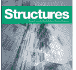


**Taufiq Rochman***, Suharianto

印尼玛兰州立大学土木工程系，J. Soekarno H No. 9, Malang 65141, East Java, Indonesia

## 摘要

**关键词：** 多层、交叉复合、竹子、复合材料、空心、多空心复合材料

由于竹子优越的力学性能，它经常用于农村建筑，然而对竹杆作为加筋的研究仍然有限。本文的目的是介绍一种由多层竹芯空心多空心复合混凝土系统（简称为多空心复合）组成的复合系统。在本文中，我们分析了桥梁跨上复合板的实现情况，该截面由混凝土组成，且没有使用任何钢筋。使用多空心复合竹材加筋，是因为在该复合系统中完整竹材的存在增强了实际工作载荷下全尺寸车辆的抗弯性能。由于获得优异结果困难且存在偏差风险，研究采用基于有限元分析（`FEM`）的模型（厚壳和壳单元）进行。使用具有特定截面的竹杆作为混凝土板，承受 `21 kN` 的力。同时，在径向轴上进行测试时，多层竹杆在相同混凝土体积下承受的力比传统板高出 `52%`，导致挠度减少了 `73%`。另一方面，在分析和实验测试中，在延性和最大承载能力方面表现出更高的抗力。

## 1. 引言

### 1.1. 竹的特性

竹子似乎是唯一生长迅速且具有广泛应用的再生材料。现有的竹制品是利用空心竹杆制造的 [1]。使用可靠的传统材料建造桥梁是一项令人关注且紧迫的研究。竹子作为一种复杂且多孔天然材料，其外层极薄。

竹子由空心和节组成。节负责根和分支的形成。节间由围绕空心的、厚度不变化的空心壁形成。竹青的外层比最内层密，随着它们的扩张，它们通常呈现锥形 [2]。竹子是一种因其力学性能而被广泛应用于建筑的环保型材料 [3, 4]。它具有快速的生长和再生能力。竹子还用于建筑元件，如木材、地板、特殊处理（材料）和竹柱 [6]，特别是在结构框架 [7, 8] 中，并对竹青进行二、四点弯曲测试以评估各种力学性能和潜在用途。竹已被用作结构混凝土部件的加筋材料。根据网格逻辑，它们建立了竹的复合行为，即竹子以简单的方式加筋混凝土梁。然而，[10] 证明了利用丰富的、生长快且可持续的竹子在大规模使用轻质、坚固结构材料的可能性。

> * 通讯作者。
> 电子邮件：`taufiq.rochman@polinema.ac.id` (T. Rochman)。

### 1.2. 竹结构的现状

作为结构材料的竹的研究主要分为三个部分：竹与混凝土的复合材料，以及竹元件及其连接。

此类评估了胶层竹材的径向强度，并在轴向压缩下的竹柱也由 [7] 进行了研究。而另一位研究人员 [4] 研究了胶层竹的径向长度和方向。

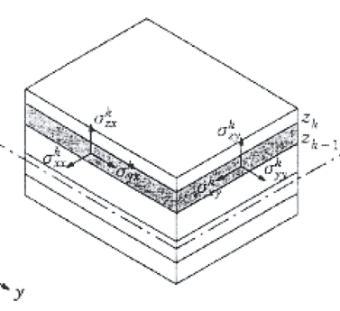
**图1. 作用在胶层板元件上的应力。**

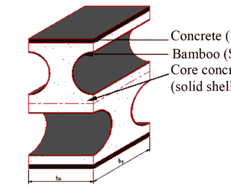
**截面 S2 / 截面 S1 示意图**

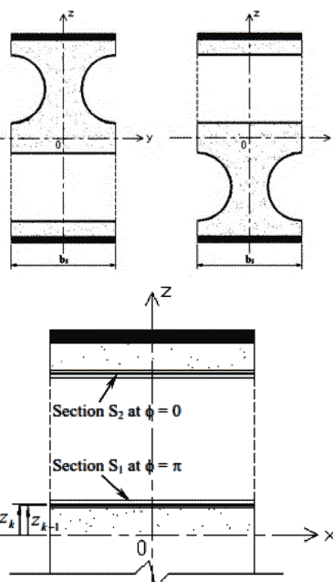
**图2. 用于 Mulambphol 系统的竹排列受 Huang 灵感。**

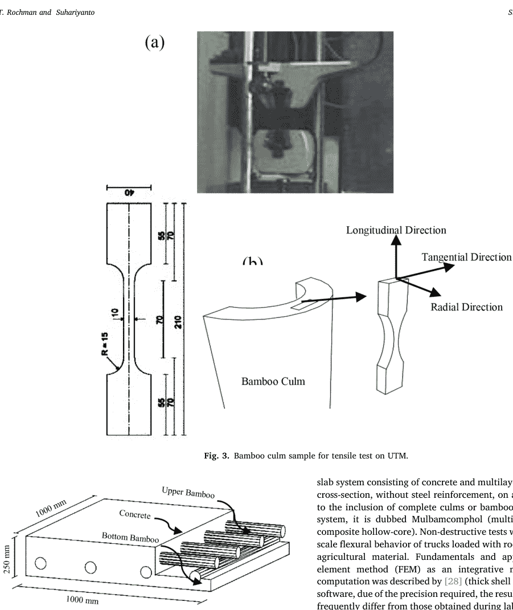
**图3. UTM 上进行拉伸测试的竹青样品。**


**图4. 实验室规模板样品。**

## 2. 多层竹复合材料空心

### 2.1. 提议系统

目前关于作为结构元件的竹或其与混凝土竹条复合材料的研究几乎占据了大部分。对竹空心提议样品的研究很少，甚至没有。基于此，本研究讨论了横截面上由混凝土和多层竹组成的复合板在短跨桥上的实现，且没有使用钢筋。由于在该复合系统中包含了完整的竹竿或竹杆，因此命名为 `Mulambphol`（多层交叉复合竹空心）。已对用竹或农材料制成的全尺寸结构行为进行了无破坏检测。

### 2.2. 模型假设

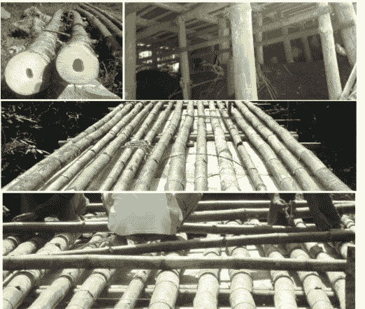
**图 5. 针对 (a) 强轴和 (b) 弱轴的竹柱布置。**

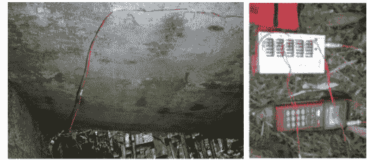
**图 6. (a) 板结构，(b) 单元 (c) 强轴加载 (d) 空心板在弱轴弯曲试验。**


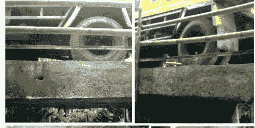
**图 9. (a) 贴在桥梁竹底部的应变片 (b) 使用应变计进行应变测量。**


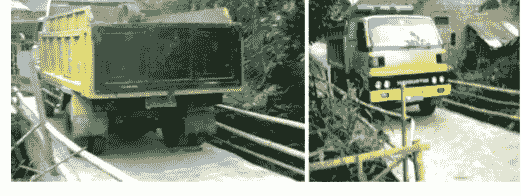
**图 7. 竹柱、模板、第一层竹底层和横向竹筋，作为上方相邻层之间的剪力连接件。**

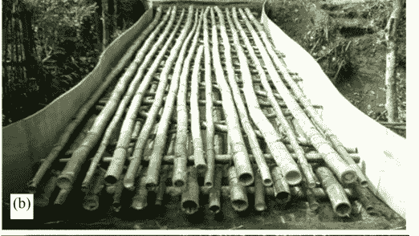
**图 10. 使用全尺寸卡车载荷的弯曲试验。**

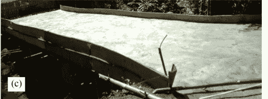
**图 8. (a) 三主层 (b) 多层竹柱配筋 (c) Multamb 复合桥的混凝土施工完成。**

## 3. 方法

### 3.1. 竹墙拉伸试件

竹（`Dendrocalamus asper`）用于拉伸和全尺寸试验试件，其中尺寸为 `210 mm x 40 mm` 且缺口为 `10 mm`。竹墙拉伸试件也使用了试验机，能力为 `13.6 吨`，如图 3 所示。

### 3.2. 板弯曲试验实验室设置

两层粘纤维（`fc'` 20 MPa）形成了尺寸为 `1000 mm x 1000 mm`、厚度为 `250 mm` 的复合板，在图 5a 的弱轴和图 5b 的强轴上进行弯曲试验以确定复合板的强度。

### 3.3. 多层空心桥全尺寸试验

`Multamb` 桥的施工阶段如图 7 所示。`Multamb` 桥使用 `fc'` 20 MPa 的 5 层混凝土板（一层竹柱作为保护层、三主层和一层竹柱作为保护层），使用竹柱布置并在 `10.5 m` 跨上分为 `5.25 m` 和 `3 m` 的两个跨度。图 8 展示了多层竹空心桥。

通过在桥节点（图 9a）插入应变片并观察裂缝（图 9b），进行了全尺寸弯曲和破坏性试验。使用卡车的前后轴（前和后）收集各种载荷组合，以 `0.5 m` 到 `1 m` 的随机间隔确定跨中和跨分之一的最大应变，如图 10 所示。应变计将变化直到达到一个一致的值并保持。

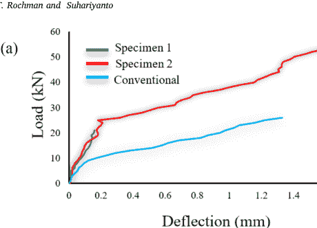
**图 12. 轴上的弯曲试验：(a) 载荷与位移，(b) 载荷与力矩。**

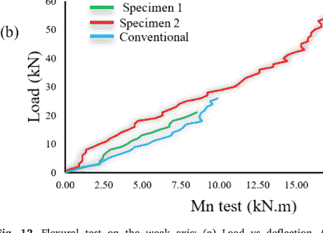
**图 13. (a) 强轴载荷与力矩比较，(b) 弱轴。**

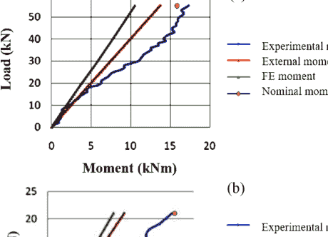
**图 14. 用于 Multamb 截面分析的等效应力 `Mn`。**

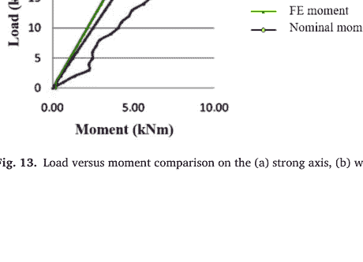
**图 15. 14 倍载荷下的 (a) 强轴 (b) 弱轴板建模。**

## 4. 结果与讨论

### 4.1. 竹试件

如图 11 所示，获得了竹拉伸结果。垂直轴表示应力（`σ`），水平轴表示应变（`ε`），定义为 `ε = ΔL/L`。图 11 展示了相同尺寸竹试件 1、2 和 3 的最高拉伸值，所有试件的范围从 `242.5 MPa` 到 `355 MPa`，平均为 `257.7 MPa`。试件 1、2、3 分别承受 `21 kN`、`55 kN` 和 `26 kN`。试件 1 或 2 未检测到裂缝。此表明结构上的竹柱表面与混凝土之间存在滑动。图 13 展示了强轴和弱轴的垂直力矩分量。计算力矩有多种方法。一种方法是从与应变相关的载荷提取力矩。载荷产生的外力矩随时间变化，规定力矩通过图 14 的描述获得。单层竹板可以承受直到最大强度达到 `0.005` 并认为达到平衡。当这种情况发生时，竹柱筋混凝土将提供特定的失效状态。

### 4.2. 板点弯

试验结果显示了位移和弯曲强度。试件-1 是弱轴上的铰接支，试件-2 是强轴，试件-3 是普通板。图 12a 和图 12b 展示了带有混凝土和相应最小配筋的板。根据图 12，每个试件的位移值分别为 `0.16 mm`、`1.67 mm` 和 `1.33 mm`，最大 `Mn` 值分别为 `8.55 kNm`、`17.32 kNm` 和 `9.91 kNm`。

**应力分布图示：**

| 最大绝对 n/mm² | 0.003 | 0.017 | 0.033 | 0.049 | 0.064 | 0.080 | 0.096 | 0.111 | 0.127 | 0.143 | 0.158 | 0.174 | 0.190 | 0.205 | 0.221 | 0.237 | ≥ 0.252 |
| :--- | :---: | :---: | :---: | :---: | :---: | :---: | :---: | :---: | :---: | :---: | :---: | :---: | :---: | :---: | :---: | :---: | :---: |
| N/mm² | 0.054 | 0.067 | 0.089 | 0.105 | 0.121 | 0.136 | 0.156 | 0.171 | 0.186 | 0.201 | 0.212 | 0.226 | 0.241 | 0.256 | 0.271 | 0.286 | ≥ 0.302 |

**表：P = 21 kN**

| No. | Sn (N/mm²) | Tc (N) |
| :--- | :---: | :---: |
| 1 | -0.096 | 2076.48 |
| 2 | -0.079 | 1708.77 |
| 3 | -0.055 | 1189.65 |
| 4 | -0.027 | 584.93 |
| 5 | -0.035 | 757.05 |
| 6 | -0.003 | 648.9 |
| 7 | -0.006 | 1297.8 |
| 8 | -0.084 | 1816.22 |
| 9 | -0.101 | 2184.63 |
| 10 | -0.095 | 2054.85 |
| **张力, Tb** | | **1439.06** |

### 4.3. 理论分析与有限元建模

为了更好地理解其新型双纤维增强复合板的结构行为 [32]。因此，使用“合力应力”一词来指代这些部分产生的力和力矩。图 1 中的阴影区域表示所检查的所示单元。

符号 `σ_x` 表示 `x` 方向的正法应力，而符号 `σ_y` 表示 `y` 方向的正法应力。该区域的厚度为 `z_1`。通过对截面上的应力进行积分，单位表面积的力合力和力矩合根据一阶剪切变形理论由 [32] 定义如公式 ((1)-(3)) 所示。

```
$N = \int_{z_1}^{z_2} \sigma_x dz, \quad N_y = \int_{z_1}^{z_2} \sigma_y dz, \quad Q_x = \int_{z_1}^{z_2} \tau_{xz} dz =$
```

```
${M} = \begin{cases} M_i \\ M_{ti} \end{cases} = \begin{cases} M_i \\ M_{ti} \end{cases}_{dz} = \sum_{i=1}^{n} \tau_i q_{dz} dz; \quad (2)$
```

```
${E} = \begin{cases} E_i \\ E_{ti} \end{cases} = \begin{cases} E_i \\ E_{ti} \end{cases}_{dz} = K \sum_{i=1}^{n} \tau_i q_{dz}; \quad (3)$
```

板的截面在图 1 和图 2 中理想化，`x` 方向截面代表板的强轴。`y` 轴代表弱轴。图 2 展示了用于复合梁的局部单元和全局坐标系，使用混凝土单元和竹层。

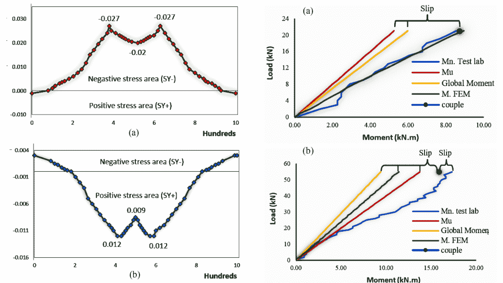
**图 17. (a) 竹筒外壳在弱轴上的压缩应力 (Sy)；(b) 竹筒外壳在弱轴上的拉伸应力 (Sy)。**


**图 19. (a) 弱轴上的载荷-力矩曲线。(b) 强轴上的载荷-力矩曲线。**

这些值用于计算力矩（`M_FEM`），其计算通过最大应力值乘以力臂长度得出。

竹壳所承受的应力分别在图 17 和图 18 中表示，分别对应竹节的弱轴和强轴。`M_FEM` 以最大应力值为起点进行计算，然后与解析计算的力矩结果进行比较，如图 19 所示。

如图 19a 和表 1 所示，计算力矩与测量力矩之间存在滑移。`M_FEM` 远大于耦合力矩，而测试力矩（`M_test`）接近耦合力矩。在图 19b 中，所有耦合力矩在强轴上都有滑移，只有测试力矩（`M_test`）接近耦合力矩。

### 4.4. 全尺寸多层竹空心桥

实施了一座 `45 cm` 厚的多层竹桥以测试 `28` 天的强度。图中显示了在四个应变计位置、在多种轴向变化组合下处理的载荷（随后称为载荷 1 至 14）的 result。实际发生的应变图谱如图 20 所示，且仍低于最大限值。


**图 18. (a) 竹筒外壳在强轴上的压缩应力 (Sy)；(b) 竹筒外壳在强轴上的拉伸应力 (Sy)。**

### 4.5. 全尺寸多层竹空心桥的 FEM 模型

如图 21 所示，该桥在 `MIDAS/Civil` 中进行建模。该桥包含 `7497` 个节点点，由 `2500` 个梁单元连接，每根竹杆代表单个梁单元。总共使用了 `6000` 个实体块来表示该桥。

**表 1. 弱轴上的力矩。**

| 载荷 (kN) | M_YYT (kNm) | M (kNm) | M_LLOR (kNm) | M_MMM (kNm) |
| :--- | :---: | :---: | :---: | :---: |
| 0 | 0.00 | 0.00 | 0.00 | 0.00 |
| 1 | 0.67 | 0.25 | 0.29 | 0.29 |
| 3 | 2.25 | 0.75 | 0.85 | 1.92 |
| 5 | 2.47 | 1.25 | 1.42 | 1.93 |
| 7 | 2.70 | 1.75 | 1.99 | 2.70 |
| 9 | 3.60 | 2.25 | 2.56 | 3.36 |
| 11 | 4.27 | 2.75 | 3.13 | 4.44 |
| 13 | 4.95 | 3.25 | 3.70 | 5.33 |
| 14 | 5.62 | 3.50 | 3.98 | 5.75 |
| 15 | 6.07 | 4.05 | 4.29 | 6.19 |
| 16 | 6.75 | 4.55 | 4.55 | 6.65 |
| 17 | 6.75 | 4.25 | 4.84 | 7.07 |
| 18 | 6.97 | 4.50 | 5.12 | 7.50 |
| 19 | 7.65 | 5.45 | 5.41 | 7.96 |
| 21 | 8.55 | 5.25 | 5.98 | 8.85 |

*(注：由于原文中表格部分数据似乎存在逻辑重复或错位，译文严格对应原文数值输出)*

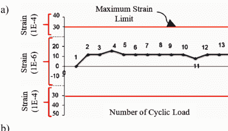
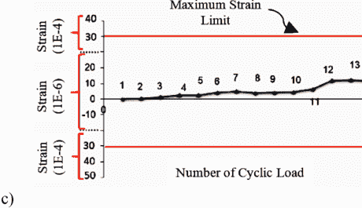
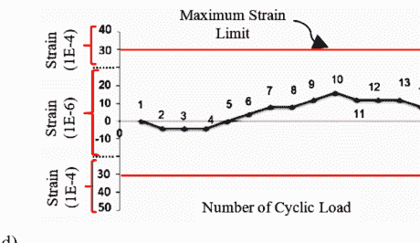
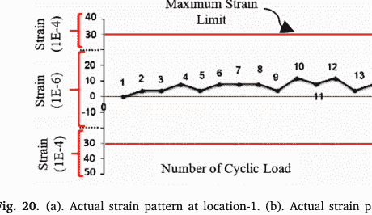

如图 21 所示，弱轴上的应力在耦合力矩处为 `3.4 MPa`，而强轴上的应力为 `3.7 MPa`。在图 19b 中，所有耦合力矩在强轴上都有滑移，只有测试力矩（`M_test`）接近耦合力矩。

## 5. 结论


如图 21 所示，弱轴上的应力在耦合力矩处为 3.4 MPa，而强轴上的应力为 3.7 MPa。在图 19b 中，所有耦合力矩在强轴上都有滑移，只有测试力矩（`M_test`）接近耦合力矩。
