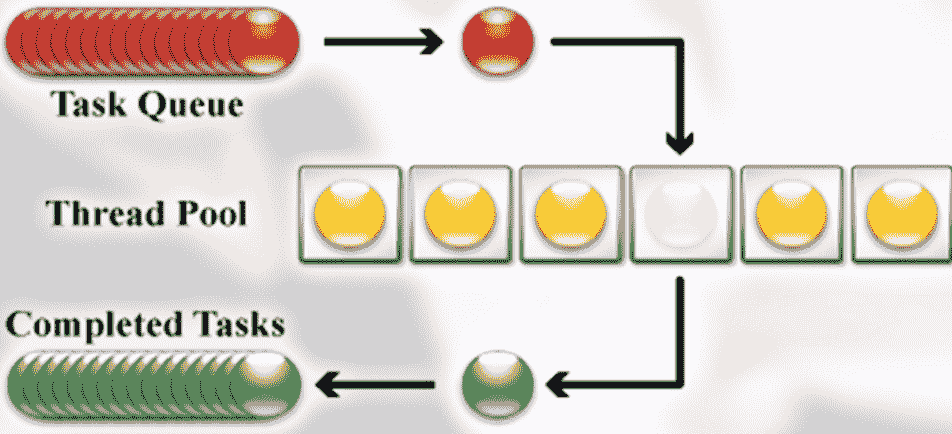

# 多线程与并发面试题答：助力你的 Java 职业生涯



## 前言

并发对于开发者来说始终是一个挑战，而编写并发程序可能极其困难。

引入并发后，可能会出现许多潜在问题，且系统的复杂性会显著增加。

然而，编写健壮并发程序的能力是开发者工具箱中的一项强大工具，可以帮助构建复杂的企业级应用程序。

在本指南中，我们将讨论可以用于编程面试的各种类型的问题，以评估候选人对并发和多线程的理解。

这些问题不仅针对 Java，还围绕通用的编程原则展开。

## 关于作者

Martin 是一位拥有 10 多年软件开发经验的软件工程师。他曾参与过应用开发中的不同职位，涉及各种软件项目，从可重用软件组件、移动应用程序、客户端 GUI 项目到具有实时需求的大规模集群企业级应用。

在完成计算机科学学位学习后，Martin 曾担任国际运营保险公司的 Java 开发人员和顾问。后来，他为能源市场的公司设计并实现了 Web 应用程序和胖客户端应用程序。目前，Martin 在一家从事 Java EE 领域的国际运营公司工作，并在日常工作中关注大规模大数据系统。

他目前的兴趣包括 Java EE、重点关注 HTML5 的 Web 应用程序以及性能优化。在时间允许的情况下，他参与开源项目，其中一些项目可以在此 github 账户找到。Martin 正在“Martin's Developer World”写博客。

## 第 1 章：多线程问题

### 1.1 我们如何理解并发（Concurrency）这个术语？

并发是程序同时执行多个计算的能力。这可以通过将计算分布到机器可用的 CPU 核心上，或者同一网络内的不同机器上来实现。

### 1.2 进程和线程之间的区别是什么？

进程是操作系统提供的执行环境，拥有自己的一组私有资源（例如内存、打开的文件等）。相比之下，线程存在于进程内部，并与进程的其他线程共享资源（内存、打开的文件等）。不同线程之间共享资源的能力使得线程更适合对性能有显著要求的任务。

### 1.3 在 Java 中，什么是进程（Process），什么是线程（Thread）？

在 Java 中，进程对应于运行中的 Java 虚拟机（JVM），而线程位于 JVM 内部并由 Java 应用程序在运行时动态创建和停止。

### 1.4 什么是调度器（Scheduler）？

调度器是调度算法的实现，用于管理进程和线程对某些有限资源（如处理器或 I/O 通道）的访问。大多数调度算法的目标是对可用进程/线程提供某种负载均衡，确保每个进程/线程都能获得适当的时间独占访问请求的资源。

### 1.5 一个 Java 程序至少有多少个线程？

每个 Java 程序都在主线程（main thread）中执行；因此每个 Java 应用程序至少有一个线程。

### 1.6 Java 应用如何访问当前线程？

可以通过调用 JDK 类 `java.lang.Thread` 的静态方法 `currentThread()` 来访问当前线程：

```java
public class MainThread {
    public static void main(String[] args) {
        long id = Thread.currentThread().getId();
        String name = Thread.currentThread().getName();
    }
}
```

### 1.7 每个 Java 线程拥有哪些属性？

每个 Java 线程拥有以下属性：

- 一个类型为 `long` 的标识，在 JVM 内部是唯一的
- 一个类型为 `String` 的名称
- 一个类型为 `int` 的优先级
- 一个类型为 `java.lang.State` 的状态
- 线程所属的组（group）

### 1.8 线程组（Thread groups）的作用是什么？

每个线程都属于一个线程组。JDK 类 `ThreadGroup` 提供了一些方法来处理整个组。通过这些方法，我们可以中断该组的所有线程或设置它们的优先级。

### 1.9 线程可以处于哪些状态，每种状态的意义是什么？

- **NEW（新建）**：尚未启动的线程处于此状态。
- **RUNNABLE（可运行）**：在虚拟机中执行的线程处于此状态。
- **BLOCKED（阻塞）**：等待监视器锁的线程处于此状态。
- **WAITING（等待）**：无限等待另一个线程执行特定动作的线程处于此状态。
- **TIMED_WAITING（超时等待）**：等待另一个线程执行动作直到指定的超时时间的线程处于此状态。
- **TERMINATED（终止）**：已退出的线程处于此状态。

### 1.10 我们如何设置线程的优先级？

线程的优先级通过 `setPriority(int)` 方法设置。要将优先级设置为最大值，我们使用常量 `MAX_PRIORITY`；设置为最小值则使用常量 `MIN_PRIORITY`，因为这些值可能随 JVM 实现而异。

### 1.11 在 Java 中如何创建线程？

基本上在 Java 中创建线程有两种方法。第一种是编写扩展 JDK 类 `java.lang.Thread` 的类并调用其 `start()` 方法：

```java
public class MyThread extends Thread {
    public MyThread(String name) {
        super(name);
    }

    @Override
    public void run() {
        System.out.println("Executing thread " + Thread.currentThread().getName());
    }

    public static void main(String[] args) throws InterruptedException {
        MyThread myThread = new MyThread("myThread");
        myThread.start();
    }
}
```

第二种方法是实现 `java.lang.Runnable` 并将该实现作为参数传递给 `java.lang.Thread` 的构造函数：

```java
public class MyRunnable implements Runnable {
    public void run() {
        System.out.println("Executing thread " + Thread.currentThread().getName());
    }

    public static void main(String[] args) throws InterruptedException {
        Thread myThread = new Thread(new MyRunnable(), "myRunnable");
        myThread.start();
    }
}
```

### 1.12 在 Java 中如何停止线程？

要停止线程，我们使用一个指向当前线程的 `volatile` 引用，其他线程可以将其设置为 null，以指示当前线程应该停止执行：

```java
private class MyStopThread extends Thread {
    private volatile Thread stopIndicator;

    public void start() {
        stopIndicator = new Thread(this);
        stopIndicator.start();
    }

    public void stopThread() {
        stopIndicator = null;
    }

    @Override
    public void run() {
        Thread thisThread = Thread.currentThread();
        while (thisThread == stopIndicator) {
            try {
                Thread.sleep(1000);
            } catch (InterruptedException e) {
            }
        }
    }
}
```

### 1.13 为什么不应该通过调用 stop() 方法来停止线程？

不应使用 `java.lang.Thread` 中过时的 `stop()` 方法来停止线程，因为该方法会导致线程释放它获取的所有监视器。如果受释放锁保护的任何对象处于不一致状态，该状态对所有线程可见。这会导致其他线程处理该不一致对象时产生任意行为。

### 1.14 是否可以启动两次线程？

在调用 `start()` 方法启动线程后，第二次调用 `start()` 将抛出 `IllegalStateException`。

### 1.15 下面代码的输出是什么？

```java
public class Multithreading {
    private static class MyThread extends Thread {
        public MyThread(String name) {
            super(name);
        }
        @Override
        public void run() {
            System.out.println(Thread.currentThread().getName());
        }
    }
    public static void main(String[] args) {
        MyThread myThread = new MyThread("myThread");
        myThread.run();
    }
}
```

上述代码产生输出 "main" 而不是 "myThread"。如 `main()` 方法的第二行所示，我们调用的是 `run()` 方法而不是 `start()`。因此，没有启动新线程，而是 `run()` 方法在主线程中执行。

### 1.16 什么是守护线程（Daemon thread）？

守护线程是在 JVM 决定是否应该停止时不评估其执行状态的线程。当所有用户线程（与守护线程相反）都终止时，JVM 就会停止。因此，守护线程可以用于示例监控功能，以便一旦所有用户线程停止，JVM 就会停止：

```java
private static class MyDaemonThread extends Thread {
    public MyDaemonThread() {
        setDaemon(true);
    }

    @Override
    public void run() {
        while (true) {
            try {
                Thread.sleep(1);
            } catch (InterruptedException e) {
                e.printStackTrace();
            }
        }
    }

    public static void main(String[] args) throws InterruptedException {
        Thread thread = new MyDaemonThread();
        thread.start();
    }
}
```

示例应用程序演示了即使是守护线程仍然在其无限循环中运行。

### 1.17 是否可能在启动后将普通用户线程转换为守护线程？

用户线程一旦启动，就无法转换为守护线程。在已运行的线程实例上调用方法 `thread.setDaemon(true)` 将会抛出 `IllegalThreadStateException`。

### 1.18 我们如何理解忙等待（busy waiting）？

忙等待使得等待事件发生的实现实现执行了某些活动计算，这些计算占用了处理器，而这些计算本可以被调度程序移除。忙等待的一个例子是在循环中花费时间检查当前时间，直到到达某个时间点为止。

```java
Thread thread = new Thread(new Runnable() {
    @Override
    public void run() {
        long millisToStop = System.currentTimeMillis() + 5000;
        long currentMillis = System.currentTimeMillis();
        while (millisToStop > currentMillis) {
            currentMillis = System.currentTimeMillis();
        }
    }
});
```

### 1.19 如何防止忙等待？

防止忙等待的一种方法是让当前线程睡眠一段时间。这可以通过调用方法 `java.lang.Thread.sleep(long)` 实现，并将要睡眠的毫秒数作为参数传递。

### 1.20 我们可以使用 `Thread.sleep()` 用于实时处理吗？

传递给 `Thread.sleep(long)` 调用的毫秒数仅向调度程序指示当前线程不需要执行多长时间。取决于具体的实现，调度程序可能会让线程早几毫秒或晚几毫秒执行。因此，不应将 `Thread.sleep()` 用于实时处理。

### 1.21 如何唤醒使用 `Thread.sleep()` 进入睡眠的线程？

`java.lang.Thread` 的 `interrupt()` 方法可以中断正在睡眠的线程。被中断的线程是通过调用 `Thread.sleep()` 进入睡眠状态的。

```java
public class InterruptExample implements Runnable {
    public void run() {
        try {
            Thread.sleep(Long.MAX_VALUE);
        } catch (InterruptedException e) {
            System.out.println("*" + Thread.currentThread().getName() + "] Interrupted by exception");
        }
    }
    public static void main(String[] args) throws InterruptedException {
        Thread myThread = new Thread(new InterruptExample(), "myThread");
        myThread.start();

        System.out.println("*" + Thread.currentThread().getName() + "] Sleeping for 5s...");
        Thread.sleep(5000);

        System.out.println("*" + Thread.currentThread().getName() + "] Interrupting myThread");
        myThread.interrupt();
    }
}
```

### 1.22 线程如何查询自己是否被中断？

如果线程没有处于 `Thread.sleep()` 等这种会抛出 `InterruptedException` 的方法内部，线程可以通过调用静态方法 `Thread.interrupted()` 或继承自 `java.lang.Thread` 的方法 `isInterrupted()` 来查询自己是否被中断。

### 1.23 应该如何处理 `InterruptedException`？

`sleep()` 和 `join()` 等方法会抛出 `InterruptedException` 来通知调用者另一个线程中断了此线程。这样做是为了告诉当前线程停止计算并意外结束。因此，通过捕获异常并仅将其记录到控制台或日志文件中来忽略异常并不是处理这种异常的适当方法。这种异常的问题在于，`Runnable` 接口的 `run()` 方法不允许 `run()` 抛出任何异常。因此重新抛出并没有帮助。这意味着 `run()` 的实现必须自己处理这个受检异常，这往往导致了它被捕获并忽略的事实。

### 1.24 启动子线程后，我们如何在父线程中等待子线程终止？

等待线程终止是通过在线程的实例变量上调用 `join()` 方法完成的：

```java
Thread thread = new Thread(new Runnable() {
    @Override
    public void run() {
    }
});
thread.start();
thread.join();
```

### 1.25 下一个程序的输出是什么？


```java
public class MyDaemonThreads {
    private static class MyDaemonThread extends Thread {
        public MyDaemonThread() {
            setDaemon(true);
        }

        @Override
        public void run() {
            try {
                Thread.sleep(1000);
            } catch (InterruptedException e) {}
        }
    }

    public static void main(String[] args) throws InterruptedException {
        Thread thread = new MyDaemonThread();
        thread.start();
        thread.join();
        System.out.println(thread.isAlive());
    }
}
```

输出为 `false`。尽管在同步块内再次检查了 `instance` 的值（出于性能考虑），但 JIT 编译器可能会重排字节码，导致构造函数执行完成之前设置了 `instance` 的引用。这意味着 `getInstance()` 方法返回了一个尚未完全初始化的对象。为了使代码线程安全，自 Java 5 起，对实例变量可以使用 `volatile` 关键字。

## 1.26 当发生未捕获异常时会发生什么？

当发生未捕获异常离开 `run()` 方法时，线程将停止执行。如果该线程是守护线程，JVM 将继续运行；如果它是用户线程，JVM 将退出。在发生未捕获异常时，线程将释放它持有的锁，但它不会释放其他锁。

## 1.27 什么是关机钩子（shutdown hook）？

关机钩子是在 JVM 关闭时执行的线程。它可以通过 `addShutdownHook(Runnable)` 注册：

```java
Runtime.getRuntime().addShutdownHook(new Runnable() {
    @Override
    public void run() {
    }
}));
```

## 1.28 `synchronized` 关键字用于什么目的？

当你需要对资源进行互斥访问时，例如同步：

```java
synchronized (Counter.class) {
    counter++;
}
```

## 1.29 `synchronized` 方法如何获取锁？

`synchronized` 方法获取锁并在方法返回时释放锁：

```java
public synchronized void method() {
    ...
}
```

## 1.30 构造函数可以被同步吗？

不，构造函数不能被同步。导致语法错误的原因是只有构造线程应该访问正在构造的对象。

## 1.31 原始类型值可以用于同步锁吗？

不，基本类型值不能用于同步锁。

## 1.32 同步锁是重入的吗？

是的，同步锁可以被同一个线程再次访问。否则，获取锁的线程将意外地尝试获取它已经拥有的锁。

## 1.33 我们如何理解原子操作？

原子操作是指要么完全执行要么不执行的操作。

## 1.34 `c++` 语句是原子的吗？

不，整数变量的增加由多个操作组成。首先我们必须加载 c 的当前值，将其增加，最后存储新值。执行此增加的线程可能会在这些步骤之间被中断，因此该操作不是原子的。

## 1.35 Java 中哪些操作是原子的？

Java 语言提供了一些原子操作，因此可以确保并发看到的值：

- 对引用变量和基本变量（除 `long` 和 `double` 之外）的读和写操作
- 所有声明为 `volatile` 变量的读和写操作

## 1.36 下面的实现是线程安全的吗？

```java
public class DoubleCheckedSingleton {
    private DoubleCheckedSingleton instance = null;

    public DoubleCheckedSingleton getInstance() {
        if (instance == null) {
            synchronized (DoubleCheckedSingleton.class) {
                if (instance == null) {
                    instance = new DoubleCheckedSingleton();
                }
            }
        }
        return instance;
    }
}
```

该代码不是线程安全的。尽管在同步块内再次检查了 `instance` 的值（出于性能考虑），但 JIT 编译器可能会重排字节码，导致在构造函数执行完成之前设置了 `instance` 的引用。这意味着 `getInstance()` 返回了一个可能尚未完全初始化的对象。为了使代码线程安全，自 Java 5 起对实例变量可以使用 `volatile` 关键字。标记为 `volatile` 的变量只有在对象构造函数完全执行完毕后对其他线程可见。

## 1.37 我们如何理解死锁（deadlock）？

死锁是指两个（或多个）线程每个都在等待另一个线程释放已锁定的资源，而该线程本身又锁定了另一个线程正在等待的资源：

- 线程 1：锁定资源 A，等待资源 B
- 线程 2：锁定资源 B，等待资源 A

## 1.38 死锁发生需要哪些条件？

通常情况下，死锁的发生满足以下条件：

- **互斥**：存在一种资源在任何时刻只能被一个线程访问。
- **资源持有**：线程在持有一个资源的同时，尝试获取另一个其他独占资源的锁。
- **非抢夺**：没有机制可以强制释放线程在特定时间段内所持有的资源。
- **循环等待**：在运行期间发生了争用，其中两个（或多个）线程都在等待另一个线程释放它已锁定的资源。

## 1.39 是否可能完全防止死锁？

为了防止死锁（一个或多个），必须消除死锁条件中的某一个或多个：

- **互斥**：在某些情况下，可以通过乐观锁来防止互斥。
- **资源持有**：当线程未能成功获取所有独占锁时，可以释放它所有的有的独占锁。
- **非抢夺**：对独占锁使用超时机制，在给定时间后释放锁。
- **循环等待**：当所有线程都按照相同的顺序获取所有的独占锁时，就不会发生循环等待。

## 1.40 是否可以实现死锁检测？

当所有的独占锁都被监控并建模为有向图时，死锁检测系统可以搜索两个线程，这两个线程都在等待另一个线程释放其已锁定的资源。然后，等待的线程可以通过某种异常被强制释放另一个线程正在等待的锁。

## 1.41 什么是活锁（Livelock）？

活锁是指两个或多个线程通过响应由另一个线程引起的操作而相互阻塞的情况。与死锁（两个或多个线程在某个特定状态下等待）不同，参与活锁的线程会改变其状态，从而阻止它们的正常进展。一个例子是：两个线程尝试获取锁，但在无法获取第二个锁时释放它们已获取的锁。可能会发生两个线程并发尝试获取第一个锁。由于只有一个线程成功，现在两个线程都持有两个不同的锁，但由于它们都想要拥有这两个锁，它们就会释放自己的锁并再次从开始。这种情况可能会反复发生。

## 1.42 我们说的饥饿（Starvation）是指什么？

低优先级线程获得的执行时间比高优先级线程少。当低优先级线程执行长时间的计算时，可能会出现这些线程没有足够的时间及时完成计算的情况。由于高优先级线程抢夺了它们的计算时间，它们似乎被“饥饿”了。

## 1.43 同步块可以防止线程饥饿吗？

线程进入同步块的顺序是未定义的。因此在理论上，当许多线程等待进入同步块时，某些线程的等待时间可能比其他线程长。因此，它们没有足够的计算时间来及时完成工作。

## 1.44 我们说的竞态条件（Race condition）术语是指什么？

竞态条件描述了这样一种情况：多线程实现的结果取决于参与线程的精确计时行为。在大多数情况下，这种行为是不希望的，因此竞态条件也意味着由于缺少线程同步导致了差异。竞态条件的一个简单例子是两个并发线程对一个整数变量进行递增。由于该操作由多个原子操作组成，可能会发生两个线程读取并增加了同一个值。在这次并发递增后，整数变量的值并没有增加 2，而是增加了 1。

## 1.45 我们说的公平锁（Fair locks）是指什么？

公平锁在考虑下一个通过独占资源屏障的线程时，考虑了线程的等待时间。Java SDK 提供了一个公平锁示例实现：`java.util.concurrent.locks.ReentrantLock`。如果使用布尔标志设为 true 的构造函数，`ReentrantLock` 将授予等待最长的线程访问权限。

## 1.46 对象从 `java.lang.Object` 继承的哪两个方法可以实现简单的生产者/消费者场景？

当工作线程完成当前任务且新任务队列为空时，它通过获取队列对象的内部锁（intrinsic lock）并调用 `wait()` 方法来释放处理器。该线程将由某个向队列放入了新任务的生产者唤醒，该生产者再次获取队列对象的同一个内部锁并调用 `notify()`。

## 1.47 `notify()` 和 `notifyAll()` 之间有什么区别？

这两个方法都用于唤醒通过调用 `wait()` 进入睡眠的一个或多个线程。虽然 `notify()` 仅唤醒等待线程中的一个，而 `notifyAll()` 会唤醒所有线程。

## 1.48 如何确定哪个线程通过调用 `notify()` 被唤醒？

如果有多个线程在等待，则没有指定调用 `notify()` 会唤醒哪些线程。因此，代码不应依赖于任何并发的 JVM 实现。

## 1.49 下面这段从队列实现获取整数值的代码正确吗？

```java
public Integer getNextInt() {
    Integer retVal = null;
    synchronized (queue) {
        try {
            while (queue.isEmpty()) {
                queue.wait();
            }
        } catch (InterruptedException e) {
            e.printStackTrace();
        }
    }
    synchronized (queue) {
        retVal = queue.poll();
        if (retVal == null) {
            System.err.println("retVal is null");
            throw new IllegalStateException();
        }
    }
    return retVal;
}
```

尽管该代码使用了队列作为监视器，但在多线程环境下它的行为是不正确的。原因是它有两个同步块。当两个线程被另一个线程通过 `notifyAll()` 在第 6 行唤醒时，它们会先后进入第二个同步块。第二个同步块中队列只有一个值，第二个线程将对空队列进行 poll 并得到空值。

## 1.50 是否可以检查线程是否持有某个对象的监视器？

`java.lang.Thread` 类提供了 `holdsLock(Object)` 方法，当且仅当当前线程持有作为方法参数对象的锁时，该方法返回 true。

## 1.51 `Thread.yield()` 方法的作用是什么？

调用 `Thread.yield()` 给调度程序一个提示，当前线程愿意释放处理器。调度程序可以忽略此提示。由于未定义调用 `Thread.yield()` 之后哪个线程将获得处理器，甚至可能发生当前线程成为“下一个”要执行的线程。

## 1.52 在线程之间传递对象实例时需要考虑什么？

在线程之间传递对象时，你必须注意这些对象不会被两个线程同时操作。一个例子是会被两个并发线程修改的键值对的 Map 实现。为了避免并发修改的问题，你可以将对象设计为不可变的。

## 1.53 实现不可变类必须遵循哪些规则？

- 所有字段都应该是 `final` 且 `private` 的。
- 不应该有 setter 方法。
- 类本身应该声明为 `final`，以防止子类违反不可变性原则。
- 如果字段不是基本类型而是对另一个对象的引用：
  - 不应该有一个直接向调用者暴露引用的 getter 方法。
  - 不要更改所引用的对象（至少这些引用的更改对对象的客户端是不可见的）。

## 1.54 `java.lang.ThreadLocal` 类的目的是什么？

由于不同线程之间共享内存，`ThreadLocal` 提供了一种为每个线程单独存储和检索值的方法。`ThreadLocal` 的实现类独立地存储和检索每个线程的值，使得当线程 A 在 `ThreadLocal` 实例中存储值 A1，而线程 B 在该实例中存储值 B1 时，线程 A 随后从该 `ThreadLocal` 实例中检索到 A1，而线程 B 检索到 B1。

## 1.55 `java.lang.ThreadLocal` 有哪些可能的用例？

`ThreadLocal` 实例可以用于在应用程序中传输信息，而无需在方法之间传递这些信息。例如在 `ThreadLocal` 实例内部传输安全/登录信息，使得每个方法都可以访问。另一个用例可能是传输信息或泛指在所有方法中都可访问的对象，而无需在方法之间传递它们。

## 1.56 是否可以通过使用多线程来提高应用程序的性能？请举一些例子。

如果我们有多个 CPU 核心，如果可以在可用的 CPU 核心上对计算进行并行处理，就可以通过多线程提高应用程序的性能。一个例子是一个扩展本地目录中存储所有内容的应用程序。它不是一个接一个地遍历所有内容，而是生产者/消费者实现可以使用单个线程扫描目录结构，并使用一组工作线程来执行实际的扩展操作。当 n 并行收敛时，应用程序镜像某些页面。它不是一个接一个加载 HTML 页面，生产者可以解析第一个 HTML 页面将其找到的发布到队列中。工作线程监控队列并通过解析器加载网页。当工作线程等待页面完全加载时，其他线程使用 CPU 解析已加载的页面并发出新请求。

## 1.57 我们对可扩展性（scalability）一词如何理解？

可扩展性意味着程序通过为其添加更多资源来提高性能的能力。

## 1.58 是否可以通过使用多个处理器来计算应用程序的理论最大加速？

阿姆达尔法则（Amdahl's law）提供了一个通过为应用程序提供多个处理器来计算理论最大加速的公式。理论加速计算为 S(n)=1/(B+(1-B)/n)，其中 n 是处理器的数量，B 是程序中无法并行执行的比例。当 n 收敛于无穷大时，(1-B)/n 收敛于零。因此，在这种特殊情况下，公式可以简化为 1/B。正如我们所看到的，该比例越小，可以实现的理论最大加速越大。

## 1.59 我们对锁竞争（lock contention）一词如何理解？

当两个或多个线程竞争获取锁时就会发生锁竞争。调度器必须决定是让必须等待的线程睡眠并执行上下文切换到另一个线程以占用 CPU，还是让等待的线程忙等（busy-waiting）更高效。这两种方式都会为劣势线程引入空闲时间。

## 哪些技术有助于减少锁竞争？

在某些情况下，可以通过应用以下技术来减少锁竞争：

- 缩小锁的范围。
- 减少某些锁的获取次数（锁拆分 lock splitting）。
- 使用硬件乐观锁操作代替同步（synchronization）。
- 尽可能避免同步。
- 避免对象池。

## 哪种减少锁竞争的技术可以应用于以下代码？

```java
synchronized (map) {
    UUID randomUUID = UUID.randomUUID();
    Integer value = Integer.valueOf(42);
    String key = randomUUID.toString();
    map.put(key, value);
}
```

上述代码在同步块内部执行了 UUID 的计算以及字面量 42 到 `Integer` 对象的转换，这两行是当前线程私有的，不会影响其他线程。它们可以移动到同步块之外：

```java
UUID randomUUID = UUID.randomUUID();
Integer value = Integer.valueOf(42);
String key = randomUUID.toString();
synchronized (map) {
    map.put(key, value);
}
```

## 举例说明锁拆分（lock splitting）技术。

当使用一个锁同步同一个应用程序的不同方面时，锁拆分可能是减少锁竞争的方法。假设我们有一个类实现了应用程序中某些统计数据的计算。该类的第一个版本在每个方法签名中使用了 `synchronized` 关键字，以保护内部状态不被多个并发线程破坏。这意味着当其他线程尝试同时获取同一个锁时，每个方法都可能导致锁竞争。但可能将对象上的锁拆分成几个较小的锁，为每个方法中的每种统计数据分配一个锁。因此，T1 尝试增加统计数据 D1 时不需要等待锁，而 T2 同时在更新数据 D2。

## SDK 类 `ReadWriteLock` 使用了什么种减少锁竞争的技术？

SDK 的 `ReadWriteLock` 确保当并发线程想要读取一个值时，如果没有其他线程更新该值，它们就不需要获取锁。这是通过一对锁实现的，一个用于只读操作，一个用于写操作。虽然只读锁可以被多个线程获取，但实现保证了一旦锁被释放，所有读操作都能看到更新后的值。

## 1.64 我们对锁分纹（lock striping）一词如何理解？


与锁拆分不同，我们为应用程序的不同方面引入不同的锁，锁分纹使用多个锁来保护同一个数据结构的不同部分。一个例子是 JDK 中 `java.util.concurrent` 包中的 `ConcurrentHashMap`。Map 的实现内部使用桶（buckets）来存储其值。桶由值键（key）选择。`ConcurrentHashMap` 现在使用不同的锁来保护哈希桶。尝试访问第一个哈希桶的线程可以获取该桶的锁，而另一个线程可以同时访问第二个桶。与同步版本的 `HashMap` 相比，这种技术在不同线程处理不同桶工作时可以提高性能。

## 1.65 我们对 CAS 操作如何理解？

CAS 是比较并交换（compare-and-swap）的缩写，处理器执行一条单独的指令，仅当提供的值等于当前值时才更新值。CAS 操作可以避免同步，因为线程通过比较当前值和新值到 CAS 操作来更新值。如果另一个线程更新了该值，线程的值就不等于当前值，更新操作失败。线程随后读取新值并重试。这就是为什么必要的同步被交换为了自旋等待。

## 1.66 哪些 Java 类使用了 CAS 操作？

`java.util.concurrent.atomic` 包中的 SDK 类（如 `AtomicInteger` 或 `AtomicBoolean`）内部使用 CAS 操作来实现并发增加。

```java
public class AtomicCounter {
    private AtomicLong counter = new AtomicLong();

    public void increment() {
        counter.incrementAndGet();
    }

    public long get() {
        return counter.get();
    }
}
```

## 1.67 请举例单线程应用程序的性能改进会导致多线程应用程序的性能下降。

一个典型的例子是将元素数量作为变量的 List 实现。这提高了单线程应用程序的性能，因为 `size()` 操作不需要遍历所有元素，而是可以直接返回当前的元素数量。在多线程应用程序中，额外的计数器必须由锁保护，因为多个并发线程向列表插入元素。当列表的更新次数多于 `size()` 操作的调用时，这种额外的锁会消耗性能。

## 1.68 对象池总是多线程应用程序的性能改进吗？

通过池化对象来避免构建新对象的对象池可以提高单线程应用程序的性能，因为创建对象的成本被交换为从池中请求新对象。在多线程应用程序中，这种对象池必须对池进行同步访问，且锁竞争的额外成本可能会超过其收益。

新对象的额外构造和垃圾回收节省的成本。在这里，对象池并不总是能提高多线程应用程序的整体性能。

## 1.69 Executor 和 ExecutorService 两个接口之间是什么关系？

`Executor` 接口只定义了一个方法：`execute(Runnable)`。该接口的实现类必须在未来的某个时刻执行给定的 `Runnable` 实例。`ExecutorService` 接口是 `Executor` 接口的扩展，提供了额外的方法来关闭底层实现、等待所有提交任务的终止，并允许提交 `Callable` 实例。

## 1.70 当向满的 ExecutorService 队列 `submit()` 一个新任务时会发生什么？

正如 `submit()` 方法所示，`ExecutorService` 的实现类应该抛出 `RejectedExecutionException`。

## 1.71 什么是 ScheduledExecutorService？

`ScheduledExecutorService` 接口扩展了 `ExecutorService`，并添加了方法，允许向底层实现提交应在指定时间执行的新任务。它有两个方法用于提交一次性任务，以及两个方法用于创建周期性任务。

## 1.72 你知道如何构建一个拥有 5 个线程且某些任务返回值的线程池吗？

SDK 提供了一个工厂工具类 `Executors`，其方法 `newFixedThreadPool(int nThreads)` 允许创建一个具有固定数量线程的线程池。这里省略了 `MyCallable`：

```java
public static void main(String[] args) throws InterruptedException, ExecutionException {
    ExecutorService executorService = Executors.newFixedThreadPool(5);
    Future<Integer>[] futures = new Future[5];
    for (int i = 0; i < futures.length; i++) {
        futures[i] = executorService.submit(new MyCallable());
    }
    for (int i = 0; i < futures.length; i++) {
        Integer retVal = futures[i].get();
        System.out.println(retVal);
    }
    executorService.shutdown();
}
```

## 1.73 Runnable 和 Callable 两个接口之间的区别是什么？

`Runnable` 接口定义了 `run()` 方法，且没有返回值，而 `Callable` 接口允许 `call()` 方法返回值并抛出异常。

## 1.74 java.util.concurrent.Future 类的用例有哪些？

`java.util.concurrent.Future` 类的实例用于表示无法立即获取的异步计算结果。因此，该类提供了检查异步计算是否完成、取消任务以及获取实际结果的方法。后者可以通过提供的 `get()` 方法完成。每个 `get()` 方法不接受参数并会阻塞直到结果可用；而 `get(long timeout, TimeUnit unit)` 方法接受一个超时参数，如果结果在给定时间内不可用则允许调用返回。

## 1.75 HashMap 和 Hashtable 之间的区别是什么，特别是在线程安全方面？

`Hashtable` 的方法都是同步的（synchronized）的。而 `HashMap` 的实现则并非如此。因此，`Hashtable` 是线程安全的，而 `HashMap` 不是线程安全的。对于单线程应用程序，因此使用“较新”的 `HashMap` 实现更高效。

## 1.76 是否有简单的方法可以为 Collection、List 或 Map 的任意实现创建一个同步实例？

该工具类提供了 `synchronizedCollection(Collection)`、`synchronizedList(List)` 和 `synchronizedMap(Map)` 方法，它们返回一个由给定的实例支持的线程安全的集合/列表/映射。

## 1.77 什么是信号量（semaphore）？

信号量是一种数据结构，维护了一组许可（permits），竞争性线程可以获取这些许可。信号量可以控制同时访问临界区域或资源的线程数量。因此，`java.util.concurrent.Semaphore` 的构造函数第一个参数是线程竞争的许可数量。每次调用 `acquire()` 都会尝试获取一个可用的许可。不带参数的 `acquire()` 方法会阻塞直到下一个许可可用。随后，当线程完成在临界资源上的工作后，可以使用 `Semaphore` 实例上的 `release()` 方法来释放许可。

## 1.78 什么是 CountDownLatch（计数计数器）？

SDK 中的 `CountDownLatch` 提供了一种同步辅助工具，可用于此类场景：线程必须等待某些其他线程达到相同的状态，以便所有线程都可以开始。当 `CountDownLatch` 实例计数归零时，所有线程即可继续。这可以用于通过计数器值设为 1 让所有线程在指定时间启动，或者用于等待数量线程完成工作。在后一种情况下，计数器初始化为线程的数量，每个线程完成工作后计数器减 1。

## 1.79 CountDownLatch 和 CyclicBarrier（循环屏障）之间的区别是什么？

这两个类都维护了一个由不同线程递减的计数器。线程会等待内部计数器达到零并从那里继续。但与 `CountDownLatch` 类不同，`CyclicBarrier` 在值归零后会将值重置为初始值。正如名称所示，`CyclicBarrier` 可用于实现线程需要相互等待的场景。

## 1.80 哪些任务可以由 ForkJoin 框架解决？

ForkJoin 框架的基类 `java.util.concurrent.ForkJoinPool` 基本上是一个执行 `java.util.concurrent.ForkJoinTask` 实例的线程池。任务提供了 `fork()` 和 `join()` 两个方法。`fork()` 用于启动任务的异步执行，而 `join()` 方法用于等待计算结果。因此，ForkJoin 框架可以实现分治算法，将更复杂的问题分解为更易解决的问题。
