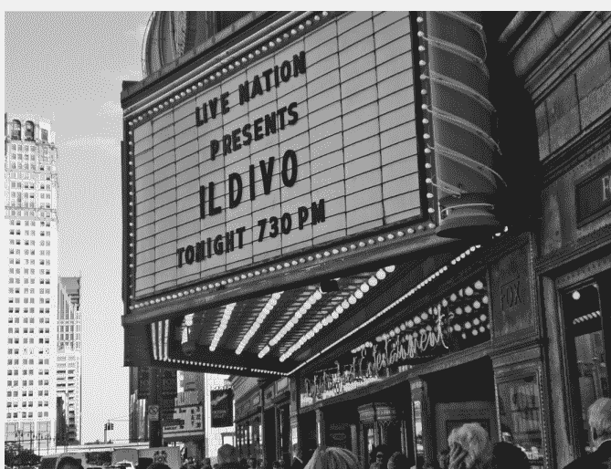
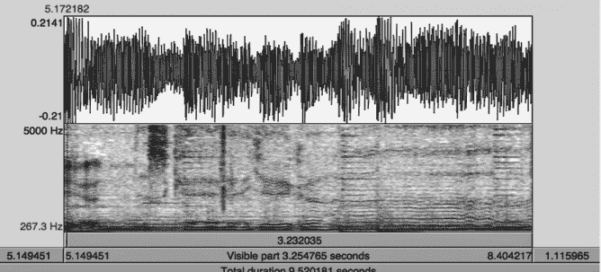
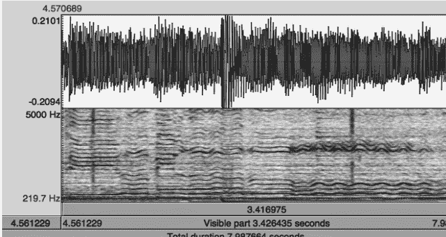
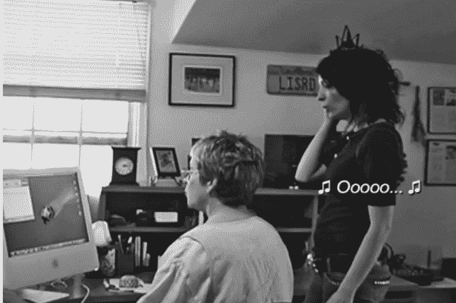
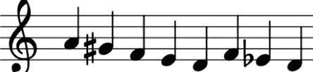
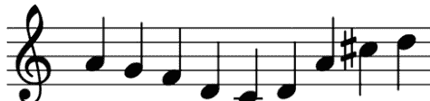
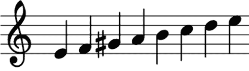
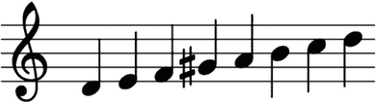
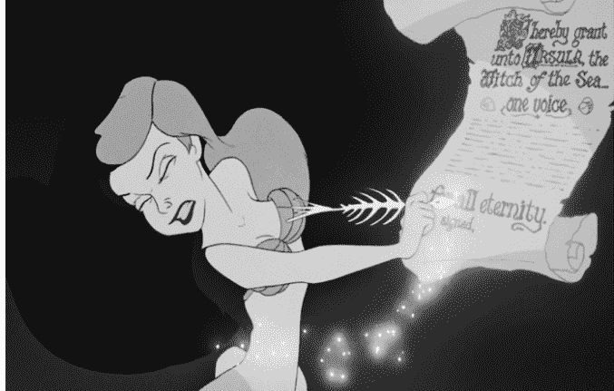
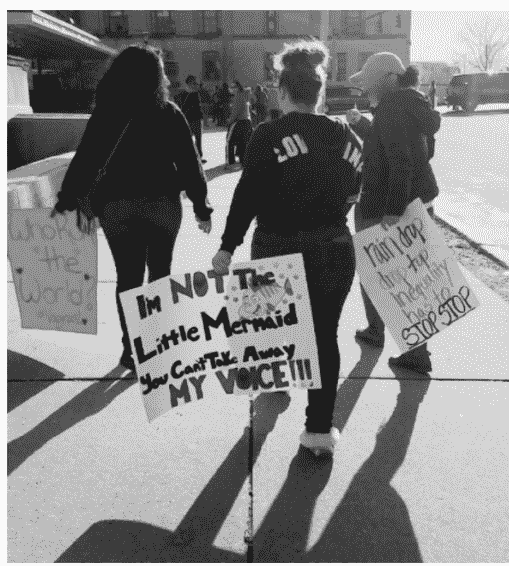

# 多声性：在身份边界上歌唱

献给 Wren Reeve 以及所有变化的、无法沉默的声音。

图 0.1 埃德华·埃里克森森（Edvard Eriksen）创作的小美人鱼像，位于哥本哈根港。

照片作者拍摄。

我的身体是一首歌曲的躯体，是歌唱它们的声音。

当我在音乐学校走廊的嘈杂声中低声哼唱 Lucinda Williams 的歌曲时，一阵合唱排练声向我袭来。我在自己的目录中找不到这首曲子的卡片，但在未经许可的情况下，我那放荡的高音字自发地逃出了大厅。它记得乐谱，并竭力发出声音却不不被听见。

这个声音记得我。我认出它，就像我被遗忘的第二根脊骨，在我的一生中支撑着我，一直沉默并嵌入我的血肉之中。我花了一个小时才想起布鲁克纳。合唱安静了，我带着我那如提箱般的歌声回了家。

# 致谢

我向所有与我分享经验的人深表感谢，并对他们的慷慨感到深感自卑。他们中的每一个人对我的研究都是至关重要且不可或缺的，我所学的一切由于这些才华横溢的歌手。我向他们卓越的工作和成功表示祝贺，并感谢他们给予我的善意。我过去那些优秀的声乐专业同事，以及随后的后辈们，让我感到非常自豪。

致奥伯林音乐学院的校友 Rhianon Giddens、David Miller、Lilah Greendale Shapiro、Limmie Pulliam、Kati Roberts 和 Ellen Wolf——

致旧金山音乐学院的校友 Branden James、Daniel Montenegro、Breanna Sinclairé、Gary Ruchman、Jimmy Kansau、Melissa Canaday、Lara Bisserier、Heather Sung 和 Kathryn Miller——

致加州大学圣芭芭分校（UCSB）校友 Nichole Dechaine、Charlene Chi Kim 和 Kristin Williams Baugher——

致其他优秀的艺术家（以及他们的经理）

我从内心深感谢你们让我聆听你们的声音。我希望你们也写书。

这个项目的乐趣之一是与博林格林大学言语与听力障碍系的 Ron Scherer 进行的邻近合作，我们对歌唱模仿进行了初步的谱图研究。诚挚地感谢 Ron，还感谢 Stephan Pennington、Nadia Hanna、Lee Tyson 和 Holly Patch 分享他们的进展工作；感谢我亲爱的朋友和声学研究同事 Eve McPherson 承担了阅读整个初稿的艰巨任务；感谢 BGSU 的朋友和同事 Jeremy Wallach、Esther Clinton、Sidra Lawrence 和 Mary Natvig 的建议与支持；感谢 Naomi André 和 Sarah Gerk 对引言和第 2 章的反馈；感谢 JeannetteBernardo 对第 4 章的注释。此外，与学者 Nina Eidsheim 的共同编辑，以及与 Nina Fales、Chris Nickell、Shana Goldin、Daughtry、Elias Krell、Jim Grippo 和 Caitlin Torres 的启发性信息对话，对我至关重要。我从声乐的跨学科研究中学习到了很多，让我对声乐的未来感到乐观和兴奋。特别感谢我的家人，感谢 Suzanne Ryan 在全书创作中的耐心。

> （我巨大，我包含万千。）
>
> ——沃尔特·惠特曼（Walt Whitman），《我自》

2004 年一个雾气蒙蒙的旧金山日，我和一位音乐学院的校友坐在空的走廊里，直到《美国偶像》第四季的选拔开始。尽管我们的道路在大学期间曾交集，但直到一位朋友邀请我们参加选拔——我们在评判团面前大声唱阿拉契亚民谣。当我们离开体育场后，她给了我一份刚完成的 Demo 专辑，她将其命名为《多重声性》（Many Voices）。这个名字引用了她对异质声音的收集以及尝试不同声音的倾向。她后来告诉我，当我完成歌剧学习时，她在音乐上的灵活性让她一直在挣结于“我的声音是什么？”（采访，2012 年 11 月）。事实证明，这是一个优势。

《美国偶像》的评委让她偏离了流行音乐竞赛，但几几年后，Rhianon Giddens 成为 Carolina Chocolate Drops 乐队的著名成员，随后成为了一名著名的独唱艺术家。她受邀主演了一部百老汇剧，并在期间获得了麦克阿瑟奖学金。到 2018 年，她发行了前两张专辑，并在《莱特曼深夜秀》（The Late Show with Letterman）和《Austin City Limits》等节目中表演，并获得了史夫·马丁蓝调卓越奖。2016 年，她被聘来替代休假的 McDonald，但那个节目结束了。她在纳什维的最后几季中饰演一个角色。2019 年，她与 Leyla McCalla、Amythyst Kiah 和 Allison Russell 合作发行了《原住民女儿之歌》（Songs of Native Daughters），并与 Francesco Turrisi 合作发行了《无他者》（There is No Other）。她在大剧院和纽约 WQXR 制作了广受关注的节目。Yunina Barbour-Payne 关注了班琴的非洲起源，像 Frank X Walker 一样关注了阿拉契亚音乐的意义（Walker, 2008，被 Barbour-Payne 2016 引用），以及美国农村的黑白传统历史。她的第一张个人专辑《轮到我》（Tomorrow Is My Turn）与《多重声性》一样，包含了民谣歌曲和乡村音乐。

《多重声性》中的每一首歌都是由同一身体内的同一套生理装置发出的，并根据每种体裁和风格的审美学进行了塑造和调整。但如果一种构成“Rhianon Giddens 声音”的相似性是这一切的载体，那么标题中所称的多样性又如何解释呢？在西方话语中，歌手的声音往往被描述为一种静态的财产，仿佛它只适用于一种固定的曲目或内容（“她拥有歌剧嗓”或“她拥有乡村嗓”），而在后殖民、不断全球化、不断商品化的 21 世纪现实，可能允许——甚至要求——跨越边界。

这些体裁和身份的边界在 Giddens 女士中是复杂的，正如在许多美国人的生命中一样。拥有一位白人父亲、一位非裔美国人和阿拉斯加原住民母亲、源自威尔士的名字、在北卡罗来纳州青年的文化影响以及她的古典声乐训练，Giddens 平衡了受过古典训练的父亲的声音与 60 年代民谣复兴曲目。她父母的婚姻发生在 1967 年“洛宾诉弗吉尼亚州案”导致取消种族隔离法之后，尽管她父亲因这一决定被剥夺了继承权（John, 2018）。他们离婚了，Giddens 在父母及其各自的白人和黑人身份之间成长，“花费了同等的时间”（Davidson, 2017）。尽管她没有将自己呈现为美国原住民，但在高中她也这样做，以作为部落鼓（powwow drum）的一部分探索那种遗产的音乐。随后，在 20 世纪 90 年代，她不被允许进入西方古典音乐之外。但在大学毕业后，她开始认真地对待老式音乐、凯尔特传统音乐（苏格兰和爱尔兰）以及蓝调。她的探索并非没有冲突。她说，在她开始向黑人小提琴手 Joe Thompson 学习之前，在 Carolina Chocolate Drops 乐队形成之前，她感觉自己像是在“溜进这种不属于我的音乐中”。那种将民谣音乐隔绝为白人、将蓝调隔绝为黑人的持续文化话语，“导致我在我发现其实是我自己的文化传统中，感觉自己像个异类”（Giddens, 2017）。她奉献了多年来重新发现并分享那种传统。如今，Giddens 女士是世界上最顶尖的黑人民谣、声音、班琴和小提琴传统的表演者和历史学家之一。

通过汇聚她文化背景和兴趣的多个丝缕，她能够自由地定位自己的认同所在地。“我发现身份认同的地方，当我意识到我来自卡罗莱纳州”（Jones 2015）。而卡罗莱纳州多样的声音构成了她的传承。她曾说：

> 我是一个老派的混血卡罗莱纳州人……在卡罗莱纳州有一个地方，有很多黑人和印第人，当然，还有很多混血。我无法确切说明我到底属于什么血统，或者别的，但我们知道，我所知道？我知道历史，我了解家族传说以及我们认知的方式。我不确定自己是否会把自己标榜为印第人女性，但我一直兴趣从音乐上探索这些不同的元素。我不知道自己是否有凯尔特血统，但这对我并不重要，因为卡罗莱纳州的音乐确实拥有凯尔特根源；这就是我需要知道的。（Murg 2015）

此外，在她近期的作品中（例如 2017 年的《自由之路公路》），首先在“黑人命存运动”兴起的背景下，随后在 2016 年大选以来白人至上主义活动激增的冲击下，她专注于为那些被失声的声音歌唱。特别是，她根据 19 世纪的奴隶叙事创作了原创歌曲。在北卡罗莱纳州格林斯堡的一场演唱会上，当被问及这些歌曲时，她告诉观众：“有人问我为什么在这里。不是为了出现在纳什维尔——那很有趣。也不是为了和[乡村音乐歌手]埃里克·切奇一起玩——那很有趣。是为了让声音发出来”（Harrison 2017）。她不仅用自己身体的多种声音歌唱，还成为了一个讲述文化历史的声音——“我的历史，”她说，“我来自何处”（访谈，2012 年 11 月 3 日）——她是那些被奴隶制、暴力、边缘化和时间流逝所沉默声音的代理人。这种纯粹的歌唱，以及通过身体本身的存在进行歌唱的过程，意味着塑造了她的认同；它也成为了 M. Givens 自我策略的一部分，通过多重声学主体性进行叙述，这种叙述方式在 21 世纪变得尤为普遍且至关重要。

批判社会学家尼克·库德里（Nick Couldry）在 2010 年写道，“西方正经历着一场当代声音危机，涵盖政治、经济和文化领域，且已经持续了至少三十年”（Couldry 2010: 1–2；原文强调）。对于库德里来说，这种危机根源于新自由主义教条的霸权，它那以市场为中心的框架在修辞上提供了“声音”（即政治、经济和文化主体性的意义），但实际上并未赋予它（2），而且实际上违背了民主的充分实践。新自由主义作为对 19 世纪自由贸易的核心复兴，在意识形态、话语、政治经济和治理的语境下被许多定义；对于地理学家、人类学家大卫·哈维（David Harvey）来说，它是一种政治经济理论，认为“创业自由的最大化”是人类福祉的终极手段（Harvey 2007: 22），并影响社会的各个方面。20 世纪 80 年代，由于其具有在 70 年代衰退和不满后恢复全球资本积累的潜力，新自由主义主张制度去中心化、私有化以及创业和消费主义的个人化。正如路易·埃斯波西托（Luigi Esposito）和劳伦·芬利（Lauren Finley）所称，这是“我们时代的主流政治经济范式”（Esposito and Finley 2014: 76）。哈维评论说，它在全球范围内规范化，部分是因为它的修辞被定位为对个人自由感知威胁的解决方案（Harvey 2007）——这些威胁不仅来自外国政治力量，还来自任何优先考虑公民集体福祉而非金融机构完整性的国家政策（331）。哈维认为，新自由主义的应用尽管修辞上承诺公平竞争，但并没有解决全球资本危机，反而巩固了上层阶级的统治地位（29）。随着经济不平等与其他主权意识形态纠织（特别是殖民遗产和白人至上主义），新自由主义也加强了种族化、性别化和残障认同的边缘化。

为了理解论点，声音最好被理解为既是一个过程也是一种价值。从核心来看，作为过程的声音包含了“作为自身的行为行为[参考 Butler 2005]，以及该过程的直接条件和性质”（Couldry 2010: 3）：一种反思性的主体性。声音作为价值的思想支持了这种说明性实践（8）。重视声音的价值承认每个人都是一个“可叙述的自我”（Cavarero 2000: 34，引自 Couldry 2010: 99），并维护“声音产生影响的潜力”（Couldry 2010: 9）。如果不考虑到声音的价值，唯一被允许产生影响的声音只有那些嵌入在产生影响的身体中、被视为可叙述的自我中，以及决定这种可接受性的目光中的。

> 正如马尼·哈洛（Marnie Harlow）所写，“新自由主义所言的以及它不断背离的”（Holborov 2015:9）。

> 罗伯特·麦切斯尼（Robert McChesney）在为诺姆·乔姆斯基的《利润高于人：新自由主义与全球秩序》写的序言中同样写道：“新自由主义是我们时代定义的政治经济范式”（McShesney 1999: 7）。

这种可接受性。在新自由主义理性中延续的不平等——种族化的、性别化的、基于能力的，并与经济差异交织在一起——纠结于市场体系中，什么重要的是能卖得出去。库德里警告说，表面上提供的声音实际上支持市场体系，而非真正的主体性，仅仅提供了“作为商品竞争的机会”（13）。21 世纪的如《美国偶像》之类的歌唱比赛已经反复证明了这一点，它们似乎给了所有年轻艺术家和全国观众平等的、民主的机会，但最终将他们塑造为有利可且受青的消费者（Meizel 2011）。关于《美国偶像》如何揭示经济自由主义与民主之间的紧张关系，参见 Stahl (2013)。

在本书中，我论证用“多种声音”歌唱可以被认为是一种产生并抵抗这些新自由主义预期的实践。一方面，理想的新自由主义者不仅是一个自我调节和不断发展的、可扩展的商品，本身也是一个企业。戴尔·查普（Dale Chapman）写道，“对多种技能的掌握使她能够保持作为市场变化的代理人而非客体”（Chapman 2013: 452）。查普将当代的“独奏乐队”或现场个人多器乐手理解为一种商品音乐主体，其实践模式满足了这一要求。用多种声音歌唱对于在音乐产业中寻求并创造空间的个人歌手可能具有类似的目的。此外，新自由主义与文化帝国主义、全球化和多元文化的不可估量范围内纠结，培养了一种广泛的、往往是掠夺性的音乐折衷主义，这反映了多元文化多样性话语中浅层的本质主义。例如在美国，听众和歌手都可能参与自身文化背景之内或之外的音乐文化，是出于一种过早庆祝对白人至上主义胜利的美国民族主义之名。乔迪·梅拉梅（Jodi Melamed）描述了 21 世纪初美国新自由主义多元文化的特征：

> 今天的新自由主义多元文化将跨民族主义纳入种族形成中，将[白人]多元文化美国公民视为比多元文化世界公民更具普遍性和合法性的主体。
>
> ⁴ 出于包容性和承认非二元性别身份的考虑，在本书中指代非特定的人时，我使用单数 they/them/their 代词，而不是“他或她”。
>
> 新自由主义的主体性被视为“单文化”的，因此是低劣的。多元文化的参考维持了新特权/污名二元对立的双方（Melamed 2006: 18）。

反映折衷的、浅层多元文化主义的音乐表演——例如白人歌手采纳和挪用多种音乐文化和演唱实践——可能会强化这种二元对立。

另一方面，歌手们，尤其是像 Giddens 女士这样的有色人艺术家，他们通过唱歌的方式创造了其他被否认的空间，让他们的自我叙述能够发声。这种叙述对每个人来说都是独特的，它们也具有互主体性。Cary 观察到，由于价值具有固有的关系本质，因此它不可能是个人主义的（2010: 9）。由于新自由主义社会倾向于歌颂一切竞争性的（过度）个人主义，后者否定了自我和身份的主主体性复杂性，我建议用许多声音歌唱也可以成为一种抵抗的形式：一种通过声音的主主体性过程来叙述自己的方式，因此充当了针对新自由主义的反理性策略。

此外，它可以帮助加强民主原则，以对抗 Foundry 所说的“新自由主义民主的虚构”（Caudry 2010: 47）。Adriana Cavarero 指出*多元性*（她将其命名为“多元声性”，pluriphony）是民主的基础——而不是在话语中持续存在的“大众齐一”的观念。她认为，在“后真相”时代，并不是民民的意愿，而是*人们的声音*（voices of people）生成了“正在形成中的民主图景”（Cavarero et al. 2018: 84）。因此，任何人的多重互主体性声音的发响也可能被认为是民主的。当像 Giddens 女士这样的歌手为那些被死亡、时间和历史所沉默的人们发声时，那种正在进行中的民主声景就变得更加宽广且定义得更加清晰。

鉴于其所起的作用，以任何声音歌唱都可以被视为一种“在世”的社会实践（Heidegger 1962）以及在世界中行动。1966 年，前卫作曲家兼歌手 Cathy Berian 将这种功能与*声性*（vocality）的概念联系起来，鼓励古典歌手探索发声方面和能力的多元化方式——作为“声音的存在的方式，并发展出一种‘新声性’”（Berian 2014[1966]: 47）。声性也构成了 Feld 的*声学认知*（acoustology）概念的关键部分，该概念构构成一种流逝的、“在世界中认知和存在的声音化方式”（Feld and Brenneis 2004: 462）。对于许多歌手来说，作为认识论和本体论的声音，不仅涵盖了他们所引用的各种音乐文化中嵌入的离散语言和发声实践及声音，还包含了影响他们个人身份经历的许多观点和许多故事。

本书以像 Giddens 女士这样的歌手为中心，她的多重声音可能最能被理解为“多重声性”（multiple vocities）：即通过声音在世界中存在和行动的多种方式，以及利用声音的主主体性和间隙性来应对 21 世纪身份的中间地带和边界跨越。我的研究涉及物质与隐喻的交汇，以及在身份的发声协商中的文化意识。在研究作为“存在之发声”的声性时，在歌手⁵的经验真理语境下，在反映并塑造自我文化的、发声的复杂认识论中，定位声音、实践、技术和意义。此外，当歌手习惯于跨越风格、流派、文化和历史边界进行表演时，我建议他们不仅是在多重声性中表演，更关键的是，他们正在表演“多元声性”（multivocality）——即通过用许多声音歌唱来协商他们的叙述性自我。

# 声性：概念、历史与政治

## 核心概念：声性与多元声性

**声性**（Vocality）最常用的用法简单指从人体发出的声音的存在或使用。然而，正如 **Berberian** 所指出的，这种功能被与声性的概念联系起来，鼓励古典歌手探索发声方面和能力的多元化方式——作为“声音的存在的方式，并发展出一种‘新声性’”（Berberian 2014[1966]: 47）。声性也构成了 **Feld** 的**声学认知**（acoustology）概念的关键部分，该概念构成一种流逝的、“在世界中认知和存在的声音化方式”（Feld and Brenneis 2004: 462）。对于许多歌手来说，声音作为认识论和本体论，不仅涵盖了他们所引用的各种音乐文化中嵌入的离散语言和发声实践及声音，还包含了影响他们个人身份经历的许多观点和故事。

本书以像 **Giddens** 女士这样的歌手为中心，她的多重声音可能最能被理解为“多重声性”（multiple vocalities）：即通过声音在世界中存在和行动的多种方式，以及利用声音的主体间性和间隙性来应对 21 世纪身份的中间地带和边界跨越。当歌手习惯于跨越风格、流派、文化和历史边界进行表演时，他们不仅是在多重声性中表演，更关键的是，他们正在表演“多元声性”（multivocality）——即通过用许多声音歌唱来协商他们的叙述性自我。

## 新自由主义、身份与抵抗

新自由主义的主体性被视为“单文化”的，因此是低劣的。多元文化的参考维持了新特权/污名二元对立的双方（Melamed 2006: 18）。反映折衷的、浅层多元文化主义的音乐表演——例如白人歌手采纳和挪用多种音乐文化和演唱实践——可能会强化这种二元对立。

另一方面，歌手们，尤其是像 Giddens 女士这样的有色艺术家，他们通过唱歌的方式创造了其他被否认的空间，让他们的自我叙述能够发声。这种叙述对每个人来说都是独特的，它们也具有主体间性。Cary 观察到，由于价值具有固有的关系本质，因此它不可能是个人主义的（2010: 9）。由于新自由主义社会倾向于歌颂一切竞争性的（过度）个人主义，后者否定了自我和身份的主体间性复杂性，我建议用许多声音歌唱也可以成为一种抵抗的形式：一种通过声音的主体间性过程来叙述自己的方式，因此充当了针对新自由主义的反理性策略。

此外，它可以帮助加强民主原则，以对抗 Caudry 所说的“新自由主义民主的虚构”（Caudry 2010: 47）。Adriana Cavarero 指出**多元性**（她将其命名为“多元声性”，pluriphony）是民主的基础——而不是在话语中持续存在的“大众齐一”的观念。她认为，在“后真相”时代，并不是人民的意愿，而是**人们的声音**（voices of people）生成了“正在形成中的民主图景”（Cavarero et al. 2018: 84）。因此，任何人的多重主体间性声音的发响也可能被认为是民主的。当像 Giddens 女士这样的歌手为那些被死亡、时间和历史所沉默的人们发声时，那种正在进行中的民主声景就变得更加宽广且定义得更加清晰。

鉴于其所起的作用，以任何声音歌唱都可以被视为一种“在世”的社会实践（Heidegger 1962）以及在世界中行动。

## 声性的历史谱系：殖民主义、种族与权力

关于声性的本体论和认识论话语长期以来与权力话语联系在一起，处于一系列相关的历史、欧洲现代性、殖民主义和对人类制度化的研究之中。欧洲殖民项目早期的文件显示，声音被视为文化身份和差异的标记。

### 早期殖民记录中的声音差异
例如在 16 世纪，声音成为了加尔文教教士 **Jean de Léry** 在巴西经历差异的中心，他观察到参与者跳舞，声音从他所谓的“可调律的”、“悦耳的”变为“喃喃的”、“颤抖的和嚎叫”，向 Léry 表明了他认为的被魔鬼附身（de Léry 1580）——本质上是灵魂的声音化且具化的差异。

### 19 世纪：声性帝国与科学种族主义
到 19 世纪后叶欧洲殖民时，标记差异已成为一种意识形态工具。1869 年，喉头学家 **Sir G. Duncan Gibb** 向伦敦人类学学会发表了关于声音的论文（1870 年发表）。他直言不讳地将欧洲描述为“歌声的摇篮”，并认为欧洲声音优于“亚洲和非洲声音”（Gibb 1870: 258）。有些人认为他是“强力的”——德语和塔塔尔语（鞑靼语）声音，男女都有；一些人则认为他是“软弱的”——中文、日语，以及可能最重要的受殖民印度人声音。他推测这种软弱以及差异在于喉头的结构（关于吉布观点的进一步讨论请参见 Meichel 2011b）。

吉布的观点很大程度上基于轶事故事和非系统的观察，这在 21 世纪是站不住脚的，特别是因为没有任何科学证据发现任何指示种族的形态学或骨骼特征。音乐学家 **Nina Sun Eidsheim** 解释说，相反，听者听到的任何种族化差异都是“基于乐器的灵活性和可能性，以及对所强调的人声特质的选择”（Eidsheim 2008: 33）。换句话说，声性的种族化就像种族本身，或许最好被视为社会建构。

1992 年，引用 19 世纪地缘政治的遗产，声音教练 **Patsy Rodenburg** 警告表演者不要陷入所谓的“声性帝国”，即对“唯一正确声音”的信念（Rodenburg 1992: 105）——这种霸权类似于 **John Potter** 所确定的“声性权威”（Potter 2006 [1998]）。这种帝国不是隐喻的，而是字面上的。

### 殖民听觉与口语性
**Ana María Ochoa Gautier** 在她开创性的研究中，关于 19 世纪哥伦比亚声音生产与听觉的交织，她将殖民性置于欧洲殖民者眼中的“未被驯服状态”，这是她理解为一种“声音的历史性听觉模式”，这种模式由国家口语性策略性地控制（Ochoa Gautier 2014）。考虑到音乐学家 Nina Sun Eidsheim 的观点，声音既是由歌手创造的，也是由听者创造的（2019: 157），口语性和殖民权力的倾听目光在声性的讨论中至关重要。当时关于国家和种族的观念是纠结的；但对某些人来说，种族化的身体（包括由英国目光建构的声性）预示着国家或区域的特征。

## 语言、民族国家与声性的形成

还有人认为，不同语言的音学特征塑造了独特的声性，创造了文化间不同的歌唱方式。在启蒙运动巅峰，随着文化紧张影响了法国和意大利之间的关系，以及民族国家兴起的种子被播下时，**Jean-Jacques Rousseau** 著名地证明了由语言塑造的声音中的原初民族认同。他在他的《音乐字典》（*Dictionary de Musique*）中说，口语法语和意大利语之间的差异直接导致了演唱模式（Rousseau 1975 [1779]）。这是 **Sally Sanford** 二十年前在历史表演实践服务中也提出的可能性，她认为这两种语言特征性的气流模式（她提供了意大利语短语“mamma mia”来演示可变气流，用法语“ma mère”来演示连续气流）导致了 17 世纪离散的、持久的法国和意大利“呼吸流派”和歌唱技术（Sanford 1995）。

## 20 世纪理论转向：声性作为中介概念

在 20 世纪后期，语言成为认识论探究的核心焦点，引发了关于书面和口语的问题。文学理论家 **Paul Zumthor**（1978）将**声性**（vocality）作为口语和识字之间的中间点，用以规避二元对立并允许它们交叉的可能性。他的观点源于诗学研究中对人声的忽视，很快被 **Ursula Schaefer**（Schaefer 1992, 1993）所继承，她在其中称为 *Vokalität*（声性）的词提供了一种在识字背景下承认声音持续意义的方法——这里指的是口语的（Schaefer 1993: 25）。

## 民歌、阶级与审美评价

**Dent** 指出民歌似乎“足够声性但难以歌唱”（Bairstow et al. 1929: 235），他没有仅仅引用美学，而是指向阶级关系。他写道：

> 人们现在可能将民歌视为自己的财产，但长期以来，这在很大程度上是玛丽·安东妮式的表现。受过训练的歌手获得了一种风格，并同时让他们在音乐厅取得了成功。歌唱民歌的困难主要是自我意识、虚荣和势利的问题（240–241）。

对于 Dent 来说，民歌对声音的适用性从未受到过质疑；相反，他认为，古典训练歌手的问题源于对底层阶级的意识。他认为，“民歌”和“音乐厅”歌唱涉及不可调和的实践差异。

## 声性作为权威与真理的索引

**Feld** 等人研究了声音如何被构建为“差异的隐喻”以及“身份、权力、冲突-社会地位和代理的关键符号”，这种框架将发声定位为一种权威的隐含索引和经验真理（Feld et al. 2004: 341）。

# 多元语音性：理论渊源与边界景观

## 理论渊源：特纳与巴赫金

多元语音性主要与维克·特纳（Victor Turner）对仪式的研究以及对米哈尔·巴赫金（Mikhail Bakhtin）文学理论的研究联系在一起。

对于特纳来说，它描述了一个具有多样或模糊意义以及转化力量的概念；歌声本身若非如此。

尽管“多元语音性”这一精确术语并未出现在巴赫金著作的完整英文译书中，但通过后世学者的分析，它已成为对他陀思妥耶夫斯基小说中主体间性理解的一种常用术语。

对于巴赫金来说，声音不仅包括言说的语言和声音方面，还包含了其嵌入的意识形态（Park-Full 1986）；它是“说话的人格，说话的意识。每一个声音背后总有一个意志或欲望，它自己的音色和泛音”（Bakhtin 1981: 434）。

在他的框架中，所有的言语都包含多种语言（异质语）和多种声音（复调性）的痕迹。

巴赫金认为，陀思妥耶夫斯基的小说的特征是集体的、对话式的作者声音，这种声音突出了人的言语对他人的能力，同时又保持自身，在两种声音之间创造了对话关系（Park-Full 1986）。

巴赫金在陀思妥耶夫斯基的作品中发现了“独立且互不融合的声音与意识的复数，一种完全有效声音的真正复调”（1984: 6；原文强调）。

巴赫金的概念在这里被译为“复调”（polyphony），也被译为“多元语音性”（multivocality）和“多声”（Belova et al. 2008: 494）——或者正如雅各布·迈霍夫（Jacob Meyhoff）具有影响力的分析那样，译为“多元语音性”（May 1998）——这一切都是对对话演讲中固有的多种声音的管理。

## 社会声音的多样性与自主性

需要强调的是巴赫金所谓的“社会声音的多样性”（Bakhtin 1981: 263; May 1998: 154），每一个声音都是自主的，它们并没有融合成一个凝聚的整体，尽管它们可能被作者“编排”在一起以创造其小说的叙事文本（May 1998: 154），并实现一种“比同音更高层次的统一”（Bakhtin 1984: 21）。

巴赫金理解为文本中所有的异质语，即作者“自己的声音也必须响起来；这些声音创造了这种发生的必要背景”，而且没有它们就无法被真正听到（Bakhtin 1981: 278）。

对巴赫金来说，声音本身就是“说话的人格，说话的意识。每一个声音背后总有一个意志或欲望，它自己的音色和泛音”（Bakhtin 1981: 434）。

陀思妥耶夫斯基小说中“多声性”和“复调性”的概念从未指示任何形式的单一统一，而是始终是一种对话，不同的声音独立地作为“一种互不融合灵魂的交融”运作（Bakhtin 1984: 26）。

尽管如此，许多人试图将这种模型应用到个人后现代经验的文本以及个人身份的构建中。

## 身份构建中的多元语音性：朱莉·崔的研究

对于朱莉·崔（Julie Choi）来说，在她关于其跨国身份民族志写作的作品中，巴赫金的声音涵盖了“角色的现实、价值体系和信仰”（Choi 2013: 161）。

她认为，通过“音色和泛音”，巴赫金暗示声音有其自己的角色，“一个由特定历史、实践、欲望等塑造的独特性格”（108）。

在崔（Choi）的自我叙述中，她选择了“多地性”（multilocality）一词来描述构成韩国裔美国人身份的语音多样性，并将其置于“多语言性”（multilinguality）之上。

参考了 Makoni 和 Pennycock (2007) 之后，她指出将“多语言性”替换为“多元语音性”标志着脱离了对语言进行计数的策略，以及将语言视为正式系统或具有僵硬边界的子整体的固定刻板观念（Choi 2013: 30）。

Makoni 和 Pennycock 担心，将多语言性作为讨论多样性的方式只是在重演“殖民发明的修辞，忽视了语言发明的充满争议的历史，并忽略了……他们所嵌入的语言观念可能正在持续造成的……[损害]”（Makoni and Pennycock 2007: 27）。

此外，将双语和多语言性物化强化了单一性是自然的观点，尽管历史和现状与全球化恰恰相反（Bailey 2007: 62；引自 Choi 2013: 27）。

## 代码切换与代码交叉

由于某些原因，正如我在语音性（vocality）定义中指出的语言外组成部分，说话中的多元语音性正是另一种多元语音性，或是与之相关的代码切换（code-switching）概念。

根据 Kathryn A. Wools 的定义，代码切换通常指的是“个人在同一个言语事件或交流中使用两种或多种语言”（2004: 73–74）；它可能涉及多种语言、语言风格、方言或语域的表达。

与崔（Choi）认为多元语音性优于多语言性的观点类似，沃尚·阿什塔尼·杨（Vershawn Ashanti Young）指出，泛滥的代码切换主导语言模型错误地“说服我们去想象”白美国人说的是一种统一的标准英语，这种标准优于被贬放到非公共（非白人）空间的少数方言，而且为了在经济上成功——成为一个社会流动的自由主义主体——有必要在（白人）空间使用这种标准英语进行交流（Young 2009: 68–69）。

为了解决这些问题，Rampton 在20世纪90年代提出了另一个研究这些过程的框架：代码交叉（code crossing），或跨民族、种族和社区边界的交流移动（Rampton 1995¹⁰）——换句话说，语音语言边界跨越。

Rampton 引用了巴赫金的双重语音性作为类比。杨借鉴了 W. E. B. Du Bois 的双重意识概念 [Du Bois 1903]¹¹。

## 歌唱语境下的边界跨越

在本书中，多元语音性构成了歌唱语境下的边界跨越。多元语音性是指在日常生活中不断识别并跨越边界的人——颜色、性别、种族。

玛莎·费尔德曼（Martha Feldman）观察到声音倾向于存在“相间隙、过渡的空间”（Feldman 2015: 658）。

声音同时界定并缓解了身体的内部与外部边界，并在文化空间运作，进行边界的界定与重新界定，以及边界的栖居与跨越。

它们不仅仅存在于生存空间之中；它们有助于创造、重新创造并塑造声音所在的空间——与身份、关系交织在一起。

格洛丽亚·安扎尔杜（Gloria Anzáldúa）写道，处于“心理不安的状态”，“是什么让诗人写作、艺术家创作”（Anzáldúa 1987: 73）。

关于她对《墨西哥歌曲集》中纳瓦特语的翻译，她继续写道：

- 我的花不会生存；
- 我的歌曲永不结束；
- 我，打算它们；
- 它们散落了，它们展开。（73）

> ⁸ 本节的一部分文本摘自我的章节“声音：美国流行文化中的女性声音叙事”（Meizel 2019）。
>
> ⁹ 关于代码切换的电影处理，请参见 2018 年的超现实电影《对不起》（Sorry to You），片中一位黑人标签发现发现电话里听起来像白人很重要，这说明了 A. T. McWilliams 所说的代码切换的“力量与潜在危险”，以及“同化的悲剧”（McWilliams 2018）。
>
> ¹⁰ 另见 Rampton 2014 [2005]。
>
> ¹¹ 最常引用的是《民间灵魂》（The Souls of Folk，1903），Du Bois 最初在 1897 年发表于《大西洋纪刊》8 月号的文章《黑人的斗争》中提出了这一观点。
>
> ¹² 通过首字母大写 b，安扎尔杜区分了地理边界和心理边界。为了简单起见，我在自己的用法中没有大写。
>
> ³ 《墨西哥歌曲集》（Cantares Mexicanos）是一部纳瓦特语歌曲合集，在 16 世纪的某个时期被翻译成罗马字母。值得注意的是，对于“阿兹特克”文化的学者来说，该作品中的纳瓦特语表达 `xochitl` 和 `cuicatl`（通常译为“花与歌”）已被解释为对诗歌的引用（Tomlinson 1995: 364）。

尽管白人至上主义和其他霸权主义反对日益增加，但越来越多的人认同自己的身份是交叉性的，认同自己是多族裔（Saulny 2011），跨越多种文化，在不同宗教间游（Green 2017），并认同自己是非二元性别、性别流动和跨性别者，边疆地区的声音正变得越来越响亮且日益紧迫。

这种跨越感知边界的发声——以及声音的能力和需求，即同时为边缘化身份主领空间，并在抵抗压迫体系的同时侵蚀边界——被置于新的关注焦点。

## 自我空间化与声音的运动

玛丽·塞莉·贝尔托（Marie-Célie Bertau）在总结休伯特·J.M·赫曼斯（Hubert J. M. Hermans）的观点时观察到，“自我的空间化允许足够不同的位置，并在这些位置之间移动。‘我’在其中移动，能够赋予每个位置以声音（Herman 1996），在不同位置之间建立对话关系”（Bertau 2007: 96）。

贝尔托写道，这种在主体位置之间的运动——被称为“声音”——可以被解释为极易变化的或永恒僵化的，这两个概念始终处于冲突之中且具有当代性（133）。

在位置或声音之间多声部的运动的过程中，边界发挥了作用。

在2015年发表于《美国社会学协会杂志》上的一场题为“为何现在是声音？”的研讨会上，召集玛莎·菲尔德曼（Martha Feldman）发现了艾米莉·威尔伯恩（Emily Wilbourne）的贡献，她总结了后者的观点，提醒声音运作在各种边界之上，最显著的是“**人类的边界**”（Feldman 2015: 658；强调原文）。

苏珊·库斯西克（Suzanne Cusick）在1999年写道，“所有的声音，尤其是歌声，都表演了身体的边界”（Cusick 1999: 29），该观点也被Krell（2015）引用。

埃利亚斯·克雷尔（Elias Krell）在声音边疆的语境下讨论了声音，他们将其定义为“占据地理和话语边疆的身份和身体的理论与经验性标记”（Krell 2015: 95）。

声音将人类内部与外部区分开来；它们包含并划分了身体，而发声性作为人类身体边界的社会政治空间发挥作用。

它们划分了性别、种族、阶级、宗教的话语并在此过程中成为争议的场所——即抒情结构与权力结构交汇的场所，以及身份进行协商的场所。

因此，在书中，除了将多声部性视为一种身份边界的导航工具外，我还将声音视为一种本质的“边界景观”（borderscape）。

## “边界景观”概念

“边界景观”（borderscape）这一概念在21世纪的第一个十年在多个学科中流行起来，其本身就是一个多声部的概念。

对于地理学家安·斯特鲁弗（Anne Strüver）来说，它建立在阿尔朱朱·阿帕拉杜（Arjun Appadurai）对“-景观”（scape）的刻画之上，带有流动的含义——文化流动、信息流动、资本和思想流动，以及重要的是通过旅游、劳动以及自愿和强制迁移产生的人口流动（Appadurai 1990）。

边界景观是

对斯特鲁弗来说，它并不是一个物理场所，而是一个强调过程汇流的场所。

斯特鲁弗写道，边界的制图“通过表征、表演行为、叙述行为、可视化和想象（包括对它们的解读）来进行——并可以被构想为边界化（borderscaping）”，她将其定义为“使想象的边界被建立并作为真实的实践的应用”（Strüver 2005: 170；强调原文）。

在2007年的书籍《边界景观：领土边缘的隐藏地理与政治》中，地理学家普雷米·库马尔·拉贾拉姆（Prem Kumar Rajaram）和卡尔·格伦迪-瓦尔（Carl Grundy-Warr）考察了“边界化”的概念，提醒读者地理上的“[b]order界空间是具有特定意义的特定社会互动区域”（Rajaram and Grundy-Warr 2007: xxix）。

他们对“边界景观”¹⁴这一术语的理解强调了“归属与不归属之间边界意义的内在争议性”（xxiii），以及它对抵抗的持续产生。

边界景观是地理上可识别的，但它在这些方式上产生包容与排斥（xxviii）。

它是流动的，永不静态，因为它是多个行动者、历史和团结的产生区域（xxix）。

在我的框架中，声音作为边界景观以这些方式运作。

地理学家奇亚拉·布拉米拉（Chiara Bramilla）（2015）提出，对边界的重新强调应通过认识论和方法论的三个轴线进行，并将边界研究推向基于多种解读的新政治（29）。

在《多声部性》中，我字面地接受了这一点，研究歌手如何通过多种声音方式导航边界。

布拉米拉断言，边界研究应该是（参考 Hampton 2009）“表演性的、参与性的”（Bramilla 2015: 28；强调原文）：

> 一种能够阐明行动者、经验和表征交叉空间的知识，揭示了边界作为冲突的场所。
>
> ¹⁴ 他们引用了书中的一位作者苏文德里尼·佩拉（Suvendrini Perera），参见 Perera 2007。

强调边界作为可以表达成为权利的场所，边界景观方法开启了一个新的政治可能性空间，一个新类型主体产生其中的空间。（29；强调原文）

如果声音可以是边界，那么发声性就为导航提供了多种路径。

多声部性探索歌声作为斗争与生成的场所，协商着类型、意识形态和文化之间的声音边界。

通过考察歌手的边界经验，本书旨在阐明声音在多种认识论和本体论过程中的作用。

同样重要的是，对于许多歌手（包括交叉性者）来说，发声性可以成为一种抵抗形式。

## 交流民族志与演唱方式

我对多重声性（multivocality）的研究借鉴了交流民族志中的话语，但其目标是理解唱歌的方式如何反映并塑造生活的方式。

我对声性视为唱歌方式或“存在之声”的理解，让我想德尔·海姆斯（Dell Hymes）在1974年《说话方式》（Ways of Speaking）中的著作。

在这篇文章中，海姆斯解释了他为何倾向于研究“说话方式”。

对他而言，这个短语将言语行为描述为一种“复杂的社会行为”，并想起了沃尔夫（Wharf）的“说话时尚”以及“生活方式”的概念（Hymes 1974: 445）——后者被理解为文化的基础。

对说话方式的研究还必须不仅考虑“言语的手段和意义”，还包括“超越风格选择的互动规范，以及作为两者基础的态度和信念”（446）。

海姆斯还提到了声音的角色——其音高和轮廓——在演唱方式中可能发挥的作用，并以塞内加尔的洛夫（Wolof）社区为例。

他描述了两种语言模式——克制与不受克制之间的对比，这种对比在声音的不同用法中，也划分了男女、成年人和儿童以及高低社会阶层成员的言语（442）。

他敦促民族志学者除了研究语言结构外还要研究语言模式，并指出：“假设一种语言形式的本质原则始终是结构而非模式，将是一个错误”（443）。

海姆斯在此处转向了音乐（正如文章其他地方一样），将实践置于与形式同样重要的位置：“人们可以说出一些不是歌曲的内容，也可以在没有歌曲的情况下呈现一首歌曲”（443）。

缪里尔·萨维尔-特罗伊克（Muriel Saville-Troike）在阐明交流民族志的核心原则和方法时写道，语言民族志学者倾向于研究演唱方式是如何模式化的，以及这些模式如何相互关联并“从文化的其他方面获得意义”（Saville-Troike 2003:11）。

民族音乐学和民俗学中此前已有少数文献运用了这一理念。

因此，声性的民族志应该调查演唱方式——不仅将其视为一种实践，也将其视为一种“制作的过程”（making-making）。

诸如爱德华·凯尔·米勒（Edward Kerr Miller）的论文《演唱的民族志：苏格兰家庭中歌曲的使用与意义》（1981）等研究，明确关注演唱者。

其他学者——例如艾伦·科汉（Ellen Cohane）和肯尼斯·S·戈德斯坦（Kenneth S. Goldstein）在《帕特里克·肯尼迪的河岸中的民歌与演唱民族志》中，强调了“对歌曲背景的描述”（Cohane and Golds 1996: 426）。

在一篇名为《演唱民族志的具身方法》的未发表论文中，民族音乐学家纳迪亚·查纳（Nadia Chana）将搜索聚焦在一个特定声老师的世界观上，以及声音技巧与塑造它的个人情感——具身实践——之间的关系（Chana 2013）。

查纳是民族音乐学声音研究兴起学者潮的一部分，该领域被艾德海姆和塞尔（Eidsheim and Meisel）描述为——“关注人类生活中被制造和想象的物质性的、鸣响的和感性的声音”（Eidsheim and Meisel 2019）。这是一个跨越表演艺术、人文科学和社会科学，并跨越医学、物理和技术研究的跨学科研究领域。声音研究学者倾向于依赖这些领域的多种方法，以追求对世界之声有更全面的观点。尽管如此，并没有单一的方法来进行声音研究，也没有单一的方法来提出或回答当我们好奇什么是声音时提出的如潮问题。矛盾无处不在——“声音既有物质基础，又在意识形态上被执行。它是一种发出的现象——无声地铭刻”（Eidsheim and Meisel 2019）——为了应对这些矛盾，声音研究必须采用并赞赏多样化的方法。在《多重声性》中，我应用了根植于民族音乐学、文学研究、媒体研究、身份研究、残障研究以及有时涉及声音科学的方法论。

在关于演唱的民族志研究中，民族音乐学家必须像我们在其他专业领域那样，进行同样严谨的反思。尽管我们强烈主张在其他音乐文化中整合内部视角（emic）术语，但当涉及到嗓音时，我们往往诉诸西方古典歌唱的词汇。这种本能如果缺乏对话语的反思性或批判性思考，可能会导致我们忽视特定文化语境下声音的细微含义。此外，许多西方古典声音缺乏任何标准化的意义或与产生过程的关联——例如，音区术语如“头声”和“胸声”在从业者之间产生了惊人多样的定义，或者可能完全被某些西方古典歌手和研究人员所否定。其他常用的描述词，如“鼻音”，在声音科学中确实有标准定义——“鼻音”是指空气流过鼻腔的声音——但如果没有某种形式的声学或生理学测量，我们无法确认这种特性，而且有时感知话语和实践存在显著差异。例如，当我为学生播放被描述为“鼻音”的录音时——这个术语在西方古典教学的“保加利亚之谜处理”（Mystère des Bulgares obrabotka）流派中，描述的是在发声时允许空气流过鼻子时产生的声音。但我曾与一位教美国人的这种风格的保加利亚歌手交谈，她解释说她的学生做的第一件事就是捏住鼻子以防止鼻音。因戈·蒂策（Ingo Titze）曾写过声唱者对鼻音类型的困惑，特别是他所说的“鼻音鸣”（nasal murmur，声学能量进入鼻腔）和“尖声”（twang，他将其与上咽管内的声学共鸣有关，可能由于软腭位置而产生鼻化）（Titze 2001）。因此，显然在实证话语与随意话语之间、我们如何听到声性与如何制造声性之间存在差异。此外，我们应该注意到，“鼻音”是一个带有文化色彩的概念，在西方话语中是不受欢迎且被边缘化的，并通常被理解为“他者”的标记（学生经常将任何非西方人描述为“鼻音”）。如果我们意识到声性与权力结构之间不可分割的联系，我们既无法想象它独立于结构之外，也无法让熟悉但未经过审查的框架掩盖其他融合文化的框架。尽管我研究中的许多参与者将自己定位在西方的演唱话语中，但将这些话语视为声音图景的一部分是重要的。因为我的工作关注个人歌手，在每一章中，我都努力在他们自己的经验框架内使用他们使用的术语。

民族音乐学家长期以来认为需要检查表征过程。但特别是考虑到声音与政治代表之间的修辞关联，我建议对歌手的研究需要特别关注。通过研究代表他人的经验通常被定位为“发声”（giving voice）（Ashby 2011）。例如，Bogdan和Bilen将发声描述为“赋予那些可能保持沉默的人被听见的力量”（Bogdan and Bilen 1998: 204, cited in Ashby 2011）。我描述的许多歌手面临一个抑制声音的压迫系统网络；通过发声、通过多重声性的抵抗，他们绝对不是沉默的。克里斯蒂·阿什比（Christy Ashby）关注非言语残障人士，她对“发声”这一概念在代理权和权力方面的复杂影响提出了批评。她警告研究人员不要认为他们必须发现或“挖掘一个个人真实的声音”（Ashby 2011, after DeVault 1999），并敦促他们去听或“读”沉默，正如读言语。我带着这些思想写了《多重声性》。因为参与的歌手通过许多声音存在，因此不存在一个单一的真实声音可以寻找。我也尝试去听沉默的本身——例如，正如我在第5章中讨论的，我研究中的一个参与者因为宗教信仰转变而完全退出，另一位则因为名声增加而退出——我尝试只在我的声音似乎相关时才加入自己的歌唱经历。总的来说，正如任何民族音乐学研究一样，正如任何一部巴赫金研究过的小说一样，正是声音的多重性使得作者的拥有权得以鸣响。

本书的每一章都关注了动态中的歌手，他们的声音勾勒出“边界景观”（bordersscapes），暗示了跨越流派与性别边界、文化边界、身体与技术之间、宗教与世俗背景之间、以及喜爱与迷失之间的转变与超越。第一章探讨吉登斯（Giddens）女士的关键问题：“我的声音是什么？”，研究了练习多声性（multivocality）的歌手是如何行动的。声音通常被理解为一种声音指纹，体现了独特、不可改变且真实的自我。但当一个身体产生许多声音时，涉及到了哪些动态过程和意识形态？一位非洲歌剧演员改变她的音色来回应阿比拉契亚的曲目；一位出生在加拿大的女星通过其父母祖国韩国的传统音乐学习了不同的唱法；一位叙利亚高音歌女唱难民利用一首展示了多重声性的歌曲来协商她在美国的生活。这种流派和边界的流动性，使得人们必须面对种族化、族裔和性别化的风格边界，并且其意义不仅限于实用的或美学的适应性。更重要的是，它指向了声音如何构建了极其复杂的身份工作。第一章调查了受过西方古典传统训练的歌手如何创造和体验这种多样性，并探索了他们在这一过程中采取的显性与隐性社会文化手段。

第二章考察了多样性的一个特定领域——一种被称为“歌剧”或“声乐跨界”的表演。通过识别流行歌剧（popera）的各种审美特征和偏好曲目，本章整合了多位知名跨界作品和团体的参与者的经历。他们通常与成员分享并思考了在选择和表演特定类型曲目时的想法和思维过程，对声乐技术的看法，以及多声性在其职业生涯中所扮演的角色。他们的工作揭示了一个复杂的代码切换（code-switching）过程，不仅在声音和流派之间移动，还凸显并挑战了现有结构——阶级、种族和性别的文化历史——正如歌剧和流行音乐一直所做的那样。最终，流行歌剧为这两个流派及其社会语域的重聚，以及对异质（alterity）的协商提供了一个声学空间。

某些多样性的表演是非常字面上的：模仿演员有时会采用名人的声音，所有声音都通过一个身体的声学戏法（或喉头）发出来。拉斯维加斯一直是模仿文化的国家中心，从大量的埃尔维斯形象到几十个变装场所，再到长期节目《美国超级巨星》（American Superstars）中常驻的流行模仿者。拉斯维加斯的剧场变装通过许多差异的变体进行表演和庆祝（一个黑人埃尔维斯、一个男版芭芭·史翠丽，同时强调并破坏了身份的流动性）。第三章详细描述了拉斯维加斯模仿者如何操纵身体与声音之间的这种脱节，以及这种脱节如何矛盾地促进了这些表演者身份的构建。

第四章讨论了聋哑（d/Deaf）歌手的工作以及他们与声音、手语以及听力与聋哑之间紧张的关系。对于聋哑歌手来说（他们在文化上先是听力的，后来身体上变聋），唱歌可以成为身份冲突的特殊场所，这体现在塑造声道的审美学和手语的动力学中，并通过一种包容与排斥的复杂表演政治进行协商。本章强调了通过与声音的负面关系来定义“聋哑”的问题，并主张聋哑歌手在声音和手语方面的工作不仅是一种多语言形式，也是一种多声（multivocity）形式。此外，它建议扩展多声性的定义以包含其他交流模式；如果多声性是身份构建的策略，我在第四章中提出，这种策略不必仅仅是声音上的。其他具身的交流形式（如手语）也必须被视为不可或的一部分，有时甚至是核心。

第五章涉及神圣与世俗歌唱风格之间的转换，重点关注在多个宗教背景下表演过的音乐家的经历。我的顾问之一，安东尼·罗塞尔（Anthony Russell）让我们窥见了声性在宗教转变和交叉身份体现中的重要性。在音乐的转变中，他不仅学习了一套新的歌曲体系，还通过唱歌的行为体现了一种新的文化——一种由当代犹太人实践和历史唱诵录音构成的的一套新的风格元素、音色和唱诵手势。在创作活动中，他寻求音乐、声音、历史和宗教的汇聚点，使他能够讲述自己的故事，并作为一个黑人、犹太人、同性恋男性找到自己的声音。本章的其他方面聚焦于灵性歌唱实践中的意图概念以及新自由主义市场中的边界跨越。

声性在塑造身体和表演性中起着作用。第五章讨论了四位跨性别歌手如何理解他们与声音的关系以及对他们身份感的影响。其中两个作为跨性别男性经历过歌声的变化，向更具男性的声音转变。一位女性保持了男低音的歌剧生涯；另一位在出柜为女性之前演唱过中音和高音曲目。声性为这些歌手每个人服务了不同的功能并产生了不同的意义，他们的经历共同强调了“转型”是一个持续的旅程而非终点的观点。

如果我们要理解“寻找声音”的概念，就必须面对它的丧失。第七章和第八章讨论了声音丧失的政治和个人影响。我通过技术并由技术中介考察了声音的丧失，追溯了美国电影中的这种愿景以及不断变化的社会文化景观，那里声音的转化可以被清晰听到。电影中的歌声已从象征身份的脆弱性和易受操纵，转变为身份的肯定以及作为具有主体性的个体。在电影之外，歌手的声音丧失同样受到关于身份和主体性话语的影响。失去声音在某些方面可能是失去自我，或者至少是失去施行身份的方式。第七章探索了作者通过将声音出售给数字采样库而经历的声音丧失。第八章关注由于创伤或疾病导致的声音丧失，将其视为个人控制权的丧失，并考察了歌手如何协商这种丧失。

最后，第九章强调了 2016 年美国总统选举后政治气候下的两个多声性案例研究，特别是在交叉女性主义活动和反对枪支暴力的青少年活动的背景下。

¹⁵ 我使用这个福柯式的术语，同时也向音乐学家尼娜·艾德海姆（Nina Eidsheim）和她的论文（Eidsheim 2008）致敬。

## 寻找声音

寻找你自己的声音并使用它

使用你自己的声音并找到它

—珍·科尔特（Jayne Cortez），《寻找你自己的声音》（1994）

在歌剧中，韦恩·科斯滕鲍（Wayne Koestenbaum）曾写道：“歌手的脸被称为面具，仿佛声音永远无法说实话”（Koestenbaum 1993: 154）。西方古典声乐教学法确实经常将脸部上半部视为“面具”——即威尼斯狂欢节装具可能栖息的地方——也是最能完美感受到大部分震动感的位置。尽管这是一种特定文化的观点，但科斯滕鲍的这种文字关游戏在任何关于声音与身份的讨论中都能引起共鸣。如果所有的发声都像工具一样，包含表演性的基本要素，那么它们的真理性最有效的方式是从相对的角度来看待。讽刺的是，在个体身体不断变化的约束下，歌手经常通过探索声音多变的本质，来寻找深层嵌入的、永恒不变的真实自我。但正如德博波拉·卡梅隆（Deborah Cameron）所观察到的，“声音是制造出来的，而非天生的”（Cameron 2001: 84, 引用 Preston 2016: 48），歌手往往会产生一种*真实的声音身份感*。然而，正如凯瑟琳·普斯顿（Katherine Preston）所指出的，“真实并不等同于‘非意志的’”（Preston 2016: 48）。本章探讨了歌手在寻找自我过程中可能采取的一些方向，以及在新自由主义音乐市场中品牌化本身的过程。

最终，在那个市场中寻找声音意味着遵循为新自由主义主体所设定的路线，Türken 等人将这种主体“日益被构建为一个自由的、个性化的、自我调节的行动者，被理解为资本的来源；人力资本”，并作为自我的企业家”（Türken et al. 2016: 34）。为了实现价值最大化，新自由主义主体性要求持续的自我发展、自我监控和自我改进（34）。Türken 等继续道，“个体对自己的成功和失败负有责任，个体的福祉和发展变成了新自由主义创业主体的唯一责任”（34）。最重要的是，自我改进有助于主体满足“灵活且不稳定市场”的需求（Türken et al. 2016: 34, 参考 Olssen 2006）。我在此建议，20世纪末和21世纪的歌唱话语已将声音的**多重性**（MULTIVOCALITY）视为这种自我发展的技术，而古典歌唱的知识和切换发声的能力被视为通往真实自我和声音健康的路径，因此也是通往市场化的道路。

寻找自我声音的概念——“承认个人的个性和自我价值，在这一刻已在美国文化中根深蒂固，以似乎是永恒的、没有历史的。但今天，个性化是美国性基础神话中的关键元素，而声音与主体性（agency）的等式本身并不新奇，这种隐喻的显性表达可以追溯到写作分析和教学法中的某些趋势，以及塑造了20世纪末和21世纪初国家社会、经济、政治、哲学和文化气候的关键运动。叙事性的声音概念（作为作者的声音）与能动性的声音概念（作为作者自己生活的声音）之间只有一步之遥；这两种发展都辩证地贡献了“寻找声音”的话语。

20世纪70年代的社会运动——包括受60年代非洲人民权斗争启发的第二波女性主义——很大程度上是通过“获得[社会政治]声音”的修辞驱动的（Bauman 2008a: 3）。通过审视那个时代的教科书，达西·鲍文（Darcy Bowen 1995）指出唐纳德·斯图特（Donald Stewart）的*真实的声音*（`The Authentic Voice`）是一份具有里程碑意义的文件。斯图特认为学生：“你真实的声音是尽管你与许多人有共同经历，也能与每一个生命区分开来的声音”（Stewart 1972: 2, 引用 Bowen 1995: 175）。其他对语言和声音的意义意义感兴趣的“声音学”（Bowen: 1995: 18）学者认为，“所有话语都受到来自其他语境和用途意义的抑制”（186）。在他们1997年的分析报告《女性气质与羞耻：女性、男性与赋予女性化声音》中，芭芭拉·L·尤里希-拉斯库（Barbara L. Eurich-Rascoe）和亨德里卡·范·坎普（Hendrika Vande Kemp）提供了一种（第三波）女性主义视角，将文学声音定义为“人际语境下的自我宣告，其主要目标是维持人际连接”（Rascoe and Vande Kemp 1997: 7; 原文强调）。这些表述有助于我理解在通过声音间主主体性网络协商个人身份的过程中，多重性的内涵。

到20世纪80年代后期，当新自由主义确保了稳固的政治和文化足点时，记者们开始询问作家和表演艺术家：“你是什么时候找到自己的声音的？”正如1989年对安·兰德斯（Ann Landers）的采访（Taylor 1989）以及1990年《吉他乐手》杂志对Kinks乐队的大夫·戴维斯（Dave Davies）的采访（Resnicoff 1990）。这一概念迅速进入广告领域，到2000年，一份关于女性吸烟的医生报告指责弗吉尼亚细宝（Virginia Slims）公司在其在前一年开始的全球“寻找你的声音”营销活动中剥削了女性运动的语言（Koplan 2000）。该活动还刻意针对有色人种女性，强调解放和赋权的主题，这让许多认为该项目旨在在全球范围内增加女性成瘾问题的人感到愤怒（Kim and Chung 2008）。同样说明的是，该广告活动出现在新自由主义21世纪互联网文化的婴儿期——在这种文化中，一个人的“声音”等同于其“品牌”。

“寻找你的声音”这个短语在声乐教学法中也盛行，尽管互联网上的现有证据似乎只追溯到21世纪初；大约同一时期，《偶像》（Idols）系列节目鼓励年轻歌手创作“属于他们自己的”音乐。值得注意的是，2007年，第五季《偶像秀》冠军泰勒·希克斯（Taylor Hicks）出版了《灵魂之魂：关于寻找声音和寻找道路的励志回忆录》（`Heart of Soul: An Inspirational Memoir About Finding Your Voice and Finding Your Way`）（Hicks and Wild 2007）。我在其他地方写过《偶像秀》创造个性化表演的过程，我引用了哲学家查尔斯·泰勒（Charles Taylor）的作品，他将表现性个人主义的概念与对真实的、“内在声音”的寻找联系起来。然而，这两者都根于加尔文主义向与上帝建立个人契约的转变，以及自然主义哲学在西方思想史上的影响。这种汇聚导致人们思考时首要考虑内在声音，或者根据其他变体，是流经自然的生命力通过内在等方式进入内在声音，而上帝“被解释为我们在自然中努力以及在我们内在寻找声音”（Taylor 1998: 371, 引用 Meizel 2011b: 122–123）。

声乐教学法将真实性定位在古典训练的声音中，这导致许多歌手将自己限制在这一单一音乐文化中。但我研究是从与接受过古典训练的歌手交谈开始的，他们认为自己只能以一种方式唱歌。在这项研究中，我遇到了三个基调。许多人陷入一种观念：歌手的感觉在特定的声音模式下听起来最真实，对这种真实性的寻找占据了多年。我反复听到一个相关的观点：在塑造歌唱文本的对话性声音中，声音的个性化通常被压制并需要解放。正如西娜·艾德（Sina Eid）指出的，教学话语通常识别出需要消除的生理“紧张”或心理瓶颈（Eidshem 2019: 44），她以及克里斯蒂安·乌茨（Christian Utz）和弗雷德里克·劳（Frederick Lau）的团队指出，对需要解放声音的想象实际上是要求从一种或多种霸权、从音乐和/或政治统治中解放（Utz and Lau 2013: 2）。第三，寻找声音的过程与身份的其他元素交织在一起，往往具有交叉性——这种压迫

塑造它们的种族、族群和性别体系——这些体系反过来辩证地影响了寻找声音的过程。

我为这一章和下一章进行的采访探讨了歌手们对“真实性”的论述，以及接受过西方古典音乐教学法训练的声唱者所跨越的一些“边界景观”（bordersscapes）。这些教学法在声音话语的历史中占据特权地位，通常被假定为建立了“正确”或“健康”的演唱模式，并与其他模式形成对比。正如芭蕾有时被理解为任何舞蹈风格的基础，西方古典声乐训练被定位为所有歌唱的必要基础，没有它，人就无法以安全或可接受的方式发声。在20世纪90年代，我们的老师告诉我和学生同事们，古典唱是保护我们嗓带免受伤害的唯一方法；它被教导为“健康”，这种与关注自己的身体质量指数的方式具有相似的道德化色彩。

Afua Osseo-Asare 在一个引人入胜且优雅的分析中，将声音健康的教学方法、被构想为医疗诊所的声音，以及 19 和 20 世纪发展的西方健康构想联系起来。Osseo-Asare 观察到，19 世纪的医学凝视促成了将“健康”和“不健康”构建为纯粹生物学的结果，因此“免于与社会背景的所有关系或影响，尽管贫困和帝国主义等社会背景产生了疾病以及产生暴力的能力”（Osseo-Asare 2018: 50）。正是这种医学凝视帮助构建了性别和残障身体；并随着 19 世纪 50 年代曼努埃尔·加西亚（Manuel García）喉镜的出现，使得声音内部的运作变得清晰可见。加西亚的遗产引导了几代声音工作者、声乐教师及其学生（尽管，我也会考虑那些拒绝这种方法、认为其过度智化且反宗教的歌手）。Osseo-Asare 观察到，在今天的美国，健康既被视为一种规范或中立理想，也被视为一种意识形态财富。引用 Deborah Lupton (1995) 后，Osseo 指出：“健康促进贬低了种族并试图产生白人的、中产阶级的、理性的身体，因此已成为一种个人责任：它是（我补充一点）准宗教式的自我控制和自我牺牲的表现——它是‘成就和地位的象征’；而不健康则是‘放纵和不负责任的危害’”（Osseo-Asare 2018: 50）。值得注意的是，正如 Osseo-Asare 所观察到的，声乐教学对临床关注的显著扩张发生在 20 世纪 80 年代和 90 年代（例如，理查德·米勒在奥伯林学院的工作，以及如耳喉科医生 Robert Sataloff 和声学家 Ingo Titze 等声音科学家的工作），当时正值主流健康产业在不断上升的新自由主义市场中蓬勃发展的时期。理想的千禧一代歌手像理想的健康主体一样，被期望进行持续的自我完善——换句话说，成为一个理想的新自由主义主体。

加西亚喉镜的历史时机也具有重要意义，它发生在 19 世纪后半叶，这是一个帝国主义和殖民主义的巅峰时期，种族正结晶成此后塑造全球社会关系的形式。近 170 年后后，Nina Sun Eidsheim 认为，声乐教学对健康和个人主义的关注可能被框架化为一种自我种族化的聆听实践，将“诚实”或“真实”的声音等同于个人的种族和族群。她发现，一些西方古典声乐教师在文化上构建了“民族”音色代表（特别是非白人）歌手的“真实”声音；她认为，对学生“韩式”声音或“黑人”音色的识别和培养，是声乐教师整合多元文化意识形态并避免“同化学生声音”的一种提供（Eidsheim 2019: 45-46）。

这是对主导古典性内部差异的承认。它可能被视为一种字面上的声音的提供，它强化了一种支持性的聆听，并庆祝了一种仅仅满足多元文化新自由主义需求的表面多样性。

许多在不同发声方式之间转换的歌手维持着一种自动本质主义（auto-essentialist）的论述，将声音定位为歌剧和百老汇界老兵 Sean Cooper 所说的“指纹”（采访，2009 年 9 月 15 日），包含了一种独特的、可接受的、真实的自我性，这种自我在跨流派或风格的任何发声灵活性下保持固定。歌手有时敏锐地感受到声音与灵魂的融合，以至于觉得他们的声音特质、脆弱性与生活的其他方面之间存在同质的关系。目前在巴黎担任歌舞表演和音乐剧演员的 Ellen Wolf 觉得自己“生活在错误的时代”，因为正如她所说，“我没有现代的声音”（采访，2011 年 7 月 7 日）。Kati Roberts 也提到了这种时间上的错位——她向我解释说，当唱爵士时，“我经常被告诉我的声音听起来就像直接从一台老式 Victrola 放片机里出来的”（个人交流，2011 年 7 月 7 日）。尽管自认为是过时的，但 Wolf 女士透露仍有“人们喜欢我本色的样子”。值得注意的是她的措辞：不是“喜欢像我这样的人的声音”，而是“像我本色的我”。其他人在整个歌唱生涯中也考虑并有时与声音与自我之间的相互依赖作斗争，或者至少赋予了声音同质的属性。“我无法强迫我的声音做任何事情，”Kristin Baugh 沉思道（采访，2011 年 6 月 20 日）。

Ruschman 先生跨越古典唱领域并未导致他的身份认同危机——非古典音乐通常可以改变以适应声音，“因为你在特定时间处于任何状态，你都可以这样做——音乐是具有延塑性的……在流行音乐中你找到自己的调性，而在歌剧咏叹调中，原则上你必须遵循乐谱上的调性”（采访，2011 年 6 月 7 日）。换句话说，他觉得可以让他音乐适应他，而不是反过来。

对于某些人来说，像 Cooper 先生这样，声音的真实性直接来自正式的（古典）训练，这种训练能够产生产生“受过古典训练的有声声音的开放性”（采访，2009 年 9 月 15 日）。旧金山少年合唱团的教师 Jimmy Kansau 压抑声音并使其变得“害羞”，规定了何时可以唱歌以及哪些发声方式是允许或禁止的（2011 年 10 月 20 日）。为了让学生找到声音，他要求学生回到“原始噪音，像小牛或羊，或者发出像婴儿哭的声音——在这些声音中，他识别出了古典唱所需的肌肉协调和声学特征”。在声乐训练中使用婴儿声音是很常见的——而 Cavarero 引用 Julia Kristeva 的观点写道，语言的最终发展要求婴儿声音牺牲了他们自由的发声，这种发声根植于生物学”（Cavarero 2005: 132）。

如果说有些人认为古典训练赋予了救赎品质，那么另一些人则在非古典音乐中找到了自由，并将真实的声音定位于他们在接受古典训练的严苛与刻板之前所学过的流行音乐。作为跨界乐团 Janus 十年的成员，鲁特曼（Mr. Rustman）先生反思道：“嗯，我认为任何流行语汇都存在着一种自由和个性的感觉。而且我认为大多数古典课程都会试图消除你身上的这些特质”（采访，2011 年 6 月 7 日）。艾伦·沃尔夫（Ellen Wolf）则认为，在开始歌剧式训练之前，她是一个更“自由”或更“自然”的歌手。“你与生就有的声音，”她说道，而在她开始唱歌之前，她的声音并不自由，那时她出现了她认为源于教学不当的身体问题。

关于身体（无论是受损的还是不匹配的）的想法可以反映并塑造声乐身份的作品。对于加利福尼亚的歌唱教师和音乐剧演员克里斯汀·威廉尔姆·鲍格（Kristen Wilhelm Baugher）来说，她声音的独之处来自于关于声音边界和身体尺寸的感知话语。“我的声音很大，而我很小……那个大嗓音的女孩，”她说，她这辈子都在听这种评价，“那可能是我从五岁起最主要的身份标识”（采访，2011 年 6 月 20 日）。这种身体与躯体之间的不和谐是一个熟悉的修辞，存在于真人秀节目中关于歌手的故事中，例如 2000 年《英国达人秀》的传奇人物苏珊·鲍布尔（Susan Boyle），她被视为一个拥有出人意料的中年外壳的奇才，而她的成功在 2011 年通过 NBC 歌唱竞技节目《好声音中国》（The Voice）中著名的“盲选”环节的发展得以延续。身体中的声音与声音中的身体之间悖论性的相互依赖和具物化，凸显了声音作为一种多感官体验的复杂性。

选择非古典曲目并非音乐多重性的唯一标准。它不仅仅是剧院制作人玛丽·卡菲（Marion Caffey）所说的“歌剧演员尝试演唱其他风格的音乐”；此外，它还需要注意“保持其他风格的完整性”（采访，2009 年 11 月 11 日）。一些歌手提到了他们有意识地操纵不同语汇的音色和声态，以实现这一点——例如，为流行曲目加入 R&B 旋律、在音高之间滑动，并塑造出直声的音色（改变他们颤音的入射角和频率）。

但我采访过的许多歌手也表示，无论流派如何，保持某些练习方法是至关重要的，这主要体现在他们所谓的“低位呼吸”或“非锁骨呼吸”、对高音域的强烈偏好，以及对换声点断层的消除。通常，这些被认为是发现个人声乐健康的关键，这也是我的受访者经常提到的一个主题。林尼·普利亚姆（Linnie Pulliam）认为，将她的古典训练应用于她所称的福音音乐中的“咆哮或尖叫”以及“沙哑歌声”，使她能够安全地执行具有潜在危险的声乐姿态。我也听到“安全”被视为将古典训练应用于流行、音乐剧、爵士和重金属的好处。因为乐器是身体而不仅仅是喉部，正式的声乐教育通常包括对动觉效率的广泛讨论，或避免紧张的技巧，以维持喉部和咽部组织与肌肉、提供声音动力的肺部、肋骨和腹部、肩部和颈部肌肉，甚至是支撑这些结构的腿部。根据詹妮弗·古德·库珀（Jennifer Goode Cooper）的说法，掌握所有的生理学知识在古典歌手“真实声音”的协商中可以发挥作用。当一个歌手模仿她喜爱的明星而不是寻找自己的声音时，她说，会导致不理想的肌肉紧张。但她继续说道，通过训练，“他们对自己的肌肉没有做任何事情，也没有在任何地方产生紧张……这是诚实的……而且并没有试图变成任何它本不是的东西”（采访，2009 年 9 月 24 日）。她的话让人想起艾斯海（Eisheim）将“声乐诚实”与民族身份联系起来，并强调了个人本质主义。另一方面，我提到的许多歌手认为《美国偶像》对他们个性的发展至关重要，里安农·吉迪斯（Rhiannon Giddens）也回了类似的经历，模仿曾充当她的“模板……然后，”她说，“我只是在上面盖上了自己的印记”（采访，2012 年 11 月 3 日）。

吉迪斯女士（Ms. Giddens）在开始古典学习初期依赖模仿录音，因为大学毕业后她远离了它。她开始听乡村音乐，随着她开始发现音乐中的黑人元素，比如来自南部的贝西（Bessie）和玛（Ma），她开始发现该怎么做。（采访，2012 年 11 月 3 日）。

## 34 多重发声

与阿巴拉契亚吟唱相关的发声让她很快就适应了。她将其描述为“高鼻音、直声、山地民谣”的音色，那种“孤独的”特质（采访，2012 年 11 月 3 日）。对 Giddens 女士作品的评论经常专门赞扬那种“高亢而孤独音响”（例如 Davidson 2017 和 Simon 2012）。这种对阿巴拉契亚音乐的描述性术语已成为蓝草音乐、“美国”和乡村音乐的标准，实际上应用于这些流派所指的发声（特征）。当《比尔·蒙罗的孤独之》（The Lonesome Sound of Bill Monroe）于 1966 年发行时，这个短语获得了大众认可，尽管它已经在 Alan May 1950 年的同名电影《西部西部》中出现过，该片由 John Barrymore, Jr. 主演，设定在德克萨斯州南部的 Bend 地区，旁白非常有帮助地解释道：“它是高亢的，也是孤独的。”但西南地区也有名为“孤独”（High Lonesome）的山脉，以及 19 世纪定居的科拉多州和新墨西哥州的大陆国家风景道。“高亢而孤独音响”这一短语通过 New City Ramblers 的 John Cohen 在 1963 年的纪录片《肯塔基山脉》进入蓝草音乐话语，该片主角是白人班卓琴手兼歌手 Roscoe Holcomb。在 Tom Davenport 2003 年的纪录片《记忆孤独的高度》（Remembering the Lonesome Heights）中，Cohen 回想起第一次遇到 Holcomb 时：“我的汗毛都竖了起来。那是我听过的最动人、最触动、动态、最有力的歌曲——不是歌曲本身，而是他唱的方式，简直令人惊叹”（Davenport 2003）。“高亢而孤独音响”已涵盖了富有表现力的、哀伤的歌唱，具有高音域和忧郁的歌词，这正是阿巴拉契亚“旧式”或后来的蓝草风格的特征，或是对其中一种声音的回。这些流派也随着工人阶级文化——白人至上主义——而流行，历史上部分归于旧杂耍表演传统、早期录音行业以及白人学术界对美国“民谣”的兴趣——发声方式也是如此，而 Giddens 女士的班卓琴，根于农村、南部、黑人以及共同的传统从未被抹除。然而，比尔·蒙罗本人也承认这种联系。“蓝草音乐是一种田野调（field holler），就像蓝调一样，”他说（引自 Tunnell 2008: 81），并将他高亢孤独的歌唱风格归功于这种强大的影响。Keith Tunnel 认为，这种发声的起源是南方农村黑人教堂的齐唱式、长拍赞美诗——而这种歌唱实践也是与南方农村白人共享传统的一部分。（顺便提到，Cohen 的电影关注了一些按照该传统歌唱的白人教会信徒。）因此，当 Giddens 女士的作品重新夺回美国班卓琴和弦乐队传统的黑人历史时，它也重新夺回了美国发声方式的黑人历史，这种方式一个多世纪以来被白化和挪用。而她的发声方式，像她的身份一样层次丰富——并嵌入在种族、阶级的社会结构中。Barbour-Payne 写道，“她体现了非裔阿拉巴契亚（Affrilachia），她的身体变成了一个多面的催化剂，个人通过它交流他们的区域、种族和国家身份的联系”（Barbour-Payne 2016: 46）。

Giddens 女士被称为美国音乐（Americana）这一类别的“单人定义者”（Farrer 2017），并曾获得美国音乐协会的多个奖项提名。美国音乐源于包括“根源音乐”和“另类乡村”在内的趋势，被理解为一个伞形类别，包括“乡村、根源摇滚、民谣、蓝草、R&B 和乐队”（美国音乐协会，AMA，引自 Farrer 2017）。该协会虽然表彰了一些黑人艺术家，但但因长期排除有色人艺术家而受到严厉批评——Jonathan Bernstein 在《滚石杂志》中指出，在其 2017 年音乐节安排的演出中，90% 是白人表演者。黑人歌手词作家 Adia Victoria 最初被 AMA 接纳，但她拒绝了他们的拉拢，担心自己被视为浪漫化的符号，一个“他们可以指着说，‘看！那才是美国音乐！’的特种异域点缀”（Himes 2015）。Giddens 的观众大部分是白人，她告诉《卫报》的一位记者：“试图进入黑人社区真的非常困难。仅仅创作作品是不够的——你必须将其与观众联系起来”（John 2018）。但在她与 Carolina Chocolate Drops 乐队合作的早期（出现在现在 Nonesuch 唱片公司专辑《Genuine Negro Jig》的预告中），她曾说：

> 我们喜欢的一点是，每当我们表演时，会有黑人走过来，他们看起来几乎很鬼祟，你懂的，他们会说：“你们知道，我一直很喜欢这种音乐。”你知道，这就像他们把心里话说了出来——‘我爱音乐！’ 就像是，‘我很高兴我们能帮到你们’，你懂吗？（https://www.youtube.com/watch?v=XbcqGjeNz7w）

而 Carolina Chocolate Drops 不仅在夺回一种音乐的黑人历史，也在夺回它的现状。

在我担任声乐表演专业研究生期间，我在“高亢孤独之路”上也有过自己的经历。我抓住一个难得的机会，参加了一门旧式/阿巴拉契亚合奏课程——为了熟悉一种听觉/口头传统，这需要一种新的音乐学习方式和新的声音。随之而来的是在乐队中快乐的四年时光，学习拉小提琴的艰辛努力，以及对这种具有音乐特征的发声方式持久的热爱。在学期一期的课程开始时，我被警告道：记住，这可不是古典唱。

> “我知道，”我说。
>
> 不，真的，你不能像歌剧剧演员那样唱歌。
>
> “我知道，”我又说，带着一丝对声乐专业生缺乏灵活性的含蓄性讽刺。

当然，这确实有道理。在本书的引言中，我引用了 Edward Dent 对歌剧演员尝试演唱“民谣”音乐的批评（Bairstow et al. 1929）。Nicholas Harkness 在一个完全不同的自然背景下也写过类似的情况；他描述了一个韩国表妹无法成功演唱一首民歌的情况，因为她的西方古典训练已变成一种“竞争性的声学习惯，这种习惯在生理上体现在她的喉咙里”（Harkness 2013: 38）。

女高音在遇到美国本土唱法时可能会完全经历这种脱节。我曾（傲慢地）认为自己能做到，但我不知道如何在歌剧美学或它那被贬低的、带有意识形态色彩的音乐剧“正统”之外获得声音。由于我知道听和模仿是获取发声方式的关键实践，我花了大量时间与录音作品（Carter Family、Iris DeMent、Gillian Welch）共处，但那种“孤独感”并没有像我处理常规曲目那样感觉是身体的一部分。我确实做了一些声学的课程和研究，并读过关于元音轮对音色贡献的研究。Ladefoged (2000) 和 Johan Sundberg (1987) 的研究证实，声音中的两个声学共峰与元音身份相关，而第三共峰（通常由声带相对于喉头的位置决定）已被确定为说话者或歌手特定音色的关键位置（Sundberg 1987）。古典声乐教师通常指示学生关注意大利元音，以获得歌剧所需的声学配置，我想那些

> 2 Robert Erwin 在《歌唱杂志》中写道，音乐剧中的“正统”或“合法”唱法“与古典唱法最接近，并起源于早期音乐剧”（Edwin 2007: 213）。他还拆解了音乐剧中“正统”模式与“真声（belt）”模式之间的“高雅/俗”二元立，并认为“真声就是正统”。更多相关的二元立请见第五章；卷。
>
> 3 由道形状塑造的增强泛波组，有助于对声音音色的感知。
>
> 4 民族音乐学家 Eve McPherson 在她对土耳其宣唤（ezan）的研究中，也写过元音结构对音色的贡献（McPherson 2005）。

如果我从元音开始，或许能达到合适的音色。于是，有一天，我坐下来，尝试用一种元音非常宽的口音来演唱我的歌词——那是一种糟糕且夸张的口音，我很确定自己在社区剧场的《奥克拉荷马》中扮演过阿多·安妮（Ado Annie）！我发现，当我转变为语调朗诵，然后变为旋律性歌唱时（这是不同的），一种刻意的虚假似乎引导我走向了一些感觉真实的东西。从那以后，尽管我在唱歌时再也没有刻意模仿口音，但我发现这种练习帮助我一次性转换了声音、语调和色彩。在我的最初几场表演后，一位音乐学教授告诉我：“我想你找到了自己的声音。你的声音是有可读性的。”

但即使那是“真实”的声音，它也是被偷来的。与吉登斯女士（Ms. Giddens）不同，在这些音乐起源的地方并没有家族传承——尽管许多老旧式音乐（old-time music）的表演者确实拥有一套对这种不平等的错位中产阶级的怀旧情感。这些唱腔如何能成为我的“真实”声音，而不仅仅是一种强制性的模仿呢？那么，如果我既没有意大利、法国或德国血统，也没有生活在 18 世纪或 19 世纪，再加上 15 年的训练，难道可以说歌剧就是我的真实身份吗？我是在听和表演音乐剧中长大的，但在 90 年代的音乐学院学习声乐时，并没有将“正统（legit）”非古典曲目视为禁忌的。我可以演唱斯坦利兄弟（Stanley Brothers）的经典曲目而无需触犯产生“声结节”（过度摩擦导致的声带结节）的罪孽。事实证明，我可以这样做，而且这种唱法在过去的几年里对我来说一直是一种深受喜爱又充满矛盾的模式。

我对西方古典唱法的研究深受一种无处不在的叙事影响，这种观点确保训练将引导我找到自己的声音，识别出某种声音的存在感。如果这感觉不真实，那么我失败了。而那些遵循参与观察法原则、并致力于曼特尔·胡德（Mantle Hood）双重（或多重）音乐性努力的西方民族音乐学家，往往在处理伴随获取常规文化经验之外音乐知识的感性冲动和关联时感到挣扎。声音在西方身份认同理解中占据核心地位，我采用另一种（他者）唱腔引发了关于殖民历史和呈现的特殊关注。尽管我住在这些音乐产生的同一个国家，说着这些歌词所使用的英语，尽管我研究了老旧式的经典作品和音乐的社会背景，参加过节日和营地，并向专家音乐家请教过，但这真的是我的声音吗？我的声音是否能够体现被归类为“民谣”曲目所赋予的“人民之声”的意义？

紧随 20 世纪 90 年代末，在特征该特征的数字技术爆炸式增长期间，人类学家戈登·马修斯（Gordon Mathews）描述了文化认同建构过程中的新趋势。他观察到，“文化”本身在他所在的学科中是一个备受攻击的术语，因为“在当今人口、资本和思想大规模流动的世界里，‘文化’不能轻易被看作全球某个地区的人们所共有的东西”（Mathews 2000: 3–4）。他意识到，当代认同不仅涉及文化作为共享生活方式的传统理想，还涉及“全球文化超市中可获得的信息和身份”（Mathews 2000: 4, after Hall 1992）。马修斯考察了碎片化且折衷主义的文化实践，以标记新 21 世纪的时代精神（Zeitgeist），并暗示“当今富裕、大众媒介化的世界中的人们可能会被物质和文化超市塑造为某种状态”（Mathews 2000: 9）。那些能够接触到文化超市中提供的广泛消费者选择的人，可以自由地将他们的选择融入自己的自我感中。

马修斯调查了人类学意义上的自我过程。克利福德·格尔尔茨（Clifford Geertz）在 1975 年错误地断称，“人作为有界限的、独特的、某种程度上整合的动机和认知宇宙的这种西方联系，变成了‘世界文化语境下一个相当奇特的想法’”（Geertz 1973: 31; cited in Mathews 2000: 11）。千禧年之的学者们看到了一个受大众媒体深度影响的无界限后现代主义自我——正如罗伯特·利夫顿（Robert Lifton）所写的，“一个多变的自我，是流动的且多面的’”（Lifton 1999/1993: 1; cited in Mathews 2000）。利夫顿继续道，“我们中的任何一个，在任何时候都可以接触来自当代世界任何地方或人类整个过去任何时刻的任何图像或想法”（Lifton 1999/1993: 1; cited in Mathews 2000: 12）。对于马修斯来说，与成功联系的折衷主义——理查德·A·彼得森（Richard A. Peterson）识别为从“守旧者”向“杂食者”的文化转变（Peterson 1996）——是塑造自我过程中“最浅层且完全自觉的”层面（Mathews 2000: 15），是那种最清晰地体验为自由选择的层面。他将其之前的两个层面确定为“浅层”和“深层”。

更费力。我并不是在这里在这里指声乐性，而是暗示中产阶级对全球市场的投入可能归于我作为受过高等教育的中产阶级女性的特权，这让我选择了“高孤独（high lonesome）”的唱腔。民族音乐学家长期以来一直致力于文化挪用的自我反思问题，与我们在压迫结构中的地位作斗争，并将我们的注意力从对真实性的寻找中转移开。在开创性的论文集《表演民族学：世界音乐合团的教学与呈现》（2004）中，米歇·基斯鲁克（Michelle Kisluk）和凯莉·格罗斯（Kelly Gross）描写了弗吉尼亚大学的一个合团。通过舞蹈和音乐体现音乐文化是基斯鲁克的首要教学目标，但她和格罗斯认为，本质上是挪用的工作需要重新定义“真实性”，并实现从模仿表演向解释性表演的追求转变（Kisluk and Gross 2004: 253）。

以下章节详细介绍了两位歌手如何跨越地理和文化边界创造并传递她们的歌声。第一部分介绍了一位韩国裔加拿大-美国裔中音歌家的工作，以及她在应对不断变化的族群认同时，如何针对不同的语境、不同的观众塑造自己的歌唱风格。第二部分关注于一首需要双重声性的歌曲的策略性运用——这是一首植根于 20 世纪电影全球化影响的多元声音歌曲，以及音乐流动的地缘政治相互关系。

格洛丽亚·安萨卢亚（Gloria Anzalúa）在《边界/边疆：新混血儿》中写道：“我将拥有我的声音：印人的、西班牙人的、白人的。我将拥有我的蛇舌——我女性的声音、我的声带声音、我诗人的声音。我将克服沉默的传统”（Anzalúa 1999:81）。安萨卢亚声音的景观以多种方式鸣响，在身份和地方的边界内及边界之间。她将要克服的沉默是一种外部强加的内化自我沉默——一个能够发响身份所有方面、所有声音的空间。

如果说“声乐流派”对塑造歌手的自我认同具有工具作用，那么考虑身份的其他运动组成部分如何影响个人声音在不同具有地理背景的音乐之间移动时的感觉，也至关重要。中音歌家夏尔琳·金（Charlene Kim）出生于加拿大，在美国生活了二十多年。她在家里说韩语长大，在学校学习法语和英语。她和我讨论了她如何对演唱韩国音乐产生兴趣，并发现族群差异会对选角决策产生影响：

> 歌手必须非常了解身体——生理特质与技术有很大关系。[而且]当我走上舞台时，无论我戴着什么假发，无论我化着什么妆，我都无法隐藏我的族裔特征。事实上，我并不想隐藏我的身份。因此，我开始反思自己……我开始研究韩国音乐和韩国传统。（采访，2011年7月10日）

对于金女士来说，在西方化的编曲中演唱韩国传统歌曲的经历，强烈地影响了她对自身具有性别特征的族群认同的理解。她估计，在过去的十年里，约有 40% 的演出是面向韩国或韩国观众的；她说，十年前这些观众总是要求演唱韩国歌曲和韩服（hanbok，韩国传统女性女装）；但最近，他们开始要求西方正式礼服、著名的歌剧咏叹调以及古典跨界曲目。她强调，无论曲目是什么，她必须以正宗的韩国特质——即“情”（jeong）来演唱。金女士指出，没有一个英文单词可以定义“情”，她将其描述为一个跨学科术语，表示“一种非常、非常深刻的信念、洞察以及认同意识”。写下“情”这一概念的精神学家克里斯托弗·忠（Christopher Chung）和萨姆森·赵（Samson Cho）认为这一概念也存在于中日文化，由同一个汉字表示，但在韩语用法中具有更广泛的含义。除了“感觉、爱、情感、激情、人性、同情、心”之外，它还涵盖“依恋、纽带、喜爱、束缚”，既位于内心，也存在于人之间、人与物体或人与地方之间的互动中（Chung and Cho 2012）。“情”是一个强大且多元文化的概念，在许多方面将人们联系在一起，并与韩国联系在一起。金女士认为，它是诚实的、不可模仿的，“某种对自身非常真实的东西”，对于歌手来说，“是从表演者分享给观众的”。当她带着“情”演唱时，她描述道：

> 我觉得我的整个身体都在参与并投入其中。我的整个身体。这——某种亚历山德技巧无法定义或实现的某种。因为现在你的灵魂也整合到了歌唱的生理特征中。（采访，2011年7月10日）

而涉及到声乐表演时，“情”胜过一切。在金女士的经验中，韩国听众永远不会认为她的中音是理想的，因为这不符合韩国审美——这种审美很大程度上看重女性的高音——年轻的流行明星和媒体上的其他女性通常以高音视为女性气质的典范；在歌剧中，国际赞誉的韩国女高音赵美（Jo Sum）的《夜后女王》咏叹调（"Der Hölle Rache"）常被赞誉为声乐完美的巅峰。由于她低音域的，金女士说，她的表演从不是完美无瑕的温暖，因为她是带着“情”演唱的。她解释道：“所有其他事情都变得微不足道，事实并非如此。他们看到的只有：‘啊，她是韩国人，因为她理解情。’”

金女士和瑞侬·吉登斯（Rhannon Giddens）一样，表达了对自我感离散声音的理解——这些声音不仅由流派呈现，还取决于语境：为了歌剧、为了韩国歌曲、基督教当代音乐和流行音乐，以及她在“洗澡时”或对丈夫唱歌时使用的——“我最亲密的声音”。这是一个关于语域（register）双重含义的有用示例，正如引言中所述的：语言语域，即不同的言语实践与不同的情境语境联系起来；而根据西方古典话语，歌唱语域涉及音质的变化。金女士的语域具体地由流派、语言以及她与观众的关系决定。对她来说，多重性是一个意识到的现实，标记着，但她[参考了吉登斯的演示专辑]……

+ 5 该术语有其他的译法，包括尼古拉斯·哈克斯尼斯（Nicholas Harkness）使用的 `chông`（Harkness 2013）。哈克斯尼斯还讨论了韩国人认为“情”（chông）”演唱的存在正在衰落的认知。

+ 6 金女士拥有声乐表演音乐博士学位，但在本文中倾向于使用“女士”这一头衔。

## 寻找声音 41

## 雅图 (Ya Tou)

2016 年，我参加了在俄亥州托莱多市举行的一场名为“在美国的乐趣”的活动——“中东与中西部：音乐、食物与底特律国家阿拉伯交响团”。底特律国家阿拉伯交响团与托莱多交响乐团，连同当地学校合唱团和客座独唱阿尔-贯塔尔（Al-Quantar）合作，她被称为“叙利亚第一位歌剧演员”。作为一名居住在美国的叙利亚难民，阿尔 贯塔尔女士曾在大马士革的音乐学院教过歌剧演唱和阿拉伯语。她伴着阿拉伯音乐长大，出生于一个与标志性叙利亚-埃及之星阿斯玛罕（Asmanhan）相关的家庭——她的祖母是阿斯玛罕和法里德·阿尔-塔什母亲的表姐妹。她说，她的家人最终很早就观察到了阿斯玛罕的声音与她自己声音之间的相似之处。阿尔贯塔尔热爱阿斯玛罕的曲目，以及极具标志性的库尔图苏姆（Kulthum），但她说她一直想在演唱中做一些“不同”的东西。当大马士革音乐学院开设歌剧系时，她抓住了这个机会；尽管当时她对歌剧或西方古典音乐并不了解，但她想了解更多演唱的过程：“我痴迷于学习如何唱歌。无论是什么种风格，我只是想知道更多关于声音、呼吸以及这一切。”（采访，2016年12月4日）。8 阿拉伯语在这里指的是基于阿拉伯诗歌传统的古典歌曲诗歌，也指马克卡姆（maqam）或阿拉伯调式体系，以及表演所引发的迷狂状态。阿斯玛罕（原名阿姆内尔·阿尔-塔什）属于具有重要政治影响的叙利亚德鲁兹阿尔-塔什家族，后迁往埃及。她的兄弟法里德·阿尔-塔什成为了著名的“乌乌德琴之王”。

## 寻找声音 43

阿拉伯音乐或任何西方古典音乐以外的风格。她放弃了阿拉伯音乐七年，但最终觉得，她学到的技巧、对自身发声器官力学的认知，也让她提高了她在阿拉伯声法上的演唱水平。

当回到叙利亚担任大马士革音乐学院歌剧部主任时，她在两种声法中积累的经验让她大有裨益。在那里，她不仅教授西方古典歌唱，还建立了“阿拉伯唱法”部门（采访，2016年12月4日）。她将西方古典训练应用于阿拉伯音乐，要求学生进行同样的练习，包括三和和弦，尽管发声模式是不同的。她说，美声法（bel canto）对呼吸和元音的概念化在塔拉布（tarab）中效果良好。主要的区别在于歌手感受到产生最强共鸣的身体位置：

> “在歌剧中，呼吸和元音的方法是相同的；有一些特定的规则，你可以同时在歌剧和阿拉伯音乐中遵循。但从歌唱的角度来看，声音振动的位置是不同的。在阿拉伯语中，你完全是从喉咙发声，就像歌剧中的发声位置一样；但在歌剧中，你使用的是头声，并利用身体来支撑高音和元音共鸣……与其产生头声共鸣，我告诉我的学生打开喉咙和胸腔，让胸腔成为共鸣的位置。这种方法是相同的。”（采访，2016年12月4日）

她在塔拉布方面的训练包括对许多著名歌手录音的研究，她不仅仔细听了玛丽亚·卡拉斯（Maria Callas），还听了乔恩·苏瑟兰（Joan Sutherland）和莱昂妮·普莱斯（Leontyne Price）。在埃及青少年时期，乌姆库姆在库特布（kuttab，宗教学校）学习《古兰经》，并吸收了诵读的基础知识（Danielson 1997: 22）；她后来在世俗音乐声声部分取决于她对塔吉德（tajwid）的了解。在关于乌姆库姆的传记中，维吉尼亚·丹尼森（Virginia Danielson）将她的演唱描述为这些特质与“阿拉伯美学”的结合（92）。她展示了超过两个八度的音域、唱功以及演唱长句的能力，埃及听众将与宗教音乐相关的音色变化视为——沙哑或断音、

## 44 多声性

bahha（一种被称为 ghunna 的鼻音）和 khanaafa，以及对假声、颤音和颤音（trill）的巧妙运用。

尽管她本人是穆斯林教（她的家庭和阿什曼一样是德鲁兹派），阿尔-昆塔尔女士说，她分析并吸收了乌姆库姆的塔吉德基础。当她在学院开始教授塔拉布时，她再次考虑了这些实践。特别是，她指出塔吉德的学习在历史上对塔拉布歌手产生了积极影响；《古兰经》诵的长句让他们能够应对塔拉布类似的需求。她认为围绕塔吉德的呼吸技巧、塔拉布音乐与美声法是一致的。“你不能分割一个句子，你不能每个词都呼吸。”（采访，2016年12月4日）

在 2016 年的音乐会上，阿尔-昆塔尔女士展示了穆罕默德·阿尔·卡萨比（Muhammad al-Qasabji）的作品《百莺的鸣唱》（Tagrid al-Balalab），由艾哈迈德·法提（Ahmed Fathi）作词。这首广为人知的《鸟儿》（Ya Toyour）在歌词开头后，带领她穿梭于塔拉布和美声法的节奏，将玛卡姆（maqam）的精湛技巧与句间的之间的色彩波动交织在一起。卡萨比首先将 1941 年的《鸟儿》送给了乌姆库姆，作为作曲家和乌德琴演奏者，他变得关键——但根据萨米尔·谢里夫（Samir Sharif）的话，“她金色的嗓音尚未考虑到”（Sharif: 1981: 227，引自 Zuhur 2000: 101）。而卡萨比将这首歌展示给了乌姆库姆的对手阿什曼。

阿什曼的职业生涯与她在好莱坞的同龄竞争人迪恩·德宾（Deane Durbin）及其继任者凯瑟琳·格雷森（Kathryn Grayson）相重。阿尔-昆塔尔女士告诉我，卡萨比受到约翰·施特劳斯（Johann Strauss）1882 年的华尔舞曲《春光》（Frühlingsstimmer）的启发，创作了《春之歌》（Ya Toyour）；这是一首甜美且略带夜色色彩的女高音，通过颤音、滑音和断音时刻展现出来，是一种对鸟类的模仿，卡萨比可能据此开始了自己的创作。尽管我没有找到相关参考文献，但我好奇凯瑟琳·格雷森在 1941 年她的第一部电影《安迪·哈迪的私人秘书》（Andy Hardy's Private Secretary）中演唱《春光》是否有意义，那正是卡萨比创作《鸟儿》的一年；也许电影是一种灵感。谢丽法·祖胡尔（Sherifa Zuhur）认为，《鸟儿》中的花腔装饰（她称之为这首歌的‘夜后女王’部分）证明了阿什曼“在音乐上可以媲美迪恩·德宾或任何国家的珍妮·林（Jenny Lines）”（Zuhur 2000: 101）。换句话说，她注重文字的形式，能够吸引广泛的听众——她是流行文化的偶像，并为这种文化注入了古典特质。

卡萨比和阿什曼（尤其是由于《鸟儿》的成功）被认为成功地将欧洲精英元素融入了阿拉伯音乐中。阿里·雷卡普（Ali Recap）将 20 世纪主流的开罗音乐美学解释为阿拉伯音乐元素的“中性画布”，上面承载着色彩斑块，

其音乐形式处于一个连续体上，从完全的“中性”（具有塔拉布特征的预作曲歌曲）到具有对比风格片段的线性结构。西方古典音乐和电影音乐成为色彩的重要来源，正如在《鸟儿》中那样，它展现了风格对比。雷继续通过塔拉布的色彩概念探索声音，lawn（在阿拉伯语中意为“色彩”），这种中性画布模型通常被称为歌剧式的塔拉布，阿什曼对美声法的使用甚至可以被称为歌剧式的色彩（Ray 1982: 395–396）。

这种音乐中的作品强调传统、创新和个人的特殊特质，即 lawn 意为“色彩”，khass 意为“特殊的”，可能涉及音色或装饰的使用（Ray 1982: 400）。雷以阿什曼为例。他“在塔拉布领域非常精通，而且非常有创新性”（393），根据伊利亚斯·萨赫布（Ilyas Sahb）的话，“能够融入阿拉伯唱法”（Sahb 1980: 64，引自 Ray 1982: 393）。雷在著作《阿拉伯世界的音乐：塔拉布的文化与艺术》（2003）中也定义了 lawn，称为一种音乐风格或“韵味”，但指出它指的是混合派作品中风格上独特的片段（227）。祖胡尔警告那些关注阿什曼歌剧能力的读者，断言阿什曼在塔拉布方面的能力不应简单地与西方化的声音联系.¹⁰ 卡萨比本人与 1932 年的开罗古代音乐大会的关系非常紧张。（Vigreux 1992，引自 Danielson 1994: 135）

在阿什曼对《鸟儿》的录音中，她在两种 lawn 之间切换——在塔拉布乐节中，使用一种当代阿拉伯歌曲中常见的中厚声区；而在歌曲中最具施特劳斯风格的时刻（如最后的终止），则使用一种持续颤动的较轻声区，其特点是歌剧式女高音和小提琴之间鸟类般的呼应（取代了在《春光》中扮演类似作用的长笛子）。

发音，例如 /a/ 的单一开元音，而埃及阿拉伯语则包含了一系列与 /a/ 相关的元音，从前位置的 /æ/ 到后位置的版本（Cowan 1970: 96）。然而，在《Ya Toyour》中，某些地方是东方与西方的交汇点——最后的华句采用了她歌剧式的断奏和滑音——这以截然不同的方式体现了阿拉伯风格和西方风格的特征。

Lubana Al-Quantar 曾在许多国家多次演唱过《Ya Toyour》，这帮助她成功地跨越了叙利亚、欧洲和美国的边界。截至 2017 年，iTunes 和 YouTube 上提供了两种截然不同的表演：一个是发布在 2000 年布鲁塞尔举办的伊丽莎白女王歌唱比赛官方录音中的，她在演唱比赛中获得了第五名；另一个是在大约十年后在突尼斯的的麦迪纳艺术节上录制的（https://www.youtube.com/watch?v=EPMyrlGnNim）。通常，当她演唱这首歌时，她会在两种唱性之间切换——就像 Ashman 一样；然而，她在布鲁塞尔的表演中，在参加西方古典歌唱比赛时，她以截断的（但包含了最后的华句）、无伴奏的形式，且音高高于另一场表演（也高于 Ashman 的录音）进行演唱，以降 B 调插入为中心。这种音高的改变帮助她强调了西方古典声乐中突出的高音区，而且她完全避免了任何重音域的 *tarab*（陶醉）唱法，最后以一个合适的降 B 调五 结束。相反，更像 Ashman 演绎的版本，在突尼斯录制的表演展示了她对唱 *tarab* 和 *bel canto*（美声）的游刃有如——低音域和高音域、重音域和轻音域，以及每种风格特有的装饰性手法。Al-Quantar 女士在这种表演方式中找到了特殊的意义：

> 演唱 *tarab* 对我来说非常重要，因为这是我们的本质，是我们所拥抱的，这也是我们的文化。然后进入歌剧部分，我觉得这首歌就像是为我创作的……我喜欢这种风格，我非常喜欢这种想法，音乐中的东方与西方。（采访，2016年12月4日）

我问她是否觉得其中一种演唱方式比另一种更像“她自己”。“事实上，”她回答道，“我经常问自己这个问题，[或]人们也问我这个问题，我总是无法选择。所以显然两者都是我……实际上我感受到了这两种。我真的能感受到这两种！”（采访，2016年12月4日）。两种唱性存在于同一个歌手身上，她也存在于此，而《Ya Toyour》同时涵盖了这两种。《Ya Toyour》的双重唱性让 Al-Quantar 女士能够跨越边界，经营全球职业生涯，并最终流亡。

考虑到 Butler 的问题——“当主体对文化、心理和政治生存的需求以风格的形式呈现时，我们如何重新夺回主主体性？”（Butler 2000: 36）——Al-Quantar 女士同时使用 `bel canto` 和 `tarab` 演唱成为她作为难民生存的手段。初稿

本章还讨论了一位白人美国歌手将《Ya Toyour》作为进入阿拉伯音乐产业的切入，但该歌手出于宗教原因退出了项目。尽管如此，我仍然提到这一点，因为重要的是，这首歌在东西方之间的这种中间性使其易于在两个方向使用——以便在新的文化语境中找到自己的位置。

为了找到声音，受过古典训练的歌手可能会在多种唱性中穿行。尽管关于声音存在本质主义的论述，他们可能在某些方面放弃一种唱性而转向另一种，尽管表演习惯很难打破——或者他们可能觉得在描绘其声乐身份的边界图时，他们化身了两种或多种唱性。他们依靠唱性的转换来协商不同地理、社会和文化空间的边界与交汇点，并在新地方发出他们主体间个体的声音。他们的选择可能受到关于自我、关于个人主义和/或与更广泛文化身份之间关系的特定文化论述的引导。

在许多方面，在日益开放、日益混乱的全球声音市场上，选择唱性身份的自由是一种特权。有时，多重唱性成为文化交流的策略，有时成为生存的策略。在多重唱性和主体性的背景下，记住 Judith Butler 关于政治生存和风格的问题（Butler 2000: 36）是非常重要的。

图 2.1 2009年5月17日，底特律福克斯剧院外宣布 Il Divo（刀兵王子）演出的灯牌。

尽管并非所有歌剧都是美国的（例如，其许多经典曲目和几位艺术家都源于意大利的圣雷梅沃音乐节；Il Divo 的成员是国际化的；他们的管理团队是英国人；他们的许多歌曲由斯堪的纳维亚作曲家创作），但美国流行音乐与歌剧传统之间的相互影响是关键的。19世纪的流行沙龙歌曲（包括一些黑人表演曲目）成为歌剧演员演唱会及日后录唱的常备（例如，澳大利亚女歌剧伶妮莉·梅尔巴在1905年录制了斯蒂芬·福斯特的《家乡老人》）。歌剧唱法在最早的美国本土流行文化形式中占有一席之地，特别是在黑人表演秀以及随后的杂耍剧形式中。在这两种语境下，通过声音表达对种族的想象都发挥了重要作用。

艾莉森·麦克拉肯（Allison McCracken）追踪了杂耍剧巡演遇到电子电路时发生的流行人声的关键转变：一种流行的人声审美被称为“低唱”（crooning），今天理解为“用低沉、圆滑的声音演唱流行、感性的歌曲，尤其是对着紧握的麦克风”（McCracken 2015: 2）。麦克拉肯将低唱与20世纪早期对白人和黑人、性别以及中产阶级身份的审美构建联系起来，并将其声音谱源指向近期基于麦克风的流行歌唱风格。

今天，流行歌剧（popera）的多元声性将美声法（bel canto）与影响从黑人表演秀到 R&B 流行音乐的审美相结合，这种审美通过数十年来声音媒介的进步而发展起来，并且至今仍基于身份认同意识形态。它是一个边疆，由20世纪早中期的散居声音、黑人声音、酷儿声音所塑造并被其塑造。

声性是流行歌剧中这些政治博弈的一个关键场所。我建议其他因素还包括：(1) 营销策略，通过融合将流行歌剧的多元声性推为新自由主义下消费者选择的扩张——将流行粉丝和歌剧迷的味归为一处——同时承认、模糊并操纵歌剧与流行音乐之间的话语划分；(2) 展示这种多元声性的曲目；以及(3) 调解它的技术。我还认为，流行歌剧作为一种折衷且初生的（跨）流派已经出现，平衡在对比声性的支点上，这些声性植根于特定的种族、阶级和性别历史中。

“popera”中的“pop”（流行）在于其营销方式，这些方法通常是用于销售商业音乐和百老汇戏剧的——特别是电视节目以及歌手可以与粉丝进行虚拟互动的网站（这是另一条被跨越的边界）。Il Divo 的美国经纪洛易斯·纳贾里安（Lois Najarian）向我描述了推广该组合面临的最大挑战是“在没有传统场所的情况下让人们听到音乐；你不在电台里听 Il Divo，也无法通过 MTV 上的视频介绍他们。相反，像‘三位爱尔兰和美国高音歌手’一样，他们出现在大型体育场和音乐剧院场所，并在美国 PBS 播出了他们的特辑节目，纳贾里安说，PBS 的观众‘年龄稍大，更有文化底蕴’，而且特别对像 Il Divo 这样具有古典音乐特质的项目非常‘开放’。最频繁的是，该组合参加日间节目巡演，出现在《早晨美国》、《雷吉斯与凯莉直播秀》、《奥普拉·温弗瑞秀》、《观点》（The View）和《玛莎·斯图华特秀》（采访，2009年3月23日）。他们还曾在2005年、2006年和2007年在日间肥皂剧《年轻与无忌》（The Young and the Restless）中出现过三次。

这种策略凸显了流行歌剧的人口统计特征。日间谈话节目和肥皂剧观众被认为主要是女性（Shattuck 1997），Il Divo 的观众也是如此。根据纳贾里安的说法，市场研究显示，35岁及以上的女性占该组合粉丝的绝大多数。

流行歌剧的两代女性，正如她所说，是“妈妈和祖奶奶们”（采访，2009年3月23日）。巧合的是，Il Divo 的第一张同名专辑中的其中一首歌是《妈妈》（Mama），这是为了母亲创作的情感致敬。我在2009年在底特律的演唱会上采访的一位女性说，那是她最喜欢的歌；另一位粉丝说那是她丈夫作为母亲节礼物送给她的门票（田野调查，2009年5月17日）。通过歌剧世界及其先驱对母亲致敬——麦克拉肯将杂耍剧时代的母亲歌曲描述为一种著名的“维多利亚式母亲崇拜”。母亲非常备受推崇，特别是在20世纪的流行歌曲中，部分源于黑人表演者对妈妈形象的迷恋，在其摇篮曲中的“低唱”声性中（McCracken 2015: 17）。流行歌剧恢复了对母亲作为怀旧符号的庆祝。

正如早些提到的，Il Divo 并不是一个乐队——成员们并不是青少年，而是现在40多岁和50多岁，他们在 GQ 杂志上的形象更像。在他们最狂热的粉丝中，正如人们可能期待的街头男孩（Backstreet Boys）一样，他们的忠诚集中在同样的地方：在舞台上。布兰登·詹姆斯（Branden James）是《美国达人》（America's Got Talent）的一位决赛者，他提到他在拉斯维加斯的演出后，与一位女性粉丝的关系，导致了他的婚姻。詹姆斯暗示，这种关注让表演者与观众的关系更像是一个乐队而不是歌剧（采访，2010年3月11日）。与女性审美相关的音乐长期以来一直被嘲笑为过度感性、艺术空洞，且不适合异性恋男性的材料。令人惊讶的是，Il Divo 与赛琳·迪翁（Celine Dion）合作过，这表明了他们与女性和同性群体共享市场的目标（詹姆斯在南非的巡演中确认了这一点）。

> 流行歌剧的观众首要地位可以追溯到早期

> 流行歌剧的观众首要地位可以追溯到早期

> 流行歌剧的观众首要地位可以追溯到早期

> 流行歌剧的观众首要地位可以追溯到早期20世纪。今天，记者们经常在这些词汇中对流行歌剧进行评论：

高雅（Highbrow）和低俗（lowbrow）这些概念建立在19世纪的种族主义基础之上，并在20世纪重新复兴，设定了与低俗相关的人群智力水平——因此缺乏文化能力（参见 Lipsitz 1991; Peterson and Kern 1996）。“中庸”（middlebrow）一词作为对之前几种“brow”的幽默补充，出现在品味塑造的语境下，编辑罗塞尔·林恩（Russell Lynne）在哈珀杂志（Harper's）发表了题为《高雅、低俗、中庸》的文章（Lynes 1976[1949]）。1976年在《威尔逊季刊》（The Wilson Quarterly）上重印的林恩的文章声称复制了1949年的原始图表，“带有细微的变化”（Lynes 1976[1949]:1:54）；它将时尚、室内装饰、娱乐和餐饮分配给高雅和低俗的消费者。在林恩的中庸子类别中，“剧院”被分配给上中庸消费者，而“音乐大片”则被分配给下中庸。流行歌剧确实依靠吸引这种在1949年涵盖舞台和场景的中庸流派。林恩的批判预言了摇滚乐的出现，这种流行音乐似乎最彻底地背离了古典。更深层次的问题是——这篇文章并非偶然地发表在那个时期。基尔·凯利（Keir Keyleigh）识别了“轻松听音乐”的早期阶段，当时的电台节目包含了大量的古典作品和半古典作品（Keyleigh 2008: 316）。今天，流行歌剧的多元声性将美声法与影响从黑人表演秀到 R&B 流行音乐的审美相结合，这种审美通过数十年来声音媒介的进步而发展起来，并且至今仍基于身份意识形态。它是一个边疆，由20世纪早中期的散居声音、黑人声音、酷儿声音所塑造并被其塑造。

声性是流行歌剧中这些政治博弈的一个关键场所。我建议其他因素还包括：(1) 营销策略，通过融合将流行歌剧的多元声性推为新自由主义下消费者选择的扩张——将流行粉丝和歌剧迷的味归为一处——同时承认、模糊并操纵歌剧与流行音乐之间的话语划分；(2) 展示这种多元声性的曲目；以及(3) 调解它的技术。我还认为，流行歌剧作为一种折衷且初生的（跨）流派已经出现，平衡在对比声性的支点上，这些声性植根于特定的种族、阶级和性别历史中。

在2010年的一次会议演讲中，民族音乐学家杰里米·华拉克（Jeremy Wallach），曾对流行音乐中的混合性写过大量著作（Wallach 2008），强调了“中阶级文化”固有的混合式构建。多年后我与他谈起这些，他提醒我，中阶级是高级与低级文化在意识形态和实践上的混合；他继续说道，自我反思地，我们是那种所谓的无论流派或文化地位，艺术的基础的情感。中阶级形式“往往通过挑衅性的并列不同流派，以‘揭示普遍的人类主题’，而这些主题被认为隐藏在表面差异之下（私人交流，2017年6月2日）。歌咏（Popera）也完全符合这一模型；它的流派和风格在歌剧和流行音乐的无缝衔接之下寻求普遍性（低俗、感性化、母性）。今天歌咏的成功和批评很大程度上归功于这些中阶级文化的概念。此外，在1996年，Richard A. Peterson 和 Robert M. Kern 注意到对文化的态度发生了显著且近期的转变，美国人从“自视雅者”变成了折衷主义的“全能食者”，并且对“低俗或中阶级”音乐的看法更加接受（Peterson and Kern 1996: 900）。千禧一代多元文化消费的全能性与新自由主义的兴起密切相关（Melamed 2006）。或许重要的是，古典跨界演唱在20世纪90年代初的音乐市场蓬勃发展，产生了最初的歌咏合唱：三位天王。

## 剧目

21世纪的歌咏包含了多样化的剧目，但某些趋势脱颖而出。首先，有新歌曲以及登上过美国或欧洲排行榜的流行抒情歌，包括翻译成罗曼语的例子（正义兄弟组合的《Unchained Melody》用意大利语演唱为《Senza Catene》——这是 Il Divo 目录中的热门曲目）。其次，歌咏涉及了早期跨界时代的遗存：

(1) 录音工业初期流行的19世纪歌曲，与离散的国家、地区或种族/民族认同有关（例如，爱尔兰和那不勒斯的歌曲，以及对于黑人歌手来说的灵歌歌曲）；

(2) 与20世纪音乐电影相关的咏叹调：

(a) 在银幕上普及的歌剧演员的剧目，如 Mario Lazio 在1951年电影《伟大的卡鲁索》（*The Great Caruso*）中演唱“La Donna è Mobile”，或美国歌曲集的标准（来自罗杰和哈默斯坦音乐剧《旋转木马》Carousel 的《You’ll Never Walk Alone》）；

(b) 经典的普契尼咏叹调，特别是那些可能出自电影的作品，如1984年电影《生死场》（*The Killing Fields*）中听到的《图兰朵》“Nessun Dorma”，以及出现在1985年时代剧《风景佳人》（*Room with a View*）中的《我亲爱的父亲》（O Mio Babbino Caro）；以及

(c) 电影原声带重新利用的主题“Nella Fantasia”，基于恩尼奥·莫里孔为《使命》（*The Mission*）配曲的旋律。

## 罗曼语中的英语流行抒情歌

Il Divo 演唱的音乐偏向怀旧，以在流行文化中已具有地位的歌曲为特色，表达了强烈的情感和戏剧性的声线——例如 Toni Braxton 的《Unbreak My Heart》（由 Diane Warren 作词）或辛纳屈乐的《My Way》，或者那首标志性的激情的《Unchained Melody》。歌剧对用罗曼语演唱有一种预判；Il Divo 用西班牙语和意大利语表演了《Unbreak My Heart》和《Unchained Melody》。用意大利语表演原本的英语歌曲，让人想起了意大利语在歌剧中的分量。创立 Il Divo 的索尼/BMG 高管 Simon Cowell 表达了他对翻译的偏好：“古典风格在英语中丧失了它的神秘感，听起来可能非常过气”（“Simon Cowell 2008）。而将像《My Heart》这样家喻户晓的流行歌曲变成《Regresa a Mi》，正如 Il Divo David Miller 所建议的，这让它听起来像一首新歌——既熟悉又像是某种必须存在的东西。

他父亲是一名钢铁工人，他自己是一名螺栓切割工，并这样介绍自己：

> 在我的职业生涯中，我曾为伟人和高尚的人歌唱，也曾在一些非常特殊的观众面前表演。但我的背景出身平凡。也许这就是他们说的“平民高音”……”（BBC, The One Show, 2016年7月11日）

值得注意的是，沃森（Watson）将其自传命名为《寻找我的声音》（Finding My Voice，2008）。他代表了伊扎巴德（Izambard）中产阶级的核心——一个在精英文化中周涉的工人，并在过程中将其重塑为某种新事物。在《Il Divo》中，民意（vox populi）将伊扎巴德与 Il Divo 的其他成员区分开来，不仅是在声音层面上，而且在逻辑上——这位歌剧演员家的歌声激进源于与伊扎巴德不同的关于训练、天赋和真实性的制度化意识形态。该组织的官方新闻材料也是如此。他们的网站提到，大卫·米勒（David Miller）和乌尔斯·比勒（Urs Bühler）分别是美国和瑞士的高音，他们就读音乐学院学习古典声乐；而西班牙女高音卡洛斯·克劳斯（Carlos Kraus）和蒙塞拉特·卡巴耶（Montserrat Caballé）。相比之下，伊扎巴德被誉为乐团中“唯一的自学歌手”。自学能力这一在话语中与摇滚乐而非歌剧相关的属性，在千禧年产业的民主化配置中变得日益重要；全球真人电视节目（如英国的《Got Talent》、美国的《Got Talent》、《The X Factor》以及2003年的《Operatunity》）让任何具有市场吸引力但拥有“自DIY”经验的人（包括女性）都有可能。根据米勒先生的说法，这些歌手是根据曲目单被选拔并聚集在一起的，只是告诉他们“你们是歌手，去创作一些让我们都能感到自豪的东西吧”（2009年3月10日采访）。凭借承诺兼顾流行标准和歌剧标准的曲目，以及随之而来的声音意识形态，他们确实做到了。

## 曲目与离散历史：爱尔兰高音

文中提到的地区、国家和民族曲目包含了一种离散身份的历史，这或许可以通过《你心中的我》（You Raise Me Up）得到体现，这首歌如今已成为 Il Divo 以及其他歌剧表演者的经典歌曲。《你心中的我》源自器乐组合秘密花园（Secret Garden——挪威钢琴家罗尔夫·洛兰（Rolf Løland）和爱尔兰小提琴家兼歌手菲恩纽拉·谢里（Fionnuala Sherry））——但通过乔什·格鲁班2003年在专辑《Closer》中的录制传遍全球，由于经纪人西蒙·考威尔（Simon Cowell）的爱尔兰男团合唱家族（Westlife）在2005年传遍欧洲。这首歌在旋律上很大程度上基于《伦敦德里调》（Londonderry Air），这是一首在19世纪饥荒后收集的爱尔兰民歌，并在爱尔兰民族民俗文化运动中风靡。海伦·奥谢尔（Helen O'Shea）写道，这种起源使原始曲调成为对爱尔兰性别化视角的一部分，即“母爱尔兰”国家及其经典文化都与女性化、感性和以及客厅文化相关（O'Shea 2009: 11–12）——这在歌剧的女性化背景下并不适用。《伦敦德里调》在英国歌曲作者兼律师弗雷德·韦瑟利（Fred Weatherly）于1913年用歌词重构为《丹尼男孩》（Danny Boy）后成为了一个国际现象（O'Shea 2009）——韦瑟利可能从他的嫂子那里学到这段旋律，当时她的嫂子是科罗拉多州奥陶的爱尔兰移民矿工（Robinson 1997, 引自 Russell 2006: 44–45）；

《丹尼男孩》在20世纪作为跨界因素的基础，源于1915年德裔美国歌剧演员埃内斯特·舒曼-海因克（Ernest Schumann-Heink）在胜利唱片公司的录制（Audley 2000: 207），以及随后随其脚步的其他巨星。这位爱尔兰高音在美国已经是一个稳固的跨界角色，是百老汇剧形式的常客（Giddens 1986: 206），也是随其后的杂耍表演形式，以及约翰·麦科马克（John McCormack）受欢迎的基础；他的职业始于1904年赢得都尔林芬因凯尔（Feis Ceoil）高音比赛，当时他对比表演了一首亨德尔选曲和托马斯·摩尔的《雪胸珍珠》（Snowy Breasted Pearl）（McCormack 1918: 95）。他的国际成功促使更多爱尔兰高音独唱者在美国活跃。对于爱尔兰美国人来说，麦科马克提供了曾主导杂耍表演的负面爱尔兰刻板印象，并成为了民族自豪感的来源。

## 民意，歌星：发声的流派政治

《丹尼男孩》在20世纪作为跨界因素的基础……（文本继续/根据碎片重构，Bunting (1934), Shields (1979) 建议该旋律源于18世纪）。

爱尔兰高音团由制作人大卫·米勒于2006年创立，在布兰森被誉为“爱尔兰最伟的声音”（http://www.bransonquict.com/twelveirisors），在芝加哥被誉为“爱尔兰最顶尖的歌手”。

爱尔兰高音团在全球范围内巡演。在芝加哥，他们以标志性的爱尔兰歌曲《丹尼男孩》（Danny Boy）和《莫莉·马隆》（Molly Malone）开场，但节目融合了来自爱尔兰的歌曲、皇后乐队和披头士的英国摇滚赞歌、那不勒斯歌曲、歌剧、美国流行乐、那个时代的标准曲以及音乐剧；此外由作曲家罗伊斯·桑切斯（爱尔兰名“香农”）创作的1913年歌曲《嘟啦噜啦噜（那是一首爱尔兰摇篮曲》（Too-Ra-Loo-Ra-Loo (That's an Irish Lullaby)）为了他的艺名而加入的。

# VOX POPULI, VOX DEVO：发声流派政治 61

被称为 Forte。James 先生在《美国达人秀》（AGT）电视选秀中演唱了《Nessun Dorma》，在随后的半决赛中，他表演了《You Raise Me Up》。

Christopher Newell 和 George Newell 记录了让流行歌剧化唱法进行协商的特质，包括对高音声部的青睐、既能用古典技巧的低音抒情性演唱，又能用流行乐的高位置演唱、在流行乐中使用滑音（portamento）、对颤音（vibrato）的使用、用于表示亲密感的轻快音色、高超以及“麦克风技巧”（Newell and Newell 2014: 137–141）。Miller 先生的经历证实了这些观察。在 C 将 Il Divo 乐队带进录音室后，经过大量的实验，Miller 先生回忆道，Il Divo 创作出的并非完全带有歌剧色彩的流行歌曲表演，而是他所说的每首歌内部从流行乐到歌剧的“线性”演进——从开头由麦克风捕捉的亲密、轻快音色演唱的音，到强有力的歌剧式结尾。起初，他说：

> 我们可能会唱得小两个三个音阶，比歌剧院里的极弱音（pianissimo）还要小。然后，我们切换了档位，在歌曲中间部分变得像自己，处于一种中弱力度（mezzo piano），每个人都像是在……准备状态……当我们进入最后的副歌时，每个人都彻底释放了，在和弦的结构中，每个人都在竭尽全力。Carlos 是一个低男音；如果由他主唱，他唱的就像 A 自然音或 A 降音，我会在 C# 音的 C 上，我们会在 Sébastien 和 Urs 下方填充和弦，但每个人都在全力以赴，百分之百地投入，就像是歌剧的终场一样。（2009年3月10日访谈）

因此，每一场 Il Divo 的表演都始于流行乐——标志是沙哑的空气感音色、对声带（vocal fry）的情感化运用，以及在古典演唱中点缀的少量 R&B 装饰——并以歌剧结束，伴随着传统且丰富的高 C 音。（Miller 先生声称，他在巡演期间的每晚都唱了高 C 音，这证明了他确实这样做。）是麦克风让像声带和气声这种亲密的人声多变性成为可能，这也是流行乐中产阶级特征的一部分。McCracken 观察到，“麦克风技术的转化效应……让软嗓歌手能够与受过古典训练的歌手和百老汇真声并肩齐坐”（McCracken 2015: 3）。在某种意义上，麦克风充当了空间普及性的平等力量；没有接受过训练或希望代表非精英身份的歌手，可以像歌剧男高音一样有效地占据更大的剧院空间。

有时，歌曲中从流行到歌剧的过渡发生在一个声音的几个乐句内，导致产生全歌剧合唱的效果。例如，在 2:03 处；Regresa a Mi”（Il Divo, 2005, Sony/BMG Music Entertainment），Carlos Marin 演唱了以下几句：“No puedo más tú no estás / Tienes que llegar / Mi vida se apaga sin ti a lado mío”（如果你不在，我无法忍受 / 你必须到达 / 没有你在我身边，我的生命正在熄灭）。Marin 声音中的第二和第三句展示了受流行影响的唱法与歌剧唱法之间的快速转换。流行唱法的特征是运用“嘎吱声”或“声带声”（vocal fry），其中声带紧密闭合，尽管其部分长度保持开启状态（Belotel-Grenié and Grenié 2004: n.p.）。嘎吱声在 21 世纪初被公共媒体视为年轻女性说话声音中不受喜欢的特征，这种价值判断与对当代流行音乐及其女性女星的嘲讽态度交织。这种论述出现于 2011 年发表在《声音杂志》上的一项研究（Werk et al. 2012，前一年在线发表），英国《每日邮件报》通过一篇题为《嘎吱声：受布兰妮·斯皮尔斯、Keisha 和金·卡戴珊启发的新潮流》的文章延续了这一话题，指出研究作者认为这种做法是危险的，许多人觉得它“令人厌烦”（Vocal Fry 2011）。

为了直观展示 Carlos Marin 表演中的这些区别，我包含了两个频谱示例。在频谱图中，x 轴代表时间，y 轴代表频率；这提供了某些被感知为音色的人声元素的某种转谱。图 2.2 显示了波形和频谱

图 2.2. Carlos Marín，“Tienes que llegar”，“Regresa a Mi” Il Divo (2005)。（注意在此示例中有稀疏的乐器伴奏，尽管声音的轨迹清晰可见。）

“Tienes que llegar”这一短句。在短句开头，波形和频谱图中可以看到不规则的声音脉冲，Marin 在开始“tienes”中的元音时使用了嘎吱声。

紧随其后的这个短句是“Mi vida se apaga sin ti a mi lado”，它始于流行唱法，但在最后一个音节转为歌剧式演唱（见图 2.3），“lado”中的音节“–do”显示了一个旋律装饰，由基频略微下降指示的低邻音，转变为具有均匀、持续颤音周期的音色，并在声学结构上增强了“歌手共振”（集中在 2800 Hz–3200 Hz 的频率簇，这是男性歌剧声音的特征，在这些频率附近可见深色色带）。

在 Marin 的领唱后，四位歌手都进入了歌曲更响亮、完全古典的部分。Miller 先生说，四首歌每首歌都会达到人声高潮，从流行到歌剧、从麦克风式的亲密到外向的转变是如此缓慢，以至于听者察觉不到何时发生了变化。Miller 先生根据粉丝的评论认为，这种隐性的歌剧唱激发了不熟悉歌剧的听众去探索。歌剧作为通往剧院的桥梁的想法引起了许多人的共鸣。Il Diva 作者 Allegra Rossi 在 2005 年写道，“歌剧可以引导新观众接触硬核歌剧和古典演唱”（Rossi 2005）。我采访的跨界歌手并不喜欢

图 2.3 Carlos Marín，“Mi vida se apaga sin ti a mi lado，”在“Regresa a Mi，” Il Divo (2005)

这非常重要。否则，他认为，“你听不到真正的声音……那种受过古典训练、解放的声音所具有开放性……我认为这是歌剧最吸引人的地方之一……毕竟在经过这些训练后，人们才真正发现了自己的声音”（2008年9月15日采访）。

流行歌剧（Popera）歌手之所以声名狼藉，不仅是因为被认为无法以正统的方式演绎音乐；流行音乐的真实性也受到质疑。2009年，哥伦比亚在线杂志 Semana.com 一篇文章指向流行歌剧团（Compañía Lírica Popera）翻唱 Juanes 的《A Dios le Canto》，向读者提出了一个修辞性问题：“是致敬还是侮辱？(homage o agravio?)”“2009 Juanes歌剧”。在这种情况下，一首与特定流行声音相关的歌曲改用歌剧式的唱法来表演，他们认为这可能是 Juanes 粉丝的潜在冒犯。

其代价是人们对歌剧及其高文化地位被流行音乐风格元素污染感到不安，对于犹太人来说，反之亦然：这实际上是对隔绝的恐惧。这种恐惧不仅限于流派与阶层之间的联系；至少在美国，前者与白人化相关，后者与黑人化（或对黑色文化的挪用）相关。Newell 和 Newell 认为跨界歌唱的关键发声法也是种族化的——Il Divo 带有气声（vocal fry）的沙哑流行音是 R&B 声音；然而他们的歌剧音色却是欧洲的。

如果流行歌剧允许白人歌剧歌手（如 Il Divo 的成员）接触被种族化为黑人的流行音乐发声，它也可以为黑人歌剧歌手提供一个比白人空间高度隔离的更稀缺的空间。在美国流行音乐中，黑人歌手的具象化（或合适的；Meizel 2011a）发声法在历史上通过类似于黑人运动员身体的方式获得公共空间：即作为商品。黑人古典歌手一直需要在不同音乐之间进行代码切换（codeswitch），以赢得他们以白人为主的观众。在曾被奴役的高音女歌手伊丽莎白·泰勒·格林菲尔成为“黑天鹅”的时代，白人歌剧歌手的演唱会引入沙龙歌曲，以及威尔第的作品。但她后妹妹西西·格林菲尔，尽管处境不同，也被要求满足白人观众对说唱歌曲（minstrel songs）的需求（Eidsheim 2011b: 652）。Marti Newland 写过菲斯克大学禧年团（Jubilee Singers）在历史上发声和发音方面做出的战略选择。这个成立于1871年的巡演剧团最初避开灵歌，认为那是“提醒他们想起奴隶生活的习俗”，并在音乐会上表演“白人”歌曲（Wright 1911: 24，引自 Graham 2018: 43），但最终通过在奥伯林的一次会议上将《Steal Away》纳入节目，赢得了白人公理会信徒兴趣和最终支持（Graham 2018: 52）。Marti Newland 认为，演唱灵歌时，无论带有或不带有白人观众历史上与“真实”黑人声音相关的“方言”，并以一种被如此种族化的歌剧风格进行，都是一种复杂的非暴力表演——作为非暴力抵抗，作为一种保护歌手免受种族暴力的方式，并在歌剧教学的范围内，作为一种保护歌手声音免受与非古典（白人）声音相关的话语性伤害的方式（Newland 2014: 42–43）。

对流派和发声的白人预期仍然影响着黑人歌手的决定。2001年，剧作家兼戏剧制作人 Marioney 将项目命名为“三个三重宝”（Three Mo Tenors），这是对“三大力”（帕瓦罗蒂、多明戈、卡拉拉斯）成功以及非裔美国男性在歌剧舞台持续稀缺的回应。他在2006年又推出了一个新秀“三个三重女皇（Three Mo Divas: A Celebration of Class, Sass, and Style）”。Caffey 的歌手是三人轮换阵容，表演灵魂、R&B、爵士、音乐剧、福音和蓝调。Caffey 的另一个动机是寻找能够“保持”多种发声完整性的歌手，他说这种流派的真实性是最初的三大力在离开歌剧领域时未能做到的（2009年11月4日采访）。所有的三重宝成员都受过古典训练。他们的表演不仅追溯了黑人音乐在美国的意义，还攻击了那些认为身体上具备演唱歌剧能力的古老而顽固的神话；Caffey 说，歌剧能力是他表演目的的关键，而人们对黑人声音的普遍理解忽视了一种可能性：“如果没有古典训练，那只是会唱歌的黑人而已”（2009年11月4日采访）。

而他的作品旨在为黑人歌手提供机会。“他们中的大多数人，”他告诉我，“如果他们可以一直唱古典音乐，他们就会这样做——但没有他们工作的地方。”他注意到，这个问题对于高音歌手来说尤为持久，暗示由于种族化的角色预期，歌剧舞台上的主要黑人男低音比男高音多。“男高音能得到女孩，”他解释道，这是一个“无法想象黑人创作诗句的世界”（2009年11月4日采访）。其中一位“三重宝”成员 Ramone Diggs：

> 预期黑人歌手将提供白人观众想象的 21 世纪音乐产业的真实性符号。我早期对《美国偶像》的研究是因为音乐评论家评论，节目中的参赛者没有以真实的方式表演“装饰音”（melisma），即阿蕾莎·弗兰克林等先驱灵魂歌手的风格（Meizel 2011a）。最近的实地工作中，我目睹一位音乐高管对两位黑人歌手评论，惊讶他们没有使用“黑人英语”（Ebonics），就像他以前合作过的一组蓝调艺术家那样。

他在《今日节目》中表示，该团体激励了非裔美国歌手，“开启了他们对其他事物的认知，那些你可能会认为‘我做不到或我不应该做，因为我不认识任何黑人做过这些’”（https://www.youtube.com/watch?v=PUp0aM0-RK）。但“三个三重宝”的观众并不是黑人。Caffey 告诉过，观众构成有时是92%到93%的40岁以上的白人女性（2009年11月4日采访），他认为自己是种族关系中的一种启蒙力量。2008年，Caffey 告诉一位采访者，“在‘三个三重宝’表演中，观众中的黑人让观众中的白人玩得”（Infantry 2008）。Caffey 的声明——参与白人的日常体验——也将将高音表演的概念从其在“高文化”中严肃地位的限制离开；他将这种音乐称为流行音乐，处于歌剧这一二元对的另一端。然而，“三个三重宝”似乎不在乎你如何称呼他们的音乐；在名为《三个三重宝，这就是我们》的介绍曲中，他们唱道：“高雅或低俗，大家达成共识 / 我们和谐统一”（A Taste of Three Tenors 2006）。

歌剧演员对机会的持续需求在美国有着很长的历史，对流行世界的求助也是如此。Naomi Andre、Karen Bryan 和 Eric Seymour 评论了19世纪说唱剧表演（minstrel show）中“流行与高雅剧院”的交汇，其中说唱剧交换并相互影响了关于角色的思想。他们写道：“鉴于20世纪半叶之前被认为对非洲人恰当或合适的公共表演非常有限，许多可能参与过歌剧的黑人表演者被引入说唱剧，这并不意外”（André et al. 2012:3）。现如今，随着美国歌剧团数量和整体活力的萎缩，受古典训练的歌手转向跨界和流行流派，黑人歌手们发现自己处于一种特别脆弱的境地；一些像 Marion Caffey 那样的人被推动创造新的舞台和音乐剧形式。

另一个创新艺术家是芝加哥音乐人 Adrian Dunn，他于2000年代中期在芝加哥创立了 OperaWorld Entertainment，公司总部位于芝加哥。这是 Dunn 先生为了融合嘻哈和歌剧而创造的新词，而“HOPERA”（在组织文献中大写）的设计不仅作为其组织的名称，还作为他舞台作品的系列标题。由于嘻哈在流行音乐中的位置，嘻哈被视为歌剧的另一种形式。像 Il Divo 一样，Dunn 先生的公司营销多种发声——他的，首先

> 6 Dunn 先生承认“Hip Hopera”一词早于他的作品，该词为2001年MTV制作的《Carmen: A Hip Hopera》创作的。

首先，他网站上的背景信息列出了他与 Roots 乐队及其他人的合作，担任流行、R&B 和福音音乐的背景和唱，以及作为歌剧、清唱剧和合唱歌手的作品。由 Dunn 先生编写的公司剧目展示了这种多重性，特别是突出了他在歌剧和说唱唱腔中的声音。与其他流行歌剧（popera）的例子一样，无论是否是嘻哈风格，他都只通过麦克风表演。

Dunn 先生从作曲、共同创作、制作、指导和指挥他的表演开始，现在也将演唱和说唱列入他的舞台表演，这些表演旨在描绘 21 世纪年轻黑男人的生活经历。他的角色面对着艰难的社会问题，如酒精依赖、青少年怀孕、悲伤和暴力，以及年轻黑人及其社区面临的日常生活——他认为这些主题在古典音乐领域尚未得到充分解决。尽管芝加哥公共卫生部基于对这些主题的承诺部分赞助了 HOPERA 演出，但 Dunn 先生担心对社会正义的关注可能会取代他作品的艺术价值，以及赋予作品生命的有色歌手、乐师和舞者的意义。除了 Marion Caffee 和三莫天王组合（Three Mo’ Tenors），Dunn 先生还创立了 HopeWorld，旨在为有色音乐人提供机会，让古典音乐成为“一个每个人都感到受欢迎和受重视的地方”。他告诉我，他对“黑人男性不仅仅只有一种身份的能力”充满热情。

HOPERA 的所有歌手都具有这种“不仅仅是一种身份”的特点，除了说唱，他们有时会在流行、福音和歌剧唱腔之间切换。他所有的表演者都使用麦克风，虽然他在设定电平方面非常精确，但在他们于风格和流派之间切换时，他并不改变电平。他希望观众感到被震撼，并欣赏持续高振幅带来的效果。与我交谈过的其他跨界艺术家不同，Dunn 先生主张在歌剧院以及流行流派中使用麦克风，并注意到美国剧院规模的庞大。

Dunn 先生在一个保守的家庭中长大，接受过歌剧高音和福音歌手的训练，接触了嘻哈和说唱，但在学习这一领域时，他发现像图帕·夏库尔（Tupac Shakur）这样的巨人的工作极具启发性。从他的第二系列演出 HOPERA 开始，他开始自己说唱；他一直在指导歌手和说唱者，试图让他们的声音适应制作的需求。HOPERA 中的说唱者他们的工作方式与“行业内”的说唱者不同；他将自己的歌词构思为歌剧式的，与演唱交织在一起，并更多地植根于古典形式而非典型的说唱形式。作为作曲家，他倾向于将说唱者像歌手一样对待，要求他们减少呼吸停顿，并要求他们的声音在扩音乐队和歌手之上能被听到。

为此，他指导说唱者（以及他自己）追求一种“某种歌剧式的声音”。在他自己的说唱中，他保持对古典唱法的高度关注，将其归于他的耐力和在演唱和说唱之间切换的能力。他解释道：“我很多时候把它看作语言的延伸……但我更多从声学角度考虑，关于发声位置和呼吸支持”（2013 年 10 月 8 日访谈）。他还认为古典技术在他最近的作品《歌剧：释放爆发》（OPERA: Unleashed）中特别重要，在剧中他扮演了一个情感要求极高的角色，处理自己母亲去世带来的悲伤；专注于古典技术有助于防止情绪干扰他的声音。但这部作品中代表的所有唱腔——歌剧、福音、音乐剧、流行、说唱——都是他推向前沿的多重黑人经历的一部分。而且它们都是他自身经历的侧面：

> 这都是。。这正是我以及我所做的一切，而且，作为一个黑人年轻同性恋男性也充满热情。这是黑人的故事。这是我们在 21 世纪的故事，它看起来与 19 世纪或 20 世纪大不同……我认为年轻的当代黑人声音值得拥有被听到的机会。（2013 年 10 月 8 日访谈）

这是流行歌剧的最终效果之一，像歌剧和流行音乐——以及中产阶级观众那样，挑战现有的社会结构。通过这种方式，流行歌剧可能意外地成为一种颠覆性的表达和消费形式，同时将流行和歌剧调性酷化。他们的声音不仅仅是在音乐风格之间切换；它们还承担了一个复杂的文化历史代码交叉过程，审视全球音乐产业中流派的种族化。与所有录制音乐一样，流行歌剧是这些历史的声音档案。Il Divo 在他们之间是“安排婚姻”；广义的古典跨界似乎仅仅是——历史、话语的结合，以及在分离前曾在同一舞台表演的社会阶层的重新汇合。根据大卫·米勒（David Miller）的话，截至 2017 年，Il Divo 的专辑销量已超过 300 万张。如果流行歌剧正如米勒描述的那样是“音乐的杂种”（2009 年 3 月访谈），那么它的声音在 21 世纪已经成熟。

> 我们在某种程度上都是模仿者。我们都在模仿某些东西，包括我们自己。
>
> ——亚瑟·米勒

每年，数百万涌入莫哈韦，工作、娱乐，在横跨内华达沙漠的沙地中挥霍钱财……（注：原文文本中第 75 页存在大量重复和错误，翻译已根据可读部分进行整合）。

非同凡常的能力？如果这个声音此前与完全不同的身体相关联——从字面上说，是一个超级巨星的声音呢？正如多勒（Dollar）所说，声音“位于自我与他者的交汇处”（102），那么它也位于他们的断裂处。

本章探讨了名人模仿者的经历，他们与断裂产生交集，并在表演他人的声音以协商自己的声音时，利用了这些断裂。他们将歌唱表演展示为更深层的模仿（mimesis），即一种关于身份构建的社会地理学研究。他们的工作最终揭示了封闭的乡村身体与公开的视觉身体作为多重多样性和多重主主体性的产物，两者之间矛盾的相互依赖与强化。回到安克·斯特鲁弗（Anke Strüver）对边界景观（borderscape）是通过表现、表演行为（即叙事、视觉化和想象行为，包括他们的解读）“发生”的解释，我们可以将拉斯维加斯和那里的声音视为边界景观，并且一如既往地。正如列夫·维果茨基（Lev Vygotsky）所声称，“通过他人我们我们自己”（1998: 170；另见本书引言），拉斯维加斯大道上的名人模仿者们他们的任务就是通过表演他人来塑造一种声乐上的存在方式。

歌唱模仿者通常在一个涵盖了翻唱、致敬乐队和喜剧恶搞的表演连续体上运作。乔治·普拉斯斯克斯斯（George Plasketes）在《再次播放：流行音乐中的翻唱歌曲》（*Play It Again: Cover Songs in Popular Music*）中，将此类形式作为千禧之交广泛“翻唱复合体”的一部分，他认为，这“可以被视为音乐中泛滥再语境化的后现代表现”（Plasketes 2010: 2）。但至少另一些艺术家非常清晰地区分了每种形式。对于配音演员兼歌手杰夫·麦尼尔（Jeff McNeal）来说，“有致敬乐队，也有翻唱乐队。一个乐队通常选择一个艺术家，并尽力让自己看起来和听起来像那个艺术家……[翻唱]乐队唱很多不同的歌曲，但他们听起来不像原艺术家；他们听起来像是一个在唱所有这些不同歌曲的乐队，并融入了他们自己的风格”（采访，2013年8月22日）。我在其他地方写过翻唱表演中的“自成一派”现象，并指出在翻唱版本中，艺术家试图通过各种音乐和声乐的改变，“在……需要满足歌曲原唱艺术家的作品，与一种被视为个人独特性创新性表达的原创性之间，达到一种微妙的平衡”（Meizel 2011b: 63）。麦尼尔先生描述他的乐队是一个致敬团体，但他并不是选择一个艺术家来模仿，而是展示了近四十位不同艺术家的声音模仿。他仅利用他认为适合自己的某些歌手和歌曲来开发他的模仿，他说：“这真的关乎试图复制原始录音。我并不尝试在声乐中修饰或添加小花腔，或者任何并非原歌曲中包含的元素”（采访，2013年8月22日）。

由于声音位于身体内部，它从根本上来说是秘密的；虽然模仿者可能依赖以视觉中心的技术来匹配所选艺术家的肢体语言或浅层物理特征，但他们也必须依赖对他人内在空间的想象、对熟悉性的假设以及对细微差异的感知。模仿者必须像麦尼尔先生所说的，是一个“良好的倾听者”，练习一种特殊的听力，注意的不是句法和发音，而是听并模仿声道塑造过程中细微的内部调整——麦尼尔先生称之为“喉部建模”（采访，2013年8月22日）。音乐学者大卫·休伦（David Huron）识别出一种动觉形式的听力，“其特征是听者移动的冲动”。他解释道，“脚在跳动，手在指挥，听者可能会感到跳舞的冲动。这种体验与其说是‘听’音乐，倒不如说是音乐‘渗透’了身体……是‘动机’而非‘沉思’”（Huron 2002）。尽管模仿可能不涉及舞蹈，但它无疑构成了一种声音的表演体验，以及一种意识的、也许是半意识的生理反应。因此，我建议我们将歌唱模仿视为一种特殊的动觉听力的结果，通过这种听力——并非通过完美的模仿，而是在听力过程中关注意义——将一个声音、一个身体的内部和外部运动转化为另一个。

蒂娜·汤姆（Tina Turner）已经多年没有在拉斯维加斯演唱了，²但在2013年10月，我还是在那里听到了她的声音——发自一个娇小的金发法国裔加拿大女性，她穿过巴利赌场（Bally's Casino）的舞台，并在一瞬间填满了汤姆传奇的高跟鞋。但这只是韦洛尼·迪克莱尔（Véronic DiClaire）令人印象深刻的五十次模仿之一。在九十分分钟里，座无虚席的观众惊叹、有时甚至哭泣，他们用同一个喉咙产生了凯蒂·佩洛（Katy Perry）、阿德尔（Adele）、夏奇拉（Shakira）、安妮塔·贝克（Anita Baker）、惠特妮·休斯顿（Whitney Houston）、泰勒·斯威夫（Taylor Swift）和唐娜·夏季（Donna Summer）瞬间就能辨认出的声音。韦洛尼在蒙特尔作为独唱歌手开始职业生涯并在音乐剧工作，但由于她改变声音的天赋，她被聘佣来模仿法语和法裔加拿大歌手——包括席琳·迪翁（Céline Dion），参加特别活动和电视节目。

> ² 本章部分文本摘自 Meizel and Scherer (2019)，我们在文中展示了对歌唱模仿声学分析的初步调查。

当她在2008年这位巨星的世界巡演中开场并模仿她时，成为了迪翁的弟子。随后，她将曲目范围从少数法语歌手扩大到几十个跨国人物，包括蒂娜·汤姆和其他有色人歌手。

韦洛尼的50种声音强调了作为身份观念基础的视觉断裂，对模仿与收编之间紧张且模糊的边界提出了一些强有力的问题，关于感官性的多种（可以说是50种）色调，以及在种族转换中实际上涉及了何种装束。当我询问韦洛尼关于她模仿蒂娜·汤姆的表演时，她解释说她意识到白人表演者模仿黑人表演者所具有的社会政治影响，以及她始终在模仿与侮辱之间行走的微妙界限。这也是她避开其他模仿者典型的（尤其是变装表演中）假发和服装效果的原因，而是选择通过声音、姿态和动作来体现汤姆，而非视觉幻象。

尽管如此，具身过程仍然是破碎的。在开发每种声音的过程中，韦洛尼告诉我，她将声音定位在身体上，与她的声乐教练仔细合作：

比如这个声音，你需要把声音放在这里（指点），或者那里，或者在你的腿部，或者你，在肩膀上，你需要考虑这一点。其他时候它只是一个想法……对于席琳，我的想法是非常用鼻子。嗯，例如，鼻子很好……她通过这种[拉长脖子，使用手]和长脖子，想象那种长，这就是我们处理……声音的方式。（采访，2013年10月11日）

她继续解释道，当她在开发蒂娜·汤姆时，身体成为了她声乐调整的重要部分。她告诉我：

我得不到她的声音……我抓不住她。我一直在听、一直在听，简直是痴迷……。在某一点我说：“好吧，蒂娜·汤姆，我今晚要搞定你。”……我打开YouTube，去观看她，缺失的部分是高跟鞋。我走进衣柜拿出了我最高的高跟鞋，穿上，在YouTube上反复核对，她的膝盖微屈，她的肩膀，她的脖子……然后我这样做，拿着我的麦克风

就像她一样……我想说：“好的，就是这样，就是这样。这就是我的蒂娜·王纳。”（采访，2013年10月11日）

在表演中，当她演绎某些非裔美国艺术家的曲目时，歌手（如阿蕾莎·弗兰克林或比莉·假日）的照片经常出现在她的舞台背景中，仿佛为了让每一个节目都成为一种致敬而非戏仿，或是为了提醒观众在认知上将他们听到的声音与其本应所属的身体隔离开（见图 3.1）。

Véronic 和我讨论了“黑人声音”这一有争议的概念，以及她的理解——作为一种令人震惊的持续存在的殖民话语的一部分——即这种观点基于种族之间结构性的生理差异。她告诉我，当她模仿非裔美国歌手时，她会考虑调整软腭和下颌的位置，并想象她的声音是“靠前”的以补偿这些差异。我们对话中特别引人注目的是，尽管她相信种族化的声音存在于骨骼结构中，但她通过操纵`声道内的软组织和空间`就达到了目标声音——这种做法`反驳`了她的想法，并支持了目前学术界`否定`种族化生物差异作为声音多样性来源的观点。

在21世纪的当下，当像阿德尔和艾米·怀因斯这样的英国女性那充满灵魂感的白皮肤引发了关于新一轮挪用循环的不安私语，Véronic 对这两者的模仿进一步问题化了关于什么样的音乐属于什么样的身体的旧担忧。Daphne

**图 3.1** Véronic 模仿蒂娜·王纳标志性的宽站姿。

Brooks 曾写过21世纪中期新的一波英国灵魂乐歌手，将他们的演唱语境化为一种重生的“声音蓝调（脸）脸文化”的一部分。Brooks 观察到，“黑女性人在怀因斯的作品中无处不在又无处寻”，他主张怀因斯的声性通过策略性地唤起“20世纪40年代的爵士女星和20世纪90年代的新灵魂女王，不仅汲取了她们的声音，还激活了她们在西方流行音乐轨迹中的关键作用（Brooks 2008: ??）；矛盾的是，怀因斯最终是在压抑黑女性的声音。Véronic 在翻唱假日和王纳的同时，也涵盖了怀因斯和阿德尔，为声音复杂的社会生活增添了另一个维度。

尤其是由于 Véronic 的所有声音深受她所模仿的艺术家肢体语言、手势、姿态甚至舞蹈动作的影响，因此，模仿与贬低性漫画化之间的界限变得难以把握。例如，苏珊·鲍伊（Susan Boyle）的元断层，是发生在一个已经因感知脱节而闻名的表演对象上。当扮演鲍伊时，Véronic 纹丝不动地直视前方，依然紧着下巴，眯着眼睛看着自己，向观众提供了一个她描述为“小眨眼”但她坚持认为是“开玩笑”。她向我解释，她希望她表演的星们能来找她；之前来过的星们嘲笑他们，并对被模仿感到很荣幸。她承认，挑战之一在于将歌手的所有特征浓缩在她表演中为每个声音留出的一分三十秒内，同时不让她的模仿带有嘲讽的意味。尽管如此，某种程度的本质主义似乎对于模仿行为是必不可少的。在声音方面，López 等人在2013年的一项关于目标说话者口语方面的研究中，听众更倾向于将属于目标说话者的声音识别为旨在听起来尽可能接近目标说话者的再创作（López et al. 2013: 3）。

Véronic 面的另一个挑战是在进行模仿的同时兼顾她“自己的声音”。她将“她的”声音理解为她所有模仿的基础，即使在偏离它时也将其牢记心中。她说：

我的声音依然在那里。它必须在那里。因为是我所有其他声音的基础。当我开始练习模仿时，有一次一次我回过神来想：我在哪里？我无法与我练习过的声音建立联系，一切都丢失了，我的老师说：“Véronic，你迷失了。我认为我们应该重新建立与 Véronic 声音的联系。”……所以当我下场时，我以我自己的身份唱歌。当我有怀疑时，我以自己的身份唱歌，以重新建立联系，因为我发现我不想成为席琳·迪翁，在我的现实生活中不想成为粉碧（Pink），在我的日常生活中，我不是她们，我是 Véronic。……如果我想为了这些声音变得坚强，我就必须为了我自己变得坚强。我必须是 Véronic。这就是为什么我不打扮，因为我不想转化，因为我希望人们与声音建立联系，并让他们的想象力随我想让他们去的地方。随我一起进入这个世界吧。（采访，2013年10月）

相反，McNeal 先生认为自己的声音很无味。“对我来说，我的声音只是很普通，没什么特别的，你知道的，我一直听到它，我并对它不感兴趣。但能像别人一样操纵它，那才是乐趣所在”（采访，2013年8月22日）。他为 YouTube 录制了数百个视频，并标记为“致敬翻唱（模仿约翰尼·卡什、埃里克·克拉普、约翰·福格蒂、吉姆·莫里森、鲍勃·迪伦、丹尼斯·杨以及许多其他人）”，还有几个用他自己的声音录制的非致敬翻唱（《来自伊帕尼的女孩》）；他注意到，这些歌曲的原唱者大多是女性，他无法模仿。他的大多数视频由特写或单视角序列组成，跟随他在录音室对着预录的背景伴奏录制歌曲，戴墨镜和耳机遮挡了他的面容。他偶尔会收到他创作的某些艺术家或其乐队成员的反馈——吉他手 Fogerty 赞了 Tee Set 的《Ma Belle Amie》版本，该乐队的荷兰籍主唱 Peter Tetteroo 以及 YouTube 观众。他为坂本龙的1963年热门单曲《偶像》录制的视频（用日语发音）引起了数十次翻唱，一位评论者称他们一直在听。

（注：由于原文包含大量重复和断裂片段，译文已根据要求进行了清理和合并。）

这可能是因为面对面时，她或他投射了巨大的“声影”（当声音从上方传来并产生广泛共鸣时声学上的变化），也可能是因为她在发声词句之间听到了沉重的呼吸，并将其理解为与肥胖相关的健康问题的结果（以以色列·卡马卡米沃奥尔 Israel Kamakamiwowoole 为例）。她说，除非有人提醒她，否则她从不确定她听的哪些歌手是“本应是黑人”（采访，2015年4月16日）。

她听从韦罗尼克（Véronic）的模仿和目标人声中听到的最明显的区别并非身体上的，而是空间上的。她能听出我播放的那些示例是在不同房间里录制的，而这种不同的声学环境让她感到“太分心了”，以至于她无法判断声音本身是否相似。尽管她注意到某些人在感知到声音时会在脑海中形成“三维”图像，但她并没有这样做，也从未想象过发出声音的身体。在《极端措施：音乐中的障碍》（*Extraordinary Measures: Disability in Music*）中，约瑟夫·斯特劳斯（Joseph Strauss）建议，也许盲人听者和聋人听者“对触觉和动觉有着共同倾向”（Strauss 2011:169）——韦尔斯-詹森博士（Dr. Wells-Jensen）的倾向是联觉。在童年早期，她可以看到光和颜色，尽管现在看不到，但颜色对她感知世界仍然至关重要。作为一种文字色彩联觉者，她会将个人的声音与她或她名字首字母对应的颜色联系起来。例如，她的女儿克莱尔（Claire）看到和听到的是黄色，对于韦尔斯-詹森博士来说，字母“C”与那种颜色相关（采访，2015年4月15日）。“我通常不会为知道名字的声音获得很好的颜色，”她说，“无名的声音总是有颜色”（个人交流，2015年4月17日）。

虽然我们没有确定颜色与模仿声音（如韦罗尼克的示例）之间的任何对应关系，但韦尔斯-詹森博士确实指出“埃尔维斯模仿者拥有埃尔维斯色的声音”（采访，2015年4月15日）。但当她听到模仿时，她有时会体验到一种以上的颜色——一种双重色彩身份。当她的年幼孩子看《芝麻街》时，她就像屏幕上的木偶角色格罗（Grover）那样看着。她丈夫詹森（Jensen）的声音对她来说一直是蓝色的。但当她为孩子们模仿格罗时，她既可以是代表格罗的红色，也可以代表杰森（Jason）的红色（她注意到她没有将这些联觉体验与他们名字的字母联系起来，尽管不确定为什么）。她进一步解释道：“我想，最终，这与选择和视角有关：取决于我如何思考，我可以把格罗的声音听成红色或蓝色。尽管，我在表面上是积极的，但很大程度上被边缘化在残障研究中，那些将物体和健全身体物化的话语，并将它们定位为一种反衬，旨在为不可触及的人反映道德教训。”

在否认年龄的文化态度的压力下，主主动个体的声音——即在权力隐喻意义上的声音——对于许多残障表演者来说变得格外复杂。乔治·麦凯（George McKay）在《摇滚遍地：流行音乐与残障》（*Shakin’s All Over: Popular Music and Disability*）中探讨了这种关系

这介于摇滚和流行音乐中真实性与真诚性的叙述之间，以及残障声音和残障身体歌唱是如何被听见的。他提醒他（McKay 2013: 55），引用了 Simon Frith（1996）和 Barthes（1977）的话指出，流行音乐中的歌声最终被粉丝理解为真实歌手的听觉表达，即表演的“肉体真实”（McKay 2013: 57），这种真实并不仅仅是表演性的。他讨论了那些听起来具有明显病理特征的声音，其中包含了歌手的个人特征签名。当来自残障身体的声音听起来很健康时，当艺术家选择了那种刻意的、不加掩饰的模仿不真实性时，这意味着什么？我在其他地方写过21世纪流行音乐表演中不同程度的现场感，劳伦斯·格罗斯伯格（Lawrence Grossberg）将这种普遍的应用称为“真实的不真实性”（Grossberg 1993: 205），以及对口的可能性——即表演者选择让别人听到、却又听不到他自己的声音（Meizel 2011b）。模仿者在现场演唱或对口口型时，都在做出选择。

在舞台上，残障模仿者不寻常的身体产生了不寻常的美妙声音，在优势与劣势、名声与童年以及与音乐天赋相关的卓越能力之间交织着哲学。正如凯莉·桑达（Carrie Sandahl）和菲利普·奥斯兰（Philip Auslander）所说，表演性是残障人士日常生活的一部分，但剧本是由他人写的。在戏剧的背景下，有目的的工作可以成为控制表演的一种方式（Sandahl and Auslander 2005: 4）。通过意外身体往往会吸引的注视，表演者可以利用它来让自己受益。在罗斯玛丽·加兰德-索姆森（Rosemary Garland-Thomson）看来，“表演这一艺术流派特别适合叙述残障的计划，因为身体是表演的艺术媒介”（Garland-Thomson 2005: 33）。

2007年，那是拉斯维加斯游客人数创下3920万纪录的一年（King 2012），好莱坞星球赌场及度假村推出了一场名为“小传奇”（Little Legends）的新型模仿盛宴，被标为“一场盛大到我们有微型表演者的表演”，并广告宣传“小人，大秀”。《小传奇》及其平均身高呈现了一支由矮个艺人组成的阵容，扮演埃尔维斯、微型麦当娜和微型蒂娜·特纳等角色，甚至对这对近乎自我模仿的组合米莉·范尼利（Milli Vanilli）进行了一种引人注目的元模仿。两年前，一个名为 Mini KISS 的小组被聘请到 Beacher’s Madhouse，那是拉斯维加的一场歌歌舞体验，那里还有矮个摔跤手、异域舞者以及在被广告为“矮人酒吧”的飞行送酒“奥姆帕人（Oompa Loompas）”。*5

# 流行明星的“微型”版本

流行明星的“微型”版本是一个植根于西方流行文化中充满争议且痛苦的历史的概念，在历史中，患有两种形式矮小症的人被赋予了从想象的、到幼稚的、过度性化的角色，正如加兰德-索姆森所描述的那样，是从“剪辑到[怪诞处]”（Garland-Thomson 2009: 172）——从童话中的矮人、神话中的爱尔精和圣诞老人的精灵，到19世纪的边缘人物，再到《奥斯汀权力》系列电影中由弗恩·特罗耶（Verne Troyer）饰演的迈克·迈斯的替身“迷你我”（Mini Me）。即使“小人”（Little People）这一称谓也修改了标题，以适应对矮小症者的多个标签，但对某些人来说，它只唤起了对美国秘密矮人的重新民俗化和矮化联想。这个故事网络与矮小身体在娱乐业中的复杂地位紧密相连。

# 86 多重声性

当表演者依赖此时。但从小爱钱精（leprechaun）业务中起家的 Gawatz 先生解释了他的这一决定：“我会被嘲笑、被注视、被盯着，诸等等，但我能拿到钱。这就是我所作所为的原因。因为在我生命中的每一天，总有人对我开冷玩笑或大笑——但你们知道吗？我要去银行拿钱”（采访，2012年2月28日）。对于对他工作的其他反应，他表示他只收到了美国矮人协会（LPA）其他成员的尊重——他曾在 LPA 活动中以“小 E”的身份进行表演——并强调从未有人认为他的表演具有冒犯性。

对有问题的本质主义进行重新挪用（reappropriation）是一项成熟的表演策略。在我与 Gawatz 先生交谈时，最近曾有关于佛罗里达州一项运动的报道，该运动旨在取消该州对“矮人投掷术”的禁令，这是一种酒吧比赛，由一名矮人志愿者（有时会付费）被投向带有衬垫的墙壁。几十年来，这项活动引发了关于人权和公民自由的争议，唤起了仍然深植于美国文化中的关于小躯体的嘉年华奇观，并引发了关于社会信仰、战略性本质主义和能力主义霸权的问题。“矮人投掷术”的支持者引用了那痛苦的历史，这段历史导致了矮人与那些将他们视为客体的态度之间持续的斗争——而捍卫这项实践的人则反对禁令本身具有歧视性，反对那些让他人成为被“投掷”对象的人。

David Flood 一位专业租赁者，于 2001 年提起诉讼，挑战针对自愿参与者的歧视性禁令（Adelson 2005: 364）。当大量来自矮个专业人士的信件和卡片说服共和党人 Ritch Workman 在 2012 年放弃了废除禁令的努力时，Workman 公开表示：

> 我正在寻求并消除对人们自由和权利的不必要负担……我发现矮人投掷术这种做法令人作恶……但更让我感到作恶的是，在 1980 年，这个州决定一个神智清醒的人——一个拥有完整人类思想的完整人类——不能自己决定像个傻瓜一样行动。（Moye 2012）

Workman 放弃废除禁令运动“不是因为我在自由问题上错了，而是有时人类尊严需要占据主导”（Moye 2012）。

- L 是由演员 Billy Barry 创立的——以该名称命名的第一次会议发生在内华达州的里诺市，里诺市被称为“世界上最大的微小城市”，距离拉斯斯维加斯 450 英里。
- 演员 Peter Dinklage 在 2012 年艾米奖的颁奖演说中提出了这个问题，引用了一个个人在未经其同意的情况下被投掷导致严重受伤的案例。

Gawatz 先生不同意矮人投掷术这种做法。在我们采访期间，他最初表达了关于平衡他的效价（valence）和偏见与被看者的主体性之间的感受，但几年后，他明确地表示这对他来说是不可接受的（个人交流，2019年1月13日）。

矮个表演者与一般的模仿者一样，建立在视觉中心文化的需求和压力之上的。他们特别倾向于迎合并与之搏斗 Garland-Thomson 所识别的“凝视文化”——“一种强有力的社会编排，通过在观众与‘奇观’之间建立动态视觉交换来标记身体”（Garland-Thomson 2005）。残疾躯体或许是构建残疾客体的“规范性凝视”中最禁忌的客体之一（32）。在他们对视觉中心主义的应对中，模仿者残疾且断裂的躯体扰乱了倾听的过程。但声声模仿鼓励了一种听觉叙事，一种口头/乡村的编排，尽管微妙，但其复杂程度并不亚于视觉。2013 年，Miley Cyrus 通过与矮个舞者以装扮的形式一起出现在舞台上来推广她的 *Banger* 专辑和巡演。随后围绕 *Banger* 在全球范围内引发的争议包括指控 Cyrus 让陪伴她的矮人在推特上露面，他们穿着毛绒泰迪熊风格的服装。Cyrus 那场臭名昭著的音乐录视奖表演中的一名舞者 Hollis Jane 在她的个人博客中写道：“我因为所有错误的原因被盯着和被嘲笑。我被看作一个道具……”（2013）。

Gawatz 一直在纠结这是谁的声音的问题。矮个表演者与一般的模仿者一样，建立在视觉中心文化的需求和压力之上的。他们特别倾向于迎合并与之搏斗 Garland-Thomson 所识别的“凝视文化”——“一种强有力的社会编排，通过在观众与‘奇观’之间建立动态视觉交换来标记身体”（Garland-Thomson 2005）。残疾躯体或许是构建残疾客体的“规范性凝视”中最禁忌的客体之一（32）。在他们对视觉中心主义的应对中，模仿者残疾且断裂的躯体扰乱了倾听的过程。但声声模仿鼓励了一种听觉叙事，一种口头/乡村的编排，尽管微妙，但其复杂程度并不亚于视觉。2013 年，Miley Cyrus 通过与矮个舞者以装扮的形式一起出现在舞台上来推广她的 *Banger* 专辑和巡演。随后围绕 *Banger* 在全球范围内引发的争议包括指控 Cyrus 让陪伴她的矮人在推特上露面，他们穿着毛绒泰迪熊风格的服装。Cyrus 那场臭名昭著的音乐录视奖表演中的一名舞者 Hollis Jane 在她的个人博客中写道：“我因为所有错误的原因被盯着和被嘲笑。我被看作一个道具……”（2013）。

作为身份的首要器官之一，它将其揭示为一个用于协商差异的精妙动态场所。

我在本章中呈现的内容表明，模仿者的舞台是一个丰富的领域，可以进一步研究声音形象在身份政治中如何发挥作用。将“自我”与“他者”、客体化与被卑俗化、真实与超真实进行显性地划分与并列，凸显了身份建构过程中这一极其复杂的程序。虽然独特的个人歌声往往被描述为一种既是自然且不可模仿的现象，或是被训练成某种特定的理想声音框架，但像高瓦茨先生（Mr. Gawatz）这样的名人模仿者证明了选择的核心性，这种选择将声音过程与身份的构建联系在一起。无疑，任何声音都会遇到范围、音色和力量上的生理与心理限制——韦罗尼·迪凯尔（Véronic Dicaire）拒绝模仿男歌手，因为她说，“你总能听出来”她的声音不是男性的（访谈，2013年10月11日）——但模仿者表明，即使是这些限制，也提供的自由比大多数人想象的要多。他们凸显了身份不仅是一个“为了多种声音”的项目（引用阿德里亚纳·卡瓦列罗 [2005] 的话），而且也是为了多种发声性；而对于那些发现自己自由受限的人来说，多声性可以成为一种主体性的重要工具。

## 听力/聋人边界地带的歌手

她很清楚，当地的法律是：任何不能优美歌唱的鸟，都不应被允许居住在其范围内。

> —劳拉·雷登·希林（Laura Redden Searing），《歌唱领域》（1871）¹

2013年7月25日，曼迪·哈维（Mandy Harvey）赤脚站在华盛顿特肯尼迪艺术中心的舞台上。深度耳聋的哈维女士走向麦克风，举起双手，开始演唱辛纳特拉的经典曲目《歌曲就是你》（The Song Is You）；她边唱边手语，庆祝1990年《美国残疾人法案》的周年，³哈维此此作为一个成功故事的主角来到华盛顿，是该中心艺术与残障组织 VSA⁴ 认可的年轻音乐家之一。但那个故事并不简单，这种认可将“歌唱作为一种非凡的、具身的能力”与“手语作为非凡的、身体残疾的标记”等观点并列置起；这使哈维女士处于法律、医学化和文化对聋症定义的交汇点。在这个迷宫的核心，是声学声音作为一种主体性的概念，是假定的发声和可听到的声音的普遍性，以及将其缺失等同于世界之沉默的等式。

- ¹ 散文《歌唱领域》是由聋人诗人劳拉·雷登·希林（使用笔名霍华德·林登 Howard Lyndon）撰写的，作为一种“自传式的寓言”，评论了她的作品因社会对聋症的刻板印象而遭受的质疑。在故事中，中的一只鸟的翅膀取代了希林的耳聋，并取代了她在写作中的自我表达。我写她是为了与我所描述的那些歌手进行比较，不如说，是为了揭示聋人（以及女性）艺术家在维多利亚时代所面临的关于声音的艰难选择，而这些选择在146年后他们依然在面临。
- ² 由杰雷米·内核（Jeremy Kern）和奥斯卡·胡夫曼（Oscar Huffman）于1932年编写。
- ³ 需要注意的是，尽管聋人文化拒绝聋症在社会政治层面的贬低含义，但聋人受到《美国残疾人法案》的保护。
- ⁴ 1970年，VSA最初名为“国家残疾人士艺术委员会”；1986年更名为“特殊艺术”，并在2010年缩短为VSA。次年它保持为“非常特殊的肯尼迪中心无障碍办公室”（https://www.kennedy-center.org/educat/vsa/）。

《多元文化》，凯瑟琳·梅塞尔（Katherine Meisel），牛津大学出版社（2020）。© 牛津大学出版社。

DOI: 10.1093/oso/9780190624169.003.005

## 92 多声性

声音，无论其物质还是形而上学意义，都是美国聋人文化中最具政治色彩的思想之一。³ 在话语中，声学声音在概念上与“主体性声音”的隐喻交织在一起。但聋人的声音哲学必须面对几个世纪以来强迫形式主义并否定手语和聋人身份的压迫性制度；在这段历史中，声音不是解放的工具；相反，它是抹除的工具。聋人研究学者观察到，聋人文化作为对发声霸权和强制言语制度化创伤的回应，主张美国手语（ASL）在聋人生活中的正当性。虽然20世纪的其他社会运动是由“获得声音”和“发声”的修辞驱动的，但聋人社区最初为争取大写“D”（Deaf）作为一种文化的认可而所付的斗争，挑战了那些经历作为身份主要隐喻的主导地位（Baumana 2008a:3）。

声音与身份的错综复杂使得“发现属于自己的声音……是一项终身任务”（Rè 1999: 1）。这种任务正如乔纳森·马克（Jonathan Marks）所言，是演员和手语者的实际工作。没有聋人音乐家是以同样的方式做到这一的。内特·迪尔贝纳多（Jeanette DiBernardo）描写过聋人歌手肖恩·福布斯（Sean Forbes），他用手语表达自己的歌词，以及芬兰歌手签名马克（Signmark），他与一位用英语表演的听力歌手通过手语合作（2016: 64）。

因此，像哈维女士这样的聋人/手语者，是在听力文化中长大的。

## 两种声音：听力/聋人边界地带的歌手 93

涉及听力与聋人文化，以及歌唱与手语在协商中的作用。我将这些艺术家在歌曲和手语中的实践视为自我策略，并主张这两种发声性——即既是一个世界又相隔一个字母的思想。

声音与主体性的等同根植于西方思维中言语与存在之间的长期关联、发声霸权以及强制言语的制度化创伤，主张美国手语（ASL）在聋人生活中的正当性。虽然20世纪的其他社会运动是由“获得声音”和“发声”的修辞驱动的，但聋人社区最初为争取大写“D”（Deaf）作为一种文化的认可而所付的斗争，挑战了那些经历作为身份主要隐喻的主导地位（Baumana 2008a:3）。

声音与身份的错综复杂使得“发现属于自己的声音……是一项终身任务”（Rè 1999: 1）。这种任务正如乔纳森·马克所言，是演员和手语者的实际工作。没有聋人音乐家是以同样的方式做到这一的。内特·迪尔贝纳描写过聋人歌手肖恩·福布斯，他用手语表达自己的歌词，以及芬兰歌手签名马克，他与一位用英语表演的听力歌手通过手语合作（2016: 64）。

Bauman 在其完整的论述中也将“符号的概念”置于“标志语中心主义的遗产，而这本身也是一种语音中心主义”之中（Derrida 1997[1967]: 12）。将这种符号学模型与手语的具身化符号联系起来并不费力。

在论述听力主义（即对聋哑人的歧视）时，Bauman 扩展了德里达的批判，强调了优先考虑语言的压迫性影响——这种优先考虑不仅针对文字，还针对任何类型的非声音的、音位的语言——特别是手语。Bauman 主张一种不受束于语音中心主义的符号概念，这种模型不再将“临场——存在”仅仅定位于物质世界中；相反，他提出了一种“不再受限于声音，而是受于可以在语音中心主义触及之外说话的肢体身体的语音理论”（Bauman 2008b: n.p.）。如果声性（vocality）理论也能做到这一点，并且正如我在本书中论证的那样，声性是身份建构中的一种策略，我在此提出，这种策略并不非仅仅依赖于听觉。其他的具身交流形式（如手语）必须被视为不可或的一部分，甚至有时必须被整合进来。

音乐在聋人文化中重要但充满争议的角色已在音乐学者中得到某种记录（例如，音乐治疗和音乐教育研究者 Alice–Ann Darrow [2006]、加州州大学的 Diane Merchant Loomis (Darrow and Loomis 1909) 等；还有 Hash 2003；和 Sheldon (1997)，以及聋人学者——特别是在《美国手语杂志》(http://journalofas.com/articles/) 上的学者）。此外，d/Deaf（听/聋）个体通常能够感知频率，尽管这些频率可能或可能不在乐器和人声的主要范围之外。频率震动也可以通过触觉来体验——2001年科学家的一项脑成像研究显示，聋人通过皮肤感受到的震动在大脑的听觉中心被处理，而这些部分与声音的听觉体验是相同的（Klarreich 2001）。同年的另一项研究发现，聋人可能比听力者更能识别出震动频率的微妙变化（Levâne and Hammond 2001）。音乐是许多 d/Deaf 人生活的一部分，在聋人文化中，音乐是以特别的、强烈具身的聋人听觉模式体验的。然而，对某些人来说，音乐保留了许多与听力价值观相关的、他们的联系；1987年，学者兼活动家 M. J. Bienvenu 在一次翻译并发表的 ASL 演讲中表示：“听力文化看重对我毫无价值的东西，如音乐和口语英语⁷(Bienvenu 1987: 5)。

Benvenu 的讲座最初针对 ASL 译员，他意识到聋人与听力身份的交汇是一个形成“第三种文化”的复杂空间。他解释说，第三种文化

不是一种人们可以认同的完整文化。第三文化是由来自另外两种文化的人（例如，听力和聋人）聚集在一起构成的。这些文化都是不同的。第三种文化的成员携带着自己的文化偏见而来，但建立了一套临时的文化规则和价值观（Bienvenu 1987: 1）

Bienvenu 还区分了“第三种文化”与双文化性，并观察到第三种文化既不是永久的不是稳定的：

具有双文化背景的人拥有第一种文化，他们暂时放弃它以交换第二种文化。在转向第二种文化的过程中，他们接受了第二种文化的语言、规则和价值观。然后他们能够回到第一种文化。双文化意味着知道如何在两种不同的文化之间从容地移动。第三种文化的特殊之处在于，它代表了到达一个中间点的可能性，与另一种文化的成员接触，但保持自己作为第一种文化成员的全部身份（Bienvenu 1987: 1）

对于某些人来说，第三种文化代表了到达中间点的必要性。也就是说，聋人歌手通常在语言发育后（在学龄期童年、青少年期或成年期⁸）变聋或在事后获得听力，他们通过言语和手语以多样化的方式协商 Benvenu 所说的中间点。但他们与手语的关系与 Benvenu 所谈话的译员不同，由于非规范的听力状况，他们在自己的“第一种文化”中感到不自在。引用 Bauman 对手语文学讨论中的观点（Bauman 2006: 360），我建议这些文化生活在“听力/聋人边界地带”，他们跨越语言和文化边界的移动描绘了一片独特边疆的景观。特别值得注意的是，Bauman 的边界地带和 Benvenu 的第三种文化都植根于跨越文化边界的移动以及身份的可变性。

> ⁷ Bienvenu 还写过一篇名为《停止音乐》的文章，但在写作时尚无英文版。
> ⁸ Donald Grushkin 在 2003 年发现，受访的听力者对第三种文化的想法有各种反应——有些人已经承认了听力文化的存在；有些人担心聋人之间的进一步分裂，有些人则认为不需要这种空间（Grushkin 2003: 134）。

无论在印度斯坦音乐还是西方音乐话语中的声音与身体，还是直到19世纪末科学技术的发展，包括语音学、解剖学研究、心理声学和声机（20–27）。作为聋人教育家和口语主义者亚历山大·格拉姆·贝尔发明的电话，对这种思维方式也有重大影响，众所周知它是20世纪和21世纪聋人的某种孤立因素 (Lang 2000:29)。欧洲音乐中声音与身体的分离（正如 Rahaim 所写的，“静止的歌手和沉默的舞者”[2012: 28]）由于高低文化之间阶级化、种族化的分裂、舞蹈与原始主义的联系、对黑人身份的过度性化理想，以及表演技术的进一步变化而变得加剧。歌剧实践在19世纪末发生了变化，观众的歌剧化身体在当时仍然保持着沉默。Alex Ros 将 1882 年《帕西法法》的首演引用为一个关键时刻，观众对瓦格纳音乐普遍世俗化的误解导致了拜罗伊特产生新的感知 (Ross 2005)。瓦格纳的歌剧也经常被归咎于衍生的“站桩独唱”（park and bark）歌剧舞台方法，即歌手在咏叹调或曲目期间保持不动（例如，温华歌剧院的一位传播经理就因此指责瓦格纳；Steele 1997）。西方流行音乐显然重视动作，尤其是女性身体的动作，但流行明星——这种做法经常被揭露——通常带有背景轨道现场直播，这样声音就不会被跳动的身体中断。在音乐录影带中，为了视觉和听觉质量，艺术家被要求对自己的声音对口型。

然而，歌手的身体即使在站立时也在跳舞，在肌肉和软骨空间的精细编舞中，在骨骼的震颤和流动的空气中。听众无法看到歌手内在自我的这些弹性轮廓，而歌手们非常熟悉那片隐藏的景观，因为他们在寻找声音的过程中已经对自己绘制了地图。当手语仅伴随特征性的手部乐器时，它扩大了听者和歌手的制图区域，并强化了身份表演的动态性。唱歌是在身体内部工程化的；唱歌存在于身体外部。手语不仅涉及喉部，还涉及数百个发音和呼吸肌肉以及作为呼吸器的身体空间。符号不仅是用手做出的；手会触摸头部、躯干，有时还有腿部，脸部和身体姿态会影响意义、语法和语调。

9 这种孤立是打字机（TTY）等发展的动力。随着计算机视频会议和电子邮件的发展，情况有所改善，但正如 Spurlock 女士向我指出的，这些技术没有一样鼓励面对面的交流（访谈，2014年7月20日）。

如果说没有身体能比唱歌、做手语的身体更完全地投入到身份的表演中，这也许并不夸张。从字面上说，对于这样一个身体，“歌曲就是你。”

2006年，哈维女士开始大学学习声乐教育；随后在经历了一生的反复性听力障碍后，她变成了深度聋。她离开了学校，并在2007年开始了自己的职业计划，她停止唱歌了一年 (Harris 2012)，直到与她父亲一起制作家庭录音的过程激发了她的音乐之路。

随着这次回归，哈维女士必须对她的音乐实践进行调整。在舞台上脱掉鞋，她可以通过地板感受到乐器的震动。她通过这种技术收集了大量信息，包括音乐的脉动和进展¹⁰——“根据感觉以及感觉来自何处来判断是哪种乐器在演奏”（个人交流，2013年8月28日）。这种实践在她歌唱之旅中的重要性在她的自传标题中表现得一而易见：《唱节奏：在没有声音的世界寻找我的声音》(Harvey and Atteberty 2017)。

她还在自己原有的天赋的基础上付出了努力。她的绝对音使她能够在没有录音帮助的情况下直接从乐谱学习新曲目，一旦她在调音器或可用的人耳帮助下确定了中音C，她就能确定任何其他音高。她说，视读学习有其益处。现在她无法依赖他人的诠释，她能够专注于培养自己的诠释。但学习过程也以一种令人沮丧的方式改变了；以前她听过一首歌就能背下来。“现在如果我不留心，我可能会忘记整首歌”（个人交流，2013年8月28日）。

从触觉和空气感官反馈来说，发声通常是一种健康的本体感觉体验。正如语音病学家 John A. Haskell 在1987年写道的，“说话者对自己随时间推移而声音的感知，成为了交流中发声意图的基础，以及对已开始的声音产生进行自我监测的基础” (Haskell 1987: 172)。然而，当面对自己的录音（无论是说话还是歌唱）时，总觉得就像有一个陌生人在模仿你的模式和语调。

¹⁰ 这种策略也与聋人打击乐家伊芙琳·格伦尼爵士闻名。

研究认为，这种常见现象是由于身体内外的听力关键差异——在体内，我们通过骨传传导听到自己的声音以及空气，而听录音的过程只能提供空气传导 (Mauer and Landis 1990: 226)。对于听力正常的歌手来说，这种差异是有问题的，它分散了注意力并创造了一个不可靠的反馈循环。西方古典和基础声乐教学法经常会明确解决这个问题。2011年版的BBC二杂志 *See Hear*——这是一个为英国聋人公民设计的电视节目¹¹——介绍了歌剧演员珍妮·罗伯克（Janine Roebuck），她在2007年首次公开自己的耳聋 (Roebuck 2007)，并与她的歌唱导师 Arwel Treleharne Morgan 一起。在访谈中，他们讨论了他们的担忧，Morgan 女士解释道：

> “歌剧演员，声音，你在内部，你并完全不知道声音是如何投影到观众席或歌剧院的，所以即使作为一个听力正常的人，这一切全靠感觉，因为你对声音如何正确进入观众席没有概念。因为如果你不断改变声学环境，从像录音室那样的干燥声学环境[到]大教堂或音乐厅或开放空间，所有的声学都是不同的，所以如果你根据声音来判断，你就掌握了。” (BBC Two, *See* 2011, 第29系列，第32页，访问于 https://www.youtube.com/watch?v=RG4-IXDFJI4)

Roebuck 女士发现她的进行性耳聋在20多后期进一步恶化，她试图调整技术以便更好地听见自己的声音，但结果却矛盾地抑制了自己的声音。她告诉我：

> “很长一段时间，我无法依赖我所听到的声音，并养成了试图将声音放在某些共鸣腔中以便更好听的坏习惯。这对于任何歌手来说都是适得其反的，因为你听到的自己声音越多，它越不可能进入观众席。” (个人交流，2014年7月20日)。

“前方”是一个与古典歌手所说的声音“位置”相关的概念，即通过对声道进行塑形，使共振震动在歌手特定的生理位置被最强烈地感受到——例如，在颧骨骨弓和鼻子的区域，即脸部的“前方”。通过改变她感到声音震动的地方，Roebuck 女士能够更清楚地听见自己的声音，但声音并没有以同样的方式传达给观众。

¹¹ 以英国手语（BSL）播出，配有旁白和英文字幕。

Roebuck 参与了 Fulford 等人 2011 年的一项名为《听障音乐家的体验》（The Experiences of Musicians with Hearing）的研究，记录停止聆听是一项重要策略。他们将 Roebuck 识别为一名“聆听”音乐家，尽管她之前的陈述是由于她对助听器的依赖，但在其他情况下，作者建议用“非听觉关注”（nonauditory attending）来代替“非聆听”音乐家的概念，识别出那些在听力受损程度较低的情况下更近距离关注的音乐家，例如，这种听觉震动特征（vibratile）（Fulford 等，2011: 459）。正如 Mandy Harvey 识别出了她乐队中的震动，Roebuck 也接纳了身体。

这也许并不意外，考虑到歌手的自我聆听和自我感知的经历，在教师中有一种常见的做法是要求学生将手指放在耳朵上以中断反馈回路，将注意力转向身体空间，并实现“自由”。T. L. Forsberg 的工作被详细提到，大学后，为了准备百老汇的演出，她向一位同时训练听障和听力正常歌手的教练学习，通过耳塞的帮助。

在没有完全听力的情况下，听觉现象学从根本上是不同的。尽管她记得自己 18 岁时声音听起来是什么样的，但 Harvey 的听觉经历从以听觉为中心转向了更多关注内在感受。由于她的耳朵不再能处理声音，她对声音与身体之间的关系是“超意识关注的”。虽然感知缺失可能会令人困扰，她也指出了可能的积极影响。她认为自己的声音保持不变，但她的信心增长了；在听力丧失之前，她一直是一个不情愿表演者，她说与声音的关系是“脆弱的”，但“现在对肌肉有着深切的”（个人交流，2013年8月28日）。她扩展了这种新发现的信心：

> 很有趣的是，当你听不到自己的声音时，你并不太担心高音准或别人怎么看你。你有大量的自由去做并拆解我表演的一切。（个人交流，2013年）

这种观点也引起了粉丝的共鸣。《疗愈杂志》（Healing Path Magazine）的一篇评论捕捉到了这种自由的概念，将其作为读者的一种形而上学基石：“[Harvey 女士] 展示了当我们放弃对结果的执着并只关注我们所做的时的力量……我们体验到了成为自由”（Waterman 2009，引用自视频 https://www.youtube.com/watch?v=EjtLkh2ZA）。

随着她对声音的感官转向内在，她也仔细地发展了表演中更具外性的沟通方面。由于多年的听力问题，她已经是一个熟练的唇语者，Harvey 女士在大学期间情况恶化时开始学习美国手语。自从她回归爵士乐，手语成为了她表演不可缺的一部分。“手语澄清了你的语气，”她说，“手语有更多方式表达相同的内容，真正传达你试图表达的含义”（个人交流，2013年8月28日）。然而，翻译并不是一个简单的过程；它由于现场翻译的需求以及美国手语和英语之间基本的结构差异而变得复杂。结果，翻译者可能会采用几种不同的方法。对于她在肯尼中心的演出，Harvey 女士回答说，使用了一种被称为“同步口”（sim-com，也称为 SimSim, simcom）或“多语言交流”以及美国手语的组合。在具有争议的同步口方法中，英语被说出（或唱出），同时用字面的、非艺术化的方式签名，有时会引用非美国手语系统，如精确英语（SEE II）。同步口凸显了语言语序和语法的脱节，并经常产生尴尬或不准确的结果（Conley 2001: 154，引用自 Brewer 2002: 30）。Harvey 女士在可以的时候进行同步口和美国手语表演，特别是当歌词快到她跟不上时（在《In Walked Bud》等快节奏歌曲中），她说听障和听力正常（HOH）成员支持这种组合（个人交流，2014年1月21日）。她后来参加了 2017 季的《美国达人秀》，她在自弹尤克里里时频繁使用手语，但当她诠释原创歌曲《Release Me》时，她的美国手语表演像她通常那样丰富且细微（例如，在她重复的英语短语“release me”的每一次迭代中，她的手势是不同的）。她有时只对歌曲进行签名，并为听障观众提供歌词打印本。对于她的表演，她使用连接到助听回路的系统——一种电磁发射器，其信号被助听器和人工蜗入物接收。对于听障观众，她说她还倾向于使用更多的鼓和低音，以便声音能通过震动更清晰地被感觉到（个人交流，2013年8月28日）。

歌唱让她与听障文化的关系变得格外困难。我问她是否认为自己是其中的一部分。“是，也不是，”她回答道。她使用美国手语：

> 有些听障社区内的人并不认同我们使用口语（唱），我们使用美国手语。

## 译文

她的歌声让她与听障文化的关系变得格外困难。我问她是否认为自己是其中的一部分。“是，也不是，”她回答道。她使用美国手语：

> 有些听障社区内的人并不认同我们使用口语（唱），我们使用美国手语。（个人交流，2014年8月28日）

## 两种声音：听力/听障边界地带的歌手 103

和她年轻时期的那些超级巨星在一起——“随着别人已经在做的事情一起合唱。”她在大学学习了戏剧和舞蹈，很长一段时间里，她觉得身体让她表达了比声音更多的东西。但现在，她认为她的声音和身体是不可分割的。她仍然通过这种方式来辅助她的歌唱和创作：“有时我在写歌时，我并不确定这首歌是关于什么的，于是我会随着音乐跳舞，然后就开始构思它的故事。”最终，她找到了一种方法，在一系列特殊的实践中将声音和舞蹈元素结合起来；她在舞台上的演唱融合了她的诗歌和她全身的编舞。

她在处于前线后方的时期开始开始唱歌。起初，她融入了受视觉语音学影响（一种代表英语发音的手势教学系统）的风格，然后她，“随着我文化认同的成长，我发现为了我自己和我的艺术学习美国手语（ASL）是更尊重自己的做法”（个人访谈，2018年12月4日）。她受到了d/听障观众表达的赞赏鼓励；对某些人来说，这为他们典型的音乐体验提供了更深层的意义。最终，她的动机发生了转变。她注意到，在俱乐部场所，音乐被降级为背景噪音，重点更多在于饮酒和对话而不是舞蹈。当她把演唱加入表演时，她发现顾客们停止了闲聊。他们可能仍在喝酒并和朋友坐在一起，但现在“[t1]她的身体正在倾听我所说的话。”现在，在增强听障观众音乐体验的同时，她的新目标是改变健全力人体验音乐的方式：

> 我想，哇，哇，健全力人不知道如何听。他们甚至比真正的听障人还糟糕！因为听障人对听力非常专注，就像过度敏感一样，他们能捕捉到每一个微细节。但健全力人，他们多任务处理，他们不进行眼神交流，心不在焉。我想，我实际上是在让那些真正的听障人——谁是健全力人呢——让他们学会真正的倾听。（访谈，2013年11月22日）

换句话说，他们可以，但他们没有这样做。在21世纪的文化中，健全力人的娱乐活动压倒性地倾向于视觉——电视、电影、视频游戏——也许手势语可以为音乐的声音带来一种必要的视觉元素。尽管福斯伯格（Forsberg）女士表演之路有所收获，但这是一条坎坷之路，在语言上存在问题，在生理和情感上精疲力竭。ASL与英语之间的结构差异是一个主要的关注点。

对于乔纳森（Jonathanée）来说，这种差异将一种“迫使我们在时间上一个接一个考虑想法”的口语与一种手势语言隔离开，后者在手部动作、脸和身体情感的复杂词汇中，“让我们在空间中同时、并地考虑不同的想法”（Rée 1999: 86）。福斯伯格强调这种空间元素，拒绝了口译同步（sim-com），并利用她的舞蹈训练背景来补充她自己的ASL——对她来说，“编舞必须与词句的节奏匹配”是至关重要的，这一要求有时使得寻找合适的ASL符号变得不可能。结合对非听障听者的教育目标，她开发出了一种她描述为“视觉语音……”的解释方法，“而且我还是有点那样。就像，为了沟通，我会用身体做任何我必须做的。我不会遵循手语的字面规则。”健全力人经常发现她的手语具有催眠性或审美美（听障人讨厌那个，”她指出）。但她被听障界的导演们告诉，她的说话“太有音乐性（参见See What I'm Saying 2010），所以富有抒情性而不精确——如果她增强了哈维（Harvey）女士的手语，那么反过来，就被看作干扰了福斯伯格女士的手语。”

语言问题由于那些超出手部范围的语法和表达元素而变得复杂，这些元素被称为“非手部标记”。其中一些被语言学家归类为“口音素”，J. Albert Bickford和Kathy Frayneauche描述为“嘴部作为一种赋能的语素，与各种手势符号结合”（Bickford and Frayneauche 2006: 38）。在ASL中，“语法在脸上，”福斯伯格女士解释道；为了表示程度上的加剧——例如，在“lot（很多）”或“very（非常）”中，需要一个无声的唇颤，这种手势在打手语时是不可行的。我的ASL导师米歇尔·斯普拉克（Michelle Spurlock）向我介绍了可能干扰打手语的非手部标记，例如英语中通常注记为“pah!”的非声化破音，用于“finally（终于）”或“about time（时候到了）”的手势。对于“pah!”嘴唇收起然后打开，让一些空气逸出；这伴随着一个手势符号。（实地笔记，2014年6月22日）。

福斯伯格女士告诉我，我的艺术形式有趣的地方在于，“我的声音在冲突，ASL是一种方式，而唱歌是另一种方式”（2013年11月22日）。平衡这些声音一直是挑战性的，有时甚至是毁灭性的。在早期，为了同时打手语和唱歌，她必须侧身面对麦克风，这样她的手就能自由了——对于听障人来说，这种空间是必要的。福斯伯格的表演风格倾向于她所谓的“哥特式”这种，导致了她胸乳肌的劳损。这些语言和声音上的问题最终意味着，为了确保现场表演的音质质量，这在她的录音带中是受到鼓励的。福斯伯格回忆道，对于那些表演的视频经纪人来说，“这给了我更多去做另一种声音的自由，即手语”（访谈，2013年11月22日）。

像哈维（Harvey）一样，福斯伯格女士理解她的声音既是物质的，也是隐喻的。在加剧字面声音损失的同时，她担心手语损害了赋予她的那种自主感：

> 我觉得，自从我开始在我的音乐中打手语，我失去了失去了歌声……我会在台上表演并获得报酬……我会像名人一样去签名，然后当我下台时我想：“我是个该死的傀儡。我的歌声在哪里？”因为我曾和乐队在一起，我可以留住观众。我有掌控力……而且我觉得我为了迎合听障声音而吞下了我的歌声。我觉得我被迫在两者之间做选择。（访谈，2013年11月22日）

她有时也会聘请“母语级”听障人士为她的表演进行翻译。尽管她享受这种经历，但她担心“我把艺术声音交给了一个更明显的听障个体，作为一种情感盾来保护我自己免受经常经历的文化欺凌”（个人访谈，2018年12月4日）。

音乐行业本身的动态也引发了福斯伯格的焦虑。在《See What I'm Saying》中，她正在录制一张具有强烈哥特风格的专辑。当我做这种比较时，她告诉我这是制片人的选择，就像当时的“流行口味”一样。她能够根据合作制片人的品味改变自己的歌声；她记得青少年时期随着耳机里的摇滚歌曲合唱，紧密地模仿那些歌手。

> 我可以唱内莉·福特多（Nelly Furtado），可以唱无疑乐队（No Doubt），可以唱切尔（Cher）或辛迪·劳帕（Cyndi Lauper），我可以做任何一个，并在声音上模仿每一个，因为这就是我训练的方式。对我来说是从那里开始的，在房间里戴着耳机听这些东西。（访谈，2013年11月22日）

但她发现这种灵活性也有一个重要的缺点

## 106 多重发声性

在寻找自我声音的过程中，她像许多歌手一样，从外部来源获取了大量的输入。我们讨论了训练的这部分，我询问了她对于为什么我们依赖他人（教练、老师、制片人）来获得歌声自我认同的看法。“我明白，对吧？”她惊呼道，“而且通常是男性！”她觉得，将自己声音的主权和塑造交由这些人的耳朵，是一系列剥夺力量感的交易，并夹杂着父权关系的持续性色彩：

> 他们总是男性。我的挣扎之一是在于保持确定性，在电影中，我的挑战是找到我自己的声音，将其呈现出来……[但]一旦有人写了一张支票付我的房租、买衣服……这种动态关系就变成了父子关系。这就像是在说：“爸爸，你满意吗？你喜欢我今天做的吗？”“好，好，好。于是我的力量就破窗而出了。”（采访，2013年11月22日）

但是，在福斯伯格（Forsberg）女士的工作中，不仅是为了她自己。除了唱歌和表演（最近）她在 ABC Family 的剧集《出生起》（*Started at Birth*）中客串外，她还是一名专业的对一翻译员（借助听力设备和耳机）（个人交流，2018年12月4日）。她的部分翻译工作与音乐有关：2012年，她为 Cee LO Green 和 NBC《好声音》（*The Voice*）的参赛者提供翻译（包括跨界歌手 Chris Mann 表演的《You Raise Me Up》），并每周日在东洛杉矶的银湖区（Silverlake）为“LGBT 酷儿”活动提供翻译（个人交流，2018年12月28日）。我们讨论了为其他歌手进行翻译的要求，这除了艺术家对文本解读的细微差别外，还包括非语言信息的传达——在她手中，这是一种歌声特质和专业表演实践的重新定位的体现。她解释说，这是翻译员的“责任之一”，即“捕捉歌声的语调——我们称之为音域（register）——他们所言所行的的质量”（采访，2013年11月22日）。例如，她可以在手势中加入有目的的颤抖，以演示歌手对颤音（vibrato）的使用。

翻译员还会考虑并体现植于文化的声音。福斯伯格女士描述了最近一次表演，由一位白人歌手和一位非裔美国歌手进行呼应式演唱。为了表达每位表演者独特的手语风格，她在翻译中加入了带有种族编码的语言。对于那位非裔歌手，她说：“我让它看起来更‘黑’一点，就像‘*oh yeah, girl*’，你知道的，我会响指，我会像那样感觉，我必须找点什么东西进入我的身体里，‘这就是个黑人女孩’”（采访，2013年11月22日）。她在述说时配合了一个特定的转头动作，这是另一个手势，右臂从左向右扫过一个窄的 Z 字形，随后是三声响指声。

大量文献致力于研究这种响指动作（snapping gesture）作为美国言语交流的一部分，既作为一种“非语言艺术形式”，也作为一种与非裔美国女性话语以及男同恋文化中坎普表演（camp performance）相关的“争议性符号”（Johnson 1995: 122）。E. 帕特·约翰逊（E. Patrick Johnson）写道塑造响指历史的占用与重新挪用（Johnson 等人记录为“SNAP!”）——这种手势的流行文化货币在 20 世纪 90 年飙升，当时它作为讽刺刻板印象形象出现在电视节目中，如突破性的福克斯网络喜剧剧《生活色彩》（*In Living Color*）、由非裔美国喜剧演员达蒙·戴顿（Damon Dayton）和大卫·艾兰·格里尔（David Alan Grier）主演的坎普式短剧；或者马丁·劳伦斯（Martin Lawrence）的《马丁》中同样具有坎普风格的片段。在他研究的女性和男同恋群体中，约翰逊发现 SNAP! 被赋予了性别和种族含义，有时还带有阶级色彩。在当今的流行文化中，它维持了这些含义的挪用版本。例如，《Root》杂志的记者海莉娜·安德鲁斯（Helena Andrews）在评论 2012 年 TLC 频道《蜜蜂来了》（*Here Comes Honey Bee*，此前热门节目《小选美小姐》的衍生剧）时指出，这位白人、6 岁、响指转头的明星似乎将她的整个人格形象从马丁·劳伦斯的坎普变装角色中提炼了出来（Andrews 2012）。

图 4.1《我在说什么》剧照，福斯伯格女士正在使用调音软件检查她的音高。

## 多重声性

她确实曾为大部分听障观众进行过表演。她还发现自己充当了一种特殊的评论家角色。手语翻译显然不再被视为“语言的中立传声筒”（Metzger 1999: 1），特别是在表演艺术领域，斯普拉克女士（Ms. Spurlock）有时会被邀请为听障客户提供审美判断。演出现场，一位听障的观众可能会询问表演者的歌声是否动听；斯普拉克女士会用尽可能多的形容词来回答：优美、流畅、惊艳、有力——或者如果观众被告知歌手嗓子不舒服，她可能会告诉他们“她的声音听起来没有几周前那么好听了”（采访，2014年6月22日）。但无论何种情况，重要的都是她的意见，因为她既是声音的对话者，也是一种听觉投票。

“手唱”（Sign-signing——一个将手语过程与唱歌相比的设计）近期在互联网上引发了一股浪潮，这受到 YouTube DIY 文化的推动，或许目前最重要的是肖·福伯斯（Sean Forbes）和 D-PAN（听障表演艺术网络，该网络制作为听障观众用美国手语 ASL 表演的原创及流行歌曲视频）的工作。但 M·J·比昂纽（M. J. Bienvenu）在 YouTube 出现近几年前就指出这种做法存在问题；她在三世纪评论道，听障人士的参与是“至关重要的”，而手语的强调凸显了价值观的冲突。目前，一些手唱视频仅由对手语熟悉程度不一的表演者演绎，经常向观众寻求资金支持，这引起了听障社区的关注和愤怒。2014年9月，斯蒂芬·托伦斯（Stephen Torrence）将他的工作称为“歌唱”（songsigning），他发布了一题为《我的艺术伦理》的博客文章，回应了他因视频收到的许多批评，包括对 ASL 使用不流利、缺乏听障文化理解以及他对比金钱支持的要求。他从2008年开始的早期视频主要是托伦斯独自站着，通过动作（站立姿）和更具电影感的细节进行手语。2014年8月发布的一段蒙克合唱（The Monkees）的《往克拉克斯维尔的末班火车》引发了热烈和愤怒的评论。“我是一个聋人，我喜欢你的视频，”一位评论者写道，随后请求托伦斯为他喜欢的歌曲制作视频；另一位自称为听障观众的评论则请求道：“请停止挪用和歪曲我们受压迫的语言！”（https://www.youtube.com/watch?v=T6QEGEkc7Y4&google_comment=zd133d1f45ybxb3r4bcp4jpghnrenk0）。

托伦斯的博客文章面对并试图协商文化挪用的复杂性。他解释说，自己对手唱歌曲的兴趣源于美国手语（ASL）课程，以及对联觉感和声音视觉化的着迷，即“我们通常认为截然不同的感官与媒质之间存在着模糊的边界”（Torrence 2014）。博客文章以一项公告结束，他将停止制作视频，并在现有的在线作品中添加听障人士和 CODA（听障成人子女——另一种母语手语使用者）视频的链接。

## 两个声音：听力/听障边界地带的歌手

安贝尔（Anabel）建议，尽管出现了文化冲突，但手唱为听力与听障艺术社区之间建立更紧密的联系提供了宝贵机会，并展示了多种听的方式（Maler: 2013: n.p.12）。我认为，它还展示了多种唱歌的方式。手唱是一种现象，引起人们关注物质声音与主体声音之间复杂的关系、语言与声音关系中的非音位含义，以及文化价值在声性构建与实践中的意义。

## 珍妮·罗贝克（Janine Roebuck）

歌剧演员珍妮·罗贝克参与了一些创新的项目，旨在整合口头传统与手语表演，并挑战关于听的观点。在英国伦敦哈默斯密特的面对面对话节（Tête à Tête Festival），首演了一部正在创作中的歌剧《安妮·朱·坎农》（Annie June Cannon，1863–1941），她是一位著名的美国天文学家，在二十多岁时失聪。作曲家斯蒂芬·班特利-克莱因（Stephen Bentley-Klein）有一个听障的女儿，其中一位主演也有一个听障儿子。珍妮·罗贝克参与了表演，听障舞者马克·史密斯（Mark Smith）与班特利-克莱因以及领先的实验剧制作人、导演莎拉·格兰奇（Sarah Grange）合作创作了这部作品。作品最初名为《寂静的生活》（后改为《天文台》），宣传为“一部多感官歌剧……适用于能听到和听不见的人”（http://www.tete-a-tete.org.uk/the-quiet-life/）。演出由歌手伴随舞蹈进行，字幕以不同的字体投影在舞台背景上（参见 http://www.vimeo.com/47468818）。观众在表演区域移动，没有椅子坐，可以在多个地点以多种方式体验音乐。房间四周放置的扬声器播放着音乐，观众可以在多个地点体验音乐。有些扬声器放置在房间里，拿着金属板，随着扬声器的震动，观众可以进行触觉体验（Wilson 2012）。

音乐学家尼娜·艾德海姆（Nina Eidsheim）曾写过关于歌剧（Eidsheim 2011），该作品在水中进行并为听力观众表演，她从作品体验中得出结论，声音最终取决于演唱的内容、它通过的介质，以及我们的身体如何与介质互动——这支持了声音作为多感官现象的概念（147）。当然，感官很少同时工作，正如约夫·斯特劳斯（Joseph Strauss）所指出的，“听”本身是一种多感官体验，而不是感知到单一感官器官的一一映射（Strauss 2011: 167），而且也可以涉及触觉、动觉，尤其是视觉。斯特劳斯在对他所谓的“听”的语境下提到这一点，即以非音位中心的方式体验音乐。手语翻译，正如福斯伯女士（Ms. Forsberg）意识到的那样，可以拓宽听力观众的听，对歌手也是如此。

在关于该项目的电台采访中，班特利-克莱因还讨论了他如何考虑到罗贝克的需求进行创作，确保她的音乐切入点是以容易找到音准的方式的（Rafferty 2012）。她发现完美的音准很难，尤其是那些创新的音乐并不遵循旋律或和声轨迹。“当我们再次这样做时，”她说，“我们将探索使用入耳式耳机，以便我能通过合适的乐器听到我的音符——就像流行星做的那样！”（珍妮·罗贝克，私人交流，2014年7月20日）。她对音准的信心在很大程度上取决于声学、伴奏的质地以及其演奏的八度。近期，她倾向于音乐会而非歌剧舞台，倾向于钢琴伴奏而非交响乐伴奏，倾向于可以预见的莫扎特或法国歌曲，而非许多现代作品不可预测的旋律轮廓（私人交流，2014年7月20日）。

并非所有听障人都习惯在演唱中加入手语。罗贝克女士学习过英国手语（BSL），并有时与翻译一起表演。尽管她认为手语翻译是“一件美好的事物……它为唱歌增加了一个维度”（私人交流，2014年7月20日），但她通常不会同时使用声音和手语表演。她积极支持英国机构，如听力损失行动（Action on Hearing Loss，原皇家聋人协会）和音乐与聋（Music and the Deaf，后者为听障儿童提供音乐教育）。她也是 Auditorium Verbal UK 的赞助人，这是一家提供实用治疗的国家性慈善，旨在“[让聋儿童学会听和说话，而不需要读唇或手语”（www.avuk.org/about-us/avuk/）。

听力语言治疗（Auditory-Verbal Therapy）同时也推广包括人工耳蜗在内的听力技术在美国和英国的聋人文化中均存在争议。罗伯克女士（Ms. Roebuck）承认人工耳蜗在聋人文化中微妙的地位，并对那些拒绝使用这种设备的人表示尊重。对她来说，这种文化框架并不符合她的个人情况。她写道：

> “我完全尊重那些选择使用英国手语的人——对于他们来说，聋是一种拥有其独特世界观的文化；这种论点认为，聋不是一种疾病。在他们看来，是这种文化会被植入物消解。它不需要被‘治愈’。然而，有数百万人是需要治愈的。”（Roebuck 2014）

如今她的听力仅为 20%，使用着“最先进”的助听器（个人交流，2014年7月20日），她目前正在考虑人工耳蜗本身的可能性。

她对听力语言治疗的倡导不仅源于后代将受益于言语交流实践的思考，还源于在歌曲中发出声音的可能性；她相信：

- 所有的孩子都应该获得歌唱带来的快乐。对我来说，这是一种近乎精神体验。非常振奋人心、治愈且有益，能用我的声音触动并影响他人是一种真正的荣幸。（个人交流，2014年7月20日）

通过这种方式，她将声音视为一种非凡的体验，而不仅仅是日常生活平凡动态中理所当然的东西。对于罗伯克女士来说，与言语声音紧密相连的歌声也是源于言语的，对演唱身体和聆听身体都有独特的影响。

这些歌手的经历凸显了歌唱和手语表达中关于解放与主体性（agency）的离散政治话语，并使这种通过与声音的负面关系来定义‘聋’的实践变得复杂化。相反，他们的工作和言语，包括福斯伯格女士（Ms. Forsberg）的“两种声音”，表明 d/聋障歌手在一个特别全面的声音框架内运作，这个框架考虑了被识别为声音的生理机制、声音与存在的形而上学融合、声音与表达及交流的等同，以及将声音理解为主体性和权力。他们多重声性中的多重声音超越了歌唱和手语作为语言实践模式的区分，并强调了文化话语和思想在构建声性（vocality）中的重要性。那么，我可能会修改早期对声性的定义（见引言），使其涵盖“发声与其他与相关的身体交流方式，以及它们产生的极其复杂的社会世界……这是一组声音、实践、技术和意义，包含了身份的协商。”

这里讨论的 d/聋障歌手的工作特别强调了：(1) 言语与歌唱之间复杂的关系；(2) 歌唱与手语的表演，声音中的身体与运动中的身体，这不仅是两种语言之间的相遇，更是两种声音、两种*声性*（vocalities）的相遇——一个身体内两种具化和执行身份的不同方式的交织。如果声性包含了构建身份的一系列战术，也许它代表的不仅仅是一种*为了声音而存在*的方式，也是一种与声音产生*关系*的方式。那么，特别位于演唱表演语境中的手语，应该被纳入这一过程之中。我研究过的 d/聋障歌手强化并困扰了关于语音（phonos）与身体（soma）、作为物质技术的声音与作为权力隐喻的声音之间的想法；他们反驳了为每个个体分配单一、静态声性的观点。相反，他们的工作有效地证明了“多声性”（multivocality）是协商文化边界时的一项重要策略。

# 5

### 灵性多声性

向主唱新歌。

—诗篇 96, 98 和 149

像许多声乐专业的学生一样，我在我在学习期间通过在教会唱歌赚取部分收入。多年来，我在耶稣会和基督复临信徒领袖教会的合唱团担任稳定的声部部长；我定期在基督基督团一（Community of Christ）会区演唱，¹ 我最终在那里担任了独唱和作词人；有时我会在路德宗、普世公义会、天主教、长老会和基督安息日协会的机构进行客座演出。因为我在一个小镇的保守/改革派犹太教会区长大（由于那里的人数不足以分为不同的教派），这里的每一个会区都成了一种微型的民族志体验——成为对我陌生的音乐文化中的参与观察者。大多数时候，会区的音乐总监甚至整个会区都知道我的犹太人身份，我经常会遇到一些好奇或轻微的紧张，但会被认为是受欢迎的。人们经常告诉我，我拥有选择正确歌曲的神圣天赋。当我离开去国家另一端从事学术工作时，基督基督团会区请我为他们专门为我购买的哈拉面包（challah）进行祝福。我学习了多样化的多种风格的音乐崇拜实践，曲目涵盖了从巴赫到贝多芬，从格列调到赞美诗。而且出乎意料的是，在基督基督团教会，唱 Sandy Patti 或 Twila First 的歌曲时，我发现自己以一种明显灵性的方式体验了歌唱的行为。

在基督基督团教会唱歌，我对改宗感兴趣，布道有时包含令我不安的远政治信息。我不认为我今天在那里唱歌会感到舒服，但尽管如此，在那些年里，我仍然期待每周去教会唱歌。当我想到这一点时，我意识到这对我来说并不是新现象。在我的公立初中，我母亲向合唱团主任抱怨我们每年表演的圣诞音乐，两年后，当我被公立高中合唱团试镜时，我被问及是否同意唱圣诞音乐。会区并没有说，但我认为我的接受取决于我的回答。我纠结于“同一个上帝”，忽视了政教的影响，尽管可能很天真地唱了所有的赞美诗，直到毕业。

¹ 原名为“重组耶稣基督安息日徒会”，基督基督团的根源于约瑟·史密斯的神学和《摩门经》，与基督安息日协会分开发展。

多声性。Katherine Meisel，牛津出版社 (2020)。 © 牛津出版社。

DOI: 10.1093/oso/9780190621469.003

## 多声性

许多西方歌手，无论是专业还是业余，都表演过他们不所属的宗教传统，甚至是与他们的原则相悖的音乐。有些人需要协商这样做，另一些则不；有些人则被驱逐。大量的网络新闻报道了在识别为同性恋的合唱团被解雇后的抗议和教会关闭事件 (St John 2014)。其他寻找他们坚持的方式，以及 Alisha Jones 写过同性恋男性在非洲教会面临的冲突 (2019)，以及 Patrick Daley 在教会使用的异性恋性别表演的言语和身体策略。

对于流行音乐的 Kathryn Miller 来说，这是“积极的异议”（2016年4月19日采访）。即使在西方古典音乐史上，宗教领域也有作曲家和表演者在他们不崇拜的机构工作的例子——特别是在包含多种宗教实践的多元社会中。宗教改革后巴伐利亚的情况如此。巴洛克音乐专家 Arne Rohr 写道，在反宗教改革期间，紧张局势导致荷兰新教歌手被慕尼黑宫廷解雇——由于某些妥协或改宗，天主教音乐在新教教会保留了一些职位 (Spohr 2009: 44–45)。在今天的美国，新教和天主教经常从外部聘请音乐总监、键盘手（钢琴、管风琴、合成器）和歌手；改革派和重建派犹太会堂也经常这样做。这些决定有时会引起争议，在许多会区中，20世纪普世主义和跨宗教运动的影响，以及随着时间发展的跨宗教婚姻的增加²，要求人们关注外部参与崇拜的问题。

² 196 人认为是跨宗教夫妇（包括信仰不同基督教教派的夫妇），而对于2010年至2014年间结婚的人来说，这一比例已上升到39% (Murphy 2015)。

学者们将美国跨宗教努力的历史追溯到1893年在芝加哥举行的哥伦比亚博览会，其中包括一次世界宗教议会（Sussman 1982: 39）。在考虑这一极殖民主义事件时，同样值得注意的是东方宗教旅游的现象趋势，这种趋势在20世纪60年代后期加速发展。克拉克·鲁夫（Clark Roof）在他的著作《灵性市场：婴儿潮一代与美国宗教的重塑》中写道：“美国宗教长期以来以其活力和流动性、对草根意见和情感的感应，以及相对于文化环境的创造性能力而闻名”（Roof 1999: 4）。他注意到，20世纪美国宗教对自我认知的强调增加，这实际上受到婴儿潮文化心理转向的推动，以及马丁·E·马蒂（Martin E. Marty）强调“个人探求者和选择者日益掌控”（Mart 1993, cited in Roof 1999: 7）他们的宗教体验。这种个人化的、甚至是消费主义的方法反映了20世纪后期对宗教广泛的经济框架化，这与当时开始兴起的新自由主义学有关。拉尔斯·阿林（Lars Ahlin）在他关于新时代运动的研究中，追溯了该运动从60年代对资本主义的反物质主义批判，到他认为的80年代新自由主义的灵性合法化（Ahlin 2013），正如资本主义被新教主义合法化一样（Weber 2004[1930]）。这种灵性探求者让人想起了戈登·马修斯（Gordon Mathews）在第一章中讨论的全球文化超市（Mathews 2000），并以相关的方式与声音和人声唱法交织在一起。

# 灵性的多声性

灵性是一个跨越文化、贯穿历史具有无数定义的概念。在西方话语中，它经常与宗教的概念相平衡，正如 2012 年的一份报告所示，受“宗教与公共生活项目”调查的美国人中有 7% 的人认为自己“有灵性但不宗教”（SBNR）（Openheimer 2014）——这一框架的初始是，宗教通常被引用为教条的、权威的、排他的且反个人的。沃尔特·普林斯（Walter Prince）指出，9 世纪关于灵性的著作是在根据“上帝之灵”活的语境下讨论它的（Prince 1983: 130），但同时基督教文学中也有对灵性（*spiritualitas*）的引用，将其定义为相对于肉体（*corporitas*）或物质性（*materialitas*）的对立。后者的意义逐渐在基督教主导的文化中成为主流，并导致了根植于许多基督教话语中心的对身体和物质的“蔑视”（Prince 1983: 130–131）。它存在于 21 世纪的美国文化中。然而，声音往往被赋予一个例外——它是最具体现性的乐器，像任何其他东西一样物质（尽管可见性较低），但自相矛盾的是它在崇拜实践中被刻下了极高的灵性价值。“噢，人类的声音是多么美妙！它确实是灵魂的器官，”诗人朗费费勒（Longfellow）在《亥波吕神》中写道，“灵魂只在声音中显现自己”（引自 Strasas 2006）。米拉登·多拉尔（Mladen Dolar）哀叹声音是“灵魂的肉体，其不可根除的物质性，通过它，灵魂永远无法摆脱身体”（Dolar 2006: 71）。他解释说，声音既保持与自然的联系，又“承诺向神性的升华，一种超越经验、局限、世俗人类的提升。这种超越的幻象伴随着声音作为神圣媒介的长久历史，而音乐备受推崇的角色基于它与自然和神性之间模糊的联系”（31）。

## 不唱歌的决定

即使在没有声音的情况下（例如在贵格会协会的静默崇拜中可能享有特权），作为人声的声音也被压制，以便信徒能够“更清晰地听到上帝那微小的声音”（参见 `http://www.fgquaker.org/resources/silent-worship-and-quaker-values`）。而且，当我接近准备这本书的最后阶段时，去年我采访的一位曾有过跨界表演的歌手让我能够撤除我们谈话中所有的保留。她最近皈依了伊斯兰教，并认为由于对沙亚法（*sharia*）的解释，她无法再唱歌。在许多伊斯兰语境下，术语 *awrah* 指的是应该遮盖的身体部位。然而，*awrah*——通常被翻译为“裸露”或“脆弱性”——也被用于应该遮盖的身体隐私部位。在犹太传统中，术语 *ervah*（翻译为“裸露”）也被用来指应该遮盖的身体部位（Hammer 2012: 144）。在哈西迪犹太传统中，*ervah* 通常被解释为“隐私性”和“脆弱性”，并用于歌唱行为的私人体验语境中（Koskoff 2000: 136）。

## 灵性流动

西方的灵性与宗教存在重叠，但不必附属于宗教，一个移动且被包裹的身体可以在任何宗教背景之外体验灵性。此外，我所进行的采访表明，在唱歌过程中对灵性的感知并非由于声音的具身性，而是正因为了其震动的感官过程。

## 120 多声性

但它也与基于信仰的感性和精神表现有关，即超越理性和感知的、指向认知之外的运动，以及对我们在世界中位置的新想象的创造”（Shubin 2012: 616）。在本章中，我重新构建了“精神流动性”的概念，以指示一种对精神体验的可携带式可及性，它作为边界景观定位并携带于声音之中。在美国，国家殖民、移民和迁移的历史是其宗教流动性的基础之一。美国资本主义的结构使得迁移几乎成为一种要求：为了寻求经济流动性而进行的地理流动性——离开家。因此，美国歌手特别擅长跨越类别和宗教边界来处理他们自己的社区和自我身份认同。

在舒宾的研究中，他将宗教体验的感官方面视为“基于信仰的感官”。芭拉·曼迪（Barbara Mandy）写道感官体验在宗教中的首要地位：“仪式实践的感受远多于对其的思考。它是在身体接收到的体验层面上被感受到的，比如焚香的味道，或看到穿着华丽服饰的仪式专家的形象。或者它是在执行体验中被感受到的，如通过学徒制学到的舞蹈步法，或唱一首久久记忆的歌曲，这与个人的自我感深地交织在一起”（Mundy 2014: 516）。唱歌是一种精妙的感官、振动体验，尼娜·艾德海姆（Nina Eidsheim）在《感知声音：作为振动实践的歌唱与听》（2015）中讨论过这一点，歌手的自我感与这些感官交织在一起。唱歌，就像仪式表演一样，也是一种动觉体验。因此，歌唱、精神性和自我认同的感官现象学可能会很容易交叉，并被混淆或共同体验。

我采访的几位歌手都讨论了随着生活轨迹改变而宗教背景的变化，他们离开出生家庭去上大学，或为了工作搬到新的城市、州或国家，或者加入新宗教的伙伴。许多人一直在不同机构之间移动，像我一样，为了寻找稳定的音乐工作。少数人一直在不同机构之间移动，寻找一种让他们感到有联系的宗教实践——体验鲁夫（Roof，2000）的“精神市场”，或者正如某人所说的“小杂烩”（匿名采访，2016 年 7 月 13 日）——这些都意味着某种形式的消费。

另一位要求匿名的受访者告诉我，他从 15 岁起服用致幻剂，在海军陆队待了一段时间后，他通过这种练习转向了精神方向。他开始将致幻蘑菇和其他致幻药物视为“灵媒”（entheogens）——不是作为娱乐或派对药物，而是作为产生一种被解释为神性的体验的物质。从美国搬到芬兰后，获取灵媒变得困难，直到他在那里发现了一种新兴的、进口的：圣达伊梅教会（Church of Santo Daime）。

## 精神多声性 121

Daime 指的是一种植物提取的物质（在芬兰不合法），也被称为 aya-huasca，这是一种传统上属于巴西、玻利维亚和秘鲁边界地区土住民宗教活动的神圣混合物——该教会是一种融合了天主教和土住民萨满元素的综合性宗教，在我受访者所在的教会里，许多实践者是芬兰的移民。圣道仪式（为了治愈、专注或冥想）代表了诵天主教祈文、摄入 daime，然后用葡萄牙语唱几个小时（受访者告诉我是 7 至 10 小时）。这些歌曲来自三本装满了数百首赞美诗的书，几乎是实践的全部内容。没有布道，没有讲道；所有关于信仰和实践的信息都通过参与性歌唱来传递。歌唱占据的长时间对于“精神连接”是“绝对至关重要的”，倾听也同样重要——实践者被鼓励不要互相看，而是在唱歌时倾听。我的受访者描述自己为“有灵但不宗教”，他说他在以前参加的天主教教堂里，或在唱诵他喜爱的文艺复兴圣咏时，或在其他药物影响下进行冥想歌唱时，从未感受过精神体验。但在圣达伊梅教会，他有过一种“强烈的精神体验感”，当歌唱某个特定单词的感觉可以是如此强大，以至于感觉是物理性的。“那不是单词的声音，而是这个词在你的太阳神经丛中产生的东西”（采访，2016 年 4 月 13 日）。他说不使用 daime，通过唱这些歌曲也能触发同样的感受，因为这是一种学习过的经历。

歌唱仪式可以是一种深层自我反的实践，但它也依赖于同声或（他补充说是偶然的）异声歌唱建立的社区连接。在受访者中，许多人提到歌唱是精神遭遇的特定催化剂。对于亚当·奥德尔（Adam O’Dell）来说，他曾在天主教教会担任了多年的唱诗班和合唱团领，合唱的社交和音乐方面为他提供了更多“精神上与音乐的真实连接”，而作为独唱，“我觉得更像是在工作。”他继续说，“我们希望在下辈子清晰地看到上帝，但在此时此地，我们有人性的互动。对我来说，超越感、与神连接的感觉，来自于与他人的精神连接”（采访，2017 年 5 月 26 日）。

诺洛吉斯特（Nologist）在她精神实践中强调了合唱的重要性。她由一个穆斯林父母和一个锡克教父母抚养，他们的婚姻曾引发争议，她认同自己：

> 4 教会创始人伊里内乌·塞拉（Irineu Serra）是一位非裔巴西天主教徒，他在 20 世纪 10 年代初在巴西、玻利维亚和秘鲁边界地区的土住民和混血人口中服用死藤（ayahuasca）（Dawson 2016[2007]: 71）。

有灵但不宗教。她在加拿大埃德蒙顿的圣公会唱过歌，在路德教、天主教和长老会教会也唱过歌，并在芝加哥的圣卡蒂（St. Kateri）美国原住民天主教教堂唱过歌；她说她在圣卡蒂感到最像家，因为教会的成员和她一样，“习惯了成为某种种族化的异他者。”在教会或世俗环境中，她发现在“向人们唱、为了人们而唱、朝着……更广阔的东西”中的精神性（采访，2016 年 5 月 1 日）。

这种走向“更广”的姿态在我采访的人中很常见。波利娜·普劳特斯科瓦（Polina Proutskova）自称“现在完全算是个无神论者”，她说她可以在宗教或世俗音乐中达到一种超越状态：“你体验到某种超越你且非常强大的东西，否则你无法达到那种状态”（采访，2016 年 4 月 19 日）。梅丽莎·坎纳迪（Melissa Canaday）接受过歌剧演员训练，但现在在合唱团最快乐，她也觉得与他人一起唱歌产生了一种感觉像是“创造了比你个人更大的东西”。人声和谐中创造的声学结构也促进了她的精神性：

> 和弦，脖子上的毛竖了起来。感觉就像是你还没意识到自己不舒服，直到你碰到那个完美的和弦……一切都安在了正确的位置，你只是沉浸其中，而且“那本就该在那儿。”（采访，2016 年 4 月 10 日）坎纳迪说她一直在唱和声（“我会和吸尘器和声”），无论是大声唱还是在脑海里唱，她称之为“在没有我声音的情况下唱歌。”对她来说，合唱中偶尔产生的声学拍频对她的影响与那些作为健康和睡眠辅助的“等时音”录音相似。苏珊·范德霍夫（Susanne Vanderhof）不再信仰宗教，她在合唱团唱过圣咏，并在佛教寺庙参加过冥想吟诵。社交方面在她经历过的任何超越性声音体验中起着重要作用：

> 独唱无疑是一种虔诚的行为，但某种意义上说，它也是一种……我足够自己这样做并引起你注意的行为。独自表演时，你会考虑更多细节并使之完美。你在身体上花费了大量时间……我永远无法从自己的脑子里跳出来。在合唱团中，我不需要那样那样。（采访，2016 年 4 月 10 日）范德霍夫女士的描述让我想起青少年时代的崇拜，当时我正在上第一堂声课。我的镇社区直到在那之前，没有拉比、受过训练的哈赞（领唱员）或合唱团，我们大部分祷告都是集体进行的。当我按照教导那样唱时，人们看向

## 精神性的多声性 123

……向我投来，以此对我那种被视为傲慢的突出表现进行微妙的责备——虽然不多，但我渴望在祈祷中使用我“完整”的声音。直到我们有一支（7 人）合唱团来赞美路易斯·德科夫斯基改编的《诗篇 13 首》，我才感受到了一种精神体验。当然，西方的合唱关注的是统一的声音，并在宗教空间内暗示了特定的社会意义。尼古拉斯·哈克内斯（Nicholas Harkness）在关于韩国新教基督教声音与社会学的文章中，“在培养特定的共同声音特性时，这些基督徒在教会和学校中致力于培养他们与神以及彼此之间的个人和集体关系”（Harkness 2013: 81）。这句话同样适用于其他宗教传统，其中许多传统受到了新教音乐价值观的影响。路易斯·德科夫斯基（Louis Lewandowski，1821–1894）是柏林新犹太教堂的犹太人合唱大师，他在柏林学院学习作曲，甚至提倡在犹太教堂的会众唱中使用与教会相关的组织。

范德霍夫女士（Ms. Vanderhof）对佛教诵经的回忆与大乘佛教演员兼老师孙鹤（Heather Sun）的经历相吻。范德霍夫女士告诉我，起初她是“以一个歌手的身份”在思考，然后感到无聊，并“越过了这种无聊”，感觉到自己是一个更大整体的一部分（尽管这是一种“首选的超越方法”）。孙女士青睐她在加利福尼亚庄园高地（Hacienda Heights）西来佛寺举行的仪式——大忏悔仪式，她觉得那像“一部清唱剧”或“一种歌剧式的体验”。与其他佛教宗派相比，她说，人间佛寺侧重于更长的唱句、更具旋律性并带有某些装饰——其他宗派教他们“去寺庙是为了唱而不是念”。她发现自己的西方古典技法对念经的需求很有用——“是同样的膈膜支撑”——并用它帮助了寺庙里一位因连续数小时念经而导致声带结节的男士。

大忏悔仪式包含一段名为《心经》的内容，涉及更快、更具重复性的念经：“耳朵会变得几乎无聊”，但孙女士从中发现了极大的清明感。“无聊是心灵在准备开启，”她解释道。尼娜·艾德海姆（Nina Eidheim）引用了查尔斯·希斯金（Charles Hirschkind）关于磁带讲道中表演性和“道德”聆听的研究，强调了这种聆听的多感官和身体特征（Hirschkind 2006，引自 Eidsheim 2015: 151）；得出普遍性结论时需保持谨慎，其他宗教实践中也会发生类似的情况。

几位歌手向我详细描述了他们在神圣和世俗背景下歌唱的精神现象。在第 8 章中，我讨论了

## 124 多声性

犹太作家兼作曲家乔尔·德夫纳（Joel Derfner）的失声经历。德夫纳先生在患上禁止唱歌的疾病之前，他告诉我，以前唱歌感觉像是一种狂喜的体验。在他的回忆录《波动》（Swish）中，描写对亨德尔咏叹调《柔和的空气，旋律的》（Gentle Air, Melodious）的表演时，他描述了自己的感受：“那种感觉就像我的声音长到了身体之外，扩张并填满了整个房间，一种能量和情感的物理式传输”（Derfner 2008: 112）。对于德夫纳来说，唱歌是一种超越自我的方式，是与比他身体更大的事物建立联系的方式。对于其他人来说，这种体验与其说是超越，倒不如说是关于歌唱这一物理行为、呼吸和声音。

声音在空间中移动的方式、身体震颤的方式、观众回应的方式——这一切都是精神现象学的一部分。这是一种多感官的、具身体的体验，具有深刻的人性。

## 126 多重声性

### Kavanah (意念)

在我们的访谈中，唱诗独唱家安东尼·罗塞尔（Anthony Russell）和唱诗员莎伦·阿兹瑞利-佩兹（Sharon Azrieli-Perez）——两人都受过歌剧训练——在犹太教祈念 *kavanah* 的中定义了意图。在《异乡之主的歌：当代犹太教崇拜中的音乐与身份》中，民族音乐学家、拉比 Jeffrey A. Summit 将 *kavanah* 定义为“祷告中诚实的虔诚、专注和意图”（Summit 2000: 178）。但在整个研究过程中，他讨论了他在民族工作中遇到的更复杂的含义。对于其中一个学生来说，它意味着“与礼拜文本进行个人的对峙与互动”，考虑文本如何使他自己的生活以及与文本的历史联系相一致（114）。一位拉比告诉，在应用 *nusach*——一个希伯来语术语，在此语境下理解为专门用于礼拜吟唱的旋律模式（105）时，“音乐赋予了文字生命，而祷告（tefillah [your prayers]）中的 *kavanah* 变得更加强烈”（125）。

罗塞尔先生将他在基督教经历中的吟唱祈告与犹太人的祈告进行比较，认为 *kavanah* 在两种环境中都对他存在：

> 我会说它们是不一样的。我会说那种感觉贯穿了我的全身。当我想起以前在教堂里唱歌的感觉时，那是旋律与这两者结合在一起创造出意图的感觉，你知道的，就像你们会说的，那是 *kavanah*（访谈，2014 年 1 月 29 日）。

当我问起阿兹瑞利-佩兹，她是否感到神圣歌曲与世俗歌曲之间有任何区别时，她提到了 *kavanah* 的概念，解释说改革派犹太会堂唱诗员的工作不仅是带领会众——特别是对于那些可能不懂希伯来语或阿拉姆亚语的人——而且还要帮助那些祈祷的人以恰当的 *kavanah* 进行。她说，唱诗员的角色不是在会众与上帝之间进行调解，“他应该像电话接线员一样帮助我们。”她承认，在歌剧中，人可能会拥有一个精神时刻——例如“在一个特别华丽的乐句中，你接触到了上帝——但那种带着 *kavanah* 唱出的祈告是‘直接’的灵性的。”引用了与 Summit 研究相似的历史，她观察到了一次完美的礼拜吟唱对祈告意图的影响：对一种模式或旋律历史的认知，是代代相传的。“仅仅靠词句无法完成那种发自内心深处的触感受”（访谈，2014 年 1 月 26 日）。尽管她早先参与过古典背景的吟唱传统，但在她在蒙特利尔自己建立的会堂中，她更倾向于像“民谣歌手一样唱歌……带有不同的制作方式”，并使用较低的音域，以确保每个人都能舒适地一起唱歌。

## 精神多重声性 127

这种声性的转变展示了北美犹太教实践的一个重要元素，唱诗员和独唱家可以在不同的会堂中对同一旋律素材应用多种声性。由于许多会堂混合使用了传统的 *nusach*（此处指吟唱旋律和节奏）和德比·弗里德曼（Debbie Friedman）在 20 世纪后期开发的“美国 *nusach*”，一场仪式可能在一个空间内包含多种声性。弗里德曼的礼拜音乐，首次汇集在她 1972 年受民谣流行影响的名为《向神歌唱》（Sing unto God）中，源于她 20 多岁在威斯康星州一个改革派犹太夏营担任顾问期间。犹达 M. 科恩（Judah M. Cohen）写道，这种由吉他支持的被称为“歌曲引导”（song leading）的风格，到弗里德曼在 2060 年代成为他们的一员时，已成为改革派犹太主要的音乐表达，她在此基础上开发了自己的犹太教仪式。弗里德曼的音乐迅速在改革派、重建派、保守派甚至正统派犹太会堂中占有一席，“歌曲引导”发展出了一套与唱诗员并行的教学和学徒制体系，对崇拜和祈祷有清晰的理论方法，不断丰富的曲目以及一种地道的声音（Cohen 2009: 219）。尽管这种风格为会堂注入了人声和吉他风格，但其使用经常引起传统主义者的敌对，现在它已植根于犹太参与式崇拜。

一些犹太会堂结合了老新风格，甚至是不同的声性。如果有一个受过古典训练的唱诗员，唱诗员可能会以传统的、基于操作的模式祈告，但用不同的声音带领会众。有时，如纽约市的中心会堂，大型会众可能会聘请多位唱诗员，他们以不同的风格祈告。有些机构，正如我家乡的会堂目前这样做，为喜欢更传统祈告的成员举行单独的服务。犹太会堂不仅包容对传统的喜好，还包容可能包含声性的审美。

截至 2017 年，（改革派）美国拉比协会（CCAR）的网站提供了一个关于“进入圣所”（Entering Mishkan Tillah）主题的成年教育课程（Mishkan T’ilah 意为“祈祷之地”，是 CCAR 在 2007 年发布的祈祷书 siddur 的标题）。“第三课”展示了改革派对他们所提倡的那种“多重声性”和“多声性”崇拜的方法：

> 整合神学——在任何崇拜环境中，人们都有不同的信仰。单一礼仪的挑战在于不仅要是多重声性的、多声性的——要一次注入充分参与，而不与固定文本（keva）冲突……这 5 个固定礼拜文本

## 128 多重声性

是整合神学的区别：不是指在祈告过程中，许多声音找到了个人的特定声音，而是声音被听见，并最终合为一。

人类情感真正的复杂性通过广泛的动态和表达方式体现出来，但每当他试图偏离那些为低音男歌手分配的振幅和侵略性时，总会被导演们不断地责备。“你不是女高歌演员，”他一遍又一遍听到他们这样说，“不要像他们那样唱。”有一次，在课上时，他获得了一批低音部乐谱，其中包含布拉姆的《乡村之歌》（*Ziegenlieder*）。然而，在学习过程中他被告知这些歌曲只能由女性演唱。起初，他担心自己无法表现出一种程式化的歌剧式男性气概，是他作为一名黑人身份的某种潜意识的表演。但最终，他说，他想要某种东西：一种讲述自己故事的方式。当他在寻找表达诚实性的出口时，他遇到了他的丈夫（现已是马萨诸塞州一个非隶属会会的拉比），并借此进入了一种新宗教。起初，他并没有被犹太音乐曲库所吸引，他告诉我，“我没有听过任何听起来像我的声音。”吟唱领唱调曲目似乎是一种“男高音同性恋”，而且对于保罗·罗伯森（Paul Robeson）的听众来说，他的歌声经常引起其他人关于“黑人声音”的回响。因此，塞尔先生回忆道，“最初我认为犹太音乐中没有我的位置”（采访，2014年1月29日）。

接着，他听到了西多尔·贝尔洛斯基（Sidor Belorsky）。这位乌克兰裔美国人在2009年科恩兄弟电影《严肃的人》中通过留声机演绎了犹德语歌曲《磨坊主的婚礼》（*Dem Milners Trern*），塞尔先生被迷住了。起初，他认为那个声音属于一个黑人。“这是一个非常低的声音……是一个掩盖的声音，是一个深沉而富有磁性的声音。而这些被视为非裔美国人训练声音的特质。”塞尔先生想象，发现真正的源头导致了他对贝尔洛斯基遗产的痴迷，以及那个允许他以自己的方式发声的声音——既是黑人的又是犹太人的。

贝尔洛斯基的歌集和塞尔先生的作品都包含了犹德语的虔诚歌曲（主题涵盖犹太人的日常生活）以及大多数领唱员使用的希伯来语礼仪和旁音乐（`khazonos`）。这些体裁之间的“共生关系”（Levine 2010）反映了许多犹太人的神圣与世俗边界的模糊（Wohlberg 2010）；20世纪最受推崇的录制犹德语声音在《磨坊主的婚礼》和最神圣的诵读《未赦之祷》（*Kol Nidrei*）中展现了同样的声乐特征。当他演唱世俗犹德语歌曲时，塞尔先生说：

- 6 位于改革派、保守派、重建派、正统派的传统形式之外。
- 7 注意美国及其他地区黑犹太人的历史，以及非裔美国人与犹太社区之间矛盾的关系。
- 8 隐喻意义上的“歌集”，并非以此种形式出版。

# 灵性的多声性

在我脑海中，它并不是真正的世俗的。犹太生活存在一个巨大的连续体，特别是我在这些犹德语歌曲中所描述的19世纪末、20世纪初的犹太生活。对我而言，当我描述犹太人的生活时刻并在我的脑海中时，我并没有真正将这些时刻与我做的某些更有宗教性的歌曲分离开来。（采访，2014年1月29日）

他承认在礼仪背景下有一种更大的“强度”，因为作为一名领唱，“你整个犹太会的精神希望和意图都投射在你身上；但‘在世俗犹太歌曲的背景下表现一个世俗犹太时刻，对我来说非常就像表现一个宗教时刻。唯一的区别在于背景’（采访，2014年1月29日）。这也是我采访的其他歌手也提到的话题；有些人将犹太身份观念化为一种崇拜、哲学、历史和日常生活交织的身份，以至于无法在“神圣”与“世俗”之间划定界限。

当他演唱世俗犹德语歌曲时，塞尔先生说：

- 6 位于改革派、保守派、重建派、正统派的传统形式之外。
- 7 注意美国及其他地区黑犹太人的历史，以及非裔美国人与犹太社区之间矛盾的关系。
- 8 隐喻意义上的“歌集”，并非以此种形式出版。

图 5.1 “Mikdash Melelech”中使用的音。

图 5.2 “哀伤的哀悼者”中使用的音。

图 5.3 E 上的 Ahava Rabbah 调。

图 5.4 乌克兰多里亚调式，从 D 开始，即 Ahava Rabbah 的第 7 级。

“哀伤的哀悼者。”这首灵歌遵循小五声音调，而另一首则是 `shteyger`（调式），通常被称为乌克兰多里亚调——这是一种名为 `Ahava Rabbah` 的主要唱诵调式的变体，¹³，它是哈西迪旋律最重要的基石（见图 5.1 至 5.4）。这两首旋律就像它们错综的历史一样，紧密地交织在一起，“哀伤的哀悼者”中第一和第三音阶之间的空间为自然音级或降音级留留了可能空间。

> ¹³ 意为“伟大的爱”，与早晨崇拜中演唱的“Ahavah rabbah”祝福词的旋律相关。

## 多声复性

听众两者都领略到了，部分是因为录音开始的 `nigun`（无歌词的哈西迪旋律）使用了自然二度，而“Mikdash Melech”带有希伯来语文本的部分则依赖于 `Ahava Rabbah` 的降二度特征，这有时被称为“Freygish”或弗里吉亚调。这首灵歌也玩弄了第七音阶，而这在“Mikdash Melech”中被省略了。

塞尔先生还注意了非语言语汇的使用，这是非洲美国人和犹太语发声者共同拥有的做法（“黑人喜欢花腔演唱；而传统上，犹太人绝对也喜欢花腔演唱。他们都喜欢花腔演唱。对我来说这是一种族群指标”，采访，2014年1月29日）。他按行将这两首歌结合在一起——他将这种演进描述为“黑人-犹太人-黑人-犹太人-犹太人”，并穿插了 `nigun` 的片段以及非洲浸信教会“领唱”传统中典型的呻吟或哼唱（Dangan 2006）。

他在 19 世纪和 20 世纪对变化的文化回应找到了额外的共同点——他将两首歌结合起来联系火车，正如他解释的：

> 有一首早期的蓝调歌曲《火车到来时》，有一首 19 世纪的犹太语歌曲《A Aynban》，里面只有对火车的描述，每节车厢都是一年，每个座位都是一种混合，火车车员让人们下车，你无法选择坐在哪个等级的座位。所以，当我读这段描述时，我说：“天哪，这太有教意义了，我觉得我像在教堂里。”就像，那里有一列大火车，每个人都在车上，那些描述，非常，在那个时期，这些族群表达模式之间有所有奇妙的相似之处，我把它们放在了一起。（采访，2014年1月29日）。

同样，他将国歌《唱响每个声音并歌唱》和犹太劳工歌曲《Hof un Gloyb》（希望与相信）与 Yitzhak Leibhoy Peretz 的歌词相结合。在 2015 年的一次采访中，他告诉《纽约犹太周报》，这两首歌“都是关于未来可能性的愿景，以及跨越几代死亡的胜利……我们的历史是糟糕的，所以我们说‘让我们发出声音，给一个让我们可以在其中移动而不忘记我们出身背景的空间’”（Winston 2015）。在同一篇文章以及其他文章中，他表达了自“黑人命关”运动发展以来感受到的紧迫感，该运动对以色列的观点与美国犹太人的观点相冲突。他的音乐协商并非在没有对抗的情况下进行的；他在 2015 年为《前沿报》写了一篇文章来应对：“我是来这里表演犹太音乐的——不是为了迎合你对黑人身份的想象”（Russell 2015）。

## 灵歌多声复性

事实证明，之前提到的观众与保罗·罗伯森（Paul Robeson）声音建立的奇特联系，增强了他在犹太歌曲领域的工作。这并非偶然。罗伯森是一位牧师之子，他的父亲出生时是奴隶。他是一位多学学者，除了其他文化贡献外，他还录制了哀歌和灵歌，然后是世界各地的歌曲，包括犹太摇篮曲《Shlof Mein Kind》，以及 1943 年来自维尔纽犹太区的游击队歌曲《Zog Kein Mol》，还有著名的对一位 18 世纪拉比布道的谱谱，被称为他的“与上帝的诉讼”。罗伯森于 1938 年开始表演这种“Kaddish”（也称为“哈西迪吟唱”），他将其描述为一种“巨大的布道-宣言-抗议”，一种“对古老迫害的抗议”（Karp 2003: 54）。1958 年，在麦卡锡迫害之后，罗伯森在纽约音乐大厅表演了这种“哈西迪吟唱”。此前他在华盛顿大学表演过，那是“我的心之所在”，而不仅仅是一首歌”（引用 Karp 2003: 54）。这种对犹太思想和历史的引用，以及他与犹太人族群活动的亲密关系，使他成为许多美国犹太人的宠儿。我们祖母最喜欢的歌曲之一。在我们家族的逾越节手册末尾，《走出埃及潮（让我的民出去吧）》与其他节日相关的歌曲放在在了一起。

这并非偶然。罗伯森是一位牧师之子，他的父亲出生时是奴隶。他是一位多学学者，除了其他文化贡献外，他还录制了哀歌和灵歌，然后是世界各地的歌曲，包括犹太摇篮曲《Shlof Mein Kind》，以及 1943 年来自维尔纽犹太区的游击队歌曲《Zog Kein Mol》，还有著名的对一位 18 世纪拉比布道的谱曲，被称为他的“与上帝的诉讼”。罗伯森于 1938 年开始表演这种“Kaddish”（也称为“哈西迪吟唱”），他将其描述为一种“巨大的布道-宣言-抗议”，一种“对古老迫害的抗议”（Karp 2003: 54）。1958 年，在麦卡锡迫害之后，罗伯森在纽约音乐大厅表演了这种“哈西迪吟唱”。此前他在华盛顿大学表演过，那是“我的心之所在”，而不仅仅是一首歌”（引用 Karp 2003: 54）。这种对犹太思想和历史的引用，以及他与犹太人族群活动的亲密关系，使他成为许多美国犹太人的宠儿。我们祖母最喜欢的歌曲之一。在我们家族的逾越节手册末尾，《走出埃及潮（让我的民出去吧）》与其他节日相关的歌曲放在了一起。

其他歌手，如路易斯·阿姆斯特朗（Louis Armstrong）和玛丽安·安德森（Marian Anderson），也表演了这首歌曲。塞尔先生记得，“走出埃及潮（让我的民出去吧）”与其他节日相关的歌曲放在了一起。

# 旅程：性别转换中的声音与身份

“这种牺牲不值得，”

这句话你听过上千次了。

——约舒亚·克利普（Joshua Klipp），《女孩》

在汉斯·克里斯蒂安·安德森 1837 年经久不衰的故事《小美人鱼》中，声音为了获得灵魂而被牺牲。主人公被告诉，作为一条美人鱼，她无法在天堂永生；但如果一个人类男人足够爱她，他就会娶她，将灵魂传授给她，从而赋予她不朽。为了实现这一点，小美人鱼——拥有“海里或陆地上最孤独的声音”（Andersen 1983[1837]: n.p.），通过海女巫那里的一系列痛苦且永久的身体改变变成了人类，而代价是她的声音。海女巫警告她，如果王子嫁给了别人，美人鱼将化为海洋上的浮沫。“我愿意冒这个险，”美人鱼回答道。故事以绝望的悲剧终结，但在最后一时刻，小美人鱼被“空气的女儿们”带走，获得了一个赢得灵魂的机会——这不是通过婚姻，而是通过三百年的善行。她拥有了全新的透明躯体和一个新声音——一种“精神上的（在丹语中为 *aandigt*，*spirit* 的形容词形式）世界上任何音乐都无法比拟的声音”（Andersen 1983[1837]: n.p.）。最后的道德陈述确保人们要听话，以免他们的不当行为为美人鱼提供了那三百年的时光。

安德森将美人鱼的幸福结局写成一种文学性的幽灵，她的声音旨在困扰孩子的道德意识，她新的神学并非终点，而是一段漫长的成长旅程。一个*透明*的身体，在丹语中是 *gennemsigtig*，即透明的——周围的世界通过她的身体呈现，她必须走完这段旅程。在英语中，拉丁语前缀 *trans-* 自然也意为“跨越”，而 *parent* 源自 *parere*（“出现”），因此在翻译中，美人鱼可能也在“跨越表象”（*crossing appearances*）。她本身仍然是一个整体，但她的声音现在将沿着她的转化的旅程以更自由的方式鸣响。

多声性。Katherine Meisel, Oxford University Press (2020). © Oxford University Press.

DOI: 10.1093/9781090621469.003.007

## 多声性

这段跨越的旅程作为人类生命转化的寓言，并未被忽视。莱兰德·G·斯宾斯（Leland G. Spencer）对这个故事提供了一个详尽的“跨性别解读”（Spencer 2014: 113）。对于斯宾斯来说，尽管这个故事并非刻意为了跨性别身份而写，但它与美人鱼的经历以及跨性别经历具有显著的相似之处。更广泛地说，他指出小美人鱼表演了一种“与其社会假设或分配给角色的身份不同的性别身份”（113）。斯宾斯将他的论点建立在巴特勒理论的基础上，即所有身份都是“通过肉体符号和其他话语手段制造和维持的建构”（Butler 1970: 173），斯宾斯写道：

> 美人鱼在自然/人类/文化边界上的表演性渗透性表明，身份表演驱动了叙事……从美人鱼对水的痴迷，到她决定对身体进行的痛苦改变，向家人和朋友出柜的挑战，到她与王子的关系——在一种情况下[安德森的版本]，是对她身份的终极拒绝；而在另一种情况下[迪士尼电影]，是完全的接受——这些都反映了出柜的兴奋、期待、挣扎、痛苦、沉默和美，反映表演跨性别身份以及对她所寻求的最契合自身身份的寻找。（Spencer 2014: 124）

斯宾斯将声音视为身份和能动性的隐喻，并将美人鱼的失声与跨性别者所经历的社会和自我审查进行比较。他还将物质性的声音置于与隐喻性同等重要的地位——物理/生理的与文化交织在一起。对于一些选择进行转换的跨性别歌手来说，工程化声音的旅程同样（尽管不那么梦幻）纠缠且复杂。美人鱼可能为了得到一个男人而放弃声音，但有许多非虚构的人为了成为或不成为自己而愿意承担巨大的风险。在 2018 年后期，这种风险已变得极其具体，白宫正计划一项……

## 跨越性性（Transvocality）

尽管我是从引用此类作品开始的，但西蒙·沃利（Simon Voili）在他开创性的作品中曾称自己为“偶然的童话”（2005），特别是因为男性歌手以前几乎没有任何文献可以参考。直到最近，关于性别的大部分文献都源于对顺性别主义的研究。

对于霍莉·帕奇（Holly Patch）和汤姆·柯格（Tom König）来说，跨越性性（transvocality）是“身体性的存在（embodied being in of the world）……不存在本体论上的声音，”即决定了歌手的跨越性，成为了主体”（Patch and König 2018: 33）。

莎娜·戈尔登舍赫（Shana Goldenscherbach）关于杰夫·巴克利（Jeff Buckley）的开创性写作将“越界”声音视为一种拒绝认同顺性别身份的声音（Goldenscherbach 2008: 35）。在近期针对跨写作者的作品中，她提醒读者，虽然决定是个人的，但舞台呈现引起了这些关注（77）。

音乐学家兼表演者亚历山大·康斯塔斯（Alexander Constasis）使用了“跨越性性”（transvocality）¹一词，以此解释他对“混合声音”和“混合声音人格”的理解：“混合声性”和“混合声音人格”术语倾向于关注非二元的（非严格的“男性”或“女性”）歌唱中的内分泌和性别形成。这些微粒子在广泛的人文科学视角下被整合和重新评估，并结合了性别/酷儿理论和社会科学的最新发展。这允许将不同背景下的声音人格汇聚，导致了人类变异的路径化。（Constasis 2013: 注 41）

康斯塔斯将跨越性性理解为“非二元的声性”，并注意到在转换期间它的行为比标准的成年或其他类型的声性更不常规（Constasis 2013: n.p.）。在埃利亚斯·克雷（Elias Krell）关键的 2014 年论文《歌唱奇异：北美音乐表演中的跨越性性》中，克雷从经验背景出发，调查了跨越性性，并将其作为一种询问我们如何以及为何听到性别、性化等的理论框架——使我们能够对根深蒂固的视听身份实践进行回应（Krell 2014: 13）。对于克雷来说，身体化声音产生的感官体验重构了身体，使跨越性表演具有“转化性”（35）。

跨局部性（Translocalities）也表现为克雷尔（Krell）所谓的“声学边疆”（Krell 2015: 95），这源自安萨尔达（Gloria Anzáldá），以及我所术的语音“边疆”。对于安萨尔达而言，边界是一个“由自然边界的情感残留所创造的模糊且不定的地方。它处于不断的转化状态中。被禁止和禁忌的是它的居民……那些跨越、越过或穿过‘正常’界限的人”（Anzáldá 1987: 3）。正如克雷尔总结的，安萨尔达将边界定位为一个开放的伤口，在那里，“既定的权力区域相互摩擦并流血”（Krell 2015: 107，引 Anzáldá 1987: 3）。本章展示了跨发声性的多声性本质，这不仅仅是双重声音，也不不可避免地意味着完全抛弃一个声音和一个身份以转向一个全新的、“更真实”的身份。相反，这是一个空间，在这里，具化并表演的流体自我连续体在每个喉咙中产生独特的震动。我建议，跨发声性可以被视为一种特定的多声性，它启示的并非具化乐器在移动声音时的灵活性，而是个体认同多于一种语音存在方式的能力，去感知一个曾经是且将以多种方式发声的复合自我。即使某种发声性是一个歌手的声部，它也不一定会从他们的自我感中消失。正如其他章节讨论过的那样，“我的声音是什么？”这个问题通常以复数形式回答。

## 定义“跨”（Trans）

目前的性别话语——无论是学术还是公共领域——涵盖了广泛的身份，这些身份既可以削弱也可以强化男/女的二元分类。“trans”（跨性别）和“trans*”这两种描述词在引用 Krell 2014: 25 时，已涵盖了多种识别方式，包括跨性别者、跨性者、跨男性和跨女性、无性别、非二元性别、性别流动等（以及“你知你是跨性别的”，You Know You Trans*）。通常，这些术语由性别认同与其出生时被赋予的身份冲突的个体使用，他们的生存最终可能取决于在某种程度上转化到另一种具化和表演性别的方式上。并非所有人都会进行转化。转化可能导致也可能不会导致公共身份的永久改变，可能也可能不符合二元表演性，或者可能不包括通过激素治疗和/或手术的医疗转化，并可能或不涉及偏好代词的变化——不仅有“he/him/his”和“she/her/hers”，还有“they/them/theirs”，“ze/zir/hirs”和其他配置。²

> ² 参阅威斯康星大学麦迪逊分校的网站，获取更广泛、更新的常用代词列表：https://uwm.edu/lgtrc/support/gender-pronouns/

## 旅程：性别转化中的声音与身份

（在本章中，我使用了我的咨询顾问和其他来源分别应用于他们身上的性别认同术语和代词。）

值得注意的是，“转化”（transition）一词本身就是一个具有争议的词；它意味着在一个直接目的论转变中的一个界限阶段，但关于离开并回到真实家园的“旅程”故事在跨性别叙事中占据着朝圣般的地位。阿恩·Z·艾泽（Aren Z. Aizawa）警告说，旅程的概念对于自由市场民主来说往往包装得过于完美（Aizawa 2016: 267）——这是一种关于运动、自我完善和自我真实的叙事，具有一个重新收回二元性别模式的明确终点。凯尔·M·基根（Cael M. Keegan）写下的这种版本的旅程（频繁出现在近期的电影和电视节目中）通常将跨性别差异定位为“自由主义情感的”（Keegan 2013: 29），对于顺性别观众而言，它们是“某种可以毫无问题地折叠进异性常态化家庭和社会结构中的东西”（Keegan 2013: 29）。对于基根来说：

> 这些文本重新定义了矩阵内部跨性别自由的一个重要来源，西方文化可能继续从此构筑关于其民主自由不断扩张之特质的胜利叙事。此类文本的“移动”体验并非通向想象力边缘的离心式旅程，而是一种向心的回归——回到那种驱动新自由主义未来的“解放”幻象愿景中。（Keegan 2013: 29）

对许多人来说，无论在二元框架内，转化都是一个持续的过程，没有像身份的其他方面那样绝对的终点。因为身体/表演性的声音总是某种程度上是不固定的，它只能在一定程度上锚定在肉体和意识形态中，在这一持续的过程中起着尤为重要的作用。李·泰森（Lee Tyson）注意到，过去几年中针对跨性别消费者的媒体制作有所增加，且对主体性的呼吁也用鼓励跨性别个体“找到自己的声音”的术语进行引导。泰森写道，对自身声音的寻找通常被框架化为对内部性别认同与外部性别语音表达之间一致性的寻找，以产生一种声音来阐述所谓的真实的相对于性别编码的声音”（Tyson 2016: 2）。

每个选择转化的歌手（无论是否有医疗辅助）都以独特的方式体验这一过程。如果一个跨男性歌手接受睾酮，其声音音高会下降，但很大程度上取决于处方和耐受的激素水平以及治疗时长。我采访的两个认同为跨性的歌手都注意到他们的舒适范围最终下降了一个八度，尽管并非普遍现象。然而，对于跨女性歌手来说，激素替代法（HRT）并未被证明会对音域产生显著影响。一些渴望改变声音的人选择了声音女性化手术，例如，变薄并缩短声带以增加张力（如 Wendler 声带术）；缝合甲状软骨（甲状软骨近似）；或缩小并有时提高喉部（如喉部成形术）。尽管我不知道任何关于声音女性化手术和唱歌的研究，但至少一位外科医生建议那些对“歌声非常重要”的人进行甲状软骨近似（Haben http://professionalvoice.org/feminization.aspx）。对于追求女性化特征（语调、音色、略高的音高）的人，也可以建议专业的声音治疗。值得注意的是，并非所有跨女性歌手都是从通常男性的声音开始生活的。例如，来自加州湾区的歌剧演员布娜·辛克莱（Brenna Sinclair）在开始激素治疗之前就已经以中音声演唱了，最终她的声部变成了高花抒声（Bravo 2013）。歌手、作曲家兼学者埃维尔·普布利斯（Xavier Publius）在其关于西方古典音乐中跨性别包容性的硕士论文中解释道，尽管由于“性别歧视的训练”，她多年一直是男高音（Publius 2015: 130），但她从青少年时期起就偏好更高的音域。在她的论文音乐中，普布利斯跨越二元音域写作，在高低音区之间缓解了性别音高，使她能够“最终不需要男高声就能在男高声范围内演唱”（131）。

## 与幽灵合唱

2007 年，Showtime 的剧集《女何时》（The L Word，第四季第 8 集）用一首名为《Little Girl》的 R&B 歌曲作为角色 Kit 和 Papi 之间一次醉酒约会的背景音乐。这次曝光让该歌曲的创作者、湾区音乐家兼舞者朱舒亚·克利普（Joshua Klipp）引起了极大关注。随后，《Little Girl》在《泰拉·银行秀》和 MTV LOGIN 上作为一种具有历史意义的现象进行了展示：它是第一个让艺术家在转换前的声音与经过医疗转换改变后的声音进行对唱的商业录音。

跨性别男性经历的声线变化可能非常困难，歌手通常需要长时间的练习调整——医疗转换涉及的睾酮注射或药物会产生巨大变化，因为身体进入了某种“第二青春期”（Constans 2008），而声带组织——肌肉和膜——实际上会进行重塑和重新配置，实际上是声带，在某种程度上也包括喉头。

克利普先生寻求帮助的声乐专家并不熟悉性别转换，他们告诉他，激素引起的声音变化可能与男孩的青春期相似。但他发现，以女性身份演唱与作为嵌入和社会和心理过程中的身份演唱之间的转变，与孩子的成长过程并没有太大相似之处；在某些方面，跨性别男性的转换构成了女性青春期的逆转，或者用男性认同的特征取代了其影响。它改变了对性别和性别的表演与感知，其中听觉不可忽视，社交互动也以性别化的方式发生变化。一个小男孩倾向于被视为一个尚未完全的人，像一个潜在的男人，像他未来将成为的男性身份的种子；而一个外部被感知为女性的人，他们向男性化过渡的社会准备则完全不同。关于男孩和顺性别者声音的论述，尽管存在重叠，但他们理解的方式是然不同的。

众，儿童和成人的声音在解剖学、功能上和声学上是不同的（Welch and Howard 2002: 106）。男孩的声音（有时也包括小女孩的声音）在歌曲中是去性别化的，或者是暂时悬置的，甚至是超越性别的，被定位为适合古典和宗教合唱作品，并在音乐会上被想象成天使圣的声音。马丁·阿什利（Martin Ashley）将这种流行的西方观点称为“高音部代表了在必要的、尽管是暂动荡、不成熟青少年性期之前，纯洁与无真的短暂且最后的绽放”，并强调这种信念是在成年人的视角下运作的（Ashley 2006: 197）。

亚历山德罗斯·康斯坦斯（Alexandros Constans）也被告知他的声音转换将与男孩的相当，他开始阅读关于年轻男性声音的教学和耳鼻喉学研究，但他认为，“生物学女性”⁴身体与男孩身体之间的生理差异大到足以让青春期对声音的影响截然不同。康斯坦斯发现，跨性别男性的喉头通常只比跨性别女性高音歌手略大，并理论认为许多男性面临声音挑战，是因为声带发育得进一步，超过了已经成熟且灵活性较小的喉头的能容纳范围。

此外，如果条件允许，跨性别男性对激素替代治疗（HRT）的生理反应各异，处方剂量可能需要调整以防止严重副作用。较低的剂量可能会延长甚至无限期延迟预期的完全声音转换。许多人根本无法获得 HRT，可能会尝试通过损害性的做法压低声音来补偿。李·泰森（Lee Tyson）描述了跨性别男性声音中的此类困难：

> FTM [女转男] 人群因性别认同障碍的现实，以及社会经济和物质现实而产生的各种失败或低效，都根根于声音中；支撑性别物质和社会建构的动力学在声音本身（或声音的缺失）中被索引，在某些 FTM 跨性别男性的声音中。（Tyson 2016:7）

有些声音需要时间来适应，歌手可能会将调整体验为失控。由于声音转换是预期的男性化旅程的一部分，歌手可能会感到失控（在第 8 章中，讨论了声音控制对歌手自我认同的重要性）。西蒙·德·沃尔（Simon de Voil）在声音缓慢转变的第一几年里发现自己对声带的控制力很小，且声音耐力很低。尽管如此，他坚持唱歌，他说，[这]花了很长时间才重新建立起声音（采访，2013 年 9 月 13 日）。

德·沃尔先生并没有打算成为歌手。作为一名词曲作家和吉他手，他发现将自己的歌曲[交给]他人是“困难的”，并担心他们“唱不好”。他的声音与他的歌曲和自我认同如此交织在一起，以至于他在其他语境下唱歌感到身体不适。作为一名受过封的牧师，在精神旅程中，他在苏格兰的奥纳岛（Iona Abbey）生活了一段时间，他发现自己与所唱的歌词的意义没有联系。他每天唱歌，但他说，如果我不认同某件事，如果它不符合我对世界的体验，那么我的声音更有可能让我痛苦。我发现这非常迷人。我能唱出那个高音是因为我真的、真的很想唱，如果它在音乐中是不真实的，我只是不想唱歌……[我]身体深处有某种我需要尊重的（采访，2013 年 9 月 12 日）。

德·沃尔先生是2005年纪录片《Funny Kinda Guy》的主角，他向我讨论了他的转换决定，由于他不愿冒险自己的声音以及涉及其中的一切——他的音乐伙伴、粉丝所迷恋的音色特质。他告诉那些顺性别/跨性别男性（他们问他为什么声音会发生这种变化时），是因为它代表了我；声音代表了我们理解自己的方式。改变的选择对我来说非常可怕（采访，2023年9月13日）。

我非常认同我的声音。我曾习惯于它……它在心理上将我与声音分离开。就像我们非常依恋自己的身体，我们在身体中看到自己的灵魂——尤其是声音。我非常依恋我之前的女高音。我觉得关于我是真实的这一点之一是，我正在唱歌试图对我是自己诚实的表达。我的声音让我与他人建立联系，并唱出我是谁。因此，失去那种声音的想法让我非常痛苦（采访，2013年9月13日）。

对于跨性别男性歌手来说，这种转变伴随着他们开始服用睾酮时对风险的敏锐感知，尽管他们正在庆祝成为他们认为的自己的前景，并对新声音可能无法保留已获得的能力感到担忧。对于克利普先生来说，尽管他第一次感觉到自己的新声音符合他的真实身份，但他必须重新熟悉一个已经变得陌生的乐器，肌肉和韧带突然以新的方式移动，他花了多年时间才能控制它。他认为，在他转换的那些年里，大部分问题在于：“这是我一生中做过最艰难的决定。不是关于转换本身的决定，而是意识到我可能无法再唱歌了。对我来说，这感觉像是在生存之间做选择，我不知道唱歌是否会成为一部分”（采访，2013年8月26日）。

部分不确定性源于可用信息的匮乏。在他开始时，他能找到唯一文献是关于运动员使用激素的学术研究，或是关于个人经历的在线讨论。多年后，康斯坦斯的出版物在填补跨性别歌手（Krell 2013 青睐的术语）空白方面做了重要工作，但出版的演唱指南出现得缓慢，声乐教学领域也没有标准的培训。无论如何，转换是一个极具个人化的过程，从经验以及激素剂量和影响来看，一些歌手会在在线论坛上互相分享问题和建议，希望其他人也有类似的情况。

# 旅程：性别转换中的声音与身份

容量未能增长到适应他现在变得变厚的声带的需求，而且他还发现自己的音域和耐力突然且显著地下降。他试图规避这些强大但暂时的限制的努力，间接导致了《小女孩》（Little Girl）的诞生，克洛普先生（Mr. Klopp）在重建声音的那些年里，放弃了挚爱爵士乐，转向流行音乐。他将他在爵士乐中表演的持续旋律线、宽广音域和高要求的演出，替换为流行音乐中更短的句子和更小的旋律幅度，他还可以编写自己的素材来适应他的歌声需求。

《小女孩》是他和制作人兼合作作者克里斯托夫·克劳德（Christopher Cloud）在转换之前写的一首歌曲。随后，随着他的声音开始稳定，他们正在为他新受限的音域寻找曲目，并发现了这首歌。这首歌最初讲述了一个关于家暴的故事，后来他和克洛普先生重新创作了歌词，以暗示克洛普的性别转换。第一个版本为一个处于虐待关系中的女性提供了建议和警告的声音，而新版本让克洛普先生能够回顾性面对年轻的自己，提供了一种时间上的断裂，让现在的他访问并弥补了过去。转换期间声音的断裂对他来说是他与过去决裂的字面体现，而《小女孩》的制作让他得以直接向过去的自我告别并向前。

“在我的耳机里听到自己的声音并跟着它一起唱——那是我永远不会忘记的一天……噢，那就像是——听到一个幽灵，就像是——但那是我。那是听到了我曾经是并放手的那个人，听到我曾对你说再见的声音，并跟着它一起唱；它在告诉那个不知道该怎么办、充满恐惧和害怕、不知道未来会发生什么的过去的我：一切都会没好的。”（采访，2013年8月26日）

值得注意的是，几位声音艺术家曾在其性别身份的背景下写过“幽灵自我”。加拿大歌手兼作曲人雷·汤（Rae Spoon）2012年的一首歌曲（他们排斥二元性别分类，并解释自己已“从性别中退役”[Spoon: 2014]）以旋律感、空灵、经过处理且难以判断性别的发声开头。这首歌承诺道：“身体的幽灵 / 难以捕捉的光。我会将你藏在我的身体里。我会让你保持活着”（Spoon, Ghost of a Boy），收录《我无法留住你所有的秘密》(2012)；歌词印于Spoon (2014: 31)。在为《牛津声音研究手册》撰写的章节中，埃利亚斯·克雷尔（Elias Krell）研究了Coyote Grace乐队跨性别男性歌手乔·史蒂文斯（Joe Stevens）的一部作品——这首歌被称为《幽灵男孩》（Ghost Boy），讲述了他在医疗转换很久以前，在一所被定性为女性的寄宿学校里的重逢。“她无处不在……我希望她不要离开得那么快，”史蒂文斯唱道（Coyote Grace, “Ghost Boy,” 收录于Bones and Bags (2006); discussed Krell, 2019）。克雷尔指出，这些歌词挑战了公众叙事，即假设所有人在医疗转换之前都讨厌自己的身体和身份，并认为在转换之后才终于找到了家（Krell, 2019）。相反，困扰这些歌曲的幽灵性与转换本身一样微妙；它们如果不是，或许幽灵化了西方幽灵话语的整体：欧洲迷信中具有威胁性的神灵、19世纪舞会上徘徊在爱人身边的幽灵带来的慰藉、马克思关于自我无政府主义哲学家马克斯·施蒂尔纳⁷的作品中洗涤/澄清的呈现，以及在受雅克·德里达启发的学术“幽灵转向”中幽灵不再仅仅是个人生命的回声，而是与我们一直共存的思想和理念的表现。

在他1845年的著作《独一者及其所有物》（Der Eine und sein Eigent）中，施蒂尔纳将自我呈现为一个独特但无法定义的现实，通过他的创造性行为可以识别——我从本质意义上什么都不是，但我我是创造者，我从无中创造了一切（Stirner 1907[1845]: 6）。他还利用歌唱来说说明个体对他人的固有的剥削——我存在是因为——我是一个歌手。我为此利用你——因为我需要耳朵（395）。国家和社会对他来说仅仅是“幽灵”，只是幻象，而个人是唯一的现实。相反，困扰这些歌曲的幽灵性与转换本身一样微妙；它们如果不是，或许幽灵化了西方幽灵话语的整体：欧洲迷信中具有威胁性的神灵、19世纪舞会上徘徊在爱人身边的幽灵带来的慰藉、马克思关于自我无政府主义哲学家马克斯·施蒂尔纳⁷的作品中洗涤/澄清的呈现，以及在受雅克·德里达启发的学术“幽灵转向”中幽灵不再仅仅是个人生命的回声，而是与我们一直共存的思想和理念的表现。

## 双元性

双元性对于这两位歌手来说都是一个关键的概念。De Voil 先生，这位跨部门官员，将自己理解为“双重灵魂的”（引用了重要的美国原住民跨性别运动的前提），而不仅仅是一个变成男性的人，而是一个生活经历涵盖了在世界上以男性和女性两种方式存在的人。而 Klipp 先生他的声音现在已经稳定，回到了爵士乐——目前是旧金山 Klupton 乐队的常客——但他正在创作一些新东西。他开始将表演中的许多编曲结构化为同义词，将流行或 R&B 与美国歌曲集相结合——特别是标题同类的同义词，例如 Hoagie Carmichael 的《Time After Time [注：可能为 Howard Carmichael]》与 Cyndi Lauper 1983 年风格相似的《Time After Time》，或者 Cole Porter 的《Night and Day》与 Al B. Sure 的同名歌曲（1988年）（他还与 Katy Perry 的《Teenage Dream》合唱了《Let's Fall in Love》）。他说，这是最酷的事。通过这些组合，Klipp 先生能够调和塑造他声音的多种类型，以及塑造他自我感的与这些类型相关的且交织的人生阶段。值得注意的是，他的重混并不代表试图融合两种音乐类别或两种经历，而是以一种非常21世纪的敏感性，后期承认它们的独特性并庆祝它们的共同点。同样，在《Little Girl》的副歌中，Klipp 先生的两个声音在一起，清晰可辨——都是他的，无论他的第一个声音多么冲突，都是他。这是跨地方性的作品——不是一个声音取代另一个，而是学会平衡组成生活的分散碎片，协商两个声音的自我认知，在同一个声音中体现两者。

## 不变的歌声：Lucia Lucas

跨性别女性歌手声音的使用和感知可能会因为缺乏与跨性别男性声音相关的戏剧性变化而变得复杂。无疑，激素治疗可能会产生影响，但喉头的大小以及音域不受影响。有些人必须接受另一种双元性，即听众听到一个典型的男性声音从一个女性身上散发出来。在某些情况下，这种稳定性对歌手有利——来自雅典乐队 against Me! 的成员 Laura Jane Grace 的粉丝们在她最近宣布转型后一直保持支持，对她作品的评论经常提到“听起来一如初”（Edwards 2014）。民族音乐学家 Revell Carr 写过一位已故的歌手 Louisa Killen，她以男性船歌表演者闻名，直到 2010 年在 76 岁时才开始以女性身份公开生活和表演。在海洋音乐亚文化中，真实性通常被认为男性化，因此对 Killen 女性身份的接受褒贬不一。

Carr 报告说，有些人认为这种变化是海洋音乐社区的损失，就好像 Kieran 死了一样（Carr 2013: 8）。但支持者指出她歌声的连续性——“她还有那个声音；那仍然是我们喜爱的声音”（9）。

用同样的声音唱歌可以延伸并挑战传统的流派结构。Lucia Lucas 一位在德国表演的美国歌剧演员（一种跨越边界的行为），在 2014 年开始以女性身份公开生活，当时她已经作为一名领先的男低音建立了成功的早期职业。尽管美国同事严厉地警告说转型可能意味着她职业的终结，但她继续在整个欧洲的主要歌剧院表演她父亲 Fach（声部和角色类型）的标志剧目。她认真考虑过对她工作的潜在影响，但最终觉得，如果不能作为自己生活，她的事业无论如何都会遭受损害。她预计工作会接踵不断，但事实确实如此。事实上，有时下台和台上表现之间的差距提供了艺术灵感——在达姆斯塔特的一部《萨森与达丽拉》制作中，她大祭司的角色被重新设计为女祭司，通过对语调的处理，她和她的导演能够将厌女形象的角色转化为批判。Lucas 女士还为自己创造了自己的空间；2016 年和 2017 年，Lucas 女士与作家兼导演 Finn Beams（被称为 FXXXXXXX）以及 Oedipa 合作，在伦敦表演了一个名为《二元选择》的角色。该项目被宣传为“一个转型中的歌曲之夜：从男性到女性，从古典到酷儿，从压迫到自由”（www.cpheatre.co/uk/production/binary-option/），并包含了三种语言的古典音乐，以及“与 Sarah Vaughan 和《摇滚恐怖》调情”的表演。在她表演的剧目中，有亨利·普塞尔《亚瑟王》中冷酷天才的咏叹（通常由男低音演唱的角色，尽管包括 Klaus Nomi 在内的假声男也经常与该咏叹相关联），以及普塞尔《狄多与埃涅阿阿斯》中的《当我躺在尘土上》（通常由女高音演唱的女性角色）。

尽管歌手在许多方面被排除在古典歌唱之外（Publicius 2015），但在某些歌剧中为消除声部流派束缚设定了完美的舞台。男性演唱的历史以及“反串”（en travesti）角色的历史已经让 21 世纪的表演者和观众动摇了性别化声音的主权模型。然而，无处不在的凯鲁比诺和奥克维安被写成小男孩，并在高音角色（在威尔第的《弄臣爵罗》中）和福特（在《法斯塔夫》中）中表演，拥有相应深度的声音。一段时间以来，她清楚地感受到了身份——当她的老脸变成了镜子中一个虚构的形象，成为她转型决定的催化剂时；她的旧身份变得清晰了。

她观察到，年轻歌手有时觉得需要在舞台上表现他们分配的声部（Fach），这种类型并不是为了指导一个人的日常生活。“是的，你的声音是一个声部，但你的性格不是”（2016年1月11日访谈）。换句话说，歌手不应该旨在以他们分配的声部模式生活，而应该保持个人与戏剧之间的分离。当别人评论她在舞台上扮演男性角色时，她回答说那是她一生的所学（2016年1月11日访谈）。

她渴望拥有更具女性化的说话声，但她对通过多年训练和表演塑造出的歌剧声线感到满意。与男性的言语模式和举止不同，Lucas 女士并没有放弃她作为过去建立的身份的男低音。对她来说，转型并不包含简单的起点和终点，而是像身份的其他方面一样，是一个持续的过程。为了适应这一框架，Lucas 女士提供了一个新词（参见 Clarke 2015）——比起经常使用的 Geschlechtsumwandlung（性别转换或性别改变），她建议使用 Geschlechterreise（性别之旅），以表明她的经历是一场旅程而非直接、突然的身份转变。这是一个重要的区别，她指出，因为某些人（她引用了一位美国政）仍然认为这种变化是出于冲动、欺骗和恶意的。

青少年变声可能会让顺性别男性和女性歌手感到受创伤，Xavia Publius 讨论了自身声音变化的创伤性，写道这变成了一个“不属于我自己的声音。我感到与自己的声音脱节，那个声音是为了音乐而非我”（Publius 2015: 7）。在文中，她告知读者她在说话不用 she/hir 代词，在写作中使用 ze/hir/hirs（Publius 2015: 65）。由于这是一份文字文档，我遵循了这一做法。

> 我的说话声，我不一定对它现在感到满意。我的歌声，男低音歌声，我对它现在的位置非常满意。它是吗？愿它是我的一面。

作为男性生活了，比说二十五年，或者在成年生活中中超过十年的时间被困在这个盒子里，想要完全摆脱它是困难的。这是我转型过程中的某些特征，比大多数女性更具特殊性。我不需要放弃过去，不需要它消失。我没有扔掉旧照片；它们依然在那里。有些人试图删除自己的旧身份，而我考虑我的过去——我过去如何以女性化的方式展现自己，但在那之前，我完成了许多事情，并不一定想要丢弃。我引自豪的事情之一就是我建立起来的这个男低音嗓。（采访，2016年1月11日）

尽管她的声音可能没有发生广泛的荷尔蒙引起音调变化，但确实发生了变化。她为了改变说话声音所做的努力——通过循序渐进以避免对歌声产生潜在的负面影响——但仍然影响了她的舞台表现。首先，她发现提高说话声音调的努力对歌声有益。成年男性的声喉比女性大，声带更长、更厚，振动也更慢。声学语音研究人员确定，男性说话者的平均频率范围在 100 到 120 Hz 之间，女性说话者为 200 到 220 Hz（Werich and Simpson 2013: 2965）。卢卡斯女士说，她说话的平均频率从低音男性范围降到平均 180 到 200 Hz。她渴望达到 220 Hz。她没有失去任何低男低音域，但认为她的语音训练提高了她的`音区（tessitura）`，即她最舒适的范围，至少提高了一个音阶。“现在唱高音容易多了，”她说，“因为我正处于那个位置”（采访，2016年1月11日）。她正在接近演唱高音威尔迪男低音角色的长期目标，她觉得她“释放了我的声音并释放了我的表演，我感到自己更加舒适。所以，我的表演其实是因为我放松了。我没有在内心作斗争”（采访，2016年1月11日）。卢卡斯女士描述她的说话声中有“更多气”，诚然，但她没有将这种差异包含在她的演唱表现中。尽管如此，她认为未来想表演莎拉·沃恩的作品，但麦克风的亲密性可能会允许她对说话声音中的新特质进行音乐处理。

除了她在说话声音上采取的练习外，她接受的面部女性化手术也要求她的歌声做出调整。唇提升导致嘴唇在静止时比她习惯的略微张开，这意味着她需要适应声道前部的形状。她告诉我：

可以说，我可能至少花了六个月时间才适应我新的嘴唇位置，以及它是如何真正影响泛音的。我不得不不断录音自己并反复听，以弄清楚如何处理这一点，以及如何唱歌。有些人说，你想要上唇盖住牙齿，但我做不到。如果我这样做，会让我的声音显得很机械。我可以采取另一个男低音完全相同的动作，并不一定会导致我的声音发生变化。（采访，2016年1月11日）

我问卢卡斯女士是否对其他处于类似境遇的歌手有建议。她的回答强调了她将歌声定位为表演性男性的一部分的方式：你必须发现你是谁，并且那会影响你的声音。我的声音是我的声音。我的男低音声音真的属于我，而且现在比以往任何时候都属于我，因为我符合这种男性特质并带到了舞台……你的私人自我不会让你的舞台变得更好。你不需要在私下生活中让你的角色在舞台上匹配任何事情。这是表演……你越真实，你的声音就会越真实。（采访，2016年1月11日）

## 未改变的声音：布安娜·辛克勒

布安娜·辛克勒的故事遵循了一个不同的叙事；在她开始转型时，她的音域也保持不变——但她已经在高音区演唱，最初是中音，后来是女高音。

小时候，布安娜·辛克勒以多种方式被赋予了身份。她出生时被判定为男性。在参加南方浸信会期间，她被赋予了无法承认真实自我的宗教身份。在那里，她在五岁时就被赋予了唱歌的职业道路。在四个半八音的音域内，辛克勒从未经历过剧性的变化，她的说话声音一直保持在高位。她在“技术上演唱所有声部，”她说，“准确且有效地，并且力量十足”（采访，2017年3月9日）。她回想起非裔歌剧作家的录音，包括玛丽莲·安德森和格蕾丝·巴姆里，并模仿她们发出的声音——“元音，”——因为她觉得自己能对此产生共鸣。尽管如此，当她在摩根州立大学开始正式声乐训练时，她被分配了一个男低音角色。她渴望练习谢莉·弗雷特或莱昂泰因·普莱斯的音色，尽管她觉得“在女性音区内唱出那些声音”

正如克斯维亚·普留利斯写道，声部的分配并不是一个中立的过程；它错涉及异性规范模式的身体调节，使得声音低于某一特定点的人被自动认为是顺性别男性，而声音高于该点的人则被自动认为是顺性别女性。（Publius 2015: 6）而且男低音歌剧角色通常具有异性规范的叙事。身份——无论是在角色还是歌手身上——在很大程度上，直到最近才被消除。

辛克勒将她的遗传、女性化的声音与她必须压抑的真实自我联系在一起，尽管她在高中期间作为男低音工作，她说，“这从未让我变成一个男孩”（Bravo 2013）。因为她在巴尔的摩艺术学校上学期间保持了宽广的音域，她忍受了老师以及同伴的质疑——她曾是一个男低音吗？“音色并不具有男低音质，”她解释道，“我无法融入我一直想要成为的那个落难少女，或者是卡门，亦或是多拉贝拉。我想成为那些女性”（采访，2017年3月9日）。

# 旅程：性别转型中的声音与身份

## 7 声音控制

> ……那个回声的声音，在别人说话时无法保持沉默，也没有学会如何先开口。
>
> ——奥维德，《变形记》第三部：339–358

“我失去了我的声音，”朋友在2013年随口告诉我，把这个消息发在脸书上（个人通讯，2013年6月10日）。在即时消息对话常见的延迟中，当她的评论发布时，我正在写关于我的狗，但我很快退了回来。“什么？”我困惑地打字道。

“我失去了我的声音，现在世界上的人在用它做各种事情，”她说道。

我没有那么清晰地写道：“等等，什么？？什么？？”

加州一位成功的歌手兼老师尼科尔·德莱因签署了一份合同，允许她的声音作为名为`Voice of Rapture`采样库的基础。`Soundiron`的软件为作曲家提供了构建区块，因此德莱因博士在湾区的一个音域内花了三个晚上，在录音室里即兴创作，遍历十二个键和她的整个音域，产生了一系列元音上的单音。声音性可以是一种自我身份的策略，也是一种生存的策略——因此可能面临物质和声音完整性的风险。

她是那个回声的声音，在别人说话时无法保持沉默，也没有学会如何先开口。

共有十三位作曲家，可以通过 `Soundcloud` 获取（`Soundiron` 业务范围之外的其他作品也是如此）。在这些作品中，Dechaîne 博士的声音在数字钢琴或管响乐的伴奏中盘旋，或者在单人的多声部合唱中回荡。其中一个例子是一个准歌剧式的场景（《上帝之爱的歌剧》，其作曲家列为“Firoze, Kaizad, Maliki”），包含了她清嗓子的声音、朗读法国诗歌、在处理过的层叠中带有人工摇晃颤音的进行演唱、口哨声，以及最后的笑声。

当她第一次听到这些样本曲目时，她开始不仅听到了自己的声音，还听到了她在录音期间产生的这些随性声音：“那不是我预想到会包含在素材库中的东西，”她告诉我。

> 我原以为那只是他们要求的练习曲和即兴表演，除去掉你之后，那里显然是某种废弃的片段。在另一部作品中——一位作曲家正在即兴发挥，我不得不清清嗓子，我当时有痰，所以——我的声音并没有真的破碎，但你能听出那里有些不对劲，有个瑕疵，对吧？所以我停止了录音，心想：“噢，他们会把它剪掉的，”我做了假设，但并没有，我想那位作曲家喜欢那个声音或特质，并将其用在了作品中。这我很惊讶。（采访，2013年7月7日）

我问她是否觉得那些声音是为素材库录制时约定的声音的一部分。

> “没有，”她说，“我觉得那只是我作为一个人的表现。”她认为对她笑声的挪用比对演唱更具个人色彩：
>
> “因为我认为它揭示了更多我的性格——它附着于我的性格，以及我作为人类而非歌手的表达。作为歌手时，我的声音，你们懂的——我依恋它，它是我的认同，我习惯了与他人分享它，付钱与他人分享它[笑]，而我从未——我从未为了笑而拿过钱[笑]，也没有为了让某人以我无法意到的方式去放弃它。（采访，2013年7月7日）”

随后，她补充说，尽管她在古典声乐表演方面有两个研究生学位，“但我没有接受过任何清嗓的训练。”

`Soundiron` 的开发人员——Mike Peaslee、Gregg Stephens（编辑和录音师）以及 Chris Marshall（程序员）将这些非唱歌声音不仅视为普通人性的标志，也被视为特别活力的声音，以及 Dechaine 博士独特的个人身份。根据 Peaslee 先生的话：

> “所有这些片段对于声乐表演都是不可或缺的。它们在流行音乐和现代录音中被大量使用。通常你会从交响乐录音中排除这些东西，因为——考虑到它们的杂质，但这些是……为了让它听起来像是现场表演者的演唱，那些呼吸是必须存在的。用户可能会在混音中把它们调得很低，但在某句之前，你懂的，那可以增加紧张感，为即将演唱的歌句增色。所以——在某种程度上，我们实际上为库中不同版本提供的每组短句和持续音，都包含了一段可演奏的呼吸，这样它们就随时可以为你使用……而且——这让它变得生动得多。清嗓之类的东西——有些是为了好玩，但很多也是——你懂的，人们会使用它。它更有生命力。它增添了更多的个性。”（采访，2013年7月11日）

Mladen Dolar 在《不只是声音》（*A Voice and Nothing More*）中，探讨了柏拉图《宴会》中一段著名的打喷嚏案例，那是阿里斯多芬的一次著名演讲。关于这个喷嚏，Dolar 建议：从身体内脏发出的非自主声音可以被读为柏拉图笔下：无意义声音与难以捉摸的最高意义的凝聚，某种最终能决定整体意义的东西。这种前文化的、非文化的声音可以被视为意义的零点……有意义的声音可以围绕其进行排序，仿佛喷嚏恰恰处于结构的焦点中心。这种声音呈现了自然与文化之间、生理与结构之间的短路；其世俗的本质神秘地直接转化为了意义。（Dolar 2006: 25–26）

《Voice of Rapture》素材库中 Dechaine 博士非唱歌声音的引入可以被理解为提供了这种跨流派的核心意义，提供了人类与后人类交汇的微小、转瞬即逝的短路。

我们最初关于声音漩涡的 Facebook 聊天是在她马拉松式的录音结束后几个月后才开始。她并没有怎么想过这个过程，直到在我们对话之前，她在软件网站上听了那些样本曲目。现在：

对于 Dechaune 博士来说，面临的不仅是身体；她说，“我觉得我丢失了一部分灵魂或类似的东西”（2013年6月10日）。西方文化中一些最持久的语音故事涉及了与身体和灵魂相关的声音与能动性之间常见的性别化话语——即认同在声音中的隐喻位置，以及一种观点：声音存在身体之中，不仅是属于身体且被腐蚀的，而且它足够可以被剥离、被盗取，甚至被移植。例如，奥维的《变形记》（*Metamorphoses*）讲述了……

### 多声性

牺牲他发声的身体以获得永恒的灵魂，而勒贝尔（Leverkühn）以暂时的天才和艺术永恒为代价献出了自己的灵魂。

所有这些故事都说明了对声音、身份、身体和灵魂交织的持久焦虑——关于主体性，更关乎谁在控制。一个采样库的歌声其获取方式比小美人鱼要少戏剧化得多，也更费心力——它是通过一个音符、一个发音地被复制，直到它被简单地解构，以便以新的方式重新构建和焕发生机。尽管如此，控制权仍交给了他人，正如德切因（Dechaine）博士的回应所示，这种投放弃感可能是彻底的。

有时，当德切因博士在电视配乐或电子游戏中认出自己时，我会听到她的消息，但她从不完全确定。当然，她仍在唱歌，但她总是回头张望，被自己生活在体外的另一个自己的声音所困扰，那是任何支付了许可费的人都可以驾驶的工具。那不是幽灵，而是机器中的回声，是她无法控制的一个。她的感受是复杂的，她承认了某种永恒的可能性。米沙尔·格罗弗-弗里兰德（Michal Grover-Friedlander）认为，“录音有时是产生它们的身体之外生存的声音：隐形且没有身体，歌手以某种方式存在于‘声音’之中”（Grover-Friedlander 2005: 36）。但像`Voice of Rapture`这样的采样库超越了简单录制的可能性。“我喜欢这个项目的某些方面，”德切因博士说，“我喜欢在我老到不能唱歌后仍然可以使用我的声音，我的孩子也可以。”如果`Voice of Rapture`持续足够久，可以想象他们那狂喜声音的震动可能在她死后多年仍在活跃地歌唱，那是内在声音的回声在没有她的情况下在石间回荡。就像水女、就像小美人鱼一样，它在未来的任何地方被制造时都可以被鸣响和回响。她的多声性（multivocity）实际上在时间上是扭曲的。在当代演唱的框架内，她控制着自己的声音，可以随着时间的推移做出选择，但在借用采样库的作曲中被操纵时，她无法控制，这超出了她在湾区一家工作室一个周末所做出并被指导做出的选择。她的这种多声性跨越了时空。

## 被偷走的声音

沃尔特迪士尼公司于2013年8月举办了一场名为“寻找你的声音”（Find Your Voice）的在线歌唱比赛。比赛邀请了注册为`Disney.com`网站会员的粉丝提交一段视频，翻唱1989年迪士尼动画电影《小美人鱼》中的三首歌之一（见图7.1）。该比赛由网站的“迪士尼公主”页面举办并展示了获奖作品，在十个获奖视频中，年龄在4至21岁的女孩和年轻女性占据了其中的八个名额。当然，这部动画片是以女孩为中心的，展现了一个青少年（人鱼）迈向她熟悉的世界之外的爱情和冒险目标奋斗的斗争，以及社会成熟——这些关注点对于电影观众中的青少年来说无疑是亲切而熟悉的。六件获奖作品提供了对《我想要的世界》（Part of Your World）的翻唱，这首抒情歌介绍了美人鱼亚莉尔的性格和目标——为了追求这些目标，她放弃了又找回了自己的声音。

《小美人鱼》在二十五多年后依然取得持续成功，不仅归功于青春期的普遍性，还归功于西方文学和电影中关于歌声和身份的长期论述。正如本书所讨论的，对声音的寻找预示着极端的需求，一种先前的丧失。正如对《模仿声鸟》（Lyrebird）的回应所示，西方文化经常探索了外部力量对声音控制的假设性影响。这一概念最常见的文学迭代之一是：个人的物质声音被另一个人控制，并随之失去他们的主体性。

# 电影史中获得的无声性

电影行业的早期依靠无声的声音繁荣，导演和制片人被声音性的物质与非物质性的并存所吸引。奇怪的是，尽管电影本质上是无声的歌手，但歌剧那种露骨的戏剧——保罗·弗莱尔（Paul Fryer）称为“信号艺术形式”（Fryer 2005: 3）——变成了电影深受爱的来源之一。当电影在20世纪初出现时，它进入了流行文学与戏剧之间互动的潮流。例如，《黄金西女》最初作为1905年的戏剧为人知，1910年的歌剧，然后是1911年的小说，最后是1915年的电影。1915年，西西·B·德米尔（Cecil B. DeMille）创作了歌剧原作的电影化，包括《卡门》。杰拉尔丁·法拉尔（Geraldine Farrar）精通德尔萨特戏剧表现法中视觉和情感上特殊的姿态，非常适合无声屏幕的需求。而且，从21世纪的角度来看这可能令人惊讶，米歇尔·谢农（Michel Chion）建议，观看歌手在银幕上表演的观众所经历的是为了鼓励他们“做梦”（Chion 1999: 9）。尽管如此，在一个所有声音都在沉默中被听到的媒介中，声音的故事或许是居民的。1915年开始兴起，有两部电影利用了世纪末对乔治·莫西尔（George Maurier）1894年小说《特里比》（Trilby）的狂热。同名的莫里斯·图尔内（Maurice Tourneur）电影和弗兰克·克莱（Frank Crane）的《沉默的声音》（The Silent Voice）基于这部小说以及随后的波特剧本。

> 3 1894年作为《哈珀月刊》的连载出版，1899年作为小说出版。

在《特里比》中，邪恶的犹太催眠师角色（比喻地）被一个法爱小女孩（特里比）的声音迷住了，她是一个迷人的歌手，尽管她无法唱准调。通过一个像斯文瓦里（Svenvali）那个部分那样的机制，她（实际上）被迷住了并成为了那个时代最受喜爱的歌手。特里比被描绘成一个天真的人，在她在通过催眠导致头痛失去控制之前，并没有意识到这种道德影响。当她被斯文瓦里控制时，她并没有意识到自己的行为。正如弗莱格所指出的，在书中包含了“真实的作曲家和才华横溢的角色寻找特里比技巧的生理来源（Fleeger 2014: 15）。他们很少想象来源不是生理性的而是形而学的，而是存在于另一个身体。但当斯文瓦里因滥用权力突然去世时，特里比的声音同样突然且完整。她在她死后不久很快找回了。从距离的角度看，它看到特里比故事中反映的性别化文化焦虑与留声机的剧烈新奇交织在一起，以及此前未知的录音声音的离体化对实体化声音发展的影响（Fleeger 2014: 1 和 18）。1915年关于这一主题的另一部电影《沉默的声音》充当了一种反向的《特里比》（它由一位演员共同编剧）。这次，斯文瓦里的受害者是一个男人，被邪恶的催眠师夺走了声音和爱人，只有在斯文瓦里死后才能重新发声。在《特里比》和《沉默的声音》中，声音只是斯文瓦里的工具，他是一个失败的歌手。在维多利亚时代的背景下，作为一个犹太男性，他被允许统治一个特别虚弱的非犹太女性（书中提到他试图并失败了催眠一个犹太女性，因为即使是犹太女性也会因犹太男子气的强调描写得到加强）。法国导演图尔内的美国电影在第一次世界大战难民涌入后上映，将对英国文化入侵的焦虑替换为对外国影响威胁白人美国文化的担忧。1915年，卫·W·格里菲斯的《民族诞生》也上映了——其中这种文化受到争议，新世界的承诺也受到争议————还有《昨日女孩》，其明星玛丽·皮克福德在侵入的现代中保护了旧女性模式。

趋势（Driscoll 2008: 16–17）。女孩的声音，在早期电影行业男性思维的想象和操纵下，成为了美国保守文化的化身。

随着不同步声音进入电影画面，年轻女性的声音不再从字面意义上被沉默，她们就不再是那么合适的受害者。相反，电影转而是在道德警告的语境下沉默她们。在有声的故事中，失声变成了一种对偏离了某些社会铺就道路的有原则的女性的命运惩罚。路易丝·德莱斯（Louise Dress）在《鹅妈妈》（1925）中饰演歌手玛丽·德·纳尔迪（Marie de Nardi），她在生下私子后失去了声音。电影在多年后开启，她正怀旧地翻看自己在聚光灯下的日子评论和照片；观众看到了一条日期为1902年的头条新闻：“伟大艺术家将不再唱歌：玛丽·德·纳尔迪为母性牺牲声音。”观众得知，在犯错和失声后，她羞愧地改了名字，搬到农村养鹅，变成了一个酒鬼（在禁酒令期间），并开始痴迷地听一段她自己消失声音的特定圆筒录音。她的声音震碎了圆筒，她把他扔出了房子。“毁掉我的声音还不够吗，”她哭道，“还要撞碎我最后一张唱片吗。”她试图通过谎称自己目睹了谋杀案来重回聚光灯，结果再次被捕。她是一个犯了罪并失去自控的女性，她的失声是忏悔。

在大萧条时期，就在美国参加第二次世界大战之前，《天堂的一角》（*A Little Bit of Heaven*）为成名的危险提供了一个全新的视角。电影中的格洛丽亚·珍·米奇（Gloria Jean Midge）是一个来自纽约的青少年女孩，她作为高音的震惊成名引起了她爱尔兰工人阶级家庭之间的紧张。这个故事中的罪恶实际上是她的亲属的，因为他们开始毫无考虑地挥霍她赚的钱，并将老朋友从他们的生活中放逐。米奇非常愤怒，假装教导他们回到以前的价值观。失声作为一种策略——真正失去声音的是她的家庭——用来重新平衡道德天平。

二战后，关于女性声音的电影似乎消失了一段时间。一个引人注目的例外是长片电影《女人的秘密》（*A Woman's Secret*，由尼古拉斯·雷导演，1949年），其中一位歌手的失声让她让她精神失常，她（声称）试图杀人。由莫琳·奥哈拉（Maureen O'Hara）饰演的玛丽，在疾病夺走她的才华后放弃了歌唱事业；之后，她决定结婚苏珊（由格洛丽亚·格拉姆饰演）。苏珊来自加利福尼亚州阿苏萨的宗教熔炉，很天真，在她被射中时，她已经成了一种蛇蝎，挣扎着摆脱玛丽的控制。在某种意义上，这部电影为莫里埃的老故事提供了一个新角度；斯文加利（Svengali）被玛丽取代了，她选择苏珊作为自己的替代声音。当苏珊脱离她的控制时，玛丽理认为她必须沉默那个声音。（电影结尾揭露玛丽的供词是虚假的，杀死苏珊的枪声是意外的。）奇的是，在原著《生命的抵押》（*Mortgage on Life*）中，毁掉的是玛丽的外貌而不是声音；电影中演员的外貌决定了画面，或许需要另一种叙事方式。

女性丧失的主题并没有完全从电影中消失。某种复兴始于20世纪90年代和21世纪初（可能是巧合，也许不是，迪士尼1989年的《小美人鱼》），这些见证了“后女性主义”文化研究、狂野女孩文化、玛丽·派珀的《复活的奥菲莉亚》（1994）以及辣女孩组合的“力量女孩”的出现。《小美人鱼》开启了卡珊德拉·斯托弗（Cassandra Stover）所谓的“公主电影新浪”，青少年女孩和她的声音体现了女性主义理想，努力离开前女性主义文化的讨论（Stover 2013: 3–4）。90年代后期的心理学家将青少年期视为声音的危机（Gilligan 1997），这是一个女孩面临关于代理、说话和沉默的特定社会压力和选择的年龄。里·安德森（Laurie Anderson）的1999年小说《说》（*Speak*）成为高中标准读读物，它探讨了性侵的沉默效应。一系列关于青少年女歌手的电影在这些揭示之后而至，与此同时，对唱歌的热潮席卷了世界。2001年在英国推出的《偶像秀》（The Idol）以及随之而来的以声音为中心的电视节目至今还没有消退（《美国偶像秀》于2018年回归）。《美国偶像秀》产生了三位年轻女性冠军和各种青少年女孩决赛者，激励了新一代渴望之星。西蒙·考维尔（Simon Cowell）作为《偶像秀》和《X Factor》格式的外国人（英国人），经常被媒体称为“斯文加利”（例如，Hogan 2003）；甚至营销理论学家也采取了这种习惯（Hackley等，2012）。

美国偶像们也为这场对话贡献了他们的声音。在流行巨星宣布“女孩统治世界”之前，她为电影《梦想女孩》（*Dreamgirls*，2006）的配乐录制了一首新创作的戏剧性情歌。以迪娜·琼斯（Deena Jones，以戴安娜·罗斯为原型）的身份，她逃脱了经理的严格控制。于是她对他唱道：“我曾跟随你给我的声音走 / 但现在我有了自己的。”尽管她没有失去听觉声音，但迪娜觉得她像斯文加利一样的经理抑制了她，也压制了她的个人表达感。

20世纪和21世纪的一系列电影反复并重构了前节提到的关于失声的神话叙事。在一个常见的套路中，一个年轻女性——一位歌手——离开家和父母，希望提高自己的经济地位；她因为超自然干预和/或改变生活的创伤而失去声音，必须试图在爱情、信仰和/或回到她的道德中重新找到它。在这个套路中，它想起了西格蒙德·弗洛伊德（Sigmund Freud）的第一个案例研究“多拉”（伊达·鲍尔），她的咳嗽和发声缺失（失声）发被弗洛伊德宣布是心理性的，源于她对父亲与“K夫人”关系的感觉，以及丈夫“K先生”对伊达本人的性挑逗（Freud 2001[1901–1905]）。在电影中，发声缺失也与家庭关系和/或创伤，或附于性的创伤有关。

在《发出你的声音》（*Raise Your Voice*，2004）中，一位名叫特里的年轻歌手在她的父亲去世后无法唱歌，她的母亲和姨妈送她去洛杉矶的一个夏令营寻找她的声音。在《猎犬》（*Hounddog*，2007）中，背景是20世纪50年代，一个年轻女孩通过听和跟着埃尔维斯·普雷斯利的歌曲逃离了虐待的生活。在她被强奸后，一位非洲宗教蛇术师帮助她找到声音并再次唱歌。在电视电影《纯真乡村2：礼物》（*Pure Country 2: The Gift*，2010年）中，一个婴儿被天使赋予了美丽的歌声，带有一个凡间的器物，她在年轻时弄坏了它。她必须做出许多弥补才能找回声音。

电影中的许多失声故事，如《发出你的声音》，将位置和资本主义视为威胁，重塑了从好莱坞黄金时代熟悉的美国梦。其他电影，例如2010年的电影《乡村2》——其中天使字面上地为波比唱出了一个声音，她只有在履行一系列道德义务时才能保留它——显而地唤起了安德森原著《小美人鱼》的基督教道德。我们难道没有幸运见证那条美人鱼最终实现了灵魂的不朽吗？她在失去声音后，经历了用双脚行走的痛苦，并为她爱的男人付出了生命。这对安德森来说，这就是成为女性的意义。在《猎犬》（2007）中，主角洛韦伦（Lowellen）通过埃尔维斯·普雷斯利的歌曲从虐待生活中找到了情感宣泄。在她被当地青少年强奸后，在她的朋友查尔斯（一个宗教蛇术师）的指导下，她才找到自己的声音并再次唱歌。但洛韦伦是特殊的，就像特里和波比一样：海妖要求美人鱼的声音作为交换的

## 172 多重性

人性，因为她唱得最动听。在迪士尼电影中，反派实际上是使用盗来的声音来唱歌，将自己变成人类之美的典范，并有效地控制了竞争对手的身份。在安德森的故事结尾，小美人鱼不仅找回了美妙的声音，还获得了一个比以前更好的声音，这种声音与她的女儿们相匹配：“如此美丽，如此旋律，任何人类的音乐都无法复制”（安德森 1983[1837]）。

然而，小美人鱼只是这幅织锦中的一条线；如今关于女孩声音的故事交织了两个至重要的文化主题，特别是：(1) 个体性与主体性在声音中的隐喻/形而上学位置；(2) 相关的观点，即声音的发声可以作为个性的肯定表述；(3) 声音是身份的核心所在，尽管存在身体中，但并不完全属于身体——精神上足够独立，以至于会被偷走、替换或移植到另一个身体中。

在《高级定制 2：礼物》（Pure Couture 2: The Gift）中，正如在《天堂计划》（A Little Bit of Heaven, 2012）中一样，声音的失去是因为对名声的滥用。当波比（Katrina Elam）屈服于金钱的诱惑，忽视了名声、家庭以及真正的身份时，这呈现为一个软弱的关键信号。作为1992年乔治·斯瑞特《纯乡村》（Pure Country）大部分不相关的续集中，歌手在婴儿时期得到了两个天使赠送的声音，这两个天使形象是卡通式的尖叫光球，他们将其识别为角色属性——其中包括他们注意到的美妙声音。他们让这个特殊的光球在波比出生时冲向她。在波比由一位黑人单女性抚养长大并在肯塔基州的黑人乡村歌唱后，她的养母埃拉阿姨（Aunt Ella）反复说，天使经常要求这个声音礼物包含条件：她不能撒谎，必须公正，绝不能违背。波比成为了一名乡村歌手，她不可避免地违反了所有条件；她为了获得工作撒谎，为了个人合约的诱惑放弃了手和朋友，违背了对疏远父亲的承诺。礼物，她的声音，被天使收回了。在一个戏剧性的转折中，医生发现她的喉部有先天性畸形，告诉她从根本就不应该能够唱歌。后来，随着埃拉阿姨去世，她说服波比去弥补。波比搬去和残障儿童及马一起工作，再次学会了“从内心”唱歌。她所有的善举都感动了天使，在为她的客户进行的一场沙哑表演中，她的声音突然恢复了。安德森的小美人鱼通过牺牲和道德获得了更美妙的声音。

# 全球性的声音丧失

上述电影是美国电影，但女性声音丧失的主题已席卷全球。宝莱坞的票房惨败之作《加扎尔》（Gazal, 1964）讲述了歌手纳兹（Naaz）的故事，她的追求者爱上了她的声音。当他们被她的父亲意外撞见时，她在惊恐中失去了那个声音，只有在被允许与她爱的男人结婚时才唱歌。另一部印度电影《风之舞》（Dance of the Wind, 1998）讲述了帕拉维（Pallavi）的故事，她像她的母亲一样唱印度斯坦音乐；在母亲去世后她失去了声音，并在母亲的导师和一个他教的小女孩的帮助下找回了声音。在Peque Lagaga 和 Lore Reyes 创作的《小奏曲》（Sonata, 2013）中，一位在菲律宾著名的歌剧演员失去了声音，回到了她的家乡内格罗斯奥西登省，用电影制作人的话，她通过与一个男孩建立联系“重新发现了自己的生活”（Ventura 2013）。《小偷》（The Thief，由导演亚当·约多洛夫斯基执的2013年短片）中，那位较不幸的歌剧演员被丈夫勒死，声音被毁了，因此她必须搜遍迈阿密寻找一个超自然的替代品。

伊拉克/比利时短片《失落的声音》（The Lost Voice, 2013，Bani Yassin 导演）追踪了萨尔玛·贾斯（Salma Jasm，Darina Al-Jaundi 导演）的虚构之旅，她是一位新出的伊拉克歌手，在比利时作为难民失去了声音。虽然她很少说话或唱歌（电影的前三个月完全没有对话或歌曲），但她结了一个年轻男人哈桑（Muhamad Mukhtar）的朋友，哈桑来照顾她。他为她买了一台录音机，当她听时，她想起了过去。当她终于开口时，那声音是沙哑的，因战争和流离失所而变得吃力。然而，她最终通过与哈桑的联系以及音乐的力量再次找了自己的声音，证明了声音不仅是一种生理能力，更是韧性和希望的象征。

# 为什么歌声会丢失？

当这些现象在20世纪末和21世纪出现时，J. Terry Gates 概述了从18世纪开始的美国歌唱的通俗做法，认为女性承担了传统的男性角色（Waters 1989）。在《学校》（*Schools*）书中，Gates 写道，20世纪30年代，男女学生以相等数量加入合唱团，但在随后的动荡年代，由于年轻人上战和工作，唱歌开始被理解为女性的消遣（1989）。

在1998年的《摇滚电影》（Flick Rock）中，Maris Bayton 观察到流行音乐中歌手（而非乐器手）的突出地位——电吉他等技术通常属于男性，而女性声音在审美上被视为女性特有的乐器。由于女性身体在流行音乐中被视为理想，而声音存在于身体中，女性还被期望边跳边唱——这种测试经常导致口型，以及相关的关于现场感和真实性的丑闻。在口型和跳舞歌手常用的、备受争议的引导轨道中，一个技术上的“斯文格利”（Svengali）用一个更完美的拟像取代了女性的声音。底线是，如果女性的身体受到监管，那么她们的歌声也必须如此。

# 结论

尽管小美人鱼表现了所有的声音交流，但她在电影中的女儿们似乎都没有失去说话的能力。玛丽·德·纳迪（Marie de Nardi）对儿子大吼；玛丽（Marian）与她的徒弟争论；波比与埃拉阿姨聊天；Terra 对唱歌的承认是自发的；刘塞尔（Lewellen）虽然被压制，但在别人说话时仍然回应。这种模式暗示了一个问题：为什么女性的歌声在银幕上经常被沉默，而不是她们的话语。如果从电影中失声的历史中能学到什么教训，那就是女性的声音在关于性别和主体性的话语中回响，并在其中沉默。在银幕上，歌声象征着身份的脆弱性。

# 声音控制

以及它易受操纵的特性。它体现了身份的宣言，并作为个人意志的中心。迷失的声音与20世纪的权力结构纠缠在一起，曾经像美人鱼的目光一样，只能通过死亡和蜕变才能获得，如今已成为一种抵抗外部力量篡改的被发现的声音。今天，银幕上的女歌手对自己的声音负责——她们被名、财富、阴暗的音乐制作人、同伴压力以及我所腐蚀。尼古拉斯·德赫尼克（Nicholas Dehnicke）声音的故事，以及处理声音丧失与重新发现的电影，提醒着我们控制——权力——与声音在发声中紧密交织并相互辩证的构成关系。

值得注意的是，近期抗议文化（无论是在屏幕内还是屏幕外）充浸着小美人鱼的遗产，引发了对物质和主体性声音的厌女的、殖民主义的和种族主义的控制。2017年初女性游行集会上举持标牌的社交媒体照片中，有几张写着“我不是小美人鱼——你不能夺走我的声音”的变体（见图7.2），以及网红克里斯·克洛克（Chris Crocker）在游行前一周售卖的同样的T恤

图 7.2 华盛顿州奥林匹亚女性游行的标牌。照片由麦迪逊·伊里扎（Madison Irizarry）拍摄。经许可使用。

# 迷失的声音

> “但如果你夺走了我的声音，”小美人鱼说，“我还会剩下什么呢？”
>
> —汉斯·克里斯蒂安·安德森，《小美人鱼》

5月，学者贾米拉·利斯科特（Jamila Lyscott）在一篇关于去殖民化教学的文章中指出，有色人种学生为了从为白人美国提供的教育机会中获益，被要求抑制任何特定文化的语言模式，转而采用白人机构的语言——实际上也是声音。在《小美人鱼》中，她写道：“只有主角愿意放弃声音作为交换，海女巫才会允许她进入那个向往的世界”（Lyscott 2017: n.p.）。关于主体性的全球性话语进入21世纪，与汉斯·克里斯蒂安·安德森所信奉的同样的道德纠缠在一起，为数百万人提供了美人鱼必须接受的同样的“霍布森选择”。

## 跨越 1：生命阶段

当我16岁时，我第一次离开家去参加一个暑期艺术营。晚上，在狭窄的宿舍里，我开始反复做一个关于我被杀害的噩梦。但并不是最可怕的部分。梦中的“我”明白自己死了，但我的家人不相信我，所以我试图留并在他们身边继续我的生活，尽管我还是悄悄溜走了，“我想我死了，”我告诉我的父亲，但他们不相信。一段时间后，我意识到我的父母和姐姐再也看不见我了。一段时间内，他们维持着某种正常的假象，但梦中的某一天，我意识到虽然我的母亲、姐姐还能看到我，但她们已经停止了听见——先是我的歌声，然后是我的说话声。我感到无依无从，仿佛在像水一样的空气中既存在又不存在，当我的声音发不出声音时感到惊恐，然后我最终消失在虚无中。当我20岁上大学时，这个梦成真了。

至少是我近十年来所生活的真相，因为当时一种未被确诊的结缔组织病将我从我以为的“我”的自我中撕裂，而我努力适应并相信。我失去了我的声音。或者更准确地说，当我看着它以慢动作从我身上掉落时，我拼命地抓着它。我花了几年时间才得到它，又花了几年时间才让它离开。我并没有被禁言。我的声带从根本上是没问题的，从未出过问题，而我的身体变得越来越无法迫使它们发出稳定的声音。我说话并没有困难，尽管包括我的家人在内的其他人不断要求我大声重复一遍。我可以发出唱歌的声音，但再也无法信任每次当我开嘴时，从我身体里发出的声音，它是异样的且存在于身体之外。我对参与唱歌的几组肌肉的控制力低于所需的水平，它们的虚弱加剧了问题。即使在获得了诊断并接受了医疗治疗后，我仍然没有体力，无法摆脱“没有人能听见我”的事实。我生活在一种不情愿的多重声音性中：之前的声音和其后的声音，一个我在脑海中怀旧地理想化并努力回去的声音，另一个一个我厌恶的声音，其中充满了不健康状态的所有恐惧和羞耻（Osseo-Asare 2018: 50；另见此书的第一章）。最后，唱歌感觉像是一种自我折磨。当我告诉老师我想我需要停止时，她的反应几乎是可怕的。“你不会再感觉像你自己了，”她警告道。我确实如此。

加州爵士女歌手桑迪·康明斯（Sandy Cummings）成长在一个“孩子只能见、不能听”的家庭里。她说，作为一个纽约孩子，在她的房子外，她的说话声音变得尖锐，她觉得完全没有人在听她说话——直到她开始唱歌。她知道唱歌可以展现出一个人性格中与说话不同的侧面；她也曾“说话很刻薄”，但“唱歌却很轻柔”。康明斯小姐还能以不同的方式表达她的性别认同：“当我唱歌时，人们会听我说话，”她说，她能够“成为所有我想象中想要成为的样子——精致、女性化的女性”。在她的一生中，听众们不断惊于他们从她的歌声中听到的声音与她的说话声如此不同。“如果我没见过你，我永远不会猜到，”他们会这样评价她（访谈，2015年5月18日）。

但在她20多岁时，她的丈夫不让她职业化唱歌。她说，这是一种失落，“我觉得自己失去了的一部分，我当时并不理解这一点”（当时她65岁）。她患上了一种被医生诊断为“癔气球”（globus hystericus）的嗓子疾病，医生告诉她所有的紧张都积在喉咙，肌肉在收缩，结果就是她听起来就像——如果我开始唱歌，就会发出奇怪的吱吱声。一个音符会自己跑调。这吓坏了我。”她的声音完全不受自己控制，她停止唱歌了六个月，害怕自己会听到什么。最终，紧张感消失了，但直到多年后丈夫去世、孩子们长大并离家后，她才再次开始职业化演唱。然而，在此期间，她经历了她所说的“神经崩溃”，并通过治疗意识到“我的认同中很大一部分是包裹在歌手这一身份上的。这不仅仅是我自己，而是因为我是一个歌手。如果我停止唱歌，我又是谁？”对于康明斯小姐来说，唱歌具有笛卡尔式的意义——与其说是一种生活方式，不如说是它催生了生命。她的边界与婚姻家庭的转变、丧夫的悲痛和空巢的痛苦交织在一起。现在，面对70岁时代的到来以及随之而来的声音能力变化，她告诉我，她害怕失去声音胜过害怕失去生命（访谈，2015年5月18日）。

康明斯小姐不是唯一向我讲述因婚姻和抚养家庭而经历沉默效应的女性。有时沉默源于伴侣的控制行为，有时源于为了建立一份稳定、高薪的职业来养活家庭的需求。我采访过的几乎所有母亲——尤其是那些受过专业训练的——都对自己的小孩子不想在家里听她们唱歌付之一笑，孩子们会在听到刺耳的噪音时捂住敏感的耳朵。这并不是说这些歌手后悔自己的选择、人际关系或家庭；这只是说明社会角色的转变如何以非常真实的方式影响物质和隐喻的声音。

## 跨越 2：跨越大西洋与回归

艾妮·乌伊·凯莱格（Áine Ui Cheallaigh）在20世纪80和90年代成为爱尔兰传统唱法（sean-nós）备受青睐的歌手，并在1990年和1992年赢得了著名的Corn Ui Riada比赛。1995年，她跨越了流派界，在《河舞》（Riverdance）进军百老汇之前的柏林双期演出中担任独唱。随后她环游世界演出，并在2007年回到百老汇，主演了《海盗女王》中的Evleen。但当我2014年与她交流时，她已经一年没有公开演唱了。

凯莱格小姐告诉我，她一直觉得“作为歌手时最受认可。这是她唯一可以依靠的东西，而且是‘毫不费力的，绝对的毫不费力。我可以在早上九点张开嘴，声音就出来了。’”她发现传统唱法最适合她，而她的事业直到婚姻结束时才真正开始。“当我的婚姻支离破碎、走向崩溃时，我找到了自己的声音，那时我真正意识到，‘这是属于我的东西，没人能夺走它’”（访谈，2014年4月29日）。她记得自己曾“吃、呼吸、睡觉”都围绕着传统唱法，她曾多次宣称：“我宁愿失去我的右手，也不愿失去我的声音。然后，我真的失去了声音。”

凯莱格小姐讲述了一次令她记忆深刻的经历：在一次演唱期间，当她正“在一首跨度很大的歌曲的倒数第二个小节的最后一个音符中放松”时，她的声音消失了。她转而用耳语，希望观众能将其解释为表达上的选择。接着，她经历了其他演出，在《海盗女王》中唱了一年，但回到爱尔兰后，她知道有些东西变了。在百老汇，她的歌曲（如《河舞》中的《展翅》）音域很低，她感到压力，必须像百老汇歌手预期的那样唱歌——带有巨大的音量和持续的颤音——她的话说是“颤音”。高强度的唱歌对她并无益处；在参加比赛的日子里，“每天24小时里要唱十二小时。但sean-nós风格的强度很难被消除。她无法控制作为sean-nós唱法特征的细腻装饰音——那种现在变得不自主的颤音，这令她备受困扰。当我们交谈时，她说她的决定是在一次演唱后做出的，那次她的脸“是一张痛苦的脸”，并决定不再唱歌。她以为自己一年内不会再公开演唱。“如果我已经忘记了怎么唱歌，”她告诉我。凯莱格小姐在北爱尔兰的贝尔法斯特长大。那是她父亲的家；她的母亲来自爱尔兰东南部的沃特福德郡，凯莱格小姐现在住在那里。夏天全家人去她母亲家时，他们说爱尔兰语；当他们留在贝尔法斯特时，他们就不说。

她的忧虑有时是存在主义的。她观察到“在爱尔兰语中‘死亡’是一个生动的词”，这个想法影响了她对生活的理解。“我以前对那些男孩子们[她的儿子们]说，”当我说时，就像是说‘我不是一个称职母亲，不是一个优秀的老师，但你们只要在我的墓碑上写上：我们的艾妮：歌手’。就这样。就这样”（访谈，2014年4月29日）。

## 跨越 3：边界控制

我第一次遇到鲁巴纳·阿尔-坎塔尔（Lubana Al-Quantar）时，她正在俄亥俄州的托利多交响乐团和国家阿拉伯乐团合作演出。托利多交响乐团的驻场指挥莎拉·乔宾（Sara Jobin）在她登场时向观众——一个坐满了当地居民和受邀难民家庭的剧院——介绍了坎塔尔从叙利亚到美国的行程，以及她的正式难民身份。到达美国后，乔宾继续说道，坎塔尔小姐一度“失去了声音”，但后来找了回来。

她原本休假去参加电影节。她和她在叙利亚的家人觉得她回去那里是不安全的，但认为冲突很快就会结束。然而，事实并非如此。她说，她等了几个月，等待变成了一年，然后是两年，最后她终于开始获得难民身份的批准。当战斗开始时，她的德鲁兹家族离开大马士革，迁往叙利亚西南部靠近约旦边境的苏韦达。她说，她们在那里是安全的，并为远离了血流感到松了一口气；她确信，如果她留下来，她那直率的性格将意味着羞辱或死亡。

但流亡的创伤让她变得失声了：

> “我当时非常震惊。现在，当我看新闻看到我的国家被彻底摧毁时，我感觉——你知道的，这非常、非常、非常困难。我坐在这个国家——我还在适应……一切对我来说都是陌生的，看着电视看到[它]，那太难了。在前两年里，我无法唱歌。我没有唱。我不是。我……甚至，我忘记了我是一个歌手”（2016年12月4日访谈）

她进一步解释道：“我不想唱歌；我并没有失去真正的声音，但我失去了唱歌的热情。感觉毫无意义，无可奈何。我为什么要唱歌；生命中为什么会有音乐？一切都没有意义”（2016年12月4日访谈）。尽管如此，美国的朋友和相识们逐渐鼓励她寻找新的重心，因为她说，“我住在这里，但我所有的思绪都在那里。”尽管她之前在欧洲取得了成功，但在美国的试镜中运气并不好；她收到了正面的反馈，但美国的歌剧界根本无法提供她在跨越大西洋时遇到的那种机会水平。“每个人总在说美国是一个梦想成真的地方，”她观察到，“但对我来说，那是一个梦想破碎的地方。”

> “所以，我决定为叙利亚难民唱歌。我的声音现在有了目标。我的歌声有了更多价值。这个想法本身——它本身——‘好的，我可以帮助，我可以用我的声音做些什么’——这是我唯一的工具，是我唯一可以帮助别人的东西。这给了我能量……如果我能用我的声音帮助一个家庭——一个住在黎巴嫩或约旦避难所的家庭。只要有一点点钱帮助这些人，我就会唱歌。这个想法带给了我能量。”（2016年12月4日访谈）

正如第1章讨论的，Al-Quantar女士经历了作为文化桥梁的表演，这不仅是为了她自己，也是为了听众。她的歌声提供了一种与人联系的方式，一种比口头交流更深层的连接。就像我采访过的其他人一样，她遇到了观众成员，他们觉得通过她的歌声认识了她，这让她也认识了他们。

> “你知道，这是一种非常迷人、非常美好的体验，我唱歌时一直能感受到——[即使]在战争之前，从我的职业生涯开始就是。当我在演唱会、任何表演或歌剧中的任何角色唱歌时，人们会哭泣。起初我没有想太多，比如好吧，人们觉得音乐很好。现在我更多地接触到[某种]更精神的东西——当我唱歌时看到人们——我在加拿大的阿加汗博物馆举办过一场演唱会¹。我唱的是阿拉伯语，叙利亚音乐，当我感到时，人们来祝贺我，其中一些加拿大[人]流哭了。他们对我说：‘好吧，我不听懂你在说什么，但你的声音里有某种东西，某种让我们非常激动且让我们感受到了你。’这种情况一直在发生，即使在一个小范围内也是如此。所以我觉得唱歌，当你处于——我与人们有这种联系；这太神奇了，我觉得音乐和歌声真正汇聚了人们。我们可能来自许多不同的国家，但我们可以感受、共同分享一个时刻，一个像艺术或真实情感的真理时刻。这个想法真的让我——我想唱得更多。我只是想一次又一次拥有这种感觉，就像我们是一个，以我们自己的方式。”（2016年12月4日访谈）

Al-Quantar 女士的统一感令人印象深刻。这种感觉不仅源于将音乐置于政治和冲突之上的流行态度，也反映了双方真实、实际的经历，他们各自以自己的方式跨越了文化界限。对于 Al-Quantar 女士来说，为散居的阿拉伯人和北美非阿拉伯人唱歌，成了她作为叙利亚人在跨越身份认同时的一种策略——这种认同她在几十年来一直在跨越国际界限。

在她唱歌期间，她的声音虽然在功能上没有失去，但在制图上基本上迷失了。但正如第1章所讨论的，她已经将阿拉伯和西方的美学映射到她的声音上，作为文化构建的场所。Áine Uí Cheallaigh 的经历也表明，歌手在导航地理界限时采用了表演策略，并将声音本身作为界限。

> ¹ 位于多伦多的艺术与遗产博物馆。

## 跨越 4：不同的声音

作者兼作曲家 Joel Derfner 在他的处女作《Swish：我成为最酷的人的追求，以及结果发生了什么》（2009）中写道，他在大学三年级失去喉咙感觉时的幻灭。作为一名渴望成为巴洛克音乐歌手的身份，前景似乎是好的，直到他被告知胃酸倒流严重到无法恢复。他仍然可以发出声音，可以说话，甚至发出“优美的音调”，但他失去了塑造声音过程中赖以生存的感知反馈。他后来向我解释说，说话只需要粗糙的工具，而唱歌需要精细的肌肉控制。在《Swish》中，他带着苦涩讲述了他的心碎，这让他每天在泪水中醒来，并在夏天给朋友写信，关于“我的身体是如何与命运隔绝的”（Derfner 2009:139）。读到这些，我感到了一种经验性的（以及声音的）共鸣。当我问他这个问题时，他告诉我，“这让我感到被束缚，”

> “以前我可以做任何事——现在我什么也做不了，作为一个歌手有很多限制——但是……容器是清晰的……然后它开始在里面堆积……而且‘被困住’不是正确的词，我觉得‘被束缚’可能是正确的词。”（2014年6月7日访谈）

他为自己的诗意措辞道歉，然后诗意地补充道：“这就像，你知道的，你的翅膀被剪掉了。我现在对我剪掉翅膀之后的生活非常满意。”然而，他反思道，现在的生活比拥有翅膀时要更好，“拥有翅膀很好。‘好’是一个太淡的说法。太完美了！”（2014年6月7日访谈）。在第6章中，我引用了 Derfner 先生描述的他在失声前唱歌时经历的狂喜感，以及身体正在消失的感觉。神经损伤却矛盾地让他在塑造声音的过程中更加意识到自己的身体。

我向 Derfner 先生问了同样的问题：“既然你爱你的声音，你还认为自己是一个歌手吗？”与其他人不同，他回答道：“你的生活变得越来越像你自己……[1]对我来说变成越来越像歌手是不可能的，因为我不再有资源了。现在我正从一个不同的角度审视我的身份。”然而，他修正道，他的认同更多地“渗透”了他作为作者和作曲家的工作。“我写的一切都是基于我是一个歌手这一事实”（2014年6月7日访谈）。

## 跨越 5：能力/残疾

> 慢性疲劳是时间在声音中的积聚，这种积聚足以将其从时间中完全移除。声音的弧线将其拉回地面，这种衰隐含在其抛物线最陡的坡度中。这就是为什么疲劳不仅仅是声音的对立面，声音必须像一个异类王子一样与之斗争，并且它希望消除它。我们认为疲劳是它在声音中汇聚的方式，用萨特的术语来说，即我通过性地‘存在’于我的身体；自我在疲劳中‘迷失自我’……为了让这一自在者能够充分存在（Sartre 1984: 456）。
>
> ——Steven Connor，“时间旅行者”（2009）

Kaley Pruitt-Hamm 回忆起点燃她唱歌热爱的时刻。当时她 3 岁，在家里的车里去生日派对的路上，她青少年的姐姐建议了一首《小美人鱼》里的歌，并教她如何与旋律和声（所以那部关于失去声音的电影音乐帮助她找回了自己的声音）。从那以后，她将自己的声音服务于听觉和社会，在民谣摇滚乐队中唱歌，并在威拉梅特大学创立了一个女子阿卡贝拉合团，她在那里主修冲突解决策略。运用了她所学的知识，她在西雅图和华盛顿特区为多家非营利组织担任倡导者和游说员，包括国家立法朋友委员会和和解公会。毕业后，她为进步事业坚持不懈地工作；她唱歌，向国会提供证词，她的声音在一次又一次的电台采访后广为人知。人们总是赞美她的声音，她说，“我某种程度上是围绕‘你的声音很好听，甚至说话也是’来建立我的身份的。”然后，在经历了一生不明原因的反复性健康问题后，她在 25 岁时病得很严重。在两年内，Pruitt-Hamm 女士被诊断患有埃勒斯-丹洛综合征-高活动性（一种称为胶原蛋白的结缔组织合成异常）、体位性直立性心过速（一种植物神经功能紊调，自主神经系统功能障碍）、细胞激活障碍（影响一种对免疫系统重要的细胞的行为）以及莱姆病（由伯氏疏螺旋体菌引起）。

> “你知道吗，这很有趣，当你说话时，我能感觉到你有话想说，但并没有真正和我产生共鸣。但当你唱歌时，我感觉你的灵魂流露了出来。”——至于她自己与声音的关系，“这很复杂……我喜欢我的声音，但有时我希望自己能对它有更多的控制力”（访谈，2017年4月28日）。

我分享了普鲁特-汉姆（Pruitt-Hamm）女士前三个诊断，以及她一生无法解释的症状。在没有人告诉我我发生了什么之前的几年里，我经历过类似的声音控制丧失——不仅是在侧面上，在更广泛的范围内。当我获得完全的解释并觉得可以谈论它时，我加入了一个正在进行中的运动，参与者是像普鲁特-汉姆女士这样患有慢性疾病的女性，她们也遭受着隐藏残障者所面临的长期性不信任。这场运动很大程度上是虚拟的，发生在博客以及公共写作和支持网站上（如 A Mighty Girl 和 The Mighty），并通过社交媒体传播。

2016年，在为斯坦福大学医学博客撰写的一篇受邀文章中，我写道：

> 我经历过糟糕的体验——比几十年来一次又一次不被相信还要糟糕。不仅是女性明白我的意思，这种现象在女性（以及任何边缘化群体）的文化中尤为流行，被以这种方式剥夺，我们的经历在各种语境下（包括医学领域）被无效化（Meisel 2016）。

尽管经历医疗边缘化的确实不仅是女性，但许多疾病对女性的影响是不对称的。正如 Fairwater 和 Rose 在 2004 年讨论的那样，例如，自身免疫性疾病影响了美国人口中 5% 至 8% 的人口，而受影响者中 78% 以上是女性（Fairwater and Rose 2004: 2005）。而且主要影响女性的疾病最初往往被判断为心理源性；女性的心理被怀疑偏离或堕落，或者在与其他语境下限制女性身体自主权的相同道德框架内被判定为有错。《美国医学协会杂志》在 1900 年曾包含过一段对多发性硬化（MS）的描述——这种疾病影响的女性多于男性——类似于歇斯底里症，在青春期女性中常见；道德冲击的史往往先于这两者”（Eskridge 1900: 583）。在过了几十年后，这种疾病才从歇斯底里症中分离出来，最近一些患者报告说，他们的早期 MS 症状被误诊为转换性障碍（Dolce 2013）——在这种诊断中，缺乏“机体证据”被解释为症状是心理源性的。转换性障碍的想法源于 19 世纪的压抑理论，至少

# 188 多重发性

其中一种理论认为，患者无法组织其心理是因为“一种特殊的虚弱”（Janet 1907, cited in Nicholson et al. 2011: 1267）。20 世纪对西格蒙德·弗洛伊德（Sigmund Freud）和皮埃尔·雅内特（Pierre Janet）的回响将责任归咎于未能康复的患者。许多研究表明，医疗专业人员对男性和女性痛苦经历的反应不同（见 Hoffman and Tarzian 2001）。1991 年，伯纳德特·希利（Bernadette Healy）医生创造了“Yenti 综合征”一词，来描述女性在心脏病发作时接受的不同治疗。在 1983 年的音乐电影《女法》（Yentl）中，由芭芭·史翠珊（Barbra Streisand）主演的主角是一个正统犹太女性，她必须假装成男性才能在塔姆德研究中获得她追求的教育。在心脏紧急情况下，希利说女性必须证明它们的症状与男性可能经历的一样严重（Healy 1991）。此外，最近的一研究强调了治疗中普遍存在的种族痛苦感（Hoffman et al. 2016）。

美国总统大选引发了治疗中普遍存在的种族痛苦感。2016 年的美国总统大选引发了女性运动。这场长期竞选被许多美国人视为一场关于性别的斗争，将特朗普与女权主义女性对立起来。2017 年初，女性大军（Women's March）在华盛顿特区以及世界其他城市集结。这种运动强调了包容性、对健康的关注以及对残障者的关注。事实上，残障运动（Disability March）在其网站上上传了数千张照片，以鼓励那些无法行动的人。由于这种运动的出现，残障运动网站上出现了许多针对残障者的仇恨言论。在就选后的几周，特朗普威胁要废除《平价医疗法案》，这是残障人士和慢性病人所赖的。（https://disabilitymarch.com/2016/11/15/first-post/）

普鲁特-汉姆女士投入了关于可及性的重大努力。当疾病阻碍她参加集会时，普鲁特-汉姆也组织了一场虚拟音乐节“BedFest”，收录了慢性疾病音乐家提交的视频——全是在床上录制的。这场在线视频会议吸引了音乐家、视觉艺术家和活动者的参与。没有提交表演或作品的人可以选择发送一张写有“相信她”字样的照片，被整合到普鲁特-汉姆女士的视频中。BedFest 源于 2016 年的一场演唱会，明星们在床上表演，以支持无法参加演唱会的严重疾病儿童。然而，BedFest 创造了新的方式

# 迷失的声音 189

2017 年。她说，当长期竞选结束时，她最初写下“相信她”。她曾告诉那位拒绝她残障福利申请的医生，关于一个剥削了她的男人——黑人女性在干扰民主党候选人伯尼·桑德斯（Bernie Sanders）集会时被沉默；6 月斯坦福大学的布洛克·特纳（Brock Turner）因强奸无意识女性被定罪判处轻刑；10 月反复播放的美国总统特朗普与好莱坞的比利·布什（Billy Bush）的泄露对话，其中包括臭名昭著的句子：“当你是一个明星时，他们随你，可以做任何事……抓她们。”尽管这些情况发生在不同的背景下，但它们强调了交叉视角的重要性，以及性别歧视、种族主义和残障主义等压迫系统的共同构建。普鲁特-汉姆女士的歌曲也是如此，它强调了边缘社区在医学和政治背景下如何被贬低歇斯底里或过度反应。“当特权阶层看不到他们为什么痛苦时”（采访，2017 年 4 月 28 日）。

普鲁特-汉姆女士投入了关于可及性的重大努力。当疾病阻碍她参加集会时，普鲁特-汉姆也组织了一场虚拟音乐节“BedFest”，收录了慢性疾病音乐家提交的视频——全是在床上录制的。这场在线视频会议吸引了音乐家、视觉艺术家和活动者的参与。没有提交表演或作品的人可以选择发送一张写有“相信她”字样的照片，被整合到普鲁特-汉姆女士的视频中。BedFest 源于 2016 年的一场演唱会，明星们在床上表演，以支持无法参加演唱会的严重疾病儿童。然而，BedFest 创造了新的方式

+   2  普鲁特-汉姆女士在公开讨论这一事件非常谨慎，通常将其描述为“对我和我家人的信任的背叛”。

## 190 多重性

这是一个为那些身体状况已无法在实体音乐会上演出的音乐家提供的虚拟场所。

Pruitt-Hamm 女士一直在寻找一个与该活动相关的活动组织进行合作，最终选择了 ME Action，这是一个致力于支持心肌脑炎（ME，也称为慢性疲劳综合征，CFS）患者的团体。她在看到 ME Action 在 2017 年 1 月的一次在线演讲后被该小组所吸引，演讲者是电影片制作人兼 TED 成员 Jenner Brea（她也是一位有色人种女性），演讲题目为《当你患上医生无法诊断的疾病时会发生什么》（Brea 2016）。在讨论这场音乐会时，Pruitt-Hamm 女士提到了 HIV/AIDS 流行病早期活动人士的有效倡导，ME Action 也建立了这种联系；Jenner Brea 为她对 Peter Staley 进行了采访（Brea）。

CFS 或 ME 的诊断非常复杂。患者通常患有一项或多个来自风湿、心理学、神经科学和内分泌研究的诊断，这些研究导致或偏离了诊断，无意中形成了一个泥泞的沼泽。尽管某些医学话语将其定位为具有有机病因（可能是病毒或细菌）的独立疾病或障碍，但它也经常被视为任何潜在病因下的一组症状的简单表现。此外，它经常被描述为一种排除性诊断，在许多患者的经历中，它有时与其他诊断混淆、重叠或最终被取代。当“慢性疲劳综合征”在 20 90 年初进入公众视野时，通常被归因于爱泼斯坦巴病毒，并迅速被嘲讽为“精英流感”——被阶层化和种族化为一种由社会经济地位较高的年轻人（上一代的“千禧一代”）虚构的疾病，尽管证据表明社会经济地位对 CFS 的易感性并没有影响。即使在 21 世纪中期，对英国全科医生的调查显示（80% 为男性），他们认为 CFS 不是一种真实的疾病。需要注意的是，对这种疾病的这种怀疑可能导致证言不公，因为患者的报告不会被视为真实的医疗护理。它可能导致解释性不公，因为患者的主张可能不会被解释为一组症状的连贯，也不会被视为围绕 CFS 的聚集症状（Blease et al. 2016: 5）。

今天，许多接受 CFS/ME 诊断的人后来被重新诊断为患有莱姆病、埃德勒斯-丹洛综合征、自身免疫性疾病以及多种类型的自主神经功能障碍（自主神经系统功能紊乱）之一。为了完全透明，我在 20 90 年代被诊断患有 CFS——我的医生告诉我是那是“垃圾”，但那是他当时能提供的全部。在 2000 年代，我被明确告知我绝对没有 CFS；在范德堡大学的自主神经功能障碍诊，我被重新诊断为直立性体位心动过速（一种自主神经功能障碍），这导致了自主神经障碍，随后还被诊断患有 MCAS（肥大细胞激活综合征），医生认为这是根源。这三种疾病现在被发现共同发生，一些研究人员认为它们共同确定了一种“新的、独特的现象”（Cheng and Vadas 2015）。我被告知可能是遗传性的，尽管尚未锁定。我姐姐的女儿现在也患有这两种疾病中的两种，她的大多数症状显然和我们一样，而且可能是致命的。

鉴于医疗机构对慢性疾病女性的沉默，因此这种引导自我进行抵抗的“主动语态”可能会以一种代理性物质——歌声的形式出现。Pruitt-Hamm 女士的歌曲《相信她》于 2016 年选举日正日前完成，它警告听众要“时刻盯着国王们 / 免得他们玩弄你们。这种模式会发生，”Pruitt-Hamm 女士解释道，“当我们的经历被白人、异性恋规范男性机构的代表所否认时，我们需要深思。”“这就是力量……这不是任何人的错，也不是为了指责任何人，”她说；问题是系统性的（采访，2017 年 4 月 28 日）。

这些系统性问题包括对残障证明的压倒性社会需求。残障研究学者 Ellen Samuels 将此称为“生物化”（biopterification），指的是许多国家必须订购的关于身份的法律文件主体。她写道：“对现代残障认定的永恒掌控，即残障是一个知的、显而易见且不变的类别；这种幻想让个体处于‘某种身体/文本的失调，他们的经历被一种重写的认证像覆盖重写一样覆盖了他们自己的身体知识所置换和抑制’”（Samuels 2014: 131）。

# 迷失的之音 193

由于缺乏或无法获得解释性资源而处于劣势，导致个人无法理解自己的经历。证言不公（Testimonial injustice）可能发生在这种情况：当一个人作为性侵犯幸存者讲述自己的经历时，却遭遇了不信任——说话者是一个女性，被认为因挑衅攻击者而有错；或者是一个男性，被认为是自愿参与者，或是蓄意欺骗。弗里柯（Fricker）认为，解释不公（Hermeneutical injustice）可能发生在一名女性遭受性骚扰，却无法在自己的社会框架内对自己的经历进行背景化。在慢性疲劳综合征/脑炎（CFS/ME）的背景下，Blease、Cleare 和 Garaghty 认为：（1) 患者的证言不被相信；(2) 诊断的不确定性“转化为对受害者的确定性”（Blease et al. 2016:2）。

在医疗保健领域，研究表明，医疗专业人员在应对女性慢性患者的方式上存在偏见（等，综述参见 Newton et al. 2013）。女性和边缘化群体不成比例地经历着不信任和被指责，以及将她们的症状归因于情感、心理或精神疾病的解释。需要注意的是，尽管精神疾病在真实性或机理性上并不亚于感染，但医疗和公共话语仍然可能错失诊断以及患者的污名化感受。普鲁特-汉姆女士（Ms. Pruitt-Hamm）讲述了她经历的许多证言不公遭遇之一，这涉及她在 19 岁时在卢旺达纪录片工作期间感染的疾病治疗。

在她回到美国时已经生病，开始出现神经系统症状，尽管高热烧和血检结果显示她正在对抗感染，急诊医生仍将其解释为精神疾病的迹象。在她的抗议下，他们将她送往了精神医院。普鲁特-汉姆女士的认知功能、言语和写作以及短期记忆都受到了这些症状的影响。她没有个人或家族精神病史，也没有抑郁或使用任何药物的经历，她认为症状与发烧有关。当医生驳斥了这一观点时，他们忽视了她对自己身体的认知和身体体验，导致了她在多年后申请残障被拒绝时所面临的证言认知不公。

从精神科治疗释放后，唱歌在她重新找回自我感方面发挥了核心作用。她报告说，在她离开后，有人给她送来一把键盘，在经过笨拙的开始后，她发现尽管她的言语和写作受到了疾病的严重影响，但她惊讶地像以前一样弹奏和唱歌。“我好像关掉了大脑中那个过度努力思考的部分，”她回忆道，“一个完全不同的旧自我走了出来，我能够像以前清醒时那样，清晰地唱歌和弹钢琴。”

# 194 多元发性

当我清醒时。她补充道，重申了她早前的陈述，“所以我和我的声音的关系非常复杂。”

“医生在怪我，老师们在怪我，本意良好的家人也在怪我，体育老师怪我只是我太像个大黄蜂且不够努力，免疫系统虚弱——感觉——你知道的，抱怨那种大家都在感受的疼痛，但他们都在硬扛。最后，在确诊了关节活动过度、埃勒斯-丹洛斯综合征（Ehlers-Danlos）、体位性心动过速症（POTS）和莱姆病后，我彻底改变了对一切的感受。我似乎在重新审视我的整个生命，‘哦，哇，原来是那样的。’取决于我的症状的严重程度，我曾几次完全无法唱歌，无法直起头部或坐在钢琴前，因为莱姆病关节炎而无法为乐器伴奏——所以在过去的几年里，我和声音之间的关系变得非常有趣且多。（采访，2017 年 4 月 28 日）”

“相信她”（Believe Her）和 BedFest 为她提供了一个让她的声音被听见的虚拟空间，她指出这是一种“生死的思考”（采访，2017 年 4 月 28 日）。其他人也有同样的感觉，活动投稿来自世界各地。有些作品是患有 ME 的人创作的视觉艺术，以及许多歌曲——后者是慢性肌性脑炎的缩写。一些视频来自美国、波多黎各、加拿大、澳大利亚、西班牙、德国、挪威和荷兰，讲述了女孩和祖母的故事。少数几个来自 YouTube。百名参与者通过 BlueJeans 视频通话相互介绍了他们的作品和经历。当活动发生时，美国国会通过了一项有争议的医疗保健法案，一些参与者讲述了寻找和支付护理的困难。一位身份为退伍军人医疗系统的女性讲述了医生告诉她是疑病症。一个投稿展示了在床上进行的

# 迷失的之音 195

舞蹈。另一个来自一个名为“慢性创意合唱团”（Chronic Creatives Choir）的英国虚拟乐团，其艺术家页面介绍了歌手、长笛和手风。她在那里描述这个团体：

“我们是由患慢性疾病的人组成的合唱团（我们大多数都有 ME）。尽管我们的健康状况无法加入普通的合唱团，但我们能够远程创作音乐。我们在家里分别录制自己的部分。由于疾病，我们有些人必须分多次录制，而不是一次性完成整首歌。然后我在电脑上整合这些部分。”

坎迪·迪金森（Candice Dickinson）是一位曾患有 ME 的职业古典歌手——她解释说是迪金森家族的表戚——独唱了里基·伊安·戈登（Ricky Ian Gordon）为诗歌谱曲的《明天还会到来吗？》。她的 BedFest 艺术家页面引用了伊兹（Itzh）一个可能是虚构的、被尔尔曼（Perlman）在 1995 年在林肯中心用断弦小提琴演奏协奏曲反复反复的故事，告诉观众：“有时，艺术家的任务是发现用剩余的东西还能创造出多少。”迪金森正在表演，她写道，“用我声音的剩余。”

正如康德（Conrad）所指出的，21 世纪以共同疾病为中心的互联网社区的发展已使许多人的疾病经历转向公开化（Conrad et al. 2016）。而且，只要提供倾耳朵，无论是否通过数字媒介，都鼓励成员公开使用自己的声音。BedFest 以一种全新的字面方式实现了这一潜力，让那些感到被旨在帮助他们的人甚至被亲人无视的人，不仅能够说话，还能唱歌。

这里讨论的交叉点强调了对于歌手来说，寻找和失去声音的过程可能交织在一起，并与性别和能力为中心的代理权谈判密不可分。康明斯女士（Ms. Cummings）觉得她在丈夫要求下放弃职业计划时失去了声音；乌·切拉拉伊（Ms. Ui Cheallaigh）回忆说她在婚姻结束时第一次找到了自己的声音；阿尔-昆塔尔女士（Ms. Al-Quntar）在找到新的目标后再次找回了声音。德夫先生（Mr. Derf）找到了新新职业，而普鲁特-汉姆女士恢复了全职工作的能力。

……或将他们带到了生活的边缘，在那里，他们为自己（或由他们）做出的决定导致了跨越音乐和社会边界的运动。在这些情况下，他们失去了或放弃了对自身最亲密的声音自我、对歌唱生活的控制，但最终被重新投入寻找。他们共同证明，通过承认并允许他们改变后的声音继续鸣响，歌手们可以在能力与残障、压制与自主的边界景观中导航。

# #9

## 最后的反思

## 听我们的声音

我的声音在颤抖。

那是你存放箭的地方

在你射箭之前

> —吉姆·卡罗尔，《内在小孩》，选自《课程之外：诗歌 1994–1997》（1998）

“声音作为代理价值”的理念对西方和全球政治产生了巨大影响，并与民主话语形成了深度交织的关系。声音（voice）与民主代理（democratic agency）想象得如此紧，以至于多种语言中，“投票”和“声音”这两个名词用同一个词表示。（在日耳曼族语言中：德语为 `Stimme`；挪威语和丹麦语为 `stemme`；荷兰语为 `stem`；南非语和犹太语为 `מולט`）在斯拉夫族语言（如俄罗斯语、波兰语、白俄罗斯语、捷克语、保加利亚语、塞尔维亚语、马其顿语、斯洛伐克语、斯洛文尼亚语和波斯尼亚语）中，“声音”名词形成了“投票”名词的根——例如，在保加利亚语中，насуване [vote] 源于保加利亚语 глас [voice]。同样，在波斯尼亚语中，单词 glass [voice] 是 glasanje [vote] 的基础。¹⁸ 世纪，新兴民主的修辞将法律权威赋予了作为国家真正作者的“人民”（Looby 1997, 2009）。对于詹姆斯·威尔逊 way 美国最高法院的首个重大案件（*Chisolm 诉乔治亚州案*，1793），是美国人民通过“言说”创造了共和国（Zink 2009:45）——正如旧约圣中所说的，上帝通过话语创造了世界——为拉丁语谚语 `vox populi, vox Dei`（民意即天意）提供了新的启蒙意义。而在约翰·格特弗里德德·赫尔德在 18 世纪 70 年代后期，“人民的声音”³ 及其歌曲，即 `Volkslied`，成为新兴浪漫主义的信条（Gibson 2015）。

¹ Glasnost（公开性），一个指公共开放声音的术语，通过米哈尔·戈尔巴乔夫 20 世纪 80 年代的投票被英语使用者所知；它最终源于此词及其前身 gal（呼唤）。

² 在英语中，该词源于拉丁语 votum，意为“誓愿”。

³ 源自《歌曲中的民声》（Stimmen der Volker im Lied），1778–1779。

*Multicolativity. Katherine Meisel, Oxford University Press (2020). © Oxford University Press. DOI: 10.1093/oso/9780190624161.001.*

但这种修辞上的声音在西方的殖民主义、资本主义文化中并没有得到充分且有意义的承认。对于尼克·库德里（Nick Couldry）来说，他在探讨他所认为的紧迫的21世纪“声音危机”（见本书介绍）时，声音是“新自由主义教义投射阴影的规范领域”——多样化的人们被化的，取而代之的是支持以市场为中心的政治、社会和经济体系（实际上是市场对民权的有效殖民化）（Couldry 2010: 103）。尽管如此，修辞上的声音提供构成了一种共同的新自由主义——以及威权主义——民粹主义实践。唐纳德·特朗普作为新自由主义世界秩序的倡导者，在他获得共和党美国总统提名后向他的追随者宣布：“我是你们的声音。”2017年1月25日，在他就职五天后，他签署了一项行政命令，明确展示了他想要的是谁的声音，该命令导致了“移民犯罪执法受害者组织”（VOICE (https://www.ice.gov/voice)）的建立，作为其政府追逐无证移民的一部分。

面对非白裔移民、女性、LGBTQ+有色人种、非基督徒和残障人士的代理性甚至存在再次面临质疑，许多美国人通过提高音量来回应。那些声音以个体形式或在街头、在广播中以及在线上响彻。尼克·库里（Nick Cooley）的声音模型包含了这些多种模式：他认为，“声音需要一种物质形式，可以是个体的、集体的或分布式的”（Couldry 2010: 9；我的强调）。声音的个人形式保留了它的非主体性。它在集体声音中也可以被识别（一个人必须在集体政治活动中识别出自己的个人声音，考虑到人类学家杰弗里·朱瑞斯（Jeffrey Juris）对一个“基于水平协作、参与式民主和通过权威与多样性进行协调”的网络的描述（Juris 2008: 17，引 Couldry 2010: 102）。

21世纪20年代后期，美国人面对政治、立法和身体暴力的激增，以沉默的激增作为回应。有声音在不停地指责那些相互交织的种族、性别歧视、恐同症、能力歧视结构，这些结构助长并导致了压迫的持续。当我们处于危险中而立法者只是发送“安全的想法和祈祷”，美国社区正通过演讲、诗歌和歌曲中高昂的声音做出回应。他们走上街，拿起麦克风，为那些被抹除、沉默、封口、窒息、被子弹撕碎的人发声。

## 最后的反思：听我们的声音

与以往一样，歌唱在近期的运动中发挥了重要作用，以强调抵抗的多重声音。本章介绍了近期两个运动中的歌唱案例，以强调抵抗的多重声音。人民的麦克风并非在远处逐渐消失的声音回声。相反，每一个重复的言语都是为了加强信息，甚至可能比扩音器提供的更加清晰。但它们升起了。

我认为，这同样是政治代理声音的体现，一个声音被几十或数百个声音放大——库德里的“分布式声音”——形成了字面上的“民意”，以口头形式（viva voce）鸣响。他们推文并转发他人的内容。

## 拿起麦克风

“拿起麦克风”一直是代理宣告权力转移的隐喻。这是一种让自己的声音被听到的方法。但当没有实际的麦克风可以拿时，一种不同的电流可以信号甚至实现这种权力的转移。21世纪的政治示威强调了一种被称为“人民麦克风”（也称为“人类麦克风”或“人类扩音器”）的表达方式，其中个人的话由人群中附近的听众重复，以确保信息传到最后。虽然这种系统的版本自0世纪70年代以来一直在使用，但它在美国1999年西雅图世组织抗议中获得了特别关注，并在社交媒体时代的占领华街运动中闻名，该运动在祖库蒂公园著名的实施了这种方法。

Alexander Halavais

## 200 多重发声

正如 Maria Garrido 所言，尽管有些人将模拟时代的人们麦克风与社交媒体、推文和转发的数字世界对立起来看，但推文和转发同样可以被视为后者的延伸（Halavais and Garrido 2014: 119）。由于社交媒体现在是音乐文化的重要驱动力，除了演讲和推特帖子外，一首抗议歌曲也可以以这种方式发挥作用，这并不意外。当一首歌由歌手在游威现场唱出，随后在全球范围内以渐进的波浪由他人重复，并在社交媒体上受到鼓励、延续和发布时，这种信息通过一种全球“人民麦克风”传递给了后排的人。本节将讨论其中一首歌曲的发声力量，及其在声音与虚拟概念的对话式迭代中的意义。

## 2017年1月21日

2017年1月21日举行的名为“华盛顿妇女游行”的活动（那一天是美国第45任总统就职典礼的第二天）变成了一个全球性的抗议网络，估计美国有400万人参与，其他国家约有30万人参与（Chenoweth and Pressman 2017）。尽管广受欢迎，但它从早期起就引发了争议。最初的组织者是白人，且抗议活动的初名“百万妇女游行”（Million Women March）被指责侵用了1997年一个项目中黑人女性的抗议成果；其后的标题又被指责抄袭了1963年的华盛顿大游。2017年游行的官方平台不得不经过多次修改，以解决包容性问题，特别是转向关注交叉性女性主义的需求，但即便如此，许多参与者仍感到被边缘化。在许多争取黑人、酷性恋、跨性别者、残障人士和性工作者权利的活动团体中，人们仍然认为，数百万从未抗议过的女性正在夺取并获得他人的工作成果的声誉（Mostof 2017）。（截至2019年，在美国各地发组织的许多“妇女游行”已与最初的“妇女游行”组织脱关系。）最终，2017年项目的网站发布了一份声明，总结道：

我们支持反映多重和交叉身份的倡议与抗争运动……在女性在社会所有层面的领导地位上获得平等和公平之前，我们永不罢休。我们和平地工作，同时也意识到，如果没有所有人的正义与公平，就没有真正的和平。（https://www.womensmarch.com/mission/）

## 结语：听听我们的声音

声明以这句劝告结束：

听听我们的声音。（https://www.womensmarch.com/mission/）

当复数代词这样应用于单数名词“声音”（voice）时——正如在“民之声”（the voice of the people）的概念中一样——它暗示了一种单一的、集体的现实。但当歌手群体聚集在一起在抗议中代表社区时，真正关乎的是巴赫金模型（Bhtin/Bakhtin）发展模式中一个独特的多重发声网络——一种“未融合之灵魂的交融”（Bakhin 1984: 26）。

## #我无法沉默

尽管存在争议，边缘化社区在游行中也到场并发声。知名的演讲者和歌手——安杰拉·戴维斯（Angela Davis）、琳达·萨拉森（Linda Sarason）、贾妮尔·莫奈（Janelle Moná）——全程登台，那些臭名昭著的人也创造了自己的空间被听到。2021年1月20日晚上，电影导演阿尔玛·哈雷尔（Alma Harël）在社交媒体上发布了一段闪快无合唱表演的录像。她在街上偶然发现了这场表演，并写道：“这些女性来自不同的州，直到今天从未见过。她们在网上练习这首歌。我录制时，她们一直在哭”（Harël, Facebook, 2017年1月21日）。这段视频迅速走红，在1月22日早晨观看量超过了600万次。随后，它被誉为妇女游行的非官方“国歌”（Flores 2017），并与该反抗运动以及全球各地的公共集会联系在一起。

视频展示了两个华盛顿无合唱团的组合：Capital Blend 和来自乔治华盛顿大学的 GW Sirens；来自洛杉矶的歌手，由加州歌手词曲作家康尼·林（Connie Lim）以她的艺名 MILCK 带领（以姓氏开头，但指林女士），她们都戴着手工制的粉色“猫咪帽”，这种帽子在游行前的一个月或更早就激励了手工艺活动者（craftivists）。这些女性表演了一首由 MILCK 在前一年写就并在游行前一周发布的单曲改编曲，名为《寂静》（Quiet）。她在从阿德里安·冈萨雷斯（Adriane Gonzalez）的帮助下撰写了这首《寂静》，当时她正处于与过去遭受虐待的经历、抑郁症和厌食症作斗的过程中，由于她正试图与这些创伤和解，而这首歌的目标是“发展她独特的声音”（“MILCK—Quiet” 2017）。但在妇女游行的背景下，它的意义扩大了，变成了一个多重发声的符号，鼓励女性发出自己的声音。

## 多重发声

在闪快中，林女士与一个由26名女性组成的合唱团站在一起，其中包括来自华盛顿特区、洛杉矶，以及各种背景、年龄、职业的女性——从18岁的学生到拥有三个孩子的母亲（https://www.icantkeep.org/the-choir/）。这首歌包含了以下副歌：

- 我无法沉默，噢噢噢噢
- 我无法沉默，噢噢噢噢
- 一个人的愤怒，噢噢噢噢
- 我无法沉默
- 为了任何人
- 不再如此。（MILCK and AG, https://icantkeep.org/song）

尽管这种不沉默、不让任何人沉默的想法含蓄地引用了表达行为，通过声音来表达是表达观点最少的方式之一，这种闪快在不同城市举行并通过 Skype 传播。她们以“#icantkeepquiet”的名字表演，并与猫咪帽项目合作，分发帽子。

## 204 多重发声性

我内心的声音在字面和比喻意义上都渴望被听见。一旦我发现自己可以边弹钢琴边唱歌时，我立即开始为我创作的钢琴曲编写歌词。我不再感到被困禁，我感到了自由，这是我欠给音乐的。(Lim 2015)

“我的声音就是我的自由，”她在 2017 年 6 月的一次对话中对我说。在创作《安静》（Quiet）之前，她对自己的声音进行了“分室处理”；歌声是她无法使用“现实生活”声音时表达需要的地方——她解释说，那种“在感到不适时发声，或陈述我的真相”的声音——以此这样做。唱歌和写作也帮助她说出那些在现实生活中不敢说出的真相。当个人发展时期与美国政治环境的加剧同时发生时（正如她所说，这是“成长力量”的交汇），通过《安静》，她能够统一她的声音（个人私人交流，2017 年 6 月 20 日）。

她早期的成功之一是 2021 年，当时进入了 NBC 歌秀节目《之声》（The Voice）第一季的60 强——该节目最初名为《美国之声》（The Voice of America）⁵，意味着赢者的单一声音将代表国家。二十年来，真人秀歌唱比赛一直吸引着人们选出一个国家级流行明星，作为一种新的“民意之声”——一个承载数百万人声音的歌手。但这种声音是提供给大众市场的。林女士曾谈到这种声音体验是一种挫败的经历，当《之声》的工作人员听到她对母亲的模仿时，她感到非常不适，并试图让她在镜头前模仿中国口音（Barlow 2017）。

在《之声》短暂亮相不久后，林女士被一位经理告诉，作为一名华裔美国人音乐人，在中国市场可能会更成功。她被邀参加该节目的中国版本，该节目的做法是不仅在中国举行海选，还在海外华人社区地区举行。（当时，《中国之声》是该全球加盟品牌的一部分，尽管现在已拆分并被称为《中国新之声》或英语中的《SingChina》⁶。）林女士不得不突然将注意力从词曲转向学习中文歌曲。她出生在加利福尼亚，她的习惯性发声基于她在音乐成长过程中听到的美国（尤其是非裔美国）流派的美学。她在 Ravishly.com 网站的采访中表达了顾虑：

⁵ 作为拥有《荷兰之声》（The Voice of Holland）全球加盟品牌的一部分。

⁶ 感谢我的导师江欣，她为该节目撰写了一篇精彩的论文（Jiang 2018），并与我分享了这些信息。

我喜欢了解我文化的机会，但从这个意义上来说，我并不是中国音乐人。我是一个华裔美国音乐人。我是听着蓝鲁、爵士和民谣长大的。所以仅仅因为我的外表，那几乎是完全不同的道路。(Gloudeman 2014)

换句话说，她不喜欢这种种族化的感知让她的声音最适合其他同样种族化的身体来消费。通过这种方式，她的声音因为与身体的关联而被政治化了，她意识到了这一点：“作为一个少数族女性，我所做的一切本质上都是具有政治性的”（Barlow 2017）。然而，妇女游行的表演将她的身体和声音推向了当代女性主义的前沿。

当 PopMatters 在 2017 年 1 月 13 日预告《安静》时，她阐述了这一立场：

我终于说出了 100% 不可否认的我的真相。在这个政治极化、宣传和歧视的时代，我说：不。我不是一个可以满足商品化幻想的娇弱亚洲女孩。我不是那个将站在旁，看着我的有色人兄弟姐妹成为替罪羊的模范少数群体。我不是那个在遭受性侵和身体虐待后依然保持受害者身份的女孩。我不是在这个时代保持沉默的女性，今天世界上有权力人物推崇稀缺、恐惧和压迫。我不能保持沉默。（“MILCK—Quiet” 2017）

她认为自己的地位像许多音乐人一样，既是边缘化的，又因为她在音乐产业中为自己赢得了一席之地而是特权的。她有时可以拿着麦克风并放大她的声音。林女士进一步向我解释了她的个人交叉性视角：“我是一个华裔美国人，我是一个艺术家，我有抑郁症，我有幸存并度过虐待的进食障碍……”她说，“我当时在大喊着‘我不能保持沉默’，因为我所有这些被沉默的不同自我是。”她说，她的声音本身——物质上和比喻上——都是交叉的：

几乎就像那些维恩图，你画一个圆，是虐待；另一个圆是进食障碍；其他的是华裔美国人，另一个是艺术家；最后一个圆是女性——我想所有这些经历都在一个交汇点汇聚，并涌入我的歌词创作中。（个人私人交流，2017 年 6 月 20 日）

## 206 多重发声性

Deborah Wong 在她的论文《表演中的华裔美国人身体》中指出，“[身体的社会剧]”在 21 世纪是“连接身体与社会变革的新表演理念”的焦点（Wong 2000: 60）。林女士具象化的声音是这种社会剧的场所，表明物质/肉体和社会/形而上学的可能构成了双重发声性——再次，如果发声性是一种“发声的存在方式”，那么利用自己的声音来转化压迫性的社会结构可能被视为一种多重发声性。

### 发声与政治性

音乐人通常被定位为或自我定位为社会政治领袖。歌手部分由于由于他们在表演中使用语言，有特殊的潜力充当 Seth Hague 及其同事所说的“真理的载者”，为粉丝提供“权威且具有代表性的声音”（Hague et al. 2008: 20–21）。但正如巴赫金（Bakhtin）所言：“真相并非产生于个人的大脑，它产生于人们集体寻找真理，产生于他们对话互动的过程中”（1984: 110）。因此，真理的载者，或许重要的是，一个领袖可以作为那些观众的社区组织者，鼓励他们在公共参与中发声——例如在闪存活动中。

### 发出你的声音

2018 年 3 月 24 日，《安静》的影响延伸到了全新的反抗，马萨诸塞州的一个高中合唱团在华盛顿特区的“生命之行”（March For Lives）上演唱了这首歌。这场由学生领导并部分获得妇女游行负责者支持的全国性抗议，是在一名枪手杀害佛罗里达州马里奥高中十七名学生后发生的全国活动之一。帕克兰兰幸存者艾玛·冈萨莱斯（Emma González）在枪击事件发生三天后的公开演讲中，批评特朗普总统接受了来自 NRA 的 300 万美元竞选捐款。冈萨莱斯指出，该金额除以2018年前几周枪暴力死亡人数，每个受害者的生命价值为 5800 美元。“每一个接受 NRA捐款的政客，你们应该羞愧，”她说（González 2018:n）。

## 208 多元语音性

全球其他地区也声援支持。数十万人在3月14日和4月20日参加了全国学校罢课。

最初，媒体对2018年反对枪支暴力运动的报道忽略了许多有色种学生的贡献，这不仅包括帕克兰兰（Parkland）枪击事件的幸存者，还包括多年一直在不同背景下反对枪暴力的年轻人。对运动更具包容性的呼吁使人们开始关注“为了我们的生命而March”（March For Our Lives）活动中的非白人参与者（Johnson 2018），关注警察杀害年轻黑人男性（通常是青少年或更小者，甚至是学生本人）的相关性，关注随之而壮大的“黑人的命也是”运动，以及在芝加哥黑人社区抗击暴力的活动家们（Minutaglio 2018）。我注意到的第二类歌曲——更具体地倾向于凸显民权运动的创作——即更具体的持续斗争。例如，《Glory》，这首约翰·传奇（John Legend）和康明（Common）为作者阿娃·杜瓦奈（Ava DuVernay）2014年的电影*塞尔马*倾献的曲目，由恰塔图加艺术学校的学生们演唱。尽管《塞尔马》讲述的是广知的1965年争取投票权的游，但这首歌的歌词（正如约翰·传奇在2015年奥斯卡颁奖典上自豪地指出的）指的是响应密苏里州费格逊一名白人警察枪杀18岁的迈克尔·布朗（Michael Brown）而发生的抗议。传奇和康明明确地指出了这种联系，并提醒听者斗争并未结束：“那是公交上的罗莎 / 我们就是这样举起手走过费格逊。”另一首经常在罢课和“为了我们的生命而March”活动中表演的歌曲是安德·戴（Andra Day）2015年的《Rise Up》，它已成为“黑人的命也是命”运动的赞歌。戴在华盛顿特区的“为了我们的生命而March”活动现场，与谢汉（Shehan）主教儿童合唱团一起演唱了这首歌。

关于和平和治愈的歌曲来自多个来源，包括约翰·列侬的《Imagine》、迈克尔·杰克逊的《Heal the World》以及杰基·德尚农（Jackie DeShannon）1969年的反战歌曲《Put a Little Love in Your Heart》。在3月14日的罢课中，小学生们表演了这一类的一些歌曲，例如1995年为国际儿童合唱团写的《Peace Being With Me》，以及获得艾美奖的作曲家库特·贝斯托（Kurt Bestor）的《Prayer of the Children》。贝斯托最初写这首《祈祷》是关于南斯拉夫内战，尽管它也被用于纪念2001年9月11日事件、俄克拉荷马市炸弹案和科伦拜州高中枪击事件。

美国国歌（《星条旗》）也出现在3月14日发布的视频中，一段来自密歇根州一名七年级学生，另一段来自一名支持宾夕法尼亚州约克市走出学校的学生的警察。另一首赞歌由阿拉拉巴马州的学生演唱，他们学习了马奥里·斯通曼·道格拉斯高中（Marory Stoneman Douglas High School）的名字。

# 次后的夏天：学生抗议专辑《发声：学生抗议的声音》

次后的夏天，那篇2018年的文章让我有机会策划一张由这些活动中的学生表演的原创歌曲和诗歌专辑。这张专辑由非营利标签小镇基金会（Little Village Foundation，执行官Jim Pugh）制作，允许学生保留其作品的权利。所有收益都捐给了“每个城镇枪支安全”（Everytown for Gun Safety），这是一个支持枪支暴力受害者、倡导枪支安全并致力于政策改革的组织。《发声：学生抗议的声音》（Raise Your Voice: The Sound of Student Protest）包含十一首曲目。大部分是高中生的作品，其中一首由大一学生创作。从帕克兰枪击事件的幸存者到2012年圣胡克小学被杀校长的侄子，再到参加圣保罗一家录音学院的风险学生，许多学生都受到枪支暴力的个人影响。在我们联系他们之前，他们中的一些已经因为活动工作在社交媒体上遭到针对和骚扰。在我们开始之前，所有的抗议表演网上可见，但我们重新录制了大部分（尽管录音学院和一个个人允许我们使用之前录制的音轨，帕克兰的学生也向我们发送了新版本）。所有的歌曲、抗议活动中的表演和录音都是勇敢的歌声。

我们根据16岁的麦迪森·雅斯利（Madison Yearsley）创作并表演的歌曲将专辑命名为《你的声音》（Your Voice）。在整个项目中，有一个线索脱颖而出：大多数学生在与我的采访或歌词中都提到了“声音”的社会政治代理性注释。学生的歌词包含以下引用：

- 我们将提高声音，我们永远、永远不会倒下。
- “为那些没有声音的人发声”（这句来自2018年2月21日的CNN镇民会议表演）。
- 16岁的索耶尔·加里蒂（Sawyer Garritty）和15岁的安德里亚·佩尼亚（Andrea Peña），佛罗里达州帕克兰的《Shine》。
- 所以为那些无法发声的人提高你们的声音。
- 16岁的纽约州塞内卡瀑斯麦迪森·雅斯利（Madison Yearsley）的《Raise Your Voice》。
- 我们吐出话语点燃愤怒/我们提高声音来煽动火焰。
- 加州莫罗湾阿玛莉亚·弗莱明（Amalia Fleming）的《Renegades》。
- “我们有声音/我们有选择。当世界破碎时，我们的差异是否还有意义？”
- 16岁的阿拉巴马州菲尼克斯城阿什琳·弗莱姆（Ashlyn Flamer）的《The Separation》。

在这些歌词中，“声音”立足了。它点燃了社会愤怒，并在暴力面前鼓励团结。学生们召唤个人和集体声音，以确保他们的声音永远不会被忘记。一些学生强调，他们的歌曲意在反社会政治对声音的否定。

## 最终反思：听我们的声音

在专辑的内页中，我引用了索耶尔·加里和安德里亚·佩尼亚的话，他们希望那些逝世的人知道《Shine》是属于他们的（Meizel 2018）。

我交谈的一些学生提到了个人声音的重要性。麦迪森·雅斯利建议说：“我认为人们理解了他们拥的力量，‘哦，只是一个声音。但这就是事物开始的方式，运动开始的方式——从一个声音开始”（2018）。18岁的本·索托（Ben Soto）认为这对于像他这样的少数群体身份的人具有意义。在一个政治保守的地区，他特别希望处于这种地位的年轻人知道：“你的声音很重要。你的任何贡献都有意义”（采访，2018年7月10日）。

泰勒·苏亚雷斯（Tyler Suarez）家里仍留着一堆纸巾和纸片，那是他和祖父多年来汇集的文字片段。他们从2012年开始这一过程，当时在纽约参加泰勒阿姨道恩·霍克斯普隆（Dawn Hochsprung）的葬礼，她在她在康涅狄格州圣胡克小学的一场大规模枪击案中与20名儿童和5名员工一同遇难。当时泰勒只有13岁。学生们只有6、7岁。对于苏亚雷斯先生来说，帕克兰枪击事件后的运动是在为年轻人提供声音。这种动力促使他在3月24日组织了哈特福的“为了我们的生命而March”活动，并随后建立了康涅狄格“学生要求行动”（Students Demand Action）分会。他说：

> “作为一名八年级学生，你真的会——认为你没有声音，或者不像成年人那样使用它，因为你认为应该由成年人获得关注。显然，帕克兰惨剧改变了这一切——我认为这从中产生的最大事情，是学生——孩子们——现在意识到他们的声音中拥有力量。所以我决定利用我的声音和我的经验来组织游行。”（采访，2018年6月21日）

16岁的阿拉巴马州菲尼克斯城阿什琳·弗莱姆（Ashlyn Flamer）解释说学校步行活动激励了她：“这是人们第一次开始听青少人的意见，”她道，“我们在下次选举中将能够投票。所以我不理解为什么在我们已经到了可以理解的年纪时，还要被忽视。”

## 212 多元语音性

“足以形成观点的政治立场”（采访，2018年7月12日）。凯尔·法凯尔（Kyle Fackell）的AP音乐理论课（纽约）的高级生扩大了这种关注。他们发现，听取帕克兰幸存者（如艾玛·贡萨莱斯 Emma González 和大卫·霍格 David Hogg——这些运动的青少年领袖）的演讲非常有动力，并希望在3月14日的游行中“让[自己的]声音被听到”。作词人杰里米亚·巴蒂塔（Jeremiah Bautista）引用了贡萨莱斯2月17日标志性的那句话：“五千八百美元买不到一条生命。”他们的导师在歌曲改编上提供了少量帮助，学生们强调这首歌是他们的主意，完全由他们独立完成。

在讨论对他们3月发布的视频《真相：我们需要改变》的回应时，18岁的艾雅·索勒（Aea Soler）表示：“人们说我们被用作反对美国步枪协会（NRA）的宣传工具。”另一位学生补充说，这意味着我们无法形成自己的想法，且“我们的道德并非源于自己”。艾雅说：“如果我们[18岁时]还没有自己的道德，那它从什么时候开始形成？”（采访，2018年6月21日）。换句话说，高中生们意识到，在投票年龄，他们被剥夺了话语权——缺乏认可，并被视为世界中不完整的行动主体。导师凯尔·法凯尔支持了学生的歌曲创作项目，她说，“这教了他们如何在世界上发声”（采访，2018年6月21日）。

当我询问他们认为音乐和诗歌在反对枪支暴力运动中可能扮演什么角色时，其中一些人与演讲进行了对比，认为唱出的信息比说出来的更容易触达听众。他们将这种力量归于音乐与增强的情感体验之间的联系（泰勒·詹金斯 Tyler Jenkins 和 泰勒·苏亚雷斯 Tyler Suarez，采访，2018年6月21日），以及它以言语通常无法做到的方式“留在[人们脑海中]”的潜力（阿什琳·弗莱姆 Ashlyn Flamer，2018年7月12日）。此外，两名学生建议社交媒体上的讨论、口头演讲和歌唱——按此顺序——承载着文字与情感之间日益增长的联系。社交媒体信息的含义可能比言语更容易被“扭曲”（采访拉维尔·普里查特学校，2018年6月21日）；“听音乐”（泰勒·苏亚雷斯，采访，2018年6月21日）。在他们看来，音乐的表达是传递他们关于枪支暴力信息最有效的方式。

赛达·达赫尔（Saidah Daher）的《致逝者诗》是专辑中唯一的非演唱曲目，她将自己做的工作描述为行动主义——作为行动的艺术。她说，艺术是抗议活动结束后很久仍留在人们心中的东西。作为一名年轻的黑人戴头巾穆斯林女性，作为儿童难民来到美国（出生于肯尼亚的索马里难民营），她的交叉性声音被认为是《发出你的心声》（Raise Your Voice）中最具影响力的声音之一。它批判了美国对暴力的种族化回应，这种回应将非白人犯罪者定位为国家“恐怖主义”单一化经验的一部分，而将白人枪手视为因其生活艰难和与精神疾病的个人斗争而负责的个体青少年。

她在盐湖市“我们的生命游行”（March For Our Lives）上的诗歌表演走红了，这段视频激励我参与这张专辑。当《发出你的心声》中的八位学生在旧金山的“严格的蓝草音乐节”表演时（2018年10月7日），她的诗歌让观众动容并起立掌声。但它在网上也引起了负面关注。在她参加“我们的生命游行”表演后，她在盐湖市节目《地狱》（From Hell）中出现的片段被转发至半岛亚洲的新闻网站AJ+。播放量超过了150万次，虽然评论是积极的，但 AJ+的Facebook帖子上有几条评论暗示，如果她不喜欢美国的暴力，那么“如果现在还不太晚，我们可以开始行动”（https://www.facebook.com/ajplus/videos/19154366320818/）。

## 214 多元语音性（续）

在其中他们发声。销售收益捐赠给每个城镇安全（Everytown for Gun Safety）成为另一个目标……《发出你的心声》于2018年10月发布……我在发布几周后开始写这一部分，当时白宫泄露了一份详细说明消除对跨性别身份保护的计划。管状弹被送往政治家……肯塔基州路易维尔发生一起枪击事件，一名白人在杂货店杀死了一名黑人男子和妇女，FBI正在将其作为仇恨犯罪进行调查。十一人死在犹太教堂……

在18岁到29岁之间——该范围内合法的选民占31%，而2014年为21%（桑德斯）——超过两名受美国步枪协会支持的国会会议员失去了席位。撞击股自2019年3月26日起被禁止。但在月底，在短短几天内，两名马里兰州高中枪击案的幸存青少年自杀。4月，学生们再次停课，要求心理健康支持。

菲奥娜·马格万（Fiona Magowan）和路易丝·杰瑟芬·瑞森（Louise Josephine Wrazen）认为，唱歌可以“提供情感宣泄，并通过重新想象现实的可能性将歌手转变为活跃的行动主体”（Magowan and Wrazen 2013:9）。旨在体验和促进治愈，并重塑意外的现实，《发出你的心声》的参与者为艰难时期注入了希望。

这些年轻音乐家正用日益打破的沉默来应对日益严重的恐怖。有声音在工作，不断地指出那些交织的种族主义、厌女主义、恐同性恋和残障主义结构，这些结构助长并导致了持枪者的致命愤怒。当生命处于危险之中，立法者发送安静、安全的想法和祈祷，学生们正用激昂的演讲、诗歌和歌曲作为回应。他们走上街，拿起麦克风，为那些从世界上被抹的人发声。作为帕克兰学校枪击案的幸存者，他们在“我们的生命游行”上彼此激励，“为那些没有声音的人发声，”

# 最后的反思：听听我们的声音 215

那是所有未来歌声、所有诗歌的源泉。声音可能会在哀悼中颤抖。但随后它们会升起。

本书将“多声性”（multivocality）视为一个用许多声音共同歌唱的过程，是声音主体性的实现，并作为一种在身份谈判中穿梭声音边界景观（borderscape）的模式。它探索了多声性如何既是新自由主义教条的结果，也是对其反抗的形式，是应对代理性（agency）承诺及其受抑制的一种方式。受到身体内外空间受操纵的影响，声学功能的可能性是无限的。同样，声音根据个人经验和文化背景被感知的方式也是如此；在此，倾听可能同样具有多声性。声性（Vocality）可以意味着选择唱歌，也可以意味着选择沉默；它可能涉及在听觉框架内或框架外的歌唱与倾听；学习可以通过动觉、模仿倾听，或者通过振动、联感过程发生。声音可以成为层级——歌手声音存在方式的考古层级、由时间定义的层级；或者是像蛋糕层一样为了创造性产品而相互结合的层级。

当多声性的层层压在一起时，缝隙便成了声音边界景观中亟待跨越、逾越、强化甚至消除的边界。歌手有意识或无意识地在不同声性的文化代码之间穿梭，依赖于身份的对话性建构。声性可以作为自我的策略，也可以作为销售的策略，尽管受到肉体局限性的限制，声音在不同程度上构成了选择。作为本体论和认识论，它们是遭受外部操纵和控制的脆弱性地；当它们丧失时，存在和认知的方式可能会失去锚点。当它们被抑制时，这种感觉就像身份被盗窃。声性是声学速度（sonic velocities），并受到霸权和压迫性沉默的影响。在新自由主义意识形态、白人至上主义、同化、厌女、同性性恐惧和跨性别恐惧的交汇点涌向美国文化表面的时刻，它们也是至关且有效的干扰与反抗工具。

多种声性的体现和演绎反映了身份内在的对话性工作。巴赫金（Bakhtin）的作品警告读者，不能将个体作为孤立的单位来研究；正如韦恩·布斯（Wayne Booth）在《杜斯妥耶夫斯诗学问题》序言中所解释的：“任何科学家，无论何种主张，关于‘我’所说的的一切，如果脱离了构成我的并与我交谈的许多声音，在本质上都是错误的”（Bakhtin 1984: xxv）。重要的是，声性之间的移动可以说明关于肉体和代理性声音的意识形态交汇，在其中，风格选择的做出是因为“文化、心理和政治生存”的需要（Butler 2000: 36）。本卷是带着这些思考所做的努力，目标是研究歌手在与身份、代理和权力的内部及社交互动中鲜活的声音。总而言之，我学会了倾听歌手在自我谈判中通过物质的、肉体的、形而上学的、政治的、多义的方式释放或保留他们的存在方式。我学会了倾听声音的鲜活经验，以及倾听鲜活经验的声音。

# 参考文献

（注：参考文献部分通常保留原语，仅对条目进行清理）

- Abitol, Jean, 2006. *Odyssey of the Voice*. Translated by Patricia Crossley. San Diego, Oxford, and Brisbane: Plural Publishing.

- Adelson, Betty M. 2005a. "Dwarfs: The Changing Lives of Archetypal ‘Curiosities’—and Echoes of the Past." *Disability Quarterly* 25(3): n.p.

## 引用文献 219

- Adelson, Betty M. 2005b. *The Lives of Dwarfs: Their Journey from Public Curiosity Toward Social Liberation*. Piscawatay, NJ: Rutgers University Press.
- Agha, Asif. 2006[2004]. "Registers of Language." In *A Companion to Linguistic Anthropology*, edited by Alessandro Duranti, 23–45. Malden and Oxford: Blackwell.
- Ahlin, Lars. 2013. "Mutual Interests? Neoliberalism and the New Age During the 1980s." In *Religion in Consumer Society: Brands, Consumers and Markets*, edited by François Gauthier and Thomas Martikainen. London and York: Routledge.
- Aizura, Aren Z. 2011. "The Persistence of Sonder Travel Narratives." In *Migrations: The Bodies, Borders, and Politics of Transition*, translated by Crystan Cotten, 139–156. New York and Abdington: Routledge.
- Anders, Hans Christian. 1983[1837]. "The Little Mermaid." Translated by Jean Hers The Hans Andersen Center, Denmark. http://www.andersen.edu/dk/vaersher/theLittleMermaid.html
- Andersen, Peter, Janis F. Andersen, and Finn P. Garrison. 1978. "Singing Apprehension and Talking Apprentices: The Development of Two Constructs." *Sign Language Studies* 19: 155–186.
- Andersen, Louise Helena. 2012. "Honey Boo Boo? Honey, Please." *The Root*, August 15. http://www.theroot.com/articles/culture/2012/08/honey_boo_boo_child_and_black_stereotypes.html
- Andalucía, Gloria. 1999. *Borderlands/La Frontera: The New Mexiza, Second Edition*. San Francisco, CA: Aunt Lie.
- Apelloni, Alexander. 2014. *Borderlands/La Frontera: The New Mexiza, Second Edition*. San Francisco, CA: Aunt Lie.
- Bailey, B. 2007. "Introduction: Heteroglossia." In *Bilingualism: A Social Approach*, 257–274.
- Bairst, Edward. 2019. "Vocal and Unvocal." *Music & Letters* 10 (3): 235–255.
- Bakhtin, Mikhail. 1984. *Problems of Dostoevsky’s Poetics*. Minneapolis: University.
- Bakhtin, Mikhail. 1981. *The Dialogic Imagination: Four Papers*. Translated by C. Emerson and M. Holquist.
- Bared, Karen. 2007. *Meeting the Universe: Quantum Physics and the Entanglement of Matter and Meaning*. Durham, NC: Duke University.
- Barbour-Payne, Yunina. 2016. "Carolina Chocolate Drops: Popular Expressions and Appalachian Identity." In *Appalachia Revisited: New Perspectives on Place, Tradition, and Progress*, edited by William Schumann and Rebecca Adkins, 43–58. Lexington: University.
- Baudillard, Jean. 1987. "Simulacra and Simulations." In *Baudillard: Selected Writings*, edited by Mark Poster, 166–184. Stanford, CA: Stanford University.
- Bauman, H-Dirksen L. 2008a. "Introduction: Listening to Deaf Studies." In *Our Own Eyes: Deaf Studies*, 1–34 (H-Dirksen L. Bauman, editor). Minneapolis: University.
- Bauman, H-Dirksen L. 2004. "Audism: Toward a Poetics of Vision, Space, and the Body: Sign Language and Literary Theory." *The Disability Reader*, 355–366 (Lennard J. Davis, editor).
- Bauman, H-Dirksen L. 2009. "Exploring the Metaphysics of Oppression." *Journal of Deaf Studies and Deaf Education* 9(2): 239–246.
- Bauman, H-Dirksen L, and Jennifer Drake. 2015. "Silence Is Not Voice: Including Deaf Culture Within Multicultural Curricula." *Radical Teacher* 27:22–28.
- Belova, Olga, Ian King, and Martina Sliva. 2008. "Introduction: Polyphony and Organization Studies: Mikhail Bakhtin and Beyond." *Organization Studies* 29(4): 493–500.

## 引用文献 220

- Bernstein, Jonathan. 2017. “美式乡村音乐风格的身份危机。” *RollingStone.com*, 9月13日. https://www.rollingstone.com/music-country/inside-the-americana-genre-identity-crisis-202818/
- Bertau, Marie-Cécile. 2008. “声音：作为‘对自身的社会接触’的意识路径。” *Journal of Integrative Psychological & Behavioral Science* 42(1):9–12. 113.
- Bertau, Marie-Cécile. 2008b. “作为唯物主义原则的声音。” *Journal of Integrative Psychological & Behavioral Science* 42(1):121–127.
- Bertau, Marie-Cécile. 2007. “论声音的概念：从心理语言学视角探索及其对发展的影响。” *Journal of International Journal for Language Science* 2(1):133–161.
- Bickford, J. Albert and Kathy Frayneauche. “美国手语（ASL）中的口型语：一篇TSLR9，来自巴西弗罗里亚诺波利2006年12月第9届语言研究会议理论会议的五页论文和三个海报.” (2008). R.M. de Quadros, 编. 32–47.
- Bienven, M. J. 1987. “第三文化：共同工作。” Marina L. McIntyre 译. *Journal of Interpretation (RID)* 4:1–12.
- Bigsby, Christopher. 1990. *亚瑟·米勒与公司：亚瑟·米勒在演员、设计师和作家面前谈论他的作品*. (Christopher Bigsby, 编). 伦敦: Methrena Drama.
- Bianca, Maria del Pilar and Esther Peers, 编. 2013. *当文化理论中的灵性：幽灵与缠扰*. 纽约与伦敦: Bloomsbury.
- Charlotte, Harley Cavel, and Kathy Geracity. 2016. “医疗诊疗中的认知不公：从慢性疲劳症开始.” *Journal of Medical Ethics* 43(8):1–9.
- Bogdan, Robert C., and Snowi Kippen. 1998. *教育质性研究：理论与方法简介*. 波士顿，MA: Wiley & Bacon.
- Bowden, Darwin. 1995. “隐喻的兴起：作曲教学法中的‘声音’.” *Rhetoric* 14(1):173–188.
- Brambilla, Chiara. 2015. “探索边界概念的批判潜力.” *Geopolitics* 20:3–14.
- Bravo, Tony. 2013. “旧金山音乐学院首位公开身份的跨性别歌剧学生.” *KQED.org.*, 6月14日. https://www.kqed.org/post/2013/06/14/first-openly-trans-opera-student-at-sf-conservatory-breanna-sinclair-light/
- Brea, Jennifer. 2016. “当你患有医生无法诊断的疾病时会发生什么.” 演讲 https://www.ted.com/talks/jen_brea_what_happens_when_you_have_a_disease_doctors_cant_diagnose
- Brea, Jennifer. d.d. “从艾滋病运动中学教训：ACT UP的独特资源.” http://www.meaction.net/act-ups-unique-resources/
- Bewer, David. 2002. “西区的沉默：由聋人和听力人演员共同制作《西区故事》.” *Theatre Places* 12(1):17–34.
- Brocklehurst, Steven. 2013. “苏珊·波伊是自闭症‘隐形世代’的一员.” *BBCNews.co.uk*, 12月9日. https://www.bbc.co.uk/news/uk-scotland-25299300.
- Brooks, Daphne A. 2008. “艾米·酒豪斯与（黑人的）欣赏艺术.” *The Nation*. 9月10日. http://www.thenation.com/article/amy-winehouse-and-black-art-appreciation.

## 引用文献 221

- Broos, Diane Austin. 2003. “皈依的人类学：导论.” 收于《宗教皈依的人类学》，Andrew Buckser 和 Stephen D. Glazier 编，1–4。兰汉，MD: Rowman & Littlefield.
- Butler, Judith. 2005. *自我叙述*. 纽约: Fordham University Press.
- Butler, Judith. 2000. “有限主体的风格代理性.” 收于《无保障：为了纪念斯图亚特·哈尔》，Paul Gilroy, Lawrence Green, 和 Angela McRobbie 编，33–37。伦敦: Vers.
- Butler, Judith. 1990. *性别麻烦：女性主义与对身份的颠覆*. 纽约: Routledge.
- Cameron, Deborah. 2001. “语言：设计者的声音.” *Critical Quarterly* 43(4):81–85.
- Carr, Lowell. 2013. “海事音乐复兴中的历史真实性与性别跨越.” 未发表论文，民族音乐学会。11月17日。印第安纳波利斯州。
- Caveraro, Adriana. 2005. *不止一个声音：通向声乐浓缩哲学*. 帕洛阿尔托，CA: Stanford University Press.
- Caveraro, Adriana. 2010. *关联叙事：讲故事*. Paul A. Kotman 译. 伦敦: Routledge.
- Chana, Nadia. 2013. “你需要所有的极度快乐且别来烦我：唱歌的具身民族志.” 未发表论文，民族音乐学会。
- Chapman, Dale. 2012. “单人乐队与新自由主义作者身份.” *Popular Music* 32(3):451.
- Chenoweth, Erica, and Jenny Pressman. 2017. “这就是我们学到的.” *华盛顿邮报*. www.washingtonpost.com/politics/money-key/2017/07/02/this-is-what-learned-by-counting-women/
- Chesnoff, Richard Z. 2012. “歌剧性的安东·罗塞尔：犹太语.” *哈哈顿邮报*. www.huffingtonpost.com/richard-z-chesnoff/anthony-russell/
- Cheng, Ingrid, and Peter Yale. 2015. “一种新疾病：肥大细胞激活、直立性心动过速与埃勒斯丹洛综合征.” *Journal of Allergy and Clinical Immunology* 135(2):65.
- Chen, Terry., and Michael R. Bye. 2014. “先天性过度通风.” *Medscape.com*, 6月9日. www.medicscape.com/article/100227-overview
- Chion, Michel. 1999. *电影中的声音*. Claudia Grommer 译. 纽约: University Press.
- Choi, Julia (Julie). 2013. “构建多元自我：民族志.” 博士论文，悉尼大学。
- Chrisman, Wendy L. 2011. “对灵感的反思：残障研究的康复性召唤.” *Journal of Literary & Cultural Studies* 5(2):173–184.
- Christ, Christopher K., and Samson Cho. 2012. “韩国文化中‘情’的意义.” *UCLA医学中心*. www.prcp.org/sig.pdf

## 引用文献 222

- Claburn, Thomas. 2017. “极乐鸟偷走了你的声音来做你不想做的事——我们讨厌这个世界.” *TheRegister.com*, 4月24日. www.theregister.co.uk/2017/04/24/voice_stealing_lyrebird/
- Clarke, Kevin. 2015. “歌剧中的性别表达.” 8月21日. M-Maenner.de. m-maenner.de/2015/08/1521/
- Cohane, Mary, and Kenneth S. Goldman. 1996. “民歌与帕特里克·肯尼迪的唱歌民族志.” *Journal of American Folklore* 109(434):425–436.
- Cohen, John. 1963. *孤独的灵魂*. www.footstreams.net/filmdetail.php?id=417.
- Cohen, Judith M. 2009. *改革犹太领诗者的养成：音乐权威、文化投资*. 布鲁明顿: Indiana University Press.
- Coll, Fiona. 2010. “仅仅唱歌机器：乔治·莫里埃理论中的自动化制造.” *多伦多大学* 79(2):742–763.
- Conley, Willy. 2001. “寻找完美的手语脚本：聋人剧作家的多样类型.” 收于《聋人世界：历史与一手资料》，Luis Bragg 编，147–161。纽约: New York University Press.
- Conner, Steven. 2009. “时间者.” 纽约州特洛伊伦斯勒理工学院演讲，2009年4月2日。发表于 stevencomer.com/chronoper.html
- Conner, Steven. 2000. *哑声结构：腹口术的文化史*. 牛津与纽约: Oxford University Press.
- Conrad, Peter. 2009. *健康与疾病社会学*. 第八版。纽约: Worth.
- Conrad, Peter, Juli Bandini, and Alexandra Vasquez. 2016. “疾病与互联网：从私人经历到公共经历.” 20(1):22–32.
- Constanis, A. N. 2013. “女性转男性（FTM）歌声及其与酷儿理论的互动：角色与相互依赖.” *Transposition. Musique et Sciences Sociales* 3: www.transposition.org/353?lang=en.

# 参考文献

Constanis, A. N. 2008. “变化的女性转男性（FTM）声音。”《Radical Musicology》 3:1–32. www.radicalmusicology.org.

Crick, Nick. 2010. 《音乐为什么重要：反对新自由主义的文化与政治》。千橡，CA: Sage.

Cowan, William. 1977. “埃及阿拉伯语元音。”《Word》 26(1):94–100.

Crampton, Jeremy W. 2009. “地图制图：表演性的、参与性的、政治性的。”《Progress in Human Geography》 33(6):840–848.

## 引用文献

Darrow, Alice-Ann, and Diane Merchant Loomis. 1999. “音乐与聋人文化：媒体中的影像以及聋人学生与听力正常学生的解读。”《音乐治疗杂志》 36 (2): 88–109.

Davenport, 2003. 《记忆孤独》。http://www.folkstreams.net/film-detail.php?id=42.

Davidson, 2017. “Rhiannon Giddens 失去了百老汇，但赢得了纳什维。”《Vulture》，7月27日。http://www.vulture.com/2017/02/rhiannon-giddens-lost-broadway-but-gained-nashville.html.

Davies, 2016. “训练跨性别歌手：寻找内在的声音。”美国国家聋人文学协会，4月14日。https://www.nats.org/cgi/article.html/What_S_New/Training_the_Transgender_Singer_the_Voice_Inside.

Dawson, 2016[2007]. 《新时代–新宗教：当代伦敦与纽约的宗教转型》。Routledge 出版。

de Lévy, Jean. 1578. 《致聋人航海史选》。收于《北美英语文学选集》。Norton在线主题。http://www.norton.com/college/english/nael/16century/topic/2/delivery.html

Derfner, Josh. 2009. 《我追求史上最同恋之人的经历以及内部发生了什么》。纽约：Broadway Books 出版。

Derrida, 1997[1967]. 《语法学》。Gayatri Spivak 译。美国马里兰州巴尔的摩：约翰斯霍普金斯大学出版社。

Derrida, 1994. 《马克思的幽灵：债务状态、哀悼与新国际主义》。Peggy Kamuf 译。纽约与伦敦：Routledge 出版。

Derrida, 1973. 《符号与现象以及关于胡塞尔符号理论的其他论文》。D. B. Allison 译。芝加哥：西北大学出版社。

DeVault, Marjorie. 1999. 《解放的方法论：女性主义与社会研究》。芝加哥：芝加哥大学出版社。

Dolan, 2006. 《声音，仅此而已》。马萨诸塞州剑桥：麻省理工学院出版社。

Kol, Kim. 2008. “多发性硬化症简便史”。Multipleclerosis.net/living-with-ms/portable-history-ms/

Dris, 2013.

Du Bois, W. E. B. 1903. 《黑人的灵魂》。纽约：Dover 出版。

Du Maurier, 1989. 《Trilly》。纽约：International Book 出版。

Dunn, Leslie C., and Nancy Jones. 1994. “引言”。收于《具身化的声音：西方文化中的女性性》，Leslie C. Dunn 和 Nancy Jones 编辑，1–13页。英国剑桥：剑桥大学出版社。

Evian, 2015. “年度诗歌：让我再次再次离开”。Haaret.com，3月31日。http://www.haaret.com/israel-news/culture/poem-of-the-year/1.694912.

Edwards, Gavin. 2014. “Laura Jane Grace 的新起点：Against Me乐队的‘蓝调’。”1月21日。http://www.rollingstone.com/music/news/laura-jane-graces-fresh-start-inside-against-me-new-blues-20140121.

Edwin, Robert. 2007. “最好的状态是它是合法的”。《歌唱杂志》 64(2): 213–215.

Eidsheim, Nina Sun. 2015. 《感知声音：作为振动实践的歌唱与聆听》。牛津：大学出版社。

Eidsheim, Nina Sun. 2011a. “感知声音：歌唱与聆听中的物质性与生活身体。”《时代与社会》 6(2): 133–155.

## 引用文献

Eidheim, Nina Sun. 2011b. "玛丽安·安德森与美国歌剧中的‘声音黑色性’。"《美国季度》 6(3): 641–671.

Eidheim, Nina Sun. 2009. "合成种族：走向音色表演性的分析。" TRANS 13. http://www.srans.com/trans/articulo/57/synthesizing-race-towards-an-analysis-of-the-performativity-of-vocal-timbre.

Eidheim, Nina Sun. 2008. "作为自我神学的声音：走向种族化时间与声音表演的分析。" 博士论文，加州大学圣地亚哥分校。

Eidheim, Nina Sun, and Katherine Meizeler, editors. 2019. 《牛津声音研究手册》。牛津大学出版社。

El Guindi, Fadwa. 2005. "面纱是一场运动。" 收于《女性与伊斯兰：社会条件、障碍与前景》，第2卷，Haideh Mugh 编辑，70–91页。阿宾登：Routledge 出版。

Edsige, J. T. 1900. "中枢神经系统创伤诊断要点。《美国医学协会杂志》 34(10): 579–584.

Eispoli, Luigi, and Laura Finley. 2014. "超越法庭：审视新自由主义、政治与暴力。《行动中的理论》 7:74–103.

Eurich-Rascope, Barbara L., and Hendrika Kemp. 1997. 《女性气质、男性与声音》。伦敦：大学出版社。

Fairweather, Delisa, and Rose R. 2004. "女性与自身免疫性疾病。《新兴疾病》 10(2):2005.

Farrer, Martin. 2017. "Rhiannon Giddens评——美国风情碎片。《卫报》，4月8日。https://www.guardian.com/music/2017/04/rhiannon-giddens-review-a-virtuoso-americana

Feld, Steven, and Dennis Brennan. 2004. "在声音中进行人类学。" 收于《美国人类学：人类学》，Alessandro Duranti 编辑，321–346。马尔登：Blackwell 出版。

Feld, Steven, Aaron A., Thomas Porcello, and David Samuels. 2004. "声音人类学：从语言到歌曲。" 收于《语言人类学手册》，Alessandro Duranti 编辑，321–346。

Feldman, Martha. 2015. "间隙声音。《美国人类学会杂志》 68(3): 653–685.

Filene, Benjamin. 2010. 《浪漫民歌：公共记忆》。卡皮莱纳希尔与伦敦：北卡罗来纳大学出版社。

Fleeger, 2014. 《不匹配的声音：通过机器的塞壬之歌》。牛津：大学出版社。

Flores, Dolores. 2017. "人们称这首歌为女性游行曲。" Buzzfeed.com，1月22日。https://www.buzzfeed.com/olfres/people-are-calling-this-song-the-anthem-of-the-march/

Foucault, Michel. 1978. 《性史：导论》，第1卷。纽约：Vintage 出版。

Freud, Sigmund. 2001[1901–1905]. "歇斯症病例分析片段。" 收于《西格蒙德·弗洛伊德完整著作标准版》，第7卷，James Strachey, Anna Freud, and Alan Tyson 编辑，1–122页。伦敦：Vintage 出版。

## 所引著作

Fricker, Miranda. 2007. 《认识论不公正：权力与认知伦理》。牛津：牛津大学出版社。

Friedner, Michele. 2010. "生命权力、生物社会性与社区形成：生命权力如何构建聋人社区。《语言研究》 10(3): 336–347.

Frith, Simon. 1996. 《表演仪式：论流行音乐的价值》。马萨诸塞州剑桥：哈佛大学出版社。

Fryer, Paul. 2005. 《歌剧演员与无声电影》。北卡罗来纳杰斐逊与伦敦：McFarland 出版。

Fulford, Robert, Jane Ginsburg, and Judith Goldman 2011. "学会倾听：听力受损音乐家的经历。《音乐教育》 13(4): 447–464.

Garland-Thomas, Rosemarie. 2009. 《起始：我们如何观察》。伦敦与纽约：牛津大学出版社。

Garland-Thomas, Rosemarie. 2005. "勇敢分享：残障女性表演与起始的动态性。" 收于《运动中的身体：残障与表演》，Carrie Sandahl 和 Philip Auslander 编辑，30–41页。安娜斯堡：密歇根大学出版社。

Gates, Terry. 1989. "美国男女公共歌唱的历史比较。《音乐教育杂志》 37(1): 32–47.

Geertz, Clifford. 1973. 《文化的解释》。纽约：Basic Books 出版。

Glettiver, 2014. "灯光下的索菲亚·柯波拉拉：执导《真人美人鱼》。《洛杉矶时报》，第19版。http://www.latimes.com/entertainment/movies/movienews/la-et-mn-soffia-coppola-to-direct-direct-live-little-mermaid-film-201403190652911.story=xx2YAxOpRx

Gibb, G. Duncan. 1870. "亚洲与非洲国家的声音特征与欧洲国家的对比。" 收于《伦敦人类学会演讲稿集》，第3卷，1867–1869，244–259页。伦敦：

Gibb, Duncan, et al. 1869. "论亚洲与非洲国家的声音特征，与欧洲国家的对比。《伦敦人类学会杂志》 7: ixii–ixvi.

Gibson, Corey. 2015. 《人民的声音：哈米什·亨德森与苏格兰政治》。爱丁堡：爱丁堡大学出版社。

Giddens, Rhian. 2017. "在 IBMA 社区与连接会议上的演讲。" Nonesuch.com，10月3日。http://www.nonesuch.com/journal/riddannon-giddens-keynote-address-ibma-community-connection-2017-10-03.

Giddings, Randy. 1986. "这个家伙让派对偏离方向。《大街》 5(2): 202–217.

Gilchro, Anne G. 1994. "伦敦德里调的新光点。《民歌与舞蹈杂志》 1: 115–121.

Gilligan, Carol. 1997. "记忆伊菲格涅亚：声音、共鸣与言语治疗。" 收于《婴儿童青少年心理治疗手册》。第2卷：整合治疗的新方向》，Bonnie S. Mark 和 James A. Incorviaia 编辑，69–194页。新泽西州诺斯维尔：Jason Aronson 出版。

Gloudeman, Nikki. 2014. "康妮·林：受赞誉的创作歌手。" Ravishly，10月6日。http://www.ravishly.com/ladies-we-love/connie-lim-acclaimed-singer-ssongwriter.

# 参考文献

Goldin-Perschbacher, Shana. 2015. 《跨美洲加：性别、流派与旅程》 *Literary Affinity* 46(4): 775–803.

Goldin-Perschbacher, Shana. 2008. 《性爱、倾听与亲密：流行音乐中的性别越界，1993–2008》。博士论文，弗吉尼亚州大学。

González, Emma. 2018. 演讲全文。收录于“佛罗里达学生艾玛·冈萨莱斯致立法者和枪支倡导者：我们揭穿了谎言”。CNN, 2月17日。https://www.cnn.com/2018/02/17/us/florida-student-emma-gonzalez-speech/index.html。

Graham, Sandra Jane. 2018. 《灵性与黑人娱乐产业的诞生》。厄尔巴纳：伊利诺伊大学出版社。

Gree, Emma. 2017. 《覆盖之国》。《大西洋月刊》，8月12日。https://www.theatlantic.com/politics/2017/08/conventions-lincoln-mullen/536151/.

Grossberg, Lawrence. 1993. 《摇滚文化的媒体经济：电影、后现代性与真实性》。收录于《声音：音乐录影带读者》，由 Simon Firth, Andrew Goodwin 和 Lawrence Grossberg 编，185–209页。伦敦：Routledge 出版。

Grover-Friedlander, Michal. 2005. 《玛丽亚·卡尔斯之声的困境》。音乐季度 (Music Quarterly) 88(1): 35–62.

Grushkin, Donald, 2003. 《美国聋人社区中听力障碍者的困境》，收录于《聋的多种方式：聋人社区的国际差异》，由 Leah Monaghan 编，114–140页。华盛顿特区：加拉杜埃特大学出版社。

Haben, Michael C. 2016. 《声音女性化》。Professionalvoice.com。http://professionalvoice.com/feminization.asp（2019年2月3日访问）。

Hackley, Chris, Rumpaka Amy Hackney, 和 Stephen Brown. 2012. 《X因素魔力：西蒙·考恩与生存界限性的市场化》。营销理论 (Marketing Theory) 12(4): 451–499.

Haddad, Yvonne Yazbeck. 2007. 《9/11事件后的头巾作为符号》。宗教社会学 (Sociology of Religion) 68(3): 253–267.

Hague, Seth, John Street, 和 Heather Navy. 2008. 《人民的声音？作为政治行动者的音乐家》。文化政治 (Cultural Politics) 4(1): 5–24.

Halavais, Alexander, 和 Maria Garrido. 2014. 《推特作为人民的麦克风：抗议推文期间权威的出现》。收录于《网络活动主义与参与式网络》，由 Martha McCarthy 编，117–139页。纽约与伦敦：Routledge 出版。

Hall, Stuart. 1992. 《身份问题》。收录于《现代性及其未来》，由 Stuart Hall, David Held 和 Anthony G. McGraw 著，273–326页。剑桥：Policy Press 出版。

Hammer, Julian. 2012. 《美国穆斯林女性、宗教权威与行动主义：更像是一种祈祷》。奥斯汀：德克萨斯大学出版社。

Harkness, Nicholas. 2013. 《灵魂之歌：韩国基督教南部声音与发声的民族志》。伯克利与洛杉矶：加利福尼亚大学出版社。

Harris, Monica. 2012. 《曼迪·哈维：：希望从任何黑暗处境中挣脱出来》。LifeAwesome.com（生活很美好：南加州的艺术与音乐），2月1日。http://www.life-is-awesome.com/2012/01/1278。

Harrison, Anthony. 2017. 《不要打断瑞侬·吉登斯》。Triad City，2月1日。https://triad-city.com/dont-interrupt-rhiannon-giddens

Harvey, David. 2007. 《新自由主义作为创造性破坏》。美国科学院纪报 (Annals of the American Academy of Social Science) 610:22–44.

Harvey, Mandy, 和 Matteberry. 2017. 《感知节奏：在无声的世界寻找声音》。纽约：Howard Books。

Hash, Phillip M. 2003. 《向聋人和听力障碍学生教授乐器》。教育研究与问题 (1)。http://files.eric.gov/fulltext/EJ85240.pdf

Haskell, John. 1987. 《声音感知：等式的另一面》。声音杂志 (Journal of Voice) 1(2):172.

Hirsten, Kirsten. 1998. 《舞台戏剧：对表演魔法的反思》。收录于《仪式、表演、媒体》，由 Felicia Hughes–Freeland 编，29–46页。伦敦：Routledge 出版。

Heally, Bernadine. 1991. 《Yentl综合征》。新英格兰医学杂志 (New England Journal of Medicine) 325:274–276.

# 参考文献

Heidegger, Martin. 1962. 《此与彼》。纽约：Harper & Row。

Hermans, Herbert J. 1996. 《发声：从信息处理到对话》。《心理学公报》(Psychological Bulletin) 119:31–50。

Hicks, Taylor with David Wild. 2007. 《灵魂：寻找道路》。纽约：Crown。

Himes, Geoffrey. 2015. 《考虑多样性和代表性》。纳什维尔，9月7日。https://www.nashville.com/music/coverstory/article/207436/considering-diversity-in-america.

Hirskind, Keith. 2006. 《伦理脚架：伊斯兰观点》。纽约：哥伦比亚大学出版社。

Hoffman, Diane E., 和 Anita Tarzian. 2001. 《哭痛的女孩：疼痛治疗中的偏见》。《法律、医学与伦理杂志》(Journal of Law, Medicine & Ethics)。

Hoffman, Kelly M., Sophie Traward, 和 Norman Oliver. 2016. 《关于黑人和白人的种族偏见与错误信念》。《美国科学院院刊》(Proceedings of the National Academy of Sciences of United States) 113(46):4296–4301。

Hogan, Michael. 2013. 《西蒙·考威尔现身 X Factor》。《电报》(The Telegraph)，8月29日。http://www.telegraph.com/tvradios/x-factor/1024759-simcowell-appearance-at-x

Holborn, Marnie. 2015. 《语言与规范主义》。阿尔比与纽约：Routledge 出版。

《这首歌如何成为反对唐纳德的歌曲》。2017。BBC.co.uk，1月24日。http://www.bbc.co.uk/news/newsbeat/3781796/how-this-song-became-the-anthem-of-march-donald

Huron，2002. 《倾听声音与列举策略》。演示手册，音乐理论协会，11月1日，俄亥俄州哥伦布。http://www.music-ohio.edu/Huron/Talks/SMT/2002.handout

Hymes, David. 1974. 《说话的方式》。收录于《言语民族志探索》，由 Richard Paul 和 Joel Sherardi 编，433–452页。伦敦与纽约：剑桥大学出版社。

《意大利的大卫·米勒执导歌剧》。2017。Businesswire.com。http://www.businesswire.com/news/home/2017053000660/en/Italy%E2%80%99s-David-Miller-Directs-Opera-Classic

Infantry, Ashley. 2018. 《马丽恩·J·卡菲承诺物有所值的歌剧》。Theastar.com，3月5日。http://www.theastar.com/entertainment/article/30993。

Janet, Pierre. 1907. 《高血压症状：哈佛大学医学院的十五场讲座》。纽约：麦米伦。

Jarman-Ivans, Freya. 2006. 《谁的声音？流行音乐中的声音、主体性与碎片化》，196–225页。博士论文，纽卡斯尔大学。

Xiang, Xinqin. 2018. 《谁的声音？对《中国声音》中身份、媒体与流行音乐的批判性分析》。博士论文，鲍林格林州立大学。

John, Emma. 2018. 《我们所有人都是脆弱的，表现出这种脆弱……结识瑞侬·吉登斯，班卓琴战士》。《卫报》，2023年7月。https://www.theguardian.com/music/2023/07/23/we-are-so-fragile-bleiss-em-rhiannon-giddens-banjo-warrior-canada-folk-festival

Johnson, E. Patrick. 1995. 《发声：自我》。《声音》(SNAP) 15:122。

Jameson, Jason. 2018. 《我们的生活是为了黑人，关于生活》。TheRoot，3月26日。https://www.theroot.com/for-our-lives-about-black-people（2019年3月22日访问）。

Jones, Alisha 2016. 《想象健康：聋人文化中的音乐制作》。收录于《牛津障碍研究手册》，由 Blake Howe, Stephanie Jensen 和 Joseph Strauss 编，54–72页。牛津出版社。

Jones, Janette. 2014. 《历史：福音中的发声》。美国会图书馆与史密森国家历史博物馆，11–19页。

Harvey, David. 2007. 《新自由主义作为创造性破坏》。《美国社会科学院院刊》(Annals of the American Academy of Social Science) 610:22–44。

Harvey, Mandy, 和 Matteberry. 2017. 《感知节奏：在无声的世界寻找声音》。纽约：Howard Books。

Hash, Phillip M. 2003. 《向聋人和听力障碍学生教授乐器》。《教育研究与问题》(1)。http://files.eric.gov/fulltext/EJ85240.pdf

Haskell, John. 1987. 《声音感知：等式的另一面》。《声音杂志》(Journal of Voice) 1(2):172。

Hirsten, Kirsten. 1998. 《舞台戏剧：对表演魔法的反思》。收录于《仪式、表演、媒体》，由 Felicia Hughes–Freeland 编，29–46页。伦敦：Routledge 出版。

Heally, Bernadine. 1991. 《Yentl综合征》。《新英格兰医学杂志》(New England Journal of Medicine) 325:274–276。

Kim, Minjeong, and Angel Y. Chung. 2008. "消费东方主义：多元文化广告中亚裔美国女性的形象。" 收于《性别万花筒：棱镜、模式与可能性》，Joan Z. Spade 和 Catherine G. Valentine 编辑，256–268页。Thousand Oaks, CA: Sage Publications。

King, Danny. 2012. "拉斯维加斯景点2011年访客人数位居第二。" TravelWeekly.com, 2月10日。http://www.travelweekly.com/North-America-Travel/Las-Vegas-attracts-second-highest-number-of-visitors-since-2007.

Kong, Hyay. 2012. "反声器：关于人民麦克风的笔记。"《流行音乐杂志》 24(2): 238–246。

Liskuhl, Michelle and Kerry Gross. 2004. "我们学习表演的‘它’究竟是什么？教授巴卡音乐与舞蹈。"收于《民族音乐学表演：世界音乐合中的教学与呈现》（Ted Solis，编辑）。Berkeley and University of California Press. 249–260页。

Kitamura, Tatsuya. 2008. "专业模仿者制作的动画配音声学分析。" Interspech 813–816页。

Kerrreich, Eric. 2001. "感受音乐：逝者利用‘心耳’处理震动。"《自然》，11月27日。http://www.nature.com/news/2001/011127/full/news200101129-10.html.

Klein, Jeff. 2004. "汤姆·韦茨斯与政治性的兴起：保护艺术家的声音。《流行音乐》 37(5): 583–594页。

Koestenbaum, Wayne. 1993. *女王的威胁：同性恋与欲望之谜团*。纽约：Poseidon Press。

Koplan, Jeffrey P. 2000. 《女性与吸烟：美国医务总长的报告》。华盛顿，DC：美国政府健康与人类服务部。

Koskoff, Ellen. 2000. 收于 *Musibaxter Life*。Urbana-Champaign: 伊利诺伊大学出版社。

Krell, Elias. 2019. "转化白噪音：乔伊·斯蒂文斯音乐中的性别、种族与残障。"收于《牛津音乐研究手册》，Nina Eidsholm 和 Katherine Meier 编辑。Oxford：牛津大学出版社。143–164页。

Krell, Elias. 2015. "谁是那个听见终结的疯子？‘Ya Las Vegas’音乐中的表演、暴力与声学边界。《文本与表演季刊》 35(2): 95–118页。

Krell, Elias. 2014. "歌唱奇特：北美音乐表演中的跨声空性。" 博士论文，西北大学。

Krell, Elias. 2013. "通过声音勾勒轮廓：情感与卢卡斯·席尔瓦的音乐。《流行音乐杂志》 25(4): 476–503页。

Lafedeg, P. 2000. 语言的声音。收于《音乐》（P. Kruth 和 H. Hobart，编辑）。Cambridge：剑桥大学出版社。112–132页。

Lang, Harry G. 2000. 《我们自己的旋律：聋人反对马贝尔电话公司的起义》。华盛顿，DC：盖拉亥德大学出版社。

Lévan, Sari, and Dorothea Hamlof. 2001. "感受震动：聋人增强的触觉敏感性。《神经科学快报》301(1): 75–77页。

Levi, David. 1985. *身体对存在的记忆*。伦敦：Routledge & Kegan Paul。

Levine, Joseph. 2010. "编辑的话：犹太语歌曲的产出：口语犹太语衰落的代价？《犹太音乐杂志》35: 4–5页。

Levine, Lawrence W. 1988. *高雅/通俗：美国文化等级制度的出现*。Cambridge, MA: 哈佛大学出版社。

Lifton, Robert J. 1999[1993]. *变莫测的自我*。纽约：Basic Books。

Lim, Connie, 2015. "音乐如何拯救你：康妮·利姆的之旅。" VoiceCouncil, 2011年6月。http://www.voicecouncil.com/how-music-can-save-you-connie-lim-journey/.

Lipsitz, George, 1991. "书评：Lawrence W. Levine 著《高雅/通俗：美国文化等级制度的出现》。美国季刊》 43(3): 518–524页。

Looby, Christopher, 1997. 《发声美国：发声语言、文学形式与美国的起源》。芝加哥：芝加哥大学出版社。

Lorde, Andre, 1996[1976]. "煤：诗集。" 纽约，NY：Norton & Company, 第 6 页。

Lupton, Deborah, 1995. 《健康的必要性：公共健康与受监管的身体》。Thousand Oaks, CA。

Lycuska, Jamie, 2017. "你的教学可能比你想象的更具有殖民主义色彩。" Medium，https://medium.com/@heinanni/your-pedagogy-might-be-aligned-with-colonialism-than-you-realize。

Lynnes, Russell, 1976[1949]. "高雅，通俗。《威尔逊季刊》1:146–58。

Magonan, Fiona, and Wazen, 2013. "音乐互动：音乐、具身体与安置。" 收于《表演、地点与情感：全球视角》，Fiona Magonan 和 Josephine Wazen 编辑。

Makoni, S., and A. Pennycock, 2007. "解析与重构。《多元文化事务》。

Maler, Abel, 2013. "为了心灵的歌。《音乐理论》19(1)。

Martin, E, 2013. "能量流向何处。《政治与社会科学年报》52。

Mathews, Gordon, 2000. "全球身份：在文化市场寻找家园。" Abingdon and New York: Routledge。

# 引用文献

Maurer, D., and Lannis, T. 1990. "身体状况在语音感知中的作用。"《Phoniatrica》42(5): 226–29。

Mchensney, Robert, 1999. "引言。"收于《新自由主义》，7–16。

McCormack, John, 2018. "他的故事。"Pierre V. 译。Boston：Smallman。

McCracken, Alice, 2015. 《真实的：美国文化中的歌声》。Durham：杜克大学出版社。

Mills, Guy, and Claudine Storbeck, 2011. "聋人身份的发展：一项民族志研究。"《聋人研究与教育》16(4): 494–511。

Mills, Guy, 2010. "发现聋人身份：教育经历的叙事探索。"Saarbrücken, Germany: Lambert Academic Publishers。

McKay, George, 2013. "全面震动：流行音乐与残障。"Ann Arbor: 密歇根大学出版社。

McPherson, Eve, 2005. "土耳其宣唤：声色声学与文化现象的相关。"《跨学科音乐会议论文》，Montréal，10–12。

McPherson, Eve, Sandra McPherson, Roger Bouchard, and Robert Heath Meeks. 2015. "伊斯兰宣唤的意义：土耳其叙事的定性与定量分析。"《叙事事务》014: https://hal.archives-ouvert.fr/hal-0111087/document

Williams, A. T. 2018. "对不起美国人，代码切换的权力与危险。"《卫士报》，7月25日，https://www.theguardian.com/file/2018/jul/25/sorry-to-better-you-your-voice-code-switching。

Meizel, 2019. "寻找声音：美国流行文化中女性声音流失的叙事。"收于《当代电影中的歌声》，Diane Hughes 和 Mark Ives 编辑。Sheffield: UK。

Meizel, 2018a. "你的声音唱内记：抗议的学生。"Title Village Foundation。

Meizel, 2018b. "音乐、新教与手牵手：学生工人的歌曲。"NPR.org, 3月15日，https://www.npr.org/sections/today/2018/03/15/59386152-music-and-protest-and-hand-in-hands-of-the-student-workers。

Meizel, 2016. "信仰的释放与忧虑——质疑之后。"《斯坦福医学》，2月16日，https://scopeblog.stanford.edu/2016/02/16/belief-relief-and-sadness-after-debates-of-doubt/。

Meizel, 2011a. "强大的声音：声性与身份的研究。"《语音与演讲评论：世界：跨文化的语音演讲与专业语音训练中的当代问题》7(1): 267–273。

Meizel, 2011b. "被偶像化：美国偶像秀中的媒体与身份。"Bloomington: 印第安纳大学出版社。

Meizel, and Ronald Schneider. 2019. "流动的声音：歌唱印象中的过程与实践。"收于《牛津声音研究手册》，Nina Eidsheim 和 Katherine Meizel 编辑。Oxford：牛津大学出版社。77–96。

Mead, Joel, 2006. "新自由主义的权力：从种族自由主义到新自由主义多元文化。"《社会文本》24:1–24。

Metger, Melanie, 1999. 《手语翻译：解构中立神话》。华盛顿，DC：盖拉亥德大学出版社。

May, Jacob L. 1998. "当声音碰撞：文学实践研究。"Berlin and New York: Gruyter。

"MILC--Quiet。"2017. PopMatters, 1月13日，http://www.popmatters.com/post/milc-quiet-peerme/

Edward Ker Miller, 1981. "歌唱的启蒙：一个苏格兰家庭声音与意义。"博士论文，德克萨斯大学奥斯汀分校。

Millas, Mary, 2012. "媒体与假体：声码器、喉与信号处理的历史。"《Que Peri》21(1): 107–149。

Minutaglio, Rose, 2018. "我们不谈论每天面对暴力的青少年。"《Seventeen》，5月17日，https://www.seventeen.com/life/a1946319/gun-violence-march-teens-shootings-everytown/。

Mitchell, David T., with Sharon L. 2015. 《残障生物政治：新自由主义、能力主义与边缘身体》。Ann Arbor: 密歇根大学出版社。

Modelell, J. D., and G. J. Rich. 2015. "元音特性的初步研究。"《美国心理杂志》26(3): 453–456。

Mallow, Anna, 2006. "当黑人开始服用西普林 . .'：梅里·纳纳·安·丹夸克的《柳树收割我》中情绪痛苦的政治学。"收于The

《残障阅读者》（Disability Readers），第二版，Lennard Davis 编。纽约与伦敦：Routledge。

Moloney, Mick. 2006. “爱尔兰裔流行音乐”。收于《制造爱尔兰人：美国爱尔兰人的历史与遗产》，Joseph Lee 和 Marion R. Case 编，第 381–405 页。纽约：纽约州大学出版社。

Mooky, Keegan Mumbi. 2001. “民众的十首走进古典世界”。《唱片》（The Record），16期:F-6.

Mostofiel, Mariah. 2017. “如果你不谈论围绕女性游行的行的论，那么你就是问题的一部分”。Bustle.com, 1 月 30 日；https://www.bustle.com/if-you-re-not-talking-about-criticism-surrounding-the-womens-march-then-you-re-part-of-the-problem-33491.

Moye, David. 2012. “富利达州侏矮人晒黑禁令被 Rich Wharton 主主教废除”。HuffingtonPost.com, 4 月 12 日。https://www.uffingtonpost.com/2012/04/12/florida-dwarf-tanning-ban-repeal-rich-workman_n_14210371.html.

Mundy, Barbara E. 2014. “20世纪墨西哥身份与感官体验的根除”。收于《震撼的宗教：物质实践中的感官文化》，Sally M. Promey 编，第 515–536 页。康涅狄格州新哈文：耶鲁大学出版社。

Newborn, Riggs. 2015. “里安侬·吉登斯：源自老牌混合血种北卡罗来纳的纯正民谣音乐”。印度文化媒体网络，3 月 10 日；https://indianculturemedianetwork.com/arts-education/rhiannon-giddens-pure-folk-music-from-a-good-old-mixed-race-north-carolina/

Murphy, Carlisle. 2015. “美国新婚者中的跨信仰婚姻”。皮尤研究中心。2012 年 6 月；https://www.pewresearch.org/social-tank/2015/06/02/interfaith-marriage/

Newsteller, Christopher, and George Newton. 2014. “作为流行星的歌剧演员：流行音乐行业中的歌剧”。收于《媒体时代的歌剧：艺术、技术与流行文化论文》，Paul Fryer 编，第 116–148 页。北卡罗来纳州杰斐逊：McFarland。

Newton, Marilit. 2013. “慢性疼痛不信影响的叙述性回顾”。哥伦比亚大学博士论文。

Newton, Benjamin J., Jane L. South, John H. Raphael, Robert L. Ashford, and Karen LeMarchand. 2013. “对慢性疼痛不信的叙述性回顾”。护理中的疼痛管理 14(3): 161–171.

Nicholson, Timothy R. J., Ion Stone, and Richard A. K Kaan. 2011. “转换性障碍：一个有问题的诊断”。神经精神病学 82(11): 1267–1273；http://jnnp.bmj.com/content/82/119/

Norris, Rebecca. 2003. “转化什么？转换与新信仰的文化”。收于《宗教转换的人类学》，Andrew Buckser 和 Steven G Glas 编，第 171–182 页。伦敦：Littlefield.

Oakes, John Lee. 2006. “酷儿化女巫：史蒂芬·尼克斯与‘千名史蒂芬之夜’的女性气质锻造”。收于《酷儿化流行》，Sheila Whiteley 和 Jennifer Rycenga 编，阿宾顿：Routledge.

Ochoa Gautier, Ana María. 2014. “听觉性：19世纪哥伦比亚的读写能力”。北罗来纳州达姆：杜克大学出版社。

Ohna, Stein Erik. 2004. “以我的方式失聋：身份、学习与叙事”。聋障与教育 6(1).

Olssen, M. 2006. “理解新自由主义控制机制：终身学习、灵活性与知识资本”。终身教育杂志 25(3)。

Openheimer, Mark. 2014. “精神性而非宗教性的增长”。纽约时报。https://www.nytimes.com/2014/07/19/examining-the-growth-of-the-spiritual-not-religious (注：此处URL可能变动)

O'Shea, Helen. 2009. “定义国家与限制音乐家：爱尔兰传统音乐的案例”。音乐与政治 (3): 1–15.

Osse-Asare, Afua. 2016. “发声之可能：舞台上的黑人女性”。纽约大学博士论文。

奥维. 《变形记》，第一卷。A. S. Kline 译。http://olib.virginia.edu/metamorph3.html

Patch, Holly, and Tom König2016. “跨越发声：生活经验、身体与酷儿政治”。柏林性别 24: 31–53.

Park-Fuller, Linda M. 1986. “声音：巴赫金的异质语、复调与叙事的表演”。表演文学 7: 1–12.http://www.csun.edu/vcp004/voices-lpt.

Passcott, Tosco. 2016. “性别与性的超越指南”。《牛津音乐酷儿手册》，牛津大学出版社。

Perera, Sundrini. 2007. “太平洋地带（主权）：治理与边界的故事”。收于《边界：领土边缘的地理与政治》，Prem Kumar 和 Gary Warr 编，第 381–402 页。明尼阿波利：明尼苏达州大学出版社。

Rampton, Ben. 2014[2005]. 《交叉：青少年中的语言与民族》。第二版。阿宾顿：Routledge.

Rampton, Ben. 1995. “语言交叉与民族语用的问题化”。5(4): 485–513.

Re, Ian. 1999. 《我听见声音：聋、语言与感官——一部哲学史》。纽约：Metropolitan Books.

Reciff, Matt. 2016. “盲人能准确……吗？”生物学杂志 12(4)。http://rlb.ibrarypublishing.org/content/12/4/201603

Plasket, George. 2010. “引言：一种版本”。流行音乐，1–10。萨里郡：Burlington.

Potter, John. 2006[1998]. 《发声权威：歌唱与身份》。剑桥：剑桥大学出版社。

Prestone, Katherine. 2016. “发出真实的自我”。ASHA, 42–48.

Prince, Walter. 1983. “转化神性”。宗教研究 12(2): 127–141.

Publius, Xavia. 2015. “跨性别包容的建议”。北爱尔兰大学硕士论文。

Rabinow, Paul. 1996. 《人类学随笔》。新泽西州普林斯顿：普林斯顿大学出版社。

Riley, Jihad. 2003. “阿拉伯世界的音乐创作：塔罗文化”。剑桥：剑桥大学出版社。

Racy, Ali Jihad. 1982. “今日开罗的音乐美学”。民族音乐 26(3): 391–406.

Rafferty, Simon. 2012. “与 Sarah Grange、Stephen Bentley-Klein 和 Janine Roebuck 的访谈录”。Wordpress.com, 8 月 5 日。http://aquietlifeopera.wordpress.com/.

Rahaim, Matt. 2012. “音乐身体：手势与声音”。康涅狄格州米德尔菲德：卫斯理大学出版社。

Raj, Prem Kumar and Gary Warr.2007. 《边界：领土边缘的地理与政治》。明尼阿波利：明尼苏达州大学出版社。

Rampton, Ben. 2014[2005]. 《交叉：青少年中的语言与民族》。第二版。阿宾顿：Routledge.

Rampton, Ben. 1995. “语言交叉与民族语用的问题化”。5(4): 485–513. (注：原文中此项重复出现，此处已按要求翻译)

# 234 引用文本

Russell, 2006. 《正宗爱尔兰民谣在美国学校管弦乐编曲中的起源与应用》。音乐教育历史研究杂志 28(1): 38–52。

Sahhâb, Ilyâs. 2008. 《防御歌曲》（Difa‘an ‘al-Ughniya）。阿拉伯语。贝鲁特：Al-Ma’asah al-Arabiya li-Dirasat-wa-Nasr。

St. John, Steve. 2014. “卫理教会解雇了合唱团”。Advocate.com，12月18日。https://www.advocate.com/politics/2014/12/18/methodist-church-fired-choir-director/（访问2017年1月8日）。

Samuels, Ellen. 2014. 《幻想：残疾、性别与种族》。纽约：纽约大学出版社。

Sandahl, Carrie 与 Philipp Auslander 编.2005. 《沟通中的身体：残疾与表演》。安诺阿堡：密歇根大学出版社。

Sanford, Sally. 1995. 《17世纪法语与意大利语的比较》。17世纪杂志 1：http://sscm-jcm.ui.edu/jcm/v1/sanford.html。

Sartre, Jean-Paul. 1984. 《存在与无》，Hazel Baines 译。伦敦：Methuen。

Sauly, 2011. “黑人？白人？美国年轻人选择一切”。纽约时报，1月29日。https://www.nytimes.com/2011/01/30/us/mixed.

Sauville, Muriel. 2003. 《沟通的人类学：导论》。梅登：布莱威尔出版社。

Sclar, Hilary. 2010. 《听我在说什么》（纪录片）。Hilary Scaler 导。Worldplay。

Schafer, Ursula. 1993. 《中世纪文学研究中的异质性》。Oral 8:187–214。

Schafer, Ursula. 1992. 《生命力：口语与文字之间的诗歌》。廷根：Gunter Narr。

Schees, Richard. 1985. 《说话的剧场与人类学》。费城：宾州大学出版社。

Schimmel, Volker. 2008. 《抽象的物质性》。整合科学杂志 42(1): 120。

Jenny, 1994. “聋哑者语言的演变反映了新的感知”。纽约时报，1月3日。http://www.nytimes.com/1994/01/03/us/language-of-deaf-evolves-to-new-sensibilities。

Sharif, Samir. 1981. 《阿拉伯歌曲》（Al-Gughniya ‘al-Arabiy），221–222。大马士：Wizarat al-Thaqafa wa-Nashr。

Shatuck, 1997. 《说话的曲线》。伦敦：Routledge。

Sheldon, Deborah. 1997. 《伊利诺伊学校：历史视角》。音乐教育研究杂志 45(4): 580–660。

Shields, Hugh. 1979. 《1766–1803年的新日期》。18/19: 34–41。

Simon Cowell 论聋哑：古典音乐就是如此。Telegraph.co.uk，2008。http://www.telegraph.co.uk/culture/music/Simon-Cowell-on-Deaf-classical-is-so。

Simons, Lora. 2017. 《教学演讲：一位跨性别歌手从女高到男高的旅程》。歌曲杂志 73(4): 367–375。

Sit, Ryan. 2018. “超过200万人地区加入了我们的生活”。Newsweek.com，3月26日。https://www.newsweek.com/march-our-lives-how-many-2-million-90-district。

Smith, Jacob. 2008. 《声轨：表演与声音》。伯克利：加州大学出版社。

Spencer, Leland G. 2014. 《小美人鱼中跨性别身份的表演》。传播研究 65(1): 112–127。

# 参考文献

Spohr, Arne. 2009. “它是如何改变一切的！”在《1579–1650年的北德音乐家》。威斯巴登：Harowitz。

Spon, Rae. 2014. 温哥华：Arsenal Pulp Press。

Stahl, Matt. 2013. 《大学大师：录音艺术与工作》。达纳：杜克大学出版社。

Steele, Scott. 1997. 《裸体天使与‘诡异’的人》。Macmillan 10(5): 6。

Steeward, Donald. 1972. 《真实的声音：学生写作的初步方法》。爱荷华。

Stner, Mar. 1907. 《自我与自我》，Steven T. Byington 译。Gutenberg.org：http://www.gutenberg.org/files/34580-34580-htm。

Storey, John. 2002. 《期待：歌剧作为流行文化？》。在《高雅流行：将文化变为大众娱乐》，Jim Collins 编，32–55。梅登：布莱威尔。

Cassandra, 2013. 《妇女与英雄：后女性主义迪士尼公主的困境》。LUX：克莱雷蒙特大学跨学科写作与研究之旅 2(1)。http://scholarship.claremont.edu/lux/vol2/iss1/29。

Straus, Laurie, 2006. 《灵魂的器官：声音、舞蹈与情感》。在《音乐残疾理论化》，Neil Nerner 与 Joseph N. Strauss 编，173–184。纽约与伦敦：Routledge。

Straus, Joseph. 2011. 《非凡的：音乐中的残疾》。牛津：牛津出版社。

Strüker, Anne. 2005. 《无聊的故事：人们脑海中的德德边界景观》。柏林：LIN。

Summit, Jeffrey A. 2000. 《异乡土地上的主之歌：当代犹太崇拜中的音乐与身份》。牛津：牛津出版社。

Sundberg, John. 1987. 《唱歌的科学》。德卡尔布：北伊利诺伊大学。

Sussman, Lance J. 1982. “迈向理解：美国跨宗教运动的兴起与雅拉比的作用”。犹太档案 34:35–51。

Taste of Three Mo’ Tenors：芝加哥的现场实录。2006。WMK 制作。

Taylor, Charles. 1989. 《自我的来源》。剑桥，MA：哈佛大学出版社。

Tillman, Adrian. 2017. “和我在一起”。MEAction.net, 1。http://www.meaction.net/2017/04/musician-with-me-1。

## 236 引用文献

Titze, Inge. 2001. 《声学声音》。声音杂志 15: 319–328。

Tomlinson, Gary. 1995. 《现代噪音、流动的体裁：印度尼西亚的流行音乐，1997–2001》。美国社会学杂志 48: 343–379。

Torrence, Stephen. 2014. “关于我的艺术伦理”。Torrentsoft.com，9月。http://www.torrentsoft.com/on-ethics-my-art。

Tunnell, Kenneth. 1985. 《犯罪与惩罚的初步方法》。在《犯罪学》，Jeff Saunders 编，80–105。波士顿：东北大学出版社。

Tyson, Lee. 2016. 《声音故障：作为批判性实践的声音》。未发表，美国人类学。

Utc, Victor. 1982. 《从仪式到剧场》。全球化。

Weiss, A. P. 1920. “分叉音的元音特征。”《美国心理学杂志》31(2): 166–193。

Welch, Graham F., and David M. 2002. “大教堂合唱团中的性别化声音。”《音乐心理学》30(1): 102–120。

Welkos, Robert W. 2006. “竞争乐队唱响 KISS 致敬乐队。”《洛杉矶时报》，4月11日。http://articles.latimes.com/2006/apr/11/entertainment/et-minisk11.

Wilson, Louise. 2012. “安静的生活——并非你熟悉的歌剧。”Cactus House 出，8月15日。http://catcuslouse.com/2012/08/15/quiet-life-not-your-usual-opera/.

Winter, Kimberly. 2015. “非裔美国人歌手重唱犹太社区的歌曲。”《纽约犹太人周刊》，8月3日。http://jewishweek.timesofisrael.com/american-opera-singer-revives-the-songs-of-the-shtell.

Wohlberg, Marc. 2010. “犹太堂音乐作为犹德语民歌的来源。”《犹太堂音乐杂志》35(5): 6–34。

Wolek, Lesley, Mina Abdelli Beruh, and Diane Slavin. 2020. “年轻女性说话者对气声的习惯性使用。”《声音杂志》26(3): 111–116。

Wong, Deborah. 2000. “表演中的亚裔美国身体。”收于《音乐与种族想象》（Ronald Radano 和 Philip V. Holman 编）。芝加哥：芝加哥大学出版社。57–94。

Woolard, Kathryn. 2004. “代码切换。”收于《语言人类学伴读》（Alexander Duranti 编），73–94。马尔登和牛津：Blackwell 出。

Wright, H. H. 1911. “礼拜活动中的威尔士歌曲。”《菲斯克大学新闻》，10月。

“你知道自己是跨性别者时……” 2014。http://youknowyouretrans.tumblr.com。

Young, Hershawn Ashanti. 2009. “不，我们很正常！一个反对代码切换的论点。”《JAC：修辞、文化与政治杂志》29(1/2): 49–76。

Zink, James R. 2009. “自由与法律的语言：詹姆斯·威尔逊论美国成文宪法。”《美国政治科学评论》103(3): 442–455。

Žižek, Slavoj, 2001. 《论信仰》。伦敦：Routledge。

Zuhur, Sherifa. 2000. 《阿斯曼的秘密：女性、战争与歌》。奥斯汀：德克萨斯大学，中东研究中心。

Zumthur, Paul. 1987. 《中世纪“文学”的信与声音》。Editions De Seuil。

# 索引

*斜体页码指图表和照片*

- Abitbol, Jean, 79

- 听觉声音（acumatic voice）, 72–80, 159, 173

- 声音认知（acoustemology）, 6

- 声学格式（acoustic format）, 37, 56, 63

- 声学（acoustics）, 99–112, 124–125, 153

- 心理学（psychoacoustics）, 7, 97

- Adams, Sheila, 32

- 非裔音乐（Affrilian music）, 2, 35

- Against Me（乐队）, 150

- 主动性（agency）, 4–5, 20, 26, 179, d–身份

- 与（and）, 11, 91–92, 102, 105, 113–n残疾与（ndisability and）, 82–83, 87, 89, 192, 195

- 全球话语（global discourse of）, 176; 风格与（style and）, 46–47

- Airl, 117

- Aizura, Aren, 1

- 美国音乐协会（AMA）, 35

- 美国偶像秀（American Idol）, 1, 5, 27, 32, 180

- 美国手语（ASL）, 92, 92, 94, 95, 96, 103, 104, 108, 109, 110

- 美国歌曲集（American Songbook）, 55, 101–102

- 美国残疾人法（ADA）

- 周年（amniversary）, 91

- 美国黄金才华（American Gold Talent）, 53, 60, 101–102

- Anderson, Hans Christian, 137–138, 164, 171

- Anderson, Laurie, 170

- Anderson, Marion, 154

- André, Naomi, 67

- Andrew, Helena, 107

- 《安迪·哈迪的私人秘密》（电影）, 43

- Anzaldua, Gloria, 14–15, 40, 140

- Apparjun, Arjun, 15–16

- 阿巴拉契亚音乐（Appalachian music）, 1, 32–36

- 近似（approximations）, 5–7, 32; 民歌的近似（of folk music）, 36n37; 解释与（interpretation and）, 75; 解释的转变（interpretation, shift to）, 39; 非语言语言（nonverbal language）, 107; 演唱（singing）, 108–111; 白人对黑人音乐的（white, of Black music）, 34–55, 66

- 阿拉伯音乐（Arab music）, 42–45

- 阿里斯芬德（Aristophanes）, 162

- “艺术行动”（artivism）, 212

- Ashley, Christy, 20

- Ashley, Martin, 143

- “表演中的亚裔身体”（Wong）, 206

- ASL. 见美国手语

- Asmahan（叙利亚-埃及女性）, 42–45, 43

- 可听性（audibility）, 9

- 观众（audience）：切换与（switching and）, 65; 聋人（Deaf）, 103, 女性（female）, 52–54; “中产阶级”（middlebrow）, 55–87; 白人

- 声音主义（audiocism）, 94

- 听力语言训练（Auditory Verbal）, 112–113

- 听觉凝视（aural gaze）, 9

- Auslander, Philip, 83

- Austin, J., 199

- Austin–Boos, Diane, 132

- 与（and）, 82–83; 麦克风与（microphones and）, 64; 跨性别与（transgender and）, 145, 154

- 真实声音（The Authentic Voice）（Stewart）, 26

- 权威（authority）, 8

- 自传体写作（autodictography）, 83

- Arrieli–Perez, Sharon, 126

- 巴斯哈（bahha）, 44

- Baird, Edward G., 7

- Bakhtin, Mikhail, 12–13, 30, 202, 215

- Barbour–Peine, Yumina, 2, 35

- Barthes, Roland, 10, 108

- Bauman, H. Dirksen, 93–94, 95

- Bayton, Davis, 174

- Beach, Finn, 151

- 政治（coming, politics of）, 16–173

- 虚拟节日（virtual festival）, 189–190, 194–195

- 世界（being–in–the world）, 6

- Belarsky, Sidney, 130, 132

- 美声（bel canto）, 43–46, 52

- “相信她”（Believe Her）（Pruitt-Hamm）, 189, 192, 194

- Bell, Alexander Graham, 97

- 归属（belonging）, 16–17; 声音的（of voice）, 77, 88

- Bently-Klein, Stefer, 111–112

- Berberian, Cathy, 6, 7

- Bernstein, Jonathan, 35

- Bertau, Marie: Cécile, 1

- Beyoncé, 170

- Bickford, J. Albert, 104

- 跨文化（bi-cultural）, 95–96

- Bienvenu, M. J., 94–95, 110

- 比（biocert）, 167, 192

- 榜单（Billboard... charts）, 49

- 二进制（Binary）, 159

- 生物政治（biopolitics）, 96, 178–179

- 《国家的诞生》（The Birth of a Nation）（film）, 168

- Biss, Lara, 30

- 黑人命（Black Lives Matters）, 3, 134, 189, 208–209

- 黑人鸟（Black birds）, 2, 32–35, 55: 关联（association of）, 65–66, 77–77; 殖民概念（colonial concept of）, 33, 76, 129, 130: 歌剧/古典跨界空间（opera/classical crossover space for oper）, 65–69. 见 Anthony Mordchai Zvi

- 黑人学生活动家, 208–209

- Bleasche, Loretto, 190, 192–193

- 蓝草风格（bluegrass style）, 34

- Bocelli, Andrea, 275

- 身体（body）：内部-外部（internal–external orders）, 14–15; 种族化的（racialized）, 9, 54; 审视（scrutiny of）, 81. 见 embedment

- Bogdan, Robert C., 20

- Booth, Yvonne, 215

- 边界/La Frontera：新梅斯蒂莎（Anzaldua）, 40

- 边界（borders）：之间与（between and elong）, 16; 跨越（crossing）, 13–14; 内部-外部（internal–external of）, 14; 流行乐跨界（pop as）, 51–52; 斗争（as of struggle）, 17; 转录（transcription of）, 49, 95: 边界（borders）, 15–17, 20, 47, 73: 文化、地理; 声音边界（sonic borders）, 140, 15; 灵性与（spirituality, and）, 120; 恶； as, 46–47, 46–47, 15–18; 声音与（voice, and）, 178–179

- 边界景观（bordersscapes: Hidden Geographies and Grund-Warr）, 16

- Bowden, Darsie, 26

- Boyle, Susan, 31, 77, 82, 167

- Brahms, Johannes, 130

- Bramilla, Chiara, 16–17

- Braxton, Toni, 56

- Brea, Jennifer, 190

- 呼吸（breathing）, 10, 33–44, 68, 164

- 英国才秀（Britain’s Go Talent）, 31, 52, 167

- 英国帝国（British Empire）, 9

- 英国手语（BSL）, 112

- 百老汇（Broadway）, 64, 181

- Brooks, Daphne, 76–77

- Brown, Michael, 209

- Bryan, Karen, 67

- Buckley, Jeff, 139

- 佛教念唱（Buddhist chant）, 122, 123

- Büler, Urs, 58

- Bumpy, Grace, 154

- Butler, Judith, 146

- 加文主义, 27

- Cameron, Deborah, 25

- Canaday, Melissa, 111

- Cannon, Annie, 唱诗者（cantors）, 126–127, 130–134, 133

- 墨西哥Cantus（组）（Mexican group）

- 诗篇（Cantos）, 14–15

- Chocolate Drops, 1, 35

- Carr, Revel, 150–151

- Carter, Nathan, 32

- Casey, Karen, 4

- Cavatero, Adriana, 60, 89

- 凯尔特音乐（Celtic music）, 2–3, 32

- 改革派中央会议（Central Conference of (Reform) RC）, 122

- Chana, Nadia, 18, 121–122

- Cheung, 191, 143–144

- 美国音乐人的童声（children’s voices, American musicians）, 204–205

- Cho, Michael, 167

- Cho, Samson, 41

- Choie, July, 9, 23, 89, 105, 119, 128, 215, 消费者 38–39, 52, 117, 120; 犹太人的（of）, 128; 转换/跨性别歌手与（transfer/trans singers and）, 139–146

- 合唱！（Choir!Choir!）, 202

- 歌唱（singing）, 108–111, 143, 150

- 慢性疲劳综合症（chronic fatigue syndrome (ME)), 190, 192–193

- 慢性疾病（chronic illness）, 86, 178–179

- 见 Anthony Mordchai Zvi

- 黑人学生活动家, 208–209

- Bleasche, Loretto, 190, 192–193

# 索引

- 蓝草风格（bluegrass style）, 34
- Bocelli, Andrea, 275
- 身体（body）：内部-外部秩序（internal–external orders）, 14–15; 种族化的（racialized）, 9, 54; 审视（scrutiny of）, 81. 见 embedment
- Bogdan, Robert C., 20
- Booth, Yvonne, 215
- 边界/La Frontera：新梅斯蒂莎（Anzaldua）, 40
- 边界（borders）：之间与（between and elong）, 16; 跨越（crossing）, 13–14; 内部-外部（internal–external of）, 14; 流行乐跨界（pop as）, 51–52; 斗争（as of struggle）, 17; 转录（transcription of）, 49, 95: 边界（borders）, 15–17, 20, 47, 73: 文化、地理（cultural, geographical）, 16; 声音边界（sonic borders）, 140, 15; 灵性与（spirituality, and）, 120; 恶； as, 46–47, 46–47, 15–18; 声音与（voice, and）, 178–179
- 边界景观（bordersscapes: Hidden Geographies and Grund-Warr）, 16
- Bowden, Darsie, 26
- Boyle, Susan, 31, 77, 82, 167
- Brahms, Johannes, 130
- Bramilla, Chiara, 16–17
- Braxton, Toni, 56
- Brea, Jennifer, 190
- 呼吸（breathing）, 10, 33–44, 68, 164
- 英国才秀（Britain’s Go Talent）, 31, 52, 167
- 英国帝国（British Empire）, 9
- 英国手语（BSL）, 112
- 百老汇（Broadway）, 64, 181
- Brooks, Daphne, 76–77
- Brown, Michael, 209
- Bryan, Karen, 67
- Buckley, Jeff, 139
- 佛教念唱（Buddhist chant）, 122, 123
- Büler, Urs, 58
- Bumpy, Grace, 154
- Butler, Judith, 146
- 加文主义, 27
- Cameron, Deborah, 25
- Canaday, Melissa, 111
- Cannon, Annie, 唱诗者（cantors）, 126–127, 130–134, 133
- 墨西哥Cantus（组）（Mexican group）
- 诗篇（Cantos）, 14–15
- Chocolate Drops, 1, 35
- Carr, Revel, 150–151
- Carter, Nathan, 32
- Casey, Karen, 4
- Cavatero, Adriana, 60, 89
- 凯尔特音乐（Celtic music）, 2–3, 32
- 改革派中央会议（Central Conference of (Reform) RC）, 122
- Chana, Nadia, 18, 121–122
- Cheung, 191, 143–144
- 美国音乐人的童声（children’s voices, American musicians）, 204–205
- Cho, Michael, 167
- Cho, Samson, 41
- Choie, July, 9, 23, 89, 105, 119, 128, 215, 消费者 38–39, 52, 117, 120; 犹太人的（of）, 128; 转换/跨性别歌手与（transfer/trans singers and）, 139–146

## 242 索引

- DiCaire, Véronic, 74-80, 76, 89
- Dickinson, Emily, 195
- Dickson, Candice, 195
- 《音乐词典》(Rousseau), 9
- 差异：古典音乐性, 29；具身的, 82；剧场性变装以及；其声音, 98
- Diggs, Romano, 66
- Pinklate, Peter, 88
- Dinnerstein, Norman, 124
- Diene, Clement, 53–57, 179
- “A Dio le Pader”(Juanes) / Compañía Lírica Poppen, 65
- 残疾, 73–92, 以及 82, 83, 89, 195；生物认证要求, 196, 172；声院围栏以及, 195–96；“受损的”嗓音, 190–194；Danslo 综合征, 177–178, 186–187, 191；认知不正义, 178–192–193；听力障碍（大多数人, 95–96, 101, 108；监禁以及, 81–83；细胞激活障碍, 186–190, 191；医学模式和社会模式, 178；脑脊髓炎 (ME)/慢性疲劳综合征 (CFS), 190–194；非言语者, 20；反抗运动, 117; 189, 192；声音及及其丧失, 178, 182–185–194；女性以及 186–189, 192–195。另见聋障/残疾健康，声带
- 残疾游行活动, 188–189
- 残疾, 82, 167
- 肢解, 159–160, 163, 168
- 分布式声音, 198–199
- 《浮士德博士》(Mann), 164
- Dolar, Madden, 172, 118
- Dooleman, Christopher, 210, 213
- 主导地位，意识形态的, 4
- “多拉”案例研究 (弗洛伊德), 8
- 陀思妥斯基, Fyodor, 121
- 双重意识, 14
- 双重，无声的, 140
- D-PAN (死亡艺术网络), 110
- 《Dreamgls》(电影), 170
- 双重声音, 40, 93, 97, 102, 113–114, 150, 206
- Du Bois, W. E. B., 14
- du Maier, George, 167–168, 170, 173
- 《木偶戏：文化史》(Connor), 81
- Dunn, Arthur, 67–69
- Dunn, Leslie, 104
- Durbin, Deanna, 54, 167
- 矮人抛, 86–88
- 自主神经功能失调, 186–187, 191
- Durbin, James, 82
- 耳塞, 100
- “易听”, 54
- 回声, 163–164
- Eden, Vivian, 135
- 埃勒斯-丹洛综合征, 186, 191, 194
- Eisstein, Sina, 9, 11, 17, 29, 27；认知不正义概念, 123；声音的感官方面; 120；声音诚实性概念, 32；关于 Vocalid 营销, 160, 162
- El Guindi, I Fadwa, 119
- 猫王猫王模仿者, 72, 84–88
- “歌唱民族志的具身方法”(Chana), 14
- 具身化的声音 (Dun and Jones), 10
- 具身化, 3, 75, 88, 102, 168, 215；婴儿声音作为最真实的, 30；听者以及, 110；宗教转化中, 129；跨声性与以及, 139。另见
- 情感连接, 183–184, 212, 214
- 认知不正义, 178, 192–193
- ernman, Malena, 57
- 本质主义, 25, 77, 84, 108
- 民族志, 18–20
- 《歌唱选集：苏格兰家庭中歌曲的使用与相遇》(Miller), 18
- eurich–Rasco, Barbara, 26
- 欧洲歌唱大赛, 57, 59
- 双重声音 (乐队), 105
- 为了同性恋, 208, 209, 214
- 《听力障碍音乐者的体验》(Full et al.)
- 非凡的：音乐中的残疾 (Straus), 80
- 脸/嘴, 194
- 每个 (声音类型), 56, 129–130, 以及;
- fack, Kyle, 212
- fakespeare, Delisa, 187
- 家庭的, 180–181
- ferrard, Garrid, 167
- athi, Ahmed, 44
- feld, 6, 11
- feldman, Martha, 14
- 女性化口味, 149–150, 152–155, 171, 174
- 女性气质与羞耻：女性，男性，赋予女性声音 (Eurich–Rasco and Kemp, 26)
- 女性主义视角, 188–189
- Fenwick, Ray, 78
- 麦地那节 (突尼斯), 46
- 电影, 23, 40–44：获得无声的, 167–172；电影性的, 167；全球声音丧失, 172–173：道德在, 168；跨性性, 42；模仿的, 35：正义概念, 26–27；社交的以及, 140；定位声纹, 22：
- Finley, Laura L., 210, 206
- Fleeger, 168
- Flood, 86
- 流, 15–16
- 民谣与帕肯迪的歌唱 (The Banks of (Cohane and Goldman)), 108
- Forbes, Sean, 92
- 形式, 36, 56, 63
- Forsberg, T. L., 100, 102–108, 107
- Grover-Friedlander, Michael, 165
- Grundy-Warr, Carl, 16
- 枪支暴力, 198, 207–214
- Haddad, Yvonne Yazbek, 119
- Halavais, Alexander, 1999–200
- Hall, Vera Ward, 32
- 严格蓝草音乐节 (旧金山), 213
- 听力障碍 (HOH) 人们, 95–96, 100–108。另见 聋人社区；聋语
- 硬度, Nicholas, 36, 41
- Harvey, David, 94
- Harvey, Mary, 91, 98, 100–102
- 哈西迪模式, 123
- Haskell, John A., 98
- Hayward, Bill, 57
- 健康, 28, 29, 31–32
- 《灵魂之魂：关于改变声音的励志回忆》(Hynes), 27
- 海德格尔, 6
- Herbert, J. M., 5
- 解释技巧, 192–193
- 异质语言, 55
- Hicks, Tyler, 27
- 阶级之, 129–130
- HIV/AIDS 流行, 195
- 神圣的, 20
- Hogg, Roscoe, 34
- Hn, David, 167
- Husser, Edmund, 74
- Hymes, Dell, 119
- 个人主义, 4, 6, 20, 27, 117, 207
- 婴儿社交, 30
- 《生活色彩》(电视节目), 107
- 国际妇女节, 202
- 解释, 符号, 106–111；装饰音/, 108–109；非语言语言, 107
- 交叉性, 15, 128–206：作为声音反应的, 7；(发声)交织的, 27；(发声), 129–136
- 模仿, 1–2, 32–36; 102–105
- 移民, 14, 40–47, 50, 59, 120, 121, 198, 214
- 帝国主义，词, 6
- 非人性的, 21–22, 71–89
- 模仿作为, 72, 80；猫王模仿者, 72, 84–88；表现性的, 88–89；对口同步, 83, 87–88；以视觉为中心的技术, 74；人际的“自己的”声音, 77–79；口头的, 27；精神上的一致性, 73
- 《Il Divo》(歌剧), 49, 51
- “内在声音”, 27
- 意图, 125–128, 132

# 索引

- 爱尔兰民族民歌：文化运动，58
- 爱尔兰男中音跨界音乐，58–61
- 《我听见一个声音：聋哑、语言与感官》(Reee) 93, 118–119, 123, 129；古兰经的，43（等时音），122
- 意大利语，9–10, 56–58，
- Izambart, Sébastien, 56, 57–58, 69
- James, Brandon, 53–60
- Jane, 87
- Janet, Pierre, 188
- Jarman-Ivens, Freya, 72
- Jan-Baptiste, Jeremiah, 212
- Jenkyls, Tyler, 212
- jeong（情，韩国概念），40–41
- 犹太音乐传统，125–128；选择，进口者，129；（祈祷），122–123；整合神学，127–n128；kavanah 与，126；krekh（哀吟），131–132；musach（音乐模式），126
- 犹太难民，168
- Jobin, Sara, 182
- Johnson, E. Patrick, 107
- Jones, Alisha, 116
- Jones, Jamila, 208
- Jones, Jeanette DiBernardo, 92
- Jones, Nancy, 104
- Jones, Sisseterista, 65
- 《美国手语语言杂志》，94
- 《医学伦理学杂志》，192
- 《美国协会杂志》，187
- 《美国音乐协会杂志》，15
- 《声音杂志》，62
- 旅程，的，141
- Jeans（音乐家），65
- 禧年歌手合团（吉斯大学），65
- 犹太教，124–128；皈宗，128–136。另见 Juris, Jeffery, 198
- Kamakawoiole, Israel, 80
- Kansai, Jimmy, 30
- Keegan, Carl, M., 141
- Keytheit, Ke, 54
- Kelly, Emmanuel, 82
- Kennicitt, Philip, 64
- Kner, Rog, 55
- Killen, Louisa Jo, 150
- Kim, Charlene Chi, 21, 36–40
- 动觉体验，32, 74, 80, 112, 120, 129, 215
- King, David, 60
- King, Homay, 199
- Kisluk, Michelle, 39
- Kline, A. S., 163
- Kipply, Joshua, 132, 143, 146–147–159, 178
- Kippstones, (150)
- Koestenbaum, Wayne, 25
- “Col Nidred”（犹太诵唱），130
- König, Tomke, 119
- 韩国概念（jeong），40–41
- 韩国民谣，36
- 韩国新教基督教，123
- Krell, Elias, 15, 139–140–147–158
- Kristjeva, Julia, 30
- Kriya（乐队），103
- 《波希米亚》，64
- Ladeofig, 36
- Landers, Ann, 26
- 语言：9–10；手势语对口语，103–104；纳瓦特尔语，14–15；非手动标记，浪漫，104, 55–n58；其声学特征，9–10
- Lanza, Mario, 55
- 喉镜，28, 29
- 喉，7, 29
- 拉斯维加斯，22–71；“迷你”模仿者，83–87
- Lau, Frederick, 27
- Lavelle Prairie 特许学校，212–213
- 法律（特殊的），45–46
- Lawrence, John, 107
- Legend, John, 209
- Le May, Alan, 34
- Lé Yan, De, 8
- Levin, David, 129
- Lewandowski, Lewis, 103
- “唱响每一个声音和歌曲”（Johnson），134
- Lifton, Robert Jay, 38
- Lim, Connie (MILK), 201–206
- 语言模式，18
- lim：出，53–54
- 口型同步，83–87, 88–97, 155–156
- 听者：听觉的，9；盲人，79–84；聋人（Deaf），80；埃及人和移民，10–11；韩国人，41
- 倾听，17；伦理上的，123；被模仿者倾听，74；动力学的，74；对自己的声音，88–99；精神上的，123；感官的，80；跨声性与，139
- 倾听的目光，9
- 识字能力，10
- 文学声音，26
- 《天堂的一角》（悬崖），169, 172
- Little G (Larry Goat)，84–89
- 小女孩，143, 147, 150
- 《小传奇》（安德森/迪士尼电影），137–138, 160, 172, 165–166；批判，175–176；由此引起的；186
- 小矮人，模仿者，83–87
- 美国矮人协会 (LPA)，86
- 小村基金会，209
- 《Littleberry Air》（歌曲），58–59
- Lois, Diane, 94
- López, 379
- 《当代犹太崇拜中的主之歌》(Summit),126
- 丢失的声音，176–199, 185；对二元性，177–178, 181–182, 185–194；对家庭和关系，180–181；认知正义，178–193；新自由主义与，179；难民身份与跨境，182–184。另见 voice loss
- 《失声》（电影），173
- 《低语者》（电视节目），143
- Lucas, C, 150–154
- Lipton, Dunbar, 28
- Lysmyth, Jacobi, 176
- 莱姆病，186, 190, 194
- Lynes, Russell, 54–58
- Lyrebird 软件，163, 166
- Macnamara, 60
- Magowona, Fiona, 214
- make：它现象，73
- 《阿拉伯世界的音乐：Tarab 的文化与艺术》，45
- Makoni, S., 13
- Maler, Anabel, 111
- my character，53
- Mann, Chris, 106
- Mann, Thomas, 164
- Marty, Martin E., 117
- Marx, Karl, 148
- 男性气概，130, 140–151, 152, 156, 178
- 混唱，132, 150
- 歌唱中的共鸣，25
- 场景，的
- Wait，混唱，132
- 歌唱中的共鸣，25
- Mathews, Gordon, 37–38

# 索引

“也许这”（Kander and Ebbers），109

McCormack, John, 59

McCracker, Allison, 51, 53–54

McKay, George, 82–83

McNeil, Jeff, 73–74, 78

McPherson, Eve, 129

ME Action，190

医学凝视，28

医学系统，父母的，178–191

Meisel, Katherine, 19

Melamed, Jodi, 5

Melba, Nellie, 51

装饰音，108–109, 134

蜕变（Ovid），163

方法论，18–20

Mey, Jacobi, 12

麦克风驱动的独唱，39, 153

混唱，51, 64–68

“中产级”，54, 55, 61

《西部：食物的对话》（America’s Crossroads），42

移民，119–120

“Middah Melech”（犹太语歌），132–134, 133

MILC (Connie Lee)。另见 Connie (MILC)

Miller, David, 58, 51, 63, 64, 69

Miller, Edward Kerr, 118

Miller, Kathryn, 116, 125

Miller, Robert, 28

Minnelli, 109

黑子剧歌曲，34, 51, 53, 59, 65, 67

Mitchell, David, T., 178

模式：Rabbah，133–134；语言的，18：nusach（旋律），126–127：乌克兰的，133–134

单语性，13

蒙特黑戈，64

二元性的道德，82；健康的，82；身体与声音的不匹配，82；电影中的沉默声音，167–173；惩罚，137

单语性，13

Morgant, Axel, 99

《生命的抵押》（等级），170

其他人的歌唱，180

其他歌曲，53

木质的变化，29

多语种（MS），87

多元文化，2–14；教学的，128；双重声音，40, 47, 93, 102, 105–113–14；作为抵抗，6；时间扭曲，165；177–178：西方古典跨界；跨声性；发声多声，12

Murdock, Lane, 238

音乐与文学，7

音乐剧，31, 36, 37, 54, 55, 60, 66,

音乐产业，1, 39, 50, 105：全球的，55。

音乐视频，110

亚肌性脑炎（ME）；慢性疲劳综合征（CFS），190–192

Nairajan, Sofia, 56

叙事声音，26

鼻音，19–20–34

《纳什维尔》（电视节目），1

国立阿拉伯乐团，42, 182

全国学校停课（2018），208

自然哲学，27

负面声音，119

新自由主义，4–5；生物社会性，96；消费者选择，38–39, 55, 117, 120；控制话语与，207；健康与福祉话语，28, 178–179；过度个人主义，207；旅程，的，141；在拉斯维加斯影像中，71；被边缘化，4, 50, 198；声音的市场化，25–26, 50, 58, 159–160；市场市场，4–5；多元文化的，5–6；新自由主义社会，5, 13, 25, 28, 179：宗教的，117；作为创业者，25, 159–160：声音的，69；声音丢失，178–179

新运动，117

Newell, Christopher,61, 65

Newell, George,61, 65

Newland, Mart, 65

新城民谣，34

新发声，6

异质 (Otherness), 20, 79, 122, 160, 164

Ouatu, Cesar “歌喉之王”, 57

奥维德 (Ovid) 163

《牛津声学研究手册》(The Oxford Handbook of Voice Studies), 147

佛罗里达州帕克兰兰小学（大规模枪击事件）, 198, 207, 209, 210, 211, 212, 214

沙龙歌曲 (parlor songs), 51

帕西法尔（瓦格纳，Parsifal), 97

帕森斯，塔科特 (Parsons, Talcott), 192

《你的世界的一部分》（歌曲，“Part of Your World”), 166

通过（传递，声带）, 156–157

帕奇，霍莉 (Patch, Holly), 119

帕瓦罗蒂，卢恰亚诺 (Pavarotti, Luciano), 64

皮斯利，迈克 (Peaslee, Mike), 162

彭宁顿，史蒂芬 (Pennington, Stephen), 156

潘尼科克，A. (Pennycock, A.), 13

“人民编年史”(people's chronicle), 199–200, 213

表演性 (performativity), 7; 52 身体残障天使和，种族化的身体, 205–206; 宗教, 129

《民族音乐学表演：音乐合奏中的教学与表现》(Performing Ethnomusicology: Teaching and Representation in Musical Ensembles (Kiai and Gross)), 39

佩尔尔曼 (Perzlman), 195

表演体验 (performative experience), 74

《彼得潘》（威尔士作品，“Peter Pan”), 138

彼得森，A. (Peterson, A.), 38, 55

新宗教与公共生活项目 (New Religion and Public Life Project), 117

电话歌曲 (phone-song), 10

唱片主义 (phonocism), 93–94

留声机 (phonograph), 168

现象学 (phenomenology), 54

《海盗》(The Pirate Queen), 181

发声位置 (placement of voice), 99–100

普拉斯凯特斯，乔治 (Plasketes, George), 73

柏拉图 (Plato), 162

《再次播放：流行音乐中的翻唱曲》(Play It Again: Covers in Popular Music), 73

声音的多样性 (plurality of voice), 2–3–6

多声性 (pluriphony), 6

“为了诗歌”（达希尔，“For the Poem”), 212–213

政治气候，多声性，以及 23

政治波动, 15–17, 23, 26–28, 198, 206–216

复声部 (polyphony), 12

多重声点性 (polycocality), 12, 127–128

《贫穷的哀悼者》（灵歌，“Poor Mourner”), 132–134, 133

古典歌剧 (opera classical), 21, 49–69; 浪漫语中的英语流行抒情歌, 55, 56–58; 黑人歌剧演员，其空间, 65–69; 既是民主的也是精英的, 57; 定义, 50–52; 散居历史与曲目, 58–61; 营销策略, 52–55; “中产阶级特征, 54; 母亲致敬, 53; 19世纪歌曲, 在50, 55; 种族化/民族歌曲, 55; 曲目, 55–61; 技术与工艺, 61–65, 62; “民之声”(vox populi) 概念, 56–57。另见歌剧 (opera)

PopMatters, 205

拼词文化 (portanteau culture), 49

后现代主义文化研究 (postmodernist cultural studies), 170

姿势交响乐心动过速综合 (postural orchestral tachycardia syndrome (PTSD)), 186–187, 191, 194

波特，约翰 (Poete, John), 8

普雷斯利 (Presley), 81; 其内在化, 80–84

普斯顿，凯瑟琳 (Preston, Catherine), 25

王子，沃尔特 (Prince, Walter), 117

《陀斯妥耶夫的诗学问题》(Problems of Dostoevsky's Poetics (Booth)), 215

过程，声音，a

假肢文化 (prost culture), 173

特特科娃，波莉娜 (trotkova, Polina), 122

普鲁特，汉恩，凯尔 (Pruit, Hahn, Kaele), 186–189, 192–194

普布利斯，哈维尔 (Publius, Xavier), 142, 155

普契契尼 (Puccini), 55

普利亚姆，利米 (Pulliam, Limmie), 31

《纯文化》(电影，Pure Culture), 172

《纯文化2：礼物》(电影，Pure Culture 2: The Gift), 171

阿尔-卡萨比，穆哈默德 (al-Qasabi, Muhammad), 43–44

贵格教友谊协会 (Quaker Society of Friends), 118

伊丽莎白女王（2000年版，Queen Elizabeth (2000)), 46

《静静》（电影与AG，“Quiet“ 201–206

拉宾诺，保罗 (Rabinow, Paul), 96

种族化的身体, 9; 残障, 90; 结构性信念，20世纪的构建, 51; “高雅”与“低俗”；种族偏见, 65; 政治化, 204–205

雷西，阿里 (Racy, Ali), 44, 45

拉哈姆，马特 (Rahaim, Matt), 96–97

雷尼，马 (Rainey, Ma), 32, 33

《发出你的声音》(电影，Raise Your Voice), 171

《发出你的声音：抗议之声》(专辑，Raise Your Voice: The Sound of Protest), 210–214

拉贾姆，普雷·库马尔 (Rajaram, Prem Kumar), 16

拉姆顿，本 (Rampton, Ben), 13–14

里，乔纳森 (Ree, Jonathon), 88, 92, 93, 104

难民, 42–46, 168, 173, 182–184, 212, 213

区域差异, 33

音区 (register), 13, 42–106

宗教, 116–117, 以及皈依, 129–136。另见精神多重性 (spiritual multiplicity)

抵抗：边界与 15–16; 聋人文化和96; 歌剧与演员, 50; 角色，在198–voic, 198; 渴望声音, 27

河, 59, 64, 181

拉贝蒂, 29

《孤独的回忆》(电影，Remembering the Lonesome), 34

《租界》(电视节目，Rent), 109

罗伯森，保罗 (Robeson, Paul), 130–135

罗德嫩堡，帕特西 (Rodenenburg, Patsy), 8

罗贝克，简 (Roeback, Jane), 99–100, 102, 111–114

罗洛夫家族 (Roloff family), 84

角色转换, 109

浪漫民族主义 (Romantic nationalism), 197

罗夫，韦德·拉克 (Roof, Wade Clarke), 117, 120

罗斯，尼古拉 (Rose, Nikolai), 96

罗斯，诺尔 (Rose, Noel), 17–19

罗斯，亚历克斯 (Ross, Alex), 97

罗斯，艾利格 (Ross, Allegi), 57, 63

罗梭，让-雅克 (Rousse, Jean-Jaques), 9, 11

鲁德曼 (Ruderman), 102

鲁什曼，加里 (Ruschman, Gary), 30–31

俄罗斯，安东尼·莫德海 (Russell, Anthony Mordechai), 22, 126–128

萨克斯，库 (Sachs, Curr), 45

坂本，优 (Sakamoto, Kyu), 78

采样库, 159–165

萨穆尔斯，艾伦 (Samuels, Ellen), 192

桑达，凯莉 (Sandahl, Carrie), 83

桑德斯，伯比 (Sanders, Bernie), 189

桑迪胡克小学（大规模枪击事件，Sandy Hook School）, 207, 210, 211, 214

# 索引 251

桑德福，莎莉 (Sanford, Sally), 9–10

旧金山少年合唱团 (San Francisco Boys Choir), 30

旧金山音乐学院 (San Francisco Conservatory of Music), 156

圣地亚哥宗教 (Santo Jaime religion), 120–121

斯塔洛夫，罗伯特 (Sataloff, Robert), 28

萨沃耶-罗克，米丽尔 (Savoie-Troke, Muriel), 18

赛洛 (Saylor), 67

后缀, 15–16

谢费尔，尤苏拉 (Schafer, Ursula), 10

谢尔梅德，理查德 (Schermaid, Richard), 72

谢尔茨，罗纳德 (Schertz, Ronald), 79

学校演出, 198, 208–214

舒曼-埃内斯托 (Schmann–Ernesto), 59

舒曼，沃尔克 (Schümmann, Volker), 11

社区, 150–151

“爱的季节”（歌曲，“Seasons of Love”), 109

世界贸易组织项目（1999年，Seattle World Trade Organization）, 19

《秘密花园》(双人，Secret Garden), 58

《听见》(电视节目，See Hear) 99

《你在说什么？》(电影，See What Saying?) 102–105, 107

自我构建的, 1; 作为消费者选择, 38–39; 精神障碍, 37–38; 离散的声音, 41–ghost saves, 146–149; 新自由主义选择, 25; 后现代, 38; 社会化, 15; 策略, 3, 73, 215; 声音与感觉, 17

自我发展, 25–28, 159, 160

自我叙述, 4, 6

自我存在, 93

感知, 108–111

唱歌的感官体验, 119, 121–124–125, 139

感知：在无声的世界寻找声音 (sensing: Finding My Voice in World Without Using), 98

结束了 (Shaking’s Over), 82–83

詹农，詹姆斯·罗伊斯 (Shannon, James Royce), 60

共同传统, 1–3, 44

谢里夫，萨姆 (Sharif, Sam), 43

谢，菲奥乌拉 (Sherry, Fionuala), 58

“光芒”（加里与佩尼娅，“Shine”), 210, 213

Suggs, Karl, 88

Sumi Jo (Jo Jum), 41

Summit, Jeffrey A., 126

Sundberg, Johan, 36

Sung, Heather, 123

最高法院, 197

Svengeli（角色）, 168, 170, 174

Swish: 我成为最同性恋者的之路

曾经发生过什么以及是如何结束的

而不是 (Dernerf), 1285

会谈（Sposium）（柏拉图）, 162

联觉, 80, 110, 112

与争议的“连贯性”联想, 191

叙利亚, 182–183

“Tahrid al-Balabil”（百灵的鸣唱）(al-Qasabi). 参见“Ya Toyour”（哦，“鸟儿们”）(al-Qasabi) 接过麦克风, 作为阿拉伯音乐的表达, 42–47

味觉大师的加入, 54

Taylor, Charles, 27

技术: 20世纪唱片和, 39; 数字, 37–38, 数字协同, 239; 工程化的, 174, 以及 49, 61, 65, 62; 社交媒体, 180–194, 195–我们自我发展的技术, 25–26

Tee See（乐队）, 78

电话, 截至, 197

电视, 52, 107

时间错位, 29

男音比较, 59

男音, 50; 美国男高音组合, 60, 64; 黑人男音, 66; Forte（男高音三重唱）, 61; 爱尔兰男音跨界音乐剧, 58–61; 爱尔兰男音, 59–60; “人民的男音”, 77

“三位男高音”, 66–67; 三位男高音, 55, 56; Willie 爱尔兰男高音, 53, Terry, Jon, 85

证词正义, 193

时代不公, 192–203

Tête à Tête 节日, 111

Tetteros, Peter, 78

剧院, 音乐剧, 36

“真相：我们需要改变”视频, 212

第三文化, 95, 102, 110

《This is Not the End》（专辑）, 207

Thompson, Joe, 2

“三位男高音：阶级、张扬与风格的庆典”, 66

“三位男高音，那是我们”（歌曲）, 67

喉部建模, 74

指纹, 声带的, 29–32

音色, 12–13, 18, 29, 31–32, 39, 45, 62, 65, 89, 155–165, 160

Titze, 19–20, 28

托利多交响乐团, 42

《Tomorrow Is My Turn》(Gidens), 2

Torrence, Stephen, 110–111

流浪者, Maurice, 167, 68

“迈向语语集”（Hymes), 18

跨性别, 定义, 140–142

跨性别/跨性别者, 214: 归因于此欺骗, 156, 193; 发声间距: 156–157

跨性别/跨性别歌手, 11, 22–23, 178; 非二元性别声性, 139; 为其提供的演唱指南, 146; 跨女性歌手, 142, 150–158, 178; 跨男性歌手, 141–150; 跨性, 138–140, 146, 150; 无声歌曲, 154

转型, 23, 140–141

跨男性气质, 139, 141, 144, 147

透明度

跨性别, 剧场的, 21

致敬乐队, 73, 78

跨变性（电影）, 167–168, 170, 173

特拉普, Donald, 188–189, 198, 204

真实性, 206

民谣调音, 7

汤宁, Keith, 34

土耳其, Salman, 25

转调, 189

转者, Tina, 伪装, 74–75

转者, Victor, 12, 72

转森, Lee, 141, 144

Ui Chealla, Aine, 181–182, 184, 195

未完成, 42, 43

《Unbreak Heart》(Baxton Primo), 56, 62–63, 63

“Unchained Melody,” 55, 56

不健康, 28, 177–178

美国: 宗教的, 18; 宗教流动性, 116–117, 120

声性, 7

乌茨, Christian, 27

瓦达斯, Peter, 191

价值, 作为 4–6

范德坎, Hendrik, 26

范德霍弗, Susan, 122, 123

杂耍, 51–54, 59

Vaughan, Sarah, 152

# 索引 252

维加斯, 参见拉斯维加斯

言语主义, 72, 81

Ventura, Patricia, 71

非常特别的行为 (VSA), 91

移民受害者 (VOICE), 198

维多利亚, Adria, 35

维多利亚时代的母性, 53

暴力, 抵抗, 198–199

弗吉尼亚州 Slim, 27

视觉/听觉不协调, 31, 6, 72, 73, 68; 试镜, 39–71; 81; 伪装和, 75

视觉过程, 103–104

视觉定位, (199)

声音权威, 8

人声“嘶哑”, 61–62, 65

声音音色. 参见争议性的: 空间, 15–16; 的, 7, 11; 13; 双重的, 40, 47, 93, 102, 105, 113–114, 256; 作为嵌入, 139; 模仿作为质量, 36; 作为中间素养和, 7, 11, 19; 多重的, 6–7; 负面的, 74; 作为神话, 6, 8, 17, 21, 15–17; 23, 26–28, 195–206; 合理化, 76; 歌手与元音之间的关系, 75. 参见多元性

人声轨道: 性能与声音媒体 (Smith), 39

《La Voice》(Watson, 专辑), 57

声音: 声学的, 72, 80; 作为头部空间, 15–17, 46, 47, 184; 集体的, 12–13; 分布的, 198–199; 包括模型, 27; 作为从霸权的解放, 138, 172; 作为隐喻, 8–9, 28; 作为过程, 4; 作为自我感, 17; 交织的, 117, 118–163, 171; 频谱的自主性, 88; 作为自我发展的技术, 25–26; 独特性, 31; 来自人声, 10. 参见寻找声音-身体, 97

声音控制, 144, 159–176; 电影史中获得的无声, 167–172; 诱发的丢失, 17; 全球丢失, 123–124, 215; 物理声音的丢失, 178; 声音作为声音, 173; 感官的, 159–174; 电影中的女性声音, 167–172. 参见失去女性化, 142; 性别和代理作为因素, 174–175; 身份和, 23, 64; 道德和, 173; 惩罚, 137; 作为策略, 169; 创伤和, 178–179. 参见“小草地”中的控制, 164–165; “人民的”, 199

中国声音, 204

《The Voice》（专辑）, 57

“The Voice”(Graham), 57

人声竞赛, 31, 106, 204

声音权威, 8

人声“嘶哑”, 61–62, 65

声音音色. 参见争议性的: 空间, 15–16; 的, 7, 11; 13; 双重的, 40, 47, 93, 102, 105, 113–114, 256; 作为嵌入, 139; 模仿作为质量, 36; 作为中间素养和, 7, 11, 19; 多重的, 6–7; 负面的, 74; 作为神话, 6, 8, 17, 21, 15–17; 23, 26–28, 195–206; 合理化, 76; 歌手与元音之间的关系, 75. 参见多元性

人声轨道: 性能与声音媒体 (Smith), 39

《La Voice》(Watson, 专辑), 57

声音: 声学的, 72, 80; 作为头部空间, 15–17, 46, 47, 184; 集体的, 12–13; 分布的, 198–199; 包括模型, 27; 作为从霸权的解放, 138, 172; 作为隐喻, 8–9, 28; 作为过程, 4; 作为自我感, 17; 交织的, 117, 118–163, 171; 频谱的自主性, 88; 作为自我发展的技术, 25–26; 独特性, 31; 来自人声, 10. 参见寻找声音-身体, 97

声音控制, 144, 159–176; 电影史中获得的无声, 167–172; 诱发的丢失, 17; 全球丢失, 123–124, 215; 物理声音的丢失, 178; 声音作为声音, 173; 感官的, 159–174; 电影中的女性声音, 167–172. 参见失去女性化, 142; 性别和代理作为因素, 174–175; 身份和, 23, 64; 道德和, 173; 惩罚, 137; 作为策略, 169; 创伤和, 178–179. 参见“小草地”中的控制, 164–165; “人民的”, 199
