# Murach's Java 入门指南：Eclipse 版

## 编辑团队

作者：Joel Murach, Michael Urban

编辑：Ray Halliday

制作：Maria Spera

## 扩展内容

### 第 1 部分 从正确的开始

#### 第 1 章 Java编程简介

- Java 概述
- Java 时间线
- Java 版本
- Java 与 C++ 和 C# 的对比
- Java 应用程序的类型
- 两种类型的桌面应用程序
- 两种类型的 Web 应用程序
- 移动应用
- Java 开发简介
- 控制台应用程序的代码
- Java 如何编译和解释代码
- Java 开发介绍
- Eclipse 简介
- 如何选择工作空间
- 如何将项目导入工作空间
- 如何在代码编辑器中打开文件
- 如何编译和运行项目
- 如何为控制台程序输入
- 如何处理两个或多个项目
- 如何从工作空间移除项目

#### 第 2 章 如何开始编写 Java 代码

- 基础编码技能
- 如何编写类
- 如何编写主方法
- 如何编写语句
- 如何编写注释
- 如何向控制台输出输出
- 如何使用 Eclipse 处理新项目
- 如何创建一个新项目
- 如何创建一个新类
- 如何处理 Java 源代码和文件
- 如何使用代码补全功能
- 如何检测和修正语法错误
- 如何处理数字
- 如何声明和初始化变量
- 如何为变量赋值
- 如何编写算术表达式
- 如何处理字符串
- 如何声明和初始化 `String` 变量
- 如何合并字符串
- 如何在字符串中包含特殊字符
- 代码测试应用程序
- 用户界面
- `TesterApp` 类

#### 第 3 章 如何使用类和方法

- 如何使用类、对象和方法
- 如何导入类
- 如何从类创建对象
- 如何从对象调用方法
- 如何从类调用方法
- 如何查看 Java API 文档
- 如何操作控制台
- 如何使用 `Scanner` 类获取输入
- 如何将字符串转换为数字
- 一个从控制台读取输入的类
- 如何将数字转换为格式化字符串
- 一个将格式化数字打印到控制台的类
- 如何使用简单的控制语句
- 如何比较数字
- 如何比较字符串
- 如何编写 `while` 循环
- 如何编写 `if` 语句
- LineItem 应用程序
- 用户界面
- 代码
- 价值（Future Value）应用程序
- 用户界面
- 代码

#### 第 4 章 如何编写自己的类和方法

- 类简介
- 封装是如何工作的
- 类与其对象之间的关系
- 如何使用定义对象的类
- `Product` 类
- 如何编写实例变量
- 如何编写构造函数
- 如何编写方法
- 如何从类创建对象
- 如何调用对象的方法
- 如何使用静态字段和方法
- `ProductDB` 类
- 如何编写和调用静态字段和方法
- 何时使用静态字段和方法
- Product Viewer 应用程序
- 用户界面
- `ProductApp` 类
- 使用类和方法的更多技能
- 引用类型与基本类型的对比
- 如何重载方法
- 如何使用 `this` 关键字
- 带重载的 `Product` 类

#### 第 5 章 如何构建面向对象的应用程序

- 如何使用三层架构
- 三层架构的工作原理
- 如何使用包（packages）
- 如何使用 Eclipse 处理包

#### LineItem 应用程序


# 目录

- 用户界面
- 类图
- `LineItem` 类
- `LineItemApp` 类

# 第 6 章 如何测试和调试应用程序

- 测试和调试的基本技能
- 典型的测试类型
- 三种类型的错误
- 常见错误
- 如何确定错误原因
- 追踪代码执行的简单方法

## 如何使用 Eclipse 调试应用程序

- 如何设置和移除断点
- 如何逐行执行代码
- 如何检查变量
- 如何检查堆栈轨迹（`stack trace`）

# 第 2 节 核心基础技能

# 第 7 章 如何使用基本类型和操作符

- 数据处理的基本技能
- 八种基本数据类型
- 如何声明和初始化变量
- 如何声明和初始化常量

## 如何编写算术表达式

- 如何使用二元运算符
- 如何使用一元运算符
- 如何使用复合赋值运算符
- 如何处理优先级
- 如何进行类型转换（`casting`）

## 如何使用 Java 类处理数字

- 如何使用 `Math` 类
- 如何使用 `BigDecimal` 类
- 如何解决舍入误差

## 发票（Invoice）应用程序

- 用户界面
- 代码

# 第 8 章 如何编写控制语句

## 如何编写布尔表达式

- 如何比较基本数据类型
- 如何使用逻辑运算符

## 如何编写 if/else 和 switch 语句

### 如何编写 if/else 语句

### 如何编写 switch 语句

### 用于 Invoice 应用程序的新 if/else 语句

## 如何编写循环

### 如何编写 while 循环

### 如何编写 do-while 循环

### 如何编写 for 循环

### 如何编写 break 和 continue 语句

## 如何编写 try/catch 语句

### 异常的工作原理

### 如何捕获异常

## Future Value（未来价值）应用程序

- 用户界面
- 代码

### 第 9 章 如何处理字符串

## 如何使用 String 类

### 如何创建字符串

### 如何拼接字符串

### 如何向字符串中追加数据

### 如何比较字符串

### 如何处理字符串索引

### 如何修改字符串

## 如何使用 StringBuilder 类

### 如何创建 StringBuilder 对象

### 如何向字符串中追加数据

### 如何修改字符串

## Product Lister（产品列表器）应用程序

- 用户界面
- `String-full` 类
- `Main` 类

### 第 10 章 如何处理数组

## 处理数组的基本技能

### 如何创建数组

### 如何给数组元素赋值

### 如何对数组使用循环

### 如何对数组使用增强型 for 循环

### 如何处理二维数组

## 如何使用 Arrays 类

### 如何填充数组

### 如何排序数组

### 如何搜索数组

### 如何创建数组的引用

### 如何复制数组

### 如何比较两个数组

## Month Selector（月份选择器）应用程序

- 用户界面
- `Main` 类

# 第 3 节 面向对象编程技能

# 第 11 章 如何处理继承

- 继承简介

## 继承的工作原理

## Object 类的工作原理

## 处理继承的基本技能

### 如何创建超类

### 如何创建子类

## 多态的工作原理

## Product 应用程序

- 控制台
- `Product`、`Book` 和 `Software` 类
- `ProductDB` 类


# 目录

## 第 11 章 更多处理继承的技能

- ProductApp 类
- 更多处理继承的技能
- 如何强制转换对象
- 如何比较对象
- 如何处理 abstract 和 final 关键字
  - 如何处理 abstract 关键字
  - 如何处理 final 关键字

## 第 12 章 如何处理接口

- 接口简介
  - 简单的接口
  - 接口与抽象类的比较
- 处理接口的基本技能
  - 如何编写接口
  - 如何实现接口
  - 如何继承类并实现接口
  - 如何将接口作为参数使用
  - 如何在接口中使用继承
- 处理接口的新特性
  - 如何处理默认方法
  - 如何处理静态方法
- Product Viewer（产品查看器）应用程序
  - 控制台
  - ProductReader 接口
  - ProductDB 类
  - ProductApp 类

## 第 13 章 如何处理内部类、枚举和文档

- 如何处理内部类
  - GUI 编程简介
  - 如何编写内部类
  - 如何编写匿名类
- 如何使用枚举
  - 如何声明枚举
  - 如何使用枚举
  - 如何增强枚举
  - 如何使用静态导入
- 如何编写类文档
  - 如何为类添加 javadoc 注释
  - 在 Java 注释中使用 HTML 和 javadoc 标签
  - 如何使用 Eclipse 生成文档
  - 如何查看文档

## 第 4 节 你可能需要的更多核心技能

## 第 14 章 如何处理集合、泛型和 lambda 表达式

- 数组和集合简介
  - Java 集合框架概述
  - 泛型简介
- 如何使用 ArrayList 类
  - 如何创建一个 array list
  - 如何添加和获取元素
  - 如何替换、删除和搜索元素
  - 如何在 array list 中存储原始类型
- 发票（Invoice）应用程序
  - 用户界面
  - Invoice 类
  - Invoice 主类
- 如何使用 lambda 表达式
  - lambda 简介
  - 不使用 lambda 表达式的方法
  - 使用 lambda 表达式的方法
  - 如何使用 Predicate 接口

## 第 15 章 如何处理日期/时间

- 日期/时间 API 简介
  - Java 8 之前的日期/时间 API
  - Java 8 及之后的日期/时间 API
- 如何使用新的日期/时间 API
  - 如何创建日期和时间对象
  - 如何获取日期和时间部分
  - 如何比较日期和时间
  - 如何调整日期/时间对象
  - 如何增加或减少一段时间的时间
  - 如何格式化日期和时间
- 包含发票日期的 Invoice 类

## 第 16 章 如何处理异常

- 异常简介
  - 异常层次结构
  - 异常是如何传播的
- 如何处理异常
  - 如何使用 statement 语句
  - 如何使用 try-with-resources 语句
  - 如何使用异常的方法
  - 如何使用多异常捕获块
  - 如何使用 throws 子句
  - 如何使用 throw 语句
- 如何处理自定义异常类
  - 如何创建你的异常类
  - 如何使用异常链

## 第 17 章 如何处理文件 I/O

- 目录和文件简介


# 用于处理目录和文件的包

# 处理目录和文件的代码示例

# 文件输入和输出简介

## 文件和流的工作原理

## 文件 I/O 示例

## 如何处理 I/O 异常

# 如何处理文本文件

## 如何将字符输出流连接到文件

## 如何向文本文件写入内容

## 如何将字符输入流连接到文件

## 如何从文本文件读取内容

## 处理文本文件的类

# 产品经理（Product Manager）应用程序

## 控制台

## 主类

# 第 18 章 如何处理线程

## 线程简介

## 线程的工作原理

## 线程的典型用途

## 用于处理线程的类和接口

## 线程的生命周期

# 创建线程的两种方法

## `Thread`类的构造函数和方法

## 如何扩展 `Thread` 类

## 如何实现 `Runnable` 接口

# 如何同步线程

## 如何使用同步方法

## 何时使用同步方法

## 第 5 节 实际技能

# 如何使用 MySQL 数据库

# 第 19 章 关系型数据库是如何组织的

## 表是如何组织的

## 数据库中的表是如何相互相关的

## 表的列是如何定义的

## 展开目录

## MySQL 简介

## MySQL 提供的功能

## 与 MySQL 交互的方法

## 如何打开数据库连接

## 如何输入并执行 SQL 语句

# 创建数据库的 SQL 脚本

## 如何删除、创建和选择数据库

## 如何创建表和插入数据

## 如何创建用户并授权

# 数据操纵 SQL 语句

## 如何从表中查询数据

## 如何插入、更新和删除行

### 第 20 章 如何使用 JDBC 操作数据库

## 如何使用 JDBC

## JDBC 驱动程序简介

## 如何连接到数据库

## 如何返回结果集并移动游标

## 如何从结果集中获取数据

## 如何插入、更新和删除数据

## 如何使用预编译语句 (`prepared statements`)

## 用于数据库的两个类

## `DBUtilDB` 类

## `ProductDB` 类

## 使用 `ProductDB` 类的代码

### 第 21 章 如何使用 Swing 开发 GUI（部分 1）

## GUI 编程简介

## GUI 工具包总结

## Swing 组件的继承层次结构

## 如何创建一个处理事件的 GUI

## 如何显示框架 (`frame`)

## 如何向框架添加面板 (`panel`)

## 如何向面板添加按钮

## 如何处理按钮事件

## 如何使用布局管理器

## 布局管理器总结

## 如何使用 `FlowLayout` 管理器

## 如何使用 `BorderLayout` 管理器

## 如何操作表格

## 如何为表格创建模型 (`model`)

## `ProductTableModel` 类

## 如何创建表

## 如何获取选定的行或多行

## 如何为表格添加滚动条

## 如何使用内置对话框

## 如何显示消息

## 如何确认操作

## 产品管理器框架 (`Product Manager frame`)

## 用户界面

## `ProductManagerFrame` 类

### 第 22 章 如何使用 Swing 开发 GUI（部分 2）

## 如何操作标签和文本字段

## 如何操作标签

## 如何操作文本字段

## 如何使用 `GridBagLayout` 管理器

## `GridBagLayout` 管理器简介

## 如何在网格中布局组件

## 如何添加内边距 (`padding`)

## 如何避免常见的坑

## 如何编写数据输入表代码

## 如何创建自定义对话框

## 如何在对话框及其父窗口之间传递数据

## Product 表单

## 用户界面

## `ProductForm` 类

## 使用 `ProductForm` 类的两个方法

## 在 Swing 中使用线程


# 一个常见问题

# 如何解决该问题

# 附录 A 如何为本书配置 Windows 环境

## 如何安装 JDK

## 如何安装 Eclipse

## 如何安装本书的源代码

## 如何安装 MySQL 和 MySQL Workbench

## 如何为本书创建数据库

## 如何恢复本书的数据库

# 附录 B 如何为本书配置 Mac OS X 环境

## 如何安装 JDK

## 如何安装 Eclipse

## 如何安装本书的源代码

## 如何安装 MySQL Community Server

## 如何安装 MySQL Workbench

## 为本书创建数据库

## 如何恢复数据库

## 如何更新 root 用户的密码

# 简介

《Murach's Beginning Java》专为初级程序员以及经验有限、想要以专业水平学习 Java 的程序员设计。由于 Java 是一门对初学者来说特别困难的语言，我们深知需要采取不同的方法，才能使其成为市面上最好的书籍。这就是为什么这本书与其他任何竞争性书籍都不同。

更棒的是，这不仅仅是一本入门书。当你读完这本书时，你将掌握转向 Java Web 桌面应用程序或 Android 编程所需的所有技能。你还将掌握构建从 MySQL 数据库获取数据的桌面应用程序的基础知识。

# 本书内容

本书的第一部分提供了一个包含六章的 Java 课程，帮助你有一个良好的开端。这一部分既适用于初学者，也适用于经验丰富的程序员，因为你可以按照自己的进度进行。如果你是初学者，你会进展得慢一些并完成所有练习。如果你已经某些经验，你的进展会快一些，并完成你选择的练习。

从一开始开始，你将使用 Eclipse IDE，这会帮助你学得更快。到第 3 章，你将开发使用 Java API 中类的应用程序。到第 4 章，你将开发使用你自定义类的面向对象应用程序。到第 5 章，你将使用 3 层架构来像专业人士一样构建你的面向对象应用程序。到第 6 章，你将使用测试和调试应用程序的最佳实践方法。

一旦你掌握了第一部分的技能，最辛苦的工作就完成了。然后，你可以通过阅读第 2、3、4 部分的章节来增加你的技能。当你完成这些部分后，你将获得开始 Web 或移动端编程所需的所有 Java 技能。

但不止于此！第 5 部分的四章介绍了用于开发桌面应用程序的实战技能。首先，这些章节将教你如何为应用程序创建 MySQL 数据库，以及如何编写与数据库中数据配合 Java 代码。然后，这些章节将教你如何为应用程序开发图形用户界面 (GUI)。

# 为什么你将学得更快、更好

当我们开始编写这本书时，我们知道，如果想以比现有方法更快、更好的方式教给你你所需的一切知识，我们就必须采取新的教学方法。以下是本书的一些独特之处：

- 与许多 Java 书籍不同，本书展示了如何使用 IDE 开发 Java 应用程序。这才是现实世界中 Java 编程的方式，它本身就能帮助你学得更快。
- 与许多 Java 书籍不同，本书中的所有示例都源自现实应用。这在面向对象的章节中尤为明显，大多数竞争书籍往往诉助于不切实际的估计，这些估计难以应用于现实场景中。
- 与许多 Java 书籍不同，本书侧重于你每天使用的 Java 特性。因此，它不会通过介绍可能永远不会出现的 Java 特性来浪费你的时间。
- 与我们所有的书籍一样，本书使用了我们独特的“对页式”（paired-pages）格式，每个主题都以跨两页的形式呈现，右页为代码示例、图表和屏幕截图，左页为文本内容。这有助于你在阅读时学习更多内容，并使这本书在学习完使用后成为理想的参考书。
- 与我们所有的书籍一样，每章末尾的练习为你提供了应用所学知识的机会。它们引导你开发应用程序，挑战你用新的方式应用所学知识，并提供建立信心的实操经验。

# 你需要的软件

Java SE 8 是 Java 的当前版本，也是本书所展示如何使用的版本。然而，由于所有 Java 版本都向后兼容，书中介绍的代码和技能也适用于更高版本。此外，本书明确标识了 Java 引入其最新特性的时间。这样，如果你想让代码兼容旧版本的 Java，就可以调整这些特性。

从书名可以看出，本书展示了如何使用 Eclipse IDE 进行编码、测试和调试应用程序。我们选择 Eclipse 是因为我们认为它是初学者非常好的 IDE，并且将帮助你学得更快。它还易于使用、免费，并在所有操作系统上运行。

如果你想用 NetBeans，请注意我们有一本名为《Murach's Beginning Java with NetBeans》的同类书籍。本书唯一的区别在于 IDE。

# 我们的下载文件如何帮助你学习

如果你访问我们的网站 `www.murach.com`，你可以下载充分利用本书所需的所有文件。这些文件包括：

- 书中所有的练习题
- 章节练习的起始代码
- 章节练习的答案

这些文件允许你对代码进行测试、复和复制。此外，如果你对练习有任何问题，答案可以帮助你度过学习瓶颈，这是学习过程中的至关重要的部分。关于下载和安装这些文件的更多信息，请参见附录 A（Windows）或附录 B（Mac OS X）。

# 为培训师和教师提供的支持材料

如果你是企业培训师或希望将本书用于课程的大学教师，我们提供一份教师 CD，其中包含：

(1) 一套完整的 PowerPoint 幻灯片，你可以用来复习和强化书的内容；(2) 描述学生在完成每章后应具备的技能的教学目标；(3) 用于衡量掌握程度的题库；(4) 额外练习；(5) 练习答案。

要了解更多关于此教师 CD 的信息并发现如何获取，请访问我们的网站 `murach.com`。如果你是教师，请点击页面顶部的“Instructors”标签。如果你是培训师，请点击“Trainers”链接。或者，如果你愿意，拨打 `800-221-5528` 或发送邮件至 `kelly@murach.com`。

# Companion书籍

当你完成这本书后，你将拥有 Web 或移动编程所需的所有 Java 技能。这时如果你想转向 Web 编程，《Murach’s Servlets and JSP》将教你如何使用 servlet 和 JavaServer 开发 Web 应用程序。如果你想转向 Android 编程，《Murach’s Android

另一本你应该关注的 Murach 书籍是《Murach’s Java Programming》。这本书自 2001 年第一版以来一直是最畅销的 Java 书籍之一，但它不是一本入门书。因此，它的组织方式不同，节奏更快，深度更大，并介绍了一些额外主题，特别是关于 GUI 编程和数据处理的内容。总的来说，如果你已经有了《Murach’s Beginning Java》，通常就不需要这本书。

# 让我们知道这本书对你是否有帮助

当我们开始这本书时，我们的目标是 (1) 教你转向 Web 或移动编程所需的所有技能，(2) 以尽可能快速、简单的方式教给你这些技能，(3) 向你展示开发桌面应用程序所需的一些专业技能。现在，我们希望我们成功了。

如果你对这本书有任何意见，我们非常欢迎通过 `murachbooks@murach.com` 听到你的反馈。感谢你购买本书。我们希望你阅读愉快。祝你的 Java 编程取得巨大成功。

# Java编程简介

本章首先介绍了关于 Java 的背景信息。这些信息对于开发 Java 应用程序并非必不可，因此如果你想的话，可以快速略过。不过，它们展示了 Java 的工作原理以及它与其他语言的对比。

本章最后展示了如何使用 Eclipse IDE 来处理现有项目。这将让你获得一些使用 Eclipse 处理项目的实战经验，例如从我们的网站下载的本书中的相关项目。

## Java 概述

1996 年，太阳微系统公司（Sun Microsystems）发布了一种名为 Java 的新编程语言。今天，Java 由 Oracle 公司拥有，是世界上使用最广泛的编程语言之一。

### Java 时间线

图 1-1 开始描述了从 1.0 版本到 1.8 版本的所有 Java 主要发布版本。在 Java 的发展过程中，Java 开发工具包（JDK）和软件开发工具包（SDK）这两个术语被描述 Java 工具包。在书中，我们将使用 `JDK` 术语——它是最新且最常用的术语。

此外，还使用了不同的方案来表示 Java 的版本。例如，`Java SE 8` 或 `Java 1.8` 都指的是 Java 的第八个主要版本。同样，`Java SE 7` 和 `Java 1.7` 指的是 Java 的第七个主要版本。API 文档使用 1.x 编号。因此，你应该熟悉它。不过，只使用单个数字如 `Java 6` 也是常见的。

本书展示了如何使用 `Java 8`。然而，Java 具有向后兼容性，因此它也适用于未来的 Java 版本。此外，书中描述的大多数技能自 Java 最早版本以来就是 Java 的一部分。因此，这些技能也适用于早期版本的 Java。

### Java 版本

此图描述了 Java 的三个最常见版本。首先是标准版（Standard Edition），被称为 `Java SE`。它专为桌面计算机和服务器的通用用途设计，也是你通过本书学习使用的版本。例如，你可以使用 `Java SE` 创建桌面应用程序，如第 22 节末尾介绍的那种程序。

企业版（Enterprise Edition）被称为 `Java EE`。它设计用于开发运行在局域网或互联网上的分布式应用程序。你可以使用 `Java EE` 创建 Web 应用程序。

微型版（Micro Edition）被称为 `Java ME`。它设计用于运行在资源有限的设备上，如移动设备、电视顶顶盒、打印机、智能卡、酒店房卡等。

在某些旧版本的 Java 中，`Java SE` 被称为 `JSE2`（Java 2 平台标准版）。同样，`Java EE` 被称为 `JEE`（Java 2 平台企业版）。如果你在互联网上搜索关于 Java 的信息，可能会遇到这些术语。但它们已经不再常用了。

### Java 时间线

| 年份 | 月份 | 事件 |
| --- | --- | --- |
| 1996 | 1月 | 发布 `JDK 1.0`。 |
| 1997 | 2月 | 发布 `JDK 1.1`。 |
| 1998 | 12月 | 发布 `SDK 1.2`。 |
| 1999 | 8月 | 发布 Java 2 平台标准版 (`J2SE`)。 |
| | 12月 | 发布 Java 2 平台企业版 (`J2EE`)。 |
| 2000 | 5月 | 带有 `SDK 1.3` 的 `J2SE`。 |
| 2002 | 2月 | 带有 `SDK 1.4` 的 `J2SE`。 |
| 2004 | 9月 | 带有 `JDK 1.5` 的 `J2SE 5.0`。 |
| 2006 | 12月 | 带有 `JDK 1.6` 的 `Java 6`。 |
| 2010 | 4月 | Oracle 收购太阳公司。 |
| 2011 | 7月 | 带有 `JDK 1.7` 的 `Java 7`。 |
| 2014 | 3月 | 带有 `JDK 1.8` 的 `Java 8`。 |

### Java 版本

| 平台 | 描述 |
| --- | --- |


| Java SE (标准版) | 用于桌面计算机和服务器的通用。某些早期版本被称为 J2SE (Java 2 平台标准版)。 |
| Java EE (企业版) | 用于开发运行在局域网或互联网上的分布式应用程序。某些早期版本被称为 JEE (Java 2 平台企业版)。 |
| Java ME (微型版) | 用于运行在资源有限的设备，如移动设备、电视顶盒、打印机、智能卡、酒店房卡等。 |

# Java 应用程序类型

你可以使用 Java 编写几乎任何类型的应用程序（也称为 app 或程序）。在书中，你将学习如何开发桌面应用程序。然而，你也可以使用 Java 开发 Web 应用程序和移动应用程序。

## 两种类型的桌面应用程序

图 1-3 显示了你可以用 Java 创建的两种桌面应用程序。这类应用程序直接运行在你的计算机上。

最容易创建的桌面应用程序类型被称为控制台应用程序（`console application`）。这种应用程序运行在操作系统提供的控制台或命令行提示符中。控制台提供了从用户获取输入和向用户显示输出的简单方法。例如，图中用户在控制台应用程序中输入了三个值，应用程序通常执行了计算并显示了结果。在学习 Java 时，在对 Java 语言有坚固理解之前，处理控制台应用程序是常见的工作。

一旦你对 Java 语言有了坚固的理解，就可以创建一个使用图形用户界面（GUI）的桌面应用程序。例如，图中 GUI 应用程序执行与控制台应用程序相同的任务。换句话说，它从用户处获取相同的输入，执行相同的计算并显示相同的结果。然而，GUI 应用程序更加用户友好且直观。

由于为应用程序开发 GUI 需要一些相当 Java 编码技能，因此本书直到最后两章才会介绍 GUI 应用程序。在此之前，本书使用控制台应用程序来教授 Java 的基础知识。

### 控制台应用程序

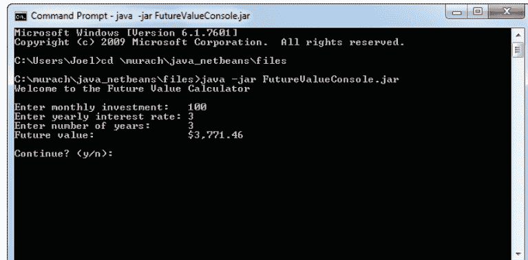

### GUI 应用程序

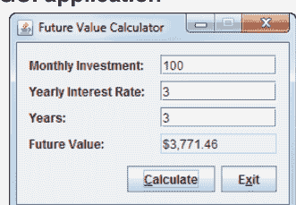

### Description

- 控制台应用程序使用控制台与用户交互。
- GUI 应用程序使用图形用户界面与用户交互。

图 1-3 两种类型的桌面应用程序

## 两种类型的 Web 应用程序

图 1-4 显示了你可以用 Java 开发的两种 Web 应用程序。在 Java 的早期（也是互联网的早期），Java 最令人兴奋的特性之一是你可以用它来创建一种特殊的 Web 应用程序，称为 applet（小程序），如图所示。这种 applet 的工作方式与前一个图中所示 GUI 应用程序类似。然而，与 GUI 应用程序不同，applet 可以存储在 HTML 页面中并在支持 Java 的浏览器内部运行。因此，曾经可以通过互联网或内网分发 applet。

近年来，随着安全限制的收紧，支持 applet 的浏览器越来越少，即使你安装了设计用于允许在浏览器中运行 applet 的插件。但为什么图中的 applet 是在 Applet Viewer 中显示的呢，它是 JDK 的一部分，而不是浏览器。由于这些安全限制，applet 实际上已经过时了。它们仍然作为 Java SE 的一部分包含在内为了向兼容，但它们已不再流行，我们没有在书中介绍它们。

此外，某些在客户端浏览器中运行的 applet 从来不是处理运行在服务器资源（如企业数据库）的理想方式。提供企业数据库访问更好的方法是使用 Java EE 创建运行在服务器上的 Web 应用程序。这些应用程序通常基于 servlet（服务程序）。

Servlet 是一种运行在服务器上的特殊 Java 应用程序，可以被客户端（通常是 Web 浏览器）调用。图中也说明了这一点。在这里，你可以看到 servlet 的工作方式类似于 applet。然而，servlet 运行在服务器上，而不是客户端。

首先，浏览器向运行在服务器上的 servlet 发送请求。该请求包含了用户输入。当 servlet 接收到此请求时，它执行计算并将结果返回给浏览器，通常以 HTML 页面的形式返回。

图中，servlet 并没有访问数据库。然而，servlet 与数据库交互是常见的。假设浏览器请求存储在数据库中的所有未处理输入。当 servlet 执行时，它从数据库读取数据，在 HTML 页面中格式化这些数据，并将 HTML 页面返回给浏览器。

当你创建一个像这里这样基于 servlet 的应用程序时，所有的处理都发生在服务器上，并只向浏览器返回 HTML、CSS 和 JavaScript。这意味着，当你拥有互联网或内网连接、浏览器以及足够的安全权限时，你就可以访问并运行基于 servlet 的应用程序。

为了方便将 servlet 的结果存储在 HTML 页面中，Java EE 规范提供了服务器页面（JSPs）。因此，将 JSPs 与 servlet 一起使用是常见做法。虽然书中没有介绍 servlets 和 JSPs，但它们出现在伴侣书籍《Murach's Java Servlets and JSP》中。有关此书的更多信息，请访问我们的网站 `www.murach.com`。

### Applet

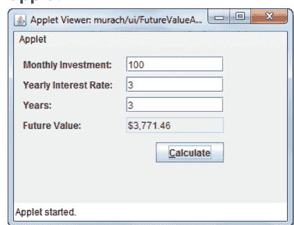

### Servlet

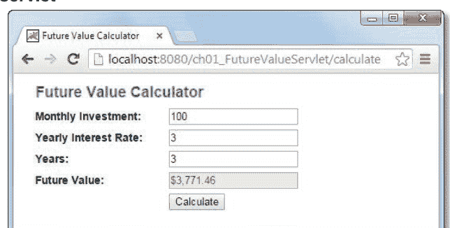

### Description

- Applet 是运行在浏览器内部的 Java 类型。
- Servlet 是运行在服务器上的 Java 类型。
- Servlet 接受客户端的请求并向它们返回响应。
- Servlet 是一种 Java 类型。

图 1-4 两种类型的 Web 应用程序

## 移动应用程序

你也可以使用 Java 开发移动应用程序。

### 移动应用程序


### Description

- 移动应用程序使用手机或平板电脑等移动设备与用户交互。

图 1-5 移动应用程序

# 控制台应用程序的代码

```java
package murach.fv;

import java.text.NumberFormat;
import java.util.Scanner;

public class Main {

    public static void main(String[] args) {
        // 显示欢迎消息
        System.out.println("Welcome to the Future Value Calculator");
        System.out.println();

        Scanner sc = new Scanner(System.in);
        String choice = "y";
        while (choice.equalsIgnoreCase("y")) {

            // 获取用户输入
            System.out.print("Enter monthly investment: ");
            double monthlyInvestment = Double.parseDouble(sc.nextLine());

            System.out.print("Enter yearly interest rate: ");
            double yearlyInterestRate = Double.parseDouble(sc.nextLine());

            System.out.print("Enter number of years: ");
            int years = Integer.parseInt(sc.nextLine());

            // 将年度值转换为月值
            double monthlyInterestRate = yearlyInterestRate / 12 / 100;
            int months = years * 12;

            // 计算未来价值
            double futureValue = 0;
            int i = 0;
            while (i < months) {
                futureValue = futureValue + monthlyInvestment;
                double monthlyInterestAmount = futureValue * monthlyInterestRate;
                futureValue = futureValue + monthlyInterestAmount;
                i++;
            }

            // 格式化并显示结果
            System.out.println("Future value: " +
                NumberFormat.getCurrencyInstance().format(futureValue));
            System.out.println();

            // 查看用户是否想继续
            System.out.print("Continue? (y/n): ");
            choice = sc.nextLine();
            System.out.println();
        }
        sc.close();
        System.out.println("Bye!");
    }
}
```

图 1-6 控制台应用程序的代码

## Java 如何编译和解释代码

一旦写好了源代码，你就可以使用 Java 编译器将源代码编译为称为 Java 字节码（`Java bytecodes`）的格式，如图 1-7 所示。在此时，字节码可以在任何安装了 Java 运行时环境（JRE）的平台上运行。JRE 包含了运行字节码所需的所有软件。其中，这包括一个 Java 虚拟机（JVM）的实现。该 JVM 包含一个 Java 解释器，用于将 Java 翻译成底层操作系统可以理解的原生代码。

大多数现代 JVM 实现在某些方面用即时编译器（just-in-time compiler，简称 `JIT Compiler`）替换了 Java 解释器。`JIT` 编译器在某些方面与解释器相似，但它实际上会将 Java 字节码中最频繁使用的部分编译成原生代码，并将这些代码存储在缓存中。这显著地提高了性能。

由于所有主流操作系统都提供了 JRE，因此你可以在大多数平台上运行 Java。这使得 Java 应用程序具有了平台独立性。相比之下，C++ 需要为每个平台配备特定的编译器。

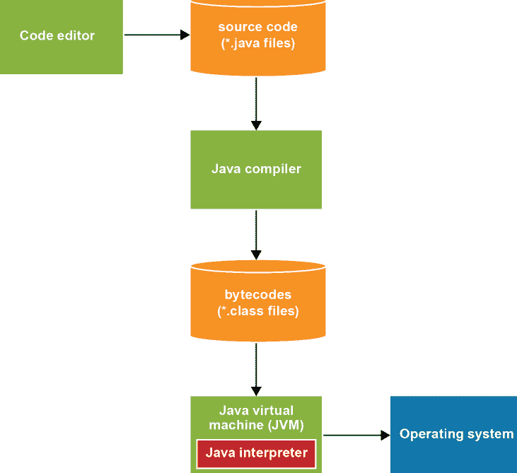

### 描述

- 当你开发 Java 应用程序时，通常会使用代码编辑器来处理应用程序的源代码。包含源代码的文件具有 `.java` 扩展名。
- Java 编译器将源代码翻译成称为 Java 字节码的平台无关格式。包含 Java 字节码的文件具有 `.class` 扩展名。
- Java 虚拟机（JVM）包含一个执行 Java 字节码的 Java 解释器。大多数现代 JVM 实现用即时编译器（JIT）替换了 Java 解释器。`JIT` 编译器在某些方面与解释器相似，但它显著地提高了性能。
- Java 运行时环境（JRE）拥有运行字节码所需的所有组件，包括 JVM。由于大多数操作系统都提供了 JRE，因此你可以在大多数平台上运行字节码。

图 1-7 Java 如何编译和解释代码

## IDE 简介

### 描述

- 当你开发 Java 应用程序时，通常会使用代码编辑器来处理应用程序的源代码。包含源代码的文件具有 `.java` 扩展名。
- Java 编译器将源代码翻译成称为 Java 字节码的平台无关格式。包含 Java 字节码的文件具有 `.class` 扩展名。
- Java 虚拟机（JVM）包含一个执行 Java 字节码的 Java 解释器。大多数现代 JVM 实现用即时编译器（JIT）替换了 Java 解释器。`JIT` 编译器在某些方面与解释器相似，但它显著地提高了性能。
- Java 运行时环境（JRE）拥有运行字节码所需的所有组件，包括 JVM。由于大多数操作系统都提供了 JRE，因此你可以在大多数平台上运行字节码。

图 1-8 IDE 简介

### 流行的 IDE

| IDE | 描述 |
| --- | --- |
| Eclipse | 运行在大多数操作系统上的免费开源 IDE。Eclipse 常用于各种 Java 应用程序。 |
| NetBeans | 运行在大多数操作系统上的免费开源 IDE。NetBeans 常用于各种 Java 应用程序。 |
| IntelliJ IDEA | 运行在大多数操作系统上的 IDE，有社区版社区支持。 |
| Android Studio | 专为 Android 开发设计的，基于 IntelliJ。 |

### 大多数 IDE 提供的功能

- 具有代码补全和错误检测功能的代码编辑器。
- 在运行应用程序时自动编译类。
- 调试器可以让你设置断点、单步执行并查看变量值。

### 描述

- 当你开发 Java 应用程序时，通常会使用类似于上述 IDE 的集成开发环境（IDE）。这些 IDE 都是免费的或提供免费版本。

图 1-9 IDE 简介

## Eclipse 简介

在 Eclipse 中，项目是一个包含应用程序所有文件夹和文件的文件夹。开始使用 Eclipse 最的方法是导入现有项目。例如，你可以从我们的网站下载并导入书中介绍的任何应用程序项目，详情见附录。

### 如何选择工作空间

当你第一次启动 Eclipse 时，它会显示一个如图 1-10 所示的对话框，允许你选择工作空间。工作空间是一个存储配置 Eclipse 信息的文件夹，包括显示哪些项目。在此图中，对话框选择了一个你可以配合本书使用的空间。然而，你可以使用任何想要的工作空间，包括启动 Eclipse 时首次选择默认的空间。

在选择工作空间后，Eclipse 可能会显示欢迎页。如果是这样，你可以点击 Workbench 图标进入图 1-11 所示的工作区。这是你编写代码的地方。

### 选择工作空间的对话框

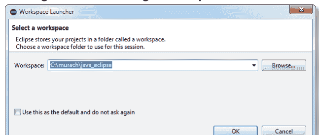

### 描述

- 在 Eclipse 中，一个项目包含 Java 应用程序的文件夹和文件。
- 启动 Eclipse 时，你通常需要选择要使用的工作空间。工作空间存储了关于配置 Eclipse 的信息，包括显示哪些项目。
- 当 Eclipse 运行时，你可以通过选择文件（`File`）➔切换工作空间（`Switch Workspace`）命令来切换到不同的工作空间。这将重启 Eclipse 并选择新的工作空间。
- 一旦你选择了一个工作空间，它就会出现在工作空间（`Workspace`）菜单中。这使得在工作空间之间切换变得简单。
- 选择工作空间后，Eclipse 可能会显示欢迎页面。如果是这样，你可以点击工作台（`Workbench`）图标进入工作台，那里是让你编写代码的地方。

图 1-9 如何选择工作空间

### 如何将项目导入到工作空间

当你第一次选择工作空间时，它不会显示任何项目。要更改这一点，你可以将现有项目导入到工作空间，如图 1-10 所示。本书的所有项目都位于此文件夹中：

`murach/java_eclipse`

在图中，我选择了名为 `ch01_FutureCellValueConsole` 的项目。结果是，导入项目（`Import Projects`）对话框的项目（`Projects`）部分只显示了该项目。

如果你选择的目录中有多个项目，所有项目都会显示在该对话框的项目部分中。然后，你可以通过选择它们来导入你想要的项目。例如，如果你选择了 `book_apps` 文件夹，项目部分将显示该文件夹中的所有项目。然后，你可以选择其中你想要导入的项目。

在导入项目时，可以将项目复制到现有的工作空间中。但是，为了本书的目的，你不需要这样做。

也可以导入其他类型的项目。例如，可以导入存储在存档文件中的项目。但是，为了本书的目的，你只需要导入如图所示的现有项目这一类型即可。

# 导入项目的对话框


# 如何导入项目

1. 选择 **文件（File） → 导入（Import）** 命令，选择 **常规（General）** 系统。
2. 在第一个对话框中，选择 **常规（General） → 现有项目进入工作空间（Existing Projects into Workspace）** 选项并点击 **下一步（Next）** 按钮。
3. 在第二个对话框中，点击 **浏览（Browse）** 按钮并导航到包含你要导入的项目文件夹。这应该会在 **项目（Projects）** 面板中显示并选中该项目。
4. 点击 **完成（Finish）** 按钮导入选定的项目或多个项目。

## 如何导入 `book_apps` 文件夹中的所有项目

- 要导入 `book_apps` 文件夹中的项目，请在第 3 步中导航到 `book_apps`。这将选中 `book_apps` 文件夹中的所有项目。

> **图 1-10** 如何将项目导入到工作空间

## 如何在代码编辑器中打开文件

**图 1-11** 显示了一个包含 Java 应用程序项目的工作空间。在这个示例中，项目名为 `ch01_FutureValueConsole`。

**包管理器（Package Explorer）** 显示项目文件夹包含一个名为 `src` 的子文件夹。该文件夹包含应用程序的源代码。第二个看起来像一叠书的图标被称为 **库（library）**，它包含了你的应用程序使用的代码库。在这种情况下，应用程序仅使用了 Java 8 的默认库，如 `JRE System Library [JavaSE-1.8]` 标签所示。但是，如有必要，你之后可以添加更多库。

在 `src` 文件夹中，源代码组织成 **包（packages）**。在图中，项目包含一个名为 `murach.fv` 的单包。当你开发像这里这样的小型应用程序时，通常一个包是可以接受的。但对于较大的应用程序，你将像本书后面描述的那样使用两个或多个包。

这里显示的应用程序由一个名为 `Main.java` 的源代码文件组成。在图中，该文件在代码编辑器中打开。在下一章，你将学习更多关于使用此代码编辑器的知识。现在，你只需要知道通过在包管理器中双击源代码文件即可在代码编辑器中打开它。

## 包管理器和代码编辑器

```java
import java.util.*;
import java.io.*;

public class main {
    public static void main(String[] args) {
        System.out.println("Welcome to the Java Calculator");
        Scanner sc = new Scanner(System.in);
        while (sc.hasNextDouble()) {
            System.out.print("Enter monthly investment: ");
```

> **图 1-11** 如何在代码编辑器中打开文件（代码示例）

## 如何在包管理器中导航

- 包管理器显示了构成 Eclipse 工作空间的项目、文件夹、文件和库。
- 要展开或折叠包管理器中的节点，请点击文件夹左侧的箭头符号。
- `src`（源）文件夹通常包含一个或多个包，这些包是存储包含应用程序代码的 java 文件的文件夹。
- 如果它不可见，通过选择 **窗口（Window） → 显示视图（Show View） → 包管理器（Package Explorer）** 来找到包管理器。

## 如何在代码编辑器中打开文件

- 你可以使用代码编辑器来编辑 `.java` 文件。
- 要在代码编辑器中打开 `.java` 文件，请使用包管理器展开 `src` 文件夹，展开包含该文件的包，然后双击它。

> **图 1-11** 如何在代码编辑器中打开文件（操作步骤）

## 如何编译并运行项目

**图 1-12** 显示如何编译并运行项目。运行项目的一种简单方法是按 `Ctrl+F11`。

### 如何编译一个项目

Eclipse 会自动编译你的项目。因此，你通常不需要在运行之前编译项目。如果你想删除所有编译文件并强制重新编译，可以在包管理器中选择该项目。

### 如何为控制台应用程序输入

当你在 Eclipse 中运行应用程序时，写入控制台的数据将显示在控制台中。此外，控制台还可以接受输入。

在图中，例如，应用程序首先显示欢迎消息。然后，提示用户输入每月投资。在此提示处，用户输入了 100 并按了回车。之后，应用程序提示用户输入利率和年数。在这两个提示处，用户输入了 3 并按了回车。然后，应用程序执行计算并显示结果。之后，应用程序询问用户是否继续。此时应用程序仍在运行，用户可以输入 `y` 再次计算或输入 `n` 结束应用程序。

当你学习 Java 时，创建使用控制台显示输出和获取输入的应用程序是很常见的。因此，本书的前四部分将通过控制台教你 Java。然后，本书的第五部分将教你如何创建图形界面。

> **图 1-12** 使用控制窗口进行输入输出的项目

## 如何编译并运行项目（快捷操作）

- 要运行当前项目，按 `Ctrl+F11` 或点击工具栏上的运行按钮。
- Eclipse 自动编译你的项目。结果是，你通常不需要运行之前编译项目。
- 要删除项目的所有编译文件并重新编译，在包管理器中选择该项目。然后，选择 **项目（Project） → 清理（Clean）** 命令。

# 如何使用控制窗口

- 当你运行将数据打印到控制台的应用程序时，数据将显示在控制台中。
- 当你运行从控制台请求输入的应用程序时，控制窗口会暂停以接受输入。然后，你可以点击控制窗口，输入内容并按回车。

# 如何处理两个或更多项目

到目前为止，本章展示了一个包含单个项目的工作区。然而，Eclipse 允许你将多个项目导入到工作区中。**图 1-13** 介绍了在包含两个或更多项目的工作区中工作的技巧。当你导入多个项目时，所有导入的项目都会出现在“包管理器（Package Explorer）”中。然后，当你打开某个项目的任何文件时，它们将出现在主窗口的单独标签页中。打开文件后，你可以通过按 `Ctrl+F11` 或点击工具栏上的运行按钮来运行项目。或者，如果你想运行另一个项目，可以在包管理器中选择该项目，然后按 `Ctrl+F11` 或运行按钮。

# 如何从工作区删除项目

要从当前工作区删除一个项目，你可以在项目管理器中右键点击该项目，并从右菜单中选择 **删除（Delete）** 命令。这将显示确认对话框，询问你是否确定从工作区中删除该项目。

默认情况下，项目仅从工作区中删除，但项目的文件夹和子文件夹仍保留在磁盘上。这允许你在以后需要时再次导入它。然而，如果你想从磁盘上删除项目，可以从对话框中选择 **“删除项目内容（Delete project contents）”** 复选框。这将项目从工作区中移除并删除所有的文件夹和文件。

本书指导你右键点击是因为这在 Windows 中很常见。但在 Mac OS 上，默认未启用右键点击。如果你需要，可以通过编辑鼠标系统偏好来启用右键点击。或者，如果你愿意，可以按住 `Control` 键并点击而不是右键点击。

同样，本书介绍的是 Windows 的按键。但在 Mac OS X 上，你可能需要通过按住 `Command` 或功能 (`Fn`) 键来修改这些按键。通常情况下，Mac OS X 的按键在菜单中有清晰标记。因此，如有需要，你可以查找它们。

> **图 1-13** 工作区中有两个项目的 Eclipse

## 描述

- Eclipse 允许同时导入并处理两个或更多项目。

## 如何更改当前项目

- 当你打开项目的文件时，Eclipse 会在主窗口的标签页中打开该文件，并将该文件关联的项目设为当前项目。
- 要更改当前项目，点击包管理器窗口中的项目。

## 如何从工作区删除项目

- 要从工作区删除项目，在包管理器中右键点击项目，选择 **删除** 命令，确保没有勾选 **“删除项目内容”** 复选框，然后点击 **OK** 按钮。
- 要从工作区删除项目并删除其文件夹和文件，在包管理器中右键点击项目，选择 **删除项目**，选择 **“删除项目内容”** 框，并点击 **OK** 按钮。

## Mac OS 注意

- 要启用右键点击，你可以编辑鼠标的系统偏好。
- 要使用书中显示的 Windows 键，你可能需要按住 `Command` 或功能 (`Fn`) 键来修改这些键。

> **图 1-13** 如何处理两个或更多项目

## 展望

在本章中，你学习了关于 Java 的背景信息。此外，你学习了如何使用 Eclipse 导入、编译和运行现有项目。有了这些背景，你已经准备好学习编写 Java 代码并创建新项目了。

## 总结

- 可以使用 Java 开发工具包 (`JDK`) 开发 Java 应用程序。
- Java 标准版 (`SE`) 被称为 `Java SE`。
- 你可以使用 `Java SE` 创建在计算机上运行的桌面应用程序。
- 桌面应用程序可以使用图形用户界面 (`GUI`) 或控制台来显示输出并获取用户输入。使用控制台与用户交互的应用程序被称为控制台应用程序。
- 你可以使用 Java 企业版（称为 `Java EE`）使用 servlets 和 Java Pages (`JSPs`) 创建服务器端应用程序。
- Java 编译器将源代码翻译为称为 Java 字节码的平台无关格式。
- Java 运行环境 (`JRE`) 运行字节码所需的所有软件。
- `JRE` 包含 Java 虚拟机 (`JVM`) 的实现。
- `JVM` 包含一个 Java 解释器，将 Java 字节码翻译成底层操作系统可以理解的原生代码。
- 大多数现代 `JVM` 已用即时编译器 (`JIT compiler`) 取代了 Java 解释器。`JIT` 编译器在某些方面与解释器相似，但它显著提高了性能。
- 集成开发环境 (`IDE`) 通过提供代码补全、错误检测、自动编译和调试器，让 Java 开发变得更容易。
- 在 Eclipse 中，项目是一个包含构成应用程序的所有文件夹和文件的文件夹。
- 在 Eclipse 中，工作区可以存放一个或多个项目。
- 如果应用程序向控制台打印文本，Eclipse 会在控制台窗口中显示文本。Eclipse 还允许你在控制台窗口中输入。

# 第 1 章 Java 编程简介

## 在进行本章练习之前

在进行本书中的任何练习之前，你需要安装 Eclipse 和 JDK。此外，你还需要从我们的网站 (`www.murach.com`) 安装本书的源代码。详情请参见附录 A (PC) 或 B (Mac)。

### 练习 1 打开并运行两个项目

此练习将引导你完成使用 Eclipse 的过程。

#### 打开并运行控制台版本的

1. 启动 Eclipse。导航到磁盘上的源代码文件夹。
2. 将名为 `ch01_FutureConsole` 的项目导入工作区。
3. 展开 `murach` 包。
4. 在编辑器中打开 `Main.java` 文件并查看代码。
5. 按 `Ctrl+F11` 运行应用程序。
6. 在控制台窗口中输入。

#### 打开并运行 GUI 版本的

1. 将名为 `ch01_FutureGUI` 的项目导入工作区。
2. 展开 `murach` 包。
3. 在编辑器中打开 `.java` 文件并查看代码。
4. 点击运行按钮运行应用程序。
5. 在前三个框中输入值，点击 `Calculate` 按钮并查看结果。

#### 设置项目

1. 在项目窗口中选择 `ch01_FutureConsole` 项目。按 `Ctrl+F11` 运行应用程序。
2. 在项目窗口中选择 `ch01_FutureGUI` 项目。点击运行按钮运行应用程序。
3. 退出 Eclipse。

# 第 2 章 基础编码技能

本章首先介绍一些编码技能。特别是，它展示了如何编写类（`class`）、主方法（`main method`）、语句和注释。

## 如何编写类

**图 2-1** 显示了如何编写类的起始代码，这是存储 Java 代码的地方。首先，你通常会编写一个 **包语句（package statement）**。该语句指定了类所在的包，对应于存储该类的子文件夹。在图中，该包指定了 `murach.test` 包。此包对应于应用程序文件夹下的 `murach/test` 子文件夹。虽然不是强制将类存储在包中，但强烈建议这样做。当一个应用程序包含许多类时，包有助于组织类并防止命名冲突。

在编写完包语句后，你通过编写 **类声明（class declaration）** 来声明一个类。通常，类声明以 `public` 关键字开头，这意味着其他类可以访问它。该关键字是一个控制类作用范围的 **访问修饰符**。

在 `public` 关键字之后，你编写 `class` 关键字，后面跟着类名。在这里，通常惯例是将类名中的每个单词的首字母都大写。此外，通常惯例是仅使用字母和数字。例如，图中的类声明指定了一个名为 `CodeTesterApp` 的类。

文件名与类名相同，并以 `.java` 作为扩展名。例如，`CodeTesterApp` 类存储在名为 `CodeTesterApp.java` 的文件中。

在类之后，你编写一个左大括号 `{` 来标识类的开始，以及一个右大括号 `}` 来标识类的结束。通常，你将右大括号放在与类声明相同的缩进级别。这显示了类的结束位置，并有助于防止漏掉括号。

## 如何编写类方法

在类的大括号中，你可以编写一个或多个 **方法（methods）**。在这里，每个方法都包含执行操作的代码。在图中，类只包含一个方法，即 **主方法**。Java 在运行其包含的类时，会自动执行此方法。所有 Java 应用程序至少包含一个启动应用程序的方法。

要编写方法，你首先要在类声明内部编写一个 **主方法声明**。在书中，你将学习更多关于此声明所用关键字的知识。现在，你只需要按照图中所示完全编写它。

成对匹配的大括号内的代码被称为 **代码块（block of code）**。在图中，有两个代码块：(1) 类的块和 (2) 主方法的块。

> **图 2-1** 带有主方法的类

```java
package murach.test;
public class CodeTesterApp {
    public static void main(String[] args) {
    }
}
```

- 包语句
- 类声明
- 主方法声明
- 主方法结束
- 类结束

### 此类的文件夹和文件名

`murach/test/CodeTesterApp.java`

### 类的命名规范

- 名称以大写字母开头。
- 类名中每个单词的首字母大写开头。
- 仅使用字母和数字。

### 描述

- 类存储 Java 代码。每个类都从类声明开始。
- 包是包含一个或多个类的文件夹。它们对于组织多个类非常有用。大多数包以一个标识文件夹的包语句开头。
- 方法是执行任务的代码块。类可以包含一个或多个方法。
- 类可以包含一个主方法。这通常是应用程序的起点。你可以通过运行该类来执行此方法。
- 开大和闭大括号标识类和方法的开始与结束。大括号内的代码可以称为代码块。
- `public` 关键字是一个访问修饰符，允许类或方法被其他代码使用。
- 类文件名与类名相同，并以 `.java` 作为扩展名。

> **图 2-1** 带有主方法的类（结构说明）

## 如何编写语句

语句执行任务并以分号结束。例如，在 **图 2-2** 中，主方法包含三个语句。第一条语句向控制台打印欢迎消息，第二个语句打印空行，第三条语句打印 “Bye.” 的消息。

当你编写语句时，你可以在一行的任何位置开始，也可以从一行继续到另一行。然而，为了让你的代码更易读，你应该使用缩进和间距来对齐语句，正如书中所示。

## 如何编写注释

当你编写代码时，可以使用注释来记录应用程序的功能以及特定代码块和行的作用。由于 Java 编译器会忽略注释，因此你可以在代码的任何地方包含注释，而不会降低代码的性能。

**单行注释** 通常描述一行或多行代码。这种注释以两个斜杠（`//`）开头，告诉编译器忽略当前行结束之前的所有字符。图使用单行注释来标识代码的结构：包语句、类的声明和结束、以及主方法的声明和结束。此外，它还使用单行注释来描述向控制台打印空行的语句。由于这些注释与代码在同一行上编写，它们有时被称为 **行尾注释**。

然而，你也可以单独用一行编写单行注释。例如，在图中，打印空行的注释是单独占一行的。

**块注释（block comment）** 通常用于记录适用于整个代码块的信息。例如，块注释可能包括作者姓名、完成日期、代码目的等。在图中，代码以一个包含作者和目的的块注释开始。

注释的一个问题是，它们可能无法准确地表示代码的功能。这在程序员更改了代码但没有更改相应的注释时经常发生。这样一来，代码会变得更难理解，因为注释具有误导性。所以，如果你更改了代码，请务必也更改注释。

> **图 2-2** 包含语句和注释的类

```java
/*
 * Author: J. Murach
 * 此应用程序在控制台上显示某些文本。
 * Purpose: 它可以作为测试代码的起点。
 */
package murach.test; // 包语句
public class CodeTesterApp { // 开始 CodeTesterApp 类

    public static void main(String[] args[]) { // 开始主方法
        // 显示欢迎消息
        System.out.println("Welcome to the Code Tester");
        System.out.println(); // 打印空行
        System.out.println("Bye!"); // 主方法结束
    } // 结束 CodeTesterApp 类
}
```

## 如何将输出到控制台

大多数应用程序都需要某种类型的用户交互。例如，它们通常需要向用户显示输出并从用户那里获取输入。实现这一点的最简单方法是使用称为控制台的命令行界面与用户进行交互。为了开始，**图 2-3** 显示了如何通过向控制台打印来显示输出。

当你使用控制台时，它的外观可能会根据操作系统的不同而不同。但应用程序的运行方式应该是相同的。此外，大多数 `IDE` 都提供了一种方便的方法，让你在开发和测试控制台应用程序时操作控制台。


要输出到控制台，你可以使用 `System.out` 对象的 `println` 和 `print` 方法。`println` 和 `print` 方法都接受一个参数，该参数指定要打印到控制台的数据。要编写参数，你需要在方法名后编写一组括号。然后，在这些括号内编写参数。在图中，第一个 `println` 方法向控制台打印了一串字符。为了识别这串字符，代码在文本周围加上了双引号。

这段代码没有向第二个 `println` 语句传递参数。结果，它只是在控制台上打印了一个空行。然而，第三个 `println` 方法向控制台打印了一串字符，就像第一个 `println` 方法一样。

`print` 和 `println` 方法的工作原理相似。两者主要区别是 `println` 方法在显示数据后会另起一行，而 `print` 方法不会。

图中的示例显示了一个完整的类，它使用 `println` 方法在控制台上显示数据。到为止，你理解这段代码如何工作应该不会太大困难。

## System.out 对象的两种方法

| 方法 | 说明 |
| :--- | :--- |
| `println(data)` | 将数据参数打印到控制台，后跟一个换行符。 |
| `print(data)` | 将数据参数打印到控制台。 |

## 向控制台打印输出的类

```java
package murach.test;

public class CodeTester {
    public static void main(String[] args) {
        // 显示欢迎消息
        System.out.println("Welcome to the Code Tester");
        System.out.println();

        // 显示告别消息
        System.out.println("Bye!");
    }
}
```

## 控制台上显示的输出


- 虽然控制台的外观可能因系统而异，但你始终可以使用 `System.out` 对象的 `println` 和 `print` 方法将数据打印到控制台。

## 如何使用 Eclipse

### 处理新项目

现在你已经了解如何编写一个向控制台打印数据的类，你准备好学习如何使用 Eclipse 创建一个包含此类类的项目了。然后，你可以使用 Eclipse 输入该类的代码。

### 如何创建新项目

图 2-4 显示了如何为 Java 应用程序创建一个项目。为此，你可以使用图中显示的第一个对话框为项目指定名称。在这种情况下，我将示例命名为 `example_project`。

输入项目名称后，你可以点击 Finish（完成）按钮来创建项目。这会在当前工作空间中创建新项目。你设置的工作空间应该是书中应用程序使用的工作空间：

```
/murach/java_eclipse
```

此外，这还会为项目以及项目的所有源文件创建一个文件夹，包括一个 `src` 文件夹，你可以在其中存储项目的源代码。

### 如何创建新类

创建新项目后，你需要向其添加一个或多个类。要创建一个新类，在 Package Explorer（包管理器）中导航到新项目，并如图 2-4 所示打开 New Java Class（新建 Java 类）对话框。

你可以使用此对话框输入类的名称。该类应该以大字母开头。在情况下，我将类命名为 `Test`。

你还可以使用此对话框输入包名。当你选择包名时，应该选择一个有助于避免与其他类冲突的名称。此外，你应该选择一个有助于你以逻辑方式组织类的名称。在这里，我使用 "murach" 作为名称的第一部分，因为它是我们公司的名称，其他人可能也会使用它。然后，我使用 "test" 作为名称的第二部分，因为我打算使用此包来存储用于测试的类。

为了确保包名的唯一性，一种常见的命名方案是以公司的反向 Internet 域名开始包名。例如，域名为 `domain.murach.com` 的公司可以从 `com.murach` 开始其包名。

如果你想为类生成一个 main 方法，可以选择相应的复选框。在这种情况下，我选择了第一个复选框为该类生成 main 方法。

当你点击 Finish 按钮时，Eclipse 会创建该类的文件并为类生成一些初始代码。如有必要，它还会创建包的文件夹。

## 创建新项目和类的对话框

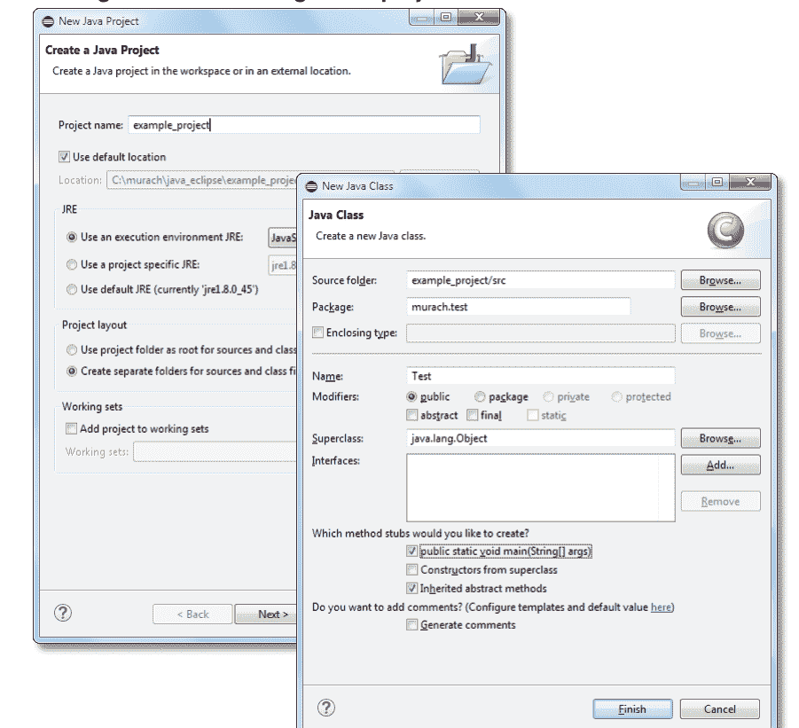

### 如何创建新项目

- 要创建一个新项目，选择 `New->Project` 命令。然后，为项目输入名称并点击 Finish 按钮。

### 如何创建新类

- 要创建一个新类，在 Package Explorer 中右键点击项目并选择 `New->Java Class` 命令。然后，输入类的名称并点击 Finish 按钮。

## 如何处理 Java 源代码

当你创建一个类时，Eclipse 通常会在代码编辑器窗口中打开该类，如图 2-5 所示。为了方便你识别 Java 语法，代码编辑器对语言元素使用了不同的颜色。此外，Eclipse 提供了标准的 File（文件）和 Edit（编辑）菜单以及快捷键，让你能够保存和编辑源代码。例如，你可以按 `Ctrl+S` 保存你的源代码。

当 Eclipse 创建一个新类时，它会自动为你生成代码。在图中，例如 Eclipse 生成了包、声明了类以及 main 方法。

如果你想要处理的源代码没有显示在代码编辑器窗口中，可以使用 Package Explorer 导航到 `.java` 文件。然后，你可以双击它在代码编辑器窗口中打开它。

你还可以使用 Package Explorer 重命名或删除 java 文件。要此操作，只需右键点击它并选择相应的命令。如果你重命名了文件，Eclipse 会自动更改 java 文件的文件名和类名。由于 `.java` 文件的文件名必须与类名匹配，这通常正是你想要的。

## 代码编辑器显示项目的源代码

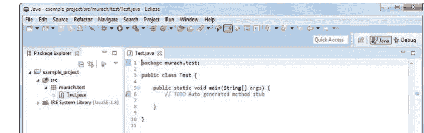

图 2-5 如何处理 Java 源代码

## 如何使用代码补全功能

图 2-6 显示了如何使用代码补全功能。此功能可以防止你出现输入错误，并允许你发现各种类和对象可用的字段和方法。例如，在图中我开始输入一个打印到控制台的语句。

首先，我输入了“sys”并按下 `Ctrl+Space`（同时按下）。这显示了一个列表，其中 `System` 类是唯一的选项。然后，我按下 Enter 键自动输入类名的剩余部分。

接下来，我按了点（.）。这显示了 `System` 类中可用的字段和方法列表。然后，我使用方向键选择字段名并按下 Enter 键自动输入该名称。

最后，我又输入了一个点。这显示了长长的方法名列表。然后，我输入“pr”来滚动列表，找到以“pr”开头的方法，并使用方向键选择如图所示的 `println` 方法之一。此时，我可以按 Enter 键让 Eclipse 为我将该方法输入到编辑器中。

当你使用代码补全时，它会在需要的地方自动输入参数占位符。例如，图中如果我按下 Enter 键，Eclipse 会为参数插入一个占位符并突出显示该参数。然后，我可以将其替换为我想使用的参数。

代码补全功能还可以让你轻松地识别字符串文本的值。如果你输入一个引号来标识字符串，代码补全功能会自动输入起始引号和结束引号，并将光标置于两者之间。此时，你就可以输入文本。

如果你尝试代码补全功能，你很快就会发现它何时能帮助你更快地输入代码，以及何时自己输入代码更合理。此外，你还会发现自己理解了正在处理的各种类和对象所提供的字段和方法。随着你在接下来的章节中学习更多 Java 知识，这将更有意义，但这对大多数程序员非常有帮助，特别是对 Java 的初学者来说。

## 带有代码补全列表的代码编辑器

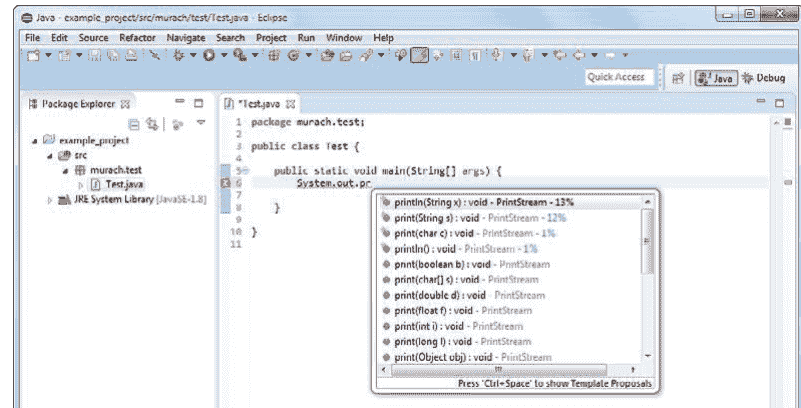

### 描述

- 你可以使用代码补全功能帮助输入类和对象的名称，并从类或对象可用的方法和字段中选择。

- 第一次使用代码补全时，Eclipse 会在弹出窗口中提示你启用它。

- 要激活用于输入类或对象名称的代码补全功能，在输入类或对象名称的一个或多个字母后按下 `Ctrl+Space`。然后将显示所有以这些字母开头的类和对象的列表。或者，你也可以简单地等待一会儿，代码补全窗口会自动打开。

- 要激活针对类或对象的方法或字段的代码补全功能，在类或对象名称后输入一个点（.）。然后将显示该类或对象的所有方法和字段列表。

- 要从代码补全列表中插入项，使用方向键选择该项并按下 Enter 键。如果项需要括号，系统会自动添加。如果项需要一个或多个参数，将为这些参数添加默认值，并突出显示第一个参数以便你输入其值。然后，你可以按 `Tab` 键并输入剩余参数的值。

- 如果你输入字符串文本的起始引号，代码补全功能会自动添加结束引号，并将光标置于两个引号之间，以便你输入文本。

图 2-6 如何使用代码补全功能

## 如何检测和纠正语法错误

在 Eclipse 中，无法编译的语句会导致语法错误。当你向代码编辑器输入文本时，Eclipse 每当检测到语法错误就会显示。例如，在图 2-7 中，Eclipse 显示了一个错误，指示需要输入分号来完成语句。该错误在语句左侧用一个红色图标标记，包含错误的语句则用红色波浪下线标记。

如果你将鼠标光标悬停在红色错误图标上或错误本身的波浪线上，Eclipse 会显示错误的描述。例如，在图中，该描述指示 Eclipse 期望在语句末尾有一个分号。因此，你可以通过输入分号来修复错误。

## 显示错误的代码编辑器

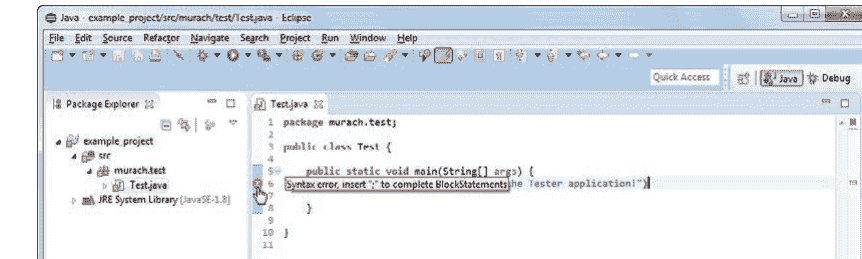

### 描述

- 当你向代码编辑器输入代码时，Eclipse 经常会检测到语法错误。

- 当 Eclipse 检测到语法错误时，它会在错误语句左侧显示红色错误图标，并在语句下方放置红色波浪线。

- 要获取有关语法错误的更多信息，你可以将鼠标指针悬停在错误图标或语句下方的波浪线上。

图 2-7 如何检测和纠正语法错误

## 如何处理数字

大多数应用程序都需要处理数字。这就是为什么接下来的图将向你展示如何处理数字。首先，这些图展示了如何将数字存储在变量中。

### 如何声明和初始化变量

变量存储一个随代码执行而改变的值。在使用变量之前，你必须声明它的数据类型和名称。当你这样做时，通常会通过给它赋值来初始化你的变量。图 2-8 显示了如何这样做。

但首先，此图总结了 Java 中提供的八种基本类型。首先，你可以使用 `int` 类型存储整数，即不包含小数的整数字。此外，你可以使用 `double` 类型存储可以包含小数的数字。目前，关于基本类型，你只需要知道这些。

在第 7 章中，你将学习其他基本类型。此外，你将学习更多关于 `int` 和 `double` 的范围和精度，包括在使用 `double` 类型进行财务计算时经常发生的舍入误差。

第一个示例显示了如何通过两条语句声明并初始化变量。在这里，第一条语句声明了一个类型为 `double` 的变量 `productPrice`。然后第二条语句使用等号（=）为其赋值 14.95。这条语句被称为赋值语句。

第二个示例显示了如何通过一条语句声明并初始化变量。在这里，该语句声明了一个 `double` 类型变量 `productPrice`，并使用等号（=）为其赋值 14.95。这完成任务与第一个示例一样快。

在命名变量时，常见的 Java 编码规范是以小写字母开始名称，并在后续单词的首字母大写，例如 `productPrice` 或 `maxQuantity`。这通常被称为驼峰命名法（camel notation）。

当你创建一个变量时，你应该尝试让该名称具有意义且易于记忆。为了让名称具有意义，你应该使用尽可能多的字符，以便其他程序员易于阅读和理解你的代码。例如，`netPrice` 比 `nPrice` 更有意义，而 `nPrice` 比 `nprice` 更有意义。

为了让名称易于记忆，你应该避免使用缩写。例如，如果你使用 `nCust` 作为名称，以后你可能很难记住它是 `nCust`、`nwCust` 还是 `nwCust`。但如果你将代码命名为 `newCustomer`，你就不必担心忘记它是什么了。是的，当你创建有意义且易于记忆的名称时，你输入的字符更多，但这通常在测试、调试和维护应用程序的时间上是合理的。

## 两种基本数据类型

| 类型 | 说明 |
|---|---|
| `int` | 整数（全数字），范围从 -2,147,483,648 到 2,147,483,647。 |
| `double` | 双精度浮点数（小数）。 |

## 如何用两条语句声明并初始化变量

语法

```
type variableName;
variableName = value;
```

示例

```
double productPrice; // 声明语句
productPrice = 14.95; // 赋值语句
```

## 如何用一条语句声明并初始化变量

语法

```
variableName = value;
```

示例

```
double productPrice = 14.95; // 初始化一个 double 变量
```

## 变量命名建议

- 变量名以小写字母开头，每个单词的首字母大写（驼峰命名）。
- 每个变量名应该是名词，或者由一个或多个形容词修饰的名词。
- 尝试使用有意义且易于记忆的名称。

## Java 关键字

| `boolean` | `if` | `interface` | `class` | `true` |
| `char` | `else` | `package` | `volatile` | `false` |
| `byte` | `final` | `switch` | `while` | `throws` |
| `float` | `private` | `case` | `return` | `native` |
| `void` | `protected` | `break` | `throw` | `implements` |
| `short` | `default` | `try` | `import` | |
| `double` | `static` | `for` | `catch` | `synchronized` |
| `int` | `new` | `continue` | `finally` | `const` |
| `long` | `this` | `transient` | `goto` | |
| `abstract` | `super` | `extends` | `instanceof` | `null` |

### 说明

- Java 提供了八种基本数据类型，用于在内存中存储值。最常用的两种是 `int` 和 `double` 数据类型。

- 变量存储了一个可以随应用程序执行而改变的值。

- 要创建一个变量，可以从声明其数据类型和名称开始。然后，你可以给变量赋一个值来初始化它。通常将整数变量初始化为 0，将 `double` 变量初始化为 0.0。

- 关键字是 Java 语言保留的单词，如 `int` 和 `double`。因此，你不能使用关键字作为变量名。

图 2-8 如何声明和初始化变量

## 第 1 节 正确开始

对于一些常见的变量名，程序员通常会使用一或两个小写字母。例如，他们经常使用 `i` 作为作为计数器的 `int` 变量名。这在短代码块中是可以接受的，因为很容易理解该变量的作用。

在命名变量时，你不能使用 Java 关键字作为变量名。Java 语言保留了 50 个关键字，如图 2-8 所示。为了帮助你识别代码中的关键字，大多数 Java IDE 将这些关键字显示为与代码其他部分不同的颜色。随着课程的进行，你将学习如何使用大多数这些关键字。

## 如何给变量赋值

图 2-9 显示了如何给已经声明的变量赋值。首先，第一个示例声明并初始化了两个变量。这些变量被图中的其他示例使用。第一个变量命名为 `quantity`，并初始化为 `int` 值 0。第二个变量命名为 `maxQuantity`，并初始化为 `int` 值 100。

第二个示例通过给 `quantity` 变量赋值值 10 来改变 `quantity` 值。然后，它通过赋值存储在 `maxQuantity` 变量中的值再次更改 `quantity`。这表明变量的值是可以改变的。它表明你可以将字面量（如 100 或 10）赋给变量。它表明你可以将另一个变量（如 `maxQuantity`）赋给一个变量。

第三个示例显示了如果在尝试声明变量后再次声明它会发生的常见编码错误。在这种情况下，你将得到语法错误。这是因为该语句不必要的声明了变量的类型。要修复此，可以从语句中删除类型声明。例如，图中你可以从语句开头删除 `int` 关键字。

第四个示例显示了如果使用错误的大小写引用变量会发生的另一种常见编码错误。此错误发生是因为 Java 是区分大小大小的。因此，在创建和使用变量名时需要小心。例如，图中第一个示例将变量命名为 `maxQuantity`。因此，第四个示例无法用 `maxquantity` 来引用它。

## 赋值语句的语法

```
variableName = value;
```

## 声明并初始化两个变量的代码

```
int quantity = 0; // quantity 为 0
int maxQuantity = 100;
```

## 为 quantity 变量赋新值的代码

```
quantity = 10; // quantity 现在为 10
quantity = maxQuantity; // quantity 现在为 100
```

## 尝试再次声明变量的代码

```
int quantity = 99; // 错误：变量已声明
```

## 使用错误大小写引用变量的代码

```
maxquantity = 200; // 错误：由于大小写错误找不到变量
```

### 说明

- 赋值语句为已声明的变量赋值。该值可以是字面量、另一个变量，或者如后文所示的算术表达式。

- 如果你尝试再次声明变量，会导致错误。

- Java 是一种区分大小写的语言。因此，在引用变量时要确保使用正确的大小写。

## 如何编写算术表达式


# 第 2 章 如何开始编写 Java 代码

## 在算术表达式中可以使用的基础运算符

| 运算符 | 名称 | 描述 |
| --- | --- | --- |
| `+` | 加法 | 将两个操作数相加。 |
| `-` | 减法 | 从左操作数减去右操作数。 |
| `*` | 乘法 | 右操作数与左操作数相乘。 |
| `/` | 除法 | 左操作数除以右操作数。如果两个操作数都是整数，则结果为整数。 |

编写简单的算术表达式，可以使用上表所示的四种运算符来操作操作数或变量，除整数除以整数外，结果会被截断。

### 计算总额的代码

```java
double productPrice = 9.99;
int quantity = 2;
double total = productPrice * quantity; // 19.98
```

第一个示例显示了如何计算项目的总金额。前两个语句声明并初始化了一个 `double` 类型的 `productPrice` 和一个 `int` 类型的 `quantity`。然后，第三条语句声明了一个 `double` 类型的 `total` 并将算术表达式的结果赋给它。该算术表达式使用乘法运算符 `*` 将价格乘以数量。由于此表达式混合了 `int` 和 `double` 变量，Java 在执行计算之前会将 `int` 转换为 `double` 变量。然后返回双值的结果。

### 计算销售税的代码

```java
double subtotal = 25.00;
double taxPercent = .075; // 7.5%
double taxAmount = subtotal * taxPercent; // 1.875
double grandTotal = subtotal + taxAmount; // 26.875
```

第二个示例显示了如何计算销售税。在这里，第三条语句使用乘法运算符 `*` 计算销售金额。然后，第四条语句使用加法运算符 `+` 将销售金额加到小计中。

### 计算平均值的代码

```java
double sum = 206.75;
int count = 3;
double average = sum / count; // 68.91666666666667
```

第三个示例显示了如何计算平均值。在这里，第三条语句包含一个表达式，使用除法运算符 `/` 将 `double` 类型的 `sum` 除以 `int` 类型的 `count`。因此，Java 在执行计算之前会将 `int` 转换为 `double` 变量，并返回双值的结果。

### 除两个 int 值的代码

```java
int dividend = 9;
int divisor = 2;
int result = dividend / divisor; // 4
```

第四个示例显示了如果用一个整数除以另一个会发生什么。在这种情况下，由于所有变量都是 `int` 类型，计算结果为 4。这是合理的，因为 2 除 9 为 4 次余 1。然而，如果将此示例的数据从 `int` 类型改为 `double` 类型，结果将是 4.5。

### 在一个表达式中使用多个运算符的代码

```java
double width = 4.25;
double length = 8.5;
double perimeter = 2 * width + 2 * length; // 25.5
```

第五个示例显示了如何编写使用多个运算符的表达式。在这里，第三条语句将长度乘以 2，将宽度乘以 2。

当你在算术表达式中使用多个运算符时，你需要使用括号来控制操作的顺序。在第五个示例中，Java 恰好按照你想要的顺序执行操作（先乘法后加法）。如有必要，你可以使用括号来明确控制操作的顺序。然后，Java 执行最内层括号中的操作。例如，如果你想明确此示例中的操作顺序，可以这样编写第三条语句：

```java
double perimeter = (2 * width) + (2 * length);
```

这清楚地显示了 Java 应该先执行乘法操作，再执行加法操作。

### 描述

- 算术表达式由一个或多个操作数和算术运算符组成。
- 当表达式使用 `int` 和 `double` 变量时，Java 会自动将 `int` 转换为 `double` 类型。为了保留小数位，接收结果的变量必须是 `double`。
- 如果你在一个表达式中使用多个运算符，可以使用括号来指定操作顺序。然后，Java 会先执行最内层的操作，然后是下一组括号的操作，依此类推。

---

## 如何处理字符串

大多数应用程序都需要处理文本。字符串是字符序列，例如字母、数字和标点符号。

## 如何声明和初始化 String 变量

要声明 `String` 变量，你可以使用如下语法。尽管这与声明 `int` 或 `double` 变量的语法相似，但字符串是由 `String` 类创建的对象。当你声明一个 `String` 变量时，必须将 `String` 关键字首字母大写，因为它是一个类名，而不是基本数据类型。

当你创建一个对象时，可以将类视为对象的模板。这就是为什么对象可以被称为该类的实例，而创建它的过程可以称为实例化。每当需要时，你都可以从类创建多个对象或实例。例如，你通常会在单个应用程序中使用多个 `String`。

当你声明一个 `String` 对象时，可以通过在双引号内包含字面值的字符来给它赋值字符串字面量。你也可以通过编写一组中间没有任何内容的引号来给字符串赋值一个空字符串。最后，你可以使用 `null` 关键字为 `String` 对象赋值 `null`。这表示该 `String` 变量没有指向任何 `String` 对象。

### 语法

```java
String variableName = value;
```

### 示例

```java
String message1 = "Invalid data entry.";
String message2 = "";       // 空字符串
String message3 = null;     // 空引用
```

### 如何合并字符串

如果你想合并两个或多个字符串，可以使用 `+` 运算符。例如，下面的示例合并了名字、一个空格和姓氏。这也称为字符串拼接。然后，你可以将字符串赋值给 `String` 变量。在合并字符串时，将字符串字面量（空格）与 `String` 变量（`firstName` 和 `lastName`）混合是很常见的。

```java
String firstName = "Bob";
String lastName = "Smith";
String name = firstName + " " + lastName; // name 是 "Bob Smith"
```

你还可以将字符串与基本数据类型合并。在这里，第二个语句将 `double` 类型的变量追加到 `String` 字面量上。当你使用这种技术时，Java 会自动将 `double` 转换为 `String` 类型。

```java
double price = 14.95;
String message = "Price: " + price; // message 是 "Price: 14.95"
```

当你编写字符串时，它们的运行方式通常符合你的预期。然而，你**不能**像下面这样将字符串字面量直接拆分为多行：

```java
// 错误示例
String name = "Bob"
      "Smith";
```

相反，你必须在第一行的结束关闭字符串字面量，并在第二行连接第二个字符串字面量，如下：

```java
// 正确示例
String name = "Bob"
      + "Smith";
```

### 描述

- 字符串可以包含一个或多个字符，包括字母、数字和特殊字符如 `*`、`&` 和 `#`。
- 在 Java 中，字符串实际上是一个从 `String` 类创建的对象，该类是 Java API（应用程序编程接口）的一部分。
- 由于字符串是由 `String` 类创建的对象，你必须大写 `String`。相比之下，你不需要大写 `int` 和 `double` 类型。
- 为了指定字符串的值，你可以用双引号将其括起来。
- 为了给字符串赋值 `null`，你可以使用 `null` 关键字。这表示 `String` 变量没有指向 `String` 对象。
- 为了给字符串赋值空字符串，你可以编写一组中间没有任何内容的引号。这被称为字符串字面量。
- 为了将字符串与其他字符串或数据类型合并（拼接），可以使用加号 (`+`)。在可能的情况下，Java 会自动将数据类型转换为字符串。

---

## 如何在字符串中包含特殊字符

图 2-12 显示了如何在字符串中包含特殊字符。特别是此图展示了如何在字符串中包含反斜杠、引号以及换行、制表符和返回等控制字符。为了这一点，你可以使用转义序列，即以反斜杠开始的字符序列。

### 常见转义序列

| 序列 | 字符 |
| --- | --- |
| `\n` | 新行 |
| `\t` | 制表符 |
| `\r` | 回车 |
| `\"` | 引号 |
| `\\` | 反斜杠 |

某些转义序列允许你插入特殊字符，例如如果你编写反斜杠加上字母 `n` (`\n`)，编译器会在字符串中包含一个换行字符。如果你省略了反斜杠，编译器自然只会在字符串中包含字母 `n`。

制表符和返回符的转义序列原理类似。

其他转义序列允许你包含 Java 语法部分的字符。例如，Java 语法的一部分是在双引号内编写字符串字面量。因此，如果你尝试在字符串字面量内直接编写双引号，会导致语法错误。要修复此错误，你可以使用转义序列 `\"`。

反斜杠的转义序列原理类似。当你编写反斜杠时，编译器认为你正在编写一个转义序列。因此，如果你在反斜杠后跟随一个无法完成有效转义序列的字符，会导致语法错误。要修复此错误，你需要使用转义序列 `\\`。

### 示例

**换行符 (`\n`)**

```java
String s = "Code: JSP\nPrice: $49.50";
```
控制台显示：
```
Code: JSP
Price: $49.50
```

**换行、回车和制表符 (`\t`, `\r`, `\n`)**

```java
String s = "Code:\tJSP\r\nPrice:\t$49.50";
```
控制台显示：
```
Code: JSP
Price: $49.50
```

**因引号导致的语法错误**

```java
// "Type "x" to exit"  // 语法错误
```

**引号 (`\"`)**

```java
String s = "Type \"x\" to exit";
```
控制台显示：
```
Type "x" to exit
```

**因反斜杠导致的语法错误**

```java
// "C:\java\files"  // 非法转义字符
```

**反斜杠 (`\\`)**

```java
String s = "C:\\java\\files";
```
控制台显示：
```
C:\java\files
```

### 描述

- 在字符串内部，你可以使用转义序列来包含某些类型的特殊字符，如新行和制表符。你也可以使用转义序列来包含 Java 语法部分的字符，例如引号和反斜杠。

---

## Code Tester 应用程序

本章最后介绍了 Code Tester 应用程序。你可以修改此应用程序获得声明变量、进行计算以及在控制台上显示计算结果的实践机会。

### 用户界面

启动时，它显示一条欢迎消息。然后，显示四个变量的值。最后，显示一条告别消息。

### CodeTesterApp 类

所有代码都存储在 `CodeTesterApp` 类中。

在 `main` 方法中，使用 `println` 方法输出 "Welcome to the Code Tester"。接着，第二条语句在控制台上打印一个空行。

在前两个语句之后，该代码声明并初始化了三个变量：一个 `String` 变量、一个 `double` 变量和一个 `int` 变量。然后，它执行了一项包含这四个变量数据的计算。为了实现这一点，该字符串使用了字面量对数据进行标记和对齐。此外，该字符串使用了换行转义序列 (`\n`) 在每个变量后开始新行。

在代码构建好字符串后，它将其打印到控制台上。然后，它在控制台上打印一条 "Bye." 的消息。

```java
package murach.test;

public class CodeTesterApp {
    public static void main(String[] args[]) {
        // 显示欢迎消息
        System.out.println("Welcome to the Code Tester");
        System.out.println("");

        // 硬编码三个值
        String productCode = "java";
        double price = 49.50;
        int quantity = 2;

        // 执行计算
        double total = price * quantity;

        // 显示输出
        String message =
            "Code: " + productCode + "\n" +
            "Price: " + price + "\n" +
            "Quantity: " + quantity + "\n" +
            "Total: " + total + "\n";
        System.out.println(message);

        // 显示告别消息
        System.out.println("Bye!");
    }
}
```

### 展望

本章的目标是入门 Java 编程。现在，如果你理解 Code Tester 应用程序的工作原理，就可以获得编写自己的变量和算术表达式的实践经验。然而，此应用程序没有从用户获取输入，也没有格式化输出。要做到这一点，可以使用 Java API 提供的一些类。

此外，请记住本章是 Java 编程的介绍。在第 7 章中，你将学习更多关于处理原始数据类型的知识，包括如何处理六种原始数据类型。在第 9 章中，你将学习更多关于字符串的操作。

### 总结

- 类存储 Java 代码。包（`package`）是可以存储一个或多个 Java 类的文件夹。包用于组织类。
- 类可以包含一个或多个方法。方法是执行任务的代码块。
- `main` 方法是一种特殊类型的方法，当你运行包含它的类时会执行。
- 语句（`statement`）执行任务并以分号结束。
- 注释（`comments`）记录代码的功能。
- 你可以使用 Eclipse 代码编辑器来输入和编辑代码。在你输入代码时，可以使用代码补全功能帮助你输入类和对象的名称，并从字段和方法中选择。
- Java 提供了八种原始数据类型。最常见的是 `int` 和 `double` 类型。
- 变量存储应用程序运行而变化的数据。赋值语句可以给变量赋值。
- 字符串可以由一个或多个字符组成，包括字母、数字和特殊字符。你可以使用加号连接字符串。
- 你可以使用转义序列在字符串中包含特殊字符。

---

# 练习 2-1 实验 Code 应用程序

在练习中，你可以对 Code Tester 应用程序进行实验。

## 应用程序

1. 启动 IDE 并创建名为 `02_CodeTester` 的项目。
2. 展开包，打开 `CodeTesterApp.java` 并查看代码。
3. 运行应用程序。

## 初始化并打印更多变量

4. 在 `main` 方法中，为名和姓初始化字符串变量。然后，按此格式打印：
   ```
   Name: Lastname, Firstname
   ```
5. 运行应用程序确保其正常工作。
6. 添加赋值语句更改名字的值。

## 使用算术表达式

7. 声明并初始化一个存储和的 `double` 变量和一个存储计数的 `int` 变量。
8. 用和除以计数计算平均值。然后将结果赋值给平均值变量并打印到控制台。完成后，控制台应该显示：
   ```
   Sum: 301.75
   Count: 6
   Average: 50.29166666666666
   ```
9. 运行应用程序确保其正常工作。
10. 添加赋值语句更改和的值。
11. 再次运行应用程序确保数据打印到控制台。

## 计算税额和总额

12. 按述步骤修改初始代码，使其包含产品描述、税和总额。完成后，将这些数据打印到控制台：
    ```
    Code: android
    Description: Murach's Android Programming
    Price: 57.5
    Quantity: 0
    Total: 115.0
    Tax Percent: 7.5
    Tax Amount: 8.625
    Grand Total: 123.625
    ```
13. 为产品描述声明并初始化 `String` 变量。
14. 为税率声明并初始化 `double` 变量。现在，你可以为其赋值 `.075`，即 7.5%。
15. 为税额声明并初始化 `double` 变量。然后，通过总额乘以税率计算金额并将结果赋值给该变量。


- 17. 为总额声明并初始化 `double` 变量。然后，通过总额和税额相加计算金额并将结果赋值给该变量。

- 18. 修改显示数据的字符串，使应用程序如上所示将其打印到控制台。为了让税率正确显示，你可以将其乘以 100。

- 19. 运行应用程序确保其正常工作。

# 继续测试和实验！

- 20. 添加代码来测试本章描述的任何 Java 特性。

- 21. 实验本章描述的任何 Eclipse 功能。

# 3

### 如何使用类和方法

本章将向你展示如何编写一个完整的 Java 程序，程序获取用户输入、进行计算、格式化输出并显示给用户。这教了你如何使用 Java API 中提供的一些类和方法。完成本章后，你将能够编写 自己的应用程序。

- 如何使用类、对象和方法................................................................64

- 如何导入类.....................................................................................64

- 如何从类创建对象..................................................................................66

- 如何从对象调用方法................................................................................66

- 如何从类调用方法......................................................................66

- 如何查看 Java API 文档...............................................................68

- **如何操作控制台................................................................70**

- 如何使用 Scanner 类获取输入...........................................................70

- 如何将字符串转换为数字......................................................................72

- 一个从控制台读取输入的类...........................................................74

- 如何将数字转换为格式化字符串.......................................................76

- 一个向控制台打印格式化数字的类...........................................................78

- **如何编写简单的控制语句................................................80**

- 如何比较数字..................................................................................80

- 如何比较字符串....................................................................................80

- 如何编写一个 while 循环................................................................................82

- 如何编写一个 if/else 语句.......................................................................84

- **行项目（Line Item）应用程序.....................................................................86**

- 用户界面...........................................................................................................86

- 代码..................................................................................................................88

- **终值（Future Value）应用程序...............................................................90**

- 用户界面...................................................................................................90

- 代码..................................................................................................................92

- **视角..................................................................................................94**

# 如何使用类、对象和方法

在上一章中，你学习了如何从 Java API 中的 `String` 类创建 `String` 对象。然而，在开发 Java 程序时，你需要使用几十个不同的 Java 类。为了做到这一点，你需要知道如何从 Java 类创建对象、如何调用 Java 方法以及如何导入 Java 类。

# 如何导入类

Java SE API 将相关的类存储在包（packages）中。图 3-1 总结了常用的包。`java.lang` 包包含了对 Java 语言至关重要的类（例如 `String` 类）。因此，该包对所有 Java 代码都是自动可用的。

然而，如果你想使用 `java.lang` 以外其他包中的类，可以在当前类的开头包含一个该类的 `import` 语句。如果你不这样做，你仍然可以使用该类，但每次引用它时，都必须带上包名进行限定限定。由于这可能导致大量不必要的输入，大多数程序员都会为他们使用的类编写 `import` 语句。

当你导入一个名称时，可以通过指定类名来导入单个类，也可以通过在类名处输入星号（*）来导入包中的所有类。例如，在图中，第一个 `import` 语句导入了 `java.util` 包中的 `Scanner` 类。另一方面，第二个 `import` 语句导入了 `java.util` 包中的所有类。然而，这只会导入 `java.util` 包中的所有类，而不会导入任何以 `java.util.regex` 开头的包中的类。

虽然一次性导入包中的所有类代码较少，但一个一个导入也有好处。它可以清楚地标识你的代码中使用的类，这对审查你代码的程序员很有帮助。其次，它有助于避免对类的歧义引用。例如，`Date` 类存在于 `java.util` 和 `java.sql` 包中。因此，如果你导入了这两个包的所有类并尝试使用 `Date` 类，编译器将不知道你想使用哪个 `Date` 类。

# 常用包

| 包名 | 描述 |
| :--- | :--- |
| java.lang | 对 Java 语言至关重要的类，包括处理原始数据类型和字符串的类。 |
| java.util | 工具类，包括从控制台获取输入的类。 |
| java.text | 处理文本的类，包括格式化数字和日期的类。 |

# 常用类

- `java.lang.String`
- `java.lang.Integer`
- `java.lang.Double`
- `java.util.Scanner`
- `java.text.NumberFormat`

# import 语句的语法

对于单个类

`import packagename.ClassName;`

对于包中的所有类

`import packagename.*;`

# 如何导入 Scanner 类

仅针对 Scanner 类

`import java.util.Scanner;`

针对 java.util 包中的所有类

`import java.util.*;`

# 使用 Scanner类的代码

```java
// 如果已经导入
Scanner sc = new Scanner(System.in);
```

```java
// 如果还没有导入
java.util.Scanner sc = new java.util.Scanner(System.in);
```

### 描述

- Java SE API 提供了一个大型类库，这些类按包组织。

- 存储在 `java.lang` 包中的所有类对所有 Java 代码都是自动可用。

- 要使用不在 `java.lang` 包中的类，你可以导入 `import` 语句。要导入一个类，指定包名后跟类名。要导入包中的所有类，指定包名后跟星号（*）。

图 3-1 如何导入类

### 如何从类创建对象

要使用 Java 类，通常从类创建对象开始。图 3-2 中的语法显示，你编写 `new` 关键字、类名，后跟一组括号。这些括号调用构造函数。在大多数情况下，你把构造函数创建的对象赋值给变量。

在第一个示例中，将 `Scanner` 对象赋值给变量 `sc`。在这里，构造函数需要一个参数 `System.in`。该对象代表控制输入并由 Java 创建。因此，你可以使用该对象获取控制输入。

当你创建对象时，你可以将类类为对象的模板。这就是为什么对象可以被称为类的实例，而创建对象的过程被称为实例化。在需要时，你可以从一个类创建多个对象。例如，即使只有一个 `String` 类，你经常在单个代码块中使用 `String` 对象。

# 如何从对象调用方法

一旦你从类创建了对象，你就可以调用对象的方法。方法是执行操作的代码块。此外，方法通常会返回一个值或对象，你可以将其赋值给变量。从对象调用方法，你编写对象名、点（.）以及方法名，后跟一组括号。在括号内，你编写所需的参数。

在第二个示例中，该语句调用 `Scanner` 对象的 `nextLine` 方法从控制台获取当前行文本。因此，它不需要参数。它后面跟着一对空括号。该方法返回一个 `String`，此示例将其赋值给名为 `line` 的 `String` 变量。

# 如何从类调用方法

除了你可以从对象调用的普通方法外，某些类还提供了静态方法。静态方法与普通方法类似，但你可以直接从类调用它们，而无需从类创建对象。

在第三个示例中，该语句调用了 `Double` 类的 `parseDouble` 方法。该方法需要一个参数。因此，此示例在方法后的括号内指定了参数。

# 第3章 如何使用类和方法

### 如何从类创建对象

语法

`new ClassName(arguments);`

示例

`Scanner sc = new Scanner(System.in); // 创建一个名为 sc 的 Scanner 对象`

## 如何从对象调用方法

语法

`objectName.methodName(arguments)`

示例

`String line = sc.nextLine(); // 从控制台获取 String 对象`

## 如何从类调用静态方法

语法

`ClassName.methodName(arguments)`

示例

`double price = Double.parseDouble(line); // 将字符串转换为 double`

- 当你从 Java 类创建对象时，你实际上是在创建该类的一个实例。然后你可以通过从对象上调用方法来使用该类的方法。

- 某些 Java 类包含静态方法。你可以直接从类调用这些方法，而无需创建对象。

- 当你从类创建对象时，构造函数可能需要一个或多个参数。这些参数必须具有要求的数据类型。如果有多个参数，你必须按照正确的顺序编写它们，并必须用逗号分隔每个参数。

- 当你从对象或类调用方法时，该方法可能需要一个或多个参数。同样，这些参数必须具有要求的数据类型。如果有多个参数，你必须按照正确的顺序编写它们，并必须用逗号分隔每个参数。

- 当你从对象或类调用方法时，该方法可能会返回一个原始值或对象。如果你想使用这些数据，可以将该原始值或对象赋值给变量。

在第二个示例中，参数是名为 `line` 的 `String` 变量。该方法返回一个 `double` 值，此示例将其赋值给名为 `price` 的变量。

在阅读此书时，你将学习如何使用类和方法。现在，你只需要知道从类创建对象、从对象调用方法以及从类调用静态方法的语法即可。

## 如何查看 Java API 文档

使用 Java 最困难的方面之一是学习如何使用应用程序所需的类和方法。为了做到这一点，你经常需要研究随 Java 一起提供的文档。图 3-3 总结了浏览 API 的基本技术。该图显示了 `Scanner` 类文档的开头，该文档跨越了许多页面。要显示某个类的文档，你可以点击上方帧中的包名。然后你可以点击下方帧中的类名。

如果你滚动查看 `Scanner` 类的文档，你对可用文档的数量会有一个直观的认识。在几页描述信息之后，你会看到构造函数的摘要。这本书的目标之一是向你介绍你将使用的部分类和方法。一旦学会了如何使用这些类和方法，API 文档对你来说将更有意义，你应该能够自由地使用文档来学习更多书中介绍的方法。

图 3-3 如何使用 API 文档研究类

## 如何与控制台交互

大多数应用程序都需要与用户进行交互。例如，它们通常需要向用户显示输出并从用户获取输入。实现这一点最简单的方法是使用被称为*控制台*（console）的命令行界面。这就是为什么接下来的几幅图将展示如何使用控制台。

然而，一旦你学会了 Java，使用图形用户界面（GUI）与用户交互是很常见的。但是，编写 GUI 需要理解 Java。因此，本书在最后两章之前不会显示如何编写 GUI。

当你创建控制台应用程序时，控制台的外观可能会根据操作系统的不同有所不同。但应用程序的运行应该是相同的。此外，大多数 IDE 在你开发和测试控制台应用程序时都提供了方便的操作控制台的方法。

## 如何使用 Scanner 类获取输入

图 3-4 显示如何使用 `Scanner` 类从控制台读取输入。首先，第一个示例显示了如何创建一个名为 `sc` 的 `Scanner` 对象。这正如图 3-2 所示。然后接下来的三个示例使用该对象从用户处获取输入。

在第二个示例中，第一条语句使用 `System.out` 对象的 `print` 方法提示用户输入产品代码。用户按下 Enter 键后，第二条语句使用 `nextLine` 方法读取用户输入的行文本。然后，该语句将返回的行文本 `String` 对象赋值给名为 `productCode` 的 `String` 变量。

第三和第四个示例使用 `print` 方法提示用户输入数值数据。例如，第三个示例提示用户输入数量，第四个示例提示用户输入价格。然而，由于 `nextLine` 方法返回的是 `String` 对象，这段代码将用户输入的数据存储在名为 `quantityLine` 和 `priceLine` 的 `String` 对象中。在下一幅图中，你将学习如何将这些 `String` 对象转换为 `int` 和 `double` 值。

第五个示例关闭了扫描器。为了做到这一点，该代码调用了 `Scanner` 对象的 `close` 方法。通常，在完成操作后关闭扫描器被认为是一种最佳实践。

## Scanner 类

`java.util.Scanner`

## 如何创建 Scanner 对象

```
Scanner sc = new Scanner(System.in);
```

## Scanner 对象的两个方法

| 方法 |  |
| --- | --- |
| `nextLine()` | 将当前行的所有文本作为 `String` 对象返回。 |
| `close()` | 关闭 `Scanner` 对象。 |

## 获取产品代码的 String 对象

```java
System.out.print("Enter product code: ");
String productCode = sc.nextLine();
```

## 获取数量的 String 对象

```java
System.out.print("Enter quantity: ");
String quantityLine = sc.nextLine();
```

## 获取价格的 String 对象

```java
System.out.print("Enter price: ");
String priceLine = sc.nextLine();
```

## 关闭扫描器

```java
sc.close();
```

### Description

- 要创建一个从控制台获取输入的 `Scanner` 对象，请在括号中指定 `System.in`。

- 当 `Scanner` 的 `nextLine` 方法运行时，应用程序将等待用户通过键盘输入文本。要完成输入，用户需要按下 Enter 键。

- 由于 `Scanner` 类不在 `java.lang` 包中，每当你使用该类时，通常需要包含一条导入语句。


# 如何将字符串转换为数字


当你从用户处获取输入时，通常会得到一个包含用户输入文本的 `String`（字符串）对象。在某些应用程序中，你可能希望将其转换为数字。然后，你就可以在该数字中使用算术计算。例如，你可能想将上图中 `quantityLine` 变量转换为 `int` 值。同样，你可能想将 `priceLine` 变量转换为 `double` 值。然后，你就可以使用这些变量进行算术计算。

图 3-5 显示了如何使用 `Integer` 和 `Double` 类将字符串转换为数字。要实现这一点，你可以使用这些类提供的静态方法。例如，在第一个示例中，可以使用 `Integer` 类的静态 `parseInt` 方法将 `String` 对象转换为 `int` 值。第二个示例的工作与第一个类似。不过，它使用 `Double` 类的静态 `parseDouble` 方法将名为 `priceLine` 的字符串变量转换为 `double` 类型的值 `price`。

但如果字符串包含像 "ten" 这样无法解析为 `int` 或 `double` 类型的非数值会发生什么？在这种情况下，`parseInt` 或 `parseDouble` 方法会导致名为“异常”（exception）的运行时错误。使用 Java 术语，你可以说该方法抛出了（throws）异常。在第 8 章中，你将学习如何捕获这些方法抛出的异常。

## Integer 类

`java.lang.Integer`

### Integer 类的静态方法

| 方法 | 描述 |
| --- | --- |
| `parseInt(stringName)` | 尝试将作为参数提供的 `String` 对象转换为 `int` 类型。如果成功，则返回该 `int` 值。如果失败，则抛出异常。 |

## Double 类

`java.lang.Double`

### Double 类的静态方法

| 方法 | 描述 |
| --- | --- |
| `parseDouble(stringName)` | 尝试将作为参数提供的 `String` 对象转换为 `double` 类型。如果成功，则返回该 `double` 值。如果失败，则抛出异常。 |

## 如何将字符串转换为 int 值

```java
int quantity = Integer.parseInt(quantityLine);
```

## 如何将字符串转换为 double 值

```java
double price = Double.parseDouble(priceLine);
```

### 描述

- `Integer` 和 `Double` 类提供了静态方法，你可以用来将值从 `String` 对象转换为 `int` 或 `double` 值。
- 如果 `parseInt` 和 `parseDouble` 方法无法成功解析字符串，它们会导致错误发生。在 Java 术语中，这被称为抛出异常。在本书的后面，你将学习如何通过捕获异常来处理异常。


## 从控制台读取输入的类

图 3-6 通过在一个名为 `LineItemApp` 的单一类中展示所有技能，将最后几个图形置于语境中。该类从控制台读取输入并在控制台显示输出。

首先，该类导入了 `Scanner` 类。这使得在 `LineItemApp` 类中引用 `Scanner` 变得简单。

在 `main` 方法中，第一条语句创建一个名为 `sc` 的 `Scanner` 对象。第二条语句提示用户输入价格。第三条语句获取用户输入的文本并将其存储在名为 `priceLine` 的 `String` 对象中。第四条语句将 `String` 对象转换为名为 `price` 的 `double` 值。第五条语句向控制台打印标签和 `price` 变量的值。

在此类之后，第二个示例显示了名为 `price` 的 `double` 值。然后，第三个示例显示了如何将 `nextLine` 方法调用作为 `parse` 方法的参数。当你使用这种方法时，不需要为 `String` 对象提供名称。这很有帮助，因为为多个相关的变量提供有意义的名称可能困难。

第一个控制台显示了如果用户输入 49.50 会发生什么。在这种情况下，第二行不包含用户输入的零。这是因为当 `String` 对象转换为 `double` 值时，该零不再需要了。

第二个控制台显示了如果用户输入 123.45 会发生什么。在这里，所有的数字都是需要的。因此，当 `String` 对象转换为 `double` 值时，没有任何数字会丢失。

第三个控制台显示了当用户输入如“ten”之类的非数值时会发生什么。在这里，`parseDouble` 方法抛出了异常，Java 向控制台打印了关于异常的数据。

## 从控制台读取条目的类

```java
package murach.lineitem;

import java.util.Scanner; // 导入 Scanner 类

public class LineItem {
    public static void main(String[] args) {
        // 从 Scanner 类创建一个名为 sc 的 Scanner 对象
        Scanner sc = new Scanner(System.in);

        // 提示用户输入价格
        System.out.print("Enter price: ");

        // 获取用户输入的文本
        String priceLine = sc.nextLine();

        // 将 String 对象转换为 double 值
        double price = Double.parseDouble(priceLine);

        // 显示价格
        System.out.println("Price: " + price);
    }
}
```

使用两条语句从用户处获取值

```java
String priceLine = sc.nextLine();
double price = Double.parseDouble(priceLine);
```

使用一条语句从用户处获取值

```java
double price = Double.parseDouble(sc.nextLine());
```

## 用户输入 49.50 时的控制台

| Enter price: 49.50 |
| --- |
| Price: 49.5 |

## 用户输入 123.45 时的控制台

| Enter price: 123.45 |
| --- |
| Price: 123.45 |

## 用户输入 "ten" 时的控制台

```
Enter price: ten
Exception in thread "main" java.lang.NumberFormatException: input: "ten"
```

## NumberFormat 类

`java.text.NumberFormat`

### NumberFormat 对象的三个静态方法，它们返回 NumberFormat 对象

| 方法 | 说明 |
| --- | --- |
| `getCurrencyInstance()` | 拥有默认的货币格式 ($99,999.99)。 |
| `getPercentInstance()` | 拥有默认的百分比格式 (99%)。 |
| `getNumberInstance()` | 拥有默认的数字格式 (99,999.999)。 |

## 如何创建 NumberFormat 对象

```java
NumberFormat currency = NumberFormat.getCurrencyInstance();
```

## NumberFormat 对象的三个方法

| 方法 | 说明 |
| --- | --- |
| `format(anyNumberType)` | 返回一个由 NumberFormat 对象指定格式的 String 对象。 |
| `setMinimumFractionDigits(int)` | 设置最小小数位数。 |
| `setMaximumFractionDigits(int)` | 设置最大小数位数。 |

## 如何将数字格式化为货币

```java
double price = 49.5;
```

不使用方法调用

```java
NumberFormat currency = NumberFormat.getCurrencyInstance();
String priceFormatted = currency.format(price); // $49.50
```

使用方法调用

```java
String priceFormatted = NumberFormat.getCurrencyInstance().format(price);
```

## 如何将数字格式化为百分比

```java
double discountPercent = .2;
NumberFormat percent = NumberFormat.getPercentInstance();
String discountPercentFormatted = percent.format(discountPercent); // 20%
```

## 如何将数字格式化为一位小数

```java
double miles = 15341.253;
NumberFormat number = NumberFormat.getNumberInstance();
number.setMaximumFractionDigits(1);
String milesFormatted = number.format(miles); // 15341.3
```

### Description

- 当你使用 `format` 方法时，结果会自动通过一种名为“四舍五入”（half-even）的舍入技术进行舍入。如果前一位是奇数，则向上舍入；如果前一位是偶数，则截断多余的小数。
- 由于 `NumberFormat` 类位于 `java.text` 包中，当你使用该类时通常需要包含一个 import 语句。


## 一个向控制台打印格式化数字的类

图 3-8 通过显示一个类将最后的图形置于文中，该类执行计算，格式化计算中使用的数字，并将这些格式化后的数字打印到控制台。首先，第一个阴影语句导入了 `NumberFormat` 类，因为它存储在 `java.text` 包中。这使得在 `LineItemApp` 类中可以引用 `NumberFormat` 类。

在 `main` 方法中，第二个阴影语句创建了一个名为 `currency` 的 `NumberFormat` 对象。第三个阴影语句格式化了名为 `price` 的 `double` 变量并将结果存储在名为 `priceFormatted` 的 `String` 变量中。第四个阴影语句格式化了名为 `total` 的 `double` 变量并将结果存储在名为 `totalFormatted` 的 `String` 变量中。剩余代码将格式化数字打印到控制台。

## 一个向控制台打印格式化数字的类

```java
import java.text.NumberFormat;

public class LineItemApp {
    public static void main(String[] args) {
        NumberFormat currency = NumberFormat.getCurrencyInstance();
        double price = 49.5;
        String priceFormatted = currency.format(price); // $49.50
        double total = 153.75;
        String totalFormatted = currency.format(total); // $153.75
        System.out.println("Price: " + priceFormatted);
        System.out.println("Total: " + totalFormatted);
    }
}
```

控制台输出：

```
Price: $49.50
Total: $153.75
```

### Description

- 当你使用 `format` 方法时，结果会自动通过一种名为“四舍五入”（half-even）的舍入技术进行舍入。如果前一位是奇数，则向上舍入；如果前一位是偶数，则截断多余的小数。
- 由于 `NumberFormat` 类位于 `java.text` 包中，当你使用该类时通常需要包含一个 import 语句。

## 如何比较字符串

在编程语言中，你不能使用 `=` 来测试字符串。相反，必须使用 `equals` 或 `equalsIgnoreCase` 方法。

## 关系运算符

| 运算符 | 名称 | 说明 |
| --- | --- | --- |
| `==` | 等于 | 如果两个操作数相等则返回 true。 |
| `!=` | 不等于 | 如果操作数不相等则返回 true。 |
| `>` | 大于 | 如果左操作数大于右操作数，返回 true。 |
| `<` | 小于 | 如果左操作数小于右操作数，返回 true。 |
| `>=` | 大于或等于 | 如果左操作数大于或等于右操作数，返回 true。 |
| `<=` | 小于或等于 | 如果左操作数小于或等于右操作数，返回 true。 |

## 使用关系运算符的代码

```java
package example;

import java.text.NumberFormat;

public class LineItemApp {
    public static void main(String[] args) {
        int months = 3;
        int years = 0;
        double discountPercent = 2.3;
        double price = 49.5;
        double total = 153.75;

        if (months == years) {
            System.out.println("Months are equal to years");
        } else if (months != years) {
            System.out.println("Months are not equal to years");
        }

        if (discountPercent > 2.3) {
            System.out.println("Discount is greater than 2.3%");
        } else {
            System.out.println("Discount is not greater than 2.3%");
        }

        NumberFormat currency = NumberFormat.getCurrencyInstance();
        String priceFormatted = currency.format(price); // $49.50
        String totalFormatted = currency.format(total); // $153.75

        System.out.println("Price: " + priceFormatted);
        System.out.println("Total: " + totalFormatted);
    }
}
```

控制台输出：

```
Months are not equal to years
Discount is not greater than 2.3%
Price: $49.50
Total: $153.75
```

## 如何比较数字

布尔表达式是一个求值结果为 `true` 或 `false` 的表达式。你可以使用关系运算符比较两个数字操作数，并返回 `true` 或 `false` 的布尔值。

在第一个例子中，`months == 3` 求值为 `true`。在第二个例子中，`years != 0` 求值为 `true`。在第三个例子中，`discountPercent > 2.3` 求值为 `false`。在第四个例子中，`i < months` 求值为 `true`。在第五个例子中，`subtotal <= 500` 求值为 `true`。在第六个例子中，`quantity <= total` 求值为 `true`。

## 比较数字的代码


```java
int months = 3;
int years = 0;
double discountPercent = 2.3;
double price = 49.5;
double total = 153.75;

if (months == 3) {
    System.out.println("Months is 3");
}

if (years != 0) {
    System.out.println("Years is not 0");
}

if (discountPercent > 2.3) {
    System.out.println("Discount is greater than 2.3%");
} else {
    System.out.println("Discount is not greater than 2.3%");
}

int i = 1;
if (i < months) {
    System.out.println("i is less than months");
}

double subtotal = 400;
if (subtotal <= 500) {
    System.out.println("subtotal is less than or equal to 500");
}

int quantity = 100;
if (quantity <= total) {
    System.out.println("quantity is less than or equal to total");
}
```

控制台输出：

```
Months is 3
Years is not 0
Discount is not greater than 2.3%
i is less than months
subtotal is less than or equal to 500
quantity is less than or equal to total
```

# 比较字符串

在编程语言中，你不能使用 `==` 来测试字符串的相等性，因为它比较的是引用。要测试字符串的相等性，必须使用 `equals` 或 `equalsIgnoreCase` 方法。

# 比较字符串的代码

```java
String choice = "y";
if (choice.equals("y")) {
    System.out.println("Choice is y");
}

if (choice.equalsIgnoreCase("Y")) {
    System.out.println("Choice is y (case-insensitive)");
}

String lastName = "Jones";
if (!lastName.equals("Smith")) {
    System.out.println("LastName is not Smith");
}

String productCode = "abc";
if (productCode.equalsIgnoreCase("ABC")) {
    System.out.println("Product code matches");
}
```

控制台输出：

```
Choice is y
Choice is y (case-insensitive)
LastName is not Smith
Product code matches
```

# 比较字符串时的常见错误

```java
String choice = "y";
if (choice == "y") { // This will not be true
    System.out.println("This will not print");
}
```

# 如何编写 while 循环

图 3-10 展示了如何编写一个 while 循环。这是 Java 实现名为迭代结构的控制结构的一种方式。该结构允许你重复执行循环语句。

当循环执行时，只要语句开头的布尔表达式为真，Java 就会执行循环大括号内的语句。换句话说，当表达式变为假时，循环就会结束。因此，如果语句开始执行时表达式为假，Java 将永远不会执行循环内部的任何语句。

在第一个示例中，循环的布尔表达式使用 `equalsIgnoreCase` 来检查名为 `choice` 的字符串是否等于 "y" 或 "Y"。如果是这样，循环内的语句将执行某些处理操作。然后，循环内的语句会提示用户输入 "y" 继续，或输入 "n" 退出。如果用户输入了 "y" 或 "Y"，则循环将再次执行。否则，循环结束。

循环的大括号 `{ }` 定义了一个代码块。因此，在该代码块中定义的任何变量都具有块作用域。换句话说，变量无法在循环外部访问。这就是为什么名为 `choice` 的字符串被定义在循环之前。这样，它就可以被循环的布尔表达式以及循环内编写的代码访问。

第二个示例展示了如何编写一个向控制台打印数字 1 到 4 的循环。在这里，在循环开始之前，名为 `i` 的计数变量初始化为 1。在循环内部，第一条语句将计数变量添加到控制台。然后，第二条语句将计数变量加 1。当计数变量的值变为 5 时，循环的布尔表达式不再为真。结果是循环结束。在编写循环时，使用计数变量很常见，而使用单个字母 `i` 作为计数变量的名称也很常见。

如果你没有正确地编写循环，循环可能永远不会结束。例如，如果你在第二个示例中忘记编写给计数变量加 1 的语句，循环永远不会到达 5。这被称为无限循环。这时，你必须取消应用程序以便调试代码。在 Eclipse 中，你可以通过点击控制台应用程序运行时位于控制台窗口的“终止（Terminate）”按钮来实现。

## while 循环的语法

```
while (booleanExpression) {
    statements
}
```

### 当 choice 为 "y" 或 "Y" 时继续的循环

```java
String choice = "y";
while (choice.equalsIgnoreCase("y")) {
    // 从用户获取输入，处理并在此处输出
    // 检查用户是否想继续
    System.out.print("Continue? (y/n):");
    choice = sc.nextLine();
    System.out.println();
}
```

### 向控制台打印 1 到 4 的循环

```java
int i = 1;
while (i < 5) {
    System.out.println("Loop " + i);
    i = i + 1;
}
```

### 控制台

| Loop 1 |
| :--- |
| Loop 2 |
| Loop 3 |
| Loop 4 |

### 描述

- 只要布尔表达式为真，while 循环就会执行其大括号内的语句块。当表达式变为假时，while 循环会跳过其语句块，从而按顺序继续执行下一条语句。
- 在 while 循环语句块中声明的任何变量都具有块作用域。因此，你只能在该语句块内访问它们。
- 如果 while 循环中的布尔表达式永远不会变为假，循环永远不会结束。这时，应用程序将进入无限循环。在 Eclipse 中，你可以通过点击控制台窗口中的“终止（Terminate）”按钮取消无限循环。

图 3-10 如何编写 while 循环

# 如何编写 if/else 语句

图 3-1 展示了如何使用 if/else 语句（或仅 if 语句）来控制应用程序的逻辑。该语句是 Java 对名为选择结构的控制实现，因为它允许你根据布尔表达式的结果选择不同的操作。

语法摘要显示，你可以只用一个 `if` 子句编写 `if` 语句，可以使用一个或多个 `else` 子句，并且可以使用最终的 `else` 子句。在这里，省略号 `(...)` 表示前面的元素（在本例中为 `if` 子句）可以根据需要重复多次。括号 `[ ]` 表示该元素是可选的。

当执行 if/else 语句时，Java 首先评估 `if` 子句中的布尔表达式。如果为真，Java 会执行该子句内的语句并跳过 if/else 语句的其余部分。如果为假，Java 将评估第一个 `else`（如果有）。然后，如果其布尔表达式为真，Java 会执行该 `else` 子句内的语句并跳过 if/else 语句的其余部分。否则，Java 将评估下一个 `else` 子句。

这种情况会持续到任何剩余的 `else` 子句。最后，如果没有子句包含结果为真的布尔表达式，Java 将执行 `else` 子句中的语句（如果有）。然而，如果没有任何布尔表达式为真且没有 `else` 子句，Java 将不执行任何语句。

如果你想在一个子句中编写两个或多个语句，你必须使用大括号来标识它们。

## if/else 语句的语法

```
if (booleanExpression) {
    statements
} else if (booleanExpression) {
    statements
} else {
    statements
}
```

## if/else 语句的示例

### 没有 else if 或 else 子句

```java
if (productCode.equalsIgnoreCase("java")) {
    // statements
}
```

### 带有 else 子句

```java
if (productCode.equalsIgnoreCase("java")) {
    // statements
} else {
    // statements
}
```

### 带有两个 else if 子句和一个 else 子句

```java
if (productCode.equalsIgnoreCase("java")) {
    // statements
} else if (productCode.equalsIgnoreCase("jsp")) {
    // statements
} else if (productCode.equalsIgnoreCase("mysql")) {
    // statements
} else {
    // statements
}
```


图 3-12 LineItem 应用的用户界面

### 代码

图 3-13 显示了 LineItem 应用的代码。虽然这个应用程序很简单，但它从用户处获取输入，执行使用该输入的计算，并显示计算结果。

代码以 `package` 语句开始，声明它存储在 `murach.lineitem` 包中。因此，代码存储在应用程序的 `murach/lineitem` 子文件夹中。

两个 `import` 语句导入了 `NumberFormat` 和 `Scanner` 类。因此，代码的其他部分可以使用这些类，而无需在类名前加上包名。

类声明指定为 `LineItemApp`。文件名为 `LineItemApp.java`。

`main` 方法编写在 `LineItemApp` 类中。当你运行 LineItem 应用时，就会执行该方法。

`main` 方法首先向控制台打印欢迎消息。然后，它创建了一个 `Scanner` 对象 `sc`。虽然可以在循环内部创建它，但这意味着对象每次循环时都会被重新创建，这样效率很低。

在循环之前，代码声明了一个名为 `choice` 的 `String` 变量并将其初始化为 "y"。如果是这样，它首先从用户处获取产品代码并将其存储在名为 `productCode` 的 `String` 变量中。然后，它从用户处获取数量，将其从 `String` 转换为 `int` 值，并存储在命名变量 `quantity` 中。

获取这些数据后，一个 `if/else` 语句根据产品代码的值设置 `double` 变量 `lineItemPrice`。例如，如果 `productCode` 等于 "java"，则价格被设置为 57.50。

当 `if/else` 语句完成后，代码通过将价格乘以数量来计算项目总额。然后，它将计算结果存储在 `double` 变量 `total` 中。

在此计算之后，代码使用 `NumberFormat` 类对 `price` 和 `total` 变量应用货币格式化。此外，它创建了一个名为 `message` 的 `String` 变量，其中包含字符串字面量、变量和换行符的转义序列。然后，它将该字符串打印到控制台。

将这些数据打印到控制台后，代码将显示一条消息询问用户是否想继续。如果用户输入 "y" 或 "Y"，则重复循环。否则，应用程序结束。

如果你是编程初学者，通过编写像 LineItem 这样简单的应用程序可以学到很多。这让你有机会熟悉如何获取输入、执行计算和显示输出。此外，它还让你有机会熟悉诸如循环和 `if/else` 语句等控制语句。

## LineItem 应用的代码

```java
package murach.lineitem;

import java.text.NumberFormat;
import java.util.Scanner;

public class LineItemApp {
    public static void main(String[] args) {
        System.out.println("Welcome to the Line Item Calculator");
        System.out.println();

        Scanner sc = new Scanner(System.in);
        String choice = "y";
        while (choice.equalsIgnoreCase("y")) {
            // get input from user
            System.out.print("Enter product code: ");
```

图 3-13 LineItem 应用的代码

# Future Value 应用

本章最后介绍了另一个应用程序：Future Value 应用。该应用程序在某些方面与 LineItem 应用相似。然而，它使用循环来计算每月投资的未来价值。

## 用户界面

图 3-14 显示了该应用程序的控制台。在这里，用户首先输入每月投资金额、年利率和投资年数。然后，应用程序计算并显示未来价值，并提示用户是否想继续。在此时，用户可以输入“y”继续，或输入“n”退出。

### 两次计算后的控制台

```
Welcome to the Future Value Calculator
nEnter monthly investment: 100
Enter yearly interest rate: 3
Enter number of years: 3
Future value: $3,771.46

Continue? (y/n): y

Enter monthly investment: 120
Enter yearly interest rate: 3
Enter number of years: 3
Future value: $4,525.75

Continue? (y/n): n

Bye!
```

### 描述

- 当应用程序启动时，用户可以输入每月投资金额、年利率和年数。然后，它会计算指定年后投资的未来价值，并将其显示给用户。
- 在计算未来价值后，用户可以在提示处输入 "y" 或 "Y" 继续。或者，用户可以输入 "n" 或任何其他字符来结束应用程序。

图 3-14 Future Value 应用的用户界面

### 代码

图 3-15 显示了该应用程序的代码。此代码使用 `while` 循环来确定应用程序何时结束。在此循环内部，代码从用户处获取三个输入。为了做到这一点，它将年数乘以 12，并将年利率除以 12。此外，它将年利率除以 100，以便正确计算利率。

一旦准备好这些变量，第二个 `while` 循环将计算未来价值。该循环每个月执行一次。在循环内部，代码从用户处获取三个输入（此处此处逻辑描述）。它将年数乘以 12，并将年利率除以 12。此外，它将年利率除以 100，以便正确计算利率。

当循环完成后，代码将显示结果。为了做到这一点，它使用 `NumberFormat` 类对未来价值应用货币格式化。然后，它询问用户是否想继续。

## Future Value 应用的代码


```java
package murach.fv;

import java.text.NumberFormat;
import java.util.Scanner;

public class Main {
    public static void main(String[] args) {
        // display a welcome message
        System.out.println("Welcome to the Future Value Calculator");
        System.out.println();

        Scanner sc = new Scanner(System.in);
        String choice = "y";
        while (choice.equalsIgnoreCase("y")) {
            // get input from user
            System.out.print("Enter monthly investment: ");
            double monthlyInvestment = Double.parseDouble(sc.nextLine());

            System.out.print("Enter yearly interest rate: ");
            double yearlyInterestRate = Double.parseDouble(sc.nextLine());

            System.out.print("Enter number of years: ");
            int years = Integer.parseInt(sc.nextLine());

            // convert yearly to monthly
            double monthlyInterestRate = yearlyInterestRate / 100;
            int months = years * 12;

            // calculate the future value
            double futureValue = 0;
            int i = 0;
            while (i < months) {
                futureValue += monthlyInvestment;
                double monthlyInterestAmount = futureValue * monthlyInterestRate;
                futureValue += monthlyInterestAmount;
                i++;
            }

            // format and display the result
            System.out.print("Future value: ");
            System.out.println(NumberFormat.getCurrencyInstance().format(futureValue));
            System.out.println();

            // see if the user wants to continue
            System.out.print("Continue? (y/n): ");
            choice = sc.nextLine();
            System.out.println();
        }

        sc.close();
        System.out.println("Bye!");
    }
}
```

图 3-15 Future Value 应用的代码

### 练习 3-1 修改 Line Item 应用程序

在本练习中，你可以测试并修改在本章最后介绍的 Line Item 应用程序。

#### 测试应用程序

1. 启动 IDE 并导入名为 `ch03_ex1_LineItem` 的项目。该项目应该位于此文件夹：`C:\murach\java_eclipse\ex_starts`
2. 打开 `LineItemApp.java` 文件。然后，检查该文件的代码。
3. 运行此应用程序并使用有效的产品代码（如 `"java"`）和数量（如 2、10 和 1000）进行测试，以便于观察计算结果是否正确。
4. 再次运行应用程序并使用无效的数量值（如 `"two"`）进行测试。这将导致应用程序崩溃。研究错误消息并确定错误发生时运行的是源代码的哪一行。
5. 再次运行应用程序，当应用程序询问你是否继续时输入 `"x"`。发生了什么？为什么？

#### 修改应用程序

6. 修改 `if/else` 语句，以便为产品设置描述。然后，修改显示行项目数据的代码，使其包含描述。完成后，应用程序应该像这样：

```
Welcome to the Line Item Calculator

Enter product code: java
Enter quantity: 2

LINE ITEM
Code: Java
Description: Murach's Java Programming
Price: $57.50
Quantity: 2
Total: $115.00

Continue? (y/n)
```

7. 修改 `if/else` 语句，包含另一个名为 `"android"` 的产品代码。为该代码创建一个相应的描述和价格。
8. 修改显示行项目数据的代码，使其不再声明 `priceFormatted` 和 `totalFormatted` 变量。为了做到，将这些变量替换为对名为 `currency` 的 `NumberFormat` 对象的 `format` 方法的调用。这将减少两行代码。

### 练习 3-2 创建面积和周长应用程序

在本练习中，你可以创建一个新的应用程序，用于计算矩形的面积和周长。完成后，测试运行的结果应该如下所示：

```
Welcome to the Area and Perimeter Calculator

Enter length: 100
Enter width: 200
Area: 20,000.000
Perimeter: 600.000

Continue? (y/n): y

Enter length: 8.25
Enter width: 4.30
Area: 35.475
Perimeter: 25.100

Continue? (y/n): n

Bye!
```

1. 创建项目 `ch03_ex2_AreaAndPerimeter`。然后，创建一个包含 `main` 方法的类 `Main`。
2. 编写显示欢迎消息和退出消息的代码。然后，运行应用程序以确保其正常。
3. 编写提示用户输入矩形长度和宽度的代码，并将这些输入转换为 `double` 类型。
4. 编写计算并显示面积和周长的代码。计算面积和周长的公式为：

`area = width * length`

`perimeter = 2 * width * length`

运行应用程序并使用有效数据进行测试。此应用程序应该执行一次计算并结束。

5. 编写 `while` 循环，允许用户执行多次计算。循环结束时应询问用户是否想继续。然后，运行此应用程序并使用有效数据测试以确保其正确工作。

## 4 如何编写自己的类和方法

在上一章中，你学习了如何编写两个过程化的应用程序。然而，大多数专业的 Java 应用程序都是面向对象的。这就是为什么本章将展示如何开发面向对象的应用程序。为了做到，它首先展示了如何创建和使用定义对象的类。然后，展示了如何创建和使用包含静态字段和方法的类。

- 类介绍 ................................................ 98
- 封装是如何工作的 ....................................................... 98
- 类与其对象之间的关系 .......................................... 100
- 如何使用定义对象的类 .......................................... 102
- Product 类 ..................................................................... 102
- 如何编写实例变量 ................................................ 104
- 如何编写构造函数 ....................................................... 106
- 如何编写方法 ............................................................ 108
- 如何从类创建对象 ........................................ 110
- 如何调用对象的方法 ........................................ 112
- 如何使用静态字段和方法 ............................... 114
- ProductDB 类 ............................................................ 114
- 如何调用静态字段和方法 ............................... 116
- 何时使用静态字段和方法 ....................................... 116
- Product Viewer 应用程序 ............................................ 118
- 用户接口 ................................................................... 118
- ProductApp 类 .............................................................. 118
- 处理类和方法的更多技能 ....................... 120
- 引用类型与基本类型的比较 ........................ 120
- 如何重载方法 ....................................................... 122
- 如何使用关键字 ........................................................ 124
- 带重载的 Product 类 ........................................ 126
- 带重载的 Product 类 ........................................ 128

### 类介绍

上一章中，你学习了如何编写两个过程化的应用程序。然而，大多数专业的 Java 应用程序都是面向对象的。这就是为什么本章将展示如何开发面向对象的应用程序。为了做到，它首先展示了如何创建和使用定义对象的类。然后，展示了如何创建和使用包含静态字段和方法的类。

### 封装是如何工作的

上一章中，你学习了如何编写两个过程化的应用程序。然而，大多数专业的 Java 应用程序都是面向对象的。这就是为什么本章将展示如何开发面向对象的应用程序。为了做到，它首先展示了如何创建和使用定义对象的类。然后，展示了如何创建和使用包含静态字段和方法的类。

### 类与其对象之间的关系

上一章中，你学习了如何编写两个过程化的应用程序。然而，大多数专业的 Java 应用程序都是面向对象的。这就是为什么本章将展示如何开发面向对象的应用程序。为了做到，它首先展示了如何创建和使用定义对象的类。然后，展示了如何创建和使用包含静态字段和方法的类。

### 如何使用定义对象的类

上一章中，你学习了如何编写两个过程化的应用程序。然而，大多数专业的 Java 应用程序都是面向对象的。这就是为什么本章将展示如何开发面向对象的应用程序。为了做到，它首先展示了如何创建和使用定义对象的类。然后，展示了如何创建和使用包含静态字段和方法的类。

### Product 类

上一章中，你学习了如何编写两个过程化的应用程序。然而，大多数专业的 Java 应用程序都是面向对象的。这就是为什么本章将展示如何开发面向对象的应用程序。为了做到，它首先展示了如何创建和使用定义对象的类。然后，展示了如何创建和使用包含静态字段和方法的类。

### 如何编写实例变量

上一章中，你学习了如何编写两个过程化的应用程序。然而，大多数专业的 Java 应用程序都是面向对象的。这就是为什么本章将展示如何开发面向对象的应用程序。为了做到，它首先展示了如何创建和使用定义对象的类。然后，展示了如何创建和使用包含静态字段和方法的类。

### 如何编写构造函数

上一章中，你学习了如何编写两个过程化的应用程序。然而，大多数专业的 Java 应用程序都是面向对象的。这就是为什么本章将展示如何开发面向对象的应用程序。为了做到，它首先展示了如何创建和使用定义对象的类。然后，展示了如何创建和使用包含静态字段和方法的类。

### 如何编写方法

上一章中，你学习了如何编写两个过程化的应用程序。然而，大多数专业的 Java 应用程序都是面向对象的。这就是为什么本章将展示如何开发面向对象的应用程序。为了做到，它首先展示了如何创建和使用定义对象的类。然后，展示了如何创建和使用包含静态字段和方法的类。

### 如何从类创建对象

上一章中，你学习了如何编写两个过程化的应用程序。然而，大多数专业的 Java 应用程序都是面向对象的。这就是为什么本章将展示如何开发面向对象的应用程序。为了做到，它首先展示了如何创建和使用定义对象的类。然后，展示了如何创建和使用包含静态字段和方法的类。

### 如何调用对象的方法

上一章中，你学习了如何编写两个过程化的应用程序。然而，大多数专业的 Java 应用程序都是面向对象的。这就是为什么本章将展示如何开发面向对象的应用程序。为了做到，它首先展示了如何创建和使用定义对象的类。然后，展示了如何创建和使用包含静态字段和方法的类。

### 如何使用静态字段和方法

上一章中，你学习了如何编写两个过程化的应用程序。然而，大多数专业的 Java 应用程序都是面向对象的。这就是为什么本章将展示如何开发面向对象的应用程序。为了做到，它首先展示了如何创建和使用定义对象的类。然后，展示了如何创建和使用包含静态字段和方法的类。

### ProductDB 类

上一章中，你学习了如何编写两个过程化的应用程序。然而，大多数专业的 Java 应用程序都是面向对象的。这就是为什么本章将展示如何开发面向对象的应用程序。为了做到，它首先展示了如何创建和使用定义对象的类。然后，展示了如何创建和使用包含静态字段和方法的类。

### 如何调用静态字段和方法

上一章中，你学习了如何编写两个过程化的应用程序。然而，大多数专业的 Java 应用程序都是面向对象的。这就是为什么本章将展示如何开发面向对象的应用程序。为了做到，它首先展示了如何创建和使用定义对象的类。然后，展示了如何创建和使用包含静态字段和方法的类。

### 何时使用静态字段和方法

上一章中，你学习了如何编写两个过程化的应用程序。然而，大多数专业的 Java 应用程序都是面向对象的。这就是为什么本章将展示如何开发面向对象的应用程序。为了做到，它首先展示了如何创建和使用定义对象的类。然后，展示了如何创建和使用包含静态字段和方法的类。

### Product Viewer 应用程序

上一章中，你学习了如何编写两个过程化的应用程序。然而，大多数专业的 Java 应用程序都是面向对象的。这就是为什么本章将展示如何开发面向对象的应用程序。为了做到，它首先展示了如何创建和使用定义对象的类。然后，展示了如何创建和使用包含静态字段和方法的类。

### 用户接口

上一章中，你学习了如何编写两个过程化的应用程序。然而，大多数专业的 Java 应用程序都是面向对象的。这就是为什么本章将展示如何开发面向对象的应用程序。为了做到，它首先展示了如何创建和使用定义对象的类。然后，展示了如何创建和使用包含静态字段和方法的类。

### ProductApp 类

上一章中，你学习了如何编写两个过程化的应用程序。然而，大多数专业的 Java 应用程序都是面向对象的。这就是为什么本章将展示如何开发面向对象的应用程序。为了做到，它首先展示了如何创建和使用定义对象的类。然后，展示了如何创建和使用包含静态字段和方法的类。

### 处理类和方法的更多技能

上一章中，你学习了如何编写两个过程化的应用程序。然而，大多数专业的 Java 应用程序都是面向对象的。这就是为什么本章将展示如何开发面向对象的应用程序。为了做到，它首先展示了如何创建和使用定义对象的类。然后，展示了如何创建和使用包含静态字段和方法的类。

### 引用类型与基本类型的比较

上一章中，你学习了如何编写两个过程化的应用程序。然而，大多数专业的 Java 应用程序都是面向对象的。这就是为什么本章将展示如何开发面向对象的应用程序。为了做到，它首先展示了如何创建和使用定义对象的类。然后，展示了如何创建和使用包含静态字段和方法的类。

### 如何重载方法

上一章中，你学习了如何编写两个过程化的应用程序。然而，大多数专业的 Java 应用程序都是面向对象的。这就是为什么本章将展示如何开发面向对象的应用程序。为了做到，它首先展示了如何创建和使用定义对象的类。然后，展示了如何创建和使用包含静态字段和方法的类。

### 如何使用关键字

上一章中，你学习了如何编写两个过程化的应用程序。然而，大多数专业的 Java 应用程序都是面向对象的。这就是为什么本章将展示如何开发面向对象的应用程序。为了做到，它首先展示了如何创建和使用定义对象的类。然后，展示了如何创建和使用包含静态字段和方法的类。


# 第 4 章 如何编写你的类和方法

上一章中，你学习了如何编写两个过程化的应用程序。然而，大多数专业的 Java 应用程序都是面向对象的。这就是为什么本章将展示如何开发面向对象的应用程序。为了做到这一点，它首先展示了如何创建和使用定义对象的类。然后，展示了如何创建和使用包含静态字段和方法的类。

## 带重载的 Product 类

## UML 图说明

- UML（统一建模语言）是用于描述面向对象应用程序类和对象的行业标准。
- UML 类图描述一个或多个类的字段和方法。
- 减号 (`-`) 标记私有字段和方法。这意味着其他类无法访问它们。
- 加号 (`+`) 标记公共字段和方法。这意味着其他类可以访问它们。
- 对于每个字段，图表提供了字段名称，后面跟着冒号，然后是数据类型。
- 对于每个方法，图表提供了方法名称，后面跟着括号。如果方法接受参数，它必须定义与参数对应的参数。为了做到这一点，图表列出了括号中每个参数的数据类型，图表包含冒号，然后是方法返回的数据类型。

### Product 的类图

| Product | 字段 |
| --- | --- |
| -code: String<br>-description: String<br>-price: double | |
| +setCode(String)<br>+getCode(): String<br>+setDescription(String)<br>+getDescription(): String<br>+setPrice(double)<br>+getPrice(): double<br>+getPriceFormatted(): String | 方法 |

### 类与对象之间的关系

图 4-2 使用 UML 图展示了类与对象之间的关系。在图中，一个类图和两个对象图展示了如何从类创建对象。在这里，图表仅显示了类及其对象的字段，没有显示方法。在这种情况下，从 `Product` 类创建了名为 `product1` 和 `product2` 的两个对象。在对象内部，每个字段都包含某些数据。

一旦创建类的实例，它就具有身份和状态。对象的身份是它在内部内存中的地址，它是始终唯一的。对象的状态指的是它的数据。例如，第一个 `Product` 对象的状态与第二个 `Product` 对象的状态不同，因为这些对象存储了不同的数据。随着程序的执行，对象的状态可能会发生变化。

| Product |
| :--- |
| -code: String |
| -description: String |
| -price: double |


#### Description

- 类可以被认为是创建对象的模板。
- 一旦创建类的实例，它就具有身份（一个唯一地址）和状态（它存储的数据）。随着程序的运行，对象的状态可能会改变。

图 4-2 类与对象之间的关系

### 如何使用定义对象的类

现在你已经学习了一些适用于类的基本概念，已经准备好学习创建类的基本技能了。首先，接下来的几幅图展示了如何创建一个名为 `Product` 的类，你可以用它来存储产品的数据。

### Product 类

图 4-3 展示了 `Product` 类的代码。这段代码实现了图 4-1 中类图的字段和方法。如果你不懂这段代码，不要担心！接下来的几幅图将详细解释这个类。

`package` 语句定义了类所在的包。在图中，该语句定义了 `murach.product` 包。因此，该类必须存储在应用程序根目录下的 `murach/product` 子文件夹中。

`import` 语句导入了 `java.text` 包中的 `NumberFormat` 类。

在类内部，前三个语句声明了类的字段。`code`、`description` 和 `price` 是类及其对象可用的变量或常量。在这个例中，所有三个字段都定义了实例变量，它们存储了适用于每个 `Product` 对象的 `code`、`description` 和 `price` 变量的数据。不过，你也可以定义类及其对象可用的常量。关于使用常量的更多信息，请参见第 7 章。

在实例变量之后，该类声明了 `Product` 类的构造函数。此构造函数创建 `Product` 类的实例并将实例变量初始化为指定的值。

构造函数之后，该类定义了七个方法。在此类中，方法提供了对存储在三个实例变量中的数据的访问。对于每个实例变量，`get` 方法返回存储变量中的数据，`set` 方法为实例变量分配新数据。在这些方法中，`getPriceFormatted` 是唯一在获取或设置实例变量数据之外执行操作的方法。该方法对 `price` 变量应用标准的货币格式并返回生成的字符串。

尽管 `Product` 类为每个字段都包含了 `get` 方法和 `set` 方法，但通常情况下只为某个字段编写一个 `get` 方法，以便其数据可以被检索而无法更改。

`private` 和 `public` 关键字决定类的哪些成员对其他类可用。在这里，`Product` 类的所有实例变量都被声明为 `private`。因此，这些成员仅在类内部可用。相反，构造函数和方法被声明为 `public`。因此，这些成员对所有类都可用。

现在你已经看到了 `Product` 类的代码，你可能想考虑它是如何使用封装的。首先，这三个字段被隐藏了。

```java
package murach.product;

import java.text.NumberFormat;

public class Product {
    // the instance variables
    private String code;
    private String description;
    private double price;

    // the constructor
    public Product() {
        code = "";
        description = "";
        price = 0;
    }

    // the code变量的 set and get methods
    public void setCode(String code) {
        this.code = code;
    }

    public String getCode() {
        return code;
    }

    // the description变量的 set and get methods
    public void setDescription(String description) {
        this.description = description;
    }

    public String getDescription() {
        return description;
    }

    // the price变量的 set and get methods
    public void setPrice(double price) {
        this.price = price;
    }

    public double getPrice() {
        return price;
    }

    // price 变量的自定义 get 方法
    public String getPriceFormatted() {
        NumberFormat currency = NumberFormat.getCurrencyInstance();
        return currency.format(price);
    }
}
```

### 如何编写构造函数

图 4-5 显示了如何为类编写构造函数。在编写构造函数时，如示例所示，初始化类的所有实例变量是一种良好的编码实践。你还可以在构造函数中包含任何想要执行的额外语句。

当你编写构造函数时，通常会使用 `public` 访问修饰符。此外，你必须使用与类名相同的名称（包括大小写）。然后，如果你不想接受参数，可以在第一个示例中编写一组空括号。另一方面，如果你想接受参数，可以像接下来的两个示例所示为构造函数编写参数。在编写构造函数的参数时，你必须为每个参数编写一个数据类型和一个名称。对于数据类型，你可以编写基本类型或任何定义对象的类名。

第二个示例显示了一个带有三个参数的构造函数。在这里，第一个参数是名为 `code` 的 `String`，第二个参数是名为 `description` 的 `String`，第三个参数是名为 `price` 的 `double`。然后，构造函数中的三个语句使用这些参数来初始化类的三个实例变量。

在这个示例中，参数名称与实例变量的名称相同。因此，构造函数必须区分这两者。为了做到这一点，它使用关键字 `this` 来引用当前对象的实例变量。

第三个示例的工作原理与第二个示例相同。然而，它不需要使用 `this` 关键字，因为参数名称与实例变量的名称不同。此外，参数名称更具描述性，因为 `productCode`、`productDescription` 和 `productPrice` 是针对一个产品的。因此，这段代码可能让其他程序员更容易阅读和理解第二个示例中的代码。

当你编写构造函数时，参数的数量和每个参数的数据类型构成了构造函数的签名。只要每个构造函数都有唯一的签名，你就可以为每个类编写多个构造函数。例如，此图所示的前两个构造函数具有不同的签名。因此，它们都可以在 `Product` 类中进行编写。这被称为构造函数重载。

如果你不编写构造函数，编译器会自动创建一个不接受任何参数的默认构造函数。然而，如果你编写了一个接受参数的构造函数，编译器就不会再为你的类创建这个默认构造函数。在这种情况下，如果你需要默认构造函数，则需要自己编写。

#### 编写构造函数的语法

```
public|private ClassName({parameterList}) {
// 构造函数的语句
}
```

#### 一个显式初始化三个实例变量的默认构造函数

```java
public Product() {
    code = "";
    description = "";
    price = 0.0;
}
```

#### 带有三个参数的构造函数

```java
public Product(String code, String description, double price) {
    this.code = code;
    this.description = description;
    this.price = price;
}
```

#### 上述构造函数的另一种编写方式

```java
public Product(String productCode, String productDescription,
double productPrice) {
    code = productCode;
    description = productDescription;
    price = productPrice;
}
```

#### 描述

- 构造函数可以用于从类中创建或构建一个对象。
- 构造函数必须使用与类名相同的名称和大小写。
- 要编写带有参数的构造函数，请在类名后的括号内为每个参数编写一个数据类型和名称。
- 构造函数的名称结合参数列表构成了构造函数的签名。虽然你可以为一个类编写多个构造函数，但每个构造函数必须具有唯一的签名。这被称为构造函数重载。
- 你可以使用关键字 `this` 来引用当前对象的实例变量。如果实例变量与构造函数的参数名称相同，则是必须的。否则，它是可选的。
- 如果你没有显式初始化实例变量，Java 会自动初始化它，将数值变量设置为 0，将布尔变量设置为 false，并将对象变量设置为 `null`。

#### 默认构造函数规则

- 默认构造函数具有零参数。
- 如果你不在类中编写任何构造函数，Java 编译器会自动为你的类创建一个默认构造函数。
- 如果你编写了一个带有参数的构造函数，且没有编写默认构造函数，Java 编译器就不会自动为你的类创建默认构造函数。

图 4-5 如何编写构造函数

## 如何编写方法

图 4-6 显示了如何编写类的方法。首先，你编写一个访问修饰符。大多数情况下，你可以使用 `public` 关键字来声明方法，以便它可以被其他类使用。然而，你也可以使用 `private` 关键字向其他类隐藏该方法。

在访问修饰符之后，你编写方法的返回类型。这指定了方法返回的数据类型。在返回类型之后，你编写方法名，后面跟着一组括号。在括号内，你编写方法的参数列表。最后，你编写包含方法语句的左大括号和右大括号。

由于方法名应该描述方法所执行的操作，因此，每个方法名以动词开头是一种常见的做法。例如，设置实例变量数据的方法通常以 `set` 开始。相反，获取实例变量数据的方法通常以 `get` 开始。这类方法通常被称为存取器，因为它们允许你访问存储在实例变量中的数据。执行其他任务的方法以动词开头。

第一个示例显示了一个既不接受参数也不返回数据的方法。要做到这一点，请对返回类型使用 `void` 关键字。

接下来的三个示例显示了返回数据的方法。要做到这一点，请在方法声明中指定数据类型。

第四个示例显示了一个使用 `NumberFormat` 对变量进行货币格式化的方法。它返回一个 `String`。

第五个示例显示了编写设置方法的两种方法。在第五个示例中，参数与实例变量同名，因此方法中的赋值语句使用了 `this` 关键字。在第六个示例中，参数名称不同，因此赋值语句不需要使用 `this`。

### 如何从类创建对象

图 4-7 显示了如何用一条或两条语句创建一个对象。在大多数情况下，你可以使用一条语句来创建对象。然而，在某些情况下，你需要使用两条语句来创建对象。

当你使用两条语句创建对象时，第一条语句声明了类和变量名。然而，在执行第二条语句之前，对象并不会创建。这条语句使用 `new` 关键字调用实例化变量，并将对象存储在内存中。然后，赋值运算符 (`=`) 将此对象赋值给变量。这就是为什么对象被称为引用类型的原因。

当你向类的构造函数发送参数时，你必须确保构造函数可以接受这些参数。要做到这一点，你必须以正确的顺序、正确的数量以及兼容的数据类型来发送正确的参数。当一个类包含多个构造函数时，Java 会执行与参数匹配的构造函数。

图中这个双语句示例创建了一个新的 `Product` 对象，而没有向 `Product` 类的构造函数传递任何参数。第一个单语句示例完成了相同的任务。然后，第二个单语句示例显示了如何向构造函数发送三个参数。当然，这假设 `Product` 类有一个与这三个参数兼容的带有三个参数的构造函数。

#### 如何用两条语句创建对象

##### 语法

```
ClassName variableName;
variableName = new ClassName(argumentList);
```

##### 无参数

```java
Product product;
product = new Product();
```

#### 如何用一条语句创建对象

##### 语法

```
ClassName variableName = new ClassName(argumentList);
```

##### 无参数

```java
Product product = new Product();
```

##### 三个参数

```java
Product product = new Product("java","Murach's Java Programming", 57.50);
```

#### 描述

- 为了创建一个对象，你使用 `new` 关键字来创建类的新实例。每当 `new` 关键字创建一个对象时，Java 都会调用该对象的构造函数，该构造函数初始化对象的实例变量并将对象存储在内存中。
- 创建对象后，将其赋值给一个变量。当你这样做时，对象的引用被存储在变量中。然后，你可以使用该变量来引用对象。结果是对象被称为引用类型。
- 引用类型的变量存储的是对对象的引用。
- 要向构造函数发送参数，请在类名后的括号内编写参数。要发送多个参数，请用逗号分隔参数。
- 当你向构造函数发送参数时，参数必须按照构造函数调用的顺序排列，并且它们的数据类型必须与构造函数参数列表中指定的数据类型兼容。


### 如何调用对象的方法

在上章中，你学习了如何从 Java API 中的某些类（如 `String`、`Scanner` 和 `Number` 类）创建的对象中调用方法。图 4-8 显示，同样的技能也允许调用你自己的类（例如 `Product` 类）的方法。简而言之，你使用对象名，后面跟着点运算符，然后是方法名，最后是一组括号。然后，如果方法需要参数，你就在括号内编写参数列表，用逗号分隔多个参数。

前两个示例展示了调用不返回任何数据的两种方法。第一个示例没有发送任何参数，但第二个示例发送了一个 `String` 变量字面量，例如 `"java"`。无论哪种方式，当你调用接受参数的方法时，你需要发送正确数量的参数，且这些参数的数据类型必须与方法参数列表中指定的数据类型兼容。

第三和第四个示例显示了如何调用返回数据的方法以及如何将数据赋值给变量。在第三个示例中，`getPrice()` 方法返回一个 `double` 值，代码将该值赋值给名为 `price` 的 `double` 变量。在第四个示例中，`getPriceFormatted()` 方法返回一个 `String` 对象，代码将对象赋值给名为 `priceFormatted` 的 `String` 变量。

第五个示例显示了如何在表达式中调用方法。在这里，表达式包含了对 `getCode()` 方法的调用。这返回一个 `String` 对象。然后，代码将 `String` 对象与两个 `String` 字面量连接，并将结果赋值给另一个名为 `message` 的 `String` 对象。


# 第 4 章 如何编写你自己的类和方法

| 描述 | 示例 |
| :--- | :--- |
| 调用方法的语法 | `objectName.methodName(argumentList)` |
| 不发送参数且不返回内容的语句 | `product.printConsole();` |
| 发送一个参数且不返回内容的语句 | `product.setCode(productCode);` |
| 不发送参数并返回 double 值的语句 | `double price = product.getPrice();` |
| 发送一个参数并返回 String 对象的语句 | `String priceFormatted = product.getPriceFormatted();` |
| 在表达式内调用方法的语句 | `String message = "Code: " + product.getCode() + "\n";` |

### 描述

- 要调用不接受参数的方法，请在方法名后输入一组空括号。
- 要调用接受参数的方法，在方法名后的括号内输入参数。在这里，每个参数的数据类型必须与方法参数所指定的数据类型兼容。
- 要编写多个参数，请用逗号分隔参数。
- 如果方法返回数据，你可以编写赋值语句将数据赋值给一个变量。

### 如何使用静态字段和方法

在上章中，你学习了如何调用 Java API 中某些类（如 `Integer` 和 `Double` 类）的静态方法。现在，你将学习编写静态字段。

### ProductDB 类

图 4-9 展示了一个名为 `ProductDB` 的类。该类包含一个静态方法 `getProduct`，根据产品代码返回一个 `Product` 对象。

首先，`package` 语句表明 `ProductDB` 类存储在 `murach` 包中，这对应于文件夹名 `murach`。由于它与在本章之前描述的 `Product` 类属于同一个包，`ProductDB` 类可以直接访问 `Product` 而无需导入。

`getProduct` 方法接收一个用于产品代码的 `String` 参数，并返回一个匹配该代码的 `Product` 对象。此外，该方法的声明包含了 `static` 关键字。结果是 `getProduct` 方法是一个可以直接从 `ProductDB` 类调用的静态方法。

在 `ProductDB` 类内部，代码首先创建一个 `Product` 对象。这会导致代码字段和描述字段被设置为空字符串，价格被设置为 0。

在代码创建 `Product` 对象后，它将产品的代码设置为方法的 `productCode` 参数。要这样做，它使用了 `Product` 对象的 `setCode` 方法。然后，`getProduct` 方法使用 `if/else` 语句根据代码设置描述和价格。要这样做，`if/else` 语句的子句使用了 `Product` 对象的 `setDescription` 和 `setPrice` 方法。然而，如果产品代码不匹配任何指定的产品，`else` 子句会将描述设置为“Unknown”，并保持价格为默认值 0。最后，该方法返回该 `Product` 对象。

### ProductDB 类

```java
package murach.product;

public class ProductDB {

    public static Product getProduct(String productCode) { //静态方法

        // 创建 Product 对象
        Product product = new Product();
        // 填充 Product 对象的数据数据
        product.setCode(productCode);
        if (productCode.equalsIgnoreCase("java")) {
            product.setDescription("Murach's Java Programming");
            product.setPrice(57.50);
        } else if (productCode.equalsIgnoreCase("jsp")) {
            product.setDescription("Murach's Servlets and JSP");
            product.setPrice(57.50);
        } else if (productCode.equalsIgnoreCase("mysql")) {
            product.setDescription("Murach's MySQL");
            product.setPrice(54.50);
        } else {
            product.setDescription("Unknown");
        }
        return product;
    }
}
```

### Description

- 你可以使用 `static` 关键字将一个方法标识为静态方法。
- 一个更真实的 `ProductDB` 类会从数据库中获取 `Product` 对象的数据。

## 如何编写和调用静态字段和方法

正如你在本章前面的部分所学到的，实例变量和普通方法属于从类中创建的对象。相比之下，静态字段和静态方法属于类本身。因此，它们有时被称为类字段和类方法。要编写静态字段和静态方法，你可以像图 4-10 所示使用 `static` 关键字。

图中，所有的静态字段都是静态变量。然而，你也可以定义静态常量。关于使用常量的更多信息，请参见第 7 章。

第一个示例展示了如何编写包含两个静态字段和一个方法的类。首先，该类声明了两个静态字段。第一个字段是一个名为 `sc` 的 `Scanner` 对象的私有字段。因此，没有其他类可以访问它。第二个静态字段是一个用于 `String` 消息 `message` 的公共字段。因此，其他类可以访问它。

在静态字段之后，该类定义了一个名为 `getString` 的静态方法。该方法接受一个提示参数并返回一个 `String`。在该方法内部，第一条语句将提示信息打印到控制台。第二条语句调用静态 `Scanner` 的 `nextLine` 方法来获取用户输入的文本行。第三条语句将文本行返回给调用类。

这个示例表明，`Scanner` 对象的静态变量对于类的静态方法（如 `getString`）是可用的。然而，如果在此类中声明了任何实例变量，它们将无法在静态方法中使用。

第二个示例展示了如何调用在第一个示例中定义的静态方法。这与调用普通方法非常相似。然而，你可能需要开始编写类名而不是对象的变量名。在这个示例中，代码提供了一个参数，为提示参数指定了一个字符串字面量。

通常，类的静态字段被声明为 `private` 访问。因此，可以声明具有 `public` 访问权限的静态字段。但是，其他类可以访问并使用该字段。例如，图中第三个示例展示了如何设置在名为 `message` 的静态变量中的数据。要实现这一点，你可以通过编写类名后跟点运算符，再跟变量名来引用此变量。

### 何时使用静态字段和方法

现在你已经知道如何编写静态字段和方法了，你可能想知道何时使用它们，何时使用普通的字段和方法。通常情况下，如果你需要执行单一任务（如计算），你可以使用静态方法。然后，该方法执行任务并返回你需要的数据。然而，如果你需要创建一个存储数据的对象，你就需要使用实例变量和普通方法来定义和处理存储在对象中的数据。

### 如何编写静态方法和字段

```java
package murach.product;

import java.util.Scanner;

public class Console {
    private static Scanner sc = new Scanner(System.in);
    public static String message;

    public static String getString(String prompt) {
        System.out.print(prompt);
        String s = sc.nextLine();
        return s;
    }
}
```

### 如何调用静态方法

#### 语法

`ClassName.methodName(argumentList)`

#### Console 类的静态方法

```java
String productCode = Console.getString("Enter the product code: ");
```

### 如何调用静态字段

#### 语法

`ClassName.fieldName`

#### Console 类的静态字段

```java
Console.message = "This is a test."; // 设置字段
String message = Console.message; // 获取字段
```

### Description

- 你可以使用 `static` 关键字编写静态方法和静态字段。由于静态方法和字段属于类，而不是属于从类创建的对象，它们有时被称为类方法和类字段。
- 字段有两种类型：变量和常量。要学习如何编写常量，请参见第 7 章。
- 当你编写静态方法时，你只能使用静态字段和在方法中定义的字段。换句话说，你不能在静态方法中使用实例变量。
- 调用静态方法时，使用类名，后跟点运算符，再跟方法名。
- 调用静态字段时，使用类名，后跟点运算符，再跟字段名。

# 第 4 章 如何编写类和方法

### 控制台

```
Welcome to the Product Viewer

Enter product code: java

PRODUCT
Code:      java
Description: Murach's Beginning Java
Price:      $49.50

Continue? (y/n): n

Bye!
```

### ProductApp 类

```java
package murach.product;

import java.util.Scanner;

public class ProductApp {
    public static void main(String[] args) {
        // display a welcome message
        System.out.println("Welcome to the Product Viewer");
        System.out.println();

        // create one or more line items
        Scanner sc = new Scanner(System.in);
        String choice = "y";
        while (choice.equalsIgnoreCase("y")) {
            // get input from user
            System.out.print("Enter product code: ");
            String productCode = sc.nextLine();

            // get the Product object
            Product product = ProductDB.getProduct(productCode);

            // display the output
            String message = "\nPRODUCT\n" +
                             "Code: " + product.getCode() + "\n" +
                             "Description: " + product.getDescription() + "\n" +
                             "Price: " + product.getPriceFormatted() + "\n\n";
            System.out.println(message);

            // see if the user wants to continue
            System.out.print("Continue? (y/n): ");
            choice = sc.nextLine();
            System.out.println();
        }

        sc.close();
        System.out.println("Bye!");
    }
}
```

图 4-11 Product Viewer 应用程序

## 使用类和方法的更多技巧

如果你理解 Product Viewer 应用程序，你就理解了编写类和方法的基本概念和技能。现在，本章将通过介绍你在处理类和方法时可能需要的额外概念和技能来结束。

## 引用类型与基本数据类型的比较

到目前，你应该知道像 `Product` 这样的类定义了一个引用类型。此外，你应该知道 `Product` 类型等引用类型的工作方式与 `double` 和 `int` 等基本类型不同。因为基本类型存储的是值，而引用类型引用的是对象。图 4-12 总结了引用类型和基本类型之间的一些重要区别。

第一个示例展示了赋值是如何工作的。对于基本类型，赋值语句会创建 `double` 值的副本。因此，第三条语句更改了存储在变量 `p2` 中的 `double` 值，但没有更改变量 `p1` 中存储的 `double` 值。

对于引用类型，赋值语句并不存储对象的副本。因此，第三条语句使用名为 `p2` 的变量来更改存储在 `Product` 对象中的 `double` 值，这也会反映在名为 `p1` 的变量中。因为两个变量都引用同一个 `Product` 对象。因此，如果你有多个变量，必须小心更改它们的数据。

第二个示例展示了方法参数是如何工作的。此示例使用了一个名为 `increasePrice` 的方法，它将价格增加 10%。对于基本类型，`price` 存储的是 `double` 值的副本。然后，第一条语句增加了价格 10%。然而，这不会改变调用代码中的 `price`。因此，第二条语句将价格返回给调用代码，以便其访问新价格。

对于引用类型，`product` 参数与调用代码引用相同的 `Product` 对象。因此，该方法不需要将 `Product` 对象返回给调用代码。相反，它的第二条语句可以设置 `Product` 对象中的新价格。这会更改调用代码中的价格。

第三个示例展示了代码如何调用第二个示例中的方法。对于基本类型，代码调用了 `increasePrice` 方法并将返回值赋值给名为 `price` 的变量以进行更改。对于引用类型，代码调用了 `increasePrice` 方法。这增加了此示例中存储在 `product` 变量中的价格。

大多数时候，你编写代码时不需要过多考虑引用类型和基本类型之间的差异。然而，偶尔你仍然需要意识到这些差异。当你需要时，可以参考此图表来复习记忆。

### 赋值语句是如何工作的

#### 对于基本类型

```java
double p1 = 54.50;
double p2 = p1;
p2 = 57.50;
// p1 和 p2 存储的是 54.50 的副本
// 仅更改了 p2
```

#### 对于引用类型

```java
Product p1 = new Product("mysql", "Murach's MySQL", 54.50);
Product p2 = p1;
p2.setPrice(57.50);
// p1 和 p2 引用同一个对象
// 更改了 p1 和 p2
```

### 参数是如何工作的

#### 对于基本类型

```java
public static double increasePrice(double price) {
    // price 参数是 double 值的副本
    price = price * 1.1; // 不更改调用代码中的 price
    return price; // 将更改后的价格返回给调用代码
}
```

#### 对于引用类型

```java
public static void increasePrice(Product product) {
    // product 参数引用 Product
    double price = product.getPrice() * 1.1;
    product.setPrice(price); // 更改调用代码中的 price
}
```

### 方法调用是如何工作的

#### 对于基本类型

```java
double price = 54.50;
price = increasePrice(price);
```

#### 对于引用类型

```java
Product product = new Product("mysql", "Murach's MySQL", 54.50);
increasePrice(product);
```

### 描述

- 对于基本类型，变量存储的是值的副本。
- 对于引用类型，变量引用的是对象。

图 4-12 引用类型与基本类型的比较

### 如何重载方法


# 重载允许你为给定的方法提供多种调用方式

重载允许你为给定的方法提供多种调用方式。这可以使方法更加灵活和有用。例如，下图显示了可以添加到 `Product` 类的三种 `printConsole` 方法签名。每个签名都为程序员提供了可能的功能。

## 第一个签名

第一个签名接受一个字符串分隔符，用于分隔对象的代码、价格和描述。然后它将生成的字符串打印到控制台。

## 第二个签名

第二个签名不接受任何参数。相反，它用管道符 (`|`) 分隔代码、价格描述。换句话说，它为第一个签名提供了一个默认分隔符。为了实现这一点，它调用了 `printConsole` 方法并将管道符传递给它。注意，此代码没有用对象名限定此调用；这两个方法都位于同一个类中。

你也可以这样调用第一个方法：`System.out.println(code + "|" + description + "|" + price);`

然而，将管道符传递给 `printConsole` 方法减少了代码重复并使代码更容易维护。例如，如果修改了第一个签名中的以包含另一个实例变量，第二个签名中的代码仍然可以正常工作。

## 第三个签名

第三个签名接受两个参数：(1) 用于分隔符的字符串对象，(2) 提供产品数据前标签的字符串对象。然后，它首先打印第二个参数的标签。然后，它调用了 `printConsole` 方法并将参数传递给它。

## 调用重载方法

当你引用一个重载方法时，你指定的参数数量及其类型决定了执行哪种方法签名。下图中的三条语句调用 `printConsole` 方法展示了这是如何工作的。第一条语句没有指定参数。因此，它执行上图中所示的第二个签名。第二个语句指定了单个字符串参数。因此，它执行第一个签名。第三条语句指定了两个字符串参数。因此，它执行第三个签名。

# 第 4 章 如何编写你的类和方法

## 有一个参数的签名

```java
public void printToConsole(String separator) {
    System.out.println(code + separator + description + separator + price);
}
```

## 无参数的签名

```java
public void printToConsole() {
    printToConsole("|");
}
```

## 有两个参数的签名

```java
public void printToConsole(String separator, String label) {
    System.out.print(label); // 将标签打印到控制台
    printToConsole(separator); // 调用第一个示例中的方法
}
```

## 调用此方法的代码

```java
Product p = new Product("java", "Murach's Java Programming", 57.5);
p.printToConsole();
p.printToConsole("/");
p.printToConsole("|", "Product: ");
```

### 控制台输出

| java | Murach's Java Programming | 57.5 |
| :--- | :--- | :--- |
| java/Murach's Java Programming/57.5 | | |
| Product: java | Murach's Java Programming | 57.5 | |

- 当创建两个或多个同名但参数列表不同的方法时，这些方法被称为重载。使用重载方法来提供方法的两个或多个版本是常见的，这些版本可以处理不同的数据类型，或者为省略的参数提供默认值。
- 方法名结合参数列表就成了方法的签名。虽然你可以对多个方法使用相同的名称，但每个方法都必须具有唯一的签名。
- 在类内部，你可以通过编写方法名及其参数来从一个方法调用另一个方法。换句话说，你不需要在方法名前面加上对象名。

## 如何使用 this 关键字

在图 4-5 和 4-6 中，你已经了解了如何使用 `this` 关键字来从构造函数或方法引用实例变量。现在，图 4-14 复习了这项技能。此外，它展示了如何使用 `this` 关键字调用当前类的另一个构造函数、调用当前对象的方法或将当前对象传递给另一个方法。

### 如何引用当前对象的实例变量

**语法**

```java
this.variableName
```

**引用实例变量的构造函数**

```java
public Product(String code, String description, double price) {
    this.code = code;
    this.description = description;
    this.price = price;
}
```

### 如何调用当前对象的构造函数

**语法**

```java
this(argumentList);
```

**调用当前对象另一个构造函数的构造函数**

```java
public Product() {
    this("", "", 0.0);
}
```

### 如何调用当前对象的方法

**语法**

```java
this.methodName(argumentList)
```

**调用当前对象另一个方法的方法**

```java
public String getPriceFormatted() {
    NumberFormat currency = NumberFormat.getCurrencyInstance();
    String priceFormatted = currency.format(this.getPrice());
    return priceFormatted;
}
```

### 如何将当前对象传递给方法

**语法**

```java
methodName(this)
```

- Java 隐式地对实例变量和方法使用 `this` 关键字。因此，你不需要显式编写，除非方法参数或方法内部声明的变量与实例变量同名。这时，你需要使用该关键字来标识实例变量。
- 如果你使用该关键字从同一类的一个构造函数调用另一个构造函数，则使用 `this` 关键字的语句必须是构造函数中的第一个语句。

## 带有重载的 Product 类

为了将后两个图中的技能置于文中，图 4-15 显示了本章之前所示 `Product` 类的增强版本。这个 `Product` 类首先编写了两个重载的构造函数。由于这些构造函数在之前的图中描述过，你理解它们是如何工作的应该没有困难。简而言之，这些构造函数是重载的，第一个构造函数使用 `this` 关键字调用第二个构造函数并向其传递参数。

构造函数之后，该类包含了所有的 `get` 和 `set` 方法，与本章之前所示的 `Product` 类相同。但为了节省空间，这里不再显示这些方法。

### 带有重载的 Product 类完整代码

```java
package murach;

import java.text.NumberFormat;

public class Product {
    private String code;
    private String description;
    private double price;

    public Product() {
        this("", "", 0.0);
    }

    public Product(String code, String description, double price) {
        this.code = code;
        this.description = description;
        this.price = price;
    }

    public String getCode() {
        return code;
    }

    public void setCode(String code) {
        this.code = code;
    }

    public String getDescription() {
        return description;
    }

    public void setDescription(String description) {
        this.description = description;
    }

    public double getPrice() {
        return price;
    }

    public void setPrice(double price) {
        this.price = price;
    }

    public String getPriceFormatted() {
        NumberFormat currency = NumberFormat.getCurrencyInstance();
        String priceFormatted = currency.format(this.getPrice());
        return priceFormatted;
    }

    public void printToConsole(String separator) {
        System.out.println(code + separator + description + separator + price);
    }

    public void printToConsole(String separator, String label) {
        System.out.print(label); // 将标签打印到控制台
        printToConsole(separator);
    }

    public void setCurrentObject(Product p) {
        System.out.println(p);
    }
}
```

## 观点

在此处，你可能在想为什么要花时间来创建一个面向对象的程序。毕竟，你可以通过编写过程式应用程序来实现相同的任务。面向对象的方法有很多优点，目前我提到两点。首先，将代码划分成类更容易重用。例如，需要处理产品的应用程序可以使用 `Product` 类。其次，使用类有助于你分层。在下一章中，你将学习如何使用类来组织应用程序。

### 总结

- 统一建模语言（UML）是面向对象语言的标准建模语言。你可以使用 UML 类图识别类的字段和方法。
- 封装允许你控制暴露给其他类的类字段和方法。当字段封装在类内部时，被称为隐藏。
- 可以从同一个类创建多个对象。每个对象可以被称为该类的实例。
- 组成对象的数据可以被称为它的状态。每个对象都是具有独立状态的实体。
- 字段是定义在类级别的变量或常量。实例变量存储类实例可用的数据。
- 你可以使用构造函数从类创建或构造对象。
- 当定义类的方法或构造函数时，通常会编写访问实例变量的 get 和 set 方法，称为访问器。
- 如果你想重载接受参数的方法，需要在构造函数或方法的括号之间编写一个参数列表。对于每个参数，你必须包含一个数据类型和名称。

# 练习 4-1 修改 Product Viewer

本练习将引导你完成测试和修改本章介绍的 Product Viewer 应用程序的过程。

## 审查并测试项目

1. 导入 `ex_starts` 文件夹中名为 `ch04_ex1_Product` 的项目。然后，打开 `Product`、`ProductDB` 和 `ProductApp` 类并审查它们的代码。
2. 运行项目并使用 "java"、"jsp" 和 "mysql" 等有效代码进行测试，确保该应用程序运行正常。然后，使用无效代码进行测试以观察运行情况。

## 修改 ProductDB 类

3. 在 `ProductDB` 类中，修改 `if/else` 语句以包含另一个产品。
4. 运行项目并进行测试，确保新产品代码工作正常。这表明你可以修改某个类的代码，而无需修改该类的其他类。

## 为 Product 类添加构造函数

5. 在 `Product` 类中，添加一个定义三个参数的构造函数，并使用这些参数设置三个实例变量的值。
6. 在 `ProductDB` 类中，修改代码以使用新的构造函数代替使用 `setCode`、`setDescription` 和 `setMethods`。为了实现这一点，你可以在每个 `if/else` 子句中为 `Product` 变量分配一个新的 `Product` 对象。
7. 运行项目确保它仍然可用。

## 为 Product 类添加方法

8. 在 `Product` 类中，添加一个名为 `getPriceFormat` 的方法，返回带有数字格式的价格（不是货币格式）。该方法应返回保留两位小数的数字但不包含货币符号。
9. 在 `ProductApp` 类中，修改代码以使用该方法。
10. 运行项目确保它仍然运行正常。

## 修改 ProductDB 类以定义对象

11. 在 `ProductDB` 类中，修改 `getProduct` 方法，使其成为普通方法而不是静态方法。
12. 在 `ProductApp` 类中，修改代码以创建一个名为 `db` 的 `ProductDB` 对象。然后使用该对象调用 `ProductDB` 类的 `getProduct` 方法。
13. 运行项目确保它仍然运行正常。

# 练习 4-2 在面积和周长应用程序中使用对象

本练习将引导你完成将面积和周长应用程序从过程化转换为面向对象的应用程序的过程。

## 创建并使用对象

1. 导入 `ex_starts` 文件夹中名为 `ch04_ex2_AreaAndPerimeter` 的项目。然后，审查 `Main` 类的代码。
2. 创建一个名为 `Rectangle` 的类并将其存储在 `murach.rectangle` 包中。
3. 在 `Rectangle` 类中，添加长度和宽的实例变量。然后为实例变量编写 `get` 和 `set` 方法。如果可能，使用你的 IDE 生成 get 和 set 方法。在 Eclipse 中，你可以通过选择 `Source` → `Generate Getters and Setters` 命令开始。
4. 添加一个无参数构造函数，将长度和宽度初始化为 0。
5. 添加一个计算矩形面积的方法并返回结果的 `double` 值。如果你愿意，可以从 `Main` 类中复制执行此计算的代码。
6. 添加一个方法，将面积作为 `String` 对象返回，并采用标准数字格式且至少保留三位小数。为了方便引用 `NumberFormat` 类，你应该为它添加 `import` 语句。
7. 对周长重复上述两个步骤。
8. 打开 `Main` 类。
9. 修改显示计算结果类，使其使用 `Rectangle` 对象的方法来获取矩形的面积和周长。
10. 移除 `Main` 类中不再需要的残留代码，包括任何不必要的 `import` 语句。
11. 运行应用程序并使用有效数据测试。它应该计算出矩形的面积和周长。

## 重载构造函数

12. 打开 `Rectangle` 类。然后通过提供第二个接受两个参数（长度和宽度）的构造函数来重载构造函数。该构造函数应将矩形的长度和宽度设置为参数提供的值。
13. 打开 `Main` 类。然后修改其代码以使用此构造函数代替无参数构造函数。
14. 运行应用程序并测试以确保其工作正常。

# 第 5 章 如何构建面向对象的应用程序

当你创建一个像上一章所示的面向对象的应用程序时，你通常希望对其进行结构化，将其分为多个层。为了帮助展示这种结构，你可以使用包（packages）来组织你的类。

为了展示其工作原理，本章介绍了第 3 章描述的 LineItem 应用程序的面向对象版本。该应用程序的工作方式与上一章介绍的 Product Viewer 应用程序相似。事实上，它使用了上一章描述的 `Product` 和 `ProductDB` 类。然而，它还使用了一个 `LineItem` 类。

## 本章内容

- 如何使用三层架构
- 三层架构如何工作
- 如何处理包
- 如何使用 Eclipse 处理包
- **LineItem 应用程序**


# 第5章 如何组织面向对象的应用程序

## 如何使用三层架构

现在你已经知道了如何定义类，准备好学习如何使用它们来构建应用程序了。

## 三层架构如何工作

图 5-1 显示了如何使用类来简化应用程序的设计。在多层应用程序中，开发者将执行不同函数的类分为两个或多个层（或称为层）。

如图所示的三层应用程序架构由表示层、业务层和数据库层组成。这是构建应用程序最常用的架构。

*表示层*的类处理用户界面的细节。到目前为止，书中介绍的所有应用程序都是控制台应用程序。在这些应用程序中，`main` 方法包含了表示层的代码，尽管它可以调用其他类的方法。然而，本书的最后两章将介绍如何显示图形界面（GUI）的 Java 应用程序。在这些应用程序中，开发者通常使用多个类来定义窗口和其他组件。

*数据库层*的类负责应用程序所需的所有数据库访问。这些类通常包含访问数据库数据的方法。然后，其他层可以调用这些方法来处理数据库，将具体实现细节留给数据库类。尽管我们将这一层称为数据库层，它也可以包含处理文件的类。

*业务层*在数据库层和表示层之间提供接口。此层通常包含对应业务实体（如产品和客户）的类。它还包含实现业务规则的类，例如折扣或信用政策。这一层的类通常被称为业务类，创建的对象被称为业务对象。

### 应用程序的三层架构

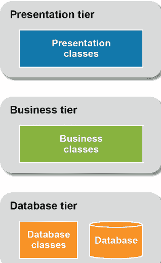

### 描述

- 为了简化开发和维护，许多应用程序使用*三层架构*来将应用程序的用户界面、业务规则和数据库处理分离。架构的每一层可能由一个或多个类组成。

- *表示层*（presentation tier）中的类控制应用程序的用户界面。对于控制台应用程序，表示层通常包含一个带有 `main` 方法的类以及任何其他与控制台输入输出相关的类。对于 GUI 应用程序，用户界面通常由每个 GUI 窗口的一个类组成。

- *数据库层*（database tier）中的类处理应用程序的所有数据处理。

- *业务层*（business tier）中的类定义了应用程序的*业务对象*和规则。这些类充当表示层和数据库层之间类之间的接口。

图 5-1 三层架构的工作原理

## 如何使用包（packages）

在第 3 章中，你学习了 Java API 如何将它的类组织成包。现在，你将学习如何将自己的类组织成包。通常情况下，这些包有助于将应用程序的类划分为不同的层。

包提供了两个主要优势。首先，当一个项目包含大量类时，包为你的应用程序提供了一些逻辑结构，让你更容易找到类。其次，包提供了一种避免类之间命名冲突的方法。如果你让你的类对其他程序员可访问，这一点尤为重要。

图 5-2 显示了在本章中使用包组织应用程序中的类后，Line Item 应用程序的文件夹和文件。在这里，`ch05_LineItem/` 文件夹包含每个包的子文件夹。然后，每个子文件夹包含该包的类。例如，`murach/business` 文件夹存储 `Product` 和 `LineItem` 类，而 `murach/db` 文件夹包含定义数据库类的 `ProductDB` 类。`murach/ui` 文件夹包含提供界面代码的 `LineItemApp` 类。

当你创建一个包时，可以使用任何名称。但是，如果你想确保包名是唯一的，最佳实践是将名称与你的互联网域名反转后保存。例如，由于你的域名是 `murach.com`，你公司创建的所有包都将以 `com.murach` 开头。

即使你不遵循这一惯例，也应该避免使用可能被他人使用的通用名称。例如，包名 `business` 就太通用了。然而，`murach.business` 足够具体，不太可能与其他任何包名发生冲突。本书使用 `murach` 作为包名的第一级，以清晰地标识创建此代码的公司。然后，你可以使用第二级来组织第一级中的包。

一旦你将类存储在正确的文件夹中，你必须在文件的开头编写一个包语句（package statement）。该语句由 `package` 关键字后跟包名组成。例如，在图中，每个类都以 `package` 语句开头，该语句与包含该类的文件夹对应。

如果一个类存储在包中，如果不使用包名限定，就无法从其他包访问它。因此，你通常会导入（import）该类，以便更容易引用该类。这对于你创建的包和类有效，对于 Java API 的类同样有效。例如，在图中 `ProductDB` 类导入了 `murach.business` 包中的 `Product` 类。这使得 `ProductDB` 类使用 `Product` 类变得简单。

### 使用包的应用程序的文件夹和文件

```
ch05_LineItem/src
  murach
    business
      LineItem.java
      Product.java
    db
      ProductDB.java
    ui
      LineItemApp.java
```

### LineItem 类

```java
package murach.business;

import java.text.NumberFormat;
public class LineItem {...}
```

### Product 类

```java
package murach.business;

import java.text.NumberFormat;
public class Product {...}
```

### ProductDB 类

```java
package murach.db;

import murach.business.Product;
public class ProductDB {...}
```

### LineItemApp 类

```java
package murach.ui;

import java.util.Scanner;

import murach.db.ProductDB;
import murach.business.LineItem;
import murach.business.Product;

public class LineItemApp {...}
```

### 描述

- 一个包可以存储一个或多个类。

- 每个包名都包含一个同名的文件夹。这些名称应该是唯一的，以防止与其他包发生冲突。

- 当你将类存储在包中时，类的第一个语句必须是指定包名的包语句。

- 在包语句之后，你可以编写该类的导入语句（import statements）。这些语句对于你创建的包和类有效，对于 Java API 的包和类同样有效。

图 5-2 如何使用包

## 如何使用 Eclipse 处理包

当你处理包时，你需要确保包的名称与包的文件夹名称相对应。如果你必须手动操作，这可能会很快变成一项繁琐的任务。幸运的是，Eclipse 会自动为你处理这些。

当一个项目包含包时，你可以使用 Package Explorer（包管理器）来导航它们。要做到这一点，你可以点击包左侧的图标来展开或折叠。

在图 5-3 中，Package Explorer 显示了本章演示的包。名为 `murach.db` 的包存储数据库类，`murach.ui` 包存储用户界面类。

要开始使用包，可以如图所示向项目中添加新包。在你这样做时，请记住包名对应于存储源代码的文件夹和子文件夹。如果这些文件夹和子文件夹不存在，Eclipse 会在你创建包时创建它们。

一旦你为应用程序创建了包，Eclipse 会自动为你添加到包的新类添加包语句。此外，如果你重命名包，Eclipse 会自动重命名文件夹并更新任何需要的导入语句。同样，如果你将类从一个包移动到另一个包，Eclipse 会更新该类的包语句以及任何需要的导入语句。简之，当你使用 Eclipse 处理包时，Eclipse 会自动为你处理大部分细节。

### 包含多个包的 Eclipse

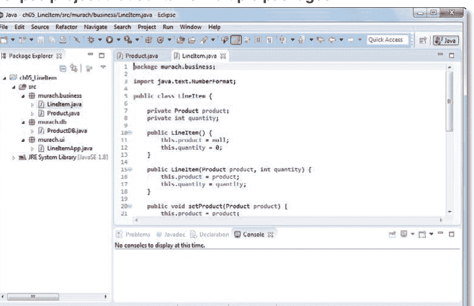

### 描述

- 要导航已有的包，可以使用 Package Explorer 展开或折叠项目中的包。

- 要向项目中添加新包，在 Package Explorer 中右键点击项目名称或 src 文件夹，选择 New→Package 命令并在弹出的对话框中输入包名。

- 要重命名包，使用 Refactor→Rename 命令并在弹出的对话框中指定新名称。

- 要将类从一个包移动到另一个包，在 Package Explorer 中拖动它。然后，点击弹出的对话框中的 OK 按钮。

- 要从项目中删除包，在 Package Explorer 中右键点击该包并从结果菜单选择 Delete 命令。如果包包含类，也会删除这些类。

- 当你使用 Eclipse 处理包时，Eclipse 会自动更新相应的文件夹。此外，它会自动更新任何需要的包语句或导入语句。

# Line Item（行项目）应用程序

本章通过展示 Line Item应用程序的面向对象版本作为结束。该应用程序将让你很好了解如何使用类来构建三层应用程序。

## 用户界面

图 5-4 显示了 Line Item应用程序的控制台。该控制台的工作原理与第三章介绍的 Line Item应用程序相同。但是，它显示了 Product 对象的所有数据，包括产品描述。

### 控制台

| 欢迎使用 Line Item 计算器 |
| :--- |
| 输入产品代码: java |
| 输入数量: 2 |
| 行项目 |
| 代码: Java |
| 描述: Murach's Beginning Java |
| 价格: $49.50 |
| 数量: 2 |
| 总计: $99.00 |
| 继续吗？(y/n): |

## 类图

此图还显示了 Line Item应用程序所使用的类图。在这里，Product 和 ProductDB 类是上一章介绍的类。到目前，你应该已经熟悉这些类了。

LineItem 类定义了两个名为 `product` 和 `quantity` 的实例变量。在这里，`product` 变量持有一个存储产品数据的 Product 对象，而 `quantity` 变量持有一个表示数量的 `int` 类型值。

LineItem 类还定义了六个方法。前四个是 get 和 set 方法，用于访问实例变量。相比之下，`getTotalFormatted` 方法返回一个表示应用货币格式后的总金额的 String 对象。这与 Product 类中的 `getPriceFormatted` 方法功能类似。

ProductDB 和 Product 类之间的箭头表示一个类使用了另一个类。在图中，ProductDB 类和 LineItem 类都使用了 Product 类。这是因为 ProductDB 类的 `getProduct` 方法返回一个 Product 对象，而 LineItem 类声明了一个 Product 类型的实例变量。然而，Product 类并没有使用另外两个类。相反，它只使用了 String 类和基本数据类型。

### 类图详情

| Product | LineItem |
| :--- | :--- |
| -code: String | -product: Product |
| -description: String | -quantity: int |
| -price: double | |
| +setCode(String) | +getProduct(Product) |
| +getCode(): String | +getProduct(): Product |
| +setDescription(String) | +setQuantity(int) |
| +getDescription(): String | +getQuantity(): int |
| +setPrice(double) | +getTotal(): double |
| +getPrice(): double | +getTotalFormatted(): String |
| +getPriceFormatted(): String | |

| ProductDB |
| :--- |
| +getProduct(String): Product |

### 描述

- Line Item应用程序接受用户输入的产品代码和数量，使用信息创建一个行项目，并将结果显示给用户。

- LineItem 类的两个实例变量存储了一个 Product 对象和一个表示数量的 `int` 类型值。LineItem 类的前四个方法访问这些变量的值。`getTotal` 方法计算行项目总额。而 `getTotalFormatted` 方法则将总额格式化为货币值。

图 5-4 Line Item 应用程序的用户界面和类图。

## LineItem 类

图 5-5 显示了 LineItem 类。该类为发票定义了一个行项目。与 Product 类一样，LineItem 类在应用程序的层中定义了一个业务对象。

package 语句定义了类所属的包。在这里，该语句导入了 `murach.business`，这与存储 Product 类的包相同。

import 语句导入了 `java.text` 包中的 `NumberFormat` 类。结果是，`getTotalFormatted` 方法可以使用该类而无需使用包名来限定它。

在类内部，前两个语句定义了类的实例变量。在这里，第一个实例存储了一个用于产品的 Product 对象，第二个实例变量存储了一个用于数量的 `int`。

该类的第一个构造函数初始化了实例变量。在这里，变量被设为 null。因此，如果你在为变量赋值对象之前尝试从该变量调用方法，该类将抛出 `NullPointerException`。为了解决这个问题，你可以将该变量初始化一个新的 Product 对象。然而，如果类没有被正确初始化，允许类抛出异常通常是一个好做法。

第二个构造函数允许用户为 `setProduct` 方法和 `setQuantity` 方法提供产品和数量。因此，这并不是必须的，但它让类变得易用。

构造函数之后，接下来的四个方法为两个实例变量提供了 get 和 set 方法。这些方法访问相应的实例变量。

第五个方法返回行项目总额的 `double` 类型值。为了实现这一点，该方法调用 Product 对象的 `getPrice` 方法获取价格，将价格乘以数量，并返回结果。

第六个方法返回在应用货币格式后行项目总额的 String 对象。为了实现这一点，该方法调用 `getTotal` 方法返回总金额的 `double` 值。然后，它使用 `NumberFormat` 类对该 `double` 值应用货币格式化，并返回生成的 String 对象。

```java
package murach.business;

import java.text.NumberFormat;

public class LineItem {

    private Product product;
    private int quantity;

    public LineItem() {
        this.product = null;
        this.quantity = 0;
    }

    public LineItem(Product product, int quantity) {
        this.product = product;
        this.quantity = quantity;
    }

    public void setProduct(Product product) {
        this.product = product;
    }

    public void setQuantity(int quantity) {
        this.quantity = quantity;
    }

    public Product getProduct() {
        return product;
    }

    public int getQuantity() {
        return quantity;
    }

    public double getTotal() {
        return quantity * product.getPrice();
    }

    public String getTotalFormatted() {
        double total = getTotal();
        NumberFormat currency = NumberFormat.getCurrencyInstance();
        String totalFormatted = currency.format(total);
        return totalFormatted;
    }
}
```

图 5-5 LineItem 类。

## LineItemApp 类

图 5-6 显示了 LineItemApp 类的代码。该类包含应用程序的主方法。该方法获取输入并将结果显示给用户。


package 语句定义了类所属的包。图中，该语句定义了 `murach.ui`。这意味着该类包含了应用程序的用户界面代码。

import 语句导入了 `java.util` 包中的 `Scanner` 类。此外，它导入了来自 `murach.business` 和 `murach.db` 的 `Product`、`LineItem` 和 `ProductDB` 类。结果是在类的其余部分可以方便地引用这些类。

在主方法内部，前两个语句打印欢迎信息。然后，第三条语句声明了一个名为 `sc` 的 `Scanner` 对象并创建一个，该类使用它获取用户输入。接下来的第四条语句声明了一个名为 `choice` 的 `String` 变量并将其设置为字面量 "y" 或 "Y"。如果是这样，则执行循环。

在 `while` 循环内部，前四条语句从用户处获取产品代码和数量。然而，如果用户输入的数量无法被 `Integer` 的 `parseInt` 方法转换为 `int` 值，代码将抛出异常，应用程序将崩溃。

如果用户输入了有效的产品代码和数量，代码调用 `ProductDB` 类的 `getProduct` 方法来获取与产品代码对应的 `Product` 对象。然后，它从 `LineItem` 类创建一个 `LineItem` 对象，并在 `LineItem` 对象中设置 `Product` 对象和数量。

在创建 `LineItem` 对象并设置其数据后，该应用程序创建一个 `String` 对象消息，存储显示的数据。为了获取这些数据，代码使用了 `Product` 和 `LineItem` 对象的 `get` 方法。然后，代码将数据打印到控制台。

在显示 `LineItem` 对象的数据后，代码检查用户是否想继续。如果用户输入 "y" 或 "Y"，代码将再次执行 `while` 循环。否则，代码退出 `while` 循环。关闭扫描，在控制台打印告别信息并退出主方法，导致应用程序结束。

# LineItemApp 类

```java
package murach.ui;

import java.util.Scanner;

import murach.db.ProductDB;
import murach.business.LineItem;
import murach.business.Product;

public class LineItemApp {

    public static void main(String args[]) {
        // 显示欢迎消息
        System.out.println("Welcome to the LineItem Calculator!");
        System.out.println();

        // 创建 1 或多个行项目项目
        Scanner sc = new Scanner(System.in);
        String choice = "y";
        while (choice.equalsIgnoreCase("y")) {
            // 获取用户输入
            System.out.print("Enter product code: ");
            String productCode = sc.nextLine();

            System.out.print("Enter quantity: ");
            int quantity = Integer.parseInt(sc.nextLine());

            // 获取 Product 对象
            Product product = ProductDB.getProduct(productCode);

            // 创建 LineItem 对象
            LineItem lineItem = new LineItem(product
```

图 5-6 LineItemApp 类

# 视角

如果你理解了本章介绍的 Line Item 应用，你就理解了许多 Java 编程知识，包括如何使用包和类来创建三层结构。以此为背景，你已经好学习更多关于使用 Java 的细节了。这就是你将在本书的剩余部分学到的内容。

但首先，下一章将展示如何测试和调试本章介绍的 Line Item 应用。这样，每当你的代码运行不正常时，你都有一些可以用来修复它的技能。

### 总结

- 三层架构将应用程序分为三个层（或层级）。
- 表示层（presentation tier）由用户界面组成。
- 数据库层（database tier）由数据库以及与其配合工作的数据库类组成。
- 业务层（business tier）由定义业务对象和规则的业务类组成。

# 练习 5-1 修改 Line Item 应用

本练习将引导你完成测试和修改本章介绍的 Line Item 应用的过程。

# 查看并测试项目

1. 导入 ex_starts 文件夹中名为 ch05_ex1_LineItem 的项目。然后，查看 `LineItem` 和 `LineAppContext` 类的代码。
2. 运行项目并使用 `java`、`jsp` 和 `mysql` 等产品代码进行测试，确保该应用程序运行正常。

# 重命名包

3. 在包资源管理器（Package Explorer）中，导航到 `murach.db` 包。然后，将此包重命名为 `murach.database`。
4. 打开 `ProductDB` 类，注意 Eclipse 也更改了该类的包语句以对应新的包名。
5. 打开 `LineItemApp` 类，注意 Eclipse 也更改了 `ProductDB` 类的导入语句，以对应新的包名。
6. 运行项目并确保它仍然运行正常。

# 练习 5-2 在 Area and Perimeter 应用中使用包

本练习将引导你转换 Area and Perimeter 应用，使其使用多个包。

# 查看并测试项目

1. 导入存储在 ex_starts 文件夹中名为 ch05_ex2_AreaAndPerimeter 的项目。然后，查看 `Main` 和 `Rectangle` 类的代码。注意它们都存储在 `murach.rectangle` 包中。
2. 运行项目并确保该应用程序运行正常。

# 操作包

3. 创建一个名为 `murach.ui` 的包。然后将 `Main` 类移动到该包中。
4. 创建一个名为 `murach.business` 的包。然后将 `Rectangle` 类移动到该包中。
5. 打开 `Rectangle` 类。注意 Eclipse 已修改了它的包语句。
6. 打开 `Main` 类。注意 Eclipse 修改了它的包语句，并添加了 `Rectangle` 类的导入语句。
7. 删除 `murach.rectangle` 包。
8. 运行项目并确保它仍然运行正常。

# 6

## 如何测试和调试应用程序

开发 Java 应用程序时，你需要对它进行测试以确保其符合预期。然后，如果你遇到任何问题，就需要对应用程序进行调试。为了做到这一点，你需要找到每个问题的原因，并修复每个问题。

| 测试和调试的基本技能 | 148 |
| :--- | :--- |
| 典型的测试阶段 | 148 |
| 三种类型的错误 | 148 |
| 常见的 Java 错误 | 150 |
| 如何确定错误原因 | 152 |
| 跟踪代码执行的简单方法 | 154 |
| **如何使用 Eclipse 调试应用程序** | 156 |
| 如何设置和移除断点 | 156 |
| 如何逐步执行代码 | 158 |
| 如何检查变量 | 158 |
| 如何检查堆栈跟踪 | 160 |
| **视角** | 162 |

# 测试和调试的基本技能

当你测试应用程序时，你运行它以确保它工作正常。

在测试应用程序时，你会尝试输入数据和用户操作的每种组合，以确保应用程序在每种情况下都能工作。换句话说，测试的目标是让应用程序失败。

当你调试应用程序时，你会修复测试过程中发现的错误（bug）。每次修复一个 bug 后，都要重新测试，以确保你的修改没有影响应用程序的其他部分。这个过程被称为调试。

# 典型的测试阶段

当你测试应用程序时，通常分阶段进行。阶段 6-1 列出了你可以用于书中小型应用程序的常用测试阶段。然而，对于大型应用程序，开发者有时会在开发用户界面或数据库类之前测试业务类。

在第一阶段，你测试用户界面。对于控制台应用程序，这意味着你应该确保控制台显示正确的文本并提示用户输入正确的数据。对于带有图形界面的应用程序，这意味着你应该视觉检查控件，确保按键和控件工作正常。例如，你应该测试 `Tab` 键和 `Enter` 键，以及选框和下拉列表的操作。

在第二阶段，你使用有效数据测试应用程序。开始时，你可以输入预期产生错误的数据。然后，你应该输入测试应用程序极限的有效数据。

在第三阶段，你通过测试所有你想到的无效数据和用户操作组合来尝试让应用程序失败。这应该包括随机操作，例如在错误的时间按下 `Enter` 键或点击鼠标。

# 三种类型的错误

在测试应用程序时可能会发生三种类型的错误。这些错误在 6-1 中描述。

编译时错误发生在 Java 编译器尝试编译代码时。这种错误会导致你的应用程序无法编译和运行，是最容易发现的。大多数 Java IDE 会在你输入时自动检测语法错误，并提供修复建议。

遗憾的是，某些错误在运行应用程序之前无法检测到。这些错误被称为运行时错误，它们通常会抛出异常。

如果应用程序在运行过程中没有抛出异常，它可能包含逻辑错误，导致应用程序无法正常工作。这种错误通常是最难发现和纠正的。例如，图 6-1 中的 Line Item 应用有一个逻辑错误。你能看出它是什么吗？

# 带有逻辑错误的行项目应用

| 欢迎使用行项目计算器 |
| :--- |
| 输入产品代码：java |
| 输入数量：2 |
| 行项目 Java <br> 代码：Java <br> 描述：Java之 Murach's Java 编程 <br> 价格：$57.50 <br> 数量： 2 <br> 总计：$59.50 |
| 继续吗？(y/n) : : |

# 测试的目标

- 在应用程序投入生产之前找到所有所有错误。

# 调试的目标

- 在应用程序投入生产之前修复所有错误。

# 三个测试阶段

- 检查用户界面以确保其正常工作。
- 使用有效输入数据对应用程序进行测试，以确保结果是正确的。
- 使用无效数据或意外的用户操作对应用程序进行测试。尝试你能想到的所有方法让程序出错。

# 可能发生的三类错误

- **编译时错误**发生在 Java 编译器编译代码时发生。这发生在 Java 运行时环境 (JRE) 运行代码之前。这类错误通常违反了 Java 运行时环境 (JRE) 语句的编写语法规则。
- **运行时错误**发生在应用程序运行时。这发生在 Java 编译器编译代码之后。这类错误通常会抛出异常，并停止应用程序的执行。
- **逻辑错误**发生在应用程序运行时，虽然没有抛出任何错误，但仍然产生了错误的结果，例如引入了错误的数据。

### 描述

- 为了测试应用程序，你需要运行它以确保无论输入什么种组合的有效输入数据，它都能正常工作。
- 当你调试应用程序时，你会找到在测试应用程序时发现的所有错误（bug）的原因。然后，修复这些错误。这个过程被称为调试。

图 6-1 测试与调试简介

# 常见的 Java 错误

图 6-2 展示了编写 Java 应用程序时常见的某些编码错误。如果你完成了最后两个章节的练习，可能已经遇到过这些错误中的一些。此图顶部的代码来自行项目应用的 `main` 方法，但首先引入了四个错误。

第一个错误是在声明名为 `choice` 变量的语句末尾缺少分号。如你所知，Java 要求每个语句末尾必须有分号，除非该语句包含在大括号括起来的代码块。

第二个错误是 `while` 语句条件末尾缺少右括号。在编写代码时，你需要记住每一个左括号、大括号或引号都必须有对应的右括号、大括号或引号。

第三个错误是没有为变量 `productCode` 声明数据类型。与其他某些语言不同，Java 要求必须为所有变量声明数据类型。

第四个错误是调用名为 `sc` 的 `Scanner` 对象的 `nextLine` 方法的语句使用了不正确的大小写。对于此语句，“NextLine” 应该是 “nextLine”，因为 Java 是区分大小写的。

# 导致错误的代码

```java
Scanner sc = new Scanner(System.in);
// missing semicolon
String choice = "y"
while (choice.equalsIgnoreCase("y
```

# 常见的语法错误

- 忘记在语句末尾加分号。
- 忘记左或右括号、大括号或引号。
- 忘记为变量声明数据类型。
- 标识符使用错误的大小写。
- 标识符拼写错误。

### 描述

- 标识符是指代一段 Java 代码的名字，例如变量、方法、类或包。


# 如何确定错误的原因

图 6-3 显示了如何找到错误的原因。一旦你找到了错误的原因，通常很容易修复它。

# 使用 println 语句追踪执行情况的代码

```java
public double getTotal() {
  System.out.println("start getTotal() method");

  double total = quantity * product.getPrice();
  System.out.println("price: " + product.getPrice());
  System.out.println("quantity: " + quantity);
  System.out.println("total: " + total);
  System.out.println("end getTotal() method");
  return total;
}
```

# 打印到控制台的数据

```
start getTotal() method
price: 57.5
quantity: 2
total: 59.5
end getTotal() method
```

### 描述

- 追踪应用程序执行的一种简单方法是在代码的关键点插入 `println` 语句，向控制台打印消息。
- 打印到控制台的消息可以指示正在执行哪些代码，也可以显示变量的值。
- 当你看到显示的值错误时，很有可能是应用程序在当前 `println` 语句和上一个 `println` 语句之间存在逻辑错误。


### 如何使用 Eclipse 调试应用程序

调试是编程中最困难、最令人沮丧的部分之一。幸运的是，Eclipse 包含了名为调试器的强大工具，它可以帮助你找到并修复这些错误。

# 如何设置和移除断点

调试应用程序的第一步是找出导致 bug 的原因。为了做到这一点，查看应用程序执行过程中不同点的变量通常很有帮助。这通常有助于你确定 bug 的产生，而这对于调试应用程序至关重要。

在应用程序执行时查看变量值的最简单方法是如图 6-5 所示设置断点。方法是双击代码行左侧的行号。然后，断点将用一个蓝圆圈标记。稍后当你使用调试器运行应用程序时，执行将在断点所在的语句之前停止。这时，你将能够查看应用程序在该点作用范围内的变量。你将在下一图中学习到相关内容。

调试时，在应用程序中导致 bug 的行之前设置断点很重要。通常，你可以通过阅读应用程序崩溃时显示的运行时异常来确定在何处设置断点；尽管在找到良好的断点设置位置之前，你必须进行尝试。

设置断点后，你需要使用调试器运行当前应用程序。你可以使用工具栏上的 Debug 按钮（就在 Run 按钮的左侧）。

一旦设置了断点，它就会一直存在直到你将其移除。即使退出 Eclipse 如此。因此，当你想移除断点时，必须手动操作。一种方法是再次双击行号。

# 带有断点的代码编辑器

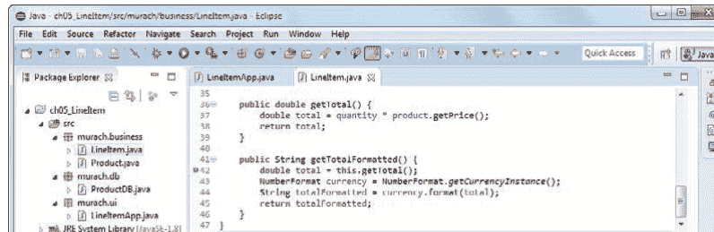

### 描述

- 调试时，你需要在导致错误的代码行之前停止应用程序的执行。然后，你就可以像接几幅图中所示检查变量并逐行执行代码。
- 要停止应用程序执行，可以设置断点。然后，当你运行应用程序时，执行会在到达断点时停止。
- 要为某行设置断点，请打开类的代码编辑器并双击行号。断点由放置在行号左侧的小蓝圆圈识别。
- 要移除断点，请再次双击行号。
- 你可以在开始调试之前或在调试期间设置和移除断点。在大多数情况下，你会在开始调试之前至少设置一个断点。
- 要启动当前项目的调试，点击工具栏上的 Debug 按钮。
- 你也可以通过右键点击包含 `main` 方法的项目或类，并选择 Debug Java Application 命令来启动调试。

图 6-5 如何设置和移除断点

# 如何逐行执行代码

现在，你一直在 Java 视图（perspective）中使用 Eclipse。然而，当你点击 Debug 按钮运行应用程序时，Eclipse 会切换到 Debug 视图，如图 6-6 所示。但首先，Eclipse 可能会提示你确认此视图。之后，你可以通过点击工具栏 Debug 按钮右侧的 Java 按钮随时切换回 Java 视图。

当你使用调试器运行应用程序并遇到断点时，执行会停止，一个蓝色箭头标记下一个将执行的语句。此外，Eclipse 会显示如图所示的 Variables 窗口。该窗口显示了当前执行点作用范围内的变量值。

在调试期间，Eclipse 还会显示调试工具栏。你可以点击此工具栏上的 Step Over（逐过程）和 Step Into（步入）按钮，一次一个语句地重复执行应用程序。然后，你可以使用 Variables 窗口观察值随应用程序执行发生的变化。这可以帮助你确定 bug 的原因。


当你逐行执行应用程序时，如果你想执行一个方法而不进入内部，可以点击 `Step Over`。或者，你可以使用 `Step Return`（步出）按钮退出任何你不想逐步执行的方法。当你想要继续正常执行时，可以点击 `Resume`（恢复）按钮。然后，应用程序将运行到下一个断点。或者，你可以使用 `Terminate`（终止）按钮结束应用程序的执行。

`Resume` 按钮左侧还有一个你应该注意的按钮：`Skip All Breakpoints`（跳过所有断点）。如果此按钮处于激活状态，即使在调试模式下，Eclipse 都不会停止。

这些是强大的调试功能，可以帮助你找到严重编程问题的原因。逐行执行应用程序也是理解现有应用程序代码如何工作的好方法。例如，如果你执行上一章介绍的 Line Item 应用程序，你将更好地了解该应用程序是如何工作的。

# 如何检查变量

当你设置断点并逐行执行代码时，`Variables` 窗口会自动显示作用范围内的变量值。在图 6-6 中，执行点在 `LineItem` 类的 `getTotalFormatted` 方法中。在这里，`Variables` 窗口显示了作用范围内的两个局部变量（`total`）。

那么为什么 `totalFormatted` 变量没有出现呢？嗯，在代码编辑器中，箭头位于声明 `totalFormatted` 变量的行左侧。因此，它不在作用范围内。按 `F6` 步过将执行此行并使 `totalFormatted` 变量出现在 `Variables` 窗口中。

# 调试会

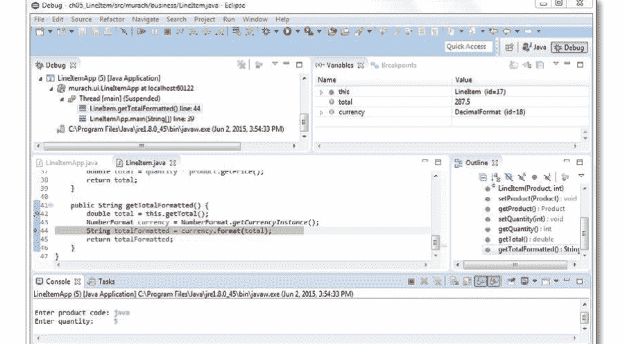

# 调试工具栏上的按钮

| 按钮 | 快捷键 | 描述 |
| :--- | :--- | :--- |
| Step Over | F6 | 一次一个语句执行代码，跳过调的方法。 |
| Step Into | F5 | 一次一个语句执行代码，包括调用方法中的语句。 |
| Step Return | F7 | 完成当前方法的执行并返回到调用方法。 |
| Resume | F8 | 继续执行到下一个断点。 |
| Terminate | Ctrl+F2 | 结束应用程序的执行。 |

当变量（`Variables`）窗口显示数字和字符串变量时，它会显示其值。例如，在图中，名为 `total` 的变量的值为 `287.5`。

然而，当变量窗口显示一个指向对象的变量时，它不会自动显示其内部变量的值。相反，它会在对象名称左侧显示一个箭头图标。然后，你可以通过点击该箭头图标进行展开来查看对象的值。在图 6-6 中，你可以展开名为 `currency` 的变量，该变量引用一个从 `NumberFormat` 类创建的对象。

同样，当你通过显示名为 `this` 的变量来从内部检查代码时，该变量指向当前对象。因此，你可以展开此变量来查看由当前对象定义的实例变量的值。在图 6-6 中，你可以展开名为 `this` 的变量来查看当前 `LineItem` 对象的实例变量的值。

## 如何检查堆栈跟踪

在调试时，查看堆栈跟踪（`stack trace`）有时是有帮助的，堆栈跟踪是按照调用顺序的反序排列的方法列表。默认情况下，Eclipse 在调试（`Debug`）窗口的左上角显示堆栈跟踪。

图 6-7 中的调试窗口显示代码执行正位于 `LineItem` 类 `getTotalFormatted` 方法的第 44 行。此窗口还显示了类。此时，你可能希望显示方法的第 39 行，以查看调用 `getTotalFormatted` 方法的代码。执行此操作，你可以点击堆栈跟踪中的 `main` 方法。这会在代码编辑器中显示 `LineItemApp` 的源代码，并在必要时打开它。如果你尝试这种操作，你会发现它可以帮助定位错误（`bug`）源。

## 第 6 章 如何测试和调试应用程序 161

## 调试窗口中的堆栈跟踪

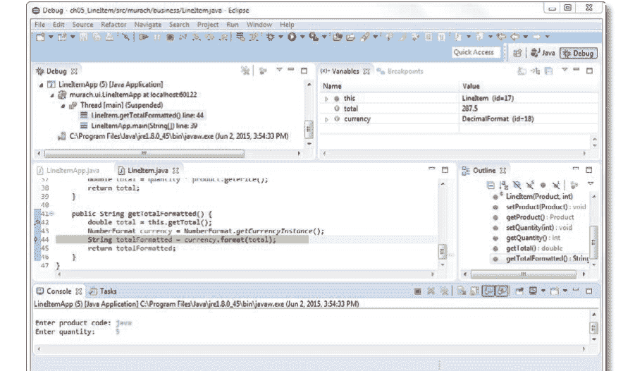

### 描述

- 堆栈跟踪是按照调用顺序的反序排列的方法列表。
- 默认情况下，Eclipse 在 IDE 左上角的调试窗口中显示堆栈跟踪。如果你关闭了它，可以使用 `Window->ShowView`（窗口->显示视图）命令重新打开。
- 要跳转到堆栈跟踪中显示的代码编辑器中的某行代码，请点击堆栈跟踪中的该行。
- 当你完成调试后，可以点击工具栏 `Debug` 按钮右侧侧的 `Java` 按钮返回 Java 视图（`perspective`）。

图 6-7 如何检查堆栈跟踪

## 视图

在将应用程序投入生产环境之前，你应该对其进行彻底的测试和调试。现在你已经完成了本章，你应该具备了测试应用程序以识别其可能包含的任何错误的技能。此外，你还应该能够使用 Eclipse 调试器来定位这些错误的原因。

本章介绍的技能将为你测试和调试你开发的任何应用程序提供坚实的基础。然而，Eclipse 还提供了一些你可以用于测试和调试应用程序的额外功能。在读完本章后，你应该具备了学习更多 Eclipse 提供的其他调试功能所需的背景。

当你开始开发更复杂的应用程序时，你可能还想学习单元测试（`unit testing`）。单元测试为源代码的各个部分创建测试的方法，以确保它们正常工作。单元测试可以自动化你通常需要手动执行的应用程序测试。通过自动化测试，在每次更新应用程序时更有可能实际执行。这使得发现和修复错误变得更容易，因为更容易确定是哪些代码引入了错误。

### 总结

- 为了测试应用程序，你需要运行它，以确保无论输入什么有效或无效的数据组合，它都能正常工作。
- 当你调试应用程序时，你会发现并修复测试应用程序时发现的所有错误（`bugs`）。这个过程被称为调试。
- 编译时错误（`Compile-time errors`）违反了 Java 语句的编写规则。这些错误在运行应用程序之前由 Java 编译器检测到。
- 运行时错误（`Runtime errors`）发生在运行应用程序时。这些错误异常会停止应用程序的执行。
- 逻辑错误（`Logic errors`）不会导致应用程序崩溃，但无法正常工作。
- 跟踪应用程序执行的一种简单方法是在代码的关键点插入 `println` 语句。
- Eclipse 是一个强大的工具，被称为调试器，可以帮助你发现并修复错误。
- 调试时，Eclipse 会从 Java 视图切换到调试视图。你可以点击工具栏上的 `Java` 和 `Debug` 按钮在这些视图之间切换。
- 你可以在某行代码上设置断点（`breakpoint`），以便在执行该行之前停止代码执行。然后，你可以步进代码，并在代码执行时查看变量的值。
- 堆栈跟踪是按照调用顺序的反序排列的方法列表。

## 练习 6-1 测试并调试 Line Item 应用程序

此练习将引导你通过 Eclipse 调试应用程序的过程。这应该让你对 Eclipse 调试器有多用有一个初步了解。

### 引入并修正编译时错误

1. 导入 `ch06_ex1_LineItem` 项目。然后，打开 `murach` 文件夹下的 `LineItemApp.java` 文件。
2. 删除句末的分号以创建一个错误。
3. 替换句末的分号修复错误。

### 引入并分析运行时错误

4. 使用无效值运行应用程序以导致崩溃。
5. 点击崩溃的行以查看堆栈跟踪。

### 设置断点并步进方法

6. 在方法的第一行设置断点。
7. 点击 `Debug` 按钮使用调试器运行。
8. 展开变量查看其值。
9. 使用单步跳（`Step Over`）按钮移动代码。
10. 点击恢复（`Resume`）按钮继续执行。

### 设置断点并步进整个应用程序

11. 使用控制台窗口退出应用程序。
12. 在 `main` 方法上设置断点。
13. 点击 `Debug` 按钮启动调试器。
14. 使用单步跳（`Step Over`）和步入（`Step Into`）检查应用程序逻辑。

### 停止调试器并移除断点

15. 点击终止（`Terminate`）按钮结束会。
16. 到 Java 视图。
17. 双击行号以移除断点。

# 第 2 部分 你需要的核心技能

本节由四个章节组成，向你展示了如何更多地使用 Java 核心特性。第 7 章介绍了处理数据类型和操作符最重要的技能。第 8 章介绍了处理控制语句最重要的技能。第 9 章介绍了处理字符串最重要的技能。而第 10 章则介绍了你在处理数组时需要了解的概念和技术。

我们将本节的每个章节都设计成一个独立的单元。因此，你可以按照自己喜欢的任何顺序阅读这些章节。例如，如果你想学习更多关于控制结构的知识，可以下次阅读第 8 章。或者，如果你想学习数组，可以下次阅读第 10 章。

## 7 如何使用基本数据类型和操作符

在第 2 章中，你学习了如何使用两种基本数据类型。此外，你还学习了如何使用操作符进行简单的算术运算。现在，你将从专业水平学习其他基本数据类型。

- 处理数据的基本技能...............................168
- 八种基本数据类型........................... 168
- 如何声明和初始化变量..............170
- 如何声明和初始化常量..............172
- 如何编写表达式..................174
- 如何使用二元操作符...........................174
- 如何使用一元操作符...........................176
- 如何使用复合赋值操作符................178
- 如何处理优先级.........................180
- 如何处理类型转换................................182
- 如何使用 Java 类处理数字 ..............164
- 如何使用 `Math` 类................................184
- 如何使用 `BigDecimal` 类.....................186
- 如何修复舍入...............................188
- 应用程序..................................190
- 用户界面...............................................190
- 代码......................................194

## 处理数据的基本技能

接下来的图表回顾了第 2 章中展示的某些处理数据的技能。此外，这些图还展示了与此主题相关的新技能。

### 基本数据类型

图 7-1 显示了 Java 提供的基本数据类型。你可以使用这些数据类型来存储数字、字符以及真或假值。

在第 2 章中，你学习了如何使用 `int` 类型来存储整数（整数数字）。然而，Java 还提供了另外三种数据类型。例如，如果一个值对于 `int` 类型来说太大了，你可以使用 `long` 类型。相反，如果你只需要存储整数值并想节省系统资源，可以使用 `short` 类型。

在第 2 章中，你还学习了如何使用 `double` 类型来存储带小数的数字。然而，如果你想节省系统资源，可以使用 `float` 类型。这两种数据类型中的值都存储为浮点数，可以包含很大或很小的值，但有效数字是有限的。例如，`double` 类型有 16 位有效数字，并支持如 12,345,678,901,234,56 或 12,345,678,9012345 或 12.3456789012345 这样的数字。然而，`float` 类型只有 7 位有效数字，但它仍然支持非常大或非常小的数字，例如 123,456,700,000,000 和 .000000001234567。

为了表示浮点数的值，你可以使用科学计数法。你用一种简写方式表示极大或极小的数字。要使用这种方法，你用字母 `e` 或 `E` 后跟着 10 的幂。例如，`3.65e+9` 等于 3.65 乘以 10⁹ (3,650,000,000)，`3.65e-9` 等于 3.65 乘以 10⁻⁹ (.000000001234567)。

你可以用 `char` 类型来存储字符。Java 使用 Unicode 字符集。因此，你可以使用 Unicode 字符集。它通常包含 ASCII 字符集。最后，`boolean` 类型用于表示真或假。

### 基本数据类型

| 类型 | 字节 | 使用 |
|---|---|---|
| byte | 1 | -128 到 127 |
| short | 2 | -32768 到 32767 |
| int | 4 | -2147483648 到 2147483647 |
| long | 8 | -9223372036854775808 到 9223372036854775807 |
| float | 4 | 单精度浮点数 |
| double | 8 | 双精度浮点数 |
| char | 2 | Unicode 字符 |
| boolean | 1 | 真或假 |

### 技术说明

- 处理数据的基本技能...............................168
- 八种基本数据类型........................... 168
- 如何声明和初始化变量..............170
- 如何声明和初始化常量..............172
- 如何编写表达式..................174
- 如何使用二元操作符...........................174
- 如何使用一元操作符...........................176
- 如何使用复合赋值操作符................178
- 如何处理优先级.........................180
- 如何处理类型转换................................182
- 如何使用 Java 类处理数字 ..............164
- 如何使用 `Math` 类................................184
- 如何使用 `BigDecimal` 类.....................186
- 如何修复舍入...............................188
- 应用程序..................................190
- 用户界面...............................................190
- 代码......................................194

### 说明


- 处理数据的基本技能...............................168
- 八种基本数据数据类型........................... 168
- 如何声明和初始化变量..............170
- 如何声明和初始化常量..............172
- 如何编写表达式..................174
- 如何使用二元操作符...........................174
- 如何使用一元操作符...........................176
- 如何使用复合赋值操作符................178
- 如何处理优先级.........................180
- 如何处理类型转换................................182
- 如何使用 Java 类处理数字 ..............164
- 如何使用 Math 类................................184
- 如何使用 BigDecimal 类.....................186
- 如何修复舍入...............................188
- 应用程序..................................190
- 用户界面...............................................190
- 代码......................................194

### 如何声明和初始化变量

在第 2 章中，你学习了如何声明和初始化变量。图 7-2 回顾了这一技能，并还展示了一些新信息。特别地，它展示了如何声明和初始化一些第 2 章中没有介绍的数据类型。

虽然你通常在一个语句中声明和初始化变量，但偶尔分两步也是合理的。例如，你可能想在程序的开始处声明一个变量而不给它初始值，因为它的值稍后才会设置。

这个单语句示例展示了如何声明和初始化各种类型。

# 第 7 章 如何使用基本类型和操作符 171

## 赋值运算符

| 运算符 | 名称 | 描述 |
| --- | :--- | :--- |
| `=` | 赋值 | 给变量分配一个新值。 |

## 如何通过两个语句声明变量并赋值

### 语法

```
type variableName;
variableName = value;
```

### 示例

```
int counter;      // 声明语句
counter = 1;       // 赋值语句
```

## 如何通过一条语句声明变量并赋值

### 语法

```
type variableName = value;
```

### 示例

```
int counter = 1;           // 初始化一个 int 变量
double price = 14.95;      // 初始化一个 double 变量
float rate = 8.125f;       // f 表示浮点数值
long numberOfBytes = 20000L;  // L 表示长型整数
int population1 = 1734323;  // 初始化一个 int 变量
int population2 = 1734323; // 提高可读性 - Java 7及后续
double distance = 3.65e9;    // 科学计数法
char letter1 = 'A';        // 作为 Unicode 字符存储
char letter2 = 65;          // Unicode 字符的整数值
boolean valid = false;     // false 是一个关键字
int x = 0, y = 0;          // 用一条语句初始化 2 个变量
```

### 描述

- 变量存储一个随着应用程序执行而改变的值。我们的单词会随着应用程序的执行而发生变化。
- 在声明变量之前，你必须声明它的数据类型和名称。
- 在声明变量之后，你可以给它赋值。使用赋值运算符 (`=`)。为了实现这一点，你可以使用两个语句。
- 你可以通过声明变量并给它赋值来初始化变量。但通常使用一条语句。
- 如果要在单条语句中为同一种数据类型声明并初始化多个变量，请使用逗号分隔赋值操作。
- 要识别浮点数值（`float`），你必须在数字后输入 `f` 或 `F`。
- 要识别长型值（`long`），你可以在数字后使用 `l` 或 `L`。

### 命名规范

- 变量以小写字母开头，第一个单词后的所有单词的首字母大写写。这种命名法被称为驼峰命名法（camel case）。
- 尝试在代码中使用有意义且易记的名称。

图 7-2 如何声明变量并为其赋值

### 如何声明和初始化常量

在第 2 章中，你学习了变量存储一个随着应用程序执行而改变的值。换句话说，变量随着应用程序的执行而变化。然而，`常量`（constant）存储的是不随应用程序执行而改变的值。换句话说，常量在应用程序执行过程中保持不变。

声明和初始化变量的大多数技巧也适用于声明和初始化常量。然而，当你声明常量时，使用 `final` 关键字开始语句。因此，常量有时被称为`最终变量`（final variables）。此外，一种常见的编码规范是使用全大写字母命名常量，并用下划线分隔名称中的单词，如图 7-3 所示。

### 如何声明和初始化常量

```
final type CONSTANT_NAME = value;
```

### 示例

```
final int DAYS_IN_NOVEMBER = 30;
final float SALES_TAX = .075F;
final double LIGHT_YEAR_MILES = 5.879e+12;
```

### 描述

- 常量存储一个不随应用程序执行而改变的值。换句话说，常量在应用程序执行过程中保持不变。
- 要声明常量，你用 `final` 关键字开始声明语句。之后，初始化变量的技巧也适用于常量。
- 为了便于区分变量和常量，大多数 Java 开发者对变量使用驼峰命名法，对常量使用全大写。

### 命名规范

- 常量中的所有字母大写，并用下划线分隔单词。
- 尝试使用有意义且易记的名称。

## 如何编写算术表达式

在第 2 章中，你学习了如何编写简单的算术表达式。这些表达式使用了图 7-4 中的前四个算术运算符。现在，接下来的三幅图展示了如何使用 Java 提供的更多操作符来处理算术表达式。这些操作符对表达式中的操作数进行操作，操作数可以是字面量也可以是变量。

### 如何使用二元运算符

在图 7-4 中，前五个运算符作用于两个操作数。因此，它们被称为二元运算符（binary operators）。例如，当你使用减法运算符 (`-`) 时，你从一个操作数中减去另一个。

加法 (`+`)、减法 (`-`) 和乘法 (`*`) 运算符是一目了然的。然而，除法 (`/`) 和取模 (`%`) 运算符需要一些解释。

如果你处理的是整数类型，除法运算符返回一个整数值，代表右侧操作数放入左侧操作数的次数。如果需要，你可以使用取模运算符返回左侧操作数除以右侧操作数的余数。

如果你处理的是浮点数类型，除法运算符返回一个浮点值。在这种情况下，你使用除法运算符来得到左侧操作数除以右侧操作数的结果。

### 算术二元运算符

| 运算符 | 名称 | 描述 |
| --- | :--- | --- |
| `+` | 加法 | 将两个操作数相加。 |
| `-` | 减法 | 从左侧操作数中减去右侧操作数。 |
| `*` | 乘法 | 将左侧操作数乘以右侧操作数。 |
| `/` | 除法 | 用右侧操作数除以左侧操作数。 |
| `%` | 取模 | 返回左侧操作数除以右侧操作数的余数。 |

### 初始化两个整数值的代码

```java
int x = 14;
int y = 8;
```

### 执行加法和减法

```java
int result1 = x + y; // result1 为 22
int result2 = x - y; // result2 为 6
```

### 执行乘法

```java
int result3 = x * y; // result3 为 112
```

### 执行整数除法

```java
int result4 = x / y; // result4 为 1
int result5 = x % y; // result5 为 6
```

### 初始化两个 double 值的代码

```java
double a = 8.5;
double b = 3.4;
```

### 执行浮点除法

```java
double result6 = a / b; // result6 为 2.5
```

### 描述

- 算术表达式由作用于一个或多个操作数的算术运算符组成。
- 二元运算符作用于两个操作数。
- 赋值语句可以将表达式的值赋值给变量。然后，当 Java 执行赋值语句时，它确定表达式的值并将其存储在变量中。


### 如何使用元运算符

图 7-5 显示了作用于一个操作数的运算符——元运算符（unary operators）。例如，你可以在操作数后编写递增 (`++`) 来增加操作数的值。

当你编写递增 (`++`) 或递减 (`--`) 运算符时，可以通过将运算符放在变量前来使用前缀。这时，操作会在语句的其他部分执行之前进行。相反，你可以通过将运算符放在变量后来使用后缀。这时，操作会在语句执行完毕后才进行。

通常情况下，整个语句只是增加一个变量，如前两个示例所示。这时，前缀和后缀形式的结果相同。然而，如果你将递增和递减运算符作为较大语句的一部分，你可以使用这些运算符的前缀和后缀形式来控制操作执行的时间。

如果必要，你可以在操作数前编写负号运算符 (`-`) 来反转操作数的值，如第五个示例所示。虽然你也可以在操作数前编写正号运算符 (`+`)，但它不会改变操作数的值。因此，元运算符很少被使用。

由于每个 `char` 类型都是具有映射到整数的数值的 Unicode 字符，你可以对 `char` 类型执行一些整数操作。例如，第六个示例展示了如何使用递增运算符将 `char` 变量数值从 67 变为 68，从而将字符从 C 变为 D。

# 第 7 章 如何与基本数据类型和运算符一起工作 177

## 算术一元运算符

| 运算符 | 名称 | 描述 |
|---|---|---|
| `++` | 递增 | 给操作数加 1 (`x = x + 1`)。 |
| `--` | 递减 | 从操作数中减 1 (`x = x - 1`)。 |
| `+` | 正号 | 表示该值为正数。 |
| `-` | 负号 | 将正值变为负值，反之亦然。 |

一个使用递增运算符的典型语句

```java
int i = 1;
i++; // 执行后，i = 2
```

一个使用递减运算符的典型语句

```java
int i = 10;
i--; // 执行后，i = 9
```

如何使用后置递增运算符

```java
int x = 14;
int result = x++; // 执行后，x = 15, result = 14
```

如何使用前置递增运算符

```java
int x = 14;
int result = ++x; // 执行后，x = 15, result = 15
```

如何反转数字的数值

```java
int x = 14;
int result = -x; // result = -14
```

如何对字符执行算术运算

```java
char letter1 = 'C'; // letter1 = 'C' Unicode 整数为 67
char letter2 = ++letter1; // letter2 = 'D' Unicode 整数为 68
```

### 描述

- 一元运算符只作用于一个操作数。
- 当你将递增或递减运算符作为变量的后置符号时，Java 在其他操作之后执行递增或递减操作。
- 当你将递增或递减运算符作为变量的前置符号时，Java 在其他操作之前执行递增或递减操作。
- 如果你将递增或递减操作编写为单独语句而不是表达式的一部分，那么运算符是前置还是后置就没了。

图 7-5 如何使用算术一元运算符

### 如何使用复合赋值运算符

在编写赋值语句时，通常会在等号两边编写同一个变量，如图 7-6 中的第一个示例所示。这样，你就可以在表达式中使用变量的当前值，并通过将表达式的结果赋值给它来更新变量。

由于这种语句很常见，Java 语言提供了图中所示的五个复合赋值运算符。虽然这些运算符没有提供任何新功能，但你可以使用它们来编写更短的代码，而不需要在等号两边都编写变量。这由第二个示例所示。

如果你需要将变量增加或减少 1 的值，你可以使用快捷运算符。例如：

```
month = month + i;
```

可以使用快捷运算符编写为：

```java
month += 1;
```

这等同于

```java
month++;
```

同样地，如果你想将名为 `nextNumber` 的变量值相加到名为 `sum` 的汇总字段中，你可以这样做：

```java
sum += nextNumber;
```

这等同于

```java
sum = sum + nextNumber;
```

你所使用的技术主要取决于喜好，因为这两种技术都易于阅读和维护。

### 复合赋值运算符

| 运算符 | 名称 | 描述 |
| --- | --- | --- |
| `+=` | 加法 | 将操作数加到变量的初始值，并将结果赋值给变量。 |
| `-=` | 减法 | 从变量的初始值减去操作数，并将结果赋值给变量。 |
| `*=` | 乘法 | 将操作数乘以变量的初始值，并将结果赋值给变量。 |
| `/=` | 除法 | 将变量的初始值除以操作数，并将结果赋值给变量。 |
| `%=` | 取模 | 计算变量除以操作数的余数并将结果赋值给变量。 |

### 等号两边使用相同变量的语句

```java
count = count + 1; // count 增加 1
count = count - 1; // count 减少 1
count = count * 2; // count 乘以 2
count = count / 2; // count 除以 2
count = count % 2; // count 对 2 取模
```

### 使用复合赋值运算符的语句

```java
count += 1; // count 增加 1
count -= 1; // count 减少 1
count *= 2; // count 乘以 2
count /= 2; // count 除以 2
count %= 2; // count 对 2 取模
```

### 描述

- 除非使用了括号


# 如何使用类型转换

在开发 Java 应用时，你经常需要将数据从一种类型转换为另一种类型。为了实现这一点，你会使用名为类型转换（casting）的技术，如图 7-8 所示。

Java 提供了两种类型转换。隐式转换会自动执行，并用于将精度较低的类型（如 `float`）的数据转换为精度更高的类型（如 `double`）。同样，隐式转换也可用于将数据从较小的类型（如 `int`）转换为较大的类型（如 `long`）。这被称为宽位转换（widening conversion），因为新类型足够大可以容纳原始值。例如图中的第一个语句将整数值 93 转换为双精度值。

如果算术表达式中的某些值比其他值具有更精确的数据，Java 会在算术表达式中执行隐式转换，接下来的三个语句所示。变量 `d` 声明为 `double` 类型，变量 `i` 和 `j` 声明为 `int` 类型。然后，Java 在评估该表达式时会将 `i` 和 `j` 转换为 `double` 值。

窄位转换（narrowing conversion）是将数据从精度更高的数据类型转换为精度较低的数据类型。使用这种转换时，精度较低的数据可能不够大以容纳原始值，这会导致某些数据丢失。在这种情况下，你必须使用显式转换（explicit cast）。

要执行显式转换，你需要在要转换的变量周围用括号编写转换。例如，执行显式转换的示例将双精度值 93.75 转换为整数值 93。在这里，需要进行显式转换，因为 Java 不会为可能导致数据丢失的窄位转换执行隐式转换。在这种情况下，转换会导致小数部分的丢失。

当你在算术表达式中使用显式转换时，Java 在算术操作之前执行转换，如最后两个显式转换示例所示。在示例中，Java 在除法之前将两个整数类型转换为双精度类型，因此在有需要时结果将带有小数位。如果没有显式转换，表达式将返回一个整数值，然后 Java 会将其转换为 `double`。

当你编写显式转换代码时，如果 JRE 无法执行该转换，可能会在运行时抛出异常。因此，只有在你确定 JRE 能够执行该转换时，才使用显式转换。

虽然你在数值数据类型之间进行转换，但也可以在 `int` 和 `char` 类型之间进行转换，如第三个示例所示。这就是为什么每个 `char` 都会转换为标识其在 Unicode 字符集中 `int` 值。由于数据可能丢失，你可以在这些数据类型之间进行隐式转换。不过，如果你愿意，也可以显式地编写这些转换。

如果你使用复合赋值运算符（如 `+=`），则会隐含一个显式转换。如第四个示例所示，这可能会导致数据丢失。因此，在使用复合赋值运算符和混合数据类型时应小心。

### 隐式转换的工作原理

数据类型

byte $\rightarrow$ short $\rightarrow$ long $\rightarrow$ float $\rightarrow$ double

示例

```java
double grade = 93; // 将 int 转换为 double
```

```java
double d = 95.0;
i = 86, j = 91;
double average = (d+i)/j; // 将 i 和 j 转换为 double 值
// average = 90.6666666...
```

### 如何编写显式转换

语法


# 类型转换

## 语法

`(type) expression`

## 示例

```
int grade = (int) 93.75; // 将 double 转换为 int (grade = 93)
double d = 95.0;
i = 86, j = 91;
average = (int)(d+i)/j; // 将 double 转换为 int 值 (average = 90)
int remainder = (int)(d+i)%3; // 将 double 转换为 int 值 (remainder = 2)
```

```
double result = (double) i / (double) j; // result 小数
```

## 如何在 char 和 int 类型之间转换

```
char letterChar = 65; // 将 int 转换为 char (letterChar = 'A')
char letterChar2 = (char) 65; // 这样也可以
int letterInt = 'A'; // 将 char 转换为 int (letterInt = 65)
int letterInt2 = 'A'; // 这样也可以
```

## 复合赋值运算符可以导致显式转换

```
int i = 4;
double d = 4.5;
i += d; // i = 8 (4.5 被转换为 int 类型)
```

## 描述

- 如果你将精度较低的数据类型赋值给精度更高的数据类型，或者将较小的数据类型赋值给较大的类型，Java 会自动执行转换并完成转换。这可以被称为显式转换或宽位转换（注：此处原文可能有误，通常宽位转换是隐式的）。
- 当你在编写算术表达式时，Java 会隐式地将精度较低的数据类型转换为精度最高的数据类型。
- 要转换一个将精度更高的数据类型赋值给精度较低的数据类型的赋值，你必须使用括号指定精度较低的数据类型。这可以被称为显式转换或窄位转换。
- 当你在算术表达式中编写显式转换时，Java 在任何算术操作之前执行转换。
- 由于每个 `char` 值都有对应的 `int` 值，你可以在类型之间进行隐式或显式转换。

# 如何使用 Java 类处理数字

正如你从之前的章节中所学习的那样，Java 提供了几个类来处理数值数据。本章涵盖了如何使用这些类来执行各种数学运算。

## 如何使用 Math 类

`Math` 类提供了许多静态方法来执行数学运算。由于这些方法是静态的，你不需要创建 `Math` 类的实例。只需使用类名调用方法，例如 `Math.sqrt(25.0)`。

### Math 类的常用方法

| 方法 | 描述 |
| --- | --- |
| `round(number)` | 返回最参数的 long 值。如果参数是 float，则返回 int。 |
| `pow(number, power)` | 返回第一个参数的第二个参数幂。 |
| `abs(number)` | 返回 number 的绝对值。 |
| `max(a, b)` | 返回两个 float、int 或 long 参数中的较大值。 |
| `min(a, b)` | 返回两个 float、int 或 long 参数中的较小值。 |
| `sqrt(number)` | 返回参数的平方根。如果参数为负，结果为 NaN。 |
| `random()` | 返回 0.0（包含）到 1.0（不包含）之间的随机 double。 |

### round 方法

```
long result = Math.round(1.667); // 结果为 2
int result = Math.round(1.49F); // 结果为 1
```

### pow 方法

```
double result = Math.pow(2, 2); // 结果为 4.0 (2*2)
double result = Math.pow(2, 3); // 结果为 8.0 (2*2*2)
double result = Math.pow(5, 2); // 结果为 25.0 (5的平方)
int result = (int)Math.pow(5, 2); // 结果为 25 (5的平方)
```

### sqrt 方法

```
double result = Math.sqrt(20.25); // 结果为 4.5
```

### max 和 min 方法

```
int x = 67;
int y = 23;
int max = Math.max(x, y); // max 为 67
int min = Math.min(x, y); // min 为 23
```

### random 方法

```
double x = Math.random() * 100; // 结果是一个 >= 0.0 且 < 100.0 的值
long result = (long)x; // 将结果从 double 转换为 long
```

## 如何使用 BigDecimal 类

`BigDecimal` 类设计用于解决与浮点数相关的两类问题。首先，它允许你创建小数的精确表示。其次，它允许你处理具有超过 16 位有效数字的小数。

图 7-10 总结了你可以与 `BigDecimal` 类一起使用的一些构造函数。这些构造函数接受 `int`、`double`、`long` 或 `String` 参数，并据此创建 `BigDecimal` 对象。由于浮点数被限制为 16 位有效数字，而且这些数字并不总是精确地表示小数，因此最好从字符串创建 `BigDecimal` 而不是数字。

一旦你创建了 `BigDecimal` 对象，就可以使用它的方法来处理数据了。例如，`add`、`subtract`、`multiply` 和 `divide` 方法允许你执行如下一图所示的操作。

`setScale` 方法允许你指定 `BigDecimal` 对象中数值的小数位数（scale）以及舍入模式。例如，你可以使用 `setScale` 方法返回一个四舍五入到两位小数的数字：

```
salesTax = salesTax.setScale(2, RoundingMode.HALF_UP);
```

在这个示例中，`RoundingMode.HALF_UP` 是 `RoundingMode` 枚举中的一个值，它总结了该信息。

枚举包含一组相关的常量，在某些方面与类相似。例如，你通常在类的开头导入一个枚举，以便在使用它时可以使用其全限定名。目前，你可以将舍入模式硬编码为 `HALF_UP`，因为这种模式提供了业务应用程序中常见的舍入类型。

如果你想对一个 `double` 值进行舍入以包含小数位，可以从该 `double` 值创建一个 `BigDecimal` 对象。然后，你可以使用 `setScale` 方法指定小数位数和舍入模式。最后，你可以调用 `doubleValue` 方法获取一个值。在图中，例如命名为 `discountAmount` 的变量有 2 位小数。为了实现这一点，此代码直接从 `BigDecimal` 构造函数使用 `setScale` 方法，并从 `setScale` 方法调用 `doubleValue` 方法。这是可能的，因为 `setScale` 方法返回一个 `BigDecimal` 对象。

在处理 `BigDecimal` 对象时，你有时需要从一个 `BigDecimal` 对象创建另一个 `BigDecimal` 对象。然而，你不能将 `BigDecimal` 对象传递给 `BigDecimal` 类的构造函数。相反，你需要调用 `BigDecimal` 对象的 `toString` 方法将 `BigDecimal` 对象转换为 `String` 对象。

如果你查看 `BigDecimal` 类的 API 文档，你会发现它提供了其他几个你可能想要使用的方法。该类还提供了许多你可能想要学习的其他特征。

## BigDecimal 类

`java.math.BigDecimal`

### BigDecimal 类的构造函数

| 构造函数 | 说明 |
|---|---|
| `BigDecimal(int)` | 创建一个具有指定 int 值的新 BigDecimal 对象。 |
| `BigDecimal(double)` | 创建一个具有指定 double 值的新 BigDecimal 对象。 |
| `BigDecimal(long)` | 创建一个具有指定 long 值的新 BigDecimal 对象。 |
| `BigDecimal(String)` | 创建一个具有指定 String 对象的新 BigDecimal 对象。由于浮点数的局限性，通常从字符串创建 BigDecimal 对象是最佳选择。 |

### BigDecimal 类的方法

| 方法 | 说明 |
|---|---|
| `add(value)` | 在将指定的 BigDecimal 加到（此对象）后，返回此 BigDecimal 对象的值。 |
| `subtract(value)` | 在从此对象减去指定的 BigDecimal 后，返回此 BigDecimal 对象的值。 |
| `multiply(value)` | 返回此 BigDecimal 对象乘以 BigDecimal 值之后的结果。 |
| `divide(value, scale, roundingMode)` | 返回此 BigDecimal 对象除以指定的 BigDecimal 对象的值的结果，设置指定的精度，并使用指定的舍入模式。 |
| `setScale(scale, roundingMode)` | 设置 BigDecimal 对象的精度和舍入模式。 |
| `doubleValue()` | 将 BigDecimal 对象转换为 double 值。 |
| `toString()` | 将 BigDecimal 对象转换为 String 对象。 |

### RoundingMode 枚举

RoundingMode 枚举中的值

| 值 | 说明 |
|---|---|
| `HALF_UP` | 四舍五入。 |
| `HALF_DOWN` | 五舍四入。 |
| `HALF_EVEN` | 偶数舍入。 |

### 如何将 double 舍入到两位小数

```
discountAmount = new BigDecimal(discountAmount).setScale(2, RoundingMode.HALF_UP).doubleValue();
```

### 说明

`BigDecimal` 类提供了一种在 Java 中进行精确计算的方法。它还提供了处理超过 16 位有效数字的方法。

# 如何修复舍入错误

图 7-11 显示了如何使用 `BigDecimal` 来修复舍入错误。首先，第一个示例使用了 `double` 类型来存储总额、折扣和总额。此外，它使用 `NumberFormat` 来格式化这些值。

第二个示例创建了两个 `NumberFormat` 对象并使用它们来格式化值。不幸的是，显示的结果是不正确的。如果折扣是 $10.01，总额应该是 $90.04。然而，它显示为 $90.05。

是什么导致了错误？嗯，由于 `NumberFormat` 的工作方式，折扣值 10.005 被舍入到了 10.01，而总额值 90.045 被舍入到了 90.05。

解决方案是什么？嗯，一种解决方案是在计算折扣后立即将折扣舍入到两位小数。为了实现这一点，你可以像最后一行代码那样添加一行代码。

另一种解决方案是使用 `BigDecimal` 代替 `double` 值，如第三个示例所示。然后，你可以使用 `BigDecimal` 的方法进行计算并舍入折扣。这个示例首先通过 `String` 对象构建 `BigDecimal` 对象以表示总额和折扣率。然后，它使用 `multiply` 方法计算折扣并将其舍入到两位小数，并使用 `subtract` 方法计算总额。

在这个示例中，只有折扣需要舍入，因为它是使用乘法计算的，可能会产生额外的小数。相比之下，总额不需要舍入，因为它是使用减法计算的，不会产生额外的小数。一旦此代码完成了计算和舍入，就可以安全地使用 `NumberFormat` 对象来格式化小数值。

## 使用 double 值存储货币金额的代码

```java
double subtotal = 100.00; // 100.00
double discountPercent = .1;
double discountAmount = subtotal * discountPercent; // 10.005
double totalBeforeTax = subtotal - discountAmount; // 90.045
```

## 导致舍入误差的代码

```java
// 获取货币和百分比格式对象
NumberFormat currency = NumberFormat.getCurrencyInstance();
NumberFormat percent = NumberFormat.getInstance();

// 格式化消息并打印到控制台
String formattedMessage = "\nSubtotal: " + currency.format(subtotal) + "\n"
+ "Discount percent: " + percent.format(discountPercent) + "\n"
+ "Discount amount: " + currency.format(discountAmount) + "\n"
+ "Total before tax: " + currency.format(totalBeforeTax) + "\n";
System.out.println(formattedMessage);
```

## 包含舍入误差的格式化结果

| Subtotal | Discount percent | Discount amount | Total before tax |
| :--- | :--- | :--- | :--- |
| $100.05 | 10% | $10.01 | $90.04 |

## 使用 BigDecimal 修复舍入误差的代码

```java
BigDecimal subtotal = new BigDecimal("100.05"); // 100.05
BigDecimal discountPercent = new BigDecimal(".1");
BigDecimal discountAmount = subtotal.multiply(discountPercent); // 10.005
discountAmount = discountAmount.setScale(2, RoundingMode.HALF_UP); // 10.01
BigDecimal totalBeforeTax = subtotal.subtract(discountAmount); // 90.04
```

## 格式化结果

| Subtotal | Discount percent | Discount amount | Total before tax |
| :--- | :--- | :--- | :--- |
| $100.05 | 10% | $10.01 | $90.04 |

## 描述

- 通过这种方式，所有的数字都存储在 `BigDecimal` 中，并且所有结果在需要时都正确地舍入到了两位小数。
- 一旦计算出结果，你就可以使用 `NumberFormat` 方法格式化 `BigDecimal` 对象中的值，而无需担心任何舍入问题。


# 发票应用

本章以介绍发票应用的代码作为结束。尽管这个应用程序很简单，但它从用户获取输入，执行使用该输入的计算，并显示计算结果。

## 用户界面

图 7-12 开始展示发票应用的控制台界面。该应用程序首先从用户处获取小计值（`subtotal`）。然后，它计算折扣比例、折扣金额、税前金额、销售税和总额。接下来，它格式化并显示这些值。最后，它询问用户是否想继续。如果用户输入“y”，应用程序将执行另一个与图中所示类似的计算。另一方面，如果用户输入“n”，应用程序将显示告别信息并退出。

## 代码

发票应用的大部分代码通过了第 3 章介绍的行项目应用的代码。因此，接下来的描述将侧重于本章中介绍的新技能。

首先，代码导入了 `BigDecimal` 类和 `RoundingMode` 枚举。这允许你使用 `BigDecimal` 类来像本章前面描述的那样对带有小数的数字进行舍入。

在 `while` 循环中，第二个语句获取用户输入文本的 `String` 对象。接下来，第三个语句从该 `String` 对象创建一个新的 `BigDecimal` 对象，直接从该对象调用 `setScale` 方法，并直接从 `setScale` 方法调用 `doubleValue` 方法。这将其结果返回到名为 `subtotal` 的变量中。这是必要的，因为用户可能会输入一个超过 2 位小数的小计。在这种情况下，代码将通过将数字舍入到 2 位小数来防止舍入误差。

在获取到小计值后，代码使用 `if/else` 语句根据小计的值来计算折扣金额。例如，如果小计大于或等于 200，则折扣金额为小计的 .2 倍（20% 的折扣）。如果该条件不成立且小计大于或等于 100，则折扣为小计的 .1 倍（10% 的折扣）。否则，折扣金额为 0。

## 控制台

```
欢迎使用发票总计算器

Enter subtotal: 100.05

INVOICE             $100.05

Subtotal:           10%

Discount percent:   $10.01

Discount amount:    

Total before tax:   $90.04

Sales tax:          $4.50

Invoice total:      $94.54

Continue? (y/n): n

Bye!
```


### 代码

图 7-12 发票应用（部分1，共 2 部分）

### 代码

图 7-12 发票应用（部分1，共 2 部分）192

### 核心技能

在 `if/else` 语句之后，代码通过将小计乘以折扣比例来计算折扣金额。由于该金额可能包含更多小数，它使用 `BigDecimal` 类将其舍入到 2 位小数。这里，它使用 `setScale` 方法对值进行舍入。由于结果可能包含小数，它使用 `BigDecimal` 类将其舍入到 2 位小数。最后，它通过加上销售税来计算总额。由于你需要显示这些值，它使用 `NumberFormat` 进行格式化。由于你需要处理这些值，它使用 `BigDecimal` 类。不幸的是，如果用户没有输入有效值，它将处理抛出的异常。为了查看用户是否想继续，它使用 `System.out.print("Continue? (y/n); ");` 然后读取下一行。

### 代码（继续）

```java
// 计算折扣金额
double discountAmount = subtotal * discountPercent;
discountAmount = new BigDecimal(discountAmount).setScale(2, RoundingMode.HALF_UP).doubleValue();

// 计算税前金额
double totalBeforeTax = subtotal - discountAmount;

// 计算销售税
final double SALES_PCT = .05;
double salesTax = totalBeforeTax * SALES_PCT;
salesTax = new BigDecimal(salesTax).setScale(2, RoundingMode.HALF_UP).doubleValue();

// 计算总额
double total = totalBeforeTax + salesTax;

// 获取货币和百分比对象
NumberFormat currency = NumberFormat.getCurrencyInstance();
NumberFormat percent = NumberFormat.getInstance();

// 显示数据
String message = "\nINVOICE\n"
    + "Subtotal: " + currency.format(subtotal) + "\n"
    + "Discount percent: " + percent.format(discountPercent) + "\n"
    + "Discount amount: " + currency.format(discountAmount) + "\n"
    + "Total before tax: " + currency.format(totalBeforeTax) + "\n"
    + "Sales tax: " + currency.format(salesTax) + "\n"
    + "Invoice total: " + currency.format(total) + "\n";
System.out.println(message);

// 查看用户是否想继续
System.out.print("Continue? (y/n): ");
choice = sc.nextLine();
System.out.println();
sc.close();
System.out.println("Bye!");
```

图 7-12 发票应用（部分2，共 2 部分）

### 展望

如果一切顺利，你现在应该能够处理应用程序所需的任何基本数据类型。此外，你应该能够在需要时使用 `Math` 类。并且你应该能够使用 `BigDecimal` 类来解决与浮点数相关的问题。

### 总结

- Java 提供了八种基本数据类型来存储整数、浮点数、字符和布尔值。
- 变量存储程序运行期间改变的数据。常量存储程序运行时不改变的数据。你使用赋值语句为变量赋值。
- 你可以使用算术操作符构建算术表达式，并可以使用某些赋值运算符作为某些类型算术表达式的简写。
- Java 可以隐式地将低精度数据类型转换为高精度数据类型。Java 还允许你显式地将高精度数据类型转换为低精度数据类型。
- 你可以使用 `Math` 类的静态方法执行数学运算，例如计算数字的平方根。
- 你可以使用 `BigDecimal` 类创建存储不受 16 位有效数字限制的值的 `BigDecimal` 对象。此外，你可以使用这些对象的方法来执行加法、乘法、除法和舍入等操作。

## 练习 7-1 修改 Line Item 应用程序

在这个练习中，你将使用在本中学学的某些技能来修改 Line Item 应用程序。

1. 导入 `ex_starts` 文件夹中的项目 `ch07_ex1_LineItem`。然后，检查该项目的代码并运行它，直到你理解它的工作原理。
2. 打开 `Product` 类。使用 `float` 类型代替 `double` 类型表示价格。要做到这一点，你需要修改实例变量的声明、设置价格的构造函数、`getPrice` 方法以及 `setPrice` 方法。
3. 打开 `Lineitem` 类。修改 `getTotal` 方法，使其返回 `float` 类型而不是 `double` 类型。
4. 打开 `ProductDB` 类。修改使用 `setPrice` 方法的语句，使其传递对应的 `float` 字面量。
5. 运行应用程序以确保它正常工作。
6. 在 `while` 循环之前，声明一个 `byte` 类型的计数器。在显示行项目代码之后，使用递增运算符增加计数器变量。在 `while` 循环之后，显示用户输入的行项目数量。例如，对于 2 个行项目，显示如下消息：

```
Number of line items: 2
```

7. 在 `while` 循环之前，声明一个 `float` 类型的变量 `total`。在显示行项目代码之后，使用复合加运算符将行项目的总额加到 `total` 变量中。在 `while` 循环之后，按如下格式显示总额：

```
Invoice total: 287.5
```

8. 在 `while` 循环之前，声明一个 `float` 类型变量存储最大的行项目，另一个 `float` 类型变量存储最小行项目。在显示行项目后，使用 `Math` 类的 `max` 和 `min` 方法更新最大和最小行项目的值。循环结束后，按如下格式显示结果：

```
Largest line item: 172.5
Smallest line item: 100.0
```

为了让此程序正确运行，你需要将最小值初始化为一个非常大的值。

## 练习 7-2 修改 Invoice 应用程序使用 BigDecimal 类

在这个练习中，你将修改在本章介绍的 Invoice 应用程序，使用 `BigDecimal` 类进行计算。

1. 导入 `ex_starts` 文件夹中名为 `ch07_ex2_Invoice` 的项目。然后，检查该项目的代码。
2. 运行应用程序并测试一系列小计值，包括 `100.05` 的小计值。注意总额都计算正确。
3. 删除对销售税进行四舍入的语句。
4. 运行应用程序并输入 `100.05` 的小计值进行测试。注意总额没有正确计算。
5. 修改代码，使用 `BigDecimal` 类的方法来执行该应用程序所需的所有舍入、乘法、加法和减法。换句话说，不要使用算术运算符 (`*`)、加法 (`+`) 或减法 (`-`)。确保在需要的地方将数字四舍入到两位小数。
6. 运行应用程序并输入 `100.05` 的小计值进行测试。总额应该计算正确。

# 第 8 章 如何编写控制语句

在第 3 章中，你学习了如何编写简单的 `if/else` 语句和 `while` 循环来控制应用程序的执行。现在，你将学习更多关于这些语句。此外，你还将学习如何编写其他控制语句，如 `switch` 语句、`for` 循环和 `try/catch` 语句。

**如何编写布尔表达式..............................198**
如何比较原始数据类型 ........................ 198
如何使用逻辑运算符 ................................ 200
**如何编写 if/else 和 switch 语句...............202**
如何编写 if/else 语句 ............................ 202
如何编写 switch 语句 ......................... 206
为 Invoice 应用程序编写一个新的 if/else 语句...... 210
**如何编写循环..................................................212**
如何编写 while 循环........................................ 212
如何编写 do-while 循环..................................... 214
如何编写 for 循环............................................ 216
如何编写 break 和 continue 语句.............. 218
**如何编写 try/catch 语句........................220**
异常是如何工作的.............................................. 220
如何捕获异常........................................ 222
**未来价值应用程序......................................224**
用户界面 .............................................. 224
代码.................................................................. 224
**观点.....................................................230**

# 如何编写布尔表达式

**布尔表达式**是一个求值为 `true` 或 `false` 布尔值的表达式。布尔表达式通常出现在本章描述的控制语句中。这就是为什么本章从开始就展示了如何使用关系运算符和逻辑运算符来编写布尔表达式。

# 如何比较原始数据类型

图 8-1 显示了如何使用六个关系运算符来编写比较原始数据类型操作数的布尔表达式。在布尔表达式中，操作数可以是字面量、变量、算术表达式或如 `true` 或 `false` 这样的关键字。

图中前三个表达式使用相等运算符 (`==`) 来测试是否...

# 如何使用逻辑运算符

图 8-2 显示了如何使用逻辑运算符来编写包含两个或多个布尔表达式的布尔表达式。例如，第一个表达式使用了 `&&` 运算符。结果，如果第一个表达式和第二个表达式都为真，则结果为真。相反，第二个表达式使用了 `||` 运算符。结果，如果第一个表达式或第二个表达式任之一为真，则结果为真。

当你使用 `&&` 和 `||` 运算符时，只有在需要时才会评估表达式。因此，这些运算符有时被称为短路运算符。为了说明，假设第一个示例中 `subtotal` 的值小于 250。那么，第一个表达式的结果为假。这意味着整个表达式返回一个假 值。结果，Java 不会评估第二个表达式。由于这比始终评估两个表达式更高效，你通常会使用这些运算符。

如第三个示例所示，你可以在同一个表达式中使用多个逻辑运算符。在这里，`&&` 和 `||` 运算符连接了三个表达式。结果，如果第一个和第二个表达式为真或者第三个表达式为真，则表达式为真。

当你编写此类类型的表达式时，表达式将根据以下优先级从左到右进行评估：算术运算优先，然后是关系运算，然后是逻辑运算。操作在“或”（Or）操作之前执行。如果你需要更改此顺序，或者对优先级顺序有任何疑问，可以使用括号来澄清或控制此运算符序列。

如有必要，你可以使用 `!` 运算符来反转表达式的值。然而，这可能会创建难以阅读的代码。因此，你应该尽可能避免使用 `!` 运算符。例如，与其编写

```
subtotal < 100
```

你可以编写：

```
subtotal >= 100
```

这两个表达式都执行相同的任务，但第二个表达式更易读。

### 逻辑运算符

| 运算符 | 名称 | 描述 |
| --- | --- | --- |
| `&&` | 与 (And) | 如果两个表达式都为真，则返回真值。该运算符仅在需要时评估第二个表达式。 |
| `||` | 或 (Or) | 如果任一表达式为真，则返回真值。该运算符仅在需要时评估第二个表达式。 |
| `!` | 非 (Not) | 反转表达式的值。 |

### 使用逻辑运算符的布尔表达式

```
subtotal > 250 && subtotal < 500      // 短路与
quantity <= 4 || quantity >= 12       // 短路或
(subtotal > 250 && subtotal < 500) || isValid // 2 个逻辑运算符
!(counter++ >= years)                   // 非
```

### 描述

- 你可以使用逻辑运算符创建一个组合两个或多个布尔表达式的布尔表达式。
- 由于 `&&` 和 `||` 运算符仅在需要时评估第二个表达式，它们有时被称为短路运算符，并且比 `&` 运算符稍高效。
- 默认情况下，“非”操作首先执行，然后是“与”操作，最后是“或”操作。这些操作在算术运算和关系运算之后执行。
- 你可以使用括号来更改操作顺序。

## 如何编写 if/else 和 switch 语句

在第 3 章中，你学习了处理 `if/else` 语句的基本技能。现在，主题回顾了这些技能并对其进行了扩展。此外，它还展示了如何编写 `switch` 语句，它可以替代某些类型的 `if/else` 语句。

# 如何编写 if/else 语句

图 8-3 回顾了 `if/else` 语句（或仅 `if` 语句）的使用。这是 Java 对选择结构的实现。

当你在 Java 中编写一组大括号时，你显式地定义了一个可能包含一个或多个语句的代码块。那么，在大括号内声明的任何变量都有作用域。换句话说，它们不能在块之外访问。如果你想在块之外访问一个变量，必须在块之前声明它。

前三个示例显示了块的工作原理。在这些示例中，变量 `discountPercent` 在 `if/else` 语句之前声明。结果，`if/else` 语句定义的代码块可以修改此变量的值，但该变量在 `if/else` 语句执行完毕后可用。

第一个示例显示了一个只包含 `if` 子句的 `if/else` 语句。在这个示例中，语句声明了 `discountPercent` 变量并将其初始化为 `.05` (5%)。然后，`if` 子句检查 `subtotal` 是否大于等于 100。如果是，它将 `discountPercent` 变量设置为 `.1` (10%)。否则，它将 `discountPercent` 变量保持为默认值 `.05` (5%)。

第二个示例显示了一个包含 `if` 子句和 `else` 子句的 `if/else` 语句。它执行与第一个示例相同的任务。然而，它使用 `else` 子句来设置 `discountPercent` 变量的值。

第二个示例的优点是所有语句都在同一层级。结果，一些程序员发现这个示例更容易阅读和理解。这种方法的缺点是它需要更多行代码。由于第一个和第二个示例的效果等等，你可以选择你偏好的方法。

第三个示例显示了一个包含多个 `else` 子句的 `if/else` 语句。在编写此类语句时，重要的是记住 Java 是从上向下评估 `if/else` 语句的。一旦某个子句为真，Java 就会执行该子句的语句并跳过其余部分。

在图中，例如，Java 检查客户类型是否为“r”。

## if/else 语句的语法

```java
if (expression) {
    statements
}
```

## 只包含 if 子句的 if 语句

```java
if (expression) {
    statements
}
```

## 带有 else 子句的 if/else 语句

```java
if (expression) {
    statements
} else {
    statements
}
```

## 带有多个 else 子句的 if/else 语句

```java
if (expression) {
    statements
} else if (expression) {
    statements
} else if (expression) {
    statements
} else {
    statements
}
```

## 嵌套 if 语句

```java
if (expression) {
    statements
    if (expression) {
        statements
    } else {
        statements
    }
} else {
    statements
}
```


# 第 8 章 如何编写控制语句

## 描述

- `if/else` 或 `if` 语句始终包含一个 `if` 子句。此外，它可以包含一个或多个 `else if` 子句，以及一个 `else` 子句。
- 一对大括号定义了一个代码块。在块内声明的任何变量具有作用域。换句话说，它们只能在该块内使用。
- Java 从上向下评估 `if/else` 语句。一旦某个子句为真，Java 就会执行该子句的语句并跳过其余部分。因此，将最可能的情况放在前面，最不可能的情况放在最后是最高效的。

如果效率不是你的首要考虑，你应该按照逻辑顺序编写条件。例如，你可以从检查最高总额的条件开始，一直写到最低总额。这将通过消除对逻辑运算符的需求来简化每个子句的条件。一如既往，代码越易于阅读和理解，就越易于测试、调试和维护。

## 包含多个语句的 if 子语句

```java
double discountPercent;
String shippingMethod = "";

if (subtotal >= 100) {
    discountPercent = .1;
    shippingMethod = "UPS";
} else {
    discountPercent = .05;
    shippingMethod = "USPS";
}
```

## 不带括号的 if 语句

```java
double discountPercent;

if (subtotal >= 100)
    discountPercent = .1;
else
    discountPercent = .05;
```

## 另一种不带括号的 if 语句写法

```java
double discountPercent;

if (subtotal >= 100) discountPercent = .1;
```

## 嵌套的 if 语句

```java
double discountPercent;

if (customerType.equals("r")) {
    if (subtotal >= 100) { // 开始嵌套 if
        discountPercent = .2;
    } else {
        discountPercent = .1; // 结束嵌套 if
    }
} else {
    discountPercent = .4;
}
```

## 说明

- 如果 `if/else` 语句中的子句只包含一个语句，你不需要用括号将该语句括起来。只需要用分号结束该子句即可。
- 为所有的 `if/else` 语句使用括号被认为是一种良好的编码风格。这样，当你以后添加更多语句却忘记添加括号时，就不会引入 bug。
- 必要时，你都可以将一个 `if` 语句嵌套在另一个 `if` 语句中。

## 如何编写 switch 语句

图 8-4 展示了如何使用 `switch` 语句。这是对名为 case 结构（case structure）的控制结构的 Java 实现，它允许你针对不同的 case 执行不同的操作。`switch` 语句有时可以代替 `if` 语句的 `else` 子句。

在 Java 7 之前，`switch` 语句只能用于求值为整数类型的表达式。因此，在 Java 的早期版本中，`switch` 语句的使用非常有限。然而，从 Java 7 及更高版本开始，`switch` 语句也可以用于求值为字符串类型的表达式。

编写 `switch` 时，你首先编写 `switch` 关键字，后面跟着一个值为整数类型或字符串的 `switch` 表达式。在 `switch` 表达式之后，你可以编写一个或多个 `case` 标签来表示 `switch` 表达式可能的值。然后，当 `switch` 表达式与 `case` 指定的值匹配时，该标签后面的语句将被执行。

你可以按任何顺序编写标签，但应该记得在每个标签后跟一个冒号。然后，如果标签包含一个或多个语句，你可以在它们之后编写 `break` 语句以跳转到 `switch` 语句的结束。否则，程序的执行将贯穿到下一个标签并执行该标签中的语句。`default` 标签是一个可选标签，用于标识在没有任何 `case` 标签被执行时要执行的语句。

第一个示例展示了如何编写一个 `switch` 语句，根据名为 `productID` 的 `int` 变量的值来设置描述。在这里，如果 `productID` 等于 1，第一个 `case` 标签将为 `description` 变量分配“Hammer”。然后，`break` 语句退出 `switch` 语句。同样地，如果 `productID` 等于 2，第二个 `case` 标签将产品描述设置为“Box of Nails”，然后退出 `switch` 语句。如果 `productID` 等于 1 或 2 以外的任何值，则执行 `default case` 标签。与另外两个 `case` 标签一样，它设置了 `productDescription` 变量的值并退出 `switch` 语句。

第二个示例的工作与第一个类似，但 `switch` 评估的是名为 `productCode` 的 `String` 变量的值。在这里，如果 `productCode` 等于“hm01”，第一个 `case` 标签将为 `productDescription` 变量分配“Hammer”。由于 `switch` 语句对大小写敏感，只有当 `productCode` 变量存储的大小写完全相同的字符串时，才会执行 `case` 标签。例如，如果 `productCode` 等于“HM01”，则不会执行该 `case`。同样地，如果 `productCode` 等于“bn03”，第二个 `case` 标签将产品描述设置为“Box of Nails”。

### switch 语句的语法

```java
switch (switchExpression) {
    case label1:
        statements
        break;
    case label2:
        statements
        break;
    default:
        statements
        break;
}
```

### 使用名为 productID 的 int 变量的 switch 语句

```java
switch (productID) {
    case 1:
        productDescription = "Hammer";
        break;
    case 2:
        productDescription = "Box of Nails";
        break;
    default:
        productDescription = "Product not found";
        break;
}
```

### 使用名为 productCode 的 String 变量的 switch 语句

```java
switch (productCode) {
    case "hm01":
        productDescription = "Hammer";
        break;
    case "bn03":
        productDescription = "Box of Nails";
        break;
    default:
        productDescription = "Product not found";
        break;
}
```

### 说明

- 在 Java 7 之前，`switch` 语句只能用于求值为八种类型之一的表达式：`char`、`byte`、`short` 或 `int`。
- 从 Java 7 开始，`switch` 语句也可以用于字符串表达式。此时，`switch` 语句使用 `String` 对象的 `equals` 方法比较字符串。因此，`switch` 语句是对大小写敏感的。
- `switch` 语句将控制转移到相应的标签。
- 如果没有任何 `case` 标签被执行，则执行 `default` 标签。
- 对于基本类型，`switch` 语句通常比 `if/else` 语句更高效。

第三个示例展示了如何编写一个 `switch` 语句，根据整数变量 `dayOfWeek` 的值将日设置为“weekday”或“weekend”。在这里，1、2、3、4 的 `case` 标签不包含任何语句，因此执行贯穿到 5 的语句。同样，如果 `dayOfWeek` 等于 6 或 7，则设置为“weekend”。编写 `switch` 语句时，你可以将一个语句嵌套在另一个语句中。你也可以在 `switch` 语句中嵌套 `if/else` 语句。在这里，你应该尝试用易于理解的逻辑结构编写语句。

### 贯穿标签的 switch 语句

```java
switch (dayOfWeek) {
    case 1:
    case 2:
    case 3:
    case 4:
    case 5:
        day = "weekday";
        break;
    case 6:
    case 7:
        day = "weekend";
        break;
}
```

### 说明

- 如果 `case` 标签不包含 `break` 语句，执行将贯穿到下一个标签。否则，`break` 语句结束 `switch` 语句。
- `case` 标签可以按任何顺序编写。

## 用于 Invoice 应用程序的新 if/else 语句

为了让你更好地理解 `if/else` 语句如何工作，图 8-5 展示了 Invoice 应用程序的增强版本。这次，控制台提示用户输入两个值：客户类型和总额。然后，它使用嵌套的 `if/else` 语句来确定用户的折扣。

如果用户输入“r”或“c”作为客户类型，折扣百分比将根据总额的值发生变化。例如，如果客户类型为“r”且总额小于 100，则折扣比例为 .1。或者，如果客户类型为“c”且总额小于 250，则折扣比例为 .2。

该示例按照逻辑顺序编写了条件。例如，客户类型“r”的嵌套 `if` 语句中的表达式从总额 250 开始，到大于或等于 100 但小于 250 的总额，再到大于或等于 250 的总额。这涵盖了从最小到最大的可能的总额。尽管你可以用其他方式编写此语句，但这种顺序很容易判断已经涵盖了所有可能性。

### 控制台

欢迎使用发票计算器
输入客户类型 (r/c): r
输入小计: 100

发票
小计: $100.00
折扣比例: 10%
折扣金额: $10.00
税前总额: $90.00
销售税: $4.50
发票总额: $94.50

继续吗？ (y/n): n

再见！

### 确定折扣百分比的嵌套 if/else 语句

```java
double discountPercent = 0;

if (customerType.equalsIgnoreCase("r")) {
    if (subtotal < 100) {
        discountPercent = 0.0;
    } else if (subtotal >= 100 && subtotal < 250) {
        discountPercent = .1;
    } else if (subtotal >= 250) {
        discountPercent = .2;
    }
} else if (customerType.equalsIgnoreCase("c")) {
    if (subtotal < 250) {
        discountPercent = .2;
    } else if (subtotal >= 250) {
        discountPercent = .3;
    }
} else {
    discountPercent = .1;
}
```

## 如何编写循环

在第 3 章中，你学习了如何编写 `while` 语句和 `while` 循环。现在，你将回顾这些循环的代码，并学习如何编写另外两个实现迭代结构的 Java 语句。

## 如何编写 while 循环

图 8-6 显示了如何使用 `while` 语句来编写 `while` 循环。在编写循环时，通常会使用计数器变量来执行循环体语句特定次数。例如，图中的第一个循环使用了一个初始化为 1 的 `int` 类型的计数器 `i`。然后，循环中的最后一条语句在每次迭代时都会增加计数器的值。结果是只要计数器变量小于或等于 36，循环中的第一条语句就会执行。在处理计数器变量时，一种常见的习惯是使用单字母 `i`、`j` 和 `k` 来命名它们。

当你编写循环时，重要的是记住在循环内部声明的变量不能在循环外部使用。这就是为什么图中循环外部需要的变量已经声明在循环之外的了。例如，在第一个循环中，名为 `featureValue` 的变量是在循环外部声明的。这样，你就可以在循环执行完毕后使用该变量。

在编写语句时，你通常希望避免死循环。例如，如果你忘记编写增加计数器变量的语句，循环将永远不会结束。如果发生这种情况，在 Eclipse 中，你可以通过点击控制台窗口中显示的“终止”按钮来停止循环。

然而，有时你可能想要编写一个死循环。例如，你可能希望循环无限运行，直到完成它的任务。在这种情况下，你可以编写一个像第二个示例那样的死循环。然后，一旦任务完成，你就可以结束循环。为了这一点，可以使用本章稍后描述的 `break` 语句。

### while 循环的语法

```java
while (booleanExpression) {
    statements
}
```

### 计算未来值的 while 循环

```java
int i = 1;
int months = 36;

while (i < months) {
    futureValue = (futureValue + monthlyPayment)
    (1 + monthlyInterestRate);
}
i++;
```

### 一个死循环

```java
while (true) {
    // 无限运行此代码
}
```

### 描述

- 在 `while` 循环中，在执行循环之前会测试条件。
- 只要布尔表达式为真，`while` 循环就会执行循环体的语句块。
- 如果循环需要多条语句，你必须将这些语句包含在大括号中。这标识了循环执行的语句块，并且在该语句块中声明的任何变量或常量都有其作用域。
- 如果循环只需要一条语句，你不需要将语句包含在大括号中。然而，通常认为使用大括号来标识循环执行的语句是一种良好的编程习惯。
- 如果循环的条件永远不会变为假，循环就永远不会结束。这被称为死循环。虽然死循环有时很有用，但初学者往往会无意中编写它们。在 Eclipse 中，你可以通过点击控制台窗口中的“终止”按钮来取消死循环。

## 如何编写 do-while 循环

图展示了一个 `do-while` 循环。`while` 循环和 `do-while` 循环的区别在于，布尔表达式在 `while` 循环开始时评估，而在 `do-while` 循环结束时评估。结果是，`while` 循环中的语句执行零次或多次，而 `do-while` 循环中的语句始终至少执行一次。

大多数情况下，你可以使用这两种循环中的任意一种完成相同的任务。例如，图中的第一个 `do-while` 循环执行相同的计算。

通常情况下，你可以使用这两种循环中的任意一种完成相同的任务。`do-while` 循环的一个问题是，如果语句被包含在循环体之外，它可能会在循环执行后执行。因此，通常使用 `do-while` 循环。在实践中，通常认为使用大括号来标识循环执行的语句是一种良好的习惯。

### do-while 循环的语法

```java
do {
    statements
} while (booleanExpression);
```

### 计算未来值的 do-while 循环

```java
int i = 1;
int months = 36;

do {
    futureValue = (futureValue + monthlyPayment)
    (1 + monthlyInterestRate);
    i++;
} while (i < months);
```


### 描述

- do-while 循环在循环执行后测试条件，这与 while 循环相反。
- 只要布尔表达式为真，do-while 循环就会执行循环体中的语句。
- 如果循环需要多条语句，你必须将这些语句包含在大括号中。
- 如果循环只需要一条语句，你不需要将语句包含在大括号中。然而，通常认为使用大括号来标识循环执行的语句是一种良好的编程习惯。
- 如果循环的条件永远不会变为假，循环就永远不会结束。这被称为死循环。虽然死循环有时很有用，但初学者往往会无意中编写它们。在 Eclipse 中，你可以通过点击控制台窗口中的“终止”按钮来取消死循环。

## 如何编写 for 循环

图 8-8 显示了如何使用 for 语句。要编写循环，你使用 for 关键字并带有三个用分号隔开的表达式。第一个是初始化表达式，给出计数器的值。第二个是布尔表达式，决定循环何时结束。第三是递增表达式，决定如何增加计数器。

图中的第一个示例显示了如何使用这些表达式。首先，初始化表达式声明了一个 `int` 类型的计数器并初始化为 0。接下来，布尔表达式指定只要计数器小于 5，循环就会重复。然后，递增表达式在每次循环结束时计数器加 1。由于此循环将计数器变量后跟空格存入字符串，因此代码存储了数字 0 到 4。

第二个示例计算 8、6、4 和 2 之和。在这里，变量在循环之前声明，因此循环外部可以使用。在 for 循环的括号内，初始化表达式初始化计数器为 8，布尔表达式表示计数器不再大于 0 时结束，递增表达式使用赋值运算符在每次循环时从计数器减 2。在循环内部，计数器变量的值被加到存储在 `sum` 变量中的。结果是 `sum` 的最终值为 20。

第三个示例显示了如何编写一个计算一系列月付款的循环。在这里，循环每个月执行一次。如果你将此与 8-6 中的循环进行比较，你可以看到 for 循环在需要计数器的情况下是如何改进 while 循环的。

第四个示例显示了如何编写无限 for 循环。在这里，初始化表达式、布尔表达式和递增表达式都留空。在大多数情况下，像图 8-4 所示的死循环更容易阅读和理解。因此，在实践中，for 循环很少用于编写死循环。

### 循环的语法

```java
for (initializationExpression; booleanExpression; incrementExpression) {
  statements
}
```

### 将数字 0 到 4 存储在字符串中的循环

```java
String numbers = "";

for (int i = 0; i < 5; i++) {
  numbers += i;
  numbers += "";
}
```

### 字符串打印到控制台


### 相加数字 8, 6, 4, 4 和 2 的循环

```java
int sum = 0;

for (int i = 8; i > 0; i -= 2) {
  sum += i;
}
```

### 计算未来值的循环

```java
for (int i = 0; i <= months; i++) {
  futureValue = (futureValue + monthlyPayment)
    * (1 + monthlyInterestRate);
}
```

### 无限 for 循环

```java
for (;;) {
  // 继续执行循环直到应用程序结束
}
```

### 不带括号的循环

```java
String numbers = "";

for (int i = 0; i < 5; i++)
  numbers += i + "";
```

### 描述

- 当你需要增加或减少一个决定循环执行次数的计数器时，循环是非常有用的。
- 在 for 循环的括号内，编写一个提供循环起始值的`初始化表达式`，一个决定循环何时结束的`布尔表达式`，一个增加或减少计数器的`递增表达式`。
- 当布尔表达式为假时，循环结束。
- 如果需要，你可以为 for 循环声明计数器变量。那么，在循环执行完毕后，变量仍然处于作用域内。
- 在 for 循环的括号内，所有三个表达式都是可选的。因此，你可以通过不编写任何这些表达式（仅保留分隔这些表达式的分号）来编写一个无限 for 循环。

图 8-8 如何编写 for 循环

## 如何编写 break 和 continue 语句

当你编写循环时，通常希望它们运行到完成。偶尔，你可能需要跳转到循环末尾并退出循环。为了做到，你可以像图 8-9 所示使用 `break` 语句。相反，你可能需要跳转到循环顶部并继续循环。为此，你可以使用 `continue` 语句。

如果你需要退出当前循环，可以像第一个示例那样编写 `break` 语句。在这里，while 循环的布尔表达式被设置为 true。结果是如果没有显式跳出循环的语句，此循环将无限执行。

在此循环内部，第一条语句生成一个 0 到 10 之间的随机整数。之后，第二条语句将此数字打印到控制台。然后，一个 if 语句检查该数字是否等于 7。如果是，此代码将向控制台打印一条消息并使用 `break` 语句退出循环。

如果你需要跳转到循环顶部，可以像第二个示例所示使用 `continue` 语句。该语句的作用与 `break` 语句类似，但它跳转到循环的开头而不是循环的末尾。在这里，第一个示例生成一个 0 到 10 之间的随机整数。然后，如果随机数大于 7，循环将向控制台打印一条消息并使用 `continue` 语句跳转到循环顶部。结果是，语句之后的 `println` 方法只有在随机数小于或等于 7 时才会执行。换句话说，8 到 10 的随机数不会打印到控制台。相反，它们会导致“invalid value”（无效值）消息被打印到控制台。

在审查其他程序员的代码时，你可能会遇到嵌套在另一个循环中的循环。此外，外部循环可能有一个标签（label），允许内部循环的代码跳转到顶部或跳出外部循环。然而，在循环中使用标签通常会产生难以阅读和维护代码。因此，通常认为避免在循环中使用标签是最佳实践。

### break 语句的语法

```java
break;
```

### 退出循环的 break 语句

```java
while (true) {
    int random = (int)(Math.random() * 10);
    System.out.println(random);
    if (random == 7) {
        System.out.println("value found - exit loop!");
        break;
    }
}
```

### 控制台


### continue 语句的语法

```java
continue;
```

### 跳转到循环开头的 continue 语句

```java
for (int i = 0; i < 5; i++) {
    int random = (int)(Math.random() * 10);
    if (random > 7) {
        System.out.println("invalid value - continue loop!");
    }
    System.out.println(random);
}
```

### 控制台

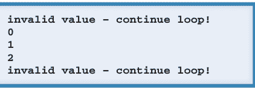

### 描述

- 要跳转到循环末尾，可以使用 `break` 语句。
- 要跳转到循环顶部，可以使用 `continue` 语句。

## 如何编写 try/catch 语句

为了防止应用程序崩溃，你需要编写 `try/catch` 语句。这被称为异常处理。

### 异常的工作

当 Java 无法执行某项操作时，它会抛出一个异常。异常是一个包含错误信息的对象。

`Exception` 类位于层次结构的顶部，定义了最通用类型。`RuntimeException` 是 `Exception` 的子类，定义了更具体的类型。

当你测试应用程序时，经常遇到未处理的异常。对于控制台应用程序，这通常会显示异常信息。这些信息通常包括异常名称、描述原因的短消息以及堆栈跟踪（stack trace）。

堆栈跟踪是异常发生之前调用的方法列表。这些方法按调用顺序列出。每个方法都包含行号，可以帮助你找到源码中引起异常的语句。图中，堆栈跟踪表明 main 方法第 18 行调用了 Double 类的 `parseDouble` 方法。

一种常见的情况是在将字符串转换为数值数据时需要处理异常。例如，如果 Double 类的 `parseDouble` 方法无法将用户输入转换为 double 类型，它将抛出 `NumberFormatException`。

### 异常体系中的某些类

```text
Exception
RuntimeException
IllegalArgumentException
NumberFormatException
ArithmeticException
NullPointerException
```

### 抛出 NumberFormatException 后控制台

```
Exception monthly investment: $100

Exception in thread "main" java.lang.NumberFormatException: For
input string: "$100"
    at sun.misc.FloatingDecimal.readJavaFormatString(
        FloatingDecimal.java:2043)
    at sun.misc.FloatingDecimal.parseDouble(
        FloatingDecimal.java:110)
    at java.lang.Double.parseDouble(
        Double.java:538)
    at murach.futurevalue.FutureValueApp.main(
        FutureValueApp.java:18)
```

### 可能抛出异常的两个方法

| 类 | 方法 | 抛出 |
| :--- | :--- | :--- |
| Integer | parseInt(String) | NumberFormatException |
| Double | parseDouble(String) | NumberFormatException |

### 描述


## 如何捕获异常

为了捕获并处理异常，你可以使用如 8-11 所示的 `try/catch` 语句。首先，你编写一个 `try` 子句，其中包含一个或多个可能引发异常的语句块。然后，紧接着在 `try` 子句之后编写一个 `catch` 子句。该子句包含了当 `try` 块中的语句抛出异常时将执行的语句块。由于此块包含处理异常的代码，因此被称为异常处理程序。

图中的示例展示了如何在一个从用户获取输入并尝试将其转换为 `double` 值的应用程序中使用 `try` 语句。在这里，调用了 `Double` 类的 `parseDouble` 方法，但调用时没有使用 `try` 子句，而是为 `NumberFormatException` 编写了 `catch` 子句。然后，如果用户输入了非数字值，`parseDouble` 方法会抛出 `NumberFormatException`，并执行 `catch` 块中的代码。

在这种情况下，`catch` 部分开始显示一条错误消息。然后，它使用 `continue` 语句跳转到循环开头，导致应用程序提示用户再次输入数字。

此示例中的 `catch` 块只有在抛出 `NumberFormatException` 时才会执行。由于该异常是此块中可能抛出的唯一异常，这是捕获该异常最清晰的方法。然而，如果你想让 `catch` 子句捕获其他异常，你可以指定 `Exception` 层次结构中更高级的异常。例如，如果你想捕获任何运行时异常（runtime exception），可以这样编写该 `catch` 子句：

```java
catch (RuntimeException e)
```

或者，如果你想捕获任何异常，可以这样编写该 `catch` 子句：

```java
catch (Exception e)
```

你将在第 16 章学习更多关于其工作原理的知识。

### 简单的 try/catch 语句的语法

```java
try { statements }
catch (ExceptionClass exceptionName) { statements }
```

### 捕获 NumberFormatException 的代码

```java
String choice = "n";

while (choice.equalsIgnoreCase("n")) {
    // 获取用户的输入
    System.out.print("Enter monthly investment: ");
}
```

### 控制台输出

| Enter monthly investment: | $100 |
| :--- | :--- |
| Error! Invalid number. Try again. | |
| Enter monthly investment: | |

### 描述

- 在语句（或 `try/catch` 语句）中，你在 `try` 块中编写任何可能抛出异常的语句。然后你可以编写一个 `catch` 块来处理 `try` 块中可能发生的任何异常。
- 当发生异常时，`try` 块中剩余的语句将被跳过，并执行 `catch` 块中的语句。
- 在 `try` 块和 `catch` 块中都使用的任何变量或对象必须在这两个块之前声明，以便它们都能访问它们。
- 如果你使用 `catch` 块来捕获特定类型的异常，你还应该导入包含该异常类的包。

## 未来价值应用（The Future Value application）

本章通过介绍一个“未来价值”应用程序作为结束，该程序可以根据指定的利率计算系列每月付款的未来价值。该应用程序在实际的上下文中展示了本章介绍的一些技能。此外，该应用程序使用了 `Console` 类，你可以使用它在控制台上显示数据或从控制台获取数据。

### 用户界面

8-12 从显示该应用程序的控制台开始。在这里，用户首先输入每月投资金额、年利率和年数的有效数字。应用程序计算年值并将其显示在控制台上。在第一次计算之后，用户输入“y”以继续第二次计算。为此，用户在年数处输入了一个无效数字（“four”）。应用程序通过显示一条错误消息来处理此，指示用户输入了无效整数，并提示用户再次输入年数。注意，这不会重启应用程序。结果是用户不会丢失数据（每月投资金额和年利率）。

### 异常处理程序（exception handler）

异常处理程序（exception handler）是 `catch` 块。当 `try` 块中的语句抛出异常时，`catch` 块中的代码就会执行。这允许程序以优雅的方式处理错误而不是直接崩溃。捕获异常（Catching exceptions）是编写健壮代码的关键部分。

此图的第三部分显示了存储在 `murach.ui` 包中的 `Main` 类。该类包含应用程序的 `main` 方法。该方法的大部分代码工作方式与第 3 章介绍的 Line Item 应用的方法类似。因此，接下来的描述将侧重于本章介绍的新技能。

首先，该应用程序从 `import` 语句开始，导入了在图的第 1 部分中所示的 `NumberFormat` 类和 `Financial` 类。因此，该应用程序可以使用 `Financial` 类来计算未来值，并可以使用 `NumberFormat` 类对值进行格式化。

在 `main` 方法中，前两个语句使用 `Console` 类显示欢迎消息。然后，在循环内部，前三个语句使用 `Console` 类的 `getDouble` 和 `get` 方法。这些语句获取与每月投资、年利率和年限对应的 `double` 和 `int` 类型值。在这里，`Console` 类将用户输入的字符串转换为正确的数值类型，并处理用户输入无效数字时抛出的异常。因此，它使得从用户处获取数值数据变得简单。

从用户处获取数值数据后，此代码使用之前显示的 `Financial` 类来计算未来值。然后，此代码使用 `Console` 类和 `NumberFormat` 类以货币格式显示未来值。

显示未来值后，此代码使用 `Console` 类询问用户是否想继续。为了实现这一点，此代码使用 `getString` 方法获取用户输入的数据。

### Main 类

```java
import java.text.NumberFormat;
import murach.calculators.Financial;

public class Main {
    public static void main(String[] args) {
        // display a welcome message
        Console.println("Welcome to the Future Value Calculator");
        Console.println();
        String choice = "y";
        while (choice.equalsIgnoreCase("y")) {
            // get input from user
            double monthlyInvestment =
```


```java
Console.nextDouble("Enter monthly investment: ");

double yearlyInterestRate =
Console.nextDouble("Enter yearly interest rate: ");

int years =
Console.nextInt("Enter number of years: ");

// call the future value method
double futureValue = Financial.calculateFutureValue(
    monthlyInvestment, yearlyInterestRate, years);

// format and display the result
Console.println("Future value: " +
    NumberFormat.getCurrencyInstance().format(futureValue));

Console.println();

// see if the user wants to continue
choice = Console.getString("Continue? (y/n): ");

Console.println();
}

Console.println("Bye!");
}
}
```

图 8-12 未来值应用程序（3 部分中的第 3 部分）

## 视角

如果本章学习有所成功，你现在应该能够使用 `if`、`switch`、`while`、`do-while` 和 `for` 语句了。这些是实现选择（selection）、分支（case）和迭代（iteration）结构的 Java 语句，它们提供了应用程序的逻辑。你还应该能够通过编写代码来写出 `try/catch` 语句，以处理当用户输入无效数字时发生的某些运行时异常。

### 总结

- 你可以使用关系运算符来创建布尔表达式，比较原始数据类型并返回 `true` 或 `false` 值，并可以使用逻辑运算符来连接两个或多个布尔表达式。
- 你可以判断两个字符串是否相等，可以从 `String` 对象调用 `equals` 或 `equalsIgnoreCase` 方法。
- 你可以使用 `if` 语句和 `switch` 语句来控制应用程序的逻辑，并可以在需要时嵌套这些语句。
- 你可以使用 `while`、`do-while` 和 `for` 循环来重复执行一个或多个语句，直到布尔表达式求值为 `false` 为止，并可以在需要时嵌套这些语句。
- 你可以使用 `break` 语句跳转到当前循环的末尾。
- 异常（Exception）是一个从 `Exception` 类或其一个子类创建的对象。
- 堆栈跟踪（stack trace）是发生异常之前被调用的方法列表。
- 你可以使用 `try` 语句来捕获并处理抛出的异常。

## 练习 8-1 修改 Invoice

在本练习中，你将修改 `Invoice` 以实现更复杂的控制。

1. 导入存储在 `ex_starts` 文件夹中的 `ch8_ex1_Invoice`。运行该程序以确保其正常工作。
2. 修改 `if` 语句，使得类型为 "r" 的总额大于 250 但小于 500 时获得 25% 的折扣。
3. 修改 `if/else` 语句，使得类型为 "c" 的总额小于 500 时获得 30% 的折扣。
4. 修改 `if/else` 语句，使得类型为 "t" 的总额大于 500 时获得 40% 的折扣。
5. 检查你的代码，确保类型不是 "r"、"c" 或 "t" 时提供折扣。
6. 使用 `switch` 语句代替 `if/else`。
7. 添加 `try/catch` 语句来捕获输入无效总额时抛出的异常。在 `catch` 块中显示错误消息并跳转到循环顶部。
8. 修改 `while` 循环，当用户输入 "n" 时退出循环。

## 练习 8-2 修改 Future Value

在本练习中，你将修改在本章最后介绍的 Future Value 应用程序。

1. 导入存储在 `ex_starts` 文件夹中的 `ch8_ex2_FutureValue`。运行该程序查看其工作方式。
2. 打开 `murach.calculators` 包中的 `Financial` 类。修改 `for` 循环，使用变量名代替 `i`。
3. 运行应用程序以确保其正常工作。

### 使用语句检查最小最大值

4. 打开 `murach.ui` 包中的 `Console` 类。回顾代码。
5. 修改 `getDouble` 方法使其三个参数：(1) 用于提示的 `String` 对象，(2) 最小值的 `double` 类型，(3) 最大值的 `double` 类型。
6. 在 `getDouble` 方法中添加 `if` 语句，确保用户输入在最小值和最大值之间。如果输入的值不在范围内，显示友好的错误消息并跳转到循环顶部。
7. 打开 `Main` 类并修改其使用 `Console` 类的 `getDouble` 方法为每月投资和年利率指定最小最大值。例如，你可能希望每月投资大于 0 且小于 100,000。同样，你可能希望年利率大于 0 且小于 20。
8. 运行应用程序以确保其正常工作。

### 如何使用 String 类

在第 2 章中，你学习了如何创建和连接字符串。在第 3 章中，你学习了如何使用 String 类的两个方法来比较字符串。现在，你将回顾这些技能，并学习一些处理字符串的新技能。

## 如何创建字符串

图 9-1 中的第一个示例显示了如何创建 String 变量并对其初始化。第一个语句创建了一个名为 `productCode` 的 String 变量，并为其赋值了一个空字符串 ("")。第二个语句创建了一个名为 `product` 的 String 变量，并为其赋值了字符串字面量 "Murach’s Java Programming"。第三个语句创建了一个名为 `bookTitle` 的 String 变量，并将该变量赋值给它。结果，这两个变量都指向同一个 String 对象。

## 如何连接字符串

当你将其他数据类型连接或追加到 String 变量时，Java 会自动转换其他数据类型，使其成为字符串的一部分。例如在第四个示例中，第二个语句将字符串字面量 "Years: " 与 int 值 3 连接起来，并赋值给名为 `message` 的 String 变量。结果，该 String 变量指向字符串 "Years: 3"。

## 如何向字符串追加数据

第五和第六个示例显示了如何向字符串追加数据。这与连接字符串的工作相同，区别是将新数据添加到字符串的末尾。

例如在第五个示例中，第一个语句声明了一个指向名字的 String 变量。然后，第二个语句向该变量追加了一个空格，第三个语句追加了姓氏。在这里，`name` 变量在等号两侧被编写，且 `+` 运算符将新的字符串字面量连接到该变量。

第六个示例演示了追加数据。结果，它使用 `+=` 运算符在等号两侧编写了 `name` 变量。由于这种方式易于阅读且所需代码比上一个示例少，因此更常用。

## 第 9 章 如何处理字符串 235

## String 类

```java
java.lang.String;
```

## 如何声明和初始化 String 变量

```java
String productCode = ""; // 指向空字符串
String title = "Murach's Java Programming"; // 指向字符串字面量
String bookTitle = title; // 指向与其他变量相同的对象
```

## 如何连接字符串

```java
String name = "Bob"; // name 是 "Bob"
String message = "Hi," + name; // message 是 "Hi, Bob"
```

## 如何连接字符串和数字

```java
int years = 3;
String message = "Years: " + years; // message 是 "Years: 3"
```

## 如何将一个字符串追加到另一个字符串

### 将一个字符串追加到另一个的常用方法

```java
String name = "Bob"; // name 是 "Bob"
name += " "; // name 是 "Bob "
name += "Smith"; // name 是 Bob Smith
```

### Description

- 你可以通过赋值字符串字面量或其他指向 String 对象的变量来初始化 String 变量。
- 要连接（拼接）一个字符串与另一个字符串或其他数据类型，可以使用 `+=` 运算符。
- 要将字符串或其他数据类型追加到字符串，可以使用 `+=` 运算符。
- 当向 String 对象连接或追加其他类型时，Java 会自动将其他类型转换为 String 对象，以便作为字符串的一部分。

图 9-1 创建、连接、追加字符串

## 如何比较字符串

在第 3 章中，你学习了如何使用 String 类的 `equals` 和 `equalsIgnoreCase` 方法来比较字符串。现在，图 9-2 回顾了这些方法，并向你介绍了更多可以用于比较字符串的方法。

此图中的所有方法都返回 `true` 或 `false` 的布尔值。例如，`equals` 方法比较字符串，如果字符串相等且大小写相同，则返回 `true` 值。同样，`startsWith` 检查字符串是否以特定的字符组合开头。

第一个示例显示了初学者在比较字符串时常见的错误。在这里，代码使用了用于基本类型的 `==` 运算符来比较字符串。但它并不能检查两个字符串是否指向同一个对象。相反，两个 String 变量可能指向不同的对象但具有相同的字符组合。结果，这并不是一种可靠的方法。

第二个示例显示了如何使用 `equals` 方法比较字符串。它检查两个 String 是否具有相同的字符。结果，这是一种检查相等性的可靠方法。

如第 3 章所学，如果你不在乎大小写，可以使用 `equalsIgnoreCase` 方法来检查两个字符串是否相等。该方法与 `equals` 方法工作相同，但它区分大小写。

第三个示例显示了如何使用 `equals` 方法检查空字符串。为了做到这一点，你只需提供空字符串作为 `equals` 方法的参数。在这里，语句检查 `productCode` 变量是否为空。如果是，它会向控制台打印消息。

第四个示例显示了如何使用 `isEmpty` 方法检查空字符串。该示例与 Java 6 引入的 `equals` 方法工作类似，但某些程序员认为 `isEmpty` 方法更容易读。

第五个示例显示了如何使用 `startsWith` 方法。在这里，语句检查 `Description` 变量是否以 "Murach" 开头。如果是，它会向控制台打印消息。

第六个示例显示了如何使用 `endsWith` 方法。在这里，语句检查 `description` 是否以 "Programming" 结尾。如果是，它会向控制台打印消息。

## 比较字符串的方法

| 方法 | 说明 |
| :--- | :--- |
| `equals(String)` | 如果两个字符串相等且大小写相同，则返回 `true`。 |
| `equalsIgnoreCase(String)` | 如果两个字符串相等忽略大小写，则返回 `true`。 |
| `isEmpty()` | 如果字符串为空，则返回 `true`（Java 6 引入）。 |
| `startsWith(String)` | 如果字符串以特定的字符组合开头，则返回 `true`。 |
| `endsWith(String)` | 如果字符串以特定的字符组合结尾，则返回 `true`。 |

### 比较字符串时的常见错误

```java
if (str1 == str2) { // 检查是否指向同一个对象
}
```

### 使用 equals 方法测试相等性

```java
if (str1.equals(str2)) { // 检查是否包含相同的字符
}
```

### 使用 equals 方法检查空字符串

```java
if (productCode.equals("")) { // 检查 productCode 是否为空
}
```

### 使用 isEmpty 方法 (Java 6)

```java
if (productCode.isEmpty()) { // 检查 productCode 是否为空
}
```

### 使用 startsWith 方法

```java
if (description.startsWith("Murach")) { // 检查 description 是否以 "Murach" 开头
}
```

### 使用 endsWith 方法

```java
if (description.endsWith("Programming")) { // 检查 description 是否以 "Programming" 结尾
}
```

## 如何处理字符串索引

图 9-3 列出了你可以用于处理 String 对象索引的方法。在这里，`indexOf` 和 `lastIndexOf` 返回一个表示字符串内索引的值。当你处理索引时，需要记住第一个索引是 0。

第一个示例显示了如何使用 `length` 方法。在这里，`length` 方法作用于指向 "java" 的 String 变量 `productCode`。结果，`length` 方法返回值为 4。

第二个示例显示了如何使用 `length` 方法检查空字符串。为了做到这一点，语句检查 String 变量 `productCode` 的长度是否为 0。如果是，它向控制台打印消息。

第三个示例显示了如何使用 `indexOf` 方法。在这里，第一次调用 `indexOf` 返回指定字符串中第一个空格字符的索引。然后，第二次调用 `indexOf` 返回指定字符串中第二个空格字符的索引。为了做到这一点，代码在第一个空格处加上 1，并从该索引开始搜索，而不是从第二个空格处开始。

第四个示例显示了如何使用 `lastIndexOf` 方法。它的工作方式与第三个示例相似。然而，它从字符串末尾开始搜索并向开头移动。为了做到这一点，代码从找到的第一个空格减去 1。

第五个示例显示了使用 `indexOf` 方法的另一种方式。在这里，你可以使用 `indexOf` 方法搜索值 "Van"。这表明你可以使用 `indexOf` 方法搜索字符字符串。此外，它还显示返回的索引是该字符串中第一个字符的。换句话说，这段代码返回 int 值 7，因为那是 "Van" 在字符串中开始的索引。

第六个示例显示了如何使用 `charAt` 方法。这段代码获取指定 String 变量的前三个字符，并将它们存储在 `char` 类型的变量中。这显示了索引是如何工作的。

## 处理字符串索引的方法

| 方法 | 说明 |
| --- | --- |
| `length()` | 返回此字符串中字符数量的 int 值 |
| `indexOf(String)` | 返回指定字符串在此字符串中首次出现索引的 int 值。如果未找到该字符串，方法返回 -1 |
| `indexOf(String, startIndex)` | 返回从指定索引开始计算的指定字符串首次出现索引的 int 值。如果未找到该字符串，方法返回 -1 |
| `lastIndexOf(String)` | 返回指定字符串在此字符串中最后一次出现索引的 int 值 |
| `lastIndexOf(String, startIndex)` | 返回从指定索引开始计算的指定字符串最后一次出现索引的 int 值 |
| `charAt(index)` | 返回指定索引处的字符值 |

### 如何获取字符串的长度

```java
String productCode = "java";
length = productCode.length(); // length 为 4
```

### 如何使用该方法检查空字符串

```java
if (productCode.length() == 0) {
  System.out.println("You must enter a product code.");
}
```

### 获取两个值索引的代码

### 获取两个空格索引的另一种方法

### 获取字符串索引的代码

```java
String name = "Martin Van Buren";
int index = name.indexOf("Van"); // index 为 7
```

### 获取指定索引字符的代码

```java
String name = "Martin Van Buren";
char char1 = name.charAt(0); // char1 为 'M'
char char2 = name.charAt(1); // char2 为 'a'
char char3 = name.charAt(2); // char3 为 'r'
```


# 如何修改字符串

- 你可以使用索引来引用字符串中的每个字符，其中 `0` 是第一个字符，`1` 是第二个字符，依此类推。


图 9-4 首先列出了你可以用于修改字符串的一些方法。这些方法返回当前 `String` 对象中出现的另一个 `String` 对象。返回的这个 `String` 对象被称为*子字符串*（substring）。

第一个示例展示了如何使用 `trim()` 方法移除 `String` 对象开头和结尾的任何空格。结果是，在代码执行后，名为 `choice` 的 `String` 变量指向为 `"y"` 的字符串字面量。

第二个示例展示了如何使用 `substring()` 方法解析一个全名字符串中的名字和姓氏。在这里，第一条语句将字符串设置为包含名和姓的字符串字面量。然后，第二条语句使用 `indexOf()` 方法获取字符串中第一个空格的索引，即名和姓之间的那个空格。接着，第三条语句使用 `substring()` 方法将 `firstName` 变量设置为从字符串起始字符开始到字符串中第一个空格字符结束的字符串。最后，第四条语句使用 `substring()` 方法将 `lastName` 变量设置为从该索引后一个位置开始一直到字符串末尾的字符串。

第三个示例展示了如何为信用卡号添加连字符。为了做到这一点，它创建了多个字符串，每个字符串对应信用卡号的一个四位部分。为此，它使用 `substring()` 方法从信用卡号的 `String` 对象中返回四个 `String` 对象。然后，最后一条将信用卡号的四个部分连接起来，并在字符串适当的位置添加连字符。

第四个示例展示了如何从名为 `ccNumber` 的 `String` 变量所引用的信用卡号中移除连字符。为了做到这一点，该示例创建了名为 `temp` 的第二个 `String` 变量。然后，它遍历信用卡号字符串中的每个索引。在循环内部，使用 `charAt()` 方法检查当前索引的字符是否为连字符。如果不是，则将 `charAt()` 方法返回的字符添加到 `temp` 变量中。在本章后面，你将学习一种更简单的方法来完成此任务。

在使用索引时，必须提供有效的索引。如果你提供的索引在 `String` 对象中不存在，方法将抛出 `StringIndexOutOfBoundsException`。这是初学者经常犯的错误。通过确保使用的索引大于等于 `0` 且小于 `String` 对象的长度可以避免这种异常。在第四个示例中，循环从索引 `0` 开始，到 `ccNumber` 对象的长度减一结束。

## 修改字符串的方法

| 方法 | 说明 |
|---|---|
| `trim()` | 返回一个除了开头和结尾空格的 `String` 对象。 |
| `substring(startIndex)` | 返回从指定索引开始到字符串末尾的 `String` 对象。 |
| `substring(startIndex, endIndex)` | 返回从指定索引开始但不包含结束索引的 `String` 对象。 |

## 字符串首尾空格的代码

```java
String choice = " Y ";

choice = choice.trim(); // choice 为 "Y"
```

## 从字符串中解析名和姓的代码

```java
String name = "Martin Van Buren";

int index = name.indexOf(" "); // index 为 6

String firstName = name.substring(0, index); // firstName 为 "Martin"

String lastName = name.substring(index + 1); // lastName 为 "Van Buren"
```

# StringBuilder 类

`java.lang.StringBuilder`

## StringBuilder 类的构造函数

| 构造函数 | 说明 |
| --- | --- |
| `StringBuilder()` | 创建一个初始容量为 16 个字符的空 `StringBuilder` 对象。 |
| `StringBuilder(int capacity)` | 创建一个初始容量为指定数字字符的空 `StringBuilder` 对象。 |
| `StringBuilder(String str)` | 创建一个 `StringBuilder` 对象，其包含指定的字符串以及额外的 16 个字符的容量。 |

## StringBuilder 类的方法

| 方法 | 说明 |
| --- | --- |
| `append(data)` | 在字符串的末尾添加基本数据类型或对象的字符串。 |
| `capacity()` | 返回此 `StringBuilder` 对象的容量值。 |
| `length()` | 返回此 `StringBuilder` 中字符的数量。 |

## 创建信用卡号的代码

```java
StringBuilder ccNumber = new StringBuilder();

ccNumber.append("4012");
ccNumber.append("8888");
ccNumber.append("8888");
ccNumber.append("1881");
```

## 显示容量如何自动增加的代码

```java
StringBuilder name = new StringBuilder(8);

int capacity1 = name.capacity(); // capacity1 是 8

name.append("Raymond R. Thomas");

int length = name.length(); // length 是 17

int capacity2 = name.capacity(); // capacity2 是 18 (2 * capacity1 + 2);
```

### Description

- `String` 对象是不可变的。因此，它们不能增长或缩小。
- `StringBuilder` 对象是可变的，这意味着你可以修改字符串中的字符。如果必要，`StringBuilder` 对象的容量会自动增加。
- `StringBuilder` 类是在 Java 5 中引入的。它被设计用于替代较旧的 `StringBuffer` 类。
- `StringBuilder` 类与 `StringBuffer` 类具有相同的构造函数和方法。因此，你可以使用它来完成相同的任务。
- `StringBuilder` 类的效率不如 `StringBuffer` 类（注：原文此处可能有笔误，通常 `StringBuilder` 效率更高但非线程安全），但它是线程安全的。因此，每当你需要确保代码线程安全时，你可以使用它代替 `StringBuilder` 类。

图 9-5 如何创建 `StringBuilder` 对象并向其添加数据

正如你在本章前面学到的，你可以使用 `String` 类和 `+=` 运算符来完成相同的任务。然而，如果你这样做，Java 必须为每条语句创建一个新的 `String` 对象。相比之下，当你使用 `StringBuilder` 类的方法时，Java 不会创建新的 `StringBuilder` 对象。相反，它增加了 `StringBuilder` 对象的长度。如果必要，它还会增加 `StringBuilder` 对象的容量。因此，`StringBuilder` 对象通常比 `String` 对象更高效。

图 9-5 中的第二个示例显示了 `StringBuilder` 对象如何随着字符串长度的增加而自动增加容量。在这里，第一条语句创建了一个容量为 8 个字符的空 `StringBuilder` 对象。第二条语句使用 `capacity()` 来验证容量是否为 8。第三条语句向字符串添加了一个 17 个字符的字符串。由于这超过了 `StringBuilder` 对象的容量，Java 会通过双倍当前容量并加 2 来自动增加容量。因此，容量从 8 个字符增加到 18 个字符。然后，最后两个语句验证了新的长度和容量。

## 如何修改字符串

图 9-6 显示了 `StringBuilder` 类的更多方法。其中一些方法提供了 `String` 类不具备的额外功能。例如，你可以使用 `StringBuilder` 类的方法来插入、替换或删除字符串。然而，`StringBuilder` 类也提供了与 `String` 类工作相同的方法。例如，`charAt()` 和 `substring()` 方法在 `StringBuilder` 类中的工作方式与 `String` 类相同，你在使用这些方法时不会遇到任何问题。

第一个示例为上一图中的 Visa 信用卡号字符串添加了连字符。在这里，第一条语句创建一个容量为 8 个字符的空 `StringBuilder` 对象。第二条语句使用 `capacity()` 来验证容量是否为 8。第三条语句向字符串添加了一个 17 个字符的字符串。由于这超过了 `StringBuilder` 对象的容量，Java 会通过双倍当前容量并加 2 来自动增加容量。因此，容量从 8 个字符增加到 18 个字符。然后，最后两个语句验证了新的长度和容量。

（注：原文后续存在多处逻辑重复或描述不全的片段，已根据要求进行针对性翻译并保持格式对齐）

# 第 9 章 如何处理字符串

## 控制台示例

| 欢迎使用产品列表器 |
| :--- |
| 输入产品代码: java |
| 另一个产品？(y/n): y |
| 输入产品代码: mysql |
| 另一个产品？(y/n): n |

| 代码 | 描述 | 价格 |
| :--- | :--- | :--- |
| java | Murach's Java Programming | $57.50 |
| mysql | Murach's MySQL | $54.50 |

## StringUtil 类

```java
package murach.ui;

public class StringUtil {

    public static String pad(String s, int length) {

        if (s.length() < length) {

            // 填充空格直到字符串达到指定的长度
            StringBuilder sb = new StringBuilder(s);

            while (sb.length() < length) {
                sb.append(" ");
            }

            return sb.toString();

        } else {

            // 将字符串截断到指定的长度
            return s.substring(0, length);

        }

    }

}
```

图 9-7 产品列表器应用程序（部分 1/2）

## Main 类

部分 2 图 9-7 显示了产品列表器应用程序 `Main` 类的代码。该代码首先声明了三个常量，用于指定代码、描述和价格列的字符宽度。

在声明常量之后，它为列表创建了一个 `StringBuilder` 对象。然后，它将标题行追加到该字符串中。为了实现，它使用 `StringUtil` 类的静态 `pad()` 方法向列添加空格，使其具有正确的宽度。

在设置好标题行后，该代码使用 `while` 循环允许用户输入产品代码。在循环内部，第一条语句从用户处获取产品代码。为此，它使用了 `Console` 类的静态 `getString()` 方法。接着，它使用 `ProductDB` 类的静态 `getProduct()` 方法。然后，如上一章所述，为指定的代码获取一个 `Product` 对象。

在获取指定代码的 `Product` 对象后，该代码为列表添加该产品的一行。为此，它使用了 `StringUtil` 类的静态 `pad()` 方法。

在该方法开头定义的三个常量用于三个地方。首先，它们用于指定标题行中三列的宽度。其次，它们用于指定创建标题行与其他行之间分隔符的三个列的宽度。最后，它们用于指定每个产品数据列的宽度。

因此，如果你想更改列的宽度，只需要更改常量的值即可。例如，如果你想让描述列的宽度变为 50 个字符，只需要将名为 `DESC_WIDTH` 的常量值改为 50。

## Main 类代码

```java
package murach.ui;

import murach.db.ProductDB;
import murach.business.Product;

public class Main {
    public static void main(String args[]) {
        System.out.println("Welcome to the Product Lister\n");

        final int CODE_WIDTH = 10;
        final int DESC_WIDTH = 34;
        final int PRICE_WIDTH = 10;

        // 设置显示字符串
        StringBuilder list = new StringBuilder();
        list.append(StringUtil.pad("Code", CODE_WIDTH));
        list.append(StringUtil.pad("Description", DESC_WIDTH));
        list.append(StringUtil.pad("Price", PRICE_WIDTH));
        list.append("\n");

        list.append(StringUtil.pad("============", CODE_WIDTH));
        list.append("\n");
        list.append(StringUtil.pad("============================", DESC_WIDTH));
        list.append(StringUtil.pad("============", PRICE_WIDTH));
        list.append("\n");

        // 执行 1 次或多次计算
        String choice = "y";
        while (choice.equalsIgnoreCase("y")) {
            // 从用户处获取输入
            String productCode = Console.getString("Enter product code: ");

            Product product = ProductDB.getProduct(productCode);

            list.append("\n");
            list.append(StringUtil.pad(product.getCode(), CODE_WIDTH));
            list.append("\n");
            list.append(StringUtil.pad(product.getDescription(), DESC_WIDTH));
            list.append("\n");
            list.append(StringUtil.pad(product.getPriceFormatted(), PRICE_WIDTH));
            list.append("\n");

            // 检查用户是否想继续
            choice = Console.getString("Another product? (y/n): ");
            System.out.println();
        }
        System.out.println(list);
    }
}
```

图 9-7 产品列表器应用程序（部分 2/2）

## 观点

现在你已经完成了这一章，你应该能够使用 `String` 和 `StringBuilder` 类来处理字符串。这些技能是开发 Java 应用程序的基础。请记住，本章仅涵盖了这些类中最有用的方法。因此，如果你想学习这些类的其他方法，可以查阅 Java API 文档。

### 总结

- 你可以使用 `String` 类的方法来比较整个或部分字符串。
- 在处理字符串时，你通常需要使用索引来引用字符。在字符串中，第一个字符的索引为 `0`，第二个字符的索引为 `1`，依此类推。
- `String` 对象是不可变的，因此你不能在字符串中添加、删除或修改字符。
- `StringBuilder` 对象是可变的，因此你可以使用 `StringBuilder` 的方法在其内部追加、插入或替换字符。

## 练习 9-1 解析姓名

在本次练习中，你将编写一个应用程序，根据输入将姓名解析为名和姓，或者名、中间名和姓。输出应该如下所示：

```
Enter a name: Joel Murach
First name: Joel
Last name: Murach
```

或者：

```
Enter a name: Joel Ray Murach
First name: Joel
Middle name: Ray
Last name: Murach
```

- 导入位于 `ex_starts` 文件夹中的 `ch9_ex1_NameParser` 项目。然后，检查 `NameParser` 类中的代码。
- 添加代码，根据用户输入的内容将姓名分为两个或三个字符串。
- 将姓名的每个单词显示在单独行。
- 如果用户输入的单词少于两个或多于三个，则显示错误信息。
- 确保即使用户在姓名前后输入了一个或多个空格，应用程序也能正常工作。
- 测试应用程序以确保运行正常。

## 练习 9-2 改进未来价值

在本次练习中，你将改进未来价值应用程序，允许用户在输入金额和百分比数值时输入美元符号（$）和百分符号（%）。


# Welcome to the Future Value Calculator

```
Welcome to the Future Value Calculator
Enter monthly investment: $100
Enter yearly interest rate: 3%
Enter number of years: 3
Future value: $3,771.46
```

- 导入位于 `ex_starts` 文件夹中的 `ch9_ex2_FutureValue` 项目。然后，打开 `Main` 和 `Console` 类并检查代码。
- 打开 `Console` 类并修改 `getDouble` 方法，从用户输入的字符串中移除美元符号（$）或百分符号（%）。
- 运行应用程序并测试以确保运行正常。你应该能够输入美元符号和百分符号。

# 数组操作的核心技能

本章首先介绍如何使用 Java 语言创建和操作数组。

## 如何创建数组

数组是一个包含一个或多个称为“元素”（elements）的项的对象。数组中的每个元素可以是基本数据类型（例如 `int` 值），也可以是引用类型（例如 `String` 对象或 `Product` 对象）。正如你在本章稍后部分看到的，数组本身是一种引用类型。

在 Java 中，数组中的所有元素必须是相同类型。因此，`int` 类型的数组只能包含 `int` 值，而 `String` 类型的数组只能包含 `String` 对象。然而，数组可以包含派生自数组基类型的元素。因此，如果你声明了一个 `Product` 类型的数组，你可以包含任何继承自 `Product` 类的对象。你将在下一章学习更多关于其工作原理的内容。

数组的长度（或大小）表示它包含的元素数量。在 Java 中，数组的长度是固定的。因此，一旦创建了数组，你就无法更改它的长度。如果你需要更改数组的长度，应该考虑使用集合（collection）而不是数组。例如，你可能想使用第 14 章描述的 `ArrayList` 类而不是数组。这时，集合会自动调整其长度以适应数据。

图 10 显示了创建数组的几种方法。首先，你必须声明一个指向数组对象的变量，然后创建一个数组对象并将其赋值给该变量。要创建一个新对象，你编写 `new` 关键字，紧接着是数据类型，然后是一对括号。在括号中，你编写数组的长度。

你可以使用单独的语句声明数组变量并创建数组对象，如第一个示例所示。或者，你可以在一个语句中声明变量并实例化数组，如第二个示例所示。这两个示例都创建了一个包含四个值的数组。

当你声明数组时，使用一对空括号来指示该变量是一个数组。大多数程序员倾向于在数据类型后编写空括号，以指示该数组是特定类型的。然而，如果你愿意，也可以像第三个示例所示，在变量名后编写这些括号。

第四和第五个示例创建了对象数组。具体来说，第四个示例创建了一个 `String` 对象的数组，第五个示例创建了一个包含五个 `Product` 对象的数组。

如果你在编译时就知道数组的大小，可以像前五个示例一样将长度编写为字面量值。或者，你可以像第六个示例一样将长度编写为常量。然而，如果你在运行时才知道数组的大小，可以使用变量来指定其大小，如第七个示例所示。

## 声明和实例化数组的语法

### 使用两条语句

```java
type[] arrayName;
arrayName = new type[length];
```

### 使用单条语句

```java
type[] arrayName = new type[length];
```

### 使用单条语句并在变量名后加括号

```java
type arrayName[] = new type[length];
```

### 声明并实例化 double 类型值数组的示例

#### 使用两条语句

```java
double[] prices;
prices = new double[4];
```

#### 使用单条语句

```java
double[] prices = new double[4];
```

#### 使用单条语句并在变量名后加括号

```java
double prices[] = new double[4];
```

### 其他示例

#### 一个 `String` 对象的数组

```java
String[] titles = new String[3];
```

#### 一个 `Product` 对象的数组

```java
Product[] products = new Product[5];
```

#### 使用常量指定数组长度的代码

```java
final int TITLE_COUNT = 100;
String[] titles = new String[TITLE_COUNT];
```

#### 使用变量指定数组长度的代码

```java
System.out.print("Enter number of titles: ");
int titleCount = sc.nextInt();
String[] titles = new String[titleCount];
```

### 说明

- 数组可以存储多个相同类型的元素。
- 数组包含多个项，这些项可以是基本类型或引用类型。
- 声明数组时，使用 `[]` 符号表示该变量是数组。
- 数组的长度是固定的，一旦创建就无法更改。
- 如果需要动态长度，应使用集合（如 `ArrayList`），它会自动调整大小。
- 数组本身是一种引用类型。
- 声明数组时，可以将 `[]` 放在类型后面，也可以放在变量名后面。
- 创建数组时，使用 `new` 关键字，并在 `[]` 括号内指定数组的长度。
- 数组的长度可以通过字面量、常量或变量来指定。
- 数组可以包含任何类型派生自基类型的对象。
- 数组可以包含一个或多个称为元素的项。
- 图 10 显示了创建数组的几种方法。

## 如何对数组使用 for 循环

`for` 循环通常用于通过增加索引变量来逐个处理数组中的元素。图 10-3 显示了如何使用 `for` 循环处理数组。

图中的语法展示了如何使用 `length` 字段返回数组的长度。由于 `length` 是一个字段而不是方法，因此你不需要在它后面加括号。`length` 字段返回一个表示数组长度的 `int` 值。通常，你使用这个值在循环获取最后一个元素后停止循环，以防止循环尝试使用越界的索引。

图中的第一个示例显示了如何创建一个包含 10 个 `int` 值的数组，并用 0 到 9 填充它。在这里，循环使用一个名为 `i` 的 `int` 变量对数组进行索引，并为数组中的每个元素赋值。结果是，每个元素存储的值等于其索引。

第二个示例显示了你如何使用 `for` 循环将数组的内容打印到控制台。在这里，第一条语句创建一个名为 `prices` 的 `double` 类型值数组并初始化了它的值。然后，`for` 循环遍历数组的每个元素，并通过一条语句将当前元素的值打印到控制台。

第三个示例显示了你如何使用 `for` 循环计算 `prices` 数组的平均值。在这里，第一条语句创建一个名为 `prices` 的 `double` 类型值数组并初始化了它的值。然后，第二条语句声明一个名为 `sum` 的 `double` 变量来存储值的总和。接下来，`for` 循环遍历数组的每个元素并将每个元素的值加上名为 `sum` 的变量。当 `for` 循环结束时，`sum` 变量包含了数组中所有价格的总和。然后，通过将 `sum` 除以数组中的元素数量来计算平均值。

## 获取数组长度的语法

`array.length`

### 将 0 到 9 放入数组的代码

```java
int[] values = new int[10];
for (int i = 0; i < values.length; i++) {
    values[i] = i;
}
```

### 将价格数组打印到控制台的代码

```java
double[] prices = {14.95, 12.95, 11.95, 9.95};
for (int i = 0; i < prices.length; i++) {
    System.out.println(prices[i]);
}
```

### 控制台输出


### 计算价格数组平均值的代码

```java
double[] prices = {14.95, 12.95, 11.95, 9.95};
double sum = 0.0;
for (int i = 0; i < prices.length; i++) {
    sum += prices[i];
}
double average = sum / prices.length;
```

### 描述

- 你可以使用循环来处理数组中的每个元素。
- 你可以使用数组的 `length` 字段来确定数组中的元素数量。

## 如何对数组使用增强型 for 循环

图 10-4 显示了如何使用 Java 5 引入的增强型 `for` 循环。由于这种循环的设计是为了方便处理数组或集合中的每个元素，因此它有时被称为 `foreach` 循环。

与普通循环不同，增强型 `for` 循环不使用单独的表达式来初始化、测试和增加计数变量。相反，它声明了一个用于引用数组每个元素的变量。在循环内部，你可以使用该变量来访问数组的每个元素。

图中的第一个示例显示了你如何使用增强型 `for` 打印 `double` 数组的元素。这个示例的功能与图 10-3 中的第二个示例相同。然而，在增强型 `for` 循环版本中，使用了一个名为 `price` 的变量来访问 `prices` 数组中的每个元素。然后，循环内的语句简单地将 `price` 变量打印到控制台。由于增强型 `for` 循环会自动获取当前元素，你不需要使用索引来获取数组的每个元素，也不需要使用数组的 `length` 字段来保持索引在数组范围内。

第二个示例显示了如何使用增强型 `for` 循环计算 `prices` 数组的平均值。这个示例的功能与图 10-3 中的第三个示例相同。同样，由于增强型 `for` 循环会自动对数组进行索引，因此不需要索引。

### 增强型 `for` 循环的语法

```java
for (type variableName : arrayName) {
    statements
}
```

### 将价格数组打印到控制台的代码

```java
double[] prices = {14.95, 12.95, 11.95, 9.95};
for (double price : prices) {
    System.out.println(price);
}
```

### 控制台输出


### 计算价格数组平均值的代码

```java
double[] prices = {14.95, 12.95, 11.95, 9.95};
double sum = 0.0;
for (double price : prices) {
    sum += price;
}
double average = sum / prices.length;
```

### 描述

- 你可以使用循环处理数组中的每个元素。
- 你可以使用数组的 `length` 字段来确定数组中的元素数量。
- 你可以使用增强型 `for` 循环处理数组中的每个元素。
- 增强型 `for` 循环（foreach）简化了索引管理。

## 如何处理二维数组

到目前为止，本章已经展示了如何使用一个索引处理数组。这被称为一维数组，你可以将其想象为列。现在，图 10-5 显示了如何使用两个索引。这被称为二维数组，你可以将其想象为表格。

Java 将二维数组实现为数组的数组。图中显示了如何创建，然后指定行和列的数量。因此，代码示例初始化了三行三列。

要引用二维数组中的元素，你需要使用两组索引。第一个值是行索引，第二个值是列索引。因此，`numbers[1][0]` 指 `numbers` 数组的第 2 行第 1 列。

你还可以使用单个语句创建二维数组并对其赋值。为了这样做，你可以使用适用于一维数组的简写符号。然而，你可以如图所示，将数组的每个元素编码为单独的数组。在这里，数组被赋值了三个元素，每个元素都是一个包含两个元素的数组，值为 `[1, 2]`、`[3, 4]` 和 `[5, 6]`。

最后一个示例使用了两个增强型循环来遍历二维数组的元素。为了这样做，它需要在一个增强型循环内部嵌套另一个。在这里，外层循环遍历数组的行以获取每行。然而，每行都是一个包含多个列的数组。结果，内层循环遍历当前行的每一列。这获取了当前行的元素。

图中的数组是二维数组最常见的类型，矩形数组。在这种数组中，每行都有相同数量的列。然而，你可以创建一个锯齿数组。行可以包含不同数量的列。这是可能的，因为二维数组的每行都是单独的一维数组。

### 如何创建矩形数组

#### 创建矩形数组的语法

```java
type[][] arrayName = new type[rowCount][columnCount];
```

#### 一个创建 3x2 数组的语句

```java
int[][] numbersTable = new int[3][2];
```

### 如何给矩形数组赋值

#### 引用矩形数组中某个元素的语法

`arrayName[rowIndex][columnIndex]`

#### 3x2 数组的索引

- `[0][0]`
- `[0][1]`
- `[1][0]`
- `[1][1]`
- `[2][0]`
- `[2][1]`

#### 给数组赋值代码

```java
numbersTable[0][0] = 1;
numbersTable[0][1] = 2;
numbersTable[1][0] = 3;
numbersTable[1][1] = 4;
numbersTable[2][0] = 5;
numbersTable[2][1] = 6;
```

#### 在一条语句中创建并初始化 3x2 数组的代码

```java
int[][] numbersTable = {{1, 2}, {3, 4}, {5, 6}};
```

### 如何使用嵌套循环处理矩形数组

#### 使用嵌套循环处理矩形数组的代码

```java
for (int[] row : numbersTable) {
    for (int value : row) {
        System.out.print(value + " ");
    }
    System.out.println();
}
```

#### 控制台输出

| 1 | 2 |
|---|---|
| 3 | 4 |
| 5 | 6 |

### 描述

- 二维数组使用两个索引，允许将数据存储在由行和列组成的表格。这可以被视为数组的数组，其中每一行都是一个独立的列数组。
- 大多数二维数组是矩形数组，即每行的列数都相同。然而，也可以创建锯齿数组，其中每行的列数可能不同。
- 如果需要，你可以扩展这种二维语法，用以处理具有超过两个维度的数组。

## 如何使用 Arrays 类

现在你已经掌握了创建和使用数组的基本语言技能，准备好学习如何使用 `java.util` 包中的 `Arrays` 类对数组执行一些额外的操作。该类包含了静态方法，你可以使用它们来填充、排序、搜索、复制和比较数组。图 10-6

当你使用这些方法时，可以提供任何类型的一维数组作为数组参数。同样，你可以提供原始值或对象作为值参数。然而，你必须确保值或对象的类型与数组类型匹配。

### 如何填充数组

第一个示例展示了如何使用 `fill` 方法为数组中的所有元素赋值。在这里，第一条语句创建一个包含 5 个 `int` 值的数组。默认情况下，该语句会自动将每个元素初始化为 0。然后，第二条语句使用 `Arrays` 类的 `fill` 方法将所有元素设置为 1。

### 如何排序数组

第二个示例展示了如何使用 `sort` 方法对一个包含 10 个 `int` 值的数组进行排序。在这里，第一条语句创建一个从 0 到 9 的未排序 `int` 数组。然后，第二条语句使用 `sort` 方法对这些值进行排序。之后，这段代码使用增强循环将数组的内容打印到控制台。这表明 `sort` 方法成功排序了数组。

### 如何搜索数组

第三个示例展示了如何使用 `binarySearch` 方法。该方法搜索具有特定值的元素并返回其索引。然而，在使用此方法之前，你必须使用 `sort` 方法对数组进行排序。在这个示例中，第一条语句创建了一个未排序的字符串数组。然后，第二条语句使用 `sort` 方法对该数组进行排序。对于字符串，它按字母表从 A 到 Z 排序。换句话说，它对数组中的 "java"、"jsp" 和 "mysql" 等字符串进行排序。结果，第三条语句调用的 `binarySearch` 方法返回值为 2，这意味着该字符串是数组的第三个元素。

### 如何创建数组的引用

和字符串一样，数组是一种引用类型。因此，它的工作原理与原始类型略有不同。首先，当你使用赋值运算符 (`=`) 将变量赋值给数组时，变量并不存储数组的副本，而是引用数组对象。因此，多个变量引用同一个数组对象是可能的。

### Arrays 类

`java.util.Arrays`

### Arrays 类的某些静态方法

| 方法 | 描述 |
| --- | --- |
| `fill(array, value)` | 用指定的值填充指定数组的所有元素。 |
| `sort(array)` | 将数组的元素按升序排序。 |
| `binarySearch(array, value)` | 返回数组中指定值的索引（`int`）。如果未在数组中找到指定的值，则返回 -1。要使此方法正常工作，必须在调用 `sort` 方法之前对数组进行排序。 |

### 如何填充数组

```java
int[] quantities = new int[5]; // 所有元素都被设置为 0
Arrays.fill(quantities, 1); // 所有元素都被设置为 1
```

### 如何排序数组

```java
int[] numbers = {2, 6, 4, 1, 8, 5, 9, 3, 7, 0};
Arrays.sort(numbers);
for (int number : numbers) {
    System.out.print(number + " ");
}
```

### 控制台输出

```
0 1 2 3 4 5 6 7 8 9
```

### 如何搜索数组


```java
String[] productCodes = {"java", "jsp", "mysql"};
Arrays.sort(productCodes);
int index = Arrays.binarySearch(productCodes, "mysql");
```

### 描述

- 二维数组使用两个索引，允许将数据存储在由行和列组成的表格中。
- 大多数二维数组是矩数组，即每行的列数都相同。然而，也可以创建锯齿数组，其中每行的列数可能不同。
- 如果需要，你可以扩展这种二维语法，用以处理具有超过两个维度的数组。


第一个示例展示了如何使用 `fill` 方法为数组中的所有元素赋值。在这里，第一条语句创建一个包含 5 个 `int` 值的数组。默认情况下，该语句会自动将每个元素初始化为 0。然后，第二条语句使用 `Arrays` 类的 `fill` 方法将所有元素设置为 1。

第二个示例展示了如何使用 `sort` 方法对一个包含 10 个 `int` 值的数组进行排序。在这里，第一条语句创建一个从 0 到 9 的未排序 `int` 数组。然后，第二条语句使用 `sort` 方法对这些值进行排序。之后，这段代码使用增强循环将数组的内容打印到控制台。这表明 `sort` 方法成功排序了数组。

第三个示例展示了如何使用 `binarySearch` 方法。该方法搜索具有特定值的元素并返回其索引。然而，在使用此方法之前，你必须使用 `sort` 方法对数组进行排序。在这个示例中，第一条语句创建了一个未排序的字符串数组。然后，第二条语句使用 `sort` 方法对该数组进行排序。对于字符串，它按字母表从 A 到 Z 排序。换句话说，它对数组中的 "java"、"jsp" 和 "mysql" 等字符串进行排序。结果，第三条语句调用的 `binarySearch` 方法返回值为 2，这意味着该字符串是数组的第三个元素。

和字符串一样，数组是一种引用类型。因此，它的工作原理与原始类型略有不同。首先，当你使用赋值运算符 (`=`) 将变量赋值给数组时，变量并不存储数组的副本，而是引用数组对象。因此，多个变量引用同一个数组对象是可能的。

如果你想检查两个变量是否引用同一个对象，可以使用相等运算符 (`==`)，如第三个示例所示。然而，这并不是检查数组是否具有相同的值。要实现这一点，你需要使用 `Arrays` 类的 `equals` 方法，如第四个示例所示。当对引用类型数组使用此方法时，可能需要为引用类型实现 `equals` 方法，如下一章所述。

# 如何复制数组

如果你想要数组的副本而不是另一个引用，可以使用 `copyOf` 方法将一个数组的所有元素复制到另一个数组。简单的方法是使用静态 `copyOf` 方法，如第二个示例所示。这样，每个数组变量都指向自己的副本，对其中一个的修改不会反映在另一个上。

在这个示例中，长度参数被设置为 `grades` 数组的长度。结果，此示例将数组的所有元素复制到 `percentages` 数组。然而，如果你指定了更大的长度，`percentages` 数组将用默认值零填充。或者，如果你指定了较小的长度，`percentages` 数组中的元素将被截断。

`copyOf` 方法是在 Java 6 中引入的。因此它在早期的 Java 版本中无法工作。如果你需要通过 `System` 类的 `arraycopy` 方法创建数组副本，这比使用 `Arrays` 类的 `copyOf` 方法复杂一些。但是，如果你参考 Java API 文档，应该学会如何使用它。

当你对引用类型数组使用 `copyOf` 方法时，需要知道它创建的是浅拷贝而不是深拷贝。这意味着它创建了一个新数组，其中原始数组中对象的引用副本。因此，如果你更改了其中一个对象中的值，另一个数组中的对象也会发生变化。


## Arrays 类的更多静态方法

| 方法 | 描述 |
| --- | --- |
| `copyOf(array, length)` | 复制指定的数组，根据需要截断或用默认值填充，以使副本具有指定的长度。 |
| `equals(array1, array2)` | 如果两个数组都具有相同类型，且数组中的所有元素都相互相等，则返回真值。 |

## 如何创建数组的引用

```java
double[] grades = {92.3, 88.0, 95.2, 90.5};
double[] percentages = grades;
percentages[1] = 70;
System.out.println("grades[1]=" + grades[1]); // 将 grades[1]变为 // 输出 70
```

## 如何创建数组的浅拷贝（Java 6 或更高版本）

```java
double[] grades = {92.3, 88.0, 95.2, 90.5};
double[] percentages = Arrays.copyOf(grades, grades.length);
percentages[1] = 70.2; // 不改变 grades[1]
System.out.println("grades[1]=" + grades[1]); // 输出 88.0
```

## 如何确定两个变量是否指向同一个数组

```java
if (grades == percentages) {
    System.out.println("两个变量指向同一个数组.");
} else {
    System.out.println("每个变量指向一个不同的数组.");
    System.out.println("然而，这些数组可能包含相同的数据.");
}
```

## 如何确定两个变量是否包含相同的数据

```java
if (Arrays.equals(grades, percentages)) {
    System.out.println("两个变量指向相同的数据.");
} else {
    System.out.println("两个变量没有指向相同的数据.")
}
```

### 描述

- 像字符串一样，数组是一种引用类型。
- 要创建指向现有数组的引用，可以使用赋值运算符 (`=`) 将指向现有数组的变量赋值给另一个变量。然后，两个变量都指向同一个数组。
- 要检查两个数组是否指向同一个数组，可以使用等号运算符 (`==`)。
- `copyOf` 方法是在 Java 6 中引入的。因此，它仅适用于 Java 6 及更高版本。在 Java 6 之前，可以使用 `System` 类的 `arraycopy` 方法。
- 复制数组时，新数组必须与源数组类型相同。

图 10-7 如何引用和复制数组

## 月份选择器应用程序

本章最后介绍了一个月份选择器应用程序，它允许用户通过输入月份数字来选择月份文本。该应用程序在应用的上下文中展示了本章介绍的一些技能。

### 用户界面

图 10-8 首先显示该应用程序的控制台。在这里，用户首先输入 1 选择一月并输入 "y" 继续。然后，用户输入 12 选择十二月并输入 "n" 退出应用程序。

## Main 类

此图显示了月份选择器应用程序中 Main 类的代码。该代码从声明一个包含12个 `String` 对象的数组开始，其中包含了12个月份的名称。

声明数组后，该代码使用 `while` 循环允许用户选择一个或多个月份。在循环内部，第一条语句从用户处获取月份数字。为了做到，它使用了第 8 章描述的 `Console` 类的静态方法 `getInt`。

获取月份数字后，该代码使用 `if` 语句检查该数字是否为有效的月份数字。为了做到，该代码检查该数字是否小于数组长度（12）加 1。如果是，该代码将使用 `Console` 类向控制台显示错误消息，并使用 `continue` 语句通过减 1 跳到循环顶部。

如果月份数字有效，该代码继续从用户输入的月份数字中减 1。这样，该代码可以使用新的 `int` 值从月份名称数组中访问正确的 `String` 对象。正如你现在应该的，这是必要的，因为数组的索引从 0 开始，而不是 1。因此，该数组的索引范围是从 0 到 11，而不是 1 到 12。

## 第 10 章 如何使用数组 269

### 控制台

```
Welcome to the Month Selector
nEnter month number: 1
You selected: January
Continue? (y/n): y

Enter month number: 12
You selected: December
Continue? (y/n): n
```

## Main 类

```java
package murach.ui;
public class Main {

    public static void main(String[] args) {
        System.out.println("Welcome to the Month Selector\n");

        String[] monthName = {"January"
```

图 10-8 月份选择器应用程序

## 观点

现在你已经完成了这一章，你应该知道如何处理一维数组和二维数组了。虽然数组是 Java 的核心部分，但它们并不总是能提供你需要的功能。在许多情况下，使用一种称为集合（collection）的更高级的数据结构更为理想。例如，与其像本章所示那样使用数组，你可能想要使用 `ArrayList`。

### 总结

- 像字符串一样，数组是一种引用类型。
- 要创建指向现有数组的引用，可以使用赋值运算符 (`=`) 将指向现有数组的变量赋值给另一个变量。然后，两个变量都指向同一个数组。
- 在处理数组时，可以使用索引来识别任何元素。相反，0 指向第一个元素。
- 数组的长度（`length`）是元素的数量。
- `for` 循环常用于数组。
- 一维数组提供单列。相反，二维数组具有行列。
- 你可以使用 `Arrays` 类进行填充、排序和比较。

## 练习 10-1 使用一维数组

在此练习中，你可以练习使用一维数组。

1. 从 `ex_starts` 目录导入名为 `10_ex1_ArrayTest` 的项目。然后打开 `Main` 类。
2. 创建一个 `double` 类型的一维数组。然后，使用 `for` 循环为每个元素添加一个 0 到 100 的随机数。（提示：你可以调用 `Math.random()`）
3. 使用增强 for 循环对数组求和。然后，计算平均值并将其打印到控制台：

```java
Math.random() * 100
```

4. 使用 `Arrays` 类的 `sort` 方法对数组进行排序。然后，在控制台打印中位数（第 5 个值）：

```
Average: 50.95267618435
```

5. 输出数组的第 9 个值，如下所示：

```
9 | 8.9277240316032
18 | 14.053128749867
...
99 | 22.471670293182
```

## 练习 10-2 使用二维数组

此练习引导你完成将二维矩形数组添加到未来价值应用程序的过程中。该数组存储最多 10 次计算的值。当应用程序结束时，它会在控制台打印这些计算的摘要，如下：

| 每月投入/ 利率 | 年限 | 未来价值 |
| --- | --- | --- |
| $100.00 8.0% | 10 | $18416.57 |
| $125.00 8.0% | 10 | $23020.71 |
| $150.00 8.0% | 10 | $27624.85 |

1. 从 `ex_starts` 目录导入名为 `10_ex2_FutureValue` 的项目。然后查看代码并运行应用程序以确保其正常工作。
2. 在 main 方法开头声明一个行计数器变量和一个提供 10 行 4 列的字符串矩形数组。
3. 在显示每次计算结果的代码之后，添加格式化所有计算值并将其转换为字符串的代码。然后，将字符串值存储在数组的下一行。（提示：你可以使用 `Integer` 类的 `toString` 方法将年份转换为字符串。）
4. 当用户退出应用程序时，添加代码在控制台上显示元素。输出应格式化如上述并且仅包含包含数据的行。
5. 通过进行最多 10 次未来价值计算来测试应用程序。

# 第 3 部分 面向对象编程技能

在本书的第一部分，你学习了如何创建自己的类并使用它们来创建一个结构良好的面向对象应用程序。这是面向对象编程的一个很好的开端。现在，本节的章节将教你你应该掌握的其他面向对象编程技能。第 11 章向你展示了如何使用继承，这是一项重要的面向对象技能。第 12 章向你展示了如何使用接口，另一项重要的面向对象技能。第 13 章则展示了更多技能，包括如何处理内部类、如何处理枚举以及如何为你创建的类添加 API 文档。

由于本节的每个章节都建立在前一个章节的基础上，我们建议按顺序阅读这些章节。此外，我们建议在进入第 4 部分或第 5 部分之前阅读本节的所有章节。因为第 4 和 5 部分的章节假设你已经理解继承、接口、内部类和枚举的工作原理。

## 如何使用继承

继承是面向对象编程的核心概念之一。它允许你创建一个基于其他类的。当使用正确时，继承可以减少代码重复并简化应用程序的整体设计。

| 继承简介 | 276 |
| 继承的工作原理 | 276 |
| Object 类如何工作 | 278 |
| **使用继承的基本技能** | 280 |
| 如何创建超类 | 280 |
| 如何创建子类 | 282 |
| 多态性如何工作 | 284 |
| **Product 应用程序** | 286 |
| 控制台 | 286 |
| Product, Book 和 Software 类 | 288 |
| Product/DM 类 | 288 |
| Product/App 类 | 292 |
| **使用继承的更多技能** | 294 |
| 如何强制转换对象 | 294 |
| 如何比较对象 | 296 |
| **如何使用 abstract 和 final 关键字** | 298 |
| 如何使用 abstract 关键字 | 298 |
| 如何使用 final 关键字 | 300 |
| **视角** | 302 |

## 继承简介

继承允许你基于另一个类创建一个类。接下来的两幅图引入了继承的一些基本概念。

## 继承的工作原理

图 11-1 阐述了继承的工作原理。当继承时，子类继承超类的字段和方法。然后，当你从子类创建对象时，该子类就可以使用这些字段和方法。子类还可以提供自己的字段和方法来扩展超类，并通过为它们提供新代码来重写超类的字段和方法。

图中展示的三个类说明了这种工作原理。在这里，超类是 `Product` 类。该类有八个公共方法。此时，你应该已经熟悉了前七个方法。接下来的两幅图展示了如何使用第八个方法，即 `toString` 方法。

在图中，有两个子类：`Book` 类和 `Software` 类。这些类从超类 `Product` 类继承了前八个方法。然后，它们通过提供两个新方法来扩展 `Product` 类。具体来说，`Book` 类增加了 `setAuthor` 和 `getAuthor` 方法，而 `Software` 类增加了 `setVersion` 和 `getVersion` 方法。

在本书中，我们使用超类（superclass）来指代被另一个类继承的类，使用子类（subclass）来指代继承另一个类的类。然而，超类也可以称为基类（base class）或父类（parent class），子类也可以称为派生类（derived class）或子类（child class）。

## Product 维护应用程序的业务类

| Product | Software |
| :--- | :--- |
| `void setCode(String c)` | `void setCode(String c)` |
| `String getCode()` | `String getCode()` |
| `void setDescription(String d)` | `void setDescription(String d)` |
| `String getDescription()` | `String getDescription()` |
| `void setPrice(double p)` | `void setPrice(double p)` |
| `double getPrice()` | `double getPrice()` |
| `String getPriceFormatted()` | `String getPriceFormatted()` |
| `String toString()` | `String toString()` |
| `void setAuthor(String a)` | `void setVersion(String v)` |
| `String getAuthor()` | `String getVersion()` |

### 描述

- 继承允许你基于现有类创建一个新类。然后，新类继承现有类的字段和方法。
- 继承现有类的类被称为派生类、子类或 subclass。被另一个类继承的类被称为基类、父类或超类。
- 子类可以通过向超类添加新字段和方法来扩展超类。它也可以用自己的方法版本来重写超类的方法。

## Object 类如何工作

`Object` 类是所有 Java 类的超类。换句话说，每个类都自动继承 `Object` 类。结果是每个对象都可以使用 `Object` 类的方法。`Object` 类的一些常用方法总结在图 1-2 中。由于子类重写了这些方法，这些方法在不同类中的工作可能不同。例如，你将在下一图中学习如何重写 `toString` 方法。

`Object` 类最常用的方法也许是 `toString` 方法。这是因为 Java 编译器在需要对象的字符串表示时隐式地调用此方法。例如，当你将一个对象作为 `println` 方法的参数时，该方法隐式地调用对象的 `toString` 方法。


# Object 类

## Object 类的方法

| 方法 | 说明 |
| --- | --- |
| `toString()` | 返回一个包含类名的 `String` 对象，随后跟一个 `@` 符号，然后是该对象的哈希值的十六进制表示。如果这并不是你想要的，可以像接下来的后续用例所示那样重写此方法。 |
| `equals(Object)` | 如果此变量与指定的变量引用同一个对象，则返回 `true`。否则，返回 `false`，即使两个变量引用的对象包含相同的名称。如果这不是你想要的，可以像本章后文所示重写该方法。 |
| `getClass()` | 返回一个表示此对象类型的 `Class` 对象。 |
| `clone()` | 返回该对象的副本，并作为 `Object` 对象返回。在使用此方法之前，类必须实现 `Cloneable` 接口。 |
| `hashCode()` | 返回一个表示该对象哈希值的 `int` 值。 |

### Product 对象 `toString` 方法返回的典型值

`murach.business.Product@15db9742`

### Product 对象 `hashCode` 方法返回的典型值

`366712642`

### Description

- `java.lang` 包中的 `Object` 类是所有类的父类。换句话说，每个类都继承自 `Object` 类或最终继承自 `Object` 类的类。因此，`Object` 类定义的方法对所有类都是可用的。
- 在编写类时，建议重写 `toString` 方法，使其返回一个简洁、信息丰富且易于阅读的字符串。

## 使用继承的基础技能

### 如何创建一个父类

此图中的表格列出了你使用的若干访问修饰符，用于指示父类的成员对其他类可见。到目前，你应该熟悉 `private`（私有）和 `public`（公共）访问修饰符。为了复习，对于任何希望在当前类中可用的字段或方法，你使用 `private` 关键字。相反地，对于任何希望对所有类都可用的字段或方法，使用 `public` 关键字。

除此之外，你可能偶尔使用 `protected`（受保护）关键字来编写受保护成员。受保护成员可以在定义类以及任何继承该定义类的类中访问，但不能在任何其他类中访问。这允许子类访问父类的某些部分，而不会将这些部分暴露给其他类。例如，图中的 `Product` 类包含一个名为 `count` 的受保护访问静态字段。因此，`Product` 类的任何子类都可以访问它，无论它是否与 `Product` 类在同一个包中。

你也可以在没有访问修饰符的情况下编写字段或方法。这时，相同包中的类可以访问该字段或方法，但其他包中的类则无法访问。

图中所示 `Product` 类包含一个 `toString` 方法，该方法重写了 `java.lang.Object` 类的 `toString` 方法。此方法返回产品的描述，它是该对象简洁且易读的表示。结果，该类的任何子类可以使用此 `toString` 方法。或者，它们也可以重写 `toString` 方法为该方法提供自己的代码。

当你重写一个方法时，通常认为在子类的方法上添加一个注解是一种良好实践，以清楚地表明子类中的方法重写了父类中的方法。注解提供代码信息的标准方式，可以被编译器、JRE 和其他软件工具使用。例如，在此图中，在 `toString` 方法上方编写了 `@Override` 注解。

虽然这个注解不是强制要求的，但它有两个原因而很有帮助。首先，编译器可以使用此信息来确保 `toString` 方法正确地重写了父类中的 `toString` 方法。如果没有，编译器会生成错误。其次，这让程序员工作起来更方便。

## 第 11 章：如何使用继承

### 访问修饰符

| 关键字 | 说明 |
| --- | --- |
| `private` | 在当前类内部可用。 |
| `public` | 对所有类可用。 |
| `protected` | 在定义类以及任何继承该定义类的类可用。 |
| 无修饰符 | 对相同包中的类可用。 |

### Product 父类的代码

```java
package murach.business;

import java.text.NumberFormat;

public class Product {

    private String code;
    private String description;
    private double price;
    protected int count = 0;

    public Product() {
        // default构造函数
    }

    public int getCount() {
        return count;
    }

    @Override
    public String toString() { // 重写 toString 方法
        return description;
    }
}
```

### Description

- 访问修饰符指定了成员的可访问性。
- 受保护成员可以在定义类以及任何继承该定义类的类中访问，但不能在任何其他类中访问。
- 注解提供代码信息的标准方式，可以被编译器、JRE 和其他软件工具使用。

### 如何创建一个子类

声明子类后，你可以通过添加字段、构造函数和方法来扩展父类的功能。例如，`Book` 类添加了一个新变量和构造函数。

`Book` 类的构造函数通过使用 `super` 关键字调用 `Product` 类的构造函数。这初始化了 `code`、`description` 和 `price` 字段。接下来，该构造函数为 `author` 字段赋值一个空字符串。最后，该构造函数增加了 `count` 字段的值。

要重写父类的方法，你只需编写一个与父类方法签名相同的方法。在这种情况下，`Book` 类的 `toString` 方法重写了 `Product` 类的方法。此方法不接受参数并返回一个字符串。方法内部的代码使用 `super` 关键字调用 `Product` 类的 `toString` 方法。该方法返回 `Product` 对象的表示。然后，该代码将作者名附加到该字符串上。最后，它返回该字符串。

### Book 子类的代码

```java
package murach.business;

public class Book extends Product {

    private String author;

    public Book() {
        super(); // 调用 Product 父类的构造函数
        author = "";
        count++;
    }

    public void setAuthor(String author) {
        this.author = author;
    }

    public String getAuthor() {
        return author;
    }

    @Override
    public String toString() { // 重写 toString 方法
        return super.toString() + // 调用 Product 父类的方法
               " " + author;
    }
}
```

### 创建子类的语法

- 声明子类：`public class SubclassName extends SuperClassName`
- 调用父类构造函数：`super(argumentList)`
- 调用父类方法：`super.methodName(argumentList)`

### Description

- 你可以在子类中访问父类中具有 `public` 或 `protected` 权限的字段。
- 你可以通过向子类添加新字段和方法来扩展子类。
- 你可以通过在子类中编写与父类方法签名相同的方法来重写父类中的 `public` 和 `protected` 方法。但是你不能重写父类中的 `private` 方法，因为它们对子类不可用。
- 你使用 `super` 关键字调用父类的构造函数或方法。如果你调用了父类的构造函数，它必须是子类构造函数的第一条语句。

# 多态的工作原理

多态是面向对象编程和继承中最重要的特性之一。如图 11-5 所示，多态允许你通过引用两个对象共有的父类，将不同类型的对象视为同一种类型。例如，图 11-4 所示的 `Book` 类继承了 `Product` 类。因此，你可以将 `Book` 对象视为 `Product` 对象。

多态的一个用处是，你可以编写设计用于与父类配合的通用代码。然后，你可以将这些代码应用于任何派自该父类的实例。例如，假设你有一个名为 `getDiscountPercent` 的方法，它接受一个 `Product` 对象作为参数。由于 `Book` 和 `Software` 类都继承自 `Product` 类，因此 `getDiscountPercent` 方法也适用于 `Book` 对象和 `Software` 对象。

前三个示例展示了多态是如何工作的。首先，是 `Product`、`Book` 和 `Software` 类的 `toString` 方法。`Book` 版本的 `toString` 方法在 `Product` 类 `toString` 方法返回的字符串末尾添加了作者姓名。同样，`Software` 版本的 `toString` 方法在 `Product` 类 `toString` 方法返回的字符串末尾添加了版本号。

第四个示例展示了多态这些类中是如何工作的。这段代码首先创建一个 `Book` 类的实例，将其赋值给名为 `b` 的变量，并为它的实例变量赋值。之后，它创建一个 `Software` 类的实例，将其赋值给名为 `s` 的变量，并为其实例变量赋值。

接下来，声明一个类型为 `Product` 的变量 `p`，并将 `Book` 对象赋值给它。然后，调用 `Product` 类的 `toString` 方法。当 JRE 发现变量 `p` 指向一个 `Book` 对象，且该对象包含重写后的 `toString` 方法时，它会调用该方法的重写版本。

该示例通过对 `Software` 对象执行相同的操作来结束。首先，将此 `Software` 对象赋值给 `Product` 变量。然后，调用 `Product` 类定义的 `toString` 方法，这导致 `Software` 类的 `toString` 方法被执行。

多态的关键在于，调用哪个方法的决策是在运行时根据继承层次做出的。这被称为**晚绑定**（late binding）。在编译时，编译器会识别出存在具有指定签名的方法。

# toString 方法的三个版本

### Product 父类中的 `toString` 方法

```java
public String toString() {
    return description;
}
```

### Book 类中的 `toString` 方法

```java
public String toString() {
    return super.toString() + " by " + author;
}
```

### Software 类中的 `toString` 方法

```java
public String toString() {
    return super.toString() + " " + version;
}
```

#### 使用重写方法的代码

```java
Book b = new Book();
b.setCode("java");
b.setDescription("Murach's Java Programming");
b.setPrice(57.50);
b.setAuthor("Joel Murach");
```

```java
Software s = new Software();
s.setCode("eclipse");
s.setDescription("Eclipse");
s.setPrice(0.00);
s.setVersion("8.0");
```

```java
Product p;
p = b;
System.out.println(p.toString()); // 调用来自 Book 类的 toString
p = s;
System.out.println(p.toString()); // 调用来自 Software 类的 toString
```

### 描述

- 多态是继承的一种特性，允许不同子类的对象派自同一个父类，并就像它们具有父类的类型一样。例如，`Book` 是 `Product` 的子类，你可以将 `Book` 对象视为 `Product` 对象。
- 如果你访问父类对象的方法，而该方法在该类的子类中被重写，多态会根据对象的类型决定执行哪个方法。例如，如果你调用 `Product` 对象的 `toString` 方法，如果该对象是 `Book` 对象，则执行 `Book` 类的 `toString` 方法。

# Product 应用

现在你已经学习了如何编写父类和子类，后续主题介绍了使用继承的 Product 应用。该版本的应用程序使用了图 11-4 中描述的 `Book` 和 `Software` 类。此外，它使用了一个 `ProductDB` 类，它可以返回两种不同类型的产品：书籍和软件。

### 控制台

图 11-6 显示了 Product 应用的控制台。该应用程序的工作方式与第 4 章中介绍的 Product 应用非常相似。但是有三个主要区别。首先，此应用程序显示了关于每个产品的额外信息，这些信息取决于产品是书籍还是软件。具体来说，它为书籍显示作者，为软件显示版本号。其次，此应用程序显示了它创建的对象总数。第三，如果用户输入了无效的产品代码，应用程序将显示适当的错误消息。

# Product 应用的控制台

```
Welcome to the Product Viewer
Enter product code: java
Description: Murach's Java Programming by Murach
$57.50
Product count: 1
Continue? (y/n): y
Enter product code: eclipse
Description: Eclipse 8.0
$0.00
Product count: 2
Continue? (y/n): y
Enter product code: xxxx
No product matches this code.
Continue? (y/n):
```

### 描述

- 此版本的应用程序处理两种产品：书籍和软件。
- 如果你输入书籍的代码，产品信息包含作者。
- 如果你输入软件的代码，产品信息包含版本号。

# Product、Book 和 Software 类

图 11-7 和 11-8 显示了 Product 父类及其两个子类 Book 和 Software。由于 Product 和 Book 类的代码在之前已经介绍过，你不应该理解它们如何工作有困难。

此外，`Software` 类类似于 `Book` 类。在继承 `Product` 类之后，它声明了一个名为 `version` 的私有实例变量。接下来，它提供了一个无参数构造函数，创建一个默认值的 `Software` 对象。该构造函数还增加了 `Product` 类定义的计数。最后，`Software` 类提供了 `setVersion`、`getVersion` 和 `toString` 方法。

`Software` 类的 `toString` 方法重写了 `Product` 类的 `toString` 方法。然而，它使用 `super` 关键字调用 `Product` 类的 `toString` 方法，该方法返回产品的描述。然后，它在字符串末尾追加软件版本。

### ProductDB 类

图 11-9 显示了 ProductDB 类 `getProduct` 方法的代码，该方法返回 Product 应用使用的 Book 和 Software 对象。在这里，`getProduct` 方法的返回类型是 `Product`。由于 `Book` 和 `Software` 类都是 `Product` 类的子类，因此该方法可以返回 Book 和 Software 对象。

在 `getProduct` 方法内部，第一条语句声明了一个名为的 Product 变量并赋予一个 `null` 值。然后，如果用户输入的代码不匹配，方法将返回 `null`。


如果传递给该方法的代码匹配，则创建一个新的 `Book` 对象。然后，该书籍对象的实例变量由书籍代码设置。最后，将该 `Book` 对象赋值给 `Product` 变量。

反之，如果传递给该方法的代码匹配软件，则创建一个 `Software` 对象并设置其实例变量。然后，将 `Software` 对象赋值给 `Product` 变量。

该方法的最后一条语句将 `Product` 变量返回给调用者。在这里，`Product` 变量可以包含一个 `Book` 对象、一个 `Software` 对象或 `null`。因此，调用者可以通过 `Product` 变量是否为 `null` 来检查产品代码是否有效。

本章将 `ProductDB` 类作为演示继承的应用的一部分。然而，该类并不是获取对象并填充数据的现实方法，因为添加任何新数据都需要更新并重新编译源代码。通常，对象的数据存储在数据库中，如本书所示。然后，像 `ProductDB` 这样的类可以从数据库读取数据并返回包含这些数据的一个或多个对象。

# 第 11 章 如何使用继承

## Product 类的代码

```java
package murach.business;

import java.text.NumberFormat;

public class Product {

    private String code;
    private String description;
    private double price;
    protected static int count = 0;

    public Product() {}

    public void setCode(String code) {
        this.code = code;
    }

    public String getCode() {
        return code;
    }

    public void setDescription(String description) {
        this.description = description;
    }

    public String getDescription() {
        return description;
    }

    public void setPrice(double price) {
        this.price = price;
    }

    public double getPrice() {
        return price;
    }

    public String getPriceFormatted() {
        NumberFormat currency = NumberFormat.getCurrencyInstance();
        return currency.format(price);
    }

    @Override
    public String toString() {
        return description;
    }

    public static int getCount() {
        return count;
    }
}
```

图 11-7 Product 类的代码

## Book 类的代码

```java
package murach.business;

public class Book extends Product {

    private String author;

    public Book() {
        super();
        author = "";
        count++;
    }

    public void setAuthor(String author) {
        this.author = author;
    }

    public String getAuthor() {
        return author;
    }

    @Override
    public String toString() {
        return super.toString() + " " + author;
    }
}
```

## Software 类的代码

```java
package murach.business;

public class Software extends Product {

    private String version;

    public Software() {
        super();
        version = "";
        count++;
    }

    public void setVersion(String version) {
        this.version = version;
    }

    public String getVersion() {
        return version;
    }

    @Override
    public String toString() {
        return super.toString() + " " + version;
    }
}
```

## ProductDB 类的代码

```java
package murach.db;

import murach.business.Book;
import murach.business.Product;
import murach.business.Software;

public class ProductDB {
    public static Product getProduct(String productCode) {
        // 在实际应用中，这段代码将
        // 从文件或数据库获取产品数据
        // 目前，这段代码使用 if/else 语句
        // 返回正确的产品数据

        Product p = null;

        if (productCode.equalsIgnoreCase("java") ||
            productCode.equalsIgnoreCase("jsp") ||
            productCode.equalsIgnoreCase("mysql")) {
            Book b = new Book();
            if (productCode.equalsIgnoreCase("java")) {
                b.setCode(productCode);
                b.setDescription("Murach's Java Programming");
                b.setPrice(57.50);
                b.setAuthor("Joe Murach");
            } else if (productCode.equalsIgnoreCase("jsp")) {
                b.setCode(productCode);
                b.setDescription("Murach's Java Servlets and JSP");
                b.setPrice(57.50);
                b.setAuthor("Mike Urban");
            } else if (productCode.equalsIgnoreCase("mysql")) {
                b.setCode(productCode);
                b.setDescription("Murach's MySQL");
                b.setPrice(54.50);
                b.setAuthor("Joel Murach");
            }
            p = b; // 将 Product 对象赋值为 Book 对象
        } else if (productCode.equalsIgnoreCase("eclipse")) {
            Software s = new Software();
            s.setCode("eclipse");
            s.setDescription("Eclipse");
            s.setPrice(0.00);
            s.setVersion("4.2");
            p = s; // 将 Product 对象赋值为 Software 对象
        }
        return p;
    }
}
```

图 11-9 ProductDB 类的代码

### ProductApp 类

图 11-10 显示了此版本的 `ProductApp` 类的代码。这段代码与第 4 章介绍的 `ProductApp` 类代码相似。然而，在这个版本的应用程序中，如果产品代码无效，`ProductDB` 的 `getProduct` 方法将返回 `null`。否则，它将返回一个指向与产品代码对应的 `Book` 或 `Software` 对象的 `Product` 变量。

在循环内部，该类使用 if/else 语句测试 `Product` 变量是否包含空值。如果是，代码将显示错误消息。否则，代码将调用 `Product` 变量所引用对象的 `toString` 方法。如果对象是书籍，则调用 `Book` 类的 `toString` 方法；如果对象是软件，则调用 `Software` 类的 `toString` 方法。换句话说，该语句使用多态性来决定调用哪个方法。

在此应用程序中，用户输入的产品代码决定了创建 `Book` 对象还是 `Software` 对象。因此，在编译时，应用程序不知道调用哪个 `toString` 方法。但在运行时，JRE 会决定 `Product` 变量指向什么种类型的对象。

# 第 11 章 如何使用继承

## ProductApp 类的代码

```java
package murach.ui;

import java.util.Scanner;
import murach.business.Product;
import murach.db.ProductDB;

public class ProductApp {

    public static void main(String[] args) {
        Scanner sc = new Scanner(System.in);
        System.out.println("欢迎使用产品查看器");
        String choice = "y";
        while (choice.equalsIgnoreCase("y")) {
            System.out.print("Enter product code: ");
            String productCode = sc.nextLine();

            Product p = ProductDB.getProduct(productCode);

            if (p != null) {
                System.out.println("Description: " + p.toString());
                System.out.println("Price: " + p.getPriceFormatted());
            } else {
                System.out.println("No product matches.");
            }

            System.out.println("Product count: " + Product.getCount());

            System.out.print("Continue? (y/n): ");
            choice = sc.nextLine();
        }

        sc.close();
    }
}
```

图 11-10 ProductApp 类的代码

## 使用继承的更多技巧

在学习了继承和多态的基础知识后，你准备好学习一些使用继承的额外技巧了。你可能并不经常需要这些技巧，但它们提供了有用信息。

### 如何转换对象

使用继承时可能困惑的是何时转换对象。基本规则是，Java 可以隐式地将子类转换为父类，但如果你想将父类视为其某个子类，则必须使用显式转换。

图 11-11 中的第一个示例展示了这是如何工作的。首先，第一组语句创建了一个 `Book` 对象，将其赋值给 `Book` 变量，并为实例变量赋值。

第二组语句展示了如何在不显式转换的情况下将子类转换为其父类。该组的第一条语句将 `Book` 对象转换为 `Product` 变量（从多到少），你不需要对子类进行转换。一旦执行转换，就可以调用子类特定的方法。例如，一旦你将 `Book` 对象转换为 `Product` 对象，你就无法调用 `Book` 对象的 `setAuthor` 方法。但是，你可以调用 `Product` 类的方法。

第三组语句展示了如何显式地将父类转换为子类。由于这是沿着继承层次向下移动（从少到多），你需要在赋值语句中使用括号对转换进行编码，并写出要转换对象的名称。在这里，第一条语句将 `Product` 对象转换为 `Book` 对象。这之所以可行，是因为该 `Product` 对象实际上是第一组语句中创建的 `Book` 对象。这使得 `Book` 对象的所有方法再次可用，并且不会丢失原始 `Book` 对象的任何数据。

第四组语句展示了会导致抛出 `ClassCastException` 的转换。在这里，第一条语句创建一个 `Product` 对象。然后，第二条语句尝试将该对象转换为 `Book` 类型。由于变量 `p2` 指向的是 `Product` 实例而非 `Book` 类实例，执行此语句时会抛出异常。

第二个示例展示了如何检查对象的类型。这段代码使用 `instanceof` 运算符来检查变量 `p` 是否为 `Book` 实例。你可以使用这样的代码来避免第一个示例中最后语句所示的 `ClassCastException`。

# 转换 Product 和 Book 对象的代码

```java
Book b = new Book();
b.setCode("java");
b.setDescription("Murach's Beginning Java");
b.setAuthor("Andrea Steelman");
b.setPrice(49.50);

Product p = b; // 将 Book 对象转换为 Product 对象
p.setDescription("Test"); // OK - Product 类中的方法
//p.setAuthor("Test"); // 不 OK - Product 类中的方法

Book b2 = (Book) p; // 将 Product 对象转换回 Book 对象
b2.setAuthor("Test"); // OK - Book 类中的方法

Product p2 = new Product();
Book b3 = (Book) p2; // 抛出 ClassCastException
// p2 是一个 Product 对象，而不是 Book 对象
```

# 转换对象类型的代码

```java
Product p = new Book(); // 创建一个 Book 对象
if (p instanceof Book) {
    System.out.println("This is a Book object");
}
```

控制台


### 描述

- Java 可以隐式地将子类转换为父类。因此，每当需要父类引用时，你都可以使用子类。例如，当需要 `Product` 对象时，你可以指定一个 `Book`，因为 `Book` 是 `Product` 的子类。

- 当需要引用其中一个子类时，你必须进行显式强制转换。例如，如果需要 `Book` 对象，你必须将 `Product` 对象显式转换为 `Book` 对象。只有当该 `Product` 对象是一个有效的 `Book` 对象时，此操作才有效。否则将抛出 `ClassCastException`。

- 转换对象可用的方法。例如，如果你将一个 `Book` 对象存储在 `Product` 变量中，你无法调用 `setAuthor` 方法，因为它是由 `Book` 类定义的，而不是 `Product` 类。

- 你可以使用 `instanceof` 运算符来检查一个对象是否是特定类的实例。

# 如何比较对象

图 11-12 显示了 `Object` 类的 `equals` 方法。简而言之，该方法检查两个变量是否引用同一个对象，而不是检查变量是否持有相同的数据。由于这通常不是你在比较对象相等性时想要的行为，API 中的许多类（如 `String` 类）都重写了此方法。当你编写自己的类时，通常会想要重写此方法。

图中前两个示例展示了当 `Book` 类没有重写 `equals` 方法时，`Object` 类的 `equals` 方法是如何工作的。在第一个示例中，两个语句比较引用同一个对象的变量。由于两个变量都指向同一个对象，使用 `equals` 方法比较这些变量的表达式求值为 `true`。


在第二个示例中，两个语句比较两个包含相同数据的对象。然而，由于示例中的两个变量没有引用同一个对象，使用 `equals` 方法比较这些变量的表达式求值为 `false`。但这通常不是你想要的。

第三个示例展示了如何在 `Product` 类中编写一个 `equals` 方法，其签名与 `Object` 类的 `equals` 方法相同（返回一个布尔值并接受 `Object` 类型的参数）。然后，通过一个语句使用 `instanceof` 运算符来确保传递的对象是 `Product` 类的实例。如果是，则将 `Object` 参数强制转换为 `Product` 对象。然后，通过一个语句比较 `Product` 对象中存储的三个实例变量与当前对象存储的实例变量。如果所有实例变量都相等，该语句返回 `true`。否则，返回 `false`。因此，如果 `Product` 类包含此方法，图中的前两个示例将返回 `true` 值。

第四个示例展示了如何在上一章中看到的 `LineItem` 类中编写 `equals` 方法。该方法的代码的工作方式与 `Product` 类的 `equals` 方法相同。然而，由于 `LineItem` 对象包含一个 `Product` 对象，`LineItem` 类的 `equals` 方法使用了 `Product` 类的 `equals` 方法。因此，你必须为 `Product` 类编写一个 `equals` 方法，该方法才能正常工作。

## Object 类的 equals 方法如何

### 两个变量引用同一个对象

```java
Product product1 = new Product();
Product product2 = product1;
if (product1.equals(product2))    // 表达式返回 true
```

### 两个变量引用存储相同数据的不同对象

```java
Product product1 = new Product();
Product product2 = new Product();
if (product1.equals(product2))    // 表达式返回 false
```

## 如何重写 Object 类的 equals 方法

### Product 类的 equals 方法

```java
@Override
public boolean equals(Object object) {
    if (object instanceof Product) {
        Product product2 = (Product) object;
        if (code.equals(product2.getCode()) &&
            description.equals(product2.getDescription()) &&
            price == product2.getPrice()) {
            return true;
        }
    }
    return false;
}
```

### LineItem 类的 equals 方法

```java
@Override
public boolean equals(Object object) {
    if (object instanceof LineItem) {
        LineItem li = (LineItem) object;
        if (product.equals(li.getProduct()) &&
            quantity == li.getQuantity()) {
            return true;
        }
    }
    return false;
}
```

### 描述

- 要测试两个对象变量是否引用同一个对象，请使用 `Object` 类的 `equals` 方法。
- 要测试两个对象是否相等，请重写 `equals` 方法。API 中的许多类（例如 `String` 类）已经重写了此方法。
- 要检查对象是否是特定类的实例，请使用 `instanceof` 运算符。

## 如何使用 abstract 和 final 关键字

### 如何使用 abstract

抽象类是可以被其他类继承但你不能用它创建对象的类。换句话说，你不能实例化它。图 11-12 显示了如何使用抽象类。要声明抽象类，在类声明中使用 `abstract` 关键字。在抽象类中，可以包含抽象方法。例如，图中顶部 `Product` 类包含了一个以分号结尾的抽象方法；没有方法体。

当子类继承抽象类时，你必须重写所有抽象方法。否则，子类也必须是抽象的。

那么，为什么要使用抽象类呢？一种常见用途是实现类的大部分功能以方便程序员。这留下了少数特定于子类的方法。在第 21 章中例如，`AbstractTableModel` 类实现了所有表格模型的常用方法，但它留了一些特定于表格的方法。

### 抽象类

```java
package murach.business;
public abstract class Product {
    private String code;
    private String description;
    private double price;

    // 实例变量的构造函数和方法
    @Override
    public String toString() {
        return description;
    }

    public abstract String getDisplayText(); // 抽象方法
}
```

### 继承抽象类的类

```java
package murach.business;
public class Book extends Product {
    private String author;

    // Book 普通构造函数和方法
    @Override
    public String getDisplayText() {
        return super.toString() + " by " + author;
    }
}
```

### 如何使用 final 关键字

图 11-13 显示了如何使用 `final` 关键字来声明 final 类、final 方法和 final 参数。每当你想要确保没有人可以重写或更改类、方法或参数时，都可以使用此关键字。当你声明一个 `final` 类时，其他程序员将无法从其创建子类。当你声明一个 `final` 方法时，其他程序员将无法重写该方法。当你声明一个 `final` 参数时，其他程序员无法为该参数分配新值。

在 Java 的早期版本中，使用 `final` 方法可以带来显著的性能提升。然而，在现代版本的 Java 中，这种性能提升几乎不存在了。

那么，你想要使用 `final` 类、方法或参数吗？主要原因是你可能不希望其他程序员更改方法或类的行为。例如，你可能需要创建一个公共（`public`）方法，以便其他程序员可以使用它。但是，在子类中更改该方法可能会导致方法无法正常工作。在这种情况下，你就将该方法声明为 `final`。

第一个示例展示了如何声明 `final` 类。该示例将继承 `Product` 类的 `Book` 类声明为 `final`。当你像这样声明 `final` 类时，类中的所有方法都会自动变成 `final` 方法。

第二个示例展示了如何声明 `final` 方法。由于该方法位于 `Software` 类中，而该类未声明为 `final`，因此该类仍然可以被其他类继承。然而，任何继承 `Software` 的类都无法重写 `getVersion` 方法。

第三个示例展示了在编写方法时如何声明 `final` 参数。在大多数情况下，没有理由将参数声明为 `final`。但在某些情况下，你可能需要将参数声明为 `final` 以保证参数不会发生变化。在这些情况下，编译器会给出警告，提示变量必须是 `final` 或有效最终（effectively final）的。然后，你可以在参数的声明中添加 `final` 关键字。

在大多数情况下，你会将整个类声明为 `final`，而不是将特定方法声明为 `final`。因此，你通常不需要担心类的某个具体方法是否为 `final`。然而，如果你遇到了 `final` 方法，你现在应该已经理解它们是如何工作的了。

### final 类

```java
public final class Book extends Product {
    // 类中的所有方法自动变为 final 方法
}
```

### final 方法

```java
public final String getView() {
    return version;
}
```

### final 参数

```java
public void setVersion(final String version) {
    // version = "new value"; // 不允许
    this.version = version;
}
```

### 描述

- 为了防止类被继承，你可以在类声明中编写 `final` 关键字来创建一个 `final` 类。
- 为了防止子类重写父类的方法，你可以在方法声明中编写 `final` 关键字来创建一个 `final` 方法。此外，`final` 类中的所有方法都自动成为 `final` 方法。
- 为了防止方法为参数分配新值，你可以在参数声明中编写 `final` 关键字来创建一个 `final` 参数。然后，如果方法中的语句尝试为参数分配新值，编译器将报告错误。


## 观点

从概念上来说，这是本书中最难的章节之一。虽然继承的基本思想并不难理解，但多态、重写和强制转换的复杂性使得继承变成了一个困难的话题。如果你发现自己现在很困惑，不要气馁。当你实际使用所学的技术并在 Java API 中看到它们时，一切都会变得清晰的。

好消息是，你不需要理解继承工作的每一个细微差别就能使用它。事实上，由于所有类都自动继承 `Object` 类，你已经在不知不觉的情况下使用了继承。现在由于你已经完成了这一章，你应该对 Java API 的工作原理有更好的理解。此外，你应该更清楚如何利用继承来改进你类的设计。

## 总结

- 继承允许你基于现有类创建新类。现有类被称为父类（superclass）、基类（base class）或父类（parent class），新类被称为子类（subclass）、派生类（derived class）或子类（child class）。
- 子类继承其父类所有非私有的（`private`）字段和方法。子类可以通过添加自己的字段和方法来扩展父类，并可以使用新版本的方法重写方法。
- 所有类继承的 `java.lang.Object` 类提供了方法，例如 `toString` 和 `equals` 方法，这些方法对所有类可用。
- 你可以使用访问修饰符（access modifiers）来限制类声明的字段和方法的访问权限。受保护的（`protected`）成员只能由同一包中的类或子类访问。
- 注解（annotation）是向其他软件工具和开发者提供代码信息的标准方式。当你重写方法时，在方法上添加 `@Override` 注解通常被认为是良好的做法。
- 多态（Polymorphism）是继承的一个特性，允许你将子类视作父类。
- Java 可以隐式地将子类转换为其父类类型，但你必须使用显式转换来转换父类。
- 你可以使用 `instanceof` 来检查对象是否是特定的类。
- 抽象类（Abstract classes）可以被其他类继承，但不能实例化。
- 如果你扩展一个抽象类，必须实现所有抽象方法。否则，你必须将类声明为抽象。

## 练习 11-1 使用 final 关键字

在此练习中，你将使用 `final` 关键字来声明 final 类、final 方法和 final 参数。

1. 导入位于 `ex_starts` 文件夹中的名为 `11_ex1_Product` 的项目。然后检查代码。
2. 在 `music` 包中，创建一个名为 `Album` 的新类并继承 `Product` 类。这个新类应该存储专辑的艺术家。
3. 修改 `ProductDB` 类使其返回一个 `Album`。
4. 运行应用程序以确保其正常工作。
5. 打开 `Product` 类并删除变量 `count` 的 `protected` 访问修饰符。这进一步限制了该变量的可用性，使其仅可见当前包。
6. 运行应用程序以确保 `count` 被正确维护。

## 练习 11-2 使用 abstract 和 final 关键字

在此练习中，你将尝试 `abstract` 和 `final` 关键字以观察它们是如何工作的。

### 带有抽象方法的抽象类

1. 导入位于 `ex_starts` 文件夹中的 `11_ex2_Product` 项目。然后检查代码。
2. 打开 `Product` 类。在类声明中添加 `abstract` 关键字。
3. 在 `Product` 类中添加一个抽象方法 `getDisplayText`。该方法不应接受参数，并应该返回一个 `String` 对象。
4. 尝试编译应用程序。这将显示错误消息，指示 `Book` 和 `Software` 类必须重写 `getDisplayText` 方法。
5. 打开 `Book` 和 `Software` 类。为这些类添加 `getDisplayText` 方法以重写 `Product` 类的抽象方法。一种简单的方法是将 `toString` 方法重命名为 `getDisplayText`。
6. 打开 `ProductApp` 类。修改它使其调用产品对象的 `getDisplayText` 方法而不是 `toString` 方法。
7. 运行应用程序以确保其正常工作。

### final 类

8. 在 `Book` 类中，在类声明中添加 `final` 关键字。
9. 创建一个名为 `UsedBook` 的新类并继承 `Book` 类。你不需要在类体中包含任何代码。这将显示错误消息，指示 `Book` 类不能被继承因为它是 final。
10. 在 `Book` 类中，从类声明中移除 `final` 关键字。
11. 运行应用程序以确保其正常工作。

### final 方法

12. 在 `Book` 类中，在 `getDisplayText` 方法上添加 `final` 关键字。
13. 在 `UsedBook` 类中添加 `getDisplayText` 方法以重写 `Book` 类的 `getDisplayText` 方法。该方法可以返回空字符串。这将显示错误消息，指示 `getDisplayText` 方法不能被重写因为它是 final。
14. 在 `Book` 类中，从 `getDisplayText` 方法中移除 `final` 关键字。
15. 运行应用程序以确保其正常工作。

## 练习 11-3 编写 equals 方法

在本次练习中，你将为 `Product` 和 `LineItem` 类添加一个 `equals` 方法，用它来比较两个对象的实例变量。

1. 从 `ex_starts` 文件夹导入名为 `ch11_ex3_EqualsTest` 的项目。该应用程序使用 `equals` 方法创建并比较两个 `Product` 和 `LineItem` 对象。查看此代码以了解其工作原理。
2. 运行项目。由于 `Product` 或 `LineItem` 类中没有重写 `equals` 方法，该应用程序的输出应该指示比较是基于对象引用而不是数据对象的，包含如下：

```
The Product class is comparing references.
The LineItem class is comparing references.
```

3. 打开 `Product` 类，并像本章所示添加 `equals` 方法。然后再次运行项目。这次，输出应该指示产品是根据其数据进行比较的，如下：

```
The Product class is comparing data.
The LineItem class is comparing references.
```

4. 对 `LineItem` 类重复步骤 3。这一次，产品和行项目的比较都应该基于它们的数据，如下所示：

```
The Product class is comparing data.
The LineItem class is comparing data.
```

## 12 如何使用接口

接口与抽象类相似。然而，它们有许多优势，使得它们更容易创建且使用更加灵活。

Java API 定义了数百个接口。Java API 中的许多类都使用了这些接口。你可以在自己的应用程序中使用 Java API 的接口，也可以创建和使用自己的接口。

- 接口简介 ................................................ 308
- 简单的接口 ..................................................................... 308
- 抽象类的接口 ............................................ 310
- 使用接口的基本技能 ................................................... 312
- 如何编写接口 ................................................ 312
- 如何实现接口 ............................................ 314
- 如何继承类并实现接口 ............... 316
- 如何将接口作为参数使用 .............................. 318


# 第12章 如何使用接口

## 目录

- 如何在接口中使用继承
- 使用接口的新特性
- 如何使用默认方法
- 如何使用静态方法
- 产品查看应用程序
- 控制台
- `ProductReader` 接口
- `ProductDB` 类
- `ProductApp` 类
- 观点

## 接口简介

在某些面向对象的编程语言（如 C++）中，一个类可以继承多个类。这被称为多继承。虽然 Java 不支持多继承，但它支持一种特殊的编码元素，即“接口”。接口提供了继承的许多优势，但又避免了与继承相关的一些问题。

## 简单的接口

图 12-1 展示了如何创建和使用接口。在这里，第一个示例显示了名为 `Printable` 的简单接口的代码。这段代码与定义类的代码相似，并存储在名为 `Printable.java` 的文件中。然而，接口代码使用 `interface` 关键字而不是 `class` 关键字。此外，接口中的所有方法自动是 `public` 且 `abstract` 的。因此，你不需要为接口的方法编写 `public` 或 `abstract` 关键字。

第二个示例显示了一个实现 `Printable` 接口的 `Product` 类。要实现接口，`Product` 类声明使用 `implements` 关键字，后跟接口名称。然后，`Product` 类体实现了 `Printable` 接口指定的 `print` 方法，该方法可以存储在 `Printable` 类型的变量中。

第三个示例显示实现 `Printable` 接口的 `Product` 对象可以是 `Product` 类型。换句话说，从图中所示的 `Product` 类创建的对象既是 `Product` 对象又是 `Printable` 对象。因此，你可以像本章稍后所示，在任何需要 `Printable` 对象的地方使用该对象。

### 定义抽象 print 方法的 Printable 接口

```java
package murach.business;

public interface Printable {
    void print();    // 此方法自动是 public abstract 的
}
```

### 实现 Printable 接口的 Product 类

```java
package murach.business;

import java.text.NumberFormat;

public class Product implements Printable {
    private String code;
    private String description;
    private double price;

    public Product(String code, String description, double price) {
        this.code = code;
        this.description = description;
        this.price = price;
    }

    // 字段的 get 和 set 方法
    public void print() {    // 实现 Printable 接口
        System.out.println(description);
    }
}
```

### 使用 Product 类 print 方法的代码

```java
Printable p = ProductDB.getProduct("java");
p.print();
```

### 结果输出

| Murach's Java Programming | 描述 |
| :--- | :--- |

接口可以定义一个或多个方法。这些方法自动是 `public` `abstract` 的。因此，接口只指定方法签名，而不包含任何实现方法的代码。

实现接口的类可以使用接口定义的任何常量。此外，它必须为接口定义的每个方法提供实现。

## 接口与抽象类的对比

那么，接口与抽象类相比又如何？图 12-2 展示了它们的相似之处和不同。

抽象类和接口在某些方面是相似的。首先，在所有 Java 版本中，抽象类和接口都可以定义抽象方法和静态常量。此外，你不能从抽象类或接口创建对象。

抽象类和接口也有一些不同之处。首先，在所有 Java 版本中，抽象类可以定义和使用实例变量，并定义普通方法。然而，接口不能。

Java 8 引入的新特性使得接口更加强大。首先，它们可以定义默认方法，其工作类似于类中的普通方法。其次，它们可以定义静态方法。因此，在 Java 8 及更高版本中，抽象类的优势减少了。此外，接口一直以来比抽象类有一个优势：一个类可以实现多个接口，但它只能继承一个类。

### 抽象类与接口对比

| 抽象类 | 接口 |
| :--- | :--- |
| 变量 | |
| 常量 | 静态常量 |
| 静态变量 | |
| 方法 | 方法（Java 8 新增） |
| 静态方法 | 静态方法（Java 8 新增） |
| 抽象方法 | 抽象方法 |

### 一个可打印的接口

```java
public interface Printable {
    void print();
}
```

### 一个可打印的抽象类

```java
public abstract class Printable {
    public abstract void print();
}
```

### 抽象类的优势

- 抽象类可以使用实例变量、常量，还可以使用静态变量和常量。接口只能使用静态常量。
- 抽象类可以定义包含代码的具体方法。在 Java 8 之前，接口不能定义方法。
- 抽象类可以定义静态方法。在 Java 8 之前，接口不能定义静态方法。

### 接口的优势

- 一个类只能直接继承另一个类，但一个类可以实现多个接口。

### 描述

- 接口的默认方法工作方式非常类似于类中的普通（非静态）方法。

## 使用接口的基本技能

现在你已经了解了接口的工作原理，准备好学习一些编写和实现它们的基本编码技能了。为了开始学习，接下来的五幅图展示了如何使用 Java 8 之前的可用功能来操作接口。

## 如何编写接口

图 12-3 显示了如何编写接口。首先，编写 `public` 关键字，接着是 `interface` 关键字，然后是接口名称。在为接口命名时，通常以 "able" 或 "er" 后缀作为结尾。例如，Java API 使用了如 `Cloneable`、`Comparable`、`Listener`、`ActionListener` 等名称。另一种命名策略是在接口名称前加缀 "I"。例如，某些程序员使用诸如 `IProduct` 的名称。

图中的第一个示例显示了 `Printable` 接口的代码。该接口包含一个抽象方法，该方法不接受任何参数也不返回任何数据。和所有抽象方法一样，你不需要在方法末尾使用大括号。相反，你在括号后紧接着编写分号。

第二个示例显示了名为 `ProductWriter` 的接口的代码。该接口包含三个抽象方法：`add`、`update` 和 `delete`。所有这些方法都接受一个 `Product` 对象作为参数，并返回一个布尔值，表示操作是否成功。

第三个示例显示了定义常量的接口代码。在这种情况下，一个名为 `DepartmentConstants` 的接口定义了三个常量，将部门映射到整数值。你将在下一幅图中看到如何使用这些常量。

在接口中编写抽象方法时，你不需要对所有方法都使用 `public` 和 `abstract` 关键字。这是因为 Java 会自动为常量提供 `public`、`static` 和 `final` 关键字。同样，Java 会自动为方法提供 `public` 和 `abstract` 关键字；大多数程序员通常不会在接口中编写这些关键字。但是，如果你认为这些关键字可以使代码更清晰，你也可以编写它们。

第四个示例显示了名为 `Serializable` 的接口的代码。该接口位于 Java API 的 `java.io` 包中，旨在让程序员识别可以被存储（序列化）并在稍后重建（反序列化）以供使用的对象。例如，如果你想通过网络传输对象或将对象保存到磁盘，可以使用此接口。由于该接口不包含任何常量或方法，它被称为标记接口（tagging interface）。编写标记接口只需编写一个不包含任何常量或方法的接口。

### 声明接口的语法

```java
public interface InterfaceName {
    type CONSTANT_NAME = value; // static常量
    return methodName(parameterList);
}
```

### 定义了一个抽象方法的接口

```java
public interface Printable {
    void print();
}
```

### 定义了三个抽象方法的接口

```java
public interface ProductWriter {
    boolean add(Product p);
    boolean update(Product p);
    boolean delete(Product p);
}
```

### 定义了三个静态常量的接口

```java
public interface DepartmentConstants {
    int ADMIN = 1;
    int EDITORIAL = 2;
    int MARKETING = 3;
}
```

### 无成员的标记接口

```java
public interface Serializable {
}
```

### 描述

- 声明接口与声明类相似，只是你使用的是 `interface` 而不是 `class` 关键字。
- 在接口中，所有方法都自动声明为 `public` 和 `abstract`。
- 在接口中，所有字段都自动声明为 `public`、`static` 和 `final`。
- 在使用接口时，你可以编写 `public`、`abstract` 和 `final` 关键字。然而，它们是可选的。
- 不包含任何方法的接口被称为标记接口。这种接口通常用于标识一个对象对于某些类型的操作（如克隆或序列化）是安全的。

## 如何实现接口

图 12-4 显示了类如何实现接口。要做到这一点，在类名之后编写 `implements` 关键字，后面紧跟用逗号隔开的一个或多个接口名称。例如，这幅图展示了一个名为 `Employee` 的类。

实现接口的类必须实现该接口定义的所有抽象方法。例如，`Employee` 类实现了 `Printable` 接口。因此，它必须实现该接口声明的 `print` 方法。如果没有实现该方法，则类必须声明为抽象类，否则将无法编译。

当类实现接口时，你可以使用该接口定义的任何常量。这样做，你可以在不限定的情况下编写常量名，如图所示。这里 `Employee` 类实现了 `DepartmentConstants` 接口。因此，该方法包含一个使用这些常量的语句，以确定包含在输出中的部门名称。

如果你愿意，可以使用接口名称对常量进行限定。要这样做，你编写常量名，后面跟着点运算符 `.`，然后是接口名称。例如，你可以这样限定 `ADMIN` 常量：

```
DepartmentConstants.ADMIN
```

虽然这清楚了常量的存储位置，但需要更多的代码。因此，大多数程序员在引用常量时会省略接口名称。

即使类没有实现某个接口，你仍然可以使用该接口定义的任何常量。但在这种情况下，你必须使用接口名称对常量进行限定，如所示。

### 实现接口的语法

```java
public class ClassName implements Interface1, Interface2 {
}
```

### 实现两个接口的类

```java
package murach.business;

public class Employee implements Printable, DepartmentConstants {

    private int department;
    private String firstName;
    private String lastName;

    public Employee(int department, String lastName, String firstName) {
        this.department = department;
        this.lastName = lastName;
        this.firstName = firstName;
    }

    @Override
    public void print() {
        String dept = "Unknown";
        if (department == ADMIN) {
            dept = "Administration";
        } else if (department == EDITORIAL) {
            dept = "Editorial";
        } else if (department == MARKETING) {
            dept = "Marketing";
        }
        System.out.println(firstName + " " + lastName + " (" + dept + ")");
    }
}
```

### 描述

- 声明实现接口的类时，使用相应的关键字。然后，为接口定义的每个方法提供实现。
- 如果你忘记实现所实现的接口中定义的方法，编译器将发出错误信息。
- 实现接口的类可以使用该接口定义的任何常量。

## 如何继承类和实现接口

图 12-5 展示了如何编写一个继承另一个类并实现接口的类。特别是，此图展示了你在上一章中学习的 `Book` 类如何继承 `Product` 类并实现 `Printable` 接口。为了实现这一点，`Book` 声明使用了 `extends` 关键字表示它继承了 `Product` 类。然后，它使用 `implements` 关键字表示它实现了 `Printable` 接口。最后，`Book` 类实现了 `Printable` 接口指定的 `print` 方法。因此，从 `Book` 类创建的对象可以用在任何需要 `Product` 或 `Printable` 对象的地方。

在图 12-1 中，你看到了一个实现了 `Printable` 接口的 `Product` 类。如果 `Book` 类继承了此版本的 `Product` 类，它会自动实现 `Printable` 接口，并可以使用 `Product` 类实现的 `print` 方法。然而，如果你愿意，可以在类的声明中包含 `implements` 关键字，以清楚地显示该类实现了 `Printable` 接口。尽管如此，你并不需要重新实现 `print` 方法，因为它已经在 `Product` 类中实现了。但是，如果你想，可以重写该方法。例如，在图中，`Book` 类重写了 `print` 方法以提供与 `Product` 类 `print` 方法不同的代码。

### 继承类和实现接口的语法

```java
public class SubclassName extends SuperClassName implements Interface1, Interface2 {
}
```

### 一个继承 Product 并实现 Printable 的类

```java
package murach.business;

public class Book extends Product implements Printable {

    private String author;

    public Book(String code, String description, double price,
        String author) {
        super(code, description, price);
        this.author = author;
    }

    public void setAuthor(String author) {
        this.author = author;
    }

    public String getAuthor() {
        return author;
    }
}
```


```java
@Override
public void print() { // 实现 Printable 接口
    System.out.println(super.getDescription() + " by " + author);
}
```

### 描述

- 一个类可以继承另一个类并实现一个或多个接口。
- 如果一个类继承了实现了接口的另一个类，子类会自动实现该接口。然而，你可以在子类中编写 `implements` 关键字以提高清晰度。
- 如果一个类继承了实现了接口的另一个类，子类可以访问父类实现的接口中的任何方法，并可以重写这些方法。

图 12-5 如何继承类和实现接口

## 如何将接口作为参数

图 12-6 展示了如何编写一个方法，将接口作为其中一个参数的类型。当你这样做时，调用方法的语句可以将任何实现该接口的对象传递给该方法。然后，该方法可以调用由接口定义并由对象实现的任何方法。你可以使用这种代码来创建一个灵活的设计，以处理从不同类创建的对象。

图中的第一个示例展示了一个名为 `printMultiple` 的方法，它接受两个参数。第一个参数是一个实现了 `Printable` 接口的对象，第二个参数是一个指定打印第一个打印机次数的整数值。由于第一个参数将 `Printable` 指定为类型，`printMultiple` 方法并不知道对象的类型。然而，它知道该对象包含一个 `print` 方法。因此，方法体中的代码可以调用 `print` 方法。

在第二个示例中，代码使用 `printMultiple` 方法向控制台打印两个 `Product` 对象副本。这有效是因为 `Product` 类实现了 `Printable` 接口。在这里，第一条语句声明了 `Product` 对象并将其赋值给 `Product` 类型的变量。然后，第二条语句使用 `printMultiple` 方法打印两个 `Product` 对象副本。

第三个示例的工作原理与第二个示例相同。唯一的区别在于将变量声明为 `Printable` 类型。然后，你可以将任何实现接口的对象赋值给该变量，并将变量传递给任何接受接口作为参数的方法。此代码产生的结果与第二个示例相同，但它清楚地显示了 `Product` 对象实现了 `Printable` 接口。

第四个示例的工作原理与第二个示例相同。然而，它向控制台打印了一个 `Employee` 对象副本。这是展示 `printMultiple` 方法接受任何实现 `Printable` 接口对象的另一种方式。

## 第12 章 如何使用接口 319

### 一个接受 Printable 对象的方法

```java
private static void printMultiple(Printable p, int count) {
    for (int i = 0; i < count; i++) {
        p.print();
    }
}
```

### 将 Product 对象传递给方法的代码

```java
Product product = new Product("java", "Murach's Java Programming", 57.50);
printMultiple(product, 2);
```

### 输出结果


### 另一种将 Product 对象给方法的方法

```java
Printable product = new Product("java", "Murach's Java Programming", 57.50);
printMultiple(product, 2);
```

### 将 Employee 对象传递给方法的代码

```java
Employee employee = new Employee("java", "Murach's Java Programming", 57.50, "John");
printMultiple(employee, 1);
```

### 输出结果


### 描述

- 你可以声明一个接口类型的参数。
- 你可以声明一个接口类型的变量。然后，你可以将任何实现接口的对象赋值给该变量，并将变量传递给任何接受接口作为参数的方法。

图 12-6 如何将接口作为参数

## 如何在接口中使用继承

图 12-7 展示了一个接口如何继承其他接口。首先，此图展示了三个接口：`ProductReader`、`ProductWriter` 和 `ProductConstants`。然后，它展示了一个继承这三者的 `ProductDAO` 接口。该接口命名为 `ProductDAO` 是因为它定义了对象的数据访问。换句话说，DAO 代表“数据访问对象”（Data Access Object）。

当类实现继承其他接口的接口时，可以使用该接口中的任何常量。例如，任何实现 `ProductDAO` 类的类可以使用 `ProductConstants` 中的常量。

当一个类实现继承其他接口的接口时，你可以在任何需要接口的地方使用从该类创建的对象。例如，如果一个类实现了 `ProductDAO` 接口，从该类创建的对象可以传递给接受 `ProductReader` 类型作为参数的方法。同样，该对象也可以传递给接受 `ProductWriter` 类型作为参数的方法。这是因为实现 `ProductDAO` 接口的类也必须实现 `ProductReader` 和 `ProductWriter` 接口。

### 声明继承其他接口的接口的语法

```java
public interface InterfaceName
    extends Interface1, Interface2 {
    // 接口的常量和方法
}
```

### ProductReader 接口

```java
public interface ProductReader {
    Product getProduct(String code);
    String getProducts();
}
```

### ProductWriter 接口

```java
public interface ProductWriter {
    boolean add(Product p);
    boolean update(Product p);
    boolean delete(Product p);
}
```

### ProductConstants 接口

```java
public interface ProductConstants {
    int CODE_SIZE = 10;
    int DESCRIPTION_SIZE = 34;
    int PRICE_SIZE = 10;
}
```

### 继承这三个接口的 ProductDAO 接口

```java
public interface ProductDAO extends ProductReader, ProductWriter,
    ProductConstants {
    // 所有方法和常量都被继承
}
```

### 描述

- 接口可以通过在 `extends` 子句中指定继承的接口来继承一个或多个其他接口。
- 接口不能继承类。
- 实现接口的类必须实现接口的所有抽象方法，以及任何继承接口声明的所有抽象方法，除非该类被定义为抽象类。
- 实现接口的类可以使用接口声明的任何常量，以及任何继承接口声明的任何常量。

# 接口操作的新特性

现在你已经知道如何使用 Java 8 之前的功能来操作接口，已经准备好学习如何使用 Java 8 及更高版本的接口新功能了。

## 如何使用默认方法 (default methods)

在 Java 8 之前，接口只能包含抽象方法。这是一个重大的限制，导致了大量的代码重复。例如，`Printable` 接口中的 `print` 方法对于大多数类来说几乎是相同的。然而，使用你目前为止看到的技巧，你仍然需要为实现 `Printable` 接口的每一个类实现 `print` 方法。幸运的是，Java 8 提供了一项新功能，允许你在接口中包含普通（非抽象）方法。这些方法被称为默认方法。如果一个类实现了接口，它就不需要重写接口的默认方法。相反，它可以使用默认方法。但是，在需要时，类可以重写默认方法以更改其功能。

图 12-8 中的第一个示例显示了一个声明名为 `print` 的默认方法的接口。该方法调用实现接口对象的 `toString` 方法来获取表示对象的 String 对象。然后，它将该 String 对象打印到控制台。

第二个示例显示了一个实现该接口并使用默认方法的类。由于该方法包含在接口中，此类不需要实现 `print` 方法。相反，它可以使用接口中默认方法提供的功能。这就像该类从另一个类继承了该方法一样。

第三个示例显示了一个实现第一个示例中接口并重写 `print` 方法的类。这允许该类更改默认方法提供的功能。同样，就像该类重写了另一个类的方法一样。

## 声明默认方法的语法（Java 8 及更高版本）

```java
default returnType methodName(parameterList);
```

### 定义默认方法的接口

```java
package murach.business;

public interface Printable {
    default void print() {
        System.out.println(toString());
    }
}
```

### 使用默认方法的类

```java
package murach.business;

public class Product implements Printable {
    // 此类没有重写 print 方法。
    // 结果是它使用了接口定义的 print 方法。
}
```

### 重写默认方法的类

```java
package murach.business;

public class Product implements Printable {
    @Override
    public void print() {
        System.out.println(getDescription() + "|" + getPriceFormatted());
    }
}
```

### 描述

- 使用 Java 8 及更高版本，你可以向接口中添加普通（非抽象）方法。这些方法被称为默认方法。
- 要向接口中添加普通方法，可以使用 `default` 关键字开始方法的声明。
- 当你编写实现接口的类时，不需要实现它的默认方法。相反，你可以在类中使用接口中定义的默认方法。但是，如果你想更改默认方法的功能，可以重写它。

## 如何使用静态方法 (static methods)

在 Java 8 及更高版本中，你还可以在接口中编写静态方法。由于这与在类中编写静态方法类似，你理解其工作原理应该不会有太大困难。

图 12-9 中的第一个示例显示了一个名为 `Printer` 的接口，它包含一个静态方法。该静态方法接受一个 `Printable` 类型的参数。该方法包含一条语句，调用 `Printable` 对象的 `print` 方法。

第二个示例代码使用了 `Printer` 接口。首先，第一条语句创建了一个名为 `product` 的 `Printable` 对象。然后，第二条语句将此对象传递给 `Printer` 接口的静态 `print` 方法。如你所见，这非常像从类中调用静态方法。

## 声明静态方法的语法（Java 8 及更高版本）

```java
static returnType methodName(parameterList);
```

### 实现静态方法的接口

```java
package murach.business;

public interface Printer {
    static void print(Printable p) {
        p.print();
    }
}
```

### 从接口调用静态方法的代码

```java
Printable product = new Product("java", "Murach's Java Programming", 57.50);
Printer.print(product);
```

### 描述

- 使用 Java 8 及更高版本，你可以在接口中包含静态方法。
- 要从接口调用静态方法，请在静态方法名前加上接口名称。


### Product Viewer 应用程序

本章通过展示一个 Product Viewer 应用程序结束。该应用程序的工作方式与第 4 章介绍的 Product Viewer 接口类似。然而，它使用了本章之前介绍的 `ProductReader` 接口。当你使用这些接口时，可以减少应用程序的表示层与数据库层之间的耦合。这是因为表示层可以使用 `ProductReader` 对象的方法来访问数据库层。然后，任何实现 `ProductReader` 对象的类都可以为指定的方法提供代码。

### 控制台

图 12-10 显示了 Product Viewer 应用程序的控制台。从用户的角度来看，该应用程序的工作方式与之前的 Product Viewer 应用程序相同。简而言之，它允许用户输入产品。

## ProductReader 接口

`ProductReader` 接口规定了数据库层读取产品的方法。因此，它存储在 `murach.db` 包中，与 `ProductDB` 类一起。

### ProductDB 类

图中 `ProductDB` 类与书中贯穿介绍的 `ProductDB` 类类似。然而，这个 `ProductDB` 类实现了 `ProductReader` 接口。当你开发实现接口的类时，通常会以这样的代码开始方法。然后，随着应用程序的发展，你可以为这些方法提供更好的实现。在这种情况下，Product Viewer 应用程序只需要 `getProduct` 方法，而不需要 `getProducts` 方法。因此，`ProductDB` 类的版本不需要为 `getProducts` 方法提供更好的实现。

### ProductApp 类

图 12-11 显示了 ProductApp 类的代码。这段代码与书中之前介绍的 ProductApp 类版本相似。然而，它声明了一个名为 `reader` 的 `ProductReader` 变量，并将一个新的 `ProductDB` 对象赋值给该变量。然后，它调用 `ProductReader` 对象的 `getProduct` 方法来获取 `Product`。

注意，这段代码只使用了一次 `ProductDB` 类名。换句话说，这是 `ProductApp` 类与 `ProductDB` 类之间唯一的连接。因此，如果有必要，可以轻松切换到任何实现了 `ProductReader` 接口的类来代替 `ProductDB` 类。

### ProductApp 类

```java
package murach.ui;

import java.util.Scanner;
import murach.business.Product;
import murach.db.ProductDB;
import murach.db.ProductReader;

public class ProductApp {
    public static void main(String[] args[]) {
        // 显示欢迎消息
        System.out.println("Welcome to the Product Viewer");
        System.out.println();

        // 创建一个或多个行项目
        Scanner sc = new Scanner(System.in);
        String choice = "y";
        while (choice.equalsIgnoreCase("y")) {
```

图 12-11 ProductApp 类

## 第 3 节 面向对象技能

## 视角

在本章中，你学习了如何使用接口以及如何利用它们来改进应用程序的设计。这意味着你现在应该能够实现业务应用程序中常用的所有类型的类。然而，在下一章中，你将学习一些额外的面向对象技能，这些技能将完善你对面向对象编程的知识。

### 总结

- 接口是一种特殊的编码元素，可以包含静态常量和抽象方法。
- 在 Java 8 及更高版本中，接口还可以包含普通方法，即默认方法（default methods）和静态方法（static methods）。
- 类只能继承一个其他类，但可以实现多个接口。
- 要实现接口，类必须实现该接口中定义的所有抽象方法。
- 接口可以继承其他接口。那么，实现类也必须实现被继承接口中的抽象方法。
- 接口定义了一个 Java 类型。因此，你可以在任何期望的地方使用从实现接口的类创建的对象。
- 类不需要实现接口提供的默认方法，但可以重写它们。

## 练习 12-1 创建并使用接口

在练习中，你将创建在本章介绍的 `DepartmentConstants` 接口。此外，你还将实现一个名为 `Displayable` 的接口，它与本章介绍的 `Printable` 接口类似。

## 创建接口

1. 导入 ex_starts 文件夹中的项目 `ch12_ex1_DisplayableTest`。然后，复阅代码。
2. 注意，这段代码包含一个名为 `Displayable` 的接口，其中包含一个返回 `String` 的方法 `getDisplayText`。
3. 打开 `DisplayableTestApp` 类。注意，它包含一个名为 `display` 的方法，接受一个 `Displayable` 对象作为参数。


## 4. 添加一个名为 `DepartmentConstants` 的接口，其中包含三个常量：`ADMIN`、`EDITORIAL` 和 `MARKETING`。

## 第 12 章 如何使用接口

### 实现接口

5. 打开 `Product` 类。然后，编辑它以实现 `Displayable` 接口。为此，添加一个 `getDisplayText` 方法，返回产品的描述。

6. 打开 `Employee` 类。然后，编辑它以实现 `DepartmentConstants` 和 `Displayable` 接口。添加一个 `getDisplayText` 方法，使用 `DepartmentConstants` 接口中的常量将部门名称和员工姓名包含在返回的字符串中。

### 使用实现接口的类

7. 打开 `DisplayableTest` 类。然后，修改存储 `Employee` 对象的变量，使其类型为 `Displayable`。

8. 添加代码，将 `Displayable` 对象传递给该类末尾编写的静态 `display` 方法。

9. 运行应用程序以确保它显示了员工信息。

10. 对 `Product` 对象重复上述三个步骤。完成后，控制台应该显示如下所示：

```
Welcome to the Displayable Test application

John Smith (Editorial)
Murach's Java Programming
```

### 使用默认方法

11. 在 `Employee` 类和 `Product` 类中，将 `getDisplayText` 方法重命名为 `toString` 方法，以便重写 `Object` 类的 `toString` 方法。这将导致类无法编译，并显示一条错误消息，指示类没有实现 `getDisplayText` 方法。

12. 在 `Displayable` 接口中，修改 `getDisplayText` 方法使其成为默认方法。该方法的代码应该返回 `toString` 方法返回的 `String` 对象。这将允许 `Employee` 和 `Product` 类通过编译，因为它们现在可以使用默认方法。

13. 运行应用程序以确保它如以前一样工作。

## 第 13 章 如何使用内部类、枚举和文档

### 如何处理内部类、枚举和文档

在本章中，你将学习其他与面向对象编程相关的技能。特别地，你将学习如何处理内部类，内部类通常用于 GUI 编程。然后，你将学习如何处理枚举。最后，你将学习如何生成文档。

| 主题 | 页码 |
| :--- | :--- |
| 如何处理内部类 | 334 |
| GUI 编程简介 | 334 |
| 如何编写内部类 | 336 |
| 如何编写匿名类 | 338 |
| 如何处理枚举 | 340 |
| 如何声明枚举 | 340 |
| 如何使用枚举 | 340 |
| 如何增强枚举 | 342 |
| 如何处理静态导入 | 342 |
| 如何编写类文档 | 344 |
| 如何添加 javadoc | 344 |
| 如何使用 javadoc | 346 |
| 如何生成文档 | 348 |
| 如何查看文档 | 348 |
| 视角 | 350 |

### 如何处理内部类

到目前为止，书中所有的应用程序都声明了一个类。大多数情况下，你希望这样做。然而，在某些情况下，类只有在另一个类内部才有意义。例如，编写 GUI（图形界面）时，在另一个类内部编写类是很常见的。当你这样做时，在另一个内部编写的类被称为内部类。

### GUI 编程简介

由于内部类经常用于 GUI 编程，图 13-1 简要介绍了 GUI 编程。然而，如果你不理解图中及后续图中展示的 GUI 的细节，请不要担心。相反，关注与内部类相关的代码。

本图首先展示了后续两个图中使用的 GUI。从用户的角度来看，这个 GUI 包含一个名为 `Test Frame` 的窗口，其中包含一个名为 `Test Button` 的按钮。

#### 显示按钮的 GUI

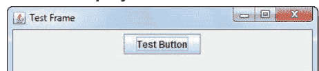

#### 你可以用来显示按钮的三个 Swing 类

| 类名 | 描述 |
| --- | --- |
| `javax.swing.JFrame` | 定义包含其他组件的窗口的类。 |
| `javax.swing.JPanel` | 定义包含其他组件的不可见组件的类。 |
| `javax.swing.JButton` | 定义用户可以点击的按钮的类。 |

#### 你可以用来处理按钮点击的两个 AWT 类

| 接口/类 | 描述 |
| --- | --- |
| `java.awt.event.ActionListener` | 定义了一个方法的接口，该方法包含在用户点击按钮时执行的代码。 |
| `java.awt.event.ActionEvent` | 定义了一个对象的类，该对象包含事件的信息，例如用户点击按钮时发生的事件。 |

#### `ActionListener` 定义的方法

```java
void actionPerformed(ActionEvent e);
```

#### 描述

- 大多数现代应用程序使用 GUI（图形用户界面）通过显示窗口和组件（如按钮）与用户交互。
- Swing 是创建 GUI 最常用的 Java 库。这些类存储在 `javax.swing` 包中。
- 在 Swing 中，窗口被称为帧（frame）。
- 当你为 GUI 编写代码时，你可以处理发生在其上的事件。例如，你可以处理用户点击按钮的事件。为了做到这一点，你通常会编写一个事件监听器，其中包含事件发生时执行的代码。
- 为了处理事件，Swing 使用来自另一个 Java 库 AWT（抽象窗口工具包）的接口和类。该库存储在 `java.awt` 包中。

### 如何编写内部类

图 13-2 首先展示了内部类的语法和作用域规则。在这里，外部类遵循与你在本书中一直编写的其他类相同的规则。首先，它使用 `public` 关键字进行声明。其次，它可以包含实例变量、静态变量、方法和静态方法。

另一方面，内部类遵循的规则略有不同。首先，内部类不能声明为 `public`。内部类可以直接访问外部类所有的私有变量和方法。第三，内部类可以声明自己的实例变量和方法。第四，内部类不能包含任何静态变量或方法。

图中的示例显示了一个类 `TestFrame`，它包含一个名为 `ClickListener` 的内部类。`TestFrame` 类定义了一个显示按钮的窗口。`ClickListener` 类定义了一个监听器，代码会在用户点击按钮时执行。

`TestFrame` 类首先从 `java.awt` 和 `javax.swing` 包导入类。然后，它继承了 `JFrame` 类。前三个语句设置了帧的标题、大小和位置。第四条语句设置了用户点击帧关闭按钮时执行的操作。第五和第六语句创建一个面板并将其添加到帧中。

第七条语句创建一个按钮。然后，第八条语句从内部类 `ClickListener` 创建一个对象并赋值给 `ActionListener` 变量。这是可能的，因为 `ClickListener` 类实现了 `ActionListener` 接口及其 `actionPerformed` 方法。然后，第九条语句将 `ActionListener` 对象传递给帧的 `addActionListener` 方法。结果是，当用户点击此按钮时就会执行内部类中的代码。目前，这段代码只是向控制台打印一条消息。但在本书的后续部分，你可以学习如何执行其他操作。

构造函数的最后两条语句将按钮添加到面板中并将帧显示给用户。如果没有最后一条语句，代码将创建帧，但它对用户是不可见的。

#### 内部类简介

```java
public class ClassName {
    // 可以包含实例变量和方法
    // 可以包含静态变量和方法
    class InnerClassName {
        // 可以访问外部类所有的变量和方法
        // 可以包含实例变量和方法
        // 不能包含静态变量或方法
    }
}
```

#### 包含并使用内部类的类

```java
package test;

import java.awt.event.ActionEvent;
import java.awt.event.ActionListener;
import javax.swing.JButton;
import javax.swing.JFrame;
import javax.swing.JPanel;

public class TestFrame extends JFrame {
    public TestFrame() {
        // 设置帧
        setTitle("Test Frame");
        setSize(400, 300);
        setLocationRelativeTo(null);
        setDefaultCloseOperation(JFrame.EXIT_ON_CLOSE);

        // 创建面板
        JPanel panel = new JPanel();
        add(panel);

        // 创建按钮
        JButton button = new JButton("Click Me");
        panel.add(button);

        // 添加监听器
        ActionListener listener = new ActionListener() {
            @Override
            public void actionPerformed(ActionEvent e) {
                System.out.println("The button was clicked!");
            }
        };
        button.addActionListener(listener);

        // 显示帧
        setVisible(true);
    }
}
```

#### 使用内部类的另一种方式

在之前的插图中，内部类有一个名称。然而，如果你愿意，可以创建一个不具名称的内部类。图 13-3 显示了如何使用匿名类来实现该接口。

```java
public TestFrame() {
    // 设置帧
    setTitle("Test Frame");
    setSize(400, 300);
    setLocationRelativeTo(null);
    setDefaultCloseOperation(JFrame.EXIT_ON_CLOSE);

    // 创建面板
    JPanel panel = new JPanel();
    add(panel);

    // 创建按钮
    JButton button = new JButton("Click Me");
    panel.add(button);

    // 添加监听器
    button.addActionListener(new ActionListener() {
        @Override
        public void actionPerformed(ActionEvent e) {
            System.out.println("Button 1 clicked!");
        }
    });

    // 显示帧
}
```

#### 描述

- 匿名类是一种没有名称的内部类类型。
- 你可以在尝试创建接口对象的圆括号后面，紧跟编写匿名类的大括号。
- 在匿名类的大括号中，你可以提供实现该接口的类代码。
- 如果你想多次使用从内部类创建的对象，可以将该对象赋值给变量。

### 如何处理枚举

如果你需要定义一组相关的常量，通常认为使用枚举（enumeration）是最佳实践。枚举从 Java 5 开始就可用，与在类或接口中存储相关常量相比，它们具有许多优势。在第 7 章中，你学习了如何使用 Java API 中的 `RoundingMode` 枚举为 `BigDecimal` 对象设置舍入模式。现在，你将学习如何创建和使用自己的枚举。

#### 如何声明枚举

图 13-4 显示了如何声明一个枚举。要这样做，你需要编写 `public` 关键字，接着是 `enum` 关键字，然后是枚举的名称。在枚举内部，你编写一个或多个常量的名称，并用逗号分隔开。

在内部，枚举中的每个常量都会被分配一个从零开始的整数值。例如，在本章第一个示例的 `ShippingType` 枚举中，`UPS_NEXT_DAY` 的值为 0，`UPS_SECOND_DAY` 的值为 1，依此类推。在大多数情况下，你不会使用这些整数值。

在编写枚举时，通常会将它们存储在单独的文件中。要这样做，你可以为新类添加一个文件。然后，你可以编辑该文件的代码以定义一个枚举。

#### 如何使用枚举

图 13-4 中的后三个示例显示了你如何使用枚举。第二个示例显示你可以将变量声明为枚举类型。然后，你可以将该枚举中的常量赋值给该变量。在这种情况下，`UPS_SECOND_DAY` 常量被赋值给名为 `secondDay` 的 `ShippingType` 变量。

第三个示例显示了一个 `getShippingAmount` 方法，它接受一个 `ShippingType` 作为参数。然后，代码内部会将该常量与枚举中的两个常量进行比较，以确定运费。

第四个示例显示了一个调用 `getShippingAmount` 方法的语句。该语句将 `ShippingType` 枚举的 `UPS_SECOND_DAY` 常量传递给 `getShippingAmount` 方法。

第四个示例中注释掉的语句说明，尽管枚举中的常量被分配了整数值，你也不能用整数或任何其他类型来代替枚举。换句话说，枚举是类型安全的（type-safe）。相比之下，如果你在期望常量的地方没有使用常量名称或其值，这就是枚举通常优于常量的几个原因之一。

##### 声明枚举的语法

```java
public enum EnumerationName {
    CONSTANT_NAME1,
    CONSTANT_NAME2...
}
```

##### 定义了三种运输类型的枚举

```java
public enum ShippingType {
    UPS_NEXT_DAY,
    UPS_SECOND_DAY,
    UPS_GROUND
}
```

##### 使用该枚举及其其中一个常量的语句

```java
ShippingType secondDay = ShippingType.UPS_SECOND_DAY;
```

##### 使用枚举作为参数类型的方法

```java
public static double getShippingAmount(ShippingType st) {
    double shippingAmount = 2.99;
    if (st == ShippingType.UPS_NEXT_DAY) {
        shippingAmount = 10.99;
    } else if (st == ShippingType.UPS_SECOND_DAY) {
        shippingAmount = 5.99;
    }
    return shippingAmount;
}
```

##### 调用方法的语句

```java
double shippingAmount = getShippingAmount(ShippingType.UPS_SECOND_DAY);
// double shippingAmount2 = getShippingAmount(1); // 类型错误，不允许
```

##### 描述

- 枚举包含一组相关的常量。这些常量用 `int` 类型定义，并被分配从 0 到枚举中常量数量减 1 的值。
- 枚举定义了一种类型。正因如此，你不能在期望枚举类型的地方指定另一种类型。这意味着枚举是类型安全的。


#### 如何增强枚举

大多数时候，图 13-4 所示的技能是你处理枚举时所需的全部技能。然而，在需要时，你可以重写枚举继承自 `java.lang.Object` 和 `java.lang.Enum` 类的方法。此外，你还可以添加自己的方法。当你这样做时，你可能想要使用枚举常量的方法。图 13-5 顶部显示了其中两个。

该图还显示了 `ShippingType` 枚举的增强版本。此枚举包含一个重写了 `Enum` 类 `toString` 方法的 `toString`。如果没有这个方法，`Enum` 类的 `toString` 方法将返回常量的名称。

在本示例中，在枚举常量之后编写了一个分号。这让编译器知道没有更多常量了。然后，`toString` 方法使用一系列的 `if/else` 语句为枚举中的每个常量返回一个合适的字符串。为了做到，它首先使用 `ordinal` 方法为常量返回一个 `int`。然后，它将值与整数值进行比较，并返回适用于当前常量的字符串。

#### 如何使用静态导入

除了枚举之外，Java 5 还引入了一种名为静态导入（static imports）的新功能。此功能允许你简化对枚举中常量的引用。

要使用静态导入，首先编写一个 `static import` 语句。该语句类似于普通的 `import` 语句，但你在 `import` 关键字之后编写 `static` 关键字，并且你通常使用通配符 (`*`) 来导入枚举中的所有常量。例如，图中，静态导入语句指定了枚举中的所有常量。

一旦编写了静态导入，你就不再需要指定枚举名称来引用这些常量。

使用静态导入可以节省输入时间，但它们通常会导致代码更难以阅读。这对于不确定应用程序引用的常量、字段或方法存储在何处的开发人员来说尤其困难。糟糕的是，使用静态导入可能会导致命名冲突。

因此，只有在它们不会引起混淆时才使用静态导入。


# 枚举的方法

| 方法 | 描述 |
| :--- | :--- |
| `name()` | 返回常量的字符串。 |
| `ordinal()` | 返回对应枚举位置的整数。 |

# 如何为枚举添加方法

## 重写 toString 的枚举

```java
public enum ShippingType {
    UPS_NEXT_DAY,
    UPS_SECOND_DAY,
    UPS_GROUND;

    @Override
    public String toString() {
        String s = "";
        if (ordinal() == 0) {
            s = "UPS Next Day (1 business day)";
        } else if (this.ordinal() == 1) {
            s = "UPS Second Day (2 business days)";
        } else if (this.ordinal() == 2) {
            s = "UPS GROUND (5 to 7 business days)";
        }
        return s;
    }
}
```

## 使用枚举

```java
ShippingType ground = ShippingType.UPS_GROUND;
System.out.println("Shipping type: " + ground.toString());
```

## 输出结果

| Shipping type: UPS GROUND (5 to 7 business days) |

# 如何为类编写文档

如果你开发了供其他程序员使用的类，你通常会为这些类提供一些文档。这样，其他程序员就可以学习如何使用你的类所提供的字段、构造函数和方法。幸运的是，JDK 包含一个名为 `javadoc` 的工具，可以轻松地为你的类生成基于 HTML 的文档。这些文档的外观和功能与 Java API 文档相似。

# 如何向类中添加 javadoc 注释

图 13-6 显示了如何为类添加简单的 javadoc 注释。javadoc 注释以 `/**` 开始，以 `*/` 结束。在 javadoc 注释中，任何额外的星号都会被忽略。正因如此，星号通常像这里所示被使用，但它们必须直接编写在所描述的类、字段、构造函数或方法上方。

如果你正在使用 Eclipse，你会发现它让输入 javadoc 注释变得简单。要做到这一点，在类、字段、构造函数或方法代码之前的空行上输入一个斜杠（`/`），后跟跟两个或多个星号。然后，当你按下回车键时，Eclipse 会为该类或其成员生成起始注释。这包括一行带有单个星号的行（你可以在其中开始输入注释），随后是一行带有结束注释的 `/*` 字符。它还可能包含你在下一个图中将学一个或多个 javadoc 标签。

## 带有 javadoc 注释的 Product 类

```java
package murah.business;

import java.text.NumberFormat;

/**
 * Product 类表示一个产品，并被
 * LineItem 和 ProductDB 类使用。
 */
public class Product {

    private String code;
    private String description;
    private double price;

    /**
     * 创建具有默认值的新 Product。
     */
    public Product() {
        code = "";
        description = "";
        price = 0;
    }

    /**
     * 将产品代码设置为指定的 String。
     */
    public void setCode(String code) {
        this.code = code;
    }

    /**
     * 返回表示产品代码的 String。
     */
    public String getCode() {
        return code;
    }
}
```

### 描述

- Javadoc 注释以 `/**` 开始，以 `*/` 结束，注释内的星号会被忽略。你可以使用 javadoc 注释来描述类及其公共和保护的字段、构造函数和方法。
- 注释应该直接放在它所描述的类或成员上方。对于类来说，这意味着注释必须放在任何 import 语句之后。
- 如果在 Eclipse 中于类、字段、构造函数或方法代码之前的空行上输入一个斜杠（`/`）后跟两个或多个星号，Eclipse 会生成 javadoc 注释。这包括你在下一个图中将学的一些 javadoc 标签。

> 图 13-6 如何向类添加 javadoc 注释

# 如何在 javadoc 注释中使用 HTML 和 javadoc 标签

为了帮助在类文档中显示信息，你可以在 javadoc 注释中包含 HTML 和 javadoc 标签，如图 13-7 所示。你最可能使用的 HTML 标签是 `<code>` 标签。该标签可以用于以等宽字体显示文本。在图中的 Product 类中，`<code>` 标签被用于格式化类注释中引用的每个类的名称，并用于格式化其他注释中提到的任何对象的名称。虽然这里没有显示，但该标签也常用于格式化对原始类型的引用。

这里显示的四个 javadoc 标签应该是自言自语的。你通常在类注释中使用 `@author` 和 `@version` 标签来记录类的作者和当前版本。默认情况下，这些信息在生成的文档中不会显示。虽然你可以在生成文档时指定要包含这些信息，但它们通常是有必要的。

你使用 `@param` 标签来描述构造函数或公共方法接受的参数。例如，在图中，你可以看到 `@param` 标签被用于记录 `setCode` 方法使用的 `code` 参数。同样，如果一个方法返回一个值，你可以使用 `@return` 标签来描述该值。在图中，`@return` 标签被用于记录 `getCode` 方法返回的 String。

除了这里显示的标签外，你应该意识到还有额外的 HTML 和 javadoc 标签可用。例如，你可以使用 `<i>` 标签将文本设置为斜体，并可以使用 `<b>` 标签将文本加粗。要创建超链接，你使用 javadoc 的 `@see` 标签。有关此标签和其他其他 javadoc 标签的更多信息，请参阅 javadoc 工具的在线文档。

## 用于格式化 javadoc 注释的常用 HTML 标签

| HTML 标签 | 描述 |
| --- | --- |
| `<code></code>` | 使用等宽字体显示这些标签之间的文本。 |

## Common Javadoc 标签

| Javadoc 标签 | 描述 |
| --- | --- |
| `@author` | 识别类的作者。默认不显示。 |
| `@version` | 描述类的当前版本。默认不显示。 |
| `@param` | 描述构造函数或方法的参数。 |
| `@return` | 描述返回值。 |

## 使用 HTML 注释的 Product 类

```java
package murah.business;

import java.text.NumberFormat;

/**
 * Product 类表示一个产品，并被
 * LineItem 和 ProductDB 类使用。
 * @author Joel Milch
 * @version 1.0
 */
public class Product {

    private String code;
    private String description;
    private double price;

    /**
     * 创建具有默认值的新 Product。
     */
    public Product() {
        code = "";
        description = "";
        price = 0;
    }

    /**
     * 将产品代码设置为指定的 String。
     * @param code 要设置的代码
     */
    public void setCode(String code) {
        this.code = code;
    }

    /**
     * 返回表示产品代码的 String。
     * @return 产品代码
     */
    public String getCode() {
        return code;
    }
}
```

> 图 13-7 如何在 javadoc 注释中使用 HTML 和 javadoc 标签

# 如何使用 Eclipse 生成文档

在你为类添加了 javadoc 注释后，可以使用 Eclipse 为这些类生成文档，如图 13-8 所示。第一次这样做时，你需要使用 Generateavadoc 对话框配置 javadoc 命令。

要做到这一点，点击 Configure 按钮并按照图中路径导航到 javadoc 命令。然而，你计算机上的 JDK 版本号可能不同，因此 javadoc 命令的路径可能与图中不完全匹配。

一旦生成了 javadoc，你可以点击 Finish 按钮接受所有默认设置，这通常是你需要的。第一次为项目生成文档时，Eclipse 会询问存储文档的文件夹。默认情况下，Eclipse 将文档存储在项目根目录的 doc 子文件夹中，这通常没问题。

如果你尝试为一个已经有了文档的项目生成文档，Generateavadoc 对话框顶部会警告你可能会覆盖现有文件。这是你需要的，因此大多数情况下你可以忽略该警告。

## 如何查看文档

在 Eclipse 生成文档后，它会在 Package Explorer 中显示 doc 文件夹。要查看文档，你可以双击 `index.html` 文件。这会在主窗口中打开文档并使用内置浏览器显示。

当然，你也可以通过任何其他浏览器打开 `index.html` 文件来查看文档。Java API 文档与用户定义类文档的主要区别在于，`index.html` 文件存储在你硬盘的某处。在图中，示例文档存储在以下文件夹：`murach/java_eclipse/book_apaps/ch3_LineItem/doc`

## 为 Product 类生成的 API 文档

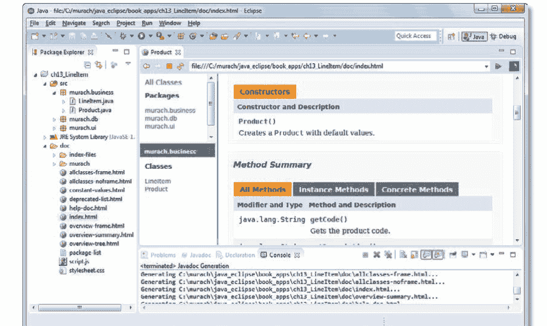

## Windows 上 javadoc 命令的路径

`Program Files\Java\jdk1.8.0_45\bin`

## Mac OS X 上 javadoc 命令的路径

`/Library/Java/JavaVirtualMachines/jdk1.8.0_45.jdk/Contents/Home/bin`

### 描述

- 若要从 Eclipse 为项目生成文档，请在包资源器中选择该项目，然后选择 Generate Javadoc 命令。这将显示一个 Generate Javadoc 对话框，允许你配置该命令。
- 第一次生成文档时，你必须使用 Generate Javadoc 对话框来指定 javadoc 命令的位置。要做到这一点，你可以点击 Configure 按钮并指定 javadoc 命令的位置。之后，你可以点击 Finish 按钮接受默认选项。
- 默认情况下，Eclipse 将项目的文档存储在名为 doc 的子文件夹中，并在 Package Explorer 中显示该子文件夹。
- 若要查看项目的文档，使用 Package Explorer 导航到 doc 并双击 index.html。这将在 Eclipse 主窗口中打开文档并使用内置浏览器显示它。
- 如果项目已经包含文档，Generate Javadoc 对话框的顶部会警告你，新文档可能会覆盖现有文件。

> 图 13-8 如何生成和查看包的文档

# 观点

现在你已经完成了本章，你应该已经理解了处理内部类的相关概念。你应该能够创建和使用枚举。而且你应该能够为你的类编写文档，以便其他程序员可以使用它们。到此时，你已经具备了学习更多 Java API 可用类（如下一章描述的集合类）所需的所有面向对象编程技能。此外，你为本书最后描述的 GUI 编程奠定了坚实的基础。

### 总结

- 内部类是编写在另一个类内部的类。当一个类仅在另一个类的上下文中才有意义时，这非常有用。
- 匿名类是类没有名称的内部类。这通常会产生比有名称的内部类更简洁的代码。
- 你可以使用枚举（enumeration）将一组相关的常量定义为类型。然后，你可以在任何使用枚举的地方使用枚举中的常量。
- 你可以使用静态导入（static imports）来导入枚举的常量或类的静态字段和方法。然后，你可以在不限定的情况下引用这些常量、字段和方法。
- 你可以使用 javadoc 注释为类及其字段、构造函数和方法编写文档。然后，你可以为你的类生成基于 HTML 的文档。

# 练习 13-1 测试内部类

在本次练习中，你将尝试内部类和匿名类。

## 审查应用程序

1. 导入存储在 ex_starts 文件夹中的项目 ch13_ex1_InnerClassTester。查看 TestFrame 类的代码和 ClickListener 类的代码。注意这些类存储在单独的文件中。
2. 运行应用程序。它应该显示 TestFrame 窗口。然后点击此窗口中的按钮。它应该在控制台中显示一条消息。

## 创建内部类

3. 打开 TestFrame 和 ClickListener 类，并将 ClickListener 改为 TestFrame 类的内部类。要做到这一点，你可以从 ClickListener 类中剪切大部分代码并粘贴到 TestFrame 类中。
4. 从 ClickListener类的声明删除 public 修饰符，为 ActionListener 类添加 import 语句，并对此代码进行任何其他必要的修改。
5. 删除 ClickListener java 文件。此时，项目应该只包含 TestFrame java 文件和 Main.java 文件。
6. 运行应用程序并点击按钮。它的运行应该和之前一样正常。

## 创建匿名类

7. 打开 TestFrame 类，并将 ClickListener 类改为匿名内部类。要做到这一点，你可以先从 ClickListener 类中剪切从左大括号开始到右大括号结束的代码。
8. 删除 ClickListener 类的声明，修改代码使其从匿名 ActionListener 类创建对象，并对此代码进行任何其他必要的修改。
9. 运行应用程序并点击按钮。它的运行应该和之前一样正常。

# 练习 13-2 创建并使用枚举

在本次练习中，你将创建一个枚举并在测试应用程序中使用它。

## 创建枚举

1. 导入位于 ex_starts 文件夹中的项目 ch13_ex2_Enumeration。
2. 创建一个枚举 CustomerType。该枚举应该包含代表三类型客户的常量：零售（retail）、贸易（trade）和大学（college）。

## 使用枚举

3. 打开 CustomerTypeApp 类。然后，为该类添加一个方法，根据传递给它的 CustomerType 变量返回折扣百分比（零售为 .10，贸易为 .30，大学为 .20）。
4. 在方法中添加代码，声明 CustomerType 变量，为其分配其中一种客户类型，获取该客户类型的折扣百分比并显示该百分比。它应该在控制台中显示消息：

```
discountPercent: 0.3
```

5. 运行应用程序以确保工作正常。

## 修改枚举的 toString 方法

6. 在 main 方法中添加一条语句显示 toString 方法的结果。然后再次运行应用程序。根据客户类型，它应该显示：

```
toString: TRADE
```

7. 为 CustomerType 枚举添加一个 toString 方法。根据客户类型，它应该返回：

```
toString: Retail
```

8. 再次运行应用程序查看结果。

# 练习 13-3 使用 API 文档

本练习将引导你为 murach.business 包中的类添加 javadoc 注释。然后，它将向你展示如何为应用程序生成文档。

## 审查业务类的 javadoc 注释

1. 导入 ex_starts 文件夹中的项目。
2. 打开 murach.business 包中的 Product 类。然后，查看该类的 javadoc 注释。注意该类的 javadoc 注释没有包含 @param 或 @return 标签。
3. 打开 murach.business 包中的 LineItem 类。注意该类仅在开头包含一个 javadoc 注释。

## 生成并查看 API 文档

4. 为项目生成文档。然后，通过导航到项目的 doc 文件夹并打开 index.html 在浏览器中打开文档。或者，你可以通过双击 Package Explorer 中 doc 文件夹下的 index.html 在 Eclipse 中打开。
5. 查看 Product 类的文档。点击 murach.business 包链接，然后点击 Product 类的链接。注意它包含了构造函数和方法的描述。
6. 查看 getConfig 和 setCode 方法的详情。要做到这一点，点击这些方法的链接。注意这些方法没有包含关于参数和返回值的信息。
7. 点击 LineItem 类的链接查看其文档。注意它没有包含构造函数和方法的描述。

## 改进 javadoc 注释

8. 打开 Product 类。修改该类的 javadoc 注释，使其在适当的地方包含 @param 和 @return 标签。
9. 打开 LineItem 类。为所有公共构造函数和方法添加 javadoc 注释，在适当的地方使用 @param 和 @return 标签。

## 生成并查看改进后的 API 文档

10. 再次为项目生成文档。


11. 再次查看 `Product` 和 `LineItem` 类的文档。这次，文档应该包含所有构造函数和方法的描述，以及所有参数和返回值的信息。例如，`LineItem` 类的第二个构造函数应该包含其两个参数的信息。

# 第 4 节：你根据需要的更多核心技能

本节的五个章节将向你展示如何使用更多的 Java 核心特性。第 14 章介绍了如何使用集合、Java 5 引入的泛型以及 Java 8 引入的 lambda 特性。第 15 章介绍了如何使用 Java 8 引入的新日期/时间 API。第 16 章介绍了如何处理异常。第 17 章展示了如何处理文件输入输出（也称为文件 I/O）。第 18 章展示了处理线程时最重要的概念和技能。

在你读完第 14 章和第 16 章（这两个章节介绍了对大多数 Java 应用至关重要的技能）后，可以直接跳转到第 5 节。第 5 节的章节介绍了如何开发一个使用图形用户界面与数据库交互的桌面应用程序。相反，当你在阅读第 5 节时，可以随时跳回本节的章节。

# 第 14 章：如何使用集合、泛型和 lambda

在本章中，你将学习如何使用集合。正如你所看到的，集合与数组相似，但提供了更高级的功能。在使用集合的同时，你将接触泛型，这是一个自 Java 5 以来就可用的特性。最后，你将学习如何使用 lambda，这是 Java 8 引入的特性。

本章假设你已经知道如何使用数组。因此，在阅读本章之前，你应该先阅读第 10 章。

| 项目 | 页码 |
| :--- | :--- |
| Java 集合简介 | 358 |
| 数组与集合的比较 | 358 |
| Java 集合框架概述 | 360 |
| 泛型简介 | 362 |
| **如何使用 ArrayList 类** | **364** |
| 如何创建数组列表 | 364 |
| 如何添加和获取元素 | 366 |
| 如何替换、删除和搜索元素 | 368 |
| 如何在数组中存储原始类型 | 370 |
| **Invoice 应用** | **372** |
| 用户接口 | 372 |
| Invoice 类 | 374 |
| InvoiceApp 类 | 376 |
| **如何使用 lambda 表达式** | **378** |
| lambda 简介 | 378 |
| 不使用 lambda 表达式的方法 | 380 |
| 使用 lambda 表达式的方法 | 382 |
| 如何使用 Predicate 接口 | 384 |
| **视角** | **386** |

## Java 集合简介

与数组一样，集合是可以包含一个或多个元素的对象。但与数组不同，集合不是 Java 语言本身的一部分。它们是 Java API 提供的类。

## 数组与集合的比较

图 14-1 展示了数组和集合的简要比较。可以使用数组或集合来存储指定类型的多个元素。事实上，集合类（特别是 `ArrayList`）内部通常使用数组来存储。然而，这对程序员来说是透明的。

虽然数组和集合有一些相似之处，但也有很多不同。一个重要的区别是数组的大小是固定的。这意味着如果你初始化一个包含 10 个元素的数组并需要添加另一个元素，必须创建一个足够大的数组。相比之下，集合在需要时会自动增加大小。在后台，集合可以在数组之间复制元素，这对程序员来说是透明的。因此，当你创建一个集合时，不需要指定集合的最大大小。你可以根据需要添加许多元素。然后，如果需要，集合会扩展以包含新元素。

数组和集合的第二个区别是数组可以存储原始类型（如 `int` 和 `double`），而集合必须使用包装类。幸运的是，在 Java 5 及更高版本中，集合会自动进行自动装箱。

第三个区别是，通常使用集合的方法来设置和获取元素。由于你不能从数组调用方法，你通常使用索引来设置和获取元素。图中的两个示例展示了这是如何工作的。在这里，第一个示例使用索引设置数组值；但第二个示例使用 `ArrayList` 类的 `add()` 方法设置元素。两个示例都使用增强 for 循环将它们打印到控制台。

顺便说一下，如果你不理解第二个示例中的代码不用担心。你会学习 `ArrayList` 的细节。这个示例目的是说明数组和集合的一些区别。

### 数组和集合的相似之处

- 两者都可以存储多个相同的元素。

### 数组和集合的不同之处

- 数组的大小是固定的，需要时由程序员增加大小。集合在需要时会自动增加大小。
- 数组使用包装类存储原始类型。集合必须使用包装类存储原始类型。
- 数组没有提供添加、替换和删除元素的操作方法。集合通常提供执行这些操作的方法。

### 使用数组的代码

```java
String[] codes = new String[3];
codes[0] = "java";
codes[1] = "jsp";
codes[2] = "mysql";
for (String s : codes) {
    System.out.println(s);
}
```

### 使用集合的代码

```java
ArrayList<String> codes = new ArrayList<>();
codes.add("java");
codes.add("jsp");
codes.add("mysql");
for (String s : codes) {
    System.out.println(s);
}
```

### 描述

- 集合是可以包含其他对象。集合与数组相似，但使用更灵活。
- 在 Java 5 及更高版本中，集合会在需要时自动添加和移除原始类型的包装类。


## Java 集合框架概述

图 14-2 展示了 Java 集合框架的简化图。该框架由接口和类的层级结构组成。在这里，颜色较深的框（`Collection`、`Set`、`List` 和 `Map`）代表定义基本集合类型的接口，而颜色较浅的框（`ArrayList`、`LinkedList`、`HashMap` 和 `TreeMap`）代表实现这些接口的类。

集合框架提供了由两个类层次结构表示的两种集合。第一个层次结构从一个名为 `Collection` 的接口开始。集合是可以包含一个或多个对象的对象。`Set` 和 `List` 接口继承 `Collection` 接口并定义了两种不同的集合。*set*（集合）是唯一对象的集合。在大多数情况下，集合也是无序的。这意味着集合不保留添加到它的元素顺序信息。

另一方面，*list*（列表）是对象的有序集合。列表始终对其所包含的对象维护某种顺序。根据列表的类型，该顺序可能是项目添加到列表的顺序，也可能是基于键值对的排序顺序。此外，列表允许重复元素。

第二种主要的集合类型称为 *map*（映射），它由 `Map` 接口定义。映射与集合相似，但它的元素由键值对组成，每个值都与一个唯一的键元素关联。每个键必须与一个且仅一个值关联。例如，映射可能用于存储映射到客户对象的客户。在这种情况下，客户对象是键，`Customer` 对象是值。尽管 `Map` 接口没有继承 `Collection` 接口，但集合一词通常被泛指集合和映射。

# 第 14 章 如何使用集合、泛型和 lambda 361

## 集合框架

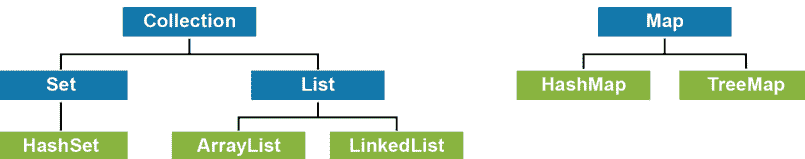

## 集合接口

| 接口 | 描述 |
| --- | --- |
| `Collection` | 定义了所有集合可用的基本方法。 |
| `Set` | 定义了一个不允许重复元素的集合。 |
| `List` | 定义了一个维护列表中元素顺序的集合。它通过整数索引访问元素，并且通常允许重复元素。 |
| `Map` | 定义了一个映射。类似于集合。然而，它存储的是一个或多个键值对，而不是只存储值（元素）。每个键值对由一个唯一标识该值的键和一个存储数据的值组成。 |

## 常用集合类

| 类 | 描述 |
| --- | --- |
| `ArrayList` | 在随机访问单个元素时，比链表更高效。但在列表中间插入元素时，效率比链表低。 |
| `LinkedList` | 在随机访问元素时，比数组列表低。但在列表中间插入元素时，比数组列表更高效。 |
| `HashSet` | 存储一组唯一的元素。换句话说，它不允许重复元素。 |
| `HashMap` | 存储键值对，其中每个键必须是唯一的。换句话说，它不允许重复的键，但允许重复的值。 |
| `TreeMap` | 在名为树的层次数据结构中存储键值对。此外，它会自动按键对元素进行排序。 |

### Description

- Java 集合框架是基于接口的，这意味着集合框架中的每个类都实现了由框架定义的接口之一。
- 集合框架由两个类层次结构组成：`Collection` 和 `Map`。集合将单个对象作为元素存储。映射则存储键值对，你可以使用键来检索值（元素）。

图 14-2 Java 集合框架和类

## 泛型导论

在 Java 5 之前，集合的元素被定义为 `Object` 类型。因此，你可以将任何类型的对象作为元素存储在集合中。起初，这种灵活性可能看起来是一个优势。但它随之而来的是缺点，没有办法保证只将特定类型的对象添加到集合中。例如，你无法限制 `ArrayList` 使其仅包含产品。其次，每当你从集合中检索对象时，都需要使用强制类型转换。因为元素可以是任何类型的对象。例如，为了从集合中检索一个 `Product`，你必须将对象转换为 `Product` 类型。

Java 5 引入了一项新功能——泛型，它解决了这两个问题。泛型功能允许你指定集合的元素类型。然后，Java 可以确保它将指定类型的对象添加到集合中。相反，Java 可以自动将从集合中检索的任何对象转换为正确的类型。

图 14-3 显示了泛型是如何工作的。为了在声明集合时指定类型，你需要在集合名称（如 `ArrayList` 或 `LinkedList`）后面的方括号中编写该类型。在 Java 7 之前，你必须执行两次此操作：一次是在使用集合类声明集合时，另是在使用集合类的构造函数创建集合实例时。然而，Java 7 引入了一项功能，允许你简化这些代码，如图中的最后一个示例所示。

第一个示例显示了一个声明并实例化名为 `<String>` 的数组列表实例的语句，在 `ArrayList` 类名后面指定了 `<String>`，表示数组列表的元素必须是 `String` 对象。

第二个和第三个示例类似，但它们创建了可以包含整数和 `Product` 对象的集合。这里，第二个示例使用了包装类（`Integer` 类）而不是原始类型（`int` 类型）。这是必要的，因为要存储一个整数值数组，像这样使用原始类型声明集合是非合法的：

```java
ArrayList<int> numbers = new ArrayList<int>(); // 非法！
```

如果你正在使用 Java 7 或更高版本，只要编译器可以从上下文中推导出类型，你就可以省略构造函数后面方括号中的类型。第四个示例展示了这是如何工作的。在这里，代码完成了与第一个示例相同的任务，但没有重复集合类型。由于此功能产生了更短、更简单的代码，它在本章的其余部分一直使用。

### 如何使用 ArrayList 类

`ArrayList` 类是 Java 中常用的集合之一。你可以使用此类来创建一个名为数组列表的集合类型。数组列表在内部使用数组来存储列表元素。因此，数组列表在许多方面与数组相似。然而，与数组不同，当你向其添加元素时，数组列表会自动调整大小。因此，你不需要编写任何特殊代码来确保不会超过数组列表的容量。

## 如何创建数组列表

图 14-4 显示了你可以用于创建数组列表的两个构造函数。这些构造函数使用大字母 `E` 表示你必须在角括号内指定你想要存储在集合中的元素类型。

图中的第一个示例创建了一个名为 `codes` 的数组列表，它可以存储 `String` 对象。由于此代码使用了 `ArrayList` 的默认构造函数，因此此示例创建了一个初始容量为 10 个元素的数组列表。然后，如果必要，数组列表会自动增加容量以存储更多元素。

遗憾的是，增加数组列表的容量并不是一个高效的操作，特别是当数组列表很大时。首先，`ArrayList` 类必须创建一个扩展大小的新数组。首先，必须将旧数组的元素复制到新数组中。接下来，必须将新元素添加到新数组中。最后，旧数组必须从内存中移除。

因此，如果你知道将需要多少元素，创建一个初始容量略大于元素数量的数组列表会更高效。要做到这一点，你可以使用第二个示例所示的代码。该代码创建了一个初始容量为 200 个元素的数组列表。

### Description

- 泛型指的是允许你创建类型集合的功能。类型集合是只能包含特定类型对象的集合。该功能是在 Java 5 中引入的。
- 在声明类型集合变量时，你在名称后面列出类型。
- 当你使用类型集合的构造函数时，你可以在角括号内指定类型。类型变量可以是原始类型（如 `int` 或 `double`），也可以是包装类（如 `Integer` 或 `Double`）。
- 从 Java 7 开始，你可以省略构造函数后面括号中的类型。这组空括号被称为钻石运算符。
- 如果你不为集合指定类型，集合可以包含任何类型的对象。然而，每当你访问集合时，Java 编译器都会发出警告信息，提醒你无法进行类型检查。

# 第 14 章 如何使用集合、泛型和 Lambda 表达式 365

## ArrayList 类

`java.util.ArrayList`

### ArrayList 类的常用构造函数

| 构造函数 | 描述 |
| --- | --- |
| `ArrayList<E>()` | 创建一个默认容量为 10 个元素的空数组列表。 |
| `ArrayList<E>(intCapacity)` | 创建一个指定类型和指定容量的空数组列表。 |

### 创建 String 对象的数组列表的代码

```java
// 使用 10 个元素的默认起始容量
ArrayList<String> codes = new ArrayList<>();
```

```java
// 使用 200 个元素的指定起始容量
ArrayList<String> codes = new ArrayList<>(200);
```

### 描述

* `ArrayList` 类在内部使用数组来存储列表中的元素。
* 数组列表的容量在需要时会自动增加。
* 当你创建一个数组列表时，可以使用 10 个元素的默认起始容量，也可以指定起始容量。
* 如果你预先知道列表需要存储的元素数量的大量，可以通过指定一个略大于该数量的起始容量来提高 `ArrayList` 类的性能。


## 如何添加和获取元素

图 14-5 的第一个示例展示了如何向数组列表添加元素。具体来说，它向名为 `codes` 的数组列表添加三个 `String` 对象。为了实现这一点，它使用了 `ArrayList` 类的 `add()` 方法。在这里，第三条语句指定索引为 0。结果是，该语句将字符串 ("java") 移动数组列表中的第一个元素。然后，数组列表会自动将列表中的其他字符串 ("jsp" 和 "mysql") 向后移动一个索引。

第二个示例从名为 `codes` 的数组列表中获取一个元素。具体来说，它获取列表中的最后一个元素。为了实现这一点，它通过从 `size()` 中减 1 来计算最后一个元素的索引。然后，它使用该索引获取数组列表中的最后一个元素。

虽然你可能只需要从数组列表中获取一个元素，但为了这样做，通常需要处理数组列表的所有元素。为了使用如第三个示例所示的增强 for 循环，此示例将数组列表中的每个元素打印到控制台。然而，如果有必要，你可以对每个元素执行更复杂的处理。

第四个示例展示了获取和显示集合中值的另一种方法。为了实现这一点，你在 `println()` 方法中指定集合的名称。这隐式地调用了集合的 `toString()` 方法，该方法返回一个在同一行内列出每个元素值并用括号括的字符串，这种技术仅适用于小型集合。然而，这种技术在开发和调试应用程序时通常很有用。

## ArrayList 类的常用方法

| 方法 | 描述 |
| --- | --- |
| `add(object)` | 将指定的对象添加到列表末尾。 |
| `add(index, object)` | 在指定的索引位置添加指定的对象。 |
| `get(index)` | 返回指定索引位置的对象。 |
| `size()` | 返回列表中的元素数量。 |

### 向数组列表添加三个元素的代码

```java
codes.add("jsp");
codes.add("mysql");
codes.add(0, "java");
```

### 获取最后一个元素的代码

```java
int lastIndex = codes.size() - 1;
String lastCode = codes.get(lastIndex); // "mysql"
```

### 打印数组列表的每个元素的代码

```java
for (String code : codes) {
    System.out.println(code);
}
```

### 输出结果


### 显示集合内容的简单方法

```java
System.out.println(codes);
```

### 输出结果


### 描述

* 你可以使用 `ArrayList` 类的方法来向数组列表添加元素，并从数组列表中获取元素。

## 如何替换、删除和搜索元素

图 14-6 中的第一个示例展示了如何将存储在索引 2 处的数组中的元素替换为 "android"。为了实现这一点，第一条语句调用 `set()` 方法来替换元素。换句话说，它将数组列表的第三个元素更改为 "android"。


## 第二个示例：从数组列表中删除元素

第二个示例展示了如何从数组列表中删除一个元素。为了实现这一点，此代码调用 `remove` 方法并指定索引为 1。结果是，此代码从数组列表中删除第二个元素并将其存储在名为 `code` 的 `String` 变量中。

此示例的输出显示第二个元素 ("jsp") 在向前移动后被删除（"android"）。换句话说，第三个元素 ("android") 向前移动，现在是第二个元素了。

## 第三个示例：在数组列表中搜索元素

第三个示例展示了如何在数组列表中搜索元素。为了实现这一点，此代码调用 `contains` 方法并指定它要搜索的对象。如果该对象存在，此示例中的代码将向控制台打印消息。

### ArrayList 类的更多方法

| 方法 | 描述 |
| --- | --- |
| `clear()` | 从列表中移除所有元素。 |
| `contains(object)` | 如果对象在列表中，则返回 true。 |
| `indexOf(object)` | 返回指定对象的索引。 |
| `isEmpty()` | 如果列表为空，则返回 true。 |
| `remove(object)` | 删除指定的对象。 |
| `remove(index)` | 删除指定索引的元素并返回。 |
| `set(index, object)` | 设置指定索引的元素。 |
| `toArray()` | 返回包含元素的数组。 |

### 替换元素的代码

```java
codes.set(2, "android");
System.out.println(codes);
```

### 删除元素的代码

```java
String code = codes.remove(1);
System.out.println(codes);
```

### 搜索元素的代码

```java
String searchCode = "android";
if (codes.contains(searchCode)) {
    System.out.println("This contains: " + searchCode);
}
```

### 描述

* 你可以使用 `ArrayList` 类的方法来替换、删除和搜索数组列表的元素。

## 如何在数组列表中存储基本类型

图 14-7 展示了如何在数组列表中存储基本类型。例如，在图中，第一个示例创建了一个 `Integer` 对象的数组列表。然后，它将 1、2、3 等 `int` 值添加到数组列表中。这是因为编译器将 `int` 值转换为 `Integer` 对象。

相反，第二个和第三个示例从数组列表中获取 1、2、3 等 `int` 值，尽管这存储的是 `Integer` 对象。再次，这可能是因为编译器将 `Integer` 对象转换为 `int` 值。

这种特性被称为**自动装箱**（autoboxing），它在 Java 5 中可用。在 Java 5 之前，必须编写额外的代码将基本类型存储在它们的包装类中并从包装类中取出。幸运的是，在最近的 Java 版本中不再需要。

### 在数组列表中存储基本类型的代码

```java
ArrayList<Integer> numbers = new ArrayList<>();
numbers.add(1);
numbers.add(2);
numbers.add(3);
System.out.println(numbers);
```

### 输出结果

```
[1, 2, 3]
```

### 从数组列表中获取基本类型的代码

```java
int firstNumber = numbers.get(0); // 1
```

### 遍历数组列表获取基本类型的代码

```java
for (int number : numbers) {
    System.out.println(number);
}
```

### 描述

* 所有基本类型都有对应的包装类。例如，`Integer` 类是 `int` 类型的包装类，`Double` 类是 `double` 类型的包装类，以此类推。
* 要在集合中存储基本类型，你可以指定其包装类作为集合的类型。那么，在向集合添加值时，编译器会自动将基本值转换为其包装类型。这种特性被称为自动装箱。
* 要从集合中获取基本类型，你不需要做任何事情，因为编译器会自动为你从包装类中获取基本值。

# 发票应用

现在你已经学会了如何使用数组列表，本章将展示如何在接下来几幅图中所示的发票应用场景中使用数组列表。

### 用户界面

图 14-8 展示了发票应用的控制台。该控制台的工作方式与之前章节介绍的行项目应用非常相似。然而，它会将每个行项目添加到发票中。当用户完成行项目的添加后，发票应用将显示每个行项目以及发票的总额。为了实现这一点，它使用了图 14-9 中的 `Invoice` 类。

### 控制台

```
Welcome to the Invoice application

Enter product code: java
Enter quantity: 2
Another line item? (y/n): y

Enter product code: jsp
Enter quantity: 1
Another line item? (y/n): n

Description Price Qty Total
Murach's Java Programming $57.50 2 $115.00
Murach's Java Servlets and JSP $57.50 1 $57.50

Invoice total: $172.50
```

### 描述

- 该应用程序允许你为发票输入一个或多个行项目。完成后，它会显示你输入的所有行项目。此外，它还会显示发票的总金额。
- 要输入行项目，请输入行项目的产品代码和数量。然后，你可以输入“y”来输入另一个行项目，或者输入“n”来完成发票。

## Invoice 类

`Invoice` 类首先定义了一个实例变量，一个存储 `LineItem` 对象的数组列表 `lineItems`。该数组列表存储了发票的行项目。`Invoice` 类的默认构造函数创建这个数组列表，但不会向其添加任何行项目。然而，`addItem` 方法提供了向发票添加行项目的方式。然后，它调用 `lineItems` 数组列表的 `add` 方法并将 `LineItem` 对象添加到数组列表中。

`getLineItems` 方法提供了获取 `lineItems` 数组列表的方式。该方法的返回类型（`ArrayList<LineItem>`）使用泛型来指定数组列表只能存储 `LineItem` 对象，这正是你需要的。

`getTotal` 方法使用增强循环来处理 `lineItems` 数组列表中的每个 `LineItem` 元素。在循环内部，代码调用当前行项目的 `getTotal` 方法并将其加到 `invoiceTotal` 变量上。循环结束后，`getTotal` 方法返回 `invoiceTotal` 变量。

`getTotalFormatted` 方法将发票总额格式化为货币字符串。为了做到这一点，该方法调用了类的 `getTotal` 方法。这样，`getTotalFormatted` 方法就不会在 `getTotal` 方法中重复任何代码。

### Invoice 类代码

```java
package murach.business;

import java.text.NumberFormat;
import java.util.ArrayList;

public class Invoice {

    // 实例变量
    private ArrayList<LineItem> lineItems;

    // 构造函数
    public Invoice() {
        lineItems = new ArrayList<>();
    }

    // 添加行项目的方法
    public void addItem(LineItem item) {
        lineItems.add(item);
    }

    // 行项目集合的访问器
    public ArrayList<LineItem> getLineItems() {
        return lineItems;
    }

    // 获取发票总额的方法
    public double getTotal() {
        double invoiceTotal = 0;
        for (LineItem lineItem : lineItems) {
            invoiceTotal += lineItem.getTotal();
        }
        return invoiceTotal;
    }

    // 返回货币格式发票总额的方法
    public String getTotalFormatted() {
        NumberFormat currency = NumberFormat.getCurrencyInstance();
        return currency.format(getTotal());
    }
}
```

## InvoiceApp 类

图 14-10 显示了 `InvoiceApp` 类的代码。该类包含一个 `main` 方法，该方法开始时声明一个存储 `Invoice` 对象的变量。然后，它将此对象传递给类中的另外两个静态方法。

静态方法 `getLineItems` 包含用户输入行项目产品代码和数量的代码。为了实现这一点，它使用了本书之前介绍的 `Console` 类。然后，该方法根据用户输入创建一个新的 `LineItem` 对象，并将该对象添加到 `Invoice` 对象中。

`displayInvoice` 方法包含了在用户完成行项目输入后显示 `Invoice` 对象的代码。此代码使用了本书之前描述的 `StringUtil` 类来对应用程序使用的字符串进行填充，以创建具有指定字符宽的列。

### InvoiceApp 类代码

```java
import murach.db.ProductDB;
import murach.business.Invoice;
import murach.business.LineItem;
import murach.business.Product;

public class InvoiceApp {

    public static void main(String[] args) {

        System.out.println("Welcome to the Invoice application\n");

        Invoice invoice = new Invoice();

        getLineItems(invoice);

        displayInvoice(invoice);

    }

    public static void getLineItems(Invoice invoice) {

        String choice = "y";

        while (choice.equalsIgnoreCase("y")) {

            String productCode = Console.getString("Enter product code: ");

            int quantity = Console.getInt("Enter quantity: ");

            Product product = ProductDB.getProduct(productCode);

            LineItem item = new LineItem(product, quantity);

            invoice.addItem(item);

            choice = Console.getString("Another line item? (y/n): ");

        }

    }

    public static void displayInvoice(Invoice invoice) {

        StringBuilder sb = new StringBuilder();

        for (LineItem lineItem : invoice.getLineItems()) {

            sb.append(StringUtil.pad(lineItem.getDescription(), 30))
              .append(StringUtil.pad(lineItem.getPrice(), 15))
              .append(StringUtil.pad(String.valueOf(lineItem.getQuantity()), 10))
              .append(StringUtil.pad(lineItem.getTotal(), 15))
              .append("\n");

        }

        sb.append("\nInvoice total: ");
        sb.append(invoice.getTotalFormatted());
        sb.append("\n");

        System.out.println(sb);

    }

}
```

## Lambda 表达式

- 它们是可以作为参数传递给方法的匿名函数。
- 允许你像对待数据一样对待函数。

### Lambda 表达式的一些优点

- 它们可以减少代码重复。
- 它们允许你编写更灵活、更易于维护的方法。

### Lambda 表达式的一些缺点

- 它们与集成调试器配合工作效果不佳。
- 它们可能效率低下。
- 它们可能导致非常难以理解的堆栈跟踪。
- 它们可能导致难以理解的代码。
- 它们可能导致常用功能的代码重复。

### 描述

- 像方法一样，*函数*具有参数并返回值。*匿名函数*是没有名字的函数。


## 不使用 Lambda 表达式的方法

为了理解 lambda 如何有所帮助，图 14-12 显示了一个没有使用 lambda 表达式的方法，而该方法可以从使用 lambda 表达式中获益。该方法接收一个 `Contact` 对象列表作为参数，并返回一个新的 `Contact` 对象列表，其中仅包含原始列表中电话号码为空的人。

为了完成此任务，该方法内部的代码创建一个新的 `Contact` 对象列表，用于存储电话号码为空的 `Contact` 对象。然后，使用循环检查作为参数传递的列表中的每个 `Contact`。在循环内部，一个 `if` 语句检查 `Contact` 对象的电话号码是否为 `null`。因此，这段代码将该 `Contact` 对象添加到新列表中。循环结束后，该代码返回新列表。

该方法有几个优点。首先，这段代码并没有复杂之处。因此，它易于阅读和理解。其次，由于该方法易于阅读和理解，它也应该易于维护。

然而，该方法也有几个缺点，它不灵活。例如，假设你想找到所有电子邮件地址为 `null` 的人，而不是电话号码为 `null` 的人？该方法无法做到。为了实现这一点，你必须编写一个新方法来检查电子邮件地址是否为空。新方法中的大部分代码将是重复代码。你只需要更改 `if` 语句内部的条件即可。

如果你想找到电话号码为 `null` 且电子邮件地址也为 `null` 的人员列表怎么办？为了实现这一点，你必须编写第三个方法。再次，第三个方法中的代码与前两个方法中的代码几乎完全相同。

此时，代码重复使得维护这些方法变得非常困难。例如，如果你需要更改 `Contact` 类，你可能需要更改所有三个方法中的代码以反映该更改。在这种情况下，使用 lambda 表达式是有意义的，因为它可以使方法更加灵活，从而减少代码重复并让你的代码更易维护。

## Contact 类

```java
public class Contact {

    private String name;
    private String email;
    private String phone;

    // 此处有构造函数和 get / set 方法 ...

}
```

## 创建联系人列表的代码

```java
List<Contact> contacts = new ArrayList<>();

contacts.add(new Contact("John Doe", "john_doe@foo.com", "555-1212"));
contacts.add(new Contact("Jane Doe", null, null));
contacts.add(new Contact("George Doe", "george_doe@foo.com", null));
```

## 返回没有电话号码联系人的方法

```java
public List<Contact> filterContactsWithoutPhone(List<Contact> contacts) {

    List<Contact> contactsWithoutPhone = new ArrayList<>();

    for (Contact c : contacts) {

        if (c.getPhone() == null) {

            contactsWithoutPhone.add(c);
        }
    }
    return contactsWithoutPhone;
}
```


## 获取没有电话号码联系人的代码

```java
List<Contact> contactsWithoutPhone = filterContactsWithoutPhone(contacts);
```

## 将联系人打印到控制台的代码

```java
for (Contact p : contactsWithoutPhone) {
    System.out.println(p.getName());
}
```

## 输出

| Jane Doe |
| George Doe |

### 描述

- 像方法一样，`函数`具有参数并返回值。`匿名函数`是没有名字的函数。


## 不使用 lambda 表达式的方法

为了理解 lambda 如何有所帮助，图 14-12 显示了一个没有使用 lambda 表达式的方法，而该方法可以从使用 lambda 表达式中获益。该方法接收一个 `Contact` 对象列表作为参数，并返回一个新的 `Contact` 对象列表，其中仅包含原始列表中电话号码为空的人。

为了完成此任务，该方法内部的代码创建一个新的 `Contact` 对象列表，用于存储电话号码为空的 `Contact` 对象。然后，使用循环检查作为参数传递的列表中的每个 `Contact`。在循环内部，一个 `if` 语句检查 `Contact` 对象的电话号码是否为 `null`。因此，这段代码将该 `Contact` 对象添加到新列表中。循环结束后，该代码返回新列表。

# 如何使用 Predicate 接口

图 14-14 显示了如何使用使用 Predicate 接口的方法完成与上一个图相同的任务。Predicate 是来自 `java.util.function` 包的函数式接口。它定义了一个名为 `test` 的方法，其工作方式与上一个图中所示 `TestContact` 函数式接口中的 `test` 方法非常相似。

然而，Predicate 接口相比于 `TestContact` 接口有两个优势。首先，它在 Java API 中已经可用。因此，你不需要编写代码来定义此接口。其次，Predicate 接口使用泛型来指定传递给其 `test` 方法的对象类型。因此，它的 `test` 方法可以接受任何类型的对象。相比之下，`TestContact` 接口的 `test` 方法只能接受 `Contact` 对象。

在图中，`filterContacts` 方法的第二个参数定义了一个 `Predicate<Contact>` 类型的参数。因此，传递给该方法的 lambda 表达式调用 `Contact` 对象的方法。

# java.util.function 包中可用的 Predicate 接口

```java
public interface Predicate<T> {
    boolean test(T t);
}
```

# 使用 Predicate 接口指定条件的方法

```java
public static List<Contact> filterContacts(List<Contact> contacts,
    Predicate<Contact> condition) {
    List<Contact> filteredContacts = new ArrayList<>();
    for (Contact c : contacts) {
        if (condition.test(c)) {
            filteredContacts.add(c);
        }
    }
    return filteredContacts;
}
```

### 描述

- Predicate 接口是 `java.util.function` 包的函数式接口。
- Predicate 接口使用泛型来指定传递给其 `test` 方法的对象类型。

### 展望

现在你已经完成了这一章，你应该知道如何操作数组列表（ArrayList），这是最常用的 Java 集合之一。这包括知道如何使用泛型来指定集合所存储的对象类型。这为学习如何操作其他集合奠定了良好的基础。

你还应该理解，Java API 提供了许多集合。这些集合中的每一个都提供了在某些情况下很有用的功能。因此，如果本章介绍的集合没有提供应用程序所需的功能，很有可能 Java API 已经包含了一个提供该功能的集合。要学习它如何工作，你可以从查看 `java.util` 包的文档或在互联网上搜索开始。

最后，你应该对 lambda 表达式的工作原理有一个大致的概念。正如你预期的那样，lambda 表达式还有很多需要学习的内容。为此，你可以在互联网上搜索教程，或者买一本关于 Java 编程的高级书籍。

### 总结

- 集合（Collection）用于存储其他对象的对象。
- 最常用的集合类是 `ArrayList` 类。`ArrayList` 内部使用数组来存储数据。
- 泛型功能在 Java 5 中引入，允许你指定集合可以存储的元素类型。此功能还允许你创建处理变量数据类型的泛型类。
- 菱运算符（Diamond operator）在 Java 7 中引入，允许你在类型化集合的构造函数中编写一对括号 (`<>`)，而不需要在这些括号内编写类型。
- 函数式接口（Functional interface）是一个包含一个方法的接口。
- lambda 表达式（也称为匿名函数）可以作为参数传递给接受函数式接口作为参数的方法。这允许你像处理数据一样处理函数。

# 练习 14-1 使用 array list

此练习将引导你完成将 array list 添加到 Future Value 应用程序的过程中。这个 array list 存储了用户进行的每次计算的值。当应用程序结束时，它会将这些计算的摘要打印到控制台。该摘要看起来大致如下：

| Inv/Mo. Rate | Years | Future Value |
|---|---|---|
| $100.00 8.0% | 10 | $18,416.57 |
| $125.00 8.0% | 10 | $23,020.71 |
| $150.00 8.0% | 10 | $27,624.85 |

1. 导入 `ex_starts` 文件夹中名为 `ch14_ex1_FutureValue` 的项目。检查该应用程序的代码并运行它以确保其正常工作。
2. 在 `main` 方法开头声明一个存储字符串的 array list 变量。
3. 在计算、格式化并显示每次计算结果的代码之后，添加代码将计算结果格式化为字符串并存储在 array list 中。
4. 添加代码在用户退出应用程序时将 array list 中的元素打印到控制台。然后通过进行至少 3 次未来价值计算来测试应用程序。

# 练习 14-2 使用 lambda 表达式

在此练习中，你将使用 lambda 表达式在搜索书籍目录以查找特定类型的书籍时减少代码重复。

1. 导入 `ex_starts` 文件夹中名为 `ch14_ex2_BookCatalog` 的项目。检查该应用程序的代码并运行它以确保其正常工作。它应该打印出按标题、类别和格式过滤的书籍列表，如下：

```
BOOKS BY TITLE:
CATEGORY:
FORMAT:
```

2. 打开 `BookManager` 类并检查这三个方法：`getBooksTitle`、`getBooksTech` 和 `getBooksFormat`。注意这些方法的代码几乎相同，除了 `if` 语句开头。
3. 添加一个函数接口 `TestBook`，包含一个接受对象作为参数并返回布尔值的方法。
4. 在 `BookManager` 类中添加一个单一方法 `getBooksLambda`，它接受 `TestBook` 作为参数并在 `if` 语句条件中使用该方法。
5. 打开 `Main` 类，并将旧的 `BookManager` 调用替换为三次 `getBooksLambda` 调用。为此，你需要传递 lambda 表达式作为参数。例如，测试书籍标题的 lambda 表达式：`b -> b.getTitle().equals("Java Programming")`
6. 在 `BookManager` 类中删除 `getBooksTitle`、`getBooksTech` 和 `getBooksFormat` 方法。注意这如何减少重复并增加代码的灵活性。
7. 运行应用程序并测试以确保其正常工作。它应该打印出与步骤1相同的列表。

## 日期/时间 API 简介

图 15-1 总结了 Java 8 提供的日期/时间 API。第一种在 Java 8 之前可用，为了向下兼容被包含在 Java 8 中。第二种是添加到 Java 8 的全新且改进的日期/时间 API。Oracle 建议在新开发中使用此日期/时间 API。

## Java 8 之前的日期/时间 API

如果你的应用程序需要与旧版本的 Java 工作，可以使用 `java.util` 包中的 `Date`、`Calendar` 和 `GregorianCalendar` 来处理日期和时间。这些类适用于所有现代版本的 Java。要格式化这些日期和时间，你可以使用 `java.text` 包中的 `DateFormat` 或 `SimpleDateFormat` 类。这些类也适用于所有现代版本的 Java。

然而，这些类存在设计缺陷。首先，它们不是线程安全的。此外，例如在 `Date` 类中，年份从 1900 开始，月份从 1 开始，日期从 0 开始。最后，这些类不利于你将应用程序针对不使用格列哥日历的世界部分进行本地化。例如，在使用这些类时，很难编写出支持农历的代码。

## Java 8 及更高版本的日期/时间 API

为了解决这些问题，Java 8 引入了新的日期/时间 API。此新 API 的所有类和枚举都存储在 `java.time` 包中。该 API 是线程安全的，因为所有的类都是不可变的。换句话说，这些对象的方法总是返回一个新对象，而不是修改现有对象。此外，大多数程序员认为这种设计比旧 API 更直观。最后，新 API 支持单独日历，这使得你更容易将应用程序针对不使用格列哥日历的世界部分进行本地化。

## Java 8 之前的日期/时间 API

| 包名 | 描述 |
| --- | --- |
| java.util | 一个较旧的包，包含 `Date`、`Calendar` 和 `GregorianCalendar` 类。在 Java 8 之前，程序员通常使用这些类来处理日期和时间。 |
| java.text | 一个较旧的包，包含 `DateFormat` 和 `SimpleDateFormat` 类。在 Java 8 之前，程序员使用这些类来格式化日期和时间。 |

## 优点

- 与旧版本的 Java 兼容。

## 缺点

- 不是线程安全的。
- 不直观。
- 不易于针对不使用格列哥日历的世界部分进行本地化。

## Java 8 及更高版本的日期/时间 API

| 包名 | 描述 |
| --- | --- |
| java.time | 一个较新的包，包含 `LocalDate`、`LocalDateTime` 和 `DateTimeFormatter`，以及 `Month` 和 `DayOfWeek` 枚举。在 Java 8 及更高版本中，你可以使用这些类和枚举处理日期和时间。 |

## 优点

- 线程安全。
- 直观。
- 更容易针对不使用格列哥日历的世界部分进行本地化。

## 缺点

- 无法与 Java 8 之前的版本工作。

### 描述

- Java 8 引入了新的日期/时间 API，修复了 Java 8 之前使用的旧日期/时间 API 的某些问题。


### 如何使用新的日期/时间 API

本章其余部分将展示如何使用 Java 8 引入的新的日期/时间 API。因此，这些代码仅适用于 Java 8 及更高版本。对于新开发，这通常没有问题。然而，如果你需要你的应用程序与旧版本的 Java 工作，或者如果你需要修改旧应用程序的代码，你可能想要使用旧的日期/时间 API。

## 如何创建日期和时间对象

使用新的日期和时间 API，你通常从使用以下三个类之一开始：`LocalDate`、`LocalTime` 或 `LocalDateTime`。正如名称所示，`LocalDate` 存储日期但不包含时间。相反，`LocalTime` 存储时间但不包含日期。`LocalDateTime` 类同时存储日期和时间。

所有这些类都从观察者的角度工作。换句话说，它们使用运行系统的时区和位置信息，并处理本地日期和时间。

图 15 显示了你如何使用这些类创建日期和时间对象。它们都使用返回日期和时间的静态方法。

`now()` 方法适用于所有三个类。它返回本地时间、日期或日期和时间。例如，在图中，第一条语句返回当前日期，第二条语句返回当前时间，第三条语句返回当前日期和时间。

`of()` 方法根据不同的参数，取决于它是从 `LocalDate`、`LocalTime` 还是 `LocalDateTime` 类调用的。要创建一个 `LocalDate` 对象，你可以调用 `LocalDate` 类的 `of()` 方法并将年、月、日作为参数传递。如果你指定了月份，可以使用 `Month` 枚举提供的从 `JANUARY` 到 `DECEMBER` 的常量。或者，你可以为月份传递一个整数值，其中 1 月为 1，2 月为 2，依此类推。

要创建一个 `LocalTime` 对象，你可以调用 `LocalTime` 类的 `of()` 方法传递小时、分、秒和纳秒的整数值。这些参数采用 24 小时制。这意味着它们从 00:00（午夜）开始，一直到 23:59。

## java.time 包

| 类 | 描述 |
| --- | --- |
| LocalDate | 用于处理日期但不包含时间的类。 |
| LocalTime | 用于处理时间但不包含日期的类。 |
| LocalDateTime | 处理日期和时间的类。 |

| 枚举 | 描述 |
| --- | --- |
| Month | 包含月份的枚举。 |
| DayOfWeek | 包含星期几的枚举（MONDAY 到 SUNDAY）。 |

## LocalDate, LocalTime 和 LocalDateTime 的静态方法

| 方法 | 描述 |
| --- | --- |
| now() | 返回当前的日期、时间或日期/时间对象。 |
| of(parameters) | 返回指定的日期、时间或日期/时间对象。对于日期，你可以指定月日；对于时间，你可以指定时、分、秒和纳秒。秒和纳秒是可选的，默认为0。 |
| parse(string) | 解析指定的字符串。对于日期，你可以指定格式为 YYYY-MM-DD 的字符串。对于时间，你可以指定格式为 HH:MM:SS.NNNNNNN 的字符串。然而，秒和纳秒是可选的，默认为0。对于日期/时间，日期和时间通过 "T" 分隔。 |

## 创建日期/时间的代码

```java
LocalDate currentDate = LocalDate.now();
LocalTime currentTime = LocalTime.now();
LocalDateTime dateTime = LocalDateTime.now();
LocalDate date1 = LocalDate.of(2015, Month.OCTOBER, 31);
LocalDate date2 = LocalDate.of(2015, 10, 31);
LocalTime startTime1 = LocalTime.of(14, 32); // 分
LocalTime startTime2 = LocalTime.of(14, 32, 45); // 秒
LocalTime startTime3 = LocalTime.of(14, 32, 45, 123456789); // 纳秒
LocalDateTime dateTime1 = LocalDateTime.of(2015, 10, 31, 32);
LocalDate date3 = LocalDate.parse("2015-10-31");
LocalTime startTime4 = LocalTime.parse("02:32:45");
LocalDateTime dateTime2 = LocalDateTime.parse("2015-10-31T02:32:45.123456789");
```


### 描述

- 这些类从观察者的角度表示本地日期和时间。
- `LocalDateTime` 类是 `LocalDate` 和 `LocalTime` 类的组合。

**图 15-2** 创建 `LocalDate`、`LocalTime` 和 `LocalDateTime` 对象

对于 `DateTime` 对象，你使用 `T` 将日期字符串和时间字符串隔开。这表示字符串中时间部分的开始。如果任何值超出了范围，这些方法通常会抛出 `DateTimeException`。例如，如果你指定的日期为 32 号，这些方法会抛出此异常。同样地，如果你指定了 25 小时或 61 秒，这些方法也会抛出此异常。

所有这些类都有几个用于创建日期和时间的静态方法，图 15-2 中所示是最常用的。如需更多信息，你可以查看这些类的 API 文档。

## 如何获取日期和时间部分

**图 15-3** 显示了你可以用于访问日期和时间各个部分的几种方法。`getMonth` 和 `getMonthValue` 方法返回相同的信息，但格式不同。例如，如果日期设置为 2015 年 10 月 31 日，`getMonth` 返回 `Month` 枚举中的 `OCTOBER` 常量。另一方面，`getMonthValue` 方法返回值为 10 的 `int` 类型值。该值对应于 `Month` 枚举中的 `OCTOBER` 常量。

`Month` 枚举的 `toString` 方法返回全大写的常量名称。因此，如果你将 `Month` 枚举的常量打印到控制台，它将以全大写显示月份名称。

`LocalDateTime` 类支持图中显示的所有方法。然而，`LocalDate` 类只支持获取日期部分的方法，而 `LocalTime` 类只支持获取时间部分的方法。这是合乎逻辑的，因为在 `LocalDate` 对象上调用 `getHour` 方法是没有意义的，因为该对象不存储时间。同样，在 `LocalTime` 对象上调用 `getYear` 方法也是没有意义的，因为该对象不存储日期。

与大多数类不同，这些方法没有对应的 `set` 方法。这是因为，如之前提到的，这些类的对象是不可变的。换句话说，一旦构造了它们，你就无法更改它们。

## 获取日期和时间对象部分的方法

| 方法 | 说明 |
| --- | --- |
| `getYear()` | 以整数形式返回当前年份。 |
| `getMonth()` | 以 `Month` 对象返回当前月份。 |
| `getMonthValue()` | 以 1 到 12 之间的整数返回当前月份。 |
| `getDayOfMonth()` | 以整数返回当前月份的第几天。 |
| `getDayOfYear()` | 以整数返回当前年份的第几天。 |
| `getDayOfWeek()` | 以 `DayOfWeek` 对象返回当前星期几。 |
| `getHour()` | 以 24 小时制返回当前小时。 |
| `getMinute()` | 以整数返回当前小时的几分。 |
| `getSecond()` | 以整数返回当前分钟的几秒。 |
| `getNano()` | 以整数返回当前秒的纳秒。 |

## 获取 LocalDateTime 对象部分的代码

```java
// 假设当前日期/时间为 2015 年 10 月 31 日 14:32:45.898000000

int year = dateTime.getYear(); // 2015

Month month = dateTime.getMonth(); // OCTOBER

int monthValue = dateTime.getMonthValue(); // 10

int day = dateTime.getDayOfMonth(); // 31

int dayOfYear = dateTime.getDayOfYear(); // 304

DayOfWeek dayOfWeek = dateTime.getDayOfWeek(); // SATURDAY

int hour = dateTime.getHour(); // 14

int minute = dateTime.getMinute(); // 32

int second = dateTime.getSecond(); // 45

int nano = dateTime.getNano(); // 898000000
```

## 说明

- `LocalDateTime` 类支持所有方法。
- `LocalDate` 类只支持与获取日期相关的方法。
- `LocalTime` 类只支持与获取时间相关的方法。
- `LocalDate`、`LocalTime` 和 `LocalDateTime` 对象是不可变的。因此，这些 `get` 方法没有对应的 `set` 方法。

## 如何比较日期和时间

**图 15-4** 显示了你可以用于比较日期和时间的几种方法。要确定一个日期或时间是否在另一个日期或时间之前，你可以使用 `isBefore` 方法。例如，图中第一个示例检查当前日期是否在 2015 年 10 月 31 日之前。如果是，它将向控制台打印一条适当的消息。

要实现这一点，此代码比较了两个 `LocalDate` 对象，或者你也可以对两个 `LocalTime` 对象使用类似的技术。当你比较日期/时间对象时，你只能比较相同类型的对象。例如，你不能将日期与时间进行比较。

相反，你可以使用 `isAfter` 方法来确定一个日期或时间是否在另一个日期或时间之后。例如，图中第二个示例检查当前时间是否在 15:30（即下午 3:30）之后。如果是，它将向控制台打印一条适当的消息。为了做到这一点，此代码比较了两个 `LocalTime` 对象。

在大多数情况下，你只需要使用 `isBefore` 或 `isAfter` 方法来比较日期。然而，在某些情况下，你可能需要使用 `compareTo` 方法来确定日期/时间是在另一个日期/时间之前、之后还是相等。这之所以可行，是因为如果日期/时间在另一个日期/时间之前，`compareTo` 方法会返回负值，如果两个日期/时间对象相等，则返回 0。例如，图中第三个示例检查当前日期是否在 2015 年 10 月 31 日之前。

## 比较日期和时间的方法

| 方法 | 描述 |
| --- | --- |
| `isBefore(dateTime)` | 如果日期或时间在指定的日期或时间之前，则返回 true。 |
| `isAfter(dateTime)` | 如果日期或时间在指定的日期或时间之后，则返回 true。 |
| `compareTo(dateTime)` | 如果日期/时间在另一个日期/时间之前，则返回负值；如果两个日期/时间相等，则返回 0；如果在之后，则返回正值。 |

## 使用 isBefore 方法的代码

```java
LocalDate currentDate = LocalDate.now();

LocalDate halloween = LocalDate.of(2015, Month.OCTOBER, 31);

if (currentDate.isBefore(halloween)) {
    System.out.println("is before.");
}
```

## 使用 isAfter 方法的代码

```java
LocalTime currentTime = LocalTime.now();

LocalTime startTime = LocalTime.of(15, 30);

if (currentTime.isAfter(startTime)) {
    System.out.println("is after.");
}
```

## 使用 compareTo 方法的代码

```java
LocalDate currentDate = LocalDate.now();

LocalDate halloween = LocalDate.of(2015, Month.OCTOBER, 31);

if (currentDate.compareTo(halloween) < 0) {
    System.out.println("is before.");
} else if (currentDate.compareTo(halloween) > 0) {
    System.out.println("is after.");
} else {
    System.out.println("is equal.");
}
```

### 调整日期的方法

| 方法 | 说明 |
| --- | --- |
| `withDayOfMonth(day)` | 返回一个基于原始对象的新对象，将日期更改为 day。 |
| `withDayOfYear(dayOfYear)` | 返回一个基于原始对象的新对象，将月份和日期设置为 dayOfYear（1 到 365/366）。 |
| `withMonth(month)` | 返回一个基于原始对象的新对象，将月份更改为 month。 |
| `withYear(year)` | 返回一个基于原始对象的新对象，将年份更改为 year。 |
| `withHour(hour)` | 返回一个基于原始对象的新对象，将小时更改为 hour。 |
| `withMinute(minute)` | 返回一个基于原始对象的新对象，将分钟更改为 minute。 |

## 修改日期的示例

```java
LocalDate date = LocalDate.of(2015, 10, 20);

LocalDate newDate = date.withDayOfMonth(31);
```

## 因日期无效抛出异常的示例

```java
LocalDateTime dateTime = LocalDateTime.parse("2015-02-28T15:30");

LocalDateTime dateTime2 = dateTime.withDayOfMonth(29);

// 抛出 DateTimeException，因为 2015 年不是闰年。
// 结果 2 月只有 28 天
```

## 静默修改日期的示例

```java
LocalDateTime dateTime = LocalDateTime.parse("2015-10-31T15:30");

LocalDateTime dateTime2 = dateTime.withMonth(2);

// 不抛出异常，但静默地将日期改为 28
// 因为 2015 年 2 月只有 28 天。
```

### 说明

- 若要调整日期/时间对象，可以使用这些方法。
- 这些方法从现有的日期/时间对象创建一个新对象。换句话说，它们不会修改现有的日期/时间对象。
- `LocalDateTime` 类支持表中所有的方法。
- `LocalDate` 类仅支持与日期相关的方法。
- `LocalTime` 类仅支持与时间相关的方法。
- 对于超出范围的参数，这些方法可能会抛出 `DateTimeException`。
- 如果对象的日期超出新月份的范围，`withMonth` 方法可能会更改该日期。

**图 15-5** 如何调整日期和时间

## 如何增加或减去一段时间

**图 15-6** 显示了另一种使用调整器概念创建新日期和时间对象的方法。与上一个图中使用的方法不同，调整器在对象经过指定时间的调整后，根据当前值返回一个新的日期或时间。例如，你可以通过在现有日期上增加或减去指定的时间来创建一个新日期。

从现有日期增加或减去一段时间的最通用的方法是使用 `plus` 或 `minus` 方法。这些方法接受两个参数。第二个参数指定单位的数量。例如，图中的示例使用 `plus` 方法向当前日期增加 3 周，从而创建一个新的日期/时间。相反，第二个示例使用 `minus` 方法从当前日期减去 3 周来创建一个新的日期/时间。为了实现这一点，这些示例使用了 `ChronoUnit` 枚举中的 `WEEKS` 常量。

第三个示例使用 `plus` 方法向当前时间增加 3 小时，从而创建一个新的 `LocalTime` 对象。为了实现这一点，该示例使用了 `ChronoUnit` 枚举中的 `HOURS` 常量。

图中显示的所有 `ChronoUnit` 常量都有快捷方法。例如，你可以调用 `plusWeeks` 或 `minusWeeks` 方法按图中所示的指定周数调整日期。同样，你可以调用 `plusHours` 或 `minusHours` 方法按指定的小时调整时间。

图中的最后一个示例显示了在调整日期时如何使用方法链。正如你所想的，`LocalDate` 类不支持处理时间的常量或快捷方法。相反，`LocalTime` 类不支持处理日期的常量或快捷方法。

程序员的一个常见错误是认为这些方法会更改存储的日期或时间。然而，日期/时间 API 返回的是新对象，不会更改现有对象。结果是使用这些方法会创建大量的对象。

此图仅列出了最常用的 `ChronoUnit` 常量。除非你需要处理时间字段，否则不需要其他常量。

## 增加或减去时间的方法

| 方法 | 说明 |
| --- | --- |
| `plus(long, ChronoUnit)` | 在增加指定时间后返回新对象。 |
| `minus(long, ChronoUnit)` | 在减去指定时间后返回新对象。 |

## ChronoUnit 枚举的常量

```java
ChronoUnit.YEARS
ChronoUnit.MONTHS
ChronoUnit.WEEKS
ChronoUnit.DAYS
ChronoUnit.HOURS
ChronoUnit.MINUTES
ChronoUnit.SECONDS
```

## 给当前日期增加三周的代码

```java
LocalDateTime dateTime = currentDateTime.plus(3, ChronoUnit.WEEKS);
```

## 从当前日期减去三周的代码

```java
LocalDateTime dateTime = currentDateTime.minus(3, ChronoUnit.WEEKS);
```

## 给当前时间增加三小时的代码

```java
LocalDateTime dateTime = currentDateTime.plus(3, ChronoUnit.HOURS);
```

## 增加或减去时间的快捷方法

| 方法 | 说明 |
| --- | --- |
| `plusWeeks(long)` | 在增加指定周数后返回新对象。 |
| `minusWeeks(long)` | 在减去指定周数后返回新对象。 |
| `plusHours(long)` | 在增加指定小时后返回新对象。 |
| `minusHours(long)` | 在减去指定小时后返回新对象。 |

## 用于第一个示例的快捷方法

```java
LocalDateTime dateTime = currentDateTime.plusWeeks(3);
```

## 使用方法链的代码

```java
LocalDateTime dateTime = currentDateTime.plusWeeks(3).plusHours(3);
```


### 说明

- 若要调整日期/时间对象，可以使用这些方法。
- 这些方法从现有的日期/时间对象创建一个新对象。换句话说，它们不会修改现有的日期/时间对象。
- `LocalDateTime` 类支持表中所有的方法。
- `LocalDate` 类仅支持与日期相关的方法。
- `LocalTime` 类仅支持与时间相关的方法。
- 对于超出范围的参数，这些方法可能会抛出 `DateTimeException`。
- 如果对象的日期超出新月份的范围，`withMonth` 方法可能会更改该日期。

图 15-5 如何调整日期和时间

# 如何格式化日期和时间

如有必要，你可以通过之前的方法来构建包含你所需格式的日期和时间的字符串。然而，这种方法有一个主要缺点：它没有考虑本地化。新的日期/时间 API 包含一个考虑了本地化的 `DateTimeFormatter` 类。

图 15-7 显示了你可以在 `DateTimeFormatter` 上调用的几个静态方法，用于获取日期和时间的样式。这些格式化器会自动按照本地区域显示日期。因此，根据你的本地区域，格式可能与图中不同。

例如，假设你有一个设置为 2015 年 10 月 31 日的 `LocalDate` 对象，并使用 `SHORT` 格式对其进行格式化。在美国，习惯是先写月份后日期。因此，美国将该日期格式化为：

`10/31/15`

然而，在许多欧洲国家，习惯是先写日期后月份。因此，在这些国家，同一个格式化器将日期格式化为：

`31/10/15`

时间也是如此。例如，假设你有一个设置为 14:30 的 `LocalTime` 对象并使用 `SHORT` 格式对其进行格式化。在美国，12 小时 AM/PM 钟是标准。因此，美国将该时间格式化为：

`2:30 PM`

然而，在以 24 小时为标准的国家，会将时间格式化为：

`14:30`

`FormatStyle` 枚举提供了四种样式：`SHORT`、`MEDIUM`、`LONG` 和 `FULL`。日期支持所有四种样式。然而，时间只支持 `SHORT` 和 `MEDIUM` 样式。因此，如果你想像第一个示例那样对日期和时间使用相同的样式，你必须使用 `SHORT` 或 `MEDIUM` 样式。否则，编译器会抛出 `DateTimeException`。然而，如果你愿意，可以像第二个示例那样为日期和时间指定不同的样式。

还有其他可用的格式化器，但它们超出了本章的范围。此外，如果你找不到满足你需要的格式化器，可以编写自己的。有关如何操作的更多信息，请参阅 `DateTimeFormatter` 类的 API 文档。

# 用于格式化日期和时间的类和枚举

- `java.time.format.DateTimeFormatter`
- `java.time.format.DateTimeStyle`

# `DateTimeFormatter` 类的常用静态方法

| 方法 | 描述 |
| --- | --- |
| `ofLocalizedDate(dateStyle)` | 返回一个用于日期的 `DateTimeFormatter` 对象，但不包含时间。 |
| `ofLocalizedTime(timeStyle)` | 返回一个时间的 `DateTimeFormatter` 对象，但不包含日期。 |
| `ofLocalizedDateTime(dateStyle)` | 返回一个用于日期和时间的 `DateTimeFormatter` 对象。 |
| `ofLocalizedDateTime(dateStyle, timeStyle)` | 返回一个用于日期和时间的 `DateTimeFormatter` 对象，但使用了不同的格式样式。 |

# `DateTimeFormatter` 类的常用方法

| 方法 | 描述 |
| --- | --- |
| `format(dateTime)` | 返回一个格式化后的日期/时间的 `String` 对象。 |

# `FormatStyle` 枚举的常量

| 常量 | 日期示例 | 时间示例 |
| --- | --- | --- |
| `FormatStyle.SHORT` | 10/31/15 | 6:30 PM |
| `FormatStyle.MEDIUM` | Oct 31, 2015 | 6:30:00 PM |
| `FormatStyle.LONG` | October 31, 2015 | `DateTimeException` |
| `FormatStyle.FULL` | Saturday, October 31, 2015 | `DateTimeException` |

# 使用单独样式格式化日期和时间的代码

```java
DateTimeFormatter dtf = DateTimeFormatter.ofLocalizedDateTime(
    FormatStyle.MEDIUM);
String currentDateTimeFormatted = dtf.format(currentDateTime);
```

### 描述

- 你可以使用 `ofLocalized` 方法为运行该程序的系统本地区域格式化日期和时间。
- 你可以使用 `FormatStyle` 常量来指定日期和时间的格式样式。
- 如果你尝试使用 `LONG` 或 `FULL` 样式来格式化时间，编译器会抛出 `DateTimeException`。
- 如果 API 包含的格式都不满足你的需求，你可以编写自定义的格式化器。

图 15-7 如何格式化日期和时间

# 一个包含发票日期的 `Invoice` 类

图 15-8 显示了如何向向上一章介绍的 `Invoice` 类添加一个日期。首先，该类声明了一个 `LocalDateTime` 实例变量来存储发票日期。因此，发票日期包含日期也包含时间。

该类的构造函数将发票日期设置为当前日期和时间。要实现这一点，你使用了 `LocalDateTime` 类的方法。

如果你不想存储日期，可以使用 `LocalDate` 对象来存储发票日期。然而，你完全可能也想知道发票是在什么时候创建的。因此，例如，你可以使用 `LocalDate` 对象来存储发票日期。在大多数情况下，如此图类所示存储额外数据是有意义的。

该类包含三个提供日期访问的方法，这些方法允许你设置发票日期。首先，`setInvoiceDate` 方法提供了一个允许你设置发票日期的方法。例如，如果你从数据库获取一个 `Invoice` 对象的日期，可以使用此方法设置发票日期。其次，`getInvoiceDate` 方法将发票日期作为 `LocalDateTime` 对象返回。

第三，`getInvoiceDateFormatted` 方法在代码对用于发票日期的 `LocalDateTime` 对象应用格式化处理后，返回一个用于发票日期的 `String` 对象。在此方法中，第一条语句使用 `SHORT` 格式样式为日期创建一个格式化器。然后，第二条语句使用该格式化器格式化发票日期并返回生成的 `String` 对象。因此，此方法只显示发票创建的日期，尽管 `Invoice` 对象也存储了发票创建的时间。如果这不是你想要的，你可以向该类中更多更多方法，以其他格式获取日期和时间。

# 一个包含日期的 `Invoice` 类

```java
package murach.business;

import java.text.NumberFormat;
import java.time.LocalDateTime;
import java.time.format.DateTimeFormatter;
import java.time.format.FormatStyle;
import java.util.ArrayList;
```

```java
public class Invoice {
    private ArrayList<LineItem> lineItems;
    private LocalDateTime invoiceDate;
}
```

```java
public Invoice() {
    lineItems = new ArrayList<>();
    invoiceDate = LocalDateTime.now();
}
```

```java
public void addItem(LineItem lineItem) {
    lineItems.add(lineItem);
}
```

```java
public ArrayList<LineItem> getLineItems() {
    return lineItems;
}
```

```java
public double getTotal() {
    double doubleTotal = 0;
    for (LineItem line : lineItems) {
        doubleTotal += line.getTotal();
    }
    return doubleTotal;
}
```

```java
public String getTotalFormatted() {
    NumberFormat currency = NumberFormat.getCurrencyInstance();
    return currency.format(getTotal());
}
```

```java
public void setInvoiceDate(LocalDateTime invoiceDate) {
    this.invoiceDate = invoiceDate;
}
```

```java
public LocalDateTime getInvoiceDate() {
    return invoiceDate;
}
```

```java
public String getInvoiceDateFormatted() {
    DateTimeFormatter dtf = DateTimeFormatter.ofLocalizedDate(FormatStyle.SHORT);
    return dtf.format(invoiceDate);
}
```


图 15-8 一个包含发票日期的 Invoice 类

# 观点

现在你已经完成了这一章，你应该理解了 Java 8 之前的日期/时间 API 与之后新 API 之间的某些差异。你应该能够使用 `java.time` 包来处理日期。

### 总结

- 在 Java 8 之前，通常使用 `java.util` 和 `java.text` 包来处理日期。
- 在 Java 8 或之后，你可以使用 `java.time` 包。该包比旧类有许多优势。

# 练习 15-1 为 Invoice 添加截止日期

在此练习中，你将修改本章末尾显示的 Invoice 类，使其包含发票日期之后 30 天的截止日期。

1. 导入 ex_starts 文件夹中的 ch15_ex1_Invoice 项目。然后，查看 `Invoice` 和 `InvoiceApp` 类的代码。
2. 在 `Invoice` 类中修改 `getInvoiceFormatted` 方法，使其返回截止日期。
3. 在 `Invoice` 类中添加一个名为 `getDueDate` 的方法。该方法应计算并返回发票日期 30 天后的 `LocalDate` 对象。
4. 在 `Invoice` 类中添加一个名为 `getDueDateFormatted` 的方法。该方法应使用 MEDIUM 样式返回截止日期。
5. 在 `InvoiceApp` 类中修改 `displayInvoice` 方法，使其在显示项目项之前显示日期：
6. 运行应用程序以确保其工作正常。

| 发票日期：7/1/2015 | 截止日期：7/31/2015 |
| --- | --- |
| 描述 | 价格 | 数量 | 总计 |
| --- | --- | --- | --- |
| Murach's Java Programming | $57.50 | 2 | $115.00 |
| 发票总额：$115.00 | | | |

# 练习 15-2 计算年龄

在此练习中，你将编写一个程序，获取用户的出生日期，计算用户的年龄并显示。当你完成后，控制台应该像这样：

| 欢迎使用年龄计算器 | 输入出生日期 (YYYY-MM-DD)：1968-02-04 | 您的出生日期是 1968年2月4日 | 当前日期是 2015年4月8日 | 您的年龄是 47 |

1. 导入 ex_starts 文件夹中的 ch15_ex2_AgeCalculator 项目。然后，查看 `AgeCalculatorApp` 类的代码。
2. 在该类中添加代码解析用户输入的字符串以创建 `LocalDate` 对象。
3. 添加代码格式化并打印用户的出生日期。
4. 添加代码格式化并打印当前日期。
5. 添加代码计算并打印用户的年龄（岁）。
6. 运行应用程序并测试，确保其在正确格式的日期下工作正常。
7. 运行应用程序并测试无效格式的日期，例如“Feb 4, 1968”。这应该导致异常发生。
8. 运行应用程序并测试在当前日期之后的日期。这个日期没有意义，但目前没关系。如有必要，以后可以添加数据验证代码来防止用户输入此类日期。

## 16
### 如何处理异常

在第 8 章中，你学习了如何使用 `try` 语句来捕获异常。然而，异常的内容远不止该章涵盖的内容。在本章中，你将学习所需的其他知识，以开发出能够处理各种异常的专业应用程序。

- 异常简介 ............................................................ 410
- 异常层次结构 ........................................................................ 410
- 异常是如何传播的 ................................................................. 412
- 如何处理异常 ................................................................... 414
- 如何使用 try 语句 ................................................................. 414
- 如何使用 try-with-resources 语句 ................................ 416
- 如何使用异常的方法 ................................................ 418
- 如何使用多异常捕获块 ................................................................ 420
- 如何使用 throws 子句 ................................................................ 422
- 如何使用 throw 语句 ............................................................ 424
- 如何处理自定义异常类 ................................... 426
- 如何创建你自己的异常类 ....................................... 426
- 如何使用异常链 ................................................. 428
- 观点 ....................................................................................... 430

## 异常简介

所有应用程序在运行时都可能遇到错误。例如，用户可能会输入不适当的数据，或者应用程序需要的文件可能被移动或删除。这些类型的错误可能会导致编写不良的应用程序崩溃并导致用户丢失数据。相比之下，当编写良好的应用程序发生错误时，应用程序会通知用户并尝试从错误中恢复。如果无法恢复，它会尽可能保存数据，清理资源，并尽可能顺利地退出应用程序。

在过去的编程时代，这相当很难做到，因为编程语言没有简单的方法来检查错误。糟糕的是，它们没有简单的方法将这些错误传递给应用程序的其他部分。为了解决这个问题，现代编程语言（包括 Java）支持一种名为“异常”的错误处理机制。异常允许你编写健壮的代码，以便更容易、更可靠地处理错误。然而，在学习如何处理错误之前，你需要先了解异常层次结构和异常处理机制。

## 异常层次结构

在 Java 中，异常是从 `Exception` 类或其一个子类创建的对象。异常代表已发生的错误，并包含有关该错误的信息。所有异常类都派自 `Throwable` 类，如图 16-1 所示。

如该图所示，有两个类直接继承自 `Throwable` 类：`Error` 和 `Exception`。继承 `Error` 类的类代表内部错误，你通常对这些错误无能为力，例如 Java 运行时环境的问题。因此，你大多数时候可以忽略这些错误（或者在某些情况下向 JVM 提交 bug 报告）。相比之下，你需要处理大多数派生自 `Exception` 类的异常。

异常层次结构中的类分为两类：(1) 派自 `RuntimeException` 类的异常和 (2) 所有其他异常。派自 `RuntimeException` 类的异常被称为*未检查异常*（unchecked exceptions），因为编译器没有强制你显式地处理它们。另一方面，编译器要求你显式地处理所有其他派生自 `Exception` 类的异常。因此，这些异常被称为*受检查异常*（checked exceptions）。

未检查异常通常由于编码错误而引起。例如，如果应用程序尝试访问具有无效索引的数组，Java 会抛出 `ArrayIndexOutOfBoundsException`。如果你在编写代码时足够小心，通常可以防止此类异常的抛出。

受检查异常通常由于程序员无法控制的情况引起，例如文件缺失或网络连接不良。尽管你无法避免这些异常，但你可以编写代码在它们发生时进行处理。

## Throwable 层次结构

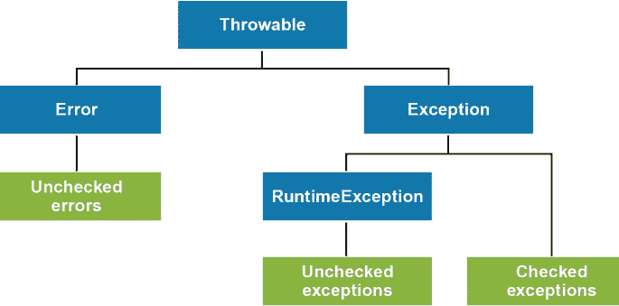

## 常见的受检查异常

- `ClassNotFoundException`
- `IOException`
- `EOFException`
- `FileNotFoundException`

## 常见的未检查异常

- `ArithmeticException`
- `IllegalArgumentException`
- `NumberFormatException`
- `IndexOutOfBoundsException`
- `ArrayIndexOutOfBoundsException`
- `StringIndexOutOfBoundsException`
- `NullPointerException`

### 描述

- 异常是 `Exception` 类或其任何子类的对象。它代表已发生的错误，以及阻止方法成功完成的条件。
- `Exception` 类派自 `Throwable`。有两种类型的异常派自 `Exception` 类：受检查异常和未检查异常。
- 受检查异常由编译器检查。因此，你必须编写代码来处理它们。
- 未检查异常不由编译器检查，但它们可以在运行时发生。编写处理它们的代码通常被认为是一种良好的做法。
- 与 `Exception` 类一样，`Error` 类也派自 `Throwable` 类。然而，`Error` 类标识罕见且无法恢复的内部错误。因此，你通常可以忽略 `Error` 类。

图 16-1 异常层次结构

## 异常是如何传播的

图 16-2 显示了 Java 中异常处理机制的工作原理。首先，当方法遇到在该内部无法解决的问题时，它会抛出一个异常。大多数情况下，异常是由 Java API 类中的方法抛出的。然后，任何调用抛出受检查异常的方法都必须抛出该异常，要么捕获并处理它。捕获并处理异常的代码被称为异常处理器。你将在本章中学习抛出、捕获和处理异常的细节。

一旦方法抛出异常，运行时系统就会开始寻找适当的异常处理器。为了做到，它会搜索执行栈轨迹（stack trace）；栈轨迹是按反序列出的调用方法列表。例如，在图中，当 `MethodD` 中的代码执行时，栈轨迹为：`MethodD`、`MethodC`、`MethodB` 和 `MethodA`。

此图显示了 `MethodA` 如何调用 `MethodB`，`MethodB` 调用 `MethodC`、`MethodD`。在这里，`MethodD` 可能会抛出一个异常。如果抛出了，`MethodD` 将异常抛给 `MethodC`，`MethodC` 抛给 `MethodB`，`MethodB` 抛给 `MethodA`，最后由 `MethodA` 在 `catch` 子句中捕获它。

如果你通过在调用栈中的每个方法上编写 `throws` 子句，将受检查异常一直抛出应用程序，那么应用程序在异常发生时将终止。然后，Java 会控制台上显示有关异常的信息。

注意，未检查异常也相同，但你不需要方法声明的 `throws` 子句中显式列出未检查异常。例如，假设 `MethodA` 中的 `try` 语句也包含一个捕获如 `ArithmeticException` 等运行时异常的 `catch` 子句。那么，如果 `MethodD` 中的代码抛出 `ArithmeticException`，异常将通过 `MethodC` 和 `MethodB` 传播，并在 `MethodA` 的异常处理器中处理，尽管没有任何方法声明包含列出 `ArithmeticException` 的 `throws` 子句。

### Java 如何传播异常

```
MethodA() {

    try {

        MethodB();

    } catch (ExceptionOne e) {

        // 在处处理异常

    }

}

MethodB() throws ExceptionOne {

    MethodC();

}

MethodC() throws ExceptionOne {

    MethodD();

}

MethodD() throws ExceptionOne {

    throw new ExceptionOne();

}
```

### 处理检查异常（checked exceptions）的两种方法

- 将异常抛给调用方法
- 捕获异常并进行处理

### 描述

- 当方法遇到其无法处理的情况时，该方法应该抛出一个异常。这使得方法的用户能够以适用于其应用程序的方式处理异常。Java API 中的许多方法都会抛出异常。
- 当一个方法调用另一个抛出检查异常的方法时，该方法必须将异常抛出给其调用者，或者捕获异常并直接处理。捕获异常的代码被称为*异常处理器*（exception handler）。
- 当发生异常时，运行时系统会寻找适当的异常处理器。为了做到，它会遍历*堆栈轨迹*（stack trace）或*调用栈*（call stack），该记录列出了所有已调用的方法，直到找到捕获该异常的方法。

### 如何处理异常

在后续的话中，你将学习使用 `try` 语句的一些额外技术。你还将学习如何抛出异常，以及如何使用 `Throwable` 类的一些构造函数和方法。

# 如何使用 try语句

图 16-3 首先显示了捕获异常的 `try` 语句的代码语法。该语法显示 `try` 语句以 `try` 块开始，该块包裹了任何可能抛出异常的语句。`try` 块之后是针对 `try` 块中可能抛出的每个异常类型的 `catch` 块。

当你添加 `catch` 块时，应确保按照 `Throwable` 层次结构从最具体的类到最不具体的顺序进行编码。例如，`FileNotFound` 继承自 `IOException`，因此 `FileNotFoundException` 必须在 `IOException` 代码之前编写，否则代码无法编译。如果异常处于层次结构的同一级别，例如 `FileNotFoundException` 和 `EOFException`，则顺序不重要。

在 `catch` 块之后，你可以编写一个 `finally` 块来释放由 `try` 语句使用的任何系统资源。例如，在 `finally` 块中关闭或释放数据库连接是可选的，但如果你编写了它，它始终会被执行。无论是否抛出了异常，这一点都是成立的，即使执行了 `return` 语句也是如此。

示例代码显示了一个名为 `FileReader` 的方法，该方法包含一个带有两个 `catch` 块和一个 `finally` 块的 `try` 语句。该方法接受一个指定文件路径的 `String`，并返回文件第一行的 `String`。在方法体内部，第一条语句初始化了一个可以存储 `BufferedReader` 对象的变量。该对象允许你以高效的方式从文件中读取数据。

在 `try` 块内部，第一条语句通过为指定路径传递一个新的 `FileReader` 对象来创建一个 `BufferedReader` 对象。如果文件不存在，此构造函数将抛出 `FileNotFoundException`，代码执行跳转到第一个 `catch` 块。然而，如果文件存在，第二条语句调用 `FileReader` 方法读取文件的第一行。如果该方法无法读取第一行，它将抛出 `IOException`，代码执行跳转到第二个 `catch` 块。否则，`try` 块中的 `return` 语句将第一行的 `String` 返回给调用方法。

两个 `catch` 块的工作原理类似。首先，第一条语句向控制台打印一条描述错误的消息。然后，第二条语句向调用方法返回 `null`。此值是合适的，因为该方法无法读取文件的第一行。

在 `finally` 块中，代码尝试通过调用其 `close` 方法关闭 `BufferedReader` 对象。不幸的是，如果 `try` 块中的代码没有执行成功，`BufferedReader` 对象可能为 `null`。结果，

## try语句的语法

```
try {statements}

  catch (MostSpecificExceptionType e) {statements} ...

  catch (LeastSpecificExceptionType e) {statements}

  finally {statements}
```

## 捕获两种类型异常并使用 finally 子句的方法

```
public static String readLine(String path) {

  BufferedReader in = null;

  try {

    in = new BufferedReader(
      new FileReader(path));

    String line = in.readLine(); // 可能抛出 FileNotFoundException

    return line;

  } catch (FileNotFoundException e) {

    System.out.println("File not found.");

    return null;

  } catch (IOException e) {

    System.out.println("I/O error occurred.");

    return null;

  } finally {

    try {

      if (in != null) {

        in.close(); // 可能抛出 IOException

      }

    } catch (Exception e) {

      System.out.println("Unable to close file.");

    }

  }

}
```


### 描述

- 你可以在任何可能抛出异常的语句周围编写一个 `try` 块。
- 你为 `try` 块中可能抛出的每种异常类型编写一个 `catch` 块。你应该按照 `Throwable` 层次结构从最具体的类到最不具体的顺序编写 `catch` 子句。
- 你可以编写一个 `finally` 块来释放 `try` 块中创建的对象使用的任何系统资源。`finally` 块中的代码始终会被执行。


## 416 第 4 节 你需要的更多核心技能

此代码在调用其 `close` 方法之前检查其是否为 `null`。此外，`close` 方法可能会抛出 `IOException`，因此你需要在 `finally` 块中编写捕获该异常的 `try` 语句。

当你编写 `try` 语句时，很容易创建空的 `catch` 子句以让代码编译。然而，这会导致调试变得困难，因为如果抛出了异常，你无法发现。相反，你的代码无法正常工作，且没有关于错误的指示。此外，人们很容易忘记编写异常处理器。在这种情况下，异常永远不会被处理。

## 如何使用 try-with-resources 语句

在 Java 7 之前，你必须使用 `finally` 块来释放系统资源，如前面所示。这需要额外的异常处理代码以防 `finally` 块抛出异常。不幸的是，这些异常处理代码的长度会使阅读和维护代码变得困难。

这就是为什么 Java 7 引入了图 16-4 中的 try-with-resources 语句。这是一种特殊的 `try` 语句，它可以声明并实例化多个使用系统资源的对象，并在 `try` 语句执行后自动关闭它们并释放资源。这允许你编写更少的错误处理代码，并专注于代码逻辑。例如，此图中的 `readFirst` 方法与前一个图的方法完成了相同的任务，但不需要笨拙的 `finally` 子句。结果是，代码更容易阅读和维护。

要使用 try-with-resources 语句，你可以通过在 `try` 关键字之后、`try` 块大括号之前编写代码来获益。在括号中，你可以编写一个或多个声明并实例化使用系统资源的语句。例如，图中创建 `BufferedReader` 对象的语句就编写在这些括号内。要创建多个对象，只需用分号将声明和实例化语句隔开。

注意，你只能将 try-with-resources 语句与实现 `java.lang.AutoCloseable` 接口的对象使用。然而，从 Java 7 开始，Java API 中大多数处理系统资源的类都已重构实现了该接口。这包括本书中描述的所有处理文件和数据库的类。

## try-with-resources 语句的语法

```
try (statement; statement ...) {statements}
[catch (MostSpecificType e) {statements}] ...
[catch (LeastSpecificType e) {statements}]
```

## 一个捕获两种异常并自动关闭指定资源的方法

```java
public static String readFirstLine(String path) {
    try (BufferedReader in = new BufferedReader(
            new FileReader(path))) {
        String line = in.readLine();
        return line;
    } catch (FileNotFoundException e) {
        System.err.println("File not found.");
        return null;
    } catch (IOException e) {
        System.err.println("I/O error occurred.");
        return null;
    }
}
```

### 描述

- try-with-resources 语句是 try 语句的一种特殊类型，它声明并实例化了一个或多个使用系统资源的对象，并在 try 语句执行完毕后自动关闭这些对象并释放资源。
- try-with-resources 语句是 Java 7 中引入的。
- 任何实现 `java.lang.AutoCloseable` 接口的对象都可以使用 try-with-resources 语句创建。
- 从 Java 7 开始，Java API 中大多数使用系统资源的类都经过重构以实现 `AutoCloseable` 接口。
- 如果对象没有实现 `AutoCloseable` 接口，当你尝试对其使用 try-with-resources 时，Eclipse 会发出警告。这也会导致编译错误。


## 如何使用异常的方法

图 16-5 显示了如何使用异常的方法获取更多关于异常的信息。由于 `Throwable` 类提供了这些方法，因此它们对所有异常对象可用。

第一个示例使用了表格中的前三个方法来打印数量递增的异常信息。在这种情况下，catch 块捕获了一个 `IOException` 对象并将其赋值给变量 `e`。在 catch 块内部，第一条语句使用 `getMessage` 方法获取异常消息并将其打印到控制台。第二条语句使用 `toString` 方法获取异常的类名和消息，并将这些数据打印到控制台。第三条语句使用 `printStackTrace` 方法将异常的类和堆栈轨迹打印到控制台。

当你编写处理异常的代码时，需要决定显示多少信息是适量的。例如，在某些情况下，你可能只想使用 `getMessage` 方法显示异常消息。然而，并不是所有异常都包含消息。正如此，使用 `toString` 方法显示异常名称和消息通常是有帮助的。其他时候，你可能想使用 `printStackTrace` 方法显示完整的堆栈轨迹，以便在测试应用程序时帮助你调试。通常认为，从生产应用中移除 `printStackTrace` 方法或用更好的异常日志记录方式来替换它是一种良好的实践。

在第一个示例中，catch 块中的语句使用 `System.err` 对象将数据打印到标准错误输出流。这通过使用 `System.out` 对象将数据打印到标准输出流来工作。在 Eclipse 中，这两个对象都会将数据打印到控制台窗口。然而，错误流会以红色显示，这与 Eclipse 显示异常的方式一致。因此，使用错误流来显示有关异常的信息是常见的。你还可以将标准输出流（如控制台）和标准错误输出流重定向到另一个源（如日志文件）。

如果你没有为 `printStackTrace` 方法提供参数，它会将数据打印到错误输出（`System.err`）。然而，如果你想将这些数据打印到另一个输出流（如标准输出流 `System.out`），可以指定该输出流作为方法的参数。例如，图中第二个示例中的所有语句都将数据打印到标准输出流。

## 所有异常可用的四个方法

| 方法 | 描述 |
| --- | --- |
| `getMessage()` | 如果可用，则返回异常的消息。 |
| `toString()` | 如果可用，则返回异常的类名和消息。 |
| `printStackTrace()` | 将异常的类名、消息和轨迹打印到标准错误输出流（`System.err`）。 |
| `printStackTrace(OutputStream)` | 将异常的类名、消息和轨迹打印到指定的输出流。 |

## 如何将异常打印到错误输出流

```java
catch (IOException e) {
    System.err.println(e.getMessage() + "\n");
    System.err.println(e.toString() + "\n");
    e.printStackTrace();
    return null;
}
```

## FileNotFoundException 的产生输出

```
c:\murach\java_eclipse\produx.txt (The system cannot find the file specified)
java.io.FileNotFoundException:
c:\murach\java_eclipse\produx.txt (The system cannot find the file specified)
java.io.FileNotFoundException:
c:\murach\eclipse\produx.txt (The system cannot find the file specified)
    at java.io.FileInputStream.open(Native Method)
    at java.io.FileInputStream.<init>(InputStream.java:131)
    at java.io.FileInputStream.<init>(InputStream.java:87)
    at java.io.FileReader.<init>(FileReader.java:57)
```

*(注：提供的 OCR 文本在结尾提供了一些碎片/重复片段。我已根据标准的 Java 文档模式和提供的片段进行了重新对齐。)*

## 如何使用 throws 子句

当你调用 Java API 中抛出受检异常的方法时，你必须重新抛出该异常或将其捕获。如果你认为在你正在编写的方法中可以妥善处理该异常，你可以在方法声明中编写一个 `throws` 子句，如图 16-7 所示。这会将异常向上抛给调用方法，你可以使用异常处理器来处理它，或者将其继续抛给它的调用方法。

第一个示例显示了 `readFirstMethod`，它与在本章中看到的相似。然而，该方法抛出异常而不是捕获它。在这里，该方法的第一语句调用了 `FileReader` 类的构造函数，这可能会抛出 `FileNotFoundException`。然后，下一条语句调用了 `BufferedReader` 的 `readLine` 方法，这可能会抛出 `IOException`。由于 `FileNotFoundException` 继承自 `IOException` 类，该方法可以通过使用 `throws` 子句抛出 `IOException` 来抛出这两种异常。

第一个示例隐式地捕获了 `IOException`。因此，该方法可以捕获或抛出其中一种。`readLine` 方法的 `throws` 子句没有显式地抛出 `FileNotFoundException`，这确实如此。

第二个示例展示了如何显式地抛出两种异常。为了做到这一点，你使用逗号来分隔 `throws` 子句中的异常。这种方法的优点是它清晰地标识了方法可能抛出的所有异常。这种方法的缺点是，对于第一个示例提供的相同功能，它需要更多的代码。

此图还显示了如果你不捕获或抛出受检异常，编译器生成的错误信息示例。更具体地说，如果你调用 `readLine` 方法且不捕获或抛出 `IOException`，编译器会生成类似所示的错误信息。

此时，你可能在想什么时候应该抛出异常，什么时候应该处理它。通常情况下，你应该尽早抛出异常，晚些捕获。换句话说，如果你处于应用程序的低层且能够处理异常，你应该抛出它。然后，异常将传播到高层，你可以在那里捕获异常并以符合应用程序逻辑的方式进行处理。例如，你可以要求用户处理异常。你可以显示用户友好的错误信息。或者，在必要时，你可以保存数据、关闭资源并尽可能地退出应用程序。

## 抛出异常的方法声明语法

```
修饰符 返回类型 方法名(参数列表) throws 异常列表
```

## 一个抛出 IOException 的方法

```java
public static String readLine(String path) throws IOException {
    BufferedReader reader = new BufferedReader(new FileReader(path));
    String line = reader.readLine();
    return line;
}
```

## 一个抛出两个异常的方法

```java
public static String readFirst(String path)
    throws FileNotFoundException, IOException {
    BufferedReader reader = new BufferedReader(new FileReader(path));
    String line = reader.readLine();
    return line;
}
```

## 如果不捕获或抛出受检异常的编译器错误

```
error: unreported exception IOException; must be caught or declared to be thrown
```

### 描述

- 任何调用抛出受检异常的方法都必须捕获该异常或抛出该异常。否则，应用程序将无法编译。
- 要抛出受检异常，你需要在方法声明中使用 `throws` 子句。`throws` 子句必须列出它向上抛给调用方法的每个受检异常。如果你列出多个异常，可以使用逗号分隔每个异常。
- 尽管你可以在 `throws` 子句中指定未受检异常，但编译器不会强制你处理未受检异常。


## 如何使用 throw 语句

在编写方法时，你有时需要抛出异常。例如，当方法遇到阻止其完成任务的问题时，你可能需要抛出异常，例如当方法传递了不可接受的值时。你可能还需要抛出异常来测试异常处理器。最后，当你想要捕获异常、执行某些处理，然后再次抛出该异常以便由调用方法处理时，你可能需要抛出异常。

图 16-8 显示了如何抛出异常。要做到这一点，你编写一个抛出异常类对象的语句。为了做到这一点，你通常使用 `new` 关键字从异常类创建一个对象。由于所有异常都继承自 `Throwable` 类，你可以使用此图中所示的两个构造函数之一来创建异常。如果你使用第一个构造函数，异常将不会分配任何消息。如果你使用第二个构造函数，你指定的消息将分配给异常。

第一个示例显示了一个名为 `calculateFutureValue` 的方法，它接受三个参数，如果其中任何参数小于或等于零，它将抛出 `IllegalArgumentException`。通常情况下，对于任何公共方法，如果传递了具有不可接受值的参数，抛出 `IllegalArgumentException` 是一种良好的做法。

第二个示例展示了你可能如何抛出异常来测试异常处理器。这种技术对于其他方式难以强制触发的异常非常有用。例如，你可以通过提供一个不存在的文件名来轻松测试 `FileNotFoundException` 的处理器。但测试 `IOException` 的处理器可能会困难。有时，简单的方法是在你预期异常发生的地方显式地抛出异常。

当你为了测试而抛出异常时，`throw` 语句必须是 `try` 块的最后语句，或者必须编写在 `if` 块中。否则，代码将无法编译，编译器将显示不可达的语句。在第二个示例中，因为语句编写在 `if` 内部，其条件始终为真，所以异常会被抛出。

第三个示例显示了在处理异常后重新抛出异常。在这里，异常处理器打印出已发生异常的消息。然后，它重新抛出异常以便调用方法可以处理。要做到这一点，`throw` 语句抛出了 `catch` 子句中命名的 `IOException` 对象。

## throw 语句的语法

```
throw throwableObject;
```

## Throwable 类的构造函数

| 构造函数 | 描述 |
|---|---|
| `Throwable()` | 创建一个消息为空的异常。 |
| `Throwable(message)` | 创建带有指定消息的异常。 |

## 一个抛出未受检异常的方法

```java
public double calculateFutureValue(double monthlyPayment,
    double monthlyInterestRate, int months) {
    if (monthlyPayment <= 0) {
        throw new IllegalArgumentException("Monthly payment must be > 0");
    }
    if (monthlyInterestRate <= 0) {
        throw new IllegalArgumentException("Interest rate must be > 0");
    }
    if (months <= 0) {
        throw new IllegalArgumentException("Months must be > 0");
    }
    // 计算并返回未来的代码
}
```

## 为了测试目的抛出 IOException

```java
try {
    // 读取文件第一行的代码
    if (true) {
        throw new IOException("I/O exception test");
    }
    return firstLine;
} catch (IOException e) {
    // 处理 IOException 的代码
}
```

## 重新抛出异常的代码

```java
try {
    // 抛出 IOException 的代码
} catch (IOException e) {
    System.out.println("IOException thrown in readFirst method.");
    throw e;
}
```


# 如何使用自定义异常类

尽管 Java API 包含了广泛的异常，但你可能会遇到没有哪一个异常能准确描述你的异常的情况。在其他情况下，你可能想用另一个异常来包装一个异常，以使代码更加抽象。无论哪种情况，你都可以按照后续主题所述编写一个定义自定义异常的类。然后，你可以像抛出其他异常一样抛出你的异常。

# 如何创建你自己的异常类

图 16-9 显示了如何创建自己的异常类。要这样做，请继承 `Exception` 类或其任子类来创建一个检查异常。为了说明，图中的第一个示例显示了一个继承 `Exception` 的异常类 `DBException`。结果 `DBException` 是一个检查异常。然而，你也可以通过继承 `RuntimeException` 类或其任子类来定义一个未检查异常。

按照惯例，所有异常类都应该有一个不接受任何参数的默认构造函数。因此，如果你为异常类编写了这些构造函数，它们的行为将与 Java API 中的其他类一样。第一个示例显示了如何编写这两个构造函数。在这里，第二个构造函数使用 `super` 关键字调用 `Exception` 类的构造函数并将消息参数传递给它。

第二个示例显示了 `getProduct` 方法如何调用 `readProduct` 方法来为指定的产品代码检索 `Product` 对象。`readProduct` 方法抛出一个 `IOException`，该异常被 `catch` 语句捕获。`catch` 语句抛出一个 `DBException`。

第三个示例显示了如何捕获自定义异常。在这里，`getProduct` 在 `try` 语句中调用，`DBException` 被 `catch` 语句捕获。在 `DBException` 的异常处理器中，控制台会显示一条错误消息。

一看，这些示例定义的自定义异常似乎并不是必要的。毕竟，如果发生了 IO 错误，`getProduct` 方法不能直接抛出 `IOException` 吗？虽然可以，但这将导致糟糕的设计，因为过暴露了关于 `getProduct` 方法操作的许多细节。`IOException` 只有在使用文件 I/O 操作时才可能发生。因此，抛出 `IOException` 将暴露 `getProduct` 方法使用 I/O 来访问产品数据。

如果应用程序发生了变化，将产品数据存储在数据库而不是文件中怎么办？在这种情况下，`getProduct` 方法将抛出某种数据库异常而不是 `IOException`。那么，任何调用 `getProduct` 方法的方法都必须处理这个新异常。通过为 `getProduct` 方法创建一个自定义的 `DBException`，你可以向调用它的方法隐藏 `getProduct` 方法如何工作的细节。因此，如果应用程序更改为使用数据库，如果在检索产品对象时发生错误，`getProduct` 方法仍然可以抛出 `DBException`。

# DBException 类的代码

```java
public class DBException extends Exception {

    public DBException() {}

    public DBException(String message) {
        super(message);
    }
}
```

# 抛出 DBException 的方法

```java
public static Product getProduct(String productCode) throws DBException {
    try {
        Product p = readProduct(productCode); // may throw IOException
        return p;
    } catch (IOException e) {
        throw new DBException("An error occurred while reading the product.");
    }
}
```

# 捕获 DBException 的代码

```java
try {
    Product p = getProduct("1234");
} catch (DBException e) {
    System.out.println(e.getMessage());
}
```

# 何时定义你的异常

- 当方法需要一个 Java 异常类型都未提供的异常时。
- 当使用内置的 Java 异常会不恰当地暴露方法操作细节时。

### 描述

- 要定义检查异常，请继承 `Exception` 类或其任何子类。
- 要定义未检查异常，请继承 `RuntimeException` 类或其任何子类。
- 按照惯例，每个异常类应该包含一个不接受任何参数的默认构造函数以及另一个接受字符串参数的构造函数。


# 如何使用异常链

你经常会响应其他发生的异常而抛出自定义异常。例如，在之前的图中，`DBException` 是为了响应 `IOException` 而抛出的。遗憾的是，在那个图中，导致 `DBException` 产生的底层错误信息丢失了。而这些信息对于确定导致 `DBException` 发生的原因可能是无价之宝。

图 16 显示了你如何在不丢失异常链的情况下抛出自定义异常。此功能是因为它允许将异常链在一起。每当你创建一个自定义异常类型时，使用异常链来避免丢失宝贵的调试信息是一个良好的做法。

要使用异常链，请使用异常构造函数，允许你指定一个异常对象作为你正在创建的新异常的原因。例如在第一个示例中，`DBException` 类允许你通过构造函数指定原因。在这里，第二个构造函数接受一个 `Throwable` 对象作为参数。然后，它将此参数传递给 `Exception` 构造函数。

第二个示例显示了在响应 `IOException` 时传递了 `DBException`。`IOException` 对象作为参数传递给 `DBException` 构造函数。这样一来，原始 `IOException` 中包含的所有信息都作为 `DBException` 对象的一部分被保存了。

第三个示例显示了它捕获了 `DBException` 并显示有关异常的信息。在这里，显示了一条错误消息，指示发生了 `DBException`，且该 `DBException` 是由 `FileNotFoundException` 引起的。

# 用于异常链的 Throwable 类构造函数

| 构造函数 | 描述 |
| :--- | :--- |
| `Throwable(cause)` | 创建一个以指定异常为原因的新异常。 |

# 使用链的自定义异常类

```java
public class DBException extends Exception {

    public DBException() {}

    public DBException(Throwable cause) {
        super(cause);
    }
}
```

# 带链抛出 DBException 的代码

```java
catch (IOException e) {
    throw new DBException(e);
}
```

# 捕获 DBException 的代码

```java
catch (DBException e) {
    System.err.println(e);
}
```


# 输出结果

```
DBException: java.io.FileNotFoundException: c:\murach\product.txt (The system cannot find the file)
```

## 描述

- 异常链允许你在抛出新异常时，维护被捕获异常的异常信息。异常链使用原因字段，该字段表示导致当前异常的原始异常。

# 练习 16-1 抛出和捕捉异常

在本练习中，你将尝试抛出和捕捉异常的方法。

1. 在 `ex_starts` 文件夹中导入名为 `ch16_ex1_ExceptionTester` 的项目。然后，打开 `Main` 类并审查代码。运行该类以熟悉它的工作原理。
2. 在 `Method3` 中添加代码，通过尝试整数除以零来抛出一个未检查异常。编译并运行应用程序，注意异常抛出的位置。
3. 删除你在 `Method3` 中添加的代码。然后，在该方法中添加一条类似于图 16-7 的语句，用于从 `BufferedReader` 类创建一个对象，但使用字符串 `"products.run"` 替换路径变量。该类的构造函数会抛出一个已检查异常 `FileNotFoundException`。注意错误信息指示你尚未处理该异常。如果没有显示此错误信息，请编译该类以显示错误信息。
4. 为 `main` 方法中的所有方法添加 `throws` 子句。然后，运行应用程序，查看已检查异常如何一直传播到应用程序之外。
5. 在 `Method1` 中添加代码处理 `FileNotFoundException`。要做到这一点，你需要从 `main` 方法和 `Method1` 中移除 `throws` 子句，并需要在 `Method1` 中添加一条捕捉异常的语句。`catch` 块应显示适当错误信息。运行应用程序以确保异常处理器工作正常。

# 练习 16-2 释放系统资源

在本练习中，你将有机会尝试使用 `try-with-resources` 语句通过对象来释放系统资源。

1. 在 `ex_starts` 文件夹中导入名为 `ch16_ex2_ResourcesTester` 的项目。然后，打开 `Main` 类。注意 `main` 方法调用了两个打开了 `BufferedReader` 但没有关闭它的方法。
2. 修改名为 `readLine` 的方法，使其使用 `try-with-resources` 语句来关闭 `BufferedReader`。运行应用程序使其正常工作。如果成功，说明 `try-with-resources` 语句也工作正常。
3. 修改名为 `readLineWithFinally` 的方法，使其使用 `finally` 块来关闭 `BufferedReader` 对象。为此，你需要在 `try` 块之外声明它。在 `finally` 块中添加语句，向控制台打印信息以指示文件是已关闭（这是正常操作）、从未打开（如果找不到文件就会发生）还是无法关闭（仅在少数情况下发生）。
4. 运行应用程序确保 `finally` 子句按预期工作。要测试文件从未打开会发生什么，你可以更改文件名导致 `FileNotFoundException`。要测试如果 `close` 方法不起作用会发生什么，你可以在关闭资源的语句之前抛出一个 `IOException`。

# 练习 13-6 创建自定义类

在本练习中，你将尝试自定义类和链式异常。

1. 在 `ex_starts` 文件夹中导入项目 `ch16_ex3_CustomTester`。然后，创建一个名为 `TestException` 的自定义已检查异常类，该类包含两个构造函数：一个不接受任何参数，另一个接受一个消息。
2. 打开 `Main` 类。然后，在 `Method3` 中添加一条语句抛出一个不带消息的 `TestException`。在 `Method2` 中添加捕捉此异常的必要代码。`catch` 块应在控制台打印你选择的消息。运行应用程序以确保其工作正常。
3. 修改你的解决方案，将你自定义的消息传递给 `TestException` 并在 `catch` 块中显示。运行应用程序确保自定义消息显示正确。
4. 为 `TestException` 类添加另一个接受 `Throwable` 对象作为参数的构造函数。
5. 在 `Main` 类的 `Method3` 中添加一个 `try` 语句。`try` 子句应抛出一个 `IOException`，而 `catch` 子句应抛出一个 `TestException`，并将 `IOException` 传递给其构造函数。
6. 修改 `Method2` 中捕捉 `TestException` 的 `catch` 块，使其打印提供有关异常及其底层原因信息的消息。运行应用程序以确保其工作正常。

# 17 如何处理文件 I/O

在本章中，你将介绍两种类型的文件：文本文件和二进制文件。虽然某些应用需要二进制文件，但只要可能，优先选择文本文件，因为它们更具移植性且不那么依赖平台。这就是为什么本章展示了如何处理文本文件。然而，许多相同的技能和概念也适用于处理二进制文件。因此，如果你需要处理二进制文件，可以通过搜索互联网或获取更全面的书籍（如 Murach 的《Java编程》）来学习更多。

当你处理文件时，经常会使用数组或集合（第 10 和第 14 章）。你需要能够处理 I/O 操作抛出的异常（第 16 章）。你还可能需要解析字符串（第 9 章）。因此，在学习本章的过程中，可能需要回顾这些章节。

| 标题 | 页码 |
| :--- | :--- |
| 目录和文件简介 | 434 |
| 用于处理目录和文件的包 | 434 |
| 处理目录和文件的代码示例 | 436 |
| 文件输入和输出简介 | 438 |
| 文件和流的工作原理 | 438 |
| 一个文件 I/O 示例 | 440 |
| 如何处理 I/O 异常 | 442 |
| 如何处理目录和文件 | 444 |
| 输入和输出 | 444 |
| 如何写入文件 | 446 |
| 如何连接文件 | 448 |
| 如何从文件读取 | 450 |
| 处理文件的类 | 452 |
| 文件系统 | 456 |
| Path 接口 | 456 |
| Main 类 | 456 |
| DirectoryStream | 460 |

# 第 17 章 如何处理文件 I/O 435

## 用于处理目录和文件的包

`java.nio.file`

## Path 类的静态方法

| 方法 | 描述 |
| :--- | :--- |
| `get(String[, String...])` | 返回用于指定路径的字符串或系列字符串的 `Path` 对象。 |

## Path 接口的方法

| 方法 | 描述 |
| :--- | :--- |
| `getFileName()` | 返回文件或目录名称的 `Path` 对象。 |
| `getName(int)` | 返回指定索引处元素的 `Path` 对象。 |
| `getNameCount()` | 返回路径中元素数量的 `int`。 |
| `getParent()` | 如果存在父路径，则返回父路径的 `Path` 对象。如果父不存在，则返回 `null`。 |
| `getRoot()` | 返回路径根组件的 `Path`。如果不存在根节点，则返回 `null`。 |
| `toAbsolutePath()` | 返回文件或目录绝对路径的 `Path` 对象。 |
| `toFile()` | 返回文件路径的 `File` 对象。 |

## Files 类的静态方法

| 方法 | 描述 |
| :--- | :--- |
| `exists(Path)` | 如果路径存在，则返回 `true`。 |
| `notExists(Path)` | 如果路径不存在，则返回 `true`。 |
| `isReadable(Path)` | 如果路径存在且可读，则返回 `true`。 |
| `isWritable(Path)` | 如果路径存在且可写，则返回 `true`。 |
| `isDirectory(Path)` | 如果路径存在且指向目录，则返回 `true`。 |
| `isRegularFile(Path)` | 如果路径存在且指向文件，则返回 `true`。 |
| `size(Path)` | 返回文件字节数的 `long` 值。 |
| `newDirectoryStream(Path)` | 返回一个 `DirectoryStream<Path>` 对象，你可以用它遍历目录下的所有文件和子目录。 |
| `createFile(Path)` | 如果指定的 `Path` 对象对应的文件尚不存在，则创建一个新文件。返回文件的 `Path` 对象。 |
| `createDirectory(Path)` | 如果目录不存在且所有父目录都存在，则创建一个新目录。返回目录的 `Path` 对象。 |
| `createDirectories(Path)` | 创建由指定 `Path` 表示的新目录，包括任何必要的但不存在的父目录。返回目录的 `Path` 对象。 |
| `delete(Path)` | 删除 `Path` 对象表示的文件或目录。目录只有在为空时才能被删除。 |

### 描述

- 要处理目录或文件，你需要使用 `Path` 对象。`Path` 对象可以包含根组件，以及目录名称和文件名。

## 处理目录和文件的代码示例

图 17-1 第 2 部分的第一个示例展示了如何创建一个新目录。为此，第一条语句创建了一个指向目录的字符串。在这种情况下，该目录是 C 盘上的 `murach/java/eclipse/files`。然后，第二条语句使用 `Paths` 类获取该目录的 `Path` 对象。最后，用 `if` 语句检查该目录是否存在。如果不存在，最后一条语句调用 `Files` 类的 `createDirectory` 方法来创建目录以及任何必要的父目录。

第二个示例展示了如何创建一个新文件。为此，第一条语句创建了一个包含文件名的字符串。然后，第二条语句获取指向该目录和文件的 `Path` 对象。在这种情况下，文件名为 `products.txt`，目录为 `\murach/java/eclipse\`。如果文件不存在，最后一条语句调用 `Files` 类的 `createFile` 方法来创建文件。

注意，此示例中的 `Paths` 类方法包含两个参数：一个用于目录，一个用于文件。当你编写此方法时，参数会用一个分隔符连接在一起。在大多数情况下，该分隔符与用于分离参数中名称元素的字符相同。在这种情况下，分隔符是正斜杠。

在示例中，`Path` 对象包含了文件的绝对路径和名称。然而，如果你想创建一个包含相对路径的 `Path` 对象，也是可以的。这时，路径是相对于当前工作目录 (CWD) 的。例如，如果你只指定文件名，该文件将存储在当前工作目录中，而这可能与应用程序启动时的目录不同。此外，在某些操作系统（如 Windows）上，可以设置工作目录。

第三个示例展示了如何获取上一步创建的 `Path` 信息。首先，`getFileName` 方法返回文件名。然后，`toAbsolutePath` 方法返回完整路径的 `Path` 对象。最后，`Files` 类的 `isWritable` 方法返回一个值，显示该文件是只读的。

第四个示例展示了如何获取之前创建的 `Path` 信息。首先，`getFileName` 方法返回文件名。然后，`toAbsolutePath` 方法返回完整路径的 `Path` 对象。最后，`Files` 类的 `isWritable` 方法返回一个值，显示该文件是只读的。

# 由文本编辑器编辑的文本文件

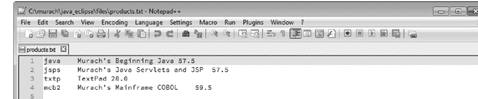

# 由文本编辑器编辑的二进制文件

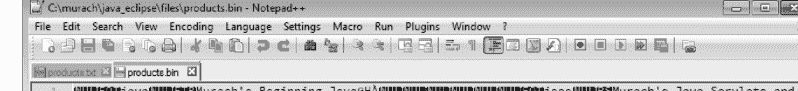

# 两种类型的文件

| 文件 | 描述 |
| --- | --- |
| 文本 | 包含字符的文件。此类文件中的字段和记录通常用制表符（tab）和换行符等特殊字符分隔。网页也是使用名为 HTML 的特殊标记语言的文件类型。 |
| 二进制 | 可能包含字符以及无法被文本编辑器读取的其它非字符数据类型的文件。常见的二进制文件类型包括图像、电影和应用程序。 |

# 两种类型的流

| 流 | 描述 |
| --- | --- |
| 字符流 | 用于向 I/O 设备传输或从 I/O 设备传输文本数据。 |
| 二进制流 | 用于向 I/O 设备传输或从 I/O 设备传输二进制数据。 |

### 描述

- 输入文件是供应用程序读取的文件。输出文件是应用程序写入的文件。输入和输出操作通常被称为 I/O 操作或文件 I/O。
- 流是数据从一个位置到另一个位置的流动。要从内部存储器将数据写入文件，你需要使用输出流。要从文件读取数据到内部存储器，你需要使用输入流。
- 要读写文本文件，你使用字符流。要写入二进制文件，你使用二进制流。
- 流不仅用于磁盘设备，还用于键盘和网络连接等输入设备，以及 PC 监控器和网络连接等输出设备。

# 文件 I/O 示例

为了给你提供一个文件 I/O 示例，图 17-3 显示了你可以用于从文本文件读取和写入内容的代码。第一个示例显示了处理文件 I/O 的两个包的导入语句。由于大多数用于处理文件 I/O 的类都存储在 `java.io` 包中，因此任何处理文件 I/O 的类通常都会导入此包中的所有类。此外，通常会包含 `java.nio.file` 包的导入语句，以便于处理前面图中描述的类（`Paths` 和 `Files`）和接口（`Path`）。

第二个示例显示了如何创建一个指向 `products.txt` 的 `File`。首先，第一条语句创建一个引用文件的 `Path` 对象。由于没有为文件指定目录，该 `Path` 对象指向存储在工作目录中的文件，这通常（但并非总是）是启动程序时的目录。然后，第二条语句调用 `Path` 对象的 `toFile` 方法将其转换为 `File` 对象。这是必要的，因为 `java.io` 包中的许多类是在 `Path` 对象引入之前就已经创建的。因此，它们被设计为与 `File` 对象配合工作而不支持 `Path`。

第三个示例显示了如何向文件写入。首先，你创建一个输出流。在这个示例中，输出流是在 `try-with-resources` 语句的 `try` 子句中创建的。

要创建一个包含应用程序所需所有功能的流，你可以将两个或多个流层叠成单个流。在 Java 中层叠流，你将一个类的对象作为另一个类构造函数的参数使用。在这个示例中，`BufferedWriter` 对象被用作 `PrintWriter` 构造函数的参数，而 `FileWriter` 对象被用作 `BufferedWriter` 构造函数的参数。

`BufferedWriter` 为流添加了一个名为缓冲区的内部内存块。这导致数据在写入输出设备之前存储在缓冲区中。然后，当缓冲区满或流关闭时，缓冲区中的所有数据都会被刷新到输出设备。同样地，当你对输入使用缓冲区时，一个完整的缓冲区将以单次 I/O 操作的形式返回。

在创建了输出流后，`try` 块中的语句使用输出流的 `println` 方法写入文件。然后，当块执行完毕时，`try-with-resources` 语句会自动关闭流并将缓冲区中的任何数据刷新到文件。

第四个示例读取此示例写入的数据。首先，它使用 `try-with-resources` 语句的 `try` 子句为 `products` 文件创建一个缓冲输入流。在块内部，两条语句读取文件的第一行并将其打印到控制台。最后，一旦 `try-with-resources` 语句执行完毕，它会自动关闭输入流，刷新缓冲区并释放与输入流相关的系统资源。

缓冲的好处是它减少了磁盘设备执行的 I/O 操作次数。例如，如果缓冲区可以容纳 4000 字节的数据，

# 第 17 章 处理文件 I/O 441

## 导入所有必要的包

```java
import java.io.*;
import java.nio.file.*;
```

## 获取文件的 Path 对象

```java
Path productsPath = Paths.get("products.txt");
File productsFile = productsPath.toFile();
```

## 向文件写入数据

```java
try (PrintWriter out = new PrintWriter(
```


```java
new BufferedWriter(
    new FileWriter(productsFile))) {

    out.println("Hello, World!");

} catch (IOException e) {

    e.printStackTrace();

}
```

# 从文件读取数据

```java
try (BufferedReader in = new BufferedReader(
    new FileReader(productsFile))) {

    String line;

    while ((line = in.readLine()) != null) {

        System.out.println(line);

    }

} catch (IOException e) {

    e.printStackTrace();

}
```

# IOException 类的子集

- `IOException`
- `EOFException`
- `FileNotFoundException`

# 常见的 I/O 异常

| 异常 | 说明 |
| --- | --- |
| `IOException` | 在 I/O 处理过程中发生错误时抛出。 |
| `EOFException` | 代码尝试读取文件末尾之后的内容时抛出。 |
| `FileNotFoundException` | 代码尝试打开一个不存在的文件时抛出。 |

# 处理 I/O 异常的代码

```java
Path productsPath = Paths.get("products.txt");

if (Files.exists(productsPath)) { // 防止 FileNotFoundException

    File productsFile = productsPath.toFile();

    try (BufferedReader in = new BufferedReader(new FileReader(productsFile))) {

        String line = in.readLine();

        while (line != null) { // 防止 EOFException

            System.out.println(line);

            line = in.readLine();

        }

    } catch (IOException e) { // 捕获 IOException

        System.out.println(line);

    }

} else {

    System.out.println(productsPath.toAbsolutePath() + " doesn't exist");

}
```

# 防止 EOFException 的循环

```java
String line = in.readLine();

while (line != null) {

    System.out.println(line);

    line = in.readLine();

}
```

# 编写此循环的另一种方式

```java
String line;

while ((line = in.readLine()) != null) {

    System.out.println(line);

}
```

图 17-4 如何处理 I/O 异常

### 如何处理文本文件

在处理文本文件时，你需要层叠两个或多个类来创建字符输入流或输出流。你将在后续主题中学习如何这样做。此外，你还将学习如何使用这些类的方法来处理文本文件。然后，你将看到一个完整的类，可以使用它来将 `Product` 对象读取并写入到文本文件中。

# 如何将字符输出流连接到文件

在写入文本文件之前，你需要创建一个字符输出流，并将该流连接到文件。要做到这一点，你必须像图 17-5 所示，层叠 `Writer` 层次结构中的两个或多个类。然后，你使用 `PrintWriter` 类的方法将数据写入输出流，使用 `BufferedWriter` 类为输出流创建缓冲区，并使用 `FileWriter` 类将流连接到文件。

虽然使用缓冲区通常是良好做法，但本示例演示了如何在不使用缓冲区的情况下连接到文件。在这里，第一条语句通过向 `FileWriter` 类的构造函数传递字符串路径对象来创建一个 `FileWriter`。或者，该语句也可以传递该文件的 `File` 对象给构造函数。无论哪种，第二条语句都通过将 `FileWriter` 传递给 `PrintWriter` 类的构造函数来创建一个 `PrintWriter` 对象。

第二个示例展示了编写第一个示例的更简洁的方法。在这里，你没有将 `FileWriter` 对象赋值给命名变量。相反，你将 `FileWriter` 类构造函数的调用嵌套在 `PrintWriter` 类的构造函数中。在这种情况下，整个语句写在一行上，但如果像第三个示例所示将每个构造函数单独写在一行，会更容易阅读。

第三个示例显示了如何在输出流中包含缓冲区。要做到这一点，除了 `FileWriter` 和 `PrintWriter` 对象之外，还需要一个 `BufferedWriter` 对象。

第四个示例显示了如何向现有文件添加数据。要做到这一点，你将 `FileWriter` 构造函数的第二个参数设置为 `true`。如果你没有为参数编写值，则文件中的现有数据将被覆盖。

默认情况下，当缓冲区满时，输出流中的数据会被刷新到磁盘。然而，如果你将 `PrintWriter` 构造函数的第二个参数设置为 `true`，则会开启自动刷新功能。这样，每执行一次 `print` 方法，缓冲区都会被刷新。

图中的构造函数应该帮助你理解如何层叠输出流。在这里，`PrintWriter` 构造函数接受任何派自 `Writer` 的类。因此，你可以提供 `BufferedWriter` 对象或 `FileWriter` 对象作为 `PrintWriter` 构造函数的参数。同样，`BufferedWriter` 构造函数也接受任何对象，你可以提供 `FileWriter` 对象作为 `BufferedWriter` 构造函数的参数。

# Writer 层次结构的子集

```
Writer <<abstract>>

BufferedWriter

PrintWriter

OutputStream

FileWriter
```

# 用于将字符输出流连接到文件的类

- `PrintWriter` 包含向文本流写入数据的方法
- `BufferedWriter` 为流创建缓冲区
- `FileWriter` 将流连接到文件

# 这些类的构造函数

| 构造函数 | 抛出 |
| --- | --- |
| `PrintWriter(Writer, booleanFlush)` | 无 |
| `BufferedWriter(Writer)` | 无 |
| `FileWriter(File, booleanAppend)` | `IOException` |
| `FileWriter(StringPath, booleanAppend)` | `IOException` |

# 如何无缓冲区连接（不推荐）

```java
FileWriter writer = new FileWriter("products.txt");
PrintWriter out = new PrintWriter(writer);
```

# 连接上一个示例的更简洁方法

```java
PrintWriter out = new PrintWriter(new FileWriter("products.txt"));
```

# 如何使用缓冲区连接到文件

```java
PrintWriter out = new PrintWriter(
    new BufferedWriter(
        new FileWriter("products.txt")));
```

# 如何为追加操作连接

```java
PrintWriter out = new PrintWriter(
    new BufferedWriter(
        new FileWriter("products.txt", true)));
```

### 描述

- `Writer` 是抽象类，`Writer` 层次结构中的所有类都继承它。要了解更多关于 `Writer` 的信息，请参阅 Java 文档。
- 如果创建 `FileWriter` 时文件不存在，则会自动创建。如果文件已存在，默认会被覆盖。如果这不是你想要的，可以在第二个参数中指定 `true` 以向文件追加数据。
- 如果在 `PrintWriter` 构造函数的第二个参数中使用 `true`，则每次调用方法时都会刷新缓冲区。

图 17-5 如何将字符输出流连接到文件

# 如何写入文本文件

图 17-6 显示了如何写入文本文件。要做到这一点，你使用 `PrintWriter` 对象的 `print` 和 `println` 方法将数据打印到文件中。这些方法类似于 `System.out` 对象的 `print` 和 `println` 方法。然而，它们是将数据打印到文件而不是控制台。

正如你在本章前面看到的，可以使用资源语句来创建流。这时，流在语句结束时会自动刷新并关闭。但是，如果你没有使用资源语句，可以使用 `close` 方法手动关闭输出流。这会刷新缓冲区并释放输出流使用的资源。或者，如果你想保持输出流打开，可以使用 `flush` 方法刷新所有数据。无论，你需要抛出或捕获这些方法可能抛出的 `IOException`。

图中第一个示例显示了如何向文本文件 `log.txt` 追加字符串和对象。如果当前目录中不存在名为 `log.txt` 的文件，该语句将创建该文件。然后，`FileWriter` 输出一个字符串，`println` 方法打印一个表示当前日期的 `LocalDateTime` 对象。为了使此项工作，会自动调用 `LocalDateTime` 对象的 `toString` 方法将日期转换为字符串。

图中第二个示例显示了如何将存储在 `Product` 对象中的数据写入分隔符文本文件。在类类型文件中，使用一种类型的分隔符来分隔写入文件的字段（列），使用另一种类型的分隔符来分隔记录（行）。在本示例中，制表符 (`\t`) 被用作字段分隔符，换行符被用作记录分隔符。这样，一个产品的代码、描述和价格存储在同一记录中，并用制表符分隔。然后，换行符结束该产品的数据，下一个产品的数据可以存储在下一个记录中。

# PrintWriter 类常用的方法

| 方法 | 抛出 | 描述 |
| --- | --- | --- |
| `print(argument)` | 无 | 将参数类型的字符表示写入文件。 |
| `println(argument)` | 无 | 将参数类型的字符表示写入文件，并在其后跟一个换行符。如果开启了自动刷新（autoflush）功能，此也会刷新缓冲区。 |
| `flush()` | `IOException` | 将缓冲区中的任何数据写入文件。 |
| `close()` | `IOException` | 将缓冲区中的任何数据写入文件并关闭流。 |

# 向文本文件追加字符串和对象的代码

```java
// 打开一个用于向文本文件追加内容的的输出流
PrintWriter out = new PrintWriter(
    new BufferedWriter(
        new FileWriter("log.txt", true)));

// 向文件写入一个字符串和一个对象
out.print("This application was run on ");
LocalDateTime currentDateTime = LocalDateTime.now();
out.println(currentDateTime);

// 将数据刷新到文件并关闭输出流
out.close();
```

# 向由分隔符文本文件写入 Product 对象的代码

```java
// 打开一个用于覆盖文本文件的输出流
PrintWriter out = new PrintWriter(
    new BufferedWriter(
        new FileWriter(productsFile)));

// 向文件写入 Product 对象
out.print(product.getCode() + "\t");
out.print(product.getDescription() + "\t");
out.println(product.getPrice());

// 将数据刷新到文件并关闭输出流
out.close();
```

### 描述

- 要向输出流写入数据的字符表示，你使用 `PrintWriter` 类的 `print` 和 `println` 方法。如果你提供一个对象作为参数，这些方法会调用一个换行符。
- 要创建一个由分隔符的文本文件，你使用一个分隔符（如换行符）来分隔文件中的记录或行，并使用另一个分隔符（如制表符）来分隔每个记录的字段或列。
- 要将所有数据刷新到文件，你可以使用 try-with-resources（try 资源）在使用流时自动关闭它。你也可以使用流的 `flush` 或 `close` 方法手动将所有数据刷新到文件。

图 17-6 如何写入文本文件

# 如何将字符输入流连接到文件

在从文本文件中读取字符之前，你必须将字符输入流连接到文件。图 17-7 展示了如何使用缓冲区和 `File` 对象来实现这一点。正如你在该图的示例所示，你将 `FileReader` 类作为 `BufferedReader` 类构造函数的参数提供。这创建了一个使用缓冲区并具有你可以用于读取数据的方法的流。

如果你查看 `BufferedReader` 和 `FileReader` 类的构造函数，你就能明白为什么这段代码可以工作。由于 `BufferedReader` 对象的构造函数接受 `Reader` 层次结构中的任何对象，因此它可以接受一个将流连接到文件的 `FileReader` 对象。然而，`BufferedReader` 对象也可以接受 `InputStreamReader` 对象，该对象可以将字符输入流连接到键盘或网络连接，而不是文件。

# Reader 层次结构的子集

```
Reader <<abstract>>

BufferedReader

InputStreamReader

FileReader
```

# 用于通过缓冲区连接到文件的类

- `BufferedReader` 包含了从流中读取数据的方法
- `FileReader` 将流连接到文件

# 这些类的构造函数

| 构造函数 | 抛出 |
|---|---|
| `BufferedReader(Reader)` | 无 |
| `FileReader(File)` | `FileNotFoundException` |
| `FileReader(String pathName)` | `FileNotFoundException` |

# 如何将字符输入流连接到文件

```java
BufferedReader in = new BufferedReader(
    new FileReader("products.txt"));
```

### 描述

- 该类是一个抽象类，`Reader` 层次结构中的所有类都继承它。要了解更多关于 `Reader` 层次结构的信息，请查看 Java API 文档。`java.io` 包中所有以 `Reader` 结尾的类都是 `Reader` 层次结构的成员。
- 虽然你可以仅使用 `FileReader` 类读取文件，但 `BufferedReader` 类提高了效率并为读取字符输入流提供了更好的方法。


# 如何从文本文件中读取

图 17-8 中的示例展示了如何读取 17-6 示例所写入的两个文本文件。在第一个示例中，循环读取每一行并将其打印到控制台。当 `readLine` 方法尝试读取到文件末尾之后时，它会返回 `null`，这导致循环结束。然后，调用 `close` 方法来刷新缓冲区并关闭输入流。

第二个示例展示了如何从 products 文件中读取一行。为了做到这一点，它使用了 `readLine` 方法。由于该文件是由分隔符划分的文本文件，它解析 `String` 类以将字符串拆分为字符串数组。在这个示例中，制表符被作为 `split` 方法的参数提供，因为它是用于划分行中列的字符。

该示例继续通过列数组中的数据创建一个 `Product` 对象。由于产品代码和描述是字符串，因此包含这些值的列可以直接传递给 `Product` 对象的构造函数。然而，价格列必须从 `String` 对象转换为 `double` 类型值。在这个示例中，使用了 `Double` 类的 `parseDouble` 方法来完成操作。

该示例的最后一条语句调用了 `close` 方法。这会刷新缓冲区并释放任何系统资源。

# BufferedReader 类常用的方法

| 方法 | 抛出 | 描述 |
| --- | --- | --- |
| `readline()` | `IOException` | 读取一行并返回字符串。 |
| `close()` | `IOException` | 关闭输入流并刷新缓冲区。 |

# 写入文件的对象的代码

# 示例输出


# String 类的一个方法

| 方法 | 描述 |
| --- | --- |
| `split(delimiter)` | 将字符串按指定的分隔符拆分并返回字符串数组。 |

# 分隔符文本文件的代码

```java
// 读取下一行
String line = in.readLine();

// 将行拆分为它的列
String[] columns = line.split("\t");

// 从列中的数据创建一个 Product 对象
String code = columns[0];
String description = columns[1];
```


```java
double price = Double.parseDouble(columns[2]);

// 创建一个 Product 对象
Product p = new Product(code, description, price);
```

# 分隔符文本文件的示例

图 17-8 如何从文本文件中读取

# 一个与文本文件工作的类

图 17-9 展示了一个完整的名为 `ProductIO` 的类，可以使用它读取和写入产品到文件。作为开始，静态成员 `productsPath` 存储了文本文件的路径。然后，名为 `productsFile` 存储了对应的 `File`。接下来，名为 `FIELD_SEP` 指定制表符用于分隔文件中的字段。最后，名为 `products` 返回一个包含文件中所有产品对象的列表。为了做到这一点，该语句调用了类定义的 `getAll` 方法。

`ProductIO` 类的私有构造函数防止任何人创建它的对象。这是一个良好的做法，因为该类只包含静态方法。

`getAll` 方法返回文件中所有产品对象的列表。该方法首先检查 `products` 列表是否已创建。如果是，它通过只在需要时读取列表来提高效率。

如果 `products` 列表尚未创建，这段代码会创建它。为了做到这一点，它首先创建一个空的 `ArrayList`。然后，它检查 `productsFile` 是否存在。如果是，它使用 `try-with-resources` 语句创建一个输入流。该方法使用循环读取并处理文件的行，直到到达文件结束。正如你在本章中学到的，可以通过检查 `readLine()` 方法返回的字符串为 `null` 来测试文件结束条件。

在循环内部，第一条语句使用常量 `FIELD_SEP` 将行分为三列（代码、描述和价格）。然后，它创建一个 `Product` 对象，从这些列的值设置其数据，并将 `Product` 对象添加到 `products` 列表中。然后，控制返回到循环顶部并处理下一行。

如果在 `getAll` 方法的某处抛出了 `IOException`，该方法将返回 `null`。任何调用 `getAll` 方法的方法都可以通过检查列表是否为 `null` 来测试其执行是否成功。无论是否抛出异常，`try-with-resources` 语句都会关闭输入流。

在此类中，语句将异常捕捉到控制台。这在你测试和调试应用程序时很有用，当你把应用程序投入生产环境时它可能并不恰当。作为结果，当你将此类类投入生产环境时，你可能想更改异常的处理方式。例如，你可能想将错误消息写入日志文件。或者，你可能想抛出一个指示发生了通用错误的自定义异常。有关如何创建自定义异常的更多信息，请参阅第 16 章。

# 第 17 章 如何处理文件 I/O 453

## ProductIO 类代码 第1 页

```java
package murach.io;

import java.util.*;
import java.io.*;
import java.nio.file.*;
import murach.business.Product;

public class ProductIO {

    private static final Path productsPath = Paths.get("products.txt");
    private static final File productsFile = productsPath.toFile();
    private static final String FIELD_SEP = "\t";
    private static List<Product> products = getAll();

    // 防止类被实例化
    private ProductIO() {}

    public static List<Product> getAll() {
        // 如果产品文件已经读取过，则不再重复读取
        if (products == null) {
            return products;
        }

        List<Product> products = new ArrayList<>();

        if (Files.exists(productsPath)) {
            try (BufferedReader reader = new BufferedReader(
                    new FileReader(productsFile))) {
                // 将文件中存储的所有产品读取到数组列表中
                String line = reader.readLine();
                while (line != null) {
                    String[] columns = line.split(FIELD_SEP);
                    String code = columns[0];
                    String description = columns[1];
                    String price = columns[2];
                    Product p = new Product();
                    p.setCode(code);
                    p.setDescription(description);
                    p.setPrice(Double.parseDouble(price));
                    products.add(p);
                    line = reader.readLine();
                }
            } catch (IOException e) {
                System.out.println(e);
                return null;
            }
        }
        return products;
    }
}
```

图 17-9 一个与文本文件工作的类（2 部分中的第1 部分）

## 第 4 节：你需要的更多核心技能

`get(String code)` 方法返回与指定产品代码匹配的 `Product` 对象。为了搜索该产品，此方法会遍历列表中的每个产品，直到找到具有指定产品代码的产品。最后，它返回该对象。如果没有产品具有指定代码，此方法将返回 `null`。

`saveAll()` 方法访问产品列表并将所有 `Product` 对象写入文件。如果此操作成功，它将返回 `true` 值。如果抛出 `IOException`，它将返回 `false` 值。这表示保存操作未成功。

`saveAll()` 方法首先开始为产品文件创建一个缓冲输出流。然后，此方法使用循环将列表中的每个产品写入文件。为了实现这一点，它使用 `FIELD_SEP` 常量来分隔每个产品记录中的每个字段，并使用 `println()` 方法在每个产品记录的末尾插入换行符。

`add(Product p)` 方法首先调用 `List` 接口的 `add()` 方法来添加产品列表。然后，它调用 `saveAll()` 方法将修改后的列表保存到产品文件中，以便列表和文件包含相同的数据。在这里，`add()` 方法返回 `saveAll()` 方法返回的布尔值。这样，如果 `saveAll()` 方法返回 `true` 值，`add()` 方法也会返回 `true` 值。

`delete(Product p)` 方法的工作原理类似。它从开始调用 `getAll()` 方法返回一个产品列表。然后，它调用 `List` 接口的 `remove()` 方法从列表中删除该产品。最后，它调用 `saveAll()` 方法将列表保存到产品文件中，并返回该方法返回的布尔值。

`update(Product newProduct)` 方法的工作原理略有不同。此方法用新 `Product` 对象中的数据更新现有产品的数据。首先，此方法使用 `get()` 方法获取与新 `Product` 对象具有相同产品代码的旧 `Product` 对象。然后，获取旧产品的索引并从列表中删除它。接下来，它将新产品插入到旧产品的位置。最后，它调用 `saveAll()` 方法将列表保存到产品文件中，并返回一个指示操作是否成功的值。

需要注意的是，该类无法为多个用户正常工作。例如，假设用户 A 和用户 B 都读取了产品文件，然后用户 A 修改了它。接着，假设用户 B 也修改了该文件。此时，用户 B 的更改将覆盖用户 A 的更改。这被称为并发问题。

减少并发问题的一种方法是在每次调用 `getAll()`、`get()`、`add()`、`update()` 和 `delete()` 方法时都读取数据。这样，数据更有可能是最新的。然而，这将是低效的，特别是当文件包含数千条记录时，而且它仍然不是线程安全的。解决这个问题最简单且最专业的方法是使用第 19 章和第 20 章中描述的数据库。

## ProductIO 类代码（续）

```java
public static Product get(String code) {
    for (Product p : products) {
        if (p.getCode().equals(code)) {
            return p;
        }
    }
    return null;
}

private static boolean saveAll() {
    try (PrintWriter out = new PrintWriter(
            new BufferedWriter(
                    new FileWriter(productsFile)))) {
        // 将数组列表中的所有产品写入文件
        for (Product p : products) {
            out.print(p.getCode() + FIELD_SEP);
            out.print(p.getDescription() + FIELD_SEP);
            out.println(p.getPrice());
        }
    } catch (IOException e) {
        System.out.println(e);
        return false;
    }
    return true;
}

public static boolean add(Product p) {
    products.add(p);
    return saveAll();
}

public static boolean delete(Product p) {
    products.remove(p);
    return saveAll();
}

public static boolean update(Product newProduct) {
    // 获取旧产品并删除它
    Product oldProduct = get(newProduct.getCode());
    int i = products.indexOf(oldProduct);
    products.remove(i);
    // 添加更新后的产品
    products.add(newProduct);
    return saveAll();
}
```


本章通过展示 Product Manager 应用程序来结束。该应用程序使用前面描述的 `ProductIO` 类来处理产品数据。此外，它使用了之前介绍的 `Product`、`Console` 和 `StringUtil` 类。

### 控制台

图 17-10 显示了 Product Manager 应用程序的控制台。当它启动时，应用程序显示欢迎消息和命令菜单。然后，它提示用户输入命令之一。在图中，例如，用户首先输入了 `list` 命令。这显示了存储在文件中产品列表。显示产品后，用户使用 `add` 命令向文件添加了新产品。然后，用户使用 `del` 命令删除了该产品。

## Main 类

图 17-11 显示了 `Main` 类的代码。该类包含了应用程序启动时执行的 `main()` 方法。首先，此方法显示欢迎消息。然后，它调用 `displayMenu()` 方法显示操作此应用程序的菜单。之后，`main()` 方法进入一个循环，直到用户输入 `exit` 命令。

在这个循环内部，第一个语句提示用户输入命令。如果用户输入 `list`，此代码调用图 17-11 第二部分所示的 `displayAllProducts()` 方法。该方法显示产品列表。为了实现这一点，它调用 `ProductIO` 类的 `getAll()` 方法获取产品列表。然后，它遍历这些 `Product` 对象并构建显示它们的字符串。为了实现这一点，此代码使用了之前介绍的 `StringUtil` 类按指定的空格数对齐列。

如果用户输入 `add`，此代码调用图 17-11 第二部分所示的 `addProduct()` 方法向文本文件添加产品。为了实现这一点，此方法根据用户输入的数据创建一个 `Product` 对象，并将其传递给 `ProductIO` 类的 `add()` 方法。

如果用户输入 `del` 或 `delete`，此代码调用第二部分所示的 `deleteProduct()` 方法从文本文件中删除具有指定代码的产品。为了实现这一点，此方法调用 `ProductIO` 类的 `get()` 方法获取与指定代码对应的 `Product` 对象。然后，它调用 `ProductIO` 类的 `delete()` 方法从文本文件中删除该产品。

### 控制台示例

欢迎使用产品管理器

```
命令菜单
list - 列出所有产品
add - 添加产品
del - 删除产品
help - 显示此菜单
exit - 退出此应用程序
```

输入命令：`list`

```
产品列表
java Murach's Java Programming $57.50
jsp Murach's Servlets and JSP $57.50
mysql Murach's MySQL $54.50
android Murach's Android Programming $57.50
html5 Murach's HTML5 and CSS3 $54.50
oracle Murach's Oracle and PL/SQL $54.50
javascript Murach's JavaScript and Jquery $54.50
```

输入命令：`add`

```
输入产品代码: bjava
输入产品描述: Murach's Beginning Java
输入价格: $54.50
```

Murach's Beginning Java 已添加到数据库中。

输入命令：`delete` / `del`

```
输入要删除的产品代码: bjava
```

Murach's Beginning Java 已从数据库中删除。

输入命令：`exit`

再见。

- 此应用程序允许你管理存储在文本文件中的产品。启动时，它会显示一个你可以使用的命令列表。然后，它会提示你输入其中一个命令。
- 要查看产品，你可以使用 `list` 命令。
- 要添加或删除产品，可以使用 `add` 或 `del` 命令。
- 要再次显示命令列表，可以使用 `help` 命令。
- 要退出应用程序，可以输入 `exit` 命令。

图 17-10 产品管理器应用程序的控制台

# Main 类

```java
package murach.ui;

import java.util.List;
import murach.business.Product;
import murach.io.ProductIO;

public class Main {
    public static void main(String[] args) {
        // 显示欢迎消息
        System.out.println("Welcome to the Product Manager\n");
        // 显示命令菜单
        displayMenu();
        // 执行 1 次或多次操作
        String action = "";
        while (!action.equalsIgnoreCase("exit")) {
            // 获取用户输入
            action = Console.getString("Enter a command: ");
```

图 17-11 Main 类（第 1/2 部分）

# Main 类（继续）

```java
public static void displayAllProducts() {
    System.out.println("PRODUCT LIST");
    List<Product> products = ProductIO.getAll();
    if (products == null) {
        System.out.println("\nError! Unable to get products.\n");
    } else {
        Product p;
        StringBuilder sb = new StringBuilder();
        for (Product product : products) {
            p = product;
            sb.append(Util.padWithSpaces(
                p.getCode(), 12));
            sb.append(Util.padWithSpaces(
```


```java
p.getDescription(), 34));

sb.append(p.getPriceFormatted());

sb.append("\n");

}

System.out.println(sb.toString());

}

}
```

```java
public static void addProduct() {

    String code = Console.getString("Enter product code: \n");

    String description = Console.getString("Enter product description: \n");

    double price = Console.nextDouble("Enter price: \n");

    Product product = new Product();

    product.setCode(code);

    product.setDescription(description);

    product.setPrice(price);

    ProductIO.add(product);

    System.out.println("\n" + description

        + " was added to the database.\n");

}
```

```java
public static void deleteProduct() {

    String code = Console.getString("Enter product code to delete: \n");

    Product product = ProductIO.get(code);

    if (product == null) {

        System.out.println("\nError! Unable to get product.\n");

    } else {

        ProductIO.delete(code);

        System.out.println("\n" + product.getDescription() +

            + " was deleted from the database.\n");

    }

}
```

图 17-11 Main 类（第 2/2 部分）

### 展望

在本章中，你学习了如何读写文本文件。此外，你还学习了如何使用诸如 `ProductIO` 类的类将业务对象数据以 `Product` 对象的形式存储在文本文件中。这应该帮助你理解你合作开发的应用程序的表示层、业务层和数据库层。

在处理文本文件时，请记住它们只是存储数据的一种选择。另一种选择是将数据存储在数据库中。因为数据库提供了组织和管理数据的复杂功能，因此它们被用于大多数应用程序。你将在第 19 和第 20 章中学习如何与数据库交互。

如果你需要将对象读取到二进制文件中，可能希望考虑使用名为“序列化”（serialization）的 Java 特性。该特性自动化了将对象读写二进制文件的过程。除非在编写底层代码，否则大多数程序员不需要编写执行序列化的代码。例如，编写 Java 应用程序服务器的程序员可能需要序列化来在二进制文件中读写对象。然而，使用应用程序的应用程序程序员不需要编写这些代码。相反，应用程序程序员只需要提供实现 `Serializable` 接口的对象即可。

### 总结

- 文本文件以字符存储数据。二进制文件以二进制格式存储数据。
- 在分隔符文本文件中，使用分隔符区分字段和记录。你可以使用字符流来读写文本文件。
- 缓冲区是内存中的一个块，在写满或从 I/O 设备读取之前会被刷新。
- 当处理 I/O 操作时，你需要捕获或抛出三种异常：`IOException`、`FileNotFoundException` 和 `EOFException`。
- 在创建文件对象时，可以使用绝对路径名或相对路径名。
- `java.io.File` 包提供了检查文件或目录是否存在、获取路径信息、创建或删除目录的方法。可以使用 Writer 和 Reader 类层次来处理文本文件。

# 练习 17-1 处理文本文件

在这个练习中，你将为客户管理器应用程序添加读写文本文件的代码。该文件中的每条记录包含客户的姓、名和邮箱三个字段。字段用制表符分隔，记录用换行符分隔。

## 查看应用程序代码

1. 导入名为 `ch17_ex1_CustomerManager` 的项目。
2. 打开 `Customer` 类并查看代码。

## 为应用程序添加 I/O 代码

3. 打开 `CustomerFile` 文件，注意存储 `Customer` 对象列表、文件 `Path` 对象和文件 `File` 对象的静态变量。添加初始化这些变量的代码。
4. 为 `getCustomers` 方法添加代码，从 `customers.txt` 中的数据加载 `Customer` 对象列表。确保该文件存在，并使用 `try-with-resources` 语句打开输入流。如果在打开输入流时发生 `IOException`，将异常打印到控制台并向调用者返回 `null`。
5. 为 `saveCustomers` 方法添加代码，将列表中每个 `Customer` 对象的数据写入客户文件。确保使用相应的字符分隔字段和记录。如果在打开输出流时发生 `IOException`，将异常打印到控制台并向调用者返回 `false`。
6. 运行应用程序，测试列表、添加和删除功能以验证其工作正常。

# 练习 17-2 修改异常处理

在这个练习中，你将修改由 `ProductIO` 和 `Main` 类处理的异常。

## 打开应用程序并查看代码

1. 导入名为 `ch17_ex2_ProductManager` 的项目。
2. 打开 `ProductIO` 类。注意 `getAll` 和 `saveAll` 方法处理所有的 IO 异常。注意除了 `getAll` 方法外的所有方法开头都调用了 `getAll` 方法。
3. 打开 `Main` 类。注意它不包含任何异常处理代码。
4. 运行应用程序以确保其工作正常。

## 修改异常处理代码

5. 在 `ProductIO` 类中，修改 `getAll` 方法使其抛出 `IOException`。由于所有其他方法都调用了此方法，你还需要修改类中的所有其他方法，使其也抛出 `IOException`。
6. 修改 `getAll` 方法，使其不再使用 `try-with-resources` 语句来捕获异常。
7. 修改 `saveAll` 方法，使其不再使用 `try-with-resources` 语句来捕获异常。此时，`ProductIO` 类应该抛出异常，但不捕获其中任何一个。
8. 在主类中，添加处理 `ProductIO` 类抛出的异常的代码。为此，你需要添加 `try/catch` 语句，并包含一个 `catch` 块，向控制台打印两行内容如下：

```
Error! Unable to get products.

java.io.IOException: Test
```

在这里，第一行是用户友好的消息，第二行包含抛出异常的详细信息。

9. 运行应用程序以确保其工作正常。

# 测试异常处理代码

10. 在 `ProductIO` 类中，在 `getAll` 方法开头添加以下代码：

```
if (true) {

    throw new IOException("Test");

}
```


+ 11. 运行应用程序并测试异常处理。此时，你应该能够测试针对列表、添加和删除命令的异常处理。
+ 12. 在 `ProductIO` 类中，注释掉抛出 `IOException` 的语句。然后运行应用程序以确保它仍然工作正常。

## 如何使用线程

当你在 Java 中运行应用程序时，该应用程序在一个或多个线程中运行。到目前为止，书中所有的应用程序都在单线程中执行。在本章中，你将学习如何开发运行在两个或多个线程中的应用程序。例如，你可以使用一个线程从数据库检索数据，同时让另一个线程进行复杂的计算。这样，应用程序可以在两个任务之间交替运行，从而提高运行效率。

- 线程简介
- 线程如何工作
- 线程的典型用途
- 用于处理线程的类和接口
- 线程的生命周期
- 创建线程的两种方式
- `Thread` 类的构造函数和方法
- 如何扩展 `Thread` 类
- 如何实现 `Runnable` 接口
- 如何同步线程
- 如何使用同步方法
- 何时使用同步方法
- 观点

## 线程简介

在学习如何开发使用两个或多个线程的应用程序之前，你首先需要理解线程的工作原理，以及你通常在什么时候会使用它们。在处理线程时，你需要熟悉相关的类和接口，并且需要理解线程的生命周期。这些都是你在接下来的主题中将学习的内容。

## 线程如何工作

如 18-1 节所示，线程是穿过应用程序的单一执行流。默认情况下，Java 应用程序使用单线程，称为主线程（`main thread`）。该线程从应用程序 `main` 方法的第一条语句开始执行，并顺序执行语句直到该方法退出。应用程序可能会创建额外的对象并调用额外的方法，但控制流始终是顺序的，一次执行一条语句。

在某些情况下，单线程执行可能是无效的。例如，想象一个执行两个任务的应用程序。为了完成第一个任务，应用程序必须从文件读取数据，而该任务的大部分时间都在等待 I/O 操作。结果是，任务也必须等待，即使它不需要任何 I/O 操作。

图中的第一张图显示了该应用程序作为单线程执行时可能的工作方式。首先，应用程序执行第一个任务。在这种情况下，CPU（中央处理单元）在等待该任务所需的 I/O 操作时处于空闲状态。当第一个任务完成后，应用程序运行第二个任务。

第二张图显示了该应用程序通过拆分为两个线程可以从中获益。通过让两个任务重叠，当第一个任务等待 I/O 操作时，正在执行第二个任务。结果是，两个任务完成的时间比作为单线程执行时更快。

执行多个互不依赖的任务的应用程序从多线程中获益最多。例如，图中所示的第二个任务只有在第二个任务不依赖于第一个任务的结果的情况下，才能与第一个任务重叠。如果第二个任务依赖于第一个任务的结果，则可能部分重叠，但任务之间必须相互通信，以便协调它们的操作。

## 线程的典型用途

除了展示线程工作的基本原理，18-1 节还列出了线程的三种最常用途。第一个是提高 I/O 操作的性能。任何执行大量 I/O 的应用程序都可以从多线程中获益。这是因为 I/O 操作比 CPU 操作慢数千倍。因此，任何从磁盘读取数据的应用程序几乎花费了所有时间在等待信息的检索。

### 使用线程如何提高性能

#### 单线程

| 线程 1 | 任务 1 | (等待 I/O) | 任务 1 | (等待 I/O) | 任务 2 |
|---|---|---|---|---|---|
| 时间 | | | | | |

#### 两个线程

| 线程 1 | 任务 1 | (等待 I/O) | 任务 1 | (等待 I/O) | |
|---|---|---|---|---|---|
| 线程 2 | (空闲) | 任务 2 | (空闲) | 任务 2 | |
| 时间 | | | | | |

## 线程的典型用途

- 提高具有大量 I/O 操作应用程序的性能
- 提高 GUI 应用程序的响应速度
- 允许两个或多个用户同时运行应用程序

### 描述

- 线程是应用程序内部的顺序控制流。线程通常完成特定的任务。
- 默认情况下，Java 应用程序使用单线程，即主线程。某些应用程序可以通过使用两个或多个线程来允许应用程序的部分同时执行。
- 在只有一个 CPU（中央处理单元）核心的计算机上，线程并没有真正同时执行。相反，CPU 在它们之间切换。

## 用于处理线程的类和接口

图 18-2 展示了用于创建和处理线程的类和接口。`Thread` 类继承 `Object` 类，这意味着它可以访问所有的公共和保护方法。此外，`Thread` 类实现了 `Runnable` 接口。由于 `Runnable` 接口定义了一个名为 `run` 的方法，这意味着 `Thread` 类必须实现该方法。

创建线程可以使用两种技术之一。首先，你可以定义一个继承 `Thread` 的类。该类应该重写 `run` 方法，以便包含要由线程执行的代码。你可以实例化该类来创建线程。

其次，你可以定义一个实现 `Runnable` 接口的类。为此，该类必须实现 `run` 方法。然后，你将该类的实例传递给 `Thread` 类的构造函数。这将创建一个通过调用其 `run` 方法来执行 `Runnable` 的线程。

### 第 18 章 如何与线程工作

### 用于创建线程的接口和类

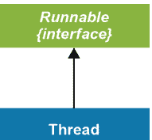

### 这些类和接口的摘要

| 类/接口 | 描述 |
| --- | --- |
| `Thread` | 定义线程的类。该类实现了 `Runnable` 接口。 |
| `Runnable` | 任何对象将被线程执行的类都必须实现此接口。该接口中唯一的方法是 `run` 方法。 |

### `Thread` 类和 `Runnable` 接口的关键方法

| 方法 | 类/接口 | 描述 |
| --- | --- | --- |
| `start` | `Thread` | 将此线程注册到线程调度器，使其可以执行。 |
| `run` | `Runnable`, `Thread` | 一个由 `Runnable` 接口声明并由 `Thread` 类实现的抽象方法。线程调度器调用此方法来运行线程。 |
| `sleep` | `Thread` | 使线程等待（睡眠）指定的时间，以便 CPU 运行其他线程。 |
| `stop` | `Thread` | 此方法永远不应使用，仅为了兼容性而存在。它本质上是不安全的，可能会导致它正在使用的数据处于不一致状态。 |

### 创建 `Thread` 类的方法

- 继承 `Thread` 类。
- 实现 `Runnable` 接口。然后，将 `Runnable` 对象的引用传递给 `Thread` 类的构造函数。

### 描述

- 在创建 `Thread` 对象后，你可以调用它的 `start` 方法，以便调度器运行该线程。然后，你可以使用上面显示的其他方法来管理线程。
- 实现 `Runnable` 接口的优点是它允许线程继承 `Thread` 类以外的其他类。

图 18-2 用于处理线程的类和接口

## 线程的生命周期

18-3 显示了线程的生命周期，并解释了线程可能处于五种状态中的每一种。要创建一个线程，程序员编写代码为线程定义一个类并实例化 `Thread` 对象。当 `Thread` 对象首次被实例化时，它被置于 New（新建）状态，这意味着线程已经创建，但尚未准备好运行。

当应用程序准备好运行线程时，它会调用线程的 `start` 方法。尽管你可能认为这会导致线程开始执行，但它实际上是将线程的状态从 New 变为 Runnable（可运行）。一旦进入 Runnable 状态，线程就会加入其他同样处于 Runnable 状态的线程列表。然后，一个被称为线程调度器的操作系统组件会选择一个 Runnable 线程来执行。

请注意，线程在运行时并没有一个单独的状态。在 Runnable 状态下运行的线程以及所有其他线程都有资格运行。此外，线程调度器可能会在任何时候决定当前运行的线程运行得足够了。这时，线程调度器会中断该线程，并让 Runnable 状态下的其他一个线程运行。这不会改变任何一个线程的状态。

如果发生了导致线程临时不可运行的情况，线程将进入 Blocked（阻塞）状态。例如，当线程等待 I/O 操作完成时，它会进入 Blocked 状态。当 I/O 操作完成后，线程会自动返回 Runnable 状态。处于 Blocked 状态的线程无法被线程调度器选择执行。

当线程需要协调活动时，就会涉及到 Waiting（等待）状态。例如，如果一个线程在另一个线程完成之前无法继续执行操作，它可以进入 Waiting 状态。然后，当它所等待的另一个线程完成任务时，它可以通知等待线程停止等待并再次进入 Runnable 状态。

最后，当线程的 `run` 方法执行完毕时，该线程进入 Terminated（终止）状态。一旦线程进入 Terminated 状态，它将一直保持在那里直到应用程序结束。

### 线程的生命周期

调用 `Thread` 构造函数创建一个 `Thread` 的新实例。

线程可能由于各种原因被阻塞，在返回 Runnable 状态之前不会再次运行。


调用 `start` 方法将线程标记为可运行。


当处理器可用时，操作系统的线程调度器运行线程。


当 `run` 方法终止时，线程结束。


线程可以进入 Waiting 状态并保持在该状态，直到另一个线程将其放回 Runnable 状态。


### 线程状态

| 状态 | 描述 |
| --- | --- |
| New | 线程已创建（已调用构造函数），但尚未启动。 |
| Runnable | `start` 方法已调用，线程对线程调度器可用。 |
| Blocked | 线程被临时移除，等待 I/O 操作完成。 |
| Waiting | 线程正在等待，直到另一个线程将其放入 Runnable 状态。 |
| Terminated | `run` 方法已结束。 |

### 描述

- 所有线程的生命周期包括 New、Runnable、Blocked、Waiting 和 Terminated。

图 18-3 线程的生命周期

## 创建线程的方法

在后续主题中，你将学习两种创建线程的方法。但首先你将更多地了解 `Thread` 类，无论你如何创建它都必须使用它。

## `Thread` 构造函数和方法

`java.lang.Thread`;

### `Thread` 类的常用构造函数

| 构造函数 | 描述 |
| --- | --- |
| `Thread()` | 创建默认 `Thread` 对象。 |
| `Thread(Runnable)` | 从实现 `Runnable` 接口的对象创建 `Thread` 对象。 |
| `Thread(String)` | 创建指定的 `Thread` 对象。 |
| `Thread(Runnable, String)` | 从实现 `Runnable` 接口的对象创建指定的 `Thread` 对象。 |

### `Thread` 类的常用方法

| 方法 | 描述 |
| --- | --- |
| `run()` | 实现 `Runnable` 接口的 `run` 方法。所有子类都应该重写此方法以提供由线程执行的代码。 |
| `start()` | 将线程放入 Runnable 状态以便线程调度器运行。 |
| `getName()` | 返回线程名称。 |
| `currentThread()` | 静态方法，返回当前执行线程的引用。 |
| `sleep(long)` | 静态方法，使当前执行的线程进入 Blocked 状态，以便其他线程运行。 |
| `isInterrupted()` | 如果线程被中断，则返回 true。 |

### 描述

- 默认情况下，你显式创建的线程是数字命名的。如果这不是你想要的，可以在线程构造函数中指定名称。
- `sleep` 方法抛出 `InterruptedException`。因为这是一个检查异常，所以当你使用 `sleep` 方法时必须抛出或捕获该异常。


## 如何扩展 `Thread` 类

图 18-5 显示了如何通过扩展 `Thread` 类来创建线程。在这里，`IOThread` 定义了一个模拟 I/O 操作的线程，而 `Main` 类包含了在应用程序启动时运行的 `main` 方法。`IOThread` 通过继承 `Thread` 类开始。然后，它重写了 `run` 方法，以提供线程运行时运行时执行的代码。在该方法内部，第一条语句打印线程名称。然后，该方法使用 `sleep` 方法将线程置于 Blocked（阻塞）状态 2000 毫秒（2 秒）。2 秒后，线程被返回到 Runnable（可就绪）状态，以便线程调度程序器可以恢复其执行。

由于 `sleep` 方法可能会抛出 `InterruptedException`，因此异常必须被捕获或抛出。此异常表示某些线程在当前线程睡眠时尝试中断该线程。你如何处理此异常取决于应用程序。在这种情况下，应用程序通过捕获异常简单地忽略了任何中断线程的尝试，但没有提供任何代码来处理它。通常情况下，“吞掉”这样的异常不是良好的编程实践。但在这种情况下，它是合适的。

如果你使用 `sleep` 方法，还应该意识到它并不能保证线程会在你指定的时间后开始运行。相反，它仅仅保证线程会在该时间后被返回到 Runnable 状态。因此，你让线程调度器来决定线程何时恢复执行。你不你不应该在需要精确时序的应用程序中使用 `sleep` 方法。

`Main` 类包含应用程序的 `main` 方法。在该方法内部，第一条语句调用该类的 `currentThread` 方法，并将 `Thread` 对象赋值给命名为 `t1` 的变量。然后，第二条语句使用 `println` 方法显示一条指示线程已启动的消息。为了在该消息中包含线程名称，代码使用 `getName` 方法获取当前线程的名称。

第三条语句创建了 `IOThread` 对象并将其赋值给命名为 `t2` 的 `Thread` 变量。然后，第四条语句通过调用其 `start` 方法启动线程。这会将线程置于 Runnable 状态，以便线程调度器可以运行它。第五条语句打印一条消息，指示主线程已启动该线程。第六条语句打印一条消息，指示主线程已完成。

该图底部输出的前三行由 `main` 方法打印，它运行在一个名为“main”的线程中。然后，接下来的两行是由从 `IOThread` 类创建的线程打印的，名为“Thread-0”。第一行在 `run` 方法开始时打印，以指示线程已启动，第二行在 `run` 方法结束时打印，以指示线程已完成。此输出显示主线程可以在第二个线程执行时继续执行。换句话说，`main` 方法中的语句不需要等待第二个线程的 `run` 方法中的语句完成。

### 第 18 章 如何与线程一起工作

### 从 `Thread` 类创建线程的步骤

1. 创建一个继承 `Thread` 类的类。
2. 重写 `run` 方法以执行所需的任务。
3. 通过实例化该类的对象来创建线程。
4. 调用线程对象的 `start` 方法。

### 定义线程的名为 `IOThread` 的类

```java
public class IOThread extends Thread {

    @Override
    public void run() {
        System.out.println(this.getName() + " started.");
        try {
            Thread.sleep(2000); // 睡眠 2 秒以模拟耗时的 IO 任务
        } catch (InterruptedException e) {
            System.out.println(this.getName() + " finished.");
        }
    }
}
```

### 启动线程的 `Main` 类

```java
public class Main {
    public static void main(String[] args) {
        Thread t1 = Thread.currentThread();
        System.out.println(t1.getName() + " started.");
        Thread t2 = new IOThread(); // 创建 IO 线程
    }
}
```


# 第 18 章 如何处理线程

## 如何实现 Runnable 接口

图 18-6 显示了如何通过实现 `Runnable` 接口来创建线程。虽然这种创建线程的方法需要更多的代码，但它更灵活，因为它允许你定义一个继承 `Thread` 类之外类的线程。

如果你将其与上一个图的代码进行比较，你会发现 `IOTask` 类在几个方面与 `IThread` 类不同。首先，`IOTask` 类实现了 `Runnable` 接口，而不是扩展 `Thread` 类。然后，在 `IOTask` 类的 `run` 方法中，第一条语句调用 `Thread` 类的 `currentThread()` 方法来获取当前正在执行的线程的引用。这样，就可以使用 `getName()` 方法获取此线程的名称。

在 `main` 方法中，你不能直接从 `IOTask` 类创建 `Thread` 对象。相反，你必须从该类创建一个 `Runnable` 对象，并将其传递给 `Thread` 类的构造函数。

### 使用 Runnable 接口创建线程的步骤

1. 创建一个实现 `Runnable` 接口的类。
2. 实现 `run()` 方法以执行所需的任务。
3. 通过提供 `Runnable` 实例来创建线程。
4. 调用线程对象的 `start()` 方法。

### 实现 Runnable 接口的 IOTask 类

```java
public class IOTask implements Runnable {

    @Override
    public void run() {
        Thread ct = Thread.currentThread();
        System.out.println(ct.getName() + " started.");
        try {
            Thread.sleep(2000); // 睡眠 2 秒以模拟耗时的 IO 任务
        } catch (InterruptedException e) {
            System.out.println(ct.getName() + " finished.");
        }
    }
}
```

### 使用 Runnable 接口启动线程的 Main 类

```java
public class Main {
    public static void main(String[] args) {
        Thread t1 = Thread.currentThread();
        System.out.println(t1.getName() + " started.");
        Thread t2 = new Thread(new IOTask()); // 创建线程
        t2.start(); // 启动线程
        System.out.println(t1.getName() + " starts " + t2.getName() + ".");
        System.out.println(t1.getName() + " finished.");
    }
}
```

### 示例输出

```
main started.
main starts Thread-0.
main finished.
Thread-0 started.
Thread-0 finished.
```


## 如何同步线程

到目前为止，本章中的线程都是独立执行的。这些线程被称为异步线程。然而，在某些情况下，多个线程需要使用同一个类或对象。这些线程被称为同步线程，它们需要协调以便工作。

并发是指多个线程同时使用同一个类或对象的情况。当这种情况发生时，可能会导致丢失更新等并发问题。

当你设计供多个线程使用的类时，你需要确保它们是安全的。这意味着多个线程可以安全地使用它们而不会产生问题。

### 使用同步方法

创建安全类的常用方法是为所有不安全的方法添加 `synchronized` 关键字，如图 18-7 所示。在这里，`InvoiceQueue` 类定义了一个可以添加发票或从发票列表中移除发票的对象。

在该类中，`add` 方法的声明包含了 `synchronized` 关键字。因此，当线程调用此方法时，Java 虚拟机将锁定对象直到该方法执行完毕。

当对象被锁定时，整个对象都会被锁定，而不仅仅是同步方法。换句话说，当一个线程调用一个同步方法时，所有的同步方法都会被锁定。在本图中，例如，如果线程调用 `add()` 方法，则 `add()` 和 `remove()` 方法都会被锁定，直到 `add()` 方法执行完毕。

然而，当对象被锁定时，非同步方法不会被锁定。在本图中，例如，`print()` 方法没有包含 `synchronized` 关键字。因此，Java 虚拟机不会锁定此方法。

### 何时使用同步方法

到目前为止，书中大多数应用程序只使用单个线程，即主线程。因此，这些应用程序中的类不需要使用同步方法。然而，如果多个线程访问一个类，你可能需要使用同步方法。

作为一个一般原则，任何访问对象实例变量的方法都应该是同步的。这可以防止两个线程同时访问实例变量。在本图中，`add()` 和 `remove()` 方法都操作命名为 `invoiceQueue` 的实例变量，该变量存储发票列表。因此，这两个方法都应该是同步的。然而，`print()` 方法没有访问任何实例变量。因此，它不需要同步。

### 同步方法的语法

```java
[public | private] synchronized returnType methodName([parameterList]) {
    statements
}
```

### 一个包含两个同步方法的类

```java
public class InvoiceQueue {
    private ArrayList<Invoice> invoiceQueue = new ArrayList<>();

    public synchronized void add(Invoice invoice) {
        invoiceQueue.add(invoice);
    }

    public synchronized Invoice remove() {
        if (invoiceQueue.size() > 1) {
            return invoiceQueue.remove(0);
        } else {
            return null;
        }
    }

    public void print() {
        System.out.println("This method doesn't need to be synchronized.");
    }
}
```

### 描述

- 异步线程相互独立执行。如果同步线程可能同时访问类或对象中的同一个字段，则需要对其进行协调。
- 并发是指多个线程同时使用同一个类或对象的情况。当这种情况发生时，可能会出现如更新丢失之类的并发问题。
- 当你使用一个多个线程共同使用的类时，你需要确保该类是线程安全的。这意味着多个线程可以安全地使用它而不会引起问题。
- `synchronized` 关键字会锁定类或对象，并保证一次只有一个线程可以执行其任何同步方法。任何其他尝试运行的线程都会被阻塞，直到第一个线程通过退出同步方法来释放锁。
- 即使类或对象被同步方法锁定，线程仍然可以运行非同步方法。如果该非同步方法访问了被同步方法正在使用的同一个字段，则可能会导致问题。
- 每当两个或多个线程可能执行同一个方法，且该方法访问了类或对象的实例变量时，使用 `synchronized` 方法是一种最佳实践。即使该方法只包含一行代码，事实也是如此。


## 观点

在本章中，你学习了处理线程的基本技能。线程是一个复杂的课题，本章只能提供非常简短的介绍。坦率地说，多线程是本书中最具挑战性的主题之一。如果你不理解其工作原理的每一个细节，也不要太担心。你将学习更多关于不同类型的 Java 编程，例如 Web 编程或 Android 编程，你将在这些环境中学习更多关于处理线程的内容。

此外，在编写使用图形用户界面（GUI）的应用程序时，处理线程还有更多需要学习。一个重要的概念将在本书后面的第 22 章末尾描述。

## 总结

- 线程是应用程序内部的单一顺序控制流，通常完成一项特定任务。
- 多线程应用程序由两个或多个线程组成，它们的执行可以重叠。
- 单核处理器一次只能执行一个线程，由线程调度器决定执行哪一个线程。
- 大多数现代处理器具有多个核心，可以同时运行多个线程。在这种情况下，线程调度器决定运行哪些线程，以及在哪个核心上运行它们。
- 多线程通常用于提高具有 I/O 操作的应用程序的性能，提高 GUI 操作的响应速度，并允许一个或多个线程同时运行服务器应用程序。
- 你可以通过扩展 `Thread` 类并实例化新类来创建线程。或者，你可以实现 `Runnable` 接口并将 `Runnable` 对象的引用传递给 `Thread` 类的构造函数。
- 你可以使用 `Thread` 类的方法来启动线程并控制它的运行时间。
- 方法上的 `synchronized` 关键字确保两个或多个线程不能同时运行它。
- 异步线程相互独立执行。
- 同步方法可以确保两个线程不会同时运行对象的同一个方法。当一个线程调用同步方法时，包含该方法的对象会被锁定，以便其他线程无法访问它。
- 通常认为，对于任何可能有两个线程同时访问类或对象的同一个字段的方法，对其进行同步处理是种最佳实践。

## 练习 18-1 扩展 Thread 类

在本次练习中，你将创建一个扩展 `Thread` 类的应用程序，以创建一个打印 1 到 10 之间奇数的线程，以及另一个打印 1 到 10 之间偶数的线程。该应用程序的输出应该类似于所示：

```
main started.
Thread-0 started.
Thread-1 started.
main finished.
1
3
5
7
9
Thread-0 finished.
6
10
Thread-1 finished.
```

1. 导入 `ex_starts` 文件夹中的项目 `ch18_ex1_Counter`。查看 `Main` 类的代码，并注意它向控制台打印了一条消息，指示主线程何时启动和结束。
2. 添加一个扩展 `Thread` 类的 `CounterThread` 类。
3. 添加一个用于起始值的实例变量以及一个如下所示设置该起始值的构造函数：

```java
private final int startingValue;

public CounterThread(int startingValue) {
    this.startingValue = startingValue;
}
```


## 练习 18-1 扩展 Thread 类（续）

4. 在 `CounterThread` 类中，添加一个方法，从起始值 10 开始每隔一个数字打印一个数字到控制台，并在完成后显示适当的消息。
5. 在 `Main` 类中，添加代码，从起始值 10 开始每隔一个数字打印一个数字到控制台，并在完成后显示适当的消息。
6. 多次运行应用程序，查看输出是否发生变化。
7. 根据你的系统速度，可能会有一个线程在调度器切换线程之前就完成了。在这种情况下，线程看起来就像是按顺序运行而不是并行运行。
8. 在 `CounterThread` 中添加 `Thread.sleep(1000)` 调用，使线程在每个数字之间睡眠一秒钟。
9. 运行应用程序查看其是否正常工作。

## 练习 18-2 实现 Runnable 接口

在本次练习中，你将创建一个扩展 `Thread` 类的应用程序，创建一个打印 1 到 10 之间奇数的线程，以及另一个打印 1 到 10 之间偶数的线程。然而，在本次练习中，你实现 `Runnable` 接口而不是扩展 `Thread` 类。

1. 导入 `ex_starts` 文件夹中的项目 `ch18_ex2_Counter`。查看 `Main` 类的代码，并注意它向控制台打印了一条消息，指示主线程何时启动和结束。
2. 添加一个实现项目的 `CounterThread` 类。
3. 遵循上一个练习的第 3 到 9 步。

## 第 5 节 实战技能

对于现实世界中的大多数 Java 应用程序，关键数据存储在数据库中。在大多数情况下，这比第 17 章描述的将数据存储在文件中具有许多优势。这就是为什么本节的前两章介绍了开发 Java 应用程序所需的必备数据库技能。

此外，大多数桌面 Java 应用程序使用图形用户界面（GUI）与用户交互。这就是为什么本节的第三和第四章展示了如何为 Product Manager 应用程序创建一个 GUI。

## 第 19 章 如何与 MySQL 数据库交互

### 如何处理数据库

你可以使用 Java 处理几乎任何类型的数据库。对于桌面和 Web 应用程序，通常使用 Oracle 或 MySQL 数据库。对于 Android 应用，通常使用 SQLite 数据库。使用的数据库取决于许多因素。

在这些数据库中，MySQL 是 Java 应用程序最流行的之一。此外，还有一个开源版本，免费、易于安装且易于使用。因此，本章将介绍如何创建一个 MySQL 数据库来存储后续几章描述的 Product Manager 应用程序的数据。在学习这些的同时，你还将学习适用于所有数据库的基本概念和 SQL（结构化查询语言）技能。

### 关系型数据库的组织

1970年，E. F. Codd 博士开发了一种新型数据库的模型，称为关系型数据库。这种类型的数据库消除了与早期类型数据库（如层次结构数据库）相关的一些问题。通过使用关系模型，你可以减少冗余，节省磁盘存储，并实现更高效的数据检索。你还可以以直观且高效的方式查看和操作数据。今天，关系型数据库是数据库应用程序的事实标准。

#### 表的组织

关系型数据库将数据存储在表中。每个表都包含如图 19-1 所示的行和列。在实践中，行和列通常被称为传统的术语——“记录”和“字段”。这就是为什么这本书会交替使用这些术语。

在关系型数据库中，表有一列被定义为主键。主键唯一地标识表中的每一行。通过这样，一个表中的行就可以轻松地与另一个表中的行相关联。在当前表中，`ProductID` 列就是主键。

管理关系型数据库的软件称为数据库管理系统（DBMS）或关系型数据库管理系统（RDBMS）。DBMS 提供了让你设计数据库的功能。之后，DBMS 负责管理数据库的所有更改、添加和删除。最流行的四个数据库管理系统是 Oracle、Microsoft SQL Server、IBM 的 DB2 以及 MySQL。

##### Product 表

| ProductID | Code | Description | ListPrice |
|---|---|---|---|
| 1 | java | Murach's Java Programming | 57.50 |
| 2 | jsp | Murach's Servlets and JSP | 57.50 |
| 3 | mysql | Murach's MySQL | 54.50 |
| 4 | android | Murach's Android Programming | 57.50 |
| 5 | html5 | Murach's HTML5 and CSS3 | 54.50 |
| 6 | oracle | Murach's Oracle and PL/SQL | 54.50 |
| 7 | javascript | Murach's JavaScript and jQuery | 54.50 |

##### 描述

- 关系型数据库使用表来存储和操作数据。每个表包含一个或多个记录（或行），包含单条条目的数据。每行包含一个或多个字段（或列），每列代表单项数据。
- 大多数表包含一个主键，唯一地标识表中的每一行。
- 管理关系型数据库的软件称为数据库管理系统（DBMS）。今天四个流行的数据库管理系统是 Oracle、Microsoft SQL Server、IBM 的 DB2 以及 MySQL.


#### 数据库中的表如何关联

图 19-2 显示了关系型数据库如何利用主键列中的值将一个表与另一个表相关联。在这里，LineItem 表中的每个 `ProductID` 列都对应 Product 表中的一行。由于 LineItem 表中的 `ProductID` 列指向另一个表中的主键，它被称为外键。通常，一个表会有多个外键。

在图中，Product 表中的每一行与 LineItem 表中的更多行之间存在一对多关系。虽然一对多关系是表与表之间常见的关系类型，但你也可以拥有一对一关系或多对多关系。然而，两个表之间的多对多关系通常是通过使用第三张表来实现的，该表与原始两个表都具有一对多关系。

顺便提到，LineItem 表中的主键是 `LineItemID` 列。它是由 DBMS 在向数据库添加新行时自动生成的。这类似于 Product 表中的 `ProductID` 列。通常情况下，数据库自动生成主键值是一种常见做法。

##### Product 表和 LineItem 表之间的关系

**主键 (Product 表)**

| ProductID | Code | Description | ListPrice |
|---|---|---|---|
| 1 | java | Murach's Java Programming | 57.50 |
| 2 | jsp | Murach's Java Servlets and JSP | 57.50 |
| 3 | mysql | Murach's MySQL | 54.50 |
| 4 | android | Murach's Android Programming | 57.50 |
| 5 | html5 | Murach's HTML5 and CSS3 | 54.50 |
| 6 | oracle | Murach's Oracle and PL/SQL | 54.50 |
| 7 | javascript | Murach's JavaScript and jQuery | 54.50 |

**外键 (LineItem 表)**

| LineItemID | InvoiceID | ProductID | Quantity |
|---|---|---|---|
| 1 | 3 | 5 | |
| 3 | 2 | 4 | 1 |
| 4 | 3 | 5 | 1 |
| 5 | 3 | 6 | 2 |
| 6 | 4 | 7 | 1 |
| 7 | 4 | 3 | |
| 8 | 5 | 2 | 5 |

##### 描述

- 关系型数据库中的表通过它们的键相互关联。每个表包含一个或多个记录（或行），包含单条条目的数据。每行包含一个或多个字段（或列），每列代表单项数据。
- 关系型数据库中的表通过它们的键相互关联。例如，表中的外键。
- 管理关系型数据库的软件称为数据库管理系统（DBMS）。今天四个流行的数据库管理系统是 Oracle、Microsoft SQL Server、IBM 的 DB2 以及 MySQL.


### MySQL 简介

MySQL 是一个开源数据库管理系统（DBMS），你可以从 MySQL 网站 (www.mysql.com) 免费下载，也可以作为许多互联网提供商（ISP）托管包的一部分。MySQL Workbench 是一个免费的图形化工具，方便你操作 MySQL。在本书出版时，MySQL Workbench 的当前版本为 6.3，因此本章介绍的版本，本章介绍的技巧通常适用于早期和后续版本。

#### MySQL 提供了什么

图 19-4 列出了 MySQL 受欢迎的一些原因。首先，与 Oracle Database 或 Microsoft SQL Server 相比，它非常廉价且易用。在考虑到成本时，它的运行速度更快。而且它运行在大多数现代操作系统上，而 MySQL Server 仅运行在 Windows 上。

尽管对大多数用户是免费的，MySQL 提供了你从现代关系型数据库管理系统（RDBMS）中期望的大多数功能。特别是它支持结构化查询语言（SQL），这是行业标准。它支持多个客户端。并且提供了连接性和安全性。

这意味着你可以 Java 应用程序使用 SQL 语句访问并更新 MySQL 数据库中的数据。你可以将 Java 应用程序连接到 MySQL 数据库。你可以通过限制访问来保护数据。

##### MySQL 是...

- **价格低廉。** MySQL 对大多数用途是免费的，对于其他用途相对廉价。
- **速度快。** 据许多认为，MySQL 是目前可用最快的关系型数据库之一。
- **易于使用。** 与数据库管理系统相比，MySQL 易于安装和使用。
- **可移植性强。** MySQL 可运行在大多数现代操作系统上，包括 Windows、Unix 和 Linux。

##### MySQL 提供...

- **支持 SQL。** 与任何现代数据库产品一样，MySQL 支持 SQL，这是处理存储在关系型数据库中的数据的标准语言。
- **支持多个客户端。** MySQL 支持来自各种接口和编程语言的多个客户端访问，包括 Java、PHP、Python、Perl 和 C。
- **连接性。** MySQL 可以通过内网或互联网访问数据。
- **安全性。** MySQL 可以保护你的数据，使得只有授权用户才能查看数据。
- **参照完整性。** 在 MySQL 5.5 及更高版本中，默认使用 InnoDB 表格。这些表支持参照完整性，降低了数据损坏的概率。大多数商业数据库也提供此功能。
- **事务处理。** 在 5.5 版本中，MySQL 默认使用 InnoDB 表。这些表提供了事务处理的支持，降低了数据损坏的概率。大多数商业数据库也提供此功能.


#### 与 MySQL 交互的方法

图 19-5 展示了与 MySQL 交互的两种方法。当你安装 MySQL 时，它包含一个类似于图中顶部的命令行工具。虽然这个命令行工具是用于 Windows 操作系统的，但 MySQL 的命令行工具在所有操作系统上的工作原理类似。在这个示例中，用户启动了命令行工具，选择了一个名为 mma 的数据库，并显示了附录中 Product 表的七行；你可以像本章所示用它与数据库交互。

如果你按照附录中的描述安装了 MySQL Workbench，就像本章所示。要这样做，你可以在工具顶部的 SQL 标签页中输入 SQL 语句，并点击 Execute（执行）按钮运行该 SQL 语句。然后，语句的结果将显示在 Console（控制台）窗口中。你可以使用 Navigator（导航）窗口的 Schemas 部分来查看和操作运行在当前服务器上的数据库。例如，在图中，Schemas 部分显示了 mma 数据库 Product 表的列。

当你使用 MySQL 时，你可能会发现 `database`（数据库）和 `schema`（模式）这两个术语经常互用。例如，mma 数据库有时被称为 mma 模式。

通常情况下，使用 MySQL Workbench 比使用命令行工具操作数据库更简单。这就是为什么本章向你展示如何使用 MySQL Workbench.


#### MySQL 命令行

```
```


# MySQL 监视器

Welcome to the MySQL monitor. Commands with `help` or `?` for help.

Server version: 5.6.21-MySQL Community Server -GPL

Copyright (C) 2008 Oracle Corporation and/or its affiliates. All rights reserved.

MySQL is a registered trademark of Oracle Corporation and/or its affiliates. Other names are trademarks of their respective members.

Type `help` or `h` for help. Type `\c` to clear the current statement.

```sql
mysql> show databases;

Database
mysql

mysql> use test;

Database set in (0.0 sec)

mysql>
```

# MySQL Workbench

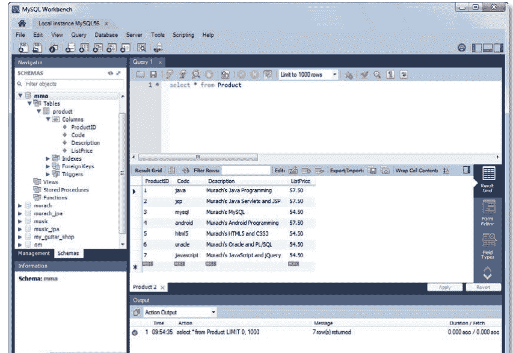

## 描述

- 在使用桌面应用程序时，通常使用如 MySQL Workbench 这样的 GUI 应用程序来操作 MySQL 数据库。

图 19-5 与 MySQL 交互的方法

## 如何打开数据库连接

每当你使用 MySQL 时，其数据库服务器必须运行。通常，该服务器会在你启动系统时自动启动。如果它没有启动，你应该能在附录中找到启动方法。

在操作数据库之前，你需要连接到数据库服务器。当你启动 MySQL Workbench 时，MySQL connections 部分会显示已连接的列表。

默认情况下，MySQL Workbench 有名为 "Local instance MySQL" 的保存连接，假设你安装了 MySQL 5.6。要建立连接，点击该连接，如果系统提示，则输入 root 用户的密码。

## 如何输入并执行 SQL 语句

一旦 MySQL Workbench 连接到数据库服务器，你就可以用它运行处理该服务器可用数据库的语句。当你第一次连接到 MySQL 服务器时，MySQL Workbench 会自动打开一个 SQL 标签页。图 19-6 显示了如何使用 SQL 标签页输入并执行 SQL 语句。在图中，只打开了一个 SQL 标签页。然而，如果你愿意，可以同时打开多个 SQL 标签页。打开 SQL 标签页的一种简单方法是点击 SQL 工具栏中的 Create SQL tab（创建 SQL 标签页）按钮。

一旦打开了 SQL 标签页，你就可以使用标准技术来输入或编辑 SQL 语句。当你输入语句时，你会注意到 MySQL Workbench 会为各种元素着色。例如，它将关键字显示为绿色。这使得你的语句更容易阅读和理解，并能帮助你识别错误。

要执行单个 SQL 语句（如图中所示），按 `Ctrl+Enter` 或点击 Execute 按钮。如果语句返回数据，数据将显示在 Result grid（结果网格）中。

| SELECT 语句及其结果 |
| :--- |
| Create SQL tab 按钮 |
| Execute 按钮 |
| SQL 标签页 |
| Result 网格 |

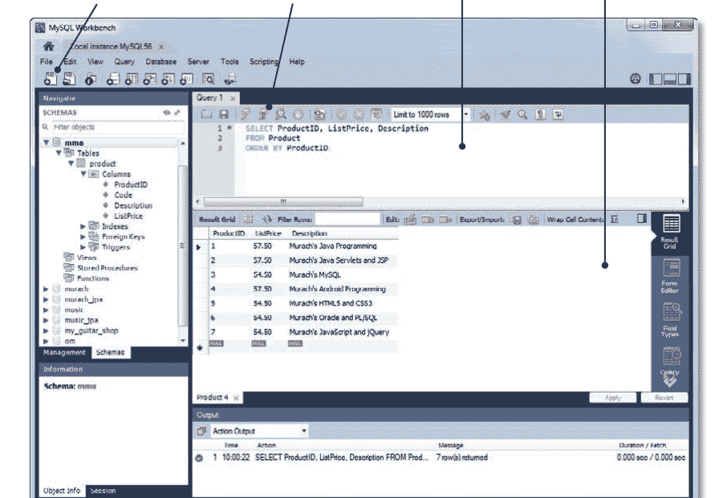

### 描述

- 在操作桌面应用程序时，通常使用如 MySQL Workbench 这样的 GUI 应用程序来操作 MySQL 数据库。
- 要打开一个新的 SQL 标签页，按 `Ctrl+T` 或点击 SQL 工具栏中的 Create SQL tab 按钮。
- 要选择当前数据库，双击 Navigator 窗口中的 Schemas 部分。这会将选中的数据库加粗显示。
- 要输入 SQL 语句，将其输入 SQL 标签页。
- 当你输入时，MySQL Workbench 会自动为各种元素着色，例如关键字。
- 要执行语句，按 `Ctrl+Enter`。如果语句返回数据，将显示在 Result grid 中。

图 19-6 使用 MySQL Workbench 执行 SQL 语句

### 创建数据库的 SQL 脚本

SQL 脚本通常是一个包含多个 SQL 语句的文件。编写脚本时，在每个 SQL 语句结束加上分号。脚本通常用于创建数据库。例如，图 19-7 显示了一个创建 mma 的脚本。

## 如何删除、创建和选择数据库

该脚本从 `DROP DATABASE IF EXISTS` 语句开始。如果 mma 数据库存在，该脚本将将其删除。这防止了尝试删除不存在的数据库时可能显示的错误消息。

在删除数据库后，该脚本使用 `CREATE DATABASE` 命令创建 mma 数据库。然后，它使用 `USE` 命令选择 mma 数据库。结果是脚本中的其余语句将针对 mma 数据库执行。

## 如何创建表并插入数据

`CREATE TABLE` 语句创建 mma 数据库的 Product 表。在该脚本中，我先编写了主键列。虽然这不是强制要求的，但这是一个良好的编程习惯。由于声明列的逻辑顺序很重要，当你使用 `SELECT *` 语句检索所有列时，它们将按此顺序返回。

`INSERT INTO` 语句向 Product 表插入七行数据。`VALUES` 子句为每行提供数据。在这里，每行提供的值数必须与表的列数匹配。

## 如何创建用户并授予权限

脚本末尾的 `GRANT` 语句在本地计算机上创建了一个名为 mma_user 的用户。此外，它授予该用户对 mma 数据库中所有表的 `SELECT`、`INSERT`、`UPDATE` 和 `DELETE` 权限。结果是，如果你以用户 mma_user 连接 MySQL，就可以操作 mma 数据库中存储的任何数据。但是，你无法更改数据库的结构。

# 创建 mma 数据库的 SQL 脚本

```sql
-- 创建并选择数据库

DROP DATABASE IF EXISTS mma;

CREATE DATABASE mma;

USE mma;

-- 创建 Product（产品）表

CREATE TABLE Product (
    ProductID PRIMARY KEY AUTO_INCREMENT,
    Code VARCHAR(10) NOT NULL UNIQUE,
    Description VARCHAR(255) NOT NULL,
    ListPrice DECIMAL(10,2) NOT NULL
);

-- 向 Product 表中插入行

INSERT INTO PRODUCT VALUES
(1, 'java', 'Murach\'s Java Programming', '57.50'),
(2, 'jsp', 'Murach\'s Java Servlets and JSP', '57.50'),
(3, 'mysql', 'Murach\'s MySQL', '54.50'),
(4, 'android', 'Murach\'s Android Programming', '57.50'),
(5, 'html5', 'Murach\'s HTML5 and CSS3', '54.50'),
(6, 'oracle', 'Murach\'s Oracle and PL/SQL', '54.50'),
(7, 'javascript', 'Murach\'s JavaScript and jQuery', '54.50');

-- 创建用户并授予该用户权限

GRANT SELECT, INSERT, DELETE, UPDATE
ON mma.*
TO mmauser@localhost
IDENTIFIED BY 'ses';
```

### 描述

- 你可以使用 `CREATE DATABASE` 语句创建数据库，并使用 `DROP DATABASE` 语句删除数据库。这些都是 SQL 语句。
- 你可以使用 `USE` 命令来选择你想要工作的数据库。
- 你可以使用 `CREATE TABLE` 语句来创建表。在创建表时，定义它的每一列并识别其主键。要定义一列，你必须提供名称和数据类型，以及它是否为新行自动生成等信息。
- 在使用 MySQL 时，`INSERT` 语句允许你向表中插入一个行或多行数据。在编写代码时，你需要包含所有未定义默认值或不是自动生成的列的数据。
- 你可以使用 `GRANT` 语句来创建用户、为该用户指定密码，并授予该用户权限。


# 数据操作的 SQL 语句

除了 `INSERT` 语句外，你目前看到的大多数 SQL 语句都属于 SQL 数据定义语言（DDL）的一部分。这些语句允许你创建数据库、删除数据库、创建表、创建用户等。然而，它们不能让你处理表中的数据。

相比之下，构成 SQL 数据操作语言（DML）的语句允许你处理数据库中的数据。因此，这些是你在 Java 应用程序中常用的语句。这些语句包括 `SELECT`、`INSERT`、`UPDATE` 和 `DELETE` 语句。

# 如何从表中选择数据

`SELECT` 语句是最常用的 SQL 语句。当你运行一个 `SELECT` 语句时，它通常被称为查询。该查询的结果是一个结果集或结果表。

在图 19-8 中，第一个示例显示了如何使用该语句从 Product 表中检索所有的行和列。在这里，`SELECT` 子句使用星号通配符 `*` 表示检索表中的所有列。然后，`FROM` 子句指定 Product 表。该查询返回了四列七行数据。

第二个示例显示了如何使用该语句从 Product 表中检索两列和七行。`SELECT` 子句指定了这两列，`FROM` 子句指定了表。最后，`ORDER BY` 子句表示检索到的行应该按 `Description` 列进行排序。

第三个示例使用 `WHERE` 子句来限制检索的行数。为了实现这一点，它指定语句只检索 `ListPrice` 列的值小于 56 的行。最后，`ORDER BY` 子句表示检索到的行应该按 `Description` 列进行排序。

结果是一个在数据库内部临时创建的逻辑表。然后，当前行指针（或称为游标 cursor）会跟踪当前行。你可以从你的 Java 应用程序中使用此指针。

正如你可能猜到的那样，查询对数据库应用程序的性能有显著影响。通常情况下，查询返回的列和行越多，网络承担的流量越大。因此，在为应用程序设计查询时，你应该尽量将列和行的数量保持最少。

# 获取所有列的 SELECT 语句

```sql
SELECT * FROM Product
```

# 结果集

| ProductID | Code | Description | ListPrice |
|---|---|---|---|
| 1 | Java | Murach's Java Programming | 57.50 |
| 2 | JSP | Murach's Servlets and JSP | 57.50 |
| 3 | mysql | Murach's MySQL | 54.50 |
| 4 | android | Murach's Android Programming | 57.50 |
| 5 | html5 | Murach's HTML5 and CSS3 | 54.50 |
| 6 | oracle | Murach's Oracle and PL/SQL | 54.50 |
| 7 | javascript | Murach's JavaScript and jQuery | 54.50 |

# 获取指定列的 SELECT 语句

```sql
SELECT Description, ListPrice
FROM Product
ORDER BY Description
```

# 结果集

| Description | ListPrice |
|---|---|
| Murach's Android Programming | 57.50 |
| Murach's HTML5 and CSS3 | 54.50 |
| Murach's Java Programming | 57.50 |
| Murach's Servlets and JSP | 57.50 |
| Murach's JavaScript and jQuery | 54.50 |
| Murach's MySQL | 54.50 |
| Murach's Oracle and PL/SQL | 54.50 |

# 获取指定列和指定行的 SELECT 语句

```sql
SELECT Description, ListPrice
FROM Product
WHERE ListPrice < 56
ORDER BY Description
```

# 结果集

| Description | ListPrice |
|---|---|
| Murach's HTML5 and CSS3 | 54.50 |
| Murach's JavaScript and jQuery | 54.50 |
| Murach's MySQL | 54.50 |
| Murach's Oracle and PL/SQL | 54.50 |

# INSERT 语句

## 不使用列列表的语句

```sql
INSERT INTO Product
VALUES ('8', 'php', 'Murach\'s PHP', '54.50')
```

## 使用列列表的语句

```sql
INSERT INTO Product (Code, Description, ListPrice)
VALUES ('php', 'Murach\'s PHP', '54.50')
```

# UPDATE 语句

## 更新单行的 ListPrice 列

```sql
UPDATE Product
SET ListPrice = '57.50'
WHERE Code = 'javascript'
```

## 更新单行的 ListPrice 和 Description 列

```sql
UPDATE Product
SET ListPrice = '57.50', Description = 'Murach\'s Beginning JavaScript'
WHERE Code = 'javascript'
```

## 更新选定行中的 ListPrice 列

```sql
UPDATE Product
SET ListPrice = '55.50'
WHERE ListPrice = '54.50'
```

# DELETE 语句

## 从 Product 表中删除一行

```sql
DELETE FROM Product
WHERE Code = 'php'
```

## 删除 Product 表中的所有行

```sql
DELETE FROM Product
```


### Description

- `INSERT`、`UPDATE` 和 `DELETE` 语句修改存储在数据库中的数据。这些语句不返回结果集，而是返回受查询影响的行数。
- 要在 SQL 语句中标识数字或字符串字面量，可以使用单引号（`'`）将其包裹。要在单引号包含的字符串字面量包含单引号，可以输入两个单引号。
- 在 Unix 系统上，表名和列名是区分大小写的。


## 视角


本章的主要目标是介绍使用 Java 开发数据库应用程序所需的数据库概念和 SQL 语句。本章的次要目标是介绍使用 MySQL 的基础技能。如果本章学习成功，你现在应该理解本文介绍的 SQL 语句，并能够使用 MySQL Workbench 来运行它们。

但请记住，本章仅介绍了 SQL 技能的一小部分。特别是，它介绍了你理解下一章所示 Java 代码所需的 SQL 语句。为了完全掌握 SQL，你可能想买一本关于你正在使用的数据库的 SQL 书。例如，通过使用 MySQL，《Murach's MySQL》提供了你应用程序所需的所有 SQL 语句。

### 总结

- MySQL 是关系型数据库管理系统 (RDBMS)，可以管理一个或多个数据库。
- 为了检索和修改数据库中的数据，MySQL 提供了对*结构化查询语言* (SQL) 的支持，这是处理数据库的标准语言。
- 当你使用 MySQL 时，*数据库服务器*必须运行。通常，该服务器会在启动系统时自动启动。
- 要操作 MySQL 数据库，可以使用名为 MySQL Workbench 的图形化工具。它可以方便地输入和运行 SQL 语句。
- SQL 脚本是一个存储多个 SQL 语句的文件。
- 用于创建和删除数据库的 SQL 语句是*数据定义语言* (DDL) 的部分。
- 用于检索和修改数据库数据的 SQL 语句构成了*数据操纵语言* (DML)，这些 `SELECT`、`INSERT`、`UPDATE` 和 `DELETE` 语句。
- `SELECT` 语句可以从一个或多个表中获取数据并将其放入*结果集*或*结果表*中。这通常被称为*查询*。
- `INSERT`、`UPDATE` 和 `DELETE` 语句用于向表中添加一个或多行、更新一个或多行的数据以及删除一个或多行。

## 第19 章 如何操作 MySQL 数据库 503

## 在进行本章练习之前

如果你还没有这样做，应该按照附录中的描述安装 MySQL 和 Workbench。

## 练习 19-1 运行 SQL 脚本

1. 启动 MySQL Workbench。
2. 在 MySQL Connections（MySQL 连接）部分，点击“Local instance MySQL”连接。如果提示，输入 root 用户的密码。这将以 root 用户身份连接到本地 MySQL 服务器。
3. 使用 MySQL Workbench 打开 `databases.sql` 文件。
4. 注意此脚本会创建 `dema`、创建表并向其中插入行。
5. 注意此脚本使用 `DROP` 命令进行删除。
6. 运行脚本查看 `dema` 中的结果。

## 练习 19-2 运行 SQL 语句

1. 启动 MySQL Workbench。
2. 在 MySQL Connections（MySQL 连接）部分，点击“Local instance MySQL”连接。如果提示，输入 root 用户的密码。这将以 root 用户身份连接到本地 MySQL 服务器。
3. 使用 Navigator（导航器）展开 `dema`。
4. 通过双击 `dema` 选中它。
5. 选择 `dema` 中可用的表。
6. 运行语句查看 `dema` 中的结果。
7. 运行语句查看结果。
8. 运行语句查看结果。

## JDBC 数据库驱动程序的四类型

| 类型 | 说明 |
| --- | --- |
| 类型 1 | JDBC-ODBC 桥接驱动程序将 JDBC 调用转换为访问 DBMS 协议的 ODBC 调用。客户端机器上必须安装 ODBC 驱动程序。在 Java 8 之前，JDK 包含了 JDBC-ODBC 桥接驱动，但在 Java 8 及更高版本中不支持。 |
| 类型 2 | 原生协议 Java 驱动程序将 JDBC 调用转换为原生的 DBMS 协议。由于这种转换发生在客户端，因此必须在客户端机器上安装数据库客户端库。 |
| 类型 3 | 原生协议全 Java 驱动程序将 JDBC 调用转换为独立于任何原生 DBMS 协议的原生协议。然后，运行在服务器上的中间件软件会将该原生协议转换为 DBMS 协议。由于这种转换发生在服务器端，因此客户端机器上不需要数据库客户端库。 |
| 类型 4 | 原生协议全 Java 驱动程序将 JDBC 调用转换为原生的 DBMS 协议。由于这种转换发生在服务器端，因此客户端机器上不需要数据库客户端库。 |

## 如何下载数据库驱动

- 对于 MySQL 数据库，你可以从 MySQL 网站下载 JDBC 驱动 Connector/J。该驱动是一个免费提供的开源类型-4 驱动程序。
- 对于其他数据库，你通常可以从数据库网站下载类型-4 JDBC 驱动程序。

## 如何为应用程序提供数据库驱动程序

1. 在 Eclipse 中，为你的项目创建一个 `lib` 文件夹。操作方法：在 Package Explorer 中右键点击项目，选择 New Folder（新建文件夹）命令。然后，为文件夹输入名称。
2. 使用你的操作系统将驱动程序的 JAR 文件复制到 `lib` 文件夹中。你可以使用 Explorer（Windows）或 Finder（Mac OS X）来完成。
3. 在 Package Explorer 中，右键点击项目并选择 Refresh（刷新）命令。这会让 Eclipse 识别到新的 JAR 文件。
4. 在 Package Explorer 中，右键点击项目并选择 Properties（属性）命令。
5. 在 Properties 对话框中，从左列选择 Java Build Path 类别。如有必要，点击 Libraries 选项卡。然后，点击 Add JARS 按钮。
6. 在 JAR Selection 对话框中，导航到你项目中的 `lib` 文件夹并选择数据库驱动程序的 JAR 文件。然后，点击 OK 按钮。

> 图 20-1 数据库驱动程序简介

## 如何连接到数据库

在访问或修改数据库中的数据之前，你必须如图 20-2 所示连接到数据库。首先，该图显示了数据库 URL 的语法。你可以在获取连接的代码中使用这种语法。

第一个示例展示了如何使用类型-4 MySQL 驱动连接到数据库。首先，你使用 `DriverManager` 类的 `getConnection` 方法返回一个 `Connection` 对象。该方法需要三个参数：数据库的 URL、用户名和密码。在第一个示例中，URL 包含 API (`jdbc`)、MySQL 驱动的子协议 (`mysql`)、主机名（`localhost`）、数据库服务的端口（`3306`）以及数据库名称（`mma`）。

出于安全考虑，使用仅具有应用程序所需权限的用户连接数据库被认为是最佳实践。这就是为什么创建 `mma` 数据库的脚本创建了一个用户 `mma_user`，该用户具有有限权限来处理 `mma` 数据库的数据，而不能修改其结构。因此，用户名 `mma_user` 适用于书中演示示例。

第二个示例展示了如何连接到 Oracle 数据库。在这里，你同样提供数据库的 URL、用户名和密码。无论你使用什么种类型的数据库 JDBC 都是如此。

在实践中，连接数据库通常是令人沮丧的，因为需要确定所需的 URL、用户名和密码。如果你的同事已经连接了你需要使用的数据库，你可以先向他们询问这些信息。

由于 `DriverManager` 类的 `getConnection` 方法会抛出 `SQLException`，因此每当你连接数据库时，都需要处理此异常。使用 JDBC 4.0（Java 6 及更高版本），你可以使用增强型 for 循环来遍历嵌套在 `SQLException` 对象中的任何异常。在这种情况下，第一个示例中的 `catch` 块会遍历嵌套在 `SQLException` 对象中的所有异常。

为了做到这一点，循环会为每个嵌套异常检索一个名为 `t` 的 `Throwable` 对象。然后，它将堆栈跟踪打印到控制台上。之所以有效是因为 `Throwable` 是所有异常的超类，且调用者为 `SQLException` 异常返回了 `Throwable` 对象。

前两个示例展示了 JDBC 4.0 的一个新功能：驱动加载（driver loading）。该功能根据数据库 URL 自动加载数据库驱动程序。

然而，如果你在使用旧版本的 Java，则需要在调用 `getConnection` 方法之前如第三个示例所示，使用 `Class` 类的 `forName` 方法显式加载驱动。由于此方法会抛出 `ClassNotFoundException`，你还需要处理此异常。

即使使用 JDBC 4.0 及更高版本，你可能会收到“No suitable driver（没有合适的驱动程序）”的消息。然而，如果自动驱动加载正常，通常从代码中移除此方法是有意义的。这样你可以用更少的代码连接数据库，而无需硬编码数据库驱动程序的名称。

### 数据库 URL 语法

`jdbc:subprotocolName:databaseURL`

### 如何使用自动驱动连接到 MySQL 数据库

```java
try {
  // 设置数据库 url、用户名和密码
  String dbURL = "jdbc:mysql://localhost:3306/mma";
  String username = "mma_user";
  String password = "sesame";

  // 获取连接
  Connection connection = 
    DriverManager.getConnection(dbURL, username, password);
} catch (SQLException e) {
  for (Throwable t : e) {
    System.out.println(t);
  }
}
```

### 如何使用自动驱动连接到 Oracle 数据库

```java
Connection connection = DriverManager.getConnection(
  "jdbc:oracle:thin:@localhost:mma", "mma_user", "sesame");
```

### 如何在 JDBC 4.0 之前加载 MySQL 驱动程序

```java
try {
  Class.forName("com.mysql.jdbc.Driver");
} catch (ClassNotFoundException e) {
  System.out.println(e);
}
```

### 说明

- 在获取或修改数据库中的数据之前，你需要连接到它。为了做到这一点，你使用 `DriverManager` 类的 `getConnection` 方法。

## 第 20 章：如何使用 JDBC 数据库操作 511

### 如何创建一个包含 1 行 1 列的结果集

```java
Statement statement = connection.createStatement();
ResultSet resultSet = statement.executeQuery("\nSELECT Code FROM PRODUCT " +
"WHERE ProductID = '1'");
```

### 如何创建一个包含多列和多行的结果集

```java
Statement statement = connection.createStatement();
ResultSet products = statement.executeQuery("\nSELECT * FROM Product ");
```

### 如何将光标移动到结果集的第一行

```java
boolean productExists = product.next();
```

### 如何遍历结果集

```java
while (products.next()) {
  // 处理每行的语句
}
```

### 适用于仅限向前移动、只读结果集的 ResultSet 方法

| 方法 | 描述 |
| --- | --- |
| `next()` | 将光标移动到结果集中的下一行。 |
| `last()` | 将光标移动到结果集的最后一行。 |
| `close()` | 释放结果集的资源。 |

### 描述

- 要创建结果集，你使用 `Connection` 对象的 `createStatement` 方法来创建一个 `Statement` 对象。然后，你使用 `Statement` 的 `executeQuery` 方法来执行 `SELECT` 语句。
- 默认情况下，`createStatement` 方法创建一个仅限向前移动、只读的结果集。这意味着你只能将光标从第一行移动到最后一行，并对其进行更新。虽然你可以向 `createStatement` 方法传递参数来创建其他类型的结果集，但默认设置适用于大多数应用程序。
- 当创建结果集时，光标位于第一行之前。然后，你可以使用 `ResultSet` 对象的方法来移动光标。例如，要将光标移动到下一行，你调用 `next` 方法。如果该行有效，此方法将把光标移动到下一行并返回 `true` 值。否则，它返回 `false` 值。
- `createStatement`、`executeQuery` 和 `next` 方法会抛出 `SQLException`。因此，任何使用这些方法的代码都需要捕获（`catch`）或抛出（`throw`）此异常。

> 图 20-3 如何返回结果集并在其中移动光标

### 如何从结果集中获取数据

当光标置于你想要获取数据的行上时，你可以使用下表中的方法来获取该数据。示例展示了如何使用 `ResultSet` 对象的 `getInt`、`getString` 和 `getDouble` 方法来返回 `int`、`String` 和 `double` 值。不过，你可以使用类似的方法来返回其他类型的数据。

此处的方法显示了这些方法接受两种类型的参数。第一个方法接受一个 `int` 值，指定结果集中的列数，其中 1 是第一列，2 是第二列，依此类推。第二个方法接受一个 `String` 对象，指定结果集中列的名称。虽然使用列索引的方法需要的输入量较少，但使用列名生成的代码更容易易读和理解。

第一个示例展示了如何使用列索引从名为 `named` 的结果集中返回数据。在这里，第一条语句使用 `getInt` 方法返回产品的 ID，接下来的两个语句使用 `getString` 返回代码和描述，第三条语句使用 `getDouble` 方法返回列表价格。由于这些方法使用了列索引，因此结果集中的第一列必须包含产品 ID，第二列必须包含产品代码，依此类推。

第二个示例展示了如何使用列名从 `products` 结果集中返回数据。由于此代码使用了列名，因此结果集中列的顺序并不重要。然而，列名必须存在于结果集中，否则将抛出指示未找到列的 `SQLException`。

第三个示例展示了你如何使用 `get` 方法来创建一个 `Product` 对象。在这里，第一条语句是将从 `ResultSet` 检索的数据存储在 `Product` 对象中。由于对象通常是从存储在数据库中的数据创建的，因此在使用 JDBC API 时非常常用。然而，这段代码由某些其他数据库 API（如 JPA - Java Persistence API）自动处理。

如果你在 JDBC API 的文档中查找 `ResultSet` 接口，你会发现对于所有基本类型以及其他数据类型都存在的方法。例如，对于 `java.sql` 包中的 `Date`、`Time` 和 `Timestamp` 类存在 `get` 方法。此外，它们也存在于 `BLOB` 对象（二进制大对象）和 `CLOB` 对象（字符大对象）。你可以使用这些类型的对象在数据库中存储图像、音频和视频等大型对象。

#### 从结果集中返回数据的方法 ResultSet 对象方法

| 方法 | 描述 |
| --- | --- |
| `getXXX(columnIndex)` | 返回指定列索引的数据。 |
| `getXXX(columnName)` | 返回指定列名的数据。 |

#### 使用索引返回 products 结果集列的代码

```java
int productID = products.getInt(1);
String code = products.getString(2);
String description = products.getString(3);
double price = products.getDouble(4);
```

#### 使用名称返回相同列的代码

```java
int productID = products.getInt("ProductID");
String code = products.getString("Code");
String description = products.getString("Description");
double price = products.getDouble("ListPrice");
```

#### 从 products 结果集创建 Product 对象的代码

```java
Product p = new Product();
p.setId(productID);
p.setCode(code);
p.setDescription(description);
p.setPrice(price);
```

### 说明

- `get` 方法可以用于返回各种类型的数据。例如，对于 `java.sql` 包中的 `Date`、`Time` 和 `Timestamp` 类存在方法。
- 此外，它们也存在于 `BLOB` 对象（二进制大对象）和 `CLOB` 对象（字符大对象）。你可以使用这些类型的对象在数据库中存储图像、音频和视频等大型对象。
- `getXXX(columnIndex)` 返回指定列索引的数据。
- `getXXX(columnName)` 返回指定列名的数据。


- `get` 方法可以用于返回各种类型的数据。例如，对于 `java.sql` 包中的 `Date`、`Time` 和 `Timestamp` 类存在方法。

- 此外，它们也存在于 `BLOB` 对象（二进制大对象）和 `CLOB` 对象（字符大对象）。你可以使用这些类型的对象在数据库中存储图像、音频和视频等大型对象。

图 20-4 如何从结果集中获取数据 (img/b176ccbe55ba4ef18cd)

### 使用 `executeUpdate` 修改数据

#### 添加行

```java
String query = "INSERT INTO Product (Code, Description, ListPrice) " +
  "VALUES ('" + product.getCode() + ', ' +
  product.getDescription() + ', ' +
  product.getPrice() + '\')";
Statement statement = connection.createStatement();
int rowCount = statement.executeUpdate(query);
```

#### 更新行

```java
String query = "UPDATE Product SET " +
  "Code = '" + product.getCode() + ', ' +
  "Description = '" + product.getDescription() + ', ' +
  "ListPrice = '" + product.getPrice() + '\' " +
  "WHERE Code = '" + product.getCode() + '\';";
Statement statement = connection.createStatement();
int rowCount = statement.executeUpdate(query);
```

#### 删除行

```java
String query = "DELETE FROM Product " +
  "WHERE Code = '" + product.getCode() + '\';";
Statement statement = connection.createStatement();
int rowCount = statement.executeUpdate(query);
```

#### 描述

- `executeUpdate` 方法是一个较旧的方法，适用于大多数 JDBC 驱动。虽然有一些新方法需要的 SQL 代码较少，但它们可能在所有 JDBC 驱动上无法正常工作。

- `executeUpdate` 方法返回一个 `int` 值，受 SQL 语句影响的行数。

#### 警告

- 如果从用户输入构建 SQL 语句并使用 `Statement` 对象的方法执行该语句，你将面临被称为 SQL 注入攻击的安全漏洞。

- SQL 注入攻击允许黑客绕过身份验证，或对你的数据库执行 SQL 数据以读取敏感数据、修改或删除数据。

- 为了防止大多数类型的 SQL 注入攻击，你可以像下图所示使用预语句。

例如对于 Product 应用，用户可能会通过输入以下代码执行 `DROP TABLE` 语句：

```
test'); DROP TABLE Product; --
```

在这里，分号结束了第一条 SQL 语句。为了防止大多数类型的 SQL 注入攻击，你可以使用预语句。

# 如何使用预编译语句

Java 每次向数据库服务器发送新的 SQL 语句时，服务器都会检查语法错误、为执行语句准备执行计划，并执行该语句。如果再次发送相同的语句，数据库服务器会检查它是否已经接收过完全相同的语句。如果是，服务器就不需要再次检查其语法并为之准备执行计划，而只需执行即可。这提升了数据库操作的性能。

为了利用这一数据库特性，Java 提供了预编译语句（prepared statements）的使用，如图 20-6所示。此功能允许你向数据库发送语句，通过接收发送的参数值来重复执行。这提高了数据库的性能，因为数据库服务器只需要为每个语句检查语法并准备执行计划。

此外，预编译语句会自动检查其参数值，以防止大多数类型的 SQL 注入攻击。因此，通常认为尽可能使用预编译语句是最佳实践。

第一个示例使用预编译语句创建一个包含单个对象的结果。在这里，第一条语句使用问号 (`?`) 来标识 `SELECT` 语句的参数（即书籍的产品代码），第二条语句使用 `Connection` 对象的 `prepareStatement` 方法返回一个 `PreparedStatement` 对象。第三条语句使用 `PreparedStatement` 对象的方法（`setString` 方法）设置 `PreparedStatement` 对象以返回参数的值，第四条语句使用 `PreparedStatement` 对象的 `executeQuery` 方法返回一个 `ResultSet` 对象。

第二个示例展示了如何使用预编译语句执行需要四个参数的 `UPDATE` 查询。在这里，第一条语句使用四个问号来标识 `UPDATE` 语句的参数，第二条语句创建了 `PreparedStatement` 对象。接下来，第三条语句使用各种 `set` 方法按照它们在 `UPDATE` 语句中出现的顺序设置参数。最后一条语句使用 `PreparedStatement` 对象的 `executeUpdate` 方法执行 `UPDATE` 语句。

第三和第四个示例展示了如何使用预编译语句插入和删除行。这的工作原理与第二个示例类似。

在图中，你使用的 SQL 语句类型决定了你使用 `executeQuery` 方法还是 `executeUpdate` 方法。如果你使用 `SELECT` 语句来返回结果集，则使用 `executeQuery` 方法。然而，如果你正在使用 `INSERT`、`UPDATE` 或 `DELETE` 语句，则使用 `executeUpdate` 方法。换句话说，这对于 `PreparedStatement` 对象的工作方式与对于 `Statement` 对象是一样的。

# 如何使用预编译语句

### 返回结果集

```java
String sql = "SELECT Code, Description, ListPrice "
+ "FROM Product WHERE Code = ?";
PreparedStatement ps = connection.prepareStatement(sql);
ps.setString(1, productCode);
ResultSet result = ps.executeQuery();
```

### 修改行

```java
String sql = "UPDATE Product SET "
+ "Code = ?,"
+ "Description = ?,"
+ "ListPrice = ?"
PreparedStatement ps = connection.prepareStatement(sql);
ps.setString(1, productCode);
ps.setString(2, product.getDescription());
ps.setDouble(3, product.getPrice());
ps.setString(4, product.getCode());
ps.executeUpdate();
```

### 插入行

```java
String sql = "INSERT INTO Product (Code, Description, ListPrice) "
+ "VALUES (?, ?, ?)"
PreparedStatement ps = connection.prepareStatement(sql);
ps.setString(1, product.getCode());
ps.setString(2, product.getDescription());
ps.setDouble(3, product.getPrice());
ps.executeUpdate();
```

### 删除行

```java
String sql = "DELETE FROM Product "
+ "WHERE Code = ?"
PreparedStatement ps = connection.prepareStatement(sql);
ps.setString(1, product.getCode());
ps.executeUpdate();
```

### 说明

- 当你在 Java 应用程序中使用预编译语句时，数据库服务器只需要为每个 SQL 语句检查语法并准备执行计划。这提高了数据库操作的效率。此外，它还可以防止大多数类型的 SQL 注入攻击。

- 为预编译语句指定参数时使用问号 (`?`)。

- 设置预编译语句的值时，使用 `PreparedStatement` 接口的方法。有关完整的方法列表，请参考 `PreparedStatement` 接口文档。

- 执行 `SELECT` 语句使用 `executeQuery` 方法。执行 `INSERT`、`UPDATE` 或 `DELETE` 语句使用 `executeUpdate` 方法。

图 20-6 如何使用预编译语句

# 操作数据库的两个类

现在你已经知道如何使用 JDBC 操作数据库，你准备好学习使用一个类来映射对象到数据库表了。

# `DBUtil` 类

图 20-7 展示了一个名为 `DBUtil` 的类。该类首先声明一个静态变量，防止其他类创建 `DBUtil` 实例。由于 `DBUtil` 类仅提供静态方法，这是一个良好的做法。

第一个静态方法 `getConnection` 检查连接是否已经打开。如果是，它将返回该连接。结果是，该方法只会打开一个连接。这有助于应用程序高效运行。

第二个静态方法 `closeConnection` 关闭由该类打开的连接。通常，你在应用程序退出时调用此方法。

这两个静态方法都包含了 `synchronized` 关键字。结果是，一个方法必须完成后才能调用另一个方法，这是你所需要的。例如，如果你调用了 `getConnection` 方法，你希望它在 `close` 方法开始之前完成。

```java
package murach.db;

import java.sql.Connection;
import java.sql.DriverManager;
import java.sql.SQLException;

public class DBUtil {

    private static Connection connection;

    private DBUtil() {}

    public static synchronized Connection getConnection() throws DBException {
        if (connection == null) {
            return connection;
        } else {
            try {
                // 设置数据库 url、用户名和密码
                String url = "jdbc:mysql://localhost:3306/mma";
                String username = "mma_user";
                String password = "sesame";

                // 获取并返回连接
                connection = DriverManager.getConnection(
                    url, username, password);
                return connection;
            } catch (SQLException e) {
                throw new DBException(e);
            }
        }
    }

    public static synchronized void closeConnection() throws DBException {
        if (connection != null) {
            try {
                connection.close();
            } catch (SQLException e) {
                throw new DBException(e);
            } finally {
                connection = null;
            }
        }
    }
}
```

#### 说明

- 为了方便获取和关闭数据库连接，你可以使用图中所示的工具类。

图 20-7 `DBUtil` 类

### `ProductDB` 类

图 20-8 展示了 `ProductDB` 类的完整代码。该类将 `ProductDB` 对象映射到内存数据库中的 `Product` 表。

`getAll` 返回一个 `List` 对象，其中包含存储内存数据库 `Product` 表中的所有 `Product` 对象。在这里，第一条语句在 SQL 语句中创建了一个字符串，从 `Product` 表选择所有列并按 `ProductID` 列进行升序排序。第二条语句创建一个 `ArrayList` 对象来存储 `Product` 对象。第三条语句使用 `DBUtil` 类的静态方法 `getConnection` 获取到数据库的连接。

获取连接后，该类使用 `try-with-resources` 语句来创建此方法所需的 `PreparedStatement` 和 `ResultSet` 对象。这样，这些对象在 `try` 块结束时会自动关闭。

一旦创建了 `ResultSet` 对象，`getAll` 方法就会使用循环读取结果集中的每一行。在循环内部，第一条语句使用 `getInt` 方法获取结果集中 `ProductID` 列的值。接下来的两条语句使用 `getString` 方法返回 `Code` 和 `Description` 列的字符串。第四条语句使用 `getDouble` 方法返回 `ListPrice` 列的双精度值。然后，循环创建 `Product` 对象，将数据存储其中，并将其添加到 `products` 列表中。

如果这段代码执行成功，`getAll` 方法返回 `products` 列表。然而，如果在 `try` 块中的任何地方抛出 `SQLException`，`catch` 块将创建一个新的 `DBException`，存储该 `SQLException` 并将此异常抛给调用方法。这样，调用方法就可以抛出或处理此异常。最终，这应该会在适用于应用程序的层级处理异常，通常由用户界面向用户显示适当且友好的消息。

## `ProductDB` 类第 1 页

```java
package murach.db;

import java.sql.Connection;
import java.sql.PreparedStatement;
import java.sql.ResultSet;
import java.sql.SQLException;
import java.util.ArrayList;
import java.util.List;

import murach.business.Product;

public class ProductDB {

    public static List<Product> getAll() throws SQLException {
        String sql = "SELECT * FROM Product ORDER BY ProductID";
        List<Product> products = new ArrayList<>();
        Connection connection = DBUtil.getConnection();
        try {
            PreparedStatement ps = connection.prepareStatement(sql);
            ResultSet rs = ps.executeQuery(sql);
            while (rs.next()) {
                int productID = rs.getInt("ProductID");
                String code = rs.getString("Code");
                String name = rs.getString("Description");
                double price = rs.getDouble("ListPrice");

                Product p = new Product();
                p.setId(productID);
                p.setCode(code);
                p.setDescription(name);
                p.setPrice(price);
                products.add(p);
            }
            return products;
        } catch (SQLException e) {
            throw new SQLException(e);
        }
    }
}
```


## 第 20 章 如何使用 JDBC 进行数据库操作

### ProductDB 类

`get` 方法返回与指定代码匹配的 `Product` 对象。为了实现这一点，它使用一个预编译的 SQL 语句来返回结果集。然后，它调用结果集的 `next()` 方法尝试将光标移动到结果集的第一行。如果成功，该方法将继续读取结果集中的列，关闭结果集，根据这些数据创建 `Product` 对象，并返回该 `Product` 对象。

与 `getAll` 不同，`get` 方法使用的结果集不能在 `try-with-resources` 语句中创建。这是因为在打开结果集之前，必须设置预编译语句中参数的值。然而，预编译语句仍然可以在 `try-with-resources` 语句中创建，这意味着它不需要被显式关闭。

如果没有哪行数据包含与指定代码匹配的产品代码，此方法将关闭结果集并返回 `null` 以指示未找到该产品。此外，如果此方法中的任何地方抛出 `SQLException`，该方法将从 `DBException` 类创建一个新异常，并将此异常抛给调用方法。这样，调用 `get` 方法的方法就可以抛出或处理此异常。

当您查看 `get` 方法时，请注意，如果 `try` 块抛出 `SQLException`，结果集不会被显式关闭。在大多数情况下，这并不是问题，因为用于创建结果集的预编译语句关闭时，结果集会自动关闭。如果你想显式关闭结果集，可以通过向 `try` 语句添加 `finally` 子句来实现。

`add` 方法首先创建一个预编译语句，用于将传递的 `Product` 对象中存储的值插入到三个参数中。最后，它调用预编译语句的 `executeUpdate()` 方法。如果此方法中的任何地方抛出 `SQLException`，这段代码会将该异常存储在 `DBException` 中并抛给调用方法。

```java
public static Product get(String productCode) throws SQLException {
    String sql = "SELECT * FROM Product WHERE Code = ?";
    Connection connection = DBUtil.getConnection();
    try (PreparedStatement ps = connection.prepareStatement(sql)) {
        ps.setString(1, productCode);
        ResultSet rs = ps.executeQuery();
        if (rs.next()) {
            long productId = rs.getLong("ProductID");
            String name = rs.getString("Description");
            double price = rs.getDouble("ListPrice");
            Product p = new Product();
            p.setID(productId);
            p.setCode(productCode);
            p.setDescription(name);
            p.setPrice(price);
            return p;
        } else {
            rs.close();
            return null;
        }
    } catch (SQLException e) {
        throw new DBException(e);
    }
}
```

图 20-8 应用程序的数据库类（第 2/3 部分）

`update` 方法使用预编译的 SQL 语句，用传递的 `Product` 对象中存储的数据更新 `Product` 表中的现有产品。请注意，该方法只有在 `Product` 对象具有 `Product` 表中存在的产品 ID 时才有效。与 `add` 方法一样，如果此方法在任何地方执行失败，它将抛出一个 `DBException`。

`deleteProduct` 方法使用预编译的 SQL 语句删除与传递的 `Product` 对象具有相同产品代码的行。与 `add` 和 `update` 方法一样，如果该方法在任何地方执行失败，它将抛出一个 `DBException`。

此类的代码仅使用了 JDBC 1.0 的方法。这是因为这仍然是使用 JDBC 处理数据库时最常见的方法。然而，这种技术的缺点是你必须理解 SQL。SQL 很容易学习，而且大多数处理数据库的程序员已经学会了如何使用它。事实上，一些程序员更倾向于使用 SQL，以便他们对发送到数据库的 SQL 语句拥有控制权。

此类中每个需要连接的方法都使用 `DBUtil` 类来获取连接。因此，第一个方法调用会打开到数据库的连接。然后后续的方法调用将使用此连接直到它被关闭。通常，应用程序在用户退出时关闭此连接。由于打开数据库连接是一个相对耗时的过程，这比每次方法调用都打开并关闭连接要高效得多。

### ProductDB 类（第 3 页）

```java
public static void update(Product product) throws DBException {
    String sql = "UPDATE Product SET "
        + "Code = ?, "
        + "Description = ?, "
        + "ListPrice = ? "
        + "WHERE ProductID = ?";
    Connection connection = DBUtil.getConnection();
    try (PreparedStatement ps = connection.prepareStatement(sql)) {
        ps.setString(1, product.getCode());
        ps.setString(2, product.getDescription());
        ps.setDouble(3, product.getPrice());
        ps.setLong(4, product.getId());
        ps.executeUpdate();
    } catch (SQLException e) {
        throw new DBException(e);
    }
}
```

```java
public static void delete(Product product) throws DBException {
    String sql = "DELETE FROM Product " + "WHERE ProductID = ?";
    Connection connection = DBUtil.getConnection();
    try (PreparedStatement ps = connection.prepareStatement(sql)) {
        ps.setLong(1, product.getId());
        ps.executeUpdate();
    } catch (SQLException e) {
        throw new DBException(e);
    }
}
```

图 20-8 用于 Email List 程序的数据库类（3 部分中的 3）

### 使用 ProductDB 类的代码

图 20-9 显示了一些使用 `ProductDB` 类的代码。你可以在控制台应用程序的用户界面中使用此类代码。

`ProductDB`、`DBException` 和 `DBUtil` 类存储在 `mna` 包中。如果你从不同的包调用此代码，则需要像第一个示例那样包含这些类的导入语句。此外，你还需要包含一个用于对存储在 `mna.business` 包中的 `Product` 类的导入语句。

第二个示例展示了如何获取所有产品。要做到这一点，你首先要开始声明一个 `List<Product>` 对象来存储这些产品。然后，你调用 `ProductDB` 类中的静态方法 `getAll()`。由于此代码会抛出 `DBException`，因此你需要处理此异常。在这种情况下，代码通过向控制台打印一些信息来处理该异常。首先，它向控制台打印一条用户友好的消息。这应该让用户对发生了什么问题有一个良好的了解。然后，它将异常打印到控制台。这应该提供更详细的技术信息，可能帮助程序员或管理员解决问题。

第三个示例展示了如何获取单个产品。它的工作方式与第一个示例非常相似。然而，它使用 `ProductDB` 类的静态方法 `get()` 来获取指定代码的 `Product` 对象。此代码假设名为 `code` 的变量存储了一个产品。

第五个示例展示了如何删除产品。它的工作方式与第四个示例相似。然而，它使用 `ProductDB` 类来删除数据库中的行。与第四个示例一样，此示例假设产品变量存储了一个 `Product` 对象。

第六个示例展示了如何关闭连接。要做到这一点，此代码调用了 `DBUtil` 类的 `closeConnection()` 方法。然后，它通过向控制台打印一些信息来处理由该方法抛出的 `DBException`。通常情况下，你在应用程序退出时执行此类代码。

### 如何导入业务和数据库类

```java
import murach.business.Product;
import murach.db.ProductDB;
import murach.db.DBException;
import murach.db.DBUtil;
```

### 如何获取所有产品

```java
List<Product> products;
try {
    products = ProductDB.getAll();
} catch (DBException e) {
    System.out.println("Error! Unable to get products");
    System.out.println(e + "\n");
}
```

### 如何根据指定产品代码获取产品

```java
Product product;
try {
    product = ProductDB.get(code);
} catch (DBException e) {
    System.out.println("Error! Unable to get product for code: " + code);
    System.out.println(e + "\n");
}
```

### 如何添加产品

```java
try {
    ProductDB.add(product);
    System.out.println(product.getDescription() + " was added.\n");
} catch (DBException e) {
    System.out.println("Error! Unable to add product.");
    System.out.println(e + "\n");
}
```

### 如何删除产品

```java
try {
    ProductDB.delete(product);
    System.out.println(product.getDescription() + " was deleted.\n");
} catch (DBException e) {
    System.out.println("Error! Unable to delete product.");
    System.out.println(e + "\n");
}
```

### 如何关闭连接

```java
try {
    DBUtil.closeConnection();
} catch (DBException e) {
    Console.out.println("Error! Unable to close connection.");
    Console.out.display(e + "\n");
}
```

### 描述

- 你可以使用 `Product` 类的静态方法将 `Product` 对象映射到 `Product` 表的行。
- 你可以使用 `DBUtil` 类在应用程序退出时关闭数据库连接。

图 20-9 使用 ProductDB 类的代码

### 观点

现在你已经完成了本章，你应该理解了如何使用 JDBC 在数据库中存储数据以及从数据库中检索数据。尽管还有很多内容需要学习，但你已经掌握了基础。对于学习 MySQL 或 Oracle 等数据库管理系统，理解 JDBC 至关重要。你应该理解 JDBC 如何在数据库中执行选择、添加、更新或删除一条或多行的操作。你还可以使用准备语句为 SQL 语句提供参数。

### 总结

- 在 JDBC 4.0 之后，用于连接数据库的驱动程序是自动加载的。这被称为自动驱动加载。
- 在 JDBC 4.0 之后，你可以处理嵌套在其中的异常。
- Java 应用程序可以使用驱动类型访问数据库。如果可用，使用类型 4 驱动是最佳实践。
- 你可以控制结果集中游标的位置。
- 由于准备语句比普通语句具有更好的性能和安全性，因此你应该尽可能使用它们。

## 练习 20-1 使用 JDBC

在这个练习中，你将编写与上一节描述的 MySQL 数据库交互的 JDBC 代码。

### 审查代码并测试应用程序

1. 导入名为 `20_ex1_DBTester` 的项目，它位于 `ex_starts`。
2. 展开该项目的 `lib` 文件夹，注意它包含一个 MySQL 数据库驱动的 JAR 文件。
3. 确保 MySQL 服务器正在运行。
4. 审查源文件代码并运行项目。它应该三次打印表中的所有行，并带有一些额外的消息。

### 编写并测试使用 JDBC 代码

5. 编写 `printFirst()` 方法的代码。该方法应该将产品列表第一个产品打印到控制台。使用列名获取列值。
6. 运行此应用程序确保其工作正常。
7. 编写 `printByCode()` 方法的代码。该方法应该将指定代码的产品打印到控制台。使用准备语句创建结果集，并使用索引获取列值。
8. 运行此应用程序确保其工作正常。
9. 编写 `insertProduct()` 方法的代码。该方法应该将产品添加到数据库中并将该产品打印到控制台。
10. 运行此应用程序确保其工作正常。如果你多次运行此应用程序，它应该显示由于重复键导致无法添加产品的错误消息。
11. 编写 `deleteProduct()` 方法的代码。该方法应该删除由 `insertProduct()` 添加的产品。
12. 运行此应用程序确保其工作正常。你应该能够多次运行此应用程序而不显示任何错误消息。

## 练习 20-2 修改 Product Manager 应用程序

在此练习中，你将修改一个 Product Manager 应用程序，它与上一章设计的名为 m 的 MySQL 数据库配合工作。

### 检查代码并测试应用程序

1. 导入 `ex-starts` 文件夹中名为 `ch20_ex2_ProductManager` 的项目。
2. 展开该项目的 `lib` 文件夹，注意它包含一个 MySQL 数据库驱动的 JAR 文件。
3. 打开 `ProductDB` 类并查看其代码。注意它提供了本章介绍的所有方法，包括一个更新方法。
4. 打开 `Main` 类并查看其代码。然后运行此应用程序。它应该允许你在数据库中查看和存储产品数据。

### 修改 JDBC 代码

5. 在 `ProductDB` 类中，修改 `getAll()` 方法，使其使用列号而不是列名来获取行数据。
6. 运行此应用程序以确保代码正常工作。
7. 在 `ProductDB` 类中，添加一个私有方法，可以从结果集的当前行创建 `Product` 对象，例如：

```java
private static Product getProductFromRow(ResultSet rs) throws SQLException {
```

8. 在 `ProductDB` 类中，修改 `getAll()` 和 `get()` 方法，使其使用 `getProductFromRow()` 方法从当前行获取 `Product` 对象。注意这如何减少了重复并使你的代码更容易维护。
9. 运行此应用程序以确保代码正常工作。

### 添加更新命令

10. 在 `Main` 类中，修改代码以包含一个更新命令。该命令应该提示用户输入要更新的产品代码。然后，它应该提示用户输入新的描述和价格代码，例如：

```
Enter product code to update: java
Enter product description: Murach's Beginning Java
Enter price: 54.50
```

11. 在 `Main` 类中，添加代码从数据库获取指定的产品，在该产品对象中设置新数据，并用新数据更新数据库。如果成功，应显示如下所示的消息：

```
Murach's Beginning Java was updated in the database.
```

12. 运行此应用程序以确保代码正常工作。

## 第 21 章 如何使用 Swing 开发 GUI（第 1 部分）

到目前为止，你在书中处理的所有代码都是控制台界面。然而，大多数现代应用程序——如文字处理器、电子表格、网络浏览器等——都使用图形用户界面，通常缩写为 GUI。在本章和下一章中，你将学习使用 Swing 开发 GUI 应用程序的基础知识，Swing 是 Java 开发 GUI 应用程序最流行的库。

| 主题 | 页码 |
| :--- | :--- |
| GUI 编程简介... | 532 |
| GUI 工具包摘要... | 532 |


# Swing 组件的继承层次结构

## 如何创建一个处理事件的 GUI

## 如何显示框架

## 如何向框架添加面板

## 如何向面板添加按钮

## 如何处理按钮事件

## 如何使用布局管理器

### 布局管理器摘要

### 如何使用 FlowLayout 布局管理器

### 如何使用 BorderLayout 布局管理器

## 如何处理表格

### 如何为表格创建模型

### ProductTableModel 类

### 如何创建表格

### 如何获取选中的行或多行

### 如何为表格添加滚动条

## 如何使用内置对话框

### 如何显示消息

### 如何确认操作

## Product Manager 框架

### 用户界面

### ProductManagerFrame 类

## 观点

---

## GUI 编程导论

直到 20 世纪 80 年代后期（甚至到了 90 年代），大多数计算机应用程序都使用文本用户界面。苹果 Macintosh 的推出，随后微软 Windows 的推出，改变了这一切。到 20 世纪 90 年代中期，大多数应用程序已使用了图形用户界面，也称为 GUI。

在早期，编写 GUI 非常复杂，因为执行此操作的 API 极其底层。坦率地说，这种情况已经发生了变化，现代 API 让制作好看的 GUI 变得简单得多。

## GUI 工具包摘要

如果你想用 Java 开发 GUI，可以从几个 API 中选择，这些通常被称为工具包。图 21-1 显示了最常见的几种，尽管还有其他可用的。

为了解决 AWT 的缺点，Java 2 引入了一个名为 Swing 的新工具包。Swing 构建在 AWT 之上，但它创建自己的组件，而不是使用操作系统提供的组件。这样做的用处是确保 GUI 在 Java 运行的所有平台上看起来都是相同的。此外，它还允许工具包拥有更高级的组件。

遗憾的是，在早期，Swing 运行缓慢且效率低下。此外，早期的组件各不相同且并不美观。如今情况已有所改善。

由于 Swing 依赖于每个 Java 运行的操作系统库，SWT 也有两个缺点。首先，因为它依赖原生组件，它的组件集是原始的，创建高级用户界面变得很困难。

JavaFX 是一个用于开发 Internet 应用程序的框架。然而，由于 HTML 5 的出现，专有的浏览器插件如 Adobe Flash、Oracle Java 和 Microsoft Silverlight 已过时。JavaFX 几乎被开发者忽视了。

## Java GUI 库

| 库 | 描述 |
| :--- | :--- |
| AWT | Abstract Window Toolkit。这是最老的 Java GUI 库。它使用操作系统的原生组件。 |
| Swing | 为了取代 AWT 创建，是最流行的。 |
| SWT | Standard Widget Toolkit。与 Swing 不同，SWT 使用原生组件。 |
| JavaFX | 用于开发 Internet 应用程序的新框架。 |
| Pivot | 一个旨在与 JavaFX 竞争的开源项目。 |


## Swing 组件的继承层次结构

像所有的 Java API，Swing 是面向对象的，Swing 类存在于层次结构中。图 21-2 显示了该层次结构的部分，以及一些常用的类。

如前一图所示，Swing 构建在旧的 AWT 框架之上，结果 Swing 组件固有地继承了抽象的 AWT `Container` 类。在 Java 中，所有的 Swing 类都以字母 J（代表 Java）开头。这可以将它们与同名的 AWT 组件区分开。例如，`Frame` 是一个 AWT 组件，而 `JFrame` 是一个 Swing 组件。

如图所示，大多数 Swing 组件继承自 `JComponent` 对象，它接收大多数 Swing 组件。在图中，例外是 `JFrame` 组件。这种组件通常被称为顶层组件，因为它们继承自 `Window` 类并持有其他组件。通常，`JFrame` 组件被用作应用程序的主窗口。

容器是一种可以包含其他组件的组件类型。此图显示所有 Swing 组件都继承自 `Container` 类。结果，所有的 Swing 组件都可以作为容器来持有其他组件。也就是说，`JButton` 可能包含另一个 `JButton` 组件。然而，更常见的是使用如 `JFrame` 组件这样的容器来持有其他组件。在本章的后续和下一章中，你将学习其他容器组件，包括 `JPanel`、`JScrollPane` 和 `JDialog` 组件。

### 这些类的摘要

| 类 | 描述 |
| --- | --- |
| Component | 一个抽象的 AWT 类，定义任何可以显示的对象。例如，帧、面板、按钮、标签和文本字段都派生自此类。 |
| Container | 一个抽象的 AWT 类，定义任何可以包含其他组件的组件。 |
| Window | 定义没有标题栏或边框的窗口的 AWT 类。 |
| Frame | 定义带有标题栏和边框的窗口的 AWT 类。 |
| JFrame | 定义带有标题栏和边框窗口的 Swing 类。 |
| JComponent | Swing 组件（如 `JPanel`、`JButton`、`JLabel` 和 `JTextField`）的基类。 |
| JPanel | 定义面板的 Swing 类，用于放置其他组件。 |
| JButton | 定义按钮的 Swing 类。 |
| JLabel | 定义标签的 Swing 类。 |
| JTextField | 定义文本字段的 Swing 类。 |

### 描述

- Swing 库基于 AWT 库构建。换句话说，Swing 类通常继承自 AWT 类。
- 大多数 Swing 类以字母 J 开头（代表 Java）。

图 21-2 Swing 组件的继承层次结构

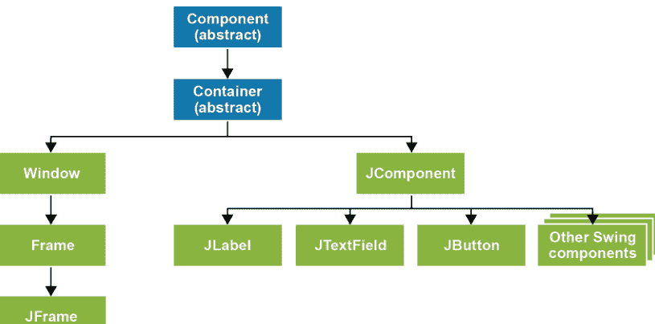

## 如何创建一个处理事件的 GUI

当你使用 Swing 开发 GUI 时，通常从显示一个作为应用程序主窗口的帧开始。然后，向帧中添加面板和按钮等组件。最后，你处理用户与这些组件交互时发生的事件。

## 如何显示一个帧

`JFrame` 小部件具有边框，并包含了你操作系统的所有普通窗口控件，如最小化、最大化和关闭按钮。图 21-3 显示了一个空 `JFrame` 小部件的示例以及显示它的代码。

要设置帧的标题，你可以将其作为参数传递给 `JFrame` 构造函数，或者创建一个 `JFrame` 对象并使用 `setTitle()` 方法。

要设置帧的大小，可以使用 `setSize()`。此方法接受两个整数，代表像素单位的宽度和高度。例如，在图中，帧的宽度设置为 600 像素，高度设置为 400 像素。另一种调整帧大小的方法是使用 `pack()` 方法。该方法不接受任何参数，并将帧调整到足以容纳其包含的所有组件。如果你不设置大小，帧的宽度和高度将为零，你将看不到任何组件。因此，你通常需要设置帧的大小。

要设置帧的位置，你可以向 `setLocationByPlatform()` 方法传递一个 `true` 值。然后，操作系统将确定帧的位置，这正是你所需要的。

当用户点击帧上的关闭按钮时，你通常希望关闭帧并退出应用程序。实现此操作最简单的方法是调用 `setDefaultCloseOperation()` 方法并对其传递 `EXIT_ON_CLOSE` 值，如图所示。虽然该方法还可以使用其他可能的值，但 `EXIT_ON_CLOSE` 值是关闭帧的一种快速且简单的方法。如果你不包含这段代码而用户点击关闭按钮，帧会关闭，但应用程序将继续运行。

在显示帧之前，你可以将“外观和感觉”设置为 Swing 提供的外观和感觉。要这样做，你可以使用 `javax.swing` 包中提供的 `UIManager` 类，如图所示。该代码将 Swing 组件的外观和感觉设置为当前操作系统。此应用程序在 Windows 上看起来像 Windows 程序，在 OS X 上像 Mac 应用程序，在 Linux 上像 Linux 应用程序。在实践中，你通常需要做更多工作才能让应用程序的行为完全像原生应用程序。然而，这超出了本书的范围。

最后，要显示帧，你可以向 `setVisible()` 方法传递一个 `true` 值。

### 包含 Swing 类的包

`javax.swing`

### 一个空帧

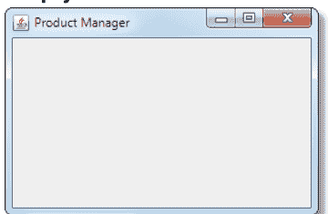

### 创建并显示帧的 main 方法

```java
public static void main(String[] args) {
    JFrame frame = new JFrame("Product Manager");
    frame.setSize(600, 400);
    frame.setLocationByPlatform(true);
    frame.setDefaultCloseOperation(JFrame.EXIT_ON_CLOSE);

    try {
        UIManager.setLookAndFeel(UIManager.getSystemLookAndFeelClassName());
    } catch (ClassNotFoundException | IllegalAccessException |
            InstantiationException | UnsupportedLookAndFeelException e) {
        System.err.println("Unsupported look and feel.");
    }

    frame.setVisible(true);
}
```

### 描述

- 帧通常定义应用程序的主窗口。
- 要设置帧的标题，可以使用 `JFrame` 类的构造函数。或者，你可以调用 `JFrame` 对象的 `setTitle()` 方法。
- 要设置帧的大小，可以调用 `setSize()` 方法并传入像素单位的高度和宽度。或者，你可以调用 `pack()` 方法自动调整窗口大小，使其足够大。
- 要设置帧的位置，你可以向 `setLocationByPlatform()` 方法传递一个 `true` 值。然后，操作系统将确定帧的位置，这正是你所需要的。
- 当用户点击帧上的关闭按钮时，你通常希望关闭帧并退出应用程序。实现此操作最简单的方法是调用 `setDefaultCloseOperation()` 方法并对其传递 `EXIT_ON_CLOSE` 值，如图所示。虽然该方法还可以使用其他可能的值，但 `EXIT_ON_CLOSE` 值是关闭帧的一种快速且简单的方法。如果你不包含这段代码而用户点击关闭按钮，帧会关闭，但应用程序将继续运行。
- 在显示帧之前，你可以将“外观和感觉”设置为 Swing 提供的外观和感觉。要这样做，你可以使用 `javax.swing` 包中提供的 `UIManager` 类，如图所示。该代码将 Swing 组件的外观和感觉设置为当前操作系统。此应用程序在 Windows 上看起来像 Windows 程序，在 OS X 上像 Mac 应用程序，在 Linux 上像 Linux 应用程序。在实践中，你通常需要做更多工作才能让应用程序的行为完全像原生应用程序。然而，这超出了本书的范围。
- 最后，要显示帧，你可以向 `setVisible()` 方法传递一个 `true` 值。

## 如何将面板添加到帧

通常，面板是一个用于分组其他组件的不可见容器。要创建一个面板，可以创建一个 `JPanel` 对象。然后将其添加到帧中。图 21-4 显示了如何将面板添加到帧的示例。

## 如何向面板添加按钮

第二个示例向面板添加了两个按钮。要这样做，它从 `JButton` 类创建了两个按钮。然后，将它们添加到面板中。

## 如何处理按钮事件

上图中代码中显示的按钮在点击时不会产生任何反应。这是因为没有程序来处理按钮被点击时生成的事件。

每当用户与你的 GUI 交互时（例如用户点击按钮时），就会触发一个事件，通知你的代码按钮被点击了。每当用户按下键盘上的按键或移动鼠标时，也会触发事件。

如果你想对点击按钮时触发的事件做出响应，你需要注册一些监听该事件的机制。这被称为动作监听器或事件监听器。

图 21-5 显示了如何使用按钮的 `addActionListener()` 方法在按钮被点击时注册一个方法。该方法被称为事件处理器。当按钮被点击时，会创建一个 `ActionEvent` 并发送给事件处理器。这个 `ActionEvent` 对象包含了有关事件的列表信息。然而，在这样简单的案例中，你不需要这些信息。相反，你只需要知道按钮触发了 `ActionEvent` 即可。

在 Java 8 之前，处理 `ActionEvent` 的常见方法是使用匿名内部类，如第一个示例所示。在这里，匿名类被编写在 `addActionListener()` 方法的括号内。

这段代码开始创建一个名为 `actionPerformed()` 的新 `ActionListener`，它接受一个 `ActionEvent` 参数。然后，当用户点击按钮时，就会执行 `actionPerformed()` 方法中的代码。在这种情况下，该方法只是向控制台打印一条“Button 1 clicked!”的消息。然而，该方法也可以包含更复杂的代码，例如更新数据库的代码。

在 Java 8 及更高版本中，你可以使用 lambda 表达式代替匿名类，如第二个示例所示。在这种情况下，与匿名内部类相比，lambda 更加整洁、简洁且易于理解。因此，如果你正在使用 Java 8 或更高版本，你可能想要使用 lambda。但是，如果你计划将应用程序分发给可能使用 Java 7 或更早版本的用户，你可能想要使用匿名方法。

虽然此图显示了如何处理用户点击按钮时发生的事件，但其他 Swing 组件也会生成你可以处理的事件。例如，当用户更改文本框的内容时，它会生成一个你可以处理的事件。处理这类事件不在本书的讨论范围之内。不过，你可以利用此图中介绍的概念来开始学习它们，并可以使用 API 文档获取更多相关信息。

### 包含事件的包

`java.awt.event`

### 大多数组件的常用方法

| 方法 | 描述 |
| --- | --- |
| `addActionListener(ActionListener l)` | 向组件（如按钮）添加事件监听器，使其能够监听并响应点击事件等事件。 |

### 为按钮添加事件处理器的代码

#### 使用匿名类（Java 8 之前）

```java
button1.addActionListener(new ActionListener() {
  @Override
  public void actionPerformed(ActionEvent e) {
    System.out.println("Button 1 clicked!");
  }
});
```

#### 使用 lambda 表达式（Java 8 及更高版本）

```java
button1.addActionListener(e -> System.out.println("Button 1 clicked!"));
```


```java
button1.addActionListener((ActionEvent e) -> {
  System.out.println("Button 1 clicked!");
});
```

### 描述

- 为了让按钮在被点击时执行某些操作

### 如何使用布局管理器

在 GUI 设计的早期时代，将不可缩放的组件放置在任何地方是很常见的。这种布局被称为固定宽度布局（fixed width layout）。虽然固定宽度布局快速又方便，但它导致了几个问题。例如，如果调整了窗口大小，内部的组件不会随之缩放，这意味着组件可能会消失在窗口边界之外。此外，如果用户的操作系统使用了不同的字体大小，组件可能会重叠在一起或隐藏在其他组件之下。为了解决这个问题，大多数现代 GUI 工具包（包括 Swing 在内）都使用了一种名为布局管理器（layout manager）的概念。

## 布局管理器摘要

Java 提供了几种内置的布局管理器，如图 21-6 汇总所示。有些易于使用，但不灵活。另一些非常灵活，可以产生复杂的布局。还有一些主要设计用于为程序员生成代码的 GUI 工具，而不是直接为手工编写代码的程序员设计的。此外，还有几种免费提供的第三方布局管理器，对于某些任务来说可能更容易使用。

本章展示了如何使用 Java 包含的两个最常用的布局管理器：`FlowLayout` 和 `BorderLayout`。下一章将展示如何使用 `GridBagLayout` 布局。本章和下一章将使用这三种布局管理器。一旦你熟悉了使用这些布局管理器的基础，你可以在互联网上搜索有关其他布局管理器的信息，它们对于某些类型的任务可能更容易使用。

默认情况下，`JFrame` 使用 `BorderLayout` 布局，而 `JPanel` 使用容器提供的 `FlowLayout` 布局以适应你的需求。如果默认不符合你的需求，你可以通过调用 `setLayout` 方法将其更改为不同的布局，如图中的默认所示。这段代码将框架的布局管理器从默认的 `BorderLayout` 更改为 `FlowLayout`。

## 包含布局管理器的包

`java.awt`

## 布局管理器摘要

| 布局管理器 | 描述 |
| --- | --- |
| `BorderLayout` | 通过提供五个可以容一个组件的区域来布局组件。这五个区域分别是北(north)、南(south)、东(east)、西(west)和中(center)。 |
| `FlowLayout` | 从左到右流式布局组件，类似于页面上的文字。 |
| `GridBagLayout` | 如下一章所示，在矩形网格中布局组件。 |
| `GridLayout` | 在矩形网格中布局组件，其中每个单元格的大小相同。 |
| `CardLayout` | 在卡片上布局组件，一次只显示一张卡片。 |
| `BoxLayout` | 在水平或垂直的单元格行中布局组件。 |

## 容器组件的常用方法

| 方法 | 描述 |
| --- | --- |
| `setLayout(layout)` | 将布局设置为指定的布局管理器。 |

## 更改容器的布局管理器

```java
JFrame frame = new JFrame();
frame.setLayout(new FlowLayout());
```

### 描述

- 布局管理器决定你的组件如何在容器中放置，以及它们在容器调整大小时如何表现。
- 默认情况下，`JFrame` 使用 `BorderLayout` 管理器。
- 默认情况下，`JPanel` 使用 `FlowLayout` 管理器。


## 如何使用 FlowLayout 管理器

在本书介绍的布局管理器中，`FlowLayout` 是最容易使用的。它按行添加组件并根据对齐参数进行排列。默认情况下，`FlowLayout` 布局居中组件。

图 21-7 中的第一个示例开始创建一个标题为“Product Manager”的新 `JFrame`。然后，这段代码将宽度设置为 600 像素，高度设置为 400 像素。接下来，这段代码调用框架的 `setLayout` 方法并传递一个 `FlowLayout` 管理器的新实例。由于该语句没有为 `FlowLayout` 指定对齐方式，因此使用默认的居中对齐。

在设置布局管理器后，这段代码向框架添加了四个标记为 Button 1、Button 2、Button 3 和 Button 4 的按钮。结果，布局管理器按照代码添加按钮的顺序从左到右排列这些按钮。

如果容器空间不足以容纳所有组件，`FlowLayout` 会将组件换到下一行。这类似于文字处理器在到达右边距时换行文本。再次，布局管理器根据我们指定的对齐方式安排组件，在在这种情况下，它是居中的。

要更改默认对齐方式，你可以向 `FlowLayout` 类的构造函数提供一个对齐参数。例如，在第二个示例中，对齐参数告诉 `FlowLayout` 将组件与框架的左边缘对齐，类似于在文字处理器中左对齐文本。也可以对组件进行右对齐。

## 创建 FlowLayout 并向其添加四个按钮的代码

```java
JFrame frame = new JFrame("Product Manager");
frame.setSize(600, 400);
frame.setLayout(new FlowLayout());
frame.add(new JButton("Button 1"));
frame.add(new JButton("Button 2"));
frame.add(new JButton("Button 3"));
frame.add(new JButton("Button 4"));
```

## 当组件恰合单行显示时的 FlowLayout

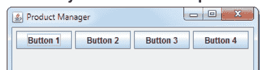

## 当组件换到下一行时的 FlowLayout

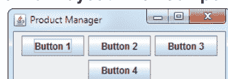

## FlowLayout 类的一个常用构造函数

| 构造函数 | 描述 |
|--- |--- |
| `FlowLayout(alignment)` | 设置此管理器的水平对齐。要设置此对齐方式，你可以指定 `FlowLayout` 类中的 `LEFT`、`RIGHT` 或 `CENTER` 常量。 |

## 如何更改默认布局

```java
frame.setLayout(new FlowLayout(FlowLayout.LEFT));
```

### 描述

- 如果组件在单行内无法容，`FlowLayout` 管理器会将组件换到新行。
- `FlowLayout` 管理器可以将组件左对、右对或居中。默认是居中。

图 21-7 如何使用 FlowLayout 管理器

## 如何使用 BorderLayout 管理器

`BorderLayout` 管理器有五个区域：北（north）、南（south）、东（east）、西（west）和中心（center）。每个区域都可以包含一个组件。

图 21-8 显示了一个使用 `BorderLayout` 管理器在五个区域各显示一个按钮的帧。这段代码首先创建一个与图中类似的帧。由于 `BorderLayout` 是帧的默认布局管理器，因此代码没有设置布局管理器。

在创建此帧之后，代码通过调用帧的 `add` 方法向帧的北区域添加了一个新按钮。然后，它将组件作为第一个参数和第二个参数传递。在这里，组件是一个显示为“North”的 `JButton`，而 `BorderLayout.NORTH` 常量指定了该区域。这导致布局管理器在水平方向上调整该组件的大小以填充帧的整个宽度，并在垂直方向上调整为其首选高度，即按钮的高度。

类似的，这段代码向帧的南区域添加了一个新按钮。与北区域一样，布局管理器在水平方向上调整组件的大小以填充帧的宽度，并在垂直方向上调整为其首选高度。

在南北区域添加按钮后，这段代码向东、西区域添加了按钮。在这种情况下，布局管理器调整这些组件的大小，以填充南北区域之间的所有空间。此外，它还将这些组件的大小调整为其首选宽度，即按钮的宽度。

最后，代码向帧的中心区域添加了一个按钮。在这种情况下，布局管理器在水平和垂直方向上都调整该组件的大小，以填充其他区域未使用的任何剩余空间。

如果你调整此窗口，布局管理器会调整每个区域组件的大小。南北组件在水平方向上调整大小以填充新空间，但高度保持不变。东部组件在垂直方向上调整大小以填充新空间，但宽度保持不变。中心组件则调整以填充任何剩余空间。

如果你没有为 `BorderLayout` 中的一个或多个区域提供组件，则该区域的大小为零。例如，如果你从东区域移除按钮，则东区域的大小为 0。结果是，中心组件扩展到帧的右边缘。

`BorderLayout` 通常用于布局应用程序的主屏幕。例如，如果你写了一个邮件客户端。使用北区域作为工具栏，西区域用于存放文件夹列表，中心区域用于存放邮件列表，南区域用于存放状态栏。在这种情况下，你可能不会使用东区域。

在使用 `BorderLayout` 管理器时，重要的是记住每个区域只能包含一个组件。因此，如果你想添加多个组件，需要在添加它们之前先将这些按钮分到一个面板（panel）中。例如，如果你想添加一个带有多个按钮的工具栏，你需要将这些按钮分到一个面板中（可能使用 `FlowLayout` 实现），然后将该面板添加到 `BorderLayout` 的北区域。

## BorderLayout 类的一个常用方法

| 方法 | 描述 |
| --- | --- |
| `add(component, area)` | 将指定的组件添加到指定的区域。要设置区域，你可以指定 `BorderLayout` 类中的 `NORTH`、`SOUTH`、`EAST`、`WEST` 或 `CENTER` 常量。 |

## 向 BorderLayout 的每个区域添加五个帧的代码

```java
JFrame frame = new JFrame("Product Manager");
frame.setSize(600, 400);
frame.add(new JButton("North"), BorderLayout.NORTH);
frame.add(new JButton("South"), BorderLayout.SOUTH);
frame.add(new JButton("East"), BorderLayout.EAST);
frame.add(new JButton("West"), BorderLayout.WEST);
frame.add(new JButton("Center"), BorderLayout.CENTER);
```

## 上述代码产生的 JFrame

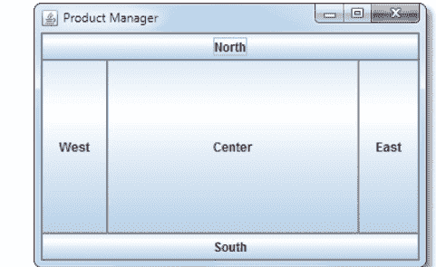

### 描述

- `BorderLayout` 有五个区域：北、南、东、西和中心。默认是居中。
- 如果你没有为 `BorderLayout` 中的一个或多个区域提供组件，该区域的大小为零。例如，如果你从东区域移除按钮，则东区域的大小为 0。结果是，中心组件扩展到帧的右边缘。
- `BorderLayout` 通常用于布局应用程序的主屏幕。例如，如果你写了一个邮件客户端。使用北区域作为工具栏，西区域用于存放文件夹列表，中心区域用于存放邮件列表，南区域用于存放状态栏。在这种情况下，你可能不会使用东区域。
- 在使用 `BorderLayout` 管理器时，重要的是记住每个区域只能包含一个组件。因此，如果你想添加多个组件，需要在添加它们之前先将这些按钮分到一个面板中。例如，如果你想添加一个带有多个按钮的工具栏，你需要将这些按钮分到一个面板中（可能使用 `FlowLayout` 实现），然后将该面板添加到 `BorderLayout` 的北区域。
- 如果你调整此窗口，布局管理器会调整每个区域组件的大小。南北组件在水平方向上调整大小以填充新空间，但高度保持不变。东部组件在垂直方向上调整大小以填充新空间，但宽度保持不变。中心组件则调整以填充任何剩余空间。
- 如果组件在单行内无法容，`FlowLayout` 管理器会将组件换到新行。
- `FlowLayout` 管理器可以将组件左对、右对或居中。默认是居中。

## 如何处理表格

许多应用程序，特别是与数据库交互的应用程序，需要显示行。为了这一点，你可以使用 `JTable`。

## 为表格创建一个模型

创建自定义表格模型的简单方法是扩展 `AbstractTableModel`。至少，你需要重写 `getRowCount()`、`getColumnCount()` 和 `getValueAt(row, column)` 方法。此外，通常还会重写 `getColumnName(column)` 方法。

当你更新数据库时，可以调用 `fireTableDataChanged()` 方法通知数据已更改。`AbstractTableModel` 还包含其他方法，如 `fireTableCellUpdated(row, column)` 和 `fireTableRowsInserted(firstRow, lastRow)`，你可以调用它们来更新表格的一部分。这些方法效率更高，特别是对于大表格。

## 通常重写的 AbstractTableModel 方法

| 方法 | 描述 |
|---|---|
| `getRowCount()` | 返回表格行数的整数 |
| `getColumnCount()` | 返回表格列数的整数 |
| `getValueAt(row, column)` | 返回表格中指定行和列索引的值 |
| `getColumnName(column)` | 返回指定列索引的名称字符串。该值被用作表头标签 |

## 你可以调用的 AbstractTableModel 方法

| 方法 | 描述 |
|---|---|
| `fireTableDataChanged()` | 通知所有监听器表格中的所有单元格值已更改 |

## JTable 术语

| 列名 | 描述 | 价格 |
|---|---|---|
| | Java | Murach's Programming | $50.00 |
| | jsp | Murach's Servlets and JSP | $57.50 |
| | mysql | Murach's MySQL | $54.00 |
| | android | Murach's Android Programming | $57.50 |
| | html5 | Murach's HTML5 and CSS3 | $54.00 |
| | gradle | Murach's Grade and PL/SQL | $54.00 |
| | javascript | Murach's JavaScript and Jquery | $54.50 |
| | net | Microsoft .NET | $48.00 |

图 21-9 如何创建一个表格模型

## ProductTableModel 类

图 21-10 显示了定义前一个图中使用的模型的类。该类名为 `ProductTableModel`，它继承自 `AbstractTableModel`。

类声明上的 `@SuppressWarnings("serial")` 注解可以防止 Eclipse 显示该类没有序列化 ID（serial ID）的警告。在这种情况下，该类不需要序列化 ID，我们可以忽略这个警告。

在类内部，第一条语句声明了一个名为 `products` 的变量，它存储了一个 `Product` 对象的 `List`。然后，第二条语句声明并初始化了一个用于三列名的字符串数组。这些列名分别是 Code（代码）、Description（描述）和 Price（价格）。

表格模型的构造函数调用了上一章描述的 `ProductDB` 类的 `getAll()` 方法，从数据库中检索 `Product` 对象的 `List`。然后，它将此产品列表赋值给变量 `products`。

`getRowCount()` 方法是扩展 `AbstractTableModel` 类时必须重写的三个方法中的第一个。该方法返回表格行数的整数值。由于这等于 `products` 列表中的产品数量，因此此代码返回 `products` 列表 `size()` 方法的值。

`getColumnCount()` 方法是第二个必须重写的方法。该方法返回列数的整数值。为了实现这一点，它返回 `COLUMN_NAMES` 数组的长度，这与列数相同。

`getColumnName(column)` 不是强制要求的，但如果你想显示列名，它就是必要的。该方法接收一个列索引并返回指定索引的列名。为了实现这一点，该方法返回 `COLUMN_NAMES` 数组中该索引处的字符串。

`getValueAt(row, column)` 方法是第三个必须重写的方法。该方法将行索引和列索引作为参数。然后，它返回指定行和列的值。为了实现这一点，该方法使用 `switch` 语句来确定要显示的列。对于列索引为 0，此代码调用 `products` 列表的 `get(row)` 方法来返回指定行的 `Product` 对象。然后，它使用链式调用调用 `Product` 对象的 `getCode()` 方法。对于列索引为 1，此代码调用指定行 `Product` 对象的 `getDescription()` 方法。对于列索引为 2，此代码调用对象的 `getPriceFormatted()` 方法。

让新程序员感到困惑的一点是，你定义了这四个方法但从未在任何地方调用过它们。这是因为 `JTable` 组件在需要关于如何显示表格的信息时会调用它们。例如，当 `JTable` 需要知道表格第一行描述列显示什么值时，它会调用行索引为 0、列索引为 1 的 `getValueAt(row, column)` 方法。然后，`getValueAt(row, column)` 方法从产品列表的第一行（列表索引从 0 开始）获取 `Product` 对象，并调用它的 `getDescription()` 方法返回描述。


```java
import java.util.List;
import javax.swing.table.AbstractTableModel;

import mma.business.Product;
import mma.db.ProductDB;
import mma.db.DBException;

@SuppressWarnings("serial")
public class ProductTableModel extends AbstractTableModel {
    private List<Product> products;
    private final String[] COLUMN_NAMES = { "Code", "Description", "Price" };

    public ProductTableModel() {
        try {
            products = ProductDB.getAll();
        } catch (DBException e) {
            System.out.println(e);
        }
    }

    @Override
    public int getRowCount() {
        return products.size();
    }

    @Override
    public int getColumnCount() {
        return COLUMN_NAMES.length;
    }

    @Override
    public String getColumnName(int columnIndex) {
        return COLUMN_NAMES[columnIndex];
    }

    @Override
    public Object getValueAt(int rowIndex, int columnIndex) {
        switch (columnIndex) {
            case 0:
                return products.get(rowIndex).getCode();
            case 1:
                return products.get(rowIndex).getDescription();
            case 2:
                return products.get(rowIndex).getPriceFormatted();
            default:
                return null;
        }
    }
}
```

图 21-10 ProductTableModel 类（2/2 部分的第一部分）

`databaseUpdated` 方法使用来自数据库的新数据更新表格模型中的旧数据。然后，它调用表格模型的 `fireTableDataChanged` 方法。这会通知 `JTable` 组件模型的数据已发生更改。如果你修改了数据库中的底层数据，可以调用此方法来同步表格中显示的数据与数据库中的数据。

# ProductTableModel 类（续）

```java
Product getProduct(int rowIndex) {
    return products.get(rowIndex);
}

void databaseUpdated() {
    try {
        products = ProductDB.getAll();
        fireTableDataChanged();
    } catch (DBException e) {
        System.out.println(e);
    }
}
```

### 描述

- 当一行代表业务对象（如 `Product` 对象）时，你可以包含一个方法，返回指定行索引对应的对象。
- 为了同步表格数据与数据库中的数据，你可以包含一个方法，使用数据库中的数据更新模型，然后调用 `fireTableDataChanged` 方法。这会导致表格显示存储在模型中的新数据。

图 21-10 ProductTableModel 类（2/2 部分的第二部分）

# 如何创建表格

一旦为表格创建了模型，就可以创建一个 `JTable` 组件来显示存储在模型中的数据。图 21-11 的第一个示例展示了如何操作。

此代码首先创建一个 `ProductTableModel` 对象。然后，它通过将模型传递给 `JTable` 的构造函数创建一个表格。或者，你可以调用 `JTable` 类的空构造函数并使用 `setModel` 方法设置模型。

在设置表格模型后，此代码将表格的选择模式设置为 `SINGLE_SELECTION`。结果是用户一次只能选择一行。然而，你可以使用两个值来设置选择模式。

首先，你可以使用 `SINGLE_INTERVAL_SELECTION` 允许用户通过按住 Ctrl 或 Shift 键选择多行。但这仅在这些行连续时有效。也就是说，如果选中的行是相邻的就可以。

其次，如果你想允许更多可能性，可以使用 `MULTIPLE_INTERVAL_SELECTION` 允许用户通过按住 Ctrl 或 Shift 键选择多行。在这种模式下，行不需要连续。

在设置选择模式后，此代码调用表格的 `setBorder` 方法并传递一个 `null` 值。结果是该表格不包含框。如果你计划如后续所示为表格添加滚动条，这可以确保 GUI 不显示两个框（一个表格的，一个滚动条的）。当组件将占据容器的所有空间时，这是一个最佳实践。

# 如何获取选中的行或行

第二个示例展示如何在表格显示后从其获取选中的行或行。此代码首先调用表格的 `getSelectedRow` 方法。这获取了用户选择的第一行的索引。

获取行索引后，此代码检查用户是否选择了一行。如果是，它将传递表格模型的 `getProduct` 方法。这获取了与选定行对应的 `Product` 对象。

此示例使用 `getSelectedRow` 方法是合理的，因为第一个示例只允许用户选择一行。然而，如果第一个示例允许用户选择多行，那么此示例使用 `getSelectedRows` 方法获取所有选定行的索引将是合理的。


# 如何为表格添加滚动条

表格包含许多行或列以至于无法在一个屏幕内显示是很常见的现象。幸运的是，Swing 提供了一个名为 `JScrollPane` 的容器，你可以用它为表格添加滚动条。当然，`JScrollPane` 也适用于任何其他组件（例如文本区域），当组件的内容过大无法在一个屏幕内显示时。

图 21-12 中的第一个示例显示了如何创建一个滚动面板并将其添加到表格中。要做到这一点，代码将该面板传递给 `JScrollPane` 类的构造函数。

第二个代码示例展示了将组件添加到滚动面板并将滚动面板添加到框架（frame）的另一种方法。由于此示例没有维护对 `JScrollPane` 对象的引用，因此你之后无法调用它的任何方法。但是，只要你不需要更改默认的滚动面板策略，这通常是没问题的。

如果你需要更改滚动面板策略，可以使用如第三个示例所示的滚动面板的 `setHorizontalScrollBarPolicy` 和 `setVerticalScrollBarPolicy` 方法。这些方法决定了滚动条何时对用户可见。两个滚动条的默认值都是 `AS_NEEDED`。因此，如果所有内容都能适应容器，则滚动条会被隐藏。然而，如果内容无法适应，滚动条就会显示出来。这可能会发生，例如，当你调整窗口大小使容器变小时。

如果你想让滚动条始终可见，即使在不需要的情况下，你可以将策略设置为 `ALWAYS`。在这种情况下，即使在不需要时滚动条也会显示，但当你尝试使用它们时它们不会产生任何作用。

如果你想让滚动条永远不可见，你可以将策略设置为 `NEVER`。这会隐藏滚动条。然而，用户仍然可以使用方向键以及 Page Up 和 Page Down 键来滚动组件。

# 向滚动面板中添加组件

```java
JScrollPane scrollPane = new JScrollPane(productTable);
frame.add(scrollPane);
```

添加滚动面板的另一种方式：

```java
frame.add(new JScrollPane(productTable));
```

# JScrollPane 类的一个构造函数和两个方法

| 构造函数 | 描述 |
| --- | --- |
| `JScrollPane(component)` | 将组件添加到滚动面板。 |

| 方法 | 描述 |
| --- | --- |
| `setHorizontalScrollBarPolicy(policy)` | 使用下表中的常量之一控制水平滚动条的何时可见。 |
| `setVerticalScrollBarPolicy(policy)` | 使用下表中的常量之一控制垂直滚动条的何时可见。 |

| 值 | 描述 |
| --- | --- |
| `HORIZONTAL_SCROLLBAR_AS_NEEDED` | 仅当内容比视口宽且无法同时显示时，才显示水平滚动条。这是默认值。 |
| `HORIZONTAL_SCROLLBAR_NEVER` | 永远不显示水平滚动条。仍然可以使用键盘上的左、右方向键进行左右滚动。 |
| `HORIZONTAL_SCROLLBAR_ALWAYS` | 无论是否需要，始终显示水平滚动条。 |
| `VERTICAL_SCROLLBAR_AS_NEEDED` | 仅当内容比视口长且无法同时显示时，才显示垂直滚动条。这是默认值。 |
| `VERTICAL_SCROLLBAR_NEVER` | 永远不显示垂直滚动条。仍然可以使用键盘上的上下方向键以及页上/页下键上下滚动内容。 |
| `VERTICAL_SCROLLBAR_ALWAYS` | 无论是否需要，始终显示垂直滚动条。 |

要使滚动条始终可见：

```java
scrollPane.setHorizontalScrollBarPolicy(
    ScrollPaneConstants.HORIZONTAL_SCROLLBAR_ALWAYS);

scrollPane.setVerticalScrollBarPolicy(
    ScrollPaneConstants.VERTICAL_SCROLLBAR_ALWAYS);
```

### 描述

- 你可以使用滚动面板为任何可能无法放入窗口的组件添加滚动条。
- 默认情况下，滚动面板仅在需要时才显示滚动条。

图 21-12 如何使用滚动面板

### 如何使用内置对话框

如果你在进行 GUI 开发，有时可能需要使用对话框向用户显示消息。例如，你可能需要显示通知或警告。在其他情况下，你可能需要使用对话框来确认某项操作。例如，你可能需要问一个简单的问题来确定是否可以删除文件。

手动为这些常用对话框编写 GUI 代码将非常繁琐。幸运的是，Swing 提供了内置对话框，你可以使用 `JOptionPane` 类来处理它们。

由 `JOptionPane` 类创建的对话框始终显示在父容器之上。它始终是模态的（modal），这意味着在用户对对话框做出响应之前，无法与应用程序的任何其他部分交互。而且它始终是阻塞的（blocking），这意味着对话框会停止当前运行的线程并防止其在用户对对话框做出响应之前恢复。

# 如何显示消息

图 21-13 显示了如何使用 `JOptionPane` 类向用户显示消息。要做到这一点，你可以调用 `showMessageDialog` 方法。该方法接受四个参数：(1) 父容器，(2) 消息，(3) 标题和 (4) 类型。

## 如何确认操作

图 21-14 显示了如何使用 `JOptionPane` 通过向用户提问来显示确认操作的消息。要实现这一点，你可以调用 `showConfirmDialog` 方法。该方法的工作原理与图中描述的 `showMessageDialog` 方法类似。然而，`showConfirmDialog` 方法的第四个参数决定了对话框显示哪些按钮。此外，该方法会返回一个指示用户选择了哪个按钮的值。

`showConfirmDialog` 可以显示带有图中列出的按钮选项的对话框。其中，`YES_NO_OPTION` 类型和 `OK_CANCEL_OPTION` 类型是最常用的。

第一个示例显示了一个对话框，询问用户是否创建一个新文件。在这里，方法的前三个参数的实际工作方式与前图所示方法的前三个参数相同。然而，第四个参数使用 `YES_NO_OPTION` 值来指定对话框显示“是”（Yes）和“否”（No）按钮。此外，这段代码将 `showConfirmDialog` 方法的返回值赋值给名为 `option` 的 `int` 变量。在图的第二部分，你将学习如何使用它来确定用户选择了哪个按钮。

默认情况下，`showConfirmDialog` 使用 `QUESTION_MESSAGE` 类型。这种消息类型会像第一个示例那样显示一个问号。然而，如果用户执行的操作是无法撤销的操作，你可能希望使用一个提供更强警告的图标。要做到这一点，你可以提供一个可选的第五个参数，使用前图所示的消息类型值之一。例如，在图中，第二个代码示例提供了一个第五个参数，指定了 `WARNING_MESSAGE` 类型。

### 第 21 章 如何使用 Swing 开发 GUI（部分 1）

### JOptionPane 选项类型

| 类型 | 按钮 |
| --- | --- |
| `DEFAULT_OPTION` | OK |
| `YES_NO_OPTION` | 是 和 否 |
| `YES_NO_CANCEL_OPTION` | 是、否 和 取消 |
| `OK_CANCEL_OPTION` | OK 和 取消 |

### 显示带有“是”和“否”按钮的询问对话框

```java
int option = JOptionPane.showConfirmDialog(frame,
  "Do you want to create a new file?", "New file",
  JOptionPane.YES_NO_OPTION);
```

### 显示的对话框


### 显示带有警告图标的询问对话框

```java
int option = JOptionPane.showConfirmDialog(frame,
  "Are you sure you want to delete the Internet?"
  + " This operation cannot be undone.", "Are you sure?",
  JOptionPane.YES_NO_OPTION, JOptionPane.WARNING_MESSAGE);
```

### 显示的对话框


### 描述

- 要显示一个让用户确认或取消操作的对话框，可以使用 `JOptionPane` 类的静态方法 `showConfirmDialog`。
- `showConfirmDialog` 方法的前三个参数工作方式与前图所示的 `showMessageDialog` 相同。
- 第四个参数决定了显示的按钮。
- 默认情况下，`showConfirmDialog` 显示询问图标。然而，你可以通过提供第五个参数来指定另一种类型的图标。
- 要将长消息换行到第二行，可以使用换行符 (`\n`)。

图 21-14 如何确认操作（2 个部分中的第 1 部分）

## 第 5 节 实战技能

图 21-14 的第二部分显示了如何使用 `showConfirmDialog` 方法的返回值来确定用户选择了哪个按钮。该方法可以返回图中列出的任何值。当然，可能的返回值取决于对话框的类型。例如，`YES_NO_OPTION` 对话框返回 `YES_OPTION` 或 `NO_OPTION`。换句话说，它永远不会返回 `CANCEL_OPTION` 或 `OK_OPTION`。然而，所有对话类型都可以返回 `CLOSED_OPTION`，表示用户在没有选择任何按钮的情况下关闭了对话框。

代码示例使用 `switch` 语句来确定用户选择了哪个按钮。为了实现这一点，`switch` 语句为每个可能的返回值提供一个 `case`：`YES_OPTION`、`NO_OPTION` 和 `CLOSED_OPTION`。然后，它根据用户选择的选项向控制台打印一条默认消息。或者，可以使用 `if/else` 语句代替 `switch` 语句。然而，作为一般规则，`switch` 语句效率更高。此外，对于这样的代码，它们更易读。

记住，`JOptionPane` 生成的对话框是阻塞的。这意味着它们会停止线程并防止其在用户对对话做出响应之前继续。因此，在用户选择对话按钮之一或关闭对话之前，`switch` 语句不会运行。

## JOptionPane 返回值

| 值 | 描述 |
| --- | --- |
| `YES_OPTION` | 选择了“是”按钮。 |
| `NO_OPTION` | 选择了“否”按钮。 |
| `CANCEL_OPTION` | 选择了“取消”按钮。 |
| `OK_OPTION` | 选择了“OK”按钮。 |
| `CLOSED_OPTION` | 消息框被关闭。 |

### 确定选择哪个按钮的语句


```java
int option = JOptionPane.showDialog(frame,
      "Are you sure you want to delete the Internet?"
      + " This operation cannot be undone.", "Are you sure?",
      JOptionPane.YES_NO_OPTION, JOptionPane.WARNING_MESSAGE);

switch (option) {
  case YES_OPTION:
    System.out.println("You clicked the button.");
    break;
  case NO_OPTION:
    System.out.println("You clicked the button.");
    break;
  case CLOSED_OPTION:
    System.out.println("You closed the dialog.");
    break;
}
```

### 描述

- 当用户从对话中选择选项时，`showConfirmDialog` 方法关闭对话并返回一个 `int`。
- 为了确定用户选择的选项，通常使用 `switch` 语句。也可以使用 `if/else` 语句。


## 产品管理器 (Product Manager)

本章最后介绍了产品管理器主窗口的完整代码。这段代码使用了在本章中学的大部分概念和组件。

### 用户界面

图 21-15 显示了产品管理器的用户界面。应用程序的主窗口是一个使用 `BorderLayout` 管理器的 `JFrame`。它显示两个组件。第一个是使用 `FlowLayout` 布局器的 `JPanel`，用于显示 `JButton` 控件。框架在该面板位于布局的 `NORTH`。第二个是包含 `JTable` 控件的 `JScrollPane` 控件。该表显示存储在数据库中的产品数据。框架在该滚动面板位于布局的 `CENTER` 区域。

要删除产品，用户可以选择产品所在的行并点击“删除”按钮。这将显示图中所示确认对话框。如果用户选择“是”按钮确认删除，这将从数据库中删除该产品并更新 `JTable` 控件显示的数据。

目前，“添加”和“编辑”按钮尚未实现。因此，如果用户点击这两个按钮中的任何一个，应用程序将显示指示功能尚未实现的对话框。在下一章中，你将学习如何实现这些按钮，以便它们用于添加新产品或更新现有产品。

### 产品管理器框架

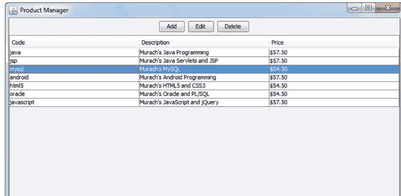

### 删除按钮的对话框

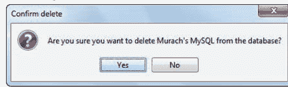

### 添加和编辑按钮的对话框

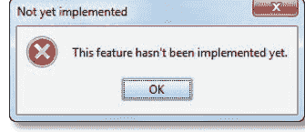

# ProductManagerFrame 类

图 21-16 显示了创建管理器应用程序主窗口的代码。首先，类声明定义了一个名为 `ProductManagerFrame` 的类，它继承自 `JFrame` 类。这是一个常见的做法，因为它允许你将此窗框的所有代码存储在单个类中。

该类首先定义了两个实例变量。首先，它定义了一个名为 `productTable` 的 `JTable`，用于向用户显示产品表格。其次，它定义在本章之前描述的 `ProductTableModel` 类的实例。该模型存储了表格的数据。

该窗框的构造函数首先使用 `UIManager` 尝试将外观（look and feel）设置为正在运行的操作系统的原生外观。此设置是可选的，但它通常会改进应用程序的外观，使其与相同操作系统上的其他应用程序外观保持一致。

在设置好外观后，构造函数设置了窗框的标题、大小和位置。然后，它设置了默认关闭操作，这样当用户关闭窗口时应用程序就会关闭。如果你不包含此操作，窗口会关闭，但应用程序将在后台继续运行。

在设置默认关闭操作后，构造函数调用了该类后续显示的 `buildButtonPanel` 方法，以获取包含应用程序三个按钮的面板。然后，它将此面板添加到 `BorderLayout` 的 `NORTH` 区域。这是可能的，因为 `JFrame` 默认使用默认布局管理器。

在将按钮添加到 `NORTH` 区域后，构造函数调用了该类后续显示的 `buildProductTable` 方法，以获取产品的 `JTable` 组件。此外，它将此 `JTable` 组件赋值给 `productTable`。

在创建 `JTable` 组件后，构造函数将一个包含该 `JTable` 组件的 `JScrollPane` 组件添加到 `BorderLayout` 的 `CENTER` 区域。然而，由于 `CENTER` 是默认区域，这段代码本可以省略此参数。显式写出参数是为了清晰地标识 `BorderLayout` 的区域。

最后，构造函数调用 `setVisible` 方法向用户显示用户界面。该语句最后被调用的，因为在构造函数中过早调用它会导致界面在首次显示时出现闪烁。

`buildButtonPanel` 方法首先创建一个名为 `panel` 的 `JPanel`。默认情况下，`JPanel` 使用 `FlowLayout` 布局管理器。由于我们在这种情况下需要的不同，代码设置了布局。

此方法通过创建 Add 继续：

# ProductManagerFrame 类

```java
package mma.ui;

import java.awt.BorderLayout;
import java.awt.event.ActionEvent;
import javax.swing.JButton;
import javax.swing.JFrame;
import javax.swing.JOptionPane;
import javax.swing.JPanel;
import javax.swing.JScrollPane;
import javax.swing.JTable;
import javax.swing.table.ListSelectionModel;
import javax.swing.UIManager;
import javax.swing.UnsupportedLookAndFeelException;

import mma.business.Product;
import mma.db.ProductDB;
import mma.db.DBException;

@SuppressWarnings("serial")
public class ProductManagerFrame extends JFrame {
    private JTable productTable;
    private ProductTableModel productTableModel;

    public ProductManagerFrame() {
        try {
            UIManager.setLookAndFeel(UIManager.getSystemLookAndFeelClassName());
        } catch (ClassNotFoundException | InstantiationException | IllegalAccessException | UnsupportedLookAndFeelException e) {
            System.out.println(e);
        }

        setTitle("Product Manager");
        setSize(768, 384);
        setLocationByPlatform(true);
        setDefaultCloseOperation(JFrame.EXIT_ON_CLOSE);

        add(buildButtonPanel(), BorderLayout.NORTH);
        productTable = buildProductTable();
        add(new JScrollPane(productTable), BorderLayout.CENTER);
        setVisible(true);
    }

    private JPanel buildButtonPanel() {
        JPanel panel = new JPanel();

        JButton addButton = new JButton("Add");
        addButton.addActionListener((ActionEvent) -> {
            doAdd();
        });
        panel.add(addButton);

        JButton editButton = new JButton("Edit");
        editButton.addActionListener((ActionEvent) -> {
            doEdit();
        });
        panel.add(editButton);

        return panel;
    }
```

图 21-16 ProductManagerFrame 的代码（2 部分中的第 1 部分）

在创建了这三个按钮后，代码将这三个按钮添加到面板中。最后，`buildButtonPanel` 方法的最后一条返回面板。

接下来的三个方法是动作监听器的事件处理器。目前，Add 和 Edit 按钮的方法只是显示一个带有消息的对话框，指示该功能尚未实现。在下一章中，你将学习如何编写这些方法，Add 和 Edit 按钮可以用于添加新产品或编辑现有产品。

然而，`doDelete` 方法包含了从数据库中删除所选产品的代码。首先，这段代码使用 `JTable` 组件的 `getSelectedRow` 方法来获取所选行的索引。然后，这段代码检查索引是否等于 -1。如果是，它将显示一条消息，指示用户在点击 Delete 按钮之前应先选择一个产品。否则，它将显示一个包含“是”和“否”按钮的对话框，允许用户确认操作。如果用户点击“是”按钮，这段代码将使用上一节描述的 `ProductDB` 类的 `delete` 方法来删除产品。然后，它调用类后续的 `fireDatabaseUpdatedEvent` 事件。反过来，此方法调用表格的 `databaseUpdated` 方法来更新 `JTable` 显示的数据。

代码调用 `JOptionPane` 类的方法时，将关键字 `this` 指定为方法的第一个参数。这告诉 `JOptionPane` 类当前对象（`ProductManagerFrame`）是对话框的父级。

`buildProductTable` 方法创建一个 `ProductTableModel` 并将其赋值给 `productTableModel`。记住，类的构造函数调用 `buildProductTable` 方法获取获取表格。然后，它将此表格添加到滚动面板，并将滚动面板添加到窗框的中心区域。

# ProductManagerFrame 类

```java
        JButton deleteButton = new JButton("Delete");
        deleteButton.setToolTip("Delete selected product");
        deleteButton.addActionListener((ActionEvent) -> {
            doDelete();
        });
        panel.add(deleteButton);
```

```java
        return panel;
```

```java
    private void doAdd() {
        JOptionPane.showMessageDialog(this,
          "This feature hasn't been implemented yet.",
          "Not yet implemented", JOptionPane.ERROR_MESSAGE);
    }
```

```java
    private void doEdit() {
        doDelete();
    }
```

```java
    private void doDelete() {
        int selectedRow = productTable.getSelectedRow();
        if (selectedRow == -1) {
            JOptionPane.showMessageDialog(this,
              "No product is currently selected.",
              "No product selected", JOptionPane.ERROR_MESSAGE);
        } else {
            Product product = productTable.getProduct(selectedRow);
            int ask = JOptionPane.confirmDialog(this,
              "Are you sure you want to delete " +
              product.getName() + " from the database?", JOptionPane.YES_NO_OPTION);
            if (ask == JOptionPane.YES_OPTION) {
                try {
                    ProductDB.delete(product);
                    fireDatabaseUpdatedEvent();
                } catch (DBException e) {
                    System.out.println(e);
                }
            }
        }
    }
```

```java
    public void fireDatabaseUpdatedEvent() {
        productTableModel.databaseUpdated();
    }
```

```java
    private JTable buildProductTable() {
        productTableModel = new ProductTableModel();
        JTable table = new JTable(productTableModel);
        table.setSelectionMode(ListSelectionModel.SINGLE_SELECTION);
        table.setBorder(null);
        return table;
    }
```

# 观点

在本章中，你学习了使用 Swing 开发 GUI 的一些核心技能，Swing 是 Java 中最常用的 GUI 工具包。特别是，你学习了如何创建应用程序的主窗口。你学习了如何添加按钮。你学习了如何处理点击这些按钮时发生的事件。你学习了如何操作显示数据库中数据的表格。你还学习了如何使用内置的对话框。在下一章中，你将学习如何创建数据输入表单，以便你向数据库中添加和更新数据。

### 总结

* Swing 是 Java 中最常用的 GUI 工具包。
* GUI 的元素被称为*组件*（component）或*小部件*（widget）。
* Swing 提供了可以更改的插拔式外观和感官（look and feels）。
* 可以包含其他组件的组件被称为*容器*（container）。常用的容器有框架（frames）、面板（panels）和滚动面板（scroll panes）。
* `JFrame` 小部件通常作为应用程序的主窗口。
* `JPanel` 小部件是一个不可见的组件，你可以用它来对其他组件进行分组。
* `JButton` 小部件显示一个按钮。
* 要处理用户点击 `JButton` 小部件时发生的*事件*（event），你可以使用 `ActionListener` 方法添加一个*动作监听器*（action listener）或*事件监听器*（event listener）。
* *事件处理器*（event handler）是一个响应按钮点击等 GUI 事件的方法。
* 布局管理器对容器中的组件进行布局，并控制它们如何响应缩放窗口大小等事件。
* `BorderLayout` 和 `FlowLayout` 管理器是两个常用的布局管理器。
* `JTable` 显示表格化数据，例如来自中的表格。
* *表格模型*（table model）为 `JTable` 小部件提供表格化数据。创建表格最简单的方法是扩展 `AbstractTableModel` 类。
* `JScrollPane` 为组件（如 `JTable` 小部件）添加滚动条，这样当组件无法完全适应容器时，用户就可以对组件进行滚动查看。
* 你可以使用 `JOptionPane` 的方法来显示包含信息消息的对话框，或确认操作的对话框。

# 练习 21-1 修改现有的 GUI

在练习中，你将修改本章描述的“产品管理器”（Product Manager）窗口的 GUI。

- 1. 导入 `ex_starts` 文件夹中名为 `ch21_ex1_ProductManager` 的项目。


- 2. 运行应用程序并测试 GUI。选择其中一行并验证可以使用 `Delete`（删除）按钮删除它。然后点击 `Add`（添加）和 `Edit`（编辑）按钮，验证它们是否显示了告知用户功能尚未实现的对话框。

- 3. 添加一个 `Print`（打印）按钮，点击后显示一个对话框告诉用户产品已发送到打印机。要实现这一点，在 `BorderLayout` 方法中添加另一个 `JButton`，添加一个动作监听器，并创建一个方法（你可以命名为 `doPrintButton`）来处理该动作。

- 4. 修改 `Print` 按钮执行的代码，使得如果产品表中当前未选中任何行，则显示错误消息。要实现这一点，你可以参考按钮面板显示在 `SOUTH` 区域的代码。

- 5. 修改在框架 `BorderLayout` 的 `SOUTH` 区域的代码面板。要实现这一点，你需要修改构造函数中调用 `buildButtonPanel` 方法的部分。

# 如何使用 Swing 开发 GUI（部分 2）

在上一章中，你学习了如何为产品管理器应用程序创建主窗口，包括显示存储在数据库中的产品的表格。在本章中，你将学习如何创建一个数据输入表单，允许你向数据库中添加新产品或编辑现有产品。

| 如何操作标签和文本字段 ................................................. | 574 |
| 如何操作标签............................................................................................... | 574 |
| 如何操作文本字段.................................................................................... | 576 |
| 如何使用 GridBagLayout 管理器................................................ | 578 |
| GridBagLayout 管理器简介...................................................... | 578 |
| 在容器中布局组件................................................................ | 580 |
| 添加内边距....................................................................... | 582 |
| 避免常见陷阱....................................................................... | 584 |
| 创建数据表单.................................................................. | 586 |
| 创建自定义对话框................................................................ | 586 |
| 在对话框与其父级之间传递数据.............................................. | 588 |
| 用户界面...................................................................... | 590 |
| JPanel 类....................................................................... | 592 |
| 在 Swing 中使用线程............................................................... | 600 |
| 常见问题....................................................................... | 602 |
| 解决问题....................................................................... | 602 |
| 观点.......................................................................... | 604 |

# 如何操作标签和文本字段

大多数应用程序使用一个或多个文本字段（称为文本框）允许用户输入数据。此外，大多数应用程序使用一个或多个标签来显示文本。如图 22-1 所示，添加窗口包含三个标签和三个文本字段。

# 如何操作标签

你可以使用 `JLabel` 类来创建标签。例如，图中的第一个标签“Code”用于标记包含代码的文本字段。

第一个示例创建一个标签并将其添加到面板。在这里，第一条语句使用 `JLabel` 类的构造函数创建一个标签并设置文本。不过，也可以使用 `setText` 方法设置标签的文本。然后，第二条语句将标签添加到面板。

第二个示例展示了如何一条语句创建标签并添加到面板。结果是你无法调用该 `JLabel` 对象的任何方法。但这通常没有问题，因为你很少从标签调用方法。

虽然图中的标签显示的是文本，但标签也可以显示图像。例如，你可以使用标签显示标识文本字段的图标，或者显示产品的照片。然而，本文未介绍如何在标签中使用图像。

# 包含标签和文本字段的窗口


# JLabel 常用构造函数和方法

| 构造函数 | 描述 |
| --- | --- |
| `JLabel(String)` | 构建一个新的 `JLabel`并将标签显示的文本设置为指定的字符串。 |
| 方法 | 描述 |
| `setText(String)` | 设置标签显示的文本为指定的字符串。 |

# 如何创建 JLabel 对象并将其添加到容器

```java
JLabel codeLabel = new JLabel("Code:");
panel.add(codeLabel);
```

# 将 JLabel 添加到容器的常用方法

```java
panel.add(new JLabel("Code:"));
```

### 描述

- `JLabel` 定义了一个标签，它是一个不可编辑的小部件，通常用于显示其他组件作为文本字段使用的文本。
- 由于你很少从 `JLabel` 对象调用所有方法，因此在 `add` 方法内部调用 `JLabel` 类的构造函数是一种常见做法。这不会创建一个指向 `JLabel` 对象的变量。
- `JLabel` 对象也可以显示图像。然而，本文并未介绍这一点。

图 22-1 如何操作标签

# 如何使用文本字段

`JTextField` 类定义了一个可以向用户显示文本并允许用户输入或编辑文本的文本字段。图 22-2 总结了 `JTextField` 类的一些最常用的构造函数和方法。然后，它展示了一些使用这些构造函数和方法的示例。

第一个示例创建了一个新的文本字段 `codeField`。在这里，它使用 `setColumns` 方法将此文本字段的宽度设置为大约 20 个字符。这意味着文本字段的宽度取决于该字段字体的大小。然而，某些布局管理器会忽略此设置。在这种情况下，你始终可以像本章稍后描述的那样使用 `setPreferredSize` 和 `setMinimum` 方法。

第二个示例展示了如何像第一个示例一样创建文本字段。该示例使用构造函数来设置字符数。

第三和第四个示例展示了如何获取和设置存储在文本字段中的文本。这里，第三个示例使用文本字段的 `getText` 方法获取存储在字段中的字符串并将其赋值给 `String` 变量。相反，第四个示例使用文本字段的 `setText` 方法在文本字段中设置指定的字符串。

默认情况下，文本字段是可编辑的。因此，用户可以向其中输入文本或编辑已有的文本。然而，如果你想创建一个只读文本字段，可以像第五个示例所示，向其 `setEditable` 方法传递一个 `false` 值。这样，用户就无法向其中输入。

那么，为什么不使用标签来显示用户无法编辑的文本呢？原因之一是用户可以选择并复制他们编辑的文本。如果你想向用户显示可以复制到剪贴板并粘贴到其他地方的文本，但不想让他们编辑这些文本，这就很有用。例如，你可能允许用户复制并粘贴异常堆栈跟踪到电子邮件中，以帮助程序员调试问题。

`setEnabled` 方法的工作原理与第六个示例中的 `set` 方法类似。然而，它还会将文本框变灰，不允许从字段中选择或复制文本。如果你想防止用户在完成其他步骤之前向文本字段中输入数据，这非常有用。

`setPreferredSize` 和 `setMinimumSize` 方法提供了除 `setColumns` 方法之外的设置文本字段宽度的方法。与 `setColumns` 方法一样，某些布局管理器会忽略这些方法。因此，你不能总是依靠它们能够正常工作。与 `setColumns` 方法不同，这些方法以像素设置宽度，并且适用于所有组件。在本章稍后的部分，你将看到一个如何使用这些方法来修复 Swing 布局常见问题的示例。

# JTextField 常用的构造函数和方法

| 构造函数 | 描述 |
| --- | --- |
| `JTextField(columns)` | 创建一个具有指定列数（字符）的字段。 |
| `JTextField(text)` | 创建一个包含指定文本的字段。 |
| `JTextField(text, columns)` | 创建一个以指定文本开头并包含指定列数（字符）的字段。 |
| 方法 | 描述 |
| `getText(text)` | 获取文本字段包含的文本。 |
| `setText(text)` | 设置文本字段显示的文本。 |
| `setColumns(int)` | 以列（字符）设置文本字段的宽度。许多布局管理器忽略此设置。 |
| `setEditable(boolean)` | 设置用户是否可以编辑文本。 |
| `setEnabled(boolean)` | 设置文本字段是否禁用，这意味着文本字段变灰，用户无法更改其中的文本。 |

# 如何创建一个大约 20 个字符的文本字段

```java
JTextField codeField = new JTextField();
codeField.setColumns(20);
```

# 另一种创建相同文本框的方法

```java
JTextField codeField = new JTextField(20);
```

# 如何从文本框获取文本

```java
String productCode = codeField.getText();
```

# 如何在文本框中设置文本

```java
codeField.setText("java");
```

# 如何创建一个只读文本框

```java
codeField.setEditable(false);
```

# 如何禁用文本框

```java
codeField.setEnabled(false);
```

### 描述

- `JTextField` `JTextField` 组件定义了一个向用户显示文本并允许用户输入文本的文本字段。这种类型的组件也被称为文本框（text box）。

图 22-2 如何使用文本字段

# 如何使用 GridBagLayout 布局管理器

`GridBagLayout` 管理器比上一章描述的布局管理器更复杂。然而，它也更强大、更灵活。

# GridBagLayout 管理器简介

使用 `GridBagLayout` 管理器，你可以像图 22-3 所示在网格中布局组件。当然，这些粗黑线在应用程序运行时不会出现。我们添加它们是为了帮助你可视化此网格的六个单元格。在这里，网格有两列三行。结果是网格有六个单元格，每个单元格都包含一个组件。

使用 `GridBagLayout` 管理器，你可以创建能够正确调整大小以适应窗口大小的布局，并且如果用户使用默认字体以外的字体，布局看起来仍然是正确的。然而，这通常需要大量的调整和测试才能使布局完全正确。

使用 `GridBagLayout` 管理器通常涉及使用描述的三个类：首先，`GridBagLayout` 管理器定义了网格。其次，`GridBagConstraints` 类定义了每个组件的约束条件。第三地，`Insets` 类提供了组件周围的内边距。

## 第 22 章 如何使用 Swing 开发 GUI（部分 2） 581

## GridBagConstraints 类的常用字段

| 字段 |  |
| :--- | :--- |
| `gridx`, `gridy` | 设置组件在网格中的 x 和 y 坐标，0, 0 是网格的左上单元格 |
| `anchor` | 如果组件小于其所在单元格的大小，则设置组件显示的位置。最常用的是 `LINE_START` 和 `LINE_END`。在旧的 Java 版本中，这些被称为 `WEST` 和 `EAST` |
| `gridwidth`, `gridheight` | 设置组件占据的水平和垂直单元格数量 |

## 使用 GridBagConstraints 对象的代码

```java
JPanel panel = new JPanel();
panel.setLayout(new GridBagLayout());

GridBagConstraints c = new GridBagConstraints();
c.gridx = 0; c.gridy = 0; c.anchor = GridBagConstraints.LINE_END;
panel.add(new JLabel("Code:"), c);
c.gridx = 1; c.gridy = 0; c.anchor = GridBagConstraints.LINE_START;
panel.add(new JLabel("codeField:"), c);
c.gridx = 0; c.gridy = 1; c.anchor = GridBagConstraints.LINE_END;
panel.add(new JLabel("Description:"), c);
c.gridx = 1; c.gridy = 1; c.anchor = GridBagConstraints.LINE_START;
panel.add(new JLabel("descriptionField:"), c);
c.gridx = 0; c.gridy = 2; c.anchor = GridBagConstraints.LINE_END;
panel.add(new JLabel("priceField:"), c);
c.gridx = 1; c.gridy = 2; c.anchor = GridBagConstraints.LINE_START;
c.gridwidth = 2;
panel.add(new JLabel("This label spans both columns."), c);
```

## 结果布局

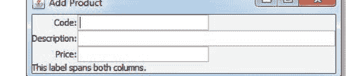

### 描述

- 你可以对多个组件复用 `GridBagConstraints` 对象。但是，你必须重置任何不想在下一个组件中使用的值。

图 22-4 如何在网格中布局组件

如果你不重置值，可能会无意中复用为上一个组件设置的值，这可能会导致奇怪的布局行为。因此，你需要确保重置所有值，或者为每个组件创建一个新的 `GridBagConstraints` 对象。

## 如何添加内边距

默认情况下，`GridBagConstraints` 对象在组件与组件之间或组件与容器边缘之间不提供任何内边距。这就是为什么上一个图中显示的组件之间没有任何内边距。这也是为什么组件与容器边缘之间没有内边距。

为了让这种布局在视觉上更有吸引力，你可以使用 `GridBagConstraints` 对象的 `insets`（内边距）字段来应用一些边距，如图 22-5 所示该图使用 `Insets` 来确定组件周围的边距量。在这里，`Insets` 对象的四个参数是顶部、左侧、底部和右侧填充。如果你将像素比作时钟，这些值是逆时针方向的，从时钟的顶部开始。

在该图中，`GridBagConstraints` 对象的 `insets` 字段被设置为一个 `Insets` 对象，指定组件顶部、左侧和右侧有 5 像素的边距，底部没有边距。由于此代码对容器中的所有组件使用相同的 `Insets`，因此布局中的标签紧贴容器的底部边缘。然而，其他组件之间被 5 像素的边距隔开。这种边距使得布局比上图中的布局更有吸引力。

在处理 `Insets` 对象时，有两重要的点需要记住。第一，与 `GridBagConstraints` 对象不同，你**可以**更改 `Insets` 对象的值并复用它。如果你这样做了，你的布局行为将会很奇怪。第二，如果你使用 5 像素的顶部间距和 5 像素的底部间距，那么组件之间的间距实际上是 10 像素。换句话说，布局在一个组件的底部使用了 5 像素的边距，在下一行组件的顶部使用了 5 像素的边距，总共 10 像素。

当然，左侧和右侧间距也是如此。例如，在该图中，标签左侧的第一个字母与窗口左边缘之间有少量的边距。同样，文本字段的右边缘与窗口右边缘之间也有有少量的边距。然而，标签结束处与文本字段开始处的边距是两倍。这就是为什么该区域使用了标签右侧的边距和文本框左侧的边距。

大多数时候，你只需要使用 `GridBagConstraints` 对象的 `insets` 字段来指定外部边距。然而，如果你需要指定内部边距，请使用图中所示的 `ipadx` 和 `ipady` 字段。这些字段决定了内边距如何放置在组件内部。例如，如果你将 `JButton` 组件的 `ipadx` 和 `ipady` 值设置为 10，则布局会在 `JButton` 组件的文本与按钮边缘之间显示 10 像素的内边距。

## GridBagConstraints 类的更多常用字段

| 字段 | 描述 |
| :--- | :--- |
| `insets` | 使用 `Insets` 对象来指定应该应用多少内边距。 |


| ipadx, ipady | 设置内部边距为 20 像素宽。 |

## Insets 类

| 构造函数 | 描述 |
| :--- | :--- |
| `Insets(top, left, bottom, right)` | 指定顶、左、底和右 |

为了创建一个 `Insets` 对象并将其添加到 `GridBagConstraints`：

```
GridBagConstraints c = new GridBagConstraints();
insets = new Insets(5, 5, 0, 5);
c.gridx = 0; c.gridy = 0; c.anchor = GridBagConstraints.LINE_END;
panel.add(new JLabel("Code:"), c);
c.gridx = 1; c.gridy = 0; c.anchor = GridBagConstraints.LINE_START;
panel.add(new JLabel("codeField:"), c);
```

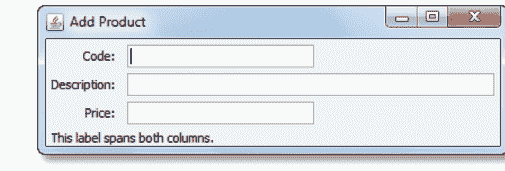

### 描述

- 如果忘记了 `Insets` 类的参数顺序，记住它们是逆时针方向会有帮助。

图 22-5 如何添加内边距

## 如何避免陷阱

基本上，如果容器不够宽以指定的大小显示组件，网格管理器将分配最小大小。默认情况下，组件的最小大小为 0。结果是这导致所有文本字段都塌陷。此图显示了 GUI 布局的一个常见陷阱。

解决这个问题的方法是在文本字段上使用 `setMinimumSize` 方法来设置首选和最小大小，如图所示。在这里，第一条语句创建了一个宽 100 像素、高 20 像素的 `Dimension` 对象。之后，第六条语句创建了一个宽度为 250、高度为 20 的 `Dimension` 对象。然后，接两条语句设置了文本字段的首选和最小大小。

如果你运行此代码并缩小窗口，文本字段不会塌陷。然而，标签开始塌陷，因为网格管理器试图赋予字段最小大小并保持在窗口内。如果你继续通过进一步缩小窗口增加压力，文本字段的边缘最终会消失在窗口之外。

由于标签开始塌陷，你可能会说我们解决了一个问题，却创建了另一个。在某种意义上，确实是这样。这表明网格管理器是复杂的，需要大量的调整才能让布局按预期运行。

对于产品管理器应用程序，用户不太可能需要调整窗口。因此，图中描述的解决方案可能是充分的。

解决此问题的另一种方法是使用户无法调用窗口的 `setResizable` 方法并传入 `false` 值。再次，对于产品管理器应用程序，这种解决方案是可以接受的。但是，你应该谨慎地使用这种技术，因为大多数用户期望能够调整窗口，特别是当这有助于适应显示器时。

# 第 22 章 如何使用 Swing 开发 GUI（部分 2） 585

## 水平缩放后常见的常见问题


## Dimension 类的构造函数

| 构造函数 | 描述 |
| :--- | :--- |
| `Dimension(width, height)` | 指定组件以像素为单位的宽度和高度。 |

## 你可以用来解决此问题的两种方法

| 方法 | 描述 |
| :--- | :--- |
| `setMinimumSize(Dimension)` | 指定组件以像素为单位的最小宽度和高度。 |
| `setPreferredSize(Dimension)` | 指定组件以像素为单位的首选宽度和高度。 |

## 设置首选和最大尺寸的代码

```
Dimension dim1 = new Dimension(100, 20);
codeField.setPreferredSize(dim1);
codeField.setMinimumSize(dim1);
priceField.setPreferredSize(dim1);
priceField.setMinimumSize(dim1);

Dimension dim2 = new Dimension(250, 20);
descriptionField.setPreferredSize(dim2);
descriptionField.setMinimumSize(dim2);
```

## 水平缩放后的改进示例

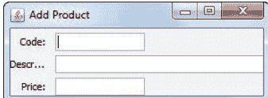

## 解决此问题的三种方法

- 1. 使用窗口的 `setResizable` 方法防止用户缩放窗口。然而，你应该谨慎地使用这种技术，因为用户通常需要能够缩放窗口。
- 2. 使用组件的 `setPreferredSize` 和 `setMinimumSize` 方法。这并不是一个完美的解决方案，但对于大多数应用程序来说是可以接受的。
- 3. 使用 `GridBagConstraints` 的 `weightx`、`weighty` 和 `fill` 字段来控制组件的缩放。这种技术可以产生最佳效果，但也需要最多的调整。

### 描述

- 当窗口被水平缩放时，组件（尤其是文本字段）有时会收缩到零大小。这是一个常见问题。

图 22-6 如何避免常见陷阱

## 如何编写数据输入表单

大多数应用程序都需要从用户那里获取输入。例如，应用程序通常需要用户编辑或更改存储在数据库中的数据。为了实现这一点，大多数应用程序使用一种称为“表单”（form）的特殊窗口。

通常，你想使用一种称为“对话框”（dialog 或 dialog box）的特殊窗口。在 Swing 中实现这一点，你可以使用 `JDialog` 组件。这允许你创建自定义对话框，其工作方式与 `JOptionPane` 类提供的内置对话框类似。

## 如何创建自定义对话框

图 22-7 开始显示最常用的 `JDialog` 构造函数之一。该构造函数接受三个参数。第一个参数指定对话框的所有者或父级。对话框的父级是应用程序主窗口的 `JFrame` 组件。

第二个参数指定对话框的标题。它的作用相当于为 `JFrame` 组件设置标题。

第三个参数决定对话框是否为模态（modal）。如果对话框是模态的，Java 将阻止用户在响应对话框之前与应用程序的任何部分进行交互。你应该谨慎使用模态对话框，因为如果不是必须，可能会打扰用户。根据一般原则，只有当应用程序在用户响应对话框之前无法继续当前操作时，才应该使用模态对话框。

示例创建了一个定义对话框的 `NameDialog` 类。该类继承自 `JDialog` 类。然后，它创建了一个名为 `nameField` 的 `JTextField` 组件。

`NameDialog` 类构造函数接受一个参数：父帧。在构造函数内部，第一条语句使用 `super` 关键字调用 `JDialog` 类的构造函数，并传递参数。

## 如何在对话框中设置数据

对话框类的构造函数，允许你设置数据。

```java
public NameDialog(java.awt.Frame parent, String name) {
    super(parent, "Name Dialog", true);
    this.setCloseOperation(WindowConstants.DISPOSE_ON_CLOSE);
    this.setLayout(new FlowLayout());

    dialogNameField = new JTextField();
    dialogNameField.setColumns(20);
    dialogNameField.setText(name);
}
```

调用构造器的 frame 代码：

```
new NameDialog(this, frameName.getText());
```

## Window 类的方法

| 方法 | 描述 |
| :--- | :--- |
| `getOwner()` | 返回对话框所有者或父级的 `Window` 对象。你通常会将此 `Window` 对象转换为更具体的类型。 |

## 如何从对话框获取数据

frame 类中对话框可以调用的方法：

```java
public void setName(String name) {
    JFrame frameName = (JFrame) getOwner();
    frameNameField.setText(name);
}
```

对话框中调用此方法的代码：

```java
okayButton.addActionListener((ActionEvent) -> {
    NameFrame frame = (NameFrame) getOwner();
    frame.setName(dialogNameField.getText());
    dispose();
});
```

### 说明

- 在对话框类中，你可以编写一个构造函数，允许主窗口在对话框中设置数据。
- 在主窗口类中，你可以编写一个方法，允许对话框将设置的数据返回给主窗口。
- 要关闭对话框，可以调用它的 `dispose()` 方法。这会关闭对话框对象并释放它正在使用的任何资源。

# 产品表单 (Product form)

本章通过展示产品表单的代码结束。该表单是上一节描述的 Product Manager 应用程序主窗口使用的数据输入表单。

### 用户界面

图 22-9 显示了数据输入表单的用户界面。首先，如果用户点击主窗口中的“添加”（Add）按钮，该表单的标题为“添加产品”（Add Product），其三个文本字段不显示任何编辑内容，并有一个“添加”按钮。然而，如果用户点击主窗口中的“编辑”（Edit）按钮，该表单的标题为“编辑产品”（Edit Product），在它的文本字段中显示选定的产品，并有一个“保存”（Save）按钮。

如果用户没有为产品输入有效数据，应用程序将使用 `JOptionPane` 类来构建一个内置对话框，要求用户输入有效数据。例如，在图中，最后一个对话框显示了如果用户留空其中一个文本字段的消息。然而，如果用户为产品价格输入了无效数字，此应用程序将显示不同的消息。

产品表单继承了 `JDialog` 类。因此，它是一个自定义对话框。在 Windows 上，对话框仅在右上角包含一个关闭按钮。换句话说，它不像 Product Manager 应用程序的主窗口那样有最小化、最大化或恢复按钮。然而，这是针对 Windows 操作系统的。这些按钮可能会根据操作系统而异。

产品表单使用了 `BorderLayout`（边界布局）。在该布局中，包含了两个面板（panel）。

第一个面板包含三个标签及其对应的文本字段。该面板使用 `GridBagLayout` 布局管理器来布局这些标签和文本字段。然后，该面板被添加到边界布局的中心。结果是它获取了所有未被其他组件占用的可用空间。

第二个面板使用右对齐的 `FlowLayout`（流式布局）管理器。该面板放置了表单的两个按钮。然后，该面板被添加到边界布局的南部（south）。结果是该面板获得了其偏好高度，且宽度扩展以占据容器的整个水平空间。在这种情况下，这意味着面板的高度恰好容纳按钮，而面板的宽度是整个窗口的宽度。

# 添加产品对话框

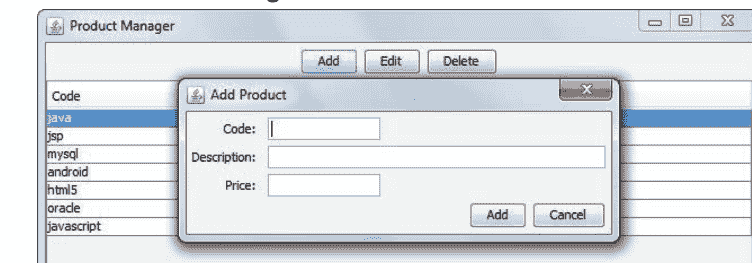

# 编辑产品对话框

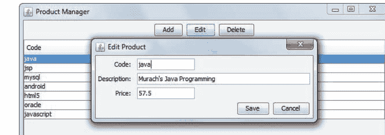

# 数据验证对话框之一

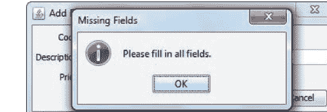

### 说明

字体 Product Manager 使用同一个对话框来添加新产品或编辑现有产品。外观上的唯一区别是对话框的标题以及第一个按钮上显示的文本。

- 当你添加或编辑产品时，如果产品字段缺失或无效，产品表单将使用内置对话框显示验证消息。

图 22-9 产品表单的用户界面

# ProductForm 类

图 22-10 显示了 `ProductForm` 类的代码。首先，该类扩展了 `JDialog` 类。这是创建自定义对话框的常用方法。

在类中，前五个语句创建了引用表单组件的实例变量。前三个是持有产品代码、描述和价格的 `JTextField` 组件。接下来两个是 `JButton` 组件。第一个按钮确认向数据库添加新产品或更新现有产品的操作。第二个按钮取消对话框。

该类定义了两个构造函数。在这里，第一个构造函数显示“添加”表单以添加新产品。第二个构造函数显示现有产品。

第一个构造函数接受三个参数：(1) 父帧，(2) 标题以及 (3) 对话框是否为模态。在构造函数中，第一个语句将这些参数传递给父类。然后，第二个语句调用 `initComponents()`。

第二个构造函数接受第四个参数：一个 `Product` 对象。在此构造函数中，第一个语句将 `product` 变量设置为该参数。之后，该构造函数将三个字段设置为存储在 `Product` 对象中的值。

`initComponents` 方法包含了大部分设置代码。该方法首先创建开头声明的实例。接下来，代码设置对话框的默认操作为 `DISPOSE_ON_CLOSE`。结果是，当用户点击关闭按钮时，Java 会销毁对话框。

接下来两行代码创建了 `Dimension` 对象，并分别将它们的宽度设置为 100 像素和 300 像素，两者的高度均为 20 像素。然后，代码将代码字段和价格文本字段的首选大小和最小尺寸设置为较短的 `Dimension` 对象。它还将描述文本字段的首选大小和最小尺寸设置为较大的 `Dimension` 对象。在这两种情况下，它都避免了本章早些描述的陷阱，即当用户调整大小时，文本字段的宽度会塌陷为零。

`initComponents` 方法的下一个部分创建了两个按钮。然后，它将第一个按钮的文本设置为“取消”（Cancel），并为其添加了一个动作监听器，调用名为 `cancelButtonActionPerformed` 的方法，该方法在类中稍后显示。然后，它将第二个按钮的文本设置为“添加”（Add），并为其添加了一个动作监听器，调用名为 `confirmButtonActionPerformed` 的方法。然而，如果用户正在编辑现有产品而不是添加新产品，正如前一页讨论，`setText` 方法会被构造函数中的 `setMethod` 调用重写。

下一部分创建一个新的 `JPanel` 来设置文本字段及其相应的标签。首先，这段代码将面板的布局管理器设置为 `GridBagLayout`。然后，它为面板添加了文本字段和标签。为了方便使用 `GridBagConstraints` 对象，对面板方法的调用使用了一个名为 `getConstraints` 的辅助方法，该方法在类中稍后显示。此方法接受三个参数：一个 x 坐标、网格列的 y 坐标以及一个锚点值（anchor value）。

下一部分创建另一个 `JPanel`，使用带有右对齐的 `FlowLayout` 管理器。然后，它将确认和取消按钮添加到布局中。

最后一部分将包含标签和文本字段的面板添加到对话框 `BorderLayout` 布局器的中心区域。然后，将包含按钮的面板添加到对话框 `BorderLayout` 布局器的南部（south）。与 `JFrame` 组件一样，`JDialog` 默认使用 `BorderLayout`。因此，没有必要显式设置布局。最后，最后一个语句使用 `pack` 方法通过对齐组件来调整对话框的大小，使其足以容纳所有组件。

请注意，这段代码设置了此表单在主窗口中间的位置。因此，Product Manager 应用程序的主框架可能会这样显示“添加产品”表单：

```
ProductForm productForm = new ProductForm(this, "Add Product", true);
productForm.setVisible(true);
```

这会在主窗口中显示此表单的模态版本。

`getConstraints` 方法创建并返回一个带有指定参数的 `GridBagConstraints` 对象。该方法首先创建一个 `GridBagConstraints` 对象。然后，它将 `insets` 字段设置为一个新的 `Insets` 对象，该对象的顶部、左侧和右侧有五个像素的间距，但底部没有间距。接下来，它将 `GridBagConstraints` 对象的 `gridx`、`gridy` 和 `anchor` 字段设置为相应的参数。最后，返回该 `GridBagConstraints` 对象。

## ProductForm 类（继续）

```
Dimension shortField = new Dimension(100, 20);
Dimension longField = new Dimension(300, 20);
codeField.setPreferredSize(shortField);
codeField.setMinimumSize(shortField);
priceField.setMinimumSize(shortField);
descriptionField.setPreferredSize(longField);
descriptionField.setMinimumSize(longField);
```

```
cancelButton.setText("Cancel");
cancelButton.addActionListener((ActionEvent) -> {
    cancelButtonActionPerformed();
});
```

```
confirmButton.setText("Add");
confirmButton.addActionListener((ActionEvent) -> {
    confirmButtonActionPerformed();
});
```


接下来两行代码创建了 `Dimension` 对象，并分别将它们的宽度设置为 100 像素和 300 像素，两者的高度均为 20 像素。然后，代码将代码字段和价格文本字段的首选大小和最小尺寸设置为较短的 `Dimension` 对象。它还将描述文本字段的首选大小和最小尺寸设置为较大的 `Dimension` 对象。在这两种情况下，它都避免了本章早些时候描述的陷阱，即当用户调整大小时，文本字段的宽度会塌陷为零。

`initComponents` 方法的下一个部分创建了两个按钮。然后，它将第一个按钮的文本设置为“取消”（Cancel），并为其添加了一个动作监听器，调用名为 `cancelButtonActionPerformed()` 的方法，该方法在类中稍后显示。然后，它将第二个按钮的文本设置为“添加”（Add），并为其添加了一个动作监听器，调用名为 `confirmButtonActionPerformed()` 的方法。然而，如果用户正在编辑现有产品而不是添加新产品，正如前一页讨论，`setText()` 方法会被构造函数中的 `setMethod()` 调用重写。

下一部分创建一个新的 `JPanel` 来设置文本字段及其相应的标签。首先，这段代码将面板的布局管理器设置为 `GridBagLayout`。然后，它为面板添加了文本字段和标签。为了方便使用 `GridBagConstraints` 对象，对面板方法的调用使用了一个名为 `getConstraints()` 的辅助方法，该方法在类中稍后显示。此方法接受三个参数：一个 x 坐标、网格列的 y 坐标以及一个锚点值。

下一部分创建另一个 `JPanel`，使用带有右对齐的 `FlowLayout`。然后，它将确认和取消按钮添加到布局中。

最后一部分将包含标签和文本字段的面板添加到对话框 `BorderLayout` 布局器的中心区域。然后，将包含按钮的面板添加到对话框 `BorderLayout` 布局器的南部。与 `JFrame` 组件一样，`JDialog` 默认使用 `BorderLayout`。因此，没有必要显式设置布局。最后，最后一个语句使用 `pack()` 方法通过对齐组件来调整对话框的大小，使其足以容纳所有组件。

请注意，这段代码设置了此表单在主窗口中间的位置。因此，Product Manager 应用程序的主框架可能会这样显示“添加产品”表单：

```java
ProductForm productForm = new ProductForm(this, "Add Product", true);
productForm.setVisible(true);
```

这会在主窗口中显示此表单的模态版本。

`getConstraints()` 方法创建并返回一个带有指定参数的 `GridBagConstraints` 对象。该方法首先创建一个 `GridBagConstraints` 对象。然后，它将 `insets` 字段设置为一个新的 `Insets` 对象，该对象的顶部、左侧和右侧有五个像素的间距，但底部没有间距。接下来，它将 `GridBagConstraints` 对象的 `gridx`、`gridy` 和 `anchor` 字段设置为相应的参数。最后，返回该 `GridBagConstraints` 对象。

## ProductForm 类（继续）

```java
Dimension shortField = new Dimension(100, 20);
Dimension longField = new Dimension(300, 20);

codeField.setPreferredSize(shortField);
codeField.setMinimumSize(shortField);
priceField.setMinimumSize(shortField);
descriptionField.setPreferredSize(longField);
descriptionField.setMinimumSize(longField);
```

```java
cancelButton.setText("Cancel");
cancelButton.addActionListener((ActionEvent) -> {
    cancelButtonActionPerformed();
});
```

```java
confirmButton.setText("Add");
confirmButton.addActionListener((ActionEvent) -> {
    confirmButtonActionPerformed();
});
```

```java
// JLabel 和 JTextField 面板
JPanel productPanel = new JPanel();
productPanel.setLayout(new GridBagLayout());
productPanel.add(new JLabel("Code:"), getConstraints(0, 0, GridBagConstraints.LINE_END));
productPanel.add(codeField, getConstraints(0, 0, GridBagConstraints.LINE_END));
productPanel.add(new JLabel("Description:"), getConstraints(0, 1, GridBagConstraints.LINE_END));
productPanel.add(descriptionField, getConstraints(0, 1, GridBagConstraints.LINE_END));
productPanel.add(new JLabel("Price:"), getConstraints(0, 2, GridBagConstraints.LINE_END));
productPanel.add(priceField, getConstraints(0, 2, GridBagConstraints.LINE_END));
```

# ProductForm 类（续）

```java
private void cancelButtonActionPerformed() {
    dispose();
}
```

```java
private void confirmButtonActionPerformed() {
    if (validateData()) {
        setData();
    }
}
```


### 第 22 章 如何使用 Swing 开发 GUI（部分 2）

#### 可能导致 GUI 无响应的代码

```java
private void doPrintButton() {
    printProductList();    // 此方法可能运行很长时间。
    JOptionPane.showMessageDialog(ProductManager.this,
        "Product list has been printed."); // 此代码更新了 GUI。
}
```

#### 保持 GUI 响应但不在此更新 GUI 的代码

```java
private void doPrintButton() {
    Thread printThread = new Thread() {
        // 此方法运行在后台线程上（而不是 EDT）。
        // 结果是，GUI 保持响应状态。
        // 然而，从此线程更新 GUI 是不安全的。
        @Override
        public void run() {
            printProductList();    // 此方法可能运行很长时间。
            JOptionPane.showMessageDialog(ProductManager.this,
                "Product list has been printed.");    // 不安全！
        }
    };
    printThread.start();
}
```

#### 既能保持 GUI 响应又能更新 GUI 的代码

```java
private void doPrintButton() {
    SwingWorker worker = new SwingWorker() {
        // 此方法运行在后台线程上（而不是 EDT）
        // 结果是，GUI 保持响应状态。
        @Override
        protected Object doInBackground() throws Exception {
            printProductList();    // 此方法可能运行很长时间。
            return null;
        }

        @Override
        // 此方法在后台线程完成后在 EDT 上运行。
        // 结果是，从此方法更新 GUI 是安全的。
        protected void done() {
            JOptionPane.showMessageDialog(ProductManager.this,
                "Product list has been printed.");    // 安全！
        }
    };
    worker.execute();
}
```

#### ProductForm 类片段

```java
if (confirmButton.getText().equals("Add")) {
    doAdd();
} else {
    doEdit();
}
```

```java
private boolean validateData() {
    String code = codeField.getText();
    String name = descriptionField.getText();
    String priceString = priceField.getText();
    double price;

    if (code == null || name == null || priceString == null ||
        code.isEmpty() || name.isEmpty() || priceString.isEmpty()) {
        JOptionPane.showMessageDialog(this, "please fill in all fields.",
            JOptionPane.INFORMATION_MESSAGE);
        return false;
    } else {
        try {
            price = Double.parseDouble(priceString);
        } catch (NumberFormatException e) {
            JOptionPane.showMessageDialog(this,
                "The data entered in the price field is invalid",
                "Invalid Price.",
                JOptionPane.INFORMATION_MESSAGE);
            priceField.requestFocusWindow();
            return false;
        }
    }
    return true;
}
```

```java
private void setData() {
    String code = codeField.getText();
    String name = descriptionField.getText();
    String priceString = priceField.getText();
    double price = Double.parseDouble(priceString);

    product.setCode(code);
    product.setDescription(name);
    product.setPrice(price);
}
```

> 图 22-10 ProductForm 类（4 部分中的第 3 部分）

接下来两个方法 `doEdit()` 和 `doAdd()` 几乎相同，除了 `doEdit()` 方法调用了 `ProductDB` 类的 `update()` 方法，而 `doAdd()` 方法调用了 `ProductDB` 类的 `add()` 方法。然后，这两个方法都会调用 `dispose()` 方法来关闭对话框并释放其资源。接着，它们调用 `fireDatabaseUpdatedEvent()` 方法。

`fireDatabaseUpdatedEvent()` 通知窗口数据库中已添加新记录或现有记录已更新。反过来，主窗口通知表格模型（table model）需要更新表格数据，以反映对数据库所做的更改，如上一章所示。为了做到这一点，代码首先通过调用 `getOwner()` 方法获取对话框父窗口的引用。然而，此方法返回的是一个 `Window` 对象。因此，这段代码必须将其强制转换为 `ProductManagerFrame` 类型后才能调用其 `fireDatabaseUpdatedEvent()` 方法。

#### ProductForm 类（续）

```java
private void doEdit() {
    try {
        ProductDB.update(product);
        dispose();
        fireDatabaseUpdatedEvent();
    } catch (DBException e) {
        System.out.println(e);
    }
}
```

```java
private void doAdd() {
    try {
        ProductDB.add(product);
        dispose();
        fireDatabaseUpdatedEvent();
    } catch (DBException e) {
        System.out.println(e);
    }
}
```

```java
private void fireDatabaseUpdatedEvent() {
    ProductManagerFrame mainWindow = (ProductManagerFrame) getOwner();
    mainWindow.fireDatabaseUpdatedEvent();
}
```

> 图 22-10 ProductForm 类（4 部分中的第 4 部分）

#### 使用 ProductForm 类的两个方法

图 22-11 显示了 `ProductManagerFrame` 类中使用 `ProductForm` 类的两个方法。这些方法在上一章中还没有实现，但现在你可以看到它们是如何工作的。简而言之，它们包含了当用户点击 Product Manager 应用程序窗口中的“添加”（Add）或“编辑”（Edit）按钮时执行的代码。

“添加”按钮的代码开始创建一个模态的“添加产品”（Add Product）对话框。它尝试设置对话框的位置，使其相对于当前窗口。在 Windows 上，它会将对话框居于当前窗口中央。然而，这是特定平台的特性，某些操作系统可能会完全忽略此方法。

在尝试设置对话框位置后，这段代码使用 `setVisible()` 方法向用户显示该对话框。因此，这段代码显示了一个与本章早些时候所示“添加产品”对话框。

“编辑”按钮的代码首先从产品表格中获取选中行的索引。如果索引为 -1，这段代码将使用 `JOptionPane` 类显示一个包含消息的对话框，指示未选择任何产品。否则，这段代码将获取一个与表格中所选行对应的 `Product` 对象。

获取 `Product` 对象后，这段代码创建一个模态的“编辑产品”（Edit Product）对话框，并将此 `Product` 对象传递给对话框。这允许对话框显示选中产品的数据。然后，它尝试设置对话框相对于 Product Manager 窗口的位置。最后，它向用户显示该对话框。因此，这段代码显示了一个与本章早些时候所示“编辑产品”对话框。

```java
private void doAddButton() {
    ProductForm productForm = new ProductForm(this, "Add Product", true);
    productForm.setLocationRelativeTo(this);
    productForm.setVisible(true);
}
```

```java
private void doEditRow() {
    int selectedRow = productTable.getSelectedRow();
    if (selectedRow == -1) {
        JOptionPane.showMessageDialog(this,
            "No product is selected.",
            "No product selected",
            JOptionPane.ERROR_MESSAGE);
    } else {
        Product product = productTableModel.getProduct(selectedRow);
        ProductForm productForm = new ProductForm(this, "Edit Product", true);
        productForm.setLocationRelativeTo(this);
        productForm.setVisible(true);
    }
}
```

> 图 22-11 使用 ProductForm 类的两个方法

#### 在 Swing 中使用线程

到目前，你应该已经了解如何编写像 Product Manager 这样的应用程序。然而，如果你需要响应 GUI 执行耗时操作，可能会遇到类似于 12-2 中的问题。

##### 常见问题

第一个代码示例调用了一个可能需要很长时间才能完成的方法。该方法是在用户点击 GUI 按钮时调用的，运行在一个特殊的线程上，即事件分发线程（`EDT`）。所有事件的操作都运行在 `EDT` 上，它无法处理其他事件或重绘屏幕。此外，当需要重绘时（例如调整大小或最小化后恢复时），显示可能会损坏。

起初，你可能会通过使用第二个代码示例中的技术在新线程上运行 `printPropertyList()` 方法来解决这个问题。遗憾的是，在 `EDT` 之外执行任何 GUI 操作是不安全的，因此这段代码会导致一个新问题，即 `JOptionPane` 对话框运行在新线程上而不是 `EDT` 上，这可能导致显示异常。

##### 如何解决问题

解决方案是在另一个线程上运行 `printPropertyList()` 方法，但在 `EDT` 上执行 GUI 更新。幸运的是，Swing 提供了 `SwingWorker` 类来实现此功能。

图中最后一个代码示例使用 `SwingWorker` 类来解决这个问题。开始时，这段代码通过内部类创建一个 `SwingWorker` 对象。在内部类中，代码重写了 `doInBackground()` 方法并调用了 `printPropertyList()` 方法。该方法返回一个对象，此示例不需要这样做，所以它返回 `null`。

内部类还包含一个在 `doInBackground()` 完成后调用的 `done()` 方法。`done()` 方法运行在 `EDT` 上。因此，你可以安全地从该方法更新 GUI。


# Swing 线程与事件分发线程

- 任何在 Swing 事件中运行的代码都运行在一个名为事件分发线程或 EDT 的特殊线程上。所有更新 GUI 的代码都应该在该线程上运行。
- 如果你在 EDT 上运行耗时较长的任务，GUI 将变得无响应。
- 如果你使用第 18 章所示的技巧启动新线程，GUI 将保持响应状态。然而，你无法从这个新线程安全地更新 GUI。
- 为了在运行耗时任务时保持 GUI 响应，并在任务完成后能够更新 GUI，请使用 `SwingWorker` 类。

图 22-12 如何在 Swing 中使用线程

# 观点

在本章中，你学习了完成 Product Manager 应用程序所需的所有技能。你学习了如何使用 `JLabel` 和 `JTextField` 类为数据输入表单创建标签和文本框。你学习了如何使用 `GridBagLayout` 布局管理器来创建看起来专业的表单。你学习了如何使用 `JDialog` 类创建模态数据输入表单。你还学习了如何在应用程序的两个窗口之间传递数据。

关于 Swing 还有很多内容需要学习。例如，你可能想学习其他类型的控件，如复选框、单选按钮、组合框和列表。你可能想学习如何在 Swing 中显示照片或其他图表。你可能想学习其他布局管理器。你可能想学习更多关于使用 `SwingWorker` 类在 Swing 中创建线程的知识。或者，你可能想学习如何使用 IDE 提供的 GUI 构建工具。无论你决定学习什么，最后两章介绍的技能都是你可以在此构建的坚实基础。

### 总结

- 你可以使用 `JLabel` 类创建标签，用于标记表单上的其他组件。
- 你可以使用 `JTextField` 类创建文本字段（也称为文本框），允许用户输入数据。
- 你可以使用 `GridBagLayout` 布局管理器创建专业的表单布局，以在网格中摆布局组件。该类有两个辅助类：`GridBagConstraints` 和 `Insets`。
- 你可以使用 `JDialog` 类创建一个位于其父窗口之上的对话框。
- 对话框可以是模态的，它可以防止用户在对对话框做出响应之前与应用程序的任何其他部分进行交互。然而，只有当应用程序需要等待用户响应才能完成操作时才使用模态对话框。
- 任何响应 Swing 事件运行的代码都运行在一个名为事件分发线程或 EDT 的特殊线程上。
- 为了防止 GUI 在长时间运行的任务期间变得无响应，同时在 EDT 上安全地进行 Swing GUI 更新，你可以使用 `SwingWorker` 类。

# 练习 22-1 创建一个新的 GUI

在本次练习中，你将创建一个 GUI 应用程序，根据矩形的长度和宽度计算矩形的面积和周长。完成后，你的应用程序应该看起来所示：

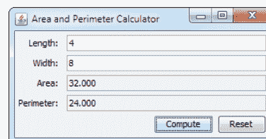

## 检查应用程序的现有代码

1. 导入位于 `ex_starts` 文件夹中名为 `ch22_ex1_AreaAndPerimeter_start` 的项目。
2. 打开 `murach.business` 包中的 `Rectangle` 类并查看其字段和方法。
3. 打开 `AreaAndPerimeterFrame` 类并检查现有代码。注意：
    * 此类继承自 `JFrame` 类。
    * 此类有一个构造函数，用于设置框架并调用 `initComponents` 方法。
    * 此类包含若干个尚未实现的方法，如 `initComponents` 方法。
    * 此类包含一个已实现的 `getConstraints` 方法。
4. 打开 `Main` 类并注意它创建了 `AreaAndPerimeterFrame` 的实例。
5. 运行应用程序。这应该显示一个不包含任何组件的框架。然后，调整框架的大小以便看到其标题。

## 向框架中添加组件

6. 为四个文本框和两个按钮添加实例变量。
7. 在 `initComponents` 方法中添加代码来初始化框架及其组件。此方法应该：
    - 创建四个文本框。
    - 为所有四个字段设置最小和首选尺寸。
    - 创建一个使用 `GridLayout` 管理器的面板。然后，将四个标签和文本框添加到此面板。最后，将此面板添加到框架的中心。
    - 创建一个使用右对齐 `FlowLayout` 的面板。然后，将两个按钮添加到此面板。最后，将此面板添加到框架的底部。
    - 封装框架以设置其大小。
8. 运行应用程序。这应该显示一个与上方类似的框架。然而，如果你点击其中一个按钮，它不执行任何操作。

## 处理用户点击按钮时发生的事件

9. 为两个按钮都添加动作监听器。这些监听器应该调用 `computeButtonClicked` 和 `resetButtonClicked` 方法。
10. 实现 `computeButtonClicked` 方法。此方法应该获取用户在长度和宽度文本框中输入的文本，并尝试将这些文本转换为 double 值。
    - 如果用户输入无效的长度或宽度，此方法应使用对话框显示友好的错误消息。然后，用户可以再次尝试。
    - 如果用户输入了有效的长度和宽度，此方法应该计算面积和周长并设置文本框。为了做到这一点，你可以使用 `Rectangle` 类。
11. 实现 `resetButtonClicked` 方法。此方法应该将所有四个文本框置为空字符串。

# 附录 A 为本书设置 Windows 环境

## 如何安装 JDK

图 A-1 显示了如何安装 Java 8 的开发工具包 (JDK)。书中的代码已针对 Java 8 通过测试。然而，Java 是向后兼容的。因此，书中的代码在后续版本的 Java 中应该同样运行良好。

### JDK 下载地址

```
http://www.oracle.com/technetwork/java/javase/downloads
```

### 步骤

1. 前往 Java SE 下载页面。如有必要，您可以在互联网上搜索此页面。
2. 点击 Java 下载按钮。该按钮下方应该有一个类似于 Java Platform (JDK) 8u45 的标签。
3. 按照说明下载适用于您操作系统的安装程序。
4. 将安装程序保存到硬盘上。
5. 双击安装程序进行运行。
6. 对弹出的对话框进行响应。当提示选择 JDK 文件夹时，请使用默认文件夹。

### Java 8 更新 45 的默认 JDK 文件夹

```
C:\Program Files\Java\jdk1.8_0_45
```

### 注意事项

- 有关关于安装 JDK 的更多信息，可以参考 Oracle 网站。

## 如何安装 Eclipse

图 A-2 显示了如何下载和安装该 IDE。与大多数程序不同，Eclipse 不使用安装程序。因此，您可以通过解压其 zip 压缩包到硬盘上的任何任意位置来安装 Eclipse。一旦您解压了 Eclipse 的压缩包，我们建议将 `eclipse.exe` 文件固定到任务栏。这样可以轻松启动 Eclipse。

在安装 Eclipse 时，请确保 Eclipse 的版本与 JDK 的版本匹配。这非常重要，因为 64 位的 Eclipse 无法与 32 位的 JDK 工作，而 32 位的 Eclipse 也无法与 64 位的 JDK 工作。

### Eclipse 下载地址

```
http://www.eclipse.org
```

### 步骤

1. 前往 Eclipse 下载页面。如有必要，您可以在互联网上搜索此页面。
2. 找到“Eclipse IDE for Java Developers”下载。
3. 下载适用于您的 Windows 版本的 zip 文件。此版本必须与您在上一幅图中下载的 JDK 版本匹配。例如，如果您使用的是 64 位的 JDK，则你必须使用 64 位的 Eclipse。
4. 下载完成后，将 zip 文件移动到硬盘上的合适位置并解压。
5. 导航到包含 `eclipse.exe` 文件的 eclipse 文件夹。
6. 将 `eclipse.exe` 文件固定到任务栏。执行此操作请右键点击 `eclipse.exe` 文件并选择“固定到任务栏”命令。

### 注意事项

- 有关关于安装 Eclipse 的更多信息，可以参考 Eclipse 网站。
- 如果您在尝试启动 Eclipse 时遇到指示 Java 启动失败的错误，可能是存在 32 位与 64 位的不匹配。您可能可以通过卸载除上一幅图中安装的 之外的所有 JDK 版本来解决此问题。


## 如何安装本书的源代码

图 A-3 显示了如何下载和安装本书的源代码。这包括书中介绍的应用程序源代码，以及每章末练习题的起点和解决方案。完成此步骤后，您就可以复习书中介绍的应用并完成练习。

### Murach 网站

www.murach.com

### 应用程序和练习题的文件夹

```
C:\murach\java_eclipse\book_apps
C:\murach\java_eclipse\ex_starts
C:\murach\java_eclipse\ex_solutions
```


## 步骤

1. 访问 `www.murach.com`。
2. 找到 Murach's Beginning Java 页面。
3. 如必要，滚动到 FREE Downloads 标签。
4. 点击 FREE Downloads 标签。
5. 点击 exe 文件的下载按钮，并对生成的页面和对话框进行响应。这将下载文件 `bjwe_allfiles.exe` 到硬盘。
6. 使用 Windows 资源管理器在 C 盘找到该 exe。
7. 双击此文件并对后续对话框进行响应。这将文件安装到位于 `C:\murach\java_eclipse` 的文件夹中。

## 使用 zip 文件代替自解压缩包

虽然我们建议按照上述说明使用自解压缩包 (`bjwe_allfiles.exe`) 来安装下载的文件，但某些系统不允许运行自解压缩包。在这种情况下，您可以从我们的网站下载普通的 zip 文件 (`bjwe_allfiles.zip`)。然后，您可以将该压缩包存储的文件解压到 `C:\murach` 文件夹中。如果 `C:\murach` 文件夹不存在，您需要创建它。

## 其他注意事项

- 有关关于安装 JDK 的更多信息，可以参考 Oracle 网站。
- 如果您在尝试启动 Eclipse 时遇到指示 Java 启动失败的错误，可能是存在 32 位与 64 位的不匹配。您可能可以通过卸载除上一幅图中安装的之外的所有 JDK 版本来解决此问题。

# 如何为本书创建数据库

如果应用程序使用了数据库，你必须在应用程序结束之前创建数据库，否则它无法正常工作。例如，本书末尾的应用程序使用了一个数据库名称。创建此数据库最简单的方法是使用 MySQL Workbench 运行图 A-5 所示的 SQL 脚本。如果你按照本附录前面的说明下载了本书的源代码，那么该脚本应该位于此图所示的文件夹中。

要确定 SQL 脚本是否运行成功，你可以查看“输出”（Output）窗口中的结果。例如，在图中，“输出”窗口显示了一系列已成功执行的语句。此外，“导航器”（Navigator）窗口显示数据库名称已创建。

如果脚本遇到问题，MySQL Workbench 会在“输出”窗口中显示一个或多个错误。这时，你可以读取这些错误以找出脚本没有正常执行的原因。

在运行 `create_database.sql` 脚本之前，数据库服务器必须正在运行。在大多数系统上安装 MySQL 时，MySQL 数据库服务器会在你启动计算机时自动启动，这通常是你所想要的。但是，如果它没有在你的系统上运行，你可以使用 MySQL Workbench 的“服务器管理”（Server Administration）选项卡来启动它。执行此操作，点击“启动/停止”（Startup / Shutdown）项目，并使用生成的屏幕启动服务器。或者，如果你的系统上可用 SQL Notifier，你也可以用它来启动 MySQL 服务器。

# 如何恢复本书的数据库

在操作书中介绍的应用程序时，你可能会对数据库或其表进行无意之外的更改。在这种情况下，你可能希望将数据库恢复到原始状态，以便你的运行结果与书中显示的结果一致。要做到这一点，你可以再次运行 `create_database.sql` 文件。这将删除此图所示的数据库并重新创建它。

# 创建数据库的脚本

`C:\murach\java\eclipse\db\create_database.sql`

# 执行 `create_database.sql` 文件后的 MySQL Workbench

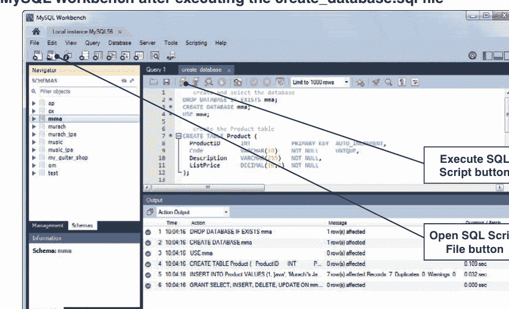

# 如何创建数据库

1. 启动 MySQL Workbench。
2. 以 root 用户身份连接到本地计算机上运行的 MySQL 实例。执行此操作，双击名为“Local instance MySQL6”的存储连接，并在提示时输入 root 用户的密码。
3. 点击编辑器工具栏中的“打开 SQL 脚本”（Open SQL Script）按钮打开脚本文件。然后使用生成的对话框找到并打开 `create_database.sql` sql 文件。当你打开时，MySQL Workbench 会在代码编辑器工具栏中显示此脚本。
4. 点击代码编辑器工具栏中的“执行 SQL”（Execute SQL）按钮执行脚本。执行完毕后，“输出”窗口将显示指示脚本是否执行成功的消息。

# 如何恢复数据库

- 再次运行 `create_database.sql` 脚本以删除数据库并重新创建它。

### 描述

- 要运行 `create_database.sql` 文件，数据库服务器必须正在运行。默认情况下，数据库服务器会在你启动计算机时自动启动。如果它没有在你的系统上运行，你可以使用 Notifier 来启动它。

图 A-5 如何为本书创建和恢复数据库

# 附录 B

# 如何为本书设置 Mac OS X

附录展示了如何安装和配置我们推荐在 Mac OS 系统上开发 Java 应用程序的软件。对于本书的前 18 章，你只需要安装 Java 开发工具包 (JDK)、Eclipse IDE 以及本书的源代码。然而，对于本书的最后四章，你需要安装 MySQL 和 MySQL Workbench，并为本书创建数据库。

在阅读此附录时，请记住某些网站是在不断更新的。因此，附录中的某些步骤可能自本书出版以来已经发生了变化。尽管如此，这些步骤仍然应该是安装软件的良好指南。如果发生了重大变化，我们将在我们的网站 (`www.murach.com`) 上发布更新。

| 主题 | 页码 |
| :--- | :--- |
| 如何安装 JDK | 620 |
| 如何安装 Eclipse | 622 |
| 如何安装本书的源代码 | 624 |
| 如何安装 MySQL 社区版 | 626 |
| 如何安装 MySQL Workbench | 628 |
| 如何为本书创建数据库 | 630 |
| 如何恢复数据库 | 630 |
| 如何更新 root 用户的密码 | 632 |

# 如何安装 JDK

图 B-1 展示了如何为 Java 8 安装 Java 开发工具包 (JDK)。书中的代码已针对 Java 8 进行过测试。然而，Java 是向后兼容的。因此，本书中的代码在较新版本的 Java 中也应该同样良好地运行。

# JDK 的下载 URL

`http://www.oracle.com/technetwork/java/javase/downloads`

# 步骤

1. 转到 Java SE 下载页面。如有必要，你可以在互联网上搜索此页面。
2. 点击 Java 的下载按钮。该按钮下方应该有一个诸如 Java Platform (JDK) 8u45 的标签。
3. 按照指令下载适用于你操作系统的安装程序。
4. 将安装程序保存到你的硬盘上。
5. 双击安装程序以运行。
6. 当提示输入 JDK 路径时，使用默认文件夹。

```
/Library/Java/VirtualMachines/jdk1.8_45
```

> **注意**
>
> - 关于安装程序，可以参考 Oracle 网站。

# 如何安装 Eclipse

图 B-2 展示了如何下载并安装 IDE。与大多数程序不同，Eclipse 不使用安装程序。因此，你可以通过解压 tar.gz 文件在硬盘上的任何位置安装 Eclipse。

安装 Eclipse 时，请确保 Eclipse 版本与 JDK 版本匹配。这很重要，因为 64 位的 Eclipse 无法与 32 位的 JDK 工作。

# Eclipse 的下载 URL

`http://www.eclipse.org`

# 步骤

1. 转到 Eclipse 下载页面。如有必要，你可以在互联网上搜索此页面。
2. 找到“Eclipse IDE for Developers”下载。
3. 下载适用于你操作系统的 tar.gz 文件。此版本必须与图中下载的 JDK 版本匹配。例如，如果你使用的是 64 位 JDK，则必须使用 64 位的 Eclipse。
4. 下载完成后，使用 Finder 将 tar.gz 文件找到到硬盘上的合适位置。然后，双击 tar.gz 文件进行解压。这将创建一个名为 `eclipse` 的文件夹，其中包含 Eclipse 程序。
5. 将 Eclipse 程序添加到 Dock。执行此操作，使用 Finder 将 `eclipse` 文件夹中的 Eclipse 图标拖到 Dock。

> **注意**
>
> - 关于安装 Eclipse 的更多信息，可以参考 Eclipse 网站。
> - 如果尝试启动 Eclipse 时出现 Java 无法启动的错误，可能是 32 位/64 位不匹配。你可以通过卸载除图中安装的版本之外的所有 JDK 版本来解决此问题。

# 如何安装本书的源代码

图 B-3 展示了如何下载和安装本书的源代码。这包括书中介绍的应用程序源代码，以及每章末尾练习题的起点和解决方案的源代码。

当你完成此步骤后，书籍应用程序、练习起点和练习解决方案应位于此图所示的文件夹中。然后你就可以复习书中介绍的应用程序，并准备好完成书中的练习了。

# Murach 网站

`www.murach.com`

# /java_eclipse/book_apps 和练习题的文件夹

```
/murach/java_eclipse/book_apps
/murach/java_eclipse/ex_starts
/murach/java_eclipse/ex_exercises
```


# 步骤

1. 访问 www.murach.com。
2. 找到《Java入门 Java》（Murach's Beginning Java with Eclipse）页面。
3. 如必要，向下滚动到 FREE Downloads（免费下载）标签页。
4. 点击 FREE Downloads 标签页。
5. 点击 文件的 Download Now（立即下载）按钮，并根据出的页面和对话框进行操作。这将名为 `bjwe_allfiles.zip` 的 zip 文件下载到你的硬盘。
6. 使用 Finder 在硬盘上找到该 zip 文件，并双击它进行解压。这将创建 `java_eclipse` 文件夹及其子文件夹。
7. 如必要，使用 Finder 直接在你的硬盘上创建 `murach` 文件夹。
8. 使用 Finder 将 `java_eclipse` 文件夹移动到 `murach` 文件夹中。

# 关于右键点击的说明

- 本书指示你右键点击，是因为这在 Windows 中很常见。在 Mac 上，默认未启用右键点击。不过，你可以通过编辑鼠标偏好设置来启用右键点击。

# 关于其他 JDK 版本的说明

- 此源代码应适用于 JDK 1.8 (Java 8) 或更高版本。
- 如果你使用的是较旧版本的 JDK，仍然可以查看源代码，但你可能需要更改项目设置中的源代码级别，并且将无法编译和运行使用较新版本 JDK 中功能的应用程序。

# 如何安装 MySQL Community Server

MySQL Community Server 是一个免费且易于使用的数据库服务器。由于它设计为运行在大多数现代计算机上，因此它非常适合想要在自己的电脑上安装它以学习如何操作 MySQL 数据库的开发者。这就是为什么本书假设你已经如图 B-4 所示在电脑上安装了 Community Server。

当你在电脑上安装 Community Server 时，系统会自动创建 root 用户，因此你默认可以登录服务器。换句话说，默认不会为此用户分配密码。如果你想保护服务器，可以像本附录后部分描述的那样为 root 用户分配密码。

除了服务器本身，MySQL Community Server 的下载还包含了 MySQL 偏好面板。你可以使用图所示的 MySQL 偏好面板来启动和停止服务器，并控制 MySQL 服务器是否在启动电脑时自动启动。

书中介绍的所有 SQL 语句都已 MySQL Community Server 5.6 上进行过测试。因此，你可以使用书中的语句来操作此版本的数据库。由于 MySQL 具有向后兼容性，这些语句也适用于未来的 MySQL 版本。此外，书中介绍的大多数语句也适用于较早版本的 MySQL，我们已尽力识别出任何不适用于较旧版本的语句。

# 下载 MySQL Community Server 的 URL

http://dev.mysql.com/downloads/mysql/

# 如何下载并安装 MySQL Community Server

1. 找到 MySQL Community Server 的下载页面。目前可以通过上述 URL 访问。如必要，你可以在互联网上搜索“MySQL Community Server download”。
2. 按照该网页上提供的说明，下载适用于你操作系统的磁盘镜像 (DMG) 文件并保存到硬盘。
3. 在硬盘上找到该 DMG 文件并双击它。这将打开一个窗口，其中包含一个包 (PKG) 文件，文件名为 `mysql-5.6.25-osx10.9-x86_64.pkg`。
4. 双击 MySQL 的 PKG 文件，并根据响应的对话框进行安装。
5. 通过苹果菜单进入系统偏好设置并点击 MySQL 图标，确保 MySQL 已正确安装。如果 MySQL 偏好面板显示服务器正在运行或你可以启动服务器，则说明 MySQL 安装正确。

# MySQL 偏好面板

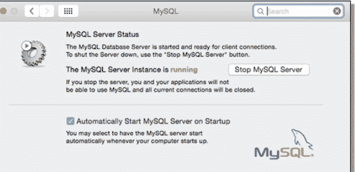

### 描述

- 你可以使用 MySQL 偏好面板启动和停止 MySQL，并控制 MySQL 是否在启动电脑时自动启动。
- 要显示 MySQL 偏好面板，使用苹果菜单显示系统偏好设置对话框。然后，点击 MySQL 图标。

# 如何安装 MySQL Workbench

MySQL Workbench 是一个免费的图形工具，让操作 MySQL 数据库变得更容易。要安装 MySQL Workbench，你可以使用图 B-5 中的第一个步骤。

安装 MySQL Workbench 后，你应该确保它已配置为适用于本书书。要做到这一点，你可能需要按照图中第二个步骤描述的方法添加连接。

书中介绍的所有操作 MySQL Workbench 的技能都已针对 6.3 版本进行过测试。因此，如果你使用的是此版本的 MySQL Workbench，这些技能应该完全按照描述的那样工作。然而，MySQL Workbench 正在被积极开发并且变化很快。因此，如果你使用的是更高版本的 MySQL Workbench，这些技能可能不会完全按照描述的那样工作，但工作方式应该是类似的。

图 B-5 如何安装 Workbench

# 如何创建数据库

在运行书中介绍的 SQL 语句之前，你需要创建图中所示的数据库。这样做最简单的方法是使用 MySQL Workbench 运行 `create_databases` 文件。具体操作方法见 B-6节。

要确定脚本是否运行成功，可以查看输出窗口中的结果。例如图中，输出窗口显示了一系列执行成功的语句。此外，对象浏览器显示已创建数据库。

如果脚本遇到问题，MySQL Workbench 会在输出窗口中显示一个或多个错误。然后你可以读取这些错误找出为什么脚本没有正确执行。

在运行 create_databases 脚本之前，数据库服务器必须运行。默认情况下，数据库服务器会在启动电脑时自动启动，因此通常不是问题。但如果它在你的系统中没有运行，请按照 B-4 的描述启动它。

# 如何还原数据库

当你处理书中介绍的代码时，你可能会对数据库进行非意的更改。在这种情况下，你可能希望将数据库还原到初始状态，以便你的结果与书中所示一致。要这样做，你可以再次运行 create_databases 文件。这将删除附录描述的三个数据库并重新创建。

# 创建数据库的脚本

`/murach/java_eclipse/db/create_database.sql`

# 执行 create_database 文件后的 MySQL Workbench

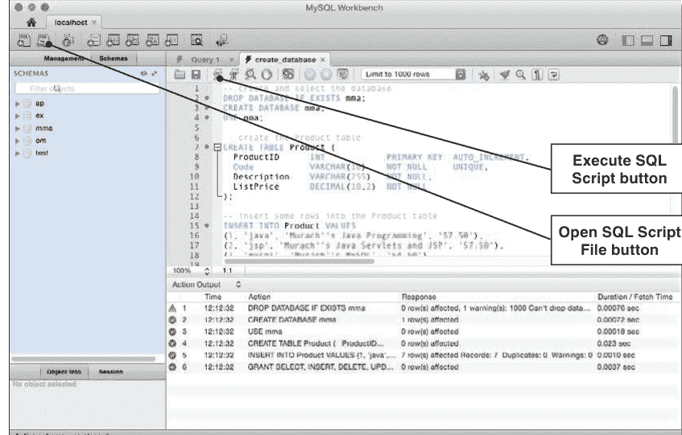

# 如何创建数据库

1. 启动 MySQL Workbench。
2. 以 root 用户身份连接运行在本地计算机上的 MySQL 实例。要做到这一点，双击名为“Local instance MySQL56”的存储连接，如果提示，输入 root 用户的密码。
3. 点击 SQL 编辑器工具栏上的打开文件按钮。然后使用弹出的对话框找到并打开 `create_database.sql` 文件。执行后，MySQL Workbench会在代码编辑器标签页中显示此脚本。
4. 点击代码编辑器工具栏上的执行脚本按钮运行脚本。执行后，输出窗口将显示指示脚本执行成功的消息。

# 如何还原数据库

- 为了使 create_database.sql 文件还原，数据库服务器必须运行。默认情况下，数据库服务器会在启动电脑时自动启动。如果它在你的系统中没有运行，请按照 B-4 的描述启动它。

### 描述

为了使 create_database.sql 文件还原，数据库服务器必须运行。默认情况下，数据库服务器会在启动电脑时自动启动。如果它在你的系统中没有运行，请按照 B-4 的描述启动它。

图 B-6 如何为本书创建和还原数据库

# 如何更新 root 用户的密码

当你在计算机上安装社区服务器（Community Server）时，系统会自动创建 root 用户以便你登录服务器。然而，默认情况下并没有为该用户分配密码。换句话说，服务器是不安全的。因此，我们建议通过运行图 B-7 中描述的 SQL 脚本为 root 用户分配一个“sesame”的密码。

当然，“sesame”是一个弱密码，同样不安全。因此，对于生产系统，你可能需要修改此脚本，为 root 用户分配一个不易被破解的安全密码。

# 更新密码的脚本

`/murach/java_eclipse/db/update_root_password.sql`

## 步骤

1. 启动 MySQL Workbench。
2. 以 root 用户身份连接到运行在本地计算机上的 MySQL 实例。执行此操作，点击存储的 root 用户连接。由于没有为 root 用户分配密码，因此你不需要输入密码。
3. 点击 SQL 编辑器工具栏中的“打开 SQL 脚本”（Open SQL Script File）按钮，并导航到 `/murach/java_eclipse/db` 文件夹打开 `update_root_password.sql` 文件。
4. 点击“执行 SQL 脚本”（Execute SQL Script）按钮。这会将 root 密码更新为“sesame”。
5. 使用本附录之前显示的 MySQL 偏好面板来停止和启动 MySQL 服务器。

### 描述

- 默认情况下，root 用户没有密码。这是不安全的。
- 对于本书，你可以运行如图所示的脚本将 root 用户的密码更改为“sesame”。
- 对于生产系统，你可以修改图中所示的脚本使 root 用户的密码更安全。


# 索引

- 运算符 (operator), 174-177
- 运算符 (operator), 176, 177
- † 运算符 (operator), 200, 201
- != 运算符 (operator), 81, 198, 199
- % 运算符 (operator), 174, 175
- <= 运算符 (operator), 175, 179
- & 运算符 (operator), 200, 201
- && 运算符 (operator), 200, 201
- * 运算符 (operator), 174, 175
- -== 运算符 (operator), 174, 175
- /= 运算符 (operator), 178, 179
- -@tag (javac), 246, 347
- -@Override 注解 (annotation), 280, 281
- -@param tag (javac), 346, 347
- -@return tag (javac), 346, 347
- -@version tag (javac), 346, 347
- 1, 200, 201
- 2, 200, 201
- + 运算符 (operator)
- 数字 (numbers), 174-177
- ++ 字符串 (strings), 54, 55
- += 运算符 (operator), 176, 177
- <= 运算符 (operator), 81, 198, 199
- >= 运算符 (operator), 81, 198, 199
- <> 运算符 (泛型), 362, 363
- < > (HTML), 346, 347
- 运算符 (operator), 178, 179
- <> 运算符 (lambda), 382, 383
- == 运算符 (operator), 81, 198, 199
- >= 运算符 (operator), 81, 198, 199
- 添加总量 (Adding to totals), 500, 501
- 加法运算符 (Addition operator), 174, 175
- 计算 (computed), 178, 179
- 适配器 (Adapter(date/time)), 400, 401
- 锚点字段 (anchor field (GridBagConstraints)), 580, 581
- 与运算符 (And operator), 200, 201
- Android 应用 (Android app), 12, 13
- Android IDE, 18, 19
- @Override 注解, 280, 281
- 匿名类 (Anonymous class), 338, 339
- 匿名函数 (Anonymous functions (lambda)), 378, 379
- API 文档 (API documentation), 68, 69
- 追加数据文件 (Append data file), 446, 447
- 字符串 (data to string), 52, 54, 235, 236
- 追加方法 (append method (StringBuilder)), 242, 243
- Applet, 10, 11
- 应用程序 (Application), 8, 9
- 参数 (Argument), 38, 36
- 发送到方法 (sending to method), 112, 113
- 算术表达式 (Arithmetic expression), 52, 53, 174, 175
- 算术运算符 (Arithmetic operators), 52, 53, 174, 175
- 赋值 (assigning values to), 256, 257
- 比较 (comparing), 266, 267
- 比较集合 (compared to collection), 358, 359
- 拷贝 (copying), 266, 367
- 创建 (creating), 254, 255
- 创建引用 (creating references to), 266, 267
- 引用元素 (referring to elements), 256, 257
- 数组列表 (Array list), 360, 361, 364
- 数组数组 (Array of arrays), 262, 263
- ArrayOutOfBoundsException, 256, 257
- ArrayList(java.util), 360, 361, 364
- 构造函数 (constructor), 365, 366
- 数组类 (Array classes), 264, 265
- ASCII 集合 (ASCII set), 108, 169
- 赋值值 (Assign value to), 170, 171
- 值到数组 (values to array), 256, 257
- 赋值运算符 (Assignment operator), 170, 171
- 赋值语句 (Assignment statement), 58, 120, 121
- 异步线程 (Asynchronous thread), 476, 477
- 复合赋值运算符 (Augmented assignment operator), 178, 179
- 自动箱 (Autoboxing), 358, 359, 370
- AutoCloseable 接口 (java.lang), 416, 417
- 刷新功能 (Autlush feature), 444, 445
- 自动加载驱动器 (Autoload driver loader), 508, 509
- AWT (Abstract Window Toolkit), 334, 535, 336
- 绝对路径 (Absolute path), 436, 437
- 抽象类 (abstract class), 298, 299
- 优势 (advantages), 310, 311
- 比较 (compared to), 310, 311
- 抽象关键字 (abstract keyword), 298, 299
- 抽象方法 (abstract method), 298, 299
- 抽象工具包 (AWT), 334, 535, 336
- AbstractTableModel 类, 548, 549
- 访问方法 (Access method), 35, 109, 280, 281
- 访问器 (Accessors (set and get)), 108, 109
- 监听器 (Action Listener), 540, 541
- ActionListener 接口, 338, 339
- actionPerformed 方法, 540, 541
- 添加方法 (Array), 366, 367
- 添加方法 (BigDecimal), 186, 187
- 添加方法 (Border-Layout), 546, 547
- 添加方法 (Frame, JPanel), 538, 539
- addActionListener 方法, 540, 541
- 基类 (B Base class), 276, 277
- BigDecimal, 186, 189
- 二进制文件 (Binary file), 438, 439
- 二进制运算符 (Binary operator), 174, 175
- 二进制流 (Binary stream), 438, 439
- binarySearch 方法 (Arrays classes), 264, 265
- 位 (Bit), 168, 169
- BLOB 对象 (Binary Large Objects), 512, 513

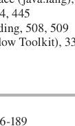

# 块注释 (Block comment)

# 确认操作 (JOptionPane)

# 635

- 块注释 (Block comment), 36, 37
- 代码块 (Block of code), 34, 35, 202, 203
- 块代码 (Block code), 80, 22, 202, 203
- 阻塞线程 (Block stated (thread)), 468, 469
- 阻塞双缓冲区 (Blocking double-buffer), 558, 559
- 布尔 (Boolean)
- charMethod (String), 236
- charMethod (StringBuilder), 244, 245
- 检查的异常 (Checked exception), 410, 411, 427
- charve, 323
- 子类 (Child class), 276, 277
- 时间时间枚举 (ChronUnit enumeration), 400, 401
- 类 (Class), 14-17, 34
- 声明 (declaration), 34, 35
- 图表 (diagram), 98, 99, 138, 139
- 文档 (documentation), 444, 345
- 字段 (field), 116, 117
- 导入 (importing), 64, 65
- 实例 (instance of), 66, 67
- 方法 (method), 116, 117
- 存储在 app 中 (storing in app), 122, 133
- 类代码 (class code), 508, 509
- ClassCastException (java.util), 294, 295
- 类方法 (ArrayList), 368, 369
- CLOB 对象 (Character Object), 512, 513
- close方法 (Object), 278, 279
- close项目 (Eclipse), 28, 29
- close方法 (BufferedReader), 450, 451
- close方法 (PrintStream), 446, 447
- close方法 (Resultset), 510, 511
- CLOSED_OPTION (JOptionPane), 562, 563
- 表达式 (expression), 81, 198, 201
- 类型 (type), 168, 169
- 值 (value), 50, 81, 198
- 变量 (variable), 198, 199
- 布局管理器 (BorderLayout manager), 542, 543, 546, 547
- break 语句 (break statement), 206, 208
- 循环 (loops), 218, 219
- 断点 (debugging), 156, 157
- 缓冲区 (Buffer), 440, 441
- 输入流 (input stream), 448, 449
- 输出流 (output stream), 444, 445
- 流 (stream), 438
- 注释 (Comment)
- 行尾 (end-line), 36, 37
- 单行 (single-line), 36
- 编码 (coding), 36, 37
- javac, 342, 343
- Comparable 接口, 264, 265
- 比较To 方法, 396, 397
- 比较对象 (Comparing objects), 296, 297
- 基本数据类型 (primitive types), 198, 199
- 变量 (variables), 80, 81
- 编译项目 (Eclipse), 26, 27
- 编译 (Java), 16, 17
- 编译时 (Compile-time), 148, 149
- 组件 (Component), 532, 533
- 层级结构 (hierarchy), 534, 535
- 组件类 (java.awt), 534, 535
- 组件赋值运算符 (Component assignment operator), 178, 179
- 字符串拼接 (Concatenate strings), 54, 55, 234
- 并发 (Concurrency), 476, 477

# 连接数据库 (Connect to a database)

# 双精度数字 (Double-precision number)

- 连接数据库 (Connect to database), 508, 509
- 连接驱动 (Connector/j driver), 506, 507
- 控制台 (Console), 8, 9
- 输入 (input), 7, 71
- 输出 (output), 38, 39
- 控制台应用 (Console application), 8, 9, 532, 533
- 控制台窗口 (Eclipse), 26, 27
- 恒量 (Constant), 172, 173
- 枚举 (in an enumeration), 340, 341
- 接口 (in an interface), 309
- 构造函数 (Constructor), 66, 67, 102, 103
- 编码 (coding), 107
- 构造类 (Java), 534, 535
- 包含方法 (ArrayList), 368, 369
- 继续语句 (continue statement (loops)), 218, 219
- 控制语句 (Control statements), 80, 85
- 数字到字符串 (numbers to strings), 76, 77
- 字符串到文本 (strings to text), 72
- 拷贝方法 (copyOf (Array)), 266, 267
- 变量 (variable), 212, 213
- while 循环, 82
- CPU (central processing unit), 464, 465
- CREATE DATABASE (SQL), 496, 497
- CREATE TABLE (SQL), 496, 497
- 创建用户 (SQL), 496, 497
- 创建目录 (createDirectories), 334, 335
- 创建目录方法 (File), 334, 335
- 创建行 (SQL), 496, 497
- 当前目录 (CWD), 336, 437
- 当前线程方法 (Thread), 471, 474, 475
- 游标 (Cursor), 51, 498, 499
- 数据库连接 (connection), 494, 495
- 数据库驱动 (drivers), 506, 507
- 数据库管理系统 (DBMS), 484, 485
- 数据库服务器 (server), 494, 495
- 数据库层 (tier), 132, 133
- 日期/时间 APIs, 390, 403
- 日期对象 (Date), 392, 399
- 日期 (date), 398, 399
- 比较 (compare), 396, 397
- 格式 (format), 402, 403
- 周几枚举 (DayOfWeek), 392, 393
- DDL (Data Definition Language), 498
- 调试器 (Debugger), 156, 161
- 调试应用程序 (Debugging applications), 148, 149
- 数组 (array), 254, 255
- 类 (classes), 34, 35
- 枚举 (enumerations), 340, 341
- 类型化集合 (typed collection), 362, 363
- 变量 (variable), 48, 180, 171
- 终止异常 (except), 167, 177
- 深拷贝 (deep copy (array)), 266, 267
- 默认构造函数, 106, 107
- 默认标签 (switch), 206, 207
- 默认方法 (interface), 322, 323
- 默认值 (double), 488, 489
- 默认_OPTION (JOptionPane), 560, 561
- 删除文件 (Delete files), 334, 335
- 删除项目 (Eclipse), 28, 29
- 从表中删除记录, 500, 501, 514, 515
- 删除方法 (File), 334, 335
- 删除方法 (StringBuilder), 244, 245
- DELETE 语句 (SQL), 500, 501, 514, 515
- 删除方法 (StringBuilder), 244, 245
- 分隔符文本文件 (delimited text file), 464, 465
- 分隔符 (Delimiter), 466, 467
- 驱动类 (drive class), 276, 277
- 桌面应用 (Desktop application), 8, 9
- 图表 (diagram), 98, 99
- 对话框 (dialog box), 586, 587
- 内置 (build-in), 558, 559
- 将数据传递到表单 (passing data to form), 588, 589
- 直径类 (diameter class), 362, 363
- 维度 (dimension), 584, 585
- 目录 (working), 433-434
- div 方法 (BigDecimal class), 186, 187
- 除法运算符 (division operator), 174, 175
- 复合 (compound), 178, 179

## doubleValue(BigDecimal class)

## for loop

## 637

- doubleValue(BigDecimal class), 186, 187
- do-while loop, 214, 215
- DriverManager class, 508, 509
- Drivers (database), 506, 507
- DROP DATABASE statement (SQL), 496, 497

- Exception, 72, 73, 220, 421, 410
- 捕捉 (catching), 72, 73, 414, 415, 220-223
- 链 (chaining), 428
- 检查型 (checked), 426, 427
- 自定义 (custom), 426-429
- 处理 (eating), 416
- 处理 (handling), 72, 73
- 层级结构 (hierarchy), 220, 221
- 多异常捕获 (multi-catch), 420, 421
- 传播 (propagation), 412, 413
- 吞吞 (swallowing), 416
- 抛出 (throwing), 72, 412, 413, 422, 423
- 资源管理 try (try-with-resources), 416, 417
- 当... (when), 426, 427
- 何时 (when to), 424, 425

## E

- + 处理类 (Eating classes), 416
- Eclipse, 20-29
- 代码编辑器 (code editor), 42, 43
- 创建类 (create class), 40, 41
- 导入项目 (import project.), 22, 23
- 在 Mac 上安装 (install on Mac), 622, 623
- 在 Windows 上安装 (install on Windows), 610, 611
- Java 源代码 (Java source code), 42, 43
- 包 (package), 156, 157
- 语法错误 (syntax error), 46, 47
- 两个或多个进程 (two or more processes), 28, 29
- 工作台 (workbench.), 20, 21
- EDT 事件分发 (EDT event dispatch), 202, 603
- EE (企业接口), 4, 5

## Elements
- 数组 (array), 254, 255
- 赋值值 (assing values), 256, 257
- 封装 (Encapsulation), 98, 99
- 换行方法 (End-of-line method), 36, 37
- endsWith(String), 236, 237
- endsWith-each 循环 (endsWith-each (loop)), 260, 261
- 枚举类 (enum class (java.lang)), 342, 343
- 枚举关键字 (enum keyword), 340, 341
- 枚举器 (Enumeration), 340, 341
- 枚举类型 (enumeration type), 342, 343
- EOFException(java), 442, 443
- 等于运算符 (Equality operator), 018, 199
- equ 方法 (Class), 266, 267
- equals 方法 (Object), 278, 279, 296
- equals 方法 (String), 481, 482
- equalNotOverride(String), 296, 237
- 错误 (error) 0, 81, 216, 237
- 异常类 (Exception class (java.lang)), 410
- 创建 (creating), 420, 421
- 异常处理器 (Exception handler), 220-222, 410-413
- 测试 (testing), 424, 425
- 执行/更新方法 (execute/Update method), 514, 515
- 异常触发 (Exception (firing)), 154, 155
- exists 方法 (File class), 435, 436
- EXIT_CLOSE 值, 536, 537
- 显式类 (Explicit class), 182, 183
- 继承类 (Extend a class), 276, 277, 282
- extends 关键字 (extends keyword), 282, 283, 316, 317

## F

- + Falls (switch 语句) (Falls (switch statement)), 208, 209
- 类 (class), 99, 100-102
- dase, 484, 485
- 文件 (file), 446, 474, 575
- 文件 I/O (File I/O), 438, 439
- FileNotFoundException(java), 442, 443
- FileReader 类 (FileReader class (java.lang)), 448, 449
- Files (带有 with) (Files (with with)), 434, 435
- File 类 (File classes (java.lang)), 440, 445
- FileWriter 类 (java), 446, 447
- fill 方法 (Arrays) (fill method (Arrays)), 264, 265
- final 类 (final class), 300, 301
- final 关键字 (final keyword), 172, 173, 300, 301
- final 方法 (final method), 300, 301
- final 参数 (final parameter), 300, 301
- final 变量 (final variable), 172, 173
- finally 类 (try) (finally class (try)), 414, 415
- fireTableMetaData 方法 (fireTableMetaData method), 548, 549
- 固定宽度布局 (Fixed-width layout), 542, 543
- float 类型 (float type), 168, 169
- 浮点数 (Floating-point number), 168, 169
- FlowLayout 布局 (FlowLayout manager), 542, 545
- 构造函数 (constructor), 544, 545
- flush 方法 (PrintWriter class) (flush method(PrintWriter class)), 446, 447
- 刷新缓冲区 (flushing the buffer), 440, 441
- 文件夹 (工作于) (Folders (working with)), 433, 434
- for 循环 (for loop), 216, 217
- 数组 (array), 258, 259
- + coding (coding), 150, 151
- 编译时 (compile-time), 152, 153
- 确定原因 (determining cause of), 152, 153
- Java, 150, 151
- 逻辑 (logic), 152, 153
- 运行时 (runtime), 152, 153
- 语法 (syntax), 150, 151
- 错误类 (java.lang) (Error class (java.lang)), 410, 411
- ERROR_MESSAGE, 558, 559
- 转义序列 (Escape sequences), 56, 57
- 事件 (Event), 333, 334
- 处理器 (handler), 540, 541
- 监听器 (listener), 540, 541
- 事件分发 (EDT) (Event dispatch (EDT)), 602, 603

## for 语句

- for 语句 (for statement), 216
- 数组 (array), 258, 209
- foreach 循环 (foreach loop), 200, 261
- 外键 (Foreign key), 486, 487
- Form, 534, 535, 586, 587
- 数据项 (data entry), 586, 587
- format 方法 (DateTime) (format method (DateTime)), 402, 403
- format 方法 (NumberFormat) (format method (NumberFormat)), 76, 77
- formatStyle.FULL, 402, 403
- formatStyle.LONG, 402, 403
- formatStyle.MEDIUM, 402, 403
- formatStyle.SHORT, 402, 403
- 仅读结果 (Forward-only result), 510, 521
- Frame 类 (java.awt) (Frame class (java.awt)), 534, 535
- Frame, 334, 538, 539
- hadd 方法, 538, 539
- 如何显示 (how to display), 536, 537
- FROM 类 (SELECT) (FROM class (SELECT)), 498, 499
- 函数 (lambda) (Function (lambda)), 378, 379
- 函数式接口 (lambda) (Functional interface (lambda)), 382, 383
- 权限 (SQL) (Grant privileges (SQL)), 496, 497
- GRANT 语句 (SQL) (GRANT statement (SQL)), 496, 497
- 图形用户界面 (GUI) (Graphical interface (GUI)), 334, 335, 532, 533
- 大于运算符 (Greater Than operator), 81, 198, 199
- 大于等于运算符 (Greater Than Equal operator), 81, 198, 199
- GridConstraints, 578, 581
- GridBagLayout, 542, 543, 578, 579
- gridfield 方法 (GridConstraints) (gridfield method (GridConstraints)), 580, 581
- GridLayout 布局 (GridLayout manager), 542, 543
- gridwidth 方法 (GridConstraints) (gridwidth method (GridConstraints)), 580, 581
- grid fields (GridConstraints) (grid fields (GridConstraints)), 580, 581
- grid by (GridConstraints) (grid by (GridConstraints)), 580, 581
- GUI (用户界面) (GUI (user interface)), 8, 99, 334, 335, 532, 533

## INFORMATION_

## G
- 型 (Generics), 362, 363
- get 访问器 (get accessor), 108, 109
- get 方法 (get method), 102, 103, 108
- ArrayList 类, 366, 367
- Paths 类, 443, 444
- getClass 方法 (Object), 278, 279
- getColumn 方法, 547, 548, 549
- getName 方法, 548, 549, 550
- getters 方法, 508, 509
- getters 方法 (NumberFormat), 76, 77
- getDayOfMonth 方法, 394, 395
- getDayOfYear 方法, 394, 395
- getFirstName 方法, 435, 436
- getHour 方法, 394, 395
- getMessage 方法 (Throwable), 418, 419
- getMinute 方法, 394, 395
- getYear 方法, 394, 395
- getValue 方法, 394, 395
- getName 方法 (Path), 435, 436
- getName 方法 (Thread), 471
- getCountCount 方法 (Path), 435, 436
- getNano 方法, 394, 395
- getNumberInstance (NumberFormat), 76, 77
- getOwner (String), 588, 589
- getters (Path), 435, 436
- getPercent 方法 (NumberFormat), 74, 75
- getRoot (Path), 435, 436
- getRowCount 方法 (AbstractTableModel), 548, 549
- getRow 方法, 394, 395
- getSelectedRow 方法 (Table), 554, 555
- SelectedRows 方法 (Table), 554, 555
- getText 方法 (J), 576, 577
- setValue 方法 (AbstractTableModel), 548, 549
- getYear 方法, 394, 395
- HALF_DOWN (Mode), 186, 187
- HALF_EVEN (Mode), 186, 187
- HALF_UP (Mode), 186, 187
- 处理异常 (Handle exception), 72, 73
- hash code, 278, 279
- hashcode 方法 (Object), 278, 279
- Map 类 (java.util), 360, 361
- MapSet (java.util), 360, 361
- 水平滚动问题 (Horizontal scrolling problem), 584, 585
- HORIZONTAL_SCROLL_ALWAYS, 555, 556
- HORIZONTAL_SCROLL_NEED, 555, 556
- HORIZONTAL_SCROLL_NEVER, 556, 557
- HTML 实现 (implementation), 348, 349
- 查看 (viewing), 348, 349
- HTML 标签 (in), 346, 447
- I/O 异常 (exceptions), 422, 443
- I/O 操作 (operations), 438, 439
- IDE (集成开发环境) (Integrated Development Environment), 18, 19
- 标识符 (Identifier), 1, 150, 151
- 对象的标识 (Identity of an object), 100, 101
- if else 语句, 84, 85, 202, 203
- next, 81, 82, 205, 206
- IllegalArgumentException (java.lang), 424, 425
- 不变字符串 (Immutable strings), 242, 243
- 实现接口 (Implementing interfaces), 308, 309, 314, 316
- 实现键 (Implementing key), 313, 314
- 隐含类 (Implied class), 182, 183
- import 语句, 64, 65
- static, 342, 343
- 索引 (Index), 176, 177
- 数组 (array), 256, 257
- 字符串 (string), 238, 239
- indexOf(String) (ArrayList), 368, 369
- indexOf (String), 236, 237
- 不等属性 (Inequality property), 81, 198, 199
- 无限循环 (Infinite loop), 82, 83, 212, 213
- INFORMATION_MESSAGE, 558, 559


## 继承类

## JVM (Java 虚拟机) 639

- 继承类 (Inherit class), 316, 317
- 继承 (Inheritance), 276, 277
- 使用接口 (using with interfaces), 320
- Java 编译器 (Java compiler), 16, 17
- Java 数据库连接 (JDBC), 506
- Java 开发包 (JDK), 4, 5
- Java 驱动常量 (Java driver constants), 172, 173, variables, 48, 190, 171
- 注入攻击 (SQL) (Injection attack (SQL)), 514, 515
- 内部类 (Inner class), 332, 333
- 原生协议调用 (native protocol call), 506, 507
- 网络协议调用所有 (net protocol call all), 506, 507
- 输入位 (Input bit), 438, 439
- 输入流 (Input stream), 438, 448, 449
- InputStreamReader 类, 190, 448
- 内部方法 (StringBuilder 类) (inner method (StringBuilder class)), 244, 245
- Java EE, 4, 5
- Java 错误 (常见) (Java errors (common)), 150, 151
- Java 解释器 (Java interpreter), 16, 17
- ANCE (类) (INSTANCE (class)), 496, 500, 501, 514
- Insets 类 (GridBagLayout) (Insets class (GridBagLayout)), 578, 579, 582, 583
- Java 插件 (Java plug-in), 16, 17
- 运行环境 (JRE) (Runtime environment (JRE)), 17
- Java SE, 4, 5
- 实例方法 (禁用) (Instance methods (disabling)), 159
- 类的实例 (Instance of a class), 66, 67, 98, 99
- 实例变量 (Instance variable), 102, 105
- Java 源代码 (Java source code), 42, 43
- Java 虚拟机 (JVM), 16
- Java ait 包, 542, 543, 578, 579

## 键值对 (Key-pair), 360, 361
关键字（数据）, 46–48

## L
- 标签 (Label), 574, 375
- Lambda 表达式 (Lambda expression), 378–383, 540, 541
- lambda 算符 (lambda operator), 382, 383
- List 方法 (Resultset), 510
- lastIndexOf (String), 236, 237
- 晚绑定 (Late binding), 284
- 输入流 (input streams), 448, 449
- 输出流 (output streams), 444
- 流 (streams), 440, 441
- 分层 (Layering)
- 布局主 (Layout master), 542, 537, 579
- 长度 (array), 254, 255
- 长度 (array), 258, 259
- 长度 (String), 238, 239
- length 方法 (StringBuilder), 242, 243
- 小于等于 (Less Than Or Equal), 81, 198, 199
- 库 (Libraries), 25
- 生命周期 (at), 468, 469
- 链表表 (Linked list), 360, 361
- List 接口 (java.util), 360, 361
- 字面量值 (Literal value), 50, 51
- 地类 (Local class), 392, 401
- LocalDateTime 类, 392–401
- LocalTime 类, 392, 401
- 锁对象 (Locking objects), 476, 477
- 锁 (synchronized keyword), 476, 477
- 逻辑错误 (Logic error), 148, 149, 152, 153
- 逻辑算符 (Logic operators), 200, 201
- long 类型, 168, 169
- 循环 (Loops), 212–213
- long 数组 (long array), 258, 259

## M
- 主类 (Main classes), 34, 35
- main 方法 (main method), 14, 15, 34, 35
- 声明 (declaration), 34, 35
- 主线程 (Main thread), 464, 465
- 主窗口 (Main window), 536, 537
- 多对多关系 (Many-to-many relationship), 486, 487
- Map 接口 (java.util), 360, 361
- Math 类 (Math class), 184, 185
- max 方法 (Math class), 184, 185
- ME (微编辑器), 4, 5
- 类的成员 (Members of a class), 102, 103
- 方法 (Method), 14, 15, 34, 38, 99
- 调用 (calling), 67, 112, 113
- 调用 (calls), 120, 121
- 链式 (chaining), 76, 77
- 编码 (coding), 108, 109
- 在一个中 (in an), 309
- 命名 (naming), 108, 109
- 重载 (overloading), 122, 123
- 重写 (overriding), 282, 283
- 签名 (signature), 122, 123
- stat, 66
- Microsoft SQL Server, 484, 485
- 层级 de (tier de), 132, 133
- min 方法 (Math), 184, 185
- min 方法 (LocalDate), 400, 401
- minusWeeks, 400, 401
- 移动应用 (Mobile app), 12, 13
- 模态对话框 (Modal dialog), 558, 559, 586, 587
- 模型 (for that), 548, 549
- 取模算符 (Modulus operator), 174, 175
- 复合 (compound), 178, 179
- 月份枚举 (Month enumeration), 392, 393
- 多块选择 (multi-block choice), 420, 421
- 多线程架构 (Multi-threaded architecture), 132
- 多重继承 (Multiple inheritance), 306
- MULTIPLE_INTERVAL_SELECTION, 554, 555
- 乘法算符 (Multiplication operator), 174, 175
- 复合 (compound), 178, 179

## N
- 元素名称 (of), 434, 435
- name 方法 (enumeration), 342, 343
- 命名规范 (Naming conventions)
- 常量 (constants), 173, 174
- 类 (classes), 34, 35
- 变量 (variables), 48, 190, 171
- 窄化转换 (Narrowing conversion), 182, 183
- 所有 Java 驱动程序的原生协议 (Native protocol of all Java driver), 506, 507
- Java 驱动原生协议方 (Native protocol party for Java driver), 506, 507
- 负号算符 (Negative sign operator), 176, 177
- 嵌套 (Nested)
- if 语句 (if statement), 84, 85, 204
- 循环 (loop), 262, 263
- 所有 Java 驱动程序的 Net 协议 (Net protocol of all Java driver), 506, 507
- NetBeans IDE, 18, 19
- new 关键字, 110, 111
- 新状态 (线程) (New state (thread)), 468, 469
- newDirectoryStream 方法 (Files), 434, 435
- new 方法 (Resultset), 510, 511
- nextLine() 方法 (Scanner), 70, 71
- JOptionPane (JOptionPane), 562, 563

## Not
- Not 算符 (Not operator), 200
- notExists (Files 类), 434, 435
- now (LocalDateTime), 392, 393
- 空 (Null), 55
- 数据库 (database), 288, 489
- NumberFormat 类, 76, 77
- 数字转字符串转换 (Numbers to strings (converting)), 76
- 数值变量 (Numeric variables), 48, 49
- 比较 (comparing), 80, 81

## Padding
- GridBagConstraints, 582, 583
- GridBagLayout, 578, 579
- 填充字符串 (Padding strings), 26, 247
- 添加按钮 (add buttons), 338, 539
- 添加到框架 (add to frame), 338, 539
- 参数 (Parameter), 99, 120, 121
- 接口类型 (an interface type), 318, 319
- 参数列表 (Parameter list (method)), 108
- 父类 (Parent class), 276, 277
- 来自于 (Parent from), 586, 587
- 解析数据类 (parsing data class), 588, 589
- parse 方法 (LocalDateTime), 392, 393
- parseDouble 方法 (Double), 72, 73
- parseInt (Integer), 72, 73
- 解析字符串 (Parsing strings), 238, 235
- 参数 (Parsing argument)
- 对象 (Object), 100, 101
- 强制转换 (casting), 294, 295
- 比较 (comparing), 296, 297
- 创建 (creating), 66, 110, 111
- 身份 (identity of), 100, 101
- 状态 (state of), 100, 101
- 对象类 (Object class), 278, 392, 343, 466, 467
- 对象引用 (Object reference), 110, 111
- ODBC 数据库, 506, 507
- of 方法 (LocalDateTime), 392, 393
- ofLocalized 方法, 402, 403
- ofLocalized 方法, 402, 403
- ofLocalized 方法, 402, 403
- OK_CANCEL (JOptionPane), 560, 561
- OK (JOptionPane), 562, 563
- 一维数组 (One-dimensional array), 266, 267
- 一对多关系 (One-to-many relationship), 486, 487
- 一一对关系 (One-to-one relationship), 486, 487
- 算符 (Operator), 52, 134, 175
- 在布尔表达式中 (in boolean expression), 198, 199
- 重载 (Overload), 200, 201
- Oracle, 484, 485
- ORDER BY 子句 (SELECT), 498, 499
- 优先级 (Order of precedence), 180, 181
- 序数方法 (ordinal method (numeration)), 342, 343
- 输出文件 (Output file), 438, 439
- 输出流 (Output stream), 438, 439
- 字符 (character), 444, 445

## Path
- 绝对路径 (absolute), 436, 437
- 相对路径 (relative), 436, 437
- Paths 类 (java.nio.file), 437, 438
- 枢Pivot, 532, 534
- PLAIN_MESSAGE (JOptionPane), 558, 559
- 平台独立性 (Platform independence), 16, 17
- 插件 (Java), 16, 17
- plus 方法 (date/time), 400, 401
- plusMethod (date/time), 400, 401
- 多态 (Polymorphism), 284, 285
- 正整数 (Positive integer), 176, 177
- 后缀接口 (Postfix interface), 176, 177
- pow 方法 (Math), 184, 185
- 谓词接口 (Predicate interface (invoke)), 380, 385
- nref 接口, 176, 177
- Prepared 语句 (JDBC), 516, 517
- 表示层 (Presentation tier), 123, 124
- 项目 (Eclipse), 20, 21
- 主键 (Primary key), 484, 485
- 基本数据类型 (Primitive data types), 468, 469
- 比较其他 (comparing to other), 198, 199
- 引用类型 (compared to reference types), 120, 121
- print 方法 (PrintWriter class), 446, 447
- print 方法 (System.out), 38, 39
- 输出到控制台 (Printing output to the console), 38, 39
- print 方法 (PrintWriter class), 446, 447
- println (System.out object), 38, 39
- stackTrace (Throwable class), 418, 419
- PrintWriter 类 (java class), 444, 445
- 私有字段和方法 (Private fields (and methods)), 98, 99
- private 关键字, 108, 109
- 类声明 (class declaration), 34, 35
- 超类 (superclass), 280, 281
- 公有字段和方法 (public (fields and methods)), 98, 99
- public 关键字, 108, 109
- 类声明 (class declaration), 34, 35

## Overloading
- 构造函数 (constructors), 106, 107
- 方法 (methods), 122, 123
- 注解 (annotation), 280, 281
- 方法 (methods), 276, 277, 282
- equals, 296, 297
- 重载 (Overload), 586, 587
- 包 (Package), 14, 15, 24, 34, 35, 134, 135
- Java, 64
- Eclipse, 136, 137
- 存储类 (storing classes), 134, 137
- 包命名 (Package naming), 134, 135

## Query
- 查询 (SQL), 498, 501
- 查询表 (Query tables (SQL)), 498, 499
- QUESTION_MESSAGE (JOptionPane), 558, 559

## S
- 比例 (Scale), 186, 187
- Scanner 类, 70, 71
- 模式 (Schema), 492, 493
- 科学计数法 (Scientific notation), 168, 169
- 类作用域 (Scope of a class), 34, 35
- 滚动边界 (Scroll fence), 556, 557
- 滚动条 (Scrollbar), 556, 557
- ScrollPane, 556, 557

## R
- random 方法 (Math class), 184, 185
- RDBMS (关系型系统), 484, 485
- Reader 类 (java.io), 448, 449
- SDK (标准开发包), 5, 5
- SE (标准版), 5, 5
- 查询 (MySQL), 496, 497
- SELECT 语句 (SQL), 498, 506
- 选择结构 (Selection structure), 80, 81
- 来自控制台 (from console), 70, 71
- 来自文件 (from files), 450, 451
- readLine 方法 (BufferedReader), 450, 451
- 只读 (Read-only), 510, 511
- Servlet, 5, 5
- 身份 (identity of), 100, 101
- 接口 (java.util), 360, 361
- 状态 (state of), 100, 101
- 数组 (array), 368, 369
- 数据库 (database), 484, 485
- 文件 (file), 446, 447
- 矩形数组 (Rectangular array), 262, 263
- 重构 (Refactor), 136, 137
- 反射类 (Reflection class), 110, 111
- 元素 (ray), 266, 267
- 绑定 (Binder (Table)), 554, 555
- 字符 (CharAt (StringBuilder)), 244, 245
- 设置 (JOptionPane), 576, 577
- 默认语句 (setDefaultClause), 536, 537
- 可编辑 (Editable method (JTextField)), 576, 577
- 可用 (Enabled method), 537, 539
- 原始类型 (compared to primitive), 120, 121
- 引用完整性 (Referential integrity (SQL)), 490, 501
- 结果集 (result set (SQL)), 490, 510
- 获取结果数据 (result get from data), 512, 513
- 结果集方法 (result set Methods), 510, 511
- 优选 (Preferred), 577, 578, 584
- 可调整大小 (Resizable method), 584, 585
- 比例方法 (setScale method (Decimal class)), 186, 187
- 选择方法 (setSelection method (Table)), 554, 555

# size 方法

# 线程调度器 643

- ArrayList 类, 366, 367
- Files 类, 434, 435
- sleep 方法 (Thread 类), 466, 467, 471-475
- 软件开发包 (SDK), 4, 5
- sort 方法 (Array 类), 264, 265
- 源代码, 16, 17
-在 Mac 上安装, 624, 625
-在 Windows 上安装， 612, 613
- 特殊类, 56, 57
- split 方法 (String 类), 450, 451
- SQL (结构化查询语言), 490
- SQL 注入攻击, 314, 315
- SQL 脚本, 406, 497
- SQL Server, 484, 485
- SQL 语句, 494, 495
- 进入和访问, 494, 495
- sqrt 方法 (Math 类), 184, 185
- 堆栈跟踪, 160, 220, 221, 412-413
- 标准小部件工具 (SWT), 522, 535
- start 方法 (Thread 类), 236, 237
- startsWith (String 类), 236, 237
- 对象的状态, 100, 101
- 静态, 36, 37
- 静态字段, 116, 117
- 向上取, 122, 123
- 编码, 114, 115
- 导入, 342, 343
- 何时使用, 116
- 静态导入, 342, 343
- 静态方法, 114, 115
- 静态方法, 66, 67, 116, 117
- 向上取, 122, 123
- 编码, 114, 115
- 接口, 322, 323
- 导入, 342, 343
- 何时使用, 116
- 逐行代码 (调试), 158, 159
- stop 方法 (Thread 类), 466–469
- 将类存储在包中, 134-137
- 流, 458, 459
- 缓冲的, 440, 441
- 分层, 440, 441
- String, 38, 54, 55
- 附加, 54, 55, 234, 235
- 包含, 81, 82, 236, 237
- 拼接, 54, 234, 235
- 转换为数字, 72, 73
- 转义序列, 56, 57
- 索引, 238, 239
- 连接, 54, 55, 234, 235
- 修改, 240, 241, 244, 245
- 填充, 236, 237
- 解析, 234, 235
- 特殊字符, 56, 57
- String 类, 234, 235
- String 字面量, 234, 235
- String 对象, 54, 55
- StringBuffer 类, 242, 243
- StringBuilder 类, 242, 243
- StringUtil 类, 246, 247
- 结构化查询语言 (SQL), 490
- 转大写, 222, 210, 276
- 创建, 282, 283
- substring 方法 (String), 240, 241
- substring 方法 (StringBuilder), 244, 245
- subtract 方法 (BigDecimal), 186, 187
- subtract 操作, 174, 175
- 复合的, 178, 179
- super 关键字, 282, 283
- 转小写, 294, 295
- 创建, 280, 281
- 吞吐异常, 416
- Switch, 333, 532, 535
- 继承层次, 534, 535
- 代码, 602, 603
- switch 语句, 202, 206, 207
- SWT 工具包 (SWT), 532, 535
- synchronized 关键字, 476, 477
- 同步线程, 476, 477
- 语法错误, 46, 48-151
- 常见的, 150, 151
- System err, 438, 439
- System in, 70, 71, 438
- System out, 38, 39, 438

# T

- 表 (数据库), 484, 485
- 添加记录, 500, 501
- 删除记录, 500, 501
- 查询 (SQL), 498, 499
- 表之间的关系, 486, 487
- 更新记录, 500, 501
- 表, 548, 549
- 添加滚动条, 555, 556
- 创建, 554, 555
- 实现, 148, 149
- 异常处理程序, 424, 425
- 文本框, 527, 528
- 文本字段, 474, 475
- 文本文件, 439, 444
- 分隔的, 446, 447
- 读取, 450, 451
- 写入, 446, 447
- this 关键字, 106, 107, 124, 125
- Thread, 463, 470
- 并发, 476, 477
- 创建, 470, 473
- 生命周期, 468, 469
- 睡眠, 471-475
- 同步, 476, 477
- 使用 Swing, 602, 603
- Thread 类 (java.lang), 466, 467, 470-473
- 线程调度器, 464, 465, 468, 469

# 线程状态

- 线程状态, 469
- 线程安全的, 476, 477
- 线程架构, 132, 133
- 线程异常, 72, 73, 220, 221, 412, 413, 423
- throw 语句, 424, 425
- Throwable 类 (java.lang), 410, 411, 418, 419
- 构造函数, 424, 425, 428, 429
- Throwable 层次, 410
- throws 类, 422, 423
- 时间, 392, 393
- 比较, 306
- 格式化, 402, 403
- 工具包 (Path), 435
- toArray 方法 (ArrayList), 368, 369
- toFile 方法 (Path), 435
- 工具包, 532, 533
- 提示框, 538, 539
- 顶层小部件, 536, 537
- toString 方法
- BigDecimal 类, 186, 187
- Object 类, 278, 279
- StringBuilder 类, 244, 245
- Throwable 类, 418, 419
- 跟踪执行, 154, 155
- 事务处理 (MySQL), 490, 491
- TreeMap 类 (java.util), 360, 361
- trim 方法 (String), 240, 241
- try 块, 222, 223
- try-catch 语句, 222, 223, 414, 415
- try-with-resources 语句, 416, 417
- 二维数组, 262, 263
- 类型变量, 362, 363
- 类型安全的集合, 362
- 枚举的, 340, 341

- 等待状态 (线程), 468, 469
- 警告消息 (JOptionPane), 558, 559
- WHERE 子句 (SELECT 语句), 498, 499
- while 循环, 82, 83, 212, 213
- while 语句, 82, 83, 212, 213
- 宽转换, 182, 183
- 小部件, 552, 553
- 顶层的, 534, 535
- Window (main), 536, 537
- Window 类 (java.util), 534, 535
- withDay 方法, 398, 399
- withDayYear 方法, 398, 399
- withHour 方法, 398, 399
- withMinute 方法, 398, 399
- withMonth 方法, 398, 399
- withYear 方法, 398, 399
- Workbench (Eclipse), 20, 21
- Workbench (MySQL), 506
- 在 Mac 上安装, 628, 629
- 在 Windows 上安装, 614, 615
- Workspace (Eclipse), 20, 21
- Wrapper 类, 72, 73, 362, 363, 370, 371
- Writer 层次, 444, 445
- 文本类, 446, 447

- UIManager 类, 536, 537
- UML (统一建模语言), 98, 99
- 一元运算符, 176, 177
- 未检查的异常, 410, 411, 426, 427
- Unicode 字符, 168, 169
- Unicode 字符, 438, 439
- 统一建模语言 (UML), 98, 99
- UPDATE 语句 (SQL), 500, 501, 514, 515
- 用户线程, 470, 471

- YES_NO_CANCEL (JOptionPane), 560, 561
- YES_NO_OPTION (JOptionPane), 560, 561
- YES_OPTION (JOptionPane), 562, 563

- VALUES 子句 (SQL), 496, 497
- 变量, 48, 49, 170, 171
- 数组, 254, 255
- 初始化, 48, 49, 170, 171
- 数值的, 48, 49
- 字符串, 547, 548
- 始终垂直滚动条, 556, 557
- 需要垂直滚动条, 556, 557
- 不需要垂直滚动条, 556, 557
- view_id, 108, 109

# V

# 100% 保证

如果您直接从我们这里订购，您一定会满意。我们的书比您用过的其他编程书籍更好……无论是用于训练还是参考……或者您可以在 60 天内退货退款！

Mike Murach, 出版人
Ben Murach, 总裁


# Java/Python 程序员书籍

| 书名 | 价格 |
| :--- | :--- |
| Murach's Beginning with NetBeans | $57.50 |
| Murach's Java Servlets and JSP (第 3 版) | $57.50 |
| Murach's Android Programming (第 2 版) | $57.50 |
| Murach's Java Programming (第 4 版) | $57.50 |
| Murach's Python Programming | $57.50 |

# 数据库程序员书籍

| 书名 | 价格 |
| :--- | :--- |
| Murach's MySQL (第 2 版) | $54.50 |
| Murach's Oracle SQL and PL/SQL for Developers (第 2 版) | $54.50 |
| Murach's MySQL Server 2016 for Developers | $57.50 |

# Web 开发者书籍

| 书名 | 价格 |
| :--- | :--- |
| Murach's HTML5 and CSS3 (第 3 版) | $54.50 |
| Murach's JavaScript and Query (第 3 版) | $57.50 |
| Murach's PHP and MySQL (第 2 版) | $54.50 |

# 学习 Java Web 编程

成千上万 Java 开发者已经使用这本书来学习 Web 编程……你也可以！它将基于你的核心技能，教你如何像专家一样创建 Web 应用程序，使用 Java servlets 和 Java Pages (JSPs)。

# .NET 程序员书籍

| 书名 | 价格 |
| :--- | :--- |
| Murach's C# 2015 | $57.50 |
| Murach's ASP.NET 4.6 Web Programming with C# 2015 | $59.50 |
| Murach's Visual Basic 2015 | $57.50 |

*价格和可用性可能会发生。请访问我们的网站获取最新信息。

# 我们想听您的意见

你有建议、问题或赞美想传给我们吗？请通过您方便的方式分享您的反馈！

* www.murach.com / twitter.com/MurachBooks
* murachbooks@murach.com / linkedin.com/company/mike-murach-associates

## 为什么 Murach 是最佳选择

在过去的41年里，许多客户问过我，一家位于弗雷诺（Fresno）的小型出版社是否能编写最好的编程书籍。简短的回答是：没有其他出版社像我们这样工作。

我们没有使用没有受过培训的作家，而是使用一小部分程序员组成的团队，他们接受过我们经过证明的编写和教学方法的培训。我们不是每年出版40多本书，而是专注于少数几本。我们不是展示零散的代码片段，而是提供经过反复检查以确保准确性的完整应用程序。我们不急于让书籍上市，而是按照计划发布，且绝不让预算影响质量。在我看来，这是确保我们出版的每一本书都是市场上最佳作品的唯一方法。

这就是为什么人们经常告诉我，每当他们需要学习新主题时，总是会首先寻找我们的书。为什么不尝试一下并亲身体验验呢！

Mike Murach
出版商

## 使用 Eclipse 开始 Java 开发

## 程序员对你的 Java 书籍的评价

## 快速上手

- 使用 Eclipse IDE 的省时功能来开发和调试 Java 应用
- 在第3章结束时，创建一个可以获取用户输入的应用程序
- 在第4章结束时，创建一个使用业务对象的面向面向的应用程序
- 在第5章结束时，使用三层架构构建一个面向面向的应用程序

> “如果你像我以前读这本书时是 Java 菜鸟，那么你会喜欢它的。我在半小时内就运行了开发环境，并在15分钟后就开始尝试编写代码了”
> Andy Florner, vcity.com

> “我上周买了你们的 Java 书，现在已经在编写实用的程序了，太棒了吧！”
> Richard Cooper, 程序员

## 学习核心技能

- 学习你将要用到的技能，而不是在以后才需要的细节上浪费时间
- 学习你将使用的 Java API 中的类，而不是在可能才需要的类上浪费时间
- 学习程序员从 Java 转向 Web 或移动端开发时所需的核心技能
- 学习 Java 8 最重要的特性，包括 lambda 示例和新的日期/时间 API
- 复习每章末尾真实的示例应用程序
- 通过完成每章末的练习题来实践所学知识

> “我非常喜欢的一点是，这些书籍使用 IDE 来教授下一代程序员。很多 Java 书籍关注于语言本身，但任何专业人士都会告诉你，IDE 对于提高你的生产力至关重要”
> John Yearny, Java 布道师

> “太棒了——极了！顶级！物超所值”
> 发布于 Amazon.com

> “我喜欢你们的书。它直击核心信息，在大量细节和极少信息之间取得了完美平衡。示例程序不可思议。继续努力”
> Steve, 程序员，科罗拉多州丹佛

> “我喜欢的另一点是每章末的练习题。它们是强化要点的绝佳方式，并迫让你亲自动手”
> Hien Lu, SD Forum/Java SIG

## 精通面向对象编程

- 编写定义应用程序业务对象的类
- 以既易于理解又实用的方式使用继承和多态

## 像专家一样构建应用程序

- 创建 MySQL 数据库来存储应用程序数据并使用 SQL 进行操作
- 编写数据库类，使用 JDBC 将应用程序的业务对象映射到数据库表
- 使用 Swing 编写表现类，为应用程序创建一个直观的图形界面 (GUI)

## 下载示例和练习题答案（详情请参每章的最后一页）


www.murach.com

#MurachBooks

$57.50 USD

分类：编程/Java

ISBN 978-1-890774889-5
