# Murach's Java 入门指南：NetBeans 训练与参考

## 开启良好起点

通过独特的自学式方法，让你在仅学习 5 个章节后就能开发面向对象的应用程序。

## 掌握 Java 核心特性

包括 —— 数组、集合、泛型、异常、Lambda 表达式、Java 8 日期时间 API、文件 I/O、线程等

## 掌握面向对象编程

像顶尖专业人士一样使用类、继承和接口。

## 构建实战应用

使用三层架构、Swing 用户界面和 MySQL 数据库

# 培训与参考

# 编辑团队

作者：Joel Murach

Michael Urban

编辑：Ray Halliday

制作：Maria Spera

# 针对 Java 程序员的书籍

- Murach's Beginning Java with Eclipse
- Murach's Java Servlets and JSP (第3版)
- Murach's Android Programming
- Murach's Java Programming (第4版)

# 针对数据库程序员的书籍

- Murach's MySQL (第2版)
- Murach's Oracle SQL and PL/SQL for Developers (第2版)
- Murach's SQL Server 2012 for Developers

# 针对 Web 开发者的书籍

- Murach's HTML5 and CSS3 (第3版)
- Murach's Dreamweaver CC 2014
- Murach's JavaScript
- Murach's jQuery
- Murach's PHP and MySQL (第2版)

# 针对 .NET 程序员的书籍

- Murach's C# 2012
- Murach's ASP.NET 4.5 Web Programming with C# 2012
- Murach's Visual Basic 2012
- Murach's ASP.NET 4.5 Web Programming with VB 2012

# 第1 章 Java 编程简介

- Java 概述
- Java 时间线
- Java 版本
- Java 与 C++ 和 C# 的比较
- Java 应用程序的类型
- 两类桌面应用程序
- 两类 Web 应用程序
- 移动应用
- Java 开发简介
- 控制台程序的代码
- Java 如何编译和解释代码
- Java 开发 IDE 简介
- NetBeans 简介
- 如何打开项目
- 在代码窗口中打开文件
- 如何编译并运行项目
- 控制台程序中使用输出窗口
- 如何处理两个或多个项目
- 如何创建或删除项目

# 第2 章 如何开始编写 Java 代码

- 编码技能
- 如何编写类
- 如何编写主方法
- 如何编写语句
- 如何编写注释
- 如何向控制台输出
- 如何使用 NetBeans 处理新项目
- 如何创建一个新项目
- 如何处理 Java 源代码和文件
- 如何使用代码补全功能
- 如何检测并修正语法错误
- 如何处理数字
- 如何声明和初始化变量
- 如何为变量赋值
- 如何编写算术表达式
- 如何处理字符串
- 如何声明和初始化 String 变量
- 如何连接字符串
- 如何在字符串中包含特殊字符
- 代码测试应用程序
- 用户界面
- `CodeTesterApp` 类

# 如何使用类和方法

## 第3章

- 如何使用类、对象和方法
- 如何导入类
- 如何从类创建对象
- 如何从对象调用方法
- 如何从类调用方法
- 如何查看 Java API 文档
- 如何操作控制台
- 如何使用 `Scanner` 类获取输入
- 如何将字符串转换为数字
- 一个将数字读取并转换为格式化字符串的类
- 一个将格式化数字打印到控制台的类
- 如何编写简单的控制语句
- 如何比较数字
- 如何比较字符串
- 如何编写 `while` 循环
- 如何编写 `if/else` 语句
- 行项目应用
- 用户界面
- 代码
- 终值应用
- 用户界面
- 代码

## 第4章

- 如何编写自己的类和方法
- 类的介绍
- 封装是如何工作的
- 类与其对象之间的关系
- 如何操作定义了对象的类
- 如何使用 NetBeans 创建新类
- `Product` 类
- 如何编写实例变量
- 如何编写构造函数
- 如何编写方法
- 如何从类创建对象
- 如何调用对象的方法
- 如何操作静态字段和方法
- `ProductDB` 类
- 如何编写和调用静态字段和方法
- 何时使用静态字段和方法
- 产品查看器应用
- 用户界面
- `ProductApp` 类
- 更多处理类和方法的技能
- 引用类型与基本类型的比较


- 如何重载方法 ....................................... 144
- 如何使用 `this` 关键字 ......................................... 146
- 带有重载的 Product 类 ........................ 148

## 第5章 如何构建面向对象的应用程序

- 如何使用三层架构............................................................... 132
- 三层架构是如何工作的............................................................. 132
- 如何操作包............................................................................... 134
- 如何使用 NetBeans 操作包............................................... 136

## 行项目应用（Line Item application）........................................................................... 138

- 用户界面............................................................................................... 138
- 类图..................................................................................................... 138
- LineItem 类..................................................................................... 140
- LineItemApp 类............................................................................... 142

## 第6章 如何测试和调试应用程序

- 测试和调试的基本技能....................................................... 148
- 典型的测试阶段............................................................... 148
- 三种类型的错误............................................................... 148
- 常见的 Java 错误..................................................................... 150
- 如何确定错误原因................................................................ 152
- 跟踪代码执行的简单方法................................................ 154

## 如何使用 NetBeans 调试应用程序.................................. 156

- 如何设置和移除断点.................................................. 156
- 如何逐行执行代码............................................................................... 158
- 如何检查变量............................................................................... 158
- 如何查看堆栈轨迹................................................................ 160

# 第二部分：按需使用的的基础技能

## 第7章 如何使用基本类型和运算符

- 处理数据的基本技能.................................................. 168
- 八种基本数据类型...................................................... 168
- 如何声明和初始化变量......................................................... 170
- 如何声明和初始化常量...................................................... 172

## 如何编写算术表达式.................................................. 174

- 如何使用二元运算符...................................................... 174
- 如何使用单元运算符............................................................... 176
- 如何使用复合赋值运算符....................................... 178
- 如何处理优先级............................................................... 180
- 如何进行类型转换............................................................................... 182

## 如何使用 Java 类处理数字...................................................... 184

- 如何使用 `Math` 类...................................................................... 184
- 如何使用 `BigDecimal` 类............................................................... 186
- 如何解决舍入误差........................................................... 188

## 发票应用（Invoice application）............................................................... 190

- 用户界面..................................................................................................... 190
- 代码........................................................................................................... 190

## 第8章 如何编写控制语句

- 如何编写布尔表达式.................................................. 198
- 如何比较基本数据类型...................................................... 198
- 如何使用逻辑运算符............................................................................... 200

## 如何编写 if/else switch 语句 ................................................202

- 如何编写 if/else 语句 ...................................................................202
- 如何编写 switch 语句 .......................................................................206
- 如何为 Invoice 应用编写 if/else 语句 ........................................210

## 如何编写循环 ................................................................................212

- 如何编写 while 循环 .......................................................................212
- 如何编写 do-while 循环 ................................................................214
- 如何编写 for 循环 ............................................................................216
- 如何编写 break 和 continue 语句 ................................218

## 如何编写 try/catch 语句 ................................................220

- 异常如何工作原理 .......................................................................220
- 如何捕获异常 ...................................................................222

## 现值应用 ...................................................224

- 用户界面 .......................................................................224
- 代码 ............................................................................................224

## 第 9 章 如何处理字符串 ................................................234

## 如何使用 String 类..................................................234

- 如何创建字符串 ............................................................234
- 如何拼接字符串 ................................................................234
- 如何向字符串添加数据 ........................................234
- 如何比较字符串 .......................................................236
- 如何处理字符串索引 ................................238
- 如何修改字符串 ..................................................240

## 如何使用 StringBuilder 类.......................242

- 如何创建 StringBuilder 对象 ........................242
- 如何向字符串添加数据 ........................................242
- 如何修改字符串 ..................................................244

## 产品列表应用 ................................246

- 用户界面 .......................................................246
- StringUtil 类 ............................................246
- Main 类 ........................................................248

## 第 10 章 如何处理数组 ................................254

## 处理数组的必备技能...............254

- 如何创建数组 .......................................254
- 如何为数组元素赋值 ...256
- 如何在数组上使用 for 循环 ......................258
- 如何在数组上使用增强型 for 循环 ........260
- 如何处理二维数组 .....262

## 如何使用 Arrays 类 ................................264

- 如何填充数组 .......................................264
- 如何排序数组 .......................................264
- 如何搜索数组 ......................................264
- 如何创建数组引用 ........264
- 如何复制数组 ...................................266
- 如何比较两个数组 ..........................266

## 月选择器应用 ................268

- 用户界面 .......................................268
- Main 类 ........................................268

## 第 3 节 面向对象编程技能

## 第 11 章 如何处理继承

- 继承简介...............................................................................276
- 继承的工作原理......................................................................................276
- Object 类的工作原理...............................................................................278
- 处理继承的基本技能..................................................................280
- 如何创建父类.....................................................................................280
- 如何创建子类......................................................................................282
- 多态如何工作原理.......................................................................................284
- Product 应用..................................................................................................286
- 控制台......................................................................................................................286
- Product、Book 和 Software 类..................................................................288
- ProductDB 类....................................................................................................288
- ProductApp 类..................................................................................................292
- 更多处理继承的技能.....................................................................294
- 如何强制转换对象..................................................................................294


# 如何比较对象

# 如何处理 abstract 和 final 关键字

## 如何处理 abstract 关键字

## 如何处理 final 关键字

# 第 12 章 如何处理接口

## 接口简介

### 简单的接口

### 接口与抽象类的比较

## 处理接口的基本技能

### 如何编写接口

### 如何实现接口

### 如何继承类并实现接口

### 如何将接口作为参数使用

### 如何将继承与接口

## 处理接口的新特性

### 如何处理默认方法

### 如何处理静态方法

## Product Viewer 应用

### 控制台

### ProductReader 接口

### ProductDB 类

### ProductApp 类

# 第 13 章 如何处理内部类、枚举和文档

## 如何处理内部类

### GUI 编程简介

### 如何编写内部类

### 如何编写匿名类

## 如何使用枚举

### 如何声明枚举

### 如何使用枚举

### 如何增强枚举

### 如何使用静态导入

## 如何为类编写文档

### 如何为类添加 javadoc

### 如何在 javadoc 注释中使用 HTML 和 javadoc 标签

### 如何使用 NetBeans 生成文档

### 如何查看文档

# 第 4 节 你可能需要的更多核心技能

## 第 14 章 如何使用集合、泛型和 Lambda 表达式

### Java 集合简介

#### 数组与集合的比较

#### Java 集合框架概述

#### 泛型简介

### 如何使用 ArrayList 类

#### 如何创建一个 ArrayList

#### 如何添加和获取元素

#### 如何替换、删除和搜索元素

#### 如何在 ArrayList 中存储原始类型

### 发票（Invoice）应用程序

#### 用户界面

#### Invoice 类

#### InvoiceApp 类

### 如何使用 Lambda 表达式

#### Lambda 简介

#### 不使用 Lambda 表达式的方法

#### 使用 Lambda 表达式的方法

#### 如何使用 Predicate 接口

## 第 15 章 如何处理日期和时间

### 日期/时间 API 简介

#### Java 8 之前的日期/时间 API

#### Java 8 及更高版本的日期/时间 API

### 如何使用新的日期/时间 API

#### 如何创建日期和时间对象

#### 如何获取日期和时间部分

#### 如何比较日期和时间

#### 如何调整日期/时间对象

#### 如何增加或减少一段时间

#### 如何格式化日期和时间

### 包含发票日期的 Invoice 类

## 第 16 章 如何处理异常

### 异常简介

#### 异常层次结构

#### 异常是如何传播的

## 如何处理异常

### 如何使用 try 语句

### 如何使用 try-with-resources 语句

### 如何使用异常的方法

### 如何使用多异常捕获块（multi-catch block）

### 如何使用 throws 子句

### 如何使用 throw 语句

## 如何处理自定义异常类

### 如何创建你自己的异常类

### 如何使用异常链（exception chaining）

## 第 17 章 如何处理目录和文件

### 处理目录和文件的包

### 处理目录和文件的代码示例

## 文件输入输出简介

### 文件和流的工作原理

### 文件 I/O 示例

### 如何处理 I/O 异常

## 如何处理文本文件

### 如何将字符输出流连接到文件

### 如何向文本文件写入内容

### 如何将字符输入流连接到文件

### 如何从文本文件读取内容


- 处理文本文件的类

# 产品经理应用程序

- 控制台
- `Main` 类

## 第 18 章 如何使用线程

# 线程简介

- 线程的工作原理
- 线程的典型用途
- 处理线程的类和接口
- 线程的生命周期

## 创建线程的两种方法

- `Thread` 类的构造函数和方法
- 如何扩展 `Thread` 类
- 如何实现 `Runnable` 接口

# 如何同步线程

- 如何使用同步方法
- 何时使用同步方法

# 第 5 节 战战技能

## 第 19 章 如何使用 MySQL 数据库

- 关系型数据库是如何组织的
- 表是如何组织的
- 数据库中表之间的关系
- 表列是如何定义的

## MySQL 简介

MySQL 提供的内容

与 MySQL 交互的方法

如何打开数据库连接

如何输入并执行 SQL 语句

## 创建数据库的 SQL 脚本

如何删除、创建和选择数据库

如何创建表并插入数据

如何创建用户并授予权限

## 数据操作的 SQL 语句

如何从表中查询数据

如何插入、更新和删除行

## 第 20 章 如何使用 JDBC 操作数据库

## 如何使用 JDBC

数据库驱动程序简介

如何连接到数据库

如何返回结果集并在其中移动游标

如何从结果集中获取数据

如何插入、更新和删除数据

如何使用预编译语句

## 用于操作数据库的两个类

`DBUtil` 类

`ProductDB` 类

使用 `ProductDB` 类的代码

## 第 21 章 使用 Swing 开发 GUI（部分 1）

## GUI 编程简介

GUI 工具包总结

Swing 组件的继承层次结构

## 如何创建一个处理事件的 GUI

如何显示框架（`Frame`）

如何向框架中添加面板（`Panel`）

如何向面板中添加按钮

如何处理按钮事件

## 如何使用布局管理器

布局管理器总结

如何使用 `FlowLayout` 管理器

如何使用 `BorderLayout` 管理器

## 如何操作表格

如何为表创建模型

`ProductTableModel` 类

如何创建表

如何获取选定的行或多行

如何为表添加滚动条

## 如何使用内置对话框

如何显示消息

如何确认操作

## 产品管理器框架

用户界面

`ProductManagerFrame` 类

## 第 22 章 使用 Swing 开发 GUI（部分 2）

如何操作标签和文本字段

如何操作标签

如何操作文本字段

如何使用 `GridBagLayout` 管理器

`GridBagLayout` 管理器简介

如何在网格中布局组件

如何添加内边距

如何避免常见阱

如何编写数据输入表

如何创建自定义对话框

如何在对话框及其父窗口之间传递数据

产品表单

用户界面

`ProductForm` 类

使用 `ProductForm` 的两个方法

在 Swing 中使用线程

常见问题

如何解决问题

## 附录 A 为本书设置 Windows 环境

安装 JDK 和 NetBeans

安装本书的源代码


# 附录 A 为本书设置 Windows 环境

- 安装 MySQL 和 MySQL Workbench ................................................ 612
- 为本书创建数据库 ............................................................ 614
- 为本书恢复数据库 ....................................................... 614

# 附录 B 为本书设置 Mac OS X 环境

- 安装 JDK 和 NetBeans ........................................................ 618
- 安装本书的源代码 .......................................................... 620
- 安装 MySQL Community Server ................................................. 622
- 安装 MySQL Workbench ....................................................... 624
- 为本书创建数据库 ...................................................... 626
- 恢复数据库 ....................................................... 626
- 更新 `root` 用户的密码 ................................................ 628

# 引言

《Murach's Beginning Java》专为编程初学者以及经验有限、希望以专业水平学习 Java 的编程人员而设计。由于 Java 对初学者来说是一门特别困难的语言，我们深知需要采取与众不同的方法才能使其成为市面上最优秀的入门书籍。这就是为什么这本书与任何竞争书籍都不同。

更棒的是，这不仅仅是一本入门书。当你完成这本书时，你将掌握进阶 Java Web 编程或 Android 编程所需的所有技能。你还将掌握构建从 MySQL 数据库获取数据的桌面应用程序所需的基础知识。

# 本书内容

本书的第一部分提供了一个包含六章的 Java 课程，帮助你开启良好的起点。这一部分既适用于完全的初学者，也适用于经验丰富的程序员，因为它可以让你按照自己的进度进行学习。如果你是初学者，你会进展较慢并完成所有练习；如果你有一定的经验，进度会更快，并完成你选择的练习。

从一开始开始，你将使用 NetBeans IDE，它将帮助你更快地学习。到第 3 章，你将开发使用 Java API 中类的应用程序。到第 4 章，你将开发使用自定义类的面向对象应用程序。到第 5 章，你将使用三层架构像专业人士一样结构化你的面向对象应用程序。到第 6 章，你将使用最佳实践对应用程序进行测试和调试。

一旦你掌握了第一部分的技能，最辛苦的工作就完成了。然后，你可以通过阅读第 2、3、4 部分的章节来增加你的技能。当你完成这些部分时，你将获得启动 Web 或移动端编程所需的所有 Java 技能。

但并非于此！第 5 部分的四章介绍了你可以用于开发桌面应用程序的实战技能。首先，这些章节展示了如何为应用程序创建 MySQL 数据库，以及如何编写与该数据库数据交互的 Java 代码。然后，这些章节展示了如何为应用程序开发图形用户界面（GUI）。

# 为什么你会学得更快、更好

在我们开始编写这本书时，我们就知道，如果想以一种比现有方法更快、更好的方式教给你你需要的所有知识，就必须采取一种新的教学方法。以下是本书的一些独特之处：

- 与许多 Java 书籍不同，本书向你展示了如何使用 IDE 开发 Java 应用程序。这才是现实世界中 Java 编程的方式，其本身就能帮助你学得更快。
- 与许多 Java 书籍不同，本书中的所有示例都源自现实应用。这在面向对象的章节中尤为明显，大多数书籍介绍的示例往往不切实际，难以应用于现实世界。
- 与许多 Java 书籍不同，本书侧重于你每天都会用到的 Java 特性。因此，它不会通过介绍你可能永远用不到的 Java 特性浪费你的时间。
- 与我们所有的书籍一样，本书使用了我们独特的“双页对照”格式，每个主题在跨页的两页中呈现，右页为代码示例、图表和屏幕截图，左页为文本。这有助于你在阅读时学到更多内容，并使这本书在学习完毕后成为理想的参考书。
- 与所有书籍一样，每章末尾的练习为你提供了一个应用所学知识的机会。它们引导你开发应用程序，挑战你以新的方式应用所学知识，并提供建立信心的实践经验。

# 你需要什么软件

Java SE 8 是 Java 的当前版本，也是本书教你如何使用的版本。然而，由于所有 Java 版本都向后兼容，书中介绍的代码和技能也适用于更高版本。此外，本书清楚地标识了 Java 何时引入了最新特性。这样，如果你想与旧版本的 Java 一起工作，就可以避免使用这些特性。

如书名所示，本书向你展示了如何使用 NetBeans IDE 进行编码、测试和调试应用程序。我们选择 NetBeans 是因为我们认为它是最适合初学者的 IDE，它将帮助你更快地学习。它还易于使用、免费并运行在所有操作系统上。

如果你已经有 Eclipse 的经验并想使用它，请注意，我们有一本这本书的 Eclipse 版本，名为《Murach's Beginning Java with Eclipse》。那本书与本书的唯一区别在于 IDE。

# 我们的可下载文件如何帮助你学习

如果你访问我们的网站 `www.murach.com`，你可以下载从书中获得最大收益所需的所有文件。这些文件包括：

- 书中所有的应用程序
- 章节练习的初始代码
- 章节练习的答案

这些文件允许你测试、回顾和复制代码。此外，如果你在练习中遇到任何问题，答案可以帮助你度过学习瓶颈，这是学习过程中的至关重要的部分。关于下载和安装这些文件的更多信息，请参阅附录 A（Windows）或附录 B（Mac OS X）。

# 为培训师和教师提供的材料

如果你是希望用本书进行课程的企业培训师或教练型教师，我们提供了一份讲师 CD，包含：

1. 一套完整的 PowerPoint 幻灯片，你可以用来回顾和强化书内容；
2. 教学目标，描述了学生在完成每章后应具备的技能；
3. 用于衡量掌握程度的题库；
4. 证明掌握能力的额外练习和项目；
5. 练习和项目的答案。

要了解更多关于此讲师 CD 的信息并获取方法，请访问我们的网站 `www.murach.com`。如果是教师，请点击页面顶部的 **Instructors**。如果你是培训师，请点击导航栏上的 **Trainers** 链接。或者，如果你愿意，可以拨打 Kelly 的电话 `800-221-5528` 或给她发送邮件 `kelly@murach.com`。

# 配套书籍

当你完成这本书时，你将获得进行 Web 或移动端编程所需的所有 Java 技能。然后，如果你想继续 Web 编程，《Murach's Servlets and JSP》将教你如何使用 Java Servlets 和 JSP 开发专业的 Web 应用程序。或者，如果你想学习 Android 编程，《Murach's Android Programming》将带你入门。

另一本你应该关注的 Murach 书是《Murach's Java Programming》。这本书自 2001 年初版以来一直是最畅销的 Java 书之一，但它不是一本入门书。因此，它的组织结构不同、进展更快、深度更大，并介绍了一些额外主题，特别是 GUI 编程和数据处理。总而言之，如果你有了《Murach's Beginning Java》，通常不需要这本书。

# 告诉这本书对你是否有帮助

在我们开始这本书时，我们的目标是：(1) 教你进行 Web 或移动端编程所需的所有技能，(2) 以尽可能快、简单的方式教给你这些技能，以及 (3) 向你展示开发桌面应用程序所需的一些专业技能。现在，我们希望我们做到了。

如果你对这本书有任何意见，我们欢迎通过 `murachbooks@murach.com` 与我们联系。感谢你购买本书。我们希望你阅读愉快，并祝你的 Java 编程之旅中取得巨大成功。

# 第 1 部分 快速上手

本节将帮助你快速上手 Java 编程。首先，第 1 章将介绍一些适用于 Java 开发的概念和术语。此外，它还将向你展示如何使用 NetBeans IDE 打开并运行现有项目。

之后，第 2 章将向你展示如何使用 NetBeans 开始编写 Java 代码。第 3 章将展示如何使用 Java API 提供的类和方法开发两个过程化应用程序。第 4 章将展示如何通过创建自己的类和方法，将过程化应用程序转换为面向对象的应用程序。第 5 章将展示如何构建面向对象的应用程序。第 6 章将展示如何对该应用程序进行彻底测试和调试。完成这些章节后，你就能自己编写、测试和调试简单的面向对象应用程序了。

## 第 1 章 Java 编程简介

本章首先介绍了一些关于 Java 的背景信息。这些信息对于开发 Java 应用程序并非必需，如果你愿意可以快速跳过。不过，它们展示了 Java 的工作原理以及它与其他语言的对比。

本章最后展示了如何对现有项目使用 NetBeans IDE。这将让你获得一些使用 NetBeans 处理项目的实践经验，例如从我们网站下载的本书中的项目。

- Java 概述 ......................................................................................................... 4
- Java 时间线 .................................................................................................................... 4
- Java 版本 ....................................................................................................................... 4
- Java 与 C++ 和 C# 的对比 ........................................................................ 6
- Java 应用程序类型 .......................................................................... 8
- 两种类型的桌面应用程序 ............................................................................... 8
- 两种类型的 Web 应用程序 ...................................................................... 10
- 移动应用 ................................................................................................ 12
- Java 开发简介 .................................................................. 14
- 控制台应用程序代码 ................................................................................. 14
- Java 如何编译和解释代码 ....................................................... 16
- Java 开发 IDE 介绍 ................................................................ 18
- NetBeans 简介 ................................................. 20
- 如何打开项目 .................................................................... 20
- 如何在代码编辑器中打开文件 ................................................. 22
- 如何编译和运行项目 ................................................................. 24
- 如何在输出窗口中使用控制台应用程序 ......................... 24
- 如何处理两个或多个项目 ........................................................ 26
- 如何关闭或删除项目 ................................................................. 26
- 展望 ............................................................................... 28

### Java 概述

1996 年，Sun Microsystems 发布了一种名为 Java 的新编程语言。如今，Java 由 Oracle 所有，是世界上最广泛使用的编程语言之一。

### Java 时间线

图 1-1 开始描述从 1.0 版本到 1.8 版本的所有 Java 大版本。在 Java 的历史中，`Java Development Kit (JDK)` 和 `Software Development Kit (SDK)` 被用来描述 Java 工具包。在本书中，我们将使用 `JDK` 术语，因为它是最新且最常用的。此外，不同的命名方案被用来指示 Java 版本。例如，`Java SE 8` 或 `Java 1.8` 都指 Java 的第八个大版本。同样，`Java SE 7` 和 `Java 1.7` 都指 Java 的第七个大版本。Java API 使用 1.x 风格的命名。本书展示了如何使用 Java 8。然而，Java 是向后兼容的，因此本书中描述的大多数技能也适用于早期的 Java 版本。

### Java 版本

此图还描述了 Java 的三个常见版本。首先是标准版（Standard Edition），被称为 `Java SE`。它是为桌面计算机和服务器的通用用途设计的，也是本书中学习如何使用的版本。

企业版（Enterprise Edition）被称为 `Java EE`。它是为开发运行在内域网或互联网上的分布式应用程序设计的。

微型版（Micro Edition）被称为 `Java ME`。它是为资源有限的设备设计的，如移动设备、电视顶盒、打印机和智能卡等。

在 Java 的某些版本中，`Java SE` 被称为 `J2SE`（Java 2 Platform Standard Edition）。同样，`Java EE` 被称为 `J2EE`（Java 2 Platform Enterprise Edition）。如果你在互联网上搜索 Java 相关信息，可能会遇到这些术语。然而，它们不再使用了。

### Java 时间线

| 年份 | 月份 | 事件 |
|---|---|---|
| 1996 | 1月 | JDK 1.0 发布。 |
| 1997 | 2月 | JDK 1.1 发布。 |
| 1998 | 12月 | SDK 1.2 发布。 |
| 1999 | 8月 | Java 2 Platform Standard Edition (J2SE) 发布。 |
| 1999 | 12月 | Java 2 Platform Enterprise Edition (J2EE) 发布。 |
| 2000 | 5月 | J2SE 1.3。 |
| 2002 | 2月 | J2SE 1.4。 |
| 2004 | 9月 | J2SE 5.0。 |
| 2006 | 12月 | Java SE 6。 |
| 2010 | 4月 | Oracle 收购 Sun。 |
| 2011 | 7月 | Java SE 7。 |
| 2014 | 3月 | Java SE 8。 |

### Java 版本

| 平台 | 描述 |
|---|---|
| Java SE (标准版) | 用于桌面计算机和服务器的通用用途。早期版本被称为 J2SE（Java 2 Platform Standard Edition）。 |
| Java EE (企业版) | 用于开发运行在内域网或互联网上的分布式应用程序。早期版本被称为 J2EE（Java 2 Platform Enterprise Edition）。 |
| Java ME (微型版) | 用于资源有限的设备，如移动设备、电视顶盒、打印机和智能卡。 |

### 描述

- `Java 开发工具包 (JDK)` 包含一个编译器、运行时环境以及用于开发 Java 应用程序的其他工具。早期版本被称为软件开发包 (SDK)。


### Java 与 C++ 和 C# 的对比

图 1-2 将 Java 与 C++ 和 C# 进行了对比。你可以看到，Java 与这些语言有一些相似和不同之处。

当 Sun 的开发者创建 Java 时，他们试图让 Java 的语法与 C++ 的语法相似。这样，C++ 程序员就能很容易学习 Java。此外，他们设计了 Java，使其应用程序可以在任何计算机平台上运行，而无需为每个平台进行编译。相比之下，C++ 需要为每个平台进行编译。

Java 还被设计为自动处理许多涉及内存分配和释放的操作。这就是为什么用 Java 比 C++ 更容易编写程序和编写无 bug 代码的关键原因。

为了提供这些特性，Java 的早期版本在与 C++ 比较时牺牲了一些速度（或性能）。然而，Java 后期版本的改进极大地提高了 Java 的速度。现在，Java 在某些语境下运行比 C++ 快，而且它的性能在大多数情况下都是足够的。


当微软的开发者创建 C# 时，他们使用了 Java 的许多优秀思想。和 Java 一样，C# 使用与 C++ 相似的语法。此外，C# 自动处理内存操作。

C# 可以在任何具有其运行时环境的平台上运行。然而，Windows 是唯一完全支持 C# 运行时环境的操作系统。因此，C# 主要用于开发只需要在 Windows 上运行的应用程序。

## 支持 Java 的操作系统

- Windows
- Mac OS X
- Linux
- 大多数版本的 UNIX
- 大多数其他现代操作系统

## 关于 Android 的说明

- Android 操作系统支持 Java 的方式与大多数操作系统不同。不过，你可以使用 Java 6 和 7 的大部分功能来编写 Android 应用程序代码。

## Java 与 C++ 的对比

| 特性 | 描述 |
| --- | --- |
| 语法 | Java 语法与 C++ 语法相似。 |
| 平台 | 编译后的 Java 代码可以在任何具有 Java 运行时环境的平台上运行。C++ 代码必须针对其将运行的每种系统类型单独编译。 |
| 速度 | 在某些情况下，C++ 的运行速度比 Java 快，但在其他情况下，Java 的运行速度更快。 |
| 内存 | Java 自动处理大部分内存操作，但 C++ 程序员必须编写管理内存的代码。 |

## Java 与 C# 的对比

| 特性 | 描述 |
| --- | --- |
| 语法 | Java 语法与 C# 语法相似。 |
| 平台 | 与 Java 类似，编译后的 C# 代码可以在任何具有其运行时环境的平台上运行。 |
| 速度 | 在大多数情况下，Java 的运行速度比 C# 快。 |
| 内存 | 与 Java 类似，C# 自动处理大部分内存操作。 |

图 1-2 Java 与 C++ 和 C# 的对比

## Java 程序的类型

你可以使用 Java 编写几乎任何类型的应用程序（也称为 app 或程序）。在书中，你将学习如何开发桌面应用程序。不过，你也可以使用 Java 开发 Web 应用程序和移动应用。

## 两种桌面应用程序

图 1-3 显示了你可以用 Java 创建的两种桌面应用程序。这种类型的应用程序直接运行在你的计算机上。

最容易创建的桌面应用程序被称为控制台应用程序（`console application`）。这类应用程序运行在操作系统提供的控制台或命令行提示符中。控制台提供了一种从用户获取输入并向用户显示输出的简单方法。例如，图中用户在控制台应用程序中输入了三个值，应用程序执行计算并显示了结果。在学习 Java 时，在对 Java 语言有坚固理解之前，处理控制台应用程序是很常见的。

一旦你对 Java 语言有了坚固的理解，就可以创建一个使用图形用户界面（GUI）的桌面应用程序。例如，图中换句话说，它从用户处获取相同的输入，执行相同的计算并显示相同的结果。然而，GUI 应用程序更加用户友好且直观。

由于为应用程序开发 GUI 需要一些相当 Java 编码技能，因此本书直到最后两章才会介绍 GUI 应用程序。在此之前，本书使用控制台应用程序来教授 Java 的基础知识。

### 控制台应用程序

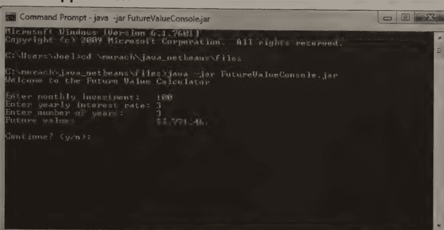

### GUI 应用程序

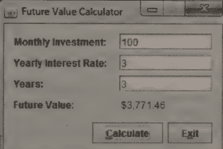

## 两种桌面应用程序总结

- 控制台应用程序使用控制台与用户交互。
- GUI 应用程序使用图形界面与用户交互。

图 1-3 两种桌面应用程序

## 两种 Web 应用程序

图 1-4 显示了你可以用 Java 开发的两种 Web 应用程序。在 Java 的早期（也是互联网的早期），Java 最令人兴奋的功能之一是你可以用它来创建一种特殊的基于 Web 的应用程序，如图中所示的 applet。这种 applet 的工作方式与前图所示 GUI 应用程序类似。然而，与 GUI 应用程序不同，applet 可以存储在 HTML 页面中并在支持 Java 的浏览器中运行。因此，曾经可以通过互联网或局域网分发 applet。

近年来，随着安全限制的收紧，支持 applet 的浏览器越来越少，即使安装了设计用于允许 applet 在浏览器中运行的插件。这就是为什么图中的 applet 显示在作为 JDK 部分的 App Viewer 中，而不是显示在 Web 浏览器中。由于这些安全限制，applet 实际上已经过时。它们仍然作为 Java SE 的一部分为了向后兼容，但它们不再被广泛使用，我们也没有在书中介绍它们。

此外，由于 applet 运行在客户端的浏览器中，它们从未是处理服务器资源（如企业数据库）的理想方式。访问数据库的更好方法是使用 Java EE 创建运行在服务器上的 Web 应用程序。这些应用程序通常基于 servlet。

Servlet 是一种特殊的 Java 应用程序，运行在服务器上并由客户端（通常是 Web 浏览器）调用。图中也说明了这一点。在这里，你可以看到 servlet 的工作方式像 applet。然而，servlet 运行在服务器上。

通常，浏览器向 servlet 发送请求。当 servlet 接收请求时，它像 applet 一样工作。但是，servlet 运行在服务器上，而不是客户端。这意味着当 servlet 执行时，它向浏览器返回结果 HTML 页面。为了在 HTML 页面中使用 servlet，Java EE 规范提供了 JavaServer Pages (JSP)。关于此的更多信息，请参阅《Murach's Java Servlets and JSP》。

### Applet

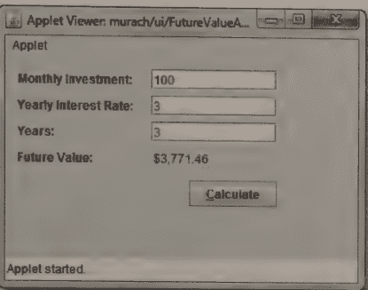

### Servlet

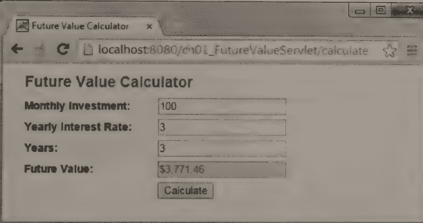

### 描述

- Applet 是一种运行在浏览器中的 Java 应用程序。
- 过去，大多数浏览器都支持运行 applet。现在，支持 applet 的浏览器越来越少。因此，它们实际上已经过时。
- Servlet 是一种运行在 Web 服务器上的 Java 应用程序。
- Servlet 接收客户端的请求并返回响应。通常，客户端是 Web 浏览器。

图 1-4 两种 Web 应用程序

## 移动应用

你也可以使用 Java 开发运行在即智能手机或平板电脑等移动设备上的应用程序。特别是，Java 常用于编写运行在 Android 设备上的代码。例如，图 1-5 显示了一个用 Java 开发的移动应用。该应用的任务与之前的图中应用程序相同。

应用的工作方式类似于传统应用程序。然而，用户界面必须经过以适应移动设备。例如，图中用户界面已修改以适应没有键盘的小触摸屏。因此，用户可以使用键盘输入数字并按下键盘上的 Done 按钮执行计算。

Android 操作系统包含一个支持 Java 子集的虚拟机，即 Java 6 和 7 的大部分功能。因此，如果你使用 Java 开发 Android 应用，你将无法使用 Java 的所有功能，特别是最新的功能。这是因为 Android 虚拟机不是 Java 机器。换句话说，Android 虚拟机无法运行编译后的 Java 代码，而 Java 虚拟机无法运行编译后的 Android 代码。尽管如此，你可以使用 Java 的大部分功能来编写 Android 应用，并且很容易编译这些代码以便 Android 虚拟机运行。

### 移动应用


### 描述

- 移动应用使用智能手机或平板电脑等移动设备与用户进行交互。
- Android 操作系统支持 Java 的子集，包括 Java 6 和 7 的大部分功能。

图 1-5 移动应用

## Java 开发简介

到此时，你已经准备好查看应用程序的源代码了。你准备好学习 Java 如何编译和解释这些代码。你还准备好了解一些可以用于开发此类代码的 IDE（集成开发环境）。

## 控制台应用程序的代码

当你开发 Java 应用程序时，从输入和编辑源代码开始。为了让你了解 Java 源代码的工作原理，图 1-6 展示了图 1-3 所示的未来价值（Future Value）应用程序控制台版本的代码。

如果你有其他编程语言的经验，你可能已经理解这些代码的大部分内容。如果没有，别担心！你将在接下来的章节中学习所有这些代码是如何工作的。现在，这里是对这些代码的简要解释。

该应用程序的大部分代码存储在一个名为 `murach.fv` 的包中，对应于 `murach/fv` 文件夹。在这个包中，有一个名为 `Main` 的类，对应于名为 `Main.java` 的文件。该类以大括号 `{` 开始，以大括号 `}` 结束。

在该类中，代码定义了一个名为 `main` 的方法。该方法也以大括号 `{` 开始，以大括号 `}` 结束。这些括号进行了缩进，以清晰地显示它们包含类内部。

这是一种特殊的方法，被称为应用程序的 main 方法。该方法内的代码在运行应用程序时会自动执行。在这种情况下，代码提示用户输入，获取用户输入，将输入转换为适当的数据类型，根据用户输入计算未来价值，并将结果显示给用户。

为了实现这一点，该代码使用了两个循环。每个循环都以大括号 `{` 开始，以大括号 `}` 结束。大括号内的代码也进行了缩进。这表明第一个循环被编写在 `main` 方法内部，而第二个循环被编写在第一个循环内部。

第一个循环允许用户通过输入 "y" 继续计算，或通过输入 "n" 退出。第二个循环每月执行一次，包含了计算未来价值的语句。为了实现这一点，这些语句将每月投资额和每月金额加到当前的未来价值上。

### 控制台应用程序的代码

```java
package murach.fv;

import java.text.NumberFormat;
import java.util.Scanner;
public class Main {

    public static void main(String[] args) {
        // displayLine welcome message
        System.out.println("Welcome to the Future Value Calculator");
        System.out.println();

        Scanner sc = new Scanner(System.in);
        String choice = "y";
        while (choice.equalsIgnoreCase("y")) {
            // get input from user
            System.out.print("Enter monthly investment: ");
            double monthlyInvestment = Double.parseDouble(sc.nextLine());

            System.out.print("Enter yearly interest rate: ");
            double yearlyInterestRate = Double.parseDouble(sc.nextLine());

            System.out.print("Enter number of years: ");
            int years = Integer.parseInt(sc.nextLine());

            // convert yearly values to monthly values
            double monthlyInterestRate = yearlyInterestRate / 12;
            int months = years * 12;

            // calculate the future value
            double futureValue = 0;
            int i = 1;
            while (i <= months) {
                futureValue = futureValue + monthlyInvestment;
                double monthlyInterest = monthlyInvestment * monthlyInterestRate;
                futureValue = futureValue + monthlyInterest;
                i++;
            }

            // format and display the result
            System.out.println("Future value: " +
                NumberFormat.getCurrencyInstance().format(futureValue));
            System.out.println();

            // see if the user wants to continue
            System.out.print("Continue? (y/n): ");
            choice = sc.nextLine();
            System.out.println();
        }
        System.out.println("Bye!");
    }
}
```

图 1-6 控制台应用程序的代码

## Java 如何编译和解释代码

一旦写了源代码，你就使用 Java 编译器将源代码编译为称为 Java 字节码（`Java bytecodes`）的格式，如图 1-7 所示。此时，字节码可以在任何安装了 Java 运行环境（JRE）的平台上运行。JRE 包含了运行字节码所需的所有软件。其中就包括一个 Java 虚拟机（JVM）的实现。此 JVM 包含一个 Java 解释器，可以将 Java 字节码翻译成底层操作系统可以理解的原生代码。

大多数现代 JVM 实现都已将 Java 解释器替换为即时编译器（JIT 编译器）。JIT 编译器在某些方面与解释器相似，但它实际上是将 Java 字节码中经常使用的部分编译成原生代码，并将这些代码存储在缓存中。这显著地提高了性能。

由于所有主要的操作系统都提供了 JRE，因此你可以在大多数平台上运行 Java。这使得 Java 应用程序具有平台无关性。相比之下，C++ 需要为每个平台提供一个特定的编译器。

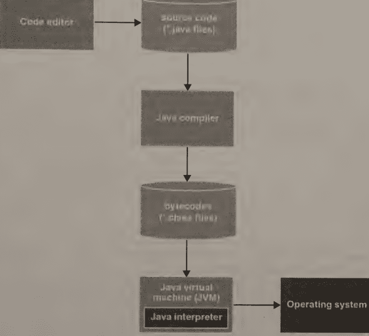

### 描述

- 当你开发 Java 应用程序时，你通常使用代码编辑器来处理源代码。包含源代码的文件名为 `.java`。
- Java 编译器将源代码翻译成一种称为 Java 字节码（`Java bytecode`）的平台无关格式。包含字节码的文件名为 `.class`。
- Java 虚拟机（JVM）包含一个执行字节码的 Java 解释器。大多数现代 JVM 实现已将 Java 解释器替换为即时编译器（`JIT compiler`）。JIT 编译器在某些方面与解释器相似，但它显著提高了性能。
- Java 运行环境（JRE）拥有运行字节码所需的所有组件，包括 JVM。由于 JRE 在大多数操作系统上可用，字节码可以在大多数平台上运行。

图 1-7 Java 如何编译和解释代码

## Java 开发 IDE 简介

开发 Java 应用程序时，通常使用集成开发环境（IDE）。虽然可以使用简单的文本编辑器配合命令行工具，但 IDE 提供的功能可以使开发变得容易得多。图 1-8 描述了流行 IDE 的功能。

图中列出的所有 IDE 都是免费或提供免费版本的。这对于学生以及自学程序员来说特别有吸引力。大多数这些 IDE 也运行在所有操作系统上。

图中列出的前两个 IDE——NetBeans 和 Eclipse 是两个最流行的 Java IDE。这两个 IDE 都提供了图中列出的所有功能。例如，这两个 IDE 都能帮助你完成代码并对潜在的编译错误进行提示。它们在你运行代码之前都会自动编译代码。它们都包含一个调试器，允许你执行设置断点、单步执行和查看变量值等标准调试功能。

图中列出的第三个 IDE——IntelliJ IDEA 没有 NetBeans 和 Eclipse 流行。但我们将其列在这里是为了让你了解 Java 选择的范围。此外，还有未包含在图中的 Java IDE。

图中列出的第四个 IDE——Android Studio 是为开发 Android 应用设计的。它由 Google 和 IntelliJ 开发，并于 2014 年 12 月发布了 1.0 版本。

本书介绍了如何使用 NetBeans，因为我们认为它是很棒的 IDE。然而，我们还计划出版 Eclipse 版，因为我们认为它也是很棒的 IDE。

### 流行的 Java IDE

| IDE | 描述 |
|---|---|
| NetBeans | 一款免费的开源 IDE，运行在大多数现代操作系统上。NetBeans 通常用于大多数类型的 Java 应用程序，但不用于 Android 应用。 |
| Eclipse | 一款免费的开源 IDE，运行在大多数现代操作系统上。Eclipse 通常用于开发所有类型的 Java 应用程序，包括 Android 应用。 |
| IntelliJ IDEA | 该 IDE 的社区版是一款免费的开源 IDE，运行在大多数现代操作系统上。 |
| Android Studio | 一款专为 Android 开发设计的 IDE，基于 IntelliJ IDEA 并由 Google 定制。 |

### 大多数 IDE 提供的功能

- 具有代码补全和错误检测功能的代码编辑器。


- 在运行应用程序时自动编译类文件。
- 调试器，允许你设置断点、单步执行代码并查看活动变量的值。

## 描述

- 为了开发 Java 应用程序，你通常使用像上面列出的集成开发环境（IDE）。这些 IDE 所有的都是免费的，或者有免费版本。


## NetBeans 简介

在 NetBeans 中，项目是一个虚拟文件夹，包含了应用程序的所有文件夹和文件。开始使用 NetBeans 最简单的方法是打开一个现有项目。例如，你可以在按照附录所述的方法从我们的网站下载本书中的任何应用程序后打开它们。

## 如何打开项目

在 NetBeans 中打开项目，你需要使用图 1-9 所示的“打开项目”（Open Project）对话框。该对话框允许你导航到想要打开的文件夹。例如，图中“打开项目”对话框显示了该文件夹中所有存在的 NetBeans 项目：

```
/murach/java_netbeans/book_apps
```

为了清楚地指示某个文件夹是否包含 Java 项目，“打开项目”对话框会在文件夹名称左侧显示一个小咖啡杯图标。然后，你可以通过选择该项目并点击“打开项目”按钮来打开项目。

## 打开项目的对话框

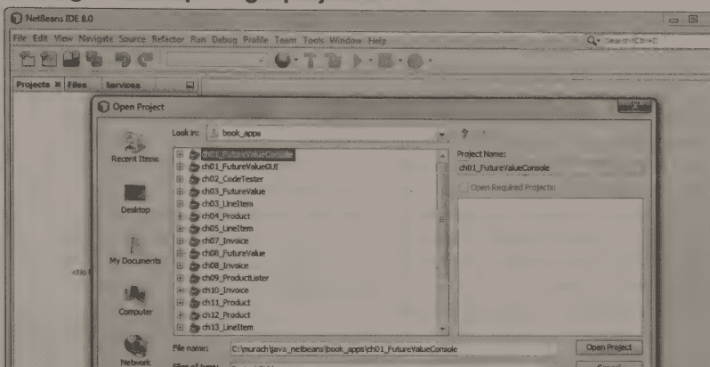

## 描述

- 一个 NetBeans 项目由一个顶级文件夹组成，该文件夹包含 Java 应用程序的子文件夹和文件。
- 要打开项目，点击工具栏上的“打开项目”按钮，或选择“文件->打开项目”命令。然后，使用显示的“打开项目”对话框定位并选择项目，然后点击“打开项目”按钮。
- 你也可以通过使用“文件->打开最近项目”命令打开项目，然后从显示的列表中选择该项目。

图 1-9 如何打开项目

## 如何在代码编辑器窗口中打开文件

图 1-10 显示了打开了 Java 应用程序项目的 NetBeans。在这个示例中，项目名为 `ch01_FutureValueConsole`。

“项目”（Projects）窗口显示该项目的文件夹包含两个子文件夹。第一个名为“源包”（Source Packages）的文件夹包含应用程序的源代码。第二个名为“库”（Libraries）的文件夹包含应用程序使用的 Java 库。在这种情况下，应用程序仅使用 JDK 1.8 的默认库，如有必要，你可以添加其他库。

在“源包”文件夹中，源代码可以组织在多个包（packages）中。这里，项目包含一个名为 `murach.fv` 的包。当你开发像这里所示的小应用程序时，通常一个包是可以接受的。但对于较大的应用程序，你将希望像本书稍后描述的那样使用两个或多个包。

这里显示的应用程序由一个名为 `Main.java` 的单个源文件组成。图中，该文件在代码编辑器中打开。你将在下一章中学习更多关于使用此代码编辑器的知识。现在，你只需要知道通过双击“项目”窗口中的源文件来打开它。

## 项目的窗口和代码编辑器

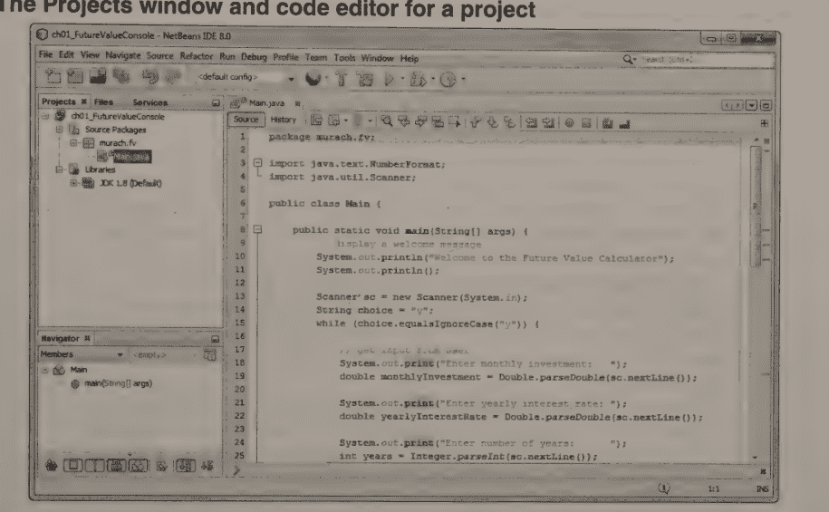

## 如何在项目窗口中导航

- 要展开或折叠“项目”窗口中的节点，请点击文件夹、文件和库左侧的加号和减号。
- “源包”子文件夹包含构成项目的 java 文件。这些文件定义了存储应用程序代码的类。
- “源包”文件夹可以在一个或多个包中存储你的项目的 java 文件，包是存储 java 文件的文件夹。
- “库”子文件夹包含了你的项目可用的库。默认情况下，你可以使用 JDK 库中的包和类。
- “项目”窗口显示构成 NetBeans 项目的文件夹、文件和库。如有必要，你可以通过选择“窗口->项目”命令显示“项目”窗口。

## 如何在代码编辑器窗口中打开文件

- 你可以使用代码编辑器窗口来处理 `.java` 文件的源代码。
- 要在代码编辑器窗口中打开文件，请使用“项目”窗口导航到 `.java` 文件并双击它。

图 1-10 如何在代码编辑器中打开文件

## 如何编译和运行项目

图 1-11 显示了如何编译和运行项目。运行项目的一种简单方法是按 `F6`。然后，如果项目自上次编译以来已修改过，则会重新编译。

## 如何处理两个或多个项目

到为止，本章向你展示了如何在 NetBeans 中处理单个项目。然而，NetBeans 允许你同时打开并处理两个或多个项目。例如，如果你在开始编写自己的项目之前，想运行本书下载的某些项目，你可以同时在 NetBeans 中打开这些项目。你将在本章练习练习机会这样做。

图 1-12 展示了处理两个或多个项目的技巧。当你打开两个或多个项目时，所有打开的项目都会出现在“项目”（Projects）窗口中。当你打开某个项目的任何文件时，它们会出现在主窗口的独立标签页中。打开文件后，你可以按 `F6` 或点击工具栏上的“运行项目”（Run Project）按钮来运行该文件的项目。或者，如果你想运行另一个项目，可以在“项目”窗口中选择该项目并按 `F6` 或点击“运行项目”按钮。

## 如何关闭或删除项目

当你完成一个项目的工作后，可以关闭它将其从“项目”窗口中移除。为此，你可以右键点击该项目并选择“关闭”（Close）命令。

如果你决定不再在 NetBeans 中处理某个项目，也可以将其删除。在删除项目之前，NetBeans 会提示你确认删除。然后，默认情况下，NetBeans 会删除项目的所有文件，源代码除外。这样，如果你需要，就可以在 NetBeans 之外处理这些文件。如果你也想删除源文件，可以在显示的对话框中选择“也删除源”（Also Delete Sources）选项。

## 两个项目的 NetBeans

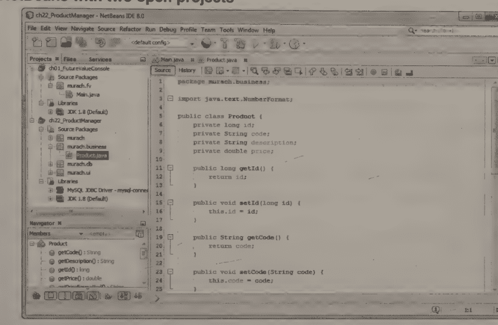

NetBeans 允许你同时打开并处理两个或多个项目。

- “项目”窗口显示所有打开的项目。

## 如何更改当前项目

- 当你打开某个项目的文件时，NetBeans 会在窗口的标签页中打开该文件，并将该文件关联的项目设置为当前项目。
- 要更改当前项目，请点击“项目”窗口中的项目。

## 如何关闭或删除项目

- 要关闭项目，在“项目”窗口中右键点击该项目并选择“关闭”命令，或者选择项目并使用“文件（File）→关闭项目（Close Project）”命令。
- 要删除项目，在“项目”窗口中右键点击该项目并选择“删除（Delete）”命令。执行时，你可以删除 NetBeans 用于管理项目的文件，也可以删除该项目的所有文件夹和文件。

图 1-12 如何处理两个或多个项目

## 展望

在本章中，你学习了关于 Java 的一些背景信息。此外，你还学习了如何使用 NetBeans 打开、编译和运行现有项目。有了这些背景，你已经准备好开始学习编写 Java 代码并创建新项目了。

## 总结

- 你可以使用 Java 开发工具包（JDK）开发 Java 应用程序。
- Java 的标准版（SE）被称为 Java SE。
- 你可以使用 Java SE 创建在你的计算机上运行的桌面应用程序。
- 桌面应用程序可以使用图形用户界面（GUI）或控制台来显示输出并获取用户输入。使用控制台与用户交互的应用称为控制台应用程序。
- 你可以使用 Java 的企业版（称为 Java EE），使用 servlets 和服务器页面（JSPs）创建服务器端应用程序。
- Java 编译器将源代码翻译成平台无关的格式，即 Java 字节码。
- Java 运行环境（JRE）包含了运行字节码所需的所有软件。
- JRE 包含 Java 虚拟机（JVM）的实现。
- JVM 包含一个 Java 解释器，可以将 Java 字节码翻译成底层操作系统可以理解的本地代码。
- 大多数现代 JVM 已经用即时编译器（JIT 编译器）替换了 Java 解释器。JIT 编译器在某些方面与解释器相似，但它显著提升了性能。
- 集成开发环境（IDE）可以通过提供代码补全、错误检测、自动编译和调试器，使使用 Java 的工作变得更简单。
- 在 NetBeans 中，项目是一个包含构成应用程序的所有文件的文件夹。
- 如果应用程序向控制台打印文本，NetBeans 会在“输出”（Output）窗口中显示该文本。NetBeans 还允许你在“输出”窗口中输入输入内容。

## 在进行本章练习之前

在进行书中的任何练习之前，你需要安装 NetBeans 和 JDK。此外，你还需要为我们的网站（www.murach.com）安装本书的源代码。详等信息请参阅附录 A（PC）或 B（Mac）。

## 练习 1-1 打开并运行两个项目

本练习将引导你通过 NetBeans 打开并运行两个应用程序。

### 打开并运行 Future Value 应用的控制台版本

1. 启动 NetBeans。当显示启动页时，请查看它。然后，关闭此页。
2. 打开名为 `ch01_FutureValueConsole` 的项目。该项目应存储在文件夹中：
   `murach/java_netbeans/book_apps`
3. 展开 `murach.fv` 包。
4. 在代码编辑器中打开 `Main.java` 文件并查看其代码，了解此控制台应用程序是如何工作的。
5. 按 `F6` 运行应用程序。在提示时，输入每月投资额、年利率和年数的数值。然后，当询问你是否继续继续时，输入“n”退出应用程序。

### 打开并运行 Future Value 应用的 GUI 版本

6. 打开名为 `ch01_FutureValueGUI` 的项目。
7. 展开 `murach.fv` 包。
8. 在代码编辑器中打开 `java.files` 代码并查看其代码。这应该让你了解开发一个简单的 GUI 应用程序需要什么。现在，如果你不理解这些代码也不要担心！你将在书末尾学习如何编写这样的代码。
9. 点击工具栏上的“运行项目”按钮运行应用程序。在前三个框中输入值，点击“计算”（Calculate）按钮，并查看计算结果。然后，点击“退出”退出应用程序。

### 设置主项目并再次运行应用程序

10. 在“项目”窗口中选择 `ch01_FutureValueConsole` 项目。然后，按 `F6` 运行此应用程序。
11. 在“项目”窗口中选择 `ch01_FutureValueGUI` 项目。然后，点击“运行项目”按钮运行此应用程序。
12. 退出 NetBeans。如果 NetBeans 显示这些应用程序仍在运行的对话框，确认你要退出并停止这些应用程序。

# 如何开始编写 Java 代码

学习 Java 编程最快最好的方法就是进行 Java 编程。这就是为什么本章向你展示如何开始编写 Java 代码。当你完成本章后，你应该能够编写一个简单的应用程序，执行计算并将计算结果打印到控制台。

- 基础编码技能 ............................................................32
- 如何编写类 ...................................................................................... 32
- 如何编写 main 方法 ................................................................................ 32
- 如何编写语句 ....................................................................................... 34
- 如何编写注释 ....................................................................................... 34
- 如何向控制台打印输出 ........................................................................ 36
- 如何使用 NetBeans 处理新项目 ...........38
- 如何创建项目 ................................................................................ 38
- 如何处理 Java 源代码和文件 ........................................................ 40
- 如何使用代码补全功能 ................................................................ 42
- 如何检测并修正语法错误 ................................................................ 44
- 如何处理数字 ............................................................46
- 如何声明和初始化变量 ............................................................... 46
- 如何给变量赋值 ...................................................................... 48
- 如何编写算术表达式 ................................................................. 50
- 如何处理字符串 ................................................................52
- 如何声明和初始化 String 变量 ................................................... 52
- 如何合并字符串 ................................................................................................... 52
- 如何在字符串中包含特殊字符 ...................................................... 54
- Code Tester 应用程序 ................................................................56
- 用户界面 ................................................................................................... 56
- CodeTesterApp 类 ....................................................................................... 56

## 基础编码技能

本章从介绍一些基础编码技能开始。特别是，它展示了如何编写类、主方法、语句和注释。

## 如何编写类

图 2-1 显示了如何编写类的起始代码，类是你存储 Java 代码的地方。开始时，你通常会编写一个包语句（package statement）。该语句指定了类所属的包，这与存储该类的子文件夹相对应。例如，在图中，该包指定了 `murach.test` 包。此包对应于应用程序文件夹下的 `murach/test` 子文件夹。虽然不是必须在包中开始编写类，但强烈建议这样做。当一个应用程序包含许多类时，包可以帮助组织这些类并防止命名冲突。

在编写完包语句后，你通过编写类声明（class declaration）来声明一个类。通常，类声明以 `public` 关键字开始，这意味着其他类可以可以访问它。该关键字是一个访问修饰符，用于控制类的范围。

在 `public` 关键字之后，你编写 `class` 关键字，后面跟着类名，并且其中的每个单词的首字母都要大写。此外，常见的惯例是仅使用字母和数字。例如，图中的类声明指定了一个名为 `TesterApp` 的类。

类的文件名与类名相同，并以 `.java` 作为扩展名。例如，`TesterApp` 类存储在名为 `TesterApp.java` 的文件中。

在名称之后，你编写一个左大括号 `{}` 来标识类的开始，以及一个右大括号 `{}` 来标识类的结束。通常，你编写右大括号的缩进层级与类声明相同。这可以清晰地显示类的类的结束位置，并有助于防止遗漏大括号。

## 如何编写主方法

在类的大括号内部，你可以编写一个或多个方法。在这里，每个方法都包含执行特定操作的代码。在图中，类只包含一个方法，即主方法（main method）。Java 在运行包含该方法的类时会自动执行该方法。所有的 Java 应用程序都至少包含一个启动应用程序的主方法。

要编写主方法，你首先要在类声明内部编写一个主方法声明。在书中，你将学习更多关于此声明所用关键字的知识。现在，你只需要知道主方法声明你可以完全按照图中所示的方式编写它。

成对大括号内的代码是一个代码块（block of code）。图中包含两个代码块：(1) 类块和 (2) 主方法块。

## 带有主方法的类

```java
package murach.test; // 包语句

public class CodeTesterApp { // 类声明

    public static void main(String[] args) { // 主方法
    } // 方法结束
} // 类结束
```

## 此类的文件夹和文件名

`murach/test/CodeTesterApp.java`

## 类的命名规范

- 名称以大写字母开头。
- 类名中每个单词的首字母都大写。
- 仅使用字母和数字。

## 描述

- 类存储 Java 代码。每个类都从类声明开始。
- 包是一个包含一个或多个类的文件夹。它们有助于组织多个类。大多数类都从包语句开始，该语句标识包含该类的文件夹。
- 方法是一个执行任务的代码块。类可以包含一个或多个方法。


- 一个类可以包含一个主方法。该方法通常是应用程序的起点。你可以通过运行该类来执行此方法。
- 开大括号和闭大括号标识类和方法的开始与结束。大括号内的代码可以被称为代码块。
- `public` 关键字是一个访问修饰符，允许类或方法被其他代码使用。
- 类的文件名与类名相同，以 `.java` 为扩展名。


### 如何编写语句

语句执行任务并以分号结束。例如，在图 2-2 中，主方法包含三个语句。第一条语句向控制台打印欢迎消息，第二条语句打印空行，第三条语句打印“Bye!”的消息。

当你编写语句时，你可以在一行的任何地方开始，并可以从一行继续到另一行。然而，为了让你的代码更易读，你应该使用缩进和间距来对齐语句，如本书中所所示。

### 如何编写注释

当你编写代码时，可以使用注释来记录应用程序的功能以及特定代码块和代码行的作用。由于 Java 编译器会忽略注释，因此你可以在代码的任何地方包含注释，而不会降低代码的性能。

单行注释通常描述一行或多行代码。这种注释以两个斜杠（`//`）开头，告诉编译器忽略当前行结束的所有字符。图中使用了单行注释来标识此代码的结构：类的声明和结束，以及主方法的声明和结束。此外，它还使用单行注释来描述向控制台打印空行的语句。由于这些注释与代码在同一行编写，它们有时被称为行尾注释。

然而，你也可以单独在一行中编写单行注释。例如，图中描述打印欢迎消息语句的注释是单独行编写的。

块注释通常用于记录适用于代码块的信息。例如，块注释可以包含作者信息、代码目的等。在图中，代码以一个块注释开始，包含了作者姓名和代码目的。

许多程序员在代码中散布注释，但如果你写的代码易于阅读和理解，这并不是必要的。相反，你应该只用注释来解释难以理解的代码。例如在图中，经验丰富的 Java 程序员不需要任何单行注释。

注释的一个问题是它们可能无法准确反映代码的功能。这通常发生在程序员更改了代码但没有更改随后的注释时。这时，理解代码变得更加困难，因为注释具有误导性。所以，如果你更改了代码，请确保也更改注释。

### 包含语句和注释的类

```java
/*
* 作者：Murach
* 目的：此应用程序在控制台显示某些文本。
它可以作为代码测试的起点。
*/
```

```java
package murach.test; // 包语句

public class CodeTesterApp { // 类声明
    public static void main(String[] args) { // 主方法
// 显示欢迎消息
        System.out.println("Welcome to the Code Tester");
        System.out.println(); // 打印空行
        System.out.println("Bye!"); // 方法结束
    } // 类结束
}
```

### 描述

- 语句执行任务并以分号结束。
- 你可以在一行的任何一点开始语句，并从一行继续到下一行。为了让你的代码更易读，你应该使用缩进和额外的空格来对齐语句及其部分。
- 注释通常记录代码的功能。良好的注释对编写代码的程序员以及以后需要审查或维护代码的程序员都有帮助。
- 要编写单行注释，输入 `//` 后跟注释内容。你可以单独在一行中编写单行注释，也可以跟在语句之后。跟在语句后的注释有时被称为行尾注释。
- 要编写块注释，在块的开始处输入 `/*`，在结束处输入 `*/`。你也可以在块中使用星号来标识块中的行，但并非必要的。

图 2-2 如何编写语句和注释

### 如何将输出打印到控制台

大多数应用程序都需要某种类型的用户交互。例如，它们通常需要向用户显示输出并从用户处获取输入。实现此操作最简单的方法是使用称为控制台的命令行界面与用户交互。为了开始学习，图 2-3 显示了如何通过向控制台打印内容向用户显示输出。

当你使用控制台时，它的外观可能会根据操作系统的不同有所差异。然而，应用程序的运行应该是相同的。此外，大多数 IDE 在你开发和测试控制台应用程序时，都提供了与控制台工作的便捷方法。

要打印到控制台，你可以使用 `System.out` 对象的 `println` 和 `print` 方法。`println` 和 `print` 方法都接受一个参数，指定要打印到控制台的数据。要编写参数代码，只需在方法名后编写一组括号。图中，第一个 `println` 方法向控制台打印了一个字符字符串。为了标识这个字符字符串，代码在文本周围加上了双引号。

这段代码没有向第二个 `println` 语句传递参数。结果是它只是在控制台打印了一个空行。然而，第三个 `println` 方法像第一个 `println` 方法一样，向控制台打印了一个字符字符串。

`print` 和 `println` 方法的工作原理相似。两者之间的主要区别是 `println` 方法在显示数据后会开启一个新行，而 `print` 方法不会。

图中的示例显示了一个完整的类，它使用 `println` 方法在控制台上显示数据。到目前为止，你不应该在理解这段代码如何工作上遇到太大困难。

### System.out 对象的方法

| 方法 | 说明 |
|---|---|
| `println(data)` | 将数据打印到控制台，后跟一个换行符。 |
| `print(data)` | 将数据打印到控制台。 |

### 向控制台打印输出的类

```java
package murach.test;

public class CodeTesterApp {

    public static void main(String args[]) {

        // 显示欢迎消息

        System.out.println("Welcome to the Code Tester");

        System.out.println();

        // 显示结束消息

        System.out.println("Bye!");

    }

}
```

### 控制台上显示的输出


### 说明

- 控制台的外观可能因系统而异，你始终可以使用 `System.out` 对象的 `println` 和 `print` 方法将数据打印到控制台。

图 2-3 如何将输出打印到控制台

### 如何使用 NetBeans 创建新项目

现在你已经理解了如何编写一个向控制台打印数据的类，你准备好学习如何使用 NetBeans 创建一个包含此类类的新项目了。然后，你可以使用 NetBeans 输入该类的代码。

### 如何创建一个新项目

图 2-4 展示了创建 Java 应用程序的对话框。首先，你可以使用“New Project”（新建项目）对话框选择你想要创建的项目类型。对于本书，你将使用“Java Application”（Java 应用程序）项创建一个所示的 Java 应用程序。然后，当你点击“Next”（下一步）按钮时，NetBeans 会显示一个与图中第二个类似的对话框。

第二个对话框允许你为项目输入名称和位置。例如，图中项目名称为“ch02_CodeTester”，它将存储在该文件夹中。

```
/murach/java_netbeans/book_apps
```

如果你按照附录中的描述安装了本书的源代码，书中介绍的所有应用程序都存储在该文件夹中。

默认情况下，在 NetBeans 中创建 Java 应用程序时，NetBeans 会生成一个带有 `main` 方法的主类。如果这不是你想要的，可以取消勾选“Create Main Class”（创建主类）选项上的勾标记。但在大多数情况下，你仍然会勾选此选项。然后，你可以为主类输入名称。此外，你通常会为该类输入一个包名。

例如图中的项目，我将项目命名为 02_CodeTester，将包命名为 murach.test，将类命名为 CodeTester。结果是 NetBeans 创建了一个名为 ch02_CodeTester 的项目，该项目包含一个名为 murach.test 的包，而该包又包含一个名为 CodeTester 的类。

当你选择包名时，应该选择一个有助于规避与其他类发生命名冲突的名称。此外，你应该选择一个让你能够以逻辑方式组织类的名称。在这里，我使用“murach”作为名称的第一部分，因为这是我们公司的名字，不太可能别人会使用这个名字。然后，我使用“test”作为名称的第二部分，因为我打算用这个包来存储用于测试的类。

为了确保包名的唯一性，一种常见的命名方案是以公司的互联网域名反向开始包名。例如，域名为 murach.com 的公司可以使用 com.murach 作为其包名的开头。

当完成此对话框后，你可以点击“Finish”（完成）按钮来创建项目以及包含 `main` 方法的类。然后，NetBeans 会创建一个与项目对应的文件夹以及包含 `main` 方法的类。

### 创建 Java 应用程序的对话框


### 说明

- 控制台的外观可能因系统而异，你始终可以使用 `System.out` 对象的 `println` 和 `print` 方法将数据打印到控制台。
- 要创建一个新项目，你可以使用“New Project”对话框选择你想要创建的项目类型。对于本书，你将使用“Java Application”项创建一个所示的 Java 应用程序。然后，当你点击“Next”按钮时，NetBeans 会显示一个与图中第二个类似的对话框。
- 第二个对话框允许你为项目输入名称和位置。例如，图中项目名称为“ch02_CodeTester”，它将存储在该文件夹中。

图 2-4 如何创建一个新项目

### 如何处理 Java 源代码

当你创建一个带有 `main` 方法的项目时，NetBeans 会打开源代码编辑器。为了方便你识别 Java 语法，编辑器对不同的元素使用了颜色。例如，图中 NetBeans 生成了一些类代码，声明了包，并声明了方法。

如果你要处理的源代码没有在编辑器中显示，可以使用项目窗口导航到 `.java` 文件。然后，双击它以在编辑器中打开。例如，图中 CodeTester.java 文件显示在项目窗口中。注意该文件存储在 murach.test 包中。

你可以在项目窗口中重命名或删除 Java 文件。要执行操作，只需右键点击文件并选择相应的命令。如果你重命名文件，NetBeans 会自动更改 `.java` 文件名和类名。由于 `.java` 文件名必须与类名匹配，这通常正是你需要的。

### 带有项目初始源代码的编辑器


### 说明

- 要在编辑器中打开 Java 文件，可以在项目窗口中双击它。然后，你可以使用常规编辑技术来处理源代码。
- 要折叠方法或注释的代码，点击其左侧的减号 (-)。然后方法或注释左侧会出现加号 (+)，你可以点击加号再次显示代码。
- 要保存文件的源代码，请使用 File->Save 命令（Ctrl+S）或点击工具栏上的“Save All Files”按钮。这会编译文件，这样在运行项目时无需再次编译。
- 要重命名文件，右键点击它，选择 Refactor->Rename 命令，并在生成的对话框中输入新名称。
- 要删除文件，你可以右键点击它，选择 Delete 命令，并在生成的对话框中确认删除。

图 2-5 如何处理 Java 源代码

## 如何使用代码补全功能

图 2-6 显示了如何使用代码补全功能。此功能可以防止你出现输入错误，并允许你发现各种类和对象可用的字段和方法。在图中，例如我开始输入一个向控制台输出内容的语句。

首先，我输入 `Sys` 并按下 Ctrl+Space（同时按下这两个键）。这显示了一个列表，`System` 类是唯一的选项。然后，我按下 Enter 键自动输入剩余的类名。

接下来，我输入了一个点号。这显示了 `System` 类可用的字段和方法列表。然后，我使用方向键选择字段名并按下 Enter 键自动输入该字段名。

最后，我输入了另一个点号。这显示了一个很长的方法列表。然后，我输入 "pr" 来滚动列表，找到以 "pr" 开头的方法，并使用方向键选择了图中所示的 `println` 方法。此时，我可以按 Enter 键让 NetBeans 为我将方法输入到编辑器中。

当你使用代码补全时，每当需要时它会自动输入左右括号和参数。在图中，例如我选择了 `println` 方法，其后跟着一组包含参数的括号。当我按下 Enter 键时，NetBeans 将括号和参数插入到代码编辑器中，并高亮了该参数，以便我为其赋值。

代码补全功能还可以让你轻松地为字符串文本输入值。如果你输入一个引号来标识字符串，代码补全功能会自动输入左右引号并将光标置在两个引号之间。此时，你就可以输入文本了。

如果你尝试代码补全功能，你很快就会发现它何时能帮助你更快地输入代码，以及什么时候自己编写代码更有意义。此外，你还会发现它可以帮助你理解你正在处理的各种类和对象所拥有的字段和方法类型。随着你在接下来的几章中学习更多 Java，这将更有意义，但对大多数程序员来说，它是非常有帮助的，特别是对于那些 Java 初学者。

## 带有代码补全列表的代码编辑器

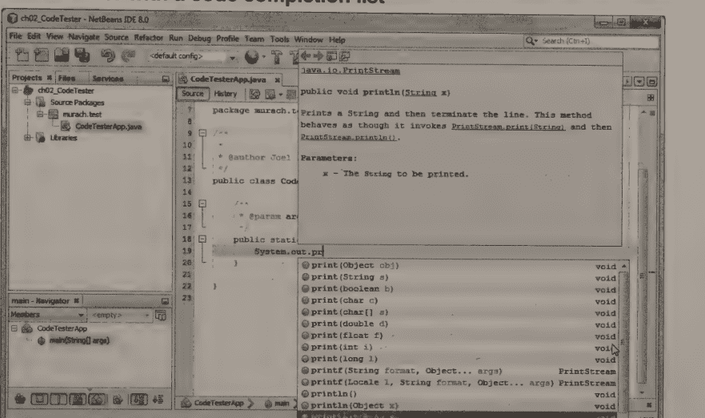

### 描述

- 你可以使用代码补全功能帮助输入类和对象的名称，并从类或对象可用的方法和字段中进行选择。
- 要激活输入类或对象名称的代码补全功能，在输入类或对象名称的一个或多个字母后按下 Ctrl+Space。然后将显示所有以这些字母开头的类和对象列表。
- 要激活类或对象的方法或字段的代码补全功能，在类或对象名称后输入一个点号。然后将显示该类或对象的所有方法和字段列表。
- 要从代码补全列表中插入项，使用方向键选择该项并按下 Enter 键。如果项需要一个或多个参数，将为这些参数添加默认值，并高亮第一个参数以便你输入其值。你可以按 Tab 键并输入其余参数的值。
- 如果你输入了字符串文本的起始引号，代码补全功能会自动添加结束引号并将光标置于两个引号之间，以便你输入文本。

图 2-6 如何使用代码补全功能

## 如何检测和修正语法错误

在 NetBeans 中，无法编译的语句会导致语法错误。当你向代码编辑器中输入文本时，NetBeans 每当检测到语法错误就会显示出来。例如在图 2-7，NetBeans 在语句左侧显示一个带有红色图标标记的错误。此外，包含错误的语句被标记了红色的波浪下线。

如果你将鼠标光标悬停在红色错误图标或语句本身上，NetBeans 会显示错误的描述。在图中，例如，描述指示 NetBeans 在语句末尾需要一个分号。因此，你可以通过输入分号来修复错误。

## 显示错误的代码编辑器

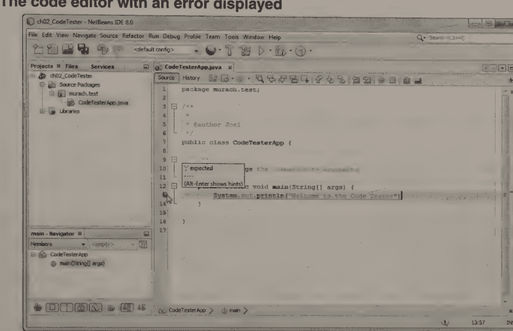

### 描述

- 当你向代码编辑器中输入代码时，NetBeans 会检测语法错误。
- 当 NetBeans 检测到语法错误时，它会在语句左侧显示一个红色错误图标，并在语句下方放置红色波浪线。
- 要获取有关语法错误的更多信息，你可以将鼠标指针悬停在错误图标上。或者，你可以将光标移动到包含错误的行并按下 Alt+Enter。

图 2-7 如何检测和修正语法错误

## 如何处理数字

大多数应用程序都需要处理数字。这就是为什么接下来的两幅图将向你展示如何开始处理数字。首先，这些展示了如何在变量中存储数字。

## 如何声明和初始化变量

变量存储一个随你的代码执行而可能改变的值。在使用变量之前，你必须声明它的数据类型和名称。当你这样做时，通常会通过给它赋值来初始化变量。图 2-8 显示了如何操作。

但在之前，这幅图总结了两个基本类型：

### 两种基本类型

| 类型 | 描述 |
| --- | --- |
| `int` | 整数（整数），范围从 -2,147,483,648 到 2,147,483,647。 |
| `double` | 双精度浮点数（小数数字）。 |

### 使用两条语句声明并初始化变量

```java
type variableName;

variableName = value;
```

示例：
```java
double productPrice; // 声明语句

productPrice = 14.95; // 赋值语句
```

### 使用一条语句声明并初始化变量

```java
type variableName = value;
```

示例：
```java
double productPrice = 14.95; // 初始化 double 变量
```


### 变量命名建议

- 变量名以小写字母开头，并将第一个单词之后的所有单词的首字母大写。
- 每个变量名应该是名词，或者是由一个或多个形容词修饰的名词。
- 尽量使用有意义且易记的名字。

### Java 关键字

| boolean | interface | class | true |
| char | else | volatile | false |
| byte | package | switch | while |
| float | private | return | native |
| void | protected | break | throw |
| short | public | default | try | import |
| double | static | for | catch | synchronized |
| int | new | finally | const |
| long | this | continue | transient | goto |
| abstract | super | extends | instanceof | null |

对于一些常见的变量名，程序员通常使用一个或两个小写字母。例如，他们经常使用 `i` 作为用作计数器变量的 `int` 变量名。这在简短的代码块中是可以接受的，因为很容易理解该变量的作用。

在给变量命名时，你不能使用关键字作为变量名。Java 语言预留了 50 个关键字，如图 2-8 所示。为了帮助你识别代码中的关键字，大多数 Java IDE 会将这些关键字显示为与其它 Java 代码不同的颜色。随着你对这本书的阅读，你将学习如何使用大部分这些关键字。

## 如何给变量赋值

图 2-9 显示了如何给一个已经声明的变量赋值。首先，第一个代码示例声明并初始化了两个变量。这些变量被此图中的其他示例使用。第一个变量命名为 `quantity`，并初始化为 `int` 值 0。第二个变量命名为 `maxQuantity`，并初始化为 `int` 值 100。

第二个示例开始时通过给 `quantity` 变量赋值 10 来更改它的值。然后，它再次通过将存储在 `maxQuantity` 变量中的值赋给 `quantity` 变量来更改它。这说明变量的值是可以改变的。它说明你可以将像 100 或 10 这样的字面量赋给变量。它还可以可以将另一个变量（如 `maxQuantity`）赋给变量。

第三个示例显示了如果在变量已经声明后尝试再次声明会发生的常见编码错误。在这种情况下，你会得到语法错误。这是因为该语句不必要地声明了变量的类型。要修复此，你可以从语句中移除类型声明。例如，在图中你可以移除语句开头的 `int` 关键字。

第四个示例显示了如果使用错误的大小写来引用变量会发生的常见编码错误。此错误发生是因为 Java 是区分大小大小的。因此，在创建和使用变量名时需要小心。例如，在图中第一个示例将变量命名为 `maxQuantity`。因此，第四个示例无法用 `quantity` 来引用它。

## 赋值语句的语法

```
variableName = value;
```

## 声明并初始化两个变量的代码

```
int quantity = 0;          // quantity 为 0
maxQuantity = 100;
```

## 为 quantity 变量赋新值的代码

```
quantity = 10;          // quantity 现在是 10
quantity = maxQuantity;   // quantity 现在是 100
```

## 尝试第二次声明变量的代码

```
int quantity = 99;      // 错误：变量 quantity 已经声明
```

## 使用错误大小写引用变量的代码

```
maxquantity = 200;   // 错误：由于大小写错误找不到变量
```

### 描述

- 赋值语句为已经声明的变量赋值。该值可以是字面量值、另一个变量，或者像下一幅图所示的算术表达式等。
- 如果你尝试再次声明变量，会导致错误。
- Java 是一种区分大小写的语言。因此，在引用变量名时确保使用正确的大小写。

图 2-9 如何给变量赋值

## 如何编写算术表达式

要编写简单的算术表达式，你可以使用图 2-10 总结的四个算术运算符来处理操作数，操作数是运算符处理的原始值或变量。这些运算符的工作方式与你预期的的一 true，但有一个例外：如果你用一个整数除以另一个整数，任何小数部分都会被截断。

第一个示例显示了如何计算行项目的总金额。在这里，前两个语句声明并初始化了一个名为 `productPrice` 的 `double` 变量和一个名为 `quantity` 的 `int` 变量。然后，第三条语句声明了一个名为 `total` 的 `double` 变量并将算术表达式的结果赋给该变量。该算术表达式使用乘法运算符 (`*`) 将 `productPrice` 变量乘以 `quantity` 变量。由于此表达式混合了 `int` 和 `double` 变量，Java 在执行计算之前会将 `int` 转换为 `double` 变量。然后，它将结果作为 `double` 返回。第二个示例显示了如何计算销售税。在这里，第三条语句使用乘法运算符 (`*`) 计算销售税金额。然后，第四个示例使用加法运算符 (`+`) 将销售税金额加到小集中。

第三个示例显示了如何计算平均值。在这里，第三条语句包含一个表达式，将名为 `sum` 的 `double` 变量除以名为 `count` 的 `int` 变量。结果，Java 在执行计算之前会将 `int` 转换为 `double` 变量，并返回 `double` 值作为表达式的结果。

第四个示例显示了如果用一个 `int` 除以另一个 `int` 会发生什么。在这种情况下，由于所有变量都是 `int` 类型，计算结果为 4。这是合理的，因为 2 除 9 可以 4 次，余数为 1。然而，如果数据类型是 `double`，结果将是 4.5。第五个示例显示了使用多个运算符的表达式。在这里，第三条语句将长度乘以 2，将宽度乘以 2，然后将这些结果相加。

## 算术表达式中使用的运算符

| 运算符 | 名称 | 描述 |
|---|---|---|
| + | 加法 | 将操作数相加。 |
| - | 减法 | 从左操作数中减去右操作数。 |
| * | 乘法 | 右操作数乘以左操作数。 |
| / | 除法 | 左操作数除以右操作数。如果两个操作数都是整数，结果为整数。 |

## 计算总和的代码

```
double price = 9.99;
int quantity = 2;
double total = price * quantity;    // 19.98
```

## 计算销售税的代码

```
double subtotal = 250.00;
double taxPercent = .075; // 7.5%
double taxAmount = subtotal * taxPercent; // 18.75
double grandTotal = subtotal + taxAmount; // 268.75
```

## 计算平均值的代码

```
double sum = 206.75;
int count = 3;
double average = sum / count;    // 68.91666666666667
```

## 除以两个整数值的代码

```
int miles = 9;
int hour = 2;
milesPerHour = miles / hour;    // 4
```

## 在一个表达式中使用多个运算符的代码

```
double width = 4.25;
double length = 8.5;
double perimeter = 2 * width + 2 * length;    // 25.5
```

## 如何处理字符串

大多数应用程序都需要处理文本。这就是为什么接下来的两幅图将向你如何开始字符串。字符串是字符序列，例如字母、数字和标点符号。

## 如何声明和初始化 String 变量

要声明一个 String 变量，你使用图 2-11 所示的语法。虽然这与声明 `int` 或 `double` 变量的语法相似，但字符串是由 `String` 类创建的对象。当你声明一个 String 变量时，必须将 `String` 关键字的首字母大写，因为它是一个类名，而不是基本类型。

当你创建一个对象时，你可以将类认为是对象的模板。创建对象的过程被称为实例化。每当需要时，你都可以从类中创建多个对象或实例。例如，你通常会在单个应用程序中使用多个 `String` 对象。

当你声明一个 String 对象时，可以通过用双引号将字面量值的字符括起来给它赋值一个字符串字面量。你还可以通过编写一组中间没有任何内容的引号来给字符串赋值一个空字符串。最后，你可以使用 `null` 关键字为 String 对象赋值 `null`。这表示该 String 变量没有指向任何 String 对象。

## 如何合并字符串

如果你想合并两个或多个字符串，可以使用 `+` 运算符。例如，第二个示例将名字、一个空格和姓连接在一起。这也被被称为字符串拼接。然后，你可以将该字符串赋值给变量，如第二个示例所示的 `name`。在拼接字符串时，通常会将字符串字面量（空格）与 `String` 变量（`firstName` 和 `lastName`）混合使用，如此示例所示。

你还可以像第三个示例所示将字符串与基本类型合并。在这里，第二个语句将一个用 `double` 类型定义的变量追加到 `String` 类型的字面量上。当你使用这种技术时，Java 会自动将 `double` 转换为 `String` 类型。

当你编写字符串字面量时，它们的工作方式通常如你预期的一样。然而，你不能像这样将字符串字面量拆分为多行：

```java
String name = "Bob"
      + "Smith";
```

相反，你必须在第一行的结束关闭字符串字面量，并跨行连接第二个字符串字面量，如下：

```java
String name = "Bob"
      + "Smith";
```

## 如何声明和初始化 String 语法

```java
String variableName = value;
```

### 示例

- `String message1 = "Invalid data entry.";` // 一个空字符串
- `String message2 = "";`
- `String message3 = null;` // 一个空字符串

### 如何合并字符串

- `String firstName = "Bob";` // firstName 是 Bob
- `String lastName = "Smith";` // lastName 是 Smith
- `String name = firstName + " " + lastName;` // name 是 Bob Smith
- `double price = 14.95;`
- `String message = "Price: " + price;` // message 是 Price: 14.95

### 描述

- 字符串可以由一个或多个字符组成，包括字母、数字和特殊字符如 `*`、`&`、`#`。
- 在 Java 中，字符串实际上是从 Java API（应用程序编程接口）的 String 类部分创建的 `String` 对象。该 API 提供了作为 JDK 部分的所有类。
- 由于字符串是从 `String` 类创建的对象，因此你通过编写大写字母 S 的 `String` 来创建字符串的声明。相比之下，在声明 `int` 和 `double` 等基本类型时，不使用任何大写字母。
- 要指定字符串的值，你可以用双引号将文本括起来。这被称为*字符串字面量*。
- 要给字符串赋值 `null`，你可以使用 `null` 关键字。这意味着 String 变量没有指向内存中分配的 String 对象。
- 要给 String 对象赋值空字符串，你可以编写一组中间没有任何内容的引号。这意味着字符串不包含任何字符。
- 要将字符串与另一个字符串或数据类型合并（或拼接），请使用加号 (`+`)。只要可能，Java 都会自动转换数据类型并与字符串合并。

## 如何在字符串中包含特殊字符

图 2-12 显示了如何在字符串内部包含特殊字符。特别是，此图显示了如何在字符串中包含反斜杠、引号以及作为新行、制表符和返回的控制字符。要做到这一点，你可以使用转义序列，即以反斜杠开头的字符序列。

某些转义序列允许你插入特殊字符，如换行符。例如，如果你编写一个反斜杠后跟字母 `n`，编译器就会在字符串中包含一个换行符。如果你忽略了反斜杠，当然，编译器只会在字符串中包含字母 `n`。

制表符和返回字符的转义序列工作类似。第二个示例显示了这是如何工作的。该示例在字符串字面量中包含两个制表符、一个返回字符和一个换行符。在大多数情况下，返回字符会回到当前行的开头而不移动到新行。因此，在大多数情况下，返回字符后面紧跟着换行符，如此示例所示。

其他转义序列允许你包含属于 Java 语法的字符。例如，在双引号内编写字符串字面量是 Java 语法的一部分。因此，如果你尝试在字符串字面量内编写双引号，编译器会认为你正试图结束字符串字面量，从而导致像第三个示例那样的语法错误。要修复此错误，你可以使用所示的转义序列。

| 序列 | 字符 |
| --- | --- |
| `\n` | 新行 |
| `\t` | 制表符 |
| `\r` | 返回 |
| `\"` | 引号 |
| `\\` | 反斜杠 |

## 换行字符

`"JSP: \t49.50"`

### 显示在控制台上

| Code | JSP |
| --- | --- |
| Price | 49.50 |

## 换行、返回和制表符字符

`"Code: JSP: \t49.50"`

### 显示在控制台上

| Code | JSP |
| --- | --- |
| Price | 49.50 |

## 由引号引起的语法错误

`"Type " to exit"` // 缺少 ')'

### 引号

`"Type \"x\" to exit"`

### 显示在控制台上

| Type | "x" to exit |

## 由反斜杠引起的语法错误

`"C:\javafiles"` // 非法转义字符

| C:\files |

### 描述

- 在字符串中，你可以使用转义序列包含某些类型的特殊字符，如换行和制表符。你还可以使用转义序列包含 Java 语法的字符，如引号和反斜杠。

图 2-12 如何在字符串中包含特殊字符

## 代码测试应用程序

本章通过介绍代码测试应用程序来结束。你可以修改此应用程序以获得声明变量、进行计算以及在控制台上显示计算结果的实践机会。

## 用户界面

图 2-13 显示了此应用程序的控制台。开始时，它显示一条欢迎消息。然后，它显示四个变量的值。最后，它显示一条告别消息。

## CodeApp 类

此图还提供了代码测试应用程序的代码。所有代码都存储在 `CodeTesterApp` 类中。如果你读了本章，你应该已经理解大部分代码。

在 `main` 方法中，第一个语句使用 `println` 方法向控制台打印一条消息为 "Welcome to the Code Tester"。然后，第二个语句向控制台打印一个空行。

在前两个语句之后，此代码声明并初始化三个变量：一个 `String` 变量、一个 `double` 变量和一个 `int` 变量。然后，它执行计算并将结果赋值给第四个变量。接下来，它构建一个包含这四个变量数据的字符串。为了实现这一点，该字符串使用字面量来标记和对齐数据。此外，该字符串使用换行转义序列 (`\n`) 在每个变量后开始新行。

当此代码构建字符串后，它将此字符串打印到控制台上。然后，它向控制台打印一条消息为 "Bye!"。

### 控制台

```
Welcome to the Code Tester

Code: java
Price: 49.5
Quantity: 2
Total: 99.0

Bye!
```

### CodeTesterApp 类

```java
public class CodeTesterApp {
    public static void main(String[] args[]) {
        // display a welcome message
        System.out.println("Welcome to the Code Tester");
        System.out.println();

        // hard code three values
        String productCode = "java";
        double price = 49.50;
        int quantity = 2;

        // perform a calculation
        double total = price * quantity;

        // display the output
        String message = "Code: " + productCode + "\n" +
            "Price: " + price + "\n" +
            "Quantity: " + quantity + "\n" +
            "Total: " + total + "\n";

        System.out.println(message);

        // display a goodbye message
        System.out.println("Bye!");
    }
}
```


# 观点

本章的目标是开始 Java 编程。现在，如果你理解了 Code Tester 应用程序的工作原理，就可以通过编写自己的变量和算术表达式来获得实践经验。然而，此应用程序没有从用户获取输入，也没有对显示的输出进行格式化处理。要做到这一点，可以使用下一节提到的 Java API 中的可用类。此外，请记住，本章只是 Java 编程的入门。在第 7 章中，你将学习更多关于原始数据类型的知识，以及如何处理六种原始数据类型。在第 9 章中，你将学习更多关于字符串的内容。

## 总结

- 类（`class`）存储 Java 代码。包（`package`）存储一个或多个 Java 文件夹。包用于组织类。
- 类可以包含一个或多个方法（`method`）。方法是执行任务的代码块。
- 主方法（`main method`）是一种特殊的方法，运行包含它的类时会被执行。
- 语句（`statement`）执行任务并以分号结束。
- 注释通常用于说明代码的功能。
- 你可以使用 NetBeans 代码编辑器输入和编辑代码。在你输入代码时，可以使用代码补全功能帮助你输入类和对象的名称，并从字段和方法中进行选择。
- Java 提供八种原始数据类型。其中最常见的是 `int` 和 `double` 类型。
- 变量存储随应用程序运行而改变的数据。赋值语句可以给变量赋值。
- 字符串（`string`）由一个或多个字符组成，包括字母、数字和特殊字符。你可以使用加号将字符串与另一个字符串或原始类型连接。
- 你可以使用转义序列在字符串中包含特殊字符。

# 练习 2-1 测试 Code Tester 应用程序

在此练习中，你可以对本章最后介绍的 Code Tester 应用程序进行实验。

## 测试

1. 启动 NetBeans IDE 并打开名为 `ch02_ex1_CodeTester` 的项目。该项目应位于文件夹中：`/murach/java_netbeans/ex_starts`
2. 展开 `murach.test` 包，打开名为 `CodeTesterApp.java` 的文件，并查看该文件的代码。
3. 运行此应用程序。它的运行结果正如本章末尾所示。

## 初始化并打印更多变量

4. 在 `main` 方法中，为你的姓和名初始化 `String` 变量。然后，按照以下格式将这些 `String` 变量打印到控制台：

```
Name: Lastname, FirstName
```

5. 运行应用程序以确保其工作正常。
6. 添加一条赋值语句，更改用于名字变量的值。
7. 再次运行应用程序，确保打印到控制台的名字已更改。

## 处理算术表达式

8. 声明并初始化一个 `double` 变量来存储总和，以及一个 `int` 变量来存储计数。
9. 通过将总和变量除以计数变量来计算平均值。然后，将计算结果赋值给平均值变量并将其打印到控制台。完成后，控制台应该看起来所示：

| Sum: 301.75 |
| :--- |
| Count: 6 |
| Average: 50.29166666666664 |

10. 运行应用程序以确保其工作正常。
11. 添加一条赋值语句，更改总和变量的值。
12. 再次运行应用程序，确保打印到控制台的总和和平均值数据已更改。

## 计算税额和总计

13. 按照以下步骤修改初始代码，使其包含产品描述、税额和总计。当你修改此代码时，它应该向控制台打印这些数据：

```
Code:

Description: Murach's Android Programming

Price: 57.5

Quantity: 2

Total: 115.0

Tax Percent: 7.5

Tax Amount: 8.625

Grand Total: 123.625
```

14. 为产品描述声明并初始化一个 `String` 变量。
15. 为税率声明并初始化一个 `double` 变量。目前，你可以赋值为 `.075`，即 7.5%。
16. 为税额声明并初始化一个 `double` 变量。然后，通过乘以税率来计算金额并将结果赋值给该变量。
17. 为总计声明并初始化一个 `double` 变量。然后，通过将总额和税额相加来计算总计，并将结果赋值给该变量。
18. 修改显示数据的字符串，使应用程序如上所示将数据打印到控制台。为了让税率正确显示，你可以将其乘以 100。
19. 运行应用程序以确保其工作正常。

## 继续测试和实验！

20. 添加代码以测试本章描述的任何 Java 特性。
21. 实验本章描述的任何 NetBeans 功能。

# 如何使用类、对象和方法

在上一章中，你学习了如何从 Java API 中的 `String` 类中创建 `String` 对象。然而，在开发 Java 应用程序时，你需要使用几十种不同的 Java 类。为了做到这一点，你需要了解如何从 Java 类创建对象、如何调用 Java 方法以及如何导入 Java 类。

## 如何导入类

Java SE API 将相关的类存储在不同的包（`packages`）中。图 3-1 首先总结了三个常用的包。`java.lang` 包包含了对 Java 语言至关重要的类（例如 `String` 类）。因此，该包对所有 Java 代码来说都是自动可用的。

但是，如果你想使用 `java.lang` 以外包中的类，可以在当前类的开头为该类编写一个 `import` 语句。如果你不这样做，你仍然可以使用该类，但每次引用它时，都必须加上包含它的包名作为限定符。由于这会导致大量不必要的输入，大多数程序员都会为他们使用的类编写 `import` 语句。

在编写 `import` 语句时，可以通过在类名处输入星号（`*`）来指定包中的所有类，从而导入单个类。例如，在图中，第一个 `import` 语句导入了 `java.util` 包中的 `Scanner` 类。另一方面，第二个 `import` 语句导入了 `java.util` 包中的所有类，包括 `Scanner` 类。然而，这只会导入 `java.util` 包中的类，而不会导入其他以 `java.util` 开头的包中的类（例如 `java.util.regex`）。

虽然一次性导入包中的所有类代码较少，但一次导入一个类有几个优点。首先，它能清楚地标识你的代码所使用的类，这对于审查你代码的其他程序员很有帮助。其次，它有助于避免对类的歧义引用。例如，`Date` 类同时存在于 `java.util` 和 `java.sql` 包中。因此，如果你从这两个包导入所有类并尝试使用 `Date` 类，编译器将不知道你想使用哪一个 `Date` 类。

### 常用包

| 包名 | 说明 |
| :--- | :--- |
| `java.lang` | 对 Java 语言至关重要的类，包括处理基本数据类型和字符串的类。 |
| `java.util` | 实用类，包括从控制台获取输入的类。 |
| `java.text` | 处理文本的类，包括格式化数字和日期的类。 |

### 常用类

- `java.lang.String`
- `java.lang.Integer`
- `java.lang.Double`
- `java.util.Scanner`
- `java.text.NumberFormat`

### `import` 语句的语法

**对于单个类**
```java
import packagename.ClassName;
```

**对于包中的所有类**
```java
import packagename.*;
```

### 如何导入 `Scanner` 类

**仅针对 `Scanner` 类**
```java
import java.util.Scanner;
```

**针对 `java.util` 包中的所有类**
```java
import java.util.*;
```

### 使用 `Scanner` 类的代码

**如果已经导入**
```java
Scanner sc = new Scanner(System.in);
```

**如果尚未导入**
```java
java.util.Scanner sc = new java.util.Scanner(System.in);
```

### 说明

- Java SE 的 API 提供了大量的类库，这些类被组织在包中。
- 存储在 `java.lang` 包中的所有类对所有 Java 代码都自动可用。
- 要使用不在 `java.lang` 包中的类，你可以编写 `import` 语句。要导入一个类，请指定包名后跟类名。要导入包中的所有类，请指定包名后星号（`*`）。

## 如何从类创建对象

要使用 Java 类，你通常从从 Java 类创建一个对象开始。如图 3-2 所示的语法，你通过编写 `new` 关键字、Java 类名以及后跟一组括号来实现。这会调用该类的构造函数，构造函数是一个特殊的代码块，用于从类创建对象并对其进行初始化。在括号内，你编写构造函数所需的任何参数。在大多数情况下，你将构造函数创建的对象赋值给变量。这样你就可以使用它了。

在第一个示例中，代码将创建的 `Scanner` 对象赋值给名为 `sc` 的 `Scanner` 变量。这里，该对象的构造需要一个参数，即 `System.in` 对象。此对象代表控制台输入，并由 Java 自动创建。因此，你可以使用此对象来获取控制台输入。虽然这个构造函数只需要一个参数，但某些构造函数需要零个参数，而有些则需要两个或更多参数。你在阅读这本书的过程中将学更多关于它的工作原理。

当你创建一个对象时，你可以将类类比对象的模板。这就是为什么对象可以被称为类的实例（`instance`），而创建对象的过程可以被称为实例化（`instantiation`）。任何需要的时候，都可以从一个类创建多个对象。虽然在单个代码块中经常使用多个 `String` 对象。

## 如何从对象调用方法

一旦你从类创建了对象，你就可以调用对象的方法。方法是执行某种操作的代码块。要从对象调用方法，你编写对象名、点（`.`）以及方法名，后跟一组括号。在括号内，你编写所需的参数。

在第二个示例中，该语句调用了 `Scanner` 对象 `sc` 的 `nextLine` 方法来从控制台获取当前行。该方法不需要参数。因此，后面跟着空括号。

## 如何从类调用方法

除了可以从对象调用的普通方法外，某些类还提供了静态方法（`static methods`）。静态方法与普通方法类似，但你可以直接从类调用它们，而无需创建对象。

在第三个示例中，该语句调用了 `Double` 类的静态方法 `parseDouble`。此方法需要一个参数。因此，该示例在括号内指定了参数。

### 如何从类创建对象

**语法**
```java
new ClassName(arguments);
```

**示例**
```java
Scanner sc = new Scanner(System.in); // 创建一个名为 sc 的 Scanner 对象
```

### 如何从对象调用方法

**语法**
```java
objectName.methodName(arguments)
```

**示例**
```java
String line = sc.nextLine(); // 从控制台获取一个 String 对象
```

### 如何从类调用静态方法

**语法**
```java
ClassName.methodName(arguments)
```

**示例**
```java
double price = Double.parseDouble(line); // 将字符串转换为 double
```

### 说明

- 当你从类创建一个*对象*（`object`）时，你是在创建该*类的*实例（`instance`）。
- 某些 Java 类包含*静态*（`static`）方法。你可以直接从类调用这些方法，无需创建对象。
- 当你从类创建对象时，*构造函数*（`constructor`）可能需要一个或多个*参数*（`arguments`）。这些参数具有要求的数据类型。如果有多个参数，你必须按照正确的顺序编写它们，并在每个参数之间使用逗号分隔。
- 当你从对象或类调用方法时，该方法可能需要一个或多个参数。在这里，这些参数同样具有要求的数据类型。如果有多个参数，你必须按照正确的顺序编写它们，并在每个参数之间使用逗号分隔。
- 当你从对象或类调用方法时，该方法可能会返回一个基本值或一个对象。如果你想使用这些数据，可以将基本值或对象赋值给变量。

在这里，参数是第二个示例中创建的名为 `line` 的 `String` 变量。此方法返回一个 `double` 值，而此示例将其赋值给名为 `price` 的 `double` 变量。

在阅读这本书的过程中，你将学习如何使用几十个类和方法。不过，目前现在，你只需要关注从类创建对象、从对象调用方法以及从类调用静态方法的语法即可。

## 如何查看 Java API 文档

使用 Java 的最困难的方面之一是学习如何使用你的应用程序所需的类和方法。为了做到这一点，你经常需要学习 Java 随附的 API 文档。

图 3-3 总结了某些浏览 API 文档的基本技巧。该图显示了 `Scanner` 类文档的开头，该文档一直持续了很多页。要显示某个类的文档，你可以点击左上角框架中的包名。然后，你可以点击左下角框架中的类名。

如果你滚动查看 `Scanner` 类的文档，就可以了解到可用文档的量。在阅读了几个页描述性信息后，你会看到该类八个构造函数的总结。之后，你会看到该类几十个方法的总结。接下来是关于构造函数的更多详细信息，然后是关于方法的更多详细信息。

对于初级程序员来说，这些信息太多了。这就是为什么这本书的目标之一是向你介绍你在开发的大多数应用程序中会用到的部分类和方法。一旦你学会了如何使用这些类和方法，API 文档对你来说将更有意义，你应该能够使用该文档来研究书中未介绍的类和方法。

然而，开始使用文档永远都不为太早。因此，请随时使用文档来了解更多关于书中介绍的类和方法。例如，当你学会了如何使用 `Scanner` 类后，使用 API 文档更多地了解该类。

### `Scanner` 类文档

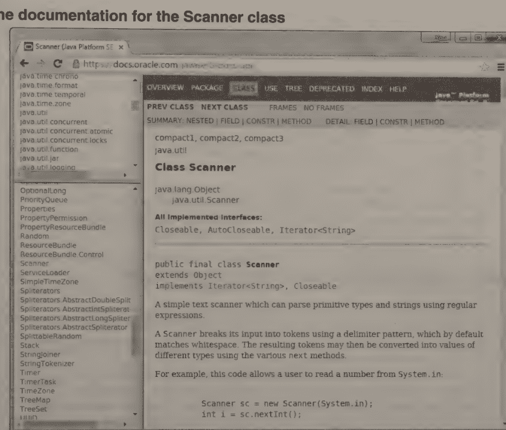

### 说明

- Java SE API 包含了数千个类和方法，可以帮助你完成应用程序所需的大多数任务。
- 你可以使用浏览器访问以下地址查看互联网上的 Java SE API：
  `http://docs.oracle.com/java/8/docs/api`
- 你可以选择左上框架中的包名来显示关于该包及其包含的类的信息。然后，你可以选择左下框架中的一个类，在右框架中显示该类的文档。
- 一旦显示了某个类的文档，你就可以滚动查看或点击链接获取更多信息。

## 如何与控制台交互

大多数应用程序都需要与用户交互。例如，它们通常需要向用户显示输出并从用户处输入。做到这一点最简单的方法是使用称为控制台的命令行界面。这就是为什么接下来的几幅图将显示如何使用控制台。

不过一旦你学会了 Java，使用图形用户界面 (GUI) 与用户交互是很常见的。编写 GUI 需要对 Java 有稳固的理解。因此，这本书直到最后两个章节才会显示如何编写 GUI。

当你创建控制台应用程序时，控制台的外观可能会根据操作系统略有不同。但是，应用程序的运行应该是相同的。此外，大多数 IDE 都提供了一种简单的方法来处理你正在开发和测试的控制台。

## 如何使用 `Scanner` 类获取输入

图 3-4 显示了如何使用 `Scanner` 类从控制台读取输入。首先，第一个示例显示了如何创建一个名为 `sc` 的 `Scanner` 对象。它的工作方式如图 3-2 所示。然后，接下来的三个示例使用此对象从用户处获取输入。

在第二个示例中，第一条语句使用 `System.out` 的 `print` 方法提示用户输入产品代码。用户按下 Enter 键后，第二条语句使用 `nextLine()` 读取用户输入的文本。然后，该语句将返回的行 `String` 对象赋值给名为 `productCode` 的 `String` 变量。

第三和第四个示例使用 `print` 方法提示用户输入数值数据。例如，第三个示例提示用户输入数量，第四个示例提示用户输入价格。然而，由于 `nextLine` 返回一个 `String` 对象，这会将用户输入的数据存储在名为 `quantityLine` 和 `priceLine` 的 `String` 对象中。在下一幅图中，你将学习如何将这些 `String` 对象转换为 `int` 和 `double` 值。

### `Scanner` 类

`java.util.Scanner`

### 如何创建 `Scanner` 对象

```java
Scanner sc = new Scanner(System.in);
```

### `Scanner` 对象的方法

| 方法 | 描述 |
| :--- | :--- |
| `nextLine()` | 将当前行上的所有文本作为 `String` 对象返回。 |

### 如何为产品代码获取 `String` 对象

```java
System.out.print("Enter product code: ");
String productCode = sc.nextLine();
```

### 如何为数量获取 `String` 对象

```java
System.out.print("Enter quantity: ");
String quantityLine = sc.nextLine();
```

### 如何为价格获取 `String` 对象

```java
System.out.print("Enter price: ");
String priceLine = sc.nextLine();
```


### 描述

- 要创建一个从控制台获取输入的 `Scanner` 对象，请在括号中指定 `System.in`。
- 当 `Scanner` 类的 `nextLine()` 方法运行时，应用程序会等待用户用键盘输入文本。要完成输入，用户需要按下 Enter 键。
- 由于 `Scanner` 类不在 `java.lang` 包中，因此每当你使用这个类时，通常都要包含一个 `import` 语句。


## 如何将字符串转换为数字

当你从用户处获取输入时，通常会得到一个包含用户输入文本的 `String` 对象。在某些应用程序中，你可能希望将该文本转换为数字。例如，你可能希望将上一页的 `quantityLine` 变量转换为 `int` 值。同样，你可能希望将 `priceLine` 变量转换为 `double` 值。然后你可以在算术表达式中使用这些变量。

图 3-5 显示了如何使用 `Integer` 和 `Double` 类将字符串转换为数字。为了做到这一点，你可以使用这些类提供的静态方法。在第一个示例中，你可以使用 `Integer` 类的 `parseInt()` 方法。第二个示例与第一个类似。然而，它使用了 `Double` 类的静态 `parseDouble()` 方法。

但如果字符串包含了像 "ten" 这样无法转换为 `int` 或 `double` 类型的数值会发生什么？在这种情况下，`parseInt()` 或 `parseDouble()` 方法会导致运行时错误，即异常。使用 Java 术语，你可以说该方法抛出了异常。在第 8 章，你将学习如何捕获这些抛出的异常。

## `Integer` 类

`java.lang.Integer`

## `Integer` 类的静态方法

| 方法 | 描述 |
| --- | --- |
| `parseInt(stringName)` | 尝试将作为参数传递的 `String` 对象转换为 `int` 类型。如果成功，则返回 `int` 值。如果失败，则抛出异常。 |

## `Double` 类

`java.lang.Double`

## `Double` 类的静态方法

| 方法 | 描述 |
| --- | --- |
| `parseDouble(stringName)` | 尝试将作为参数传递的 `String` 对象转换为 `double` 类型。如果成功，则返回 `double` 值。如果失败，则抛出异常。 |

## 如何将 `String` 对象转换为 `int` 值

```java
int quantity = Integer.parseInt(quantityLine);
```

## 如何将 `String` 对象转换为 `double` 值

```java
double price = Double.parseDouble(priceLine);
```

### 描述

- `Integer` 和 `Double` 类提供了静态方法，你可以用它们将 `String` 对象的值转换为 `int` 或 `double` 值。
- 如果 `parseInt()` 和 `parseDouble()` 方法无法成功解析字符串，它们会导致错误的发生。在 Java 术语中，这被称为抛出异常。在本书的后面部分，你将学习如何通过捕获异常来处理异常。

# 一个从控制台输入的类

图 3-6 通过将所有技能整合在一个名为 `LineItemApp` 的类中，展示了最后几个部分的背景。该类从控制台读取输入并将输出到控制台。

首先，该类导入了 `Scanner` 类。这使得在 `LineItemApp` 类中引用 `Scanner` 变得容易。

在 `main()` 方法中，第一条语句创建了一个名为 `sc` 的 `Scanner` 对象。第二条提示用户输入价格。第三条语句获取输入的文本并存储在名为 `priceLine` 的 `String` 对象中。第四条语句将名为 `priceLine` 的 `String` 对象转换为双精度值 `price`。第五条语句向控制台打印标签和 `price` 变量的值。

之后，第二个示例展示了 `LineItemApp` 类中获取名为 `price` 的 `double` 值的两条语句。然后，第三个示例展示了如何获取 `double` 值 `priceLine` 作为 `String` 对象 `parseDouble()` 变量的参数。这很有帮助，因为为多个相关的变量提供有意义的名称可能困难。

第一个控制台显示了如果用户输入 49.50 会发生什么。在这种情况下，第二行不包含用户输入的零。这是因为当 `String` 对象转换为 `double` 值时，这个零不再被需要。

第二个控制台显示了如果用户输入 123.45 会发生什么。在这里，所有的数字都是需要的。因此，当 `String` 对象转换为 `double` 值时，没有任何数字丢失。

第三个控制台显示了当用户输入非数字值（如 'ten'）时会发生什么。在这里，`parseDouble()` 方法抛出一个异常，Java 将有关异常的信息打印到控制台。

# 一个从控制台读取条目的类

```java
package murach.lineitem;

import java.util.Scanner; // 导入 Scanner 类

public class LineItem {

    public static void main(String[] args) {

        // 从 Scanner 类创建一个名为 lineitem 的 Scanner 对象

        Scanner sc = new Scanner(System.in);

        // 提示用户输入价格

        System.out.print("Enter price: ");

        // 获取用户输入的文本

        String priceLine = sc.nextLine();

        // 将 String 对象转换为 double 值

        double price = Double.parseDouble(priceLine);

        // 显示价格

        System.out.println("Price: " + price);

    }

}
```

# 从两条语句中获取 `double` 值

```java
String priceLine = sc.nextLine();
double price = Double.parseDouble(priceLine);
```

# 从一条语句中获取 `double` 值

```java
double price = Double.parseDouble(sc.nextLine());
```

# 用户输入 49.50 时的控制台

```
Enter price: 49.50
Price: 49.5
```

# 用户输入 123.45 时的控制台

```
Enter price: 123.45
Price: 123.45
```

# 用户输入 "ten" 时的控制台

```
Enter price: ten
Exception in thread "main" java.lang.NumberFormatException: For
input string: "ten"
at sun.misc.FloatingDecimal.readJavaFormatString(
    FloatingDecimal.java:2043)
at sun.misc.FloatingDecimal.parseDouble(
    FloatingDecimal.java:110)
at java.lang.Double.parseDouble(Double.java:538)
at murach.lineitem.LineItem.main(LineItem.java:17)
```

图 3-6 一个从控制台读取条目的类

# 如何将数字转换为格式化字符串

当你在代码中使用数值时，通常需要对它们进行格式化处理。例如，你可能想对一个 `double` 值应用标准的货币格式。为了这样做，你需要添加美元符号和逗号。此外，你只需要显示两位小数。同样，你可能还想以标准的百分比格式显示一个 `double` 值。为了这样做，你需要添加百分比符号并将小数点向右移动两位。

要进行这种类型的格式化，你通常使用图 3-7 总结的 `NumberFormat` 类将数值类型转换为 `String` 对象。由于 `NumberFormat` 类是 `java.text` 包的一部分，你通常在开始使用它之前需要包含一个该类的导入语句。

一旦导入了该类，你就可以调用它的其中一个静态方法来返回一个 `NumberFormat` 对象。例如，第一个示例直接从 `NumberFormat` 类调用了 `getInstance()` 方法。

一旦你使用方法返回了一个 `NumberFormat` 对象，你就可以从该对象调用普通方法。例如，第二个示例调用了名为 `currency` 的 `NumberFormat` 对象的普通 `format()` 方法。这返回了一个由美元符号加上带有两位小数的 `price` 变量值的字符串。在这种格式中，负数被包含在括号中。

这个示例展示了你如何使用单一语句创建一个 `NumberFormat` 对象并使用它的 `format()` 方法。为了这样做，你直接从 `getCurrencyInstance()` 方法调用 `format()` 方法。这被称为方法链。这完成了与之前的代码相同的任务。但是，它没有为 `NumberFormat` 对象创建一个变量，以便你稍后在代码中使用它。如果你的代码创建了大量的 `NumberFormat` 对象，这可能是低效的。因此，当你只需要格式化一个数字时，通常使用像这样的代码。

第三个示例展示了如何使用百分比格式化数字。第二个和第三个示例之间的主要区别在于，你使用 `getInstance()` 方法创建一个具有默认百分比格式的 `NumberFormat` 对象。

3-7 节中的示例使用了美国的默认货币、百分比和数字格式。如果你想使用当前区域设置的默认格式，可以通过传递此参数来修改获取 `NumberFormat` 实例的方法：

```java
Locale.getCurrencyInstance()
```

例如，你可以这样调用 `getCurrencyInstance()` 方法：
`NumberFormat.getCurrencyInstance(Locale.getDefault());`
然后，创建的 `NumberFormat` 对象将为当前区域设置货币格式化输出。例如，如果你在欧洲，它将使用欧元符号而不是美元符号。

# 一个向控制台打印格式化数字的类

图 3-8 通过展示一个类来提供背景，该类执行计算，格式化计算中使用的数字，并将这些格式化后的数字打印到控制台。首先，第一条阴影语句导入了 `NumberFormat` 类，因为它存储在 `java.text` 包中。这使得在 `LineItem` 类中可以引用 `NumberFormat` 类。

在 `main()` 方法中，第二个阴影语句创建了一个名为 `currency` 的 `NumberFormat` 对象。第三条阴影语句格式化了名为 `price` 的 `double` 变量，并将结果存储在名为 `priceFormatted` 的 `String` 变量中。第四条阴影语句格式化了名为 `total` 的 `double` 变量，并将结果存储在名为 `totalFormatted` 的 `String` 变量中。其余代码将格式化后的数字打印到控制台。

# 一个向控制台打印格式化输出的类

```java
package murach.lineitem;

import java.text.NumberFormat;

public class LineItemApp {

    public static void main(String args[]) {

        // 显示欢迎消息

        System.out.println("Welcome to the Line Item Calculator");

        System.out.println();

        // 硬编码三个值

        String product = "java";

        double price = 49.50;

        int quantity = 2;

        // 执行计算

        double total = price * quantity;

        // 应用货币格式化

        NumberFormat currency = NumberFormat.getInstance();

        String priceFormatted = currency.format(price);

        String totalFormatted = currency.format(total);

        // 显示输出

        String message = 
            "Code: " + product + "\n" +
            "Price: " + priceFormatted + "\n" +
            "Quantity: " + quantity + "\n" +
            "Total: " + totalFormatted + "\n";

        System.out.println(message);

        // 显示再消息

        System.out.println("Bye!");

    }

}
```

## 控制台

| Welcome to the Line Item Calculator |
| --- |
| Code: java |
| Price: $49.50 |
| Quantity: 2 |
| Total: $99.00 |
| Bye! |

- 虽然控制台的外观在不同系统之间可能不同，但你始终可以使用 `print()` 和 `println()` 方法将数据打印到控制台。

图 3-8 一个向控制台打印格式化数字的类

# 如何编写简单的控制语句

在编写应用程序时，你需要确定何时执行某些操作以及持续重复操作多久。为了做到这一点，你需要编写控制语句，比如你马上将学习的循环和 `if/else` 语句。但在之前，你先学习如何比较数字和字符串。

# 如何比较数字

3-9 显示了如何编写使用关系运算符来比较 `int` 和 `double` 数据类型的布尔表达式。这种表达式的结果为 `true` 或 `false`，表达式中的操作数可以是变量也可以是字面量。

在第一组示例中，如果名为 `months` 的变量等于字面量值 `3`，则第一个表达式为 `true`。如果名为 `years` 的变量不等于字面量值 `0`，则第二个表达式为 `true`。如果名为 `discountPercent` 的变量大于字面量值 `2.3`，则第三个表达式为 `true`。如果变量 `i` 小于变量 `months`，则第四个表达式为 `true`。如果变量 `subtotal` 大于或等于 `500`，则第五个示例为 `true`。如果变量 `quantity` 小于或等于变量 `reorderPoint`，则第六个示例为 `true`。

尽管你在编写这些简单表达式时应该不会遇到困难，但你必须记住在进行相等性比较时使用两个等号而不是单个等号。这是因为单个等号用于赋值语句。因此，如果你用单个等号编写布尔表达式，你的代码将无法编译，如第二个示例所示。

当你比较数值时，通常比较的是相同数据类型的值。但如果你比较不同类型的数值，Java 会自动将精度较低的数值类型转换为精度更高的类型。例如，如果你将 `int` 类型与 `double` 类型比较，Java 在比较之前会将 `int` 类型转换为 `double` 类型。

# 如何比较字符串

与许多编程语言不同，你不能使用单等号 (`=`) 或双等号 (`==`) 来测试两个字符串是否相等。相反，你必须使用 `String` 类的 `equals()` 或 `equalsIgnoreCase()` 方法。这两个方法都需要一个参数，提供你想与当前 `String` 对象比较的 `String` 对象。

例如，在第三组示例中，如果名为 `choice` 的 `String` 变量等于 "y"，则第一个表达式为 `true`。如果名为 `choice` 的 `String` 变量等于 "y" 或 "Y"，则第二个表达式为 `true`。如果名为 `lastName` 的 `String` 变量不等于 "Jones"，则第三个表达式为 `true`。如果名为 `code` 的 `String` 变量等于变量 `productCode`，则第四个表达式为 `true`。

## 关系运算符

| 运算符 | 名称 | 描述 |
| --- | --- | --- |
| `==` | 等于 | 如果操作数相等，则返回 `true`。 |
| `!=` | 不等于 | 如果操作数不相等，则返回 `true`。 |
| `>` | 大于 | 如果左操作数大于右操作数，则返回 `true`。 |
| `<` | 小于 | 如果左操作数小于右操作数，则返回 `true`。 |
| `>=` | 大于等于 | 如果左操作数大于或等于右操作数，则返回 `true`。 |
| `<=` | 小于等于 | 如果左操作数小于或等于右操作数，则返回 `true`。 |

# 使用关系运算符的代码

```java
months == 3             // 等于数字字面量
years != 0               // 不等于数字字面量
discountPercent > 2.3     // 大于数字字面量
i < months               // 小于数字变量
subtotal >= 500          // 大于等于数字字面量
quantity <= reorderPoint // 小于等于数字变量
```


# 测试数字时常见的错误

```java
months = 3              // 这没有在测试相等性：
```

## String 类的两种方法

| 方法 | 描述 |
| --- | --- |
| `equals(String)` | 将 `String` 对象的值与 `String` 参数进行比较，如果相等则返回 `true`，否则返回 `false`。此方法进行的是区分大小写的比较。 |
| `equalsIgnoreCase(String)` | 功能类似于 `equals` 方法，但不区分大小写。 |

# 使用 String 方法的代码

```java
choice.equals("y")          // 等于字符串字面量
choice.equalsIgnoreCase("y")  // 等于字符串字面量
lastName.equals("Jones")     // 不等于字符串字面量
code.equalsIgnoreCase(productCode) // 等于另一个 String 变量
```

## 测试相等性的常见错误

```java
choice = "y"      // 这没有在测试相等性！
choice == "y"           // 这没有在测试相等性！
```

- 布尔表达式是一个求值为 `true` 或 `false` 的表达式。
- 你可以使用关系运算符比较两个数值操作数，并返回一个 `true` 或 `false` 的布尔值。
- 要测试字符串的相等性，你必须调用 `String` 类的某种方法。相等运算符 (`==`) 不测试字符串的相等性。


# 如何编写 while 循环

图 3-10 显示了如何编写一个 while 循环。这是 Java 实现一种被称为迭代结构的控制结构的方式之一。该结构允许你重复一段语句块。

当执行 while 循环时，只要语句开头的布尔表达式为真（true），Java 就会执行括号内的语句。换句话说，当表达式变为假（false）时，循环结束。因此，如果当语句开始时表达式为假，Java 将永远不会执行循环体内的任何语句。

在第一个示例中，while 循环的布尔表达式使用 `equalsIgnoreCase` 方法来检查名为 `named` 的 String 变量是否等于 "y" 或 "Y"。如果是，循环内的语句将进行某些处理。然后，循环内的语句会提示用户输入 "y" 继续或输入 "n"。因此，如果用户输入 "y" 或 "Y"，循环就会执行；否则，循环结束。

while 循环的大括号定义了一个代码块。因此，在该代码块中定义的任何变量都具有作用域。换句话说，这些变量无法在循环外部访问。这就是为什么 String 变量 `named` 定义在循环之前。这样，循环的布尔表达式以及循环内编写的语句就可以访问它。

第二个示例显示了如何编写一个向控制台打印数字 1 到 4 的循环。在这里，名为 `i` 的计数器变量（或简称 counter）在循环开始前初始化为 1。在循环内部，第一条语句将计数器变量打印到控制台。然后，第二条语句将计数器加 1。当计数器变量的值变为 5 时，while 循环的布尔表达式不再为真。因此，循环结束。在编写循环时，使用计数器变量是常见的，而使用单个字母 `i` 作为计数器变量名也是常见的。

如果你没有正确编写循环，循环可能永远不会结束。例如，如果你在第二个示例中忘记编写给计数器变量加 1 的语句，循环将永远不会结束，因为计数器达到了 5。这被称为无限循环。这时，你必须取消应用程序以便调试代码。在 NetBeans 中，你可以通过在控制台应用程序运行时点击输出（Output）窗口中的停止（Stop）按钮来实现。

# while 循环的语法

```java
while (booleanExpression) {
    statements
}
```

```java
String choice = "y";
while (choice.equalsIgnoreCase("y")) {
    // 从用户获取输入，处理它，并显示输出
    // 检查用户是否想继续
    System.out.print("Continue? (y/n):");
    choice = sc.nextLine();
    System.out.println();
}
```

# 向控制台打印 1 到 4 的循环

```java
int i = 1;
while (i < 5) {
    System.out.println("Loop " + i);
    i = i + 1;
}
```

# 控制台

| Loop 1 |
| :--- |
| Loop 2 |
| Loop 3 |
| Loop 4 |

### 描述

- 只要布尔表达式为真，while 循环就会执行其大括号内的语句块。当表达式变为假时，while 循环将跳过其语句块，继续按顺序执行下一条语句。
- 在 while 循环语句块中声明的任何变量都具有块作用域（block scope）。
- 如果 while 循环中的布尔表达式从不变为假，循环永远不会结束。这时，应用程序将进入无限循环。在 NetBeans 中，你可以点击输出窗口中的停止按钮来取消无限循环。


# 如何编写 if/else 语句

图 3-11 显示了如何使用 if/else 语句（或仅 if 语句）来控制应用程序的逻辑。该语句是 Java 对被称为选择结构的控制结构的实现，因为它允许你根据布尔表达式的结果选择不同的动作。

语法摘要显示，你可以只用一个 if 子句来编写 if 语句，也可以用一个或多个 else 子句来编写，并以一个最终的 else 子句结束。在这里，省略号 `(...)` 表示前面的元素（在本例中为 if else 子句）可以根据需要重复多次。而方括号 `[ ]` 表示该元素是可选的。

当执行 if/else 语句时，Java 开始求值子句中的布尔表达式。如果为真，Java 执行该子句内的语句并跳过 if/else 语句的其余部分。如果为假，Java 求值第一个 else 子句（如果存在）。然后，如果其布尔表达式为真，Java 执行该 else 子句内的语句并跳过 if/else 语句的其余部分。否则，Java 执行下一个 else if 子句。

这种情况会对任何剩余的 else 子句继续进行。最后，如果没有一个子句包含求值为真的布尔表达式，Java 将执行 else 子句中的语句（如果存在）。然而，如果没有任何布尔表达式为真且没有 else 子句，Java 将不执行任何语句。

如果你想在一个子句中编写两条或更多语句，你必须使用大括号来标识该子句的代码块，如前三个示例所示。然后，如果你在块内声明一个变量，该变量就具有块作用域，这意味着它只能在该块内被访问。这就是为什么在块之前声明 `price` 变量。这样，if/else 语句中的任何子句都可以访问它。

如果 if/else 子句只包含一条语句，则不需要使用大括号。然而，通常认为在子句都使用大括号是良好的习惯，原因有两个：首先，大括号清晰地标识了子句的开始和结束；其次，大括号方便以后向子句添加更多语句。

这些示例设置 `price` 变量取决于存储在 String `productCode` 中的值。例如，如果 `productCode` 等于 "java"，该示例将价格设为 57.50；如果 `productCode` 等于 "jsp"，它将价格设为 57.50；如果 `productCode` 等于 "mysql"，它将价格设为 54.50；如果 `productCode` 不等于 "java"、"jsp" 或 "mysql"，它将价格设为 49.50。

# if/else 语句的语法

```java
if (booleanExpression) {statements}
else if (booleanExpression) {statements}
else {statements}
```

# if/else 语句示例

- 没有 else if 或仅 else 子句
- 有 else 子句
- 有两个 else if 子句和一个 else 子句

- 在块内声明的任何变量具有块作用域，因此只能在该块内访问。
- 如果子句只需要一条语句，不需要将语句封装在大括号中。然而，通常认为始终包含大括号是良好的习惯。这样，如果你以后决定向子句添加更多语句，就不会意外引入错误。


# Line Item 应用程序

为了将章中的技能应用于应用程序，接下来的两个图展示了 Line Item 应用程序。如果你理解本章介绍的代码，你应该能够编写类似的 Java 应用程序。

# 用户界面

图 3-12 显示了 Line Item 应用程序的控制台。该应用程序开始在控制台显示欢迎消息。然后，提示用户输入产品代码和数量。接下来，它显示项目项目的数据。为了获取这些数据，应用程序根据用户输入的产品代码检索价格，并通过价格乘以数量计算总额。

在显示项目项目数据后，应用程序提示用户输入 "y" 继续或输入 "n" 退出。如果用户输入 "y" 或 "Y"，他们可以输入另一个项目项目。如果用户输入 "n" 或任何其他字符，应用程序将结束并显示退出消息。

# 两次计算后的控制台

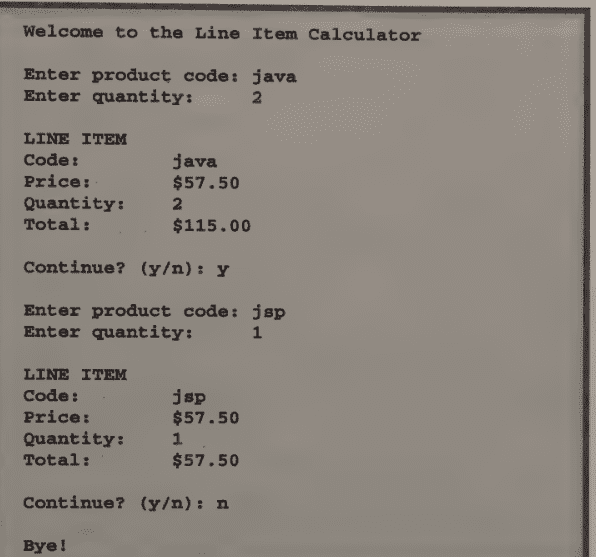

### 描述

- 当应用程序启动时，用户可以输入识别产品的代码以及该产品的数量。应用程序根据产品代码确定价格。然后，它计算该行项目的总额并显示该行项目。
- 在计算发票总额后，用户可以在提示处输入“y”或“Y”以继续。或者，用户可以输入“n”或任何其他字符来结束应用程序。

## 代码

图 3-13 显示了行项目（Line Item）应用程序的代码。虽然这个应用程序简单，但它从用户处获取输入，使用该输入进行计算并显示计算结果。

该代码以 `package` 语句开头，声明它存储在 `murach/lineitem` 包中。因此，该代码存储在应用程序的 `murach/lineitem` 子文件夹中。

两个 `import` 语句导入了 `NumberFormat` 和 `Scanner` 类。因此，代码的其余部分可以使用这些类，而无需在类名前前加前缀。

类声明指定名称为 `LineItemApp`。因此，该代码存储在名为 `LineItemApp.java` 的文件中。

`main` 方法编写在 `LineItemApp` 类的大括号内。当你运行 `LineItemApp` 类时，会执行此 `main` 方法。

`main` 方法首先向控制台打印欢迎消息。然后，它创建一个名为 `sc` 的 `Scanner` 对象。虽然这个对象可以在循环内部创建，但这意味着对象在每次循环时都会重新创建，这将是低效的。

在循环之前，代码声明了一个 `String` 变量 `choice` 并将其初始化为“y”。然后，循环检查 `choice` 变量是否等于“y”。它首先从用户处获取产品代码并将其存储在名为 `product` 的 `String` 变量中。然后，从用户处获取数量，将其从 `String` 对象转换为 `int` 值，并存储在变量 `quantity` 中。

获取这些数据后，`if/else` 语句根据产品代码的值设置 `double` 变量 `price`。例如，如果 `productCode` 是 "java"，则价格设置为 57.50。

当 `if/else` 语句完成后，代码通过将价格乘以数量来计算行项目总额。然后，它将计算结果存储在名为 `total` 的 `double` 变量中。

计算完成后，代码使用 `NumberFormat` 类对 `price` 和 `total` 应用货币格式化。此外，它创建了一个名为 `message` 的 `String` 变量，其中包含字符串字面量、变量和换行符转义序列。然后，将其打印到控制台。

在向控制台打印这些数据后，代码显示一条消息询问用户是否想继续。如果用户输入“y”或“Y”，则重复循环。否则，应用程序将结束。

如果你是编程初学者，通过编写像行项目这样的应用程序可以学到很多东西。这给了你一个熟悉获取输入、执行计算和显示输出的机会。此外，它还让你有机会机会熟悉控制语句，如循环和 `if/else` 语句。

## 行项目应用程序的代码

```java
package murach.lineitem;

import java.text.NumberFormat;
import java.util.Scanner;

public class LineItemApp {
    public static void main(String args[]) {
        System.out.println("Welcome to the Line Item Calculator");
        System.out.println("");
        Scanner sc = new Scanner(System.in);
        String choice = "y";
        while (choice.equalsIgnoreCase("y")) {
            // get input from user
            System.out.print("Enter product code: ");
            String productCode = sc.nextLine();
            System.out.print("Enter quantity: ");
            int quantity = Integer.parseInt(sc.nextLine());

            // set product price based on product code
            double price;
            if (productCode.equalsIgnoreCase("java")) {
                price = 57.50;
            } else if (productCode.equalsIgnoreCase("jsp")) {
                price = 57.50;
            } else if (productCode.equalsIgnoreCase("mysql")) {
                price = 54.50;
            } else {
                price = 0;
            }

            // calculate total
            double total = price * quantity;

            // format and display output
            NumberFormat currency = NumberFormat.getCurrencyInstance();
            String priceFormatted = currency.format(price);
            String totalFormatted = currency.format(total);
            String message = "LINE ITEM\n" +
                "Code: " + productCode + "\n" +
                "Price: " + priceFormatted + "\n" +
                "Quantity: " + quantity + "\n" +
                "Total: " + totalFormatted + "\n";
            System.out.println(message);

            // see if the user wants to continue
            System.out.print("Continue? (y/n): ");
            choice = sc.next();
            System.out.println("");
        }
        System.out.println("Bye!");
    }
}
```

图 3-13 行项目应用程序的代码

## 未来价值应用程序

本章通过介绍另一个应用程序——未来价值（Future Value）应用程序结束。该应用程序在某些方面与行项目应用程序相似。然而，它使用循环来计算多年内每月投入的投资的未来价值。

## 用户界面

图 3-14 显示了该应用程序的控制台。在这里，用户首先开始输入每月投资金额、年利率和投资年限。然后，应用程序计算并显示未来价值，并提示用户是否想继续。在此时，用户可以输入“y”继续或输入“n”退出。

## 两次计算后的控制台

```
Welcome to the Future Value Calculator
nEnter monthly investment: 100
Enter yearly interest rate: 3
Enter number of years: 3
Future value: $3,771.46
Continue? (y/n): y
Enter monthly investment: 120
Enter yearly interest rate: 3
Enter number of years: 3
Future value: $4,525.55
Continue? (y/n): n
Bye!
```


### 描述

- 当应用程序启动时，用户可以输入每月投资、年利率和年限。然后，它计算投资在指定年限结束时的未来价值并向用户显示该值。
- 在计算未来价值后，用户可以在提示处输入“y”或“Y”以继续。或者，用户可以输入“n”或任何其他字符来结束应用程序。

图 3-14 未来价值应用程序的用户界面

## 代码

图 3-15 显示了该应用程序的代码。该代码使用循环来确定何时结束。在循环中，它从用户处获取三个输入。此外，它将年利率除以 12，以便正确计算。第一个循环计算未来价值。当循环完成后，代码显示结果。然后询问用户是否想继续。

## 未来价值应用程序的代码

```java
package murach.fv;

import java.text.NumberFormat;
import java.util.Scanner;

public class Main {

    public static void main(String[] args) {

        // display a welcome message
        System.out.println("Welcome to the Future Value Calculator");
        System.out.println("");

        Scanner sc = new Scanner(System.in);
        String choice = "y";

        while (choice.equalsIgnoreCase("y")) {

            // get input from user
            System.out.print("Enter monthly investment: ");
            double monthlyInvestment = Double.parseDouble(sc.nextLine());

            System.out.print("Enter yearly interest rate: ");
            double yearlyInterestRate = Double.parseDouble(sc.nextLine());

            System.out.print("Enter number of years: ");
            int years = Integer.parseInt(sc.nextLine());

            // convert yearly values to monthly values
            double monthlyInterestRate = yearlyInterestRate / 12;
            int months = years * 12;

            // calculate the future value
            double futureValue = 0;
            int i = 1;

            while (i <= months) {
                futureValue = futureValue + monthlyInvestment;
                futureValue = futureValue * monthlyInterestRate;
                futureValue = futureValue + monthlyInvestment;
                i++;
            }

            // format and display the result
            System.out.println("Future value: " +
                NumberFormat.getCurrencyInstance().format(futureValue));
            System.out.println(" ");

            // see if the user wants to continue
            System.out.print("Continue? (y/n): ");
            choice = sc.nextLine();
            System.out.println(" ");
        }

        System.out.println("Bye!");
    }
}
```

# 观点

本章的目标是向你展示如何创建一个控制台应用程序，使用 Java API 中的类和方法从用户处获取输入并向用户显示输出。现在，如果你已经理解了项目明细（Line Item）和未来价值（Future Value）应用程序的工作原理，说明你已经迈出了一步。然而，这些应用程序并没有以专业的方式使用对象。这就是为什么接下来的两个章节将向你展示如何将项目明细应用程序转换为面向对象的应用程序，并专业地使用对象。

此外，请记住，本章仅仅是 Java 编程的介绍。因此，随着本书的深入，你将学习到更多关于编写 Java 代码的细节。例如，你将在第 8 章学习到更多关于编写控制语句的知识。

### 总结

- 你从对象中调用`方法`（method），从类中调用`静态方法`（static method）。一个方法可能需要一个或多个参数。
- 在使用 Java SE API 中不在 `java.lang` 包的类之前，你通常需要为该类编写一个 `import` 语句。
- 当你使用`构造函数`（constructor）从 Java 类创建`对象`（object）时，你正在创建该类的`实例`（instance）。
- 你可以使用 `Integer` 和 `Double` 类的静态方法将字符串转换为 `int` 和 `double` 值。
- 你可以使用 `NumberFormat` 类将标准的货币、百分比和数字格式应用到任何原始数值类型上。
- 你可以编写一个`while 循环`（while loop），当它的`布尔表达式`（Boolean expression）返回真值时，它会重复执行一个语句块，当布尔表达式返回假值时，跳过该语句块。
- 你可以编写一个`if 语句`（if statement），根据布尔表达式的真或假值来控制应用程序的逻辑。

# 练习 3-1 修改项目明细应用程序

在此练习中，你可以测试并修改在本章末尾的项目明细应用程序。

## 测试应用程序

- 启动 NetBeans IDE 并打开项目名称 `ch03_ex1_LineItem`。该项目应位于此文件夹：`C:\murach\java_netbeans\ex_starts`
- 打开名为 `LineItemApp.java` 的文件。然后查看该文件的代码，并使用有效的产品数量（如 2、10 和 1000）进行测试，以便于观察计算是否正确。
- 再次运行应用程序并使用如 "two" 等无效值进行测试。这会导致应用程序崩溃。研究错误信息，并确定在错误发生时运行的是哪一行源代码。
- 再次运行应用程序，当应用程序询问你是否继续继续时，输入 "x"。发生了什么？为什么？

## 修改应用程序

- 修改 `if/else` 语句以为产品设置描述。然后，修改显示项目明细数据的代码，使其包含该描述。完成后，应用程序看起来应该像这样：

```
Welcome to the Line Item Calculator

enter product code: java

enter quantity: 2

LINE ITEM

Code: java

Description: Murach's Java Programming

Price: $57.50

Quantity: 2

Total: $115.00

Continue? (y/n):
```

- 修改 `if/else` 语句，使其包含另一个名为 "android" 的产品代码。编造一个与该代码相对应的描述和价格。
- 修改显示项目明细数据的代码，使其不再声明 `priceFormatted` 和 `totalFormatted` 变量。为此，将这些变量替换为对名为 `currency` 的 `NumberFormat` 对象的 `format` 方法的调用。这将减少两行代码。

# 练习 3-2 创建面积和周长应用程序

在此练习中，你可以创建一个计算矩形面积和周长的应用程序。完成后，测试运行应该像这样：

```
Welcome to the Area and Perimeter Calculator

enter length: 100

Enter width: 200

Area: 20000

Perimeter: 600

Continue? (y/n): y

enter length: 25

Enter width: 30

Area: 750

Perimeter: 110

Continue? (y/n): n

Bye!
```

1. 创建名为 `ch03_ex2_AreaAndPerimeter` 的项目，其中包含包含 `main` 方法的 `Main` 类。
2. 编写显示欢迎和退出消息的代码。然后运行应用程序。
3. 编写提示用户输入矩形长度和宽度并将这些输入转换为 `double` 值。
4. 编写计算并显示面积和周长的代码。计算面积和周长的公式为：

```
area = width * length
perimeter = 2 * width + 2 * length
```


运行应用程序并使用有效数据进行测试。该应用程序应执行一次计算并结束。

5. 编写 `while` 循环允许用户执行多次计算。循环结束时应询问用户是否继续。然后使用有效数据运行应用程序以确保其工作正常。

# 如何编写自己的类和方法

在上章中，你学习了如何编写过程化应用程序。然而，大多数 Java 应用程序都是面向对象的。这就是为什么本章将展示如何开发面向对象的应用程序。为此，它首先介绍了如何创建和使用对象的类，然后介绍了如何创建和使用包含静态方法和字段的类。

- 类简介
- 封装是如何工作的
- 类与对象之间的关系
- 如何操作定义对象的类
- 如何使用 NetBeans 创建新类
- Product 类
- 如何编写实例变量
- 如何编写构造函数
- 如何编写方法
- 如何从类创建对象
- 如何调用对象的方法
- 如何操作静态字段和方法
- ProductDB 类
- 如何调用静态字段和方法
- 何时使用静态字段和方法
- 产品查看器应用程序
- 用户界面
- ProductApp 类
- 处理类和方法的更多技巧
- 引用类型与原始类型的比较
- 如何重载方法
- 如何使用 `this` 关键字
- 带有重载的 Product 类

# 类的基本概念

本章的前两个图将向你介绍一些适用于类的概念。这包括封装是如何工作的，以及类与其对象之间的关系。

## 封装是如何工作的

图 4-1 显示了一个名为 `Product` 的类的类图。该图使用了统一建模语言（UML），这种建模语言是处理包括 Java 在内的所有面向对象编程语言的行业标准。

在该类图中，该类包含三个字段和七个方法。在这里，减号 (`-`) 表示仅在当前类中可访问的私有字段和方法，加号 (`+`) 表示其他类可以访问的公有字段和方法。

在这种情况下，所有方法都是公开的，所有字段都是私有的。因此，其他类无法直接访问字段。然而，方法可以让其他类能够访问字段中存储的数据。例如，`getCode()` 方法返回存储在 `code` 字段中的数据，而 `setCode()` 方法将新数据分配给 `code` 字段。

这说明了封装的概念，它是面向对象编程的一项基本概念。这意味着程序员可以隐藏、封装类的某些字段和方法，同时暴露其他内容。由于类的字段（或数据）通常被封装在类内部，因此封装有时被称为数据隐藏。

封装允许你在类内部更改某个方法的代码，而不影响任何使用该方法的代码。例如，你可以更改 `getPrice()` 的代码，而无需更改其他类中使用该方法的任何代码。这是可能的，因为其他类中的代码无法直接访问 `price` 字段。结果是封装让你以后更容易修改或改进类的方法。

如果一个方法接受参数，它必须包含定义其参数数据类型的形式变量。在类图中，图表指定了方法括号内参数的数据类型。在这些括号之后，类图包含一个冒号，后面紧跟该方法返回的数据类型。

### Product 类的类图

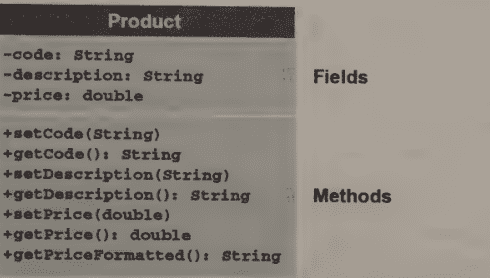

#### 描述

- 类的字段存储类的数据。
- 类的方法定义了类可以执行的任务。通常，这些方法提供了处理类字段的方便方法。
- 封装是面向对象编程的基本概念之一。这意味着类控制哪些字段和方法可以被其他类访问。结果是类中的字段可以对其他类隐藏，类中的方法可以在不改变其他类使用它们的方式的情况下进行修改或改进。

### UML 图绘制说明

- UML（统一建模语言）是用于描述面向对象应用程序的类和对象的行业标准。
- UML 类图描述了一个或多个类的字段和方法。
- 减号 (`-`) 标记私有的字段和方法。这意味着其他类无法访问它们。
- 加号 (`+`) 标记公有的字段和方法。这意味着其他类可以访问它们。
- 对于每个字段，图给出了字段的名称，后面跟着冒号。
- 对于每个方法，图给出了方法的名称，后面跟着括号。如果方法接受参数，它必须定义与参数对应的形式变量。为了做到这一点，图在括号内列出了每个参数的数据类型。在括号之后，图包含一个冒号，后面紧跟该方法返回的数据类型。

图 4-1 封装是如何工作的

## 类与其对象之间的关系

图 4-2 使用 UML 图显示了类与其对象之间的关系。在图中，一个类图和两个对象图显示了如何从类创建对象。在这里，图表仅显示了类及其对象的字段，而没有方法。在这种情况下，从 `Product` 类创建了名为 `product` 和 `product2` 的两个对象。在这些对象中，每个字段都包含一些数据。

一旦创建了类的实例，它就有了身份和状态。对象的身份是它在内存中的地址，它是唯一的。对象的状态指的是它的数据。例如，第一个 `Product` 对象的状态与第二个 `Product` 对象的状态不同，因为这些对象存储了不同的数据。随着应用程序的执行，对象的状态可能会改变。

### 类与其对象之间的关系

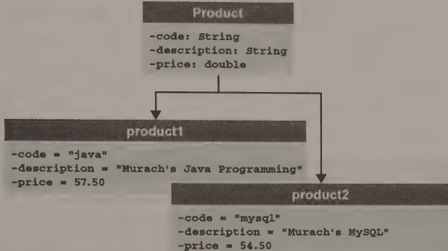

#### 描述

- **类**（class）可以认为是一个模板，据此制造**对象**（objects）。
- 一旦创建类的**实例**（instance），它就有了**身份**（identity，一个唯一地址）和**状态**（state，它存储的数据）。随着程序的运行，对象的状态可能会改变。

图 4-2 类与其对象之间的关系

# 如何使用定义对象的类

现在你已经学习了一些适用于类的基本概念，准备好学习创建类的基本技能了。首先，接下来的几图显示了如何创建一个名为 `Product` 的类，你可以用它来存储有关产品的数据。

## 如何使用 NetBeans 创建新类

当你开发面向对象的应用程序时，通常需要向项目中添加新类。要实现这一点，你可以使用图 4-3 所示的 New Java Class 对话框。

图中的对话框创建了一个名为 `Product` 的类，并指定了一个名为 `murach.product` 的包，这与对话框中显示的 `murach/product` 文件夹相对应。如果该文件夹不存在，NetBeans 会自动创建它。

当你完成 New Java Class 对话框时，NetBeans 会创建一个文件来存储该类的代码。对于 `Product` 类，该文件名为 `Product.java`。NetBeans 还会生成该类的起始代码，如图所示。在这里，`package` 语句指定了包名。此外，类名与文件名匹配，这是强制要求的。最后，`public` 访问修饰符指定其他类（包括其他包中的类）可以访问此类，这通常是你所需要的。

### 创建新 Java 类的对话框

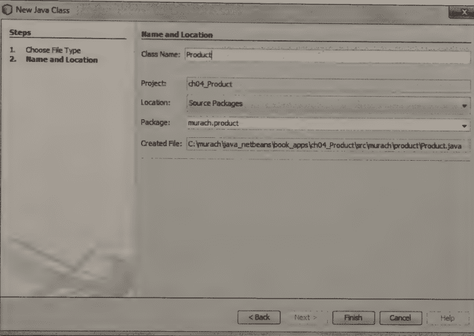

### 为 Product 生成的代码

```java
package murach.product;

public class Product {

}
```

#### 描述

- 类的字段存储类的数据。
- 类的方法定义了类可以执行的任务。通常，这些方法提供了处理类字段的方便方法。
- 封装是面向对象编程的基本概念之一。这意味着类控制哪些字段和方法可以被其他类访问。结果是类中的字段可以对其他类隐藏，类中的方法可以在不改变其他类使用它们的方式的情况下进行修改或改进。

# Product 类

```java
package murach.product;

import java.text.NumberFormat;

public class Product {

    // 实例变量

    private String code;

    private String description;

    private double price;

    // 构造方法

    public Product() {

        code = "";

        description = "";

        price = 0;

    }

    // code 变量的 set 和 get 方法

    public void setCode(String code) {

        this.code = code;

    }

    public String getCode() {

        return code;

    }

    // description 变量的 set 和 get 方法

    public void setDescription(String description) {

        this.description = description;

    }

    public String getDescription() {

        return description;

    }

    // price 变量的 set 和 get 方法

    public void setPrice(double price) {

        this.price = price;

    }

    public double getPrice() {

        return price;

    }

    // price 变量的自定义 get 方法

    public String getPriceFormatted() {

        NumberFormat currency = NumberFormat.getCurrencyInstance();

        String priceFormatted = currency.format(price);

        return priceFormatted;

    }

}
```

## 如何编写实例变量

图 4-5 展示了如何编写定义由类创建的对象所存储数据的实例变量。当你声明一个实例变量时，通常会使用访问修饰符来控制其访问权限。如果你使用 `private` 关键字，其他类无法直接访问该实例变量。相比之下，如果你使用 `public` 关键字，其他类就可以直接访问该实例变量。

图中展示了声明实例变量的四个示例。第一个示例声明了一个 `double` 类型的变量。第二个声明了一个 `int` 类型的变量。最后一个声明了一个 `Product` 类型的变量，这就是你现在正在学习编写的类。

尽管实例变量的作用像普通变量一样，但你必须在类体内部声明它们，而不是在方法或构造方法内部。这样，它们在整个类中都是可用的。在本书中，所有的示例都在类的开头声明实例变量。然而，当你复习其他来源的代码时，可能会发现在类的末尾或类内的其他位置声明实例变量的代码。例如，在图中代码在类的末尾、`getPriceFormatted()` 方法之后声明了一个名为 `test` 的实例变量。

### 声明实例变量的语法

`public|private primitiveType ClassName variable;`

### 示例

```java
private double price;

private int quantity;

private String code;

private Product product;
```

### 你可以在哪里声明实例变量

```java
public class Product {

    // 通常在这里编写实例变量

    private String code;

    private String description;

    private double price;

    // 类的构造方法和方法

    public Product() {}

    public void setCode(String code) {}

    public String getCode() { return code; }

    public void setDescription(String description) {}

    public String getDescription() { return description; }

    public void setPrice(double price) {}

    public double getPrice() { return price; }

    public String getPriceFormatted() { return priceFormatted; }

    // 这里也可以编写实例变量

    private int test;

}
```


### 描述

- 类的字段（`field`）定义了整个类可用的数据。字段可以是实例变量，也可以是常量。要学习如何使用常量，请参见第 7 章。
- 实例变量存储了整个对象可用的数据。换句话说，实例变量存储了类的一个实例所可用的数据。
- 实例变量可以是原始数据类型、由 Java 类（如 `String` 类）创建的对象，也可以是由用户定义的类（如 `Product` 类）创建的对象。
- 通常，实例变量使用 `private` 关键字声明。这有助于防止其他类直接访问实例变量。
- 你可以在类的构造方法和方法之外的任何地方声明该类的实例变量。


图 4-5 如何编写实例变量

## 如何编写构造方法

图 4-6 展示了如何为类编写构造方法。当你编写构造方法时，如示例所示，初始化类的所有实例变量是一种良好的编码习惯。你还可以在构造方法中包含任何需要执行的额外语句。

当你编写构造方法时，通常使用 `public` 访问修饰符。此外，你必须使用与类名完全相同的名称（包括大小写）。然后，如果你不想接受参数，可以像第一个示例那样编写一对空括号。反之，如果你想接受参数，则像接下来的两个示例那样为构造方法编写参数。在编写构造方法参数时，你必须为每个参数编写数据类型和名称。对于数据类型，你可以编写原始数据类型或任何定义了对象的类名。

第二个示例展示了一个带有三个参数的构造方法。在这里，第一个参数是名为 `code` 的 `String` 对象，第二个参数是名为 `description` 的 `String` 对象，第三个参数是名为 `price` 的 `double` 类型。然后，构造方法中的三条语句使用这些参数来初始化类的三个实例变量。

在这个例子中，参数名与实例变量名相同。因此，必须使用 `this` 关键字来区分。

第三个示例与第二个示例工作方式相同。但是，它不需要 `this` 关键字，因为参数名与实例变量名不同。

当你编写构造方法时，只要每个构造方法的签名唯一，就可以在类中编写多个构造方法。例如，图中所示两个构造方法具有不同的签名。这被称为构造方法重载。

如果你不编写构造方法，编译器会自动创建一个不接受参数的默认构造方法。在这种情况下，如果你需要默认构造方法，你需要自己编写。

## 编写构造方法的语法

```java
public|private ClassName([parameterList]) {
  // 构造方法的语句
}
```

## 显式初始化实例变量的默认构造方法

```java
public Product() {
  code = "";
  description = "";
  price = 0.0;
}
```

## 带有三个参数的构造方法

```java
public Product(String code, String description, double price) {
  this.code = code;
  this.description = description;
  this.price = price;
}
```

## 编写上述构造方法的另一种方式

```java
public Product(String productCode, String productDescription, double productPrice) {
  code = productCode;
  description = productDescription;
  price = productPrice;
}
```

### 描述

- 构造方法可以从类创建或构造对象。
- 构造方法必须使用与类名相同的名称和大小写。
- 要编写带有参数的构造方法，请在括号内为每个参数编写数据类型和名称。
- 构造方法的名称结合参数列表构成了构造方法的签名。
- 你可以使用名为 `this` 的关键字来引用当前对象的实例变量。当实例变量与构造方法的参数同名时，这是必须的。否则，它是可选的。
- 如果你没有显式初始化实例变量，Java 会自动为你初始化它，将数值变量设置为零，布尔变量设置为 false，对象变量设置为 null。

## 默认构造方法规则

- 默认构造方法具有零参数。
- 如果你不在类中编写任何构造方法，Java 编译器会自动为你的类创建一个默认构造方法。
- 如果你编写了带有参数的构造方法，你不需要自动创建默认构造方法，Java 编译器不会自动为你的类创建默认构造方法。

图 4-6 如何编写构造方法

# 如何编写方法

图 4-7 显示了如何编写类的方法。首先，编写一个访问修饰符。大多数情况下，你可以使用 `public` 关键字来声明方法，以便其他类可以使用它。然而，你也可以使用 `private` 关键字来向其他类隐藏该方法。

在访问修饰符之后，你编写方法的返回类型。在返回类型之后，你编写方法名，后跟一组括号。在括号内，你编写方法的参数列表。最后，你编写包含方法语句的大括号和右括号。

由于方法名应该描述方法所执行的操作，因此通常的做法是每个方法都以动词开头。例如，设置实例变量数据的方法通常以 `set` 开头。相反，获取实例变量数据的方法通常以 `get` 开头。这类方法通常被称为访问器（accessors），因为它们让你能够访问存储在实例变量中的数据。执行其他任务的方法也以 `print`、`read` 和 `format` 等动词开头。

第一个示例显示了如何编写一个不接受任何参数也不返回任何数据的方法。要做到这一点，请使用 `void` 关键字作为返回类型，并以一组空括号结束。当此方法被调用时，它会将 `Product` 对象的实例变量打印到控制台，用管道字符 (`|`) 分隔每个实例变量。

接下来三个示例显示了如何编写返回数据的方法。为了这样做，这些方法指定了返回类型，并包含一个 `return` 语句来返回适当的数据。编写此类方法时，你必须确保指定的返回类型与你返回的数据类型匹配。否则，你的代码将无法编译。

在第四个示例中，`getFormatted` 方法使用 `NumberFormat` 对象对名为 `price` 的 `double` 变量应用标准的货币格式化。这会将 `double` 变量转换为 `String` 对象。然后，`return` 语句将该 `String` 对象返回给调用方法。

第五和第六示例显示了编写 set 方法的两种可能。在第五示例中，方法接受一个与实例变量同名的参数。因此，该方法中的赋值语句使用 `this` 关键字来识别实例变量。在第六示例中，参数与实例变量名不同。因此，赋值语句不需要使用 `this` 关键字。

# 编写方法的语法

```java
public|private returnType methodName([parameterList]) {
    // 方法的语句
}
```

# 不接受参数或返回数据的方法

```java
public void printToConsole() {
    System.out.println(code + "|" + description + "|" + price);
}
```

# 返回字符串的 get 方法

```java
public String getCode() {
    return code;
}
```

# 返回 double 值的 get 方法

```java
public double getPrice() {
    return price;
}
```

# 自定义 get 方法

```java
public String getPriceFormatted() {
    NumberFormat currency = NumberFormat.getCurrencyInstance();
    String priceFormatted = currency.format(price);
    return priceFormatted;
}
```

# set 方法

```java
public void setCode(String code) {
    this.code = code;
}
```

# 另一种编写 set 方法的方法

```java
public void setCode(String productCode) {
    code = productCode;
}
```

### 描述

- 为了允许其他类访问方法，请使用 `public` 关键字。为了防止其他类访问方法，请使用 `private` 关键字。
- 命名方法时，每个名称都应以动词开头。Java 的标准是对于设置实例变量值的方法使用动词 `set`，对于返回实例变量值的方法使用动词 `get`。这些方法通常被称为 set 和 get 访问器。
- 要编写不返回数据的方法，请使用 `void` 作为返回类型。
- 要编写返回数据的方法，请在方法声明中编写返回类型。然后在方法体中编写一个 `return` 语句来返回数据。
- 要编写带有参数的方法，请在方法的括号之间编写参数的数据类型类型和名称。

图 4-7 如何编写方法

# 如何从类创建对象

图 4-8 显示了如何用一条或两条语句创建一个对象。大多数情况下，你可以使用一条语句来创建对象。然而，在某些情况下，你需要使用两条语句来创建对象。

当你使用两条语句创建对象时，第一条语句声明类和变量名。然而，在执行第二条语句之前，对象并未被创建。这条语句使用 `new` 关键字来调用对象的构造函数。这通过初始化其实例变量来创建对象，并将其存储在内存中。然后，赋值运算符 (`=`) 将该对象的引用分配给变量。这就是为什么对象被称为引用类型（reference types）。

当你向类的构造函数发送参数时，你必须确保构造函数可以接受这些参数。要做到这一点，你必须发送正确数量的参数、正确的顺序以及兼容的数据类型。当一个类包含多个构造函数时，Java 会执行与对象匹配的构造函数。

图中的双语句示例创建了一个新的 `Product` 对象，而没有向 `Product` 类的构造函数传递任何参数。第一个单语句示例完成了相同任务。然后，第二个单语句示例显示了如何向构造函数发送三个参数。当然，这假设 `Product` 类有一个与这三个参数兼容的三个参数的构造函数。


# 如何用两条语句创建对象

```java
ClassName variableName;
variableName = new ClassName(argumentList);
```

# 无参数

```java
Product product;
product = new Product();
```

# 如何用一条语句创建对象

## 语法

```java
ClassName variableName = new ClassName(argumentList);
```

## 无参数

```java
Product product = new Product();
```

## 三个参数

```java
Product product = new Product("java","Murach's Java Programming", 57.50);
```


### 描述

- 为了创建对象，你使用 `new` 关键字创建类的新实例。每当 `new` 关键字创建一个对象时，Java 都会调用对象的构造函数，初始化对象的变量并将对象存储在内存中。
- 创建对象后，你将其分配给变量。当你这样做时，该对象的引用。然后你可以使用该变量引用该对象。因此，对象被称为引用类型。
- 引用类型的变量存储指向对象的引用。
- 要向构造函数发送参数，请在类名后的括号之间编写参数。要发送多个参数，请用逗号分隔参数。
- 当你向构造函数发送参数时，参数必须按照构造函数调用的顺序，且数据类型必须与构造函数的参数兼容。

图 4-8 如何创建对象

# 如何调用对象的方法

在最后一章中，你学习了如何调用从 Java API 中的类（如 `String`、`Scanner` 和 `NumberFormat` 类）创建的对象的方法。图 4-9 显示，相同的技能适用于调用你自己的类（如 `Product` 类）的方法。简而言之，你输入对象名，后跟点运算符，然后是方法名，最后是一组括号。然后，如果方法需要参数，你就在括号之间编写参数列表，用逗号分隔多个参数。

前两个示例显示了调用不返回任何数据的两种方法。第一个示例没有发送参数，但第二个示例发送了一个名为 `resultCode` 的字符串变量。然而，这个参数也可以是字符串字面量，例如 "java"。无论如何，当你调用接受参数的方法时，你需要发送正确数量的参数，且这些参数的数据类型必须与方法列表中指定的数据类型兼容。

第三和第四示例显示了如何调用返回数据的方法以及如何将这些数据赋值给变量。在第三示例中，`getPrice` 方法返回一个 `double` 值，代码将该值赋值给名为 `price` 的 `double` 变量。在第四示例中，`getPriceFormatted` 方法返回一个 `String` 对象，代码将该对象赋值给名为 `priceFormatted` 的 `String` 变量。

第五示例显示了如何在表达式中调用方法。在这里，表达式包含了对 `get` 方法的调用。这返回一个 `String` 对象。然后，代码将 `String` 对象与两个字符串字面量连接，并将结果赋值给另一个名为 `message` 的 `String` 对象。

## 第 4 章 如何编写你自己的类和方法

### 调用方法的语法

`objectName.methodName(argumentList)`

### 不发送参数且不返回任何内容的语句

`product.printToConsole();`

### 发送一个参数且不返回任何内容的语句

`product.setCode(productCode);`

### 不发送参数并返回 double 值的语句

`double price = product.getPrice();`

### 发送一个参数并返回 String 对象的语句

`String priceFormatted = product.getPriceFormatted();`

### 在表达式中调用方法的语句

`String message = "Code: " + product.getCode() + "\n";`

### 描述

- 要调用一个不接受参数的方法，请在方法名后输入一对空括号。
- 要调用接受参数的方法，请在方法名后的括号内输入参数。在这里，每个参数的数据类型必须与方法参数中指定的数据类型兼容。如果编写多个参数，请用逗号分隔参数。
- 如果方法返回数据，你可以编写一条赋值语句，将返回的数据赋值给变量。在这里，变量的数据类型必须与方法的返回类型兼容。


## 如何使用静态字段和方法

在上一章中，你学习了如何调用 Java API 中某些类（如 `Integer` 和 `Double` 类）的静态方法。现在，你将学习如何编写和调用静态字段及方法。

### ProductDB 类

图 4-10 展示了一个名为 ProductDB 的类。该类包含一个名为 getProduct 的单一静态方法，该方法根据产品代码参数返回 `Product` 对象。

首先，包语句表示 `ProductDB` 类存储在 `murach.product` 包中，这与文件夹名称 `murach/product` 相对应。由于这在本章之前描述的类属于同一个包，因此 `ProductDB` 类无需导入即可访问该类。

`getProduct` 方法接受一个用于产品代码的 String 参数，并返回一个与产品代码参数匹配的 `Product` 对象。此外，该方法的声明包含了 `static` 关键字。因此，`getProduct` 方法是一个静态方法，你可以直接从 `ProductDB` 类调用它。

在 `getProduct` 方法内部，代码开始创建一个 `Product` 对象。这会导致 `code` 和 `description` 字段被设置为空字符串，并将 `price` 设置为零。

在该代码创建 `Product` 对象后，它将产品的代码设置为方法的 `productCode` 参数。为了实现这一点，它使用了 `Product` 对象的 `setMethod`。然后，`getProduct` 方法使用 `if/else` 语句为对应产品代码的产品设置描述和价格。为了实现这一点，`if/else` 语句的语句使用了 `Product` 对象的 `setDescription` 和 `setPrice` 方法。然而，如果产品代码不匹配任何指定的产品，`else` 子句会将描述设置为“Unknown”，并将价格保持为默认值 0。最后，该方法返回 `Product` 对象。

由于该类没有从数据库获取产品数据，因此它并不符合实际。但是，它模拟了从数据库检索产品数据的类所执行的处理。为了简单起见，本书的前几章节使用该类作为获取产品数据的方法。随后在第 5 节中，本书将展示如何编写一个从数据库获取产品数据的 `ProductDB` 类。

## 第 4 章 如何编写你自己的类和方法 115

### ProductDB 类


## 如何编写和调用静态字段和方法

正如你在本章前面学到的，实例变量和普通方法属于由类创建的对象。与此相反，静态字段和静态方法属于类本身。因此，它们有时被称为类字段和类方法。编写静态字段和静态方法时，你可以使用 `static` 关键字，如图 4-11 所示。

在图中，所有静态字段都是静态变量。然而，你也可以定义静态常量。关于使用常量的更多信息，请参见第 7 章。

第一个示例展示了如何编写一个包含两个静态字段和一个静态方法的类。首先，该类声明了两个静态字段。第一个静态字段是名为 `sc` 的 `Scanner` 对象的私有字段。因此，其他类无法访问它。第二个静态字段是名为 `message` 的 String 对象的公共字段。因此，其他类可以访问它。

在 `static` 之后，该类定义了一个名为 `getString` 的静态方法。该方法接受一个 `prompt` 参数并返回一个 String 对象。在此方法内部，第一条语句将 `prompt` 参数打印到控制台。第二条语句调用 `Scanner` 对象的 `nextLine` 方法来获取用户输入的文本行。第三条语句将该行文本返回给调用方法。

此示例表明，`Scanner` 对象的静态变量对类的静态方法（如 `getProduct` 方法）可用。然而，如果该类中声明了任何实例变量，它们将无法被静态 `getProduct` 方法使用。第二个示例展示了如何调用第一个示例中定义的静态方法。它的工作方式与调用普通方法非常相似。然而，你首先编写的是类名而不是对象的变量名。在这个示例中，代码提供了一个参数，用于指定 `prompt` 的字符串字面量。

通常情况下，静态字段被声明为私有（private）。因此，它们仅对类中的静态方法可用。然而，你可以将静态字段声明为公共（public）。这样，其他类就可以访问并使用该字段。在图中，例如第三个示例展示了如何通过类名引用变量。

### 何时使用静态字段和方法

学会了编写静态字段和方法后，可能会思考何时使用它们以及使用普通字段和方法。通常情况下，如果你需要执行单一任务（如计算），可以使用静态方法。然后该方法执行任务并返回你需要的数据。然而，如果你需要创建一个存储数据的对象，则需要使用实例变量和方法。

## 如何编写静态方法

```java
package murach.product;

import java.util.Scanner;

public class Console {

    private static Scanner sc = new Scanner(System.in);

    public static String getString(String prompt) {
        System.out.print(prompt);
        String s = sc.nextLine();
        return s;
    }
}
```

## 如何调用静态方法

### 语法

`ClassName.methodName(argumentList)`

### Console 的静态方法

```java
String productCode = Console.getString("Enter the product code: ");
```

## 如何调用静态字段

### 语法

`ClassName.fieldName`

### Console 的静态字段

```java
Console.message = "This is a test."; // 设置字段
String message = Console.message;      // 获取字段
```

### 描述

- 你可以使用 `static` 关键字编写静态方法和静态字段。由于静态方法和静态字段属于类而不是属于从类创建的对象，它们有时被称为类方法和类字段。
- 字段有两种类型：变量和常量。了解如何编写常量，请查看第 7 章。
- 当你编写静态方法时，你只能使用静态字段和方法内部定义的字段。换句话说，你不能在静态方法中使用实例变量。
- 调用静态方法时，输入类名，后面跟着点运算符，然后是方法名，最后是括号。如果方法需要参数，在括号内编写参数，并用逗号分隔多个参数。
- 调用静态字段时，输入类名，后面跟着点运算符，然后是静态字段。

图 4-11 如何编写和调用静态方法和字段

## Product Viewer 应用程序

图 4-12 展示了一个面向对象的应用程序，允许您根据指定的代码查看产品数据。该应用程序使用了本章之前显示的 `Product` 和 `ProductDB` 类。

### 用户界面

此图首先显示了 Product Viewer 应用程序的控制台。当此应用程序启动时，它会显示欢迎消息。然后，它提示用户输入产品代码。接下来，它显示与用户输入的产品代码匹配的产品数据。最后，它会显示一个提示，允许用户继续或退出应用程序。

### ProductApp 类

此图还了 `ProductApp` 类的代码。该类包含 `main` 方法，用于获取输入并向用户显示输出。

首先，`package` 语句指定了类所属的包。在图中，该语句定义了 `murach.product` 包。这与本章之前显示的 `Product` 和 `ProductDB` 类属于同一个包。因此，`ProductApp` 类可以轻松引用 `Product` 和 `ProductDB` 类，而无需导入它们。

在 `package` 语句之后，`import` 语句导入了 `java.util` 包中的 `Scanner` 类。因此，在 `ProductApp` 类的其余部分可以轻松引用此类。

在该类的 `main` 方法中，前两个语句显示欢迎消息。然后，第三条语句声明了一个 `Scanner` 对象 `sc`，并创建一个新的 `Scanner` 对象，该类使用它从用户获取输入。接下来，第四条语句声明了一个名为 `choice` 的 `String` 对象并将其设置为字符串字面量 "y"。

`while` 循环开始检查变量 `choice` 是否等于 "y" 或 "Y"。如果是，则执行循环。在 `while` 循环内部的前两个语句从用户处获取产品代码。然后，该代码调用 `ProductDB` 类的 `Product` 方法获取与产品代码对应的 `Product` 对象。

获取 `Product` 对象后，该应用程序创建一个名为 `data` 的 `String`，存储要显示的数据。为了获取这些数据，该代码使用了 `Product` 对象的方法。然后，该代码显示 `Product` 对象的数据。

显示数据后，该代码检查用户是否想继续。如果用户输入 "y" 或 "Y"，该代码将再次执行 `while` 循环。否则，该代码退出循环。这会显示一条退出消息并退出 `main` 方法，从而结束应用程序。

## 第 4 章 如何编写自己的类和方法

### 控制台

```
Welcome to the Product Viewer

Enter product code: java

Code: java

Description: Murach's Java

Price: $49.50

Continue? (y/n): n

Bye!
```

### ProductApp 类

```java
package murach.product;

import java.util.Scanner;

public class ProductApp {

    public static void main(String[] args[]) {

        // 显示欢迎消息
        System.out.println("Welcome to the Product Viewer");

        // 创建
        Scanner sc = new Scanner(System.in);

        String choice = "y";

        while (choice.equalsIgnoreCase("y")) {

            // 从用户处获取输入
            System.out.print("Enter product code: ");
            String productCode = sc.nextLine();

            // 获取对象
            Product product = ProductDB.getProduct(productCode);

            // 显示输出
            String message = "\n" +
                "Code: " + product.getCode() + "\n" +
                "Description: " + product.getDescription() + "\n" +
                "Price: " + product.getPrice() + "\n";

            System.out.println(message);

            // 查看用户是否想继续
            System.out.print("Continue? (y/n): ");
            choice = sc.nextLine();
        }

        System.out.println("Bye!");
    }
}
```

图 4-12 Product Viewer 应用程序

## 类和方法的编写技巧

如果你理解了 Product Viewer 应用程序，你就理解了类和方法的的基本概念。现在，本章将介绍编写类和方法时可能需要的额外概念和技巧。

## 引用类型与基本类型的比较

现在，你应该知道 `Product` 类定义了一个引用类型。此外，你应该知道引用类型的工作方式与 `double` 和 `int` 等基本类型不同。因为基本类型存储的是值，而引用类型引用的是对象。图 13 总结了引用类型和基本类型之间的一些区别。

第一个示例展示了赋值语句是如何工作的。对于基本类型，赋值语句会创建 `double` 值的副本。因此，第三条语句更改了变量 `p2` 中存储的值，但没有更改变量 `p1` 中存储的值。

对于引用类型，赋值语句并不存储对象的副本。相反，它让两个变量引用同一个对象。因此，当第三条语句使用变量 `p2` 更改对象中存储的值时，该更改也会反映在变量 `p1` 中。因为两个变量引用同一个对象。因此，如果你有多个变量引用同一个对象，就需要小心修改它的数据。

第二个示例展示了方法的参数是如何工作的。对于基本类型，赋值语句会创建 `double` 值的副本。因此，第三条语句更改了变量 `p2` 中存储的值，但没有更改变量 `p1` 中存储的值。

对于引用类型，赋值语句并不存储对象的副本。相反，它让两个变量引用同一个对象。因此，当第三条语句使用变量 `p2` 更改对象中存储的值时，该更改也会反映在变量 `p1` 中。因为两个变量引用同一个对象。

### 赋值语句是如何工作的

#### 对于基本类型：

```java
double p1 = 54.50;
double p2 = p1;
p2 = 57.50;
```

#### 对于引用类型：

```java
Product p1 = new Product("mysql", "Murach's Java", 54.50);
Product p2 = p1;
p2.setPrice(57.50);
```

### 参数是如何工作的

#### 对于基本类型：

```java
public static double increase(double price) {
    // price 参数是 double 值的副本
    price = price * 1.1;
    return price;
}
```

#### 对于引用类型：

```java
```


public static void increase(Product product) {

    // product 参数引用 Product 对象

    double price = product.getPrice() * 1.1;

    product.setPrice(price);

}

## 方法调用是如何工作的

### 对于基本类型

```java
double price = 54.50;

price = increasePrice(price); // 需要赋值
```

### 对于引用类型

```java
Product product = new Product();

product.setPrice(54.50); // 不需要赋值

increasePrice(product);
```

### 描述

- 基本类型的变量存储其自身的基本值的副本。因此，更改一个基本类型变量的值不会更改任何其他基本类型变量的值。
- 引用类型的变量存储对对象的引用。这允许多个引用类型变量引用同一个对象。因此，更改一个对象的数据会更改任何引用该对象的变量的数据。
- 当你编写一个具有基本类型的方法时，参数获得传递给方法的值的副本。因此，如果方法更改了参数的值，该更改不会影响方法外部的任何变量。
- 当你编写一个具有引用类型的方法时，参数引用传递给方法的对象。如果方法使用参数更改对象中的数据，这些更改将反映在引用该对象的任何变量中。

# 如何重载方法

图 4-14 显示了如何重载方法，这与重载构造函数类似。当你重载一个方法时，你编写了两个或多个同名但参数组合唯一的方法。在这里，参数的数量和这些参数的数据类型构成了方法的签名（`signature`），且每个方法的签名都必须是唯一的。

为了使方法签名具有唯一性，该方法的参数数量必须与具有同名的其他方法不同。或者，至少有一个参数的类型是不同的。在这里，参数的名称不属于签名的一部分。同样，返回类型也不属于签名的一部分。因此，使用不同的参数名称或返回类型不会使签名变得唯一。

重载允许你提供多种调用方法的方式。这可以使该方法变得更加灵活和有用。例如，此图显示了 `printToConsole` 方法的三种签名，这些签名可以被添加到本章介绍的 `Product` 类中。每个签名都提供了对其他程序员可能有用的功能。

第一个签名接受一个名为 `separator` 的 `String` 参数，用于分隔 `Product` 对象的代码、价格和描述。然后，它将生成的字符串打印到控制台。

第二个签名不接受任何参数。相反，它用管道符 (`|`) 分隔代码和价格。换句话说，它为第一个签名提供了一个默认的分隔符。为了做到这一点，它调用了 `printToConsole` 方法并将管道符传递给它。注意，这段代码没有用对象名来限定此方法调用，因为这两个方法都编写在同一个类中。

你也可以像这样定义第二个方法的语句：

```java
System.out.println(code + "|" + description + "|" + price);
```

然而，将管道符传递给 `printToConsole` 方法可以减少代码重复并使这些代码更易于维护。例如，如果第一个签名中的代码被修改为包含另一个实例变量，第二个签名中的代码仍然可以正常工作。

第三个签名接受两个参数：(1) 用于分隔符的 `String` 对象和 (2) 用于在产品数据前打印标签的 `String` 对象。该方法从打印第二个参数指定的标签开始。然后，它调用 `printToConsole` 方法并将分隔符传递给它。

当你引用一个重载方法时，你指定的参数数量及其类型决定了执行该方法的哪种签名。图中的三个语句展示了 `printToConsole` 方法是如何工作的。第一个语句没有指定参数。因此，它执行了图中显示的第二个签名。第二个语句指定了一个 `String` 参数。结果，它执行了第一个签名。而第三个语句指定了两个 `String` 参数。结果，它执行了第三个签名。

### 有一个参数的签名

```java
public void printToConsole(String separator) {

    System.out.println(code + separator + description + price);

}
```

### 没有参数的签名

```java
public void printToConsole() {

    printToConsole("|"); // 调用第一个示例中的方法

}
```

### 有两个参数的签名

```java
public void printToConsole(String separator, String label) {

    System.out.print(label); // 将标签打印到控制台

    printToConsole(separator); // 调用第一个示例中的方法

}
```

### 调用此方法的代码

```java
Product p = new Product("java");
```

### 控制台


### 描述

- 当你创建两个或多个同名但参数列表不同的方法时，这些方法被重载了。通常使用重载方法来提供方法的两个或多个版本，以处理不同的数据类型，或为省略的参数提供默认值。
- 方法名结合参数列表构成了方法的签名。虽然你可以为多个方法使用相同的名称，但每个方法必须具有唯一的签名。
- 在类内部，你可以通过编写方法名及其参数从一个普通方法调用另一个普通方法。换句话说，你不需要在方法名前面加上对象名。

图 4-14 如何重载方法

# 如何使用 this 关键字

在图 4-6 和 4-7 中，你了解了如何使用 `this` 关键字从构造函数或方法引用实例变量。现在，图 4-15 复习了这项技能。此外，它展示了如何使用 `this` 关键字调用当前类的另一个构造函数、调用当前对象的方法或将当前对象传递给另一个方法。

第一个示例展示了如何使用 `this` 关键字引用实例变量。如果构造函数或方法的参数名称与类的实例变量名称相同，另一种方法是更改参数名称，使其与实例变量名称不同。当然，另一种方法是显式地标识实例变量。

第二个示例展示了如何在同一类的构造函数中调用另一个构造函数。在这个示例中，构造函数使用 `this` 关键字调用第一个示例中接受三个参数的构造函数，并向其传递三个参数。这是重载构造函数的简单方法，可以为缺失的参数提供默认数据。

第三个示例展示了如何调用当前对象的 `getPrice` 方法。在这种情况下，这个关键字并不是必须的，因为它会被隐式地添加。然而，它明确了 `getPrice` 是当前对象的方法。

第四个示例展示了如何使用 `this` 关键字将当前对象传递给方法。在这个示例中，名为 `printCurrentObject` 的方法将当前对象传递给 `System.out` 的 `println` 方法。如果这个 `printCurrentObject` 方法被添加到 `Product` 类，你可以从 `Product` 对象调用此方法将其打印到控制台。

### 引用当前对象的实例变量

语法：`this.variableName`

引用三个实例变量的构造函数：

```java
public Product(String code, String description, double price) {

    this.code = code;

    this.description = description;

    this.price = price;

}
```

### 调用当前对象的构造函数

语法：`this(argumentList);`

调用当前对象构造函数的构造函数：

```java
public Product() {

    this("", "", 0.0);

}
```

### 调用当前对象的方法

语法：`this.methodName(argumentList)`

### 将当前对象传递给方法

语法：`methodName(this)`

将当前对象传递给方法的方法：

```java
public void printCurrentObject() {

    System.out.println(this);

}
```

### 描述

- Java 隐式使用实例变量和方法。因此，你不需要显式地编写它，除非方法参数或方法内部声明的变量与实例变量同名。这时你需要使用 `this` 关键字来标识实例变量。
- 如果你在同一类中使用 `this` 关键字从一个构造函数调用另一个构造函数，使用 `this` 关键字的语句必须是构造函数的第一个语句。


# 带重载的 Product 类

为了将最后两个图中的技能放入上下文，图 4-16 显示了本章之前介绍的 `Product` 类的增强版本。这个 `Product` 类首先编写了两个重载的构造函数。由于这些构造函数已经在图中描述过，你不应该很难理解它们是如何工作的。简单而言，这些构造函数是重载的，第一个构造函数使用 `this` 关键字调用第二个构造函数并向其传递了一些参数。

在构造函数之后，该类包含了与本章之前的 `Product` 类相同的 get 和 set 方法。然而，为了节省空间，这些方法在这里不再显示。

相反，该类只显示了三个重载的 `printToConsole` 方法。由于这些方法在之前的图 4-14 中描述过，你不应该很难理解它们是如何工作的。简单而言，第一个 `printToConsole` 方法调用第二个方法并将管道符作为分隔符。第二个 `printToConsole` 方法使用指定的分隔符将实例变量打印到控制台。而第三个 `printToConsole` 方法在调用第二个 `printToConsole` 方法之前会打印指定的标签。

# 带有重载的 Product 类

```java
package murach.product;

import java.text.Number;

public class Product {

    private String code;

    private String description;

    private double price;

    public Product() {

        this("", "", 0);

    }

    public Product(String code, String description, double price) {

        this.code = code;

        this.description = description;

        this.price = price;

    }

    // 所有的 get 和 set 方法都与本章之前
    // 所示的 Product 类相同

    public void printToConsole() {

        System.out.println("|");

    }

    public void printToConsole(String separator) {

        System.out.println(code + separator + description + separator + price);

    }

    public void printToConsole(String separator, String label) {

        System.out.print(label);

        printToConsole(separator);

    }

}
```


图 4-16 带有重载的 Product 类

# 观点

此时，你可能在疑惑为什么要花时间创建一个像本章所示那样的面向对象的应用程序。毕竟，你通过编写像第 3 章所示的过程化应用程序，可以用更少的代码完成相同任务。

尽管面向对象的方法有许多优点，但我目前只提到两点。首先，将代码划分为类使得代码复用变得容易。例如，任何需要处理产品的应用程序都可以使用 `Product` 和 `ProductDB` 类。其次，使用类可以帮助你分离应用程序的层。这可以简化应用程序的开发，并使应用程序在以后更容易维护和增强。在下一章中，你将学习如何使用类来结构化应用程序，使其具有三层。

### 总结

- 统一建模语言 (UML) 是用于面向对象语言的标准建模语言。你可以使用 UML 类图来识别类的字段和方法。
- 封装允许你控制类中暴露给其他类的字段和方法。当字段被封装在类内部时，它被称为数据隐藏。
- 可以从单个类创建多个对象。每个对象都可以称为该类的实例（instance）。
- 构成对象的数据被称为其状态（state）。每个对象都是一个独立的实体，拥有自己的状态。
- 字段是在类级别定义的变量或常量。实例存储了该类的对象（实例）可用的数据。
- 你可以使用构造函数从类中创建或构造一个对象。
- 当你编写类的方法时，你通常会编写 public 和 set 方法（访问器，accessors），它们提供了对实例变量的访问。
- 如果你想编写一个接受参数的方法或构造函数，你需要在构造函数或方法的括号内编写一个参数列表。对于每个参数，你必须包含一个数据类型和一个名称。
- 你可以使用 `static` 关键字来定义静态字段和静态方法。然后，你就可以直接通过类来使用这些字段和方法。方法的签名（signature）是指方法名及其参数列表。你可以通过具有相同方法名但不同参数列表来重载方法。

# 练习 4-1 修改 Viewer 应用程序

本练习引导你通过修改本章所示的 Viewer 应用程序来理解重载。

1. 打开 `ex_starts` 文件夹下的 `ch4_ex1_Viewer` 项目。查看 `Product`、`ProductDB` 和 `ViewerApp` 类的代码。
2. 运行项目，使用 `java`、`jsp`、`mysql` 等参数进行测试。
3. 在 `ProductDB` 类中，修改代码使其正常工作。
4. 在 `Product` 类中，添加一个接受参数的构造函数。
5. 在 `Product` 类中，添加一个返回 `double` 值的无参构造函数，并将 `length` 和 `width` 为 0。
6. 在 `Product` 类中，添加一个返回 `String` 对象的方法。
7. 在 `ProductDB` 类中，添加一个静态方法 `getPrice`。
8. 在 `ViewerApp` 类中，修改代码以调用该方法。

# 练习 4-2 在 Area and Perimeter 中使用对象

本练习引导你将 Area and Perimeter 应用程序从过程化转换为面向对象化。

1. 打开 `ex_starts` 文件夹下的 `ch4_ex2_AreaPerimeter` 项目。查看 `Main` 类的代码。
2. 在 `murach.rectangle` 包中创建一个名为 `Rectangle` 类。
3. 在 `Rectangle` 类中添加 `length` 和 `width` 实例变量，并生成 getter 和 setter 方法。
4. 添加一个初始化 `length` 和 `width` 为 0 的无参构造函数。
5. 添加一个计算矩形面积并返回 `double` 值的方法。
6. 添加一个返回格式化后的 `String` 对象的面积方法，保留三位小数。
7. 对周长计算重复上述两个步骤。
8. 打开 `Main` 类，添加代码创建 `Rectangle` 对象并设置其长度和宽度。
9. 修改显示计算的代码，使用 `Rectangle` 对象的方法获取面积和周长。
10. 删除 `Main` 类中不必要的剩余代码。
11. 运行应用程序并使用有效数据测试。
12. 在 `Rectangle` 类中重载构造函数，提供一个接受 `length` 和 `width` 参数的第二个构造函数。
13. 打开 `Main` 类，修改代码使用此新构造函数代替无参构造函数。
14. 运行应用程序并测试以确保工作正常。

# 如何构建面向对象的应用程序

当你创建一个像上一章所示那样的面向对象的应用程序时……

为了展示其工作原理，本章介绍了第 3 章中描述的 Line Item（行项目）应用程序的面向对象版本。该应用程序的工作方式与上一章介绍的 Product（产品）和 Product Viewer（产品查看器）应用程序非常相似。事实上，它使用了上一章描述的 `Product` 和 `ProductDB` 类。然而，它还使用了 `LineItem` 类。

| 描述 | 页码 |
| :--- | :--- |
| 如何使用三层架构 | 132 |
| 三层架构的工作原理 | 132 |
| 如何处理包 | 134 |
| 如何使用 NetBeans 处理包 | 136 |
| **Line Item 应用程序** | **138** |
| 用户界面 | 138 |
| 类图 | 138 |
| LineItem 类 | 140 |
| LineItemApp 类 | 142 |
| **视角** | **144** |

## 如何使用三层架构

现在你已经知道了如何定义自己的类，已经准备好学习如何使用这些类来构建应用程序了。

### 三层架构的工作原理

图 5-1 显示了如何使用类来简化使用多层架构的业务应用程序的设计。在多层应用程序中，开发者将执行应用程序不同功能的类开发到两个或多个层（tiers）。

如图所示的三层架构由表示层（presentation tier）、业务逻辑层（business tier）和数据库层（database tier）组成。这是构建应用程序最常用的架构。

表示层的类处理应用程序用户界面的细节。在这些应用程序中，`main` 方法包含了表示层的大部分代码，虽然它可能会调用其他类的方法。然而，本书的最后两章展示了如何编写显示图形用户界面（GUI）的 Java 应用程序。在这些应用程序中，开发者通常使用多个类来定义表示层的窗口和其他组件。

数据库层的类负责应用程序所需的所有数据库访问。这些类通常包含检索、更新和删除数据库中数据的方法。然后，其他层调用这些方法来与数据库交互，将如何操作的细节留给数据库类处理。尽管我们称之为数据库层，但它也可以包含处理文件中存储数据的类。

业务逻辑层在数据库层和表示层之间提供接口。这一层通常包含对应业务实体（如产品和客户）的类。它可能包含实现业务规则的类，例如折扣或信用政策。这一层的类通常被称为业务类，从这些类创建的对象通常被称为业务对象。

使用多层架构开发应用程序的优势是，你应该可以在不修改其他层的情况下更换一层。例如，你应该能够更换表示层以便使用 GUI 代替控制台，而无需修改业务层或数据库层的任何类。

使用多层架构开发应用程序的第二个优势是它允许程序员在开发团队成员之间分配工作。例如，一组开发者可能负责数据库层，另一组负责业务层，还有另一组负责表示层。

第三个优势是它允许应用程序的开发者共享类。特别是，负责应用程序不同部分的开发者可以使用组成业务层的所有类。

## 应用程序的三层架构

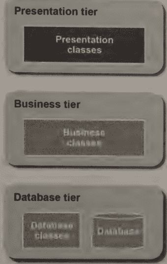

描述
为了简化开发和维护，许多应用程序使用三层架构将应用程序的用户界面、业务规则和数据库处理分开。架构的每一层都可能由一个或多个类组成。

表示层的类控制应用程序的用户界面。对于控制台应用程序，表示层通常包含一个带有 `main` 方法的类以及所有与控制台输入输出相关的类。对于 GUI 应用程序，用户界面由每个 GUI 窗口一个类组成。

数据库层的类处理应用程序的所有数据处理。

业务逻辑层的类定义了应用程序的业务对象和规则。这些类作为表示层和数据库层类之间的接口。

图 5-1 三层架构的工作原理

## 如何处理包（packages）

在第 3 章中，你学习了 Java API 如何将其类组织成包。现在，你将学习如何将你自己的类组织成包。通常情况下，这些包有助于将应用程序的类划分为不同的层。

包提供了两个主要的优势。首先，当一个项目包含大量类时，包可以为你的应用程序提供某种逻辑结构，并使其更容易找到类。其次，包提供了一种避免类之间命名冲突的方法。如果你将类提供给其他程序员使用，这一点尤为重要。

图 5-2 显示了在本章中介绍的 Line Item 应用程序在用包组织应用程序类后的文件夹和文件。在这里，`ch05_LineItem/src` 文件夹包含每个包的子文件夹。然后，每个子文件夹包含包的类。例如，`murach/business` 文件夹存储了定义业务对象的 `Product` 和 `LineItem` 类。`murach/db` 文件夹包含了定义数据库类的 `ProductDB` 类。而 `murach/ui` 文件夹包含了用户界面代码的 `LineItemApp` 类。

为包命名时，你可以使用任何喜欢的名称。然而，如果你想确保包的名称是唯一的，最佳实践是从反转的互联网域名开始命名。例如，由于我们的互联网域名是 `murach.com`，我们公司创建的所有包都以 `com.murach` 开始。

即使你不遵循这一惯例，也应该避免使用可能被他人使用的通用名称。例如，`business` 包名太通用了。然而，`murach.business` 不可能与任何包名冲突。本书使用 `murach` 作为包名的第一层，以明确标识创建此代码的公司。然后，可以使用第二层来组织第一层中的包。

一旦将类存储在正确的文件夹中，你必须在类的开头编写一个包语句（package statement）。该语句由 `package` 关键字后跟包名组成。在本图中，每个类都以与包含该类的文件夹对应的包语句开头。

如果一个类存储在某个包中，那么如果不指定包名，就无法从其他包的类访问它。因此，你通常需要导入（import）该类以便于引用。这对于你创建的包和类以及对于 Java API 的类都是如此。在本图中，`ProductDB` 类导入了 `murach.business` 包中的 `Product` 类。

## 使用包（packages）的应用程序文件夹和文件

```
ch05_LineItem/src
  murach
    business
      LineItem.java
      Product.java
    db
      ProductDB.java
    ui
      LineItemApp.java
```

## LineItem 类

```java
package murach.business;

import java.text.NumberFormat;

public class LineItem {..}
```

## Product 类

```java
package murach.business;

import java.text.NumberFormat;

public class Product {..}
```

## ProductDB 类

```java
package murach.db;

import murach.business.Product;

public class ProductDB {..}
```

## LineItemApp 类

```java
package murach.ui;

import java.util.Scanner;
import murach.db.ProductDB;
import murach.business.LineItem;
import murach.business.Product;

public class LineItemApp {..}
```


## Description

- 一个包可以存储一个或多个类。
- 每个包名与一个同名的文件夹对应。你使用的名称应该是唯一的，以防止与其他包发生冲突。
- 当你将类存储在包中时，类的第一条语句必须是指定包名的包语句（`package statement`）。
- 在包语句之后，你可以编写该类的导入语句（`import statements`）。这些语句对于你创建的包和类的操作方式与对于 Java API 中的包和类完全相同。

图 5-2 如何处理包

## 如何使用 NetBeans 处理包

当你处理包时，你需要确保包的名称与该包的文件夹名称对应。如果你必须手动这样做，这可能会很快变成一项繁味的任务。幸运的是，NetBeans 会自动为你处理这些工作。

当项目包含包时，你可以使用“项目”（Projects）窗口来浏览项目的包。为此，你可以点击包左侧的加号和减号来展开或折叠它们。

在图 5-3 中，“项目”窗口显示了本章介绍的 Line Item 应用程序的三个包。名为 `murach.business` 的包存储业务类，名为 `murach.db` 的包存储数据库类，而名为 `murach.ui` 的包存储用户界面类。

要开始使用包，你可以按照此图所示向项目添加新包。在操作时，请记住包名对应于存储包源代码的文件夹和子文件夹。如果这些文件夹和子文件夹不存在，它们会在你创建包时被创建。

一旦你为应用程序创建了包，NetBeans 会自动为你添加到包中的任何新类添加适当的包语句。此外，如果你重命名了一个包，NetBeans 会自动重命名相应的文件夹，并更新项目中任何需要的包语句或导入语句。同样，如果你将一个类从一个包移动到另一个包，NetBeans 会更新该类的包语句以及任何需要它的导入语句。简而言之，当你使用 NetBeans 处理包时，它会自动为你处理大部分细节。


## 一个 NetBeans 项目包含多个包

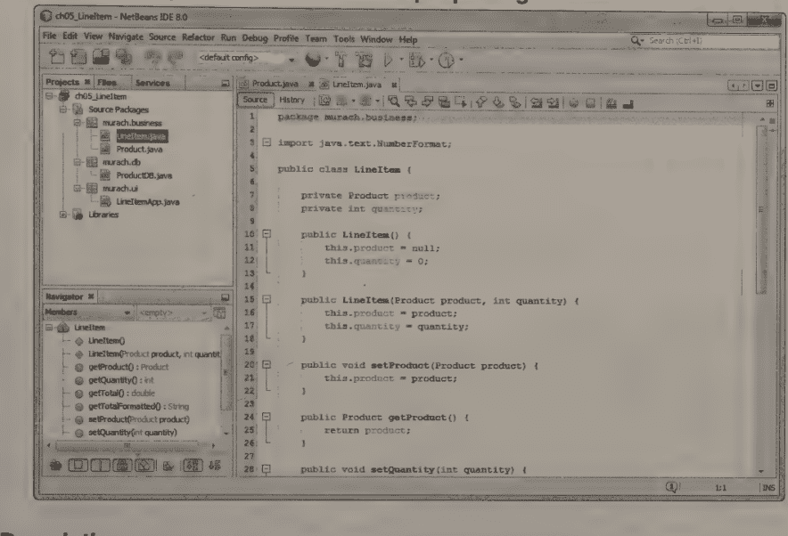

## Description

- 要浏览现有的包，使用“项目”窗口展开或折叠项目中的新包。
- 要向项目添加新包，在“项目”窗口中右键点击项目名称或“源包”（Source Packages）文件夹，选择“新建（New）→Java Package”命令，并在弹出的对话框中输入包名。
- 要重命名包，选择“重构（Refactor）→重命名（Rename）”命令，并使用弹出对话框指定新名称。
- 要将一个类从一个包移动到另一个包，在“项目”窗口中拖动它。然后，点击弹出对话框中的“重构”按钮。
- 要从项目中删除包，右键点击该包并从弹出菜单中选择“删除（Delete）”命令。如果包包含类，也会删除这些类。
- 当你使用 NetBeans 处理包时，它会自动更新相应的文件夹。此外，它会自动更新项目中任何需要的包语句或导入语句。

图 5-3 如何使用 NetBeans 处理包

## Line Item 应用程序

本章通过展示 Line Item 应用程序的面向对象版本作为结束。这个应用程序应该让你很好地了解如何使用类来构建三层应用程序。

### 用户界面

图 5-4 显示了 Line Item 应用程序的控制台。该控制台的工作方式与第 3 章介绍的 Line Item 应用程序非常相似。然而，它显示了 `Product` 对象的所有数据。

### 类图

该图显示了 Line Item 应用程序中使用的类结构。在这里，`LineItem` 类定义了成员变量。该图还包含了 `Product` 类和 `ProductDB` 类。到此为止，你应该熟悉这些类了。

`LineItem` 类定义了两个成员变量：`product` 和 `quantity`。`LineItem` 类还定义了六个方法。前四个方法是提供变量访问的 getter 和 setter 方法。`getTotal` 方法计算总和。`getTotalFormatted` 方法将总和格式化为货币值。

箭头表示 `ProductDB` 和 `LineItem` 类之间的关系。`LineItem` 类只使用了 `Product` 类。相反，`LineItem` 类只使用 `String` 类型。

### 控制台


### 类图


## Description

- Line Item 应用程序接收产品和数量，使用这些信息创建行项目，并将结果显示给用户。
- `LineItem` 类的成员变量存储了一个 `Product` 对象和一个 `int` 类型的数量。
- `getTotal` 方法计算行总额。`getTotalFormatted` 方法将总额格式化。

图 5-4 用户界面和 Line Item 应用程序的类图

## LineItem 类

图 5-5 显示了 `LineItem` 类。该类定义了一个发票行。与 `Product` 类一样，`LineItem` 类位于业务层。

包语句定义了该类所在的包。在此图中，包定义为 `murach.business`，这是存储 `Product` 类的包。

导入语句导入了 `java.text` 包中的 `NumberFormat` 类。因此，`getTotalFormatted` 方法无需限定即可使用该类。

在类内部，前两个语句定义了成员变量。在这里，第一个实例存储 `Product` 对象，第二个实例变量存储 `int` 类型的值。

该类的第一个构造函数初始化成员变量。在这里，第一条语句将 `product` 初始化为 `null`。如果你在给它赋值之前调用该它的方法，该类将抛出 `NullPointerException`。为了解决这个问题，你可以将此变量初始化一个新的 `Product` 对象。然而，在类未正确初始化时允许其抛出异常通常更好的做法。

第二个构造函数允许用户提供行项目的产品和数量。这与使用第一个构造函数、`setProduct` 方法和 `setQuantity` 方法的效果相同。因此它并不是必须的，但它让类更容易用。

构造函数之后，接下来的四个方法为这两个成员变量提供了 getter 和 setter 方法。这些方法访问相应的成员变量。

第五个方法返回行总额的 `double` 值。为此，该方法调用 `Product` 对象的 `getPrice` 方法获取产品价格，将价格乘以数量并返回结果。

第六个方法返回应用货币格式化后的行总额的 `String` 对象。为此，该方法调用 `getTotal` 方法返回总额的 `double` 值。然后，它使用 `NumberFormat` 对此 `double` 值应用货币格式化，并返回生成的 `String` 对象。

### LineItem 类

```java
package murach.business;

import java.text.NumberFormat;

public class LineItem {

    private Product product;

    private int quantity;

    public LineItem() {

        this.product = null;

        this.quantity = 0;

    }

    public LineItem(Product product, int quantity) {

        this.product = product;

        this.quantity = quantity;

    }

    public void setProduct(Product product) {

        this.product = product;

    }

    public Product getProduct() {

        return product;

    }

    public void setQuantity(int quantity) {

        this.quantity = quantity;

    }

    public int getQuantity() {

        return quantity;

    }

    public double getTotal() {

        double total = quantity * product.getPrice();

        return total;

    }

    public String getTotalFormatted() {

        double total = this.getTotal();

        NumberFormat currency = NumberFormat.getCurrencyInstance();

        String totalFormatted = currency.format(total);

        return totalFormatted;

    }

}
```

图 5-5 LineItem 类

## LineItemApp 类

图 5-6 显示了 `LineItemApp` 类的代码。该类包含应用程序的主方法。该方法从用户处获取输入并将输出显示给用户。

`package` 语句定义了该类所属的包。在图中，该语句定义了一个名为 `murach.ui` 的包。这表明该类包含了此应用程序用户界面的代码。

此外，它导入了 `java.util` 包中的 `Scanner` 类。它导入了来自 `murach.business` 和 `murach.db` 包的 `Product`、`LineItem` 和 `ProductDB` 类。因此，在 `LineItemApp` 类的其余部分可以方便地引用这些任何一个类。

在该类的 `main` 方法中，前两个语句打印欢迎信息。然后，第三条语句声明了一个名为 `sc` 的 `Scanner` 对象，并创建一个新的 `Scanner` 对象，该类使用它来获取用户输入。接下来，第四条语句声明了一个名为 `choice` 的字符串变量，并将其设置为字符串字面量 `"y"`。

`while` 循环开始检查变量 `choice` 是否等于 `"y"` 或 `"Y"`。如果是，则执行循环。

在循环内部，前四条语句从用户处获取产品代码和数量。然而，如果用户输入的数量 `Integer` 类的 `parseInt` 方法无法转换为 `int` 值，此代码将抛出异常并导致应用程序崩溃。

如果用户输入了有效的产品代码和数量，此代码将调用 `ProductDB` 类的 `getProduct` 方法来获取与产品代码对应的 `Product` 对象。然后，它在 `LineItem` 对象中设置 `Product` 对象和数量。

在创建 `LineItem` 对象并设置数据后，此应用程序创建了一个名为 `message` 的字符串对象，存储显示的数据。为了获取这些数据，代码使用了 `Product` 和 `LineItem` 对象的 `get` 方法。然后，代码将这些数据打印到控制台。

在显示完 `LineItem` 对象的数据后，代码检查用户是否想要继续。如果用户输入 `"y"` 或 `"Y"`，此代码将再次执行 `while` 循环。否则，代码将退出 `while` 循环。这会在控制台打印告别信息并退出 `main` 方法，导致应用程序结束。

### LineItemApp 类

```java
package murach.ui;

import java.util.Scanner;

import murach.db.ProductDB;

import murach.business.LineItem;

import murach.business.Product;

public class LineItemApp {

    public static void main(String[] args) {

        // 显示欢迎信息

        System.out.println("Welcome to the Line Item Calculator");

        System.out.println();

        // 创建 1 个或多个行项目

        Scanner sc = new Scanner(System.in);

        String choice = "y";

        while (choice.equalsIgnoreCase("y")) {

            // 从用户处获取输入

            System.out.print("Enter product code: ");

            String productCode = sc.nextLine();

            System.out.print("Enter quantity: ");

            int quantity = Integer.parseInt(sc.nextLine());

            // 获取产品对象

            Product product = ProductDB.getProduct(productCode);

            // 创建 LineItem 对象

            LineItem lineItem = new LineItem(product, quantity);

            // 显示输出

            String message = "\nLINE ITEM\n" +

                "Code: " + product.getCode() + "\n" +

                "Description: " + product.getDescription() + "\n" +

                "Price: " + product.getPriceFormatted() + "\n" +

                "Quantity: " + lineItem.getQuantity() + "\n" +

                "Total: " + lineItem.getTotalFormatted() + "\n";

            System.out.println(message);

            // 查看用户是否想要继续

            System.out.print("Continue? (y/n): ");

            choice = sc.nextLine();

            System.out.println();

        }

        System.out.println("Bye!");

    }

}
```


# 观点

如果你理解了本章介绍的 LineItem 应用程序，你就了解了许多 Java 编程，包括如何使用包和类来创建三层结构。以此为背景，你已经准备好学习更多内容。但首先，下一章将展示如何测试和调试本章介绍的 LineItem 应用程序。这样，每当你的代码无法正常工作时，你将拥有一些可以用来修复它的技能。

## 总结

- 三层架构将应用程序分为三层（或层级）。
- 表示层由用户界面组成。
- 数据库层由数据库类组成。
- 业务层由定义应用程序对象和规则的业务类组成。

# 练习 5-1 修改 LineItem 应用程序

此练习将引导你完成测试和修改本章介绍的 LineItem 应用程序。

## 查看并测试项目

1. 打开 `ex_starts` 文件夹中名为 `ch05_ex1_LineItem` 的项目。然后，查看 `LineItem` 和 `LineItemApp` 类的代码。
2. 运行项目并使用 "java"、"jsp" 和 "mysql" 等产品代码进行测试，确保此应用程序正常工作。

## 重命名包

3. 在 NetBeans 的 Project 窗口中，导航到 `murach.db` 包。然后，将此包重命名为 `murach.database`。
4. 打开 `ProductDB` 类，注意 NetBeans 也更改了该类的 `package` 语句以对应新的包名。
5. 打开 `LineItemApp` 类，注意 NetBeans 也更改了 `ProductDB` 类的 `import` 语句以对应新的包名。
6. 运行项目并确保它正常工作。

# 练习 5-2 在面积和周长应用程序中使用对象

此练习将引导你转换面积和周长应用程序，使其使用面向对象的方法。

## 查看并测试项目

1. 打开存储在 `ex_starts` 文件夹中名为 `ch05_ex2_AreaAndPerimeter` 的项目。然后，查看 `Main` 和 `Rectangle` 类的代码。注意它们都存储在 `murach.rectangle` 包中。
2. 运行项目并确保此应用程序正常工作。

## 处理包

3. 创建一个名为 `murach.ui` 的包。然后，将 `Main` 类移动到该包。
4. 创建一个名为 `murach.business` 的包。然后，将 `Rectangle` 类移动到该包。
5. 打开 `Rectangle` 类。注意 NetBeans 修改了它的 `package` 语句。
6. 打开 `Main` 类。注意 NetBeans 修改了它的 `package` 语句并添加了对 `Rectangle` 类的 `import` 语句。
7. 删除 `murach.rectangle` 包。
8. 运行项目并确保它仍然正常工作。

# 如何测试和调试应用程序

在开发 Java 应用程序时，你需要对其进行测试，以确保其运行符合预期。然后，如果你遇到任何问题，则需要对应用程序进行调试。为了做到这一点，你需要找到每个问题的原因并修复每个问题。

- 测试和调试的基础技能 ..................................... 148
- 典型的测试阶段 ................................................................................ 148
- 三种类型的错误 ........................................................................ 148
- 常见的 Java 错误 ............................................................................ 150
- 如何确定错误的原因 ................................................... 152
- 追踪代码执行的简单方法 ....................................................... 154
- 如何使用 NetBeans 调试应用程序 ........................................ 156
- 如何设置和移除断点 ...................................................... 156
- 如何单步执行代码 ....................................................................... 158
- 如何检查变量 ................................................................................. 158
- 如何检查堆栈跟踪 ......................................................................... 160
- 透视图 ........................................................................................... 162

## 测试和调试的基础技能

当你测试应用程序时，你会运行它以确保其正常工作。在测试应用程序的过程中，你会尝试输入数据和用户操作的所有可能的组合，以确保应用程序在每种情况下都能正常工作。换句话说，测试的目标是让应用程序失败。

当你调试应用程序时，你会修复在测试期间发现的错误。每当你修复一个 bug 时，你都会再次尝试，以确保你所做的更改不会影响应用程序的其他任何部分。这个过程被称为调试。

## 典型的测试阶段

当你测试应用程序时，通常会分阶段进行。图 6-1 列出了你可以用于像书中所示的这类小型应用程序的三种常见测试阶段。然而，对于大型应用程序，开发者有时会在开发用户界面或数据库类之前先测试业务类。

在第一阶段，你测试用户界面。对于控制台应用程序，这意味着你需要确保控制台显示正确的文本并提示用户输入正确的数据。对于具有图形界面的应用程序，这意味着你需要从视觉上检查控件，确保它们以正确的文本正确显示。然后，你应该确保所有的键和控件都能工作正常。例如，你应该测试 Tab 键和 Enter 键以及复选框和下拉列表。

在第二阶段，你使用有效数据测试应用程序。你可以输入预期用户会输入的数据。然后，你应该输入能够测试应用程序所有限制的有效数据。

在第三阶段，你测试你能想到的所有无效数据和用户操作的组合。这应该包括随机动作，例如在错误的时间按下 Enter 键或点击鼠标。

## 三种类型的错误

在测试应用程序时，可能会发生三种错误。这些错误在图 6-1 中描述。

编译时错误发生在 Java 编译器尝试编译代码时。这种错误会导致你的应用程序无法编译和运行，而且最容易发现和修复。大多数 Java IDE 会在你输入代码时自动检测语法错误，并提供如何修复它们的建议。

遗憾的是，某些错误在运行应用程序之前是无法检测的。这些错误被称为**运行时错误**，它们通常会抛出停止应用程序执行的异常。

如果应用程序运行过程中没有抛出异常，它可能包含导致应用程序无法正常运行的逻辑错误。这种错误通常是最难发现和纠正的。例如，图 6-1 中的 Line Item 应用程序有一个逻辑错误。你能看出它是什么吗？

### 具有逻辑错误的 Line Item 应用程序

```
Welcome to the Line Item Calculator

Enter product code: java

Enter quantity: 2

LINE ITEM

Code: java

Description: Murach's Java Programming

Price: $57.50

Quantity: 2

Total: $59.50

Continue? (y/n)
```

## 测试的目标

- 在应用程序投入生产之前找到所有错误

## 调试的目标

- 在应用程序投入生产之前修复所有错误

## 三个测试阶段

- 检查用户界面以确保其正常工作
- 使用有效输入数据测试应用程序以确保结果正确
- 使用无效数据或意外的用户操作测试应用程序。尝试你能想到的所有方法让应用程序失败。

## 可能发生的三种错误

- **编译时错误**发生在 Java 编译器编译代码时。这发生在 Java 运行环境 (JRE) 运行代码之前。这些错误通常违反了 Java 语句的语法。
- **运行时错误**发生在 Java 运行环境 (JRE) 运行代码时。这发生在 Java 编译器编译代码之后。这些错误通常会抛出停止应用程序执行的异常。
- **逻辑错误**发生在应用程序运行没有抛出任何错误但仍然产生了错误的结果（例如显示错误的数据）。

### 描述

- 测试 Java 应用程序时，运行它以确保无论你输入什么种组合的有效或无效数据，它都能正常工作。
- 调试应用程序时，找到测试应用程序时发现的所有错误（bug）的原因。然后，你修复这些错误。这个过程被称为调试。


## 常见的 Java 错误

图 6-2 展示了在编写应用程序时常见的某些编码错误。如果你完成了最后两个章节的练习，可能已经遇到过其中一些。此图顶部的代码来自 Line Item 应用程序的 `main` 方法，但引入了四个错误。

第一个错误是在声明变量 `choice` 的语句结束缺少分号。如你所知，Java 要求每个语句末尾都有分号，除非该语句包含大括号包裹的代码块。

第二个错误是 `while` 语句条件末尾缺少右括号。在编写代码时，你需要记住每一个左括号、大括号或引号都必须有一个对应的右括号、大括号或引号。

第三个错误是没有为变量 `product` 声明数据类型。与其他某些语言不同，Java 要求为所有变量声明数据类型。

第四个错误是语句调用 `Scanner` 对象 `sc` 的 `nextLine` 方法时大小写不正确。对于该语句，“NextLine” 应该是 “nextLine”，因为 Java 是对大小写敏感的。

### 包含错误的代码

```
Scanner sc = new Scanner(System.in);

String choice = "y" // 缺少分号

while (choice.equalsIgnoreCase("y") { // 缺少右括号

    // 获取用户输入

    System.out.print("Enter product code: ");

    productCode = sc.nextLine(); // 未声明数据类型

    System.out.print("Enter quantity: ");

    String quantity = sc.nextLine(); // 大写不正确

// 查看用户是否想继续

    System.out.print("Continue? (y/n): ");

    choice = sc.next();

    System.out.println();

}
```

### 常见的语法错误

- 忘记在语句末尾编写分号。
- 忘记左括号、大括号或引号。
- 忘记为变量声明数据类型。
- 标识符大小写错误。
- 标识符拼写错误。

### 描述

- 标识符是引用 Java 代码的名称，例如变量、方法、类或包。

## 如何确定错误原因

图 6-3 显示了如何找到错误的原因。一旦找到了错误原因，通常很容易修复它。寻找错误原因的方法取决于你所遇到的错误类型。

如果你遇到编译时错误，错误消息通常会显示阻止代码编译的行或几行代码。此外，错误消息通常包含一段描述，可以帮助你确定代码没有编译的原因。例如，在图中，编译时错误指定了 `LineItemApp` 类中阻止代码编译的行。此外，该错误的消息指示编译器预期在这一行的末尾有一个分号 (`;`)。

如果你遇到运行时错误，错误消息通常会显示应用程序崩溃时正在运行的代码行。此外，错误消息通常包含一段描述，可以帮助你确定应用程序崩溃的原因。例如，在图中，错误显示了应用程序崩溃时 `LineItemApp` 类中正在运行的 `main` 方法行。这一行是用户输入到 `int` 值的数据。此外，该异常的消息表明该方法正尝试格式化输入字符串 "x"。这是因为用户输入了 "x" 而不是输入像 "2" 这样的有效数字。你将在第 8 章中学习如何处理此类错误。

如果你遇到逻辑错误，可以从弄清楚为什么应用程序产生了那样的输出开始。例如，在图中，你可以开始问为什么应用程序没有计算出正确的总额。一旦你进入修复 bug 的之路。

对于编译时错误和运行时错误，大多数 IDE 都包含了你可以点击的链接，可以直接跳转到导致错误的代码行。这使得修复错误变得简单。对于逻辑错误，如图所示追踪代码执行可能会有所帮助。

### 编译时错误

```
Output: ch06_lineitem(run) #

Comparing a source file to C:\murach\java.netbooks\book_appch06\Lineitem.classes

C:\murach\java.netbooks\book_appch06\Lineitemmurach\Lineitem.java:18 error: expected ';'

String code = ""

I error

C:\murach\java.netbooks\book_appch06\Lineitemproject\build-impl.java:910: The following error occurred:

C:\murach\java.netbooks\book_appch06\Lineitemproject\build-impl.java:360: 

BUILD FAILED (total time: 6 seconds)
```

### 运行时错误

```
Output: ch06_lineitem(run) #

Welcome to the Line Item Calculator

Enterter product code: java

Enter quantity: 

Exception in thread "main" NumberFormatException: For input string: "a"

at java.lang.NumberFormatException.forInputString(String)(NumberFormatException.java:65)

at java.lang.Integer.parseInt(String)(Integer.java:580)

at java.lang.Integer.parseInt(String)(Integer.java:615)

at murach ul.Lineitem.main(Lineitem.java:75)

Java Result:

BUILD SUCCESSFUL (total time: 6 seconds)
```

### 逻辑错误

```
Output: ch06_lineitem(run) #

Welcome to the Line Item Calculator

Enter product code: java

Enter quantity: 2

LINE ITEM

Code: java

Description: Murach's Java Programming

Price: $27.50

Quantity: 2

Total: $55.00

Continue? (y/n): |
```


# 修复错误的第一步

修复错误的第一步是确定错误的原因。一旦你知道错误的原因，通常很容易修复它。

- **编译时错误**：转到源代码中无法编译的那行。在 NetBeans 中，你可以通过点击源代码行的链接来实现操作。这应该让你对导致错误的原因有一个强有力的提示。
- **运行时错误**：转到应用程序崩溃时正在运行的源代码行。在 NetBeans 中，你可以通过点击源代码行的链接来实现此操作。这应该让你对导致错误的原因有一个强有力的提示。
- **逻辑错误**：检查输出，检查源代码，并尝试弄清楚源代码是如何产生该输出的。确定错误原因通常很困难，但本章介绍的某些技术可以帮助。


# 追踪代码执行的简单方法

当你追踪应用程序的执行情况时，你会在代码的关键点显示消息或变量值。你通常这样做是为了寻找逻辑错误的原因。追踪代码执行的一种简单方法是在你的代码中添加语句。

例如，如果你无法弄清楚为什么 Line Item 应用程序计算的项目项目是不正确的，你可以在图 6-4 所示的应用程序代码中插入 `println` 语句。在这里，第一个 `println` 语句打印一条指示 `getTotal` 方法正在开始的消息。然后，接三个 `println` 语句打印价格、数量和总额的值。

# 使用 println 语句的代码

```java
public double getTotal() {

    System.out.println("start getTotal method");

    double total = quantity * price;

    System.out.println("price: " + price);

    System.out.println("quantity: " + quantity);

    System.out.println("total: " + total);

    System.out.println("end getTotal method");

    return total;

}
```


# 控制台打印的数据


## 带有断点的代码编辑器窗口


### 描述

- 调试时，你需要在导致错误的代码行执行之前停止应用程序的执行。然后，你可以像接下来的几幅图所示，检查变量并逐步执行代码。
- 要停止应用程序的执行，你可以设置断点。然后，当你运行应用程序时，执行到达断点处就会停止。
- 要为某行设置断点，请打开该类的代码编辑器并点击行号。断点由位于代码行左侧的一个小红色方块标识。
- 要移除断点，请点击断点图标。
- 你可以在开始调试之前或在调试期间设置和移除断点。在大多数情况下，你会在开始调试之前至少设置一个断点。
- 要启动主项目的调试，点击工具栏上的 `Debug Main Project` 按钮。如果打开了单个项目且它未被设置为主项目，此按钮的名称为 `Debug Project`。
- 你也可以通过右键点击项目并选择 `Debug` 命令，或者通过右键点击包含你要运行的主方法的源文件并选择 `Debug File` 命令来启动调试。

图 6-5 如何设置和移除断点

## 如何逐步执行代码

当你使用调试器运行应用程序并遇到断点时，执行会在断点处的语句执行之前停止。一旦执行停止，绿色箭头将标记出下一个要执行的语句。此外，NetBeans 会打开图 6-6 所示的 `Variables`（变量）窗口。该窗口显示当前执行点作用范围内的变量的值。

在调试期间，NetBeans 还会显示调试工具栏。你可以反复点击此工具栏上的 `Step Over`（跳过）和 `Step Into`（单步）按钮，逐条语句地执行应用程序。然后，你可以使用 `Variables` 窗口观察变量值在应用程序执行过程中具体如何以及何时变化。这可以帮助你确定 Bug 的原因。

在逐步执行应用程序时，如果你想执行一个方法而不进入内部，可以点击 `Step Over` 按钮。或者，你可以使用 `Step Out`（跳出）按钮退出任何你不想进入的方法。当你想要继续正常执行时，可以点击 `Continue`（继续）按钮。然后，应用程序将运行到下一个断点。或者，你可以使用 `Finish Debugger Session`（结束调试会话）结束应用程序的执行。

这些强大的调试功能可以帮助你找到严重编程问题的原因。逐步执行也是理解现有应用程序工作原理的好方法。例如，如果你逐步执行上一章介绍的 Line Item 应用程序，你将更好地了解它是如何工作的。

## 如何检查变量

当你设置断点并逐步执行代码时，`Variables` 窗口会自动显示作用范围内的变量的值。在图 6-6 中，执行点位于 `LineItem` 类的 `getTotalFormatted` 方法中。在这里，`Variables` 窗口显示了方法内定义的三个局部变量的值（`total`、`currency` 和 `totalFormatted`）。

当 `Variables` 窗口显示数字和字符串时，它会显示其值。例如，图中名为 `total` 的变量值为 115.0，而名为 `totalFormatted` 的变量值为 "115.00"。

然而，当 `Variables` 窗口显示引用对象的变量时，它不会自动显示其内部变量的值。相反，它会在对象名称左侧显示一个加号 `+`。然后，你可以通过点击该加号来展开它并查看对象的值。例如，图中名为 `currency` 的变量引用一个从 `NumberFormat` 类创建的对象。

同样，当你检查正在执行的对象的代码时，`Variables` 窗口首先会显示一个名为 `this` 的变量，指向当前对象。因此，你可以展开此变量来查看当前对象定义的实例变量的值。例如，在图中你可以展开名为 `this` 的变量来查看 `LineItem` 对象实例变量的值。

## 调试会话


### 调试工具栏上的部分按钮

| 按钮 | 键盘快捷键 | 描述 |
|--- | :--- | :--- |
| Step Over | F8 | 逐条执行代码语句，跳过被调用的方法。 |
| Step Into | F7 | 逐条执行代码语句，包括被调用方法中的语句。 |
| Step Out | Ctrl+F7 | 完成当前方法的代码执行并返回到调用方法。 |
| Continue | F5 | 继续执行直到下一个断点。 |
| Finish Debugger Session | Shift+F5 | 结束应用程序的执行。 |

### 描述

- 当到达断点时，执行会在该行执行之前停止。
- 编辑器窗口左侧栏中的箭头显示了将要执行的行。
- `Variables` 窗口显示当前方法作用范围内的变量值。启动调试会话时，默认显示 `Variables` 窗口。如果你关闭了它，可以再次打开。
- 当变量引用对象时，你可以通过点击加号并展开来查看其值。

图 6-6 如何逐步执行代码

# 第 6 章 如何测试和调试应用程序

- 你可以在代码行上设置断点，以便在执行该行之前停止代码执行。然后，你可以步进代码，并在代码执行时查看变量的值。
- 堆栈跟踪（`stack trace`）是按照调用反序排列的方法列表。

# 练习 6-1 测试和调试 Item 应用程序

本练习将引导你完成使用 NetBeans 测试和调试应用程序的过程。这应该让你了解 NetBeans 调试器有多用。

## 引入并修正编译时错误

1. 打开 `ch06_ex1_LineItem` 项目。然后，打开 `murachui` 包下的 `LineItem.java` 文件。
2. 删除生成欢迎消息的语句末尾的分号并保存文件。这应该会在代码编辑器窗口中显示错误。
3. 替换该语句末尾的分号。这应该修复该错误。

## 引入并检查运行时错误

4. 运行 Line Item 应用程序并使用产品代码“java”和无效值“ten”进行测试。这会导致应用程序崩溃并在输出（Output）窗口中打印错误信息。
5. 研究错误信息，并记录 `LineItem` 类中崩溃的语句行号。然后，点击链接跳转到该代码行。这应该打开 `LineItem.java` 文件并高亮导致崩溃的代码行。根据这些信息，你应该能够推断出应用程序崩溃是因为“ten”不是一个有效的整数值。在第 8 章中，你将学习如何处理这类问题。

## 设置断点并步进方法

6. 打开 `LineItem` 类，并在 `getTotalFormatted` 方法的第一行代码上设置一个断点。
7. 点击工具栏上的“调试项目”（`Debug Project`）按钮。这会使用调试器运行项目。
8. 点击“输出”（`Output`）选项卡显示输出窗口，为产品代码输入“java”，为数量输入 3。当你这样做时，应用程序运行到断点处并停止。
9. 点击“变量”（`Variables`）选项卡显示变量窗口。
10. 展开名为 `this` 的变量。这允许你查看当前 `LineItem` 对象的实例变量。注意 `quantity` 实例变量的值，并展开名为 `product` 的实例变量。这允许你查看存储在 `LineItem` 对象中的 `Product` 对象的实例变量。
11. 反复点击工具栏上的“单步”（`Step Over`）按钮以步进该方法中的语句。每一步之后，检查变量窗口中的值以查看它们是如何变化的。
12. 点击工具栏上的“继续”（`Continue`）按钮继续执行应用程序。
13. 再次显示输出窗口。然后，输入“n”退出应用程序并结束调试会话。

## 设置断点并步进应用程序

14. 打开 `LineItemApp` 类，并在 `main` 方法的第一行代码上设置一个断点。
15. 点击工具栏上的“调试项目”（`Debug Project`）按钮。
16. 使用“单步”（`Step Over`）和“单入”（`Step Into`）按钮步进应用程序的每一行。这样做时，对于大多数语句使用“单步”按钮，对于任何调用 `LineItem`、`Product` 和 `ProductDB` 类构造函数和方法的语句使用“单入”按钮。在此过程中，使用输出窗口输入数据，使用变量窗口检查变量。这应该能让你很好地了解这段代码是如何工作的。

## 停止调试并移除断点

17. 一旦你掌握了步进此应用程序的方法，点击“结束调试会话”（`Finish Debugger Session`）按钮结束应用程序。
18. 移除你在此练习中之前设置的断点。你可以点击断点的红色正方形图标来实现。

# 第 2 节

## 你需要的必备技能

本节由四个章节组成，向你展示如何使用更多 Java 核心功能。第 7 章介绍了处理数据类型和操作符的最重要技能。第 8 章介绍了处理控制语句最重要的技能。第 9 章介绍了处理字符串最重要的技能。第 10 章介绍了你在处理数组时需要了解的概念和技术。

我们将本节的每一章都设计成一个独立的单元。因此，你可以按照自己喜欢的任何顺序阅读这些章节。例如，如果你想学习更多关于控制结构，可以接着阅读第 7 章。或者，如果你想学习数组，可以接着阅读第 9 章。

# 如何使用基本类型和操作符

在第 2 章中，你学习了如何使用八种基本数据类型中的两种。此外，你还学习了如何使用操作符执行一些简单的算术计算。现在，你将学习其他六种基本数据类型。此外，你将学习在专业水平上使用操作符处理这些类型的细节。

| 主题 | 页码 |
| :--- | :--- |
| 数据处理基础技能 | 168 |
| 八种基本数据类型 | 170 |
| 如何声明和初始化变量 | 170 |
| 如何声明和初始化常量 | 172 |
| 如何编写算术表达式 | 174 |
| 如何使用二元操作符 | 174 |
| 如何使用单元操作符 | 176 |
| 如何使用复合赋值运算符 | 178 |
| 如何处理优先级 | 180 |
| 如何处理强制转换 | 182 |
| 如何使用 Java 类处理数字 | 184 |
| 如何使用 Math 类 | 184 |
| 如何使用 BigDecimal 类 | 186 |
| 如何解决舍入误差 | 188 |
| 发票应用程序 | 190 |
| 用户界面 | 190 |
| 代码 | 190 |
| 视角 | 194 |

## 数据处理基础技能

接下来的三幅图回顾了第 2 章中关于数据处理的一些技能。此外，这些图还介绍了与此主题相关的新技能。

## 八种基本数据类型

图 7-1 显示了 Java 提供的八种数据类型。你可以使用这八种数据类型来存储数字、字符和真假值。

在第 2 章中，你学习了如何使用 `int` 类型存储整数（整数数字）。然而，Java 为整数提供了其他三种数据类型。例如，如果一个值超出了 `int` 类型的范围，你可以使用 `long` 类型。反之，如果你只需要小的整数值并想节省系统资源，可以使用 `short` 和 `byte` 类型。

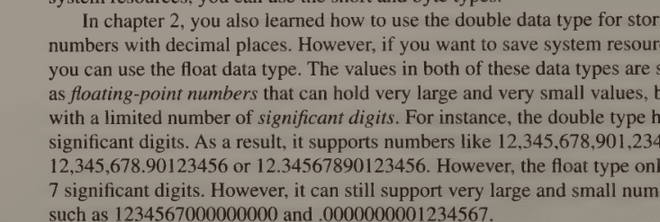

要表示浮点数的值可以使用科学计数法。这让你能够以简写的方式表示极大或极小的数字。要使用这种表示法，你在字母 `e` 或 `E` 后输入 10 的幂。例如，`3.65e9` 等于 3.65 乘以 10^9 (3,650,000,000)。同样，`3.65e-9` 等于 3.65 乘以 10^-9 (.00000000365)。

你可以使用 `char` 类型存储一个字符。由于 Java 使用世界上任何语言的几乎任何字符，因此你可以使用 Java 创建读取和打印希腊或中文字符的应用程序。在实践中，你通常处理存储在旧字节 ASCII 字符中的字符。这些字符是 Unicode 字符集中前 256 个字符。

最后，你可以使用 `boolean` 类型来存储真或假值。这种数据类型通常用于表示控制语句中的真或假条件。

# 原始数据类型

| 类型 | 字节 | 用途 |
| :--- | :--- | :--- |
| byte | 1 | 从 -128 到 127 的极短整数。 |
| short | 2 | 从 -32,768 到 32,767 的短整数。 |
| int | 4 | 从 -2,147,483,648 到 2,147,483,647 的整数。 |
| long | 8 | 从 -9,223,372,036,854,777,808 到 9,223,372,036,854,775,807 的长整数。 |
| float | 4 | 单精度浮点数，范围从 -3.4E38 到 3.4E38，最多有 7 位有效数字。 |
| double | 8 | 双精度浮点数，范围从 -1.7E308 到 1.7E308，最多有 16 位有效数字。 |
| char | 2 | 存储两个字节的单个 Unicode 字符。 |
| boolean | 1 | 真或假的值。 |

### 描述

- 整数是整数。
- 浮点数用于表示需要小数位的非常大或非常小的数字。单精度数字提供最多 7 位有效数字的数字。双精度数字提供最多 16 位有效数字。
- Unicode 字符集提供了超过 65,000 个字符，每个字符使用两个字节。ASCII 字符集为英语提供字符。这些字符是 Unicode 字符集的前 256 个字符。
- 布尔值可以为 true（真）或为 false（假）。在 Java 中，boolean 数据类型提供 Boolean 值。与其他原始类型一样，它使用小写字母。

# 技术说明

- 要表示浮点数的值，你可以使用科学计数法。例如，2.382E+5 表示 2.382 乘以 10^5，其值为 238,200。相反，3.25E-8 表示 3.25 乘以 10^-8，其值为 .0000000325。Java 有时使用这种表示法显示浮点数的值。
- 因为浮点数的内部存储方式，它们无法表示某些数字小数部分的精确值。这可能会导致舍入问题。在本章后面的部分，你将学习如何使用 `BigDecimal` 类来解决这些舍入问题。
- 默认情况下，Java 在可用时使用 80 位扩展精度浮点数。因此，使用浮点数的代码在不同系统上可能会产生略不同的结果。

图 7-1 八种原始数据类型

# 如何声明和初始化变量

在第 2 章中，你学习了如何声明和初始化变量。图 7-2 复习了这项技能，并展示了一些新信息。特别是，它展示了如何声明和初始化第 2 章中没有介绍的数据类型。

虽然你通常在一个语句中声明并初始化变量，但偶尔分两个语句完成是有意义的。例如，你可能在编码例程开始声明一个变量而不赋其初始值，因为它的值稍后才会设置。

图中的单语句示例展示了如何声明和初始化各种类型的变量。在这里，第三和第四示例展示了如何给 `float` 和 `long` 类型赋值。要这样做，你可以在值后面添加一个字母。对于 `float`，你必须在它后面添加 `F`，否则代码将无法编译。对于 `long` 类型，你可以添加 `L`。不过，这对于代码编译来说并不是必须的。你也可以使用小写的 `l`，但这很容易被误认为是数字 1。因此，通常认为使用大写的 `L` 是更好的做法。

第五和第六条语句展示了如何分配一个七位数的整数值。尽管这些语句分配了相同的值，但第二个语句使用下划线来分隔每组三个数字。由于你不能在字面量中使用下划线，每当能提高代码的可读性时，你就应该使用下划线。你可以将这种技术应用于所有类型的数字字面量，包括 `double`、`float` 和 `long` 值。然而，由于此功能是从 Java 7 开始引入的，当你确定代码将在 Java 7 或更高版本运行时，才应该使用它。

第七条语句展示了在给变量赋值时如何使用科学计数法。然后，第八和第九示例展示了你可以通过用单引号将字符括起来，或者通过提供 Unicode 字符集中与字符对应的整数来给 `char` 类型赋值。第十个示例展示了如何初始化一个名为 `valid` 的类型为 `boolean` 的变量并赋予 `false` 值。

最后一个示例展示了你可以在一个语句中声明并初始化两个或多个变量。虽然你偶尔这样做，但通常每个语句声明和初始化一个变量更好，因为这通常产生的代码在日后更容易阅读和修改。

# 赋值运算符

| 运算符 | 名称 | 描述 |
| :--- | :--- | :--- |
| = | 赋值 | 给变量分配一个新值。 |

# 如何用两个语句声明变量并为其赋值

语法
```
type variableName;
variableName = value;
```

示例
```
int counter;
counter = 1;
```

# 如何在一个语句中声明变量并为其赋值

语法
```
type variableName = value;
```

示例
```
int counter = 1;
```

### 描述

- 整数是整数。
- 浮点数用于表示需要小数位的非常大或非常小的数字。单精度数字提供最多 7 位有效数字的数字。双精度数字提供最多 16 位有效数字。
- Unicode 字符集提供了超过 65,000 个字符，每个字符使用两个字节。ASCII 字符集为英语提供字符。这些字符是 Unicode 字符集的前 256 个字符。
- 布尔值可以为 true（真）或为 false（假）。在 Java 中，boolean 数据类型提供 Boolean 值。与其他原始类型一样，它使用小写字母。

# 命名规范

- 变量名以小写字母开头并将单词的首字母大写。这种命名规范被称为驼峰命名法。

图 7-2 如何声明变量并赋值

# 如何声明和初始化常量

在第 2 章中，你学习了变量存储随程序执行而改变的值。换句话说，变量随程序执行而变化。然而，常量存储不随程序执行而改变的值。换句话说，常量在程序执行保持不变。

大多数声明和初始化变量的技能也声明和初始化常量。然而，当你声明常量时，以 `final` 关键字开始语句。因此，常量有时被称为最终变量。此外，一种常见的编码规范是对常量名使用全大写字母并用下划线分隔单词，如图 7-3 所示。

# 如何声明和初始化常量

语法
```
final type CONSTANT_NAME = value;
```

示例
```
final int DAYS_IN_NOVEMBER = 30;
```


final float SALES_TAX = .075F;

final double LIGHT_YEAR_MILES = 5.879e+12

### 描述

- 常量存储不随程序执行而改变的值。换句话说，常量在程序执行期间保持不变。
- 要声明常量，以 `final` 关键字开始声明。之后，初始化变量的技能也适用于常量。
- 为了便于区分变量和常量，大多数 Java 开发者对变量使用驼峰命名法，对常量使用全大写。

# 命名规范

- 常量使用全大写字母并用下划线分隔单词。
- 尽量使用易于记忆的有意义名称。

图 7-3 如何声明和初始化常量

## 如何编写算术表达式

在第 2 章中，你学习了如何编写简单的算术表达式。这些表达式使用了图 7-4 中的前四个算术运算符。现在，接下来的三幅图展示了如何使用 Java 提供的更多用于算术表达式的运算符。这些运算符对表达式中的操作数执行操作，操作数可以是字面量或变量。

## 如何使用二元运算符

在图 7-4 中，前五个运算符作用于两个操作数。因此，它们被称为二元运算符。例如，当你使用减法运算符 (`-`) 时，你会从一个操作数减去另一个。

加法 (`+`)、减法 (`-`) 和乘法 (`*`) 运算符自言易明。然而，除法 (`/`) 和取模 (`%`) 运算符需要解释。

如果你处理的是整数类型，除法运算符返回一个整数值，表示右操作数除入左操作数的次数。然后，如果有必要，你可以使用取模运算符返回一个表示余数的整数（即左操作数除以右操作数后剩余的）。

如果你处理的是浮点类型，除法运算符返回一个浮点值。该值使用小数位表示除法的结果。在大多数情况下，这正是你想要的。

## 算术二元运算符

| 运算符 | 名称 | 描述 |
| --- | --- | --- |
| `+` | 加法 | 两个操作数相加。 |
| `-` | 减法 | 从左操作数减去右操作数。 |
| `*` | 乘法 | 右操作数与左操作数相乘。 |
| `/` | 除法 | 左操作数除以右操作数。如果两个操作数都是整数，则结果为整数。 |
| `%` | 取模 | 返回右操作数除入左操作数后的的值。 |

## 初始化两个整数值的代码

```
int x = 14;

int y = 8;
```

## 如何执行加法和减法

```
int result1 = x + y; // result1 = 22

int result2 = x - y; // result2 = 6
```

## 如何执行乘法

```
int result3 = x * y; // result3 = 112
```

## 如何执行整数除法

```
int result4 = x / y; // result4 = 1

int result5 = x % y; // result5 = 6
```

## 初始化两个 double 值的代码

```
double a = 8.5;

double b = 3.4;
```

## 如何执行小数除法

```
double result6 = a / b; // result6 = 2.5
```

### 描述

- 算术表达式由作用于一个或多个数字（称为操作数）的算术运算符组成。
- 二元运算符作用于两个操作数。
- 赋值语句可以将表达式的值分配给变量。然后，当 Java 执行赋值语句时，它确定表达式的值并将结果存储在变量中。

7-4 如何使用算术二元运算符

## 如何使用一元运算符

7-5 显示四个作用于一个操作数的运算符。因此，它们被称为一元运算符。例如，你可以在操作数后编写自增运算符 (`++`)，使操作数的值增加 1。

当你编写自增 (`++`) 或自减 (`--`) 时，你可以在变量之前编写运算符来编写操作数。然后，自增或自减操作会在语句的其余部分执行之前完成。相反，你可以通过在变量之后编写运算符来对操作数进行后置。然后，自增或自减操作直到语句执行后才会执行。

通常，整个语句的作用仅仅是增加变量的值，如前两个示例所示。在这种情况下，前置和后置形式会产生相同的结果。然而，如果你将自增和自减运算符作为较大语句的一部分，你可以使用这些运算符的前置和后置形式来控制操作执行的时间。这由第三和第四个示例所示。

如有必要，你可以在操作数前面编写负号运算符 (`-`) 来反转操作数的值，如第五个示例所示。虽然你也可以在操作数前面编写正号运算符 (`+`)，但它不会改变操作数的值。因此这个一元运算符很少被使用。

由于每个 `char` 类型都是 Unicode 字符，具有映射到整数的数值代码，因此你可以对 `char` 类型执行一些整数操作。例如，第六个示例展示了你如何使用自增运算符将 `char` 变量的数值从 67 更改为 68，从而将字符从 C 变为 D。

## 算术一元运算符

| 运算符 | 名称 | 描述 |
| -- | -- | -- |
| `++` | 自增 | 将操作数加 1 (`x = x + 1`)。 |
| `--` | 自减 | 将操作数减 1 (`x = x - 1`)。 |
| `+` | 正号 | 表示该值为正数。 |
| `-` | 负号 | 将正值更改为负值，反之亦然。 |

## 使用自增运算符的典型语句

```
int i = 1;

i++;      // 执行后，i = 2
```

## 使用自减运算符的典型语句

```
int i = 10;

i--;      // 执行后，i = 9
```

## 如何对自增运算符进行后置

```
int x = 14;

int result = x++;  // 执行后，x = 15, result = 14
```

## 如何对自增运算符进行前置

```
int x = 14;

int result = ++x;  // 执行后，x = 15, result = 15
```

## 反转数字的值

```
int x = 14;

int result = -x; // 执行后，result = -14
```

## 如何对字符执行算术操作

```
char letter1 = 'C';

letter1++; // 执行后，letter1 = 'D'

char letter2 = 'C';

++letter2; // letter2 = 'D'
```

### 描述

- 一元运算符作用于单个操作数。
- 当你将自增或自减运算符作为后置用于变量时，它在语句执行后才执行。
- 当你将自增或自减运算符作为前置用于变量时，它在语句的其余部分执行之前执行。
- 一元运算符可以作为赋值语句的一部分，而不是整个赋值语句。

## 如何使用复合赋值运算符

除了赋值运算符 (`=`)，Java 还提供了复合赋值运算符。这些运算符为常见的赋值操作提供了简便方法。复合赋值运算符被称为增强赋值运算符。

当你需要将变量增加或减少 1 时，可以使用快捷运算符。例如：

```
month = month + 1;
```

这等同于

```
month++;
```

同样，如果你想将变量的值加到 `sum`，你可以这样做：

```
sum += nextNumber;
```

这等同于

```
sum = sum + nextNumber;
```

## 复合赋值运算符

| 运算符 | 名称 | 描述 |
| --- | --- | --- |
| `+=` | 加法 | 将操作数加到变量的值上并将结果赋值给变量。 |
| `-=` | 减法 | 从变量的值中减去操作数并将结果赋值给变量。 |
| `*=` | 乘法 | 操作数与变量的值相乘并将结果赋值给变量。 |
| `/=` | 除法 | 变量除以操作数并将结果赋值给变量。如果两个操作数都是整数，则结果为整数。 |
| `%=` | 取模 | 计算变量除以操作数后的剩余值并将该值赋值给变量。 |

## 在等号两边使用相同变量的语句

```
count = count + 1; // count 增加了 1

count = count - 1; // count 减少了 1

total = total + 100.0; // total 增加了 100.0

total = total - 100.0; // total 减少了 100.0

price = price * .8; // price 乘以 .8

sum = sum + nextNumber; // sum 增加了 nextNumber 的值
```

## 使用复合赋值运算符的语句

```
count += 1; // count 增加了 1

count -= 1; // count 减少了 1

total += 100.0; // total 增加了 100.0

total -= 100.0; // total 减少了 100.0

price *= .8; // price 乘以 .8

sum += nextNumber; // sum 增加了 nextNumber 的值
```

# 如何处理优先级

图 7-7 提供了关于编写算术表达式的更多信息。特别是，它给出了算术操作的优先级。这意味着所有的前缀递增和递减操作首先执行，然后是所有的正号和负号操作，依此类推。如果两个或多个操作具有相同的优先级，则按照从左到右顺序执行。

这种操作顺序并不总是按照你想要的方式运行。因此，你有时需要通过使用括号来覆盖这种顺序。这时，最内层括号中的表达式先执行，然后是下一组括号，依此类推。尽管在括号内部，操作仍然根据优先级从左到右执行。通常情况下，每当你对操作顺序有任何疑问时，应该使用括号来指定操作顺序。

第一个示例展示了为什么你有时需要使用括号来指定优先级。这里，计算价格的表达式没有使用括号。结果，Java 使用默认优先级，在减法操作之前执行乘法操作，导致得到错误的结果。相比之下，第二个计算价格的表达式将减法操作放在括号内。结果，Java 在乘法操作之前执行了减法操作，得到了正确的结果。

第二个示例展示了你如何在更复杂的表达式中使用括号。这里，第一个表达式使用了三组括号来计算投资账户的当前值：加上每月投资金额后，计算月利，并将利息加到其中。如果你在跟这个逻辑方面有困难，可以将初始值代入表达式并一次性求值：

```
(5000 + 100) * (1 + .12 / 12)

(5000 + 100) * (1 + .01)

5100 * 1.01
```

如果你为某个复杂的计算创建这样的表达式有困难，可以将表达式拆分为一系列语句，如代码的最后四行所示。这里，第一个语句将每月投资加到当前值。第二个语句计算月利率。第三个语句计算月利金额。第四个语句将利息加到当前值中。这消除了对括号的需求。此外，它使代码更容易阅读和调试。

# 算术操作的优先级

1. 递增和递减
2. 正号和负号
3. 乘法、除法和取余
4. 加法和减法

# 计算折扣价格的代码

```
使用默认优先级

double discountPercent = .2;

double price = 100;

price = price * 1 - discountPercent; // price = $99.8
```

# 使用括号指定优先级

```
price = price * (1 - discountPercent); // price = $80
```

# 计算每月投资当前值的代码

```
double currentValue = 5000; // 投资账户的当前值

double monthlyInvestment = 100; // 每月增加的金额

double yearlyInterestRate = .12; // 年利率
```

# 使用括号指定优先级

```
currentValue = (currentValue + monthlyInvestment) *

(1 + (yearlyInterestRate/12));
```

# 使用独立语句控制优先级

```
currentValue += monthlyInvestment; // 添加投资

double monthlyInterestRate = yearlyInterestRate / 12;

double monthlyInterest = currentValue * monthlyInterestRate;

currentValue += monthlyInterest; // 添加利息
```

# 

- 除非使用括号，否则表达式中的操作将按照优先级从左到右执行。
- 要指定操作顺序，你可以使用括号。这时，最内层括号中的操作先执行，然后是下一组括号的操作，依此类推。


# 如何处理类型转换

在开发 Java 应用时，你经常需要将数据从一种数据类型转换为另一种。为了这样做，你使用一种称为类型转换（casting）的技术，如图 7-8 所示。

Java 提供了两种类型转换。隐式转换自动执行，可将精度较低的数据（如 `float` 类型）转换为更精确的类型（如 `double` 类型）。同样，隐式转换也可用于将数据从小类型（如 `int` 类型）转换为大类型（如 `long` 类型）。这被称为宽转换，因为新类型始终足够容纳原始值。例如，图中的第一个语句将整数值 93 转换为 `double`。

如果算术表达式中的某些值的数据类型比其他值更精确，Java 也会执行隐式转换，如接下来的三个语句所示。在 ways，变量 `d` 声明为 `double` 类型，变量 `i` 和 `j` 声明为 `int` 类型。然后，当这些变量在表达式一起使用时，Java 在评估时会将 `i` 和 `j` 均转换为 `double`。

窄转换是从更精确的数据类型到精度较低的数据类型的转换。在这种类型转换中，精度较低的数据类型可能无法容纳原始值，这可能导致某些数据丢失。在这种情况下，你必须使用显式转换。

要执行显式转换，需要在要转换的变量之前在括号中编写转换代码。例如，执行显式转换的第一个示例将 `double` 值 93.75 转换为 `int` 值 93。这里，需要显式转换，因为 Java 不会对可能导致数据丢失的窄转换执行隐式转换。在这种情况下，转换导致了小数位的丢失。

当你在算术表达式中使用显式转换时，Java 会在算术操作之前执行转换，如最后两个显式转换示例所示。在最后一个示例中，Java 在除法之前将两个整数类型转换为 `double` 类型，以便结果在必要时具有小数位。如果没有显式转换，表达式将返回一个整数值，Java 会将其转换为 `double`。

# 处理原始类型和运算符

第 7 章 如何处理原始类型和运算符

# 隐式转换如何工作

数据类型

```
byte->short->int->float->double
```

示例

```
double grade = 93; // 将 int转换为 double
```

```
double d = 95.0;

int i = 86, j = 91;

double average = d+i+j; // 将将 i 和 j 转换为 double

                             // average = 90.6666...
```

# 如何编写显式转换

语法

```
(type) expression
```

示例

```
int grade = (int) 93.75; // 将 double转换为 int (grade = 93)
```

```
double d = 95.0;

int i = 86, j = 91;

int average = ((int)d+j)/3;    // 将 d转换为 int (average = 90)

int remainder = ((int)d+j)%3;   // 将 d转换为 int (remainder = 2)
```

```
double result = (double) i / j; // 结果具有小数
```

# 在 char 和 int 之间转换

```
char letterChar = 65;      // int转换为char (letterChar = 'A')

char letterChar2 = (char) 65;     // 这可行

int letterInt = (int) letterChar; // char转换为int (letterInt = 65)

int letterInt2 = (int) 'A';        // 这可行
```

# 复合赋值运算符会导致显式转换

```
int i = 4;

double d = 4.5;

i += d;                          // i = 8 (4.5转换为 int 类型)
```


### 说明

- 如果将精度较低的类型赋值给精度较高的类型，或将较小的类型赋值给较大的类型，Java 会自动执行转换并完成转换。这被称为隐式转换或宽转换。
- 当你编写算术表达式时，Java 会隐式将精度较低的数据类型转换为最精确的数据类型。
- 要编写将更精确的数据类型转换为精度较低的类型的赋值语句，你必须使用括号指定精度较低的数据类型。这被称为显式转换或窄转换。

## 如何使用 Java 类处理数字

正如你在第 3 章中所学的，Java 提供了数百个类，其中包含了可以在代码中使用的方法。接下来介绍的几个类是为了处理数值数据类型设计的。此外，它们还展示了如何使用 `BigDecimal` 类来修复有时会在浮点类型中出现的舍入误差。

## 如何使用 Math 类

`Math` 类提供了几十种用于处理数值数据类型的方法。图 7-9 展示了其中最常用的方法。

第一个示例展示了如何使用 `round` 方法。在这里，第一条语句将 `double` 舍入为 `long` 类型，第二条语句将 `float` 类型舍入为 `int` 类型。然而，此方法仅能舍入到整数值。因此，它并没有那么有用。在下一张图中，你将学习如何使用 `BigDecimal` 类舍入到指定的小数位数，这要有用得多。

第二个示例展示了如何使用 `pow` 方法将第一个参数提升到第二个参数的幂。该方法返回一个 `double` 值并接受两个参数。然而，由于 Java 会自动将任何低精度类型的参数转换为 `double`，因此 `pow` 方法接受所有数值类型。在这个示例中，第一条语句等于 2²，第二条语句等于 8，第三条和第四条语句等于 25。

通常情况下，`Math` 类的方法的工作方式正如你的预期。然而，你可能需要对数值类型进行强制类型转换，以便让方法按照你想要的方式工作。例如，`pow` 方法返回的是 `double` 类型。所以如果你需要一个 `int`，就需要将 `double` 强制转换为 `int` 类型，如 `pow` 方法的第四个示例所示。

第三个示例展示了如何使用 `sqrt` 方法获取数字的平方根。然后，第四个示例展示了如何使用 `max` 和 `min` 方法返回两个值中的较大或较小值。如果你学习了这些示例，理解它们的工作原理应该没有任何困难。

第五个示例展示了如何使用 `random` 方法生成随机数。由于该方法返回一个大于等于 0.0 且小于 1.0 的随机值，你可以通过将随机数乘以另一个数来返回任何范围的值。在这个示例中，第一条语句返回一个大于等于 0.0 且小于 100.0 的随机 `double` 值。然后，第二条语句将该 `double` 强制转换为 `long` 数据类型。如果你愿意，可以使用这段代码为应用程序生成随机值。

如果你有正确的数学背景，使用这些或任何其他 `Math` 方法应该不会有任何困难。例如，如果你上过三角函数课程，你应该能够理解 `Math` 类提供的三角函数方法。

## Math 类

```
java.lang.Math
```

## Math 类的静态方法

| 方法 | 说明 |
| --- | --- |
| `round(number)` | 返回与 `double` 值最接近的 `long` 值或与 `float` 值最接近的 `int` 值。结果没有小数。 |
| `pow(number, power)` | 返回 `double` 参数（number）的另一个 `double` 参数（power）幂的 `double` 值。 |
| `sqrt(a)` | 返回 `double` 参数的平方根的 `double` 值。 |
| `max(a, b)` | 返回两个 `float`、`double`、`int` 或 `long` 参数中的较大值。 |
| `min(a, b)` | 返回两个 `float`、`double`、`int` 或 `long` 参数中的较小值。 |
| `random()` | 返回一个大于等于 0.0 且小于 1.0 的随机 `double` 值。 |

## round 方法

```java
long result = Math.round(1.667); // result is 2
int result = Math.round(1.49F); // result is 1
```

## pow 方法

```java
double result = Math.pow(2, 2); // result is 4.0 (2*2)
double result = Math.pow(2, 3); // result is 8.0 (2*2*2)
double result = Math.pow(5, 2); // result is 25.0 (5 squared)
int result = (int) Math.pow(5, 2); // result is 25 (5 squared)
```

## sqrt 方法

```java
double result = Math.sqrt(20.25); // result is 4.5
```

## max and min 方法

```java
int x = 67;
int y = 23;
int max = Math.max(x, y); // max is 67
int min = Math.min(x, y); // min is 23
```

## random 方法

```java
double x = Math.random() * 100; // result is a value >= 0.0 and < 100.0
long result = (long) x; // converts the result from double to long
```

### 说明

- 你可以使用 `Math` 类的静态方法执行常用的算术运算。这总结了对业务应用最有用的方法。
- 当方法需要一个或多个参数时，你在括号之间编写这些参数，并用逗号分隔多个参数。
- 在某些情况下，你需要将结果强制转换为你想要的数据类型。

图 7-9 如何使用 Math 类

## 如何使用 BigDecimal 类

`BigDecimal` 类设计用于解决与浮点类型相关的两类问题。图 7-10 展示了如何使用 `BigDecimal` 类。

`BigDecimal` 类设计用于解决与浮点类型相关的两类问题。首先，它解决了舍入误差。其次，它允许高精度的算术。

在使用 `BigDecimal` 时，最好是使用字符串构造函数以避免浮点数字面量固有的精度问题。

```java
discountAmount = new BigDecimal(discountAmount)
    .setScale(2, RoundingMode.HALF_UP)
    .doubleValue();
```

## 如何修复舍入误差

图 7-11 展示了如何使用 `BigDecimal` 类来修复在使用 `double` 类型时经常出现的舍入误差。首先，第一个示例使用 `double` 类型来存储小计、折扣金额和税前总额的货币值。此外，它还使用 `double` 类型存储折扣百分比。

第二个示例创建了两个 `NumberFormat` 对象并使用它们格式化第一个示例中的值。然后，将这些格式化后的值打印到控制台。遗憾的是，显示的结果是不正确的。如果折扣金额为 $10.01，税前总额应该是 $90.04。然而，结果却是 $90.05。

是什么导致了错误？嗯，由于 `NumberFormat` 类的工作机制，10.005 的折扣金额被四舍五入到了 10.01，而 90.045 的税前总额也被四舍五入到了 90.05。虽然这种错误在某些类型的应用程序是可以接受的，但在大多数业务应用程序中是不可接受的。对于这些应用程序，你需要提供能够交付预期结果的解决方案。想象一下生成一张金额对不上的发票！

解决方案是什么？嗯，一种解决方案是在计算折扣金额后立即将其舍入到 2 位小数。要做到这一点，你可以在计算折扣金额的语句之后添加一行类似于上图中最后一行的代码。

另一个解决方案是在第三个示例所示，使用 `BigDecimal` 代替 `double` 值。然后，你可以使用 `BigDecimal` 类的方法执行计算并舍入折扣金额。此示例首先从 `String` 对象构建小计和折扣率的 `BigDecimal`。然后使用 `multiply` 方法计算折扣金额，使用 `setScale` 方法将该数字舍入到 2 位小数，并使用 `subtract` 方法计算税前总额。

在这个示例中，只有折扣金额需要舍入。因为它通过乘法计算，可能会产生额外的小数。相比之下，税前总额不需要舍入，因为它通过减法计算，不会产生额外的小数。一旦这段代码完成了计算和舍入，就可以安全地使用 `NumberFormat` 对象对小数值进行格式化显示。

为了简单的算术运算要这么多工作吗？与其他语言相比，你必须说是的。事实上，这是 Java 的一个弱点。然而，一旦你掌握了如何使用 `BigDecimal` 类，你应该能够轻松解决舍入问题。

如果 `BigDecimal` 类解决了所有小数问题，为什么它不是处理小数的默认方式呢？遗憾的是，与 `double` 和 `float` 类型相比，使用 `BigDecimal` 类非常慢。这是因为 `BigDecimal` 无法访问处理器的 FPU（浮点单元）。对于大多数应用程序来说，这种相对的缓慢并不明显。但对于每秒需要进行数千次浮点计算的游戏或科学应用程序，这是不可接受的。

## 使用 double 值存储货币值的代码

```java
double subtotal = 100.05;      // 100.050
double discountPercent = .1;
double discountAmount = subtotal * discountPercent; // 10.0050
double totalBeforeTax = subtotal - discountAmount; // 90.045
```

## 导致舍入误差的代码

```java
// 获取货币和百分比格式化的对象
NumberFormat currency = NumberFormat.getCurrencyInstance();
NumberFormat percent = NumberFormat.getPercentInstance();

// 格式化消息并打印到控制台
String formattedMessage = ""
    + "Subtotal: " + currency.format(subtotal) + "\n"
    + "Discount percent: " + percent.format(discountPercent) + "\n"
    + "Discount amount: " + currency.format(discountAmount) + "\n"
    + "Total before tax: " + currency.format(totalBeforeTax) + "\n";

System.out.println(formattedMessage);
```

## 包含舍入误差的格式化结果

| 字段 | 值 |
| :--- | :--- |
| Subtotal | $100.05 |
| Discount percent | 10% |
| Discount amount | $10.01 |
| Total before tax | $90.04 |

## 使用 BigDecimal 对象修复舍入误差的代码

```java
BigDecimal subtotal = new BigDecimal("100.05"); // 100.050
BigDecimal discountPercent = new BigDecimal(".1");
BigDecimal discountAmount = subtotal.multiply(discountPercent); // 10.005
discountAmount = discountAmount.setScale(2, RoundingMode.HALF_UP); // 10.01
BigDecimal totalBeforeTax = subtotal.subtract(discountAmount); // 90.040
```

## 格式化结果

| 字段 | 值 |
| :--- | :--- |
| Subtotal | $100.05 |
| Discount percent | 10% |
| Discount amount | $10.01 |
| Total before tax | $90.04 |

## Description

- 通过此代码，所有数字都存储在 `BigDecimal` 对象中，且所有结果在需要时都被正确地舍入到两位小数。
- 一旦计算出结果，你可以使用 `NumberFormat` 方法对 `BigDecimal` 对象中的值进行格式化，而无需担心舍入问题。


在 if/else 语句之后，这段代码通过将小计乘以折扣百分比来计算折扣金额。由于结果可能超过 2 位小数，该代码使用 `BigDecimal` 类将结果四舍五入到 2 位小数，并将其结果作为 double 值返回。为了实现这一点，该代码根据折扣金额的 double 值创建一个新的 `BigDecimal` 对象，使用 `setScale` 方法对数字进行四舍五入，并使用 `doubleValue` 方法获取 double 值。然后，这段代码在从小计中减去 `discountAmount` 之前计算总额。

接下来通过声明一个名为 `SALES_TAX_PCT` 的常量来存储销售税百分比。在这里，该常量被设置为值 .05 (5%)。然后，这段代码将此常量乘以税前总额以获得销售税金额。由于该金额可能包含超过 2 位小数，该代码使用 `BigDecimal` 类按照在本类之前使用的相同技术将该数字四舍五入到 2 位小数。

在代码完成所有计算后，它使用 `NumberFormat` 类对货币和百分比值应用货币和百分比格式。然后，它向控制台打印包含这些值的消息。由于在应用此格式之前，所有的货币值都已四舍五入到 2 位小数，显示的值应该是相加的。换句话说，此应用程序不应包含任何舍入误差。

遗憾的是，该应用程序仍然没有处理用户为小计输入有效值时抛出的异常。然而，你将在下一章中学习如何处理此异常。

## 代码（继续）

```java
// calculate discount amount
double discountAmount = subtotal * discountPercent;
discountAmount = new BigDecimal(discountAmount)
    .setScale(2, RoundingMode.HALF_UP)
    .doubleValue();

// calculate total before tax
double totalBeforeTax = subtotal - discountAmount;

// calculate sales tax
final double SALES_TAX_PCT = .05;
double salesTax = SALES_TAX_PCT * totalBeforeTax;
salesTax = new BigDecimal(salesTax)
    .setScale(2, RoundingMode.HALF_UP)
    .doubleValue();

// calculate total
double total = totalBeforeTax + salesTax;

// get the currency and percent formatter objects
NumberFormat currency = NumberFormat.getCurrencyInstance();
NumberFormat percent = NumberFormat.getPercentInstance();

// display the data
String message = "\nINVOICE\n"
    + "Subtotal: " + currency.format(subtotal) + "\n"
    + "Discount percent: " + percent.format(discountPercent) + "\n"
    + "Discount amount: " + currency.format(discountAmount) + "\n"
    + "Total before tax: " + currency.format(totalBeforeTax) + "\n"
    + "Sales tax: " + currency.format(salesTax) + "\n"
    + "Invoice total: " + currency.format(total) + "\n";

System.out.println(message);

// see if the user wants to continue
System.out.print("Continue? (y/n): ");
choice = sc.nextLine();
System.out.println();
System.out.println("Bye!");
```


图 7-12 发票应用程序（第 2 共 2 部分）

## 观点

如果本章学习成功，你现在应该能够处理应用程序所需的任何基本数据类型。此外，你应该可以在需要时使用 `Math` 类。你应该能够使用 `BigDecimal` 类来解决与浮点数相关的问题，如舍入误差。

### 总结

- Java 提供了八种基本数据类型来存储整数、浮点数、字符和布尔值。
- 变量存储应用程序运行期间改变的数据。常量存储应用程序运行期间不变的数据。你使用赋值语句为变量赋值。
- 你可以使用算术运算符来形成算术表达式，并可以使用某些赋值运算符作为某些类型算术表达式的简写。
- Java 可以将低精度数据类型隐式转换为高精度数据类型。Java 还允许你显式将高精度数据类型转换为低精度数据类型。
- 你可以使用 `Math` 类的静态方法来执行数学运算，例如计算数字的平方根。
- 你可以使用 `BigDecimal` 类创建存储小数值的对象，不受限于 16 位有效数字。此外，你可以使用这些对象的方法执行加、减、乘、除和四舍五入等操作。

## 练习 7-1 修改 Line Item 应用程序

在练习中，你将使用在本章中学到的技能来修改 Line Item 应用程序。

1. 打开 `ex_starts` 文件夹中名为 `ch07_ex1_LineItem` 的项目。然后，检查该项目的代码并运行它直到理解其工作原理。
2. 打开 `Product` 类。对价格使用 `float` 类型代替 `double` 类型。为了做到这一点，你需要修改实例变量的声明、设置价格的构造函数、`getPrice()` 方法和 `setPrice()` 方法。
3. 打开 `LineItem` 类。修改 `getTotal()` 方法使其返回 `float` 类型而不是 `double` 类型。
4. 打开 `ProductDB` 类。修改使用 `setPrice()` 方法的语句，传递 `float` 字面量而不是 `double` 字面量。
5. 运行应用程序以确保它仍然正常。
6. 在 `while` 循环之前，声明一个 `byte` 类型的计数器变量。在显示行项目的代码之后，使用递增运算符增加计数。在 `while` 循环之后，显示用户输入的行项目数量。例如，对于 2 个行项目，显示如下消息：

| Number of line items: | 2 |
| --- | --- |

7. 在 `while` 循环之前，声明一个 `float` 类型的变量 `total`。在显示行项目的代码之后，使用复合加运算符将行项目的金额加到 `total` 变量中。在 `while` 循环之后，如下显示总量：

| Invoice total: | 287.5 |
| --- | --- |

8. 在 `while` 循环之前，声明一个 `float` 类型的变量存储最大的行项目，以及另一个 `float` 类型的变量存储最小的行项目。在显示行项目后，使用 `Math` 类的 `max()` 和 `min()` 方法更新最大和最小项目的值。循环结束后，显示如下：

| Largest line item: | 172.5 |
| --- | --- |
| Smallest line item: | 10.0 |
| --- | --- |

为了正确运行，你需要将最小值初始化为一个很大的值。此外，在 `Math` 类的 `min()` 和 `max()` 方法中，你需要将 `LineItem` 类 `getTotal()` 方法返回的值强制转换为 `float`。

## 练习 7-2 修改发票应用程序使用 BigDecimal 类

在练习中，你将修改本章介绍的发票应用程序，使其使用 `BigDecimal` 类进行计算。

1. 打开 `ex_starts` 文件夹中名为 `ch07_ex2_Invoice` 的项目。然后，检查该项目的代码。
2. 运行应用程序并测试一系列小计值，包括 100.05 的小计。注意总额计算正确。
3. 删除舍入销售税的语句。
4. 运行应用程序并输入 100.05 的小计进行测试。注意总额计算错误。
5. 修改代码，使用 `BigDecimal` 类的方法执行此应用程序所需的所有舍入、乘法、加法和减法。换句话说，不要使用算术运算符进行乘法 (`*`)、加法 (`+`) 或减法 (`-`)。确保在需要的地方将数字四舍五入到 2 位小数。
6. 运行应用程序并输入 100.05 的小计进行测试。总额应该是计算正确的。

# 如何编写布尔表达式

布尔表达式是一个评估为真（`true`）或假（`false`）布尔值的表达式。布尔表达式通常出现在控制语句中，如本章描述的语句。这就是为什么本章开始演示如何使用关系运算符和逻辑运算符来编写布尔表达式。

# 如何比较原始数据类型

图 8-1 显示了如何使用六个关系运算符来比较操作数为原始数据类型的操作数。在布尔表达式中，操作数可以是字面量、变量、算术表达式，或者像 `true` 或 `false` 这样的关键字。

图中前三个表达式使用相等运算符 (`==`) 来测试两个操作数是否相等。要使用此运算符，你必须编写两个等号而不是一个。因为单等号被用于赋值语句。因此，如果你尝试用单等号编写布尔表达式，你的代码将无法编译。

第四个表达式使用不等于运算符 (`!=`) 来测试一个值是否不等于一个数字字面量。在这里，如果变量 `subtotal` 不等于 0，则该表达式为真。

第五和第六个表达式使用了大于运算符 (`>`) 和小于运算符 (`<`)。然后，第七和第八表达式使用了大于或等于运算符 (`>=`) 和小于或等于运算符 (`<=`)。

最后两个表达式显示，当你在表达式中使用布尔变量时，不需要 `==` 或 `!=`。这是因为根据定义，布尔变量评估的结果就是一个布尔值。因此，如果你声明了一个名为 `isValid` 的布尔变量，

```
isValid = true
```

等同于
`isValid`

虽然第一个表达式可能更容易初级程序员理解，但第二个表达式通常被专业程序员使用。

在比较数值时，你通常比较的是相同数据类型的值。然而，如果你比较不同类型的数值，Java 会自动将精度较低的数值类型强制转换为精度更高的类型。例如，如果你将一个 `int` 与一个 `double` 进行比较，Java 会在执行比较之前将 `int` 转换为 `double`。

由于浮点数不能表示数字的精确值，因此你不应该使用相等运算符 (`==`) 来比较它们的相等性。相反，你可以使用大于 (`>`) 和小于 (`<`) 运算符来确保两个数字落在一个足够接近以被视为相同的范围内。正如第 3 章中学到的，字符串是引用类型，而不是原始类型。因此，你不应该使用相等运算符 (`==`) 来测试两个字符串是否相等。相反，你应该使用 `String` 类的 `equals()` 方法。

# 关系运算符

| 运算符 | 名称 | 说明 |
| --- | --- | --- |
| `==` | 相等 | 如果两个操作数相等，则返回真值。 |
| `!=` | 不等于 | 如果左右操作数不相等，则返回真值。 |
| `>` | 大于 | 如果左操作数大于右操作数，则返回真值。 |
| `<` | 小于 | 如果左操作数小于右操作数，则返回真值。 |
| `>=` | 大于等于 | 如果左操作数大于等于右操作数，则返回真值。 |
| `<=` | 小于等于 | 如果左操作数小于等于右操作数，则返回真值。 |

# 布尔表达式

```
discountPercent = 2.3 // 等于数字字面量

letter = 'y' // 等于字符字面量

isValid = true // 等于 true 值
```

```
subtotal != 0 // 不等于数字字面量

years > 0 // 大于数字字面量

i < months // 小于变量

subtotal >= 500 // 大于或等于数字字面量

quantity <= orderPoint // 小于变量
```

```
isValid // 等于 true

!isValid // 等于 false
```

### 描述

* 你可以使用关系运算符来创建一个布尔表达式，该表达式比较两个操作数并返回真或假的布尔值。
* 如果你比较两个类型不相同的数值操作数，Java 会将精度较低的操作数转换为精度更高的操作数的类型。
* 布尔变量存储真或假的值。
* 浮点数类型（`double` 和 `float`）并不总是能表示数字的精确值。因此，你不应该使用相等运算符 (`==`) 来比较它们的相等性。
* 字符串对象是引用类型。因此，你不应该使用相等运算符 (`==`) 来比较它们。相反，请使用第 3 章中描述的 `equals()` 方法。

# 如何使用逻辑运算符

图 8-2 显示了如何使用逻辑运算符编写一个由两个或多个布尔表达式组成的布尔表达式。例如，第一个表达式使用了 `&&` 运算符。因此，如果第一个和第二个表达式都评估为真，则结果为真。相反，第二个表达式使用了 `||` 运算符，如果第一个或第二个表达式任一评估为真，则结果为真。

当你使用 `&&` 和 `||` 运算符时，只有在需要时才会评估第二个表达式。正因如此，这些运算符有时被称为短路运算符。为了说明，假设第一个示例中 `subtotal` 的值小于 250。那么第一个表达式评估为假。这意味着整个表达式返回一个假值。由于这比始终评估两个表达式更高效，你通常使用这些运算符。

你也可以在同一个表达式中使用多个逻辑运算符，如第三个示例所示。在这里，`&&` 和 `||` 运算符连接了三个表达式。因此，如果第一个和第二个表达式为真或者第三个表达式为真，整个表达式为真。

当你编写此类表达式时，表达式根据优先级从左到右评估：算术运算优先，然后是关系运算，最后是逻辑运算。对于逻辑运算，如果对优先级有疑问，可以使用括号来明确这一顺序。

如有必要，你可以使用 `!` 运算符来反转表达式的值。然而，这可能会创建难以阅读的代码。因此，你应该尽可能避免使用 `!` 运算符。例如，与其编写

```
subtotal < 100
```

你可以编写

```
subtotal >= 100
```

这两个表达式执行的是相同的任务，但第二个表达式更易读。

# 逻辑运算符

| 运算符 | 名称 | 说明 |
| --- | --- | --- |
| `&&` | 与 | 如果两个表达式都为真，则返回真值。此运算符仅在需要时评估第二个表达式。 |
| `||` | 或 | 如果任一表达式为真，则返回真值。此运算符仅在需要时才评估第二个表达式。 |
| `!` | 非 | 反转表达式的值。 |

# 使用逻辑运算符的布尔表达式

```
subtotal > 250 && subtotal < 500          // 短路与

quantity <= 4 || quantity < 12               // 短路或

(subtotal > 250 && subtotal < 500) || isValid      // 2 个逻辑运算符

!(counter++ >= years)                               // 非
```

### 描述

* 你可以使用逻辑运算符创建一个结合了一个或多个布尔表达式的布尔表达式。


# 如何编写 if/else 语句

在第 3 章中，你学习了处理 `if/else` 语句的基本技能。现在，本主题回顾了这些技能并进行了扩展。此外，它还展示了如何编写 `switch` 语句，它可以替代某些类型的 `if/else` 语句。

# 如何编写 if/else 语句

图 8-3 回顾了 `if/else` 语句（或 if 语句）。这是 Java 对选择结构的实现。

当你在 Java 中编写一组括号时，你都在显式定义一个可能包含一个或多个语句的代码块。在大括号内声明的变量具有块作用域。也就是说，如果你想在块外部访问变量，必须在块之前声明它。

前三个示例显示了块作用域是如何工作的。在这些示例中，名为 `discountPercent` 的变量在 `if/else` 语句之前声明。因此，`if/else` 语句定义的块可以修改该变量的值，并且在 `if/else` 语句执行后该变量仍然可用。

第一个示例显示了一个只包含 if 子句的 `if/else` 语句。在这个示例中，语句将 `discountPercent` 变量初始化为 .05 (5%)。然后，if 子句检查 `subtotal` 是否大于等于 100。因此，它将 `discountPercent` 设置为 .1 (10%)。否则，它保持 `discountPercent` 变量的默认值 .05 (5%)。

第二个示例显示了一个包含 if 子句和 else 子句的 `if/else` 语句。它与第一个示例的任务相同。然而，它使用 else 子句来设置 `discountPercent` 变量的值。

第二个示例的优点是 `discountPercent` 变量的所有语句都处于同一层级。因此，一些程序员认为这个示例更容易阅读和理解。这种方法的缺点是多需要三行代码。由于第一个和第二个示例都运行得良好，你可以选择你偏好的方法。

# if/else 语句的语法

```
if (booleanExpression) {statements}

else if (booleanExpression) {statements} ...

else {statements}
```

# 仅包含 if 子句的 if 语句

```
double discountPercent = .05;

if (subtotal >= 100) {

discountPercent = .1;

}
```

# 带有 else 子句

```
double discountPercent;

if (subtotal >= 100) {

discountPercent = .1;

} else {

discountPercent = .05;

}
```

# 带有多个 else if 子句

```
double discountPercent;

if (subtotal >= 100 && subtotal < 200) {

discountPercent = .1;

} else if (subtotal >= 200 && subtotal < 300) {

discountPercent = .2;

} else if (subtotal >= 300) {

discountPercent = .3;

} else {

discountPercent = .05;

}
```

### 描述

- if/else 语句（或简单的 if 语句）始终包含一个 if 子句。此外，它可以包含一个或多个 else if 子句以及一个 else 子句。
- 一对大括号定义了一个代码块。在块内声明的任何变量具有块作用域。因此，它们只能在该块内部使用。
- Java 从上到下评估 if/else 语句。一旦某个子句的评估为真，Java 就会跳过 if/else 语句的剩余部分。因此，将最可能出现的条件放在最前面，最可能的条件放在最后是效率最高的。


如果效率不是你的主要考虑，你应该按照逻辑顺序编写条件。例如，你可以从检查最高总金额的条件开始，一直到最低总金额。这将通过消除对逻辑运算符的需求来简化每个子句的条件。一如既往，代码越易于阅读和理解，测试、调试和维护就越容易。

该图中的第四个示例展示了一个每个子句内包含多个语句的 if/else 语句。在这里，第一个语句设置了变量 `discountPercent`，第二个语句设置了变量 `shippingMethod`。由于这些子句包含多个语句，因此必须使用大括号。

如果一个子句只包含单个语句，大括号是可选的。在这种情况下，你可以像第五和第六个示例所示直接用分号结束子句。在这里，第五个示例显示了一个每个子句使用两行的 if/else 语句；第六个示例显示了一个使用一行的 if 语句。某些程序员倾向于第二种方法，因为它清楚地显示了子句应只包含单个语句。

然而，对于所有的 if/else 语句使用大括号通常被认为是一种良好的编码风格。这就是为什么该图部分部分的三个示例使用了它们。这样，在你以后添加语句并忘记添加大括号时，就不会引入错误。

在编写语句时，一种常见的做法是在另一个语句内部编写一个 if 语句。这被称为嵌套 if 语句，如图中的第三个示例所示。当你嵌套 if 语句时，对嵌套语句及其子句进行缩进是一个良好的做法，因为这允许程序员轻松地识别每个嵌套语句的开始和结束。在图中，只有当客户类型为 "r" 时，Java 才会执行嵌套语句。否则，它将执行外部 else 子句中的语句。

# 包含多个语句子句的 if 语句

```
double discountPercent;

String shippingMethod = "";

if (subtotal >= 100) {

    discountPercent = .1;

    shippingMethod = "UPS";

} else {

    discountPercent = .05;

    shippingMethod = "USPS";

}
```

# 不带大括号的 if 语句

```
double discountPercent;

if (subtotal >= 100)

    discountPercent = .1;

else

    discountPercent = .05;
```

# 另一种不带大括号的 if 语句编码方式

```
double discountPercent;

if (subtotal >= 100) discountPercent = .1;
```

# 嵌套 if 语句

```
double discountPercent;

if (customerType.equals("r")) {

    if (subtotal >= 100) // 开始嵌套 if

        discountPercent = .2;

    } else {

        discountPercent = .1;// // 结束嵌套 if

    }

} else {
```


discountPercent = .4;

}

```

### 描述

- 如果 `if/else` 语句中的子句只包含一个语句，你不需要用大括号包裹该语句。只需用分号结束子句即可。
- 对于所有的 `if/else` 语句使用大括号通常被认为是一种良好的编码风格。这样，在你以后添加更多语句并忘记添加大括号时，就不会引入错误。
- 任何需要，你可以将一个语句嵌套另一个语句内部。

# 如何编写 switch 语句

图 8-4 显示了如何使用 `switch` 语句。这是对名为 case结构（case structure）的控制结构的 Java 实现，它允许你为不同的情况编写不同的操作。`switch` 语句有时可以代替带有 `else` 子句的 `if` 语句。

在 Java 7 之前，`switch` 语句只能与评估结果为整数的表达式一起使用。因此，在 Java 的早期版本中，`switch` 语句的使用有限。然而，从 Java 7 及以后开始，`switch` 语句也可以用于评估结果为字符串的表达式。

编写 `switch` 语句时，首先编写 `switch` 关键字，后跟一个评估为某个整数或字符串的表达式。在 `switch` 语句之后，你可以编写一个或多个 `case` 标签，代表 `switch` 表达式的可能值。然后，当 `switch` 表达式与 `case` 标签指定的值匹配时，标签后面的语句就会被执行。

你可以以任何顺序编写 `case` 标签，但应确保在每个标签后都跟一个冒号。然后，如果标签包含一个或多个语句，你可以在它们之后编写一个 `break` 语句以跳转到 `switch` 语句的末尾。否则，程序的执行将会穿透到下一个 `case` 标签并执行该标签中的语句。`default` 标签是一个可选标签，用于标识在没有任何 `case` 标签被执行时要执行的语句。

第一个示例显示了如何编写 `switch` 语句，根据名为 `productID` 的 `int` 变量的值设置产品描述。在这里，如果 `productID` 等于 1，第一个 `case` 将 "Hammer" 赋值给变量 `productDescription`。然后，`break` 语句退出 `switch` 语句。同样，第二个 `case` 标签在 `productID` 等于 2 时将产品描述设置为 "Box of Nails"。如果 `productID` 不是 1 或 2，则执行 `default` 标签。

第二个示例与第一个示例类似，但 `switch` 语句评估的是名为 `productCode` 的 `String` 变量的值。在这里，如果 `productCode` 等于 "hm01"，第一个 `case` 将 "Hammer" 赋值给变量 `productDescription`。由于 `switch` 语句是区分大小写的，如果 `productCode` 等于 "HM01"，该 `case` 不会被执行。同样，当 `productCode` 等于 "bn03" 时，第二个 `case` 标签将产品描述设置为 "Box of Nails"。

# switch 语句的语法

```java
switch (switchExpression) {

  case label:

    statements

    break;

  case label2:

    statements

    break; ...

  default:

    statements

    break;

}
```

# 使用 int 变量 productID 的 switch 语句

```java
switch (productID) {

  case 1:

    productDescription = "Hammer";

    break;

  case 2:

    productDescription = "Box of Nails";

    break;

  default:

    productDescription = "Product not found";

    break;

}
```

# 使用 String 变量 productCode 的 switch 语句

```java
switch (productCode) {

  case "bn01":

    productDescription = "Hammer";

    break;

  case "bn03":

    productDescription = "Box of Nails";

    break;

  default:

    productDescription = "Product not found";

    break;

}
```

### 描述

- 在 Java 7 之前，`switch` 语句只能与评估结果为这些整数类型的表达式一起使用：`char`、`byte`、`short` 或 `int`。
- 从 Java 7 开始，`switch` 语句也可以用于字符串表达式。此时，`switch` 语句使用 `String` 对象的 `equals` 方法来比较字符串。因此，`switch` 语句中的字符串区分大小写的。
- `switch` 语句跳转到相应的 `case` 标签。如果没有跳转到任何 `case` 标签，则执行可选的 `default` 标签。
- 对于基本数据类型，`switch` 语句通常比 `if/else` 语句效率更高。

第三个示例展示了如何编写 `switch` 语句，根据名为 `dayOfWeek` 的整数变量的值，将 `day` 变量设置为“weekday”（工作日）或“weekend”（周末）。在这里，1、2、3 和 4 的 `case` 标签不包含任何语句，因此执行会向下穿透到针对 5 的 `case` 标签。因此，对于这些值中的任何一个，`day` 被设置为 "weekday"。同样，每当 `dayOfWeek` 等于 6 或 7 时，`day` 被设置为 "weekend"。

尽管在示例的最后一个 `case` 标签末尾编写了 `break` 语句，但你应该知道它并不是必须的。如果你省略了这个 `break` 语句，程序执行会自动向下渗透到 `switch` 语句之后的语句。然而，在最后一个 `case` 标签的末尾编写 `break` 语句通常被认为是一种良好的编程习惯。这样，如果你在最后一个 `case` 标签之后添加一个新的 `case` 标签，你的 `switch` 语句仍然可以正常工作。同样地，如果你将最后一个 `case` 标签移动到 `switch` 语句中较早的位置，它仍然可以正常工作。

当你编写 `switch` 语句时，可以将一个语句嵌套在另一个语句中。你还可以在 `switch` 语句中嵌套 `if/else` 语句，在 `if/else` 语句中嵌套 `switch` 语句。在这里，你应该尝试编写具有相对易理解的逻辑结构的语句。如果有必要，你还可以添加注释来澄清代码的逻辑。

## 会穿透 case 标签的 switch 语句

```java
switch (dayOfWeek) {

    case 1:

    case 2:

    case 3:

    case 4:

    case 5:

        day = "weekday";

        break;

    case 6:

    case 7:

        day = "weekend";

        break;

}
```

### Description

- 如果 `case` 标签不包含 `break` 语句，代码执行将向下渗透到下一个标签。否则，`break` 语句将结束 `switch` 语句。
- `case` 标签可以以任何顺序编写。


## Invoice 应用程序的新的 if/else 语句

为了让你更好地理解 `if/else` 语句的工作原理，图 8-5 展示了 Invoice 应用程序的增强版本。这次，控制台提示用户输入两个项目：客户类型（customer type）和小金额（subtotal）。然后，它使用嵌套的 `if/else` 语句来确定用户的折扣。

如果用户输入的客户类型为 "r" 或 "c"，折扣类型为 "r" 且小金额小于 100，则折扣比例为 .1。或者，如果客户类型为 "c" 且小金额小于 250，则折扣比例为 .2。

此示例按照逻辑顺序编写了条件。例如，客户类型 "r" 的嵌套 `if` 语句中的表达式是从小于 100 的小金额，到大于或等于 100 但小于 250 的小金额，再到大于或等于 250 的小金额。这涵盖了从最小到最大的所有小金额。尽管你可以用其他方式编写此语句，但这种顺序使得很容易看出所有可能性都已被涵盖。

## 控制台

```
Welcome to the Invoice Calculator

Enter customer type (r/c): r

Enter subtotal: 100

INVOICE

Subtotal: $100.00

Discount percent: 10%

Discount amount: $10.00

Total before tax: $90.00

Sales tax: $4.50

Invoice total: $94.50

Continue? (y/n): n

Bye!
```

## 确定折扣比例的嵌套 if/else 语句

```java
double discountPercent = 0;

if (customerType.equalsIgnoreCase("r")) {

  if (subtotal < 100) {

    discountPercent = 0.0;

  } else if (subtotal >= 100 && subtotal < 250) {

    discountPercent = .1;

  } else if (subtotal >= 250) {

    discountPercent = .2;

  }

}

else if (customerType.equalsIgnoreCase("c")) {

  if (subtotal < 250) {

    discountPercent = .2;

  } else if (subtotal >= 250) {

    discountPercent = .3;

  }

}

else {

  discountPercent = .1;

}
```

图 8-5 Invoice 应用程序的新的 if/else 语句

## 如何编写循环

在第 3 章中，你学习了如何编写 `while` 语句和 `while` 循环。现在，你将回顾这些循环的代码，并学习另外两个实现迭代结构的 Java 语句。

## 如何编写 while 循环

图 8-6 展示了如何使用 `while` 语句来编写 `while` 循环。在编写循环时，通常使用计数器变量来执行特定次数的循环语句。例如，图中的第一个循环使用了一个名为 `i` 的 `int` 计数器变量，初始化为 1。然后，循环中的最后一个语句在每次迭代时都会增加计数器变量。因此，只要计数器变量小于或等于 36，循环中的第一个语句就会执行。在处理计数器变量时，使用单个字母（如 `i`、`j` 和 `k`）来命名它们是一种常见的编码习惯。

当你编写循环时，必须记住循环内部声明的变量不能在循环外部使用。因此，图中任何在循环外部需要的变量都已经在循环外部声明了。在第一个循环中，通过这种方式，名为 `value` 的变量已经在循环外声明了。例如，你可以在循环执行完成后使用该变量。

在编写循环时，你通常希望避免死循环。例如，如果你忘记编写增加计数器变量的语句，循环将永远不会结束。如果发生这种情况，在 NetBeans 中，你可以通过点击输出窗口（Output window）显示的 Stop 按钮来停止循环。

然而，某些时候你可能想编写一个死循环。例如，你可能希望循环一直运行，直到完成任务。在这种情况下，你可以编写一个像第二个示例中那样的无限循环。一旦任务完成，你就可以结束循环。

## while 循环的语法

```java
while (booleanExpression) {

    statements

}
```

## 计算未来值的 while 循环

```java
int i = 1;

int months = 36;

while (i <= months) {

    futureValue = (futureValue + monthlyPayment) * (1 + monthlyRate);

    i++;

}
```

## 无限 while 循环

```java
while (true) {

    // run this code

}
```

### Description

- 在 `while` 循环中，在执行循环之前测试条件。
- 只要布尔表达式为真，`while` 循环就会执行语句块。
- 如果循环需要多个语句，必须用大括号包裹。这识别了循环执行的语句块，并且在该块中声明的任何变量或常量具有作用域。
- 如果循环只需要一个语句，不需要大括号包裹。然而，使用大括号识别循环执行的语句通常被认为是一种良好的习惯。
- 如果循环条件永远不为假，循环永远不会结束。这被称为死循环。虽然死循环有时是有用的，但初学者经常无意中编写它们。在 NetBeans 中，你可以通过点击按钮来取消无限循环

## 如何编写 do-while 循环

图 8-7 展示了如何编写 `do-while` 循环。`while` 循环和 `do-while` 循环的区别在于，布尔表达式在 `while` 循环开始时评估，在 `do-while` 循环结束时评估。因此，`while` 循环中的语句执行零或多次，而 `do-while` 循环中的语句至少执行一次。

大多数情况下，你可以使用这两种循环中的任意一种来完成任务。例如，图中第一个 `do-while` 循环与上一图中第一个 `while` 循环执行相同的计算。

`do-while` 循环的一个问题是，如果程序员在循环和 `while` 语句之间插入代码，`while` 语句可能会分离。这会引入难以发现和修复的错误。

因此，通常认为使用 `while` 循环代替 `do-while` 循环是种最佳实践。在实践中，`do-while` 循环很少被使用。

# do-while 循环的语法

```java
do {

    statements

} while (booleanExpression);
```

# 计算未来值的 do-while 循环

```java
int i = 1;

int months = 36;

do {

    futureValue = (futureValue + monthlyPayment) *

        (1 + monthlyInterestRate);

    i++;

} while (i <= months);
```

### 描述

- `do-while` 循环的工作方式与 `while` 循环类似，不同之处在于它是在循环执行后进行条件测试。
- 通常情况下，`while` 循环优于 `do-while` 循环。在实践中，`while` 循环被常用，而 `do-while` 循环很少使用。
- `do-while` 循环的一个问题是，如果程序员在循环和 `while` 语句之间插入了代码，可能会导致 `while` 语句与循环分离。这可能会引入难以发现和修复的 bug。


# 如何编写循环

图 8-8 显示了如何使用 `for` 语句来编写循环。当你需要递增或减少一个决定循环执行次数的计数器时，这种循环非常有用。

要编写循环，请通过编写 `for` 关键字，后跟三个包含在括号内的表达式，并用分号隔开。第一个表达式是初始化表达式，它为计数器变量提供起始值。如果必要，该表达式也可以声明计数器变量。第二个表达式是布尔表达式，用于决定循环何时结束。第三个表达式是增量表达式，用于决定每次执行循环时计数器如何增加或减少。

图中的第一个示例显示了如何使用这些表达式。首先，初始化表达式声明了一个类型为 `int` 的计数器 `i` 并将其初始化为 0。接下来，布尔表达式指定只要计数器小于 5，循环就应该重复。然后，增量表达式在每次循环重复时将计数器加 1。由于此循环将计数器变量及其随后的空格存储在字符串中，因此此代码将数字 0 到 4 存储在一个变量中，每个数字后面都跟着一个空格。

第二个示例计算了 8、6、4 和 2 之和。在这里，`sum` 变量在循环之前声明，以便在循环外部可用。在循环的括号内，初始化表达式将计数器初始化为 8，布尔表达式表示当计数器变量不再大于 2 时循环结束，增量表达式使用赋值运算符在每次循环重复时从计数器变量减去 2。在循环内部，计数器变量的值被加上已存储在 `sum` 变量的值中。结果是 `sum` 变量的最终值为 20。

第三个示例显示了如何编写一个计算一系列月付款未来值的循环。该循环每个月执行一次。如果你将此 `for` 循环与图 8-6 中的循环进行比较，你可以看到在需要计数器时 `for` 循环是如何改进无限循环的。

第四个示例显示了如何编写一个无限 `for` 循环。初始化表达式、布尔表达式和增量表达式都是空的。在大多数情况下，像图 8-5 所示的无限循环更易阅读和理解。因此，在实践中，`for` 循环很少用于编写无限循环。

第五个示例执行的任务与第一个示例中的循环相同。然而，这个循环在循环体内部只使用了一个语句。因此，循环的括号是可选的。这与 `if/else` 语句的工作原理相同。与该语句一样，使用括号被认为认为良好的代码风格。这就是为什么图中的前四个示例使用了它们。

# for 循环的语法

```java
for (initializationExpression; booleanExpression; incrementExpression) {

  statements

}
```

# 将数字 0 到 4 存储在字符串中的 for 循环


`string numbers = "";`

`for (int i = 0; i < 5; i++) {`

`  numbers += i;`

`  numbers += "";`

`}`

```
# 字符串打印到此处后的控制台

```

# 将数字 8、6、4 和 2 相加的 for 循环

```
int sum = 0;
for (int i = 8; i > 0; i -= 2) {
  sum += i;
}
```

# 计算未来值的 for 循环

```
for (int i = 1; i < months; i++) {
  futureValue = (futureValue + monthlyPayment) *
  (1 + monthlyInterestRate);
}
```

# 无限循环

```
for ( ; ; ) {
  // infinite loop
}
```

# 不带括号的 for 循环

```
string numbers = "";
for (int i = 0; i < 5; i++)
    numbers += i + "";
```

### 描述

- 当你需要递增或减少一个决定循环执行次数的计数器时，for 循环非常有用。
- 初始化表达式为计数器变量提供起始值。
- 布尔表达式决定循环何时结束。
- 增量表达式决定每次执行循环时计数器如何增加或减少。
- 第一个示例声明了一个类型为 `int` 的计数器 `i` 并将其初始化为 0。
- 第二个示例计算了 8、6、4 和 2 之和。
- 第三个示例计算了一系列月付款的未来值。
- 第四个示例显示了一个所有表达式都留空的无限循环。
- 第五个示例显示，如果循环只包含一个语句，括号是可选的。

# 如何编写 break 和 continue 语句

当你编写循环时，通常希望它们能执行完毕。尽管如此，有时你需要跳转到循环的末尾。为了实现，你可以使用图 8-8 所示的 `break` 语句。

相反，你可能需要跳转到循环的顶部。为此，你可以使用图 8-9 所示的 `continue` 语句。

# break 语句的语法

```
break;
```

# 退出循环的 break 语句

```
while (true) {
    int random = (int) (Math.random() * 10);
    System.out.println(random);
    if (random == 7) {
        System.out.println("value found - exit loop!");
        break;
    }
}
```

# 控制台


# continue 语句的语法

```
continue;
```

# 跳到循环开始的 continue 语句

```
for (int i = 0; i < 5; i++) {
    int random = (int) (Math.random() * 10);
    if (random > 7) {
        System.out.println("invalid value - continue loop!");
        continue;
    }
    System.out.println(random);
}
```

# 控制台

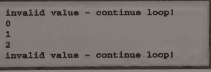

# 如何编写 try/catch 语句

为了防止应用程序崩溃，你可以编写 try/catch 语句，在异常发生时对其进行处理。这被称为异常处理，它在大多数应用程序中都起着重要作用。

# 异常是如何工作的

当 Java 无法执行某个操作时，它会*抛出*（throws）一个异常。异常是从 Exception 体系中的某个类创建的对象，如图 8-10 所示。异常对象表示已发生的错误，并包含有关这些错误的信息。异常的最常见原因之一是输入数据。

异常体系顶部的 `Exception` 类定义了最通用的异常类型。`RuntimeException` 类是 `Exception` 类的*子类*，定义了更特定的异常类型。特别是，它定义了在运行时发生的异常。

图中的其他异常都是 `RuntimeException` 类的子类。因此，它们定义了运行时发生的更具体的异常类型。例如，当 `Integer` 类的 `parseInt` 方法无法将 `String` 对象转换为 `int` 值时，会在运行时抛出 `NumberFormatException`。当 `Double` 类的 `parseDouble` 方法无法将 `String` 对象转换为 `double` 值时，会在运行时抛出 `NumberFormatException`。

编写良好的应用程序会*捕获*（catches）任何抛出的异常并对其进行处理。处理可以简单地通知用户他们必须输入有效数据。或者，也可以通知用户应用程序正在关闭，尽可能保存数据、清理资源并尽可能顺利地退出应用程序。

在测试应用程序时，经常会遇到未处理的异常。对于控制台应用程序，这通常会导致在控制台上显示有关异常的信息。这些信息通常包括异常的名称、描述异常原因的简短消息以及*堆栈跟踪*（stack trace）。例如，在图中，你可以看到当用户输入无效值时显示的信息。

堆栈跟踪是异常发生前被调用的方法列表。这些方法按照调用的**逆序**列出。每个方法都包含一个行号，这可以帮助你在源代码中找到导致异常的语句。例如，图中堆栈跟踪显示 `FutureValue` 类的 `main` 方法的第 18 行在调用 `Double` 类的 `parseDouble` 时抛出了异常。

你需要处理异常的一种情况是：当 `Double` 类的 `parseDouble` 方法无法将输入字符串转换为 `double` 类型时，它会抛出 `NumberFormatException`。

# Exception 体系中的一些类

- `Exception`
- `RuntimeException`
- `NumberFormatException`
- `IllegalArgumentException`
- `ArithmeticException`
- `NullPointerException`

# 可能会抛出异常的两个方法

| 类 | 方法 | 抛出 |
| :--- | :--- | :--- |
| `Integer` | `parseInt(String)` | `NumberFormatException` |
| `Double` | `parseDouble(String)` | `NumberFormatException` |

### 描述

- 异常是一个包含发生错误信息的对象。当方法中发生错误时，该方法会抛出一个异常。
- 如果在测试控制台应用程序时抛出异常，控制台会显示有关异常的信息，包括其名称和堆栈跟踪。
- 堆栈跟踪是异常发生前调用的方法列表。该列表以逆序出现，从最后一个方法到第一个调用的方法。
- 所有异常都是 `Exception` 类的子类。`Exception` 类表示最通用的异常类型。每一层连续的子类都代表更具体的异常。
- `RuntimeException` 表示运行时发生的异常。本章描述的所有异常都是运行时异常。


# 如何捕获异常

为了捕获并处理异常，你可以使用如图 8-11 所示的 try/catch 语句。首先，你编写一个 `try` 句，包含一个或多个可能引发异常的语句块。然后，紧接在 `try` 句之后编写一个 `catch` 。该句包含当 `try` 块中的语句抛出异常时执行的语句块。由于此块包含了处理异常的代码，因此它被称为异常处理器。

图中的示例显示了如何在应用程序中使用 `try` 语句从用户获取输入并尝试将其转换为 `double` 值。在这里，`Double` 类的 `parse` 方法被编写在 `try` 子句中，并为 `NumberFormatException` 编写了 `catch` 子句。然后，如果用户输入非数值，`parse` 方法将抛出 `NumberFormatException`，并执行 `catch` 块中的代码。

在这种情况下，`catch` 块首先显示一条错误消息。然后，它使用 `continue` 语句跳转到循环开头，导致应用程序提示用户再次输入数字。

示例中的 `catch` 块只有在抛出 `NumberFormatException` 时才会执行。由于此异常是 `try` 块可能抛出的唯一异常，这是捕获该异常最清晰的方法。然而，如果你想让 `catch` 子句捕获其他异常，你可以指定 `Exception` 体系中更高层的异常。例如，你可以编写

```java
catch (RuntimeException e)
```

或者，如果你想捕获任何异常，可以编写此 `catch` 子句：

```java
catch (Exception e)
```

你将在第 16 章学习更多关于它的原理。

# 简单的 try/catch 语句的语法

```java
try {
    // statements
} catch (Exception exceptionName) {
    // statements
}
```

# 捕获 NumberFormatException 的代码

```java
String choice = "y";
while (choice.equalsIgnoreCase("n")) {
    // 从用户获取输入
    System.out.print("Enter monthly investment: ");
    double monthlyInvestment;
    try {
        String line = sc.nextLine();
        monthlyInvestment = Double.parseDouble(line);
    } catch (NumberFormatException e) {
        System.out.println("Error! Invalid number. Try again.\n");
        continue;
    }
    // 跳到循环顶部
    // 检查用户是否想继续
    System.out.print("Continue? y/n: ");
    choice = sc.nextLine();
    System.out.println();
}
```

# 控制台输出

| | |
|---|---|
| Enter monthly investment: | $100 |
| Error! Invalid number. Try again. | |
| Enter monthly investment: | |

### 描述

- 在 `try` 语句（或 try/catch 语句）中，你在 `try` 块中编写任何可能抛出异常的语句。然后，你可以编写一个 `catch` 块来处理 `try` 块中可能发生的任何异常。
- 当异常发生时，`try` 块中剩余的所有语句将被跳过，并执行 `catch` 块中的语句。
- 任何在 `try` 和 `catch` 块中都使用的变量或对象必须在 `try` 和 `catch` 块之前声明，以便两个块都能访问它们。
- 如果你使用 `catch` 块来捕获特定类型的异常，还应该导入包含该异常类的包。


# 终值应用

本章最后通过介绍一个终值应用作为结束，该应用可以根据指定的利率计算一系列每月付款的终值。该应用在实际应用的背景下展示了本章中介绍的一些技能。此外，此应用使用了一个 `Console` 类，你可以使用它在控制台上显示数据或从控制台获取数据。

# 用户界面

插图 8-12 首先显示了该应用程序的控制台。在这里，用户首先输入每月投资金额、年利率和年数的有效数字。然后，应用程序计算出终值并将其显示在控制台上。

在第一次计算之后，用户输入“y”以继续第二次计算。对于这次计算，用户在年数处输入了一个无效数字（“four”）。应用程序通过显示一条错误消息来处理此情况，消息指示用户输入了无效整数，并提示用户重新输入年数。

注意，这不会重启应用程序。因此，用户不会丢失已经输入的数据（每月投资金额和年利率）。此外，错误消息足够具体（无效整数），具有帮助性。

# 代码

该图的第 1 部分显示了存储在 `murach.calculators` 包中的 `Financial` 类。该类包含一个名为 `calculateFutureValue` 的单一静态方法。该方法接受三个参数：(1) 每月投资金额，(2) 年利率和 (3) 年数。该方法根据这些参数计算出终值并返回它。

在该方法内部，前两个语句将年度值转换为月值。为了实现这一点，第一条语句将年利率除以 12 转换为月利率，再除以 100 转换为百分比值。然后，第二条语句将年数乘以 12 得到月份。

在该方法创建月度变量后，它使用一个 `for` 循环来计算终值。为了实现这一点，它为每个月执行循环。

在循环内部，第一条语句将每月投资金额加上终值。第二条语句计算当月的利息金额。第三条语句将利息加上终值。循环结束后，`return` 方法将终值返回给调用方法。

# 控制台

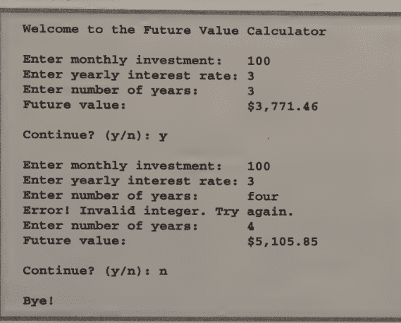

# Financial 类

`package murach.calculators;`
`public class Financial {`

```java
public static double calculateFutureValue(double monthlyInvestment,
               yearlyInterestRate, int years) {
    // convert yearly values to monthly values
    double monthlyInterestRate = yearlyInterestRate / 12 / 100;
    int months = years * 12;
    // calculate the future value
    double futureValue = 0;
    for (int i = 0; i < months; i++) {
        futureValue += monthlyInvestment;
        double monthlyInterestAmount = futureValue * monthlyInterestRate;
        futureValue += monthlyInterestAmount;
    }
    return futureValue;
}
```

该图的第 2 部分显示了存储在 `murach.ui` 包中的 `Console` 类。该类包含静态方法，用于在控制台上显示数据和从控制台获取输入。

首先，该类以 `Scanner` 类的 `import` 语句开始。然后，在类内部，它声明了一个名为 `sc` 的 `Scanner` 对象静态实例变量并创建了该对象。因此，该类中的所有静态方法都可以 `Scanner` 对象。

`displayLine` 方法使用 `System.out` 对象的 `println` 方法向控制台显示数据。在这里，第一个 `displayLine` 显示一个空行，第二个 `displayLine` 在单独的一行显示指定的字符串。

`getString` 首先向用户显示指定的提示信息以其输入数据。例如，你可以指定一个字符串“Enter your name: ”来提示用户输入字符串。然后，该方法使用 `Scanner` 对象的 `nextLine` 方法获取用户输入数据的 `String` 对象，并返回该 `String` 对象。

`getInt` 首先声明一个名为 `i` 的 `int` 变量。该变量存储该方法返回的 `int` 值。然后，该方法使用一个无限 `while` 循环继续提示用户，直到其输入有效的整数。在 `while` 循环内部，第一条语句显示提示信息。例如，你指定一个字符串“Enter years: ”来提示用户输入年数的整数。

在提示之后，该方法使用了 `try/catch` 语句。在块内部，第一条语句尝试将用户输入的数据转换为整数。如果此转换抛出 `NumberFormatException`，`catch` 块将打印一条错误消息，指示用户没有输入有效的整数，并且 `while` 循环继续。因此，它会再次提示用户输入整数。

然而，如果转换成功，`try` 块中的代码将整数存储在名为 `i` 的变量中。然后，`try` 块调用 `break` 语句。这会退出 `while` 循环并返回存储在变量 `i` 中的整数。

`getDouble` 方法的工作与 `getInt` 方法类似。然而，它处理的是 `double` 类型而非 `int` 类型。

# Console 类

`package murach.ui;`
`import java.util.Scanner;`

```java
public class Console {
    private static Scanner sc = new Scanner(System.in);
    public static void displayLine() {
        System.out.println();
    }
    public static void displayLine(String s) {
        System.out.println(s);
    }
```


## Console 类的工具方法

```java
public static String getString(String prompt) {
    System.out.print(prompt);
    String s = sc.nextLine();
    return s;
}

public static int getInt(String prompt) {
    int i = 0;
    while (true) {
        try {
            System.out.print(prompt);
            i = Integer.parseInt(sc.nextLine());
            break;
        } catch (NumberFormatException e) {
            System.out.println("Error! Invalid integer. Try again.");
        }
    }
    return i;
}

public static double getDouble(String prompt) {
    double d = 0;
    while (true) {
        try {
            System.out.print(prompt);
            d = Double.parseDouble(sc.nextLine());
            break;
        } catch (NumberFormatException e) {
            System.out.println("Error! Invalid decimal. Try again.");
        }
    }
    return d;
}
```

## 第二节 所需的技能

该图的第 3 部分显示了存储在 `murach.ui` 包中的 `Main` 类。该类包含应用程序的 `main` 方法。该方法的大部分代码与第 3 章介绍的项目清单应用程序的 `main` 方法类似。因此，接下来的描述将重点在本章介绍的新技能上。

首先，该应用程序以导入 `NumberFormat` 类和该图第 1 部分所示 `Financial` 类的语句开始。因此，该应用程序可以使用 `Financial` 类计算终值，并可以使用 `NumberFormat` 类对终值进行格式化。

在 `main` 方法内部，前两个语句使用 `Console` 类显示欢迎消息。然后，在 `while` 循环内部，前三个语句使用 `Console` 类的 `getDouble` 和 `getInt` 方法。这些语句获取与每月投资、年利率和年数对应的 `double` 和 `int` 值。在这里，`Console` 类将用户输入的字符串转换为正确的数值类型，并处理输入无效数字时抛出的异常。因此，它使得从用户处获取数值数据变得简单。

在从用户处获取数值数据后，该代码使用之前的 `Financial` 类计算终值。然后，该代码使用 `Console` 类和 `NumberFormat` 类以货币格式显示终值。

在显示终值后，该代码使用 `Console` 类询问用户是否继续。为了实现这一点，该代码使用 `getString` 方法获取用户输入的数据。

### Main 类

```java
package murach.ui;

import java.text.NumberFormat;
import murach.calculators.Financial;

public class Main {
    public static void main(String[] args) {
        // displayLine a welcome message
        Console.displayLine("Welcome to the Future Value Calculator");
        Console.displayLine();

        String choice = "y";
        while (choice.equalsIgnoreCase("y")) {
            // get input from user
            double monthlyInvestment =
                Console.getDouble("Enter monthly investment: ");
            double yearlyInterestRate =
                Console.getDouble("Enter yearly interest rate: ");
            int years =
                Console.getInt("Enter number of years: ");

            // call the future value method
            double futureValue = Financial.calculateFutureValue(
                monthlyInvestment, yearlyInterestRate, years);

            // format and displayLine the result
            Console.displayLine("Future value: " +
                NumberFormat.getCurrencyInstance().format(futureValue));
            Console.displayLine();

            // see if the user wants to continue
            choice = Console.getString("Continue? (y/n): ");
            Console.displayLine();
        }

        Console.displayLine("Bye!");
    }
}
```

> 图 8-12 终值应用（3/3 部分）

### 展望

如果你成功掌握了本章内容，你现在应该已经能够使用 `if`、`switch`、`while`、`do-while` 和 `for` 语句。这些是实现选择、分支和迭代结构的 Java 语句，它们提供了应用程序的逻辑。你还应该能够编写 `try/catch` 语句来处理用户输入无效数字时发生的异常。

### 总结

- 你可以使用关系运算符创建布尔表达式，用于比较原始类型并返回 `true` 或 `false`，并且可以使用逻辑运算符来连接两个或多个布尔表达式。
- 若要判断两个字符串是否相等，可以从 `String` 对象的调用 `equalsIgnoreCase` 方法。
- 你可以使用 `if/else` 语句和 `switch` 语句来控制应用程序逻辑，并在需要时嵌套这些语句。
- 你可以使用 `while`、`do-while` 和 `for` 循环重复执行一个或多个语句，直到布尔表达式求值为 `false` 为止，并在需要时嵌套这些语句。
- 你可以使用 `break` 语句跳转到当前循环的末尾，可以使用 `continue` 语句跳转到当前循环的开头。
- 异常是由 `Exception` 类或其一个子类创建的对象。该对象包含了有关发生错误的信息。
- 堆栈跟踪（stack trace）是异常发生前调用的方法列表。
- 你可以编写 `try` 语句来创建一个异常处理器，用于捕获并处理任何抛出的异常。这被称为异常处理。

## 练习 8-1 修改发票应用程序

在练习中，你将修改发票应用程序以使用更复杂的语句。

1. 打开存储在 `ex_starts` 文件夹中的 `ch08_ex1_Invoice` 项目。然后，使用有效数据进行测试以确保其运行正常。
2. 修改 `if/else` 语句，使类型为 `"t"` 且小计金额大于等于 $250 但小于 $500 的客户获得 25% 的折扣，小计金额为 $500 或以上的客户获得 30% 的折扣。接下来，更改 `if/else` 语句，使类型为 `"c"` 的客户始终获得 20% 的折扣。然后，测试应用程序以确保功能正常。
3. 在 `if/else` 语句中添加另一种客户类型，使类型为 `"t"` 的客户在小计小于 $500 时获得 40% 的折扣，小计为 $500 或以上时获得 50% 的折扣。然后，测试应用程序。
4. 检查你的代码，确保对类型不是 `"r"`、`"c"` 或 `"t"` 的客户不提供折扣。如有必要，请进行修正。
5. 使用 `switch` 语句处理客户类型，而不是使用 `if/else` 语句。
6. 添加 `try/catch` 语句来捕获用户输入无效小计时发生的 `NumberFormatException`。在 `catch` 块中，添加代码打印错误信息并跳转到循环顶部。
7. 修改 `while` 循环使其成为无限循环。然后，在循环末尾添加代码，如果用户在 `"Continue (y/n)"` 提示处输入 `"n"`，则跳出循环。

## 练习 8-2 修改终值应用程序

在练习中，你将修改在本章最后介绍的终值应用程序。

### 修改 for 循环

1. 打开存储 `ex_starts` 文件夹中名为 `ch08_ex2_FutureValue` 的项目。然后，运行应用程序查看其工作原理。
2. 打开位于 `murach.calculators` 包中的 `Financial` 类。然后，编辑循环使用名为 `month` 的计数变量代替 `i`。
3. 运行应用程序以确保其运行正常。

### 使用 if 语句检查极值

4. 打开位于 `murach.ui` 包中的 `Console` 类。然后，检查这段代码。
5. 修改 `getDouble` 方法使其接受三个参数：(1) 用于提示的 `String` 对象，(2) 最小值的 `double` 类型，以及 (3) 最大值的 `double` 类型。
6. 在 `getDouble` 方法内部添加一个 `if` 语句，使用户在最小和最大值之间输入值。如果用户输入的值不在该范围内，显示友好的错误信息并跳转到循环顶部。
7. 打开 `Main` 类并编辑它，使用 `Console` 类的 `get` 方法为每月投资和每月利率指定最小值和最大值。例如，你可能希望指定每月投资应大于 0 但小于 100,000。同样，你可能希望指定年利率应大于 0 但小于 20。
8. 运行应用程序以确保其运行正常。

## 如何处理字符串

在本书的第 1 部分，你学习了处理字符串的一些基本技能。在本章中，你将学习更多关于处理字符串的知识。因为你在开发的许多应用程序都会用到字符串，所以你应该知道如何使用本章介绍的所有技能。

| 主题 | 页码 |
| :--- | :--- |
| 如何使用 String 类 | 234 |
| 如何创建字符串 | 234 |
| 如何连接字符串（拼接） | 234 |
| 如何向字符串中追加数据 | 234 |
| 如何比较字符串 | 236 |
| 如何处理字符串索引 | 238 |

### 如何使用 String 类

在第 2 章中，你学习了如何创建和连接字符串。在第 3 章，你学习了如何使用 `String` 类的方法来比较字符串。现在，你将回顾这些技能，并学习一些处理字符串的新技能。

### 如何创建字符串

9-1 中的第一个示例展示了如何创建并初始化 `String` 变量。第一条语句声明了一个名为 `productCode` 的 `String` 变量并为其赋值一个空字符串 (`""`)。第二条语句创建了一个名为 `productCode` 的 `String` 变量并赋值为 `"Murach's Java Programming"`。第三条语句创建了一个名为 `bookTitle` 的 `String` 变量并赋值为 `String` 变量 `title`。结果是这两个变量都引用同一个 `String` 对象。

### 如何连接字符串

第二、三示例展示了如何连接字符串。这也被称为字符串拼接。为此，你可以使用 `+` 运算符来连接 `String` 变量和字符串字面量。例如，在第二个示例中，第二条语句创建名为 `message` 的 `String` 变量引用字符串 `"Hi, Bob"`。

当你将其他数据类型连接或追加到 `String` 变量时，Java 会自动转换其他数据类型以便其作为字符串的一部分使用。例如，在第四个示例中，第二条语句将字符串字面量 `"Years:"` 与 `int` 值 3 连接并将结果赋值给名为 `message` 的 `String` 变量。结果该 `String` 变量引用字符串 `"Years:3"`。

### 如何向字符串中追加数据

第四和第五示例展示了如何向字符串中追加数据。这与连接字符串原理相同，区别是将新数据添加到原有字符串中。

在第四个示例中，例如第一条语句声明了一个引用名字的 `String` 变量。然后，第二条语句向该变量追加一个空格，第三条语句追加姓氏。在这里，名字变量出现在等号两边，且 `+` 运算符将新字面量连接到该变量。

第五个示例与第四个示例原理相同。但是，它使用了 `+=` 来追加数据。结果是没必要在等号两边都编写名字变量。这种方法更易读且比上一个示例代码更少，更常用。

### String 类

```java
java.lang.String;
```

### 如何声明和初始化 String 变量

```java
String productCode = ""; // 指向空字符串
String title = "Murach's Java Programming"; // 指向字符串字面量
String bookTitle = title; // 指向与其他变量相同的对象
```

### 如何拼接字符串

```java
String name = "Bob"; // name 为 "Bob"
String message = "Hi, " + name; // message 为 "Hi, Bob"
```

### 如何拼接字符串和数字

```java
int years = 3;
String message = "Years: " + years; // message 为 "Years: 3"
```

### 如何将一个字符串追加到另一个字符串

```java
String name = "Bob"; // name 为 "Bob"
name = name + " "; // name 为 "Bob "
name = name + "Smith"; // name 为 "Bob Smith"
```

### 一种更常用的追加字符串到另一个字符串的方法

```java
String name = "Bob"; // name 为 "Bob"
name += " "; // name 为 "Bob "
name += "Smith"; // name 为 "Bob Smith"
```


# 如何创建、拼接和追加字符串

- 你可以通过赋值字符串字面量或指向 `String` 对象的变量来初始化 `String` 变量。
- 要拼接（或连接）一个字符串与另一个字符串或另一个数据类型，可以使用 `+` 运算符。
- 要将字符串或另一个数据类型追加到字符串，可以使用 `+=` 运算符。
- 当将其他数据类型拼接或追加到 `String` 对象时，Java 会将其他数据类型转换为 `String` 对象以便它们可以作为字符串的一部分。

图 9-1 如何创建、拼接和追加字符串

# 如何比较字符串

在第 3 章中，你学习了如何使用 `String` 类的 `equals()` 和 `equalsIgnoreCase()` 方法来比较字符串。现在，图 9-2 复习了这些方法，并向你介绍了更多可以用于比较字符串的方法。

此图中所有的方法都返回 `true` 或 `false` 的布尔值。例如，`equals()` 方法比较字符串，如果字符串相等且大小写相同，则返回 `true` 值。同样，`startsWith()` 方法检查字符串是否以特定的字符组合开头，如果是，它将返回 `true` 值。

第一个示例展示了初学者在比较字符串时常犯的错误。在这里，代码使用了用于比较基本类型的相等运算符 (`==`) 来比较字符串。但是，这并不能检查两个字符串是否相等。相反，它检查它们是否指向同一个 `String` 对象。然而，两个 `String` 变量可能指向不同的 `String` 对象，但具有相同的字符组合。因此，这并不是检查相等性的可靠方法。

第二个示例展示了如何使用 `equals()` 方法比较字符串。这会检查两个 `String` 变量是否存储了具有相同大小写的完全相同字符。因此，这是检查相等性的可靠方法。

正如你在第 3 章学的那样，如果你不在乎大小写，可以使用 `equalsIgnoreCase()` 方法来检查两个字符串。该方法的作用与 `equals()` 方法相同，但它对大小不敏感。

第三个示例展示了如何使用 `equals()` 方法检查空字符串。为此，你只需要将一个空字符串作为 `equals()` 方法的参数。在这里，该语句检查名为 `productCode` 的 `String` 变量是否返回空字符串。如果是，它将向控制台打印一条消息。

第四个示例展示了如何使用 Java 6 引入的 `isEmpty()` 方法来检查空字符串。这个示例的工作原理与上一个示例中的 `equals()` 方法类似。然而，某些程序员认为 `isEmpty()` 方法更易读。

第五个示例展示了如何使用 `startsWith()` 方法。在这里，该语句检查名为 `productDescription` 的 `String` 变量是否以字符串“Murach”开头。如果是，它将向控制台打印一条消息。

第六个示例展示了如何使用 `endsWith()` 方法。在这里，该语句检查名为 `productDescription` 的 `String` 变量是否以字符串“Programming”结尾。如果是，它将向控制台打印一条消息。

# 比较字符串的方法

| 方法 | 描述 |
| --- | --- |
| `equals(String)` | 如果指定的字符串等于当前字符串，则返回 `true` 值。此比较区分大小写。 |
| `equalsIgnoreCase(String)` | 如果指定的字符串等于当前字符串，则返回 `true` 值。此比较不区分大小写。 |
| `isEmpty()` | 如果此字符串内容为空，则返回 `true` 值。此方法在 Java 1.6 中引入。 |
| `startsWith(String)` | 如果此字符串以指定的字符串开头，则返回 `true` 值。 |
| `endsWith(String)` | 如果此字符串以指定的字符串结尾，则返回 `true` 值。 |

# 测试相等性时的常见错误

```java
if (productCode == "java") {
    System.out.println("这并没有在测试相等性。");
}
```

# 如何使用 equals 方法测试相等性

```java
if (productCode.equals("java")) {
    System.out.println("测试了相等性。");
}
```

# 如何使用 equals 方法检查空字符串

```java
if (productCode.equals("")) {
    System.out.println("空字符串。");
}
```

# 如何使用 isEmpty 方法（Java 6 及更高版本）

```java
if (productCode.isEmpty()) {
    System.out.println("空字符串。");
}
```

# 如何使用 startsWith 方法

# 如何使用 endsWith 方法

### 描述

- `String` 类提供了许多用于比较字符串的方法。
- 相等运算符 (`==`) 检查字符串是否指向同一个 `String` 对象。
- 两个字符串可能包含相同的字符，但指向不同的 `String` 对象。因此，你不应该使用该运算符来检查相等性。


# 如何处理字符串索引

图 9-3 开始列出你可以用于处理字符串索引的方法。在这里，`indexOf()` 和 `lastIndexOf()` 方法返回一个表示字符串内索引的值。当你处理索引时，需要记住第一个索引是 0 而不是 1。因此，第一个字符的索引是 0，第二个字符的索引是 1，以此此类推。

第一个示例展示了如何使用 `length()` 方法。在这里，`length()` 方法作用于指向字符串“Java”的 `String` 变量。结果，`length()` 方法返回 4。

第二个示例展示了如何使用 `length()` 方法检查空字符串。为此，检查变量 `productCode` 的长度是否为 0。如果是，它将向控制台打印一条消息。

第三个示例展示了如何使用 `indexOf()` 方法。在这里，第一次调用 `indexOf()` 方法返回指定字符串中第一个空格字符的索引。然后，第二次调用 `indexOf()` 方法返回指定字符串中第二个空格字符的索引。为此，该代码在第一个空格索引上加 1，从该索引开始搜索。结果，该代码找到了第二个空格字符，而不是再次找到第一个。

第四个示例展示了如何使用 `lastIndexOf()` 方法。该方法从字符串末尾向前工作。为此，该代码从找到的第一个索引上减去 1。

第五个示例展示了使用 `indexOf()` 方法另一种方式。在这里，`indexOf()` 方法在字符串中搜索“Van”。这展示了你可以使用 `indexOf()` 方法搜索字符序列。此外，它显示返回的索引是该字符串中第一个字符的索引。换句话说，该代码返回整数值 7，因为那是“Van”在字符串中开始的索引。

第六个示例展示了如何使用 `charAt()` 方法。代码获取指定 `String` 变量的前三个字符，并将它们存储在 `char` 类型变量中。这展示了索引是如何工作的。此外，它展示了字符串包含一系列 `char` 值。

# 处理字符串索引的方法

| 方法 | 描述 |
| --- | --- |
| `length()` | 返回此字符串中字符数量的 `int` 值。 |
| `indexOf(String)` | 返回指定字符串在此字符串中首次出现的索引的 `int` 值。如果没有找到该字符串，方法返回 -1。 |
| `indexOf(String, startIndex)` | 返回从指定索引开始，指定字符串在字符串中首次出现的索引的 `int` 值。如果没有找到该字符串，方法返回 -1。 |
| `lastIndexOf(String)` | 返回指定字符串在此字符串中最后一次出现的索引的 `int` 值。 |
| `lastIndexOf(String, startIndex)` | 返回从此索引开始，指定字符串最后一次出现的索引的 `int` 值。 |
| `charAt(index)` | 返回指定索引处的 `char` 值。 |

# 如何获取字符串的长度

```java
String productCode = "java";
int length = productCode.length(); // length 为 4
```

# 如何使用 length 方法检查空字符串

```java
if (productCode.length() == 0) {
    System.out.println("You must enter a product code.");
}
```

# 获取两个空格索引的代码

```java
String name = "Martin Van Buren";
int index1 = name.indexOf(" "); // index1 为 6
int index2 = name.indexOf(" ", index1 + 1); // index2 为 10
```

# 获取两个空格索引另一种方法

```java
String name = "Martin Van Buren";
int index1 = name.lastIndexOf(" "); // index1 为 10
int index2 = name.lastIndexOf(" ", index1 - 1); // index2 为 6
```

# 获取字符串字符的代码

```java
String name = "Martin Van Buren";
char char1 = name.charAt(0); // char1 为 'M'
char char2 = name.charAt(1); // char2 为 'a'
char char3 = name.charAt(2); // char3 为 'r'
```

### 描述

- 你可以使用索引来引用字符串中的每个字符，其中 0 是第一个字符，1 是第二个字符，以此此类推。


# 如何修改字符串

图 9-4 首先列出了一些你可以用于修改字符串的方法。这些方法返回一个位于当前 `String` 对象中的另一个 `String` 对象。返回的这个 `String` 对象被称为子字符串（substring）。

第一个示例展示了如何使用 `trim()` 方法移除 `String` 对象开头和结尾的任何空格。结果是这段代码执行后名为 `choice` 的 `String` 变量指向 "y" 的字符串字面量。

第二个示例展示了如何使用 `substring()` 方法从全名中解析出名和姓。在这里，第一条语句将字符串设置为一个包含名和姓的字符串字面量。然后，第二条语句使用 `indexOf()` 方法获取字符串中第一个空格的索引，即名和姓之间的空格。接下来，第三条语句使用 `substring()` 方法将名 `firstName` 变量设置为从字符串第一个字符开始到字符串中第一个空格结束的字符串。最后，第四条语句使用 `substring()` 方法将姓 `lastName` 变量设置为从空格索引后一个索引开始并一直到字符串末尾的字符串。

第三个示例展示了如何为 Visa 卡号添加连字符。为了实现这一点，它创建了四个字符串，每个对应信用卡号的四位部分。然后，它使用 `substring()` 方法从信用卡号 `String` 对象中返回四个字符串。最后，最后语句将信用卡号的四个部分连接，并在字符串的适当位置添加连字符。

第四个示例展示了如何从名为 `ccNumber` 的 `String` 变量引用的信用卡号删除连字符。为了实现这一点，此示例创建了名为 `temp` 的第二个卡号。然后，它遍历信用卡号字符串中的每个索引。在循环内部，一个 `if` 语句使用 `charAt()` 方法检查当前索引处的字符是否不等于连字符。如果不等于，则这段代码会将 `charAt()` 方法返回的字符追加到名为 `temp` 的 `String` 变量中。结果是，这段代码将除连字符以外的所有字符追加到 `temp` 变量中。在本章节的后面，你将学习到实现此操作的简单方法。

在使用需要索引的方法时，你必须小心提供一个有效的索引；如果该索引在 `String` 对象中不存在，方法将抛出 `StringOutOfBoundsException`。这是初学者经常犯的错误。幸运的是，你可以通过确保使用的索引大于等于 0 且小于 `String` 的长度来防止这种异常。例如，在第四个示例中，循环从 0 开始。

# 修改字符串的方法

| 方法 | 描述 |
| --- | --- |
| `trim()` | 返回移除开头和结尾空格的字符串对象。 |
| `substring(startIndex)` | 返回从指定索引开始到字符串末尾的字符串对象（即当前对象的子字符串）。 |
| `substring(startIndex, endIndex)` | 返回从起始索引开始到结束索引之前的字符串对象。 |

# 移除首尾空格的代码

```java
String choice = " y ";
choice = choice.trim(); // choice 为 "y"
```

# 解析名和姓的代码

```java
String name = "Martin Van Buren";
int spaceIndex = name.indexOf(" ");
String firstName = name.substring(0, spaceIndex);
String lastName = name.substring(spaceIndex + 1);
```

# 为信用卡号添加连字符的代码

```java
String ccNumber = "1234567890123456";
String part1 = ccNumber.substring(0, 4);
String part2 = ccNumber.substring(4, 8);
String part3 = ccNumber.substring(8, 12);
String part4 = ccNumber.substring(12, 16);
ccNumber = part1 + "-" + part2 + "-" + part3 + "-" + part4;
```

# 删除信用卡号中连字符的代码

```java
String ccNumber = "1234-5678-9012-3456";
String temp = "";
for (int i = 0; i < ccNumber.length(); i++) {
    if (ccNumber.charAt(i) != '-') {
        temp += ccNumber.charAt(i);
    }
}
ccNumber = temp;
```

### StringBuilder 类

`java.lang.StringBuilder`

# StringBuilder 类的构造方法

| 构造方法 | 描述 |
| --- | --- |
| `StringBuilder()` | 创建一个初始容量为 16 个字符的空 `StringBuilder` 对象。 |
| `StringBuilder(capacity)` | 创建一个初始容量为指定字符数量的空 `StringBuilder` 对象。 |
| `StringBuilder(String)` | 创建一个包含指定字符串以及额外 16 个字符容量的 `StringBuilder` 对象。 |

# StringBuilder 类的某些起始方法

| 方法 | 描述 |
| --- | --- |
| `append(data)` | 在字符串末尾添加指定原始类型或对象的字符串。 |
| `capacity()` | 返回此 `StringBuilder` 对象容量的 `int` 值。 |
| `length()` | 返回此 `StringBuilder` 对象中字符数量的 `int` 值。 |

# 创建信用卡号的代码

```java
StringBuilder ccNumber = new StringBuilder();
ccNumber.append("4012");
ccNumber.append("8888");
ccNumber.append("8888");
ccNumber.append("16881");
```

# 显示容量如何自动增加的代码

```java
StringBuilder name = new StringBuilder(8);
int capacity1 = name.capacity(); // capacity1 是 8
name.append("Raymond R. Thomas");
int length = name.length(); // length 是 17
int capacity2 = name.capacity(); // capacity2 是 18 (2 * capacity1 + 2)
```


### 描述

- `String` 对象是不可变的。因此，它们无法增长或缩小。
- `StringBuilder` 对象是可变的，这意味着你可以修改字符串中的字符。如果必要，`StringBuilder` 对象的容量会自动增加。
- `StringBuilder` 类是在 Java 5 中引入的。它旨在取代旧的 `StringBuffer` 类。
- `StringBuilder` 类具有与 `StringBuffer` 类相同的构造方法和方法。因此，你可以使用它来完成相同的任务。
- `StringBuffer` 类的效率不如 `StringBuilder` 类，但它是线程安全的。因此，每当你需要确保代码是线程安全的时，你就使用它而不是 `StringBuilder` 类。

图 9-5 如何创建 `StringBuilder` 对象并向其添加数据

正如在本章较些时候学到的，你可以通过使用 `String` 类和 `+=` 运算符完成相同的任务。然而，如果你不这样做，Java 必须为每条语句创建一个新的 `String` 对象。相比之下，当你使用 `StringBuilder` 类的 `append` 方法时，Java 不创建新的 `StringBuilder` 对象。相反，它增加了 `StringBuilder` 对象的长度。如果必要，它还会增加 `StringBuilder` 对象的容量。因此，`StringBuilder` 对象的工作通常比 `String` 对象更高效。

图 9-5 中的第二个示例显示了 `StringBuilder` 对象如何随着字符串长度的增加而增加容量。在这里，第一条语句创建了一个容量为 8 个字符的空 `StringBuilder` 对象。第二条语句使用 `capacity` 方法验证容量为 8。第三条语句向字符串添加了一个包含 17 个字符的字符串。由于这超过了 `StringBuilder` 对象的容量，Java 自动通过双倍当前容量并加 2 来增加容量。因此，容量从 8 个字符增加到 18 个字符。然后，最后两个语句验证了新的长度和容量。

# 如何修改字符串

图 9-6 显示了 `StringBuilder` 类的一些方法。这些方法中的一些提供了一些 `String` 类不提供的额外功能。例如，你可以使用 `StringBuilder` 类的方法来插入、替换或删除字符串或字符。然而，`StringBuilder` 类也提供了与 `String` 类方法类似的方法。例如，`charAt` 和 `substring` 方法在 `StringBuilder` 类中的工作方式与 `String` 类相同。因此，你在使用这些方法时不应该有任何困难。

第一个示例为上一图中创建的 Visa 卡号字符串添加连字符。在这里，第一条语句使用 `insert` 方法在前四个字符之后插入一个连字符。这使得剩余数字向后移动一个索引。然后，第二条语句使用 `insert` 方法在字符串的第九个字符之后插入一个连字符（该字符是原始字符串中的第八个字符）。这使得字符串中的八个数字向后移动一个索引。此类推。使用可变的 `StringBuilder` 对象完成此任务比使用不可变的 `String` 对象要容易得多。

第二个示例显示了如何从信用卡号中删除连字符。在这里，循环遍历每个字符，使用 `charAt` 方法检查当前字符是否为连字符。如果是，`deleteCharAt` 方法将删除该字符。由于这会导致连字符右侧的所有字符向前移动一个索引，因此下一条语句计数器减 1。这样，循环就不会跳过任何字符。请注意，使用可变的 `StringBuilder` 对象完成此任务比使用不可变的 `String` 对象要容易得多。

第三个示例显示了如何使用 `StringBuilder` 类的 `substring` 方法将信用卡号的四个部分隔离开。这表明 `substring` 方法在 `String` 类和 `StringBuilder` 类中的工作方式相同。

# `StringBuilder` 类的更多方法

| 方法 | 描述 |
| --- | --- |
| `insert(index, data)` | 在指定索引处插入指定原始类型或对象的字符串，并将字符串其余部分向后推。 |
| `replace(startIndex, endIndex, String)` | 将起始索引到（但不包含）结束索引的字符替换为指定的字符串。 |
| `delete(startIndex, endIndex)` | 删除从起始索引到（但不包含）结束索引的子字符串。这会将字符串其余部分向前移动。 |
| `deleteCharAt(index)` | 删除指定索引处的字符。 |
| `setCharAt(index, character)` | 将指定索引字符替换为指定的字符。 |
| `charAt(index)` | 返回指定索引字符的 `char` 值。 |
| `substring(index)` | 返回从指定索引到字符串结尾的字符串对象。 |
| `substring(startIndex, endIndex)` | 返回从起始索引到（但不包含）结束索引的字符串对象。 |
| `toString()` | 返回 `StringBuilder` 中存储的字符串的 `String` 对象 |

# 为信用卡号添加连字符的代码

```
ccNumber.insert(4, "-");
ccNumber.insert(9, "-");
ccNumber.insert(14, "-");
```

# 从信用卡号中删除连字符的代码

```
for(int i = 0; i < ccNumber.length(); i++) {
    if (ccNumber.charAt(i) == '-') {
        ccNumber.deleteCharAt(i);
        i--;
    }
}
```

# 解析信用卡号的代码

```
String part1 = ccNumber.substring(0,4);
String part2 = ccNumber.substring(4,8);
String part3 = ccNumber.substring(8,12);
String part4 = ccNumber.substring(12);
```

# 控制台

```
Welcome to the Product Lister
Enter product code: java
Another product? (y/n): y
Enter product code: mysql
Another product? (y/n): n
```

| 代码 | 描述 | 价格 |
| :--- | :--- | :--- |
| java | Murach's Java Programming | $57.50 |
| mysql | Murach's MySQL | $54.50 |

# `StringUtil` 类

```java
package murach.ui;

public class StringUtil {

    public static String pad(String s, int length) {
        if (s.length() < length) {
            // 追加空格直到字符串达到指定的长度
            StringBuilder sb = new StringBuilder(s);
            while (sb.length() < length) {
                sb.append(" ");
            }
            return sb.toString();
        } else {
            // 将字符串截断到指定的长度
            return s.substring(0, length);
        }
    }
}
```

图 9-7 产品列表器应用程序（2 部分中的 1 部分）

# `Main` 类

图 9-7 的第 2 部分显示了产品列表器应用程序 `Main` 类的代码。该代码首先声明了三个常量，用于指定代码、描述和价格列的字符宽度。

在声明常量后，该代码为列表创建了一个 `StringBuilder` 对象。然后，它向该字符串添加了标题行。为了实现这一点，它使用 `StringUtil` 类的静态 `pad` 方法向列添加空格，使其具有正确的宽度。

在设置好标题行后，该代码使用 `while` 循环允许从用户输入产品代码。在循环内部，第一条语句获取了上一节描述的产品代码。然后，它为指定的代码获取一个 `Product` 对象。为了实现这一点，它使用了 `ProductDB` 类的静态 `get` 方法。

在获取指定代码的 `Product` 对象后，该代码向列表添加了产品行。为了实现这一点，它使用了 `StringUtil` 类的静态 `pad` 方法。

在该方法开头定义的三个常量被用于三个地方。首先，它们用于指定标题行中三列的宽度。其次，它们用于指定创建标题行与其他行之间分隔符的三列宽度。第三，它们用于指定每个产品数据的三列的宽度。

因此，如果你想更改某列的宽度，只需更改常量的值。例如，如果你想让描述列的宽度为 50 个字符，只需将名为 `DESC_WIDTH` 的常量值更改为 50。

# `Main` 类

```java
package murach.ui;

import murach.db.ProductDB;
import murach.business.Product;

public class Main {
```

图 9-7 产品列表器应用程序（2 部分中的 2 部分）

# 视角

现在你已经完成了本章，你应该能够使用 `String` 和 `StringBuilder` 类来处理字符串。这些技能是开发 Java 应用程序的基础。请记住，本章只涵盖了这些类中一些最有用的方法。因此，如果你想学习这些类的其他方法，可以在 Java API 文档中进行查阅。

### 总结

- 你可以使用 `String` 类的方法来比较整个字符串或部分字符串、在另一个字符串中定位字符串，并返回字符串的部分。
- 在处理字符串时，你通常需要使用索引来引用构成字符串的字符。在字符串中，第一个字符的索引为 0，第二个字符的索引为 1，依此类推。
- `String` 对象是不可变的。因此，你无法在字符串中添加、删除或修改单个字符。
- `StringBuilder` 对象是可变的。因此，你可以在 `StringBuilder` 中添加、插入、删除或替换字符。
- `StringBuilder` 对象比 `String` 对象更高效，特别是当你需要修改处理的字符串时。

# 练习 9-1 解析姓名

在练习中，你将编写一个应用程序，根据用户输入两个单词还是三个单词，将其解析为姓和名。该应用程序的输出应该如下所示：

```
Enter a name: Joel Murach
First name: Joel
Last name: Murach
```

或者：

```
Enter a name: Joel Ray Murach
First name: Joel
Middle name: Ray
Last name: Murach
```

1. 打开 `exstarts` 文件夹下的 `ch9_ex1_NameParser` 项目。然后查看 `NameParser` 类的代码。
2. 根据用户输入的两个或三个单词，将姓名拆分。
3. 逐行显示每个单词。
4. 如果用户输入的单词少于两个或多于三个，则显示错误信息。
5. 确保当用户在姓名之前或之后输入空格时，应用程序也能正常工作。
6. 测试应用程序以确保其运行正常。

# 练习 9-2 改进未来价值应用程序

在练习中，你将允许用户在输入金额和百分比数值时输入美元符号（$）和百分比符号（%），从而改进未来价值应用程序：

```
Welcome to the Future Value
Enter monthly investment: $100
Enter yearly interest rate: 3%
Enter number of years: 3
Future value: $3,771.46
```

1. 打开 `exstarts` 文件夹下的 `ch9_ex2_FutureValue` 项目。然后查看 `Main` 和 `Console` 类。
2. 修改 `Console` 类中的 `getDouble` 方法，从字符串中删除任何美元符号（$）或百分比符号（%）。
3. 运行应用程序并测试以确保其运行正常。你应该能够输入美元符号和百分比符号。

## 操作数组的必备技能

本章首先将展示如何使用 Java 语言创建和操作数组。

## 如何创建数组

数组是一个包含一个或多个称为“元素”的项目的对象。数组中的每个元素可以是基本数据类型（如 `int` 值），也可以是引用类型（如 `String` 对象或 `Product` 对象）。你将在本章后面的部分看到，数组本身是一种引用类型。

在 Java 中，数组中的所有元素必须是相同类型。因此，`int` 类型数组只能包含 `int` 值，而 `String` 类型数组只能包含 `String` 对象。然而，数组可以包含派生自数组基类型的元素。因此，如果你声明一个 `Product` 类型数组，该数组可以包含任何继承 `Product` 类的对象。你将在下一章学习更多关于其工作原理。

数组的长度（或大小）表示它包含的元素数量。在 Java 中，数组的长度是固定的。因此，一旦创建了数组，你就无法更改它的长度。如果你需要更改数组的长度，应该考虑使用集合。例如，你可以使用第 14 章描述的 `ArrayList` 类而不是数组。这样，集合会自动调整其长度来适应它。

图 10-1 显示了创建数组的几种方法。首先，你必须声明一个引用数组对象的变量。然后，创建一个数组对象并将其赋值给该变量。要创建一个新的数组对象，编写 `new` 关键字，后面跟着数据类型，然后是一对括号。在括号内，编写数组的长度。

你可以使用单独的语句声明数组变量并创建数组对象，如第一个示例所示。或者，你可以在一个语句中声明变量并实例化数组对象，如第二个示例所示。这两个示例都创建了一个包含四个 `double` 值的数组。

当你声明数组变量时，使用一对空括号来指示该变量是一个数组。大多数程序员倾向于在数据类型后编写空括号，以表示它是特定类型的数组。然而，如果你愿意，也可以像第三个示例那样，将这些括号写在变量名之后。

第四和第五个示例创建了对象数组。更具体地说，第四个示例创建了一个包含三个 `String` 对象的数组，第五个示例创建了一个包含五个 `Product` 对象的数组。

如果你在编译时就知道数组的大小，可以像前五个示例那样将数组长度作为字面量值编写。或者，你可以像第六个示例那样将长度编写为常量。然而，如果你在运行之前不知道数组的大小，可以使用变量来指定其大小，如第七个示例所示。

## 声明和实例化数组的语法

使用两条语句

```
type[] arrayName;
arrayName = new type[length];
```

使用单个语句

```
type[] arrayName = new type[length];
```

使用单个语句并在变量名后加括号

```
type arrayName[] = new type[length];
```

一个声明并实例化 `double` 值数组的示例

使用两条语句

```
double[] prices;
prices = new double[4];
```

使用单个语句

```
double[] prices = new double[4];
```

使用单个语句并在变量名后加括号

```
double prices[] = new double[4];
```

## 其他示例

`String` 对象数组

```
String[] titles = new String[3];
```

`Product` 对象数组

```
Product[] products = new Product[5];
```

使用常量指定数组长度的代码

```
final int TITLE_COUNT = 100;
String[] titles = new String[TITLE_COUNT];
```

使用变量指定数组长度的代码

```
System.out.print("Enter number of titles: ");
int titleCount = Integer.parseInt(sc.nextLine());
String[] titles = new String[titleCount];
```

### 描述

- 数组可以存储多个基本类型（如 `int` 值）或多个引用类型（如 `String` 对象）。元素是数组中的某一个项目。
- 要创建数组，必须声明正确类型的变量，并实例化该变量引用的数组对象。你可以在单独的语句中声明并实例化，也可以将声明和实例化合并为单个语句。
- 要声明数组变量，在类型或变量名后编写一组空括号。
- 要实例化数组，使用 `new` 关键字，并在数组类型后的括号中指定数组的长度（或大小）。
- 在初始化基本类型数组时，数值被设置为 0，布尔类型被设置为 `false`。当你创建引用类型数组时，它们被设置为 `null`。

图 10-1 如何创建数组

## 如何给数组元素赋值

图 10-2 显示了如何给数组元素赋值。正如该图顶部的语法所示，你通过编写数组名后跟括号内的索引来引用数组中的元素。索引必须是 `int` 类型，从 0 开始，到数组大小减 1 结束。换句话说，0 指向数组中的第一个元素，1 指向第二个元素，2 指向第三个元素，以此类推。

图中的第一个显示了如何通过每行编写一条语句来给数组中的元素赋值。第一个示例创建了一个包含 4 个 `double` 值的数组。然后，它为元素分配了字面量值。

## 引用数组元素的语法

```
arrayName[index]
```

## 通过访问元素赋值的示例

给 `double` 类型数组赋值的代码


# Java 数组操作详解

## 数组创建与初始化

### 基本类型数组赋值
```java
double[] prices = new double[4];
prices[0] = 14.95;
prices[1] = 12.95;
prices[2] = 11.95;
prices[3] = 9.95;
// prices[4] = 8.95; // 这将抛出 ArrayIndexOutOfBoundsException
```

### String 类型数组赋值
```java
String[] names = new String[3];
names[0] = "Ted Lewis";
names[1] = "Sue Jones";
names[2] = "Ray Thomas";
```

### 对象数组赋值
```java
Product[] products = new Product[2];
products[0] = ProductDB.getProduct("java");
products[1] = ProductDB.getProduct("jsp");
```

### 单语句创建并初始化数组
**语法：**
```java
type[] arrayName = {value1, value2, value3, ...};
```

**示例：**
```java
double[] prices = {14.95, 12.95, 11.95, 9.95};
String[] names = {"Ted Lewis", "Sue Jones", "Ray Thomas"};
Product[] products = {
    ProductDB.getProduct("java"),
    ProductDB.getProduct("jsp")
};
```

## 标准 for 循环遍历数组

### 核心概念
- 使用 `length` 字段获取数组长度（注意：`length` 是字段而非方法，无需括号）
- 通过索引变量逐个访问元素
- 循环条件通常为 `i < arrayName.length`

### 语法
```java
arrayName.length
```

### 示例：填充数组 0-9
```java
int[] values = new int[10];
for (int i = 0; i < values.length; i++) {
    values[i] = i;
}
```

### 示例：打印数组元素
```java
double[] prices = {14.95, 12.95, 11.95, 9.95};
for (int i = 0; i < prices.length; i++) {
    System.out.println(prices[i]);
}
```

**控制台输出：**


### 示例：计算数组平均值
```java
double[] prices = {14.95, 12.95, 11.95, 9.95};
double sum = 0.0;
for (int i = 0; i < prices.length; i++) {
    sum += prices[i];
}
double average = sum / prices.length;
```

### 关键点总结
- 可使用 `for` 循环处理数组中的每个元素
- 可使用数组的 `length` 字段确定元素个数

## 增强型 for 循环 (foreach)

### 核心概念
- Java 5 引入，简化数组/集合遍历
- 无需索引变量，直接声明元素变量
- 语法：`for (type variable : arrayName)`

### 语法
```java
for (type variable : arrayName) {
}
```

### 示例：打印数组元素
```java
double[] prices = {14.95, 12.95, 11.95, 9.95};
for (double price : prices) {
    System.out.println(price);
}
```

**控制台输出：**


### 示例：计算数组平均值
```java
double[] prices = {14.95, 12.95, 11.95, 9.95};
double sum = 0.0;
for (double price : prices) {
    sum += price;
}
double average = sum / prices.length;
```

### 关键点总结
- 可使用增强型 `for` 循环处理数组中的每个元素
- 增强型 `for` 循环常被称为 `foreach` 循环，因其简化了代码
- 仍可使用 `length` 字段获取数组长度

## 二维数组

### 核心概念
- 使用两个索引：行索引和列索引
- 可视为行列组成的表格，或数组的数组
- 每行是一个独立的一维数组

### 创建矩形数组
**语法：**
```java
type[][] arrayName = new type[rowCount][columnCount];
```

**示例：**
```java
int[][] numbersTable = new int[3][2];
```

### 访问元素
**语法：**
```java
arrayName[rowIndex][columnIndex]
```

**3×2 数组索引示例：**
| 行\列 | [0] | [1] |
|-------|-----|-----|
| [0]   | [0][0] | [0][1] |
| [1]   | [1][0] | [1][1] |
| [2]   | [2][0] | [2][1] |

### 赋值示例
```java
numbersTable[0][0] = 1;
numbersTable[0][1] = 2;
numbersTable[1][0] = 3;
numbersTable[1][1] = 4;
numbersTable[2][0] = 5;
numbersTable[2][1] = 6;
```

### 单语句创建并初始化
```java
int[][] numbersTable = { {1, 2}, {3, 4}, {5, 6} };
```

### 嵌套循环遍历
```java
int[][] numbersTable = { {1, 2}, {3, 4}, {5, 6} };
for (int[] row : numbersTable) {
    for (int column : row) {
        System.out.print(column + " ");
    }
    System.out.print("\n");
}
```

**控制台输出：**
| 1 | 2 |
|---|---|
| 3 | 4 |
| 5 | 6 |

### 关键点总结
- 二维数组使用两个索引，数据存储在行列表格中
- 多数为矩形数组（每行列数相同），也可创建锯齿数组（每行列数不同）
- 可扩展至更高维度数组


## Arrays 工具类 (`java.util.Arrays`)

### 常用静态方法

| 方法 | 说明 |
|------|------|
| `fill(array, value)` | 用指定值填充数组所有元素 |
| `sort(array)` | 按升序排序数组元素 |
| `binarySearch(array, value)` | 搜索指定值并返回索引（未找到返回 -1），**前提：数组已排序** |
| `copyOf(array, length)` | 复制数组，按指定长度截断或填充默认值 (Java 6+) |
| `equals(array1, array2)` | 比较两数组类型、长度及所有元素是否相等 |

### 示例：填充数组
```java
int[] quantities = new int[5];
Arrays.fill(quantities, 1);
```

### 示例：排序数组
```java
int[] numbers = {9, 8, 7, 6, 5, 4, 3, 2, 1, 0};
Arrays.sort(numbers);
for (int number : numbers) {
    System.out.print(number + " ");
}
```

### 示例：搜索数组
```java
String[] productCodes = {"java", "jsp", "mysql"};
Arrays.sort(productCodes);
int index = Arrays.binarySearch(productCodes, "mysql");
```

## 数组引用与拷贝

### 引用赋值
数组是引用类型，赋值操作 `=` 仅复制引用，多个变量指向同一对象。

```java
double[] grades = {92.3, 88.0, 95.2, 90.5};
double[] percentages = grades;
percentages[1] = 70.2; // 同时改变 grades[1]
System.out.println("grades[1]=" + grades[1]); // 输出 70.2
```

### 浅拷贝 (Java 6+)
使用 `Arrays.copyOf()` 创建新数组对象，但元素引用仍指向同一对象（引用类型数组为浅拷贝）。

```java
double[] grades = {92.3, 88.0, 95.2, 90.5};
double[] percentages = Arrays.copyOf(grades, grades.length);
percentages[1] = 70.2; // 不影响 grades[1]
```

### 引用比较 vs 内容比较
- `==` 比较是否指向同一数组对象
- `Arrays.equals()` 比较数组内容（类型、长度、元素值）

```java
// 引用比较
boolean sameRef = (grades == percentages); // false

// 内容比较
boolean sameContent = Arrays.equals(grades, percentages); // true (修改前)
```

> **注意**：对象数组使用 `equals()` 时，需确保元素类型正确实现了 `equals()` 方法。


```java
double[] grades = {92.3, 88.0, 95.2, 90.5};
double[] percentages = Arrays.copyOf(grades, grades.length);
percentages[1] = 70.2; // 没有改变 grades[1]
System.out.println("grades[1]=" + grades[1]); // 输出 88.0
```

# 如何确定两个变量是否指向同一个数组

```java
if (grades == percentages) {
    System.out.println("两个变量指向同一个数组.");
} else {
    System.out.println("每个变量指向不同的数组.");
    System.out.println("但是，这些数组可能包含相同的数据.");
}
```

# 如何确定两个变量是否包含相同的数据

```java
if (Arrays.equals(grades, percentages)) {
    System.out.println("两个变量指向相同的数据.");
} else {
    System.out.println("两个变量并不指向相同的数据。");
}
```

### 描述

- 像字符串一样，数组是一种引用类型。
- 要创建指向现有数组的引用，可以使用赋值运算符（`=`）将指向现有数组的变量赋值给另一个。然后，两个变量都指向同一个数组。
- 要检查两个数组是否指向同一个数组，可以使用相等运算符（`==`）。
- `copyOf` 方法是 Java 6 引入的。因此，它只适用于 Java 6 及更高版本。在 Java 6 之前，你可以使用 `System` 类的 `arraycopy` 方法。
- 当复制数组时，新数组必须与源数组具有相同的类型。


# 月份选择器应用程序

本章最后介绍月份选择器应用程序，允许用户通过输入月份数字来选择月份文本。该应用程序在应用上展示了本章介绍的一些技能。

## 用户界面

图 10-8 首先显示了该程序的控制台。在这里，用户首先输入 1 选择一月，并输入 "y" 继续。然后，用户输入 12 选择十二月，并输入 "n" 退出程序。

## Main 类

此图还显示了月份选择器应用程序 `Main` 类的代码。该代码首先声明了一个包含 12 个 `String` 对象的数组，包含 12 个月的名称。

在声明数组后，该代码使用 `while` 循环允许用户选择一个或多个月份。在循环内部，第一条语句从用户处获取月份数字。为了做到这一点，它使用了第 8 章描述的 `Console` 类的静态方法 `getInput`。

获取月份数字后，该代码使用 `if` 语句检查该数字是否为有效的月份数字。为了做到这一点，代码检查该数字是否小于 1 或大于数组的长度（即 12）。如果是，代码将使用 `Console` 类在控制台上显示错误消息，并使用 `continue` 语句跳转到循环顶部。

如果月份数字有效，该代码继续从用户输入的月份数字中减去 1。这样，代码就可以使用新的 `int` 值来从月份名称数组中访问正确的 `String` 对象。正如你现在知道的，这是必要的，因为数组的索引是从 0 开始的，而不是 1。因此，该数组的索引范围是从 0 到 11，而不是 1 到 12。

### 控制台

```
Welcome to the Month Selector
nEnter month number: 1
You selected: January

Continue? (y/n): y

Enter month number: 12
You selected: December

Continue? (y/n): n
```

### Main 类

```java
package murach.ui;
public class Main {
    public static void main(String[] args) {
        System.out.println("Welcome to the Month Selector\n");

        String[] monthName = {"January", "February", "March", "April", "May", "June", "July", "August", "September", "October", "November", "December"};

        // 选择 1 或多个月份
        String choice = "y";
        while (choice.equalsIgnoreCase("y")) {
            // 从用户处获取输入
            int monthNumber = Console.get("Enter month number: ");

            // 验证输入
            if (monthNumber < 1 || monthNumber > monthName.length) {
                Console.displayLine("Invalid month.");
                continue;
            }

            // 输出
            int monthIndex = monthNumber - 1;
            Console.displayLine("You selected: " + monthName[monthIndex]);

            // 检查用户是否继续
            choice = Console.getString("Continue? (y/n): ");
        }
    }
}
```

## 展望

现在你已经完成了本章，应该知道如何处理一维数组和二维数组。虽然数组是 Java 的核心部分，但在许多情况下，你可能更倾向于使用更高级的数据结构，例如 `ArrayList`。

## 总结

- 数组是一种可以存储多个相同类型元素的特殊类型。
- 在处理数组时，可以使用索引来标识任何元素。索引 0 指向第一个元素，1 指向第二个，以此类推。
- 数组的长度（`length`）是数组中元素的数量。
- `for` 循环常用于处理数组。Java 5 引入了一种新的循环类型，增强 `for` 循环（`foreach`），它可以无需索引处理每个元素。
- 一维数组提供单列元素。相比之下，二维数组（数组数组）提供了行和列。
- 二维数组可以是矩形的（每行具有相同的列数），也可以是锯角的（每行可能有不同的列数）。
- 你可以使用 `Arrays` 类来填充、排序、搜索、复制和比较数组。
- 像字符串一样，数组是一种引用类型。因此，你应该使用 `Arrays` 的 `copy` 方法复制数组数据，并使用 `equals` 方法来检查两个数组是否存储相同的数据。

# 练习 10-1 使用一维数组

在本次练习中，你可以练习使用一维数组。

1. 打开名为 `ch10_ex1_ArrayTest` 的项目。然后，打开 `Main` 类。
2. 创建一个包含 99 个 `double` 值的一维数组。然后，使用 `for` 循环将 0 到 100 之间的随机数添加到数组的每个元素。为了做到这一点，你可以调用 `Math` 类的 `random` 方法并乘以 100，如下：

```java
Math.random() * 100
```


- 3. 使用增强循环对数组中的值求和。然后，计算平均值并打印到控制台上：

| Average: 50.9526671843517 |

- 4. 使用 `Arrays` 类的 `sort` 方法对数组中的值进行排序，并将中位数（第 50 个值）打印到控制台上：

| Median: 52.183692916508003 |

- 5. 在控制台上打印数组的第 9 个值以及之后每隔 9 个值，如下：

| Position: 9 | 8.927702403161032 |
| Position: 18 | 14.053128749806076 |
| ... | ... |
| Position: 99 | 22.471670293184822 |

## 练习 10-2 使用二维数组

本练习将引导你完成向 FutureValue 应用程序添加一个二维矩形数组的过程。该数组存储最多十次计算的值。当应用程序结束时，它会在控制台上打印这些计算的摘要，如下所示：

| 投资/月金额 | 利率 | 年限 | 未来价值 |
|---|---|---|---|
| $100.00 | 8.0% | 10 | $18,416.57 |
| $125.00 | 8.0% | 10 | $23,020.71 |
| $150.00 | 8.0% | 10 | $27,624.85 |

- 1. 打开 `ex_starts` 目录下名为 `ch10_ex2_FutureValue` 的项目。然后，检查代码并运行应用程序以确保其工作正常。
- 2. 在 `main` 方法的开头声明变量，用于行计数器，以及一个包含 10 行 4 列的字符串矩形数组。
- 3. 在显示每个计算结果代码之后，添加代码对所有计算值进行格式化并将其转换为字符串。然后，将这些 `String` 值存储在数组的下一行中。（提示：你可以使用 `Integer` 类的 `toString` 方法将年限值转换为字符串。）
- 4. 添加代码，在用户退出应用程序时在控制台上显示元素。输出应如上方所示格式化，并且仅包含包含数据的行。
- 5. 通过进行最多 10 次未来价值计算来测试应用程序。

## 面向对象编程技能

在本书的第一部分中，你学习了如何创建自己的类并使用它们来创建一个结构良好的面向对象应用程序。这是面向对象编程的一个极好的开始。现在，本节的章节将教你应该掌握的面向对象编程的其他技能。第 11 章向你展示如何使用继承，这是一重要的面向对象编程技能。第 12 章向你展示如何使用接口，另一个重要的面向对象编程技能。第 13 章展示了更多几个技能，包括如何处理内部类、如何处理枚举，以及如何为你创建的类添加 API 文档。

由于本节的每个章节都建立在之前章节的基础上，我们建议按顺序阅读这些章节。此外，我们建议在进入第 4 或第 5 节之前阅读本节的所有章节。这是因为第 4 节和第 5 节中的大多数章节要求你理解继承、接口、内部类和枚举是如何工作的。

## 如何使用继承

继承是面向对象编程的核心概念之一。它允许你创建一个基于另一个类的类。使用正确时，继承可以减少代码重复并简化应用程序的整体设计。

- 继承简介...........................................................276
- 继承是如何工作的..................................................................................276
- Object 类是如何工作的...............................................................................278
- **使用继承的基本技能..................................................280**
- 如何创建父类...............................................................................280
- 如何创建子类..................................................................................282
- 多态是如何工作的......................................................................................284
- **Product 应用程序 ..............................................................286**
- 控制台......................................................................................................286
- Product、Book 和 Software 类 ................................................288
- ProductDB 类.......................................................................................288
- ProductApp 类.....................................................................................292
- **使用继承的更多技能..................................................294**
- 如何强制转换对象........................................................................................294
- 如何比较对象...............................................................................296
- **如何使用 abstract 和 final 关键字 ............................298**
- 如何使用 abstract 关键字...............................................................298
- 如何使用 final 关键字......................................................................300
- **视角.........................................................................................302**

## 继承简介

继承允许你创建一个基于另一个类的类。接下来的两幅图介绍了继承的一些基本概念。

## 继承是如何工作的

图 11-1 展示了继承是如何工作的。当使用继承时，子类继承父类的字段和方法。然后，当你从子类创建对象时，该子类就可以使用这些字段和方法。子类还可以提供自己的字段和方法来扩展父类，并通过为这些方法提供新代码来重写父类的字段和方法。

图中显示的三个类展示了这种工作原理。在这里，父类是 `Product` 类。该类有八个公共方法。到目前为止，你应该已经熟悉了前七个方法。接下来的两幅图展示了如何使用第八个方法，即 `toString` 方法。

图中显示了两个子类：`Book` 类和 `Software` 类。这些类从父类 `Product` 类继承了前八个方法。然后，它们都通过提供两个新方法来扩展 `Product` 类。特别是，`Book` 类添加了 `setAuthor` 和 `getAuthor` 方法，而 `Software` 类添加了 `setVersion` 和 `getVersion` 方法。

## Product 的业务类

| Product | Software |
|---|---|
| void setState(String c) | void setState(String c) |
| String getCode() | String getCode() |
| void getDescription(String d) | void getDescription(String d) |
| void setPrice(double p) | void setPrice(double p) |
| double getPrice() | double getPrice() |
| String toString() | String toString() |
| void setVersion(String v) | void getVersion(String v) |
| void setAuthor(String a) | String getAuthor() |

### 描述

- 继承允许你基于另一个类创建一个新类。然后，新类继承现有类的字段和方法。
- 继承现有类的类被称为派生类、子类或从类。继承另一个类的类被称为基类、父类或超类。
- 子类可以通过添加新的字段和方法来扩展父类。它也可以通过提供方法的版本来重写父类的方法。

## Object 类是如何工作的

`Object` 类是所有 Java 类的父类。换句话说，每个类都继承 `Object` 类。结果是，`Object` 类的方法对象可用。`Object` 类的一些常用方法总结在图 11-2 中。由于子类重写了这些方法，这些方法在类之间可能不同。

`Object` 类最常用的方法可能是 `toString` 方法，因为 Java 编译器在需要对象的字符串表示时隐式地调用此方法。例如，当你提供对象作为 `println` 方法的参数时，该方法会隐式地调用 `toString` 方法。

当你编写类时，通常认为重写 `Object` 类的 `toString` 方法是一种良好的做法，可以提供关于对象的详细信息。如果可能，这些信息应该是简洁、有用且易读的。否则，`toString` 方法将返回类名，后面跟着 `@` 符号，然后是对象哈希值的十六进制表示。如果你不熟悉十六进制，它是一种基数为 16 的计数系统。为了表示 16 个值，Java 使用数字 0-9 加上字母 a-f。

相比之下，`hashCode` 方法返回一个表示对象十进制哈希值的 `int` 值。如有必要，其他代码在存储或操作对象时可以使用对象的哈希值。

如果你需要比较类对象的等效性，你可以重写该类的 `equals` 方法，通过比较对象来检查它们的实例变量是否相等，如本章稍后所示。否则，`Object` 类的 `equals` 方法仅在两个变量指向同一个对象时返回 `true`。换句话说，即使两个变量指向存储相同数据的对象，它也可能返回 `false`。

## Object 类

`java.lang.Object`

## Object 类的方法

| 方法 | 描述 |
|---|---|
| `toString()` | 返回一个包含类名的 `String` 对象，其后紧跟一个 `@` 符号，然后是该对象哈希值的十六进制表示。如果这不是你想要的，可以像下一图所示重写此方法。 |
| `equals(Object)` | 如果此变量指向同一个对象变量，则返回 `true`。否则，返回 `false`，即使两个变量指向的对象包含相同的数据。如果这不是你想要的，可以在本章稍后的部分所示重写 `equals` 方法。 |
| `getClass()` | 返回一个表示此对象类型的 `Class` 对象。 |
| `clone()` | 返回该对象的副本，类型为 `Object` 对象。在用此方法之前，该类必须实现 `Cloneable` 接口。 |
| `hashCode()` | 返回一个表示该对象哈希值的 `int` 值。 |

## Product 对象 toString 方法返回的典型值

`murach.business.Product@15db9742`

## Product 对象 hashCode() 方法返回的典型值

`366712642`

### 描述

- `java.lang` 包中的 `Object` 类是所有类的父类。换句话说，每个类都继承自 `Object` 类或最终继承自 `Object` 类的类。因此，`Object` 类定义的方法对所有类都是可用的。
- 在编写类时，建议重写 `toString` 方法，以便返回一个简洁、信息丰富且易于阅读的字符串。

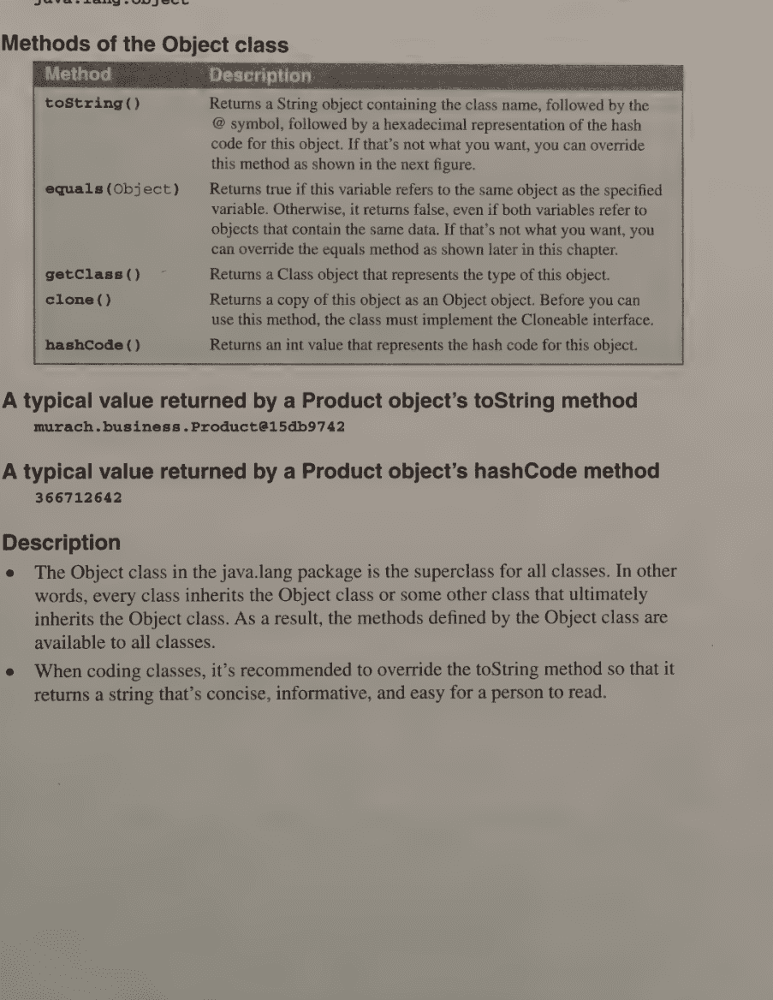

图 11-2 Object 类的工作原理

## 使用继承的基本技能

现在你已经接触了继承的基本概念，准备好学习编写父类和子类的代码细节了。此外，你将学习如何使用继承的主要特性之一：多态。

## 如何创建父类

图 11-3 显示了如何创建一个可以作为一个或多个子类父类的类。要做到这一点，你可以像定义任何其他类一样定义类的字段、构造函数和方法。

图中的表格列出了你可以使用的几种访问修饰符，用以指示父类的成员对其他类可见。到目前，你应该已经熟悉 `private` 和 `public` 访问修饰符。复习一下，对于任何只想在当前类中使用的字段或方法，你使用 `private` 关键字。相比之下，对于任何希望所有类都能使用的字段或方法，你使用 `public` 关键字。

除此之外，你可能偶尔想要使用 `protected` 关键字来编写保护成员。受保护成员可以在定义类内部、相同包中的任何类以及任何继承该定义类的类中被访问，但不能被任何其他类访问。这允许子类访问父类的某些部分，而不会将这些部分暴露给其他类。例如，图中的 `Product` 类包含一个名为 `count` 的静态字段，该字段具有保护访问权限。因此，`Product` 类的任何子类都可以访问此字段，无论它们是否与 `Product` 类在同一个包中。

你也可以不写访问修饰符编写字段或方法。这时，相同包中的类可以访问该字段或方法，但其他包中的类无法这样做。

图中所示 `Product` 类包含一个重写了 `java.lang.Object` 类的 `toString` 方法。该方法返回产品的描述，它是该对象简洁且易于读的表示。因此，该类的子类可以使用此 `toString` 方法。或者，它们也可以重写 `toString` 方法为自己提供自己的代码。

当你重写一个方法时，通常认为在子类的方法上添加一个注解是良好做法，以清楚地指示子类方法重写了父类中的方法。注解是提供代码信息的标准方式，这些信息可以被编译器、JRE 以及其他软件开发工具使用。在图中，`@Override` 注解被写在 `toString` 方法上方。

虽然这不是强制要求的，但它在两个方面很有帮助。首先，编译器可以使用此信息来确保 `toString` 方法正确地重写了父类中的 `toString` 方法。如果没有，编译器会生成错误。其次，这让其他程序员更容易看到此方法重写了类中的方法。

## 访问修饰符

| 关键字 | 描述 |
| --- | --- |
| `private` | 当前类内部可用。 |
| `public` | 所有包中的类可用。 |
| `protected` | 相同包中的类和子类可用。 |
| 未写修饰符 | 相同包中的类可用。 |

## 用于重写方法的注解

```
@Override

// 在此处编写方法声明
```

## Product 父类的代码

```
package murach.business;

import java.text.NumberFormat;

public class Product {

    private String code;

    private String description;

    private double price;

    protected static int count = 0;

    public Product() {

    }

    // code, description 和 price 的 get 和 set 访问器

    // 实例变量

    @Override

    public String toString() {

        return description;

    }

    public static int getCount() {

        //为 count 创建公共访问

        return count;

    }

}
```


### 描述

- 访问修饰符指定了类声明成员的访问权限。
- 保护成员可供当前类、相同包中的其他类以及子类访问。
- 注解提供代码信息的标准方式。当你重写一个方法时，可以在方法上添加 `@Override` 注解。


### 如何创建子类

图11-4 显示了如何创建一个子类。要指示一个类是子类，你可以在类名后面跟上 `extends` 关键字以及父类的名称。例如，图中 `Book` 类代码继承了 `Product` 类。换句话说，`Book` 类是 `Product` 类的子类。

声明子类后，你可以通过添加字段、构造函数和方法来扩展父类的功能。在图中，`Book` 类添加了一个实例变量和一个构造函数。它还添加了 `setAuthor` 和 `getAuthor` 方法，并重写了 `toString` 方法。

`Book` 类的构造函数通过 `super` 关键字调用 `Product` 类的默认构造函数。这初始化了 `code`、`description` 和 `price` 字段。接下来，构造函数为 `author` 字段赋值空字符串。最后，该构造函数可以访问此字段，因为父类将其声明为保护。

要重写父类的方法，只需编写一个与父类方法签名相同的方法。在这种情况下，`Book` 类的 `toString` 方法重写了 `Product` 类的 `toString` 方法。该方法不接受参数并返回字符串。该代码使用 `super` 关键字调用 `Product` 类的 `toString` 方法。该方法返回对象的表示。然后，此代码将作者姓名添加到字符串中。最后返回该字符串。注意，`Book` 类的 `toString` 方法标记了 `@Override` 注解。

### 创建子类的语法

- 声明子类：`public class SubclassName extends SuperClassName`
- 调用父类构造函数：`super(argumentList)`
- 调用父类方法：`super.methodName(argumentList)`

### Book 子类的代码

```java
package murach.business;

public class Book extends Product {

    private String author;

    public Book() {
        super(); // 调用 Product 父类的构造函数
        author = "";
        count++;
    }

    public void setAuthor(String author) {
        this.author = author;
    }

    public String getAuthor() {
        return author;
    }

    @Override
    public String toString() { // 重写 toString 方法
        return super.toString() + // 调用 Product 方法
               " " + author;
    }
}
```

### 多态的工作原理

多态是面向对象编程和继承中最重要的特征之一。如图 11-5 所示，多态允许你通过引用两个对象共同的父类，将不同类型的对象视为同一种类型。例如，图 11-4 所示的 `Book` 类继承了 `Product` 类。因此，你可以将 `Book` 对象当做 `Product` 对象来处理。

多态的一个用处是，你可以编写为父类设计的通用代码。然后，你可以对任何派自父类的实例使用这些代码。例如，假设你有一个名为 `getDiscount` 的方法，它接受一个 `Product` 对象作为参数。由于 `Book` 和 `Software` 类都继承了 `Product` 类，因此 `getDiscount` 方法也适用于 `Book` 和 `Software` 对象。

图中的示例展示了多态是如何工作的。首先，前三个示例使用了 `Product`、`Book` 和 `Software` 类的 `toString` 方法。`Book` 版本的 `toString` 方法在 `Product` 类 `toString` 方法返回的字符串末尾添加了作者的名字。同样，`Software` 版本的 `toString` 方法在 `Product` 类 `toString` 方法返回的字符串末尾添加了版本号。

第四个示例展示了多态如何处理这些类。这段代码首先创建一个 `Book` 类的实例，将其赋值给变量 `b`，并给它的实例变量赋值。之后，它创建一个 `Software` 类的实例，将其赋值给变量 `s`，并给它的实例变量赋值。

接下来，声明一个类型为 `Product` 的变量 `p`，并将 `Book` 对象赋值给它。然后，调用 `Product` 类的 `toString` 方法。当 JRE 看到变量 `p` 指向一个 `Book` 对象且该对象包含重写的 `toString` 方法时，它会调用该方法的重写版本。

该示例通过对 `Software` 对象执行相同的操作结束。首先，将此 `Software` 对象赋值给 `Product` 变量。然后调用由 `Product` 类定义的 `toString` 方法，这导致 `Software` 类的 `toString` 方法被执行。

多态的关键在于，调用哪个方法的决策是基于运行时继承层次结构的。这被称为后期绑定。在编译时，编译器识别出存在指定签名的方法。

### toString 方法的三个版本

#### Product 父类中的 toString 方法

```java
public String toString() {
    return description;
}
```

#### Book 类中的 toString 方法

```java
public String toString() {
    return super.toString() + " by " + author;
}
```

#### Software 类中的 toString 方法

```java
public String toString() {
    return super.toString() + " " + version;
}
```

### 使用重写方法的代码

```java
Book b = new Book();
b.setCode("java");
b.setDescription("Murach's Java Programming");
b.setPrice(57.50);
b.setAuthor("Joel Milch");
```

```java
Software s = new Software();
s.setCode("netbeans");
s.setDescription("NetBeans");
s.setPrice(0.00);
s.setVersion("8.0");
```

```java
Product p;
p = b;
System.out.println(p.toString()); // 调用 Book 类的 toString
p = s;
System.out.println(p.toString()); // 调用 Software 类的 toString
```

### 说明

- 多态是继承的一种特性，允许你将派自同一父类的不同子类的对象视为具有父类的类型。例如，如果 `Book` 是 `Product` 的子类，你可以将 `Book` 对象视为 `Product` 对象。
- 如果你访问父类对象的方法，且该方法在子类中被重写，多态将根据对象的类型决定执行哪个方法。例如，如果你调用 `Product` 对象的 `toString` 方法，如果该对象是 `Book` 对象，则执行 `Book` 类的 `toString` 方法。

图 11-5 多态的工作原理

### Product 应用

现在你已经学习了如何编写父类和子类，后续主题介绍一个使用继承的 Product 应用。该版本的应用程序使用了图 11-4 中描述的 `Book` 和 `Software` 类。此外，它使用了一个 `ProductDB` 类，该类可以返回两种不同的产品：书籍和软件。

### 控制台

图 11-6 显示了 Product 应用的控制台。该应用程序的工作与第 4 章介绍的 Product 应用非常相似。然而，有三个主要区别。首先，此应用程序显示了关于每个产品的额外信息，这些信息取决于产品是书籍还是软件。具体而言，它为书籍显示作者，为软件显示版本号。其次，此应用程序显示了它创建的对象总数。第三，如果用户输入了无效的产品代码，应用程序将显示相应的错误信息。

### Product 应用的控制台

```
Welcome to the Product Viewer

Enter product code: java

Description: Murach's Java Programming by Joel Murach

Price: $57.50

Product count: 1

Continue? (y/n): y

Enter product code: netbeans

Description: NetBeans 8.0

Price: $0.00

Product count: 2

Continue? (y/n): y

Enter product code: xxxx

No product matches this product code.

Continue? (y/n):
```

### 说明

- 此版本的 Product 应用处理两种产品：书籍和软件。
- 如果你输入书籍的代码，产品信息包含作者。
- 如果你输入软件的代码，产品信息包含一个版本号。


### Product、Book 和 Software 类

图 11-7 和 11-8 显示了父类及其两个子类 `Book` 和 `Software` 的代码。由于 `Product` 和 `Book` 类在之前介绍过，你不难以理解它们的工作。

此外，`Software` 类的工作方式与 `Book` 类类似，因此你也不会难以理解它。在继承 `Product` 类后，它声明了一个名为 `version` 的私有实例变量。接下来，它提供了一个无参数的构造函数，创建一个默认值的 `Software` 对象。该构造函数增加了 `Product` 类中 `count` 变量的值。最后，`Software` 类提供了 `setVersion`、`getVersion` 和 `toString` 方法。

`Software` 的 `toString` 方法重写了 `Product` 类的 `toString` 方法。然而，它使用 `super` 关键字调用 `Product` 类的 `toString` 方法，该方法返回描述字符串。然后，它在字符串末尾追加软件信息。

### ProductDB 类

图 11-9 显示了 `ProductDB` 类中 `getProduct` 方法的代码，该方法返回 Product 应用使用的 `Book` 和 `Software` 对象。在这里，`getProduct` 方法的返回类型是 `Product` 对象。由于 `Book` 和 `Software` 类都是 `Product` 类的子类，该方法可以返回 `Book` 和 `Software` 对象。

在 `getProduct` 方法内部，第一条语句声明了一个名为 `p` 的 `Product` 变量并将其赋为空。然后，如果用户没有输入匹配的产品代码，则返回空值。

如果传递给方法的代码匹配任何有效的书籍代码，则创建一个新的 `Book` 对象。然后，根据书籍代码设置该对象的实例变量。最后，将该 `Book` 对象赋值给 `Product` 变量。

另一方面，如果传递给方法的代码匹配软件产品，则创建一个 `Software` 对象并设置其实例变量。然后，将 `Software` 对象赋值给 `Product` 变量。

该方法的最后一条语句将 `Product` 变量返回给调用者。在这里，`Product` 变量可以包含 `Book` 对象、`Software` 对象或空。因此，调用者可以通过检查 `Product` 变量是否为 `null` 来判断产品代码是否有效。

本章将 `ProductDB` 类作为展示继承如何工作的一部分介绍。然而，该类并不是获取对象并填充数据的真实方法，因为添加任何数据都需要更新并重新编译源代码。通常，对象的数据存储在数据库中，如后文所示。像 `ProductDB` 这样的类可以从数据库读取数据并返回包含这些数据的对象。

### Product 类代码

```java
package murach.business;

import java.text.NumberFormat;

public class Product {

    private String code;
    private String description;
    private double price;
    protected static int count = 0;

    public Product() {}

    public void setCode(String code) {
        this.code = code;
    }

    public String getCode() {
        return code;
    }

    public void setDescription(String description) {
        this.description = description;
    }

    public String getDescription() {
        return description;
    }

    public void setPrice(double price) {
        this.price = price;
    }

    public double getPrice() {
        return price;
    }

    public String getPriceFormatted() {
        NumberFormat currency = NumberFormat.getCurrencyInstance();
        return currency.format(price);
    }

    @Override
    public String toString() {
        return description;
    }

    public static int getCount() {
        return count;
    }
}
```

图 11-7 Product 类代码

### Book 类代码

```java
package murach.business;

public class Book extends Product {

    private String author;

    public Book() {
        super();
        author = "";
        count++;
    }

    public void setAuthor(String author) {
        this.author = author;
    }

    public String getAuthor() {
        return author;
    }

    @Override
    public String toString() {
        return super.toString() + " by " + author;
    }
}
```

### Software 类代码

```java
package murach.business;

public class Software extends Product {

    private String version;

    public Software() {
        super();
        version = "";
        count++;
    }

    public void setVersion(String version) {
        this.version = version;
    }

    public String getVersion() {
        return version;
    }

    @Override
    public String toString() {
        return super.toString() + " " + version;
    }
}
```

图 11-8 Book 和 Software 类代码

### ProductDB 类代码

```java
package murach.db;

import murach.business.Book;
import murach.business.Product;
import murach.business.Software;

public class ProductDB {

    public static Product getProduct(String productCode) {
        // 在实际应用程序中，这段代码将
        // 从文件或数据库获取产品数据
        // 目前，这段代码仅使用 if/else 语句
        // 来返回正确的产品数据
    }
}
```


# ProductDB 类代码

```java
Product p = null;

if (productCode.equalsIgnoreCase("java")
    || productCode.equalsIgnoreCase("jsp")
    || productCode.equalsIgnoreCase("mysql")) {

    Book b = new Book();

    if (productCode.equalsIgnoreCase("java")) {
        b.setCode(productCode);
        b.setDescription("Murach's Java Programming");
        b.setPrice(57.50);
        b.setAuthor("Joel Murach");
    } else if (productCode.equalsIgnoreCase("jsp")) {
        b.setCode(productCode);
        b.setDescription("Murach's Java Servlets and JSP");
        b.setPrice(57.50);
        b.setAuthor("Mike Urban");
    } else if (productCode.equalsIgnoreCase("mysql")) {
        b.setCode(productCode);
        b.setDescription("Murach's MySQL");
        b.setPrice(54.50);
        b.setAuthor("Joel Murach");
    }

    p = b; // 将 Product 对象赋值为 Book 对象
} else if (productCode.equalsIgnoreCase("netbeans")) {
    Software s = new Software();
    s.setCode("netbeans");
    s.setDescription("NetBeans");
    s.setPrice(0.00);
    s.setVersion("8.0");
    p = s; // 将 Product 对象赋值为 Software 对象
}

return p;
```

图 11-9 ProductDB 类代码

# ProductApp 类

图 11-10 显示了此版本的 `ProductApp` 类代码。这段代码与第 4 章中提供的 `ProductApp` 类代码相似。然而，在应用程序版本的应用程序中，`ProductDB` 类的 `getProduct` 方法在产品代码无效时将返回 `null`。否则，它将返回一个 `Product` 变量，该变量引用与产品代码对应的 `Book` 或 `Software` 对象。

在循环内部，该类使用 `if/else` 语句测试 `Product` 变量是否包含 `null`。如果是，这段代码将显示错误消息。否则，这段代码将调用 `Product` 变量引用对象的 `toString` 方法。如果该对象是书籍，它将调用 `Book` 类的 `toString` 方法。如果该对象是软件，它将调用 `Software` 类的 `toString` 方法。换句话说，该语句使用多态来确定调用哪个方法。

在此应用程序中，用户输入的产品代码决定了创建 `Book` 对象还是 `Software` 对象。因此，在编译时，应用程序并不知道调用哪个版本的 `toString` 方法。但在运行时，JRE 会确定 `Product` 变量所引用的对象类型，并调用相应的方法。

# ProductApp 类代码

```java
import java.util.Scanner;
import murach.business.Product;
import murach.db.ProductDB;

public class ProductApp {
    public static void main(String[] args) {
        // display welcome message
        System.out.println("Welcome to the Product Viewer");
        Scanner sc = new Scanner(System.in);
        String choice = "y";
        while (choice.equalsIgnoreCase("y")) {
            // enter product code
            System.out.print("Enter product code: ");
            String productCode = sc.nextLine();
            // get the product
            Product p = ProductDB.getProduct(productCode);
            // display the output
            if (p != null) {
                System.out.println("Description: " + p.toString());
                System.out.println("Price: " + p.getPriceFormatted());
            } else {
                System.out.println("No product matches this");
            }
            System.out.println("Product count: " + Product.getCount());
            // see if user wants to continue
            System.out.print("Continue? (y/n): ");
            choice = sc.nextLine();
        }
    }
}
```

# Product 和 Book 对象的强制转换

```java
Product p = b; // 将 Book 对象强制转换为 Product 对象
p.setDescription("Test"); // OK - Product 类中的方法
//p.setAuthor("Test"); // 不 OK - Product 类中的方法
```

```java
Book b2 = (Book) p; // 将 Product 对象强制转换回 Book 对象
b2.setAuthor("Test"); // OK - Book 类中的方法
```

```java
Product p2 = new Product(); // 会抛出 ClassCastException，因为
Book b3 = (Book) p2; // p2 是一个 Product 对象，而不是 Book 对象
```

# 检查对象类型的代码

```java
Product p = new Book(); // 创建 Book 对象
if (p instanceof Book) {
    System.out.println("这是一个 Book 对象");
}
```

# 控制台


### 描述

- Java 可以隐式地将子类转换为父类。因此，每当需要引用其父类时，你都可以使用子类。例如，当期望一个 `Product` 对象时，你可以指定一个 `Book`，因为 `Book` 是 `Product` 的子类。
- 当需要引用其中一个子类时，你必须对子类对象进行显式转换。例如，当期望一个 `Book` 对象时，你必须显式转换 `Product` 对象。只有当该 `Product` 对象是一个有效的 `Book` 对象时，才有效。否则会抛出 `ClassCastException`。
- 强制转换会影响对象可用的方法。例如，如果你将一个 `Book` 对象存储在 `Product` 变量中，你无法调用 `setColor` 方法，因为该方法是由 `Book` 类而非 `Product` 类定义的。
- 你可以使用 `instanceof` 运算符来检查对象是否是特定类的实例。

图 11-11 如何强制转换对象和检查对象的类型

# 如何比较对象

图 11-1 显示了 `Object` 类的 `equals` 方法的工作原理。简而言之，该方法检查两个变量是否引用同一个对象，而不是检查变量是否持有相同的数据。由于这通常是你在比较对象等性时所想要的行为，API 中的许多类（如 `String` 类）都重写了此方法。在编写类时，你通常也会重写此方法。

此图前两个示例展示了当 `Book` 类没有重写 `equals` 方法时，`Object` 类的 `equals` 方法如何工作。在第一个示例中，前两个语句创建了引用同一个对象的两个变量。由于两个变量指向同一个对象，使用 `equals` 方法比较这些变量的表达式结果为 `true`。

在第二个示例中，前两个语句创建了两个包含相同数据的对象。然而，由于示例中的两个变量没有引用同一个对象，使用 `equals` 方法比较这些变量的表达式结果为 `false`。但这通常不是你想要的结果。

第三个示例展示了如何在 `Product` 类中编写一个 `equals` 方法来重写 `Object` 类的 `equals` 方法。首先，该方法使用与 `Object` 类的 `equals` 方法相同的签名，返回一个布尔值并接受一个 `Object` 类型的参数。然后，`if` 语句使用 `instanceof` 运算符来确保传递的对象是 `Product` 类的实例。如果是，它将把 `Object` 参数强制转换为 `Product` 对象。然后，使用 `if` 语句比较存储在 `Product` 对象中的三个实例变量，如果所有实例变量都相等，则该语句返回 `true`。否则，返回 `false`。因此，如果 `Product` 类包含此方法，此图的前两个示例将返回 `true` 值。

第四个示例展示了如何在上一章中看到的 `LineItem` 类中编写 `equals` 方法。该方法的工作原理与 `Product` 类的 `equals` 方法相同。然而，由于 `LineItem` 包含一个 `Product` 对象，`LineItem` 类的 `equals` 方法使用了 `Product` 类的 `equals` 方法。因此，你必须为 `Product` 类编写 `equals` 方法，此方法才能正常工作。

# Class 的 equals 方法的工作原理

## 两个变量引用同一个对象

```java
Product product1 = new Product();
Product product2 = product1;
if (product1.equals(product2)) // 表达式返回 true
```

## 两个变量引用存储相同数据的对象

```java
Product product1 = new Product();
Product product2 = new Product();
if (product1.equals(product2)) // 表达式返回 false
```

# 如何重写 Object 类的 equals 方法

## Product 类的 equals 方法

```java
@Override
public boolean equals(Object object) {
    if (object instanceof Product) {
        Product product2 = (Product) object;
        if (code.equals(product2.getCode()) &&
            description.equals(product2.getDescription()) &&
            price == product2.getPrice()) {
            return true;
        }
    }
    return false;
}
```

## LineItem 类的 equals 方法

```java
@Override
public boolean equals(Object object) {
    if (object instanceof LineItem) {
        LineItem li = (LineItem) object;
        if (product.equals(li.getProduct()) &&
            quantity == li.getQuantity()) {
            return true;
        }
    }
    return false;
}
```

### 描述

- 要测试两个对象变量是否引用同一个对象，可以使用 `Object` 类的 `equals` 方法。
- 要测试两个对象是否存储相同的数据，可以在子类中重写 `equals` 方法，以便测试两个对象中的所有实例变量是否相等。
- API 中的许多类（如 `String` 类）已经重写了此方法，用于测试是否相等。


# 使用 abstract 和 final 关键字进行强制转换

最后两个图展示了如何使用 `abstract` 和 `final` 关键字进行强制转换。

# 使用 abstract 关键字

抽象类是不能实例化的类。换句话说，你不能直接从抽象类创建对象。图 11-11 显示了如何通过 `abstract` 关键字使用抽象类。在抽象类中，可以包含抽象方法。例如，`Product` 类包含一个名为 `getDisplayText` 的抽象方法，它返回一个字符串。当抽象类中包含抽象方法时，继承该抽象类的任何类必须重写它们。这在图的第二个示例中所示。

# 抽象类

```java
package murach.business;

public abstract class Product {
    private String code;
    private String description;
    private double price;
    // 实例变量的构造函数和方法
    @Override
    public String toString() {
        return description;
    }
    public abstract String getDisplayText(); // 抽象方法
}
```

# 继承抽象 Product 的类

```java
package murach.business;

public class Book extends Product {
    private String author;
    // Book 类的构造函数和方法
    @Override
    public String getDisplayText() { // 实现抽象方法
        return super.toString() + " by " + author;
    }
}
```


# 练习 11-3 编写 equals 方法

在本次练习中，你为 `Product` 和 `LineItem` 类添加一个 `equals` 方法，该方法用于比较两个对象的实例变量。

1. 打开 `ex_starts` 文件夹下名为 `ch11_ex3_EqualsTest` 的项目。该应用程序使用 `equals` 方法创建两个 `Product` 对象和两个 `LineItem` 对象。查看此代码以了解其工作原理。

2. 运行项目。由于 `Product` 或 `LineItem` 类中没有重写 `equals` 方法，该程序的输出将显示比较是基于对象引用的而不是对象包含的数据，如下所示：

```
The Product class is comparing references.
The LineItem class is comparing references.
```

3. 打开 `Product` 类，按照本章所示添加 `equals` 方法。然后，再次运行项目。这次，输出应该显示产品是根据其数据进行比较的，如下所示：

```
The Product class is comparing data.
The LineItem class is comparing references.
```

4. 对 `LineItem` 类重复步骤 3。这次，产品和行项目的比较都应该是基于其数据的，如下所示：

```
The Product class is comparing data.
The LineItem class is comparing data.
```


# 如何使用接口

接口与抽象类相似。然而，它们具有若干优势，使得它们更容易创建且在用时更灵活。
Java API 定义了数百个接口。Java API 中的许多类使用了这些接口。你可以在自己的应用程序中使用 Java API 中的接口。此外，你还可以创建并使用自己的接口。

## 目录

- 接口简介
- 简单的接口
- 接口与抽象类的比较
- 使用接口的基本技能
- 如何编写接口
- 如何实现接口
- 如何继承类并实现接口
- 如何将继承作为参数使用
- 如何将继承与接口结合
- 使用接口的新特性
- 如何使用默认方法
- 如何使用静态方法
- 产品查看器应用程序
- 控制台
- `ProductReader` 接口
- `ProductDB` 类
- `ProductApp` 类
- 视角

# 接口简介

在某些面向对象的编程语言（如 C++）中，一个类可以继承多个类。这被称为多继承。虽然 Java 不支持多继承，但它支持一种特殊的编码元素，即接口。接口提供了多继承的许多优势，但又避免了与之相关的一些问题。

# 简单的接口

图 12-1 展示了如何创建和使用接口。在这里，第一个示例显示了名为 `Printable` 的简单接口的代码。这段代码与定义类的代码相似，并存储在名为 `Printable.java` 的文件中。然而，接口的代码使用 `interface` 关键字而不是 `class` 关键字。此外，接口中的所有方法自动是 `public` 且 `abstract` 的。因此，你不需要为接口的方法编写 `public` 或 `abstract` 关键字。

第二个示例显示了一个实现了 `Printable` 接口的 `Product` 类。为了实现 `Printable` 接口，`Product` 类的声明使用了 `implements` 关键字。第三个示例显示了一个实现了 `Printable` 接口的 `Product` 类... (注：此处原文文本存在重复/截断，已按样翻译)

*(由于用户提供的原文在后半部分大量重复，以上翻译严格遵循了原文的结构。)*

# 抽象类与接口的对比

| 抽象类 | 接口 |
| --- | --- |
| 变量<br>常量<br>静态变量<br>静态常量 | 静态常量 |
| 方法<br>静态方法<br>抽象方法 | 方法（Java 8 新增）<br>静态方法（Java 8 新增）<br>抽象方法 |

# 可打印的接口

```java
public interface Printable {
    void print();
}
```

# 一个可打印的抽象类

```java
public abstract class Printable {
    abstract void print();
}
```

# 抽象类的优势

- 抽象类可以使用实例变量、常量，还可以使用静态变量和常量。接口只能使用静态常量。
- 抽象类可以定义包含代码的普通方法。在 Java 8 之前，接口不能定义普通方法。
- 抽象类可以定义静态方法。在 Java 8 之前，接口不能定义静态方法。

# 接口的优势

- 一个类只能直接继承另一个类，但一个类可以实现多个接口。

### 描述

- 接口的默认方法工作方式非常类似于类中的普通（非静态）方法。


# 使用接口的基本技能

现在你已经了解了接口的工作原理，已经准备好学习一些编码和实现它们的基本技能了。为了让你快速上手，接下来的五幅图展示了如何使用 Java 8 之前的可用特性来操作接口。

# 如何编写接口

图 12-3 显示了如何编写接口。首先，你编写 `public` 关键字，然后是 `interface` 关键字，最后是接口名称。在为接口命名时，通常以 "able" 或 "er" 后缀结尾。例如，Java API 使用了如 `Cloneable`、`Comparable`、`EventListener`、`ActionListener` 等名称。另一种命名策略是以 "I" 作为名称的前缀。例如，某些程序员使用如 `IProduct` 的名称。

图中的第一个示例显示了 `Printable` 接口的代码。该接口包含一个名为 `print` 的单一抽象方法，该方法不接受任何参数也不返回任何数据。对于所有抽象方法，你不需要在方法末尾编写大括号。相反，在括号后紧跟着编写一个分号。

第二个示例显示了名为 `ProductWriter` 的接口的代码。该接口包含三个抽象方法：`add`、`update` 和 `delete`。这三个方法都接受一个 `Product` 对象作为参数，并返回一个布尔值，表示操作是否成功。

第三个示例显示了如何编写一个定义常量的接口。在这种情况下，一个名为 `DepartmentConstants` 的接口定义了三个常量，将部门映射到整数值。你将在下一幅图中看到如何使用这些常量。

当你在接口中声明抽象方法时，你不需要使用 `public` 和 `abstract` 关键字。这是因为 Java 会自动为所有方法提供这些关键字。同样，Java 会自动为常量提供 `public`、`static` 和 `final` 关键字。因此，大多数程序员在接口中不会编写这些关键字。但是，如果你认为它们有助于理清代码，你也可以编写它们。

第四个示例显示了名为 `Serializable` 的接口的代码。该接口位于 Java API 的 `java.io` 包中，其设计目的是让程序员识别可以存储（序列化）并在稍后重建（反序列化）以便重复使用的对象。例如，如果你想通过网络传输对象或将对象保存到磁盘，可以使用此接口。由于该接口不包含任何常量或方法，因此被称为标记接口（tagging interface）。编写标记接口时，编写一个不包含任何常量或方法的接口即可。


## 声明接口的语法

```java
public interface 接口名称 {
    返回类型 方法名([参数列表]); // 抽象方法
    常量 = 值; // 常量
}
```

## 定义一个方法的接口

```java
public interface Printable {
    void print();
}
```

## 定义三个方法的接口

```java
public interface ProductWriter {
    boolean add(Product p);
    boolean update(Product p);
    boolean delete(Product p);
}
```

## 定义三个静态常量的接口

```java
public interface DepartmentConstants {
    int ADMIN = 1;
    int EDITORIAL = 2;
    int MARKETING = 3;
}
```

## 不包含成员的接口

```java
public interface Serializable {
}
```

### 描述

- 声明接口与声明类类似，只是使用 `interface` 关键字而不是 `class` 关键字。
- 在接口中，所有方法自动声明为 `public` 和 `abstract`。
- 在接口中，所有字段自动声明为 `public`、`static` 和 `final`。
- 在使用接口时，`public`、`abstract` 和 `final` 关键字是可选的。
- 不包含任何方法的被称为标记接口。这种接口通常用于标识对象可以进行克隆或序列化。

# 实现接口

图 12-4 显示了如何编写实现接口的类。要实现这一点，你在类名后面编写 `implements` 关键字，然后是用逗号分隔的接口名称。例如，该图展示了一个同时实现了 `Printable` 和 `DepartmentConstants` 接口的 `Employee` 类。

实现接口的类必须实现该接口定义的所有方法。例如，`Employee` 类实现了 `Printable` 接口，因此必须实现 `print` 方法。如果没有实现该方法，该类必须声明为抽象类，否则将无法编译。

当一个类实现接口时，可以使用该接口定义的任何常量。要实现这一点，你可以如图所示，不带任何限定地编写常量名称。在这里，`Employee` 类实现了 `DepartmentConstants` 接口。因此，该类可以使用该接口定义的 `ADMIN`、`EDITORIAL` 和 `MARKETING` 常量。

如果你愿意，可以使用接口名称对常量进行修饰。这样做只需编写接口名称，后跟点运算符，然后是常量的名称。例如，你可以这样修饰 `ADMIN` 常量：

```java
DepartmentConstants.ADMIN
```

虽然这清楚地说明了存储的位置，但也增加了代码量。因此，大多数程序员在引用常量时会省略接口名称。

即使一个类没有实现接口，你仍然可以使用该接口定义的任何常量。但在这种情况下，你必须使用接口名称对常量进行修饰。

## 实现接口的语法

```java
public class 类实现 接口1[, 接口2] {}
```

## 实现两个接口的类

```java
package murach.business;

public class Employee implements Printable, DepartmentConstants {
    private int department;
    private String firstName;
    private String lastName;
    public Employee(int department {
```

### 描述

- 要声明一个实现接口的类，你使用 `implements` 关键字。然后，你为接口定义的每个方法提供实现。
- 如果你忘记实现你所实现的接口中定义的某个方法，编译器将发出错误信息。
- 实现接口的类可以使用该接口定义的任何常量。

# 如何继承类并实现接口

**图 12-5** 展示了如何编写一个继承另一个类并实现一个接口的类。特别是，该图展示了你在上一章节中学习的 `Book` 类如何继承 `Product` 类并实现 `Printable` 接口。为了做到，`Book` 类的声明使用了 `extends` 关键字表示它继承了 `Product` 类。然后，它使用 `implements` 关键字来表示它实现了 `Printable` 接口。最后，`Book` 类实现了 `Printable` 接口指定的 `print` 方法。因此，从 `Book` 类创建的对象可以在任何需要 `Book`、`Product` 或 `Printable` 对象的地方使用。

在 12-1 中，你看到了一个实现了 `Printable` 接口的 `Product` 类。如果 `Book` 类继承此版本的 `Product` 类，它将自动实现 `Printable` 接口，并可以使用由 `Product` 类实现的 `print` 方法。然而，如果你愿意，你可以在 `Book` 类的声明中包含 `implements` 关键字，以清楚地显示该类实现了 `Printable` 接口。在这种情况下，你不需要实现 `print` 方法，因为已经在 `Product` 类中实现过了。但是，如果你愿意，你可以重写此方法。例如，在图中，`Book` 类重写了 `print` 方法以提供与 `Product` 类 `print` 方法不同的代码。

## 继承类和实现接口的语法

```java
public class SubclassName extends SuperclassName implements Interface, Interface2... {
}
```

## 一个继承 Product 并实现 Printable 的 Book 类

```java
package murach.business;

public class Book extends Product implements Printable {
    private String author;

    public Book(String code, String description, double price,
        String author) {
        super(code, description, price);
        this.author = author;
    }

    public void setAuthor(String author) {
        this.author = author;
    }

    public String getAuthor() {
        return author;
    }

    @Override
    public void print() { // 实现 Printable 接口
        System.out.println(super.getDescription() + " by " + author);
    }
}
```


### 描述

- 类可以继承另一个类，还可以实现一个或多个接口。
- 如果一个类继承另一个实现了接口的类，则子类会自动实现该接口。然而，为了清晰起见，你可以在子类中编写 `implements` 关键字。
- 如果一个类继承另一个实现了接口的类，则子类可以访问父类实现的接口的任何方法，并可以重写这些方法。

# 如何将接口作为参数

图 12-6 展示了如何编写一个方法，使用接口作为其中一个参数的类型。当你这样做时，该语句意味着该方法可以将任何实现接口的对象传递给该方法。然后，该方法可以调用接口定义并由对象实现的任何方法。你可以使用这种代码来创建一个灵活的设计，以处理从不同类创建的对象。

图中的第一个示例展示了一个名为 `printMultiple` 的方法，它接受两个参数。第一个参数是一个实现了 `Printable` 接口的对象，第二个参数是一个整数值，指定打印第一个参数的次数。由于第一个参数将 `Printable` 指定为类型，`printMultiple` 方法并对象的类型。但是，它知道该对象包含一个 `print` 方法。因此，方法体中的代码可以调用 `print` 方法。

在第二个示例中，代码使用 `printMultiple` 方法向控制台打印两个 `Product` 对象副本。这之所以有效是因为 `Product` 类实现了该接口并将其赋值给 `Product` 类型的变量。然后，第二条语句使用 `printMultiple` 方法打印两个 `Product` 对象副本。

第三个示例的作用与第二个示例类似。唯一的区别是它使用接口作为类型声明变量。换句话说，它将对象声明为 `Printable` 类型。然后，你可以将任何实现接口的对象赋值给该变量，并将变量传递给任何接受接口作为参数的方法。此代码产生的结果与第二个示例相同，但它清楚地显示了 `Product` 对象实现了 `Printable` 接口。

第四个示例也与第二个示例类似。然而，它向控制台打印一个 `Employee` 对象副本。这是展示 `printMultiple` 方法接受任何实现 `Printable` 接口对象的另一种方式。

# 接收 Printable 对象的方法

```java
private static void printMultiple(Printable p, int count) {
  for (int i = 0; i < count; i++) {
    p.print();
  }
}
```

# 将 Product 对象传递给方法的代码

```java
Product product = new Product("java", "Murach's Java Programming", 57.50);
printMultiple(product, 2);
```

# 输出结果


# 另一种向方法传递 Product 对象的方式

```java
Product product = new Product("java", "Murach's Java Programming", 57.50);
printMultiple(product, 2);
```

# 将 Employee 对象传递给方法的代码

```java
Employee employee = new Employee(
  DepartmentConstants.EDITORIAL, "Murach", "Joel");
printMultiple(employee, 1);
```

# 输出结果


### 描述

- 你可以将方法中使用的参数声明为接口类型。然后，你可以将任何实现接口的对象传递给该参数。
- 你也可以将变量声明为接口类型。然后，你可以将任何实现接口的对象的实例赋值给变量，并将变量作为参数传递给接受接口类型的方法。

# 如何在接口使用继承

图 12-7 展示了一个接口如何继承其他接口。首先，该图展示了三个接口：`ProductReader`、`ProductWriter` 和 `ProductConstants`。然后，它展示了一个继承前三个接口的 `ProductDAO` 接口。该接口命名为 `ProductDAO` 是因为它定义了一个为产品提供数据访问的对象。换句话说，DAO 代表“数据访问对象”（Data Access Object）。

当接口继承其他接口时，实现该接口的任何类必须实现该接口及其继承接口声明的所有抽象方法。例如，如果一个类实现了 `ProductDAO`，它必须实现由 `ProductReader` 和 `ProductWriter` 接口定义的所有方法。如果没有这样做，该类必须声明为抽象类，以便无法从它创建对象。

当一个类继承另一个实现了接口的类时，该子类可以使用该接口及其继承接口中的任何常量。例如，实现 `ProductDAO` 的类可以使用 `ProductConstants` 中的任何常量。

当一个类实现一个继承其他接口的接口时，你可以在任何预期接口层次结构的地方使用该类创建的对象。例如，如果一个类实现了 `ProductDAO`，从该类创建的对象可以传递给接受 `ProductReader` 类型的方法。同样，该对象也可以传递给接受 `ProductWriter` 类型的方法。这是因为实现 `ProductDAO` 接口的任何类也必须实现 `ProductReader` 和 `ProductWriter` 接口。

# 继承其他接口的接口声明语法

```java
public interface InterfaceName extends InterfaceName1, InterfaceName2... {
    // 接口的常量和方法
}
```

# ProductReader 接口

```java
public interface ProductReader {
    Product getProduct(String code);
    String getProducts();
}
```

# ProductWriter 接口

```java
public interface ProductWriter {
    boolean add(Product p);
    boolean update(Product p);
    boolean delete(Product p);
}
```

# ProductConstants 接口

```java
public interface ProductConstants {
    int CODE_SIZE = 10;
    int DESCRIPTION_SIZE = 34;
    int PRICE_SIZE = 10;
}
```

# 继承这三个接口的 ProductDAO

```java
public interface ProductDAO extends ProductReader, ProductWriter,
    ProductConstants {
    // 所有方法和常量都被继承
}
```

### 描述

- 接口可以通过指定继承接口子句来继承一个或多个其他接口。
- 接口不能继承类。
- 实现接口的类必须实现该接口声明的所有抽象方法以及任何继承接口声明的所有抽象方法，除非该类被定义为抽象类。
- 实现接口的类可以使用该接口中的任何常量以及任何继承接口中的任何常量。

## 接口操作的新功能

现在你已经了解了如何使用 Java 8 之前提供的功能操作接口，你已经准备好学习使用 Java 8 及更高版本中接口的新功能了。

## 如何使用默认方法（default methods）

在 Java 8 之前，接口只能包含抽象方法。这是一个重大的限制，并且有时会导致大量的代码重复。例如，`Printable` 接口中的 `print` 方法对于大多数类来说几乎是完全相同的。然而，使用你到目前为止看到的技巧，你仍然需要为每个实现该接口的类实现 `print` 方法。

幸运的是，Java 8 提供了一个新功能，允许你在接口中包含普通（非抽象）方法。这些方法被称为**默认方法**（default methods）。如果一个类实现一个接口，它不需要重写接口的默认方法。相反，在需要时，类可以重写默认方法以更改其功能。

图 12-8 中的第一个示例显示了一个声明了名为 `print` 的默认方法的接口。该方法调用实现接口对象的 `toString` 方法来获取表示对象的 `String` 对象。然后，将该 `String` 对象打印到控制台。

第二个示例显示了一个实现该接口并使用默认 `print` 方法的类。由于该方法包含在接口中，此类不需要实现 `print` 方法。相反，可以使用接口中默认方法提供的功能。这就像类从另一个类继承了该方法一样。

第三个示例显示了一个实现第一个示例中接口并重写了 `print` 方法的类。这允许该类更改默认方法提供的功能。再次，这就像类重写了另一个类中的方法一样。

## 第 12 章 如何操作接口

### 声明默认方法的语法（Java 8 及更高版本）

```java
default returnType methodName([parameterList]);
```

### 定义默认方法的接口

```java
package murach.business;

public interface Printable {
    default void print() {
        System.out.println(toString());
    }
}
```

### 使用默认方法的类

```java
package murach.business;

public class Product implements Printable {
    // 此类没有重写 print 方法。
    // 结果是它使用了接口定义的 print 方法。
}
```

### 重写默认方法的类

```java
package murach.business;

public class Product implements Printable {
    @Override
    public void print() {
        System.out.println(getDescription() + "|" + getPriceFormatted());
    }
}
```

### 描述

- 使用 Java 8 及更高版本，你可以向接口中添加普通（非抽象）方法。这些方法被称为默认方法。
- 要向接口中添加普通方法，你可以用 `default` 关键字开始该方法的声明。
- 当你编写实现接口的类时，你不需要实现它的默认方法。相反，可以使用接口中定义的默认方法。然而，如果你想更改默认方法的功能，可以重写它。


## 如何使用静态方法（static methods）

在 Java 8 及更高版本中，你还可以在接口中编写静态方法。由于它的工作方式与在类中编写静态方法类似，你理解其工作原理应该不会有太大困难。

图 12-9 中的第一个示例显示了一个名为 `Printer` 的接口，它包含一个静态方法。该静态方法接受一个 `Printable` 类型的参数。

第二个示例显示了使用该接口的代码。为了开始，第一个语句创建了一个 `Printable` 类型的 `product` 对象。这种工作方式就像在类中调用静态方法一样。

### 声明静态方法的语法（Java 8 及更高版本）

```java
static returnType methodName([parameterList]);
```

### 实现静态方法的接口

```java
package murach.business;

public interface Printer {
    static void print(Printable p) {
        p.print();
    }
}
```

### 从接口调用静态方法

```java
Printable product = new Product("java", "Murach's Programming", 57.50);
Printer.print(product);
```

### 描述

- 使用 Java 8 及更高版本，你可以在接口中包含静态方法。
- 要从接口调用静态方法，可以在方法调用名前前面加上接口名。

## Product Viewer 应用程序

本章结束对 `Product Viewer` 应用程序的介绍。然而，`Product Viewer` 应用程序通过 `ProductReader` 接口来显示产品详情。`ProductReader` 接口指定了方法：`getProduct` 和 `getProducts`。结果是它存储在 `murach.db` 包中。

当你编写实现接口的类时，通常会这样开始方法的。然后，随着应用程序的发展，你可以为这些方法提供更好的实现。在这种情况下，`Product Viewer` 应用程序只需要 `getProduct` 方法，而不是 `getProducts` 方法。

### 控制台

```
Welcome to the Product Viewer
Enter product code: java
PRODUCT
Code: java
Description: Murach's Java Programming
Price: $57.50
Continue? (y/n): n
```

### ProductReader 接口

```java
package murach.db;
import murach.business.Product;

public interface ProductReader {
    Product getProduct(String code);
    String getProducts();
}
```

### ProductDB 类

```java
package murach.db;
import murach.business.Product;

public class ProductDB implements ProductReader {
    @Override
    public Product getProduct(String product) {
        Product product = new Product();
        product.setCode(product);
        if (product.equalsIgnoreCase("java")) {
            product.setDescription("Murach's Java Programming");
            product.setPrice(57.50);
        } else if (product.equalsIgnoreCase("jsp")) {
            product.setDescription("Murach's Servlets and JSP");
            product.setPrice(57.50);
        } else if (product.equalsIgnoreCase("mysql")) {
            product.setDescription("Murach's MySQL");
            product.setPrice(54.50);
        } else {
            product.setDescription("Unknown");
        }
        return product;
    }

    @Override
    public String getProducts() {
        return "This method hasn't been implemented yet.";
    }
}
```

图 12-10 控制台、ProductReader 接口和 ProductDB 类

# ProductApp 类

图 12-11 显示了 ProductApp 类的代码。这段代码与书中之前介绍过的 ProductApp 类版本相似。然而，它声明了一个名为 `reader` 的 `ProductReader` 变量，并将一个新的 `ProductDB` 对象赋值给该变量。然后，它调用 `ProductReader` 对象的 `getProduct` 方法来获取 `Product` 对象。

注意，这段代码仅在导入语句中使用了 `ProductDB` 类的名称。换句话说，这是 `ProductApp` 类与 `ProductDB` 类之间唯一的连接。因此，如果有必要，可以轻松切换任何实现了 `ProductReader` 接口的类，并用它替换 `ProductDB` 类。

# ProductApp 类

```java
package murach.ui;
import java.util.Scanner;
import murach.business.Product;
import murach.db.ProductDB;
import murach.db.ProductReader;
```

```java
public class ProductApp {
    public static void main(String[] args[]) {
        // 显示欢迎消息
        System.out.println("Welcome to the Product Viewer");
        System.out.println();
```


// 创建 1 个或多个行项目

```java
Scanner sc = new Scanner(System.in);

String choice = "y";

while (choice.equalsIgnoreCase("y")) {
    // ...
}
```

图 12-11 ProductApp 类

# 观点

在本章中，你学习了如何使用接口以及如何利用接口来改进应用程序的设计。这意味着你现在应该能够实现业务应用程序中常用的所有类型的类。然而，在下一章中，你将学习一些额外的面向对象技能，这些技能将完善你对面向对象编程的理解。

### 总结

- 接口是一种特殊的编码元素，可以包含静态常量和抽象方法。
- 在 Java 8 及更高版本中，接口还可以包含普通方法，即默认方法（`default methods`），以及静态方法。
- 类只能继承另外一个类，但可以实现多个接口。
- 要实现一个接口，类必须实现该接口定义的所有抽象方法。
- 接口可以继承其他接口。那么，实现类也必须实现被继承接口的所有抽象方法。
- 接口定义了一种 Java 类型。因此，你可以在任何期望接口的地方使用实现接口的类所创建的对象。
- 类不需要实现接口提供的默认方法，但可以重写它们。

# 练习 12-1 创建并使用接口

在本次练习中，你将创建在本章介绍的 `DepartmentConstants` 接口。此外，你实现实现名为 `Displayable` 的接口，它与本章介绍的 `Printable` 接口类似。

## 创建接口

- 打开 `ex_starts` 文件夹中名为 `ch12_ex1_DisplayableTest` 的项目。查看代码。
- 注意这段代码包含一个名为 `Displayable` 的接口，其中包含一个名为 `DisplayText` 的返回 `String` 方法。
- 打开 `DisplayableTest` 类。然后注意它包含一个名为 `display` 的方法，该方法接受 `Displayable` 对象作为参数。
- 添加一个名为 `DepartmentConstants` 的接口，包含三个常量：`ADMIN`、`EDITORIAL` 和 `MARKETING`。

## 实现接口

- 打开 `Product` 类。然后编辑它使其实现 `Displayable` 接口。为了做到，添加一个返回产品描述的 `getDisplayText` 方法。
- 打开 `Employee` 类。然后编辑它使其实现 `DepartmentConstants` 和 `Displayable` 接口。为了做到，添加一个 `getDisplayText` 方法，使用 `DepartmentConstants` 接口中的常量，返回的字符串包含部门名称和员工姓名。

## 使用实现接口的类

- 打开 `DisplayableTestApp` 类。然后修改存储 `Employee` 对象的变量，使其类型为 `Displayable`。
- 添加代码将 `Displayable` 对象传递给类末尾编写的静态 `display` 方法。
- 运行应用程序以确保它显示员工信息。
- 对 `Product` 对象重复上述三个步骤。完成后，控制台应该像这样所示：

```
Welcome to the Displayable Test application

John Smith (Editorial)

Murach's Java Programming
```

## 使用默认方法

- 在 `Employee` 和 `Product` 类中，将 `getDisplayText` 方法重命名为 `toString` 方法，以便它们重写 `Object` 类的 `toString` 方法。这将导致类无法编译，并显示错误信息，指示这些类没有实现 `getDisplayText` 方法。
- 在 `Displayable` 接口中，修改 `getDisplayText` 方法使其成为默认方法。该方法的代码应该返回 `toString` 方法返回的 `String` 对象。这将允许 `Employee` 和 `Product` 类通过编译，因为它们现在可以使用默认方法。
- 运行应用程序以确保它像以前一样正常工作。

# 第 13 章 如何处理内部类、枚举和文档

在本章中，你将学习其他一些与面向对象编程相关的技能。特别是，你将学习如何处理内部类，内部类通常用于 GUI 编程。然后，你将学习如何为类生成 API 文档，使其看起来和用起来像 Java API 文档一样。

| 如何处理内部类 | 334 |
| :--- | :--- |
| GUI 编程简介 | 334 |
| 如何编写内部类 | 336 |
| 如何编写匿名类 | 338 |
| 如何处理枚举 | 340 |
| 如何声明枚举 | 340 |
| 如何使用枚举 | 340 |
| 如何增强枚举 | 342 |
| 如何处理静态导入 | 342 |
| 如何对类进行文档 | 344 |
| 如何为类添加 javadoc 注 | 344 |
| 如何在 javadoc 注中使用 HTML 标签 | 346 |
| 如何使用 NetBeans 生成文档 | 348 |
| 如何查看文档 | 348 |
| 观点 | 350 |

## 如何处理内部类

到为止，书中的所有应用程序都是每个文件声明一个类。大多数情况下，你希望这样编写类。然而，在某些情况下，一个类只在另一个类内部才有意义。例如，在编写 GUI（图形界面）时，在另一个类内部编写另一个类是很常见的。当你这样做时，位于另一个类内部的类被称为内部类。

### GUI 编程简介

由于内部类在编写图形界面时经常使用，13-1 简要介绍了 GUI 编程。然而，如果你不理解图及后续两个图中所示的所有 GUI 编程细节，请不要担心。相反，请关注与内部类相关的代码。

本图开始显示你在接下来两个图中使用的 GUI。从用户的角度来看，这个 GUI 包含一个窗口，其中显示按钮。

#### 显示按钮的 GUI


| 类 | 描述 |
| :--- | :--- |
| `javax.swing.JFrame` | 定义包含其他组件的窗口的类。 |
| `javax.swing.JPanel` | 定义包含其他组件的不可见组件的类。 |
| `javax.swing.JButton` | 定义用户可以点击的按钮的类。 |

你可以使用的用于显示按钮的三个 Swing 类

| 接口/类 | 描述 |
| :--- | :--- |
| `java.awt.event.ActionListener` | 定义了一个方法的接口，该方法包含当用户点击按钮时执行执行的代码。 |
| `java.awt.event.ActionEvent` | 定义了一个对象的类，该对象包含有关事件的信息，例如用户点击按钮时发生的事件。 |

你可以使用的用于处理按钮点击的两个 AWT 类

#### 由 `ActionListener` 接口定义的方法

```java
void actionPerformed(ActionEvent e);
```

### 描述

- 大多数现代应用程序使用 GUI（图形用户界面）来显示窗口和组件（如按钮），以便与用户交互。
- *Swing* 是创建 GUI 最常用的 Java 库。它的类存储在 `javax.swing` 包中。
- 在 Swing 中，窗口也被称为 *frame*（帧）。
- 当你为 GUI 编写代码时，你可以处理在其上发生的事件。例如，你可以处理用户点击按钮时发生的事件。为了做到这一点，你通常会编写一个 *event listener*（事件监听器），它包含了事件发生时执行的代码。
- 为了处理事件，Swing 使用来自另一个 Java 库——*AWT*（抽象窗口工具包）的接口和类。该库存储在 `java.awt` 包中。

### 如何编写内部类

图 13-2 首先展示了内部类的语法和作用域规则。在这里，外部类遵循的与你在整本书中所接触过的其他类相同的规则。首先，它使用 `public` 关键字进行声明。其次，它可以包含实例变量、静态变量、方法和静态方法。

另一方面，内部类遵循的规则略有不同。首先，内部类不能声明为 `public`。其次，内部类可以直接访问外部类的所有私有变量和方法。第三，内部类可以声明自己的实例变量和方法。第四，内部类不能包含任何静态变量或方法。

图中的示例显示了一个 `TestFrame` 类，它包含一个名为 `ClickListener` 的内部类。`TestFrame` 类定义了一个显示按钮的窗口。`ClickListener` 定义了一个监听器，它包含了当用户点击按钮时执行的代码。

`TestFrame` 类从 `java.awt` 和 `javax.swing` 包导入了一些类。然后，它继承了 `JFrame` 类。

该类的构造函数从一些设置帧的语句开始。前三个语句设置帧的标题、大小和位置。第四条语句设置用户点击帧的关闭按钮时执行的操作。第五和第六语句创建一个面板并将其添加到帧中。

第七条语句创建一个按钮。然后，第八条语句从内部类 `ClickListener` 创建一个对象并赋值给 `ActionListener` 变量。这是可能的，因为 `ClickListener` 实现了 `ActionListener` 接口及其 `actionPerformed` 方法。然后，第九条语句将 `ActionListener` 对象传递给按钮的 `addActionListener` 方法。结果是，当用户点击此按钮时就会执行内部类中的代码。然而，这段代码只是在控制台上打印了一条消息。在书的后面，你可以学习如何执行其他操作。

构造函数的最后两条语句将按钮添加到面板中并将帧显示给用户。如果没有最后一条语句，代码将创建帧，但它对用户不可见。

#### 内部类简介

```java
public class ClassName {
    // ... (根据上下文的内容)
}
```

#### 一个包含并使用按钮的类

```java
import java.awt.event.ActionEvent;
import java.awt.event.ActionListener;
import javax.swing.JButton;
import javax.swing.JFrame;
import javax.swing.JPanel;

public class TestFrame extends JFrame {
    public TestFrame() {
        setTitle("Test Frame");
        setSize(400, 100);
        setLocationRelativeTo(null);
        setDefaultCloseOperation(JFrame.EXIT_ON_CLOSE);

        JPanel panel = new JPanel();
        add(panel);

        JButton button = new JButton("Click Me");
        ActionListener listener = new ActionListener() {
            @Override
            public void actionPerformed(ActionEvent e) {
                System.out.println("Button clicked!");
            }
        };
        button.addActionListener(listener);

        panel.add(button);
        setVisible(true);
    }

    public static void main(String[] args) {
        new TestFrame();
    }
}
```

（注：由于 OCR 文本在代码块中存在严重的碎片和错误，我根据源文本提供的描述重构了逻辑代码结构。）

## 如何使用枚举

如果你需要定义一组相关的常量，通常认为使用枚举（`enumeration`）是种最佳实践。从 Java 5 开始，就引入了枚举类型，与在类或接口中存储相关常量相比，它具有许多优势。在第 7 章中，你学习了如何使用 Java API 中的 `RoundingMode` 枚举为 `BigDecimal` 对象设置舍入模式。现在，你将学习如何创建和使用自己的枚举。

### 如何声明枚举

图 13-4 显示了如何声明枚举。要做到这一点，你需要编写 `public` 关键字，后面跟着 `enum` 关键字，然后是枚举的名称。接着，在枚举内部，编写一个或多个常量的名称，并用逗号隔开。

在内部，枚举中的每个常量都被分配了一个从零开始的整数值。例如，在图中第一个示例所示的 `ShippingType` 枚举中，`UPS_NEXT_DAY` 常量的值为 0，`UPS_SECOND_DAY` 常量的值为 1，依此类推。在大多数情况下，你不会使用这些整数值。

在编写自己的枚举时，通常会将它们存储在单独的文件中。这样，枚举对应用程序中的所有类都可用。要实现这一点，你可以为新类添加一个文件。然后，你可以编辑该代码，使其定义为一个枚举。

### 如何使用枚举

图 13-4 中的接下来的三个示例显示了你如何使用枚举。第二个示例显示，你可以将变量声明为枚举类型。然后，你可以将枚举中的常量赋值给该变量。在这种情况下，常量 `UPS_SECOND_DAY` 被赋值给一个名为 `secondDay` 的 `ShippingType` 变量。

第三个示例显示了一个 `getShippingAmount` 方法，它接受 `ShippingType` 作为参数。然后，方法内部的代码会将传递给方法的常量与枚举中的两个常量进行比较，以确定运费。

第四个示例显示了一个调用 `getShippingAmount` 的语句。该语句将 `ShippingType` 枚举的 `UPS_SECOND_DAY` 常量传递给 `getShippingAmount` 方法。

第四个示例中注释掉的语句说明，即使枚举中的常量被分配了整数值，你不能用整数或任何其他类型来代替枚举。换句话说，枚举是类型安全的（`type-safe`）。相比之下，如果你没有在枚举中编写常量，那么在任何需要常量的地方你都可以使用常量名或其值。这就是枚举具有通用性的几个原因之一。

#### 声明枚举的语法

```java
public enum EnumerationName {
    CONSTANT_NAME1,
    CONSTANT_NAME2...
}
```

#### 定义三种货运类型的枚举

```java
public enum ShippingType {
    UPS_NEXT_DAY,
    UPS_SECOND_DAY,
    UPS_GROUND
}
```

#### 使用该枚举及其其中一个常量的语句

```java
ShippingType secondDay = ShippingType.UPS_SECOND_DAY;
```

#### 将枚举作为参数类型使用的方法

```java
public static double getShippingAmount(ShippingType st) {
    double shippingAmount = 2.99;
    if (st == ShippingType.UPS_NEXT_DAY) {
        shippingAmount = 10.99;
    } else if (st == ShippingType.UPS_SECOND_DAY) {
        shippingAmount = 5.99;
    }
    return shippingAmount;
}
```

#### 调用该方法的语句

```java
double shippingAmount = getShippingAmount(ShippingType.UPS_SECOND_DAY);
// double shippingAmount2 = getShippingAmount(1); // 错误类型，不允许
```

### 描述

- 枚举包含一组相关的常量。这些常量使用 `int` 类型定义，并被分配了从 0 到该枚举中常量总数减 1 的值。
- 枚举定义了一种类型。正因如此，你不能在期望枚举类型的地方指定其他类型。这意味着枚举是类型安全的。


### 如何增强枚举

大多数时候，图 13-4 所示的技能是你处理枚举时唯一需要的。然而，你可以重写（`override`）枚举从 `java.lang.Object` 和 `java.lang.Enum` 类中继承的方法。此外，你还可以添加自己的方法。当你这样做时，你可能想要使用枚举常量的方法。图 13-5 顶部显示了其中两个方法。

这张图显示了 `ShippingType` 枚举的增强版本。该枚举包含一个 `toString` 方法，它重写了 `Enum` 类的 `toString` 方法。如果没有这个方法，`Enum` 的 `toString` 方法将返回常量的名称。

在此示例中，枚举常量之后编写了一个分号。这个分号告诉编译器没有更多常量了。然后，`toString` 方法使用一系列的 `if/else` 语句为枚举中的每个常量返回适当的字符串。为了做到，它首先使用 `ordinal` 方法为常量返回一个 `int` 值。然后，它将其与整数值进行比较，并返回一个适用于当前常量的字符串。

### 如何使用静态导入（`static imports`）

除了枚举之外，Java 5 还引入了一项名为静态导入（`static imports`）的新功能。这项功能允许你简化对枚举中常量的引用。

要使用静态导入，你需要编写 `static import` 语句，后面跟着枚举的包名和通配符 `*`。这与普通的导入语句相似，但你在 `import` 关键字后面加上了 `static` 关键字。


一旦你编写了 `static import` 语句，就不再需要通过枚举类名来引用这些常量了。这使用静态导入可以节省一些输入工作。

除了使用静态导入导入枚举，你还可以使用它们来导入类的静态字段和方法。例如，你可以静态导入 `java.lang.Math` 类的所有静态字段和方法。然后你就可以不需要限定符来引用它们。

虽然使用静态导入可以节省输入，但它们通常会导致代码更难以阅读。因为可能不看出这些字段和方法存储在哪里。更糟糕，使用静态导入可能会导致命名冲突。因此，只有在它们不会引起混淆时你应该使用静态导入。

# 枚举类的两个方法

| 方法 | 描述 |
| :--- | :--- |
| `name()` | 返回常量名的字符串。 |
| `ordinal()` | 返回对应于常量位置的整数。 |

# 为枚举添加重写 `toString` 方法的方法

```java
public enum ShippingType {
    UPS_NEXT_DAY,
    UPS_SECOND_DAY,
    UPS_GROUND;

    @Override
    public String toString() {
        String s = "";
        if (ordinal() == 0) {
            s = "UPS Next Day (1 business day)";
        } else if (ordinal() == 1) {
            s = "UPS Second Day (2 business days)";
        } else if (ordinal() == 2) {
            s = "UPS Ground (5 to 7 business days)";
        }
        return s;
    }
}
```

# 使用枚举 = `ShippingType.UPS_GROUND`

```java
ShippingType ground = ShippingType.UPS_GROUND;

System.out.println("Shipping type: " + ground.toString());
```

# 输出结果

```
Shipping type: UPS Ground (5 to 7 business days)
```

# 使用静态导入使用枚举

```java
import static murach.business.ShippingType.*;
```

# 在静态导入后使用枚举

```java
ShippingType ground = UPS_GROUND;

System.out.println("Shipping type: " + ground.toString());
```

### 描述

- 所有枚举都继承 `java.lang.Object` 和 `java.lang.Enum` 类，可以使用或重写这些类的方法或添加新方法。
- 默认情况下，枚举常量的 `toString` 方法返回与 `name` 方法相同的字符串。
- 你可以使用静态导入导入枚举的所有常量，或者类的所有静态字段和方法。

# 如何为类编写文档

如果你开发了供其他程序员使用的类，你通常会为它们提供一些文档。这样，其他程序员就可以学习如何使用你的类所提供的字段、构造函数和方法。幸运的是，JDK 包含一个名为 `javadoc` 的工具，可以轻松为你的类生成基于 HTML 的文档。这些文档的外观和功能与 Java API 文档相似。

# 如何为类添加 javadoc 注释

图 13-6 显示了如何为类添加简单的 javadoc 注释。javadoc 注释以 `/**` 开头，并以 `*/` 结束。在 javadoc 注释中，任何额外的星号都会被忽略。因此，星号通常像此处所示，将注释与代码的其他部分隔离开来。但是，为了让这些注释生效，它们必须直接编写在它们所描述的类、字段、构造函数或方法上方。

如果你在使用 NetBeans，你会发现它很容易输入 javadoc 注释。要做到这一点，你需要在类、字段、构造函数或方法代码之前的空行上输入一个斜杠（`/`），后跟两个或多个星号。然后，当你按下 Enter 键时，NetBeans 就会为该类或其成员生成起始注释。这包括一个带有单个星号的行（你可以在其中开始输入注释），随后是一行带有 `*/` 字符的注释结束行。它还可能包含你在下一个图中将学一个或多个 javadoc 标签。

# 带有 javadoc 注释的 Product 类

```java
package murach.business;

import java.text.Format;

/**
 * Product 类表示一个产品，被 LineItem 和 ProductDB 类使用。
 */
public class Product {
    private String code;
    private String description;
    private double price;

    /**
     * 使用默认值创建新的 Product。
     */
    public Product() {
        code = "";
        description = "";
        price = 0;
    }

    /**
     * 将产品代码设置为指定的 String。
     */
    public void setCode(String code) {
        this.code = code;
    }

    /**
     * 返回表示产品代码的 String。
     */
    public String getCode() {
        return code;
    }

...}
```

### 描述

- javadoc 注释以 `/**` 开头，并以 `*/` 结束，注释中的星号会被忽略。你可以使用 javadoc 注释来描述类及其公共和受保护的字段、构造函数和方法。
- 注释应该放置在它描述的类或成员的正上方。对于类来说，这意味着注释必须放置在任何 import 语句之后。
- 如果在 NetBeans 中于类、字段、构造函数或方法代码之前的空行上输入一个斜杠（`/`），后跟两个或多个星号，NetBeans 就会生成起始 javadoc 注释。这包含了带有你将在下一个图中学到的 javadoc 标签的注释。

图 13-6 如何为类添加 javadoc 注释

# 如何在 javadoc 注释中使用 HTML 和 javadoc 标签

为了帮助类文档中显示的信息，你可以在 javadoc 注释中包含 HTML 和 javadoc 标签，如图 13-7 所示。你最可能使用的 HTML 标签是 `<code>` 标签。该标签可以用于以等宽字体显示文本。例如，在此图的 Product 类中，此标签用于格式化类注释中提到的每个类的名称，并用于格式化其他注释中提到的任何对象的名称。虽然这里没有显示，但此标签也常用于对原始类型进行引用。

这里显示的四个 javadoc 标签应该是自言自语的。你通常在类注释中使用 `@author` 和 `@version` 标签来记录类的作者和当前版本。请注意，默认情况下，这些信息不会在生成的文档中显示。尽管你在生成文档时指定了要包含这些信息，但这通常是必要的。

你使用 `@param` 标签来描述构造函数或公共方法接受的参数。例如，在此图中，你可以看到 `@param` 标签被用于记录 `setColor` 方法使用的 `code` 参数。同样，如果一个方法返回一个值，你可以使用 `@return` 标签来描述该值。在此图中，`@return` 标签用于记录 `getCode` 方法返回的 `String`。

除了这里显示的标签外，你还应该意识到还有额外的的 HTML 和 javadoc 标签可用。例如，你可以使用 `<i>` 标签使文本*斜体*，可以使用 `<b>` 标签将文本**加粗**。要创建超链接，你可以使用 javadoc 的 `@see` 标签。有关此标签和其他其他 javadoc 标签的更多信息，请参阅 javadoc 工具的在线文档。

# 用于格式化 javadoc 注释的常用 HTML 标签

| HTML 标签 | 描述 |
|---|---|
| `<code>......</code>` | 使用等宽字体显示这些标签之间的文本。 |

# 用的 javadoc 标签

| Javadoc 标签 | 描述 |
|---|---|
| `@author` | 标识类的作者。默认情况下不显示。 |
| `@version` | 描述类的当前版本。默认情况下不显示。 |
| `@param` | 描述构造函数或方法的参数。 |
| `@return` | 描述方法返回的值。 |

# 使用 HTML 和 javadoc 标签的注释的 Product 类

```java
package murach.business;

/**
 * Product 类表示一个产品，被 LineItem 和 ProductDB 类使用。
 * @author Murach
 * @version 1.0
 */
public class Product {
    private String code;
    private String description;
    private double price;

    /**
     * 使用默认值创建新的 Product。
     */
    public Product() {
        code = "";
        description = "";
        price = 0;
    }

    /**
     * 将产品代码设置为指定的 String。
     * @param code 用于设置代码的 String
     */
    public void setCode(String code) {
        this.code = code;
    }

    /**
     * 返回表示产品代码的 String。
     * @return 表示产品代码的 String
     */
    public String getCode() {
        return code;
    }

}
```

图 13-7 在 javadoc 注释中使用 HTML 和 javadoc 标签

# 如何使用 NetBeans 生成文档

在为项目的类添加了 javadoc 注释后，你可以按照 13-8 所示使用 NetBeans 为这些类生成文档。生成文档后，NetBeans 会在你的默认浏览器中显示它。然后，你可以查看这些文档以确保包含了所有信息。

默认情况下，NetBeans 将项目的文档存储在根目录的 dist 文件夹中。这些文档由多个文件和子文件夹组成。请注意，如果你为项目生成文档且 dist 文件夹已经有了文档，NetBeans 会用新文件覆盖旧文件，这通常是你需要的。

# 如何查看文档

你可以使用浏览器查看自定义类的文档，就像查看 Java API 文档一样。主要区别是自定义类的 index.html 文件存储在你的硬盘上。例如，在图 13-8 中，文档存储在以下文件夹：

```
/murach/java_netbeans/book_apps/ch13_Line/dist/javac
```

在这里，我在左上框选择了 `murach.business` 包。这样做之后，该包中的两个类列在下方框中。然后，当我选择 Product 类时，该类的文档就会显示在右侧框中。

Product 类的文档指示 Product 类属于 `murach.business` 包。它还包含了 Product 类的简描述，该描述是由类的 javadoc 注释生成的。接下来，它提供了其他类类的构造函数和方法的摘要。这就是 `@param` 和 `@return` 标签提供的所有信息的地方。

# 第13章 如何处理内部类、枚举和文档 349

## 为 Product 类生成的 API 文档

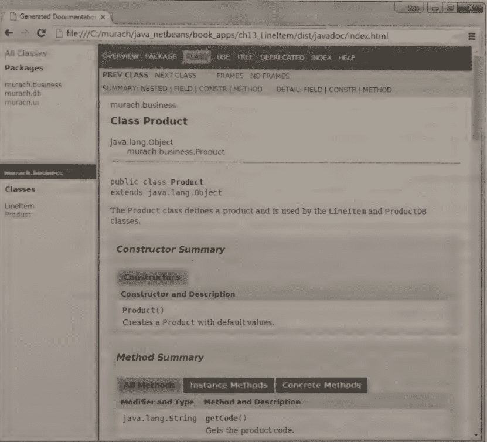

### 描述

- 要从 NetBeans 生成或查看项目文档，你可以在“项目”（Projects）窗口中右键点击项目，并选择“生成 Javadoc”命令。执行后，NetBeans 会为项目生成 Java 文档并在 浏览器中显示它。
- 默认情况下，NetBeans 将项目的文档存储在项目根目录下名为 `dist/javadoc` 的子文件夹中。该文件夹包含一个 `index.html` 文件，你可以通过双击它来查看文档。
- 如果项目已包含文档，NetBeans 将在没有任何任何警告的情况下覆盖现有文件。

图 13-8 如何生成和查看包的文档

## 观点

现在你已经完成了这一章，应该已经理解了处理内部类的概念。你应该能够创建和使用枚举。而且，你应该能够为你的类编写文档，以便其他程序员可以使用它们。此时，你已经掌握了所有所需的面向对象编程技能，可以学习更多 Java API 中提供的类，例如下一章描述的集合类。此外，你为本书末尾描述的 GUI 编程奠定了坚实的基础。

### 总结

- 内部类是编写在另一个类内部的类。当一个类仅在另一个类的语境下才有意义时，这种方法非常有用。
- 匿名类是内部类的一种，它没有名称。这通常会比有名称的内部类产生更简洁的代码。
- 你可以使用枚举（enumeration）来定义一组相关的常量作为类型。然后，你可以在允许任何地方使用枚举中的常量。
- 你可以使用静态导入（static imports）来导入枚举的常量或类的静态字段和方法。然后，你无需限定符即可引用这些常量、字段和方法。
- 你可以使用 javadoc 注释为类及其字段、构造函数和方法编写文档。然后，你可以为你的类生成基于 HTML 的文档。

## 练习 13-1 测试内部类

在本次练习中，你将尝试内部类和匿名类。

### 复习应用程序

1. 打开存储在 `ex_starts` 文件夹中的名为 `ch13_ex1_InnerClassTester` 的项目。复习 `TestFrame` 类代码和 `Listener` 类代码。注意这些类存储在单独的文件中。
2. 运行应用程序。它应该显示 Test Frame 窗口。然后，点击窗口中的按钮。它应该向控制台输出一条消息。

### 创建内部类

3. 打开 `TestFrame` 和 `ClickListener` 类，将 `ClickListener` 类变为 `TestFrame` 类的内部类。要做到这一点，你可以将 `ClickListener` 类中的大部分代码剪切并粘贴到 `TestFrame` 中。
4. 删除 `ClickListener` 类声明中的 `public` 修饰符，为 `ActionListener` 类添加导入语句，并对此代码进行任何其他必要的修改。
5. 删除 `ClickListener.java` 文件。此时，项目应该只包含 `TestFrame.java` 文件和 `Main.java` 文件。
6. 运行应用程序并点击按钮。它的运行方式应该和之前一样。

### 创建匿名类

7. 打开 `TestFrame` 并将 `ClickListener` 类变为匿名内部类。要做到这一点，你可以先从 `ClickListener` 类中剪切从左括号开始到右括号结束的代码。
8. 删除 `ClickListener` 类的声明，修改代码使其从匿名 `ActionListener` 类创建对象，并对此代码进行任何其他必要的修改。
9. 运行应用程序并点击按钮。它的运行方式应该和之前一样。

## 练习 13-2 创建并使用枚举

在本次练习中，你将创建一个枚举并在测试应用程序中使用它。

### 创建枚举

1. 打开位于 `ex_starts` 文件夹中的名为 `ch13_ex2_Enumeration` 的项目。
2. 创建一个名为 `CustomerType` 的枚举。该枚举应该包含代表三种客户类型的语句：零售（retail）、贸易（trade）和大学（college）。
3. 打开 `CustomerMyApp` 类。然后，为该类添加一个方法，根据传递给它的 `CustomerType` 变量返回一个折扣百分比（零售为 `.10`，贸易为 `.30`，大学为 `.20`）。
4. 在 `main` 方法中添加代码，声明 `CustomerType` 变量，为它分配一种类型，获取该客户类型的折扣百分比并显示该百分比。它应该在控制台显示如下消息：

```
discountPercent: 0.3
```

5. 运行应用程序以确保其正常工作。

### 修改枚举的 toString 方法

6. 在 `main` 方法中添加一条语句，显示由客户类型的 `toString` 方法返回的字符串。然后再次运行应用程序以查看该方法的结果。根据客户类型，它应该显示如下常量名称：

```
toString: TRADE
```

7. 在 `CustomerType` 枚举中添加一个 `toString` 方法。根据客户类型，此方法应该返回包含“Retail”或“College”的字符串，如下：

```
toString: Trade
```

8. 再次运行应用程序查看 `toString` 方法的结果。

## 练习 13-3 使用 API 文档

本次练习将引导你完成为 Line Item 应用程序业务包中的类添加 javadoc 注释的过程。然后，它将向你展示如何为该应用程序生成文档。

### 复习两个类的 javadoc 注释

1. 打开存储在 `ex_starts` 文件夹中的名为 `ch13_ex3_LineItem` 的项目。
2. 打开 `murach.business` 包中的 `Product` 类。然后，查看该类的 javadoc 注释。注意该类包含不包含 `@param` 或 `@return` 标签的注释。
3. 打开 `murach.business` 包中的 `LineItem` 类。注意该类仅在开头包含一个 javadoc 注释。

### 生成并查看 API 文档

4. 为项目生成文档。这会自动在浏览器中打开文档。如果没有，通过导航到项目的 `dist/javadoc` 文件夹并打开 `index.html` 来打开文档。


5. 查看 `Product` 类的文档。要做到这一点，点击 `murach.business` 包的链接。然后点击 `Product` 类的链接。注意它包含了构造函数和方法的描述。

6. 查看 `getConfig` 和 `setMethods` 的详情。要做到这一点，点击这些方法的链接。注意这些方法没有包含关于参数和返回值的信息。

7. 点击 `LineItem` 类的链接来查看该类的文档。注意它没有包含构造函数和方法的描述。

### 改进 javadoc 注释

8. 打开 `Product` 类。修改该类的 javadoc 注释，使其在适当的地方包含 `@param` 和 `@return` 标签。

9. 打开 `LineItem` 类。为所有公共构造函数和方法添加 javadoc 注释，在适当的地方使用 `@param` 和 `@return` 标签。

### 生成并查看改进后的 API 文档

10. 再次为项目生成文档。

11. 再次查看 `Product` 和 `LineItem` 类的文档。这次文档应该包含所有构造函数和方法的描述，以及所有参数和返回值的信息。例如，`LineItem` 类的第二个构造函数应该包含其两个参数的信息。

一旦你读完第 14 章和第 16 章（这两个章节介绍了对大多数 Java 应用至关重要的技能），你就可以直接跳到第 5 节。该章节的内容展示了如何开发使用图形用户界面与数据库交互的桌面应用程序。相反，在阅读第 5 节时，你可以根据需要随时回到本节的章节。

# 如何使用集合、泛型和 Lambda 表达式

在本章中，你将学习如何操作集合。正如你所看到的，集合与数组相似，但它提供了更高级的功能。除了集合，你还将接触泛型，这是自 Java 5 以来就已可用的一项特性。最后，你将学习如何使用 Lambda 表达式，这是 Java 8 引入的一项特性。

本章假设你已经了解了如何操作数组。因此，你应该在阅读本章之前先阅读第 10 章。

| 主题 | 页码 |
| :--- | :--- |
| Java 集合初探 | 358 |
| 数组与集合的比较 | 358 |
| Java 集合框架概述 | 360 |
| 泛型初探 | 362 |
| 如何使用 ArrayList 类 | 364 |
| 如何创建数组列表 | 364 |
| 如何添加和获取元素 | 366 |
| 如何替换、删除和搜索元素 | 368 |
| 如何在数组列表中存储基本数据类型 | 370 |
| Invoice 应用程序 | 372 |
| 用户界面 | 372 |
| Invoice 类 | 374 |
| InvoiceApp 类 | 376 |
| 如何使用 Lambda 表达式 | 378 |
| Lambda 表达式初探 | 378 |
| 不使用 Lambda 表达式的方法 | 380 |
| 使用 Lambda 表达式的方法 | 382 |
| 如何使用 Predicate 接口 | 384 |
| 观点 | 386 |

# Java 集合初探

与数组一样，集合是一个可以容纳一个或多个元素的对象。然而，与数组不同，集合并不是 Java 语言本身的一部分。相反，集合是 Java API 提供的类。

# 数组与集合的比较

图 1-1 展示了数组和集合的简单比较。这显示你可以使用数组或集合来存储指定类型的多个元素。事实上，某些集合类——最著名的 `ArrayList` 类——实际上是使用内部数组来存储元素的。然而，这对于程序员来说是透明的。

尽管数组和集合有一些相似之处，但它们也有许多不同之处。一个重要的区别是数组的大小是固定的。这意味着，如果你初始化了一个包含 100 个元素的数组，然后需要添加另一个元素，你必须创建一个足够容纳 101 个元素的新数组，将第一个数组中的 100 个元素复制到新数组，添加新元素，并丢弃旧数组。

相比之下，集合会在需要时自动增加其大小。在后台，集合可能会在数组之间复制元素，但这对程序员来说是透明的。因此，当你创建一个集合时，不需要指定集合的最大大小。相反，你可以根据需要向集合中添加许多元素。然后，如果有必要，集合会自动扩展以容纳新元素。

数组和集合的第二个区别是，数组可以存储 `int` 和 `double` 值等基本数据类型，但集合必须使用包装类来存储基本数据类型。幸运的是，对于 Java 5 及更高版本，集合会使用称为自动装箱的特性根据需要自动添加和移除包装类。

第三个区别是，你通常使用集合的方法来设置和获取集合中的元素。由于你不能从数组调用方法，你通常使用索引来设置和获取其元素。图中展示了这是如何工作的。在这里，第一个示例使用索引在数组中设置三个值，但第二个示例使用 `ArrayList` 类的 `add` 方法来设置集合中的元素。然后，两个示例都使用增强循环来获取元素并将它们打印到控制台。

顺便说，如果你不理解第二个示例中的所有代码，请不要担心。你将在本章稍后的部分学习操作 `ArrayList` 类的细节。这个示例仅用于说明操作数组和集合之间的一些区别。

# 数组和集合的相似之处

- 两者都存储相同类型的多个元素。

# 数组和集合的不同之处

- 数组的大小是固定的，需要程序员在必要时增加大小。集合在需要时会自动增加大小。
- 数组可以在不使用包装类的情况下存储基本数据类型。集合必须使用包装类来存储基本数据类型。
- 数组不提供添加、替换和删除元素等的操作方法。集合通常提供执行这些操作的方法。

# 使用数组的代码

```java
String[] codes = new String[3];
codes[0] = "java";
codes[1] = "jsp";
codes[2] = "mysql";
for (String s : codes) {
  System.out.println(s);
}
```

# 使用集合的代码

```java
ArrayList<String> codes = new ArrayList<>();
codes.add("java");
codes.add("jsp");
codes.add("mysql");
for (String s : codes) {
  System.out.println(s);
}
```

### 描述

- 集合是一个可以持有其他对象的对象。集合与数组相似，但使用起来更灵活。
- 对于 Java 5 及更高版本，集合使用称为自动装箱的特性，根据需要自动添加和移除基本数据类型的包装类。


# Java 集合框架概述

图 14-2 显示了 Java 集合框架的简化图表。该框架由接口和类组成。深色阴影框（`Collection`, `Set`, `List` 和 `Map`）代表定义基本类型的接口，浅色阴影框（`ArrayList`, `LinkedList`, `HashMap` 和 `TreeMap`）代表实现这些接口的类。

## 集合框架

| Collection | Map |
| --- | --- |
| Set | HashMap |
| List | TreeMap |
| HashSet | TreeSet |

## 集合接口

| 接口 | 描述 |
| --- | --- |
| Collection | 定义了所有集合提供的基本方法。 |
| Set | 定义了一个不允许重复元素的集合。 |
| List | 定义了一个维护列表中元素顺序的集合。它通过整数索引访问元素，并通常允许重复元素。 |
| Map | 定义了一个映射。Map 与集合类似。然而，它存储的是一个或多个键值对，而不是只存储值（元素）。每个键值对由一个唯一标识该值的键和一个存储数据的值组成。 |

## 常用集合类

| 类 | 描述 |
| --- | --- |
| ArrayList | 在随机访问单个元素时，比链表更高效。但在向列表中间插入元素时，效率比链表更低。 |
| LinkedList | 在随机访问元素时，比数组列表效率低。但在列表中间插入项时，比数组列表更高效。 |
| HashSet | 存储一个唯一元素的集合。换句话说，它不允许重复。 |
| HashMap | 存储键值对，其中每个键都是唯一的。换句话说，它不允许重复的键，但允许重复的值。 |
| TreeMap | 在称为树的层次数据结构中存储键值对。此外，它会自动根据键对元素进行排序。 |

### 描述

- Java 集合框架是基于接口的，这意味着集合框架中的每个类都实现了由框架定义的接口之一。
- 集合框架由两个类层次结构组成：`Collection` 和 `Map`。集合将单个对象作为元素存储。Map 存储键值对，你可以使用一个键来检索值（元素）。


# 泛型简介

在 Java 5 之前，集合的元素被定义为 `Object` 类型。因此，你可以将任何类型的对象作为元素存储在集合中。起初，这种灵活性似乎是一个优势。但它也带来了两个缺点：没有办法保证只有特定类型的对象被添加到集合中。例如，你无法限制 `ArrayList` 仅持有 `Product` 对象。第二，当你从集合中检索对象时，必须使用强制类型转换。这是因为元素可以是任何类型的对象。例如，要从集合中检索 `Product` 对象，你必须将对象强制转换为 `Product` 类型。

Java 5 引入了一项新功能——泛型，它解决了这两个问题。泛型允许你为集合指定元素类型。这样，Java 就可以确保它只向集合中添加指定类型的对象。相反，Java 可以自动将你从集合中检索的任何对象转换为正确的类型。

图 14-3 显示了泛型的工作原理。在声明集合时，你在紧随集合类名（如 `ArrayList` 或 `LinkedList`）之后的角括号中编写类型来指定类型。在 Java 7 之前，你必须这样做：在使用该类声明集合时做一次，在使用该类的构造函数创建集合的实例时再做一次。然而，Java 7 引入了一项功能可以让你简化这些代码，如该图中最后一个示例所示。

第一个示例显示了一个语句，它声明并实例化了一个名为 `codes` 的数组列表集合实例，它持有 `String` 对象。在这里，`<String>` 指定在 `ArrayList` 类名之后，以表示数组列表的元素必须是 `String` 对象。

第二个和第三个示例类似，但它们创建了可以持有整数和 `Product` 对象的集合。在这里，第二个示例使用了包装类（`Integer` 类）而不是基本类型（`int` 类型）。这允许集合存储一个整数值数组。这是必要的，因为像这样使用基本类型声明集合是非法的：

```java
ArrayList<int> numbers = new ArrayList<int>(); // 非法
```

如果你使用 Java 7 或更高版本，只要编译器可以从上下文中推导出类型，你就可以省略构造函数后面括号中的类型。第四个示例展示了它是如何工作的。在这里，该代码完成了与第一个示例相同的任务，而没有重复集合类型。由于此功能导致了更短、更简单的代码，它在本章的其余部分被一直使用。

## 指定集合中元素类型的语法

```java
CollectionClass<Type> collectionName = new CollectionClass<Type>();
```

## 创建 String 对象数组列表的语句

```java
ArrayList<String> codes = new ArrayList<String>();
```

## 创建整数数组列表的语句

```java
ArrayList<Integer> numbers = new ArrayList<Integer>();
```

## 创建 Product 对象数组列表的语句

```java
ArrayList<Product> products = new ArrayList<Product>();
```

## 在 Java 7 或更高版本中使用类型推断的语法

```java
CollectionClass<Type> collectionName = new CollectionClass<>();
```

## 创建 String 对象数组列表的语句

```java
ArrayList<String> codes = new ArrayList<>();
```

### 描述

- 泛型是指一种允许你创建类型化集合的功能。类型化集合是只能持有特定类型对象的集合。该功能是 Java 5 引入的。
- 当你为类型化集合使用构造函数时，你可以在集合名称后的角括号 `<>` 中指定类型。类型变量不能是基本类型（如 `int` 或 `double`），但可以是包装类（如 `Integer` 或 `Double`）。也可以是用户定义的类（如 `Product`）。
- 从 Java 7 开始，只要编译器可以从上下文中推导出类型，你就可以省略括号内的类型。这种空括号被称为钻石运算符。
- 如果你没有为集合指定类型，集合可以持有任何类型的对象。然而，每当你访问集合时，Java 编译器都会发出警告信息，提醒你无法进行类型检查。


图 14-3 泛型

# 如何使用 ArrayList 类

`ArrayList` 类是 Java 中常用的集合之一。你可以使用此类创建一个名为数组列表的集合类型。数组列表内部使用数组来存储列表元素。因此，数组列表在许多方面与数组相似。然而，与数组不同，数组列表会在你添加元素时自动调整大小。因此，你不需要编写特殊代码来确保不超过数组列表的容量。

## 如何创建数组列表

图 14-4 显示了你可以用于创建数组列表的构造函数。这些构造函数使用大字母 `E` 表示你必须在角括号内指定你想存储在集合中的元素类型。图中第一个示例创建了一个可以存储 `String` 对象的 `codes`。由于此代码使用了 `ArrayList` 类的默认构造函数，该示例创建了一个初始容量为 10 个元素的数组列表。然后，如果有必要，数组列表会自动增加容量以存储更多元素。

遗憾的是，增加数组列表的容量并不是高效的操作，特别是当数组列表很大时。首先，`ArrayList` 类必须创建一个扩展后大小的新数组。然后，旧数组的元素必须复制到新数组。接下来，新元素必须被添加到新数组。最后，旧数组必须从内存中移除。

因此，如果你知道要存储的元素数量，创建一个初始容量略大于元素数量的数组列表会更高效。为了实现这一点，你可以使用如第二个示例所示的代码。该代码创建了一个初始容量为 200 个元素的数组列表。

## ArrayList 类的常用构造函数

| 构造函数 | 描述 |
| --- | --- |
| `ArrayList<E>()` | 创建一个指定类型的空数组列表，默认容量为 10 个元素。 |
| `ArrayList<E>(int capacity)` | 创建一个指定类型且指定容量的空数组列表。 |

### 创建 String 对象数组列表的代码

使用 10 个元素的默认起始容量：

`ArrayList<String> codes = new ArrayList<>();`

使用 200 个元素的指定起始容量：

`ArrayList<String> codes = new ArrayList<>(200);`

### 描述

- `ArrayList` 类在内部使用数组来存储列表中的元素。
- 数组列表的容量在任何需要时会自动增加。
- 当你创建一个列表时，可以使用 10 个元素的默认起始容量，也可以指定起始容量。
- 如果你知道列表需要存储多少个元素，可以通过指定一个略大于该数量的起始容量来提高 `ArrayList` 类的性能。

图 14-4 如何创建数组列表

## 如何添加和获取元素

图 14-5 的第一个示例展示了如何向数组列表添加元素。具体来说：

第二个示例从名为 `codes` 的数组列表中获取一个元素。具体来说，它获取列表中的最后一个元素。为了做到这一点，它通过从大小减 1 来计算最后一个元素的索引。然后，使用该索引获取数组列表中的最后一个元素。

虽然你可能需要从数组列表中获取元素，但处理数组列表的所有元素更为常见。为了这样做，通常使用如第三个示例所示的增强 for 循环。该示例将数组列表中的每个元素打印到控制台上。然而，如果有必要，你可以对每个元素执行更复杂的处理。

第四个示例展示了获取和显示集合中值的另一种方法。为了这样做，你在 `println` 方法中指定集合的名称。这会隐式地调用集合的 `toString` 方法，该方法返回一个列出每个元素值的字符串。由于这会将所有元素显示在同一行并用括号括起来，这种技术仅对小型集合有用。然而，在开发和调试应用程序时，这种技术通常非常有用。

## ArrayList 类的常用方法

| 方法 | 描述 |
| --- | --- |
| `add(object)` | 将指定的对象添加到列表的末尾。 |
| `add(index, object)` | 在指定的索引位置添加指定的对象。 |
| `get(index)` | 返回指定索引位置上的对象。 |
| `size()` | 返回列表中的元素数量。 |

## 向数组列表添加三个元素的代码

```java
codes.add("jsp");
codes.add("mysql");
codes.add(0, "java");
```

## 获取最后一个元素的代码

```java
int lastIndex = codes.size() - 1;
String lastCode = codes.get(lastIndex); // "mysql"
```

## 获取并显示数组列表每个元素的代码

```java
for (String code : codes) {
    System.out.println(code);
}
```

## 结果输出

```
java
jsp
mysql
```

## 显示集合内容的简单方法

```java
System.out.println(codes);
```

## 结果输出


# 第 14 章 如何与集合、泛型和 lambda 协作

## 描述

- 你可以使用 `ArrayList` 类的方法向数组列表添加元素，并从数组列表中获取元素。

## 如何替换、删除和搜索元素

图 14-6 中的第一个示例展示了如何替换数组列表中的元素。为了做到这一点，第一条语句调用 `set` 方法将存储在索引 2 处的元素替换为 "android"。换句话说，它将数组列表的第三个元素更改为 "android"。

第二个示例展示了如何从数组列表中删除元素。为了做到这一点，此代码调用 `remove` 方法并指定索引为 1。结果，此代码删除了数组列表中的第二个元素并将其存储在名为 `code` 的 `String` 变量中。

该示例的输出显示第二个元素（"jsp"）已被删除，所有元素都向前移动。换句话说，第三个元素（"android"）向前移动，现在是第二个元素了。

第三个示例展示了如何在数组列表中搜索元素。为了做到这一点，此代码调用 `contains` 方法并指定它正要搜索的对象。如果该对象存在，示例中的代码将向控制台打印一条消息，指示该对象存在。然而，一旦你知道数组列表中存在某个对象，你就可以对它进行任何类型的处理。

## `ArrayList` 类的更多方法

| 方法 | 描述 |
| --- | --- |
| `clear()` | 从列表中移除所有元素。 |
| `contains(object)` | 如果指定的对象在列表中，则返回 true。 |
| `indexOf(object)` | 返回指定对象的索引位置。 |
| `isEmpty()` | 如果列表为空，则返回 true。 |
| `remove(index)` | 移除指定索引位置上的对象并返回该对象。 |
| `remove(object)` | 移除指定的对象并返回一个指示操作是否成功的布尔值。 |
| `set(index, object)` | 将指定索引处的元素设置为指定的对象。 |
| `toArray()` | 返回包含元素的数组。 |

## 替换元素的代码

```java
codes.set(2, "android");
System.out.println(codes);
```

结果输出

```
[java, jsp, android]
```

## 删除元素的代码

```java
String code = codes.remove(1); // "jsp"
System.out.println(code + " was removed.");
System.out.println(codes);
```

结果输出

```
jsp was removed.
[java, android]
```

## 搜索元素的代码

```java
if (codes.contains("android")) {
    System.out.println("This list contains: android");
}
```

结果输出

```
This list contains: android
```

## 描述

- 你可以使用 `ArrayList` 类的方法来替换、删除和搜索数组列表的元素。

## 如何在数组列表中存储基本类型

图 14-7 展示了如何向数组列表存储基本类型。为了做到这一点，你可以使用包装类来指定可以存储的元素类型。

例如，在图中，第一个示例创建了一个 `Integer` 对象的列表。然后，它将 int 值 1、2、3 添加到列表中。这是因为编译器在存储它们之前自动将 int 值转换为 `Integer` 对象。

相反，第二个和第三个示例从列表中获取 int 值 1、2、3，尽管该列表存储的是 `Integer` 对象。这也是因为编译器自动将 `Integer` 对象转换为 int 值。

这种功能被称为自动装箱，它在 Java 5 及更高版本中可用。在 Java 5 之前，必须编写额外的代码将基本类型存储在包装类中并从包装类中取出它们。幸运的是，对于较新的 Java 版本，这不再是必要的。

## 在数组列表中存储基本类型的代码

```java
ArrayList<Integer> numbers = new ArrayList<>();
numbers.add(1);
numbers.add(2);
numbers.add(3);
System.out.println(numbers);
```

结果输出

```
[1, 2, 3]
```

## 从数组列表获取基本类型的代码

```java
int firstNumber = numbers.get(0); // 1
```

## 从数组列表获取基本类型的代码

```java
for (int number : numbers) {
    System.out.println(number);
}
```

结果输出

```
1
2
3
```

## 描述

- 所有基本类型都有对应的包装类。例如，`Integer` 类是 `int` 类型的包装类，`Double` 类是 `double` 类型的包装类，以此类推。
- 为了将基本类型存储在集合中，你可以指定其包装类作为集合的类型。然后，当向集合添加值时，编译器会自动将基本值转换为其包装类型。这种功能被称为自动装箱。
- 为了从集合中获取基本类型，你不需要做任何操作，因为编译器会自动从包装类中为你获取基本值。

## 发票应用程序

现在你已经了解了如何操作使用数组列表，本章将展示如何在接下来几幅图所示的发票应用程序背景下使用数组列表。

## 用户界面

图 14-8 显示了发票应用的控制台。该控制台的工作方式与之前章节介绍的行项目应用程序类似。然而，它会将每个行项目添加到发票中。当用户完成行项目的添加后，发票应用程序将显示每个行项目以及发票的总额。为了实现这一点，它使用了图 14-9 所示的 `Invoice` 类。

## 控制台

```
Welcome to the Invoice application

Enter product code: java
Enter quantity: 2
Another line item? (y/n): y

Enter product code: jsp
Enter quantity: 1
Another line item? (y/n): n

| Description | Price | Qty | Total |
| :--- | :--- | :--- | :--- |
| Murach's Java Programming | $57.50 | 2 | $115.00 |
| Murach's Java Servlets and JSP | $57.50 | 1 | $57.50 |

Invoice total: $172.50
```

## 描述

- 该应用程序允许为发票输入一个或多个行项目。完成后，它会显示你输入的所有行项目。此外，它还会显示发票的总金额。
- 要输入行项目，请输入行项目的产品代码和数量。然后，你可以输入“y”来输入另一个行项目，或者输入“n”来完成发票。

## `Invoice` 类

`Invoice` 类首先定义了一个实例变量，即一个名为 `lineItems` 的 `LineItem` 对象数组列表。该数组列表存储了发票的行项目。`Invoice` 类的默认构造函数创建了这个数组列表，但不会向其中添加任何行项目。然而，`addItem` 方法提供了一种向发票添加行项目的方式。该方法将 `LineItem` 对象作为参数。然后，它调用 `lineItems` 数组列表的 `add` 方法并将 `LineItem` 对象添加到数组列表中。

`getLineItems` 方法提供了一种获取 `lineItems` 数组列表的方式。该方法的返回类型（`ArrayList<LineItem>`）使用泛型来指定数组列表只能存储 `LineItem` 对象，这正是你所需要的。

`getTotal` 方法使用增强型循环处理 `lineItems` 数组列表中的每个 `LineItem` 元素。在循环内部，代码调用当前行项目的 `getTotal` 方法，并将结果加到 `invoiceTotal` 变量中。循环结束后，`getTotal` 方法返回 `invoiceTotal` 变量。

`getTotalFormatted` 方法将发票总额格式化为货币字符串。为了做到这一点，该方法调用发票的 `getTotal` 方法。这样，`getTotalFormatted` 方法就不会在 `getTotal` 方法中重复任何代码。

## `Invoice` 类

```java
package murach.business;

import java.text.NumberFormat;
import java.util.ArrayList;

public class Invoice {
    // 实例变量
    private ArrayList<LineItem> lineItems;

    // 构造函数
    public Invoice() {
        lineItems = new ArrayList<>();
    }

    // 添加行项目的方法
    public void addItem(LineItem lineItem) {
        lineItems.add(lineItem);
    }

    // 获取行项目集合的访问器
    public ArrayList<LineItem> getLineItems() {
        return lineItems;
    }

    // 获取发票总额的方法
    public double getTotal() {
        double invoiceTotal = 0;
        for (LineItem lineItem : lineItems) {
            invoiceTotal += lineItem.getTotal();
        }
        return invoiceTotal;
    }

    // 返回货币格式发票总额的方法
    public String getTotalFormatted() {
        NumberFormat currency = NumberFormat.getCurrencyInstance();
        return currency.format(getTotal());
    }
}
```

## `InvoiceApp` 类

```java
package murach.ui;

import murach.db.ProductDB;
import murach.business.Invoice;
import murach.business.LineItem;
import murach.business.Product;

public class InvoiceApp {

    public static void main(String args[]) {
        System.out.println("Welcome to the Invoice application\n");
        Invoice invoice = new Invoice();
        getLineItems(invoice);
        displayInvoice(invoice);
    }

    public static void getLineItems(Invoice invoice) {
        String choice = "y";
        while (choice.equalsIgnoreCase("y")) {
            System.out.print("Enter product code: ");
            String productCode = Console.readLine();
            System.out.print("Enter quantity: ");
            int quantity = Console.nextInt();
            LineItem item = new LineItem(productCode, quantity);
            invoice.addItem(item);
            System.out.print("Another line item? (y/n): ");
            choice = Console.readLine();
        }
    }

    public static void displayInvoice(Invoice invoice) {
        StringBuilder sb = new StringBuilder();
        for (LineItem lineItem : invoice.getLineItems()) {
            sb.append(StringUtil.pad(lineItem.getDescription(), 30))
              .append(StringUtil.pad(lineItem.getPrice(), 10))
              .append(StringUtil.pad(String.valueOf(lineItem.getQuantity()), 5))
              .append(StringUtil.pad(lineItem.getTotal(), 15))
              .append("\n");
        }
        sb.append("Invoice total: ");
        sb.append(invoice.getTotalFormatted());
        System.out.println(sb.toString());
    }
}
```

## Lambda 表达式

- 是可以作为参数传递给方法的匿名函数。
- 允许你将函数像数据一样进行处理。

## Lambda 表达式的一些优点

- 它们可以减少代码重复。
- 它们可以允许你编写更灵活、更易维护的方法。

## Lambda 表达式的一些缺点

- 它们与集成调试器配合得不是很好。
- 它们的效率可能较低。
- 它们可能会导致非常难以理解的堆栈跟踪。
- 它们可能会导致难以理解的代码。
- 它们可能会导致常用功能的代码重复。

## 描述

- 像方法一样，函数拥有参数并返回值。匿名函数是没有名字的函数。

## 不使用 lambda 表达式的方法

为了理解 lambda 如何能有所帮助，图 14-12 显示了一个没有使用 lambda 表达式的方法，该方法本可以从使用 lambda 表达式中受益。该方法接受一个 `Contact` 对象列表作为参数，并返回一个新的 `Contact` 对象列表，其中仅包含原始列表中电话号码为 null 的人。

为了完成此任务，该方法内部的代码创建了一个新的 `Contact` 对象列表，用于存储电话号码为 null 的 `Contact` 对象。然后，它使用循环检查作为参数传递的列表中的每个 `Contact`。在循环内部，一个 `if` 语句检查 `Contact` 的电话是否为 null。如果是，这段代码就会将该 `Contact` 对象添加到新列表中。循环结束后，这段代码返回新列表。

这个方法有几个优点。首先，这段代码并没有复杂之处。因此，它是易于阅读和理解的。其次，由于这个方法易于阅读和理解，它应该是易于维护的。

然而，这个方法也有几个缺点。首先，它不灵活。例如，假设你想找到所有邮箱地址为 null 的人，而不是电话号码为 null 的人？这个方法无法做到。要做到这一点，你必须编写一个新方法来检查邮箱地址是否为 null。然而，新方法中的大部分代码都是重复代码。你只需要更改 `if` 语句内部的条件即可。

如果你想找到电话号码为 null 且邮箱地址也为 null 的人员列表呢？要做到这一点，你必须编写第三个方法。再次，第三个方法中的代码与前两个方法中的代码几乎相同。

此时，代码重复开始使得维护这些方法变得困难。例如，如果你需要更改 `Contact` 类，你可能需要更改所有三个方法中的代码以反映该更改。在这种情况下，使用 lambda 表达式是有意义的，因为它可以使方法更加灵活，减少代码重复并让你的代码更易维护。

## `Contact` 类

```java
public class Contact {
    private String name;
    private String email;
    private String phone;

    // 此处应有构造函数和 get / set 方法
}
```

## 创建联系人列表的代码

```java
List<Contact> contacts = new ArrayList<>();
contacts.add(new Contact("John Doe", "john_doe@foo.com", "555-1212"));
contacts.add(new Contact("Jane Doe", null, null));
contacts.add(new Contact("George Doe", "george_doe@foo.com", null));
```

## 返回没有电话号码的联系人的方法

```java
public List<Contact> getContactsWithNoPhone(List<Contact> contacts) {
    List<Contact> noPhoneContacts = new ArrayList<>();
    for (Contact contact : contacts) {
        if (contact.getPhone() == null) {
            noPhoneContacts.add(contact);
        }
    }
    return noPhoneContacts;
}
```


```java
public List<Contact> filterContactsWithoutPhone(List<Contact> contacts) {
    List<Contact> contactsWithoutPhone = new ArrayList<>();
    for (Contact c : contacts) {
        if (c.getPhone() == null) {
            contactsWithoutPhone.add(c);
        }
    }
    return contactsWithoutPhone;
}
```

# 获取没有电话号码的联系人的代码

```java
List<Contact> contactsWithoutPhone = filterContactsWithoutPhone(contacts);
```

# 将联系人打印到控制台的代码

```java
for (Contact p : contactsWithoutPhone) {
    System.out.println(p.getName());
}
```

# 输出

Jane Doe

George Doe

### 描述

- `filterContactsWithoutPhone` 方法接受 `Contact` 对象列表，找到列表中所有电话号码为 null 的联系人，将这些联系人添加到新列表中，并将列表返回给调用者。
- 在 `filterContactsWithoutPhone` 方法中，过滤列表的代码是硬编码的。因此，该方法不灵活且脆弱。

## 14-12 不使用 lambda 表达式的方法

## 使用 lambda 表达式的方法

图 14-13 显示了如何使用使用 lambda 表达式的方法执行与前图相同的任务。这产生了一个灵活的方法，你可以用它多种方式过滤 `Contact` 对象。

在调用 lambda 表达式之前，你需要为 lambda 表达式定义参数和返回类型。为了做到，你可以使用函数接口（functional interface）。函数接口的作用像普通接口一样，但它只能包含一个方法。

图中的第一个示例是函数接口 `TestContact`。

```java
public interface TestContact {
    boolean test(Contact c);
}
```

# 使用函数接口指定过滤条件的方法

```java
public List<Contact> filterContacts(List<Contact> contacts, TestContact condition) {
    List<Contact> filteredContacts = new ArrayList<>();
    for (Contact c : contacts) {
        if (condition.test(c)) {
            filteredContacts.add(c);
        }
    }
    return filteredContacts;
}
```

# 获取没有电话号码的联系人的代码

```java
List<Contact> contactsWithoutPhone = filterContacts(contacts, c -> c.getPhone() == null);
```

# 获取没有邮箱地址的联系人的代码

```java
List<Contact> contactsWithoutEmail = filterContacts(contacts, c -> c.getEmail() == null);
```

# 输出

Jane Doe

George Doe

### 描述

- 函数接口只能包含一个方法。
- 方法可以指定函数接口作为参数的类型。那么，在方法内部，你可以从参数调用函数接口的方法。
- 你可以将 lambda 表达式传递给接受函数接口作为参数的方法。在编写 lambda 表达式时，使用变量名，后面跟着 lambda 运算符 (`->`)，然后是一个匿名函数。匿名函数可以使用变量名调用该方法所使用的对象类型的方法。

## 如何使用 Predicate 接口

图 14-14 展示了如何使用 Predicate 接口完成与前一个图相同的任务。Predicate 是一个来自 `java.util.function` 包的函数式接口。该接口定义了一个具名的测试方法，其工作方式与前图中介绍的 `TestContact` 函数式接口中的 `test` 方法非常相似。

然而，`Predicate` 接口相比 `TestContact` 接口有两个优势。首先，它已经包含在 Java API 中，因此你不需要编写代码来定义这个接口。其次，`Predicate` 接口使用泛型来指定传递给其 `test` 方法的对象类型。因此，它的 `test` 方法可以接受任何类型的对象。相比之下，`TestContact` 接口的 `test` 方法只能接受 `Contact` 对象。

在图中，`filterContacts` 方法的第二个参数定义了一个 `Predicate<Contact>` 类型的参数。因此，传递给该方法的 lambda 表达式可以调用 `Contact` 对象的方法。

# java.util.function 包提供的 Predicate 接口

```java
public interface Predicate<T> {
    boolean test(T t);
}
```

# 使用 Predicate 接口指定条件的方法

```java
public static List<Contact> filterContacts(List<Contact> contacts,
    Predicate<Contact> condition) {
    List<Contact> filteredContacts = new ArrayList<>();
    for (Contact c : contacts) {
        if (condition.test(c)) {
            filteredContacts.add(c);
        }
    }
    return filteredContacts;
}
```

### 描述

- `Predicate` 接口是一个来自 `java.util.function` 包的函数式接口。
- `Predicate` 接口使用泛型来指定传递给其 `test` 方法的对象类型。

## 展望

现在你已经读完了这一章，应该已经了解如何操作数组列表（array lists），这是 Java 中最常用的集合之一。这包括知道如何使用泛型来指定集合所存储的对象类型。这为学习如何操作其他集合奠定了良好的基础。

你还应该理解，Java API 提供了许多集合。这些集合中的每一个都提供了某些情况下非常有用的功能。因此，如果本章介绍的集合没有提供应用程序所需的功能，那么很有可能 Java API 已经包含了一个提供该功能的集合。要找到它，你可以通过查看 `java.util` 包的文档或搜索互联网来开始学习它的工作原理。

最后，你应该对 lambda 表达式的工作原理有一个大致的了解。正如你预期的，lambda 表达式有很多需要学习的内容。要做到这一点，你可以在互联网上搜索教程，或者购买更高级的 Java 编程书籍。

## 总结

- **集合**（collection）是一个旨在存储其他对象的对象。
- 最常用的集合类是 `ArrayList` 类。**数组列表**（array list）在内部使用数组来存储数据。
- **泛型**（generics）功能从 Java 5 开始引入，它允许你指定集合可以存储的元素类型。该功能还允许你创建处理变量数据类型的**泛型类**（generic classes）。
- **菱形运算符**（Diamond operator）从 Java 7 开始引入，允许你在泛类型集合的构造函数中创建一个空括号 `<>`，而不需要在这些括号内编写类型。
- **函数式接口**（functional interface）是一个只包含一个方法的接口。
- **lambda 表达式**（lambda expression，也称为**匿名函数**（anonymous function））可以作为参数传递给接受函数式接口作为参数的方法。这允许你像对待数据一样对待函数。

# 练习 14-1 使用 array list

本练习将引导你完成向 Future Value 应用程序添加 array list。该 array list 存储用户进行的每次计算的数值。当应用程序结束时，它会将这些计算的摘要打印到控制台。该摘要应该如下所示：

| 投资/月额 | 利率 | 年限 | 未来价值 |
|---|---|---|---|
| $100.00 | 8.0% | 10 | $18,416.57 |
| $125.00 | 8.0% | 10 | $23,020.71 |
| $150.00 | 8.0% | 10 | $27,624.85 |

1. 打开 `ex_starts` 文件夹中名为 `ch14_ex1_FutureValue` 的项目。然后检查该应用程序的代码并运行它以确保其工作正常。
2. 在 `main` 方法开头声明一个存储字符串的 array list 变量。
3. 在计算、格式化并显示每次计算结果的代码之后，添加格式化一个带有计算结果的字符串，并将该字符串存储在 array list 中。
4. 添加代码在用户退出应用程序时将 array list 中的元素打印到控制台。然后通过进行至少 3 次未来价值计算来测试应用程序。

# 练习 14-2 使用 lambda 表达式

在本练习中，你将使用 lambda 表达式来减少在书籍目录中搜索特定类型书籍时的代码重复。

1. 打开 `ex_starts` 文件夹中名为 `ch14_ex2_BookCatalog` 的项目。然后检查该应用程序的代码并运行它以确保其工作正常。它应该按标题、类别和格式打印列表：

```
BOOKS BY TITLE:
Java

BOOKS BY CATEGORY:
Java

BOOKS BY FORMAT:
Hard
```

2. 添加一个名为 `TestBook` 的函数式接口，该接口接受一个 Book 对象并返回一个布尔值。
3. 在 `BookManager` 类中添加一个名为 `getByLambda` 的方法，它接受 `TestBook` 作为参数并在条件中使用其 `test` 方法。
4. 打开 `Main` 类，并将对 `BookManager` 方法的旧调用替换为三次 `getByLambda`。要这样做，你需要传递一个 lambda 表达式作为参数。例如，测试书籍标题的 lambda 表达式为 `b -> b.getTitle().equals("Java")`。
5. 在 `BookManager` 类中，删除 `getBooksTitle`、`getBooksCategory` 和 `getBooksFormat` 方法。注意这如何减少代码重复并增加代码的灵活性。
6. 运行应用程序并测试以确保其工作正常。它应该打印出相同的列表。

# 处理日期时间

在本章中，你将学习如何处理日期和时间，这对于许多 Java 应用程序都是必要的。首先，本章将向你介绍 Java 8 之前的日期/时间 API，以及 Java 8 及之后提供的新日期/时间 API。

Oracle 建议在新的开发中使用新的日期/时间 API。因此，本章仅展示如何使用新的日期/时间 API。然而，如果你需要使用旧的日期/时间 API，可以通过搜索互联网或参考全面的书籍（如 Murach's Java Programming）来获取更多信息。

| 日期/时间 API 简介 ................................................ 390 |
| Java 8 之前的日期/时间 API ................................................. 390 |
| Java 8 及之后的日期/时间 API ............................................ 390 |
| **如何使用新的日期/时间 API**........................................................... 392 |
| 创建日期和时间对象......................................................... 392 |
| 获取日期和时间部分............................................................... 394 |
| 比较日期和时间.............................................................................. 396 |
| 调整日期/时间对象.............................................................................. 398 |
| 添加或减去时间段...................................................................... 400 |
| 格式化日期和时间.................................................................. 402 |

## 日期/时间 API 简介

图 15-1 汇总了 Java 8 提供的日期/时间 API。第一个在 Java 8 之前就已经可用，并为了兼容性包含在 Java 8 中。第二个是添加到 Java 8 的全新且改进的日期/时间 API。Oracle 建议在新开发中使用此日期/时间 API。

### Java 8 之前的日期/时间 API

如果你需要应用程序与旧版本的 Java 兼容，你可以使用 `java.util` 包中的 `Date`、`Calendar` 和 `GregorianCalendar` 类来处理日期和时间。这些类适用于所有现代版本的 Java。为了格式化这些日期和时间，你可以使用 `java.text` 包中的 `DateFormat` 或 `SimpleDateFormat`。这些类也适用于所有现代版本的 Java。

然而，这些类存在一些设计缺陷。首先，它们不是线程安全的。此外，大多数程序员认为这些类的设计是不符合直觉的。例如，在 `Date` 类中，年份从 1900 开始，月份从 1 开始，日期从 0 开始。最后，这些类并不能方便你针对不使用格列哥日历的世界地区进行本地化。例如，在使用这些类时，编写支持农历的代码并不容易。

### Java 8 及更高版本的日期/时间 API

为了解决这些问题，Java 8 引入了新的日期/时间 API。此新 API 的类和枚举都存储在 `java.time` 包中。

该 API 是线程安全的，因为所有类都是不可变的。换句话说，这些对象的方法总是返回一个新对象，而不是修改现有对象。此外，大多数程序员认为这种设计比旧 API 更符合直觉。最后，新 API 支持独立的日历，这使得应用程序更容易针对不使用格列哥日历的世界地区进行本地化。

### Java 8 之前的日期/时间 API

| 包 | 描述 |
| :--- | :--- |
| java.util | 一个较旧的包，包含 `Date`、`Calendar` 和 `GregorianCalendar`。在 Java 8 之前，程序员常用这些类来处理日期和时间。 |
| java.text | 一个较旧的包，包含 `DateFormat` 和 `SimpleDateFormat` 类。在 Java 8 之前，程序员使用这些类来格式化日期和时间。 |

#### 优点

- 兼容旧版本的 Java。

#### 缺点

- 不是线程安全的。
- 不直观。
- 不易于针对不使用格列哥日历的世界地区进行本地化。

### Java 8 及更高版本的日期/时间 API

| 包 | 描述 |
| :--- | :--- |
| java.time | 一个较新的包，包含 `LocalDate`、`LocalTime`、`LocalDateTime` 和 `DateTimeFormatter` 类，以及 `Month` 和 `DayOfWeek` 枚举。在 Java 8 及更高版本中，你可以使用这些类和枚举来处理日期时间。 |

#### 优点

- 线程安全。
- 符合直觉。
- 更容易针对不使用格列哥日历的世界地区进行本地化。

#### 缺点

- 不兼容 Java 8 之前的 Java 版本。

### 描述

- Java 8 引入了一个新的日期/时间 API，修复了 Java 8 之前使用的旧日期/时间 API 的某些问题。

图 15-1 Java 日期/时间 API 汇总

## 如何使用新的日期/时间 API

本章的其余部分将展示如何使用 Java 8 引入的新日期/时间 API。因此，这些代码仅适用于 Java 8 及更高版本。对于新开发，这通常没有问题。然而，如果你需要应用程序与旧版本的 Java 兼容，或者如果你需要修改旧应用程序的代码，你可能希望使用旧的日期/时间 API。

## 如何创建日期和时间对象

使用新的日期/时间 API，你通常从使用以下三个类之一开始：`LocalDate`、`LocalTime` 或 `LocalDateTime`。顾名思义，`LocalDate` 类存储日期但不存储时间。相反，`LocalTime` 存储时间但不存储日期。而 `LocalDateTime` 类同时存储日期和时间。

所有这些类都从观察者的角度工作。换句话说，它们使用运行应用程序的系统时钟区域信息，并与本地日期时间配合。

图 15-2 显示了如何使用这些类创建日期和时间对象。所有这些类都使用返回日期时间的静态方法。

`now()` 方法适用于所有三个类。它返回本地日期、本地时间或日期和时间。在图中，第一条语句返回当前的本地日期，第二条返回当前的本地时间，第三条返回当前的日期和时间。


该方法接收不同的参数，取决于它是从 `LocalDate`、`LocalTime` 还是 `LocalDateTime` 被调用的。要创建一个 `LocalDate` 对象，你可以调用 `LocalDate` 类的方法并传递年、月、日。要指定月份，你可以使用 `Month` 枚举提供的从 `JANUARY` 到 `DECEMBER` 的常量。或者，你可以为值指定一个 `int`，其中月份是 1，二月是 2，依此类推。

要创建一个 `LocalTime` 对象，你可以调用 `LocalTime` 类的方法并传递小时、分、秒和纳秒的值。这些参数采用 24 小时制，意味着从 00:00（午夜）开始到 23:59（晚上 11:59）。在参数中，小时和分钟是必须的。

# 日期/时间 API (java.time)

| 类 | 描述 |
| :--- | :--- |
| `LocalDate` | 处理日期的类。 |
| `LocalTime` | 处理时间的类。 |
| `LocalDateTime` | 处理日期时间的类。 |
| `Month` | 月份的枚举。 |
| `DayOfWeek` | 星期的枚举。 |

# LocalDate、LocalTime 和 LocalDateTime 的静态方法

| 方法 | 描述 |
| :--- | :--- |
| `now()` | 返回本地日期、时间或日期时间。 |
| `of(parameters)` | 返回指定的日期、时间或日期时间。对于日期，可以指定年、月、日。对于时间，可以指定小时、分、秒和纳秒。然而，秒和纳秒是可选的，默认值为 0。 |
| `parse(string)` | 返回指定的对象。对于日期，可以指定格式为 `YYYY-MM-DD` 的字符串。对于时间，可以指定格式为 `HH:MM:SS.NNNNNN` 的字符串。然而，秒和纳秒是可选的，默认值为 0。对于日期时间，日期和时间由 `T` 隔开。 |

# 创建日期/时间对象的代码

```
LocalDate currentDate = LocalDate.now();
LocalTime currentTime = LocalTime.now();
LocalDateTime currentDateTime = LocalDateTime.now();
LocalDate halloween1 = LocalDate.of(2015, Month.OCTOBER, 31);
LocalDate halloween2 = LocalDate.of(2015, 10, 31);
LocalTime startTime1 = LocalTime.of(14, 32); // 分
LocalTime startTime2 = LocalTime.of(14, 32, 45); // 秒
LocalTime startTime3 = LocalTime.of(14, 32, 45, 123456789); // 纳秒
LocalDateTime startDateTime = LocalDateTime.of(2015, 10, 31, 14, 32);

LocalDate halloween3 = LocalDate.parse("2015-10-31");
LocalTime startTime4 = LocalTime.parse("02:32:45");
LocalDateTime startDateTime2 = LocalDateTime.parse("2015-10-31T02:32:45.123456789");
```

对于 `LocalTime` 对象，你使用 `T` 分隔日期和时间字符串。这表示字符串中时间部分的开始。

如果任何值超出了范围，这些方法通常会抛出 `DateTimeException`。例如，如果你指定的日期是 32，这些方法会抛出此异常，因为没有哪个月份有 32 天。同样，如果你指定了 25 小时或 61 秒，这些方法也会抛出此异常。

所有这些类都有几个用于创建日期和时间的静态方法，但图 15-2 中展示的是最常用的。更多信息，你可以查看这些类的 API 文档。

## 如何获取日期和时间部分

图 15-3 显示了你可以用于访问日期和时间各个部分的几种方法。`getMonth` 和 `getMonthValue` 方法返回相同的信息，但格式不同。例如，如果日期被设置为 2015 年 10 月 31 日，`getMonth` 方法返回 `Month` 枚举中的 `OCTOBER` 常量。另一方面，`getMonthValue` 方法返回一个值为 10 的 `int` 值。该值对应 `Month` 枚举中的 `OCTOBER` 常量。

`Month` 枚举的 `toString` 方法返回全大写的常量名称。因此，如果你将 `Month` 枚举打印到控制台，它将以全大写形式显示月份名称。

`LocalDate` 类支持图中显示的所有方法。然而，`LocalDate` 类仅支持获取日期部分的方法，而 `LocalTime` 类仅支持获取时间部分的方法。这是逻辑的，因为在 `LocalDate` 对象上调用 `getHour` 方法是没有意义的，因为该对象不存储时间。同样，在 `LocalTime` 对象上调用 `getYear` 方法也没有意义，因为该对象不存储日期。

与大多数类不同，这些 `get` 方法没有对应的 `set` 方法。这是因为如前提到的，这些类的对象是不可变的。换句话说，一旦它们被构建，你就无法更改它们。

## 获取日期时间对象部分的方法

| 方法 | 描述 |
| --- | --- |
| `getYear()` | 以整数形式返回当前年份。 |
| `getMonth()` | 以 `Month` 对象形式返回当前月份。 |
| `getMonthValue()` | 以 1 到 12 之间的整数形式返回当前月份。 |
| `getDayOfMonth()` | 以整数形式返回当前月份的第几天。 |
| `getDayOfYear()` | 以整数形式返回当前年份的第几天。 |
| `getDayOfWeek()` | 以 `DayOfWeek` 对象形式返回当前星期几。 |
| `getHour()` | 以 24 小时制的整数形式返回当前小时。 |
| `getMinute()` | 以整数形式返回当前小时的几分。 |
| `getSecond()` | 以整数形式返回当前分钟的几秒。 |
| `getNano()` | 以整数形式返回当前秒的纳秒。 |

## 如何获取 LocalDateTime 对象的部分

```
// 假设当前日期/时间为 2015 年 10 月 31 日 14:32:45.898000000
int year = currentTime.getYear();                              // 2015
Month month = currentTime.getMonth();                         // OCTOBER
int monthValue = currentTime.getMonthValue();                  // 10
int day = currentTime.getDayOfMonth();                        // 31

int dayOfYear = currentTime.getDayOfYear();                   // 304
DayOfWeek dayOfWeek = currentTime.getDayOfWeek();               // SATURDAY

int hour = currentTime.getHour();                            // 14
int minute = currentTime.getMinute();                         // 32
int second = currentTime.getSecond();                        // 45
int nano = currentTime.getNano();                              // 898000000
```

### 描述

- `LocalDate` 类支持所有方法。
- `LocalDate` 类仅支持与获取日期相关的方法。
- `LocalTime` 类仅支持与获取时间相关的方法。
- `LocalDate`、`LocalTime` 和 `LocalDateTime` 对象是不可变的。因此，这些方法没有对应的 `set` 方法。

## 如何比较日期和时间

图 15-4 显示了用于比较日期和时间的几种方法。要确定一个日期或时间是否在另一个日期或时间之前，你可以使用 `isBefore` 方法。例如，在图中，第一个示例检查当前日期是否在 2015 年 10 月 31 日之前。如果是，它会在控制台上打印一条适当的消息。

为了实现这一点，这段代码比较了两个 `LocalDate` 对象或两个 `LocalTime` 对象，你也可以对两个 `LocalDateTime` 对象或 `LocalTime` 对象使用类似的技术。当你比较日期/时间对象时，你只能比较相同类型的对象。例如，你不能比较日期和时间。

相反，你可以使用 `isAfter` 方法来确定日期或时间对象是否在另一个日期或时间之后。例如，在图中，第二个示例检查当前时间是否在 15:30（即下午 3:30）之后。如果是，它会在控制台上打印一条适当的消息。为了实现这一点，这段代码比较了两个 `LocalTime` 对象。

在大多数情况下，你只需要使用 `isBefore` 或 `isAfter` 方法来比较日期。然而，你可能需要使用 `compareTo` 方法来确定日期/时间是在另一个日期/时间之前、之后还是相等。这之所以有效，是因为 `compareTo` 方法在日期/时间在之前时返回负值，在之后时返回正值，如果相等则返回 0。例如，在图中，第三个示例检查当前日期是否在 2015 年 10 月 31 日之前。如果是，它会在控制台上打印一条适当的消息。

# 调整日期和时间的方法

| 方法 | 说明 |
|---|---|
| `withDayOfMonth(day)` | 返回一个基于原始的新对象，将月份中的某一天改为 day。 |
| `withDayOfYear(dayOfYear)` | 返回一个基于原始的新对象，将月份和日期设置为 dayOfYear (1 到 365)。 |
| `withMonth(month)` | 返回一个基于原始的新对象，将月份更改为 month。 |
| `withYear(year)` | 返回一个基于原始的新对象，将年份更改为 year。 |
| `withHour(hour)` | 返回一个基于原始的新对象，将小时更改为 hour。 |
| `withMinute(minute)` | 返回一个基于原始的新对象，将分钟更改为 minute。 |

# 将月份改为 12 月的示例

```
LocalDate date = LocalDate.of(2015, 10, 20);
LocalDate newDate = date.withDayOfMonth(31);
```

# 由于日期无效而抛出异常的示例

```
LocalDateTime dateTime1 = LocalDateTime.parse("2015-02-28T15:30:00");
LocalDateTime newDateTime1 = dateTime1.withDayOfMonth(29);
// 抛出 DateTimeException，因为 2015 年不是闰年。
// 因此，二月只有 28 天
```

# 静默更改日期的示例

```
LocalDateTime dateTime2 = LocalDateTime.parse("2015-10-31T15:30:00");
LocalDateTime newDateTime2 = dateTime2.withMonth(2);
// 不抛出异常，但静默地将日期改为 28
// 因为 2015 年 2 月只有 28 天。
```

要调整日期/时间对象，可以使用这些方法。

- 这些方法从现有的日期/时间对象创建一个新对象。换句话，它们不会修改现有的日期/时间对象。
- `LocalDate` 类支持表格中的所有方法。
- `LocalDate` 类仅支持与日期相关的方法。
- `LocalTime` 类仅支持与时间相关的方法。
- 如果参数超出范围，这些方法可能会抛出 `DateTimeException`。
- 如果对象中存储的当前日期超出新月份的范围，`withMonth` 方法可能会更改日期。


# 如何添加或减去一段时间的时间

图 15-6 显示了另一种使用“调整器”（adjusters）概念创建新日期和时间对象的方法。与上一个图中显示的方法不同，调整器在当前时间经过指定时间段调整后，根据该结果返回一个新的日期或时间。例如，你可以通过在现有日期上增加或减去指定的时间段来创建一个新日期。

从现有日期或时间中添加或减去时间段的最通用方法是使用 `plus` 或 `minus` 方法。这些方法接受两个参数。第二个参数使用 `ChronoUnit` 常量来指定时间单位。第一个参数指定单位的数量。例如，图中的第一个示例使用 `plus` 方法向当前日期增加 3 周，从而创建一个新的日期/时间。相反，第二个示例使用 `minus` 方法从当前日期减去 3 周，创建一个新的日期/时间。为了实现这一点，这些示例使用了 `ChronoUnit` 枚举。

第三个示例使用 `plus` 方法向当前时间增加 3 小时，创建一个新的 `LocalDateTime` 对象。为了实现这一点，该示例使用了 `ChronoUnit` 枚举中的 `HOURS` 常量。

图中显示的所有 `ChronoUnit` 常量也具有快捷方法。例如，你可以调用 `plusWeeks` 或 `minusWeeks` 方法，如图所示，按指定的周数调整日期。同样，你可以调用 `plusHours` 或 `minusHours` 方法按指定的小时数调整时间。

图中的最后一个示例显示了在调整调整器和时间时如何使用方法链调用。在这里，代码创建了一个比当前日期时间晚三周又三小时的 `LocalDateTime` 对象。

正如你所料的那样，`LocalDate` 类不支持处理时间的快捷方法。相反，`LocalTime` 类不支持处理日期的 `ChronoUnit` 常量或快捷方法。

新程序员的一个常见错误（特别是由于这些方法被称为调整器）是假设这些方法会更改现有对象中存储的日期或时间。然而，与新日期/时间 API 中的所有方法一样，它们返回新对象，而不更改现有对象。因此，在循环中使用这些方法可能是低效的，因为可能会导致创建和销毁大量对象。

此图仅列出了最常用的 `ChronoUnit` 常量。还有其他可用常量。但除非你正在处理需要极小或极大时间单位的科学领域，否则你可能不需要它们。

# 添加或减去时间的方法

| 方法 | 说明 |
| --- | --- |
| `plus(long, chronoUnit)` | 在增加指定数量的时间后返回一个新对象。 |
| `minus(long, chronoUnit)` | 在减去指定数量的时间后返回一个新对象。 |

# ChronoUnit 枚举的常用常量

- `ChronoUnit.YEARS`
- `ChronoUnit.MONTHS`
- `ChronoUnit.WEEKS`
- `ChronoUnit.DAYS`
- `ChronoUnit.HOURS`
- `ChronoUnit.MINUTES`
- `ChronoUnit.SECONDS`

# 添加或减去时间的快捷方法

| 方法 | 说明 |
| --- | --- |
| `plusWeeks(long)` | 在增加指定周数后返回一个新对象。 |
| `minusWeeks(long)` | 在减去指定周数后返回一个新对象。 |
| `plusHours(long)` | 在增加指定小时数后返回一个新对象。 |
| `minusHours(long)` | 在减去指定小时数后返回一个新对象。 |

# 为当前日期增加周的代码

```
dateTime.plus(3, ChronoUnit.WEEKS);
```

# 从当前日期减去周的代码

```
dateTime.minus(3, ChronoUnit.WEEKS);
```

# 为当前时间增加小时的代码

```
dateTime.plus(3, ChronoUnit.HOURS);
```

# 使用方法链的代码

```
dateTime.plus(3, ChronoUnit.WEEKS).plus(3, ChronoUnit.HOURS);
```

# 类和枚举：格式化日期和时间

- `java.time.format.DateTimeFormatter`
- `java.time.format.FormatStyle`

# DateTimeFormatter 类的常用方法

| 方法 | 说明 |
| --- | --- |
| `ofLocalizedDate(dateStyle)` | 返回一个用于日期的 `DateTimeFormatter` 对象，但不包含时间。 |
| `ofLocalizedTime(timeStyle)` | 返回一个用于时间的 `DateTimeFormatter` 对象，但不包含日期。 |
| `ofLocalizedDateTime(dateTimeStyle)` | 返回一个用于日期和时间的 `DateTimeFormatter` 对象。 |
| `ofLocalizedDateTime(dateStyle, timeStyle)` | 返回一个用于日期和时间的 `DateTimeFormatter` 对象，但两者使用不同的格式样式。 |

# DateTimeFormatter 类的一个常用方法

| 方法 | 说明 |
| --- | --- |
| `format(dateTime)` | 返回格式化后的日期/时间的字符串。 |

# FormatStyle 枚举的常量

| 常量 | 日期示例 | 时间示例 |
| --- | --- | --- |
| `FormatStyle.SHORT` | 10/31/2015 | 6:30 PM |


| FormatStyle.MEDIUM | Oct 31, 2015 | 6:30:00 PM |
| FormatStyle.LONG | October 31, 2015 | DateTimeException |
| FormatStyle.FULL | Saturday, October 31, 2015 | DateTimeException |

# 使用样式同时格式化日期和时间的代码

```
DateTimeFormatter dtf = DateTimeFormatter.ofLocalizedDateTime(
    FormatStyle.LONG, FormatStyle.SHORT);
String currentDateTimeFormatted = dtf.format(currentDateTime);
```

# 使用独立样式格式化日期和时间的代码

```
DateTimeFormatter dtf = DateTimeFormatter.ofLocalizedDateTime(
    FormatStyle.LONG, FormatStyle.SHORT);
String currentDateTimeFormatted = dtf.format(currentDateTime);
```

## 描述

- 你可以使用 `ofLocalized` 方法为运行系统的本地区域（locale）格式化日期和时间。
- 你可以使用 `FormatStyle` 常量来指定日期和时间的格式样式。
- 如果你尝试使用 `LONG` 或 `FULL` 样式来格式化时间，编译器将抛出 `DateTimeException`。
- 如果 API 包含的格式都不能满足你的需求，你可以编写自定义的格式。

图 15-7 如何格式化日期和时间

# 一个包含发票日期的 Invoice 类

图 15-8 显示了如何为上一章介绍的 `Invoice` 类添加一个日期。首先，该类声明了一个 `LocalDateTime` 实例变量来存储发票日期。因此，发票日期同时包含日期和时间。

该类的构造函数将发票日期设置为当前日期和时间。为此，它使用了 `LocalDateTime` 类中的方法。

如果你不想存储日期，可以使用 `LocalDate` 对象来存储日期。例如，在图中，你可以使用 `LocalDate` 对象来存储发票日期。然而，你完全可能也想知道发票创建的具体时间。因此，在大多数情况下，如此图类所示，存储额外数据是有意义的。

该类包含三个提供访问发票日期的方法。首先，`setDate` 方法提供了一个允许你设置发票日期的方法。例如，如果你从数据库获取了 `Invoice` 对象的数据，可以使用此方法设置发票日期。其次，`getInvoiceDate` 方法将发票日期作为 `LocalDateTime` 对象返回。

第三，`getInvoiceDateFormatted` 方法在代码对 `LocalDateTime` 对象应用格式化后，返回一个发票日期的 `String` 对象。在此方法中，第一条语句创建了一个仅使用 `SHORT` 格式样式的日期格式化器。然后，第二条语句使用该格式化器格式化发票日期并返回生成的 `String` 对象。因此，该方法只显示发票创建的日期，尽管 `Invoice` 对象也存储了发票创建的时间。如果这不是你想要的，可以向该类添加更多方法以获取其他格式的日期和时间。

# 一个包含日期的 Invoice 类

```java
package murach.business;

import java.text.NumberFormat;
import java.time.LocalDateTime;
import java.time.format.DateTimeFormatter;
import java.time.format.FormatStyle;
import java.util.ArrayList;

public class Invoice {

    private ArrayList<LineItem> lineItems;
    private LocalDateTime invoiceDate;

    public Invoice() {
        lineItems = new ArrayList<>();
        invoiceDate = LocalDateTime.now();
    }

    public void addItem(LineItem lineItem) {
        lineItems.add(lineItem);
    }

    public ArrayList<LineItem> getLineItems() {
        return lineItems;
    }

    public double getTotal() {
        double invoiceTotal = 0;
        for (LineItem lineItem : lineItems) {
            invoiceTotal += lineItem.getTotal();
        }
        return invoiceTotal;
    }

    public String getFormattedTotal() {
        Number currency = NumberFormat.getCurrencyInstance();
        return currency.format(getTotal());
    }

    public void setInvoiceDate(LocalDateTime invoiceDate) {
        this.invoiceDate = invoiceDate;
    }

    public LocalDateTime getInvoiceDate() {
        return invoiceDate;
    }

    public String getInvoiceDateFormatted() {
        DateTimeFormatter dtf = DateTimeFormatter.ofLocalizedDate(FormatStyle.SHORT);
        return dtf.format(invoiceDate);
    }
}
```

图 15-8 包含日期的 Invoice 类

# 观点

现在你已经完成了本章，应该理解 Java 8 之前的旧日期时间 API 与新的日期时间 API 之间的差异。此外，你应该能够使用新的包来处理日期。

## 总结

- 在 Java 8 之前，通常使用 `java.util` 和 `java.text` 包来处理日期时间。
- 在 Java 8 或之后，你可以使用 `java.time` 包来处理和格式化日期。

# 练习 15-1 给发票添加日期

对于此练习，你将修改本章末尾显示的类，使其包含发票日期之后 30 天的日期。

1. 打开 `ex_starts` 文件夹中名为 `ch15_ex1_Invoice` 的项目。然后查看类代码。
2. 在 `Invoice` 类中，修改 `getInvoiceDate` 方法使其使用 `SHORT` 格式返回日期。
3. 在 `Invoice` 类中，添加名为 `getDueDate` 的方法。该方法应计算并返回发票日期之后 30 天的 `LocalDate` 对象。
4. 在 `Invoice` 类中，添加名为 `getDueDateFormatted` 的方法。该方法应使用 `MEDIUM` 格式返回日期。
5. 在 `InvoiceApp` 类中，修改 `displayInvoice` 方法，使其在显示项目之前之前显示日期和截止日期：

发票日期：2015/7/1

发票截止日期：2015/7/31

| 描述 | 数量 | 总计 |
| Murach's Java Programming | 2 | $115.00 |
| 发票金额：$115.00 |

6. 运行应用程序以确保其正常工作。

# 练习 15-2 计算年龄

在此练习中，你将编写一个程序获取用户的出生日期，计算用户的年龄并显示该年龄。完成后，控制台看起来应该是所示：

```
欢迎使用年龄计算器
输入出生日期 (YYYY-MM-DD): 1968-02-04
您的出生日期是 1968年2月4日
当前日期是 2015年4月8日
您的年龄是47
```

1. 打开 `ex_starts` 文件夹中名为 `ch15_ex2_AgeCalculator` 的项目。查看 `AgeCalculatorApp` 类。
2. 在该类中添加代码，解析用户输入的字符串以创建 `LocalDate` 对象。
3. 添加代码来格式化并打印用户的出生日期。
4. 添加代码来格式化并打印当前日期。
5. 添加代码来计算并打印用户的年龄（岁）。
6. 运行应用程序并测试，确保其在格式正确的情况下可以正常工作。
7. 运行应用程序并测试无效格式的日期（例如“Feb 4, 1968”）。这将导致异常发生。
8. 运行应用程序并测试晚于当前日期的日期。这个日期没有意义，但目前没关系。

# 如何处理异常

在第 8 章中，你学习了如何使用 `try` 语句来捕获异常。然而，异常的内容远比该章节的范围。在本章中，你将学习开发能够处理各种异常的专业应用程序所需的其余全部知识。

- **异常简介**............................................................................... 410
- 异常层次结构............................................................................................... 410
- 异常是如何传播的...................................................................... 412
- **如何处理异常**.................................................................. 414
- 如何使用 `try` 语句............................................................................... 414
- 如何使用 `try-with-resources` 语句................................................... 416
- 如何使用异常的方法........................................................................... 418
- 如何使用多异常捕获块............................................................... 420
- 如何使用 `throws` 子句............................................................................... 422
- 如何使用 `throw` 语句....................................................................... 424
- **如何处理自定义异常类**........................................................... 426
- 如何创建自己的异常类........................................................................... 426
- 如何使用异常链....................................................................... 428
- **观点**........................................................................................... 430

# 异常简介

所有应用程序在运行时都可能遇到错误。例如，用户可能会输入不适当的数据，或者你的应用程序的文件可能会被移动或删除。这些类型的错误可能会导致编写不良的应用程序崩溃并导致用户丢失数据。相比之下，当编写良好的应用程序发生错误时，程序会通知用户并尝试从错误中恢复。如果无法恢复，它会尽可能保存数据，清理资源，并尽可能顺利地退出程序。

在以前的编程时代，检查错误是非常困难的。更糟糕的是，没有简单的方法将这些错误传递给应用程序中可能需要它们的其他部分。为了解决这个问题，包括 Java 在内的大多数现代编程语言都支持名为“异常”的错误处理机制。异常允许你编写健壮的代码，以便更容易、更可靠地处理错误。不过，在学习如何处理错误之前，你需要先了解异常层次结构和异常处理机制。

# 异常层次结构

在 Java 中，异常是由 `Exception` 类或其一个子类创建的对象。异常代表已发生的错误，并包含有关该错误的信息。所有的异常类都如图 16-1 所示派自 `Throwable` 类。

错误（Error）与异常（Exception）。继承 `Error` 类的类代表你通常无法处理的内部错误，例如 Java 运行时环境的问题。因此，大多数时候你可以忽略这些错误（或者在某些情况下，向 JVM 供应商提交 bug 报告）。相比之下，你需要处理大多数派自 `Exception` 类的异常。

`Exception` 层次结构中的类分为两类：(1)派自 `RuntimeException` 类的异常和(2)所有其他异常。派自 `RuntimeException` 类的异常称为未检查异常（unchecked exceptions），因为编译器不会强制你显式地处理它们。另一方面，编译器要求你处理所有其他派自 `Exception` 类的异常。因此，这些异常被称为已检查异常（checked exceptions）。

未检查异常通常由于编码错误引起。例如，如果应用程序尝试访问具有无效索引的数组，Java 会抛出 `ArrayIndexOutOfBoundsException`，它是 `IndexOutOfBoundsException` 的类型。如果你在编写代码时足够小心，通常可以防止此类异常的抛出。

而已检查异常通常由于程序员无法控制的情况引起，例如文件丢失或网络连接不良。尽管你无法避免这些异常，但你可以编写代码在它们发生时对其进行处理。

# Throwable 层次结构

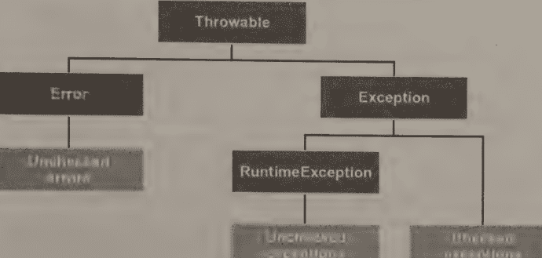

# 常见的已检查异常

- `ClassNotFoundException`
- `IOException`
- `EOFException`
- `FileNotFoundException`

# 常见的未检查异常

- `ArithmeticException`
- `IllegalArgumentException`
- `NumberFormatException`
- `IndexOutOfBoundsException`
- `ArrayIndexOutOfBoundsException`
- `StringIndexOutOfBoundsException`
- `NullPointerException`

## 描述

- `Exception` 是 `Exception` 类或其任何子类的对象。它代表导致方法无法成功完成的条件。
- `Exception` 类派自名为 `Throwable` 的类。有两种类型的异常派自 `Exception` 类：已检查异常和未检查异常。
- 已检查异常是由编译器创建的。因此，在编译代码之前，你必须编写处理所有已检查异常的代码。
- 未检查异常不是由编译器创建的，但它们可以在运行时发生。编写处理未检查异常的代码被认为是一种良好的实践。如果发生了未检查异常且没有被你的代码处理，应用程序将终止。
- 与 `Exception` 类一样，`Error` 类也派自 `Throwable` 类。然而，`Error` 类标识罕见的且通常无法恢复的内部错误。因此，你通常可以忽略 `Error` 类。

图 16-1 异常层次结构

# 异常是如何传播的

图 16-2 显示了 Java 中异常处理机制的工作原理。首先，当方法遇到内部无法解决的问题时，它会抛出一个异常。大多数情况下，异常是由 Java API 中的类抛出的。然后，任何调用抛出已检查异常的方法都必须再次抛出该异常，或者捕获并处理它。捕获并处理异常的代码被称为异常处理器（exception handler）。你将在本章中学习抛出、捕获和处理异常的细节。

一旦方法抛出异常，运行时系统开始寻找适当的异常处理器。为了做到这一点，它会搜索执行栈（也称为调用栈）。堆栈跟踪（stack trace）是按照调用的反序列出的已调用方法列表。在图中，例如当 `MethodD` 中的代码执行时，堆栈跟踪是：`MethodD`、`MethodC`、`MethodB` 和 `MethodA`。

此图显示了 `MethodA` 如何调用 `MethodB`，`MethodB` 如何调用 `MethodC`，`MethodC` 如何调用 `MethodD`。在这里，`MethodD` 可能会抛出一个异常。如果是，`MethodD` 将异常抛给 `MethodC`，`MethodC` 抛给 `MethodB`，`MethodB` 抛给 `MethodA`，由 `MethodA` 在 `catch` 语句中捕获。

如果你通过在调用栈中的每个方法（包括主方法）编写子句将已检查异常一直抛出应用程序，当异常发生时应用程序将终止。然后，Java 会控制台上显示有关异常的信息。


注意，未检查异常的工作方式相同，但你不需要在方法定义的 `throws` 子句中显式列出未检查异常。例如，假设 `MethodA` 中的 `try` 语句也包含一个捕获运行时异常（如 `ArithmeticException`）的 `catch` 语句。那么，如果 `MethodD` 中的代码抛出 `ArithmeticException`，异常将通过 `MethodC` 和 `MethodB` 传播，并在 `MethodA` 的异常处理器中处理，尽管没有任何方法定义包含列出 `ArithmeticException` 的 `throws` 子句。

# Java 如何传播异常

```
MethodA() {
  try {
    MethodB();
  } catch (ExceptionOne e) {
    // handle exception here
  }
}

MethodB() throws ExceptionOne {
  MethodC();
}

MethodC() throws ExceptionOne {
  MethodD();
}

MethodD() throws ExceptionOne {
  throw new ExceptionOne();
}
```

# 处理受检异常的两种方法

- 将异常抛出给调用方法
- 捕获异常并进行处理

### 描述

- 当方法遇到其无法处理的条件时，该方法应该抛出一个异常。这允许方法的用户以适用于其应用程序的方式来处理异常。Java API 中的许多方法都会抛出异常。
- 当一个方法调用另一个抛出受检异常的方法时，该方法必须将异常抛给它的调用者，要么捕获异常并直接处理它。捕获异常的代码被称为*异常处理器*（exception handler）。
- 当发生异常时，运行时系统会寻找适当的异常处理器。为了这一点，它会遍历*堆栈跟踪*（stack trace），即*调用栈*（call stack），它列出了所有调用的方法，直到找到一个捕获该异常的方法。

图 16-2 异常是如何传播的

# 如何处理异常

在后续的话题中，你将学习使用 `try` 语句的其他技巧。你还将学习如何抛出异常，以及如何使用 `Throwable` 类的一些构造函数和方法。

# 如何使用 try 语句

图 16-3 首先显示了捕获异常的 `try` 语句的代码语法。该语法显示 `try` 语句以一个围绕可能抛出异常的语句编写的 `try`块开始。`try`块之后是针对`try`块中可能抛出的每个类型异常的`catch`块。

当你添加 `catch` 块时，应该确保按照 `Throwable` 层次结构中最具体的类的顺序编写它们。例如，`FileNotFoundException` 继承自 `IOException`，因此 `FileNotFoundException` 必须在 `IOException` 之前编写。否则代码将无法编译。如果异常处于异常层次结构的同一级别（例如 `FileNotFoundException` 和 `EOFException`），则顺序不重要。

在 `catch` 块之后，你可以编写一个 `finally` 块来释放 `try` 语句使用的任何系统资源。例如，你可能在 `finally` 块中关闭文件或释放数据库连接。`finally` 块是可选的，但如果你编写了它，无论是否抛出异常，它始终会被执行，即使已经执行了 `return` 语句也是如此。

代码示例显示了一个 `readFile` 方法，它包含两个 `catch` 块和一个 `finally` 块。该方法接受一个指定文件路径的 `String`，并返回文件第一行的 `String`。在方法体内部，第一条语句初始化了一个可以存储 `BufferedReader` 对象的变量。该对象让你以高效的方式从文件中读取数据。

在 `try` 块内部，第一条语句通过为指定路径传递 `FileReader` 对象来创建 `BufferedReader` 对象。如果文件不存在，此构造函数将抛出 `FileNotFoundException`，代码执行将跳转到第一个 `catch` 块。然而，如果文件存在，第二条语句调用 `BufferedReader` 对象的 `readLine` 方法读取文件的第一行。如果该方法无法读取第一行，它将抛出 `IOException`，代码执行将跳转到第二个 `catch` 块。否则，`try` 块中的 `return` 语句将第一行的 `String` 返回给调用方法。

两个 `catch` 块的工作原理类似。首先，第一条语句向控制台打印一条简要描述错误的消息。然后，第二条语句向调用方法返回 `null`。这个返回值是合适的，因为该方法无法读取文件的第一行。

在 `finally` 块中，代码尝试通过调用其 `close` 方法来关闭 `BufferedReader` 对象。遗憾的是，如果 `try` 块中的代码没有执行成功，`BufferedReader` 对象可能为 `null`。结果，

# try 语句的语法

```
try {statements}
catch (MostSpecificExceptionType e) {statements} ...
catch (LeastSpecificExceptionType e) {statements}
finally {statements}
```

# 一个捕获两种类型异常并使用 finally 子句的方法

```java
public static String readFirstLine(String path) {
    BufferedReader reader = null;
    try {
        reader = new BufferedReader(
            new FileReader(path)); // may throw FileNotFoundException
        String line = reader.readLine(); // may throw IOException
        return line;
    } catch (FileNotFoundException e) {
        System.out.println("File not found.");
        return null;
    } catch (IOException e) {
        System.out.println("I/O error occurred.");
        return null;
    } finally {
        try {
            if (reader != null) {
                reader.close(); // may throw IOException
            }
        } catch (Exception e) {
            System.out.println("Unable to close file.");
        }
    }
}
```

### 描述

- 你可以围绕任何可能抛出异常的语句编写 `try`块。
- 你可以为`try`块中可能抛出的每种类型的异常编写一个 `catch`块。你应该按照从 `Throwable` 层次结构中最具体的类到最不具体的类的顺序编写`catch`子句。
- 你可以编写一个 `finally`块来释放`try`块中创建的对象所使用的任何系统资源。`finally`块中的代码始终会被执行。


# 如何使用 try-with-resources 语句

此代码在调用其 `close` 方法之前检查该对象是否为 `null`。此外，`close` 方法可能会抛出 `IOException`，因此你需要在`finally`块中编写一个捕获此异常的`try`语句。

在编写`try`语句时，人们往往为了让代码通过编译而为受检异常创建空语句。然而，如果抛出了异常，这会导致调试变得困难，因为你永远无法发现它。相反，你的代码无法正常工作，且没有提供关于哪里出现错误的指示。此外，以后忘记编写处理器是非常容易的。

在 Java 7 之前，你必须如上图所示使用`finally`块来释放系统资源。这需要包含异常处理代码，以防`finally`块抛出异常。遗憾的是，这些异常处理代码的长度可能会使阅读和维护代码变得困难。

这就是为什么 Java 7 引入了图 16-4 所示的 `try-with-resources`语句。这是一种特殊的 `try` 语句，它声明并实例化一个或多个使用系统资源的对象，并在`try`语句执行后自动关闭这些对象并释放资源。这允许你编写更少的错误处理代码，并专注于代码的逻辑。例如，此图中的 `readFile` 方法完成了与前图相同的任务，但没有了那个繁琐的 `finally`块。

要使用 `try-with-resources` 语句，你首先在 `try` 关键字之后、`try` 块的大括号之前编写一组括号。然后，在括号内，你可以编写一个或多个声明并实例化系统资源对象的语句。例如，在此图中，创建 `BufferedReader` 对象的语句是编写在这些括号内的。要创建多个对象，只需用分号将声明和实例化它们的语句隔开即可。

# try-with-resources 语句的语法

```java
try (statement;statement ...) {statements}
catch (MostSpecificExceptionType e) {statements}
catch (LeastSpecificExceptionType e) {statements}
```

# 捕获两种异常并自动关闭指定资源的方法

```java
public static String readLine(String path) {
    try (BufferedReader in = new BufferedReader(
            new FileReader(path))) {
        String line = in.readLine();
        return line;
    } catch (FileNotFoundException e) {
        System.err.println("File not found.");
        return null;
    } catch (IOException e) {
        System.err.println("I/O error occurred.");
        return null;
    }
}
```

### 描述

- try-with-resources 语句是一种特殊的 try 语句，它声明并实例化一个或多个使用系统资源的对象，并在 try 语句执行完毕后自动关闭这些对象并释放资源。
- try-with-resources 语句是在 Java 7 中引入的。
- 任何实现了 `java.lang.AutoCloseable` 接口的对象都可以使用 try-with-resources 语句创建。
- 从 Java 7 开始，Java API 中大多数使用系统资源的类都已重构为实现 `AutoCloseable` 接口。
- 如果对象没有实现 `AutoCloseable` 接口，当你尝试对其使用 try-with-resources 时，NetBeans 会发出警告。此外，这会导致编译错误。

图 16-4 如何使用 try-with-resources 语句

# 如何使用异常的方法

图 16-5 显示了如何使用异常的方法获取更多关于异常的信息。由于 `Throwable` 类提供了这些方法，因此所有异常对象都可以使用它们。

第一个示例使用了前三个方法来打印关于异常的递增信息。在这种情况下，catch 块捕获了一个 `Exception` 对象并将其赋值给变量 `e`。在 catch 消息中，第一条语句使用 `getMessage` 方法获取异常消息，第二条语句使用 `toString` 方法获取异常的类名并打印到控制台。接下来，第三条语句使用 `printStackTrace` 方法将异常的类名、消息和堆栈跟踪打印到控制台。

当你编写处理异常的代码时，你需要决定显示多少信息是合适的。例如，在某些情况下，只想使用 `getMessage` 方法显示异常消息。然而，并不是所有异常都包含消息。因此，使用 `toString` 方法显示异常的名称和消息通常很有帮助。其他时候，你可能想使用 `printStackTrace` 方法显示异常的完整堆栈跟踪。这可以在你测试应用程序时帮助你调试。然而，通常认为在生产应用程序中移除 `printStackTrace` 方法或用更好的异常日志方式来替换它是一种良好做法。

在第一个示例中，catch 块中的语句使用 `System.err` 对象将数据打印到标准错误流。这与使用 `System.out` 对象将数据打印到标准输出流的效果相同。例如，NetBeans 的这两个对象都会将数据打印到输出（Output）窗口。然而，错误输出流以红色显示，这与 NetBeans 显示异常的方式一致。因此，通常使用错误输出流来显示异常信息。你也可以将输出流重定向到一个源（如控制台），并将错误输出流重定向到另一个源（如日志文件）。

如果不为 `printStackTrace(System.err)` 提供参数，它会将数据打印到错误输出流。但是，如果你想将此数据打印到另一个输出流（例如标准输出流 `System.out`），你可以指定该输出流作为方法的参数。例如，在图中，第二个示例中的所有语句都打印了数据。

# 所有异常可用的四个方法

| 方法 | 描述 |
| --- | --- |
| `getMessage()` | 如果可用，返回异常的消息。 |
| `toString()` | 如果可用，返回异常的类名和消息。 |
| `printStackTrace()` | 将异常的类名、消息和堆栈跟踪打印到标准错误流 (`System.err`)。 |
| `printStackTrace(outputStream)` | 将异常的类名、消息和堆栈跟踪打印到指定的输出流。 |

## 如何将异常数据打印到错误输出流

```java
catch (IOException e) {
    System.err.println(e.getMessage() + "\n");
    System.err.println(e.toString() + "\n");
    e.printStackTrace();
    return null;
}
```

## FileNotFoundException 的结果输出

```
c:\murach\java_netbeans\produx.txt (系统无法找到指定的文件)

java.io.FileNotFoundException: 
c\:\murach\java_netbeans\produx.txt (系统无法找到指定的文件)

java.io.FileNotFoundException: 
c\:\murach\java_netbeans\produx.txt (系统无法找到指定的文件) 
    at java.io.FileInputStream.open(Native Method)
    at java.io.FileInputStream.<init>(InputStream.java:131)
    at java.io.FileInputStream.<init>(InputStream.java:87)
    at java.io.FileReader.<init>(FileReader.java:58)
    at ProductApp.readFirstline(ProductApp.java:70)
    at ProductApp.main(ProductApp.java)
```

# 多异常捕获 (Multi-catch)

图 16-6 显示了如何使用多异常 catch 块。该功能是在 Java 7 中引入的。它允许你使用一个 catch 块处理多个处于相同继承层级的异常。为了实现这一点，你用管道符号 `|` 分隔异常，如第二个示例所示。

值得注意的是，`FileNotFoundException` 和 `EOFException` 都是 `IOException` 的子类。因此，如果你想对这三种异常执行相同的代码，只需要为 `IOException` 编写一个 catch 块：

```java
try (BufferedReader in = new BufferedReader(
        new FileReader(path))) {
    String line = in.readLine(); // 可能出 IOException
} catch (IOException e) {
    System.err.println(e.toString());
    return null;
}
```

在这种情况下，相同的代码适用于 `IOException` 及其所有子类。虽然这种技术没有多异常 catch 块那么灵活，但它适用于所有 Java 版本。

# 多异常 catch 块的语法

```java
catch (ExceptionType | ExceptionType ...) e) {statements}
```

# 如何使用 throws 子句

当你从 Java API 调用一个抛出受检异常（checked exception）的方法时，你必须重新抛出该异常或捕获它。如果你认为在正在编写的方法中无法妥善处理该异常，可以在方法声明中编写一个 throws 子句，如图 16-7 所示。这会将异常向上抛给调用方法，该调用方法可以使用异常处理器处理它，或者将其向上抛给它的调用方法。


第一个示例显示了一个 `readFirstLine` 方法，它与在本章中看到的其他 `readFirstLine` 方法类似。然而，该方法抛出了异常而不是捕获它。在这里，该方法的第一语句调用了 `FileReader` 类的构造函数，这可能会抛出 `FileNotFoundException`。接下来，下一语句调用了 `BufferedReader` 对象的 `readLine` 方法，这可能会抛出 `IOException`。由于 `FileNotFoundException` 继承自 `IOException` 类，该方法可以通过 throws 子句抛出这两种异常。

如果第一个示例抛出 `FileNotFoundException`，它会被隐式转换为 `IOException`。因此，调用方法可以捕获或抛出其中任何一个。即使该行的 throws 子句没有显式抛出 `FileNotFoundException`，事实也是如此。

第二个示例显示了如何在 throws 子句中显式地抛出两种异常。这种方法的优点是它清晰地标识了方法可能抛出的所有异常。这种方法的缺点是，对于第一个示例所提供的功能，它需要更多的代码。

此图还显示了如果不捕获或抛出受检异常，编译器生成的错误信息示例。更具体来说，如果你调用 `readLine` 方法且不捕获或抛出 `IOException`，编译器会生成如下的错误信息。

到此时，你可能想知道何时应该抛出异常，何时应该处理异常。通常情况下，你应该尽早抛出异常，晚些捕获。换句话说，如果你处于应用程序的底层，无法处理异常，就应该抛出它。然后，异常会传播到高层，在高层你可以捕获异常并以符合你应用程序逻辑的方式处理它。例如，你可以要求用户处理异常。你可以显示用户友好的错误信息。或者，在必要时，你可以保存数据、关闭资源并尽可能优雅地退出应用程序。

# 抛出异常方法的声明语法

# 一个抛出 IOException 的方法

```java
public static String readFirstLine(String path) throws IOException {
    BufferedReader reader = new BufferedReader(
        new FileReader(path));
    String line = reader.readLine();
    return line;
}
```

# 一个抛出两个异常的方法

```java
public static String readFirstLine(String path)
    throws FileNotFoundException, IOException {
    BufferedReader reader = new BufferedReader(
        new FileReader(path));
    String line = reader.readLine();
    return line;
}
```

# 不捕获或抛出受检异常时的编译器错误

> error: unreported exception IOException; must be caught or declared to be thrown

### 描述

- 任何调用抛出受检异常的方法都必须捕获该异常或抛出该异常。否则，应用程序将无法编译。

- 要抛出受检异常，你需要在方法声明中编写 throws 子句。throws 子句必须列出向上抛给调用方法的每个受检异常。如果你列出多个异常，可以使用逗号分隔每个异常。

- 尽管你可以在 throws 子句中指定未检异常（unchecked exceptions），但编译器不会强制你处理未检异常。


# 如何使用 throw 语句

在编写方法时，你有时需要抛出异常。例如，当方法遇到阻止其完成任务的问题时，你可能需要抛出异常，例如当方法传递了不可接受的参数值时。你可能还需要抛出异常来测试异常处理器。最后，当你想要捕获异常、执行某些处理然后抛出该异常以便由调用方法处理时，你可能需要抛出异常。

16-8 显示了如何抛出异常。要做到这一点，你需要编写一个抛出异常类对象的语句。为了这样做，你通常使用 `new` 关键字从异常类创建一个对象。由于所有异常都继承自 `Throwable` 类，你可以使用图中的任何一个构造函数来创建异常。如果你使用第一个构造函数，则不会为异常分配消息。如果你使用第二个构造函数，会将消息分配给异常。

图中的第一个示例显示了一个名为 `calculateValue` 的方法，如果这些参数中的任何一个小于零，它将抛出 `IllegalArgumentException`。通常，对于任何公共方法，如果传递的任何参数具有不可接受的值，抛出 `IllegalArgumentException` 是一种良好的编码实践。

第二个示例显示了你如何通过抛出异常来测试异常。例如，你可以通过提供一个不存在的文件名来轻松测试 `FileNotFoundException` 的处理器。但测试 `IOException` 的处理器可能会困难。有时，最简单的方法是在你预计异常发生的地方显式地抛出异常。

当你为了测试而抛出异常时，`throw` 语句必须是 `try` 语句的最后语句，或者必须编写在 `if` 语句内部。否则，代码将无法编译，编译器将显示指示代码包含不可达语句的消息。在第二个示例中，`throw` 语句编写在 `if` 语句内部。

第三个示例显示了处理后重新抛出异常的代码。在这里，异常处理器打印一条指示异常发生的消息。然后，它重新抛出异常以便调用方法进行处理。

# throw 语句的语法

```java
throw throwableObject;
```

# Throwable 类的构造函数

| 构造函数 | 描述 |
| --- | --- |
| Throwable() | 创建一个消息为空的异常。 |
| Throwable(message) | 创建一个带有指定消息的异常。 |

# 一个抛出未检异常的方法

```java
public double calculateFutureValue(double monthlyPayment,
    double monthlyInterestRate, int months) {
    if (monthlyPayment <= 0) {
        throw new IllegalArgumentException("Monthly payment must be > 0");
    }
    if (monthlyInterestRate <= 0) {
        throw new IllegalArgumentException("Interest rate must be > 0");
    }
    if (months <= 0) {
        throw new IllegalArgumentException("Months must be > 0");
    }
    // 计算并返回未来的代码
}
```

# 用于测试目的抛出 IOException 代码

```java
try {
    // 读取文件第一行的代码
    if (true) {
        throw new IOException("I/O exception test");
    }
    return firstLine;
} catch (IOException e) {
    // 处理 IOException 的代码
}
```

# 重新抛出异常的代码

```java
try {
    // 抛出 IOException 的代码
} catch (IOException e) {
    System.out.println("IOException thrown in readFirst method.");
    throw e;
}
```

# 如何使用自定义异常类

尽管 Java API 包含了大量的异常，但你可能会遇到一种情况，即其中任何一个异常都不能准确描述你的异常。在其他情况下，你可能想用另一个异常来包装一个异常，以使代码更具抽象性。无论哪种，你都可以按照后续主题的内容编写一个定义自定义异常的类。然后，你可以像抛出任何其他异常一样抛出你的异常。

# 如何创建你自己的异常类

图 16-9 显示了如何创建你自己的异常类。要做到这一点，你需要继承 `Exception` 类或其一个子类创建一个检查异常（checked exception）。为了说明，图中的第一个示例显示了一个继承 `Exception` 类的异常类 `DBException`。结果是 `DBException` 是一个检查异常。然而，你也可以通过继承 `RuntimeException` 类或其一个子类来编写定义未检查异常的类。

按照惯例，所有异常类都应该有一个不接受任何参数的默认构造函数，以及另一个接受字符串参数的构造函数。因此，如果你为你的异常类编写了这些构造函数，它们的行为将像 Java API 中的其他异常类一样。第一个示例显示了如何编写这两个构造函数。在这里，第二个构造函数使用 `super` 关键字调用 `Exception` 类的构造函数，并将 `message` 参数传递给它。

第二个示例代码抛出了自定义的 `DBException`。此示例定义了一个名为 `getProduct` 的方法，该方法调用名为 `readProduct` 的方法为指定的产品代码检索 `Product` 对象。`readProduct` 方法抛出一个 `IOException`，该异常被 `catch` 子句捕获。然后 `catch` 子句又抛出一个 `DBException`。

第三个示例代码捕获了自定义异常。在这里，`getProduct` 方法在 `try` 语句中被调用，并且 `DBException` 被 `catch` 子句捕获。在 `DBException` 的异常处理器中，控制台会显示一条错误消息。

初看之下，这些示例定义的自定义异常似乎并不是必需的。毕竟，如果发生了 IO 错误，`getProduct` 方法难道不能抛出一个 `IOException` 吗？尽管这会导致设计不佳，因为它暴露了太多关于 `getProduct` 方法操作的细节。`IOException` 只有在在使用文件 I/O 操作时才会发生。因此，抛出 `IOException` 会暴露 `getProduct` 方法通过文件 I/O 来访问产品数据。

如果应用程序发生了变化，将产品数据存储在数据库而不是文件中怎么办？在这种情况下，`getProduct` 方法将抛出某种数据库异常而不是 `IOException`。那么，任何调用 `getProduct` 方法的方法都必须被修改以处理新异常。通过为 `getProduct` 方法创建 `DBException`，你可以向调用它的方法隐藏 `getProduct` 方法如何工作的细节。因此，即使应用程序更改为使用数据库，如果在检索产品对象时发生错误，`getProduct` 方法仍然可以抛出 `DBException`。

# DBException 类的代码

```java
public class DBException extends Exception {
    public DBException() {}

    public DBException(String message) {
        super(message);
    }
}
```

# 抛出 DBException 的方法

```java
public static Product getProduct(String productCode) throws DBException {
    try {
        Product p = readProduct(productCode); // may throw IOException
        return p;
    } catch (IOException e) {
        throw new DBException("An error occurred while reading the product.");
    }
}
```

# 捕获 DBException 的代码

```java
try {
    Product p = getProduct("1234");
} catch (DBException e) {
    System.out.println(e.getMessage());
}
```

# 何时定义自己的异常

- 当方法需要任何 Java 异常类型都未提供的异常时。

- 当使用内置的 Java 异常会不恰当地暴露方法操作细节时。

### 描述

- 要定义检查异常，请继承 `Exception` 类或其任何子类。

- 要定义未检查异常，请继承 `RuntimeException` 类或其任何子类。

- 按照惯例，每个异常类应该包含一个不接受任何参数的默认构造函数和另一个接受字符串参数的构造函数。


# 第 4 节 你需要的更多核心技能

# 如何使用异常链

你经常会针对发生的其他异常而抛出自定义异常。例如，在之前的图中，`DBException` 是为了响应 `IOException` 而抛出的。不幸的是，在那个图中，关于导致 `DBException` 的底层错误信息丢失了。而这些信息对于确定导致 `DBException` 发生的原因至关重要。

图 16-10 显示了你如何在不丢失所抛出的原始异常细节的情况下抛出自定义异常。这种功能被称为异常链（exception chaining），因为它允许你将异常链在一起。每当你创建一个自定义异常类型时，使用异常链来避免丢失宝贵的调试信息是一个良好的做法。

要使用异常链，你需要使用异常构造函数，该构造函数允许你指定一个异常对象作为你正在创建的新异常的原因。例如，在第一个示例中，`DBException` 类允许你通过构造函数指定原因。在这里，第二个构造函数接受一个 `Throwable` 对象作为参数。然后，它将此参数传递给构造函数。

第二个示例显示了响应 `IOException` 抛出 `DBException` 的代码。在这里，`IOException` 对象作为参数传递给 `DBException` 构造函数。这样，原始 `IOException` 中包含的所有信息都作为 `DBException` 对象的一部分被保存。

第三个示例显示了捕获 `DBException` 并显示有关异常信息的代码。在这里，显示了一条错误消息，指示发生了 `DBException`，该 `DBException` 是由 `FileNotFoundException` 引起的，并且包含了存储在 `FileNotFoundException` 中的消息。在大多数情况下，这些应该是你确定此异常原因所需的所有信息了。

# 用于异常链的 Throwable 类构造函数

| 构造函数 | 描述 |
| :--- | :--- |
| Throwable(cause) | 创建一个新的异常，并将指定的异常对象作为其原因。 |

# 使用异常链的自定义异常类

```java
public class DBException extends Exception {
    public DBException() {}

    public DBException(Exception cause) {
        super(cause);
    }
}
```

# 使用链抛出 DBException 的代码

```java
catch (IOException e) {
    throw new DBException(e);
}
```

# 捕获 DBException 的代码

```java
catch (DBException e) {
    System.err.println(e);
}
```

# 输出结果

> DBException: java.io.FileNotFoundException:
> c:\murach\produx.txt (系统找不到指定文件)

### 描述

- 异常链允许在抛出新异常时保留被捕获的异常信息。异常链使用 `cause` 字段，该字段表示引起当前异常的原始异常。


# 观点

在本章中，你学习了处理 处理异常最重要的技术。异常允许错误向上调用栈来帮助你编写更健壮、无错误的代码，因为可以在错误发生的地方进行更好的处理。例如，`getProduct` 方法可能不知道发生错误时应该做什么。因此，这个底层方法抛出一个异常，由高级方法处理，它可以记录异常、显示消息甚至终止应用程序。总之，异常处理通常影响应用程序的每一层。

### 总结

- 在 Java 中，异常是从源自 `Exception` 类或其子类的创建的对象。当异常发生时，良好的应用程序会通知用户异常并减少由异常引起的任何中断或数据丢失。

- 派自 `RuntimeException` 及其子类的异常是未检查异常，因为它们不受编译器检查。所有其他异常都是检查异常。

- 任何调用抛出检查异常的方法必须通过编写 `throws` 子句抛出该异常，或者通过编写 `try/catch/finally` 块作为异常处理器来捕获它。

- `try-with-resources` 语句是一种特殊的 `try` 语句，它声明并实例化使用资源的对象，并在 `try` 语句结束后自动关闭对象并释放资源。

- 多异常捕获块允许你使用单个 `catch` 块处理处于同一继承层级的多个异常。

- 在编写自己的方法时，如果你遇到无法在方法内部处理的潜在错误，你可以编写一个 `throw` 语句将异常抛给另一个方法。如果你无法在 Java API 中找到合适的异常类，你可以编写自己的异常类。

- 你可以创建自定义异常类来表示你的方法可能抛出的异常。这通常对于隐藏方法的实现细节非常有用。

- 当你创建自定义异常时，可以使用异常链来保存异常的原因。

# 练习 16-1 抛出和捕获异常


在此练习中，你将尝试抛出和捕获异常的方法。

1. 在 `ex_starts` 文件夹中打开名为 `ch16_ex1_ExceptionTester` 的项目。然后打开 `Main` 类并查看其代码。运行该类以熟悉它的工作原理。

2. 在 `Method3` 中添加代码，通过尝试整数除以零来抛出一个未检查异常。编译并运行应用程序，注意异常抛出的位置。

3. 删除你刚刚添加到 `Method3` 的代码。在该方法中添加一条语句（如图 16-7 所示），创建一个 `BufferedReader` 类对象，但使用字符串 `"products.txt"` 代替路径变量。该类的构造函数会抛出一个名为 `FileNotFoundException` 的已检查异常。注意指示你未处理该异常的错误消息。如果没有显示此错误消息，请编译该类以显示它。

4. 为包括 `main` 方法在内的所有方法添加 `throws` 子句。然后，运行应用程序，查看被捕获的异常是如何传播到应用程序外部的。

5. 在 `Method1` 中添加处理 `NotFoundException` 的必要代码。为了实现这一点，你需要从 `main` 方法和 `Method1` 中移除 `throws` 子句，并在 `Method1` 中添加一条捕获该异常的语句。`catch` 块应显示适当的错误消息。运行应用程序以确保异常处理程序正常工作。

# 练习 16-2 释放系统资源

在此练习中，你将有机会尝试使用 `try-with-resources` 语句通过对象释放系统资源。

1. 在 `ex_starts` 文件夹中打开名为 `ch16_ex2_ResourcesTester` 的项目。然后打开 `main` 方法，它调用了另外两个使用 `BufferedReader` 对象但没有关闭它的方法。

2. 修改名为 `lineWithResources` 的方法，使其使用 `try-with-resources` 语句来关闭 `BufferedReader` 对象。运行应用程序确保其工作正常。如果正常，说明 `try-with-resources` 语句工作正常。

3. 修改名为 `lineWithFinally` 的方法，使其使用 `finally` 块来关闭 `BufferedReader` 对象。为了实现这一点，你需要在 `try` 块之外声明此对象。在 `finally` 块中添加语句，向控制台打印信息以指示文件是否已关闭（这是正常操作的典型）、从未打开（如果找不到文件就会发生这种情况）或无法关闭（仅在少数情况下发生）。

4. 运行应用程序以确保 `finally` 子句按预期工作。要测试如果文件从未打开会发生什么，你可以更改文件名导致 `FileNotFoundException`。要测试如果 `close` 方法不起作用会发生什么，你可以在关闭资源的语句之前抛出一个 `IOException`。

# 练习 16-3 创建自定义类

在此练习中，你将尝试自定义类和链式异常。

1. 在 `ex_starts` 文件夹中打开名为 `ch16_ex3_CustomTester` 的项目。然后创建一个名为 `TestException` 的自定义已检查异常类，它包含两个构造函数：一个不接受参数的构造函数，另一个接受消息的构造函数。

2. 打开 `Main` 类。然后在 `Method3` 中添加一条抛出不带消息的 `Exception` 的语句。在 `Method2` 中添加捕获此异常的必要代码。`catch` 块应在控制台打印你自定义的消息。运行应用程序确保其工作正常。

3. 修改你的解决方案，将你自定义的消息传递给 `TestException` 并在 `catch` 块中显示。运行应用程序确保自定义消息显示正确。

4. 为 `TestException` 类添加另一个接受 `Throwable` 对象作为参数的构造函数。

5. 在 `Main` 类的 `Method3` 中添加一个 `try` 语句。`try` 子句应抛出 `IOException`，而 `catch` 子句应抛出 `TestException`，并将 `IOException` 传递给其构造函数。

6. 修改 `Method2` 中捕获 `TestException` 的 `catch` 块，使其打印一条提供异常及其根本原因信息的消息。运行应用程序确保其工作正常。

# 如何处理文件 I/O

在本章中，你将介绍两类文件：文本文件和二进制文件。虽然某些应用程序需要二进制文件，但尽可能首选文本文件，因为它们更具移植性且对平台的依赖性较低。这就是为什么本章只展示如何处理文本文件的原因。然而，许多相同的技能和概念也适用于处理二进制文件。

当你处理文件时，经常使用数组或集合（第 10 章和第 14 章）。你可能需要处理 I/O 操作抛出的异常（第 16 章）。你可能需要解析字符串（第 9 章）。因此，在学习本章的过程中，你可能想要回顾那些章节。

| 主题 | 页码 |
| :--- | :--- |
| 目录和文件简介 | 434 |
| 用于目录和文件的包 | 434 |
| 用于目录和文件的代码示例 | 436 |
| 文件输入和输出简介 | 438 |
| 文件和流如何工作 | 438 |
| 文件 I/O 示例 | 440 |
| 如何处理 I/O 异常 | 442 |
| 如何处理文本文件 | 444 |
| 如何将字符输出流连接到文件 | 444 |
| 如何向文本文件写入内容 | 446 |
| 如何将字符输入流连接到文件 | 448 |
| 如何从文本文件读取内容 | 450 |
| 处理文本文件的类 | 452 |
| 产品管理器应用程序 | 456 |
| 控制台 | 456 |
| 主类 | 456 |
| 视角 | 460 |

# 目录和文件简介

在 Java 7 之前，通常使用 `java.io` 包中的 `File` 类来对目录和文件执行某些基本操作。然而，该类有很多局限性。因此 Java 7 引入了 `java.nio.file` 包（也称为 NIO.2）。该包提供了访问默认文件系统的改进方法。因此，使用该包的类和接口来处理目录和文件被认为是最佳实践。

# 用于目录和文件的包

图 17-1 首先介绍了 `java.nio.file` 包中 `Paths` 类的静态 `get` 方法。你可以向此方法传递一个或多个字符串，返回一个代表目录或文件路径的 `Path` 对象。`Path` 对象包含了表示路径中目录和文件的元素。例如，这里是 Windows 系统上的典型路径：

```
c:\java_netbeansfiles\products.txt
```

该路径包含了三个目录（murach、java_netbeans 和 files）以及一个文件（products.txt）的名称元素。此外，它还包含了根组件（C 盘）。

一旦你有了 `Path` 对象，就可以使用 `Path` 接口的方法来获取有关路径的信息。例如，你可以使用 `getName` 获取指定索引处名称元素的 `Path` 对象。索引指的是名称元素在路径中的位置，第一个元素位于索引 0。

你也可以使用 `Files` 类的静态方法来获取有关路径的信息。例如，你可以使用前四个方法检查路径是否存在，以及你是否可以从路径读取或向其写入。同样地，你可以使用接下来的两个方法测试路径指向的是目录还是文件。最后，如果路径指向文件，你可以使用 `size` 方法返回文件的字节数。

要显示目录的内容，你可以对 `Path` 对象使用 `newDirectoryStream` 方法。该方法返回一个 `DirectoryStream<Path>` 对象。然后，你可以使用该对象遍历该目录下的所有子目录和文件。你将在下一个图中看到它是如何工作的示例。

最后，你使用 `Files` 类的最后四个方法来创建和删除目录及文件。如果这些方法无法创建或删除文件或目录，它们会抛出异常，这些异常应该让你很好地了解失败的原因。例如，如果你尝试创建一个已经存在的文件，Java 会抛出 `FileAlreadyExistsException`。同样地，如果你尝试删除一个包含文件的目录，Java 会抛出 `DirectoryNotEmptyException`。

在你复习这些方法时，应该知道它们只是 `java.nio.file` 包中最常用的方法之一。因此，如果你需要执行其他文件处理任务，可以查阅该包的 Java API 文档。

# 用于处理目录和文件的包

`java.nio.file`

# Paths 类的静态方法

| 方法 | 描述 |
| :--- | :--- |
| `get(String[, String]...)` | 根据指定字符串或系列字符串返回 `Path` 对象。 |

# Path 接口的方法

| 方法 | 描述 |
| :--- | :--- |
| `getFileName()` | 返回文件或目录名称的 `Path` 对象。 |
| `getName(int)` | 返回指定索引处元素的 `Path` 对象。 |
| `getNameCount()` | 返回路径中元素数量的 `int` 值。 |
| `getParent()` | 如果存在父路径，则返回父路径的 `Path` 对象。如果不存在父路径，则返回 `null`。 |
| `getRoot()` | 返回路径根组件的 `Path` 对象。如果不存在根组件，则返回 `null`。 |
| `toAbsolutePath()` | 返回指向文件或目录绝对路径的 `Path` 对象。 |
| `toFile()` | 返回指向文件路径的 `File` 对象。 |

# Files 类的静态方法

| 方法 | 描述 |
| :--- | :--- |
| `exists(Path)` | 如果路径存在，则返回 `true` 值。 |
| `notExists(Path)` | 如果路径不存在，则返回 `true` 值。 |
| `isReadable(Path)` | 如果路径存在且可读，则返回 `true` 值。 |
| `isWritable(Path)` | 如果路径存在且可写，则返回 `true` 值。 |
| `isDirectory(Path)` | 如果路径存在并指向目录，则返回 `true` 值。 |
| `isRegularFile(Path)` | 如果路径存在并指向普通文件，则返回 `true` 值。 |
| `size(Path)` | 返回文件字节数量的 `long` 值。 |
| `newDirectoryStream(Path)` | 返回一个 `DirectoryStream<Path>`，你可以用它来遍历指定 `Path` 的所有文件和子目录。 |
| `createFile(Path)` | 如果 `Path` 对象对应的文件不存在，则为其创建一个新文件。返回文件的 `Path` 对象。 |
| `createDirectory(Path)` | 如果指定的目录不存在且所有父目录都存在，则为指定的 `Path` 创建新目录。返回目录的 `Path` 对象。 |
| `createDirectories(Path)` | 创建由指定 `Path` 表示的新目录，包括任何必要的、不存在的父目录。返回目录的 `Path` 对象。 |
| `delete(Path)` | 通过 `Path` 对象删除文件或目录。只有在目录为空时才能删除目录。 |

### 描述

- 要处理目录或文件，请使用 `Path` 对象。`Path` 对象可以包含根组件以及目录名称和文件名。

图 17-1 如何处理目录和文件（部分 1/2）

# 处理目录和文件的代码示例

图 17-1 第 2 部分的示例显示了如何创建一个新目录。要实现这一点，第一条语句创建一个指向目录的字符串。在这种情况下，该目录是 C 盘上的 `murach/java_netbeans/files` 目录。然后，第二条语句使用 `Paths` 类获取目录的 `Path` 对象。最后，通过语句检查该目录是否已存在。如果不存在，最后一条语句调用 `Files` 类的静态方法创建目录以及任何必要的父目录。

第二个示例显示了如何创建一个新文件。要实现这一点，第一条语句创建一个包含文件名的字符串。然后，第二条语句获取指向目录和文件的 `Path` 对象。在这种情况下，文件名为 `products.txt`，目录为 `c:murach/java_netbeans/files`。如果文件不存在，最后一条语句调用 `Files` 类的静态 `createFile` 方法创建它。

注意，此示例中的 `Paths` 类方法包含两个参数：一个用于目录，一个用于文件。当你这样编写方法代码时，参数会被连接并用分隔符隔开。在大多数情况下，分隔符字符与分隔参数中名称元素使用的字符相同。在这种情况下，分隔符字符是正斜杠。

在此示例中，`Path` 对象包含绝对路径名称。然而，如果你想使用包含相对路径名称的 `Path` 对象，也可以这样做。此时，路径是相对于当前工作目录（CWD）的。例如，如果你只指定文件名，文件将存储在当前工作目录中。该目录通常是启动应用程序的目录，也可能与应用程序所在的目录相同。此外，在某些操作系统（如 Windows）上，可以在应用程序的快捷方式图标中设置工作目录。

第三个示例显示了如何获取上一个示例创建的 `Path` 对象的信息。首先，`getFileName` 方法返回文件名。然后，`toAbsolutePath` 方法返回完整路径的 `Path` 对象。最后，`Files` 类的静态 `isWritable` 方法返回一个值，显示文件是只读的（这是默认设置）。

第四个示例显示了如何列出目录中的文件。首先，语句检查路径是否存在以及是否为目录。如果两个都为真，`if` 块中的第一条语句打印目录名称，第二条语句打印文件。

# 文件输入和输出简介

本主题介绍了你可以用于文件输入和输出的文件和流的类型。然后，它展示了一个示例，引入了对文件执行输入输出操作所需的代码。最后，它还展示了如何处理在执行输入输出操作时最常见的异常。

# 文件和流的工作原理

图 17-2 展示了你在执行 I/O 操作（或文件 I/O）时使用的两种类型的文件和两种流。在文本文件中，所有数据都以 Unicode 字符的形式存储在磁盘上。通常，此类文件中的字段和记录由制表符（tabs）和换行符等分隔符分隔。图中，文本文件的字段由制表符分隔，记录由换行符分隔。其他类型的文本文件包括 XML 和 HTML 文件。XML 文件使用特殊标签来结构文件中存储的数据。而 HTML 文件使用特殊标签来告诉网络浏览器如何格式化文本、显示图像等。

相比之下，二进制文件以不同的格式存储，可以读取和写入原始类型。例如，图中，这种格式中的某些字节无法通过文本编辑器读取。在这里，每个产品记录的代码和描述字段之前写入了两个非字符字节，价格字段以文本编辑器无法读取的非字符格式写入。此外，由于二进制文件中的记录不以换行符结束，当文本编辑器打开二进制文件时，所有记录都显示在单行。其他类型的二进制文件包括图像、音频、视频和应用程序文件。

为了处理 I/O 操作，Java 使用流（streams）。你可以将流视为从一个位置到另一个位置的数据。例如，输出流可以从应用程序的内部内存流到磁盘文件，输入流可以从磁盘文件流到内部内存。当你处理文本文件时，使用字符流。当你处理二进制文件时，使用二进制流。

尽管本章展示了如何将流用于磁盘文件，但 Java 也将流用于其他类型的设备。例如，你可以使用输出流将数据发送到控制台或网络连接。事实上，`System.out` 和 `System.err` 是用于将数据打印到控制台的标准输出流。同样，你可以使用输入流从键盘或网络连接等源读取数据。事实上，`Scanner` 类使用的 `System.in` 对象是用于从键盘读取数据的标准输入流。

当你保存文本文件或二进制文件时，可以使用任何扩展名作为文件名。在书中，我们对所有文本文件使用 `txt` 作为扩展名，对所有二进制文件使用 `bin` 作为扩展名。例如，图中的文本名为 `products.txt`，二进制文件名为 `products.bin`。

# 用文本编辑器打开的文本文件

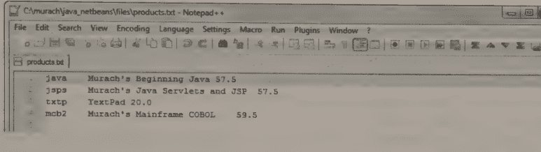

# 用文本编辑器打开的二进制文件

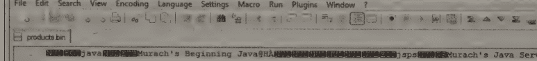

# 两种类型的文件

| 文件 | 描述 |
|---|---|
| 文本 | 字符的文件。此类文件的字段和记录通常由制表符和换行符等特殊字符分隔。网页也是使用名为 HTML 的特殊标记语言的纯文本文件 |
| 二进制 | 可能包含字符以及文本编辑器无法读取的其他非字符数据类型的文件。常见的二进制文件包括图像、电影和应用程序。 |

# 两种类型的流

| 流 | 描述 |
|---|---|
| 字符 | 用于在 I/O 设备与之一之间传输文本数据 |
| 二进制 | 用于在 I/O 设备与之一之间传输二进制数据 |

### 描述

- 输入文件是供应用程序读取的文件。输出文件是应用程序写入的文件。输入和输出操作通常被称为 I/O 操作或文件 I/O。
- 流是数据从一个位置到另一个位置的流动。要从内部存储将数据写入文件，你需要使用输出流。要从文件读取到内部存储，你需要使用输入流。
- 要读写文本文件，你需要使用字符流。要读写二进制文件，你需要使用二进制流。
- 流不仅用于磁盘设备，还用于键盘和网络连接等输入设备，以及 PC 显示器和网络连接等输出设备。

图 17-2 文件和流的工作原理

# 文件 I/O 示例

为了让你对文件 I/O 有一个概述，图 17-3 显示了你可以用于读取和写入文本文件的代码。首先，第一个示例显示了用于文件 I/O 的两个包的导入语句。因为大多数处理文件 I/O 的类都存储在 `java.io` 包中。处理文件 I/O 的类通常位于 `java.io` 包中。此外，`java.nio.file` 的导入语句通常是为了方便使用 `Paths` 和 `Files` 类以及 `Path` 接口（在前面的图中）。

第二个示例展示了如何创建一个名为 `products.txt` 的 `File` 对象。首先，第一个语句创建一个指向文件的 `Path`。由于没有指定目录，该 `Path` 指向存储在工作目录中的文件，它通常但并不总是从该目录开始的。然后，第二个语句调用 `File` 方法将 `Path` 对象转换为 `File` 对象。


第三个示例展示了如何向文件写入数据。首先，你创建一个输出流。在这个示例中，输出流是在 `try-with-resources` 语句中创建的。要创建一个应用程序所需的所有流，你可以将两个或多个流合并到一个流中。在 Java 中，你使用一个类作为另一个类的参数。在这个示例中，`BufferedWriter` 对象被用作 `PrintWriter` 构造函数的参数，`FileWriter` 对象被用作 `BufferedWriter` 构造函数的参数。（注：原文后续部分存在大量重复的 OCR 错误，已在翻译时进行清理）

## 第 4 节 你需要的更多核心技能

只需要一次写入或读取操作即可刷新或填充缓冲区。相比之下，如果一次一个文件地写入或读取数据，4000 字节可能需要数百次 I/O 操作。对于每次 I/O 操作，磁盘都必须旋转到起始磁盘位置。由于这种旋转相对于内部操作来说极其缓慢，因此缓冲技术可以极大地提高 I/O 操作的性能。

由于此图表仅用于让你大致了解文件 I/O 的工作原理，如果你没有完全理解，也不必担心。随着本章的进行，你将更详细地学习这里显示的所有类和方法。

## 如何处理 I/O 异常

如果你读过上一章，你已经熟悉处理异常的基本技能。事实上，你已经接触过由 I/O 操作抛出的某些异常。

现在，图 17-4 总结了在处理文件 I/O 时必须处理的三类检查异常。首先，所有由执行 I/O 操作的类抛出的异常都继承自 `IOException` 类。当代码尝试读取文件末尾之外时可能会抛出 `EOFException`；当代码尝试打开一个不存在的文件时，会抛出 `FileNotFoundException`。

图中的代码展示了 `FileNotFoundException` 的处理。为此，该代码获取了一个文件的 `Path` 对象。然后，它使用 `Files` 类的方法来检查该文件是否存在。如果存在，则执行块中的代码；否则，该代码会向控制台打印错误信息。

此代码还处理了读取文件时可能发生的 `IOException`。为此，`if` 块中的代码首先将 `Path` 对象转换为 `File` 对象。然后，它使用 `try-with-resources` 语句为该文件创建一个输入流，并使用相应的 `catch` 块来处理读取输入流时可能发生的任何 I/O 异常。为此，该代码将异常打印到控制台。

最后，此代码防止了 `EOFException` 的发生。为此，`try` 块中的循环会检查是否已到达文件末尾。如果是，则退出循环。为此，`try` 块中的第一条语句声明了一个字符串变量 `line`，并使用 `readLine` 方法从输入流中读取一行。然后，循环检查该行是否为 `null`。如果不是，循环内的代码会显示该行，并使用 `readLine` 方法读取下一行。只要行不为 `null`，循环就会继续。如果行是 `null`，则表示已到达文件末尾，循环结束。

最后一个代码示例显示了另一种编写防止 `EOFException` 循环的方法。在这里，`while` 循环中的条件读取行并检查该行是否为 `null`。为此，它使用括号确保这段代码在判断行为 `null` 之前读取了该行。如果行不为 `null`，循环继续。否则，它不会重复调用 `readLine`。这种方法的优点是更易维护，因为没有重复代码。当你审阅其他程序员的代码时，你可能会遇到任何一种方法，因此你对这两种方法都应该了如指掌。

## 第 17 章 如何处理文件 I/O

### `IOException` 层次结构的子集

```text
IOException
    EOFException
    FileNotFoundException
```

### 常见的 I/O 异常

| 异常 | 说明 |
| --- | --- |
| `IOException` | 在 I/O 处理过程中发生错误时抛出。 |
| `EOFException` | 当代码尝试读取文件末尾之外时抛出。 |
| `FileNotFoundException` | 当代码尝试打开一个不存在的文件时抛出。 |

### 处理 I/O 异常的代码

```java
Path productsPath = Paths.get("products.txt");
if (Files.exists(productsPath)) { // 防止 FileNotFoundException
    File productsFile = productsPath.toFile();
    try (BufferedReader reader = new BufferedReader(new FileReader(productsFile))) {
        String line = reader.readLine();
        while (line != null) { // 防止 EOFException
            System.out.println(line);
            line = reader.readLine();
        }
    } catch (IOException e) { // 捕获 IOException
        System.out.println(e);
    }
} else {
    System.out.println(productsPath.toAbsolutePath() + " doesn't exist");
}
```

### 重复 EOFException 的循环

```java
String line = in.readLine();
while (line != null) {
    System.out.println(line);
    line = in.readLine();
}
```

### 此循环的另一种编码方法

```java
String line;
while ((line = in.readLine()) != null) {
    System.out.println(line);
}
```

图 17-4 如何处理 I/O

## 如何处理文本文件

在处理文本文件时，你需要堆叠两个或多个类来创建字符输入或输出流。你将在接下来的主题中学习如何这样做。此外，你还将学习如何使用这些类的方法来处理文本文件。然后，你将看到一个完整的类，可以使用它将 `Project` 对象读取并写入到文本文件中。

## 如何将字符输出流连接到文件

在写入文本文件之前，你需要创建一个字符输出流，并将该流连接到文件。为此，你必须如图 17-5 所示，堆叠 `File` 层次结构中的两个或多个类。然后，你将使用 `PrintWriter` 类的方法将数据写入输出流。

## 如何向文本文件写入

图 17-6 显示了如何向文本文件写入。要实现，你可以使用 `PrintWriter` 对象的 `print` 和 `println` 方法将数据打印到文件中。这些方法的工作原理类似于 `System.out` 对象的 `print` 和 `println` 方法。然而，它们是将数据打印到文件，而不是控制台。

正如你在本章中学到的，你可以使用 `try-with-resources` 语句创建一个流。然后，当 `try` 语句结束时，流会自动刷新并关闭。尽管如此，如果不使用 `try-with-resources` 语句，可以使用 `close` 方法手动关闭输出流，这将刷新缓冲区并释放输出流正在使用的任何系统资源。或者，如果你想保持输出流打开，可以使用 `flush` 方法将流中的所有数据刷新到文件中。无论哪种方式，你都需要抛出或捕获这些方法抛出的 `IOException`。

图中的第一个示例显示了如何向名为 `log.txt` 的文本文件追加字符串和对象。开始时，`FileWriter` 构造函数创建了一个可以向文件追加数据的 `FileWriter` 对象。如果当前目录下不存在名为 `log.txt` 的文件，该语句将创建该文件。然后，`print` 方法打印一个字符串，`println` 方法打印一个表示当前日期和时间的 `LocalDateTime` 对象。对于此操作，`LocalDateTime` 对象的 `toString` 方法会被自动调用以将日期转换为字符串。

图中的第二个示例显示了如何将存储在 `Product` 对象中的数据写入由分隔符分隔的文本文件中。在此类文件中，使用一种分隔符来分隔写入文件的字段（或列），使用另一种分隔符来分隔记录（或行）。在示例中，制表符（`\t`）被用作字段分隔符，换行符被用作记录分隔符。这样，一个产品的代码、描述和价格就通过制表符分隔存储在同一记录中。然后，换行符结束了该产品的数据，下一个产品的数据可以存储在下一个记录中。

### `PrintWriter` 类的常用方法

| 方法 | 抛出 | 描述 |
| --- | --- | --- |
| `print(argument)` | 无 | 将参数类型的字符表示写入文件。 |
| `println(argument)` | 无 | 将参数类型的字符表示写入文件，并在后跟一个换行符。如果开启了自动刷新功能，这还会刷新缓冲区。 |
| `flush()` | `IOException` | 将缓冲区中的任何数据刷新到文件。 |
| `close()` | `IOException` | 刷新缓冲区中的任何数据并关闭流。 |

### 向文本文件添加字符串和对象的代码

```java
// 打开一个输出流以追加数据到文本文件
PrintWriter out = new PrintWriter(
    new BufferedWriter(
    new FileWriter("log.txt", true)));

// 将字符串和对象写入文本文件
out.print("This application was run on ");
LocalDateTime currentDateTime = LocalDateTime.now();
out.println(currentDateTime);

// 将数据刷新到文件并关闭输出流
out.close();
```

### 将 Product 对象写入分隔的文本文件的代码

```java
// 打开一个输出流以覆盖文本文件
PrintWriter out = new PrintWriter(
    new BufferedWriter(
    new FileWriter(productsFile)));

// 将 Product 对象写入文件
out.print(product.getCodes() + "\t");
out.print(product.getDescription() + "\t");
out.println(product.getPrice());

// 将数据刷新到文件并关闭输出流
out.close();
```

### 描述

- 要向输出流写入某种类型的字符表示，你使用 `PrintWriter` 类的 `print` 和 `println` 方法。如果你提供一个对象作为参数，这些方法会调用该对象的 `toString` 方法。
- 要创建一个分隔的文本文件，你使用一种分隔符（如换行符）定义文件的记录或行，并使用另一种分隔符（如制表符）定义每个记录的字段或列。
- 要将所有数据刷新到文件，你可以使用 `try-with-resources` 语句在完成后自动关闭流。你也可以使用流的 `flush` 或 `close` 方法手动将所有数据刷新到文件中。

图 17-6 如何向文本文件写入

## 如何将字符输入流连接到文件

在从文本文件读取字符之前，你必须将字符输入流连接到文件。图 17-7 显示了如何使用缓冲区和 `File` 对象来实现此操作。正如你在图中的示例所示，你将 `FileReader` 类作为 `BufferedReader` 类构造函数的参数提供。这创建了一个使用缓冲区的流，并拥有你可以用于读取数据的方法。

如果你查看 `BufferedReader` 和 `FileReader` 类的构造函数，你就能明白为什么这段代码有效了。由于 `BufferedReader` 对象的构造函数接受 `Reader` 层次结构中的任何对象，因此它可以接受将流连接到文件的 `FileReader` 对象。然而，`BufferedReader` 对象也可以接受 `InputStreamReader` 对象，它可以用于将字符输入流连接到键盘或网络连接，而不是文件。

### `Reader` 层次结构的子集

```text
Reader <<abstract>>
    BufferedReader
    InputStreamReader
    FileReader
```

### 用于通过缓冲区连接文件的类

- `BufferedReader`：包含从流中读取数据的方法
- `FileReader`：将流连接到文件

### 这些类的构造函数

| 构造函数 | 抛出 |
| --- | --- |
| `BufferedReader(Reader)` | 无 |
| `FileReader(File)` | `FileNotFoundException` |
| `FileReader(String)` | `FileNotFoundException` |

### 如何将字符输入流连接到文件

```java
BufferedReader in = new BufferedReader(
    new FileReader("products.txt"));
```

### 描述

- `Reader` 类是一个抽象类，`Reader` 层次结构中的所有类都继承它。要了解更多关于 `Reader` 层次结构的信息，请查看 Java API 文档。`java.io` 包中所有以 `Reader` 结尾的类都是 `Reader` 层次结构的成员。
- 尽管你可以仅用 `FileReader` 类读取文件，但 `BufferedReader` 类提高了效率并为读取字符流提供了更好的方法。


## 如何从文本文件中读取

图 17-8 中的两个示例显示了如何读取图 17-6 示例写入的两个文本文件。在第一个示例中，`while` 循环读取每一行并将其打印到控制台。当 `readLine` 方法尝试读取到文件末尾之外，它会返回 `null`，导致 `while` 循环结束。然后，调用 `close` 方法刷新缓冲区并关闭输入流。

在第二个示例中，`while` 循环读取分隔文本文件中的每一行。为此，它使用了 `readLine` 方法。然后，由于该文件是分隔文件，它将字符串解析为各个列。为此，它使用 `String` 类的 `split` 方法将字符串分割为数组。示例中，制表符被用于划分行中的列。

该示例继续通过列数组中的数据创建一个 `Product` 对象。由于产品代码和描述是字符串，包含这些值的列可以直接传递给 `Product` 对象的构造函数。然而，价格列必须从 `String` 对象转换为 `double` 值。示例中，使用了 `Double` 类的 `parseDouble` 方法来实现。

该示例的最后语句调用了 `close` 方法。这将刷新缓冲区并释放任何系统资源。

### `BufferedReader` 类的常用方法

| 方法 | 抛出 | 描述 |
| --- | --- | --- |
| `readLine()` | `IOException` | 读取一行文本并作为字符串返回。 |
| `close()` | `IOException` | 关闭输入流并刷新缓冲区。 |

### 读取文本文件中记录的代码

```java
// 读取文件的记录
String line;
while ((line = in.readLine()) != null) {
    System.out.println(line);
}

// 关闭输入流
in.close();
```

### 输出


### `String` 类的一个方法

| 方法 | 描述 |
| --- | --- |
| `split(delimiter)` | 根据指定的分隔符分割当前字符串对象并返回 `String` 对象数组。 |

### 从分隔的文本文件中读取 Product 对象的代码

```java
// 代码片段缺失于原文，此处保留占位
```

### 输出


图 17-8 如何从文本文件中读取

## 一个用于文本文件的工作类

图 17-9 显示了一个完整的 `ProductIO` 类，你可以通过它向文本文件读取和写入产品。首先，名为 `productsPath` 的静态常量存储了指向当前工作目录下名为 `products.txt` 文件的 `Path` 对象。然后，名为 `productsFile` 的静态常量存储了与路径对应的 `File` 对象。接下来，名为 `FIELD_SEP` 的静态常量用于分隔文件中各个字段的制表符。最后，名为 `products` 的静态变量存储了用于文件中产品的 `Product` 对象的 `List`。为了实现这一点，该语句调用了类中后文定义的静态方法 `getAll`。

`ProductIO` 类的构造函数防止任何人创建该类的对象。这是一个良好的做法，因为该类包含了静态方法。

`getAll` 方法返回文件中所有产品的 `Product` 对象列表。该方法首先检查 `products` 列表是否已经创建。如果是，则返回该列表。这通过仅在需要时才读取文件来提高效率。

如果 `products` 列表尚未创建，代码将创建它。为了做到这一点，它首先创建一个空的 `Product` 对象的 `ArrayList`。然后，它检查 `products` 文件是否存在。如果是，它将使用 `try-with-resources` 语句创建一个缓冲输入流。该方法使用循环来读取并处理文件中的行，直到到达文件结束。正如你在本章之前所学到的，你可以通过检查 `readLine` 方法返回的字符串是否为 `null` 来测试文件结束条件。

在循环内部，第一条语句使用 `FIELD_SEP` 常量将行分为三列（代码、描述和价格）。然后，此循环会创建一个 `Product` 对象，根据这些列中的值设置其数据，并返回到循环顶部处理下一行。


如果在 `getAll` 方法中抛出 `IOException`，则该方法将返回 `null`。任何调用 `getAll` 方法的方法都可以通过检查其返回的列表是否为 `null` 来测试其执行是否成功。无论是否抛出异常，`try-with-resources` 语句都会自动关闭输入流。

在此类中，`catch` 子句将异常打印到控制台。这在对应用程序进行测试和调试时非常有用，但当你将应用程序投入生产环境时，可能并不合适。因此，在将此类类放入生产环境之前，你可能想要更改处理异常的方式。例如，你可能会将错误信息写入日志文件。或者，你可能想抛出一个自定义异常，表示发生了通用访问错误。有关如何创建自定义异常的更多信息，请参阅第 16 章。

# ProductIO 类的代码

```java
package murach.io;

import java.util.*;
import java.io.*;
import java.nio.file.*;
import murach.business.Product;
```

```java
public class ProductIO {
    private static final Path productsPath = Paths.get("products.txt");
    private static final File productsFile = productsPath.toFile();
    private static final String SEP = ",";
    private static List<Product> products = getAll();
```

```java
// 类的实例化
    private ProductIO() { }

    public static List<Product> getAll() {
        // 如果 products 文件已经读取，则不再重复读取
        if (products != null) {
            return products;
        }

        products = new ArrayList<>();
        if (Files.exists(productsPath)) {
            try (BufferedReader in = new BufferedReader(
                    new FileReader(productsFile))) {
                // 将文件中存储的所有产品读取到数组列表中
                String line = in.readLine();
                while (line != null) {
                    String[] columns = line.split(FIELD_SEP);
                    String code = columns[0];
                    String description = columns[1];
                    String price = columns[2];

                    Product p = new Product();
                    p.setCode(code);
                    p.setDescription(description);
                    p.setPrice(Double.parseDouble(price));
                    products.add(p);
                }
                line = in.readLine();
            } catch (IOException e) {
                System.out.println(e);
                return null;
            }
        }
        return products;
    }
```

图 17-9 一个用于文本文件的工作类（2/2 部分）

`get` 方法返回一个与指定产品代码匹配的 `Product` 对象。为了搜索该产品，此方法遍历 `products` 列表中的每个产品，直到找到具有指定产品代码的产品。最后，它返回该产品。如果没有具有指定代码的产品，此方法将返回 `null`。

`saveAll` 方法访问产品列表并将所有对象写入文件。如果此操作成功，它返回一个 `true` 值。如果抛出 `Exception`，则该方法返回一个 `false` 值。这表示保存操作未成功。

`saveAll` 方法开始创建一个连接到 `products` 文件的缓冲输出流。然后，此方法使用循环将列表中的每个产品写入文件。为了做到这一点，它使用 `FIELD_SEP` 分隔产品记录中的每个文件字段，并使用 `println` 方法在每个产品记录的末尾插入新行。

`add` 方法首先调用 `List` 接口的 `add` 方法将产品添加到列表中。然后，它调用 `saveAll` 方法将修改后的列表保存到 `products` 文件，以便列表和文件包含相同的数据。在这里，`add` 方法返回由 `saveAll` 方法返回的布尔值。这意味着，如果 `saveAll` 方法返回 `true` 值，`add` 也会返回 `true` 值。

`delete` 方法的工作原理类似。它首先调用 `getAll` 方法返回产品列表。然后，它调用 `List` 接口的 `remove` 方法从列表中删除该产品。最后，它调用 `saveAll` 方法将列表保存到 `products` 文件，并返回该方法返回的布尔值。

`update` 方法的工作方式稍有不同。此方法用新 `Product` 对象的数据更新现有产品的数据。首先，此方法使用 `get` 方法获取与新 `Product` 对象具有相同代码的旧 `Product` 对象。然后，它获取旧产品的索引并将其从列表中删除。接下来，它将新产品插入到列表中旧产品所在的位置。最后，它调用 `saveAll` 方法将列表保存到 `products` 文件，并返回一个指示操作是否成功的值。

需要注意的是，此类无法为多个用户正常工作。例如，假设用户 A 和用户 B 读取了产品，然后用户 A 修改了该文件。接着，假设用户 B 也修改了文件。此时，用户 B 的更改将覆盖用户 A 的更改。这被称为并发问题。

减少并发问题的方法是在每次调用 `getAll`、`get`、`add`、`update` 和 `delete` 方法时从文件中读取数据。这样数据更有可能是最新的。然而，如果文件包含数千条记录，这将非常低效，并且仍然无法保证线程安全。解决此问题的最简单且专业的方法是使用第 19 章和第 20 章所述的数据库。

第 17 章 如何处理文件 I/O 455

# Product 类的代码 第 2 页

```java
public static Product get(String code) {
    for (Product p : products) {
        if (p.getCode().equals(code))
            return p;
    }
    return null;
}
```

```java
private static boolean saveAll() {
    try (PrintWriter out = new PrintWriter(
            new BufferedWriter(
                new FileWriter(productsFile)))) {
        // 将数组列表中所有产品写入文件
        for (Product p : products) {
            out.print(p.getCode() + FIELD_SEP);
            out.print(p.getDescription() + FIELD_SEP);
            out.println(p.getPrice());
        }
    } catch (IOException e) {
        System.out.println(e);
        return false;
    }
    return true;
}
```

```java
public static boolean add(Product p) {
    products.add(p);
    return saveAll();
}
```

```java
public static boolean delete(Product p) {
    products.remove(p);
    return saveAll();
}
```

```java
public static boolean update(Product newProduct) {
    // 获取旧产品并将其删除
    Product oldProduct = get(newProduct.getCode());
    int i = products.indexOf(oldProduct);
    products.remove(i);

    // 添加更新后的产品
    products.add(i, newProduct);

    return saveAll();
}
```

# 产品管理器应用

本章最后展示了产品管理器应用。该应用程序使用了前一个图表描述的 `ProductIO` 类来处理存储在文本文件中的产品数据。此外，它还使用了书中之前描述的 `Product`、`Console` 和 `StringUtil` 类。

## 控制台

图 17-10 显示了产品管理器应用的控制台。当程序启动时，会显示一条欢迎消息和一个命令菜单。然后，它会提示用户输入其中一个命令。例如，在图中用户首先输入了 `list` 命令。这显示了存储在文本中的产品列表。

显示后，用户使用 `add` 命令向文本文件添加了一个新产品。然后，用户使用 `del` 命令删除了该产品。最后，用户输入 `exit` 命令结束了应用程序。

## Main 类

图 17-11 显示了 `Main` 类的代码。该类包含应用程序启动时执行的方法。启动时，该方法会显示一条欢迎消息。然后，它调用 `displayMenu` 方法显示用于操作此应用程序的命令菜单。之后，`main` 方法进入一个循环，直到用户输入 `exit` 命令为止。

在这个循环中，第一条语句提示用户输入命令。如果用户输入 "list"，此代码将调用图 17-11 第 2 部分所示的 `displayAllProducts` 方法。该方法显示产品列表。为了实现这一点，它调用 `ProductIO` 类的方法来获取 `Product` 对象列表。然后，它遍历 `Product` 对象并构建一个显示它们的字符串。为了实现这一点，此代码使用了书中之前介绍的 `StringUtil` 类，根据指定的空格数对列对齐。

如果用户输入 "add"，此代码将调用 17-11 第 2 部分所示的 `addProduct` 方法向文本文件添加产品。为了实现这一点，该方法根据用户输入的数据创建一个 `Product` 对象，并将此对象传递给 `ProductIO` 类的方法。

如果用户输入 "del" 或 "delete"，此代码将调用第 2 部分的 `deleteProduct` 方法，从文本文件中删除具有指定代码的产品。为了实现这一点，该方法调用 `ProductIO` 类的 `get` 方法获取与指定代码对应的 `Product` 对象。然后，它调用 `ProductIO` 类的 `delete` 方法从文本文件中删除该产品。

## 控制台

```
Welcome to the Product Manager

COMMAND MENU
list    - List all products
add     - Add a product
del     - Delete a product
help    - Show this menu
exit    - Exit this application

Enter a command: list
PRODUCT LIST
java    Murach's Java Programming      $57.50
jsp     Murach's Java Servlets and JSP $57.50
mysql   Murach's MySQL                 $54.50
android Murach's Android Programming $57.50
html5   Murach's HTML5 and CSS3        $54.50
oracle  Murach's Oracle and PL/SQL     $54.50
javascript Murach's JavaScript and query $54.50

Enter a command: add
Enter product code: bjava
Enter product description: Murach's Beginning Java
Enter price: 54.50
Murach's Beginning Java was added to the database.

Enter a command: del
Enter product code to delete: bjava
Murach's Beginning Java was deleted from the database.

Enter a command: exit
Bye.
```

### 描述

- 此应用程序允许你管理存储在文本文件中的产品。启动时，它会显示你可以使用的命令列表。然后，它提示你输入这些命令之一。
- 要查看产品，你可以使用 `list` 命令。
- 要添加或删除产品，可以使用 `add` 或 `del` 命令。
- 要再次显示命令列表，你可以使用 `help` 命令。
- 要退出应用程序，你可以输入 `exit` 命令。

图 17-10 产品管理器应用的控制台

## Main 类


```java
package murach.ui;

import java.util.List;
import murach.business.Product;
import murach.io.ProductIO;

public class Main {
    public static void main(String[] args[]) {
        // 显示欢迎消息
        System.out.println("Welcome to the Product Manager\n");

        // 显示命令菜单
        displayMenu();

        // 执行 1 次或多个操作
        String action = "";
        while (!action.equalsIgnoreCase("exit")) {
            // 获取用户输入
            action = Console.readLine("Enter a command: ");
            System.out.println(action);

            if (action.equalsIgnoreCase("list")) {
                displayAllProducts();
            } else if (action.equalsIgnoreCase("add")) {
                addProduct();
            } else if (action.equalsIgnoreCase("del") ||
                       action.equalsIgnoreCase("delete")) {
                deleteProduct();
            } else if (action.equalsIgnoreCase("help") ||
                       action.equalsIgnoreCase("menu")) {
                displayMenu();
            } else if (action.equalsIgnoreCase("exit")) {
                System.out.println("Bye.\n");
            } else {
                System.out.println("Error! Not a valid command.\n");
            }
        }
    }

    public static void displayMenu() {
        System.out.println("COMMAND MENU");
        System.out.println("list    - List all products");
        System.out.println("add     - Add a product");
        System.out.println("del     - Delete a product");
        System.out.println("help    - Show this menu");
        System.out.println("exit    - Exit this application");
    }
}
```

## Main 类（继续）

```java
    public static void displayAllProducts() {
        System.out.println("PRODUCT LIST");

        List<Product> products = ProductIO.getAll();

        if (products == null) {
            System.out.println("Error! Unable to get products.");
        } else {
            Product p;
            StringBuilder sb = new StringBuilder();
            for (Product product : products) {
                p = product;
                sb.append(p.getCode())
                  .append("    ")
                  .append(p.getDescription())
                  .append("      ")
                  .append(p.getPrice())
                  .append("\n");
            }
            System.out.print(sb.toString());
        }
    }

    public static void addProduct() {
        String code = Console.readLine("Enter product code: ");
        String description = Console.readLine("Enter product description: ");
        double price = Console.nextDouble("Enter price: ");

        Product product = new Product();
        product.setCode(code);
        product.setDescription(description);
        product.setPrice(price);

        ProductIO.add(product);
        System.out.println(description + " was added to the database.");
    }

    public static void deleteProduct() {
        String code = Console.readLine("Enter product code to delete: ");

        Product product = ProductIO.get(code);

        if (product == null) {
            System.out.println("Error! Unable to delete product.");
        } else {
            ProductIO.delete(product);
            System.out.println(product.getDescription() + " was deleted from the database.");
        }
    }
```

图 17-11 Main 类（部分）

## 视角

在本章中，你学习了如何读取和写入文本文件。此外，你学习了如何使用如 `ProductIO` 之类的类在文件中存储数据。这有助于你理解表示层、业务层和数据库层是如何工作的。

就像文本文件一样，记住它们只是存储数据的一种。另一种方法是存储在数据库中。由于数据库提供了强大的管理功能，它们被广泛使用。你将在第 19 和第 20 章中学习数据库。

如果你需要将对象读取并写入二进制文件，可能需要考虑使用名为对象序列化的技术。该技术自动处理读取和写入二进制文件的过程。大多数程序员不需要编写执行序列化的代码，除非他们正在编写底层代码。例如，编写 Java EE 服务器的程序员必须使用序列化来读取和写入二进制文件。然而，使用应用程序服务器的程序员不需要编写这些代码。相反，应用程序程序员只需要提供实现 `Serializable` 接口的对象。

### 总结

- 文本文件以字符存储数据。二进制文件以二进制格式存储数据。
- 在分隔文件中，使用分隔符分隔字段和记录。
- 你使用字符流来读取和写入文本文件。为了获得你需要的功能，可以组合两个或多个流。
- 缓冲区是在读取或写入 I/O 设备之前存储流数据的内存块。当输出缓冲区满时，它会被刷新到 I/O 设备。
- 当处理 I/O 操作时，你需要捕获或抛出三种类型的异常：`IOException`、`FileNotFoundException` 和 `EOFException`。
- 在创建 `File` 对象时，可以使用绝对路径或相对路径来标识文件。
- `java.io` 包提供了你可以使用的类和接口，允许你检查文件或目录是否存在、获取路径信息、创建或删除目录和文件，以及创建 `File` 对象。
- 你可以使用 `Writer` 和 `Reader` 层次结构中的类来处理文本文件。

# 练习 17-1 文本文件操作

在本练习中，你将为 Customer Manager 应用程序添加代码，用于从名为 `customers.txt` 的文本文件中读写数据。该文件中的每条记录包含三个字段：客户的姓、名和电子邮件。字段之间用制表符（tab）分隔，记录之间用换行符分隔。

## 检查应用程序的代码

1. 打开 `ex_starts` 文件夹中名为 `ch17_ex1_CustomerManager` 的项目。
2. 打开 `Customer` 类并检查其代码。

## 为应用程序添加 I/O 代码

3. 打开 `CustomerFile` 类，注意用于存储 `Customer` 对象列表、用于文件的 `Path` 对象以及用于文件的 `File` 对象的三个静态变量。添加代码初始化这些变量。
4. 在 `getCustomers` 方法中添加代码，根据 `customers.txt` 文件中的数据创建 `Customer` 对象并加载变量。确保检查该文件是否存在，如果存在，则使用 `try-with-resources` 语句打开输入流。如果在打开输入流时发生 `IOException`，将异常打印到控制台并向调用方法返回 `null`。
5. 在 `saveCustomers` 方法中添加代码，将列表中每个 `Customer` 对象中的数据写入客户文件。确保使用适当字符分隔字段和记录。如果在打开输出流时发生 `IOException`，将异常打印到控制台并向调用方法返回 `false`。
6. 运行应用程序，并测试列表、添加和删除功能，以确保它们工作正常。

# 练习 17-2 修改异常处理

在本练习中，你将修改 Product Manager 应用程序中 `ProductIO` 和 `Main` 类处理异常的方式。

## 打开应用程序并检查其代码

1. 打开 `ex_starts` 文件夹中名为 `ch17_ex2_ProductManager` 的项目。
2. 打开 `ProductIO` 类。注意 `getAll` 和 `save` 方法处理所有的 I/O 异常。同样注意除 `getAll` 方法之外的所有方法都开始调用 `getAll` 方法。
3. 打开 `Main` 类。注意它不包含任何异常处理代码。
4. 运行应用程序以确保其工作正常。

## 修改异常处理代码

5. 在 `ProductIO` 类中，修改 `getAll` 方法使其抛出 `IOException`。由于所有其他方法都调用此方法，你还需要修改类中的所有其他方法，使其也抛出 `IOException`。
6. 修改 `getAll` 方法使其不再使用 `try-with-resources` 语句来捕获异常。
7. 修改 `saveAll` 方法使其不再使用 `try-with-resources` 语句来捕获异常。此时，`ProductIO` 类应该抛出异常但不处理任何异常。
8. 在 `Main` 类中，添加处理由 `ProductIO` 类抛出的异常的代码。为了做到，你可以添加 `try/catch` 语句，并在 `catch` 块中向控制台打印两行内容如下：

```
Error! Unable to get products.
java.io.IOException: Test
```

这里，第一行是友用户消息，第二行包含所抛异常的详细信息。

9. 运行应用程序以确保其工作正常。

## 测试新的异常处理代码

10. 在 `ProductIO` 类中，在 `getAll` 方法开头添加以下代码：

```java
if (true) {
    throw new IOException("Test");
}
```

11. 运行应用程序并测试异常处理。此时，你应该能够测试列表、添加和删除命令的异常处理。
12. 在 `ProductIO` 类中，注释掉抛出 `IOException` 的语句。然后运行应用程序以确保其工作正常。

# 第 18 章 如何使用线程

当你在 Java 中运行应用程序时，该应用程序在一个或多个线程中运行。到目前为止，书中所有的应用程序都在单线程中执行。在本章中，你将学习如何开发在两个或多个线程中运行执行独立任务的应用程序。例如，你可以使用一个线程从数据库检索数据，同时另一个线程进行复杂的计算。然后，应用程序可以在两个任务之间交替运行，从而提高运行效率。

- 线程简介 ............................................................ 464
- 线程的工作原理 ........................................................................ 464
- 线程的典型用途 ................................................................ 464
- 用于线程工作的类和接口.............................................. 466
- 线程的生命周期 ............................................................ 468
- 创建线程的两种方法 ................................................ 470
- Thread 类的构造函数和方法....................................... 470
- 如何扩展 Thread 类.................................................... 472
- 如何实现 Runnable 接口.............................................. 474
- 如何同步线程.............................................................. 476
- 如何使用同步方法...................................................... 476
- 何时使用同步方法...................................................... 476
- 观点 ................................................................ 478

## 线程简介

在学习如何开发使用两个或多个线程的应用程序之前，你需要了解线程是如何工作的，以及你通常何时会使用它们。你还需要熟悉在处理线程时使用的类和接口，并理解线程的生命周期。这些都是你将在后续主题中学习的内容。

## 线程的工作原理

正如图 18-1 所示，线程是穿过应用程序的单一执行流。默认情况下，Java 应用程序使用单线程，称为主线程（`main thread`）。该线程从应用程序 `main` 方法的第一条语句开始执行，并顺序执行语句，直到 `main` 方法退出。应用程序可能会创建额外的对象并调用额外的方法，但控制流始终是顺序的，一次执行一条语句。

在某些情况下，单线程执行可能是无效的。例如，想象一个执行两个独立任务的应用程序。为了完成第一个任务，应用程序必须从文件中读取数据，而该任务花费了大部分时间等待 I/O 操作完成。结果是第二个任务也必须等待，尽管它不需要任何 I/O 操作。

图中的第一个图显示了该应用程序在作为单线程执行时可能是如何工作的。首先，应用程序执行第一个任务。在此期间，CPU（中央处理单元）在等待该任务所需的 I/O 操作时处于空闲状态。当第一个任务完成后，应用程序运行第二个任务。

第二幅图显示了该应用程序如何通过拆分为两个线程（每个线程执行一个任务）来获益。在这里，使用两个线程允许两个任务重叠，因此当第一个任务等待 I/O 操作时，正在执行第二个任务。结果是两个任务完成的时间比在单线程执行时要早。

执行多个互不依赖的任务的应用程序从多线程中受益最多。例如，如果图中所示第二个任务不依赖于第一个任务的结果，那么它就可以与第一个任务重叠。如果第二个任务依赖于第一个任务的结果，仍然可能部分重叠，但两个任务必须相互通信以协调它们的操作。

## 线程的典型用途

除了图 18-1 展示线程工作的基本原理外，它还列出了线程的三个常见用途。第一个是提高 I/O 操作的性能。任何执行密集 I/O 的应用程序都可以从多线程中受益。这是因为 I/O 操作比 CPU 操作慢数千倍。因此，任何从磁盘读取数据的应用程序几乎在所有时间都在等待信息的检索。

### 使用线程如何提高性能

| 单线程 | | |
|---|---|---|
| 线程 1 | 任务 1 (等待 I/O) | 任务 1 (等待 I/O) 任务 2 |
| 时间 -> | | |

| 双线程 | | |
|---|---|---|


|---|---|---|

| 线程 1 | 任务 1 (等待 I/O) | 任务 1 (等待 I/O) |

| 线程 2 | (空闲) | 任务 2 (空闲) 任务 2 |

| 时间 -> | | |

# 线程的典型用途

- 提高大量 I/O 操作应用程序的性能
- 提高 GUI 应用程序的响应速度
- 允许两个或多个用户同时运行基于服务的应用程序

### 说明

- 线程是应用程序内部的顺序控制流。线程通常完成一个特定的任务。
- 默认情况下，Java 应用程序使用单个线程，称为主线程。然而，某些应用程序通过使用两个或多个线程可以获益，允许应用程序的不同部分同时执行。
- 在只有一个 CPU（中央处理单元）核心的计算机上，线程实际上并没有同时执行。相反，一个被称为线程调度器的操作系统部分会交替允许每个线程执行。这种情况发生得比人类感知的速度要快，给人一种所有任务都在同时运行的错觉。因此，这可以让应用程序运行得更高效。
- 大多数现代 CPU 具有多个核心，可以同时运行多个线程，即使只有一个核心。

图 18-1 线程的工作原理

为了让你对此有一个直观概念，你应该意识到 CPU 等待 I/O 完成的实际时间远大于图 18-1 所示的时间。事实上，由于每个显示任务正在执行 I/O 的块都需要执行，其长度可能需要大约一个足球场那么长才能准确地显示等待时间。这就是磁盘操作比 CPU 操作慢多少的程度。

使用线程的第二个原因是提高使用图形用户界面应用程序的响应速度。例如，当用户点击按钮时，他或她期望应用程序立即响应，即使应用程序正在忙于其他事情。如第 21 和 22 节所述，使用 Swing 的 GUI 应用程序会自动在一个线程中运行，该线程负责处理用户与 GUI 交互时发生的事件。然而，如果应用程序需要执行一个可能需要长时间的任务，该任务应该在第二个线程中执行。

使用多线程的最后一个原因是允许两个或多个用户同时运行基于服务的应用程序。例如，Java servlets 会自动为每个用户创建一个线程。（要了解更多关于 Java 编程的内容，你可以阅读《Murach's Java Servlets and JSP》。现在，你只需要意识到每个使用 servlet 的人都运行在单独的线程中。因此，当你编写 servlet 代码时，你必须确保代码是线程安全的。）

# 用于处理线程的类和接口

图 18-2 展示了你可以用于创建和处理线程的类和接口，并总结了它们提供的关键方法。首先，`Thread` 类继承自 `Object` 类，这意味着它可以访问所有所有的公共和受保护方法。此外，`Thread` 类实现了 `Runnable` 接口。由于 `Runnable` 接口声明了一个名为 `run` 的单方法，这意味着 `Thread` 类必须实现此方法。

要创建一个线程，可以使用两种技术之一。首先，你可以定义一个继承自 `Thread` 的类。该类应该重写 `run` 方法，以便包含由线程执行的代码。然后，你可以实例化该类来创建线程。

其次，你可以定义一个实现 `Runnable` 接口的类。为了做到这一点，该类必须实现 `run` 方法。然后，将该类的实例传递给 `Thread` 类的构造函数。这创建了一个通过调用其 `run` 方法来执行 `Runnable` 对象的线程。

如果这两种技术让你感到困惑，你只需要意识到每个使用 servlet 的人都运行在单独的线程中。因此，当你编写 servlet 代码时，你必须确保代码是线程安全的。

# 线程的生命周期

调用 `Thread` 构造函数来创建 `Thread` 类的新实例

线程可能会因为各种原因进入阻塞状态，在它返回 `Runnable`（可运行）状态之前，不会再次运行


调用 `start` 方法将线程标记为可运行


当处理器变为可运行状态时，操作系统的线程调度器会运行该线程


当 `run` 方法结束时，线程结束


线程可以进入 `Waiting`（等待）状态并停留在那里，直到另一个线程将其放回 `Runnable` 状态


# 线程状态

| 状态 | 描述 |
| --- | --- |
| New (新建) | 线程已创建（调用了构造函数），但尚未启动。 |
| Runnable (可运行) | 线程的 `start` 方法已被调用，线程调度器可以运行该线程。处于 `Runnable` 的状态可能正在运行，也可能在线程队列中等待运行机会。 |
| Blocked (阻塞) | 线程被临时从 `Runnable` 状态中移除，因此无法执行。这在调用线程的 `sleep` 方法、线程正在等待 I/O、或者线程请求一个已锁对象的锁时发生。当条件发生变化时（例如 I/O 操作完成），线程将返回 `Runnable` 状态。 |
| Waiting (等待) | 线程正在等待并允许其他线程访问该对象。它将保持等待状态，直到另一个线程通知它停止等待并重新进入 `Runnable` 状态。 |
| Terminated (终止) | 线程的 `run` 方法已结束。 |

### 描述

- 所有线程都有一个生命周期，可以包括五个状态：`New`、`Runnable`、`Blocked`、`Waiting` 和 `Terminated`。

图 18-3 线程的生命周期

# 创建线程的两种方式

在接下来的主题中，你将学习创建线程的两种方法。首先，你将学习更多关于 `Thread` 类的知识，无论你如何创建线程，都必须使用它。

# Thread 类的构造函数和方法

图 18-4 中的第一个表格总结了你可以用于创建 `Thread` 对象的构造函数。当你实例化继承 `Thread` 类的类时，默认使用第一个构造函数。（当然，你也可以重载此构造函数或定义其他构造函数，就像你对任何子类这样做一样。）第二个构造函数用于从实现 `Runnable` 接口的对象创建线程。

第三和第四个构造函数允许你指定所创建线程的名称。默认情况下，线程按数字命名（`Thread-0`、`Thread-1` 等）。由于你通常不通过名称引用线程，因此默认值通常是可以接受的。

图中的第二个表格展示了 `Thread` 类的一些方法。你可以使用这些方法获取有关线程的信息，并控制线程何时运行。

# Thread 类

`java.lang.Thread` 类

# Thread 类的常用构造函数

| 构造函数 | 描述 |
|--- | --- |
| `Thread()` | 创建一个默认的 `Thread` 对象。 |
| `Thread(Runnable)` | 从任何实现 `Runnable` 接口的对象创建 `Thread` 对象。 |
| `Thread(String)` | 创建一个指定名称的 `Thread` 对象。 |
| `Thread(Runnable, String)` | 从任何实现 `Runnable` 接口的对象创建一个指定名称的 `Thread` 对象。 |

# Thread 类的常用方法

| 方法 | 描述 |
|--- | --- |
| `run()` | 实现 `Runnable` 接口的 `run` 方法。在所有子类中应该重写此方法，以提供线程执行的代码。 |
| `start()` | 将线程放入 `Runnable` 状态，以便线程调度器运行。 |
| `getName()` | 返回线程的名称。 |
| `currentThread()` | 静态方法，返回当前执行的线程的引用。 |
| `sleep(long)` | 静态方法，将当前执行的线程放在指定的毫秒数内的 `Blocked` 状态，以便其他线程运行。 |
| `isInterrupted()` | 如果线程被中断，则返回 `true` 值。 |

### 描述

- 默认情况下，你创建的线程是数字命名的。如果这不是你想要的，可以在线程的构造函数上指定名称。
- `sleep` 方法抛出 `InterruptedException`。因为这是一个受检异常，当你使用 `sleep` 方法时必须抛出或捕获此异常。


# 如何扩展 Thread 类

图 18-5 显示了如何通过扩展 `Thread` 类创建线程。在这里，`IOThread` 类定义了一个模拟 I/O 操作的线程，而 `Main` 类包含了应用程序启动时运行的 `main` 方法。`IOThread` 类从继承 `Thread` 类开始。然后，它重写了 `run` 方法，以提供线程运行时执行的代码。在该方法内部，第一条语句打印线程的名称。然后，`run` 方法使用静态 `sleep` 方法将线程放在 `Blocked` 状态 2000 毫秒（2 秒）。2 秒后，线程返回 `Runnable` 状态，以便线程调度器可以恢复其执行。

由于 `sleep` 方法可能会抛出 `InterruptedException`，因此该异常必须被捕获或抛出。该异常表示当其他线程在线程睡眠时正尝试中断当前线程。你如何处理此异常取决于对中断线程的尝试，即通过捕获异常但不提供任何执行代码来处理。通常，“吞掉”这样的异常不是良好的编程习惯。但在这种情况下，它是合适的。

如果你使用 `sleep` 方法，还应该意识到它并不保证线程会在你指定的时间后开始运行。相反，它保证线程会在该时间后返回 `Runnable` 状态。线程何时恢复执行取决于线程调度器的决定。因此，你不应该在需要精确时间的情况下使用 `sleep` 方法。

# 如何实现 Runnable 接口

图 18-6 显示了如何通过实现 `Runnable` 接口来创建线程。虽然这种创建线程的方法需要更多的代码，但它更灵活，因为它允许你定义一个继承自 `Thread` 类之外类的线程。

如果你将此代码与上一个图中的代码进行比较，你会发现 `IOTask` 类与 `IOThread` 类在几个方面不同。首先，`IOTask` 类实现了 `Runnable` 接口，而不是扩展 `Thread` 类。然后，在 `IOTask` 类的 `run` 方法中，第一条语句调用 `Thread` 类的静态方法 `currentThread` 来获取当前正在执行的线程的引用。这样就可以使用 `getName` 方法获取此线程名称。

在 `main` 方法中，你不能直接从 `IOTask` 类创建 `Thread` 对象。相反，你必须从该类创建一个 `Runnable` 对象，并将其传递给 `Thread` 类的构造函数。这在 `main` 方法的第三条语句中所示。

# 使用 Runnable 接口创建线程的步骤

1. 创建一个实现 `Runnable` 接口的类。
2. 实现 `run` 方法以执行所需的任务。
3. 通过向 `Thread` 构造函数提供 `Runnable` 类的实例来创建线程。
4. 调用线程对象的 `start` 方法。

# 实现 Runnable 接口的 IOTask 类

```java
public class IOTask implements Runnable {
    @Override
    public void run() {
        Thread ct = Thread.currentThread();
        System.out.println(ct.getName() + " started.");
        try {
            Thread.sleep(2000); // 休睡 2 秒以模拟
            // 一个耗时的 IO 任务
        } catch (InterruptedException e) {
            System.out.println(ct.getName() + " finished.");
        }
    }
}
```

# 使用 Runnable 接口启动线程的 Main 类

```java
public class Main {
    public static void main(String[] args) {
        Thread t1 = Thread.currentThread();
        System.out.println(t1.getName() + " started.");

        Thread t2 = new Thread(new IOTask()); // 创建新线程
        t2.start(); // 启动新线程
        System.out.println(t1.getName() + " starts " + t2.getName() + ".");

        System.out.println(t1.getName() + " finished.");
    }
}
```

# 输出

```
main started.
main starts Thread-0.
main finished.
Thread-0 started.
Thread-0 finished.
```


# 如何同步线程

到目前，本章中的线程是相互独立执行的。这类线程被称为异步线程。然而，在某些情况下，多个线程需要使用类或对象中的相同字段。这类线程被称为同步线程，它们需要进行协调，以便它们能够共同工作而不会产生问题。

并发是指多个线程同时使用同一个类或对象的情况。每当这种情况发生时，就可能产生如更新之类的并发问题。

当你设计可能被多个线程使用的类时，你需要确保它们是线程安全的。这意味着多个线程可以安全地使用它们，而不会产生并发问题。

# 如何使用同步方法

创建线程安全类的一种常用方法是向任何非线程安全方法添加 `synchronized` 关键字，如图 18-7 所示。在这里，`InvoiceQueue` 定义了一个对象，允许线程从发票列表（invoice）列表中添加或删除发票。

在该类内部，方法的声明包含了 `synchronized` 关键字。因此，当线程调用此方法时，Java 虚拟机会锁定该对象，直到此方法执行完毕。

当对象被锁定时，整个对象都会被锁定，而不仅仅是同步方法。换句话说，当一个线程调用一个同步方法时，所有的同步方法都会被锁定。例如，在图中，如果一个线程调用该方法，`add` 和 `remove` 方法都会被锁定，直到该方法执行完毕。

然而，当对象被锁定时，未同步的方法不会被锁定。例如，在图中，`print` 方法没有包含 `synchronized` 关键字。因此，Java 虚拟机不会锁定此方法。

# 何时使用同步方法

到目前，书中的大多数应用程序都只使用单个线程，即主线程。因此，这些应用程序中的类不需要使用同步方法。然而，如果多个线程可能访问一个类，你可能需要使用同步方法。

作为一个通用规则，任何访问对象实例变量的方法都应该是同步的。这可以防止两个线程同时访问同一个实例变量。在图中，`add` 和 `remove` 方法都与存储发票列表的实例变量 `invoiceQueue` 进行操作。因此，这两个方法都应该是同步的。然而，`print` 方法没有访问任何实例变量。因此，它不需要同步。

# 创建同步方法的语法

```java
public|private synchronized returnType methodName([parameterList]) {
  }
```

# 包含两个同步方法的类

```java
public class InvoiceQueue {
    private ArrayList<Invoice> invoiceQueue = new ArrayList<>();

    public synchronized void add(Invoice invoice) {
        invoiceQueue.add(invoice);
    }

    public synchronized Invoice remove() {
        if (invoiceQueue.size() > 1) {
            return invoiceQueue.remove(0);
        } else {
            return null;
        }
    }

    public void print() {
        System.out.println("Invoice queue");
    }
}
```

### 描述

- 同步线程使用类或对象中的相同字段。异步线程相互独立执行。
- 并发是指多个线程同时使用同一个类或对象。每当这种情况发生时，就可能产生如更新之类的并发问题。
- 当你设计可能被多个线程使用的类时，你需要确保它们是线程安全的。这意味着多个线程可以安全地使用它们，而不会产生并发问题。
- `synchronized` 关键字会锁定类或对象，确保只有一个线程可以执行同步方法。
- 当对象被锁定时，未同步方法不会被锁定。
- 一种最佳实践是，当两个或多个线程访问类或对象的相同字段时，使用同步方法，即使该方法只有一行代码。


# 

在本章中，你学习了处理线程的基本技能。线程是一个复杂的课题，所以本章只能提供简要介绍。坦率地说，如果你不理解其工作的每一个细节，也不要担心。随着你学习更多类型的 Java 编程（例如 Web 编程或 Android 编程），你将学习更多关于线程的知识。

关于这一点，在编写使用用户界面（GUI）的应用程序时，还有关于线程的内容要学习，在本书的第 22 章末。

### 总结

- 线程是应用程序中的单个顺序执行流，通常完成一项特定任务。
- 多线程应用程序由多个执行可以重叠的线程组成。
- 单核处理器一次只能执行一个线程，由调度器决定执行哪一个。
- 现代大多数处理器具有多个核心，可以同时运行多个线程。在这种情况下，线程调度器决定运行哪些线程以及在哪些核心上运行。


- 多线程通常用于提高 IO 操作应用程序的性能、提高 GUI 操作的响应能力，并允许多个用户同时运行服务器应用程序。

- 你可以通过扩展 `Thread` 类并实例化新类来创建线程。或者，你可以实现 `Runnable` 接口并将 `Runnable` 对象引用传递给 `Thread` 构造函数。

- 你可以使用 `Thread` 类的方法来启动线程并控制线程的运行。

- 方法上的 `synchronized` 关键字确保多个线程无法同时运行。

- 异步线程相互独立执行。

- 同步方法可以确保两个线程不会同时运行对象的同一个方法。当一个线程调用同步方法时，包含该方法的对象会被锁定，其他线程无法访问它。

# 练习 18-1 扩展 Thread 类

在此练习中，你将创建一个扩展 `Thread` 类的应用程序，其中一个线程打印 1 到 10 之间的奇数，另一个线程打印 1 到 10 之间的偶数。该应用程序的输出应该类似于所示：

```
main started.
Thread-0 started.
Thread-1 started.
main finished.
1
3
5
2
4
7
9
Thread-0 finished.
6
8
10
Thread-1 finished.
```

1. 检查 ex_starts 文件夹中的项目名称 ch18_ex1_Counter。检查 `Main` 类的代码，并注意它会向控制台打印消息，以指示主线程何时开始和何时结束。

2. 添加一个名为 `CounterThread` 并扩展 `Thread` 类的类。

3. 添加一个起始值的实例变量和一个设置该起始值的构造函数，如下：

```java
private int startingValue;

public CounterThread(int startingValue) {
    this.startingValue = startingValue;
}
```

4. 在 `CounterThread` 类中，添加一个方法，从起始值到 10 每隔打印一个数字到控制台，并在完成后显示适当的消息。

5. 在 `Main` 类中，添加代码来创建并启动 `CounterThread` 的两个实例。第一个应该使用 `ODD` 常量指定起始值，第二个应该使用 `EVEN` 常量指定起始值。

6. 运行应用程序两次或多次，以确保它工作正常。每次运行应用程序时的输出可能会有所不同。

7. 根据你系统的速度，一个线程可能会在线程调度程序切换线程之前就会运行结束。在这种情况下，看起来两个线程是顺序执行的，而不是并行执行。

8. 在 `CounterThread` 中添加 `Thread.sleep` 调用，使线程在每个数字之间睡眠 1 毫秒。看看运行应用程序时这是否会改变输出的顺序。

9. 运行应用程序两次或多次，以确保它工作正常。每次运行应用程序时的输出可能会有所不同。

# 练习 18-2 实现 Runnable 接口

在此练习中，你将创建一个与练习 18-1 中创建的类似的应用程序。然而，在本次练习中，你实现 `Runnable` 接口而不是扩展 `Thread` 类。

1. 打开 ex_starts 文件夹中名为 ch18_ex2_Counter 的项目。检查 `Main` 类的代码，并注意它会向控制台打印消息，以指示主线程何时开始和何时结束。

2. 在项目中添加一个实现 `Runnable` 接口的 `CounterThread` 类。

3. 遵循上一个练习的步骤 3 到 9。

# 第 5 节 实战技能

对于现实世界中的大多数 Java 应用程序，关键数据存储在数据库中。在大多数情况下，这比第 17 章描述的将数据存储文件中具有许多优势。这就是为什么本节的前两个章节介绍了开发 Java 应用程序所需的必备数据库技能。特别是，它们描述了开发本节贯穿的 Product Manager 应用程序所需的必备数据库技能。

此外，大多数桌面 Java 应用程序使用图形用户界面 (GUI) 与用户进行交互。这就是为什么本节的第三、第四章展示了如何创建 GUI。特别是，它们描述了为 Product Manager 应用程序创建 GUI 所需的关键技能。

# 第 19 章 如何使用 MySQL 数据库

## 关系型数据库是如何组织的

1970 年，E. Codd 博士开发了一种新类型的数据库模型，称为关系型数据库。通过使用关系模型，你可以减少数据冗余，从而节省存储并提高效率。今天，关系型数据库是应用程序的事实标准。

## 表是如何组织的

关系型数据库将数据存储在表中。每个表包含行和列，如图 19-1 所示。在实践中，行和列通常被称为传统的术语：记录（records）和字段（fields）。

在关系型数据库中，表有一列被定义为主键（primary key）。主键唯一标识表中的每行。这样，一个表中的行就可以轻松地与另一个表的行关联。在该表中，`ProductID` 列就是主键。

管理关系型数据库的软件被称为数据库管理系统 (DBMS)。DBMS 提供了让你设计数据库的功能。之后，DBMS 管理数据库的所有更改、添加和删除。四个流行的数据库管理系统是 Oracle、Microsoft SQL Server、IBM 的 DB2 和 MySQL。

### Product 表

| ProductID | Code | Description | ListPrice |
|---|---|---|---|
| 1 | java | Murach's Java Programming | 57.50 |
| 2 | jsp | Murach's Servlets and JSP | 57.50 |
| 3 | mysql | Murach's MySQL | 54.50 |
| 4 | android | Murach's Android Programming | 57.50 |
| 5 | html5 | Murach's HTML5 and CSS3 | 54.50 |
| 6 | oracle | Murach's Oracle and PL/SQL | 54.50 |
| 7 | javascript | Murach's JavaScript and jQuery | 54.50 |

### 描述

* 关系型数据库使用表存储一个或多个记录（或行），记录包含单个条目的数据。每行包含一个或多个字段（或列），每个列代表一个数据项。
* 大多数表包含一个主键，它唯一标识表中的每行。
* 四个流行的数据库管理系统是 Oracle、Microsoft SQL Server、IBM 的 DB2 和 MySQL。

## 数据库中表之间的关系

图 19–2 展示了关系型数据库如何使用主键列中的值将一个表与其他表关联。在这里，`LineItem` 表中的每个 `ProductID` 列都包含一个标识 `Product` 表中某行的值。由于 `LineItem` 表中的 `ProductID` 列指向另一个表的主键，因此它被称为外键。通常，一个表会有多个外键。

在图中，`Product` 表中的每一行都与 `LineItem` 表中的一个或多行相关。因此，`Product` 表与 `LineItem` 表之间存在一对多的关系。虽然一对多关系是表之间最常见的关系类型，但你也可以拥有一对一关系或多对多关系。然而，两个表之间的一对一关系很少见，因为数据可以存储在单个表中。相比之下，两个表之间的多对多关系通常通过使用第三张表来实现，该表与两个原始表都具有一对多的关系。

顺便提一下，`LineItem` 表中的主键是 `LineItemID` 列。当向数据库中添加新行时，DBMS 会自动生成它。这与 `Product` 表中的 `ProductID` 列的作用类似。通常情况下，数据库自动生成主键值是一种常见做法。

### Product 表与 LineItem 表之间的关系

#### 主键

| ProductID | Code | Description | ListPrice |
|---|---|---|---|
| 1 | java | Murach's Java Programming | 57.50 |
| 2 | jsp | Murach's Servlets and JSP | 57.50 |
| 3 | mysql | Murach's MySQL | 54.50 |
| 4 | android | Murach's Android Programming | 57.50 |
| 5 | html5 | Murach's HTML5 and CSS3 | 54.50 |
| 6 | oracle | Murach's Oracle and PL/SQL | 54.50 |
| 7 | javascript | Murach's JavaScript and jQuery | 54.50 |

#### 外键

| LineItemID | InvoiceID | ProductID | Quantity |
|---|---|---|---|
| 1 | 1 | 3 | 5 |
| 2 | 2 | 4 | 1 |
| 3 | 3 | 5 | 2 |
| 4 | 4 | 6 | 1 |
| 5 | 5 | 7 | 1 |
| 6 | 4 | 3 | 1 |
| 8 | 5 | 2 | 5 |

### 描述

- 关系型数据库中的表通过它们的键列相互关联。例如，`ProductID` 列用于关联 `Product` 表和 `LineItem` 表。`LineItem` 表中的 `ProductID` 列被称为*外键*，因为它标识了 `Product` 表中的一个相关行。
- 表之间可以存在三种关系。最常见的类型是如上所示的*一对多关系*。然而，两个表之间也可以是*一对一关系*或*多对多关系*。

## 表中列的定义

图 19-3 展示了 DBMS 如何定义数据库中的列。具体来说，它展示了 DBMS 如何为每个列定义名称和数据类型，这是所有关系型数据库的要素。此外，大多数现代关系型数据库允许你为数据库中的每个列设置其他属性，例如该列是否为主键、列中的值是否唯一、该列是否可以包含空值等。

此图显示了 `Product` 表列的名称和数据类型。在这里，`ProductID` 列被定义为 `INT` 数据类型，映射到 Java 中的 `int` 类型。`Code` 和 `Description` 列被定义为 `VARCHAR` 数据类型，映射到 Java 中的 `String` 类型。在这里，`Code` 列最多可以存储 10 个字符，而 `Description` 列最多可以存储 255 个字符。相比之下，`ListPrice` 列被定义为 `DECIMAL` 数据类型，映射到 Java 中的 `double` 类型。

你可以定义一个列允许存储空值。然后，你可以在列中存储一个空值，表示该列的值未知。然而，你也可以定义一个不允许存储空值的列。在这种情况下，如果你尝试向表中添加行，

对于 `Product` 表，`Code`、`Description` 和 `ListPrice` 列使用 `NOT NULL` 属性来指定它们不能存储空值。此外，`ProductID` 列使用 `PRIMARY KEY` 属性来指定它是一个主键。因此，该列不能存储空值。此外，每行必须包含一个唯一值。同样，`Code` 列使用 `UNIQUE` 属性来指定每行必须包含一个唯一值。

### Product 表的设计

| 列名 | 数据类型 | 属性 |
| --- | --- | --- |
| ProductID | INT | PRIMARY KEY |
| Code | VARCHAR(10) | NOT NULL UNIQUE |
| Description | VARCHAR(255) | NOT NULL |
| ListPrice | DECIMAL(10, 2) | NOT NULL |

### 描述

- 数据库管理系统要求表中的每个列都有一个名称和数据类型。根据数据类型，列定义可以有所不同。

## 与 MySQL 交互的方法

图 19-5 显示了与 MySQL 交互的两种方式。当你安装 MySQL 时，它包含一个类似于图中顶部的命令行工具。尽管图中显示的是 Windows 操作系统的命令行，但 MySQL 命令行工具在所有操作系统上的工作原理都是类似的。在这个示例中，用户启动了命令行工具，选择了一个名为 mma 的数据库，并显示了该数据库中 Product 表的七行数据。

如果你按照附录所述安装了 MySQL Workbench，你就可以像本章所示使用它来操作数据库。要此操作，你可以在工具顶部的 SQL 标签页中输入 SQL 语句，并点击 Execute（执行）按钮运行该 SQL 语句。然后，语句的结果将显示在 Output（输出）窗口中。你还可以使用 Navigator（导航）窗口的 Schemas 部分来查看和操作运行在当前服务器上的数据库。例如，在图中，Schemas 部分显示了 mma 数据库 Product 表的列。

当你使用 MySQL 时，你可能会发现 database（数据库）和 schema（架构）这两个术语经常互换使用。例如，mma 数据库有时被称为 mma schema。

通常情况下，使用 MySQL Workbench 比使用命令行工具更容易操作数据库。这就是为什么本章将向你展示如何使用 MySQL Workbench。

### MySQL 客户端

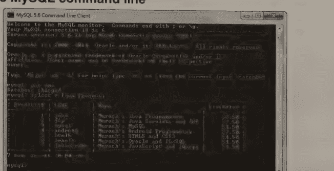

### MySQL Workbench

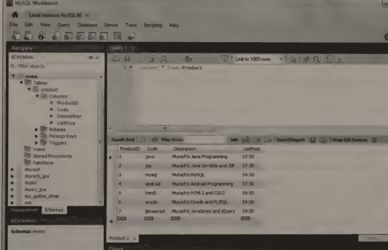

### 描述

- 在使用桌面应用程序时，使用如 MySQL Workbench 等 GUI 程序来操作 MySQL 数据库是很常见的。

## 如何打开数据库连接

每当你使用 MySQL，其数据库服务器就必须运行。通常，该服务器会在你启动系统时自动启动。如果没有启动，你应该能够按照附录所述启动它。

在操作数据库之前，你需要连接到数据库服务器。当你启动 MySQL Workbench 时，MySQL Connections 部分会显示已保存连接列表。


默认情况下，MySQL Workbench 有一个名为“Local instance MySQL 56”的保存连接，假设你安装了 MySQL 5.6。要进行连接，点击该连接，如果系统提示，则输入 root 用户的密码。

## 如何输入和执行 SQL 语句

一旦 MySQL Workbench 连接到数据库服务器，你就可以使用它运行适用于服务器可用数据库的 SQL 语句。当你首次连接到 MySQL 服务器时，MySQL Workbench 会自动打开一个 SQL 标签页。图 19-6 显示了如何使用 SQL 标签页输入并执行 SQL 语句。在图中，只打开了一个 SQL 标签。但你可以在需要时打开多个 SQL 标签。打开 SQL 标签页的一种简单方法是点击 SQL Editor 工具栏中的 `Create New SQL tab`（创建新 SQL 标签）按钮。

打开 SQL 标签页后，你可以使用标准技术来输入或编辑 SQL 语句。当你输入语句时，你会发现 MySQL Workbench 会自动为各种元素应用颜色。例如，它将关键字显示为绿色。这使得你的语句更容易阅读和理解，并帮助你识别代码错误。

要执行图中所示的单条 SQL 语句，你可以按 `Ctrl+Enter` 或点击 SQL Editor 工具栏中的 `Execute Current Statement`（执行当前语句）按钮。如果语句返回数据，该数据将显示在 SQL Editor 窗口下方对应的 `Result grid`（结果网格）中。例如，在图中，`SELECT` 语句返回的结果集被显示。如有必要，你可以通过拖动 SQL Editor 标签与 `Result grid` 之间的条来调整 `Result grid` 的高度。

### 图 19-6 界面元素说明

- `Create New SQL Tab`（创建新 SQL 标签）按钮
- `Execute Current Statement`（执行当前语句）按钮
- SQL 标签页
- `Result grid`（结果网格）

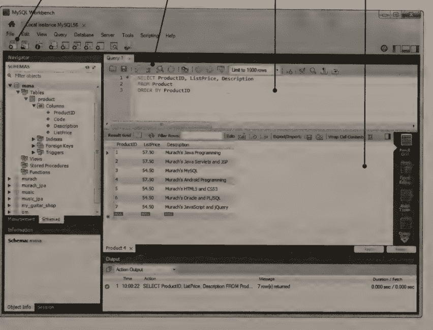

### Description

- 要打开 SQL 标签页，按 `Ctrl+T` 或点击 SQL editor 工具栏中的 `Create New SQL tab` 按钮。
- 要选择当前数据库，在 Navigator 窗口的 Schemas 部分双击它。这将以**粗体**显示选定的数据库。
- 要输入 SQL 语句，将其键入 SQL 标签页中。
- 当你输入语句的文本时，SQL 会为各种元素（如 SQL 关键字）应用颜色，以便于识别。
- 要执行 SQL 语句，按 `Ctrl+Enter` 或点击 SQL editor 工具栏中的 `Execute Current`（执行当前）按钮。如果语句检索了数据，数据将显示在 SQL 标签下方的 `Result grid` 中。

图 19-6 如何使用 MySQL Workbench 执行 SQL 语句

## 创建数据库的 SQL 脚本

SQL 脚本通常是一个包含多个 SQL 语句的文件。当你编写脚本时，在每个 SQL 语句的末尾编写一个分号。脚本通常用于创建数据库。例如，图 19-7 显示了一个创建名为 mma 数据库的脚本。

### 如何删除、创建和选择数据库

该脚本从 `DROP DATABASE IF EXISTS` 语句开始。如果 mma 数据库已存在，该脚本将删除整个 mma 数据库，包括其所有的表。这将抑制可能产生的错误消息。

### 如何创建表和插入数据

`CREATE TABLE` 语句创建表。`INSERT INTO` 语句向 Product 表插入行。

### 如何创建用户并授予权限

脚本末尾的 `GRANT` 创建一个名为 mma_user 的用户。

### 图 19-7 创建数据库的 SQL 脚本

```sql
-- 创建并选择数据库
DROP DATABASE IF EXISTS mma;
CREATE DATABASE mma;
USE mma;

-- 创建 Product 表
CREATE TABLE Product (
  ProductID INT         PRIMARY KEY AUTOINCREMENT,
  Code        VARCHAR(10) NOT NULL UNIQUE,
  Description VARCHAR(255) NOT NULL,
  ListPrice   DECIMAL(10,2) NOT NULL
);

-- 向 Product 表插入行
INSERT INTO Product VALUES
(1, 'java', 'Murach\'s Java Programming', 57.50),
(2, 'jsp', 'Murach\'s Java Servlets and JSP', 57.50),
(3, 'mysql', 'Murach\'s MySQL', 54.50),
(4, 'android', 'Murach\'s Android Programming', 57.50),
(5, 'php', 'Murach\'s PHP and CSS', 54.50),
(6, 'oracle', 'Murach\'s Oracle and PL/SQL', 54.50),
(7, 'javascript', 'Murach\'s JavaScript and jQuery', 54.50);

-- 创建用户并授予该用户权限
GRANT SELECT, INSERT, DELETE, UPDATE
ON mma.*
TO mma_user@localhost
IDENTIFIED BY 'sesame';
```

### Description

- 你可以使用 `CREATE DATABASE` 语句创建数据库，并使用 `DROP DATABASE` 语句删除数据库。这些都是 SQL 语句。
- 你可以使用 `USE` 命令选择要操作的数据库。
- 你可以使用 `CREATE TABLE` 语句创建表。在创建表时，你定义每一列并识别其主键。定义列时，你必须提供名称和数据类型、是否为新行自动生成等。
- 当你使用 MySQL 时，`INSERT` 语句允许向数据库中的一个表插入行或多行。当你使用它时，需要为没有定义默认值或不是自动生成的列提供数据。
- 你可以使用 `GRANT` 语句创建用户、为该用户指定密码并授予该用户权限。


## 用于数据操作的 SQL 语句

除了 `INSERT` 语句外，你目前为止看到的大多数 SQL 语句都是 SQL 数据定义语言（DDL）的一部分。这些语句允许你创建数据库、删除数据库、创建表、创建用户等。然而，它们并不允许你操作表中的数据。

相比之下，构成 SQL 数据操作语言（DML）的语句允许你操作数据库中的数据。因此，这些是你在 Java 应用程序中通常使用的语句。这些语句包括 `SELECT`、`INSERT`、`UPDATE` 和 `DELETE` 语句。

## 如何从表中选择数据

`SELECT` 语句是最常用的 SQL 语句。当你运行 `SELECT` 语句时，它通常被称为查询。该查询的结果被称为结果集或结果表。

在图 19-8 中，第一个示例显示了如何使用该语句从 `Product` 表中检索所有行和列。在这里，`SELECT` 子句使用星号 `*` 通配符表示应该检索表中的所有列。然后，`FROM` 子句标识了 `Product` 表。此查询返回了四列七行。

第二个示例显示了如何使用该语句从 `Product` 表中检索两列七行。在这里，`SELECT` 子句标识了那两列，`FROM` 子句标识了表。最后，`ORDER BY` 子句表示检索到的行应该根据 `Description` 列进行排序。

第三个示例使用 `WHERE` 子句来限制检索的行数。为了做到这一点，它指定语句应只检索 `ListPrice` 列值小于 56 的行。最后，`ORDER BY` 子句表示检索到的行应该根据 `Description` 列进行排序。

结果是一个在数据库内部临时创建的逻辑表。然后，当前行指针（或游标）会跟踪当前行。你可以从 Java 应用程序中使用此指针。

正如你可能猜到的那样，查询对数据库应用程序的性能可能会产生重大影响。通常情况下，查询返回的列和行越多，网络承担的流量就越大。因此，当你为应用程序设计查询时，应该尝试尽量将列和行的数量减少到最低。

## 第 19 章 如何与 MySQL 数据库交互 499

### 获取所有列的 SELECT 语句

```sql
SELECT * FROM Product
```

结果集

| Product | Code | Description | ListPrice |
| --- | --- | --- | --- |
| 1 | java | Murach's Java Programming | 57.50 |
| 2 | jsp | Murach's Java Servlets and JSP | 57.50 |
| 3 | mysql | Murach's MySQL | 54.50 |
| 4 | android | Murach's Android Programming | 57.50 |
| 5 | html5 | Murach's HTML5 and CSS3 | 54.50 |
| 6 | oracle | Murach's Oracle and PL/SQL | 54.50 |
| 7 | javascript | Murach's JavaScript and Query | 54.50 |

### 获取指定列的 SELECT 语句

```sql
SELECT Description, ListPrice
FROM Product
ORDER BY Description
```

结果集

| Description | ListPrice |
| --- | --- |
| Murach's Android Programming | 57.50 |
| Murach's HTML5 and CSS3 | 54.50 |
| Murach's Java Programming | 57.50 |
| Murach's Java Servlets and JSP | 57.50 |
| Murach's JavaScript and Query | 54.50 |
| Murach's MySQL | 54.50 |
| Murach's Oracle and PL/SQL | 54.50 |

### 获取指定列和指定行的 SELECT 语句

```sql
SELECT Description, ListPrice
FROM Product
WHERE ListPrice < 56
ORDER BY Description
```

结果集

| Description | ListPrice |
| --- | --- |
| Murach's HTML5 and CSS3 | 54.50 |
| Murach's JavaScript and Query | 54.50 |
| Murach's MySQL | 54.50 |
| Murach's Oracle and PL/SQL | 54.50 |

### 描述

- `SELECT` 语句是一种 SQL DML 语句，返回一个由指定行和列组成的结果集（或表）。
- 要指定列，你使用 `SELECT` 子句。
- 要指定从哪个表检索数据，你使用 `FROM` 子句。
- 要指定行，你使用 `WHERE` 子句。
- 要指定结果集的排序方式，你使用 `ORDER BY` 子句。

图 19-8 如何从单表中选择数据

## 如何插入、更新和删除行

图 19-9 显示了如何使用 `INSERT`、`UPDATE` 和 `DELETE` 语句在数据库中添加、更新或删除一个或多行。

`INSERT` 语句的两个示例显示了向数据库添加相同行的行的两种方法。在这里，第一个 `INSERT` 语句在表名后没有指定列列表。因此，`VALUES` 子句必须为表中的所有列提供值。

然而，第二个 `INSERT` 语句在表名后指定了列列表。因此，`VALUES` 子句只需要为指定的列提供值。

`UPDATE` 语句的三个示例显示了如何更新行。在第一个示例中，`UPDATE` 语句更新一行的 `ListPrice`。在第二个示例中，它更新了 `ListPrice` 和 `Description` 列。在第三个示例中，它更新选定行的 `ListPrice` 列。

`DELETE` 语句的两个示例显示了如何删除行。在第一个示例中，`DELETE` 语句标识了要删除的行。在第二个示例中，`DELETE` 语句没有包含 `WHERE` 子句。结果是它删除了表中的所有行。

当你从 Java 应用程序发布 `INSERT`、`UPDATE` 或 `DELETE` 语句时，通常一次处理一行。当你开发 SQL 语句时，需要知道表和列名在 Windows 上是不区分大小的。然而，这些名称在 Unix 上是区分大小的。因此，如果你在 Windows 上开发应用程序且没有使用相同的大小，应用程序在尝试在 Unix 服务器上运行时运行良好。这就是为什么即使在 Windows 上开发，始终使用相同的大小也是一种最佳实践。

### 一个 INSERT 语句

不使用列列表的：

```sql
INSERT INTO Product
VALUES ('88', 'php', 'Murach\'s PHP', 54.50)
```

使用列列表的：

```sql
INSERT INTO Product (Code, Description, ListPrice)
VALUES ('php', 'Murach\'s PHP', 54.50)
```

### 一个 UPDATE 语句

更新一行的 `ListPrice`：

```sql
UPDATE Product
SET ListPrice = 57.50
WHERE Code = 'javascript'
```

更新一行的 `ListPrice` 和 `Description` 列：

```sql
UPDATE Product
SET ListPrice = 57.50, Description = 'Murach\'s JavaScript'
WHERE Code = 'javascript'
```

更新选定行的 `ListPrice` 列：

```sql
UPDATE Product
SET ListPrice = 55.50
WHERE ListPrice = 54.50
```

### 一个 DELETE 语句

从 `Product` 表中删除行：

```sql
DELETE FROM Product
WHERE Code = 'php'
```

删除表中的所有行：

```sql
DELETE FROM Product
```

## 观点

本章的主要目标是向你介绍用 Java 开发数据库应用程序时所需的数据库概念和 SQL 语句。本章的次要目标是介绍使用 MySQL 所需的基本技能。如果本章学习成功，你现在应该理解本章中介绍的 SQL 语句，并能够使用 MySQL Workbench 来运行它们。

但请记住，本章仅介绍了 SQL 技能的一个极小子集。特别是，它仅介绍了你理解下一章中提供的 Java 代码所需的 SQL 语句。为了完全掌握 SQL，你可能想买一本关于你正在使用的数据库的 SQL 教程。例如，如果你正在使用 MySQL，《Murach's MySQL》涵盖了你应用程序所需的所有 SQL 语句。

### 总结

- MySQL 是一个关系型数据库管理系统（RDBMS），可以管理一个或多个数据库。
- 为了检索和修改某个数据库中的数据，MySQL 提供了对结构查询语言（SQL）的支持，这是处理数据库的标准语言。
- 每当你使用 MySQL 时，其数据库服务器必须运行运行。通常情况下，该服务器会在你启动系统时自动启动。
- 要操作 MySQL 数据库，你可以使用名为 MySQL Workbench 的图形化工具。它可以让你轻松地输入和运行 SQL 语句。
- SQL 脚本是一个存储多个 SQL 语句的文件。
- 用于创建和删除数据库及表的 SQL 语句是数据定义语言（DDL）的一部分。
- 用于检索和修改数据库中数据的 SQL 语句组成数据操纵语言（DML）。这些是 `SELECT`、`INSERT`、`UPDATE` 和 `DELETE` 语句。
- `SELECT` 语句可以从一个或多个表中获取数据并将其放入结果集（或表中）。这通常被称为查询。
- `INSERT`、`UPDATE` 和 `DELETE` 语句用于向表中添加一或多行、更新一或多行的数据以及删除一或多行。

### 在进行本章练习之前

如果你还没有这样做，应该按照附录中的描述安装 MySQL 和 MySQL Workbench。

## 练习 19-1 运行一个 SQL 脚本

1. 启动 MySQL Workbench。
2. 在 MySQL Connections（MySQL 连接）部分，点击“Local instance MySQL”连接。如果出现提示提示，请输入 root 用户的密码。这将让你以 root 用户身份连接到本地 MySQL 服务器。
3. 使用 MySQL Workbench 打开位于 `java_netbeans/db` 文件夹下的 `create_databases.sql` 文件。
4. 注意，该脚本包含了创建 mma 数据库、创建其表、向某些表插入行以及创建一个具有有限权限用户的语句。
5. 注意，该脚本使用了 `DROP DATABASE` 命令在创建数据库之前删除该数据库。
6. 运行此脚本，它将执行而不显示任何错误。如果显示了任何错误，请阅读错误信息并解决问题。

## 练习 19-2 运行一些 SQL 语句

1. 启动 MySQL Workbench。
2. 在 MySQL Connections 部分，点击“Local instance MySQL”项。如果出现提示，请输入 root 用户的密码。这将让你以 root 用户身份连接到本地 MySQL 服务器。
3. 使用 Navigator（导航器）窗口查看 Schemas（架构）部分，并注意你的系统中安装了哪些数据库。


## 如何使用 JDBC 操作数据库

本章展示了如何使用 Java 操作数据库。特别是，它展示了为 Product Manager 应用程序数据库层创建类所需的 JDBC 技能。接下来的两章将展示如何为表现层创建类。

- 如何使用 JDBC
- 数据库驱动简介
- 如何连接到数据库
- 如何返回结果集并在其中移动光标
- 如何从结果集中获取数据
- 如何插入、更新和删除数据
- 如何使用预编译语句 (`prepared statements`)
- 用于操作数据库的两个类
- `DBUtil` 类
- `ProductDB` 类
- 使用 `ProductDB` 类代码
- 观点

## 如何使用 JDBC

要编写操作数据库的 Java 代码，你可以使用 JDBC，它有时被称为 Java 数据库连接（Java Database Connectivity）。核心 JDBC API 存储在 `java.sql` 包中，它是 Java SE 的一部分。

## 数据库驱动简介

在连接到数据库之前，你必须为你的应用程序提供数据库驱动。20-1 列出了你可以使用的四种类型的 JDBC 数据库驱动。然后，它展示了如何下载数据库驱动并使其对应用程序可用。对于大多数应用程序，你可能希望使用 type-4 驱动。其他三种驱动类型通常被认为是不优的，其中 type-1 驱动最不理想。因此，只有在你使用的数据库没有 type-4 驱动可用时，你才需要使用这些驱动。

对于 MySQL 数据库，你可以使用名为 Connector/J 的 type-4 驱动，它可以从 MySQL 网站免费获取。对于其他类型的数据库，你通常可以从该数据库的网站下载 type-4 驱动。这些驱动的文档通常会显示如何安装和配置驱动。

要在应用程序中使用数据库驱动，你可以将包含数据库驱动的 JAR 文件添加到应用程序的类路径（`classpath`）中。最简单的方法是使用你的 IDE 将数据库驱动的 JAR 文件添加到你的应用程序中。要在 JavaBeans 项目中添加 MySQL 驱动，可以右键点击项目的 Library 文件夹，选择 `Add Library` 命令，并使用生成的对话框选择 MySQL JDBC Driver 库。

### 四种类型的 JDBC 数据库驱动

| 类型 | 描述 |
|---|---|
| Type 1 | JDBC-ODBC 桥接驱动将 JDBC 调用转换为访问 DBMS 进程的 ODBC 调用。对于这种数据访问方法，必须在客户端机器上安装 ODBC 驱动。在 Java 8 之前，JDK 包含 JDBC-ODBC 桥接驱动，但在 Java 8 及之后的版本中不再包含也不支持。 |
| Type 2 | 原生协议 Java 驱动将 JDBC 调用转换为原生的 DBMS 协议。由于这种转换发生在客户端，必须在客户端机器上安装数据库客户端库。 |
| Type 3 | 原生协议 Java 驱动将 JDBC 调用转换为独立于任何原生 DBMS 协议的原生协议。然后，运行在服务器上的中间件软件将该协议转换为原生 DBMS 协议。由于这种转换发生在服务器端，客户端机器不需要数据库客户端库。 |
| Type 4 | 原生协议 Java 驱动将 JDBC 调用转换为原生 DBMS 协议。由于这种转换发生在服务器端，客户端机器不需要数据库客户端库。 |

### 如何下载数据库驱动

- 对于 MySQL 数据库，你可以使用名为 Connector/J 的 type-4 驱动，它可以从 MySQL 网站免费获取。
- 对于其他类型的数据库，你通常可以从该数据库的网站下载 type-4 驱动。
- MySQL 数据库的 Connector/J 驱动包含在 NetBeans 中。因此，如果你使用 NetBeans，就不需要下载此驱动。

### 如何让数据库驱动应用程序可用

- 在使用数据库驱动之前，你必须使其应用程序可用。最简单的方法是使用你的 IDE 将数据库驱动的 JAR 文件添加到你的应用程序中。
- 要在 JavaBeans 项目中添加 MySQL 驱动，可以右键点击项目的 Library 文件夹，选择 `Add Library` 命令，并使用生成的对话框选择 MySQL JDBC Driver 库。
- 为 NetBeans 项目添加任何 JDBC 驱动，右键点击 Libraries 文件夹，选择 `Add JAR/Folder` 命令，并使用生成的对话框选择驱动的 JAR 文件。

## 如何连接到数据库

在访问或修改数据库中的数据之前，你必须如图 20-2 所示连接到数据库。首先，此图显示了数据库 URL 的语法。你可以在获取连接的代码中使用此语法。

第一个示例显示了如何使用第 4 型 MySQL 驱动程序获取数据库的连接。首先，你使用 `DriverManager` 类的 `getConnection` 方法返回一个 `Connection` 对象。该方法需要三个参数：数据库的 URL、用户名和密码。在第一个示例中，URL 包含 API (`jdbc`)、MySQL 驱动程序的子协议 (`mysql`)、宿主机 (`localhost`)、数据库服务的端口 (`3306`) 以及数据库的名称 (`mma`)。

出于安全考虑，使用具有应用程序所需权限的用户名连接到数据库被认为是一种最佳实践。这就是为什么创建 `mma` 数据库的脚本创建了一个名为 `mma_user` 的用户，该用户具有有限的权限来处理 `mma` 数据库的数据，而不能修改其结构。因此，名为 `mma_user` 的用户适用于书中介绍的示例应用程序。

第二个示例显示了如何使用用户名和密码连接到 Oracle 数据库。无论你使用 JDBC 使用何种类型的数据库，这一点都是成立的。

在实践中，连接数据库通常是令人沮丧的，因为很难确定 URL、用户名和密码。如果你的同事已经连接了你需要使用的数据库，你可以从向他们询问这些信息开始。

由于 `DriverManager` 类的 `getConnection` 方法会抛出 `SQLException`，因此每当你连接数据库时都需要处理此异常。在 JDBC 4.0 (Java 6) 及更高版本中，你可以使用增强状态方法遍历嵌套在 `SQLException` 对象中的任何异常。在此图中，`catch` 块遍历嵌套在 `SQLException` 对象中的所有异常。

要做到这一点，该循环为每个嵌套异常检索一个名为 `t` 的 `Throwable` 对象。然后，它将异常打印到控制台。这是因为 `Throwable` 类是所有异常的父类，且 `SQLException` 类的迭代器返回的是 `Throwable` 对象。

前两个示例展示了 JDBC 4.0 的一个新功能，称为自动驱动程序加载。该功能根据数据库 URL 自动加载数据库驱动程序。

但是，如果你在使用旧版本的 Java，则需要使用 `Class` 类的 `forName` 方法在调用 `getConnection` 方法之前显式加载驱动程序，如第三个示例所示。由于此方法抛出 `ClassNotFoundException`，你也必须处理此异常。

在 JDBC 4.0 及更高版本中，你可能会收到“未找到合适的驱动程序”的消息。在这种情况下，你可以使用 `forName` 方法显式加载驱动程序。然而，如果自动驱动程序加载有效，通常从代码中移除此方法调用是有意义的。这样你就可以用更少的代码连接数据库，而无需硬编码数据库驱动程序的名称。

### Database URL 语法

```text
jdbc:subprotocolName:databaseURL
```

### 如何使用自动驱动程序加载连接到 MySQL 数据库

```java
try {
  // 设置 数据库 url、用户名和密码
  String dbURL = "jdbc:mysql://localhost:3306/mma";
  String username = "mma_user";
  String password = "sesame";

  // 获取连接
  Connection connection = DriverManager.getConnection(dbURL, username, password);
} catch (SQLException e) {
  for (Throwable t : e) {
    System.out.println(t);
  }
}
```

### 如何使用自动驱动程序加载连接到 Oracle 数据库

```java
Connection connection = DriverManager.getConnection(
  "jdbc:oracle:thin@localhost/mma", "mma_user", "sesame");
```

### 如何在 JDBC 4.0 之前加载 MySQL 数据库驱动程序

```java
try {
  Class.forName("com.mysql.jdbc.Driver");
} catch (ClassNotFoundException e) {
  System.out.println(e);
}
```

### Description

- 在获取或修改数据库中的数据之前，你需要连接到它。要做到这一点，你使用 `DriverManager` 类的 `getConnection` 方法返回一个 `Connection` 对象。
- 当你使用 `DriverManager` 类的 `getConnection` 方法时，必须提供数据库的 URL。此外，你通常会提供用户名和密码，但嵌入式数据库可能不需要。此方法会抛出 `SQLException`。
- 在 JDBC 4.0 及更高版本中，`SQLException` 实现了 `Iterable` 接口。因此，你可以使用增强的 `for` 语句遍历嵌套异常。
- 在 JDBC 4.0 及更高版本中，数据库驱动程序会自动加载。此特性被称为自动驱动程序加载。
- 在 JDBC 4.0 之前，你需要使用 `Class` 类的 `forName` 方法来加载驱动程序。此方法会抛出 `ClassNotFoundException`。
- 虽然每个驱动程序的连接字符串都不同，但驱动程序的文档应该说明如何为该驱动程序编写连接字符串。
- 通常情况下，一个应用程序只需要连接到一个数据库。然而，也可以加载多个数据库驱动程序并建立到多种类型数据库的连接。

## 如何返回结果集并在其中移动游标

一旦连接到数据库，你就可以从其中检索数据了，如图 20-3 所示。在这里，前两个示例显示了如何使用 `Statement` 对象创建结果集（或结果表）。接下来的两个示例显示了如何在结果集中移动行指针（或游标）。

此图中的两个结果集都是只读的、仅限向前的结果集。这意味着你只能通过结果集向后移动游标，并且你可以读取但不能写入结果集中的行。虽然 JDBC 提供了其他类型的可滚动、可更新的结果集，但这些功能需要额外的开销，而且对于大多数应用程序来说并不是必要的。

第二个示例的工作方式与第一个相同。但是，它返回了 `Product` 表的所有行和列，并将此结果放入名为 `products` 的 `ResultSet` 中。你可以使用此对象来显示所有产品。

第三个示例显示了如何使用 `ResultSet` 对象的 `next` 方法将游标移动到第一个示例创建的结果集的第一行。当你创建一个结果集时，游标位于结果集的第一行之前。第一次使用 `next` 方法会尝试将游标移动到结果集的第一行。如果该行存在，游标移动到该行且 `next` 方法返回 `true` 值。否则，`next` 方法返回 `false` 值。

第四个示例显示了如何使用 `next` 方法遍历结果集中的行。如果行有效，游标移动到该行并返回 `true` 值。否则，`next` 方法返回 `false` 值。

由于此图中描述的所有方法都会抛出 `SQLException`，因此在处理这些方法时需要捕捉或抛出此异常。此图总结了你可能用于此类结果集的方法。

### 如何创建 1 行 1 列的结果集

```java
Statement statement = connection.createStatement();
ResultSet product = statement.executeQuery("SELECT ProductCode FROM PRODUCT WHERE ProductID = '1'");
```

### 如何创建包含列和行的结果集

```java
Statement statement = connection.createStatement();
ResultSet products = statement.executeQuery("SELECT * FROM PRODUCT");
```

### 如何将游标移动到结果集的第一行

```java
boolean exists = product.next();
```

### 如何遍历结果集

```java
while (products.next()) {
  // 处理每一行的语句
}
```

### 仅向前、只读结果集的 ResultSet 方法

| 方法 | 说明 |
| --- | --- |
| `next()` | 将游标移动到结果集的下一行。 |
| `last()` | 将游标移动到结果集的最后一行。 |
| `close()` | 释放结果资源。 |

### Description

- 为了返回结果集，你使用 `Connection` 对象的 `createStatement` 方法创建一个 `Statement` 对象。然后，你使用 `Statement` 的 `executeQuery` 方法执行返回 `ResultSet` 对象的查询语句。
- 默认情况下，`createStatement` 方法创建一个仅向前、只读的结果集。这意味着你只能从第一行向最后一行移动，且不能更新它。虽然你可以向 `createStatement` 传递参数来创建其他类型的结果集，但默认设置适用于大多数应用程序。
- 当结果集创建时，游标位于第一行之前。然后，你可以使用 `ResultSet` 的方法来移动游标。例如，为了将游标移动到下一行，你需要调用 `next` 方法。如果行有效，此方法将游标移动到下一行并返回 `true` 值。否则，它返回 `false` 值。
- `createStatement`、`executeQuery` 和 `next` 方法会抛出 `SQLException`。因此，任何使用这些方法的代码都需要捕捉或抛出此异常。

## 如何从结果集中获取数据

当光标定位在你想获取数据的行上时，你可以使用 20-4 节中的方法来获取这些数据。示例展示了如何使用 `ResultSet` 的 `getInt`、`getString` 和 `getDouble` 方法来返回 `int`、`String` 和 `double` 值。不过，你也可以使用类似的方法返回其他类型的数据。

图中方法显示了 `get` 方法接受的两种类型的参数。第一种方法接受一个 `int` 值，用于指定结果集中列的索引号，其中 1 是第一列，2 是第二列，依此类推。第二种方法接受一个 `String` 对象，用于指定结果集中列名称。虽然列索引需要的输入字数较少，但使用列名的 `get` 方法生成的代码更易于阅读和理解。

第一个示例展示了如何使用列索引从 `products` 结果集中返回数据。在这里，第一条语句使用 `getInt` 方法返回产品的 ID，接下来的两条语句使用 `getString` 返回代码和描述，第三条语句使用 `getDouble` 方法返回列表价格。由于这些方法使用了列索引，因此结果集的第一列必须包含产品 ID，第二列必须包含产品代码，依此类推。

第二个示例展示了如何使用列名从结果集中返回数据。由于此代码使用了列名，因此结果集中列的顺序并不重要。然而，列名必须存在于结果集中，否则将抛出 `SQLException` 指明未找到该列。


第三个示例展示了你如何使用 `get` 方法创建一个 `Product` 对象。在这里，第一条语句创建一个新的 `Product` 对象。然后，接下来的四条语句将从 `ResultSet` 对象中检索的数据存储在 `Product` 对象中。由于对象是从存储在数据库中的数据创建的，这种代码在使用 JDBC API 时非常常见。不过，这种代码由某些其他数据库 API（如 JPA，即 Java Persistence API）自动处理。

如果你在 JDBC API 文档中查找 `ResultSet` 接口，你会发现所有基本数据类型以及其他类型的数据都存在 `get` 方法。例如，`java.sql` 包中的 `Date`、`Time` 和 `Timestamp` 类也存在 `get` 方法。此外，它们还存在 `BLOB` 对象（二进制大对象）和 `CLOB` 对象（字符大对象）。你可以使用这些类型的对象在数据库中存储图像、音频和视频等大型对象。

# 从结果集中返回数据的 ResultSet 对象方法

| 方法 | 描述 |
| --- | --- |
| `getXXX(columnIndex)` | 从指定的列号返回数据。 |
| `getXXX(columnName)` | 从指定的列名返回数据。 |

# 使用索引从 products 结果返回列的代码

```java
int productID = products.getInt(1);
String code = products.getString(2);
String description = products.getString(3);
double price = products.getDouble(4);
```

# 使用名称返回相同列的代码

```java
int productID = products.getInt("ProductID");
String code = products.getString("Code");
String description = products.getString("Description");
double price = products.getDouble("ListPrice");
```

# 从 products 结果集创建 Product 对象的代码

```java
Product p = new Product();
p.setID(productID);
p.setCode(code);
p.setDescription(description);
p.setPrice(price);
```

### 描述

- `getXXX` 方法可以用于返回所有八种基本类型。例如，`getInt` 方法返回 `int` 类型，`getLong` 方法返回 `long` 类型。
- `getXXX` 方法还可以用于返回字符串、日期和时间。例如，`getString` 方法返回 `String` 类的对象，而 `getDate`、`getTime` 和 `getTimestamp` 方法返回 `java.sql` 包中 `Date`、`Time` 和 `Timestamp` 类的对象。


# 如何插入、更新和删除数据

图 20-5 显示了如何使用 JDBC 修改数据库中的数据。为此，你需要使用 `Statement` 对象的 `executeUpdate` 方法执行添加、更新和删除数据的 SQL 语句。

在使用 `executeUpdate` 方法时，你只需将 SQL 语句传递给数据库。在这些示例中，代码对 `Product` 表进行添加、更新和删除。为了实现这一点，代码将 `Product` 对象的数据与适当的 SQL 语句结合。对于 `UPDATE` 和 `DELETE` 语句，SQL 语句在 `WHERE` 子句中使用产品代码来选择单个产品。

遗憾的是，如果你从用户输入构建 SQL 语句并使用 `Statement` 对象的方法执行该 SQL 语句，就会受到被称为 **SQL 注入攻击** 的安全漏洞。SQL 注入攻击允许黑客针对你的数据库执行 SQL 语句以读取敏感数据或删除或修改数据。例如，对于 Product Manager 应用程序，用户可以通过输入以下代码执行 `DROP TABLE` 语句：

```
test'); DROP TABLE Product; --
```

在这里，第一个分号结束了第一条 SQL 语句。然后，数据库可能会执行第二条 SQL 语句。为了防止此类 SQL 注入攻击，你可以使用图中所示的预编译语句。

# 如何使用 executeUpdate 方法修改数据

## 如何添加一行

```java
String query = "INSERT INTO Product (ProductCode, ProductDescription, ProductPrice) " +
               "VALUES (?, ?, ?)";
Statement statement = connection.createStatement();
int rowCount = statement.executeUpdate(query);
```

## 如何更新一行

```java
String query = "UPDATE Product SET " +
               "ProductCode = ?, " +
               "ProductDescription = ?, " +
               "ProductPrice = ? " +
               "WHERE ProductCode = ?";
Statement statement = connection.createStatement();
int rowCount = statement.executeUpdate(query);
```

## 如何删除一行

```java
String query = "DELETE FROM Product " +
               "WHERE ProductCode = ?";
Statement statement = connection.createStatement();
int rowCount = statement.executeUpdate(query);
```

### 描述

- `executeUpdate` 方法是适用于大多数 JDBC 驱动的旧方法，但在某些较新的驱动程序中可能无法正常工作。
- `executeUpdate` 方法返回一个受 SQL 语句影响的 `int` 值。

# 警告

- SQL 注入攻击允许黑客绕过身份验证或针对你的数据库执行读取敏感数据、修改数据或删除数据的语句。为了防止大多数 SQL 注入攻击，可以使用图中所示的预编译语句。


# 如何使用预编译语句

每当 Java 应用程序向数据库服务器发送新的 SQL 语句时，服务器都会检查语法、准备执行计划并执行语句。如果再次发送相同的语句，数据库会检查是否已经接收过。如果是，服务器就不需要再次检查语法并准备执行计划。这提高了性能。

为了利用这一特性，Java 提供了预编译语句的使用，如图 20-6 所示。此外，预编译语句会自动检查参数值以防止 SQL 注入攻击。因此，尽可能使用预编译语句被认为是一种最佳实践。

第一个示例使用预编译语句创建一个包含单个产品的结果集。在这里，第一条语句使用问号 (`?`) 来标识 `SELECT` 语句的参数（即书籍代码），第二条语句使用 `Connection` 对象的 `prepareStatement` 方法返回一个 `PreparedStatement` 对象。然后，第三条语句使用 `PreparedStatement` 对象的设置方法（`setString` 方法）为参数赋值，第四条语句使用 `PreparedStatement` 对象的 `executeQuery` 方法返回 `ResultSet` 对象。

第二个示例展示了如何使用预编译语句执行需要四个参数的 `UPDATE` 查询。在这里，第一条语句使用四个问号来标识 `UPDATE` 语句的四个参数，第二条语句创建 `PreparedStatement` 对象。然后，接下来的四条语句按照 `UPDATE` 语句中出现的顺序设置参数。最后一条语句使用 `PreparedStatement` 对象的 `executeUpdate` 方法执行更新语句。

第三个和第四个示例展示了如何使用预编译语句插入和删除行。这与第二个示例类似。

在图中，你使用的 SQL 语句类型决定了你是使用 `executeQuery` 方法还是 `executeUpdate` 方法。如果你使用 `SELECT` 语句返回结果集，则使用 `executeQuery` 方法。然而，如果你使用的是 `INSERT`、`UPDATE` 或 `DELETE` 语句，则使用 `executeUpdate` 方法。换句话之，这对于 `PreparedStatement` 对象的工作方式与 `Statement` 对象完全相同。

# 如何使用预编译语句

## 要返回结果集

```java
String sql = "SELECT ProductCode, ProductDescription, ProductPrice " +
             "FROM Product WHERE ProductCode = ?";
PreparedStatement ps = connection.prepareStatement(sql);
ps.setString(1, productCode);
ResultSet product = ps.executeQuery();
```

## 要修改某行数据

```java
String sql = "UPDATE PRODUCT SET " +
             "ProductCode = ?, " +
             "ProductDescription = ?, " +
             "ProductPrice = ? " +
             "WHERE ProductCode = ?";
PreparedStatement ps = connection.prepareStatement(sql);
ps.setString(1, product.getCode());
ps.setString(2, product.getDescription());
ps.setDouble(3, product.getPrice());
ps.setString(4, product.getCode());
ps.executeUpdate();
```

## 要插入一行

```java
String sql = "INSERT INTO Product (ProductCode, ProductDescription, ProductPrice) " +
             "VALUES (?, ?, ?)";
PreparedStatement ps = connection.prepareStatement(sql);
ps.setString(1, product.getCode());
ps.setString(2, product.getDescription());
ps.setDouble(3, product.getPrice());
ps.executeUpdate();
```

## 要删除一行

```java
String sql = "DELETE FROM PRODUCT " +
             "WHERE ProductCode = ?";
PreparedStatement ps = connection.prepareStatement(sql);
ps.setString(1, product.getCode());
ps.executeUpdate();
```

### 描述

- 当你在 Java 应用程序中使用预编译语句时，数据库服务器只需对每个 SQL 语句进行一次语法检查并准备执行计划。这提高了数据库操作的效率。此外，它还能防止大多数类型的 SQL 注入攻击。
- 若要为预编译语句指定参数，请在 SQL 语句中使用问号 (`?`)。
- 若要为预编译语句中的参数提供值，请使用 `PreparedStatement` 接口的 set 方法。要查看 set 方法的完整列表，请参考 Java API 文档中 `java.sql` 包下的 `PreparedStatement` 接口。
- 要执行 `SELECT` 语句，请使用 `executeQuery` 方法。要执行 `INSERT`、`UPDATE` 或 `DELETE` 语句，请使用 `executeUpdate` 方法。

# 用于操作数据库的两个类

现在你已经知道了如何使用 JDBC 操作数据库，已经准备好学习如何编写一个类，以便将对象映射到表。具体来说，你已经准备好学习如何将 `Product` 对象映射到 mma 数据库中的 `Product` 表。在此之前，你将接触一个可以使用来获取数据库连接的工具类。

# DBUtil 类

图 20-7 显示了一个名为 `DBUtil` 的类。该类首先声明了一个用于 `Connection` 对象的静态变量。然后，它提供了一个私有构造函数，防止他人从 `DBUtil` 类创建对象。这是一个良好的做法，因为 `DBUtil` 类只提供了两个静态方法。

第一个方法 `getConnection` 方法返回一个提供数据库连接的 `Connection` 对象。该方法首先检查连接是否已经打开。如果是，则直接返回该连接。结果是该方法只对数据库打开一个连接。这有助于应用程序在打开第一次数据库连接后高效运行。

然而，如果连接尚未打开，这段代码将通过创建一个 `Connection` 对象来打开连接。为了实现这一点，代码指定了数据库的 URL、用户名和密码。在这里，代码以用户 `mma_user` 的身份连接到 mma 数据库。这在本章早些部分已经描述过。

在指定了数据库的 URL、用户名和密码后，`getConnection` 方法使用 `DriverManager` 的静态 `getConnection` 方法自动加载相应的数据库驱动并连接到数据库。如果该方法执行成功，它会将 `Connection` 对象返回给调用方法。否则，该方法将抛出一个 `SQLException`。然后，代码块捕获此异常，将其封装在第 16 节提供的自定义 `DBException` 中并抛出该异常。

第二个方法 `closeConnection` 方法关闭已打开的连接。通常，在应用程序退出时调用此方法来关闭该类的连接。这防止了资源泄漏。

这两个静态方法都包含了 `synchronized` 关键字。结果是，在调用另一个方法之前必须完成它。例如，当你调用 `getConnection` 方法时，它必须完成。

# DBUtil 类

```java
package murach.db;

import java.sql.Connection;
import java.sql.DriverManager;
import java.sql.SQLException;

public class DBUtil {

    private static Connection connection;

    private DBUtil() { }

    public static synchronized Connection getConnection() throws DBException {
        if (connection != null) {
            return connection;
        } else {
            try {
                // 设置 url、用户名和密码
                String url = "jdbc:mysql://localhost:3306/mma";
                String username = "mma_user";
                String password = "sesame";

                // 获取并返回连接
                connection = DriverManager.getConnection(url, username, password);
                return connection;
            } catch (SQLException e) {
                throw new DBException(e);
            }
        }
    }

    public static synchronized void closeConnection() throws DBException {
        if (connection != null) {
            try {
                connection.close();
            } catch (SQLException e) {
                throw new DBException(e);
            } finally {
                connection = null;
            }
        }
    }
}
```

### 描述

为了方便获取和关闭数据库连接，可以使用如图所示工具类。

图 20-7 DBUtil 类

# ProductDB 类

图 20-8 展示了 `ProductDB` 类的完整代码。该类将 `Product` 对象映射到数据库中的 `Product` 表。`getAll` 方法返回一个包含 `Product` 表中所有 `Product` 对象的 `List` 对象。在这里，第一个语句创建了一个 SQL 语句字符串，查询 `Product` 表的所有列并按 `ProductID` 升序排序。第二个语句创建了一个 `ArrayList` 对象来存储 `Product` 对象。第三个语句使用 `DBUtil` 类的静态 `getConnection` 方法连接到数据库。

获取连接后，这段代码使用 `try-with-resources` 语句创建此方法所需的 `PreparedStatement` 和 `ResultSet` 对象。这样，这些对象在块结束时会自动关闭。


一旦创建了 `ResultSet` 对象，`getAll` 方法将循环读取结果集中的每一行。在循环内部，第一个语句使用 `ResultSet` 的 `getInt` 方法获取 ProductID 列的整型值。接下来的两个语句使用 `getString` 方法获取 Code 和 Description 列的字符串。第四个语句使用 `getDouble` 方法获取 ListPrice 列的双精度浮点值。然后，该循环创建 `Product` 对象，将数据存储在其中，并将其添加到 `products` 列表中。

如果这段代码执行成功，`getAll` 方法将返回 `products` 列表。然而，如果在 `try` 块中的任何地方抛出 `SQLException`，`catch` 块将创建一个存储了 `SQLException` 的新 `DBException` 并将其抛出给调用方法。这样，调用方法就可以抛出或处理此异常。最终，这会导致异常在适当的层级得到处理，即通过用户界面向用户显示适当的用户友好消息。

`get` 方法返回与指定产品代码匹配的 `Product` 对象。为了实现这一点，它使用预编译的 SQL 语句来返回结果集。然后，它调用结果集的下一个方法将光标移动到结果集的第一行。如果成功，该方法将继续读取该行的列，关闭结果集，根据这些数据创建 `Product` 对象并返回该 `Product` 对象。

与 `getAll` 方法不同，`get` 方法使用的结果集不能在 `try-with-resources` 语句中创建。因为在打开结果集之前，必须设置预编译语句中的参数值。然而，预编译语句可以在 `try-with-resources` 语句中创建，这意味着它不需要显式地关闭。

如果没有产品的产品代码与指定的代码匹配，该方法将关闭结果集并返回 `null` 表示未找到该产品。此外，如果此方法的任何地方抛出 `SQLException`，该方法将从 `SQLException` 类创建一个新异常并将此异常抛给调用者方法。这样，调用 `get` 方法的方法就可以抛出或处理此异常。

在审查 `get` 方法时，请注意，如果 `try` 块抛出 `SQLException`，则结果集不会被显式关闭。在大多数情况下，这不是问题，因为用于创建结果集的预编译语句关闭时，结果集会自动关闭。不过，如果你想显式关闭结果集，可以通过向 `try` 语句中添加 `finally` 子句来实现。

`add` 方法首先创建一个预编译语句，该语句可将值插入到 `Product` 表的三列中。然后，它将预编译语句中三个参数的值设置为传递给它的 `Product` 对象中存储的值。最后，它调用预编译语句的 `executeUpdate` 方法。如果此方法的任何地方抛出 `SQLException`，此代码将该异常存储在 `DBException` 中并将其抛给调用者方法。

## 第 20 章 如何使用 JDBC 操作数据库

### ProductDB 类 第 2 页

```java
public static Product get(String productCode) throws SQLException {
    String sql = "SELECT * FROM PRODUCT WHERE Code = ?";
    Connection connection = DBUtil.getConnection();
    try (PreparedStatement ps = connection.prepareStatement(sql)) {
        ps.setString(1, productCode);
        ResultSet rs = ps.executeQuery();
        if (rs.next()) {
            long productId = rs.getLong("ProductID");
            String name = rs.getString("Description");
            double price = rs.getDouble("ListPrice");
            rs.close();

            Product p = new Product();
            p.setId(productId);
            p.setCode(productCode);
            p.setDescription(name);
            p.setPrice(price);
            return p;
        } else {
            rs.close();
            return null;
        }
    } catch (SQLException e) {
        throw new SQLException(e);
    }
}
```

```java
public static void add(Product product) throws SQLException {
    String sql = "INSERT INTO Product (Code, Description, ListPrice) \n VALUES (?, ?, ?)";
    Connection connection = DBUtil.getConnection();
    try (PreparedStatement ps = connection.prepareStatement(sql)) {
        ps.setString(1, product.getCode());
        ps.setString(2, product.getDescription());
        ps.setDouble(3, product.getPrice());
        ps.executeUpdate();
    } catch (SQLException e) {
        throw new SQLException(e);
    }
}
```

图 20-8 邮件列表应用程序的数据库类（3/3 部分）

`update` 方法使用预编译 SQL 语句，使用传递给它的 `Product` 对象中存储的数据更新 `Product` 表中现有产品。请注意，该方法仅在 `Product` 对象拥有的 `Product` 表中存在的产品 ID 时才有效。与 `add` 方法一样，如果该方法无法成功执行，它将抛出 `DBException`。

`deleteProduct` 方法使用预编译 SQL 语句删除与传递给它的 `Product` 对象具有相同产品的代码行。与 `add` 和 `update` 方法一样，如果无法成功执行，删除方法将抛出 `DBException`。

此类的代码仅使用 JDBC 1.0 的方法。这是因为这仍然是 JDBC 操作数据库最常见的方法。这种技术的缺点是是你必须理解 SQL。然而，SQL 很容易学习，大多数与数据库交道的程序员已经知道如何使用它。事实上，某些程序员更倾向于使用 SQL，因为他们可以对发送到数据库的 SQL 语句进行直接控制。

此类类中每个需要连接的方法都使用 `DBUtil` 类来获取连接。结果是第一次方法调用打开了到数据库的连接。然后，后续的方法调用将使用此连接直到它被关闭。通常，应用程序在用户退出时关闭此连接。由于打开数据库连接是一个相对耗时的过程，这种方式比每次方法调用都打开和关闭连接高效得多。

### ProductDB 类

```java
public static void update(Product product) throws DBException {
    String sql = "UPDATE PRODUCT SET "
        + "Code = ?, "
        + "Description = ?, "
        + "ListPrice = ?"
        + " WHERE ProductID = ?";
    Connection connection = DBUtil.getConnection();
    try (PreparedStatement ps = connection.prepareStatement(sql)) {
        ps.setString(1, product.getCode());
        ps.setString(2, product.getDescription());
        ps.setDouble(3, product.getPrice());
        ps.executeUpdate();
    } catch (SQLException e) {
        throw new DBException(e);
    }
}
```

```java
public static void delete(Product product) throws DBException {
    String sql = "DELETE FROM Product "
        + "WHERE ProductID = ?";
    Connection connection = DBUtil.getConnection();
    try (PreparedStatement ps = connection.prepareStatement(sql)) {
        ps.setLong(1, product.getId());
        ps.executeUpdate();
    } catch (SQLException e) {
        throw new DBException(e);
    }
}
```

图 20-8 邮件列表应用程序的数据库类（3/3 部分）

## 使用 ProductDB 类的代码

图 20-9 显示了使用 `ProductDB` 类的一些代码。你可以在控制台应用程序的用户界面中使用此类代码。

`ProductDB`、`DBException` 和 `DBUtil` 类存储在 `mma.db` 包中。如果你从不同的包调用此代码，则需要像第一个示例所示包含这些类的导入语句。此外，你还需要为存储在 `mma.business` 包中的 `Product` 类包含导入语句。

### 如何导入业务和数据库类

```java
import nma.business.Product;
import nma.db.ProductDB;
import nma.db.DBException;
import nma.db.DBUtil;
```

### 如何获取所有产品

```java
List<Product> products;
try {
    products = ProductDB.getAll();
} catch (DBException e) {
    System.out.println("Error! Unable to get products");
    System.out.println(e + "\n");
}
```

### 如何根据指定的产品代码获取产品

### 如何添加产品

```java
try {
    ProductDB.add(product);
    System.out.println(product.getDescription() + " was added.\n");
} catch (DBException e) {
    System.out.println("Error! Unable to add product.");
    System.out.println(e + "\n");
}
```

### 如何删除产品

```java
try {
    ProductDB.delete(product);
    System.out.println(product.getDescription() + " was deleted.\n");
} catch (DBException e) {
    System.out.println("Error! Unable to delete product.");
    System.out.println(e + "\n");
}
```

### 如何关闭连接

```java
try {
    DBUtil.closeConnection();
} catch (DBException e) {
    System.out.println("Error! Unable to close connection.");
    System.out.println(e + "\n");
}
```

### 描述

- 你可以使用 `ProductDB` 类的静态方法将 `Product` 对象映射到 `Product` 表的行上。
- 你可以使用 `DBUtil` 类在应用程序退出时关闭数据库连接。

图 20-9 使用 ProductDB 类的代码

## 观点

现在你已经完成了本章的学习，你应该理解了如何使用 JDBC 在数据库中存储数据以及从数据库中检索数据。虽然操作数据库还有很多内容需要学习，但这些是核心技能。为了增强你的数据库技能，你可以更多地了解 MySQL 或 Oracle 等数据库管理系统以及与它们配合使用的 SQL。

你还应该理解，JDBC API 要求开发者编写大量的低级代码。对于 Java 和数据库的初学者来说，这提供了一个良好的概念背景。此外，许多遗留应用程序仍在使用 JDBC。因此，在处理旧应用程序时你可能需要使用它。

然而，对于新开发，你可能倾向于使用另一种数据访问 API，例如 JPA（Java Persistence API）。该 API 会自动处理大部分对象到数据库的映射。因此，它不需要开发者编写那么多代码，开发者需要编写的代码也更容易维护。

### 总结

- 使用 JDBC 4.0 (Java 6) 及更高版本，用于连接应用程序到数据库的数据库驱动程序会自动加载。这被称为自动驱动程序加载。
- 使用 JDBC 4.0 及更高版本，你可以遍历嵌套在 `SQLException` 对象中的任何异常。
- Java 应用程序可以使用四种驱动类型之一访问数据库。如果该数据库有类型-4 驱动程序，则使用它被认为是最佳实践。
- 你可以使用 JDBC 执行 SQL 语句，以选择、添加、更新或删除数据库中的一行或多行。你还可以控制结果集中光标的位置。
- 你可以使用预编译语句（prepared statements）来为 SQL 语句提供参数。由于预编译语句比普通语句提供更好的性能和安全性，你应该尽可能使用它们。

## 练习 20-1 使用 JDBC

在本次练习中，你将编写与上一章描述的名为 mma 的 MySQL 数据库配合 JDBC 代码。

### 检查代码并测试应用程序

1. 在 ex_starts 文件夹中打开名为 ch20_ex1_DBTester 的项目。
2. 展开该项目的 Libraries 文件夹，注意它包含一个 MySQL 数据库驱动程序的 JAR 文件。
3. 确保 MySQL 服务器正在运行。
4. 检查源文件中的代码并运行项目。它应该在控制台上打印 Product 表中的所有行三次，并带有一些额外消息。

### 编写并测试使用 JDBC 的代码

5. 编写 `printFirstProduct` 方法的代码。该方法应将产品列表中的第一个产品打印到控制台。使用列名来检索列值。
6. 运行此应用程序以确保其工作正常。
7. 编写 `printByCode` 方法的代码。该方法应将指定代码的产品打印到控制台。使用预编译语句创建结果集，并使用索引检索列值。
8. 运行此应用程序以确保其工作正常。
9. 编写 `insertProduct` 方法的代码。该方法应将产品添加到数据库并打印产品到控制台。
10. 多次运行此应用程序，它应该显示一条错误消息，指示由于重复键无法添加该产品。
11. 编写 `deleteProduct` 方法的代码。该方法应删除由 `insertProduct` 方法添加的产品。
12. 运行此应用程序以确保其工作正常。你应该能够多次运行此应用程序而不显示任何错误消息。

## 练习 20-2 修改 Product Manager 应用程序

在本次练习中，你将修改与上一章描述的 MySQL 数据库配合的 Product Manager 应用程序。

### 检查代码并测试应用程序

1. 在 ex_starts 文件夹中打开名为 ch20_ex2_DBTester 的项目。
2. 展开该项目的 Libraries 文件夹，注意它包含一个 MySQL 数据库驱动程序的 JAR 文件。
3. 确保 MySQL 服务器正在运行。
4. 检查源文件中的代码并运行项目。它应该在控制台上打印 Product 表中的所有行三次，并带有一些额外消息。

### 编写并测试使用 JDBC 的代码

5. 编写 `printFirstProduct` 方法的代码。该方法应将产品列表中的第一个产品打印到控制台。使用列名来检索列值。
6. 运行此应用程序以确保其工作正常。
7. 编写 `printByCode` 方法的代码。该方法应将指定代码的产品打印到控制台。使用预编译语句创建结果集，并使用索引检索列值。
8. 运行此应用程序以确保其工作正常。
9. 编写 `insertProduct` 方法的代码。该方法应将产品添加到数据库并打印产品到控制台。
10. 多次运行此应用程序，它应该显示一条错误消息，指示由于重复键无法添加该产品。
11. 编写 `deleteProduct` 方法的代码。该方法应删除由 `insertProduct` 方法添加的产品。
12. 运行此应用程序以确保其工作正常。你应该能够多次运行此应用程序而不显示任何错误消息。

# 如何使用 Swing 开发 GUI（第 1 部分）

到目前为止，你在书中处理过的所有代码都使用控制台界面。然而，大多数现代应用程序——例如文字处理器、电子表格、网络浏览器等——都使用图形用户界面，通常缩称为 GUI。在本章中，你将学习使用 Swing 开发 GUI 应用程序的基础知识，Swing 是开发 GUI 应用程序最流行的库。

# GUI 编程简介


直到 20 世纪 80 年代后期（甚至 90 年代），大多数计算机应用程序都使用基于文本的用户界面。苹果 Macintosh 的推出，随后微软 Windows 的出现改变了这一切。到 20 世纪 90 年代中期，大多数应用程序已使用图形用户界面，统称为 GUI。

在早期，编写 GUI 非常复杂，因为用于此类操作的 API 级别非常低。坦率地说，这种情况已经发生了变化，现代 API 使得编写美观的 GUI 变得简单得多。

# GUI 工具包总结

如果你想使用 Java 开发 GUI，可以从几个工具包中选择，它们通常被称为 toolkits。图 21-1 显示了最常用的工具包，尽管还有其他可用选择。

`AWT`（抽象窗口工具包）是 Java 的第一个 GUI 工具包。`AWT`（抽象小部件）允许你创建原生操作系统组件（通常称为 widgets）。然而，这种方法有几个局限性。由于它依赖于操作系统，小部件在不同的操作系统上占用的空间不同。因此，在一个操作系统上看起来很完美的 GUI 在另一个操作系统上可能看起来非常糟糕。此外，由于 `AWT` 只能使用操作系统的原生组件，它缺乏高级小部件。

为了解决 `AWT` 的缺点，Java 2 引入了一个名为 `Swing` 的新工具包。`Swing` 构建在 `AWT` 之上，但它创建自己的小部件，而不是操作系统提供的小部件。它的优势是确保 GUI 在 Java 运行的所有平台上看起来都相同。此外，它允许工具包拥有更高级的小部件。

遗憾的是，在早期，`Swing` 运行速度慢且效率低下。此外，早期的 `Swing` 小部件相对很陋，看起来不像原生小部件。幸运的是，这些 `Swing` 问题现在已不再存在。如今，`Swing` 的性能要好得多，Java 提供的现代主题可以让 `Swing` 应用看起来像原生应用程序。

为了与 `Swing` 的早期版本竞争，IBM 创建了 `SWT`（标准工具包）。与 `Swing` 不同，`SWT` 使用原生小部件。因此，`SWT` 小部件看起来就像原生小部件。此外，在早期，`SWT` 的速度优于 `Swing`。

然而，`SWT` 也有两个缺点。首先，因为依赖于小部件，你需要为你支持的每个操作系统提供原生库。其次，核心的 `SWT` 小部件集是专有的。因此，很难用它创建高级用户界面。

`JavaFX` 是一个用于开发富互联网应用（RIA）的框架。然而，由于 `JavaFX` 与 Adobe 已经流行的 Flash 插件竞争，它的入场太晚了。此外，HTML 5 的引入使得 Adobe Flash、Oracle Java 和 Microsoft Silverlight 等专有浏览器插件过时。因此，`JavaFX` 几乎被开发者忽略了。

# Java GUI 库

| 库 | 描述 |
|---|---|
| AWT | 抽象工具包。这是最老的 GUI 库。它使用操作系统的原生小部件。由于跨平台移植性问题，不建议用于现代应用程序开发。 |
| Swing | 为了取代 AWT 并解决跨平台移植性问题而创建。Swing 小部件不是原生的，但可以使用主题看起来与原生小部件相同。大多数现代 Java GUI 都是使用 Swing 编写的。 |
| SWT | 标准部件工具包。该库由 IBM 创建，旨在解决早期 Swing 版本的性能问题和非原生视觉效果。该库使用原生小部件。然而，如果不添加额外的库，它没有 Swing 强大。 |
| JavaFX | 设计用于取代过时的 Swing 库，并使其更容易开发富互联网应用（RIA）。然而，它的普及速度较慢。 |
| Pivot | 一个开源的 Apache 项目，允许你创建与互联网资源协作的现代外观 GUI。与 JavaFX 类似，该库的普及也较慢。 |

### 描述

- 当使用 Java 创建 GUI 时，你有几个可能的库可以使用。在这些库中，Swing 是使用最广泛的。

图 21-1 Java GUI 工具包总结

`Pivot` 是一个开源的 Apache 项目，主要旨在与 `JavaFX` 竞争。尽管它最初的设计是用于生成运行在浏览器中的富互联网应用，但它用于开发桌面应用程序也同样出色。

`JavaFX` 和 `Pivot` 比 `Swing` 新，它们远没有 `Swing` 那么流行。相反，`Swing` 在 Java GUI 编程中占据主导地位，也是你最可能在现实世界中遇到的内容。因此，本书涵盖了 `Swing` 而不是 `JavaFX` 或 `Pivot`。然而，如果你需要编写一个与互联网资源大量交互的应用程序，你可以研究 `JavaFX` 或 `Pivot`。

# Swing 组件的继承层次结构

与所有的 Java API 一样，`Swing` 是面向对象的，`Swing` 类存在于层次结构中。图 21-2 显示了该层次结构的部分图，以及一些最常用的类。

如上一幅图所示，`Swing` 构建在旧的 `AWT` 框架之上。因此，所有 `Swing` 组件最终继承自抽象的 `AWT Container` 类，而该类又继承自抽象的 `AWT Component` 类。在图中，所有的 `Swing` 类都以字母 `J` 开始（代表 Java）。这可以将它们与相同名称的 `AWT` 组件区分开来。例如，`Frame` 是一个 `AWT` 组件，而 `JFrame` 是一个 `Swing` 组件。

如图所示，`Swing` 组件以 `JComponent` 对象作为参数继承，接受大多数 `Swing` 小部件。在图中，例外是 `JFrame` 小部件。这种小部件通常被称为顶层小部件，因为它继承自 `Window` 类并持有其他小部件。通常，`JFrame` 小部件被用作应用程序的主窗口。

容器（container）是一种可以包含其他组件的组件类型。图中的图显示 `Swing` 小部件继承自 `Container` 类。因此，所有 `Swing` 小部件都可以作为容器包含其他小部件。这意味着一个 `JButton` 小部件可以包含另一个 `JButton` 小部件。然而，通常使用像 `JFrame` 这样的容器来包含其他小部件。在本章的下一节中，你将学习其他小部件，包括 `JPanel`、`ScrollPane` 和 `JDialog` 小部件。

作为一个通用原则，你不应该混合使用 `AWT` 和 `Swing` 组件。这通常会导致 Bug 和显示问题。例如，你不应该将 `JButton` 放在 `Frame` 对象中。相反，你应该将 `JButton` 小部件放在 `JFrame` 中。

# 第 21 章 使用 Swing 开发 GUI (第一部分) 535

## Swing 继承层次结构

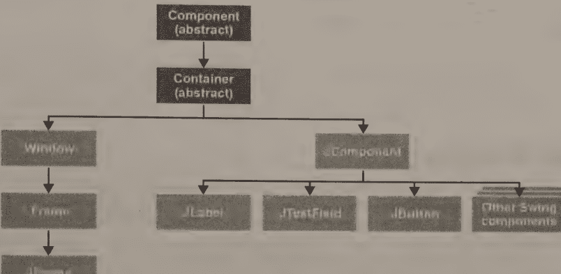

## 这些类的总结

| 类 | 描述 |
|---|---|
| Component | AWT 抽象类，定义任何可以显示的对象。例如，帧、面板、按钮文本字段派自此类。 |
| Container | AWT 抽象类，定义任何可以包含其他组件的组件。 |
| Window | AWT 类，定义没有标题栏或边框的窗口。 |
| Frame | AWT 类，定义带有标题栏和边框的窗口。 |
| JFrame | Swing 类，定义带有标题栏和边框的窗口。 |
| JComponent | Swing 组件（如 `JPanel`、`JButton`、`JLabel` 和 `JTextField`）的基类。 |
| JPanel | Swing 类，定义面板，用于包含其他组件。 |
| JButton | Swing 类，定义按钮。 |
| JLabel | Swing 类，定义标签。 |
| JTextField | Swing 类，定义文本字段。 |

## 如何创建一个处理事件的 GUI

当你使用 `Swing` 开发 GUI 时，通常从显示一个作为应用程序主窗口的帧（frame）开始。然后，你向帧中添加面板和按钮等组件。最后，你处理用户与这些组件交互时发生的事件。

## 如何显示帧

`JFrame` 组件具有一个边框，并包含了你操作系统所有的标准窗口控件，如最小化、最大化和关闭按钮。图 21-3 显示了一个空 `JFrame` 组件的示例以及显示它的代码。

要设置帧的标题，你可以将其作为参数传递给 `JFrame` 构造函数，或者创建一个 `JFrame` 对象并使用 `setTitle()` 方法。

要设置帧的大小，你可以使用 `setSize()` 方法。该方法接受两个整数，分别代表像素为单位的宽度和高度。例如，在图中，帧被设置为宽度 600 像素，高度 400 像素。另一种设置帧大小的方法是使用 `pack()` 方法。该方法不接受任何参数，并调整帧的大小，恰好容纳其包含的所有组件。如果你不设置大小，帧的宽度和高度为零，你将看不到它包含的任何组件。因此，你通常需要设置帧的大小。

要设置帧的位置，你可以向 `setLocationByPlatform()` 方法传递一个 `true` 值。然后，操作系统将决定帧的位置，这通常正是你想要的。

当用户点击帧的关闭按钮时，你通常希望关闭帧并退出应用程序。对此最简单的方法是调用 `setDefaultCloseOperation()` 方法并向其传递 `EXIT_ON_CLOSE` 值，如图所示。虽然该方法还可以使用其他可能的值，但 `EXIT_ON_CLOSE` 值是关闭帧的一种快速方便的方法。如果你不包含这段代码且用户点击关闭按钮，帧将继续运行。这是因为默认情况下，关闭只会关闭帧，而不会结束应用程序。

在显示帧之前，你可以将外观和感觉设置为 `Swing` 可用的任何外观。要做到这一点，你可以使用从 `javax.swing` 包中提供的 `UIManager`，如图所示。该代码将 `Swing` 组件的外观和感觉设置为当前操作系统。因此，此应用程序在 Windows 上看起来像 Windows 应用，在 OS X 上像 Mac 应用，在 Linux 上则像 Linux 应用。在实践中，你通常需要做更多工作来让应用程序运行得完全像原生 Mac 应用。然而，这超出了本书的范围。

最后，要显示帧，你可以向 `setVisible()` 方法传递一个 `true` 值。

## 包含 Swing 类的包

`javax.swing`

## 一个空帧


## 创建并显示帧的主方法

```java
public static void main(String[] args) {
    JFrame frame = new JFrame("Product Manager");
    frame.setSize(600, 400);
    frame.setLocationByPlatform(true);

    frame.setDefaultCloseOperation(JFrame.EXIT_ON_CLOSE);

    try {
        UIManager.setLookAndFeel(
            UIManager.getSystemLookAndFeelClassName());
    } catch (ClassNotFoundException | IllegalAccessException |
            InstantiationException | UnsupportedLookAndFeelException e) {
        System.err.println("Unsupported look and feel.");
    }

    frame.setVisible(true);
}
```

## 

- 帧通常定义应用程序的主窗口。

- 要设置帧的标题，你可以使用 `JFrame` 类的构造函数。或者，你可以调用 `JFrame` 对象的 `setTitle()` 方法。

- 要设置帧的大小，你可以调用 `setSize()` 方法并发送像素为单位的高度和宽度。或者，你可以调用 `pack()` 方法自动调整窗口大小，使其足够大以容纳所有组件。

- 要让操作系统设置帧的位置，你可以调用 `setLocationByPlatform()` 方法并发送一个 `true` 值。

- 要在用户选择关闭按钮时退出应用程序，你可以设置默认关闭操作。如果不这样做，窗口关闭后应用程序将保持继续运行。

- 要将外观和感觉设置为默认平台的外观和感觉，你使用 `try-catch` 块调用 `UIManager` 类的 `setLookAndFeel()` 方法。

- 要使帧可见，你调用 `setVisible()` 方法并传递一个 `true` 值。

图 21-3 如何操作帧

## 如何向帧中添加面板

通常，构建 GUI 应用程序最简单的方法是使用名为面板（panel）的不可见容器来组合组件。要用 `Swing` 实现这一点，你可以使用 `JPanel` 类。然后，你可以向帧添加一个或多个面板。

图 21-4 显示了如何向帧添加面板的示例。首先，它创建了一个名为 `panel` 的 `JPanel`。然后，它调用 `add()` 方法将面板添加到帧中。由于面板是不可见的，因此这不会在帧上显示任何内容。要实现这一点，你需要向面板添加一个或多个控件。

## 如何向面板添加按钮

第二个示例向面板添加了两个按钮。要这样做，它从 `JButton` 类创建了两个按钮。然后，使用面板的 `add()` 方法进行添加。

要设置按钮的文本，你可以使用 `JButton` 类的构造函数。或者，你可以调用 `JButton` 对象的 `setText()` 方法。要禁用按钮，你可以使用 `setEnabled()` 方法。要为按钮设置提示文字，可以使用 `setToolTipText()` 方法。

`JButton` 提供了一些常用方法。例如，你可以禁用按钮。如果你想更改文本，可以使用 `setText()` 方法。

## JButton 的常用方法

| 方法 | 描述 |
| :--- | :--- |
| `JButton(String)` | 设置按钮的文本。 |
| `setText(String)` | 设置按钮的文本。 |
| `setEnabled(boolean)` | 设置按钮是否可用。 |
| `setToolTipText(String)` | 为按钮设置提示文字。 |

# 包含事件的包

`java.awt.event`

# 大多数组件的常用方法

| 方法 | 说明 |
| --- | --- |
| `addActionListener(ActionEvent)` | 为组件（如按钮）添加事件监听器，使其能够监听并响应点击事件等事件。 |

# 为按钮添加事件处理器的代码

使用匿名类（Java 8 之前）

```java
button1.addActionListener(new ActionListener() {
    @Override
    public void actionPerformed(ActionEvent e) {
        System.out.println("Button 1 clicked!");
    }
});
```

使用 lambda 表达式（Java 8 及后续版本）

```java
button1.addActionListener((ActionEvent e) -> {
    System.out.println("Button 1 clicked!");
});
```

### 描述

- 为了让按钮在被点击时执行某些操作，可以通过调用其 `addActionListener()` 方法添加一个动作监听器。

- `addActionListener()` 方法接受一个 `ActionListener` 对象，该对象包含一个 `actionPerformed()` 方法，该方法接收一个 `ActionEvent` 对象。在 `actionPerformed()` 方法内部，你编写按钮被点击时要执行的代码。

- 在 Java 8 之前，通常使用匿名内部类来处理动作。然而，在 Java 8 或更高版本中，你可以使用 lambda 表达式，它更加整简洁。


# 如何使用布局管理器

在 GUI 设计的早期，通常会在你任何想要的地方放置不可缩放的组件。这种布局被称为固定宽度布局（fixed width layout）。虽然固定宽度布局快速方便，但它会引起许多问题。例如，如果调整了窗口大小时，内部的组件不会随之缩放，这意味着组件可能会消失在窗口边界之外。此外，如果用户的操作系统使用了不同的字体大小，组件可能会重叠在一起，或者隐藏在其他组件之下。为了解决这个问题，现代 GUI 工具包（包括 `Swing` 在内）使用了一种名为“布局管理器”（layout manager）的概念。

# 布局管理器摘要

Java 提供了几种内置的布局管理器，如图 21-6 汇总的所示。有些布局管理器易于使用，但缺乏灵活性；另一些较难使用，但具有灵活性并可以生成复杂的布局；还有一些布局主要设计用于为程序员生成代码的 GUI 工具，而不是直接为手工编码的程序员设计的。此外，还有几个免费的第三方布局管理器可用，对于某些任务来说可能更容易使用。

本章展示了如何使用 Java 自带的两种常用布局管理器：`FlowLayout` 和 `BorderLayout`。下一章将介绍如何使用 `GridBagLayout` 管理器。本章和下一章介绍的 Product Manager 使用了这三种布局管理器。一旦你熟悉了使用这些布局管理器的基础，就可以互联网上搜索关于其他布局管理器的信息，它们可能更适合某些特定类型的任务。

默认情况下，`JFrame` 使用 `BorderLayout` 管理器，而 `JPanel` 使用 `FlowLayout` 管理器。如果容器提供的默认布局管理器不符合你的需求，可以通过调用容器的 `setLayout()` 方法更改为不同的布局，如图所示。这段代码将框架的布局管理器从默认的 `BorderLayout` 更改为 `FlowLayout`。

# 包含布局管理器的包

`java.awt`

# 布局管理器摘要

| 管理器 | 说明 |
| --- | --- |
| `BorderLayout` | 通过提供五个区域来布局组件，每个区域可以容纳一个组件。这五个区域是北、南、东、西和中心。 |
| `FlowLayout` | 通过从左到右或从右到左流式排列布局组件，类似于页面上的文字。 |
| `GridBagLayout` | 如下一章所示，在矩形网格中布局组件。 |
| `GridLayout` | 在矩形网格单元格中布局组件，每个单元格的大小相同。 |


| CardLayout | 在卡片上布局组件，一次只有一个卡片可见。这种布局很少使用，但对于创建引导用户完成逐步过程的向导对话框（wizard dialogs）有用。 |
| BoxLayout | 在水平或垂直的单元格行中布局组件。这很少使用，但对于生成按钮行有用。 |

# 容器组件的常用方法

| 方法 | 说明 |
| --- | --- |
| `setLayout(Layout)` | 将布局设置为指定的布局管理器。 |

# 更改容器的布局管理器

```java
JFrame frame = new JFrame();
frame.setLayout(new FlowLayout());
```

### 描述

- 布局管理器决定了组件在容器中的放置方式，以及当容器调整大小或字体大小发生变化时组件的行为。
- 默认情况下，`JFrame` 使用 `BorderLayout` 管理器。
- 默认情况下，`JPanel` 使用 `FlowLayout` 管理器。

图 21-6 布局管理器摘要

# 如何使用 FlowLayout 管理器

在本书介绍的三个布局管理器中，`FlowLayout` 是最容易使用的。它按行添加组件，并根据对齐参数对组件进行对齐。默认情况下，`FlowLayout` 管理器将组件居中。

图 21-7 中的第一个示例首先创建一个标题为“Product Manager”的新 `JFrame`。然后，这段代码将尺寸设为宽度 600 像素，高度 400 像素。接下来，这段代码调用框架的 `setLayout` 方法，并传递一个 `FlowLayout` 管理器的新实例。由于该语句没有为 `FlowLayout` 管理器指定对齐方式，它将使用默认设置。在设置 `FlowLayout` 管理器之后，这段代码向框架添加了按钮 1、2、3、4。当 `FlowLayout` 达到容器右边缘时，它会换行。如果 `FlowLayout` 达到容器没有足够的空间，它会换行。在这种情况下，`FlowLayout` 管理器将组件居中。为了更改 `FlowLayout` 的对齐方式，可以向构造函数提供对齐参数。在这种情况下，它向左对齐。

图 21-7 如何使用 FlowLayout

# 如何使用 BorderLayout 管理器

`BorderLayout` 管理器具有五个区域：北、南、东、西和中心。每个区域可以容纳一个组件。图 21-8 显示了一个使用 `BorderLayout` 管理器的框架。由于 `BorderLayout` 是框架的默认布局管理器，这段代码没有设置它。在创建框架后，通过调用框架的 `add` 方法向北区域添加按钮，将组件作为第一个参数，区域作为第二个参数。在这里，组件是一个显示“North”的 `JButton`，而 `BorderLayout.NORTH` 常量指定了区域。同样，这段代码向南区域添加按钮。像北区域一样，布局管理器将组件水平填充框架的宽度，垂直填充其首选高度。

在添加了南北区域后，这段代码向东和西区域添加按钮。在这种情况下，布局管理器将这些组件填充南北区域之间的所有垂直空间。此外，它将这些组件调整为其首选宽度。最后，代码向中心区域添加按钮。在这种情况下，布局管理器将组件在垂直和水平方向上填充其他区域组件占据的剩余空间。

如果你调整此窗口的大小，布局管理器会调整每个区域组件的大小。北部和南部组件水平填充新空间，但高度保持不变。东部西部组件垂直填充新空间，但宽度保持不变。而中心组件则填充任何剩余空间。

如果你没有为 `BorderLayout` 的一个或多个区域提供组件，该区域的大小为 0。例如，如果你从东区域移除按钮，则东区域的大小为 0。结果是，中心组件延伸到框架的右边缘。

`BorderLayout` 管理器经常用于布局应用程序的主界面。假设你正在编写一个电子邮件客户端。你可能将北部用于工具栏，西部区域用于文件夹列表，中心区域用于邮件列表，南部区域用于状态栏。在这种情况下，你可能不会使用东区域。

在使用 `BorderLayout` 管理器时，重要的是记住每个区域只能容纳一个组件。因此，如果你想添加多个组件，需要在添加它们之前将这些按钮分组到一个面板（panel）中。例如，如果你想在一个北部一个带有多个按钮的工具栏，你需要将这些按钮分组到一个面板中（可能对面板使用 `FlowLayout`），然后将面板添加到 `BorderLayout` 的北部区域。

# BorderLayout 类的常用方法

| 方法 | 描述 |
| :--- | :--- |
| `add(component, area)` | 将指定的组件添加到指定的区域。要设置区域，你可以指定 `BorderLayout` 类的 `NORTH`（北）、`SOUTH`（南）、`EAST`（东）、`WEST`（西）或 `CENTER`（中）。 |

# 向 BorderLayout 的每个区域添加五个按钮的代码

```java
JFrame frame = new JFrame("Product Manager");
frame.setSize(600, 400);
frame.add(new JButton("North"), BorderLayout.NORTH);
frame.add(new JButton("South"), BorderLayout.SOUTH);
frame.add(new JButton("East"), BorderLayout.EAST);
frame.add(new JButton("West"), BorderLayout.WEST);
frame.add(new JButton("Center"), BorderLayout.CENTER);
```

# 上述代码产生的 JFrame


### 描述

- `BorderLayout` 有五个区域：`NORTH`、`SOUTH`、`EAST`、`WEST` 和 `CENTER`。
- 默认区域是 `CENTER`。因此，如果你不指定区域，组件将添加到中心。
- `NORTH` 和 `SOUTH` 区域获得其首选高度，这通常意味着它们足够高以包含其中的任何内容。首选宽度会被忽略。
- `WEST` 和 `EAST` 区域获得其首选宽度，这通常意味着它们足够宽以包含其中的任何内容。首选高度会被忽略。
- `CENTER` 区域获得所有剩余空间，并随着窗口调整而扩展或收缩。
- `BorderLayout` 的每个区域只能包含一个组件。如果你需要向一个区域添加多个组件，可以先将它们添加到面板（panel）中，然后将面板添加到区域。

图 21-8 如何使用 BorderLayout 布局

# 如何使用表格

许多应用程序（尤其是与数据库交互的应用程序）需要在表格中显示数据行。为了实现这一点，你可以使用 `JTable` 组件。表格模型（table model）持有表格的数据，并决定数据在表格中的显示方式。首先，你通常从为表格创建一个模型开始。

# 如何为表格创建模型

图 21-9 开始展示了一个 `JTable` 组件，以及为了操作表格及其模型所必需的术语。表格的第一行（通常称为表头）包含表格中每列的列名。在图中，列名是“Code”、“Description”和“Price”。一列通常存储特定类型的数据。在图中，第一列存储产品代码，第二列存储描述，第三列存储价格。而一行通常存储一条完整的记录。在图中，每个表格模型的每一行都存储了产品的所有信息。

要为表格创建模型，你可以扩展 Swing 中的 `AbstractTableModel` 类。在这些方法中，你可以重写（override）图中第一个表格中的方法。更新，你必须重写前三个，并且应该重写第四个。

此外，你还可以为模型类添加其他方法。例如，你可能想要添加一个方法，以便从模型中获取 `Product` 对象。或者，你可能需要添加一个方法调用 `fireTableDataChanged` 方法来通知表格模型中的数据已更新。这样，表格就可以刷新自身以显示当前数据。你将在下一个图中看到它是如何工作的。

# JTable 术语

| 列名 | 代码 | 描述 | 价格 |
| :--- | :--- | :--- | :--- |
| | java | Murach's Java Programming | $50.00 |
| | jsp | Murach's Java Servlets and JSP | $57.50 |
| Row | mysql | Murach's MySQL | $54.50 |
| | android | Murach's Android Programming | $57.50 |
| | html5 | Murach's HTML5 and CSS3 | $54.50 |
| | orade | Murach's Oracle and PL/SQL | $54.50 |
| | javascript | Murach's JavaScript and jQuery | $54.50 |
| | net | Microsoft .NET | $48.00 |

# 你通常重写的 TableModel 方法

| 方法 | 描述 |
| :--- | :--- |
| `getRowCount()` | 返回表格行数的整数 |
| `getColumnCount()` | 返回表格列数的整数 |
| `getValueAt(row, column)` | 返回表格中给定行和列索引处值的对象 |
| `getColumnName(column)` | 返回表示指定列索引处列名的字符串。该值被用作表格表头中的列标签 |

# 你可以调用的 AbstractTableModel 方法

| 方法 | 描述 |
| :--- | :--- |
| `fireTableDataChanged()` | 通知所有监听器表格行中的所有单元格值已更改。 |

### 描述

- 创建自定义表格模型的简单方法是扩展 `AbstractTableModel` 类。
- 至少，你需要重写 `getRowCount`、`getColumnCount` 和 `getValueAt` 方法。此外，重写 `getColumnName` 方法也是常见的。
- 当你更新数据库时，可以调用 `fireTableDataChanged` 方法来刷新表格中显示的所有数据。
- `AbstractTableModel` 包含其他方法，例如 `fireTableCellUpdated` 和 `fireTableInserted`，你可以调用它们来更新表格。

图 21-9 如何创建模型

# ProductTableModel 类

图 21-10 显示了用于表格的类代码。该类名为 `ProductTableModel`，它扩展了 `AbstractTableModel`。在类中，第一个语句声明了一个名为 `products` 的变量。第二个语句声明了一个用于列名的字符串数组。这些列名是 Code、Description 和 Price。

该类的构造函数调用了上一节中 `ProductDB` 类的 `getAll` 方法来获取 `Product` 对象列表。然后，它将该列表赋值给变量 `products`。

`getRowCount` 方法是扩展 `AbstractTableModel` 类时要求重写的三个方法之一。该方法返回行数的整数值。由于此值等于列表中产品的数量，该代码返回 `products` 列表的 `size` 方法的值。

`getColumnCount` 方法是要求重写的第二个方法。该方法返回列数的整数值。为了实现，它返回 `COLUMN_NAMES` 数组的长度，这与列数相同。

`getColumnName` 不是要求的，但如果你想显示列名，它是必要的。该方法接收一个列索引并返回指定索引的列名。为了实现，该方法返回 `COLUMN_NAMES` 数组中该索引的字符串。

`getValueAt` 是要求重写的第三个方法。该方法定义行索引和列索引作为参数。然后，它返回指定行和列的值。为了实现，该方法使用 `switch` 语句来确定要显示的列。对于列索引 0，该代码调用 `list` 的 `get` 方法返回指定行索引处的 `Product` 对象。然后，它使用方法链调用该 `Product` 对象的 `getCode` 方法。对于列索引 1，该代码调用指定行索引处 `Product` 对象的 `getDescription` 方法。对于列索引 2，该代码调用对象的 `getPriceFormatted` 方法。

让新程序员感到困惑的一个点是这四个方法，你永远不会在任何地方手动调用它们。这是因为当 `JTable` 组件需要有关如何显示表格的信息时会调用这些方法。例如，当 `JTable` 组件需要知道表格第一行描述列显示什么值时，它会调用行索引为 0、列索引为 1 的 `getValueAt` 方法。然后，`getValueAt` 方法从列表的第一行获取 `Product` 对象，并调用其 `getDescription` 方法返回描述。

# ProductTableModel 类

```java
package mma.ui;

import java.util.List;
import javax.swing.table.AbstractTableModel;

import mma.business.Product;
import mma.db.ProductDB;
import mma.db.DBException;
```

```java
public class ProductTableModel extends AbstractTableModel {
    private List<Product> products;
    private final String[] COLUMN_NAMES = { "Code", "Description", "Price" };
```

```java
public ProductTableModel() {
    try {
        products = ProductDB.getAll();
    } catch (DBException e) {
        System.out.println(e);
    }
}
```

```java
@Override
public int getRowCount() {
    return products.size();
}
```

```java
@Override
public int getColumnCount() {
    return COLUMN_NAMES.length;
}
```

```java
@Override
public String getColumnName(int columnIndex) {
    return COLUMN_NAMES[columnIndex];
}
```

```java
@Override
public Object getValueAt(int rowIndex, int columnIndex) {
    switch (columnIndex) {
        case 0:
            return products.get(rowIndex).getCode();
        case 1:
            return products.get(rowIndex).getDescription();
        case 2:
            return products.get(rowIndex).getPriceFormatted();
        default:
            return null;
    }
}
```

图 21-10 ProductTableModel 类（部分 1/2）

`databaseUpdated` 方法用数据库中的新数据更新表格模型中的旧数据。然后，它调用了表格模型的 `fireTableDataChanged` 方法。这会通知 `JTable` 组件模型中的数据已发生变化。这允许 `JTable` 组件显示新数据。如果你修改了数据库中的底层数据，可以调用此方法将表格中显示的数据与数据库中的数据同步。

# ProductTableModel 类（续）

```java
Product getProduct(int rowIndex) {
    return products.get(rowIndex);
}

void databaseUpdated() {
    try {
        products = ProductDB.getAll();
        fireTableDataChanged();
    } catch (DBException e) {
        System.out.println(e);
    }
}
```

### 描述

- 当某行代表业务对象（如 `Product` 对象）时，你可以包含一个返回指定行索引对应对象的方法。
- 为了使表格中的数据与数据库中的数据同步，你可以包含一个方法，用来自数据库的数据更新模型，然后调用 `fireTableDataChanged` 方法。这会导致表格显示存储在模型中的新数据。

图 21-10 ProductTableModel 类（部分 2/2）

# 如何创建表格

一旦你为表格创建了模型，就可以创建一个 `JTable` 组件来显示存储在该模型中的数据。图 21-11 的第一个示例展示了如何实现。

这段代码通过从上一个图所示的类创建一个 `ProductTableModel` 对象开始。然后通过将模型传递给 `JTable` 类的构造函数创建一个新的 `JTable` 组件。或者，这段代码也可以调用 `JTable` 类的空构造函数，并使用 `setModel` 方法来设置模型。

为表格设置模型后，这段代码将表格的选择模式设置为 `SINGLE_SELECTION`。结果是，用户一次只能选择一行。不过，你可以使用另外两个值来设置选择模式。

首先，你可以使用 `SINGLE_INTERVAL_SELECTION` 模式，允许用户通过按住 Control 或 Shift 键选择多行。但是，这只有在这些行连续的时才有效。换句话说，只有当所选行相邻时它才有效。


其次，如果你想允许更多可能性，可以使用 `MULTIPLE_INTERVAL_SELECTION` 模式，允许用户通过按住 Control 或 Shift 键选择多行。但在这种模式下，行不需要是连续的。

设置选择模式后，这段代码调用了表格的 `setBorder` 方法并向该方法传递了一个 `null` 值。结果是该表格不包含边框。如果你计划如下一个图所示为表格添加滚动条，请确保 GUI 不要显示两个边框：一个用于表格，一个用于滚动条。每当组件将占据容器的所有空间时，都是最佳实践。

# 如何获取选中的行或多行

第二个示例展示了如何在表格显示后从中获取选中的行或多行。这段代码通过调用表格的 `getSelectedRow` 方法开始。这获取了用户选择的第一行的索引。

获取行索引后，这段代码会检查用户是否选择了一行。如果是，它会将行索引传递给表格模型的 `getProduct` 方法。这获取了与所选行对应的 Product 对象。

在这个示例中使用 `getSelectedRow` 方法是合理的，因为第一个示例只允许用户选择单行。然而，如果第一个示例允许用户选择多行，那么在这个示例中使用 `getSelectedRows` 方法来获取所有选中行的索引将会有意义的。

# JTable 类的一些常用构造函数和方法

| 构造函数 | 描述 |
|---|---|
| `JTable(model)` | 构建一个 JTable |

| 方法 | 描述 |
|---|---|
| `setModel(model)` | 设置表格的模型 |
| `setSelectionMode(mode)` | 设置表格的选择模式 |
| `setBorder(border)` | 设置表格的边框 |
| `getSelectedRow()` | 获取第一个选中的行索引 |
| `getSelectedRows()` | 获取所有选中行的索引数组 |

| ListSelection 常量 | 描述 |
|---|---|
| `SINGLE_SELECTION` | 允许一次选择一行 |
| `SINGLE_INTERVAL_SELECTION` | 允许选择多行，但仅当它们连续时 |
| `MULTIPLE_INTERVAL_SELECTION` | 允许同时选择多行，即使它们不连续 |

# 创建表格的代码

```java
ProductTableModel productTableModel = new ProductTableModel();
JTable productTable = new JTable(productTableModel);
productTable.setSelectionMode(ListSelection.SINGLE_SELECTION);
productTable.setBorder(null);
```

# 从表格获取数据的代码

```java
int rowIndex = productTable.getSelectedRow();
if (rowIndex != -1) {
    Product product = productTableModel.getProduct(rowIndex);
}
```

### 描述

- 一旦为表格创建了模型，就可以创建表格并设置模型。然后，你可以使用表格的方法对其进行操作。


# 如何为表格添加滚动条

表格通常包含许多行或列，导致无法在屏幕上完整显示。幸运的是，Swing 提供了一个名为 `JScrollPane` 的容器，你可以用它为表格添加滚动条。当然，`JScrollPane` 也适用于任何其他组件，例如内容太大无法放入屏幕的文本区域。

图 21-12 的第一个示例展示了如何创建一个滚动面板并将表格添加到其中。为此，这段代码将表格传递给 `JScrollPane` 类的构造函数。然后，将 `JScrollPane` 对象添加到框架中。

第二个示例展示了另一种常用方法，将组件添加到滚动面板并将面板添加到框架。由于此示例没有维护 `JScrollPane` 对象的引用，因此无法调用它的任何方法。但是，只要不需要更改默认滚动策略，这通常是足够的。

如果你需要更改滚动面板策略，可以使用滚动面板的 `setHorizontalScrollBarPolicy` 和 `setVerticalScrollBarPolicy` 方法，如第三个示例所示。这些方法决定了滚动条对用户可见。两个滚动条的默认都是 `AS_NEEDED`。结果是，如果所有内容放入容器，滚动条就会隐藏。然而，如果内容无法放入，滚动条就会显示。

如果你想让滚动条永远不可见，可以将策略设置为 `NEVER`。这会隐藏滚动条。但是，用户仍然可以使用方向键以及 Page Up 和 Page Down 键来滚动组件。

### 向滚动面板添加组件

```java
JScrollPane scrollPane = new JScrollPane(productTable);
frame.add(scrollPane);
```

添加滚动面板的另一种方法

```java
frame.add(new JScrollPane(productTable));
```

### JScrollPane 类的一个构造函数和两个方法

| 构造函数 | 说明 |
|---|---|
| `JScrollPane(component)` | 将该组件添加到滚动面板中。 |

| 方法 | 说明 |
|---|---|
| `setHorizontalScrollBarPolicy(policy)` | 使用下表中的常量之一来控制水平滚动条的可见性。 |
| `setVerticalScrollBarPolicy(policy)` | 使用下表中的常量之一来控制垂直滚动条的可见性。 |

### ScrollPaneConstants

| 值 | 说明 |
|---|---|
| `HORIZONTAL_SCROLLBAR_AS_NEEDED` | 仅当内容比视口宽且无法同时显示时，才显示水平滚动条。这是默认值。 |
| `HORIZONTAL_SCROLLBAR_NEVER` | 始终不显示水平滚动条。但可以使用键盘上的左右方向键进行左右滚动。 |
| `HORIZONTAL_SCROLLBAR_ALWAYS` | 无论是否需要，始终显示水平滚动条。 |
| `VERTICAL_SCROLLBAR_AS_NEEDED` | 仅当内容比视口长且无法同时显示时，才显示垂直滚动条。这是默认值。 |
| `VERTICAL_SCROLLBAR_NEVER` | 始终不显示垂直滚动条。但可以使用键盘上的上下方向键以及 Page Up / Page Down 键对内容上下滚动。 |
| `VERTICAL_SCROLLBAR_ALWAYS` | 无论是否需要，始终显示垂直滚动条。 |

要使滚动条始终可见

```java
scrollPane.setHorizontalScrollBarPolicy(
    ScrollPaneConstants.HORIZONTAL_SCROLLBAR_ALWAYS);
scrollPane.setVerticalScrollBarPolicy(
    ScrollPaneConstants.VERTICAL_SCROLLBAR_ALWAYS);
```

### Description

- 你可以使用滚动面板为任何可能无法放入窗口的组件添加滚动条。
- 默认情况下，滚动面板仅在需要时才会显示滚动条。

图 21-12 如何使用滚动面板

# 如何使用内置对话框

如果你在进行 GUI 工作，有时可能需要使用对话框向用户显示消息。例如，你可能需要显示一个通知或警告。其他时候，你可能需要使用对话框来确认某个操作。你可能需要询问一个简单的问题来确定删除文件是否可以。

手动为这些常用对话框编写 GUI 代码将非常麻烦。幸运的是，Swing 提供了内置对话框，你可以使用 `JOptionPane` 类来处理它们。

由 `JOptionPane` 类创建的对话框始终显示在父容器之上。它总是*模态的*（modal），这意味着用户在响应对话框之前，无法与应用程序的任何部分交互。而且它总是*阻塞的*（blocking），这意味着对话框会停止当前运行的线程，并在用户响应对话框之前阻止其恢复。

### 如何显示消息

图 21-13 显示了如何使用 `JOptionPane` 类向用户显示消息。要这样做，你可以使用静态方法 `showMessageDialog`。该方法接受四个参数：(1) 父容器，(2) 消息，(3) 标题和 (4) 消息类型。

通常，对话框的父容器是应用程序的一个帧。但它也可以是像下一节描述的那种自定义对话框。

`JOptionPane` 可以显示图中列出的五种消息类型。在大多数情况下，这些类型之间的主要区别是消息框显示的图标。此图标可能会根据操作系统和不同的外观（look and feel）设置而有所不同。此外，某些操作系统可能会为某些类型的消息播放声音。

第一个示例显示了信息消息。因此，它使用了信息图标。由于此对话框的目的是显示消息，它仅包含标记为“OK”的按钮。阅读消息后，用户可以点击此按钮关闭对话框并继续应用程序。

第二个示例显示了错误消息。此示例的工作方式与第一个示例类似。但由于它是错误消息，因此使用了错误图标。

再次注意，这些图标可能会根据操作系统和外观而看起来不同。这些示例都使用了默认的 Swing 外观。

### JOptionPane 消息类型

| 类型 | 说明 |
|---|---|
| `ERROR_MESSAGE` | 错误图标。 |
| `WARNING_MESSAGE` | 警告图标。 |
| `INFORMATION_MESSAGE` | 信息图标。 |
| `QUESTION_MESSAGE` | 问号图标。 |
| `PLAIN_MESSAGE` | 无图标。 |

### 显示信息消息

```java
JOptionPane.showMessageDialog(frame, "The software has been updated.", "Updated", JOptionPane.INFORMATION_MESSAGE);
```

### 显示的对话框


### 显示错误消息

```java
JOptionPane.showMessageDialog(frame, "The internet could not be accessed because it doesn't exist.", "Resource doesn't exist", JOptionPane.ERROR_MESSAGE);
```

### 显示的对话框


### Description

- 要显示带有消息的对话框，你使用 `JOptionPane` 类的静态方法 `showMessageDialog`。该方法有四个参数：(1) 父容器，(2) 消息，(3) 标题和 (4) 对话类型。
- Java 使用父容器参数来确定对话框的位置。在 Windows 上，Java 通常将对话框在父容器上居中。
- 默认情况下，对话框有一个 OK 按钮。
- 对话框是模态的。这意味着它始终位于应用程序的其他部分之上。因此，用户在响应对话框之前无法继续操作。
- 对话框显示的图标外观取决于应用程序所使用的外观。此外，这些图标可能会根据区域而有所不同。

图 21-13 如何显示消息

### 如何确认操作

图 21-14 显示了如何使用 `JOptionPane` 类显示一条通过询问用户来确认操作的消息。要这样做，你可以调用 `showConfirmDialog` 方法。该方法的工作原理与前一图描述的 `showMessageDialog` 方法类似。然而，`showConfirmDialog` 的第四个参数决定了应该显示哪些按钮。此外，此方法返回一个指示点击了哪个按钮的值。

`showConfirmDialog` 可以显示带有图中列出的按钮选项的对话框。在这些选项中，`YES_NO_OPTION` 类型和 `OK_CANCEL_OPTION` 类型常用。

第一个示例显示了一个对话框，询问用户是否想要创建一个新文件。在这里，方法的前三个参数与前一图所示方法的前三个参数相同。然而，第四个参数使用 `YES_NO_OPTION` 值来指定对话框显示 Yes 和 No 按钮。此外，此代码将 `showConfirmDialog` 方法的返回值赋值给名为 `option` 的 int 变量。在图的第二部分，你将学习如何使用此变量确定用户点击了哪个按钮。

默认情况下，`showConfirmDialog` 使用 `QUESTION_MESSAGE` 类型。这种消息类型像第一个示例所示显示一个问号图标。然而，如果用户执行的操作将删除文件、更改数据或执行无法撤销的操作，你可能希望使用提供更强警告的图标。要这样做，你可以提供一个可选的第五个参数，使用前一图所示的消息类型值之一。例如，在图中第二个类型代码示例提供了一个第五个参数，指定了 `WARNING_MESSAGE` 类型。

### JOptionPane 选项类型

| 类型 | 按钮 |
|---|---|
| `DEFAULT_OPTION` | OK |
| `YES_NO_OPTION` | 是和否 |
| `YES_NO_CANCEL_OPTION` | 是、否和取消 |
| `OK_CANCEL_OPTION` | OK和取消 |

### 显示一个带有“是”和“否”按钮的询问对话框

```java
int option = JOptionPane.showConfirmDialog(frame,
    "Do you want to create a new file?", "New file",
    JOptionPane.YES_NO_OPTION);
```

### 对话框显示


### 显示一个带有警告图标的询问对话框

```java
int option = JOptionPane.showConfirmDialog(frame,
    "Are you sure you want to delete the Internet?\n"
    + "This operation cannot be undone.", "Are you sure?",
    JOptionPane.YES_NO_OPTION, JOptionPane.WARNING_MESSAGE);
```

### 对话框显示


### Description

- 要显示一个允许用户确认或取消操作的对话框，可以使用 `JOptionPane` 类的静态方法 `showConfirmDialog`。
- `showConfirmDialog` 方法的前三个参数的作用与前一个图所示的 `showMessageDialog` 方法相同。
- 第四个参数决定了所显示的按钮。
- 默认情况下，`showConfirmDialog` 方法显示问号图标。然而，你可以通过传递第五个参数指定另一种类型的图标。
- 要将长消息换行到第二行，可以使用换行符 (`\n`)。

图 21-14 如何确认操作（2 部分中的第 1 部分）

图 21-14 的第 2 部分显示了如何使用 `showConfirmDialog` 方法的返回值来确定用户选择了哪个按钮。该方法可以返回图中列出的任何值。当然，可能的返回值取决于对话框的类型。例如，`YES_NO_OPTION` 类型的对话框会返回 `YES_OPTION` 或 `NO_OPTION`。换句话说，它永远不会返回 `CANCEL_OPTION` 或 `OK_OPTION`。然而，所有对话类型都可以返回 `CLOSED_OPTION`，表示用户在未选择任何按钮的情况下关闭了对话框。

代码示例使用 `switch` 语句来确定用户选择了哪个按钮。为了实现这一点，该 `switch` 语句为每个可能的返回值提供了一个 `case` 情况：`YES_OPTION`、`NO_OPTION` 和 `CLOSED_OPTION`。然后，它根据用户选择的选项向控制台打印不同的消息。或者，可以使用 `if/else` 语句代替 `switch` 语句。然而，作为一般规则，`switch` 语句更高效。此外，对于此类代码，它们更容易读。

记住，`JOptionPane` 生成的对话框是阻塞的。这意味着它们会停止线程防止其在用户对对话框做出响应之前继续。因此，在用户选择对话框任意一个按钮或关闭对话框之前，`switch` 语句不会运行。

### JOptionPane 返回值

| 值 | 说明 |
|---|---|
| `YES_OPTION` | 选择了“是”按钮。 |
| `NO_OPTION` | 选择了“否”按钮。 |
| `CANCEL_OPTION` | 选择了“取消”按钮。 |
| `OK_OPTION` | 选择了“OK”按钮。 |
| `CLOSED_OPTION` | 在未进行任何选择的情况下关闭了消息框。 |

### switch 语句确定选择了哪个按钮


```java
int option = JOptionPane.showConfirmDialog(frame,
  "Are you sure want to delete the Internet?\n"
  + "This operation cannot be undone.", "Are you sure?",
  JOptionPane.YES_NO_OPTION, JOptionPane.WARNING_MESSAGE);

switch (option) {
  case JOptionPane.YES_OPTION:
    System.out.println("You clicked the Yes button.");
    break;
  case JOptionPane.NO_OPTION:
    System.out.println("You clicked the No button.");
    break;
  case JOptionPane.CLOSED_OPTION:
    System.out.println("You closed the dialog.");
    break;
}
```

### 描述

- 当用户从对话框中选择一个选项时，`showInputDialog` 方法会关闭对话框并返回该选项的 `int` 值。
- 要确定用户选择的选项，通常会使用 `switch` 语句。然而，也可以使用 `if/else` 语句。


# 产品管理器框架

本章最后介绍了产品管理器应用程序主窗口的完整代码。这些代码使用了你在本章中学的大部分概念和组件。

## 用户界面

图 21-15 显示了产品管理器应用程序的用户界面。应用程序的主窗口是一个使用 `BorderLayout` 布局器的 `JFrame` 组件。该框架显示两个组件。

第一个是使用 `FlowLayout` 布局器的 `JPanel` 组件，用于显示三个 `JButton` 组件。框架在布局的 `NORTH`（北）区域显示此面板。

第二个是包含一个 `JTable` 组件的 `JScrollPane` 组件。该表显示存储在数据库中的产品数据。框架在布局的 `CENTER`（中）区域显示此滚动面板。

要删除产品，用户可以选择该产品所在的行并点击“删除（Delete）”按钮。这将显示如图所示的“确认删除”对话框。如果用户选择“是”按钮确认删除，将从数据库中删除该产品并更新 `JTable` 组件中显示的数据。

此时，“添加（Add）”和“编辑（Edit）”按钮尚未实现。因此，如果用户点击其中任一按钮，应用程序将显示一个对话框，指示该功能尚未实现。在下一章中，你将学习如何实现这些按钮，以便它们用于添加新产品或更新现有产品。

### 界面截图

| 图片 | 说明 |
| :--- | :--- |
| 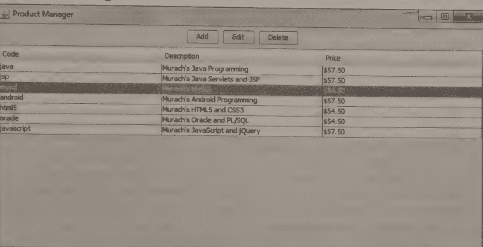 | 产品管理器框架 |
|  | 删除按钮的对话框 |
|  | 添加和编辑按钮的对话框 |

### 描述

- 产品管理器应用程序的主窗口是一个框架，显示一个包含三个按钮的面板以及一个包含多个产品数据的表格。
- 如果用户选择某个产品的行并点击“删除”按钮，应用程序将显示一个对话框，允许用户确认删除。
- 如果用户选择“添加”或“编辑”按钮，应用程序将显示一个对话框，指示这些功能尚未实现。你将在下一章中学习如何实现这些功能。

图 21-15 产品管理器应用程序的用户界面

## ProductManagerFrame 类

图 21-16 显示了创建产品管理器应用程序主窗口的代码。首先，类声明声明了一个名为 `ProductManagerFrame` 的类，它继承自 `JFrame` 类。这是一个常见的做法，因为允许你存储所有定义此框架的代码。

该类从定义实例变量开始。首先，它定义了一个名为 `productTable` 的 `JTable` 组件。该组件显示产品列表。其次，它定义了本章稍早描述的 `ProductTableModel` 实例。该模型存储了数据。

该类的构造函数首先使用 `UIManager` 尝试将外观设置为运行应用程序的操作系统的原生外观。这一步是可选的，但它通常能改善应用程序的外观。

在设置外观之后，构造函数设置了框架的标题、大小和位置。然后，它设置了默认关闭操作，以便在用户关闭窗口时退出应用程序。如果不包含此行代码，窗口会关闭，但应用程序将在后台运行。

在设置默认关闭操作后，构造函数调用了稍后显示的 `buildButtonPanel` 方法来获取包含该应用程序三个按钮的面板。然后，它将此面板添加到 `BorderLayout` 的 `NORTH` 区域。这是因为 `JFrame` 默认使用 `BorderLayout` 布局器。

在将面板添加到 `NORTH` 区域后，构造函数调用了稍后显示的 `buildProductTable` 方法来获取产品表的 `JTable` 组件。此外，它将此 `JTable` 组件赋值给 `productTable` 变量。

在创建 `JTable` 组件后，构造函数将包含该 `JTable` 的 `JScrollPane` 面板添加到 `BorderLayout` 的 `CENTER` 区域。由于 `CENTER` 是默认区域，代码可以省略此参数。然而，包含此参数明确标识了 `BorderLayout` 的区域。

最后，构造函数调用 `setVisible` 方法将用户界面显示给用户。该语句放在最后是因为在构造函数中更早的地方编写它可能会导致用户界面在首次显示时出现闪烁。

`buildButtonPanel` 方法开始创建一个 `JPanel` 对象。默认情况下，`JPanel` 使用 `FlowLayout` 布局器。由于这正是我们情况下需要的，因此代码没有设置布局。

该方法继续创建“添加”、“编辑”和“删除”按钮。然后，它为这些按钮中的设置了工具提示。例如，它为“编辑”按钮设置了“编辑选中产品”的工具提示。接下来，它使用 Lambda 表达式为每个按钮添加动作监听器。这些监听器都会调用命名适当的方法。例如，“添加”方法的动作监听器会调用在本类稍后编写的 `addButton` 方法。

### 代码片段 1/3

```java
package nma.ui;

import java.awt.BorderLayout;
import java.awt.event.ActionEvent;
import javax.swing.JButton;
import javax.swing.JFrame;
import javax.swing.JOptionPane;
import javax.swing.JPanel;
import javax.swing.JScrollPane;
import javax.swing.JTable;
import javax.swing.ListSelectionModel;
import javax.swing.UIManager;
import javax.swing.UnsupportedLookAndFeelException;

import nma.business.Product;
import nma.db.ProductDB;
import nma.db.DBException;

public class ProductManagerFrame extends JFrame {
    private JTable productTable;
    private ProductTableModel productTableModel;

    public ProductManagerFrame() {
        try {
            UIManager.setLookAndFeel(UIManager.getSystemLookAndFeelClassName());
        } catch (ClassNotFoundException | InstantiationException | 
                 IllegalAccessException | UnsupportedLookAndFeelException e) {
            System.out.println(e);
        }
        setTitle("Product Manager");
        setSize(768, 384);
        setLocationByPlatform(true);
        setDefaultCloseOperation(JFrame.EXIT_ON_CLOSE);

        add(buildButtonPanel(), BorderLayout.NORTH);
        productTable = buildProductTable();
        add(new JScrollPane(productTable), BorderLayout.CENTER);
        setVisible(true);
    }

    private JPanel buildButtonPanel() {
        JPanel panel = new JPanel();

        JButton addButton = new JButton("Add");
        addButton.addActionListener((ActionEvent e) -> {
            addButton();
        });
        panel.add(addButton);

        JButton editButton = new JButton("Edit");
        editButton.setToolTipText("Edit selected product");
        editButton.addActionListener((ActionEvent e) -> {
            editButton();
        });
        panel.add(editButton);
        
        JButton deleteButton = new JButton("Delete");
        deleteButton.setToolTipText("Delete selected product");
        deleteButton.addActionListener((ActionEvent e) -> {
            deleteButton();
        });
        panel.add(deleteButton);

        return panel;
    }
}
```

在创建这三个按钮后，代码将这三个按钮添加到面板中。最后，`buildButtonPanel` 方法的最后语句返回了该面板。

接下来三个方法是动作监听器的事件处理方法。目前，Add 和 Edit 按钮的方法只是显示一个对话框，并提示该功能尚未实现。在下一章中，你将学习如何向这些方法添加代码，以便 Add 和 Edit 按钮能够用于添加新产品或编辑现有产品。

然而，Delete 按钮的代码用于从数据库中删除选定的产品。首先，这段代码使用 `JTable` 组件的 `getSelectedRow` 方法来获取所选行的索引。然后，它检查该索引是否等于 -1。如果是，它会显示一个消息对话框，指示用户在点击 Delete 按钮之前必须选择一个产品。否则，它会显示一个包含 Yes 和 No 按钮的对话框，允许用户确认操作。如果用户点击 Yes 按钮，这段代码将使用上一节描述的 `ProductDB` 类的 `delete` 方法来删除产品。然后，它会调用稍后编码的 `fireDatabaseUpdated` 事件。随后，它会调用表的 `databaseUpdated` 方法来更新 `JTable` 组件显示的数据。

调用 `JOptionPane` 类方法的代码将关键字 `this` 指定为方法的第一个参数。这告诉 `JOptionPane` 类对象（即 `ProductManagerFrame` 对象）它是对话框的父容器。

`buildProductTable` 方法创建一个 `ProductTableModel` 对象并将其赋值给实例变量 `productTableModel`。记住，`ProductTableModel` 类的构造函数会调用 `ProductDB` 类来获取所有记录。结果，它创建了一个包含与数据库中产品对应的产品列表的模型。

创建模型后，这段代码创建了一个新的 `JTable` 组件并设置其模型。为了做到这一点，它将 `productTableModel` 传递给 `JTable` 类的构造函数。

在创建 `JTable` 组件后，下一行代码将选择值设置为 `SINGLE_SELECTION`。结果是，用户一次只能选择一行。

由于此表显示在 `JScrollPane` 组件中，这段代码还将表的边界设置为 `null`。这样 Product Manager 应用程序就不会显示两个边界：一个是表格的边界，另一个是滚动面板的边界。

最后，这段代码返回了表。记住，该类的构造函数调用了 `buildProductTable` 方法来获取此表。然后，它将此表添加到滚动面板中，并将其添加到框架的中心区域。

### 代码片段 2/3

```java
private void addButton() {
    JOptionPane.showMessageDialog(this,
    "This feature hasn't been implemented yet.",
    "Not yet implemented", JOptionPane.ERROR_MESSAGE);
}
```

```java
private void editButton() {
    addButton();
}
```

```java
private void deleteButton() {
    int selectedRow = productTable.getSelectedRow();
    if (selectedRow == -1) {
        JOptionPane.showMessageDialog(this,
        "No product is currently selected.",
        "No product selected", JOptionPane.ERROR_MESSAGE);
    } else {
        Product product = productTableModel.getProduct(selectedRow);
        int ask = JOptionPane.showConfirmDialog(this,
        "Are you sure you want to delete " +
        product.getDescription() + " from the database?",
        "Confirm delete", JOptionPane.YES_NO_OPTION);
        if (ask == JOptionPane.YES_OPTION) {
            try {
                ProductDB.delete(product);
                fireDatabaseUpdated();
            } catch (DBException e) {
                System.out.println(e);
            }
        }
    }
}
```

```java
public void fireDatabaseUpdated() {
    productTableModel.databaseUpdated();
}
```

### 代码片段 3/3

```java
private JTable buildProductTable() {
    productTableModel = new ProductTableModel();
    JTable table = new JTable(productTableModel);
    table.setSelectionMode(ListSelectionModel.SINGLE_SELECTION);
    table.setBorder(null);
    return table;
}
```


## 观点

在本章中，你学习了使用 Swing 开发最常用的 GUI 工具包的基本技能。特别是学习了如何创建主窗口。你学习了如何添加按钮。你学习了如何处理点击按钮时发生的事件。你学习了如何处理显示数据库数据的表格。你还学习了如何使用内置对话框。在下一章中，你将学习如何创建允许添加和更新数据库数据的表单。

### 总结

- Swing 是 Java 最常用的 GUI 工具包。
- GUI 的元素被称为组件或控件。
- Swing 提供了可以更改的可视外观（look and feels）。
- 可以包含其他组件的组件被称为容器。常用的容器有框架、面板和滚动面板。
- `JFrame` 通常作为应用程序的主窗口。
- `JPanel` 组件是一个不可见组件，你可以用它组合其他组件。
- `JButton` 显示按钮。
- 要处理用户点击 `JButton` 组件时发生的事件，你可以使用 `ActionListener` 接口添加动作监听器（或事件监听器）。
- 事件处理器是响应 GUI 事件（如点击按钮）的方法。


- 布局管理器在容器中布局组件，并控制它们如何响应窗口大小调整等事件。
- `BorderLayout` 和 `FlowLayout` 布局管理器是常用的布局管理器。
- `JTable` 显示网格数据，例如来自数据库的表格。
- 表格模型为 `JTable` 组件提供网格数据。简单的方法是扩展 `AbstractTableModel` 类。
- `JScrollPane` 为组件（如 `JTable` 组件）添加滚动条，当组件不适应容器时，用户可以对其进行滚动。
- 你可以使用 `JOptionPane` 类的方法来显示包含性信息的对话框或确认操作的对话框。

# 练习 21-1 修改现有的 GUI

在本练习中，你将修改本章中描述的产品管理器（Product Manager）窗口的 GUI。

1. 打开 `ex_starts` 文件夹中名为 `ch21_ex1_ProductManager` 的项目。
2. 运行并测试 GUI。选择一行并验证可以使用 Delete 按钮删除它。然后点击 Add（添加）和 Edit（编辑）按钮，验证它们是否显示了告知用户该功能尚未实现的对话框。
3. 添加一个 Print（打印）按钮，点击后显示一个对话框告知用户已已发送打印机。要实现这一点，请在 `buildButtonPanel` 方法中添加另一个 `JButton`，添加一个监听器，并创建一个方法（你可以命名为 `doPrintButton`）来处理该操作。
4. 修改 Print 按钮执行的代码，如果产品表中没有选择任何行，则显示错误消息。要实现这一点，你可以参考 `doDeleteButton` 方法的代码。
5. 修改代码，使按钮面板显示在框架 `BorderLayout` 的 SOUTH（南）区域。要实现这一点，你需要修改构造函数中调用 `buildButtonPanel` 方法的部分。

# 如何使用 Swing 开发 GUI（部分2）

在上一章中，你学习了如何为产品管理器应用程序创建主窗口，包括显示数据库中存储产品的表格。在本章中，你将学习如何创建一个数据输入表单，允许你向数据库添加新产品或编辑现有产品。

- 如何使用标签和文本字段
- 如何使用标签
- 如何使用文本字段
- 如何使用 `GridBagLayout` 布局管理器
- `GridBagLayout` 布局管理器简介
- 如何在网格中布局组件
- 如何添加内边距
- 如何避免常见陷阱
- 如何编写数据输入表单
- 如何创建自定义对话框
- 如何在对话框及其父窗口之间传递数据
- 产品表单
- 用户界面
- `ProductForm` 类
- 使用 `ProductForm` 的两个方法
- 如何在 Swing 中使用线程
- 一个常见问题
- 如何解决该问题
- 观点

# 如何使用标签和文本字段

大多数应用程序使用一个或多个文本字段（也称为文本框）来允许用户输入数据。此外，大多数应用程序使用一个或多个标签来显示为文本框标记的文本。例如，在图 22-1 中，添加产品（Add Product）窗口包含三个标签和三个文本字段。

# 如何使用标签

你可以使用 `JLabel` 类来创建标签。例如，图中的第一个标签显示“Code:”，用于标记包含产品代码的文本字段。

第一个示例创建了一个标签并将其添加到面板中。在这里，第一条语句使用 `JLabel` 类的构造函数创建一个标签并设置其文本。不过，也可以使用 `setText` 方法来设置标签的文本。然后，第二条语句将标签添加到面板中。

第二个示例展示了如何在一个语句中创建标签并将其添加到面板。在这里，代码没有创建一个引用 `JLabel` 对象的变量。因此，你之后无法调用 `JLabel` 的任何方法。但是，这通常是没问题的，因为你很少需要调用标签的方法。

虽然图中的标签显示的是文本，但标签也可以显示图像。例如，你可以使用标签来显示标识文本字段的图标，或者显示产品的照片。不过，本书未涵盖在标签中使用图像的内容。

# 包含标签和文本字段的窗口

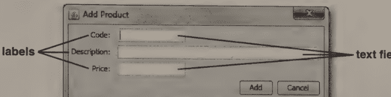

# `JLabel` 类的常用构造函数和方法

| 构造函数 | 描述 |
| :--- | :--- |
| `JLabel(String)` | 构建一个新的 `JLabel` 并设置指定字符串显示的文本 |
| 方法 `setText(String)` | 将标签显示的文本设置为指定的字符串 |

# 如何创建 `JLabel` 对象并将其添加到容器中

```
JLabel codeLabel = new JLabel("Code:");
panel.add(codeLabel)
```

# 将 `JLabel` 添加到容器的常用方法

```
panel.add(new JLabel("Code:"));
```

### 描述

- `JLabel` 组件定义了一个标签，它是一个不可编辑的控件，通常显示标记其他组件（如文本字段）的文本。
- 由于你很少需要调用 `JLabel` 对象的任何方法，在 `add` 方法内部调用 `JLabel` 类的构造函数是一种常见做法。这不会创建一个引用 `JLabel` 对象的变量。
- `JLabel` 对象也可以显示图像。不过，本书未涵盖。

# 如何使用文本字段

`JTextField` 类定义了一个文本字段，它可以向用户显示文本并允许用户输入或编辑文本。图 22-2 总结了 `JTextField` 类的一些常用构造函数和方法。

第一个示例创建了一个名为 `textField` 的文本字段。然后，它使用 `setColumns` 方法将文本字段的宽度设置为约为20个字符。这意味着文本字段的宽度取决于字体大小。然而，某些布局管理器会忽略此设置。在这种情况下，你可以本章稍后部分描述的 `setSize` 和 `setMinimumSize` 方法。

第二个示例展示了如何像第一个示例一样创建文本字段。然而，这个示例使用构造函数来设置字符数。

第三和第四示例展示了如何获取和设置存储在文本字段中的文本。在这里，第三个示例使用文本字段的 `getText` 方法获取存储在其中的字符串并将其赋值给 `String` 变量。相反，第四个示例使用文本字段的 `setText` 方法将指定的字符串存储在字段中。

默认情况下，文本字段是可编辑的。因此，用户可以在其中输入文本或编辑已有的文本。然而，如果你想创建一个只读文本字段，可以像第五个示例所示，向其 `setEditable` 方法传递 `false` 值。这样，用户就无法输入文本。

那么，如果你想显示用户无法编辑的文本，为什么不使用标签呢？原因之一是用户可以从只读文本字段选择并复制文本。如果你想向用户显示某些可以复制到剪贴板并粘贴到其他地方的文本，但不想让他们编辑文本，这非常有用。例如，你可能允许用户复制并粘贴异常堆栈跟踪到电子邮件中，以帮助程序员调试问题。

`setEnabled` 方法的工作原理与 `setEditable` ，如第六个示例所示。然而，它还会使框变灰，并且不允许从字段中选择或复制文本。如果你想防止用户在完成其他步骤之前向文本字段中输入数据，这非常有用。

`setPreferredSizeSize` 和 `setMinimumSize` 方法提供了另一种设置文本字段宽度的备用方法。与 `setColumns` 方法一样，某些布局管理器会忽略这些方法。因此，你不能总是依赖它们正常工作。与 `setColumns` 方法不同，这些方法以像素为单位设置宽度，并且是所有组件共有的。

# `JTextField` 类的常用构造函数和方法

| 构造函数 | 说明 |
| --- | --- |
| `JTextField(columns)` | 创建一个具有指定列数（字符）的文本字段。 |
| `JTextField(text)` | 创建一个包含指定文本的文本字段。 |
| `JTextField(text, columns)` | 创建一个以指定文本开头并包含指定列数（字符）的文本字段。 |
| 方法 | 说明 |
| --- | --- |
| `getText()` | 获取文本字段包含的文本。 |
| `setText(text)` | 设置文本字段显示的文本。 |
| `setColumns(int)` | 设置文本字段的列数（字符）宽度。许多布局管理器会忽略此设置。 |
| `setEditable(boolean)` | 设置用户是否可以编辑文本。 |
| `setEnabled(boolean)` | 设置文本字段是否启用。如果为 false，则文本字段将被禁用，意味着显示为灰色且用户无法更改其中的文本。 |

# 如何创建一个大约 20 个字符的文本框

```
JTextField codeField = new JTextField();
codeField.setColumns(20);
```

# 创建相同文本框的另一种方法

```
JTextField codeField = new JTextField(20);
```

# 如何从文本框中获取文本

```
String productCode = codeField.getText();
```

# 如何在文本框中设置文本

```
codeField.setText("java");
```

# 如何创建一个只读文本框

```
codeField.setEditable(false);
```

# 如何禁用文本框

```
codeField.setEnabled(false);
```

### 说明

- `JTextField` 组件定义了一个显示文本并允许用户输入文本的文本字段。这种类型的组件也被称为文本框。


# 如何使用 `GridBagLayout` 管理器

`GridBagLayout` 管理器比上一章节描述的布局管理器更复杂。然而，它也更强大、更灵活。

# `GridBagLayout` 管理器简介

使用 `GridBagLayout` 管理器，你可以像图 22-3 所示在网格中布局组件。当然，这些粗黑线在应用程序运行时不会出现。我们添加它们是为了帮助你可视化此网格的六个单元格。在这里，网格有两列三行。结果是网格有六个单元格，每个单元格包含一个组件。

使用 `GridBagLayout` 管理器，你可以创建能够正确调整大小以适应窗口的布局，并且如果用户使用默认以外的字体大小，它会自动看起来是正确的。然而，通常需要大量的调整和测试才能让布局看起来完全正确。

使用 `GridBagLayout` 管理器通常涉及使用图中描述的三个类。这些类存储在 `java.awt` 包中，并被设计为协同工作。

首先，`GridBagLayout` 类定义了提供给容器的 `setLayout` 方法的布局管理器。这与上一章节描述的 `BorderLayout` 和 `FlowLayout` 管理器的原理相同。

其次，`GridBagConstraints` 类包含多个字段，用于控制组件在网格中的布局方式。这包括它们有多少内边距、当窗口调整大同时它们如何调整大小，以及组件行为的其他几个方面。你将在下一个图中学习更多关于该类的知识。

第三，`Insets` 类定义了网格组件之间的空间，以及组件与容器边缘之间的空间。这种空间通常被称为内边距（padding）。

# 二列三行网格中的六个组件


包含布局管理器类的包

`java.awt`

# 用于配合 `GridBagLayout` 管理器工作的三个类

| 类 | 说明 |
| --- | --- |
| `GridBagLayout` | 创建一个可以在网格中布局组件的布局管理器。 |
| `GridBagConstraints` | 指定 `GridBagLayout` 管理器如何布局其组件。此对象控制水平和垂直空间、组件是否调整大小、如何调整大小，以及组件行为的其他几个方面。 |
| `Insets` | 指定 `GridBagConstraints` 对象应用在组件与容器边缘之间的内边距分量。 |

### 说明

- `GridBagLayout` 管理器比上一章节介绍的布局管理器更复杂。然而，它也是 Swing 中最强大且灵活的布局管理器。
- 要在网格中布局组件，你可以像下一个图所示，结合 `GridBagLayout` 类使用 `GridBagConstraints` 类。
- 若要指定组件之间的内边距，你可以像图 22-5 所示，结合 `GridBagConstraints` 类使用 `Insets` 类。


# 如何在网格中布局组件

图 2-44 显示了如何使用 `GridBagConstraints` 对象来控制使用 `GridBagLayout` 管理器的容器内部的组件布局。该图首先展示了 `GridBagConstraints` 类的字段。

通过 `gridx` 和 `gridy` 字段控制组件放置在网格中的位置。例如，在图中，对于“Code”标签，`gridx` 和 `gridy` 字段都被设置为 0。结果是布局管理器将此标签放置在网格左上角的单元格中。在这里，坐标代表单元格而不是像素。

第一个文本的 `gridx` 值为 1，`gridy` 值为 0。结果是布局管理器将此文本字段放置在第二列和第一行交处的单元格中。第二个文本的 `gridx` 值为 1，`gridy` 值为 1。结果是布局管理器将此标签放置在第二行和第二列交处的单元格中。依此类推。

`anchor` 字段控制当单元格大于组件时，布局管理器将组件放在单元格内的位置。默认情况下，布局管理器将组件放置在单元格中心。然而，你可以指定 `LINE_END` 值将组件对齐到单元格的右侧。例如，图中前三个标签的 `anchor` 字段都设置为此值。同样，你可以使用 `LINE_START` 值将组件对齐到单元格的左侧。在图中所有文本字段的 `anchor` 字段都设置为此值。

虽然 `LINE_START` 和 `LINE_END` 是 `anchor` 字段最常用的值，但还有许多可能的值。要查看完整列表，请参 `anchor` 字段的 API 文档。

`LINE_START` 和 `LINE_END` 值对于 Java 来说较新。在引入之前，开发者通常使用 `WEST` 和 `EAST` 值代替 `LINE_START` 和 `LINE_END`。然而，对于新开发，建议使用较新的 `LINE_START` 和 `LINE_END` 值，因为它们在不同地区之间更具移植性。

`gridwidth` 和 `gridheight` 字段决定组件占据多少单元格。结果是将 `gridwidth` 设置为 2 会导致组件占据两个水平单元格而不是一个。例如，图中第四个标签占据了两个水平单元格而不是一个。


代码示例首先创建一个 `JPanel` 对象。默认情况下，`JPanel` 使用 `BorderLayout` 管理器。这就是为什么第二条语句使用 `setLayout` 方法将布局管理器设置为 `GridBagLayout` 管理器。

在设置布局管理器后，此代码创建了一个新的 `GridBagConstraints` 对象。在实践中，通常使用变量 `c` 来表示，这正是此代码所做的。

创建 `GridBagConstraints` 对象后，此代码设置了该对象的 `gridx`、`gridy` 和 `anchor` 字段。然后，它将组件添加到面板中，并将 `GridBagConstraints` 对象作为第二个参数传递。

此代码在添加每个标签之前都重置了 `gridx`、`gridy` 和 `anchor` 字段。如图中所示，重用 `GridBagConstraints` 对象可以方便查看和编辑每个组件的坐标和对齐方式。然而，如果

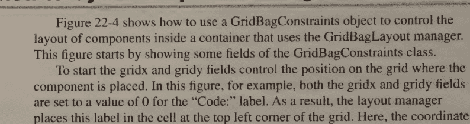

# GridBagConstraints 类的一些常用字段

| 字段 | 描述 |
| --- | --- |
| `gridx`, `gridy` | 设置组件在网格中的 x 和 y 坐标，其中 0, 0 是网格的左上单元。 |
| `anchor` | 如果组件小于其显示区域单元格，则设置组件的位置。最常用 `LINE_START` 和 `LINE_END`。在旧版本的 Java 中，这些被称为 `WEST` 和 `EAST`。 |
| `gridwidth`, `gridheight` | 设置组件占据的水平和垂直单元格数量。 |

# 使用 GridBagConstraints 对象的代码

```java
JPanel panel = new JPanel();
panel.setLayout(new GridBagLayout());

GridBagConstraints c = new GridBagConstraints();

c.gridx = 0; c.gridy = 0; c.anchor = GridBagConstraints.LINE_END;
panel.add(new JLabel("Code:"), c);
c.gridx = 1; c.gridy = 0; c.anchor = GridBagConstraints.LINE_START;
panel.add(new JTextField(codeField), c);
c.gridx = 0; c.gridy = 1; c.anchor = GridBagConstraints.LINE_END;
panel.add(new JLabel("Description:"), c);
c.gridx = 1; c.gridy = 1; c.anchor = GridBagConstraints.LINE_START;
panel.add(new JTextField(descriptionField), c);
c.gridx = 0; c.gridy = 2; c.anchor = GridBagConstraints.LINE_END;
panel.add(new JLabel("Price:"), c);
c.gridx = 1; c.gridy = 2; c.anchor = GridBagConstraints.LINE_START;
panel.add(new JTextField(priceField), c);
c.gridx = 0; c.gridy = 3; c.anchor = GridBagConstraints.LINE_START;
c.gridwidth = 2;
panel.add(new JLabel("This label spans both columns."), c);
```

# 产生的布局


### 描述

- 你可以对多个小部件重用 `GridBagConstraints` 对象。但是，你必须重置任何不想在下一个小部件中使用的值。

图 22-4 如何在网格中布局组件

如果你不重置值，可能会无意中重用为之前的组件设置的值，这可能会导致奇怪的布局行为。因此，你需要重置所有值，或者为每个组件创建一个新的 `GridBagConstraint`。

# 如何添加内边距

默认情况下，`GridBagConstraints` 对象在组件之间或组件与容器边缘之间不提供任何内边距。这就是为什么上图中显示的组件之间没有任何内边距。这也是为什么组件与容器之间没有内边距。

为了让布局在视觉上更吸引人，你可以使用 `GridBagConstraints` 对象的 `insets` 字段来应用一些内边距，如图 22-5 所示。该字段使用 `Insets` 对象来确定组件周围的边距量。在这里，`Insets` 的四个参数是以像素为单位的顶、左、下、右。如果你把这想象成时钟，这些值是逆时针方向的，从时钟顶部开始。

在这张图中，`GridBagConstraints` 对象的 `insets` 字段被设置为一个 `Insets` 对象，该对象指定了组件顶部、左侧和右侧 5 像素的边距，组件底部没有边距。由于此代码对容器中的所有组件使用 `Insets` 对象，布局底部的标签碰到了容器的底部。然而，组件的结果之间通过 5 像素的边距隔开。这使得该布局比上一个布局在视觉上更吸引人。

在处理 `Insets` 时，有两个重要的点需要记住。首先，与 `GridBagConstraints` 对象不同，你不能更改 `Insets` 对象的值然后重用它。如果你这样做，你的布局行为将变得很奇怪。其次，如果你使用 5 像素的顶部间距和 5 像素的底部间距，组件之间的间距实际上是 10 像素。换句话说，布局在一个组件的底部使用了 5 像素空间，在下一行组件的顶部使用了 5 像素空间，总计为 10 像素。

当然，左右间距的情况也是如此。例如，在这张图中，最长的标签第一个字母与窗口左边缘之间有少量的内边距。同样，最长文本字段的右边缘与窗口右边缘之间也有少量的内边距。然而，标签结束处和文本字段开始处之间的边距是两倍。这是因为该区域使用了标签右侧的边距和文本框左侧的边距。

大多数时候，你只需要使用 `GridBagConstraints` 对象的 `insets` 字段来指定外部边距。然而，如果你需要指定内部边距，可以使用图中所示的 `ipadx` 和 `ipady` 字段。这些字段决定了在组件内部放置了多少内边距。例如，如果你将 `JButton` 组件的 `ipadx` 和 `ipady` 值设置为 10，布局会在 `JButton` 组件的文本与按钮边缘之间显示 10 像素的内边距。

# GridBagConstraints 类的更多常用字段

| 字段 | 描述 |
|---|---|
| `insets` | 使用 `Insets` 对象指定应对组件应用多大的外部边距。 |
| `ipadx`, `ipady` | 设置在组件的宽度和高度上添加多少内部内边距。该值适用于双方。 |

# Insets 类

| 构造函数 | 描述 |
|---|---|
| `Insets(top, left, bottom, right)` | 以像素为单位指定顶、左、下、右边距。 |

创建 Insets 对象并将其添加到 GridBagConstraints 对象中

```java
GridBagConstraints c = new GridBagConstraints();
c.insets = new Insets(5, 5, 0, 5);

c.gridx = 0; c.gridy = 0; c.anchor = GridBagConstraints.LINE_END;
panel.add(new JLabel("Code:"), c);
c.gridx = 1; c.gridy = 0; c.anchor = GridBagConstraints.LINE_START;
panel.add(codeField, c);

// 其他添加标签和文本框的代码
```

带有 insets 的上一个图的示例


### 描述

- 如果忘记 `Insets` 类构造函数的参数顺序，记住它们从顶部开始按逆时针方向排列可能会有帮助。

图 22-5 如何添加内边距

# 如何避免常见陷阱

图 22-6 展示了 GUI 布局中的一个常见陷阱，并展示了如何避免它。首先，此图显示了用户在略微缩小水平宽度后，上一个图中显示的相同表单。这导致所有文本字段塌陷了。这里发生了什么？

基本上，如果容器不够宽以按指定的大小显示组件，`GridBagLayout` 管理器会将最小尺寸分配给组件。默认情况下，组件的最小尺寸为 0。因此，这导致文本字段的宽度完全塌陷。

解决此问题的常用方法是在文本字段上使用 `setSize` 方法，将首选大小和最小尺寸设置为与图中相同的值。在这里，第一条语句创建了一个宽 100 像素、高 20 像素的 `Dimension` 对象。然后，接下来的四条语句将代码和价格文本字段的首选大小和最小尺寸设置为 `Dimension` 对象。之后，第六条语句创建了一个宽度为 250、高度为 20 的新 `Dimension` 对象。然后，接下来的两条语句将描述的首选大小和最小尺寸设置为 `Dimension` 对象。

如果你运行程序并缩小窗口宽度，文本字段不会塌陷。然而，标签会塌陷，因为 `GridBagLayout` 试图给文本字段提供最小尺寸并保持在窗口内。如果你继续通过进一步缩小窗口来这样做，文本字段的边缘最终会消失在窗口之外。

由于标签塌陷，你可能会说你解决了一个问题，但又创建了另一个。在某种意义上，确实如此。这表明 `GridBagLayout` 管理器是复杂的，通常需要大量的微调才能让布局按预期方式运行。

对于产品管理器（`Product Manager`）应用程序，用户可能没有调整窗口的需求。因此，图中描述的解决方案可能足够了。

解决此问题的另一种方案是让用户能够调整窗口。为了实现这一点，你可以调用窗口的 `setResizable` 方法并传递 `false`。再次，对于产品管理器应用程序，这是可以接受的。但是，你应该谨慎地使用这种技术，因为大多数用户期望能够调整窗口，特别是当这有助于窗口更好地适应显示器时。

第三种可能的解决方案更加优雅但代码编写更复杂。这种解决方案涉及使用 `GridBagConstraints` 的 `weightx`、`weighty` 和 `fill` 字段来控制当用户调整窗口时组件如何缩放。`weightx` 和 `weighty` 控制如何在组件之间分配额外的水平或垂直空间。这允许你为每个组件指定百分比。此外，`fill` 字段决定了当容器缩放时容器是否也缩放。组件可以设置为水平、垂直、两者或完全都不缩放。

# 水平调整大小后出现的常见问题


# Dimension 类的构造函数

| 构造函数 | 描述 |
| --- | --- |
| `Dimension(width, height)` | 指定组件以像素为单位的宽高度。 |

# 你可以解决此问题的两种方法

| 方法 | 描述 |
| --- | --- |
| `setMinimumSize(Dimension)` | 指定组件以像素为单位的最小宽高度。 |
| `setPreferredSize(Dimension)` | 指定组件以像素为单位的首选宽高度。 |

# 设置首选和最大尺寸的代码

```java
Dimension dim1 = new Dimension(100, 20);
codeField.setPreferredSize(dim1);
codeField.setMinimumSize(dim1);
priceField.setPreferredSize(dim1);
priceField.setMinimumSize(dim1);

Dimension dim2 = new Dimension(250, 20);
descriptionField.setPreferredSize(dim2);
descriptionField.setMinimumSize(dim2);
```

# 水平调整大小后的改进示例


# 解决此问题的三种方法

- 使用窗口的 `setResizable` 方法防止用户调整窗口大小。然而，你应该谨慎使用这种技术，因为用户通常期望能够调整窗口。
- 使用组件的 `setPreferredSize` 和 `setMinimumSize` 方法。虽然这不是完美的解决方案，但对于大多数应用程序来说是可以接受的。
- 使用 `GridBagConstraints` 类的 `weightx`、`weighty` 和 `fill` 字段来控制组件如何调整大小。这种技术可以产生最佳效果，但也需要最多的调整。

### 描述

- 当窗口水平方向调整大时，组件（尤其是文本字段）有时会收缩为零。这是一个常见问题。

图 22-6 如何避免常见陷阱

# 如何编写数据输入表单

大多数应用程序都需要从用户获取输入。例如，应用程序通常需要用户输入或编辑存储在数据库中的数据。为了实现这一点，大多数应用程序使用一种称为表单（form）的特殊窗口。

通常，你希望使用一种称为对话框（dialog 或 dialog box）的特殊窗口来显示表单。在 Swing 中，你可以使用 `JDialog` 组件。这允许你创建自定义对话框，其工作方式与 `JOptionPane` 类中的内置对话框类似。

# 如何创建自定义对话框

图 22-7 显示了常用的 `JDialog` 构造函数之一。该构造函数接受三个参数。第一个参数指定对话框的所有者或父级。通常，对话框的父级是应用程序主窗口的 `JFrame` 组件。

第二个参数指定对话框的标题。这与为 `JFrame` 设置标题相同。

第三个参数决定对话框是否为模态（modal）。如果对话框是模态的，Java 会防止用户在响应对话框之前与应用程序的任何部分交互。你应该谨慎使用模态对话框，因为如果必要，可能会骚扰用户。根据一般原则，只有当应用程序在用户响应对话框之前无法继续当前操作时，才应该使用模态对话框。

代码示例创建了一个定义对话框的 `NameDialog` 类。该类继承自 `JDialog` 类。然后，它创建了一个名为 `dialogNameField` 的私有 `JTextField` 组件。

`NameDialog` 类的构造函数接受一个参数：父帧。在该构造函数内部，第一个语句使用 `super` 关键字调用 `JDialog` 类的构造函数，并传递父帧、标题“Name Dialog”和一个布尔值。结果是 `NameDialog` 是一个模态对话框。构造函数中的第二个语句继续设置默认关闭操作为 `DISPOSE_ON_CLOSE`。结果是如果用户通过窗口按钮关闭它，对话框将关闭并释放其资源。如果没有这段代码，Java 将隐藏对话框但不释放其资源。第三条语句将对话框的布局设置为 `FlowLayout` 布局。

构造函数继续为对话框创建组件并将其添加到对话框中。首先，它创建一个文本字段并将其宽度设置为20个字符。然后，它创建了两个按钮并为它们添加了动作监听器。在这里，确定按钮的动作监听器代码将在下一个图中显示，而取消按钮的动作监听器代码仅调用对话框的 `dispose` 方法。这会关闭对话框并释放它正在使用的任何资源。

在向对话框添加组件后，该代码调用 `pack` 方法将对话框的设置为容纳这些组件所需的最小尺寸。最后，该代码调用 `setVisible` 方法使对话框可见。

# 常用的 JDialog 构造函数

| 构造函数 | 描述 |
| --- | --- |
| `JDialog(parent, title, isModal)` | 指定对话框的父帧以及对话框是否为模态。 |

# 用于自定义对话框的类

```java
public class NameDialog extends JDialog {
    private JTextField dialogNameField;

    public NameDialog(java.awt.Frame parent) {
        super(parent, "Name Dialog", true);
        this.setDefaultCloseOperation(WindowConstants.DISPOSE_ON_CLOSE);
        this.setLayout(new FlowLayout());

        dialogNameField = new JTextField();
        dialogNameField.setColumns(20);

        JButton okButton = new JButton("Ok");
        okButton.addActionListener((ActionEvent) -> {
            // TODO: Add code here
        });

        JButton cancelButton = new JButton("Cancel");
        cancelButton.addActionListener((ActionEvent) -> {
            dispose();
        });

        this.add(new JLabel("Name:"));
        this.add(dialogNameField);
        this.add(okButton);
        this.add(cancelButton);
        this.pack();

        this.setVisible(true);
    }
}
```

显示此对话框的语句

```java
new NameDialog(this);
```

# 上述代码产生的对话框


### 描述

- 模态对话框在用户响应对话框之前，防止其与应用程序的其他部分进行交互。


在大多数操作系统上，`JDialog` 组件显示在其父帧之上，其控件比 `JFrame` 少（例如，没有最大化或最小化按钮），并且不会显示在任务栏中。

图 22-7 如何创建自定义对话框

# 如何在对话框中设置数据

对话框类的构造函数允许你设置数据：

```java
public NameDialog(java.awt.Frame parent, String name) {
    super(parent, "Name Dialog", true);
    this.setDefaultCloseOperation(WindowConstants.DISPOSE_ON_CLOSE);
    this.setLayout(new FlowLayout());
}
```

```java
dialogNameField = new JTextField();
dialogNameField.setColumns(20);
dialogNameField.setText(name);
```

调用此构造函数的 frame 中的代码：

```java
new NameDialog(this, frameNameField.getText());
```

# Window 类的一个方法

| 方法 | 描述 |
| --- | --- |
| `getOwner()` | 返回对话框所有者或父级的 `Window` 对象。你通常会将此 `Window` 转换为更具体的类型。 |

# 如何从对话框中获取数据

对话框可以调用的 frame 中的方法：

```java
public void setSetName(String name) {
    frameNameField.setText(name);
}
```

对话框中调用该方法的代码：

```java
pushButton.addActionListener((ActionEvent) -> {
    NameFrame frame = (Name) getOwner();
    frame.setName(dialogNameField.getText());
    dispose();
});
```

### 描述

- 在对话框类中，你可以编写一个构造函数，允许主窗口在对话框中设置数据。
- 在主窗口类中，你可以编写一个方法，允许对话框将设置的数据返回给主窗口。
- 要关闭对话框，可以调用它的 `dispose` 方法。这会关闭对话框对象并释放它正在使用的任何资源。


# 产品表单 (Product form)

本章完成产品表单的代码。该表单是上一节描述的 Product 应用程序主窗口使用的数据输入表单。

# 用户界面

图 22-9 显示了数据输入表单的用户界面。首先，如果用户点击主窗口中的“添加”（Add）按钮，表单标题为“添加产品”（Add Product），三个文本字段中不显示任何文本，并有一个“添加”按钮。然而，如果用户点击主窗口中的“编辑”（Edit）按钮，表单标题为“编辑产品”（Edit Product），在文本字段中显示所选产品的文本，并有一个“保存”（Save）按钮。

如果用户没有为产品输入有效数据，应用程序将使用 `JOptionPane` 显示一个对话框，要求用户输入有效数据。例如，在图中，最后一个对话框显示了当用户留其中一个文本字段为空时显示的消息。然而，如果用户为产品价格输入了无效数字，此应用程序将显示不同的消息。

产品表单使用了 `BorderLayout` 类。在该布局中，它包含一个自定义的角部。在 Windows 上，对话框仅在右上角包含一个关闭按钮。换句话说，它不包含像 Product 应用程序主窗口那样的最小化、最大化或恢复按钮。但是，这是特定于 Windows 操作系统的。这些按钮可能会随操作系统而异。

产品表单包含两个面板。

第一个面板包含三个标签及其相应的文本字段。该面板使用 `GridBagLayout` 来布局这些标签和文本字段。然后，此面板被添加到边界布局的中心。结果是它获得了所有未被其他组件占据的可用空间。

第二个面板使用右对齐的 `FlowLayout` 布局。该面板为表单布局两个按钮。然后，此面板被添加到边界布局的南部区域。结果是该面板获得了其首选高度，宽度扩展到占据容器的整个水平空间。在这种情况下，这意味着面板的高度恰好容纳按钮，而面板的宽度是整个宽度。

# 第 22 章 如何使用 Swing 开发 GUI（部分 2） 591

# 添加产品管理器

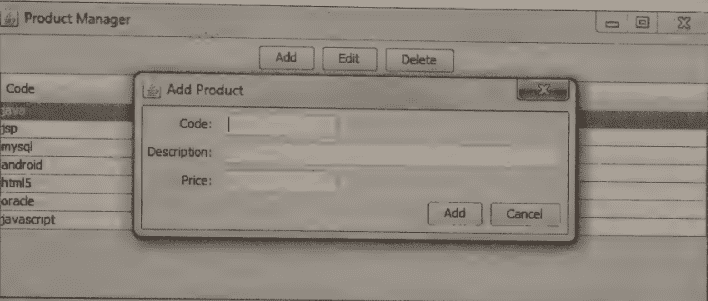

# 编辑产品对话框

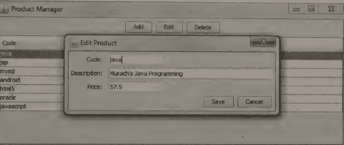

# 数据验证对话框之一


### 描述

- Product 应用程序使用同一个对话框来添加新产品或编辑现有产品。外观上的唯一区别是对话框的标题以及显示在第一个按钮上的文本。
- 当你添加或编辑产品时，如果产品字段缺失或无效，产品表单将使用内置对话框显示验证信息。

图 22-9 产品表单的用户界面

# ProductForm 类

图 22-10 显示了 ProductForm 类的代码。首先，该类扩展了 `JDialog` 类。这是创建自定义对话框的常用方法。

在类中，前五个语句创建了引用表单上某些组件的实例变量。前三个是持有产品代码、描述和价格的 `JTextField` 组件。接下来的两个是 `JButton` 组件。

## 594 第 5 节 现实世界技能

接下来的两行代码创建了 `Dimension` 对象，并将它们的宽度分别设置为 100 像素和 300 像素，高度均为 20 像素。然后，代码将代码和价格文本字段的首选大小和最小尺寸设置为较短的那个 `Dimension` 对象。它还将描述文本字段的首选大小和最小尺寸设置为较长的那个 `Dimension` 对象。在这两种情况下，这都避免了本章较早些时候描述的陷阱，即当用户调整对话框大小时，文本字段的宽度会缩至零。

`initComponents` 方法的下一部分创建了按钮。首先，它将第一个按钮的文本设置为“Cancel”（取消），并为其添加了一个动作监听器，该监听器会调用类中稍后显示的 `cancelActionPerformed` 方法。然后，它将第二个按钮的文本设置为“Add”（添加），并为其添加了一个动作监听器，该监听器会调用 `confirmButtonActionPerformed` 方法。然而，如果用户正在编辑现有对象，这里的 `setText` 方法会被上一页讨论的第二个构造函数中的 `setText` 调用所覆盖。

下一部分创建了一个新的 `JPanel` 来存储文本字段及其相应的标签。首先，此代码将面板的布局管理器设置为 `GridBagLayout` 管理器。然后，它将表单的文本字段和标签添加到面板中。为了方便使用 `GridBagConstraints`，`add` 方法的调用使用了名为 `getConstraints` 的辅助方法，该方法在类中稍后显示。此方法接受三个参数：网格行的 x 坐标、网格列的 y 坐标以及一个锚点值。

下一部分为 `JPanel` 创建了一个 `FlowLayout` 布局管理器。首先，此代码设置了右对齐的布局管理器。然后，它将确认和取消按钮添加到布局中。

最后一部分将包含标签和文本字段的面板添加到对话框 `BorderLayout` 管理器的中心区域。然后，将包含按钮的面板添加到对话框 `BorderLayout` 管理器的南（底部）区域。与 `JFrame` 类似，`JDialog` 组件默认使用 `BorderLayout` 管理器，因此没有显式设置布局。最后，最后一个语句使用 `pack` 方法通过打包来设置对话框，使其大小恰好容纳所有组件。

请注意，代码中的其中一个设置了此表单的位置或使此表单可见。因此，父框架必须执行此操作。例如，Product Manager 应用的主框架可以这样显示“Add Product”表单：

```java
ProductForm productForm = new ProductForm(this, "Add Product", true);
productForm.setLocationRelativeTo(this);
productForm.setVisible(true);
```

这会在主窗口中间显示此表单的模态版本。

`getConstraints` 方法创建并返回一个带有指定参数的 `GridBagConstraints` 对象。该方法首先创建一个新的 `GridBagConstraints` 对象。然后，它将字段设置为一个新的 `Insets` 对象，在顶部、左侧和右侧留有 5 像素的间距，底部不留间距。接下来，它将 `GridBagConstraints` 对象的 `gridx`、`gridy` 和 `anchor` 字段设置为相应的参数。最后，返回这个新的 `GridBagConstraints` 对象。

## ProductForm 类（续）

```java
Dimension shortField = new Dimension(100, 20);
Dimension longField = new Dimension(300, 20);
codeField.setPreferredSize(shortField);
codeField.setMinimumSize(shortField);
priceField.setPreferredSize(shortField);
priceField.setMinimumSize(shortField);
descriptionField.setPreferredSize(longField);
descriptionField.setMinimumSize(longField);
```

```java
cancelButton.setText("Cancel");
cancelButton.addActionListener((ActionEvent) -> {
    cancelButtonActionPerformed();
});
```

```java
confirmButton.setText("Add");
confirmButton.addActionListener((ActionEvent) -> {
    confirmButtonActionPerformed();
});
```

```java
// JLabel and JTextField面板
JPanel productPanel = new JPanel();
productPanel.setLayout(new GridBagLayout());
productPanel.add(new JLabel("Code:"),
getConstraints(0, 0, GridBagConstraints.LINE_END));
productPanel.add(codeField, 
getConstraints(1, 0, GridBagConstraints.LINE_START));
productPanel.add(new JLabel("Description:"),
getConstraints(0, 1, GridBagConstraints.LINE_END));
productPanel.add(descriptionField, 
getConstraints(1, 1, GridBagConstraints.LINE_START));
productPanel.add(new JLabel("Price:"),
getConstraints(0, 2, GridBagConstraints.LINE_END));
productPanel.add(priceField, 
getConstraints(1, 2, GridBagConstraints.LINE_START));
```

```java
// JButton面板
JPanel buttonPanel = new JPanel();
buttonPanel.setLayout(new FlowLayout(FlowLayout.RIGHT));
buttonPanel.add(confirmButton);
buttonPanel.add(cancelButton);
// 将面板添加到主面板
setLayout(new BorderLayout());
add(productPanel, BorderLayout.CENTER);
add(buttonPanel, BorderLayout.SOUTH);
pack();
```

```java
private GridBagConstraints getConstraints(int x, int y, int anchor) {
    GridBagConstraints c = new GridBagConstraints();
    c.insets = new Insets(5, 5, 0, 5);
    c.gridx = x;
    c.gridy = y;
    c.anchor = anchor;
    return c;
}
```

## 596 第 5 节 现实世界技能

类中的接下来两个方法是按钮的事件处理器。如果用户按下取消按钮，则调用第一个事件处理器。该方法中的语句调用对话框的 `dispose` 方法以关闭对话框并释放资源。

如果用户按下确认按钮，则调用第二个事件处理器。首先，它使用稍后显示的 `validateData` 方法。该方法确保用户输入了数据且所有数据有效。如果是这样，事件处理器将通过调用类中的 `setData` 方法继续执行。

事件处理器中的第二个语句检查应用程序是在编辑现有产品还是添加新产品。为此，它检查确认按钮。如果按钮文本为 "Add"，此代码调用类稍后显示的 `doAdd` 方法。该方法向数据库添加一个新产品。然而，如果按钮文本不是 "Add"，此代码调用类稍后显示的 `doEdit` 方法。该方法更新数据库中的现有产品。

`validateData` 方法确保用户为所有文本字段输入了数据，并且为价格输入了有效的数字。首先，此代码通过调用相应文本字段的 `getText` 方法获取代码、描述和价格 String 对象。然后，此代码使用语句检查表单中的所有字段是否有值。如果没有，之前定义的变量将为空或空。在这种情况下，代码使用 `JOptionPane` 类显示一个包含消息的对话框，要求用户填写所有字段。然后，它返回 `false`。

此代码还验证用户输入的价格是否为有效数字。为了实现这一点，它调用一个语句，尝试将字符串转换为 double 值。如果该语句无法将字符串转换为 double 值，它将抛出 `NumberFormatException`，导致执行 `catch` 块。

`catch` 块使用 `JOptionPane` 类显示一个包含消息的对话框，通知用户在价格字段输入的数据不是有效价格。然而，此语句可能无法将焦点移动到价格字段。因此，你不应该依赖这一点。最后，`catch` 块返回 `false`。

如果用户为所有字段输入了数据且价格有效，`validateData` 方法返回 `true`。这表示表单中的数据是有效的。

`setData` 方法首先通过调用 `getText` 方法获取表单文本字段包含的数据。再次，为了获取价格的 double 值，此代码需要将 `getText` 方法返回的 String 对象转换为 double 值。然后，此方法使用其 set 方法将这些数据设置到 Product 对象的实例变量中。

对于此方法，代码没有捕获 `parseDouble` 方法可能抛出的 `NumberFormatException`，因为之前显示的 `validateData` 方法已经确保用户为价格输入了有效的数字。

# ProductForm 类（续）

```java
private void cancelButtonActionPerformed() {
    dispose();
}
```

```java
private void confirmButtonActionPerformed() {
    if (validateData()) {
        setData();
        if (confirmButton.getText().equals("Add")) {
            doAdd();
        } else {
            doEdit();
        }
    }
}
```


```java
private Boolean validateData() {
    String code = codeField.getText();
    String name = descriptionField.getText();
    String priceString = priceField.getText();
    double price;
    if (code == null || name == null || priceString == null ||
        code.isEmpty() || name.isEmpty() || priceString.isEmpty()) {
        JOptionPane.showMessageDialog(this, "Please fill in all fields.",
            "Missing Fields", JOptionPane.INFORMATION_MESSAGE);
        return false;
    } else {
        try {
            price = Double.parseDouble(priceString);
        } catch (NumberFormatException e) {
            JOptionPane.showMessageDialog(this,
                "The data entered in the price field is invalid",
                "Invalid Price", JOptionPane.INFORMATION_MESSAGE);
            priceField.requestFocusWindow();
            return false;
        }
        return true;
    }
}
```

```java
private void setData() {
    String code = codeField.getText();
    String name = descriptionField.getText();
    String priceString = priceField.getText();
    double price = Double.parseDouble(priceString);
    product.setCode(code);
    product.setDescription(name);
    product.setPrice(price);
}
```

接下来两个方法 `doEdit` 和 `doAdd` 几乎相同，但 `doEdit` 方法调用了 `ProductDB` 类的 `update` 方法，而 `doAdd` 方法调用了 `ProductDB` 类的 `add` 方法。然后，这两个方法都会调用 `dispose` 方法来关闭对话框并释放资源。接着，它们调用 `fireDatabaseUpdatedEvent` 方法。

`fireDatabaseUpdatedEvent` 通知主窗口数据库已添加了一条新记录，或者现有记录已更新。反之，主窗口通知表格模型（table model）需要更新表格数据，以反映上一章所示的数据库所做的更改。为了实现这一点，代码首先通过调用 `getOwner` 方法获取对话框父窗口的引用。然而，该方法返回的是一个 `Window` 对象。因此，这段代码在调用其 `fireDatabaseUpdated` 方法之前，必须将其强制类型转换为 `ProductManagerFrame` 类型。

## ProductForm 类（续）

```java
private void doEdit() {
    try {
        ProductDB.update(product);
        dispose();
        fireDatabaseUpdatedEvent();
    } catch (DBException e) {
        System.out.println(e);
    }
}

private void doAdd() {
    try {
        ProductDB.add(product);
        dispose();
        fireDatabaseUpdatedEvent();
    } catch (DBException e) {
        System.out.println(e);
    }
}

private void fireDatabaseUpdatedEvent() {
    ProductManagerFrame mainWindow = (ProductManagerFrame) getOwner();
    mainWindow.fireDatabaseUpdatedEvent();
}
```

图 22-10 ProductForm 类（第 4 部分，共 4 部分）

## 使用 ProductForm 类的两个方法

图 22-11 显示了 `ProductManagerFrame` 类中使用 `ProductForm` 类的两个方法。这些方法在上一章中还没有实现，但现在你可以看到它们是如何工作的。简而言之，它们包含了当用户点击产品管理器应用程序主窗口中的“添加”（Add）或“编辑”（Edit）按钮时执行的代码。

“添加”按钮的代码首先创建一个模态的“添加产品”（Add Product）对话框。然后，它尝试设置该对话框的位置，使其相对于当前窗口。在这种情况下，当前窗口是产品管理器窗口。在 Windows 上，这会将对话框居中在当前窗口上。然而，某些操作系统可能会完全忽略此方法。

在尝试设置对话框位置后，这段代码使用 `setVisible` 方法向用户显示对话框。因此，这段代码会显示一个与本章早些类似的“添加产品”对话框。

“编辑”按钮的代码首先从产品表格中获取所选行的索引。如果索引为 -1，这段代码将使用 `JOptionPane` 类显示一个对话框，其中的消息指示未选择任何产品。否则，这段代码将获取一个与表格中选中行对应的 `Product` 对象。

在获取 `Product` 对象后，这段代码创建了一个模态的“编辑产品”（Edit Product）对话框并将 `Product` 对象传递给对话框。这允许对话框显示所选产品的数据。然后，它尝试设置对话框相对于产品管理器窗口的位置。最后，它向用户显示对话框。因此，这段代码会显示一个与本章所示类似的“编辑产品”对话框。

```java
private void doAddButton() {
    ProductForm productForm = new ProductForm(this, "Add Product", true);
    productForm.setLocationRelativeTo(this);
    productForm.setVisible(true);
}
```

```java
private void doEditButton() {
    int selectedRow = productTable.getSelectedRow();
    if (selectedRow == -1) {
        JOptionPane.showMessageDialog(this,
            "No product is currently selected.",
            "No product selected.",
            JOptionPane.ERROR_MESSAGE);
    } else {
        Product product = productTableModel.getProduct(selectedRow);
        ProductForm productForm =
            new ProductForm(this, "Edit Product", true, product);
        productForm.setLocationRelativeTo(this);
        productForm.setVisible(true);
    }
}
```

图 22-11 使用 ProductForm 类的两个方法

## 如何在 Swing 中使用线程

此时，你应该已经理解如何编写像产品管理器这样的应用程序。然而，如果你需要在响应 GUI 事件时执行耗时操作，你可能会遇到与图 12-12 所示类似的问题。

### 常见问题

第一个代码示例调用了一个可能需要很长时间才能完成的方法。由于该方法是为了响应用户在 GUI 中点击打印按钮而调用的，它运行在一个被称为“事件分发线程”（event dispatch thread，简称 EDT）的特殊线程上。所有由事件引起的操作都在 EDT 上运行，更新显示和响应事件的 Swing 操作也是如此。

遗憾的是，这意味着 `productList` 方法也运行在 EDT 上，导致它在方法返回之前一直处于阻塞状态。结果是它无法处理其他事件，或者在需要时重绘屏幕。这会导致应用程序对任何用户事件都没有响应。此外，如果显示需要重绘（例如调整大小、最小化和恢复时），显示可能会损坏。

起初，你可能认为可以通过第二个代码示例所示的技术在新线程上运行 `productList` 方法来解决这个问题。遗憾的是，在 EDT 之外执行任何 GUI 操作是不安全的，因此这段代码会导致新问题，即代码在新线程而非 EDT 上运行 `JOptionPane` 对话框，这会导致显示损坏。

### 如何解决问题

解决这个问题的方法是在另一个线程上运行 `productList` 方法，但在 EDT 上执行 GUI 更新。幸运的是，Swing 提供了 `SwingWorker` 类来完成任务。

图中最后的示例使用了 `SwingWorker` 类来解决这个问题。首先，这段代码开始使用内部类创建一个 `SwingWorker` 对象。在内部类中，代码重写了 `doInBackground` 并从中调用它。该方法运行在工作线程上，允许 EDT 继续处理事件。虽然该方法可以返回一个对象，但本示例不需要这样做，所以它返回了 `null`。

内部类还包含一个在 `doInBackground` 方法完成后被调用的方法。`done` 方法运行在 EDT 上。因此，你可以安全地从该方法更新 GUI。

### 可能导致 GUI 无响应的代码

```java
private void doPrintButton() {
    printProductList(); // 此方法可能需要很长时间才能运行。
    JOptionPane.showMessageDialog(ProductManagerFrame.this,
    // "List has been printed."); // 这段代码更新了 GUI。
}
```

### 保持 GUI 响应但不应更新 GUI 的代码

```java
private void doPrintButton() {
    Thread thread = new Thread() {
        // 此方法在后台线程中运行（而不是 EDT）。
        // 结果是，GUI 保持响应状态。
        // 然而，从此线程更新 GUI 是不安全的。
        @Override
        public void run() {
            printProductList(); // 此方法可能需要很长时间才能运行。
            JOptionPane.showMessageDialog(ProductManagerFrame.this,
            // "List has been printed."); // 不安全！
        }
    };
    thread.start();
}
```

### 既保持 GUI 响应又能更新 GUI 的代码

```java
private void doPrintButton() {
    SwingWorker worker = new SwingWorker() {
        // 此方法在后台线程中运行（而不是 EDT）。
        // 结果是，GUI 保持响应状态。
        @Override
        protected Object doInBackground() throws Exception {
            printProductList(); // 此方法可能需要很长时间才能运行。
            return null;
        }

        @Override
        protected void done() {
            // 此方法在后台线程完成后在 EDT 上运行。
            // 结果是，在此方法中更新 GUI 是安全的。
            JOptionPane.showMessageDialog(ProductManagerFrame.this,
            // "Product list has been printed."); // 安全！
        }
    };
    worker.execute();
}
```

### 描述

- 任何在名为事件分发线程（EDT）的特殊线程上响应 Swing 事件而运行的代码。所有更新 GUI 的代码都应该在这个线程上运行。

- 如果你在 EDT 上运行耗时较长的任务，GUI 将变得无响应。

- 如果你使用第 18 章所示的技术启动新线程，GUI 将保持响应状态。但是，你无法从这个新线程安全地更新 GUI。

- 为了在运行长时间任务的同时允许 GUI 保持响应，并在任务结束时能够更新 GUI，你可以使用 `SwingWorker` 类。

图 22-1 如何在 Swing 中使用线程

## 观点

在本章中，你学习了完成“产品管理器”应用程序所需的全部剩余技能。你学习了如何使用 `JLabel` 和 `JTextField` 类为数据输入表单创建标签和文本框。你学习了如何使用 `GridBagLayout` 布局管理器来创建看起来专业的表单。你学习了如何使用 `JDialog` 类创建模态数据输入表单。你还学习了如何在应用程序的两个窗口之间来回数据。

关于使用 Swing 还有很多内容需要学习。例如，你可能想学习其他类型的控件，如复选框、单选按钮、组合框和列表。你可能想学习如何在 Swing 中显示照片或其他图形。你可能想学习其他布局管理器。你可能想了解更多关于在 Swing 中使用 `SwingWorker` 类创建线程的知识。或者，你可能还想学习如何使用 IDE 提供的 GUI 构建工具。无论你决定学习 Swing 的什么，最后两章介绍的技能都是你可以在此基础上的的实基础。

### 总结

- 你可以使用 `JLabel` 类创建标签，用于标记表单上的其他组件。

- 你可以使用 `JTextField` 类创建文本域（也称为文本框），允许用户输入数据。

- 你可以使用 `GridBagLayout` 布局管理器来创建专业的表单布局，将组件以网格形式排列。该类有两个辅助类：`GridBagConstraints` 和 `Insets`。

- 你可以使用 `JDialog` 类来创建一个始终悬浮在父窗口之上的对话框。

- 对话框可以是模态的（modal），这意味着在用户对对话框做出响应之前，防止他们与应用程序的其他任何部分进行交互。然而，只有当应用程序在用户响应之前无法完成操作时，你才应该使用模态对话框。

- 任何响应 Swing 事件而运行的代码都运行在一个名为事件分发线程（EDT）的特殊线程上。

- 为了防止 GUI 在长时间运行任务期间变成无响应状态，并确保 GUI 更新在 EDT 上安全地发生，你可以使用 `SwingWorker` 类。

## 练习 22-1 创建一个新的 GUI

在本次练习中，你将创建一个 GUI 应用程序，根据矩形的长度和宽度计算矩形的面积和周长。完成后，该程序应该像这样：

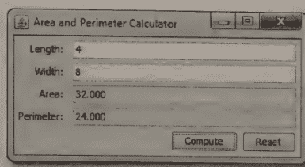

### 复习程序的现有代码

1. 打开 `ex_starts` 文件夹中名为 `ch22_ex1_AreaAndPerimeter_start` 的项目。

2. 打开 `murach.business` 包中的 `Rectangle` 类并检查其字段和方法。

3. 打开 `AreaAndPerimeterFrame` 类并检查现有代码。注意：

* 此类继承自 `JFrame` 类。

* 此类有一个用于设置框架的构造函数。

* 此类包含多个方法，例如 `initComponents`。

* 此类包含 `getConstraints`。

4. 打开 `Main` 类并注意它创建了 `AreaAndPerimeterFrame` 的新实例。

5. 运行应用程序。这应该显示一个不包含任何组件的框架。然而，如果你点击其中一个按钮，它不会执行任何操作。

6. 为四个文本框和两个按钮添加实例变量。

7. 在 `initComponents` 方法中添加代码以初始化框架及其组件。该方法应该：

* 创建四个字段。

* 修改面积和周长的文本框，允许用户进行编辑。

* 设置所有字段的最小和首选尺寸。

* 创建两个按钮。

* 创建一个使用 `GridLayout` 布局器的面板。然后，将四个标签和文本框添加到此面板中。

* 创建一个使用右对齐 `FlowLayout` 布局器的面板。然后，将两个按钮添加到此面板中。

* 调用 `pack()` 方法以设置框架大小。

### 处理用户点击按钮时发生的事件

9. 为两个按钮添加添加监听器。这些监听器应该调用 `computeButtonClick` 和 `resetButtonClicked` 方法。


## 10. 实现 `computeButtonClick` 方法

此方法应该获取用户在长度和宽度文本框中输入的文本，并尝试将其转换为 `double` 值。

* 如果用户输入的长度或宽度无效，此方法应该使用对话框显示一条用户友好的错误消息。然后，用户可以再次尝试。
* 如果用户输入的长度和宽度有效，此方法应该计算面积和周长，并设置相应的文本框。为此，你可以使用 `Rectangle` 类。

## 11. 实现 `resetButtonClicked` 方法

此方法应该将所有文本框设置为空字符串。

## 如何安装 JDK 和 NetBeans

图 A-1 显示了如何安装 Java 开发包 (JDK) 和 NetBeans IDE。为了方便起见，Oracle 网站提供了一个单一安装程序，可以同时安装这两个者。

如果你愿意，也可以单独安装这些产品。要这样做，你可以先在互联网上搜索“Java SE”或“NetBeans”进行下载。然后，你可以找到适用于你操作系统的最新版本 JDK 和 NetBeans 的下载。

书中的代码已针对 Java 8 进行过测试。然而，Java 是向后兼容的。因此，书中的代码在更高版本的 Java 上也应该正常运行。

### JDK 和 NetBeans 的下载 URL

`http://www.oracle.com/technet/java/javase/downloads`

### 步骤

1. 进入 Java SE 下载页面。如有必要，你可以在互联网上搜索此页面。
2. 点击“NetBeans with JDK 8”的下载按钮。
3. 按照说明下载适用于你操作系统的安装程序。
4. 将安装程序保存到硬盘上。
5. 双击运行生成的安装程序。
6. 响应弹出的对话框。当提示输入 JDK 文件夹时，请使用默认文件夹。

### Java SE 8 JDK 的默认文件夹

```
C:\Program Files\Java\jdk1.8.0_45
```

### 注意

* 有关安装 JDK 的更多信息，可以参考 Oracle 网站。
* 有关安装 NetBeans 的更多信息，可以参考 NetBeans 网站。


## 如何安装本书的源代码

图 A-2 显示了如何下载和安装本书的源代码。这包括书中介绍的应用程序源代码，以及每章末练习题的起点和解决方案。完成此步骤后，你就可以回顾书中的应用程序并完成练习题。

### Murach 网站

`www.murach.com`

### 书中应用程序和练习的文件夹

```
C:\murach\java_netbeans\book_apps
C:\murach\java_netbeans\ex_starts
C:\murach\java_netbeans\ex_solutions
```

### 步骤

1. 进入 `www.murach.com`。
2. 找到“Murach’s Beginning Java with NetBeans”页面。
3. 点击“FREE Downloads”标签页。
4. 点击链接下载应用程序和练习的 exe 文件。然后，响应弹出的页面和对话框。这将下载一个名为 `bjn_allfiles.exe` 的安装文件到你的硬盘上。
5. 使用 Windows 资源管理器在 C 盘上找到该 exe 文件。
6. 双击此文件并响应 `C:\murach\java_netbeans` 中的对话框。这会将书中的文件安装到以 `C:\murach\java_netbeans` 开头的文件夹中。

### 如何使用 zip 文件而不是自解压 zip 文件

* 尽管我们建议按照上述说明使用自解压 zip 文件 (`bjn1_allfiles.exe`) 来安装可下载的文件，但某些系统可能不允许运行自解压 zip 文件。在这种情况下，你可以从我们的网站下载一个常规的 zip 文件 (`bjn1_allfiles.zip`)。然后，你可以将该 zip 文件中存储的文件解压到 `C:\murach` 文件夹中。如果 `C:\murach` 文件夹不存在，则你需要创建它。

### 其他版本 JDK 的注意事项

* 此源代码应适用于 JDK 1.8 (Java SE 8) 或更高版本。
* 如果你使用的是较旧版本的 JDK，仍然可以查看源代码，但将无法编译和运行使用了后续版本 JDK 中引入功能的应用程序。

图 A-2 如何安装本书的源代码

## 如何安装 MySQL 和 MySQL Workbench

图 A-3 显示了如何安装处理 MySQL 数据库所需的所有软件。这包括 MySQL Community Server 和 MySQL Workbench。这些软件可以在 MySQL 网站免费获取。我们针对图中的步骤对 MySQL 5.6 和 MySQL Workbench 6.3 进行了测试。然而，你应该能够使用类似的步骤来安装这些产品的更早或更高版本。

当你在计算机上安装 MySQL 时，你需要为 root 用户指定一个密码。在操作时，请务必记住你输入的密码。如果你在学习过程中担心安全问题，我们建议使用“sesame”作为密码。这样密码会很容易记住。如果你在安装结束时收到“status: failed”消息，则你需要安装 MySQL C++ 2013 重新发行包。要做到这一点，你可以访问图中所示的 MySQL Workbench 前提页面并按照那上的指示操作。

MySQL 是一个免费且易于使用的数据库服务器。它非常适合设计师安装在自己的计算机上，以便学习如何操作 MySQL 数据库。这就是为什么本书的最后四章假设你已经如图所示在计算机上安装了 MySQL 服务器。

MySQL Workbench 是一个图形化工具，让处理 MySQL 变得简单。它在一个方便的软件包与 Community Server 一起。然而，如果你想单独安装 MySQL 或 Workbench，也可以这样做。关于该点的更多信息，你可以访问 MySQL 网站的下载页面。要找到最新版本的 MySQL Workbench，你可以在互联网上搜索“MySQL Workbench”。由于 MySQL Workbench 正在活跃开发且变化迅速，书中的技能可能不会与描述的完全相同，但其原理应该是相似的。

### MySQL 安装程序的 URL

`http://dev.mysql.com/downloads/installer/`

### 步骤

1. 进入 Windows 版 MySQL 安装程序的下载页面。该页面目前可以通过上述 URL 访问。如有必要，你可以在互联网上搜索“MySQL Installer”。
2. 按照网页上提供的说明将安装文件下载到硬盘上。
3. 在硬盘上找到该安装文件并运行它。
4. 响应弹出的对话框。你可以接受大多数默认选项，但你应该为 root 用户指定一个密码。请务必记住你输入的密码。
5. 为了确保数据库已正确安装，在安装完成后启动 MySQL Workbench。然后使用你在上一步中输入的密码以 root 用户身份登录服务器。

### MySQL 5.6 的默认安装文件夹

```
C:\Program Files\MySQL\MySQL Server 5.6
```

### 推荐的用户名和密码

* 用户名: `root`
* 密码: `sesame`

### MySQL Workbench 前提的 URL

`http://dev.mysql.com/resources/wb62_prerequisites.html`

### 如何安装 MySQL Workbench 前提

1. 进入 MySQL Workbench 前提下载页面。该页面目前可以通过上述 URL 访问。如有必要，你可以在互联网上搜索“MySQL Workbench Prerequisites”。
2. 按照网页上提供的说明将安装文件下载到硬盘上。
3. 在硬盘上找到该安装文件并运行它。

### 注意

* 如果在使用 MySQL 安装程序安装或升级到 MySQL Workbench 6.3 时收到“status: failed”消息，你可能需要安装 Visual++ 2013 重新发行包。MySQL 前提页面提供了此操作的说明和链接。
* 你也可以单独安装 MySQL Server 和 MySQL Workbench。关于该点的更多信息，你可以访问 MySQL 网站的下载页面。
* 为了方便使用 MySQL Workbench，你可能希望将程序固定到任务栏或在桌面上添加快捷方式。

图 A-3 如何安装本书的源代码

## 如何为本书创建数据库

如果应用程序使用了数据库，你必须在应用程序正常工作之前创建该数据库。例如，书末的应用程序使用了一个名为 `mma` 的数据库。创建此数据库最简单的方法是使用 MySQL Workbench 运行图 A-4 所示的 SQL 脚本。如果你按照本附录早前的描述下载了该数据库的源代码，此脚本在文件夹中的位置应该比此图靠前。

要确定 SQL 脚本是否执行成功，你可以查看输出（Output）窗口中的结果。例如，在图中，输出窗口显示了一系列成功执行的语句。此外，导航器（Navigator）窗口显示数据库 `mma` 已经创建。

然而，如果脚本遇到问题，MySQL Workbench 会在输出窗口中显示一个或多个错误。这时，你可以阅读这些错误信息以弄明脚本没有正确执行的原因。

在运行 `create_database.sql` 脚本之前，数据库服务器必须正在运行。在大多数系统上安装 MySQL 时，MySQL 数据库服务器会在你每次启动计算机时自动启动，这通常是你所需要的。但是，如果它在你的系统上没有运行，你可以使用 MySQL Workbench 的服务器管理（Server Administration）选项卡来启动它。为此，点击“首页（Home）”选项卡，点击“启动/停止（Startup / Shutdown）”项目，并使用生成的屏幕启动服务器。或者，如果你的系统上可用 SQL Notifier，你可以用它来启动 MySQL 服务器。

## 如何恢复本书的数据库

在你处理书中介绍的应用程序时，你可能会对数据库或其表进行并非本意的的更改。在这种情况下，你可能希望将数据库恢复到原始状态，以便你的结果与书中显示的结果一致。要做到这一点，你可以再次运行 `create_database.sql` 文件。这将删除图中描述的数据库并重新创建它。

### 创建数据库的脚本

`C:\murach\java_netbeans\db\create_database.sql`

### 执行 `create_database.sql` 文件后的 MySQL Workbench

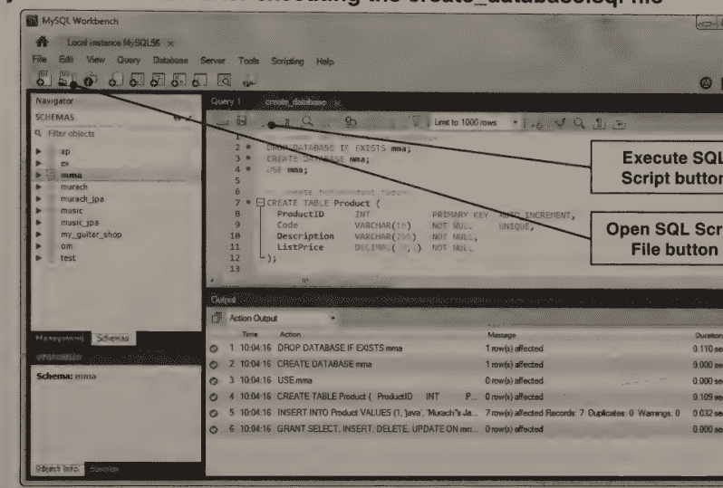

## 如何创建数据库

1. 启动 MySQL Workbench。
2. 以 root 用户身份连接到运行在 localhost 的 MySQL 实例。要执行此操作，双击连接名称“Local instance MySQL56”，如果提示，则输入 root 用户的密码。
3. 点击 SQL 编辑器工具栏中的“打开 SQL 脚本（Open SQL Script）”按钮打开脚本文件。生成的对话框将定位并打开 `create_database.sql` 文件。打开后，MySQL Workbench 会在代码编辑器标签页中显示此脚本。
4. 点击代码编辑器工具栏中的“执行 SQL 脚本（Execute SQL Script）”按钮执行脚本。执行后，输出窗口将显示指示脚本是否执行成功的消息。

## 如何恢复数据库

* 再次运行 `create_database.sql` 脚本以删除并重新创建数据库。

### 描述

* 要运行 `create_database.sql` 文件，数据库服务器必须正在运行。默认情况下，数据库服务器会在启动计算机时自动启动。如果它在你的系统上没有运行，请使用 MySQL Notifier 启动它。

图 A-4 如何为本书创建和恢复数据库

# 附录 B

# 如何为本书设置 Mac OS X

本附录展示了如何安装和配置我们推荐在 Mac OS X 系统上安装 Java 应用程序的软件。对于本书的前 18 章，你只需要安装 Java 开发工具包（JDK）、NetBeans IDE 以及本书的源代码。然而，对于本书的最后四章，你需要安装 MySQL 和 MySQL Workbench，并且需要为本书创建数据库。

在阅读本附录时，请记住大多数网站都是不断更新的。因此，自本书出版以来，本附录中的某些步骤可能已经发生了变化。尽管如此，这些步骤仍然是安装软件的良好指南。如果发生了重大变化，我们将在我们的网站（`www.murach.com`）上发布更新。

| 如何安装 JDK 和 Netbeans | 618 |
| :--- | :--- |
| 如何安装本书的源代码 | 620 |
| 如何安装 MySQL 社区服务器 | 622 |
| 如何安装 MySQL Workbench | 624 |
| 如何为本书创建数据库 | 626 |
| 如何恢复数据库 | 626 |
| 如何更新 root 用户的密码 | 628 |

## 如何安装 JDK 和 Netbeans

图 B-1 展示了如何安装 Java 开发工具包（JDK）和 NetBeans IDE。为了方便起见，你可以将它们作为一个包安装。首先，点击“NetBeans JDK 8”按钮下载安装程序的 `dmg` 文件。然后，运行安装程序，并对生成的对话框进行响应。

顺便说一下，书中所有的示例都针对 Java 8 进行过测试。由于 Java 具有良好的向后兼容性，这些示例在更高版本的 JDK 中也应该同样适用。

### JDK 和 NetBeans 的下载 URL

`http://www.oracle.com/technet/java/javase/downloads/index.html`

### 步骤

1. 前往 Java SE 下载页面。如有必要，你可以在网上搜索此页面。
2. 点击“NetBeans with JDK 8”的下载按钮。
3. 按照指令下载你操作系统的安装程序。
4. 将安装程序保存到硬盘上。
5. 通过双击来运行安装程序。
6. 对生成的对话框进行响应。在提示选择 JDK 文件夹时，使用默认路径。

### Java SE 的默认文件夹

### 注意事项

* 为了运行 `create_database.sql` 文件，数据库服务器必须正在运行。默认情况下，数据库服务器会在你启动计算机时自动启动。如果它在你的系统上没有运行，请使用 MySQL Notifier 启动它。

### Java 8 的默认文件夹

```
/Library/Java/VirtualMachines/jdk1.8.0
```

### 备注

* 有更多关于安装 JDK 的信息，请参考 Oracle 网站。
* 有更多关于安装 NetBeans 的信息，请参考 NetBeans 网站。


## 如何安装本书的源代码

图 B-2 展示了如何下载并安装本书的源代码。这包含了书中应用程序的源代码，以及每章末尾练习的起点。

当你完成此步骤后，书中应用程序、练习起点和解决方案将位于所示文件夹中。然后你就可以开始练习了。

在阅读本书时，你会注意到它经常指示你右键点击，这在 Windows 上很常见。在 Mac 上，默认没有启用右键点击。你可以使用 `Ctrl+` 点击代替右键点击。或者，如果你愿意，可以通过修改系统设置来启用右键点击。这样你就可以更遵循书中的指令了。

### Murach 网站

`www.murach.com`

### 书中应用程序和练习的文件夹

```
/murach/java_beans/book_apps
/murach/java_beans/ex_starts
```

### 步骤

1. 前往 `www.murach.com`。
2. 找到 Murach's Beginning Java with NetBeans 页面。
3. 点击“FREE Downloads”选项卡。
4. 点击链接下载应用程序和练习的压缩包。然后，对生成的页面和对话框进行响应。这将在硬盘上下载一个名为 `bjn_all` 的压缩包。
5. 使用 Finder 在硬盘上找到压缩包，并双击进行解压。这将创建 `java_beans` 文件夹及其子文件夹。
6. 如必要，使用 Finder 直接在硬盘上创建 `murach` 文件夹。
7. 使用 Finder 将 `java_beans` 文件夹移动到 `murach` 文件夹中。

### 关于右键点击的说明

### 其他版本的 JDK

* 此源代码适用于 JDK 1.8 (Java SE 8) 或更高版本。
* 如果你使用的是早期版本的 JDK，仍然查看源代码，但无法编译和运行使用更高版本 Java 引入的特性的应用程序。

## 如何安装 MySQL Community Server

MySQL Community Server 是一个免费且易于使用的数据库服务器。由于它设计用于运行在大多数现代计算机上，因此它非常适合想要在自己的计算机上安装数据库的开发者，以便他们学习如何与 MySQL 数据库交互。这就是为什么本书假设你已经按照图 B-3 所示在你的计算机上安装了 Community Server。

当你在计算机上安装 Community Server 时，系统会自动创建 root 用户，这样你就可以登录服务器。然而，默认情况下不会为该用户分配密码。换句话说，服务器是不安全的。如果你想保护服务器，可以按照本附录后文描述的方法，为 root 用户分配密码。

除了服务器本身外，MySQL Community Server 的下载包还包含了 MySQL 偏好设置（preference pane）。你可以使用图中所示的 MySQL 偏好设置来启动和停止服务器，并控制在启动计算机时是否自动启动 MySQL 服务器。

本书中介绍的所有 SQL 语句都已经在 MySQL Community Server 5.6 上经过测试。因此，你可以使用书中的语句来与此版本的数据库进行操作。由于 MySQL 具有后兼容性，这些语句也适用于未来的 MySQL 版本。此外，书中的大多数语句也适用于更早版本的 MySQL，并且我们已尽力识别出任何不兼容的语句。

### 下载 MySQL Community Server 的 URL


# 如何下载并安装 MySQL Community Server

1. 进入 MySQL Community Server 的下载页面：`http://dev.mysql.com/downloads/mysql/`。如有必要，你可以在互联网上搜索“MySQL Community Server download”。

2. 按照该页面提供的说明，将适用于你操作系统的磁盘镜像（DMG）文件下载到你的硬盘中。

3. 在硬盘上找到 DMG 文件并双击它。这会打开一个包含包（PKG）文件的窗口，文件名类似于 `mysql-5.6.25-osx10.9-x86_64.pkg`。

4. 双击 MySQL 的 PKG 文件，并对弹出的对话框进行响应以完成安装。

5. 通过 Apple 菜单下的“系统偏好设置”，点击 MySQL 图标，确保 MySQL 已正确安装。如果 MySQL 偏好设置显示服务器正在运行，或者你可以启动服务器，则说明 MySQL 安装正确。

# MySQL 偏好设置

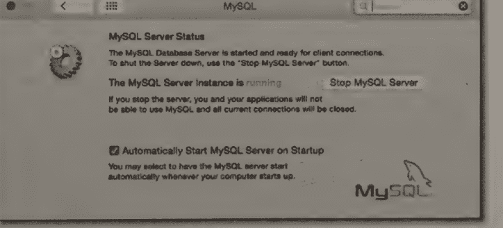

## 说明

- 你可以使用 MySQL 偏好设置来启动和停止 MySQL，并控制在启动计算机时是否自动启动 MySQL。
- 要显示 MySQL 偏好设置，请使用 Apple 菜单显示“系统偏好设置”对话框。然后点击 MySQL 图标。

# 如何安装 MySQL Workbench

MySQL Workbench 是一个免费的图形化工具，使与 MySQL 数据库的操作变得更容易。要安装 MySQL Workbench，你可以参考图 B-4 中的第一个步骤。

安装 MySQL Workbench 后，你应该确保它已配置好以供本书使用。要做到这一点，你可能需要按照图中第二个步骤描述的方法添加一个连接。

本书中介绍的所有使用 MySQL Workbench 操作的技能都已针对 6.3 版本进行过测试。因此，如果你使用的是此版本的 MySQL Workbench，这些技能将完全按照描述的方式工作。然而，MySQL Workbench 正在被活跃开发，且变化迅速。因此，如果你使用的是较新版本的 MySQL Workbench，这些技能可能不会完全按照描述的方式工作，但工作方式应该是类似的。

# 下载 MySQL Workbench 的 URL

`http://dev.mysql.com/downloads/workbench/`

# 如何下载并安装 MySQL Workbench

1. 找到 MySQL Workbench 的下载页面。该页面可以通过上述 URL 访问。如有必要，你可以在互联网上搜索“MySQL Workbench download”。

2. 按照网页提供的说明下载 MySQL Workbench 的磁盘镜像（DMG）文件。

3. 在硬盘上找到 DMG 文件并双击它。然后对弹出的对话框进行响应。

# 如何为本书配置 MySQL Workbench

1. 启动 MySQL Workbench。

2. 如果 Home（主页）选项卡的 MySQL Connections（MySQL 连接）部分包含名为“localhost”的连接，你可以使用该连接编写代码并运行 SQL 语句。

3. 如果 MySQL Connections 部分不包含连接，你需要创建一个，以便使用它编写代码和运行 SQL 语句。要做到这一点，点击 MySQL Connections 部分右侧的 `+` 图标。然后在弹出的对话框中为连接名称输入“Local instance MySQL56”，并点击 OK 按钮。

# 注意事项

- 虽然你可以为在 MySQL Workbench 中创建的连接起任何名称，但“Local instance MySQL56”是 Windows 系统上为 MySQL 5.6 版本创建的默认连接名称，这也是我们在书中使用的名称。
- 为了方便启动 MySQL Workbench，你可能希望将此应用程序留在你的 Dock（程序坞）中。

# 如何为本书创建数据库

在运行本书中介绍的 SQL 语句之前，你需要创建上一个图中描述的三个数据库。最简单的方法是使用 MySQL Workbench 运行存储在 `create_databases.sql` 文件中的 SQL 脚本。此操作步骤描述在图 B-5 中。

要确定 SQL 脚本是否运行成功，可以查看 Output（输出）窗口。在此图中，例如，Output 窗口显示语句执行成功。此外，Object Browser（对象浏览器）窗口显示数据库已创建。名为 Test 的数据库是 MySQL 自带的数据库。

如果脚本遇到问题，MySQL Workbench 会在 Output 窗口中显示错误。你可以通过这些错误来找出为什么没有正确执行。

在运行 `create_databases.sql` 脚本之前，数据库服务器必须运行。默认情况下，数据库服务器会在启动计算机时启动，因此通常这不是问题。如果它没有运行，你可以按照图 B-3 所示启动它。

# 如何恢复数据库

当你与书中介绍的代码交互时，可能会对数据库或表进行非预期修改。在这种情况下，你可能希望将数据库恢复到原始状态，以便你的结果与书中显示的匹配。要做到这一点，你可以再次运行 `create_databases.sql` 文件。这将删除本附录描述的三个数据库并重新创建它们。

# 创建数据库的脚本

`/murach/java_netbeans/db/create_database.sql`

# 执行 create_database.sql 文件后的 MySQL Workbench

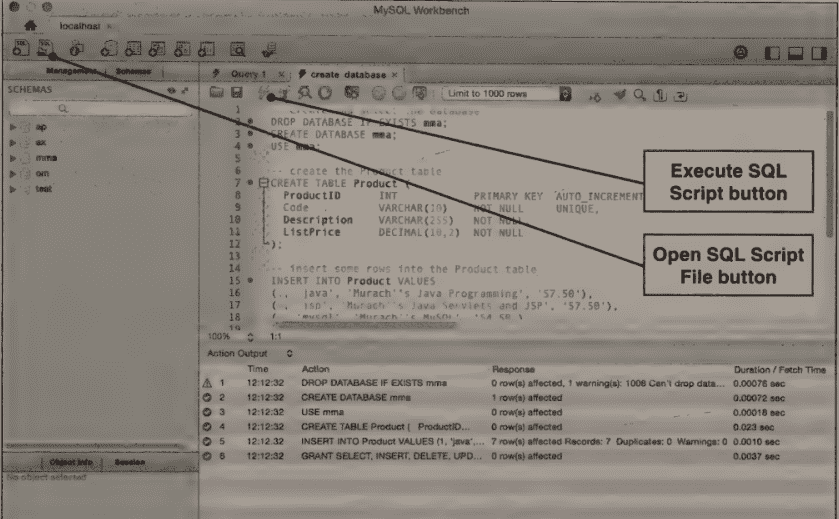

# 如何创建数据库

1. 启动 MySQL Workbench。

2. 连接到本地计算机上的 MySQL 实例。要做到这一点，双击名为“Local instance MySQL56”的存储连接，如果提示，输入 root 用户的密码。

3. 点击 SQL Editor 工具栏中的 Open SQL Script 按钮打开脚本。然后使用对话框找到并打开 `create_database.sql` 文件。打开后，MySQL Workbench 在代码编辑器中显示 Execute SQL Script 按钮。

4. 点击代码编辑器中的 Execute SQL 按钮执行脚本。执行后，Output 窗口将显示指示脚本是否执行成功的消息。

# 如何恢复数据库

- 再次运行 `create_databases.sql` 脚本以删除数据库并重新创建它。

# 如何更新 root 用户的密码

当你在计算机上安装社区版服务器时，会自动创建一个 root 用户，以便你登录服务器。然而，默认情况下不会为此用户分配密码。换句话说，该服务器是不安全的。因此，我们建议通过运行图 B-6 所示的 SQL 脚本为 root 用户分配一个“sesame”的密码。

当然，“sesame”是一个弱密码，同样不安全。因此，对于生产系统，你可能需要修改此脚本，为 root 用户分配一个无法被轻易破解的安全密码。

# 更新密码的脚本

`/murach/java_netbeans/db/update_root_password.sql`

## 步骤

1. 启动 MySQL Workbench。

2. 以 root 用户身份连接到运行在本地计算机上的 MySQL 实例。要执行此操作，请点击 root 用户的存储连接。由于没有为 root 用户分配密码，因此你不需要输入密码。

3. 点击 SQL 编辑器工具栏中的“Open SQL Script File”按钮打开 `update_root_password.sql` 文件，并导航到 `/murach/java_netbeans/db` 文件夹。

4. 点击“Execute SQL Script”按钮。这应该将 root 密码更新为“sesame”。

5. 使用本附录之前显示的 MySQL 偏好面板停止并启动 MySQL 服务器。

### 描述

- 默认情况下，root 用户没有密码。这是不安全的。
- 对于本书，你可以运行如图中所示的脚本将 root 用户的密码更改为“sesame”。
- 对于生产系统，你可以修改图中所示的脚本，使 root 用户的密码更安全。


# 索引

AWT (Abstract Window Toolkit) 631

- operator, 174-177
- operator, 176, 177
- operator, 200, 201
- `!=` operator, 79, 198, 199
- `%` operator, 174, 175
- `%=` operator, 178, 179
- `&&&` operator, 200, 201
- `*` operator, 174, 175
- `*=` operator, 178, 179
- `/` operator, 174, 179
- `@author` tag, 346, 347
- `@Override` annotation, 280, 281
- `@param` tag (javadoc), 346, 347
- `@return` tag (javadoc), 346, 347
- `@version` tag (javadoc), 346, 347
- `l` operator, 200, 201
- `ll` operator, 200, 201
- `+` operator
  - numbers, 174-177
  - strings, 52, 53
- `++` operator, 176, 177
- `+=` operator, 178, 179
- `<` operator, 79, 198, 199
- `<>` operator (generics), 362, 363
- `<code>` tag (HTML), 346, 347
- `-=` operator, 178, 179
- `->` operator (lambda), 382, 383
- `==` operator, 79, 198, 199
- `>=` operator, 79, 198, 199
- `add` method (ArrayList), 366, 367
- `add` method (BigDecimal), 186, 187
- `add` method (BorderLayout), 546, 547
- `add` method (JFrame, JPanel), 538, 539
- `addActionListener`, 540, 541
- 向表中添加记录, 500, 501
- Addition operator, 174, 175
- compound, 178, 179
- Adjuster(date/time), 400, 401
- anchor field (GridConstraints), 580, 581
- And operator, 200, 201
- Android app, 12, 13
- Android Studio ID, 18, 19
- Annotation (`@Override`), 280, 281
- Anonymous class, 338, 339
- Anonymous functions (lambda), 378, 379
- API documentation, 66, 67
- Append
  - 追加到文件, 446, 447
  - 追加到字符串, 52, 53, 235
  - `append` method (StringBuilder), 242, 243
- Applet, 10, 11
- Application, 8, 9
- Argument, 36, 64, 65
- sending to method, 112, 113
- Arithmetic exception, 50, 51, 174
- Arithmetic operators, 50, 51, 175
- Array
  - 给...赋值, 256, 257
  - 比较, 266, 267
  - 与类比较, 358, 359
  - 复制, 266, 267
  - 创建, 254, 255
  - 创建引用, 266, 267
  - 引用元素, 256, 257
- Array list, 360, 361, 364
- 数组数组, 262, 263
- ArrayOutOfBoundsException, 255, 257
- ArrayList (javadoc), 360, 361, 364
- constructor, 364, 365
- Arrays class, 264, 265
- ASCII character set, 168, 169
- Absolute path name, 436, 437
- abstract class, 298, 299
- advantages, 310, 311
- 与接口比较, 310, 311
- abstract keyword, 298, 299
- abstract method, 298, 299
- Abstract Window Toolkit (AWT), 334, 335, 532-535
- AbstractTableModel class, 548, 549
- Access modifier, 32, 33, 100, 101, 108, 109, 280, 281
- Accessors (set and get), 109
- Action listener, 540, 541
- ActionListener interface, 338, 339
- actionPerformed method, 540, 541
- 给...赋值, 170, 171
- 给数组元素赋值, 256, 257
- Assignment operator, 170, 171
- Assignment statement, 46-49, 120, 121
- Asynchronous thread, 276, 477
- assignment operator, 178, 179
- Autoboxing, 358, 359, 370, 371
- AutoCloseable interface (java.lang), 416, 417
- Autofill feature, 444, 445
- DriverManager loading, 509, 510
- AWT (Abstract Window Toolkit), 334, 335, 532-535


# Command prompt

- `capacity` method (StringBuilder), 242, 243
- CardLayout manager, 52, 543
- Case label (switch statement), 206, 208
- Case structure, 206, 207
- Case-sensitive language, 48, 49
- Casting, 50, 51, 182
- objects, 294, 295
- catch block, 222, 223
- catch (try), 414, 415
- Catching an exception, 70, 71, 220, 243
- Central processing (CPU), 464, 465
- char type, 168, 169
- Base class, 276, 277
- BigDecimal class, 186, 199
- Binary file, 438, 559
- Binary operator, 174, 175
- Binary stream, 438, 439
- binary (Arrays class), 264, 265
- Bit, 168, 169
- Binary (Large Objects), 512, 513
- Block comment, 34, 35
- Block of code, 32, 202, 203
- Block scope, 80, 83, 202
- Blocked state (thread), 468, 469
- Blocking (dialog box), 558, 559
- input stream, 448, 449
- output stream, 444, 445
- stream, 438, 439
- charAt (String), 236, 237
- charMethod (StringBuilder), 244, 245
- Checked exception, 410, 411, 426, 427
- throwing, 422, 423
- Child class, 276, 277
- Unit enumeration, 400, 401
- Class, 14-17, 32, 33
- declaration, 32, 33
- diagram, 96, 97, 138
- documentation, 344, 345
- field, 116, 117
- import, 62, 63
- instance of class, 64, 65
- method, 116, 117
- storing in packages, 134, 137
- structuring an app with 132, 133
- Class structure, 508, 509
- ClassCastException (java.lang), 294, 295


- Array (List), 368, 369
- (Large Object size), 512, 523
- clone method (`Object` class), 278, 279
- clone a project (Beans), 26, 27
- close method (`BufferedReader` class), 450, 451
- close method (`PrintWriter` class), 446, 447
- close method (`ResultSet`), 510, 511
- (dialog box), 562, 563
- code feature, 42, 43
- code editor, 22, 23, 38
- code execution (tracing), 154, 155
- code tag (HTML), 346, 347
- code Encoding, 150, 151
- Collection, 358, 361
- expression, 78, 79, 198-201
- type, 168, 169
- value, 78, 79, 198
- variable, 198, 199
- `BorderLayout` manager, 542, 543, 546, 547
- `BoxLayout` manager, 542, 543
- break statement, 206, 208
- with loops, 218, 219
- Breakpoints (debugging), 156, 157
- Buffer, 440, 441
- `BufferedReader` class (`java.io`), 448, 451
- `BufferedWriter` class (`java.io`), 444, 445
- Built-in stream, 558, 559
- Business classes, 132, 133
- Business objects, 132, 133
- Business tier, 132, 133
- Button
  - add to, 538, 539
  - handle event, 540, 541
  - type, 168, 169
- Bytecodes, 116, 170
- C, 6, 7
- C (compared to Java), 6, 7
- C++ (compared to Java), 6, 7
- Call stack, 412, 413
- debugging, 160, 161
- Calling, 64, 65, 112, 113
- static fields, 122, 123
- static methods, 122, 123
- Camel case, 170, 171
- Camel notation, 46
- (dialog box), 562, 563
- compared to array, 358, 359
- Collection framework, 360, 361
- `Collection` interface (`java.util`), 360, 361
- Column
  - database, 484, 485, 488, 489
  - file, 446, 447
- Command prompt, 8, 9

# Comment

- end-of-line, 34, 35
- single-line, 34, 35
- coding, 34, 345
- `Comparable` interface, 264, 265
- `compareTo` method, 396, 397
- Comparing objects, 296, 297
- primitive types, 198, 199
- variables, 78, 79
- Compile a project (NeBeans), 24, 25
- Compiler (Java), 16, 17
- Compile-time error, 148, 149
- Class, 532, 533
- hierarchy, 534, 535
- grid, 580, 581
- `Component` (`java.awt`), 534, 535
- Compound assignment operator, 52, 53, 234, 235
- Concatenate strings, Concurrency (threads), 476, 477
- Confirm an order (dialog box), 560, 561
- Connect to a database, 508, 509
- Connector/J driver, 506, 507
- Console, 8, 9
- input, 66, 69
- output, 36, 37
- Console application, 8, 19, 532, 533
- Console, 172, 173
- in an enumeration, 340, 341
- Constructor, 64, 65, 102, 103
- coding, 106, 107
- `Container` class (`java.awt`), 534, 535
- `contains` method (`ArrayList` class), 368, 369
- continue statement (with loops), 218, 219
- Control statements, 78, 79
- Convert
  - numbers to, 74
  - strings to numbers, 70

# 删除

- 文件, 434
- 来自 NetBeans 的项目, 26, 27
- 表格中的记录, 500, 501, 514, 515
- `delete` method (`Class`), 434
- `delete` method (`StringBuilder`), 244, 245
- `DELETE` statement (SQL), 500, 501, 514
- `deleteChar`(`StringBuilder`), 244, 245
- 限制文本文件, 446, 447
- 分隔符, 446, 447
- 派类, 276
- 图表 (类), 96, 97
- 对话框, 586, 587
- 内置的, 558, 559
- 从到传递数据, 588, 589
- 钻石对象, 362, 363
- 维度, 584, 585
- 目录（操作与）, 434–437
- `divide` method (`BigDecimal`), 186, 187
- 除法运算符, 174, 175
- 复合, 178, 179
- DML (数据操语言), 498

## 文档

- API, 66, 67
- 类, 344, 345
- 生成, 348
- 查看, 348, 349
- `Double` class, 70, 71
- `double` data type, 46, 168, 169
- `doubleValue` method (`BigDecimal`), 186, 187
- do-while loop, 214, 215
- `DriverManager` class, 508, 509
- 驱动程序 (数据库), 506, 507
- `DROP DATABASE` (SQL), 496, 497

# E

- 异常, 165, 19
- Eclipse IDE, 18, 19
- EDT (事件分发线程), 602, 603
- EE (扩展版), 4, 5

## 元素

- 数组, 254, 255
- 赋值, 256, 257
- 空字符串, 52, 53
- 封装, 96, 97
- 行尾注释, 34, 35
- `endsWith` (`String`), 236, 237
- 增强 for 循环 (数组), 260, 261
- 枚举类 (`java.lang`), 342, 343
- `enum` keyword, 340, 341
- 枚举, 340, 341
- 枚举类型, 342, 343
- `EOFException` (`java.io`), 442, 443
- 等于运算符, 79, 198, 199
- `equals` method (`Array` class), 266, 267
- `equals` method (`Object` class), 278, 279, 296, 297
- `equals` method (`String` class), 78, 79, 236, 237
- `equalsIgnoreCase` (`String` class), 78, 79, 236, 237

# 错误

- 编码, 150, 151
- 编译时, 152, 153
- 确定情况, 152, 153
- Java, 150, 151
- 逻辑, 152, 153
- 运行时, 152, 153
- 语法, 150, 151
- `Error` class (`java.lang`), 410, 411
- `ERROR_MESSAGE` (`OptionPane`), 558, 559
- 转义序列, 54, 55
- 事件, 334, 335
- 处理器, 540, 541
- 监听器, 540, 541
- 事件分发线程 (EDT), 602, 603
- 异常, 70, 721, 220, 210, 441
- 捕获, 70, 714, 415, 220–223
- 链式, 428, 429
- 检查异常, 426, 427
- 吞入, 416
- 处理, 70, 71
- 层次结构, 220, 221
- 多类, 420, 421
- 传播, 412, 413
- 忽略, 416
- 抛出, 70, 711, 412, 423, 422
- try-with, 416, 417
- 未检查异常, 426, 427
- 何时抛出, 424, 425
- `Exception` class (`java.lang`), 410, 411
- 创建, 426, 429
- 异常处理器, 220–222, 410–413
- 测试, 424, 425
- `executeUpdate`, 514, 515
- 执行 (训练), 154, 155
- `exists` method (`Files` class), 534, 435
- `EXIT_ON_CLOSE` value, 536, 537
- 显式类, 182, 183
- 类, 276, 277, 282, 283
- `extends` keyword, 282, 283, 316, 317

# F

- Fall (switch statement), 208, 209
- 文件 (图形界面), 635
- 文件 I/O, 96, 97, 102, 105
- `FileNotFoundException` (`java.io`), 442, 443
- `FileReader` (`java.io`), 448, 449
- Files (操作与), 433-437
- `Files` class (`java.nio.file`), 434-437
- `FileWriter` (`java.io`), 444, 445
- `final` (class), 264, 265
- `final` class, 300, 301
- `final` keyword, 172, 173, 300
- `final` method, 300, 301
- `final` parameter, 300, 301
- `final` variable, 172, 173
- `finally` block (`try` statement), 414, 415
- `FileChanged` method, 548, 549
- 固定宽度布局, 542, 543
- `float` type, 168, 169
- 浮点数, 168, 169
- `FlowLayout` layout, 542-545
- 构造函数, 554, 545
- `flush` (`PrintWriter` class), 446, 447
- Folders (操作与), 433-437
- for loop, 216, 217
- 数组, 258, 259
- `for` statement, 216, 217
- 数组, 258, 259
- foreach loop, 260, 261
- 外键, 486, 487
- Form, 533, 534, 586, 587
- 数据项, 588, 589
- `format` method (`DateTimeFormat`), 402, 403
- `format` method (`NumberFormat`), 74, 75
- `formatStyle.FULL`, 402, 403
- `formatStyle.LONG`, 402, 403
- `formatStyle.MEDIUM`, 402, 403
- `formatStyle.SHORT`, 402, 403
- `forName` method (`Class` class), 508, 509
- 只读结果集, 510, 511
- `Frame` class (`java.awt`), 533, 534
- Frame, 334, 533-537
- 面, 538, 539
- 如何显示, 586, 587
- `FROM` clause (`SELECT` statement), 498, 499
- Function (lambda), 378, 379
- Functional interface (lambda), 382, 383
- 访问器, 108, 109
- `get` method, 102, 103, 108
- `ArrayList` class, 366, 367
- `Paths` class, 434-437
- `getClass`(`Object`), 278, 279
- `getCount`, 548, 549
- `getName`, 548, 549
- `getConnection`, 508, 509
- `getCurrencyInstance` (`NumberFormat`), 74, 75
- `getDayOfMonth` method, 394, 395
- `getDayOfWeek` method, 394, 395
- `getDayOfYear` method, 394, 395
- `getFileName` (`Path`), 435
- `getHour` method, 394, 395
- `getMessage` (`Throwable`), 418, 419
- `getMinute` method, 394, 395
- `getMonth` method, 394, 395
- `getMinValue` method, 394, 395
- `getName` (`Path`), 435
- `getName` (`Thread`), 471
- `getCount` (`Path`), 435
- `getNano` method, 394, 395
- `getInstance` (`NumberFormat`), 74, 75
- `getOwner` (`Window`), 588, 589
- `getPath` (`Path`), 435
- `getPercentInstance` (`NumberFormat`), 74, 75
- `getRoot` (`Path`), 435
- `getRowCount` (`AbstractTableModel`), 548, 549
- `getSecond` method, 394, 395
- `getSelectedRow` (`JTable`), 555, 556
- `getSelectedRows` (`JTable`), 554, 555
- `getText` (`TextField`), 576, 577
- `getVal` (`AbstractTableModel`), 548, 549
- `getYear` method, 394, 395
- `getPrivileges` (SQL), 496, 497
- `GRANT` statement (SQL), 496, 497
- 图形用户界面 (GUI), 334, 535, 532, 533
- 大于, 79, 198, 199
- 大于运算符, 79, 198, 199
- `GridBagConstraints`, 578-581
- `GridBagLayout`, 542, 543, 578, 579
- height field (`GridBagConstraints`), 580, 581
- `GridLayout` layout, 542, 543
- width field (`GridConstraints`), 580, 581
- x field (`GridBagConstraints`), 580, 581
- y field (`GridBagConstraints`), 580, 581
- GUI (图形界面), 8, 333, 532, 533
- 响应问题, 602, 603

# Java 数据库连接 (JDBC)

- 输入文件, 438, 439
- `HALF` (`RoundingMode`), 186, 187
- `EVEN` (`RoundingMode`), 186, 187
- `UP` (`RoundingMode`), 186, 187
- 处理异常, 70, 71
- 哈希值, 278, 279
- `hashCode` (`Object` class), 278, 279
- `HashMap` class (`java.util`), 360, 361
- 水平缩放, 584, `HORIZONTAL_SCROLLBAR_ALWAYS`
- 输入流, 438, 439
- `InputStreamReader` (`java.io`), 448, 449
- `INSERT` statement (SQL), 500, 501, 514, 515
- 结果集 (GridLayout), 579, 582
- 调试, 150, 151
- 实例对象, 98, 99
- 实例化, 426, 429
- 数组, 254, 255
- `int` type, 46, 168, 169
- `Integer` class, 70, 71
- IDE (集成开发环境), 18, 19
- IntelliJ IDEA, 18, 19
- 标识符, 150, 151
- if/else statement, 82, 83, 202-205
- 嵌套, 82, 83, 204


## 索引

- `IllegalArgumentException` (java.lang), 424, 425
- 不变字符串, 242, 243
- 实现接口, 908, 309, 314
- `implements` 关键字, 314, 315
- 隐式类, 182, 183
- `import` 语句, 62, 63
- `static`, 342, 343
- 递增运算符, 176, 177

### 数组与字符串

- 数组, 256, 257
- 字符串, 238, 239
- `indexOf` 方法 (ArrayList), 368, 369
- `indexOf` 方法 (String), 236, 237
- 不等于运算符, 79, 81, 212, 213
- `INFORMATION_MESSAGE` (JOptionPane), 558, 559
- 继承一个类, 316, 317
- 继承, 276, 277
- 使用使用方法, 320, 321

### 初始化

- 常量, 172, 173
- 变量, 46, 47, 170, 171
- 注入攻击 (SQL), 514, 515

### Java 开发工具包 (JDK)

- Java 开发工具包 (JDK), 4.5
- Java 驱动
- `JTextField` (javax.swing), 534, 535
- 构造函数, 576, 577
- native protocol coll, 506, 507
- native protocol party, 506, 507
- net protocol coll, 506, 507
- 即时编译器 (JIT 编译器), 16, 17
- JVM (虚拟机), 16, 17

### K

- Java EE, 4, 5
- Java 错误 (常见), 150, 151
- Java 解释器, 16, 17
- 键值对, 360, 361
- 关键字 (Java), 46-48
- Java ME, 4, 5
- Java 插件, 16, 17
- Java 运行环境 (JRE), 16, 17
- Java SE, 4, 5

### L

- Java 源代码, 40, 41
- Java 虚拟机 (JVM), 16, 17
- `java.awt.package`, 542, 538, 579
- `java.io.package`, 434, 450, 441
- `java.lang.package`, 62, 63
- `java.math.BigDecimal`, 166, 187
- `java.math.RoundingMode` 枚举, 186, 187
- `java.nio.package`, 440, 441
- `java.io.file.package`, 436, 437
- `java.text.package`, 390, 391
- `java.time.package`, 390, 391
- `java.util.package`, 390, 391
- Label (标签), 574, 575
- Lambda 表达式, 378-383, 540, 541
- lambda 运算符, 382, 383
- 最后结果 (Method), 501, 510
- `lastIndexOf` (String), 236, 237
- 晚绑定, 284
- javadoc
  - 注释, 344, 345
  - 标签, 346, 347
  - 查看, 348, 349
- 分层
  - 输入流, 448, 449
  - 输出流, 444, 445
  - 流, 440, 441
- 布局管理器, 542, 538, 579
- 长度 (数组), 254, 255
- `length` 字段 (数组), 258, 259
- `length` 方法 (String), 238, 239
- `length` 方法 (StringBuilder), 242, 243
- 小于号运算符, 79, 198, 199
- 小于等于运算符, 79, 198, 199
- 库, 22, 23
- JavaFX 532-534
- `javax.swing.package`, 536, 537
- `JButton` 类 (javax.swing), 534, 535, 538, 539
  - 构造函数, 538, 539
- 线程生命周期, 468, 469
- 链表, 360, 361
- `LinkedList` 类 (java.util), 360, 361
- `List` 接口 (java.util), 360, 361
- 字面量值, 48, 49
- 局部类, 392, 401
- `LocalTime` 类, 392, 401
- LocalTime, 392, 401
- `JComponent` 类 (javax.swing), 534, 535
- JDBC 数据库连接, 506
- JDBC 管理器, 506, 507
- JDBC-ODBC 桥， 506, 507
- `JOptionPane` 控制台, 386, 387
- JDK (Java 开发工具包), 4, 5
  - 在 Mac 上安装, 618, 619
  - 在 Windows 上安装, 608, 609
- `JFrame` 类 (javax.swing), 534-527
- JIT (即时编译器), 16, 17
- `JLabel` 类 (javax.swing), 534, 535
  - 构造函数, 574, 575
- JTable
  - 构造函数, 554, 555
  - 术语, 548, 549
  - 组件, 548, 549
- 主类, 22, 23, 32, 33
- `main` 方法, 14, 15, 32, 33
  - 声明, 33, 34
- 主线程, 464, 465
- 主窗口, 536, 537
- 多对多关系, 486, 487

### M

- `Map` 接口 (java.util), 360, 361
- `Math` 类, 185, 184
- `max` 方法 (Math 类), 184, 185
- ME (微型), 4, 5
- 类成员, 102, 103
- 调用, 64, 65, 112, 113
- 调用, 120, 121
- 链式, 74, 75
- 编码, 108, 109
- 在接口中, 309
- 命名, 108, 109
- 重载, 122, 123
- 重写, 282, 283
- 签名, 122, 123
- `static`, 64, 65
- Microsoft SQL Server, 484, 485
- 中间层, 132, 133
- `min` 方法 (Math), 184, 185
- `minus` 方法 (LocalDateTime), 400, 401
- `minUtils` 方法, 400, 401
- 移动应用, 12, 13
- 模态对话框, 555, 559, 586, 587
- 模型 (表), 548, 549
- 取模运算符, 174, 175
- 复合, 178, 179
- 多月, 392, 393
- 多重 catch 块, 420, 421
- 多层架构, 132
- 多接口, 308
- `MULTIPLE_INTERVAL_SELECTION`, 554, 555
- 乘法运算符, 174, 175
- 复合, 178, 179
- `multiply` 方法 (BigDecimal 类), 186, 187
- 多线程, 464, 465
- 多层架构, 132
- 可变表, 242, 243
- MySQL 偏好设置 (Mac), 622, 623
- MySQL Workbench, 490, 501
  - 在 Mac 上安装, 624, 625
  - 在 Windows 上安装, 612, 613
- MySQL, 484, 485, 490, 501
  - 在 Windows 上安装, 612, 613
  - 在 Mac 上安装, 622, 623
  - 在 Mac 上更新密码, 626, 627
- 窄转换, 182, 183
- native protocol all Java 驱动, 506, 507
- Native party Java 驱动, 506, 507
- 负号运算符, 176, 177

### Nested

- `if` 语句, 82, 83, 205
- 循环, 262
- Net protocol all Java 驱动, 506, 507
- NetBeans, 18-27
  - 代码编辑器, 38, 39
  - 创建类, 100, 101
  - 在 Mac 上安装, 619, 619
  - 在 Windows 上安装, 608, 609
  - Java 源代码, 40, 41
  - 新项目, 38, 39
  - 包, 136, 137
  - 项目, 20, 21
  - 语法错误, 44, 45
  - 两个或多个对象, 26, 27
- `new` 关键字, 110, 111
- new state (线程), 468, 469
- `DirectoryStream` 类, 434, 435
- `next` 方法 (ResultSet), 510, 511
- `nextLine` 方法 (Scanner 类), 68, 69
- nio, 436, 437
- `JOptionPane`, 562, 563
- Not 运算符, 200, 201
- `exists` 方法 (File 类), 434, 435
- `now` 方法 (LocalDateTime), 392, 393
- Null, 52, 53
- 数据库, 488, 489
- `NumberFormat` 类, 74, 75
- 数字转字符串 (转换), 74, 75
- 数值变量, 46, 47
- 比较, 78, 79

### N

- Name 元素 (路径), 434, 435
- `name` 方法 (枚举), 342, 343
- 命名规范, 172, 173
- 类, 22, 33
- Object, 98, 99
- 强制转换, 294, 295
- 创建, 64, 65, 110, 111
- identity of, 98, 99
- state of, 98, 99
- `Object` 类, 278, 279, 342, 466
- Object 图, 98, 99
- ODBC (数据库连接), 506, 507
- `of` 方法 (LocalDateTime), 392, 393
- Methods, 402, 403
- LocalTime 方法, 402, 403
- `OK_CANCEL_OPTION` (JOptionPane), 560, 561

### O

- `JOptionPane`, 562, 563
- 一维数组, 262, 263
- 多对多关系, 486, 487
- 一对一关系, 486, 487
- 操作数, 50, 134, 175
- 在布尔表达式中, 198, 199
- or 运算符, 200, 201
- Oracle, 484, 488
- `ORDER BY` 语句, 498, 499
- 优先级, 180, 181
- `ordinal` 方法 (枚举), 342, 343
- 输出文件, 438, 439
- 输出流, 438, 439
- 字符, 444, 445
- 输出窗口 (NetBeans), 24, 25

### Overloading

- 构造函数, 106, 107
- 方法, 122, 123

### Overriding

- 注解, 280, 281
- 方法, 276, 277, 282
- `equals` 方法, 296, 297
- Once, 586, 587

### Package

- 14, 15, 22, 23, 32, 33, 134, 135
- Java, 62, 63
- NetBeans, 136, 137
- 在类中存储, 134-137
- 包命名, 134, 135

### Padding

- `GridConstraints`, 582, 583
- `GridLayout`, 578, 579
- Padding字符串, 246, 247

### Panel

- 按钮, 538, 539
- 到框架, 538, 539
- 参数, 96, 97, 120, 121
- 一个接口类型, 318, 319
- 参数列表 (of 方法), 108
- 父类, 276, 277
- 父表单, 586, 587
- 传递数据到表单, 588, 589
- `parse` 方法 (LocalDateTime), 392, 393
- `parseDouble` (Double), 70, 71
- `parseInt` (Integer), 70, 71
- 解析字符串, 234, 235

### Parsing

- 参数引用, 120, 121
- 按值, 120, 121
- 根用户 (更新), 626, 627
- `Put` 接口 (nio.file), 434, 437

### Path name

- 绝对, 436, 437
- 相对, 436, 437
- `Paths` 类 (java.io), 434, 437
- Pivot, 532, 534
- `PLAIN_MESSAGE` (JOptionPane), 558, 559
- 平台独立性, 16, 17
- 插件-in (Java), 16, 17
- `plus` 方法 (date/time), 400, 401
- `plus` 方法 (date/time), 400, 401
- 多态性, 284, 285
- 正号运算符, 176, 177
- 后缀, 176, 177
- `pow` 方法 (Math 类), 184, 185
- `Predicate` 接口 (java.util), 384, 385
- Prepared 语句 (JDBC), 516, 517
- 表示层, 132, 133
- 主键, 484, 485
- 原始数据类型, 46, 168, 169
- 与其它比较, 198, 199
- 与引用比较, 120, 121
- `print` 方法 (PrintWriter 类), 446, 447
- `print` 方法 (System.out 对象), 36, 37
- 打印输出到控制台, 36, 37
- print (等待)
- `print` 方法 (PrintWriter 类), 446, 447
- `print` 方法 (System.out 对象), 36, 37
- `print` (Throwable 类), 418, 419
- 私有 (字段和方法), 96, 97
- `private` 关键字, 108
- 类声明, 32, 33
- 父类, 280, 281
- 查询 (SQL), 498-501
- 查询表 (SQL), 498, 499
- `random` 方法 (Math 类), 184, 185
- RDBMS (关系型数据库系统), 484, 485
- Reader 类层级 (java.io), 448, 449
- 读取
  - 从控制台, 68, 69
  - 从文本文件, 450, 451

### readLine 方法 (BufferedReader 类)

### sort 方法 (Arrays 类)

- `readLine` 方法 (BufferedReader 类), 450, 451
- 只读结果集, 510, 511
- SDK (软件开发包), 4, 5
- SE (标准版), 4, 5
- 选择数据库 (MySQL), 496, 497
- `SELECT` 语句 (SQL), 496-501
- 选择结构, 82, 202, 203
- Servlet, 10, 11

### Record

- 数据库, 484, 485
- 文件, 447
- 矩形数组, 262, 263
- 重构, 136, 137
- `set` 访问器, 108, 109
- `set` 接口 (java.util), 360, 361
- `set` 方法, 102, 103, 108
- `ArrayList` 类, 368, 369
- `setBody` 方法 (JTable), 554, 555
- 引用方法, 110, 111
- 数组, 266, 267
- 与原始类型比较, 120, 121
- 外键完整性 (MySQL), 490, 491
- 关系型数据库, 484, 485
- `charArray` 方法 (StringBuilder), 244, 245
- `ColumnCount` 方法 (JField), 576, 577
- `setDeleteOption`, 536, 537
- `setEditable` 方法 (JField), 576, 577
- `setEnabled` 方法, 538, 539
- 关系操作, 78, 198
- 关系 (表), 486, 487
- 相对路径名, 436, 437
- `remove` 数组 (ArrayList), 368, 369
- `HorizontalScrollBarPolicy`, 555, 556
- `setLayout` 方法, 542, 543
- `setLookAndFeel` 方法, 536, 537
- `setMaximumFraction` 方法, 74, 75
- `setMaximumSize` 方法, 584, 585
- 解决问题, 584, 585
- 结果集 (SQL), 498-501, 510, 511
- `getData` 从, 512, 513
- `ResultSet` 方法, 510, 511
- `return` 语句, 109, 110
- `setMinimumFraction` 方法, 757, 758
- `setMinimumSize` 方法, 576, 577
- `setModel` 方法 (JTable), 554, 555
- `setResizable` 方法, 576, 577, 584
- `setScale` 方法, 584, 585
- 返回类型, 108, 109
- 返回的值 (一个方法), 112, 113
- RIAs (富级互联网应用), 532, 533
- Rich Internet Applications (RIAs), 532, 533
- 根用户 (更新), 626, 627

# 源代码

# 线程 641


# 索引

- 源代码, 16, 17
- 在 Mac 上安装，620, 621
- 在 Windows 上安装，610, 611
- 特殊字符，54, 55
- `split()` 方法 (`String` 类）， 450, 451
- SQL (结构化查询语言), 490
- SQL 注入攻击，514, 515
- SQL 脚本，496, 497
- SQL Server, 484, 485
- SQL 语句，494, 495
- 键并执行，494, 494
- `sqrt()` 方法 (`Math` 类）， 184, 185
- 堆栈轨迹溯 (Stack trace), 160, 161, 220, 221, 412, 413
- 标准部件工具包 (SWT), 532-535
- `start()` 方法 (`Thread` 类）， 466-473
- `startsWith()` (`String`), 236, 237
- 对象的状态，38, 99
- 语句，34, 35
- 静态字段，116, 117
- 向上取整 (celling)，122, 123
- 编码，114, 115
- 导入，342, 343
- 何时使用，116
- 静态导入，342, 343
- 静态方法，114, 115
- 静态方法，64, 65, 116
- 向上取整 (celling)，122, 123
- 编码，114, 115
- 接口，322, 323
- 导入，342, 343
- 单步执行代码 (调试)，158, 9
- `stop()` 方法 (`Thread` 类）， 466-469
- 将类存储在包中，134-137
- 流 (Stream)，438, 439
- 缓冲的，440, 441
- 分层，440, 441
- `String`，36, 37, 52, 53
- 附加，52, 53, 234, 235
- 比较，78, 79, 236
- 拼接，52, 53, 234, 235
- 转换为数字，70, 71
- 转义序列，54, 55
- 索引，238, 239
- 并，52, 53, 234, 235
- 修改，240, 241, 244, 245
- 填充，246, 247
- 解析，234, 235
- 特殊字符，54, 55
- `String` 类，234, 235
- 字面量字符串 (String literal)，52, 53
- `String` 对象，52, 53
- `StringBuffer` 类，242, 243
- `StringBuilder` 类，242, 243
- `StringUtils` 类，246, 247
- 结构化查询语言 (SQL)，490
- 子类，222, 227, 276
- 强制转换为子类，294, 295
- 创建，282, 283
- `substring()` 方法 (`String`)，240, 241
- `substring()` 方法 (`StringBuilder`)，244, 245
- `subtract()` 方法 (`BigDecimal`)，186, 187
- 减法操作，174, 175
- `super` 关键字，282, 283
- 父类，276, 277
- 强制转换为子类，294, 295
- 创建，280, 281
- 吞吞异常 (Swallowing exceptions)，416
- 游泳，334, 332, 535
- 继承层次结构，534, 535
- 线程 (threads)，602, 603
- `switch` 语句，202, 206, 207
- SWT (标准部件工具包)，532-535
- 同步调用，476, 477
- 同步线程，476, 477
- 语法错误，44, 45, 148-151
- 用的，150, 151
- `System.err` 对象，438
- `System.in` 对象，68, 69, 438
- `System.out` 对象，36, 37, 438
- 表 (数据库)，484, 485
- 添加记录，500, 501
- 删除记录，500, 501
- 查询 (SQL)，498, 499
- 它们之间的关系，486, 487
- 更新记录，500, 501
- 表 (JTable)，548, 549
- 为添加滚动条，555, 556
- 创建，554, 555
- 为...创建模型，548, 549
- 终止状态 (线程)，468, 469
- 测试，148, 149
- 异常处理器，424, 425
- 文本代码，574, 577
- 文本字段，574, 577
- 文本文件，438, 439, 444-455
- 分隔的，446, 447
- 读取，450, 451
- 写入，446, 447
- `this` 关键字，106, 107, 124, 125
- 线程 (Thread)，464, 467
- 并发，476, 477
- 货币，470, 475

## Thread (继续)

## YES (JOptionPane)

## Thread (续)

- 生命周期周期，468, 469
- 放入睡眠，471-475
- 同步，476, 477
- 使用 Swing，602, 603
- `Thread` 类 (`java.lang`)，466, 467, 470-473
- 线程调度器，464, 465, 468, 469
- 线程状态，468, 469
- 线程安全，476, 477
- 三层架构，132, 133
- `Thread` 异常，70, 71, 220, 221, 412, 413, 422, 423
- 线程语句，424, 425
- `Throwable` 类 (`java.lang`)，410, 418, 419
- 构造函数，424, 425, 428, 429
- `Throwable` 层次结构，410, 411
- `throws` 子句，422, 423
- `Times`，392, 393
- 比较，396, 397
- 格式化，402, 403
- `toAbsolutePath()` (`Path`)，435
- `toArray()` 方法 (`ArrayList`)，368, 369
- `toFile()` 方法 (`Path`)，435
- 工具包 (toolkit)，532, 533
- Tooltip，538, 539
- 顶级部件，534, 535
- `toString()` 方法
  - `BigDecimal` 类，186, 187
  - `Object` 类，278, 279
  - `StringBuilder` 类，244, 245
  - `Throwable` 类，418, 419
- 追踪，154, 155
- 事务处理 (MySQL)，490, 491
- `TreeMap` 类 (`java.util`)，360, 361
- `trim()` 方法 (`String`)，240, 241
- `try` 块，222, 223
- `try/catch` 语句，222, 223, 414, 415
- `try-with-resources` 语句，416, 417
- 二维数组，262, 263
- 类型变量，362, 363
- 类型集合，362, 363
- 类型安全的枚举，340, 341
- `VALUES` 子句 (SQL)，496, 497
- 变量，46, 47, 170, 171
- 数组，254, 255
- 初始化，46, 47, 170, 171
- 数型，46, 47
- `string`，52-55
- `VERTICAL_SCROLLBAR_ALWAYS`，556, 557
- `VERTICAL_SCROLLBAR_AS_NEEDED`，556, 557
- `VERTICAL_SCROLLBAR_NEVER`，556, 557
- `void` 键盘，108, 109

## W

- 等待状态 (线程)，468, 469
- `WARNING_MESSAGE` (`JOptionPane`)，558, 559
- `WHERE` 子句 (`SELECT`)，498, 499
- `while` 循环，80, 81, 212
- `while` 语句，182, 183
- 宽转换，532, 533
- 顶级，534, 535
- `Window` (main)，536, 537
- `Window` 类 (`java.awt`)，534, 535
- `withDayMonth()` 方法，398, 399
- `withDayOfYear()` 方法，398, 399
- `withHour()` 方法，398, 399
- `withMinute()` 方法，398, 399
- `withMonth()` 方法，398, 399
- `withYear()` 方法，398, 399
- Workbench (MySQL)
- 在 Mac 上安装，624, 625
- 在 Windows 上安装，612, 613
- 包装类，70, 71, 362, 363, 370, 371
- `Writer` 层次结构，444, 445
- 写入文本，446, 447

## U

- `UIManager` 类，536, 537
- UML (统一建模语言)，96, 97
- 一元运算符，176, 177
- 未检查异常，410, 411, 426, 427
- Unicode 字符集，168, 169
- Unicode 字符，438, 439
- 统一建模语言 (UML)，96, 97
- `UPDATE` 语句 (SQL)，500, 501, 514, 515, 524
- 用户线程，470, 471

## Y

- `YES_NO_CANCEL_OPTION` (`JOptionPane`)，560, 561
- `YES_NO_OPTION` (`JOptionPane`)，560, 561
- `YES_NO_OPTION` (`JOptionPane`)，562, 563

---

# 100% 保证

当你直接从我们这里订购，你必须感到满意。我们的书必须比你用过的其他书更好……无论是培训还是参考……或者你可以在 60 天内退回并退款。不问理由！

Murach, 出版 | Murach, 总裁

---

# 面向 Java 程序员的书籍

- Murach's Beginning Java with NetBeans | 57.50
- Murach's Java Servlets and JSP (3rd Ed.) | 57.50
- Murach's Android Programming | 57.50
- Murach's Java Programming (4th Ed.) | 57.50

# 面向 Web 开发者的书籍

- Murach's MySQL (2nd Ed.) | 54.50
- Murach's Oracle SQL and PL/SQL for Developers (2nd Ed.) | 54.50
- Murach's SQL Server 2012 for Developers | 54.50

# 面向 .NET 程序员的书籍

- Murach's C# 2012 | 54.50
- Murach's ASP.NET 4.5 With C# 2012 | 54.50
- Murach's Visual Basic 2012 | 54.50

> 价格和供应情况可能会变化。请访问我们的网站。

---

# 我们想听听你的意见

你有任何建议、问题或赞美吗？请通过你方便的方式向我们反馈！

- www.murach.com
- twitter.com/MurachBooks
- 1-800-221-5528（太平洋时间上午 8 点到下午 4 点）
- facebook.com/murachbooks
- murachbooks@murach.com
- linkedin.com/company/murach-associates

---

# 编写本书所需的软件

- Java SE 8 (JDK 1.8) 或更高。
- NetBeans IDE 8.0 或更高。
- MySQL 5.6 或更高。
- MySQL Workbench 6.3 或更高。

你可以免费下载这些软件并按照附录 A (Windows) 或附录 B (Mac) 进行安装。

---

# 本书下载文件

- 本书中介绍的完整源代码，方便你在阅读每个章节时查看代码并运行程序。
- 章节练习的起点，让你在更短时间内进行更多练习。
- 练习答案，方便你检查工作。

---

# 如何安装本书的源代码

1. 访问 `murach.com`。
2. 进入 Murach's Beginning Java with NetBeans 页面。
3. 根据说明下载包含本书应用程序和练习的压缩包。
4. 解压缩所有文件。这将创建一个 `java_netbeans` 文件夹，其中包含 `book_apps`、`ex_starts`、`ex_solutions` 和 `db` 子文件夹。
5. 如有，在硬盘上创建 `murach` 文件夹。
6. 将 `java_netbeans` 文件夹复制到 `murach` 文件夹中。
- 欲需更多信息，请参阅附录 A (Windows) 或 B (Mac OS)。

---

# 如何设置本书的数据库

1. 按照上述方法安装本书的源代码。
2. 使用 MySQL Workbench 运行 `db` 文件夹中的 `create_database.sql` 脚本，创建书中所需的数据库。
3. 如果 `root` 用户没有分配密码（这在 Mac OS X 上新安装 MySQL 时很常见），运行 `db` 文件夹中的 `update_root_user.sql` 脚本。这将为 `root` 用户设置密码。

---

# 为什么 Murach 是最佳选择

在过去的 41 年里，很多客户问过我，像我们这样位于弗雷诺（Fresno）的小型出版社是如何做到的。
最简洁的回答是：没有其他出版社像我们这样工作。

我们不使用那些没有经过培训的自由职业者，而是使用一个小小的程序员团队，他们经过了我们行行的编写和教学方法的专业培训。我们不是每年出版 40 多本书，而是专注于少数几本书。我们不是只展示代码片段，而是提供经过反复检查以确保准确无误的完整应用程序。而且，我们并不急于将书籍推向市场，拒绝让进度干扰质量。
在我看来，这是确保我们出版的每一本书在其所属领域内都是最佳内容的唯一途径。

这就是为什么人们告诉我，每当他们需要学习新课题时，他们找的就是我们的书。为什么不读读这本书并亲眼验一下呢！

Mike Murach
出版商

---

# 使用 NetBeans 开始 Java 目录

## 入门

- 使用 NetBeans IDE 的省时功能来开发和调试 Java 应用程序
- 在第 3 章结束时，创建一个可以获取用户输入的应用程序
- 在第 4 章结束时，创建一个使用业务对象的面向对象应用程序
- 在第 5 章结束时，使用 3 层架构构建一个面向对象的应用程序

## 学习核心技能

- 学习你需要的技能，而不是在你永远用不到的细节上浪费时间
- 学习 Java API 中你将用到的所有类，而不是在可能永远需要的类上浪费时间
- 学习程序员迈向 Java 移动开发所需的技能
- 学习 Java 8 中最重要的几个新特性，包括 lambda 表达式和新的日期/时间 API
- 复习每章末尾真实的示例应用程序
- 通过完成每章末尾的练习来实践你所学的内容

## 掌握面向对象编程

- 编写定义应用程序业务对象的业务类
- 以既易于理解又在现实世界有效的方式继承、接口和多态

## 像专家一样构建应用程序

- 创建一个 MySQL 数据库来存储应用程序数据，并使用 SQL 进行操作
- 编写使用 JDBC 将应用程序的业务对象映射到数据库表的数据库类
- 编写使用 Swing 为应用程序创建直观图形用户界面 (GUI) 的表现类

## 下载示例和练习题解答

（详情请见本书末页）


---

# 程序员对我们 Java 书籍的评价

> “如果你在阅读这本书之前像我一样是 Java 零，你会很快适应的。在我开始尝试代码后的 15 分钟内，开发环境就运行起来了，我已经精通了 Java。”
> Richard A.
> 程序员

> “我一周前买了了你们的 Java 书，并开始编写实用的程序，而不是‘玩具’！”
> Richard

> “我非常喜欢的一点是，它使用 NetBeans 作为 IDE 来教授 Java 编程。很多 Java 书都帮助我掌握了语言本身的操作，但这一本帮助我极大地提高了效率。”
> John Yeary，Java 布道师

> “太棒了——太赞了！值回购买价格的好几倍。”
> 发布于 Amazoncom

> “我喜欢你们的 Java 书。它直击核心信息，在过多的细节和过少的示例之间取得了完美的平衡。示例对于保持工作进行至关重要。”
> Steve，程序员，开发者，科罗拉多州

> “我喜欢的另一点是每章末尾练习。它们是强化要点的绝佳方法，并迫使你亲手实践。”

> “作者用非常简单的方式解释了无数 Java 概念。”


