# Murach's Java 编程（第5版）

## 编辑团队

- 作者：Joel Murach
- 撰稿：Mary Delamater
- 编辑：Anne Boehm
- 制作：Maria Spera

有关更多 Murach 书籍的信息，请访问我们的网站：www.murach.com

## 引言

- IDE 的使用 | 12
- `Product`、`Book` 和 `Software` 类............................................... 272

### 处理接口的基本技能 ................ 296

- 如何继承类并实现接口............... 300
- 如何结合继承使用接口............................... 304

实现 `Cloneable` 接口的类......................................................316

## 如何使用包..................................................................................324

- 包的简介......................................................................................324
- 如何使用包....................................................................................326
- 如何使用库......................................................................................328

## 如何使用模块.....................................................................................330

- 模块系统简介......................................................................................330
- 如何创建模块.........................................................................................332
- 如何使用模块...........................................................................334

- 数组与集合的比较 ................................................ 380
- 泛型简介 ................................................................. 384
- 如何添加和获取元素 ................................................................ 388
- 如何在 `ArrayList` 中存储原始类型 ............................... 392

## 发票应用程序 ................................................................ 394

- 控制台 ....................................................................................... 394
- `InvoiceApp` 类...................................................................................... 398

- 如何使用链表 ...................................................... 400
- 如何替换、删除和查找元素 ................................. 402
- 使用泛型和链表定义队列的类...............................406

## 如何使用 Map ................................................................ 408

- 使用 Map 的代码示例 ................................................ 410
- 如何创建字符串 ....................................................................... 420
- 如何向字符串添加数据 ........................................................ 420
- 如何处理字符串索引 ................................................ 424
- 如何向字符串添加数据 ................................................ 428

- 如何将字符输入流连接到文件 ............... 474
- 用于数据访问的两个接口 ................................ 478
- 一个处理文本文件的类 ............................................ 480
- 控制台 ................................................................................................... 484
- `ProductManagerApp` 类 ........................................................ 484
- 如何处理二进制文件 ................................................................ 488
- 如何将二进制输出流连接到文件 ................... 488
- 如何向二进制文件写入 ........................................................ 490
- 如何将二进制输入流连接到文件 ............... 492
- 如何从二进制文件读取 ........................................................ 494
- 一个处理二进制文件的类 ............................................ 494
- 如何设置列宽 ............................................................................ 544
- 使用 FXML 的未来价值应用程序 .................... 566
- FXML 文件 ................................................................................... 566
- 控制器类 ................................................ 568
- 应用程序类 ................................................................... 568
- 如何显示框架 ....................................................................... 578
- 如何处理面板 ................................................................ 582
- 如何验证多个条目 ................................................ 614

扩展内容 XV

- 如何操作文本区域............................................................................... 620
- 关系型数据库是如何组织的.................................................. 650
- 如何使用 Java API 中的函数式接口......................................................... 708
- 如何使用 `Predicate` 接口............................................................................... 708
- 如何使用同步方法...................................................................... 738

## 简介

自 1996 年发布以来，Java 语言已成为面向对象编程语言的领先语言之一。今天，Java 仍然是应用程序开发中最流行的语言之一，特别是用于 Web 应用和移动应用（如 Android 应用）。由于几个原因，这种趋势在未来许多年内将持续下去。

首先，开发者可以免费获取 Java 以及各种用于处理 Java 的工具。其次，Java 代码可以运行在任何现代操作系统上。第三，世界上许多大型企业都在使用 Java。第四点，Java 的开发始终根据 Java 社区的需求进行指导。因此，Java 平台能够根据使用该语言的程序员的需要不断演进。

## 本书的读者群体

本书适用于任何想要学习 Java 语言核心特征的人。即使你完全没有编程经验，这本书也适用。如果你有其他语言的编程经验，这本书也适用。如果你已经了解旧版本的 Java 并想跟上最新版本，这本书也适用。如果你已经读过三四本其他的 Java 书，但仍然不知道如何开发真实世界的应用程序，这本书同样适用。

如果你是编程完全初学者，先决条件是非常少的。你只需要熟悉你正在使用的平台（如 Windows、Mac OS X 或 Linux）的操作，以便执行打开、保存、打印、复制和删除文件等任务。

为了支持这两个 IDE，纸质版页面展示了如何使用 NetBeans，而本书的下载包中包含一个显示如何使用 Eclipse 的 PDF 文件。此外，该下载包还包含了针对 NetBeans 和 Eclipse 格式化的全书源码。因此，配合本书使用任何一种 IDE 都非常方便。

## 如何获取你所需的软件

你可以从网上免费下载本书所需的所有软件。为了方便你的操作，附录 A 展示了如何在 Windows 上下载和安装这些软件，附录 B 展示了如何在 Mac OS X 上下载和安装这些软件。

## 本书如何帮助你学习

与我们所有的书籍一样，本书具有在竞争性书中找不到的特点。这就是为什么我们相信，使用我们的书比任何其他书学得更快、更好。以下是其中一些特征：

- 与许多 Java 书不同，本书向你展示如何使用 IDE 开发 Java 应用程序。这是真实世界中 Java 编程的方式，这本身就能帮助你学得更快。
- 与许多 Java 书不同，本书侧重于你每天都会使用的 Java 特征。因此，它不会浪费你的时间介绍你可能永远用不到的特征。
- 为了帮助你学习如何在专业水平上开发应用程序，本书提供了完整的、非平凡的应用程序。例如，第 15 章介绍了一个产品管理应用程序，该程序使用表现类、业务类和数据库类来实现三层架构。在其他 Java 书中，你找不到这样完整的、真实世界的应用程序，尽管学习这类应用程序是掌握 Java 开发的最佳方法。
- 每一章末尾的练习让你有机会尝试所学知识。它们将引导你开发一些应用程序，并挑战你以新的方式应用所学知识。因此，你将在 Java 编程中获得宝贵的实战经验，从而建立你的技能和信心。
- 本书中的所有信息都以我们独特的“成对页”格式呈现，右页是核心语法、指南和示例，左页是视角和额外的说明。这可以帮助你在阅读更少内容的同时学到更多知识，并帮助你在将本书作为参考时，快速找到所需的信息。

## 我们的可下载文件如何帮助你学习

如果你访问我们的网站 www.murach.com，你可以下载为了充分利用本书价值而所需的所有文件，包含 NetBeans 格式和 Eclipse 格式。这些文件包括：

- 本书中介绍的所有应用程序
- 每一章末尾练习的初始代码
- 练习的答案

这些文件让你能够测试、回顾和复制代码。此外，如果你在练习中遇到任何问题，答案可以帮助你克服学习瓶颈，这是学习过程中的至关重要的部分。关于下载和安装这些文件的更多信息，请参阅附录 A（Windows）或附录 B（Mac OS X）。

## 为教师和培训师提供的支持材料

如果你是希望将本书作为教材的大学教师或企业培训师，我们提供全套交钥匙课程所需的支持材料。这包括：

- 教学目标：帮助你的学生专注于他们需要发展的技能
- 数个项目：让你的学生证明他们对这些技能的掌握程度
- 全套 PowerPoint 幻灯片：你可以用它们强化书中的内容

如果你是教师，想了解更多信息请访问 www.murachinstructors.com。如果你是培训师，请拨打 800-221-5528。

当你完成本书后，你将拥有进入 Web 或移动编程所需的 Java 技能。如果你想继续学习 Web 编程，`Murach's Servlets and JSP` 将教你如何使用 Servlet 和 JSP 开发 Web 应用。如果你想进入 Android 编程，`Murach's Android Programming` 将帮助你。

当我们编写第一版时，我们的目标是 (1) 尽可能快速地教你 Java，(2) 教你开发真实应用所需的实用概念和技能。我们在每个版本中都尝试进行改进，在第五版出版之际，我们希望它比以往任何时候都更有效。许多改进都来自读者的反馈，因此如果你对本书有任何意见，欢迎通过 murachbooks@murach.com 与我们联系。

感谢购买本书。我们希望你阅读愉快，并祝你的 Java 编程取得成功。


这一部分让你快速开始 Java 编程。首先，第 1 章介绍了 Java 应用并了如何使用 IDE 处理 Java 项目。然后，第 2 章教你如何编写第一个 Java 应用程序。完成这些章节后，你能够编写、测试和调试简单的应用程序。之后，第 3 章介绍了处理八种原始数据类型的细节。第 4 章介绍了控制语句的细节。第 5 章展示了如何编写方法、处理异常和验证数据。第 6 章展示了如何彻底测试和调试应用程序。此外，它展示了如何部署应用程序。

这些是你开发的几乎每个 Java 应用程序中都会使用的基本技能。完成这些章节后，你将能够编写自己的基础程序，并获得学习开发面向对象程序所需的背景。

## 第1章 Java 简介

本章首先介绍一些关于 Java 的背景信息。这些信息对于开发 Java 应用程序并非必不可少，所以如果你愿意，可以快速略过。然而，它们确实展示了 Java 的工作原理以及它与其他语言的对比。

在介绍背景信息之后，本章将展示如何使用 NetBeans IDE（集成开发环境）来处理 Java 应用程序。对于本书，我们推荐 NetBeans，因为我们认为它是入门 Java 最好、最直观的 IDE。

不过，Eclipse 是另一个用于开发 Java 应用程序的优秀 IDE，许多程序员更倾向于使用它。因此，本书的下载包含一个 PDF 文件，展示了如何使用 Eclipse 而不是 NetBeans 来配合本书。所以，如果你想使用 Eclipse，可以在需要学习如何使用 Eclipse 执行任务时使用该 PDF 文件。

- Java 概述 ................................................................................ 4
- Java 时间线 ..................................................................................................... 4
- Java 版本 ..................................................................................................... 4
- Java 与 C++ 和 C# 的对比 ................................................................... 6
- Java 应用程序类型 ................................................................................ 8
- 两种类型的桌面应用程序 ................................................................... 8
- Web 应用程序和移动应用 ................................................................ 10
- Java 开发简介 ....................................................... 12
- 控制台应用程序代码 ................................................................ 12


- Java 如何编译和解释代码 .................................................... 14
- Java IDE 简介 ....................................................................... 16
- 如何使用 NetBeans 处理现有项目 ................................ 18
- NetBeans 简介 ........................................................................ 18
- 如何打开、关闭和删除项目 ................................................ 20
- 如何编译和运行项目 ............................................................ 20
- 如何在控制台应用程序中使用输出窗口 ...................................... 22
- 如何处理两个或多个项目 ...................................................... 24
- 如何使用 NetBeans 开发新项目 ........................................ 26
- 如何创建一个新项目 ........................................................ 26
- 如何处理 Java 源代码和文件 ....................................... 28
- 如何使用代码补全功能 ......................................... 30
- 如何检测并修正语法错误 ................................................ 32
- 视角 ....................................................................................... 34

## Java 概述

1996 年，Sun Microsystems 发布了一门名为 Java 的新编程语言。今天，Java 由 Oracle 所有，是世界上使用最广泛的编程语言之一。

## Java 时间线

图 1-1 开始描述了从 1.0 版本到 1.9 版本的所有 Java 主要发布版本。在 Java 的整个历史中，`Java Development Kit`（JDK）和 `Software Development Kit`（SDK）这两个术语被用来描述 Java 工具包。在书中，我们将使用 `JDK` 术语，因为它是最新且最常用的术语。

此外，还使用了不同的命名方案来指示 Java 的版本。例如，`Java SE 8` 或 `Java 1.8` 都指的是 Java 的第八个主要版本。同样，`Java SE 9` 和 `Java 1.9` 都指的是 Java 的第九个主要版本。`Java API` 文档使用 `l.x` 风格的命名。对于这一点，你应该已经熟悉了。不过，使用单个数字（如 `Java 6`）也很常见。

本书展示了如何使用 `Java 9`。然而，Java 是向后兼容的，因此未来的 Java 版本也应该适用于本书。此外，书中描述的大多数技能自 Java 最早期版本以来就是 Java 的一部分。作为读者，早期版本的 Java 同样适用于书中描述的大多数技能。

## Java 版本

此图还描述了 Java 的三个最常见版本。首先，标准版（Standard Edition）被称为 `Java SE`。它是为桌面式计算机和服务器的通用用途而设计的，也是你将在书中学习如何使用的那个版本。例如，你可以使用 `Java SE` 创建类似第 4 节中展示的种种桌面应用程序。

企业版（Enterprise Edition）被称为 `Java EE`。它设计用于开发运行在局域网或互联网上的分布式应用程序。你可以使用 `Java EE` 创建 Web 应用程序。

微型版（Micro Edition）被称为 `Java ME`。它设计用于运行在资源有限的设备上，如移动设备、电视顶顶盒、打印机和智能卡。

在某些较旧 Java 版本中，`Java SE` 被称为 `J2SE`（Java 2 平台标准版）。同样，`Java EE` 曾称为 `J2EE`（Java 2 平台企业版）。

## Java 时间线

| 年份 | 月份 | 发布 |
| :--- | :--- | :--- |
| 1996 | 1 | JDK 1.0 |
| 1997 | 2 | JDK 1.1 |
| 1998 | 12 | JDK 1.2 |
| 1999 | 8 | JDK 1.3 |
| 1999 | 12 | JDK 1.4 |
| 2000 | 5 | Java 1.4 |
| 2002 | 2 | Java 1.5 |
| 2004 | 9 | Java 5.0 |
| 2006 | 12 | Java 11.6 |
| 2011 | | SE 1.7 |
| 2014 | 3 | Java SE 1.8 |
| 2017 | 7 | Java SE 9 |

## Java 版本

| 平台 | 描述 |
| :--- | :--- |
| Java SE (标准版) | 用于桌面式计算机和服务器的通用用途。 |
| Java EE (企业版) | 用于运行在局域网或互联网上的分布式应用程序。 |
| Java ME (微型版) | 用于资源有限的设备，如移动设备、电视顶顶盒、打印机和智能卡。 |

## 描述

- `Java` 开发工具包（JDK）包含一个编译器、运行时环境以及你用于开发 `Java` 应用程序的其他工具。某些早期版本被称为软件开发工具包（SDK）。
- `Java` 最初由 `Sun Microsystems` 开发并发布。然而，`Oracle` 在 2010 年 4 月收购了 `Sun Microsystems`。

## 核心 Java 技能

### Java 与 C++ 和 C# 的对比

图 1-2 将 `Java` 与 `C++` 和 `C#` 进行了对比。正如你所看到的，`Java` 与这些语言有一些相似之处。

当 `Sun` 的开发者创建 `Java` 时，他们试图让 `Java` 的语法与 `C++` 相似。这样，`C++` 程序员就能轻松学习 `Java`。此外，他们设计了 `Java`，使其应用程序可以在任何计算机平台上运行，而无需为每个平台进行编译。相比之下，`C++` 需要为每个平台进行编译。

`Java` 还设计用于自动处理许多涉及内存分配和释放的操作。这是为什么与 `C++` 相比，使用 `Java` 开发程序和编写无 bug 代码更容易的关键原因。

为了提供这些功能，早期版本的 `Java` 与 `C++` 相比牺牲了一些速度（性能）。`Java` 后期版本的改进极大地提高了 `Java` 的速度。现在，`Java` 在某些情况下运行速度比 `C++` 快，它的性能在大多数情况下都是足够的。

当微软的开发者创建 `C#` 时，他们利用了 `Java` 的许多优秀理念。像 `Java` 一样，`C#` 使用与 `C++` 类似的语法。此外，`C#` 自动处理内存操作。

`C#` 可以运行在任何具有其运行时环境的平台上。然而，`Windows` 是唯一完全支持 `C#` 运行时环境的操作系统。因此，`C#` 主要用于开发需要在 `Windows` 上运行的应用程序。

`Java` 在大多数情况下运行得比 `C#` 快。然而，`C#` 的性能在大多数情况下也是足够的。

### 支持 Java 的操作系统

- `Windows`
- `Mac OS X`
- `Linux`
- 大多数版本的 `UNIX`
- 大多数其他现代操作系统

### 关于 Android 的说明

- `Android` 操作系统支持 `Java` 的方式与大多数操作系统不同。然而，你可以使用所有的 `Java 7` 特性和某些 `Java 8` 特性来编写 `Android` 应用程序的代码。

### Java 与 C++ 的对比

| 特性 | 描述 |
| --- | --- |
| 语法 | `Java` 语法与 `C++` 语法相似。 |
| 平台 | 编译后的 `Java` 代码可以在任何具有 `Java` 运行环境的平台上运行。`C++` 代码必须针对其目标的每个系统类型进行单独编译。 |
| 速度 | 在某些情况下，`C++` 的运行速度比 `Java` 快，但在其他情况下，`Java` 的运行速度更快。 |
| 内存 | `Java` 自动处理大部分内存操作，但 `C++` 程序员必须编写管理内存的代码。 |

### Java 与 C# 的对比

| 特性 | 描述 |
| --- | --- |
| 语法 | `Java` 语法与 `C#` 语法相似。 |
| 平台 | 与 `Java` 一样，编译后的 `C#` 代码可以在任何具有其运行环境的平台上运行。 |
| 速度 | 在大多数情况下，`Java` 的运行速度比 `C#` 快。 |
| 内存 | 与 `Java` 一样，`C#` 自动处理大部分内存操作。 |

图 1-2 Java 与 C++ 和 C# 的对比

### Java 应用程序类型

你可以使用 `Java` 编写几乎任何类型的应用程序（也称为 app 或程序）。在书中，你将学习如何开发桌面应用程序。然而，你也可以使用 `Java` 开发 Web 应用程序和移动应用。

### 两种类型的桌面应用程序

图 1-3 显示了你可以用 `Java` 创建的两种桌面应用程序。这类应用程序直接运行在你的计算机上。

最容易创建的桌面应用程序被称为**控制台应用程序**。这类应用程序运行在操作系统提供的控制台或命令行提示符中。控制台提供了获取用户输入和向用户显示输出的简单方法。例如，图中控制台应用程序中输入了三个值，应用程序执行了计算并显示了结果。在学习 `Java` 时，在对 `Java` 语言有坚固理解之前，通常都会处理控制台应用程序。

一旦你对 `Java` 语言有了坚固的理解，就可以创建一个使用图形用户界面（GUI）的桌面应用程序。图中，`GUI` 应用程序执行与控制台应用程序相同的任务。换句话说，它从用户处获取相同的输入，执行相同的计算并显示相同的结果。然而，`GUI` 应用程序更加用户友好且直观。

由于开发应用程序的 `GUI` 需要一些相当编码技巧，因此本书在第 4 节之前不会介绍 `GUI` 应用程序。在此之前，本书使用控制台应用程序来教授 `Java` 的基础。

### 第1章 Java 简介

#### 控制台应用程序

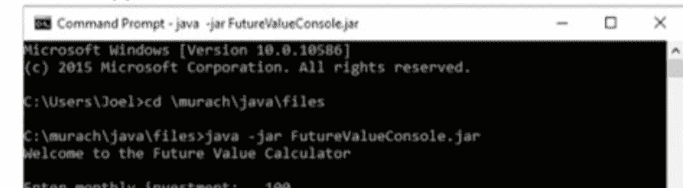

#### GUI 应用程序

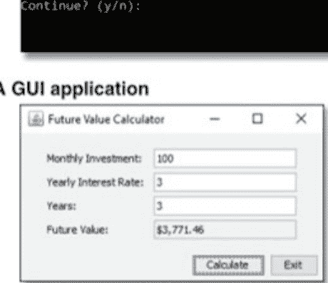

#### 描述

- 控制台应用程序使用控制台与用户交互。
- `GUI` 应用程序使用图形用户界面与用户交互。

图 1-3 两种桌面应用程序

### Web 应用程序和移动应用

在 `Java` 早期（也是互联网的早期），`Java` 最令人兴奋的特性之一是你可以用它创建一种称为 `applet` 的特殊类型基于 Web 的应用程序。`applet` 可以存储在 `HTML` 页面中并运行在支持 `Java` 的浏览器内部。由于近年来安全限制的收紧，`applet` 实际上已经过时。因此，我们没有在书中介绍它们。

然而，许多 Web 应用程序仍然依赖于 `servlet`。`Servlet` 是一种特殊的 `Java` 应用程序，运行在服务器上，并可以被 Web 浏览器等客户端调用。图 1–4 的第一个屏幕说明了这一点。首先，当用户点击计算按钮时，客户端上的 Web 浏览器向运行在服务器上的 `servlet` 发送请求。这包含了用户输入。当 `servlet` 接收到此请求时，它执行计算并将结果返回给浏览器，通常以 `HTML` 页面的形式返回。

在图中，`servlet` 没有访问数据库。但是，`servlet` 与数据库协作是很常见的。例如，浏览器请求 `servlet` 来处理存储在数据库中的所有未处理的输入。当 `servlet` 执行时，它从数据库读取数据，在 `HTML` 页面中对数据进行格式化，并将 `HTML` 页面返回给浏览器。

当你像此处所示创建一个基于 `servlet` 的应用程序时，所有的处理都发生在服务器上，只向浏览器返回 `HTML`、`CSS` 和 `JavaScript`。这意味着任何拥有互联网或内网连接、Web 浏览器以及足够的安全权限的人都可以访问并运行基于 `servlet` 的应用程序。为了方便将 `servlet` 的结果存储在 `HTML` 页面中，`Java EE` 提供了服务器页面（`JSP`）。因此，将 `JSP` 与 `servlet` 使用是很常见的。

你还可以使用 `Java` 开发移动应用，即运行在智能手机或平板电脑等移动设备上的应用程序。特别是，`Java` 常用于编写运行在 `Android` 设备上的代码。例如，图中显示了...

### 控制台程序的代码

```
import java.text.NumberFormat;
import java.util.Scanner;

public class FutureValueApp {

    public static void main(String[] args) {
        System.out.println("Welcome to the Future Value Calculator");
        System.out.println();

        // get a Scanner object to scan for user input
        Scanner sc = new Scanner(System.in);

        String choice = "y";
        while (choice.equalsIgnoreCase("y"))
```

图 1-5 控制台程序的代码

### Java 如何编译和解释代码

一旦写好了源代码，你就可以使用 `Java` 编译器将源代码编译成称为“`Java` 字节码”的格式，如图 1-6 所示。在这一阶段，字节码可以在任何安装了 `Java` 运行环境（`JRE`）的平台上运行。`JRE` 包含了运行字节码所需的所有软件。其中，它还包括一个 `Java` 虚拟机（`JVM`）的实现。该 `JVM` 包含一个 `Java` 解释器，可以将 `Java` 字节码翻译成底层操作系统可以理解的本地代码。

大多数现代 `JVM` 实现已经用即时编译器（`JIT` 编译器）取代了 `Java` 解释器。`JIT` 编译器在某些方面与解释器相似，但它实际上会将 `Java` 字节码中经常使用的部分编译成本地代码并将这些代码存储在缓存中。这显著地提高了性能。

由于所有主流操作系统都提供 `JRE`，因此你可以在大多数平台上运行 `Java`。这就是 `Java` 具有平台独立性的原因。相比之下，`C++` 需要针对每个平台特定的编译器。

### Java 如何编译和解释代码

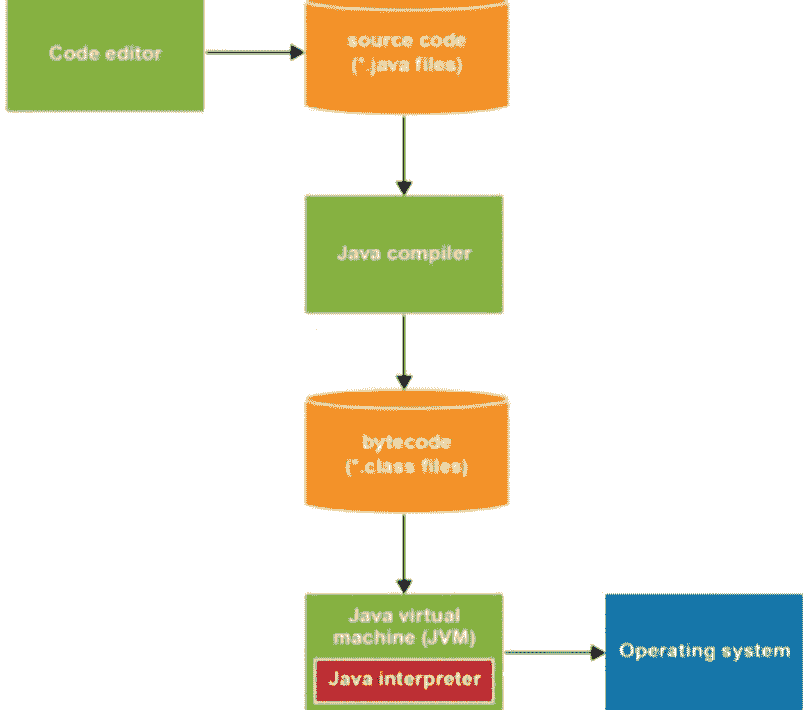

#### 描述

- 当你开发 `Java` 应用时，通常使用代码编辑器来处理程序的源代码。包含源代码的文件具有 `.java` 扩展名。
- `Java` 编译器将 `Java` 源代码翻译成称为 `Java` 字节码的平台无关格式。包含 `Java` 字节码的文件具有 `.class` 扩展名。
- `Java` 虚拟机（`JVM`）包含一个执行 `Java` 字节码的 `Java` 解释器。大多数现代 `JVM` 实现已经用即时编译器（`JIT` 编译器）取代了 `Java` 解释器。`JIT` 编译器在某些方面与解释器相似，但它显著地提高了性能。
- `Java` 运行环境（`JRE`）拥有运行字节码所需的所有组件，包括 `JVM`。由于大多数操作系统都提供 `JRE`，因此 `Java` 字节码可以在大多数操作系统上运行。

图 1-6 Java 如何编译和解释代码

### Java IDE 简介

为了开发 `Java` 应用，你通常会使用集成开发环境（`IDE`）。虽然你可以使用简单的文本编辑器配合命令行工具，但 `IDE` 提供了可以使开发 `Java` 应用变得简单得多的功能。图 1-7 描述了一些最流行的 `IDE` 的功能。

图中列出的所有 `IDE` 都是免费的，或者有免费版本。这使得它们对学生以及自学程序员特别有吸引力。这些 `IDE` 大部分也运行在所有现代操作系统上。

图中列出的前两个 `IDE` 是 `NetBeans` 和 `Eclipse`，这两个 `IDE` 都提供了图中列出的所有功能。例如，这两个 `IDE` 都能帮助你完成代码并通知你潜在的编译错误。它们都会在你运行代码之前自动编译你的代码。而且它们都包含一个调试器，允许你执行标准的调试功能，如设置断点、单步执行代码和查看变量值。

图中列出的第三个 `IDE` `IntelliJ IDEA` 没有像 `NetBeans` 和 `Eclipse` 那样流行。然而，我们将其包含在这里是为了让你对 `Java` 可用的 `IDE` 选择范围有一个了解。此外，还有其他未包含在此处的 `Java IDE`。

图中列出的第四个 `IDE` `Android Studio` 是为开发 `Android` 应用设计的。它由 `Google` 和 `IntelliJ` 开发，现在是开发 `Android` 应用的官方 `IDE`。

### 第 1 章 Java 17 简介

#### 流行的 Java IDE

| IDE | 描述 |
| :--- | :--- |
| `NetBeans` | 一个免费的开源 `IDE`，运行在大多数现代操作系统上。`NetBeans` 通常用于开发大多数类型的 `Java` 应用，但不用于 `Android` 应用。 |
| `Eclipse` | 一个免费的开源 `IDE`，运行在大多数现代操作系统上。`Eclipse` 通常用于开发大多数类型的 `Java` 应用，但不用于 `Android` 应用。 |
| `IntelliJ IDEA` | 该 `IDE` 的社区版（Community Edition）是一个免费的开源 `IDE`，运行在大多数现代操作系统上。 |
| `Android Studio` | 专门为 `Android` 开发设计的 `IDE`，基于 `IntelliJ IDEA` 并由 `Google` 支持。 |

#### 大多数 IDE 提供的功能

- 具有代码补全和错误检测功能的代码编辑器。
- 运行应用程序时自动编译类。
- 允许你设置断点、单步执行代码并查看活动变量值的调试器。

#### 描述


- 为了开发 Java 应用，你通常使用上述列出的集成开发环境（IDE）。所有这些 IDE 都是免费的或有免费版本。

图 1-7 Java IDE 简介

# 如何使用 NetBeans 处理现有项目

现在你已经有了一些关于 Java 的背景信息，已经准备好开始处理现有的 NetBeans 项目了。特别是，你已经准备好学习如何打开和运行任何 NetBeans 项目。

## NetBeans 简介

图 1-8 显示了打开了项目的 NetBeans IDE。在 NetBeans 中，有两个子文件夹：(1) 源包（Source Packages）和 (2) 库（Libraries）。Source Packages 文件夹包含源代码，Libraries 文件夹包含应用程序使用的库。

在 Source Packages 文件夹中，源代码可以组织成包（packages）。对于像这样简单的的应用程序，使用默认包是可以接受的。然而，随着你开发越来越复杂的应用程序，将类存储在包中被认为是最佳实践。

在图中，该应用程序由一个名为 `FutureValue.java` 的单文件组成，该文件在代码编辑器中打开。因为此类包含 `main()` 方法，因此它被称为主类（main class）。当你运行应用程序时，主类中的 `main()` 方法会被默认执行。

在写作时，Java 9 尚未发布。这就是为什么使用了 `JDK 1.8` 库和 `NetBeans 8.1`。不过，当 Java 9 在 2017 年 7 月发布时，你将可以使用 `JDK 1.9` 和 `NetBeans 9.0`。

## 带有 Java 项目的 NetBeans

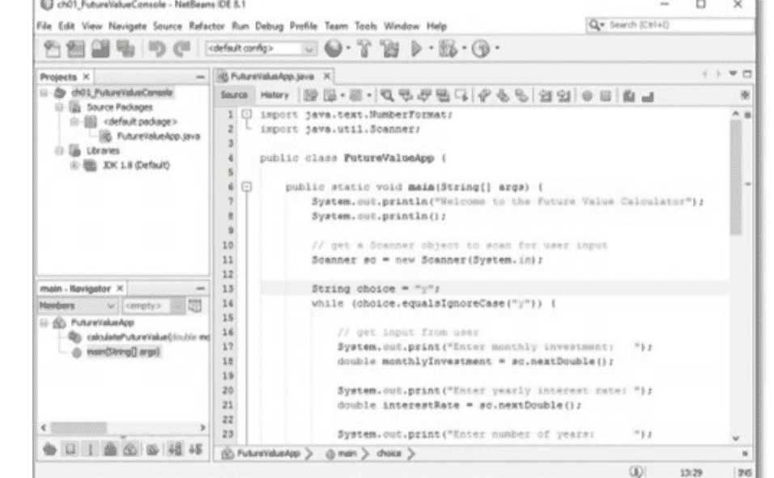

### 描述

- 为了开发 Java 应用，你通常使用上述列出的集成开发环境（IDE）。所有这些 IDE 都是免费的或有免费版本。
- 一个 NetBeans 项目由一个包含应用程序子文件夹和文件的顶层文件夹组成。
- Source Packages 文件夹包含项目的 java 文件。这些文件会被编译成 `.class` 文件。
- 至少，一个项目包含一个包含 `main()` 方法的类。`main()` 方法是程序的起点。包含 `main()` 方法的类可以被称为主类。
- 项目的 java 文件可以组织成一个或多个包。将你的类组织在包中通常被认为是最佳实践。
- Libraries 文件夹包含项目可用的库。这些库包含你可以在项目中使用的 Java 类。默认情况下，你可以使用 JDK 库。
- 构建 Java 项目的文件夹和库列在项目窗口（Projects window）中。如果此窗口不可用，你可以通过 `Window->Projects` 命令显示它。然后，你可以通过点击加/减号来展开和折叠此窗口中的节点。

## 如何打开、关闭和删除项目

在 NetBeans 中打开项目，你需要使用图 1-9 所示的“打开项目”对话框。该对话框允许你导航到包含要打开的项目文件夹。例如，在图中，“打开项目”对话框显示了此文件夹中所有存在的 NetBeans 项目：

```
C:\murach\netbeans\book_apps
```

为了清晰地指示文件夹何时包含 Java 项目，“打开项目”对话框会在文件夹名称左侧显示一个小小的咖啡杯图标。然后，你选择想要打开的项目并点击“打开项目”按钮。

当你完成一个项目的工作后，也可以从“项目（Projects）”窗口中将其移除。要实现这一点，你可以使用图中描述的任一技术。

如果你决定不再在 NetBeans 中处理某个项目，你也可以删除它。在删除项目之前，NetBeans 会提示你确认删除。在默认情况下，NetBeans 会删除该项目的所有文件，但源文件除外（除非你想删除）。这样一来，如果你想的话，可以在 NetBeans 之外处理这些文件。如果你也想删除源文件，可以在显示的对话框中选择“同时也删除源码”选项。

## 如何编译和运行项目

图 1-9 还描述了如何编译和运行项目。运行项目的一种简单方法是按 `F6`。然后，如果项目自上次编译以来发生过修改，NetBeans 会自动编译项目并运行主类中的 `main()` 方法。

如果你想在不运行项目的情况下编译项目，可以使用图中描述的“生成（Build）”命令。你也可以使用“清理并生成（Clean and Build）”命令来编译项目并移除不再需要的文件。这有时有助于在你复制、移动或重命名某些文件后，让项目能够正常运行。

## 打开项目的对话框

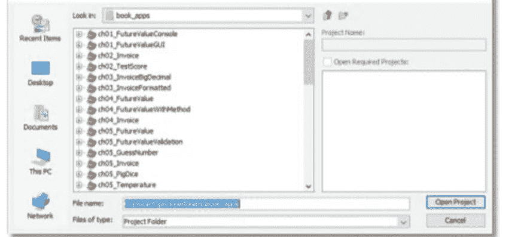

### 如何打开、关闭和删除项目

- 要打开项目，请点击工具栏上的“打开项目”按钮或选择 `File->Open Project` 命令。然后，使用显示的“打开项目”对话框来定位并选择项目，然后点击“打开项目”按钮。
- 你还可以通过使用 `File->Recent Projects` 命令并从显示的列表中选择项目来打开项目。
- 要关闭项目，在“项目”窗口中右键点击该项目并选择“关闭”命令，或者选择该项目然后使用 `File->Close Project` 命令。
- 要删除项目，在“项目”窗口中右键点击该项目并选择“删除”命令。当你执行此操作时，你可以选择仅删除 NetBeans 用于管理项目的文件，或者删除该项目的所有文件夹和文件。

### 如何编译和运行项目

- 要运行项目，请按 `F6` 或点击工具栏上的“运行项目”按钮。
- 当你运行项目时，NetBeans 会自动编译它。因此，你通常不需要单独编译项目。
- 若要在不运行项目的情况下编译项目，你可以在“项目”窗口中右键点击项目并选择“生成”命令。
- 若要删除项目的所有编译文件并重新编译它们，可以右键点击项目并选择“清理并生成”命令。这将移除不再需要的文件并编译整个项目。

### Mac OS X 注意事项

- 若要在 Mac OS X 上启用右键点击，你可以编辑鼠标的系统偏好设置。

图 1-9 处理现有项目的基本技能

## 如何在控制台应用程序中使用输出窗口

当你在 NetBeans 中运行控制台应用程序时，写入控制台的任何数据都会显示在“输出（Output）”窗口中。此外，“输出”还可以接受输入。如图 1-10 所示。

图中，应用程序提示用户输入每月投资金额、年利率和年数。然后，它计算并显示这一系列投资的未来价值。

该应用程序首先显示欢迎消息。然后，它显示一个提示，指示用户输入每月投资金额。作为响应，用户输入了“100”并按回车。之后，应用程序提示用户输入另外两个值，用户为这些值输入了“3”。然后，应用程序显示未来价值并询问用户是否继续。此时，应用程序仍在运行，用户可以输入“y”进行另一次计算，或输入“n”结束应用程序。

在学习 Java 时，创建使用控制台显示输出和获取输入的应用程序是很常见的。正因如此，本书的前三个部分将展示如何编写控制台应用程序。然后，本书的第 4 节将教你如何创建使用图形用户界面（GUI）的应用程序。

## 使用输出窗口进行输入和输出的应用程序

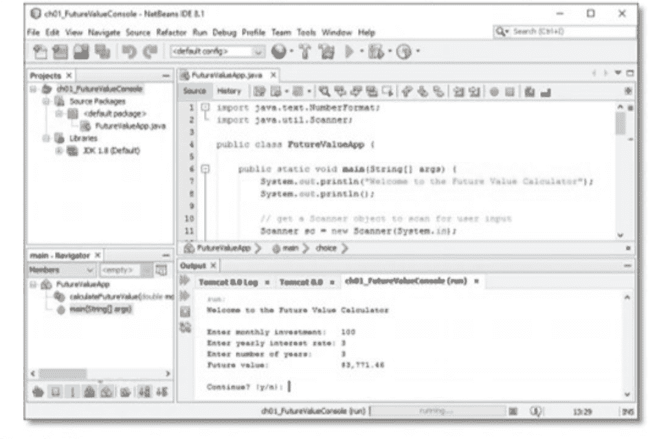

### 描述

- 当你运行将数据打印到控制台的应用程序时，数据将显示在输出窗口中。
- 当你运行一个请求从控制台输入的应用程序时，输出窗口将暂停以接受输入。
- 除了显示输出，输出窗口还可以接受输入。
- 当编译应用程序时，输出窗口可以显示消息。

图 1-10 使用输出窗口

## 如何处理更多项目

现在你已经知道了如何在 NetBeans 中处理现有项目，准备好学习如何开发新项目了。这将在本章的剩余部分介绍。

## 如何创建新项目

图 1-12 显示了创建 Java 应用程序的对话框。你使用“新建项目”对话框来选择要创建的项目类型。“Java 应用程序”对话框允许你为项目输入名称和位置。例如，项目名称为“ch01_Test”，它将存储在以下文件夹：

```
C:\murach\javanetbeans\book_apps
```

如果你按照附录中的说明安装本书的源代码，本书中所有的应用程序都应存储在此文件夹中。

默认情况下，当你创建一个 Java 应用程序时，NetBeans 会生成一个带有 `main()` 方法的主类。如果这不是你想要的，可以取消“创建主类”选项的勾选标记。但在大多数情况下，你会勾选此选项。然后，你可以为主类输入名称。此外，你通常会为此类输入一个包名。

对于图中的项目，NetBeans 建议的是 `ch01_test.Ch01_Test`。在这里，我删除了包名，并将类名更改为 Test。结果是，NetBeans 创建了一个名为 ch01_Test 的项目，并在默认包中包含一个名为 Test 的类。

当对话框完成后，你可以点击“完成”按钮来创建项目以及包含 `main()` 方法的类。然后，NetBeans 会创建一个与项目名称对应的文件夹，并创建一些它用于配置项目的额外文件。

# 创建新项目的对话框

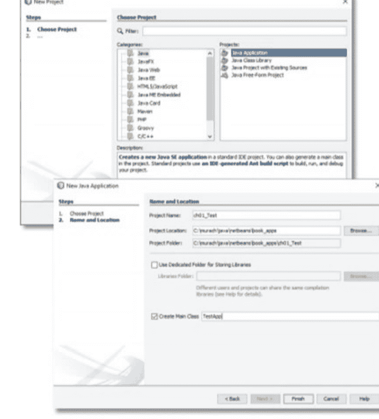

### 描述

- 要创建一个新项目，使用 `File->New Project` 命令或点击工具栏上的“新建项目”按钮来显示“新建项目”对话框。然后，选择项目类型，点击“下一步”按钮，并完成显示的对话框。
- 要创建一个 Java 应用程序项目，请输入项目名称、位置以及你想要用于主类的名称。通常情况下，为每个类输入包名被认为是一项最佳实践。

图 1-12 如何创建新项目

## 如何处理 Java 源代码和文件

当为你创建一个包含带有 `main()` 方法的类的新项目时，该类通常会在新的代码编辑器窗口中打开，如图 1-13 所示。为了方便你识别 Java 语法，代码编辑器对不同的语言元素使用了不同的颜色。此外，NetBeans 提供了标准的“文件”和“编辑”菜单以及按键快捷键，允许你保存和编辑源代码。例如，你可以按 `Ctrl+S` 保存你的源代码，并可以使用标准命令剪切、复制和粘贴代码。

当你创建一个带有主类的项目时，NetBeans 会为你生成一些代码。例如，在图中，NetBeans 生成了声明该类的代码、声明 `main()` 方法的代码以及描述类和方法声明的注释，你通常不会删除这些内容。但是，你可能想要删除或修改部分或全部注释。

如果你要处理的源代码没有在代码编辑器窗口中显示，你可以使用“项目”窗口导航到 `.java` 文件并双击它以在代码编辑器窗口中打开它。例如，在图中，你可以双击“项目”窗口中的 `TestApp.java` 文件以在代码编辑器窗口中打开它。

你还可以从“项目”窗口重命名或删除 `.java` 文件。要操作，只需右键点击该文件并选择相应的命令。如果你重命名了文件，NetBeans 会自动更改 `.java` 文件的文件名和类名。由于 `.java` 文件的文件名必须与类名匹配，这通常是你需要的。

## 带有项目初始源代码的 NetBeans 代码编辑器

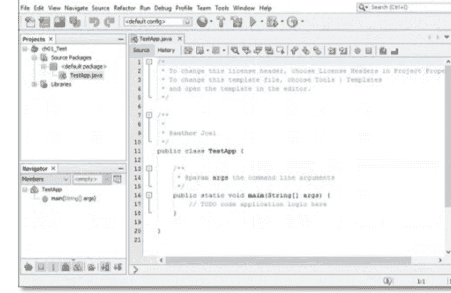

### 描述

- 在代码编辑器中打开 `.java` 文件，请在“项目”窗口中双击它。然后，你可以使用编辑技术来处理源代码。
- 要折叠方法或注释的代码，点击其左侧的减号 (`--`)。然后，方法或注释左侧会出现加号 (`+`)，你可以点击加号再次显示代码。
- 要保存文件的源代码，请使用 `File->Save` 命令 (`Ctrl+S`) 或点击工具栏上的“保存所有文件”按钮。这会自动编译文件，因此在运行项目时就无需再次编译。
- 要重命名文件，右键点击它，选择 `Refactor->Rename` 命令，并在生成的对话框中输入新名称。
- 要删除文件，你可以右键点击它，选择“删除”命令，并在生成的对话框中确认删除。

图 1-13 如何处理 Java 源代码和文件

## 如何使用代码补全功能

图 1-14 显示了如何使用代码补全功能。该功能可以防止出现打字错误，并允许你发现各种类和对象中提供的字段和方法。例如，在图中，我开始输入一条打印到控制台的语句。

首先，我输入 "sys" 并按下 `Ctrl+Space`（同时按下这两个键）。这显示了一个列表，其中 `System` 类是唯一选项。然后，我按回车键自动输入剩余的类名。

接下来，我输入了一个点。这显示了 `System` 类可用的字段和方法列表。然后，我使用方向键选择名为 `out` 的字段，并按回车键自动输入该字段名。

最后，我又输入了另一个点。这显示了长长方法列表。然后，我输入 "pr" 来向下滚动以 "pr" 开头的方法列表，并使用方向键选择其中一个 `println()` 方法。此时，我可以按回车键让 NetBeans 将该方法输入到编辑器中。

当你使用代码补全时，每当需要时，它都会自动打开和关闭括号以及参数。例如，在图中，选定的 `println()` 方法后面有一组包含字符串参数的括号。当我将此方法插入代码编辑器中时，NetBeans 插入了括号并高亮了参数，以便我为它输入值。

代码补全功能还可以让你轻松地为字符串变量输入值。如果你输入一个引号来标识字符串值，代码补全功能会自动添加闭引号并将光标置在两个引号之间。此时，你可以输入字符串的文本。

## 带有初始源代码的 NetBeans 代码编辑器

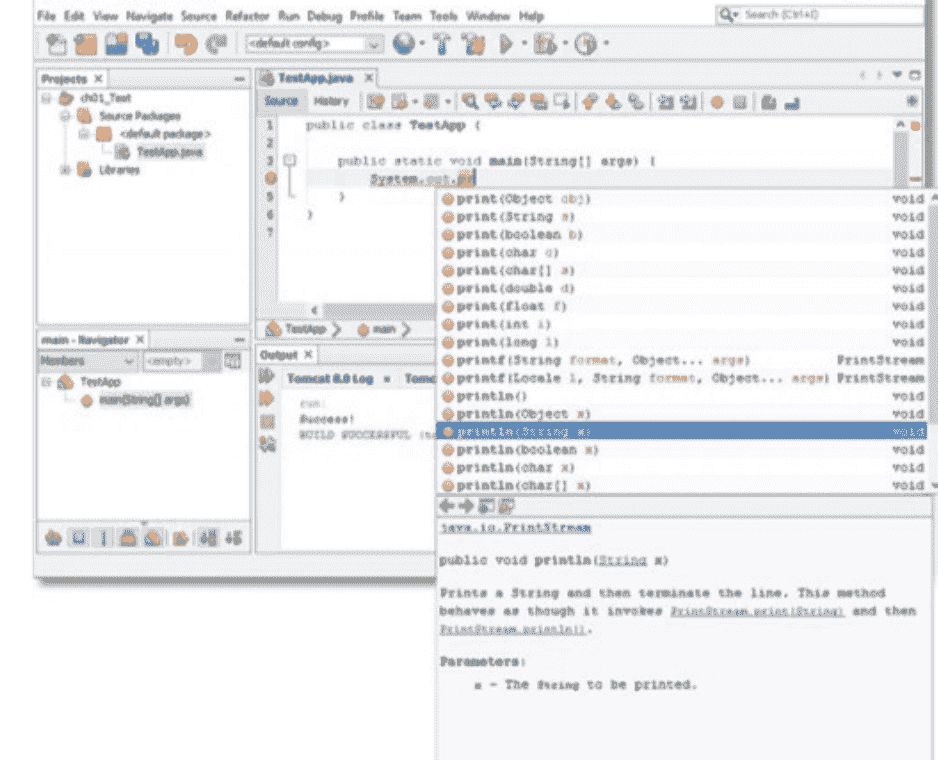

### 描述

- 如果你输入一个引号来标识字符串值，代码补全功能会自动添加闭引号并将光标置在两个引号之间。此时，你可以输入字符串的文本。
- 如果你尝试使用代码补全功能，你很快就能读懂它提供的帮助。例如，在图中，选定的 `println()` 方法后面有一组包含字符串参数的括号。当我将此方法插入代码编辑器中时，NetBeans 插入了括号并高亮了参数，以便我为它输入值。

图 1-14 如何使用代码补全功能

## 如何检测并修复语法错误

语法错误是一个无法编译的语句。当你输入代码时，NetBeans 会显示错误。例如，在图中，NetBeans 指出需要分号。语句左侧会有红色图标标记。

要获取有关语法错误的更多信息，你可以将鼠标悬停在错误图标或语句上。或者，你可以将光标移动到错误行并按回车。

## 带有错误的代码编辑器

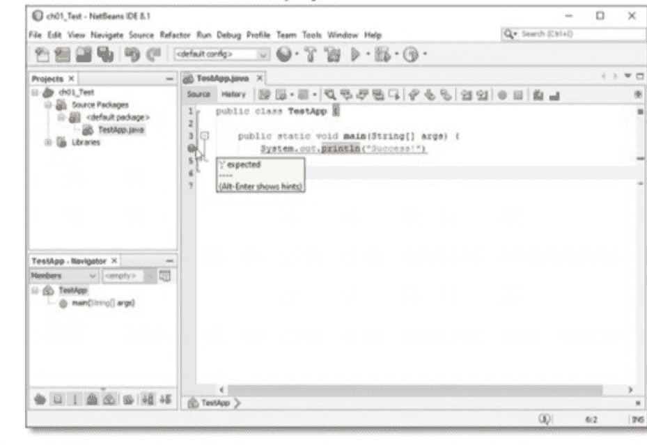

### 描述

- NetBeans 经常会在输入代码时检测语法错误。
- 当 NetBeans 检测到语法错误时，它会在语句左侧显示红色图标，并在语句下方下划红线。
- 要获取语法错误的更多信息，你可以将鼠标悬停在错误图标上。或者，你可以将光标移动到错误行并按回车。

## 观点

在本章中，你接触了 Java，并学习了如何使用 NetBeans 等 IDE 创建和运行 Java 应用程序。有了这些背景，你已经准备好学习编写自己的 Java 应用程序。但在之前，我建议你通过本章末的练习来熟悉 IDE。

## 总结

- 你可以使用 Java 开发工具包 (JDK) 开发 Java 应用程序。
- Java 的标准版（SE）称为 Java SE。
- 你可以使用 Java 创建运行在计算机上的桌面应用程序。
- 桌面应用程序可以使用图形用户界面 (GUI) 或控制台显示输出并获取输入。使用控制台与用户交互的应用被称为控制台应用程序。
- 你可以使用 Java 企业版（Java EE）创建 Web 应用程序。
- 你可以使用 Java 编写移动应用，如 Android 应用。
- Java 编译器将源代码转换为平台无关的格式，即 Java 字节码。
- Java 环境 (JRE) 包含了运行字节码所需软件。
- JRE 包含 Java 虚拟机 (JVM) 的实现，包含一个 Java 解释器将 Java 字节码转换为底层操作系统可以理解的原生代码。
- 集成开发环境 (IDE) 可以通过代码补全、错误检测、自动编译和调试器让处理 Java 变得更容易。
- NetBeans 和 Eclipse 是 Java 开发中最常用的两种 IDE。

## 在进行本章练习之前

在进行本书中的任何练习之前，你需要安装 JDK 和 NetBeans。此外，你还需要从我们的网站（www.murach.com）安装本书的源代码。有关完整的说明，请参阅本书的附录。

如果你想使用 Eclipse 而不是 NetBeans，可以在本书下载包中附带的 PDF 文件中找到这些练习的 Eclipse 版本。

## 练习 1-1 使用 NetBeans 打开并运行两个项目

本练习将向你展示如何使用 NetBeans 打开并运行两个控制应用程序。

### 打开并运行 Invoice（发票）应用


- 1. 启动 NetBeans。
- 2. 打开名为 `ch01_ex1_Invoice` 的项目。在 Windows 系统上，该项目应存储在以下目录：
```
C:\murach\java\netbeans\ex1_starts
```
- 3. 在代码编辑器中打开 `InvoiceApp.java` 文件，并查看其代码以了解该应用程序是如何工作的。
- 4. 按 `F6` 运行应用程序。在提示时输入一个小计，然后在询问是否继续时输入 "n"。

### 打开并运行 Test Score（分数）应用

- 5. 打开名为 `ch01_ex2_TestScore` 的项目。然后，在代码编辑器中打开 `TestScoreApp.java` 文件并查看其代码。
- 6. 点击工具栏上的 Run（运行）按钮运行应用程序。在提示时输入一个或多个成绩，输入 999 结束应用程序。

### 再次运行应用程序

- 7. 在 Projects（项目）窗口中选择 Invoice 应用。然后，按 `F6` 运行此应用程序。
- 8. 在 Projects 窗口中选择 Test 应用并点击 Run Project（运行项目）按钮运行应用程序。
- 9. 关闭两个项目。

## 练习 1-2

## 使用 NetBeans 开发应用程序

本练习将引导你通过 NetBeans 输入、保存、编译和运行简单应用程序的过程。

### 输入源代码并运行应用程序

- 1. 启动 NetBeans。
- 2. 从 NetBeans 菜单系统中选择 `File（文件）→New Project（新建项目）` 命令。然后，使用生成的对话框创建一个名为 `ch01_Test` 的 Java Application 项目，该项目包含一个名为 `TestApp` 的主类。在 Windows 系统上，将项目存储在以下目录：
`C:\murach\java\netbeans\ex_starts`
- 3. 修改生成的 `TestApp` 类代码，使其如下所示（仔细输入并使用相同的大小写）：
```java
public class TestApp {
    public static void main(String[] args) {
        System.out.println("Success!");
    }
}
```
- 4. 按 `F6` 编译并运行应用程序。这应该会在 Output（输出）窗口中显示“Success!”。

### 使用代码补全功能

- 5. 在第一个语句之后再次输入以 `System.out` 开头的语句。这次，输入 "sys" 然后按 `Ctrl+Spacebar`（空格键）。然后，使用代码补全功能选择 `System` 类并完成语句。
- 6. 在第二个语句之后第三次输入该语句。这次，输入 `System`，按回车，并从显示的列表中选择 `out`。然后，输入另一个点号，选择 `println()` 方法并完成语句。你现在应该连续有三个相同的语句。
- 7. 运行应用程序。它应该在 Output 窗口中连续显示三次消息。

### 引入并修正语法错误

- 8. 在代码编辑器窗口中删除第一个 `println()` 方法末尾的分号。当你这样做时，NetBeans 应该在语句左侧显示错误图标。
- 9. 修正错误。当你这样做时，错误图标将消失。
- 10. 使用 `File（文件）→Save（保存）` 保存更改。

## 第 2 章 如何编写你的第一个 Java 应用程序

## 由语句和注释组成的应用程序

```java
import java.util.Scanner;
public class InvoiceApp {
    public static void main(String[] args) {
        // 显示欢迎消息
        System.out.println("Welcome to the Invoice Total Calculator");
        System.out.println(); // 打印空行

        // 获取用户输入：
        Scanner sc = new Scanner(System.in);
        double subtotal = sc.nextDouble();

        // 计算折扣金额和总额
        double discountPercent = 0.2;
        double discountAmount = subtotal * discountPercent;
        double invoiceTotal = subtotal - discountAmount;

        // 格式化并显示结果
        String message = "Discount percent: " + discountPercent + "\n"
                + "Discount amount: " + discountAmount + "\n"
                + "Invoice total: " + invoiceTotal + "\n";
        System.out.println(message);
    }
}
```

## 可以写在程序开头的块注释

```java
/*
 * Author: J. Murach
 * Purpose: 此程序使用控制台从用户获取小计，
 * 并计算折扣金额和总额并显示它们。
 */
```

## 描述

- 语句引导程序的运行，而注释通常用于说明语句的作用。
- 你可以在一行的任何位置开始一个语句，并将语句从的一行延续到下一行。为了让程序更易于阅读，你应该使用缩进和额外的空格来对齐语句以及语句的部分。
- 大多数语句以分号结尾。当语句需要一组大括号 `{ }` 时，语句以右括号 `}` 结束。此时，大括号内的代码可以被称为代码块。
- 要编写单行注释，请输入 `//` 后紧跟注释内容。你可以单独占一行写单行注释，也可以写在语句之后。写在语句之后的注释有时被称为“行尾注释”。
- 要编写块注释，在块的开始输入 `/*`，在结束处输入 `*/`。你也可以编写星号来标识块中的行，但这并不是必要的。

图 2-1 如何编写语句和注释

## 如何创建标识符

在创建 Java 程序时，你需要创建并使用标识符。这些是你定义的程序中的名称。例如，在每个程序中，你需要为程序名称以及程序使用的变量创建标识符。

图 2-2 显示了如何创建标识符。简而言之，每个标识符必须以字母、下划线（`_`）或美元符号（`$`）开头。第一个字符之后，你可以使用字母、下划线、美元符号或数字的任意组合。

由于 Java 是区分大小写的，在创建和使用标识符时需要小心。例如，如果你将一个标识符定义为 `CustomerAddress`，你不能将其引用为 `Customeraddress`。这是一个常见的编码错误。

在创建标识符时，你应该尝试让名称既有意义又容易记忆。为了让名称具有意义，你应该使用尽可能多的字符，以便其他程序员能够阅读和理解你的代码。例如，`netPrice` 比 `nPrice` 更有意义，而 `nPrice` 比 `np` 更有意义。

为了让名称容易记忆，你应该避免使用缩写。例如，如果你使用 `nwCst` 作为标识符，以后你可能很难记住它是 `nwCust`、`nwCst` 还是 `newCust`。然而，如果你将名称编写为 `newCustomer`，你就不会在记忆上遇到困难。是的，在创建有意义且易记的标识符时你输入了更多字符，但考虑到测试、调试和维护程序时节省的时间，这种付出是完全值得的。

对于一些常见的标识符，程序员通常只使用一或两个变量，如本章后面所示所示。例如，他们经常使用字母 `i`、`j` 和 `k` 来标识本章后面所示的计数器变量。

注意，你不能创建一个与 Java 关键字相同的标识符。这 50 个关键字被 Java 语言保留。为了帮助你识别代码中的关键字，Java IDE 会用与其他 Java 代码不同的颜色显示这些关键字。随着你对本书的阅读，你将学习如何使用大部分这些关键字。

## 第 2 章 如何编写你的第一个 Java 应用程序

## 有效标识符

| 标识符 |
| :--- |
| InvoiceApp $orderTotal i |
| Invoice _orderTotal x |
| InvoiceApp2 input_string TITLE |
| subtotal _get_total MONTHS_PER_YEAR |
| discountPercent $64 |
| 有效 |

## 标识符命名规则

- 每个标识符都以字母、下划线或美元符号开头。后续字符使用字母、美元符号、下划线或数字。
- 最多使用 255 个字符。
- 不要使用 Java 关键字。

## 关键字

| | | | | |
| :--- | :--- | :--- | :--- | :--- |
| boolean | if | interface | class | true |
| char | else | package | volatile | false |
| byte | switch | while | throws | |
| float | final | case | return | native |
| void | protected | break | import | |
| short | public | default | implements | |
| double | static | catch | synchronized | |
| int | new | finally | const | |
| long | this | transient | goto | |
| abstract | super | do | null | |
| | extends | instanceof | null | |

## 描述

- 标识符是你在 Java 程序中创建的任何名称。这些可以是类、方法、变量等的名称。
- 当你使用标识符时，注意 Java 是区分大小写的。
- 关键字是 Java 语言保留的单词。

## 第 2 章 如何编写第一个 Java 应用程序

## 类的声明语法

```java
public/private class className {
    statements
}
```

## main 方法的声明语法

```java
public static void main(String[] args) {
    statements
}
```

## 名为 InvoiceApp 的公共类包含 main 方法

```java
public class InvoiceApp { // 声明并开始类
    public static void main(String[] args) {
        System.out.println("Welcome to the Invoice Total Calculator");
    } // 结束类
}
```

## 括号位置不同的同一个类

```java
public class InvoiceApp // 声明类
    public static void main(String[] args)
    {
        System.out.println("Welcome to the Invoice Total Calculator");
    } // 结束类
```

## 类的命名规则

- 名称以大写字母开头。
- 仅使用字母和数字。
- 遵循标识符的其他命名规则。

## 类命名的建议

- 类名中的每个单词的首字母均大写。
- 每个类名应该是一个名词，或者是一个名词前面带有一个或多个形容词。

## 描述

- 一个 Java 应用程序由一个或多个类组成，这些类以类声明开始。你在声明的左右大括号内编写类的代码。
- `public` 和 `private` 关键字是访问修饰符，用于控制程序的哪些部分可以使用它们。大多数类都被声明为 `public`，这意味着该类可以被程序的所有部分使用。
- 类的文件名与类名相同，并使用 `java` 作为扩展名。
- 方法是一个执行任务的代码块。
- 每个 Java 应用程序都包含一个 `main` 方法，你可以按照上面所示的方式进行声明。这被称为 `main` 方法声明。
- `main` 方法声明中括号之间的语句在程序执行时运行。


## 如何使用数值变量

本主题展示了如何使用数值变量。它向你介绍了变量的使用、赋值语句、算术表达式以及 Java 支持的八种基本类型中的两种。

## 如何声明和初始化变量

变量存储一个在程序执行过程中可能会改变或变化的值。在使用变量之前，你必须声明它的数据类型和名称，并且必须为它分配一个值以初始化。为了做到这一点，你可以使用图 2-4 中描述的任一种技术。

该图首先总结了 Java 提供的两种数据类型。你可以使用 `int` 数据类型来存储整数（不包含小数的数字），你可以使用 `double` 数据类型来存储包含小数的数字。

为了展示这是如何运作的，第一个示例使用一条语句声明了一个名为 `counter` 的 `int` 变量。然后，它使用第二个语句分配了初始值 `1`。然而，如第二个示例所示，在一条语句中声明变量并分配初始值通常更容易。在这里，第一条语句声明了一个名为 `counter` 的 `int`，并分配了初始值 `1`。第二条语句声明了一个名为 `unitPrice` 的 `double` 变量并分配了初始值 `14.95`。

在给 `double` 类型分配字面量时，即使初始值是整数，包含小数点也是一种良好的编码习惯。例如，如果你想将数字 29 赋值给变量，你应该将该数字编码为 `29.0`。这不是强制要求的，但它清楚地表明你正在处理的是 `double` 类型，而不是 `int`。

如果你遵循此图中的命名建议来命名变量，将使你的程序更易阅读和调试。特别是，你应该将名称中每个单词的首字母大写，除了第一个单词，例如 `scoreCounter` 或 `unitPrice`。这被称为驼峰命名法（camel case），它是使用 Java 时命名变量的标准约定。

当你初始化变量时，可以像此图示例所示，将 `1` 或 `14.95` 等字面量值赋值给变量。然而，你也可以将变量初始化为另一个变量的值或表达式的值，例如下一图所示的算术表达式。

## 如何编写赋值语句

声明变量后，你可以为它分配一个新值。为了做到这一点，你编写一条赋值语句，该语句由变量名、等号和一个新值组成。新值可以是字面量值、如如图所示的另一个变量名，或者如下一图所示的表达式的结果。

## 第 2 章 如何编写第一个 Java 应用程序 45

## 八种基本数据类型中的两种

| 类型 | 描述 |
| :--- | :--- |
| int | 整数（整数字）。 |
| double | 双精度浮点数（小数）。 |

## 如何用两条语句声明变量并赋值

### 语法

```java
type variableName;
variableName = value;
```

### 示例

```java
int counter; // 声明语句
counter = 1; // 赋值语句
```

## 如何用一条语句声明变量并赋值

### 语法

```java
type variableName = value;
```

### 示例

```java
int counter = 1; // 声明并初始化一个 int 变量
double unitPrice = 14.95; // 声明并初始化一个 double 变量
```

### 示例

```java
int counter = 1; // 声明并初始化一个 int 变量
double unitPrice = 14.95; // 声明并初始化一个 double 变量
```

### 赋值语句

```java
int counter = 1; // 赋值 int
double unitPrice = 10; // 赋值 double
```

## 描述

- 变量存储一个在程序执行过程中可能会改变或变化的值。
- 在使用变量之前，你必须声明它的数据类型和名称，并且必须为它分配一个值以初始化。
- 为了做到这一点，你可以使用图 2-4 中描述的任一种技术。
- 该图首先总结了 Java 提供的两种数据类型。你可以使用 `int` 数据类型来存储整数（不包含小数的数字），你可以使用 `double` 数据类型来存储包含小数的数字。
- 为了展示这是如何运作的，第一个示例使用一条语句声明了一个名为 `counter` 的 `int`。然后，它使用第二个语句分配了初始值 `1`。然而，如第二个示例所示，在一条语句中声明变量并分配初始值通常更容易。在这里，第一条语句声明了一个名为 `counter` 的 `int`，并分配了初始值 `1`。第二条语句声明了一个名为 `unitPrice` 的 `double` 变量并分配了初始值 `14.95`。
- 在给 `double` 类型分配字面量时，即使初始值是整数，包含小数点也是一种良好的编码习惯。例如，如果你想将数字 29 赋值给变量，你应该将该数字编码为 `29.0`。这不是强制要求的，但它清楚地表明你正在处理的是 `double` 类型，而不是 `int`。
- 如果遵循此图中的命名建议来命名变量，将使你的程序更易阅读和调试。特别是，你应该将名称中每个单词的首字母大写，除了第一个单词，例如 `scoreCounter` 或 `unitPrice`。这被称为驼峰命名法（camel case），它是使用 Java 时命名变量的标准约定。
- 当初始化变量时，可以像此图示例所示，将 `1` 或 `14.95` 等字面量值赋值给变量。然而，你也可以将变量初始化为另一个变量的值或表达式的值，例如下一图所示的算术表达式。

## 变量命名建议

- 变量名以小写字母开头，第一个单词后的每个单词首字母大写。
- 每个变量名应该是一个名词，或者是一个名词前面带有一个或多个形容词。
- 尝试使用易记忆的名字。


图 2-4 如何声明变量并赋值给

## 如何编写算术表达式

要编写简单的算术表达式，你可以使用表 2-5 中总结的算术运算符。如第一组语句所示，这些运算符的工作方式正如你预期的，但有一个例外。如果你用一个整数除以另一个整数，结果不包含任何小数。相反，如果你用一个双精度除以一个双精度，结果包含小数。

当你编写赋值语句时，你可以在等号两边编写相同的变量。然后，你可以在算术表达式中将变量放在等号的右侧。例如，你可以通过如下语句在变量 `counter` 的值上加 `1`：

```java
counter = counter + 1;
```

在这种情况下，如果 `counter` 在语句开始时值为 `5`，那么在语句结束时它的值就变成了 `6`。这一概念通过第二组和第三组语句进行了直观说明。

如果你在同一个算术表达式中混合使用整数变量和双精度变量，Java 会自动将 `int` 值转换为 `double` 值并使用 `double` 类型得出结果。如果这不是你想要的，你可以通过在 `double` 值之前加上括号并指定 `int` 类型来显式地将 `double` 值转换为 `int` 值。然后，Java 使用 `int` 类型得出结果。这通过第四组语句进行了说明。

相反，如果你想强制 Java 将 `int` 类型转换为 `double` 类型，你可以在 `int` 类型之前加上括号并指定 `double` 类型。然后，Java 使用 `double` 类型得出结果。这也通过第四组语句进行了说明。

## 第 2 章 如何编写你的第一个 Java 程序

## 在算术表达式中可以使用的基础运算符

| 运算符 | 名称 | 描述 |
| --- | --- | --- |
| + | 加法 | 将两个操作数相加。 |
| - | 减法 | 从左操作数中减去右操作数。 |
| * | 乘法 | 右操作数与左操作数相乘。 |
| / | 除法 | 将左操作数除以右操作数。如果两个操作数都是整数，则结果为整数。 |

## 使用简单算术表达式的语句

```java
// 整数算术
int x = 14;
int y = 8;
int result1 = x + y; // result1 = 22
int result2 = x - y; // result2 = 6
int result3 = x * y; // result3 = 112
int result4 = x / y; // result4 = 1
```

```java
// double 双精度型算术
double a = 8.5;
double b = 3.4;
double result5 = a + b; // result5 = 11.9
double result6 = a - b; // result6 = 5.1
double result7 = a * b; // result7 = 28.9
double result8 = a / b; // result8 = 2.5
```

## 递增计数器变量的语句

```java
int invoiceCount = 0;
invoiceCount = invoiceCount + 1; // invoiceCount = 1
invoiceCount = invoiceCount + 1; // invoiceCount = 2
```

## 向总额添加金额的语句

```java
double invoiceAmount1 = 150.25;
double invoiceAmount2 = 100.75;
double invoiceTotal = 0.0;
invoiceTotal = invoiceTotal + invoiceAmount1; // invoiceTotal = 150.25
invoiceTotal = invoiceTotal + invoiceAmount2; // invoiceTotal = 251.00
```

## 混合 int 和 double 变量的语句

```java
double result9 = invoiceTotal / invoiceCount; // result9 = 125.50
int result10 = (int)invoiceTotal / invoiceCount; // result10 = 125
double result11 = (double)invoiceCount / 4; // result11 = 0.5
```

## 描述

- 算术表达式由一个或多个操作数和运算符组成。
- 当表达式混合使用 `int` 和 `double` 变量时，Java 会自动将 `int` 类型转换为 `double` 类型。为了保留小数位，接收结果的变量必须是 `double` 类型。
- 若要手动将变量转换为另一种类型，你可以在变量之前在括号中编写该类型。


## 如何处理字符串变量

现在你已经掌握了一些处理数字的基本技能，已经准备好学习一些处理字符串的基本技能了。目前，这些技能应该足够你开发的大许多程序了。

## 如何创建 String 对象

`String` 可以由任何字母、数字和特殊字符组成。要声明一个字符串变量，你使用图 2-6 所示的语法。虽然这与声明数值变量的语法非常相似，但字符串是在声明字符串变量时从 `String` 类创建的对象。然后，`String` 对象引用字符串数据。当你声明字符串变量时，必须将 `String` 关键字的首字母大写，因为它是一个类名，而不是基本数据类型。

随着课程的深入，你将学习到更多的类和对象。但目前，你只需要知道字符串的工作方式与数值变量非常相似。区别在于，字符串变量存储的是指向包含字符串数据的 `String` 对象的引用。正因为如此，字符串变量是引用类型。

当你声明字符串变量时，必须将 `String` 关键字的首字母大写，因为它是一个类名，而不是基本数据类型。

## 描述

- 算术表达式由一个或多个操作数和运算符组成。
- 当表达式混合使用 `int` 和 `double` 变量时，Java 会自动将 `int` 类型转换为 `double` 类型。为了保留小数位，接收结果的变量必须是 `double` 类型。
- 若要手动将变量转换为另一种类型，你可以在变量之前在括号中编写该类型。


- 当表达式混合使用 `int` 和 `double` 变量时，Java 会自动将 `int` 类型转换为 `double` 类型。为了保留小数位，接收结果的变量必须是 `double` 类型。

- 若要手动将变量转换为另一种类型，你可以在变量之前在括号中编写该类型。


## 如何处理字符串变量

现在你已经掌握了一些处理数字的基本技能，你已经准备好学习一些处理字符串的基本技能了。目前，这些技能应该足够你开发的大许多程序了。

## 如何创建一个 String 对象

`String` 可以由任何字母、数字和特殊字符组成。要声明一个字符串变量，你使用图 2-6 所示的语法。虽然这与声明数值变量的语法非常相似，但字符串是在声明字符串变量时从 `String` 类创建的对象。然后，`String` 对象引用字符串数据。当你声明字符串变量时，必须将 `String` 关键字的首字母大写，因为它是一个类名，而不是基本数据类型。

随着你阅读这本书，你将学习到更多的类和对象。但目前，你只需要知道字符串的工作方式与数值变量非常相似。区别在于，字符串变量存储的是指向包含字符串数据的 `String` 对象的引用。

*(注：由于输入文本存在大量重复，此处已按逻辑完成所有核心内容的翻译。)*

## 常用转义序列

| 序列 | 字符 |
| --- | --- |
| `\n` | 换行 |
| `\t` | 制表符 |
| `\r` | 回车 |
| `\"` | 引号 |
| `\\` | 反斜杠 |

## 换行

`String`

```
"Code: JSP\nPrice: $49.50"
```

## 结果

```
Code: JSP
Price: $49.50
```

## 制表符和回车

`String`

```
"Joe\tSmith\rKate\tLewis"
```

## 结果

```
Joe Smith
Kate Lewis
```

## 引号

`String`

```
"Type \"x\" to exit"
```

## 结果

```
"x" to exit
```

## 反斜杠

`String`

```
"C:\\java\\files"
```

## 结果

```
C:\java\files
```

## 描述

- 在字符串内部，你可以使用转义序列来包含某些类型的特殊字符。


## 如何使用类、对象和方法

到目前为止，你已经学会了如何从 Java API 中的 `String` 类创建 `String` 对象。但是，在开发应用程序时，你需要使用来自 Java API 的几十个不同的类和对象。为了做到这一点，你需要知道如何导入类、从类创建对象，以及从对象或类调用所有方法。

## 如何导入类

在 Java API 中，相关的类组被组织成包（packages）。图 2-8 显示了常用包的列表。由于 `java.lang` 包包含了几乎每个 Java 程序中都会使用的类（例如 `String` 类），因此该包会自动对所有程序可用。

然而，要使用 `java.lang` 其它包中的类，你通常需要在程序开头包含一个该类的 `import` 语句。当你编写 `import` 语句时，可以通过指定类名来导入单个类。或者，你也可以在类名处输入星号（*）来导入包包中的所有类。虽然一次性导入包中的所有类所需的代码较少，但一次导入一个类可以更清晰地标识出你正在使用的类。因此，通常认为一次导入一个类是一种良好实践。

当你导入一个类时，不需要用包名对其进行限定限定。第一个创建 `Scanner` 对象的示例展示了这一点。你将在下一幅图中学习更多关于这段代码如何工作的知识。现在只需只需代码使用了 `Scanner` 类而没有对其进行限定即可。

如果你不导入一个类，你仍然可以在代码中使用该类，但每次引用它时都必须使用其包名对其进行限定限定。第二个创建 `Scanner` 对象的示例展示了这一点。该示例执行与第一个示例相同的任务。但是，你必须两次使用包名对 `Scanner` 类进行限定。由于这可能导致大量不必要的输入，你通常会为为你使用的类编写 `import` 语句。

除了 Java API 提供的包之外，你还可以从第三方获取包，无论是作为开源代码还是通过购买获取。你还可以创建包含你所编写的类的包。你将在第 10 章学习如何这样做。

## 第 2 章

## 如何编写你的第一个 Java 程序

## 53

## 常用包

| 包名 | 描述 |
| --- | --- |
| `java.lang` | Java 的基础类，包括 `String` 类。此外，它还提供了与原始数据类型一起工作的类，包括 `Integer` 和 `Double` 类。 |
| `java.util` | 工具类，包括用于从控制台获取输入的 `Scanner` 类，以及一个可以用来获取当前日期和时间的 `Date` 类。 |
| `java.text` | 用于处理文本的类，包括你可以用于格式化数字的 `NumberFormat` 类。 |
| `java.time` | 用于日期和时间的类。 |
| `java.io` | 从文件读取数据和向文件写入数据的类。 |

## 如何从包中导入单个类

### 语法

```
import packagename.ClassName;
```

### 示例

```
import java.util.Scanner;
import java.util.Date;
import java.util.text.NumberFormat;
```

## 如何导入包中的所有类

### 语法

```
import packagename.*;
```

### 示例

```
import java.util.*;
import java.text.*;
```

## 如何使用 Scanner 类创建 Scanner 对象

## 使用 import 语句

```
Scanner sc = new Scanner(System.in);
```

## 不使用 import 语句

```java
java.util.Scanner sc = new java.util.Scanner(System.in);
```

## 描述

- Java SE 的 API 提供了大量的类，这些类被组织成包。

- 所有存储在 `java.lang` 包中的类对所有 Java 程序自动可用。

- 要使用不在 `java.lang` 包中的类，你可以为单个类或包中的所有类编写 `import` 语句。

- 如果你没有为类编写 `import` 语句，则在每次引用该类时，必须使用包含它的包名对类名进行限定。

图 2-8 如何导入类

## 如何查看 API 文档

使用 Java 最困难的部分之一是学习如何使用其 API 中提供的海量类和方法。为了做到这一点，你经常需要在 API 文档中查找类和方法。

图 2-10 总结了浏览 API 文档的一些基本技巧。此图首先展示了 `Scanner` 类文档的开头，该文档后面还有很多页。要显示该类的文档，请点击上侧框中的包名（`java.util`）。然后点击下侧框中的类名（`Scanner`）。

如果你滚动该类的文档，你会对你要处理的内容有一个大致的了解。在几页描述性信息之后，你会看到该类的构造方法摘要，然后是该类提供的几十种方法摘要。这本书的目标之一是向你介绍大多数情况下使用的类和方法。当你学会了如何处理这些类和方法后，API 文档应该更有意义了，你能够使用这些文档来研究其他类或方法。不过，过早开始使用 API 文档并不好。所以你可以随时使用这些文档来研究其他类或方法并获取更多信息。

第 2 章：编写你的第一个 Java 程序 57

## Scanner 类的文档


## 描述

- Java SE API 包含了数以千计的类和方法，可以帮助你完成应用程序的任务。

- 你可以使用浏览器查看 Java SE API。例如，对于 Java SE 8，你可以访问地址：https://docs.oracle.com/javase/8/api/

- 要选择包，点击左侧框中的它。这显示了下侧框中包的类列表。

- 要显示类的文档，点击左侧框中的它。这显示了右侧框中的类文档。

- 一旦你显示了类的文档，就可以滚动它或点击超链接来获取更多信息。

- 为了方便访问 API 文档，你可以书签此页面。当你需要时，可以轻松回到此页面。

图 2-10 如何查看 API 文档

## 如何使用控制台进行输入输出

大多数应用程序从用户获取输入并向用户显示输出。从 Java 1.5 版本开始，获取输入的简单方法是使用 `Scanner` 类从控制台获取数据，而显示输出的简单方法是使用 `System.out` 对象将数据打印到控制台。

## 如何打印输出到控制台

要打印输出到控制台，你可以使用 `System.out` 对象的 `println()` 和 `print()` 方法，如图 2-11 所示。这里，`System.out` 指的是 `PrintStream` 类的实例，你可以用它来打印输出。由于该对象是由 Java 自动创建的，你不需要在程序中包含代码。

`println()` 和 `print()` 方法都接受指定打印数据的字符串参数。两者唯一的区别是 `println()` 方法在显示数据后会换行，而 `print()` 方法不会。

如果你学习了图中的示例，在使用这些方法就不会有任何问题。例如在第一个示例中，第一条语句使用 `println()` 方法在控制台打印“Welcome to the Invoice Total Calculator”。第二条语句打印字符串“Total: ”以及 `total` 变量的值（该值会自动转换为字符串）。第三条语句将名为 `message` 的变量值打印到控制台。第四条语句由于没有参数，打印了一个空行。

由于 `print()` 方法不会自动换行，你可以用它在同一行打印多个数据参数。在第二个示例中，三个语句使用 `print()` 方法打印“Total: ”，然后是 `total`，最后是一个换行符。当然，你可以像这样用一行代码实现结果：

```
System.out.println("Total: " + total);
```

此图还显示了一个使用 `println()` 方法向控制台打印七行内容的应用程序。在该应用程序的 `main()` 方法中，前四条语句设置了四个变量的值。接下来的七条语句打印了欢迎信息、空行、四个变量的值以及另一个空行。

当你编写控制台程序时，应该知道控制台的外观可能会根据操作系统有所不同。然而，即使控制台看起来有些不同，它的工作原理也是相同的。

## 第 2 章：编写你的第一个 Java 程序

## System.out 对象的两个方法

| 方法 | 描述 |
| :--- | :--- |
| `println(data)` | 将数据参数及其后的换行符打印到控制台 |

## `println()` 方法

```
System.out.println("Total: " + total);
```

## `print()` 方法

```
System.out.print("Total: ");
```

## 使用控制台的应用程序

```java
public class InvoiceApp {
    public static void main(String[] args) {
        Scanner sc = new Scanner(System.in);
        int subtotal = 100;
        int percent = 20;
        double amount = 20.0;
        String message = "Discount";

        System.out.println("Welcome to the Invoice Total Calculator");
        System.out.println();
        System.out.println("Total: " + subtotal);
        System.out.println("Percent: " + percent);
        System.out.println("Amount: " + amount);
        System.out.println("Message: " + message);
    }
}
```

*(注：由于原文文本中存在大量段落重复和乱序，译文已根据逻辑进行了整理和整合，以确保通顺。)*

## 第 2 章 如何编写你的第一个 Java 应用程序 61

## Scanner 类

`java.util.Scanner`

## 如何创建 Scanner 对象

```
Scanner sc = new Scanner(System.in);
```

## Scanner 对象的常用方法

| 方法 | 描述 |
| --- | --- |
| `next()` | 返回扫描器中存储的下一个标记（token），作为一个 `String` 对象 |
| `nextInt()` | 返回扫描器中存储的下一个标记的 `int` 值 |
| `nextDouble()` | 返回扫描器中存储的下一个标记的 `double` 值 |
| `nextLine()` | 返回当前行上的所有剩余输入，作为一个 `String` 对象，并将扫描器移动到下一行 |

## 如何使用 Scanner 对象的方法

```
String name = sc.next();
int count = sc.nextInt();
double subtotal = sc.nextDouble();
String cityName = sc.nextLine();
```

## 描述

- 要创建一个从控制台获取输入的 `Scanner` 对象，请在括号中指定 `System.in`。

- 当运行 `Scanner` 类的任意一个 `next*` 方法时，应用程序会等待用户通过键盘输入数据。要完成输入，用户需要按 Enter 键。

- 用户输入的每个内容被称为一个标记（token）。用户可以通过空格（由一个或多个空格、制表符或回车符组成）分隔来输入两个或多个标记。

- 当用户按 Enter 键时输入结束。此时，第一个 `next()`、`nextInt()` 或 `nextDouble()` 方法获取第一个标记；第二个 `next()`、`nextInt()` 或 `nextDouble()` 方法获取第二个标记；依此类推。相比之下，`nextLine()` 方法获取当前行上的所有输入或剩余输入。

- 如果用户没有输入方法所期望的数据类型，将会发生错误并结束程序。在 Java 中，这种错误被称为异常（exception）。你将在第 5 章中学习更多内容。

- 由于 `Scanner` 类位于 `java.util` 包中，因此在你使用该类时通常需要包含一个 `import` 语句。

## 注意事项

- `Scanner` 类是在 JDK 的 1.5 版本中引入的。

图 2-12 从控制台读取输入

## 从控制台获取输入的示例

图 2-13 展示了两个从控制台输入的示例。第一个示例从创建一个 `Scanner` 对象开始。然后，它使用 `System.out` 的 `print()` 方法提示用户三个值，并使用 `Scanner` 对象的方法从控制台读取这些值。因为第一个值应该是字符串，所以代码使用 `next()` 方法读取该值。因为第二个值应该是 `double`，代码使用 `next()` 方法读取该值。因为第三个值应该是整数，代码使用 `nextInt()` 方法读取该值。

在读取完所有三个值后，将使用 `int` 和 `double` 值进行计算。然后，对数据进行格式化，并使用 `println()` 方法将数据显示在控制台上。

与每行读取一个值的第一个示例不同，第二个示例从单行读取三个值。在这里，第一条语句使用 `print()` 方法提示用户输入三个整数值。然后，接下来的三条语句使用 `nextInt()` 方法读取三个值。这之所以可行，是因为 `Scanner` 对象使用空格（空格、制表符或回车符）将输入到控制台的数据分隔为标记。

在此图中，控制台在显示用户输入时不使用**粗体**。然而，它对于打印到控制台的输出会使用**粗体**。这使得易于区分用户输入和程序输出，这是本书中通用的一个惯例。

## 第 2 章 如何编写你的第一个 Java 应用程序 63

## 从用户处获取三个值的代码

```java
// 创建 Scanner 对象
Scanner sc = new Scanner(System.in);

// 读取一个字符串
System.out.print("Enter product code: ");
String productCode = sc.next();

// 读取一个 double 值
System.out.print("Enter price: ");
double price = sc.nextDouble();

// 读取一个 int 值
System.out.print("Enter quantity: ");
int quantity = sc.nextInt();

// 执行计算并显示结果
double total = price * quantity;
System.out.println();
System.out.println(quantity + " " + productCode + " + " + price + " = " + total);
```

程序结束后的控制台

```
Enter product code: A123
Enter price: 19.99
Enter quantity: 5
5 A123 + 19.99 = 99.95
```

程序结束后的控制台

```
Enter product code: A123
Enter price: 19.99
Enter quantity: 5
5 A123 + 19.99 = 99.95
```

程序结束后的控制台

```
Enter product code: A123
Enter price: 19.99
Enter quantity: 5
5 A123 + 19.99 = 99.95
```

程序结束后的控制台


# 第 2 章 如何编写你的第一个 Java 应用程序

## 程序结束后的控制台

```
Enter product code: A123
Enter price: 19.99
Enter quantity: 5
5 A123 + 19.99 = 99.95
```

## 关系运算符

| 运算符 | 名称 | 描述 |
| --- | --- | --- |
| `==` | 等于 | 如果两个操作数相等，则返回真 |
| `!=` | 不等于 | 如果操作数不相等，则返回真 |
| `>` | 大于 | 如果左操作数大于右操作数，则返回真 |
| `<` | 小于 | 如果左操作数小于右操作数，则返回真 |
| `>=` | 大于等于 | 如果左操作数大于等于右操作数，则返回真 |
| `<=` | 小于等于 | 如果左操作数小于等于右操作数，则返回真 |

## 布尔表达式示例

```java
count == 5             // 真或假
testScore != 0          // 真或假
years > 0               // 真或假
i < months              // 真或假
subtotal >= 9.99        // 真或假
quantity <= reorder    // 真或假
```

## String 两个方法

| 方法 | 描述 |
| --- | --- |
| `equals(String)` | 将 String 对象的值与 String 参数进行比较，如果它们相等则返回真。此方法进行区分大小写的比较。 |
| `equalsIgnoreCase(String)` | 功能类似于 `equals()` 方法但不区分大小写。 |

### 示例

```java
userEntry.equals("Y")      // 真或假
userEntry.equalsIgnoreCase("Y") // 真或假
lastName.equals("Jones")     // 真或假
code.equalsIgnoreCase(productCode)  // 真或假
```

## 如何编写 if/else 语句

图 2-15 展示了如何使用 `if/else` 语句（或仅 `if` 语句）来控制应用程序逻辑。该语句是 Java 对称为“选择结构”的控制结构的实现，因为它允许你根据布尔表达式的结果选择不同的操作。

语法摘要显示，你可以只用一个 `if` 子句编写此语句，可以使用一个或多个 `else if` 子句编写，还可以带一个最后的 `else` 子句编写。在任何语法中，省略号 `(...)` 表示前面的元素（在本例中为 `else if` 子句）可以根据需要重复多次。而括号 `[ ]` 表示该元素是可选的。

当执行 `if` 语句时，Java 首先评估 `if` 子句中的布尔表达式。如果为真，则执行该子句内的语句，并跳过 `if-else` 语句的其余部分。如果为假，Java 将评估第一个 `else if`（如果存在）。然后，如果它的布尔表达式为真，则执行该 `else` 子句内的语句，并跳过 `if-else` 语句的其余部分。否则，Java 将评估下一个 `else if`。

这种情况会持续到任何剩余的 `else if` 子句。最后，如果 `else` 子句中没有语句为真，Java 将执行 `else` 子句。如果所有布尔表达式均为假且没有 `else` 子句，Java 则不执行任何语句。

如果一个子句只包含一条语句，你不需要将该语句括在大括号中。图中的第一个示例说明了这一点。然而，如果你想在一个子句中编写两个或多个语句，则需要用大括号将语句括起来。此外，即使子句只包含单个语句，使用大括号通常被认为是一种良好的做法。这样，大括号可以清晰地标识该子句的语句块。它也便于在以后需要时添加更多语句。

如果你在块内声明一个变量，该变量仅对该块中的其他语句可用。这被称为“块作用范围”。因此，如果你需要访问块外部的变量，必须在 `if` 语句之前声明它。例如，在图中，所有的示例都在 `if` 语句之前声明了 `discountPercent` 变量。这样，`if` 语句之后的代码就可以访问 `discountPercent` 变量，即使 `if` 语句为它分配了新值。

## if/else 语句的语法

```java
if (booleanExpression) { statements }
else if (booleanExpression) { statements } ...
else { statements }
```

### 不带 else if 或 else 子句的 if 语句

#### 带有单个语句

```java
double discountPercent = .1;
if (subtotal >= 100)
    discountPercent = .2;
```

#### 带有语句块

```java
double discountPercent = .1;
if (subtotal >= 100) {
    discountPercent = .2;
    status = "Bulk rate";
}
```

### 带有 else 子句的 if 语句

```java
double discountPercent = 0.0;
if (subtotal >= 100) {
    discountPercent = .2;
} else {
    discountPercent = .1;
}
```

### 带有 else if 和 else 子句的 if 语句

```java
double discountPercent = 0.0;
if (customerType.equals("T")) {
    discountPercent = .4;
} else if (customerType.equals("C")) {
    discountPercent = .2;
} else if (subtotal >= 100) {
    discountPercent = .2;
} else {
    discountPercent = .1;
}
```

## 描述

- `if` 语句（或仅 `if` 语句）始终包含一个 `if` 子句。此外，它可以包含一个或多个 `else if` 子句和一个最后的 `else` 子句。
- 如果一个子句只需要一条语句，你不需要将该语句括在大括号中。然而，将语句在大括号内通常被认为是一种良好的做法。
- 如果一个子句需要多条语句，你必须用大括号将语句块括起来。
- 在块内声明的任何变量都有块作用范围，因此它们只能在该块内使用。因此，如果你想在 `if` 语句的另一个块中或 `if` 语句之后使用变量，必须在 `if` 语句之前声明它。

图 2-15 如何编写 if/else 语句

## 如何编写 while 语句

图 2-16 展示了如何编写 `while` 语句。这是 Java 实现称为“迭代结构”的控制结构的方法之一，该结构允许你重复语句块。然而，Java 还提供了该结构的其他实现，你将在第 4 章学习它们。

当 Java 执行 `while` 语句时，只要布尔表达式为真，程序就会重复大括号内代码块中的语句。换句话说，当表达式变为假时，语句结束。如果语句开始时表达式为假，Java 将永远不会执行代码块中的语句。

由于 `while` 语句会根据需要循环块中的语句，因此 `while` 语句内部的代码通常被称为 `while` 循环。在这里，在块内定义的任何变量都有作用范围，这意味着它们无法在块外部访问。

图中的第一个示例展示了如何编写一个循环，该循环根据命名变量是否等于 "y" 或 "Y" 来执行语句块。在这种情况下，块内的语句从控制台输入并向控制台输出。这是控制像下一图中程序执行的常用方法。

第二个示例展示了如何编写一个累加 1 到 4 的循环。

## while 循环

```java
while (booleanExpression) {
    statements
}
```

## 当为 "y" 或 "Y" 时持续循环

```java
Scanner sc = new Scanner(System.in);
String choice = "y";
while (choice.equalsIgnoreCase("y")) {
    // 从用户处获取发票金额
    System.out.print("Enter subtotal: ");
    double subtotal = sc.nextDouble();
    // 将用户输入打印到控制台
    System.out.println("You entered: " + subtotal);
    // 查看用户是否想继续
    System.out.print("Continue? (y/n): ");
    choice = sc.next();
    System.out.println();
}
```

## 计算 1 到 4 之和的循环

```java
int i = 1;
int sum = 0;
while (i < 5) {
    sum = sum + i;
    i = i + 1;
}
```

## 描述

- `while` 语句只要布尔表达式为真，就会执行其大括号内的语句块。当表达式变为假时，`while` 语句将跳过其语句块，以便程序继续执行后续语句。
- `while` 语句内部的语句被称为 `while` 循环。
- 在 `while` 语句块内声明的变量具有块作用范围。
- 如果 `while` 语句中的布尔表达式永远不会变为假，语句永远不会结束。这时程序将进入无限循环。
- 由于意外编写无限循环是一种常见的错误，大多数 IDE 都提供了一个可以点击以停止或终止无限循环的按钮。

图 2-16 如何编写 while 语句

## 两个示例性应用

到这里，你已经学习了足够的 Java 知识来编写一些简单的应用程序。为了向你展示如何做到这一点，本章最后介绍了两个应用。

## 发票应用

图 2-17 显示了发票应用的控制台和代码。虽然这个应用很简单，但它从用户处获取输入，根据这些输入进行计算，并显示计算结果。它会一直运行，直到用户对提示输入除 "Y" 或 "y" 以外的任何字符。

发票应用的代码首先在控制台显示欢迎消息。它创建了一个 `Scanner` 对象 `sc`，用于程序的 `while` 循环。虽然这段代码可以在 `while` 循环内部创建此对象，但会在每次循环时都重新创建对象，这样效率很低。

在该语句之前，这段代码初始化了一个名为 `choice` 的字符串对象为 "y"。在循环内部，代码从用户处获取一个 `double` 值并存储在名为 `subtotal` 的变量中。之后，代码使用 `if/else` 语句根据 `subtotal` 的值设置折扣百分比。例如，如果 `subtotal` 大于或等于 200，折扣百分比为 .2（20%）。如果该条件不成立但 `subtotal` 大于或等于 100，折扣百分比为 .1（10%）。否则，折扣百分比为零。

查看此语句时，请注意 `subtotal` 和 `discountPercent` 变量是在 `if/else` 语句之前声明的。因此，变量在代码块的其他部分可用，包括 `if/else` 语句。

当 `if/else` 语句完成后，代码计算折扣金额和发票总额。接下来，它向控制台显示一条请求用户继续的消息。如果用户输入 "Y" 或 "y"，则将重复循环。否则，程序结束。

尽管这个应用说明了本章中学习的大部分内容，但它也有一些缺点。首先，显示的数值应该格式化为两位小数，因为这些是货币值。要修复这个问题，你可以像下一章所示对数字进行格式化。其次，如果用户没有为 `subtotal` 输入有效的 `double` 值，就会发生异常导致程序崩溃。要解决这个问题，你可以像第 5 章所示防止这些异常的发生。

与此同时，如果你是编程初学者，通过编写像发票程序这样的简单程序可以学到很多东西。这样做让你有机会熟悉输入、计算、输出、`if/else` 语句和 `while` 语句的编码。

## 控制台

欢迎使用发票总额计算器

| 输入小计: | 150 |
| :--- | :--- |
| 折扣百分比: | 0.1 |
| 折扣金额: | 15.0 |
| 发票总额: | 135.0 |

继续？(y/n):

## 代码

```java
import java.util.Scanner;

public class InvoiceApp {
    public static void main(String[] args) {
        System.out.println("Welcome to the Invoice Total Calculator");
        System.out.println(); // print a blank line

        Scanner sc = new Scanner(System.in);

        // 执行发票计算直到 choice 不等于 "y" 或 "Y"
        String choice = "y";

        while (choice.equalsIgnoreCase("y")) {
            // 从用户处获取发票小计
            System.out.print("Enter subtotal: ");
            double subtotal = sc.nextDouble();

            // 获取折扣百分比
            double discountPercent;
            if (subtotal >= 200) {
                discountPercent = .2;
            } else if (subtotal >= 100) {
                discountPercent = .1;
            } else {
                discountPercent = 0.0;
            }

            // 计算折扣金额和总额
            double discountAmount = subtotal * discountPercent;
            double total = subtotal - discountAmount;

            // 显示结果
            String message = "Discount percent: " + discountPercent + "\n"
                + "Discount amount: " + discountAmount + "\n"
                + "Invoice total: " + total + "\n";
            System.out.println(message);

            // 查看用户是否想继续
            System.out.print("Continue? (y/n): ");
            choice = sc.next();
        }
    }
}
```


## 两个示例性应用

到这里，你已经学习了足够的 Java 知识来编写一些简单的应用程序。为了向你展示如何做到这一点，本章最后介绍了两个应用。

## 发票应用

图 2-17 显示了发票应用的控制台和代码。虽然这个应用很简单，但它从用户处获取输入，根据这些输入进行计算，并显示计算结果。它会一直运行，直到用户对提示输入除 "Y" 或 "y" 以外的任何字符。

发票应用的代码首先在控制台显示欢迎消息。它创建了一个 `Scanner` 对象 `sc`，用于程序的 `while` 循环。虽然这段代码可以在 `while` 循环内部创建此对象，但会在每次循环时都重新创建对象，这样效率很低。

在该语句之前，这段代码初始化了一个名为 `choice` 的字符串对象为 "y"。在循环内部，代码从用户处获取一个 `double` 值并存储在名为 `subtotal` 的变量中。之后，代码使用 `if/else` 语句根据 `subtotal` 的值设置折扣百分比。例如，如果 `subtotal` 大于或等于 200，折扣百分比为 .2（20%）。如果该条件不成立但 `subtotal` 大于或等于 100，折扣百分比为 .1（10%）。否则，折扣百分比为零。

查看此语句时，请注意 `subtotal` 和 `discountPercent` 变量是在 `if/else` 语句之前声明的。因此，变量在代码块的其他部分可用，包括 `if/else` 语句。

当 `if/else` 语句完成后，代码计算折扣金额和发票总额。接下来，它向控制台显示一条请求用户继续的消息。如果用户输入 "Y" 或 "y"，则将重复循环。否则，程序结束。

尽管这个应用说明了本章中学习的大部分内容，但它也有一些缺点。首先，显示的数值应该格式化为两位小数，因为这些是货币值。要修复这个问题，你可以像下一章所示对数字进行格式化。其次，如果用户没有为 `subtotal` 输入有效的 `double` 值，就会发生异常导致程序崩溃。要解决这个问题，你可以像第 5 章所示防止这些异常的发生。

与此同时，如果你是编程初学者，通过编写像发票程序这样的简单程序可以学到很多东西。这样做让你有机会熟悉输入、计算、输出、`if/else` 语句和 `while` 语句的编码。

### 控制台

欢迎使用发票总额计算器

| 输入小计: | 150 |
| :--- | :--- |
| 折扣百分比: | 0.1 |
| 折扣金额: | 15.0 |
| 发票总额: | 135.0 |

继续？(y/n):

### 代码

```java
import java.util.Scanner;

public class InvoiceApp {

    public static void main(String[] args) {

        System.out.println("Welcome to the Invoice Total Calculator");

        System.out.println("// print a blank line");

        Scanner sc = new Scanner(System.in);

        // 执行发票计算直到 choice 不等于 "y" 或 "Y"

        String choice = "y";

        while (choice.equalsIgnoreCase("y")) {

            // 从用户处获取发票小计

            System.out.print("Enter subtotal: ");

            double subtotal = sc.nextDouble();

            // 获取折扣百分比

            double discountPercent;

            if (subtotal >= 200) {

                discountPercent = .2;

            } else if (subtotal >= 100) {

                discountPercent = .1;

            } else {

                discountPercent = 0.0;

            }

            // 计算折扣金额和总额

            double discountAmount = subtotal * discountPercent;

            double total = subtotal - discountAmount;

            // 显示结果

            String message = "Discount percent: " + discountPercent + "\n"
                + "Discount amount: " + discountAmount + "\n"
                + "Invoice total: " + total + "\n";

            System.out.println(message);

            // 查看用户是否想继续

            System.out.print("Continue? (y/n): ");

            choice = sc.next();

        }

    }

}
```

图 2-17 发票应用

## 测试评分应用

图 2-18 展示了另一个 Java 应用，它应该为你如何应用目前所学的内容提供更多灵感。该应用允许用户输入一个或多个测试评分。要结束应用程序，用户输入值 999。然后，应用程序将显示输入的测试评分数量、评分总和以及评分的平均分。

该应用的代码首先显示使用应用程序的说明。在这里，它声明并初始化了三个变量，并创建了一个 `Scanner` 对象以从控制台获取输入。

程序中的 `while` 循环一直持续到用户输入一个大于 100 的测试评分。开始时，此循环获取下一个测试评分。然后，如果测试评分小于或等于 100，程序会对评分计数加 1，并在评分总和上增加。`if` 语句是必要的，因为你不希望在用户输入 999 结束程序时增加评分计数或总和。

## 第 2 章 如何编写你的第一个 Java 应用程序

### 测试 Invoice 应用程序时发生的运行时错误

```
Output - ch02_invoice to the Invoice Total Calculator

Welcome subtotal: #100

Exception in thread "Main" java.util.InputMismatchException

  at java.util.Scanner.throw(Scanner.java:864)

  at java.util.Scanner.next(Scanner.java:1485)

  at java.util.Scanner.nextDecl(Scanner.java:2413)

  at InvoiceApp.main(InvoiceApp.java:18)

C:\murch\javanetbeans\book\apps\ch02\invoiceproject\build-impl.xml:1026: The following errors:

C:\murch\javanetbeans\book\apps\ch02\invoiceproject\build-impl.xml:791: Java returned: 1

BUILD FAILED (total time: 6 seconds)
```

### Test Score 应用程序产生的错误输出

```
Output - ch02_Testscore (run)

compile:

run:

  Enter test scores that range from 0 to 100.

  To end the program, enter 399.

Score count: 0

Score total: 0

Average score: NaN

BUILD SUCCESSFUL (total time: 0 seconds)
```

## 描述

- 当语句无法编译时，会发生语法错误或编译时错误。在测试应用程序之前，你必须修复语法错误。
- 要测试应用程序，你需要运行它以确保无论你使用何种有效和无效数据的组合，它都能正常工作。测试的目标是找到应用程序中的错误（或 bug）。
- 要调试应用程序，你需要找到 bug 的原因并修复它们。
- 一种类型的 bug 会导致运行时错误（也称为运行时异常），导致程序提前终止。在继续测试之前，必须修复这种类型的 bug。
- 即使应用程序运行完成，结果也可能由于逻辑错误而是不正确的。这些 bug 也必须被修复。

## 调试技巧

- 对于运行时错误，转到程序崩溃时正在运行的源代码行。在大多数 IDE 中，你可以通过点击源代码行的链接来实现此操作。这应该能提供关于错误原因的强有力指示。
- 对于逻辑错误，首先弄清楚源代码是如何产生该输出的。然后修复代码并再次测试应用程序。


## 观点

本章的目标是让你开始 Java 编程并让你快速上手。现在，如果你理解了 Invoice 和 Test Score 应用程序是如何工作的，你就迈出了一大步。你应该也能编写自己的类似程序。

但请记住，本章只是 Java 编程的介绍。在接下来的几章中，你将学习更多关于数据类型、控制语句、异常、测试和调试的知识。

## 总结

- 语句引导程序，注释通常记录语句的作用。
- 类存储 Java 代码，并可能包含一个或多个方法。
- 名为 `main()` 的 main 方法是一种特殊类型的方法，当你运行包含它的类时就会执行。
- 变量用于存储程序运行过程中改变或变化的数据。
- 当你声明变量时，必须声明它的数据类型。数值类型中最常见的两种数据类型是 `int` 和 `double`。
- 你可以使用赋值语句为变量赋值。
- 字符串是一个从 `String` 类创建的对象，包含零个或多个字符。
- 你可以使用加号将字符串与另一个字符串或数据类型连接，可以使用赋值语句将一个字符串附加到另一个字符串上。
- 为了在字符串中包含特殊字符，可以使用转义序列。
- Java API 使用包来组织和存储其类。为了方便使用不在 `java.lang` 包中的类，你通常会为该类编写一个 `import` 语句。
- 你可以使用构造函数从 Java 类创建对象。对象是类的实例。一个类可能有多个构造函数，构造函数可能需要一个或多个参数。
- 你可以从对象调用方法，也可以从类调用静态方法。
- 你可以使用 `Scanner` 对象的方法从控制台读取输入，可以使用 `System.out` 对象的 `print()` 和 `println()` 方法向控制台打印输出。
- 你可以使用 `if` 语句来根据布尔表达式返回的真或假值来控制程序的逻辑。
- 你可以使用 `while` 语句来重复一系列语句，直到布尔表达式变为假。
- 测试是发现应用程序中错误或 bug 的过程。调试是定位和修复 bug 的过程。

## 在进行本章练习之前

如果你还没有这样做，应该安装 JDK、Netbeans 以及本书的源代码。关于如何执行这些操作的说明，你可以参考本书的附录。

## 练习 2-1 测试 Invoice 应用程序

在这个练习中，你将测试 Invoice 应用程序。这将让你更好地了解它是如何工作的。

1. 打开名为 `ch02_invoice` 的项目。在 Windows 上，它应该是：
`c:\murch\javanetbeans\book\apps\ch02\invoiceproject\build-impl.xml`


## 练习 2-1 测试 Invoice 应用程序

2. 打开名为 `InvoiceApp.java` 的文件。
3. 使用类似 100、150、250 的小金额测试应用程序。这应该显示计算是正确的。
4. 使用类似 233.33 的值测试应用程序。这应该显示应用程序没有将结果舍入到两位小数。
5. 使用无效值测试应用程序。研究错误信息并确定错误发生时正在运行哪行源代码。
6. 重启应用程序，输入一个有效的小金额。
7. 重启应用程序，在按下 `Enter` 键之前输入两个值。发生了什么？

## 练习 2-2 修改 Test Score 应用程序

在这个练习中，你将修改 Test Score 应用程序。这将给你机会编写一些代码。

1. 打开 `ex_starts` 目录下的项目 `ch02_testscore`。
2. 使用有效数据测试此应用程序以查看它是如何工作的。然后，使用无效数据测试应用程序。你应该能够让程序崩溃一次。
3. 打开名为 `TestScoreApp.java` 的文件，修改 `while` 语句使程序仅在输入 999 时结束。然后测试它。
   - 如果用户输入大于 100 但不是 999 的分数，修改语句显示类似“无效输入；未计数”。
   - 再次运行应用程序，第一个分数输入 999，并注意显示的平均分。然后，修改代码使平均分的初始值设置为 0.0，并且当 `scoreCount` 大于 0 时才计算平均分。测试此更改。

## 练习 2-3 修改 Invoice 应用程序

修改 Invoice 应用程序。当你完成修改后，测试运行应该像这样：

```
Welcome to the Invoice Calculator

Enter subtotal: 100

Discount percent: 0.1

Discount amount: 10.0

Invoice total: 90.0

Continue? (y/n):  y

Enter subtotal: 500

Discount percent: 0.25

Discount amount: 125.0

Invoice total: 375.0

Continue? (y/n):  n

Number of invoices: 2

Average invoice: 232.5

Average discount: 67.5
```

1. 打开 `ex_starts` 目录下的项目 `ch02_ex3_invoice`。然后，打开名为 `InvoiceApp.java` 的文件。
2. 修改代码，使应用程序仅在用户输入“n”或“N”时结束。现在是用户输入任何非“y”或“Y”的内容都会结束。（要这样做，你需要使用 `!` 运算符配合 `equalsIgnoreCase()` 方法）。然后测试此更改。
3. 修改代码，当总金额大于等于 500 时提供 25% 的折扣。然后测试此更改。
4. 修改代码，当用户结束程序时，显示发票数量、平均发票金额和平均折扣金额。然后测试此更改。
5. 确保应用程序中的任何注释仍与应用程序代码匹配。修改任何不再准确的注释。

## 第 2 章 如何编写你的第一个 Java 应用程序 79

## 练习 2-4 使用 Java API 文档

此练习帮助你使用 Java API 文档学习更多关于 `Scanner`、`String` 和 `Double` 类。这应该让你更好地理解如何使用 Java API 文档。

1. 打开浏览器并按照图 2-10 所示显示 Java API 文档。
2. 点击左上角框架中的 `java.util` 包。然后，在左下角框架中，向下滚动并点击 `Scanner` 类。这应该会在右侧框架中显示 `Scanner` 类的文档。然后，浏览此文档以了解它的范围。
3. 查看 `Scanner` 类的构造函数。本章介绍的构造函数仅接受一个 `InputStream` 对象作为参数。在编写该参数时，请记住 `System.in` 代表控制台的 `InputStream`。
4. 查看 `Scanner` 类的方法，特别注意 `next()`、`nextInt()` 和 `nextDouble()` 方法。注意有三个 `next()` 方法和两个 `nextInt()` 方法。本章中使用的那些没有参数。然后，查看 `Scanner` 类中的其余方法。你将在第 5 章中学习如何使用其中一些方法。
5. 查看 `String` 类的文档，它位于 `java.lang` 包中。注意它提供了许多构造函数。但在本章中，你学习了创建 `String` 对象的快捷方法，因为那是它的最佳方式。然后，查看该类的方法，特别注意 `equals()` 和 `equalsIgnoreCase()` 方法。
6. 查看 `Double` 类的文档，它也位于 `java.lang` 包中。然后，查看静态方法 `parseDouble()` 和 `toString()`，你将在下一章中学习如何使用它们。

如果你发现文档很难跟上，请放心，在读完这本书之前你会习惯它的。一旦你学会了如何创建自己的类、构造函数和方法，它们读起来就会更有意义了。

# 第 3 章 如何处理基本数据类型

在第 2 章中，你学习了如何在声明和初始化变量时使用八种基本数据类型中的两种类型，并编写了使用简单算术表达式的赋值语句。现在，你将学习在专业水平处理变量和数据类型所需的所有细节。

| 描述 | 页码 |
| :--- | :--- |
| 处理数据的基本技能 | 82 |
| 八种基本数据类型 | 82 |
| 如何声明和初始化变量 | 84 |
| 如何声明和初始化常量 | 86 |
| **如何编写算术表达式** | **88** |
| 如何使用二元运算符 | 88 |
| 如何使用一元运算符 | 90 |
| 如何使用复合赋值运算符 | 92 |
| 如何处理优先级 | 94 |
| 如何处理类型转换 | 96 |
| 如何使用 Java Shell 测试代码 | 98 |
| **如何使用 Java 类处理数字** | **100** |
| 如何使用 Integer 和 Double 类 | 100 |
| 如何使用 Math 类 | 102 |
| 如何使用 NumberFormat 类 | 104 |
| 带格式化的发票应用程序 | 106 |
| 如何调试舍入误差 | 108 |
| **如何使用 BigDecimal 类** | **110** |
| 构造函数和方法 | 110 |
| BigDecimal 类示例 | 112 |
| 使用 BigDecimal 对象的发票应用程序 | 114 |
| **视角** | **116** |

## 处理数据的基本技能

接下来的三幅图回顾了第 2 章中介绍的一些处理数据的技能。此外，这些图还介绍了一些与主题相关的新技能。

## 八种基本数据类型

图 3-1 显示了 Java 提供的八种基本数据类型。你可以使用这八种数据类型来存储数字、字符和真假值。在第 2 章中，你学习了如何使用 `int` 数据类型来存储整数（整数字）。然而，Java 为整数提供了其他数据类型。例如，如果一个值对于 `int` 类型来说太大，你可以使用 `long` 类型。相反，如果你只需要存储较小的值并想节省系统资源，可以使用 `short` 和 `byte` 类型。在第 2 章中，你还学习了如何使用 `double` 数据类型来存储带小数的数字。然而，如果你想节省系统资源，可以使用 `float` 类型。这两种类型中的值都存储为浮点数，可以容纳非常大或非常小的值，但有效位数有限。例如，`double` 类型有 16 位有效数字。它仍然可以支持像 `12,345,678,901,234.56` 这样的数字。然而，`float` 类型只有 7 位数字。为了表示浮点数的值，你可以使用科学计数法。这让你能够以简写形式表示非常大或很小的数字。要使用这种表示法，输入字母 `e` 或 `E`，后面跟一个 10 的幂。使用这种表示法，你可以用简写形式表示非常大和很小的数字。这两种类型中的值都存储为浮点数，可以容纳非常大和非常小的值，但有效位数有限。例如，`double` 类型有 16 位有效数字。它仍然可以支持像 `12,345,678,901,234.56` 这样的数字。然而，`float` 类型只有 7 位数字。为了表示浮点数的值，你可以使用科学计数法。这让你能够以简写形式表示非常大或很小的数字。使用这种表示法，输入字母 `e` 或 `E`，后面跟一个 10 的幂。

## 八种基本数据类型

| 类型 | 字节 | 使用 |
| :--- | :--- | :--- |
| `byte` | 1 | -128 到 127 |
| `short` | 2 | -32,768 到 32,767 |
| `int` | 4 | -2,147,483,648 到 2,147,483,647 |
| `long` | 8 | -9,223,372,036,854,775,808 到 9,223,372,036,854,775,807 |
| `float` | 4 | -3.4E38 到 3.4E38，最多 7 位有效数字 |
| `double` | 8 | -1.7E308 到 1.7E308，最多 16 位有效数字 |
| `char` | 2 | 单个 Unicode 字符 |
| `boolean` | 1 | 真或假 |

## 描述

- 整数是整数字。
- 浮点数用于表示需要小数位的非常大或很小的数字，但有效位数有限。
- 单精度数提供最多 7 位有效数字。
- 双精度数提供最多 16 位有效数字。
- Unicode 字符集提供了超过 65,000 个字符，每个字符使用两个字节。相反，ASCII 字符集为英语提供了字符。这些字符是 Unicode 字符集的前 256 个字符。
- 布尔值可以是真或假。在 Java 中，`boolean` 数据类型提供布尔值。

## 技术说明

- 为了表示浮点数的值，你可以使用科学计数法。例如，`2.382E+5` 意味着 $2.382 \times 10^5$，即 238,200。相反，`3.25E-8` 意味着 $3.25 \times 10^{-8}$，即 0.0000000325。Java 有时使用这种表示法来显示浮点数的值。
- 由于浮点数在内部存储的方式，它们无法表示某些数字小数部分的精确值。这会导致舍入问题。在本章稍后的部分，你将学习如何使用 `BigDecimal` 类来解决这些舍入问题。
- 默认情况下，Java 使用 CPU 提供的 Intel 80 位扩展精度浮点数。因此，使用浮点数的代码在不同系统上可能会产生略有不同的结果。

## 如何声明和初始化变量

在第 2 章中，你学习了如何声明和初始化变量。图 3-2 复习了这些技能，并介绍了一些新信息。特别是，它展示了如何声明和初始化一些第 2 章中未介绍过的数据类型。

虽然你通常会在一条语句中声明并初始化变量，但有时分两条语句完成是有意义的。例如，你可能想在编码例的开始处声明一个变量，但不给它赋初值，因为它的值要在稍后才会设置。

图中的单语句示例展示了如何声明和初始化各种类型的变量。在这里，第三和第四示例展示了如何给 `float` 和 `long` 赋值。为了做到这一点，你可以在值后添加一个字母。对于 `float` 类型，你可以在值后添加 `f`。否则，代码将无法编译。对于 `long` 类型，你可以添加 `L`。不过，这对于代码来说并不是必须。你也可以使用小写的 `l`，但它很容易被误认为是数字 `1`。因此，通常认为使用大写的 `L` 是更好的做法。

第五和第六条语句展示了如何分配一个七位数的整数值。虽然这些语句使用下划线来分隔每三个数字，但由于你不能在数字字面量中使用逗号，每当可以提高代码可读性时，你就应该使用下划线。你可以将这种技术应用于所有的数字字面量，包括 `double`、`float` 和 `long` 值。然而，由于此功能是从 Java 7 开始引入的，只有当你确定代码将在 Java 7 或更高版本运行时，才应该使用它。

第七条语句展示了你如何使用科学计数法为变量赋值。然后，第八个示例显示你可以通过用单引号包含字符来给 `char` 类型赋值。第九个示例显示，由于 Unicode 字符集中的字符映射到整数，你可以通过提供字符的整数值来给 `char` 类型赋值。第十个示例展示了如何初始化一个名为 `boolean` 类型的变量并赋 `false` 值。

最后一个示例展示了你可以在一条语句中声明和初始化两个或多个变量。虽然你偶尔可能想这样做，但通常每语句声明和初始化一个变量更好，因为它通常会生成的代码以后更容易阅读和修改。

# 第 3 章 如何使用原始数据类型

## 赋值运算符

| 运算符 | 名称 | 描述 |
| :--- | :--- | :--- |
| `=` | 赋值 | 给变量分配一个新值。 |

## 如何用两条语句声明变量并为其赋值

### 语法

```
type variableName;

variableName = value;
```

### 示例

```
int counter;                               // 声明语句

counter = 1;                             // 赋值语句
```

## 如何用一条语句声明变量并为其赋值

### 语法

```
type variableName = value;
```

### 示例

```
int counter = 1;                   // 初始化一个 int 变量

double price = 14.95;                      // 初始化一个 double 变量

float interestRate = 8.125F;               // F 表示浮点值

long numberOfBytes = 20000L;              // L 表示长型整数

int population = 734832;                 // 初始化一个 int 变量

int population2 = 175323;                // 提高可读性 - Java 7 及以后

double distance = 3.65e+9;                // 科学计数法

char letter1 = 'A';                      // 存储的 Unicode 字符值

char letter2 = 65;                        // Unicode 字符的整数值

boolean valid = false;                   // 其中 false 是关键字

int x = 0, y = 0;                            // 用一条语句初始化 2 个变量
```


# 第 3 章 如何使用原始数据类型

## 如何声明和初始化变量

在第 2 章中，你学习了如何声明和初始化变量。图 3-2 复习了这些技能，并介绍了一些新信息。特别是，它展示了如何声明和初始化一些第 2 章中未介绍过的数据类型。

虽然你通常会在一条语句中声明并初始化变量，但有时分两条语句完成是有意义的。例如，你可能在编码例的开始处声明一个变量，但不给它赋初值，因为它的值要在稍后才会设置。

图中的单语句示例展示了如何声明和初始化各种类型的变量。在这里，第三和第四示例展示了如何给 `float` 和 `long` 赋值。为了做到这一点，你可以在值后添加一个字母。对于 `float` 类型，你可以在值后添加 `f`。否则，代码将无法编译。对于 `long` 类型，你可以添加 `L`。不过，这对于代码来说并不是必须的。你也可以使用小写的 `l`，但它很容易被误认为是数字 `1`。因此，通常认为使用大写的 `L` 是更好的做法。

第五和六条语句展示了如何分配一个七位数的整数值。虽然这些语句使用下划线来分隔每三个数字，由于你不能在数字字面量中使用逗号，每当可以提高代码可读性时，你就应该使用下划线。你可以将这种技术应用于所有的数字字面量，包括 `double`、`float` 和 `long` 值。然而，由于此功能是从 Java 7 开始引入的，只有当你确定代码将在 Java 7 或更高版本运行时，才应该使用它。

第七条语句展示了你如何使用科学计数法为变量赋值。然后，第八个示例显示你可以通过用单引号包含字符来给 `char` 类型赋值。第九个示例显示，由于 Unicode 字符集中的字符映射到整数，你可以通过提供字符的整数值来给 `char` 类型赋值。第十个示例展示了如何初始化一个名为 `boolean` 类型的变量并赋 `false` 值。

最后一个示例展示了你可以在一条语句中声明和初始化两个或多个变量。虽然你偶尔可能想这样做，但通常每语句声明和初始化一个变量更好，因为它通常会生成的代码以后更容易阅读和修改。

## 赋值运算符

| 运算符 | 名称 | 描述 |
| :--- | :--- | :--- |
| = | 赋值 | 给变量分配一个新值。 |

## 如何用两条语句声明变量并为其赋值

### 语法

```
type variableName;

variableName = value;
```

### 示例

```
int counter;                               // 声明语句
counter = 1;                             // 赋值语句
```

## 如何用一条语句声明变量并为其赋值

### 语法

```
type variableName = value;
```

### 示例

```
int counter = 1;                   // 初始化一个 int 变量
double price = 14.95;                      // 初始化一个 double 变量
float interestRate = 8.125F;               // F 表示浮点值
long numberOfBytes = 20000L;              // L 表示长型整数
int population = 734832;                 // 初始化一个 int 变量
int population2 = 1_753_23;                // 提高可读性 - Java 7 及以后
double distance = 3.65e+9;                // 科学计数法
char letter1 = 'A';                      // 存储的 Unicode 字符值
char letter2 = 65;                        // Unicode 字符的整数值
boolean valid = false;                   // 其中 false 是关键字
int x = 0, y = 0;                            // 用一条语句初始化 2 个变量
```

## 描述

- 变量存储一个值。
- 第五和六条语句展示了如何分配一个七位整数值。虽然这些语句使用下划线分隔每三个数字，由于你不能在数字字面量中使用逗号，每当可以提高代码可读性时，你就应该使用下划线。
- 你可以使用这种技术应用于所有类型的数字字面量，包括 `double`、`float` 和 `long` 值。
- 然而，由于此功能是从 Java 7 开始引入的，只有当你确定代码将在 Java 7 或更高版本运行时，才应该使用它。
- 第七条语句展示了你如何使用科学计数法为变量赋值。
- 然后，第八个示例显示你可以通过用单引号包含字符来给 `char` 类型赋值。
- 第九个示例显示，由于 Unicode 字符集中的字符映射到整数，你可以通过提供字符的整数值来给 `char` 类型赋值。
- 第十个示例展示了如何初始化一个名为 `boolean` 类型的变量并赋 `false` 值。
- 最后一个示例展示了你可以在一条语句中声明和初始化两个或多个变量。尽管你偶尔可能想这样做，但通常每语句声明和初始化一个变量更好，因为它通常会生成的代码以后更容易阅读和修改。
- `int counter = 1;` // 初始化一个 int 变量
- `double price = 14.95;` // 初始化一个 double 变量
- `float interestRate = 8.125F;` // F 表示浮点值
- `long numberOfBytes = 20000L;` // L 表示长型整数
- `int population = 734832;` // 初始化一个 int 变量
- `int population2 = 1_753_23;` // 提高可读性 - Java 7 及以后
- `double distance = 3.65e+9;` // 科学计数法
- `char letter1 = 'A';` // 存储的 Unicode 字符值
- `char letter2 = 65;` // Unicode 字符的整数值
- `boolean valid = false;` // 其中 false 是关键字
- `int x = 0, y = 0;` // 用一条语句初始化 2 个变量

## 二元算术运算符

| 运算符 | 名称 | 描述 |
| --- | --- | --- |
| + | 加法 | 将两个操作数相加 |
| - | 减法 | 从左操作数中减去右操作数 |
| * | 乘法 | 右操作数与左操作数相乘 |
| / | 除法 | 左操作数除以右操作数。如果两个操作数都是整数，则结果为整数 |
| % | 取模 | 返回右操作数除以左操作数后的剩余值 |

## 初始化两个整数值的代码

```
int x = 14;
int y = 8;
```

## 如何执行加法和减法

```
int result1 = x + y;      // result1 = 22
int result2 = x - y;      // result2 = 6
```

## 如何执行乘法

```
int result3 = x * y;      // result3 = 112
```

## 如何执行整数除法

```
int result4 = x / y;      // result4 = 1
int result5 = x % y;      // result5 = 6
```

## 初始化两个双精度值的代码

```
double a = 8.5;
double b = 3.4;
```

## 如何执行小数除法

```
double result6 = a / b;      // result6 = 2.5
```

## 描述

- 一个算术表达式由算术运算符组成，这些运算符作用于一个或多个被称为操作数的数字。
- 二元运算符作用于两个操作数。
- 赋值语句可以将表达式的值赋值给变量。然后，当 Java 执行赋值语句时，它会确定表达式的值并将结果存储在变量中。


## 如何使用一元运算符

图 3-5 显示了作用于一个操作数的四个运算符。因此，它们被称为一元运算符。例如，你可以在操作数后编写递增运算符 (`++`) 来将操作数的值加 1。

当你编写递增 (`++`) 或递减 (`--`) 运算符时，可以在变量之前编写运算符来作为操作数的前置。这样，递增或递减操作会在语句其余部分执行之前完成。相反，你可以在变量之后编写运算符，将其作为操作数的后置。这样，递增或递减操作会在语句执行后才执行。

通常，整个语句除了递增或递减变量外什么都不做，如前两个示例所示。这时，前置和后置形式产生相同的结果。然而，如果你将递增和递减运算符作为较大语句的一部分使用，可以使用这些运算符的前置和后置形式来控制操作执行的时间。这由第三和第四个示例所示。

如有必要，可以在操作数前编写负号运算符 (`-`) 来反转操作数的值，如第五个示例所示。虽然也可以在操作数前编写正号运算符 (`+`)，但它不会改变操作数的值。因此，这个一元运算符很少使用。

由于每个 `char` 类型都是映射到整数的 Unicode 字符，因此你可以对 `char` 类型执行一些整数操作。例如，第六个示例显示了你如何使用递增运算符将 `char` 变量的数值从 67 变为 68，从而将字符从 C 变为 D。

## 一元算术运算符

| 运算符 | 名称 | 描述 |
| --- | --- | --- |
| ++ | 递增 | 将操作数加 1 (x = x + 1)。 |
| -- | 递减 | 将操作数减 1 (x = x - 1)。 |
| + | 正号 | 表示该值为正。 |
| - | 负号 | 将正值变为负值，反之亦然。 |

## 使用递增运算符的典型语句

```
int i = 1;
i++;      // 执行后，i = 2
```

## 使用递减运算符的典型语句

```
int i = 10;
i--;      // 执行后，i = 9
```

## 如何后置递增运算符

```
int x = 14;
int result = x++; // 执行后，x = 15, result = 14
```

## 如何前置递增运算符

```
int x = 14;
int result = ++x; // 执行后，x = 15, result = 15
```

## 如何反转数字的值

```
int x = 14;
int result = -x; // result = -14
```

## 如何对字符执行算术操作

```
char letter1 = 'C'; // letter1 = 'C' Unicode 整数为 67
char letter2 = ++letter1; // letter2 = 'D' Unicode 整数为 68
```


## 描述

- 一元运算符只作用于一个操作数。
- 当你将递增或递减运算符作为变量的后置时，Java 在其他操作之后执行递增或递减操作。
- 当你将递增或递减运算符作为变量的前置时，Java 在其他操作之前执行递增或递减操作。
- 如果你后置递增或递减运算符，它会在操作之后发生。

## 复合赋值运算符

| 运算符 | 名称 | 描述 |
| --- | --- | --- |
| `+=` | 加法 | 将操作数加到变量的初始值并将结果赋值给变量。 |
| `-=` | 减法 | 从变量的初始值中减去操作数并将结果赋值给变量。 |
| `*=` | 乘法 | 将操作数乘以变量的初始值并将结果赋值给变量。 |
| `/=` | 除法 | 将变量的初始值除以操作数并将结果赋值给变量。如果操作数和值都是整数，则结果为整数。 |
| `%=` | 取模 | 计算操作数除以变量后的剩余值，并将该值赋值给变量。 |

## 在等号两边使用相同变量的语句

```
count = count + 1;      // count 加 1
count = count - 1;      // count 减 1
total = total + 100.0;  // total 加上 100.0
total = total - 100.0;  // total 减去 100.0
price = price * .8;      // price 乘以 .8
sum = sum + nextNumber; // sum 加上 nextNumber的值
```

## 使用复合赋值运算符的语句

```
count += 1;             // count 加 1
count -= 1;             // count 减 1
total += 100.0;         // total 加上 100.0
total -= 100.0;         // total 减去 100.0
price *= .8;            // price 乘以 .8
sum += nextNumber;      // sum 加上 nextNumber的值
```

## 描述

- 在赋值运算符之外，Java 还提供了五个复合赋值运算符。这些运算符为常见的赋值操作提供了一种简写方式。
- 复合赋值运算符也被称为增强赋值运算符。

## 如何处理优先级

第 3-7 提供了关于编写算术表达式的更多信息。特别是，它给出了算术操作的优先级。这意味着表达式中所有的前置递增和递减操作首先执行，然后是所有的正号和负号操作，依此类推。如果两个或多个操作的优先级相同，则按照从左到右的顺序执行。

这种操作顺序并不总是按照你希望的方式运行。因此，有时你可能需要使用括号来覆盖这种顺序。这时，最内层括号中的表达式先执行，然后是下一层括号，依此类推。在括号内部，操作根据优先级从左到右执行。通常情况下，每当你对操作顺序有任何疑问时，都应该使用括号来指定操作顺序。

第一个示例展示了为什么你有时需要使用括号来指定优先级。在这里，计算价格的表达式没有使用括号。结果是 Java 使用默认优先级，在执行减法操作之前执行乘法操作，导致得到错误的结果。相比之下，第二个计算价格的表达式将减法操作放在括号中。结果是 Java 在执行乘法操作之前执行了减法操作，得到了正确的结果。

第二个示例展示了如何在更复杂的表达式中使用括号。在这里，第一个表达式使用了三组括号来计算在加入每月投资金额后投资账户的当前值。每月计算利息，并将利息加入其中。如果你在跟进这个逻辑上有困难，可以将初始值代入表达式并一次评估一组括号：

```
(5000 + 100) * (1 + .12 / 12)
(5000 - 100) * (1 + .01)
5151 * 1.01
```

如果你在为复杂的计算创建这样的表达式时遇到困难，通常可以将表达式拆分为一系列语句，如代码最后四行所示。在这里，第一条语句将每月投资金额加到当前值。第二条语句计算每月利率。第三条语句计算每月利息金额。第四条语句将利息加到当前值。这消除了对括号的需求。此外，它使得代码更容易易读和调试。

## 算术操作的优先级

1. `+` 递增和递减
2. 正号和负号
3. 乘法、除法和取余
4. 加法和减法

## 计算折扣价格的代码

### 使用默认优先级

```
double discountPercent = .2; // 20% discount
double price = 100; // $100 price
price = price * (1 - discountPercent); // price = $99.8
```

### 使用括号指定优先级

```
price = price * (1 - discountPercent); // price = $80
```

## 计算每月投资当前值的代码

### 使用括号指定优先级

```
currentValue = (currentValue + monthlyInvestment) *
(1 + (yearlyInterestRate / 12));
```

### 使用独立语句控制优先级

```
currentValue += monthlyInvestment; // add investment
double monthlyInterestRate = yearlyInterestRate / 12;
double monthlyInterest = currentValue * monthlyInterestRate;
currentValue += monthlyInterest; // add interest
```

## 说明

- 除非使用括号，否则表达式中的操作按照优先级从左到右执行。
- 要指定操作顺序，可以使用括号。这时，最内层括号中的操作先执行，然后是下一组括号中的操作，依此类推。


## 如何处理类型转换

在开发 Java 应用程序时，你经常需要将数据从一种数据类型转换为另一种。为了实现这一点，你使用如图 3-8 所示的类型转换技术。

Java 提供了两种类型转换。隐式转换自动执行，可用于将精度较低的类型（如 `float`）转换为精度更高的类型（如 `double`）。隐式转换也可用于从较小类型（如 `int`）转换为较大的类型（如 `long`）。这被称为宽化转换，因为新类型总是足够容纳原始值。例如，图中的第一个语句将整数值 93 转换为双精度值。

如果算术表达式中的某些值的数据类型比其他值精确，Java 也会对该值执行隐式转换，如接下来三条语句所示。在这里，变量 `d` 被声明为 `double` 类型，而变量 `i` 和 `j` 被声明为 `int` 类型。那么当这些变量在表达式中一起使用时，Java 将 `i` 和 `j` 都转换为双精度值以评估该表达式。

当从高精度类型转换为低精度数据类型时，会发生窄化转换。在这种转换下，低精度的数据类型可能不足以容纳原始值，这可能导致数据丢失。在这种情况下，你必须使用显式转换。

要执行显式转换，在要转换的变量前用括号加上数据类型。例如，执行显式转换的第一个示例将双精度值 93.75 转换为整数值 93。

## 如何使用 Java Shell 测试代码

如果你正在使用 JDK 9 或更高版本，你可以使用 Java Shell（即 JShell）如图 3-9 所示交互式地测试代码。因此，如果你对之前图中展示的任何示例感到困惑，现在是使用 shell 测试这些示例的好时机！要做到这一点，请打开 shell 并开始尝试算术操作。

事实上，你现在可能应该休息一下进行实验，特别是如果你对算术操作的工作原理有任何疑问的话。例如，测试每个复合赋值运算符的使用。并测试浮点数操作的结果。在此过程中，你可能会收到一些错误信息，但这都是学习过程的一部分。每一条信息都能让你更好地理解 Java 的工作原理。

## 在测试了之前图中某些代码后的 Java Shell

```
[1]-> int x = 14
| x => 14
[2]-> int y = 8
| y => 8
[3]-> x + y
| $1 => 22
[4]-> x / y
| $2 => 1
[5]-> (double) x / y
| $6 => 1.75
[6]-> x++
| $8 => 14
[7]-> x
| x => 15
[8]-> ++x
| $9 => 16
[9]-> x
| x => 16
[10]-> x + 20
| $11 => 36
[11]-> 3 + 4 * 10
| $15 => 43
[12]-> (3 + 4) * 10
| $19 => 70
[13]-> X + 10
Error:
cannot find symbol
symbol: variable X
| X + 10
[13]->
```

## 如何使用 shell

- 使用 NetBeans 9.0，你可以通过选择 `Tools->Open Java Platform Shell` 命令启动 Java Shell。
- 要测试语句或表达式，在提示符处输入它并按 Enter 键。
- 当你输入一个声明变量的语句时，shell 会显示变量名，后面跟着箭头 (`=>`) 以及变量的值。
- 你创建的任何变量在会话剩余时间内都会保持激活。因此，你可以在会话的后续部分使用它们。
- 当你输入一个表达式时，shell 会自动创建一个以 `$` 开头的变量，并将表达式的结果存储在该变量中。
- 你可以在提示符处输入变量名来查看其值。
- 如果你输入导致错误的代码，shell 将显示该错误。

## 说明

- Java Shell 也称为 JShell，是在 JDK 9 中引入的。它允许你交互式地测试 Java 代码。


## 如何使用 Java 类处理数字

正如你在第 2 章中学到的，Java 提供了数百个类，其中包含了可以在代码中使用的方法。接下来的几幅展示了四个用于处理数值数据类型的类。此外，它们还展示了如何使用 `BigDecimal` 类来修复有时发生在浮点类型中的舍入误差。

## 如何使用 Integer 和 Double 类

图 3-10 显示了如何使用 `Integer` 和 `Double` 类提供的一些构造函数和静态方法。由于这些类可以用于创建封装原始类型的对象，它们有时被称为包装类（wrapper classes）。其他六种原始数据类型也存在包装类。

该图的第一组语句显示了如何创建存储 `int` 和 `double` 数据类型的 `Integer` 和 `Double` 对象。当你想要将 `int` 或 `double` 类型作为方法的参数，但该方法要求该参数是对象而不是数据类型时，这非常有用。你将在后面的章节中看到它是如何工作的。当你创建一个 `Integer` 或 `Double` 对象时，可以使用这些类的任何方法来处理其包含的数据。

然而，这些类还提供了可以在无需创建对象的情况下使用的静态方法。例如，该图中的第二组语句显示了如何使用 `toString()` 方法将原始类型转换为字符串。在这里，第一条语句将名为 `counter` 的 `int` 变量转换为字符串，并将值返回给名为 `counterString` 的字符串变量。第二条语句将名为 `price` 的 `double` 变量转换为字符串，并将该值返回给名为 `priceString` 的字符串变量。

同样，第三组语句显示了如何使用静态的 `parseXX` 方法将字符串转换为原始类型。在这里，第一条语句使用 `Integer` 类的 `parseInt()` 方法将字符串转换为 `int` 数据类型。第二条语句使用 `Double` 类的 `parseDouble()` 方法将字符串转换为 `double` 数据类型。一旦执行了这些语句，就可以在算术表达式中使用 `quantity` 和 `price` 变量。

但如果字符串包含像 "ten" 这样无法解析为 `int` 或 `double` 类型的非数值怎么办？在这种情况下，`parseInt()` 或 `parseDouble()` 方法会导致称为异常的运行时错误。使用 Java 术语，你可以说该方法将抛出一个异常（exception）。在第 5 章中，你将学习如何捕获这些方法抛出的异常。

## 第 3 章 如何处理数字

### Integer 和 Double 的构造函数

| 构造函数 | 描述 |
| :--- | :--- |
| `Integer()` | |
| `Integer(int)` | 从 int 创建 Integer 对象 |
| `Double()` | |
| `Double(double)` | 从 double 创建 Double 对象 |

## Math 类

`java.lang.Math`

### Math类的常用静态方法

| 方法 | 说明 |
| :--- | :--- |
| `round(number)` | 返回接近 double 值的 long 值，或接近 float 值的 int 值。结果没有小数位。 |
| `pow(number, power)` | 返回一个 double 值，该值是 double 参数 (number) 幂于另一个 double 参数 (power) 的幂。 |
| `sqrt(number)` | 返回一个 double 参数的平方根的 double 值。 |
| `max(a, b)` | 返回两个 float、double、int 或 long 参数中的较大者。 |
| `min(a, b)` | 返回两个 float、double、int 或 long 参数中的较小者。 |
| `random()` | 返回一个大于等于 0.0 且小于 1.0 的随机 double 值。 |

## round 方法

```
long result = Math.round(1.667); // result is 2
int result = Math.round(1.49F); // result is 1
```

## 如何将 double 值保留到指定的小位数

```
double x = 10.315;
x = (double)Math.round(x * 100) / 100; // x is 10.32
x = (double)Math.round(x * 10) / 10; // x is 10.3
```

## pow 方法

```
double result = Math.pow(2, 2); // result is 4.0 (2*2)
double result = Math.pow(2, 3); // result is 8.0 (2*2*2)
double result = Math.pow(5, 2); // result is 25.0 (5 squared)
int result = (int)Math.pow(5, 2); // result is 25 (5 squared)
```

## sqrt 方法

```
double result = Math.sqrt(20.25); // result is 4.5
```

## max 和 min 方法

```java
int x = 67;
int y = 23;
int max = Math.max(x, y); // max is 67
int min = Math.min(x, y); // min is 23
```

## random 方法

```java
double x = Math.random() * 100; // result is a value >= 0.0 and < 100.0
long result = (long)x; // converts the result from double to long
```


## 说明

- 你可以使用 `Math` 类的静态方法来执行常见的算术操作。
- 当方法需要一个或多个参数时，你在括号之间编写这些参数，并用逗号分隔多个参数。
- 在某些情况下，你需要将结果转换为你想要的数据类型。


## 如何使用 `NumberFormat` 类

在程序中使用数值时，你通常需要对它们进行格式化。例如，你可能想对一个 `double` 值应用标准的货币格式。为了做到这一点，你需要添加美元符号和逗号，以只显示两位小数。同样，你可能想以标准的百分比格式显示 `double` 值。为了做到这一点，你需要添加百分比符号并将小数点向右移动两位。

对于这种类型的格式化，Java 提供了 `NumberFormat` 类，如图 3-12 所示。由于该类是 `java.text` 包的一部分，在你开始使用它之前，通常需要包含一个该类的 `import` 语句。

一旦导入了这个类，你就可以调用它来返回一个 `NumberFormat` 对象。正如你在第 2 章中学到的，你可以直接从类调用静态方法。换句话说，你编写类名，后面跟点运算符，然后是方法名。例如，第一个示例直接从 `NumberFormat` 类调用 `getCurrencyInstance()` 方法。

一旦你使用静态方法返回一个 `NumberFormat` 对象，你就可以从该对象调用非静态方法。要做到这一点，你编写对象的名称，后面跟点运算符，然后是方法名。例如，第一个示例调用了名为 `currency` 的 `NumberFormat` 对象的非静态 `format()` 方法。这会返回一个包含美元符号加上带有两位小数的价格值的字符串。在这种格式下，负数被包含在括号中。

第二个示例显示了如何使用百分比格式化数字。第一个和第二个示例之间的主要区别在于，你使用 `getPercentInstance()` 创建了一个具有默认百分比格式的 `NumberFormat` 对象。然后，你可以使用该对象的 `format()` 方法将数字格式化为百分比。在这种格式下，负数有一个前导负号。

第三个示例显示了如何使用数字位数格式化数字，以及如何为 `NumberFormat` 对象设置小数位数。在这里，格式从默认的三位小数改为仅保留一位小数。在这种格式下，负数也有一个前导负号。

第四个示例显示了你如何使用一条语句创建 `NumberFormat` 对象并使用它的 `format()` 方法。虽然这个示例像第二个示例一样完成了任务，但它没有为 `NumberFormat` 对象创建一个变量供程序稍后使用。因此，你应该只使用这种代码方式。

## 第 3 章 如何使用原始数据类型 107

## 带有小计的控制台

| 输入小计： | 150.50 |
| 折扣百分： | 10% |
| 折扣金额： | $15.05 |
| 税前总额： | $135.45 |
| 销售税： | $6.77 |
| 发票总额： | $142.22 |
| 继续吗？(y/n): | |

## 代码

```java
import java.util.Scanner;
import java.text.NumberFormat;

public class InvoiceApp {
    public static void main(String[] args) {
        final double SALES_TAX_PCT = .05;
        Scanner sc = new Scanner(System.in);
        String choice = "y";
        while (choice.equalsIgnoreCase("y")) {
            System.out.print("Enter subtotal: ");
            double subtotal = sc.nextDouble();
            double discountPercent = 0.0;
            if (subtotal > 100) {
                discountPercent = .1;
            } else {
                discountPercent = 0.0;
            }
            double discountAmount = subtotal * discountPercent;
            double totalBeforeTax = subtotal - discountAmount;
            double salesTax = totalBeforeTax * SALES_TAX_PCT;
            double total = totalBeforeTax + salesTax;
            // format and display the results
            NumberFormat currency = NumberFormat.getCurrencyInstance();
            NumberFormat percentFormat = NumberFormat.getPercentInstance();
            String message = ""
                + "Discount percent: " + percentFormat.format(discountPercent) + "\n"
                + "Discount amount: " + currency.format(discountAmount) + "\n"
                + "Total before tax: " + currency.format(totalBeforeTax) + "\n"
                + "Sales tax: " + currency.format(salesTax) + "\n"
                + "Invoice total: " + currency.format(total) + "\n";
            System.out.println(message);
            System.out.print("Continue? (y/n): ");
            choice = sc.next();
        }
    }
}
```

图 3-13 带有格式化的发票应用程序

## 如何调试舍入错误

图 3-14 显示了图 3-13 中发票程序的更多输出。在这里，小计输入为 100.05 的结果对不上！如果折扣金额为 $10.00，那么税前总额应该是 $90.05，但实际结果是 $90.04。是什么导致了此错误，我们该如何修复它？

为了确定原因，你可以添加像这里所示的调试语句。这些语句在格式化结果输出之前显示未格式化的结果。例如，如果你查看未格式化的结果，你就可以开始弄清楚导致问题的原因了。首先，折扣金额是 10.005，这不是一个有效的货币金额。对于大多数金融应用程序，这应该被舍入为 10.01。然而，由于 `NumberFormat` 舍入数字的方式，10.005 的折扣金额被向下舍入为 10.00。同样，其余数字也不是有效的货币金额，这可能会导致更多的舍入问题。

虽然此类错误在某些应用程序中是可以接受的，但在业务应用程序中是不可接受的。对于那些应用程序，你需要提供能够交付你所需要结果的解决方案。想象一下收到了一张账目不对的发票！

一种解决方案是添加代码，将每次计算的结果舍入到 2 位小数。这样一来，`double` 类型就可以存储有效的货币值。然后，你就不必担心引入舍入问题了。为了实现这种方案，你可以添加像这里所示的调试语句。这些语句在格式化结果输出之前显示未格式化的结果。

## `BigDecimal` 类

`java.math.BigDecimal`

## `BigDecimal` 类的构造函数

| 构造函数 | 描述 |
| --- | --- |
| `BigDecimal(String)` | 使用指定的 `String` 对象创建一个新的 `BigDecimal` 对象。由于浮点数存在局限性，通常从字符串创建 `BigDecimal` 对象最好。 |
| `BigDecimal(int)` | 创建一个带有指定 `int` 值的新 `BigDecimal` 对象。 |
| `BigDecimal(double)` | 创建一个带有指定 `double` 值的新 `BigDecimal` 对象。 |

## `BigDecimal` 类的方法

| 方法 | 描述 |
| --- | --- |
| `add(value)` | 在此 `BigDecimal` 对象加上指定的 `BigDecimal` 值后返回该对象的值。 |
| `subtract(value)` | 从此 `BigDecimal` 对象减去指定的 `BigDecimal` 值后，返回该对象的值。 |
| `multiply(value)` | 返回此 `BigDecimal` 对象乘以指定的 `BigDecimal` 值后的结果。 |
| `divide(value, scale, roundingMode)` | 返回此 `BigDecimal` 对象除以指定的 `BigDecimal` 对象的值的结果，设置指定的精度，并使用指定的舍入模式。 |
| `setScale(scale, roundingMode)` | 设置 `BigDecimal` 对象的精度和舍入模式。 |
| `doubleValue()` | 将 `BigDecimal` 值转换为 `double` 值。 |
| `toString()` | 将 `BigDecimal` 值转换为字符串。 |

## `RoundingMode` 枚举

`java.math.RoundingMode`

## `RoundingMode` 枚举中的两个值

| 值 | 描述 |
| --- | --- |
| `HALF_UP` | 舍入到“最近的邻居”，除非两个邻居距离相等，此时则四舍五入。 |
| `HALF_EVEN` | 舍入到“最近的邻居”，除非两个邻居距离相等，此时则向偶数邻居舍入。 |

## 描述

- `BigDecimal` 类提供了在 Java 中执行精确小数计算的方法。它还提供了存储超过 16 位有效数字的方法。


## 使用 `BigDecimal` 类的示例

图 3-16 展示了一些显示如何使用 `BigDecimal` 类的示例。首先，你可以像第一个示例所示，编写导入 `BigDecimal` 类和 `RoundingMode` 枚举的语句。

一旦你编写了导入语句，就可以使用 `BigDecimal` 类的构造函数来创建 `BigDecimal` 对象。在这里，第二个示例从值为 `"100.05"` 和 `"1"` 的字符串创建了两个名为 `subtotal` 和 `discountPercent` 的变量。然后，第三个示例从值为 `"05"` 的字符串创建了一个名为 `SALES_TAX_PERCENT` 的常量。由于 `double` 值是近似值，你应该尽可能从字符串或整数创建 `BigDecimal` 对象，而不是从 `double` 值创建。

第四个示例展示了如何将两个 `BigDecimal` 对象相乘并将结果舍入到 2 位小数。在这里，第一条语句使用一个 `BigDecimal` 对象的 `multiply()` 方法，并将第二个 `BigDecimal` 对象作为参数传递给该方法。然后，第二条语句使用 `setScale()` 方法使用 `HALF_UP` 模式将结果舍入到两位小数。

第五个示例的作用与第四个类似，但它使用单个语句来执行乘法和舍入操作。这是因为 `multiply()` 方法返回一个 `BigDecimal` 对象。因此，你可以直接从该对象调用 `setScale()` 方法。这被称为方法链调用，它可以使代码更简洁且易于维护。

第六个示例展示了如何使用 `add()` 和 `subtract()` 方法对 `BigDecimal` 对象进行加减运算。这与 `multiply()` 方法类似，不同之处在于加减法时不需要舍入。

第七个示例展示了如何使用 `BigDecimal` 类对 `double` 值进行舍入。该示例首先通过一个名为 `discountAmount` 的变量从一个 `double` 值创建一个 `BigDecimal` 对象。然后，它使用该对象的 `setScale()` 方法使用 `HALF_UP` 模式将该值舍入到两位小数。最后，使用 `doubleValue()` 方法将 `BigDecimal` 值转换回 `double` 值。这与本章早些介绍的 `Math` 类 `round()` 方法的作用类似。然而，它允许你使用任何与 `setScale()` 方法兼容的舍入模式。换句话说，它让你对舍入有更多的控制权。

在处理 `BigDecimal` 对象时，你有时需要从一个 `BigDecimal` 对象创建另一个 `BigDecimal` 对象。然而，你不能直接向 `BigDecimal` 类的构造函数传递一个 `BigDecimal`。相反，你需要调用 `BigDecimal` 对象的 `toString()` 方法将 `BigDecimal` 转换为 `String` 对象。然后，你可以像第八个示例所示，将该 `String` 对象作为构造函数的参数。

## 第 3 章 如何处理原始数据类型

## 如何导入处理 `BigDecimal` 对象的类

```java
import java.math.BigDecimal;
import java.math.RoundingMode;
```

## 如何为 `BigDecimal` 数字创建变量

```java
BigDecimal subtotal = new BigDecimal("100.05");
BigDecimal discountPercent = new BigDecimal(".1");
```

## 如何为 `BigDecimal` 数字创建常量

```java
final BigDecimal SALES_TAX_PCT = new BigDecimal(".05");
```

## 如何相乘并舍入 `BigDecimal` 数字

```java
BigDecimal discountAmount = subtotal.multiply(discountPercent);
BigDecimal discountAmount = discountAmount.setScale(2, RoundingMode.HALF_UP);
```

## 另一种相乘并舍入 `BigDecimal` 数字的方法

```java
BigDecimal discountAmount = subtotal.multiply(discountPercent)
      .setScale(2, RoundingMode.HALF_UP);
```

## 如何加减小数

```java
BigDecimal totalBeforeTax = subtotal.subtract(discountAmount);
BigDecimal total = totalBeforeTax.add(salesTax);
```

## 如何使用 `BigDecimal` 类对 `double` 值进行舍入

```java
discountAmount = new BigDecimal(discountAmount)
      .setScale(2, RoundingMode.HALF_UP)
      .doubleValue();
```

## 如何从一个 `BigDecimal` 对象创建另一个

```java
BigDecimal subtotal2 = new BigDecimal(subtotal.toString());
```

## 描述

- 如果你需要确保所处理的小数是精确的，可以使用 `BigDecimal` 对象。这同时也让你对舍入拥有完全的控制权。


## 使用 `BigDecimal` 对象的 Invoice

图 3-17 展示了使用 `BigDecimal` 对象的增强 Invoice 应用程序。在这里，控制台显示使用 `BigDecimal` 对象解决了舍入错误，因此应用程序现在可以正常工作。

该应用程序的代码从导入 `BigDecimal` 类和 `RoundingMode` 枚举开始。然后，`main()` 方法创建一个名为 `SALES_TAX_PCT` 的常量，在 `BigDecimal` 对象中存储 5% 的税率。

在循环内部，代码首先开始从用户输入的 `subtotal` 字符串创建一个 `BigDecimal` `subtotal` 对象。它还声明了另一个 `BigDecimal` 对象 `discountPercent`。然后，将 `subtotal` 用于 `if/else` 语句以确定 `discountPercent` 变量的值。但注意，在进行比较操作之前，必须使用 `doubleValue()` 方法将 `subtotal` 变量转换为 `double` 值。

代码的其他部分使用 `BigDecimal` 对象来存储数字并执行计算。此代码仅对折扣金额和税额进行舍入，因为它们是通过乘法计算的，这可能会产生额外的位数。相比之下，其他数字（税前和总额）不需要舍入，因为它们是通过加减法计算的。当此代码完成 `BigDecimal` 对象的计算和舍入后，它使用 `NumberFormat` 对象对 `BigDecimal` 对象进行格式化显示。

## 修复舍入错误后的控制台输出

| 输入小计: 100.05 |
| 折扣百分率: 10% |
| 折扣金额: $10.01 |
| 税前总额: $90.04 |
| 销售税: $4.50 |
| 发票总额: $94.54 |
| 继续吗？(y/n): | |

## 代码

```java
import java.util.Scanner;
import java.text.NumberFormat;
import java.math.BigDecimal;
import java.math.RoundingMode;
```


```java
public class InvoiceApp {

    public static void main(String[] args) {

        final BigDecimal SALES_TAX_PCT = new BigDecimal(".05");

        Scanner sc = new Scanner(System.in);

        String choice = "y";

        while (choice.equalsIgnoreCase("y")) {

            System.out.print("Enter subtotal: ");

            String subtotalString = sc.next();

            // create the BigDecimal objects for subtotal and discount percent

            BigDecimal subtotal = new BigDecimal(subtotalString);

            BigDecimal discountPercent;

            if (subtotal.doubleValue() > 100) {

                discountPercent = new BigDecimal(".1");

            } else {

                discountPercent = new BigDecimal("0.0");

            }

            // calculate the results

            BigDecimal discountAmount = subtotal.multiply(discountPercent);

            discountAmount.setScale(2, RoundingMode.HALF_UP);

            BigDecimal totalBeforeTax = subtotal.subtract(discountAmount);

            BigDecimal salesTax = SALES_TAX_PCT.multiply(totalBeforeTax);

            salesTax.setScale(2, RoundingMode.HALF_UP);

            BigDecimal total = totalBeforeTax.add(salesTax);

            // the rest of the code for this class is the same as figure 3-13
        }
    }
}
```

### 说明

- 此代码使用 `BigDecimal` 对象来确保所有的小数都是精确的，并且结果经过正确的舍入。
- 一旦结果计算并舍入到两位小数，该代码将使用 `NumberFormat` 来格式化 `BigDecimal` 对象。由于小数已经过舍入，因此不会导致任何舍入错误。

**图 3-17 使用 `BigDecimal` 对象的发票应用程序**

### 视角

如果本章学习成功，你现在应该能够处理应用程序所需的任何原始数据类型。此外，你还应该能够在需要时使用 `Integer`、`Double`、`Math` 和 `NumberFormat` 类。你还应该能够使用 `BigDecimal` 类来解决与浮点数相关的问题，例如舍入错误。

## 总结

- Java 提供了八种原始数据类型来存储整数、浮点数、字符和布尔值。
- 变量存储随程序运行而改变的数据。常量存储随程序运行而不改变的数据。你使用赋值语句给变量赋值。
- 你可以使用算术运算符来执行算术表达式。
- 二元运算符作用于两个操作数，而一元运算符只作用于一个操作数。
- 除了赋值运算符 (`=`)，Java 还提供了五种复合赋值运算符。这些运算符为常见的赋值操作提供了简写代码。
- 除非使用括号，否则表达式中的操作将按照优先级从左到右进行。
- Java 可以隐式地将低精度数据类型转换为高精度数据类型。Java 也允许你显式地将高精度数据类型转换为低精度数据类型。
- 你可以使用 NetBeans 9.0 提供的 Java Shell 交互式地测试语句或表达式的结果，或者查看会话期间声明变量的值。
- 你可以使用 `Double` 和 `Integer` 类的构造函数来创建封装 `double` 和 `int` 值的对象。因此这些类被称为包装类。你还可以使用这些类的静态方法将字符串转换为数字，反之亦然。
- 你可以使用 `Math` 类的静态方法执行数学运算，例如数字舍入和计算平方根。
- 你可以使用 `NumberFormat` 类对任何原始数值类型应用货币、百分比和数字格式。
- 你可以使用 `BigDecimal` 类创建存储精确小数值的 `BigDecimal` 对象，这些值不受限于 16 位有效数字。此外，你可以使用这些对象的方法来执行加、减、乘、除和舍入等操作。

## 练习 3-1 修改每加仑里程（Miles Per Gallon）应用程序

在本次练习中，你将修改一个根据用户输入的里程数和油量来计算每加仑里程的应用程序，使其显示准确的结果。

### 测试应用程序

1. 打开 `ex_starts` 文件夹中名为 `ch03_ex1_MPG` 的项目。然后查看该项目的代码。
2. 运行应用程序并使用一系列值进行测试，注意每加仑里程数有时会有几小数。现在，输入 400 英里和 15.8 加仑，并注意每加仑里程值为 25.31645569620253。

### 使用 `Math` 类进行舍入

3. 使用 `Math` 类的 `round()` 方法在显示每加仑里程之前将其舍入为数字。记住，你可能需要进行显式类型转换，以获得你想要的数字。你还应该导入 `Math` 类，以便你的代码尽可能简单。
4. 运行应用程序，输入 400 英里和 15.8 加仑，并将舍入后的每加仑里程值与步骤 2 中的值进行比较。
5. 调整你使用的 `round(double)` 方法，使其返回保留两位小数的每加仑里程值。然后运行应用程序，输入 400 英里和 15.8 加仑。

### 使用 `NumberFormat` 类进行舍入

6. 修改应用程序，使其使用 `NumberFormat` 类和 `format()` 方法按默认的三位小数进行舍入。务必导入 `NumberFormat` 类以便于操作。然后运行应用程序，输入 400 英里和 15.8 加仑，并将每加仑里程值与步骤 2 中的值进行比较。
7. 调整你在步骤 6 中添加的代码，使其将每加仑里程值舍入到两位小数。然后运行应用程序，输入 400 英里和 15.8 加仑。

### 使用 `BigDecimal` 类进行舍入和除法

8. 修改应用程序，使其使用 `BigDecimal` 类的方法执行计算每加仑里程值的舍入和除法。确保将每加仑里程值舍入到两位小数。导入必要的类以便于操作。然后运行应用程序，输入 400 英里和 15.8 加仑，并将每加仑里程值与步骤 2 中的值进行比较。
9. 注释掉任何不再需要的导入语句。

## 练习 3-2 修改测试评分（Test Score）应用程序

在本次练习中，你将使用本章中学到的技能来修改测试评分应用程序。

1. 打开 `ex_starts` 目录中名为 `ch03_ex2_TestScore` 的项目。然后查看该项目的代码并运行它直到理解其工作原理。
2. 使用 `++` 运算符增加 `scoreCount` 变量，并使用 `++` 运算符增加 `scoreTotal` 变量。然后测试此以确保其正常工作。
3. 当用户输入测试评分时，使用 `Math` 类的方法跟踪最低分和最高分。当用户输入 999 结束程序时，在其他输出数据末尾显示这些分数。现在，测试这些更改以确保它们正常工作。
4. 使用 `NumberFormat` 类将平均分舍入到一位小数，然后在程序结束时显示。然后测试此项更改。

---

# 如何编写控制语句

在第 2 章中，你学习了如何编写简单的 `if/else` 语句和 `while` 循环来控制应用程序的执行。现在，你将学习更多关于这些语句的编码。此外，你还将学习如何编写其他控制语句，例如 `switch` 语句和 `for` 循环。

- 如何编写布尔表达式 ........................................................... 120
- 如何比较原始数据类型 ................................................................ 120
- 如何使用逻辑运算符 ................................................................ 122
- 如何编写 `if/else` 和 `switch` 语句 ...................................................... 124
- 如何编写 `if/else` 语句 ....................................................................... 124
- 如何编写 `switch` 语句 ......................................................................... 128
- 使用 `switch` 语句的发票应用程序 .................................................... 132
- 如何编写循环 ........................................................................................ 134
- 如何编写 `while` 循环 ................................................................................. 134
- 如何编写 `do-while` 循环 ......................................................................... 136
- 如何编写 `for` 循环 .................................................................................... 138
- 终值应用程序 ......................................................................... 140
- 如何编写嵌套循环 ................................................................................. 142
- 如何编写 `break` 和 `continue` 语句 ................................................................. 144
- 如何编写 `break` 语句 ........................................................................ 144
- 如何编写 `continue` 语句 .................................................................... 144
- 猜数字应用程序 .................................................................... 146
- 观点 .................................................................................................... 148

## 如何编写布尔表达式

布尔表达式是一个求值为真（`true`）或假（`false`）的表达式。布尔表达式通常用于本章描述的控制语句中。这就是为什么本章开头将展示如何使用关系运算符和逻辑运算符来编写布尔表达式。

## 如何比较原始数据类型

图 4-1 显示了如何使用六个关系运算符来编写一个比较操作数均为原始数据类型的布尔表达式。在布尔表达式中，操作数可以是字面量、变量、算术表达式，或者像 `true` 或 `false` 这样的关键字。由于你已经在第 2 章中学习了编写布尔表达式的基本技能，你在理解它们的工作原理时应该不会遇到任何困难。

图中前三个表达式使用等值运算符 (`==`) 来检查操作数是否相等。要使用此运算符，你必须编写两个等号而不是一个。这是因为单等号 (`=`) 用于赋值语句。因此，如果你尝试用单等号编写布尔表达式，你的代码将无法编译。

第四个表达式使用不等于运算符 (`!=`) 来检查变量是否不等于数字字面量。在这里，如果命名的小计（`subtotal`）不等于零，则表达式求值为真。

第五和第六个表达式使用大于运算符 (`>`) 和小于运算符 (`<`)。然后，第七和第八个表达式使用大于等于运算符 (`>=`) 和小于等于运算符 (`<=`)。

最后两个表达式显示，当在表达式中使用布尔变量时，不需要 `==` 或 `!=` 运算符。这是因为根据定义，布尔变量求值就是一个布尔值。因此，如果你声明了一个名为 `isValid` 的布尔变量，那么

```java
isValid == true
```

等同于

```java
isValid
```

虽然第一个表达式对初级程序员来说可能更容易理解，但第二个表达式被专业程序员经常使用。

在比较数值时，你通常比较的是相同数据类型的值。然而，如果你比较不同类型的数值，Java 会自动将低精度的类型转换为高精度的类型。例如，如果你将 `int` 类型与 `double` 类型进行比较，Java 在执行比较之前会将 `int` 转换为 `double` 类型。

由于浮点数不能表示数字的精确值，因此你不应该使用等值运算符 (`==`) 来比较它们的相等性。相反，你可以使用大于 (`>`) 和小于 (`<`) 运算符来确保两个数字落在一个足够小到被视为相等的范围内。

### 关系运算符

| 运算符 | 名称 | 描述 |
| --- | --- | --- |
| `==` | 等于 | 如果两个操作数相等，则返回真值。 |
| `!=` | 不等于 | 如果左、右操作数不相等，则返回真值。 |
| `>` | 大于 | 如果左操作数大于右操作数，则返回真值。 |
| `<` | 小于 | 如果左操作数小于右操作数，则返回真值。 |
| `>=` | 大于等于 | 如果左操作数大于或等于右操作数，则返回真值。 |
| `<=` | 小于等于 | 如果左操作数小于或等于右操作数，则返回真值。 |

### 布尔表达式

```java
discountPercent == 2.3  // 等于数字字面量

letter == 'y'         // 等于字符字面量

isValid == true       // 等于真值

subtotal != 0         // 不等于数字字面量

years > 0             // 大于数字字面量

i < months            // 小于变量

subtotal >= 500       // 大于等于数字字面量

quantity <= reorderPoint // 小于等于变量

isValid               // isValid 等于 true

!isValid              // isValid 等于 false
```

### 说明

- 你可以使用关系运算符创建一个布尔表达式，比较两个操作数并返回真或假的布尔值。
- 如果你比较两个类型不相同的数值型操作数，Java 会将低精度的类型转换为高精度的类型。
- 布尔类型的变量存储真或假的布尔值。
- 浮点数（`double` 和 `float`）不能表示数字的精确值。因此，你不应该使用等值运算符 (`==`) 来比较它们的相等性。
- `String` 对象是引用类型，而不是原始类型。因此，你不应该使用等值运算符 (`==`) 来测试两个字符串的相等性。相反，你应该使用第 2 章中描述的 `String` 类的 `equals()` 或 `equalsIgnoreCase()` 方法。


**核心技能**

正如你在第 2 章中学习的那样，字符串是一个引用类型，而不是原始类型。因此，你不应该使用等值运算符 (`==`) 来比较相等性。相反，你应该使用第 2 章中描述的 `String` 类的 `equals()` 或 `equalsIgnoreCase()` 方法。

## 如何使用逻辑运算符

图 4-2 显示了如何使用逻辑运算符编写一个由两个或多个布尔表达式组成的布尔表达式。例如，第一个表达式使用了 `&&` 运算符。结果是如果第一个和第二个表达式都为真，它求值为真。相反，第二个表达式使用了 `||` 运算符。结果是如果第一个或第二个表达式为真，它求值为真。

当你使用 `&&` 和 `||` 运算符时，第二个表达式只有在需要时才计算。正如此，这些运算符有时被称为短路运算符。为了说明这一点，假设第一个示例中的 `subtotal` 值小于 250。那么，第一个表达式求值为假。这意味着整个表达式返回一个假值。结果是 Java 不会计算第二个表达式，这通常是你想要的。

你也可以在同一个表达式中使用多个逻辑运算符，如第三个示例所示。在这里，`&&` 和 `||` 运算符连接了三个表达式。结果是如果第一个和第二个表达式为真，或者第三个表达式为真，则整个表达式为真。

当你编写这类表达式时，表达式根据以下优先级从左到右计算：算术运算优先，接着是关系运算，与运算在或运算之前执行。如果你需要更改此顺序或对优先级顺序有任何疑问，可以使用括号来澄清或控制此计算顺序。

如有必要，你可以使用 `!` 运算符来反转表达式的值。然而，这个 `!` 运算符可能会创建难以阅读的代码。因此，你应该尽可能避免使用 `!` 运算符。例如，与其编写

```java
subtotal < 100
```


subtotal >= 100

```
这两个表达式执行相同的任务，但第二个表达式更易读。
```

# 逻辑运算符

| 运算符 | 名称 | 说明 |
| --- | --- | --- |
| && | 与 | 如果两个表达式都为真，则返回真值。该运算符仅在需要时才会评估第二个表达式。 |
| \|\| | 或 | 如果其中一个表达式为真，则返回真值。该运算符仅在需要时才会评估第二个表达式。 |
| ! | 非 | 反转表达式的值。 |

# 使用逻辑运算符的布尔表达式

```
subtotal > 250 && subtotal < 500      // 短路与
quantity <= 4 || quantity >= 12         // 短路或
(subtotal > 250 && subtotal < 500) || isValid  // 2 个逻辑运算符
!(counter++ >= years)                    // 非
```

## 描述

- 你可以使用逻辑运算符创建一个组合两个或多个布尔表达式的布尔表达式。
- 由于 `&&` 和 `\|\|` 运算符只在需要时才评估第二个表达式，它们有时被称为短路运算符。
- 默认情况下，先执行非操作，然后是与操作，最后是或操作。这些操作是在算术操作和关系操作之后执行的。
- 你可以使用括号来改变操作顺序。此外，可以使用括号来明确操作顺序。

# 如何编写 if/else 和 switch 语句

在第 3 章中，你学习了编写 if/else 语句的基本技能。现在，本主题将回顾并扩展这些技能。此外，它还展示了如何编写 switch 语句，该语句可以替代某些类型的 if/else 语句。

## 如何编写 if/else 语句

图 4-3 回顾了 if/else 语句（或仅 if 语句）的使用。这是 Java 对选择结构的实现。

你在 Java 中编写一组大括号时，你是在显式地定义一个包含一个或多个语句的代码块。那么，在大括号内声明的任何变量都具有块作用域。换句话说，它们不能在该块之外被访问。结果，如果你想在块之外访问变量，必须在块之前声明它。

该图第 1 部分的三个示例展示了块作用域的工作原理。在这些示例中，变量 `discountPercent` 在 if/else 语句之前声明。因此，由 if/else 语句定义的代码块可以修改此变量的值，并且该变量在 if/else 语句结束后仍然可用。

第一个示例显示了一个仅包含 if 子句的 if/else 语句。在这个示例中，语句声明了 `discountPercent` 变量并将其初始化为 .05 (5%)。然后，子句检查 `subtotal` 是否大于等于 100。如果是，则将 `discountPercent` 变量设置为 .1 (10%)。否则，`discountPercent` 变量保持其默认值 .05 (5%)。

第二个示例显示了一个包含一个 if 子句和一个 else 子句的 if/else 语句。它执行了与第一个示例相同的任务。但是，它使用 else 子句来设置 `discountPercent` 变量的值。

第二个示例的优点是设置 `discountPercent` 变量值的语句都是写在一起的。因此，一些程序员发现这种方式更容易阅读和理解。这种方法的缺点是它多需要了三行代码。由于第一个和第二个示例的效果一样好，你可以选择你喜欢的方法。

第三个示例显示了一个包含多个 if else 子句的 if/else 语句。在编写此类语句时，记住 Java 是从上到下评估 if/else 语句的。一旦某个子句评估为真，Java 就会执行该子句的语句并跳过 if/else 语句剩余部分。因此，将最可能的条件放在第一个，最不可能的条件放在最后一个是最有效的。

例如，在第三个示例中，if 子句包含了最可能的条件（`subtotal` 大于等于 100 且小于 200）。为了实现这一点，你必须使用逻辑运算符连接两个布尔表达式。

# 第 4 章 如何编写控制语句

## if/else 语句的语法

```
if (booleanExpression) { statements }
else if (booleanExpression) { statements } ...
else { statements }
```

# 只有一个 if 子句的 if语句

```java
double discountPercent = .05;
if (subtotal >= 100) {
    discountPercent = .1;
}
```

# 带有 else 子句

```java
double discountPercent = .05;
if (subtotal >= 100) {
    discountPercent = .1;
} else {
    discountPercent = .05;
}
```

# 带有多个 else 子句

```java
double discountPercent = .05;
if (subtotal >= 100 && subtotal < 200) {
    discountPercent = .2;
} else if (subtotal >= 200) {
    discountPercent = .1;
} else {
    discountPercent = .05;
}
```

## 描述

- 如果 if/else 语句中的子句只包含一条语句，你不需要用大括号括该语句。你只需要在子句结束加分号即可。
- 通常认为对所有的 if/else 语句都使用大括号是一种良好的编码风格。这样，如果你以后添加更多语句而忘记添加大括号，就不会引入错误。
- 根据需要，你可以将一个 if 语句嵌套另一个 if 语句中。这被称为嵌套 if 语句。

## 如何编写 switch 语句

图 4-4 显示了如何使用 switch 语句。这是 Java 对一种被称为 case 结构的控制结构的实现，该结构允许你为不同的情况（case）编写不同的操作。switch 语句有时可以用来替代 if/else 语句。

在 Java 7 之前，switch 语句只能用于求值为除 `long` 类型以外的整数的表达式。因此，在 Java 的早期版本中，switch 语句的使用非常有限。然而，从 Java 7 及更高版本开始，switch 语句也可以用于求结果为字符串的表达式。

编写 switch 语句时，你首先编写 `switch` 关键字，后跟一个求值为除 `long` 以外的整数类型或字符串的 switch 表达式。在 switch 表达式之后，你可以编写一个或多个 case 标签，这些标签代表了 switch 表达式的可能值。然后，当 switch 表达式与 case 标签指定的值匹配时，标签后的语句就会被执行。

你可以以任何顺序编写标签，但应确保在每个标签后都跟一个冒号（:）。然后，如果标签包含一个或多个语句，你可以在它们之后编写一个 `break` 语句以跳转到 switch 语句的末尾。否则，程序的执行将贯穿（fall through）到下一个 case 标签。`default` 标签是一个可选标签，用于在没有任何 case 标签被执行时标识要执行的语句。

第一个示例显示了如何编写 switch 语句，根据名为 `productID` 的 int 变量的值设置产品描述。在这里，如果 `productID` 等于 1，第一个 `case` 将 `productDescription` 变量赋值为“Hammer”。然后，`break` 语句退出 switch 语句。同样，如果 `productID` 等于 2，第二个 `case` 标签将产品描述设置为“Box of Nails”，然后退出 switch 语句。如果 `productID` 等于 1 或 2 以外值，则执行 `default` case 标签。与其他两个 case 标签一样，这设置了 `productDescription` 的值并退出 switch 语句。

第二个示例的工作与第一个类似，但 switch 语句求的是名为 `productCode` 的 String 变量的值。在这里，如果 `productCode` 等于“hn01”，第一个 `case` 将 `productDescription` 变量赋值为“Hammer”。由于 switch 语句对大小写敏感，因此只有当 `productCode` 变量存储具有完全大小写的字符串时，该 case 标签才会执行。例如，如果 `productCode` 等于“HM01”，则不会执行此处。同样，如果 `productCode` 等于“bn03”，第二个 `case` 标签将产品描述设置为“Box of Nails”。

## switch 语句的语法

```
switch (switchExpression) {
    case label1:
        statements;
        break;
    case label2:
        statements;
        break; ...
    default:
        statements;
        break;
}
```

## 使用名为 productID 的 int 变量的 switch 语句

```java
switch (productID) {
    case 1:
        productDescription = "Hammer";
        break;
    case 2:
        productDescription = "Box of Nails";
        break;
    default:
        productDescription = "Product not found";
        break;
}
```

## 使用名为 productCode 的 String 变量的 switch 语句

```java
switch (productCode) {
    case "hm01":
        productDescription = "Hammer";
        break;
    case "hm02":
        productDescription = "Box of Nails";
        break;
    default:
        productDescription = "Product not found";
        break;
}
```

## 描述

- 在 Java 7 之前，switch 语句只能用于求值为这些整数类型之一的表达式：`char`、`byte`、`short` 或 `int`。
- 从 Java 7 开始，switch 语句也可以用于字符串表达式。此时，switch 语句使用 String 对象的 `equals()` 方法来比较字符串。因此，switch 语句中的字符串是大小写敏感的。
- switch 语句将控制权转移到相应的 case 标签。如果控制权没有转移到任何一个 case 标签，则执行可选的 `default` 标签。


此图第2部分的示例显示了如何编写 switch 语句，根据名为 `dayOfWeek` 的整数的值将 `day` 变量设置为“weekday”或“weekend”。在这里，1、2、3 和 4 的 case 标签不包含任何语句，执行将贯穿到 5 的 case 标签。因此，对于这些值中的任何一个，`day` 都被设置为“weekday”。当 `dayOfWeek` 等于 6 或 7 时，`day` 被设置为“weekend”。

虽然在这些示例的最后一个 case 标签的末尾都编写了 `break` 语句，但你应该知道它并不是强制要求的。如果你省略了这个 `break` 语句，程序执行将自动贯穿到 switch 语句之后的语句。然而，通常认为在最后一个 case 标签的末尾编写 `break` 语句是一种良好的编程习惯。这样一来，如果你在最后一个 case 标签之后添加了新的 case 标签，你的 switch 语句仍然可以正常工作。同样，如果你将最后一个 case 标签移动到它在 switch 语句中更早的位置，它仍然可以正常工作。

编写 switch 语句时，你可以将一个语句嵌套另一个语句内部。你还可以将 if/else 语句嵌套在 switch 语句中，并将 switch 语句嵌套在 if/else 语句中。在这里，你应该尝试编写相对易理解的代码。

## 会发生贯穿的 switch 语句

```java
switch (dayOfWeek) {
    case 1:
    case 2:
    case 3:
    case 4:
    case 5:
        day = "weekday";
        break;
    case 6:
    case 7:
        day = "weekend";
        break;
}
```

## 描述

- 如果 case 标签不包含 `break` 语句，执行将贯穿到下一个标签。否则，`break` 语句结束 switch 语句。
- case 标签可以以任何顺序编写。


## 使用 switch 语句的应用程序

为了让你更好地了解 switch 语句的工作原理，图 4-5 展示了应用程序的增强版本。这次，控制台提示用户输入两个项目：客户类型和小金额。然后，它使用 switch 语句确定用户输入了类型。如果用户输入“r”或“R”，执行第一个 if/else 语句。如果用户输入“c”或“C”，执行第二个 if/else 语句。例如，如果客户类型为“r”且金额小于 100，则折扣比为 0%。或者，如果客户类型为“r”且金额大于或等于 100 但小于 250，则折扣率为 10%。如果客户类型为“r”且金额大于或等于 250，则折扣率为 20%。

在这个示例中，嵌套的 if/else 语句中的条件按逻辑顺序编写的。例如，这种顺序有助于判断是否涵盖了所有可能性。

## 控制台

```
The Invoice Total Calculator

Enter customer type (r/c): r
Enter subtotal: 100

INVOICE
Subtotal:         $100.00
Discount percent: 10%
Discount amount:   $10.00
Total before tax: $90.00
Sales tax:         $4.50
Invoice total:    $94.50

Continue? (y/n): n
Bye!
```

## 确定折扣率的 switch 语句和嵌套 if/else 语句

```java
double discountPercent = 0;
switch (customerType) {
    case "r":
        if (subtotal < 100) {
            discountPercent = 0.0;
        } else if (subtotal >= 100 && subtotal < 250) {
            discountPercent = .1;
        } else if (subtotal >= 250) {
            discountPercent = .2;
        }
        break;
    case "c":
        if (subtotal < 250) {
            discountPercent = .2;
        } else if (subtotal >= 250) {
            discountPercent = .3;
        }
        break;
    default:
        discountPercent = .1;
        break;
}
```

# 如何编写循环

在第 3 章中，你学习了如何编写 `while` 语句和 `while` 循环。现在，你将回顾这些循环的编码，并学习另外两种实现迭代结构的 Java 语句。

# 如何编写 while 循环

图 4-6 显示了如何使用 `while` 语句来编写 `while` 循环。在编写循环时，通常使用计数器变量来执行指定次数的语句。例如，图中的第一个循环使用了一个名为 `i` 的 `int` 类型计数器变量，并将其初始化为 1。然后，循环中的最后一条语句每次迭代时增加计数器变量。结果是只要计数器变量小于或等于 36，循环中的第一条语句就会执行。在使用计数器变量时，一种编程习惯是使用 `i`、`j` 和 `k` 等单个字母进行命名。

编写循环时，重要的是记住循环内部的代码具有块作用域。因此，在循环内部声明的变量无法在循环外部使用。这就是为什么图中循环外部需要的变量已经在循环外部声明了。例如，在第一个循环中，名为 `futureValue` 的变量已在循环外声明。这样，你就可以在循环执行完成后使用该变量。

编写循环时，你通常希望避免无限循环。例如，如果你忘记编写增加计数器变量的语句，循环将永远不会结束，因为其条件永远不会变为假。当这种情况发生时，你可以通过点击 IDE 中相应的按钮来停止循环。

# while 循环的语法

```
while (booleanExpression) {
    statements
}
```

# 计算未来值的 while 循环

```java
int i = 1;
int months = 36;
while (i <= months) {
    futureValue = (futureValue + monthlyInvestment) *
```


# 如何编写 do-while 循环

图 4-7 显示了如何编写 `do-while` 循环。`while` 循环和 `do-while` 循环的区别在于，布尔表达式在 `while` 循环开始时和 `do-while` 循环结束时进行评估。因此，`while` 循环中的语句执行零次或多次，但 `do-while` 循环中的语句始终至少执行一次。

大多数情况下，你可以使用这两种类型的循环中的一种来完成相同的任务。例如，图中的第一个 `do-while` 循环与上一个图中第一个 `while` 循环的操作相同。

使用 `do-while` 循环时，程序员可能会无意在循环和 `while` 条件之间插入代码。这会将 `while` 条件与循环分离，并引入难以发现和修复的错误。因此，通常认为使用 `while` 循环代替 `do-while` 循环是最佳实践。在实践中，`do-while` 循环很少使用。

# do-while 循环的语法

```java
do {
  statements;
} while (booleanExpression);
```

# 计算未来值的 do-while 循环

```java
int i = 1;
int months = 36;
do {
  futureValue = (futureValue + monthlyInvestment) *
  (1 + monthlyInterestRate);
} while (i < months);
```

## 描述

- `do-while` 循环的工作方式类似于 `while` 循环，不同之处在于在循环执行后测试条件。因此，它的代码始终至少执行一次。
- 通常，`while` 循环优于 `do-while` 循环。在实践中，`while` 循环被广泛使用，而 `do-while` 循环很少使用。
- `do-while` 循环的一个问题是，如果程序员在循环和 `while` 语句之间插入代码，`while` 语句可能会与循环分离。这可能会引入难以发现和修复的错误。

# 如何编写 for 循环

图 4-8 显示了如何使用语句编写 `for` 循环。当你需要增加或减少一个决定循环执行次数的计数器时，这种循环非常有用。

编写 `for` 循环，从关键字开始，后面跟着三个用分号隔开的表达式。第一个表达式是初始化，第二个是循环何时结束，第三个是增或减。第一个示例显示了如何初始化计数器变量。第二个表达式指定了循环应该运行多久。第三个表达式每次增加或减小计数器。

第二个示例显示了在需要计数器变量时如何使用 `for` 循环。在这里，初始化表达式将计数器初始化为 0，布尔表达式指定循环运行到 20，增量表达式增加了计数器。

第三个示例显示了如何相加数字 8、6、4 和 2。初始化表达式将计数器初始化为 8，布尔表达式表示计数器大于 0，增量表达式使用赋值运算符从计数器中减去 2。

第四个示例显示了如何计算未来值。在这里，循环每个月执行一次。如果你将其与 `while` 循环进行比较，你可以看到当循环只包含一条语句时，`for` 循环是如何改进 `while` 循环的；使用大括号通常被认为是一种良好的风格。这就是为什么图中前三个示例使用了它们。

# for 循环的语法

```java
for (initializationExpression; booleanExpression; incrementExpression) {
    statements
}
```

# 将 0 到 19 的数字存储在字符串中的 for 循环

```java
String numbers = "";
for (int i = 0; i < 20; i++) {
    numbers += i + "";
}
```

# 输出字符串后的控制台


# 相加 8、6、4 和 2 的 for 循环

```java
int sum = 0;
for (int i = 8; i > 0; i -= 2) {
    sum += i;
}
```

# 计算未来值的 for 循环

```java
int months = 1;
for (int i = 1; i <= months; i++) {
    futureValue = (futureValue + monthlyInvestment) *
    (1 + monthlyInterestRate);
}
```

# 没有大括号的 for 循环

```java
String numbers = "";
for (int i = 0; i < 5; i++)
    numbers += i + "";
```

## 描述

- 当你需要增加或减少一个决定循环执行次数的计数器时，`for` 循环非常有用。
- 在 `for` 循环的括号内，你编写一个为计数器提供初始值的初始化表达式、一个决定循环何时结束的布尔表达式，以及一个增加或减少计数器的增量表达式。
- 当布尔表达式为假时，循环结束。
- 如果需要，你可以在 `for` 循环之前声明计数器变量。这样，该变量在循环执行完成后仍处于作用域内。

# 现值应用

现在你已经学习了编写循环的语句，图 4-9 展示了一个在 `while` 循环内部使用 `for` 循环的现值应用。正如该应用程序的控制台所示，用户首先输入每月投资金额、年利率和年数。然后，应用程序会计算并显示现值。

如果你查看该应用程序的代码，你会发现它使用了一个 `while` 循环来确定程序何时结束。在这个循环内部，代码首先从用户处获取这三个输入项。接下来，它将这些输入项转换为相同的时间单位，即月份。为了做到这一点，将年数乘以 12，并将年利率除以 12。此外，将年利率除以 100，以便其在计算中能够正常工作。

一旦代码设置了这些变量，程序就会进入一个 `for` 循环来计算现值。当循环结束，程序会格式化并显示现值，并询问用户是否想要继续。

由于此应用程序没有对用户的输入进行验证，如果用户输入了无效数据，程序将会崩溃。不过，你将在下一章学习如何修复这个问题。否则，该应用程序将按照你预期的运行。

因为很难判断循环是否产生了正确的结果，所以当你测试循环时，在循环内部添加调试语句有时会有帮助。例如，你可以将此语句作为循环中的最后一条语句添加到现值应用中：

```java
System.out.println("Month " + i + ": " + futureValue);
```

然后，程序每次执行循环时都会向控制台打印一行。这让你能够易于检查每个月的计算是否准确。它也让你能够易于判断循环执行的次数是否正确。

# 第 4 章 如何编写控制语句

# 现值计算器

| 输入每月投资: 100 |
| :--- |
| 输入年利率: 3 |
| 输入年数: 3 |
| 现值: $3,771.46 |
| 继续吗? (y/n): |

## 代码

```java
import java.util.Scanner;
import java.text.NumberFormat;

public class FutureValueApp {
    public static void main(String[] args) {
        System.out.println("The Future Value Calculator\n\n");
        Scanner sc = new Scanner(System.in);
        String choice = "y";
        while (choice.equalsIgnoreCase("y")) {
            // get the input from the user
            System.out.print("Enter monthly investment: ");
            double monthlyInvestment = sc.nextDouble();
            System.out.print("Enter yearly interest rate: ");
            double interestRate = sc.nextDouble();
            System.out.print("Enter number of years: ");
            int years = sc.nextInt();
            // convert yearly values to monthly values
            double monthlyInterestRate = interestRate / 12 / 100;
            int months = years * 12;
            // use a loop to calculate the future value
            double futureValue = 0.0;
            for (int i = 1; i < months; i++) {
                futureValue = (futureValue + monthlyInvestment) * (1 + monthlyInterestRate);
            }
            // format the result and display it to the user
            NumberFormat currency = NumberFormat.getCurrencyInstance();
            System.out.println("Future value: " 
                + currency.format(futureValue));
            System.out.println();
            // see if the user wants to continue
            System.out.print("Continue? (y/n): ");
            choice = sc.next();
            System.out.println();
        }
        System.out.println("Bye!");
    }
}
```

图 4-9 现值应用

# 如何编写嵌套循环

通过 `if` 和 `switch` 语句，你还可以将一个循环嵌套在另一个循环内部。例如，图 4-10 显示了如何将三个循环嵌套在一起。为了让其他程序员看出这些循环是嵌套的，此代码对每个连续的循环进行了缩进，以清晰地显示它们之间的关系。

图中的示例使用了三个嵌套循环来显示现值计算表。在该表中，每月投资为 $100，利率在 5.0% 到 6.5% 之间变化，年数在 1 到 6 年之间变化。在嵌套循环之前，有一个循环向表中添加了表头行。

之后，嵌套的 `for` 循环显示现值计算表。首先，最外层的循环遍历年份（1, 2, 3, 4, 5 和 6），为每年向表添加一行。为了做到这一点，该循环内部的代码首先将年份添加到该行中。然后，下一个 `for` 循环遍历四个利率（5%, 5.5%, 6% 和 6.5%）。该循环内部的代码用于将每次计算的结果附加到该行中。然后，最内层的 `for` 循环计算每个利率的现值。当该循环结束时，最外层的循环将该行添加到表中。在所有三个循环都完成后，代码将表格打印到控制台。

当你查看此代码时，你可能会注意到使用空格来对齐列中的数据。虽然可以使用制表符（tab）来对齐列，但制表符并不总是按照你想要的方式工作。因此，如果你想对数据的对齐有更精确的控制，可以像图中所示使用空格。

# 第 4 章 如何控制语句

## 控制台

| 年 | 5.0% | 5.5% | 6.0% | 6.5% |
|---|---|---|---|---|
| 1 | $1,232.86 | $1,233.94 | $1,235.02 | $1,236.10 |
| 2 | $2,497.00 | $2,500.00 | $2,502.99 | $2,505.89 |
| 3 | $3,795.15 | $3,801.22 | $3,807.46 | $3,813.76 |
| 4 | $5,125.36 | $5,140.00 | $5,144.73 | $5,149.45 |
| 5 | $6,509.03 | $6,527.30 | $6,525.60 | $6,533.95 |
| 6 | $8,027.11 | $8,037.05 | $8,046.97 | $8,056.93 |

每月投资: 100
年利率: 3
年数: 3
现值: $3,771.46
继续吗? (y/n):

# 使用嵌套循环打印现值表

```java
import java.util.Scanner;
import java.text.NumberFormat;

public class FutureValueTable {
    public static void main(String[] args) {
        System.out.println("The Future Value Calculator\n\n");
        NumberFormat currency = NumberFormat.getCurrencyInstance();
        NumberFormat percent = NumberFormat.getPercentInstance();
        percent.setFractionDigits(1);
        System.out.println("| Year | 5.0% | 5.5% | 6.0% | 6.5% |");
        System.out.println("|---|---|---|---|---|");
        double monthlyInvestment = 100.0;
        double[] rates = {0.05, 0.055, 0.06, 0.065};
        for (int year = 1; year <= 6; year++) {
            String row = "| " + year + " | ";
            for (double rate : rates) {
                double futureValue = 0.0;
                int months = year * 12;
                for (int i = 1; i < months; i++) {
                    futureValue = (futureValue + monthlyInvestment) * (1 + rate / 12 / 100);
                }
                row += currency.format(futureValue) + " | ";
            }
            System.out.println(row);
        }
    }
}
```


# 现值应用

现在你已经学习了编写循环的语句，图 4-9 展示了一个在 `while` 循环内部使用 `for` 循环的现值应用。正如该应用程序的控制台所示，用户首先输入每月投资金额、年利率和年数。然后，应用程序会计算并显示现值。

如果你查看该应用程序的代码，你会发现它使用了一个 `while` 循环来确定程序的何时结束。在这个循环内部，代码首先从用户处获取这三个输入项。接下来，它将这些输入项转换为相同的时间单位，即月份。为了做到这一点，将年数乘以 12，并将年利率除以 12。此外，将年利率除以 100，以便其在计算中能够正常工作。

一旦代码设置了这些变量，程序就会进入一个 `for` 循环来计算现值。当循环结束，程序会格式化并显示现值，并询问用户是否想要继续。

由于此应用程序没有对用户的输入进行验证，如果用户输入了无效数据，程序将会崩溃。不过，你将在下一章学习如何修复这个问题。否则，该应用程序将按照你预期的运行。

因为很难判断循环是否产生了正确的结果，所以当你测试循环时，在循环内部添加调试语句有时会帮助。例如，你可以将此语句作为循环中的最后一条语句添加到现值应用中：

```java
System.out.println("Month " + i + ": " + futureValue);
```

然后，程序每次执行循环时都会向控制台打印一行。这让你能够易于检查每个月的计算是否准确。它也让你易于判断循环执行的次数是否正确。

# 第 4 章 如何编写控制语句

## 现值计算器

| 输入每月投资: 100 |
| :--- |
| 输入年利率: 3 |
| 输入年数: 3 |
| 现值: $3,771.46 |
| 继续吗? (y/n): |

### 代码

```java
import java.util.Scanner;
import java.text.NumberFormat;

public class FutureValueApp {
    public static void main(String[] args) {
        System.out.println("The Future Value Calculator\n\n");
        Scanner sc = new Scanner(System.in);
        String choice = "y";
        while (choice.equalsIgnoreCase("y")) {
            // get the input from the user
            System.out.print("Enter monthly investment: ");
            double monthlyInvestment = sc.nextDouble();
            System.out.print("Enter yearly interest rate: ");
            double interestRate = sc.nextDouble();
            System.out.print("Enter number of years: ");
            int years = sc.nextInt();

            // convert yearly values to monthly values
            double monthlyInterestRate = interestRate / 12 / 100;
            int months = years * 12;

            // use a loop to calculate the future value
            double futureValue = 0.0;
            for (int i = 1; i < months; i++) {
                futureValue = (futureValue + monthlyInvestment) * (1 + monthlyInterestRate);
            }

            // format the result and display it to the user
            NumberFormat currency = NumberFormat.getCurrencyInstance();
            System.out.println("Future value: " + currency.format(futureValue));
            System.out.println();

            // see if the user wants to continue
            System.out.print("Continue? (y/n): ");
            choice = sc.next();
            System.out.println();
        }
        System.out.println("Bye!");
    }
}
```

# 如何编写嵌套循环

通过 `if` 和 `switch` 语句，你还可以将一个循环嵌套在另一个循环内部。例如，图 4-10 显示了如何将三个循环嵌套在一起。为了让其他程序员看出这些循环是嵌套的，此代码对每个连续的循环进行了缩进，以清晰地显示它们之间的关系。

图中的示例使用了三个嵌套循环来显示现值计算表。在该表中，每月投资为 $100，利率在 5.0% 到 6.5% 之间变化，年数在 1 到 6 年之间变化。在嵌套循环之前，有一个循环向表中添加了表头行。

之后，嵌套的 `for` 循环显示现值计算表。首先，最外层的循环遍历年份（1, 2, 3, 4, 5 和 6），为每年向表添加一行。为了做到这一点，该循环内部的代码首先将年份添加到该行中。然后，下一个 `for` 循环遍历四个利率（5%, 5.5%, 6% 和 6.5%）。该循环内部的代码用于将每次计算的结果附加到该行中。然后，最内层的 `for` 循环计算每个利率的现值。当该循环结束时，最外层的循环将该行添加到表中。在所有三个循环都完成后，代码将表格打印到控制台。

当你查看此代码时，你可能会注意到使用空格来对齐列中的数据。虽然可以使用制表符（tab）来对齐列，但制表符并不总是按照你想要的方式工作。因此，如果你想对数据的对齐有更精确的控制，可以像图中所示使用空格。

# 第 4 章 如何控制语句

## 控制台

| 年 | 5.0% | 5.5% | 6.0% | 6.5% |
| :--- | :--- | :--- | :--- | :--- |
| 1 | $1,232.86 | $1,233.94 | $1,235.02 | $1,236.10 |
| 2 | $2,497.00 | $2,500.00 | $2,502.99 | $2,505.89 |
| 3 | $3,795.15 | $3,801.22 | $3,807.46 | $3,813.76 |
| 4 | $5,125.36 | $5,140.00 | $5,144.73 | $5,149.45 |
| 5 | $6,509.03 | $6,527.30 | $6,525.60 | $6,533.95 |
| 6 | $8,027.11 | $8,037.05 | $8,046.97 | $8,056.93 |

# 使用嵌套循环打印现值表

```java
import java.util.Scanner;
import java.text.NumberFormat;

public class FutureValueTable {
    public static void main(String[] args) {
        System.out.println("The Future Value Calculator\n\n");
        NumberFormat currency = NumberFormat.getCurrencyInstance();
        NumberFormat percent = NumberFormat.getPercentInstance();
        percent.setMinimumFractionDigits(1);
        percent.setMaximumFractionDigits(1);

        System.out.println("| Year | 5.0% | 5.5% | 6.0% | 6.5% |");
        System.out.println("|---|---|---|---|---|");

        double monthlyInvestment = 100.0;
        double[] rates = {0.05, 0.055, 0.06, 0.065};

        for (int year = 1; year <= 6; year++) {
            String row = "| " + year + " | ";
            for (double rate : rates) {
                double futureValue = 0.0;
                int months = year * 12;
                for (int i = 1; i < months; i++) {
                    futureValue = (futureValue + monthlyInvestment) * (1 + rate / 12 / 100);
                }
                row += currency.format(futureValue) + " | ";
            }
            System.out.println(row);
        }
    }
}
```

## 第 4 章 如何编写控制语句

### 用于退出循环的 `break` 语句

```java
while (true) {
    System.out.print("Enter a color: ");
    String line = sc.nextLine();
    if (line.equalsIgnoreCase("exit")) {
        break;
    }
    System.out.println("You entered: " + line + " \n");
}
System.out.println("Bye!");
```

#### 控制台

```
Enter a color: blue
You entered: blue
Enter a color: exit
Bye!
```

### 用于跳转到循环开头的 `continue` 语句

```java
String choice = "y";
while (choice.equalsIgnoreCase("y")) {
    System.out.print("Enter a number: ");
    int number = sc.nextInt();
    if (number <= 0) {
        System.out.println("Must be greater than 0. Try again.");
        continue;
    }
    System.out.println("You entered: " + number + " \n");
    choice = sc.next();
    System.out.println();
}
```

#### 控制台

```
Enter a number: -100
Number must be greater than 0. Try again.
Enter a number: 100
You entered: 100
Continue? (y/n):
```


## 控制台

### break 和 continue 语句

- 要跳转到当前循环的结束，可以使用 `break` 语句。
- 要跳过当前循环中的剩余语句并跳转到循环顶部，可以使用 `continue` 语句。

### 图 4-11 如何编写 break 和 continue 语句

### 猜数字应用程序

图 4-12 展示使用了 `break` 和 `continue` 语句的猜数字应用程序。此外，该程序使用 `Math` 类来获取随机数，如上一节所述。

首先，该程序声明了一个名为 `LIMIT` 的常量，设置了玩家可以猜的最大数字。然后，它显示要猜的数字范围。

显示此消息后，代码获取一个 1 到 10 之间的随机数。为了这一点，它使用 `Math` 类的 `random()` 方法返回一个 `double` 值，并乘以 `LIMIT` 常量。然后，将该 `double` 值转换为 `int` 值并加 1。

获取随机数后，代码进入一个循环，允许用户继续猜，直到猜中正确的数字。为了这样做，循环的条件被设置为 `true`。这意味着必须使用 `break` 语句结束循环。

在循环内部，前两个语句从用户处获取数字。然后，代码检查数字是否小于 1 或大于 `LIMIT` 常量。如果是，它会显示错误消息并执行 `continue` 语句跳转到循环顶部，从用户处获取另一个数字。

如果数字在指定范围内，代码检查数字是大于还是小于目标。如果是，代码会显示消息并增加计数器变量。然而，如果数字等于目标，代码会显示包含猜测次数的消息，增加计数器变量并使用 `break` 语句跳出循环。

程序使用名为 `LIMIT` 的常量来设置用户可以猜的最大数字，因为如果你以后决定更改最大数字，这样做更容易。该常量在代码中使用了三次。如果你没有使用这个常量，你需要修改这三个地方的限制。

尽管应用程序使用了 `break` 和 `continue` 语句，但你应该知道它可以不使用这些语句进行编写。你将在本末的练习中有机会亲自尝试。

## 控制台


再见！

## 代码

图 4-12 猜数字应用程序

## 观点

如果本章学习成功，你现在应该能够使用 `if/else`、`switch`、`while` 和 `for` 语句。这些是实现选择、分支和迭代结构的 Java 语句。你可以使用它们来提供应用程序的逻辑。

## 总结

- 你可以使用关系运算符创建比较原始数据类型并返回 `true` 或 `false` 值的布尔表达式，可以使用逻辑运算符连接两个或多个布尔表达式。
- 你可以使用 `else` 语句和 `switch` 语句控制应用程序的逻辑，并在需要时嵌套这些语句。
- 你可以使用 `while`、`do-while` 和 `for` 循环重复执行一个或多个语句，直到布尔表达式为 `false`，并在需要时嵌套这些语句。
- 你可以使用 `break` 语句跳转到当前循环的结束，可以使用 `continue` 语句跳转到当前循环的开始。

### 练习 4-1 测试终值应用程序

在练习中，你将测试本章介绍的终值应用程序。

1. 打开存储在 `ex_starts` 目录下的项目 `ch04_ex_1_FutureValue`。然后，使用有效数据进行测试以查看其如何工作。
2. 为了确保结果正确，在计算终值的循环内部添加一个调试语句。该语句应该在每次循环时显示月份和终值。
3. 使用简单的输入测试程序，例如每月投资 100，年利率 12（每月 1%），时长 1 年。当显示调试数据时，手动检查结果以确保其正确。

### 第 4 章 如何编写控制语句

### 练习 4-2 修改发票应用程序

在练习中，你将修改用于确定图 4-5 发票应用程序折扣百分比的 `switch` 语句和嵌套的 `if/else` 语句。然后，将用另一个 `if/else` 语句替换 `switch` 语句。

#### 打开项目并修改 switch 和 if/else 语句

1. 打开存储在 `ex_starts` 目录下的项目 `ch04_ex2_Invoice`。然后，运行应用程序。
2. 修改代码，使得类型为 `'Y'` 或 `'R'` 且小计大于或等于 $250 但小于 $500 的客户获得 25% 的折扣，而 $500 或以上的客户获得 30% 的折扣。然后，测试应用程序以确保其正常。
3. 修改代码，使得类型为 `'C'` 或 `'c'` 的客户始终获得 20% 的折扣。然后，测试应用程序。
4. 添加另一种类型为 `'t'` 或 `'T'` 的客户。然后，添加代码，使得这些类型的客户在小计小于 $500 时获得 40% 的折扣，在 $500 或更多时获得 50% 的折扣。然后，测试应用程序。
5. 调整代码，对于不是 `'y'`、`'Y'`、`'R'`、`'c'`、`'t'` 或 `'T'` 的客户类型不提供折扣。然后，测试应用程序。

#### 替换 switch 语句

6. 复制 `switch` 语句并将其粘贴到原始语句上方。然后，注释掉原始语句。
7. 将复制的 `switch` 语句替换为嵌套的 `if/else` 语句，确保用户可以大写或小写输入客户类型。再次测试应用程序。

### 练习 4-3 修改猜数字应用程序

在练习中，你将修改猜数字应用程序中的 `while` 循环，使其不使用 `break` 或 `continue` 语句。

#### 打开并运行项目

1. 打开存储在 `ex_starts` 文件夹下的项目 `ch04_ex3_GuessNumber`。然后，运行应用程序查看其如何工作。

#### 移除 break 语句

2. 修改 `while` 循环，使布尔表达式检查 `guess` 和数字的值不相等。为了这项工作，你需要在循环外部声明 `guess` 变量。
3. 将通知用户猜中的语句移动，使其在 `while` 循环结束后执行。
4. 删除 `if/else` 语句中的 `else` 子句。由于这意味着如果猜中了正确的数字，递增计数器变量的代码将被执行，因此你应该修改该变量，将其初始化为 0 而不是 1。
5. 测试应用程序以确保其运行正常。

#### 移除 continue 语句

6. 将通知用户猜测无效的 `if` 语句与通知用户猜测的数字过低或过高的 `if/else` 语句合并为一个单一 `if/else` 语句。然后，从 `if` 块中删除 `continue` 语句。
7. 运行并测试应用程序。注意，无效猜测现在被包含在总计数中。为了让应用程序像以前一样工作，你可以为无效猜测递减计数器变量。

### 练习 4-4 增强未来价值（Future Value）应用程序

在此练习中，你将修改未来价值应用程序，使其根据用户输入的数据显示一个未来价值表格。

| 年份 | 5.0% | 5.5% | 6.0% | 6.5% |
|---|---|---|---|---|
| 1 | $1,233.00 | $1,236.36 | $1,239.72 | $1,243.10 |
| 2 | $2,529.00 | $2,542.46 | $2,555.91 | $2,569.45 |
| 3 | $3,891.48 | $3,922.23 | $3,953.28 | $3,984.64 |
| 4 | $5,323.58 | $5,379.83 | $5,436.83 | $5,494.59 |
| 5 | $6,628.94 | $6,919.65 | $7,011.89 | $7,105.68 |

输入每月投资金额：100
输入年份：5

继续吗？(y/n):

1. 打开 `ex_starts` 文件夹中名为 `ch04_ex4_FutureValue` 的项目。
2. 移除循环内的所有代码，除了从用户获取每月投资金额和年份的代码，以及询问用户是否继续的代码外。
3. 在循环中添加代码，使用 `NumberFormat` 类创建 `NumberFormat` 对象，用于按上所示方式格式化利率和未来价值。
4. 创建一个代码循环，显示从 5.0% 到 6.5% 的利率，步长为 0.5% 。使用制表符（`"\t"`）而不是空格来对齐利率。
5. 编写嵌套的 `for` 循环，计算并显示每个利率以及用户输入的年份对应的投资未来价值。同样，使用制表符而不是空格来对齐数据。然后，运行并测试应用程序。

# 第 5 章 如何编写方法、处理异常和验证数据

在最后三个章节中，你学习了如何开发代码完全包含在静态 `main()` 方法中的应用程序。但除了 `main()` 方法外，你还可以编写自己的静态方法。这可以帮助你将应用程序代码拆分为易于管理的部分，且这些部分是可重用且易于维护的。这就是你在本章第一部分将学习的内容。

然后，你将学习捕捉和处理从用户获取输入并基于该输入进行计算时可能发生的异常的基本技能。这可以防止应用程序在用户输入无法处理的数据时崩溃。此外，你将学习如何验证输入数据以从源上防止异常的发生。这些是开发专业应用程序时的必备技能。

## 章节目录

- 如何编写和调用静态方法 ............... 152
  - 如何编写静态方法 ....................................... 152
  - 如何调用静态方法 ........................................ 152
  - 使用静态方法的未来价值应用程序.................. 154
  - 使用静态方法的猜数字应用程序.................. 156
- **如何处理异常** ...................................... 158
  - 异常是如何运行的 ................................................... 158
  - 如何捕获异常 ............................................ 160
  - 使用异常处理的未来价值应用程序 ............ 162
- **如何验证数据** ............................................. 164
  - 如何防止抛出异常 ................... 164
  - 如何验证单个条目 ....................................... 166
  - 如何编写验证条目的方法 ................ 168
  - **带有数据验证的未来价值应用程序........** 170
  - 控制台 ................................................................ 170

## 如何编写和调用静态方法

到目前为止，你学习了如何开发代码完全包含在静态 `main()` 方法中的应用程序。但除了 `main()` 方法外，你还可以编写自己的静态方法。这可以帮助你将应用程序代码拆分为易于管理的部分，且这些部分是可重用且易于维护的。这就是你在本章第一部分将学习的内容。

然后，你将学习捕捉和处理从用户获取输入并基于该输入进行计算时可能发生的异常的基本技能。这可以防止应用程序在用户输入无法处理的数据时崩溃。此外，你将学习如何验证输入数据以从源上防止异常的发生。这些是开发专业应用程序时的必备技能。

## 如何编写和调用静态方法

到目前为止，你学习了如何开发代码完全包含在静态 `main()` 方法中的应用程序。但除了 `main()` 方法外，你还可以编写自己的静态方法。这可以帮助你将应用程序代码拆分为易于管理的部分，且这些部分是可重用且易于维护的。这就是你在本章第一部分将学习的内容。

## 使用静态方法的未来价值应用

具有相同的数据类型，或者参数的数据类型必须比参数更精确，这样参数就可以被隐式转换为该类型。为了复习关于隐式转换的记忆，你可以查阅第 3 章。

在实践中，参数（parameter）和实参（argument）这两个术语经常互用。在本书中，我们使用“参数”一词指方法声明中的变量，并使用“实参”一词指传递给方法的变量。

为了说明静态方法的使用，图 5-2 展示了未来价值应用的另一个版本。这次，应用使用静态方法来计算未来价值。该方法需要三个参数，并包含了处理这些参数的 `for` 循环。循环结束时，`return` 语句将未来价值返回给 `main()` 方法。

要使用静态方法，`main()` 方法准备了三个参数，使它们都以月为单位。然后，它调用该静态方法并将三个参数传递给它。这简化了 `main()` 方法，并说明了如何使用静态方法将程序划分为易管理的部分。

在这种情况下，调用方法的语句传递的参数其变量名与方法的参数相同。虽然这不是必须的，但它让代码更容易理解。然而，必须按照与参数相同的顺序传递实参，并且实参的数据类型必须与参数的数据类型兼容。

对于这个应用，无论 `calculateFutureValue()` 方法被声明为 `public` 还是 `private`，其工作方式都是相同的。由于此方法可能对其他类有用，因此在图中将其声明为 `public`。另一方面，下一幅图展示了一个方法声明为 `private` 的示例，因为它只对当前类有用。

## 使用静态方法的未来价值应用

```java
```


# 第 5 章 编写方法、处理异常和验证数据

## 使用静态方法的未来价值应用

```java
import java.util.Scanner;
import java.text.NumberFormat;

public class FutureValueApp {
    public static void main(String[] args) {
        System.out.println("\nWelcome to the Future Value Calculator\n");
        Scanner sc = new Scanner(System.in);
        String choice = "y";
        while (choice.equalsIgnoreCase("y")) {
            // get the input from the user
            System.out.print("Enter monthly investment: ");
            double monthlyInvestment = sc.nextDouble();
            System.out.print("Enter yearly interest rate: ");
            double interestRate = sc.nextDouble();
            System.out.print("Enter number of years: ");
            int years = sc.nextInt();

            // convert yearly values to monthly values
            double monthlyInterestRate = interestRate / 12;
            int months = years * 12;

            // call the future value method
            double futureValue = CalculateFutureValue(monthlyInvestment, monthlyInterestRate, months);

            // format and display the result
            NumberFormat currency = NumberFormat.getCurrencyInstance();
            System.out.println("Future value = " + currency.format(futureValue));
            System.out.println();

            // see if the user wants to continue
            System.out.print("Continue? (y/n): ");
            choice = sc.next();
            System.out.println();
        }
    }

    // a static method that requires three arguments and returns a double
    public static double CalculateFutureValue(double monthlyInvestment, double monthlyInterestRate, int months) {
        double futureValue = 0.0;
        for (int i = 0; i < months; i++) {
            futureValue = (futureValue + monthlyInvestment) * (1 + monthlyInterestRate);
        }
        return futureValue;
    }
}
```

图 5-2 使用静态方法的未来价值应用

## 使用静态方法的猜数字应用

为了进一步说明静态方法的使用，图 5-3 展示了第 4 章中猜数字应用的另一个版本。这次，应用除了 `main()` 方法外，还使用了两个静态方法将代码划分为更易管理的部分。

首先，`displayWelcome()` 方法在控制台上打印了一条欢迎消息。该方法定义了一个名为 `limit` 的单个参数，指定了用户可以猜的最大数字。然后，它在控制台上打印了使用 `limit` 参数的欢迎消息。由于此方法只对当前类有用，因此它被声明为 `private`。

然后，`getRandomInt()` 方法从 1 到名为 `limit` 的参数之间获取一个随机整数。如果你读过上一章，你应该理解获取随机数的代码。唯一的区别是代码使用 `return` 语句将随机数返回给调用代码。由于此方法可能对其他类有用，因此被声明为 `public`。

最后，`main()` 方法开始时声明 `LIMIT` 常量并将其设置为 10。然后，它调用 `displayWelcome()` 方法并传递了 `LIMIT` 常量，并将返回的 `int` 值赋值给变量 `number`。此后，代码的工作方式与第 4 章相同。

所以，如果这段代码的工作方式与第 4 章的代码相同，为什么要费力将其拆分为方法呢？原因之一是这种方法可以让你的代码更容易维护和调试。这是因为较短的方法通常更容易理解和调试。你还可能重用你的代码。因此，你不需要在多个处重复相同的代码。第三个原因是它减少了对注释的需求，因为方法名描述了代码的功能。例如，没有需要包含注释。

对于一个短而简单的应用程序，使用方法的益处是微乎其微的。然而，当你处理像这样较长的应用时，其益处是巨大的。例如，不需要包含注释，因为方法名描述了代码的功能。

### 代码示例

```java
import java.util.Scanner;

public class GuessApp {
    private static void displayWelcome(int limit) {
        System.out.println("I'm thinking of a number between 1 and " + limit);
    }

    public static int getRandomInt(int limit) {
        return (int) Math.random() * limit + 1;
    }

    public static void main(String[] args) {
        Scanner sc = new Scanner(System.in);
        int LIMIT = 10;
        int number = getRandomInt(LIMIT);
        int count = 0;

        displayWelcome(LIMIT);
        while (true) {
            System.out.print("Your guess: ");
            int guess = sc.nextInt();

            if (guess < 1 || guess > LIMIT) {
                System.out.println("Invalid guess. Try again.");
                continue;
            }

            if (guess < number) {
                System.out.println("Too low.");
            } else if (guess > number) {
                System.out.println("Too high.");
            } else {
                System.out.println("You guessed it in " + count + " tries.");
                break;
            }
            count++;
        }
        System.out.println("Bye!");
    }
}
```

图 5-3 使用静态方法的猜数字应用

## 如何处理异常

为了防止应用程序崩溃，你可以编写处理异常的代码。这被称为异常处理，它在大多数应用程序中起着重要作用。

### 异常的工作原理

当应用程序无法执行操作时，Java 会抛出一个异常。异常是由异常层次结构中的某个类创建的对象，如图 5-4 所示。异常对象表示发生的错误，并包含了有关这些错误的信息。异常的最常见原因之一是无效数据。

位于顶部的 `Exception` 类定义了它们。`RuntimeException` 类是 `Exception` 类的子类，定义了更具体的异常类型。同样，`NoSuchElementException` 和 `IllegalArgumentException` 类也是 `RuntimeException` 的子类。

编写良好的应用程序会捕获抛出的异常并处理它们。异常处理可以简单到通知用户输入有效数据。对于更严重的异常，它可能涉及通知应用程序正在关闭、尽可能保存数据、清理资源并尽可能顺利地执行程序。

当你测试应用程序时，经常会遇到未处理的异常。对于控制台应用程序，这通常会导致异常信息显示在控制台上。这些信息通常包括异常类的名称、描述异常原因的短消息以及堆栈跟踪（stack trace）。

堆栈跟踪是异常发生前调用的方法列表。这些方法按照调用顺序的反序列出。此外，每个方法都包含行号，这可以帮助找到源代码中导致异常的语句。在图中，堆栈跟踪指示 `InvoiceApp` 类 `main()` 方法的第 20 行，该行调用了 `Scanner` 类的 `nextDouble()` 方法。

异常类通常存储在与提供该类型异常的方法类相同的包中。例如 `Scanner` 类抛出 `InputMismatchException`。结果，该异常被存储在与 `Scanner` 类相同的包中，即 `java.util` 包中。

#### 异常层次结构中的某些类

- `Exception`
- `RuntimeException`
- `NoSuchElementException`
- `InputMismatchException`
- `IllegalArgumentException`
- `NumberFormatException`
- `ArithmeticException`
- `NullPointerException`

#### 抛出 InputMismatchException 后控制台输出

```
Enter subtotal: $100
Exception in thread "main" java.util.InputMismatchException
at java.util.Scanner.throw(Scanner.java:909)
at java.util.Scanner.next(Scanner.java:1530)
at java.util.Scanner.nextDouble(Scanner.java:2456)
at InvoiceApp.main(InvoiceApp.java:20)
```

#### 可能抛出异常的四个方法

| 类 | 方法 | 抛出 |
| :--- | :--- | :--- |
| `Scanner` | `nextInt()` | `InputMismatchException` |
| `Scanner` | `nextDouble()` | `InputMismatchException` |
| `Integer` | `parseInt(String)` | `NumberFormatException` |
| `Double` | `parseDouble(String)` | `NumberFormatException` |

#### 说明

- 异常是一个对象，包含了有关发生错误的错误信息。当方法中发生错误时，该方法会抛出一个异常。
- 如果在测试控制台应用程序时抛出异常，控制台会显示有关异常的一些信息，包括它的名称和堆栈跟踪（stack trace）。
- 堆栈跟踪是异常发生之前被调用的方法列表。该列表以倒序出现，从最后一个调用的方法到第一个方法。
- 所有的异常都是 `Exception` 类的子类。`Exception` 类代表了最通用的异常类型。每一层连续的子类代表了更具体的异常。
- 异常类通常存储在与抛出该类型异常的方法类相同的包中。例如，`InputMismatchException` 类存储在 `java.util` 包中，与 `Scanner` 类存储在一起。

图 5-4 异常的工作原理

### 如何捕获异常

图 5-5 展示了如何使用 `try/catch` 语句来捕获并处理异常。首先，你对一个或多个可能导致异常的语句周围编写一个 `try` 子句。然后，紧接 `try` 子句之后编写一个 `catch` 子句。这个 `catch` 子句包含了如果 `try` 块中的语句抛出异常时将执行的语句块。由于此块包含了处理异常的代码，因此它被称为异常处理程序（exception handler）。

图中的第二个示例展示了你如何在发票应用程序的循环中使用 `try/catch` 语句。在这里，`try` 子句被编写在 `Scanner` 类的 `nextDouble()` 方法旁边，并为 `InputMismatchException` 编写了 `catch` 子句。然后，如果用户为小计金额输入了非数值值，`nextDouble()` 方法将抛出一个 `InputMismatchException` 并执行 `catch` 块中的代码。为了让这个 `catch` 块工作，必须像第一个示例所示导入该异常的类。

在这种情况下，`catch` 块首先开始显示一条错误消息。然后，它调用 `Scanner` 对象的 `nextLine()` 方法来丢弃输入错误值的整行内容。这样，scanner 在下一次调用 `nextDouble()` 方法时就不会尝试读取该值。这是必要的，因为当发生异常时，`nextDouble()` 方法将无法完成。最后，`continue` 语句跳转到循环的开头，导致应用程序提示用户输入另一个小计金额。

在编写此类代码时，你可能会认为可以使用 `next()` 方法来丢弃用户输入的字符串。然而，如果用户输入了两个或多个字符串（例如 "$100 $300"），`next()` 方法只会丢弃第一个字符串（"$100"）。然后，`continue` 语句跳转到循环顶部，下一次调用 `nextDouble()` 方法将尝试读取第二个字符串（"$300"）。这并不是你想要的，你通常会使用 `nextLine()` 方法而不是 `next()` 方法来丢弃用户输入的所有数据。

此示例中的 `catch` 块只有在抛出 `InputMismatchException` 时才会执行。由于该异常是 `try` 块中可能抛出的异常，这是捕获该异常最清晰的方法。然而，如果你想让 `catch` 子句捕获其他异常，你可以命名异常层次结构中更高位置的异常。例如，如果你想捕获所有异常，可以编写此 `catch` 子句：

```java
catch (Exception e)
```

你将在第 16 章学习更多关于其工作原理的知识。

#### 简单的 try/catch 语句的语法

#### 如何导入 InputMismatchException 类

```java
import java.util.InputMismatchException;
```

#### 捕获 InputMismatchException 的 try/catch 语句

```java
while (choice.equalsIgnoreCase("y")) {
    double subtotal = 0.0;
    try {
        System.out.print("Enter subtotal: ");
        subtotal = sc.nextDouble();
    } catch (InputMismatchException e) {
        System.out.println("Error! Invalid number. Try again.");
        sc.nextLine(); // 丢弃用户输入的所有数据
        continue; // 跳转到循环顶部
    }
}
```

#### 控制台输出


#### 说明

- 在 `try` 语句（或 `try/catch` 语句）中，你在 `try` 块中编写可能抛出异常的语句。然后，当发生异常时，会执行 `catch` 块中的语句。
- 在 `try` 和 `catch` 块中使用的变量或对象必须在块之前声明，以便块都能访问。
- 如果你使用 `catch` 块捕获特定类型的异常，你可能需要导入异常类。
- 你可以使用 `nextLine()` 方法丢弃用户在行中输入的数据，当应用程序不需要这些数据时。

图 5-5 如何捕获异常

### 异常处理的价值应用程序

图 5-6 展示了图 5-2 中价值应用程序的改进版本。该版本在循环内部使用了 `try/catch` 语句来捕获从用户处检索数据时可能抛出的任何异常。

首先，该应用程序通过从 `java.util` 包中导入 `Scanner` 类和 `InputMismatchException` 来开始。结果，该应用程序可以使用 `Scanner` 对象从控制台获取输入，并可以捕获 `Scanner` 类方法抛出的 `InputMismatchException`。


为了捕获异常，所有获取数值输入的语句都编写在 `try` 块中。然后，如果用户输入了格式不正确的数据，`catch` 块中的三条语句将执行。第一条语句显示一条消息，指示输入不是有效的数字。第二条语句使用 `nextLine()` 方法丢弃无效输入的整行。最后，`continue` 语句跳转到 while 循环的顶部。这样，代码就会反复提示用户，直到用户为三个值输入有效数据。

尽管这种技术可行，但它有两个缺点。首先，每次抛出异常时，用户都从头开始输入值，即使某些值是有效的。其次，应用程序显示的错误消息可能没有那么描述性或帮助。在本章的稍后部分，你将学习如何修复这两个缺点。

# 异常处理的价值应用程序

```java
import java.text.NumberFormat;
import java.util.Scanner;
import java.util.InputMismatchException;

public class FutureValueApp {

    public static void main(String[] args) {
        System.out.println("Welcome to the Future Value Calculator\n");
        Scanner sc = new Scanner(System.in);
        String choice = "y";
        while (choice.equalsIgnoreCase("y"))
```

## 如何验证数据

虽然你可以使用 `try/catch` 语句来捕获并处理由无效数据引起的异常，但最好的做法是尽可能避免异常的发生。为了这一点，你可以使用一种称为数据验证的技术。这样，当条目无效时，应用程序会显示错误信息，并给用户再次输入有效数据的机会。此过程会一直重复，直到所有条目都有效。

## 如何防止异常发生

图 5-7 展示了你可以使用的 `Scanner` 类方法，用防止异常的发生。例如，图中的第一个示例展示了如何使用 `nextDouble()` 方法检查用户输入的字符串是否可以转换为 `double` 类型。为了做到这一点，使用 `if` 语句检查 `nextDouble()` 方法是否返回 `true` 值。如果是，代码将调用 `nextDouble()` 方法获取值。

然而，如果 `nextDouble()` 返回 `false` 值，意味着用户输入了无效的 `double` 值。在这种情况下，代码会显示错误信息。然后，它调用 `nextLine()` 方法丢弃用户输入的整行，并执行 `continue` 语句跳转到包含 `if` 语句的循环开头。

如果你从包含 `null` 的字符串调用 `equals()` 或 `equalsIgnoreCase()` 方法，Java 会抛出 `NullPointerException`。为了防止此异常的发生，你可以使用第二个示例所示代码。首先，这段代码检查名为 `customerType` 的变量的值。如果它不是 `null`，则后续代码将调用 `equals()`。如果是 `null`，则不进行任何处理。当你调用可能为 `null` 的对象的方法时，这种代码通常是必要的。

由于不使用异常处理的用户输入代码比使用异常处理的代码运行更快，因此你应该尽可能避免使用异常处理来检查用户输入。通常情况下，只有在出现真正异常的情况时使用异常处理才是良好做法。例如，如果你无法访问文件或数据库等外部资源，那就是真正的异常情况。你将在本书后面学习这些类型的异常。然而，用户不小心为小计输入非数值并不算异常。因此，你应该尽可能使用 `Scanner` 类的方法来防止此类异常。

## 你可以用于验证数据的 Scanner 类方法

| 方法 | 描述 |
|---|---|
| `hasNext()` | 如果扫描器包含另一个标记（token），则返回 `true`。 |
| `hasInt()` | 如果扫描器包含另一个可以转换为 `int` 值的标记，则返回 `true`。 |
| `hasDouble()` | 如果扫描器包含另一个可以转换为 `double` 值的标记，则返回 `true`。 |
| `hasNextLine()` | 如果扫描器包含另一行，则返回 `true`。 |

## 防止 InputMismatchException 的代码

```java
while (choice.equalsIgnoreCase("y")) {
    double subtotal = 0.0;
    System.out.print("Enter subtotal: ");
    if (sc.hasNextDouble()) {
        subtotal = sc.nextDouble();
        sc.nextLine(); // 丢弃行中输入的任何其他数据
    } else {
        System.out.println("Error! Invalid number. Try again.\n");
        sc.nextLine(); // 丢弃整行
        continue; // 跳到循环顶部
    }
}
```

## 控制台输出

```
Enter subtotal: $100
Error! Invalid number. Try again.

Enter subtotal: 
```

## 防止 NullPointerException 的代码

```java
if (customerType != null) {
    if (customerType.equals("R")) {
        discountPercent = .4;
    }
}
```

## 描述

- `Scanner` 类的 `hasX()` 方法允许你检查控制台上是否有额外的可用数据，以及这些数据是否可以转换为特定的数据类型。你可以使用这些方法来防止在调用其中一个 `nextX()` 方法时抛出异常。

- 当你的代码防止异常的发生时，它的运行速度会比捕获并处理异常的代码快。


## 如何验证单个条目

当用户输入数据时，你可能想要执行几种类型数据验证。特别是，执行图 5-8 所示的两种类型的数据验证是很常见的。

首先，为了确保条目具有有效的数字格式，你可以使用 `Scanner` 类的 `hasX()` 方法。这允许让你在调用其中一个 `nextX()` 方法时防止异常的发生。

其次，为了确保条目在有效范围内（称为范围检查），你可以使用 `while` 循环。如果用户输入的值超出范围，程序将显示错误信息并给用户再次输入有效数据的机会。这需要重复，直到条目有效。

尽管此图仅展示了如何检查控制台数据，但相同的原理也适用于其他类型的应用程序。例如，在第 4 章中，你将看到如何使用这些原理来验证使用图形界面应用程序的条目。

## 获取范围内 double 值的代码

```java
Scanner sc = new Scanner(System.in);
double subtotal = 0.0;
boolean isValid = false;

while (!isValid) {
    // 获取一个 double 值
    System.out.print("Enter subtotal: ");
    if (sc.hasNextDouble()) {
        subtotal = sc.nextDouble();
        isValid = true;
    } else {
        System.out.println("Error! Invalid number. Try again.");
    }
    sc.nextLine(); // 丢弃行中输入的任何其他数据

    // 检查 double 值的范围
    if (isValid && subtotal <= 0) {
        System.out.println("Error! Number must be greater than 0.0.");
        isValid = false;
    } else if (isValid && subtotal >= 10000) {
        System.out.println("Error! Number must be less than 10000.");
        isValid = false;
    }
}

System.out.println("Subtotal: " + subtotal);
```

## 如何编写验证条目的方法

几乎所有的专业应用程序都需要你对多个条目进行验证。为了实现这一点，将验证代码存储在如图 5-9 所示的方法通常是有意义的。这些方法执行与前图所示类型的验证，但它们适用于任何双精度数值（double entry），而不是特定的条目。因此，你可以使用这些方法，而无需为每个条目都编写验证代码。

在图中，`getDouble()` 方法检查用户输入的是否有效的双精度数值。该方法接受两个参数：一个 `Scanner` 对象和一个包含提示文本的 `String` 对象。然后，该方法向用户显示提示，如果用户输入了有效的双精度数值，则使用扫描器读取该值。最后，`return` 语句将值返回给调用方法。

`getDoubleInRange()` 方法接受四个参数。前两个与 `getDouble()` 方法使用的相同。最后两个包含指定接受值范围的双精度数值。在该方法的 `while` 循环中，第一条语句调用 `getDouble()` 方法并向其传递 `Scanner` 和提示字符串。这从用户处获取了一个双精度数值。然后，`if/else` 语句检查该双精度数值是否在指定范围之外。如果是，代码将继续执行，直到用户输入指定范围内的双精度数值。否则，代码将数据标记为有效。这结束结束了 `while` 循环并将有效值返回给调用方法。

图底部的代码显示了如何调用这些方法。第一条语句调用两个方法都需要的 `Scanner` 对象。然后，第二条语句调用 `getDouble()` 方法获取小计（subtotal）的有效双精度数值。最后，第三条语句使用 `getDoubleInRange()` 方法获取一个大于 0 且小于 10,000 的小计有效双精度数值。这表明如果你不需要检查范围，可以直接调用 `getDouble()`。但是，如果你需要检查范围，可以调用 `getDoubleInRange()` 方法，它会替你调用 `getDouble()`。

一旦你掌握了 `getDouble()` 和 `getDoubleInRange()` 方法的工作原理，你就可以为其他数值类型编写方法了。例如，你可以编写 `getInt()` 和 `getIntInRange()` 方法来处理 `int` 类型。

使用此类方法进行验证有几个优点。首先，它们使得代码的复用成为可能。例如，如果你的应用程序需要验证双精度数值，你可以调用十次 `getDoubleInRange()` 方法，而不是在应用程序的十个不同地方重复它的代码。其次，由于你没有在多个位置重复代码，你的代码更容易于调试和维护。在编程中，这被称为**不要重复自己（DRY）原则**。


## 第 5 章 如何编写方法、处理异常和验证数据

### 获取有效数值格式的方法

```java
public static double getDouble(Scanner sc, String prompt) {
    double d = 0;
    boolean isValid = false;
    while (!isValid) {
        System.out.print(prompt);
        if (sc.hasNextDouble()) {
            d = sc.nextDouble();
            isValid = true;
        } else {
            System.out.println("Error! Invalid number. Try again.");
        }
    }
    sc.nextLine();
    return d;
}
```

### 检查有效数值范围的方法

```java
public static double getDoubleWithinRange(Scanner sc, String prompt,
    double min, double max) {
    double d = 0;
    boolean isValid = false;
    while (!isValid) {
        d = getDouble(sc, prompt);
        if (d <= min) {
            System.out.println("Error! Number must be greater than " + min + ".");
        } else if (d >= max) {
            System.out.println("Error! Number must be less than " + max + ".");
        } else {
            isValid = true;
        }
    }
    return d;
}
```

### 使用这些方法返回两个有效双精度数值的代码

```java
Scanner sc = new Scanner(System.in);
double subtotal1 = getDouble(sc, "Enter subtotal: ");
double subtotal2 = getDoubleWithinRange(sc, "Enter subtotal: ", 0, 10000);
```

## 描述

- 数据输入（Data Entry）部分从用户获取输入，如果用户输入了无效格式或范围外的数字，则显示适当的消息。

- 格式化结果（Formatted Results）部分将显示输入的数据以及未来的值。


## 第 5 章 如何编写方法、处理异常和验证数据

173

## 代码


174 节 核心 Java 技能

## 代码

第 2 页

```java
public static double getDoubleWithinRange(Scanner sc, String prompt,
    double min, double max) {
    double d = 0;
    boolean isValid = false;
    while (!isValid) {
        d = getDouble(sc, prompt);
        if (d <= min) {
            System.out.println("Error! Number must be greater than " + min + ".");
        } else if (d >= max) {
            System.out.println("Error! Number must be less than " + max + ".");
        } else {
            isValid = true;
        }
    }
    return d;
}
public static double getDouble(Scanner sc, String prompt) {
    double d = 0;
    boolean isValid = false;
    while (!isValid) {
        System.out.print(prompt);
        if (sc.hasNextDouble()) {
            d = sc.nextDouble();
            isValid = true;
        } else {
            System.out.println("Error! Invalid number. Try again.");
        }
        sc.nextLine(); // 忽略行中输入的任何其他数据
    }
    return d;
}
```

图 5-10 带有数据验证的终值应用（4 部分中的第 3）

## 第 5 章 如何编写方法、处理异常和验证数据

# 代码 第 3 页

```java
public static int getIntWithinRange(Scanner sc, String prompt,
    int min, int max) {
    int i = 0;
    boolean isValid = false;
    while (!isValid) {
        i = getInt(sc, prompt);
        if (i >= min) {
            System.out.println("*Error! Number must be greater than " + min + ".");
        } else if (i <= max) {
            System.out.println("*Error! Number must be less than " + max + ".");
        } else {
            isValid = true;
        }
    }
    return i;
}
```


```java
public static int getInt(Scanner sc, String prompt) {
    int i = 0;
    boolean isValid = false;
    while (!isValid) {
        System.out.print(prompt);
        if (sc.hasNextInt()) {
            i = sc.nextInt();
            isValid = true;
        } else {
            System.out.println("*Error! Invalid integer. Try again.");
        }
        sc.nextLine(); // 忽略行中输入的任何其他数据
    }
    return i;
}
```

```java
public static double calculateFutureValue(double monthlyInvestment,
    double monthlyInterestRate, int months) {
    double futureValue = 0;
    for (int i = 1; i <= months; i++) {
        futureValue = (futureValue + monthlyInvestment)
            * (1 + monthlyInterestRate);
    }
    return futureValue;
}
```

图 5-10 带有数据验证的终值应用（4 部分中的第 4）

## 观点

现在你已经完成了这一章，你应该能够编写划分为多个方法的控制台应用程序。你还应该能够验证用户输入的数据，并捕获和处理可能发生的任何异常。因此，你的应用程序永远不会崩溃。当然，这正是专业应用程序应该的工作方式。

到目前，你已经学习了 Java 的一个完整子集，并且知道如何使用 Java 几个类中的一些方法。在这一点上，你已经掌握了 Java 的核心。但 Java 编程还有很多需要学习的内容，在接下来的章节中，你将学习如何创建类。

## 总结

- `try/catch` 语句用于处理抛出的异常。
- 异常是可以被捕获的。
- 异常堆栈跟踪可以了解异常发生的位置。
- 异常处理是处理运行时错误的机制。
- 数据验证是确保输入有效的过程。
- 范围检查是确保输入在特定范围内的过程。

第 5 章 如何编写方法、处理异常和验证数据 177

## 练习 5-1 为终值应用添加更多方法

在这个练习中，你将为终值应用添加更多静态方法，正如你在本章看到的那样。

### 打开并测试项目

1. 打开 `ex_starts` 目录下的 `05_ex1_FutureValue.java`。
2. 检查 `FutureValue.java` 文件，注意 `main()` 方法调用的方法。

### 添加显示结果的方法

3. 在 `FutureValue.java` 的任何位置添加一个名为 `printResults()` 的静态方法。它应该是 `public void` 类型，并接收 `double monthlyInvestment`、`double interestRate`、`int months` 和 `double futureValue`。
4. 在 `main()` 方法中调用该方法。

### 添加询问用户是否继续的方法

5. 在 `FutureValue.java` 的任何位置添加一个名为 `askToContinue()` 的静态方法。它应该是 `public void` 类型，并接收一个 `Scanner` 对象 `sc`。
6. 在 `main()` 方法中调用该方法。

## 练习 5-2 为数字游戏应用添加验证

在这个练习中，你将为你之前看到的数字游戏应用添加验证代码。

### 打开并测试项目

1. 打开 `ex_starts` 目录下的 `05_ex2_GuessNumber.java`。然后，测试应用程序以查看它是如何工作的。
2. 在测试应用程序时，输入像“five”这样的无效数字，看看程序崩溃会发生什么。

### 使用 try/catch 语句验证数字

3. 在 `GuessNumber.java` 循环中使用 `nextInt()` 方法的语句后添加一个 `try/catch` 语句来捕获 `InputMismatchException`。为了使其工作，你需要导入 `InputMismatch` 类。
4. 将使用 `nextInt()` 方法的语句移动到 `try` 块中。为了使其工作，你需要在 `try/catch` 语句之前声明 `guess` 变量以便在外部可以使用。
5. 在 `catch` 块中添加代码，显示错误信息，忽略无效输入和行中的任何其他数据，并使用 `continue` 语句跳转到循环开头。
6. 通过运行应用程序并输入无效数字来测试此功能。

### 使用数据验证验证数字

7. 注释掉添加的 `try/catch` 语句，并用 `if/else` 语句替换它。
8. 在 `else` 块中添加代码，使用 `Scanner` 类的 `hasNext()` 方法来检查用户输入的值是否为整数。如果是，使用 `nextInt()` 方法获取该值并存储在 `guess` 变量中。
9. 在 `else` 块中添加代码，显示错误信息，忽略无效输入和行中的任何其他数据，并使用 `continue` 语句跳转到循环开头。
10. 通过运行应用程序并输入无效数字来测试此功能。

# 第6章 如何测试、调试和部署应用程序

在开发 Java 应用程序时，你需要对其进行测试以确保它的运行符合预期。然后，如果你遇到任何问题，则需要对应用程序进行调试以定位问题的原因。最后，当你完成应用程序的测试和调试后，你需要部署它以便用户可以运行。

- **测试和调试的基本技能** ................................................. 180
- 典型测试阶段 ..................................................................................... 180
- 三种错误类型 ......................................................................... 180
- 常见的 Java 错误 ................................................................................................... 182
- 追踪代码执行的简单方法 .......................................................... 184
- **如何使用 NetBeans 调试应用程序** ...................................... 186
- 如何设置和移除断点 ................................................... 186
- 如何单步执行代码 ........................................................................ 188
- 如何检查变量 ............................................................................ 188
- 如何检查堆栈跟踪 ....................................................................... 190
- **如何部署应用程序** ................................................................. 192
- 部署简介 ................................................................... 192
- 如何创建可执行的 JAR 文件 ............................................................ 194
- 如何部署应用程序的文件 ........................................ 196
- 如何运行 GUI 应用程序 ................................................................. 196
- 如何运行控制台应用程序 ............................................................... 198
- **观点** ................................................................................................ 200

## 测试和调试的基本技能

当你测试应用程序时，你会运行它以确保它工作正常。在测试应用程序时，你会尝试输入数据和用户操作的每可能的组合，以确保应用程序在任何情况下都能正常工作。换句话说，测试的目标是让应用程序失败。

当你调试应用程序时，你会修复在测试期间发现的错误（bug）。每当你修复一个 bug，你都会再次测试，以确保你所做的更改没有影响应用程序的其他部分。

## 典型测试阶段

当你测试应用程序时，通常是分阶段进行的。图 6-1 列出了三个常见的测试阶段。

在第一阶段，你测试用户界面。对于控制台应用程序，这意味着你应该确保控制台显示正确的文本并提示输入正确的数据。对于具有图形用户界面的应用程序，这意味着你应该在视觉上检查控件（如标签、文本框和按钮），以确保它们以正确的文本正确显示。然后，你应该确保所有的键和控件都能正常工作。例如，你应该测试 Tab 键和回车键，以及复选框和组合框的操作。

在第二阶段，你使用有效数据测试应用程序。开始时，你可以输入你预期用户会输入的数据。然后，你应该输入可以测试应用程序所有链接的有效数据。

在第三阶段，你尝试通过测试你能想到的各种无效数据和用户操作的组合来让应用程序失败。这应该包括随机操作，例如在错误的时间按下回车键或点击鼠标。

## 三种错误类型

在测试应用程序时可能会发生三种类型的错误。这些错误在图 6-1 中描述。

**语法错误**也称为编译时错误，会阻止你的应用程序编译和运行。这种错误最容易发现和修复。如果你使用像 NetBeans 或 Eclipse 这样的 IDE，它会在你输入时自动检测语法错误，并提供修复建议。

遗憾的是，某些错误在运行应用程序之前是无法检测到的。这些错误被称为**运行时错误**，它们会抛出停止应用程序执行的异常。

即使应用程序运行正常且没有抛出异常，它也可能包含**逻辑错误**，导致应用程序无法正常工作。这种错误通常是最难发现和纠正的。例如，图中 Future Value（未来价值）应用程序有一个逻辑错误。你能看出是什么吗？

### 带有逻辑错误的 Future Value 应用程序

欢迎使用未来价值计算器

数据输入

输入每月投资金额：100

输入年利率：3

年数：3

格式化结果

每月投资金额：$100.00

年利率：3.0%

年数：3

未来价值：$6,517.42

继续？(y/n):

### 测试的目标

- 在应用程序投入生产环境之前找到所有错误

### 调试的目标

- 在应用程序投入生产环境之前修复所有错误

### 三个测试阶段

- 检查用户界面以确保其工作正常。
- 使用有效输入数据测试应用程序以确保结果正确。
- 使用无效数据或意外的用户操作测试应用程序。尝试你能想到的任何方法让应用程序失败。

### 可能发生的三种错误类型

- **语法错误**违反了 Java 语句的编写规则。这些错误也称为编译时错误，由 NetBeans IDE 或你运行应用程序时的 Java 编译器捕获。
- **运行时错误**不违反语法规则，但它们会抛出停止应用程序执行的异常。
- **逻辑错误**是指不会导致语法或运行时错误但产生错误结果的语句。在上面所示 Future Value 应用程序中，未来价值是不正确的，这就是逻辑错误。

## 描述

- 测试 Java 应用程序时，运行它以确保无论你输入什么有效或无效数据的组合，它都能正常工作。
- 调试应用程序时，你会发现并修复在测试时发现的所有错误（bug）。

图 6-1 测试与调试简介

## 常见的 Java 错误

图 6-2 展示了在编写 Java 应用程序时常见的编码错误。如果你学习这张图，你将更好地了解需要注意哪些问题。如果你完成了前五章的练习，可能已经经历过这些错误。

图中顶部的代码是 Future Value 应用程序中静态 `getDouble()` 方法的代码，但引入了四个错误。第一个错误没有为变量 `d` 声明数据类型。与其他某些语言不同，Java 要求为所有变量声明数据类型。

第二个错误是在向控制台打印提示字符串的语句末尾缺少分号。如你所知，除非语句包含在大括号内的代码块，否则 Java 要求每个语句结尾都有分号。

第三个错误是 `if` 语句条件的末尾缺少右括号。记住，每个左括号、大括号或引号必须有一个对应的右括号。

第四个错误是调用名为 `sc` 的 `Scanner` 对象的 `nextDouble()` 方法使用了不正确的大写。对于该语句，`NextDouble` 应该是 `nextDouble`，因为 Java 是区分大小写的。

### 包含语法错误的代码

```java
public static double getDouble(Scanner sc, String prompt) {
    double d = 0.0; // 未声明数据类型
    while (true) {
        System.out.print(prompt) // 语句末缺少分号
        if (sc.hasNextDouble()) { // 缺少右括号
            d = sc.nextDouble(); // 大小写不正确
            sc.next();
        } else {
            System.out.println("Error! Invalid number. Try again.");
            sc.nextLine();
        }
    }
}
```

### 常见的语法错误

- 关键字拼写错误。
- 忘记为变量声明数据类型。
- 忘记输入左或右括号、方括号、大括号或注释字符。
- 忘记在语句末尾编写分号。
- 忘记漏掉左或右引号。

### 标识符问题

- 标识符拼写错误或大小写不正确。
- 将保留字、全局属性或全局方法作为标识符。

### 值的问题

- 在处理值之前未检查其是否为正确的数据类型。例如，你期望输入一个数字，但用户输入了非数值值。
- 在测试数值和布尔值的相等性时，使用一个等号而不是两个等号。
- 在测试两个字符串是否相等时，使用两个等号而不是 `equals()` 或 `equalsIgnoreCase()` 方法。

### 浮点数问题

- 可能导致算术错误的浮点数。例如：
  `double d = 0.2 + 0.7 // d = 0.8999999999999999`
- 你可以像第3章描述的那样，使用 `BigDecimal` 或四舍五入来防止此类错误。


## 跟踪代码执行的简单方法

当你跟踪应用程序的执行时，你会在代码中添加语句，在代码的关键点显示消息或变量值。你通常这样做是为了帮助找到逻辑错误的原因。

例如，如果你无法确定为什么“未来值”应用程序计算出的未来值是不正确的，你可以在图6-3所示的应用程序代码中插入 `println` 语句。在这里，第一个 `println` 语句打印一条消息，指示 `calculateFutureValue()` 方法正在启动。然后，接三个 `println` 语句打印 `monthlyInvestment`、`monthlyInterestRate` 和 `months` 变量的值。最后，最后一个 `println` 语句在每次循环中打印 `counter` 变量和 `futureValue` 变量的值。这应该帮助你确定计算哪里出了问题。然后，当你发现并修复问题后，就可以删除这些 `println` 语句。

当你使用这种技术时，通常从向代码中添加几个语句开始。然后，如果这不能帮助你解决问题，你可以再添加更多。这对于简单的应用程序有效，但它会给你带来额外的工作，因为你必须向代码中添加语句并在稍后删除它们。

在接下来的几幅图中，你将学习如何使用名为调试器（debugger）的工具来调试应用程序，而无需添加或删除语句。由于这通常比添加和删除语句更容易，因此你很少需要使用图中所示的技术。然而，在某些情况下它是很有用的。

### 使用 println 语句跟踪执行的代码


# 第6章 如何测试、调试和部署应用程序

## 包含语法错误的代码

```java
public static double getDouble(Scanner sc, String prompt) {
    double d = 0.0; // 未声明数据类型
    while (true) {
        System.out.print(prompt) // 语句末缺少分号
        if (sc.hasNextDouble()) { // 缺少右括号
            d = sc.nextDouble(); // 大小写不正确
            sc.next();
        } else {
            System.out.println("Error! Invalid number. Try again.");
            sc.nextLine();
        }
    }
}
```

## 常见的语法错误

- 关键字拼写错误。
- 忘记为变量声明数据类型。
- 忘记输入左或右括号、方括号、大括号或注释字符。
- 忘记在语句末尾编写分号。
- 忘记漏掉左或右引号。

## 标识符问题

- 标识符拼写错误或大小写不正确。
- 将保留字、全局属性或全局方法作为标识符。

## 值的问题

- 在处理值之前未检查其是否为正确的数据类型。例如，你期望输入一个数字，但用户输入了非数值值。
- 在测试数值和布尔值的相等性时，使用一个等号而不是两个等号。
- 在测试两个字符串是否相等时，使用两个等号而不是 `equals()` 或 `equalsIgnoreCase()` 方法。

## 浮点数问题

- 可能导致算术错误的浮点数。例如：

`double d = 0.2 + 0.7 // d = 0.8999999999999999`

你可以像第3章描述的那样，使用 `BigDecimal` 或四舍五入来防止此类错误。


## 跟踪代码执行的简单方法

当你跟踪应用程序的执行时，你会在代码中添加语句，在代码的关键点显示消息或变量值。你通常这样做是为了帮助找到逻辑错误的原因。

例如，如果你无法确定为什么“未来值”应用程序计算出的未来值是不正确的，你可以在图6-3所示的应用程序代码中插入 `println` 语句。在这里，第一个 `println` 语句打印一条消息，指示 `calculateFutureValue()` 方法正在启动。然后，接三个 `println` 语句打印 `monthlyInvestment`、`monthlyInterestRate` 和 `months` 变量的值。最后，最后一个 `println` 语句在每次循环中打印 `counter` 变量和 `futureValue` 变量的值。这应该帮助你确定计算哪里出了问题。然后，当你发现并修复问题后，就可以删除这些 `println` 语句。

当你使用这种技术时，通常从向代码中添加几个语句开始。然后，如果这不能帮助你解决问题，你可以再添加更多。这对于简单的应用程序有效，但它会给你带来额外的工作，因为你必须向代码中添加语句并在稍后删除它们。

在接下来的几幅图中，你将学习如何使用名为调试器（`debugger`）的工具来调试应用程序，而无需添加或删除语句。由于这通常比添加和删除语句更容易，因此你很少需要使用图中所示的技术。然而，在某些情况下它是很有用的。

## 使用 println 语句跟踪执行的代码

```java
public static double calculateFutureValue(double monthlyInvestment,
    double monthlyInterestRate, int months) {
    double futureValue = 0;
    System.out.println("starting calculateFutureValue method...");
    System.out.println("monthlyInvestment: " + monthlyInvestment);
    System.out.println("monthlyInterestRate: " + monthlyInterestRate);
    System.out.println("months: " + months);
    for (int i = 1; i <= months; i++) {
        futureValue += monthlyInvestment * (1 + monthlyInterestRate);
        System.out.println("month " + i + " futureValue: " + futureValue);
    }
    return futureValue;
}
```

```
starting calculateFutureValue method...
monthlyInvestment: 100.0
monthlyInterestRate: 0.05
months: 12
month 1 futureValue: 105.0
month 2 futureValue: 215.25
month 3 futureValue: 331.0125
month 4 futureValue: 447.563125
month 5 futureValue: 569.94128125
month 6 futureValue: 698.4383453125
month 7 futureValue: 833.360262578125
month 8 futureValue: 975.0282757070312
month 9 futureValue: 1123.779689492383
month 10 futureValue: 1279.9686739670023
month 11 futureValue: 1443.967107665352
month 12 futureValue: 1616.165463048619
```

## 如何单步执行代码

当你使用调试器运行应用程序并遇到断点时，执行会在断点处的语句执行之前停止。执行停止后，一个绿色箭头将标记出下一个要执行的语句。此外，`NetBeans` 还会打开图 6-5 所示的“变量”（`Variables`）窗口。此窗口显示了当前执行点作用域内变量的值。

在调试期间，`NetBeans` 还会显示调试工具栏。你可以点击“逐步跳”（`Step Over`）和“单步进入”（`Step Into`）按钮来逐语句地执行应用程序。然后，你可以使用“变量”窗口来精确观察变量值在应用程序执行过程中何时以及如何发生变化的。这可以帮助你确定 Bug 的产生原因。


在单步执行应用程序时，如果你想执行一个方法而不进入内部，可以点击“逐步跳”按钮。或者，你可以使用“逐步退出”按钮退出任何不想进入的方法。当你想要继续正常执行时，可以点击“继续”按钮。然后，应用程序将运行到下一个断点。或者，你可以使用“结束调试会话”按钮结束应用程序的执行。

这些是强大的调试功能，可以帮助你找到严重编程问题的原因。单步执行应用程序也是理解现有应用程序代码如何工作的好方法。例如，如果你单步执行 `calculateFutureValue()` 方法中的循环，你将更好地理解该循环是如何工作原理。

# 何时检查变量

当你设置断点并单步执行代码时，“变量”窗口会自动显示作用域内变量的值。在图 6-5 中，执行点位于 `FutureValueApp` 类的 `calculateFutureValue()` 方法中。在这里，“变量”窗口显示了传递给方法的三个参数（`monthlyInvestment`、`monthlyInterestRate` 和 `months`）以及在方法内部声明的两个局部变量（`futureValue` 和 `i`）。

对于数值和字符串，变量的值显示在“变量”窗口中。然而，当“变量”窗口中显示如由 `Scanner` 类创建的对象时，它不会自动显示其变量的值。相反，它会在对象名称左侧显示一个加号。然后，你可以通过点击该加号进行展开来查看对象的值。

在下一章中，你将学习如何从定义的类创建对象。这时，如果你在“变量”窗口中看到名为 `this` 的变量，这就是你正在执行的对象之一。这是一个用于引用当前对象的关键字，你可以展开它来查看对象定义的变量值。当你开始在下一章学习面向对象编程时，这会更有意义。

# 调试会话

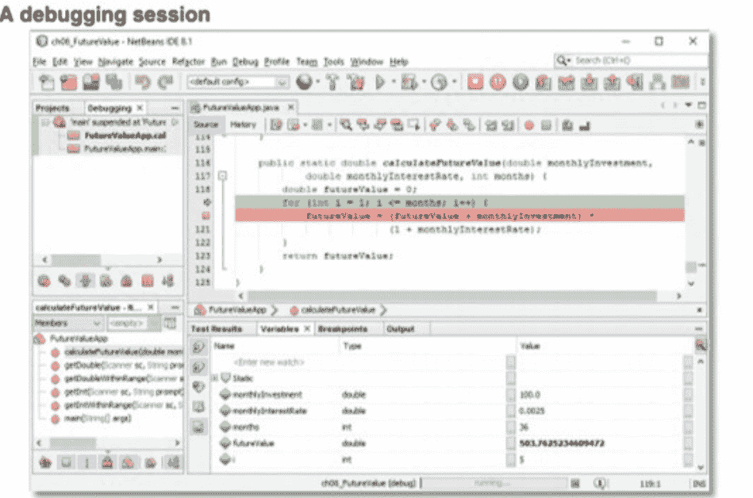

## 调试工具栏上的某些按钮

| 按钮 | 快捷键 | 说明 |
| --- | --- | --- |
| 逐步跳 | F8 | 逐语句执行代码语句，跳过方法。 |
| 单步进入 | F7 | 逐语句执行代码语句，包括调用方法中的语句。 |
| 逐步退出 | Ctrl+F7 | 完成当前方法的代码执行并返回调用方法。 |
| 继续 | F5 | 继续执行直到下一个断点。 |
| 结束调试会话 | Shift+F5 | 结束应用程序的执行。 |

## 说明

- 当到达断点时，程序执行将在该行执行前停止。
- 代码编辑器窗口左侧的箭头显示下一个将执行的行。
- “变量”窗口显示当前方法作用域内变量的值。在启动调试会话时，默认显示此窗口。如果你关闭了它，可以使用 `Window` -> `Variables` 命令重新打开它。
- 如果“变量”窗口中的变量引用一个对象，可以通过点击对象名称左侧的加号进行展开来查看该对象的值。
- 你可以使用调试工具栏上的按钮来控制应用程序的执行。

*图 6-5 如何单步执行代码和检查变量*

# 如何查看堆栈跟踪

在调试时，查看堆栈跟踪有时很有帮助，它是按方法调用的反序排列的方法列表。默认情况下，NetBeans 在调试窗口中显示堆栈跟踪，该窗口位于代码编辑器左侧的一组窗口中。此外，你可以如图 6-6 所示，在“调用堆栈”窗口中显示堆栈跟踪。

在图调试窗口中，你可以看到代码执行位于 `FutureApp` 类 `calculateFutureValue()` 方法的第 119 行。你还可以看到该方法是由 `FutureApp` 类 `main()` 方法的第 25 行调用的。此时，你可能想显示 `main()` 方法的第 25 行以查看调用 `calculateFutureValue()` 方法的代码。为此，你可以双击堆栈跟踪中的 `main()` 方法。

在图中，两个方法存储在同一个类中。然而，正如你将在接几章中学习到的，一个类中的方法调用另一个类的方法是很常见的。在这种情况下，双击堆栈跟踪中的某个方法会在代码编辑器中显示另一个类的源代码。如果你尝试这种操作，你会发现它可以帮助你定位 Bug 的源头。

# 第 6 章 如何测试、调试和部署

带有调用堆栈窗口的调试会话


## 说明

- 当到达断点时，程序执行将在该行执行前停止。
- 堆栈跟踪是按调用反序排列的方法列表。
- 默认情况下，NetBeans 在调试窗口中显示堆栈跟踪，该窗口位于代码编辑器左侧的一组窗口中。
- 如果必要，你可以通过 `Window` -> `Debugging` -> `Call Stack` 在调用堆栈窗口中显示堆栈跟踪。
- 要跳转到代码编辑器中的某行代码，双击它。

图 6-6 如何查看堆栈跟踪

# 如何部署应用程序

本章最后描述了部署应用程序的三种方案。然后展示了如何使用这些方案中最简单的部署 GUI 应用程序或控制台应用程序。

# 简介

图 6-7 列出了部署应用程序的三种方案。每种方案都有其优缺点。

部署 Java 应用程序最简单的方法创建一个包含应用程序所需的所有类和资源的可执行 JAR 文件。然后，你可以将此文件分给用户并展示如何运行它。

虽然这种部署应用程序的方法对于用户简单的应用程序是足够的，但它没有自动安装前提文件（如运行 Java 应用程序所需的 JRE）的方法，也没有自动更新应用程序。因此，只有当你准备帮助用户安装 JRE 以及当你每次更新应用程序都需要手动重新发布 JAR 文件时，你才会使用这种部署方案。尽管如此，在你开始时，这通常是部署应用程序的一种方法。这就是为什么接下来的功能将介绍如何创建和部署可执行的 JAR。

# 第 6 章 如何测试、调试和部署应用程序

## 可执行 JAR 文件

可执行 JAR（Java 存档）文件存储了应用程序所需的所有类和资源。你可以手动将此文件分发给用户，并向他们演示如何运行。

### 优点

- 没有安全限制。

### 缺点

- 不会自动安装正确版本的 JRE，因此你或你的用户必须手动安装它。
- 代码不会自动更新，因此如果应用程序发生变化，你必须重新发布。

## Web Start

Java Web Start (JWS) 允许用户从网络下载应用程序、将应用程序缓存到本地并启动它。

### 优点

- 自动安装正确的 Java 版本。
- 代码会自动更新。

### 缺点

- 安全限制使其使用变得不方便。

## 安装程序

安装程序允许你为想要运行应用程序的每个操作系统创建一个安装文件。然后，用户可以使用适用于其操作系统的安装文件来安装应用程序，就像安装任何其他应用程序一样。

### 优点

- 应用程序的安装和运行方式像专业的桌面应用程序一样。
- 可以在安装过程的一部分安装正确的 Java 版本。
- 没有显著的安全限制。

### 缺点

- 程序安装后代码不会自动更新。
- 大多数安装程序都是昂贵的商业产品。
- 这种方法需要更多的工作来设置和配置。

图 6-7 部署简介

## 如何创建可执行 JAR 文件

你只需要让用户可以使用该文件，即可使用可执行 JAR 文件来部署应用程序。然后，如果应用程序是 GUI 应用程序，用户可以通过双击 JAR 文件来运行应用程序。然而，如果应用程序是控制台应用程序，通常创建一个脚本文件来运行应用程序是有意义的。这样，你的用户就可以双击脚本文件来运行控制台应用程序。

图-6描述了如何使用 NetBeans 创建可执行 JAR 文件。要做到这一点，只需清理并构建项目。然后，NetBeans 将创建的 JAR 文件存储在项目的 dist 目录。

通过 NetBeans，你可以通过显示项目的“项目属性”对话框并点击“打包”类别来查看为项目创建的 JAR 文件的选项。该类别显示了 JAR 文件的名称、位置及其属性。默认情况下，JAR 文件包含项目的 .class 文件，但不包含包含项目源代码的 .java 文件。这是合理的，因为你通常不想让用户获取源码。JAR 文件还包含运行应用程序所需的任何其他文件，包括应用程序所需的任何 Java 库。

除了类文件和库之外，JAR 文件始终包含一个清单文件。该文件存储了关于 JAR 文件中文件的附加信息，包括哪个类文件包含应用程序的 `main()` 方法。

虽然可以在不将它们存储在 JAR 文件的情况下分发应用程序的文件，但几乎总是使用 JAR 文件更好。这使得管理应用程序的文件更容易。此外，由于 JAR 文件使用压缩格式，它们占用的磁盘空间要得多。

# 第 6 章 如何测试、调试和部署应用程序

## 构建项目的属性

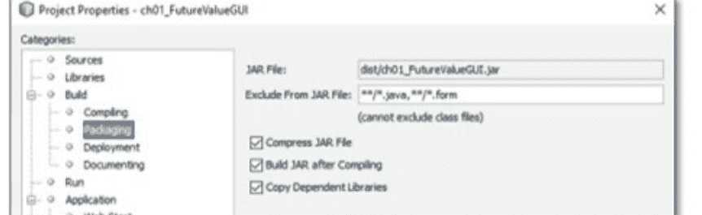

## 描述

- 使用 NetBeans，可以通过“运行→清理并构建项目”命令在项目的 dist 目录中创建可执行 JAR 文件。
- 可执行 JAR 文件包含运行应用程序所需的所有文件，包括应用程序所需的任何 Java 库。
- 可执行 JAR 文件还包含一个清单文件，存储了关于 JAR 文件包含的文件的信息，包括哪个 .class 文件包含应用程序的 `main()` 方法。
- 因为 JAR 文件使用压缩格式，它可以缩短从网络下载应用程序的等待时间。

图 6-8 如何创建可执行 JAR 文件

## 如何部署应用程序的文件

一旦你为应用程序创建了可执行 JAR 文件，就可以通过让用户可以使用该 JAR 文件来部署应用程序。如果你有相应的权限，可以通过手动将文件复制到他们的计算机上来实现。或者，你也可以将文件作为邮件附件发送给他们。你还可以包含有关如何运行 JAR 文件、如何安装 JRE（如有必要）以及针对他们可能遇到的任何问题的故障排除提示说明。

如果用户的计算机上没有安装 JRE，用户可以按照图 6-9 所示访问 Java 网站进行安装。用户也可以访问该网站安装所需的最低版本的 JRE。例外情况是用户的系统运行的是 Mac OS X，在这种情况下，默认会安装 JRE。尽管如此，如果需要更高版本的 JRE，用户可以按照此图所述进行安装。

在你将可执行 JAR 文件部署到已安装 JRE 的用户计算机上后，用户就可以运行 JAR 文件。执行该操作的技术取决于文件是用于 GUI 应用程序还是控制台应用程序。

### 如何运行 GUI 应用程序

在大多数计算机上，操作系统将 .jar 扩展名与作为 JRE 部分包含的 Java Platform SE 二进制程序关联。因此，大多数用户可以通过图 6-9 所示，找到文件并双击它来运行 GUI 应用程序的可执行 JAR 文件。然后，JRE 应该显示该应用程序的 GUI。例如，此图显示了 Future Value 应用程序的 GUI。然而，如果用户的操作系统没有尝试运行可执行 JAR 文件，你可能需要修改用户的系统，使 .jar 扩展名与 Java 关联。

# 第 6 章 如何测试、调试和部署应用程序

## 如何部署应用程序的文件

- 一旦你为应用程序创建了可执行 JAR 文件，就可以通过让用户可以使用该 JAR 文件来部署它。
- 用户的计算机上必须安装 JRE 才能运行可执行 JAR 文件。
- 要在运行 Mac OS X 的其他系统上安装 JRE，用户可以访问 www.java.com。
- 运行 Mac OS X 的系统默认安装 JRE。要安装更高版本，用户可以使用“软件更新”功能。

### 在 IDE 之外运行的 GUI 应用程序


### 如何为 GUI 应用程序运行可执行 JAR 文件

- 找到文件并双击它。
- 为了实现这一点，操作系统必须将 .jar 扩展名与作为 JRE 部分包含的 Java Platform SE 二进制程序关联。
- 因此，如果用户的操作系统没有尝试运行可执行 JAR 文件，你可能需要修改用户的系统，使 .jar 扩展名与 Java 关联。

图 6-9 部署应用程序文件并运行 GUI 应用程序

## 如何运行控制台

在大多数计算机上，操作系统将 .jar 扩展名与作为 JRE 部分包含的 Java Platform SE 二进制程序关联。因此，大多数用户可以通过图 6-9 所示，找到文件并双击它来运行 GUI 应用程序的可执行 JAR 文件。然后，JRE 应该显示应用程序的 GUI。例如，此图显示了 Future Value 应用程序的 GUI。然而，如果用户的操作系统没有尝试运行可执行 JAR 文件，你可能需要修改用户的系统，使 .jar 扩展名与 Java 关联。

图-10 显示如何为控制台应用程序运行可执行 JAR 文件。遗憾的是，你不能像 GUI 应用程序那样通过双击文件来运行它。相反，你需要在操作系统的控制台中进行操作。

在 Windows 系统上，例如，你可以使用开始菜单启动命令提示符窗口。然后，你可以使用 `cd` 命令更改包含 JAR 文件的目录。在示例中，JAR 文件已部署到用户计算机的 C:\dist 目录。接下来，你可以使用 `java` 命令运行 JAR 文件。

为了让用户更容易地运行控制台应用程序，你可以创建一个脚本文件来启动控制台并运行应用程序。在 Windows 中，例如，你可以创建一个批处理文件，切换到相应的目录并执行相应的 `java` 命令。然后，用户可以通过双击 .bat 文件启动你的应用程序。在 Mac OS X 或 Linux 系统上，你可以创建一个工作类似的 bash 文件。

如果你创建了脚本文件，你需要让脚本文件和 JAR 文件都对你的用户可用。这样，你的用户就可以双击脚本文件来运行控制台应用程序。然而，为了实现这一点，你需要将 JAR 文件存储在脚本文件指定的目录中。否则，脚本文件将无法找到 JAR 文件。

# 在 Windows 命令提示符中运行的控制应用程序

```
Command Prompt - java -jar ch01_FutureValueConsole.jar
Microsoft Windows [Version 10.0.10586]
(c) 2015 Microsoft Corporation. All rights reserved.
C:\Users\Joel>cd \murach\javdist
C:\murach\javdist>java -jar ch01_FutureValueConsole.jar
Welcome to the Future Value Calculator

Enter monthly investment: 100
Enter yearly interest rate: 3
Enter number of years: 3
Future value: $3,771.46

Continue? (y/n):
```

# 运行执行 JAR 文件的语法

```
java -jar JarName.jar
```

# 在 Windows 上运行控制应用程序的批 (.bat) 文件

```
:: 切换到存储 JAR 文件的目录
cd \murach\javdist

:: 使用 java 命令运行 JAR 文件
java -jar ch01_FutureValueConsole.jar
```

# 在 Mac OS X 或 Linux 上运行控制应用程序的 bash (.sh) 文件

```bash
#!/bin/bash

# 切换到存储 JAR 文件的目录
cd ~/murach/java/dist

# 使用 java 命令运行 JAR 文件
java -jar ch01_FutureValueConsole.jar
```

## 描述

- 要运行可执行 JAR 文件，用户需要启动控制台并使用 `java` 命令。该命令是区分大小写的。
- 对于 Windows，你可以创建一个批处理文件来启动控制台并执行 `java` 命令。对于 Mac OS X 或 Linux，你可以创建一个 bash 文件。
- 如果系统找不到 `java` 命令，你可以指定命令的绝对路径。例如在 Windows 上，路径看起来如下：
> "C:\Program Files\Java\jre-9\bin"
或者，你可以修改系统的 Path 变量，使其包含 JRE 的 bin 目录。


# 展望

现在你已经完成了这一章，你应该具备了测试应用程序以识别其可能包含的任何错误所需的技能。然后，你应该能够使用 NetBeans 调试器来确定这些错误的原因。

你应该知道，此调试器提供了一些你可以用于测试和调试应用程序的额外功能。在阅读完本章后，你应该能够独立学习更多关于这些功能。当你开始调试更复杂的应用程序时，你可能还想学习单元测试，这是一种为源代码的单个单元创建测试的方法，以确保它们能够正常工作。

一旦你确定应用程序没有错误，就可以将其部署到将使用它的计算机上。在本章中，你学习了如何使用 JAR 文件来实现这一点。但是，在某个时刻，你可能想了解更多关于此处介绍的另外两种部署选项。

## 总结

- 要测试应用程序，你需要运行它以确保它与你输入的任何有效或无效数据组合都能正常工作。
- 当你调试应用程序时，你会发现并修复在测试应用程序时发现的所有错误（bugs）。
- 语法错误违反了 Java 语句的编写规则。这些错误在你可以运行应用程序之前，就会被 NetBeans IDE 或 Java 编译器检测到。
- 运行时错误发生在运行应用程序期间。这类错误是异常，它们会停止应用程序的执行。
- 逻辑错误不会导致应用程序崩溃，但会阻止其正常工作。
- 跟踪应用程序执行情况的一种简单方法是在代码的关键点插入 `println` 语句。
- NetBeans 包含一个名为调试器的强大工具，可以帮助你发现并修复错误。
- 你可以在代码行上设置断点，以便在执行该代码行之前停止执行。然后，你可以逐行执行代码并查看代码执行时变量的值。
- 堆栈跟踪是按调用反序排列的方法列表。


- 可执行 JAR（Java 存档）文件存储了应用程序所需类和资源。你可以手动将此文件分发给用户并教他们如何运行它。
- Java Web Start (JWS) 允许用户从网络运行应用程序。

## 第 6 章 如何测试、调试和部署应用程序 203

## 练习 6-3 部署未来价值（Future Value）应用程序

在本练习中，你将部署未来价值应用程序的控制台版本并运行它。

1. 打开 `ex_starts` 目录下的名为 `ch06_ex3_FutureValue` 的项目。然后运行应用程序查看其工作原理。
2. 清理并构建项目，然后在项目的 `dist` 目录中找到其 JAR 文件。
3. 在 `murach/java/dist` 目录下创建一个名为 `fv` 的目录。然后，将 JAR 文件复制到此目录。
4. 启动控制台并使用 `java` 命令运行 JAR 文件。
5. 在 `fv` 目录中，创建一个脚本文件来启动控制台并执行 JAR 文件。对于 Windows，创建一个 `.bat` 文件；对于 Mac，创建一个 `.sh` 文件。
6. 将 `fv` 目录复制到另一台计算机上，并确保你可以在那台计算机上运行它。为了实现这一目标，你可能需要从 www.java.com 下载 JRE，并可能需要修改脚本文件以指定 JAR 文件的正确目录。

## 练习 6-4 部署未来价值应用程序的 GUI 版本

在本练习中，你将部署未来价值应用程序的 GUI 版本并运行它。

1. 打开 `ex_starts` 目录下的名为 `ch06_ex4_FutureValueGUI` 的项目。然后运行应用程序查看其工作原理。
2. 清理并构建项目，然后在项目的 `dist` 目录中找到其 JAR 文件。
3. 双击 JAR 文件运行它。
4. 将 JAR 文件复制到另一台计算机上并双击运行它。为了实现这一目标，你可能需要从 www.java.com 下载 JRE。

## 第 2 节

### 面向对象编程

在本书的第一部分中，你学习了如何使用 Java API 提供的类。例如，你学习了如何使用 `Math` 类来执行常见的算术运算，并学习了如何使用 `NumberFormat` 类对数值进行格式化。这是面向对象编程的一部分。

但是，除了 API 提供的类之外，你还可以创建自己的类。这是面向对象编程的另一部分，也是本节的四章将教你所做的内容。具体来说，第 7 章介绍了创建和使用自定义类的基本技能。第 8 章介绍了使用继承的技能，继承是面向对象编程最重要的特性之一。第 9 章介绍了使用接口的技能。第 10 章介绍了一些额外的面向对象技能。

由于本节的每一章都建立在之前章节的基础上，因此你应该按顺序阅读所有章节。此外，在进入第 3、4 或 5 节之前，你应该阅读本节的所有章节。这是因为这些节中的许多章节都依赖于你对继承和接口的知识。

## 第 7 章 如何定义和使用类

本章展示了如何在 Java 应用程序中创建和使用自定义类。在这里，你将学习如何创建包含普通字段和方法的类，以及包含静态字段和方法的类。此外，你将看到两个使用了若干个自定义类的完整应用程序。

当你完成本章时，你将开始看到创建自己的类如何帮助简化应用程序的开发。作为奖励，你将更好地理解 Java API 的工作原理。

- 类简介
- 如何使用类来构建应用程序
- 封装的工作原理
- 类与其对象之间的关系
- 如何处理定义对象的类
- 如何使用 NetBeans 创建新类
- Thread 类
- 如何编写实例变量
- 如何编写构造函数
- 如何编写方法
- 如何从类创建对象
- 如何调用对象的方法
- 如何使用 NetBeans 处理类
- 如何编写和使用静态字段和方法
- 如何编写静态字段和方法
- 如何调用静态字段和方法
- 如何编写静态初始化块
- 何时使用静态字段和方法
- 产品查看器（Product Viewer）应用程序
- ProductDB 类
- 用户界面和 ProductApp 类
- 处理对象和方法的更多技能
- 引用类型与基本类型的比较
- 如何重载方法
- 如何使用 `this` 关键字
- 行项目（Line item）应用程序
- 用户界面
- 类图
- 类代码
- 视角（Perspective）

## 类简介

后续主题将介绍你在创建自定义类之前需要了解的概念。这包括如何在典型的业务应用程序中使用类、类的字段和方法如何封装在类内部，以及类如何与其对象建立关系。

## 如何使用类来构建应用程序

图 7-1 显示了你如何使用类通过多层架构来简化业务应用程序的设计。在多层应用程序中，执行应用程序不同功能的类被分离到两个或多个层（tiers）。

如图所示的三层架构由表示层、业务逻辑层和数据库层组成。这是构建应用程序最常见的架构。

表示层的类处理应用程序用户界面的细节。到为止，你看到的所有应用程序都是控制台应用程序。在这些应用程序中，表示层的大部分由 `main()` 方法处理，该方法可能会调用其他类的方法。然而，在第 4 节中，你将学习如何编写显示多个窗口的图形用户界面（GUI）的 Java 应用程序。在这些应用程序中，通常会为显示的每个窗口创建一个单独类。

数据库层的类负责应用程序所需的所有数据库访问。这些类通常包含连接数据库以及从数据库中检索、添加、更新和删除信息的方法。然后，其他层可以调用这些方法来访问数据库，将数据库访问的细节留给数据库类。尽管它也可以包含处理存储在文件中数据的类。

业务逻辑层提供了数据库层和表示层之间的接口。它通常包含对应于业务实体（例如，产品和客户）的类。它可能包含实现业务规则的类，例如折扣或信贷政策。这一层的类通常被称为业务类，从它们创建的对象通常被称为业务对象。

使用多层架构开发应用程序的优势是，你可以在不修改其他层的情况下更换其中一个层。例如，你可以更换表示层以使用 GUI 代替控制台，而无需修改业务层或数据库层中的任何类。

使用分层架构开发应用程序的第二个优势是它允许工作在开发团队成员之间分配。例如，一组开发人员可能处理数据库层，另一组处理业务逻辑层，还有另一组处理表示层。

第三个优势是它允许类在应用程序之间共享。特别是，构成数据库层和业务层的类可以存储在供多个项目使用的包中。你将在第 10 章学习如何与包一起工作。

### 三层应用架构

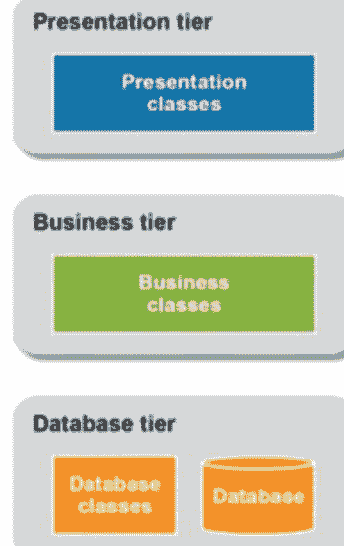

#### 描述

- 为了简化开发和维护，许多应用程序使用*三层架构*来将应用程序的用户界面、业务规则和数据库处理分开。使用类来实现该架构中每一层所执行的功能。
- *表示层*（presentation tier）中的类控制应用程序的用户界面。对于控制台应用程序，表示层通常包含一个带有 `main()` 方法的类以及其他与控制台输入输出相关的类。对于 GUI 应用程序，用户界面通常由构成 GUI 的每个窗口各对应的一个类组成。
- *数据库层*（database tier）中的类处理应用程序的所有数据处理。
- *业务层*（business tier）中的类定义了应用程序的*业务对象*和规则。这些类充当表示层和数据库层类之间的接口。
- 构成每一层的类通常存储在可以在应用程序之间共享的包中。更多信息，请参阅第 10 章。

图 7-1 如何使用类来结构化应用程序

## 封装是如何工作的

图 7-2 显示了一个名为 Product 的类的类图。该图使用了统一建模语言（UML），这种建模语言已成为包括 Java 在内的所有面向对象编程语言的行业标准建模语言。

在这个类中，类包含三个字段和七个方法。在这里，减号 (-) 表示仅在当前类中可访问的字段和方法，而加号 (+) 表示对其他类可用的字段和方法。

在这种情况下，所有方法对其他类都可用，但没有字段对其他类可用。例如，`getCode()` 方法返回存储在 `code` 字段中的值，而 `setCode()` 方法为 `code` 字段分配一个新值。

这说明了封装的概念，它是面向对象编程的一个基本概念。这意味着程序员可以隐藏或封装类的某些字段和方法，同时暴露另一些方法。由于类的字段（或数据）通常被封装在类内部，因此封装有时被称为数据隐藏。

当你使用一个类时，封装让你将其视为一个提供有用字段和方法的黑盒。例如，当你使用 `Integer` 类的 `parseInt()` 方法时，你不知道该方法如何将字符串转换为整数，你也不需要知道。同样，如果你使用此图中的 Product 类的 `getPrice()` 方法，你不知道该方法是如何工作的。

这也意味着你可以更改类中某个方法的代码，而不影响使用该方法的类。例如，你可以更改 `getPrice()` 的代码，而无需更改使用该方法的类。这使得升级或增强应用程序变得更容易，因为你只需要更改需要升级的类。

### Product 类的类图

| Product | |
| :--- | :--- |
| -code: String | 字段 |
| -description: String | |
| -price: double | |
| +setCode(String) | 方法 |
| +getCode(): String | |
| +setDescription(String) | |
| +getDescription(): String | |
| +setPrice(double) | |
| +getPrice(): double | |
| +getPriceFormatted(): String | |

#### 描述

- 类的字段存储类的数据。
- 类的方法定义了类可以执行的任务。通常，这些方法提供了处理类字段的方法。
- 封装是面向对象编程的基本概念之一。这意味着类控制其哪些字段和方法可以被其他类访问。结果是类中的字段可以对其他类隐藏，类中的方法可以在不改变其他类使用它们方式的情况下进行修改或改进。

### UML 图绘制说明

- UML（统一建模语言）是用于描述面向对象应用程序的类和对象的行业标准。
- UML 类图中减号 (-) 标记其他类无法访问的字段和方法，而加号 (+) 标记其他类可以访问的字段和方法。
- 对于每个字段，给出名称，后跟冒号，然后是数据类型。
- 对于每个方法，给出名称，后跟一组括号。如果方法需要参数，则在括号中列出每个参数的数据类型。否则，括号留空，冒号后给出将返回的值的数据类型。

图 7-2 封装是如何工作的

## 类与其对象之间的关系

图 7-3 使用 UML 图显示了类与其对象之间的关系。在图中，一个类图和两个对象图显示了如何从类创建对象。在这里，图表只显示了类及其对象的字段，而不是方法。在这种情况下，从类创建了名为 product1 和 product2 的两个对象。

一旦创建了类的实例，它就有了身份和状态。对象的身份是它在内存中的地址，这始终是唯一的。对象的状态指的是它持有的值。随着程序的执行，对象的状态可能会改变，但它的身份永远不会改变。

### 类与其对象之间的关系

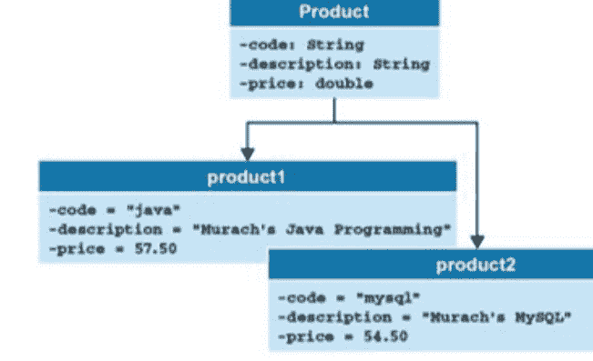

#### 描述

- 类可以被看作创建对象的模板。
- 对象图提供了对象的名称和字段的值。
- 一旦类的实例被创建，它就有一个身份（唯一地址）和一个状态（它持有的值）。尽管它的状态可能会改变，但它的身份永远不会改变。

图 7-3 类与其对象之间的关系

## 如何操作定义对象的类

现在你已经学习了一些使用类的基本概念，准备好学习创建自己的类的基本技能了。作为开始，接下来的几幅图显示了如何创建一个名为 Product 的类，你可以用它存储有关产品的数据。

## 如何使用 NetBeans 创建新类

当你开发面向对象的应用程序时，经常需要向项目添加新类。要用 NetBeans 实现这一点，可以使用图 7-4 所示的 New Java Class 对话框。在图中，例如，此对话框正用于创建一个名为 Product 的类。

注意这里没有为该类指定包。因为如此，该类将存储在默认包中。虽然使用包来组织应用程序中的类通常是一个好主意，但本章和接下来两个章节将专注于创建和使用类。

当你完成 New Java Class 对话框时，NetBeans 会创建一个存储类 Java 代码的文件。对于图中的 Product 类，文件将命名为 `Product.java`。NetBeans 还会生成类的起始代码，如图所示。注意类名与文件名匹配，这是要求的。此外，使用了 `public` 修饰符，以便该类可以被其他类访问。

### 创建新 Java 类的对话框

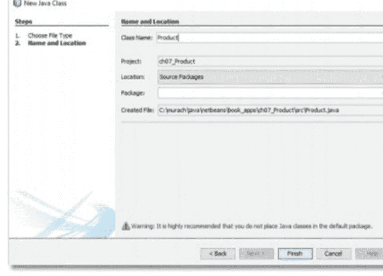

### 为 Product 类生成的代码

```java
public class Product {
}
```

### 说明


# 如何创建新类

要创建一个新类，请在你想添加类的包上单击右键，选择 `New`（新建）→ `Java Class`（Java 类）命令，并对出现的对话框进行响应。至少，你应该在 `Class Name`（类名）文本框中输入类的名称。

尽管此对话框鼓励你为类选择一个包，但这并不是必须的。如果你没有为类选择包，NetBeans 将把类存储在默认包（default package）中。要了解如何创建和使用包，请参阅第 10 章。


## Product 类

图 7-5 展示了 `Product` 类的代码。此代码实现了图 7-2 类图中的字段和方法。在接下来的六页中，你将学习编写此处所示代码的细节。现在，我将仅展示此代码的预览，让你对它的工作原理有一个大致的了解。

该类的前三个语句是类字段的声明。字段是类及其对象可用的变量或常量。在这个示例中，所有三个字段都定义了实例变量，用于存储适用于每个 `Product` 对象的 `code`、`description` 和 `price` 变量的数据。

字段声明之后，该类声明了 `Product` 类的构造函数。此构造函数创建 `Product` 类的实例并将实例变量初始化为默认值。正如你在本章稍后部分看到的，你还可以创建接受参数的构造函数。然后，构造函数可以使用参数值来初始化实例变量。

接下来是 `Product` 类方法的声明。在此类中，每个字段的 `get` 方法（获取）返回存储在字段中的值，而 `set` 方法（设置）则为字段分配一个新值。在这些方法中，`getPriceFormatted()` 方法是唯一可以对获取或设置实例变量提供的值执行任何操作的方法。该方法对 `price` 变量应用标准的货币格式并返回生成的字符串。

虽然类为每个字段都包含了 `get` 方法和 `set` 方法，但你不需要为一个字段编写这两个方法。特别是，通常只为字段使用 `get` 方法，以便可以检索其值而不允许进行更改。这被称为只读字段（read-only field）。虽然你也可以仅为某个字段使用 `set` 方法，但这并不常见。

`private` 和 `public` 关键字决定了类的哪些成员对其他类可用。由于 `Product` 类的所有实例变量都使用了 `private` 关键字，因此它们仅在该类内部可用。然而，构造函数和方法使用了 `public` 关键字。结果是它们对所有类都可用。但请记住，你可以在任何类中包含 `public` 和 `private` 实例变量和方法。

顺便说一下，该类遵循了 Java 要求的三条编码规则。首先，它包含一个不需要任何参数的构造函数。其次，所有的实例变量都是私有的。第三，它对你想要访问的所有实例变量都包含了 `get` 和 `set` 方法。随着你 Java 的深入学习，你会发现创建既是类又是 JavaBeans 的类许多优势。例如，如果你为 Web 应用程序开发 JavaPages (JSPs)，你可以使用特殊的 JSP 标签来创建 JavaBean 并访问它的 `get` 和 `set` 方法。

现在你已经看到了 `Product` 类的代码，你可能想考虑它是如何使用封装的。首先，三个字段对其他类是隐藏的，因为它们是用 `private` 关键字声明的。此外，构造函数和方法中包含的所有代码都是隐藏的。正因如此，你可以更改任何代码而无需更改使用该类的其他类。

## Product 类代码

```java
import java.text.NumberFormat;

public class Product {

    // 实例变量
    private String code;
    private String description;
    private double price;

    // 构造函数
    public Product() {
        code = "";
        description = "";
        price = 0;
    }

    // code 变量的 set 和 get 方法
    public void setCode(String code) {
        this.code = code;
    }

    public String getCode() {
        return code;
    }

    // description 变量的 set 和 get 方法
    public void setDescription(String description) {
        this.description = description;
    }

    public String getDescription() {
        return description;
    }

    // price 变量的 set 和 get 方法
    public void setPrice(double price) {
        this.price = price;
    }

    public double getPrice() {
        return price;
    }

    // price 变量的自定义 get 方法
    public String getPriceFormatted() {
        NumberFormat currency = NumberFormat.getCurrencyInstance();
        return currency.format(price);
    }
}
```


# 如何编写实例变量

图 7-6 显示了如何编写定义对象用数据类型的实例变量。当你声明一个实例变量时，应该使用访问修饰符来控制其可访问性。如果你使用 `private` 关键字，该实例变量只能在类内部使用。相比之下，如果你使用 `public` 关键字，其他类可以访问该实例变量。你还可以使用其他修饰符对你的实例变量进行更细粒度的控制。

此图列出了声明实例变量的四个示例。第一个示例声明了一个 `double` 类型的变量。第二个声明了一个 `int` 类型的变量。第三个声明了一个 `String` 类对象的变量。最后一个声明了一个 `Product` 类对象——这就是你现在正在学习编写的类。

尽管实例变量的作用像普通变量，但它们必须在类体内部声明，而不能在方法或构造函数内部。这样，它们在整个类中都可用。在书中，类的所有实例变量都声明在类的开头。然而，当你阅读其他来源的代码时，你可能会发现实例变量声明在类的结尾或类内的其他位置。

## 声明实例变量的语法

```java
public|private primitiveType|ClassName variableName;
```

### 示例

- `private double price;`
- `private int quantity;`
- `private String code;`
- `private Product product;`

## 你可以在哪里声明实例变量

```java
public class Product {
    // 在此处声明实例变量
    private String code;
    private String description;
    private double price;

    // 类的构造函数和方法
    public Product() { }
    public void setCode(String code) { return code; }
    public String getCode() { return code; }
    public void setDescription(String description) { return description; }
    public String getDescription() { return description; }
    public void setPrice(double price) { return price; }
    public double getPrice() { return price; }
    public String getPriceFormatted() { return formattedPrice; }

    // 在此处也可以声明实例变量
    private int test;
}
```

### 说明

- 实例变量可以是原始数据类型、由 Java 类（如 `String` 类）创建的对象，也可以由自定义类（如 `Product` 类）创建的对象。
- 为了防止其他类访问实例变量，使用 `private` 关键字将其声明为私有。
- 你可以在类构造函数和方法之外的任何位置声明类的实例变量。

# 如何编写构造函数

图 7-7 显示了如何为类编写构造函数。当你编写构造函数时，良好的编程习惯是如四个示例所示，为该类的所有实例变量赋值。你还可以在构造函数中包含任何你想要执行的额外语句。例如，第四个示例提供了一个 `Get Product` 对象，其代码是传递给构造函数的，然后使用 `Product` 类的两个 `get` 方法来获取产品的描述和价格。

当你编写构造函数时，必须使用 `public` 访问修饰符，以及与类名相同的名称（包括大小写）。然后，如果你想接受参数，必须像第一个示例那样编写一个空参数列表。相反，如果你想接受参数，则像接下来的三个示例那样为构造函数编写参数。在编写构造函数的参数时，必须为每个参数编写一个数据类型和一个名称。对于数据类型，你可以编写原始数据类型或定义该类型的类名。

第二个示例显示了一个带有三个参数的构造函数。在这里，第一个参数是一个名为 `code` 的 `String` 对象；第二个参数是名为 `description` 的 `String` 对象；第三个参数是名为 `price` 的 `double` 类型。然后，构造函数内的三个语句使用这些参数来初始化类的三个实例变量。

在这个示例中，参数的名称与实例变量的名称相同。结果是构造函数必须区分这两者。为了做到这一点，它使用 `this` 关键字来引用当前对象的实例变量。你将在本章稍后的部分学习使用 `this` 关键字的其他方法。

第三个示例的工作原理与第二个示例相同，但它不需要使用 `this` 关键字，因为参数名称与实例变量名称不同。尽管如此，在这种情况下，参数名称并不具有描述性。因此，第二个示例中的代码比第三个示例中的代码更容易让程序员阅读。

第四个示例显示了一个带有一个参数的构造函数。在这里，第一个语句将第一个参数赋值给类的实例变量。然后，第二个语句调用名为 `ProductDB` 的类的方法，以根据指定的 `code` 获取一个 `Product` 对象。最后两个语句调用 `Product` 对象的方法，这些方法返回的值赋值给第二个和第三个实例变量。

当你编写构造函数时，类名加上参数数量以及每个参数的数据类型就形成了构造函数的签名。只要每个构造函数都有唯一的签名，你就可以为每个类编写多个构造函数。例如，图中所示的前两个构造函数具有不同的签名，因此它们可以在 `Product` 类中编写。这被称为构造函数重载。

如果你不编写构造函数，Java 将创建一个默认构造函数，它不接受任何参数，并将所有实例变量初始化为 `null`、`zero` 或 `false`。然而，如果你编写了一个接受参数的构造函数，Java 就不会创建这个默认构造函数。如果你需要这样的构造函数，你需要显式地编写它。为了避免混淆，编写你所有的构造函数是一个良好的习惯。这样，就可以很容易看到类提供了哪些构造函数，并且容易检查每个构造函数用于初始化实例变量的值。

## 第 7 章 如何定义和使用类

### 编写构造函数的语法

```java
public ClassName({parameterList}) {
    // 构造函数的语句
}
```

### 赋值默认值的构造函数

```java
public Product() {
    code = "";
    description = "";
    price = 0.0;
}
```

### 带有三个参数的自定义构造函数

```java
public Product(String code, String description, double price) {
    this.code = code;
    this.description = description;
    this.price = price;
}
```

### 编写上述构造函数的另一种方法

```java
public Product(String c, String d, double p) {
    code = c;
    description = d;
    price = p;
}
```

### 带有一个参数的构造函数

```java
public Product(String code) {
    this.code = code;
    Product p = ProductDB.getProduct(code);
    description = p.getDescription();
    price = p.getPrice();
}
```

### 说明

- 构造函数必须使用与类名相同的名称和大小写。
- 如果你不编写构造函数，Java 将创建一个默认构造函数，将所有数值类型初始化为 0，所有布尔类型初始化为 `false`，所有对象初始化为 `null`。
- 要编写带有参数的构造函数，请在类名后的括号内为每个参数编写数据类型和名称。
- 类名结合参数列表构成了构造函数的签名。虽然你可以为每个类编写多个构造函数，但每个构造函数必须具有唯一的签名。
- 在上面的第二个和第四个示例中，`this` 关键字用于引用当前对象的实例变量。

# 如何编写方法

图 7-8 显示了如何编写类的方法。在开始时，大多数情况下，你使用 `public` 关键字来声明方法，以便供其他类使用。然而，你也可以使用 `private` 关键字向其他类隐藏方法。

在访问修饰符之后，编写返回类型，即方法返回的数据类型。在返回类型之后，编写方法名，后面跟括号。在大括号内，你编写方法的语句。

当你编写方法时，访问修饰符、返回类型、方法名和参数列表构成了方法的签名。只要每个方法都有唯一的签名，你就可以为每个类编写多个方法。

要编写带有参数的方法，请在方法名后的括号内为每个参数编写数据类型和名称。方法名结合参数列表构成了方法的签名。尽管你可以为每个类编写多个方法，但每个方法必须具有唯一的签名。

在上面的第二个和第四个示例中，`this` 关键字用于引用当前对象的实例变量。在第二个示例中，参数与实例变量的名称相同。在第四个示例中，参数与实例变量的名称不同。

### 编写方法的语法

```java
public|private returnType methodName([parameterList]) {
    // 方法的语句
}
```

### 不接受参数也不返回数据的方法

```java
public void printConsole() {
    System.out.println(code + "|" + description + "|" + price);
}
```

### 返回字符串的 get 方法

```java
public String getCode() {
    return code;
}
```

### 返回 double 值的 get 方法

```java
public double getPrice() {
    return price;
}
```

### 自定义 get 方法

```java
public String getPriceFormatted() {
    NumberFormat currency = NumberFormat.getCurrencyInstance();
    return currency.format(price);
}
```

### set 方法

```java
public void setCode(String code) {
    this.code = code;
}
```

### 编写 set 方法的另一种方法

```java
public void setCode(String productCode) {
    code = productCode;
}
```

# 如何从类创建对象

图 7-9 显示了如何使用一条语句和两条语句来创建对象。大多数情况下，你将使用一条语句来创建对象。然而，在本书的后部分你会看到，某些类型的编码情况需要你使用两条语句来创建对象。

当你使用两条语句来创建对象时，第一条语句声明类以及将要赋值的变量名。然而，在执行第二条语句之前，对象的实例实际上并没有被创建。这条语句使用 `new` 关键字来调用对象的构造函数，构造函数会初始化实例变量。然后，将该对象的引用赋值给变量。此时，你就可以使用该变量来引用该对象了。

当你向类的构造函数传递参数时，你必须确保构造函数能够接收这些参数。要做到这一点，你必须传递正确数量的参数、按照正确的顺序传递，并且其数据类型必须与构造函数参数列表中指定的数据类型兼容。当一个类包含多个构造函数时，参数与参数匹配的构造函数将是要执行的。

图中两条语句的示例创建了一个新的 `Product` 对象，而没有向 `Product` 类的构造函数传递任何参数。第一条语句的示例完成了相同的任务。然后，第二和第三个示例显示了如何向 `Product` 类的构造函数传递单个参数。这两个语句都传递了一个 `String` 对象，但第二个示例传递了一个字面量（literal），而第三个示例传递了一个引用 `String` 对象的变量。第四个示例向构造函数传递了三个参数。

## 如何用两条语句创建对象

### 语法

```java
ClassName variableName;
variableName = new ClassName(argumentList);
```

### 无参数示例

```java
Product product;
product = new Product();
```


## 如何用一条语句创建对象

### 语法

```java
ClassName variableName = new ClassName(argumentList);
```

### 无参数

```java
Product product = new Product();
```

### 单字面量参数

```java
Product product = new Product("java");
```

### 单变量参数

```java
Product product = new Product(productCode);
```

### 三参数

```java
Product product = new Product(code, description, price);
```

## 描述

- 要创建一个对象，你使用 `new` 关键字来创建类的新实例。每当使用 `new` 关键字创建一个对象时，Java 都会调用该对象的构造函数，构造函数会初始化对象的实例变量。
- 创建对象后，将其赋值给一个变量。这样做时，对象的引用被存储在变量中。然后，你就可以使用该变量来引用该对象。
- 要向构造函数传递参数，请在类名后的括号内编写参数。要传递多个参数，请用逗号分隔参数。
- 当你向构造函数传递参数时，参数必须符合构造函数所要求的顺序，并且它们的数据类型必须与构造函数参数的数据类型兼容。

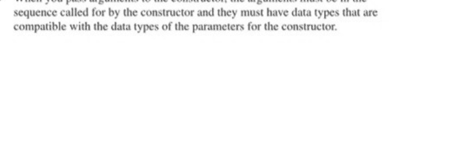

## 如何调用对象的方法

图 7-10 显示了如何调用对象的方法。到目前，你应该已经熟悉调用方法的基本语法，因此此图应该只是复习。开始时，你输入对象名，后面是点运算符 `.` 和方法名。然后，如果该方法需要参数，就在括号内编写参数列表，用逗号分隔多个参数。否则，编写一对空括号。

前两个示例显示了调用不返回任何数据的方法的两种方法。第一个示例没有传递参数，而第二个示例传递了一个名为 `productCode` 的参数。在这种情况下，参数是一个表示 `String` 对象的变量，但参数也可以是字面量值，例如 `"java"`。无论何种方式，你都需要传递正确数量的参数，且这些参数的数据类型必须与方法参数列表中指定的数据类型兼容。

第三和第四个示例显示了如何调用返回值的方法并将该值赋值给变量。在第三个示例中，`getPrice()` 方法没有参数，但它返回一个值。然后，该值被赋值给一个 `double` 类型变量名。在第四个示例中，`getPriceFormatted()` 方法传递一个布尔变量作为参数，指示格式化后的值是否应该包含美元符号。这是你在图 7-5 中看到的 `getPriceFormatted()` 方法的变体。与该方法一样，此方法返回一个字符串，然后存储在字符串变量中。

第五个示例显示了如何在表达式中调用方法。在这里，表达式包含了对 `getCode()` 方法的调用，该方法返回一个 `String` 对象。然后，该 `String` 对象与三个字符串字面量连接，结果被赋值给另一个 `String` 对象。

## 如何调用方法

### 语法

```java
objectName.methodName(argumentList)
```

### 不传递参数且无返回

```java
product.printToConsole();
```

### 传递一个参数且无返回

```java
product.setCode(productCode);
```

### 不传递参数并返回一个 `double` 值

```java
double price = product.getPrice();
```

### 传递参数并返回一个 `String` 对象

```java
String formattedPrice = product.getPriceFormatted(includeDollarSign);
```

### 表达式中的方法调用

```java
String message = "Code: " + product.getCode() + "\n\n"
+ "Press Enter to continue or enter 'x' to exit";
```

## 描述

- 要调用不接受参数的方法，在方法名后输入一对空括号。
- 要调用接受参数的方法，在方法名后的括号内输入参数。在这里，每个参数的数据类型必须与方法参数所指定的数据类型兼容。
- 要编写多个参数，请用逗号分隔参数。
- 如果方法返回一个值，你可以编写一条赋值语句将返回值赋给变量。在这里，变量的数据类型必须与返回值的数据类型兼容。


## 如何使用 NetBeans 处理类

图 7-11 显示了 NetBeans 如何让处理类变得更简单。开始时，在你输入类的私有字段后，你可以使用 NetBeans 生成这些字段的 getter 和 setter 方法。要做到这一点，你需要使用所示的 `Encapsulate Fields` 对话框。

可见，此对话框列出了所有私有字段，并允许你选择为每个字段生成的方法。它还允许你设置若干控制方法生成的选项。当你使用 `Encapsulate Fields` 对话框时，方法的 getter 和 setter 方法格式如下：

```java
public String getCode() {
    return code;
}
public void setCode(String code) {
    this.code = code;
}
```

一旦你创建了类，就可以使用所示 Navigator（导航）窗口跳转到类的任何成员。要这样做，只需双击成员名。虽然该功能的用处对于像 `Product` 这样简单的类并不明显，但对于包含更多成员的类非常有帮助。

### Product 程序的 NetBeans 窗口

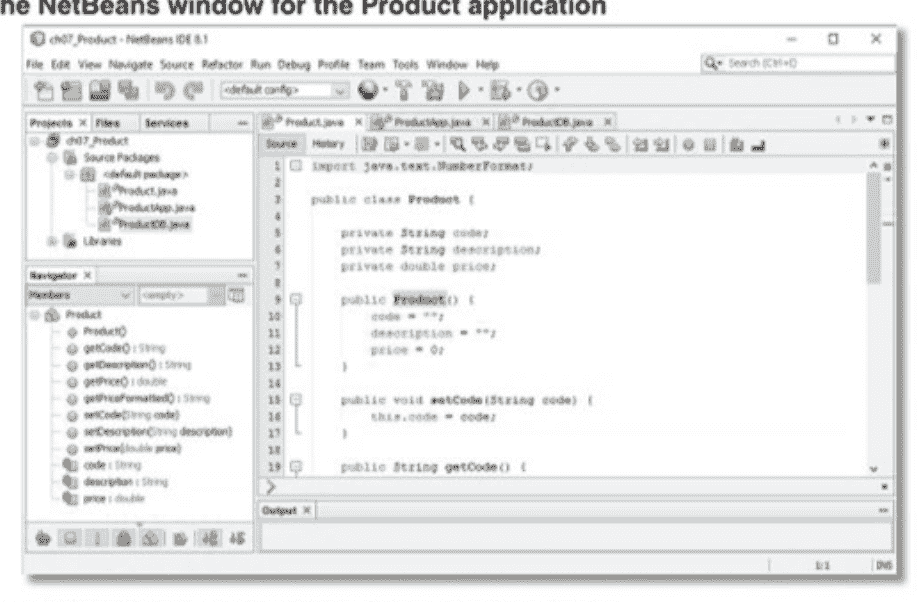

### 生成 getter 和 setter 方法的对话框

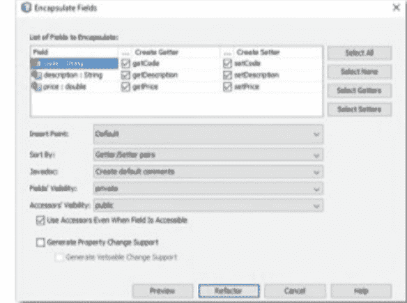

## 描述

- 要为一个或多个字段生成 getter 和 setter 方法，选择 `Refactor` -> `Encapsulate Fields` 命令并对生成的对话框进行响应。
- Navigator 窗口列出当前选中类的所有成员。要显示此窗口，使用 `Window` -> `Navigator` 命令。要跳转到某个成员，在 Navigator 窗口中双击该成员。

## 如何编写和使用静态字段和方法

在第 2 和第 3 章中，你学习了如何调用 Java API 中某些类的静态方法。在第 4 章中，你学习了如何在与 `main()` 方法相同的类中编写静态方法。现在，你将学习如何在自己的类中编写静态字段，以及如何从其他类调用它们。

## 如何编写静态字段和方法

图 7-12 展示了如何编写静态字段和静态方法。实例变量和普通方法属于从类创建的对象，而静态字段和静态方法属于类本身。因此，它们有时被称为类字段和类方法。

该图顶部显示了如何编写静态字段。简而言之，你使用的语法与普通变量或常量语法相似。但是，你使用 `static` 关键字使变量或常量属于类而不是对象。然后，你为变量或常量提供一个初始值。通常，类的静态变量使用 `private` 访问修饰符，而类的静态常量使用 `public` 访问修饰符。这样，其他类就可以访问并使用这些常量。

第一个示例展示了如何编写包含一个静态字段和一个静态方法的类。该静态方法类似于你在第 4 章中学习编写的计算每年每月月份的方法。然而，此方法使用了名为 `MONTHS_IN_YEAR` 的静态字段，并且在一个名为 `FinancialCalculations` 的独立类中编写。请注意，该类不包含任何非静态字段或方法，你不需要为该类编写构造函数。

第二个示例展示了如何向 `Product` 类添加静态变量和静态方法。在这个示例中，名为 `objectCount` 的静态变量统计了从 `Product` 类创建的对象的数量。该变量被声明为 `private`，因此其他类无法直接访问它。然后，每当从该类创建一个新对象时，构造函数就会增加该静态变量。静态方法 `getObjectCount()` 返回 `objectCount` 变量。

当你编写将普通字段、方法与静态字段、方法混合的类时，保持字段和方法的组织良好是一种良好的做法。为此，你可以根据类型（实例或静态；变量或常量）以及访问修饰符（`private` 或 `public`）对字段和方法进行分组。为了说明，第二个示例将所有实例变量列在一组，随后是唯一的静态变量。对于较小的类，这样分组字段和方法并不至关重要。然而，随着你的类变长，分组可以使你的代码更易读和维护。

### 如何声明静态字段

```java
private static int numberOfObjects = 0;
private static double majorityPercent = .51;
public static final int DAYS_IN_JANUARY = 31;
public static final float EARTH_MASS_IN_KG = 5.972e24F;
```

### 包含静态变量和静态方法的类

```java
public class FinancialCalculations {
    public static final int MONTHS_IN_YEAR = 12;

    public static double calculateFutureValue(double monthlyPayment, double yearlyInterestRate, int years) {
        int months = years * MONTHS_IN_YEAR;
        double monthlyInterestRate = yearlyInterestRate / MONTHS_IN_YEAR / 100;
        double futureValue = 0;
        for (int i = 1; i <= months; i++)
            futureValue = (futureValue + monthlyPayment) * (1 + monthlyInterestRate);
        return futureValue;
    }
}
```

### 带有静态变量和静态方法的 Product 类

```java
public class Product {
    private String code;
    private String description;
    private double price;

    private static int objectCount = 0; // declare a static variable

    public Product() {
        code = "";
        description = "";
        price = 0;
        objectCount++; // update the static variable
    }

    public static int getObjectCount() {
        return objectCount;
    }
}
```

## 描述

- 调用静态字段：输入类名，后面是点运算符 `.` 和静态字段名。
- 调用静态方法：输入类名，后面是点运算符 `.`、方法名以及一组括号。如果方法需要参数，在括号内编写参数，并用逗号分隔多个参数。

## 如何编写静态初始化块

当初始化一个静态字段需要多条语句时，你可以使用静态初始化块来初始化该字段，如图 7-14 所示。首先，你只需要编写 `static` 关键字后跟大括号。然后在大括号内编写该块的语句。此块中的语句在类加载时执行，类加载发生在调用该类的构造函数或静态方法时。

在这个示例中，`ProductDB` 类包含一个静态初始化块，该块执行了几条语句来初始化静态 `Connection` 对象。该对象被类中的某些静态方法用于连接数据库。由于静态初始化块在类的任何方法被调用时就会立即运行，这使得 `Connection` 对象对类的其余部分变为可用。

目前，如果你不理解静态块中的代码，请不要担心。重点是初始化静态 `Connection` 对象需要几条语句。你将在第 20 章中学习更多关于这些语句以及如何连接数据库的知识。

## 何时使用静态字段和方法

现在你已经知道了如何编写静态字段和方法，你可能想知道何时使用它们，何时使用普通字段和方法。通常情况下，当你需要从类创建对象时，应该使用普通字段和方法。这样，你就可以从一个类创建多个对象，且每个对象在自己的实例变量中拥有自己的数据。然后，你可以使用每个对象的方法来处理这些数据。

相反，如果你只需要执行单项任务（如计算），你可以使用静态方法。这时，你传递方法所需的参数，方法将返回你所需的结果，而无需创建任何对象。随着本书的深入，你将看到许多示例，这些示例将让你更好地理解何时静态字段和方法更为合适。

## 类初始化块的编码语法

```java
public class className {
    // 任何字段声明
    static {
        // 静态字段的任何初始化语句
    }
    // 类的其余代码
}
```

## 使用静态初始化块的类

```java
public class ProductDB {
    private static Connection connection; // 静态变量
    // 静态初始化块
    static {
        try {
            String url = "jdbc:mysql://localhost:3306/MurachDB";
            String user = "root";
            String password = "sesame";
            connection = DriverManager.getConnection(url, user, password);
        } catch (Exception e) {
            System.err.println("Error connecting to database.");
        }
    }
    // 使用 Connection 对象的静态方法
    public static Product get(String code) { ... }
    public static boolean add(Product product) { ... }
    public static boolean update(Product product) { ... }
    public static boolean delete(String code) { ... }
}
```

## 描述

- 为了初始化类的静态变量，你通常在声明中编写值。然而，如果一个变量无法通过单条语句初始化，你可以编写一个静态初始化块。
- 当类加载时，Java 会初始化该类的所有静态变量和常量。然后，它按照它们出现的顺序执行所有的静态初始化块。（当调用类的其中一个构造函数或静态方法时，类就会被加载。）


## Product 查看器应用程序

接下来的两图展示了一个面向对象的应用程序，它可以让你根据指定的代码查看产品数据。该应用程序使用了你在本章稍早看到的 `Product` 类，以及接下来介绍的 `ProductDB` 类。

## ProductDB 类

图 7-15 展示了一个名为 `ProductDB` 的类，它提供了 `Product Viewer` 应用程序所需的数据处理。该类由单一静态方法 `getProduct()` 组成，该方法根据传递它的产品代码返回一个 `Product` 对象。

`getProduct()` 方法中的代码首先创建一个 `Product` 对象。如果你回看图 7-5，你会发现这会导致 `code` 和 `description` 字段被设置为空字符串，`price` 被设置为 0。

在创建 `Product` 对象后，调用它的 `setCode()` 方法，将传递给 `getProduct()` 方法的产品代码赋值给该对象的 `code` 字段。接下来，`getProduct()` 方法使用 `if-else` 语句根据产品代码的值来决定给 `Product` 对象的 `description` 和 `price` 字段分配哪些值。注意，`Product` 对象的 `setDescription()` 和 `setPrice()` 方法被用于设置这些值。同样注意，如果产品代码不匹配任何指定的产品，该方法会将 `description` 设置为 `"Unknown"`，并让 `price` 保持默认值 0。最后，该方法返回该 `Product` 对象。

然而，由于此类没有从文件或数据库检索数据，但它模拟了此类类将会执行的处理过程。事实上，你可以使用这样的代码在添加处理文件或数据库的代码之前，对应用程序的基本功能进行测试。在本书的第 15 章中，你将学习如何实现此类类以便从文件中获取所需数据；在第 21 章中，你将学习如何实现此类类以便从数据库获取所需数据。

### 备注

- `ProductDB` 类提供了数据库层，用于创建 `Product` 对象并从文件或数据库获取数据。但在这种情况下，`ProductDB` 类只是模拟了此类类将执行的处理。
- 在现实应用程序中，数据库还将包含添加和删除产品的方法。你将在第 15 和 21 章学习编写此类类。


## 用户界面与 ProductApp 类

图 7-16 展示了一个使用了 `ProductDB` 类和它创建的 `Product` 对象的 `ProductApp` 类。正如此处控制台所示，此应用程序提示用户输入产品代码，然后获取该产品的描述和价格。


`ProductApp` 类包含了 `main()` 方法，这意味着该方法在应用程序启动时执行。为了方便判断程序的哪个类包含 `main()` 方法，通常为类名添加一个后缀。在书中，我们使用 “App”作为后缀。

`ProductApp` 类中的 `main()` 方法与你见过的类似。它使用循环来获取用户输入的每个产品代码并显示数据。循环中使用 `Product` 和 `ProductDB` 类的代码被高亮显示。第一条语句调用 `ProductDB` 类的 `getProduct()` 方法创建一个名为 `product` 的 `Product` 对象。注意这里，除了大小写外，对象和类名相同。这是因为 Java 是一种大小敏感语言。

一旦 `Product` 对象被创建并初始化，程序就会显示产品的描述和价格。为了获取这些信息，它调用 `Product` 对象的 `getDescription()` 和 `getPriceFormatted()` 方法。

## 控制台

```
Welcome to the Product Viewer

Enter product code: java

SELECTED PRODUCT
Description: Murach's Java Programming
Price: $57.50

Continue? (y/n):
```

## ProductApp 类

```java
import java.util.Scanner;

public class ProductApp {

    public static void main(String[] args) {
        // 显示欢迎消息
        System.out.println("Welcome to the Product Viewer");
        System.out.println();

        // 显示一个或多个产品
        Scanner sc = new Scanner(System.in);
        String choice = "";
        while (choice.equalsIgnoreCase("y"))
```

## 备注

- 此类包含 `main()` 方法，该方法为 Product 应用程序提供了入口点。在书中，我们使用后缀 “App” 来标识此类类。


# 关于对象和方法的进阶技能

如果你理解了 Product Viewer 应用程序，你就理解了编写类和方法的基本概念和技能。现在，本章将介绍你在处理类和方法时可能需要的其他额外概念和技能。

## 引用类型与基本类型的比较

到目前，你应该知道像 `Product` 类这样的类定义了一个引用类型。此外，你应该知道 `Product` 类型等引用类型与 `double` 和 `int` 等基本类型的工作方式不同。这是因为基本类型存储的是值，而引用类型引用对象。图 7-17 总结了引用类型和基本类型之间的一些重要区别。

第一个示例展示了赋值语句是如何工作的。对于基本类型，赋值语句会创建 `double` 值的副本。因此，第三条语句更改了存储在变量 `p2` 中的 `double` 值，但没有更改存储在变量 `p1` 中的 `double` 值。

对于引用类型，赋值语句并不存储对象的副本。相反，它使两个变量都指向同一个 `Product` 对象。因此，第三条语句使用变量 `p2` 来更改存储在 `Product` 对象中的 `double` 值，这个变化也会反映在变量 `p1` 中。因此，如果两个变量指向同一个对象，你需要小心更改它的数据。

第二个示例展示了方法参数是如何工作的。此示例使用了一个名为 `increasePrice()` 的方法，它将价格增加了 10%。对于基本类型，`price` 参数存储的是 `double` 值的副本。然而，第一条语句将价格增加了 10%，它并没有更改调用代码中的 `price`。因此，第二条语句将价格返回给调用代码，以便其访问新价格。

对于引用类型，`product` 参数与调用处指向同一个 `Product` 对象。因此，该方法不需要将 `Product` 对象返回给调用代码。相反，它的第二条语句可以设置 `Product` 对象中的新价格。这更改了调用代码中的价格。

第三个示例展示了代码如何调用第二个示例中的方法。对于基本类型，调用 `increasePrice()` 方法的代码通过将值赋值给变量 `price` 来更改它。对于引用类型，代码只需调用 `increasePrice()` 方法。在本示例中，这增加了存储在 `product` 变量中的价格。

在大多数情况下，你编写代码时不需要过多考虑引用类型和基本类型之间的区别。但偶尔，你需要意识到这些差异。当你需要时，可以回顾此图来刷新记忆。

## 赋值语句是如何工作的

### 对于基本类型

```
double p1 = 54.50; // p1 和 p2 存储 54.50 的副本
double p2 = p1; // 仅更改了 p2
p2 = 57.50;
```

### 对于引用类型

```
Product p1 = new Product("mysql", "Murach's MySQL", 54.50);
Product p2 = p1; // p1 和 p2 指向同一个对象
p2.setPrice(57.50); // 更改了 p1 和 p2
```

## 参数是如何工作的

### 对于基本类型

```java
public static double increasePrice(double price) {
    // price 参数是该值的副本
    price = price * 1.1; // 不更改调用代码中的 price
    return price; // 将更改后的价格返回给调用代码
}
```

### 对于引用类型

```java
public static void increasePrice(Product product) {
    // 参数引用 Product 对象
    double price = product.getPrice() * 1.1;
    product.setPrice(price); // 更改调用代码中的 price
}
```

## 方法调用是如何工作的

### 对于基本类型

```
double price = 54.50;
price = increasePrice(price); // 必须赋值
```

### 对于引用类型

```
Product product = new Product();
product.setPrice(54.50);
increasePrice(product); // 无需赋值
```

## 描述

- 基本类型的变量存储其自身的基本类型值副本。因此，更改一个基本类型变量的值不会更改任何其他基本类型变量的值。
- 引用类型的变量引用对象。这允许多个引用类型变量指向同一个对象。因此，更改一个对象的数据也会更改任何其他引用该对象的变量的数据。
- 当你调用一个带有基本类型参数的方法时，该方法获取的是传递给该方法的值的副本。因此，如果方法更改了参数的值，该更改不会影响方法外部的任何变量。
- 当你调用一个带有引用类型参数的方法时，参数引用传递给该方法的对象。因此，如果方法使用该参数更改对象中的数据，这些更改将反映在方法外部引用同一对象的任何变量中。


## 如何重载方法

图 7-18 显示了如何重载方法，这与重载构造函数类似。当你重载方法时，你编写两个或多个同名的方法，但参数组合是唯一的。换句话说，你编写了具有唯一签名的方法。

对于方法签名，该方法的参数数量必须与同名的其他方法不同，或者至少有一个参数的数据类型不同。注意，参数的名称不是签名的一部分。因此，仅使用不同的参数名称不足以使签名唯一。此外，返回类型不是签名的一部分。因此，你不能创建同名但返回类型不同的方法。

重载的目的是为调用给定方法提供更多一种方式。例如，此图显示了 `printConsole()` 方法的三个版本。第一个接受一个名为 `separator` 的 `String` 参数，用于分隔代码、价格和描述。然后，它将生成的字符串打印到控制台。

第二个方法接受一个指定分隔符字符串的参数。相反，它使用管道符分隔代码、价格和描述。为了实现这一点，它调用了第一个 `printConsole()` 方法并将管道符传递给它。虽然我可以直接调用 `println()` 方法来打印行，但调用重载方法通常可以避免代码重复。

第三个方法接受一个用于分隔符的 `String` 参数，以及一个指示是否打印空行的 `boolean` 参数。该方法首先将 `sep` 参数传递给第一个 `printConsole()` 方法。然后，它使用 `if` 语句确定是否打印行。

当你引用重载方法时，你指定的参数数量及其类型决定了执行哪个版本的方法。此图中调用 `printConsole()` 的三个语句说明了其工作原理。因为第一条语句没有指定参数，它导致执行了第二个版本的 `printConsole()` 方法。相比之下，第二个语句指定了一个四个空格的 `String` 参数和一个 `boolean` 参数。因此，它调用了第三个版本的 `printConsole()` 方法执行。最后，第三条语句指定了单个 `String` 参数，这导致执行了第一个版本的 `printConsole()` 方法。

## 如何使用关键字

在图 7-7 和 7-8 中，你已经看到了如何使用关键字在构造函数或方法中引用实例变量。现在，图 7-19 复习了这一技能。此外，它还展示了如何使用此关键字来调用当前类的另一个构造函数、调用当前对象的方法，或将当前对象传递给另一个方法。

第一个示例展示了如何使用此关键字来引用实例变量。如果构造函数或方法的参数名称与类的实例变量名称相同，则你需要使用此关键字来显式地标识实例变量。当然，另一种方法是更改参数名称，使其与实例名不相同。

第二个示例展示了如何在同一类中从一个构造函数调用另一个构造函数。在这个示例中，该构造函数使用此关键字来调用第一个示例中接受三个参数的构造函数，并向其传递了三个参数。这是重载构造函数的简单方法，可以为缺失的参数提供默认数据。

第三个示例展示了如何调用当前对象的 `getPrice()` 方法。在这种情况下，该关键字并不是必须的，因为它会被隐式地添加。然而，它可以更清楚地表明 `getPrice()` 方法是当前对象的方法。

第四个示例展示了如何使用此关键字将当前对象传递给一个方法。在这个示例中，名为 `printCurrentObject()` 的方法将当前对象传递给 `System.out` 对象的 `println()` 方法。如果在本章所示的 Product 类中添加了 `printCurrentObject()` 方法，你就可以从 Product 对象调用此方法，将该对象打印到控制台。

## 如何引用当前对象的实例变量

### 语法

```
this.variableName
```

## 引用三个实例变量的构造函数

```java
public Product(String code, String description, double price) {
    this.code = code;
    this.description = description;
    this.price = price;
}
```

## 如何调用当前对象的构造函数

### 语法

```
this(argumentList);
```

## 调用当前对象另一个构造函数的构造函数

```java
public Product() {
    this("", "", 0.0);
}
```

## 如何调用当前对象的方法

### 语法

```
this.methodName(argumentList);
```

## 调用当前对象另一个方法的方法

```java
public String getPriceFormatted() {
    NumberFormat currency = NumberFormat.getCurrencyInstance();
    String priceFormatted = currency.format(this.getPrice());
    return priceFormatted;
}
```

## 如何将当前对象传递给方法

### 语法

```
methodName(this);
```

## 将当前对象传递给另一个方法

```java
public void printCurrentObject() {
    System.out.println(this);
}
```

## 描述

- Java 隐式地对实例变量和方法使用 this 关键字。因此，你不需要显式地编写它，除非方法参数或方法内部声明的变量与实例变量同相同。此时，你需要使用此关键字来标识实例变量。
- 如果你在同一类中使用 this 关键字从一个构造函数调用另一个构造函数，则使用此关键字的语句必须是构造函数中的第一条语句。


# Line Item 应用

接下来的主题介绍了一个 Line Item 应用，用于计算用户输入的发票行项目总价。正如你所看到的，这个应用程序比你在本章早期看到的 Product Viewer 应用程序更复杂。因此，它应该让你更好地理解在将应用程序划分为类时可以做什么。它还说明了在两个或多个应用程序中使用业务类和数据库类是多么简单。

## 用户界面

图 7-20 显示了 Line Item 应用的控制台。该应用程序提示用户输入产品代码。然后，它提示用户输入数量。最后，它显示由应用程序计算出的行项目数据。

## 类图

图 7-20 还显示了 Line Item 应用使用的类图。在这里，之前看到的 Product 和 ProductDB 类没有任何变化。由于你已经熟悉了这些类，我将关注图中的其他类。

LineItem 类定义了名为 product 和 quantity 的两个实例变量。在这里，product 变量持有一个 Product 对象并存储数据，quantity 变量持有一个 int 值。

LineItem 类还定义了六个方法。前四个是 get 和 set 方法，提供了对实例变量的访问。相反，getTotal 方法返回行项目的 double 值。同样地，getPriceFormatted 方法返回一个 String 对象，并应用了货币格式化。这与 Product 类的 getPriceFormatted 方法工作原理相似。Console 类包含了与验证你在第 5 章中看到的用户输入类似的的方法。它包含了字符串、整数和双 输入的验证。你会看到这些方法在分钟中是如何工作的。

## LineItemApp 类

```java
public class LineItemApp {
    public static void main(String[] args) {
        // 显示欢迎消息
        System.out.println("Welcome to the Line Item Calculator");
        System.out.println(")");

        // 创建1个或多个行项目
        String choice = "y";
        while (choice.equalsIgnoreCase("y"))
```

## 描述

- 在用户输入了有效的产品代码和数量后，会调用 `ProductDB` 类的 `getProduct()` 方法来获取该代码对应的 `Product` 对象。然后，将使用该产品和数量创建一个新的行项目对象。
- 使用 `Product` 对象的 `getCode()`、`getDescription()` 和 `getPriceFormatted()` 方法来获取代码、描述和价格字段，以便在控制台上显示它们。`LineItem` 类的 `getQuantity()` 和 `getTotalFormatted()` 方法用于获取数量和总额。

## LineItem 类

图 7-23 显示了 `LineItem` 类，它为发票定义了一个行项目。与 `Product` 类一样，`LineItem` 类在应用程序的业务层中定义了一个业务对象。如果你查看该对象的代码，理解它的工作原理应该没有困难。

如你所见，该类包含两个构造函数。第一个将实例变量初始化为默认值。注意这里 `product` 变量被初始化为 `null`。因此，如果你在给它分配对象之前尝试调用该变量的方法，该类将抛出 `NullPointerException`。为了防止此异常，你可以将此变量初始化为一个新的 `Product` 对象。然而，如果类没有正确初始化，允许类抛出异常通常是一个好主意。

第二个构造函数允许用户为行项目提供产品和数量。这与使用第一个构造函数、`setProduct()` 方法和 `setQuantity()` 方法完成了相同的任务。因此，它并不是必须的。但它让类变得易用。

在构造函数之后，接下来的四个方法为这两个实例变量提供了 get 和 set 方法。这些方法访问相应的实例变量。

第五个方法返回行项目总额的 `double` 值。为了做到这一点，该方法调用了 `Product` 对象的 `getPrice()` 方法来获取产品的价格，将价格乘以数量，并返回结果。

第六个方法返回在应用货币格式化后行项目总额的 `String` 对象。为了做到这一点，该方法调用了 `getTotal()` 方法返回总额的 `double` 值。然后，它使用 `NumberFormat` 类对该 `double` 值应用货币格式化，并返回生成的 `String` 对象。

## Console 类

第1页


```java
import java.util.Scanner;

public class Console {
    private static Scanner sc = new Scanner(System.in);

    public static String getString(String prompt) {
        String s = sc.next(); // 读取用户输入
        sc.nextLine(); // 丢弃行上输入的任何其他数据
        return s;
    }

    public static int getInt(String prompt) {
        int i = 0;
        boolean isValid = false;
        while (!isValid) {
            System.out.print(prompt);
            if (sc.hasNextInt()) {
                i = sc.nextInt();
                isValid = true;
            } else {
                System.out.println("Error! Invalid integer. Try again.");
                sc.nextLine(); // 丢弃行上输入的任何其他数据
            }
        }
        return i;
    }

    public static int getInt(String prompt, int min, int max) {
        int i = 0;
        boolean isValid = false;
        while (!isValid) {
            i = getInt(sc, prompt);
            if (i <= min) {
                System.out.println("Error! Number must be greater than " + min + ".");
            } else if (i > max) {
                System.out.println("Error! Number must be less than " + max + ".");
            } else {
                isValid = true;
            }
        }
        return i;
    }
}
```

图 7-22 Console 类的代码（2部分中的1部分）

## Console 类

```java
public static double getDate(String prompt) {
    double d = 0;
    boolean isValid = false;
    while (!isValid) {
        System.out.print(prompt);
        if (sc.hasNextDouble()) {
            d = sc.nextDouble();
            isValid = true;
        } else {
            System.out.println("Error! Invalid number. Try again.");
            sc.nextLine(); // 丢弃行上输入的任何其他数据
        }
    }
    return d;
}
```

```java
public static double getDate(String prompt, double min, double max) {
    double d = 0;
    boolean isValid = false;
    while (!isValid) {
        d = getDate(sc, prompt);
        if (d <= min) {
            System.out.println("Error! Number must be greater than " + min + ".");
        } else if (d >= max) {
            System.out.println("Error! Number must be less than " + max + ".");
        } else isValid = true;
    }
    return d;
}
```

## 描述

- 此类是应用程序的一部分。它被用于控制台层。

## LineItem 类

```java
import java.text.NumberFormat;

public class LineItem {
    private Product product;
    private int quantity;

    public LineItem() {
        product = null;
        quantity = 0;
    }

    public LineItem(Product product, int quantity) {
        this.product = product;
        this.quantity = quantity;
    }

    public void setProduct(Product product) {
        this.product = product;
    }

    public Product getProduct() {
        return product;
    }

    public void setQuantity(int quantity) {
        this.quantity = quantity;
    }

    public int getQuantity() {
        return quantity;
    }

    public double getTotal() {
        return product.getPrice() * quantity;
    }

    public String getTotalFormatted() {
        NumberFormat currency = NumberFormat.getCurrencyInstance();
        return currency.format(getTotal());
    }
}
```

# 第 7 章 如何定义和使用类

## 观点

现在你完成了这一章，可能疑惑为什么要花费额外精力创建类。答案有两个。首先，将代码划分成类可以在应用程序中使用。例如，任何处理产品数据的应用程序都可以使用 `Product` 类。其次，使用类有助于你分离业务逻辑。在本章中，你刚刚学习了创建和使用类的基本技能。正如你很快看到的，创建类的内容比这里介绍的多得多。

## 总结

- 在三层架构中，应用程序被分为三层。表示层由用户界面组成。数据库层由数据库和处理数据库的类组成。业务层提供了表示层和数据库层之间的接口。这些类通常被称为业务类。

- 统一建模语言（UML）是面向对象应用程序的标准建模语言。你可以使用 UML 类图识别类的字段和方法。

- 封装允许你控制类内部哪些字段和方法对外可见。当字段封装在类内部时，被称为数据隐藏。

- 可以从同一个类创建多个对象。每个对象可以被称为类的实例。

- 组成对象的数据被称为它的状态。每个对象都是具有独立实体。

- 字段是定义在类级别的变量或常量。实例变量是在实例化时分配的字段。每个对象都拥有每个实例变量的副本。

- 你可以使用构造函数从类创建或构造对象。为了这样做，你需要使用 `new` 关键字。

- 当你调用类的方法时，通常会编写公共的 get 和 set 方法（称为访问器），以访问类的字段。

- 如果你想编写接受参数的方法或构造函数，你需要在构造函数或方法的括号之间列出参数列表。对于每个参数，你必须包含一个数据类型和名称。

- 当 Java 将基本类型传递给方法时，它传递的是变量的值，因此无法直接进行修改。当 Java 将对象（引用类型）传递给方法时，它传递的是对对象的引用，因此方法可以更改对象变量的值。

- 方法名或构造函数名结合参数类型列表，被称为该方法或构造函数的签名（signature）。你可以通过为同名的构造函数或方法编写不同的参数列表，来实现方法或构造函数的重载。

- 在编写类代码时，你可以使用 `this` 关键字来引用当前对象。

## 练习 7-1 修改 Product Viewer 应用程序

本练习将引导你完成测试和修改本章介绍的 Product Viewer 应用程序的过程。

### 查看并测试项目

1. 打开 `ex_starts` 文件夹中的 `ch07_ex1_Product` 项目。然后，打开 `Product`、`ProductDB` 和 `ProductApp` 类并查看它们的代码。

2. 运行项目并使用 "java"、"jsp" 和 "mysql" 等有效产品代码进行测试，确保该应用程序运行正常。然后，使用无效代码进行测试以观察其运行情况。

### 修改 ProductDB 类

3. 在 `ProductDB` 类中，修改 `if/else` 语句以包含另一个产品。

4. 运行项目并测试，确保新的产品代码有效。这表明你可以修改类的代码，而不需要修改使用该类的其他类。

### 为 Product 类添加构造函数

5. 在 `Product` 类中，添加一个定义三个参数的构造函数，并使用这些参数设置三个实例变量的值。

6. 在 `ProductDB` 类中，修改代码以便使用新的构造函数来设置 `Product` 对象中的数据，而不是使用 `setCode`、`setDescription` 和 `setPrice` 方法。为了实现这一点，你可以在每个 `if/else` 块中将新的 `Product` 对象赋值给 `Product` 变量。

7. 运行项目以确保其运行正常。

### 为 Product 类添加方法

8. 在 `Product` 类中，添加一个名为 `getPriceNumberFormat` 的方法，该方法返回带有数字格式化的价格（不是货币格式化）。该方法应返回保留两位小数但无货币符号的数字。

9. 在 `ProductApp` 类中，修改代码以便使用该方法。

10. 运行项目以确保它仍然运行正常。

### 修改 ProductDB 类以定义对象

11. 在 `ProductDB` 类中，修改 `getProduct` 方法使其成为普通方法而不是静态方法。

12. 在 `ProductApp` 类中，修改代码创建一个名为 `db` 的 `ProductDB` 对象。然后，使用该对象调用 `ProductDB` 类的 `getProduct` 方法。

13. 运行项目以确保它仍然运行正常。

## 练习 7-2 增强 Future Value 应用程序

本练习引导你修改 Future Value 应用程序，使用提供静态方法的类。

1. 打开存储在 `ex_starts` 目录下的类 `ch07_ex2_FutureValue`。然后，查看 `FutureValueApp` 类的代码。

2. 在与 `FutureValueApp` 类相同的包中创建一个新类 `Console`。然后将 `getDouble()`、`getWithinRange()`、`getInt()` 和 `getIntWithinRange()` 方法从 `FutureValueApp` 类移动到 `Console` 类。为了使此行通，你还需要在 `Console` 类中为 `Scanner` 类添加导入语句。

3. 将 `getWithinRange()` 方法重命名为 `getDouble()`，并将 `getIntWithinRange()` 方法重命名为 `getInt()`。这实现了对 `getDouble()` 和 `getInt()` 方法的重载。

4. 修改 `FutureValueApp` 类以便使用 `Console` 类中的方法。然后，运行应用程序以确保它仍然运行正常。

5. 在与其他类相同的包中创建一个新类 `FinancialCalculations`。然后将 `calculateFutureValue()` 方法从 `FutureValueApp` 类移动到 `FinancialCalculations` 类，并确保该方法是 `public` 的。

6. 修改 `FutureValueApp` 类以便使用存储在 `FinancialCalculations` 类中的静态方法 `calculateFutureValue()`。然后，运行应用程序以确保它仍然运行正常。

## 练习 7-3 在 Area and Perimeter 应用程序中使用对象

本练习引导你将 Area and Perimeter 应用程序从过程化应用程序转换为面向对象的应用程序。

### 创建并使用对象

1. 打开存储在 `ex_starts` 文件夹中的 `ch07_ex3_AreaAndPerimeter` 项目。然后，查看 `AreaAndPerimeterApp` 类的代码。

2. 创建一个名为 `Rectangle` 类并存储在与 `AreaAndPerimeterApp` 类相同的包中。

3. 在 `Rectangle` 类中，添加长度和宽度的实例变量。如果可能，使用你的 IDE 为这些变量生成 get 和 set 方法。

4. 添加一个无参数构造函数，将长度和宽度初始化为 0。

5. 添加一个计算矩形面积并返回 `double` 值的方法。

6. 添加一个方法，以 `String` 格式返回面积，并带有数字格式化且至少保留三位小数。为了方便引用 `NumberFormat` 类，你应该添加导入语句。

7. 对周长重复上述步骤。

8. 显示 `AreaAndPerimeterApp` 类。然后，创建一个 `Rectangle` 对象并设置其长度和宽度。

9. 修改 `AreaAndPerimeterApp` 类，以便使用 `Rectangle` 对象的方法来获取矩形的面积和周长。

10. 从 `AreaAndPerimeterApp` 中移除任何必要的代码，包括不必要的导入语句。

11. 运行应用程序并使用有效数据进行测试。

### 重载构造函数

12. 在 `Rectangle` 类中，通过添加接受两个参数（长度和宽度）的第二个构造函数来重载构造函数。该构造函数应根据参数提供的值设置矩形的长度和宽度。

13. 显示 `AreaAndPerimeterApp` 类。然后，修改其代码使用此构造函数代替无参数构造函数。

14. 运行项目并测试，确保它仍然运行正常。

## 继承简介

继承允许你创建一个基于另一个类的类。接下来的两幅图介绍了继承的一些基本概念。

## 继承的工作原理

图 8-1 展示了继承的工作原理。当使用继承时，子类继承了父类的字段和方法。然后，当你从子类创建对象时，该子类可以使用这些字段和方法。子类还可以提供自己的字段和方法来扩展父类，并可以通过为它们提供新代码来重写父类的字段和方法。

图中展示的三个类说明了这种工作原理。在这里，父类是 `Product` 类。该类有八个公共方法。到目前，你应该已经熟悉了前七个方法。接下来的两幅图展示了如何使用第八个方法，即 `toString()`。

在图中，`Product` 类有两个子类：`Book` 类和 `Software` 类。这些类从 `Product` 类继承了前八个方法。然后，它们通过提供两个新方法来扩展 `Product` 类。具体来说，`Book` 类增加了 `setAuthor()` 和 `getAuthor()` 方法，而 `Software` 类增加了 `setVersion()` 和 `getVersion()` 方法。

在本书中，我们主要使用“父类”（superclass）来指代另一个类继承的类，使用“子类”（subclass）来指代继承另一个类的类。然而，父类也可以称为“基类”（base class）或“父类”（parent class），子类也可以称为“派生类”（derived class）或“子类”（child class）。

## 第 8 章 如何使用继承

## 用于产品管理器应用的业务类

| Product | |
| --- | --- |
| `void setCode(String c)` | |
| `String getCode()` | |
| `void setDescription(String d)` | |
| `String getDescription()` | |
| `void setPrice(double p)` | |
| `double getPrice()` | |
| `String getPriceFormatted()` | |
| `String toString()` | |

| Book | |
| --- | --- |
| `void setCode(String c)` | |
| `String getCode()` | |
| `void setDescription(String d)` | |
| `String getDescription()` | |
| `void setPrice(double p)` | |
| `double getPrice()` | |
| `String getPriceFormatted()` | |
| `String toString()` | |
| `void setAuthor(String a)` | |
| `String getAuthor()` | |

| Software | |
| --- | --- |
| `void setCode(String c)` | |


## 方法列表

| 方法 |
| :--- |
| `String getCode()` |
| `void setDescription(String d)` |
| `String getDescription()` |
| `void setPrice(double p)` |
| `double getPrice()` |
| `String getPriceFormatted()` |
| `String toString()` |
| `void setVersion(String v)` |
| `String getVersion()` |

## 描述

- 继承允许你基于现有类创建一个新类。然后，新类继承现有类的字段和方法。
- 继承自现有类的类被称为派生类、子类或子类。
- 被另一个类继承的类被称为基类、父类或父类。
- 子类可以通过向父类添加新的字段和方法来扩展父类。它还可以用它自己的方法版本来重写来自父类的方法。

> 图 8-1 如何在你的应用程序中使用继承

## Object 类的工作原理

`Object` 类是所有 Java 类的父类。换句话说，每个类都自动继承 `Object` 类。因此，`Object` 类的方法对每个对象都可用。`Object` 类的一些常用方法总结在图 8-2 中。由于子类经常会重写这些方法，方法在不同类中的工作方式可能不同。例如，你将在下一幅图中学习重写 `toString()` 方法。

`Object` 类中最常用的方法也许是 `toString()` 方法。这是因为当 Java 编译器需要一个对象的字符串表示时，会隐式地调用此方法。例如，当你提供一个对象作为 `println()` 方法的参数时，该方法会隐式调用该对象的 `toString()` 方法。

在编写类时，通常认为重写 `Object` 类的 `toString()` 方法是一种良好的做法，提供关于对象的更详细信息。如果可能，这些信息应该是简洁、信息丰富且易于人类阅读的。否则，`Object` 类提供的 `toString()` 方法将返回类名，后面跟着一个 `@` 符号和对象的十六进制表示。如果你不熟悉十六进制，它是一种以 16 为底数的计数系统。为了表示 16 个值，Java 使用数字 0-9 加上字母 a-f。

相比之下，`hashCode()` 方法返回一个表示对象 10 进制哈希码的 `int` 值。如有必要，其他代码在存储或操作对象时可以使用该对象的哈希值。

如果你需要比较一个类的对象是否相等，可以重写该类的 `equals()` 方法，以便它比较两个对象以检查它们的实例变量是否相等，如本章后面所示。否则，`Object` 类的 `equals()` 方法仅在两个变量引用同一个对象时才返回 `true`。换句话说，即使两个变量引用的对象存储相同的数据，它也可能返回 `false`。

## Object 类

`java.lang.Object` 类

## Object 类的方法

| 方法 | 描述 |
| :--- | :--- |
| `toString()` | 返回一个包含类名的 `String` 对象，后面跟着一个 `@` 符号和该对象哈希码的十六进制表示。如果这不是你想要的，你可以像下一幅图所示重写此方法。 |
| `equals(Object)` | 如果两个变量引用同一个对象，则返回 `true`。否则，即使两个变量引用的对象存储相同的数据，它可能返回 `false`。 |
| `getClass()` | 返回表示此对象类型的 `Class` 对象。 |
| `clone()` | 返回此对象的副本。在使用此方法之前，类必须实现 `Cloneable` 接口。 |
| `hashCode()` | 返回表示对象哈希码的 `int` 值。 |

> 图 8-2 Object 类的工作原理

## 使用继承的基本技能

现在你已经接触了继承的概念，准备好学习父类和子类的细节了。此外，你将学习继承的主要特性之一：多态。

## 如何创建一个父类

图 8-3 显示了如何创建一个可以作为父类的类。要这样做，你需要像定义其他类一样定义字段、构造函数和方法。

图中的表格列出了你可以使用的几种访问修饰符，以指示父类的成员是否可见。现在，你应该已经熟悉 `private` 和 `public` 访问修饰符。回顾一下，使用 `private` 关键字用于你只想在类内部可见的字段或方法。相比之下，使用 `public` 关键字用于你希望对所有类可见的字段或方法。

除此之外，你可能希望使用 `protected` 关键字来编写成员。`protected` 成员可以在定义类、相同包中的任何类以及继承定义类的类中访问，但不能被其他类访问。这允许子类访问父类的某些部分，而不将这些部分暴露给其他类。例如，图中的 `Product` 类包含一个具有保护访问权限的静态字段。结果是 `Product` 类的任何子类都可以访问该字段，无论子类是否与 `Product` 类在同一个包中。

你也可以不带访问修饰符定义字段或方法。那么，相同包中的类可以访问该字段或方法，但其他包中的类不能这样做。

图中 `Product` 类包含一个 `toString()` 方法，它重写了 `java.lang.Object` 类的 `toString()` 方法。该方法返回产品的描述，这是一个简洁且易读的对象表示。因此，该类的任何子类可以使用此 `toString()` 方法。或者，它们可以重写 `toString()` 方法为该方法提供自己的代码。

当你重写方法时，通常认为良好的做法是对子类中的方法进行注解，以明确指示子类中的方法重写了父类中的方法。注解是提供代码信息的标准方式，供编译器、JRE 以及其他软件开发工具使用。在图中，例如 `@Override` 注解代码在 `toString()` 方法上方。

虽然这种注解不是强制的，但它有两个好处。首先，编译器可以使用此信息来确保子类中的 `toString()` 方法正确重写了父类中的 `toString()` 方法。如果不是，编译器可以生成错误。其次，这让其他程序员能够看出此方法重写了父类中的方法。

## 访问修饰符

| 关键字 | 说明 |
| :--- | :--- |
| `private` | 仅在当前类内可用。 |
| `public` | 所有包中的类可用。 |
| `protected` | 同一个包中的类以及子类可用。 |
| 无关键字 | 同一个包中的类可用。 |

## 用于重写方法的注解

```java
@Override
// 在此处编写方法声明
```

## Product 父类的代码

```java
import java.text.NumberFormat;

public class Product {
    private String code;
    private String description;
    private double price;
    protected static int count = 0;

    public Product() {
        // 获取 code, description 和 price 的 getter 和 setter
        // 实例变量
    }

    @Override
    public String toString() {
        return description;
    }

    public static int getCount() { // 为 count 变量创建公共访问
        return count;
    }
}
```

## 说明

- 访问修饰符指定了类所声明的成员的访问权限。
- `protected` 成员对当前类、同一包中的其他类以及子类是可见的。
- 注解是提供代码信息的标准方式。当你重写一个方法时，可以为该方法添加 `@Override` 注解。

> 

## 如何创建子类

图 8-4 显示了如何创建子类。要指示一个类是子类，你需要在类声明名后面加上 `extends` 关键字以及子类继承的父类名称。例如，图中所示的 `Book` 类代码指定 `Book` 类继承 `Product` 类。换句话说，`Book` 类是 `Product` 类的子类。

声明子类后，你可以通过添加字段、构造函数和方法来扩展子类的功能。例如，在图中，`Book` 类添加了一个新的实例变量和一个新的构造函数。它还添加了新的 `setAuthor()` 和 `getAuthor()` 方法，并重写了 `Product` 类定义的 `toString()` 方法。

子类的构造函数首先使用 `super` 关键字调用 `Product` 类的默认构造函数。这初始化了 `code`、`description` 和 `price` 字段。接下来，该构造函数为 `author` 字段分配空字符串默认值。最后，该构造函数增加了 `count` 字段。该构造函数可以访问此字段，是因为父类用 `protected` 权限声明了它。

要重写父类的方法，只需编写一个与父类中方法签名相同的方法。在这种情况下，`Book` 类的 `toString()` 方法重写了 `Product` 类的 `toString()` 方法。该方法不接受参数并返回字符串。方法内部的代码使用 `super` 关键字调用 `Product` 对象的 `toString()` 方法。然后，代码将作者姓名添加到此字符串中。最后，返回该字符串。注意，`Book` 类的 `toString()` 方法被清晰地标记了 `@Override` 注解。

## 创建子类的语法

### 声明子类

```java
public class SubClassName extends SuperClassName {
```

### 调用父类构造函数

```java
super(argumentList)
```

### 调用父类方法

```java
super.methodName(argumentList)
```

## Book 子类的代码

```java
public class Book extends Product {

    private String author;

    public Book() {
        super(); // 调用 Product 父类的构造函数
        author = "";
        count++;
    }

    public void setAuthor(String author) {
        this.author = author;
    }

    public String getAuthor() {
        return author;
    }

    @Override
    public String toString() { // 重写 toString() 方法
        return super.toString() + // 调用 Product 父类的方法
               " by " + author;
    }
}
```

## 说明

- 你可以直接从子类访问父类中具有 `public` 或 `protected` 权限的字段。
- 你可以通过向子类中添加新字段和方法来扩展子类。
- 你可以通过在子类中编写与父类方法签名相同的方法来重写父类中的 `public` 和 `protected` 方法。然而，你不能重写父类中的 `private` 方法，因为它们对子类是不可见的。
- 你使用 `super` 关键字调用父类的构造函数或方法。如果你调用父类的构造函数，它必须是子类构造函数中的第一条语句。

> 

## 多态的工作原理

多态是面向对象编程和继承中最重要的特征之一。如图 8-5 所示，多态允许你通过引用两个对象的共同父类，将不同类型的对象视为同一种类型。例如，8-4 中介绍的 `Book` 类继承了 `Product` 类。因此，你可以将 `Book` 对象视为 `Product` 对象。

多态的一个用处是，你可以编写设计用于处理父类的通用代码。然后，你可以将这些代码用于任何派生自父类的实例。例如，假设你有一个名为 `getDiscountPercent()` 的方法，它接受 `Product` 对象作为参数。因为 `Book` 和 `Software` 类都继承了 `Product` 类，因此 `getDiscountPercent()` 方法也适用于 `Book` 和 `Software` 对象。

前三个例子展示了多态如何工作。对于 `Product`、`Book` 和 `Software` 类的 `toString()` 方法。

多态的关键在于调用哪个方法的决策是在运行时做的。这被称为延迟绑定。在编译时，编译器仅识别是否存在具有指定签名的方法。

## 三个版本的 toString() 方法

### Product 父类的 `toString()` 方法

```java
public String toString() {
    return description;
}
```

### Book 类的 `toString()` 方法

```java
public String toString() {
    return super.toString() + " by " + author;
}
```

### Software 类的 `toString()` 方法

```java
public String toString() {
    return super.toString() + " " + version;
}
```

## 使用重写方法的代码

```java
Book b = new Book();
b.setCode("java");
b.setDescription("Murach's Java Programming");
b.setPrice(57.50);
b.setAuthor("Joel Murach");

Software s = new Software();
s.setCode("netbeans");
s.setDescription("NetBeans");
s.setPrice(0.00);
s.setVersion("8.2");

Product p;
p = b;
System.out.println(p.toString()); // 调用 Book 类的 toString()
p = s;
System.out.println(p.toString()); // 调用 Software 类的 toString()
```

## 产品应用程序

现在你已经学习了如何编写父类和子类，接下来的主题展示了一个使用继承的程序应用程序。该版本的应用程序同时使用了 `Book` 类和 `Software`（软件）类。此外，它使用了一个 `ProductDB` 类，它可以返回两种不同类型的产品：书籍和软件。

## 控制台

图 8-6 显示了产品应用的控制台。该应用程序的工作方式与第 7 章介绍的程序应用程序非常相似。然而，有三个主要区别。第一，该应用程序会显示每个产品的额外信息，这些信息取决于该产品是书籍还是软件。具体而言，它会显示书籍的作者和软件的版本号。第二，该应用程序会显示它已创建的对象的总计数。第三，如果用户输入了无效的产品代码，应用程序将显示相应的错误信息。

## 产品应用的控制台

```
Welcome to the Product Viewer
Enter product code: java
Description: Murach's Java Programming by Joel Murach
Price: $57.50
Product count: 1
Continue? (y/n): y
Enter product code: netbeans
Description: NetBeans 8.2
Price: $0.00
Product count: 2
Continue? (y/n): y
Enter product code: XXXX
No product matches this product code.
Continue? (y/n):
```

## 描述

- 此版本的程序应用程序处理两种类型的产品：书籍和软件。
- 如果你输入书籍的代码，产品信息将包含作者。
- 如果你输入软件的代码，产品信息将包含版本号。

> 图 8-6 产品应用的控制台

## Product、Book 和 Software 类

图 8-7 和 8-8 显示了 `Product` 父类及其两个子类 `Book` 和 `Software` 的代码。由于 `Product` 和 `Book` 类的大部分代码在本章之前已经介绍过，因此你在理解它们的工作原理时应该不会太大困难。

此外，`Software` 类的工作方式与 `Book` 类类似。因此，你理解它应该也不会太困难。在扩展 `Product` 类之后，它声明了一个名为 `version` 的私有实例变量。接下来，它提供了一个无参数的构造函数，用于创建一个带有默认值新 `Software` 对象。该构造函数还递增了 `Product` 类定义的计数器变量。最后，`Software` 类提供了 `setVersion()`、`getVersion()` 和 `toString()` 方法。

`Software` 类的 `toString()` 方法覆盖了 `Product` 类的 `toString()` 方法。然而，它使用 `super` 关键字来调用 `Product` 类的 `toString()` 方法，该方法返回产品描述的字符串。然后，它将软件版本信息附加在该字符串的末尾。

## ProductDB 类


# 第 8 章 如何使用继承

图 8-9 显示了 `ProductDB` 类 `getProduct()` 方法的代码，该方法返回程序应用程序使用的 `Book` 和 `Software` 对象。在这里，`getProduct()` 方法的返回类型是 `Product` 对象。由于 `Book` 和 `Software` 类都是 `Product` 类的子类，此方法可以返回 `Book` 和 `Software` 对象。

在 `getProduct()` 方法内部，第一条语句声明了一个名为 `p` 的 `Product` 对象并赋值 `null`。然后，如果用户输入的产品代码不匹配 `p`，则返回 `null`。

如果传递给此方法的代码匹配有效书籍代码之一，将创建一个新的 `Book` 对象。然后，根据书籍代码设置该对象的实例变量。最后，将 `Book` 对象赋值给 `Product` 变量。

另一种情况是，如果传递给此方法的代码匹配软件产品代码，将创建一个新的 `Software` 对象并设置其实例变量。然后，将该 `Software` 对象赋值给 `Product` 变量。

该方法的最后一条语句返回一个 `Book` 对象、`Software` 对象或 `null`。因此，调用方法可以通过检查 `Product` 变量是否为 `null` 来判断产品代码是否有效。

本章将 `ProductDB` 类作为展示继承作用的应用程序的一部分。然而，这种类并不是获取对象并填充数据的一种现实方法，因为添加任何新数据都需要更新并重新编译源代码。通常，对象的数据存储在数据库中（如本书后面部分所示）。然后，像 `ProductDB` 这样的类可以从数据库读取数据并返回一个或多个包含这些数据的对象。

## Product 类的代码

```java
import java.text.NumberFormat;

public class Product {

    private String code;
    private String description;
    private double price;
    protected static int count = 0;

    public Product() {}

    public void setCode(String code) {
        this.code = code;
    }

    public String getCode() {
        return code;
    }

    public void setDescription(String description) {
        this.description = description;
    }

    public String getDescription() {
        return description;
    }

    public void setPrice(double price) {
        this.price = price;
    }

    public double getPrice() {
        return price;
    }

    public String getPriceFormatted() {
        NumberFormat currency = NumberFormat.getCurrencyInstance();
        return currency.format(price);
    }

    @Override
    public String toString() {
        return description;
    }

    public static int getCount() {
        return count;
    }
}
```

图 8-7 Product 类的代码

## Book 类的代码

## Software 类的代码

```java
public class Software extends Product {

    private String version;

    public Software() {
        super();
        version = "*";
        count++;
    }

    public void setVersion(String version) {
        this.version = version;
    }

    public String getVersion() {
        return version;
    }

    @Override
    public String toString() {
        return super.toString() + " * " + version;
    }
}
```

图 8-8 Book 和 Software 类

## ProductDB 类的代码

```java
public class ProductDB {
    public static Product getProduct(String productCode) {
        // 在更现实的应用程序中，这段代码将
        // 从文件或数据库获取产品数据。
        // 现在，这段代码使用 if/else 语句
        // 返回正确的产品数据。

        Product p = null;

        if (productCode.equalsIgnoreCase("java")) {
            Book b = new Book();
            if (productCode.equalsIgnoreCase("java")) {
                b.setCode(productCode);
                b.setDescription("Murach's Java Programming");
                b.setPrice(57.50);
                b.setAuthor("Joel Murach");
            } else if (productCode.equalsIgnoreCase("jsp")) {
                b.setCode(productCode);
                b.setDescription("Murach's Java Servlets and JSP");
                b.setPrice(57.50);
                b.setAuthor("Mike Urban");
            } else if (productCode.equalsIgnoreCase("mysql")) {
                b.setCode(productCode);
                b.setDescription("Murach's MySQL");
                b.setPrice(54.50);
                b.setAuthor("Joel Murach");
            }
            p = b; // 将 Book 对象赋值给 Product 对象
        } else if (productCode.equalsIgnoreCase("netbeans")) {
            Software s = new Software();
            s.setCode("netbeans");
            s.setDescription("NetBeans");
            s.setPrice(0.00);
            s.setVersion("8.2");
            p = s; // 将 Software 对象赋值给 Product 
        }
        return p;
    }
}
```

## ProductApp 类

图 8-10 显示了此版本的 `ProductApp` 类代码。这段代码与第 7 章介绍的 `ProductApp` 类代码相似。然而，在应用程序的此版本中，如果产品代码无效，`ProductDB` 类的 `getProduct()` 方法将返回 `null`。否则，它将返回一个 `Product` 变量，该变量引用一个与产品代码对应的 `Book` 或 `Software` 对象。

在循环内部，该类使用 `if/else` 语句测试 `Product` 变量是否包含 `null`。如果是，这段代码将显示错误消息。否则，它调用 `Product` 变量所指向对象的 `toString()` 方法。如果该对象是书籍，它调用 `Book` 类的 `toString()` 方法；如果对象是软件，它调用 `Software` 类的 `toString()` 方法。换句话说，该语句使用多态性来确定调用哪个方法。

在此应用程序中，用户输入的产品代码决定了创建 `Book` 对象还是 `Software` 对象。因此，应用程序在编译时不知道要调用哪个版本的 `toString()` 方法。但在运行时，JRE 会确定 `Product` 变量指向的是什么类型的对象，并调用相应的方法。

## ProductApp 类代码

```java
import java.util.Scanner;

public class ProductApp {
    public static void main(String[] args) {
        // 显示欢迎消息
        System.out.println("Welcome to the Product Viewer");
        System.out.println();
        System.out.println();

        // 执行1 次或多次选择
        Scanner sc = new Scanner(System.in);
        String choice = "y";
        while (choice.equalsIgnoreCase("y"))
```

图 8-10 ProductApp 类代码

## 更多处理继承的技巧

现在你已经学习了处理继承和多态的基础技能，已经准备好学习一些处理继承的额外技能了。你可能不需要经常使用这些技能，但它们提供了关于 Java 工作机制的有用信息，并且对于某些类型的应用程序是必须的。

### 如何转换对象

使用继承时一个可能令人困惑方面是知道何时显式转换继承的对象。基本规则是：Java 可以隐式地将子类转换为其父类，但如果你想将父类对象视为其一个子类，则必须使用显式转换。

图 8-11 中的第一个示例展示了这种工作原理。首先，第一组语句创建了一个 `Book` 对象，将其赋值给名为 `b` 的 `Book` 变量，并为对象的实例变量赋值。

第二组语句展示了如何在不显式编写转换代码的情况下将子类转换为父类。该组中的第一条语句将 `Book` 对象转换为名为 `p` 的 `Product` 变量。由于这种转换是向上继承层次的（从数据多到数据少），你不需要显式编写转换代码。一旦执行了此类转换，你就无法调用子类特有的方法。例如，如果你将一个 `Book` 对象转换为 `Product` 对象，就无法调用 `Book` 对象的 `setAuthor()` 方法。但是，你可以调用 `Product` 类的方法，例如 `setDescription()` 方法。

第三组语句展示了如何显式地将父类转换为子类。由于这种转换是向下继承层次的（从数据少到数据多），你需要在赋值语句中编写转换对象的名称之前，在括号中编写转换名称。在这里，第一条语句将 `Product` 转换为 `Book` 对象。这之所以有效，是因为该 `Product` 对象实际上是第一组语句中创建的那个 `Book` 对象。这使得 `Book` 对象的所有方法再次可用，并且不会导致原始 `Book` 对象中的任何数据丢失。

第四组语句展示了会导致抛出 `ClassCastException` 异常转换。在这里，第一条语句创建了一个 `Product` 对象。然后，第二条语句尝试将此对象转换为 `Book` 类型。由于名为 `p2` 的 `Product` 变量指向的是 `Product` 类的实例而不是 `Book` 类的实例，因此在执行此语句时会抛出异常。

第二个示例展示了如何检查对象的类型。这段代码使用 `instanceof` 运算符来检查名为 `p` 的变量是否是 `Book` 对象的实例。你可以使用这样的代码来避免像第一个示例中最后一条语句所示那样的 `ClassCastException`。

### 转换 Product 和对象的代码

```java
Book b = new Book();
Product p = b;
```

```java
Book b = new Book();
Product p = b;
```

```java
Product p = new Product();
Book b = (Book) p;
```

```java
Product p = new Product();
Book b = (Book) p;
```

### 检查对象类型的代码

```java
Product p = new Product();
if (p instanceof Book) {
    System.out.println("This is a Book object");
}
```

![img/950]

## 描述

- Java 可以隐式地将子类转换为其父类，但如果你想将父类对象视为其一个子类，则必须使用显式转换。
- 转换会影响可用的方法。
- 你可以使用 `instanceof` 运算符来检查对象是否是特定类的实例。

### 如何比较对象

正如你在本章之前学到的，`Object` 类包含一个 `equals()` 方法，你可以用它判断变量是否指向同一个对象。在大多数情况下，这不是你想要的行为。相反，你想要比较对象以确定它们包含相同的数据。为了做到这一点，你可以重写 `equals` 方法。事实上，API 中的许多类（如 `String` 类）都重写了这个方法。

图 8-12 中的两个示例展示了当 `Product` 类没有重写 `equals()` 方法时，`Object` 类的 `equals()` 方法是如何工作的。在第一个示例中，前两个语句创建了指向同一个对象的两个变量。由于两个变量都指向同一个对象，使用 `equals()` 方法比较这些变量的表达式求值为 `true`。

但在第二个示例中，这两条语句比较的是包含相同数据的对象。然而，由于示例中的两个变量并不指向同一个对象，使用 `equals()` 方法比较这些变量的表达式求值为 `false`。但这通常不是你想要的。

第三个示例展示了如何在 `Product` 类中编写 `equals()` 方法来重写 `Object` 类的 `equals()` 方法。首先，该方法使用与 `Object` 类 `equals()` 方法相同的签名，它返回一个布尔值并接受一个 `Object` 类型的参数。然后，一个 `if` 语句使用 `instanceof` 运算符来确保传递的对象是 `Product` 类的实例。如果是，它将 `Object` 参数转换为 `Product` 对象。然后，一个 `if` 语句将 `Product` 对象存储的三个实例变量与当前对象存储的实例变量进行比较。如果所有实例变量都相等，该语句返回 `true`。否则，返回 `false`。

第四个示例展示了如何在你在上一章中看到的 `LineItem` 类中编写 `equals()` 方法。该方法的工作方式与 `Product` 类 `equals()` 方法的代码相同。然而，由于 `LineItem` 对象包含一个 `Product` 对象，`LineItem` 类的 `equals()` 方法使用了 `Product` 类的 `equals()` 方法。因此，你必须为 `Product` 类编写 `equals()` 方法，以便该方法才能正常工作。

## 两个变量指向同一个对象

```java
Product product1 = new Product();
Product product2 = product1;
if (product1.equals(product2))    // 表达式返回 true
```

## 两个变量指向存储相同数据的不同对象

```java
Product product1 = new Product();
Product product2 = new Product();
if (product1.equals(product2))    // 表达式返回 false
```

## 如何重写 Object 类的 equals() 方法

### Product 类的 equals() 方法

```java
@Override
public boolean equals(Object object) {
    if (object instanceof Product) {
        Product product2 = (Product) object;
        if (code.equals(product2.getCode()) &&
            description.equals(product2.getDescription()) &&
            price == product2.getPrice()) {
            return true;
        }
    }
    return false;
}
```


# 第 8 章 如何使用继承

## LineItem 类的 equals() 方法

```java
@Override
public boolean equals(Object object) {
    if (object instanceof LineItem) {
        LineItem li = (LineItem) object;
        if (product.equals(li.getProduct()) &&
            quantity == li.getQuantity()) {
            return true;
        }
    }
    return false;
}
```

## 描述

- 要测试两个对象变量是否指向同一个对象，可以使用 `Object` 类的 `equals()` 方法。
- 要测试两个对象是否存储相同的数据，可以在子类中重写 `equals()` 方法，以测试两个对象中的所有实例变量是否相等。
- Java API 中的许多类（例如 `String` 类）已经重写了 `equals()` 方法来测试相等性。


## 如何使用 abstract（抽象）和 final（最终）关键字

本章的最后两幅图展示了如何通过使用 `abstract` 和 `final` 关键字，在你创建的类中要求或限制继承的使用。

### 如何使用 abstract 关键字

抽象类是不能实例化的类。换句话说，你不能直接从抽象类创建对象。相反，你可以编写一个继承抽象类的类，并从该类创建对象。

图 8-13 显示了如何使用抽象类。要声明一个抽象类，要在类声明中包含 `abstract` 关键字，如图顶部的 `Product` 类所示。在抽象类内部，你可以使用 `abstract` 关键字编写抽象方法。例如，这里显示的 `Product` 类包含一个名为 `getDisplayText()` 的抽象方法，该方法返回一个带有分号的字符串；该方法的声明包含了 `abstract` 关键字，它以分号结尾且没有编写方法体。

当你在抽象类中包含抽象方法时，必须在继承该抽象类的任何类中重写它们。此图中的第二个示例说明了这一点。在这里，名为 `Book` 的类继承了 `Product` 类，重写了该类定义的抽象 `getDisplayText()` 方法。

当你处理抽象类时，你仍然可以声明一个抽象类型的变量。但是，你不能使用 `new` 关键字创建抽象类型的实例。例如，你仍然可以从图中的 `Product` 类声明一个 `Product` 变量。但是，你不能使用 `new` 关键字创建一个 `Product` 对象并存储在变量中。相反，你必须在 `Product` 变量中存储一个 `Book` 或 `Software` 对象。

所以，为什么要使用抽象类？一种常见的用途是实现类的大部分（不是全部）功能，以方便程序员提供便利。这样，程序员只需要编写几个特定于子类的抽象方法。

### 一个抽象的 Product 类

```java
public abstract class Product {
    private String code;
    private String description;
    private double price;

    // 实例变量的普通构造函数和方法
    @Override
    public String toString() {
        return description;
    }

    abstract String getDisplayText(); // 一个抽象方法
}
```

### 一个继承抽象 Product 类的类

```java
public class Book extends Product {
    private String author;

    // Book 类的普通构造函数和方法
    @Override
    public String getDisplayText() {
        return super.toString() + " by " + author;
    }
}
```

## 描述

- 抽象类是可以被其他类继承但你无法用它创建对象的类。要声明抽象类，在类声明中编写 `abstract` 关键字。
- 抽象类可以像其他父类一样包含字段、构造函数和方法。此外，抽象类还可以包含抽象方法。
- 要创建抽象方法，在方法声明中编写 `abstract` 关键字并省略方法体。抽象方法不能有 `private` 访问权限。然而，它们可以是 `protected` 或默认权限（无访问修饰符）。
- 当子类继承抽象类时，抽象类中的所有抽象方法必须在子类中重写。否则，子类也必须是抽象的。
- 抽象类不一定包含抽象方法。然而，任何包含抽象方法的类必须声明为抽象类。


### 如何使用 final 关键字

图 8-14 显示了如何使用 `final` 关键字来修饰类、方法和参数。

当你想要在你创建的类中要求或限制继承的使用时，可以使用 `final` 关键字。当你想要确保一个方法不能被重写时，可以使用 `final` 关键字。当你想要确保一个参数不能被赋值时，可以使用 `final` 关键字。

在早期的 Java 版本中，使用 `final` 方法有时会带来性能提升。但在现代 Java 版本中，这种性能提升几乎微乎其微。

所以，为什么要使用 `final` 类、方法或参数？一个主要原因可能是你不希望其他程序员更改方法的行为。你可能需要让一个方法是公开的以便其他程序员可以使用它。然而，将该方法声明为 `final` 可以使其无法被重写。

第一个示例显示了如何声明 `final` 类。这个示例声明了继承 `Product` 类的 `Book` 类为 `final`。当你这样声明类时，类中的所有方法自动变为 `final`。

第二个示例显示了如何声明 `final` 方法。由于该方法位于未声明为 `final` 的 `Software` 类中，该类仍然可以被继承。然而，任何继承 `Software` 类的类都无法重写该方法。

第三个示例显示了如何声明 `final` 参数。在大多数情况下，没有理由将参数声明为 `final`。但在某些情况下，你可能需要将参数声明为 `final` 以保证它不会改变。在这些情况下，编译器通常会警告该变量可能是 `final` 或有效的 `final`。然后，你可以对参数声明添加 `final` 关键字。

在大多数情况下，你会将整个类声明为 `final`，而不是将特定方法声明为 `final`。因为如此，你通常不需要担心类的某个方法是否为 `final`。然而，如果你遇到 `final` 方法，你现在应该理解它们是如何工作的。

### 一个 final 类

```java
public final class Book extends Product {
    // 类中的所有方法自动变为 final
}
```

### 一个 final 方法

```java
public final String getVersion() {
    return version;
}
```

### 一个 final 参数

```java
public void setVersion(final String version) {
    // version = "new value"; // 不允许
    this.version = version;
}
```

## 描述

- 为了防止类被继承，可以在类声明中编写 `final` 关键字创建一个 `final` 类。
- 为了防止子类重写父类的方法，可以在方法声明中编写 `final` 关键字创建一个 `final` 方法。此外，`final` 类中的所有方法都是 `final` 方法。
- 为了防止方法给参数赋值新值，可以在参数声明中编写 `final` 关键字创建一个 `final` 参数。那么，如果方法尝试给参数赋值新值，编译器将报告错误。

## 观点

从概念上讲，这是本书中最困难的章节之一。虽然继承的基本思想并不难理解，但多态、重写等复杂性使得继承成为了一个困难的话题。因此，如果你现在感到有些困惑，请不要气馁。当你实际使用你在这里学到的技术并在 Java API 中看到它们时，一切都会变得清晰。

好消息是，你不需要理解继承机制的每一个细微差别就能使用它。事实上，由于所有类都自动继承 `Object` 类，你已经在不知情的情况下使用了继承。现在你已经完成了这一章的学习，你应该对 Java API 的工作原理有更好的理解。此外，你应该更清楚如何利用继承来改进你自己的类的设计。

## 总结

- 继承允许你基于现有类创建一个新类。现有的类称为超类（superclass）、基类（base class）或父类（parent class），新类称为子类（subclass）、派生类（derived class）或子类（child class）。
- 子类继承其父类所有非私有（`private`）的字段和方法。子类可以通过添加自己的字段和方法来扩展父类，并可以使用新版本的方法重写（`override`）方法。
- 所有类都继承 `java.lang.Object` 类。该类提供了如 `toString()` 和 `equals()` 等方法，这些方法适用于所有类。
- 你可以使用访问修饰符来限制类中声明的字段和方法的访问权限。受保护（`protected`）的成员只能被同一包中的类或子类访问。
- 注解（`annotation`）是向其他软件工具和开发者提供代码信息的标准方式。当你重写一个方法时，在该方法上使用 `@Override` 注解被认为是一种最佳实践。
- 在子类中，你可以使用 `super` 关键字来访问父类的字段、构造函数和方法。
- 多态（`Polymorphism`）是继承的一个特性，允许你像对待父类一样对待子类。
- Java 可以隐式地将子类类型转换为父类类型，但你必须使用显式强制转换将父类类型转换为子类类型。
- 你可以使用 `instanceof` 运算符检查一个对象是否是特定类的实例。
- 抽象类（`Abstract classes`）可以被其他类继承，但不能用于创建对象。抽象类可以包含抽象方法。
- 如果你扩展了一个抽象类，你必须实现所有抽象方法。否则，你也必须将你的类声明为抽象类。
- 你可以使用 `final` 关键字来声明 `final` 类、`final` 方法和 `final` 参数。没有类可以继承 `final` 类，没有方法可以重写 `final` 方法，没有语句可以为 `final` 参数分配新值。

## 练习 8-1 在 Product 应用中使用继承

在此练习中，你将修改本章所示的 Product 应用程序，使其提供一种额外的产品：音乐专辑。当你输入音乐专辑的代码时，它看起来应该像这样：

```
Enter product code: sgtp
Description: Sgt. Peppers (The Beatles)
Price: $14.99
Product count: 1
```

### 创建名为 Album 的新子类

1. 打开 `ex_starts` 文件夹中名为 `ch08_ex1_Product` 的项目。然后查看代码。
2. 创建一个名为 `Album` 的新类继承自 `Product` 类。该新类应该存储关于专辑艺术家的数据。此外，它的 `toString()` 方法应该如上所示将艺术家名称添加到字符串末尾。

### 修改 ProductDB 类以返回 Album 对象

3. 修改 `ProductDB` 类，使其至少创建一个 `Album` 对象。
4. 运行应用程序以确保它正常工作。

### 修改保护的变量

5. 打开 `Product` 类并删除 `count` 变量的 `protected` 访问修饰符。这进一步限制了该变量的可用性，使其仅对当前包中的其他类可用。
6. 运行应用程序以确保 `count` 被正确维护。

## 练习 8-2 使用 abstract 和 final 关键字

在此练习中，你将尝试使用 `abstract` 和 `final` 关键字观察它们是如何工作的。

### 使用带有抽象方法的抽象类

1. 打开 `ex_starts` 文件夹中名为 `ch08_ex2_Product` 的项目。然后查看代码。
2. 打开 `Product` 类。在类声明中添加 `abstract` 关键字。
3. 在 `Product` 类中，添加一个名为 `getDisplayText()` 的抽象方法。该方法不接受任何参数，并应该返回一个 `String` 对象。
4. 尝试编译应用程序。这应该显示一条错误信息，指示 `Book` 和 `Software` 类必须重写 `getDisplayText()` 方法。
5. 打开 `Book` 和 `Software` 类。在这些类中添加 `getDisplayText()` 方法以重写 `Product` 类的抽象 `getDisplayText()` 方法。这样做的一种简单方法是将 `toString()` 方法重命名为 `getDisplayText()`。
6. 打开 `ProductApp` 类。修改它以使其调用产品对象的 `getDisplayText()` 方法而不是 `toString()` 方法。
7. 运行应用程序以确保它正常工作。

### 使用 final 类

8. 在 `Book` 类中，在其类声明中添加 `final` 关键字。
9. 创建一个名为 `UsedBook` 的新类继承 `Book` 类。你不需要在该类的类体中包含任何代码。这应该显示一条错误信息，指示 `Book` 类不能被继承，因为它是 `final` 的。
10. 在 `Book` 类中，从其类声明中移除 `final` 关键字。
11. 运行应用程序以确保它正常工作。

### 使用 final 方法

12. 在 `Book` 类中，为 `getDisplayText()` 方法添加 `final` 关键字。
13. 在 `UsedBook` 类中添加 `getDisplayText()` 方法以重写 `Book` 类的 `getDisplayText()` 方法。该方法可以返回空字符串。这应该显示一条错误信息，指示 `getDisplayText()` 方法不能被重写，因为它是 `final` 的。
14. 在 `Book` 类中，从 `getDisplayText()` 方法中移除 `final` 关键字。
15. 运行应用程序以确保它正常工作。

## 练习 8-3 编写 equals() 方法

在此练习中，你将为 `Product` 和 `LineItem` 类添加 `equals()` 方法，你可以用比较两个对象的实例变量。

1. 打开 `ex_starts` 文件夹中名为 `ch08_ex3_EqualsTest` 的项目。该应用程序使用 `equals()` 方法创建并比较两个 `Product` 对象和两个 `LineItem` 对象。
2. 运行应用程序。由于 `Product` 或 `LineItem` 类中没有重写 `equals()` 方法，此应用程序的输出指示比较是基于对象引用而不是它们包含的数据：

```
Product class is comparing references.
LineItem class is comparing references.
```

3. 打开 `Product` 类，并如本章所示添加 `equals()` 方法。然后运行应用程序。这一次，输出指示产品是基于数据比较的：

```
Product class is comparing data.
LineItem class is comparing references.
```

4. 对 `LineItem` 类重复第 3 步。这一次，产品和行项目的比较都应该是基于它们的数据：

```
Product class is comparing data.
LineItem class is comparing data.
```

# 第 9 章 接口简介

在某些面向对象的编程语言中（如 C++），一个类可以继承多个类。这被称为多重继承。虽然 Java 不支持多继承，但它支持一种特殊的编码元素，被称为接口（`interface`）。接口提供了多重继承的许多优势，同时又避免了与之相关的某些问题。

## 一个简单的接口

图 9-1 展示了如何创建和使用接口。在这里，第一个示例显示了名为 `Printable` 的简单接口的代码。这段代码与定义类的代码相似，并存储在名为 `Printable.java` 的文件中。然而，接口的代码使用 `interface` 关键字而不是 `class` 关键字。此外，接口中的所有方法自动都是公共的（`public`）且抽象的（`abstract`）。因此，你不需要为接口中的方法编写 `public` 或 `abstract` 关键字。

第二个示例显示了一个实现了 `Printable` 接口的 `Product` 类。为了实现 `Printable` 接口，`Product` 类声明使用了 `implements` 关键字，后跟接口的名称。然后，`Product` 类体实现了 `Printable` 接口指定的 `print()` 方法。

第三个示例显示，实现了 `Printable` 接口的 `Product` 对象可以存储在 `Printable` 类型的变量中。换句话说，从图中所示 `Product` 类创建的对象既是 `Product` 对象，也是 `Printable` 对象。因此，正如本章后面所示，你可以在任何需要 `Printable` 对象的地方使用该对象。

### 定义了抽象 print() 方法的 Printable 接口

```java
public interface Printable {
    void print();      // 此方法自动是 public 和 abstract
}
```

### 实现 Printable 接口的 Product 类


```java
import java.text.NumberFormat;

public class Product implements Printable {
    private String code;
    private String description;
    private double price;

    public Product(String code, String description, double price) {
        this.code = code;
        this.description = description;
        this.price = price;
    }

    // 字段的 get 和 set 方法
    public void print() {      // 实现 Printable 接口
        System.out.println(description);
    }
}
```

# 使用 `Product` 类 `print()` 方法的代码

# 结果输出

Murach's Java Programming

# 接口与抽象类的比较

那么，接口与上一章介绍的抽象类相比如何？图 9-2 展示了它们的相似之处和不同，并列出了各者的某些优势。

抽象类和接口在某些方面是相似的。首先，在所有版本的 Java 中，抽象类和接口都可以定义抽象方法和静态常量。此外，你无法从抽象类或接口创建对象。

抽象类和接口也有一些重要的区别。首先，在所有版本的 Java 中，抽象类还可以定义并使用其他类型的字段作为实例变量，并且可以定义普通方法和静态方法。然而，接口不能这样做。

为了说明这一点，假设你想创建多种类型的产品，例如书籍、软件和音乐专辑，并且每种类型的产品都有一个 `print()` 方法，用于打印适用于该产品类型的信息。你可以使用继承来实现这种层次结构，在层次结构的顶部使用 `Abstract Product` 类，让 `Book`、`Software` 和 `Album` 类继承 `Product` 类。然后，`Product` 类将提供所有产品共有的特征，如产品代码、描述和价格。此外，`Product` 类将声明 `print()` 方法，而 `Book`、`Software` 和 `Album` 类将提供该方法的自己的实现。

这种方法的缺点是，应用程序中无疑还有其他对象也可以作为这些类进行打印。例如，发票和客户等对象拥有可以打印的信息。显然，这些对象不会继承 `Abstract Product` 类，因此它们必须定义自己的 `print()` 方法。

与此相反，如果你创建了一个像图中这样的 `Printable` 接口，它可以被任何表示可打印对象的类所实现。这样做的好处之一是，它保证了应用程序内部的一致性，确保任何 `Printable` 对象都使用名为 `print()` 的方法进行打印。如果没有接口，某些对象可能会使用名为 `print()` 的方法，而其他对象则使用类似 `display()` 或 `show()` 等名称的方法。

更重要的是，接口定义了一种 Java 类型，因此任何实现接口的对象都被标记为该类型。结果，从继承 `Product` 类并实现 `Printable` 接口的 `Book` 类创建的对象不仅是 `Book` 类型的对象，也是 `Printable` 类型的对象。这意味着你可以在任何调用 `Printable` 类型的地方使用该对象或其他任何实现 `Printable` 接口的对象。你将在本章后面看到这些示例。

# 抽象类与接口的比较

| 抽象类 | 接口 |
| --- | --- |
| 变量 | |
| 常量 | |
| 静态变量 | 静态常量 |
| 静态常量 | |
| 方法 | 方法 (Java 8 新) |
| 静态方法 | 静态方法 (Java 8 新) |
| 抽象方法 | |

# `Printable` 接口

```java
public interface Printable {
    void print();
}
```

# `Printable` 抽象类

```java
public abstract class Printable {
    public abstract void print();
}
```

# 抽象类的优势

- 类只能继承一个类，但类可以实现多个接口。

# 接口的优势

- 抽象类可以定义常量。在 Java 8 之前，接口不能。

## 描述

- 接口的默认方法与类的普通方法类似。

# 使用接口的基本技能

现在你已经了解了接口是如何工作的，可以准备学习编码和实现它们的基本技能了。为了开始，接下来的五个图展示了如何使用 Java 8 提供的功能操作接口。

# 如何编写接口

图 9-3 展示了如何编写接口。首先，编写 `public` 关键字，然后是 `interface` 关键字，最后是接口的名称。在命名接口时，通常以 "able" 或 "er" 结尾。例如，Java API 使用 `Cloneable`、`Comparable`、`EventListener`、`ActionListener` 等名称。另一种常见的命名策略是在接口名称前加上 "I"。例如，某些程序员使用 `IProduct`。

图中第一个示例显示了 `Printable` 接口的代码。该接口包含一个名为 `print` 的单个抽象方法，不接受任何参数也不返回任何数据。与所有抽象方法一样，你不在方法末尾编写大括号。相反，你在括号后编写一个分号。

第二个示例显示了 `ProductWriter` 接口的代码。该接口包含三个抽象方法：`add()`、`update()` 和 `delete()`。所有这些方法都接受 `Product` 对象作为参数，并返回一个布尔值表示操作是否成功。

第三个示例展示了如何编写定义常量的接口。在这种情况下，名为 `DepartmentConstants` 的接口定义了三个映射部门到整数值的常量。你将在下一个图中看到如何使用常量。

在接口中编写抽象方法时，你不需要使用 `public` 和 `abstract` 关键字。同样，Java 会自动为常量提供 `public`、`static` 和 `final` 关键字。因此，大多数程序员通常不在接口中编写这些关键字。然而，如果你认为这些关键字有助于理解代码，也可以编写。

第四个示例显示了 `Serializable` 接口的代码。该接口来自 Java API 的 `java.io` 包，旨在让程序员识别可以存储（序列化）并在随后重建（重用）的对象。例如，如果你想通过网络传输对象或将对象保存到磁盘，可能可以使用此接口。由于此接口不包含任何常量或方法，它被称为标记接口（tagging interface）。编写标记接口只需编写一个不包含任何常量或方法的接口。

## 第 9 章 如何定义和使用接口

### 接口定义的语法

```java
public interface InterfaceName {
    CONSTANT = value; // 静态常量
    type methodName(parameter); // 抽象方法
}
```

### 定义了一个抽象方法的接口

```java
public interface Printable {
    void print();
}
```

### 定义了三个抽象方法的接口

```java
public interface Writer {
    boolean add(Product p);
    boolean update(Product p);
    boolean delete(Product p);
}
```

### 定义了三个常量的接口

```java
public interface DepartmentConstants {
    int ADMIN = 1;
    int EDITORIAL = 2;
    int MARKETING = 3;
}
```

### 没有成员的标记接口

```java
public interface Serializable {}
```

## 描述

- 声明接口与声明类相似，不同在于你使用 `interface` 关键字而不是 `class`。
- 在接口中，所有方法都自动被声明为 `public` 和 `abstract`。
- 在接口中，所有字段都自动被声明为 `public`、`static` 和 `final`。
- 在使用接口时，你可以编写 `public`、`abstract` 和 `final` 关键字。然而，它们是可选的。
- 不包含任何方法的接口被称为“标记接口”（tagging interface）。这种类型的接口通常用于标识某个对象对于特定类型的操作（如克隆或序列化）是安全的。

图 9-3 如何编写接口

### 如何实现接口

图 9-4 展示了如何编写一个实现接口的类。要实现这一点，你在类名之后编写 `implements` 关键字，后面跟上一个或多个用逗号分隔的接口名称。例如，此图展示了一个名为 `Employee` 的类，它同时实现了 `Printable` 和 `DepartmentConstants` 接口。

实现接口的类必须实现该接口定义的所有抽象方法。例如，`Employee` 类实现了 `Printable` 接口，因此它必须实现 `print()` 方法。如果没有实现该方法，则该类必须被声明为抽象类（abstract），否则将无法通过编译。

注意，`print()` 方法前面有一个 `@Override` 注解。虽然这不是强制要求的，但它能清楚地表明该方法重写了接口中的抽象 `print()` 方法。这的作用与在类中使用抽象方法时完全一样。

当类实现一个接口时，你可以像图中所示直接使用该接口定义的任何常量，而无需任何限定修符。在这里，`Employee` 类实现了 `DepartmentConstants` 接口。因此，该类可以使用该接口定义的 `ADMIN`、`EDITORIAL` 和 `MARKETING` 常量。在这个示例中，`print()` 方法包含一个 `if/else` 语句，使用这些常量来确定包含在输出中的部门名称。

如果你愿意，可以使用接口名称对常量进行限定，后面跟上点操作符和常量名。例如，你可以这样对 `ADMIN` 常量进行限定：

```java
DepartmentConstants.ADMIN
```

虽然这清楚地说明了常量的存储位置，但也增加了代码量。因此，大多数程序员在引用常量时通常会省略接口名称。

即使类没有实现某个接口，你仍然可以使用该接口定义的任何常量。然而，在这种情况下，你必须像上所示，使用接口名称对常量进行限定。

### 实现接口的语法

```java
public class ClassName implements Interface1, Interface2 { }
```

实现两个接口的类

## 描述

- 要声明一个实现接口的类，你使用 `implements` 关键字。然后，为接口定义的每个方法提供实现。
- 如果你忘记实现正在实现的接口中定义的某个方法，编译器将抛出错误信息。
- 实现接口的类可以使用该接口定义的任何常量。


### 如何继承类并实现接口

图 9-5 展示了如何编写一个继承另一个类并实现接口的类。特别是，此图展示了你在上一章中学习的 `Book` 类如何继承 `Product` 类并实现 `Printable` 接口。要实现这一点，`Book` 声明使用了 `extends` 关键字来表示它继承了 `Product` 类。然后，它使用 `implements` 关键字来表示它实现了 `Printable` 接口。最后，`Book` 类实现了 `Printable` 接口指定的 `print()` 方法。因此，从 `Book` 类创建的对象可以使用任何需要 `Book`、`Product` 或 `Printable` 对象的地方。

在图 9-1 中，你看到了一个实现 `Printable` 接口的 `Product` 类。如果 `Book` 类继承了此版本的 `Product` 类，它会自动实现 `Printable` 接口，并可以使用 `Product` 类实现的 `print()` 方法。然而，如果你愿意，你可以在 `Book` 类的声明中包含 `implements` 关键字，以清楚地显示该类实现了 `Printable` 接口。在这种情况下，你不需要实现 `print()` 方法，因为已经在 `Product` 类中实现过了。但是，如果你愿意，可以重写该方法。在此图中，`Book` 类重写了 `print()` 方法以提供特定的代码。

### 继承类并实现接口的语法

```java
public class SubclassName extends Product implements Printable {
    private String author;

    public SubclassName(String code, double price) {
        super(code, price);
    }

    public void setAuthor(String author) {
        this.author = author;
    }

    public String getAuthor() {
        return author;
    }

    @Override
    public void print() {
        System.out.println(getDescription() + " by " + author);
    }
}
```

## 描述

- 一个类可以继承另一个类并实现一个接口。
- 如果类继承了实现了接口的类，它会自动实现该接口。但你可以在类中使用 `implements` 关键字。

图 9-5

### 如何将接口作为参数

图 9-6 展示了如何编写一个使用接口作为参数类型的方法。当你这样做时，调用该方法的语句可以传递任何实现接口的对象。这种类型的代码可以处理不同的类。

图中第一个示例显示了一个接受两个参数的方法 `printMultiple`。第一个参数是实现 `Printable` 的对象，第二个参数是指定打印次数的整数值。由于第一个参数使用了接口，`printMultiple` 方法不知道对象的具体类型，但它知道该对象包含一个 `print()` 方法。因此，方法体中的代码可以调用 `print()` 方法。

```java
void printMultiple(Printable p, int count) {
    for (int i = 0; i < count; i++) {
        p.print();
    }
}
```

在第二个示例中，代码使用 `printMultiple()` 方法向控制台打印两个 `Product` 对象。这是因为 `Product` 类实现了 `Printable` 接口。在这里，第一条语句创建了 `Product` 对象并将其赋值给 `Product` 类型的变量。然后，第二条语句使用 `printMultiple()` 方法打印两个 `Product` 对象。

```java
Product p = new Product("A103", 119.95);
printMultiple(p, 2);
```

第三个示例与第二个示例相似。不同之处在于使用接口声明变量。换句话说，它将变量声明为 `Printable` 类型。然后，你可以将任何实现接口的对象赋值给该变量，并将变量传递给任何接受接口作为参数的方法。

```java
Printable p = new Product("A103", 119.95);
printMultiple(p, 2);
```

第四个示例与第二个示例相似。然而，它向控制台打印了一个 `Employee` 对象。这是另一种方式来说明 `printMultiple()` 方法接受任何实现 `Printable` 接口的对象。

# 一个接收 `Printable` 对象的方法

```java
private static void printMultiple(Printable p, int count) {
    for (int i = 0; i < count; i++) {
        p.print();
    }
}
```

# 向方法传递 `Product` 的代码

```java
Product product = new Product("java", "Murach's Java Programming", 57.50);
printMultiple(product, 2);
```

结果输出


# 向方法传递 `Product` 对象的另一种方法

```java
Printable product = new Product("java", "Murach's Java Programming", 57.50);
printMultiple(product, 2);
```

# 向方法传递 `Employee` 对象的代码

```java
Employee employee = new Employee(
    DepartmentConstants.EDITORIAL, "Murach", "Joel");
printMultiple(employee, 1);
```

结果输出


## 描述


# 如何在接口中使用继承

当一个接口继承其他接口时，实现该接口的任何类必须实现该接口及其继承接口中声明的所有抽象方法。例如，如果一个类实现了 `ProductDAO` 接口，它就必须实现 `ProductReader` 和 `ProductWriter` 接口定义的所有方法。如果不这样做，该类必须声明为抽象类，这样就无法从它创建任何对象。

当类实现一个继承其他接口的接口时，可以使用该接口或其继承接口中的任何常量。例如，任何实现 `ProductDAO` 接口的类都可以使用 `ProductConstants` 接口中的任何常量。

当类实现一个继承其他接口的接口时，你可以在继承层次结构中任何期望使用这些接口的地方使用从该类创建的对象。例如，如果一个类实现了 `ProductDAO` 接口，那么从该类创建的对象就可以传递给接受 `ProductReader` 类型作为参数的方法。同样，该对象也可以传递给接受 `ProductWriter` 类型作为参数的方法。因为任何实现 `ProductDAO` 接口的类都必须实现 `ProductReader` 和 `ProductWriter` 接口。

虽然你可以将从 `ProductDAO` 接口创建的对象传递给接受 `ProductReader` 或 `ProductWriter` 类型的方法，但你应该意识到该方法只能使用指定类型的方法和常量。例如，如果一个方法接受 `ProductReader` 类型，它只能使用 `get()` 和 `getAll()` 方法。同样，如果一个方法接受 `ProductWriter` 类型，它只能使用 `add()`、`update()` 和 `delete()` 方法。

## 声明继承其他接口的接口的语法

```java
public interface InterfaceName
    extends InterfaceName1, InterfaceName2... {
    // 接口的常量和方法
}
```

## ProductReader 接口

```java
public interface ProductReader {
    Product get(String code);
    String getAll();
}
```

## ProductWriter 接口

```java
public interface ProductWriter {
    boolean add(Product p);
    boolean update(Product p);
    boolean delete(Product p);
}
```

## ProductConstants 接口

```java
public interface ProductConstants {
    int CODE_SIZE = 5;
    int DESCRIPTION_SIZE = 34;
    int PRICE_SIZE = 10;
}
```

## 继承这三个接口的 ProductDAO 接口

```java
public interface ProductDAO extends ProductReader, ProductWriter,
    ProductConstants {
    // 所有方法和常量都已继承
}
```

### 描述

- 接口可以通过在 `extends` 子句中指定被继承的接口来继承一个或多个其他接口。
- 接口不能继承类。
- 实现接口的类必须实现接口声明以及任何继承接口声明的所有抽象方法，除非该类被定义为抽象类。
- 实现接口的类可以使用接口中声明的任何常量，以及任何继承接口声明的任何常量。


# 如何使用 NetBeans 处理接口

图 9-8 显示了 NetBeans 如何让处理接口变得更加简单。首先，你可以使用与创建类类似的技术来创建接口。然后，NetBeans 会生成接口的声明，你可以输入接口的常量和方法。

在编写实现接口的类时，你可以自动生成接口的所有方法声明。要实现这一点，当在你输入 `implements` 关键字后跟接口名称时，点击类声明左侧出现的黄色灯泡图标。这将显示“实现所有方法”命令。此时，你可以使用由默认方法提供的功能。

## 实现 ProductDAO 的类


```java
public class ProductDAO implements ProductDAO {
    @Override
    public Product get(String code) {
        throw new UnsupportedOperationException();
    }

    @Override
    public String getAll() {
        throw new UnsupportedOperationException();
    }

    @Override
    public boolean add(Product p) {
        throw new UnsupportedOperationException();
    }

    @Override
    public boolean update(Product p) {
        throw new UnsupportedOperationException();
    }

    @Override
    public boolean delete(Product p) {
        throw new UnsupportedOperationException();
    }
}
```

### 描述

- 要向项目添加接口，右键点击要添加接口的包，选择 New->Interface 命令，并使用出现的对话框输入接口名称。
- 在编写实现接口的类时，你可以自动生成接口的所有方法声明。要实现这一点，按照第 7 章的方法创建一个新类，使用 `implements` 关键字标识接口，点击边距中的灯泡图标，并选择“实现所有方法”命令。

# 处理接口的新特性

现在你已经学习了如何使用 Java 8 之前的可用特性处理接口，你已经准备好学习接口的新特性了。

# 如何使用默认方法

在 Java 8 之前，接口只能包含抽象方法。这是一个重大的限制，有时会导致大量的代码重复。例如，`Printable` 接口中的 `print()` 方法对于大多数类来说几乎是相同的。然而，使用你到目前为止所学的技巧，对于每个实现 `Printable` 接口的类，仍然需要实现 `print()` 方法。

幸运的是，Java 8 提供了一个新特性，允许在接口包含包含（非抽象）方法。这些方法被称为默认方法。如果一个类实现一个接口，它不需要重写接口的默认方法。相反，可以使用这些默认方法。但是，在需要时，类可以重写默认方法以更改其功能。

## 声明默认方法的语法（Java 8 及更高版本）

```java
default returnType methodName([parameterList]);
```

## 定义了默认方法的接口

```java
public interface Printable {
    default void print() {
        System.out.println(toString());
    }
}
```

## 使用默认方法的类

```java
public class Product implements Printable {
    // 此类没有重写 print 方法。
    // 结果是它使用了接口定义的 print 方法。
}
```

## 重写了默认方法的类

```java
public class Product implements Printable {
    @Override
    public void print() {
        System.out.println(getDescription() + " *|" + getPriceFormatted());
    }
}
```

### 描述

- 使用 Java 8 及更高版本，你可以在接口中添加普通（非抽象）方法。这些方法被称为默认方法。
- 要向接口中添加普通方法，你可以使用 `default` 关键字开始该方法的声明。
- 当你编写实现接口的类时，你不需要实现它的默认方法。相反，你可以在类中使用接口中定义的默认方法。然而，如果你想更改默认方法的功能，可以重写它。


# 如何使用静态方法

使用 Java 8 及更高版本，你还可以在接口中编写静态方法。由于这与在类中编写静态方法类似，你理解其工作原理应该不会太大困难。

图 9-10 中的第一个示例显示了一个名为 `Printer` 的接口，它包含一个静态 `print()` 方法。该静态方法接受一个 `Printable` 类型的参数。该方法包含一条语句，调用 `Printable` 对象的 `print()` 方法。

第二个示例展示了使用了 `Printer` 接口的代码。首先，第一条语句创建一个名为 `product` 的 `Printable` 对象。然后，第二个语句将此对象传递给 `Printer` 接口的静态 `print()` 方法。你可以看到，它的工作方式与类的静态方法非常相似。

## 声明静态方法的语法（Java 8 及更高版本）

```java
static returnType methodName([parameterList]);
```

## 定义了静态方法的接口

```java
public interface Printer {
    static void print(Printable p) {
        p.print();
    }
}
```

## 调用接口静态方法的代码

```java
Printable product = new Product("java", "Murach's Java Programming", 57.50);
Printer.print(product);
```

## 输出结果


### 描述

- 使用 Java 8 及更高版本，你可以在接口中包含静态方法。
- 要从接口调用静态方法，请在静态方法名前加上接口的名称。

# Product Viewer（产品查看器）应用程序

现在你已经掌握了创建和使用接口的技能，本章介绍了你在第 7 章看到的 Product Viewer 应用程序的另一个版本。此版本使用了本章之前介绍的 `ProductReader` 接口。

## 控制台

图 9-11 显示了 Product Viewer 应用程序的控制台。从用户的角度来看，该应用程序的工作方式与之前的 Product Viewer 应用程序相同。简而言之，它允许用户输入产品代码。然后，它显示指定代码的产品详情。

### ProductReader 接口

`ProductReader` 接口指定了数据库层读取产品的方法：这里是 `get()` 和 `getAll()`。`get()` 方法根据指定的代码返回一个 `Product`，而 `getAll()` 方法返回一个代表所有产品数据的字符串。

### ProductDB 类

图中的 `ProductDB` 类与你在第 7 章看到的 `ProductDB` 类相似。然而，这个 `ProductDB` 类实现了 `ProductReader` 接口。为了实现这一点，它包含一个普通的 `get()` 方法，用于实现 `ProductReader` 接口指定的抽象 `get()` 方法。该方法就是你在第 7 章中看到的 `get()` 方法。主要的区别是 `get()` 方法不是静态的。因此，任何使用该方法的类都必须创建 `ProductDB` 类的实例。

此外，此 `ProductDB` 类实现了 `ProductReader` 接口指定的抽象 `getAll()` 方法。为了实现这一点，它抛出了一个异常，表示该操作尚未支持。在开发实现接口的类时，以这种代码开始方法是很常见的。然后，你可以在开发应用程序的以后为这些方法提供更好的实现。在这种情况下，Product Viewer 应用程序只需要 `get()` 方法，不需要 `getAll()` 方法。因此，`ProductDB` 类不需要为 `getAll()` 方法提供更好的实现。

## 控制台输出

```
Welcome to the Product Viewer

Enter product code: java

PRODUCT
Code:       java
Description: Murach's Java Programming
Price:      $57.50

Continue? (y/n):
```

## ProductReader 接口

```java
public interface ProductReader {
    Product get(String code);
    String getAll();
}
```

## ProductDB 类

```java
public class ProductDB implements ProductReader {

    public ProductDB() {}

    @Override
    public Product get(String code) {
        Product product = new Product();
        product.setCode(code);
        if (code.equalsIgnoreCase("java")) {
            product.setDescription("Murach's Java Programming");
        } else if (code.equalsIgnoreCase("jsp")) {
            product.setDescription("Murach's Servlets and JSP");
        } else if (code.equalsIgnoreCase("mysql")) {
            product.setDescription("Murach's MySQL");
        } else {
            product.setDescription("Unknown");
        }
        return product;
    }

    @Override
    public String getAll() {
        throw new UnsupportedOperationException("This method hasn't been implemented.");
    }
}
```

# ProductApp 类

图 9-12 显示了 `ProductApp` 类的代码。这段代码与你在整本书中看到的 `ProductApp` 类版本相似。然而，由于 `ProductDB` 类的方法不是静态的，它声明了一个 `ProductReader` 变量并将一个新的 `ProductDB` 对象赋值给该变量。然后，它调用 `ProductReader` 对象的 `get()` 方法来获取一个 `Product` 对象。

当你像这样使用接口时，可以减少应用程序表示层和数据库层之间的连接。例如，在这个应用程序中，`ProductApp` 类仅在创建该类的实例时才会引用 `ProductDB` 类。之后，它可以使用 `reader` 变量调用 `ProductReader` 接口的方法。正因如此，可以轻松地用另一个实现 `ProductReader` 接口的类替换 `ProductDB` 类。


```java
import java.util.Scanner;

public class ProductApp {
    public static void main(String args[]) {
        // 显示欢迎消息
        System.out.println("Welcome to the Product Viewer");
        System.out.println();

        // 显示一个或多个产品
        Scanner sc = new Scanner(System.in);
        String choice = "y";
        while (choice.equalsIgnoreCase("y")) {
            // 获取用户输入
            System.out.print("Enter product code: ");
            String productCode = sc.nextLine();

            // 使用 ProductReader 对象获取 Product 对象
            ProductReader reader = new ProductDB();
            Product product = reader.get(productCode);

            // 显示输出
            String message = "\nPRODUCT\n" +
                "* Code: " + product.getCode() + "\n" +
                "* Description: " + product.getDescription() + "\n" + +
                "* Price: " + product.getPriceFormatted() + "\n\n";
            System.out.println(message);

            // 检查用户是否想继续
            System.out.print("Continue? (y/n): ");
            choice = sc.nextLine();
            System.out.println();
        }
        System.out.println("Bye!");
    }
}
```

# 如何实现 Cloneable 接口

Java API 中的几乎每个包都包含一个或多个接口。为了说明如何在你自己的应用程序中使用这些接口，本主题将展示如何使用 `Cloneable` 接口。

`Cloneable` 接口是 `java.lang` 包中的通用标记接口，允许你克隆对象。这意味着你创建了一个新实例，该实例包含与第一个对象相同的数据。要实现这一点，你可以调用 `Object` 类的 `clone()` 方法。但你必须实现 `Cloneable` 接口来告诉编译器使用此方法是安全的。

# 实现 Cloneable 接口的 Product 类

图 9-13 显示了如何编写一个可以克隆的 Product 类。首先，Product 类实现了 `Cloneable` 接口。这允许 Product 类调用 `Object` 类的 `clone()` 方法。然而，`Object` 类的 `clone()` 方法具有受保护（protected）访问权限。因此，该方法对子类和相同包中的类可用。为了给此方法提供公共访问，Product 类重写了 `Object` 类的 `clone()` 方法并将其设置为公共。然后，Product 类的 `clone()` 方法使用 `super` 关键字调用 `Object` 类的 `clone()` 方法。它克隆该产品，然后将其返回给调用方法。

由于 `Object` 类的 `clone()` 方法抛出 `CloneNotSupportedException`，当你重写此方法时，必须抛出或捕获此异常。在示例中，你可以看到 Product 类中的 `clone()` 方法抛出了此异常。你将在第 16 章学习更多关于抛出异常的知识。

使用 Product 类 `clone()` 方法的代码展示了 `clone()` 方法的工作原理。在这里，第一组语句创建了一个 Product 对象并填充数据。下一条语句使用 `clone()` 方法创建 Product 对象的副本。由于 `clone()` 方法返回 `Object` 类型，因此该方法将 `Object` 类型强制转换为 `Product` 类型。此时，变量 `p1` 和 `p2` 指向它们自己的 Product 对象副本。因此，你可以更改其中一个 Product 对象的价格，而不改变另一个 Product 对象的价格。

顺便说一下，尝试使用如下代码来克隆对象是一个常见的错误：

```java
Product p2 = p1;
```

然而，这仅仅是将存储在一个变量中的对象引用赋值给另一个变量。换句话说，执行此语句后，两个变量都将访问同一个 Product 对象。因此，如果你更改其中一个变量的价格，另一个变量中的价格也会改变。

# 实现 Cloneable 接口的 Product 类

```java
public class Product implements Cloneable {
    private String code;
    private String description;
    private double price;

    // 构造函数和方法的代码

    @Override
    public Object clone() throws CloneNotSupportedException {
        return super.clone();
    }
}
```

# 使用 Product 类 clone 方法的代码

```java
try {
    // 创建新产品
    Product p1 = new Product();
    p1.setCode("java");
    p1.setDescription("Murach's Java Programming");
    p1.setPrice(54.50);

    // 克隆产品
    Product p2 = (Product) p1.clone();

    // 修改克隆产品中的值
    p2.setPrice(57.50);

    // 打印结果
    System.out.println(p1);
    System.out.println(p2);
} catch (CloneNotSupportedException ex) {
    System.out.println(ex);
}
```

## 结果

| Code | Java |
| :--- | :--- |
| Description | Murach's Java Programming |
| Price | $54.50 |
| Code | Java |
| :--- | :--- |
| Description | Murach's Java Programming |
| Price | $57.50 |

## 描述

- 只有当用户定义的类实现了 `Cloneable` 接口时，你可以使用 `Object` 类的 `clone` 方法来克隆该类。
- 由于 `Object` 类的 `clone()` 方法是保护的，它只对子类和相同包中的其他类可用。为了让此方法对所有类可用，可以使用具有公共访问权限的 `clone()` 方法重写 `Object` 类的 `clone()` 方法。
- `clone()` 方法返回 `Object` 类型。
- `Object` 类的 `clone()` 方法抛出 `CloneNotSupportedException`。

图 9-13 实现 Cloneable 接口的 Product 类

# 实现 Cloneable 接口的 Lineitem 类

你在上一个图中看到的 Product 类包含一个原始类型（`double`）和两个不可变对象（`String`）。`String` 对象是不可变的，因为它的值不能被更改。相反，当你给 `String` 变量分配新值时，原始的 `String` 对象会被删除，并替换为包含新值的新 `String` 对象。要克隆这样的对象，你只需调用 `Object` 类的 `clone()` 方法。

相比之下，如果类包含可变对象（可以更改的对象），`Object` 类的 `clone()` 方法可能无法正常工作。在这种情况下，当你实现 `Cloneable` 接口时需要重写此方法。图 9-14 显示了这一点。

在该图顶部，你看到一个实现 `Cloneable` 接口的 `Lineitem` 类。由于该类包含一个可变对象的实例变量（`Product` 对象），你必须克隆 `Lineitem` 对象和 `Product` 对象。因此，`clone()` 方法中的第一条语句通过调用 `clone()` 方法克隆 `Lineitem` 对象。该对象的 `clone()` 方法使用 `super` 关键字调用 `Object` 类的 `clone()` 方法。该方法返回 `Object` 强制转换为 `Lineitem` 以传递给 Lineitem 变量。此时，你有两个 Lineitem 对象，但它们都指向同一个 Product 对象。为了克隆 Product 对象，第二条语句调用该对象的 `clone()` 方法。该方法返回 `Object` 强制转换为 `Lineitem` 存储在 Lineitem 变量中。此时，每个 Lineitem 对象都指向自己的 Product 对象副本。因此，此 `clone` 方法对于 Lineitem 对象可以正常工作。

## 观点

在本章中，你学习了如何使用接口以及如何利用它们来改进应用程序的设计。这意味着你现在应该能够实现业务应用程序中常用的所有类型的类。不过，在下一章中，你将学习一些额外的面向对象技能，这些技能将完善你对面向对象编程的知识。

## 总结

- 接口是一种特殊的编码元素，可以包含静态常量和抽象方法。
- 在 Java 8 及更高版本中，接口还可以包含普通方法，即默认方法（default methods）和静态方法（static methods）。
- 一个类只能继承另外一个类，但可以实现多个接口。
- 要实现一个接口，类必须实现该接口定义的所有抽象方法。
- 接口可以继承其他接口。此时，实现类也必须实现被继承接口的所有抽象方法。
- 接口定义了一个 Java 类型。因此，你可以在预期接口的地方使用从实现接口的类创建的对象。
- 类不需要实现接口提供的默认方法，但可以重写它们。
- 当你克隆（clone）一个对象时，你创建了该对象的相同副本。
- 在使用 Object 类的 `clone()` 方法之前，你需要实现 `Cloneable` 接口。然后，你可以重写 `clone()` 方法使其成为公有，以便能与可变对象正常工作。

# 第9章 如何定义和使用接口

## 练习 9-1 创建并使用接口

在练习中，你将创建在本章介绍的 `DepartmentConstants` 接口。此外，你将实现一个名为 `Displayable` 的接口，它类似于在本章介绍的 `Printable` 接口。

### 创建接口

1. 打开 `ex_starts` 文件夹中名为 `ch09_ex1_DisplayableTest` 的项目。然后查看代码。
2. 注意此代码包含一个名为 `Displayable` 的接口，该接口包含一个名为 `getDisplayText()` 的返回 `String` 的方法。
3. 打开 `DisplayableTestApp` 类。注意它包含一个名为 `display()` 的方法，该方法接受一个 `Displayable` 对象作为参数。
4. 添加一个名为 `DepartmentConstants` 的接口，包含以下三个常量：`ADMIN`、`EDITORIAL` 和 `MARKETING`。

### 实现接口

5. 打开 `Product` 类。然后进行编辑以使其实现 `Displayable` 接口。为此，添加一个返回产品描述的 `getDisplayText()` 方法。
6. 打开 `Employee` 类。然后进行编辑使其实现 `DepartmentConstants` 和 `Displayable` 接口。为此，添加一个 `getDisplayText()` 方法，该方法使用 `DepartmentConstants` 接口中的常量在返回的字符串中包含部门名称和员工姓名。

### 使用实现接口的类

7. 打开 `DisplayableTestApp` 类。然后修改存储 `Employee` 对象的变量，使其类型为 `Displayable`。
8. 添加代码将 `Displayable` 对象传递给该类末尾编写的静态 `display()` 方法。
9. 运行应用程序以确保它显示了员工信息。
10. 对 `Product` 对象重复上述三个步骤。完成后，控制台输出应该如下所示：

```
Welcome to the Displayable Test application

John Smith (Editorial)
Murach's Java Programming
```

### 使用默认方法

11. 在 `Employee` 和 `Product` 类中，将 `getDisplayText()` 方法重命名为 `toString()` 方法，以便重写 `Object` 类的 `toString()` 方法。这应该会导致类无法编译，并显示一条错误信息，指示类没有实现 `getDisplayText()` 方法。
12. 在 `Displayable` 接口中，修改 `getDisplayText()` 方法成为默认方法。该方法的代码应该返回 `toString()` 方法返回的 `String` 对象。这应该允许 `Employee` 和 `Product` 类通过编译，因为它们现在可以使用默认方法。
13. 运行应用程序以确保它像以前一样工作。

## 练习 9-2 实现 Cloneable 接口

在练习中，你将为 `Product` 和 `LineItem` 类实现 `Cloneable` 接口。

1. 打开 `ex_starts` 目录下名为 `ch09_ex2_CloneableTest` 的项目。显示 `ProductCloneApp` 类并查看其代码。注意该类包含一个错误，因为 `clone()` 方法在 `Object` 类中是受保护的，无法从 `Product` 类中访问。此外，注意 `clone()` 方法编写在捕捉 `CloneNotSupportedException` 的 `try/catch` 语句块中。
2. 为 `Product` 类实现 `Cloneable` 接口。当你完成后，`ProductCloneApp` 类将不再显示错误。
3. 运行 `ProductCloneApp` 类以确保其正常工作。为此，你可以右键点击此类并选择 `Run File` 命令。
4. 对 `LineItemCloneApp` 和 `LineItem` 类重复步骤 1 到 3。当为 `LineItem` 类实现 `Cloneable` 接口时，务必考虑到该类包含的可变 `Product` 对象。

# 更多面向对象编程技能

在本章中，你将学习更多与面向对象编程相关的技能。特别是，你将学习如何处理包和库，这是任何专业程序员的关键技能。然后，你将学习如何处理模块，这是 Java 9 引入的新功能。接下来，你将学习如何为你的类生成 API 文档。

## 第 10 章 更多面向对象的编程技能

## 使用包的应用程序目录和文件

```
ch10_LineItem\src
  murach
    app
      LineItem.java
    business
      LineItem.java
      Product.java
    database
      ProductDB.java
    presentation
      Console.java
```

## LineItem 类

```java
package murach.business;
import java.text.NumberFormat;
public class LineItem (...)
```

## Product 类

```java
package murach.business;
import java.text.NumberFormat;
public class Product (...)
```

## ProductDB 类

```java
package murach.database;
import murach.business.Product;
public class ProductDB (...)
```

### Description

- 一个包可以存储一个或多个类。包还可以存储接口，尽管本章侧重于类。
- 每个包名都对应一个同名的目录。你使用的名称应该是唯一的，以防止与其他包发生冲突。
- 当你将应用程序组织成包时，通常会将所有类都存储在默认包以外的包中。这包括包含应用程序 `main()` 方法的类。
- 当你将类存储在包中时，类的第一条语句必须是指定包名称的包语句。
- 在包语句之后，你可以为类编写 `import` 语句。这些语句对于你创建的包和类的作用与它们对于 Java API 中的包和类的作用相同。

图 10-1 包的简介

## 如何使用包

当你处理包时，你需要确保包名与该包的目录名一致。如果你必须手动执行此操作，很快就会变成一项繁琐的任务。幸运的是，大多数 IDE 都会自动为你处理这些。


在 NetBeans 中，你可以使用“项目”（Projects）窗口来浏览项目的包。你可以点击包左侧的加号和减号来展开或收叠它们。例如，图 10-2 中的“项目”窗口显示了上图中描述的 LineItem 应用程序的四个包。

要开始使用包，你可以如图所示向项目添加新包。在执行此操作时，记住包名对应于存储包源代码的目录和子目录。如果这些目录和子目录尚不存在，它们会在创建包时被创建。

一旦你为应用程序创建了包，你的 IDE 通常会自动为你处理更多细节。例如，NetBeans 会自动为你添加到包中的任何新类添加必要的包语句。此外，如果你重命名了包，NetBeans 会自动重命名相应的目录，并修改包中所有类的包语句。同样，如果你将一个类从一个包移动到另一个包，NetBeans 可以修改该类的包语句。

## 包含多个包的 NetBeans 项目

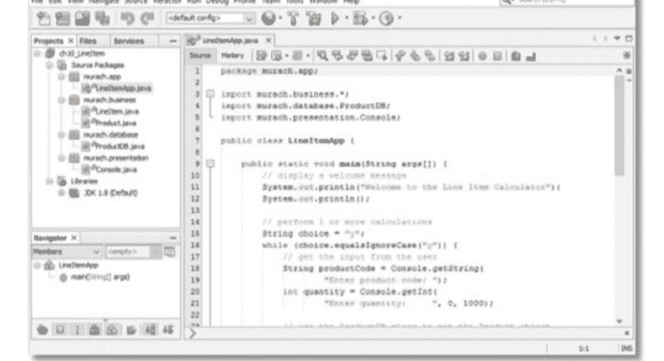

### Description

- 要浏览现有的包，请使用“项目”窗口展开或收叠项目中的包。
- 要向项目添加新包，在“项目”窗口中右键点击项目名称或“源包”（Source Packages）文件夹，选择 `New->Java Package` 命令，并在选择对话框中输入包名。这会在必要时在该目录内创建一个作为子目录的目录。
- 如果在添加新类时指定了一个包，而该包尚不存在，系统会自动为你创建它。
- 要从项目中删除包，右键点击该包并从生成的菜单中选择 `Delete` 命令。这将删除该包的目录以及该目录下的所有子目录和文件。
- 要向包添加新类，NetBeans 会自动为该类添加必要的包语句。
- 要重命名包，使用 `Refactor->Rename` 命令。然后，NetBeans 会自动修改包语句。
- 要将类从一个包移动到另一个包，可以在“项目”窗口中拖动它。

图 10-2 如何使用包

## 如何使用库

当你想要让其他应用程序可以使用库时，通常会将它们存储在一个中心位置。此外，你通常会给 JAR 文件命名以标识其内容。例如，你可能会将 `ch10_Murach.jar` 命名为 `murach.jar`，以显示它来自 Murach & Associates (www.murach.com)。

首先，你创建一个包含想要包含的包和类的项目。实现此点的一种方法是使用 NetBeans 创建库。创建库后，库将存储在 Java 归档（JAR）文件中。注意，该文件默认不包含源代码（java 文件）。相反，它只包含类，这通常正是你需要的。

此图展示了你如何使用库。例如，图中所示的 LineItem 类导入它使用的所有包。

### 如何创建库

1. 创建一个包含你想要包含在库中的包和类的项目。
2. 右键点击项目并选择 `Clean and Build` 命令以编译项目并移除任何不再需要的文件。然后，NetBeans 会自动为项目创建一个 JAR 文件，并将其存储在项目的 `dist` 子目录中。

### 如何使用库

1. 创建或打开将要使用该库的项目。
2. 右键点击“库”（Libraries）目录并选择 "Add JAR/Folder" 命令。然后，使用生成的对话框选择库的 JAR 文件。
3. 为库中你想使用的包和类编写 `import` 语句。然后，你就可以使用存储在这些包中的类了。

## 使用库的 NetBeans 项目

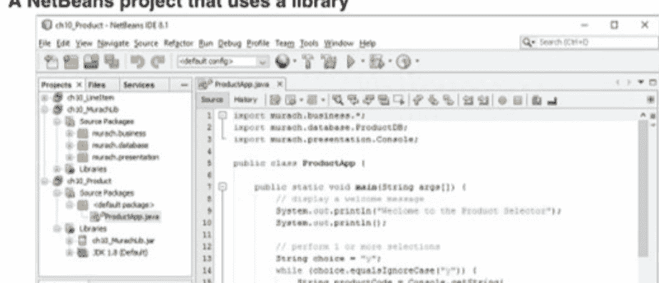

### Description

- 库可以存储一个或多个包，每个包包含一个或多个类。
- 当你创建一个库时，库将存储在 Java 归档（JAR）文件中。
- 创建库后，你可以通过将其存储在中心位置来供其他程序员使用。

图 10-3 如何使用库

# 如何使用模块

在软件开发中，代码模块化被认为是一种最佳实践。这意味着软件应该是独立模块的集合，这些模块通过应用程序编程接口（API，通常简称为接口）相互通信。这具有许多优势，使得软件的开发、测试、调试和维护变得更加容易。

在 JDK 9 之前，开发者可以使用你已经学习过的 Java 面向对象特性 JAR 文件来提供一些模块化。然而，这在感觉上并够不上一个真正的模块化系统。为了解决这个问题，JDK 9 引入了模块系统，加强了 Java 提供模块化的方式。

该模块系统还让将 Java 平台本身划分为一系列独立模块成为可能。JDK 9 通过一个名为“Jigsaw 项目”（Project Jigsaw）的项目实现了这一点。你只需要一分钟就能学到模块系统和 Jigsaw 项目的一些优势。但在那之前，你应该更多地了解什么是模块。

# 模块系统简介

图 10-4 开始简要描述一个 Java 模块。首先，模块是一个具有唯一标识符的名称的项目。这是必要的，因为 JAR 文件并没有提供一种良好的机制来确保名称的唯一。其次，模块显式地声明了它的依赖项，即它正确运行所需的其他模块。这是必要的，因为模块系统需要知道模块之间是什么关系。第三，模块声明了它的哪些部分可以被其他模块访问。这通过防止开发者故意或无意地使用并非设计供其他模块使用的模块部分，从而加强了封装性。

JDK 9 引入的新模块系统提供了若干优势。首先，将 Java 平台划分为模块使得为小型设备扩展应用程序变得更加容易。此外，它改进了 Java 平台的安全性和可维护性，提高了 Java 应用程序的性能，并使其更容易构建和维护库以及大型应用程序。如果你正在开发可以从这些任何特性中获益的应用，那么你就应该考虑使用新的模块系统。否则，你应该知道，一种方案是忽略模块的使用并继续使用 JDK 9 之前提供的特性。

如果你决定使用模块，你应该知道 `java.base` 模块会自动导出到所有模块。该模块导出了 Java 平台的本质包。这包括核心包，如 `java.lang` 和 `java.math`，如 `java.base` 模块的源码片段所示。它还包括模块本身，它存储在 `java.lang.module` 包中。

未被 `java.base` 模块导出的 Java 平台包由 Java 平台的其他模块导出。例如，第 21 章描述的 `java.sql` 模块包。

## 模块

- 具有一个唯一标识符的名称。
- 显式地声明它所依赖的其他模块。
- 显式地声明它的哪些公共类型可以被其他模块访问。

## 新模块系统的优势

- 使 Java 平台更容易向下扩展到小型设备。
- 提高 Java 平台的安全性和可维护性。
- 提高 Java 应用程序的性能。
- 使更容易构建和维护库以及大型应用程序。

## 定义 java.base 模块的代码

```java
module java.base (
  exports java.io;
  exports java.lang;
  exports java.lang.annotation;
  exports java.lang.invoke;
  exports java.lang.module;
  exports java.lang.ref;
  exports java.lang.reflect;
  exports java.math;
  exports java.net;
  ...
)
```

### 描述

- 在 JDK 9 之前，Java 使用其面向对象特性和 JAR 文件来提供模块化。虽然这是一个很好的开始，但它并没有提供一个真正的模块化系统。
- 在 JDK 9 及更高版本中，Java 提供了模块化的方式。模块是一个具有唯一标识符名称的项目。在 JDK 9 之后，Jigsaw 项目将 Java 平台划分为一系列独立模块。`java.base` 模块自动导出到所有模块。
- `java.base` 模块导出了 Java 平台的本质包。这包括核心包，如 `java.lang` 和 `java.math`，如 `java.base` 模块的源码片段所示。
- 未被 `java.base` 模块导出的 Java 平台包由 Java 平台的其他模块导出。例如，第 21 章描述的 `java.sql` 模块包。

图 10-4 模块系统简介

# 创建模块

如果你不为项目添加 `module-info` 文件，Java 就会在类路径中搜索所需的库并加载它们。这是 JDK 9 之前工作的方式。然而，如果你为项目添加了 `module-info` 文件，项目就会使用新的模块系统来加载所需的模块。正如前面提到的，这具有许多潜在的益处。

图 10-5 创建模块

# 使用模块

图 10-6 显示了一个使用前一个图中创建的模块的项目。首先，模块的 JAR 文件已添加到项目的库中。要这样做，你可以使用为库添加 JAR 文件的相同技术。

此外，此项目包含一个 `module-info` 文件。该文件为项目指定了一个唯一名称。更重要的是，它指定了该项目需要在前一个图中创建的 `com.murach` 模块。它还需要 `java.base` 模块，它是自动存储的。

最后 `LinearLayoutApp` 存储在 `murach.app` 。这是必要的，因为模块系统不允许你在默认包中存储任何类。结果，一旦你为项目添加了 `module-info` 文件，你就将默认包中的任何文件移动到不同的包中。

图中最后一个示例显示了一个 `module-info` 文件，适用于使用 SQLite 数据库的应用程序，例如你在第 21 章看到的产品管理应用程序。在这里，第一条语句指定项目需要 `java.sql` 模块。然后，第二条语句指定项目需要 `sqlite.jdbc` 模块，该模块从存储在 `sqlite-jdbc` JAR 文件中的库可用。该库和 `java.sql` 包将在第 21 章中描述。

# 使用模块的 NetBeans 项目

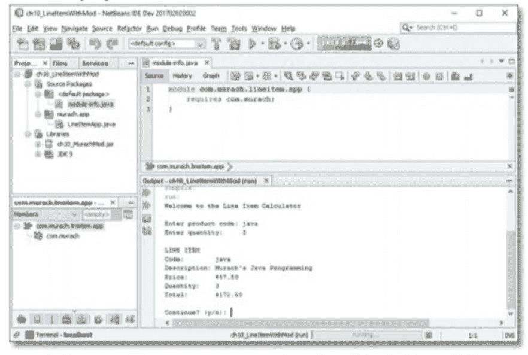

# 需要 com.murach 模块的 module-info 文件

```java
module com.murach.linesitem.app (
    requires com.murach;
)
```

# 需要 java.sql 和 sqlite.jdbc 模块的 module-info 文件

```java
module com.murach.product.app (
    requires java.sql;
    requires sqlite.jdbc;
)
```

# Description

- 如果你不在项目中添加 `module-info` 文件，Java 会在类路径搜索所需的库并加载它们。这是 Java 在 JDK 9 之前的工作方式。
- 如果你在项目中添加了 `module-info` 文件，项目将使用模块系统来加载所需的模块。
- `module-info` 文件必须指定项目所需的所有模块名称，但 `java.base` 模块除外，该模块对所有应用程序都是可用的。

图 10-6 如何使用模块

# 如何使用 javadoc 为包编写文档

如果你开发的打算分发给其他程序员的类，通常会像前面的主题所示，将这些类组织在一个或多个包中。此外，你通常希望为你的类提供一些文档，以便其他程序员能够轻松了解这些类的字段、构造函数和方法。幸运的是，JDK 包含一个名为 javadoc 的工具，可以轻松为你的类生成基于 HTML 的文档。这些文档看起来和运行起来与 Java API 文档一样。

# 如何为类添加 javadoc 注释

图 10-7 显示了如何为类添加简单的 javadoc 注释。javadoc 注释以 `/**` 开头，以 `*/` 结束。为了让这些注释正常工作，它们必须直接编写在它们描述的类、字段、构造函数或方法上方。

像 NetBeans 或 Eclipse 这样的 IDE 输入 javadoc 注释非常方便。要这样做，你在类、字段、构造函数或方法代码之前的空行上输入斜杠和两个星号（`/**`）。然后，当你按下回车键时，NetBeans 会生成该类或其成员的起始注释。这包括一行带有单个星号的内容（你可以在其中开始输入注释），随后是一行带有 `*/` 字符的内容，用于结束注释。它还可以包含你在下一个图中学习的一个或多个 javadoc 标签。

# 带有 javadoc 注释的 Product 类

```java
package murach.business;

import java.text.NumberFormat;

/**
 * Product 类表示一个产品，并被
 * LineItem 和 ProductDB 类使用。
 */
public class Product {

    private String code;
    private String description;
    private double price;

    /**
     * 使用默认值创建一个新的 Product。
     */
    public Product() {
        code = "";
        description = "";
        price = 0;
    }

    /**
     * 将产品代码设置为指定的 String。
     */
    public void setCode(String code) {
        this.code = code;
    }

    /**
     * 返回表示产品代码的 String。
     */
    public String getCode() {
        return code;
    }

}
```

# Description

- Javadoc 注释以 `/**` 开头，以 `*/` 结束。你可以使用 javadoc 注释来描述类及其公共和保护的字段、构造函数和方法。
- 注释应该立即放置在它描述的类或成员上方。对于类来说，这意味着注释必须放置在任何 import 语句之后。
- 如果你在方法之前的空行上输入斜杠和两个星号（`/**`）并按下回车，NetBeans 和 Eclipse 都会生成 javadoc 注释的剩余部分。这可能包括你在下一个图中学习的某些 javadoc 标签。

图 10-7 如何为类添加 javadoc 注释

# 如何在 javadoc 注释在使用 HTML 和 javadoc 标签

为了帮助格式化在类文档中显示的信息，你可以在你的 javadoc 注释中包含 HTML 和 javadoc 标签，如图 10-8 所示。你最可能使用的 HTML 标签是 `<code>` 标签。你可以使用此标签以等宽字体显示文本。在图中，javadoc 注释使用此标签格式化了 `Product` 和 `String` 等类名。如果你需要，也可以使用此标签格式化对基本类型（如 `int` 和 `double`）的引用。

这里显示的四个 javadoc 标签应该是自解释其明的。你通常在类注释中使用 `@author` 和 `@version` 标签来记录类的作者和当前版本。默认情况下，这些信息不会在生成的文档中显示。虽然你可以在生成文档时指定包含这些信息，但通常这是没的。

你使用 `@param` 标签来描述构造函数或公共方法接受的参数。例如，在图中，代码使用 `@param` 标签来记录由 `setCode()` 方法定义的 `code` 代码参数。同样，如果一个方法返回一个值，你可以使用 `@return` 标签来描述该值。在图中，代码使用 `@return` 标签来记录由 `getCode()` 方法的 String。

除了这里显示的标签外，你应该意识到还有额外的 HTML 和 javadoc 标签可用。例如，你可以使用 `<i>` 标签使文本变为斜体，可以使用 `<b>` 标签使文本加粗。要创建一个超链接，你可以使用 `<a>` 标签。

图 10-8 在 javadoc 注释中使用 HTML 和 javadoc 标签

## Common HTML 标签

| HTML 标签 | 描述 |
| :--- | :--- |
| `<code>` | 以等宽字体显示文本。 |

## Common javadoc 标签

| Javadoc 标签 | 描述 |
| :--- | :--- |
| `@author` | 标识类的作者。 |
| `@version` | 描述类的版本。 |
| `@param` | 描述方法的参数。 |
| `@return` | 描述方法的返回值。 |

# 带有 javadoc 注释的 Product 类


```java
package murach.business;

import java.text.NumberFormat;

/**
 * Product 类表示一个产品，并被
 * LineItem 和 ProductDB 类使用。
 * @author Murach
 * @version 1.0
 */
public class Product {
    private String code;
    private String description;
    private double price;

    /**
     * 使用默认值创建一个新的 Product。
     */
    public Product() {
        code = "";
        description = "";
        price = 0;
    }

    /**
     * 将产品代码设置为指定的 String。
     * @param code 要设置的代码
     */
    public void setCode(String code) {
        this.code = code;
    }

    /**
     * 返回表示产品代码的 String。
     * @return 产品代码
     */
    public String getCode() {
        return code;
    }
}
```

# 如何生成文档

在你为类添加了 javadoc 后，你可以使用 NetBeans 为这些类生成文档，如图 10-9 所示。生成文档后，NetBeans 会在你的默认浏览器中显示它。然后，你可以查看这些文档以确保它包含了所有信息。

默认情况下，NetBeans 将文档存储在项目根目录下的 `javadoc` 子目录下。这些文档由文件和子目录组成。注意，如果你生成文档时 `javadoc` 目录已经存在文档，NetBeans 将覆盖旧文件，这正是你需要的。

# 如何查看包的文档

你可以使用网络浏览器查看自定义类的文档，就像查看 Java API 文档一样。主要的区别是自定义类的 `index.html` 文件存储在硬盘的某个地方。例如，在图 10-6 中，文档存储在以下目录：

```
\book_app\ch10_Murach.lib\dist\javadoc
```

在这里，我在左上框中选择了 `murach.business` 包。这样做，该包中的两个类列在左下框中。然后，当我选择 `Product` 类时，该类的文档显示在右侧框中。

`Product` 类的文档表明 `Product` 类位于 `murach.business` 包。它还包含了该类的简要描述，该描述是从类的 javadoc 注释生成的。它提供了该类对其他类的构造函数和方法摘要，以及我提供的描述。如果此类包含公共或保护字段，文档还将包含这些字段的摘要。最后，文档在摘要中包含了字段、构造函数和方法的详细信息。这就是文档显示 `@param` 和 `@return` 标签提供信息的地方。

注意，文档没有暴露封装在类内部的代码。

## 为 Product 类生成的 API 文档

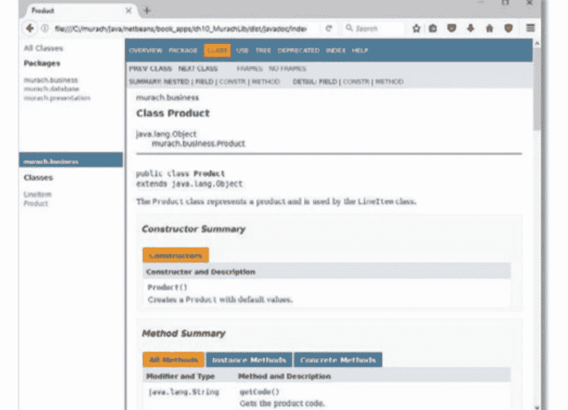

## 描述

- 使用 NetBeans，你可以通过在“项目”窗口中右键点击项目并选择 `Generate Javadoc` 命令来生成和查看项目文档。执行时，NetBeans 会为项目生成 Java 文档并在默认网络浏览器中显示。

- 默认情况下，NetBeans 将项目的文档存储在项目根目录下名为 `dist/javadoc` 的子目录中，该目录属于项目根目录。

- 如果项目已包含文档，NetBeans 将在没有任何任何警告的情况下覆盖现有文件。

- 你可以通过启动浏览器并导航到 `dist/javadoc` 目录创建的 `index.html` 文件来查看生成的文档。

图 10-9 如何生成和查看包的文档

# 如何使用枚举

枚举是一组定义了类型的相关常量集合。枚举是在 JDK 1.5 中引入的。在第 3 章中，你学习了如何使用 Java API 中的 `RoundingMode` 枚举为 `BigDecimal` 对象设置舍入模式。现在，你将学习如何创建和使用自己的枚举。

## 如何声明枚举

图 10-10 显示了如何声明枚举。要做到这一点，编写 `public` 关键字，后面跟着 `enum` 关键字和枚举名称。然后在枚举内部，编写一个或多个常量的名称，并用逗号分隔每个名称。

在内部，枚举中的每个常量都被分配了一个从零开始的整数值。例如，在第一个示例所示的 `ShippingType` 枚举中，`UPS_NEXT_DAY` 常量的值为 0，`UPS_SECOND_DAY` 常量的值为 1，依此类推。在大多数情况下，你不会使用这些整数值。

在编写自己的枚举时，通常会将它们存储在单独的文件中。这样，枚举就可以对当前包内的所有类可用。然而，如果枚举仅被单个类使用，你可以将其存储与该类相同的文件中。

## 如何使用枚举

图 10-10 中的接三个示例显示了如何将变量作为枚举。第二个示例显示你可以将变量声明为枚举类型。然后，你可以将该枚举中的常量赋值给变量。在这种情况下，常量 `UPS_SECOND_DAY` 被赋值给名为 `secondDay` 的 `ShippingType` 变量。

第三个示例显示了一个接受 `ShippingType` 作为参数的 `getShippingAmount()` 方法。然后，方法中的代码将传递给方法的常量与枚举中的两个常量进行比较，以确定运费。

第四个示例显示了一个调用 `getShippingAmount()` 方法的语句。该语句将 `ShippingType` 枚举的 `UPS_SECOND_DAY` 传递给 `getShippingAmount()` 方法。

第四个示例中注释掉的语句说明，尽管枚举中的常量被分配了整数值，你不能用整数或任何其他类型代替枚举。换句话说，枚举是类型安全的（type-safe）。相比之下，如果你没有在枚举中编写常量，可以在任何需要常量的地方使用常量名或其值。这就是枚举优于常量的原因之一。

## 声明枚举的语法

```java
public enum EnumerationName (
    CONSTANT_NAME1,
    CONSTANT_NAME2...
)
```

## 定义三种运输类型的枚举

```java
public enum ShippingType (
    UPS_NEXT_DAY,
    UPS_SECOND_DAY,
    UPS_GROUND
)
```

## 使用该枚举及其一个常量的语句

```java
ShippingType secondDay = ShippingType.UPS_SECOND_DAY;
```

## 使用枚举作为参数类型的方法

```java
public static double shippingAmount(ShippingType st) {
    double shippingAmount = 2.99;
    if (st == ShippingType.UPS_NEXT_DAY)
        shippingAmount = 10.99;
    else if (st == ShippingType.UPS_SECOND_DAY)
        shippingAmount = 5.99;
    return shippingAmount;
}
```

## 调用该方法的语句

```java
double shippingAmount = getShippingAmount(ShippingType.UPS_SECOND_DAY);
// double shippingAmount2 = getShippingAmount(1); // 类型错误，不允许
```

## 描述

- 枚举包含一组相关的常量。这些常量使用 `int` 类型定义，并被分配了从 0 到枚举中常量数量减 1 的值。

- 枚举定义了一种类型。因此，在期望枚举类型的地方你不能指定另一种类型。这意味着枚举是类型安全的。

- 使用 NetBeans 向项目添加枚举时，右键点击你想添加枚举的包，并选择 `New->Other` 命令。然后，从弹出的对话框中选择 `Java->Java Enum`。


## 如何增强枚举

大多数情况下，图 10-10 中提供的技巧是你处理枚举所需的唯一技巧。但你应该知道，你可以重写继承自 `java.lang.Object` 和 `java.lang.Enum` 的方法。你还可以添加自己的方法。

此图还显示了增强版的 `ShippingType` 枚举。该枚举包含一个 `toString()` 方法，它重写了 `Enum` 类的 `toString` 方法。如果没有这个方法，`Enum` 类的 `toString()` 方法将返回常量的名称。在这个示例中，在枚举常量之后编写了一个分号。然后，`toString()` 方法使用一系列 `if/else` 语句为每个常量返回适当的字符串。为了做到这一点，它首先使用 `ordinal()` 方法为常量返回一个整数值。然后，它将值与整数进行比较，并返回一个适用于常量的字符串。

## 如何使用静态导入

除了枚举之外，JDK 1.5 还引入了一项名为静态导入的新功能。此功能允许你简化对枚举中常量的引用。如图 10-11 所示。

要使用静态导入功能，首先编写 `static import` 语句。该语句与普通的 `import` 语句相似，但在 `import` 关键字之后编写 `static` 关键字，并且通常使用通配符 `(*)` 来导入枚举的所有常量。例如，在图中，静态导入语句指定了导入 `murach.business` 包中 `ShippingType` 枚举中的所有常量。（这假设 `ShippingType` 枚举在本章前面已存储在 `murach.business` 包中。）

一旦使用了静态导入语句，就不再需要编写包含常量的枚举名称。例如，如果你导入了 `ShippingType` 枚举，在引用该枚举中的常量时，就不再需要编写 `ShippingType` 限定符。在图中，你可以看到一个引用该枚举 `UPS_GROUND` 常量的语句。

除了使用静态枚举，你还可以使用它们来导入类的静态字段和方法。例如，你可以使用静态导入导入 `java.lang.Math` 类的所有静态字段和方法。然后你就可以在不限定的情况下引用这些字段和方法。

虽然使用静态导入可以节省打字量，但通常会导致代码更难以阅读。这是因为应用程序引用的常量、字段和方法存储在何处可能变得模糊。因此，你应该只在不会引起混淆的情况下使用静态导入。

## 枚举常量的两种方法

| 方法 | 说明 |
| --- | --- |
| `name()` | 返回枚举常量名称的字符串。 |
| `ordinal()` | 返回与枚举常量位置相对应的 int 型值。 |

## 如何为枚举添加方法

一个重写了 `toString()` 方法的枚举

```java
public enum ShippingType {
    UPS_NEXT_DAY,
    UPS_SECOND_DAY,
    UPS_GROUND;

    @Override
    public String toString() {
        String s = "";
        if (this.ordinal() == 0)
            s = "UPS Next Day (1 business day)";
        else if (this.ordinal() == 1)
            s = "UPS Second Day (2 business days)";
        else if (this.ordinal() == 2)
            s = "UPS Ground (5 to 7 business days)";
        return s;
    }
}
```

## 使用 `toString()` 方法的代码

```java
ShippingType ground = ShippingType.GROUND;
System.out.println("toString: " + ground.toString() + "\n");
```

## 输出结果

```
toString: UPS Ground (5 to 7 business days)
```

## 如何使用静态导入

## 如何编写静态导入语句

```java
import murach.business.ShippingType.*;
```

## 使用静态导入时的上述代码

```java
ShippingType ground = ShippingType.GROUND;
System.out.println("toString: " + ground.toString() + "\n");
```

## Description

- 所有的枚举都继承自 `java.lang.Object` 和 `java.lang.Enum` 类，可以使用或重写这些类的方法，或者添加新方法。

- 默认情况下，枚举常量的 `toString()` 方法返回的与 `name()` 方法相同的字符串。

- 你可以使用静态导入来导入枚举的所有常量，或者导入一个类的所有静态字段和方法。

图 10-11 如何增强枚举并使用静态导入

# 展望

现在你已经完成了本章，你应该能够对代码进行打包和文档编制，以便其他程序员可以使用它。如有必要，你还应该能够使用 JDK 9 引入的模块系统使代码更具模块化。此外，你应该能够创建和处理枚举。

到此为止，你已经拥有了坚实的面向对象编程技能基础。现在，你准备好学习如何使用 Java API 的其他部分，例如第 12 章描述的用于处理集合的接口和类。此外，你为学习开发 GUI 应用奠定了坚实的基础。在此过程中，你将学习另外两个面向对象的技能——处理内部类和处理匿名类，这些技能在开发 GUI 时非常常用。

# 总结

- 你可以使用包（packages）来组织应用程序中的类。然后，你可以使用导入语句使这些包中的类对其他类可用。

- 你可以使用 Java 归档（JAR）文件中的库来使包和类对其他应用程序可用。

- JDK 9 添加了一个模块系统，允许你将应用程序分为一组独立的模块。模块是代码的独立单元，具有唯一的名称，并清晰地标识它所需的所有其他模块以及它导出的所有公共类型。

- Project Jigsaw 使用模块系统将 Java 平台划分为一组独立的模块。

- 你可以使用 javadoc 为类及其字段、构造函数和方法编写文本文说明。然后，你可以为你的类生成基于 HTML 的文档。

- 你可以使用枚举（enumeration）将一组相关的常量定义为一种类型。然后，你可以在允许使用枚举的任何地方使用这些常量。

- 你可以使用静态导入（static imports）导入枚举的常量或类的静态字段和方法。然后，你可以无需限定地引用这些常量、字段和方法。

# 练习 10-3 创建和使用枚举

在此练习中，你将创建一个枚举，然后在测试应用程序中使用它。

1. 打开 `ex_starts` 目录下名为 `ch10_ex3_Enumeration` 的项目。

2. 创建一个名为 `CustomerType` 的枚举。该枚举应该包含代表三种客户类型的常量：零售（retail）、贸易（trade）和学院（college）。

3. 打开 `CustomerTypeApp` 类。然后，为该类添加一个方法，根据传递它的 `CustomerType` 变量返回折扣百分比（零售为 .10，贸易为 .30，学院为 .20）。

4. 在 `main()` 方法中添加代码，声明一个 `CustomerType` 变量，为其分配一种客户类型，获取该客户类型的折扣百分比并显示该百分比。运行应用程序以确保其工作正常。

5. 在 `main()` 方法中添加一条语句，显示客户类型 `toString()` 方法返回的字符串。然后再次运行应用程序查看该方法的结果。

6. 在 `CustomerType` 枚举中添加一个 `toString()` 方法。该方法应该根据客户类型返回一个包含 "Retail customer"、Trade customer" 或 "College customer" 的字符串。再次运行应用程序以查看 `toString()` 方法的结果。

# 第 3 部分 更多核心技能

本节旨在补充你在书中第 1 部分和第 2 部分开发的技能。本节章节的设计允许你按照喜欢的顺序进行阅读。例如，如果你想学习如何处理集合（collections），可以跳到第 12 章。或者，如果你想学习更多关于字符串（strings）的处理，可以跳到第 13 章。

此规则唯一的例外是第 15 章（如何处理文件 I/O）使用了第 12 章介绍的集合技能以及第 13 章介绍的字符串技能。因此，你可能希望在进入第 15 章之前阅读这些章节。最终，你会想要阅读本节中的所有章节，因为它们都介绍了每个 Java 程序员应该具备的核心技能。这包括如何处理数组、集合、泛型、字符串、日期、时间、文件 I/O 和异常。

- **处理数组的基本技能** ............................................ 354

- 如何创建数组 .......................................................................... 354

- 如何给数组元素赋值 ................................................ 356

- 如何在数组中使用循环 ....................................................... 358


# 处理数组的基本技能

在接下来的主题中，你将学习如何使用数组来处理原始类型或对象。首先，你将学习如何创建一个数组。接下来，你将学习如何给数组赋值。然后，你将看到一些展示如何处理数组的示例。

## 如何创建数组

数组是一个包含一个或多个称为元素（elements）的项目的对象。每个元素可以是原始类型（如 `int` 或 `double`）或对象（如 `String` 或自定义类型）。数组中的所有元素必须是相同类型。因此，数组只能包含整数，`double` 数组只能包含 `double`。注意，数组可以包含派生自数组基类型的元素。因此，如果你声明一个 `Object` 类型的数组，该数组可以包含任何类型的对象，因为所有 Java 类最终都派生自 `Object` 类。

数组的长度（或大小）表示它包含的元素数量。在 Java 中，数组具有固定长度。一旦你创建了数组，就无法更改它的长度。如果你的应用程序需要更改数组的长度，你应该考虑使用第 12 章描述的集合类之一，而不是数组。

图 11 显示了创建数组的各种方法。首先，你必须声明一个用于引用数组的变量。然后，你实例化数组对象并将其赋值给变量。你可以使用单独的语句声明变量并实例化数组，也可以在一条语句中声明变量并实例化数组。

注意，当你声明数组时，在变量名后使用空括号。

### 声明和实例化数组的语法

声明数组的两种方式：

```java
type[] arrayName;
type arrayName[];
```

实例化数组：

```java
arrayName = new type[length];
```

一条语句声明并实例化数组：

```java
type[] arrayName = new type[length];
```

数组声明示例

声明 `double` 数组的代码：

```java
double[] prices;
```

实例化 `double` 数组的代码：

```java
prices = new double[4];
```

一条语句声明并实例化 `double` 数组：

```java
double[] prices = new double[4];
```

其他示例

`String` 对象的数组：

```java
String[] titles = new String[3];
```

`Product` 对象的数组：

```java
Product[] products = new Product[5];
```

使用常量指定数组长度的代码：

```java
final int TITLE_COUNT = 100; // 编译时设置数组大小
String[] titles = new String[TITLE_COUNT];
```

使用变量指定数组长度的代码：

```java
Scanner sc = new Scanner(System.in);
int titleCount = sc.nextInt(); // 运行时未设置数组大小
String[] titles = new String[titleCount];
```

描述

- 数组可以存储多个原始类型或对象。元素是数组中的一个项目。
- 要创建数组，你必须声明一个正确类型的变量，并实例化该变量引用的数组对象。你可以在分开的语句中声明并实例化数组，也可以将声明和实例化合并为一条语句。
- 声明数组变量时，在类型或变量名后编写一组空括号。大多数程序员倾向于在类型后编写括号。
- 实例化数组时，使用 `new` 关键字并在类型后面的括号中指定数组的长度或大小。你可以通过编写字面量值或使用常量或 int 变量来指定长度。
- 当你实例化原始类型数组时，数值类型被设置为零，布尔类型被设置为 false。当你创建对象数组时，它们被设置为 `null`。

图 11-1 如何创建数组

## 如何给数组元素赋值

图 11-2 展示了如何给数组元素赋值。如图顶部的语法所示，你通过编写数组名称后跟方括号内的索引来引用数组中的元素。索引必须是一个从 0 开始到比数组大小少 1 的 `int` 类型值。换句话说，索引 0 指向数组中的第一个元素，1 指向第二个元素，2 指向第三个，以此类推。

图中的前三个示例展示了如何通过每个元素编写一条语句来给数组中的元素赋值。第一个示例创建了一个包含 4 个 `double` 值的数组，然后为每个元素分配一个字面量值。在这个示例中，第一个元素存储值 14.95，第二个存储 12.95，第三个存储 11.95，第四个存储 9.95。第二个示例创建了一个存储对象的数组并初始化了字符串。第三个示例创建了一个存储 `Product` 对象的数组并初始化了这些对象。

指定的索引超出了数组的范围，Java 将抛出 `ArrayIndexOutOfBoundsException`。例如，图中第一个示例末尾被注释掉的行引用了索引为 4 的元素。由于此数组有四个元素，该语句将导致 `ArrayIndexOutOfBoundsException`。虽然你可以捕获此异常，但最好编写代码以避免使用越界的索引。你将在下一图中看到此类代码示例。

图底部的语法和示例展示了如何用一条语句创建数组并给数组元素赋值。在这里，你像往常一样声明数组变量。然后，你使用特殊的赋值语法，在等号后的大括号 `{}` 内分配你想要给数组的初始值。然后，在大括号内列出的值数量决定了所创建数组的大小。最后三个示例展示了如何使用这种特殊语法来创建与前三个示例中相同的数组。

### 引用数组元素的语法

`arrayName[index]`

### 通过访问每个元素进行赋值的示例

#### 给 double 类型数组赋值的代码

```java
double[] prices = new double[4];
prices[0] = 14.99;
prices[1] = 11.95;
prices[2] = 11.95;
prices[3] = 9.95;
// this would throw ArrayIndexOutOfBoundsException
```

#### 给 String 数组赋值的代码

```java
String[] names = new String[3];
names[0] = "Ted Lewis";
names[1] = "Sue Jones";
names[2] = "Ray Thomas";
```

#### 给 Product 对象数组赋值的代码

```java
Product[] products = new Product[2];
products[0] = new Product("java");
products[1] = new Product("jps");
```

### 用一条语句创建数组并赋值的语法

`type[] arrayName = {value1, value2, value3, ...};`

### 用一条语句创建数组并赋值的示例

```java
double[] prices = {14.95, 12.95, 11.95, 9.95};
String[] names = {"Ted Lewis", "Sue Jones", "Ray Thomas"};
Product[] products = {new Product("java"), new Product("jps")};
```

### 描述

- 要引用数组中的元素，你使用一个从 0（数组中的第一个元素）到数组元素个数减 1 的索引。
- 如果指定的索引小于 0 或大于数组的边界，执行该语句时将抛出 `ArrayIndexOutOfBoundsException`。
- 你可以通过在大括号中列出值，在单条语句中实例化数组并提供初始值。你提供的值数量决定了数组的大小。

图 11-2 如何给数组元素赋值

## 如何在数组中使用 for 循环

`for` 循环通常用于通过增加索引变量来一次处理数组中的元素。图 11-3 展示了如何使用循环处理数组。

## 如何使用 Arrays 类

现在你已经掌握了创建和使用数组的基础语言技能，准备好学习如何使用 `java.util` 包中的 `Arrays` 类对数组执行一些额外操作了。该类包含了静态方法，你可以使用它们来填充、排序、搜索、复制和比较数组。图 11-5 展示了其中三个方法，图 11-6 展示了另外两个。

在这些这些方法时，你可以提供任何类型的一维数组作为数组参数。同样，你也可以提供基本类型值或对象作为值参数。但是，你必须确保值或对象的类型与数组类型匹配。

## 如何填充、排序和搜索数组

图 11-5 中的第一个示例展示了如何使用 `fill()` 方法为数组中的所有元素赋值。在这里，第一条语句创建了一个包含 5 个值的数组。默认情况下，该语句会自动将每个元素初始化为 0。第二条语句使用 `Arrays` 类的 `fill()` 方法将所有五个元素设置为值 1。

第二个示例展示了如何使用 `sort()` 方法对一个包含 10 个 `int` 值的数组进行排序。在这里，第一条语句创建了一个从 0 到 9 的未排序 `int` 值数组。然后，第二条语句使用 `sort()` 方法对这些值进行排序。之后，代码使用增强型 for 循环将数组的内容打印到控制台。这表明 `sort()` 方法成功地排序了数组。

第三个示例展示了如何使用 `binarySearch()` 方法。该方法搜索具有特定值的元素并返回其索引。然而，在使用此方法之前，你必须使用 `sort()` 方法对数组进行排序。在这个示例中，第一条语句创建了一个未排序的字符串数组。然后，第二条语句使用 `sort()` 方法对该数组进行排序。对于字符串，它按照从 A 到 Z 的字母顺序进行排序。换句话说，它对数组中字符串的排序方式为："java"、jsp" 和 "mysql"。因此，第三条语句中调用的 `binarySearch()` 方法返回值2，这意味着该字符串是数组中的第三个元素。

### Arrays 类

`java.util.Arrays`

### Arrays 类的一些静态方法

| 方法 | 说明 |
| --- | --- |
| `fill(array, value)` | 用指定的值填充指定数组的所有元素。 |
| `sort(array)` | 将数组中的元素按升序排序。 |
| `binarySearch(array, value)` | 返回指定值在指定数组中索引的 int 值。如果未在数组中找到指定的值，则返回负数。为了使此方法正常工作，必须先用 `sort()` 方法对数组进行排序。 |

### 如何填充数组

```java
int[] quantities = new int[5]; // 所有元素都被设置为 0
Arrays.fill(quantities, 1); // 所有元素都被设置为 1
```

### 如何排序数组

```java
int[] numbers = {2,6,4,1,8,5,9,3,7,0};
Arrays.sort(numbers);
for (int number : numbers) {
  System.out.print(number + " ");
}
```

### 控制台输出

```
0 1 2 3 4 5 6 7 8 9
```

### 如何搜索数组

```java
String[] productCodes = {"mysql", "jsp", "java"};
Arrays.sort(productCodes);
int index = Arrays.binarySearch(productCodes, "mysql"); // 将索引设置为 2
```

### 描述

- 所有这些方法都接受基本数据类型数组和对象数组作为数组参数，并且它们都接受基本类型和对象作为值参数。
- 为了让 `sort()` 方法能够对由用户定义类（例如 `Product` 类）创建的对象数组正常工作，该类必须实现 `Comparable` 接口，如图 11-7 所示。有关实现接口的更多信息，请参阅第 9 章。

图 11-5 如何填充、排序和搜索数组

## 如何引用、复制和比较数组

与字符串一样，数组是一种引用类型。因此，它的工作方式与基本类型不同。首先，当你使用赋值运算符 (`=`) 将数组赋值给变量时，该变量并不存储数组的副本。相反，它指向数组对象。因此，多个变量可能会引用同一个数组对象。

图 11-6 中的第一个示例展示了这种工作原理。在这里，代码创建了两个指向同一个数组的变量。更具体地说，`grades` 变量和 `percentages` 变量都指向同一个数组。因此，对 `grades` 变量的任何更改都会反映在 `percentages` 变量上，反之亦然。例如，第三条语句将 `percentages[1]` 设置为 70.2。结果是这反映在 `grades[1]` 中。由于 `percentages` 和 `grades` 变量都指向同一个数组，这条语句打印出值 70.2。

如果你想创建另一个对数组引用的副本，可以使用静态的 `copyOf()` 方法将一个数组的元素复制到另一个数组。图中的第二个示例说明了这一点。当你使用此方法时，每个数组变量都指向自己的数组副本，对其中一个数组进行的任何更改都不会反映在另一个数组中。

在这个示例中，`length` 参数被设置为 `grades` 数组的长度。因此，此示例将所有的 `grades` 复制到 `percentages` 数组中。然而，如果你为 `length` 参数指定更大的数字，`percentages` 数组将填充额外的元素。或者，如果你指定默认值为零，额外的元素将从 `percentages` 数组中丢弃。

`copyOf()` 方法是在 Java 6 中引入的。它在早期的 Java 版本中不支持。如果你需要使用早期版本的 Java，可以使用 `System` 类的 `arraycopy()` 方法创建数组的副本。该方法比 `Arrays` 类的 `copyOf()` 方法稍微难用一些。然而，如果你参考 API 文档，应该能够学会如何使用它。

当你使用 `copyOf()` 处理引用类型数组时，需要知道它创建的是浅拷贝，而不是深拷贝。这意味着它创建了一个新数组，其中包含原始数组中对象引用的副本。因此，如果你更改了一个数组中某个对象的值，另一个数组中的该值也会改变。

### Arrays 类的更多静态方法

| 方法 | 说明 |
| --- | --- |
| `copyOf(array, length)` | 复制指定的数组，根据需要进行截断或用默认值填充。 |
| `copyOfRange(array, index1, index2)` | 将数组的指定范围复制到新数组中。 |
| `equals(array1, array2)` | 如果两个数组类型相同且数组中的所有元素都相等，则返回 true。 |

## 如何实现 Comparable 接口

在第 9 章中，你学习了如何实现 Java API 中的 `Cloneable` 接口，以便你可以克隆由你创建的类创建的对象。在你创建的类中，可能需要实现的另一个接口是 `Comparable` 接口。当一个类实现此接口时，你可以使用 `Arrays` 类的 `sort()` 方法对由该类创建的对象数组进行排序。要实现这一点，你必须为它的 `compareTo()` 方法提供实现。图 11-7 展示了如何对一个简单的 `Item` 类这样做。

图顶部的代码显示了 Java API 如何定义 `Comparable` 接口。该接口提供了一个名为 `compareTo()` 的方法，接受一个对象作为参数。如果当前对象小于传入的对象，该方法应返回一个负数；如果两个对象相等，则返回 0；如果当前对象大于传入的对象，则返回正数。

图中的 `Item` 类首先声明了两个实例变量 `name` 和 `description`，一个接受这些字段赋值值的构造函数，以及返回这些字段值的方法。然后，它提供了一个 `compareTo()` 方法，根据 `number` 字段的值来比较 `Item` 对象。换句话说，如果两个项目具有相同的项目编号，则它们被认为是相等的。

`compareTo()` 方法首先将传递给它的对象强制转换为 `Item` 对象。然后，它使用语句比较项目编号，并决定返回 -1、0 还是 1。这些值被 `sort()` 方法用于判断当前对象是小于、等于还是大于它所比较的对象。

`Item` 类之后的代码示例展示了如何对 `Item` 对象数组进行排序。在这里，创建了一个包含三个 `Item` 对象的数组。然后，使用 `Arrays` 类的 `sort()` 方法对对象进行排序。最后，使用增强 `for` 循环打印数组的内容。如你在结果输出中所所示，尽管数组元素是按不同的顺序创建的，但数组是按照项目编号的顺序打印的。


在这个示例中，对象是根据数值字段进行比较的。因此，你可以使用大于号和小于号运算符来判断一个对象是否大于或小于另一个对象。然而，如果你想根据字符串字段比较两个对象，则无法使用这些运算符进行操作。相反，你需要使用 `String` 类的 `compareTo()` 或 `compareIgnoreCase()` 方法。你将在练习 11-3 中获得使用 `compareIgnoreCase()` 方法的机会。

## Java API 中定义的 Comparable 接口

```java
public interface Comparable {
    int compareTo(Object obj);
}
```

## 实现了 Comparable 接口的 Item 类

```java
public class Item implements Comparable {
    private int number;
    private String description;

    public Item(int number, String description) {
        this.number = number;
        this.description = description;
    }

    public int getNumber() { return number; }
    public String getDescription() { return description; }

    @Override
    public int compareTo(Object o) {
        Item i = (Item) o;
        if (this.getNumber() < i.getNumber()) {
            return -1;
        }
        if (this.getNumber() > i.getNumber()) {
            return 1;
        }
        return 0;
    }
}
```

## 排序 Item 对象数组的代码

```java
Item[] items = new Item[3];
items[0] = new Item(102, "Duct Tape");
items[1] = new Item(103, "Bailing Wire");
items[2] = new Item(101, "Chewing Gum");
Arrays.sort(items);
for (Item i : items) {
    System.out.println(i.getNumber() + ": " + i.getDescription());
}
```

## 控制台输出

| 101 | Chewing Gum |
| 102 | Duct Tape |
| 103 | Bailing Wire |

## 描述

- 要对由自定义类创建的对象数组使用 `Arrays` 类的 `sort()` 方法，该类必须实现 `Comparable` 接口并提供正确排序的方式。
- 如果当前对象小于传入的对象，`compareTo()` 方法应返回 -1；如果对象相等，返回 0；如果当前对象大于传入的对象，则返回 1。

图 11-7 如何实现 Comparable 接口

## 数字处理器 (Number Cruncher)

为了展示如何应用你刚刚学的技能，图 11-8 展示了 `Number Cruncher` 程序。该程序创建一个随机整数数组，并显示这些随机数字以及关于它们计算的一些统计数据。

首先，该代码导入了 `Arrays` 类。然后，它声明了一个 `NumberCruncherApp` 类，包含程序的代码。在该类中，`main()` 方法首先声明了一个包含 11 个整数的数组。然后，它使用 `for` 循环为数组中的 11 个元素每一个分配一个 0 到 50 之间的随机数。这是因为 `random()` 方法返回一个大于等于 0 且小于 1 的数字，这意味着将其乘以 51 的结果小于 51。然后，由于该数字被转换为 `int`，该数字将小于或等于 50。

在分配随机数后，代码使用 `sort()` 方法对数组进行排序。然后，它遍历数组以计算和、平均值、中位数、最小值和最大值。最后，它将排序后的数字和计算出的统计数据显示在控制台上。

## 控制台输出

| 统计项目 | 数值 |
| :--- | :--- |
| 总和 | 278 |
| 平均值 | 25.27 |
| 中位数 | 25 |
| 最小值 | 4 |
| 最大值 | 48 |

图 11-8 Number Cruncher 程序

# 如何创建二维数组

## 创建二维数组的语法

```
type[] arrayName = new type[rowCount][columnCount];
```

## 一个创建一个 3x2 数组的语句

```
int[][] numbers = new int[3][2];
```

# 如何为二维数组赋值

## 引用二维数组中元素的语法

```
arrayName[rowIndex][columnIndex] = value;
```

# 3x2 数组的索引

```
[0][0] [0][1]
[1][0] [1][1]
[2][0] [2][1]
```

# 给数组赋值赋值的代码

```
numbers[0][0] = 1;
numbers[0][1] = 2;
numbers[1][0] = 3;
numbers[1][1] = 4;
numbers[2][0] = 5;
numbers[2][1] = 6;
```

# 在一条语句中创建并初始化 3x2 数组并进行赋值的代码

```
int[][] numbers = {{1,2}, {3,4}, {5,6}};
```

# 使用嵌套循环处理二维数组

```
int[][] numbers = {{1
```

# 控制台输出

| 1 2 |
| 3 4 |
| 5 6 |

## 描述

- 二维数组使用两个索引，并将数据存储在行和列组成的表中。这也可以被看作数组的数组，每行都是独立的数组。
- 二维数组是所有行具有相同列数的数组。
- 虽然不经常需要，但你可以扩展二维数组语法来处理维度大于二维的数组。


# 如何处理锯齿数组（jagged arrays）

虽然在图 9 中没有显示，但你应该意识到也可以使用嵌套循环来处理二维数组。为了实现这一点，你在外层 for 循环中声明一个变量来引用行，内层 for 循环中声明一个变量来引用每行的列。例如，图 11-10 使用嵌套循环来处理另一种类型的二维数组，称为锯齿数组。锯齿数组是行数不相等的二维数组，这是因为每行实际上都是独立的一维数组，而 Java 并不要求这些数组的大小相同。图 11-10 显示了如何处理锯齿数组。当你实例化锯齿数组时，你指定行数，但留空每列的大小并在稍后设置。

## 创建锯齿数组的语法

```
type[][] arrayName = new type[rowCount][];
```

## 创建整数锯齿数组的代码

```
int[][] numbers = new int[3][];
numbers[0] = new int[10];
numbers[1] = new int[15];
numbers[2] = new int[20];
```

## 初始化字符串锯齿数组的代码

```
String[][] titles = {{{{"战争与和平", "呼丘", "1984",
("卡萨布兰", "奥兹国魔法", "星球大战", "鸟"),
("蓝鞋", "黄色潜艇"}};
```

## 初始化整数锯齿数组的代码

```java
int number = 0;
int[][] pyramid = new int[4][];
for (int i = 0; i < pyramid.length; i++) {
    pyramid[i] = new int[i+1];
    for (int j = 0; j < pyramid[i].length; j++) {
        pyramid[i][j] = number++;
    }
}
```

## 输出锯齿数组内容的代码

```java
for (int i = 0; i < pyramid.length; i++) {
    for (int j = 0; j < pyramid[i].length; j++) {
        System.out.print(pyramid[i][j] + " ");
    }
    System.out.print("\n");
}
```

# 控制台输出


## 使用 foreach 循环打印锯齿数组的代码

```java
for (int[] row : pyramid) {
    for (int col : row) {
        System.out.print(col + " ");
    }
    System.out.print("\n");
}
```

## 描述

- 锯齿数组是一种行的列数数量不同的二维数组。当你创建一个锯齿数组时，你指定行数，但留空每列的大小并在稍后进行设置。

# 展望

现在你已经完成了这一章，应该知道如何处理一维数组和二维数组了。尽管你会在许多应用程序中使用数组，但它们并不总是提供你所需的功能。在这种情况下，你可以使用名为集合（collection）的更高级结构。你将在下一章中学习如何使用集合。

## 总结

- 数组是一种特殊的对象类型，可以存储多个基本类型或对象。数组的长度（或大小）是存储在数组中的元素数量。索引是用于标识数组中任何元素的数字。
- 循环用于处理数组。在 JDK 1.5 及更高版本中，你可以使用增强型 for 循环（foreach）来处理数组，无需使用索引。
- 你可以使用 `Arrays` 类来填充、比较、拷贝、排序和搜索。
- 你可以使用嵌套循环来处理二维数组，或者使用嵌套赋值。
- 锯齿数组是二维数组的一种，行列数可以不相等。

# 练习 11-1 使用一维数组

在这个练习中，你可以通过一维数组进行一些练习。当你完成这个练习时，它应该显示如下输出：

```
Monthly Sales
enter month number: 3
Sales for March: $1784.59

Continue? (y/n): y
enter month number: 9
Sales for September: $3279.62

Continue? (y/n): n
Total sales: $30693.01
```

1. 打开 `ex_starts` 目录下的 `11_ex1_MonthSales` 项目。然后打开 `MonthSales` 类。
2. 创建一个名为 `monthNames` 的一维数组，包含 12 个月份名称的字符串值。
3. 创建另一个名为 `monthSales` 的一维数组，包含 12 个 `double` 类型的值。你可以使用任何值。
4. 如果用户输入的月份数字有效，添加代码按上述所示显示月份和相应的销售额。现在测试此代码。
5. 当循环结束时，使用循环累加数组中的值。然后按上述所示显示该数值。测试此增强。
6. 注释掉你添加的 `for` 循环。然后使用增强型 `for` 循环对数组中的值进行累加。测试此更改。

# 练习 11-2 使用二维数组

这个练习引导你向 FutureValue 应用程序添加二维数组。该数组将存储最多十次计算的结果。当程序结束时，它将打印这些计算的摘要，如下所示：

| 投资/编号 | 利率 | 年限 | 未来价值 |
|---|---|---|---|
| $100.00 | 8.0% | 10 | $18416.57 |
| $125.00 | 8.0% | 10 | $23020.71 |
| $150.00 | 8.0% | 10 | $27624.85 |

1. 打开 `ex_starts` 目录下的 `11_ex2_FutureValue` 项目。然后查看代码并运行应用程序以确保其正常工作。
2. 在 `main()` 方法开头声明变量，用于行计数器和一个提供 10 行 4 列的字符串二维数组。
3. 在计算、格式化并显示每次计算结果的代码之后，添加代码将格式化后的值作为字符串存储在数组的下一行。（提示：可以使用 `Integer` 类的 `toString()` 方法来存储值。）
4. 当用户指示程序应该结束时，添加代码在控制台显示数组中的元素。输出应按上述格式格式化，并且仅包含包含数据的行。然后通过进行最多 10 次未来价值计算来测试程序。

# 练习 11-3 排序自定义对象的数组

在此练习中，你将修改 `Customer` 类使其实现 `Comparable` 接口。然后，你将对由该类创建的对象数组进行排序。完成此练习后，它应该显示类似下面的输出：

```
anne@murach.com Anne Boehm
joel@murach.com Joel Murach
mike@murach.com Mike Murach
```

1. 在 `ex_starts` 目录下打开项目 `ch11_ex_3_SortedCustomers`。然后，查看 `Customer` 和 `SortedCustomersApp` 类中的代码。
2. 修改 `Customer` 类声明以实现 `Comparable` 接口。然后，开始编写 `compareTo()` 方法定义。
3. 在 `compareTo()` 方法中添加代码，比较当前客户的 `email` 字段与另一个客户的 `email` 字段。你需要使用 `String` 类的 `compareIgnoreCase()` 方法来实现。该方法将执行它的字符串与作为参数传递的字符串进行比较。如果第一个字符串小于第二个字符串，该方法返回一个负整数。如果第一个字符串大于第二个字符串，它返回一个正整数。如果两个字符串相等，则返回 0。
4. 在 `SortedCustomersApp` 类中添加代码，创建一个可以容 3 个元素的 `Customer` 对象数组，并创建并将 `Customer` 对象分配给这些元素。确保你分配给对象的 `email` 值不是按字母顺序排列的。排序数组。
5. 编写一个 `foreach` 循环，分别打印每个 `Customer` 对象的 `email`、`firstName` 和 `lastName` 字段。
6. 测试程序，直到确定它运行正常。

# 练习 11-4 处理扑牌组

在此练习中，你将编写一个使用数组和循环处理扑牌组的应用程序。完成此练习后，它应该显示类似下面的输出：

```
DECK
|Ace of Spades|2 of Spades|3 of Spades|4 of Spades|...
SHUFFLED DECK
|8 of Clubs|Jack of Hearts|4 of Hearts|9 of Hearts|...
HAND OF 2 CARDS
|8 of Clubs|Jack of Hearts|
```

1. 在 `ex_starts` 目录下打开名为 `ch11_ex4_CardDeck` 的项目。然后，打开 `CardDeck` 类。注意，该类提供了获取扑牌组（一个字符串数组）的方法，以及显示牌牌、洗乱牌组和发牌的方法。
2. 在 `getDeck()` 方法中添加代码，使其返回一个包含 52 张牌的标准牌组。要做到这一点，为四个花色（黑桃、红心、梅花和方片）创建一个字符串数组，并为每个花色的 13 种点数创建第二个字符串数组。然后，使用嵌套循环创建一个包含 52 张牌的牌组。
3. 在 `displayCards()` 方法中添加代码，使其打印传递给它的数组中的所有牌。使用管道符 `|` 分隔每张牌。测试应用程序以确保代码正常工作并正确显示牌组。
4. 在 `shuffleDeck()` 方法中添加代码洗乱牌组。要做到这一点，该方法可以遍历牌组中的每张牌，并将当前牌与随机选择的另一个牌进行交换。测试应用程序以确保牌已洗乱。
5. 在 `dealCards()` 方法中添加代码，通过从牌数组中分发指定数量的牌来创建一个手牌。测试应用程序以确保这不会从牌组移除移除。结果是，它只对第一手牌有效。在下一章中，你将学习解决此问题的简单方法。

# 12

# 如何使用集合和泛型

在本章中，你将学习如何使用集合（collections）。集合类似于数组，但提供了更高级的功能。在学习集合的同时，你将学习如何使用泛型（generics），这是 Java 1.5 引入的一个特性，允许你指定存储在集合中的对象类型。

- 集合简介 ................................................................ 380
- 数组与集合的比较 ................................................. 380
- Java 集合框架概述 ................................ 382
- 泛型简介 ................................................................... 384
- **如何使用 array list................................................................... 386**
- 如何创建 array list ................................................................. . 386
- 如何添加和获取元素 ................................................................ 390
- 如何替换、删除和查找元素 .......................... 390


- 如何在 array list 中存储基本类型 ............................... 392

- **Invoice 应用程序......................................................................................... 394**

- 控制台 ....................................................................................... 394

- Invoice 类 .............................................................................. 396

- InvoiceApp 类 ........................................................................ 398

- **如何使用 linked list................................................................... 400**

- 如何创建 linked list 并添加和获取元素 ................... 400

- 如何替换、删除和查找元素 .......................... 402

- 如何使用 Queue 和 Deque 接口的方法 ........... 404

- 一个使用泛型和 linked list 的类 ................................ 406

- **如何使用 maps........................................................................ 408**

- HashMap 和 TreeMap 类 ................................ 408

- 使用 maps 操作的代码示例 ................................ 410

- Word Counter 应用程序 ................................ 412

- **视角 ................................................................ 414**

# 集合简介

与数组类似，*集合*是一个可以包含更多元素的对象。然而，与数组不同，集合并不是 Java 语言的一部分。相反，集合是 Java API 提供的类。

# 数组与集合的比较

图 12-1 简要比较了数组和集合。它展示了你可以使用数组或集合来存储指定类型的元素。事实上，某些集合类（特别是 `ArrayList` 类）实际上使用数组来存储元素。然而，这对程序员来说是透明的。

尽管数组和集合有一些相似之处，但也有许多不同。一个重要的区别是数组的大小是固定的。这意味着如果你最初创建了一个包含 100 个元素的数组，然后需要添加另一个元素，你必须创建一个容纳 101 个元素的新数组，将第一个数组中的 100 个元素复制到新数组，添加新元素并丢弃旧数组。

相比之下，集合在需要时会自动增大。在后台，集合可能会在数组之间复制元素，但这对程序员来说是透明的。结果是当你创建一个集合时，不需要指定集合的最大尺寸。相反，你可以向集合添加任意数量的元素。如果有，集合会自动扩展以包含新元素。

数组和集合的第二个区别是数组可以存储基本类型（如 `int` 和 `double` 值），但集合必须使用包装类来存储基本类型。幸运的是，在 Java 5 及更高版本中，集合通过称为自动装箱（autoboxing）的特性会自动添加和移除所需的包装类。

第三个区别是，你通常使用集合的方法来设置和获取集合的元素。由于你无法从数组调用方法，你通常使用索引来设置和获取它的元素。图中的两个代码示例展示了这种工作。在这里，第一个示例使用索引在数组中设置三个值，但第二个示例使用 `ArrayList` 类的 `add()` 方法设置集合中的元素。然后，两个示例都使用增强 for 循环获取元素并将其打印到控制台。

## 数组与集合的相似之处

- 它们都可以存储相同类型的多个元素。

## 数组与集合的不同之处

- 数组的大小是固定的，必要时需要程序员手动增加大小。集合在需要时会自动扩展其大小。

- 数组可以在不使用包装类的情况下存储基本类型。集合则必须使用包装类来存储基本类型。

- 数组不提供添加、替换和删除元素的操作方法。集合通常提供了执行这些操作的方法。

## 使用数组的代码

```
String[] codes = new String[3];
codes[0] = "java";
codes[1] = "jsp";
codes[2] = "mysql";
for (String s : codes) {
    System.out.println(s);
}
```

## 使用集合的代码

```
ArrayList<String> codes = new ArrayList<>();
codes.add("java");
codes.add("jsp");
codes.add("mysql");
for (String s : codes) {
    System.out.println(s);
}
```

## 描述

- 集合是一个可以包含其他对象的对象。集合与数组相似，但使用起来更灵活。

- 从 Java 5 及以后，集合使用了一种名为“自动装箱”（autoboxing）的功能，在需要时自动添加和移除基本类型的包装类。

# Java 集合框架概述

图 12-2 显示了 Java 集合框架的简化图表。该框架由接口和类的层次结构组成。在这里，阴影较深的框（`Collection`、`Set`、`List` 和 `Map`）代表定义基本集合类型的接口，而阴影较浅的框（`ArrayList`、`LinkedList`、`HashSet`、`HashMap` 和 `TreeMap`）代表实现这些接口的类。

集合框架提供了由两个不同层次结构表示的两种主要集合。第一种从名为 `Collection` 的接口开始。*集合*（collection）是一个包含一个或多个元素的对象。`Set` 和 `List` 接口继承自 `Collection` 接口并定义了两种不同的集合。*集合*（set）是唯一对象的集合。在大多数情况下，集合是无序的。这意味着集合不保留添加到集合中的元素顺序。

另一方面，*列表*（list）是对象的有序集合。列表始终为其包含的元素维护某种顺序。根据列表的类型，该顺序可能是项目添加到列表的顺序，也可能是基于键值的排序顺序。此外，列表允许重复元素。

第二种主要的集合类型被称为*映射*（map），它由 `Map` 接口定义。映射类似于集合，但它的元素由键值对组成，其中每个值都关联到一个唯一的键。每个键可能只关联一个且仅一个值。例如，映射可以用于存储到数字的 `Customer` 对象。数字是键，`Customer` 对象是值。尽管 `Map` 接口没有继承 `Collection` 接口，但*集合*（collection）一词通常被泛指集合和映射。

尽管 Java 提供了超过 30 个实现 `List`、`Set` 或 `Map` 接口的类，但你不需要知道如何使用所有这些类。图中的第二个表列出了五个常用的类。然而，为了开始学习，你可以从学习如何像本章所示使用 `ArrayList` 类开始。对于书中介绍的所有应用程序，这是你唯一能够操作的集合。一旦你学会了如何使用这个类，如果需要，你学习使用其他集合类将不会有太大困难。如有，你可以通过搜索互联网获取更多其他集合类的信息。

`ArrayList` 类是 `List` 接口的一种实现。该类定义了一个工作类似于标准数组的数组。事实上，`ArrayList` 在内部使用数组来存储列表的元素。`ArrayList` 提供了对列表中元素的高效访问。然而，在列表中间插入元素可能是低的，因为插入点之后的所有元素都必须移动以容纳插入的元素。

`LinkedList` 类是 `List` 接口的另一种实现。该类使用一种名为链表的特殊结构来存储列表元素。`LinkedList` 类提供了一种在列表中间插入元素的高效方法。然而，链表在访问元素时效率较低。

## 集合框架

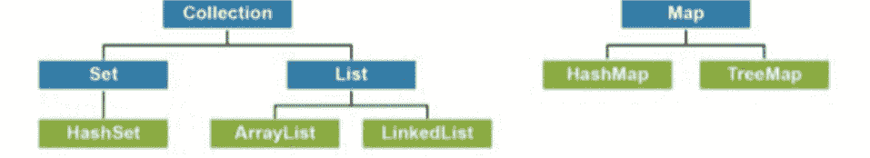

## 集合接口

| 接口 | 描述 |
| :--- | :--- |
| `Collection` | 定义所有集合可用的基本方法。 |
| `Set` | 定义不允许重复元素的集合。 |
| `List` | 定义维护列表中元素顺序的集合。它通过整数索引访问元素，并通常允许重复元素。 |
| `Map` | 定义映射。映射类似于集合。它持有一个或多个键值对，而不是只存储值（元素）。每个键值对由一个唯一标识值的键和一个存储数据的值组成。 |

## 常用集合类

| 类 | 描述 |
| :--- | :--- |
| `ArrayList` | 随机访问单个元素比链表更高效。然而，在列表中间插入元素时不如链表高效。 |
| `LinkedList` | 访问元素比 `ArrayList` 低。然而，在列表中间插入元素时比 `ArrayList` 高。 |
| `HashSet` | 存储一个唯一元素的集合。换句话说，它不允许重复。 |
| `HashMap` | 存储键值对，其中每个键都是唯一的。换句话说，它不允许重复键，但允许重复值。 |
| `TreeMap` | 在名为树的层次数据结构中存储键值对。此外，它会自动按键对元素进行顺序排序。 |

## 描述

- *Java* *集合框架*是基于接口的

图 12-2 Java 集合框架和类

# 泛型简介

在 Java 5 之前，集合的元素被定义为 `Object` 类型。因此，你可以将任何类型的对象作为元素存储在集合中。起初，这种灵活性似乎是一个优势。但它带来了两个缺点。首先，没有办法保证只将特定类型的对象添加到集合中。例如，你无法限制 `ArrayList` 使其只包含 `Product` 对象。其次，每当你从集合中检索对象时，必须使用强制类型转换。这是因为元素可以是任何类型的对象。例如，要从集合中检索 `Product` 对象，你必须将对象强制转换为该类型。

Java 5 引入了名为泛型（generics）的新功能，解决了这两个问题。泛型功能允许你为集合指定元素类型。然后，Java 可以确保它只将指定类型的对象添加到集合中。相反，Java 可以自动将从集合中检索的任何对象转换为正确的类型。

图 12-3 显示了泛型如何工作。在声明集合时指定类型，在类名后面紧跟角括号中使用该类型（例如 `ArrayList` 或 `LinkedList`）。为了说明，第一个示例显示了一个声明并实例化包含 `String` 对象的列表的语句。在这里，在 `ArrayList` 类名后指定了 `<String>`，表示列表的元素必须是 `String` 对象。

第二个和第三个示例相似，它们创建了可以包含整数和 `Product` 对象的集合。在这里，第二个示例使用了包装类（`Integer` 类）而不是基本类型（`int` 类型）。这允许集合存储整数数组。这是必要的，因为像这样使用基本类型声明集合是非允许的：

```
ArrayList<int> numbers = new ArrayList<int>(); // 非法！
```

在前三个示例中，你可以看到类型被编写了两次：一次声明集合时，一次在创建实例的构造函数中。然而，如果你使用的是 Java 7 或更高版本，只要编译器可以从上下文中推断出类型，就可以省略构造函数后面括号中的类型。第四个示例显示了它是如何工作的。在这里，代码完成了与第一个示例相同的任务，但没有重复集合类型。由于此功能产生了更短、更简单的代码，它将在本章的剩余部分中一直使用。

# 指定集合中元素类型的语法

```
CollectionClass<Type> collectionName = new CollectionClass<Type>();
```

创建一个 `String` 对象的数组列表的语句

`ArrayList<String> codes = new ArrayList<String>();`

创建一个整数数组列表的语句

`ArrayList<Integer> numbers = new ArrayList<Integer>();`

创建一个 `Product` 对象数组列表的语句

`ArrayList<Product> products = new ArrayList<Product>();`

# 在 Java 7 或更高版本中使用类型推断的语法

```
CollectionClass collectionName = new CollectionClass<>();
```

创建一个 `String` 对象的数组列表的语句

`ArrayList<String> codes = new ArrayList<>();`

## 描述

- 泛型（Generics）指的是一种允许你创建类型化集合的特性。类型化集合是一种只能容纳特定类型 对象的集合。该特性是在 Java 5 中引入的。

- 要声明引用类型化集合的变量，需要在集合类名后面用尖括号（`< >`）列出类型。

- 当你为类型化集合使用构造函数时，可以在构造函数名后的尖括号中指定类型。类型变量不能是 `int` 或 `double` 等基本类型，但可以是 `Integer` 或 `Double` 等包装类。也可以是像 `Product` 这样的自定义类。

- 从 Java 7 开始，如果编译器可以从上下文中推导出类型，你可以省略构造函数后面括号内的类型。这组空括号被称为菱操作符（diamond operator）。

- 如果你不为集合指定类型，则集合可以容纳任何类型的对象。然而，每当你访问该集合时，Java 编译器都会发出警告信息，提醒你无法对该集合进行类型检查。


# 如何使用 array list

`ArrayList` 是 Java 中常用的集合之一。你可以使用这个类创建一种名为 array list 的类型集合。array list 内部使用数组来存储元素。因此，array list 在许多方面与数组相似。然而，与数组不同，array list 在你向添加元素时会自动调整大小。因此，你不需要编写任何特殊代码来确保不会超过 array list 的容量。

# 如何创建 array list

图 12-4 显示了你可以用于创建 array list 的构造函数。这些构造函数使用大字母 `E` 表示你必须在尖括号内指定你想存储在集合中的元素类型。图中的第一个示例创建了一个名为 `codes` 的 `String` 对象的 array list。此代码使用了 `ArrayList` 类的默认构造函数，此示例创建了一个初始容量为 10 个元素的 array list。然后，如果有必要，array list 会自动增加容量到 10 以存储更多元素。

遗憾的是，增加 array list 的容量并不是一个高效的操作，特别是当 array list 很大时。首先，`ArrayList` 类必须创建一个扩展后大小的新数组。然后，旧数组的元素必须复制到新数组中。接下来，新元素必须被添加到新数组中。最后，旧数组必须从内存中移除。

因此，如果你知道将需要存储多少个元素，那么创建一个初始容量略大于元素数量的 array list 会更高效。要这样做，你可以使用像第二个示例所示的代码。此代码创建了一个初始容量为 200 个元素的 array list。

图中的最后一个示例显示，你可以使用 `List` 类型的变量来引用 Array list。这之所以行可行，是因为 `ArrayList` 类实现了 `List` 接口。换句话说，`ArrayList` 对象也是一个 `List` 对象。将 array list 声明为 `List` 对象有两个优点。首先，它减少了输入量。其次，更重要的是，它减少了代码与 `ArrayList` 类之间的连接，因为它只允许代码使用 `List` 接口中提供的方法。因此，如果你以后决定想为列表使用不同类型的对象，可以很容易从 `ArrayList` 类更改为另一个实现 `List` 接口的类，例如 `LinkedList` 类。

# ArrayList 类

`java.util.ArrayList`

# ArrayList 类的构造函数

| 构造函数 | 描述 |
| --- | --- |
| `ArrayList<>()` | 创建一个默认容量为 10 个元素的指定类型的空 array list。 |
| `ArrayList<>(intCapacity)` | 创建一个具有指定容量的指定类型的空 array list。 |

# 创建 String 对象的 array list 代码

使用 10 个元素的默认初始容量

`ArrayList<String> codes = new ArrayList<>();`

使用 200 个元素的指定初始容量

`ArrayList<String> codes = new ArrayList<>(200);`

# 使用 List 类型存储 ArrayList 对象的代码

`List<Product> products = new ArrayList<>();`

## 描述

- `ArrayList` 类内部使用数组来存储元素。

- array list 在你向其添加元素时会自动调整大小。

- 当你创建一个 array list 时，你可以指定 10 个元素的初始容量。

- 如果你知道需要存储的元素数量，创建一个初始容量略大于元素数量的 array list 会更高效。

- 由于 `ArrayList` 类实现了 `List` 接口，`ArrayList` 对象也是一个 `List` 对象。泛泛型指的是一种允许你创建类型化集合的特性。类型化集合是一种只能容纳特定类型 对象的集合。该特性是在 Java 5 中引入的。

- 要声明引用类型化集合的变量，需要在集合类名后面用尖括号（`< >`）列出类型。

- 当你为类型化集合使用构造函数时，可以在构造函数名后的尖括号中指定类型。类型变量不能是 `int` 或 `double` 等基本类型，但可以是 `Integer` 或 `Double` 等包装类。也可以是像 `Product` 这样的自定义类。


- 从 Java 7 开始，如果编译器可以从上下文中推导出类型，你可以省略构造函数后面括号内的类型。这组空括号被称为菱操作符。

- 如果你不为集合指定类型，则集合可以容纳任何类型的对象。然而，每当你访问该集合时，Java 编译器都会发出警告信息，提醒你无法对该集合进行类型检查。


# 如何添加和获取元素

图 12-5 中的第一个示例显示了如何向 array list 添加元素。第二个示例从名为 `codes` 的 array list 获取元素。通过从 size 减 1 计算最后一个元素的索引。

| 方法 | 描述 |
|---|---|
| `add(object)` | 将指定对象添加到列表末尾。 |
| `add(index, object)` | 在指定索引位置添加对象。 |
| `get(index)` | 返回指定索引的对象。 |
| `size()` | 返回列表中的元素数量。 |

# 添加三个元素的 array list 代码

```
codes.add("jsp");
codes.add("mysql");
codes.add(0, "java");
```

# 获取最后一个元素的代码

```java
int lastIndex = codes.size() - 1;
String lastCode = codes.get(lastIndex); // "mysql"
```

# 获取并显示 array list 的每个元素

```java
for (String code : codes) {
    System.out.println(code);
}
```

## 结果

```
java
jsp
mysql
```

一种显示集合内容的简单方法

`System.out.println(codes);`

## 结果

```
[java, jsp, mysql]
```

# 如何替换、删除和搜索元素

图 12-6 中的第一个示例展示了如何在数组列表（array list）中替换元素。要为此，第一条语句调用了 `set()` 方法将索引 2 处的元素替换为 "andr."。换句话说，它将数组列表的第三个元素改为 "andr."。

第二个示例展示了如何从数组列表中删除元素。要为此，此代码调用了 `remove()` 方法并指定索引为 1。结果，此代码从数组列表中删除了第二个元素，并将其存储在名为 `code` 的 String 变量中。

该示例的输出显示第二个元素（"jsp"）已被删除，其后的所有元素都向前移动了。例如，第三个元素（"andr"）现在变成了第二个元素。

第三个示例展示了如何在数组列表中搜索元素。要为此，此代码调用了 `contains()` 方法并指定了它要搜索的对象。如果该对象存在，示例中的代码会在控制台上打印一条消息指示该对象存在。然而，一旦你知道数组列表中存在某个对象，你就可以对它进行任何类型的处理。

# ArrayList 类的更多方法

| 方法 | 描述 |
| --- | --- |
| `clear()` | 从列表中移除所有元素。 |
| `contains(object)` | 如果指定的对象在列表中，则返回 true。 |
| `indexOf(object)` | 返回指定对象的索引位置。 |
| `isEmpty()` | 如果列表为空，则返回 true。 |
| `remove(index)` | 删除指定索引处的对象并返回该对象。 |
| `remove(object)` | 删除指定的对象并返回一个布尔值，指示操作是否成功。 |
| `set(index, object)` | 将指定索引处的元素设置为指定的对象。 |
| `toArray()` | 返回一个包含列表元素的数组。 |

# 替换元素的代码

```
codes.set(2, "andr");
System.out.println(codes);
```

结果输出

```
java, jsp, andr
```

# 删除元素的代码

```
String code = codes.remove(1); // removes "jsp"
System.out.println("'" + code + "' was removed.");
System.out.println(codes);
```

结果输出

```
'jsp' was removed.
java, andr
```

# 搜索元素的代码

```
String searchCode = "andr";
if (codes.contains(searchCode)) {
    System.out.println("This list contains: '" + searchCode + "''");
}
```

结果输出

```
This list contains: 'andr'
```

## 描述

- 你可以使用 `ArrayList` 类的方法来替换、删除和搜索数组列表的元素。

# 如何在数组列表中存储基本类型

图 12-7 展示了如何在数组列表中存储如 int 值等基本类型。要为此，你可以使用包装类（wrapper class）来指定数组列表可以存储的元素类型。

在图中，第一个示例创建了一个包含 `Integer` 对象的数组列表。然后，它将 int 值 1、2 和 3 添加到数组列表中。这之所以能行通，是因为编译器在将这些 int 值存储到数组列表之前，会自动将它们转换为 `Integer` 对象。

相反，第二个和第三个示例从数组列表中获取 int 值，尽管该列表存储的是 `Integer` 对象。同样，这是可能的，因为编译器会自动将 `Integer` 对象转换为 int 值。

这一特性被称为自动装箱（autoboxing），在 Java 5 及更高版本中可用。在 Java 5 之前，必须编写额外的代码将基本类型存储在它们的包装类中，并从它们的包装类中取出。幸运的是，在最近的 Java 版本中这不再是。

# 在数组列表中存储基本类型的代码

```
ArrayList<Integer> numbers = new ArrayList<>();
numbers.add(1);
numbers.add(2);
numbers.add(3);
System.out.println(numbers);
```

结果输出

```
[1, 2, 3]
```

# 从数组列表中获取基本类型的代码

```
int firstName = numbers.get(0); // 1
```

# 从数组列表中获取基本类型的增强 for 循环

```
for (int number : numbers) {
    System.out.println(number);
}
```

结果输出

```
1
2
3
```

## 描述

- 所有基本类型都有对应的包装类。例如，`Integer` 类是 `int` 类型的包装类，`Double` 类是 `double` 类型的包装类，依此类推。

  要在集合（collection）中存储基本类型，你可以指定其包装类作为集合的类型。然后，在向集合中添加值时，编译器会自动将基本值转换为其包装类型。这一特性被称为自动装箱。

  从集合中获取基本类型，你不需要做任何事情，因为编译器会自动为你从包装类中获取基本值。

# 发票应用（Invoice application）

现在你已经知道如何操作数组列表，本章将展示如何在接下来几幅图中介绍的发票应用语境下使用数组列表。

## 控制台

图 12-8 展示了发票应用的控制台。此控制台的工作原理与之前介绍的 LineItem 应用程序相似。

## 控制台输出

```
Welcome to the Invoice

Enter product code:
Enter quantity:
Enter price:
Add another item? (y/n):

Invoice items:
```

Total:

```

## 描述

- 应用程序使用 `LineItem` 对象的列表来存储项目。当用户选择“Add another item?”时，会创建一个新的 `LineItem` 并添加到列表中。
- 总价通过遍历列表并累加每个 `LineItem` 的总额计算得出。
- 应用程序显示项目列表和最终总额。

# Invoice 类

图 12-9 The Invoice 类

```java
package murach.business;

import java.text.NumberFormat;
import java.util.ArrayList;
import java.util.List;

public class Invoice {

    // 实例变量
    private List<LineItem> lineItems;

    // 构造函数
    public Invoice() {
        lineItems = new ArrayList<>();
    }

    // 添加行项目的方法
    public void addItem(LineItem item) {
        lineItems.add(item);
    }

    // 获取行项目集合的访问器
    public List<LineItem> getLineItems() {
        return lineItems;
    }

    // 获取发票总额的方法
    public double getTotal() {
        double invoiceTotal = 0;
        for (LineItem item : lineItems) {
            invoiceTotal += item.getTotal();
        }
        return invoiceTotal;
    }

    // 返回货币格式发票总额的方法
    public String getTotalFormatted() {
        NumberFormat currency = NumberFormat.getCurrencyInstance();
        return currency.format(getTotal());
    }
}
```

# InvoiceApp 类

图 12-10 显示了 `InvoiceApp` 类的代码。该类包含一个 `main()` 方法，该方法首先声明一个存储 `Invoice` 对象的变量。然后，它将此对象传递给该类中的另外两个静态方法。静态方法 `getLineItems()` 包含了用户输入每个行项目的产品代码和数量的代码。为了实现这一点，它使用了本书早些介绍的 `Console` 类。然后，该方法根据用户输入创建一个新的 `LineItem` 对象，并将该对象添加到 `Invoice` 对象中。

`displayInvoice()` 方法包含了在用户完成行项目输入后显示 `Invoice` 对象的代码。为了实现这一点，它使用增强型 `for` 循环来获取发票的每个行项目。该循环首先获取行项目对应的产品。然后，它格式化并显示产品和行项目的数据。最后，在显示所有行项目后，会显示发票总额。

# InvoiceApp 类代码

```java
package murach.ui;

import murach.db.ProductDB;
import murach.business.Invoice;
import murach.business.LineItem;
import murach.business.Product;

public class InvoiceApp {

    public static void main(String[] args) {
        System.out.println("Welcome to the Invoice application\n");
        Invoice invoice = new Invoice();
        getLineItems(invoice);
        displayInvoice(invoice);
    }

    public static void getLineItems(Invoice invoice) {
        String choice = "y";
        while (choice.equalsIgnoreCase("y")) {
            String productCode = Console.getString("Enter product code: ");
            int quantity = Console.getInt("Enter quantity: ");
            Product product = ProductDB.getProduct(productCode);
            invoice.addItem(new LineItem(product, quantity));
            choice = Console.getString("Another line item? (y/n): ");
            System.out.println();
        }
    }

    public static void displayInvoice(Invoice invoice) {
        System.out.println("Code\t\tPrice\tQty\tTotal");
        System.out.println("------\t------\t----\t----\------");
        for (LineItem lineitem : invoice.getLineItems()) {
            Product product = lineitem.getProduct();
            String s = product.getCode();
            s += "\t" + product.getPriceFormatted();
            s += "\t" + lineitem.getQuantity();
            s += "\t" + lineitem.getTotalFormatted();
            System.out.println(s);
        }
        System.out.println("\n\t\t\t\ttotal: \t" 
            + invoice.getTotalFormatted() + "\n");
    }
}
```


# 如何使用链表

`LinkedList` 类与 `ArrayList` 类相似，但它提供了更多功能，并使用不同的技术来存储数据。这些主题描述了 `LinkedList` 类并展示了一些说明如何使用该类的示例。

## 如何创建链表并添加元素

图 12-11 显示了如何使用 `LinkedList` 类的构造函数来创建链表。这与 `ArrayList` 类的构造函数工作原理相同，但你不能为链表指定初始容量。例如，图中的第一个示例创建了一个名为 `nodes` 的链表，它可以存储 `String` 对象。

在你创建列表后，可以向其中添加元素。不过，你应该意识到，与 `ArrayList` 不同，链表并不使用数组来存储其元素。相反，你添加到链表的元素是作为单独的对象存储的。每个元素都与其指向其前驱和后续对象的指针一起存储。因此，`LinkedList` 类可以使用这些指针来遍历整个列表。

由于链表的项没有存储在数组中，因此在链表中间插入元素比在 `ArrayList` 中间插入元素更高效。要进行插入，`ArrayList` 中位于插入点之后的所有元素都必须向下移动，插入点越靠近数组开头，数组中的元素越多，插入元素所需的时间就越长。相比之下，只需调整插入点之前和之后元素的前驱和后继指针，即可在链表的中间插入元素。

第二个示例说明了这是如何运作的。在这里，前两个语句使用 `add()` 方法在索引位置 0 和 1（列表末尾）添加元素。然后，第三个 `add()` 方法表示应将元素添加到索引位置 1，从而将当前位于该位置的元素移动到索引位置 2。为了实现这一点，第一个元素的 `next` 指针和第二个元素的 `previous` 指针被更改，以指向新元素。

然而，这种插入元素效率的提高是有代价的。虽然链表的更新速度比 `ArrayList` 快，但它的访问速度没有那么快。因为 `ArrayList` 中的所有元素都存储在相邻的内存位置，因此访问这些元素的速度很快。相比之下，访问链表中的元素相对较慢，因为必须使用元素的指针。

例如，假设你使用 `get()` 方法访问一个包含超过 1,000 个元素的链表的第 500 个元素。为了实现这一点，`get()` 方法首先访问列表中的第一个元素以获取指向第二个元素的指针。它访问第二个元素以获取指向第三个元素的指针。这个过程一直持续到检索第 500 个元素。换句话说，要访问链表中的特定元素，必须访问其之前的所有元素。

实际上，`get()` 方法首先检查该元素更靠近列表中的第一个元素还是最后一个元素。如果元素更靠近最后一个元素，对元素的搜索将从最后一个元素开始并向后进行，直到找到所需的元素。例如，要像图 12-11 中的第三示例所示检索链表的最后一个元素，只需要该元素本身。

图 12-11 中的第四个示例显示了使用增强型循环处理链表中所有元素的代码。注意，你也可以使用带有索引变量的标准循环和 `get()` 方法处理列表。然而，使用增强循环处理链表比使用循环更高效。因为增强循环能够高效地使用与每个项关联的指针来访问列表中的下一个元素。例如，从第 100 个元素移动到第 101 个元素，增强循环只需使用指向下一个元素的指针。相比之下，`get()` 方法每次访问元素时都必须从列表开始。

### `LinkedList` 类

`java.util.LinkedList`

### `LinkedList` 的构造函数

| 构造函数 | 描述 |
| :--- | :--- |
| `LinkedList()` | 使用指定的类型创建一个空列表。 |

### `LinkedList` 的常用方法

| 方法 | 描述 |
| :--- | :--- |
| `add(object)` | 将指定的对象添加到列表末尾。 |
| `add(index, object)` | 在指定的索引处添加指定的对象。 |
| `get(index)` | 返回指定索引处的对象。 |
| `size()` | 返回列表中的元素数量。 |

### 创建 `String` 对象列表的代码

```java
LinkedList<String> codes = new LinkedList<>();
```

### 向列表添加三个元素的代码

```java
codes.add("mysql");
codes.add("jsp");
codes.add(1, "java");
System.out.println(codes);
```

### 输出

```
[mysql, java, jsp]
```

### 获取并显示链表每个元素的代码

```java
for (String code : codes) {
    System.out.println(code);
}
```

### 输出

```
mysql
java
jsp
```

## 如何替换、删除和搜索元素

图 12-2 提供了一些处理链表的额外方法。如果你将使用这些方法的示例与图 12-6 中使用 `ArrayList` 类方法的示例进行比较，你会发现它们是完全相同的。这是因为所有这些方法都是 `Collection` 或 `List` 接口的成员，而这两个接口都被 `ArrayList` 和 `LinkedList` 类实现。然而，除了这两个接口，`LinkedList` 类还实现了 `Queue` 和 `Deque` 接口。你将学习这两个接口提供的一些功能。

### `LinkedList` 类的更多方法

| 方法 | 描述 |
| --- | --- |
| `clear()` | 从列表中移除所有元素。 |
| `contains(object)` | 如果指定的对象在列表中，则返回 true。 |
| `indexOf(object)` | 返回指定对象的索引位置。 |
| `isEmpty()` | 如果列表为空，则返回 true。 |
| `remove(index)` | 移除并返回指定索引位置上的对象。 |
| `remove(object)` | 删除指定的对象。 |
| `set(index, object)` | 用指定的对象替换指定索引位置上的元素。 |
| `toArray()` | 返回一个包含列表元素的数组。 |

### 替换元素的代码

```java
codes.set(2, "andr");
System.out.println(codes);
```

输出结果：

```
[mysql, java, andr]
```

### 删除元素的代码

```java
String code = codes.remove("java"); // removes "java"
System.out.println("'" + code + "' was removed.");
System.out.println(codes);
```

输出结果：

```
'java' was removed.
[mysql, andr]
```

### 搜索元素的代码

```java
String searchCode = "andr";
if (codes.contains(searchCode)) {
    System.out.println("This list contains: '" + searchCode + "'");
}
```

输出结果：

```
This list contains: 'andr'
```

## 如何使用 `Queue` 和 `Deque` 接口的方法

图 12-13 展示了 `LinkedList` 类实现的 `Queue` 和 `Deque` 接口的一些方法。首先，`addFirst()` 和 `addLast()` 方法允许向列表的开头和结尾添加元素，如图中的第一个示例所示。你可以使用这些方法代替你在图 12-11 中看到的 `add(element)` 方法。

接下来三个方法允许你从列表中移除元素。`remove()` 和 `removeFirst()` 方法都会移除并返回列表中的第一个元素。你可能希望使用 `removeFirst()` 以明确你正在移除的是哪个元素。`removeLast()` 方法移除并返回列表的最后一个元素，如图中的第二个示例所示。

如果你想获取但不移除列表中的第一个或最后一个元素，可以使用 `element()`、`getFirst()` 或 `getLast()` 方法。`element()` 和 `getFirst()` 方法返回列表的第一个元素。由于 `getFirst()` 明确了正在检索的是哪个元素，你通常会用它代替 `element()` 方法。`getLast()` 方法返回列表的最后一个元素，并可以代替图 12-11 中所示的 `size()` 和 `get()` 方法。

这三个方法以及 `element()`、`getFirst()` 和 `getLast()` 方法在列表为空时都会抛出 `NoSuchElementException`。相比之下，`poll()` 和 `peek()` 方法的功能与 `removeFirst()` 和 `getFirst()` 相同，但列表为空时会返回 `null`。这些方法传统用于队列，你将在图中了解更多关于队列的内容。

第三个示例说明了 `getFirst()` 和 `peek()` 方法的区别。首先，第一条语句声明了一个名为 `firstName` 的变量，第二条语句使用 `clear()` 移除 `codes` 列表中的所有元素。然后，接下来的两条语句使用 `getFirst()` 和 `peek()` 方法获取列表的第一个元素。但由于列表为空，`getFirst()` 方法抛出了 `NoSuchElementException`。相比之下，`peek()` 方法返回 `null`。

另一个传统用于队列的方法是 `offer()` 方法。你可以使用此方法代替 `addLast()` 方法向列表末尾添加对象。与 `addLast()` 方法不同，`offer()` 方法返回一个 true 或 false 值来表示对象是否成功添加。

当你开发一个需要列表的 Java 应用程序时，应该仔细考虑使用 `ArrayList` 类还是 `LinkedList` 类来实现该集合。如果列表将包含大量元素，这一点尤为重要。列表越大，使用数组列表或链表的性能权衡就越重要。然而，在许多情况下，你之所以使用链表仅仅是因为你需要 `Queue` 和 `Deque` 接口提供的额外功能。

### `LinkedList` 类实现的 `Queue` 和 `Deque` 接口方法

| 方法 | 描述 |
|--- |--- |
| `addFirst(object)` | 将指定的对象添加到列表开头。 |
| `addLast(object)` | 将指定的对象添加到列表末尾。 |
| `remove()` | 移除并返回列表的第一个元素。如果列表为空则抛出 `NoSuchElementException`。 |
| `removeFirst()` | 移除并返回列表的第一个元素。如果列表为空则抛出 `NoSuchElementException`。 |
| `removeLast()` | 移除并返回列表的最后一个元素。如果列表为空则抛出 `NoSuchElementException`。 |
| `element()` | 返回但不移除列表的第一个元素。如果列表为空则抛出 `NoSuchElementException`。 |
| `getFirst()` | 返回列表的第一个元素。如果列表为空则抛出 `NoSuchElementException`。 |
| `getLast()` | 返回列表的最后一个元素。如果列表为空则抛出 `NoSuchElementException`。 |
| `poll()` | 移除并返回列表的第一个元素。如果列表为空则返回 `null`。 |
| `peek()` | 返回但不移除列表的第一个元素。如果列表为空则返回 `null`。 |
| `offer(object)` | 尝试将对象添加到列表末尾。如果对象添加成功则返回 true，否则返回 false。 |

## 队列的方法

| 方法 | 描述 |
|---|---|
| `enqueue(element)` | 将指定的元素添加到队列的末尾。 |
| `dequeue()` | 从队列头部检索并移除一个元素。 |
| `size()` | 返回队列中的元素数量。 |

### 使用泛型实现队列的类代码

```java
import java.util.LinkedList;

public class Queue<E> {
    private LinkedList<E> list = new LinkedList<E>();

    public void enqueue(E item) {
        list.addLast(item);
    }

    public E dequeue() {
        return list.removeFirst();
    }

    public int size() {
        return list.size();
    }
}
```

### 使用 `Queue` 类的代码

```java
Queue<String> invoices = new Queue<String>();
invoices.enqueue("Invoice 1");
invoices.enqueue("Invoice 2");
invoices.enqueue("Invoice 3");
System.out.println("The queue contains " + invoices.size() + " " + invoices);

while (invoices.size() > 0) {
    String invoice = invoices.dequeue();
    System.out.println("Processing: " + invoice);
}

System.out.println("The queue contains " + invoices.size() + " " + invoices);
```

### 输出结果

```
The queue contains 3 invoices
Processing: Invoice 1
Processing: Invoice 2
Processing: Invoice 3
The queue contains 0 invoices
```

### 描述

- 队列是一个先入先出（FIFO）集合。要实现一个简单的队列，你可以像上面所示使用泛型和链表。

# 如何使用映射

接下来两个主题展示了如何使用实现 `Map` 接口的两个类：`HashMap` 和 `TreeMap`。这些类允许你创建集合，可以通过键来访问对象。哈希映射和树映射之间的主要区别在于，哈希映射中的条目按特定顺序存储，而树映射中的条目会自动按键进行排序。

## `HashMap` 和 `TreeMap` 类

图 12-15 展示了 `HashMap` 和 `TreeMap` 类。这两个类都实现了 `Map` 接口，该接口定义了映射的基本行为。映射是一个集合，其元素是键和值的对。例如，你可能使用映射来存储 `Product` 对象集合，可以通过产品代码访问它们。在这种情况下，键将是产品代码，值将是 `Product` 对象。

与你在本章看到的其他集合不同，你在声明映射时需要指定类型。图中第一个被标记为 K 的类型代表映射的键的类型。第二个被标记为 V 的类型是映射的值的类型。通常情况下，键是一个简单类型（如 `String` 或 `Integer`），而值是用户定义的类型（如 `Product` 或 `Customer`）。

与其他集合一样，你使用 `get()` 方法从映射中检索一个对象。`get()` 方法接受一个参数，代表你想要检索的对象的键值。然后，`get()` 方法返回与指定键对应的值对象。如果键不在映射中，`get()` 方法返回 `null`。

虽然可能性很小，但键可能存在于映射中，而与键关联的值为 `null`。在这种情况下，`get()` 方法返回 `null`。因此，`null` 可能意味着键不在映射中，或者键在映射中但与键关联的值对象为 `null`。为了区分这些可能性，你可以使用 `containsKey()` 方法。如果键在映射中，该方法返回 `true`。

### 使用 `HashMap` 的代码

```java
// 创建一个空的 hash map
Map<String, String> books = new HashMap<>();
```

```java
// 添加三个 entry
books.put("jscr", "Murach's JavaScript and jQuery");
books.put("andr", "Murach's Android Programming");
books.put("java", "Murach's Java Programming");
```

```java
// 打印 entry
for (Map.Entry<String, String> entry : books.entrySet()) {
    System.out.println(entry.getKey() + ": " + entry.getValue());
}
```

```java
// 打印键为 "java" 的 entry
System.out.println("Code java is " + books.get("java"));
```

结果

| jscr: Murach's JavaScript and jQuery |
| andr: Murach's Android Programming |
| java: Murach's Java Programming |

Code java is Murach's Java Programming

### 使用 `TreeMap` 的代码

```java
// 创建一个空的 tree map
```


# Map 和 TreeMap 代码示例

```java
Map<String, String> books = new TreeMap<>();
```

```java
// 添加三个 entry
books.put("jscr", "Murach's JavaScript and jQuery");
books.put("andr", "Murach's Android Programming");
books.put("java", "Murach's Java Programming");
```

```java
// 打印 entry
for (Map.Entry<String, String> entry : books.entrySet()) {
    System.out.println(entry.getKey() + ": " + entry.getValue());
}
```

```java
// 打印键为 "java" 的 entry
System.out.println("Code java is " + books.get("java"));
```

结果

| andr: Murach's Android Programming |
| java: Murach's Java Programming |
| jscr: Murach's JavaScript and jQuery |

Code java is Murach's Java Programming

图 12-16 使用 hash map 和 tree map 的代码示例

## 单词计数器应用

为了展示 map 的另一种用途，图 12-17 显示了单词计数器应用。该应用程序统计单词在文本字符串中出现的次数。初看之下，这个应用可能看起来并不有用。然而，你可以增强此应用以分析任何类型文本的词频，包括来自网络的大量文本。

该应用程序的 `main()` 方法首先打印一条欢迎消息并定义一个包含某些文本的字符串。接着，接三条语句通过移除逗号和句号并将所有单词转换为小写来处理该字符串。接下来，这段代码将文本分割为单词数组。为了完成这些任务，此代码使用了 `String` 类的 `replace()`、`toLowerCase()` 和 `split()` 方法。你将在下一章中学习更多关于这些方法。现在，你只需要关注结果数组是如何被处理的。

获取单词数组后，此代码定义了一个 tree map，其键类型是字符串，值类型是整数。然后，此代码遍历数组中的每个单词。在循环内部，第一条语句检查 map 是否包含该单词。如果包含，代码获取该单词的计数，将其加 1，并用新计数更新该单词。否则，代码将该单词以计数 1 放入 map 中。

在用单词及其计数填充 map 之后，此代码将 map 中的每个 entry 打印到控制台。此代码使用冒号和空格来分隔键（单词）和它的值（计数）。由于此代码使用了 tree map，map 会自动按键进行排序。在这种情况下，这意味着单词按字母顺序排序的，这对于该应用是合适的。

## 控制台

```
The Word Counter application

be: 2
is: 1
not: 1
or: 1
question: 1
that: 1
the: 1
to: 2
```

## 代码

```java
import java.util.Map;
import java.util.TreeMap;

public class WordCounterApp {
    public static void main(String[] args) {
        System.out.println("The Word Counter application\n");

        // 定义一个包含文本的字符串
        String text = "To be or not to be, that is the question.";

        // 处理字符串
        text = text.replace(",", ""); // 移除逗号
        text = text.replace(".", ""); // 移除句号
        text = text.toLowerCase(); // 转换为小写

        // 将字符串分割为数组
        String[] words = text.split(" + ");

        // 定义一个 map 并用单词及其计数填充
        Map<String, Integer> wordMap = new TreeMap<>();

        int count;
        for (String word : words) {
            if (wordMap.containsKey(word)) { // 单词在 map 中
                count = wordMap.get(word);
                count++;
                wordMap.put(word, count);
            } else {
                wordMap.put(word, 1); // map 中的新单词
            }
        }

        // 打印 entry
        for (Map.Entry<String, Integer> entry : wordMap.entrySet()) {
            System.out.println(entry.getKey() + ": " + entry.getValue());
        }
    }
}
```

图 12-17 单词计数器应用

## 观点

现在你已经完成了这一章，你应该知道如何处理 array list 和 linked list 这最常用的 Java 集合。此外，你现在应该知道如何使用 hash map 和 tree map 来处理存储键值对的集合。

然而，本章从零开始的集合接口和类仅仅是 Java API 可用内容的冰一角。许多其他处理集合的类都是可用的，且每个类都提供了特定情况下有用的功能。因此，如果本章介绍的集合不能满足程序的需求，很有可能 Java API 中包含了满足要求的集合。要找到所需的集合并了解它的工作原理，你可以查看 `java.util` 包的文档。然后，你可以使用本章介绍的许多技巧来处理该集合。

## 总结

- 集合是一个用于存储其他对象的。
- 泛型功能（Java 5 引入）允许你指定集合可以存储的元素类型。钻石运算符（Java 7 引入）允许你在类型集合的构造函数中编写空括号 `<>`。
- list 是一个维护顺序的对象集合。你可以使用 `ArrayList` 和 `LinkedList` 类来创建列表。`ArrayList` 内部使用数组存储数据。`LinkedList` 使用带有后继和前继指针的结构。
- map 是一个包含键值对的集合。你可以使用 `HashMap` 和 `TreeMap` 类来创建 map。`TreeMap` 保持条目有序，而 `HashMap` 不会。

## 练习 12-1 使用 array list

此练习要求你修改 Deck 应用，使其使用 array list 代替数组来处理牌组和手。

| DECK |
| :--- |
| Ace of Spades | 2 of Spades | 3 of Spades | 4 of Spades |
| SHUFFLED DECK |
| King of Hearts | Jack of Clubs | King of Diamonds | 9 of Hearts |
| FOUR HANDS OF 2 CARDS |
| King of Hearts | King of Diamonds |
| Jack of Clubs | 3 of Spades |
| 9 of Hearts | 5 of Hearts |
| 8 of Clubs | Jack of Hearts |
| CARDS LEFT IN DECK: 44 |

## 显示牌组中剩余卡牌的数量并分发多手

- 9. 为了确保卡牌已从牌组中移除，添加一条语句显示牌组中剩余卡牌的数量。然后，测试此更改。
- 10. 在 `main()` 方法中添加代码，分发并显示四手牌而不是一手。为了实现这一点，你可以使用循环。确保显示牌组中剩余卡牌数量的语句写在循环之外。再次测试应用程序。

## 练习 12-2 使用链表

本练习将引导你完成在未来价值（Future Value）应用程序中添加链表的过程。该链表将存储所执行的每次计算的值。当程序结束时，它将按反顺序打印这些计算的摘要，看起来如下所示：

| 未来价值计算 | 倒序/号 | 利率 | 年限 | 未来价值 |
|---|---|---|---|---|
| $150.00 | 8.0% | 10 | $27,624.85 |
| $125.00 | 8.0% | 10 | $23,020.71 |
| $100.00 | 8.0% | 10 | $18,416.57 |

- 1. 打开存储在 `ex_starts` 目录下的项目 `ch12_ex2_FutureValue`。然后，检查该应用程序的代码并运行它以确保其正常工作。
- 2. 在 `main()` 方法开始声明一个用于存储字符串的链表变量。
- 3. 在计算、格式化和显示每次计算结果代码之后，添加代码来格式化包含计算结果的字符串，并将该字符串存储在链表中。
- 4. 当用户指示程序应结束时，添加代码在控制台中显示链表中的元素。此代码应该以反序获取链表的元素。为了实现这一点，你需要使用 `LinkedList` 类的方法。然后，通过进行至少三次未来价值计算来测试程序。

## 练习 12-3 创建栈

在本次练习中，你将创建一个名为 `Stack` 的类，该类使用链表来实现栈。栈是一种让你按照“后进先出”（FIFO）原则访问条目的集合。然后，你将向另一个使用 `Stack` 类的类中添加代码。`Stack` 类应该实现这些方法：

| 方法 | 说明 |
| --- | --- |
| `push(element)` | 向栈顶添加一个元素。 |
| `pop()` | 返回栈顶元素并将其移除。 |
| `peek()` | 返回栈顶元素但不将其移除。 |
| `size()` | 返回栈中元素的数量。 |

### 创建 Stack 类

- 1. 打开位于 `ex_starts` 目录下的项目 `ch12_ex3_stack`。
- 2. 创建一个名为 `Stack` 的新类，并指定一个提供泛型支持的类型变量。
- 3. 声明一个存储栈中元素的链表。然后，使用该链表实现上述方法。

### 添加使用 Stack 类的代码

- 4. 打开 `App` 类。然后，在 `main()` 方法开始声明一个使用 `String` 对象的泛型栈。
- 5. 在 `main()` 方法中添加代码，使用 `push()` 方法向栈中添加至少三个项目。在添加每个项目后，在控制台中显示其值（你可能需要使用字符串字面量来实现此）。然后，使用 `size()` 方法返回栈中项的数量并显示该值。
- 6. 使用 `peek()` 方法返回第一个项并显示它，然后使用 `size()` 方法再次返回项的数量并显示该值。
- 7. 使用 `pop()` 方法返回每个项，在返回时显示它，并再次显示项的数量。
- 8. 运行项目。如果运行正常，你的输出应该看起来像：

```
Push: Apples
Push: Oranges
Push: Bananas
The stack contains 3 items
Peek: Bananas
The stack contains 3 items
Pop: Bananas
Pop: Oranges
Pop: Apples
The stack contains 0 items
```

# 第13章 如何处理字符串

在本书的第一部分中，你学习了一些处理字符串的基础级技能。在本章中，你将学习更多关于处理字符串的知识。因为在你所开发的许多应用程序中都会使用字符串，所以你应该知道如何使用本章中介绍的所有技能。

| 如何使用 String 类 ............................................................ | 420 |
| 如何创建字符串 ................................................................................. | 420 |
| 如何合并字符串 ....................................................................................... | 420 |
| 如何向字符串追加数据 .................................................................... | 420 |
| 如何比较字符串 ................................................................................ | 422 |
| 如何处理字符串索引 ................................................................ | 424 |
| 如何修改字符串 ................................................................................... | 426 |
| **如何使用 StringBuilder 类 ...............................................** | 428 |
| 如何创建 StringBuilder 对象 ........................................................ | 428 |
| 如何向字符串追加数据 .................................................... | 428 |
| 如何修改字符串 ................................................................... | 430 |
| **Product 应用程序..............................................** | 432 |
| 用户界面 ........................................................ | 432 |
| StringUtil 类 ................................................................. | 432 |
| ProductLister 类 ............................................................ | 434 |
| **Perspective ............................................................** | 436 |

## 如何使用 String 类

在第2章中，你学习了如何创建和合并字符串。此外，你还学习了如何使用 `String` 类的方法来比较字符串。现在，你将回顾这些技能，并学习一些处理字符串的新技能。

### 如何创建字符串

3-1 中的第一个示例展示了如何创建和初始化字符串变量。第一个语句创建一个名为 `productCode` 的字符串变量并为其赋值一个空字符串 `""`。第二个语句创建一个名为 `title` 的字符串变量并为其赋值 "Murach's Java Programming"。而第三个语句创建一个名为 `bookTitle` 的字符串变量，并将变量 `title` 赋值给它。结果是这两个变量都引用同一个 `String` 对象。

### 如何合并字符串

第二个和第三个示例展示了如何合并字符串。这被称为字符串拼接。为了实现这一点，你可以使用 `+` 运算符连接字符串变量和字符串字面量。在第二个示例中，第二个语句创建了一个名为 `message` 的字符串变量，其引用字符串 "Hi, Bob"。

当你将其他数据类型合并或追加到字符串变量时，Java 会自动转换这些数据类型，以便将其作为字符串的一部分。在第三个示例中，第二个语句将字符串字面量 "Years: " 与整数值 3 合并，并将结果赋值给名为 `message` 的字符串变量。结果是该字符串变量引用字符串 "Years: 3"。

### 如何向字符串追加数据

第四个和第五个示例展示了如何向字符串追加数据。这种工作方式与合并字符串相同，只是它将新数据添加到字符串的末尾。

在第四个示例中，第一个语句声明了一个引用第一个名字的字符串变量。然后，第二个语句向该变量追加一个空格，第三个语句追加一个姓氏。在这里，`name` 变量出现在等号两边，`+` 运算符连接了新字符串和字面量。

第五个示例的工作方式与第四个示例相同。但是，它使用了 `+=` 运算符来追加数据。结果是不需要在等号两边都编写 `name` 变量。由于这种方法易于阅读且比上一个示例的代码更少，因此更常用。

# String 类

`java.lang.String`

# 如何声明和初始化字符串变量

```java
String productCode = ""; // 指向空字符串
String title = "Murach's Java Programming"; // 指向字符串字面量
String bookTitle = title;                   // 指向与其他变量相同的对象
```

# 如何拼接字符串

```java
String name = "Bob";                          // name 是 "Bob"
```


# 如何拼接字符串和数字

```java
int years = 3;
String message = "Years: " + years;     // message 是 "Years: 3"
```

# 如何将一个字符串追加到另一个字符串

```java
String name = "Bob";                          // name 是 "Bob"
name = name + " ";                            // name 是 "Bob "
name = name + "Smith";                        // name 是 "Bob Smith"
```

# 更常用的将一个字符串追加到另一个字符串

```java
String name = "Bob";                          // name 是 "Bob"
name += " ";                                  // name 是 "Bob "
name += "Smith";                              // name 是 "Bob Smith"
```

## 描述

- 你可以通过赋值字符串字面量或另一个指向 `String` 对象的变量来初始化字符串变量。
- 要将一个字符串与另一个字符串或另一个数据类型拼接（或连接），你可以使用 `+` 运算符。
- 要将字符串或另一个数据类型追加到字符串，你可以使用 `+=` 运算符。
- 当将其他类型拼接或追加到 `String` 对象时，Java 会自动将其他类型转换为 `String` 对象，以便它们作为字符串的一部分。

图 13-1 如何创建、拼接和追加字符串

# 如何比较字符串

在第 3 章中，你学习了如何使用 `String` 类的 `equals()` 和 `equalsIgnoreCase()` 方法来比较字符串。现在，图 13-2 复习了这些方法，并向你介绍了更多可以用于比较字符串的方法。

图中所有的方法都返回 `true` 或 `false` 的布尔值。例如，`equals()` 方法比较字符串，如果字符串相等且大小写相同，则返回 `true`。同样，`startsWith()` 方法检查字符串是否以特定的字符组合开头，如果不是，则返回 `true`（注：此处原文逻辑可能描述有误，通常是匹配开头时返回 true）。

第一个示例显示了初学者在比较字符串时经常犯的一个常见错误。在这里，代码使用了用于比较原始类型的相等运算符 (`==`) 来比较字符串。但是，这并不能检查两个字符串是否相等。相反，它检查的是它们是否指向同一个 `String` 对象。两个字符串变量可能指向不同的 `String` 对象，但具有相同的字符组合。因此，这并不是检查相等性的可靠方法。

第二个示例显示了如何使用 `equals()` 方法比较字符串。它检查两个字符串变量是否存储了具有相同大小写的相同字符。因此，这是一种检查相等性的可靠方法。

正如第 3 章所学到的，如果你不在乎大小写，可以使用 `equalsIgnoreCase()` 方法检查字符串的相等性。该方法的作用与 `equals()` 方法相同，但它对大小写不敏感。

第三个示例显示了如何使用 `equals()` 方法检查空字符串。要这样做，只需将空字符串作为 `equals()` 方法的参数即可。在这里，该语句检查字符串变量 `productCode` 是否指向空字符串。如果是，它将向控制台打印一条消息。

第四个示例显示了如何使用 Java 6 引入的 `isEmpty()` 方法来检查空字符串。该示例的原理与上一个示例中的 `equals()` 方法类似。然而，一些程序员认为 `isEmpty()` 方法更易读。

第五个示例显示了如何使用 `startsWith()` 方法。在这里，该语句检查字符串变量 `productDescription` 是否以字符串 "Murach" 开头。如果是，它将向控制台打印一条消息。

第六个示例显示了如何使用 `endsWith()` 方法。在这里，该语句检查字符串变量 `productDescription` 是否以字符串 "Programming" 结尾。如果是，它将向控制台打印一条消息。

# 比较字符串的方法

| 方法 | 描述 |
| --- | --- |
| `equals(String)` | 如果指定的字符串等于当前字符串，则返回 `true`。此比较是区分大小写。 |
| `equalsIgnoreCase(String)` | 如果指定的字符串等于当前字符串，则返回 `true`。此比较不区分大小写。 |
| `isEmpty()` | 如果字符串为空，则返回 `true`。该方法是 Java 6 引入的。 |
| `startsWith(String)` | 如果字符串以指定的前缀开头，则返回 `true`。 |
| `endsWith(String)` | 如果字符串以指定的后缀结尾，则返回 `true`。 |

# 初学者在比较字符串时经常犯的常见错误

```java
String s1 = new String("java");
String s2 = new String("java");
if (s1 == s2) { // 这将为 false，因为它们指向不同的对象
}
```

# 如何使用 equals() 方法比较字符串

```java
String s1 = new String("java");
String s2 = new String("java");
if (s1.equals(s2)) { // 这将为 true，因为它们包含了相同的字符
}
```

# 如何使用 equalsIgnoreCase() 方法检查相等性

```java
String s1 = "java";
String s2 = "JAVA";
if (s1.equalsIgnoreCase(s2)) { // 这将为 true，因为它忽略了大小写
}
```

# 如何使用 equals() 方法检查空字符串

```java
String productCode = "";
if (productCode.equals("")) { // 这将为 true
}
```

# 如何使用 isEmpty() 方法检查空字符串

```java
String productCode = "";
if (productCode.isEmpty()) { // 这将为 true
}
```

# 操作字符串索引的方法

| 方法 | 描述 |
| --- | --- |
| `length()` | 返回此字符串中字符数量的 `int` 值。 |
| `indexOf(String)` | 返回指定字符串在此字符串中首次出现索引的 `int` 值。如果未找到该字符串，此方法返回 -1。 |
| `indexOf(String, startIndex)` | 返回从指定索引开始，指定字符串在此字符串中首次出现索引的 `int` 值。如果未找到该字符串，此方法返回 -1。 |
| `lastIndexOf(String)` | 返回指定字符串在此字符串中最后一次出现的索引 `int` 值。 |
| `lastIndexOf(String, startIndex)` | 返回从指定索引开始，指定字符串在此字符串中最后一次出现的索引 `int` 值。 |
| `charAt(index)` | 返回指定索引处的 `char` 值。 |

# 如何获取字符串的长度

```java
String productCode = "java";
int length = productCode.length();      // length is 4
```

# 如何使用 length 方法检查空字符串

```java
if (productCode.length() == 0) { ... }
```

# 获取两个空格索引值的代码

```java
String name = "Martin Van Buren";
int index1 = name.indexOf(" ");      // index1 is 6
int index2 = name.indexOf(" ", index1 + 1); // index2 is 10
```

# 获取两个空格索引值的另一种方法

```java
String name = "Martin Van Buren";
int index1 = name.lastIndexOf(" ");      // index1 is 10
int index2 = name.lastIndexOf(" ", index1 - 1);  // index2 is 6
```

# 获取字符串索引的代码

```java
String name = "Martin Van Buren";
int index = name.indexOf("Van");      // index is 7
```

# 获取指定索引处字符的代码

```java
String name = "Martin Van Buren";
char char1 = name.charAt(0);      // char1 is 'M'
char char2 = name.charAt(1);      // char2 is 'a'
char char3 = name.charAt(2);      // char3 is 'r'
```

# 在循环中使用索引的代码

```java
String itemNumber = "BT-123";
for (int i = 0; i < itemNumber.length(); i++) { ... }
```

## 描述

- 你可以使用索引来引用字符串中的每个字符，其中 0 是第一个字符，1 是第二个字符，依此类推。


# 如何修改字符串

图 13-4 首先列出了你可以用于修改字符串的方法。前四个方法返回另一个出现在当前 `String` 对象内部的 `String` 对象。这个返回的 `String` 对象被称为子字符串（substring）。第五种方法则返回一个 `String` 对象的数组。

第一个示例展示了如何使用 `trim()` 方法移除 `String` 对象开头和结尾的任何空格。结果是，代码执行后，字符串变量 `name` 指向值为 "y" 的字符串字面量。

第二个示例展示了如何使用 `substring()` 方法从全名字符串中解析出名和姓。在这里，第一条语句将字符串设为包含名和姓的字面量。然后，第二条语句使用 `indexOf()` 方法获取字符串中第一个空格的索引，即名和姓之间的空格。接下来，第三条语句使用 `substring()` 方法将名变量 `firstName` 设置为从名称第一个字符开始到字符串中第一个空格结束的字符串。最后，第四条语句使用 `substring()` 方法将姓变量 `lastName` 设置为从该索引后一位开始一直到字符串末尾的字符串。

第三个示例展示了如何为信用卡号添加连字符。为此，它为信用卡号的每个四位数字部分创建了字符串。为了这一点，它使用 `substring()` 方法从信用卡号字符串对象中返回四个 `String` 对象。然后，最后一条语句将信用卡的四个部分连接起来，在字符串适当的位置添加连字符。

第四个示例展示了如何用另一个字符替换字符串中的一个字符。在这里，它使用了 `replace()` 方法。该方法用于将电话号码中的连字符替换为点。

你也可以使用 `replace()` 方法从字符串中移除某个字符。第五个示例说明了这一点，它移除了信用卡号中的连字符。

最后一个示例展示了如何使用 `split()` 方法将名称中的字符拆分为 `String` 对象的数组。在这个例子中，名、中间首字母和姓之间通过空格隔开。因此，`split()` 方法使用空格作为分隔符。如果执行此方法，数组将包含三个元素，如所示的的三个部分。

虽然 `split()` 方法的分隔符通常是单个字符或转义序列（如用于制表的 `\t` 或用于换行的 `\n`），但也可以是正则表达式。正则表达式是一种复杂的表达式，可以包含通配符和其他特殊字符。要了解更多关于正则表达式的知识，你可以在网上搜索“java regular expression”。

# 修改字符串的方法

| 方法 | 描述 |
| --- | --- |
| `trim()` | 返回一个删除了首尾空格的 `String` 对象。 |
| `substring(startIndex)` | 返回一个从指定索引开始到结束的 `String` 对象。 |
| `substring(startIndex, endIndex)` | 返回一个从指定索引开始到 `endIndex` 的 `String` 对象。 |
| `replace(oldChar, newChar)` | 返回一个将所有旧字符替换为新字符的 `String` 对象。 |
| `split(delimiter)` | 返回由分隔符分割的 `String` 对象数组。 |

# 第 13 章 如何处理字符串 429

## `StringBuilder` 类

`java.lang.StringBuilder`

## `StringBuilder` 类的构造函数

| 构造函数 | 描述 |
| --- | --- |
| `StringBuilder()` | 创建一个初始容量为 16 个字符的空 `StringBuilder` 对象。 |
| `StringBuilder(capacity)` | 创建一个指定数量字符的空 `StringBuilder` 对象。 |
| `StringBuilder(String)` | 创建一个包含指定字符串以及额外 16 个字符容量的 `StringBuilder` 对象。 |

## `StringBuilder` 类的一些起始方法

| 方法 | 描述 |
| --- | --- |
| `append(data)` | 将指定的原始类型或对象的字符串添加到字符串的末尾。返回此 `StringBuilder` 对象容量的 `int` 值。 |
| `capacity()` / `length()` | 返回此 `StringBuilder` 对象中字符数量的 `int` 值。 |

# 创建信用卡号的代码

```java
StringBuilder ccNumber = new StringBuilder();
ccNumber.append("4012");
ccNumber.append("8888");
ccNumber.append("8888");
ccNumber.append("1881");
```

# 显示容量自动增加的代码

```java
StringBuilder name = new StringBuilder(8); // 容量为 8
name.append("Raymond T. Thomas"); // 长度为 17
int length = name.length();
int capacity2 = name.capacity(); // 容量为 18 (2 * capacity1 + 2)
```


## 描述

- `String` 对象是不可变的。因此，它们无法增长或缩小。
- `StringBuilder` 对象是可变的，这意味着你可以修改字符串中的字符。如果必要，`StringBuilder` 对象的容量会自动增加。
- `StringBuilder` 类是在 Java 5 中引入的。它的设计是为了取代旧的 `StringBuffer` 类。
- `StringBuffer` 类具有与 `StringBuilder` 类相同的构造函数和方法。因此，你可以使用它来完成相同的任务。
- `StringBuffer` 类没有 `StringBuilder` 类那样高效，但它是线程安全的。因此，每当你需要确保代码是线程安全时，可以使用它来代替 `StringBuilder`。


## 第 3 节：更多核心技能

正如你在本章稍早时候学到的，你可以通过使用 `String` 类和 `++` 运算符完成相同的任务。然而，如果你这样做，Java 必须为每条语句创建一个新的 `String` 对象。如果你使用 `StringBuilder` 类的 `append()` 方法，Java 不会创建新的 `StringBuilder` 对象，而是会增加 `StringBuilder` 对象的长度。如果必要，它会增加 `StringBuilder` 的容量。因此，`StringBuilder` 对象的工作效率比 `String` 对象高得多。

图 13-5 中的第二个示例显示了 `StringBuilder` 对象如何随着字符串长度的增加自动增加容量。在这里，第一条语句创建了一个容量为 8 个字符的空 `StringBuilder`。然后，第二条语句向空字符串添加了一个包含 17 个字符的字符串。这超过了 `StringBuilder` 对象的容量，Java 通过将当前容量翻倍并加 2 来自动增加容量。因此，这段代码将容量从 8 个字符增加到 18 个。

在这个示例中，新长度小于当前容量的两倍。但如果新长度超过这个值呢？在这种情况下，Java 将增加容量使其与长度相等。如果你在这个示例中添加一个 25 个字符的字符串，那么新容量将是 25。

## 如何修改字符串

图 13-6 显示了 `StringBuilder` 类的一些方法。其中一些方法提供了 `String` 类中无法提供的功能。例如，你可以使用 `StringBuilder` 类的方法来插入、替换或删除字符串。然而，`StringBuilder` 类也提供了如 `charAt()` 和 `substring()` 等方法，这些方法与 `String` 类的方法功能相同。因此，你在使用这些方法时不会遇到任何困难。

第一个示例在上一图的信用卡号字符串中添加了连字符。在这里，第一条语句使用 `insert()` 方法在前四个字符之后插入一个连字符。这使得剩余的数字向后移动一个索引。然后，第二条语句使用 `insert()` 方法在字符串的第九个字符之后插入一个连字符（即原始字符串中的第八个字符）。这使得字符串中剩余的八个数字向后移动一个索引。以此类推。这个任务用可变的 `StringBuilder` 完成比用不可变的 `String` 对象完成要容易得多。

第二个示例显示了如何从信用卡号中删除连字符。在这里，循环使用 `charAt()` 方法检查字符是否为连字符。如果是，则使用 `deleteCharAt()` 方法删除该字符。这会导致连字符右侧的所有字符向前移动一个索引，下一条语句使计数器减 1。循环不会跳过任何字符。虽然使用可变的 `StringBuilder` 对象完成此任务比使用不可变的 `String` 对象更困难，但使用 `StringBuilder` 效率高得多。

第三个示例显示了如何使用 `StringBuilder` 类的 `substring()` 方法将信用卡号的四个部分分开。这表明 `substring()` 方法在 `String` 类和 `StringBuilder` 类中的作用相同。

## StringBuilder 类的更多方法

| 方法 | 描述 |
| --- | --- |
| `insert(index, data)` | 在指定索引处插入原始类型或对象的字符串，将字符串其余部分向后推。 |
| `replace(startIndex, endIndex, String)` | 删除从起始索引到但不包括结束索引的字符。 |
| `delete(startIndex, endIndex)` | 删除从起始索引到但不包括结束索引的字符，移动剩余字符串。 |
| `deleteCharAt(index)` | 删除索引处的字符。 |
| `setCharAt(index, character)` | 用指定的字符替换索引处的字符。 |
| `charAt(index)` | 返回索引处的字符值。 |
| `substring(index)` | 返回从指定索引到字符串末尾的字符串。 |
| `substring(startIndex, endIndex)` | 返回从起始索引到但不包括结束索引的字符串。 |
| `toString()` | 返回存储在 `StringBuilder` 对象中的字符串。 |

### 给信用卡号添加连字符的代码

```java
ccNumber.insert(4, "-");
ccNumber.insert(9, "-");
ccNumber.insert(14, "-");
```

### 从信用卡号中删除连字符的代码

```java
for (int i = 0; i < ccNumber.length(); i++) {
    if (ccNumber.charAt(i) == '-') {
        ccNumber.deleteCharAt(i);
        i--;
    }
}
```

### 解析信用卡号的代码

```java
String part1 = ccNumber.substring(0, 4);
String part2 = ccNumber.substring(4, 8);
String part3 = ccNumber.substring(8, 12);
String part4 = ccNumber.substring(12);
```

## 描述

- `StringBuilder` 类提供了许多与 `String` 类相同的方法。此外，它包含了一些更易修改字符串的方法。

## 产品列表应用程序

本章通过演示一个产品列表应用程序来结束，该程序允许用户打印产品列表。该程序在实际文中展示了本章介绍的技能。此外，该应用程序使用了一个更易处理字符串的 `StringUtil` 类。

## 用户界面

图 13-7 显示此应用程序的控制台。在这里，用户首先输入第一个产品的代码并输入 "y" 继续输入代码。然后，用户输入第二个产品代码并输入 "n" 停止输入。此时，应用程序显示产品列表。

该列表由三列组成。列表顶部是显示列名的表头。该行之后是另一个作为表头与剩余行之间分隔符的行。然后，剩余行显示每个产品的代码、描述和价格。

## StringUtil 类

此图还显示了 `StringUtil` 类。该类包含一个静态方法 `pad()`。你可以使用此方法在字符串末尾添加空格，直到达到指定的长度。这被称为填充字符串。

```java
public static String pad(String str, int length) {
    if (str.length() < length) {
        StringBuilder sb = new StringBuilder(str);
        while (sb.length() < length) {
            sb.append(" ");
        }
        return sb.toString();
    } else {
        return str.substring(0, length);
    }
}
```

## 控制台

欢迎使用产品列表器 (Product Lister)

```
Enter product code: java
Another product? (y/n): y
Enter product code: mysql
Another product? (y/n): n
```

| 代码 | 描述 | 价格 |
|------|-------------|-------|
| Java | Murach's Java Programming | $57.50 |
| mysql | Murach's MySQL | $54.50 |

## StringUtil 类

```java
class StringUtil {
    public static String pad(String s, int length) {
        if (s.length() < length) {
            // 追加空格直到字符串达到指定的长度
            StringBuilder sb = new StringBuilder();
            while (sb.length() < length) {
                sb.append(" ");
            }
            return sb.toString();
        } else {
            // 将字符串截断到指定的长度
            return s.substring(0, length);
        }
    }
}
```

图 13-7 产品列表器应用程序（第 2 部分的 1 部分）

## ProductListerApp 类

图 13-7 的第 2 部分显示了产品列表器应用程序中 `ProductLister` 类的代码。该代码声明了三个常量，用于指定代码、描述和价格列的字符宽度。

在声明常量后，该代码为列表创建了一个 `StringBuilder` 对象。然后，它将表头行添加到该字符串中。为了实现这一点，它使用 `StringUtil` 类的静态 `pad()` 方法为每个标题添加空格，使其具有正确的宽度。

设置好表头后，该代码使用 `while` 循环允许用户输入产品代码。在循环内部，第一条语句从用户处获取产品代码。为了实现，它使用了 `Console` 类的静态 `getString()` 方法。然后，它根据指定的代码获取 `Product` 对象。为了实现，它使用了 `ProductDB` 类的静态 `getProduct()` 方法。

获取指定代码的 `Product` 对象后，该代码向列表添加一行。为了实现，它使用了 `StringUtil` 类的静态 `pad()` 方法。

在该方法开头定义的三个常量用于三个地方。首先，它们被用于指定表头行三列的宽度。其次，它们被用于指定创建表头行与其他行之间分隔符的三列的宽度。最后，它们被用于指定每个产品数据三列的宽度。

因此，如果你想更改某列的宽度，只需要更改常量的值即可。例如，如果你想让描述列的宽度变为 50 个字符，只需要将名为 `DESC_WIDTH` 的常量值更改为 50。

## ProductListerApp 类

```java
package murach.ui;

import murach.db.ProductDB;
import murach.business.Product;

public class ProductListerApp {
    public static void main(String[] args[]) {
        System.out.println("Welcome to the Product Lister\n");

        final int CODE_WIDTH = 10;
        final int DESC_WIDTH = 34;
        final int PRICE_WIDTH = 10;

        // 设置显示字符串
        StringBuilder list = new StringBuilder();

        list.append(StringUtil.pad("Code", CODE_WIDTH));
        list.append(StringUtil.pad("Description", DESC_WIDTH));
        list.append(StringUtil.pad("Price", PRICE_WIDTH));
        list.append("\n");

        list.append("----------");
        list.append(StringUtil.pad("==========", CODE_WIDTH));
        list.append(StringUtil.pad("================", DESC_WIDTH));
        list.append(StringUtil.pad("==========", PRICE_WIDTH));
        list.append("\n");

        // 执行 1 次或多次计算
        String choice = "y";

        while (choice.equalsIgnoreCase("y")) {
            // 从用户处获取输入
            String productCode = Console.getString("Enter product code: ");
            Product product = ProductDB.getProduct(productCode);

            list.append(StringUtil.pad(product.getCode(), CODE_WIDTH));
            list.append(StringUtil.pad(product.getDescription(), DESC_WIDTH));
            list.append(StringUtil.pad(product.getPriceFormatted(), PRICE_WIDTH));
            list.append("\n");

            // 查看用户是否想继续
            choice = Console.getString("Another product? (y/n): ");
            System.out.println(list);
        }

        System.out.println(list);
    }
}
```

图 13-7 产品列表器应用程序（第 2 部分的 2 部分）

## 观点

现在你已经完成了这一章，你应该能够使用 `String` 和 `StringBuilder` 类来处理字符串。这些技能是开发 Java 应用程序的基础。请记住，本章只涵盖了这些类中最实用的方法。如果你想了解这些类的其他方法，可以查阅 Java 文档。

## 总结

- 你可以使用 `String` 类的方法来比较整个或部分字符串、在字符串中查找字符串以及返回字符串的部分。
- 在处理字符串时，通常需要使用索引来引用字符。在字符串中，第一个字符的索引为 0，第二个字符的索引为 1，依此类推。
- `String` 对象是不可变的。因此，当你拼接字符串时，Java 会创建一个新的 `String` 对象。
- `StringBuilder` 对象是可变的。因此，当你拼接字符串时，可以使用 `StringBuilder` 对象。
- 如果你需要修改字符串，`StringBuilder` 对象比 `String` 对象高效。

## 练习 13-1 解析姓名

在这个练习中，你将编写一个应用程序，将姓名解析为姓和名，或者姓、中间名和名，取决于用户输入两个还是三个单词。输出如下：

```
Enter name: Joel Murach
First name: Joel
Last name: Murach
```

或者：

```
Enter name: Joel Ray Murach
First name: Joel
Middle name: Ray
Last name: Murach
```


- 打开项目 `13_ex1` 文件夹。然后，查看 `NameParser` 类的代码。
- 添加代码将姓名拆分为两个或三个单词。
- 将姓名的每个单词单独打印一行。
- 如果用户输入的单词少于两个或多于三个，则显示错误信息。确保每个部分都由单个单词组成。
- 使应用程序即使在用户输入前后输入空格也能正常工作。
- 测试应用程序以确保其运行正常。

## 练习 13-2 改进未来价值应用

在这个练习中，你将通过允许用户在输入货币和百分比数值时输入美元符号（`$`）和百分比符号（`%`）来改进未来价值应用：

| Welcome to the Future Value Calculator |
| :--- |
| Enter monthly investment | $100 |
| Enter interest rate | 3% |
| Enter number of years | 3 |
| Future value | $3771.46 |

- 打开项目 `13_ex2_FutureValue`。然后，查看 `FutureValueApp` 和 `Console` 类的代码。
- 打开 `Console` 类并修改 `getDouble()` 方法，从用户输入的字符串中移除任何美元符号（`$`）或百分比符号。
- 运行应用程序并测试以确保其运行正常。你应该能够输入美元符号和百分比符号。

# 日期/时间 API 简介

图 14-1 总结了 Java 8 中的两种日期/时间 API。第一个在 Java 8 之前就已经可用，并为了向后兼容包含在 Java 8 及更高版本中。第二个是 Java 8 添加的全新改进型日期/时间 API。Oracle 建议在新的开发中使用此日期/时间 API。

# Java 8 之前的日期/时间 API

如果你需要应用程序与旧版本的 Java 兼容，可以使用 `java.util` 包中的 `Date`、`Calendar` 和 `GregorianCalendar` 类来处理日期和时间。这些类在所有现代版本的 Java 中均可用。要格式化这些日期和时间，你可以使用 `java.text` 包中的 `DateFormat` 或 `SimpleDateFormat` 类。这些类也适用于所有现代版本的 Java。

然而，这些类存在设计缺陷。首先，它们不是线程安全的。此外，大多数程序员认为这些类的设计不符合直觉。例如，在 `Date` 类中，年份从 1900 开始，月份从 1 开始，日期从 0 开始。最后，这些类并不易于将应用程序本地化到不使用格里日历的地区。例如，在使用这些类时，编写支持农历的代码并不容易。

# Java 8 及更高版本的日期/时间 API

为了解决这些问题，Java 8 引入了新的日期/时间 API。此新 API 的所有类和枚举都存储在 `java.time` 包中。

该 API 是线程安全的，因为它所有的类都是不可变的。换句话说，这些对象的方法总是返回一个新对象，而不是修改现有对象。此外，大多数程序员认为这种设计比旧 API 更直观。最后，新 API 支持独立的日历，这使得更容易将应用程序本地化到不使用格里日历的某些地区。

# Java 8 之前的日期/时间 API

| 包 | 描述 |
| :--- | :--- |
| java.util | 一个较旧的包，包含 `Date`、`Calendar`、`GregorianCalendar` 类。在 Java 8 之前，程序员常用这些类来处理日期和时间。 |
| java.text | 一个较旧的包，包含 `Format` 和 `SimpleDateFormat` 类。在 Java 8 之前，程序员使用这些类来格式化日期和时间。 |

## 优点

- 与旧版本的 Java 兼容。

## 缺点

- 不是线程安全的。
- 不直观。
- 不易于为不使用格里日历的地区进行本地化。

# Java 8 及更高版本的日期/时间 API

| 包 | 描述 |
| :--- | :--- |
| java.time | 一个较新的包，包含 `LocalDate`、`LocalTime`、`LocalDateTime` 和 `DateTimeFormatter` 类，以及 `Month` 和 `DayOfWeek` 枚举。在 Java 8 及更高版本中，你可以使用这些类和枚举来处理日期和时间。 |

## 优点

- 线程安全。
- 直观。
- 更容易为不使用格里日历的地区进行本地化。

## 缺点

- 不与 Java 8 之前的 Java 版本兼容。

## 描述

- Java 8 引入了一个新的日期/时间 API，修复了 Java 8 之前使用的旧日期/时间 API 的某些问题。

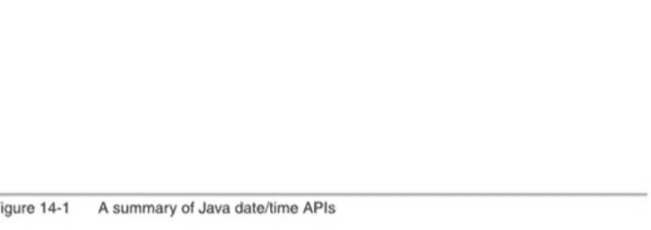

# 如何使用新的日期/时间 API

本章的其余部分将展示如何使用 Java 8 引入的新的日期/时间 API。因此，代码仅适用于 Java 8 及更高版本。对于新开发，这通常是没问题的。然而，如果你需要应用程序与旧版本的 Java 兼容，或者如果你需要修改旧应用程序的代码，你可能想要使用旧的日期/时间 API。

# 如何创建日期和时间对象

使用新的日期和时间 API，你通常从使用这三个类之一开始：`LocalDate`、`LocalTime` 或 `LocalDateTime`。顾名思义，`LocalDate` 类存储日期但不存储时间。相反，`LocalTime` 类存储时间但不存储日期。`LocalDateTime` 类则同时存储日期和时间。

所有这些类都从观察者的角度工作。换句话说，它们使用应用程序运行系统的时间和位置信息，并结合本地日期和时间。

图 14-2 显示了如何使用这些类创建日期和时间对象。所有这些类都使用返回日期和时间的静态方法。

`now()` 方法对这三个类的作用是相同的。它返回当前的本地时间、日期或日期和时间。例如，在图中第一条语句返回当前的本地日期，第二条语句返回当前的本地时间，第三条语句返回当前的本地日期和时间。

`of()` 方法根据是从 `LocalDate`、`LocalTime` 还是 `LocalDateTime` 调用而接收不同的参数。要创建一个 `LocalDate` 对象，你可以调用 `LocalDate` 类的 `of()` 方法并将年、月、日作为参数传递。要指定月份，你可以使用 `Month` 枚举提供的从 `JANUARY` 到 `DECEMBER` 的常量。或者，你也可以为月份指定一个整数值，其中一月为 1，以此类推。

创建一个 `LocalTime` 对象，你可以调用 `LocalTime` 类的 `of()` 方法并传递小时、分、秒和纳秒的整数值。这些是 24 小时格式的。

# 第 14 章 如何处理日期和时间

## java.time 包

| 类 | 描述 |
| :--- | :--- |
| LocalDate | 用于处理日期而非时间的类。 |
| LocalTime | 用于处理时间而非日期的类。 |
| LocalDateTime | 用于处理日期和时间的类。 |

| 枚举 | 描述 |
| :--- | :--- |
| Month | 包含月份（`JANUARY` 到 `DECEMBER`）的枚举。 |
| DayOfWeek | 包含星期几（`MONDAY` 到 `SUNDAY`）的枚举。 |

## LocalDate, LocalTime 和 LocalDateTime 的静态方法

| 方法 | 描述 |
| :--- | :--- |
| now() | 返回一个表示当前日期、时间或日期和时间的对象。 |
| of(parameters) | 根据指定的日期、时间或日期/时间返回一个对象。对于日期，你可以指定年、月、日参数。对于时间，你可以指定小时、分、秒和纳秒。秒和纳秒是可选的，默认值为 0。对于日期/时间，你可以指定所有参数。 |
| parse(string) | 根据字符串返回相应的对象。对于日期，你可以指定 `YYYY-MM-DD` 格式的字符串。对于时间，你可以指定 `HH:MM:SS.NNNNNN` 格式的字符串。对于日期/时间，日期和时间由 `T` 分隔。 |

## 创建日期/时间对象的代码

```
LocalDate currentDate = LocalDate.now();

LocalTime currentTime = LocalTime.now();

LocalDateTime currentDateTime = LocalDateTime.now();

LocalDate halloween1 = LocalDate.of(2017, Month.OCTOBER, 31);

LocalDate halloween2 = LocalDate.of(2017, 10, 31); 

LocalTime startTime1 = LocalTime.of(14, 32, 45); // 秒

LocalTime startTime2 = LocalTime.of(14, 32, 45, 123456789); // 纳秒

LocalDateTime startDateTime1 = LocalDateTime.of(2017, 10, 31, 14, 32);

LocalDate halloween3 = LocalDate.parse("2017-10-31");

LocalTime startTime4 = LocalTime.parse("02:32:45");

LocalDateTime startDateTime2 = LocalDateTime.parse("2017-10-31T02:32:45.123456789");
```

## 描述

- 这些类从观察者的角度表示本地日期和时间。
- `LocalDateTime` 类是 `LocalDate` 和 `LocalTime` 类的组合。

图 14-2 如何创建 LocalDate, LocalTime 和 LocalDateTime 对象

## 第 3 节 更多核心技能

如果任何值超出范围，这些方法通常会抛出 `DateTimeException`。例如，如果你指定的日期是 32 号，这些方法会抛出此异常，因为没有哪个月份有 32 天。同样，如果你指定了 25 小时或 61 秒，这些方法也会抛出此异常。

这三个类都有更多创建日期和时间的静态方法，但图 14-2 中展示的是最常用的。关于任何可用方法的更多信息，你可以参考这些类的 API 文档。

## 如何获取日期和时间部分

图 14-3 显示了你可以用于访问日期和时间各个部分的几种方法。`getMonth()` 和 `getValue()` 方法返回相同的信息，但格式不同。例如，如果日期设置为 2017 年 10 月 31 日，`getMonth()` 返回 `Month` 枚举中的 `OCTOBER` 常量。另一方面，`getValue()` 方法返回整数值 `10`。该值对应于 `Month` 枚举中的 `OCTOBER` 常量。

`Month` 枚举的 `toString()` 方法返回全大写的常量名称。因此，如果你向控制台打印 `Month` 枚举的常量，它将显示全大写的月份名称。

`LocalTime` 类支持此图中显示的所有方法。然而，`LocalTime` 类仅支持获取时间部分的方法。这是逻辑性的，因为在 `LocalDate` 对象上调用 `getHour()` 方法是没有意义的，因为该对象不存储时间。同样，在 `LocalTime` 对象上调用 `getYear()` 方法也没有意义，因为该对象不存储日期。

与大多数类不同，这些获取（get）方法没有对应的设置（set）方法。正如之前提到的，这些类的对象是不可变的。换句话说，一旦它们被构造出来，你就无法更改它们。

## 第 14 章 如何处理日期和时间

### 获取日期和时间对象部分的方法

| 方法 | 描述 |
| :--- | :--- |
| `getYear()` | 以整数返回当前年份。 |
| `getMonth()` | 以 `Month` 对象返回当前月份。 |
| `getMonthValue()` | 以 1 到 12 之间的整数返回当前月份。 |
| `getDayOfMonth()` | 以整数返回当前月的几号。 |
| `getDayOfYear()` | 以整数返回当年的第几天。 |
| `getDayOfWeek()` | 以 `DayOfWeek` 对象返回当前周几。 |
| `getHour()` | 以 24 小时格式的整数返回当前小时。 |
| `getMinute()` | 以整数返回当前小时的几分。 |
| `getSecond()` | 以整数返回分钟的几秒。 |
| `getNano()` | 以整数返回当前秒的纳秒。 |

### 获取 `LocalDateTime` 对象部分的代码

```
// 假设当前日期/时间为 2017 年 10 月 31 日 14:32:45.898000000

int year = currentTime.getYear();                          // 2017

Month month = currentTime.getMonth();                // OCTOBER

int monthValue = currentTime.getMonthValue();      // 10

int day = currentTime.getDayOfMonth();               // 31

int dayOfYear = currentTime.getDayOfYear();           // 304

DayOfWeek dayWeek = currentTime.getDayOfWeek();     // TUESDAY

int hour = currentTime.getHour();                    // 14

int minute = currentTime.getMinute();              // 32

int second = currentTime.getSecond();                // 45

int nano = currentTime.getNano();                      // 898000000
```

## 描述

- `LocalTime` 类支持所有的 get 方法。
- `LocalDate` 类仅支持与获取日期相关的 get 方法。
- `LocalDateTime` 类支持与获取日期和时间相关的所有 get 方法。
- `LocalDate`、`LocalTime` 和 `LocalDateTime` 对象是不可变的。因此，这些方法没有对应的设置方法。

图 14-3 如何获取日期和时间部分

## 如何比较日期和时间

图 14-4 显示了你比较日期和时间的几种方法。要确定一个日期或时间是否在另一个日期或时间之前，你可以使用 `isBefore()` 方法。例如，在图中，第一个示例检查当前日期是否在 2017 年 10 月 31 日之前。如果是，它会在控制台打印一条适当的消息。

要做到这一点，这段代码比较了两个 `LocalDate` 对象。然而，你也可以对两个 `LocalDateTime` 对象或两个 `LocalTime` 对象使用类似的技术。当你比较日期/时间对象时，你只能比较相同类型的对象。例如，你不能比较一个日期和一个时间。

相反，你可以使用 `isAfter()` 方法来确定一个日期或时间是否在另一个日期或时间之后。例如，在图中，第二个示例检查当前时间是否为 15:30（下午 3:30）。如果是，它会在控制台打印一条适当的消息。要做到这一点，这段代码比较了两个 `LocalTime` 对象。

在大多数情况下，你只需要使用 `isBefore()` 或 `isAfter()` 方法来比较日期。但在某些情况下，你可能需要使用 `compareTo()` 方法来确定一个日期/时间是在另一个日期/时间之前、之后还是相等。这之所以有效，是因为如果一个日期/时间在另一个日期/时间之前，`compareTo()` 方法会返回负值；如果在之后，则返回正值；如果相等，则返回 0。例如，在图中，第三个示例检查当前日期是否在 2017 年 10 月 31 日之前、之后或相等。

### 比较日期和时间的方法

| 方法 | 描述 |
| :--- | :--- |
| `isBefore(dateTime)` | 如果日期或时间在另一个日期或时间之前，则返回 true。否则返回 false。 |
| `isAfter(dateTime)` | 如果日期或时间在另一个日期或时间之后，则返回 true。否则返回 false。 |
| `compareTo(dateTime)` | 如果日期或时间在指定的日期或时间之前，则返回负值；如果在之后，则返回正值；如果与指定的日期或时间相等，则返回 0。 |

### 使用 `isBefore()` 方法的代码

```
LocalDate currentDate = LocalDate.now();

LocalDate halloween = LocalDate.of(2017, Month.OCTOBER, 31);

if (currentDate.isBefore(halloween)) {

    System.out.println("当前日期在万圣节之前.");

}
```

### 使用 `isAfter()` 方法的代码

```
LocalTime currentTime = LocalTime.now();

LocalTime startTime = LocalTime.of(15, 30);

if (currentTime.isAfter(startTime)) {

    System.out.println("当前时间在开始时间之后.")

}
```

### 使用 `compareTo()` 方法的代码

```
```


```java
LocalDate currentDate = LocalDate.now();

LocalDate halloween = LocalDate.of(2017, Month.OCTOBER, 31);

if (currentDate.compareTo(halloween) < 0) {

    System.out.println("当前日期在万圣节之前.");

} else if (currentDate.compareTo(halloween) > 0) {

    System.out.println("当前日期在万圣节之后.");

} else if (currentDate.compareTo(halloween) == 0) {

    System.out.println("当前日期是万圣节.");

}
```

## 描述

- 你可以使用这些方法比较 `LocalTime`、`LocalDate` 和 `LocalDateTime` 对象。


# 调整日期和时间的方法

| 方法 | 说明 |
| --- | --- |
| `withDayOfMonth(day)` | 返回一个基于原始的新对象，将一个月中的几更改为 day。 |
| `withDayOfYear(dayOfYear)` | 返回一个基于原始的新对象，将月份和一个月中的几设置为 dayOfYear (1 到 365)。 |
| `withMonth(month)` | 返回一个基于原始的新对象，将月份更改为 month。 |
| `withYear(year)` | 返回一个基于原始的新对象，将年份更改为 year。 |
| `withHour(hour)` | 返回一个基于原始的新对象，将小时更改为 hour。 |
| `withMinute(minute)` | 返回一个基于原始的新对象，将分钟更改为 minute。 |

## 一个针对月中几有异常的示例

```java
LocalDate date = LocalDate.of(2017, 10, 20);

LocalDate newState = date.withDayOfMonth(31);
```

## 一个由于月中几无效而抛出异常的示例

```java
LocalDateTime dateTime1 = LocalDateTime.parse("2017-02-28T15:30:0");

LocalDateTime newDateTime1 = dateTime1.withDayOfMonth(29);

// 抛出 DateTimeException，因为 2017 年不是闰年。

// 结果是2 月只有 28 天
```

## 一个静默更改月份的示例

```java
LocalDateTime dateTime2 = LocalDateTime.parse("2017-10-31T15:30:00");

LocalDateTime newDateTime2 = dateTime2.withMonth(2);

// 不抛出异常，静默地将日期改为 28

// 因为 2017 年 2 月只有 28 天。
```

- 为了调整日期/时间对象，你将使用这些方法，这些方法被称为调整器（adjusters）。
- 这些方法会从现有的日期/时间对象创建一个新对象。换句话说，它们不会修改现有的日期/时间对象。
- `LocalDateTime` 类支持表格中的所有方法。
- `LocalDate` 类仅支持与日期相关的方法。
- `LocalTime` 类仅支持与时间相关的方法。
- 对于超出范围的参数，这些方法可能会抛出 `DateTimeException`。
- 如果存储在月份中的当前日期在新月份的范围之外，`withMonth()` 方法可能会更改日期。


# 如何增加或减少一段时间的时间

图 14-6 显示了如何通过从现有日期或时间增加或减去指定的时间段来创建新的日期和时间对象。其中一种方法是使用 `plus()` 或 `minus()` 方法。这些方法接受两个参数。第二个参数是 `ChronoUnit` 枚举中的一个常量，用于指定时间单位。第一个参数指定单位的数量。

第一个示例展示了这些方法的工作原理。在这里，第一条语句使用 `plus()` 方法和 `ChronoUnit.WEEKS` 常量在当前日期基础上增加了三周。同样地，第二条语句使用 `minus()` 方法和 `ChronoUnit.DAYS` 常量从当前日期中减去一天。这两条语句都创建了一个 `LocalDateTime` 对象。相比之下，第三条语句使用 `plus()` 方法和 `ChronoUnit.HOURS` 常量创建了一个 `LocalDateTime` 对象，为当前时间增加了 12 小时。

此图中显示的所有 `ChronoUnit` 常量都有快捷方法。例如，你可以使用图中显示的 `plusWeeks()` 和 `minusWeeks()` 方法按指定的周数调整日期。同样，你可以使用 `plusHours()` 或 `minusHours()` 方法按指定的小时调整时间。第二个示例展示了如何使用这些方法中的某些来实现与第一个示例相同的功能。

图中的第三个示例展示了在调整日期时如何使用链式调用。在这里，代码创建了一个比当前日期时间晚几周三个小时的 `LocalDateTime` 对象。

正如你可能猜到的那样，`LocalDate` 类不支持处理时间的 `ChronoUnit` 常量或快捷方法。相反，`LocalTime` 类不支持处理日期的 `ChronoUnit` 常量或快捷方法。

新程序员的一个常见错误是，假设这些方法会更改存储在现有对象中的日期或时间。然而，与日期/时间 API 中的所有方法一样，这些方法返回新对象而不会改变现有对象。

此图仅列出了最常用的 `ChronoUnit` 常量。虽然还有其他常量，除非你需要处理非常小或大的时间单位，否则你可能不需要它们。

# 如何获取两个日期之间的时间

图 14-6 还显示了如何获取两个日期之间的时间。要做到这一点，你可以使用 `LocalDateTime` 或 `LocalDate` 类的 `until()` 方法，或者 `ChronoUnit` 枚举的 `between()` 方法。这两个方法都返回一个 `long` 值，表示两个日期之间你指定的单位数量。虽然在这里没有显示，但你也可以使用这些方法来计算日期/时间对象或时间对象之间的时间。

图 14-6 中的最后一个示例说明了这些方法的工作原理。在这里，第一条语句使用 `until()` 方法计算当前日期与截止日期之间的天数。第二条语句执行相同的计算，但它使用的是 `between()` 方法。

# 第 14 章 如何处理日期

## 增加或减少时间的方法

| 方法 | 说明 |
| --- | --- |
| `plus(amount)` | 返回一个基于原始的新对象，增加了指定的数量。 |
| `minus(amount)` | 返回一个基于原始的新对象，减去了指定的数量。 |
| `until(other)` | 返回当前日期与另一个日期之间的单位数量。 |
| `between(start, end)` | 返回两个日期之间的单位数量。 |

## ChronoUnit 的常用常量

| 单位 | 说明 |
| --- | --- |
| `YEARS` | 年 |
| `MONTHS` | 月 |
| `WEEKS` | 周 |
| `DAYS` | 天 |
| `HOURS` | 小时 |
| `MINUTES` | 分 |
| `SECONDS` | 秒 |
| `NANOS` | 纳秒 |

## 增加或减少时间的代码

```java
LocalDateTime dateTime = LocalDateTime.parse("2017-10-31T15:30:0");

LocalDateTime nextDateTime = dateTime.plus(1, ChronoUnit.DAYS);

LocalDateTime previousDateTime = dateTime.minus(2, ChronoUnit.HOURS);
```

## 增加或减少的快捷方法

`LocalDateTime` 和 `LocalDate` 类提供了增加减少时间的快捷方法。例如，你可以使用 `plusDays()`、`minusDays()`、`plusWeeks()`、`minusWeeks()` 等。

```java
LocalDateTime dateTime = LocalDateTime.parse("2017-10-31T15:30:00");

LocalDateTime nextDate = dateTime.plusDays(1);

LocalDateTime previousDate = dateTime.minusWeeks(2);
```

## 获取两个日期之间时间的代码

```java
LocalDate start = LocalDate.parse("2017-10-01");

LocalDate end = LocalDate.parse("2017-10-10");

long days = start.until(end, ChronoUnit.DAYS);

long daysBetween = ChronoUnit.between(start, end);
```

## 链式调整代码

你可以链多次方法调用来一次性进行多个调整。在这里，代码创建了一个比当前日期时间晚两周三个小时的 `LocalDateTime` 对象。

```java
LocalDateTime dateTime = LocalDateTime.parse("2017-10-31T15:30:00");

LocalDateTime result = dateTime.plus(2, ChronoUnit.WEEKS).plusHours(3);
```

## 格式化日期时间的代码

`DateTimeFormatter` 类用于将日期时间对象格式化为字符串。你可以使用静态方法创建常用的格式化器。

```java
DateTimeFormatter formatter = DateTimeFormatter.ofPattern("yyyy-MM-dd HH:mm");

String formattedDate = LocalDateTime.now().format(formatter);
```

## 用于格式化时间的类和枚举

```java
java.time.format.DateTimeFormatter

java.time.format.FormatStyle
```

## DateTimeFormatter 类的静态方法

| 方法 | 说明 |
| --- | --- |
| `ofLocalizedDate(dateStyle)` | 返回日期的 `DateTimeFormatter` 对象，但不包含时间。 |
| `ofLocalizedTime(timeStyle)` | 返回时间的 `DateTimeFormatter` 对象，但不包含日期。 |
| `ofLocalizedDateTime(dateTime)` | 返回日期和时间的 `DateTimeFormatter` 对象。 |
| `ofLocalizedDateTime(dateStyle, timeStyle)` | 返回日期和时间的 `DateTimeFormatter` 对象，但两者使用不同的格式。 |

## DateTimeFormatter 类的常用方法

| 方法 | 说明 |
| --- | --- |
| `format(dateTime)` | 返回格式化日期/时间的字符串。 |

## FormatStyle 枚举

| 常量 | 日期示例 | 时间示例 |
| --- | --- | --- |
| `FormatStyle.SHORT` | 10/31 | 6:30 PM |
| `FormatStyle.MEDIUM` | Oct 31, 2017 | 6:30:00 PM |
| `FormatStyle.LONG` | October 31, 2017 | DateTimeException |
| `FormatStyle.FULL` | Tuesday, October 31, 2017 | DateTimeException |

## 使用相同格式格式日期和时间的代码

```java
DateTimeFormatter dtf = DateTimeFormatter.ofLocalizedDateTime(FormatStyle.MEDIUM);

String currentDateTimeFormatted = dtf.format(currentDateTime);
```

## 使用单独格式格式日期和时间的代码

```java
DateTimeFormatter dtf = DateTimeFormatter.ofLocalizedDateTime(FormatStyle.LONG, FormatStyle.SHORT);

String currentDateTimeFormatted = dtf.format(currentDateTime);
```

## 说明

- 你可以使用 `ofLocalized` 方法根据运行应用程序的区域设置格式化日期和时间。
- 你可以使用 `FormatStyle` 来指定日期和时间的格式。
- 如果你尝试使用 `LONG` 或 `FULL` 格式格式化时间，编译器会抛出 `DateTimeException`。
- 如果 API 中包含的格式都不满足你的需求，你可以编写自己的格式化器。

图 14-7 如何格式化日期和时间

# 包含日期的 Invoice 类

图 14-8 显示如何向上一节介绍的 Invoice 类添加日期。首先，该类声明了一个 `LocalDateTime` 实例变量来存储发票日期。因此，发票日期包含日期和时间。

该类的构造函数将发票日期设置为当前日期。为了实现这一点，它使用了 `LocalDateTime` 类的 `now()` 方法。

如果你不想存储时间，可以使用 `LocalDate` 对象来存储日期。在图中，例如你可以使用 `LocalDate` 对象存储创建发票日期。然而，你可能也想知道发票创建的时间。因此，如图中类所示，存储额外数据通常是有意义的。

此类包含三个访问发票日期的方法。首先，`setInvoiceDate()` 方法允许你设置发票日期。例如，如果你从数据库获取 `Invoice` 对象的日期，可以使用此方法设置发票日期。其次，`getInvoiceDate()` 方法返回作为 `LocalDateTime` 对象的发票日期。

第三，`getInvoiceFormatted()` 方法在代码对 `LocalDateTime` 对象应用格式后返回发票日期的 `String` 对象。在此方法中，第一条语句创建一个只使用 `SHORT` 格式的日期格式化器。然后，第二条语句使用该格式化器格式化发票日期并返回生成的 `String` 对象。因此，方法只显示发票创建的日期，尽管 `Invoice` 对象也存储了发票创建的时间。如果这不是你想要的，可以向此类类添加更多方法，以其他格式获取日期和时间。

## 包含日期的 Invoice 类

```java
package murach.business;

import java.text.NumberFormat;

import java.time.LocalDateTime;

import java.time.format.DateTimeFormatter;

import java.time.format.FormatStyle;

import java.util.ArrayList;

public class Invoice {

    private ArrayList<LineItem> lineItems;

    private LocalDateTime invoiceDate;

    public Invoice() {

        lineItems = new ArrayList<>();

        invoiceDate = LocalDateTime.now();

    }

    public void addItem(LineItem lineItem) {

        lineItems.add(lineItem);

    }

    public ArrayList<LineItem> getLineItems() {

        return lineItems;

    }

    public double getTotal() {

        double invoiceTotal = 0;

        for (LineItem lineItem : lineItems) {

            invoiceTotal += lineItem.getTotal();

        }

        return invoiceTotal;

    }

    public String getInvoiceFormatted() {

        NumberFormat currency = NumberFormat.getCurrencyInstance();

        DateTimeFormatter dtf = DateTimeFormatter.ofLocalizedDate(FormatStyle.SHORT);

        return currency.format(dtf.format(invoiceDate));

    }

    public void setInvoiceDate(LocalDateTime invoiceDate) {

        this.invoiceDate = invoiceDate;

    }

    public LocalDateTime getInvoiceDate() {

        return invoiceDate;

    }

}
```


# 展望

当你完成本章后，应该理解 Java 8 之前的日期时间 API 与 Java 8 引入的新日期时间 API 之间的差异。

# Summary

- 在 Java 8 之前，使用 `java.util` 和 `java.text` 包处理日期和时间。
- 在 Java 8 之后，可以使用 `java.time` 包处理日期和时间。相比 `java.util` 包，它是线程安全的、更直观的且易于使用的。
- 你可以使用 `LocalDate`、`LocalTime`、`LocalDateTime` 以及 `ChronoUnit` 枚举来创建日期和时间。
- 你可以使用 `DateTimeFormatter` 类和 `FormatStyle` 格式化日期和时间。

# 练习 14-1 添加日期

在此练习中，你将修改上一节介绍的 `Invoice` 类以添加日期。

1. 打开名为 `ch14_ex1_Invoice` 的项目，它位于 `ex_starts` 文件夹中。然后，查看其代码。
2. 在 `Invoice` 类中，修改 `getLocalDate()` 方法使其返回 `SHORT` 格式。
3. 在 `Invoice` 类中，添加一个名为 `getDueDate()` 的方法。该方法应返回 30 天后的 `LocalDateTime` 对象。
4. 在 `Invoice` 类中添加一个名为 `getInvoiceFormatted()` 的方法。该方法应使用 `MEDIUM` 格式。
5. 在 `InvoiceApp` 类中，修改 `displayInvoice()` 方法使其显示如下发票日期和截止日期：

| 发票日期：4/1/17 |
| 发票截止日期：5/1/17 |
| 描述 | 价格 | 数量 | 总计 |
| Murach's Java | $57.50 | 2 | $115.00 |

6. 运行应用程序确保其工作正常。

# 练习 14-2 计算年龄

你将编写一个应用程序，获取用户的出生日期，计算其年龄并显示。完成后，控制台应该看起来所示：

```
欢迎使用年龄计算器

输入出生日期 (YYYY-MM-DD): 1968-02-04

您的出生日期是 1968年2月4日

当前日期是 2017年4月11日

您的年龄是49
```

1. 打开名为 `ch14_ex2_AgeCalculator` 的项目，它位于 `ex_starts` 文件夹中。然后，查看 `AgeCalculatorApp` 类。
2. 在该类中添加代码获取当前日期并将其存储在 `LocalDate` 对象中。
3. 添加代码解析用户输入的字符串以创建 `LocalDate` 对象。
4. 添加代码格式化并打印用户的出生日期。
5. 添加代码格式化并打印当前日期。
6. 添加代码计算并打印用户的年龄。
7. 运行应用程序，测试其在格式正确的日期下是否工作正常。
8. 运行应用程序并测试无效格式的日期（如 "Feb 4, 1968"）。这会导致异常发生。
9. 再次运行应用程序，输入一个当前日期之后的日期，并注意年龄显示为负数。为了修复这个问题，验证日期以确保它不是当前日期之后。如果是，则显示错误消息。再次运行应用程序以测试此更改。

## 15
## 如何处理文件 I/O

在本章中，你将学习如何处理文件输入和输出（或文件 I/O），涉及两种类型的文件：文本文件和二进制文件。虽然某些应用需要二进制文件，但尽可能的情况下优先使用文本文件，因为它们更具移植性，且对平台的依赖性较低。这就是为什么本章首先介绍处理文本文件的技能。

当你处理文件时，通常需要使用第 12 章中描述的集合以及第 13 章中描述的字符串。此外，本章还展示了如何实现一个与第 9 章所示相似的接口，该接口提供数据访问。因此，在学习本章的过程中，你可能想要回顾章节。

| 目录和文件的简介 ........................................ | 460 |
| 用于处理目录和文件的包 ............... | 460 |
| 处理目录和文件的代码示例.............................. | 462 |
| 文件 I/O 简介 ................................................................... | 464 |
| 文件和流的工作原理 ................................................................... | 464 |
| 文件 I/O 示例 ................................................................................. | 466 |
| 如何处理 I/O 异常 ............................................................ | 468 |
| 如何处理文本文件 ................................................................ | 470 |
| 如何将字符输出流连接到文件 ...................... | 470 |
| 如何向文件写入 ........................................................................ | 472 |
| 如何将字符输入流连接到文件 ........................ | 474 |
| 如何从文件读取 ....................................................................... | 476 |
| 用于数据访问的两个接口 ............................................................ | 476 |
| 处理文本文件的类 ........................................................ | 480 |
| 产品管理器应用程序 ................................................ | 484 |
| 控制台 ..................................................................................... | 484 |
| ProductManagerApp 类 ............................................................ | 484 |
| 如何处理二进制文件 ............................................................ | 488 |
| 如何将二进制输出流连接到文件 ............................ | 488 |
| 如何向二进制文件写入 ............................................................ | 490 |
| 如何将二进制输入流连接到文件 ............................ | 492 |
| 如何从二进制文件读取 ....................................................... | 492 |
| 处理二进制文件的类 ................................................ | 494 |
| 观点 ..................................................................................... | 498 |

## 目录和文件的简介

在 Java 7 之前，通常使用 `java.io` 包中的 `File` 类对目录和文件执行一些基本操作。然而，该类有许多局限性。这就是为什么 Java 7 引入了 `java.nio.file` 包（也称为 NIO.2）。该包提供了一种访问默认文件系统的改进方法。因此，使用该包的类和接口来处理目录和文件通常认为最佳实践。

## 用于处理目录和文件的包

图 15-1 首先展示了 `java.nio.file` 包中 `Paths` 类的静态 `get()` 方法。你可以向此方法传递一个或多个字符串，返回一个代表目录或文件路径的 `Path` 对象。`Path` 对象包含了表示路径中目录和文件的名称元素。例如，路径

```
c:\murach\java\files\products.txt
```

包含了三个目录和一个文件的名称元素。此外，它还包含了根组件 "c:"

一旦你拥有了 `Path` 对象，就可以使用 `Path` 接口的方法来获取有关路径的信息。例如，你可以使用 `getName()` 方法获取指定索引处名称元素的 `Path` 对象。索引指的是名称元素在路径中的位置，第一个元素位于索引 0 处。

你还可以使用 `Files` 类的静态方法来获取有关路径的信息。例如，你可以使用前四个方法检查路径是否存在，以及你是否可以从路径读取或向路径写入。同样，你可以使用接下来的两个方法来测试路径是指目录还是文件。如果路径指向文件，你可以使用 `size()` 方法返回文件中的字节数。

要显示目录的内容，你可以结合 `Path` 对象使用 `newDirectoryStream()`。该方法返回一个 `DirectoryStream<Path>` 对象。然后，你可以使用它遍历该目录下的所有子目录和文件。你将在下一图中看到一个其工作原理的示例。

你可以使用 `Files` 类的最后四个方法来创建和删除目录及文件。如果这些方法执行失败，它们会抛出异常，这能让你很好地了解失败的原因。例如，如果你尝试创建一个已经存在的文件，或者尝试删除一个包含文件的目录，你将获得 `FileAlreadyExistsException` 或 `DirectoryNotEmptyException`。为了处理这些异常，你可以像本章稍后所示的那样使用 `try` 语句。

在回顾这些方法时，你应该知道它们是 `java.nio.file` 包中最常用的方法之一。因此，如果你需要执行其他文件处理任务，可以参考该包的 Java API。

## 第 15 章 如何处理文件 I/O 461

### 用于处理目录和文件的包 java.nio.file

### Paths类的静态方法

| 方法 | 说明 |
| :--- | :--- |
| get(String, String...) | 返回字符串路径的 `Path` 对象 |

### Path 接口的方法

| 方法 | 说明 |
| :--- | :--- |
| getFileName() | 返回文件或目录名称的 `Path` 对象 |
| getName(int) | 返回指定索引处元素的 `Path` 对象 |
| getNameCount() | 返回路径中名称元素的 int 值 |
| getParent() | 如果存在，则返回父路径的 `Path` 对象；如果不存在则返回 null |
| getRoot() | 如果存在，则返回根组件的 `Path` 对象；如果不存在则返回 null |
| toAbsolutePath() | 返回文件或目录绝对路径的 `Path` 对象 |
| toFile() | 返回路径对应的 `File` 对象 |

### Files 类的静态方法

| 方法 | 说明 |
| :--- | :--- |
| exists(Path) | 如果路径存在则返回 true |
| notExists(Path) | 如果路径不存在则返回 true |
| isReadable(Path) | 如果路径存在且可读则返回 true |
| isWritable(Path) | 如果路径存在且可写则返回 true |
| isDirectory(Path) | 如果路径存在并指向目录则返回 true |
| isRegularFile(Path) | 如果路径存在并指向普通文件则返回 true |
| size(Path) | 返回文件字节数的 long 值 |
| newDirectoryStream(Path) | 返回一个 `DirectoryStream<Path>` 对象，你可以用它遍历目录下的所有文件和目录 |
| createFile(Path) | 如果不存在，则为指定的 Path 对象创建一个新文件；返回该文件的 `Path` |
| createDirectory(Path) | 如果目录不存在且所有父目录存在，则为指定的 Path 对象创建一个新目录；返回该目录的 `Path` 对象 |
| createDirectories(Path) | 创建由指定的 Path 表示的新目录，包括任何必要的不存在的父目录；返回该目录的 `Path` 对象 |
| delete(Path) | 删除由 Path 对象表示的文件或目录。目录为空时才能删除 |

## 说明

- 你可以使用 `Path` 对象来处理目录或文件。

图 15-1 用于处理目录和文件的包


# 用于目录和文件操作的代码示例

图 15-2 中的第一个示例展示了如何创建一个新目录。要执行此操作，第一条语句创建一个指向目录的字符串。在这种情况下，该目录是 C 盘上的 `c:\murach\java\d`。然后，第二条语句使用 `Paths` 类为该目录创建一个 `Path` 对象。最后，通过一条语句检查该目录是否已存在。如果不存在，则调用 `Paths` 类的静态方法 `createDirectories()` 来创建该目录以及任何必要的父目录。

第二个示例展示了如何创建一个新文件。要执行此操作，第一条语句创建一个包含文件名的字符串。然后，第二条语句获取一个指向该目录和文件的 `Path` 对象。在这种情况下，文件名为 `products.txt`，目录为 `\murach\java\files`。如果文件不存在，最后一条调用 `Files` 类的静态方法 `createFile()` 来创建该文件。

在回顾时，请注意 `Paths` 类的 `get()` 方法包含两个参数：一个用于目录，一个用于文件。当你像这样调用 `get()` 方法时，它会将参数合并并使用分隔符将它们分开。在大多数情况下，分隔符与参数中用于分隔名称元素的字符相同。在此情况下，分隔符是正斜杠。

此外，请注意 `Path` 对象包含一个绝对路径名。换句话说，此示例指定了文件的完整路径和文件名。然而，如果你想创建一个指向与应用程序位于同一目录下的文件的 `Path` 对象，可以使用相对路径。要这样做，只需指定文件名即可。

第三个示例展示了如何获取第二个示例中创建的 `Path` 对象的信息。下方的输出显示了三条语句的结果。首先，`getFileName()` 方法返回文件名。然后，`toAbsolutePath()` 方法返回代表完整路径的 `Path` 对象。最后，`Files` 类的 `isWritable()` 方法返回 `true`，表示该文件不是只读（这是默认设置）。

第四个示例展示了如何列出目录中的文件名。首先，一条语句检查路径是否存在以及是否为目录。如果是，则 `Files` 类的静态方法 `newDirectoryStream()` 将返回一个 `DirectoryStream<Path>` 对象。最后，这段代码遍历该流中的所有 `Path` 对象，检查该 `Path` 是否为文件，如果是则将文件名打印到控制台。

如果你在 Windows 环境下工作，可能会惊讶地发现你使用正斜杠而不是反斜杠来分隔路径部分。这是因为 Java 使用反斜杠来标识转义字符。这使得在指定路径时使用反斜杠变得不方便。然而，使用正斜杠对于 Windows 和 Linux 等其他操作系统都足够有效。这些示例的输出显示，Java API 在必要时会自动将正斜杠转换为反斜杠。

# 如果目录不存在则创建目录的代码

```java
String dirString = "c:/murach/java/files";

Path dirPath = Paths.get(dirString);

if (Files.notExists(dirPath)) {

    Files.createDirectories(dirPath);

}
```

# 如果文件不存在则创建文件的代码

```java
String fileName = "products.txt";

Path filePath = Paths.get(dirString, fileName);

if (Files.notExists(filePath)) {

    Files.createFile(filePath);

}
```

# 显示文件信息的代码

```java
System.out.println("File name: " + filePath.getFileName());

System.out.println("Absolute path: " + filePath.toAbsolutePath());

System.out.println("Is writable: " + Files.isWritable(filePath));
```

# 输出结果显示

| 字段 | 值 |
| :--- | :--- |
| 文件名 | products.txt |
| 绝对路径 | c:\murach\java\files |
| 可写 | true |

# 列出目录文件的代码

```java
if (Files.exists(dirPath) && Files.isDirectory(dirPath)) {

    System.out.println("Directory: ");

    DirectoryStream<Path> dirStream = Files.newDirectoryStream(dirPath);

    for (Path p : dirStream) {

        if (Files.isRegularFile(p)) {
```


# 文件 I/O 示例

为了让你对文件 I/O 有整体了解，图 15-4 显示如何从文本文件中读取和写入内容。首先，第一个示例展示了如何导入两个用于文件 I/O 的包。由于大多数用于文件 I/O 的类都存储在 `java.io` 包中，因此任何处理文件 I/O 的类通常都会导入此包中的所有类。此外，`java.io` 包的导入语句可以方便你使用本章之前描述的类（`Paths` 和 `Files`）以及接口（`Path`）。

第二个示例展示了如何创建一个指向 `data.txt` 文件的 `File` 对象。首先，第一个语句创建一个指向该文件的 `Path` 对象。由于没有为文件指定目录，该 `Path` 指向存储工作目录中的文件（通常是启动应用程序的目录）。然后，第二个语句调用 `Path` 的 `toFile()` 方法将其转换为 `File` 对象。这是必要的，因为 `java.io` 包中的许多类被设计为与 `File` 对象配合，而不是直接与 `Path` 对象配合。

第三个示例展示了如何向文件写入数据。首先，你创建一个输出流。为了创建一个包含你所有所需功能的流，你可以将两个或多个对象分层到一个流中。在这个示例中，代码通过 `PrintWriter`、`BufferedWriter` 和 `FileWriter` 对象创建了一个输出流。

`BufferedWriter` 对象为流添加了一块被称为“缓冲区”（buffer）的内部内存块。这导致流中的数据在写入输出设备之前先存储在缓冲区中。然后，当缓冲区满或流被关闭时，所有数据都将通过单次 I/O 操作刷新到磁盘文件。同样，当你使用缓冲区进行输入时，整个缓冲区的数据会在单次 I/O 操作中被读取。

缓冲的好处是它减少了磁盘设备执行的 I/O 操作次数。对于每次 I/O 操作，磁盘都必须旋转到起始磁盘位置。由于这种旋转相对于内部操作非常缓慢，缓冲极大地提升了 I/O 操作的性能。这就是为什么除了最微不足道的磁盘操作外，你应该在所有情况下都使用缓冲区。

在创建输出流后，代码使用输出流的 `println()` 方法将数据写入文件。然后，它调用流的 `close()` 方法。这会将缓冲区中的任何数据刷新到文件，并释放与输出流相关的任何系统资源。

第四个示例读取了第三个示例写入的数据。首先，读取文件的第一行并将该行打印到控制台。最后，代码关闭输入流，这会刷新缓冲区并释放所有与输入流相关的系统资源。

由于此图旨在让你了解文件 I/O 的工作原理，如果你没有完全理解，也不必担心。随着本章的深入，你将更详细地学习这里显示的所有类和方法。此外，你应该知道，除非你按照下一个图所示的那样处理它抛出的异常，否则该代码将无法编译。

# 导入所有必要的包

```java
import java.io.*;
import java.nio.file.*;
```

# 获取文件的 Path 对象

```java
Path productsPath = Paths.get("products.txt");
File productsFile = productsPath.toFile();
```

# 向文件写入数据

```java
// 打开输出流
PrintWriter out = new PrintWriter(
    new BufferedWriter(
        new FileWriter(productsFile)));

// 向流写入数据
out.println("java\tMurach's Java Programming\t57.50");

// 关闭输出流并释放系统资源
out.close();
```

# 从文件读取数据

```java
// 打开输入流
BufferedReader in = new BufferedReader(
    new FileReader(productsFile));

// 从流读取数据并打印到控制台
String line = in.readLine();
System.out.println(line);

// 关闭输入流并释放系统资源
in.close();
```

# 结果输出

| java | Murach's Java Programming | 57.50 |

## 描述

- `java.io` 包包含了许多类，可用于处理具有不同功能的各种流。
- 为了获得流所需的功能，你通常需要组合或层叠两个或多个流。随着本章的深入，你将学习更多关于其工作原理。
- 为了使磁盘处理更高效，你可以使用缓冲流，它会在流中添加一块被称为缓冲区的内部内存块。
- 在使用缓冲区时，你通常需要刷新缓冲区。这会将缓冲区中的所有数据发送到 I/O 设备。其中一种方法是使用 `try-with-resources` 语句，在使用后自动关闭 I/O 流。详情请见图 15-4。


# 如何处理 I/O 异常

如果你读过第 5 章，你应该熟悉用于捕获和处理异常的简单 `try` 语句。现在，图 15-5 显示了如何处理 I/O 操作抛出的最常见异常。

首先，此图总结了执行 I/O 操作的类经常抛出的三种异常。`IOException` 类是最通用的 I/O 异常类型，另外两个异常类继承自它，这两个异常类用于更具体的 I/O 异常。特别是，当程序尝试读取文件末尾（EOF）时，会抛出 `EOFException`；当程序尝试打开一个找不到的文件时，会抛出 `FileNotFoundException`。

在处理 I/O 异常时，你需要知道 `IOException` 类及其所有子类被称为**检查异常**（checked exceptions），因为编译器会检查以确保你已经处理了这些异常。因此，在编译程序之前，你必须编写处理这些异常的代码。

图中的示例开始展示如何防止 `FileNotFoundException`。要做到这一点，代码获取了该文件的 `Path` 对象。然后，它使用 `File` 类的 `exists()` 方法检查该路径是否存在文件。如果是，则执行 `if` 块中的代码。否则，`else` 块中的代码将向控制台打印一条文件不存在的消息。

在块内部，第一条语句将 `Path` 对象转换为 `File` 对象。然后，使用 `try-with-resources` 语句为文件创建一个输入流。这是一种特殊的 `try` 语句，你可以用它初始化使用系统资源的对象。它在执行完毕后会自动关闭对象并释放其资源。这是在 Java 7 中引入的。在 `try` 块中，循环从读取第一记录开始。只要返回的字符串不空，循环就会继续，空表示文件结束。

# IOException 的子集

```text
IOException
EOFException
FileNotFoundException
```

# 常见的 I/O 异常

| 异常 | 描述 |
| --- | --- |
| IOException | I/O 处理发生错误时抛出。 |
| EOFException | 程序尝试读取文件之外时抛出。 |
| FileNotFoundException | 程序尝试打开不存在的文件时抛出。 |

# try-with-resources 语句的语法

```java
try (资源初始化语句) { 语句 }
catch (异常类型 异常对象) { 语句 }
```

# 处理异常的代码

```java
Path productsPath = Paths.get("products.txt");

if (Files.exists(productsPath)) { // 防止 FileNotFoundException
    File productsFile = productsPath.toFile();

    try (BufferedReader reader = new BufferedReader(new FileReader(productsFile))) {
        String line = null;

        while (line != null) { // 防止 EOFException
            System.out.println(line);
            line = reader.readLine();
        }
    } catch (IOException e) { // 捕获 IOException
        System.out.println(e); // 将异常打印到控制台
    }
} else {
    System.out.println(productsPath.toAbsolutePath() + " 不存在");
}
```

# 如何处理文本文件

## 如何将字符输出流连接到文件

在处理文本文件时，你需要分层两个或多个类，以创建一个用于输入或输出的字符流。你将在接下来的主题中学习如何这样做。此外，你将学习如何使用这些类的方法来处理文本文件。然后，你将看到一个完整的类，可以使用它在文本文件中存储 `Product` 对象。

在写入文本文件之前，你需要创建一个字符输出流，并将该流连接到文件。为了做到这一点，你必须像图 15-6 所示，在 `Writer` 层次结构中分层两个或多个类。然后，你将使用 `PrintWriter` 类的方法将数据写入输出流，使用 `BufferedWriter` 类为输出流创建一个缓冲区，并使用 `FileWriter` 类将流连接到文件。

虽然使用缓冲区通常是一个良好的编码实践，但图中的第一个示例展示了如何在不使用缓冲区的情况下连接到文件。在这里，此语句通过向 `FileWriter` 类的构造函数传递 `String` 对象作为路径名来创建一个 `FileWriter` 对象。或者，此语句也可以向此构造函数传递一个 `File` 对象作为文件。无论哪种方式，第二个语句都通过将 `FileWriter` 对象传递给 `PrintWriter` 类的构造函数来创建一个 `PrintWriter` 对象。

第二个示例展示了连接第一个示例的更简洁的方法。在这里，你没有将 `FileWriter` 对象赋值给命名变量。相反，你在 `PrintWriter` 类的构造函数内部创建了 `FileWriter` 对象。你可以按照你喜欢的方式对齐这些嵌套的构造函数调用。例如，整个语句写在一行上，但如果像接下来的三个示例那样将每个构造函数写在单独的一行，通常更容易阅读。

第三个示例展示了如何在输出流中包含缓冲区。为了这样做，除了 `FileWriter` 和 `PrintWriter` 对象外，你还使用 `BufferedWriter` 对象。

第四个示例展示了如何向现有文件追加数据。为了做到这一点，你将 `FileWriter` 构造函数的第二个参数设置为 `true`。如果你没有为此参数编写值，文件中的现有数据将被覆盖。

默认情况下，当缓冲区满时，输出流中的数据会缓冲区刷新到磁盘。然而，如果你将 `PrintWriter` 构造函数的第二个参数设置为 `true`，则开启自动刷新（autoflush）功能。这样每当你执行 `println()` 方法时，缓冲区都会被刷新。因为这可能导致效率低下，我们不会包含此参数。

图中的构造函数应该帮助你理解如何分层输出流。`PrintWriter` 构造函数接受任何派自 `Writer` 类的类。因此，你可以提供 `BufferedWriter` 对象或 `FileWriter` 对象作为此构造函数的参数。同样，`BufferedWriter` 构造函数也接受任何 `Writer` 对象，你可以提供一个 `FileWriter` 对象作为此构造函数的参数。

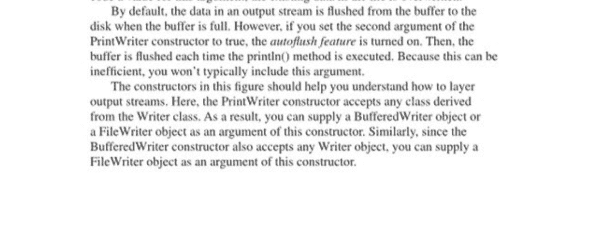

## Writer 层次结构的子集

```text
Writer <<abstract>>
BufferedWriter
PrintWriter
OutputStreamWriter
FileWriter
```

## 用于将字符输出流连接到文件的类

- `PrintWriter` 包含向文本流写入数据的方法
- `BufferedWriter` 为流创建缓冲区
- `FileWriter` 将流连接到文件

## 这些类的构造函数

| 构造函数 | 抛出异常 (Throws) |
| --- | --- |
| `PrintWriter(Writer, boolean autoFlush)` | None |
| `BufferedWriter(Writer)` | None |
| `FileWriter(File, boolean append)` | IOException |
| `FileWriter(String fileName, boolean append)` | IOException |

## 如何无缓冲区连接（不推荐）

```java
FileWriter filewriter = new FileWriter("products.txt");
PrintWriter out = new PrintWriter(filewriter);
```

## 编写上一个示例的简洁方法

```java
PrintWriter out = new PrintWriter(new FileWriter("products.txt"));
```

## 如何带缓冲区连接到文件

```java
PrintWriter out = new PrintWriter(
    new BufferedWriter(
        new FileWriter("products.txt"))
);
```

## 如何为追加操作连接

```java
PrintWriter out = new PrintWriter(
    new BufferedWriter(
        new FileWriter("products.txt", true))
);
```

## 如何开启自动刷新功能连接

```java
PrintWriter out = new PrintWriter(
    new BufferedWriter(
        new FileWriter("products.txt", true)),
    true
);
```

## 描述

- `Writer` 是一个抽象类，`Writer` 层次结构中的所有类都继承自它。
- 如果在创建 `FileWriter` 对象时输出文件不存在，它将被自动创建。如果它已存在，默认情况下会被覆盖。如果这不是你想要的，你可以为构造函数的第二个参数指定为 `true` 以向文件追加数据。
- 如果你为 `PrintWriter` 构造函数的第二个参数指定为 `true`，则自动刷新功能会在每次调用 `println()` 方法时刷新缓冲区。

图 15-6 如何将字符输出流连接到文件

## 如何写入文本文件

图 15-7 显示了如何写入文本文件。为了这样做，你使用 `print()` 和 `println()` 方法将数据写入文件。这些方法的作用与 `System.out` 对象的 `print()` 和 `println()` 方法类似，但它们是将数据写入输出流而不是控制台。

通常，你使用 `try-with-resources` 语句来创建之前所示的流。

## 如何将字符输入流连接到文件

在从文本文件中读取字符之前，你必须将字符输入流连接到文件。图 15-8 显示了如何使用缓冲区和 `File` 对象来实现此。要做到这一点，你需要提供一个 `FileReader` 对象作为 `BufferedReader` 类构造函数的参数。这会创建一个使用缓冲区的流，并包含你可以用于读取数据的方法。

如果你查看了 `BufferedReader` 和 `FileReader` 类的构造函数，就可以理解为什么这段代码有效。由于 `BufferedReader` 对象的构造函数接受 `Reader` 层次结构中的任何对象，因此它可以接受一个将流连接到文件的 `FileReader` 对象。然而，`BufferedReader` 对象也可以接受 `InputStreamReader` 对象，它可以用于将字符输入流连接到键盘或网络连接，而不是文件。

## Reader 层次结构的子集

- `Reader` <<抽象类>>
- `BufferedReader`
- `InputStreamReader`
- `FileReader`

## 用于通过缓冲区连接文件的类

- `BufferedReader` 包含了从流中读取数据的方法
- `FileReader` 将流连接到文件

## 这些类的构造函数

| 构造函数 | 抛出异常 |
| --- | --- |
| `BufferedReader(Reader)` | 无 |
| `FileReader(File)` | FileNotFoundException |
| `FileReader(String pathname)` | FileNotFoundException |

## 如何将字符输入流连接到文件

```java
BufferedReader in = new BufferedReader(new FileReader("products.txt"));
```


## Reader 类层次结构

- `Reader` 类是一个抽象类，`Reader` 层次结构中的所有类都继承自它。`java.io` 包中所有以 Reader 结尾的类都是 `Reader` 层次结构的成员。
- 虽然你可以单独使用 `FileReader` 类读取文件，但 `BufferedReader` 类提高了效率并提供了更好的读取字符输入流的方法。

**图 15-8** 如何将字符输入流连接到文件

## 如何从文本文件中读取

**图 15-9** 中的两个示例显示了如何读取图 15-7 示例写入的两个文本文件。在第一个示例中，第一个语句使用 `readLine()` 方法读取日志文件的第一条记录。然后，使用 `while` 循环将当前记录打印到控制台并读取下一条记录。当 `readLine()` 方法尝试读取文件末尾之外，它会返回 `null`，这导致 `while` 循环结束。然后，这段代码调用 `close()` 方法关闭输入流，这会刷新缓冲区。

第二个示例显示了如何从产品文件中读取一条记录。要做到这一点，它使用了 `readLine()` 方法。由于该文件是分隔符文本文件，它将字符串解析为各个单独的字段。为了这样做，它使用 `String` 类的 `split()` 方法将字符串拆分为数组。在这个示例中，制表符被作为 `split()` 方法的参数，因为它是记录中字段的分隔符。

该示例继续通过从 `fields` 数组中的数据创建 `Product` 对象。包含这些值的字段可以直接传递给 `Product` 对象的构造函数。然而，价格字段必须从 `String` 对象转换为 `double` 数值。为了做到这一点，此示例使用了 `Double` 类的 `parseDouble()` 方法。

在创建 `Product` 对象后，将其打印到控制台。最后，调用 `BufferedReader` 类的 `close()` 方法来刷新缓冲区并释放任何系统资源。

## BufferedReader 类的常用方法

| 方法 | 抛出异常 | 描述 |
|---|---|---|
| `readLine()` | `IOException` | 读取一行文本并以字符串形式返回。 |
| `close()` | `IOException` | 关闭输入流并刷新缓冲区。 |

## 读取文本文件中记录的代码

```java
// 读取记录的记录
String line = in.readLine();

while(line != null) {
    System.out.println(line);
    line = in.readLine();
}

// 关闭输入流
in.close();
```

## 示例输出

此应用程序运行于 2017-04-28T12:06:55.084
此应用程序运行于 2017-04-28T12:07:28.041

## 从分隔符文本文件中读取 Product 对象的代码

```java
// 读取文件的下一行
String line = in.readLine();

// 将行解析为各个字段
String[] fields = line.split("\t");

String code = fields[0];
String description = fields[1];
String price = fields[2];

// 从 fields 数组中的数据创建 Product 对象
Product p = new Product(code, description, Double.parseDouble(price));

// 打印 Product 对象
System.out.println(p);

// 关闭输入流
in.close();
```

## 示例输出

Code: java
Description: Murach's Java Programming
Price: $57.50

**图 15-9** 如何从文本文件中读取

## 用于数据访问的接口

在第 9 章中，你看到了一个 `ProductDAO` 接口，它为数据访问对象（DAO）定义了 I/O 方法和常量。现在，**图 15-10** 展示了一个类似的接口，可以使用它访问数据。与第 9 章中的接口不同，此接口没有继承其他接口。它定义了它所需的所有方法。

此接口与第 9 章中的接口有两个主要区别。第一，它不包含常量。第二，它返回一个 `List` 而不是单个对象。

`ProductDAO` 接口的问题是它只适用于一种类型，即 `Product` 对象。幸运的是，Java 的泛型特性使得重写此接口以适用于多种类型成为可能。要做到这一点，可以使用如图所示的 `DAO` 接口。

实现 `DAO` 接口时，在类声明中指定要工作的类型。例如，如果你声明该类实现了 `DAO<Customer>` 接口，那么它将适用于 `Customer` 对象而不是 `Product` 对象。

## ProductDAO 接口

```java
package murach.db;

import java.util.List;
import murach.business.Product;

public interface ProductDAO {
    Product get(String code);
    List<Product> getAll();
    boolean add(Product p);
    boolean update(Product p);
    boolean delete(Product p);
}
```

实现此接口类

```java
public class ProductTextFile implements ProductDAO {
    public Product get(String code);
    public List<Product> getAll();
    public boolean add(Product p);
    public boolean update(Product p);
    public boolean delete(Product p);
}
```

## DAO 接口

```java
package murach.db;

import java.util.List;

public interface DAO<T> {
    T get(String code);
    List<T> getAll();
    boolean add(T t);
    boolean update(T t);
    boolean delete(T t);
}
```

实现此接口类

```java
public class ProductTextFile implements DAO<Product> {
    public Product get(String code);
    public List<Product> getAll();
    public boolean add(Product p);
    public boolean update(Product p);
    public boolean delete(Product p);
}
```

## 描述

- 图中的两个接口都定义了用于数据访问的对象，或数据访问对象（DAO）。
- 第一个接口只适用于 `Product` 对象，但第二个接口使用泛型，因此它可以适用于多种对象。


## 一个处理文本文件的类

**图 15-11** 显示了 `ProductFile` 类，它可以用于向文本文件读取和写入产品。该类实现了**图 15-10**所示的 `DAO<Product>` 接口。因此，它实现了该接口的所有公共方法。此外，它还包含一个名为 `saveAll()` 的私有方法，该方法被其中某些方法调用。

首先，该类定义了三个实例变量和一个常量。`List` 用于存储文件中产品的 `Product` 对象列表，`Path` 对象定义了文件的路径，而 `File` 对象将输入输出流连接到文件。然后，`FIELD_SEP` 常量定义了用于分隔产品文件中字段的字符。

`ProductFile` 类的构造函数初始化了实例变量。为此，它为名为 `products.txt` 的文件创建一个 `Path` 对象，该文件存储在工作目录中（通常是应用程序的根目录）。然后，构造函数使用 `Path` 对象的 `toFile()` 方法将路径转换为 `File` 对象。最后，它调用 `getAll()` 方法获取所有列表。

`getAll()` 方法返回文件中存储的所有产品的 `Product` 对象列表。该方法首先检查产品列表是否已创建。如果是，则返回该列表。这种只在需要时才读取文件的方法提高了效率。

如果 `List` 尚未创建，这段代码将创建一个空的 `Product` 对象 `ArrayList`。然后，它会检查产品文件是否存在。如果存在，它将使用 `try-with-resources` 语句创建一个缓冲输入流。

为了创建产品，该方法首先从产品文件中读取第一行到一个字符串变量中。然后，它使用 `while` 循环处理文件中的行，直到到达文件末尾。正如你在本章较之前学到的，可以通过检查 `readLine()` 方法返回的字符串是否为 `null` 来测试文件结束条件。

在 `while` 循环内部，第一条语句使用 `FIELD_SEP` 常量将行拆分为三个字段（代码、描述和价格）。然后，该循环根据这些字段中的值创建一个 `Product` 对象，并将该 `Product` 添加到列表中。最后，该循环读取文件的下一行。

如果在 `getAll()` 某处抛出了 `IOException`，则该方法将返回 `null`。这意味着任何调用 `getAll()` 方法的方法都可以通过检查执行是否成功或是否返回了 `null` 来进行。无论是否抛出异常，`try-with-resources` 语句都会自动关闭输入。

在此类中，所有的 `catch` 语句（包括 `getAll()` 中的那个）都会将异常打印到控制台。这在测试和调试程序时有用，但在将程序投入生产环境时可能并不合适。因此，在将类放入生产环境之前，你可能希望更改处理异常的方式。例如，你可能想将异常写入日志文件，或者你可能想抛出一个指示发生数据访问错误的自定义异常。关于如何进行这些操作的更多信息，请参阅下一章。

## ProductTextFile 类

### 第 1 页

```java
package murach.db;

import java.io.*;
import java.nio.file.*;
import java.util.*;
import murach.business.Product;

public class ProductTextFile implements DAO<Product> {
    private List<Product> products = null;
    private Path productsPath = null;
    private File productsFile = null;
    private final String FIELD_SEP = "\t";

    public ProductTextFile() {
        productsPath = Paths.get("products.txt");
        productsFile = productsPath.toFile();
        products = this.getAll();
    }

    @Override
    public List<Product> getAll() {
        // 如果产品文件已经读取过，则不再读取
        if (products == null) {
            return products;
        }

        products = new ArrayList<>();

        if (Files.exists(productsPath)) {
            try (BufferedReader in = new BufferedReader(
                new FileReader(productsFile))) {

                // 从文件读取产品到数组列表
                String line = in.readLine();

                while (line != null) {
                    String[] fields = line.split(FIELD_SEP);
                    String code = fields[0];
                    String description = fields[1];
                    String price = fields[2];

                    Product p = new Product(
                        code, description, Double.parseDouble(price));
                    products.add(p);

                    line = in.readLine();
                }

            } catch (IOException e) {
                System.out.println(e);
                return null;
            }
        } else {
            System.out.println(productsPath.toAbsolutePath() + " 不存在.");
            return null;
        }

        return products;
    }
}
```

**图 15-11** 一个处理文本文件的类（2 部分中的第 1 部分）

`get()` 方法返回与指定产品代码匹配的 `Product` 对象。为了搜索产品，该方法遍历 `products` 列表中的每个产品，直到找到具有指定产品代码的产品。然后返回该对象。如果没有找到具有指定代码的产品，该方法将返回 `null`。

`saveAll()` 方法将所有 `Product` 对象写入文件。如果此操作成功，它返回一个 `true` 值。如果抛出了 `IOException`，则该方法返回一个 `false` 值。

`saveAll()` 方法首先创建一个连接到文件的缓冲输出流。然后，该方法使用循环将列表中的每个产品写入文件。为此，它使用 `FIELD_SEP` 常量分隔产品记录中的每个字段，并使用 `println()` 方法在每个产品记录的末尾插入换行符。

`add()` 方法首先将产品添加到列表。然后，它调用 `saveAll()` 方法将修改后的列表保存到产品文件。这样，产品列表和文件就包含相同的数据。`add()` 方法返回该操作的布尔值。

`delete()` 方法的工作原理类似。它首先从列表中删除产品。然后调用 `saveAll()` 方法将产品列表保存到文件，并返回该操作的布尔值。

`update()` 方法的工作方式略有不同。它更新新产品中的数据。首先，该方法使用 `get()` 方法获取与新 `Product` 对象具有相同代码的旧 `Product` 对象。然后，获取旧产品的索引，并从列表中删除该产品。接下来，它将新产品插入到旧产品所在的位置。最后，它调用 `saveAll()` 方法将产品列表保存到产品文件，并返回一个指示保存操作是否成功的值。

### 第 2 页

```java
@Override
public Product get(String code) {
    for (Product p : products) {
        if (p.getCode().equals(code)) {
            return p;
        }
    }
    return null;
}

private boolean saveAll() {
    try (PrintWriter out = new PrintWriter(
            new BufferedWriter(
            new FileWriter(productsFile)))) {

        // 将列表中的所有产品写入文件
        for (Product p : products) {
            out.print(p.getCode() + FIELD_SEP);
            out.print(p.getDescription() + FIELD_SEP);
            out.println(p.getPrice());
        }

        return true;

    } catch (IOException e) {
        System.out.println(e);
        return false;
    }
}

@Override
public boolean add(Product p) {
    products.add(p);
    return this.saveAll();
}

@Override
```


public boolean delete(Product p) {
    products.remove(p);
    return this.saveAll();
}

@Override
public boolean update(Product newProduct) {
    // 获取旧产品并将其移除
    Product oldProduct = this.product.get(newProduct.getCode());
    int i = products.indexOf(oldProduct);
    products.remove(i);
    // 添加更新后的产品
    products.add(i, newProduct);
    return this.saveAll();
}

## Product Manager 应用程序

现在你已经知道了如何编写数据访问类，本章将介绍一个使用数据访问类的 Product Manager 应用程序。更具体地说，它使用了上一个图中描述的 `ProductTextFile` 类来处理存储在文本文件产品数据。此外，它还使用了本书之前描述的 `Product`、`Console` 和 `StringUtil` 类。

## 控制台

图 15-12 显示了 Product Manager 应用程序的控制台。当程序启动时，会显示一条欢迎消息和一个命令菜单。然后，它会提示用户输入其中一个命令。在图中，用户首先输入了 `list` 命令。这显示了存储在文本文件中的列表。

在显示产品后，用户使用 `add` 命令向文本文件添加了一个新产品。然后，用户使用 `del` 命令删除了该产品。最后，用户输入 `exit` 命令来结束应用程序。

## ProductManagerApp 类

图 15-13 显示了 ProductManagerApp 类的代码。该类包含在应用程序启动时执行的 `main()` 方法。启动时，该方法会显示一条欢迎消息。然后，它调用 `displayMenu()` 方法显示用于操作此应用程序的命令菜单。之后，`main()` 方法进入一个循环，直到用户输入 `exit` 命令为止。

在循环内部，第一条语句提示用户输入一个命令。如果用户输入 `list`，该代码将调用此图第2部分所示 `displayProducts()` 方法。该方法会显示产品列表。为了实现这一点，它调用了 `ProductTextFile` 类的 `getAll()` 方法来获取 `Product` 对象列表。然后，它遍历这些 `Product` 对象并构建一个用于显示它们的字符串。为了实现这一点，它使用了本书之前介绍的 `StringUtil` 类来根据指定的空格数对齐字段。

如果用户输入 `add`，该代码将调用第2部分所示 `add()` 方法向文本文件添加产品。为了实现这一点，该方法根据用户输入的数据创建一个 `Product` 对象，并将此对象传递给 `ProductTextFile` 类的 `add()` 方法。

如果用户输入 `del` 或 `delete`，该代码将调用第2部分所示 `deleteProduct()` 方法来删除指定代码的产品。为了实现这一点，该方法调用 `ProductTextFile` 类的 `get()` 方法获取与指定代码相对应的 `Product` 对象。然后，它调用 `ProductTextFile` 类的 `delete()` 方法从文本文件中删除该产品。

# 第 15 章 如何处理文件 I/O 485

## 控制台

```
Welcome to the Product Manager

COMMAND MENU

list - List all products

add - Add a product

del - Delete a product

help - Show this application

exit - Exit this application

Enter a command: list

PRODUCT LIST

Enter a command: add

Enter code: 

Enter description: 

Enter price: 

Product has been added.

Enter a command: del

Enter code to delete: 

Product has been deleted.

Enter a command: exit

Bye.
```

## 描述

- 此应用程序允许你管理存储在文本文件中的产品。当它启动时，会显示你可以使用的命令列表。然后，它提示你输入这些命令之一。

图 15-12 Product Manager 的控制台

## ProductManagerApp 类

```java
package murach.ui;

import murach.business.Product;
import murach.db.ProductFile;
import murach.db.DAO;
import java.util.List;

public class ProductManagerApp {

    private static DAO<Product> productFile = new ProductFile();

    public static void main(String[] args) {
        System.out.println("Welcome to the Product Manager\n");
        displayMenu();

        // 执行更多一次操作
        String action = "";

        while (!action.equalsIgnoreCase("exit")) {
            // 获取用户输入
            action = Console.nextLine("Enter a command: ");

            if (action.equalsIgnoreCase("list")) {
                displayAllProducts();
            } else if (action.equalsIgnoreCase("add")) {
                addProduct();
            } else if (action.equalsIgnoreCase("del")) {
                deleteProduct();
            } else if (action.equalsIgnoreCase("help")) {
                displayMenu();
            } else if (action.equalsIgnoreCase("exit")) {
                System.out.println("Bye.\n");
            } else {
                System.out.println("Error: Not a valid command.\n");
            }
        }
    }

    public static void displayMenu() {
        System.out.println("COMMAND MENU");
        System.out.println("list - List all products");
        System.out.println("add - Add a product");
        System.out.println("del - Delete a product");
        System.out.println("help - Show this application");
        System.out.println("exit - Exit this application\n");
    }
}
```

## ProductManager 类

```java
public static void displayAllProducts() {
    System.out.println("PRODUCT LIST:");
    List<Product> products = productFile.getAll();
    StringBuilder sb = new StringBuilder();
    for (Product p : products) {
        sb.append(StringUtils.padWithSpaces(p.getCode(), 8));
        sb.append(StringUtils.padWithSpaces(p.getDescription(), 40));
        sb.append(p.getPriceFormatted());
        sb.append("\n");
    }
    System.out.println(sb.toString());
}

public static void addProduct() {
    String code = Console.getString("Enter product code: ");
    String description = Console.getString("Enter product description: ");
    double price = Console.getDouble("Enter product price: ");
    Product product = new Product();
    product.setCode(code);
    product.setDescription(description);
    product.setPrice(price);
    productFile.add(product);
    System.out.println(description + " * has been added.\n");
}

public static void deleteProduct() {
    String code = Console.getString("Enter product code to delete: ");
    Product p = productFile.get(code);
    if (p != null) {
        productFile.delete(p);
        System.out.println(p.getDescription() + " * has been deleted.\n");
    } else {
        System.out.println("No product matches code.\n");
    }
}
```

图 15-13 The ProductManagerApp 类（2部分中的2部分）

# 如何处理二进制文件

要将二进制流连接到二进制文件，你使用的技术与将字符流连接到文本文件使用的技术相似。然而，你用于读取和写入二进制数据的方法与你用于读取和写入文本数据的方法不同。在接下来的主题中，你将学习如何处理存储在二进制文件中的数据。

# 如何将二进制输出流连接到文件

要创建一个连接到文件的二进制输出流，你可以像图15-14所示，在 `OutputStream` 层次结构中分层三个流。在这里，两个示例都使用字符串来引用名为 `products.bin` 的二进制文件。然而，这些示例也可以使用 `File` 对象。这的工作方式与文本文件一样。

两个示例都创建了一个缓冲流并连接到指定的二进制文件。在第一个示例中，代码创建了一个输出流，如果文件不存在则创建它，如果文件已存在则删除文件中的所有数据。然后，`FileOutputStream` 构造函数的第二个参数设置为 `true`。

图中显示的构造函数应该帮助你理解如何分层使用二进制输出流。在这里，你可以看到 `DataOutputStream` 构造函数接受由 `OutputStream` 层次结构中任何类创建的对象。因此，你可以提供一个 `BufferedOutputStream` 对象作为该构造函数的参数。同样，由于 `BufferedOutputStream` 构造函数也接受任何 `OutputStream` 对象，你可以提供一个 `FileOutputStream` 对象作为该构造函数的参数。然后，为了创建一个 `FileOutputStream` 对象，你可以提供一个指向二进制文件的 `File` 对象或 `String` 对象。

# OutputStream 层次结构的子集

```
OutputStream <abstract>
FileOutputStream
FilterOutputStream
BufferedOutputStream <实现了 DataOutput 接口>
```

# 用于将二进制输出流连接到文件的类

- `DataOutputStream` 向流写入数据
- `BufferedOutputStream` 为流创建缓冲区
- `FileOutputStream` 将流连接到文件

# 这些类的构造函数

| 构造函数 | 抛出异常 |
| --- | --- |
| `DataOutputStream(OutputStream)` | 无 |
| `BufferedOutputStream(OutputStream)` | 无 |
| `FileOutputStream(File, boolean append)` | `FileNotFoundException` |
| `FileOutputStream(String pathname, boolean append)` | `FileNotFoundException` |

# 如何使用缓冲区连接到文件

# 如何为追加操作进行连接

## 描述

- `OutputStream` 类是一个抽象类，`OutputStream` 层次结构中的所有类都继承自它。
- `java.io` 和 `java.util.zip` 包中以 `OutputStream` 结尾的所有类都是 `OutputStream` 层次结构的成员。
- 如果在创建 `FileOutputStream` 对象时输出文件不存在，则会自动创建它。如果它已存在，默认会被覆盖。如果这不是你想要的，可以为构造函数的第二个参数指定 `true` 以将数据追加到文件中。

图 15-14 如何将二进制输出流连接到文件

# 如何写入二进制文件

如果你回看图15-14，你可以看到 `DataOutputStream` 类实现了 `DataOutput` 接口。因此，你可以从包含 `DataOutputStream` 对象的输出流中调用 `DataOutput` 接口的任何方法。图15-15 总结了从该接口提供的一些方法。

你可以使用此图中的方法将原始数据类型和字符串写入二进制流。例如，你可以使用 `writeInt()` 方法写入一个 `int` 值。同样，你可以使用 `writeUTF()` 方法写入一个字符串。

当你使用 `writeUTF()` 方法时，它首先写入一个两个字节的数字表示字符串的长度。然后，它写入字符串的 UTF（通用文本格式）表示。虽然通常将每个 ASCII 字符写入一个字节，但它可能会将某些 Unicode 字符写入两个或三个字节。

此图还总结了 `DataOutputStream` 类的 `size()`、`flush()` 和 `close()` 方法。如果你需要检查写入流的字节数，或者在完成工作后需要刷新流，就可以使用这些方法。一如既往，当你在使用 `try-with-resources` 语句打开流时，你应该使用 `close()` 方法关闭流，该语句在执行完成后会自动关闭流。

此图中的了如何将存储在 `Product` 对象中的数据写入二进制文件。首先，代码使用 `writeUTF()` 方法写入产品的代码和描述，这些是 `String` 对象。然后，代码使用 `writeDouble()` 方法将价格写入文件。最后，最后一个语句关闭输出流，这将所有数据刷新到文件中并释放流对象使用的任何资源。

图中展示的大多数方法都会抛出 `IOException`。因此，当你使用这些方法时，必须捕获或抛出此异常。否则，你的代码将无法编译。目前，你可以像本章所示，使用 `try-with-resources` 语句来捕获这些异常。在下一章中，你将学习如何抛出这些异常。

# DataOutput 接口的常用方法

| 方法 | 抛出异常 | 描述 |
| --- | --- | --- |
| `writeBoolean(boolean)` | `IOException` | 向输出流写入一个布尔值。 |
| `writeInt(int)` | `IOException` | 向输出流写入一个 int 值。 |
| `writeDouble(double)` | `IOException` | 向输出流写入一个 double 值。 |
| `writeChar(char)` | `IOException` | 向输出流写入一个 char 值。 |
| `writeUTF(String)` | `IOException` | 向输出流写入字符串的 UTF 表示。 |

# DataOutputStream 类的方法

| 方法 | 抛出异常 | 描述 |
| --- | --- | --- |
| `size()` | None | 返回写入流的字节数。 |
| `flush()` | `IOException` | 刷新流。 |
| `close()` | `IOException` | 关闭流。 |

# 写入二进制文件的代码

```
// 将 Product 对象写入二进制文件
```


out.writeUTF(product.getCode());

out.writeUTF(product.getDescription());

out.writeDouble(product.getPrice());

// 刷新并关闭输出流

out.flush();

out.close();

# 如何从二进制文件中读取

15-17节开始总结由 `DataInputStream` 类实现的 `DataInput` 接口的一些最常用方法。你可以使用此图中的前四个方法从二进制输入流中读取原始数据类型。例如，你可以使用 `readInt()` 方法从二进制输入流中读取一个 `int` 值。你可以使用 `readUTF()` 方法读取存储在在本章之前描述的通用文本格式（Universal Text Format）中的二进制数据。通常，这意味着你将使用 `readUTF()` 方法来读取使用 `writeUTF()` 方法写入的数据。

在处理二进制输入流时，你还可以使用 `DataInputStream` 类中的一些方法。特别是，你可以使用 `available()` 方法返回输入流中尚未读取的字节数，并可以使用 `close()` 方法关闭输入流并释放其任何资源。

图中的示例显示了如何从二进制文件读取 `Product` 对象的数据。首先，循环使用 `available()` 方法判断是否已到达文件末尾。然后，循环中的前两个语句使用 `readUTF()` 方法读取产品的代码和描述。如果这些字段是用如图 15-15 所示的 `writeUTF()` 方法写入的，那么这种方法就能正常工作。然后，第三条语句使用 `readDouble()` 方法读取产品的价格。再次，如果价格是用 `writeDouble()` 方法写入的，这种方法也能正常工作。

一旦读取了三个字段，第四条语句就会使用这些字段创建一个 `Product` 对象。与从文本文件读取的示例不同，此示例没有将价格从字符串转换为双值。这是因为价格是以双值的形式被写入和读取的。最后，在循环结束后，最后一条语句使用 `close()` 方法关闭文件。如既往，如果你使用 `try-with-resources` 语句来初始化流，就不需要显式地调用它。

# 与二进制文件工作的类

图 15-18 的第 1 和第 2 部分显示了一个名为 `ProductBinaryFile` 的类，它可以用于向二进制文件读取和写入产品。与本文之前介绍的 `ProductTextFile` 一样，该类实现了图 15-10 所示的 `DAO<Product>` 接口。因此，它包含了相同的五个公共方法，这些方法的工作原理相似。事实上，`get()`、`add()`、`update()` 和 `delete()` 方法是完全相同的。

然而，你会发现这些类之间有两个区别。首先，不需要 `FIELD_SEP` 常量，因为二进制文件不使用分隔符来分隔字段。因此，`getAll()` 和 `saveAll()` 方法在读写文件时不使用分隔符。此外，`saveAll()` 方法将价格作为双精度值写入二进制文件。因此，`getAll()` 方法可以从文件中读取该双精度值。换句话说，当你使用二进制文件时，不需要将双精度值转换为字符串再转换回来。

# DataInput 接口的常用方法

| 方法 | 抛出 | 描述 |
| --- | --- | --- |
| `readBoolean()` | `EOFException` | 读取 1 字节并返回一个布尔值。 |
| `readInt()` | `EOFException` | 读取 4 字节并返回一个 `int` 值。 |
| `readDouble()` | `EOFException` | 读取 8 字节并返回一个 `double` 值。 |
| `readChar()` | `EOFException` | 读取 2 字节并返回一个 `char` 值。 |
| `readUTF()` | `EOFException` | 读取并返回用 UTF 编码的字符串。 |

# DataInputStream 类的常用方法

| 方法 | 抛出 | 描述 |
| --- | --- | --- |
| `available()` | `IOException` | 返回文件中剩余的字节数。 |
| `close()` | `IOException` | 关闭流。 |

# 从二进制文件读取 Product 对象的代码

## 描述

- 由于 `DataInputStream` 类实现了 `DataInput` 接口，你可以从该类的对象调用上面所示的任何方法。
- `readUTF()` 方法读取了用通用文本格式写入的字符。


# ProductBinaryFile 类

```java
package murach.db;

import java.io.*;
import java.nio.file.*;
import java.util.*;
```

```java
import murach.business.Product;

public final class ProductBinaryFile implements DAO<Product> {

    private List<Product> products = null;
    private Path productsPath = null;
    private File productsFile = null;

    public ProductBinaryFile() {
        productsPath = Paths.get("products.bin");
        productsFile = productsPath.toFile();
        products = this.getAll();
    }

    @Override
    public List<Product> getAll() {
        // 如果文件已经读取过，则不再重复读取
        if (products != null) {
            return products;
        }

        products = new ArrayList<>();

        if (Files.exists(productsPath)) {
            try (DataInputStream in = new DataInputStream(
                    new BufferedInputStream(
                        new FileInputStream(productsFile)))) {

                // 从文件读取产品到数组列表
                while (in.available() > 0) {
                    // 从文件中读取数据
                    String code = in.readUTF();
                    String description = in.readUTF();
                    double price = in.readDouble();
                    Product p = new Product(code, description, price);
                    products.add(p);
                }

            } catch (IOException e) {
                // 异常处理
            }
        } else {
            // 文件不存在的处理
        }

        return products;
    }
}
```

# ProductBinaryFile 类（第 1 部分）

```java
    @Override
    public Product get(String code) {
        for (Product p : products) {
            if (p.getCode().equals(code)) {
                return p;
            }
        }
        return null;
    }

    private boolean saveAll() {
        try (DataOutputStream out = new DataOutputStream(
                new BufferedOutputStream(
                    new FileOutputStream(productsFile)))) {
            // 将所有产品写入文件
            for (Product p : products) {
                out.writeUTF(p.getCode());
                out.writeUTF(p.getDescription());
                out.writeDouble(p.getPrice());
            }
            return true;
        } catch (IOException e) {
            System.err.println(e);
            return false;
        }
    }

    @Override
    public boolean add(Product p) {
        products.add(p);
        return saveAll();
    }

    @Override
    public boolean delete(Product p) {
        products.remove(p);
        return saveAll();
    }

    @Override
    public boolean update(Product newProduct) {
        Product oldProduct = get(newProduct.getCode());
        if (oldProduct != null) {
            int i = products.indexOf(oldProduct);
            products.set(i, newProduct);
            return saveAll();
        }
        return false;
    }
```

# ProductBinaryFile 类（第 2 部分）

## 观点

现在你已经了解了如何处理文本和二进制文件，你可能想花时间考虑一下它们的优缺点。例如，由于不需要将 `int` 和 `double` 值转换为字符串再转换回来，二进制文件处理数字更加方便。然而，文本文件更具移植性，因为它们更容易与其他程序共享数据。

当你处理文件时，请记住它们并不是存储数据的唯一选择。另一个选择是将数据存储在数据库中。由于数据库提供了组织和管理数据的复杂功能，它们被用于大多数应用程序。你将在第 20 和第 21 章学习如何使用数据库。

## 总结

- 在创建 `File` 对象时，可以使用绝对路径名或相对路径名来标识文件。
- `java.nio.file` 包提供了类和接口，可以使用它们来检查文件或目录是否存在、获取路径信息、创建或删除目录以及创建 `File` 对象。
- 文本文件以字符形式存储数据。二进制文件以二进制格式存储数据。
- 在定界文本文件中，使用分隔符来分隔字段和记录。
- 你使用字符流读写文本文件，使用二进制流来获取所需的功能；你可以叠加两个或多个流。
- 缓冲区是块内存，用于在数据写入 I/O 设备之前或从其读取之后存储在流中。当输出缓冲区满时，会被刷新到 I/O 设备。
- 当你处理 I/O 操作时，你需要捕获或抛出三种类型的异常：`IOException`、`FileNotFoundException` 和 `EOFException`。
- 你可以使用 `Writer` 和 `Reader` 层次中的类来处理文本文件。
- 你可以使用 `OutputStream` 和 `InputStream` 层次中的类来处理二进制文件。

# 练习 15-1 与文本文件操作

在本次练习中，你将为客户管理器应用程序添加代码，以便从名为 `customers.txt` 的文本文件中读写数据。该文件中的每条记录包含三个字段：客户的姓、名和电子邮箱。字段之间用制表符分隔，记录之间用换行符分隔。

1. 打开 `ex_starts` 目录下的名为 `ch15_ex1_CustomerManager` 的项目。
2. 打开 `Customer` 类并查看其代码。
3. 打开 `CustomerTextFile` 类，注意三个声明了 `Customer` 对象列表、用于文件的 `Path` 对象以及用于文件的 `File` 对象的类变量。在构造函数中添加代码来初始化这些变量。
4. 在 `getAll()` 方法中添加代码，通过从 `customers.txt` 文件数据创建的 `Customer` 对象来加载客户列表。确保检查文件是否存在，如果存在，则使用 `try-with-resources` 语句打开输入流。如果在打开输入流时发生 `IOException`，则将异常打印到控制台并向调用方法返回 `null`。
5. 在 `saveAll()` 方法中添加代码，将客户列表中每个 `Customer` 对象的数据写入客户文件中的记录中。确保使用适当的字符分隔字段和记录。如果在打开输出流时发生 `IOException`，则将异常打印到控制台并向调用方法返回 `false`。
6. 运行应用程序。然后，测试列表（list）、添加（add）和删除（delete）命令，以确保它们工作正常。
7. 找到 `customers.txt` 文件并用文本编辑器打开它。文本编辑器应该能够以易读的方式显示文件中的数据。

# 练习 15-2 与二进制文件操作

在本次练习中，你将增强产品管理器应用程序使其可以使用二进制文件。

1. 打开 `ex_starts` 目录下的名为 `ch15_ex2_ProductManager` 的项目。
2. 将 `ProductTextFile` 类重命名为 `ProductBinaryFile`。
3. 修改 `ProductBinaryFile` 类的代码，使其使用名为 `products.bin` 文件中的二进制数据。确保使用 UTF 存储产品代码和描述。
4. 运行应用程序并测试 `list` 命令。这应该打印一条消息表明 `products.bin` 文件不存在，并且应该抛出一个 `NullPointerException` 导致应用程序崩溃。
5. 在类的构造函数中添加代码，如果 `products.bin` 文件不存在则创建它。
6. 运行应用程序。当你启动它时，它应该显示一条消息表明应用程序正在创建 `products.bin` 文件。
7. 测试 `list` 和 `add` 命令。由于 `products.bin` 文件是空的，应用程序最初不应显示任何产品。但你应该能够使用 `add` 命令向文件中添加产品。
8. 继续实验该应用程序。你应该能够添加和删除产品。确保在文件中至少留有 1 条产品记录。
9. 找到 `products.bin` 文件并用文本编辑器打开它。注意，你无法读取该文件中的某些数据。

# 练习 15-3 改进对空值的处理

在本次练习中，你将改进 `ProductManagerApp` 和 `ProductFile` 类处理异常的方式。

1. 打开 `ex_starts` 目录下的名为 `ch15_ex3_ProductManager` 的项目。
2. 打开 `ProductFile` 类，并注释掉 `getAll()` 方法中将异常打印到控制台的两条语句。
3. 打开 `ProductManagerApp` 类，修改 `displayAllProducts()` 方法，以便在 `getAll()` 返回 `null` 时显示适当错误信息。
4. 找到应用程序根目录下的 `products.txt` 文件并将其重命名为 `products_bak.txt`。
5. 运行应用程序并测试 `list` 命令，确保当 `getAll()` 返回 `null` 值时它能正常工作。
6. 当你确定此工作正常后，将文本文件名改回 `products.txt`。

# 如何处理异常

在第 5 章中，你学习了如何使用简单的 `try` 语句来捕捉异常。接着在第 15 章中，你学习了如何使用 `try-with-resources` 语句来捕捉 I/O 异常。在本章中，你将回顾其中一些技能，并学习开发处理所有类型异常的专业应用程序所需的所需的其余知识。

| 主题 | 页码 |
| :--- | :--- |
| 异常简介 | 502 |
| 异常层次结构 | 502 |
| 异常是如何传播的 | 504 |
| 如何捕捉异常 | 506 |


# 异常处理

## 目录

| 内容 | 页码 |
| :--- | :--- |
| 如何使用 `try` 语句 | 506 |
| 如何使用 `try-with-resources` 语句 | 508 |
| 如何使用异常的方法 | 510 |
| 如何使用多捕获块 | 512 |
| 如何抛出异常 | 514 |
| 如何使用 `throws` 子句 | 514 |
| 如何使用 `throw` 语句 | 516 |
| 如何处理自定义异常 | 518 |
| 如何创建自定义异常类 | 518 |
| 如何使用异常链 | 520 |
| 使用自定义异常的接口 | 522 |
| 使用自定义异常的类 | 522 |
| 观点 | 526 |

## 异常简介

所有应用程序在运行时都可能遇到错误。例如，用户可能会输入不适当的数据，或者应用程序所需的文件可能会被移动或删除。这些类型的错误可能会导致编写不良的应用程序崩溃并导致用户流失。相比之下，当编写良好的应用程序发生错误时，应用程序会通知用户并尝试从错误中恢复。如果无法恢复，它会尽可能保存数据，清理资源并尽可能顺利地退出应用程序。

在编程的早期时代，处理错误是困难的，因为编程语言没有提供检查错误的简单方法。更糟糕的是，它们还没有提供将这些错误通信给应用程序中可能需要它们的其他部分的简单方法。为了解决这个问题，大多数现代编程语言（包括 Java）都支持名为异常的错误处理机制。异常允许你更简单、可靠地编写代码。

## 异常层次结构

在 Java 中，异常是创建自 `Exception` 类或其子类的对象。异常表示已发生的错误，并包含有关错误的信息。所有异常类都派生自 `Throwable` 类。

如图所示，有两个类继承 `Throwable` 类：`Error` 和 `Exception`。继承 `Error` 类的类代表你通常无法处理的内部错误，例如 Java 运行时环境的问题。结果是你大多数时候可以忽略这些错误（或者在某些情况下向 JVM 供应商提交报告）。相反，你需要处理大多数派生自 `Exception` 类的异常。

`Exception` 层次结构中的类分为两类：
1. 派生自 `RuntimeException` 类的**未检查异常**（unchecked exceptions）
2. 其他异常——**检查异常**（checked exceptions）

派生自 `RuntimeException` 的异常被称为未检查异常，因为编译器不会检查它们并强制你显式处理它们。另一方面，编译器检查所有其他派生自 `Exception` 类的异常并强制你显式处理它们。因此，这些异常被称为检查异常。

未检查异常通常由于编码错误引起。例如，如果应用程序尝试使用无效索引访问数组，Java 会抛出一个指示数组索引越界的异常。如果你在编写代码时足够小心，通常可以防止此类异常的发生。

另一方面，检查异常通常由于程序员无法控制的情况引起，例如文件丢失或网络连接不佳。尽管你无法避免这些异常，但你可以编写在它们发生时处理它们的代码。

### Throwable 层次结构

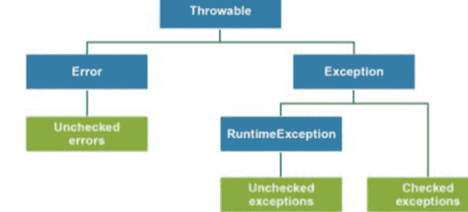

### 常见的检查异常

- `ClassNotFoundException`
- `IOException`
- `EOFException`
- `FileNotFoundException`

### 常见的未检查异常

- `ArithmeticException`
- `IllegalArgumentException`
- `NumberFormatException`
- `IndexOutOfBoundsException`
- `ArrayIndexOutOfBoundsException`
- `StringIndexOutOfBoundsException`
- `NoSuchElementException`
- `InputMismatchException`
- `NullPointerException`

### 核心概念

- **异常**（Exception）是 `Exception` 类或任何子类的对象。它代表了阻止方法成功完成的条件。
- `Exception` 类继承自名为 `Throwable` 的类。有两种异常继承自 `Exception` 类：检查异常和未检查异常。
- **检查异常**由编译器检查。因此，在编译代码之前，你必须编写处理所有检查异常的代码。
- **未检查异常**不通过编译器检查，但它们可以在运行时发生。通常，编写处理未检查异常的代码被认为是一种良好的实践。如果发生了未检查异常且没有被你的代码处理，你的应用程序将终止。
- 与 `Exception` 类一样，`Error` 类也继承自 `Throwable` 类。然而，`Error` 类标识的是罕见且通常无法恢复的内部错误。因此，你通常可以忽略 `Error` 类。

## 异常是如何传播的

图 16-2 显示了 Java 中的异常处理机制是如何工作的。首先，当一个方法遇到无法在该方法内部解决的问题时，它会抛出一个异常。大多数异常是由 Java API 中类中的方法抛出的。然后，任何调用了必须抛出检查异常的方法，都必须重新抛出该异常，要么捕获并处理它。捕获并处理异常的代码被称为**异常处理器**（exception handler）。你将在本章中学习抛出、捕获和处理异常的细节。

一旦方法抛出异常，运行时系统就会开始寻找适当的异常处理器。为了做到这一点，它会搜索**堆栈跟踪**（stack trace）。堆栈跟踪是按调用逆序列出的方法列表。例如，在图中，执行 `method(D)` 时的堆栈跟踪是：`method(D)`、`method(C)`、`method(B)` 和 `method(A)`。

此图显示了 `method(A)` 如何调用 `method(B)`，`method(B)` 如何调用 `method(C)`，`method(C)` 如何调用 `method(D)`。在这里，`method(D)` 可能会抛出一个异常。如果它抛出了异常，`method(D)` 将异常抛给 `method(C)`，`method(C)` 抛给 `method(B)`，`method(B)` 抛给 `method(A)`，最后 `method(A)` 在 `catch` 语句中捕获了它。

如果你通过在调用栈中的每个方法（包括 `main()` 方法）上编写 `throws` 子句将检查异常一直抛出应用程序，那么当异常发生时应用程序将会崩溃。然后，Java 会在控制台中显示信息。

注意，未检查异常的工作方式相同，你不需要在方法声明的 `throws` 子句中显式列出未检查异常。例如，假设 `method(A)` 中的 `try` 语句包含一个运行时异常（如 `ArithmeticException`）的 `catch` 语句。那么，如果 `method(D)` 中的代码抛出了 `ArithmeticException`，该异常将通过 `method(C)` 和 `method(B)` 向上传播，并在 `method(A)` 的异常处理器中处理，尽管没有任何方法声明包含针对 `ArithmeticException` 的 `throws` 子句。

### Java 如何传播异常

```java
void MethodA() {
    try {
        MethodB();
    } catch (ExceptionOne e) {
        // 在此处处理异常
    }
}
```

```java
void MethodB() throws ExceptionOne {
    MethodC();
}
```

```java
void MethodC() throws ExceptionOne {
    MethodD();
}
```

```java
void MethodD() throws ExceptionOne {
    throw new ExceptionOne();
}
```

### 处理检查异常的两种方法

- 将异常抛给调用方法
- 捕获异常并处理它

### 核心概念

- 当方法遇到它无法处理的条件时，该方法应该抛出一个异常。这允许方法的用户以适用于其应用程序的方式处理异常。Java API 中的许多方法都会抛出异常。
- 当方法调用另一个抛出检查异常的方法时，该方法必须将异常抛给它的调用者，要么捕获异常并直接处理。捕获异常的代码被称为**异常处理器**。
- 当异常发生时，运行时系统会寻找适当的异常处理器。为了做到这一点，它会查看**堆栈跟踪**或调用栈，它列出了已调用的方法，直到找到捕获异常的方法。

## 如何捕获异常

在接下来的内容中，你将学习到关于捕获异常所需知道的所有知识。这回顾了书中早些涵盖的一些信息，并扩展了这些信息。

## 如何使用 `try` 语句

图 16-3 首先显示了编写捕获异常的 `try` 语句的完整语法。该语法显示 `try` 语句以一个 `try` 块开始，该块围绕任何可能抛出异常的语句编写。`try` 块之后是每个 `catch` 块，用于处理 `try` 块中可能抛出的每种类型的异常。

当你添加 `catch` 块时，应该确保按照从 `Throwable` 层次结构中从具体的类到最不具体的类的顺序来编写它们。例如，`FileNotFoundException` 继承自 `IOException`，因此 `FileNotFoundException` 必须在 `IOException` 之前编写。否则，代码将无法编译。对于处于层次结构中相同层级的异常（例如 `FileNotFoundException` 和 `EOFException`），顺序并不重要。

在 `catch` 块之后，你可以编写一个 `finally` 块来释放 `try` 语句使用的任何系统资源。例如，你可以在 `finally` 块中关闭文件或数据库连接。`finally` 块是可选的，无论是否抛出了异常，它都是有效的；如果执行了 `return` 语句，它也是有效的。

代码示例显示了一个名为 `readline()` 的方法，它包含两个 `catch` 块和一个 `finally` 块。该方法接受一个指定文件路径的字符串，并返回文件第一行的字符串。在方法体内，第一条语句初始化了一个可以存储 `BufferedReader` 对象的变量。该对象允许你从文件中读取数据。

在 `try` 块中，第一条语句通过为指定路径的文件传递新的 `FileReader` 对象创建一个 `BufferedReader` 对象。如果文件不存在，此构造函数将抛出 `FileNotFoundException`，代码将跳转到第一个 `catch` 块。然而，如果文件存在，第二条语句调用 `BufferedReader` 的 `readLine()` 方法来读取文件的第一行。如果该方法无法读取第一行，它将抛出一个 `IOException`，代码执行跳转到第二个 `catch` 块。否则，`try` 块中的 `return` 语句将第一行的字符串返回给调用方法。

两个 `catch` 块的工作方式相似。首先，第一条语句向控制台打印简要描述错误的消息。然后，第二条语句向调用方法返回 `null`。由于方法无法读取第一行，这个返回值是合适的。

在 `finally` 块中，代码通过调用 `close()` 方法尝试关闭 `BufferedReader` 对象。遗憾的是，如果 `try` 块中的代码没有执行成功，`BufferedReader` 对象可能为 `null`。结果是这段代码在调用 `close()` 方法之前会检查该对象是否为空。此外，`close()` 方法可能会抛出 `IOException`，因此你需要在 `finally` 块中编写一个 `try` 语句来捕获此异常。

当你使用 `try` 语句时，往往为了通过代码编译而为检查异常创建空的 `catch` 子句。然而，这会使调试变得困难，因为如果抛出了异常，你永远无法发现它。相反，你的代码无法正常工作，且不会提供关于发生错误的任何指示。此外，以后编写异常处理程序是容易的。在这种情况下，异常永远不会被处理。相反，空的 `catch` 子句会捕获异常并忽略它。这有时被称为“吞吞异常”或“吃掉异常”，这很少是一种可以接受的编码实践。

### `try` 语句的语法

```java
try { statements }
catch (MostSpecificExceptionType e) { statements } ...
catch (LeastSpecificExceptionType e) { statements }
finally { statements }
```

### 捕获两种异常并使用 `finally` 子句的方法

```java
public static String firstLine(String path) {
    BufferedReader in = null;
    try {
        in = new BufferedReader(
            new FileReader(path)); // 可能抛出 FileNotFoundException
        String line = in.readLine();
        return line;
    } catch (FileNotFoundException e) {
        System.out.println("未找到文件.");
        return null;
    } catch (IOException e) {
        System.out.println("发生 I/O 错误.");
        return null;
    } finally {
        try {
            if (in != null) {
                in.close(); // 可能抛出 IOException
            }
        } catch (IOException e) {
            System.out.println("无法关闭文件.");
        }
    }
}
```

### 核心概念

- 你可以在可能抛出异常的语句周围编写 `try` 块。
- 你可以为 `try` 块中可能抛出的每种类型的异常编写一个 `catch` 块。你应该按照从 `Throwable` 层次结构中从具体的类到最不具体的类的顺序编写 `catch` 语句。
- 你可以编写 `finally` 块来释放 `try` 块中创建的对象使用的任何系统资源。`finally` 块中的代码总是执行。

## 如何使用 `try-with-resources` 语句

在 Java 7 之前，你必须使用 `finally` 块来释放系统资源，如上一个图所示。这需要包含额外的异常处理代码，以防 `finally` 块抛出异常。遗憾的是，这种异常处理代码的长度可能会导致代码难以阅读和维护。

这就是为什么 Java 7 引入了图 16-4 的 `try-with-resources` 语句。这是一种特殊的 `try` 语句，它声明并实例化一个或多个使用系统资源的对象，并在 `try` 语句执行完成后自动关闭这些对象并释放资源。这允许你编写更少的错误处理代码，并专注于代码的逻辑。例如，图中的 `readLine()` 方法完成了与上一个图中的方法相同的任务，但不需要笨拙的 `finally` 子句。结果是，代码更容易阅读和维护。

要使用 `try-with-resources` 语句，你首先要在 `try` 关键字之后、`try` 块之前编写一组括号。然后，在括号中，你可以编写一个或多个声明并实例化系统资源对象的语句。例如，在图中，创建 `BufferedReader` 的语句是编写在这些括号内的。要创建多个对象，你只需要用分号将声明和实例化它们的语句分开即可。

注意，你只能对实现了 `java.lang.AutoCloseable` 接口的对象使用 `try-with-resources` 语句。然而，从 Java 7 开始，Java API 中大多数处理系统资源的类都经过重构以实现此接口。这包括书中描述的所有用于处理文件和数据库的类。

### `try-with-resources` 语句的语法

```java
try (resource_declaration; ...) { statements }
catch (MostSpecificExceptionType e) { statements } ...
catch (LeastSpecificExceptionType e) { statements }
finally { statements }
```

### 一个捕获两种类型异常并自动关闭指定资源的方法

```java
public static String firstLine(String path) {
    try (BufferedReader in = new BufferedReader(new FileReader(path))) {
        String line = in.readLine();
        return line;
    } catch (FileNotFoundException e) {
        System.out.println("未找到文件.");
        return null;
    } catch (IOException e) {
        System.out.println("发生 I/O 错误.");
        return null;
    }
}
```


## 代码示例：读取文件第一行

```java
public static String readFirstLine(String path) {
    try (BufferedReader reader = new BufferedReader(
            new FileReader(path))) {
        String line = reader.readLine();
        return line;
    } catch (FileNotFoundException e) {
        System.out.println("File not found.");
        return null;
    } catch (IOException e) {
        System.out.println("I/O error occurred.");
        return null;
    }
}
```

## Description

- `try-with-resources` 语句是一种特殊的 `try` 语句，它声明并自动实例化一个或多个使用系统资源的对象，并在 `try` 语句执行完成后自动关闭这些对象并释放资源。
- `try-with-resources` 语句是在 Java 7 中引入的。
- 任何实现了 `java.lang.AutoCloseable` 接口的对象都可以使用 `try-with-resources` 语句创建。
- 从 Java 7 开始，Java API 中大多数使用系统资源的类都经过重构以实现 `AutoCloseable` 接口。
- 如果一个对象没有实现 `AutoCloseable` 接口且你尝试对其使用 `try-with-resources` 语句，你的代码将无法编译。

> 图 16-4 如何使用 try-with-resources 语句

## 如何使用异常的方法

图 16-5 显示了如何使用异常的方法获取更多关于异常的信息。由于 `Throwable` 类提供了这些方法，因此它们对所有异常对象可用。

第一个示例使用了表中的前三个方法来打印关于异常的增量信息。在这种情况下，`catch` 块捕获一个 `Exception` 并将其赋值给变量 `e`。在 `catch` 块内部，第一条语句使用 `getMessage()` 方法获取异常的消息，并将其打印到控制台。然后，第二条语句使用 `toString()` 方法获取类名和消息，并将其打印到控制台。然而，第三条语句使用 `printStackTrace()` 方法将异常的类名、消息和堆栈跟踪打印到控制台。

当你编写处理异常的代码时，你需要决定显示多少信息是恰当的。例如，在某些情况下，你只想使用 `getMessage()` 显示异常的消息。并不是所有异常都包含消息。正因如此，使用 `toString()` 显示异常的类名和消息通常是有帮助的。其他时候，你可能想使用 `printStackTrace()` 显示异常的完整堆栈跟踪。这可以在你测试应用程序时帮助你调试。然而，通常认为一种良好的做法是从生产环境的应用程序中移除 `printStackTrace()`，或者用它替换为更好的异常日志记录方法。

在第一个示例中，`catch` 块中的语句使用 `System.err` 对象将数据打印到标准输出流。这与使用 `System.out` 将数据打印到标准输出流的效果相同。如果你不为 `printStackTrace()` 提供参数，它将打印到标准错误输出流（`System.err`）。如果你想将这些数据打印到另一个输出流（如日志文件），你可以指定该输出流作为参数。

### 所有异常可用的方法

| 方法 | 说明 |
| --- | --- |
| `getMessage()` | 返回异常的消息（如果可用）。 |
| `toString()` | 返回异常的类名和消息（如果可用）。 |
| `printStackTrace()` | 将异常的类名和堆栈跟踪打印到标准错误输出流（`System.err`）。 |
| `printStackTrace(outputStream)` | 将异常的类名和堆栈跟踪打印到指定的输出流。 |

## 将异常数据打印到错误输出流

```java
catch (IOException e) {
    System.err.println(e.getMessage() + "\n");
    System.err.println(e.toString() + "\n");
    e.printStackTrace();
    return null;
}
```

### FileNotFoundException 的输出

```
c:\murach\java\produx.txt (The system cannot find the file specified)
java.io.FileNotFoundException: c:\murach\java\produx.txt
(The system cannot find the file specified)
java.io.FileNotFoundException: c:\murach\java\produx.txt
(The system cannot find the file specified)
    at java.io.FileInputStream.open(Native Method)
    at java.io.FileInputStream.init(FileInputStream.java:131)
    at java.io.FileInputStream.init(FileInputStream.java:87)
    at java.io.FileReader.init(FileReader.java:58)
    at ProductApp.readFileLine(ProductApp.java:70)
    at ProductApp.main(ProductApp.java:10)
```

## 将异常数据打印到标准输出流

```java
catch (IOException e) {
    System.out.println(e.getMessage() + "\n");
    System.out.println(e.toString() + "\n");
    e.printStackTrace(System.out);
    return null;
}
```

## 如何使用多捕获块 (multi-catch block)

图 16-6 显示了如何使用 Java 7 引入的多捕获块功能。该功能允许你使用单个 `catch` 块来处理多个在继承层次结构中处于同一级的异常。要实现这一点，你用管道字符 (`|`) 将异常隔开，如该图顶部的语法所示。

为了说明多捕获块的工作原理，图中的第一个示例展示了在 Java 7 之前你如何同时捕获 `FileNotFoundException` 和 `EOFException`。在这里，为每个异常都编写了独立的 `catch` 语句。但是，由于这些异常在继承层次结构中处于同一级，而且这些异常的 `catch` 块是相同的，你可以像第二个示例那样在多捕获块中捕获它们。

相关地，`FileNotFoundException` 和 `EOFException` 都是 `IOException` 的子类。如果你想对所有三个异常执行相同的代码，只需要像这样为 `IOException` 编写一个 `catch` 块：

```java
try (BufferedReader in = new BufferedReader(
    new FileReader(path))) {
    String line = in.readLine(); // may throw IOException
    return line;
}
catch (IOException e) {
    System.err.println(e.toString());
    return null;
}
```

在这种情况下，对于 `IOException` 及其所有子类（包括 `FileNotFoundException` 和 `EOFException`）都会执行相同的代码。虽然这种技术提供的灵活性没有多捕获块功能那么大，但它是常用的技巧，并且适用于所有版本的 Java。

## 第 16 章 如何处理异常

## 多捕获块的语法

`catch (ExceptionType | ExceptionType ([| ExceptionType])... e ) { statements }`

## 一个没有使用多捕获块的方法

```java
public static String readLine(String path) {
    try (BufferedReader in = new BufferedReader(
        new FileReader(path))) {
        String line = in.readLine(); // may throw IOException
        return line;
    } catch (FileNotFoundException e) {
        System.err.println(e.toString());
        return null;
    } catch (EOFException e) {
        System.err.println(e.toString());
        return null;
    } catch (IOException e) {
        e.printStackTrace();
        return null;
    }
}
```

## 一个使用了多捕获块的方法

```java
public static String readLine(String path) {
    try (BufferedReader in = new BufferedReader(
        new FileReader(path))) {
        String line = in.readLine(); // may throw IOException
        return line;
    } catch (FileNotFoundException | EOFException e) {
        System.err.println(e.toString());
        return null;
    } catch (IOException e) {
        e.printStackTrace();
        return null;
    }
}
```

## 描述

- 多捕获块允许你使用单个 `catch` 块来处理多个在继承层次结构中处于同一级的异常。
- 多捕获块是 Java 7 引入的。


## 如何抛出异常

既然你已经知道了如何捕获异常，就可以学习如何抛出异常了，这是异常处理的另一个重要部分。要做到这一点，你可以使用 `throws` 子句和 `throw` 语句。

## 如何使用 throws 子句

当你调用 Java API 中一个抛出受检异常的方法时，你必须像本章前面描述的那样捕获该异常，要么将其抛出。如果你在正在编写的方法中无法妥善处理该异常，可以在方法声明中编写一个 `throws` 子句，如图 16-7 所示。这会将异常抛给调用它的方法，调用方法可以使用 `try` 语句处理它，或者再次将其抛出。最终，异常应该向上传播到一个可以被妥善处理的级别。

第一个示例显示了一个 `FileReader()` 方法，它与你在本章看到的其他 `readLine()` 方法相似。然而，该方法是抛出异常而不是捕获异常。在这里，该方法的第一条语句调用了 `FileReader` 的构造函数，可能会抛出 `FileNotFoundException`。然后，下一条语句调用 `BufferedReader` 的 `readLine()` 方法，它可能会抛出 `IOException`。由于 `FileNotFoundException` 类继承自 `IOException` 类，因此该方法可以通过使用 `throws` 子句抛出 `IOException` 来抛出这两种类型的异常。

如果第一个示例显示的是 `FileNotFoundException`，该异常会被隐式转换为 `IOException`。结果是，调用方法可以捕获或抛出任何一种异常。即使 `readLine()` 方法的 `throws` 子句没有显式抛出 `FileNotFoundException`，事实也是如此。

第二个示例显示了如何显式地抛出两种异常。要做到这一点，你用逗号分隔 `throws` 子句中的异常。这种方法的优点是它清晰地标识了该方法可能抛出的所有异常。这种方法的缺点是，对于第一个示例提供的相同功能，它需要更多的代码。

该图还显示了如果你不捕获或抛出受检异常，编译器生成的错误信息示例。具体来说，如果你调用了 `readLine()` 方法且不捕获或抛出 `IOException`，编译器会生成类似这样的错误信息。

到此时，你可能想知道什么时候应该抛出异常，什么时候应该处理异常。通常，你应该尽早抛出异常，晚捕获。换句话说，如果你处于一个无法处理该异常的级别，就应该将其抛给一个可以处理它的级别。

## throws 子句的语法

`modifiers returnType methodName(parameterList) throws exceptionList`

### 抛出 IOException 方法

```java
public static String readLine(String path) throws IOException {
    BufferedReader reader = new FileReader(path);
    String line = reader.readLine();
    return line;
}
```

### 抛出两种异常的方法

```java
public static String readLine(String path) throws FileNotFoundException, IOException {
    BufferedReader reader = new FileReader(path);
    String line = reader.readLine();
    return line;
}
```

### 如果不捕获或抛出受检异常，编译器错误

`error: unreported exception must be caught or declared`

## 描述

- 任何抛出受检异常的方法都必须捕获或抛出它。
- 要抛出受检异常，需要在 `throws` 子句中列出异常。如果你列出多个异常，用逗号分隔。
- 虽然你可以指定运行时异常，编译器并没有强制你处理它们。

## 如何使用 throw 语句

当你编写方法时，有时可能需要抛出异常。例如，当方法遇到阻止其完成任务的问题时，你可能需要抛出异常。最后，你可能需要抛出异常来进行测试。

图 16-8 显示了如何抛出异常。要做到这一点，你需要编写一条语句抛出一个异常对象。要做到这一点，你通常使用 `new` 关键字创建异常类的对象。由于所有异常类都继承自 `Throwable` 类，你可以使用图中所示的任一个构造函数。如果你使用第一个构造函数，异常将没有消息。如果你使用第二个构造函数，你指定的消息将赋值给异常。

第一个示例显示了一个名为 `calculateFutureValue` 的方法，如果这些参数任何一个小于等于 0，它将抛出 `IllegalArgumentException`。通常，如果公共方法接收到任何不可接受的参数，抛出 `IllegalArgumentException` 是一种良好的编码规范。

```java
public static double calculateFutureValue(double amount, double rate) {
    if (amount <= 0 || rate <= 0) {
        throw new IllegalArgumentException("Parameters must be positive");
    }
    // ... rest of the code
}
```

第二个示例显示了你可能如何通过抛出异常来测试处理器。这种技术对于那些难以强制实现的异常非常有用。例如，你可以通过提供一个不存在的文件名轻松地测试 `FileNotFoundException` 的处理器。但测试 `IOException` 的处理器可能很困难。有时，最简单的方法是在你想让异常发生的地方显式抛出异常。

```java
public static void testIOException() {
    try {
        throw new IOException("Simulated error");
    } catch (IOException e) {
        // handle exception
    }
}
```

当你为了测试而抛出异常时，`throw` 语句必须是 `try` 块的最后一条语句，或者它必须位于语句内部。否则，代码将无法编译，编译器将显示包含不可达语句的消息。在第二个示例中，因为在 `throw` 语句之后还有语句，所以 `throw` 语句是在语句内部的。注意，如果该语句被编写为其条件始终为真，那么异常将总是被抛出。然而，如果该语句允许代码编译：


```java
public static void testThrow(boolean condition) {
    try {
        if (condition) {
            throw new IOException("Simulated error");
        }
        System.out.println("This line is not unreachable");
    } catch (IOException e) {
        // handle exception
    }
}
```

第三个示例显示了在处理异常后重新抛出异常的代码。在这里，异常处理器打印了一条错误消息，指示发生了异常。然后，它重新抛出异常，以便调用方法进行处理。要做到这一点，`throw` 语句抛出了在 catch 块中声明的 `IOException` 对象 `e`。

```java
public void process() throws IOException {
    try {
        // some code that throws IOException
    } catch (IOException e) {
        System.err.println("Error occurred: " + e.toString());
        throw e;
    }
}
```

# 第 16 章 如何处理异常

## throw 语句的语法

```java
throw throwableObject;
```

## Throwable 类的常用构造函数

| 构造函数 | 说明 |
| --- | --- |
| `Throwable()` | 创建一个消息为 null 的新异常。 |
| `Throwable(message)` | 创建一个带有指定消息的新异常。 |

## 抛出未检查异常的方法

```java
public double calculateFutureValue(double monthlyPayment,
    double monthlyInterestRate, int months) {
    if (monthlyPayment <= 0)
        throw new IllegalArgumentException("Monthly payment must be > 0");
    
    if (monthlyInterestRate < 0)
        throw new IllegalArgumentException("Interest rate must be > 0");
    
    if (months <= 0)
        throw new IllegalArgumentException("Months must be > 0");

    // 计算并返回未来值的代码在此
}
```

## 用于测试的抛出 IOException 的代码

```java
try {
    // 读取文件第一行的代码
    if (true) {
        throw new IOException("I/O exception test");
    }
    return firstLine;
} catch (IOException e) {
    // 处理 IOException 的代码在此
}
```

## 重新抛异常的代码

```java
try {
    // 抛出 IOException 的代码在此
} catch (IOException e) {
    System.out.println("IOException thrown in readLine() method.");
    throw e;
}
```

## 说明

- 你使用 `throw` 语句来抛出异常。你可以抛出任何从 `Throwable` 类子类创建的对象。
- 你可以使用 `Throwable` 类的构造函数来创建一个新异常。然后，你可以抛出该异常。若要抛出一个已有的异常，你必须先捕获它。


## 如何处理自定义异常

尽管 Java API 包含了大量的异常，但你可能会遇到没有这些异常中的能准确描述你的异常的情况。在其他情况下，你可能希望用另一个异常来包装异常，以使代码更具活性。无论何种情况，你都可以按照下列主题中的描述，编写一个定义自定义异常的类。然后，你可以像抛出任何其他异常一样抛出你的异常。

## 如何创建自定义异常类

图 16-9 显示了如何创建自定义异常类。要做到，你需要继承 `Exception` 类或其一个子类来创建一个检查异常。为了说明，图中的第一个示例显示了一个名为 `DAOException` 的异常类，它继承自 `Exception`。结果是 `DAOException` 是一个检查异常。然而，你也可以通过继承 `RuntimeException` 类或其一个子类来编写一个定义未检查异常的类。

按照惯例，所有异常类都应该有一个不接受任何参数的默认构造函数，以及另一个接受字符串参数的构造函数。如果你为异常类编写了这些构造函数，它们的行为将像 Java API 中的其他异常类一样。第一个示例展示了如何编写这两个构造函数。在这里，第二个构造函数使用 `super` 关键字调用 `Exception` 类的构造函数，并将消息参数传递给它。

第二个示例显示了抛出自定义 `DAOException` 的代码。它定义了一个名为 `getProduct()` 的方法，该方法调用 `readProduct()` 方法来根据指定的产品代码检索 `Product` 对象。`readProduct()` 方法抛出一个 `IOException`，该异常被 `catch` 语句捕获。然后 `catch` 抛出一个 `DAOException`。

第三个示例显示了捕获异常的代码。在这里，`getProduct()` 方法位于 `try` 语句中，`DAOException` 被 `catch` 语句捕获。在 `DAOException` 的异常处理程序中，控制台显示了一条错误消息。

乍一看，可能似乎通过这些异常定义的自定义异常并不是必要的。毕竟，如果发生了 IO 错误，`getProduct()` 方法不能简单地抛出一个 `IOException` 吗？虽然可以这样做，但这会导致设计不佳，因为会暴露过多关于 `getProduct()` 方法操作的细节。`IOException` 只有在使用文件 I/O 操作时才会发生。因此，抛出 `IOException` 将揭露 `getProduct()` 方法使用 I/O 来访问数据。

如果应用程序发生变化，将产品数据存储在数据库而不是文件中怎么办？在这种情况下，`getProduct()` 方法将抛出某种数据库异常，而不是 `IOException`。那么，任何调用 `getProduct()` 方法的方法都必须更改以处理这种新异常。通过为 `getProduct()` 方法创建一个 `DAOException`，你可以从调用它的方法中隐藏 `getProduct()` 方法工作的细节。因此，即使应用程序更改为使用数据库，如果在检索产品对象时发生错误，`getProduct()` 方法仍然可以抛出 `DAOException`。

## DAOException 类的代码

```java
public class DAOException extends Exception {
    public DAOException() {
    }

    public DAOException(String message) {
        super(message);
    }
}
```

## 抛出 DAOException 的方法

```java
public static Product getProduct(String productCode) throws DAOException {
    try {
        Product p = readProduct(productCode); // 可能抛出 IOException
        return p;
    } catch (IOException e) {
        throw new DAOException("An error occurred while reading the product.");
    }
}
```

## 捕获 DAOException 的代码

```java
try {
    Product p = getProduct("*1234");
} catch (DAOException e) {
    System.out.println(e.getMessage());
}
```

## 输出结果


## 何时定义自己的异常

- 当方法需要一个 Java 提供的异常类型中不存在的异常时。
- 当使用内置 Java 异常会暴露方法操作细节时。

## 说明

- 要定义检查异常，继承 `Exception` 类或其任何子类。
- 要定义未检查异常，继承 `RuntimeException` 类或其任何子类。
- 按照惯例，每个异常类都应该包含一个不接受任何参数的默认构造函数和一个接受字符串参数的构造函数。

## 如何使用异常链

你经常会对响应发生的其他异常抛出自定义异常。例如，在之前的图中，`DAOException` 是为了响应 `IOException` 而抛出的。不幸的是，导致 `DAOException` 的底层错误信息丢失了。而这些信息对于确定导致 `DAOException` 发生的原因至关重要。

图 16-10 显示了如何在不丢失原始异常细节的情况下抛出自定义异常。这种特性被称为异常链，因为它允许将异常链在一起。每当你创建一个自定义异常类型时，使用异常链以避免丢失调试信息都是良好的做法。

要使用异常链，你需要使用异常构造函数，该构造函数允许你指定一个异常对象作为正在创建的新异常的原因。例如，在第一个示例中，`DAOException` 类通过构造函数指定原因。在这里，第二个构造函数接受一个 `Throwable` 对象作为参数。然后，它将此参数传递给 `Exception` 构造函数。

第二个示例显示了在响应 `IOException` 时抛出 `DAOException` 的代码。在这里，`IOException` 对象作为参数传递给 `DAOException` 构造函数。这样，原始 `IOException` 中的所有信息都作为 `DAOException` 对象的一部分被保存。

第三个示例显示了捕获 `DAOException` 并显示有关异常的信息。在这里，显示了一条错误消息，指示发生了 `DAOException`，该 `DAOException` 是由 `FileNotFoundException` 引起的，并且包含了存储在 `FileNotFoundException` 中的消息。在大多数情况下，这应该是你确定此异常原因所需的所有信息了。

## 用于异常链的 Throwable 类的构造函数

| 构造函数 | 描述 |
| --- | --- |
| `Throwable(cause)` | 创建一个新的异常，并将指定的异常对象作为其原因。 |

## 使用异常链的自定义异常类

```java
public class DAOException extends Exception {
    public DAOException() { }

    public DAOException(Exception cause) {
        super(cause);
    }
}
```

## 抛出带有链的 DAOException 的代码

```java
catch (IOException e) {
    throw new DAOException(e);
}
```

## 捕获 DAOException 的代码

```java
catch (DAOException e) {
    System.err.println(e);
}
```

## 结果输出

> DAOException: java.io.FileNotFoundException: c:\murach\produx.txt (系统找不到指定的文件)

## 描述

- 异常链允许你在抛出新异常时，为捕获到的异常维护其异常信息。异常链使用了 `cause` 字段，该字段表示导致当前异常抛出的原始异常。

## 使用自定义异常的接口

图 16-11 显示了上一章介绍的 DAO 接口的增强版本。在该图中，接口的所有五个方法都抛出 `DAOException`。因此，当程序员实现此接口并遇到异常时，他们可以将这些异常封装在 `DAOException` 中并将它们抛出给调用代码。然后，调用代码可以以适用于应用程序层级的方式处理这些异常。

## 使用自定义异常的类

图 16-12 的第 1 和第 2 部分显示了 `ProductFile` 类，它实现了针对 `Product` 类型的 DAO 接口。该代码的大部分与上一章显示的 `TextFile` 相同。然而，所有方法都抛出 `DAOException`。此外，`getAll()` 和 `saveAll()` 方法中的 catch 块将 `IOException` 封装在 `DAOException` 中并将其抛出给调用代码。

因此，在表示层可以捕获并处理这些异常，这通常是你所需要的。这样，用户界面就可以显示一条友好的消息，说明在访问数据时发生了错误，并采取适当的操作。例如，如果 `getAll()` 方法抛出 `DAOException`，程序员可以这样处理它：

在这里，catch 子句中的第一条语句显示了一条友好的消息。第二条语句显示错误信息，这可能对修复错误有所帮助。第三条语句告诉用户应用程序正在退出。第四条语句是一个返回语句，用于结束当前方法。

如果这段代码位于 `main()` 方法中，返回语句将退出应用程序。然而，如果你需要从另一个方法退出应用程序，可以这样调用 `System` 类的 `exit()` 方法：

`System.exit(0);`

该方法接受一个 `int` 类型的参数。按照惯例，`int` 值 `0` 表示程序正常执行，非零值表示程序未正常退出。

## 使用自定义异常的接口

```java
package murach.db;

import java.util.List;

public interface DAO<T> {
    T get(String code) throws DAOException;
    List<T> getAll() throws DAOException;
    boolean add(T t) throws DAOException;
    boolean update(T t) throws DAOException;
    boolean delete(T t) throws DAOException;
}
```

## 描述

- 当程序员实现 DAO 接口的方法时，他们极可能会遇到数据访问异常。例如，如果他们使用文件存储数据，可能会遇到上一章描述的 `IOException`。或者，如果他们使用数据库存储数据，可能会遇到第 20 章中描述的 `SQLException`。
- DAO 接口的方法抛出 `DAOException`。这使得接口变得更加灵活，因为它没有将接口与特定的异常类型紧耦合。

## 使用自定义异常的类

```java
package murach.db;

import java.nio.file.*;
import java.util.*;

import murach.business.Product;
```


```java
public final class ProductFile implements DAO<Product> {
    private List<Product> products = null;
    private Path productsPath = null;
    private File productsFile = null;
    private final String FIELD_SEP = "\t";

    public ProductFile() throws DAOException {
        productsPath = Paths.get("products.txt");
        productsFile = productsPath.toFile();
        this.getAll();
    }

    @Override
    public List<Product> getAll() throws DAOException {
        // 如果文件已经读取，则不再再次读取
        if (products != null) {
            return products;
        }

        products = new ArrayList<>();
        try (BufferedReader reader = new BufferedReader(
            new FileReader(productsFile))) {
            // 从文件读取产品到 ArrayList
            String line = reader.readLine();
            while (line != null) {
                String[] columns = line.split(FIELD_SEP);
                String code = columns[0];
                String description = columns[1];
                String price = columns[2];

                Product p = new Product(
                    code, description, Double.parseDouble(price));
                products.add(p);
            }
            line = reader.readLine();
        } catch (IOException e) {
            throw new DAOException(e);
        }
        return products;
    }
}
```

## 使用自定义异常的类（2 2 中的第 1 部分）

## 如何处理异常

## 使用自定义异常的类（2 2 中的第 2 部分）

```java
@Override
public Product get(String code) throws DAOException {
    // ... 实现细节 ...
    return null;
}

@Override
public boolean add(T t) throws DAOException {
    // ... 实现细节 ...
    return true;
}

@Override
public boolean delete(T t) throws DAOException {
    // ... 实现细节 ...
    return true;
}

@Override
public boolean update(T t) throws DAOException {
    // ... 实现细节 ...
    return true;
}

private boolean saveAll() throws DAOException {
    try (PrintWriter out = new PrintWriter(
            new BufferedWriter(new FileWriter(productsFile)))) {
        // 写入列表中所有的产品
        for (Product p : products) {
            out.print(p.getCode() + FIELD_SEP);
            out.print(p.getDescription() + FIELD_SEP);
            out.println(p.getPrice());
        }
        return true;
    } catch (IOException e) {
        throw new DAOException(e);
    }
}
```

## 观点

在本章中，你学习了 Java 中处理异常最重要的技术。异常允许通过将错误向上传递到调用栈中可以处理的方法来帮助编写更健壮的代码。例如，获取 `Product` 对象的 `getAll()` 方法可能不知道在发生错误时该怎么办。因此，这个低层方法应该抛出一个异常，由高层方法来处理。然后，这个高层方法可以将异常写入日志、显示错误消息、保存数据甚至退出应用程序。

## 总结

- 在 Java 中，异常是根据派自 `Exception` 类或其子类的类创建的对象。当异常发生时，编写良好的应用程序会通知用户异常，并尽可能减少由异常引起的任何中断或数据丢失。

- 源自 `RuntimeException` 类及其子类的异常是未检查异常，因为它们不会被编译器检查。所有其他异常都是检查异常。

- 任何调用抛出检查异常的方法都必须通过代码子句抛出该异常，或者通过代码 `try/catch finally` 块作为异常处理器来捕获它。

- `try-resources` 语句是一种特殊的 `try` 语句，它可以声明并实例化一个或多个使用资源的对象，并在 `try` 语句结束后自动关闭对象并释放资源。

- 多异常捕获块允许你使用单个 `catch` 块处理同一继承层级中的多个异常。

- 在编写方法时，如果你遇到无法在方法内部处理的潜在错误，可以编写一个 `throw` 语句将异常抛给另一个方法。如果你无法在 Java API 中找到合适的异常类，可以编写一个自定义异常类。

- 你可以创建自定义异常类来表示你的方法可能抛出的异常。这对于隐藏方法的实现细节非常有用。

- 当你创建自定义异常时，可以使用异常链来保存有关异常原因的信息。

## 练习 16-1 抛出和捕异常

在此练习中，你将尝试各种抛出和捕异常的方法。

1. 打开 `ex_starts` 文件夹中的项目 `ch16_ex1_ExceptionTester`。然后，打开 `ExceptionTesterApp` 类并查看其代码。运行该类以熟悉它的工作原理。

2. 在 `method3()` 中添加代码，通过尝试整数除以零来抛出一个未检查异常。编译并运行应用程序，并记录异常抛出的位置。

3. 删除你刚刚添加到 `method3()` 中的代码。然后，在此方法中添加一条类似于 16-7 中的语句，创建一个来自 `BufferedReader` 类的对象，但使用字符串 `"products.ran"` 代替路径变量。该类的构造函数会抛出一个名为 `FileNotFoundException` 的检查异常。注意指示你尚未处理该异常的错误消息。如果没有显示此错误消息，请编译该类以显示错误消息。

4. 为包括 `main()` 方法在内的所有方法添加 `throws` 子句。然后，运行应用程序查看检查异常如何一直传播到应用程序外部。

5. 在 `method1()` 中添加必要的代码来处理 `FileNotFoundException`。为了这一点，你需要从 `main` 方法和 `method1()` 中移除 `throws` 子句，并在 `method1()` 中添加一条捕获异常的语句。`catch` 块应显示适当错误消息。运行应用程序以确保异常处理器工作正常。

## 练习 16-2 释放系统资源

在此练习中，你将有机会使用 `try` 和 `try-with-resources` 语句来释放对象使用的系统资源。

1. 打开 `ex_starts` 文件夹中的项目 `ch16_ex2_ResourcesTester`。然后，打开 `ResourcesApp` 类。注意 `main()` 方法调用了另外两个打开 `BufferedReader` 对象但没有关闭它的方法。

2. 修改名为 `readFileWithResources()` 方法，使其使用 `try-with-resources` 语句关闭 `BufferedReader` 对象。运行应用程序以确保其正常工作。如果是，则 `try-with-resources` 语句也在正常工作。

3. 修改名为 `readFileWithFinally()` 方法，使其使用 `finally` 块关闭 `BufferedReader` 对象。要做到这一点，你需要在此对象位于 `try` 块之外。在 `finally` 块中添加语句，向控制台打印信息，以指示文件已关闭（这是正常操作的情况）、从未打开（如果找不到文件就会发生）或无法关闭（仅在少数情况下发生）。

4. 运行应用程序以确保 `finally` 子句按预期工作。要测试文件从未打开会发生什么，你可以更改文件名以导致 `FileNotFoundException`。要测试 `close()` 方法不起作用会发生什么，你可以在关闭资源的语句之前抛出一个 `IOException`。

## 练习 16-3 创建自定义类

在此练习中，你将尝试自定义类和链式异常。

1. 打开 `ex_starts` 文件夹中名为 `ch16_ex3_CustomTester` 的项目。然后，创建一个名为 `TestException` 的自定义检查异常，它包含两个构造函数：一个不接受参数，另一个接受消息。

2. 打开 `CustomTesterApp` 类。然后，在 `method3()` 中添加一条抛出不带消息的 `TestException` 的语句。在 `method2()` 中添加捕获此异常的必要代码。`catch` 块应在控制台打印你任选的消息。运行应用程序以确保其正常工作。

3. 修改你的解决方案，将你自定义的消息传递给 `TestException` 并在 `catch` 块中显示。运行应用程序以确保自定义消息显示正确。

4. 为 `TestException` 类添加另一个接受 `Throwable` 对象作为参数的构造函数。

5. 在 `Main` 类的 `method3()` 中添加一个 `try` 语句。`try` 块应抛出一个 `IOException`，而 `catch` 块应抛出一个 `TestException`，并将 `IOException` 传递给其构造函数。

6. 修改 `method2()` 中捕获 `TestException` 的 `catch` 块，使其打印提供异常及其底层原因信息的消息。运行应用程序以确保其正常工作。

## 第 4 部分 GUI 编程

到目前为止，书中所有的应用程序都是控制台应用程序。当然，大多数现代应用程序使用图形用户界面（GUI）。如果你想用 Java 开发 GUI，可以从几个接口中选择。

在本节中，第 17 章和第 18 章是独立的。因此，如果你不想学习 JavaFX，可以直接跳到第 18 章。然而，在进入第 19 章之前，你应该阅读第 18 章。

# GUI 编程简介

在开始学习如何编写 GUI 代码之前，你需要了解一些与 GUI 的基本概念和术语。

# 显示十个控件的 GUI

图 17-1 首先展示了本章介绍的“未来价值”应用程序图形用户界面。在这里，GUI 窗口（也称为表单）包含十个控件：标签、四个文本字段（也称为文本框）和两个按钮。然而，第四个文本字段经过了修改，它可以显示输出，但不能接受用户的输入。尽管如此，它的外观与其他文本字段相同。

默认情况下，JavaFX 控件在任何平台上的显示和行为都是相同的。然而，这些控件的显示和行为与特定平台的原生控件略有不同。例如，图中所示的用户界面与显示它的原生 Windows 10 用户界面相比略有不同。尽管 JavaFX 提供了允许程序员更改用户界面外观和感受的类，但默认的外观适用于大多数应用程序。因此，本书中所有的 JavaFX 应用程序都使用这种外观。

# GUI API 总结

如果你想用 Java 开发 GUI，可以选择几种 API，这些 API 通常被称为工具包。此图展示了最常用的工具包，但还有其他的。

- **AWT**（抽象窗口工具包）是 Java 的第一个 GUI 工具包。AWT 允许你创建原生操作系统组件（也称为控件或部件）。然而，这种方法有很多局限性，不建议用于现代应用程序开发。

- 为了解决 AWT 的缺点，Java 2 包含了一个名为 **Swing** 的工具包。Swing 构建在 AWT 之上，但它创建自己的组件而不是操作系统提供的组件。在早期，Swing 运行很慢。此外，尽管 Swing 组件并不好看，也不像原生组件。今天，Swing 应用程序的性能要好得多，现代主题可以让它们看起来像原生应用程序。

- 为了与 Swing 版本竞争，IBM 创建了 **SWT**（标准部件工具包）。与 AWT 类似，SWT 使用原生控件，这提高了它的速度。然而，如果不添加更多库，它没有 Swing 强大。因此，Swing 的使用比 SWT 更广泛。

- **JavaFX** 是开发 GUI 的最新框架。该 API 旨在取代过时的 Swing API 用于开发桌面应用程序。此外，它旨在更容易创建丰富的互联网应用程序（RIA），即具有许多桌面应用程序特征的 Web 应用程序。

# 显示 10 个控件的 GUI

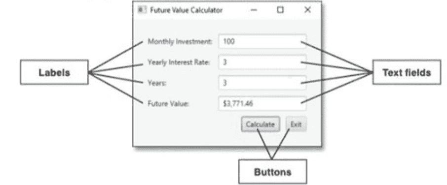

# Java 常用 GUI API

| 库 | 说明 |
|---|---|
| AWT | 抽象窗口工具包。这是最旧的 Java GUI 库。它使用操作系统的原生控件。由于跨平台可移植性问题，该库不建议用于现代应用程序开发。 |
| Swing | 为替换 AWT 并解决跨平台移植性问题而创建。Swing 控件不是原生的，但可以使用主题使其看起来与原生控件相同。 |
| SWT | 标准部件工具包。该库由 IBM 创建，旨在解决早期 Swing 版本的性能问题和非原生外观感受。该库使用原生控件。然而，如果不添加更多库，它没有 Swing 强大。 |
| JavaFX | 旨在取代过时的 Swing 用于开发桌面应用程序的 GUI，并更容易开发丰富的互联网应用程序（RIA），即具有许多桌面应用程序特征的 Web 应用程序。 |

## 描述

- 在创建 GUI 时，你通常使用窗口来显示标签、文本字段和按钮等控件。

- 窗口也被称为 **表单**（form），控件也被称为 **组件**（components）或部件（widgets），文本字段也被称为 **文本框**（text box）。

- 当用 Java 创建 GUI 时，你有几个可以使用的库。在这些库中，JavaFX 是最新的。然而，Swing 是使用最广泛的。

# JavaFX 节点的继承层次结构

图 17-2 展示了使用 JavaFX 进行 GUI 编程的简化层级结构。尽管 Java API 包含了大量用于 GUI 编程的类，但本章介绍了一组基础类，你可以使用它们开始使用 JavaFX 开发 GUI 应用程序。一旦你理解了如何使用这些类，学习如何使用其余的类将变得更容易。

该继承层次结构显示了一些定义控件的类，例如 `Label`、`TextField` 和 `Button` 类。此外，它还显示了一些定义布局管理器的类，例如 `GridPane`、`FlowPane`、`BorderPane`、`HBox` 和 `VBox` 类。这些布局管理器被用于在 GUI 上布局控件。

所有 JavaFX 控件和布局管理器都继承抽象的 `Node` 和 `Parent` 类。然后，控件继承 `Region` 和 `Pane` 类。因此，`Node` 和 `Parent` 类定义的方法供所有控件和布局管理器使用。同样，`Control` 类定义的方法供所有控件使用，`Region` 和 `Pane` 类定义的方法供所有布局管理器使用。

# JavaFX 节点的继承层次结构

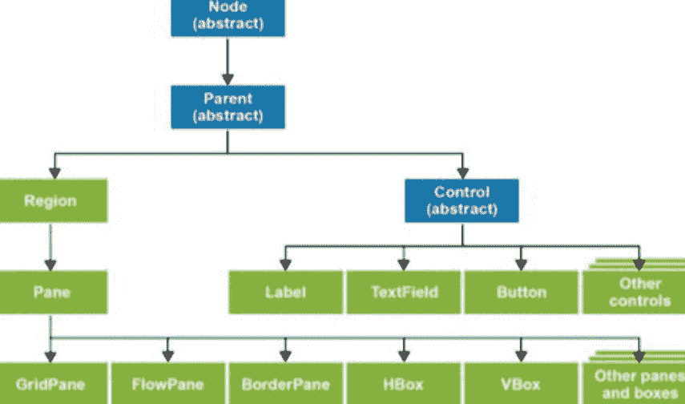

# 布局管理器总结

| 管理器 | 说明 |
| --- | --- |
| GridPane | 在网格中布局控件。 |
| FlowPane | 通过流式布局控件。 |
| BorderPane | 通过提供五个区域：北、南、东、西和中心来布局控件。 |
| HBox | 在水平行中布局控件。 |
| VBox | 在垂直列中布局控件。 |

## 描述

- 布局管理器用于在 GUI 上布局控件。

- 所有 JavaFX 控件和布局管理器都继承抽象的 `Node` 和 `Parent` 类。

- 所有 JavaFX 控件继承 `Control` 类。

- 所有布局管理器继承 `Region` 和 `Pane` 类。

图 17-2 JavaFX 节点的继承层次结构

# GridPane 和 Scene 类的构造函数

| 构造函数 | 描述 |
|--- | --- |
| `GridPane()` | 创建一个 `GridPane` 对象。 |
| `Scene(Parent, width, height)` | 创建一个指定高度和宽度的 `Scene` 对象，该对象包含指定的 `Parent` 对象。 |

# Stage 类的方法

| 方法 | 描述 |
|--- | --- |
| `setTitle()` | 设置 `Stage` 标题。 |
| `setScene(Scene)` | 将指定的 scene 添加到 stage。 |
| `show()` | 显示由 stage 定义的窗口。 |

# 创建并显示空窗口的类


```java
import javafx.application.Application;
import javafx.scene.Scene;
import javafx.scene.layout.GridPane;
import javafx.stage.Stage;

public class FutureValueApplication extends Application {
    @Override
    public void start(Stage primaryStage) {
        // 设置 stage标题
        primaryStage.setTitle("Future Value Calculator*");

        // 创建 grid，创建 scene，并将 grid 添加到 scene
        GridPane grid = new GridPane();
        Scene scene = new Scene(grid, 300, 100);

        // 设置 scene 并显示 stage
        primaryStage.setScene(scene);
        primaryStage.show();
    }

    public static void main(String[] args) {
        // 通过调用其静态 launch() 方法启动应用程序
        launch(args);
    }
}
```

# 结果窗口


## 描述

- 为了定义应用程序的主窗口，编写一个继承自 `javafx.application` 包中 `Application` 类的类，并重写其 `start()` 方法。

- `start()` 方法接收一个代表主窗口的 `Stage` 对象，称为阶段（stage）。然后，你可以创建一个包含其他 pane 或控件的 pane 的 scene。

图 17-3 如何创建并显示窗口

将 scene 添加到 stage。然后，此代码调用 `Stage` 对象的 `show()` 方法使 stage 可见。

在 `start()` 方法之后，图 17-3 显示了应用程序的 `main()` 方法。该方法调用 `Application` 类的静态 `launch()` 方法。`launch()` 方法会导致 `start()` 方法被执行，从而显示 GUI。

# 如何使用标签（labels）

大多数应用程序使用一个或多个标签来显示标识 GUI 中其他控件的文本。在 JavaFX 中，你使用 `Label` 类来创建标签。

图 17-4 显示了你处理 `Label` 控件等控件时需要的包。这与你在本节之后介绍的 `TextField` 和 `Button` 控件等控件所需的包是相同的。

图中的第一个表格展示了 `Label` 类的两个构造函数和一个方法。第一个构造函数创建一个不带文本的标签。如果你使用这个构造函数，则需要使用 `setText()` 方法来设置标签的文本。例如，你可能想使用标签来显示错误信息。否则，你可以使用第二个构造函数，它接受一个 `String` 参数来设置标签的文本。

图中的第二个表格总结了作为 `Label` 对象添加到 `GridPane` 类的 `add()` 方法。该方法接受三个参数。第一个参数是控件，第二个和第三个参数是指定列索引和行索引的整数值。这决定了控件在网格中显示的位置。列索引和行索引都从零开始。因此，列索引0 是网格的第一列，行索引0 是网格的第一行。

代码示例展示了这是如何工作的。在第一个示例中，创建第一个 `Label` 控件并将其文本设置为“Monthly Investment”。然后，第二条语句将标签添加到网格的第一行的第一列。

第二个示例显示了如何在一个语句中创建标签并将其添加到网格。此代码通过在 `add` 方法内部调用 `Label` 构造函数来实现。在这个示例中，没有为 `Label` 对象创建变量。

最后一个示例显示了添加到网格的四个标签，下方的窗口显示了它们如何呈现。这表明默认情况下，网格和窗口之间的标签没有间隔。

尽管这些标签显示的是文本，但标签也可以显示图像。例如，你可以使用标签来显示图标，以标识文本字段或产品照片。更多信息请参阅 JavaFX API 文档。

# 用于对齐和内边距的包

`javafx.geometry`

# GridPane 类用于对齐和内边距的方法

| 方法 | 描述 |
| --- | --- |
| `setAlignment(Pos)` | 使用 `Pos` 枚举中的常量设置网格的对齐方式。 |
| `setPadding(Insets)` | 设置网格周围的内边距为 `Insets` 对象指定的空间大小。 |
| `setHgap(int)` | 设置网格列之间水平间隙的宽度。 |
| `setVgap(int)` | 设置网格行之间垂直间隙的高度。 |

# Insets类的常用构造函数

| 构造函数 | 描述 |
| --- | --- |
| `Insets(top, left, bottom, right)` | 以像素为单位指定顶、左、底、右内边距。 |

# Pos 枚举的常量

| TOP_LEFT | TOP_CENTER | TOP_RIGHT |
| --- | --- | --- |
| BASELINE_LEFT | BASELINE_CENTER | BASELINE_RIGHT |
| CENTER | CENTER | CENTER_RIGHT |
| BOTTOM_LEFT | BOTTOM_CENTER | BOTTOM_RIGHT |

# 设置网格对齐和内边距的代码

```java
GridPane grid = new GridPane();
grid.setAlignment(Pos.TOP_CENTER);
grid.setPadding(new Insets(25, 25, 25, 25));
grid.setHgap(10);
grid.setVgap(10);
```

# 结果窗口

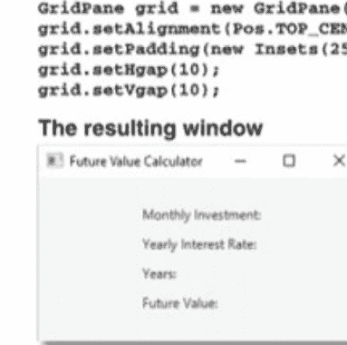

## 描述

- 你可以使用 `GridPane` 类的方法来设置网格的对齐方式、设置网格周围的内边距，以及设置网格行与之间的间距。

- 如果你忘记了 `Insets` 类构造函数的参数顺序，记住它们从顶部开始按逆时针排列可能会帮助。

图 17-5 如何设置对齐和内边距

# 如何使用文本字段

大多数应用程序都会使用一个或多个文本字段（也称为文本框），允许用户输入数据。`TextField` 类定义了一个允许用户输入或编辑文本的文本字段，也可以用于向用户显示文本。图 17-6 总结了 `TextField` 类最常用的构造函数和一些方法。

构造函数创建一个不包含任何文本的文本字段。然后，如果用户在字段中输入文本，你可以使用 `getText()` 方法获取该文本。反之，如果你想设置字段中的文本，则使用 `setText()` 方法。

默认情况下，文本字段是可编辑的。因此，用户可以向其中输入文本或编辑文本；然而，如果你想创建一个只读字段，可以向它的 `setEditable()` 方法传递一个 `false` 值。这样用户就无法向其中输入文本了。

那么，为什么不使用标签（label）来显示用户无法编辑的文本呢？原因之一是用户可以在只读字段中选择并复制文本。如果你想显示某些用户可以复制到剪贴板并传递到其他地方的文本，但你不希望他们编辑字段中显示的文本，那么这就很有用。例如，你可能允许用户复制并将错误消息发送到电子邮件中，以帮助处理该问题的程序员。

`setDisable()` 方法的作用与 `setText()` 类似。它还会使框变为灰色，并且不允许从字段中选择或复制文本。如果你想防止用户在完成其他步骤之前向文本字段输入数据，这种方法就很有用。

图中的示例显示了如何创建和使用文本字段。在这里，第一个示例创建了一个名为 `investment` 的文本字段，第二个示例使用 `getText()` 方法获取该字段的值并将其赋值给 `String` 变量。反之，第三个示例使用 `setText()` 方法将文本字段的值设置为字符串值 "100"。

最后一个示例显示了如何向网格中添加 `TextField` 控件。这与你在图 17-4 中看到的向网格添加 `Label` 控件的代码类似。首先，你创建一个 `TextField` 控件。然后，你调用 `GridPane` 面板的 `add()` 方法，并将控件以及列、行索引传递给它，这些索引决定了控件在网格中的显示位置。

此图还显示了当应用程序显示 GUI 时，这些字段在窗口中显示的样子。这里，第四个文本字段与前三个一样。但是，第四个文本字段是只读的，所以用户无法更改它显示的文本。

正如你所学的，你也可以通过 `add()` 方法内部调用 `TextField` 构造函数来一行代码创建这些文本字段。然而，你通常需要在应用程序的某个点获取或设置字段中的文本。因此，你通常会创建一个引用 `TextField` 对象的变量，以便稍后使用该变量处理该文本字段。

# 第 17 章 如何开始 JavaFX 543

# TextField 类的常用构造函数和方法

| 构造函数 | 描述 |
| --- | --- |
| `TextField()` | 创建一个 `TextField` 对象。 |
| 方法 | 描述 |
| `getText()` | 获取文本字段包含的文本。 |
| `setText(String)` | 设置文本字段显示的文本。 |
| `setEditable(boolean)` | 决定用户是否可以编辑文本。 |
| `setDisable(boolean)` | 决定文本字段是否启用。如果设置为 true，则文本字段被禁用并显示为灰色。 |

# 创建文本字段

```java
TextField investment = new TextField();
```

# 从字段获取文本

```java
String monthly = investment.getText();
```

# 设置字段中的文本

```java
investment.setText("100");
```

# 向网格添加文本字段

```java
GridPane grid = new GridPane();
grid.add(new TextField(), 0, 0);
TextField interestRate = new TextField();
grid.add(interestRate, 1, 0);
TextField years = new TextField();
grid.add(years, 0, 1);
TextField futureValue = new TextField();
grid.add(futureValue, 1, 1);
```

# 设置列宽

```java
GridPane grid = new GridPane();
grid.add(new TextField(), 0, 0);
TextField interestRate = new TextField();
grid.add(interestRate, 1, 0);
TextField years = new TextField();
grid.add(years, 0, 1);
TextField futureValue = new TextField();
grid.add(futureValue, 1, 1);

ColumnConstraints col1 = new ColumnConstraints();
col1.setMinWidth(150);
grid.getColumnConstraints(0).setConstraints(col1);

ColumnConstraints col2 = new ColumnConstraints();
col2.setPercentWidth(60);
grid.getColumnConstraints(1).setConstraints(col2);

ColumnConstraints col3 = new ColumnConstraints();
col3.setPercentWidth(40);
grid.getColumnConstraints(2).setConstraints(col3);
```

# 使用百分比设置列宽

```java
GridPane grid = new GridPane();
ColumnConstraints col1 = new ColumnConstraints();
col1.setPercentWidth(60);
grid.getColumnConstraints().add(col1);

ColumnConstraints col2 = new ColumnConstraints();
col2.setPercentWidth(40);
grid.getColumnConstraints().add(col2);
```

# 用于处理列宽包

`javafx.scene.layout`

# ColumnConstraints 类的常用构造函数

| 构造函数 | 说明 |
| --- | --- |
| `ColumnConstraints()` | 创建一个未设置宽度的 `ColumnConstraints` 对象。 |
| `ColumnConstraints(width)` | 创建一个具有像素列宽度的 `ColumnConstraints` 对象。 |
| `ColumnConstraints(minWidth, prefWidth, maxWidth)` | 创建一个设置了列最小宽度、首选宽度和最大宽度的 `ColumnConstraints` 对象。 |
| 方法 | 说明 |
| `setMinWidth(minWidth)` | 设置列的最小宽度（像素）。 |
| `setMaxWidth(maxWidth)` | 设置列的最大宽度（像素）。 |
| `setPrefWidth(prefWidth)` | 设置列的首选宽度（像素）。 |
| `setPercentWidth(percentWidth)` | 将列的宽度设为网格可用宽度的百分比。 |

# GridPane 类中用于获取列约束的方法

| 方法 | 说明 |
| --- | --- |
| `getColumnConstraints()` | 获取列约束列表。列表中的第一个项包含第一列的约束，第二个项包含第二列的约束，依此类推。 |

# 使用循环为每列添加相同约束的代码

```java
for (int i = 0; i < 2; i++) {
    ColumnConstraints col = new ColumnConstraints(150);
    grid.getColumnConstraints().add(col);
}
```

# 为每列添加不同约束的代码

```java
ColumnConstraints col1 = new ColumnConstraints();
col1.setPercentWidth(60);
ColumnConstraints col2 = new ColumnConstraints();
col2.setPercentWidth(40);
grid.getColumnConstraints().addAll(col1, col2);
```

## 说明

- 当你向网格的列中添加内容时，`GridPane` 布局管理器会设置这些列的宽度以适应内容。这对于大多数应用程序都是足够的。

- 如果你需要设置列宽，可以创建列约束并将它们添加到存储在网格中的列约束列表中。


# 如何创建一个处理事件的 GUI

在此时，你已经学习了如何创建一个允许用户输入数据的 GUI 。然而，你从未学习过如何处理这些数据。在接下来的主题中，你将学习如何向你的应用程序添加按钮，并学习如何处理用户点击这些按钮时发生的事件。这种事件处理可以包含从用户处获取数据并向用户显示数据的代码。

# 如何处理按钮和布局框

大多数应用程序使用一个或多个按钮控件来提交它们输入的数据。图 17-8 中的第一个表总结了 `Button` 类的构造函数和一个方法。这表明你可以使用构造函数来设置显示在按钮上的文本，并且在需要时可以使用 `setText()` 方法更改文本。

在处理按钮时，通常会将一行按钮存储在布局框中，如如图所示的 `HBox` 布局框。然后，通常会将此布局框添加到根布局框中。这允许你以与页面上其他控件不同的方式对按钮进行对齐和内边距设置。

图中的第二个表总结了 `HBox` 类的一个构造函数和两个方法。构造函数允许你设置分离框内控件的内边距，而 `getChildren()` 方法返回它包含的所有控件的集合。然后，你可以使用该集合的 `add()` 方法来添加控件。像 `GridPane` 类一样，`HBox` 类也有一个 `setAlignment()` 方法，允许你对齐框内的控件。

图中的第三个表总结了 `GridPane` 类的另一个 `add()` 方法。该 `add` 方法接收控件以及其之前的列和行索引。此外，它接受整数值表示控件应跨越的列数和行数。

图中的示例展示了这是如何工作的。首先，它创建两个按钮并将它们赋值给变量 `calculateButton` 和 `exitButton`。然后，它创建了一个新的 `HBox` 对象，它将其包含的任何控件隔开 10 像素。

之后，代码将按钮添加到 `HBox` 对象中。为了做到，它调用 `getChildren()` 方法获取子控件集合。然后，使用该集合的 `add()` 方法添加按钮。接下来，它将按钮对齐到 `HBox` 对象的右底部。

最后，代码将 `HBox` 对象添加到应用程序网格的第五行。注意，`add()` 方法指定了 `HBox` 对象位于网格的第一列。但它也指定了 `HBox` 对象应该跨越两列。这同 `HBox` 对象的对齐设置导致按钮一直显示到网格的最右侧。

# 第 17 章 如何开始 JavaFX

# Button 类的常用构造函数

| 构造函数 | 说明 |
| --- | --- |
| `Button(String)` | 创建一个带有指定文本的按钮。 |


# 第 17 章 如何开始 JavaFX

## Button 类的常用构造函数和方法

| 构造函数/方法 | 说明 |
| --- | --- |
| `Button(String)` | 创建一个带有指定文本的按钮。 |
| `setText(String)` | 设置按钮显示的文本。 |

## HBox 类的常用构造函数和方法

| 构造函数/方法 | 说明 |
| --- | --- |
| `HBox(int h)` | 创建一个 HBox，将其包含的控件隔开指定的像素。 |
| `getChildren()` | 返回它包含的所有控件的集合。 |
| `setAlignment(Alignment alignment)` | 设置框内的对齐方式。 |

## GridPane 类的另一个 `add()` 方法

| 方法 | 说明 |
| --- | --- |
| `add(Node node, int col, int row)` | 接收控件以及列索引和行索引。 |
| `add(Node node, int col, int row, int colSpan, int rowSpan)` | 接收控件、列索引、行索引以及跨越的列数和行数。 |

## 使用循环为每列添加相同约束的代码

```java
for (int i = 0; i < 2; i++) {
    ColumnConstraints col = new ColumnConstraints(150);
    grid.getColumnConstraints().add(col);
}
```

## 为每列添加不同约束的代码

```java
ColumnConstraints col1 = new ColumnConstraints();
col1.setPercentWidth(60);
ColumnConstraints col2 = new ColumnConstraints();
col2.setPercentWidth(40);
grid.getColumnConstraints().addAll(col1, col2);
```

## 说明

- 当你向网格的列中添加内容时，`GridPane` 布局管理器会设置这些列的宽度以适应内容。这对于大多数应用程序都是足够的。
- 如果你需要设置列宽，可以创建列约束并将它们添加到存储在网格中的列约束列表中。


## 如何创建一个处理事件的 GUI

在此时，你已经学习了如何创建一个允许用户输入数据的 GUI。然而，你从未学习过如何处理这些数据。在接下来的主题中，你将学习如何向你的应用程序添加按钮，并学习如何处理用户点击这些按钮时发生的事件。这种事件处理可以包含从用户处获取数据并向用户显示数据的代码。

## 如何处理按钮和布局框

大多数应用程序使用一个或多个按钮控件来提交它们输入的数据。图 17-8 中的第一个表总结了 `Button` 类的构造函数和一个方法。这表明你可以使用构造函数来设置显示在按钮上的文本，并且在需要时可以使用 `setText()` 方法更改文本。

在处理按钮时，通常会将一行按钮存储在布局框中，如图所示的 `HBox` 布局框。然后，通常会将此布局框添加到根布局框中。这允许你以与页面上其他控件不同的方式对按钮进行对齐和内边距设置。

图中的第二个表总结了 `HBox` 类的一个构造函数和两个方法。构造函数允许你设置分离框内控件的内边距，而 `getChildren()` 方法返回它包含的所有控件的集合。然后，你可以使用该集合的 `add()` 方法来添加控件。像 `GridPane` 类一样，`HBox` 类也有一个 `setAlignment()` 方法，允许你对齐框内的控件。

图中的第三个表总结了 `GridPane` 类的另一个 `add()` 方法。该 `add` 方法接收控件以及其之前的列和行索引。此外，它接受整数值表示控件应跨越的列数和行数。

图中的示例展示了这是如何工作的。首先，它创建两个按钮并将它们赋值给变量 `calculateButton` 和 `exitButton`。然后，它创建了一个新的 `HBox` 对象，它将其包含的任何控件隔开 10 像素。

之后，代码将按钮添加到 `HBox` 对象中。为了做到这一点，它调用 `getChildren()` 方法获取子控件集合。然后，使用该集合的 `add()` 方法添加按钮。接下来，它将按钮对齐到 `HBox` 对象的右底部。

最后，代码将 `HBox` 对象添加到应用程序网格的第五行。注意，`add()` 方法指定了 `HBox` 对象位于网格的第一列。但它也指定了 `HBox` 对象应该跨越两列。这同 `HBox` 对象的对齐设置导致按钮一直显示到网格的最右侧。

## 用于处理事件的包

`javafx.event`

## 大多数控件常用的方法

| 方法 | 描述 |
| --- | --- |
| `setOnAction(EventHandler<EventType>)` | 为按钮等控件注册事件处理器，使其能够处理点击按钮等操作事件。 |

## 为按钮添加事件处理器的三种方法

### 使用内部类（Java 8 之前）

```java
class CalculateButtonEventHandler implements EventHandler<ActionEvent> {
  @Override
  public void handle(ActionEvent event) {
    primaryStage.setTitle("Click!");
  }
}
calculateButton.setOnAction(new CalculateButtonEventHandler());
```

### 使用匿名类（Java 8 之前）

```java
calculateButton.setOnAction(new EventHandler<ActionEvent>(){
  @Override
  public void handle(ActionEvent event) {
    primaryStage.setTitle("Click!");
  }
});
```

### 使用 lambda 表达式（Java 8 及以后版本）

```java
calculateButton.setOnAction(event -> {
  primaryStage.setTitle("Click!");
});
```

## 描述

- 当用户与 GUI 交互时，会发生事件。
- 要在事件发生时执行某些代码，可以通过调用控件的 `setOnAction()` 方法注册事件处理器。该方法接受一个 `EventHandler` 对象，该对象包含事件发生时执行的代码。
- 要使用内部类创建事件处理器，可以在主类内部编写一个实现 `EventHandler<>` 接口的类。然后重写该接口的 `handle()` 方法，使其包含事件发生时执行的代码。
- 要使用匿名类创建事件处理器，可以从 `EventHandler<>` 接口创建一个对象。然后在在定义该对象的括号内，提供实现接口 `handle()` 方法的代码。
- 你也可以对 `setOnAction()` 方法使用 lambda 表达式。该 lambda 表达式由事件对象的变量名、紧随其 lambda 运算符 (`->`) 以及实现 `EventHandler<>` 接口的代码组成。
- 在 Java 8 之前，通常使用内部类或匿名内部类来处理事件。在 Java 8 或更高版本中，你可以使用 lambda 表达式，它更简洁清晰。

## 终值应用程序

图 17-10 显示了一个终值应用程序，它将本章目前介绍的技能置于完整应用程序的范围内。

### 用户界面

首先，此图显示了应用程序的 GUI。该 GUI 允许用户计算一系列每月投资的终值。首先，用户在前三个文本框中输入相应的数字。然后，用户点击 Calculate（计算）按钮。或者，用户也可以按 Tab 键将焦点移动到 Calculate 按钮，然后按空格键。无论哪种方式，应用程序都会在第四个文本框中显示终值。

### 代码

此图还显示了 `FutureValueApplication` 类的代码。首先，该类导入了 `murach` 包中的 `FinancialCalculations` 类。此外，它还导入了 Java API 中的 `NumberFormatException` 类以及 JavaFX API 的几个类。在导入语句之后，类的声明显示 `FutureValueApplication` 类继承自 `Application` 类。

在 `FutureValueApplication` 类的体内部，代码首先开始为文本框声明私有实例变量。这些变量是在类级别声明的，这样 Calculate 按钮的事件处理器就可以访问它们。

在声明实例变量后，此代码重写了 `Application` 类的 `start()` 方法。该方法接受一个代表主窗口的 `Stage` 对象。在 `start()` 方法中，代码设置了主窗口的标题并创建一个 `GridPane` 对象。然后，设置了该 `GridPane` 的对齐方式和填充。接下来，创建一个新的 `Scene` 对象并将 `GridPane` 作为场景的根元素传递。由于此代码没有指定 `Scene` 的宽度和高度，场景的大小足够容纳网格，这对于该应用程序是合适的。

设置好网格后，此代码向网格中添加了一系列 `Label` 和 `TextField` 对象。此代码没有为标签创建变量名，因为不需要再次访问这些标签。另一方面，它将文本框分配给私有实例变量，因为以后需要访问这些文本框。

此代码在第一行的第一、二列添加了“Monthly Investment”（每月投资）标签和文本框。同样，此代码在第二行添加了“Yearly Interest Rate”（利率）标签和文本框，并在第三行添加了“Years”（年）标签和文本框。每个文本框都接受用户的输入。

### GUI


### FutureValueApplication 类

```java
package murach.business.FinancialCalculations;
import java.text.NumberFormat;

import javafx.application.Application;
import javafx.geometry.Insets;
import javafx.geometry.Pos;
import javafx.scene.Scene;
import javafx.scene.control.Button;
import javafx.scene.control.Label;
import javafx.scene.control.TextField;
import javafx.scene.layout.GridPane;
import javafx.scene.layout.HBox;
import javafx.stage.Stage;

public class FutureValueApplication extends Application {
    private TextField investmentField;
    private TextField interestRateField;
    private TextField yearsField;
    private TextField futureValueField;

    @Override
    public void start(Stage primaryStage) {
        primaryStage.setTitle("Future Value Calculator");

        GridPane grid = new GridPane();
        grid.setAlignment(Pos.CENTER);
        grid.setPadding(new Insets(25, 25, 25, 25));
        grid.setHgap(10);
        grid.setVgap(10);

        Scene scene = new Scene(grid);

        grid.add(new Label("Monthly Investment:"), 0, 0);
        investmentField = new TextField();
        grid.add(investmentField, 1, 0);

        grid.add(new Label("Yearly Interest Rate:"), 0, 1);
        interestRateField = new TextField();
        grid.add(interestRateField, 1, 1);

        grid.add(new Label("Years:"), 0, 2);
        yearsField = new TextField();
        grid.add(yearsField, 1, 2);

        grid.add(new Label("Future Value:"), 0, 3);
        futureValueField = new TextField();
        futureValueField.setEditable(false);
        grid.add(futureValueField, 1, 3);

        Button calculateButton = new Button("Calculate");
        calculateButton.setOnAction(event -> {
            double investment = Double.parseDouble(investmentField.getText());
            double interestRate = Double.parseDouble(interestRateField.getText());
            int years = Integer.parseInt(yearsField.getText());
            double futureValue = FinancialCalculations.calculateFutureValue(investment, interestRate, years);
            futureValueField.setText(NumberFormat.getCurrencyInstance().format(futureValue));
        });

        Button exitButton = new Button("Exit");
        exitButton.setOnAction(event -> System.exit(0));

        HBox hbox = new HBox(10, calculateButton, exitButton);
        hbox.setAlignment(Pos.CENTER);
        hbox.setPadding(new Insets(25));
        grid.add(hbox, 0, 4, 2, 1);

        primaryStage.setScene(scene);
        primaryStage.show();
    }

    public static void main(String[] args) {
        launch(args);
    }
}
```

*(注：由于提供的原文代码块在输入文本中存在乱序，为了保证翻译的可读性，我在译文部分根据描述逻辑重新还原了完整的 Java 代码结构)*

## FutureValueApplication 类（续）

```java
grid.add(new Label("Years:"), 0, 2);
yearsField = new TextField();
grid.add(yearsField, 1, 2);
```


```java
grid.add(new Label("Future Value:"), 0, 3);
futureValueField = new TextField();
futureValueField.setEditable(false);
grid.add(futureValueField, 1, 3);
```

```java
Button calculateButton = new Button("Calculate");
calculateButton.setOnAction(event -> calculateButtonClick());
```

```java
Button exitButton = new Button("Exit");
exitButton.setOnAction(event -> exitButtonClicked());
```

```java
HBox hbox = new HBox(10);
hbox.getChildren().add(calculateButton);
hbox.getChildren().add(exitButton);
hbox.setAlignment(Pos.BOTTOM_RIGHT);
grid.add(hbox, 0, 4, 2, 1);
```

```java
primaryStage.setScene(scene);
primaryStage.show();
```

```java
private void calculateButtonClick() {
    // 从文本框获取数据
    double investment = Double.parseDouble(investmentField.getText());
    double rate = Double.parseDouble(interestRateField.getText());
    int years = Integer.parseInt(yearsField.getText());

    // 计算未来价值
    double futureValue = FinancialCalculations.calculateFutureValue(
        investment, rate, years);
```

```java
// 在只读文本框中设置数据
NumberFormat currency = NumberFormat.getCurrencyInstance();
futureValueField.setText(currency.format(futureValue));
```

```java
private void exitButtonClicked() {
    System.exit(0); // 0 表示正常退出
}
```

```java
public static void main(String[] args) {
    launch(args);
}
```

图 17-10 未来价值应用（2 部分，共 2 部分）

## 如何验证用户输入

在第 5 章中，你学习了如何验证控制台程序的输入数据。通过你所遵循的主题，你会发现可以使用类似的技术来验证 JavaFX 应用程序的输入数据。

## 如何在对话框中显示错误消息

在验证 JavaFX 应用程序中的数据时，你需要能够显示错误消息，以通知用户检测到了无效输入。一种方法是在单独的对话框中显示错误消息，如图 17-11 所示。要显示这样的对话框，你使用该图中描述的 `Alert` 类。

该图中的表格总结了 `Alert` 类的一个构造函数和四个方法。构造函数会创建一个对话框，并为指定的警报类型提供适当的图像和值。该类型通过将表格中 `AlertType` 枚举中的方法常量传递给构造函数来指定。

对话框中的前三个方法接受一个字符串，然后在对话框的不同位置显示该字符串。例如，`setTitle()` 方法在对话框的左上角显示字符串。`setHeaderText()` 方法在对话框上部的标题下方显示字符串。而 `setText()` 方法在对话框下部、标题和页眉下方显示字符串。

你使用表格中的最后一个方法 `showAndWait()` 来显示对话框。当你调用此方法时，用户必须在继续之前对对话框做出响应。例如，用户可以通过点击 OK 按钮来响应。

此图中的代码示例显示了如何在对话框中显示简单的错误消息。首先，第一个语句创建一个警报类型为 `ERROR` 的新 `Alert` 对象。这种类型的对话框中有一个红色的“X”图像。然后接下来的三个语句设置对话框的标题、页眉和内容。最后，最后一个语句显示对话框。

## 第 17 章 如何开始使用 JavaFX 555

### 用于对话框的类

`javafx.scene.control.Alert`

### Alert 类的常用构造函数和方法

| 构造函数 | 描述 |
| :--- | :--- |
| `Alert(AlertType)` | 为 `AlertType` 常量指定的类型创建一个具有适当图像和默认值的对话框。 |

| 方法 | 描述 |
| :--- | :--- |
| `setTitle(String)` | 设置对话框的标题。 |
| `setHeaderText(String)` | 设置在对话框顶部显示的文本。 |
| `setContentText(String)` | 设置在对话框底部显示的文本。 |
| `showAndWait()` | 显示对话框并等待用户响应。 |

### Alert 枚举的五个常量

- `ERROR`
- `WARNING`
- `CONFIRMATION`
- `INFORMATION`
- `NONE`

### 显示带有错误消息的对话框的代码

```java
Alert alert = new Alert(AlertType.ERROR);
alert.setTitle("Error");
alert.setHeaderText("Invalid Entry");
alert.setContentText("Monthly Investment is a required field.");
alert.showAndWait();
```

### 生成的对话框


## 描述

- 你可以使用 `Alert` 类来显示带有数据验证错误消息的对话框。

图 17-11 如何在对话框中显示错误消息

## 如何验证输入文本框的数据

图 17-12 显示了你可以用于验证用户输入到文本框数据的两种技术。第一个示例检查用户是否已向字段输入了数据。为了做到这一点，它使用 `getText()` 方法获取输入的字符串。如果为空为空，代码将在对话框中显示错误消息。用户对对话框做出响应后，`return` 语句阻止执行其余代码，这通常是你处理无效数据时想要的。

第二个示例显示了如何检查用户是否输入了数值。在这里，`try-catch` 块捕获 `NumberFormatException`，在对话框中显示错误消息，并在用户响应后退出方法。

### 检查是否已输入内容的代码

```java
private void calculateButtonClicked() {
    if (investmentField.getText().isEmpty()) {
        Alert alert = new Alert(AlertType.ERROR);
        alert.setHeaderText("Invalid Entry!");
        alert.setContentText("Monthly Investment is a required field");
        alert.showAndWait();
        return;
    }
    // 其余代码
}
```

### 检查输入是否为有效数字的代码

```java
private void calculateButtonClicked() {
    double investment;
    try {
        investment = Double.parseDouble(investmentField.getText());
    } catch (NumberFormatException e) {
        Alert alert = new Alert(AlertType.ERROR);
        alert.setHeaderText("Invalid Entry!");
        alert.setContentText("Monthly Investment must be a valid number.");
        alert.showAndWait();
        return;
    }
    // 其余代码
}
```

## 描述

- 像控制台程序一样，GUI 应用程序在处理之前应该验证用户输入的所有数据。
- 当输入无效时，应用程序可以显示错误消息并给用户另一次验证数据的机会。
- 要测试是否已向文本框输入了值，你可以使用文本框的 `getText()` 方法获取包含用户输入文本的字符串。然后，你可以使用它的 `isEmpty()` 方法检查该字符串是否为空。
- 要测试字段是否包含有效的数值数据，你可以编写在 `try` 块中转换数据的语句，并使用 `catch` 块捕获 `NumberFormatException`。


## Validation 类

图 17-13 显示了一个你可以用于验证文本框数据的 `Validation` 类。与第 7 章介绍的 `Console` 类一样，该类使用方法执行常用验证。与 `Console` 类不同，`Validation` 类不使用静态方法。因此，在使用方法之前必须创建一个 `Validation` 对象。这使得在对象比类名短时更容易使用方法，并且在需要时更容易更改使用的类。

该类从定义一个名为 `lineEnd` 的私有实例变量开始，存储位于验证消息末尾的字符串。然后，该方法定义了两个构造函数来设置 `lineEnd` 变量。第一个构造函数将 `lineEnd` 设置为包含换行符的字符串，第二个构造函数将其设置为传递给它的字符串。

所有的公共方法都返回一个字符串，指示指定的字符串是否通过测试。此外，所有这些方法都定义两个字符串参数。第一个参数指定要验证的文本，第二个参数指定用于错误消息的验证名称。如果字符串通过测试，方法返回空验证消息。否则，方法返回验证消息并加上 `lineEnd` 变量。这表示字符串没有通过测试。

`isEmpty()` 方法确定字符串值是否包含一个或多个字符。为此，请使用 `isEmpty()` 方法检查字符串是否为空。`isDouble()` 方法确定字符串是否可以转换为有效的双值。与前一个图中第二个示例中的代码一样，此示例中的 `parseDouble` 方法使用了捕获 `NumberFormatException` 的语句。最后，`isInteger()` 方法确定字符串值是否可以转换为有效的整数。此方法的代码与 `isDouble()` 方法相似。

在你查看 `Validation` 类时，注意它没有直接引用 GUI 中的控件。它引用用户输入到控件的字符串。这被称为松耦合，它允许该类与不同类型的控件工作。例如，你可以使用该类来验证存储在文本框中的字符串，如下图所示。然而，你也可以使用该类来验证其他控件中的字符串，包括在下一章描述的 Swing API 中的控件。

## FXValidator 类的代码

```java
package murach.business;
public class Validation {
    private String lineEnd;
    public Validation() {
        this.lineEnd = "\n";
    }
    public Validation(String lineEnd) {
        this.lineEnd = lineEnd;
    }
    public String isPresent(String value, String name, String name) {
        String msg = "";
        if (value.isEmpty()) {
            msg = name + " is required." + lineEnd;
        }
        return msg;
    }
    public String isDouble(String value, String name) {
        String msg = "";
        try {
            Double.parseDouble(value);
        } catch (NumberFormatException e) {
            msg = name + " must be a valid number." + lineEnd;
        }
        return msg;
    }
    public String isInteger(String value, String name) {
        String msg = "";
        try {
            Integer.parseInt(value);
        } catch (NumberFormatException e) {
            msg = name + " must be an integer." + lineEnd;
        }
        return msg;
    }
}
```

图 17-13 Validation 类

## 如何验证多个条目

图 17-14 显示了如何在事件处理程序（如 `calculateButtonClicked()` 方法）中使用前图所示 `Validation` 类。首先，这段代码创建了一个名为 `v` 的 `Validation` 对象。然后，它创建了一个变量 `errorMsg` 来存储调用 `Validation` 对象方法返回的字符串。

在设置好这两个变量后，该方法调用 `Validation` 对象的 `isDouble()` 方法，并将“Monthly Investment”（每月投资）字段中的字符串传递进去。然后，将结果追加到 `errorMsg` 变量。因此，如果“Monthly Investment”字段中的文本可以转换为双数值，此代码将向 `errorMsg` 变量追加一个空字符串。否则，它会将针对“Monthly Investment”字段的验证消息追加到 `errorMsg` 变量。

接下来的两次 `Validation` 类方法调用工作原理类似。在这里，代码第二次使用 `isDouble()` 方法为“Yearly Interest Rate”（年利率）字段获取适当的验证消息，并使用 `parseInt()` 方法为“Years”（年）字段获取适当的验证消息。

执行验证测试后，这段代码检查 `errorMsg` 变量是否为空。如果是，则所有字段都通过了验证检查。结果是此代码可以在 GUI 中计算未来值和验证消息。然而，如果 `errorMsg` 变量包含一个或多个验证消息，应用程序将在如图所示的对话框中显示这些消息。然后，在用户点击 OK 按钮后，对话框关闭，用户可以尝试输入有效数据。此过程一直持续直到用户在三个文本字段中都输入有效数据。


## 第 17 章 如何开始 JavaFX

### 显示三个错误消息的验证对话框

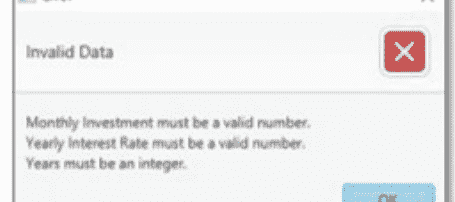

### 验证多个条目的代码


```java
private void calculateButtonClicked() {
    Validation v = new Validation();
    String errorMsg = "";
    errorMsg += v.isDouble(investmentField.getField(),
        "Monthly Investment");
    errorMsg += v.isDouble(interestRateField.getField(),
        "Yearly Interest Rate");
    errorMsg += v.isInteger(yearsField.getField(),
        "Years");
}

if (errorMsg.isEmpty()) {
    double investment = Double.parseDouble(
        investmentField.getText());
    double rate = Double.parseDouble(
        interestRateField.getText());
    int years = Integer.parseInt(
        yearsField.getText());

    double futureValue = FinancialCalculations.calculateFutureValue(
        investment, rate, years);

    NumberFormat currency = NumberFormat.getCurrencyInstance();
    futureValue.setText(currency.format(futureValue));
} else {
    Alert alert = new Alert(Alert.AlertType.ERROR);
    alert.setHeaderText("Invalid Data");
    alert.setContentText(errorMsg);
    alert.showAndWait();
}
```

## 描述

- 你可以使用前图中的 `Validation` 类来验证多个条目。如果你需要，可以在对话框中显示该类返回的错误消息。

图 17-14 如何验证多个条目

# 如何开始 FXML

本章之前介绍的未来值应用包含超过三十行定义 GUI 布局的 Java 代码。这些代码与提供 GUI 功能的代码混合在一起，导致代码更难以阅读和维护。为了单独定义 GUI 布局，你可以使用称为 FXML 的标记语言。因为 FXML 是基于 XML 的，我将首先介绍编写 XML 文档的基本技能。然后，我将介绍编写 FXML 应用程序的基本技能。

## XML 简介

XML（可扩展标记语言）提供了一种标准方法，使用标识每个元素的标签来结构数据。图 17-15 显示了一个简单的 XML 文档，包含三个产品的数据，每个产品都有代码、描述和价格。

# products.xml

```xml
<?xml version="1.0" encoding="UTF-8"?>
<Products>
  <Product code="java">
    <Description>Murach's Java Programming</Description>
    <Price>57.50</Price>
  </Product>
  <Product code="jsp">
    <Description>Murach's Java Servlets and JSP</Description>
    <Price>57.50</Price>
  </Product>
  <Product code="mysql">
    <Description>Murach's MySQL</Description>
    <Price>54.50</Price>
  </Product>
</Products>
```

# 如何编写 FXML 应用程序

图 17-16 展示了编写 FXML 应用程序的基本技能。首先，它展示了可以存储 FXML 应用程序代码三个文件。在这里，扩展名为 `.fxml` 的文件包含定义 GUI 的 FXML 元素。文件名以 "Controller" 结尾的 Java 文件包含与 FXML 文件中定义的控件交互的事件处理器。而以 "Application" 结尾的 Java 文件则启动应用程序并创建由 FXML 文件声明的 Java 对象。

图中的第一组示例展示了如何编写定义 GUI 的某些元素。由于 FXML 是基于 XML 的，因此你使用类似的技术来编写它们。主要的区别在于，你必须为 FXML 中的元素和属性使用特定的名称。在这些示例中，例如，你可以看到 `GridPane`、`Label`、`TextField` 和 `Button` 元素的定义，以及定义它们的属性。你还可以看到 `tag-import` 导入了 GUI 使用的类。注意，这种类型的标签以问号开头。

使用像 FXML 这样的标记语言的处在于它是声明性的。这意味着该语言可以声明控件而无需实际创建它们。因此，代码更加简洁、易于阅读且易于维护。

图中的第二个示例展示了 FXML 应用程序控制器类的代码。在这里，`@FXML` 注解允许控制器访问 FXML 文件中定义的控件以及控件的事件处理器。例如，命名为 `fieldValue` 的文本字段指向 FXML 文件中 `fx:id="fieldValue"` 的 `TextField`。同样，`calculateButtonClick()` 方法设置了 FXML 文件中 `onAction` 属性设置为该值的按钮的事件处理器。

第三个示例展示了如何加载 FXML 文件定义的对象。要实现这一点，在应用程序类的 `start()` 方法中使用 `FXMLLoader` 类的静态 `load()` 方法。该方法通过 `getClass()` 和 `getResource()` 获取 FXML 文件的 URL。结果存储在 `Parent` 对象中，它代表了 FXML 文件中对象的层次结构。在该对象创建后，你可以使用它来创建应用程序的场景，你将在本章后面看到。

# 如何创建 FXML 应用程序

到目前为止，使用 IDE 创建图中描述的 Java 类你不应该会遇到任何问题。通过一些尝试，你也应该能够创建 FXML 文件。如果你在使用 NetBeans，可以为 FXML 应用程序创建一个新项目。要做到这一点，从 File 菜单选择 New Project，从 Categories 面板选择 JavaFX，然后从 Projects 面板选择 FXML。然后，当你完成项目时，NetBeans 会创建一个作为你应用程序起点的简单应用程序。

图 17-16 开始使用 FXML

# 使用 FXML 的未来应用程序

接下来的两个图展示了使用 FXML 的应用程序代码。对于用户来说，该应用程序与本章之前介绍的未来应用程序完全相同。然而，该应用程序对开发者更容易开发和维护，因为它使用 FXML 定义 GUI 并使用控制器类提供事件处理器。

# FXML 文件

图 17-17 显示定义 Future Value GUI 的 FXML 文件。在这里，XML 声明导入了应用程序所需的类。在这些标签中，前两个使用星号导入了 JavaFX 布局管理器和控件。然而，第三个导入了 `javafx.geometry` 包中的 `Insets` 类。该文件的根元素是 `GridPane`。除了标识命名空间和应用程序控制器类外，该文件的属性将网格对齐在顶部。`hgap` 属性设置行之间的水平空间，`vgap` 属性设置列之间的垂直空间。

剩余元素在 `GridPane` 元素内编码。为了，`padding` 元素设置了网格周围的顶、左、底和右属性。接下来是 GUI 的标签和文本字段。在这里，`Label` 和 `TextField` 有 `columnIndex` 和 `rowIndex` 属性，指示控件显示的位置。此外，每个 `Label` 都有 `text` 属性来指定显示的内容，每个 `TextField` 都有 `fx:id` 属性来唯一标识该文本字段。该属性允许控制器访问此元素。最后，`GridPane` 元素包含了带有两个 `Button` 元素的 `HBox` 元素。`HBox` 元素包含 `spacing` 和 `alignment` 属性以设置网格中按钮之间的空间以及网格内 HBox 对象的对齐方式。它还包含 `columnIndex` 和 `rowIndex` 属性来指示面板应该显示的位置，并包含 `columnSpan` 和 `rowSpan` 属性来指示面板跨越两列两行。每个 `Button` 元素包含一个 `text` 属性，指定显示在控件上的文本。此外，每个按钮包含一个 `onAction` 属性，指定点击按钮时执行的事件处理器。你将以这种方式看到这些事件处理器的代码。现在，只需意识到你必须在事件处理器的名称前加上井号 (#)。

现在你已经看到了此应用程序的 FXML 文件，你可能想将其与图 17-10 中定义 GUI 的 Java 代码进行对比。你会发现 FXML 文件中的元素和属性与 Java 代码中的构造函数和方法之间的相似之处。一旦学会了如何使用 Java 代码开发 GUI，使用 FXML 就不应该有太大困难。

# FXML 文件

```xml
<?xml version="1.0" encoding="UTF-8"?>

<?import javafx.scene.layout.*?>
<?import javafx.scene.control.*?>
<?import javafx.geometry.Insets?>

<GridPane xmlns:fx="http://javafx.com/fxml"
    fx:controller="FutureValueController"
    alignment="TOP_CENTER" hgap="10" vgap="10">
    <padding>
        <Insets top="25" left="25" bottom="25" right="25"/>
    </padding>

    <!-- Monthly investment -->
    <Label text="Monthly Investment:" />
    <TextField fx:id="investmentField" />
    <GridPane.columnIndex="0" GridPane.rowIndex="0"/>

    <!-- Yearly interest rate -->
    <Label text="Yearly Interest Rate:" />
    <TextField fx:id="interestRateField" />
    <GridPane.columnIndex="0" GridPane.rowIndex="1"/>

    <!-- number of years -->
    <Label text="Years:" />
    <TextField fx:id="yearField" />
    <GridPane.columnIndex="0" GridPane.rowIndex="2"/>

    <!-- Future value -->
    <Label text="Future Value:" />
    <TextField fx:id="futureValueField" editable="false" />
    <GridPane.columnIndex="0" GridPane.rowIndex="3"/>

    <!-- Buttons -->
    <HBox spacing="10" alignment="bottom_right">
        <GridPane.columnIndex="2" GridPane.rowSpan="1"/>
        <Button text="Calculate" onAction="#calculateButtonClicked"/>
        <Button text="Exit" onAction="#exitButtonClicked"/>
    </HBox>

</GridPane>
```

图 17-17 未来应用程序的 FXML 文件

# 控制器类

图 17-18 显示了未来应用程序的控制器类。该类首先导入了一些类，包括它需要的 JavaFX 类。然后，它声明了该类。注意，它声明的类包（`murach.ui`）和该类的名称（`FutureValueController`）与 `GridPane` 元素的 `fx:controller` 属性指定的包和名称匹配。这就是 FXML 文件识别它所使用的控制器。

在类内部，前四语句声明了 `TextField` 实例变量。这些变量的名称与 FXML 文件中 `TextField` 元素的 `fx:id` 属性指定的名称相同。此外，这些字段标记了 `@FXML` 注解。因此，当应用程序启动时，它创建由 FXML 文件定义的 `TextField` 对象并将这些对象赋值给变量。

接下来，该类定义了两个事件处理器，它们的名称与 FXML 文件中 `Button` 元素的 `onAction` 属性的值相同。与私有变量一样，这些方法也被标记了 `@FXML` 注解。因此，当用户点击按钮时，Java 执行这些方法。

这些事件处理器的代码与本章之前展示的代码相同。为了节省空间，图中没有显示 `calculateButtonClick()` 方法的代码。然而，此代码使用前三个 `TextField` 变量从用户获取输入，并使用第四个 `TextField` 向用户显示未来价值。

# 应用程序类

此图还展示了定义并启动未来价值应用程序的类。该类首先导入它需要的类，包括用于从 FXML 文件创建 Java 对象的 `FXMLLoader` 类。

在 `start()` 方法中，第一个语句使用 `FXMLLoader` 类的静态 `load()` 方法加载 FXML 文件的 Java 对象。这创建了 FXML 文件中对象的层次结构，并将这些对象与控制器文件连接起来。然后，代码的其他部分将这些对象设置为场景，并将场景显示在舞台上。

第 17 章 如何开始使用 JavaFX 569

## 控制器类

package `murach.text.ui`;

```java
import java.text.NumberFormat;
import javafx.fxml.FXML;
import javafx.scene.control.TextField;
import murach.business.FinancialCalculations;

public class FutureValueController {
    @FXML private TextField investmentField;
    @FXML private TextField interestRateField;
    @FXML private TextField yearsField;
    @FXML private TextField TextFieldFieldValue;

    @FXML
    protected void calculateButtonClicked() {
        // 与图 17-10 相同的事件处理代码
    }

    @FXML
    protected void exitButtonClick() {
        System.exit(0); // 0 表示正常退出
    }
}
```

## 应用类

package `murach.ui`;

```java
import javafx.application.Application;
import javafx.fxml.FXMLLoader;
import javafx.scene.Parent;
import javafx.scene.Scene;
import javafx.stage.Stage;

public class FutureValueApplication extends Application {
    @Override
    public void start(Stage stage) throws Exception {
        Parent root = FXMLLoader.load(getClass().getResource("FutureValue.fxml"));
        Scene scene = new Scene(root);
        stage.setScene(scene);
        stage.setTitle("Future Value Calculator");
        stage.show();
    }

    public static void main(String[] args) {
        launch(args);
    }
}
```

图 17-18 未来价值应用程序的 Java 类

## 展望

在本章中，你学习了如何使用 JavaFX API 来构建未来价值应用程序的 GUI 版本。该应用程序使用了 JavaFX API 中提供的一些最常用控件，包括标签、文本字段和按钮。在下一章节中，你将学习如何使用 Swing API 来构建相同的应用程序。

此外，本章还展示了使用 FXML 定义 GUI 布局的基本技能，同时使用 Java 处理用户与应用程序交互时发生的事件。这种做法的优点在于将定义应用程序布局的代码与定义其功能的代码分离。一旦你习惯了使用 FXML，你可能会发现自己更倾向于用它来定义 GUI 的外观。


现在你已经学会了如何手动编写这类代码，你可能想尝试使用图形化工具，通过将控件拖放到表单上来为 JavaFX GUI 定义布局。例如，你可能想尝试使用 NetBeans 和 Eclipse 中可用的 Scene Builder 插件。但请记住，使用图形化工具也有一些缺点。首先，你对代码的控制力变弱，因为它是自动生成的。其次，当你使用图形化工具时，生成的 FXML 通常对开发者来说难以阅读和维护。因此，如果该工具过时，维护你的代码可能会变得困难。

## 总结

- 图形用户界面（GUI）让用户与应用程序的交互变得更容易。你可以使用多个库来创建 GUI，包括 AWT、Swing、SWT 和 JavaFX。

- 在 JavaFX 中，主窗口被称为 `stage`（阶段），而持有所有内容的容器被称为 `scene`（场景）。每个场景都有一个根元素，它通常是布局管理器控件之一。

- 你使用 `GridPane` 布局管理器在网格中布局控件。你使用 `Insets` 类设置网格的内边距，使用 `ColumnConstraints` 类设置网格中列的宽度。

- 你使用 `Label` 类创建用于标识其他控件的 `labels`（标签）。

- 你使用 `TextField` 类创建文本字段（也称为文本框），允许用户输入数据。

- 你使用 `Button` 类创建用户可以点击的按钮。通常会在 `HBox` 等窗格中添加一行按钮。

- 你使用控件的 `setOnAction` 方法来注册 `event`（事件）处理程序，当控件上发生 `event`（例如用户点击按钮）时，该处理程序会被执行。

- 事件处理器是从 `EventHandler` 类中创建的对象。该类包含一个 `handle()` 方法，该方法必须被重写，或者它包含了事件发生时执行的代码。

- 你使用 `Alert` 类向用户显示消息。

- XML（可扩展标记语言）提供了一种结构化数据的方法。

- FXML 是一种基于 XML 的语言，你可以用它来定义 GUI。

## 第 17 章 如何开始使用 JavaFX 571

### 练习 17-1 创建 JavaFX 应用程序

在练习中，你将编写一个计算每加仑油数的 JavaFX 应用程序。完成后，该应用程序应该如下所示：


#### 打开项目并查看代码

1. 打开 `ex_starts` 目录下名为 `c17_ex1_JavaFX` 的项目。查看 `FutureApplication.java` 中的代码，注意它继承了 `Application` 类并重写了 `start()` 方法。`main()` 方法调用了 `Application` 的 `launch()` 方法。

2. 运行项目查看显示了“Hello World”。点击右上角的“X”关闭应用程序。

#### 添加布局代码

3. 修改 `start()` 方法的代码，使其使用 `GridPane` 代替 `StackPane`。然后，在按钮之前添加标签和文本字段，并将第三个文本字段设置为只读。

4. 运行项目查看效果。

5. 修改网格使其在窗口中居中。此外，在网格与窗口边缘之间添加 25 像素的内边距，并在网格的行与列之间添加 10 像素的间隔。

6. 再次运行项目查看这些更改如何影响布局。

### 第 4 节 GUI 编程

#### 处理用户点击按钮时发生的事件

7. 找到按钮的事件处理器，注意它使用了匿名类。该类的 `handler()` 方法从油量和加仑文本字段获取值，计算每加仑油数，然后将其显示在只读文本字段中。

8. 运行项目并使用有效数据进行测试。完成后，关闭应用程序。

### 练习 17-2 使用 FXML 应用程序

在练习中，你将修改另一个使用 FXML 定义 GUI 的应用程序版本。完成后，该应用程序应该如下所示：


#### 打开项目并查看代码

1. 打开 `ex_starts` 目录下名为 `c17_ex2_MPGFXML` 的项目。查看 FXML 文件中的代码查看根元素是 `GridPane`。

2. 打开应用类。然后运行项目查看网格与其包含的场景之间没有空间，控件之间的空间不足。点击右上角的“X”关闭应用程序。

3. 修改网格使其在窗口中居中，并设置网格行与列之间的间隔为 10 像素。然后运行项目查看效果。

4. 执行一次计算，然后点击 MPG 文本字段查看你可以更改该字段的文本。然后，将该文本字段设置为只读字段。

5. 将按钮添加到 `HBox` 元素中，使按钮显示在 `HBox` 对象的右下角。为了实现此点，`HBox` 对象需要跨越两列。再次运行项目以确保其工作正常。

# 如何开始使用 Swing

在上一章中，你学习了使用 JavaFX 开发图形用户界面（GUI）的基础知识。在本章中，你将学习使用 Swing 开发 GUI 的基础知识。虽然 Swing 比 JavaFX 更老，但它的使用范围比 JavaFX 更广泛。因此，在现实世界中，你很可能会遇到 Swing，特别是当你需要维护旧应用程序时。

- GUI 编程简介........................................................... 574

- 带有十个控件的用户界面......................................................................... 574

- GUI API 总结...................................................................................... 574

- Swing 组件的继承层次结构.................................................. 576

- **如何创建一个处理事件的 GUI............................................... 578**

- 如何显示框架（Frame）。............................................................... 578

- 如何设置外观和感觉（Look and feel）。............................................................... 580

- 如何使用面板（Panels）。.................................................................. 582

- 如何使用按钮（Buttons）。.................................................................. 582

- 如何处理动作事件（Action events）。........................................................... 584

- 如何使用标签（Labels）。.................................................................. 586

- 如何使用文本字段（Text fields）。........................................................................... 588

- **如何使用布局管理器（Layout managers）。............................................... 590**

- 布局管理器总结....................................................................... 590

- 如何使用边界布局管理器（BorderLayout manager）。........................................................... 592

- 如何使用流布局管理器（FlowLayout manager）。......................................................... 594

- 如何使用网格布局管理器（GridBagLayout manager）。....................................................... 596

- 如何为 GridBagLayout 添加内边距（Padding）。............................... 598

- 如何解决 GridBagLayout 的常见问题............................... 600

- **未来价值（Future Value）应用程序.................................................................. 602**

- 用户界面...................................................................................... 602

- 代码...................................................................................................... 602

- **如何验证 Swing 输入数据........................................................... 608**

- 如何显示对话框（Dialog box）。....................................................... 608

- 如何验证输入到文本字段中的数据............................... 610

- 验证类（Validation class）。.................................................................... 612

- 如何验证多个条目............................................................... 614

- 视角（Perspective）。........................................................................... 616

# GUI 编程简介

本章的前两个图展示了一些在开始编写 GUI 之前有助于理解的术语和概念。如果你读过上一章，你应该已经熟悉大部分这些术语和许多概念了。当然，Swing 和 JavaFX 之间存在一些差异。

# 带有十个控件的用户界面

图 18-1 展示了本章介绍的“未来价值计算器”应用程序的图形用户界面。在图中，GUI 窗口（也称为表单）包含十个控件：四个标签、四个文本字段（也称为文本框）和两个按钮。在这里，第四个字段被修改过，使其可以显示输出但不能接受用户的输入。

# GUI API 总结

如果你想开发 GUI，可以从几个 API 中进行选择，这些 API 通常被称为工具包。此图显示了最常用的几个，尽管也有其他可用。

AWT（抽象窗口工具包）是 Java 的第一个 GUI 工具包。AWT 允许你创建原生操作系统的组件（也称为控件或部件）。然而，这种方法有许多局限性，不建议用于现代应用程序开发。

为了解决 AWT 的缺陷，Java 2 包含了一个名为 Swing 的工具包。Swing 构建在 AWT 之上，但它创建了自己的组件，而不是使用操作系统提供的组件。在早期，Swing 运行速度慢且效率低。

JavaFX 是更现代的 GUI 框架。它旨在取代 Swing 的问题。

# 如何使用布局管理器

- 布局管理器总结....................................................................... 590

- 如何使用边界布局管理器........................................................... 592

- 如何使用流布局管理器......................................................................... 594

- 如何使用网格布局管理器....................................................................... 596

- 如何为 GridBagLayout 添加内边距............................................... 598

- 如何解决 GridBagLayout 的常见问题............................... 600

- **未来价值应用程序.................................................................. 602**

- 用户界面...................................................................................... 602

- 代码...................................................................................................... 602

- **如何验证 Swing 输入数据........................................................... 608**

- 如何显示对话框....................................................................... 608

- 如何验证输入到文本字段中的数据............................... 610

- 验证类.................................................................................... 612

- 如何验证多个条目............................................................... 614

- **视角........................................................................................... 616**

# Swing 继承层次结构

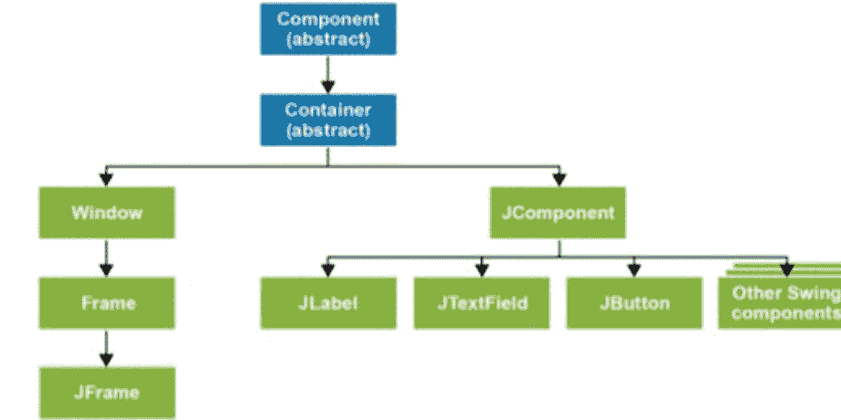

包含大多数 AWT 类的包：`java.awt`

包含大多数 Swing 类的包：`javax.swing`

# 这些类的摘要

| 类 | 描述 |
| --- | --- |
| Component | 一个抽象的 AWT 类，定义了任何可以显示的对象。例如，帧、面板、按钮、标签和文本字段都派自此类。 |
| Container | 一个抽象的 AWT 类，定义了任何可以包含其他组件的组件。 |
| Window | 定义带标题或边框的窗口的 AWT 类。 |
| Frame | 定义带有标题和边框的窗口的 AWT 类。 |
| JFrame | 定义带有标题和边框的窗口的 Swing 类。 |
| JComponent | Swing 组件（如 `JPanel`、`JButton`、`JLabel` 和 `JTextField`）的基类。 |
| JPanel | 定义面板的 Swing 类，用于存放其他组件。 |
| JButton | 定义按钮的 Swing 类。 |
| JLabel | 定义标签的 Swing 类。 |
| JTextField | 定义文本字段的 Swing 类。 |

## 描述

- Swing 库构建在 AWT 库之上。换句话说，Swing 类通常继承自 AWT 类。


- 大多数 Swing 类以字母 J 开头（代表 Java）。

图 18-2 Swing 组件的继承层次结构

# 如何创建一个处理事件的 GUI

当你使用 Swing 开发 GUI 时，通常从显示一个作为应用程序主窗口的帧（frame）开始。然后，你向帧中添加标签、文本框和按钮等组件。最后，你处理用户与这些组件交互时发生的事件。

# 如何显示帧

`JFrame` 有一个边框，并包含了你操作系统的所有普通窗口控件，如最小化、最大化和关闭按钮。图 18-3 显示了一个空 `JFrame` 组件的示例以及显示它的代码。这展示了帧在 Windows 10 上显示时的样子，但如果是在 Mac OS 或 Linux 上显示，看起来也会很恰当。

要创建一个帧，你通常会创建一个继承 `JFrame` 类的类。例如，在图中，代码声明了一个名为 `FutureFrame` 的类，它扩展了 `JFrame` 类。这是一种常见的做法，因为它允许将定义帧的所有代码存储在单个类中。

该类的构造函数调用了一个名为 `initComponents()` 的方法。为此，它设置了帧的标题、大小和位置。此外，它设置了默认关闭操作，以便在用户关闭窗口时应用程序能够退出。

要设置帧的大小，你可以调用 `setSize` 方法。该方法接收两个整数，表示像素单位的宽度和高度。例如，帧被设置为宽度 400 像素，高度 100 像素。你也可以像本章后面描述的那样通过调用 `pack()` 方法来调整尺寸。此方法不接受参数，并将帧调整到足以容纳其包含的所有组件。如果你不设置帧的大小，就看不到它包含的任何组件。

要设置帧的位置，你可以向 `setLocationByPlatform` 方法传递一个 `true` 值。然后，操作系统将决定帧的位置，这通常正是你想要的。

为了在用户点击帧的关闭按钮时退出应用程序，你可以调用 `setDefaultCloseOperation` 方法并向其传递 `JFrame` 的 `EXIT_ON_CLOSE` 字段。如果不这样做，用户点击关闭按钮时，帧会关闭但应用程序将继续运行。这是因为默认情况下，关闭操作只关闭帧，而不结束应用程序。最后，为了显示帧，你可以调用 `setVisible` 方法并传递一个 `true` 值。

到目前为止，所有的应用程序都运行在一个被称为主线程的单一线程上。该线程通常在 `main()` 方法结束时结束。

# JFrame 类的常用方法

| 方法 | 描述 |
|---|---|
| `setTitle(String)` | 将帧的标题设置为指定的字符串。 |
| `setSize(width, height)` | 将帧的大小设置为指定的宽度和高度。 |
| `pack()` | 调整帧的大小使其恰好容纳其组件。 |
| `setLocationByPlatform(boolean)` | 如果为 `true`，由操作系统设置帧的位置。 |
| `setDefaultCloseOperation(operation)` | 设置为 `JFrame` 类的 `EXIT_ON_CLOSE` 字段，以便在用户点击帧的关闭按钮时退出应用程序。 |
| `setVisible(boolean)` | 确定帧是否可见。 |

# 创建并显示帧的类

```java
import javax.swing.JFrame;

public class FutureValueFrame extends JFrame {

    public FutureValueFrame() {
        initComponents();
    }

    private void initComponents() {
        setTitle("Future Value Calculator");
        setSize(400, 100);
        setDefaultCloseOperation(JFrame.EXIT_ON_CLOSE);
        setLocationByPlatform(true);

        // 其他组件放在这里

        setVisible(true);
    }

    public static void main(String[] args[]) {
        java.awt.EventQueue.invokeLater(new Runnable() {
            @Override
            public void run() {
                FutureValueFrame frame = new FutureValueFrame();
            }
        });
    }
}
```

此类显示的帧


## 描述

- 在 Swing 中，帧通常定义应用程序的主窗口。
- 任何响应 Swing 事件的代码都运行在一个名为 EDT 的特殊线程上。

图 18-3 如何处理帧

Swing 允许你设置组件的外观外观（look and feel）。默认情况下，Swing 组件使用如图 18-4 顶部窗口所示的 Metal 外观。这使得 Swing 组件在任何操作系统上看起来和用起来都相同。然而，这些组件与特定操作系统的原生组件看起来和用略有不同。此外，窗口上组件的外观可能与标题栏的外观不协调。这是因为标题栏的外观取决于操作系统，即使你正在使用 Metal 外观。

在显示帧之前，你可以像图中所示设置外观。为了实现这一点，你可以使用 `javax.swing` 包提供的 `UIManager` 类，如图中所示。在这里，代码将 Swing 组件的外观设置为当前操作系统。结果是此应用程序在 Windows 操作系统上看起来像 Windows 应用程序，在 Mac 操作系统上看起来像 Mac 应用程序，在 Linux 操作系统上看起来像 Linux 应用程序。

# Windows 10 Metal 外观和交互


# 设置与当前操作系统相同的外观和交互的代码

```java
try {
    UIManager.setLookAndFeel(UIManager.getSystemLookAndFeelClassName());
} catch (ClassNotFoundException | InstantiationException | IllegalAccessException | UnsupportedLookAndFeelException e) {
    System.out.println(e);
}
```

# Windows 10 的外观和交互


## 描述

- 默认情况下，Swing 组件使用 Metal 外观和交互，这导致它们在任何其他操作系统上看起来和运行都相同。异常是框架的标题栏，其外观和交互取决于操作系统。
- 要将外观和交互设置为操作系统的默认值，你需要在 try/catch 语句块内部调用 `UIManager` 类的 `setLookAndFeel()` 方法。

图 18-4 如何设置外观和交互

# 如何使用面板

通常，构建 GUI 应用最简单的方法是使用一个名为*面板*（panel）的不可见容器来组合组件。在 Swing 中实现这一点，你可以使用 `JPanel` 类。然后，你可以将一个或多个面板添加到框架中。图 18-5 显示了如何向框架添加面板的示例。首先，它创建了一个名为... 的 `JPanel` 组件。然后，它调用包含此代码的框架的 `add()` 方法将面板添加到框架中。由于面板是不可见的，因此这不会在框架上显示任何内容。要实现这一点，你需要向面板添加一个或多个组件。

# 如何使用按钮

图 18-5 中的第二个示例向面板添加了两个按钮。为了实现这一点，它从 `JButton` 类创建了两个按钮。然后，使用面板的 `add()` 方法将按钮添加到面板中。

要设置按钮显示的文本，你可以使用 `JButton` 类中接受要显示字符串的构造函数。或者，你也可以在不传递字符串的情况下创建 `JButton` 组件，然后调用它的 `setText()` 方法。在图中，两个按钮的文本都是使用 `JButton` 类的构造函数设置的。

`JButton` 类还提供了一些其他常用的方法。例如，你可以使用 `setEnabled()` 方法禁用按钮并将其设为灰色。如果你想在用户填写完所需数据之前禁用“确定（OK）”按钮，可以使用此方法。如果你想为按钮设置工具提示（tooltip），可以使用 `setToolTipText()` 方法来完成此操作。然后，当用户将鼠标悬停在某项上大约一秒钟时，你指定的文本就会显示。

# 第 18 章 如何开始学习 Swing 583

# JFrame 和 JPanel 类的常用方法

| 方法 | 描述 |
| :--- | :--- |
| `add(Component)` | 将指定的组件添加到框架或面板。 |

# JButton 类的常用构造函数和方法

| 方法 | 描述 |
| :--- | :--- |
| `JButton(String)` | 创建按钮并设置它显示的文本。 |
| `setText(String)` | 设置按钮显示的文本。 |
| `setEnabled(boolean)` | 决定按钮是启用还是禁用并显示为灰色。 |
| `setToolTipText(String)` | 设置工具提示的文本。如果用户将鼠标悬停在按钮上大约一秒钟，就会显示工具提示。 |

# 向框架添加面板的代码

```java
JPanel panel = new JPanel();
add(panel);
```

# 向面板添加两个按钮的代码

```java
JButton calculateButton = new JButton("Calculate");
JButton exitButton = new JButton("Exit");
panel.add(calculateButton);
panel.add(exitButton);
```

# 面板中的两个按钮


## 描述

- 面板是一个用于分组其他组件的不可见容器。
- 要创建一个面板，你可以创建一个 `JPanel` 对象。然后，你可以将其添加到框架中。
- 要创建一个按钮，你可以创建一个 `JButton` 对象。然后，你可以将其添加到框架或面板中。
- 你应该在调用 `setVisible(true)` 方法之前将所有面板和组件添加到框架中。否则，用户界面在首次显示时可能会闪烁。

图 18-5 如何使用面板和按钮

# 如何处理动作事件

上一个图中中显示的按钮在点击时没有任何反应。那是因为没有任何东西来处理按钮点击时生成的事件。

用户每当与你的 GUI 交互时，都会触发一个事件。例如，当用户点击按钮时，会触发一个事件通知你的代码按钮已被点击。每当用户在键盘上按下键或移动鼠标时，也会触发一个事件。

如果你想对事件做出响应，你需要为该事件注册一个动作监听器（action listener）或事件监听器（event listener）。要实现这一点，你使用按钮的 `addActionListener()` 方法来识别处理事件的对象，该对象称为事件处理器（event handler）。处理器类实现了监听器接口。（注：此处 OCR 文本有许多重复/乱码文本，已根据逻辑清理）。

# 包含事件的包

```java
java.awt.event
```

# 组件的常用方法

| 方法 | 描述 |
| :--- | :--- |
| `addActionListener(ActionListener)` | 为组件添加动作监听器以监听事件。 |

# 为按钮添加动作监听器的三种方法

使用内部类（Java 8 之前）

```java
class ExitButtonActionListener implements ActionListener {
    @Override
    public void actionPerformed(ActionEvent e) {
        System.exit(0);
    }
}
exitButton.addActionListener(new ExitButtonActionListener());
```

使用匿名类（Java 8 之前）

```java
exitButton.addActionListener(new ActionListener() {
    @Override
    public void actionPerformed(ActionEvent e) {
        System.exit(0);
    }
});
```

使用 Lambda 表达式（Java 8 及以后）

```java
exitButton.addActionListener(e -> {
    System.exit(0);
});
```

## 如何使用标签（labels）

大多数应用程序使用一个或多个标签来显示标识其他控件的文本。例如，在图 18-1 中，窗口包含了四个标签，分别标记四个文本字段。现在，图 18-7 显示了如何使用这些标签。

第一个示例使用两个语句来创建一个标签并将其添加到面板（panel）。这里，第一条语句使用 `JLabel` 类的构造函数创建一个标签，并将文本设置为“Monthly Investment”（每月投资额）。然后，第二条语句将标签添加到面板中。

第二个示例展示了如何用一条语句创建标签并将其添加到面板中。在这里，代码没有创建一个引用 `JLabel` 对象的变量。如果你以后不需要调用 `JLabel` 类的任何方法，这是向容器中添加标签的常用方法。

第三个示例展示了如何向面板添加四个标签。在这里，你可以看到面板默认从左到右显示这些标签。在在本章的稍后部分落中，你将学习如何控制标签和其他控件的显示。

第四个示例展示了如何使用标签的 `setText()` 方法来更改标签显示的文本。在这里，标签被命名为 `errorLabel`，代码将其文本设置为“Monthly Investment is a required entry.”（每月投资额是必填项）。这是在 GUI 主窗口中显示错误信息的常用方法。

虽然图中标签显示的是文本，但标签也可以显示图标或图像。然而，本书并没有涵盖使用标签显示图标和图像。

## JLabel 类的常用构造函数和方法

| 构造函数 | 描述 |
| :--- | :--- |
| `JLabel()` | 创建一个 `JLabel` 对象。 |
| `JLabel(String)` | 创建一个 `JLabel` 对象，并将标签显示的文本设置为指定的字符串。 |

| 方法 | 描述 |
| :--- | :--- |
| `setText(String)` | 设置标签显示的设置为指定的字符串。 |

## 如何创建一个 JLabel 对象并将其添加到容器中

```java
JLabel investmentLabel = new JLabel("Monthly Investment:");
panel.add(investmentLabel);
```

## 向容器中添加 JLabel 的常用方法

```java
panel.add(new JLabel("Monthly Investment:"));
```

## 向面板添加四个标签的代码

```java
panel.add(new JLabel("Monthly Investment:"));
panel.add(new JLabel("Yearly Interest Rate:"));
panel.add(new JLabel("Years:"));
panel.add(new JLabel("Future Value:"));
```

## 结果窗口


## 更改标签上显示文本的代码

```java
errorLabel.setText("Monthly Investment is a required entry.");
```

## 描述

- `JLabel` 组件定义了一个标签，它是一个不可编辑的组件，通常用于显示标识其他组件（如文本字段）的文本。
- 如果你确定不需要调用 `JLabel` 对象的任何方法，在 `add()` 方法中调用 `JLabel` 类的构造函数是一种常见做法。当你使用这种技术时，不会创建一个引用 `JLabel` 对象的变量。
- `JLabel` 对象也可以显示图像。然而，本书并未涵盖这内容。

图 18-7 如何使用标签

## 如何使用文本字段（text fields）

大多数应用程序使用一个或多个文本字段（也称为文本框）来允许用户输入数据。`JTextField` 类定义了一个允许用户输入或编辑文本的文本字段。此外，程序员可以使用文本字段向用户显示文本。

图 18-8 总结了 `JTextField` 类一些最常用的构造函数和方法。在这里，它展示了一些使用这些构造函数和方法的示例。

第一个示例创建了一个名为 `investmentField` 的新文本字段，宽度约为 20 个字符。这意味着文本字段的宽度取决于该文本字段的字体大小。另一种方法是使用此图中的第一个构造函数来创建一个不指定包含列数的文本字段。然后，你可以使用 `setColumns()` 方法来设置列数。


遗憾的是，通过设置列数来设置文本字段的大小并不准确。设置文本字段（或任何其他组件）大小的另一种方法是使用 `setPreferredSize()` 和 `setMinimumSize()` 方法，这些方法以像素为单位设置宽度。不过，这些方法也有自己的问题。但它们可以用于解决在网格中布局组件时发生的常见问题。你将在本章稍后看到这种技术。

第二个和第三个示例展示了如何获取和设置存储在文本字段中的文本。在这里，第二个示例使用文本字段的 `getText()` 方法获取存储在字段中的字符串并将其赋值给 `String` 变量。相反，第三个示例使用文本字段的 `setText()` 方法将指定的字符串存储在文本字段中。

默认情况下，文本字段是可编辑的。因此，用户可以向其输入文本或编辑已有的文本。然而，如果你想创建一个只读的文本字段，可以像第四个示例所示，向其 `setEditable()` 方法传递一个 `false` 值。用户无法向字段输入文本，只能读取字段显示的文本。

那么，如果你想显示用户无法编辑的文本，为什么不使用标签呢？原因之一是用户可以选择并复制文本。此外，如果文本比字段长，文本字段可以滚动，而标签则不能。最后，文本字段支持多行文本，而标签通常不支持。

## JTextField 类的常用构造函数和方法

| 构造函数 | 描述 |
| :--- | :--- |
| `JTextField()` | 创建一个 `JTextField` 对象。 |
| `JTextField(int)` | 创建具有指定列数的 `JTextField`。 |

| 方法 | 描述 |
| :--- | :--- |
| `getText()` | 获取字段中的文本。 |
| `setText(String)` | 设置字段中的文本。 |
| `setColumns(int)` | 设置字段的列数。 |
| `setEditable(boolean)` | 确定字段是否可编辑。 |
| `setEnabled(boolean)` | 确定字段是否启用。 |

## 如何创建一个 JTextField 对象并将其添加到容器中

```java
JTextField investmentField = new JTextField("Monthly Investment:");
panel.add(investmentField);
```

## 向容器中添加 JTextField 的常用方法

```java
panel.add(new JTextField("Monthly Investment:"));
```

## 更改标签上显示文本的代码

```java
errorLabel.setText("Monthly Investment is a required entry.");
```

## 描述

- `JTextField` 组件定义了一个文本字段，用于向用户显示文本并允许用户输入文本。这种组件也称为文本框。
- 如果你确定不需要调用 `JTextField` 对象的任何方法，在 `add()` 方法中调用 `JTextField` 类的构造函数是一种常见做法。当你使用这种技术时，不会创建一个引用 `JTextField` 对象的变量。
- `JTextField` 也可以显示图像。然而，本书并未涵盖这内容。

图 18-8 如何使用文本字段

# 包含布局管理器的包

`java.awt.*`

# 布局管理器摘要

| 布局管理器 | 描述 |
| --- | --- |
| BorderLayout | 通过提供五个区域来布局组件，每个区域可以容纳一个组件。这五个区域分别是北（north）、南（south）、东（east）、西（west）和中（center）。 |
| FlowLayout | 从左到右或从右到左流式布局组件，类似于页面上的文字。 |
| GridBagLayout | 在矩形网格单元格中布局组件。它可以创建比其他布局管理器更复杂、更灵活的布局。 |
| GridLayout | 在矩形网格中布局组件，其中每个单元格的大小相同。 |
| CardLayout | 在卡片上布局组件，一次只显示一张卡片。这种布局很少使用，但对于创建引导用户执行分步过程的对话框可能很有用。 |
| BoxLayout | 在水平或垂直的单元格行中布局组件。这种布局很少使用，但对于生成按钮行很有用。 |

# 大多数容器组件的常用方法

| 方法 | 描述 |
| --- | --- |
| `setLayout(layout)` | 将布局设置为指定的布局。 |

# 如何更改容器的布局

```java
JFrame frame = new JFrame();
frame.setLayout(new FlowLayout());
```

## 描述

- 布局管理器决定了组件在容器中的排列方式，以及当容器调整大小时它们的行为。
- 默认情况下，`JFrame` 使用 `BorderLayout` 管理器。
- 默认情况下，`JPanel` 使用 `FlowLayout` 管理器。


# 如何使用 FlowLayout 管理器

在本书介绍的三个布局管理器中，`FlowLayout` 管理器最容易使用。它在行中添加组件并根据对齐方式对齐组件。默认情况下，`FlowLayout` 管理器将组件居中。然而，也可以指定左对齐或右对齐。

图 18-10 中的第一个示例调用了面板的 `setLayout()` 方法，并传递了一个对齐方式设置为左侧的 `FlowLayout` 新实例。结果是，此代码将布局的对齐方式从默认更改为居中。

设置布局管理器后，此代码向面板添加了四个按钮。结果是，布局管理器按照代码添加按钮的顺序从左到右排列这些按钮。

如果容器没有足够的空间容纳所有组件，`FlowLayout` 将组件换到下一行。这类似于文字处理器在到达页边距时换行的方式。再次，布局管理器根据对齐方式安排组件。

# FlowLayout 类的常用构造函数

| 构造函数 | 描述 |
| --- | --- |
| `FlowLayout(alignment)` | 设置管理器的水平对齐方式。若要设置此对齐方式，你可以指定 `FlowLayout` 类的 `LEFT`、`RIGHT` 或 `CENTER` 常量。 |

# 如何为容器设置布局

```java
panel.setLayout(new FlowLayout(FlowLayout.LEFT));
```

# 向面板添加四个按钮的代码

```java
panel.add(new JButton("Add"));
panel.add(new JButton("Edit"));
panel.add(new JButton("Delete"));
panel.add(new JButton("Cancel"));
```

# 所有组件都适应同一行时的 FlowLayout


# 组件换到下一行时的 FlowLayout


## 描述

- 如果组件无法适应单行，`FlowLayout` 管理器会将组件换到新行。
- `FlowLayout` 管理器可以将组件左对齐、右对齐或居中。默认值是居中。

# 如何使用 BorderLayout 管理器

`BorderLayout` 管理器有五个区域：北、南、东、西和中。这些区域每个都可以容纳一个组件。

图 18 显示了一个使用 `BorderLayout` 在五个区域中每个显示一个按钮的框架。由于 `BorderLayout` 是框架的默认布局管理器，因此图中的示例没有设置布局管理器。相反，它通过调用框架的 `add()` 方法向框架的北部区域添加了一个新按钮。为了做到这一点，它将组件作为第一个参数，第二个参数作为区域。这里，组件是一个显示为 "North" 的新 `JButton`，而 `BorderLayout.NORTH` 常量指定了北部区域。这导致布局管理器在水平方向上调整组件的大小以填充框架的宽度，并在垂直方向上调整为其首选高度（即按钮的高度）。

类似地，此代码向框架的南部区域添加了一个新按钮。与北部一样，布局管理器在水平方向上调整组件的大小以填充框架的宽度，并在垂直方向上调整为其首选高度。

在北部和南部区域添加按钮后，此代码向东部和西部区域添加了按钮。在这种情况下，布局管理器调整这些组件的大小以填充北部和南部之间的所有垂直空间。此外，它将这些组件的大小调整为首选宽度（即按钮的宽度）。

最后，代码向框架的中心区域添加了一个按钮。在这种情况下，布局管理器在水平和垂直方向上都调整此组件的大小以填充其他区域组件占用的任何剩余空间。

如果你调整窗口大小，布局管理器会调整每个区域组件的大小。北部和南部组件在水平方向上调整以填充新空间，但高度保持不变。东部和西部组件在垂直方向上调整以填充新空间，但宽度保持不变。中部组件填充任何剩余空间。

如果你没有为一个或多个区域提供组件，则该区域的大小为零。例如，如果你删除了东部区域，中部将扩展到右边缘。

`BorderLayout` 管理器经常用于布局应用程序的主窗口。你可能使用北部区域作为工具栏，西部区域存放文件夹，东部区域存放邮件，南部区域存放状态栏。使用 `BorderLayout` 管理器时，重要的是每个区域只能容纳一个组件。如果你想添加多个组件，你需要面板。

# BorderLayout 类的常用方法

| 方法 | 描述 |
| --- | --- |
| `add(component, area)` | 将指定的组件添加到指定的区域。要设置区域，你可以指定 `BorderLayout` 类的 `NORTH`、`SOUTH`、`EAST`、`WEST` 或 `CENTER` 常量。 |

# 为 BorderLayout 的每个区域添加按钮的代码

```java
add(new JButton("North"), BorderLayout.NORTH);
add(new JButton("South"), BorderLayout.SOUTH);
add(new JButton("East"), BorderLayout.EAST);
add(new JButton("West"), BorderLayout.WEST);
add(new JButton("Center"), BorderLayout.CENTER);
```

# 产生的 BorderLayout


## 描述

- `BorderLayout` 有五个区域：`NORTH`、`SOUTH`、`EAST`、`WEST` 和 `CENTER`。
- 默认区域是 `CENTER`。结果是，如果你没有指定区域，组件将被添加到中心。
- `NORTH` 和 `SOUTH` 区域获得其首选高度，通常意味着它们足够高以容纳其中的内容。这些区域的宽度设置为框架的宽度，并随着窗口宽度的变化而发生扩展或收缩。
- `WEST` 和 `EAST` 区域获得其首选宽度，通常意味着它们足够宽以容纳其中的内容。这些区域的高度设置为框架的高度，并随着窗口高度的变化而发生扩展或收缩。
- `CENTER` 区域获得所有剩余空间，并且当窗口调整大小时，其高度和宽度会扩展或收缩。

# 如何使用 GridBagLayout 管理器

`GridBagLayout` 管理器比之前图中描述的布局管理器更复杂。然而，它也更强大、更灵活。通过 `GridBagLayout` 管理器，你可以在行和列的网格中布局组件。

图 18-12 显示了如何使用 `GridBagConstraints` 对象来控制使用 `GridBagLayout` 管理器的容器内部组件的布局。该图首先展示了 `GridBagConstraints` 类的一些字段。

首先，`gridx` 和 `gridy` 字段控制组件放置在网格上的位置。在图中，对于“Monthly Investment”（每月投资）标签，`gridx` 和 `gridy` 字段都被设置为值 0。因此，布局管理器将其放置在网格左上角的单元格中。

第一个文本框的 `gridx` 为 1，`gridy` 值为 0。因此，布局管理器将此文本框放置在第二列和第一行交汇处的单元格中。第二个文本框的 `gridx` 为 1，`gridy` 值为 1。因此，布局管理器将其放置在第二行和第二列交汇处的单元格中。以此类推。

`anchor` 字段控制当组件小于单元格时，布局管理器将其放置在单元格内的哪个位置。默认情况下，布局管理器将组件放置在单元格的中心。但是，你可以指定锚点值 `LINE_START` 将组件与单元格的左侧对齐。或者，你可以使用锚点值 `LINE_END` 将组件与单元格的右侧对齐。例如，除了最后一个外，所有的标签和文本框的 `anchor` 字段都设置为 `LINE_START` 值。

尽管 `LINE_START` 和 `LINE_END` 是 `anchor` 字段最常用的值，但也存在许多可能的值。要查看完整列表，请参阅 `anchor` 字段的 API 文档。

`LINE_START` 和 `LINE_END` 值对于 Java 来说相对较新。在引入之前，开发者通常使用 `WEST` 和 `EAST` 值代替。然而，对于新开发，建议使用新的 `LINE_START` 和 `LINE_END` 值，因为它们更容易理解。

`gridwidth` 和 `gridheight` 决定了组件占据多少单元格。因此，将 `gridwidth` 设置为 2 会导致组件占据两个水平单元格而不是一个。例如，第四个标签占据了两个水平单元格而不是一个。

代码示例开始使用 `setLayout()` 方法将面板（panel）的布局管理器设置为 `GridBagLayout` 管理器。然后，这段代码创建了一个新的 `GridBagConstraints` 对象。在实践中，通常使用变量 `c` 来表示，这段代码正是这样做的。

创建 `GridBagConstraints` 对象后，这段代码将 `anchor` 字段设置为 `LINE_START`。然后，它为每个组件设置 `GridBagConstraints` 对象的 `gridx` 和 `gridy` 字段，并将每个组件添加到面板中。为此，将组件作为第一个参数，并将 `GridBagConstraints` 对象作为第二个参数传递。

# 第 18 章 如何开始使用 Swing

# 控制布局的 GridBagConstraints 类字段

| 字段 | 描述 |
| :--- | :--- |
| `gridx`, `gridy` | 设置组件在网格中的 x 和 y 坐标，其中 0,0 是网格的左上角单元格。 |
| `anchor` | 如果组件小于其显示区域单元格，则设置组件显示的位置。最常用的是 `LINE_START` 和 `LINE_END`。在旧版本的 Java 中，这些值被称为 `WEST` 和 `EAST`。 |
| `gridwidth`, `gridheight` | 设置组件占据的水平和垂直单元格数量。 |

# 使用 GridBagConstraints 对象控制布局的代码

# 结果网格

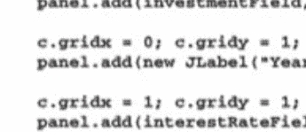

## 描述

- 你可以使用同一个 `GridBagConstraints` 对象用于多个组件。
- 然而，你必须重置在下一个组件中不想使用的任何值。

图 18-12 如何与 GridBagLayout 管理器配合

# 598 第 4 部分 GUI 编程

除了 `gridx` 和 `gridy` 字段外，这段代码在添加最后一个组件之前重置了 `anchor` 字段并设置了 `gridwidth` 字段。这样，组件就会占据两列，并且右侧对齐而不是左侧对齐。

当你这样使用 `GridBagConstraints` 对象时，很容易查看和编辑每个组件的坐标和对齐方式。然而，如果你忘记重置值，可能会意外重用为上一个组件设置的值，这可能会导致奇怪的布局行为。因此，你需要确保为每个组件正确设置所有值。或者，你可以为每个组件创建一个新的 `GridBagConstraints` 对象。

# 如何为 GridBagLayout 添加内边距

默认情况下，`GridBagConstraints` 对象在网格中的组件之间或组件与容器边缘之间不提供任何空间或内边距（padding）。这就是为什么前一个图中显示的组件之间没有任何间距。这也是为什么组件与容器边缘之间没有间距。

为了使这种布局在视觉上更有吸引力，你可以使用 `GridBagConstraints` 对象的 `insets` 来应用一些内边距，如图 18-13 所示。该字段使用一个 `Insets` 对象来确定组件周围的边距量。在这里，`Insets` 对象的四个参数是以像素为单位的顶、左、下、右。如果你把这想象成一个钟，这些值是逆时针方向的。

图中，除了最后一个外，所有的 `insets` 字段都使用了 `Insets` 对象。这里，`Insets` 对象的四个参数是顶、左、下、右（像素值）。如果你把这想象成一个钟，这些值是逆时针方向的。

在使用 `Insets` 对象时，有两点需要记住。首先，与 `GridBagConstraints` 对象不同，你不能更改 `Insets` 对象的值并重用它。这样做会导致布局行为异常。如果你设置了顶部 5 像素间距和底部 5 像素间距，组件之间的间距实际上是 10 像素。也就是说，对于左和右侧也是 10 像素。

大多数情况下，你只需要使用 `GridBagConstraints` 对象的 `insets` 字段指定外部边距。然而，如果你需要指定内部填充，可以使用图中所示 `ipadx` 和 `ipady` 字段。这些字段决定了组件内部的填充空间。例如，如果将 `JButton` 的 `ipadx` 和 `ipady` 值设置为 10，布局将显示 10 像素的填充空间。

# 第 18 章 如何开始使用 Swing 599

# 控制边距的 GridBagConstraints 类字段

| 字段 | 描述 |
| :--- | :--- |
| `insets` | 使用 `Insets` 对象指定应用于网格内组件的外部边距。 |
| `ipadx`, `ipady` | 设置添加到组件宽度和高度的内部填充。该值适用于双侧。 |

# Insets 类的构造函数

| 构造函数 | 描述 |
| :--- | :--- |


| Insets(top, left, bottom, right) | 以像素指定顶、左、下、右填充。 |

# 使用 Insets 对象为 GridBagConstraints 对象添加边距的代码

```java
GridBagConstraints c = new GridBagConstraints();
c.anchor = GridBagConstraints.LINE_START;
c.insets = new Insets(5, 5, 0, 5);

// 添加前三个标签和文本框的代码
c.gridx = 0; c.gridy = 3;
c.gridwidth = 2;
c.anchor = GridBagConstraints.LINE_END;
c.insets = new Insets(5, 5, 5, 5);
panel.add(new JLabel("此标签跨越两列。"), c);
```

# 如何解决 GridBagLayout 的常见问题

图 18-14 展示了 GridBagLayout 的一个常见问题以及如何避免它。首先，此图显示了前一个图中窗口在用户略微收缩水平宽度对其进行调整大小后的状态。这导致所有文本字段都塌陷。这里发生了什么？

基本上，如果容器的宽度不足以按照其指定的尺寸显示组件，GridBagLayout 管理器会将最小尺寸分配给组件边缘。默认情况下，组件的最小尺寸为 0。因此，这会导致文本字段的宽度完全塌陷。

解决此问题的方法是在文本字段上使用 `setPreferredSize()` 和 `setMinimumSize()` 方法，如该图所示设置首选和最小尺寸。在这里，第一条语句创建了一个宽 100 像素、高 20 像素的新 `Dimension` 对象，接下来的六条语句将三个文本字段的首选和最小尺寸设置为该 `Dimension` 对象。

如果你运行这段代码并缩小窗口宽度，文本字段不会塌陷。然而，随着 GridBagLayout 管理器尝试给文本字段提供最小尺寸的同时仍保持在窗口内，标签开始塌陷。如果你继续向窗口外进一步挤压，文本字段的边缘最终会消失在窗口之外。

由于标签开始塌陷，你可能会说我们解决了一个问题，却创建了另一个。在某些方面，事实确实如此。这表明 GridBagLayout 管理器是复杂的，并且通常需要大量的调整才能让布局按预期方式运行。

对于 Future 应用程序，用户可能不需要调整窗口大小。因此，此图中描述的解决方案可能足够了。

解决此问题的另一个可能方案是防止用户调整窗口大小。要做到这一点，你可以调用窗口的 `setResizable()` 方法并传递一个 `false` 值。同样，对于 Future 应用程序，这个解决方案是可以接受的。但是，使用这种技术时要谨慎，因为大多数用户期望能够调整窗口大小，特别是当有助于窗口更好地适应他们的显示器时。

第三种可能的解决方案更加优雅但代码编写更困难。这种解决方案涉及使用 `GridBagConstraints` 对象的 `weightx`、`weighty` 和 `fill` 字段来控制用户调整窗口大时组件如何调整大小。`weightx` 和 `weighty` 字段控制如何在组件之间分配任何水平或垂直空间。这允许你为每个组件指定一个百分比。此外，该字段决定了当容器调整大时组件是否调整大小。组件可以被设置为水平调整、垂直调整、两者调整或完全不调整。有关使用此技术的更多信息，请参阅 `GridBagConstraints` 类的 API 文档。

# 第 18 章 如何上手 Swing

# 水平调整大小后发生的常见问题


# Dimension 类的构造函数

| 构造函数 | 描述 |
| --- | --- |
| Dimension (width, height) | 以像素为单位指定组件的宽度和高度。 |

# 你可以用来修复此问题的方法

| 方法 | 描述 |
| --- | --- |
| setMinimumSize(Dimension) | 指定组件的最小宽度和高度。 |
| setPreferredSize(Dimension) | 指定组件的首选宽度和高度。 |

# 设置首选和最大尺寸的代码

```java
Dimension dim = new Dimension(100, 20);
investmentfield.setPreferredSize(dim);
investmentfield.setMinimumSize(dim);
interestRate.setPreferredSize(dim);
interestRate.setMinimumSize(dim);
yearsfield.setPreferredSize(dim);
yearsfield.setMinimumSize(dim);
```

# 水平调整大小后的改进示例


# 解决此问题的三种方法

1. 使用窗口的 `setResizable(false)` 方法防止用户调整窗口大小。然而，你应该谨慎地使用这种技术，因为用户通常期望能够调整窗口大小。
2. 使用组件的 `setPreferredSize()` 和 `setMinimumSize()` 方法。这不是一个完美的解决方案，但对于大多数应用程序是可以接受的。
3. 使用 `GridBagConstraints` 类的 `weight`、`weighty` 和 `fill` 字段来控制组件如何调整大小。这种技术可以产生最好的结果，但工作最多。

## 描述

- 当窗口水平调整大小时，组件（尤其是文本字段）有时会塌陷为零尺寸。这是一个常见问题。

图 18-14 如何解决 GridBagLayout 的常见问题

# Future 应用程序

在第 4 章中，你学习了 Future 应用程序的控制台版本。现在，你准备好查看使用 Swing 的 Future 应用程序的 GUI 版本代码了。

# 用户界面

当 Future 应用程序启动时，它会显示一个如图 18-15 第 1 部分所示的 Future Value 计算器窗口。此时，用户可以输入月金额、年利率和年份。然后，用户可以点击 Calculate 按钮。或者，用户可以使用 Tab 键将焦点移动到 Calculate 按钮，然后按 Enter 键或空格键。这将执行计算并显示结果。

## 代码

图 18-15 Future 应用程序（第 1 部分）

当 Future 应用程序启动时，它会显示一个如图 18-15 第 1 部分所示的 Future Value 计算器窗口。此时，用户可以输入月金额、年利率和年份。然后，用户可以点击 Calculate 按钮。或者，用户可以使用 Tab 键将焦点移动到 Calculate 按钮，然后按 Enter 键或空格键。这将执行计算并显示结果。

# Future Value 表单


# FutureValueFrame 类

```java
package murach.ui;

import java.awt.BorderLayout;
import java.awt.Dimension;
import java.awt.FlowLayout;
import java.awt.GridBagConstraints;
import java.awt.GridBagLayout;
import java.awt.Insets;
import java.text.NumberFormat;
import javax.swing.JButton;
import javax.swing.JFrame;
import javax.swing.JLabel;
import javax.swing.JPanel;
import javax.swing.JTextField;
import javax.swing.UIManager;
import javax.swing.UnsupportedLookAndFeelException;

import murach.business.FinancialCalculations;

public class FutureValueFrame extends JFrame {

    private JTextField investmentField;
    private JTextField interestRateField;
    private JTextField yearsField;
    private JTextField futureValueField;

    public FutureValueFrame() {
        initComponents();
    }

    private void initComponents() {
        try {
            UIManager.setLookAndFeel(UIManager.getSystemLookAndFeelClassName());
        } catch (ClassNotFoundException | InstantiationException |
                IllegalAccessException | UnsupportedLookAndFeelException e) {
            System.out.println(e);
        }
        setTitle("Future Value Calculator");
        setDefaultCloseOperation(JFrame.EXIT_ON_CLOSE);
        setLocationRelativeTo(null);
        // ... (rest of the implementation)
    }
}
```

# FutureFrame 类 (续)

```java
investmentField = new JTextField();
interestRateField = new JTextField();
yearsField = new JTextField();
futureValueField = new JTextField();
futureValueField.setEditable(false);
```

```java
Dimension dim = new Dimension(150, 20);
investmentField.setPreferredSize(dim);
interestRateField.setPreferredSize(dim);
yearsField.setPreferredSize(dim);
futureValueField.setPreferredSize(dim);
investmentField.setMinimumSize(dim);
interestRateField.setMinimumSize(dim);
yearsField.setMinimumSize(dim);
futureValueField.setMinimumSize(dim);
```

```java
JButton calculateButton = new JButton("Calculate");
JButton exitButton = new JButton("Exit");
```

```java
calculateButton.addActionListener(e -> calculateButtonClick());
exitButton.addActionListener(e -> exitMouseClicked());
```

```java
// panel
JPanel buttonPanel = new JPanel();
buttonPanel.setLayout(new FlowLayout(FlowLayout.RIGHT));
buttonPanel.add(calculateButton);
buttonPanel.add(exitButton);
```

```java
// main panel
JPanel panel = new JPanel();
panel.setLayout(new GridBagLayout());
panel.add(new JLabel("Monthly Investment:"), getConstraints(0, 0));
panel.add(investmentField, getConstraints(1, 0));
panel.add(new JLabel("Yearly Interest Rate:"), getConstraints(0, 1));
panel.add(interestRateField, getConstraints(1, 1));
panel.add(new JLabel("Years:"), getConstraints(0, 2));
panel.add(yearsField, getConstraints(1, 2));
panel.add(new JLabel("Future Value:"), getConstraints(0, 3));
panel.add(futureValueField, getConstraints(1, 3));
```

```java
add(panel, BorderLayout.CENTER);
add(buttonPanel, BorderLayout.SOUTH);
```

```java
setSize(new Dimension(320, 180));
setVisible(true);
```

图 18-15 未来价值应用（3 部分中的第 2 部分）

此图第 3 部分从定义 `getConstraints()` 方法开始。该方法返回一个 `GridBagConstraints` 对象。为了实现这一点，它首先创建一个 `GridBagConstraints` 对象，并设置对齐和内边距的值。然后，将 x 和 y 坐标设置为传递给方法的值。

`cancelButton()` 是“计算”按钮动作事件的处理器。换句话说，它在点击“计算”按钮时执行。首先，该方法通过调用该控件的 `getText()` 方法获取第一个文本字段输入的字符串。然后，它将此字符串转换为名为 `investment` 的 `double` 值。之后，该方法对后两个文本字段执行类似的比较，以获取利率和年数。接下来，该方法调用 `FinancialCalculations`类的 `calculateFutureValue()` 方法来计算并返回未来价值。最后，它使用 `NumberFormat` 类对未来价值进行格式化，并使用未来价值字段的 `setText()` 方法在第四个文本字段中显示格式化后的值。

对于这个简单的示例，`cancelButton()` 事件处理器并没有验证用户输入的数据性。因此，如果用户输入了无效值（如 "xx"），应用程序会在控制台上打印出堆栈跟踪信息。为了防止这种情况，你可以像接下来的几个特性所示验证用户输入的数据。

`exitClicked()` 方法是“退出”按钮动作事件的处理器。换句话说，它在点击“退出”按钮时执行。该方法执行一条语句，以状态码 0 退出应用程序。按照惯，状态码 0 表示应用程序正常结束。

`main()` 方法包含创建一个线程的代码，该线程创建 `FutureValueFrame` 对象并将其添加到事件分发线程 (EDT) 使用的事件队列中。在这里，代码使用 lambda 表达式来实现这一点。然而，如果此应用程序需要在 Java 7 或更早版本上运行，可以将此 lambda 表达式更改在本章早期所示的匿名内部类。

# FutureValueFrame 类 (续)

```java
// 用于获取 GridBagConstraints 对象的辅助方法
private GridBagConstraints getConstraints(int x, int y) {
    GridBagConstraints c = new GridBagConstraints();
    c.anchor = GridBagConstraints.LINK_START;
    c.insets = new Insets(5, 5, 0, 5);
    c.gridx = x;
    c.gridy = y;
    return c;
}
```

```java
private void calculateButtonClicked() {
    double investment = Double.parseDouble(investmentField.getText());
    double interestRate = Double.parseDouble(interestRateField.getText());
    int years = Integer.parseInt(yearsField.getText());
    double futureValue = FinancialCalculations.calculateFutureValue(
        investment, interestRate, years);
    NumberFormat currency = NumberFormat.getCurrencyInstance();
    futureValueField.setText(currency.format(futureValue));
}
```

```java
private void exitButtonClicked() {
    System.exit(0);
}
```

```java
public static void main(String[] args) {
    java.awt.EventQueue.invokeLater(() -> {
        JFrame frame = new FutureValueFrame();
    });
}
```


图 18-15 未来价值应用（3 部分中的第 3 部分）

# 如何验证 Swing 输入

在第 5 章中，你学习了如何验证输入数据。在第 7 章中，你看到了一个使用静态方法验证数据的 `Console` 类示例。在接下来的主题中，你会发现可以使用类似的技术来验证输入数据。

# 如何显示对话框

在 Swing 中验证数据时，你需要能够显示错误消息以告知用户检测到了无效输入。实现这一点的简单方法之一是在单独的对话框中显示消息。为此，你需要使用 `JOptionPane` 的 `showMessageDialog()` 方法。该方法接受的四个参数是：确定对话框位置的父组件、在对话框中显示的消息、对话框的标题以及决定图标的消息类型。父组件也可以是 `null`，在这种情况下，对话框将居于屏幕中心。

此图中的代码示例显示了如何显示简单的错误消息。首先，第一条语句定义了要在对话框中显示的消息字符串，第二条语句定义了对话框标题的字符串。然后，第三条语句调用 `showMessageDialog()` 方法。在这里，父组件参数设置为 `this` 关键字。结果是此代码在当前框架的中心显示对话框。为了使其正常工作，此代码必须编写在定义 Swing 组件的类（如 `FutureFrame` 类）中。最后，消息类型参数设置为 `JOptionPane` 类的 `ERROR_MESSAGE` 字段。这会导致对话框显示错误图标。

图 18-16 如何显示对话框

# 如何验证输入文本字段的数据

图 18-17 显示了你可以用于验证用户输入文本字段数据的两种技术。第一个示例检查用户是否在字段中输入了数据。为了实现这一点，它使用 `getText()` 方法获取用户输入的字符串。如果是，它使用 `isEmpty()` 方法检查字符串是否为空。它使用 `showMessageDialog()` 方法在对话框中显示错误消息。然后，它调用文本字段的 `requestFocusInWindow()` 方法，尝试在用户关闭对话框后将焦点移到该文本字段。最后，该示例执行 `return` 语句以退出方法。这防止了方法中其余代码的执行，这正是你处理无效数据时需要的。

# 第 18 章 如何开始使用 Swing 611

## 检查是否已输入的代码

```java
private void calculateButtonClicked() {
    if (investmentField.getText().isEmpty()) {
        String message = "Monthly Investment is a required field.";
        String title = "Invalid Entry";
        JOptionPane.showMessageDialog(this, message,
            title, JOptionPane.ERROR_MESSAGE);
        investmentField.requestFocusInWindow();
        return;
    }
    // 该方法的其余部分代码
}
```

## 检查输入是否为有效数字的代码

```java
private void calculateButtonClicked() {
    double investment;
    try {
        investment = Double.parseDouble(investmentField.getText());
    } catch (NumberFormatException e) {
        String message = "Monthly Investment must be a valid number.";
        String title = "Invalid Entry";
        JOptionPane.showMessageDialog(this, message,
            title, JOptionPane.ERROR_MESSAGE);
        investmentField.requestFocusInWindow();
        return;
    }
    // 该方法的其余部分代码
}
```

## 描述

- 就像控制台应用程序一样，GUI 应用程序在处理数据之前应该验证用户输入的所有数据。
- 当输入无效时，应用程序可以显示错误消息，并给用户另一个输入有效数据的机会。
- 要测试是否在文本字段中输入了值，可以使用文本字段的 `getText()` 方法来获取包含输入文本的字符串。然后，你可以使用它的 `isEmpty()` 方法检查该字符串是否为空。
- 要测试文本字段是否包含有效的数值数据，你可以编写在 `try` 块中转换数据的语句，并使用 `catch` 块来捕获 `NumberFormatException`。


## Validation 类

图 18-18 显示了一个名为 `Validation` 的类，可以使用它来验证输入到文本组件中的数据。与第 7 章介绍的 `Console` 类一样，该类使用方法来执行常见的验证功能。与 `Console` 类不同，`Validation` 类不使用静态方法。因此，在使用该类中的方法之前，你必须创建一个 `Validation` 对象。如果对象变量的名称比类名短，使用这些方法会变得更简单，而且如果需要更改用于验证的类，也会变得更方便。

该类首先定义了一个名为 `lineEnd` 的实例变量，它存储了一个添加到每个验证消息末尾的字符串。然后，该类定义了两个构造函数，你可以使用它们来设置 `lineEnd` 变量。接着，第一个构造函数将 `lineEnd` 变量设置为包含换行符的字符串，而第二个构造函数将 `lineEnd` 变量设置为传递给它的字符串。

所有三个公共方法都返回一个字符串，指示指定的字符串是否通过了验证测试。此外，这三个方法都定义了字符串参数。第一个参数指定了被验证控件的文本，第二个参数指定了用于错误消息的控件名称。然后，如果字符串通过了验证测试，方法将返回一个空验证消息。这表示该字符串通过了验证测试。否则，方法将返回一个验证消息，后跟 `lineEnd` 变量。这表示该字符串没有通过验证测试。

`isPresent()` 方法确定字符串值是否包含一个或多个字符。为了实现这一点，该代码使用 `isEmpty()` 方法检查字符串是否为空。`isDouble()` 方法确定字符串值是否可以转换为 `double` 值。与上一个示例中的代码一样，此示例中的 `parseDouble()` 方法的代码使用了捕获 `NumberFormatException` 的语句。`isInteger()` 方法确定字符串值是否可以转换为 `int` 值。该类中的代码与 `isDouble()` 方法的代码相似。当然，你可以轻松扩展此类以执行其他类型的测试，例如检查数字是否在有效范围内。

在你查看 `Validation` 类时，注意它没有直接引用 GUI 中的控件。它引用的是用户输入到控件中的字符串。这被称为**松耦合**，它允许该类与不同类型的控件工作。例如，你可以像下一图所示，使用该类来验证存储在文本字段中的字符串。然而，`Validation` 类允许你处理不同类型的控件。同样，松耦合也允许你决定如何显示验证消息。

## Validation 类的代码

```java
package murach.business;

public class Validation {
    private String lineEnd;

    public Validation() {
        this.lineEnd = "\n";
    }

    public Validation(String lineEnd) {
        this.lineEnd = lineEnd;
    }

    public String isPresent(String value, String name) {
        String msg = "";
        if (value.isEmpty()) {
            msg = name + " is required." + lineEnd;
        }
        return msg;
    }

    public String isDouble(String value, String name) {
        String msg = "";
        try {
            Double.parseDouble(value);
        } catch (NumberFormatException e) {
            msg = name + " must be a valid number." + lineEnd;
        }
        return msg;
    }

    public String isInteger(String value, String name) {
        String msg = "";
        try {
            Integer.parseInt(value);
        } catch (NumberFormatException e) {
            msg = name + " must be an integer." + lineEnd;
        }
        return msg;
    }
}
```

图 18-18 Validation 类

## 如何验证多个输入

图 18-19 显示了如何将上一图所示的 `Validation` 类用于事件处理器中，例如 `calculateButtonClicked()` 方法。开始，该代码创建了一个名为 `sv` 的 `Validation` 对象。为了这样做，该代码使用 `this` 关键字将当前对象（FutureValueObject）传递给 `Validation` 类的构造函数。

创建 `Validation` 对象后，该代码使用 `if` 语句调用 `Validation` 类的方法对每个控件执行验证测试。为了这样做，该代码使用了一个复合条件表达式 `&&`（与运算符）。这样，如果每个对 `Validation` 方法的调用都返回空字符串（在布尔上下文中视为通过），则该复合表达式将允许执行后续逻辑。如果任何验证方法返回非空字符串（错误消息），则表达式判定为验证失败。

如果用户输入了无效数据，应用程序将显示带有适当消息的对话框。例如，应用程序可能会显示图中所示的三个对话框之一。然后，在用户点击 OK 按钮后，应用程序将焦点移动到包含无效数据的文本字段。此过程将持续，直到用户在三个文本字段中都输入了有效数据。

# 显示三个错误信息的验证对话框


## 验证多个条输入的代码

```java
private void calculateButtonClicked() {
    Validation sv = new Validation();
    String errorMsg = "";
    errorMsg += sv.isPresent(investmentField.getText(), "Monthly Investment");
    errorMsg += sv.isDouble(investmentField.getText(), "Monthly Investment");
    errorMsg += sv.isPresent(interestRateField.getText(), "Yearly Interest Rate");
    errorMsg += sv.isDouble(interestRateField.getText(), "Yearly Interest Rate");
    errorMsg += sv.isInteger(yearsField.getText(), "Years");

    if (errorMsg.isEmpty()) {
        double investment = Double.parseDouble(investmentField.getText());
        double interestRate = Double.parseDouble(interestRateField.getText());
        int years = Integer.parseInt(yearsField.getText());
        double futureValue = FinancialCalculations.calculateFutureValue(
            investment, interestRate, years);

        NumberFormat currency = NumberFormat.getCurrencyInstance();
        futureValueField.setText(currency.format(futureValue));
    } else {
        JOptionPane.showMessageDialog(this, errorMsg, "Invalid Entry", JOptionPane.ERROR_MESSAGE);
    }
}
```

## 描述

- 你可以使用上图中的 `Validation` 类来验证多个输入。

# 展望

在本章中，你学习了使用 Swing 开发 GUI 的一些基本技能，Swing 是 Java 中最广泛使用的 GUI API。特别是，你学习了如何创建应用程序的主窗口。你学习了如何与面板、按钮、标签和文本字段进行工作。你学习了如何处理点击按钮时发生的事件。你学习了如何使用三个最常用的布局管理器。你还学习了如何使用内置对话框。

除了按钮、标签和文本字段外，Swing 还提供了许多你可能在很多应用程序中使用的其他控件。你将在下一章中学习如何使用其中的一些控件。

## 总结

- Swing 是创建 GUI 最广泛使用的 Java API。它基于一种较旧的创建 GUI 的 Java API，该 API 被称为抽象窗口工具包（AWT）。为了区分 AWT 和 Swing，大多数 Swing 类都以字母 J 开头。
- 在 Swing 中，包含 GUI 的窗口被称为框架（frame）。在框架内，你添加标签、文本字段和按钮等组件。
- 窗口也被称为表单（form），组件也被称为控件（controls）或部件（widgets），文本字段也被称为文本框（text boxes）。
- 面板组件是一个不可见组件，你可以用它组合其他组件。
- 可以包含其他组件的组件被称为容器（container）。两个常用的容器是框架和面板。
- Swing 提供了可以更改的可扩展外观和感觉（look and feel）。
- 要处理用户点击 `JButton` 时发生的事件，你可以使用 `addActionListener()` 方法为按钮添加一个动作监听器。由于动作监听器包含了处理事件的代码，因此也被称为事件处理器。
- 任何响应 Swing 事件而运行的代码都运行在一个名为分发线程（dispatch thread）或 EDT 的特殊线程上。
- 在 Java 8 之前，通常使用内部类或匿名内部类来为动作监听器提供代码支持。然而，在 Java 8 或更高版本中，你可以使用 Lambda 表达式，它更清晰、更简洁。
- 布局管理器布局容器中的组件，并控制它们如何响应缩放窗口大小等事件。
- `BorderLayout`、`FlowLayout` 和 `GridBagLayout` 是三个最常用的布局管理器。
- 你可以使用 `JOptionPane` 类的方法来显示对话框。

# 第 18 章 如何开始 Swing 617

# 练习 18-1 修改现有的 GUI

在练习中，你将修改本章描述的未来价值计算器的 GUI。

1. 打开位于 `ex_starts` 文件夹中名为 `ch18_ex1_FutureValue` 的项目。然后，检查代码并确保你理解它是如何工作的。
2. 运行应用程序并测试 GUI。
3. 修改布局，使第四个文本字段被禁用（disabled）而不是不可编辑。
4. 运行应用程序并再次测试 GUI。其效果应该是类似的，但第四个文本字段中的文字应该是灰色的。
5. 运行应用程序并调整 GUI 大小，使其更高更宽。注意它是如何将按钮与标签和文本框分开的。
6. 修改代码，使按钮面板作为 `GridBagLayout` 中的第五行显示。为了做到，让按钮面板在网格中跨越两列。此外，更改此列的对齐方式，使按钮对齐在其右侧。
7. 运行应用程序并测试 GUI。调整大小使其更高更宽。现在，按钮应该显示在标签和文本框的正下方。

# 练习 18-2 开发一个新的 GUI

在练习中，你将创建一个 GUI 应用程序，根据长度和宽度计算矩形的面积和周长。完成后，应用程序应该像这样：


# 查看应用程序的现有代码

1. 打开位于 `ex_starts` 文件夹中名为 `ch18_ex2_AreaAndPerimeter` 的项目。
2. 打开 `murach.business` 包中的 `Rectangle` 类并查看其字段和方法。
3. 打开 `murach.ui` 包中的 `AreaAndPerimeterFrame` 类并检查现有代码。注意：
   - 该类继承自 `JFrame` 类。
   - 该类有一个构造函数，调用了 `initComponents()` 方法。
   - 该类包含几个尚未实现或需要代码的方法。
   - 该类包含一个与本章所示未来价值应用程序类似的 `initComponents()` 方法。
   - 该类包含一个 `main()` 方法，创建框架并使其显示。
4. 运行应用程序。这应该显示一个没有任何组件的框架。然后调整框架大小以便你能看到标题。

# 将组件添加到框架

5. 为四个文本字段和两个按钮添加实例变量。
6. 在 `initComponents()` 方法中添加代码以初始化框架及其组件。该方法应该：
   - 创建四个文本字段。
   - 修改面积和周长的文本字段，使用户无法编辑。
   - 为所有字段设置最小和优先尺寸。
   - 创建两个按钮。


- 创建一个使用 `GridLayout` 布局的面板。然后，将四个标签和两个文本字段添加到此面板中。为此可以使用 `add()` 方法。最后，将此面板添加到框架的中心。

- 创建一个使用右对齐 `BorderLayout` 布局的面板。然后，将两个按钮添加到此面板中。最后，将此面板添加到框架的底部。

- 设置框架大小。

7. 运行应用程序。这将显示上面的框架。但是，如果你点击其中一个按钮，它不会执行任何操作。

# 处理用户点击按钮时发生的事件

8. 为两个按钮添加动作监听器。这些动作监听器调用 `computeButtonClick()` 和 `resetButtonClicked()` 方法。

9. 实现 `computeButtonClick()` 方法。

- 如果用户输入无效的长度或宽度，该方法应使用对话框显示友好的消息。然后，用户可以再次尝试。为此可以使用 `SwingValidator` 类。

- 如果用户输入有效的长度和宽度，该方法应该计算面积和周长并设置相应的文本字段。为此可以使用 `Rectangle` 类。

10. 实现 `resetButtonClicked()` 方法。该方法应该将所有四个文本字段设置为空字符串。

# 更多 Swing 控件

在上一章中，你学习了如何使用 Swing 编写一个使用三个常用控件（标签、文本字段和按钮）的图形用户界面。现在，你将学习如何使用其他常用控件。这应该有助于完善你对 GUI 编程的理解。

# 更多控件操作技巧

本节展示了如何使用五个 Swing 控件：文本区域、复选框、单选按钮、组合框和列表。此外，还展示了如何向文本区域或列表框等控件添加滚动条，并展示了如何向面板添加标题和边框。

## 如何使用文本区域

文本区域与文本字段类似，不同在于它允许接受用户的多行输入。事实上，`JTextField` 和 `JTextArea` 类都继承自 `JComponent` 类，该类为这两个类提供了许多基本功能。例如，`getText()` 和 `setText()` 方法是由 `JComponent` 类定义的，因此文本字段和文本区域都可以使用它们。

图 19 显示了如何使用 `JTextArea` 创建文本区域。当你创建一个文本区域时，可以指定希望包含的行数和列数。然后，你可以使用 `setLineWrap()` 和 `setWrapStyleWord()` 方法来确定文本从一行到下一行的换行方式。默认情况下，文本不会换行。因此，用户必须按 Enter 键才能开始新行文本。如果你希望文本自动换行，必须调用 `setLineWrap()` 方法并提供 `true` 值作为参数。此外，换行的行会在达到文本区域末尾的地方被拆分，即使是在单词的中间。为了确保文本正确换行，你还必须调用 `setWrapStyleWord()` 方法并提供 `true` 值作为参数。

图中的第一个示例展示了如何为文本区域声明一个私有实例变量。这允许该类的事件处理程序访问文本区域。

第二个示例展示了如何向面板添加文本区域。在这里，第一条语句创建了一个具有 6 行 30 列的文本区域并将其赋值给变量。第二和第三条语句设置了文本区域的换行方式。第四条语句设置了文本区域的默认字体。第五条语句在需要查看所有文本时为文本区域添加滚动条。最后，最后一条语句将文本区域添加到 GUI 上的面板中。

第三个示例展示了如何以字符串的形式检索文本区域中显示的文本。要做到这一点，你可以像处理文本字段一样使用 `getText()` 方法。例如，你可能想在用户点击此 GUI 中的 Save 按钮时执行的事件处理程序中使用代码。

## 如何添加滚动条

在第二个示例中，第五条语句将文本区域添加到滚动面板中。滚动面板是一种控件，它为其内部包含的控件提供滚动条。因此，如果文本区域包含的行多于指定行数可以显示的行，滚动面板将显示垂直滚动条，允许用户如图所示向上或向下滚动。同样，如果文本区域包含的字符多于指定列数可以显示的字符，滚动面板将显示水平滚动条，允许用户向左或向右滚动。默认情况下，滚动面板仅在需要时显示垂直或水平滚动条，这通常是你需要的。然而，你可以通过 `JScrollPane` 类的方法设置水平或垂直滚动条策略来更改这种工作方式。

### 带有滚动条的文本区域框架

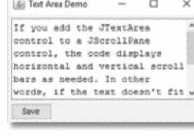

## JTextArea 类的常用构造函数和方法

| 构造函数/方法 | 描述 |
|--- | --- |
| `JTextArea(rows, columns)` | 创建具有指定行和列数的空文本区域。 |
| `setLineWrap(boolean)` | 如果设置为 true，此方法会导致行在水平方向无法容纳时换行。 |
| `setWrapStyleWord(boolean)` | 如果设置为 true 且开启换行，此方法会在单词之间换行。 |
| `getText()` | 返回文本区域中的文本作为 String 类型。 |
| `setText(String)` | 将文本区域中的文本设置为指定的字符串。 |
| `append(String)` | 将指定的字符串附加到文本区域的文本之后。 |

## JScrollPane 类的常用构造函数

| 构造函数 | 描述 |
|--- | --- |
| `JScrollPane(Component)` | 创建显示指定组件的滚动面板，并根据需要显示垂直和水平滚动条。 |

## 为文本区域声明私有实例变量的代码

```java
private JTextArea commentTextArea;
```

## 创建文本区域并将其添加到滚动面板的代码

```java
commentTextArea = new JTextArea(6, 30);
commentTextArea.setLineWrap(true);
commentTextArea.setWrapStyleWord(true);
commentTextArea.setText("Enter your comment here");
JScrollPane commentScroll = new JScrollPane(commentTextArea);
panel.add(commentScroll);
```

## 获取文本区域中文本的代码

```java
String comments = commentTextArea.getText();
```

- 与文本字段不同，文本区域可以用于输入和显示多行文本。

- 滚动面板可以为任何控件提供滚动条，通常与文本区域和列表配合使用。

图 19-1 如何使用文本区域并添加滚动条

## 如何使用复选框

图 19-2 显示了如何使用复选框。在这里，如果框被勾选，则启用地址栏。

要创建一个复选框，你可以使用图中所示类的构造函数。然后，你可以使用该类的方法来操作复选框。

图中第一个示例展示了如何为复选框声明私有实例变量。这允许该类的事件处理程序访问复选框。

第二个示例展示了如何向面板添加复选框。在这里，第一条语句创建复选框。第二条语句选中复选框。第三条语句为复选框添加监听器。要做到这一点，它使用了 Lambda 表达式，也可以使用匿名内部类。

第三个示例展示了当复选框被选中时执行的监听器代码。在此方法中，使用 if 语句检查框是否被勾选。如果是，则启用地址。否则，禁用它。

只有当你希望应用程序在用户点击复选框时立即做出响应，才需要为复选框添加监听器。在许多情况下，这是必要的。相反，你只需要在用户触发表单上的其他事件（例如点击按钮）时检查复选框的状态即可。

### 带有复选框的框架

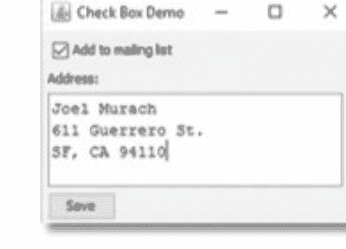

## JCheckBox 类的常用构造函数和方法

| 构造函数 | 描述 |
|---|--- |
| `JCheckBox(String)` | 创建带有指定字符串标签的未选中复选框。 |
| `isSelected()` | 如果复选框被选中，返回 true 值。 |
| `setSelected(boolean)` | 勾选或取消勾选复选框。 |

## 为复选框声明私有实例变量的代码

```java
private JCheckBox mailingCheckBox;
```

## 创建复选框并添加监听器的代码

```java
mailingCheckBox = new JCheckBox("Add to mailing list");
mailingCheckBox.setSelected(true);
mailingCheckBox.addActionListener(e -> mailingCheckBoxChanged());
panel.add(mailingCheckBox);
```

## 实现复选框监听器的方法

```java
private void mailingCheckBoxChanged() {
    if (mailingCheckBox.isSelected()) {
        addressTextArea.setEnabled(true);
    } else {
        addressTextArea.setEnabled(false);
    }
}
```

## 描述

- 复选框允许用户选择开启或关闭某个选项。

- 要选中或取消选中复选框，用户可以点击复选框，或者将焦点移到复选框后按空格键。

图 19-2 如何使用复选框

# 如何使用单选按钮

图 19-3 显示了如何使用单选按钮。当你使用单选按钮时，通常会将它们放在一个按钮组中。这样，用户就可以从组中选择一个按钮。例如，在图中，用户可以在三种运输方式中选择一种：USPS、UPS 或 FedEx。

`JRadioButton` 类的构造函数和方法与 `JCheckBox` 类的构造函数和方法相似。因此，你在理解它们时应该不会太大困难。此外，此图显示你需要创建一个 `ButtonGroup` 类的组和方法，以便将单选按钮添加到其中。注意，你可以将任何继承自 `AbstractButton` 类的对象添加到组中。这包括单选按钮，以及包含单选按钮和复选框的菜单项。

第一个示例显示了如何将三个单选按钮声明为类的私有实例变量。为了节省空间，该示例使用单个语句通过逗号分隔来声明所有三个单选按钮。

第二个示例显示了如何创建图中所示的三个单选按钮并将它们添加到按钮组中。在这里，前三个语句创建了带有适当标签的单选按钮。然后，第四条语句选择了 USPS 单选按钮。

该示例中的后续四个语句使用 `ButtonGroup` 类创建了一个按钮组并将按钮添加到组中。这创建了单选按钮的逻辑分组。因此，当用户点击组中的其中一个单选按钮时，被点击的按钮会被选中，而其他单选按钮将取消选中。

最后三条语句将单选按钮添加到面板中，以便它们显示在图形用户界面上。虽然你可能认为可以将包含单选按钮的组添加到面板，但事实并非如此。`ButtonGroup` 对象仅仅定义了按钮的逻辑分组。

第三个示例显示了如何确定三个单选按钮中哪一个被选中。要做到这一点，它使用一个 `if/else` 语句来测试每个按钮的 `isSelected()` 方法。然后，它为 `shipVia` 变量分配一个相应的字符串值。

如有必要，你可以像对待复选框或普通按钮一样，为单选按钮添加动作监听器。事实上，本章最后介绍的 `Payment` 应用程序为它的两个单选按钮都添加了动作监听器。

# 一个带有三个单选按钮的框架


# JRadioButton 类的常用构造函数和方法

| 构造函数/方法 | 描述 |
|--- | --- |
| `JRadioButton(String)` | 创建一个带有指定文本的未选中单选按钮。 |
| `isSelected()` | 如果单选按钮被选中，则返回 true。 |
| `setSelected(boolean)` | 选中或取消选中单选按钮。 |

# ButtonGroup 类的常用构造函数和方法

| 构造函数/方法 | 描述 |
|--- | --- |
| `ButtonGroup()` | 创建用于持有一组按钮的按钮组。 |
| `add(AbstractButton)` | 将指定的按钮添加到组。 |

## 将三个单选按钮声明为私有实例变量的代码

```java
private JRadioButton upsRadioButton, fedexRadioButton, uspsRadioButton;
```

## 创建三个单选按钮并将其添加到按钮组的代码

```java
upsRadioButton = new JRadioButton("UPS");
fedexRadioButton = new JRadioButton("FedEx");
uspsRadioButton = new JRadioButton("USPS");
uspsRadioButton.setSelected(true);

ButtonGroup shipViaGroup = new ButtonGroup();
shipViaGroup.add(upsRadioButton);
shipViaGroup.add(fedexRadioButton);
shipViaGroup.add(uspsRadioButton);
```

## 确定哪一个单选按钮被选中的代码

```java
String shipVia = "";
if (upsRadioButton.isSelected()) {
    shipVia = "UPS";
} else if (fedexRadioButton.isSelected()) {
    shipVia = "FedEx";
} else if (uspsRadioButton.isSelected()) {
    shipVia = "USPS";
}
```

## 描述

- 单选按钮允许用户从多个选项中选择一个。

- 你必须将一组选项中的每个单选按钮添加到 `ButtonGroup` 对象中。

- 选择组中的一个单选按钮会自动取消选择同一组中的所有其他单选按钮。

图 19-3 如何使用单选按钮

# 如何添加边框和标题

图 19-4 显示了如何为组件添加边框。虽然添加边框是一种不影响功能的审美考量，但边框很重要有两个原因：首先，它们允许让你从视觉上对相关组件分组。这对于单选按钮尤为重要。其次，它们允许你添加标题。例如，在图中，框架包含一个带有上图中三个单选按钮的面板。该面板有一个标题为“Carrier”的边框。

你可能认为可以通过简单调用一个设置边框样式的方法为组件创建边框。不幸的是，并没有那么简单。首先，你必须创建一个带有你想要使用的样式设置的 `Border` 对象。要做到这一点，你可以调用 `BorderFactory` 类的静态方法之一。此图显示了创建 `Border` 对象的两种常用方法。第一个创建一个不带标题的简单线边框，第二个创建一个带有标题的线边框。创建 `Border` 对象后，可以将其传递给组件的 `setBorder()` 方法。

图中的代码示例显示了如何创建一个带有边框和标题的面板，并显示了如何将上图中创建的三个单选按钮添加到此面板。在这里，第一条语句创建了一个名为 `shipViaPanel` 的面板。第二条语句使用 `setBorder()` 方法将面板的边框设置为 `createTitledBorder()` 方法返回的 `Border` 对象。接下来的三个语句将三个单选按钮添加到 `shipViaPanel`。最后一条语句将 `shipViaPanel` 添加到框架的主面板。

# 带有标题和边框的面板中的单选按钮


# BorderFactory 类的静态方法

| 方法 | 描述 |
| --- | --- |
| `createLineBorder()` | 创建一个线边框。 |
| `createTitledBorder(String)` | 创建一个带有指定标题的线边框。 |

# JComponent 类的方法

| 方法 | 描述 |
| --- | --- |
| `setBorder(Border)` | 为组件设置边框样式。 |

## 创建带有标题和边框面板的代码

```java
JPanel shipViaPanel = new JPanel();
shipViaPanel.setBorder(BorderFactory.createTitledBorder("Carrier"));
shipViaPanel.add(upsRadioButton);
shipViaPanel.add(fedexRadioButton);
shipViaPanel.add(uspsRadioButton);
panel.add(shipViaPanel);
```

## 描述

- 边框用于在视觉上对单选按钮等控件进行分组，或增强控件的外观。边框可以包含标题。

- 为面板添加边框是常见的，面板是分组其他组件的组件。

- 因为边框仅在视觉上对控件分组，你仍然必须使用 `ButtonGroup` 对象在逻辑上对单选按钮分组。

图 19-4 如何添加边框和标题

# 如何使用组合框

图 19-5 显示了如何创建组合框。组合框是一种允许用户从下拉列表中的多个选项中选择一个的控件。要显示下拉列表，用户可以点击组合框右侧的箭头。然后，用户可以点击某项进行选择。取决于组合框的配置，这可能允许直接向组合框输入数据。实际上，组合框是文本字段和下拉列表的结合。

要创建组合框，你可以使用图中显示的第一个构造函数向组合框中添加项目。或者，你可以使用图中显示的第二个构造函数从项目数组创建组合框。无论如何，你都可以使用图中显示的其余方法来处理组合框中的项目。

图中的第一个示例为组合框声明了一个实例。接下来的两个示例使用了这个实例变量。

第二个示例显示了如何创建组合框并用项目填充它。在这里，第一条语句定义了一个包含三个运营商字符串的数组。第二条语句使用构造函数创建了一个每个元素对应一个项目的组合框。之后，该代码为组合框添加了一个项目监听器，当组合框中的选中项发生变化时，它会被执行。最后，这段代码将组合框添加到 GUI 的主面板。

在大多数情况下，这就是创建组合框所需的所有内容。你可能还想使用 `setSelected` 方法在列表首次显示时更改项目的选中状态。默认情况下，列表中的第一个项目被选中，这正是你想要的。


第三个示例显示了每当用户从组合框中选择新项时都会执行的方法。在这个处理程序内部，第一条语句使用 `getSelectedIndex()` 方法获取选中项目的索引。然后，第二条语句使用 `getSelectedItem()` 方法从组合框获取选中项。

图中的第四个示例显示了另一种创建组合框并用项目填充的方法。在这里，第一条语句创建了一个空组合框并将其赋值给变量 `yearsCombo`。然后，该语句遵循 `addItem` 方法将 1 到 20 的整数添加到组合框中。最后，最后语句设置了列表中的第三项。

尽管图中展示的组合框包含 String 和 Int 对象，但 `addItem` 方法允许你添加任何类型的对象。例如，你可以向组合框中添加 `Product` 对象。在这种情况下，组合框将调用每个产品的 `toString()` 方法来获取显示该对象的文本。

默认情况下，组合框是不可编辑的，因此用户无法更改组合框文本部分中显示的值。虽然这通常是你想要的，但你可以使用 `setEditable` 方法使组合框变为可编辑。这样，用户可以直接在组合框的文本部分输入项的文本，而不是从列表中选择项。如果你需要此功能，请记住用户可能会输入无效数据。因此，你必须添加一些数据验证代码来防止无效输入。

## 带有组合框的框架


## JComboBox 类常用的构造函数和方法

| 构造函数/方法 | 说明 |
| --- | --- |
| `JComboBox()` | 创建一个空的组合框。 |
| `JComboBox(Object[])` | 创建一个包含指定数组中存储对象的组合框。 |
| `getSelectedItem()` | 返回选中项的 Object 类型。 |
| `getSelectedIndex()` | 返回选中项索引的 int 值。 |
| `setSelectedIndex(int)` | 选择指定索引处的项。 |
| `getItemCount()` | 返回组合框中存储的项目数量。 |
| `addItem(Object)` | 向组合框添加指定的项。 |
| `removeItem(int)` | 从组合框中移除指定索引处的项。 |
| `removeItem(Object)` | 从组合框中移除指定的项。 |

## 定义组合框私有实例变量的代码

```java
private JComboBox carrierComboBox;
```

## 创建组合框并填充项的代码

```java
String[] carriers = {"UPS", "FedEx"};
carrierComboBox = new JComboBox(carriers);
carrierComboBox.addActionListener(event -> carrierComboBoxItemChanged());
panel.add(carrierComboBox);
```

## 获取选中项的代码

```java
private void carrierComboBoxItemChanged() {
    int shipViaIndex = carrierComboBox.getSelectedIndex();
    String shipVia = (String)carrierComboBox.getSelectedItem();
}
```

## 另一种创建组合框并填充项的方法

```java
JComboBox yearsComboBox = new JComboBox();
for (int year = 1; year < 21; year++) {
    yearsComboBox.addItem(year);
}
yearsComboBox.setSelectedIndex(2);
```

## 说明

- 组合框允许用户从下拉列表中选择多个项目中的其中一个。

图 19-5 如何使用组合框

## 如何使用列表

图 19-6 显示了如何创建一个列表，该列表允许用户选择零或多个元素。例如，该图顶部的第一个框架包含一个显示三个货运商的列表。在这里，所有货运商都同时显示在列表中，不需要垂直滚动条即可允许用户滚动查看条目。然而，对于文本区域，通常会将列表存储在滚动面板中，以便在需要时出现滚动条。

与框不同，列表默认允许用户选择多个一个元素。例如，该图顶部的第二个框架显示了一个选中了两个元素的列表框。要选择多个元素，用户可以按住 Ctrl 键同时点击元素。或者，用户可以选择一个元素，然后按住 Shift 键并点击另一个元素，以选择从第一个元素到第二个元素的范围元素。要选择另一个范围的元素，用户可以按住 Ctrl 键选择范围内的第一个元素，然后按住 Ctrl 和 Shift 键选择范围内的最后一个元素。

如果需要，使用 `setSelectionMode()` 方法来更改用户可以进行的选择类型。例如，你可以设置此属性，使用户仅限于单次选择，如本章稍后介绍的支付应用程序所示。或者，你可以设置此属性，使用户可以选择一段连续的元素。要做到这一点，你需要使用 `ListSelectionModel` 接口中的字段。

第一个第一个示例声明了列表的私有实例变量。该变量被接下来的两个示例使用。

第二个示例显示了如何创建一个列表并将其添加到滚动面板中。在这里，第一条语句创建一个用于货运商的 String 对象数组。第二条语句为数组中的每个元素创建一个包含一个元素的列表。第三条语句选中了列表中的第一个元素。如果你没有在列表中选择元素，则默认没有元素被选中。第四条语句将列表添加到滚动面板中。第五条语句设置滚动面板的首选尺寸，第六条语句将滚动面板添加到 GUI 的面板上。

第三个示例显示了如何访问用户选中的一个或多个元素。在这里，`getSelectedValues()` 方法检索选中的值的列表。此时，你可以使用循环来处理这些值。如果有必要，你可以使用 `getSelectedIndices()` 方法返回选中元素的索引。同样，对于只允许单次选择的列表框，你可以使用 `getSelectedIndex()` 或 `getValue()` 方法获取选中的索引或值。

## 包含列表的框架

## 选中多个元素的列表

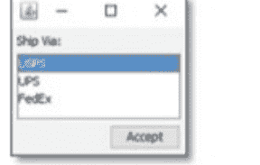
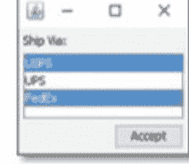

## JList 类常用的构造函数和方法

| 构造函数 | 说明 |
| --- | --- |
| `JList(Object[])` | 创建一个包含指定数组中对象的列表。 |
| `setSelectionMode(mode)` | 将选择模式设置为 `ListSelectionModel` 接口中的字段之一。 |
| `setSelectedIndex(int)` | 选择指定索引处的元素。 |
| `getSelectedValue()` | 返回选中的元素。 |
| `getSelectedIndex()` | 返回选中元素的索引。 |
| `getSelectedValues()` | 返回选中的值的列表。 |
| `getSelectedIndices()` | 返回选中元素的索引数组。 |

### ListSelectionModel 的字段

| 字段 | 说明 |
| --- | --- |
| `SINGLE_SELECTION` | 仅允许一个。 |
| `SINGLE_INTERVAL_SELECTION` | 允许单个区间。 |
| `MULTIPLE_INTERVAL_SELECTION` | 允许多个区间。 |

## 列表实例变量的代码

```java
private JList carrierList;
```

## 创建列表并将其添加到滚动面板的代码

```java
String[] carriers = {"UPS", "FedEx"};
carrierList = new JList(carriers);
carrierList.setSelectedIndex(0);
JScrollPane scrollPane = new JScrollPane(carrierList);
scrollPane.setPreferredSize(new Dimension(150, 30));
panel.add(scrollPane);
```

## 从列表获取选中元素的代码

```java
List<String> carriers = carrierList.getSelectedValues();
```

## 说明

- 列表允许用户从列表中选择零或多个元素。


图 19-6 如何使用列表

## 第 19 章 更多 Swing 控件 633

### 允许其元素被修改的列表


### JList 另一个构造函数和方法

| 构造函数/方法 | 说明 |
| --- | --- |
| `JList()` | 创建一个不包含任何元素的列表。 |
| `setModel(listModel)` | 为列表设置模型。创建此模型的一种简单方法是使用 `DefaultListModel` 类。 |

### DefaultListModel 类的常用构造函数和方法

| 构造函数/方法 | 说明 |
| --- | --- |
| `DefaultListModel()<E>` | 为指定的元素类型创建一个默认列表模型。 |
| `contains(E)` | 如果列表包含指定的元素，则返回真（true）。 |
| `addElement(E)` | 将指定的元素添加到列表中。 |
| `removeElementAt(int)` | 移除指定位置的元素。 |
| `clear()` | 移除列表中的所有元素。 |
| `size()` | 返回列表中元素的数量。 |

## 声明列表及其模型实例的代码

```java
private JList groceryList;
private DefaultListModel<String> groceryModel;
String[] groceries = {"Milk", "Eggs", "Bacon", "Bread"};
groceryModel = new DefaultListModel<String>();
for (String item : groceries) {
    groceryModel.addElement(item);
}
groceryList = new JList(groceryModel);
groceryList.setModel(groceryModel);
```

## 从列表中移除已选元素的代码

```java
private void removeButtonClicked() {
    int[] selectedIndices = groceryList.getSelectedIndices();
    for (int index : selectedIndices) {
        groceryModel.removeElement(index);
    }
}
```

## 描述

- 要使用代码修改列表的内容，你可以创建一个定义了列表显示数据的列表模型。然后，你可以使用列表模型来添加或删除元素。

图 19-7 如何与列表模型工作

## 支付应用程序

现在你已经了解了如何与不同类型的控件工作，已经准备好查看一个使用其中一些控件的支付应用程序了。

## 用户界面

图 19-8 显示了支付应用程序的用户界面。在这里，用户可以通过选择“Credit card（信用卡）”单选按钮来输入信用卡数据，然后使用其他控件输入信用卡数据。然后，当用户点击 Accept（接受）”按钮时，应用程序会在对话框中显示信用卡数据。

或者，用户可以通过选择“Bill customer（账单客户）”单选按钮向客户发送账单。这将禁用输入信用卡数据的控件。然后，用户可以点击 Accept（接受）”按钮来显示一条消息，指示客户将被计费。

## 支付应用程序的用户界面

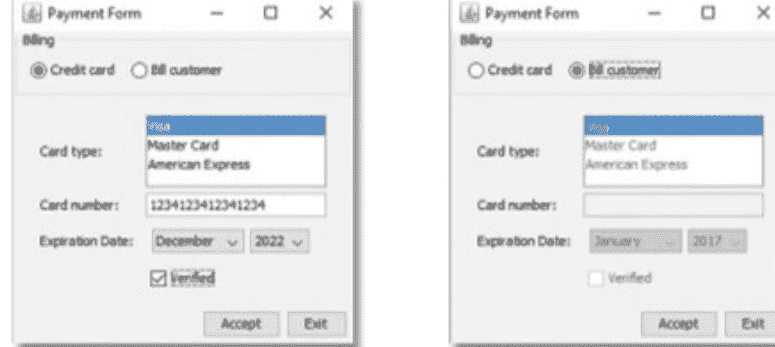

## 应用程序显示的典型对话框


## 描述

- 支付应用程序使用了本章中所示的一些控件，允许用户输入有关支付的信息。
- 要输入信用卡，用户需要选择“Credit card（信用卡）”单选按钮，从列表中选择一种卡片类型，在文本字段中输入卡号，并从组合框中选择过期月份和年份。如果信用卡已通过验证，用户还可以勾选复选框。当用户点击 Accept（接受）按钮时，应用程序会显示信用卡数据。
- 要向客户发送账单，用户选择“Bill customer（账单客户）”单选按钮。这将禁用输入信用卡数据的控件。当用户点击 Accept（接受）按钮时，应用程序会显示一条指示客户将被计费的消息。
- 要退出应用程序，用户点击 Exit（退出）按钮。

图 19-8 支付应用程序的用户界面

## 代码

图 19-9 显示了支付框架的代码。该框架使用了本章中介绍的所有控件，除了文本区域。结果，你可以通过此代码查看各种 Swing 控件在应用程序上下文中是如何工作的。

为了开始，类的构造函数设置了框架的外观，与当前操作系统相同。然后它调用 `initComponents()` 方法。

`initComponents()` 方法通过设置框架的标题、位置和默认关闭操作开始。它设置了用于计费的单选按钮，将它们添加到按钮组中，选择第一个按钮并为这两个单选按钮添加事件监听器。该监听器在用户选择其中一个单选按钮时调用位于此页的 `billingRadioButtonClick()` 方法。

在设置了用于计费的两个单选按钮后，此代码创建一个用于存储这些单选按钮的面板。该面板有边界和标题，并使用了左对齐的布局。最后，此代码添加了这些单选按钮。

## 支付应用程序的代码

```java
package murah.ui;
import javax.swing.*;
import java.awt.*;
import java.time.LocalDate;

public class PaymentFrame extends JFrame {
    private JRadioButton creditCardRadioButton;
    private JRadioButton billCustomerRadioButton;
    private JList cardTypeList;
    private JTextField cardNumberTextField;
    private JComboBox monthComboBox;
    private JComboBox yearComboBox;
    private JCheckBox verifiedCheckbox;

    public PaymentFrame() {
        try {
            UIManager.setLookAndFeel(UIManager.getSystemLookAndFeelClassName());
        } catch (ClassNotFoundException | InstantiationException | IllegalAccessException | UnsupportedLookAndFeelException e) {
            System.out.println(e);
        }
        initComponents();
    }

    private void initComponents() {
        // set up frame
        setTitle("Payment Form");
        setLocationRelativeTo(null);
        setDefaultCloseOperation(WindowConstants.EXIT_ON_CLOSE);

        // set up billing components
        ButtonGroup billingGroup = new ButtonGroup();
        creditCardRadioButton = new JRadioButton("Credit card");
        billCustomerRadioButton = new JRadioButton("Bill customer");
        billingGroup.add(creditCardRadioButton);
        billingGroup.add(billCustomerRadioButton);
        creditCardRadioButton.setSelected(true);
        creditCardRadioButton.addActionListener(event -> billingRadioButtonClick());
        billCustomerRadioButton.addActionListener(event -> billingRadioButtonClick());

        // set up billing panel
        JPanel billingPanel = new JPanel();
        billingPanel.setBorder(BorderFactory.createTitledBorder("Billing"));
        billingPanel.setLayout(new FlowLayout(FlowLayout.LEFT));
        billingPanel.add(creditCardRadioButton);
        billingPanel.add(billCustomerRadioButton);
    }
}
```


# 第 19 章 更多 Swing 控件

## 图 19-9 支付应用程序的代码（第 1 部分，共 4 部分）

### Payment 应用代码第 2 页

```java
// 设置卡类型列表
String[] cardTypes = {"Visa", "Master Card", "American Express"};
JList<String> cardTypeList = new JList<>(cardTypes);
cardTypeList.setSelectionMode(ListSelectionModel.SINGLE_SELECTION);
JScrollPane cardTypeScrollPane = new JScrollPane(cardTypeList);
cardTypeScrollPane.setPreferredSize(new Dimension(150, 60));

// 设置信用卡号文本框
JTextField cardNumberTextField = new JTextField();
Dimension dim = new Dimension(150, 20);
cardNumberTextField.setPreferredSize(dim);
cardNumberTextField.setMinimumSize(dim);

// 设置过期月份组合框
String[] months = {"January", "February", "March", "April",
    "May", "June", "July", "August",
    "September", "October", "November", "December"};
JComboBox<String> monthComboBox = new JComboBox<>(months);

// 设置过期年份组合框
LocalDate currentDate = LocalDate.now();
int startYear = currentDate.getYear();
int endYear = startYear + 8;
JComboBox<String> yearComboBox = new JComboBox<>();
for (int i = startYear; i < endYear; i++) {
    yearComboBox.addItem(Integer.toString(i));
}
JPanel expirationDatePanel = new JPanel();
expirationDatePanel.setLayout(new FlowLayout(FlowLayout.LEFT));
expirationDatePanel.add(monthComboBox);
expirationDatePanel.add(yearComboBox);

// 设置验证复选框
JCheckBox verifiedCheckbox = new JCheckBox();
verifiedCheckbox.setText("Verified");

// 设置网格面板
JPanel gridPanel = new JPanel();
gridPanel.setLayout(new GridBagLayout());

gridPanel.add(new JLabel("Card type:"), getConstraints(0, 0));
gridPanel.add(new JLabel("Card number:"), getConstraints(0, 1));
gridPanel.add(cardNumberTextField, getConstraints(1, 1));
gridPanel.add(new JLabel("Expiration Date:"), getConstraints(0, 2));
gridPanel.add(expirationDatePanel, getConstraints(1, 2));
gridPanel.add(verifiedCheckbox, getConstraints(1, 3));
```


此代码的第 3 页从创建 `Accept`（接受）和 `Exit`（退出）按钮开始。此外，它为这两个按钮都添加了动作监听器。结果是如果用户点击 `Accept` 按钮，动作监听器将调用此图第 4 页中的 `acceptButtonClick()` 方法。同样，如果用户点击 `Exit` 按钮，动作监听器将调用 `exitButtonClicked()` 方法。最后，代码创建一个面板并将这些按钮添加到其中。该面板使用了右对齐的 `FlowLayout`。

创建按钮面板后，此代码将这三个面板添加到框架提供的 `BorderLayout` 的三个区域中。具体来说，它将包含单选按钮的面板添加到 `CENTER`（中间）区域，将另一个面板添加到 `NORTH`（北部）区域，并将包含按钮的面板添加到 `SOUTH`（南部）区域。

`initComponent()` 方法中的最后一条语句使用 `pack()` 方法来设置框架的大小，以适应其所有组件。该方法放置在这里是在所有组件都添加到框架之后，以便它才能正常工作。

`getConstraints()` 方法用于在网格面板中定位组件，正如你在此代码的第 2 页看到的那样。这与你在上一章中看到的 Future Value 应用中使用的 `getConstraints()` 方法类似。因此，如果你需要刷新对其工作原理的记忆，可以回顾那里。

`billingRadioButtonClick()` 方法是当任一个单选按钮被点击时执行的事件处理器。在此方法中，第一条语句检查信用卡单选按钮是否被选中。如果是，此代码将一个 `true` 值传递给 `enableCreditCardControls()` 方法，以启用输入信用卡数据的控件。否则，此代码将禁用信用卡控件。

### Payment 应用代码第 3 页

```java
// 设置 Accept 和 Exit 按钮
JButton acceptButton = new JButton("Accept");
acceptButton.addActionListener(event -> acceptClicked());
JButton exitButton = new JButton("Exit");
exitButton.addActionListener(event -> exitClicked());

// 设置按钮面板
JPanel buttonPanel = new JPanel();
buttonPanel.setLayout(new FlowLayout(FlowLayout.RIGHT));
buttonPanel.add(acceptButton);
buttonPanel.add(exitButton);

// 将账单面板添加到 NORTH
add(billingPanel, BorderLayout.NORTH);

// 将网格面板添加到 CENTER
add(gridPanel, BorderLayout.CENTER);

// 将按钮面板添加到 SOUTH
add(buttonPanel, BorderLayout.SOUTH);

pack();

// 返回 GridBagConstraints 对象的辅助方法
private GridBagConstraints getGridBagConstraints(int x, int y) {
    GridBagConstraints c = new GridBagConstraints();
    c.anchor = GridBagConstraints.LINE_START;
    c.insets = new Insets(5, 5, 0, 5);
    c.gridx = x;
    c.gridy = y;
    return c;
}

private void billingRadioButtonClicked() {
    if (creditCardRadioButton.isSelected()) {
        enableCreditCardControls(true);
    } else if (billCustomerRadioButton.isSelected()) {
        enableCreditCardControls(false);
    }
}

private void enableCreditCardControls(boolean enable) {
    cardTypeList.setEnabled(enable);
    cardNumberTextField.setEnabled(enable);
    monthComboBox.setEnabled(enable);
    yearComboBox.setEnabled(enable);
    verifiedCheckbox.setEnabled(enable);
}
```

### 第 4 部分：GUI 编程

第 4 页从 `acceptButtonClicked()` 方法开始。该方法是用户点击 `Accept` 按钮时执行的事件处理器。在此方法中，第一条语句定义了一个存储消息的变量。此代码使用了本章描述的一些方法。

在变量中存储消息后，此代码显示该消息。为此，它将控件重置为默认状态。

```java
private void acceptClicked() {
    String message;
    if (creditCardRadioButton.isSelected()) {
        message = "Bill " + (String) cardTypeList.getSelectedItem()
            + "\nNumber: " + cardNumberTextField.getText()
            + "\nDate: " + (String) monthComboBox.getSelectedItem()
            + ", " + (String) yearComboBox.getSelectedItem();
    } else if (verifiedCheckbox.isSelected()) {
        message += "\nCard has not been verified.";
    } else {
        message = "Customer will be billed.";
    }

    // 显示消息
    JOptionPane.showMessageDialog(this, message);

    // 重置控件
    cardTypeList.setSelectedIndex(0);
    cardNumberTextField.setText("");
    monthComboBox.setSelectedIndex(0);
    yearComboBox.setSelectedIndex(0);
    verifiedCheckbox.setSelected(false);
}

private void exitClicked() {
    System.exit(0);
}

public static void main(String[] args[]) {
    java.awt.EventQueue.invokeLater(() -> (
        new PaymentFrame().setVisible(true);
    ));
}
```

## 练习 19-1 修改未来值应用

在本次练习中，你将修改第 18 章介绍的未来值应用，使其使用组合框（combo box）和列表。完成后，用户界面应该如图所示：


1. 打开 `ex_starts` 目录中名为 `ch19_ex1_FutureValue` 的项目。然后，检查表单的设计和代码。
2. 将“年数”（Number of Years）文本框替换为组合框。然后编写一个方法向该组合框填充 1 到 20 的值，并在框架的构造函数中调用该方法。为组合框进行任何其他必要的更改。测试项目以确保其运行正常。
3. 将“未来值”（Future Value）文本框替换为列表，该列表显示五行，并使用垂直滚动条，但不使用水平滚动条。
4. 修改 `calculateButtonClick()` 事件处理器，使其不再计算单个值，而是计算从当前到通过组合框选择的年份每年的未来值，并在列表中添加一个显示每年计算结果的字符串。
5. 测试项目以确保其运行正常。

## 练习 19-2 创建披萨计算器应用

在本次练习中，你将开发一个根据披萨的尺寸和配料计算披萨价格的应用。该应用的用户界面应该如图所示：

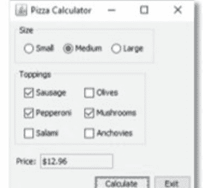

1. 打开 `ex_starts` 目录中名为 `ch19_ex2_PizzaOrder` 的项目。该项目包含一个空框架和几个辅助方法。
2. 添加实现此应用所需的控件和代码。当用户选择披萨的尺寸和配料并点击“计算”（Calculate）按钮时，应用应计算披萨价格并将价格显示在文本框中。计算披萨价格时，将所选配料的价格加到披萨的基础价格上：

| 项目 | 价格 |
| --- | --- |
| 小披萨 | $6.99 |
| 中披萨 | $8.99 |
| 大披萨 | $10.99 |
| 香肠 | $1.49 |
| 意大利腊肠 | $1.49 |
| 萨拉米 | $1.49 |
| 橄榄 | $0.99 |
| 蘑菇 | $0.99 |
| 鱼 | $0.99 |

3. 测试项目以确保运行正常。

# 第 5 部分 数据库编程

现实世界上大多数 Java 应用都将数据存储在数据库中。在大多数情况下，与第 15 章描述的将数据存储在文件中相比，这具有许多优势。这就是本节两个章节介绍了开发 Java 应用所需的必备数据库技能。

首先，第 20 章介绍了一些基础的数据库概念和使用 SQL（结构化查询语言）检索和修改数据库中数据的基本技能。然后，第 21 章展示了如何使用 JDBC（Java 数据库连接）编写执行这些 SQL 语句的 Java 代码。为了说明起见，这些章节使用了 SQLite 数据库，因为它是入门数据库编程极佳方法。然而，与 SQLite 数据库交互的大多数技能也适用于 Oracle、SQL Server 和 MySQL 等其他流行数据库。

## 第 20 章 使用 SQLite 简介数据库

在第 15 章中，你学习了如何处理将数据存储在文件程序。在现实世界中，大多数程序将数据存储在数据库中。因为将数据存储在数据库中比存储在文件中具有许多优势。

首先，本章教了你一些处理关系数据库的基础概念。然后，它向你展示了如何使用 SQL 操作数据库。这些技能适用于 MySQL、SQL Server 和 SQLite 等大多数数据库。最后，本章向你展示了处理 SQLite 数据库的一些特定技能。SQLite 是一种不需要配置的嵌入式数据库，实现了适用于所有数据库的 SQL 标准。此外，它非常流行，特别是在 Android 编程中。因此，SQLite 是学习数据库的好方法。

### 关系数据库如何组织

1970 年，E. F. Codd 开发了一种新类型的数据库模型——关系数据库。这种数据库消除了与早期层次数据库相关的问题。通过使用关系模型，你可以减少数据冗余，节省磁盘存储并实现更高效的数据检索。你还可以以一种直观且高效的方式查看和操作数据。

### 表如何组织

关系数据库在表中存储数据。如图 20-1 所示，每个表包含行和列。在实践中，行和列通常被称为*记录*（records）和*字段*（fields）。这就是本书交替使用这些术语的原因。


关系数据库中的表有一个列定义为`主键`（primary key）。主键唯一标识表中的每行。正如你在下一个图中看到的，一个表的行可以很容易与另一个表的行关联。在此处的 `Products` 表中，`ProductCode` 列为主键。管理关系数据库的软件称为数据库管理系统（DBMS）或关系数据库管理系统（RDBMS）。DBMS 提供了设计数据库的功能。DBMS 管理数据库中存储的所有更改。四个流行的数据库管理系统是 Oracle、SQL Server、MySQL 和 SQLite。

## 表中的列如何定义

此图还展示了 DBMS 如何定义表的列。特别是展示了 DBMS 如何为每列定义名称和数据类型。所有关系数据库都需要这些。在此图中，`ProductCode` 和 `Description` 列被定义为 `VARCHAR` 类型。该类型映射到 Java 中的 `String` 类型，并允许列存储变数量的字符。在这里，`ProductCode` 列可以存储 10 个字符，`Description` 列可以存储 40 个字符。相比之下，`Price` 列被定义为 `DOUBLE` 类型。

此外，大多数关系数据库允许你为每列设置其他属性，例如列是否可以包含空值表示值未知。在此图中，所有列都指定为 `NOT NULL`。因此，当应用程序尝试添加行时，必须为列提供一个值。

## Products 表

| ProductCode | Description | Price |
|---|---|---|
| java | Murach's Java Programming | 57.5 |
| jsp | Murach's Servlets and JSP | 57.5 |
| mysql | Murach's MySQL | 54.5 |
| orac | Murach's Oracle SQL and PL/SQL | 54.5 |
| andr | Murach's Android Programming | 57.5 |
| html | Murach's HTML and CSS | 54.5 |
| jscr | Murach's JavaScript and jQuery | 54.5 |

## Products 表的设计

| 列名 | 数据类型 | 允许空？ |
|---|---|---|
| ProductCode | VARCHAR(10) | NOT NULL |
| Description | VARCHAR(40) | NOT NULL |
| Price | DOUBLE | NOT NULL |

- 关系数据库使用表来存储和操作数据。每个表包含一个或多个行（记录），其中包含单个实体的数据。每行包含一个或多个列（字段），每个列代表单项数据。
- 大多数表包含主键，用于唯一标识表中的每行。
- 管理关系数据库的软件称为数据库管理系统（DBMS）。今天四个流行的数据库管理系统是 Oracle、Microsoft SQL Server、MySQL 和 SQLite。
- 数据库管理系统需要表中的每个列都有名称和数据类型。根据数据类型，列定义可以包括其他属性，如列的大小。
- 每个列定义还指示了列是否可以包含空值。空值表示该列的值未知。


## 表之间如何关联

图20-2 展示了关系型数据库如何使用主键列中的值将一个表与另一个表关联。在这里，`LineItems` 表中的 `ProductCode` 包含一个用于标识 `Products` 表中某行的值。换句话说，`LineItems` 表中的 `ProductCode` 列指向另一个表中的主键。因此，它被称为外键。在大型数据库中，一个表拥有多个外键是常见的现象。例如，在图中，`LineItems` 表的 `InvoiceID` 列也是一个指向 `Invoices` 表的外键。

在图中，`Products` 表中的每一行都与 `LineItems` 表中的一个或多行相关联。因此，`Products` 表与 `LineItems` 表之间存在一对多的关系。虽然一对多关系是表与表之间最常见的类型，但你也可以拥有一对一关系或多对多关系。然而，两个表之间的一对一关系很罕见，因为数据可以存储在单表中。相比之下，两个表之间的多对多关系通常通过使用第三张表来实现，该表与原始的两个表都具有一对多的关系。

顺带一提，`LineItems` 表中的主键是 `LineItemID` 列。它在向数据库添加新行时由 DBMS 自动生成。这种类型的主键通常适用于 `Invoice` 和 `Customer` 这样的表。

## Products 表与 LineItem 表之间的关系

### 主键

| ProductCode | Description | Price |
|---|---|---|
| java | Murach's Java Programming | 57.5 |
| jsp | Murach's Java Servlets and JSP | 57.5 |
| mysql | Murach's MySQL | 54.5 |
| orac | Murach's Oracle SQL and PL/SQL | 54.5 |
| andr | Murach's Android Programming | 57.5 |
| html | Murach's HTML and CSS | 54.5 |
| jscr | Murach's JavaScript and jQuery | 54.5 |

| LineItemID | InvoiceID | ProductCode | Quantity |
|---|---|---|---|
| 1 | 1 | java | 5 |
| 2 | 1 | jsp | 5 |
| 3 | 2 | mysql | 1 |
| 4 | 3 | andr | 2 |
| 5 | 3 | orac | 1 |
| 6 | 4 | html | 1 |
| 7 | 4 | java | 1 |
| 8 | 5 | mysql | 5 |

### 外键

#### 描述

- 关系型数据库中的表通过它们的键列相互关联。例如，`Products` 表和 `LineItems` 表通过 `ProductCode` 列相互关联。在 `LineItems` 表中，`ProductCode` 列被称为外键，因为它标识了另一个表中的相关行。
- 表之间可以存在三种关系。最常见的类型是上所示的一对多关系。然而，两个表之间也可以具有一对一关系或多对多关系。

图 20-2 表之间如何关联

## 如何使用 SQL 操作数据库

结构化查询语言 (SQL) 是一种你可以用它与现代 DBMS 通信的标准语言。这种语言可以分为两部分。数据定义语言 (DDL) 提供了如 `CREATE` 语句，让你定义数据库中的表。相比之下，数据操作语言 (DML) 提供了如 `SELECT`、`INSERT`、`UPDATE` 和 `DELETE` 语句，让你操作存储在这些表中的数据。这些是程序员每天使用的语句。

## 从单表选择的 SELECT 语法

### 由 SELECT 语句定义的结果集

| ProductCode | Description | Price |
|---|---|---|
| java | Murach's Java Programming | 57.5 |
| jsp | Murach's Java Servlets and JSP | 57.5 |
| mysql | Murach's MySQL | 54.5 |
| orac | Murach's Oracle SQL and PL/SQL | 54.5 |
| andr | Murach's Android Programming | 57.5 |
| html | Murach's HTML and CSS | 54.5 |
| jscr | Murach's JavaScript and jQuery | 54.5 |

### 获取所有列的 SELECT 语句

```sql
SELECT *
FROM Products
```

### 由 SELECT 语句定义的结果集

| ProductCode | Description | Price |
|---|---|---|
| java | Murach's Java Programming | 57.5 |
| jsp | Murach's Java Servlets and JSP | 57.5 |
| mysql | Murach's MySQL | 54.5 |
| orac | Murach's Oracle SQL and PL/SQL | 54.5 |
| andr | Murach's Android Programming | 57.5 |
| html | Murach's HTML and CSS | 54.5 |
| jscr | Murach's JavaScript and jQuery | 54.5 |

### 获取选中列和行的 SELECT 语句

```sql
SELECT Description, Price
FROM Products
WHERE Price > 55
ORDER BY Description ASC
```

### 由 SELECT 语句定义的结果集

| Description | Price |
|---|---|
| Murach's Android Programming | 57.5 |
| Murach's Java Programming | 57.5 |
| Murach's Java Servlets and JSP | 57.5 |

### 从单表选择的 SELECT 语法

```sql
SELECT column-1 [, column-2]
FROM table-1
[WHERE-criteria]
[ORDER BY column-1 [ASC|DESC]], ...
```

## 如何连接两个或多个表的数据

虽然此图展示了如何连接两个表，但你可以扩展此语法以连接更多的表。例如，如果你想创建一个包含 `Customers`、`Invoices` 和 `LineItems` 三张表数据的结果集，你可以像这样编写 `FROM` 子句：

```sql
FROM Customers c
INNER JOIN Invoices i
ON c.CustomerID = i.CustomerID
INNER JOIN LineItems li
ON i.InvoiceID = li.InvoiceID
```

### 用于连接两个表的 SELECT 语法

```sql
SELECT column-1 [, column-2] ...
FROM table-1
[INNER] JOIN table-2
ON table-1.column-1 = table-2.column-2
WHERE selection-criteria
ORDER BY column-1 [ASC] [DESC], column-2 [ASC] [DESC]] ...
```

### 不使用表别名的 SELECT 语句

```sql
SELECT InvoiceID, Products.ProductCode, Price, Quantity,
Price * Quantity AS Total
FROM Products
JOIN items
ON Products.ProductCode = LineItems.ProductCode
WHERE InvoiceID = 1
```

### 使用表别名的 SELECT 语句

```sql
SELECT InvoiceID, p.ProductCode, Price, Quantity,
Price * Quantity AS Total
FROM Products AS p
JOIN Items AS li
ON p.ProductCode = li.ProductCode
WHERE InvoiceID = 1
```

### SELECT 语句定义的结果集

| InvoiceID | ProductCode | Price | Quantity | Total |
| :--- | :--- | :--- | :--- | :--- |
| 1 | java | 57.5 | 5 | 287.5 |
| 1 | jep | 57.5 | 5 | 287.5 |

### 列别名的编码语法

```sql
column-name-or-expression [AS] new-column-name
```

### 表别名的编码语法

```sql
table-name [AS] new-table-name
```

### 如何使用别名

- 你可以使用别名为表或列提供新名称。在创建别名时，`AS` 关键字是可选的，但它可以提高可读性。
- 如果你使用算术运算符创建计算列，你通常希望使用列别名为该列提供易于用户的名称。
- 如果两个表使用相同的列名，你必须通过在列名前加上表名或其别名来限定该列。

#### 说明

- 连接（join）允许你将两个或多个表的数据合并到单个结果集中。
- 内连接（inner join）或等值连接（equi-join）仅在相关列匹配时才从两个表中检索行。

插图 20-4 如何连接来自两个或多个表的数据

## 如何在表中添加、更新和删除数据

20-5 显示了如何使用 `INSERT`、`UPDATE` 和 `DELETE` 语句向数据库添加、更新和删除一行或多行。首先，你可以使用 `INSERT` 语句向数据库添加一行。要实现这一点，第一个 `INSERT` 语句提供了要在新行中接收数值的列名，紧接着是这些列的值。当你插入一行时，如果你不想指定每个列，或者想指定的列的顺序与它们在表中出现的顺序不同，则可以指定列名列表。然而，如果你打算按照表中出现的相同顺序指定所有列名，则可以省略列列表，如第二个示例所示。

虽然你通常使用 `INSERT` 语句添加单行，但你可以使用 `UPDATE` 语句更新单行或多行。在第一个 `UPDATE` 示例中，`UPDATE` 语句更新了 `ProductCode` 等于 "java" 的单行中的 `Description` 和 `Price`。在第二个示例中，将所有 `Price` 大于 55.5 的行的 `Price` 更新为 57.95。

同样地，你使用 `DELETE` 语句删除单行或多行。在这里，第一个示例删除了 `Products` 表中 `ProductCode` 等于 "cpp" 的行。由于每行的 `ProductCode` 列都包含一个唯一值，因此这删除了单行。然而，在第二个示例中，`Invoices` 表中的许多行的 `ProductPrice` 列可能大于 55.5。因此，该语句删除了所有这些产品。

在第三个示例中，`DELETE` 语句不包含 `WHERE` 子句。虽然这在设置和测试数据库时通常很有用，但一旦数据库设置正确，你通常希望确保你的 `DELETE` 语句包含一个 `WHERE` 子句。

在编码字符串的字面值时，你必须将它们括在单引号中。然而，在编码数字的字面值时，用单引号括是可选的。例如，在图中，你可以将 `Price` 列的数值括在单引号中，SQL 语句仍然可以成功执行。


如果你想在字符串中包含单引号，可以使用另一个单引号来转义单引号。换句话说，你可以将两个单引号写在一起。例如，在图中，每个 `Description` 列的字符串值使用单引号以 "Murach's" 开头字符串。如果你尝试使用一个单引号而不是两个，SQL 语句将无法成功执行。相反，它将返回一个指示 SQL 语法错误的错误消息。

# 第 20 章 使用 SQLite 数据库简介

## 如何添加行

### 添加单行的 INSERT 语法

```
INSERT INTO table-name [{column-list}]
VALUES (value-list)
```

### 带有列列表的添加语句

```
INSERT INTO Products (Product, Description, Price)
VALUES ('cpp', 'Murach''s C++ Programming', 59.50)
```

### 不带列列表的添加行语句

```
INSERT INTO Products
VALUES ('cpp', 'Murach''s C++ Programming', 59.50)
```

## 如何更新行

### UPDATE 语法

```
UPDATE table-name
SET expression-1, [expression-2] ...
[WHERE selection-criteria]
```

### 更新单行的语句

```
UPDATE Products
SET Description = 'Murach''s C++ Programming', Price = 59.50
WHERE ProductCode = 'java'
```

### 更新多行的语句

```
UPDATE Products
SET Price = 57.95
WHERE Price > 55.5
```

## 如何删除行

### DELETE 语法

```
DELETE FROM table-name
[WHERE selection-criteria]
```

### 删除单行的语句

```
DELETE FROM Products
WHERE ProductCode = 'cpp'
```

### 删除多行的语句

```
DELETE FROM Products
WHERE ProductPrice > 55.5
```

## 说明

- 在编码字符串的字面值时，你必须将它们括在单引号中。然而，在编码数字的字面值时，用单引号括是可选的。
- 如果你想在字符串中包含单引号，可以使用另一个单引号来转义单引号。换句话说，你可以将两个单引号写在一起。例如，在图中，每个 `Description` 列的字符串值使用单引号以 "Murach's" 开头字符串。如果你尝试使用一个单引号而不是两个，SQL 语句将无法成功执行。相反，它将返回一个指示 SQL 语法错误的错误消息。


# SQLite 是...

- **RDBMS。** SQLite 是一个关系型数据库管理系统 (RDBMS)。
- **符合标准。** SQLite 实现了大部分 SQL 标准。
- **嵌入。** 与大多数数据库管理系统不同，SQLite 并不在客户端应用程序访问的服务器进程中运行。相反，它是作为客户端的一部分嵌入其中的，并在同一个进程中运行。
- **零配置。** SQLite 不需要任何配置或数据库管理。
- **轻量级。** SQLite 编程库非常小。
- **流行。** SQLite 是嵌入式数据库的流行选择，广泛用于 Android 编程。
- **开源。** SQLite 的源码属于公有领域。

# SQLite 支持的数据类型

| SQLite 数据类型 | Java 数据类型 |
| :--- | :--- |
| TEXT | String |
| INTEGER | long |
| REAL | double |

## 描述

- SQLite 仅支持三种数据类型（String、long 和 double）。因此，应用程序代码在将数据保存到数据库之前，必须将其他 Java 数据类型（如日期/时间和布尔值）转换为 SQLite 类型之一。
- SQLite 是弱类型的。换句话说，SQLite 数据库中的列不会拒绝数据类型错误的值。因此，应用程序代码必须确保插入正确类型的值。

图 20-6 SQLite 简介

# 如何连接到 SQLite 数据库

图 20-7 首先显示了如何使用 SQLite Manager 连接到数据库并查看其数据表。首先，你启动 Firefox。然后，启动 SQLite Manager。

启动 SQLite Manager 后，你可以通过选择菜单中的 `Database`（数据库）→`Connect Database`（连接数据库）来连接你想要操作的数据库。然后，使用对话框导航到 SQLite 数据库文件。在图中，SQLite Manager 已打开与名为 `products.sqlite` 的 SQLite 数据库的连接，该文件本书下载内容的一部分。

# 如何与 SQLite 数据库交互

连接到数据库后，你可以点击 SQLite Manager 主面板中的 `Browse & Search`（浏览与搜索）选项卡来查看数据表。然后，在左侧面板中，你可以展开 `Tables`（表）节点并点击你想查看的表。这会在主面板中显示该表，以及它所有的行和列。在图中，SQLite Manager 显示了 `Products` 表及其数据。

当你查看表时，可以点击表格来选中它，并可以使用表格顶部的按钮添加、编辑或删除行。第一行被选中了。因此，你可以点击 `Edit` 按钮编辑其数据，或者点击 `Delete` 按钮删除该行。

由于 `Products` 表不是以唯一标识每行的 `INTEGER` 列开始的，SQLite Manager 会自动生成一个名为 `rowid` 的列，并将其显示为表的第一列。然而，该列实际上并不是 `Products` 表的一部分。相反，由于 `LineItems` 表是以唯一标识每行的 `INTEGER` 列开始的，SQLite Manager 不会为该表生成 `rowid` 列。

展开 `Tables` 节点后，你可以通过右键点击表（Mac 上按 Ctrl-点击）并从生成的菜单中选择命令来操作该表。例如，你可以选择 `Rename`（重命名）命令来重命名表，或选择 `Delete`（删除）命令删除表。

# 第 20 章 使用 SQLite 数据库简介

# 在使用 Browse & Search 选项卡查看表后的 SQLite Manager

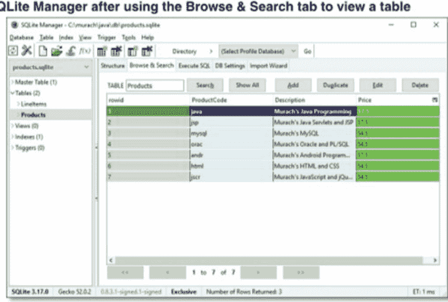

# 如何连接到 SQLite 数据库并查看表

1. 启动 Firefox。
2. 启动 SQLite Manager。你可以按 `Alt+T`（Mac 上为 `Option+T`）访问 `Tools`（工具）菜单。然后，选择 `SQLite Manager` 项。
3. 从 SQLite Manager 的菜单中选择 `Database`（数据库）→`Connect Database`（连接数据库）。然后，使用生成的对话框选择你想打开的 SQLite 数据库。本章的数据库位于：
   `\murach\java\products.sqlite`
4. 在主面板中，点击 `Browse & Search` 选项卡。
5. 在左侧面板中，展开 `Tables` 节点并点击你想查看的表。

## 描述

- 要安装 Firefox 浏览器和 SQLite Manager，请参考你操作系统的附录说明。
- 当你查看表时，可以点击某一行来选中它，并可以使用表格顶部的按钮添加、编辑或删除行。
- 展开 `Tables` 节点后，你可以对表名点击右键点击（Mac 上按 Ctrl-点击）。然后，你可以使用生成的菜单复制、重命名或删除表。

图 20-7 如何使用 SQLite Manager 操作数据库

# 如何执行 SQL 语句

在使用 SQLite Manager 连接到数据库后，你可以使用它对该数据库执行 SQL 语句。这可以帮助你在 Java 代码中使用 SQL 语句之前对其进行测试，并帮助你调试运行不正确的 SQL 语句。

图 20-8 显示了如何使用 SQLite Manager 执行 SQL 语句。首先，点击 `Execute SQL`（执行 SQL）选项卡。然后，你输入 SQL 语句并点击 `Run SQL` 按钮。在示例中，SQLite Manager 成功执行了一个 `SELECT` 语句并显示了结果集。然而，如果 SQL 语句无效，SQLite Manager 会显示错误消息，帮助你发现并修复问题。

当然，`INSERT`、`UPDATE` 或 `DELETE` 语句不会检索数据。如果 SQL 语句无效，SQLite Manager 会显示错误消息，帮助你发现并修复问题。为了方便在 Java 代码中使用 SQL 语句之前对其进行测试，你可以在 SQLite Manager 中执行这些 SQL 语句。此图中没有显示所有这些语句，但完整的脚本可以从本书的下载中获取，如果你想查看它们。

# 第 20 章 使用 SQLite 数据库简介

# 执行 SQL 语句后的 Execute SQL 选项卡


## 描述

- 要执行 SQL 语句，点击 `Execute SQL` 选项卡。
- 要对结果集进行排序，点击列名。

图 20-8 如何使用 SQLite Manager 执行 SQL 语句

# 如何创建 SQLite 数据库

现在你学会了如何操作现有的 SQLite 数据库，准备好学习如何创建一个 SQLite 数据库。为了实现，你通常会将创建数据库的 SQL 语句存储在一个名为脚本的文件中。例如，图 20-9 显示了一个包含创建本章表并插入数据的脚本。当你在脚本中编写多个 SQL 语句时，必须用分号结束每个语句。

脚本开头的两个 `DROP TABLE` 语句会删除已存在的 `Products` 和 `LineItems` 表。这将删除表定义以及存储在表中的所有数据。如果没有这些语句，如果 `Products` 和 `LineItems` 表已存在，脚本将返回错误。

两个 `CREATE TABLE` 语句定义了 `Products` 和 `LineItems` 表。在这里，第一个 `CREATE TABLE` 语句创建一个包含 `ProductCode`、`Description` 和 `Price` 列的 `Products` 表，具有相应的数据类型。它还将 `ProductCode` 列定义为主键。因此，该列必须包含唯一值。然后，第二个 `CREATE TABLE` 语句创建一个包含四个列的 `LineItems` 表，具有相应的数据类型。它还将 `LineItemID` 列定义为主键，并将 `ProductCode` 列定义为关联此表与 `Products` 表的外键。

在定义了两个表后，脚本包含了 `INSERT` 语句以向这些表添加初始数据。此图没有显示所有这些语句，但如果你想查看，可以从下载获取完整脚本。

一旦你有了创建数据库的 SQL 脚本，就可以按照图底部的程序进行创建。首先，你使用 SQLite Manager 创建数据库文件。然后，使用 SQLite Manager 的 `Import` 命令运行创建数据库的脚本。如果脚本运行成功，SQLite Manager 就会创建数据库。否则，它会显示错误消息，你可以调试你的脚本。

与其使用脚本创建数据库的表，你可以使用 SQLite Manager 提供的菜单和对话框。完成后，你可以使用 SQLite Manager 的 `Export` 命令生成数据库的 SQL 脚本。然后，如果以后需要，可以使用此脚本重新创建数据库。

## 第 20 章 SQLite 数据库简介

### 创建 SQLite 数据库的脚本

```
DROP TABLE IF EXISTS Products;
DROP TABLE IF EXISTS LineItems;

-- 创建表
CREATE TABLE Products (
    ProductID TEXT PRIMARY KEY NOT NULL,
    Description TEXT NOT NULL,
    Price REAL NOT NULL
);

CREATE TABLE LineItems (
    LineItemId INTEGER PRIMARY KEY NOT NULL,
    InvoiceID INTEGER NOT NULL,
    ProductCode TEXT NOT NULL,
    Quantity INTEGER NOT NULL,
    FOREIGN KEY (ProductCode) REFERENCES Products(ProductCode)
);

-- 填充 Products 表
INSERT INTO PRODUCTS VALUES
('java', 'Murach''s Java Programming', 57.50);

INSERT INTO PRODUCTS VALUES
('jsp', 'Murach''s Java Servlets and JSP', 57.50);

INSERT INTO PRODUCTS VALUES
('mysql', 'Murach''s MySQL', 54.50);
...
-- 填充 LineItems 表
INSERT INTO LineItems VALUES
(1, 1, 'java', 5);

INSERT INTO LineItems VALUES
(2, 1, 'jsp', 5);

INSERT INTO LineItems VALUES
(3, 2, 'mysql', 1);
...
```

### 如何创建 SQLite 数据库

1. 启动 SQLite Manager。
2. 选择 `Database->Import` 命令显示导入向导表。然后，点击 `Select` 按钮并使用弹出的对话框选择创建数据库的脚本文件。
3. 点击 `OK` 按钮确认操作。

图 20-9 如何使用 SQLite Manager 创建 SQLite 数据库

### 总结

本章的目标是为你开发使用数据库的程序做准备。为此，本章介绍了你在大多数数据库中将使用的 `SELECT`、`INSERT`、`UPDATE` 和 `DELETE` 语句。本章还向你展示了如何使用 SQLite Manager 执行这些 SQL 语句。现在如果你理解了本章介绍的 SQL 语句，就准备好在下一章学习如何使用 Java 操作 SQLite 数据库了。

然而，你应该知道，数据库编程还有很多需要学习。例如，与 SQLite 数据库相比，MySQL、Oracle 和 SQL Server 设计为运行在服务器上并供远程客户端访问。它们还提供了比 SQLite 更多的功能和特性。

## 总结

- 关系型数据库使用表来存储数据。每个表包含一个或多行（记录），而每行包含一个或多列（字段）。
- 主键用于标识表中的每一行。外键是一个表中的一个键，用于将行与另一个表关联起来。
- 每个数据库都由数据库管理系统（DBMS）管理，该系统支持结构化查询语言（SQL）。
- `SELECT` 语句从一个或多个表中检索数据到结果集中。
- 从两个或多个表中检索数据时，`SELECT` 语句根据相关字段的数据连接数据。内连接（inner join）仅在相关字段匹配时检索包含数据的结果集。
- `INSERT`、`UPDATE` 和 `DELETE` 语句用于添加、更新和删除数据库中的数据。这些语句不会检索结果集。
- 包含 SQL 语句的文件称为脚本。在脚本中，你必须用分号分隔每个 SQL 语句。

# 第 20 章 SQLite 数据库简介

### 练习 20-1 检查 SQLite 数据库并测试某些 SQL 语句

此练习让你有机会使用 SQLite Manager 检查本章介绍的包含 `Products` 和 `LineItems` 表的数据库。此外，它还可以让你测试本章介绍的 SQL 语句。

#### 使用 SQLite Manager 连接到数据库

1. 如果你还没有安装 Firefox 浏览器和 SQLite Manager 插件，请现在安装。指令请参你操作系统的附录。
2. 启动 Firefox。然后，启动 SQLite Manager。
3. 使用 SQLite Manager 连接到目录 `murach/java/db` 中的 `products.sqlite` 数据库。

#### 检查数据库中的表

4. 在左侧面板中，展开 `Tables` 节点。然后点击 `Products` 表。如有必要，点击 `Browse & Search` 标签。这应该显示 `Products` 表的数据。
5. 在左侧面板中，点击 `LineItems` 表。这将显示该表的数据。

#### 在数据库上运行 SQL 语句

6. 在主面板中，点击 `Execute SQL` 标签。然后输入一个查询，选择 `Products` 表中代码为 `java` 的所有列，并点击 `Run SQL` 按钮执行该语句。这将显示一个包含一行的结果集。
7. 修改查询，使其选择代码为 `jsp` 的产品。然后运行此查询并查看结果集。
8. 修改查询，使其仅检索 `Description` 和 `Price` 列。然后运行此查询并查看结果集。
9. 修改查询，使其检索所有产品的 `Description` 和 `Price` 列，并按价格降序排序结果集。
10. 输入一个 `INSERT` 语句，向 `Products` 表添加新行。然后运行此 SQL 语句。这不应该显示结果集，但它应该向 `Products` 表添加一个新行。
11. 使用 `Browse & Search` 标签查看新行。
12. 使用 `Execute SQL` 标签运行一个 `DELETE` 语句删除新行。
13. 使用 `Browse & Search` 标签确保该行已被删除。
14. 继续实验，直到你理解这些 SQL 语句。

# 包含 JDBC 接口和类的包

`java.sql`

# 四种 JDBC 数据库驱动类型


- 类型 1：JDBC-ODBC 桥接驱动程序将 JDBC 调用转换为访问 DBMS 协议的 ODBC 调用。对于这种数据访问方法，必须在客户端机器上安装 ODBC 桥接驱动程序。Java 8 之前的 JDK 包含了 JDBC-ODBC 桥接驱动程序，但在 Java 8 及更高版本中不再包含也不再支持。

- 类型 2：原生协议 Java 驱动程序将 JDBC 调用转换为原生的 DBMS 协议。由于这种转换发生在客户端，因此必须在客户端机器上安装数据库客户端库。

- 类型 3：网络协议全 Java 驱动程序将 JDBC 调用转换为独立于任何原生 DBMS 协议的网络协议。然后，运行在服务器上的中间件软件会将该网络协议转换为原生的 DBMS 协议。由于转换发生在服务器端，因此客户端不需要数据库客户端库。

- 类型 4：原生全 Java 驱动程序将 JDBC 调用转换为原生的 DBMS 协议。由于转换发生在服务器端，因此客户端机器上不需要数据库客户端库。

# 提供 SQLite JDBC 数据库驱动下载的 URL

<https://bitbucket.org/xerial/sqlite-jdbc/downloads/>

# 如何下载数据库驱动

- 对于 SQLite 数据库，你可以从上述网站下载类型为 4 的 JDBC 驱动。不过，本书的下载内容中包含了该驱动的一个版本，因此如果你想使用不同的版本，只需要下载新的数据库驱动。

- 对于其他数据库，你通常可以在数据库的官网下载类型为 4 的 JDBC 驱动。

- MySQL 数据库的 `Connector/J` 驱动程序包含在 NetBeans 中。因此，如果你正在使用 NetBeans，则不需要下载此驱动程序。

# 如何让应用程序可以使用数据库驱动

- 在使用数据库驱动程序之前，你必须使其对你的应用程序可用。最简单的方法是使用你的 IDE 将驱动程序的 JAR 文件添加到项目中，如接下来所示。

图 21-1 数据库驱动程序简介

# 如何向项目添加数据库驱动程序

要在项目开展与数据库工作，你必须将数据库驱动程序添加到项目中。在大多数情况下，数据库驱动程序存储在 JAR 文件中。因此，你通常可以通过添加包含驱动程序的 JAR 文件来将数据库驱动程序添加到项目中。图 21-2 展示了如何在 NetBeans 中进行操作。

在这里，一个名为 `sqlite-jdbc.jar` 的 JAR 文件已添加到 `Libraries` 文件夹中。该文件包含了与 SQLite 数据库所需的所有类。一旦你将此 JAR 文件添加到项目，项目中的任何类都可以使用数据库驱动程序与数据库工作。

如果你正在使用 NetBeans 并想要与 MySQL 数据库工作，你应该知道 MySQL 数据库的 `Connector/J` 驱动程序包含在 NetBeans 中。因此，你不需要下载此驱动程序。相反，你可以右键点击 `Libraries` 文件夹，选择 `Add Library` 命令，并使用生成的对话框选择 `MySQL JDBC Driver` 库。

图 21-2 如何向项目添加数据库驱动程序

# 如何与数据库工作

现在你已经知道如何向项目添加数据库驱动程序，准备好 JDBC 编写 Java 代码来与数据库工作了。

# 如何连接到数据库

在访问或修改数据库中的数据之前，你必须如图 21-3 所示连接到数据库。首先，该图显示了数据库 URL 的语法。然后，第一个示例显示了一个获取 SQLite 数据库连接的方法。在该方法内部，第一个语句定义了数据库 URL。该 URL 由 API (`jdbc`)、子协议 (`sqlite`) 以及数据库文件名称 (`products.sqlite`) 组成。由于此数据库 URL 未指定数据库文件的路径，因此代码将在工作目录（通常是应用程序的根目录）查找数据库文件。

定义数据库 URL 后，第一个示例使用 `DriverManager` 类的静态方法 `getConnection` 返回一个 `Connection` 对象。由于 SQLite 不需要密码，此方法只需要一个参数，即数据库 URL。此外，由于此代码可能会抛出 `SQLException`，示例中的 `getConnection()` 方法抛出了 `SQLException`，以便进行处理。

# 数据库 URL 语法

```
jdbc:subprotocol:databaseName
```

# 连接工作目录中 SQLite 数据库的方法

```java
String dbUrl = "jdbc:sqlite:products.sqlite";
Connection connection = DriverManager.getConnection(dbUrl);
return connection;
```

# 指定目录下 SQLite 数据库的数据库 URL

```java
String dbUrl = "jdbc:sqlite:/murach/java/db/products.sqlite";
```

# 连接运行在服务器上的 MySQL 数据库的方法

```java
String dbUrl = "jdbc:mysql://localhost:3306/products";
String username = "admin_user";
String password = "password";
Connection connection = DriverManager.getConnection(dbUrl, username, password);
return connection;
```

# 如何在 JDBC 4.0 之前加载数据库驱动

```java
try {
    Class.forName("org.sql.JDBC");
} catch (ClassNotFoundException e) {
    System.err.println(e);
}
```

## 描述

- 在访问或修改数据库中的数据之前，你需要连接到它。要实现这一点，请使用 `DriverManager` 类的静态方法 `getConnection` 返回一个 `Connection` 对象。

- 当你使用 `DriverManager` 类的 `getConnection()` 方法时，必须提供数据库的 URL。此外，你通常需要提供用户名和密码，尽管对于嵌入数据库可能不需要。此方法抛出 `SQLException`。

- 虽然每个驱动程序的 JDBC URL 不同，但驱动程序的文档应该说明如何为该驱动程序创建数据库 URL。

- 在 JDBC 4.0 及更高版本中，数据库驱动程序会自动加载。这一特性被称为自动驱动加载。

- 在 JDBC 4.0 之前，你必须使用 `Class` 类的 `forName` 方法来加载驱动程序。该方法抛出 `ClassNotFoundException`。

# 如何返回结果集并在其中移动游标

一旦你连接到数据库，就可以准备从其中检索数据了，如图 21-4 所示。在这里，前两个示例展示了如何使用 `Statement` 对象来创建结果集。接下来的两个示例展示了如何在结果集集中移动游标。

此图中的两个结果集都是只读且仅支持后移动的。这意味着你只能在结果集中向后移动游标，并且你只能读取结果集中的行。换句话说，你不能在结果集上前后滚动，也无法更新结果集中的行。JDBC 对象支持其他类型的结果集，它们是可滚动和可更新的，但这些功能需要一些额外的开销，SQLite 不支持这些功能，而且它们对于大多数应用程序来说并不是必需的。

第一个示例调用 `Connection` 的 `createStatement` 方法来返回一个 `Statement` 对象。然后，它调用 `Statement` 对象的 `executeQuery()` 方法来执行 `SELECT` 语句。这返回一个名为 `rs` 的 `ResultSet` 对象，该对象包含 `SELECT` 语句的结果集。在这种情况下，`SELECT` 语句只检索单行（具有指定产品代码的行）。因此，`ResultSet` 对象包含单个产品的数据。

第二个示例的工作原理与第一个相同。然而，它返回了 `Products` 表的所有行和列，并将其放入名为 `products` 的 `ResultSet` 对象中。你可以使用此对象显示所有产品。

第三个示例展示了如何使用 `ResultSet` 的 `next()` 方法将游标移动到第一个示例创建的结果集的第一行。当你创建一个结果集时，游标将位于结果集的第一行之前。因此，第一次调用 `next()` 方法会尝试将游标移动到结果集的第一行。如果该行存在，游标将移动到该行且 `next()` 方法返回 `true` 值。如果该行不存在，`next()` 方法将返回 `false` 值。在这种情况下，没有数据需要处理。无论如何，当你完成结果集的操作后，都应该调用它的 `close()` 方法以释放它正在使用的资源。

第四个示例展示了如何使用 `next()` 方法遍历第二个示例创建的结果集中的所有行。在这里，`while` 循环调用了 `next()` 方法。然后，如果存在下一行，`next()` 方法将游标移动到该行并返回 `true` 值。结果是 `while` 循环内部的代码被执行。否则，`next()` 方法返回 `false` 值，`while` 循环结束。

由于此图中描述的所有方法都会抛出 `SQLException`，因此当你处理这些方法时，需要抛出或捕获此异常。本章后面介绍的 `ProductDB` 类展示了这是如何工作的。

# 第 21 章 如何使用 JDBC 与数据库工作

## ResultSet 对象的两种方法

| 方法 | 说明 |
| --- | --- |
| `next()` | 将游标移动到结果集中的下一行。如果存在下一行，该方法返回 `true` 值。否则，返回 `false` 值。 |
| `close()` | 释放结果集正在使用的资源 |

# 如何创建一个包含一行的 resultSet

```java
Statement statement = connection.createStatement();
ResultSet product = statement.executeQuery(
  "SELECT * FROM Product " + 
  "WHERE ProductCode = 'java'");
```

# 如何创建一个包含多行的 resultSet

```java
Statement statement = connection.createStatement();
ResultSet products = statement.executeQuery(
  "SELECT * FROM Product");
```

# 如何将游标移动到 resultSet 中的第一行

```java
boolean productExists = product.next();
if (productExists) {
  // 处理该行的语句
}
product.close();
```

# 如何遍历 resultSet

```java
while (products.next()) {
  // 处理每一行的语句
}
products.close();
```

## 描述

- 要返回 `resultSet`，请使用 `Connection` 对象的 `createStatement()` 方法来创建一个 `Statement` 对象。然后，使用 `Statement` 对象的 `executeQuery()` 方法执行 `SELECT` 语句以返回一个 `ResultSet` 对象。

- 默认情况下，`createStatement()` 创建的是一个仅支持后移动且只读的结果集。这意味着你只能从第一行到最后一行在 `resultSet` 中移动游标，并且不能更新该 `resultSet`。你可以向 `createStatement()` 方法传递参数来创建其他类型的结果集，但默认设置对于大多数应用程序都是合适的。

- 当创建 `resultSet` 时，游标位于第一行之前。然后，你可以使用 `ResultSet` 对象的 `next()` 方法将游标移动到下一行（即第一行）。

- 此图中展示的所有方法都会抛出 `SQLException`。因此，任何使用这些方法的代码都需要捕获或抛出此异常。

图 21-4 如何返回 resultSet 并在其中移动游标

# 如何从结果集中获取数据

当游标位于于你想要获取数据的行上时，你可以使用图 21-5 所示的方法来获取这些数据。首先，此图总结了 `ResultSet` 对象的 `getString()`、`getDouble()` 和 `getInt()` 方法，你可以使用这些方法来返回 `String` 对象以及 `double` 和 `int` 值。

这些方法每个都接受两种类型的参数。首先，这些方法接受一个 `int` 值，用于指定结果集中列的索引号，其中 1 是第一列，2 是第二列，以此此类推。其次，它们接受一个 `String` 值，用于指定列名。

第一个示例展示了如何使用列索引从结果集中返回数据。在这里，第一个和第二个语句使用索引来返回产品代码。

第二个示例展示了如何使用列名从结果集中返回数据。虽然使用索引所需的输入较少，但使用列名通常更易读。

第三个示例展示了你如何使用这些方法创建一个 `Product` 对象。在这里，单个语句创建了 `Product` 对象。

虽然图中显示的方法很常用，但 `ResultSet` 接口提供了其他数据类型的方法。如果你检查该接口的文档，你会发现它还为所有基本类型以及如 `java.sql` 包中的 `Date`、`Time` 和 `Timestamp` 类等其他类型提供了 get 方法。

## 从结果集中返回数据的 ResultSet 方法

| 方法 | 说明 |
| --- | --- |
| `getString(columnIndex)` | 从指定的列索引返回 String 对象。 |
| `getString(columnName)` | 从指定的列名返回 String 对象。 |
| `getDouble(columnIndex)` | 从指定的列索引返回 `double` 值。 |
| `getDouble(columnName)` | 从指定的列名返回 `double` 值。 |
| `getInt(columnIndex)` | 从指定的列索引返回 `int` 值。 |
| `getInt(columnName)` | 从指定的列名返回 `int` 值。 |

# 使用索引从 products resultSet 返回列的代码

```java
String code = products.getString(1);
String description = products.getString(2);
double price = products.getDouble(3);
```

# 使用名称返回相同列的代码

```java
String code = products.getString("ProductCode");
String description = products.getString("Description");
double price = products.getDouble("Price");
```

图 21-5 如何从结果集中获取数据

# 如何插入、更新和删除数据

图 21-6 显示了如何使用 JDBC 修改数据库中的数据。为了实现这一点，你可以使用 `Statement` 对象的 `execute()` 方法来执行添加、更新和删除数据的 SQL 语句。

当你使用 `execute()` 方法时，你只需要将 SQL 语句传递给数据库。在这些示例中，代码对 `Products` 表中的数据进行添加、更新和删除。为了做到这一点，代码将 `Product` 对象的数据与相应的 SQL 语句相结合。对于 `UPDATE` 和 `DELETE` 语句，SQL 语句在 `WHERE` 子句中使用产品代码来选择单个产品。

遗憾的是，如果你从用户输入构建 SQL 语句并使用 `Statement` 对象的方法执行该 SQL 语句，你就会受到被称为 SQL 注入攻击的安全漏洞的影响。SQL 注入攻击允许黑客针对你的数据库执行 SQL 语句以读取敏感数据或修改数据。对于“Product Manager”应用程序，用户可能通过输入以下代码来执行 `DROP TABLE`：

```text
text'); DROP TABLE Products; --
```

在这里，第一个分号结束了第一个 SQL 语句。然后，数据库可能会执行第二个 SQL 语句，该语句会删除整个 `Products` 表。为了防止大多数类型的 SQL 注入攻击，你可以使用如下所示的预编译语句（prepared statement）。

此外，如果你从用户输入构建 SQL 语句，且用户输入包含单引号的字符串（例如 "Murach's Java Programming"），`execute()` 方法将抛出一个异常，指示 SQL 语句存在语法错误。这是因为你必须用另一个单引号来转义单引号，SQL 语句才能成功执行。幸运的是，你可以像下图所示使用预编译语句来轻松防止这种语法错误。然后，预编译语句会自动转义单引号，`executeUpdate()` 方法将成功执行。

# 如何使用 executeUpdate() 方法修改数据

# 如何添加行

```java
String query =
"INSERT INTO Products (ProductCode, Description, Price) " +
"VALUES ('" + product.getCode() + "', '" +
+ product.getDescription() + "', '" +
+ product.getPrice() + "')";";
Statement statement = connection.createStatement();
int rowCount = statement.executeUpdate(query);
```

# 如何更新行


```java
String query =
"UPDATE Products SET Description = '" + product.getDescription() + "', '" +
+ Price = '" + product.getPrice() + "', '" +
+ WHERE ProductCode = '" + product.getCode() + "';";
Statement statement = connection.createStatement();
int rowCount = statement.executeUpdate(query);
```

## 如何删除行

```java
String query =
"DELETE FROM Products WHERE ProductCode = '" + product.getCode() + "';";
Statement statement = connection.createStatement();
int rowCount = statement.executeUpdate(query);
```

- `executeUpdate()` 方法返回一个 `int` 值，标识受 SQL 语句影响的行数。

## 警告

- 如果从用户输入构建 SQL 语句并使用 `Statement` 对象的方法执行该 SQL 语句，你可能会受到被称为 SQL 注入攻击的安全漏洞的影响。
- SQL 注入攻击允许黑客绕过身份验证，或针对你的数据库执行 SQL 语句以读取敏感数据、修改数据或删除数据。
- 为了防止大多数类型的 SQL 注入攻击，你可以使用如下所示的预编译语句。
- 如果从用户输入构建 SQL 语句且字符串包含单引号，`executeUpdate()` 方法将抛出 `SQLException`。
- 为了防止在字符串包含单引号时抛出 `SQLException`，你可以使用如下所示的预编译语句。


## 如何使用预编译语句

图 21-7 显示了如何使用预编译 SQL 语句来返回结果集或修改数据。当你使用预编译语句时，你在语句中包含占位符，用于那些值会变化的参数。然后，在执行语句之前，你设置了这些参数的值。

预编译语句提供了若干益处。首先，由于数据库可以缓存和重用预编译语句，它们的执行速度比普通语句更快。其次，由于预编译语句可以防止大多数注入攻击，它们更安全。第三，由于预编译语句会自动转义单引号，它们在处理包含单引号的字符串时可以防止错误。由于这些优点，通常尽可能使用预编译语句被认为是一种最佳实践。

第一个示例使用预编译语句创建一个包含单个产品的的结果集。在这里，第一条语句使用问号 (`?`) 来标识 `SELECT` 语句的参数，即产品代码。第二条语句使用 `Connection` 对象的 `prepareStatement()` 方法为指定的 SQL 语句返回一个 `PreparedStatement` 对象。第三条语句使用 `PreparedStatement` 对象的 `setString()` 方法为参数设置值。第四条语句使用 `PreparedStatement` 对象的 `executeQuery()` 方法返回结果。

第二个示例显示了如何使用预编译语句执行一个 `INSERT` 语句，该语句需要三个问号来标识 `INSERT` 语句的三个参数。第二条语句为该语句创建 `PreparedStatement` 对象。第三、第四和第五条语句按照这些参数在 `INSERT` 语句中出现的顺序设置三个参数。第六条语句使用 `PreparedStatement` 对象的 `executeUpdate()` 方法执行 `INSERT`。

第三和第四个示例显示了如何使用预编译语句更新和删除行。这的工作原理与第二个示例类似。在图中，你使用的 SQL 语句类型决定了你使用 `executeQuery()` 方法还是 `executeUpdate()` 方法。如果你使用 `SELECT` 语句返回结果集，则使用 `executeQuery()` 方法。然而，如果你使用 `INSERT`、`UPDATE` 或 `DELETE` 语句，则使用 `executeUpdate()` 方法。对于 `PreparedStatement` 和 `Statement` 来说，这种工作原理是一样的。

### 返回结果

```java
String sql = "SELECT * FROM Products " +
"WHERE ProductCode = ?";
PreparedStatement ps = connection.prepareStatement(sql);
ps.setString(1, productCode);
ResultSet product = ps.executeQuery();
```

### 插入行

```java
String sql = "INSERT INTO Products (ProductCode, Description, Price) " +
"VALUES (?, ?, ?)";
PreparedStatement ps = connection.prepareStatement(sql);
ps.setString(1, product.getCode());
ps.setString(2, product.getDescription());
ps.setDouble(3, product.getPrice());
int rowCount = ps.executeUpdate();
```

### 修改行

```java
String sql = "UPDATE Products SET " +
"Description = ?, " +
"WHERE ProductCode = ?";
PreparedStatement ps = connection.prepareStatement(sql);
ps.setString(1, product.getDescription());
ps.setDouble(2, product.getPrice());
ps.setString(3, product.getCode());
int rowCount = ps.executeUpdate();
```

### 删除行

```java
String sql = "DELETE FROM Products " +
"WHERE ProductCode = ?";
PreparedStatement ps = connection.prepareStatement(sql);
ps.setString(1, product.getCode());
int rowCount = ps.executeUpdate();
```

## 用于处理数据库的类

现在你已经学习了如何使用 JDBC 与数据库交互，准备好学习如何编写一个类，允许你将业务对象映射到数据库中的表了。特别是，你准备好学习如何将 `Product` 对象映射到上一节描述的 Products 表中。

## DAO 接口

图 21-8 展示了最初在第 15 章中介绍的 DAO 接口。该接口使用了泛型，因此它可以任何类型的业务对象。在第 15 章中，你学习了如何使用文件 I/O 将 `Product` 对象映射到文件。现在，你将学习如何使用 JDBC 将 `Product` 对象映射到数据库中的表。

## ProductDB 类

图 21-8 还展示了 `ProductDB` 类的代码。该类与数据库中 Products 表中的数据进行交互。开始，该类声明它实现了 `DAO<Product>` 接口。

在该类中，`getConnection()` 方法是一个私有方法，供类的其他方法使用。该方法返回一个 `Connection` 对象。为了实现这一点，第一条语句定义了 SQLite 数据库的 URL，该数据库存储在工作目录的 `products.sqlite` 文件中（这通常是应用程序的根目录）。然后，第二条语句使用 `DriverManager` 类获取一个 `Connection` 对象。如果第二条语句执行成功，第三条语句返回该 `Connection` 对象。否则，该方法将抛出一个 `SQLException`，由调用者代码处理。

### DAO 接口

```java
package murach.db;

import java.util.List;

public interface DAO<T> {

    T get(String code);

    List<T> getAll();

    boolean add(T t);

    boolean update(T t);

    boolean delete(T t);

}
```

### ProductDB 类

```java
package murach.business.Product;

import java.sql.Connection;
import java.sql.DriverManager;
import java.sql.PreparedStatement;
import java.sql.ResultSet;
import java.sql.SQLException;
import java.util.ArrayList;
import java.util.List;

public class ProductDB implements DAO<Product> {
    private Connection getConnection() throws SQLException {
        String dbUrl = "jdbc:sqlite:products.sqlite";
        Connection connection = DriverManager.getConnection(dbUrl);
        return connection;
    }
}
```


`getAll()` 方法返回一个 `List` 对象，其中包含数据库 Products 表中存储的所有 `Product` 对象。在这里，第一条语句创建了一个包含 SQL 语句的字符串，该语句从 Products 表中选择所有列并按 `ProductCode` 列升序排序。然后，第二条语句创建了一个 `ArrayList` 对象用于存储 `Product` 对象。

在创建列表后，该代码使用 `try-with-resources` 语句来创建此方法所需的 `Connection`、`PreparedStatement` 和 `ResultSet` 对象。通过这种方式，这些对象在 `try` 块结束时会自动关闭。在 `try` 块内部，使用一个 `while` 循环读取结果集中的每一行。在循环内部，前两条语句使用 `getString()` 方法返回 `ProductCode` 和 `Description` 列的字符串，第三条语句使用 `getDouble()` 方法返回 `Price` 列的 `double` 值。

然后，它创建 `Product` 对象，将数据存储其中，并将其添加到产品列表 `ArrayList` 中。如果这段代码执行成功，`getAll()` 方法将返回该列表。然而，如果在 `try` 块中的任何地方抛出 `SQLException`，`catch` 块会将异常打印到控制台并返回 `null` 值。调用代码可以检查 `null` 值并对其进行适当处理。

`get()` 方法返回与指定代码匹配的 `Product` 对象。为了实现这一点，它使用预编译的 SQL 语句返回一个结果集。然后，它调用结果集的 `next()` 方法尝试移动游标到结果集的第一行。如果成功，该方法将读取结果集中的列、创建 `Product` 对象、关闭结果集并返回该对象。

与 `getAll()` 不同，`get()` 方法使用的结果集无法在创建预编译语句的同一个 try 语句中创建。这是因为在打开结果集之前必须设置预编译语句的参数。

如果没有包含指定代码的代码，该方法将关闭结果集并返回 `null` 以表示未找到产品。此外，如果该方法的任何地方抛出 `SQLException`，该方法会将异常打印到控制台并返回 `null`。这样，调用 `get()` 方法的代码就可以检查是否返回了 `null` 值并采取行动。

在查看 `get()` 方法时，注意如果 `try` 块抛出 `SQLException`，结果集将不会显式关闭。在大多数情况下这不是问题，因为创建结果集的预编译语句会自动关闭。不过，如果你想显式关闭结果集，可以在 `try` 语句中添加 `finally` 子句来实现。

### ProductDB 类（续）

```java
@Override
public List<Product> getAll() {
    String sql = "SELECT ProductCode, Description, Price "
               + "FROM PRODUCTS ORDER BY ProductCode ASC";
    List<Product> products = new ArrayList<>();
    try {
        Connection connection = getConnection();
        PreparedStatement ps = connection.prepareStatement(sql);
        ResultSet rs = ps.executeQuery();
        while (rs.next()) {
            Product product = new Product();
            product.setCode(rs.getString("ProductCode"));
            product.setDescription(rs.getString("Description"));
            product.setPrice(rs.getDouble("Price"));
            products.add(product);
        }
        return products;
    } catch (SQLException e) {
        System.err.println(e);
        return null;
    }
}

@Override
public Product get(String code) {
    String sql = "SELECT ProductCode, Description, Price "
               + "FROM PRODUCTS WHERE ProductCode = ?";
    try {
        Connection connection = getConnection();
        PreparedStatement ps = connection.prepareStatement(sql);
        ps.setString(1, code);
        ResultSet rs = ps.executeQuery();
        if (rs.next()) {
            Product product = new Product();
            product.setCode(rs.getString("ProductCode"));
            product.setDescription(rs.getString("Description"));
            product.setPrice(rs.getDouble("Price"));
            return product;
        } else {
            return null;
        }
    } catch (SQLException e) {
        System.err.println(e);
        return null;
    }
}
```

### ProductDB 类（续）

```java
@Override
public boolean add(Product p) {
    String sql = "INSERT INTO Products (ProductCode, Description, Price) "
          + "VALUES (?, ?, ?)";
    try (Connection connection = getConnection();
         PreparedStatement ps = connection.prepareStatement(sql)) {
         ps.setString(2, p.getDescription());
         ps.setDouble(3, p.getPrice());
         ps.executeUpdate();
         return true;
    } catch (SQLException e) {
         System.err.println(e);
         return false;
    }
}

@Override
public boolean delete(Product p) {
```


```java
String sql = "DELETE FROM Products "
      + "WHERE ProductCode = ?";
try (Connection connection = getConnection();
     PreparedStatement ps = connection.prepareStatement(sql)) {
     ps.setString(1, p.getCode());
     ps.executeUpdate();
     return true;
} catch (SQLException e) {
     System.err.println(e);
     return false;
}
```

@Override
public boolean update(Product p) {

```java
String sql = "UPDATE Products SET "
      + " Description = ?, "
      + " Price = ?, "
      + "WHERE ProductCode = ?";
try (Connection connection = getConnection();
     PreparedStatement ps = connection.prepareStatement(sql)) {
     ps.setString(1, p.getDescription());
     ps.setDouble(2, p.getPrice());
     ps.setString(3, p.getCode());
     ps.executeUpdate();
     return true;
} catch (SQLException e) {
     System.err.println(e);
     return false;
}
```

图 21-8 DAO 接口和 ProductDB 类（3 部分 3 部分）

## 使用 ProductDB 类的代码

图 21-9 显示了一些使用 `ProductDB` 类代码。你可以在控制台应用程序的用户界面中使用此类代码。例如，如果你想修改第 15 节中展示的产品管理器应用程序，使其使用 `ProductDB` 类而不是 `ProductText` 文件，你就可以使用这样的代码。事实上，这将会很容易，因为这两个数据访问类都实现了 `DAO` 接口。

`ProductDB` 类存储在 `murach.db` 包中。因此，如果你从不同的包调用此图中的代码，你需要像第一个示例所示包含该类的导入语句（`import statement`）。此外，你还需要包含一个存储在 `murach.business` 包中的 `Product` 类的导入语句。

第二个示例显示了如何创建一个 `ProductDB` 对象，该对象可以被此图中其余代码使用。要做到这一点，你只需要调用对象的构造函数。通常情况下，你会在应用程序启动时调用它。此外，你可能想将此对象存储为类的字段，以便所有方法都可以使用。

第三个示例显示了如何获取所有产品。要做到这一点，你首先声明一个存储产品的 `List<Product>` 对象。然后，你调用 `ProductDB` 对象的 `getAll()` 方法来获取 `Product` 对象列表。如果 `getAll()` 方法返回 `null` 值，此代码将向控制台打印一条友好的消息，表示发生了错误。此外，`getAll()` 方法的 `catch` 块会将异常打印到控制台。这应该能提供更详细的技术信息，可能帮助程序员或管理员解决问题。

第四个示例显示了如何获取单个产品。它的工作方式与第三个示例非常相似。但是，它使用 `ProductDB` 的 `get()` 方法根据指定的代码获取产品。此代码假设变量名 `code` 存储了一个产品代码。在这种情况下，如果发生 `SQLException`，`get()` 方法的 `catch` 块会将异常打印到控制台，而不是在 SQL 语句没有返回值时。

第五个示例显示了如何添加产品。它的工作方式与前两个示例相似。但是，它使用 `ProductDB` 的 `add()` 方法将 `Product` 对象添加到数据库中。如果成功，此代码将向控制台打印一条消息表示其运行成功。否则，它将打印一条指示无法添加产品的消息。此代码假设变量名 `product` 存储了一个 `Product` 对象。

第六个示例显示了如何删除产品。它的工作方式与第五个示例相似。但是，它使用 `ProductDB` 对象删除数据库中的一行。与第五个示例一样，这假设 `product` 变量存储了一个 `Product` 对象。

## 如何导入业务类和数据库类

```java
import murach.db.ProductDB;
import murach.business.ProductDB;
```

## 如何创建 ProductDB 对象

```java
ProductDB productDB = new ProductDB();
```

## 如何获取所有产品

```java
List<Product> products = productDB.getAll();
if (products == null) {
    System.out.println("Error! Unable to get products: " + code);
}
```

## 如何根据指定的产品代码获取产品

```java
Product product = productDB.get(code);
if (product == null) {
    System.out.println("Error! Unable to get product for code: " + code);
}
```

## 如何添加产品

```java
boolean success = productDB.add(product);
if (success) {
    System.out.println(product.getDescription() + " was added.\n");
} else {
    System.out.println("Error! Unable to add product.\n");
}
```

## 如何删除产品

```java
boolean success = productDB.delete(product);
if (success) {
    System.out.println(product.getDescription() + " was deleted.\n");
} else {
    System.out.println("Error! Unable to delete product.\n");
}
```

## 


## 观点

现在你已经完成了本章，你应该理解如何使用 `JDBC` 存储、检索和删除数据库数据。你还应该理解如何使用 `DAO` 接口将数据访问逻辑与业务逻辑分离。你还学会了如何使用预语句提供更好的性能安全性。

## 总结

- `JDBC` 提供了与关系型数据库交互的 `API`。
- `DAO` 接口有助于分离数据访问逻辑与业务逻辑。
- 使用预语句可以防止 `SQL` 注入。
- 预语句比普通语句具有更好的性能安全性。

## 练习 21-1 使用 JDBC

在此练习中，你将编写与上一节描述的 `SQLite` 数据库工作的 `JDBC` 代码。

### 查看代码并测试应用程序

1. 打开位于 `starts` 文件夹下的 `ch21_ex1_DBTester` 项目。
2. 展开项目的 `Libraries` 文件夹，注意它包含了 `SQLite` 驱动的 `JAR` 文件。如果没有包含，请添加书籍下载 `java/db` 目录下的 `SQLite` 驱动。
3. 打开 `SQLite` 类并查看其代码。注意它连接到应用程序根目录下的 `products.sqlite` 数据库。
4. 运行项目。它应该在控制台上三次打印 `Products` 表中的所有行，并带有一些额外的消息。
5. 编写 `firstProduct()` 方法。该方法应该将产品列表中的第一个产品打印到控制台上。使用列名检索列值。
6. 运行此应用程序以确保其工作正常。
7. 编写 `printProductByCode()` 方法。该方法应该根据指定的代码将控制打印到产品。使用预语句创建结果集，并使用索引检索列值。
8. 运行此应用程序以确保其工作正常。
9. 编写 `insertProduct()` 方法。该方法应该将产品添加到数据库中并将该产品打印到控制台上。
10. 运行此应用程序以确保其工作正常。如果你多次运行此应用程序，它应该显示指示由于重复键无法添加产品的错误消息。
11. 编写 `deleteProduct()` 方法。该方法应该删除由 `insertProduct()` 方法添加的产品。
12. 运行此应用程序以确保其工作正常。你应该能够多次运行此应用程序而不显示任何错误消息。

## 练习 21-2 修改产品经理应用程序

在此练习中，你将修改一个产品经理应用程序，该程序使用上一节描述的 `SQLite` 数据库 `products.sqlite`。

### 检查代码并测试应用程序

1. 打开 `ex_starts` 文件夹中的 `ch21_ex2_ProductManager` 项目。
2. 展开该项目的 `Libraries` 文件夹，注意它包含 `SQLite` 数据库驱动程序的 `JAR` 文件。如果没有包含该驱动程序，请从本书下载包的 `java/db` 目录添加 `SQLite` 驱动。
3. 打开 `ProductDB` 类并检查其代码。注意它提供了本章中介绍的所有方法，包括一个 `update()` 方法。
4. 打开 `ProductManagerApp` 类并检查其代码。然后，运行此应用程序。它应该允许你在数据库中查看和存储产品数据。

### 修改 JDBC 代码

5. 在 `ProductDB` 类中，修改 `getAll()` 方法，使其使用列索引而不是列名来获取行。
6. 运行此应用程序以确保此代码工作正常。
7. 在 `ProductDB` 类中，添加一个私有方法，该方法可以从结果集的当前行创建 `Product` 对象，如下所示：

```java
private Product getProductFromRow(ResultSet rs) throws SQLException {}
```

8. 在 `ProductDB` 类中，修改 `getAll()` 和 `get()` 方法，使其使用 `getProductFromRow()` 方法以消除代码重复。思考这种方法如何减少代码重复并使你的代码更易维护。
9. 运行此应用程序以确保此代码工作正常。

### 添加更新命令

10. 在 `ProductManagerApp` 类中，修改代码以包含一个 `update` 命令。该命令应该提示用户输入产品代码。然后，它应该提示用户输入新的描述和价格，如下：

```text
Enter product code to update: java
Enter product description: Murach's Java (5th Edition)
Enter price: 59.50
```

11. 在 `ProductManagerApp` 类中添加代码，从数据库获取指定的产品，为该产品设置新数据，并用新数据更新数据库。如果成功，应显示一条消息指示产品已添加到行。
12. 运行此应用程序以确保此代码工作正常。

## 第 6 节 高级技能

本书的前 5 节介绍了许多开发处理文件和数据库的控制台或 `GUI` 应用程序的重要技能。到目前为止，这些应用程序仅在单线程中运行，并且仅使用 `lambda` 表达式将控件与事件处理器连接。在本节中，你将学习更多关于使用 `lambda` 表达式技巧。此外，你将学习如何处理多线程。

## 22 如何使用 lambda 表达式和流

`Lambda` 表达式是 `Java 8` 引入最重要的特性。它们通常用于将 `GUI` 控件连接到事件处理器，如第 17 和 18 节所示。然而，`lambda` 表达式对于许多其他任务也有用。在本章中，你将更多地了解它们如何工作。此外，你将学习如何结合流使用 `lambda`，这是 `Java 8` 引入的另一个特性。该功能为处理数据集提供了强大的方法。

- 如何使用 `lambda` 表达式 ........................................700
- 匿名类与 `lambdas` 的比较..................................................700
- `lambda` 表达式的优缺点...............................................................700
- 不使用 `lambda` 的方法...............................................................702
- 使用 `lambda` 的方法.......................................................................704
- `lambda` 表达式的语法..................................................................706
- 如何使用 `Java API` 中的函数接口 ......708
- 如何使用 `Predicate` 接口.................................................................708
- 如何使用 `Consumer` 接口......................................................710
- 如何使用 `Function` 接口.................................................................712
- 如何处理多个函数接口...........................................714
- 如何处理流...............................................................716
- 如何过滤列表..................................................................................716
- 如何映射（`map`）列表.....................................................................718
- 如何归约（`reduce`）列表...............................................................................720
- 观点...............................................................................................722

## 如何使用 lambda 表达式

`Lambda` 表达式（或 `lambdas`）允许你将方法的功能作为参数传递，而无需为方法编写名称。因此，它们有时被称为匿名方法。

## 匿名类与 lambdas 的比较

图 22-1 首先展示了一个代码示例，该示例使用匿名类将 `GUI` 控件（退出按钮）连接到 `EventHandler` 对象。如果你读过第 17 或 18 节，应该应该熟悉它的工作原理。简而言之，内部类是编写在另一个类内部的类，而匿名类是不包含名称的内部类。在这个示例中，代码从一个实现了 `EventHandler` 接口及其 `handle()` 方法的匿名类创建了一个对象。然后，它使用 `setInputAction` 将 `EventHandler` 对象连接到退出按钮。虽然这比为内部类包含名称更简洁，但语法仍然很长且难用。

使用 `lambda` 表达式，你可以像第二个代码示例所示更简洁地完成相同任务。在这里，`lambda` 表达式指定了传递给方法的参数名称、`lambda` 运算符 (`->`) 以及方法体。

这种方法之所以行得通，是因为编译器可以推断剩余的信息。它知道 `setInputAction` 方法接受一个 `EventHandler<Action>` 对象，因此你不需要编写该代码；它知道该对象必须有一个 `handle()` 方法，所以你不需要编写该代码。

## 702 第 6 节 高级技能

第四个缺点是 `lambda` 表达式可能会导致令人困惑且难以维护的代码。如果你在不需要的地方使用 `lambda` 表达式，情况尤为如此。

那么，你什么时候应该避免使用 `lambda` 表达式呢？如果你发现自己需要多次执行相同的任务，那么你可能想避免使用 `lambda` 表达式。在这种情况下，你可能希望将代码存储在普通方法中，以便重复使用。

## 一个不使用 lambda 的方法

为了理解 `lambda` 表达式如何有所帮助，图 22-2 显示了一个没有使用 `lambda` 表达式但可以从使用它获益的方法。该方法接受一个 `Contact` 对象的列表作为参数，并返回一个新的 `Contact` 对象列表，其中仅包含原始列表中电话号码为 `null` 的联系人。

为了完成这项任务，该方法创建一个新列表来存储电话号码为 `null` 的 `Contact` 对象。然后，它使用循环检查作为参数传递的列表中的每个联系人。在循环内部，使用 `if` 语句检查 `Contact` 对象的电话号码是否为 `null`。如果是，此代码会将该 `Contact` 对象添加到新列表中。循环结束后，该代码返回新列表。

该方法有几个优点。首先，它没有任何复杂之处。因此，它易于阅读和理解。其次，因为它易于阅读和理解，它应该易于维护。


然而，该方法也有几个缺点。首先，它缺乏活性。例如，如果你想找到所有电子邮件地址为 `null` 而不是电话号码为 `null` 的联系人怎么办？该方法做不到。要这样做，你必须编写一个新方法来检查电子邮件地址为 `null`。然而，新方法中的大部分代码都是重复代码。你只需要更改 `if` 内部的条件即可。

如果你想找到所有电话号码为 `null` 且电子邮件地址为 `null` 的联系人呢？要这样做，你必须编写第三个方法。再次，第三个方法中的代码与前两个方法中的代码几乎完全相同。

此时，代码的重复使得维护这些方法变得困难。例如，如果你需要更改 `Contact` 类，你可能需要更改所有三个方法中的代码以反映该更改。在这种情况下，使用 lambda 表达式是有意义的，因为它可以使方法更具活性，减少代码重复并使你的代码更容易维护。接下来你将看到它是如何工作的。

## 第 22 章 如何使用 lambda 表达式和流 703

### Contact 类

```java
public class Contact {
    private String name;
    private String email;
    private String phone;

    // 此处为构造函数和 get / set 方法 ...
}
```

### 创建联系人列表的代码

```java
List<Contact> contacts = new ArrayList<>();
contacts.add(new Contact("Mike Murach", null, "800-221-5528"));
contacts.add(new Contact("Anne Boehm", null, null));
contacts.add(new Contact("Joel Murach", "joel@murach.com", null));
```

### 返回没有电话号码联系人的方法

```java
public List<Contact> filterContactsWithoutPhone(List<Contact> contacts) {
    List<Contact> contactsWithoutPhone = new ArrayList<>();
    for (Contact c : contacts) {
        if (c.getPhone() == null) {
            contactsWithoutPhone.add(c);
        }
    }
    return contactsWithoutPhone;
}
```

### 获取没有电话号码联系人的代码

```java
List<Contact> contactsWithoutPhone = filterContactsWithoutPhone(contacts);
```

### 在控制台打印联系人的代码

```java
for (Contact c : contactsWithoutPhone) {
    System.out.println(c.getName());
}
```

### 输出


- `filterContactsWithoutPhone()` 方法接受一个 `Contact` 对象的列表，找到列表中所有电话号码为 `null` 的联系人，将这些联系人添加到新列表中，并返回给调用者。
- `filterContactsWithoutPhone()` 方法缺乏活性。如果你想根据不同的标准（例如没有电子邮件地址）进行搜索，你需要编写另一个方法。

图 22-2 一个不使用 lambda 的方法

### 使用 lambda 的方法

图 22-3 显示了如何通过一个接受 lambda 表达式作为参数的方法执行与前一个图相同的操作。这产生了一个灵活的方法，你可以用它以多种方式过滤 `Contact` 对象的列表。

在方法接受 lambda 表达式作为参数之前，你需要为 lambda 表达式定义参数和返回类型。为了实现这一点，你可以使用函数式接口。函数式接口的作用就像普通接口，它只能包含一个方法。

图中的第一个示例显示了一个名为 `TestContact` 的函数式接口，它包含一个方法 (`test`)。该方法接受一个 `Contact` 对象作为唯一参数并返回一个布尔值。

第二个示例显示了一个名为 `filterContacts()` 的方法，它接受该函数式接口作为第二个参数。这与编写一个接受任何其他类型接口作为参数的方法相同。它接受一个 `Contact` 对象的列表作为第一个参数，接受一个 `TestContact` 对象作为第二个参数。在该方法内部，大部分代码与前一个图中的代码相似。然而，在 `if` 语句中调用了 `TestContact` 对象的 `test()` 方法并传递了 `Contact` 对象。因此，`filterContacts()` 方法不包含 `test` 条件。相反，调用代码可以使用 lambda 表达式来提供测试条件，如第三和第四个示例所示。

第三个示例显示了 `filterContacts()` 方法并并传递一个指定测试条件的 lambda 表达式。在之前的示例中，此示例将 `Contact` 对象的列表作为第一个参数。然而，此示例将 lambda 表达式作为第二个参数传递。该表达式检查联系人的电话号码是否为 `null`。该表达式为 `Contact` 对象指定了一个变量名 `c`，随后是 lambda 运算符 (`->`) 和条件。在这里，代码调用了 `Contact` 对象的 `getPhone()` 方法并检查它是否为 `null`。现在，专注于概念，如果你不完全理解 lambda 表达式的语法请不要担心。语法将在下一个图中详细解释。

第四个示例显示了如何传递一个检查联系人地址是否为 `null` 的 lambda 表达式。这表明图中的方法比前一个图的方法更灵活。如果你愿意，可以编写更多的 lambda 表达式以其他方式过滤列表。例如，你可以使用此 lambda 表达式检查电话号码为 `null` 或空的 `Contact` 对象：

```java
c -> c.getPhone() == null || c.getPhone().isEmpty()
```

结果，你不需要编写多个执行几乎相同操作的方法。相反，你可以编写一个接受 lambda 表达式的方法。然后，你可以使用 lambda 表达式将功能传递给该方法。这使得方法更具活性，减少了代码重复并使你的代码更容易维护。

## 第 22 章 如何使用 lambda 表达式和流 705

### 函数式接口

```java
public interface TestContact {
    boolean test(Contact c);
}
```

### 使用函数式接口指定过滤条件的方法

```java
public List<Contact> filterContacts(List<Contact> contacts, TestContact condition) {
    List<Contact> filteredContacts = new ArrayList<>();
    for (Contact c : contacts) {
        if (condition.test(c)) {
            filteredContacts.add(c);
        }
    }
    return filteredContacts;
}
```

### 获取没有电话号码联系人的代码

```java
List<Contact> contactsWithoutPhone = filterContacts(contacts, c -> c.getPhone() == null);
```

### 在控制台打印的输出


### 获取没有电子邮件地址联系人的代码

```java
List<Contact> contactWithoutEmail = filterContacts(contacts, c -> c.getEmail() == null);
```

### 在控制台打印的输出


- 函数式接口只能定义一个方法。
- 方法可以指定函数式接口作为参数类型。那么，在方法内部，你可以从参数调用函数式接口的方法。
- 你可以将 lambda 表达式传递给一个接受函数式接口作为参数的方法。
- lambda 表达式由参数列表、lambda 运算符 (`->`) 和主体组成。你将在下一个图中学习更多 lambda 表达式的语法。

## Lambda 表达式的语法

22-24 节展示了 lambda 表达式的语法。该语法由三部分组成。首先，你编写一个参数列表。该列表包含零或多个传递给表达式体的参数。其次，你编写 lambda 运算符 (`->`)。第三，你编写表达式的主体。该主体包含一个或多个提供功能实现的语句。

lambda 的参数列表的语法与任何 Java 方法的参数列表语法相同。但在 lambda 中，某些语法是可选的。如果编译器可以推断出参数的数据类型，你就不需要为参数声明数据类型。此外，如果只有一个参数且没有声明其数据类型，你可以省略括号。

同样地，lambda 表达式主体的语法与任何 Java 方法的主体语法相同。但在 lambda 中，某些语法是可选的。如果主体只包含一条语句，那么你可以省略语句末尾的分号、`return` 关键字以及外层括号。

为了展示这是如何运作的，此图从完整语法到可能的极简语法逐步展示了五个示例。第一个示例用完整语法显示了参数列表和函数体。在这里，参数列表被包含在括号中，并包含一个名为 `c` 的 `Context` 类型单一参数。这表示 lambda 表达式将一个 `Context` 对象传递给表达式体。在这个示例中，主体被包含在大括号中，代码使用一条语句在检查 `Context` 对象的 `getPhone()` 方法是否为 `null` 时返回布尔值。此外，该语句以分号结束。

第二个示例通过省略 `Context` 对象的类型声明，简化了参数列表。这是因为编译器可以从代码上下文中推断出它。

第三个示例通过省略包含 `Context` 对象的括号进一步简化了列表。这是因为列表中只有一个参数，且其类型未被声明。

第四个示例通过省略大括号和语句末尾的分号来简化了主体。这是因为主体中只有一条语句。因此，不需要使用大括号来标识主体的开始和结束，不再需要使用分号来分隔语句，不再需要使用 `return` 关键字来标识返回布尔值的语句。

最后一个示例同时简化了参数列表和函数主体。这就是在上一个图中该 lambda 的编码方式，也是你通常编写此类 lambda 的方式。这是因为你希望尽可能简洁地编写 lambda。然而，如果包含更多可选语法可以让你的代码更易读和理解，你始终可以包含它们。此外，当你处理更复杂的 lambda 表达式时，你不能省略这么多语法部分。例如，如果 lambda 指定了两个参数，你就不能省略参数列表周围的括号。

## 第 22 章 如何使用 lambda 表达式和流 707

### lambda 表达式的语法

`(parameterList) -> ( statements )`

### lambda 表达式参数列表的规则

- 参数列表包含括号内，可以包含零、一个或多个参数。
- 参数列表可以声明每个参数的类型。然而，如果编译器可以推断类型，声明类型是可选的。
- 如果只有一个参数且未声明类型，括号是可选的。

### lambda 表达式主体的规则

- 主体包含在大括号中，可以包含一个或多个语句。
- 如果主体包含多条语句，则必须使用大括号，并且在每条语句末尾编写分号。此外，如果主体返回值，则必须使用 `return` 关键字来标识要返回的值。
- 如果主体只包含单个语句，则大括号、`return` 关键字和分号都可以省略。

### 上一个图中 lambda 表达式的几种编码方式

**使用完整语法**

```java
(Contact c) -> { return c.getPhone() == null; }
```

**在参数列表中，省略类型声明**

```java
(c) -> { return c.getPhone() == null; }
```

**在参数列表中，省略类型声明和括号**

```java
c -> { return c.getPhone() == null; }
```

**在主体中，省略大括号、`return` 关键字和分号**

```java
(Contact c) -> c.getPhone() == null
```

**尽可能省略**

```java
c -> c.getPhone() == null
```

### 描述

- lambda 表达式由参数列表、lambda 运算符 (`->`) 和一个包含一个或多个语句的主体组成。
- 通常，你希望尽可能省略，以保持 lambda 表达式的简洁。


## 如何使用 Java API 中的函数接口

Lambda 表达式通常用于执行某些任务。例如，如图 22-3 所示，检查条件并返回布尔值是常见的操作。因此，Java API 包含了许多预定义的函数接口，你可以使用它们执行常用任务。

图 22-5 总结了本章描述的三个常用函数接口。然而，Java API 包含了许多函数接口。如需了解更多信息，你可以检查 `java.util.function` 包的文档。

### 如何使用 Predicate 接口

Lambda 表达式通常用于执行某些任务。例如，如图 22-3 所示，检查条件并返回布尔值是常见的操作。因此，Java API 包含了许多预定义的函数接口，你可以使用它们执行常用任务。

图 22-5 总结了本章描述的三个常用函数接口。然而，Java API 包含了许多函数接口。如需了解更多信息，你可以检查 `java.util.function` 包的文档。

### 如何使用 Predicate 接口

图 5 中的代码示例展示了如何使用 `Predicate` 接口执行与 `TestContact` 接口相同的任务。首先，`Predicate` 接口定义了一个名为 `test()` 的方法，其工作方式与 `TestContact` 接口中的 `test()` 方法类似。

然而，`Predicate` 接口相比 `TestContact` 接口有两个优势。首先，它已经从 Java API 中可用。因此，你不需要编写定义该接口的代码。其次，`Predicate` 接口使用泛型来指定传递给 `test()` 方法的对象类型。因此，它的 `test()` 方法可以接受任何类型的对象。相比之下，`TestContact` 接口的 `test()` 方法只能接受 `Contact` 对象。

在此图中，`filterContacts()` 方法的第二个参数定义为 `Predicate<Contact>` 类型。因此，传递给此方法的 lambda 表达式可以调用 `Contact` 对象的方法。

### java.util.function 中的常用函数接口

| 接口 | 方法 | 描述 |
| --- | --- | --- |
| `Predicate<T>` | `test(T)` | 测试 T 对象并返回布尔值。 |
| `Consumer<T>` | `accept(T)` | 对 T 对象执行指定的操作且不返回值。 |
| `Function<T, R>` | `apply(T)` | 对 T 对象执行指定的操作并返回 R 对象。 |

### Predicate 接口

```java
public interface Predicate<T> {
    boolean test(T t);
}
```

### 使用 Predicate 接口指定条件的方法

```java
public List<Contact> filterContacts(List<Contact> contacts, Predicate<Contact> condition) {
    List<Contact> filteredContacts = new ArrayList<>();
    for (Contact c : contacts) {
        if (condition.test(c)) {
            filteredContacts.add(c);
        }
    }
    return filteredContacts;
}
```

### 获取没有手机号码联系人的代码

```java
List<Contact> contactsWithoutPhone = filterContacts(contacts,
    c -> c.getPhone() == null);
```

### 打印到控制台后的列表


### 描述

- `java.util.function` 包提供了预定义的函数接口。
- `java.util.function` 包中的许多接口使用泛型来指定它们接受和返回的对象类型。

图 22-5 如何使用 Predicate 接口

### 如何使用 Consumer 接口

图 22-6 中的第一个代码示例显示了 `Consumer` 接口。该接口的工作类似于 `Predicate` 接口，但它定义了一个名为 `accept(T)` 的方法，该方法不返回值。因此，它对于不需要对返回值进行进一步处理的任务非常有用。例如，你可能想将对象打印到控制台。你可能想使用对象中的数据来更新数据库。或者，你可能想修改存储在对象中的数据。

第二个示例显示了一个名为 `processContacts()` 的方法。该方法接受一个 `Contact` 对象的 `List` 和一个用于 `Consumer` 接口的 lambda 表达式。在该方法内部，代码遍历每个 `Contact` 对象并使用 `Consumer` 接口的 `accept(T)` 方法对每个对象执行操作。


接三个示例使用不同的 lambda 表达式调用 `processContacts()` 方法。第三个示例调用了 `System.out.println()` 方法并传递每个联系人的姓名。因此，这段代码将每个联系人的姓名打印到控制台，如代码下方的输出所示。

第四个示例调用了 `Contact` 对象的 `setName()` 方法，并在姓名更改为大写字母后传递同一个 `Contact` 对象的姓名。因此，这段代码更改了每个 `Contact` 对象存储的姓名，使其包含所有大写字母，如代码下方的输出所示。

最后，第五个示例向 `processContacts()` 方法传递了一个更复杂的 lambda 表达式。在这里，lambda 的体包含几条代码语句。因此，该表达式必须在大括号内编写，并且每条语句必须以分号结束。然而，由于 `accept(T)` 方法不返回值，方法体不需要包含 `return` 关键字。

在体内部，第一条语句使用 `split()` 方法将姓名拆分为一个包含姓和名的数组。然后，第二条语句转换名字使其首字母大写，第三条语句转换姓使其首字母大写，第四条语句将姓和名拼接并将结果设置为联系人姓名。

这些示例应该让你对 lambda 表达式威力有一个直观的感受。特别是，它们展示了你如何使用 lambda 表达式来提供方法的部分功能，从而使方法服务于多个一个目的。

# 第 22 章 如何处理 lambda 表达式和流 711

## Consumer 接口

```java
public interface Consumer<T> {
    void accept(T t);
}
```

### 将每个对象传递给方法的方法

```java
public static void processContacts(List<Contact> contacts,
    Consumer<Contact> consumer) {
    for (Contact c : contacts) {
        consumer.accept(c);
    }
}
```

### 打印列表中联系人姓名的代码

```java
processContacts(contacts, c -> System.out.println(c.getName()));
```

输出


将联系人姓名更改为大写的代码

```java
processContacts(contacts, c -> c.setName(c.getName().toUpperCase()));
```

打印到控制台后的列表


将联系人姓名恢复为原始状态的代码

```java
processContacts(contacts,
    c -> {
        String[] names = c.getName().split(" ");
        names[0] = names[0].substring(0, 1).toUpperCase() +
                   names[0].substring(1).toLowerCase();
        names[1] = names[1].substring(0, 1).toUpperCase() +
                   names[1].substring(1).toLowerCase();
        c.setName(names[0] + " " + names[1]);
    });
```

打印到控制台后的列表


描述

- Consumer 接口使用泛型来指定传递给 `accept(T)` 方法的对象类型。
- `accept(T)` 方法对接收到的对象执行操作且不返回值。

图 22-6 如何使用 Consumer 接口

## 如何使用 Function 接口

图 22-7 显示了如何使用 Function 接口。该接口与 Consumer 接口相似，不同在于它有一个返回值。起初，这可能让 Function 接口看起来像 Predicate 接口。然而，Predicate 接口返回一个布尔值，而 Function 接口返回一个任意类型的对象。为了实现这一点，Function 接口使用泛型来指定它接受的对象类型以及它返回的对象类型。

Function 接口通常用于将对象转换为新的数据类型。例如，此图中的 `transformContacts()` 方法使用 Function 接口将 `Contact` 对象的列表转换为字符串列表。然而，Function 接口也可以通过返回它所创建的新版本对象来创建对象的副本。例如，此图中的 `copyContacts()` 方法通过创建一个包含已修改的 `Contact` 对象的列表（其姓名已大写）来转换 `Contact` 对象的列表。

这两个方法都接受一个 `Contact` 对象的列表和一个用于 Function 接口的 lambda 表达式。`transformContacts()` 方法接受一个 `Contact` 对象的列表和一个用于 Function 接口的 lambda 表达式。`copyContacts()` 方法通过创建一个包含已修改的 `Contact` 对象的列表来转换 `Contact` 对象的列表。

以下代码：

```java
String phone;

if (c.getPhone() == null) phone = "n/a";
else phone = c.getPhone();
```

然后，第二个语句将 `phone` 变量的值与联系人的姓名拼接，如代码下方的输出所示。由于此 lambda 表达式的体包含多个语句，因此它使用大括号。此外，由于此 lambda 表达式返回一个值，它使用 `return` 关键字。`copyContacts()` 方法的工作方式与 `transformContacts()` 方法类似。然而，`copyContacts()` 方法并不修改原始联系人列表。相反，它返回一个新的联系人列表。

图 22-7 如何使用 Function 接口

## 如何处理多个函数接口

图 22-8 显示了一个名为 `processContacts()` 的方法，它接受一个 `Contact` 对象的列表和三个函数式接口：Predicate、Function 和 Consumer。Predicate 接口接受一个 `Contact` 对象并返回一个布尔值，Function 接口接受一个 `Contact` 对象并返回一个字符串，而 Consumer 接口接受一个字符串且不返回值。

首先，该方法遍历 `Contact` 对象列表，并根据 `Predicate` 对象定义的条件对每一个进行测试。如果 `Predicate` 对象返回 `true`，`if` 块中的第一条语句将 `Function` 对象定义的函数应用于 `Contact` 对象，返回字符串。然后，第二条语句将该字符串传递给 `Consumer` 对象。

由于 `processContacts()` 方法接受三个函数接口作为参数，在调用它时需要传递三个 lambda 表达式。在第一个调用该方法的示例中，第一个 lambda 表达式定义了一个检查联系人电话是否为 `null` 的条件。第二个 lambda 表达式定义了一个接受 `Contact` 对象的函数，返回一个转换为大写的联系人姓名字符串。接下来，第三个 lambda 表达式定义了一个消费者，将其字符串打印到控制台。因此，该方法使用大写字母显示所有没有电话的联系人的姓名。

第二个调用 `processContacts()` 方法的示例工作原理与第一个相似。然而，`Predicate` 参数获取具有电话号码或电子邮件地址的联系人，而不是两者都没有的联系人。然后，函数的 lambda 表达式创建一个更复杂的字符串，包含了联系人的姓名、电子邮件地址和电话号码。为了实现，这段代码将 "null" 替换为 "N/A"，以创建一个友好的消息，指示电子邮件地址或电话号码不可用。

### 使用三个函数式接口的方法

```java
public static void processContacts(List<Contact> contacts,
    Predicate<Contact> condition,
    Function<Contact, String> function,
    Consumer<String> consumer) {
    for (Contact c : contacts) {
        if (condition.test(c)) {
            String s = function.apply(c);
            consumer.accept(s);
        }
    }
}
```

### 使用三个 lambda 表达式调用方法的代码

```java
processContacts(contacts,
    c -> c.getPhone() == null,
    c -> c.getName().toUpperCase(),
    str -> System.out.println(str));
```

### 输出结果

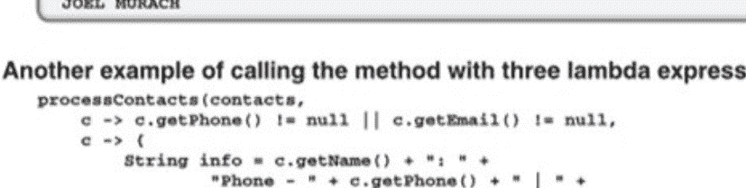

### 另一个三个 lambda 表达式调用方法的示例

```java
processContacts(contacts,
    c -> c.getPhone() != null || c.getEmail() != null,
    c -> {
        String info = c.getName() + " : " +
            "Phone - " + c.getPhone() + " | " +
            "Email - " + c.getEmail();
        return info.replace("null", "N/A");
    },
    str -> System.out.println(str));
```


# 如何使用流（Streams）

流为数据集合执行操作提供了一种高效且灵活的方式。与 lambda 表达式一样，流是在 Java 8 中引入的。流可以相互连接，以便一个流的输出作为另一个流的输入。如果你熟悉 shell 脚本或批处理文件编写，这类似于“管道”（piping）的概念，其中一个命令的输出被“管道”传输到另一个命令的输入。

因此，在本章中，你已经学习了如何编写遍历元素列表的方法，并使用函数式接口来过滤、转换或处理列表。现在，你将学习如何使用流来实时执行相同的操作，而无需编写接受函数式接口的方法。要实现这一点，你可以使用图 22-9 顶部汇总的方法。在这些中，`filter()`、`forEach()` 和 `map()` 方法接受用于本章之前描述的 `Predicate`、`Consumer` 和 `Function` 接口的 lambda 表达式。

## 如何过滤列表

图中的第一个示例使用流来过滤列表并处理过滤列表中的每个元素。为了实现这一点，该示例首先在 `Contact` 对象列表上调用 `stream()` 方法。正如其名所示，该方法返回集合中元素的流。

从该流中，代码调用了 `filter()` 方法并传递了一个用于 `Predicate` 接口的 lambda 表达式。该 lambda 表达式检查电话号码是否为空。结果是，`filter()` 方法返回一个新的流，其中只包含电话号码为空的联系人。

从过滤后的流中，代码调用了 `forEach()` 方法并传递了一个用于 `Consumer` 接口的 lambda 表达式。该 lambda 表达式将列表中的每个联系人打印到控制台。

当你使用 `forEach()` 方法时，你应该知道它不能配合抛出受检异常（checked exception）的 lambda 表达式使用。因此，如果你编写的 lambda 表达式抛出了受检异常，你需要使用 `for` 循环。

第二个示例展示了如何将过滤后的元素收集到一个新列表中。为了实现这一点，代码在过滤后的流上调用了 `collect()` 方法，收集流中的元素并将其存储在列表中。为了获取此 `Collector` 对象，该代码调用了 `Collectors` 类的 `toList()` 方法。在本章中，这是你唯一需要的 `Collector` 类型。然而，`Collectors` 类提供了返回其他类型集合（如 set 和 map）的方法。

在本章中，所有的示例都使用 `stream()` 使用一个 CPU 来处理流。这被称为串行处理。然而，如果你的计算机有多个 CPU，并且你的流对每个元素执行密集的处理，那么代码的性能可能会从使用 `parallelStream()` 方法中受益。该方法使用多个 CPU 处理流，这被称为并行处理。

### 返回 Stream 对象的两个方法

| 方法 | 描述 |
| --- | --- |
| `stream()` | 返回集合的 Stream 对象，允许你使用一个 CPU 处理流。这被称为串行处理。 |
| `parallelStream()` | 返回集合的 Stream 对象，允许你使用多个 CPU 处理流。这被称为并行处理。 |

### Stream 对象的常用方法

| 方法 | 描述 |
| --- | --- |
| `filter(predicate)` | 将指定的 `Predicate` 接口应用于流上。 |
| `forEach(consumer)` | 将指定的 `Consumer` 接口应用于流上。你可以使用此方法代替循环，但不能将其与抛出受检异常的方法一起使用。 |
| `collect(collector)` | 将流的所有元素添加到由 `Collector` 类的静态方法指定的集合中。然后返回该集合。 |
| `map(function)` | 将指定的 `Function` 接口应用于流上。 |
| `reduce(identity, accumulator)` | 使用恒等值（identity）指定返回结果的数据类型和初始值，将 accumulator 参数指定的操作应用于列表中的所有元素，并返回结果。 |

### 使用流过滤列表并处理每个过滤元素的代码

```java
contacts.stream()
  .filter(c -> c.getPhone() == null)
  .forEach(c -> System.out.println(c.getName()));
```

### 输出结果


### 使用流过滤列表并收集过滤元素的代码

```java
List<Contact> contactsNoPhone = contacts.stream()
  .filter(c -> c.getPhone() == null)
  .collect(Collectors.toList());
```

```java
System.out.println("There are " + contactsNoPhone.size() + " contacts with no phone.");
```

### 输出结果

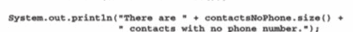

## 描述

- 你可以编写使用多个函数式接口的方法。
- 当你调用接受多个函数式接口的方法时，你需要为每个接口编写一个 lambda 表达式。


## 图 22-9 如何过滤列表

你可能会认为 `parallelStream()` 方法总是能提高多 CPU 节点的性能。然而，并行处理需要拆分流、处理元素并重新合并流等开销。因此，`parallelStream()` 方法只有在处理密集型时才能提高性能。如果流无法高效拆分，或者元素的处理使用了某些功能，情况也是如此。为了更好地理解这一点，有助于理解下一章介绍的线程。

## 如何映射列表

图 22-10 展示了在流上使用 `map()` 方法的两个示例。该方法对流的每个元素执行操作并根据结果返回一个新的流。要指定应用于每个元素的操作，你可以提供用于 `Function` 接口的 lambda 表达式作为该方法的参数。

第一个示例首先在 `Contact` 对象列表上调用 `stream()` 方法。然后，在流上调用 `map()` 方法并传递一个返回联系人名的 lambda 表达式。接下来，新流中的所有字符串被收集到一个名为 `contactNames` 的新列表中。之后，`forEach()` 方法打印该新列表。

除了实现 `Function` 接口外，传递给 `map()` 方法的 lambda 表达式必须满足两个要求。首先，它们必须是非干扰性的（non-interfering），这意味着它们不能更改列表或流的结构。例如，它们不能向流的列表添加元素。其次，它们必须是无状态的（stateless），这意味着它们不能依赖任何状态变量来执行操作。例如，它们不能访问 `map()` 外部定义的计数器变量并更新其状态。

### 用于将 Contact 对象列表转换为名称字符串列表的代码

```java
List<String> contactNames = contacts.stream()
    .map(c -> c.getName())
    .collect(Collectors.toList());
```

```java
contactNames.stream()
    .forEach(str -> System.out.println(str));
```

### 输出结果

| Mike Murach |
| Anne Boehr |
| Joel Murach |

### 使用双冒号运算符的语法

```
ClassName::methodName
```

### 使用方法引用而非 lambda 表达式的代码

```java
List<String> contactNames = contacts.stream()
    .map(Contact::getName)
    .collect(Collectors.toList());
```

```java
contactNames.stream()
    .forEach(System.out::println);
```

## 描述

- 被称为 map 的函数式编程概念会对流中的所有项运行函数，并根据结果创建一个新流。
- `map()` 方法接受用于 `Function` 接口的 lambda 表达式。此 lambda 表达式必须是非干预的，这意味着它不能修改流。此外，它必须是无状态的，这意味着它不能依赖任何变量的状态来执行其操作。
- 双冒号运算符 (::) 提供了一种提供方法引用的方式。该方法在 Java 8 及更高版本可用。
- 当你处理流并提供调用单个方法的 lambda 表达式时，你通常可以使用方法引用代替。然而，只有当 Java 编译器能够推导出方法的参数时，这种方法才有效。


## 如何简化列表

图 22-11 显示了如何使用 `reduce()` 方法汇总流中的数据。通常，该方法在 `filter()` 或 `map()` 对流执行了过滤或映射操作后应用于流。在这种情况下，该操作被称为 map-reduce（映射-还原）操作。此图展示了 map-reduce 操作的两个示例。

第一个示例将所有的 `Contact` 对象还原为一个字符串，该字符串包含列表中所有的联系人，并用逗号分隔。首先，该示例使用 `stream()` 方法从联系人列表中获取元素流。接下来，它调用 `map()` 方法并为联系人名称返回一个字符串。然后，此代码调用 `reduce()` 方法将名称合并成单个字符串。

`reduce()` 方法接受两个参数，称为标识符（identity）和累加器（accumulator）。标识符作为汇总操作的初始值。在这种情况下，代码指定操作从空字符串开始。累加器提供了合并流中元素的操作。在这种情况下，累加器是一个 lambda 表达式，它指定操作应将每个名称加上一个空格，并将其累加到包含名称列表的字符串中。

这种方法之所以奏效，是因为累加器参数实现了函数式接口 `BinaryOperator`。该接口在本章中没有介绍，但它接受两个相同类型的参数，并返回该类型的值。在这种情况下，累加器接受两个名为 `a` 和 `b` 的字符串并返回一个字符串。第一个参数存储到目前为止汇总操作的结果。换句话说，它存储了到目前为止拼接的所有名称的字符串。第二个参数持有流中的当前元素。在这种情况下，它存储了正在被添加到名称字符串中的名称。

lambda 表达式体拼接了两个参数，并在字符串末尾添加一个逗号和一个空格。这个过程一直持续，直到流中的所有项都处理完毕。此时，代码将结果字符串存储在变量 `csv` 中。最后，代码删除了汇总操作添加的最后一个逗号和空格，并显示逗号分隔的名称字符串。

第二个示例的工作原理与第一个相同，但它展示了如何使用 map-reduce 操作找到 `Invoice` 列表中最大的发票总额。为了实现，代码使用 `map()` 方法获取每张发票的总额，为此，`reduce` 方法提供了一个初始 0.0 的 `double` 值。然后，它使用 lambda 表达式提供一个累加器，利用 `Math` 类的 `max()` 方法获取最大的总额。

第三个示例执行与第二个示例相同的任务，但使用了方法引用代替 lambda 表达式。这对于累加器是有效的，因为 Java 编译器能够推导出你想向 `max()` 方法传递 `double` 值并返回一个 `double` 值。由于这段代码简洁且易读，它是说明何时使用双冒号运算符指定方法引用的很好的示例。

### 将 Contact 对象列表还原为单个字符串的代码

```java
String csv = contacts.stream()
  .map(c -> c.getName())
  .reduce("", (a, b) -> a + b + ", ");

csv = csv.substring(0, csv.length() - 2); // 删除最后一个逗号和空格
System.out.println("All contacts: " + csv);
```

### 输出结果

All contacts: Mike Murach, Anne Boehm, Joel Murach

### 从 Invoice 对象列表中获取最大总额的代码

```java
double maxInvoiceTotal = invoices.stream()
  .map(i -> i.getTotal())
  .reduce(0.0, (a, b) -> Math.max(a, b));

System.out.println("Max invoice total: " + maxInvoiceTotal);
```

### 输出结果

Max invoice total: 3425

### 使用方法引用而非 lambda 表达式的代码

```java
double maxInvoiceTotal = invoices.stream()
  .map(Invoice::getTotal)
  .reduce(0.0, Math::max);
```

## 描述

- 被称为 map 的函数式编程概念会对流中的所有项运行函数，并根据结果创建一个新流。
- `reduce()` 方法接受两个参数，称为标识符和累加器。标识符作为汇总操作的初始值。此外，如果流为空，它返回该值。
- 累加器参数实现了函数式接口 `BinaryOperator`。该接口接受两个相同类型的参数，并返回该类型的值。


# 高级技能

## 视角

在本章中，你学习了处理 lambda 表达式的基本技能，这使得代码更加简洁、灵活且易于维护。在这里，你学习了如何使用 Java API 提供的某些函数接口。然而， Java API 还有更多函数接口。要了解更多信息，可以参考 API 文档。

本章还介绍了处理流的基本技能。例如，你学习了如何对流进行过滤、映射和还原。在这里，你学习了有时可以使用双冒号运算符使用方法引用代替 lambda 表达式。

## 总结

- 函数式接口只有一个方法的接口。
- 在 Java 8 及更高版本中，你可以将 lambda 表达式（也称为 lambda）传递给任何接受函数接口作为参数的方法。这允许你将功能视为数据。
- 由于 lambda 表达式的工作方式非常类似于没有名称的方法，你可以将 lambda 表达式视为匿名方法。
- lambda 表达式由参数列表、lambda 运算符 (`->`) 和体组成。
- Java API 提供了许多函数接口，包括 `Predicate`、`Consumer` 和 `Function` 接口。
- 在 Java 8 及更高版本中，你可以使用流来处理集合。
- 为了从集合创建流，你可以调用 `stream()` 方法使用单个 CPU 处理流。这被称为串行处理。或者，你可以使用 `parallelStream()` 方法使用多个 CPU。这被称为并行处理。
- 为了处理流中的每个元素，你可以使用流的方法，如 `filter()`、`forEach()`、`collect()`、`map()` 和 `reduce()` 方法。
- 你可以使用 `filter()` 和 `map()` 方法后接 `reduce()` 方法来汇总数据。这被称为 map-reduce 操作。
- 在 Java 8 及更高版本中，你可以使用双冒号运算符 (`::`) 提供方法的引用。

## 练习 22-2 使用流处理列表

在此练习中，你将使用流来处理上一个练习显示的书籍列表。

1. 在 `ex_starts` 文件夹中打开名为 `ch22_ex2_BookCatalog` 的项目。然后，检查该应用程序的代码并运行它，以确保其正常工作。它应该打印出类似于练习 22-2 中所示的书列表。
2. 在 `BookManagerApp` 类中，将对 `printList()` 方法的调用替换为以下代码：通过为每个列表创建一个流并使用 `forEach()` 方法将每本书打印到控制台。为了实现这一点，请为 `printList()` 方法使用方法引用。
3. 删除 `printList()` 方法以确保它不再被使用。
4. 再次运行应用程序以确保其正常工作。
5. 在 `main()` 方法的开头，添加一条语句来获取 `Book` 列表，如下：

```java
List<Book> bookList = new BookCatalog().getCatalog();
```


- 6. 在 `BookManagerApp` 类中，修改所有语句，以便它们使用流来过滤列表并打印到控制台，而不是使用 `BookManager` 类的方法。
- 7. 删除 `BookManager` 类以确保它不再被使用。
- 8. 再次运行应用程序以确保其正常工作。
- 9. 添加代码对书籍列表进行流处理，过滤该流使其只包含 `DATABASE` 类别的书籍，并映射该流使其只打印每本书的标题和格式，如下所示：

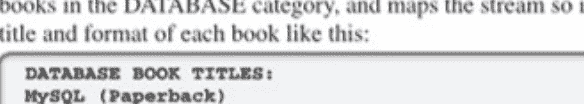

- 10. 再次运行应用程序以确保其正常工作。它应该将数据库书籍标题添加到练习 22-1 所示的书籍列表中。

# 如何处理线程

当你运行一个 Java 应用程序时，应用程序会在一个或多个线程中运行。到目前为止，书中所有的控制台应用程序都运行在单个线程。然而，所有的 GUI 应用程序都运行在两个线程中：一个用于运行 `main()` 方法，另一个线程用于显示 GUI 并监听其事件。在本章中，你将学习如何开发使用多个线程执行单独任务的应用程序。例如，你可以使用一个线程从数据库检索数据，而另一个线程进行复杂的计算。这样，应用程序可以在两个任务之间交替运行，从而运行得更高效。

- 线程简介 ............................................................ 726
- 线程如何工作 ........................................................................ 726
- 线程的典型用途 ................................................................ 726
- 用于处理线程的类和接口 ........................ 728
- 线程的生命周期 ................................................................ 730
- 创建线程的两种方法 ............................................................ 732
- `Thread` 类的构造函数和方法 ........................ 732
- 如何扩展 `Thread` 类 ............................................................ 734
- 如何实现 `Runnable` 接口 ................................... 736
- 如何同步线程 ................................................ 738
- 如何使用 `synchronized` 方法 ........................................ 738
- 何时使用 `synchronized` 方法 ....................................... 738
- 观点 ................................................................................ 740

# 线程简介

在学习如何开发使用两个或多个线程的应用程序之前，你需要了解线程如何工作以及你通常何时会使用它们。你还需要熟悉在处理线程时用到的类和接口，并且需要理解线程的生命周期。这些是你将在接下来的主题中学习的内容。

# 线程如何工作

如图 23-1 所示，线程是贯穿应用程序的单一执行流。默认情况下，Java 应用程序使用单个线程，称为主线程。该线程从应用程序 `main()` 方法的第一条语句开始执行，并按顺序执行语句，直到 `main()` 方法退出。应用程序可能会创建额外的对象并调用额外的方法，但控制流始终是顺序执行的，一次执行一条语句。

在某些情况下，单线程执行可能是低效的。例如，想象一个执行两个独立任务的应用程序。为了完成第一个任务，应用程序必须从文件中读取数据，而该任务花费了大部分时间等待 I/O 操作完成。结果是第二个任务必须等待，尽管它不需要任何 I/O 操作。

图中的第一张图显示了该应用程序在作为单线程执行时可能是如何工作的。应用程序执行第一个任务。在这种情况下，当它等待此线程所需的 I/O 操作时，CPU（中央处理器）是空闲的。当第一个任务完成后，应用程序运行第二个任务。

第二张图显示了该应用程序如何通过分成两个线程（每个线程执行一个任务）来获益。在这里，使用两个线程允许任务重叠，因此当第一个任务等待 I/O 操作时，第二个任务正在执行。结果是两个任务完成的时间比它们作为单线程执行时要早。

执行多个互不依赖的任务的应用程序从多线程中获益最多。例如，如果图中所示的第二个任务不依赖于第一个任务的结果，那么它可以与第一个任务重叠。如果第二个任务依赖于第一个任务的结果，仍然可能存在某些重叠，但两个任务必须相互通信。

# 线程的典型用途

除了展示线程如何工作外，图 23-1 列出了线程的三个常见用途。第一个是提高 I/O 操作的性能。任何大量的 I/O 的应用程序都可以从多线程中受益。这是因为 I/O 操作比 CPU 操作慢数千倍。因此，任何从磁盘读取数据的应用程序几乎所有时间都在等待信息的获取。

## 使用线程如何提高性能

| 单线程 |
| thread 1 | task 1 | (wait for I/O) | task 1 | (wait for I/O) | task 2 |
| time -> | | | | | |

| 单线程 |
| thread 1 | task 1 | (wait for I/O) | task 1 | (wait for I/O) | task 2 |
| time -> | | | | | |

| 双线程 |
| thread 1 | task 1 | (wait for I/O) | task 1 | (wait for I/O) | |
| thread 2 | (idle) | task 2 | (idle) | task 2 |

# 线程的典型用途

- 提高具有大量 I/O 操作的应用程序的性能
- 提高 GUI 应用程序的响应速度
- 允许两个或多个用户同时运行服务器端应用程序

## 描述

- 线程是应用程序内部单一顺序控制流。线程通常完成一个特定的任务。
- 默认情况下，Java 应用程序使用单个线程，称为主线程。然而，某些应用程序可以通过使用两个或多个线程来受益，允许应用程序的不同部分同时执行。
- 在只有一个 CPU（`中央处理器`）核心的计算机上，线程实际上并没有同时执行。相反，操作系统中称为线程调度程序的部分会交替让每个线程执行。由于这种情况发生非常快，它给人所有任务都在同时运行的假象。结果是这可以让应用程序运行得更高效。
- 大多数现代 CPU 具有多个核心，即使只有一个 CPU 也可以同时运行多个线程。

图 23-1 线程如何工作

# 用于处理线程的类和接口

为了让你对此有一个直观的认识，你应该意识到 CPU 等待 I/O 完成的实际时间远大于图 23-1 所示的时间。事实上，由于显示任务 1 执行的每个数据块大约有半英寸长，那么显示 CPU 等待 I/O 的数据块可能需要整个足球场那么长才能准确显示等待时间。这大约磁盘操作比 CPU 操作慢得多的程度。

使用线程的第二个原因是提高使用图形用户界面（GUI）的应用程序的响应能力。例如，当用户点击按钮时，他或她期望应用程序立即响应，即使应用程序正在忙于其他事情。GUI 应用程序运行在一个线程中，该线程处理用户与 GUI 交互时发生的事件。然后，它更新 GUI。但是，如果应用程序需要执行耗时很长的任务，该任务应该在第二个线程中执行。

使用多线程的最后一个原因是允许两个或多个用户同时运行基于服务器的应用程序。例如，Java servlets 会为每个用户自动创建一个线程。因此，当你编写 servlet 代码时，必须确保代码是线程安全的。（要学习更多关于 Java Web 编程，可以阅读《Murach's Java Servlets and JSP》）

图 23-2 展示了你可以用于创建和处理线程的类和接口，并总结了它们提供的关键方法。如你所示，`Thread` 类实现了 `Runnable` 接口。因为 `Runnable` 声明了一个单一方法 `run()`，所以 `Thread` 类必须实现此方法。`Thread` 类还提供了两个处理线程的关键方法：`start()` 和 `sleep()`。你很快就会学到更多这些方法的知识。

除了这里显示的方法外，你应该知道像其他类一样，`Thread` 继承了 `Object` 类。这意味着它可以访问所有的公共（public）和保护（protected）方法。特别是，它可以访问用于协调可能重叠的任务的方法。由于这些方法的使用超出了本书的范围，因此它们没有在本章中介绍。

要创建一个线程，你可以使用两种技术之一。首先，你可以定义一个继承 `Thread` 类的类。该类应该重写 `run()` 方法，以便包含由线程执行的代码。然后，你可以实例化该类来创建一个线程。

其次，你定义一个实现 `Runnable` 接口的类。为了做到这一点，该类必须实现 `run()` 方法。然后，你将该类的实例传递给 `Thread` 类的构造函数。这创建了一个通过调用其 `run()` 方法来执行 `Runnable` 对象的线程。

如果这两种技术现在看起来让你很困惑，不要担心。当你看到本章后面的示例时，它们会变得更加清晰。现在，你只需要知道 `Thread` 类定义了一个线程，但由线程执行的代码由任何实现 `Runnable` 接口的类提供。

# 用于创建线程的接口和类

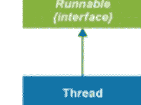

# 这些类和接口的总结

| 类/接口 | 描述 |
| --- | --- |
| Thread | 定义线程的类。该类实现了 `Runnable` 接口。 |
| Runnable | 任何对象将被线程执行的类都必须实现的接口。该接口中唯一的方法是 `run()` 方法。 |

# Thread 类和 Runnable 接口的关键方法

| 方法 | 类/接口 | 描述 |
| --- | --- | --- |
| start() | Thread | 将此线程注册到其可执行的线程调度器中。 |
| run() | Runnable, Thread | 由 `Runnable` 接口声明并由 `Thread` 类实现的抽象方法。线程调度器调用此方法来运行线程。 |
| sleep(long) | Thread | 使当前线程等待（睡眠）指定的毫秒数，以便 CPU 运行其他线程。 |

# 创建 Thread 类的两种方式

- 继承 `Thread` 类。
- 实现 `Runnable` 接口。然后，将 `Runnable` 对象的引用传递给 `Thread` 类的构造函数。

## 描述

- 在创建 `Thread` 对象后，你可以调用它的 `start()` 方法，以便线程调度器运行该线程。一旦它开始运行，你可以使用 `sleep()` 方法让线程等待，同时其他线程运行。
- 实现 `Runnable` 接口的优点是它允许线程继承 `Thread` 类以外的类。

图 23-2 用于处理线程的类和接口

# 线程的生命周期

图 23-3 显示了线程的生命周期，并解释了线程可能处于五种状态中的每一种。要创建一个线程，程序员编写代码来定义线程的类和 `Thread` 对象。当 `Thread` 对象首次被实例化时，它被置于 `New` 状态，这意味着线程已经创建但尚未准备好运行。

当应用程序准备好运行线程时，它会调用线程的 `start()` 方法。你可能认为这会导致线程开始执行，但它实际上只是将线程的状态从 `New` 变为 `Runnable`。一旦进入 `Runnable` 状态，线程就会加入任何其他处于 `Runnable` 状态的线程列表。然后，一个被称为线程调度器的操作系统组件会选择一个 `Runnable` 线程来执行。

注意，正在运行的线程没有独立的状态。在 `Runnable` 状态下运行的线程以及处于 `Runnable` 状态的其他线程是同等的，线程调度器选择其中一个 `Runnable` 线程来执行。

线程进入 `Blocked` 状态，是因为某些原因导致它暂时无法运行。例如，当线程进入 `Blocked` 状态，是因为它在等待 I/O 操作完成。当 I/O 操作完成时，线程返回 `Runnable` 状态。I/O 操作完成后，线程返回 `Runnable` 状态。处于 `Blocked` 状态的线程无法被线程调度器选择执行。

`Waiting` 状态出现在线程需要协调活动时。例如，当线程进入 `Waiting` 状态，是因为它在等待另一个线程完成。当它等待的线程完成任务时，它可以通知等待线程停止等待并重新进入 `Runnable` 状态。由于线程间协调的复杂性，你不会在本章学习如何协调线程。

最后，当线程的 `run()` 方法结束时，线程进入 `Terminated` 状态。一旦线程进入 `Terminated` 状态，它将一直保持在那里直到应用程序结束。

# 线程的生命周期

- 调用 `Thread` 构造函数创建 `Thread` 类实例。
- 线程由于各种原因被阻塞，直到它返回 `Runnable` 状态。
- 调用 `start()` 方法将线程标记为可运行。
- 当处理器可用时，操作系统线程调度器运行该线程。
- 线程在 `run()` 方法结束。
- 线程进入 `Waiting` 状态，直到另一个线程将其放入 `Runnable`。

# 线程状态

| 状态 | 描述 |
| --- | --- |
| New | 线程已创建（已调用构造函数），但尚未启动。 |
| Runnable | 线程的 `start()` 方法已调用，线程可由线程调度器运行。处于 `Runnable` 状态的线程可能正在运行，也可能线程队列中等待执行机会。 |
| Blocked | 线程已从 `Runnable` 状态移除，因此无法执行。这发生在线程的 `sleep()` 方法被调用、线程正在等待 I/O，或者线程尝试锁定已被锁定的对象。当条件改变时（例如，I/O 操作完成），线程返回 `Runnable` 状态。 |
| Waiting | 线程正在等待并允许其他线程访问对象。在另一个线程通知它停止等待并重新进入 `Runnable` 状态之前，它一直处于等待状态。 |
| Terminated | 线程的 `run()` 方法已结束。 |

## 创建线程的两种方式

在接下来的主题中，你将学习创建线程的两种方法。首先，你将更多地了解 `Thread` 类，无论你如何创建线程，都必须使用它。

## Thread 类的构造函数和方法

图 23-4 中的第一个表总结了你可以用于创建 `Thread` 对象的一些构造函数。第一个构造函数从继承 `Thread` 类的类创建线程。第二个构造函数从实现 `Runnable` 接口的任何对象创建线程。

第三和第四个构造函数允许你指定所创建线程的名称。默认情况下，线程按数字命名的（Thread-0、Thread-1 等）。由于你通常不会通过名称来引用线程，因此默认值通常是可以接受的。

该图的第二个表展示了 `Thread` 类的一些方法。你可以使用这些方法获取有关线程的信息，并控制线程的何时运行。

## 第 23 章 如何处理线程 733

### Thread 类
java.lang.Thread 类

### Thread 类的常用构造函数

| 构造函数 | 描述 |
| --- | --- |
| Thread() | 创建默认的 Thread 对象。 |
| Thread(Runnable) | 从实现 Runnable 接口的任何对象创建 Thread 对象。 |
| Thread(String) | 创建具有指定名称的 Thread 对象。 |
| Thread(Runnable, String) | 从实现 Runnable 接口的任何对象创建一个具有指定名称的 Thread 对象。 |

### Thread 类的常用方法

| 方法 | 描述 |
| --- | --- |
| run() | 实现 Runnable 接口的 `run()` 方法。在所有子类中都应该重写此方法，以提供线程执行的代码。 |
| start() | 将线程置于运行（Runnable）状态，使其可以被线程调度器运行。 |
| getName() | 返回线程的名称。 |
| currentThread() | 静态方法，返回当前执行的线程的引用。 |
| sleep(long) | 静态方法，将当前执行的线程置于阻塞（Blocked）状态指定的毫秒数，以便其他线程运行。 |
| isInterrupted() | 如果线程被中断，则返回 true 值。 |

## 描述

- 默认情况下，你创建的线程按数字命名的（Thread-0、Thread-1 等）。如果这不是你想要的，你可以使用线程的构造函数来指定一个名称。
- `sleep()` 方法会抛出 `InterruptedException`。因为这是一个检查异常，当你使用 `sleep()` 方法时，必须抛出或捕获此异常。


## 如何扩展 Thread 类

图 23-5 显示了如何通过扩展 `Thread` 类来创建线程。在这里，`IOThread` 类定义了一个模拟 I/O 操作的线程，而 `ThreadApp` 包含了 `main()` 方法，程序应用程序的地方。

`IOThread` 通过继承 `Thread` 类开始。然后，它重写了 `run()` 方法以提供线程运行时执行的代码。在该方法内部，第一条语句打印线程的名称。然后，`run()` 方法使用静态的 `sleep()` 方法将线程置于阻塞状态 2000 毫秒（2秒）。2秒后，线程返回到运行状态，以便调度器可以恢复其执行。

由于 `sleep()` 方法可能会抛出 `InterruptedException`，此异常表示在当前线程睡眠时，其他某个线程正尝试中断该线程。在应用程序中如何处理此异常呢？在这种情况下，应用程序简单地通过捕获异常来忽略任何中断线程的尝试，但没有为它提供任何代码。通常情况下，“吞掉”这样的异常不是良好的编程习惯。但在这种情况下，它是合适的。

如果你使用 `sleep()` 方法，你还应该意识到它并不保证线程会在你指定的时间后开始运行。相反，它保证线程将返回到运行状态。线程何时恢复执行取决于线程调度器的决定。因此，对于需要精确计时控制的应用程序，你不应该使用 `sleep()` 方法。

`ThreadApp` 包含了应用程序的 `main()` 方法。在该方法内部，第一条语句调用了 `Thread` 类的 `currentThread()` 方法，并将返回的 `Thread` 对象赋值给名为 `n1` 的变量。然后，第二条语句使用 `println()` 方法显示线程已启动的消息。为了在这条消息中包含线程名称，此代码使用了 `getName()` 方法来获取当前线程的名称。

第三条语句创建了 `IOThread` 对象并将其赋值给名为 `n2` 的 `Thread` 变量。然后，第四条语句通过调用其 `start()` 方法启动线程。这把线程置于运行状态，以便调度器运行它。第五条语句打印一条消息表示主线程已启动第二个线程。而第六条语句打印一条消息表示主线程已完成。

此图底部输出的前三行是由 `main()` 方法打印的，它运行在名为 "main" 的线程中。然后，接下来两行是由从 `IOThread` 类创建的名为 "Thread-0" 的线程打印的。第一行在 `run()` 方法开始时打印，表示线程已启动，第二行在 `run()` 方法结束时打印，表示线程已完成。

## 第 23 章 如何处理线程 735

### 从 Thread 类创建线程的步骤

1. 创建继承 `Thread` 类的类。
2. 重写 `run()` 方法以执行所需的任务。
3. 通过实例化 `Thread` 类来创建线程。
4. 调用 `Thread` 的 `start()` 方法。

### 定义线程的名为 Thread 类

```java
```


# 继承 Thread 类创建线程

```java
public class IOThread extends Thread {

    @Override
    public void run() {
        System.out.println(this.getName() + " started.");
        try {
            Thread.sleep(2000); // 睡眠2秒以模拟耗时任务
        } catch (InterruptedException e) {
            System.out.println(this.getName() + " finished.");
        }
    }
}
```

## 启动线程的 ThreadApp 类

```java
public class ThreadApp {
    public static void main(String[] args) {
        Thread t1 = Thread.currentThread();
        System.out.println(t1.getName() + " started.");
        Thread t2 = new IOThread(); // 创建IO线程
        t2.start(); // 启动IO线程
        System.out.println(t1.getName() + " starts " + t2.getName() + ".");
        System.out.println(t1.getName() + " finished.");
    }
}
```

## 示例输出

```
main started.
main starts Thread-0.
main finished.
Thread-0 started.
Thread-0 finished.
```


# 如何实现 Runnable 接口

图23-6 显示了如何通过实现 `Runnable` 接口来创建线程。虽然这种创建线程的技术需要更多的代码，但也更灵活，因为它允许你定义继承自 `Thread` 类以外类的线程。

如果你将此代码与之前的图进行比较，你会发现 `IOTask` 类与 `IOThread` 类有两个基本区别。首先，`IOTask` 类实现了 `Runnable` 接口而不是扩展 `Thread` 类。其次，`IOTask` 类 `run()` 方法的第一条语句调用了 `Thread` 类的静态方法 `currentThread()` 来获取当前执行线程的引用。这样就可以使用 `getName()` 方法获取该线程的名称。

## 使用 Runnable 接口创建线程的步骤

1. 创建一个实现 `Runnable` 接口的类。
2. 实现 `run()` 方法以执行所需的任务。
3. 通过将 `Runnable` 类实例传递给 `Thread` 构造函数来创建线程。
4. 调用 `Thread` 对象的 `start()` 方法。

## 实现 Runnable 接口的 IOTask 类

```java
public class IOTask implements Runnable {
    @Override
    public void run() {
        Thread ct = Thread.currentThread();
        System.out.println(ct.getName() + " started.");
        try {
            Thread.sleep(2000); // 休眠 2 秒以模拟一个耗时较 IO 任务
        } catch (InterruptedException e) {
            System.out.println(ct.getName() + " finished.");
        }
    }
}
```

## 使用 Runnable 接口启动线程的 ThreadApp 类

```java
public class ThreadApp {
    public static void main(String[] args) {
        Thread t1 = Thread.currentThread();
        System.out.println(t1.getName() + " started.");
        Thread t2 = new Thread(new IOTask()); // 创建新线程
        t2.start(); // 启动新线程
        System.out.println(t1.getName() + " starts " + t2.getName() + ".");
        System.out.println(t1.getName() + " finished.");
    }
}
```

## 示例输出

```
main started.
main starts Thread-0.
main finished.
Thread-0 started.
Thread-0 finished.
```


# 如何同步线程

到为止，本章中的线程都是独立执行的。这种类型的线程被称为异步线程。现在，你将学习如何处理访问类或对象中相同字段且必须同步的线程。这种类型的线程被称为同步线程。

每当你创建一个使用多个线程的应用程序时，你都需要考虑应用程序可能面临的任何并发问题。并发问题源于两个或多个线程尝试同时访问同一个类或对象时可能发生的冲突。在这种情况下，可能会出现如最后更新之类的并发问题。你可以设计可能被多个线程使用的类，以确保它们是安全的。

## 如何使用同步方法

创建线程安全类的一种常用方法是向任何非线程安全的方法添加 `synchronized` 关键字，如图 23-7 所示。在这里，`InvoiceQueue` 类定义了一个对象，允许线程从发票列表中添加或删除发票。

在此类中，`add()` 方法和 `remove()` 方法的声明包含了 `synchronized` 关键字。因此，当一个线程调用这些方法之一时，Java 虚拟机会锁定该对象，直到该方法执行完毕。一旦对象被锁定，在同步方法结束并释放锁之前，其他线程都无法获取其锁。

注意，被锁定的是对象，而不是同步方法。因此，当一个线程调用同步方法时，其他线程被阻止运行该对象的任何同步方法，而不仅仅是第一个线程调用的那一个方法。然而，其他线程并不会阻止运行非同步方法。这是因为在调用非同步方法时，不会检查对象的锁。

## 何时使用同步方法

通常情况下，如果应用程序使用了多个可能访问同一个类或对象的线程，那么任何访问该类或对象字段的方法都应该是同步的。这防止了两个线程同时访问相同的字段。在图 23-7 中，`add()` 和 `remove()` 方法都与名为 `invoiceQueue` 的字段操作，该字段存储了发票列表。因此，这两个方法都应该是同步的。然而，`print()` 方法没有访问任何字段，因此不需要同步。

虽然此示例中的两个同步方法都修改了 `invoiceQueue` 字段，但你应该意识到，访问但不修改字段的方法也需要同步。

## 创建同步方法的语法

```java
public synchronized returnType methodName(parameterList) {
    statements
}
```

## 包含同步方法的类

```java
public class InvoiceQueue {
    private ArrayList<Invoice> invoiceQueue = new ArrayList<>();

    public synchronized void add(Invoice invoice) {
        invoiceQueue.add(invoice);
    }

    public synchronized Invoice remove() {
        if (invoiceQueue.size() > 1) {
            return invoiceQueue.remove(0);
        } else {
            return null;
        }
    }

    public void print() {
        System.out.println("This method doesn't need to be synchronized.");
    }
}
```

## 描述

- 异步线程独立执行。同步线程在同时访问类或对象中的相同字段时需要进行协调。
- 并发是指多个线程同时使用类或对象的状态。当这种情况发生时，可能会出现丢失更新等并发问题。
- 当你编写多个线程使用的类时，你需要确保它是线程安全的。这意味着多个线程可以使用而不会产生并发问题。
- `synchronized` 关键字会锁定类或对象，确保只有一个线程执行。
- 即使对象被锁定，线程也可以运行非同步方法。
- 当线程可能访问相同字段时，同步是一种最佳实践。


# 展望

在本章中你学习了处理线程的基本技能。线程是一个复杂的课题，因此本章只能提供简单的介绍。坦率地说，线程是本书中最挑战性的主题之一。所以，如果你不理解它的每一个细节，也不要担心。随着你学习更多类型的 Java 编程，你将学习更多关于处理线程的知识。例如，如果你学习更多 GUI 编程、Web 编程或 Android 编程，你将了解到线程。

## 总结

- 线程是应用程序中的单个控制流，通常完成特定任务。
- 多线程应用程序由两个或多个执行的线程组成。
- 单核处理器一次只能执行一个线程，由线程调度器决定执行哪个线程。
- 大多数现代处理器具有多个核心，可以同时运行。在这种情况下，线程调度器决定运行哪些线程以及在哪个核心上运行它们。
- 多线程通常用于提高 I/O 操作应用程序的性能、提高 GUI 操作的响应，并允许多个用户运行服务器应用程序。
- 你可以通过扩展 `Thread` 类并实例化新类来创建线程。或者，你可以实现 `Runnable` 接口，并将 `Runnable` 对象的引用传递给 `Thread` 构造函数。
- 你可以使用 `Thread` 类的方法来启动线程并控制线程的运行。
- 异步线程独立执行。
- 你可以使用同步方法来确保两个线程不会同时运行类或对象的任何同步方法。当一个线程调用同步方法时，包含该方法的类或对象会被锁定，以便其他线程无法访问任何同步方法。

## 练习 23-1 扩展 Thread 类

在此练习中，你将创建一个扩展 `Thread` 类的应用程序，其中一个线程打印 1 到 10 的奇数，另一个线程打印 1 到 10 的偶数。该应用程序的输出应该如下：

```
main started.
Thread-0 started.
Thread-1 started.
main finished.
1
2
3
4
5
6
Thread-0 finished.
6
8
10
Thread-1 finished.
```

1. 在 `ex_starts` 文件夹中打开名为 `ch23_ex1_Counter` 的项目。查看 `Main` 类的代码，并注意它会向控制台打印消息，指示主线程启动和结束。
2. 添加一个名为 `CounterThread` 的类，并继承自 `Thread` 类。
3. 添加一个起始值的实例变量以及一个用于设置该起始值的构造函数：

```java
private final int startingValue;

public CounterThread(int startingValue) {
    this.startingValue = startingValue;
}
```


- 4. 在 `CounterThread` 类中添加一个 `run()` 方法，将从起始值到 10 的每隔数字打印到控制台，并在完成后显示适当的消息。
- 5. 在 `CounterApp` 类中，添加代码创建并启动两个 `CounterThread` 类的实例。第一个应该使用 `ODD` 常量指定起始值，第二个应该使用 `EVEN` 常量指定起始值。
- 6. 运行应用程序两次或多次，确保其工作正常。每次运行应用程序时的输出可能会有所不同。
- 7. 根据你的系统速度，可能会一个线程在线程调度程序切换线程之前就已经运行结束。在这种情况下，看起来两个线程是顺序运行的，而不是并行运行。
- 8. 在 `CounterThread` 类的 `run()` 方法中添加语句，调用 `Thread.sleep()` 方法让线程在每个数字之间睡眠一秒。看看运行应用程序时这是否会改变输出顺序。
- 9. 运行应用程序两次或多次，确保其工作正常。每次运行应用程序时的输出可能会有所不同。

## 练习 23-2 实现 Runnable 接口

在此练习中，你将创建一个与练习 23-1 中创建的类似的应用程序。但是，在这个练习中，你实现 `Runnable` 接口而不是扩展 `Thread` 类。

- 1. 在 `ex_starts` 文件夹中打开名为 `ch23_ex2_Counter` 的项目。查看 `CounterApp` 类的代码，并注意它会向控制台打印消息，指示主线程启动和结束。
- 2. 向项目中添加一个名为 `CounterThread` 的类，实现 `Runnable` 接口。
- 3. 遵循上一个练习的步骤 3 到 9。

## 附录 A

### 如何为本书设置 Windows

本附录展示了如何在 Windows 系统上安装我们推荐用于开发 Java 应用程序的软件。这些软件包括 Java 开发包（JDK）以及 NetBeans IDE 或 Eclipse IDE。然后，本附录展示了如何安装本书的源代码，这些代码已格式适用于 NetBeans 或 Eclipse。

在阅读本附录时，请记住大多数网站都在不断更新。因此，本附录中的某些步骤可能自本书出版以来已经发生了变化。尽管如此，这些步骤仍然是安装软件的良好指南。如果这些设置说明有重大变化，我们将在网站（www.murach.com）上发布更新。

- 如何安装 JDK 和 NetBeans..................................................744
- 如何安装本书的源代码...............................................................746
- 如何安装 Eclipse...............................................................................748
- 如何安装 SQLite Manager...............................................................750

### 如何安装 JDK 和 NetBeans

图 A-1 显示了如何安装 Java 开发包（JDK）和 NetBeans IDE。为了方便起见，你可以将它们作为一个包安装。开始时，点击 Java 网站上带有 JDK 的 NetBeans 下载按钮，下载用于安装程序的 `exe` 文件。然后，导航到包含安装文件的文件夹，运行该文件，并对生成的对话框做出响应。

由于 Java 网站在本书印刷后可能会发生变化，我们对图中所示步骤保持了某种通用。因此，你可能需要进行一些搜索以找到 NetBeans 和 JDK 的当前版本。开始时，可以在互联网上搜索 Java SE 的下载。然后，你可以找到适用于你系统的最新版本的 JDK 和 NetBeans。

顺便说一下，书中的所有示例都经过了 JDK 1.9 早期访问发布版本的测试。由于 Java 是向后兼容的，这些示例在未来的 JDK 版本中将继续良好地工作。此外，书中的大多数示例没有使用 JDK 1.9 的新功能。因此，它们与 JDK 1.8 同样工作良好。当然，演示 JDK 1.9 新功能的示例无法在 Java 1.8 上运行，因此一旦 JDK 1.9 正式发布，你就应该使用它。

## 附录 A 如何为本书设置 Windows

### Java SE 下载页面

http://www.oracle.com/technet/java/javase/downloads

### 如何安装 JDK 和 NetBeans IDE

- 1. 转到 Java SE 下载页面。如有必要，你可以在互联网上搜索此页面。
- 2. 点击带有 JDK 的 NetBeans 下载按钮，并按照你操作系统的说明进行。
- 3. 将安装程序保存到硬盘上。对于 Windows，此程序是一个 `exe` 文件。
- 4. 运行安装程序并对生成的对话框做出响应。当提示 JDK 文件夹时，请使用默认文件夹。对于大多数 Windows 系统，JDK 应该存储在 `C:\Program Files\Java` 文件夹中。

### 如何启动 NetBeans IDE

- 在 Windows 7 或 Windows 10 中，进入开始菜单中的 NetBeans IDE 并运行程序。如有必要，你可以在开始菜单中搜索该程序。
- 在 Windows 8 中，在应用程序列表中进入 NetBeans IDE 并运行程序。

## 注意事项

- Java SE 9 预计于 2017 年 7 月发布。在发布之前，你可以配合本书使用 Java SE 8。
- 关于安装 JDK 的更多信息，你可以参考该网站。
- 关于安装 NetBeans 的更多信息，你可以参考该网站。

图 A-1 如何安装 JDK 和 NetBeans

### 如何安装本书的源代码

图 A-2 显示了如何下载和安装本书的源代码。这包括应用程序、起始点和解决方案的源代码。完成此步骤后，它们应该位于图中所示的文件夹中。

图 A-2 如何安装本书的源代码

## 如何安装 Eclipse

如果你想在本书中使用 NetBeans 作为你的 IDE，那么你不需要安装 Eclipse IDE。但是，如果你打算使用 Eclipse 或者你想同时尝试这两个 IDE，可以使用图 A-3 所示的步骤来安装 Eclipse。该图还展示了如何启动 Eclipse 以及选择存储你项目的工作空间目录。

如果你打算使用 Eclipse，你可能还想阅读本书配套的 Eclipse PDF。该 PDF 将向你展示了如何使用 Eclipse 代替 NetBeans 来完成书中显示的所有 NetBeans 步骤。你可以在前一个图所示的 eclipse 文件夹中找到此 PDF。

## Eclipse 下载的 URL
http://www.eclipse.org/downloads

## 如何安装 Eclipse IDE

- 1. 转到 Eclipse 的下载页面。如有必要，你可以在互联网上搜索此页面。
- 2. 找到当前版本 Eclipse（本书时版本为 Eclipse Neon.2）的安装程序下载项，并下载适用于你操作系统的版本。对于 Windows，该程序是一个 `.exe` 文件。
- 3. 运行安装程序并对对话框进行响应。当列出一个可以安装的包列表时，选择“Eclipse IDE for Java Developers”。当被要求选择安装文件夹时，接受默认值。

## 如何启动 Eclipse

- 在 Windows 7 和 Windows 10 中，进入开始菜单中的 Eclipse Java 并运行该程序。如有必要，你可以在开始菜单中搜索该程序。
- 在 Windows 8 中，在应用列表中进入 Eclipse Java 并运行该程序。

## 选择工作空间目录的对话框

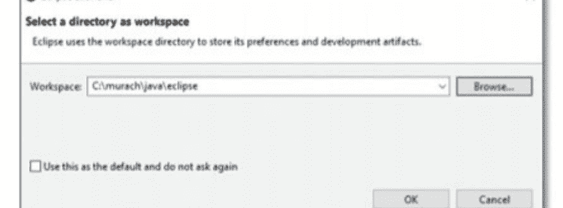

## 如何选择工作空间目录

- 当你启动 Eclipse 时，通常需要从上述对话框中选择你想要的工作空间。
- 当 Eclipse 运行时，你可以通过选择 `File->Switch Workspace` 命令切换到不同的工作空间。这将重启 Eclipse 并选择新的工作空间。
- 一旦你选择了一个工作空间，它就会出现在 Workspace 菜单中。这使得在工作空间之间切换变得简单。

## 注意事项

- 如果你想使用 NetBeans 作为你的 IDE，你就不需要安装 Eclipse。
- 如果你想在本书中使用 Eclipse，请务必阅读配套的 Eclipse PDF，它展示了如何在整本书中使用 Eclipse 代替 NetBeans。你可以在前一个图所示的 eclipse 文件夹中找到此 PDF。

图 A-3 如何安装 Eclipse

## 如何安装 SQLite Manager

图 A-4 展示了如何安装处理本书第 5 节数据库章节时所需的软件。虽然 SQLite 有多种管理工具可用，但我们建议在本书中使用 SQLite Manager，它是 Firefox 浏览器的一个插件。如果你的系统中还没有 Firefox，请从安装 Firefox 开始。然后，你再为 Firefox 安装 SQLite Manager 插件。

## 附录 A 为本书设置 Windows 环境 751

## Firefox 的下载页面

www.mozilla.org/download

## 如何安装 Firefox

- 1. 找到 Firefox 的下载页面。最简单的方法是在互联网上搜索“Firefox download”。
- 2. 按照该网页上的说明下载安装程序文件。
- 3. 在你的系统中找到安装程序文件并运行它。
- 4. 接受默认选项。

## 如何安装 SQLite Manager 插件

- 1. 启动 Firefox。
- 2. 按 `Ctrl+Shift+A` 打开 Firefox 扩展页面。或者，从 Firefox 菜单栏选择 Tools（工具）→Add-ons（扩展）。（如果没有显示菜单栏，你可以通过右键点击 Firefox 工具栏区域并从弹出菜单中选择 Menu Bar 来显示。）
- 3. 在搜索框中搜索“SQLite Manager”。
- 4. 点击 SQLite Manager 的 Install（安装）按钮。
- 5. 点击“Restart Now”（立即重启）链接重启 Firefox。

## 如何将 SQLite Manager 图标添加到工具栏

- 1. 在 Firefox 工具栏区域右键点击，从弹出菜单中选择 Customize（自定义）。
- 2. 将 Additional Tools and Features（其他工具和功能）面板中的 SQLite Manager 图标拖入工具栏并释放。

## 启动 SQLite Manager 的两种方法

- 点击 Firefox 工具栏中的 SQLite Manager 图标。
- 按 `Alt+T` 进入 Tools（工具）菜单并选择 SQLite Manager 命令。

## 注意

- SQLite 用于本书第 20 和第 21 节的数据库。如果你不使用这些章节的任何程序、练习和答案，你就不需要安装 SQLite Manager。

图 A-4 如何安装 SQLite Manager

## 附录 B

## 为本书设置 Mac OS X 环境

本附录展示了如何在 Mac OS X 系统上为开发 Java 应用安装我们推荐的软件。这些软件包括 Java Development Kit (JDK) 以及 NetBeans IDE 或 Eclipse IDE。本附录还展示了如何安装本书的源代码，这些代码经过格式化，可在 NetBeans 或 Eclipse 中运行。

在你阅读本附录时，请记住大多数网站都在不断更新。因此，本附录中的某些步骤可能自本书出版以来已经发生了变化。尽管如此，这些步骤仍然是安装软件的良好指南。如果这些设置说明有重大变化，我们将在网站（www.murach.com）上发布更新。

- 如何安装 JDK 和 NetBeans...............................................................754
- 如何安装本书的源代码......................................................756
- 如何安装 Eclipse...............................................................................758
- 如何安装 SQLite Manager..............................................................760

## 如何安装 JDK 和 NetBeans

图 B-1 展示了如何安装 Java Development Kit (JDK) 和 NetBeans。为了方便起见，你可以将它们作为一个包安装。从 Java 网站点击 NetBeans with JDK 按钮下载 dmg 文件。

由于 Java 网站在本书出版后可能会发生变化，我们保持图中所示的步骤较为通用。因此，你可能需要进行一些搜索来找到最新的 NetBeans 和 JDK 版本。要开始，你可以在互联网上搜索 Java SE 下载。然后，进入包含安装文件的文件夹，运行该文件并对对话框进行响应。

本书中的所有示例都针对 JDK 1.9 的预览版本进行了测试。由于 Java 是后兼容的，这些示例仍然适用于未来的 JDK 版本。此外，本书中的大多数示例没有使用 JDK 1.9 的新功能，因此它们适用于 JDK 1.8。当然，一旦 JDK 1.9 正式发布，你应该安装并使用它。

## Java SE 下载页面
http://www.oracle.com/technet/java/javase/downloads

## 如何安装本书的源代码

图 B-2 显示了如何下载和安装本书的源代码。这包含了书中介绍的所有应用程序的源代码。它还包含了每章末尾练习题的起点和解决方案。

完成此步骤后，书中的应用程序、练习题起点和练习解答应该位于图中所示的文件夹中。然后，你就可以回顾书中介绍的应用程序，并准备好完成书中的练习题。

请注意，如果你使用 NetBeans 作为你的 IDE，请使用 `netbeans` 文件夹中的文件；如果你使用 Eclipse 作为你的 IDE，请使用 `eclipse` 文件夹中的文件。只有当你同时尝试这两个 IDE 时，你才需要使用 `netbeans` 和 `eclipse` 两个文件夹中的文件。

# Murach 网站

www.murach.com

# 包含 NetBeans 项目的文件夹

`/murach/java/netbeans`

# 包含 Eclipse 项目的文件夹

`/murach/java/eclipse`

# 子文件夹

| 文件夹 | 描述 |
| :--- | :--- |
| book_apps | 本书中穿穿的应用程序。 |
| ex_starts | 每章末尾练习题的起点。 |
| ex_solutions | 练习题的解答。 |

# 如何下载并安装本书的文件

1. 访问 www.murach.com，进入 Murach's Java Programming (第 5 版) 页面。
2. 如必要，向下滚动到“FREE Downloads”（免费下载）选项卡。然后点击它。
3. 点击书籍应用程序和练习题 zip 文件的下载按钮。然后根据出现的页面和对话框进行操作。这会将一个名为 `jvp5_allfiles.zip` 的 zip 文件下载到你的硬盘。
4. 将此 zip 文件从“Downloads”（下载）文件夹移动到“Documents”（文档）文件夹。然后，双击该 zip 文件，将本书的 `book_apps`、`ex_starts` 和 `ex_solutions` 文件夹提取到 `murach/java` 文件夹中。

# 关于右键点击的说明

- 本书经常指示你点击右键，因为这在 Windows 中很常见。在 Mac 上，默认未启用右键。但是，你可以通过编辑鼠标的系统偏好设置来启用右键。

# 其他版本 JDK 用户的注意事项

- 如果你使用的是 JDK 9 (Java SE 9) 或更高版本，你应该能够编译并运行书中的所有应用程序。
- 如果你使用的是较早版本的 JDK，你仍然可以源代码，但无法编译和运行使用了较新版本 JDK 中引入功能的应用程序。要解决这个问题，你可以按照图 B-1 所示下载并安装 JDK 9。

图 B-2 如何安装本书的源代码

# 如何安装 Eclipse

如果你打算使用 NetBeans 作为本书的 IDE，你就不需要安装 Eclipse IDE。但是，如果你打算使用 Eclipse 或想尝试两个 IDE，可以使用 B-3 所示的步骤来安装 Eclipse。此图还显示了如何选择存储项目的工作空间目录。

如果你打算使用 Eclipse，可能还想阅读本书对应的 Eclipse PDF 文档。该 PDF 向你展示了如何使用 Eclipse 代替 NetBeans 完成书中所示的所有 NetBeans 操作。你可以在上一个图所示的 `eclipse` 文件夹中找到该 PDF。

# 录 B 如何为本书设置 Mac OS X

Eclipse 下载的 URL
http://www.eclipse.org/downloads

# 如何安装 Eclipse IDE

1. 访问 Eclipse 下载页面。如有必要，你可以在互联网上搜索“Eclipse download”。
2. 找到当前版本 Eclipse（或 Eclipse Neon）的下载，并下载适用于你操作系统的版本。对于 Mac OS X，此下载存储在一个 `tar` 文件中。
3. 在“Documents”文件夹中，双击下载的 `tar` 文件。这将下载 Eclipse 安装程序。
4. 双击 Eclipse 安装程序开始运行。然后，根据显示的对话框进行操作。当显示 Eclipse 软件包列表时，选择“Eclipse IDE for Java Developers”。如果提示选择安装文件夹，请接受默认设置。
5. 安装完成后，点击“Launch”（启动）按钮启动 Eclipse。

# 选择工作空间目录的对话框

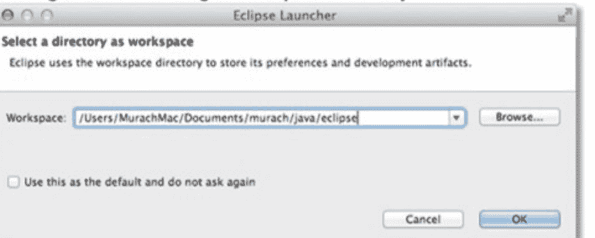

# 如何选择工作空间目录

- 启动 Eclipse 时，你通常从上述对话框中选择你想使用的工作空间。工作空间存储了如何配置 Eclipse 信息，包括显示哪些项目。
- 当 Eclipse 运行时，你可以通过 `File->Switch workspace` 命令切换到不同的工作空间。这将重启 Eclipse 并选择新的工作空间。
- 一旦你选择了工作空间，它就会出现在“Workspace”（工作空间）菜单中。这使得在工作空间之间切换变得简单。

## 注意事项

图 B-3 如何安装 Eclipse

# 如何安装 SQLite Manager

图 B–4 显示了你在处理本书第 5 节数据库操作时所需的软件。虽然 SQLite 有多种工具可用，但我们建议本书使用 SQLite Manager，它是 Firefox 浏览器的一个插件。如果你的系统中还没有 Firefox，请先安装 Firefox。然后，为 Firefox 安装 SQLite Manager 插件。

# Firefox 下载页面

www.mozilla.org/download

# 如何安装 Firefox

1. 找到 Firefox 的下载页面。最简单的方法是在互联网上搜索“firefox download”。
2. 下载适用于你电脑的 Firefox 版本。
3. 在“Downloads”文件夹中，双击下载的文件。然后，双击窗口中的 Firefox 图标。这应该安装并启动 Firefox，并在第一个标签页中打开首页。

# 如何安装 SQLite Manager 插件

1. 启动 Firefox。
2. 从 Firefox 菜单中选择“Tools”（工具）→Add-ons”（插件）。然后，滚动到页面底部并点击“More Add-ons”（更多插件）。
3. 在插件的搜索框中搜索“SQLite Manager”。
4. 点击 SQLite Manager 图标，然后点击“Add to Firefox”（添加到 Firefox）。
5. 点击“Restart”（重启）。

# 如何将 SQLite Manager 图标添加到工具栏

1. 如果没有显示书签工具栏，选择“View”（查看）→Toolbars（工具栏）来显示工具栏。
2. 选择“View→Toolbars→Customize page”（自定义页面）。
3. 从“Additional Tools and Features”（其他工具和功能）面板将 SQLite Manager 图标拖入书签工具栏并松开。
4. 从“Customize page”（自定义页面）退出。

# SQLite 的两种方式

- 点击工具栏上的 SQLite。
- SQLite。

# 注意

- SQLite 用于本书第 20 章和第 21 章。如果你不完成这些章节的练习题，就不需要这些章节的练习题解答。

图 B-4 如何安装 SQLite Manager

## 索引

### 764 Application 类 (JavaFX)

### 驼峰命名法 (Camel case)

- Application 类 (JavaFX), 536, 537
- apply() 方法 (Function), 712, 713
- 参数 (Argument), 54, 152, 153
    - 传递给构造函数, 224, 225
    - 传递给方法, 226, 227
- 参数列表 (method), 152, 153
- 算术表达式, 46, 47, 88, 89
- 算术运算符, 46, 47, 88, 89
- ArithmeticException异常 (java.lang), 159
- 数组 (Array)
    - 赋值值, 356, 357
    - 与集合比较, 380, 381
    - 复制, 368, 369
    - 创建, 354, 355
    - 创建引用, 368, 369
- 数组列表 (Array list), 382, 383, 386–393
- 数组数组 (Array of arrays), 370, 371
- ArrayIndexOutOfBounds异常 (System), 368, 369
- ArrayOutOfBoundsException异常, 355, 357, 362, 363
- 列表类 (java.util), 382, 383, 386–393
- 数组类 (java.util), 362–367
- ASCII 集合, 72, 83
- 元素值赋值, 356, 357
- 赋值运算符 (复合型), 92, 93
- 赋值语句, 45–47
- 异步线程, 738, 739
- 属性 (XML), 562, 563
- 增强赋值元素, 92, 98
- 自动装箱 (Autoboxing), 393, 394
- AutoCloseable接口 (java.lang), 508, 509
- 自动刷新功能, 470, 471
- 自动驱动类, 676, 677
- available() 方法 (DataInput), 494, 495
- AWT, 52, 532, 533, 574, 575
- 字节 (Bit), 82, 83
- 块注释, 38, 39
- 代码块, 38, 39, 124, 125
- 块作用域, 66, 67, 124, 125
- 阻塞状态 (线程), 730, 731
- 书类 (Book class), 274
- 布尔表达式, 64, 65, 120–123
- 布尔类型, 82, 83
- 布尔值, 64, 65
- 布尔变量, 120, 121
- 边界 (Border), 626, 627
- Borderfactory 类 (Swing), 626, 627
- BorderLayout 布局 (Swing), 590, 591, 594, 595
- BorderPane (JavaFX), 534, 535
- BoxLayout 布局 (Swing), 590, 591
- break 语句 (带循环), 144, 145
- 断点 (调试调试), 186, 187
- 字节 (Byte), 466, 467
- 缓冲输入流, 492, 493
    - 字符, 474, 475
- 缓冲输出流
    - 二进制, 488, 489
    - 字符, 470, 471
- 字节 (Bream), 466, 467
- BufferedInputStream 类 (java.io), 492, 493
- BufferedOutputStream 类 (java.io), 488, 489
- BufferedReader 类 (java.io), 474–477
- BufferedWriter 类 (java.io), 470, 471
- 业务类, 208, 209
- 业务对象, 208, 209
- 业务层, 208, 209
- 按钮 (Button), 532, 533, 574, 575
    - JavaFX, 546, 547
    - Swing, 582, 583
- 按钮组 (ButtonGroup), 624, 625
- 字节 (Byte), 82, 83
- byte 类型, 82, 83
- 字节码 (Bytecode), 14, 15
- 基类, 260, 261
- Bash 文件, 198, 199
- B 补丁, 198, 199
- between() 方法 (日期/时间), 450, 451
- BigDecimal 类, 110–115
- 二进制文件, 464, 465, 488–497
    - 读取, 494, 495
    - 写入, 490, 491
- 二进制输入流, 492, 493
- 二进制运算符, 88, 89
- 二进制输出流, 488, 489
- 二进制流, 464, 465
- binarySearch() 方法 (Arrays), 362, 363

### C

- C#, 6, 7
- C++, 6, 7
- 计算列 (数据库), 656
- 调用栈, 191, 194, 505, 506
- 调用方法
    - 方法, 54, 55, 226, 227
    - 静态字段, 232, 233
    - 静态方法, 152, 153, 232, 233
- 驼峰命名法, 855

### Camel

### containsValue() 方法 (Map), 765
- 驼峰表示法, 44
- capacity() 方法 (Builder), 428, 429
- CardLayout 布局 (Swing), 590, 591
- Case 标签 (switch), 128, 129
- Case 结构, 128–131
- 强制转换, 46, 47, 96, 97
    - 对象, 278, 297
    - catch 块, 160, 161, 506, 507
- Catch 异常, 160, 161, 506, 507
- Center 布局 (BorderLayout), 594, 595
- 中央处理单元 (CPU), 726, 727
- char 类型, 82, 83
- 字符输入流, 474, 475
- 字符输出流, 470, 471
- 字符流, 464, 465
- charAt(String), 422, 423
- charAt() 方法 (Builder), 430, 431
- Checkbox, 622, 623
- Checked 异常, 468, 469, 502, 503
- 解冻, 514, 515
- 类代码, 260, 261
- 子元素 (XML), 562, 563
- ChronoUnit 枚举, 450, 451
- 类, 12, 13, 18, 143
    - 声明, 42, 43
    - 文档, 336, 337
    - 字段, 230, 231
    - 导入, 52, 53
    - 实例, 54, 55
    - 方法, 230, 231
    - 存储于包, 324, 327
- 类 (java.util), 676, 677
- 类图, 310, 311
- Line 注解, 246, 247
- ClassCastException异常 (java.lang), 278, 279
- clear() 方法 (Array), 390, 391
- clear() 方法 (JList), 632, 633
- clear() 方法 (LinkedList), 402, 403
- clear() 方法 (Map), 390, 391
- clone(), 408, 409
- clone(), 262, 263, 316, 319
- Cloneable 接口, 296, 297
- 实现, 316, 317
- CloneSupportedException异常 (java.lang), 316, 317
- 克隆, 316, 317
- close() 方法 (BufferedReader), 476, 477
- close() 方法 (DataInputStream), 494, 495
- close() 方法 (DataOutputStream), 490, 491
- close() 方法 (PrintWriter), 472, 473
- close() 方法 (ResultSet), 678, 679
- 代码补全 (NetBeans), 30, 31
- 代码编辑器 (NetBeans), 18, 19, 28, 29
- 代码执行 (跟踪), 184, 185
- code 标签 (HTML), 338, 339
- collect() 方法 (Stream), 716, 717
- Collection, 380–383
- 与数组比较, 380, 381
- Collection 框架, 382, 383
- Collection 接口 (java.util), 382, 383
- 数据库, 650, 651
- 标题, 472, 473
- 宽度 (JavaFX), 544, 545
- Constraints 类 (JavaFX), 544, 545
- boBox, 628, 629
- 命令提示符, 8, 9
- 注 Java, 38, 39
- 注 XML, 562, 563
- Comparable 接口, 366, 367
- compareTo() 方法, 366, 367, 446, 447
- 比较对象, 280, 281
- 数据类型, 120, 121
- 变量, 64, 65
- 编译 a, 20, 21
- 包中的类, 326, 327
- 编译时错误, 74, 180, 181
- 编译器, 14, 15
- 组件 (Component), 574, 575
- 组件 类 (java.awt), 576, 577
- 组件层次, 576, 577
- 复合赋值运算符, 92, 93
- 拼接字符串, 48, 49, 420
- 并发 (线程), 738, 739
- 条件表达式, 64, 65
- 连接到数据库, 676, 677
- 连接对象 (JDBC), 676, 677
- 控制台 (Console), 8, 9
- 控制台应用, 8
- 控制台类, 251, 252
- 控制台输入输出, 58-63
- 常量, 86, 87
- 枚举, 342, 343
- 接口, 292, 296-299
- 构造函数, 54, 55
- 编码, 220, 221
- Consumer 接口 (java.util), 710, 711
- Container 类 (java.awt), 576, 577
- contains() 方法 (ArrayList), 390, 391
- contains() 方法 (JList), 632, 633
- contains() 方法 (LinkedList), 402, 403
- containsKey() 方法 (Map), 408, 409
- containsValue() 方法 (Map), 765

### 766

### Content (XML)

### Division运算符

### Content (XML), 562, 563
- continue 语句 (带循环), 144, 145
- 控制 (Component), 532, 533, 574, 575
- 控制层次 (JavaFX), 534, 535
- 控制, 380, 381
- 控制框架, 382, 383
- 控制 接口 (java.util), 382, 383
- 数据库, 650, 651
- 标题, 472, 473
- 宽度 (JavaFX), 544, 545
- Constraints 类 (JavaFX), 544, 545
- boBox, 628, 629
- 命令提示符, 8, 9
- 注 Java, 38, 39
- 注 XML, 562, 563
- Comparable 接口, 366, 367
- compareTo() 方法, 366, 367, 446, 447
- 比较对象, 280, 281
- 数据类型, 120, 121
- 变量, 64, 65
- 编译 a, 20, 21
- 包中的类, 326, 327
- 编译时错误, 74, 180, 181
- 编译器, 14, 15
- 组件 (Component), 574, 575
- 组件 类 (java.awt), 576, 577
- 组件层次, 576, 577
- 复合赋值运算符, 92, 93
- 拼接字符串, 48, 49, 420
- 并发 (线程), 738, 739
- 条件表达式, 64, 65
- 连接到数据库, 676, 677
- 连接对象 (JDBC), 676, 677
- 控制台 (Console), 8, 9
- 控制台应用, 8
- 控制台类, 251, 252
- 控制台输入输出, 58-63
- 常量, 86, 87
- 枚举, 342, 343
- 接口, 292, 296-299
- 构造函数, 54, 55
- 编码, 220, 221
- Consumer 接口 (java.util), 710, 711
- Container 类 (java.awt), 576, 577
- contains() 方法 (ArrayList), 390, 391
- contains() 方法 (JList), 632, 633
- contains() 方法 (LinkedList), 402, 403
- containsKey() 方法 (Map), 408, 409
- containsValue() 方法 (Map), 765

### 767

- 除法运算符，88, 89
- DML（数据操语言），654
- 文档
- class, 336, 337
- 生成，340, 341
- Java API, 56, 57
- 查看，340, 301
- Double class, 100, 101
- 双冒号运算符，718, 719
- double 类型: 44, 45, 82, 83
- 双精度数字，44, 45, 82, 83
- doubleValue() 方法 (BigDecimal), 110, 111
- down-while 循环，136, 137
- DriverManager class (java.sql), 676, 677
- 驱动程序（数据库），672, 673
- equals() 方法 (String), 64, 55, 422, 423
- equalsIgnoreCase() 方法 (String), 64, 452, 423
- 等值连接，656, 657
- Error class (java.lang), 502, 503
- 错误类型，180, 181
- ERROR_MESSAGE 字段 (OptionPane), 608, 609
- 转义序列，50, 51
- ETD（事件分发线程），379, 580
- JavaFX, 548, 549
- Swing, 584, 585
- 事件分发线程 (ED), 579, 580
- 事件处理器
- EAST (BorderLayout), 594, 595
- Eclipse ID，16
- 在 OS X 上安装，758, 759
- 在 Windows 上设置工作区，748, 749
- 在 OS X 上设置工作区，758, 749
- EE（企业版），4, 5
- Element (XML)，562, 563
- element() 方法 (LinkedList), 404, 405
- Element
- array, 354, 355
- JavaFX, 548, 549
- Swing, 584, 585
- 事件监听器，584, 585
- Exception，60, 161, 158, 502, 503
- 捕获，160, 161, 506, 507
- 自定义的，518, 521
- 处理，158-163
- 多重 catch，512, 513
- 传播，504, 505
- 吞吞，508
- 抛出，504, 505, 514, 517
- try-with-resources，508, 509
- Exception class (java.lang), 502, 503
- Exception 类
- 链，520, 521
- 赋值，356, 357
- 空字符串，48, 49
- 封装字段 (NetBeans)，228, 229
- 封装，210, 211
- 结束标签，562, 563
- 行尾注释，38, 39
- endsWith() 方法 (String), 422, 423
- 增强 for 循环
- 配合 array，360, 361
- 配合 map，410, 411
- 入队操作，406, 407
- entrySet() 方法 (Map), 408-411
- enum class (java.lang), 344, 345
- enum 关键字，342, 343
- 枚举，342, 345
- 创建，518, 519, 520
- 异常处理器，160, 161, 504, 505
- 测试，516, 517
- 异常层级结构，158, 159
- 可执行 JAR 文件，192-199
- executeQuery() 方法
- PreparedStatement, 684, 685
- Statement, 678, 679
- executeUpdate() 方法
- PreparedStatement, 684, 685
- Statement, 682, 683
- 执行（跟踪），184, 185
- extends() 方法 (Files), 460, 461
- EXIT_ON_CLOSE 监听，578, 579
- 显式转换，96, 97
- EOFException (java.io), 468, 469
- 等运算符，65, 120-123
- equals() 方法 (Arrays), 364, 365
- equals() 方法 (Object), 262, 263, 280, 281
- equals() 方法（重写），280, 281
- exports 关键字，322, 333
- 结束类，260, 261, 266, 267
- extends 关键字，266, 267, 300, 301, 304, 305

### E

### 字段

### getSecond() 方法

### F

- Function (lambda)，700, 701
- Function 接口 (java.util), 712, 713
- 函数式接口 (lambda),704, 705
- FXML 控制器属性，564, 565
- fxid 属性，564, 565
- FXML, 564-569
- FXMLLoader class, 564, 565
- Field, 210, 211
- class, 216, 217
- 数据库，650, 661
- 文件，472, 473
- FIFO 集合，406, 407
- File（配合），460-463
- I/O 类，464, 465
- InputStream class (java.util), 492, 493
- FileException (java.util), 468, 469
- FileOutputStream class (java.util), 488, 489
- FileReader class (java.util), 474, 475
- Files (java.name), 534, 535
- FileWriter class (java.util), 470, 471
- fill() 方法，362, 363
- Filter 列表，716, 717
- FilterInputStream class (java.util), 492, 493
- FilterOutputStream class (java.util), 488, 489
- final 关键字，86, 87, 284, 285
- finally 块 (try)，467
- First-in-out (FIFO) 集合，406, 407
- 固定宽度，590, 591
- float 类型，82, 83
- 浮点错误，180, 181
- 浮点数，82, 83, 44
- FlowLayout  (Swing)，590, 594
- FlowPane (Java.util), 534, 535
- flush() 方法 (DataOutputStream),490, 491
- flush() 方法 (PrintWriter),472, 473
- flushing 缓冲区，466, 467
- Folders（配合），460, 465
- for 循环，138, 139
- for 嵌套，142, 143
- for arrays，358, 359
- for map，410, 411
- forEach 循环，360, 361
- forEach() 方法 (String),716, 717
- Foreign key，652, 653
- Form，532, 533, 574
- format() 方法 (DateFormat),452, 453
- format() 方法 (NumberFormat),104, 105
- formatStyle.FULL constant，452, 453
- formatStyle.LONG constant，452, 453
- formatStyle.MEDIUM constant，452, 453
- formatStyle.SHORT constant，452, 453
- formatName() 方法 (Class),776, 777
- Forward-only 结果，678, 679
- Frame（显示），578, 579
- Frame class (java.awt),576, 577
- FROM 子句 (SELECT),654, 655
- Function，42, 43

### G

- 垃圾回收器，262, 263
- Generator 访问 (NetBeans)，228, 229
- 泛型，384, 385
- get 方法，216, 217, 222, 223
- get 方法 (ArrayList),388, 389
- get 方法 (LinkedList),400, 401
- get 方法 (Map),408, 409
- get 方法 (Paths),460, 461
- getChildren() 方法 (Box),546, 547
- getClass() 方法 (Object),262, 263
- getColumnCount 方法 (GridPane),540, 545
- getConnection() 方法 (DriverManager),676, 677
- getCurrentClassName() 方法 (NumberFormat),444, 445
- getDayMonth() 方法 (date/time),444, 445
- getOfWeek() 方法 (date/time),444, 445
- getOfYear() 方法 (date/time),444, 445
- getDouble() 方法 (ResultSet),680, 681
- getFileName() 方法 (Path),460, 461
- getFirst() 方法 (LinkedList),404, 405
- getHour() 方法 (date/time),444, 445
- getResult() 方法 (ResultSet),680, 681
- getObject 方法 (JComboBox),628, 629
- getKey() 方法 (Entry),408, 411
- getLast() 方法 (LinkedList),404, 405
- getMessage() 方法 (Throwable),510, 511
- getMinute() 方法 (date/time),444, 445
- getMonth() 方法 (date/time),444, 445
- getValue() 方法 (date/time),444, 445
- getName() 方法 (Path),460, 461
- getThread() 方法 (Thread),737, 738
- getCount() 方法 (Path),460, 461
- getNano() 方法 (date/time),444, 445
- getNumberInstance() 方法 (NumberFormat),104, 105
- getParent() 方法 (Path),460, 461
- getPercentage() 方法 (NumberFormat),104, 105
- getRoot() 方法 (Path),460, 461
- getSecond() 方法，444, 445

### getSelectedIndex() 方法 (JComboBox)

### INSERT 语句 (SQL) 769

- getSelectedIndex() 方法 (JComboBox),628, 629
- I/O 操作，464, 465
- IDE（集成开发环境），16, 17
- getSelectedIndices() 方法 (JList),631
- 标识符，42, 43
- getSelectedItem 方法 (JComboBox),628, 629
- 对象标识，212, 213
- if 语句，66, 67-124
- 嵌套，126
- getSelectedValue() 方法 (JList),631
- IllegalArgumentException(java.lang),158, 159, 516, 517
- getString() 方法 (ResultSet),680, 681
- 不可变对象，318, 319
- 实现功能，292, 293
- implements，304, 305
- 增值，90, 99
- JavaFX, 554, 561
- Swing,608-615
- HTML 文档
- 生成，340, 341
- 查看，340, 301
- HTML 标签（带有 Javadoc），338, 339

### I

- I/O 异常，468, 469

- InputMismatchException(java.util),158, 159, 160
- 防止，164, 165

- InputStream class (java.io),492, 493
- InputStreamHierarchy,492, 493

### 770

### 插入方法 (StringBuilder)

### 连接 (数据库表)

- insert() 方法 (StringBuilder), 430, 431
- insertCl (JavaFX), 540, 451
- insertCl (Swing), 598, 599
- insertFields (GridBagConstraints), 598, 599
- 插入变量 (调试), 188, 189
- 安装程序, 192, 193
- 类的实例, 54, 255, 212
- 实例变量
  - 编码, 216–219
  - 初始化, 224, 225
- instanceof 关键字, 278, 279
- 实例化数组, 354, 355
- 实例化, 54, 55
- int 类型, 44, 82, 83
- Integer 类, 44, 82, 83
- Integer 类, 100, 101
- 集成开发环境 (IDE), 16, 17
- IntelliJ IDE, 16, 17
- 接口, 292, 293
  - 优势, 294, 295
  - 编码, 296, 297
  - 与抽象类比较, 294, 295
  - 生成方法, 306, 307
  - 实现, 298, 299
  - 继承, 304, 305
  - 用参数, 302, 303
- interface 关键字, 296, 297
- 实例类型, 302, 303
- 解释器 (Java), 14, 15
- InterruptedException (java.lang), 733-735
- invokelet(method) (EventQueue), 578, 579
- IOException (java), 468, 469
- 输入字段 (GridBagConstraints), 598, 599
- 输入字段 (GridBagConstraints), 598, 599
- isAfter(method), 446, 467
- isBefore(method), 446, 447
- isDirectory(File), 460, 461
- isEmpty(method) (ArrayList), 390, 391
- isEmpty(method) (LinkedList), 402, 403
- isEmpty(method) (String), 422, 423
- isInterrupted(Thread), 723
- isReadable(method), 460, 461
- isRegularFile(File), 460-463
- isSelected(method) (JCheckBox), 622, 623
- isSelected(method) (JRadioButton), 624, 625
- isWritable(method) (File), 460-463
- 迭代结构, 668-669

- JSE (Java 2 平台, 标准版), 4
- 锯齿数组, 372, 373
- JAR 文件, 328, 329
  - 添加到项目, 674, 675
- Java 归档文件 (JAR), 328, 329
- java 编译器, 198, 199
- Java 开发包 (JDK), 4, 5, 744, 745, 754, 755
- Java EE, 4, 5
- java 解释器, 14, 15
- Java ME, 4, 5
- Java 运行时环境 (JRE), 14, 15, 196
- Java SE, 4, 5, 744, 755, 755
- Java Shell, 98, 99
- Java 虚拟机 (JVM), 14, 15
- Java Web Start (JWS), 192, 193, 197
- java.awt.package, 576, 590, 591
- java.awt.event, 584, 585
- java.base.module, 330, 331
- java.io.package, 426, 467
- java.lang.package, 52, 53
- java.math.package, 110, 111
- java.io.file.package, 462, 463, 466, 467
- java.text.package, 440, 441
- java.time.package, 440, 441
- java.util.package, 440, 441
- java.util.zip, 489, 493
- JavaBean, 216
- Javadoc 注释, 336, 337
- Javadoc 标签, 338, 339
- JavaFX, 532, 533, 575
- javafx.event, 548, 549
- javafx.geometry.package, 540, 541
- java.scene.control, 538, 539
- javafx.scene.layout, 544, 545
- java.swing.package, 576, 577, 579
- JButton (Swing), 576, 577, 582, 583
- JCheckBox (Swing), 622, 623
- JComboBox (Swing), 628, 629
- Component (Swing), 576, 577
- JDBC (Java 连接), 672, 673
- JDBC 管理器, 672, 673
- JDBC-ODBC 桥接, 672, 673
- JDK (Java 开发包), 4, 5
- 安装在 OS, 755, 756
- 安装在 Windows, 744, 745
- JFrame 类, 576, 577, 578, 779
- JIT (即时编译器), 14, 15
- JLabel (Swing), 576, 577, 578, 587
- List (Swing), 630, 631
- 连接 (数据库表), 656, 657
- J2EE (Java 2 平台, 企业版), 4

### 连接字符串

- 连接字符串, 48, 49, 420, 421
- JOptionPane (Swing), 608, 609
- JPanel (Swing), 576, 577, 582, 583
- JButton (Swing), 624, 625
- JRE (Java 运行时环境), 14, 15, 196, 197
- JScrollPane (Swing), 620, 621
- Jshell, 98, 99
- J (Java 页面), 10
- TextArea (Swing), 620, 621
- JTextField (Swing), 576, 577, 588, 589
- 即时编译器 (JIT compiler), 14, 15
- JVM (Java 虚拟机), 14, 425
- JWS (Java Web Start), 192, 193
- List 接口 (java.util), 382, 383
- List 模型, 632, 633
- ListSelection 接口 (JList), 631
- 字面量值, 44, 445
- load() (FX), 564, 565
- LocalDate 类, 442, 451
- LocalDateTime 类, 442, 451
- LocalTime 类, 442, 451
- 锁 (对象), 738, 739
- 逻辑错误, 74, 75, 180, 181
- 逻辑操作, 82, 123
- Long 类型, 82
- 查找外观, JavaFX, 532, Swing, 580, 581
- 循环, 130-143
- 数组, 358-361
- 使用 map, 410, 411

### K

- 键值, 382, 383
- 关键字 (Java), 42, 43

### L

- Label, 532, 533, JavaFX, 538, 539, 575, Swing, 586, 587
- Lambda 表达式, 700-715
  - 使用 JavaFX, 548, 549
  - 使用 Swing, 584, 585
- Lambda 运算符, 706, 707
- 后进先出 (LIFO 集合), 417
- lastIndexOf() 方法 (String), 422, 423
- 晚绑定, 268, 269
- 分层输入流, 二进制, 492, 493, 字符, 474, 475
- 分层输出流, 二进制, 488, 489, 字符, 470, 471
- 分层流, 466
- 布局管理器 (Java), 534, 535, 590
- length 字段 (数组), 358, 359
- 数组长度, 354, 355
- length() 方法 (String), 424, 425
- length() 方法 (StringBuilder), 428, 429
- 小于运算符, 65, 120, 121
- 小于运算符, 65, 120, 121
- 库, 18, 19
  - 可, 328, 329
- 线程生命周期, 730, 731
- LIFO 集合, 417
- 链表, 382, 383, 400-407
- LinkedList 类 (java.util), 382, 383, 400-407
- List, 382, 630-633

### M

- Main 类, 18, 19, 42, 43
- main(), 12, 13
- 声明, 42, 43
- 主线程, 579, 580, 726, 727
- Manifest 文件 (可执行), 194, 195
- 多对多关系, 652, 653
- Map, 382, 383, 408, 409
- Map list, 718, 719
- Map 接口 (java.util), 382, 383
- map() 方法 (Stream), 718-721
- Map (Map), 408, 409
- Map 还原, 720, 721
- Map 类, 102, 103
- max() 方法 (Math), 102, 103
- 类的成员, 216, 217
- 方法, 12, 13, 42, 43, 210, 211
  - 调用, 54, 55, 226, 227
  - 编码, 222, 223
  - 在接口中, 292
  - 命名, 222, 223
  - 重载, 152, 242, 243
  - 重写, 266, 267
  - 签名, 152, 253, 242, 243
  - static, 54, 55, 152, 153
  - min() 方法 (Math), 102, 103
  - minus() 方法 (date/time), 450, 451
  - minus() 方法 (date/time), 450, 451
- 移动端应用, 10, 11
- Module, 330-335
- module 关键字, 332, 333

### module-info 文件

- module-info 文件, 332-335

### 重载

- 构造函数, 220, 221
- 方法, 152, 242
- 取模赋值, 93
- 取模运算符, 88, 89
- 月份 枚举, 442, 443
- 多 catch 块 (try 语句), 512, 513
- 多重继承, 292
- 乘法赋值, 93
- 乘法运算符, 88, 89
- multiply() 方法 (BigDecimal), 110, 111
- 多线程, 726, 727
- 多类架构, 208, 209
- 可变对象, 318, 319
- 可变字符串, 428, 49
- MySQL, 650, 651

### N

- Node 层次结构 (JavaFX), 534, 535
- 非干扰 lambda, 718, 719
- Node (GridLayout), 594, 595
- NoSuchElementException, 158, 159
- 非 运算符, 122, 123
- next() 方法 (Files), 460-463
- now() 方法 (LocalTime), 442, 443
- null 值, 48, 49, 651
- NullPointerException (java.lang), 159
- 防止, 164, 165
- NumberFormat (java.text), 104, 105
- NumberFormatException (java.lang), 158, 159
- 数值变量, 44, 45
- 比较, 64, 65
- name() 方法 (枚举), 344, 345
- 命名规范
  - 常量, 86, 88
  - 变量, 84, 85
- 命名建议
  - 类, 42, 43
  - 变量, 44, 45
- 命名规则 (类), 42, 43
- 窄收规则, 96, 97
- Native protocol all Java Driver, 672, 673
- Native protocol fully-java Driver, 672, 673
- 负号运算符, 90, 91
- 嵌套元素, 126, 127
- 嵌套循环, 142, 143
- 使用二维数组, 370, 373
- NetBeans IDE, 16, 17, 18-33
- 创建类, 214, 215
- 创建项目, 26, 27
- 生成方法, 228, 229
- 安装在 OS, 754, 755
- 安装在 Windows, 744, 745
- 项目, 18, 19

### Object,

- 强制转换, 278, 279
- 拷贝, 316, 319
- 比较, 280, 281
- 创建, 54, 55
- 标识, 212, 213
- 引用, 224, 225
- Object 类 (java.lang), 262, 263
- 对象图, 212, 213
- ODBC (数据库连接), 672, 673
- ofter() 方法 (LocalTime), 442, 443
- ofter(method) (LinkedList), 404, 405
- ofLocalizedDate(方法), 452, 453
- ofLocalizedTime(方法), 452, 453
- OnAction 数组 (JavaFX), 564, 565
- 单维数组, 354, 369
- 多对多关系, 652, 653
- 一对一关系, 652, 653

### 覆盖注解 (Override)

### readInt() 方法 (DataInput) 773

- 覆盖注解, 264, 265
- 重写方法, 260, 261, 266, 267, 280, 281
- 比较, 120, 121
- 传递给方法, 240, 241
- print() 方法 (PrintWriter), 472, 473
- print() 方法 (System.out), 58, 59
- 将输出打印到控制台, 58, 59
- println() 方法 (PrintWriter), 472, 473
- println() 方法 (System.out), 58, 59
- printStack() 方法 (Throwable), 510, 511
- PrintWriter 类 (java.io), 470-473
- private 关键字类, 152, 153
- 类声明, 42, 43
- 实例变量, 218, 219
- 方法, 222, 223
- 父类, 264, 265
- Product 类, 272, 273
- 图表, 210, 211
- ProductDAO 接口, 478, 479
- ProductDB 类, 275, 276
- Project 方法 (NetBeans), 18, 19
- Project Jigsaw, 330, 331
- protected 关键字, 264, 265
- public 关键字, 152, 153
- 类声明, 42, 43
- 实例变量, 218, 219
- 方法, 222, 223
- 父类, 264, 265
- put() 方法 (Map), 408-411

### P

- + 包 (Package), 18, 19, 52, 53
- 变为可用, 328, 329
- 名称, 324, 325
- 存储类, 324-327
- 使用方法, 326, 327
- 包语句, 324, 325
- 内边距 (GridBagLayout), 598, 599
- 内边距 (GridPane), 540, 541
- 内边距 (String), 432, 433
- 窗 (AnalyzeAction), 536, 537
- 面 (Swing), 582, 583
- 并行处理, 716, 717
- parallelStream() 方法, 716, 717
- 参数方法, 152, 153
- 接口 (interface), 302, 303
- 参数 (prepared statement), 684, 685
- List 接口, 152, 153, 222
- 父类, 260, 262
- 父元素 (XML), 562, 563
- parse() 方法 (LocalDate), 442, 443
- parse() 方法 (Double), 100, 101
- parse() 方法 (Integer), 100, 101
- 按引用传递参数, 240, 241
- 按值传递参数, 240, 241
- 路径 (Path), 462, 463
- Path 接口 (java.io), 460-463
- Paths 类 (java.io), 460-463
- PLAIN_MESSAGE_FIELD 字段 (JOptionPane), 608, 609
- 平台接口 (Platform interface), 14, 15
- plus() 方法 (date), 450, 451
- plusWeeks() 方法 (date/time), 450, 451
- poll() 方法 (List), 404, 405
- 多态 (Polymorphism), 268, 269
- Post 枚举 (JavaFX), 540, 541
- 正号变量, 90, 91
- Posix 之后, 90, 91
- pow() 方法 (Math), 102, 103
- Predicate 接口, 708, 709
- 订单前缀, 90, 91
- 预编译语句 (Prepared statement), 684, 685
- PreparedStatement 接口 (java.sql), 684, 685
- prepareStatement() 方法 (Connection), 684, 685
- 表示层 (Presentation tier), 208, 209
- 主键, 650, 651
- 原始型数据类型, 44, 45, 82
- 基础键, 82-999
- 查询 (Query), 654-657
- QUESTION_MESSAGE 字段 (JOptionPane), 608, 609

### R

- 单选按钮 (Radio button), 624, 625
- random() 方法 (Math), 102, 103
- 范围检查 (Range checking), 166, 167
- RDBMS (关系数据库管理系统), 650
- readBoolean() 方法 (DataInput), 494, 495, 496
- readChar() 方法 (DataInput), 494, 495, 496, 497
- readDouble() 方法 (DataInput), 494, 495
- Reader 类 (java.io), 170, 475
- Reader 层级, 474, 475
- 读取
    - 二 二进制文件, 494, 495
    - 控制台输入, 60, 61
    - 文本文件, 476, 477
    - readInt() 方法 (DataInput), 494, 495
    - readLine() 方法 (BufferedReader), 474, 477
    - readLine() 方法 (BufferedReader), 476, 477
    - 只读, 216, 217
    - 只读结果集, 678, 679
    - readUTF() 方法 (DataInput), 496
- 记录 (Record)
- 数据库, 650, 651
- 文件, 472, 473
- 矩形区域, 370, 371
- 红黑树, 408
- 减少列表, 720, 721
- 引用, 368, 369
- 引用类型, 240, 241
- 关系数据库, 650, 651
- 关系运算符, 64, 120
- 关系（表与表), 552, 553
- 相对路径, 462, 463
- remove() 方法 (ArrayList), 390, 391
- remove() 方法 (LinkedList), 402, 403
- remove() 方法 (Map), 408, 409
- removeElement() 方法 (List model), 632, 633
- removeFirst() 方法 (List), 404, 405
- removeLast() 方法 (JComboBox), 628, 629
- removeLast() 方法 (List), 404, 405
- remove() 方法 (String), 426, 427
- remove() 方法 (StringBuilder), 430, 431
- 需要, 332, 333
- 调整大小, 600, 601
- 结果集, 654, 677
-  结果集, 678, 679
- 返回语句, 152, 153, 222
- 返回类型, 152, 153, 222, 226, 227
- RI (Internet Interfaces), 532, 533, 574, 575
- 根元素 (XML), 562, 563
- round() 方法 (Math), 102, 103
- 四舍五入, 104, 105
- RoundingMode, 110, 111
- 数据库, 650, 651
- 文件, 472, 473
- 项目 (NetBeans), 20, 21
- 可执行 JAR, 198, 199
- run() 方法 (thread), 728, 729, 733-735
- Runnable 接口 (java.lang), 728, 729, 736, 737
- Runnable 状态 (thread), 730, 731
- Runtime 错误, 74, 75, 180, 181
- Runtime 异常, 74, 75, 180, 181
- Runtime (java.lang), 158, 159, 502, 503

### S

- 比例 (Scale), 110, 111
- Scanner 类, 60-63, 164, 165
- 场景 (View), 536, 537
- 科学计数法, 82, 83
- 设置, 198, 199
- 滚动条, 620, 621
- 滚动窗, 620, 621
- SDK (软件开发包), 4, 5
- SE (标准版), 4-5
- SELECT 语句 (SQL), 654-657
- 表连接, 656, 557
- 选择结构, 66, 124-127
- 串化化处理, 716, 717
- Servlet, 10, 11
- 设置, 382, 383
- set 接口 (java.util), 382, 383
- set 方法, 216, 217, 222
- set 方法 (ArrayList), 390, 391
- set 方法 (LinkedList), 402, 403
- setAlignment() 方法 (GridPane), 540, 541
- setAlignment() 方法 (HBox), 546, 547
- setBody() 方法 (JFrame), 626, 627
- setCharAt() 方法 (StringBuilder), 430, 431
- setColumn() 方法 (TextField), 588, 589
- setText() 方法 (Alert), 554, 555
- setCloseOperation() 方法 (JFrame), 578, 579
- setDisable() 方法 (TextField), 542, 543
- setDouble() 方法 (PreparedStatement), 684, 685
- setEditable() 方法 (JavaFX), 542, 543
- setEditable() 方法 (String), 588, 589
- setEncoding() 方法 (String), 582, 583
- setHeaderText() 方法 (GridPane), 540, 541
- setGap() 方法 (GridPane), 540, 541
- setLayout() 方法 (Swing), 590, 591
- setWrap() 方法 (JTextArea), 620, 621
- setLocationByPlatform() 方法 (JFrame), 578, 579
- setLookAndFeel() 方法 (Swing), 580, 581
- setMaximumDigits() 方法 (Integer), 104, 105
- setMaximumWidth() 方法 (ColumnConstraints), 540, 545
- setMinimumDigits() 方法 (Integer), 104, 105
- setMinimumSize() 方法 (Swing), 600, 601
- setMinimumWidth() 方法 (ColumnConstraints), 540, 545
- setModel() 方法 (JList), 630, 631
- setPack() 方法 (JFrame), 578, 579
- setPadding() 方法 (GridPane), 540, 541

### 静态方法（继续）

### toString() 方法 (Double)

### 静态方法（续）

- 何时使用
- 逐行代码（调试），将类存储在包中, 324-327
- 流 (IO), 464, 465
- 缓冲, 464, 467
- 分层, 466, 467
- 流 (lambda), 716, 717
- stream() 方法, 716, 717
- String 类, 420, 421
- 字符串索引, 424, 425
- 字符串字面量, 48, 51
- 字符串对象, 48, 49
- 字符串变量, 45
- 追加, 48, 49, 420, 421
- 比较, 64, 65, 422, 423
- 拼接, 48, 49, 420, 421
- 转义序列, 50, 51
- 合并, 48, 49, 420, 421
- 修改, 426, 427, 430, 431
- 填充, 432, 433
- 特殊类, 50, 51
- StringBuffer 类, 428, 429
- StringBuilder 类, 428, 429
- StringUtil 类, 432, 433
- 子类, 158, 159, 260, 261
- 强制类型转换为子类, 278, 279
- 创建, 266, 267
- substring() 方法 (String), 426, 427
- substring() 方法 (Builder), 430, 431
- subtract() 方法 (BigDecimal), 110, 111
- 减法赋值运算符, 93
- 减法运算运算符, 88, 89
- super 键, 266, 267
- 父类, 260, 261
- 强制类型转换为子类, 278, 279
- 创建, 264, 265
- 吞除异常, 508
- Swing, 52, 53, 532, 533, 574, 575
- 层次结构中, 576, 577
- switch 语句, 128-123
- SWT (标准部件工具包), 532, 533, 574, 575
- 同步方法, 738, 739
- 同步线程, 738, 739
- 语法错误, 32, 33, 74, 75, 180, 181
- System.exit(0), 584, 585
- System.in 对象, 60, 61, 464
- System.out 对象, 58, 59, 464

### T

- 表 (数据库), 650, 651
- 关系, 652, 653
- 标签 (XML), 562, 563
- 标记接口, 296, 297
- 终止状态 (线程), 730, 731
- test() 方法 (Predicate), 708, 709
- 测试应用程序, 74, 75, 180, 181
- 测试异常处理器, 516, 517
- 文本区域, 620, 621
- 文本框, 588, 589
- 文本字段
    - JavaFX, 532, 533, 542, 543
    - Swing, 574, 575, 588, 589
- 文本文件, 465, 460-470
- 分隔符, 472, 473
- 读取, 476, 477
- 写入, 472, 473
- this 关键字, 220, 221, 243, 244
- 线程, 579, 580, 726-735
- 并发, 738, 739
- 创建, 732-737
- 生命周期, 730, 731
- 睡眠睡眠, 733-737
- 状态, 730, 731
- 同步, 738, 739
- Thread 类 (java.lang), 728, 729, 732, 733
- 继承, 734, 735
- 线程安全, 738, 739
- 线程调度器, 726, 720, 731
- 三层架构, 208, 209
- 抛出异常, 100, 101, 158, 199, 504, 505
- Throwable 类, 516, 517
- Throwable 类 (java.lang), 502, 503, 510
- 抛出受检异常, 514, 515
- throws 子句, 514, 515
- 时间对象, 442, 443
- 调整, 448, 449
- 比较, 446, 447
- 格式化, 452, 453
- 表, 622, 627
- toPath() 方法 (Path), 460-463
- toArray() 方法 (ArrayList), 390, 391
- toArray() 方法 (LinkedList), 402, 403
- toFile() 方法 (Path), 460, 461
- 标记, 60, 61
- Tooltip, 582, 583
- toBigDecimal() 方法 (BigDecimal), 110, 111
- toDouble() 方法 (Double), 100, 101
- toString() (LocalDate), 340, 341
- toString() (Integer), 100, 101
- toString() (Object), 262, 263
- toString() (StringBuilder), 430, 431
- toString() (Throwable), 510, 511
- while 循环, 68, 99, 135
- 空格, 60, 61
- 追踪异常, 184, 185
- 宽转换, 96, 97
- TreeMap, 408, 409
- TreeMap (java.util), 382, 383, 408
- Widget, 532, 533, 574, 575
- Window, 532, 533, 575
- Window 类 (java.awt), 576, 577
- trim() (String), 427
- try 块, 160, 161
- try 语句, 160, 161, 506, 507
- try-resources 语句, 468, 469, 508, 509
- 二维数组, 370-373
- withHour(方法), 448, 449
- withMinute(方法), 448, 449
- withMonth(方法), 448, 449
- withYear(方法), 448, 449
- 类型变量, 384, 385
- 类型类型集合, 384, 385
- 类型安全枚举, 342, 343
- Wrapper 类, 100, 310, 393, 394
- writeBoolean(方法)(DataOutput), 490, 491
- writeChar(方法)(DataOutput), 490, 491
- writeInt(方法)(DataOutput), 490, 491
- UIManager, 580, 581
- writeByte(方法)(DataOutput), 490, 491
- UML (统一建模语言), 210, 211
- Writer 层次结构, 470, 491
- 一元运算符, 90, 91
- writeUTF(方法)(DataOutput), 490, 491
- 非受检异常, 502, 503
- 写入二进制文件, 490, 491
- Unicode 字符, 72, 83
- 写入文本文件, 472, 473
- until() (日期/时间), 450, 451

### X

- UPDATE 语句 (SQL), 658, 659
- 更新数据库中的行
    - JDBC, 682, 683
    - SQL, 658, 659
- UTF (通用文本格式), 490, 491

### V

- 验证输入
    - 控制台, 164-169
    - JavaFX, 554-561
    - Swing, 608-615
- 验证类, 558, 559, 612, 612, 613
- 变量, 44, 45
- 数组, 354, 355
- 初始化, 44, 45, 84, 85, 88
- 数字, 44-47
- 字符串, 48-51
- VBox 类 (JavaFX), 534, 535
- void 关键字, 222, 223

### W

- 等等待状态 (线程), 730, 731
- WARNING_MESSAGE 字段 (JOptionPane), 608, 609
- XML (可扩展标记语言), 562, 563

### 100% 保证

当你直接订购时，如果你对我们的书满意，可以在 60 天内退款。我们保证我们的书比任何其他书都好用。
