# Murach's MySQL 第二版


# 编写团队

作者：Joel Murach

编辑：Ray Halliday

制作：Maria Spera

引言 xiii

# 目录

如何查看存储引擎 ....................................................... 346

如何使用 WITH CHECK OPTION 子句 ........................ 364

如何修改或删除视图 ................................................ 368

创建并调用存储过程的脚本....................................................... 374

如何编写循环..................................................................................... 386

如何使用处理器.................................................................................. 392

如何使用保存点........................................................................... 404

如何处理并发与锁 .......................................................... 406

如何删除存储过程...................................................................................... 432

如何创建存储函数 .......................................................... 434

如何使用 SET 设置系统变量 ....................... 478

如何查看基于文本的日志 ........................................................ 484

如何管理日志 ................................................................ 488

### 第 18 章 如何保护数据库 .........................................

用户账户 SQL 语句简介 ................... 494

四个权限级别 ........................................................ 500

如何以用户身份连接进行测试 ....................................... 520

备份策略 ................................................................ 528

恢复策略 ................................................................... 528

### 如何备份数据库 .................................................. 530

## 如何检查和修复表 ............................................ 548

如何安装 MySQL Workbench ........................... 560

# 引言

自 2000 年发布以来，MySQL 已成为世界上最流行的开源数据库。从爱好者到开发者，所有人都在使用它来交付成本效益、高性能且可扩展的数据库应用程序——即构建 Web 的应用程序。事实上，MySQL 已用于许多知名网站，包括 Wikipedia、Facebook 和 Twitter。因此，了解 MySQL 是任何开发者的加分项。

# 本书适合谁

本书专为初学 MySQL 的开发者设计，也适用于已使用多年 MySQL 但仍未充分利用价值的开发者。它展示了如何编写应用程序所需的所有 SQL 语句，以及如何编写这些语句以确保高效运行。

这本书对于想要学习标准 SQL 的人也是很好的选择。SQL 是访问数据库数据的标准语言，本书中的大多数 SQL 代码适用于任何数据库管理系统。因此，你可以通过本书学习如何使用 SQL 操作 MySQL 数据库，并将所学知识迁移到其他数据库管理系统，例如 Oracle、SQL Server 或 DB2。

通过这些技能，如果你有需要，可以学习如何设计和实现数据库。或者，如果你有需要，也可以学习如何使用数据库的其他功能，例如事务或存储过程。

- 与 MySQL 相关的书籍不同，本书展示了如何使用 `MySQL Workbench` 输入和运行 SQL 语句。`MySQL Workbench` 是一个图形化工具，它是 `MySQL Command Client`（MySQL 命令行客户端）的直观且易用的替代品，而后者是一个自 MySQL 诞生以来一直存在的命令行程序。根据我们的经验，使用 `MySQL Workbench` 代替命令行可以帮助你更快速地学习。

- 与我们所有的书籍一样，本书也包含了数百个示例，涵盖了从简单到复杂的范围。这样，你就可以通过简单示例快速掌握某项功能的工作原理，同时通过复杂示例看到该功能在现实世界中是如何使用的。

- 与我们的大多数书籍一样，本书每章末尾的练习通过让你实践所学内容来提供实践经验。这些练习鼓励你进行实验并用新的方式应用你所学的知识。

- 如果你翻阅这本书，你会发现所有信息都以“成对页面”的形式呈现：右页是核心语法、示例和指南，左页则是视角和额外的说明。这有助于你通过更少的阅读量获取更多知识，也是当你需要回顾某些操作方法时理想的参考格式。

## 本书中你将学到什么

- 在第 1 节中，你将学习处理任何数据库所需的概念和术语。你将学习如何使用 `MySQL Workbench` 操作数据库并运行 SQL 语句。你还将学习所有从数据库中检索数据以及添加、更新和删除这些数据的 SQL 技能。这些是你入门时所需的关键 SQL 技能。

- 在第 2 节中，你可以根据需要学习更多的 SQL 技能。你可以学习如何汇总检索到的数据。你可以学习如何编写子查询。你可以学习 MySQL 支持的数据类型。你还学习学习如何在 SQL 语句中使用 MySQL 函数。即使你已经有了 SQL 经验，这些高级技能也无疑能提升你的专业水平。

- 在第 3 节中，你将学习如何设计数据库。这包括学习如何使用 `MySQL Workbench` 为你的数据库创建 EER（增强实体关系）模型。然后，你将学习如何使用 SQL 中的 DDL（数据定义语言）语句来实现设计。完成后，你将能够设计并实现自己的数据库。此外，你还将获得宝贵的视角，使你成为一个更好的 SQL 程序员，即使你永远不需要设计数据库设计。

- 在第 4 节中，你将学习如何使用 MySQL 创建存储过程、函数、触发器和事件。此外，你还将学习如何管理事务和锁。这些功能允许你创建由多个 SQL 语句组成的存储程序，这些程序可以存储在数据库中并在需要时访问，无论是自行运行还是在应用程序中使用……极大的生产力助推！因此，一旦你掌握了这些功能，你就拥有一套强大的 MySQL 技能了。

- 在第 5 节中，你将学习成为数据库管理员 (DBA) 的基础技能。这些技能包括如何保护数据库、如何备份数据库以及如何恢复数据库。

## 本书需要哪些软件

尽管你应该能够使用大多数版本的 MySQL 使用本书，但我们建议你使用：

- MySQL Community Edition 5.6 或更高版本

- MySQL Workbench 6.2 或更高版本

这两个产品都可以从 MySQL 官网免费下载。附录 A（Windows）和附录 B（Mac OS X）提供了安装它们的完整说明。

由于 MySQL 服务器向后兼容，书中介绍的所有 SQL 语句也应适用于未来的 MySQL 版本。此外，书中介绍的大多数语句也适用于早期版本的 MySQL，我们已尽力识别出任何不兼容的语句。

如果你使用 `MySQL Workbench 6.2`，书中介绍的所有技能都将按照描述完全工作。然而，`MySQL Workbench` 正在积极开发，因此其功能不断改进。结果，你可能想使用更高版本的 `MySQL Workbench`。如果是这样，书中介绍的技能可能不会完全描述完全工作，但应该工作类似。

## 你可以从我们的网站下载什么

你可以从我们的网站下载本书的所有源代码。包括：

- 一个创建本书使用的三个数据库的脚本文件。

- 本书中所有示例的源代码。

- 每章末尾练习的答案。

再次，附录 A（Windows）和附录 B（Mac OS X）提供了在你的计算机上安装这些内容的完整说明。

## 为培训师和教师提供的辅助材料

如果你是企业培训师或希望将本书用于课程大学教师，我们创建了一套教学材料，包括：(1) 全套 PowerPoint 幻灯片，你可以通过它来回顾和强化书的内容；(2) 教学目标，描述了学生在完成每一章后应具备的技能；(3) 用于衡量这些技能掌握情况的题库；(4) 书中没有的额外章节练习；以及 (5) 这些练习的答案。

欲了解更多关于这些教学材料的信息，请访问我们的网站 www.murach.com 并点击导师和教师链接。或者，如果你愿意，可以拨打 Kelly 的电话 1-800-221-5528 或发送邮件至 kelly@murach.com。

## 请告诉我这本书对你如何

当我开始这本书时，我有两个目标。首先，我想让你尽可能快速、轻松地开始使用 MySQL。其次，我想提高你的数据库开发水平。

现在，感谢你购买本书。祝你的 MySQL 开发一切顺利。如果你对本书有任何意见，我很想听听你的反馈。


## MySQL简介

在学习适用于 MySQL 的 SQL 语句之前，你需要理解与 SQL 和关系型数据库相关的概念和术语。这就是你将在第 1 章学习的内容。此外，你还需要了解一些操作数据库的工具。这就是你将在第 2 章学习的内容。

之后，你就准备好学习最常用的 SQL 语句了。在第 3 章，你将学习如何使用 `SELECT` 语句从单表中检索数据。在第 4 章，你将学习如何使用 `SELECT` 语句从两个或多个表检索数据。在第 5 章，你将学习如何 `INSERT`、`UPDATE` 和 `DELETE` 行。到那时，你已经拥有了学习本书其余部分所需背景知识和技能。

# 第一章 关系型数据库简介

## 客户端/服务器系统简介

如果你对客户端/服务器系统并不熟悉，接下来的主题将向你介绍其核心硬件和软件组件。当你使用 SQL 访问 MySQL 数据库时，该系统通常就是一个客户端/服务器系统。

## 客户端/服务器系统的硬件组件

图 1-1 展示了客户端/服务器系统的三个硬件组件：客户端、网络和服务器。客户端通常是公司桌面上已有的 PC。客户端也可以是移动设备，如笔记本电脑、平板电脑和智能手机。而网络则是指电缆、通信线路、网络接口卡、集线器、路由器以及连接客户端和服务器的组件。

服务器通常被称为数据库服务器，是一个具有足够的处理器速度、内部内存（RAM）和磁盘存储空间的计算机，用于存储系统的文件和数据库，并为系统的客户端提供服务。这台计算机可以是一台高性能 PC、中型系统（如 IBM System x 或 Unix 系统），甚至是大型机系统。当一个系统由网络、中型系统和大型机系统组成，且通常遍布全国或全球时，它通常被称为企业级系统。

为了备份客户端/服务器系统的文件，服务器通常有一个备份磁盘驱动器或其他形式的离线存储设备。它拥有一或多个可供系统用户共享的打印机或专用设备。它还可以提供所有用户都可以访问的程序或服务（如电子邮件）。

在简单的客户端/服务器系统中，客户端和服务器是局域网（LAN）的一部分。然而，位于不同地理位置的两个或多个局域网可以连接成更大网络的一部分，例如广域网（WAN）。此外，单个系统或网络可以通过互联网连接。

## 简单的客户端/服务器系统

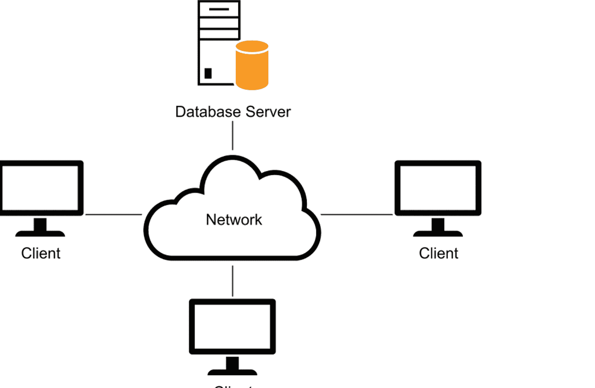

## 客户端/服务器系统的三个硬件组件

- `客户端` 是系统的 PC、Mac 和工作站。它们也可以是如笔记本电脑、平板电脑和智能手机等移动设备。

- `服务器` 是一台存储系统文件和数据库并为客户端提供服务的计算机。当它存储数据库时，通常被称为 `数据库服务器`。

- `网络` 由连接系统客户端和服务器的 `电缆`、通信线路和其他组件组成。

## 客户端/服务器系统的实现

- 在像上面那样的简单客户端/服务器系统中，服务器通常是一个高性能 PC，通过 `局域网（LAN）` 与客户端通信。

- 服务器也可以是中型系统，如 IBM System x 或 Unix 系统，也可以是大型机系统。

- 客户端/服务器系统还可以由一个或多个基于 PC 的系统、更多的中型系统以及分散在不同地理位置的大主机系统组成。这种系统通常被称为 `企业级系统`。

- 单个系统和局域网可以通过更大的私有网络（如 `广域网（WAN）`）或互联网等公共网络连接并共享 `数据`。

## 客户端/服务器系统的软件组件

图 1-2 展示了典型客户端/服务器系统的软件组件。在这里，服务器需要一个数据库管理系统（DBMS），如 MySQL 或 Microsoft SQL Server。该 DBMS 管理存储在服务器上的数据库。

与服务器不同，每个客户端都需要应用程序软件来执行有用的工作。这可以是一个购买的软件包（如财务会计软件包），也可以是为特定应用程序开发的定制软件。

尽管应用程序运行在客户端上，但它使用存储在服务器上的数据。这通过使用数据访问 API（应用程序编程接口）来实现。由于你处理 API 的技术取决于你所使用的编程语言和 API，因此你将在书中不会学习这些技术。相反，你将学习一种名为 SQL（结构化查询语言）的标准语言，它允许任何应用程序与任何 DBMS 通信。（在口语中，SQL 读作 S-Q-L 或 sequel。）

一旦安装了客户端和服务器的软件，客户端通过 SQL 查询（或简称查询）与服务器通信，这些查询通过 API 传递给 DBMS。在客户端向 DBMS 发送查询后，DBMS 解释查询并将结果返回给客户端。

在客户端/服务器系统中，处理分布在客户端和服务器之间。例如，在图中，服务器上的 DBMS 处理运行在客户端上的应用程序发出的请求。从理论上讲，这至少平衡了客户端和服务器之间的工作负载，使系统运行更高效。

## 客户端软件、服务器软件和 SQL 接口

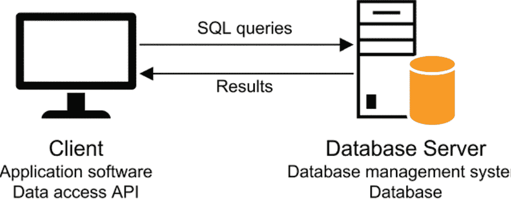

## 服务器软件

- 为了存储和管理客户端/服务器系统的数据库，每台服务器都需要一个如 MySQL 的 `数据库管理系统（DBMS）`。

- `DBMS` 执行的处理通常被称为 `后端处理`，而数据库服务器被称为 `后端`。

## 客户端软件

- `应用程序软件` 执行用户想要完成的工作。这种软件可以购买也可以开发。

- `数据访问 API`（`应用程序编程接口`）提供了应用程序程序与 `DBMS` 之间的接口。例如，对于 MySQL，Java 最常用的数据访问 `API` 是 JDBC（Java 数据库连接）。

- 客户端软件执行的处理通常被称为 `前端处理`，而客户端通常被称为 `前端`。

## SQL 接口

- 应用程序通过数据访问 API 发送 `SQL 查询` 与 DBMS 通信。当 DBMS 接收到查询时，它会提供服务，例如向客户端返回请求的数据（`查询结果`）。

- `SQL` 代表 `结构化查询语言`（Structured Query Language），它是处理关系型数据库的标准语言。

## 客户端/服务器系统对比文件处理系统

- 在客户端/服务器系统中，应用程序执行的处理通常分布在客户端和服务器之间。

- 在文件处理系统中，所有处理都在客户端上完成。客户端可以访问存储在服务器文件中的数据，但服务器不进行任何处理。因此，文件处理系统不是客户端/服务器系统。

图 1-2 客户端/服务器系统的软件组件

## 其他客户端/服务器架构

在最简单的形式下，客户端/服务器系统由单个数据库和多个客户端组成。然而，现在的许多客户端/服务器系统包含了额外的服务器。例如，图 1-3 显示了在客户端和数据库服务器之间包含额外服务器的客户端/服务器系统。

第一个示例是简单的网络化系统。在该系统中，只有应用程序的用户界面运行在客户端上。应用程序执行的其他处理存储在应用程序服务器上的一个或多个业务组件中。然后，客户端向应用程序服务器发送请求。如果请求涉及访问数据库，应用程序服务器形成相应的查询并将其传递给数据库服务器。查询结果随后返回到应用程序服务器，由其处理结果并将适当的响应返回给客户端。

类似的处理也发生在 Web 系统中，如图中的第二个示例所示。在这种情况下，运行在客户端上的 Web 浏览器用于向运行在互联网某处 Web 服务器上的 Web 程序发送请求。Web 程序可以使用 Web 服务执行其部分处理。然后，Web 程序或 Web 服务可以向数据库服务器发送数据请求。

在继续之前，你应该知道客户端/服务器系统并不是支持 SQL 的唯一系统。例如，传统的大机系统和新的瘦客户端系统也使用 SQL。然而，与客户端/服务器系统不同，这些类型系统的大部分处理都是由大型机或其他另一高性能机器完成的。连接到系统的终端和 PC 几乎不做工作。

## 使用应用服务器的网络化系统

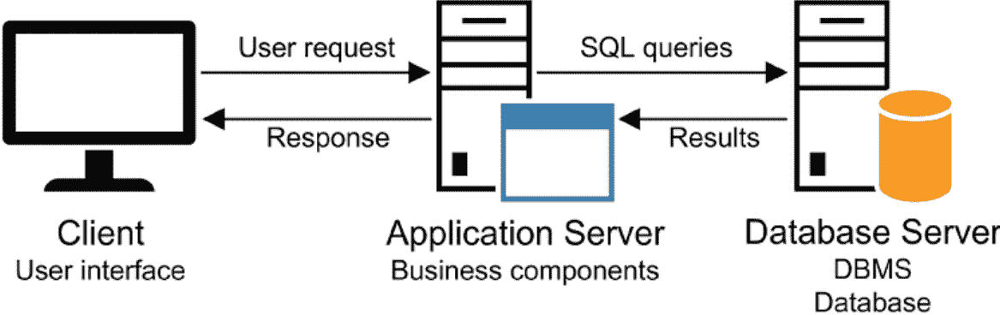

## 一个简单的基于 Web 的系统

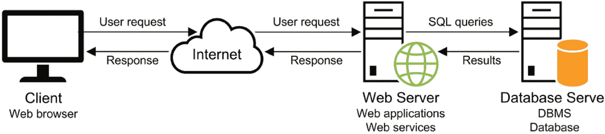

## 描述

- 除了数据库服务器和客户端，客户端/服务器系统还可以包含额外的服务器，例如应用程序服务器和 Web 服务器。

- 应用程序服务器通常用于存储作为应用程序处理部分的业务组件。特别是，这些组件用于处理来自运行在客户端的用户界面的数据库请求。


- Web 服务器通常用于存储 Web 应用程序和 Web 服务。Web 应用程序是设计运行在 Web 服务器上的应用程序。Web 服务类似于业务组件，不同的是它们与 Web 应用程序一样都被设计运行在 Web 服务器上。

- 在 Web 系统中，运行在客户端的 Web 浏览器通过互联网向 Web 服务器发送请求。然后，Web 服务器处理该请求并将任何数据请求传递给数据库服务器。

- 更复杂的系统架构可以包含两个或多个应用程序服务器、Web 服务器和数据库服务器。

图 1-3 其他客户端/服务器架构

## 关系型数据库模型简介

1970 年，E. F. Codd 博士为一种名为关系型数据库的新类型数据库增加了一个模型。这种数据库消除了与标准文件和其他数据库设计相关的一些问题。通过使用关系模型，你可以减少数据冗余，从而节省磁盘存储并实现高效的数据检索。你还可以以既直观又高效的方式查看和操作数据。今天，关系型数据库是数据库应用程序的事实标准。

## 表是如何组织的

关系型数据库模型规定，数据存储在一个或多个表中。它还规定，每个表都可以看作是一个由行和列组成的二维矩阵。这通过图 1-4 中的关系表进行了阐明。该表中的每行都包含关于单个供应商的信息。

在实践中，关系表中的行和列通常被称为更传统的术语：记录（records）和字段（fields）。事实上，某些软件包使用一组术语，另一些使用另一组，而有些则是两者的结合。在本书，我使用“行”（rows）和“列”（columns），因为这些是 MySQL 使用的术语。

通常，每个表都是根据现实世界的实体（如供应商或发票）建模的。然后，表的列代表该实体的属性，例如名称、地址和电话号码。表的每行代表该实体的一个实例。值存储在行和列的交汇处，有时也称为单元格（cell）。

如果一个表包含一个或多个能够唯一标识表中每行的列，你可以将这些定义为表的主键（primary key）。例如，图中 Vendors 表（供应商表）的主键是 `vendor_id` 列。在这个示例中，主键由单列组成。然而，主键也可以由两个或更多列组成，在这种情况下，它被称为复合键（composite key）。

除了主键外，某些数据库管理系统允许你定义额外的键来唯一标识表中的每行。例如，如果 Vendors 表中的 `vendor_name` 列包含唯一数据，它可以被定义为非主键。在 MySQL 中，这被称为唯一键（unique key）。

索引（Indexes）提供了一种根据一个或多个列的值访问表中的行的高效方法。由于应用程序通常通过引用其键值来访问表中的行，因此，为你定义的每个键都会自动创建一个索引。然而，你也可以为其他列定义索引。例如，如果你经常需要按邮政编码对 Vendors 进行排序，你可以为该列设置索引。像键一样，索引可以包含一个或多个列。

## 应付账数据库中的 Vendors 表

| vendor_id | vendor_name | vendor_address1 | vendor_address2 | vendor_city | vendor_st |
| :--- | :--- | :--- | :--- | :--- | :--- |
| 1 | US Postal Data Cctr | Attn: Dept. Windows Services | PO Box 7005 | Madison | WI |
| 2 | National Information Data Cctr | PO Box 96621 | | Washington | DC |
| 3 | Register of Copyrights | Library Congress | | Washington | DC |
| 4 | | 1990 West Blvd Ste 260 | | Los Angeles | CA |
| 5 | Newbridge Books | 3000 Cind Drive Drive | Washington | NJ |
| 6 | California Chamber Of Office | 3255 Ramirez Cr | | Sacramento | CA |
| 7 | Town Advertiser's Marketing Svcs | Kevin Minder | 3441 W Macarthur Blvd | Santa Ana | CA |
| 8 | BPF Industries | PO Box 9389 | | Fresno | CA |
| 9 | Pacific Gas & Electric | | | San Francisco | CA |
| 10 | Robbins Mobile Lock And Key | 96679 N Fresno | | Fresno | CA |
| 11 | Bill Marvin Electric Inc | 4583 E Home | | Fresno | CA |
| 12 | City Of Fresno | PO Box 2069 | | Fresno | CA |

## 概念

- 关系型数据库由表组成。表由行和列组成，也可以称为记录和字段。
- 关系型数据库通常是根据现实世界的实体（如供应商或发票）建模。
- 列代表实体的某些属性，例如名称、地址和电话号码。
- 行和列的交汇处有时称为单元格。单元格存储一个单一值。
- 大多数表都有主键，它可以唯一标识表中的每行。主键通常是单列，但也可以包含两个或更多列。如果主键使用两个或更多列，则被称为复合键。
- 除了主键外，某些数据库管理系统定义一个或多个非主键。在 MySQL 中，这些键被称为唯一键。像主键一样，非主键唯一标识表中的每行。
- 表也可以定义一个或多个索引。索引提供了一种根据一个或多个列的值访问表的高效方法。为主键和非主键自动创建一个索引。

图 1-4 数据库表是如何组织的

## 表是如何关联的

数据库表可以与特定列关联。图 1-5 显示的两个表说明了这一概念。在这里，Vendors 表中的每行与 Invoices 表中的一个或多行相关。这被称为一对多关系。

### 数据库中 Vendors（供应商）表与 Invoices（发票）表之间的关系

#### 主键

| vendor_id | vendor_name | vendor_address1 | vendor_address2 | vendor_city | vendor_st |
|---|---|---|---|---|---|
| 112 | Office Dept | File No 81901 | | Los Angeles | CA |
| 113 | Polstar | 4697 W Jacqueline Ave | | Fresno | CA |
| 114 | Postmaster Package System, Inc | Postage Due Technical | 1900 E Street | Fresno | CA |
| 115 | Roadbush | Dept Lu. 21995 | Employment Development Dept PO Box 826276 | Sacramento | CA |
| 116 | State of California | | 2874 S Cherry Ave | Fresno | CA |
| 117 | Suburban | | P.O. Box 860070 | Pasadena | CA |
| 118 | Unocal | | PO Box 206 | Fresno | CA |
| 119 | Yesmed, Inc | DataForms/Works | 1617 W. Shaw Ave | | Fresno | CA |
| 120 | Zylka Design | 3467 W Ave #103 | | Fresno | CA |
| 121 | United Parcel Service | P.O. Box 50382 | | Reno | NW |
| 122 | Federal Expression Corporation | P.O. Box 1140 | Dept A | Memphis | TN |

| invoice_id | vendor_id | invoice_number | invoice_date | invoice_total | payment_total | credit_total |
|---|---|---|---|---|---|---|
| 55 | 963253245 | 2014-06-10 | 40.75 | 40.75 | 0.00 | |
| 56 | 367447 | 2014-06-11 | 2433.00 | 2433.00 | 0.00 | |
| 57 | 7SC-90227 | 2014-06-11 | 1367.50 | 1367.50 | 0.00 | |
| 58 | 963253256 | 2014-06-13 | 53.25 | 53.25 | 0.00 | |
| 59 | 4314-3057 | 2014-06-13 | 13.75 | 13.75 | 0.00 | |
| 60 | 989319-467 | 2014-06-12 | 2312.20 | 2312.20 | 0.00 | |
| 61 | 248977 | 2014-06-15 | 25.87 | 25.87 | 0.00 | |
| 62 | 963253269 | 2014-06-15 | 26.75 | 26.75 | 0.00 | |
| 63 | 989319-427 | 2014-06-16 | 2115.81 | 2115.81 | 0.00 | |
| 64 | 963253267 | 2014-06-17 | 23.50 | 23.50 | 0.00 | |

#### 外键

- Invoices 表中的 `vendor_id` 列是一个外键，因为它标识了 Vendors 表中的一个相关行。一个表可以包含一个或多个外键。
- 当你在 MySQL 中为表使用外键时，你可以利用该外键来强制引用完整性。这样，MySQL 确保数据库中数据的任何更改都不会在表之间创建无效的关系。
- 最常见的关系类型是一对多关系，如 Vendors 和 Invoices 表之间的关系所示。一个表也可以与另一个表建立一对一或多对多的关系。

图 1-5 表之间的关系方式

## 列的定义

当你在表中定义一列时，你会为它分配属性，正如图 1-6 中 Invoices 表的设计所示。对于列，最关键的属性是其数据类型，它决定了在该列中可以存储的信息类型。在 MySQL 中，你可以从图中列出的数据类型中选择，还可以从第 8 章描述的其他数据类型中选择。当你定义表中的每一列时，通常会尝试分配一种尽可能减少磁盘存储使用的数据类型，因为这可以提高后续查询的性能。

除了数据类型外，你必须标识该列是否可以存储空值（或仅为 null）。`null` 代表未知、不可用或不适用的值。在图中，勾选了 NN（非空）框的列不允许空值。如果你不允许某列有空值，则必须指定。

此外，你还可以为列指定默认值。如果你在插入数据时没有提供值，则将使用该默认值。在 MySQL 中，你还可以将列定义为自增（auto increment），在插入新行时，该列会自动生成值。

| 列名 | 数据类型 | 主键 | 非空 | 唯一 | 自增 | 默认 | 注释 |
|---|---|---|---|---|---|---|---|
| invoice_id | int | | | | | | |
| vendor_id | int | | | | | | |
| invoice_number | varchar | | | | | | |
| invoice_date | date | | | | | | |
| invoice_total | decimal | | | | | | |
| payment_total | decimal | | | | | | |
| credit_total | decimal | | | | | |

| 类型 | 说明 |
|---|---|
| char | 字符 |
| int | 整数 |
| float | 浮点数 |
| date | 日期 |
| decimal | 十进制小数 |
| varchar | 可变长度字符串 |
| boolean | 布尔值 |
| timestamp | 时间戳 |
| text | 文本 |
| blob | 二进制大对象 |
| datetime | 日期和时间 |
| tinyint | 微型整数 |

| 约束 | 说明 |
|---|---|
| NULL | 允许空 |
| NOT NULL | 不允许空 |
| UNIQUE | 唯一 |
| PRIMARY KEY | 主键 |
| AUTO_INCREMENT | 自增 |
| DEFAULT | 默认值 |
| COMMENT | 注释 |

# AP（应付账款）数据库的 EER 图

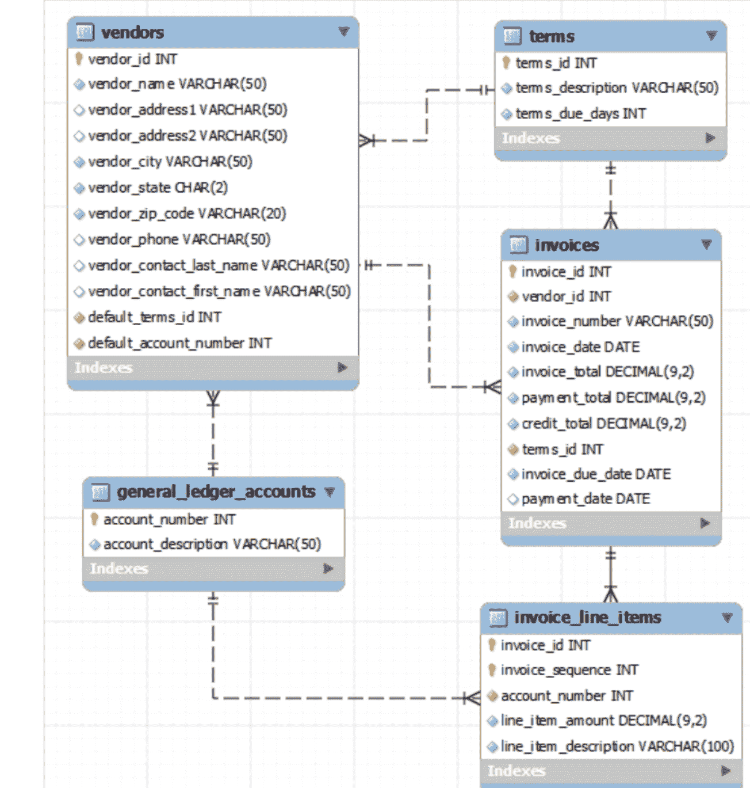

## 描述

- 实体关系（ER）图或增强实体关系（EER）图可以显示数据库中的表是如何定义和关联的。

图 1-7 如何阅读数据库图

# SQL 及基于 SQL 的系统简介

在接下来的主题中，你将学习 SQL 和基于 SQL 的数据库管理系统是如何演变的。此外，你还将学习一些流行的基于 SQL 的系统之间的比较。

# SQL 简史

在第一个关系型数据库管理系统发布之前，每个数据库都有独特的物理结构和独特的编程语言，程序员必须理解这些语言。随着 SQL 和关系型数据库管理系统的出现，这一切都改变了。

图 1-8 列出了 SQL 历史上的重要事件。1970 年，E. F. Codd 博士发表了一篇文章，描述了他与 IBM 的研究团队合作开发的关系模型。随后，在 1979 年，Relational Software, Inc. 发布了第一个名为 Oracle 的关系型数据库管理系统。RDBMS 运行在小型计算机上，并使用 SQL 作为其语言。该产品取得了巨大的成功，该公司后来将其名称更改为 Oracle 以反映这一点。

1982 年，IBM 发布了它的第一个商业基于 SQL 的 RDBMS，称为 SQL/DS（SQL/数据系统）。紧随在 1985 年发布了 DB2（数据库 2）。这两个系统都运行在 IBM 主机计算机上。后来，DB2 被移植到其他操作系统上，包括 Unix 和 Windows。今天，它仍然是 IBM 领先的数据库系统。

在 20 世纪 80 年代，开发了其他基于 SQL 的数据库系统，包括 SQL Server。这些系统中的每一个都使用 SQL 作为查询语言，每个实现都是独特的，直到美国国家标准协会（ANSI）发布了第一套数据库查询语言标准。当每家数据库制造商都尝试遵守这些标准时，他们对 SQL 的实现变得越来越相似。然而，每个系统仍然有自己的 SQL 方言，其中包含了对标准的补充或扩展。

尽管你应该了解 SQL 标准，但它们对你作为 MySQL 程序员的工作影响微乎其微。标准的主要益处是每种方言中的基本 SQL 语句都是相同的。因此，一旦你学会了一种方言，学习另一种就相对容易。另一方面，将使用 SQL 的应用程序从一种类型的数据库迁移到另一种类型通常需要大量的更改。

1995 年，MySQL 首次发布，并被开发它的公司在内部使用。2000 年，MySQL 成为一个开源数据库。从那时起，MySQL 已成为流行的数据库之一，特别是对于 Web 应用程序。2008 年，MySQL 被 Sun Microsystems 收购，并在 2010 年，Oracle 收购了 Sun。

# SQL 历史上的重要事件

| 年份 | 事件 |
|---|---|
| 1970 | E. F. Codd 博士开发了关系型数据库模型。 |
| 1979 | Relational Software, Inc.（后更名为 Oracle）发布了第一个关系型 DBMS Oracle。 |
| 1982 | IBM 发布了它的第一个关系型数据库系统 SQL/DS（SQL/数据系统）。 |
| 1985 | IBM 发布了 DB2（数据库 2）。 |
| 1987 | Microsoft SQL Server。 |
| 1989 | 美国国家标准协会（ANSI）发布了第一套数据库查询语言标准，称为 ANSI/ISO SQL-89 或 SQL-1。这些标准与 IBM 的 SQL-2 方言相似。由于它们不是严格的标准，大多数商业产品都可以声称符合标准。 |
| 1992 | ANSI 发布了修订后的标准（ANSI/ISO SQL-92 或 SQL-2），它们比 SQL-1 更严格，并包含了许多新功能。这些标准引入了合规性级别（或相关性级别），指示方言符合标准的程度。 |
| 1995 | MySQL 发布了 MySQL 供内部使用。 |
| 1999 | ANSI 发布 SQL3（ANSI/ISO:1999）。这些标准整合了新功能，包括对对象的支持。引入了合规性级别，并被定义了合规性要素要素的核心规范——九个包所取代。每个包都为服务特定的市场利基而设计。 |
| 2000 | MySQL 成为一个开源数据库。 |
| 2003 | ANSI 发布 SQL4（ANSI/ISO:2003）。这些标准引入了与 XML 相关的功能、标准序列和标识列。 |
| 2006 | ANSI 发布 SQL2006，定义了 SQL 如何与 XML 使用。这些标准还允许应用程序将 XQuery 集成到它们的 SQL 代码中。 |
| 2008 | Sun Microsystems 收购了 MySQL。 |


| 2008 | ANSI 发布 SQL2008。这些标准引入了 `INSTEAD OF` 触发器和 `TRUNCATE` 语句。 |
| 2010 | Oracle 收购了 Sun Microsystems 和 MySQL。 |

## 描述

- 虽然 SQL 是一种标准语言，每个厂商都有自己的 SQL 方言和变体，这些可能包含对标准的扩展。

# 了解“标准 SQL”如何帮助你

- 最基本的 SQL 语句在所有 SQL 方言中都是相同的。
- 一旦你学会了一种 SQL 方言，就可以轻松地学习其他方言。

# 了解“标准 SQL”对你没有帮助的地方

- 任何非平凡的应用程序从一种数据库类型迁移到另一种时，通常需要重大更改。

图 1-8 SQL 简史

# Oracle、DB2、SQL Server 和 MySQL 的比较

在接下来的主题中，你将学习 SQL 和基于 SQL 的数据库管理系统是如何演变的。此外，你还将学习一些最流行的基于 SQL 的系统之间的比较。

# SQL 语句

在接下来的主题中，你将学习 MySQL 提供的一些 SQL 语句。你可以使用其中一些语句来操作数据库中的数据，使用另一些语句来处理数据库对象。虽然在阅读完这些主题后，你可能无法直接编写这些语句，但你应该对它们的工作原理有一个良好的了解。这样，当本书的其余部分介绍这些语句的编码细节时，你将会有充分的准备。

## SQL 语句简介

图 1-10 总结了一些最常用的 SQL 语句。这些语句可以分为两类。操作数据库中数据的语句称为**数据操纵语言 (DML)**。这些语句在图中的第一组中，是应用程序程序员最常用的语句。

创建数据库和处理数据库内对象的语句称为**数据定义语言 (DDL)**。在大型系统中，这些语句专门由数据库管理员 (DBA) 使用。维护现有数据库、对其进行调优以提高性能以及创建新数据库是 DBA 的工作。然而，在较小的系统中，SQL 程序员可能会担任 DBA 的角色。

## 用于处理数据的 SQL 语句 (DML)

| 语句 | 描述 |
| --- | --- |
| `SELECT` | 从一个或多个表中检索数据。 |
| `INSERT` | 向表中添加新行。 |
| `UPDATE` | 修改表中现有的行。 |
| `DELETE` | 从表中删除现有行。 |

## 用于处理数据库对象的 SQL 语句 (DDL)

| 语句 | 描述 |
| --- | --- |
| `CREATE DATABASE` | 在服务器上创建一个新数据库。 |
| `CREATE TABLE` | 在数据库中创建一个新表。 |
| `CREATE INDEX` | 为表创建一个新索引。 |
| `ALTER TABLE` | 修改现有表的定义。 |
| `ALTER INDEX` | 修改现有索引的结构。 |
| `DROP DATABASE` | 删除现有数据库及其所有表。 |
| `DROP TABLE` | 删除现有表。 |
| `DROP INDEX` | 删除现有索引。 |

## 描述

- SQL 语句可以分为两类：允许你处理数据库中数据的**数据操纵语言 (DML)**，以及允许你处理数据库中对象的**数据定义语言 (DDL)**。
- MySQL 程序员通常使用 DML 语句，而**数据库管理员 (DBA)** 则使用 DDL 语句。

图 1-10 SQL 语句简介

## 如何处理数据库对象

为了向你演示如何使用上图所示的 DDL 语句，图 1-11 给出了一些示例。在这里，第一个示例创建了一个名为 AP 的数据库。然后，第二个示例选择了该数据库。结果是，图中其余语句都是针对 AP 数据库运行的。

第三个示例创建了本章中一直使用的 Invoices 表。如果你现在不理解所有这些代码，不要担心。你将在第 11 章学习如何编写这样的语句。现在，只需要意识到该语句定义了表中的每一列，包括其数据类型、是否允许空值以及（如果有的话）其默认值即可。

此外，第三个示例还定义了表的主键和外键列。这些定义是约束的一种类型。由于 Invoices 表包含指向 Vendors 和 Terms 表的外键，因此这些表必须在 Invoices 表之前创建。相反，在删除 Vendors 和 Terms 表之前，你必须先删除 Invoices 表。

图中的第四个示例通过向 Invoices 表添加一列来修改该表。与创建该表的语句一样，该语句指定了新列的属性。然后，第五个示例删除了刚刚添加的列。

第六个示例在 Invoices 表上创建了一个索引。在这种情况下，索引是针对 `vendor_id` 列的，该列被频繁用于访问表。然后，最后一个示例删除了刚刚添加的索引。

## 创建新数据库的语句

```sql
CREATE DATABASE ap
```

## 选择当前数据库的语句

```sql
USE ap
```

## 创建新表的语句

```sql
CREATE TABLE invoices
(
invoice_id INT PRIMARY KEY AUTO_INCREMENT,
vendor_id INT NOT NULL,
invoice_number VARCHAR(50) NOT NULL,
invoice_date DATE NOT NULL,
invoice_total DECIMAL(9,2) NOT NULL,
payment_total DECIMAL(9,2) DEFAULT 0,
credit_total DECIMAL(9,2) DEFAULT 0,
terms_id INT NOT NULL,
invoice_due_date DATE NOT NULL,
payment_date DATE,
CONSTRAINT invoices_fk_vendors
FOREIGN KEY (vendor_id)
REFERENCES vendors (vendor_id),
CONSTRAINT invoices_fk_terms
FOREIGN KEY (terms_id)
REFERENCES terms (terms_id)
)
```

## 向表中添加新列的语句

```sql
ALTER TABLE invoices
ADD balance_due DECIMAL(9,2)
```

## 删除新列的语句

```sql
ALTER TABLE invoices
DROP COLUMN balance_due
```

## 在表上创建索引的语句

```sql
CREATE INDEX invoices_vendor_id_index
ON invoices (vendor_id)
```

## 删除新索引的语句

```sql
DROP INDEX invoices_vendor_id_index
ON invoices
```


## 如何查询单表

图 1-12 显示了如何使用 `SELECT` 语句查询数据库中的单表。首先，该图显示了 Invoices 表的一些列和行。然后，在随后的 `SELECT` 语句中，`SELECT` 子句指定要检索的列，`FROM` 子句指定包含这些列的表（称为基表）。在这种情况下，将从 Invoices 表中检索六列。

注意，最后一列 `balance_due` 是根据表中的其他三列计算得。换句话说，数据库中实际上并不名为 `balance_due` 的列。这种名为 `balance_value` 的列被称为计算值，它只存在于查询结果中。

除了 `SELECT` 和 `FROM` 子句外，此 `SELECT` 语句还包含 `WHERE` 子句和 `ORDER BY` 子句。`WHERE` 子句给出了选择行的标准。在这种情况下，只有当 `balance_due` 大于零时，才会选择该行。最后，行按 `invoice_date` 排序。

此图显示了结果集。`SELECT` 语句从数据库请求数据，并接收一个类似于表的结果集。

## The Invoices 基表

| invoice_id | vendor_id | invoice_date | invoice_total | payment_total | credit_total | terms_id | balance_due |
|---|---|---|---|---|---|---|---|
| 1 | 122 | 2014-07-10 | 85.31 | 0.00 | 0.00 | 3 | 85.31 |
| 2 | 123 | 2014-07-18 | 52.25 | 0.00 | 0.00 | 3 | 52.25 |
| 3 | 123 | 2014-07-21 | 57.45 | 0.00 | 0.00 | 3 | 57.45 |
| 4 | 123 | 2014-07-21 | 144.70 | 0.00 | 0.00 | 3 | 144.70 |
| 5 | 123 | 2014-07-22 | 15.50 | 0.00 | 0.00 | 3 | 15.50 |

## 从 Invoices 检索列的 SELECT 语句

```sql
SELECT invoice_number, invoice_date, invoice_total,
payment_total, credit_total,
invoice_total - payment_total AS balance_due
FROM invoices
WHERE invoice_total - payment_total - credit_total > 0
ORDER BY invoice_date
```

## SELECT 语句定义的的结果集

| invoice_number | invoice_date | invoice_total | payment_total | credit_total | balance_due |
|---|---|---|---|---|---|
| 39104 | 2014-07-10 | 85.31 | 0.00 | 0.00 | 85.31 |
| 262524 | 2014-07-18 | 52.25 | 0.00 | 0.00 | 52.25 |
| 319813 | 2014-07-21 | 57.45 | 0.00 | 0.00 | 57.45 |
| 262568 | 2014-07-21 | 144.70 | 0.00 | 0.00 | 144.70 |
| 262573 | 2014-07-22 | 15.50 | 0.00 | 0.00 | 15.50 |

## 概念

- 你使用 `SELECT` 语句从基表中检索选定的列和行。`SELECT` 语句的结果是一个结果表或结果集，如上所示。
- 结果集可以包含从表列计算出的计算值。
- `SELECT` 语句通常被称为查询。

## 如何从两个或多个表中连接数据

图 1-13 展示了一个从两个表中检索数据的 `SELECT` 语句连接。这种操作被称为“连接”（join），因为来自两个表的数据被合并到了单个结果集中。例如，图中的 `SELECT` 语句连接了来自 Invoices（发票）表和 Vendors（供应商）表的数据。

内连接（inner join）是最常见的连接类型。当你使用内连接时，只有当两个表的相关列匹配时，这两个表中的行才会包含在结果表中。这些匹配的列在 `SELECT` 语句的 `FROM` 子句中指定。例如，在图中的 `SELECT` 语句中，只有当 Vendors 表中一个或多行的 `vendor_id` 列的值与 Invoices 表中的 `vendor_id` 列的值匹配时，Invoices 和 Vendors 表中的行才会被包含进来。如果某个特定供应商没有发票，则它不会被包含在结果集中。

尽管此图只显示了如何连接两个表的数据，但你可以扩展此语法来连接来自三个或更多表的数据。例如，如果你想在图所示的结果中包含来自 `Invoice_Line_Items` 表的行项目数据，可以这样编写 `SELECT` 语句的 `FROM` 子句：

```sql
FROM vendors
  INNER JOIN invoices
    ON vendors.vendor_id = invoices.vendor_id
  INNER JOIN invoice_line_items
    ON invoices.invoice_id = invoice_line_items.invoice_id
```

然后，在 `SELECT` 子句中，你可以包含 `Invoice_Line_Items` 表中的任何列。

除了内连接，包括 MySQL 在内的大多数关系型数据库都支持其他类型的连接，即外连接（outer joins）。外连接允许你包含表中的所有行，即使另一个表中没有匹配的行。你将在第 4 章学习更多关于不同类型连接的知识。

## SELECT 语句连接 Vendors 和 invoices 表的数据

```sql
SELECT vendor_name, invoice_number, invoice_date, invoice_total
FROM vendors INNER JOIN invoices
ON vendors.vendor_id = invoices.vendor_id
WHERE invoice_total > 500
ORDER BY vendor_name, invoice_total DESC
```

## SELECT 语句定义的结果集

| vendor_name | invoice_number | invoice_date | invoice_total |
| --- | --- | --- | --- |
| Federal Express Corporation | 962532230 | 2014-07-07 | 739.20 |
| Ford Motor Credit Company | 9992721 | 2014-07-24 | 503.28 |
| Franchise Tax Board | RTR-72-3662-X | 2014-05-25 | 1600.00 |
| Fresno County Collector | P02-B827757 | 2014-05-03 | 856.92 |
| IBM | Q545443 | 2014-06-09 | 1575.00 |
| Ingram | 31359783 | 2014-06-03 | 103.58 |
| Ingram | 31361833 | 2014-07-21 | 579.42 |
| Mallory Lithography Inc | 0-2058 | 2014-05-28 | 3966.19 |

## 概念

- 连接允许将两个或多个表的数据合并到单个结果集中。
- 最常见的连接类型是内连接。当两个表的相关列匹配时，该类型的连接会返回两个表中的行。
- 如果连接中的另一个表不包含匹配的行，则外连接会返回一个表中的行。

## 如何在表中添加、更新和删除数据

图 1-14 显示了你如何使用 `INSERT`、`UPDATE` 和 `DELETE` 语句来修改表中的数据。例如，在图中，第一个语句是 `INSERT` 语句，用于向 Invoices 表添加行。为了实现这一点，`INSERT` 子句指定了在 `VALUES` 子句中提供值的列名。

在第 7 章中，你将学习更多关于指定列名和值的知识。现在，只需注意除非该列是允许空值或定义了默认值的列，否则你必须为列指定一个值。

图中的两个 `UPDATE` 语句显示了如何更改表中一个或多行的数据。例如，第一个语句将 Invoices 表中发票号为 367447 的发票的 `credit_total` 列赋值为 35.89。第二个语句将 Invoices 表中 `id` 列值为 4 的每行的发票日期增加 30 天。

要从表中删除删除行，你需要使用 `DELETE` 语句。例如，图中的第一个 `DELETE` 语句删除了发票号为 4-342-869。第二个 `DELETE` 语句删除所有余额为0的发票。但是，由于 Invoices 表引用了 `Invoice_Line_Items` 表，除非发票不包含行项目，否则这些 `DELETE` 语句将无效。让这些 `DELETE` 语句生效的方法是先删除 `Invoice_Line_Items` 表中的对应行。

## 如何在应用程序中使用 SQL

本书将教你如何在 MySQL 环境内部使用 SQL。然而，正如你在上一节章节中所学习的，SQL 也经常被用于应用程序中。在接下来的主题中，你将了解到这种工作原理的通俗概念。

正如你将看到的，从应用程序访问 MySQL 数据库涉及很多方面的工作。这就是为什么大多数程序员都使用一个框架，该框架可以更方便地在数据库上执行 SQL 语句。在某些情况下，应用程序人员通过编写实用程序类和数据访问类来创建自己的框架。在其他情况下，应用程序人员会使用提供他们所需类的现有框架。

## 访问 MySQL 数据的常用选项

图 1-16 显示了当你使用编程语言编写自定义应用程序时，访问 MySQL 数据库的三种方法。具体的技术取决于开发应用程序的语言。然而，大多数现代语言都使用允许你连接到 MySQL 数据库的 API。

API 是一种称为数据库驱动程序的软件，用于与数据库进行通信。对于某些语言，数据库驱动程序是内置的。对于其他语言，你需要下载并安装数据库驱动程序。

例如，要从 PHP 应用程序访问 MySQL 数据库，你通常从两个 API 中进行选择。一些程序员倾向于使用 `mysqli`（MySQL 增强扩展）API。另一些程序员倾向于使用较新的 `PDO`（PHP 数据对象）API。这两者都不需要数据库驱动程序，该驱动程序通常作为 PHP 语言的一部分安装。

另一方面，要从 Java 应用程序访问 MySQL 数据库，你通常使用 `JDBC`（Java 数据库连接）API。此 API 需要驱动程序来与 MySQL 通信。在大多数情况下，你可以使用 MySQL 网站提供的 `Connector/J` 驱动程序将 Java 应用程序连接到 MySQL 数据库。

虽然使用 PHP 和 Java 等非微软语言使用 MySQL 更常见，但也可以使用 C# 和 Visual Basic.NET 等 .NET 语言使用 MySQL。然而，.NET 平台默认不包含数据库驱动程序；你通常需要下载并安装 MySQL 网站提供的 `Connector/NET` 驱动程序。然后，你就可以使用 `ADO.NET` API 来访问 MySQL 数据库。

## 访问 MySQL 数据的常用选项


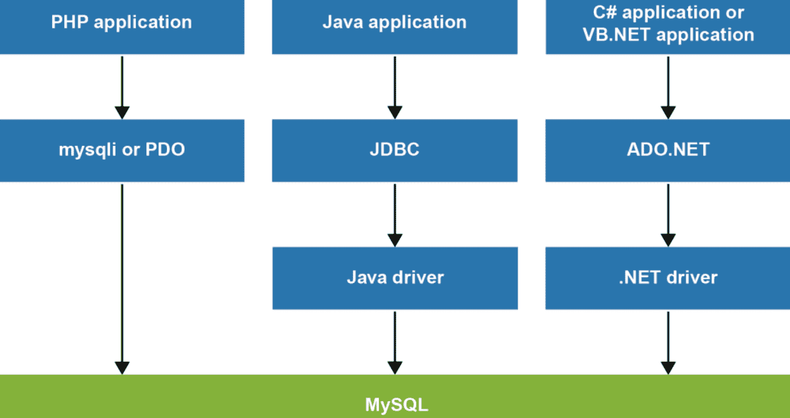

## 两种常用的 MySQL 驱动程序

| 名称 | 描述 |
| :--- | :--- |
| Connector/J | 将 Java 应用程序连接到 MySQL 数据库 |
| Connector/Net | 将 .NET 应用程序连接到 MySQL 数据库 |

## 说明

- 为了与 MySQL 数据库交互，应用程序使用数据访问 API。例如，PHP 使用 `mysqli` API 或 `PDO` API，Java 使用 `JDBC` API，而 C# 和 Visual Basic 等 .NET 语言使用 `ADO.NET` API。
- 大多数现代编程语言都提供一个你可以用于访问 MySQL 的 API。
- 某些编程语言包含一个用于其访问 MySQL 的 API 的名为数据库驱动程序的软件。例如，PHP 包含了用于 `mysqli` 和 `PDO` API 的 MySQL 驱动程序。因此，当你使用 PHP 时，通常不需要安装数据库驱动程序。
- 某些编程语言不提供与 MySQL 数据库通信的数据库驱动程序。例如，Java 不包含用于 `JDBC` API 的 MySQL 驱动程序。因此，在使用 Java 访问 MySQL 之前，你通常需要安装如 `Connector/J` 等驱动程序。

## 从 MySQL 获取数据的 PHP 代码

图 1-17 展示了使用 `PDO` API 在 MySQL 数据库上执行 SQL 语句的 PHP 代码。此代码显示了 Vendors（供应商）和 Invoices（发票）表中的信息。它由应用程序创建了 `PDO` 对象，然后使用它们来显示获取的数据。

如果你有一定的 PHP 编程经验，理解这段代码应该不会有困难。如果你没有 PHP 经验，也没关系。在这种情况下，请关注此代码如何使用 `PDO` API 在 MySQL 数据库上执行 SQL。如果你想学习通过 PHP 操作数据库，我们推荐 *Murach's PHP and MySQL*。

图中的代码从定义一个 PHP 脚本开始。在该脚本中，第一条语句将一个 `SELECT` 语句存储在变量 `$query` 中。接下来的三条语句创建了变量，存储连接到与 PHP 应用程序运行在同一台计算机上的名为 `ap` 的 MySQL 数据库所需的信息。这包括指定用户名 `"ap-tester"` 和密码 `"sesame"` 的变量。

在这里，创建数据库的同一个脚本也创建了 `ap-tester`。该用户权限有限。具体来说，它只能访问 `ap` 数据库，不能访问其他数据库。此外，它只能处理数据库中的数据，而不能修改数据库的结构。因此，作为 `ap-tester` 连接到数据库比作为全局用户或对所有数据库拥有所有权限的 `root` 连接更安全。

在指定连接信息后，此代码使用这些变量创建一个代表数据库的 `PDO` 对象。如果此代码无法创建 `PDO` 对象，就会发生名为 `PDOException` 的错误，应用程序将显示错误消息并结束。否则，此代码使用 `PDO` 对象执行 `SELECT` 语句，并将结果存储在名为 `$rows` 的变量中。

此时，HTML 标签开始显示一个 HTML 页面。在 `<body>` 内部，PHP 脚本遍历结果集中的每一行并在 HTML 页面上显示数据。具体来说，它显示了 `vendor_name`、`invoice_number` 和 `invoice_total` 列。在这里，使用名为 `number_format` 的 PHP 函数对 `invoice_total` 列进行格式化。

虽然这段代码可能看起来很复杂，但图中只有这条语句执行 SQL 语句。此代码还可以执行 `INSERT`、`UPDATE` 和 `DELETE` 语句。你将在书中学习如何编写这些 SQL 语句。

## 从 MySQL 获取数据的 PHP 代码

```php
<?php
$dsn = 'mysql:host=localhost;dbname=ap';
$username = 'ap-tester';
$password = 'sesame';

try {
    $db = new PDO($dsn, $username, $password);
    $query = "SELECT vendor_name, invoice_number, invoice_total
              FROM vendors
              INNER JOIN invoices ON vendors.id = invoices.vendor_id
              WHERE invoice_total > 500
              ORDER BY vendor_name DESC";
    $rows = $db->query($query);
?>
<!DOCTYPE html>
<html>
<head>
    <title>DB Test</title>
</head>
<body>
    <h1>Invoices with totals over 500</h1>
    <?php foreach ($rows as $row) : ?>
        <p>
            Vendor: <?php echo $row['vendor_name']; ?><br>
            Invoice No: <?php echo $row['invoice_number']; ?><br>
            Total: <?php echo number_format($row['invoice_total'], 2); ?>
        </p>
    <?php endforeach; ?>
</body>
</html>
<?php
} catch (PDOException $e) {
    $error_message = $e->getMessage();
    echo $error_message;
    exit();
}
```

## 从 MySQL 获取数据的 Java 代码

图 1-18 展示了使用 `JDBC` API 在 MySQL 数据库上执行 SQL 语句的 Java 代码。此代码显示了 Vendors 和 Invoices 表中的信息。

如果你有一定的 Java 编程经验，理解这段代码应该不会有困难。如果你没有 Java 经验，没关系。在这种情况下，请关注此代码如何使用 API 在 MySQL 数据库上执行 SQL。如果你想学习更多使用 Java 操作数据库，我们推荐 *Murach's Java Programming* 和 *Murach's Java Servlets and JSP*。

在执行此代码之前，需要从 MySQL 网站下载 `Connector/J` 驱动。然后，你可以将驱动程序的 JAR 文件添加到应用程序的库中。

图中代码从导入 `java.sql` 包中的所有类开始。这些类定义了用于访问 MySQL 数据库的 `JDBC` 对象，如 `Connection` 对象。

```java
import java.sql.*;
import java.text.NumberFormat;

public class Main {
    public static void main(String[] args) {
        String url = "jdbc:mysql://localhost:3306/ap";
        String user = "ap-tester";
        String password = "sesame";

        String query = "SELECT vendor_name, invoice_number, invoice_total " +
                       "FROM vendors " +
                       "INNER JOIN invoices ON vendors.id = invoices.vendor_id " +
                       "WHERE invoice_total > 500 " +
                       "ORDER BY vendor_name DESC";

        try (Connection conn = DriverManager.getConnection(url, user, password);
             Statement stmt = conn.createStatement();
             ResultSet rs = stmt.executeQuery(query)) {

            NumberFormat nf = NumberFormat.getCurrencyInstance();

            while (rs.next()) {
                String vendor = rs.getString("vendor_name");
                int invoiceNo = rs.getInt("invoice_number");
                double total = rs.getDouble("invoice_total");

                System.out.println("Vendor: " + vendor);
                System.out.println("Invoice No: " + invoiceNo);
                System.out.println("Total: " + nf.format(total));
            }
        } catch (SQLException e) {
            e.printStackTrace();
        }
    }
}
```

## 从 MySQL 获取数据的 Java 代码（片段）

```java
public static void main(String args[]) {
    String query =
        "SELECT vendor_name, invoice_number, invoice_total " +
        "FROM vendors INNER JOIN invoices " +
        "ON vendors.vendor_id = invoices.vendor_id " +
        "WHERE invoice_total >= 500 " +
        "ORDER BY vendor_name, invoice_total DESC";
}
```

```java
String dbUrl = "jdbc:mysql://localhost:3306/ap";
String username = "ap_tester";
String password = "sesame";

// 定义常用的 JDBC 对象
try (Connection connection = DriverManager.getConnection(dbUrl, username, password);
     Statement statement = connection.createStatement();
     ResultSet rs = statement.executeQuery(query)) {
```

```java
// 显示 SELECT 语句的结果
System.out.println("Invoices with totals over 500:\n");
while (rs.next()) {
    String vendorName = rs.getString("vendor_name");
    String invoiceNumber = rs.getString("invoice_number");
    double invoiceTotal = rs.getDouble("invoice_total");

    NumberFormat currency = NumberFormat.getCurrencyInstance();
    String invoiceTotalString = currency.format(invoiceTotal);

    System.out.println("Vendor: " + vendorName + "\n"
                        + "Invoice No: " + invoiceNumber + "\n"
                        + "Total: " + invoiceTotalString + "\n");
}
```

```java
} catch (SQLException e) {
    System.out.println(e.getMessage());
}
```

## 描述

- 在可以使用 Java 操作 MySQL 之前，你必须安装数据库驱动程序。为了做到这一点，你可以下载驱动程序的 JAR 文件并将其添加到 Java 应用程序可用的库中。
- 要从 Java 应用程序中执行 SQL 语句，你可以使用 `JDBC` 对象，如 `Connection`、`Statement` 和 `ResultSet` 对象。

## 视角

为了帮助你理解如何在程序中使用 SQL，本章向你介绍了客户端/服务器系统的硬件和软件组件。它还描述了关系型数据库的组织方式以及使用方法。有了这些背景，你现在准备好开始使用 MySQL 了。在下一章，你将学习如何使用一些处理 MySQL 数据库的工具。

## 术语

| 客户端 | 开源数据库 |
| :--- | :--- |
| 服务器 | 行操作 |
| 数据库服务器 | 数据操作语言 (DML) |
| 网络 | 记录数据定义 |
| 客户端/服务器系统 | 数据定义语言 (DDL) |
| 局域网 (LAN) | 数据库管理员 (DBA) |
| 企业级系统 | 主键约束 |
| 广域网 (WAN) | 复合键基表 |
| 数据库管理系统 (DBMS) | 非主键结果集 |
| 后端 | 唯一键计算值 |
| 应用软件 | 索引查询 |
| API (应用程序编程接口) | 外键连接 |
| 数据访问 API | 一对多内连接 |
| JDBC (Java 数据库连接) | 关系外连接 |
| 前端 | 一对一关系块注释 |
| SQL (结构化查询语言) | 多对多单行注释 |
| 查询 | 引用完整性数据库驱动 |
| 查询结果 | MySQL 数据类型 |
| 应用服务器 | 空值 PDO |
| Web 服务器 | 默认值 ADO.NET |
| 业务组件 | 实体关系 (ER) 图 |
| Web 应用程序 | 增强型实体关系 (EER) 图 |
| Web 服务 | 图表 |
| Web 浏览器 | 关系型数据库管理系统 (RDBMS) |
| | SQL 方言 |


| 轻量客户端 | SQL 扩展 |
| --- | --- |
| 关系型数据库 |  |

# 如何使用 MySQL Workbench 和其他工具

在上一章中，你学习了如何通过关系型数据库使用 SQL 语句。在执行这些语句之前，你需要了解如何使用 Workbench。此外，你应该熟悉 MySQL 客户端（命令行界面）。

- MySQL Workbench 简介
- MySQL Workbench 标签页
- 打开数据库连接
- 启动和停止服务器
- 导航数据库对象
- 查看并编辑表定义
- 查看并编辑数据
- 使用 Workbench 执行 SQL 语句
- 使用片段 (snippets)
- 处理语法错误
- 打开和保存 SQL 脚本
- 执行 SQL 脚本
- 使用参考手册
- 查看手册
- 查找信息
- 使用 MySQL 客户端
- 启动和停止 MySQL 客户端
- 使用客户端操作数据库
- 视角

## MySQL Workbench 简介

MySQL Workbench 是一个方便操作 MySQL 的图形化工具。我们建议在学习本书时使用该工具。本章展示了如何使用 6.2 版本。尽管存在细微差异，但本章介绍的技能适用于后续版本。

## MySQL Workbench 的标签页

当你启动 MySQL Workbench 时，它会显示其主标签页，如图 2-1 所示。该标签页分为三个部分：`MySQL Connections`（连接）、`Models`（模型）和 `Shortcuts`（快捷方式）。

`MySQL Connections` 部分包含了用于连接 MySQL 服务器的链接。然后，你可以使用该连接编写并运行 SQL 语句。默认情况下，此部分包含一个连接，允许你以 `root` 用户身份连接到本地运行的 MySQL 服务器。在书中你只需要这个连接。如有，可以点击 `MySQL Connections` 右侧的 `+` 图标创建其他连接。

`Models` 部分包含了让你从称为 EER 模型的数据创建数据库图的链接。你还可以使用此部分打开已有的 EER 模型或创建新模型。然后你可以处理相应的 EER 图。要了解更多，请阅读第 10 章。

`Shortcuts` 部分包含了额外的 MySQL 工具链接。它还包含一些 MySQL 博客、论坛等。本书没有如何使用这些链接，但在你学习了书中描述的 MySQL 基础技能后，你可能会发现它们很有用。

## MySQL Workbench 的 Home 标签页

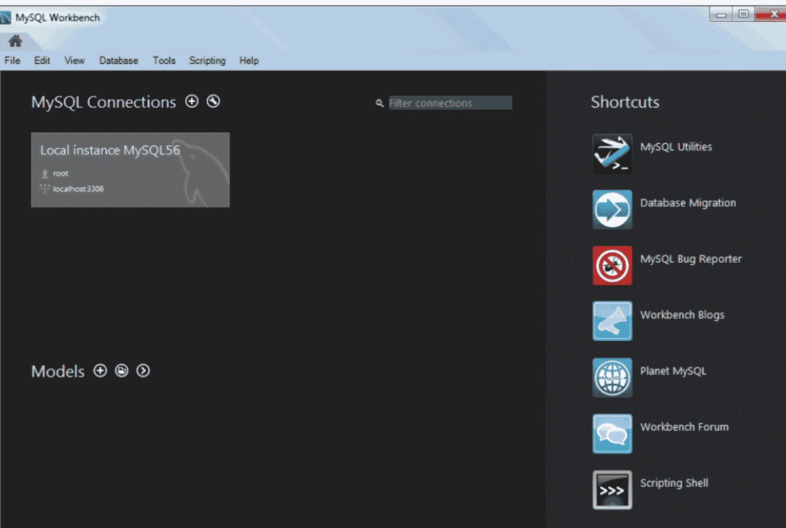

### 描述

- MySQL Workbench 的 Home 标签页分为三个主要部分：`MySQL Connections`（MySQL 连接）、`Models`（模型）和 `Shortcuts`（快捷方式）。
- 你可以使用 `MySQL Connections` 部分来启动和停止数据库服务器，并编写和运行 SQL 语句。
- 你可以使用 `Models` 部分来设计数据库。
- 你可以使用 `Shortcuts` 部分打开其他 MySQL 工具，包括一些 MySQL 博客和论坛。
- 你可以通过点击带有房屋图标的标签页返回 Home 标签页。此标签页始终显示在 Workbench 窗口的左上角。

图 2-1 MySQL Workbench 的 Home 标签页

## 如何打开数据库连接

在操作数据库之前，你需要先连接到数据库服务器。当你启动 MySQL Workbench 时，`MySQL Connections` 部分会显示已保存连接列表。

默认情况下，MySQL Workbench 在此列表中有一个保存的连接。它名为“Local instance MySQL 56”，并以 `root` 用户身份连接到运行本地计算机 `3306` 端口的 MySQL 服务器。（这假设你使用的是 MySQL 5.6 版本。如果你使用的是其他版本，连接名称末尾的数字将会有不同。）

由于这是你刚开始时需要的，你通常使用此连接连接到服务器。要这样做，点击该连接，如果提示，则输入 `root` 用户的密码。如果你按照附录 A（Windows）或 B（Mac OS X）中的说明安装了 MySQL Workbench，则 `root` 用户的密码为“sesame”。

图 2-2 显示了 MySQL Workbench 用于提示输入密码的对话框。该对话框显示它正尝试使用 `root` 用户连接到运行在本地主机 `3306` 端口的 MySQL 服务器。除了在此对话框中输入密码外，你还可以选择“Save password in vault”（在库中保存密码）来保存密码，这样你每次连接到此服务器都无需再次输入。然后，如果你想从库中清除密码，可以右键点击连接，选择 `Edit Connection`（编辑连接）项，并点击 `Clear`（清除）按钮。

如果你需要连接到另一个用户，或者需要连接到运行在不同计算机上的 MySQL 服务器，可以使用 MySQL Workbench 编辑连接的参数。要这样做，右键点击连接并选择 `Edit Connections`（编辑连接）项。这将显示一个对话框，让你指定连接的参数，例如用户名、主机名和端口号。

如果你想在 Home 标签页中添加新连接，可以点击 `MySQL Connections` 右侧的 `+` 图标，为连接输入名称并指定连接参数。然后，该连接将出现在连接列表中，你可以点击它进行使用。

## 打开数据库连接的对话框

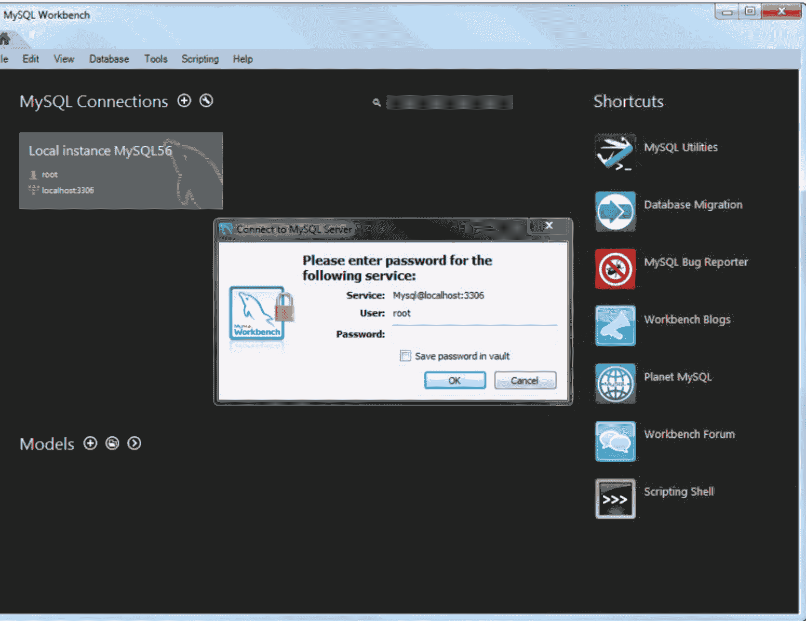

### 描述

- 要将 `root` 用户连接到运行在本地主机上的 MySQL 实例，请点击名为“Local instance MySQL 56”的已存连接，并在提示时输入 `root` 用户的密码。
- 为了保存连接密码以避免每次都输入，在提示输入密码时勾选“Save password in vault”（在库中保存密码）选项。
- 要从库中清除密码以便提示输入密码，请右键点击连接，选择 `Edit Connection`（编辑连接）项，点击 `Clear`（清除）按钮，然后点击 `Close`（关闭）按钮。
- 要编辑连接的参数，请右键点击连接，选择 `Edit Connection`（编辑连接）项，点击 `connection parameters`（连接参数），然后点击 `Close`（关闭）按钮。这让你指定用户名、主机地址、端口号和其他连接参数。
- 要向 Home 标签页中添加新连接，点击 `MySQL Connections` 右侧的 `+` 图标，输入连接参数并点击 `OK` 按钮。然后，连接将出现在连接列表中。

图 2-2 如何打开数据库连接

## 如何启动和停止数据库服务器

如果你按照附录 A（Windows）或 B（Mac OS X）中的描述在计算机上安装了 MySQL，那么当你启动计算机时，数据库服务器会自动启动。这部分软件有时被称为数据库服务（database service）或数据库引擎（database engine）。它接收传递它的 SQL 语句，对其进行处理并返回结果。

在操作 MySQL 数据库之前，必须启动数据库服务器。要检查 MySQL 数据库服务器是否在你的计算机上运行，可以使用 MySQL Workbench 的 `Startup/Shutdown`（启动/停止）选项来启动它，如图 2-3 所示。如果服务器尚未运行，你可以点击 `Start Server`（启动服务器）按钮来启动。当你这样做时，MySQL Workbench 会显示一条指示 MySQL 服务器状态的消息，并显示 `Stop Server`（停止服务器）按钮。

如果你不打算使用它并想释放计算机上的资源，你也可以停止数据库服务器。或者，如果 MySQL 数据库服务器使用的端口与另一个程序冲突，你也可以停止服务器。然后，当你想要再次操作数据库服务器时，可以启动它。

停止数据库服务器最简单的方法是使用 `Navigator`（导航器）窗口中 `Startup/Shutdown` 选项提供的 `Stop Server`（停止服务器）按钮，如图所示。当你点击它时，MySQL Workbench 会显示 MySQL 服务器已停止的消息，并显示 `Start Server`（启动服务器）按钮。

当你为了自己的目的运行数据库服务器时，可以随时停止它。但如果是在生产环境中运行数据库服务器，请确保所有用户已注销且没有程序正在使用它。

## MySQL Workbench 的 Startup/Shutdown 选项

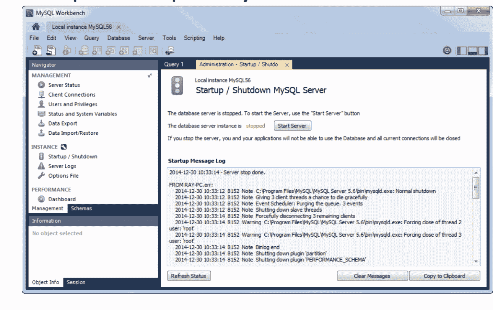

### 如何启动和停止数据库服务器

1. 显示 MySQL Workbench 的 Home 标签页。
2. 点击到本地服务器的连接。如果提示，以 `root` 用户身份连接。
3. 在 `Navigator`（导航器）窗口中，如果有必要，点击 `Management`（管理）标签页显示管理类别。
4. 从该类别中选择 `Startup/Shutdown` 选项。
5. 点击 `Stop Server` 按钮停止数据库服务器。

### 描述

- 安装 MySQL 后，每次启动计算机时数据库服务器通常会自动启动。
- 数据库服务器也可以称为数据库服务或数据库引擎。
- 如果你无法使用 Workbench 启动和停止数据库服务器，你可能需要编辑连接以指向正确的实例。要这样做，点击 Home 标签页，右键点击连接，选择 `Edit Connection` 项，点击 `System Profile` 标签并编辑服务名称。对于 Windows 上的 MySQL 5.6，服务名称通常为“MySQL56”。

图 2-3 如何启动和停止数据库服务器

## 如何遍历数据库对象

连接到数据库服务器后，你可以使用 `Navigator` 窗口的 `Schemas`（架构）类别来遍历服务器上数据库中的数据库对象，如图 2-4 所示。如你所见，这些对象包括表、视图、存储过程和函数。然而，在本章中，你可以关注表。在本书的后续章节，你将学习更多关于视图、存储过程和函数的知识。

在此图中，我双击 `Navigator Schemas` 标签页中的 `AP` 数据库（架构）节点，以选中它并查看其包含的数据库对象（表、视图、存储过程和函数）。然后，我展开 `Tables` 节点以查看 `AP` 数据库中的所有表。

要操作节点或对象，可以右键点击它以显示上下文菜单。然后，你可以从该菜单中选择命令。例如，你可以右键点击 `AP` 数据库节点以显示与该数据库操作的命令列表。

## AP 数据库可用表

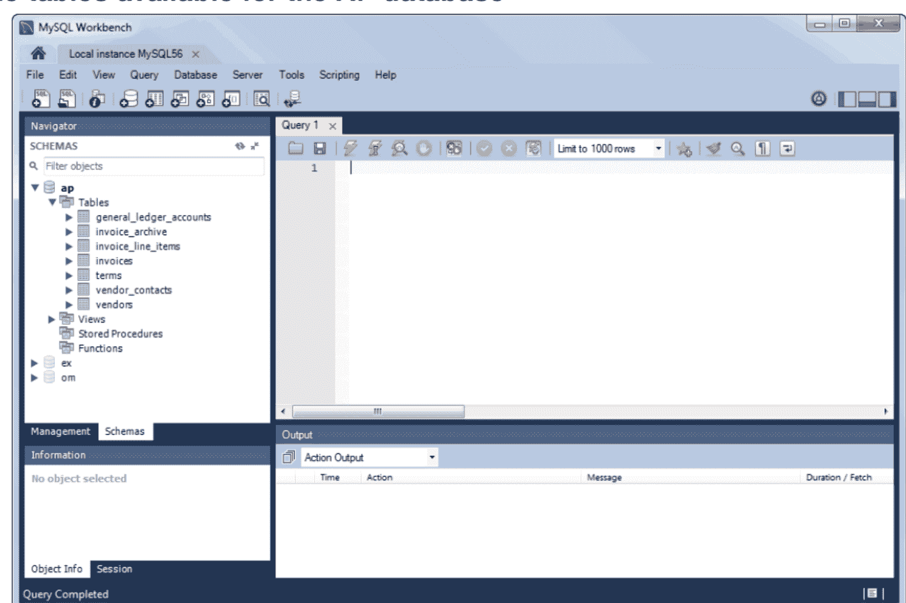

### 描述

- 每个数据库（或模式 `schema`）都提供了对可用数据库对象的访问。这些数据库对象包括表、视图、存储过程和函数。
- 在某些系统上，导航器（`Navigator`）窗口提供了“管理”（`Management`）和“架构”（`Schemas`）选项卡，你可以使用它们来显示管理和架构类别。在其他系统中，导航器窗口将“管理”类别显示在“架构”类别之上。
- 要显示当前连接的数据库，你可以使用导航器窗口查看“架构”类别。
- 要浏览数据库的数据库对象，可以点击导航器窗口中每个节点左侧的箭头来展开或折叠节点。
- 要对节点或对象进行操作，可以右键点击节点或对象，并从弹出菜单中选择命令。

图 2-4 如何浏览数据库对象

## 如何查看和编辑表的数据

要查看表的数据，可以右键点击表名并选择“Select Rows - Limit 1000”命令。例如，在图 2-5 中，我对 `Invoices` 表选择了此命令。这在结果网格（`Result grid`）中显示了表的数据。此外，在输出（`Output`）选项卡中显示了用于检索数据的 `SELECT` 语句信息。

要插入、编辑和删除表中的行，可以使用结果网格顶部的按钮。然后，为了将更改应用于表，可以点击结果网格底部的“Apply”（应用）按钮。或者，如果你想取消更改，可以点击“Revert”（还原）按钮。

## 对于结果网格中显示的 Invoices 表

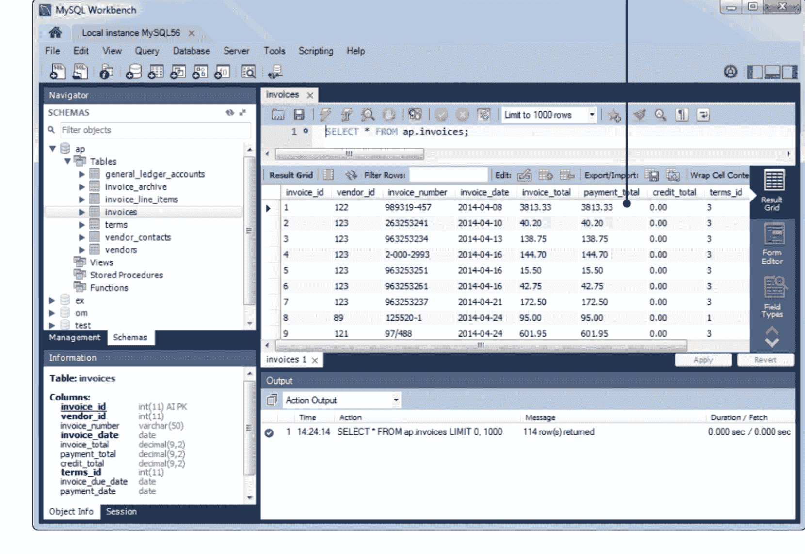

### 描述

- 要查看表的数据，在导航器窗口中右键点击表，并选择“Rows - Limit 1000”命令将其显示在结果网格中。
- 要编辑表的数据，先查看数据。然后，你可以使用结果网格顶部的按钮来插入、更新和删除行。
- 要将更改应用于表，点击表底部的“Apply”按钮。要取消更改，点击“Revert”按钮。

图 2-5 如何查看和编辑表的数据

## 如何查看和编辑表的列定义

如果你想编辑表的列定义，可以使用图 2-6 所示的技巧来显示表的列定义。例如，在该图中显示了 `Vendors` 表的列定义。此时，你可以查看关于表中每列的信息，例如其名称和数据类型。

一旦你查看了表的列定义，就可以使用“Columns”（列）选项卡来添加列、删除列或修改列。例如，你可以在列表底部输入以添加新列。你可以通过右键点击该列并选择“Delete”（删除）命令来删除列。你可以通过选择列然后点击名称进行编辑来更改列名。你可以通过选择其数据类型并在出现的下拉列表中选择另一种数据类型来更改列的数据类型。依此类推。

大多数时候，你不会使用 MySQL Workbench 来编辑表的列定义。相反，你希望编辑创建数据库的脚本，以便以后轻松重新创建数据库。在第 11 章中，你将学习更多关于使用这两种技术创建和修改表的列定义。

## Vendors 表的列定义

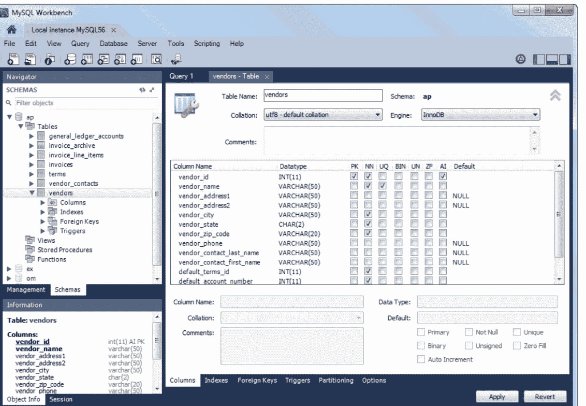

### 描述

- 要查看表的列定义，在导航器窗口中右键点击名称并选择“Alter Table”（修改表）。然后，选择显示窗口底部的“Columns”选项卡以查看表的列定义。
- 要编辑表的列定义，先查看列定义。然后，你可以使用生成的窗口添加新列和删除现有列。
- 关于创建和修改表的更多信息，请参第 11 章。

图 2-6 如何查看和编辑列定义

## 如何使用 MySQL Workbench 执行 SQL 语句

除了可以让你审查数据库设计外，MySQL Workbench 还是输入和运行 SQL 语句的强大工具。

## 如何输入和执行 SQL 语句

在 MySQL Workbench 中首次连接 MySQL 服务器时，会自动打开 SQL 编辑器（`SQL Editor`）选项卡。图 2-7 显示了如何使用 SQL 编辑器输入和执行 SQL 语句。打开 SQL 编辑器选项卡的简单方法是点击 SQL 编辑器工具栏中的“Create New SQL Tab”按钮或按 `Ctrl+T` 键。

一旦打开 SQL 选项卡，你就可以使用标准技术输入或编辑 SQL 语句。当你输入语句时，你会发现 MySQL Workbench 会自动为各种元素应用颜色。例如，它将关键字显示为绿色。这使得你的语句更容易读，并可以帮助你识别编码错误。

要执行像图中这样的单个 SQL 语句，可以按 `Ctrl+Enter` 或点击 SQL 编辑器工具栏中的“Execute Statement”（执行语句）按钮。如果语句返回数据，则该数据将显示在 SQL 编辑器选项卡下方对应的结果网格中。在图中，数据显示在结果网格中。

在执行此图中的 SQL 语句之前，请确保你已选择了数据库。否则，你会收到如下错误消息：

```
Error Code: No database selected
```


同样，如果你没有选择表，你会收到如下错误：

```
Error Code: 1046. Table 'ex.vendors' doesn't exist
```

## SQL 语句及其结果

| Create SQL Tab |
| :--- |
| Execute Current Statement button |
| SQL Editor |
| Result grid |
| 语句 |

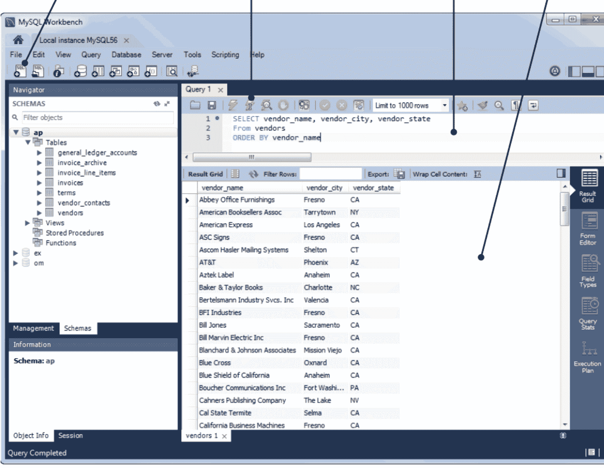

## 描述

- 要打开新的 SQL 选项卡，按 `Ctrl+T` 或点击“Create New SQL Tab”
- 要选择当前数据库，双击导航器窗口中的 Schemas
- 要输入 SQL 语句，将其输入到编辑器
- 当你输入文本时，SQL 编辑器会自动为各种元素应用颜色，例如 SQL 关键字，以便于识别
- 要执行语句，按 `Ctrl+Enter` 或点击“Execute Statement”按钮

图 2-7 如何输入和执行 SQL 语句

## 如何使用代码片段（Snippets）

你可以将 MySQL Workbench 自带的代码片段视为 SQL 语法库。该库被分为用于管理数据库、定义数据库对象以及操作数据库数据的语句。你还可以创建自己的代码片段。事实上，你更有可能创建自己的片段而不是使用提供的。这是因为片段的语法比你通常需要的复杂得多。

图 2-8 显示了如何使用代码片段。首先，如果“Additions”（附加）选项卡没有显示，你可以点击 SQL 编辑器选项卡右侧的最右侧按钮来显示它。然后，你可以使用“Additions”选项卡顶部的下拉列表选择代码片段类别。例如，显示了“My Snippets”类别。在这里，你可以选择一个片段，然后点击“Insert Snippet”按钮将其插入 SQL 编辑器选项卡。最后，你可以编辑片段代码以适用于你的 SQL 语句。

图中，片段包含了我编写的连接 `vendors`、`invoices` 和 `invoice_items` 表的代码。为了创建此片段，我将其输入 SQL 编辑器选项卡，然后点击“Add New Snippet”按钮。通过将其保存为片段，现在我可以在需要连接这三个表时随时使用它，而不需要每次都输入。

目前，如果你不理解图中所示的 SQL 语句请不要担心。要点是你可以使用片段选项卡保存和检索各种 SQL 代码。随着你学习更多 SQL 语句，你将发现这非常有用。

## 由用户创建的 SQL 代码扩展

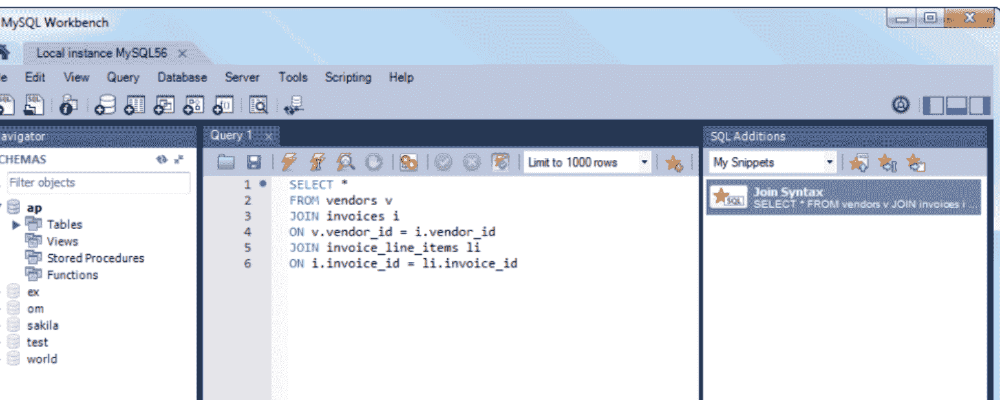

## SQL 扩展

- SQL Additions 选项卡包含代码片段（snippets）。片段包含常用 SQL 语句的语法。你可以使用这些片段在创建 SQL 语句时提供引导。你还可以创建自己的片段并将其保存备后使用。
- SQL Additions 选项卡默认显示在 SQL Editor 选项卡的右侧。如果未显示此选项卡，可以通过点击 SQL Editor 工具栏右侧最右侧的按钮来显示它。
- 代码片段按类别组织。要显示任何类别的片段，请从 SQL Additions 选项卡顶部的下拉列表中选择该类别。
- 要将代码片段输入 SQL 编辑器，请选择该片段，然后点击 SQL Additions 选项卡顶部的 Insert Snippet（插入片段）按钮。然后，选择片段代码，使其适用于你的 SQL 语句。
- 要用代码片段替换 SQL 编辑器中的代码，请选择代码，选择你想要替换的片段，然后点击 Replace Current text（替换当前文本）。
- 要创建自己的片段，请在 SQL 编辑器中输入该片段的代码。然后，选择你想要保存片段的类别，点击 Add New Snippet（添加新片段）按钮，并为片段命名。
- 要删除片段，在 Snippets 选项卡中右键点击该片段并选择 Delete Snippet（删除片段）项。

图 2-8 如何使用 Snippets 选项卡

## 如何处理语法错误

如果在执行 SQL 语句期间发生错误，MySQL Workbench 会显示包含错误编号和错误简要描述的消息。例如，图 2-9 中的消息显示错误编号为 1146，描述为“Table ap.vendor doesn’t exist.”

在此示例中，问题是数据库中不存在 Vendor 表。要修复此问题，你需要编辑 SQL 语句将表名改为 Vendors 而不是 Vendor。然后，你应该应该能够成功运行该 SQL 语句。

此图还列了一些其他错误原因。如你所见，大多数错误是由语法错误引起的。但如果你选择了错误的数据库，也会遇到错误。例如，如果你选择了 EX 数据库并尝试运行引用 AP 数据库中表的语句，将得到错误。无论原因是什么，你通常可以毫不费力地识别并修正问题。但在某些情况下，确定错误原因可能很困难。这时你通常可以通过搜索互联网或按照本章后面介绍的方法搜索 MySQL 参考手册来获取有关错误的更多信息。

## 如何处理语法错误

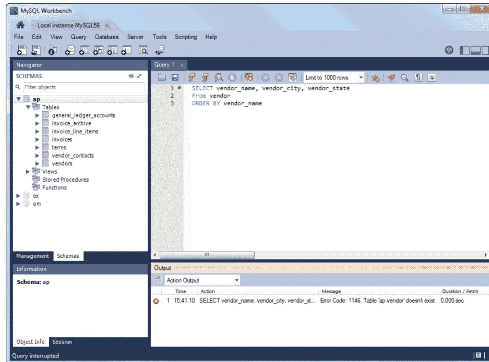

## 常见错误原因

- 选择了错误的数据库
- 表或列名拼写错误
- 关键字拼写错误
- 漏掉字符字符串的引号

## 描述

- 如果在执行 SQL 语句期间发生错误，MySQL Workbench 会在 Output 选项卡中显示一条消息，包含错误代码和错误的简要描述。
- 大多数错误由语法错误引起，可以在没有额外帮助的情况下修正。否则，你通常可以通过 MySQL 参考手册或互联网上搜索错误代码或描述来获取更多错误信息。

图 2-9 如何处理语法错误

## 如何打开和保存 SQL 脚本

在 MySQL 中，脚本是一个包含一个或多个 SQL 语句的文件。要创建脚本，你需要在 SQL Editor 选项卡中输入想要包含的语句。你将在下一个图中学习到更多内容。然后，你可以点击 Save 按钮或按 `Ctrl+S` 如图 2-10 所示保存脚本。

一旦保存了脚本，你以后就可以打开它。为此，你可以点击 SQL Editor 工具栏中的 Open SQL Script File（打开 SQL 脚本文件）按钮，或者按 `Ctrl+Shift+O`。在此图中，显示的对话框是为第 2 章保存的脚本文件。这些文件是在下载和安装本书的源码时创建的。注意这些文件名具有 `.sql` 扩展名。

一旦打开脚本，你就可以如接下来所示运行它。你也可以将其作为新 SQL 脚本的基础。只需按你需要的任何方式对其进行修改。然后，你可以通过按 `Ctrl+Shift+S` 键或选择 File→Save As（文件→另存为）命令将其保存为新脚本。

图中的屏幕显示两个已打开脚本文件的选项卡。打开两个或多个脚本后，可以通过点击相应的选项卡在它们之间切换。然后，你可以从一个脚本剪切、复制并粘贴代码到另一个脚本。

## Open SQL Script 对话框

Open SQL Script

File 按钮

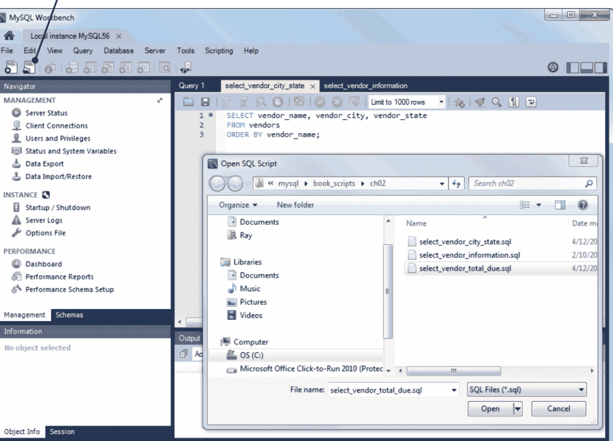

## 描述

- SQL 脚本是一个包含一个或多个 SQL 语句的文件。
- 要打开包含 SQL 脚本的文件，请点击 SQL Editor 工具栏中的 Open SQL Script File 按钮或按 `Ctrl+Shift+O`。
- 当你打开脚本时，MySQL Workbench 会在自己的选项卡中显示它。在脚本之间切换，可以点击相应的选项卡。
- 要从一个脚本剪切、复制并粘贴代码到另一个脚本，可以使用标准技术。
- 要保存脚本，点击 Save 按钮或按 `Ctrl+S`。
- 要保存修改后的脚本，按 `Ctrl+Shift+S` 或选择 File→Save As 命令。

图 2-10 如何打开和保存 SQL 脚本

## 如何输入和执行 SQL 脚本

在上节中，你看到了包含单个语句的 SQL 脚本。然而，SQL 脚本通常包含多个语句。图 2-11 显示了如何输入和执行此类脚本。

在脚本中编写多个语句时，每个语句末尾必须编写分号。例如，此图显示脚本包含两个 SELECT 语句。要执行这两个语句，你可以按 `Ctrl+Shift+Enter` 键或点击 SQL Editor 工具栏中的 Execute SQL 按钮。这样做，结果将显示在 Result grid 中。在 Result grid 之间切换，可以点击相应的标签。

如果你想执行存储在脚本中的单个 SQL 语句，可以将光标移动到该语句并按 `Ctrl+Enter` 键或点击 Execute Current Statement。如果语句检索数据，数据将显示在 Result grid 中。

如果你需要执行脚本中的两个或多个语句，你也可以选择它们，然后按 `Ctrl+Shift+Enter` 键或点击 Execute SQL。如果脚本包含许多语句而你只想执行其中某些语句，这非常有用。

## SQL 脚本及其结果

Execute SQL 按钮

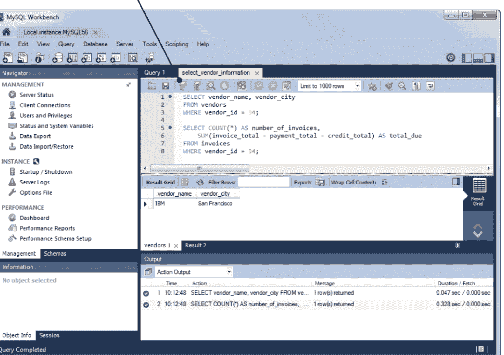

## 描述

- 编写包含多个语句的脚本时，每个语句末尾必须编写分号。
- 要运行整个 SQL 脚本，按 `Ctrl+Shift+Enter` 键或点击位于 SQL Editor 工具栏中 Execute Current Statement 左侧的 Execute SQL 按钮。
- 当你运行 SQL 脚本时，每个返回数据的语句的结果都将显示在 Result grid 中。在这些 Result grid 之间切换，可以点击相应的标签。

## 如何使用 MySQL 参考手册

图 2-12 显示了如何使用另一个处理 MySQL 数据库的工具：MySQL 参考手册。在大多数情况下，你会使用网络浏览器直接从互联网查看此手册。这样，你就可以确保信息是最新的。不过，你也可以下载此手册并将其保存到硬盘上。无论哪种方式，你都可以使用 MySQL 参考手册快速查找有关 MySQL 数据库的详细技术信息，包括有关 SQL 语句和函数的信息。

## 如何查看手册

你可以通过网络浏览器访问此图顶部显示的网址来查看 MySQL 参考手册。在这里，显示的是 MySQL 5.6 版本的参考手册。然而，你可以通过点击页面左侧列中的链接轻松地选择另一个版本。

## 如何查找信息

一旦你导航到 MySQL 参考手册的正确版本，查找信息就变得很容易。为此，你可以使用右侧列中的链接深入到你正在寻找的信息。当你找到感兴趣的主题时，可以点击它在中间列中显示。然后，如果你想返回信息层级的上层，可以使用页面顶部的面包屑导航。例如，在图中，你可以点击“MySQL 5.6 Reference Manual”链接返回手册的主页。或者，你可以点击“General Information”链接导航到该处。

另一种查找信息的方法是搜索特定的单词或短语。为此，在页面左侧的“Search manual”文本框中输入单词或短语，并点击 Go 按钮。然后，你可以点击搜索结果中的链接来查看有关搜索词的信息。

# 第 2 章 如何使用 MySQL Workbench 和其他开发工具 65

MySQL 5.6 参考手册的网址

`http://dev.mysql.com/doc/refman/5.6/en/`

MySQL 参考手册的一页

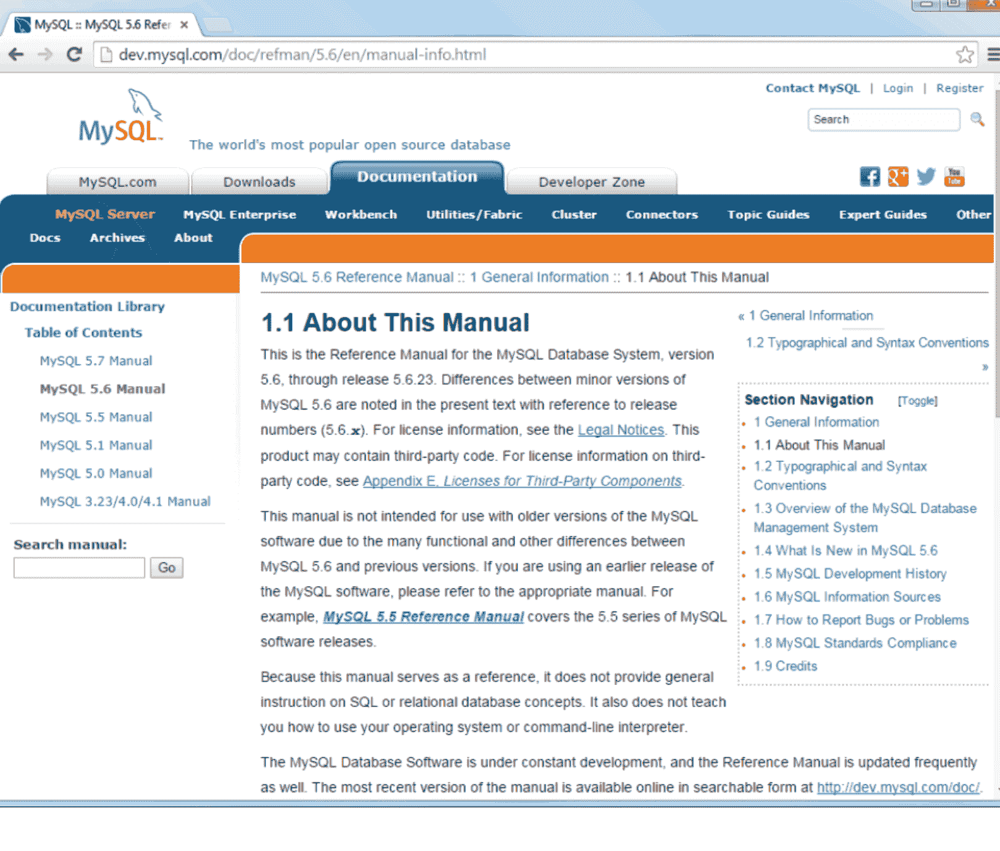

## 描述

- 要查看 MySQL 参考手册，请访问 MySQL 网站并选择正确版本的手册。
- 要查看某个章节，请点击页面右侧目录中的章节链接。
- 要返回手册主页，请点击当前页面顶部显示的对应版本链接。
- 要搜索特定的单词或短语，在页面左侧的“Search manual”文本框中输入该单词或短语，并点击 Go 按钮。然后，你可以滚动查看结果和链接以获取更多信息。
- 你也可以下载多种不同格式的 MySQL 参考手册。然而，通常在线使用它更有意义。

图 2-12 如何使用 MySQL 参考手册

## 如何使用 MySQL 命令行客户端

在 MySQL Workbench 出现之前，程序员使用一种名为 MySQL Command Line Client（MySQL 命令行客户端）的命令行工具连接到 MySQL 服务器并进行操作。该工具也被称为 MySQL 命令行。尽管你可能永远不需要它，但它的存在很有用。此工具随 MySQL 一起提供，如果你在你使用的系统中没有安装 MySQL Workbench，它会很有用。

## 如何启动和停止 MySQL 命令行客户端

图 2-13 显示了如何在 Windows 中启动和停止 MySQL 命令行客户端。虽然此图显示的是 Windows 可用的 MySQL 提示窗口，但你也可以在其他操作系统使用 MySQL 命令行客户端。特别是在 Mac OS X 上，你可以使用 Terminal（终端）启动 MySQL 命令行客户端。

使用 Windows 时，如果你想以 root 用户身份登录本地计算机运行的数据库服务器，有一种简单的方法可以启动 MySQL 命令行客户端。只需从开始菜单选择 MySQL Command Line 命令。然后 MySQL 将提示你输入密码。正确输入密码后，你将以 root 用户身份登录数据库服务器。

在某些情况下，你需要使用命令行来启动 MySQL 命令行客户端，而不是使用开始菜单。例如，如果你想以 root 用户以外的用户身份登录运行在不同计算机上的数据库，或者你正在使用 Mac OS X 等其他操作系统。在这些情况下，你可以使用命令行并切换到 MySQL 安装的 bin 目录。然后，你可以执行 `mysql` 命令并提供连接数据库服务器所需的参数。

如果 MySQL 服务器位于远程计算机上，你可以指定 `-h` 后跟计算机的主机名，以及 `-u` 后跟有效用户名。此外，你指定 `-p` 以便 MySQL 提示你输入有效密码。虽然建立这些连接可能需要一些尝试，但你只需要弄清楚一次。

一旦你为指定的用户名输入了有效密码，MySQL 命令行客户端将显示欢迎消息和如下所示命令行提示符：

```
mysql>
```

从此提示符，你可以输入任何适用于 MySQL 的语句。完成后，可以通过输入 "exit" 或 "quit" 后加分号来退出 MySQL 命令行客户端。

## Windows 显示的 MySQL 命令行客户端

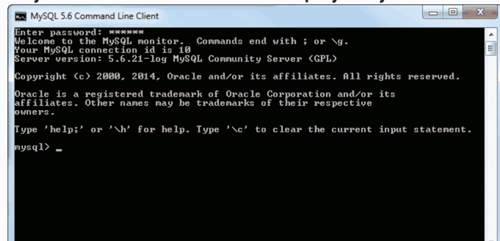

## 如何启动 MySQL 命令行客户端

## 如何从命令行启动 MySQL 命令行客户端

对于 Windows

```
cd \ProgramFiles\MySQL\MySQL Server 5.6\bin
```

对于 Mac OSX

```
cd /usr/local/mysql/bin
```

## mysql 命令如何工作

语法

`mysql -h hostname -u username`

## 如何退出 MySQL 命令行客户端

## 描述

- MySQL 提供了一个名为 MySQL Command Line Client 的命令行客户端程序，允许你输入适用于数据库的 SQL 语句。该程序也被称为命令行。
- 对于 Windows，使用 Command Prompt（命令提示符）启动 MySQL 命令行客户端。
- 对于 Mac OSX，使用 Terminal（终端）启动 MySQL 命令行客户端。
- 要停止 MySQL 命令行客户端，在命令行输入 "exit" 或 "quit" 后加分号。

图 2-13 如何启动和停止 MySQL 命令行客户端

## 如何使用 MySQL 命令行客户端处理数据库

一旦 MySQL 命令行客户端连接到数据库服务器，你就可以使用它运行适用于该服务器可用数据库的 SQL 语句。当你输入语句时，必须以分号结束。否则，当你按下 Enter 键时，mysql 命令行会显示第二行如下：

```
mysql> show databases
```

这显示 MySQL 命令行客户端正在等待你完成语句。要完成语句并执行它，只需输入分号并按下 Enter 键。

图 2-14 显示了如何执行三个语句。在这里，我用小写字母输入了所有语句。由于 SQL 不区分大小写，小写字母更容易输入。

要列出存储在服务器上的数据库，你可以使用第一个示例所示的 SHOW DATABASES 语句。在这里，“ap”、“ex”和“om”数据库是在按照附录 A 和 B 的描述安装下载数据库时创建的。“information_schema”、“performance_schema”和“mysql”是 MySQL 服务器使用的内部数据库。而“test”数据库是一个与 MySQL 连接的测试数据库。

要选择你想处理的数据库，可以像第二个示例所示输入 USE 语句。在这里，选择了 AP 数据库，该语句后的信息显示为“Database changed”。在选择数据库后，你输入的命令和语句将适用于该数据库。

要从数据库检索数据，你可以像第三个示例所示使用 SELECT 语句。在这里，显示了 Vendors 表中的 vendor_name 列。但注意，结果集被限制为仅前五行。当你成功执行 SELECT 语句时，MySQL 命令行客户端将显示一条包含结果集中包含行数以及运行查询所需时间的消息。

## 如何列出服务器管理的所有数据库名称

```mysql
mysql> show databases;
```

+--------------------------------------+
| Database             |
+--------------------------------------+
| information_schema |
| ap                   |
| mysql                 |
| performance_schema |
| test                 |
+--------------------------------------+

7 rows in set (0.05 sec)

## 如何选择一个数据库进行使用

```mysql
mysql> use ap;
Database changed
```


## 如何从数据库中选择数据

```mysql
mysql> select vendor_name from vendors limit 5;
```

+------------------------------------------------+
| vendor_name                      |
+------------------------------------------------+
| Abbey Office Furnishings         |
| American Booksellers Assoc      |
| American Express                |
| ASC Signs                       |
| Ascom Hasler Mailing Systems     |
+------------------------------------------------+
5 rows in set (0.09 sec)

- 你可以使用 MySQL 命令行客户端来操作数据库服务器上运行的任何数据库。要做到这一点，可以使用适用于 MySQL 数据库的任何 SQL 语句。
- 执行 SQL 语句时请在命令行中输入该语句，并在后面跟一个分号。然后按回车键。
- 要显示所有可用数据库的列表，可以使用 `SHOW DATABASES` 语句。
- 选择要操作的数据库，可以使用 `USE` 语句。
- SQL 语句对大小写不敏感。因此，在使用 MySQL 命令行客户端时，大多数程序员使用小写字母输入语句，因为这样更容易输入。

## 展望

在本章中，你学习了如何使用 MySQL Workbench 启动和停止 MySQL 服务器，以输入和执行 SQL 语句。以此为背景，你已经准备好进入下一章，在下一章中你将开始学习编写 SQL 语句的细节。

## 术语

- MySQL Workbench
- 数据库服务器
- 数据库服务
- 数据库引擎
- 数据库对象
- schema（模式）
- SQL 脚本
- MySQL 参考手册
- MySQL 命令行客户端

## 在开始练习之前……

在开始本章的练习之前，你需要安装 MySQL Server 和 MySQL Workbench。此外，你还需要下载并安装本书源文件，并为本书创建数据库和表。完成所有这些任务的步骤请见附录 A（Windows）和 B（Mac OS X）。

## 练习题

在这些练习中，你将使用 MySQL Workbench 查看 AP 数据库中的表。此外，你将使用 MySQL Workbench 输入 SQL 语句并在这些表上运行它们。

## 确保 MySQL 服务器正在运行

1. 启动 MySQL Workbench 并为 root 用户打开连接。
2. 检查 MySQL 服务器是否正在运行。如果没有运行，请启动它。完成后，关闭启动/关闭窗口。

## 使用 MySQL Workbench 检查应付账款 (AP) 数据库

3. 在导航器中，展开 AP 数据库节点，以便你可以看到它包含的所有数据库对象。
4. 查看 Vendors（供应商）和 Invoices（发票）表的数据。
5. 浏览数据库对象，并至少查看 Vendors 和 Invoices 表的列定义。

## 使用 MySQL Workbench 输入并运行 SQL 语句

6. 双击 AP 数据库以选择它。当你这样做时，MySQL Workbench 将以粗体显示该数据库。
7. 打开一个 SQL 编辑器标签页。然后，运行此 SQL 语句：

```sql
SELECT vendor_name FROM vendors
```

8. 删除 `vendor_name` 末尾的 e 并再次运行该语句。注意错误编号和错误描述。
9. 打开另一个 SQL 编辑器标签页。然后，运行此 SQL 语句：

```sql
SELECT COUNT(*) AS number_of_invoices,
SUM(invoice_total) AS grand_invoice_total
FROM vendor_name_invoices
```

## 使用 MySQL Workbench 打开并运行脚本

10. 打开位于 `c:\murach\mysql\scripts\ch02` 目录下的 `select_vendor_city_state` 脚本。注意该脚本仅包含一个 SQL 语句。然后，运行该语句。
11. 打开位于 `ch02` 目录下的 `select_vendor_total_due` 脚本。注意这会打开另一个 SQL 编辑器标签页。
12. 打开位于 `ch02` 目录下的 `select_vendor_information` 脚本。注意该脚本包含两个以分号结尾的 SQL 语句（如果需要，请向下滚动）。
13. 按 `Ctrl+Shift+Enter` 键或点击“Execute SQL Script”按钮来运行此脚本中的两个语句。注意这将在两个结果网格中显示结果。请确保查看了两个 `SELECT` 语句的结果。
14. 将插入点移到第一条语句中并按 `Ctrl+Enter` 仅运行该语句。
    将插入点移到第二条语句中并按 `Ctrl+Enter` 仅运行该语句。
15. 退出 MySQL Workbench。

# 第 2 章 如何使用 MySQL Workbench 和其他开发工具

# 第 3 章 从单表中检索数据

在本章中，你将学习如何编写 `SELECT` 语句来从单表中检索数据。这里涵盖的技能是适用于你编写的任何 `SELECT` 语句的基本技能……无论它涉及多少张表，无论检索有多复杂。因此，你希望很好地理解：

- SELECT 语句简介
- SELECT 语句的基本语法
- SELECT 示例
- 如何编写 SELECT 子句
- 如何编写规格说明
- 如何使用别名为结果集中的列命名
- 如何编写算术表达式
- 使用 `CONCAT` 函数连接字符串
- 在日期和数字中使用函数
- 通过编写 FROM 测试表达式
- 消除重复行
- 如何编写 WHERE 子句
- 使用比较运算符
- 使用 `AND`、`OR` 和逻辑运算符
- 使用 `IN` 运算符
- 使用 `BETWEEN` 运算符
- 使用 `LIKE` 和 `REGEXP` 运算符
- 使用 `NULL` 子句
- 如何编写 ORDER BY 子句
- 按列排序
- 按别名、表达式或列数排序
- 如何编写 LIMIT 子句
- 限制行数
- 检索行范围
- 展望

## SELECT 语句简介

为了让你快速上手，本章首先介绍了 `SELECT` 语句的基本语法。然后，提供了几个示例，让你了解其工作原理。

## SELECT 语句的基本语法

图 3-1 展示了 `SELECT` 语句的基本语法。图顶部的语法摘要使用了与其他手册中类似的约定。大写的单词是必须完全字输入的关键字。相比之下，你需要为小写单词提供替换内容。例如，你可以在 `list_list` 处输入列表，可以在 `table_source` 处输入表名。

此外，你可以省略 `[ ]` 子句。如果你将此图中的语法与下一个图中的代码示例进行比较，应该很容易看出它们之间的关系。

该语法经过简化，以便关注 `SELECT` 语句的五个主要部分：`SELECT`、`FROM`、`WHERE`、`BY` 和 `LIMIT`。大多数 `SELECT` 语句包含前四个部分，但只有 `SELECT` 子句是必须的。

`SELECT` 子句总是 `SELECT` 语句的第一个部分。它识别结果集的列。这些列是从 `FROM` 子句指定的表中检索的。由于本章重点关注从单表中检索数据，本章的示例使用的 `FROM` 子句命名单表。

`WHERE`、`ORDER BY` 和 `LIMIT` 子句是可选的。`ORDER BY` 决定结果集的排序方式，`WHERE` 子句决定哪些行被包含在结果集中。`WHERE` 子句指定了用于过滤基表的搜索条件。当此条件为真时，该行将被包含在结果集中。

`LIMIT` 子句限制结果集的行数。

## SELECT 语句的基本语法

```sql
SELECT select_list
[FROM table_source]
[WHERE search_condition]
[ORDER BY order_by_list]
[LIMIT row_limit]
```

## SELECT 语句的五个子句

| 子句 | 描述 |
| --- | --- |
| SELECT | 描述结果集中的列。 |
| FROM | 指定从查询检索数据的基础表。 |
| WHERE | 指定包含在结果集中行必须满足的条件。 |
| ORDER BY | 指定如何对结果集的行进行排序。 |
| LIMIT | 指定返回的行数。 |

## 描述

- 你使用上述基本的 `SELECT` 语句来从 `FROM` 子句指定的基础表中检索指定的列，并将它们存储在结果集中。
- `WHERE` 子句用于过滤基础表中的行，使得只有符合搜索条件的行才包含在结果集中。如果你省略了 `WHERE` 子句，将包含基础表中的所有行。
- `WHERE` 子句的搜索条件由一个或多个布尔表达式组成，这些表达式返回真、假或空值。如果所有表达式的组合结果为真值，则被测试的行将包含在结果集中。否则，不包含。
- 如果包含了 `ORDER BY` 子句，结果集中的行将按照指定的顺序排序。否则，行将按照它们在基础表中出现的顺序返回。大多数情况下，这意味着它们按主键顺序返回。
- 如果包含了 `LIMIT` 子句，结果集的检索将被限制为指定的行数。如果你省略了此子句，将返回所有匹配的行。
- 你必须按照所示顺序编写子句，否则将导致语法错误。

## 注意

- 上述语法并不包含 `SELECT` 语句的所有子句。你将在本书的后续部分学习其他子句。


## SELECT 语句示例

图 3-2 展示了五个 `SELECT` 语句示例。这些语句都从你上一章中实验过的 Invoices 表中检索数据。在每个语句之后，你都可以看到 MySQL Workbench 显示的结果集。在这些示例中，水平或垂直滚动条表示结果包含的行或列多于一次能显示的数量。

第一个语句从 Invoices 表中检索列。在这里，星号 (`*`) 被用作简写，表示应检索所有列，并省略了 `WHERE` 和 `LIMIT` 子句，因此检索了表中的所有行。此外，此语句没有包含 `ORDER BY` 子句，因此行按主键顺序排列。

第二个语句从 Invoices 表中选取列。这些列位于 `SELECT` 子句之后。与第一个语句一样，此语句不包含 `WHERE` 或 `LIMIT` 子句，因此检索了所有行。然后，`ORDER BY` 子句导致行按 `invoice_total` 列按降序（从大到小）排序。

第三个语句也列出了要检索的列。在这种情况下，最后一列是根据基础表中的两列 `credit_total` 和 `payment_total` 计算得出的，并将结果列命名为 `total_credits_credits`。此外，`WHERE` 子句指定只检索 `invoice_id` 列值为 17 的发票。

第四个 `SELECT` 语句包含一个 `WHERE` 子句，其条件指定了一个值范围。在这种情况下，只检索发票日期在 `06/01/2014` 到 `06/30/2014` 之间的发票。此外，结果集中的行按发票日期排序。

图中最后一个语句显示了 `WHERE` 子句的另一个示例。在这种情况下，只检索发票总额大于 50,000 的行。由于 Invoices 表中没有行满足此条件，因此结果集为空。

# 第 3 章 如何从单表中检索数据

## 一个从 invoices 表检索所有数据的 SELECT 语句

```sql
SELECT * FROM invoices
```

| invoice_id | vendor_id | invoice_date | invoice_total | payment_total | credit_total | terms_id |
|---|---|---|---|---|---|---|
| 1 | 122 | 989319-457 | 2014-04-08 | 3813.33 | 3813.33 | 0.00 | 3 |
| 2 | 123 | 263253241 | 2014-04-10 | 40.20 | 40.20 | 0.00 | 3 |
| 3 | 123 | 963253234 | 2014-04-13 | 138.75 | 138.75 | 0.00 | |
(114 行)

## 一个按 invoice_total 降序从每行检索三列的 SELECT 语句

```sql
SELECT invoice_number, invoice_date, invoice_total
FROM invoices
ORDER BY invoice_total DESC
```

| invoice_number | invoice_date | invoice_total |
|---|---|---|
| 0-259 | 2014-05-28 | 3766.13 |
| 0-259 | 2014-07-19 | 2681.40 |
| 0-259 | 2014-07-24 | 2351.58 |
(14 行)

## 一个检索两个列和一个计算值的 SELECT 语句

```sql
SELECT invoice_id, invoice_total - payment_total - credit_total AS total_credits
FROM invoices
WHERE invoice_id = 17
```

| invoice_id | total_credits |
|---|---|
| 17 | 0.00 |

## 一个检索给定日期之间发票的 SELECT 语句

```sql
SELECT invoice_number, invoice_date, invoice_total
FROM invoices
WHERE invoice_date BETWEEN '06/01/2014' AND '06/30/2014'
ORDER BY invoice_date
```

| invoice_number | invoice_date | invoice_total |
|---|---|---|
| 0-259 | 2014-06-01 | 1965.36 |
| 0-259 | 2014-06-03 | 3300.00 |
| 0-259 | 2014-06-05 | 2975.43 |
(37 行)

## 一个返回空结果集的 SELECT 语句

```sql
SELECT invoice_number, invoice_date, invoice_total
FROM invoices
WHERE invoice_total > 50000
```

| invoice_number | invoice_date | invoice_total |
|---|---|---|

## SELECT 子句的扩展语法

```sql
SELECT [ALL | DISTINCT]
  column_specification [[AS] result_column]
  , column_specification [AS] result_column] ...
```

## 列规格的四种编码方式

| 来源 | 选项 | 语法 |
| --- | --- | --- |
| 基表值 | 所有列 | `*` |
| | 列名 | `column_name` |
| 计算值 | 表达式结果 | 算术表达式（见图 3-5） |
| | 函数结果 | 函数（见图 3-6 和 3-7） |

## 使用基表值的列规格

`*` 用于检索所有列

```sql
SELECT *
```

## 使用列名检索特定列

```sql
SELECT vendor_name, vendor_city, vendor_state
```

## 使用计算值的列规格

用于计算欠款余额的算术表达式

```sql
SELECT invoice_total - payment_total - credit_total AS balance_due
```

返回全名的函数

```sql
SELECT CONCAT(first_name, ' ', last_name) AS full_name
```

## 说明

- 当你需要从表中检索所有列时，使用 `SELECT *`。否则，请列出你需要的列名。
- 表达式是列名和运算符的组合，其结果为一个单个值。在 `SELECT` 子句中，你可以编写包含一个或多个算术运算符的表达式，以及包含一个或多个函数的表达式。
- 在每个列规格之后，你可以编写一个 `AS` 子句来指定结果集中列的名称。详情见图 3-4。

## 注意事项

- `ALL` 和 `DISTINCT` 关键字指定了是否返回重复行。详情见图 3-9。


## 如何使用别名为结果集中的列命名

默认情况下，MySQL 会给结果集中的列赋予与基表中的列相同的名称。如果该列是基于计算值的，它将根据该值的表达式进行命名。然而，你可以在任何需要的时候，指定一个不同的名称作为列别名，如图 3–4 所示。

该图中的第二个示例展示了当不为计算列分配别名会发生什么。在这种情况下，MySQL 会自动为该列分配一个与列表达式相同的别名。由于许多计算值的表达式非常繁琐，你通常会为计算值分配较短的别名，如本章其余部分所示。

## SELECT 语句重命名结果集中的列

```sql
SELECT invoice_number AS "Invoice Number", invoice_date AS Date, invoice_total AS Total
FROM invoices
```


# 第 3 章 从单表检索数据

## 未命名计算列的 SELECT 语句

```sql
SELECT invoice_number, invoice_date, invoice_total,
invoice_total - payment_total - credit_total
FROM invoices
```

| invoice_number | invoice_date | invoice_total | invoice_total-payment_total-credit_total |
|---|---|---|---|
| 989319-457 | 2014-04-08 | 381.33 | 0.00 |
| 262523241 | 2014-04-10 | 40.20 | 0.00 |
| 963253234 | 2014-04-13 | 136.75 | 0.00 |
| 2000-2993 | 2014-04-16 | 146.70 | 0.00 |
| 963523251 | 2014-04-16 | 15.50 | 0.00 |
| 963523261 | 2014-04-16 | 42.75 | 0.00 |

(114 行)

## 说明

- 默认情况下，结果集中的列具有与基表中的列相同的名称。如果这不是你想要的，你可以为列指定一个替换名称，即列别名。
- 要为列指定别名，请使用 `AS` 短语。虽然该关键字是可选的，但为了可读性建议使用它。
- 对于基于计算值的列，它将根据该值的表达式进行命名。然而，你可以在任何需要的时候，指定一个不同的名称作为列别名。
- 当不为计算列分配别名时，MySQL 会自动为该列分配一个与列表达式相同的别名。由于许多计算值的表达式非常繁琐，你通常会为计算值分配较短的别名。
- 若要在别名中包含特殊字符，请将其包含在双引号中。

## 使用括号控制操作顺序

```sql
SELECT invoice_id,
invoice_id / 7 * 3 AS multiply_first,
(invoice_id + 7) * 3 AS add_first
FROM invoices
```

| invoice_id | multiply_first | add_first |
|---|---|---|
| 1 | 22 | 24 |
| 2 | 23 | 27 |
| 3 | 24 | 30 |

## 使用 DIV 和取模运算符

```sql
SELECT invoice_id,
invoice_id / 3 AS decimal_quotient,
invoice_id DIV 3 AS integer_quotient,
invoice_id % 3 AS remainder
FROM invoices
```

| invoice_id | decimal_quotient | integer_quotient | remainder |
|---|---|---|---|
| 1 | 0.3333 | 0 | 1 |
| 2 | 0.6667 | 0 | 2 |
| 3 | 1.0000 | 1 | 0 |

## 优先级顺序算术运算符

| 运算符 | 名称 | 优先级 |
|---|---|---|
| `*` | 乘法 | 1 |
| `/` | 除法 | 1 |
| `DIV` | 整除 | 1 |
| `%` (`MOD`) | 取模（余数） | 1 |
| `+` | 加法 | 2 |
| `-` | 减法 | 2 |

## 计算欠款余额的 SELECT 语句

```sql
SELECT invoice_total, payment_total, credit_total,
invoice_total - payment_total - credit_total AS balance_due
FROM invoices
```

| invoice_total | payment_total | credit_total | balance_due |
|---|---|---|---|
| 381.33 | 381.33 | 0.00 | 0.00 |
| 40.20 | 40.20 | 0.00 | 0.00 |
| 138.75 | 136.75 | 0.00 | 0.00 |

## 如何使用 CONCAT 函数

连接字符串

图 3-6 展示了 `CONCAT` 函数，并显示了如何使用它来连接或拼接字符串。在 MySQL 中，字符串可以包含字符的任意组合，而函数执行操作并返回一个值。编写函数时，首先输入它的名称，后跟一组括号。如果函数需要参数，则将其输入括号内。如果函数接受多个参数，则用逗号将它们分隔。

在图中，第一个示例显示了如何使用 `CONCAT` 函数连接 `Vendors` 表中的 `vendor_city` 和 `vendor_state` 列。由于此示例没有为该列指定别名，MySQL 会自动将表达式公式作为列名。此外，结果集中 `vendor_state` 和 `vendor_city` 之间没有空格。由于这使得数据难以阅读，字符串应该像第二个或第三个示例所示进行格式化。

第二个示例显示了如何通过添加空格和标点符号来格式化字符串。在这里，`vendor_city` 列与包含空格的字面量值拼接。然后，`vendor_state` 列与包含空格的字面量值 `vendor_zip_code` 拼接。要编写字符串字面量，可以使用单引号（`''`）或双引号（`""`）包裹值。偶尔，你可能需要在字面量值内部包含一个单引号。如果你使用单引号包裹字面量，MySQL 将单引号解释为字符串的结束。为了解决这个问题，你可以像第三个示例所示编写两个单引号：

```sql
CONCAT(vendor_name, ''s '') AS vendor
```

### CONCAT 函数的语法

`CONCAT(string1, ...)`

### 如何拼接字符串数据

```sql
SELECT vendor_city, vendor_state, CONCAT(vendor_city, vendor_state)
FROM vendors
```

| vendor_city | vendor_state | CONCAT(vendor_city, vendor_state) |
|---|---|---|
| Madison | WI | Madison |
| Washington | DC | Washington |

(122 行)

### 如何使用字面量值格式化字符串数据

| name | address |
|---|---|
| US Post Service | Madison, WI 53707 |
| National Information DataCtr | Washington, DC 20120 |

(122 行)

### 如何在字面量值中包含单引号

```sql
SELECT CONCAT(vendor_name, '''') AS Vendor,
CONCAT(vendor_city, '', '', vendor_state, '', '', vendor_zip_code) AS Address
FROM vendors
```

| Vendor | Address |
|---|---|
| US Post Service's Address | Madison, WI 53707 |
| National Information DataCtr's Address | Washington, DC 20120 |

(122 行)

### 说明

- 表达式可以包含 MySQL 支持的任何函数。函数执行操作并返回一个值。
- 要编写函数，编写函数名后跟任何参数。在括号内，如果函数需要两个或多个参数，用逗号将它们分隔。
- 要编写字符串字面量，可以使用单引号（`''`）或双引号（`""`）包裹值。
- 要在字符串中包含单引号，使用双引号代替单引号。
- 要连接或拼接两个或多个字符串列或字面量值，使用 `CONCAT` 函数。

## 如何配合字符串、日期和数字使用函数

图 3-7 显示了如何使用三个函数：`LEFT` 处理字符串，`DATE_FORMAT` 处理日期，而 `ROUND` 处理数字。现在，不用担心这些函数的工作细节，因为你将在第 9 章学习它们的更多知识。相反，关注它们在列规范中的用法。

图中的第一个示例显示了如何使用 `LEFT` 函数提取 `vendor_contact_name` 列的第一个字符。该函数的第一个参数指定字符串值，第二个参数指定返回的字符数量。然后，字符串拼接了两个 `LEFT` 函数的结果形成首字母。

第二个示例显示了如何使用 `DATE_FORMAT` 函数显示日期值。此函数需要两个参数：要格式化的日期和格式字符串。图中的第一列返回 `invoice_date` 列的默认 MySQL 日期格式 "yyyy-mm-dd"。由于这种格式在美国并不常用，第二列格式化为更典型的 "mm/dd/yy"。在第 9 章，你将学习指定 `DATE_FORMAT` 函数的格式字符串。

第三个示例使用 `ROUND` 函数将 `invoice_total` 列的值四舍五入到最接近的整数。此函数可以接受一个或两个参数。第一个参数指定数值，可选的第二个参数指定小数位数。

### `LEFT`、`DATE_FORMAT` 和 `ROUND` 函数的语法

`LEFT(string, number_of_characters)`

`DATE_FORMAT(date, format_string)`

`ROUND(number[, number_of_places])`

### 如何通过编写没有 FROM 子句的语句测试表达式

```sql
SELECT vendor_city, vendor_state, CONCAT(LEFT(vendor_contact_name, 1), LEFT(vendor_contact_name, 1)) AS initials
FROM vendors
```

| vendor_city | vendor_contact_name | initials |
|---|---|---|
| Francesco | Alberto | FA |
| Ania | Irvin | AI |
| Lukas | Liana | LL |

(122 行)

```sql
SELECT invoice_date,
DATE_FORMAT(invoice_date, '%m/%d/%y') AS MM/DD/YY,
DATE_FORMAT(invoice_date, '%e-%b-%Y') AS DD-Mon-YYYY
FROM vendors
```

| invoice_date | MM/DD/YY | DD-Mon-YYYY |
|---|---|---|
| 2014-04-08 | 04/08 | 8-Apr-2014 |
| 2014-04-10 | 04/10 | 10-Apr-2014 |
| 2014-04-13 | 04/13 | 13-Apr-2014 |

(122 行)

```sql
SELECT invoice_total,
ROUND(invoice_total) AS nearest_dollar,
ROUND(invoice_total, 1) AS nearest_dime
FROM vendors
```

| invoice_total | nearest_dollar | nearest_dime |
|---|---|---|
| 381.33 | 381 | 381.3 |
| 40.20 | 40 | 40.2 |
| 138.75 | 139 | 138.8 |

(122 行)

## 如何测试表达式

### 不带 FROM 子句的四个 SELECT 语句

#### 示例 1：测试计算

```sql
SELECT 1000 * (1 + .1) AS "10% More Than 1000"
```

| 10% More Than 1000 |
|---|
| 1100.0 |

#### 示例 2：测试 CONCAT 函数

```sql
SELECT "Ed" AS first_name, "Williams" AS last_name,
CONCAT(LEFT("Ed", 1), LEFT("Williams", 1)) AS initials
```

| first_name | last_name | initials |
|---|---|---|
| Ed | Williams | EW |

#### 示例 3：测试 DATE_FORMAT 函数

```sql
SELECT CURRENT_DATE,
DATE_FORMAT(CURRENT_DATE, '%m/%d/%y') AS 'MM/DD/YY',
DATE_FORMAT(CURRENT_DATE, '%e-%b-%Y') AS 'DD-Mon-YYYY'
```

| CURRENT_DATE | MM/DD/YY | DD-Mon-YYYY |
|---|---|---|
| 2014-12-01 | 12/01/14 | 1-Dec-2014 |

#### 示例 4：测试 ROUND 函数

```sql
SELECT 12345.6789 AS value,
ROUND(12345.6789, 2) AS nearest_dollar,
ROUND(12345.6789, 1) AS nearest_dime
```

| value | nearest_dollar | nearest_dime |
|---|---|---|
| 12345.6789 | 12345.68 | 12345.7 |

### 说明

- 使用 MySQL，你不需要编写 `FROM` 子句。这使得测试算术表达式和函数变得简单。
- `CURRENT_DATE` 函数返回当前日期。对于该函数，括号是可选的。

## 如何消除重复行

默认情况下，基表中所有满足 `WHERE` 子句搜索条件的行都将被包含在结果集中。但在某些情况下，这意味着结果集将包含重复行，或者列值相同的行。如果这不是你想要的结果，你可以在 `SELECT` 子句中包含 `DISTINCT` 关键字以消除重复行。

图 3-9 显示了其工作原理。在这里，两个 `SELECT` 语句都从 `Vendors` 表中检索 `vendor_city` 和 `vendor_state` 列。第一个语句没有包含 `DISTINCT` 关键字。因此，相同的城市和州可能会在结果集中出现多次。例如，在图中所示的结果，你可以看到 Anaheim CA 出现了两次，而 Boston MA 出现了三次。相比之下，第二个语句包含了 `DISTINCT` 关键字，因此每个城市和州的组合只被包含一次。

### SELECT 语句返回所有行

```sql
SELECT vendor_city, vendor_state
FROM vendors
ORDER BY vendor_city
```

(122 行)

### 消除重复行的 SELECT 语句

```sql
SELECT DISTINCT vendor_city, vendor_state
FROM vendors
ORDER BY vendor_city
```

(53 行)

### 说明

- `DISTINCT` 关键字防止（相同的）行被包含在结果集中。`DISTINCTROW` 是 `DISTINCT` 的同义词。
- `ALL` 关键字会导致所有符合搜索条件的行都被包含在结果集中，无论行是否重复。由于这是默认值，你通常会省略 `ALL` 关键字。
- 要使用 `DISTINCT` 或 `ALL` 关键字，请在 `SELECT` 关键字之后立即编写。

## 如何编写 WHERE 子句

在本章较早之前，我提到过为了提高性能，你应该编写 `SELECT` 语句，使其只检索你需要的列。检索行也是如此：检索的行越少，语句的执行效率越高。因此，你通常会在 `SELECT` 语句中包含一个 `WHERE` 子句，通过搜索条件过滤基表中的行，以便只检索你需要的行。在接下来的主题中，你将学习编写该子句的各种方法。

## 如何使用比较运算符

图 3-10 将如何在 `WHERE` 子句的搜索条件中使用比较运算符来比较两个表达式。如果比较结果为真，则被测试的行将被包含在查询结果中。

图中的示例显示了如何使用比较运算符。例如，第一个 `WHERE` 子句使用等号（`=`）来检索 `vendor_state` 值为 'IA' 的行。在这里，状态是一个字符串字面量，必须包含在单引号或双引号中。相比之下，第二个 `WHERE` 子句使用大于（`>`）运算符来检索余额大于零的行。在这种情况下，`0` 是一个不需要引号的数字字面量。

第三个 `WHERE` 子句展示了通过重新排列比较表达式来检索所有有余额的方法。与第二个子句一样，它使用了大于运算符。它不是将余额与零值进行比较，而是将发票总额与付款和折扣的总和进行比较。

## 带有逻辑运算符的 WHERE 子句语法

`WHERE [NOT] search_condition_1 (AND|OR) [NOT] search_condition_2 ...`

## 使用逻辑运算符的 WHERE 子句示例


# 逻辑运算符

## AND 运算符

```sql
WHERE vendor_state = 'NJ' AND vendor_city = 'Springfield'
```

## OR 运算符

```sql
WHERE vendor_state = 'NJ' OR vendor_city = 'Pittsburg'
```

## NOT 运算符

```sql
WHERE NOT vendor_state = 'CA'
```

## 复杂搜索条件中的 NOT 运算符

```sql
WHERE NOT (invoice_total >= 5000 AND invoice_date <= '2014-08-01')
```

## 为消除 NOT 运算符而重述的相同条件

```sql
WHERE invoice_total < 5000 OR invoice_date <= '2014-08-01'
```

## 不带括号的复合条件

```sql
WHERE invoice_date > '2014-07-03' OR invoice_total > 500
AND invoice_total - payment_total - credit_total > 0
```

| invoice_number | invoice_date | invoice_total | balance_due |
|---|---|---|---|
| 202319-203 | 2014-07-05 | 17.50 | 0.00 |
| 111928-309 | 2014-07-06 | 39.77 | 0.00 |
| 963235258 | 2014-07-06 | 111.00 | 0.00 |

(33 行)

## 带有括号的相同复合条件

```sql
WHERE (invoice_date > '2014-07-03' OR invoice_total > 500)
AND invoice_total - payment_total - credit_total > 0
```

| invoice_number | invoice_date | invoice_total | balance_due |
|---|---|---|---|
| 39104 | 2014-07-10 | 85.31 | 85.31 |
| 96325364 | 2014-07-18 | 52.25 | 52.25 |
| 31361833 | 2014-07-21 | 579.42 | 579.42 |

(11 行)

## 详情

- 你可以使用 `AND` 和 `OR` 逻辑运算符来创建由两个或多个条件组成的复合条件。使用 `AND` 运算符来指定搜索必须同时满足两个条件，使用 `OR` 运算符来指定搜索必须满足至少一个条件。
- 你可以使用 `NOT` 运算符来否定一个条件。由于这可能会使搜索变得不清晰，如果条件没有使用 `NOT`，你应该重述该条件。
- 当 MySQL 评估复合条件时，它按照以下顺序评估运算符：(1) `NOT`，(2) `AND`，以及 (3) `OR`。你可以使用括号来覆盖这种优先级顺序，或者明确运算符评估的顺序。


# 如何使用 IN 运算符

图 3-12 显示了如何编写使用 `IN` 运算符的 `WHERE` 子句。当你使用此运算符时，测试表达式的值将与 `IN` 句型中的表达式列表进行比较。如果测试表达式等于列表中的一个表达式，则该行将包含在查询结果中。图中的第一个示例所示，这返回了所有 `terms_id` 列等于 1、3 或 4 的行。

你也可以在 `IN` 句中配合 `NOT` 运算符使用，以测试不在表达式列表中的值。这由第二个示例所示。在这里，只检索了不在加利福尼亚州、内华达州或俄勒冈州的供应商。

在幅图的顶部，`IN` 句句的语法显示你可以用子查询来代替表达式列表。正如你将在第 7 章中学到的，子查询是一项强大的功能。但目前，你应该知道子查询只是另一个语句内部的 `SELECT` 语句。

在第三个示例中，使用了子查询来返回 2014 年 7 月 18 日发票的供应商的 `vendor_id` 列表。然后，只有当 `vendor_id` 在该列表中时，`WHERE` 子句才会检索该行。注意，为了使之工作，子查询必须返回单列，在此例中为 `vendor_id`。

## 带有 IN 句的 WHERE 子句语法

```sql
WHERE test_expression [NOT] IN
({subquery|expression_1 {, expression_2}...})
```

## IN 句示例

### 带有数字字面量列表的 IN 句

```sql
WHERE terms_state_id IN (1, 3, 4)
```

### 由 NOT 前置的 IN 句

```sql
WHERE vendor_state NOT IN ('CA', 'NV', 'OR')
```

### 带有子查询的 IN 句

```sql
WHERE vendor_id
(SELECT vendor_id
FROM invoices
WHERE invoice_date = '2014-07-18')
```

## 描述

- 你可以使用 `IN` 句来测试表达式是否等于列表中的某个值。列表中的每个表达式都会自动转换为与测试表达式相同的数据类型。
- 表达式列表可以任何顺序编写，而不影响结果集。
- 你可以使用 `NOT` 运算符来测试不在列表中的表达式。
- 如果你使用的是 MySQL 4.1 或更高版本，还可以将测试表达式与子查询返回的列表进行比较。你将在第 7 章学习更多关于子查询的知识。


# 如何使用 BETWEEN 运算符

图 3-13 显示了如何在 `WHERE` 子句中使用 `BETWEEN` 运算符。当你使用此运算符时，测试表达式的值将与 `BETWEEN` 句中指定的范围进行比较。如果值在该范围内，则该行包含在结果中。

图中第一个示例显示了使用 `BETWEEN` 运算符的简单 `WHERE` 子句。它检索日期在 6 月 1 日到 6 月 30 日之间的发票。注意范围是包含边界的，因此包含了 6 月 1 日和 6 月 30 日的数据。

第二个示例显示了如何使用 `NOT` 运算符选择不在给定范围内的行。在这种情况下，邮政编码在 93600 到 93799 之间的供应商被排除。

第三个示例显示了如何在测试表达式中使用计算值。在这里，从 `invoice_total` 减去 `payment_total` 和 `credit_total` 得到 `balance_due`。然后，该值与 `BETWEEN` 句中指定的范围进行比较。

最后一个示例显示了如何在 `BETWEEN` 句中使用计算值。在这里，第一个值是 `credit_total` 加上 500。因此，结果包含了金额在金额和 500 之间的发票。

## 带有 BETWEEN 句的 WHERE 子句语法

```sql
WHERE test_expression [NOT] BETWEEN begin_expression AND end_expression
```

### BETWEEN 句示例

- 带有字面值的 BETWEEN 句

```sql
WHERE invoice_date BETWEEN '2014-06-01' AND '2014-06-30'
```

- 由 NOT 前置的 BETWEEN 句

```sql
WHERE vendor_zip_code NOT BETWEEN 93600 AND 93799
```

- 以计算值为测试值的 BETWEEN 句

```sql
WHERE invoice_total - payment_total - credit_total BETWEEN 200 AND 500
```

- 以计算值作为上限和下限的 BETWEEN 句

```sql
WHERE payment_total BETWEEN credit_total AND credit_total + 500
```

## 描述

- 你可以使用 `BETWEEN` 句来测试表达式是否落在某个值范围内。下限必须作为第一个表达式编写，上限作为第二个表达式编写。否则，MySQL 将返回空结果集。
- `BETWEEN` 句中使用的两个表达式包含边界。也就是说，结果集包含了等于上限或下限的值。
- 你可以使用 `NOT` 运算符来测试不在给定范围内的表达式。


# 如何使用 LIKE 和 REGEXP 运算符

为了检索匹配特定字符串模式（或掩码）的行，可以使用图 3-14 所示的 `LIKE` 或 `REGEXP` 运算符。`LIKE` 运算符是一个旧的运算符，允许搜索简单的字符串模式。当你使用此运算符时，掩码可以包含第一个表中所示的一个或两个通配符符号。

与 `LIKE` 运算符不同，`REGEXP` 运算符允许你创建名为正则表达式的复杂字符串模式。为了这一点，可以使用图中第二个所示所示特殊字符和结构。虽然最初创建正则表达式可能很困难，但它们允许你搜索几乎任何字符串模式。

在图中第一个示例中，`LIKE` 句搜索所有位于 `SAN` 开头的城市的供应商，这些应该包含在查询结果中。在这里，百分号 (`%`) 表示这些字母后面可以跟任何字符或多个字符。San Diego 和 Santa Ana 都包含在结果中。

第二个示例选择了所有供应商名称以 `COMP` 开头的供应商，后面跟着任意一个字符、字母 `ER` 以及之后的任何字符。供应商名称 Compuseerve 和 Computerworld 符合此模式。

在第三个示例中，`REGEXP` 句在 `vendor_city` 列中搜索字母 `SA`。由于字母可以位于字符串中的任何位置，Pasadena 和 Santa Ana 都包含在结果中。

接下来两个示例演示了如何使用 `REGEXP` 将模式匹配到测试字符串的开头或结尾。在第四个示例中，掩码 `^` 匹配 `vendor_city` 开头的字母 `SA`，如 Santa Ana 和 Sacramento。相反，掩码 `$` 匹配 `vendor_city` 结尾的字母 `NA`，如第五个示例所示。

第六个示例使用管道符 (`|`) 搜索两个字符串模式中的每一个：`RS` 或 `SN`。在这种情况下，第一个模式将匹配 Traverse，第二个匹配 Fresno，因此两者都包含在结果集中。

最后四个示例使用括号来指定多个值。在第七个示例中，搜索 `vendor_state` 列中包含字母 `N` 后后跟 `C` 或 `V` 的值。它排除了 `NJ` 和 `NY`。相反，第八个示例搜索包含字母 `N` 后后跟任意 `A` 到 `J` 字母的状态。这排除了 `NV` 和 `NY`。

第九个示例在 `vendor_contact_last_name` 列中搜索可以以两种不同方式拼写的名字：`Damien` 或 `Damion`。为了这一点，掩码在括号内指定了第五位置的两个可能的字符 `E` 和 `O`。在最后一个示例中，`REGEXP` 句搜索以任意字母 `a` 然后接字母 `N` 结尾的 `vendor_city`。

# 第 3 章 如何从单表中检索数据

## 使用 LIKE 短句的 WHERE 子句语法

```sql
WHERE match_expression [NOT] LIKE pattern
```

## 使用 REGEXP 短句的 WHERE 子句语法

```sql
WHERE match_expression [NOT] REGEXP pattern
```

## LIKE 通配符

| 符号 | 说明 |
|---|---|
| % | 匹配零或多个字符的任意字符串。 |
| _ | 匹配任意单个字符。 |

## REGEXP 特殊字符和结构

| 字符/结构 | 说明 |
|---|---|
| ^ | 匹配模式到测试值的开头。 |
| $ | 匹配模式到测试值的结尾。 |
| . | 匹配任意单个字符。 |
| [charlist] | 匹配括号内列表中任意单个字符。 |
| [char1-char2] | 匹配给定范围内的任意单个字符。 |
| \| | 分隔两个字符串并匹配彼此。 |

## 使用 LIKE 和 REGEXP 操作符的 WHERE 子句

| 示例 | 匹配掩码的结果 |
|---|---|
| WHERE vendor_city LIKE 'SAN%' | "San Diego", "Santa Ana" |
| WHERE vendor_name LIKE '%COMPU_ER%%' | "Compuverse", "Computerworld" |
| WHERE vendor_city REGEXP 'SA' | "Pasadena", "Santa Ana" |
| WHERE vendor_city REGEXP '^SA$' | "Santa Ana", "Sacramento" |
| WHERE vendor_city REGEXP 'NA$' | "Gardena", "Pasadena", "Santa Ana" |
| WHERE vendor_city REGEXP 'RS\|SN' | "Traverse City", "Fresno" |
| WHERE vendor_state REGEXP '[CV]' | "NC" 和 "NV" 但不是 "NJ" 或 "NY" |
| WHERE vendor_state REGEXP '[A-J]' | "NC" 和 "NJ" 但不是 "NY" |
| WHERE vendor_contact_last_name REGEXP 'DAMI[EO]N$' | "Damien" 和 "Damion" |
| WHERE vendor_city REGEXP '[A-Z]N$' | "Boston", "Mclean", "Oberlin" |

## 说明

- 你使用 `LIKE` 和 `REGEXP` 操作符来检索匹配字符串模式（称为掩码）的行。掩码决定列中的值是否满足条件。
- `LIKE` 短句的掩码可以包含特殊符号，如通配符。`REGEXP` 短句的掩码可以包含特殊字符和结构。掩码对大小不敏感。
- 如果使用 `NOT` 关键字，则结果中仅包含不匹配字符串模式的行。
- 与其他类型的搜索相比，大多数 `LIKE` 和 `REGEXP` 短句会显著降低性能，仅在必要时使用它们。

图 3-14 如何使用 LIKE 和 REGEXP 操作符

# 102 第一节 MySQL 简介

为了简洁起见，本章仅介绍正则表达式中最常用的符号。然而，MySQL 支持大多数标准用于创建正则表达式的符号。有关乎如何创建正则表达式的更多信息，请参阅 MySQL 参考手册。如果你熟悉在 PHP 等其他编程语言中使用正则表达式，你会发现它们在 MySQL 中的工作原理非常相似。

# 如何使用 IS NULL 子句

在第一章中，你学习了列可以包含空值（null value）。空值通常用于表示某个值未知。空值不等同于空字符串（`''`）。空字符串用于表示该值是知的，但不存在。

如果你正在处理一个允许空值的数据库，你需要知道如何在搜索条件中测试它们。为此，你像图 3-15 所示使用 `IS NULL` 子句。

该图显示了一个名为 `Null_Sample` 的表，以展示如何搜索空值。该表包含两列：`invoice_id` 和 `invoice_total`。表中的值显示在第一个示例中。

第二个示例显示了检索所有 `invoice_total` 等于 0 的行会发生什么。在这种情况下，空值行不会包含在结果集中。正如第三示例所示，当 `invoice_total` 不等于 0 时，该行也不会包含在结果集中。相反，你必须使用 `IS NULL` 子句来检索空值行，如第四示例所示。

你还可以配合 `IS NULL` 子句使用 `NOT` 操作符，如最后一个示例所示。当你使用此操作符时，所有不包含空值的行都将包含在查询结果中。

# 第 3 章 如何从单表中检索数据

## IS NULL 子句的 WHERE 子句语法

```sql
WHERE expression IS [NOT] NULL
```

## Null_Sample 表

```sql
SELECT * FROM null_sample
```

| invoice_id | invoice_total |
|---|---|
| 1 | 125.00 |
| 2 | 0.00 |
| 3 | NULL |
| 4 | 2199.99 |
| 5 | 0.00 |

## 检索值为零行的 SELECT 语句

```sql
SELECT * FROM null_sample
WHERE invoice_total = 0
```

| invoice_id | invoice_total |
|---|---|
| 2 | 0.00 |
| 5 | 0.00 |

## 检索非零行的 SELECT 语句

```sql
SELECT * FROM null_sample
WHERE invoice_total <> 0
```

| invoice_id | invoice_total |
|---|---|
| 1 | 125.00 |
| 4 | 2199.99 |

## 检索空值行的 SELECT 语句

```sql
SELECT * FROM null_sample
WHERE invoice_total IS NULL
```

| invoice_id | invoice_total |
|---|---|
| 3 | NULL |

## 检索不含空值行的 SELECT 语句

```sql
SELECT *
FROM null_sample
WHERE invoice_total IS NOT NULL
```

| invoice_id | invoice_total |
|---|---|
| 1 | 125.00 |
| 2 | 0.00 |
| 4 | 2199.99 |
| 5 | 0.00 |

## 说明

- 空值代表一个未知的值

图 3-15 如何使用 IS NULL 子句

# 如何编写 ORDER BY 子句

`ORDER BY` 子句指定结果集的排序顺序。为了简洁起见，本章仅介绍正则表达式中最常用的符号。然而，MySQL 支持大多数标准用于创建正则表达式的符号。有关如何创建正则表达式的更多信息，请参阅 MySQL 参考手册。如果你熟悉在 PHP 等编程语言中使用正则表达式，你会发现它们在 MySQL 中的工作原理非常相似。

## 如何按列排序


ORDER BY 子句指定结果集的排序顺序。为了简洁起见，本章仅介绍正则表达式中最常用的符号。然而，MySQL 支持大多数标准用于创建正则表达式的符号。有关如何创建正则表达式的更多信息，请参阅 MySQL 参考手册。如果你熟悉在 PHP 等编程语言中使用正则表达式，你会发现它们在 MySQL 中的工作原理非常相似。

图 3-16 显示了 ORDER BY 子句的语法。第一个示例显示了如何按列排序。第二个示例显示了如何按列排序。第三个示例显示了如何按三列排序。

## ORDER BY 子句的扩展语法

```
ORDER BY expression [ASC|DESC], expression [ASC|DESC]
```

## 按升序对单列排序的 ORDER BY 子句

```sql
SELECT vendor_name,
CONCAT(vendor_city, ' ', vendor_state, ' ', vendor_zip_code) AS address
FROM vendors
ORDER BY vendor_name
```

| vendor_name | address |
|---|---|
| Abbey Office Furnishings | Fresno, CA 93722 |
| American Booksellers | Tarrytown, NY 10591 |
| American Express | Los Angeles, CA 90096 |
| ASC Signs | Fresno, CA 93703 |

## 按降序对单列排序的 ORDER BY 子句

```sql
SELECT vendor_name,
CONCAT(vendor_city, ' ', vendor_state, ' ', vendor_zip_code) AS address
FROM vendors
ORDER BY vendor_name DESC
```

| vendor_name | address |
|---|---|
| Zyika Design | Fresno, CA 93711 |
| Zip Print & Copy Center | Fresno, CA 93777 |
| Zee Medical Co | Washington, WA 52353 |
| Yesmed, Inc | Fresno, CA 93718 |

## 按三列排序的 ORDER BY 子句

```sql
SELECT vendor_name,
CONCAT(vendor_city, ' ', vendor_state, ' ', vendor_zip_code) AS address
FROM vendors
ORDER BY vendor_name, vendor_city, vendor_name
```

| vendor_name | address |
|---|---|
| AT&T | Phoenix, AZ 85062 |
| Computer Library | Phoenix, AZ 85023 |
| Wells Fargo Bank | Phoenix, AZ 85038 |
| Aztek Label | Anaheim, CA 92808 |

## 如何按别名、表达式或列数进行排序

图 3-17 展示了另外三种用于指定排序列的技巧。首先，你可以使用在 SELECT 子句中定义的列别名。例如，图中的第一个 SELECT 语句通过名为 `Address` 的列，它是 `vendor_city`、`vendor_state` 和 `vendor_zip_code` 列拼接结果的别名。请注意，在 `Address` 列内部，结果还根据 `vendor_name` 列进行了排序。

你还可以在 `ORDER BY` 子句中使用算术表达式或字符串表达式，如图中的第二个示例所示。在这里，该表达式由 `vendor_contact_last_name` 列与 `vendor_contact_first_name` 列拼接组成。注意，这两个列都没有被包含在 SELECT 子句中。虽然 MySQL 允许这种编码技术，但许多其他 SQL 方言并不支持。

图中的最后一个示例展示了你如何使用列数来指定排序顺序。要使用此方法，你只需编写与结果集中列对应的数字，其中 1 代表第一列，2 代表第二列，依此类推。在这个示例中，`ORDER BY` 子句根据第二列（包含拼接后的地址）对结果集进行排序，然后根据第一列（包含供应商名称）排序。结果是，该语句的结果与第一个语句返回的结果集相同。

然而，使用列数的语句更难阅读，因为你必须查看 SELECT 子句才能知道数字代表哪些列。此外，如果你在 SELECT 子句中添加或删除了列，可能也需要更改 `ORDER BY` 子句以反映新的列位置。因此，在大多数情况下，你应该避免使用这种技术。

## 使用别名的 ORDER BY 子句

```sql
SELECT vendor_name,
CONCAT(vendor_city, ' ', vendor_state, ' ', vendor_zip_code) AS address
FROM vendors
ORDER BY address, vendor_name
```

| address | 
| :--- | 
| Aztek Label | Anaheim, CA 92807 |
| Blue Shield of California | Anaheim, CA 92850 |
| Malibu Lithographic Inc | Ann Arbor, MI 48106 |
| Data Productions Corp | Auburn Hills, MI 48326 |

## 使用表达式的 ORDER BY 子句

```sql
SELECT vendor_name,
CONCAT(vendor_city, ' ', vendor_state, ' ', vendor_zip_code) AS address
FROM vendors
ORDER BY CONCAT(vendor_contact_last_name, vendor_contact_first_name)
```

| address | 
| :--- | 
| Dastras Groom & McCormick | Fresno, CA 93200 |
| Internal Revenue Service | Fresno, CA 93888 |
| US Postal Service | Madison, WI 53707 |
| Yale Industrial Trucks-Fresno | Fresno, CA 93706 |

## 使用列位置的 ORDER BY 子句

```sql
SELECT vendor_name,
CONCAT(vendor_city, ' ', vendor_state, ' ', vendor_zip_code) AS address
FROM vendors
ORDER BY 2, 1
```

| address | 
| :--- | 
| Aztek Label | Anaheim, CA 92807 |
| Blue Shield of California | Anaheim, CA 92850 |
| Malibu Lithographic Inc | Ann Arbor, MI 48106 |
| Data Productions Corp | Auburn Hills, MI 48326 |

### 描述

- 如果列不包含空格，ORDER BY 子句可以包含 SELECT 子句中指定的列别名。
- ORDER BY 子句可以包含任何有效表达式。该表达式可以引用基表中的任何列，即使它未包含在结果集中。
- ORDER BY 子句可以使用数字来指定排序的列。在这种情况下，1 代表第一列，2 代表第二列，依此类推。

图 3-17 如何按别名、表达式或列数进行排序

## 如何编写 LIMIT 子句

LIMIT 子句指定了结果集中返回的最大行数。对于大多数查询，你希望看到整个结果集，因此不会使用此子句。然而，有时你可能想要获取较大结果集的子集。

图 3-18 展示了 LIMIT 子句的扩展语法。如图中的示例所示，该子句可以接受一个或两个参数。

### 如何限制行数

在最简单的形式中，你通过一个单一数字参数来编写 LIMIT 子句。结果集中的行数最多为你指定的数字。如果结果集少于你指定的数字，则 LIMIT 子句将不起作用。

在第一个示例中，SELECT 语句包含了 `LIMIT 5`；整个结果集为五行。如果没有 LIMIT 子句，该语句将返回 14 行。因为结果集按 `invoice_total` 降序排序，因此该结果集代表了五张最大的发票。

### 如何返回行范围

如果你编写 LIMIT 子句的 offset（偏移量）参数，它代表结果集的偏移量或起始点。该偏移量从值 0 开始，指向结果集的第一行。在第二个示例中，偏移量为 2，因此结果集从第三张发票开始。然后，由于行数为 3，结果集包含 3 行。

同样，第三个示例的偏移量为 100，因此结果集从第 101 行开始。注意，如果行数少于偏移量，则结果集将为空。

## LIMIT 子句的扩展语法

```
LIMIT [offset,] row_count
```

## 带有 LIMIT 子句的 SELECT 语句

```sql
SELECT vendor_name, invoice_total
FROM invoices
ORDER BY invoice_total DESC
LIMIT 5
```

## 带有 LIMIT 子句的 SELECT 语句

```sql
SELECT vendor_name, invoice_total
FROM invoices
ORDER BY invoice_total DESC
LIMIT 2, 3
```

## 带有 LIMIT 子句的 SELECT 语句

```sql
SELECT vendor_name, invoice_total
FROM invoices
ORDER BY invoice_total DESC
LIMIT 100, -1
```

### 描述

- LIMIT 子句可以限制 SELECT 语句返回的行数。它可以接受一个两个整数。
- 如果编写一个参数，它指定最大行数，从第一行开始。如果编写两个参数，偏移量指定返回的第一行，其中第一行的偏移量为 0。
- 如果你想检索从某个偏移量到结果集结尾的所有行，请使用 -1 作为行数。
- 通常，当你使用 LIMIT 子句时会配合 ORDER BY 子句。

图 3-18 如何限制行数

## 展望

本章的目标是教你编写 SELECT 语句的基础技能。因此，你将在编写几乎每个 SELECT 语句时使用这些技能。

然而，正如接下来的章节所示，编写 SELECT 语句的内容远多于此。在接下来的三个章节中，你将学习编写 SELECT 语句的其他技能。完成这些章节后，你将掌握从 MySQL 数据库检索数据的所有知识。

## 术语

| 关键字 | 参数 |
| :--- | :--- |
| 基表 | 拼接 |
| 搜索条件 | 比较运算符 |
| 过滤 | 逻辑运算符 |
| 布尔表达式 | 复合条件 |
| 表达式 | 子查询 |
| 列别名 | 字符串模式 |
| 算术表达式 | 掩码 |
| 算术运算符 | 通配符 |
| 优先级 | 正则表达式 |
| 字面量值 | 空值 |
| 字符串 | 嵌套排序 |
| 函数 | 偏移量 |
| 参数 | |

## 练习题

### 运行本章中的某些示例

在这些练习中，你将使用 MySQL Workbench 运行本章示例中的某些脚本。这假设你已经按照第 2 章所述了解如何使用 MySQL Workbench。

- 启动 MySQL Workbench。
- 打开名为 `3-02.sql` 的查询文件，它应该位于此目录：`c:\murachmysqlbook\scripts\ch3`。打开后，你应该能看到图 3-2 的所有查询。注意，每个查询的末尾都有分号。
- 将插入光标移动到第一个查询，按 `Ctrl+Enter` 或点击“执行当前语句”按钮运行该查询。这向你展示了 `Invoices` 表中你将在本章中使用的数据。
- 将插入光标移动到第二个查询并运行它。
- 打开并运行本章中你感兴趣复的任何其他示例的查询。

### 输入并运行自己的 SELECT 语句

在这些练习中，你将输入并运行自己的 SELECT 语句。要实现这一点，你可以打开一个与你需要编写的语句相似的示例查询，将语句复制到新的 SQL 表中并对其进行修改。这可以节省时间并避免语法错误。

6. 编写一个 SELECT 语句，从 Vendors 表返回三列：`vendor_name`、`vendor_contact_last_name` 和 `vendor_contact_first_name`。然后，运行此语句以确保它运行正常。

向此语句添加一个 ORDER BY 子句，按姓和名对结果集进行升序排序。然后，再次运行它以确保其运行正常。这是构建和测试语句的好方法，可以一次构建一个子句。

7. 编写一个 SELECT 语句，从 Vendors 表返回一列 `full_name`，该列连接了 `vendor_contact_last_name` 列和 `vendor_contact_first_name` 列。

按照以下格式格式化该列：姓、逗号、空格和名：

```
Doe, John
```

按姓和名对结果集进行升序排序。仅返回姓以 A、B、C 或 E 开头的联系人。这应该检索到 41 行。

8. 编写一个 SELECT 语句，从 Invoices 表返回列名和数据：

| column | data |
| :--- | :--- |
| Due Date | `invoice_due_date` |
| Invoice Total | `invoice_total_total` |
| 10% | 10% of the value of `invoice_total` |
| Plus 10% | The value of `invoice_total` plus 10% |

仅返回发票总大于大于 500 且小于等于 1000 的行。这应该检索到 12 行。

按 `invoice_due_date` 对结果集进行倒序排序。

9. 编写一个 SELECT 语句，从 Invoices 表返回这些列：

| column | data |
| :--- | :--- |
| invoice_number | `invoice_number_column` |
| invoice_total | `invoice_total_column` |
| payment_credit_total | Sum of the `payment_total` and `credit_total` columns |
| balance_due | `invoice_total` column minus the `payment_total` and `credit_total` columns |

仅返回余额大于 50 美元的发票。

按余额对结果集进行倒序排序。

使用 LIMIT 子句，使结果集仅包含余额最大的 5 行。

### 处理 null 值和测试表达式

10. 编写一个 SELECT 语句，从 Invoices 表中返回这些列：

* `invoice_number`: `invoice_number` 列
* `invoice_date`: `invoice_date` 列
* `balance_due`: `invoice_total` 列减去 `payment_total` 和 `credit_total` 列
* `payment_date`: `payment_date` 列

仅返回 `payment_date` 列包含 null 值的行。

这应该检索到 11 行。

11. 编写一个不带 FROM 子句的 SELECT 语句，该语句使用 `CURRENT_DATE` 函数返回默认格式的当前日期。

使用 `DATE_FORMAT` 函数将当前日期格式化为其格式：`mm-dd-yyyy`

这将显示当前日期的月份、日期和四位年份。

给此列一个别名 `current_date`。要这样做，你必须将别名括在引号中，因为该名称已被 `CURRENT_DATE` 函数使用。

12. 编写一个不带 FROM 子句的 SELECT 语句，创建一个具有以下列的行：

* `starting_principal`: 为 $50,000 的起始本金
* `interest`: 本金的 6.5%
* `principal_plus_interest`: 本金加利息

要计算第三列，将你用于前两列的表达式相加。

## 如何从两个或多个表检索数据

在最后一章中，你学习了如何创建包含单表数据的结果集。现在，本章将向你展示如何创建包含两个多个表数据的结果集。要实现这一点，你可以使用内连接（inner join）、外连接（outer join）或联合（union）。

- 如何处理内连接............................................................... 114
- 如何编写内连接代码.................................................................................... 114
- 如何使用表别名....................................................................................... 116
- 如何连接另一个数据库中的表........................................................... 118
- 如何使用复合连接条件.................................................................. 120
- 如何使用自连接.................................................................................................. 122


- 如何连接两个以上的表 ....................................................................... 124
- 如何使用隐式内连接语法 ................................................................. 126
- 如何处理外连接 ............................................................................... 128
- 如何编写外连接代码 ...................................................................................... 130
- 外连接示例 ........................................................................................... 130
- 处理连接的其他技能 ................................................................. 134
- 如何使用 USING 关键字连接表 ........................................................... 134
- 如何使用 NATURAL 关键字连接表 ......................................................... 136
- 如何使用交叉连接 ........................................................................................... 138
- 如何处理联合 ........................................................................................ 140
- 如何编写联合代码 ............................................................................... 140
- 连接不同表的联合 .................................................................... 140
- 连接相同表的联合 ....................................................................... 142
- 模拟全外连接的联合 .......................................................... 144
- 视角 ................................................................. 146

## 如何处理内连接

连接允许将两个或多个表的列合并到单个结果集中。作为开始，本章将介绍如何编写最常用的类型，即内连接。

## 如何编写内连接代码

图 4-1 显示了如何使用显式语法编写内连接。这种语法称为 SQL-92 语法，因为它是由 SQL-92 标准引入的。使用这种语法被最佳实践。

要连接表数据，你在 `FROM` 子句中使用 `JOIN` 关键字编写表名，并使用 `ON` 短语指定连接条件。连接条件指示了两个表应该如何比较。

### 内连接的显式语法

```sql
SELECT select_list
FROM table_1
  [INNER] JOIN table_2
  ON join_condition_1
  [INNER] JOIN table_3
  ON join_condition_2
```

### Vendors 和 Invoices 表的内连接

```sql
SELECT invoice_number, vendor_name
FROM vendors INNER JOIN invoices
ON vendors.vendor_id = invoices.vendor_id
ORDER BY invoice_number
```

| invoice_number | vendor_name |
|---|---|
| 0-2058 | Malloy Lithographic Inc |
| 0-2060 | Malloy Lithographic Inc |
| 0-2068 | Malloy Lithographic Inc |
| 1200-5164 | Federal Express Corporation |
| 1-202-2978 | Federal Express Corporation |
| 10843 | Yesmed, Inc |

(114 行)

### 描述

- 连接根据你指定的连接条件，将来自两个或多个表的列合并到一个结果集中。对于内连接，只有满足连接条件的行才会被包含在结果集中。
- 连接条件指定了参与连接的两个表中的每个列，并指示了这两个列如何进行比较。在大多数情况下，你使用等运算符来检索具有匹配列的行。然而，你也可以在连接条件中使用任何其他比较运算符。
- 表通常是根据一个表中的主键和另一个表中的外键之间的关系进行连接的。然而，你也可以根据数据库中未定义的关系连接表。这些被称为`临时性关系` (ad hoc relationships)。
- 如果连接条件中的两个列具有相同的名称，你必须使用表名对它们进行限定，以便 MySQL 能够区分它们。要编写一个`限定列名`，请输入表名，后跟一个点号，然后是列名。

### 注意

- `INNER` 关键字是可选的，且很少使用。

图 4-1 如何编写内连接

### 如何使用表别名

当你在 `FROM` 子句中为要连接的表命名时，你可以像图 4-2 所示通过别名来引用该表。表别名是替代的表名，通常只是一个或两个字母。这使得语句的其他部分限定列名变得更加容易，并使查询更易编写和阅读，特别是当表名很长时。

图中第一个示例连接了来自 Vendors 和 Invoices 表的数据。在这里，两个表都被分配了由单个字母组成的别名。

第二个示例仅为第二个表分配了别名，没有为第一个。在这里，别名将 `Invoice_Line_Items` 表的名称缩短为 `Line_Items`。因此，可以使用较短的名称在连接条件中引用表的 `invoice_id` 列。虽然你在编写查询时可以使用这种技术，但大多数程序员会使用如第一个示例以及本章其余部分所示的表名缩写形式。

在分配了表别名后，你必须在整个查询中使用别名代替原始表名。否则，MySQL 将返回错误信息而不是结果集。

### 使用表别名的内连接语法

```sql
SELECT select_list
FROM table_1 a1
INNER JOIN column_2 alias a2
ON a1.column_name operator a2.column_name
INNER JOIN table_3 a3
ON a2.column_name operator a3.column_name
```

### 所有表的别名

```sql
SELECT invoice_number, vendor_name, invoice_due_date,
invoice_total payment_total - credit_total AS balance_due
FROM vendors v JOIN invoice_id i
ON v.vendor_id = i.vendor_id
WHERE invoice_total - payment_total - credit_total > 0
ORDER BY invoice_due_date DESC
```

| invoice_number | vendor_name | invoice_due_date | balance_due |
|---|---|---|---|
| 54748102 | Blue Corp | 2014-08-31 | 224.00 |
| 0-2436 | Malibu Lithographic Inc | 2014-08-30 | 10976.06 |
| 982271 | Ford Motor Credit Company | 2014-08-23 | 503.20 |
| P-0608 | Malibu Lithographic Inc | 2014-08-22 | 19351.18 |

(11 行)

### 仅针对一个表的别名

```sql
SELECT invoice_number, line_item_amount, line_item_description
FROM invoices JOIN invoice_line_items line_items
ON invoices.invoice_line_id = line_items.invoice_id
WHERE account_number = 540
ORDER BY invoice_date
```

| invoice_number | line_item_amount | line_item_description |
|---|---|---|
| 177271C01 | 478.00 | Publishers Marketing |
| 972110 | 207.78 | Prospect list |
| 133560 | 175.00 | Card deck advertising |
| 97/522 | 765.13 | Catalog design |

(6 行)

### 描述

- 别名是表在 `FROM` 子句中的替代名称。别名通常只是一个或两个字母。这使得语句的其他部分限定列名变得更加容易，并使查询更易编写和阅读。
- 如果你为表分配了别名，你必须在整个查询中使用别名代替原始表名。否则，MySQL 将返回错误信息而不是结果集。
- 别名是表在 `FROM` 子句中的替代名称。
- 连接条件中的两个列具有相同的名称，你必须使用表名对它们进行限定，以便 MySQL 能够区分它们。要编写一个`限定列名`，请输入表名，后跟一个点号，然后是列名。
- 连接条件中的两个列具有相同的名称，你必须使用表名对它们进行限定，以便 MySQL 能够区分它们。要编写一个`限定列名`，请输入表名，后跟一个点号，然后是列名。


### 如何连接另一个数据库中的表

- 一个 MySQL 服务器可以存储多个数据库的表。这些数据库有时被称为模式。首先，所有的表都存储在 AP。然后，所有的订单管理表都存储在 OM。
- 当你在一个数据库上运行 `SELECT` 语句时，如果有相应的权限，就可以连接另一个数据库中的表。这样做，你需要在另一个数据库的表名前加上该数据库的名称，如图 4-3 所示。

### 使用数据库限定的表语法

`database_name.table_name`

### 连接另一个数据库中的表

```sql
SELECT vendor_name, customer_last_name, customer_first_name,
vendor_state AS state, vendor_city AS city
FROM vendors v
JOIN customers c
ON v.vendor_code = c.customer_code
ORDER BY state, city
```

| vendor_name | customer_last_name | customer_first_name | state | city |
|---|---|---|---|---|
| Wells Fargo Bank | Martin | Kyle | A2 | Phoenix |
| Aztec Label | Irvin | Ania | CA | Anaheim |
| Digital Dreamworks | Nefaly | Thalia | CA | Fresno |
| Dataforms/West | Nefaly | Thalia | CA | Fresno |
| Gostarian Building | Nefaly | Thalia | CA | Fresno |
| Gary McCain Insurance | Holbrook | Rashad | CA | Fresno |
| Ivy-Z Design | Holbrook | Rashad | CA | Fresno |
| Costco | Holbrook | Rashad | CA | Fresno |
| Digital Dreamworks/West | Holbrook | Rashad | CA | Fresno |
| Lou Gennie's Flower Basket | Damien | Deborah | CA | Fresno |
| Wakefield Co | Nefaly | Thalia | CA | Fresno |

(37 行)

### 描述

- 一个 MySQL 服务器可以存储多个数据库的表。这些数据库有时被称为模式。
- 当你在一个数据库上运行 `SELECT` 语句时，如果有相应的权限，就可以连接另一个数据库中的表。这样做，你需要在另一个数据库的表名前加上该数据库的名称。


### 如何使用复合连接条件

尽管连接条件通常包含一个比较，但你可以使用 `AND` 和 `OR` 运算符使连接条件包含两个或多个比较。图 4-4 显示了这种方法是可行的。

图中的查询使用 `AND` 运算符返回 Customers 表中所有姓和名字也存在于 Employees 表中的客户姓和名。由于 Thomas Hardy 是两个表中存在的唯一姓名，因此这是该查询结果集中返回的唯一行。

#### Customers 表

| customer_id | customer_last_name | customer_first_name | customer_address | customer_city | customer_state | customer_zip |
|---|---|---|---|---|---|---|
| 1 | Anders | Maria | 345 Winnipeg Pl | Anderson | IN | 46014 |
| 2 | Trujillo | Ana | 1298 E Smathers St | Benton | AR | 72018 |
| 3 | Moreno | Antonio | 6925 N Parkland Ave | Puyallup | WA | 98373 |
| 4 | Hardy | Thomas | 83 d'terville Ln | Dubuque | IA | 31209 |
| 5 | Berlund | Christina | 22717 3rd Ave | Castebridge | GA | 52004 |
| 6 | Moos | Hanna | 1778 N Bovine Ave | Peoria | IL | 61638 |

(24 行)

#### employees 表

| employee_id | last_name | first_name | department_number | manager_id |
|---|---|---|---|---|
| 1 | Smith | Cindy | 2 | 1 |
| 2 | Jones | Elmer | 4 | 2 |
| 3 | Simon | Ralph | 2 | |
| 4 | Hernandez | Olivia | 1 | 9 |
| 5 | Aaronson | Robert | 2 | 4 |
| 6 | Watson | Denise | 6 | 8 |

(9 行)

#### 带有两个条件的内连接

```sql
SELECT customer_first_name, customer_last_name
FROM customers c JOIN employees e
ON c.customer_first_name = e.first_name
AND c.customer_last_name = e.last_name
```

| customer_first_name | customer_last_name |
|---|---|
| Thomas | Hardy |

(1 行)

### 描述

- 连接条件可以包含由 `AND` 或 `OR` 操作符连接的或多个条件。

图 4-4 如何使用复合连接条件

### 如何使用自连接

自连接是将表与其自身进行连接。虽然自连接并不常见，但它们有时对于检索无法通过其他方式检索的数据非常有用。例如，4-5 展示了一个自连接，它返回 Vendors 表中“供应商位于某个城市且至少有另一个供应商”的行。换句话说，如果该供应商是该城市和州的唯一供应商，则不返回该供应商。

由于此示例两次使用了同一张表，因此它必须使用别名来区分表的两次出现情况。此外，由于每个列都出现在两个表中，此查询还必须用表别名对每个列名进行限定。

然后，连接条件使用了三次比较。第一个匹配匹配了两个表中的 `vendor_city` 和 `vendor_state` 列。结果是，查询返回了与另一个供应商位于同一城市和州的供应商的行。然而，由于供应商与其自己位于同一城市和州，因此包含了第三次比较，以排除与供应商自身匹配的行。为了做到这一点，该条件使用不等于操作符来比较两个表中的 `vendor_name` 列。

此外，该语句还包含了 `DISTINCT` 关键字。这样一来，供应商在结果集中只会出现一次。否则，一个供应商将为每个具有相同城市和州的其他行出现一次。例如，如果一个供应商所在的城市和州有其他九个供应商，此查询将为该供应商返回九行。

此示例还展示了如何在连接条件中使用键列以外的列。但请记住，这是一种不寻常，你可能不会经常编写这样的连接代码。

第 4 章 如何从两个或多个表中从检索数据 123

### 返回与其他供应商具有共同城市的供应商的自连接


```sql
SELECT DISTINCT v1.vendor_name, v1.vendor_city,
v1.vendor_state
FROM vendors v1 JOIN vendors v2
ON v1.vendor_city = v2.vendor_city AND
v1.vendor_state = v2.vendor_state AND
v1.vendor_name <> v2.vendor_name
ORDER BY v1.vendor_state, v1.vendor_city
```

| vendor_name | vendor_city | vendor_state |
| --- | --- | --- |
| Wells Fargo | Phoenix | AZ |
| Computer Library | Phoenix | AZ |
| AT&T | Phoenix | AZ |
| Aztec Label | Anaheim | CA |
| Blue Shield of California | Anaheim | CA |
| Coffee Break Service | Fresno | CA |
| Crown Printing | Fresno | CA |
| Wakefield Co | Fresno | CA |

(84 行)

## 描述

- 自连接是表与其自身连接的连接。
- 当你编写自连接时，必须为表使用别名，并且必须用别名对每个列名进行限定。

图 4-5 如何使用自连接

# 如何连接两个以上的表

到目前，本章仅展示了如何连接两个表的数据。然而，程序员需要连接来自两个以上表的数据是常见的现象。例如，需要连接 10 个或更多表也并未不可。幸运的是，一旦你正确编写了连接条件，就可以复用它。

图 4-6 中的 `SELECT` 语句连接了四个表：`Vendors`、`Invoices`、`Invoice_Items` 和 `General_Accounts`。每个连接都是基于一个表的主键和另一个表的外键。此语句还展示了表别名如何使语句更容易。在此示例中，三个连接条件在 `WHERE` 子句中组合。由于显式语法允许将连接条件与搜索条件分开，使用显式语法的语句通常比使用隐式语法的语句更容易读。

# 连接四个表的语句

```sql
SELECT vendor_name, invoice_number, invoice_date,
       line_amount, description
FROM vendors v
  JOIN invoices i ON v.vendor_id = i.vendor_id
  JOIN invoice_items li ON i.invoice_id = li.invoice_id
  JOIN general_accounts gl ON li.account_id = gl.account_id
```

| vendor_name | invoice_number | invoice_date | line_amount | description |
| --- | --- | --- | --- | --- |
| Blue Cross | 547801 | 2014-07-28 | 90.36 | Direct |
| Cardinal Business, Inc. | 39104 | 2014-07-10 | 85.31 | Data |
| Data Productions | 134116 | 2014-07-31 | 22.00 | Book |
| Federal Express Corporation | 2623520 | 2014-07-22 | 67.92 | Group |
| Federal Express Corporation | 2623568 | 2014-07-21 | 59.97 | Freight |
| Federal Express Corporation | 9623564 | 2014-07-22 | 52.25 | Freight |
| Federal Express Corporation | 9623577 | 2014-07-22 | 30.75 | Freight |
| Ford Credit Company | 9982771 | 2014-07-24 | 50.20 | Travel |

(11 行)

## 描述

- 你可以将多表连接理解为从左到右的一系列双表连接。

# 如何使用隐式连接语法

虽然在本章早期描述的显式连接语法通常被认为是最佳实践，但 MySQL 还提供了图 4-7 所示的隐式连接语法。这种语法在显式语法引入之前被广泛使用。你应该熟悉旧的隐式连接语法，因为你可能需要维护使用它的的现有 SQL 语句。

当使用隐式语法进行内连接时，你在 `FROM` 子句中用逗号隔开表。然后，你在 `WHERE` 子句中编写连接条件。

第一个 `SELECT` 语句连接 `Vendors` 和 `Invoices` 表的数据。与图 4-1 所示的 `SELECT` 语句一样，该语句根据两个表中 `vendor_id` 列的相等比较来连接这些表。但在这种情况下，比较被编码为 `WHERE` 子句的搜索条件。然而，两个语句返回相同的结果集。

第二个 `SELECT` 语句使用隐式语法连接来自四个表的数据。这是你在图 4-6 中看到的相同的连接。在此示例中，三个连接条件在 `WHERE` 子句中使用 `AND` 操作符组合在一起。此外，还使用 `AND` 操作符将连接条件与搜索条件结合在一起。

# 内连接的隐式语法

```
SELECT select_list
FROM table_1, table_2 [, table_3...]
WHERE table_1.column_name operator table_2.column_name
[AND table_2.column_name operator table_3.column_name...]
```

# 链接 Vendors 表和 Invoices 表

```
SELECT invoice_number, vendor_name
FROM vendors v, invoices i
WHERE v.vendor_id = i.invoice_id
ORDER BY invoice_number
```

| invoice_number | vendor_name |
| --- | --- |
| 0-2058 | Malloy Lithographic Inc |
| 0-2060 | Malloy Lithographic Inc |
| 0-2436 | Malloy Lithographic Inc |
| 1-200-5164 | Federal Express Corporation |
| 1-202-2978 | Federal Express Corporation |

(114 行)

# 连接四张表

```
SELECT vendor_name, invoice_number, invoice_date,
line_item_amount, account_description
FROM vendors v, invoices i, invoice_line_items li,
general_ledger gl, accounts a
WHERE v.vendor_id = i.vendor_id
AND i.invoice_id = li.invoice_id
AND li.account_number = gl.account_number
AND invoice_total = payment_total - credit_total > 0
ORDER BY v.vendor_name, i.invoice_date, line_amount
```

| vendor_name | invoice_number | invoice_date | line_item_amount | account_description |
| --- | --- | --- | --- | --- |
| Blue Cross | 54768D12 | 2014-08-01 | 224.00 | Group Insurance |
| Cardinal Business Media, Inc. | 134116 | 2014-07-28 | 90.36 | Direct Mail Advertising |
| Data Productions Corp | 39104 | 2014-07-10 | 85.31 | Book Printing Contracts |
| Federal Express Corporation | 262532570 | 2014-07-22 | 67.92 | Freight |
| Federal Express Corporation | 262532568 | 2014-07-21 | 59.97 | Freight |

(11 行)

## 说明

- 你不需要在 `FROM` 子句中编写连接代码，可以在 `WHERE` 子句中与任何搜索条件一起编写。在这种情况下，你在 `FROM` 子句中用逗号隔开列表。
- 这种编写连接的语法被称为隐式语法。它在 SQL-92 标准引入之前被使用，该标准引入了显式语法。


# 如何使用外连接

尽管内连接是最常见的连接类型，但 MySQL 也支持外连接。与内连接不同，外连接会返回参与连接的其中一个表的所有行，无论连接条件是否成立。

## 如何编写外连接

图 4-8 展示了编写外连接的显式语法。因为语法与内连接的显式语法相似，所以理解其工作原理应该没有困难。主要区别在于你包含了 `LEFT` 或 `RIGHT` 关键字来指定要执行的外连接类型。你也可以包含 `OUTER` 关键字，但它是可选的，通常会被省略。

当你使用左外连接（left outer join）时，结果集包含第一张表（左表）的所有行。同样，当你使用右外连接（right outer join）时，结果集包含第二张表（右表）的所有行。

图中的示例说明了左外连接。在这里，`Vendors` 表与 `Invoices` 表进行连接。此外，即使没有找到匹配的发票，结果集也包含供应商行。在这种情况下，`Invoices` 表中的列将返回 null 值。

# 外连接的显式语法

```
SELECT select_list
FROM table_1
({LEFT|RIGHT} [OUTER] JOIN table_2
ON join_condition_1
[(LEFT|RIGHT) [OUTER] JOIN table_3
ON join_condition_2]..
```

# 外连接的作用

| 这种类型的连接 | 检索未匹配的行 |
| --- | --- |
| 左外连接 | 第一张表（左表） |
| 右外连接 | 第二张表（右表） |

# 左外连接示例

```
SELECT vendor_name, invoice_number, invoice_total
FROM vendors LEFT JOIN invoices
ON vendors.vendor_id = invoices.vendor_id
ORDER BY vendor_name
```

| vendor_name | invoice_number | invoice_total |
| --- | --- | --- |
| Abbey Office Furnishings | 203339-13 | 17.50 |
| American Booksellers Assoc | NULL | |
| American Express | NULL | |
| ASC Sign | NULL | |
| Ascom Hasler Mailing Systems | NULL | |

(202 行)

## 说明

- 外连接检索所有满足连接条件的行，以及左表或右表中未匹配的行。
- 在大多数情况下，你使用等运算符来检索列匹配的行。然而，你也可以使用任何比较运算符。
- 当检索到具有未匹配的行时，结果集中包含的另一表的任何列都将被赋予 null 值。

## 注意

- `OUTER` 关键字是可选的，通常会被省略。

# 外连接示例

为了让你更好地理解外连接的工作原理，图 4-9 显示了另外四个示例。首先，该图第 1 部分显示了 EX 数据库中的 `Departments` 表、`Employees` 表和 `Projects` 表。这些表被该图第 2 部分和第 3 部分的示例使用。此外，它们还用于本章节后面的其他示例。

第一个示例对 `Departments` 和 `Employees` 表执行左外连接。在这里，连接条件根据 `department_name` 列中的值对表进行连接。然后，该语句 3（Operations）产生的结果被包含在结果集中，尽管 `Employees` 表中没有员工在该部门工作。结果是，MySQL 为该表的 `last_name` 列分配了一个 null 值。

第二个示例对 `Departments` 和 `Employees` 表执行右外连接。在这里，连接条件根据 `department_name` 列中的值对表进行连接。然后，该语句 3（Operations）产生的结果被包含在结果集中，尽管 `Employees` 表中没有员工在该部门工作。结果是，MySQL 为该表的 `last_name` 列分配了一个 null 值。

第三个示例对 `Departments`、`Employees` 和 `Projects` 表执行左外连接。在这里，连接条件根据 `department_name` 列中的值对表进行连接。然后，该语句 3（Operations）产生的结果被包含在结果集中，尽管 `Employees` 表中没有员工在该部门工作。这通常使得连接多张表的语句更易读。

第四个示例展示了你可以在同一个查询中结合内连接和外连接。在这里，查询的操作与第三个示例类似，但它在第一个连接使用了内连接而不是左外连接。由于由于，结果集不包含 Operations 部门的行。然而，它仍然显示了两个员工 Hardy 和 Jones 没有被分配到项目。

图 4-9 外连接示例（3 部分中的 1 部分）

## 说明

- 图中的示例使用了 EX 数据库中的 `Departments` 表、`Employees` 表和 `Projects` 表。

# 左外连接

```
SELECT department_name, d.department_number, last_name
FROM departments d
LEFT JOIN employees e
ON d.department_number = e.department_number
ORDER BY department_name
```

| department_name | department_number | last_name |
| --- | --- | --- |
| Accounting | 1 | Hernandez |
| Maintenance | 5 | Hardy |
| Operations | 3 | Smith |
| Payroll | 2 | Smith |
| Payroll | 2 | Simonian |
| Payroll | 2 | Aaronson |
| Personnel | 4 | Jones |
| Personnel | 4 | O'Leary |

(8 rows)

# 右外连接

```
SELECT department_name, e.department_number, last_name
FROM departments d
RIGHT JOIN employees e
ON d.department_number = e.department_number
ORDER BY department_name
```

| department_name | department_number | last_name |
| --- | --- | --- |
| NULL | 6 | Watson |
| NULL | 6 | Locario |
| Accounting | 1 | Hernandez |
| Maintenance | 5 | Hardy |
| Payroll | 2 | Smith |
| Payroll | 2 | Simonian |
| Payroll | 2 | Aaronson |
| Personnel | 4 | Jones |
| Personnel | 4 | O'Leary |

(9 rows)

## 说明

- 左外连接返回第一个表（左表）中未匹配的行。
- 右外连接返回第二个表（右表）中未匹配的行。

图 4-9 外连接示例（3部分中的2部分）

# 使用左外连接连接三张表

```
SELECT department_name, last_name, project_number
FROM departments d
LEFT JOIN employees e
ON d.department_number = e.department_number
LEFT JOIN projects p
ON e.employee_id = p.employee_id
ORDER BY department_name, last_name
```

| department_name | last_name | project_number |
| --- | --- | --- |
| Accounting | Hernandez | P1011 |
| Maintenance | Hardy | NULL |
| Operations | | NULL |
| Payroll | Aaronson | P1012 |
| Payroll | Simonian | P1012 |
| Payroll | Smith | P1012 |
| Personnel | Jones | NULL |
| Personnel | O'Leary | P1011 |

(8 rows)

# 结合外连接与内连接


# 用于连接的其他技能

现在你已经了解了如何使用内连接和外连接，准备好学习如何使用 `USING` 和 `NATURAL` 关键字来连接表了。此外，你也准备好学习另一种连接类型，称为交叉连接（cross join）。

# 如何使用 USING 关键字连接表

当你使用等号操作符通过列连接两张表时，该连接可以被称为等值连接（equijoin 或 equi-join）。在编写代码时，被比较的列通常具有相同的名称。对于此类连接，你可以使用 `USING` 关键字来简化查询。为此，你可以使用 `USING` 子句代替 `ON` 子句来指定连接，如图 4-10 所示。

图中的第一个示例展示了如何使用 `USING` 子句通过 `vendor_id` 列连接 `Vendors`（供应商表）和 `Invoices`（发票表）。这返回的结果与图 4-1 中使用 `ON` 子句的查询相同。然而，`USING` 子句之所以有效是因为 `vendor_id` 列在 `Vendors` 和 `Invoices` 表中都存在。

第二个示例展示了如何使用 `USING` 关键字连接 `Departments`（部门表）、`Employees`（员工表）和 `Projects`（项目表）。在这里，第一个 `USING` 子句使用内连接通过 `department_number` 列将 `Departments` 表与 `Employees` 表连接，然后第二个 `USING` 子句使用左连接通过 `employee_id` 列将 `Employees` 表与 `Projects` 表连接。这表明你可以在内连接和外连接中都使用 `USING` 子句，该查询返回的结果与图 4-9 中的最后一个查询结果相同。

在某些情况下，你可能想通过多个列来连接表。要使用 `USING` 子句实现这一点，你可以在括号内编写多个列名，并用逗号分隔列名。这与编写两个通过 `AND` 操作符连接的等值连接会产生相同的结果。

由于 `USING` 子句比 `ON` 子句更简洁，它可以使你的代码更易阅读和维护。因此，在开发新语句时，使用 `USING` 子句通常是有意义的。但如果你可以使用 `ON` 子句，则另有考虑。

## 使用 USING 连接的语法

```sql
SELECT select_list
FROM table1
LEFT JOIN table2 USING (column1)
```

## 使用 USING 关键字连接两张表

```sql
SELECT invoice_number, vendor_name
FROM vendors
JOIN invoices USING (vendor_id)
ORDER BY invoice_number
```

| invoice_number | vendor_name |
|---|---|
| 2058 | Mallographic Inc |
| 2060 | Mallographic Inc |
| 2436 | Federal Expression |
(4 rows)

## 使用 USING 关键字连接三张表

```sql
SELECT department_name, last_name, project_number
FROM departments
JOIN employees USING (department_number)
LEFT JOIN projects USING (employee_id)
ORDER BY department_name
```

| department_name | last_name | project_number |
|---|---|---|
| Accounting | Hernandez | P1011 |
| Maintenance | Hardy | NULL |
| Payroll | Simonian | P1012 |
| Payroll | Smith | P1012 |
| Payroll | Aaronson | P1012 |
| Personnel | Jones | NULL |
| Personnel | O'Leary | P1011 |
(7 rows)

## 说明

- 你可以使用 `USING` 关键字简化连接连接的语法。
- 连接可以是内连接，也可以是外连接。
- 表必须通过在两张表中名称相同的列进行连接。
- 如果包含多个列，请用逗号分隔。
- 连接必须是等值连接，这意味着使用等号操作符来比较列。

（图 4-10 位于第 150 页）

# 如何使用 NATURAL 关键字连接表

图 4-11 展示了如何使用 `NATURAL` 关键字编写自然连接。当你编写自然连接时，不需要指定用于连接两张表的列。相反，数据库会自动根据两张表中所有名称相同的列来连接这两张表。因此，这种连接类型只有在数据库按照特定设计时才能正常工作。

例如，如果你如第一个示例所示使用自然连接来连接 `Vendors` 表和 `Invoices` 表，该连接可以正常工作，因为这些表仅有一个共同列：`vendor_id` 列。结果是数据库根据 `vendor_id` 列连接这两张表。然而，如果这些表还有另一个共同列，此查询将尝试根据这两个列进行连接，并会产生意料之外的结果。

此外，如果你在复杂查询中使用自然连接，可能会得到意料之外的结果。在这种情况下，你可以使用 `USING` 或 `ON` 子句来显式指定连接，因为这些子句给了你提供了更多的控制权。

如有必要，你可以在单个 `SELECT` 语句中使用 `USING` 或 `ON` 子句来实现自然连接。在图中，第二个 `SELECT` 语句对第一个连接使用自然连接，对第二个连接使用了 `USING` 子句。其结果与图 4-10 中第二个语句的结果相同。

最后，由于自然连接没有显式指定连接列，如果以后数据库结构发生变化，它们可能无法正常工作。因此，尽管自然连接编写起来简单，但你通常会避免在生产代码中使用它们。

## 使用 NATURAL 关键字的连接语法

```sql
SELECT select_list
FROM table_1
  NATURAL JOIN table_2
  [NATURAL JOIN table_3]...
```

## 使用 NATURAL 关键字连接表

```sql
SELECT invoice_number, vendor_name
FROM vendors
  NATURAL JOIN invoices
  ORDER BY invoice_number
```

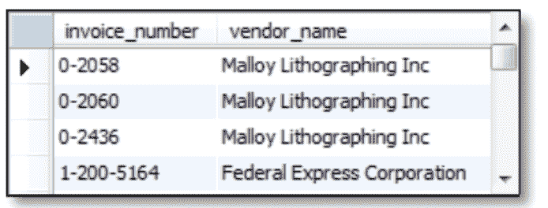

(共 114 行)

## 在连接三张表的语句中使用 NATURAL 关键字

```sql
SELECT department_name AS dept_name, last_name, project_number
FROM departments
  NATURAL JOIN employees
  LEFT JOIN projects USING (employee_id)
  ORDER BY department_name
```

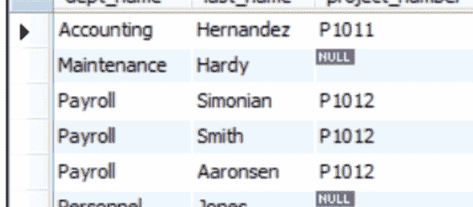

(共 7 行)

## 描述

- 你可以使用 `NATURAL` 关键字创建一个自然连接，该连接根据两个表中所有同名的列来连接这两个表。
- 虽然自然连接的代码比使用 `ON` 或 `USING` 子句的连接代码更短，但自然连接仅对某些类型的数据库结构有效。此外，对于复杂查询，自然连接往往会产生意料之外的结果。因此，使用 `ON` 或 `USING` 子句来连接表更为常见。

图 4-11 如何使用 NATURAL 关键字连接表

# 如何使用交叉连接 (cross joins)

交叉连接产生一个结果集，其中包含第一张表的每一行都与第二张表的每一行相连接。该结果集被称为表的笛卡尔积。图 4-12 显示了如何使用显式或隐式语法编写交叉连接。

要使用显式语法，你需要在 `FROM` 子句中的两个表之间包含 `CROSS JOIN` 关键字。由于交叉连接的工作机制，你不需要编写包含连接条件的 `ON` 子句。在隐式语法时也是如此。在这种情况下，你只需要在 `FROM` 子句中列出表，并从 `WHERE` 子句中省略连接条件。

此图中的两个 `SELECT` 语句说明了交叉连接的工作原理。这两个语句都结合了 `Departments`（部门）和 `Employees`（员工）表的数据。对于这两个语句，结果都是一个包含 45 行的表。这是因为 `Departments` 表中的 5 行每一行都与 `Employees` 表中的 9 行每一行结合。虽然这个结果集相对较小，但你可以想象一下如果表包含数百或数千行，它会变得有多大。

在学习这些示例时，你应该意识到交叉连接的实际用途很少。因此，你很少（甚至完全不需要）需要使用它。事实上，如果你使用隐式连接语法并忘记在 `WHERE` 子句中编写连接条件，你很可能会意外写出交叉连接。这就是为什么通常认为使用显式连接语法是一种良好实践的原因之一。

## 如何使用显式语法编写交叉连接

### 交叉连接的显式语法

```sql
SELECT select_list
FROM table_1 CROSS JOIN table_2
```

### 使用显式语法的交叉连接

```sql
SELECT departments.department_number, department_name, employee_id,
last_name
FROM departments CROSS JOIN employees
ORDER BY departments.department_number
```

| department_number | department_name | employee_id | last_name |
|---|---|---|---|
| 1 | Accounting | 2 | Jones |
| 1 | Accounting | 5 | Aaronson |
| 1 | Accounting | 8 | O'Leary |
| 1 | Accounting | 3 | Simonian |
| 1 | Accounting | 6 | Watson |
(共 45 行)

## 如何使用隐式语法编写交叉连接

### 交叉连接的隐式语法

```sql
SELECT select_list
FROM table_1, table_2
```

### 使用隐式语法的交叉连接

```sql
SELECT departments.department_number, department_name, employee_id,
last_name
FROM departments, employees
ORDER BY departments.department_number
```

| department_number | department_name | employee_id | last_name |
|---|---|---|---|
| 1 | Accounting | 2 | Jones |
| 1 | Accounting | 9 | Locario |
| 1 | Accounting | 5 | Aaronson |
| 1 | Accounting | 3 | Simonian |
| 1 | Accounting | 6 | Watson |
(共 45 行)

## 描述

- 交叉连接将第一张表的每一行与第二张表的每一行相连接。交叉连接返回的结果集被称为笛卡尔积。


# 如何处理并集 (unions)

与连接一样，并集结合了两个或多个表的数据。然而，并集不是结合基础表的列，而是结合两个或多个结果集的行。

## 如何编写并集

图 4-13 显示了如何编写并集。首先，你使用 `UNION` 关键字连接两个或多个 `SELECT` 语句。每个 `SELECT` 语句必须具有相同数量的列，且每个表中对应列的数据类型必须兼容。

在此图中，我们对 `UNION` 关键字进行了缩进，以显示它连接了 `SELECT` 语句。最终结果集中的列名来自第一个 `SELECT` 子句。其他 `SELECT` 子句分配的列别名对最终结果没有影响。

## 并集的语法

```sql
SELECT select_1
FROM table_1
UNION [ALL]
SELECT select_2
[ALL]
SELECT select_3...
ORDER BY column_list
```

## 合并不同表结果集的并集

```sql
SELECT 'Active' AS source, invoice_number, invoice_date, invoice_total
FROM active_invoices
WHERE invoice_date >= '2014-06-01'
UNION
SELECT 'Paid' AS source, invoice_number, invoice_date, invoice_total
FROM paid_invoices
WHERE invoice_date >= '2014-06-01'
ORDER BY invoice_date DESC
```

| source | invoice_number | invoice_date | invoice_total |
|---|---|---|---|
| Active | 40318 | 2014-07-18 | 21842.00 |
| Paid | P02-3772 | 2014-06-03 | 7125.34 |
| Paid | 10843 | 2014-06-04 | 4901.36 |
| Paid | 77509 | 2014-06-04 | 1750.00 |
| Paid | RTR-72-3662-X | 2014-06-04 | 1600.00 |
| Paid | 75C-90227 | 2014-06-06 | 1367.50 |
| Paid | P02-B8D7757 | 2014-06-06 | 856.92 |
| Active | 177271-C01 | 2014-06-05 | 662.00 |
| Active | 9982771 | 2014-06-03 | 503.20 |
(共 22 行)

# 合并来自同一表结果集的 union

图 4-14 中的第一个示例展示了如何使用 union 来合并来自单个表的结果集。在这个示例中，`Invoices` 表中具有余额的行与同一表中已全额支付的行合并在一起。与上一个图类似，在每个结果集的开头都添加了一个名为 `source` 的列。这样，最终的结果集就能指示每张发票是活跃的还是已付的。

第二个示例展示了如何使用 union 合并两个表连接后的结果集。在这里，每个 `SELECT` 语句都检索总额大于 $10,000 的发票。然后，它计算发票总额 33% 的款项。另外两个 `SELECT` 语句也类似。第二个检索总额在 $500 到 $10,000 之间的发票，并计算 50% 的款项。第三个则检索总额小于 $500 的发票，并将付款金额设为总额的 100%。虽然这不是最实用的示例，但它有助于说明 union 操作的灵活性。

在这两个示例中，每个 `SELECT` 语句都分配了相同的列别名。虽然第二和第三 `SELECT` 语句中的别名是可选的，但它们使查询更易读。特别是，它们让我们一眼看出三个 `SELECT` 语句具有相同数量和种类的列。

## 合并来自同一表结果集的 union

```sql
SELECT 'Active' AS source, invoice_number, invoice_date, invoice_total
FROM invoices
WHERE invoice_total - payment_total - credit_total > 0
UNION ALL
SELECT 'Paid' AS source, invoice_number, invoice_date, invoice_total
FROM invoices
WHERE invoice_total - payment_total - credit_total <= 0
ORDER BY invoice_number DESC
```

| source | invoice_number | invoice_date | invoice_total |
|---|---|---|---|
| Paid | P-0258 | 2014-05-28 | 37966.19 |
| Paid | P-0259 | 2014-07-19 | 26881.40 |
| Paid | P-0260 | 2014-07-24 | 22517.58 |
| Paid | P-0318 | 2014-06-01 | 21842.00 |


| Active | P-0469 | 2014-07-23 | 20531.18 |
| Active | P-0436 | 2014-03-31 | 10976.06 |

(114 行)

## 合并来自同一表结果集的 union

```sql
SELECT invoice_number, vendor_name, '33% Payment' AS payment_type,
invoice_total AS total, invoice_total * 0.33 AS payment
FROM invoices JOIN vendors
ON invoices.vendor_id = vendors.vendor_id
WHERE invoice_total > 10000
UNION ALL
SELECT invoice_number, vendor_name, '50% Payment' AS payment_type,
invoice_total AS total, invoice_total * 0.5 AS payment
FROM invoices JOIN vendors
ON invoices.vendor_id = vendors.vendor_id
WHERE invoice_total BETWEEN 500 AND 10000
```

| invoice_number | vendor_name | payment_type | total | payment |
|---|---|---|---|---|
| 40318 | Data Recreations Corp | 33% Payment | 21842.00 | 7273.86 |
| 0-0258 | Malloy Lithographic Inc | 33% Payment | 37966.19 | 12528.84272 |
| 0-0260 | Malloy Lithographic Inc | 33% Payment | 22517.58 | 7430.25412 |
| 0-2368 | Malloy Lithographic Inc | 33% Payment | 20957.56 | 6915.9968 |
| P-0259 | Malloy Lithographic Inc | 33% Payment | 26881.40 | 8951.5062 |
| P-0608 | Malloy Lithographic Inc | 33% Payment | 20551.18 | 6783.5426 |
| 509786 | Bertelsmann Industry Svcs. Inc | 50% Payment | 6940.25 | 3470.125 |

(114 行)

图 4-14 如何合并来自同一表的结果集

## 模拟全外连接的 union

全外连接（full outer join）会返回左表和右表中未匹配的行。虽然 MySQL 没有提供用于编写全外连接的语言，但你可以通过编写一个 union 来合并左外连接和右外连接的结果集来模拟全外连接，如图 4-15 所示。

图中的示例使用 `UNION` 关键字来合并 4-9 所示的左外连接和右外连接的结果集。由于这些行在另一个表中没有匹配的列，因此该示例返回了 `Departments` 和 `Employees` 表中的所有行。为了更容易识别未匹配的行，该语句包含了两个表的 `department_number`。这显示 `Employees` 表中的两个行在 `Departments` 表中没有匹配行，而 `Departments` 表中的一个行在 `Employees` 表中没有匹配行。换句话说，两个员工没有分配到部门，而一个部门没有员工。

## 模拟全外连接的 union

```sql
SELECT department_name AS dept_name, department_number AS d_dept_no,
   e.department_number AS e_dept_no, last_name
FROM departments d
 LEFT JOIN e
ON d.department_number = e.department_number
UNION
SELECT department_name AS dept_name, department_number AS d_dept_no,
   e.department_number AS e_dept_no, last_name
FROM departments d
RIGHT JOIN e
ON d.department_number = e.department_number
```

| dept_name | d_dept_no | e_dept_no | last_name |
|---|---|---|---|
| NULL | | | Watson |
| NULL | 6 | | Locario |
| Accounting | 1 | | Hernandez |
| Maintenance | 5 | | Hardy |
| Operations | 3 | | Smith |
| Payroll | 2 | | Smith |
| Payroll | 2 | | Simon |
| Payroll | 2 | | Aaronson |
| Personnel | 4 | | Jones |

(10 行)

## 说明

* 当你使用全外连接时，结果集包含了两个表的所有行。
* MySQL 没有提供全外连接的关键字，但可以使用 `UNION` 合并左外连接和右外连接的结果来模拟全外连接。

## 观点

在本章中，你学习了将两个或多个表的数据合并到一个结果集的各种技术。特别是，你学习了连接的显式语法。在本章介绍的所有技术中，这是最常用的。因此你需要彻底理解它。

## 术语

- join (连接)
- join condition (连接条件)
- inner join (内连接)
- ad hoc relationship (临时关系)
- qualified column name (限定列名)
- explicit syntax (显式语法)
- SQL-92 syntax (SQL-92 语法)
- table alias (表别名)
- schema (模式)
- self-join (自连接)
- implicit syntax (隐式语法)
- outer join (外连接)
- left outer join (左外连接)
- right outer join (右外连接)
- equal join (等连接)
- natural join (自然连接)
- cross join (交叉连接)
- Cartesian product (笛卡尔积)
- union
- full outer join (全外连接)

## 练习

1. 编写一个 `SELECT` 语句，返回 `Vendors` 表所有列连接 `Invoices` 表的所有列。这应该返回 114 行。提示：你可以使用星号 `(*)` 选择两个表的列。

2. 编写一个 `SELECT` 语句，返回以下列：
   - `Vendors` 表的 `vendor_name` 列
   - `Invoices` 表的 `invoice_number` 列
   - `Invoices` 表的 `invoice_date` 列
   - `Invoices` 表的 `invoice_total` 列减去 `payment_total` 和 `credit_total` 列
   为表使用别名：`Vendors` 和 `Invoices`。
   为每个非零余额的发票返回一行。这应该返回 11 行。
   按 `vendor_name` 升序排序结果集。

3. 编写一个 `SELECT` 语句，返回以下三列：
   - `Vendors` 表的 `vendor_name` 列
   - `Vendors` 表的 `default_account_number` 列
   - `General_Ledger_Accounts` 表的 `account_description` 列
   为每个供应商返回一行。这应该返回 122 行。
   按 `account_description` 然后 `vendor_name` 排序结果集。

4. 编写一个 `SELECT` 语句，返回以下五列：
   - `Vendors` 表的 `vendor_name` 列
   - `Invoices` 表的 `invoice_date` 列
   - `Invoices` 表的 `invoice_number` 列
   - `Invoice_Line_Items` 表的 `li_sequence` 列
   - `Invoice_Line_Items` 表的 `line_item_amount` 列
   为表使用别名。这应该返回 118 行。
   按 `vendor_name`、`invoice_date`、`invoice_number` 和 `li_sequence` 排序最终结果集。

5. 编写一个 `SELECT` 语句，返回三列：
   - `Vendors` 表的 `vendor_id` 列
   - `Vendors` 表的 `vendor_name` 列
   - `contact_name`：`vendor_contact_first_name` 和 `vendor_contact_last_name` 列之间带空格的连接
   为每个与另一个供应商联系人姓名相同的供应商返回一行。这应该返回 2 行。提示：使用自连接检查 `vendor_id` 列不相等但 `vendor_contact_last_name` 列相等。
   按 `vendor_contact_last_name` 排序结果集。

6. 编写一个 `SELECT` 语句，返回以下三列：
   - `General_Ledger_Accounts` 表的 `account_number` 列
   - `General_Ledger_Accounts` 表的 `account_description` 列
   - `Invoice_Line_Items` 表的 `invoice_id` 列
   为每个从未使用的账户号码返回一行。这应该返回 54 行。提示：使用外连接并仅返回 `invoice_id` 列为空值的行。
   从 `SELECT` 子句中移除 `invoice_id` 列。
   按 `account_number` 列排序最终结果集。

7. 使用 `UNION` 运算符生成一个由 `Vendors` 表两个列组成的结果集：`vendor_name` 和 `vendor_state`。如果供应商位于加利福尼亚州，`vendor_state` 值应为 "CA"，否则应为 "Outside CA"。
   按 `vendor_name` 排序最终结果集。

## 5. 如何插入、更新和删除数据

在最后两个章节中，你学习了如何编写 `SELECT` 语句来检索和汇总数据。现在，你将学习如何编写 `INSERT`、`UPDATE` 和 `DELETE` 语句来修改表中的数据。完成本章后，你将学会如何编写专业应用程序开发人员每天使用的四种语句。

在阅读本章时，请记住默认情况下，MySQL 会在执行每个 `INSERT`、`UPDATE` 或 `DELETE` 语句后立即将更改提交到数据库。这通常是你所想要的。如果不是这样，你可以参考第 14 章来学习如何关闭自动提交模式。

| | | |
|---|---|---|
| 如何创建测试表 | 150 |
| 如何创建本书所需的表... | 150 |
| 如何创建表的副本... | 150 |
| 如何插入新行 | 152 |
| 如何插入单行... | 152 |
| 如何插入多行... | 152 |
| 如何插入默认值和空值... | 154 |
| 如何在 INSERT 语句中使用子查询 | 156 |
| 如何更新现有行... | 158 |
| 如何更新行... | 158 |
| 如何在 UPDATE 语句中使用子查询... | 160 |
| 如何删除现有行 | 162 |
| 如何删除行... | 162 |
| 如何在 DELETE 语句中使用子查询 | 162 |
| 观点 | 164 |

## 如何创建测试表

在你开始实验 `INSERT`、`UPDATE` 和 `DELETE` 语句之前，你需要确保你的实验不会影响到公司或学校其他人员正在使用的“实时”数据。

## 如何创建本书所需的表

如果你仅与本书中的表一起工作，可以使用附录 A（Windows）或 B（Mac）所示的步骤来创建本书所需的表。然后，你可以尽情地进行实验，而不必担心更改了这些表的多少内容。如果你需要将这些表恢复到原始状态，可以使用附录中所示步骤来实现。

## 如何创建表的副本

如果你正在处理运行在公司或学校服务器上的表，那么在进行任何测试之前，创建某些或所有表的副本通常是一个好主意。要做到这一点，你可以如图 5-1 所示，结合 `SELECT` 语句使用 `CREATE TABLE AS` 语句。当你使用这种技术时，`SELECT` 语句定义的结果将被复制到一个新表中。然后，你可以尽情地对测试表进行实验，并在完成后将其删除。

当你使用这种技术创建表时，MySQL 只复制列定义和数据。换句话说，MySQL 不保留列定义的其他部分，如主键、外键和索引。因此，当你对复制的表进行实验时，得到的结果可能与原始表不同。尽管如此，这通常比比对实时数据进行实验要好得多。

图中的示例展示了如何使用 `CREATE TABLE AS` 语句。在这里，第一个示例将 `Invoices` 表中所有行的所有列复制到名为 `Invoices_Copy` 的新表中。第二个示例将 `Invoices` 表中的所有列复制到名为 `Old_Invoices` 的新表中，但仅针对余额为零的行。第三个示例创建了一个包含 `Invoices` 表汇总数据的表。

当你完成对测试表的实验后，可以使用 `DROP TABLE` 语句删除任何不再需要的表。例如，在图中，第四个示例展示了如何删除 `Old_Invoices` 表。

### 创建 CREATE TABLE AS 语句

```sql
CREATE TABLE table_name AS select_statement
```

### 创建 Invoices 表的完整副本

```sql
CREATE TABLE invoices_copy AS
SELECT *
FROM invoices
```

### 创建 Invoices 表的部分副本

```sql
CREATE TABLE old_invoices AS
SELECT *
FROM invoice_total
WHERE invoice_total - payment_total - credit_total = 0
```

### 创建一个包含来自 Invoices 表汇总行的表

```sql
CREATE TABLE vendor_balances AS
SELECT vendor_id, SUM(invoice_total) AS sum_of_invoices
FROM invoices
WHERE (invoice_total - payment_total - credit_total) <> 0
GROUP BY vendor_id
```

### 删除表

```sql
DROP TABLE old_invoices
```

## 描述

- 你可以使用 `CREATE TABLE AS` 语句根据 `SELECT` 语句定义的结果集创建新表。
- `SELECT` 语句中的每个列名必须是唯一的。如果你在选择列表中使用了计算值，则必须为该列命名。
- 你可以像编写任何其他 `SELECT` 语句一样编写 `SELECT` 语句的其他子句，包括分组、聚合、连接和子查询。
- 表必须不存在。如果已存在，你必须在执行 `CREATE TABLE AS` 之前使用 `DROP TABLE` 语句删除该表。
- 当你使用 `CREATE TABLE AS` 语句创建表时，只复制列定义和数据。新表不会包含主键、外键、索引等定义。

## 如何插入行

要向表中添加行，请使用 `INSERT` 语句。在大多数情况下，你使用此语句来向表中添加单行。

### 如何插入单行

向表中添加行，请使用 `INSERT` 语句。在大多数情况下，你使用此语句来向表中添加单行。图 5-2 展示了如何使用 `INSERT` 语句。

### 如何插入多行

向表中添加行，请使用 `INSERT` 语句。在大多数情况下，你使用此语句来向表中添加多行。

### INSERT 语句的语法

```sql
INSERT [INTO] table_name [(column_list)]
VALUES
  (value1, value2, ...),
  (value1, value2, ...);
```

### Invoices 表的列定义

| 列 | 类型 | 属性 |
|---|---|---|
| invoice_id | INT | NOT NULL AUTOINCREMENT |
| vendor_id | INT | NOT NULL |
| invoice_number | VARCHAR(50) | NOT NULL |
| invoice_date | DATE | NOT NULL |
| invoice_total | DECIMAL(9,2) | NOT NULL |
| payment_total | DECIMAL(9,2) | NOT NULL |
| credit_total | DECIMAL(9,2) | DEFAULT 0 |
| terms_id | INT | NOT NULL |
| invoice_due_date | DATE | NOT NULL |
| payment_date | DATE | NOT NULL |

### 不使用列列表插入单行


```sql
INSERT INTO invoices VALUES
(115, 97, '456789', '2014-08-01', 8344.50, 0, 0, 1, '2014-08-31', NULL)
```

(1 行受)

### 使用列列表插入单行

```sql
INSERT INTO invoices (vendor_id, invoice_number, invoice_date, invoice_total, terms_id, invoice_due_date)
VALUES (97, '456790', '2014-08-01', 8344.50, 1, '2014-08-31');
```

(1 行受)

### 插入多行

```sql
INSERT INTO invoices (vendor_id, invoice_number, invoice_date, invoice_total, terms_id, invoice_due_date)
 VALUES (97, '456791', '2014-08-02', 1200.00, 1, '2014-09-01'),
         (97, '456792', '2014-08-02', 1500.00, 1, '2014-09-01'),
         (98, '456793', '2014-08-03', 2100.00, 2, '2014-09-02');
```

(3 行受)

# 如何插入默认值和空值

如果某列允许空值，你可以使用 `INSERT` 语句向该列插入空值。同样地，如果某列定义了默认值，你可以使用 `INSERT` 语句插入该值。最后，如果某列被定义为自增列，你可以让 MySQL 为该列生成值。你使用的技术取决于 `INSERT` 语句是否包含列列表，如图 5-3 所示。

所有这些 `INSERT` 语句都使用来自 `EX` 数据库的名为 `Color_Sample` 的表。该表包含图中所示的三个列。第一列 `color_id` 的定义允许 MySQL 在任何时候都自动生成其值。第二列 `color_number` 定义了默认值为 `0`。而第第三列 `color_name` 的定义为允许空值。

前两个语句展示了如何使用列列表分配自增值、默认值或空值。要做到这一点，只需从列表中省略该列。例如，在第一个语句中，列列表为 `color_id` 列指定了值 `1`（假设表不包含任何行），并为 `color_name` 列指定了空值。MySQL 自动为 `color_id` 列分配值 `2`，并为 `color_name` 列分配空值。在第二个语句中，列列表仅列出了 `color_name` 列。结果是 MySQL 为 `color_id` 列分配了值 `2`。

接下来的三个语句展示了如何在不包含列列表的情况下为列分配自增、默认或空值。要做到这一点，你可以使用 `DEFAULT` 和 `NULL` 关键字。例如，第三个语句为 `color_name` 列指定了值，但对 `color_id` 和 `color_number` 列使用了 `DEFAULT` 关键字。结果是 MySQL 为 `color_id` 列分配了自增值 `3`，为 `color_number` 列分配了默认值 `0`。第四个语句使用 `NULL` 关键字为 `color_name` 列分配空值。最后，第五个语句展示了如果你在前两列使用 `DEFAULT` 关键字而在第三列使用 `NULL` 关键字会发生什么。

## Color_Sample 表的列定义

```sql
color_id         INT             NOT NULL     AUTO_INCREMENT,
color_number     INT             NOT NULL     DEFAULT 0,
color_name       VARCHAR(50)
```

## Color_Sample 表的五个 INSERT 语句

```sql
INSERT INTO color_sample (color_number)
VALUES (606)
```

```sql
INSERT INTO color_sample (color_name)
VALUES ('Yellow')
```

```sql
INSERT INTO color_sample
VALUES (DEFAULT, DEFAULT, 'Orange')
```

```sql
INSERT INTO color_sample
VALUES (DEFAULT, 808, NULL)
```

## 插入行后的 Color_Sample 表

| color_id | color_number | color_name |
|---|---|---|
| 1 | 606 | NULL |
| 2 | 0 | Yellow |
| 3 | 0 | Orange |
| 4 | 808 | NULL |
| 5 | 0 | NULL |

## 描述

- 如果某列定义为允许 NULL 值，你可以在值列表中使用 `NULL` 关键字向该列插入空值。
- 如果某列定义了默认值，你可以在值列表中使用 `DEFAULT` 关键字为该列插入默认值。
- 如果某列被定义为自增列，你可以在值列表中使用 `DEFAULT` 关键字让 MySQL 为该列生成值。
- 如果你包含了列列表，可以省略带有默认值和空值的列。然后，默认值或空值将被自动分配。你也可以省略自增列，此时 MySQL 会为该列生成值。

## 如何在 INSERT 语句中使用子查询

子查询只是编写在另一个 SQL 语句内部的 `SELECT` 语句。由于你已经知道如何编写 `SELECT` 语句，编写本章描述的子查询应该不会遇到太大困难。在第 7 章中，你将学习更多关于编写子查询的知识。

图 5-4 显示了如何在 `INSERT` 语句中编写子查询。这里，两个示例都使用 `SELECT` 代替 `VALUES` 子句。结果是子查询通过从另一个表选择这些值来为新行指定值。

两个示例都从 `Invoices` 表检索行并将其插入到名为 `Invoice_Archive` 的表中。该表的定义与 `Invoices` 表列相同。然而，`invoice_id` 列未被定义为自增列，且 `payment_total` 和 `credit_total` 列没有定义默认值。因此，必须包含这些列的值。

第一个示例展示了如何在不带列列表的 `INSERT` 语句中使用子查询。在这个示例中，子查询的 `SELECT` 子句应用了 `WHERE` 子句中的搜索条件，结果集中的所有行都被插入到 `Invoice_Archive` 表中。

第二个示例展示了如何在带列列表的 `INSERT` 语句中使用子查询。在使用 `VALUES` 子句一样，你可以按任何顺序列出列。然而，在子查询的 `SELECT` 子句中列的顺序必须相同。此外，你可以省略自增列、定义了默认值的列以及允许空值的列。

在 `INSERT` 语句中编写子查询时，如果你使用列列表，则不需要担心列的顺序。但如果不使用列列表，`SELECT` 语句中的列必须与表中的顺序匹配。

## Color_Sample 表的列定义

```sql
color_id         INT             NOT NULL     AUTO_INCREMENT,
color_number     INT             NOT NULL     DEFAULT 0,
color_name       VARCHAR(50)
```

## Color_Sample 表的五个 INSERT 语句

```sql
INSERT INTO color_sample (color_number)
VALUES (606)
```

```sql
INSERT INTO color_sample (color_name)
VALUES ('Yellow')
```

```sql
INSERT INTO color_sample
VALUES (DEFAULT, DEFAULT, 'Orange')
```

```sql
INSERT INTO color_sample
VALUES (DEFAULT, 808, NULL)
```

## 插入行后的 Color_Sample 表

| color_id | color_number | color_name |
|---|---|---|
| 1 | 606 | NULL |
| 2 | 0 | Yellow |
| 3 | 0 | Orange |
| 4 | 808 | NULL |
| 5 | 0 | NULL |

## UPDATE 语句的语法

```
UPDATE table_name
SET column_name_1 = expression_1[, column_name_2 = expression_2]...
[WHERE search_condition]
```

## 更新单行中的两个列

```
UPDATE invoices
SET payment_date = '2014-09-21',
    payment_total = 19351.18
WHERE invoice_number = '97/522'
(1 row affected)
```

## 更新多行的单列

```
UPDATE invoices
SET terms_id = 1
WHERE vendor_id = 95
(6 rows affected)
```

## 更新单行的单列

```
UPDATE invoices
SET credit_total = credit_total + 100
WHERE invoice_number = '97/522'
(1 row affected)
```

## 描述

- 你使用 `UPDATE` 语句来修改表中的一个或多个多行。
- 在 `SET` 子句中，你指定每个列名及其新值。你可以指定字面量或表达式作为列的值。
- 在 `WHERE` 子句中，你可以指定更新行时必须满足的条件。
- 你可以使用 `DEFAULT` 和 `NULL` 关键字来如图 5-3 所示指定默认值和空值。
- 默认情况下，MySQL Workbench 以安全更新模式运行。这防止你在省略 `WHERE` 子句或 `WHERE` 子句未引用主键或外键列时更新行。
- 为了绕过安全更新模式的限制，你可以关闭此模式。要这样做，选择 `Edit->Preferences`（编辑->首选项），选择 `SQL Editor` 节点，更改“Safe Updates”选项并重启 MySQL Workbench。

## 警告

- 如果你关闭了安全更新模式并省略 `WHERE` 子句，表中的所有行都将被更新。


## 如何在 UPDATE 语句中使用子查询

当你在 `UPDATE` 语句的 `WHERE` 子句上编写搜索条件时，可以包含一个子查询来识别要更新的行。图 5-6 展示了说明如何操作的两个语句。

在第一条语句中，`WHERE` 子句中使用了子查询来识别要更新的发票。该子查询返回 `Vendors` 表中名为“Pacific Bell”的供应商的 `vendor_id` 值。然后，所有具有该 `vendor_id` 值的发票都将得到更新。

第二条 `UPDATE` 语句同样在 `WHERE` 子句中使用了子查询。该子查询返回了加利福尼亚州、亚利桑那州和内华达州所有供应商的 `vendor_id` 列表。然后，使用 `IN` 算符更新所有 `vendor_id` 值在这些列表中的发票。尽管该子查询返回了 80 个供应商，但其中许多供应商并没有发票。因此，`UPDATE` 语句仅影响了 40 份发票。

要从 MySQL Workbench 执行第二条 `UPDATE` 语句，你必须关闭安全模式。这是因为该语句的 `WHERE` 子句中使用了 `IN` 算符。

## 更新某个供应商的所有发票

```
UPDATE invoices
SET terms_id = 1
WHERE vendor_id =
  (SELECT vendor_id
 FROM vendors
 WHERE vendor_name = 'Pacific Bell')

(6 rows affected)
```

## 更新三个州供应商所有发票的结账条件（terms）

```
UPDATE invoices
SET terms_id = 1
WHERE vendor_id IN
  (SELECT vendor_id
 FROM vendors
 WHERE vendor_state IN ('CA', 'AZ', 'NV'))

(40 rows affected)
```

## 描述

- 你可以在 `UPDATE` 语句的 `WHERE` 子句中编写子查询，以为搜索条件提供一个或多个值。

## 如何删除现有行

若要从表中删除一行或多行，请使用 `DELETE` 语句。如有必要，你可以在 `DELETE` 语句中使用子查询来帮助识别要删除的行。

## 如何删除行

图 5-7 展示了 `DELETE` 语句的语法以及四个演示工作方式的示例。首先，`DELETE` 子句指定表名并必须包含 `FROM` 关键字。

`WHERE` 子句指定了标识要删除行的搜索条件。该子句是可选的；你几乎总是包含它。如果不包含，可能会无意中删除表中的所有行。坦率地说，MySQL Workbench 默认以安全模式运行，如果 `DELETE` 语句不包含引用主键或外键列的 `WHERE` 子句，则阻止其执行。

如果你想在删除行之前确保选择了正确的行，可以使用检索行的 `SELECT` 语句。一旦确认使用的 `SELECT` 语句检索了正确的行，就可以将 `SELECT` 语句转换为 `DELETE` 语句。

图中的第一个 `DELETE` 语句从 `General_Ledger_Accounts` 表中删除单行。要做到，它在 `WHERE` 子句中指定了要删除行的 `account_number` 值。第二个 `DELETE` 语句从 `Invoice_Items` 表中删除单行。要做到，它在 `WHERE` 子句中指定了要删除的行的 `invoice_id` 值和 `invoice_sequence` 值。第三个 `DELETE` 语句从 `Invoice_Line_Items` 表中删除四行。要做到，它指定了 12 作为要删除行的 `line_items` `invoice_id` 值。这删除了所有四项行项目（line items）。

如果你尝试删除在另一个表中具有一个或多个子表的行，MySQL 会返回一个错误消息。在这里，你可以使用子查询来删除该行。

## 如何在 DELETE 语句中使用子查询

如果你想删除在另一个表中具有相关行的行，你需要先如图 5-7 所示使用子查询。然后，`DELETE` 语句将删除 ID。

## DELETE 语句的语法

```
DELETE FROM table_name
[WHERE search_condition]
```

## 删除单行

```
DELETE FROM general_accounts
WHERE account_number = 306

(1 row affected)
```

## 使用复合条件删除单行

```
DELETE FROM line_items
WHERE invoice_id = 78 AND invoice_sequence = 2

(1 row affected)
```

## 删除多行

```
DELETE FROM line_items
WHERE invoice_id = 12

(4 rows affected)
```

## 在 DELETE 语句中使用子查询

```
DELETE FROM line_items
WHERE invoice_id IN
  (SELECT
    invoice_id
    FROM invoices)
```

## 描述

- 你可以使用 `DELETE` 语句删除表中的一个或多行。
- 在 `WHERE` 子句中指定删除行必须满足的条件。
- 你可以在 `WHERE` 子句中使用子查询。
- 默认情况下，MySQL Workbench 以安全模式运行。这防止你在省略 `WHERE` 子句或 `WHERE` 子句未引用主键或外键列时删除行。

## 警告

- 如果你关闭安全模式，表中的行都将被删除。

## 展望

在本章中，你学习了如何使用 `INSERT`、`UPDATE` 和 `DELETE` 语句修改数据库中的数据。在第 10 和 11 章，你将学习更多关于表定义如何影响这些语句的工作。在第 14 章，你将学习更多关于将 `INSERT`、`UPDATE` 和 `DELETE` 语句作为一个事务来执行。

## 练习

在执行这些练习时要测试表是否已正确修改，你可以编写并运行相应的 `SELECT` 语句。或者，当你使用 MySQL Workbench 时，可以右键点击对象浏览器中的表名并选择 `Select Rows - Limit 1000` 命令在结果页中显示数据显示。修改表数据后，点击此页顶部工具栏中的刷新按钮。

1. 编写一个 `INSERT` 语句向 `Terms` 表添加此行：

   - `terms_id`: 6
   - `terms_description`: Net due 120 days
   - `terms_due_days`: 120

   使用 MySQL Workbench 查看 `Terms` 表的列定义，并在 `INSERT` 语句中包含必需列列表。

2. 编写一个 `UPDATE` 语句修改你刚刚添加到 `Terms` 表的行。该语句应将 `terms_description` 列更改为“Net 125 days”，并将 `terms_due_days` 列更改为 125。

3. 编写一个 `DELETE` 语句删除你在练习 1 中添加到 `Terms` 表的行。

4. 编写一个 `INSERT` 语句向 `Invoices` 表添加此行：

   - `invoice_id`: 下一个自动生成的
   - `vendor_id`: 32
   - `invoice_number`: AX-014-027
   - `invoice_date`: 8/1/2014
   - `invoice_total`: $434.58
   - `payment_total`: $0.00
   - `credit_total`: $0.00
   - `terms_id`: 2


# 第 5 章 如何插入、更新和删除数据

## 练习题

**初始数据：**

```text
invoice_due_date: 8/31/2014
payment_date: null
```

**要求：** 在不使用列的情况下编写此语句。

5. 编写一个 `INSERT` 语句，将这些行添加到 `Invoice_Line_Items` 表中：

| invoice_sequence | 2 |
| account_number | 160 | 527 |
| line_item_amount | $180.23 | $254.35 |
| line_item_description | 硬盘 | Exchange Server 更新 |

将这两行的 `invoice_id` 列设置为 MySQL 为你在第 4 题中添加的发票所生成的发票 ID。

6. 编写一个 `UPDATE` 语句，修改你在第 4 题中添加的发票。该语句应更改 `credit_total` 列，使其等于 `invoice_total` 列的 10%，并且应使 `payment_total` 和 `credit_total` 列的值等于 `payment_total` 和 `credit_total` 列之和。

7. 编写一个 `UPDATE` 语句，修改 `Vendors` 表。将 ID 为 44 的供应商的 `default_account_number` 列改为 403。

8. 编写一个 `UPDATE` 语句，修改 `Invoices` 表。对于每个 `default_terms_id` 为 2 的供应商的发票，将 `terms_id_column` 改为 2。

9. 编写一个 `DELETE` 语句，删除你在第 4 题中添加到 `Invoices` 表的行。当你执行此语句时，它会产生错误，因为该发票在 `Invoice_Line_Items` 表中有相关行。要修复这个问题，请在 `DELETE` 语句之前添加另一个 `DELETE` 语句，删除该发票的行项目。（记住，在脚本中编写两个或多个语句时，必须在每个语句后以分号结束。）

---

## 按需学习更多 SQL 技能

在第一部分中，你学习了专业的 SQL 技能，可以用它们处理现有数据库中的数据。现在，在本节中，你可以在需要时通过学习新技能来补充。为了实现这一点，本节的每一章都被设计成独立的模块。因此，你可以按照自己喜欢的顺序阅读这些章节。

- 在第 6 章中，你将学习如何对检索的数据进行汇总。
- 在第 7 章中，你将学习更多关于子查询的知识。
- 在第 8 章中，你将学习更多关于 MySQL 支持的数据类型。
- 在第 9 章中，你将学习如何在你的 SQL 语句中使用 MySQL 函数。

---

# 第 6 章 如何编写汇总查询

## 章节概览

在本章中，你将学习如何编写汇总数据的查询。例如，你可以使用汇总查询按供应商或州报告销售总额。同样，你可以使用汇总查询来获取每月每天处理的发票数量。但在之前，你将学习如何使用一种称为“聚合函数”的特殊函数。聚合函数允许你执行计算平均值、汇总总额或查找指定列的最大值等工作，你将在汇总查询中使用它们。

- 如何使用聚合函数
- 如何编写聚合函数
- 使用聚合函数的查询
- 如何分组和汇总数据
- 如何编写 `GROUP BY` 和 `HAVING` 子句
- 使用 `GROUP BY` 和 `HAVING` 子句的查询
- `HAVING` 子句与 `WHERE` 子句的比较
- 如何编写复合搜索条件
- 如何使用 `WITH ROLLUP` 操作符
- 观点

---

## 如何使用聚合函数

在第 3 章中，你学习了如何使用标量函数，标量函数作用于单个值并返回单个值。在本章中，你将学习如何使用聚合函数，它们作用于一系列值并返回单一汇总值。由于聚合函数通常作用于列中的值，它们有时被称为列函数。包含一个或多个聚合函数的查询通常被称为汇总查询。

---

## 如何编写聚合函数

图 6-1 展示了最常用聚合函数的语法。这些函数中的大多数作用于一个表达式。通常，该表达式只是列名。例如，你可以像这样获取 `invoice_total` 列中所有值的平均值：

```sql
AVG(invoice_total)
```

然而，表达式可以更复杂。例如，在图中，为 `SUM` 函数编写的表达式使用 `invoice_total`、`payment_total` 和 `credit_total` 列计算发票的余额。结果是代表所有选定发票应付总量的单一值。在这种情况下，`WHERE` 子句仅选择有余额的发票。

当你使用这些函数时，还可以编写 `ALL` 或 `DISTINCT` 关键字，这意味着所有值都包含在计算中。例外是空值，它们始终被这些函数排除在外。

如果你不想包含某些值，可以编写 `DISTINCT` 关键字。在大多数情况下，你会像下一图所示与 `COUNT` 函数配合 `DISTINCT`。你不会对 `MIN` 或 `MAX` 使用它，因为它对这些函数没有影响。而且在 `AVG` 和 `SUM` 函数中使用它通常没有意义。

---

### 聚合函数的语法

| 函数 | 结果 |
| :--- | :--- |
| `AVG(expression)` | 平均值 |
| `SUM(expression)` | 总和 |
| `MIN(expression)` | 最小值 |
| `MAX(expression)` | 最大值 |
| `COUNT(expression)` | 数量 |

---

### 核心要点

- 聚合函数（也称为列函数）对一组值进行计算。
- 汇总查询是一个包含一个或多个聚合函数的 `SELECT` 语句。
- `AVG` 和 `SUM` 函数的表达式必须产生数值。`MIN`、`MAX` 和 `COUNT` 函数的表达式可以产生任何类型。
- 默认情况下，无论值是否重复，计算都会包含所有值。如果你想排除重复值，请使用 `DISTINCT` 关键字。
- 除了 `COUNT(*)` 外，所有的聚合函数都会忽略空值。
- 如果你在 `SELECT` 子句中编写聚合函数，该子句不能包含非聚合列，除非它们在 `GROUP BY` 子句中已命名。

---

## 使用聚合函数的查询示例

### 使用 `COUNT(*)`、`AVG` 和 `SUM` 函数的汇总查询

```sql
SELECT 'After 1/1/2014' AS selection_date,
       COUNT(*) AS number_of_invoices,
       ROUND(AVG(invoice_total), 2) AS avg_invoice_amt,
       SUM(invoice_total) AS total_invoice_amt
FROM invoices
WHERE invoice_date > '2014-01-01'
```

| selection_date | number_of_invoices | avg_invoice_amt | total_invoice_amt |
|---|---|---|---|
| After 1/1/2014 | 114 | 1879.74 | 214290.51 |

---

### 使用 `MIN` 和 `MAX` 函数的汇总查询

```sql
SELECT 'After 1/1/2014' AS selection_date,
       COUNT(*) AS number_of_invoices,
       MAX(invoice_total) AS highest_invoice_total,
       MIN(invoice_total) AS lowest_invoice_total
FROM invoices
WHERE invoice_date > '2014-01-01'
```

| selection_date | number_of_invoices | highest_invoice_total | lowest_invoice_total |
|---|---|---|---|
| After 1/1/2014 | 114 | 37968.19 | 6.00 |

---

### 非数值列的汇总查询

```sql
SELECT MIN(vendor_name) AS first_vendor,
       MAX(vendor_name) AS last_vendor,
       COUNT(vendor_name) AS number_of_vendors
FROM vendors
```

| first_vendor | last_vendor | number_of_vendors |
|---|---|---|
| Abbey Office Furnishings | Zylka Design | 122 |

---

### 使用 `DISTINCT` 关键字的汇总查询

```sql
SELECT COUNT(DISTINCT vendor_id) AS number_of_vendors,
       COUNT(vendor_id) AS number_of_invoices,
       ROUND(AVG(invoice_total), 2) AS avg_invoice_amt,
       SUM(invoice_total) AS total_invoice_amt
FROM invoices
WHERE invoice_date > '2014-01-01'
```

| number_of_vendors | number_of_invoices | avg_invoice_amt | total_invoice_amt |
|---|---|---|---|
| 24 | 114 | 1879.74 | 214290.51 |

---

### 核心要点

- 要统计所有选定的行，请使用 `COUNT(*)` 函数。或者，你也可以使用 `COUNT` 函数配合任何不包含空值的列名。
- 要仅统计指定列中具有唯一值的行，你可以在编写 `COUNT` 函数时使用 `DISTINCT` 关键字，并在后跟列名。

---

## 如何对数据分组和汇总

现在你已经理解了聚合函数的工作原理，准备好学习如何对数据进行分组，并使用聚合函数汇总每组的数据了。要做到这一点，你可以使用 `SELECT` 语句的两个新子句：`GROUP BY` 和 `HAVING`。

---

## 如何编写 `GROUP BY` 和 `HAVING` 子句

图 6-3 显示了带有 `GROUP BY` 和 `HAVING` 子句的 `SELECT` 语句语法。`GROUP BY` 子句决定了所选行的分组方式，而 `HAVING` 子句决定了哪些组被包含在最终结果中。这些子句在 `WHERE` 子句之后、`ORDER BY` 子句之前编写。这是合理的，因为 `WHERE` 子句是在行分组之前应用的，而 `ORDER BY` 子句是在行分组之后应用的。

在 `GROUP BY` 子句中，你列出用逗号分隔的一个或多个列或表达式。然后，结果集中的行将按列或表达式升序分组。这意味着对于 `GROUP BY` 列中的每组唯一值，将返回单行。例如，在图中，你可以看到按多个列分组的示例。

图中的示例计算了在 `Invoices` 表中拥有发票的每个供应商的平均发票金额。要实现这一点，使用 `GROUP BY` 子句根据 `vendor_id` 对发票进行分组。结果是，`AVG` 函数计算的是每个组 `invoice_total` 列的平均值，而不是整个结果集的平均值。

图中的示例还包含一个 `HAVING` 子句。该子句中的搜索条件指定了仅包含发票平均金额超过 $2,000 的供应商。请注意，该条件必须在行分组并计算出每个组的平均值之后应用。

除了 `AVG` 函数外，`SELECT` 子句还包含了 `vendor_id` 列。这通常是你想要的，因为行是根据此列分组的。然而，如果你不想在 `SELECT` 子句中包含用于 `GROUP BY` 子句的列，你也可以这样做。

---

### 带有 `GROUP BY` 和 `HAVING` 子句的 `SELECT` 语句语法

```sql
SELECT select_list
FROM table_source
[WHERE search_condition]
[GROUP BY group_by_list]
[HAVING search_condition]
[ORDER BY order_by_list]
```

---

### 按供应商计算平均发票金额的汇总查询

```sql
SELECT vendor_id, ROUND(AVG(invoice_total), 2) AS average_invoice_amount
FROM invoices
GROUP BY vendor_id
HAVING AVG(invoice_total) > 2000
ORDER BY average_invoice_amount DESC
```

| vendor_id | average_invoice_amount |
|---|---|
| 110 | 23978.48 |
| 72 | 10856.66 |
| 104 | 7125.34 |
| 99 | 6940.25 |
| 119 | 4901.26 |
| 122 | 2575.33 |
| 86 | 2433.00 |
| 100 | 2184.50 |

(8 行)

---

### 核心要点

- `GROUP BY` 子句根据一个或多个列或表达式对结果进行分组。要包含多个列或表达式，请用逗号分隔它们。
- 如果在 `SELECT` 子句中包含聚合函数，`GROUP BY` 子句将根据指定的列进行分组。
- `HAVING` 子句在行分组后过滤组。
- `WHERE` 子句在行分组之前过滤行。

---

## 使用 `GROUP BY` 和 `HAVING` 的查询

图 6-4 展示了三个使用 `GROUP BY` 和 `HAVING` 的查询。第一个查询按供应商统计发票数量。第二个查询计算每个州和城市的发票平均金额。第三个查询将分组限制为拥有两个或更多发票的组。

---

### 按供应商统计发票数量的汇总查询

```sql
SELECT vendor_id, COUNT(*) AS invoice_qty
FROM invoices
GROUP BY vendor_id
```

| vendor_id | invoice_qty |
|---|---|
| 34 | 2 |
| 37 | 3 |
| 48 | 1 |
| 72 | 2 |

---

### 计算每个州和城市发票平均金额的汇总查询

```sql
SELECT vendor_state, vendor_city, COUNT(*) AS invoice_qty,
       ROUND(AVG(invoice_total), 2) AS invoice_avg
FROM invoices JOIN vendors
ON invoices.vendor_id = vendors.vendor_id
GROUP BY vendor_state, vendor_city
```

| vendor_state | vendor_city | invoice_qty | invoice_avg |
|---|---|---|---|
| AZ | Phoenix | 1 | 662.00 |
| CA | Fresno | 19 | 1208.75 |
| CA | Los Angeles | 1 | 503.20 |
| CA | Oaxaca | 3 | 188.00 |

(20 行)

---

### 将分组限制为拥有两个或更多发票组的汇总查询

```sql
SELECT vendor_state, vendor_city, COUNT(*) AS invoice_qty,
       ROUND(AVG(invoice_total), 2) AS invoice_avg
FROM invoices JOIN vendors
ON invoices.vendor_id = vendors.vendor_id
GROUP BY vendor_state, vendor_city
HAVING COUNT(*) >= 2
```

| vendor_state | vendor_city | invoice_qty | invoice_avg |
|---|---|---|---|
| CA | Fresno | 19 | 1208.75 |
| CA | Oaxaca | 3 | 188.00 |
| CA | Pasadena | 5 | 196.12 |
| CA | Sacramento | 7 | 253.00 |

(12 行)

---

## `HAVING` 子句与 `WHERE` 子句的比较

正如你所看到的，你可以通过在 `HAVING` 子句中编写搜索条件来限制结果集中包含的组。此外，你可以在每行被包含在组之前对其应用搜索条件。要实现这一点，你可以像编写任何 `SELECT` 语句一样，在 `WHERE` 子句中编写搜索条件。为了确保你理解在 `HAVING` 和 `WHERE` 子句中编写的搜索条件之间的差异，图 6-5 举了两个示例。


# 第 6 章 如何编写汇总查询

第一个示例按供应商名称对 `Invoices` 表中的发票进行分组，并计算每个组的发票数量和平均发票金额。然后，`HAVING` 子句限制结果集中的组使其平均发票总额大于 500 美元。

相比之下，第二个示例包含一个 `WHERE` 子句，该子句限制组中的发票使其总额大于 500 美元。换句话说，此示例中的搜索条件应用于每一行。而在上一个示例中，它是应用于每一组行的。因此，这些示例显示 `Invoices` 表中 Zulka Design 有 8 份发票，但其中只有 7 份超过 500 美元。

除此之外，你在 `WHERE` 和 `HAVING` 子句中包含的表达式存在两处区别。首先，`HAVING` 子句可以包含如第一个示例所示的聚合函数，但 `WHERE` 子句不能。这是因为 `WHERE` 子句中的搜索条件是在行分组之前应用的。其次，尽管 `WHERE` 子句可以引用基础表中的任何列，但 `HAVING` 子句只能引用 `SELECT` 子句中包含的列。这是因为过滤的是由 `SELECT`、`FROM`、`WHERE` 和 `GROUP BY` 子句定义的汇总结果集。换句话说，它不过滤基础表。

## 带有在 HAVING 子句中搜索条件的汇总查询

```sql
SELECT vendor_name,
COUNT(*) AS invoice_qty,
ROUND(AVG(invoice_total),2) AS invoice_avg
FROM vendors JOIN invoices
ON vendors.vendor_id = invoices.vendor_id
GROUP BY vendor_name
HAVING AVG(invoice_total) > 500
ORDER BY invoice_qty DESC
```

| vendor_name | invoice_qty | invoice_avg |
|--- |--- |--- |
| United Parcel Service | 9 | 2575.33 |
| Zylika Design | 8 | 867.53 |
| Mallory Lithographic Inc | 5 | 23978.48 |
| Ingram | 2 | 1077.21 |

(19 行)

## 带有在 WHERE 子句中搜索条件的汇总查询

```sql
SELECT vendor_name,
COUNT(*) AS invoice_qty,
ROUND(AVG(invoice_total),2) AS invoice_avg
FROM vendors JOIN invoices
ON vendors.vendor_id = invoices.vendor_id
WHERE invoice_total > 500
GROUP BY vendor_name
ORDER BY invoice_qty DESC
```

| vendor_name | invoice_qty | invoice_avg |
|--- |--- |--- |
| United Parcel Service | 9 | 2575.33 |
| Zylika Design | 7 | 946.67 |
| Mallory Lithographic Inc | 5 | 23978.48 |
| Ingram | 2 | 1077.21 |

(20 行)

## 描述

- 当你在使用分组和聚合的 `SELECT` 语句中包含 `WHERE` 子句时，MySQL 会在分组行和计算聚合值之前应用搜索条件。
- 当你在使用分组和聚合的 `SELECT` 语句中包含 `HAVING` 子句时，MySQL 会在分组行并计算聚合值之后应用搜索条件。
- `WHERE` 子句可以引用基础表中的任何列。
- `HAVING` 子句只能引用 `SELECT` 子句中包含的列。
- `WHERE` 子句不能包含聚合函数。
- `HAVING` 子句可以包含聚合函数。

图 6-5 HAVING 子句与 WHERE 子句的比较

## 如何编写复合搜索条件

你可以在 `HAVING` 子句中编写复合搜索条件，就像在 `WHERE` 子句中一样。图 6-6 中的第一个示例展示了其工作原理。该查询按发票日期对发票进行分组，并计算每个日期发票的数量和发票总额之和。此外，`HAVING` 子句指定了三个条件：首先，发票日期必须在 2014/5/1 到 2014/5/31 之间。其次，发票数量必须大于 1。第三，发票总额之和必须大于 100 美元。

在此查询的 `HAVING` 子句中，第二和第三条件包含了聚合函数。因此，它们必须编写在 `HAVING` 子句中。然而，第一个条件不包含聚合函数，因此它可以编写在 `HAVING` 或 `WHERE` 子句中。第二个示例显示了该条件在 `WHERE` 子句中的写法。无论哪种方式，两个查询都返回相同的结果集。

那么，你应该在哪里编写搜索条件呢？通常情况下，我认为当所有搜索条件都包含在 `HAVING` 子句中时，查询更易读。但是，如果你倾向于在 `WHERE` 子句中编写非聚合搜索条件，那也可以。

## 带有在 HAVING 子句中复合复合条件的汇总查询

```sql
SELECT
  invoice_date,
  COUNT(*) AS invoice_qty,
  SUM(invoice_total) AS invoice_sum
FROM invoices
  GROUP BY invoice_date
HAVING invoice_date BETWEEN '2014-05-01' AND '2014-05-31'
  AND COUNT(*) > 1
  AND SUM(invoice_total) > 100
ORDER BY invoice_date DESC
```

## 使用 WHERE 子句编写的相同查询

```sql
SELECT
  invoice_date,
  COUNT(*) AS invoice_qty,
  SUM(invoice_total) AS invoice_sum
FROM invoices
  WHERE invoice_date BETWEEN '2014-05-01' AND '2014-05-31'
  GROUP BY invoice_date
  HAVING COUNT(*) > 1
  AND SUM(invoice_total) > 100
ORDER BY invoice_date DESC
```

## 两个查询返回的结果

| invoice_date | invoice_qty | invoice_sum |
|---|---|---|
| 2014-05-31 | 2 | 453.75 |
| 2014-05-25 | 3 | 2201.15 |
| 2014-05-23 | 2 | 347.75 |
| 2014-05-21 | 2 | 807.44 |

(7 行)

## 使用 ROLLUP 运算符

到为止，我们讨论了标准 SQL 关键字。然而，MySQL 提供了 SQL 的扩展，对于汇总数据非常有用：`ROLLUP` 运算符。

你可以在 `HAVING` 子句中使用复合条件，就像在 `WHERE` 子句中使用一样。`ROLLUP` 的运算符第一个示例展示了它在单列分组时如何工作。该查询按发票日期对发票分组，并计算每个日期发票的数量和发票总额之和。此外，`HAVING` 子句指定了三个条件。`ROLLUP` 运算符在 `Invoices` 表中工作时，了发票数量和发票总额的汇总。

事实上，如果你在 `GROUP BY` 句中使用 `ROLLUP`，它会在结果集的末尾添加一个汇总行。它汇总了所有发票数量和发票总额。第二个示例展示了 `ROLLUP` 在两个列分组时如何工作。它按状态分组分组，并计算每个状态的票数量。此外，它还会在结果集末尾添加一个汇总行，汇总行行的汇总值。

## 包含最终汇总行的汇总查询

```sql
SELECT vendor_id,
COUNT(*) AS invoice_count,
SUM(invoice_total) AS invoice_total
FROM invoices
GROUP BY vendor_id WITH ROLLUP
```

| vendor_id | invoice_count | invoice_total |
|--- |--- |--- |
| 34 | 3 | 1200.12 |
| 37 | 3 | 564.00 |
| 48 | 1 | 856.92 |
| 72 | 2 | 2127.31 |

(35 行)

## 包含每个分组级别汇总行的汇总查询

```sql
SELECT vendor_state, vendor_city, COUNT(*) AS qty_vendors
FROM vendors
WHERE vendor_state IN ('IA', 'NJ')
GROUP BY vendor_state ASC, vendor_city ASC WITH ROLLUP
```

| vendor_state | vendor_city | qty_vendors |
| --- |--- |--- |
| IA | Fairfield | 1 |
| IA | Washington | 2 |
| NJ | East Brunswick | 2 |
| NJ | Fairfield | 1 |
| NJ | Washington | 1 |
| NJ | | 4 |
| | | 6 |

## 描述

- 你可以在 `GROUP BY` 句中使用 `WITH ROLLUP` 运算符为最终结果集添加汇总行。
- `WITH ROLLUP` 运算符为 `GROUP BY` 句中指定的每个组添加一个汇总行。它还在结果集的末尾添加一个汇总整个结果集的汇总行。
- 如果 `GROUP BY` 句指定了一个组，`WITH ROLLUP` 运算符只添加最终汇总行。
- 当使用 `WITH ROLLUP` 运算符时，你不能使用 `ORDER BY` 子句。相反，对列进行排序可以通过在 `GROUP BY` 句的列名后编写 `ASC` 或 `DESC`。
- 使用 `WITH ROLLUP` 运算符时，你不能在任何聚合函数中包含 `DISTINCT` 关键字。

## 观点

在本章中，你学习了如何编写对数据进行分组和汇总的查询。在大多数情况下，你可以使用这里介绍的技术来获取你所需的汇总信息。

## 术语

- 标量函数 (scalar function)
- 聚合函数 (aggregate function)
- 列函数 (column function)
- 汇总函数 (summary function)

## 练习

1. 编写一个 `SELECT` 语句，为 `Invoices` 表中的每个供应商返回一行，包含以下列：
   - 来自 `Vendors` 表的 `vendor_id` 列
   - 该供应商在 `Invoices` 表中 `invoice_total` 列的总和
   这应该返回 34 行。

2. 编写一个 `SELECT` 语句，为每个供应商返回一行，包含以下列：
   - 来自 `Vendors` 表的 `vendor_name` 列
   - 该供应商在 `Invoices` 表中 `payment_total` 列的总和
   按每个供应商的付款总和降序对结果集进行排序。

3. 编写一个 `SELECT` 语句，为每个供应商返回一行，包含三列：
   - 来自 `Vendors` 表的 `vendor_name` 列
   - 每个供应商在 `Invoices` 表中发票的计数
   - 每个供应商在 `Invoices` 表中 `invoice_total` 列的总和

4. 编写一个 `SELECT` 语句，为每个总分类账户号码返回一行，包含三列：
   - 来自 `General_Ledger_Accounts` 表的 `account_description` 列
   - `Invoice_Line_Items` 表中具有相同 `account_number` 的项目计数
   - `Invoice_Line_Items` 表中具有相同 `account_number` 的 `line_item_amount` 列的总和
   仅返回行项目计数大于 1 的行。这应该返回 10 行。
   按账户描述对结果集进行分组。
   按行项目金额之和降序对结果集进行排序。

5. 修改练习 4 的解决方案，使其仅返回日期为 2014 年第二季度（2014 年 4 月 1 日至 2014 年 6 月 30 日）的发票。这仍然应该返回 10 行，但每个供应商的行项目计数会有所不同。提示：连接 `Invoices` 表以编写基于 `invoice_date` 的搜索条件。

6. 编写一个 `SELECT` 语句来回答这个问题：每个总分类账户号码的开票总金额是多少？返回这些列：
   - 来自 `Invoice_Line_Items` 表的 `account_number`
   - 来自 `Invoice_Line_Items` 表的 `line_item_amount` 之和
   这应该返回 22 行。
   使用 `WITH ROLLUP` 运算符包含一个提供总计的行。这应该返回 22 行。

> 注意：一旦添加了 `ROLLUP` 运算符，你可能需要使用 MySQL Workbench 的“执行 SQL 脚本”而不是它的“执行当前语句”按钮来执行此语句。

7. 编写一个 `SELECT` 语句来回答这个问题：哪些供应商是从多个账户进行付款的？返回这些列：
   - 来自 `Vendors` 表的 `vendor_name`
   - 适用于该供应商发票的不同的总分类账户计数
   这应该返回 2 行。

# 第 7 章 如何编写查询

子查询允许你构建在其他情况下难以或无法构建的查询。在第 5 章中，你学习了如何在 `INSERT`、`UPDATE` 和 `DELETE` 语句中使用它们。在本章中，你将学习如何在 `SELECT` 语句中使用子查询。

- 子查询简介 ................................................................ 188
- 在何处编写子查询...................................................................... 188
- 何时使用子查询....................................................................... 190
- 如何在 WHERE 子句中编写子查询 ................................... 192
- 如何使用 IN 运算符....................................................................... 192
- 如何使用比较运算符.................................................................. 194
- 如何使用 ALL 关键字....................................................................... 196
- 如何使用 ANY 和 SOME 关键字............................................... 198
- 如何编写相关子查询........................................................ 200
- 如何使用 EXISTS 运算符................................................................. 202
- 在其他子句中编写子查询 ...................................... 204
- 在 HAVING 子句中编写子查询 ............................... 204
- 在 SELECT 子句中编写子查询........................................... 204
- 在 FROM 子句中编写子查询....................................... 206
- 如何处理复杂查询 ..................................................... 208
- 使用子查询的复杂查询.................................................. 208
- 构建复杂查询的程序........................................ 210
- 观点 ....................................................................................... 212

## 子查询简介

正如第 5 章所学到的，子查询是编写在另一个 SQL 语句内部的 `SELECT` 语句。由于你已经知道如何编写 `SELECT` 语句，所以你已经知道如何编写子查询了。现在你只需要学习可以在哪里编写它们以及何时应该使用它们。

## 在何处编写子查询

图 7-1 显示子查询可以在 `SELECT` 语句的 `WHERE`、`HAVING`、`FROM` 或 `SELECT` 子句中编写或引入。例如，在图中，`SELECT` 语句显示了你如何在 `WHERE` 子句中使用子查询。该语句从 `Invoices` 表中检索所有金额大于所有发票平均值的发票。要实现这一点，子查询计算了所有发票的平均值。然后，测试每张发票的总额是否大于该值。因为子查询是可以嵌套的。

## 在 SELECT 语句中引入子查询的四种方法

1. 在 `WHERE` 子句中作为搜索条件
2. 在 `HAVING` 子句中作为搜索条件
3. 在 `FROM` 子句中作为表
4. 在 `SELECT` 子句中作为列

## 子查询返回的值

```sql
SELECT invoice_number, invoice_date, invoice_total
FROM invoices
WHERE invoice_total > (
  SELECT AVG(invoice_total)
  FROM invoices
)
```


# 第 7 章 如何编写子查询

## 子查询基础

- 子查询是编写在另一个 SQL 语句内部的 `SELECT` 语句。为了使其工作，你必须将子查询括在括号内。
- 子查询可以返回单个值、一个值列表（单列结果集）或一个值表（多列结果集）。
- 子查询的语法与 `SELECT` 语句相同。然而，子查询不能包含 `ORDER BY` 子句。
- 子查询是可以嵌套的。

## 使用内连接的查询

```sql
SELECT invoice_number, invoice_date, invoice_total
FROM invoices JOIN vendors
ON invoices.vendor_id = vendors.vendor_id
WHERE vendor_state = 'CA'
ORDER BY invoice_date
```

## 使用子查询重述相同的查询

```sql
SELECT invoice_number, invoice_date, invoice_total
FROM invoices
WHERE vendor_id IN
(SELECT vendor_id
FROM vendors
WHERE vendor_state = 'CA')
ORDER BY invoice_date
```

## 两个查询返回的结果集

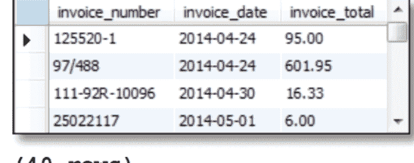

## 连接的优点

- 连接的 `SELECT` 句可以包含两个表的列。
- 当连接使用两个表之间现有的关系（例如主键到外键的关系）时，它通常更符合直觉。

## 子查询的优点

- 你可以使用子查询将聚合值传递给主查询。
- 当子查询使用两个表之间的临时性关系时，它通常更符合直觉。
- 长而复杂的查询有时使用子查询编写代码会更容易。

## 描述

- 像连接一样，子查询可以用于编写处理两个或多个表的查询。
- 大多数子查询都可以重述为连接，而大多数连接都可以重述为子查询。

## 图 7-2 何时使用子查询

## 如何编写子查询

### 在 WHERE 子句中

你可以使用多种技术在 `WHERE` 子句中处理子查询。你将在后续的话中学习这些技术。

### 如何使用 IN 运算符

在第 3 章中，你学习了如何使用 `IN` 运算符来测试表达式是否包含在值列表中。提供该值列表的一种方法是使用子查询，如图 7-3 所示。

图中的示例从 `Vendors` 表中检索在 `Invoices` 表中没有发票的供应商。为了实现这一点，它使用子查询返回 `Invoices` 表中每个供应商的 ID 列表。然后，主查询返回那些 ID 不在该列表中的供应商数据。

当你将 `IN` 运算符与子查询使用时，子查询必须返回一个提供值列表的单列。在图中，子查询还包含了 `DISTINCT` 关键字。这样，如果一个供应商存在多个发票，子查询将仅包含该供应商的单个 ID。然而，此关键字是可选的，对最终结果集没有影响。

在上一个图中，你看到使用 `IN` 运算符配合子查询的查询可以使用内连接进行重述。同样，使用 `NOT IN` 运算符配合子查询的查询通常可以使用外连接进行重述。例如，在图中，第一个查询可以像第二个查询所示进行重述。但在这种情况下，第一个查询更具可读性。

## 使用 IN 短语的 WHERE 子句的语法

`WHERE test_expression [NOT] IN (subquery)`

## 获取没有发票的供应商

```sql
SELECT vendor_id, vendor_name, vendor_state
FROM vendors
WHERE vendor_id NOT IN
  (SELECT DISTINCT vendor_id
   FROM invoices)
ORDER BY vendor_id
```

## 子查询的结果

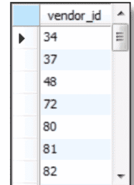

(34 行)

## 结果集

| vendor_id | vendor_name | vendor_state |
| :--- | :--- | :--- |
| 33 | Nelson | OH |
| 35 | Cal State Termite | CA |
| 36 | Graylift | CA |
| 38 | Venture Communications Int! | NY |
| 39 | Custom Printing Company | MO |
| 40 | Nat Asc of College Stores | OH |

(88 行)

## 不使用子查询的重述查询

```sql
SELECT v.vendor_id, v.vendor_name, v.vendor_state
FROM vendors v LEFT JOIN invoices i
ON v.vendor_id = i.vendor_id
WHERE i.vendor_id IS NULL
ORDER BY v.vendor_id
```

## 描述

- 你可以使用带有 `IN` 运算符的子查询来提供与测试表达式对比的值列表。
- 当你使用 `IN` 运算符时，子查询必须返回单列值。
- 使用 `NOT IN` 运算符配合子查询的查询通常可以使用外连接进行重述。

## 图 7-3 如何使用 IN 运算符

### 如何使用比较运算符

图 7-4 显示了你如何使用比较运算符来将表达式与子查询的结果进行比较。在这个示例中，子查询返回 `Invoices` 表中余额大于 0 的发票的平均余额。然后，它使用该值检索所有余额小于平均值的发票。

当你像图中所示使用比较运算符时，子查询必须返回一个单值。在大多数情况下，这意味着它使用了聚合函数。然而，你也可以将比较运算符与返回值列表的子查询一起使用。为了做到这一点，你可以像接下来的两幅图所示使用 `SOME`、`ANY` 或 `ALL` 关键字。

## 使用比较运算符的 WHERE 子句的语法

`WHERE expression comparison_operator [SOME|ANY|ALL] (subquery)`

## 获取余额小于平均值的发票

```sql
SELECT invoice_number, invoice_date,
invoice_total - payment_total - credit_total AS balance_due
FROM invoices
WHERE invoice_total - payment_total - credit_total > 0
AND invoice_total - payment_total - credit_total <
(SELECT AVG(invoice_total - payment_total - credit_total)
FROM invoices
WHERE invoice_total - payment_total - credit_total > 0
)
ORDER BY invoice_total DESC
```

## 子查询返回的值

2910.947273

## 结果集

| invoice_number | invoice_date | balance_due |
| :--- | :--- | :--- |
| 3136833 | 2014-07-21 | 579.42 |
| 9982771 | 2014-07-24 | 503.20 |
| 5478012 | 2014-08-01 | 224.00 |
| 134116 | 2014-07-28 | 90.36 |
| 39104 | 2014-07-10 | 85.31 |
| 2632532 | 2014-07-22 | 67.92 |

(6 行)

## 描述

- 你可以在 `WHERE` 子句中使用比较运算符来将表达式与子查询的结果进行比较。
- 如果在没有 `ANY` 或 `ALL` 关键字的情况下，子查询必须返回一个单值。
- 如果你包含了 `ANY`、`SOME` 或 `ALL` 关键字，子查询可以返回值列表。更多信息请参见图 7-5 和 7-6。


## 如何使用 ALL 关键字

图 7-5 显示了如何使用 `ALL` 关键字修改比较运算符，使条件对于子查询返回的所有值都成立。顶部的表格显示了它是如何工作的。

如果你使用大于运算符 (`>`)，则表达式必须大于子查询返回的最大值。相反，如果你使用小于运算符 (`<`)，则表达式必须小于子查询返回的最小值。如果你使用等号运算符 (`=`)，则表达式必须等于子查询返回的所有值。而如果你使用不等于运算符 (`<>`)，则表达式必须不等于子查询返回的任何值。然而，不等于条件可以使用 `NOT IN` 运算符进行重述，这样更具可读性。

图中的查询显示了如何配合 `ALL` 关键字使用大于运算符。在这里，子查询选择了所有 `vendor_id` 值为 34 的发票的 `invoice_total` 列。这产生了一个两个值的列表。然后，主查询检索 `Invoices` 表中所有大于子查询返回的两个值的行。换句话说，此查询返回所有大于 1083.58 的发票，这是发票 34 最大。

当你使用 `ALL` 运算符时，如果子查询没有返回任何行，则比较为真。相反，如果子查询只返回空值，则比较为假。

在许多情况下，你可以重写带有 `ALL` 关键字的条件以使其更易读。例如，你可以像下面所示使用 `MAX` 函数重写此图中的查询：

```sql
WHERE invoice_total >
(SELECT MAX(invoice_total)
FROM invoices
WHERE vendor_id = 34)
```

结果是，我们建议在任何能使查询更易读的情况下，用等价条件替换 `ALL` 关键字。

## ALL 关键字的工作原理

| 条件 | 等价表达式 | 说明 |
| --- | --- | --- |
| `x > ALL (1, 2)` | `x > 2` | 如果 x 大于子查询返回的最大值，则结果为真。 |
| `x < ALL (1, 2)` | `x < 1` | 如果 x 小于子查询返回的最小值，则结果为真。 |
| `x = ALL (1, 2)` | `(x = 1) AND (x = 2)` | 如果子查询返回一个等于 x 的单值，或者子查询返回的多个相同的值且这些值都等于 x，则结果为真。 |
| `x <> ALL (1, 2)` | `x NOT IN (1, 2)` | 如果 x 不是子查询返回的数值之一，则结果为真。 |

## 获取供应商 34 超过其最大金额的发票

```sql
SELECT vendor_name, invoice_number, invoice_total
FROM invoices i JOIN vendors v ON i.vendor_id = v.vendor_id
WHERE invoice_total > ALL
  (SELECT invoice_total
  FROM invoices
  WHERE vendor_id = 34)
ORDER BY vendor_name
```

## 子查询的结果

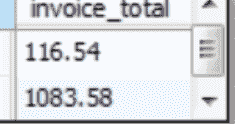

## 结果集

| vendor_name | invoice_number | invoice_total |
| --- | --- | --- |
| Bertelmann Svcs. Inc | 509786 | 6940.25 |
| Cainers Publishing Company | 587056 | 2184.50 |
| Computerworld | 367447 | 243.00 |
| Data Productions Corp | 40318 | 21842.00 |

(25 行)

## 描述

- 你可以使用 `ALL` 关键字来测试一个比较条件是否对于子查询返回的所有值都为真。
- 如果子查询没有返回任何行，则使用 `ALL` 关键字的比较始终为真。
- 如果子查询返回的所有行都包含空值（null），则使用 `ALL` 关键字的比较始终为假。

## 图 7-5 如何使用 ALL 关键字

## 如何使用 ANY 和 SOME 关键字

图 7-6 显示了如何使用 `ANY` 和 `SOME` 关键字来测试比较条件是否对于子查询返回的任何一个值为真。由于这两个关键字的作用相同，你可以根据喜好使用其中任意一个。为了简洁见，此图的示例使用了 `ANY` 关键字。然而，你可以将 `SOME` 关键字替换为 `ANY` 关键字以获得相同的结果。

图中的示例展示了如何将 `ANY` 关键字与小于运算符配合使用。该语句与你在上图中看到的相似，不同之处在于它检索的发票总额小于给定供应商至少一个发票总额的发票。与上一个图中的语句一样，该条件可以使用 `MAX` 函数重写，如下：

```sql
WHERE invoice_total <
(SELECT MAX(invoice_total)
FROM invoices
WHERE vendor_id = 115)
```

由于这种语句更易于读，我们建议尽可能使用这种陈述，而不是使用 `ANY` 关键字的语句。

## ANY 关键字的工作原理

| 条件 | 等价表达式 | 说明 |
| --- | --- | --- |
| `x > ANY (1, 2)` | `x > 1` | 如果 x 大于子查询返回的最小值，则结果为真。 |
| `x < ANY (1, 2)` | `x < 2` | 如果 x 小于子查询返回的最大值，则结果为真。 |
| `x = ANY (1, 2)` | `x IN (1, 2)` | 如果 x 等于子查询返回的任何值，则结果为真。 |
| `x <> ANY (1, 2)` | `(x <> 1) OR (x <> 2)` | 如果 x 不等于子查询返回的至少一个值，则结果为真。 |

## 获取供应商 115 小于其最大发票的发票

```sql
SELECT vendor_name, invoice_number, invoice_total
FROM vendors JOIN invoices i ON vendors.vendor_id = i.vendor_id
WHERE invoice_total < ANY (
  SELECT invoice_total
  FROM invoices
  WHERE vendor_id = 115
)
```

## 子查询的结果

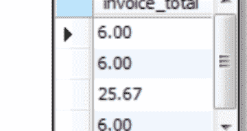

## 结果集

| vendor_name | invoice_number | invoice_total |
| --- | --- | --- |
| Newbridge Book Clubs | 963253251 | 15.50 |
| Golden Eagle Insurance Co | 111-92R-10096 | 16.33 |
| Expedita Rex | 25022117 | 6.00 |
| Internal Revenue Service | 21-7486363 | 9.95 |
| Blanchard & Johnson Associates | 4-321-2596 | 10.00 |

(17 行)

## 描述

- 你可以使用 `ANY` 关键字来测试一个条件是否对于子查询返回的一个或多个值为真。
- 如果子查询没有返回任何值，或者只返回空值，则 `ANY` 关键字评估的比较为假。
- `SOME` 关键字的作用与 `ANY` 关键字相同。

## 图 7-6 如何使用 ANY 和 SOME 关键字

## 如何编写相关子查询

到目前为止，本章所有的子查询都是非相关子查询。**非相关子查询**对于整个查询只执行一次。然而，你也可以编写**相关子查询**，它会为主查询处理的每一行数据执行一次。这种类型的查询类似于在 PHP 或 Java 等过程化编程语言中使用循环进行重复处理。

图 7-7 显示了相关子查询的工作原理。该示例从 `Invoices` 表中检索行，条件是那些发票总额大于同一供应商所有发票平均值的发票。为了实现这一点，子查询的 `WHERE` 子句引用了主查询的 `vendor_id` 值。这样，只有当前供应商的发票会被包含在平均计算中。

每当主查询处理一行时，子查询就会引用主查询中的 `vendor_id` 值。此时，子查询会根据该值执行。例如，如果 `vendor_id` 是 95，则执行子查询：

```sql
SELECT AVG(invoice_total)
FROM invoices
WHERE vendor_id = 95
```

在子查询执行后，它使用返回的值来决定是否包含当前发票。如果发票总额大于该值，MySQL 将其包含在结果集中；否则不。MySQL 重复此过程，直到处理完 `Invoices` 表中的每一行。

图中，子查询的 `WHERE` 子句通过 `Invoices` 别名限定了 `vendor_id` 列。这是必要的，因为该语句在子查询中使用了相同的表。如果子查询与主查询使用的是不同的表，则不需要表别名。

由于相关子查询编写较为复杂，你可能需要在 `SELECT` 语句之前单独测试子查询。为了这样做，你需要用一个常量来代表外部查询的列。一旦你确定子查询工作正常，就可以将常量替换为对外部查询的引用。

```sql
SELECT vendor_id, invoice_number, invoice_total
FROM invoices i
WHERE invoice_total >
  (SELECT AVG(invoice_total)
   FROM invoices
   WHERE vendor_id = i.vendor_id)
ORDER BY vendor_id, invoice_total
```

## 子查询对 95 返回的值

28.501667

## 结果集

| vendor_id | invoice_number | invoice_total |
| --- | --- | --- |
| 83 | 3139783 | 1575.00 |
| 95 | 111-92R-10095 | 32.70 |
| 95 | 111-92R-10093 | 39.77 |
| 95 | 111-92R-10092 | 46.21 |
| 110 | P-0259 | 26881.40 |

(36 行)

## 描述


- 相关子查询是针对主查询的每一行都执行一次的子查询。相比之下，非相关子查询只执行一次。
- 相关子查询引用主查询列提供的数值。对于主查询该列返回的每个不同的值，子查询都会返回不同的结果。
- 当要引用主查询的列时，可以使用表名或别名来限定该列。

# 如何使用 EXISTS 运算符

图 7-8 显示了如何配合子查询使用 `EXISTS` 运算符。该运算符测试子查询是否返回结果集。换句话说，它测试结果集是否存在。当你使用此运算符时，子查询并不会实际向外部查询返回结果集。相反，它会返回一个关于是否有行满足子查询的搜索条件的指示。正因如此，使用该运算符的查询执行速度非常快。

你通常如图所示，配合相关子查询使用 `EXISTS` 运算符。此查询检索 `Vendors` 表中所有在 `Invoices` 表中没有发票的供应商。虽然此查询返回的供应商与图 7-3 所示的查询相同，但它的执行速度比其中任何一个查询都快。

在这个示例中，相关子查询选取所有与外部查询中当前供应商具有相同 `vendor_id` 值的发票。由于子查询实际上并不返回结果集，因此 `SELECT` 子句中包含哪些列并不重要。因此，习惯做法是只写一个星号 `*`。

在执行子查询后，主查询中 `WHERE` 子句的搜索条件使用 `NOT EXISTS` 运算符来测试是否为当前供应商找到了发票。如果没有找到，则将供应商行包含在结果集中。

# 使用 EXISTS 运算符的子查询语法

`WHERE [NOT] EXISTS (subquery)`

## 获取所有没有发票的供应商

```sql
SELECT vendor_id, vendor_name, vendor_state
FROM vendors
WHERE NOT EXISTS
  (SELECT *
  FROM invoices
  WHERE vendor_id = vendors.vendor_id)
```

## 结果集

| vendor_id | vendor_name | vendor_state |
|---|---|---|
| 33 | Neelson | OM |
| 35 | Cal State | CA |
| 36 | Graylift | CA |
| 38 | Venture Communications | NY |
| 39 | Custom Printing Company | MO |
| 40 | Assoc of College Stores | OM |

(8 行)

- 你可以使用 `EXISTS` 运算符来测试子查询是否返回一行或多行。
- 你可以使用 `NOT EXISTS` 运算符来测试子查询没有返回任何行。
- 当你将这些运算符与子查询一起使用时，`SELECT` 子句中指定哪些列并不重要。因此，你通常只写一个星号 `*`。


# 如何在其他子句中编写子查询

现在你已经知道如何在 `SELECT` 语句的 `WHERE` 子句中编写子查询，准备好学习如何在 `HAVING`、`FROM` 和 `SELECT` 子句中编写它们了。

# 如何在 HAVING 子句中编写子查询

当你编写 `HAVING` 子句时，就像编写 `WHERE` 子句一样指定搜索条件。这包括包含子查询的搜索条件。要学习如何在 `HAVING` 子句中编写子查询，你可以回参考图 7-3 到 7-8。

# 如何在 SELECT 子句中编写子查询

图 7-9 显示了如何在 `SELECT` 子句中使用子查询。要做到这一点，你可以在列规范的位置编写子查询。因此，子查询必须为该列返回单个值。在大多数情况下，你在 `SELECT` 子句中编写相关子查询。在此图中，子查询计算 `Vendors` 表中每个供应商的最大发票日期。在 `SELECT` 子句中编写的子查询通常难以阅读。因此，如果你能找到其他解决方案，就不应该使用它们。在大多数情况下，你可以用连接（join）替换子查询。例如，在此图中，第一个查询可以重述为第二个查询。该查询连接了 `Vendors` 和 `Invoices` 表，按 `vendor_name` 对行分组，并使用 `MAX` 函数计算每个供应商的最大发票日期。因此，该查询更易于读。

## 获取每个供应商最近一次的发票日期

```sql
SELECT vendor_name,
  (SELECT MAX(invoice_date) FROM invoices
  WHERE vendor_id = vendors.vendor_id) AS latest_inv
FROM vendors
ORDER BY latest_inv DESC
```

## 结果集

| vendor_name | latest_inv |
|---|---|
| Federal Express Corporation | 2014-08-02 |
| Blue Cross | 2014-08-01 |
| Mallory Lithograph Inc | 2014-07-31 |
| Cardinal Business Media, Inc. | 2014-07-28 |
| Zuka Design | 2014-07-25 |
| United Parcel Service | 2014-07-24 |

(22 行)

## 使用连接重述的相同查询

```sql
SELECT vendor_name, MAX(invoice_date) AS latest_inv
FROM vendors v
LEFT JOIN invoices i ON v.vendor_id = i.vendor_id
GROUP BY vendor_name
ORDER BY latest_inv DESC
```

- 当你在 `SELECT` 子句中编写子查询时，子查询必须返回单个值。
- 当你在 `SELECT` 子句中编写子查询时，你通常使用相关子查询。
- 在 `SELECT` 子句中包含子查询的查询通常可以使用连接代替子查询来重述。因为连接通常更快且易于阅读，因此很少在 `SELECT` 子句中编写子查询。

图 7-9 如何在 SELECT 子句中编写子查询

# 如何在 FROM 子句中编写子查询

图 7-10 显示了如何在 `FROM` 子句中编写子查询。要做到这一点，你可以在表规范的位置编写子查询。当你在 `FROM` 子句中编写子查询时，它可以返回包含任意数量列的结果集。这种结果集有时被称为内联视图（inline view）。

子查询通常用于 `FROM` 子句创建内联视图，为另一个查询提供汇总数据。例如，在此图中，每个供应商的发票总和。要做到这一点，它按州和名称对供应商进行分组。子查询返回一个包含供应商州、供应商名称和发票总和的结果集。一旦子查询返回此结果集，主查询按供应商州对结果集进行分组，并获取每个州最大的发票总和。这返回了每个州顶端供应商的发票总额。

当你在 `FROM` 子句中编写子查询时，必须为子查询分配一个表别名。即使你在主查询不使用表别名，这也是要求的。例如，在此图中，查询为子查询分配了表别名 `t`（临时表）。

此外，你应该为子查询中的所有计算列分配列别名。例如，在此图中，子查询为 `SUM` 函数的结果分配了列别名 `sum_of_invoices`。这使得在需要时更容易从子查询的其他子句中引用这些列。

## 获取每个州顶级供应商的最大发票金额

```sql
SELECT vendor_state, MAX(sum_of_invoices) AS max_sum_of_invoices
FROM (
  SELECT vendor_state, vendor_name,
  SUM(invoice_total) AS sum_of_invoices
  FROM vendors JOIN invoices
  ON v.vendor_id = i.vendor_id
  GROUP BY vendor_state, vendor_name
) t
GROUP BY vendor_state
```

## 子查询的结果（内联视图）

| vendor_state | vendor_name | sum_of_invoices |
|---|---|---|
| AZ | Wells Fargo Bank | 662.00 |
| CA | Abbey Office Furnishings | 17.50 |
| CA | Bertelsmann Industry Svcs. Inc | 6940.25 |
| CA | Blue Cross | 564.00 |
| CA | Coffee Break Service | 41.80 |
| CA | Computerworld | 2433.00 |
| CA | Digital Dreamworks | 7125.34 |
| CA | Dristas Groom & McCormick | 220.00 |

(34 行)

## 结果集

| vendor_state | max_sum_of_invoices |
|---|---|
| AZ | 662.00 |
| CA | 7125.34 |
| DC | 600.00 |

(10 行)

## 如何处理复杂查询

到目前为止，你看到的使用子查询的示例都相对简单。然而，这类查询在实际操作中可能会变得复杂，特别是当子查询相互嵌套时。正因如此，你务必确保仔细规划并测试这些查询。稍后，你将学习如何做到。在此之前，本章将展示一个复杂查询的示例。

## 使用子查询的复杂查询

图 7-11 展示了一个使用多个子查询的复杂查询。第一个子查询用于外部查询的 `FROM` 子句中，以创建一个结果集，该结果集包含 `Vendors` 表中每个供应商的州、名称和发票总金额。第二个子查询也用于外部查询的 `FROM` 子句，以创建一个与第一个结果集进行连接的结果集。该子查询使用了嵌套子查询，并且与图 7-10 中描述的查询相同。因此，你应该已经理解了它的工作原理。

在创建了这两个结果集后，它根据每个表中包含州和发票总金额的列对它们进行连接。最终的结果集包含了每个州中发票总总额最大的供应商的州、名称和发票总金额。该结果集按州进行排序。

此时，你可能在想这个问题是否有更简单的解决方案。例如，你可能会认为可以通过连接 `Vendors` 和 `Invoices` 表、按供应商的州进行分组，并计算每个供应商的发票总和来解决问题。然而，如果你按供应商的州进行分组，就无法在结果集中包含供应商的名称。如果你按供应商的州和供应商名称进行分组，则结果集将包含所有供应商，而不仅仅是每个州顶部的供应商。因此，这里展示的查询是解决该问题的一种相当直接的方法。

在编写复杂子查询时，包含注释通常很有帮助。你可以使用注释来描述查询的不同部分，而不改变查询的运行方式。要编写单行注释，请以两个破折号（`--`）开头。

在此图中，查询包含了三个注释。第一个注释标识第一个子查询，第二个注释标识第二个子查询，第三个注释标识第三个子查询。这些注释通过更容易识别三个子查询并确定它们的功能，从而更容易阅读主查询。例如，这些注释清楚地显示了别名为 `t1` 和 `t2` 的子查询返回相同的结果集。

## 使用三个子查询的复杂查询

```sql
SELECT t1.vendor_state, vendor_name, t1.sum_of_invoices
FROM (
  -- invoice totals by vendor
  SELECT vendor_state, vendor_name,
  SUM(invoice_total) AS sum_of_invoices
  FROM vendors v JOIN invoices i
  ON v.vendor_id = i.vendor_id
  GROUP BY vendor_state, vendor_name
) t1
JOIN (
  -- top invoice totals by state
  SELECT vendor_state,
  MAX(sum_of_invoices) AS sum_of_invoices
  FROM (
    -- invoice totals by vendor
    SELECT vendor_state, vendor_name,
    SUM(invoice_total) AS sum_of_invoices
    FROM vendors v JOIN invoices i
  ON v.vendor_id = i.vendor_id
    GROUP BY vendor_state
  ) t2
  GROUP BY vendor_state
) t3
ON t1.vendor_state = t3.vendor_state AND
t1.sum_of_invoices = t3.sum_of_invoices
ORDER BY t1.vendor_state
```

## 结果集

| vendor_state | vendor_name | sum_of_invoices |
|---|---|---|
| AZ | Wells Fargo Bank | 662.00 |
| CA | Digital Dreamworks | 7125.34 |
| DC | Reiter's Scientific & Pro Books | 600.00 |
| MA | Dean W Reynolds | 1367.50 |

(10 行)

## 描述

- 该查询检索每个州发票总额最大的供应商。为了实现这一点，它使用了子查询。
- 该查询使用注释清晰地标识其三个查询。
- 命名为 `t1` 和 `t2` 的子查询返回相同的结果集。该结果集包含了供应商州、名称和发票总和。
- 命名为 `t3` 的子查询返回一个结果集，包含该州任何供应商的最大发票总和。为了这一点，该子查询使用了命名为 `t2` 的嵌套子查询。
- 命名为 `t1` 和 `t3` 的子查询通过 `vendor_state` 和 `sum_of_invoices` 两列进行连接。

图 7-11 使用子查询的复杂查询

## 构建复杂查询的步骤

要构建像前一个图那样的复杂查询，可以使用图 7-12 所示的步骤。首先，你应该用英文表述问题，以便明确你想让查询回答的内容。在这种情况下，问题是：“每个州中哪个供应商的发票总额最大？”

一旦你明确了问题，就可以使用伪代码来勾勒查询。伪代码是表示查询意图的代码，但并不一定使用 SQL 代码。例如，图中所示的伪代码部分代码和部分英语。该伪代码识别了返回的三个列。

## 观点

子查询是一个你可以用来解决复杂问题的强大工具。然而，在使用子查询之前，请记住子查询通常可以使用连接（join）以更清晰的方式重新表述。如果是这样，你通常会希望使用连接而不是子查询。

如果你发现自己在多个地方编写相同的子查询，你应该考虑像第 12 章描述的那样为该子查询创建一个视图（view）。这将帮助你更快地开发查询，因为你可以使用视图而不是再次编写子查询。此外，由于视图的执行速度通常比子查询快，这可能会提高你查询的性能。

## 术语

- 子查询 (Subquery)
- 引入子查询 (Introduce a subquery)
- 嵌套子查询 (nested subquery)
- 相关子查询 (correlated subquery)
- 不相关子查询 (uncorrelated subquery)
- 内联视图 (inline view)
- 注释 (comment)
- 伪代码 (pseudocode)

## 练习

1. 写一个 `SELECT` 语句返回与此 `SELECT` 语句相同的的结果集，但不要使用连接。相反，在 `WHERE` 子句中使用带有 `IN` 关键字的子查询。

```sql
SELECT DISTINCT vendor_name
FROM vendors JOIN invoices
ON vendors.vendor_id = invoices.vendor_id
ORDER BY vendor_name
```

2. 写一个 `SELECT` 语句来回答这个问题：哪些发票的付款总额大于所有付款总额大于 0 的发票的平均付款额？

返回每张发票的 `invoice_number` 和 `invoice_total` 列。这应该返回 20 行。

按 `invoice_total` 列对结果进行降序排序。

3. 写一个 `SELECT` 语句，从 `General_Ledger_Accounts` 表中返回两列：`account_number` 和 `account_description`。

对于从未被分配到 `Invoice_Line_Items` 表中任何行项目的每个账户号码各返回一条。要做到这一点，请使用通过 `NOT EXISTS` 操作符引入的子查询。这应该返回 54 行。

按 `account_number` 列对结果进行排序。

4. 写一个 `SELECT` 语句，返回四列：`vendor_name`, `invoice_sequence`, `line_item_amount`。

对于 `Invoice_Line_Items` 表中具有多一个行项目的每个发票的每个项目返回一行。提示：使用测试 `invoice_sequence > 1` 的子查询。这应该返回 6 行。

5. 写一个 `SELECT` 语句，返回两列：`vendor_id` 以及每个供应商最大的未付发票。为了做到这一点，你可以按 `vendor_id` 列对结果集进行分组。这应该返回 7 行。

写一个 `SELECT` 语句，在它的 `FROM` 子句中使用第一个 `SELECT` 语句。主查询应返回一个单值，代表代表每个供应商最大未付发票的总和。

6. 写一个 `SELECT` 语句，返回位于唯一城市和州的每个供应商的名称、城市和州。换句话说，不要包含与另一个供应商具有共同城市和州的供应商。这应该返回 38 行。

按 `vendor_state` 和 `vendor_city` 列对结果进行排序。

7. 使用相关子查询为每个供应商返回一行，代表该供应商最旧的发票（日期最早的发票）。每行应包含以下四列：`vendor_name`, `invoice_number`, `invoice_date` 和 `invoice_total`。这应该返回 34 行。

按 `vendor_name` 列对结果进行排序。


- 8. 重写练习 7，使其获得相同的结果，但使用内联视图而不是相关子查询。

## 如何处理数据类型

到目前，你一直在使用 SQL 语句来处理三种常见的数据类型：字符串、数字和日期。现在，本章将更深入地查看 MySQL 可用的数据类型，并展示一些处理它们的基本技能。当你完成本章时，你对数据类型有彻底的理解，并知道如何使用某些函数将一种数据类型转换为另一种。

### 数据类型概览

- 数据类型
- 概述
- 字符类型
- 整数类型
- 固定点和浮点类型
- 日期和时间类型
- ENUM 和 SET 类型
- 大对象类型
- 如何转换数据
- 隐式数据转换是如何工作的
- 如何使用 `CAST` 和 `CONVERT` 函数转换数据
- 如何使用 `FORMAT` 和 `CHAR` 函数转换数据
- 观点

## 数据类型

列的数据类型指定了该列旨在存储的信息的种类。此外，列的数据类型还决定了可以在该列上执行的操作。

## 概述

MySQL 数据类型可以分为图 8-1 所示的五类。首先，字符数据类型用于存储一个或多个字符的字符串，这些字母、数字、符号或特殊字符。`character`（字符）、`string`（字符串）和 `text`（文本）这些术语互换使用来描述这类数据。

数值数据类型用于存储可以用于数学计算的数字。正如你在本章中看到的，MySQL 可以以各种格式存储数字。在基础层，你可以将数字分为两类：整数和实数。整数是不带小数点的数字，而实数是带有小数点的数字。

日期和时间数据类型用于存储日期、时间或日期和时间。这些数据类型通常被称为日期/时间或时态数据类型。

由于前三类使用最广泛，本书侧重于这些数据类型。然而，MySQL 还提供了大对象 (`LOB`) 数据类型，这些对于存储图像、声音、视频和大量的字符数据有用。此外，MySQL 还提供了空间数据类型，这些对于存储几何和地理值（例如全球定位系统 `GPS` 数据）有用。

### 图 8-1 数据类型概述

| 类别 | 描述 |
| --- | --- |
| 字符 | 字符串 |
| 数值 | 不带小数点的数字（整数）和带有小数点的数字（实数） |
| 日期和时间 | 日期、时间或两者 |
| 大对象 (`LOB`) | 字符或二进制数据 |
| 空间 | 几何或地理值 |

## 字符类型

图 8-2 展示了常用的数据类型：`CHAR` 和 `VARCHAR`。

你使用 `CHAR` 类型存储固定长度的字符串。使用此类型存储的数据始终占据相同的字节，无论长度如何。这种数据类型通常用于定义固定数量的列。例如，`Vendors` 表中的 `vendor_state` 列定义为 `CHAR(2)`。然而，如果两个字符存储在 `CHAR(1)` 列。

你使用 `VARCHAR` 类型存储可变长度的字符串。使用此类型存储的数据仅占据所需的字节数，外加一个用于存储长度的字节。这种数据类型通常用于定义长度变化的列。例如，`Vendors` 表中的 `vendor_name` 列定义为 `VARCHAR(50)`。

从 MySQL 5.6 及更高版本开始，`CHAR` 和 `VARCHAR` 类型默认使用 `UTF-8`。这种字符集使用最多三个字节来存储每个字符。结果是它被称为多字节字符。这允许 `UTF-8` 字符集支持 Unicode 标准指定的大多数字符，包含了世界上大多数语言的大多数字符。对于英语和大多数西欧语言中使用的字符使用 1 个字节。对于大多数欧洲和中东脚本字母使用 2 个字节。对于韩语、中文和日语使用 3 个字节。

当你对 `CHAR` 类型使用 `UTF-8` 字符集时，MySQL 必须为每个字符保留三个字节。结果是 `CHAR(2)` 类型必须使用 6 个字节，`CHAR(10)` 必须使用 30 个字节。

然而，当你使用 `VARCHAR` 类型时，MySQL 不需要为每个字符保留空间。结果是，如果你使用的是英语字母和符号，MySQL 每个字符只使用一个字节，外加一个用于存储字符串长度的字节。当你使用字符串 `'CA'` 时，MySQL 仅使用 3 个字节。这表明你通常可以通过使用 `VARCHAR` 类型来节省存储空间。

### 字符类型对比

| 类型 | 字节 | 描述 |
|---|---|---|
| `CHAR (M)` | Mx3 | 固定长度的字符数据字符串，M 是字符数，范围在 0 到 255 之间。使用 `UTF-8` 字符集时，MySQL 必须为 `CHAR` 列中的每个字符预留三个字节，因为这是可能的最大长度。 |
| `VARCHAR (M)` | L+1 | 可变长度的字符数据字符串，M 是最大字符数，范围在 0 到 255 之间。对于英语和拉丁字符，用于存储字符串的字节数等于字符串长度 (L) 加上用于记录长度的 1 个字节。 |

### UTF-8 字符集如何工作

| 数据类型 | 原始值 | 存储的值 | 使用的字节 |
|---|---|---|---|
| `CHAR (2)` | `'CA'` | `'CA'` | 6 |
| `CHAR (10)` | `'CA'` | `'CA'` | 30 |
| `VARCHAR (10)` | `'CA'` | `'CA'` | 3 |
| `VARCHAR (20)` | `'California'` | `'California'` | 11 |
| `VARCHAR (20)` | `'New York'` | `'New York'` | 9 |
| `VARCHAR (20)` | `'Murach's MySQL'` | `'Murach's MySQL'` | 15 |

### UTF-8 字符集的工作原理

- 基础拉丁字母、数字和标点符号使用一个字节。
- 大多数欧洲和中东脚本字母使用 2 个字节。
- 韩语、中文和日语表意字使用 3 个字节。

### 字符类型小结

- `CHAR` 类型用于固定长度字符串。使用该类型的列无论字符串的实际长度如何，每个值都使用相同的存储空间。
- `VARCHAR` 类型用于可变长度字符串。使用该类型的列根据字符串长度为每个值使用不同的存储空间。
- 默认情况下，MySQL 5.6 及更高版本对 `CHAR` 和 `VARCHAR` 类型使用 `UTF-8` 字符集。这种字符集是多字节字符集。它通常每个字符使用 1 个字节，但每个字符可以使用 3 个字节。然而，`UTF-8` 格式通过支持 Unicode 标准中的所有字符，为大多数语言的所有字符提供了支持。
- 默认情况下，MySQL 5.5 及早期版本对 `CHAR` 和 `VARCHAR` 类型使用 `latin` 字符集。这种字符集是单字节字符集，支持英语和大多数西欧语言中使用的所有字符。
- 要学习如何更改字符集，请参阅第 11 章。


虽然你通常使用数值类型来存储数值，但对于某些数值，字符类型可能是更好的选择。例如，你通常会将邮政编码、电话号码和社会安全码存储在字符列中，即使它们只包含数字。这是因为它们的值没有被用于数值运算。此外，如果你将这些数字存储在数值列中，MySQL 在某些情况下可能会删除前导零，这通常不是你想要的。

在图 8-2 中，前几个示例使用单引号来指定字符串字面量。然而，第六个示例使用双引号来指定字符串字面量。这允许字符串字面量包含单引号，并表明你可以使用单引号或双引号作为字符串字面量。虽然使用单引号很常见，但如果你需要在字符串中包含单引号，双引号就会非常有用。

## 整数类型

图 8-3 显示了整数类型，即不包含小数点的数字。整数数据类型的区别在于它们使用的存储空间以及可以存储的值范围。由于 `INT` 类型可以存储广泛的数字且只需要 4 个字节的存储空间，它是整数类型中最常用的类型。

默认情况下，整数类型可以存储正数和负数。然而，你可以为整数类型包含 `UNSIGNED` 属性，以防止列中存储负值。在这种情况下，列的可接受值范围会翻倍。

如果设置了整数的 `ZEROFILL` 属性，则会自动设置 `UNSIGNED` 属性，并且整数将从左侧补零显示，直到达到最大显示大小。对于 `INT` 类型，最大显示大小为 10 位数字。如果默认显示大小太宽，你可以在数据类型后的括号中通过编写代码来指定较小的显示大小。在图中，最后一个示例指定了 4 位的显示大小。这只影响 MySQL 如何显示值，而不影响它如何存储值。

`INTEGER` 类型是 `INT` 类型的同义词。因此，你可以交替使用这些类型。然而，在编程习惯中，使用 `INT` 作为 `INTEGER` 的缩写是常见的。

`BOOL` 和 `BOOLEAN` 类型是 `TINYINT(1)` 的同义词。当你处理这些类型时，可以使用值 0 存储假值，使用值 1 存储真值。为了更直观，你可以使用 `FALSE` 关键字（它是 0 的别名）和 `TRUE` 关键字（它是 1 的别名）。

### 整数类型对比

| 类型 | 字节 | 值范围 |
|---|---|---|
| `BIGINT` | 8 | 有符号: -9,223,372,036,854,775,808 到 9,223,372,036,854,775,807<br>无符号: 0 到 18,446,744,073,709,551,615 |
| `INT` | 4 | 有符号: -2,147,483,648 到 2,147,483,647<br>无符号: 0 到 4,294,967,295 |
| `MEDIUMINT` | 3 | 有符号: -8,388,608 到 8,388,607<br>无符号: 0 到 16,777,215 |
| `SMALLINT` | 2 | 有符号: -32,768 到 32,767<br>无符号: 0 到 65,535 |
| `TINYINT` | 1 | 有符号: -128 到 127<br>无符号: 0 到 255 |

## 定点和浮点类型

图 8-3 显示了整数类型，即不包含小数点的数字。整数数据类型的区别在于它们使用的存储空间以及可以存储的值范围。

### 定点和浮点类型对比

| 类型 | 字节 | 值范围 |
|---|---|---|
| `INT` | 4 | 有符号: -2,147,483,648 到 2,147,483,647<br>无符号: 0 到 4,294,967,295 |
| `MEDIUMINT` | 3 | 有符号: -8,388,608 到 8,388,607<br>无符号: 0 到 16,777,215 |
| `SMALLINT` | 2 | 有符号: -32,768 到 32,767<br>无符号: 0 到 65,535 |
| `TINYINT` | 1 | 有符号: -128 到 127<br>无符号: 0 到 255 |

### UTF-8 字符集如何工作（重复内容）

| 数据类型 | 原始值 | 存储的值 | 使用的字节 |
|---|---|---|---|
| `CHAR (2)` | `'CA'` | `'CA'` | 6 |
| `CHAR (10)` | `'CA'` | `'CA'` | 30 |
| `VARCHAR (10)` | `'CA'` | `'CA'` | 3 |
| `VARCHAR (20)` | `'California'` | `'California'` | 11 |


## UTF-8 字符集如何工作

- **基础拉丁字母、数字和标点符号使用一个字节。**
- 大多数欧洲和中东脚本字母使用 2 个字节。
- 韩语、中文和日语表意字使用 3 个字节。

## 描述

- `CHAR` 类型用于固定长度字符串。使用该类型的列无论字符串的实际长度如何，每个值都使用相同的存储空间。
- `VARCHAR` 类型用于可变长度字符串。使用该类型的列根据字符串长度为每个值使用不同的存储空间。
- 默认情况下，MySQL 5.6 及更高版本对 `CHAR` 和 `VARCHAR` 类型使用 UTF-8 字符集。这种字符集是多字节字符集。它通常每个字符使用 1 个字节，但每个字符可以使用 3 个字节。然而，UTF-8 格式通过支持 Unicode 标准中的所有字符，为大多数语言的所有字符提供了支持。
- 默认情况下，MySQL 5.5 及早期版本对 `CHAR` 和 `VARCHAR` 类型使用 latin 字符集。这种字符集是单字节字符集，支持英语和大多数西欧语言中使用的所有字符。
- 要学习如何更改字符集，请参阅第 11 章。


虽然你通常使用数值类型来存储数值，但对于某些数值，字符类型可能是更好的选择。例如，你通常会将邮政编码、电话号码和社会安全码存储在字符列中，即使它们只包含数字。这是因为它们的值没有被用于数值运算。此外，如果你将这些数字存储在数值列中，MySQL 在某些情况下可能会删除前导零，这通常不是你想要的。

在图 8-2 中，前几个示例使用单引号来指定字符串字面量。然而，第六个示例使用双引号来指定字符串字面量。这允许字符串字面量包含单引号，并表明你可以使用单引号或双引号作为字符串字面量。虽然使用单引号很常见，但如果你需要在字符串中包含单引号，双引号就会非常有用。

## 整数类型

图 8-3 显示了整数类型，即不包含小数点的数字。整数数据类型的区别在于它们使用的存储空间以及可以存储的值范围。由于 `INT` 类型可以存储广泛的数字且只需要 4 个字节的存储空间，它是整数类型中最常用的类型。

默认情况下，整数类型可以存储正数和负数。然而，你可以为整数类型包含 `UNSIGNED` 属性，以防止列中存储负值。在这种情况下，列的可接受值范围会翻倍。

如果设置了整数的 `ZEROFILL` 属性，则会自动设置 `UNSIGNED` 属性，并且整数将从左侧补零显示，直到达到最大显示大小。对于 `INT` 类型，最大显示大小为 10 位数字。如果默认显示大小太宽，你可以在数据类型后的括号中通过编写代码来指定较小的显示大小。在图中，最后一个示例指定了 4 位的显示大小。这只影响 MySQL 如何显示值，而不影响它如何存储值。

`INTEGER` 类型是 `INT` 类型的同义词。因此，你可以交替使用这些类型。然而，在编程习惯中，使用 `INT` 作为 `INTEGER` 的缩写是常见的。

`BOOL` 和 `BOOLEAN` 类型是 `TINYINT(1)` 的同义词。当你处理这些类型时，可以使用值 0 存储假值，使用值 1 存储真值。为了更直观，你可以使用 `FALSE` 关键字（它是 0 的别名）和 `TRUE` 关键字（它是 1 的别名）。

### 整数类型对照表

| 类型 | 字节 | 值范围 |
| :--- | :--- | :--- |
| `BIGINT` | 8 | 有符号: -9,223,372,036,854,775,808 到 9,223,372,036,854,775,807<br>无符号: 0 到 18,446,744,073,709,551,615 |
| `INT` | 4 | 有符号: -2,147,483,648 到 2,147,483,647<br>无符号: 0 到 4,294,967,295 |
| `MEDIUMINT` | 3 | 有符号: -8,388,608 到 8,388,607<br>无符号: 0 到 16,777,215 |
| `SMALLINT` | 2 | 有符号: -32,768 到 32,767<br>无符号: 0 到 65,535 |
| `TINYINT` | 1 | 有符号: -128 到 127<br>无符号: 0 到 255 |

## 第 8 章 如何使用数据类型

## 固定点类型

| 类型 | 字节 | 描述 |
| :--- | :--- | :--- |
| `DECIMAL(M, D)` | 可变 | 固定精度数字，其中 M 指定总数字位数（精度），D 指定小数点右侧位数（标度）。M 的范围是从 1 到 65。D 的范围是从 0 到 30，但不能大于 M。默认值为 0。 |

## 浮点类型

| 类型 | 字节 | 描述 |
| :--- | :--- | :--- |
| `DOUBLE` | 8 | -1.7976x10³³⁸ 到 1.7976x10³³⁸之间的双精度浮点数。 |
| `FLOAT` | 4 | -3.4028x10⁻³⁸ 到 3.4028x10³³⁸之间的单精度浮点数。 |

## 固定点（精确）和浮点（近似）类型的工作原理

| 数据类型 | 原始值 | 存储的值 | 使用的字节 |
| :--- | :--- | :--- | :--- |
| `DECIMAL(9,2)` | 1.2 | 1.20 | 5 |
| `DECIMAL(9,2)` | 1234567.89 | 1234567.89 | 5 |
| `DECIMAL(9,2)` | -1234567.89 | -1234567.89 | 5 |
| `DECIMAL(18,9)` | 1234567.89 | 1234567.890000000 | 8 |
| `DOUBLE` | 1234567.89 | 1234567.89 | 8 |
| `FLOAT` | 1234567.89 | 1234570 | 4 |

## 描述

- 实数包括小数点右侧的数字。实数的精度表示可以存储的总数字位数，而标度表示存储在小数点右侧的数字位数。
- `DECIMAL` 类型被认为是精确数值类型，因为它的精度是精确的。
- `DOUBLE` 和 `FLOAT` 存储浮点数，其有效数字数量有限。这些数据类型被认为是近似数值数据类型，因为它们可能无法精确地表示某个值。
- 如果为实数设置了 `UNSIGNED`（无符号）属性，将防止在列中存储负值，但不会影响接受取值的范围。
- 如果为实数设置了 `ZEROFILL`（零填充）属性，数字将从左侧补零显示，并且会自动设置 `UNSIGNED` 属性。
- `DEC`、`NUMERIC` 和 `FIXED` 类型是 `DECIMAL` 的同义词。
- `REAL` 和 `DOUBLE PRECISION` 类型是 `DOUBLE` 的同义词。

图 8-4 固定点和浮点类型

## 日期和时间类型

图 8-5 的第 1 部分展示了 MySQL 支持的日期时间类型。你可以使用 `DATE` 类型存储不带时间的日期。可以使用 `TIME` 类型存储不带日期的时间。可以使用 `DATETIME` 和 `TIMESTAMP` 类型存储日期和时间。

你通常使用 `TIMESTAMP` 来跟踪行的插入或最后更新时间。例如，你可能使用这种类型来跟踪博客条目。MySQL 通过在插入或更新行时自动将 `TIMESTAMP` 列设置为当前日期和时间，使得这变得非常简单。如果这不是你想要的，可以使用 `DATETIME` 类型。

`TIMESTAMP` 类型的问题是它只能存储存储到 2038 年的日期。这被称为 2038 问题、Y2K38 问题或 Unix 千年虫漏洞。因此，如果你希望数据库能够存储超过 2038 年的日期，你应该使用 `DATETIME` 类型而不是 `TIMESTAMP` 类型。否则，你可以使用 `TIMESTAMP` 类型，因为它只需要 4 字节来存储一个值，而一个 `DATETIME` 值需要 8 字节。

如果你需要存储一个不包含任何其他时间数据的年份，可以使用 `YEAR` 类型。默认情况下，`YEAR` 类型存储 1901 年到 2155 年之间的四位年份。通常情况下这就是你需要的。但是，如果有必要，可以使用 `YEAR(2)` 类型存储二位年份。

### 日期和时间类型对照表

| 类型 | 字节 | 描述 |
| :--- | :--- | :--- |
| `DATE` | 3 | 从 1000 年 1 月 1 日到 9999 年 12 月 31 日的日期。输入和显示的默认格式为 "yyyy-mm-dd"。 |
| `TIME` | 3 | -838:59:59 到 838:59:59 之间的时间。输入和显示的默认格式为 "hh:mm:ss"。 |
| `DATETIME` | 8 | 从 1970 年 1 月 1 日午夜到 9999 年 12 月 31 日的组合日期。输入和显示的默认格式为 "yyyy-mm-dd hh:mm:ss"。 |
| `TIMESTAMP` | 4 | 从 1970 年 1 月 1 日午夜到 2037 年的组合日期。默认格式为 "yyyy-mm-dd hh:mm:ss"。 |
| `YEAR` | 1 | 1901 年到 2155 年之间的年份。 |

## 描述

- `TIMESTAMP` 列在插入或更新行时，会自动设置为当前日期和时间。
- `TIMESTAMP` 类型只能存储到 2038 年的日期。这被称为 2038 问题、Y2K38 问题或 Unix 千年虫漏洞。因此，如果你希望数据库能够存储超过 2038 年的日期，你应该使用 `DATETIME` 类型而不是 `TIMESTAMP` 类型。否则，你可以使用 `TIMESTAMP` 类型，因为它只需要 4 字节来存储一个值，而一个 `DATETIME` 值需要 8 字节。

## ENUM 和 SET 类型

`ENUM` 和 `SET` 类型可以被视为字符数据类型，因为它们允许你将列的值限制在有限的字符串集合中，如图 8-6 所示。然而，MySQL 内部将这些值存储为整数（`integer`），这减少了存储每个字符串所需的字节数。

`ENUM` 和 `SET` 类型之间的主要区别在于，`ENUM` 列只能存储一个一个值，而 `SET` 列可以存储多达 64 个不同的值。换句话说，`ENUM` 列仅由值集合中的一个成员组成，而 `SET` 列可以由值集合中的任何或所有成员组成。

你可以使用 `ENUM` 类型来存储互斥的值，例如“Yes”（是）、“No”（否）或“Maybe”（可能）。换句话说，你可以使用 `ENUM` 类型来表示一个值的选择，而不是两个。例如，送货或自取；现金、信用卡或借记卡；小号、中号或大号；纸、汤或沙拉；我想你可能既想要汤又要沙拉。对于这种情况，你可以使用 `SET` 列。

当你想要选择一个或多个值时，可以使用 `SET` 列。例如，披萨上的配料、计算机上的软件或汽车的功能都可以作为 `SET` 值。

`ENUM` 或 `SET` 列的接受值是在创建表时定义的。`ENUM` 列可以存储多达 65,535 个接受值。然而，`SET` 列被限制 64 个值。

要在 `ENUM` 列中存储值，你需要编写一个单一字符串类型。如果该字符串是列的接受值之一，MySQL 将存储该值。否则，MySQL 将为该列分配一个空字符串。

当你向包含 `ENUM` 列的表中添加行时，如果你没有指定值，MySQL 会为该列分配一个默认值。如果列允许空值，MySQL 将为该列分配空 值。如果该列不允许空值，MySQL 将分配接受值集合中的第一个值。如果你希望 MySQL 使用特定值作为默认值，则将该值编码为集合中的第一个。

要在 `SET` 列中存储值，你需要编写一个单一字符串，并用逗号分隔一个或多个值。然后，MySQL 会存储每个接受值并忽略任何其他值。由于逗号用于分隔值，因此在定义 `SET` 列时，不能在值内部使用逗号。

在 `SET` 列中存储多个值时，值的顺序并不重要。这是因为 MySQL 按照列定义的顺序存储值。如果重复某个值也不重要，因为 MySQL 不存储重复值。

### ENUM 和 SET 类型对照表

| 类型 | 字节 | 描述 |
| :--- | :--- | :--- |
| `ENUM` | 1-2 | 从接受值列表中选择存储一个值。 |
| `SET` | 1-8 | 从接受值列表中选择零个或多个值。 |

### 值是如何在 ENUM 列中存储的

| 值 | `ENUM ('Yes', 'No', 'Maybe')` |
| :--- | :--- |
| 'Yes' | 'Yes' |
| 'No' | 'No' |
| 'Maybe' | 'Maybe' |
| 'Possibly' | |

### 值是如何在 SET 列中存储的

| Value | `SET ('Pepperoni', 'Mushrooms', 'Olives')` |
| :--- | :--- |
| 'Pepperoni' | 'Pepperoni' |
| 'Mushrooms' | 'Mushrooms' |
| 'Pepperoni, Bacon' | 'Pepperoni' |
| 'Olives, Pepperoni' | 'Pepperoni, Olives' |

## 描述

- `ENUM` 和 `SET` 类型可以用于将你存储的值限制在有限的值集合中。`ENUM` 列可以恰好接受一个值，但 `SET` 列可以接受零个或最多 64 个不同的值。
- 你可以在创建表时定义 `ENUM` 或 `SET` 的接受值集合。`ENUM` 列可以有多达 65,535 个接受值，但 `SET` 列被限制为 64 个接受值。
- 要为 `ENUM` 列指定值，你需要编写一个单一字符串。如果字符串包含接受值，则该值将存储在列中。否则，该列将被分配一个空字符串。
- 如果在插入行时没有为 `ENUM` 列指定值，MySQL 将分配一个取决于列是否允许空值的默认值。如果列允许空值，MySQL 将为该列分配空值。如果它不允许空值，MySQL 将接受值集合中的第一个值分配给该列。
- 要为 `SET` 列指定值，你需要编写一个用逗号分隔值的单一字符串。每个接受值都存储在列中，任何其他值都会被忽略。
- 当在 `SET` 列中存储值时，MySQL 使用列定义中指定的顺序存储值，并且不存储重复值。

图 8-6 ENUM 和 SET 类型

## 大对象类型

图 8-7 展示了大对象（LOB）类型。这些数据类型设计用于存储大量的二进制或字符数据。

`BLOB`（二进制大对象）类型存储二进制数据字符串。这种数据类型通常用于存储图像、声音和视频。然而，`BLOB` 类型可以用于存储任何类型的二进制数据，包括通常以 PDF 或 Word 文件存储在应用程序文件中的二进制数据。

`TEXT` 类型与 `BLOB` 类型类似，但它们存储的是字符。`TEXT` 类型有时被称为字符对象（CLOB）类型。

### 大对象类型对照表

| 类型 | 字节 | 描述 |
| :--- | :--- | :--- |
| `LONGBLOB` | 4 | 最大 4GB 的变长二进制数据。 |
| `MEDIUMBLOB` | 3 | 最大 16MB 的变长二进制数据。 |
| `BLOB` | 2 | 最大 65KB 的变长二进制数据。 |
| `TINYBLOB` | 1 | 最大 255 字节的变长二进制数据。 |
| `LONGTEXT` | 4 | 最大 4GB 的变长字符数据。 |
| `MEDIUMTEXT` | 3 | 最大 16MB 的变长字符数据。 |
| `TEXT` | 2 | 最大 65KB 的变长字符数据。 |
| `TINYTEXT` | 1 | 最大 255 字节的变长字符数据。 |

## 描述

- `BLOB` 类型存储二进制数据字符串，并被称为大对象（BLOB）类型。
- `TEXT` 类型存储字符字符串，有时被称为字符对象（CLOB）类型。


# 隐式将数据从一种类型转换为另一种类型的 SELECT 语句

## 数字转字符串

```sql
SELECT invoice_total, CONCAT('$', invoice_total)
FROM invoices
```

| invoice_total | CONCAT('$', invoice_total) |
| :--- | :--- |
| 3813.33 | $3813.33 |
| -40.20 | $40.20 |

## 字符串转数字

```sql
SELECT invoice_number, 989319/invoice_number
FROM invoices
```

| invoice_number | 989319/invoice_number |
| :--- | :--- |
| 989319-457 | 1 |
| 263253241 | 0.00375805059880225 |
| 963253234 | 0.0100270601385803393 |

## 日期转数字

```sql
SELECT invoice_date, invoice_date + 1
FROM invoices
```

| invoice_date | invoice_date + 1 |
| :--- | :--- |
| 2014-04-08 | 20140409 |
| 2014-04-10 | 20140411 |

## 描述

- 当 MySQL 自动将一种数据类型转换为另一种类型时，被称为隐式转换。
- 如果你编写的表达式涉及不同数据类型的值，MySQL 在评估该表达式时会对它们进行隐式转换。
- 如果你在数值表达式中使用字符串，MySQL 会尝试在评估表达式之前将字符串转换为数字。如果字符串以字母或特殊字符开头，MySQL 返回值为 0。如果以数字开头，MySQL 将返回该数字以及随后的每个数字，直到遇到字母或特殊字符。
- 如果你对 `DATE` 值加或减一个整数，MySQL 会隐式将 `DATE` 值转换为整数值。


# 如何使用 CAST 和 CONVERT 函数转换数据

由于 MySQL 的隐式转换规则比其他 SQL 数据库更灵活，你通常不需要显式地将数据从一种类型转换为另一种。然而，在需要时，你可以使用 `CAST` 和 `CONVERT` 函数将表达式转换为（或转换）指定的指定的类型，如 8-9 所示。`CAST` 的使用频率比 `CONVERT` 更高，但这两个函数在大多数任务中的效果同样良好。


第一个 `SELECT` 语句展示了如何使用 `CAST` 函数。在这里，结果集中的第四列将 `invoice_date` 列的 `DATE` 值转换为 `CHAR` 值。虽然第四列看起来和第二列相同，但它存储的是一个 `CHAR` 值，而不是 `DATE` 值。在这种情况下，MySQL 将 `DATE` 值中的所有字符都转换成了 `CHAR` 值。如果这不是你想要的结果，可以在 `CHAR` 关键字之后指定一个小于 10 的值，以截断结果中的字符数。

结果集中的第五列将 `invoice_total` 列中的 `DECIMAL` 值转换为符号整数 `INT` 值。在丢弃小数点右侧的数字之前，数字会被四舍五入到最的整数。为了简洁，该语句仅使用了 `SIGNED` 关键字。为了清晰，也可以在 `SIGNED` 关键字之后紧跟 `INTEGER` 关键字。

图中第二个 `SELECT` 语句展示了如何使用 `CONVERT` 函数。如果你将此语句与第一个 `SELECT` 语句相比，你会发现它的语法略有不同。然而，两个 `SELECT` 语句完成了相同的任务。

# CAST 函数的语法

```sql
CAST(expression AS cast_type)
```

# CONVERT 函数的语法

```sql
CONVERT(expression, cast_type)
```

## 在 CAST 和 CONVERT 函数中可以使用转换类型

| 类型 | 描述 |
| :--- | :--- |
| `CHAR [(N)]` | 字符字符串，N 是最大字符数。 |
| `DATE` | `DATE` 值。 |
| `DATETIME` | `DATETIME` 值。 |
| `TIME` | `TIME` 值。`INTEGER` 关键字是可选的。 |
| `SIGNED [INTEGER]` | 符号 `INT` 值。`INTEGER` 关键字是可选的。 |
| `UNSIGNED [INTEGER]` | 无符号 `INT` 值。`INTEGER` 关键字是可选的。 |
| `DECIMAL [(M,D)]` | `DECIMAL` 值，其中 M 指定精度，D 指定标度。 |

# 使用 CAST 函数的语句

```sql
SELECT invoice_id, invoice_date, invoice_total,
       CAST(invoice_date AS CHAR(10)) AS char_date,
       CAST(invoice_total AS SIGNED) AS integer_total
FROM invoices
```

| invoice_id | invoice_date | invoice_total | char_date | integer_total |
| :--- | :--- | :--- | :--- | :--- |
| 1 | 2014-04-08 | 3813.33 | 2014-04-08 | 3813 |
| 2 | 2014-04-10 | 40.20 | 2014-04-10 | 40 |
| 3 | 2014-04-13 | 138.75 | 2014-04-13 | 138 |

# 使用 CONVERT 函数的语句

```sql
SELECT invoice_id, invoice_date, invoice_total,
       CONVERT(invoice_date, CHAR(10)) AS char_date,
       CONVERT(invoice_total, SIGNED) AS integer_total
FROM invoices
```

| invoice_id | invoice_date | invoice_total | char_date | integer_total |
| :--- | :--- | :--- | :--- | :--- |
| 1 | 2014-04-08 | 3813.33 | 2014-04-08 | 3813 |
| 2 | 2014-04-10 | 40.20 | 2014-04-10 | 40 |
| 3 | 2014-04-13 | 138.75 | 2014-04-13 | 138 |

## 练习

1. 编写一个 `SELECT` 语句，从 `Invoices` 表返回以下列：
   - `invoice_total` 列
   - 一个使用 `FORMAT` 函数的列，返回 `invoice_total` 保留小数点后 1 位的列
   - 一个使用 `CONVERT` 函数的列，将 `invoice_total` 转换为整数的列
   - 一个使用 `CAST` 函数的列，将 `invoice_total` 转换为整数的列

2. 编写一个 `SELECT` 语句，从 `Invoices` 表返回以下列：
   - `invoice_date` 列
   - 一个使用 `CAST` 函数的列，返回 `invoice_date` 完整日期和时间的列
   - 一个使用 `CAST` 函数的列，仅返回 `invoice_date` 的年份和月份的列

# 如何使用函数

在第 3 章中，你学习了一些可以在 `SELECT` 语句中使用的标量函数。现在，本章通过介绍更多的标量函数扩展了这一范围。当你完成本章时，你将对 MySQL 中使用的函数有彻底的理解。

- 如何处理字符串数据...............................................................242
- 字符串函数总结..................................................................................242
- 使用字符串函数的示例................................................................................244
- 如何按包含数字的字符串列排序...............................................................246
- 如何解析字符串......................................................................................248
- 如何处理数值数据.......................................................................................250
- 如何使用数值函数......................................................................250
- 如何搜索浮点数............................................................................252
- 如何处理日期/时间数据...............................................................254
- 如何获取当前日期和时间..................................................................254
- 使用日期/时间函数解析日期和时间..............................................256
- 使用 `EXTRACT` 函数解析日期和时间................................................258
- 如何格式化日期和时间.......................................................................260
- 如何对日期和时间进行计算................................................................262
- 如何搜索日期................................................................................264
- 如何搜索时间................................................................................266
- 你应该了解的其他函数...............................................................268
- 如何使用 `CASE` 函数...........................................................................268
- 如何使用 `IF`、`NULL` 和 `COALESCE` 函数...............................................270
- 观点 ................................................................................................272

# 如何处理字符串数据

本主题展示了如何使用 MySQL 提供的处理字符串数据的最有用函数。此外，它展示了如何解决处理字符串数据时可能两个常见问题。

# 字符串函数总结

图 9-1 总结了 MySQL 中提供的最有字符串函数。首先，它总结了你在第 3 章中学习的 `CONCAT` 函数。然后，它总结了一个相关的函数 `CONCAT_WS` 函数，你可以使用它在要连接的其他字符串之间插入一个分隔符（WS 代表 *separator*）。

接下来的三个函数允许你从字符串的开头或结尾删除（或修剪）字符。要移除字符串左侧或右侧的空格，可以使用 `LTRIM` 或 `TRIM` 函数。要移除字符串两边的空格，可以使用 `TRIM` 函数。你也可以使用 `TRIM` 函数移除字符串左侧或右侧空格后的字符。

要查找字符串中的字符数量，可以使用 `LENGTH` 函数。然而，该函数会统计字符串开头的空格（前导空格），但不会统计字符串末尾的空格（尾空格）。因此，如果字符串以空格结尾，你需要考虑这一点。

要定位子字符串在另一个字符串中第一次出现的位置，可以使用 `LOCATE` 函数。该函数返回一个指示子字符串位置的整数值。注意，通过包含可选的 `start` 参数，你可以从字符串开头以外的位置开始搜索。该函数经常作为 `SUBSTRING` 函数在其他函数中使用。

接下来的四个函数返回指定字符串的子字符串。首先，你可以使用 `LEFT` 和 `RIGHT` 函数从字符串的左侧或右侧获取指定数量的字符。你也可以使用 `SUBSTRING_INDEX` 函数从字符串的左侧或右侧获取字符。该函数返回分隔符出现指定次数之前或之后的字符。或者，你可以使用 `SUBSTRING` 函数从字符串的任何位置获取指定数量的字符。

你可以使用接两个函数修改指定的字符串。首先，你可以使用 `REPLACE` 函数将字符串中的子字符串替换为另一个子字符串。其次，你可以使用 `INSERT` 函数向字符串插入另一个字符串。

最后，你可以使用最后七个函数以其他方式转换字符串。首先，你可以使用 `REVERSE` 函数反转字符串中的字符顺序。你可以使用 `LOWER` 和 `UPPER` 函数将字符串中的字符转换为写或大写。你可以使用 `LPAD` 和 `RPAD` 函数在字符串左侧或右侧填充，直到达到指定的长度。你可以使用 `SPACE` 函数返回一个重复指定次数空格字符的字符串。你可以使用 `REPEAT` 函数按指定次数重复任何字符串。

# 一些字符串函数

| 函数 | 说明 |
| --- | --- |
| `CONCAT(str1,str2)...` | 连接多个指定的字符串。如果其中一个字符串为 null，则结果为 null。 |
| `CONCAT_WS(sep,str1,str2)...` | 用指定的分隔符连接字符串。如果其中一个字符串为 null，会被忽略。如果分隔符为 null，则结果为 null。 |
| `LTRIM(str)` | 返回移除了前导空格的字符串。 |
| `RTRIM(str)` | 返回移除了尾空格的字符串。 |
| `TRIM([BOTH|LEADING|TRAILING][remove] FROM str)` | 返回移除领先或尾字符串的字符串。如果省略 remove，则移除空格。 |
| `LENGTH(str)` | 返回字符串中字符的数量。 |
| `LOCATE(find,str,[start])` | 从指定的 `start` 位置开始，返回 `find` 在字符串中第一次出现的位置。如果省略 `start`，则从开头开始。如果未找到字符串，函数返回 0。 |
| `LEFT(str, length)` | 返回字符串开头指定数量的字符。 |
| `RIGHT(str, length)` | 返回字符串末尾指定数量的字符。 |
| `SUBSTRING_INDEX(str, delimiter, count)` | 返回分隔符出现指定次数之前的子字符串。如果 `count` 为正数，则从开头返回；如果 `count` 为负数，则从末尾返回。 |
| `SUBSTRING(str, start[,length])` | 从指定的 `start` 位置开始返回指定数量的字符。如果省略 `length`，则返回从位置到字符串末尾的内容。 |
| `REPLACE(search, find, replace)` | 将 `search` 中所有出现的 `find` 字符串替换为 `replace` 字符串。 |
| `INSERT(str, start, length, insert)` | 在指定的 `start` 位置插入 `insert` 字符串，并替换指定的长度的内容。 |
| `REVERSE(str)` | 返回字符反转后的字符串。 |
| `LOWER(str)` | 将字符串转换为小写。 |
| `UPPER(str)` | 将字符串转换为大写。 |
| `LPAD(str, length, pad)` | 在字符串左侧填充指定的 `pad` 字符串直到达到长度。如果字符串大于长度，则会被截断。 |
| `RPAD(str, length, pad)` | 在字符串右侧填充指定的 `pad` 字符串直到达到长度。如果字符串大于长度，则会被截断。 |
| `SPACE(count)` | 返回重复指定次数的空格。 |
| `REPEAT(str, count)` | 返回重复指定次数的字符串。 |

# 使用字符串函数的示例

图 9-2 展示了大多数字符串函数的示例。如果你学习了这些示例，应该不难弄清楚它们是如何工作的。不过，如果你对其中任何一个函数感到困惑，可以参考之前的图来检查语法和规则。

此图底部的 `SELECT` 语句展示了如何使用 `CONCAT_WS` 和 `RIGHT` 函数来格式结果集中的列。在这种情况下，第二列使用 `CONCAT_WS` 函数从 `Vendors` 表中检索两个列，并用逗号和空格将其分隔。

结果集中的第三列列出了不带区号的电话号码。为了实现这一点，该列使用 `RIGHT` 函数提取 `vendor_phone` 列右侧的八个字符。这假设区号被括号括起来，并且所有的电话号码都以相同的格式存储。由于 `vendor_phone` 列定义为 `VARCHAR(50)` 数据类型，情况并不一定。

此 `SELECT` 语句还展示了如何在 `WHERE` 子句中使用函数。该 `WHERE` 子句使用 `LEFT` 函数仅选择以区号“(559”开头的行。同样，这假设区号被括号括起来，并且电话号码都具有相同的格式。

# 字符串函数示例

| 函数 | 结果 |
| --- | --- |
| `CONCAT('Last', ' First')` | `'LastFirst'` |
| `CONCAT_WS(', ', 'Last', 'First')` | `'Last, First'` |
| `LTRIM(' MySQL ')` | `'MySQL '` |
| `RTRIM(' MySQL ')` | `'MySQL'` |
| `TRIM(' **' FROM ****MYSQL****)` | `'MySQL'` |
| `LOWER('MySQL')` | `'mysql'` |
| `UPPER('ca')` | `'CA'` |
| `LEFT('MySQL', 3)` | `'MyS'` |
| `RIGHT('MySQL', 3)` | `'SQL'` |
| `SUBSTRING('559) 555-1212', 7, 8)` | `'555-1212'` |
| `SUBSTRING_INDEX('http://www.murach.com', '.', -2)` | `'murach.com'` |
| `LENGTH('MySQL')` | `5` |
| `LENGTH(' MySQL ')` | `9` |
| `LOCATE('SQL', ' MySQL')` | `5` |
| `LOCATE('-', '559) 555-1212')` | `10` |
| `REPLACE(RIGHT('559) 555-1212', 13), ')', '-')` | `'559-555-1212'` |
| `INSERT("MySQL", 1, 0, "Murach's s")` | `"Murach's MySQL"` |
| `INSERT("MySQL", 1, 0, "Murach's s")` | `"Murach's MySQL"` |

# 使用三个函数的 SELECT 语句

```sql
SELECT vendor_name, vendor_contact_last_name,
       vendor_contact_first_name AS contact_name,
       RIGHT(vendor_phone, 8) AS phone
FROM vendors
WHERE LEFT(vendor_phone, 4) = '(559'
ORDER BY contact_name
```

| vendor_name | contact_name | phone |
| --- | --- | --- |
| Dristan Groom & McCormick | Aaronson, Thom | 555-8484 |
| Yale Industrial True-Fresno | Alexis, Alexander | 555-2993 |


| Lou G's's Flower Basket | Anum, Theresa | 555-6443 |
| Polstar | Aranovitch, Robert | 555-2631 |

## 使用字符串函数的示例

图 9-3 展示了当您尝试对存储在数值列中的字符串数据进行排序时可能会出现问题的解决方案。为了说明这个问题，请看图中的第一个示例。在这里，`String_Sample` 表中的 `emp_id` 列包含数字 ID，但它被定义为字符类型。因此，当按此列进行排序时，行并不是按照数字顺序排列的。这是因为 MySQL 将值解释为字符而不是数字。

解决此问题的方法之一是为了排序目的将 `emp_id` 列中的值转换为整数。此图中的第二个 `SELECT` 语句说明了这一点，它使用了 `CAST` 函数。如你所见，行现在按数字顺序排序了。第三个示例类似，但它通过给值加上 0 隐式地转换了字符值。

解决此问题的另一种方法是在数字前填充前零或空格，如最后一个示例所示。在这里，使用 `LPAD` 函数为 `emp_id` 列填充零，结果始终包含两个列。然后，以零开头的列会在其他列之前排序，因此返回的行按数字顺序排列。

当然，如果你知道某列将始终包含数字，你通常会将其定义为数值类型。然而，如果不可不可，你可以使用此图所示的技术之一来解决排序问题。

### 如何按包含数字的字符串列排序

#### 按 emp_id 列排序

```sql
SELECT *
FROM string_sample
ORDER BY emp_id
```

| emp_id | emp_name |
|---|---|
| 1 | Lubeth Darien |
| 17 | Lance Pinos-Potter |
| 20 | Daniel O'Sullivan |
| 2 | Jean Paul Renard |
| 3 | Alisha von Strump |

#### 显式地作为整数按 emp_id 列排序

```sql
SELECT *
FROM string_sample
ORDER BY CAST(emp_id AS SIGNED)
```

| emp_id | emp_name |
|---|---|
| 1 | Lubeth Darien |
| 2 | Daniel O'Sullivan |
| 3 | Alisha von Strump |
| 17 | Lance Pinos-Potter |
| 20 | Jean Paul Renard |

#### 隐式地作为整数按 emp_id 列排序

```sql
SELECT *
FROM string_sample
ORDER BY emp_id + 0
```

| emp_id | emp_name |
|---|---|
| 1 | Lubeth Darien |
| 2 | Daniel O'Sullivan |
| 3 | Alisha von Strump |
| 17 | Lance Pinos-Potter |
| 20 | Jean Paul Renard |

#### 在填充前零后按 emp_id 排序

```sql
SELECT LPAD(emp_id, 2, '0') AS emp_id, emp_name
FROM string_sample
ORDER BY emp_id
```

| emp_id | emp_name |
|---|---|
| 01 | Lubeth Darien |
| 02 | Daniel O'Sullivan |
| 03 | Alisha von Strump |
| 17 | Lance Pines-Poter |
| 20 | Jean Paul Renard |

### 说明

- 上述示例中 `String_Sample` 表中的 `emp_id` 列被定义为 `VARCHAR(3)` 类型。然而，该列包含数值。

图 9-3 如何按包含数字的字符串列排序

## 如何解析字符串

在处理字符串数据时，可能会遇到的另一个问题是两个或多个值存储在同一个字符串中。例如，`String_Sample` 表中的 `emp_name` 列包含姓和名。如果你想独立地处理姓和名，必须使用字符串函数来解析字符串。图 9-4 展示了如何使用 `SUBSTRING_INDEX` 函数来解析姓和名。首先，第二列使用 `SUBSTRING_INDEX` 函数返回从 `emp_name` 列字符串开始到第一个空格的所有字符。然后，第三列使用 `SUBSTRING_INDEX` 函数返回从 `emp_name` 列字符串末尾到最后一个空格的所有字符。为了实现这一点，对计数器目标编码了一个负值。

遗憾的是，这个示例对于所有行都无法正常工作。特别是，第五行的姓应该是“von Stump”而不是“Strum”。为了解决这个问题，你有时可以使用示例所示的 `SUBSTRING` 函数。

但是，如示例所示，理解 `LOCATE` 函数如何工作是有帮助的。在这里，第二列返回第一个空格位置的整数值。然后，第三列返回第二个空格的位置，`LOCATE` 函数使用一个嵌套的 `LOCATE` 函数作为其第三参数。这使得搜索从第一个空格之后的字符开始。

第三个示例使用 `SUBSTRING` 函数来解析字符串。首先，第二列使用 `SUBSTRING` 和 `LOCATE` 函数返回从字符串开头到第一个空格的所有字符。然后，第三列使用 `SUBSTRING` 和 `LOCATE` 函数返回从第一个空格之后到字符串末尾的所有字符。

遗憾的是，这个示例对于所有行也无法正常工作。特别是，第四行的姓可能应该是“Renard”而不是“Paul Renaud”。然而，这个示例对最后一行处理了“von Stump”而不是“Strum”，这是完全正确的。

### 如何使用 SUBSTRING_INDEX 函数解析字符串

```sql
SELECT emp_name,
  SUBSTRING_INDEX(emp_name, ', ', 1) AS first_name,
  SUBSTRING_INDEX(emp_name, ', ', -1) AS last_name
FROM string_sample
```

| emp_name | first_name | last_name |
| --- | --- | --- |
| Lizeth Darien | Lizeth | Darien |
| Darnell O'Sullivan | Darnell | O'Sullivan |
| Lance Pines-Poter | Lance | Pines-Poter |
| Jean Paul Bernard | Jean | Bernard |
| Alisha von Strump | Alisha | Strump |

### 如何使用 LOCATE 函数在字符串中查找字符

```sql
SELECT emp_name,
  LOCATE(', ', emp_name) AS first_space,
  LOCATE(', ', emp_name, LOCATE(', ', emp_name) + 1) AS second_space
FROM string_sample
```

| emp_name | first_space | second_space |
| --- | --- | --- |
| Lizeth Darien | 8 | 0 |
| Darnell O'Sullivan | 8 | 0 |
| Lance Pines-Poter | 6 | 0 |
| Jean Paul Bernard | 5 | 10 |
| Alisha von Strump | 7 | 11 |

### 如何使用 SUBSTRING 函数解析字符串

```sql
SELECT emp_name,
  SUBSTRING(emp_name, LOCATE(', ', emp_name) - 1) AS first_name,
  SUBSTRING(emp_name, LOCATE(', ', emp_name) + 1) AS last_name
FROM string_sample
```

| emp_name | first_name | last_name |
| --- | --- | --- |
| Lizeth Darien | Lizeth | Darien |
| Darnell O'Sullivan | Darnell | O'Sullivan |
| Lance Pines-Poter | Lance | Pines-Poter |
| Jean Paul Bernard | Jean | Bernard |
| Alisha von Strump | Alisha | Strump |

### 说明

- 如果一个字符串由两个或更多部分组成，你可以将其解析为各个单独部分。为此，你可以使用 `SUBSTRING_INDEX`、`SUBSTRING` 和 `LOCATE` 函数。

图 9-4 如何解析字符串

## 如何处理数值数据

除了字符串函数外，MySQL 还提供了几个用于处理数值数据的函数。虽然你可能只会经常使用其中的几个函数，但你应该了解它们，以备不时之需。

### 如何使用数值函数

图 9-5 总结了 MySQL 提供的一些数值函数。你可能可能最常使用的函数是你在第 3 章见过的 `ROUND` 函数。该函数根据长度参数指定的精度对数字进行舍五入。注意，通过为此参数编写负值，你可以对小数点左边的数字进行舍五入。不过，你更有可能编写正数来舍入小数点右边的数字。

另一个可能经常使用的函数是 `TRUNCATE` 函数。该函数的作用类似于 `ROUND` 函数，但它是截断数字而不是舍入到最近的数字。换句话说，该函数切掉数字的末尾而不进行任何舍五入。例如，如果你将 19.99 舍入到最近的整数，你会得到值 20。但如果你截断 19.99，得到的值是 19。

你可以使用接下来的两个函数 `CEILING` 和 `FLOOR` 来获取大于或等于某个数的最小整数，以及小于某个数的最大整数。你可以使用 `ABS` 函数获取数字的绝对值。你还可以使用 `SIGN` 函数返回一个指示数字是正、负还是零的值。如果你学习了这些示例，弄清楚这些函数的工作原理应该不会有困难。

你可以使用接下来的两个函数 `SQRT` 和 `POWER` 来计算一个数的平方根或将一个数提升到指定的幂。你可以使用最后一个函数 `RAND` 生成一个 0 到 1 之间的随机值的浮点数。

除了图中所示函数外，MySQL 还提供了许多其他用于执行数学计算的函数，包括三角函数计算。由于你可能不会使用这些函数，因此书中没有介绍它们。但是，如果你需要这里没有列出的函数，可以在 MySQL 参考手册中搜索该函数。

### 一些数值函数

| 函数 | 描述 |
| --- | --- |
| `ROUND(number[,length])` | 返回按 length 指定精度舍五入的数字。如果 length 为 0，则省略小数位。这是默认值。如果 length 为负数，则对小数点左侧的数字进行舍五入。 |
| `TRUNCATE(number,length)` | 返回按 length 指定精度截断的数字。如果 length 为 0，则省略小数位。 |
| `CEILING(number)` | 返回大于或等于该数字的最小整数。 |
| `FLOOR(number)` | 返回小于或等于该数字的最大整数。 |
| `ABS(number)` | 返回数字的绝对值。 |
| `SIGN(number)` | 返回数字符号：负数返回 -1，正数返回 1，数字为零时返回 0。 |
| `SQRT(number)` | 返回数字的平方根。 |
| `POWER(number,power)` | 返回数字的指定幂的结果。 |
| `RAND([integer])` | 返回一个 0 到 1 之间的随机浮点数。如果省略 integer，该函数在同一查询中每次调用时都会返回相同的数字。否则，integer 为随机数生成器提供种子值。 |

### 使用数值函数的示例

| 函数 | 结果 |
| --- | --- |
| `ROUND(12.49,0)` | 12 |
| `ROUND(12.50,0)` | 13 |
| `ROUND(12.49,1)` | 12.5 |
| `TRUNCATE(12.51,0)` | 12 |
| `TRUNCATE(12.49,1)` | 12.4 |
| `CEILING(12.5)` | 13 |
| `CEILING(-12.5)` | -12 |
| `FLOOR(-12.5)` | -13 |
| `FLOOR(12.5)` | 12 |
| `ABS(-1.25)` | 1.25 |
| `SIGN(1.25)` | 1 |
| `SIGN(-1.25)` | -1 |
| `SIGN(0)` | 0 |
| `SQRT(12.5)` | 3.53553390593274 |
| `POWER(12.5,2)` | 156.25 |
| `RAND()` | 0.24414064695142 |

图 9-5 使用数值函数

## 如何搜索浮点数

由于浮点值是近似的，在处理如 `DOUBLE` 或 `FLOAT` 等浮点类型时，你会想要搜索近似值。为了说明，请考虑 9-6 所示的表。现在，如果你选择 `float_value` 等于 1 的行，结果集将包含第二行。

### Float_Sample 表

| float_id | float_value |
| --- | --- |
| 1 | 0.999999999999999 |
| 2 | 1 |
| 3 | 1.000000000000001 |
| 4 | 1234.5678901235 |
| 5 | 999.04402092348 |
| 6 | 24.04849 |

### 不包含近似值的精确搜索

```sql
SELECT *
FROM float_sample
WHERE float_value = 1
```

| float_id | float_value |
| --- | --- |
| 2 | 1 |

### 如何搜索近似值

#### 按范围搜索

```sql
SELECT *
FROM float_sample
WHERE float_value BETWEEN 0.99 AND 1.01
```

| float_id | float_value |
| --- | --- |
| 1 | 0.999999999999999 |
| 2 | 1 |
| 3 | 1.000000000000001 |

#### 按舍入值搜索

```sql
SELECT *
FROM float_sample
WHERE ROUND(float_value, 2) = 1.00
```

| float_id | float_value |
| --- | --- |
| 1 | 0.999999999999999 |
| 2 | 1 |
| 3 | 1.000000000000001 |

图 9-6 如何搜索浮点数

## 如何处理日期/时间数据

在接下来的主题中，你将学习使用 MySQL 提供的一些用于处理日期和时间的函数。正如你所看到的，这些函数包含了提取日期/时间值不同部分的函数以及对日期和时间执行的的。此外，你还将学习如何对日期/时间值进行各种类型的搜索。

### 如何获取当前日期和时间

图 9-7 展示了一些日期/时间函数并显示了它们的功能。`NOW`、`CURDATE` 和 `CURTIME` 函数根据系统时钟返回本地日期和/或时间。但如果设置了会话时区，`CURDATE` 和 `CURTIME` 函数返回的值将调整为该时区。

`UTC_DATE` 和 `UTC_TIME` 函数的工作原理类似，但它们返回的是协调世界时（UTC）日期，也称为格林尼标准时间（GMT）。虽然你可能不会使用 UTC 函数，但如果你的系统运行在不同的时区，它们将非常有用。这样，无论处于哪个时区，日期/时间值都始终反映格林尼标准时间。例如，在洛杉矶时间上午 11:00 输入的日期/时间值与在纽约时间下午 2:00 输入的日期/时间值具有相同的值。这使得比较和操作这些值变得简单。

当你使用函数来获取当前日期和时间时，你应该意识到 `CURRENT_TIMESTAMP`、`CURRENT_DATE` 和 `CURRENT_TIME` 函数与 `NOW`、`CURDATE` 和 `CURTIME` 函数是同步的。在实践中，程序员使用 MySQL 中的这些函数是因为它们存在时间最长，而且它们长度更短，更易输入。`CURRENT_TIMESTAMP`、`CURRENT_DATE` 和 `CURRENT_TIME` 函数是 ANSI 标准，因此它们更有可能与其他数据库兼容。因此，如果移植性对你来说是一个优先事项，你可能希望使用这些函数。

当你使用 `NOW`、`SYSDATE`、`CURDATE` 和 `CURTIME` 函数时，你必须在函数名后输入一对空括号，如图所示。然而，当你使用图中所示的其他函数时，括号是可选的。例如，你可以这样编写 `CURRENT_DATE` 函数：

```
CURRENT_DATE
```

编写空括号的优点是它能清楚地表明代码正在调用一个函数。缺点是它需要多输入几个字符。

### 获取当前日期和时间的函数

| 函数 | 描述 |
| --- | --- |
| `NOW()` | 根据系统时钟返回当前的本地日期和时间。 |
| `SYSDATE()` |  |
| `CURRENT_TIMESTAMP()` |  |
| `CURDATE()` | 返回当前的本地日期。 |
| `CURRENT_DATE()` |  |
| `CURTIME()` | 返回当前的本地时间。 |
| `CURRENT_TIME()` |  |
| `UTC_DATE()` | 返回格林尼标准时间 (GMT) 的当前日期。 |
| `UTC_TIME()` | 返回格林尼标准时间 (GMT) 的当前时间。 |

### 示例

| 函数 | 结果 |
| --- | --- |
| `NOW()` | 2014-09-29 14:12:04 |
| `SYSDATE()` | 2014-09-29 14:12:04 |
| `CURDATE()` | 2014-09-29 |
| `CURTIME()` | 14:12:04 |
| `UTC_DATE()` | 2014-09-29 |


# 日期/时间函数示例

| 函数 | 结果 |
| --- | --- |
| `UTC_TIME()` | 21:12:04 |
| `CURRENT_TIMESTAMP()` | 2014-09-29 14:12:04 |
| `CURRENT_DATE()` | 2014-09-29 |
| `CURRENT_TIME()` | 14:12:04 |

## 描述

- 在 `NOW`、`SYSDATE`、`CURDATE` 和 `CURTIME` 函数之后需要括号。
- 在 `UTC_DATE`、`UTC_TIME`、`CURRENT_TIMESTAMP`、`CURRENT_DATE` 和 `CURRENT_TIME` 函数之后，括号是可选的。


## 如何使用日期/时间函数解析日期时间

图 9-8 显示了如何使用 MySQL 的某些函数来解析日期和时间。当你使用这些函数时，可以检索图中列出的任何日期部分。

如果你需要为日期/时间值的某部分获取整数值，可以使用图中第一组示例所示的第一组函数。例如，你可以使用 `DAYOFWEEK` 函数返回一个表示星期几的数字。你可以使用 `MONTH` 函数返回一个表示月份的数字。你可以使用 `HOUR` 函数返回一个表示小时的数字。然而，如果你需要以字符串形式获取一天或一个月的名称，可以使用图中第二组示例所示的 `DAYNAME` 或 `MONTHNAME` 函数。

## 一些日期/时间解析函数

| 函数 | 描述 |
| --- | --- |
| `DAYMONTH(date)` | 返回整数形式的每月。 |
| `MONTH(date)` | 返回整数形式的月份。 |
| `YEAR(date)` | 返回整数形式的四位年份。 |
| `HOUR(time)` | 返回整数形式的小时。 |
| `MINUTE(time)` | 返回整数形式的分钟。 |
| `SECOND(time)` | 返回整数形式的秒。 |
| `DAYWEEK(date)` | 返回整数形式的星期（1=星期日，2=星期一等）。 |
| `QUARTER(date)` | 返回 1 到 4 之间的季度。 |
| `DAYOFYEAR(date)` | 返回整数形式的一年。 |
| `WEEK(date[,first])` | 返回整数形式的年份。如果第一个参数为 1，则从星期日开始；否则，从星期一开始。 |
| `LAST_DAY(date)` | 返回整数形式的每月最后一天。 |
| `DAYNAME(date)` | 返回字符串形式的星期。 |
| `MONTHNAME(date)` | 返回字符串形式的月份。 |

### 示例

| 函数 | 结果 |
| --- | --- |
| `DAYMONTH('2014-09-03')` | 3 |
| `MONTH('2014-09-03')` | 9 |
| `YEAR('2014-09-03')` | 2014 |
| `HOUR('11:35:00')` | 11 |
| `MINUTE('11:35:00')` | 35 |
| `SECOND('11:35:00')` | 0 |
| `DAYWEEK('2014-09-03')` | 7 |
| `QUARTER('2014-09-03')` | 3 |
| `DAYOFYEAR('2014-09-03')` | 246 |
| `WEEK('2014-09-03')` | 35 |
| `LAST_DAY('2014-09-03')` | 30 |
| `DAYNAME('2014-09-03')` | Saturday |
| `MONTHNAME('2014-09-03')` | September |

## 描述

- 日期函数的参数可以是 `DATE` 或 `DATETIME` 值。
- 时间函数的参数可以是 `TIME` 或 `DATETIME` 值。

图 9-8 如何使用日期/时间函数解析日期时间

## 如何使用 EXTRACT 函数解析日期时间

在上一个图中，你学习了一些用于解析日期时间的常用日期/时间函数。除了这些函数外，你还可以使用 `EXTRACT` 函数来解析日期时间，如图 9-9 所示。由于该函数是 ANSI 标准的一部分，你可能希望使用它来提高代码的可移植性。或者你可能更喜欢它的工作方式。

当你使用 `EXTRACT` 函数时，可以编写任何日期/时间单位，后跟 `FROM` 关键字和日期/时间值。然后，MySQL 从日期/时间值中提取指定的单位并返回对应的整数。例如，你可以使用 `MONTH` 单位获取月份的整数。你还可以使用 `HOUR_SECOND` 单位获取表示日期/时间值的小时、分钟和秒的整数。在这种情况下，返回的整数包含一位或两位的小时（去掉前导零）、两位的分钟和两位的秒。

当然，如果你没有指定符合特定的日期/时间值，`EXTRACT` 函数将无法正常工作。例如，如果你为 `DATE` 值指定 `SECOND` 单位，`EXTRACT` 函数将无法工作。相反，如果你为 `TIME` 值指定 `MONTH` 单位，`EXTRACT` 函数将无法工作。然而，如果你像图中所示指定一个 `DATETIME` 值，`EXTRACT` 函数应该始终正常工作。

## EXTRACT 函数

| 函数 | 描述 |
| --- | --- |
| `EXTRACT(unit FROM date)` | 返回对应指定日期/时间的单位的整数。 |

## 日期/时间单位

| 单位 | 描述 |
| --- | --- |
| `SECOND` | 秒 |
| `MINUTE` | 分钟 |
| `HOUR` | 小时 |
| `DAY` | 日 |
| `MONTH` | 月 |
| `YEAR` | 年 |
| `MINUTE_SECOND` | 分钟和秒 |
| `HOUR_MINUTE` | 小时和分钟 |
| `DAY_HOUR` | 日和小时 |
| `YEAR_MONTH` | 年和月 |
| `HOUR_SECOND` | 小时、分钟和秒 |
| `DAY_MINUTE` | 日、小时和分钟 |
| `DAY_SECOND` | 日、小时、分钟和秒 |

## 使用 EXTRACT 函数的示例

| 函数 | 结果 |
| --- | --- |
| `EXTRACT(SECOND FROM '2014-09-03 11:35:00')` | 0 |
| `EXTRACT(MINUTE FROM '2014-09-03 11:35:00')` | 35 |
| `EXTRACT(HOUR FROM '2014-09-03 11:35:00')` | 11 |
| `EXTRACT(DAY FROM '2014-09-03 11:35:00')` | 3 |
| `EXTRACT(MONTH FROM '2014-09-03 11:35:00')` | 9 |
| `EXTRACT(YEAR FROM '2014-09-03 11:35:00')` | 2014 |
| `EXTRACT(MINUTE_SECOND FROM '2014-09-03 11:35:00')` | 3500 |
| `EXTRACT(HOUR_MINUTE FROM '2014-09-03 11:35:00')` | 1135 |
| `EXTRACT(DAY_HOUR FROM '2014-09-03 11:35:00')` | 311 |
| `EXTRACT(YEAR_MONTH FROM '2014-09-03 11:35:00')` | 201409 |
| `EXTRACT(HOUR_SECOND FROM '2014-09-03 11:35:00')` | 113500 |
| `EXTRACT(DAY_SECOND FROM '2014-09-03 11:35:00')` | 3113500 |

# 如何格式化日期和时间

图 9-10 展示了如何使用 `DATE_FORMAT` 函数来格式化日期和时间。第一个参数指定要格式化的 `DATE` 或 `DATETIME` 值。然后，第二个参数指定一个格式字符串，其中包含了用于格式化日期或时间各个部分的特殊代码。要在格式字符串中使用其中一个代码，您需要输入百分号 (`%`)，后紧跟一个区分大小写的字母。

例如，在图中，第一个示例使用 `%m` 代码获取数字月份，使用 `%d` 代码获取数字日期，使用 `%y` 代码获取两位年份。该示例还使用正斜杠 (`/`) 来分隔月份、日期和年份。

接下来的三个示例使用了其他格式代码，但它们的工作原理与第一个示例相似。也就是说，格式字符串包含了一些日期/时间格式化代码，用于显示日期的不同部分。此外，它还包含空格、逗号或破折号等字符，用于分隔日期的不同部分。

该图还展示了如何使用 `TIME_FORMAT` 函数来格式化 `TIME`。最后两个示例说明了该函数。虽然您也可以使用 `TIME_FORMAT` 函数来格式化 `DATETIME` 值的日期部分，但更常见的方法如第四个示例所示，使用 `DATE_FORMAT` 函数来实现。

## 用于格式化日期和时间的两个函数

| 函数 | 说明 |
| --- | --- |
| `DATE_FORMAT(date, format)` | 为指定的 `DATE` 或 `DATETIME` 值返回一个由格式字符串指定格式输出的字符串。 |
| `TIME_FORMAT(time, format)` | 功能与 `DATE_FORMAT` 类似，但接受 `TIME` 或 `DATETIME` 值，且格式字符串只能指定时间不能指定日期。 |

## 日期/时间格式字符串的常用代码

| 代码 | 说明 |
| --- | --- |
| `%m` | 月份，数字 (01...12) |
| `%c` | 月份，数字 (1...12) |
| `%M` | 月份名称 (January...December) |
| `%b` | 月份缩写名称 (Jan...Dec) |
| `%d` | 日期，数字 (00...31) |
| `%e` | 日期，数字 (0...31) |
| `%D` | 带有后缀的日期 (1st, 2nd, 3rd, etc.) |
| `%y` | 年，2位数 |
| `%Y` | 年，数字，4位数 |
| `%W` | 星期名称 (Sunday...Saturday) |
| `%a` | 星期缩写名称 (Sun...Sat) |
| `%H` | 小时 (00...23) |
| `%k` | 小时 (0...23) |
| `%h` | 小时 (01...12) |
| `%L` | 小时 (1...12) |
| `%i` | 分钟 (00...59) |
| `%r` | 时间，12小时制 (hh:mm AM or PM) |
| `%T` | 时间，24小时制 (hh:mm) |
| `%S` | 秒 (00...59) |
| `%p` | AM 或 PM |

### 示例

| 函数 | 结果 |
| --- | --- |
| `DATE_FORMAT('2014-09-03', '%m/%d/%y')` | 09/03/14 |
| `DATE_FORMAT('2014-09-03', '%W, %M, %Y')` | Saturday, September 3rd, 2014 |
| `DATE_FORMAT('2014-09-03', '%e-%b-%y')` | 3-Sep-14 |
| `DATE_FORMAT('2014-09-03 16:45', '%r')` | 04:45:00 PM |
| `TIME_FORMAT('16:45', '%l:%i %p')` | 4:45 PM |

图 9-10 如何格式化日期和时间

## 如何对日期和时间进行计算

图 9-11 展示了如何使用 `DATE_ADD`、`DATE_SUB` 和 `DATEDIFF` 函数对日期和时间进行计算。您可以使用 `DATE_ADD` 函数向日期添加指定数量的日期部分。例如，图中前三个示例展示了如何向日期/时间值添加天数、月份或秒。

您还可以使用 `DATE_ADD` 函数从日期/时间值中减去日期部分。要做到这一点，如第四个示例所示，只需将表达式参数编码为负值。这与第五个示例所示的 `DATE_SUB` 函数执行相同的计算。

当您使用这些函数时，MySQL 会检查包含闰年的日期并返回 `NULL` 值。例如，2012 年是闰年，因此有 2 月 29 日。然而，2014 年不是闰年，因此没有 2 月 29 日。结果是，第六个示例向 2012 年 2 月 29 日增加了一天，MySQL 返回了 2013 年 2 月 28 日。另一方面，第七个示例尝试向一个无效日期（2014 年 2 月 29 日）增加一年。结果是 MySQL 返回了 `NULL` 值。

第八个示例展示了如何使用带有 `DAY_HOUR` 单位的 `DATE_ADD` 函数向日期/时间值添加指定的天数小时。在这里，示例向指定日期添加了 2 天和 12 小时。

如果您需要找到两个日期/时间值之间的天数，可以使用第二组示例所示的 `DATEDIFF` 函数。请注意，该函数只返回天数，而不返回小时、分钟或秒。即使您使用的是包含时间的 `DATETIME` 值也是如此。当您使用 `DATEDIFF` 函数时，通常将较后的日期作为第一个参数，另一个日期作为第二个参数。这样，函数的结果为一个正值。如果您将较早的日期作为第一个参数，结果将为负值，如第三个示例所示。

## Date_Sample 表的内容

| date_id | start_date |
| --- | --- |
| 1 | 1982-03-01 00:00:00 |
| 2 | 2002-02-28 00:00:00 |
| 3 | 2006-10-31 00:00:00 |
| 4 | 2014-02-28 10:00:00 |
| 5 | 2015-02-28 13:58:32 |
| 6 | 2015-03-01 09:02:25 |

## 无法返回行的 SELECT 语句

```sql
SELECT *
FROM date_sample
WHERE start_date = '2014-02-28'
```

## 忽略时间值的三种技巧

### 搜索日期范围

```sql
SELECT *
FROM date_sample
WHERE start_date >= '2014-02-28' AND start_date < '2014-03-01'
```

| date_id | start_date |
| --- | --- |
| 4 | 2014-02-28 10:00:00 |

### 搜索月、日、年整数

```sql
SELECT *
FROM date_sample
WHERE MONTH(start_date) = 2 AND
DAY(start_date) = 28 AND
YEAR(start_date) = 2014
```

| date_id | start_date |
| --- | --- |
| 4 | 2014-02-28 10:00:00 |

### 搜索格式化日期

```sql
SELECT *
FROM date_sample
WHERE DATE_FORMAT(start_date, '%m-%d-%Y') = '02-28-2014'
```

| date_id | start_date |
| --- | --- |
| 4 | 2014-02-28 10:00:00 |

## 描述

- 你可以通过搜索日期范围、使用函数指定日期的月、日、年或通过搜索格式化日期来在 `DATETIME` 列中搜索日期。在这些技术中，搜索日期范围是最有效的。

图 9-12 如何搜索日期

## 如何搜索时间

当你在 `DATETIME` 列中搜索时间值而不指定日期部分时，MySQL 会自动使用 1900 年 1 月 1 日作为默认日期。这就是为什么图 9-13 中的 SELECT 语句即使在匹配指定时间的情况下也不会返回行。

第二个 SELECT 语句显示了解决此问题的一种方法。在这里，WHERE 子句使用 `DATE_FORMAT` 函数为 `start_date` 列返回 `hh:mm:ss` 格式的字符串。然后，WHERE 子句将此字符串与字面量 `10:00:00` 进行比较。

第三个 SELECT 语句显示了解决此问题的另一种方法。该语句的工作与第二个语句类似，但它使用 `EXTRACT` 函数来搜索表示 `start_date` 列小时、分、秒的整数。然后，WHERE 子句将该整数与值 `100000` 进行比较。尽管这种方法可能运行得更快，但它也难以阅读。因此，除非性能至关重要，否则我建议使用第一种方法。

第四和第五个 SELECT 语句显示你可以使用类似的技巧来搜索时间范围。在这里，第四条语句使用 `HOUR` 函数搜索当天的某个特定小时，而第五条语句使用 `EXTRACT` 函数搜索两个时间之间的时间。当然，你也可以使用 `DATE_FORMAT` 函数来获得相同的结果。

在继续之前，你应该意识到，搜索日期和时间时可能发生的许多问题可以通过妥善设计数据库来避免。例如，如果你知道日期/时间值只有日期部分具有意义，你可以将日期存储在 `DATE` 类型的列中。反之，如果你知道 datetime 值中只有时间部分具有意义，你可以将时间存储在 `TIME` 类型的列中。这样，你就不需要在搜索中使用函数了，并且可以为搜索列创建索引，以显著加快搜索速度。

然而，如果日期和时间都具有意义，你可以将它们存储在 `DATETIME` 类型的列中。然后，你可以使用此图和前一图所示的技术来搜索日期和时间。但记住，如果你在搜索中使用函数，MySQL 将无法使用列的索引，搜索将运行得慢得多。

## Date_Sample 表的内容

| date_id | start_date |
| --- | --- |
| 1 | 1982-03-01 00:00:00 |
| 2 | 2002-02-28 00:00:00 |
| 3 | 2006-10-31 00:00:00 |
| 4 | 2014-02-28 10:00:00 |
| 5 | 2015-02-28 13:58:32 |
| 6 | 2015-03-01 09:02:25 |

## 无法返回行的 SELECT 语句

```sql
SELECT * FROM date_sample
WHERE start_date = '10:00:00'
```

## 忽略日期值的示例

### 搜索已格式化的时间

```sql
SELECT * FROM date_sample
WHERE DATE_FORMAT(start_date, '%T') = '10:00:00'
```


| date_id | start_date |
|---|---|
| 4 | 2014-02-28 10:00:00 |

### 搜索未格式化的时间

```sql
SELECT * FROM date_sample
WHERE EXTRACT(HOUR_SECOND FROM start_date) = 100000
```

| date_id | start_date |
|---|---|
| 4 | 2014-02-28 10:00:00 |

### 搜索某一的小时

```sql
SELECT * FROM date_sample
WHERE HOUR(start_date) = 9
```

| date_id | start_date |
|---|---|
| 6 | 2015-03-01 09:02:25 |

### 搜索日期范围

```sql
SELECT * FROM date_sample
WHERE EXTRACT(HOUR_MINUTE FROM start_date) BETWEEN 900 AND 1200
```

| date_id | start_date |
|---|---|
| 4 | 2014-02-28 10:00:00 |
| 6 | 2015-03-01 09:02:25 |

## 描述

- 你可以使用函数获取 `DATETIME` 值的时间部分，从而在不指定日期的情况下搜索 `DATETIME` 列中的时间。然后你可以在 `WHERE` 子句中使用时间部分。img/dee90adccf49dd88224060bd284_0.png

## 你应该了解的其他函数

本主题介绍了你应该了解的另外四个函数：`CASE`、`IF`、`COALESCE`。

## 如何使用 CASE 函数

图 9-14 显示了 `CASE` 函数的两个版本。该函数根据条件返回一个值。描述此函数工作原理的最简单方法是查看图中所示的示例。第一个示例使用了简单的 `CASE` 函数。当你使用此函数时，MySQL 将 `CASE` 子句中的输入值与 `WHEN` 子句中的表达式进行比较。在这个示例中，表达式是该列的一个值。当 MySQL 在 `WHEN` 子句中找到与输入值相同的表达式时，它返回匹配项中指定的表达式。例如，如果 `terms_id` 的值为 3，此函数将返回“Net due 30 days”。示例中未显示你也可以在函数末尾添加 `ELSE` 子句。然后，如果 `WHEN` 子句中的表达式都不等于输入值，函数将返回 `NULL`。

第二个示例使用 `CASE` 函数来确定发票的状态。为了实现这一点，`CASE` 函数使用 `DATEDIFF` 和 `NOW` 函数获取当前日期与发票日期之间的天数。如果差异大于 30，`CASE` 函数返回“Over 30 days”。否则，如果差异大于 0，函数返回“1 to 30 days”。注意，如果第一个 `WHEN` 子句中的条件为真，第二个 `WHEN` 的条件也是真，但函数返回与第一个条件相关的表达式，因为该条件首先被求值。也就是说，条件的顺序对于获得正确结果至关重要。如果两个条件都不真，函数将返回“Current”。

简单的 `CASE` 函数通常用于包含有限值的列，例如第一个示例中使用的 `terms_id` 列。相比之下，搜索的 `CASE` 函数可以用于广泛的用途。例如，此函数可以用于测试相等以外的条件，如大于或小于。这在使用简单语法的第二个示例中所示。此外，搜索的 `CASE` 函数中的每个条件都可以基于不同的列或表达式。`CASE` 函数可以比这里显示的复杂，但这些应该让你对这个函数可以的功能有所了解。

## 简单 CASE 函数的语法

```sql
CASE input_expression
  WHEN when_expression_1 THEN result_expression_1
  WHEN when_expression_2 THEN result_expression_2...
  ELSE else_expression
END
```

## 使用简单 CASE 函数的 SELECT 语句

```sql
SELECT invoice_number, terms_id,
  CASE terms_id
    WHEN 1 THEN 'Net due 10 days'
    WHEN 2 THEN 'Net due 20 days'
    WHEN 3 THEN 'Net due 30 days'
    WHEN 4 THEN 'Net due 60 days'
    WHEN 5 THEN 'Net due 90 days'
  END AS terms
FROM invoices
```

| invoice_number | terms_id | terms |
|---|---|---|
| 119-10096 | 2 | Net due 20 days |
| 25022117 | 4 | Net due 60 days |
| PO2-B807757 | 3 | Net due 30 days |

## 搜索的 CASE 函数的语法

```sql
CASE
  WHEN conditional_expression_1 THEN result_expression_1
  WHEN conditional_expression_2 THEN result_expression_2...
  ELSE else_expression
END
```

## 使用搜索的 CASE 函数的 SELECT 语句

```sql
SELECT invoice_number, invoice_total, payment_total, invoice_date, invoice_due_date,
  CASE
    WHEN DATEDIFF(NOW(), invoice_date) > 30
      THEN 'Over 30 days due'
    WHEN DATEDIFF(NOW(), invoice_date) > 0
      THEN '1 to 30 days due'
    ELSE 'Current'
  END AS invoice_status
FROM invoices
WHERE invoice_total - payment_total - credit_total > 0
```

| invoice_number | invoice_total | payment_total | invoice_date | invoice_due_date | invoice_status |
|---|---|---|---|---|---|
| 39104 | 85.31 | 2014-07-01 | 2014-08-18 | Over 30 days due |
| 963253264 | 52.25 | 2014-07-17 | 2014-08-25 | Over 30 days due |
| 31368133 | 579.42 | 2014-07-21 | 2014-08-10 | Over 30 days due |

# 如何使用 IF、IFNULL 和 COALESCE 函数

图 9-15 展示了三个函数：`IF`、`IFNULL` 和 `COALESCE`。首先，你可以使用 `IF` 函数来测试条件，并在条件为真时返回一个值，在条件为假时返回另一个值。例如，第一个示例使用 `IF` 函数，当 `vendor_city` 列等于值 "Fresno" 时，返回字符串值 "Yes"。否则，`IF` 函数返回值 "No"。

`IFNULL` 和 `COALESCE` 函数都允许你用非空值替换空值。尽管这两个函数相似，但 `COALESCE` 函数更灵活，因为它允许你指定一个值列表。然后，它返回列表中的第一个非空值。相比之下，`IFNULL` 函数只返回第一个表达式。如果第一个表达式不是空，则返回第一个表达式；否则，它返回第二个表达式。

第二个示例使用 `IFNULL` 函数，如果 `payment_date` 列不包含空值，则返回该列的值；否则，它返回一个显示为 "No Payment" 的字符串。第三个示例使用 `COALESCE` 函数执行相同的操作。

## IF 函数的语法

`IF(test_expression, if_true_expression, else_expression)`

### 使用 IF 函数的 SELECT 语句

```sql
SELECT vendor_name,
IF(vendor_city = 'Fresno', 'Yes', 'No') AS is_city_fresno
FROM vendors
```

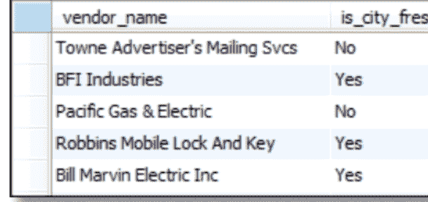

## IFNULL 函数的语法

`IFNULL(test_expression, replacement_value)`

### 使用 IFNULL 函数的 SELECT 语句

```sql
SELECT payment_date,
IFNULL(payment_date, 'No Payment') AS new_date
FROM invoices
```

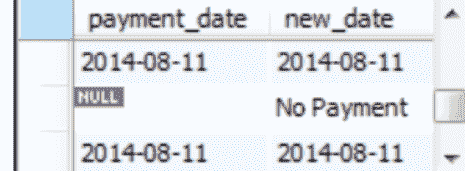

## COALESCE 函数的语法

`COALESCE(expression_1[, expression_2...])`

### 使用 COALESCE 函数的 SELECT 语句

```sql
SELECT payment_date,
COALESCE(payment_date, 'No Payment') AS new_date
FROM invoices
```

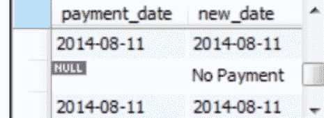

## Description

- `IF` 函数允许你测试一个表达式，如果表达式为真则返回一个值，如果表达式为假则返回另一个值。
- `IFNULL` 和 `COALESCE` 函数允许你用非空值替换空值。
- 如果第一个表达式不空，`IFNULL` 函数返回该表达式；否则，它返回你指定的替换值。
- `COALESCE` 函数返回第一个非空的表达式。如果所有表达式都为空，该函数返回一个空值。

图 9-15 如何使用 IF、IFNULL 和 COALESCE 函数

## 展望

在本章中，你学习了可以对 MySQL 数据进行操作的不同函数。到目前为止，你已经拥有了开发专业水平 SQL 代码所需的所有技能。

关于 MySQL 还有很多内容需要学习。在本书的下一节中，你将学习设计数据库的基本技能。即使你永远不需要设计自己的数据库，理解这些内容也将帮助你更高效地处理他人设计的数据库工作。

## 练习

- 1. 编写一个 `SELECT` 语句，从 `Invoices` 表中返回以下列：
    - `invoice_total` 列
    - 一个使用 `ROUND` 函数返回保留 1 位小数的 `invoice_total` 列
    - 一个使用 `ROUND` 函数返回不带小数（0 位小数）的 `invoice_total` 列

- 2. 编写一个 `SELECT` 语句，从 `EX` 数据库中的 `Date_Sample` 表中返回以下列：
    - `start_date` 列
    - 一个使用 `DATE_FORMAT` 函数返回月份缩写，且月份、日期和两位数年份之间用斜杠分隔的 `start_date` 列
    - 一个使用 `DATE_FORMAT` 函数返回返回月份和日期为不带前导零的整数，年份为两位数，且所有日期部分之间用斜杠分隔的 `start_date` 列
    - 一个使用 `DATE_FORMAT` 函数返回 12 小时制并带有 am/pm 指示的小时和分钟的 `start_date` 列
    - 一个使用 `DATE_FORMAT` 函数返回月份为不带前导零的整数，月份、日期和两位数年份之间用斜杠分隔，并带有 12 小时制和 am/pm 指示的小时和分钟的 `start_date` 列

- 3. 编写一个 `SELECT` 语句，从 `Vendors` 表中返回以下列：
    - `vendor_name` 列
    - 全大写的 `vendor_name` 列
    - `vendor_phone_column` 列
    - 一个显示每个电话号码最后四位的列
    - 当你运行正确后，将以下列也添加到结果集中。这更困难一些，因为这些列要求在函数内部嵌套函数：
    - 用点号分隔数字部分的 `vendor_phone_column`，例如 555.555.5555
    - 如果供应商名称中有第二个单词，则显示该单词的列；如果没有，则留空

- 4. 编写一个 `SELECT` 语句，从 `Invoices` 表中返回以下列：
    - `invoice_number` 列
    - `invoice_date` 列
    - `invoice_date` 加 30 天的日期
    - `payment_date` 列
    - 一个名为 `days_to_pay` 的列，显示发票日期和付款日期之间的天数
    - `invoice_date` 的月份数字
    - `invoice_date` 的四位年份
    - 当运行正确后，添加一个 `WHERE` 子句，根据发票日期（而不是月份数字）仅检索 5 月的发票。

## 数据库设计与实现

对于大型应用程序，专门负责数据库设计的开发者可能负责设计和创建生产应用程序使用的数据库。该开发者可能还负责设计和创建测试应用程序使用的数据库。然后，数据库管理员（DBA）负责维护这些数据库。对于较小的应用程序，程序员通常被要求设计、创建并维护测试和生产所需的数据库。

因此，无论你是数据库设计者、数据库管理员还是 SQL 程序员，都需要本节介绍的技能和知识。即使你从未被要求过设计、创建或维护数据库也是如此。通过理解背后的原理，你能够更有效地使用 SQL。

在第 10 章中，你将学习如何设计数据库。在第 11 章中，你将学习如何使用数据定义语言（DDL）语句创建和维护数据库、表和索引。最后，在第 12 章中，你将学习如何创建和维护视图，视图是提供查看表另一种方式的数据库对象。

## 如何设计数据结构

数据库通常由数据库管理员 (DBA) 或设计专家设计。对于大型多用户数据库，情况尤其如此。设计的优劣会直接影响你作为 MySQL 程序员的工作。通常情况下，设计得良好的数据库易于理解和查询，而设计得糟糕的数据库则难以处理。事实上，当你与一个设计糟糕的数据库一起工作时，你通常需要在编写适当的查询代码之前，弄清楚它是如何设计的。

接下来的主题介绍了设计数据结构的基本方法。我们用“数据结构（data structure）”来指代数据库的模型，而不是数据库本身。一旦你设计了数据结构，就可以使用接下来两个章节中介绍的技术创建一个基于该结构的数据库。通过理解设计数据库的正确方法，你作为 MySQL 程序员将会工作更加高效。

## 设计数据结构的基本步骤

在许多情况下，你可以根据现有的现实系统来设计数据结构。图 10-1 顶插图展示了这种工作原理的概念视图。在这里，你可以看到现实系统中的所有信息——即系统内的人员、文档和设施——都映射到数据库系统的表、列和行中。

在你设计数据结构时，每个表代表现实系统中的一个对象或实体（entity）。那么在每个表内部，每一列存储该表的一个信息项或属性（attribute），每一行存储该实体的的一次出现或实例（instance）。

该图还展示了你可以遵循的设计数据结构的六步骤。通常，第 1 步是识别所有需要存储在数据库中的数据元素。第 2 步是在合理的情况下将复杂元素分解为更小的组件。第 3 步是识别组成系统的表，并确定哪些数据元素被分配为每个表的列。第 4 步通过识别主键和外键来定义表之间的关系。第 5 步是对数据库进行归一化以减少数据冗余。第 6 步是识别每个表所需的索引（indices）。

为了根据现实系统对数据库系统进行建模，你可以使用实体-关系 (ER) 建模技术。由于这本身是一个复杂的学科，我不会在书中介绍它。不过，我已将该技术的一些基本元素应用到本章介绍的设计图中。因此，你实际上学习这种建模技术的基础知识。

## 数据库系统根据现实系统进行建模

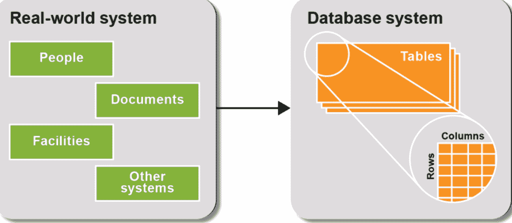

## 设计数据结构的六个步骤

- 第 1 步：识别数据元素
- 第 2 步：将每个元素细分为其最小可用组件
- 第 3 步：识别表并分配列
- 第 4 步：识别主键和外键
- 第 5 步：检查数据结构是否已归一化
- 第 6 步：识别索引

## 说明

- 关系数据库系统应该对其使用的现实环境进行建模。设计者的工作是分析现实系统并将其映射到关系数据库系统中。
- 关系数据库中的表通常代表现实世界中的一个对象或实体。表的每列都用于存储与该实体相关的属性，每一行代表该实体的一个实例。
- 为了根据现实系统对数据库及其表之间的关系进行建模，你可以使用名为实体-关系 (ER) 建模的技术。你在本章看到的某些图表应用了 ER 建模的基本元素。

图 10-1 设计数据结构的基本步骤

## 如何识别数据元素

设计数据结构的第一步是识别系统所需的数据元素。你可以使用几种技术来实现这一点，包括分析现有系统（如果有的话）、评估类似的系统，以及访问任何将使用该系统的人。一个特别好的信息来源是现有系统使用的文档。

在图 10-2 中，你可以看到一张应付账款系统使用的发票。我们将使用这份文档作为本章介绍的数据库设计的主要信息源。请记住，在你设计自己的数据库时，要使用所有可用资源。

如果你研究这份文档，你会发现它包含了关于三个不同实体的信息：供应商、发票和行项目（line items）。首先，表单本身就有关于开具发票的供应商的预打印信息，例如供应商的名称和地址。如果该供应商开具另一张发票，这些信息就不会改变。

该文档还包含关于发票的特定信息。其中某些信息（如发票编号、发票日期和发票总额）是通性的。虽然实际信息会随每张发票而变化，但每张发票都会包含这些信息。除了这些通用信息，每张发票还包含有关购买物品的信息。每张发票可以包含不同数量的行项目。

你在查看此类文档时需要考虑的问题之一是，你的系统需要跟踪多少信息。例如，你可能不需要存储详细数据（如每个行项目的详细信息）。相反，你可能只需要存储汇总数据，如发票总额。当你思考要在数据库中包含哪些数据元素时，你对将需要从系统中获取什么信息应该有一个大致的认识了。


## 如何细分数据元素

你在第 1 步中识别出的某些数据元素将由多个组件组成。那么，下一步是将这些元素细分为其最小可用值。图 10-3 显示了你可以如何拆分客户的姓名。

图中的第一个示例展示了如何拆分姓名。在这里，姓名被拆分为两个元素：名（`first name`）和姓（`last name`）。当你这样拆分姓名时，可以轻松地执行按姓名排序的操作，以及在称呼中使用名字，例如“Dear Ruben”。与此相反，如果将全名存储在单列中，你就必须使用字符串函数来提取所需的组件。但正如你在上一章中学到的，这可能导致代码低效且复杂。通常，每当你需要单独使用姓名时，就应该将姓名分开。稍后当你需要使用全名时，可以拼接名和姓。

第二个示例展示了你通常如何拆分地址。注意此示例中，街道名称和门牌存储在单列中。虽然你可以将这些组件存储在单独的列中，但通常没有意义，因为这些值通常是在一起使用的。这就是我说的数据元素应细分为其最小可用值的含义。

根据这一准则，你可能甚至需要将一个字符串拆分为两个或多个组件。例如，一个批量邮件系统可能需要多达四个列：一个用于区号，一个用于三位前缀，一个用于四位数字，一个用于扩展号。

作为上一步，对现实系统以及将从数据库中提取信息的了解至关重要。在某些情况下，将具有多个组件的数据元素存储在单列中是可以的。这可以简化你的设计并减少列的总数。但通常情况下，大多数设计者会尽可能地拆分数据元素。这样，就可以轻松适应几乎任何查询，而且当你发现自己只需要列值的一个部分时，就不需要更改数据库设计。

### 图 10-2 如何识别数据元素

### 图 10-3 如何细分数据元素

#### 分为名和姓的名字

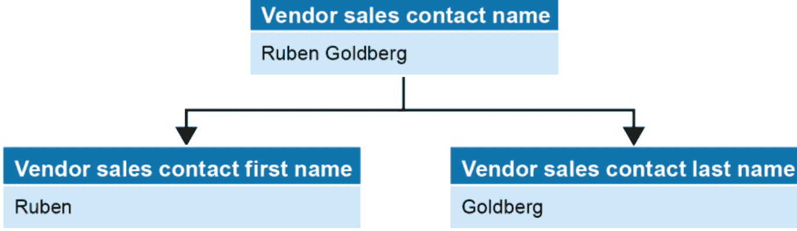

#### 分为街道地址、城市、州和邮编的地址

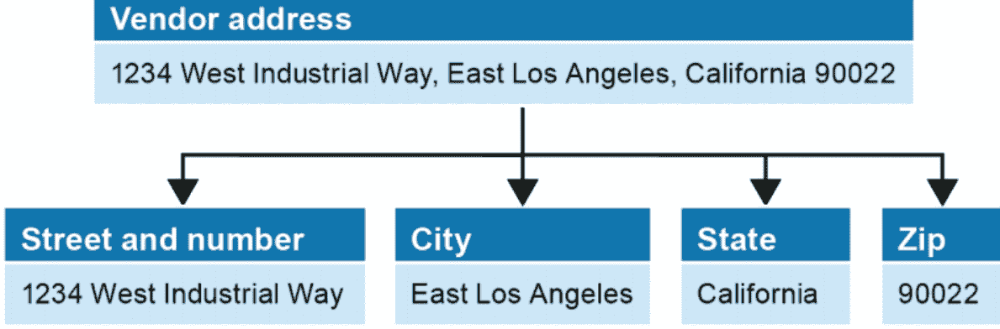

### 描述

- 如果一个数据元素包含两个或多个组件，你应该考虑将该元素细分为这些组件。这样，你就不需要每次使用该元素时都对其进行解析。
- 细分数据元素的程度取决于如何使用它。由于很难预测数据未来的所有用途，大多数设计师都会尽可能地细分数据元素。
- 当你细分数据元素时，你可以在需要时通过连接各个组件来重新构建它。

### 图 10-3 如何细分数据元素

## 如何识别表格并分配列

图 10-4 展示了应付账系统的主要实体，并列出了可能与每个实体关联的数据元素。在大多数情况下，当你识别出数据元素时，就能识别出需要包含在数据结构中的主要实体。例如，当我查看图 10-2 发票单上表示的数据元素时，我识别出了图中三个实体：供应商、发票和发票行项目。虽然你可能在设计过程的后期识别出额外的实体，但在此阶段识别出主要实体就已经足够了。这些实体将成为数据库的表。

在识别出主要实体后，你需要确定哪些数据元素与每个实体关联。这些元素将成为表格的列。例如，在许多情况下，关联是显而易见的。很容易确定供应商名称和地址与供应商实体关联，发票日期和总额与发票实体关联。然而，某些关联并不显而易见。在这种情况下，你可能需要将一个数据元素列在两个或多个实体下。图中，你可以看到发票号包含在发票和行项目中，而账号包含在所有三个实体中。稍后，当你对数据结构进行归一化时，你可能能够移除这些元素。但目前，包含它们是可以的。

在继续之前，我想指出我在图中使用的符号。我所包含的任何未在之前的步骤中被识别的数据元素都以*斜体*显示。你应该能够识别设计过程前两个步骤中的大多数数据元素，在第三步期间你偶尔会考虑到额外的元素。在这种情况下，由于初始数据元素列表是基于单个文档的，我向列表中添加了几个数据元素。

同样，你可能在这一步决定你不需要已识别的某些数据元素。例如，我决定不需要每个供应商的传真号码或网站。因此，我使用了文字处理器的删除线功能表示这些数据元素不应包含在内。

最后，我通过标记星号 `*` 标识了包含在两个或多个表格中的数据元素。在完成设计过程的这一步后，你需要确保记录了你的设计决策。对于复杂的设计，你可能希望使用 `CASE`（计算机辅助软件工程）工具。

顺便提一下，如果你以前没有接触过公司应付账系统，我添加的几个新数据元素对你来说可能并不清晰。“条款（Terms）”指的是付款条款——条款可能是净 30 天（发票必须在 30 天内付清），也可能包含提前付款的折扣。“账号（Account number）”指的是公司用于跟踪费用的总账账户。例如，一个账号可能分配给广告费用，而另一个账号可能用于办公用品。每张发票的付款金额被分配给账户，在某些情况下，发票上的不同行项目被分配给不同的账户。

### 应付账系统的可能表格和列

| 供应商 (Vendors) | 发票 (Invoices) | 发票行项目 (Invoice line items) |
| --- | --- | --- |
| 供应商名称 | 发票号* | 发票号* |
| 供应商地址 | 发票日期 | 项目零件号 |
| 供应商城市 | 条款* | 项目数量 |
| 供应商州 | 发票总额 | 项目描述 |
| 供应商邮编 | 付款日期 | 项目单价 |
| 供应商电话 | 付款总额 | 项目扩展号 |
| 供应商传真号 | 发票到期日 | 账号* |
| 供应商网站地址 | 信用总额 | 序列号 |
| 供应商联系人名 | 账号* | |
| 供应商联系人姓 | | |
| 供应商联系电话 | | |
| 供应商 AR 名 | | |
| 供应商 AR 姓 | | |
| 供应商 AR 电话 | | |
| 条款* | | |
| 账号* | | |

### 描述

- 在你识别并细分了数据库的所有数据元素后，你应该根据它们所属的实体对它们进行分组。这些实体以后将成为数据库的表，元素将成为列。
- 如果一个数据元素与多个实体相关，你可以包含它相关的所有实体。然后，当对数据库进行归一化时，你可能能够移除重复元素。
- 在分配元素到实体时，你应该省略不需要的元素，并添加任何需要的额外元素。

### 图中使用的符号

- 不需要的数据元素被划掉。
- 添加的数据元素以*斜体*显示。
- 位于两个或多个处的数据元素后带有星号。
- 如果可用，可以使用 `CASE`（计算机辅助软件工程）工具。

### 图 10-4 如何识别表格并分配列

## 如何识别主键和外键

一旦识别了实体和数据元素，下一步是识别表之间的关系并添加外键。在大多数情况下，两个表之间存在一对多的关系。例如，每个供应商可以有许多张发票，每张发票可以有许多行项目。为了识别每张发票所属的供应商，`Invoices` 表中包含了 `vendor_id`。因为 `Invoice_Items` 表已经包含了 `invoice_id` 列，所以没有必要在该表中添加另一个列。

图顶部的图说明了应付账系统中表之间的关系。如你所示，主键以**粗体**显示。然后，线条表示一个表中的主键如何与另一个表中的外键关联。在这里，小圆角表示关系的“一”的一侧，而三条线的连接表示关系的“多”的一侧。

### 应付账系统中的表之间的关系

| vendors | invoices | invoice_line_items |
| --- | --- | --- |
| vendor_id | invoice_id | invoice_id |
| vendor_name | vendor_id | invoice_sequence |
| vendor_address | invoice_number | account_no |
| vendor_city | invoice_date | line_item_description |
| vendor_state | invoice_total | item_quantity |
| vendor_zip_code | payment_total | item_price |
| vendor_phone | credit_total | line_amount |
| vendor_contact_first_name | terms | |
| vendor_contact_last_name | invoice_due_date | |
| terms | payment_date | |
| account_no | account_no | |

### 具有多对多关系的两个表

| employees | memberships | committees |
| --- | --- | --- |
| employee_id | employee_id | committee_id |
| first_name | committee_id | committee_name |
| last_name | | |

#### 连接表

### 具有一对一关系的两个表

| employees | employee_photos |
| --- | --- |
| employee_id | employee_id |
| first_name | employee_photo |
| last_name | |

### 描述

- 每个表都应该有一个主键来唯一标识每一行。如果可能，你应该使用现有的列作为主键。
- 主键的值应该很少改变，甚至从不改变。这些值也应该是短且易于正确输入的。
- 如果没有合适的列作为主键，你可以创建一个每增加新行就递增的 ID 计数作为主键。
- 如果两个表之间存在多对多关系，你可能需要向“多”的一侧添加一个外键列。外键的数据类型必须与它所关联的主键的数据类型相同。
- 如果两个表之间存在多对多关系，你需要定义一个连接表来关联它们。然后，每个多对多关系都将与连接表形成一对多的多的关系。连接表通常没有主键。
- 如果两个表之间存在一对一关系，它们应该通过它们的主键进行关联。这种类型的关系通常用于提高性能。这样，可以将包含大量数据的列存储在单独的表中。

第三个示例说明了两个具有一对一关系的表。在这样的关系中，两个表具有相同的主键，这意味着信息可以存储在单个表中。当一个表包含一个或多个带有大量数据的列时，通常会使用这种关系。在这种情况下，`Employee_Photos` 表包含一个包含每个员工照片的大型二进制列。由于该列被使用的频率较低，将其存储在单独的表中将使对 `Employees` 表的操作更具效率。然后，当需要该列时，可以使用连接（join）将其与 `Employees` 表中的列结合起来。

### 图 10-5 如何识别主键和外键

## 如何强制表之间的关系

尽管主键和外键指示了数据库中表之间的关系，但数据库管理系统并不总是自动强制这些关系。在任何情况下，在图 10-6 顶部表格所示的操作中，任何一种操作都会违反表的引用完整性。例如，如果你从主键表中删除了一行，而外键表中包含了与该主键关联的行，那么这两个表的引用完整性就会被破坏。在向外键表中插入行，或者更新主键或外键值时，也可能发生类似的问题。

为了强制这些关系并维护表的引用完整性，MySQL 提供了声明式引用完整性。要使用它，你需要定义外键约束，以指示表之间的引用完整性是如何强制的。你将在下一章中学习更多关于定义外键约束的内容。现在只需只需这些约束可以防止图中列出的所有违反引用完整性的操作。

### 可能违反引用完整性的操作

| 操作... | 如果满足以下条件将违反引用完整性 |
| --- | --- |
| 从主键表中删除一行 | 外键表中包含与被删除行相关的一行或多行 |
| 在外键表中插入一行 | 外键在相关表中没有匹配的主键值 |
| 更新外键值 | 新的外键值在相关表中没有匹配的主键值 |
| 更新主键值 | 外键表中包含与已更改行相关的一行或多行 |

### 描述

- 引用完整性意味着表之间的关系得到了正确的维护。这意味着，带有外键的表不包含其外键值在相关表中没有匹配的主键值的行。
- 在 MySQL 中，你可以使用声明式引用完整性来强制执行引用完整性。
- 要使用声明式引用完整性，你需要定义外键约束。你将在下一章中学习如何做。
- 当你定义外键约束时，可以指定从主键表中删除行时如何强制引用完整性。选项有返回错误、删除外键表中的相关行或将外键值设置为空。
- 如果没有强制执行引用完整性且从主键表中删除了一行，则外键表中具有相关行的行被称为“孤儿数据”（orphaned）。

### 图 10-6 如何强制表之间的关系

## 规范化是如何工作的

设计过程的下一步是检查数据结构是否已经规范化。为了做到这一点，你需要查看数据是如何分离到相关表中的。如果你遵循了本章介绍的数据库设计的前四个步骤，你的数据库将是部分规范化的。然而，任何设计都可以进一步规范化。

在此图的第一张表中，你可以看到每一行都代表一张发票。因为一张发票可以有一个或多个行项目，所以 `item_description` 列必须重复以提供最大数量的行项目支持。但由于大多数发票的行项目少于最大数量，这可能会浪费存储空间。

在第二个表中，每个行项目都存储在单独的行中。这消除了重复 `item_description` 列引起的问题，但引入了一个新问题：发票号码必须在每行中重复。这也会导致存储问题，特别是当重复的列很大时。此外，如果该列包含一个可能更改的值，可能会导致维护问题。那么，当值更改时，每个包含该值的行都必须更新，这在行与行之间进行将是很的。

为了消除数据冗余引起的问题，你可以规范化数据结构。要做到这一点，你可以应用将在本章后面部分学习的范式。正如你所看到的，总共有七种范式。然而，通常只应用前三种。例如，此图中的图表显示了第三范式的应付账系统。虽然目前可能并不明显看出它是如何减少数据冗余的，但随着你学习不同的范式，情况将变得更加清晰。

### 包含重复列的表

| vendor_name | invoice_number | item_description_1 | item_description_2 | item_description_3 |
| --- | --- | --- | --- | --- |
| Cahners Publishing | 11289 | VB ad | SQL ad | Library directory |
| Zylika Design | 97/552 | | Catalogs | SQL flyer |
| Zylika Design | 97/538 | | Card revision | HALL |

### 包含冗余数据的表

| vendor_name | invoice_number | item_description |
| --- | --- | --- |
| Cahners Publishing | 11289 | VB ad |
| Cahners Publishing | 11289 | SQL ad |
| Cahners Publishing | 11289 | Library directory |
| Zylika Design | 97/522 | Catalogs |
| Zylika Design | 97/522 | SQL flyer |
| Zylika Design | 97/538 | Card revision |

### 第三范式的应付账系统

| vendors | invoices | invoices_line_items |
| --- | --- | --- |
| vendor_id | invoice_id | invoice_id |
| vendor_name | vendor_id | invoice_sequence |
| vendor_address | invoice_number | account_no |
| vendor_city | invoice_date | line_item_amount |
| vendor_state | invoice_total | line_item_description |
| vendor_zip_code | payment_total | |
| vendor_phone | credit_total | |
| vendor_contact_first_name | terms_id | |
| vendor_contact_last_name | invoice_due_date | general_ledger_accounts |
| default_terms_id | payment_date | account_no |
| default_account_no | | account_description |
| | terms | |
| | terms_id | |
| | terms_description | |
| | terms_due_days | |

### 描述

- 规范化是一种我们将数据结构中的数据分离到相关表中的正式过程。规范化减少了冗余，冗余会导致存储和维护问题。
- 在未规范化的数据结构中，一个表可以包含两个或多个实体的信息。它还可以包含重复列、包含重复值的列以及在两行或多行中重复的数据。
- 在规范化的数据结构中，每个表包含关于一个实体的信息，并且每个信息都只存储在一个地方。

## 如何识别需要索引的列

设计过程的最后一步是识别应该建立索引的列。`索引`（index）是一种可以直接定位一个或多行的结构。如果没有索引，数据库管理系统必须执行`表扫描`（table scan），这涉及搜索整个表。

就像书的索引具有页码，可以引导你找到特定的主题一样，数据库索引拥有指针，可以引导系统定位到特定的行。这不仅在你根据搜索条件查找行时可以提高性能，而且当你从表中连接（join）数据时也是如此。例如，如果一个连接是基于主键和外键的关系，并且为外键列定义了索引，那么数据库管理系统就可以使用索引来定位每个主键值对应的行。

当你使用 MySQL 时，会自动为你创建的每个表的主键和外键自动创建索引。但你应该根据图 10-8 顶部的指南，考虑为某些表中的其他列创建索引。

首先，如果某个列将频繁用于搜索条件或连接操作，那么你就应该对它建立索引。该列还应该包含许多不同的值，且列中的值更新频率应该很低。如果不满足这些条件，维护索引的开销可能会超过使用它带来的优势。

在创建索引时，你应该意识到，每当你添加、更新或删除行时，MySQL 都必须更新索引。因为这会影响性能，所以你不希望定义比需要的更多的索引。

在为表确定索引时，请记住，就像键一样，索引可以由两个或多个列组成。这种索引被称为`复合索引`（composite index）。

### 何时创建索引

- 当列被频繁用于搜索条件或连接操作时


- 当列包含大量不同的值时
- 当列的更新频率较低时

## 描述

- MySQL 自动为主键和外键创建索引。
- 索引为数据库管理系统提供了一种快速定位信息的方法。当使用索引时，数据库管理系统可以直接跳转到特定行，而不需要搜索它找到的所有行。
- 索引在搜索和连接表时可以提高性能。
- 你可以创建包含两个或多个列的复合索引。当索引中的列更新频率较低，或者索引涵盖了表上几乎所有的搜索条件时，你应该使用这种类型的索引。
- 因为每次添加、更新或删除行时都必须更新索引，所以你不应该创建比需要的更多的索引。

# 如何规范化数据结构

接下来的主题描述了七种范式，并教你如何应用前三种。正如我之前提到的，在前四个数据库设计步骤中你已经在某种程度上应用了这些范式，但这些主题将让你对该过程有更深入的理解。然后，最后解释了何时以及如何对数据结构去规范化。当你完成这些主题后，你就拥有了设计高效且易用数据库的基本技能。

# 七种范式

10-90 总结了七种范式。每个范式都假设之前的范式已经应用。在应用第三范式之前，设计必须已经处于第二范式。

严格来说，数据结构在达到第五范式或第六范式之前是不被规范化的。然而，超过第三范式后的范式应用得并不频繁。因此，我不会详细介绍这些范式。相反，我会对其进行简要描述，以便在你需要时了解如何应用它们。

鲍义斯-科德范式（Boyce-Codd normal form）可用于消除传递依赖。在这种依赖中，一个列依赖于另一个列，而该列又依赖于第三列。为了说明，考虑 `Vendors` 表中的城市（`city`）、州（`state`）和邮编（`zip code`）列。在这里，邮码标识城市和州，这意味着它们依赖于邮码，而邮码又依赖于 `vendor_id` 列。为了消除这种依赖，你会将城市和州的值存储在一个单独表中，该表使用邮码作为其主键。

第四范式（Fourth normal form）可用于消除表中的多值依赖（multivalued dependencies）。多值依赖主列与非键列之间一对多的关系。为了说明，考虑 `Vendors` 表中的供应商电话号码（vendor phone number）。如果你想容纳备用电话（例如手机或家庭电话），你可以为每种类型的号码添加额外的列。然而，这在电话号码和 `vendor_id` 之间创建了多值依赖。为了达到第四范式，你需要将电话号码存储在单独表中，并使用 `vendor_id` 作为外键。

应用第五范式（Fifth normal form），你继续将数据结构拆分为更小的表，直到删除所有冗余。当进一步拆分会导致无法通过表重构原始表时，该数据结构就处于第五范式。在这种形式下，大多数表包含的列仅比一两个数据元素多一点。

域键范式（domain-key normal form），有时被称为第六范式，仅具有学术意义，因为没有数据库系统实现过应用它的方法。由于由于原因，即使是规范化的纯主义者也可能认为数据库达到第五范式即了。

# 七种范式

| 范式 | 描述 |
| :--- | :--- |
| 第一范式 (1NF) | 每行和每列交叉处存储的值必须是标量值，且表不能包含任何重复的列。 |
| 第二范式 (2NF) | 每个非键列必须依赖于整个主键。 |
| 第三范式 (3NF) | 每个非键列必须只依赖于主键。 |
| 鲍义斯-科德 (BCNF) | 非键列不能依赖于另一个非键列。这消除了*传递*依赖，即列 A 依赖于 C，列 B 也依赖于 C。由于 A 和 B 都依赖于 C，应将 A 和 B 移动到另一个以 C 为键的表中。 |
| 第四范式 (4NF) | 表不能有多个*多值*依赖，主键与非键列之间存在一对多的关系。这种形式消除了多对多的关系。 |
| 第五范式 (5NF) | 将数据结构拆分为更小的表，直到删除所有冗余。如果进一步拆分导致表无法合并还原原始表，则为第五范式。 |
| 域键范式 (DKNF) | 关系上的每个约束仅依赖于键约束和域约束，*域*（domain）是列的允许值的集合。这种形式通过在关系级别而非表或列级别强制执行约束防止插入不可接受的数据。*DKNF* 比抽象的“终极”范式更具设计意义。 |

图 10-9 也列出了数据结构规范化的益处。总结来说，规范化产生了更小、更高效的表。此外，它减少了数据冗余，使数据更容易维护，并减少了数据库所需的存储空间。由于这些优点，你应该始终考虑对你的数据结构进行规范化。

你还需要意识到，规范化在数据库社区是一个具有争议的话题。在计算机科学的学术研究中，规范化被视为一种应该始终追求的设计完美形式。但在实践中，数据库设计人员和 DBA 倾向于将规范化作为一种灵活的设计指南。

## 如何应用第一范式

图 10-10 展示了如何对图 10-2 所示的数据元素组成的未规范化数据结构应用第一范式。图中的前表展示了不符合第一范式的结构。这两个表对于每张发票都包含一行。然而，由于每张发票可以包含一个或多个行项目，因此第一个表允许 `item_description` 列出现重复值。第二个表也类似，它为每个行项目描述包含了一个单独的列。这两种结构都不符合第一范式。

图中的第三张表消除了重复的值和列。为了做到这一点，它为每个行项目包含了一行。但请注意，这现在每个行项目都重复了。这个问题可以通过应用第二范式来解决。

在描述第二范式之前，我想让你意识到，我特意在此图和下一张图的示例中省略了发票数据结构中的许多列。除了这里显示的列外，例如，这些表都将包含供应商地址、发票日期、发票总额等。通过消除这些列，你将更容易关注受应用范式影响的列。

## 包含重复值列的发票数据

| vendor_name | invoice_number | item_description |
|---|---|---|
| Cahners Publishing | 112897 | VB ad, SQL ad, Library directory |
| Zylika Design | 97/552 | Catalogs, SQL Flyer |
| Zylika Design | 97/533b | Card revision |

## 包含重复列的发票数据

| vendor_name | invoice_number | item_description_1 | item_description_2 | item_description_3 |
|---|---|---|---|---|
| Cahners Publishing | 112897 | VB ad | SQL ad | Library directory |
| Zylika Design | 97/552 | Catalogs | SQL flyer | NULL |
| Zylika Design | 97/533b | Card revision | NULL | NULL |

## 符合第一范式的发票数据

| vendor_name | invoice_number | item_description |
|---|---|---|
| Cahners Publishing | 112897 | VB ad |
| Cahners Publishing | 112897 | SQL ad |
| Cahners Publishing | 112897 | Library directory |
| Zylika Design | 97/522 | Catalogs |
| Zylika Design | 97/522 | SQL flyer |
| Zylika Design | 97/533b | Card revision |

## 描述

- 一个表要符合第一范式，其列不能包含重复值。相反，每列必须包含一个单一的标量值。此外，表不能包含表示值集合的重复列。
- 符合第一范式的表在行中经常有重复值。这可以通过应用第二范式来解决。


## 如何应用第二范式

图 10-11 显示了如何应用第二范式。要符合第二范式，表中非键列的每一列都必须依赖于整个主键。这种形式仅适用于具有复合主键的表，当你从完全未规范化的数据开始时，通常就是如此。例如，此图顶部的表显示了添加键列后符合第一范式的发票数据。在这种情况下，主键由 `invoice_id` 和 `invoice_sequence` 列组成。需要 `invoice_sequence` 列来唯一标识每张发票的每个行项目。

现在，考虑此表中所示三个非键列。在这三个列中，只有 `item_description` 一个依赖于整个主键。另外两个——`vendor_name` 和 `invoice_number` 仅依赖于 `invoice_id` 列。因此，这些列应该移动到另一个表中。结果是像图中所示的第二个数据结构。在这里，所有与发票相关的信息都存储在 `Invoice` 表中，所有与单个行项目相关的信息都存储在 `Invoice_Line_Items` 表中。

注意这些表之间的关系是基于 `invoice_id` 列的。该列是 `Invoice` 表的主键，它是 `Invoice_Line_Items` 表中的外键，将该表的行与 `Invoice` 表中的行关联。该列也是 `Invoice_Line_Items` 表主键的一部分。

当你对数据结构应用第二范式时，它消除了表中的一些冗余行数据。在图中，例如你可以看到每张发票只包含一次供应商信息。

## 添加键后符合第一范式的发票数据

| invoice_id | vendor_name | invoice_number | invoice_sequence | item_description |
|---|---|---|---|---|
| 1 | Cahners Publishing | 112897 | 1 | VB ad |
| 1 | Cahners Publishing | 112897 | 2 | SQL ad |
| 1 | Cahners Publishing | 112897 | 3 | Library directory |
| 2 | Zylika Design | 97/522 | 1 | Catalogs |
| 2 | Zylika Design | 97/522 | 2 | SQL flyer |
| 3 | Zylika Design | 97/533b | 1 | Card revision |

## 规范化的发票数据

| invoice_id | vendor_name | invoice_number |
|---|---|---|
| 1 | Cahners Publishing | 112897 |
| 2 | Zylika Design | 97/552 |
| 3 | Zylika Design | 97/533b |

| invoice_id | invoice_sequence | item_description |
|---|---|---|
| 1 | 1 | VB ad |
| 1 | 2 | SQL ad |
| 1 | 3 | Library directory |
| 2 | 1 | Catalogs |
| 2 | 2 | SQL flyer |
| 3 | 1 | Card revision |

## 描述

- 一个表要符合第一范式，其列不能包含重复值。相反，每列必须包含一个单一的标量值。此外，表不能包含表示值集合的重复列。
- 符合第一范式的表在行中经常有重复值。这可以通过应用第二范式来解决。
- 要符合第二范式，表中非键列的每一列都必须依赖于整个主键。这种形式仅适用于具有复合主键的表。
- 要符合第三范式，每个非键列都只依赖于主键。

## 如何应用第三范式

图 10-12 展示了如何应用规范。要符合第三范式，每个非键列都只依赖于主键。这意味着没有传递依赖。当非键列依赖于另一个非键列而不是主键时，就会产生传递依赖。

在上面的示例中，`vendor_name` 列依赖于 `invoice_number`，而 `invoice_number` 又依赖于 `invoice_id`。这就是传递依赖。为了解决这个问题，我们将 `vendor_name` 和 `invoice_number` 移动到一个单独表中。同样，条款依赖于 `invoice_id`，所以我们将它们移动到 `Terms` 表。

| invoice_number | vendor_name |
|---|---|
| 112897 | Cahners Publishing |
| 97/552 | Zylika Design |
| 97/533b | Zylika Design |

| invoice_id | terms_id |
|---|---|
| 1 | 1 |
| 1 | 2 |
| 1 | 3 |
| 2 | 4 |
| 2 | 5 |
| 3 | 6 |

| terms_id | item_description |
|---|---|
| 1 | VB ad |
| 2 | SQL ad |
| 3 | Library directory |
| 4 | Catalogs |
| 5 | SQL flyer |
| 6 | Card revision |

# 第 10 章 如何设计数据库 301

# 第二范式下的应付账款系统

| 发票 (invoices) | 发票行项目项目 (invoice_line_items) |
| --- | --- |
| invoice_id | invoice_id |
| 供应商名称 (vendor_name) | 发票序列 (invoice_sequence) |
| 供应商地址 (vendor_address) | 账号 (account_no) |
| 供应商城市 (vendor_city) | 行项目描述 (line_item_description) |
| 供应商州 (vendor_state) | 行项目数量 (line_item_quantity) |
| 供应商邮编 (vendor_zip_code) | 行项目单价 (line_item_unit_price) |
| 供应商电话 (vendor_phone) | 行项目金额 (line_item_amount) |
| 供应商联系人姓 (vendor_contact_first_name) | |
| 供应商联系人名 (vendor_contact_last_name) | |
| 发票号码 (invoice_number) | |
| 发票日期 (invoice_date) | |
| 发票总额 (invoice_total) | |
| 付款总额 (payment_total) | |
| 信用贷方总额 (credit_total) | |
| 付款条款 (terms) | |
| 发票截止日期 (invoice_due_date) | |
| 付款日期 (payment_date) | |
| 账号 (account_no) | | |

# 关于供应商结构的问题

- 供应商信息（`vendor_name`, `vendor_address` 等）是否仅依赖于 `invoice_id` 列？
- 付款条款（`terms`）是否仅依赖于 `invoice_id` 列？
- 账号（`account_no`）是否仅依赖于 `invoice_id` 列？
- 发票截止日期（`invoice_due_date`）和行项目金额（`line_item_amount`）是否可以从其他数据推导出？

# 第三范式下的应付账款系统

| 供应商 (vendors) | 发票 (invoices) | 发票行项目项目 (invoice_line_items) | 总账账户 (general_ledger_accounts) |
| --- | --- | --- | --- |
| vendor_id | invoice_id | invoice_id | account_no |
| vendor_name | vendor_id | invoice_sequence | account_description |
| vendor_address | invoice_number | account_no | | |
| vendor_city | invoice_date | line_item_amount | | |
| vendor_state | invoice_total | line_item_description | | |
| vendor_zip_code | payment_total | | | |
| vendor_phone | credit_total | | | |
| vendor_contact_first_name | terms_id | | | |
| vendor_contact_last_name | invoice_due_date | | | |
| default_terms_id | payment_date | | | |
| default_account_no | | | | |
| | terms | | | |
| | terms_description | | | |
| | terms_days | | | |

## 描述

- 要使一个表符合第三范式，每个非键列必须只依赖于主键。
- 如果一个列不只依赖于主键，则意味着该列被分配到了错误的表中，或者它可以从表中的其他列计算出来。可以从其他列计算出的列称为派生数据。

图 10-12 展示了如何应用第三范式并仅保留 `line_item_amount` 列。这就是我在该图的数据结构中所做的。然而，你选择的解决方案取决于数据如何被使用。

相比之下，虽然 `invoice_due_date` 列可以根据 `Invoices` 表中的 `invoice_due_date` 列和相关 `Terms` 表行中的 `terms_due_days` 列计算出来，但系统也允许对该日期进行覆盖。因此，不应省略 `invoice_due_date` 列。如果系统不允许该值被覆盖，那么此列就可以安全地省略。

# 何时以及如何对数据结构进行规范化

反范化（Denormalization）是故意偏离范式的行为。大多数反范化发生在第三范式之外。相比之下，前三个范式几乎是全球通应用的。


为了说明何时以及对数据结构进行规范化，图 10-13 展示了第五范式下的应付账款系统设计。在这里，供应商代码存储在一个单独表中，该表包含每个邮编对应的城市和州。此外，区号存储在另一个单独表中。因此，获取供应商地址和电话号码的查询将需要两次连接（joins）。相比之下，如果你将城市、州和区号信息留在 `Vendors` 表中，则不需要任何连接，但 `Vendors` 表会变得更大。

在这种情况下，我们需要查询不带区号的电话号码。同样，我们需要查询不带邮编的城市和州。由于这些原因，我通过消除 `Zip_Codes` 和 `Area_Codes` 表对我的设计进行了反范化。

如果一个表更新非常频繁，你也可能考虑对其进行反范化。在这种情况下，冗余数据不太可能引起问题。

最后，如果派生数据在搜索条件中被频繁使用，你应该考虑将该数据包含在表内。例如，如果你经常根据发票余额查询 `Invoices` 表，你可能考虑包含一个包含基础数据的列。这样，你就不需要每次都计算这个值。但请记住，如果你存储了这些数据，可能会保护该派生列，使其无法直接更新。或者，你可以定期更新表以重置派生列的值。

由于规范化消除了数据冗余错误的可能性并优化了存储的使用，你应该仔细考虑何时以及如何对数据结构进行规范化。通常情况下，只有当效率的提升大于潜在的冗余错误和存储问题时，你才进行反范化。当然，你的反范化决策还应该基于对系统将要现实环境的了解。如果你已经按照本章概述分析了现实环境，将为你做出该决策提供良好基础。

## 第五范式下的应付账款系统

| 供应商 (vendors) | 发票 (invoices) | 发票行项目 (invoice_line_items) |
| --- | --- | --- |
| vendor_id | invoice_id | invoice_id |
| vendor_name | vendor_id | invoice_sequence |
| vendor_address | invoice_number | account_no |
| vendor_city | invoice_date | line_item_amount |
| vendor_state | invoice_total | line_item_description |
| vendor_zip_code | payment_total |  |
| vendor_phone | credit_total |  |
| vendor_contact_first_name | terms_id |  |
| vendor_contact_last_name | invoice_due_date |  |
| default_terms_id | payment_date |  |
| default_account_no |  |  |

## MySQL Workbench 主页

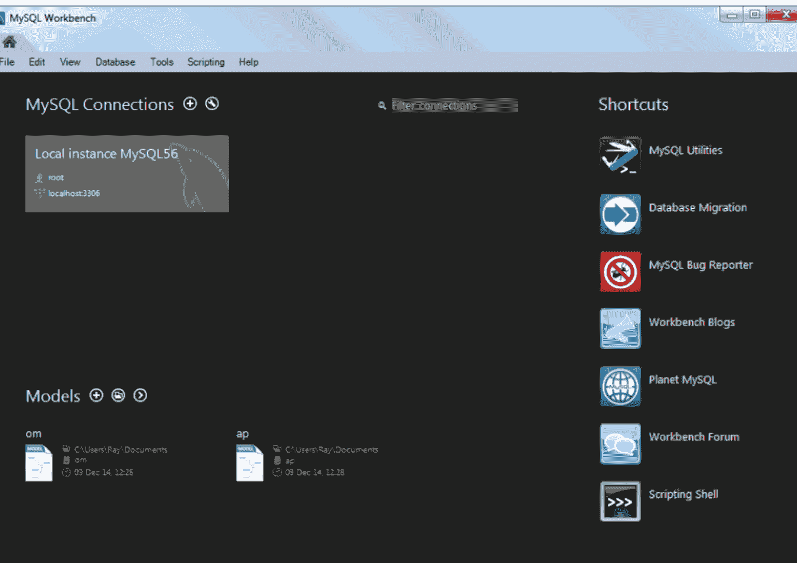

### 描述

- MySQL Workbench 允许你创建增强型实体关系模型（EER 模型）。此类模型扩展了原始的实体关系模型（ER 模型）。
- 一旦你创建或打开了 EER 模型，你就可以与该模型关联的一个或多个 EER 图形进行操作。
- 要打开最近使用的现有 EER 模型，请点击模型（Models）部分模型列表中的模型。
- 要打开任何 EER 模型，点击模型（Models）部分顶部的图标，或者选择“文件→打开模型”（File→Open Model）。然后，使用弹出的对话框选择模型文件。
- 要创建一个空白的新 EER 模型，点击模型（Models）部分旁边的 `+` 图标，或者选择“文件→新建模型”（File→New Model）。
- 要从现有数据库创建 EER 模型，点击模型（Models）部分旁边的 `>` 图标，选择“从数据库创建 EER 模型”（Create EER Model From Database）项，并使用弹出的对话框选择数据库。
- 要从 SQL 脚本创建 EER 模型，点击模型（Models）部分旁边的 `>` 图标，选择“从 SQL 脚本创建 EER 模型”（Create EER Model From SQL Script）项，并使用弹出的对话框选择脚本文件。
- 要从最近使用的模型列表中移除现有模型，右键点击该模型并选择“移除模型”（Remove Model）项。

图 10-14 如何创建和打开 EER 模型

## 如何操作 EER 模型

图 10-15 显示了如何操作 EER 模型。特别是，它展示了 AP 数据库的 MySQL 标签页。通过此标签页，你可以操作数据库的表。

要编辑其中一张表，可以双击它。此时，MySQL Workbench 会在窗口底部显示一个标签页。在该页内有额外的标签，你可以使用它们来修改表的列、索引和外键。例如，此图显示了供应商（Vendors）表的列（Columns）标签页。从此标签页，你可以修改列的名称、数据类型和其他属性。你也可以通过表格底部输入列信息来添加新列。此外，你还可以修改表的名称。

如果你想向模型添加一个表，可以双击添加（Add）图标。然后，你可以编辑表以设置其名称、列、索引和外键。你将在下一章学习更多关于此的操作。或者，如果你想从模型中删除表，可以右键点击该表并选择“删除”（Delete）项。

由于你通常通过创建数据库表来开始数据库，因此此图侧重于如何操作表。然而，你可以使用类似的技能来操作存储在模型中的其他数据库对象，如视图和存储程序。

由于操作模型的视觉化表示通常更容易，你可以打开与模型对应的图形。正如你将在下一张图中看到的，这可以有助于查看表之间的关系。当你操作图形时，你所做的某些更改会影响相应的模型。因此，你可以将操作图形看作是更视觉化的模型操作方式。

要打开某个模型的图形，可以双击图形名称。例如，在此图中，AP 数据库的模型包含一个名为“EER 图”（EER Diagram）的图形。对于小型数据库，你可能只需要这样一个图形。但对于较大的数据库，你可能需要创建多个图形来提供对数据库不同部分的视图。要为模型创建新图形，可以双击添加（Add）图标。然后，图形将被命名为如“EER 图 1”、“EER 图 2”等。

在你创建模型时，可以从图形创建 MySQL 数据库创建脚本。要实现这一点，可以选择“文件→导出→正向工程 MySQL 创建脚本”（File→Export→Forward Engineer MySQL Create Script）。然后，你可以通过 MySQL Workbench 运行该脚本来实现你的设计。它将创建与模型对应的数据库。

## AP 数据库的 EER 模型

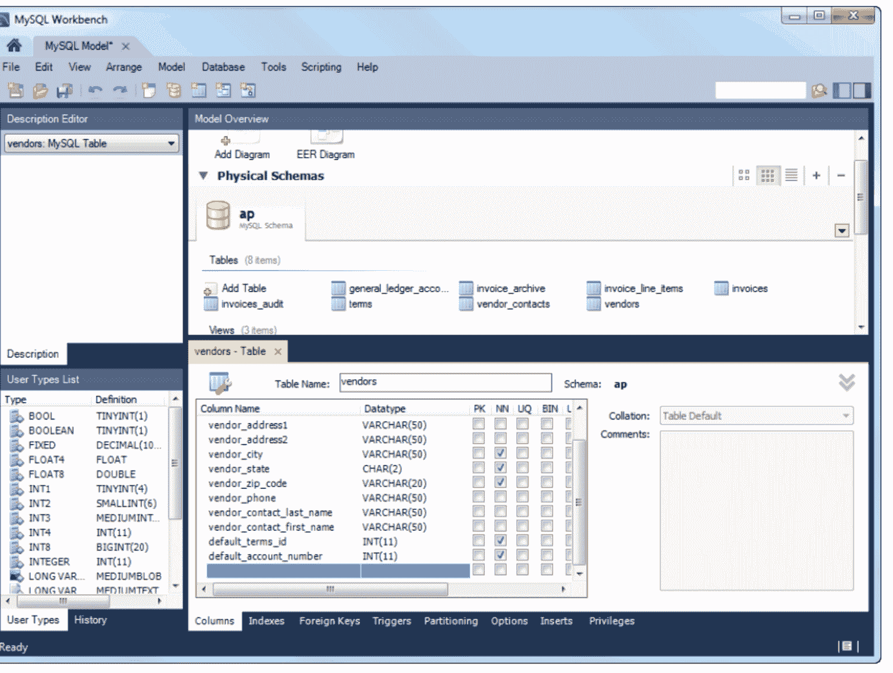

### 描述

- EER 模型是数据库实体（或对象）的表示，包括表、视图和存储程序。
- 要编辑表，双击它。然后，使用窗口底部出现的标签页修改表的列、索引和外键。
- 要添加新表，双击“添加表”（Add Table）图标。然后使用出现的标签页来定义表。
- 要删除表，右键点击它并选择“删除”（Delete）项。
- 操作表的技能也适用于其他数据库对象，如视图和存储程序。
- EER 模型通常包含至少一个名为“EER 图”（EER Diagram）的图形。
- 要打开图形，双击图形名称。
- 要创建新图形，双击“添加图形”（Add Diagram）图标或选择“模型→添加图形”（Model→Add Diagram）项。
- 要从模型导出数据库创建脚本，选择“文件→正向工程 SQL 创建脚本”（File→Forward Engineer SQL Create Script）。

图 10-15 如何操作 EER 模型

## 如何操作 EER 图

当你打开某个模型的图形时，可以双击图形名称。例如，在此图中，AP 数据库的模型包含一个名为“EER 图”（EER Diagram）的图形。对于小型数据库，你可能只需要这样一个图形。但对于较大的数据库，你可能需要创建多个图形来提供对数据库不同部分的视图。要为模型创建新图形，可以双击添加（Add）图标。然后，图形将被命名为如“EER 图 1”、“EER 图 2”等。

在你创建模型时，可以从图形创建 MySQL 数据库创建脚本。要实现这一点，可以选择“文件→导出→正向工程 MySQL 创建脚本”（File→Export→Forward Engineer MySQL Create Script）。然后，你可以通过 MySQL Workbench 运行该脚本来实现你的设计。它将创建与模型对应的数据库。

## AP 数据库的 EER 图

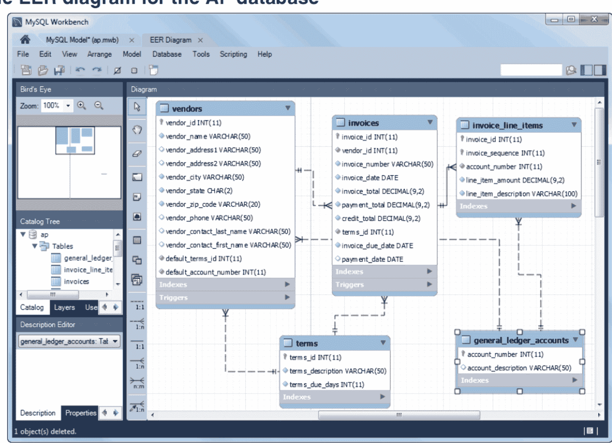

### 描述

EER 图 10-16 显示了如何操作 EER 模型。特别是，它展示了 AP 数据库的 MySQL 标签页。通过此标签页，你可以操作数据库的表。

要编辑其中一张表，可以双击它。此时，MySQL Workbench 会在窗口底部显示一个标签页。在该页内有额外的标签，你可以使用它们来修改表的列、索引和外键。例如，此图显示了供应商（Vendors）表的列（Columns）标签页。从此标签页，你可以修改列的名称、数据类型和其他属性。你也可以通过表格底部输入列信息来添加新列。此外，你还可以修改表的名称。

如果你想向模型添加一个表，可以双击添加（Add）图标。然后，你可以编辑表以设置其名称、列、索引和外键。你将在下一章学习更多关于此的操作。或者，如果你想从模型中删除表，可以右键点击该表并选择“删除”（Delete）项。

由于你通常通过创建数据库表来开始数据库，因此此图侧重于如何操作表。然而，你可以使用类似的技能来操作存储在模型中的其他数据库对象，如视图和存储程序。

由于操作模型的视觉化表示通常更容易，你可以打开与模型对应的图形。正如你将在下一张图中看到的，这可以有助于查看表之间的关系。当你操作图形时，你所做的某些更改会影响相应的模型。因此，你可以将操作图形看作是更视觉化的模型操作方式。

要打开某个模型的图形，可以双击图形名称。例如，在此图中，AP 数据库的模型包含一个名为“EER 图”（EER Diagram）的图形。对于小型数据库，你可能只需要这样一个图形。但对于较大的数据库，你可能需要创建多个图形来提供对数据库不同部分的视图。要为模型创建新图形，可以双击添加（Add）图标。然后，图形将被命名为如“EER 图 1”、“EER 图 2”等。

在你创建模型时，可以从图形创建 MySQL 数据库创建脚本。要实现这一点，可以选择“文件→导出→正向工程 MySQL 创建脚本”（File→Export→Forward Engineer MySQL Create Script）。然后，你可以通过 MySQL Workbench 运行该脚本来实现你的设计。它将创建与模型对应的数据库。

## 视角 (Perspective)

数据库设计是一个复杂的课题。正因如此，不可能在一个章节内教你你所需要的所有知识。不过，通过你在本章中学习的技能，你现在应该能够自己设计简单的数据库了。更重要的是，你现在应该能够评估你所处理的任何数据库的设计。这样，你就可以确保你编写代码的查询是尽可能高效且有效的。

在下一章中，你将学习如何使用 DDL 语句来实现你开发的数据库设计。不过，在阅读该章节时，请记住，你也可以通过从 EER 模型生成 SQL 创建脚本并执行该脚本来实现数据库设计。尽管如此，你仍希望确保自己理解生成脚本中所包含的 DDL 语句。

## 术语 (Terms)

- 数据结构 (data structure)
- 实体 (entity)
- 属性 (attribute)
- 实例 (instance)
- 实体关系 (entity-relationship (ER) modeling)
- 计算机辅助软件工程 (CASE)
- 链接表 (linking table)
- 连接表 (connecting table)
- 关联表 (associate table)
- 引用完整性 (referential integrity)
- 声明式引用完整性 (declarative referential integrity (DRI))
- 外键约束 (foreign key constraint)
- 孤立行 (orphan row)
- 规范化 (normalization)
- 数据冗余 (data redundancy)
- 未规范化数据结构 (unnormalized data structure)
- 规范化数据结构 (normalized data structure)
- 范式 (normal forms)
- 索引 (index)
- 表扫描 (table scan)
- 复合索引 (composite index)
- 衍生数据 (derived data)
- 鲍伊斯-科德范式 (Boyce-Codd normal form)
- 传递依赖 (transitive dependency)
- 多值依赖 (multivalued dependency)
- 域键范式 (domain-key normal form)
- 反规范化 (denormalization)
- 实体关系模型 (entity-relationship (ER) model)
- 增强实体关系模型 (enhanced entity-relationship (EER) model)
- EER 图 (EER diagram)

## 练习 (Exercises)

1. 使用 MySQL Workbench 为存储产品信息的数据库创建一个 EER 图。
   - 每个产品必须有产品名称、描述和价格。
   - 每个产品必须属于一个类别。
   - 每个类别必须有类别名称和描述。
   - 每个类别可以包含多个产品。

2. 使用 MySQL Workbench 为存储客户信息的数据库创建一个 EER 图。
   - 每个客户必须有电子邮箱地址、名和姓。
   - 每个客户可以有两个或多个地址。
   - 每个客户可以有一个默认账单地址和一个默认发货地址。
   - 每个地址必须有街道地址、城市、州、邮政编码和国家。
   - 每个国家名称应只存储在一个地方。换句话说，你不应该地址中存储可能包含多个字符的国家名称。

3. 使用 MySQL Workbench 为一个跟踪协会及协会内小组成员的数据库创建一个 EER 图。
   - 每个成员必须有电子邮箱地址、名和姓。
   - 每个成员可以属于任何数量小组。
   - 每个小组必须有名称。
   - 每个小组可以有任何数量的成员。

## 第 11 章 如何创建数据库、表和索引

现在你已经学习了如何设计数据库，准备好学习如何实现你的设计了。要做到这一点，你需要使用一组被称为数据定义语言（DDL）的 SQL 语句。在本章中，你将学习如何使用 DDL 语句或 MySQL Workbench 来处理数据库、表和索引。此外，如果你需要，你还将学习如何更改字符集、排序规则和存储引擎。

| 内容 | 页码 |
| --- | --- |
| 如何处理数据库 | 314 |
| 如何创建和删除数据库 | 314 |
| 如何选择数据库 | 314 |
| 如何处理表 | 316 |
| 如何创建表 | 316 |
| 如何编写主键约束 | 318 |
| 如何编写外键约束 | 320 |
| 如何修改表的列 | 322 |
| 如何修改表的约束 | 324 |
| 如何重命名、清空和删除表 | 326 |
| 如何处理索引 | 328 |
| 如何创建索引 | 328 |
| 如何删除索引 | 328 |
| 创建数据库的脚本 | 330 |
| 如何使用 MySQL Workbench | 334 |
| 如何处理表的列 | 334 |
| 如何处理表的索引 | 336 |
| 如何处理表的外键 | 338 |
| 如何处理字符集和排序规则 | 340 |
| 字符集和排序规则简介 | 340 |
| 如何查看字符集和排序规则 | 342 |
| 如何指定字符集和排序规则 | 344 |
| 如何处理存储引擎 | 346 |
| 存储引擎简介 | 346 |
| 如何查看存储引擎 | 346 |
| 如何指定存储引擎 | 348 |
| 视角 | 350 |

## 如何处理数据库

在开始创建数据库的表之前，你必须先创建数据库。由于单个 MySQL 服务器上可能运行多个数据库，你通常在开始操作之前先选择数据库。当然，如果你决定不再需要某个数据库，可以将其删除，这会导致该数据库及其所有的表被删除。

如果你正在处理一个大型数据库项目，你可能不需要编写 DDL 语句。

## 如何创建和删除数据库

图 11-1 展示了 `CREATE DATABASE` 语句。第一个示例使用 `CREATE DATABASE` 语句创建一个名为 AP 的数据库。如果已经存在同名的数据库，它将产生错误而不执行。为了防止这种情况，你可以在第二个示例所示，在语句中添加 `IF NOT EXISTS` 关键字。

图中还展示了 `DROP DATABASE` 语句的语法。第三个示例使用该语句删除第一个示例中创建的名为 AP 的数据库。这将永久地删除数据库中的所有内容，因此请谨慎使用！如果指定的数据库不存在，该语句将产生错误。为了防止这种情况，你可以在第四个示例所示，在语句中添加 `IF EXISTS` 关键字。这样该语句仅会在数据库存在时执行。

## 如何选择数据库

图 11-1 还显示了如何使用 `USE` 语句选择数据库。此处的示例使用该语句选择第一个示例中通过 `CREATE DATABASE` 语句创建的数据库。虽然 `USE` 不是标准的 SQL 语句，但它是处理 MySQL 数据库时常用的 MySQL 扩展。

## 如何操作表

本主题展示了如何编写用于操作数据库表的 DDL 语句。由于这些语句的语法非常复杂，本章没有提供这些语句的完整语法图。相反，图表仅展示了常用的子句。不过，如果你对任何语句的完整语法感兴趣，可以参考 MySQL 参考手册。

## 如何创建表

图 11-2 展示了 `CREATE TABLE` 语句的简化语法。默认情况下，该语句会在当前数据库中创建一个新表。如果这不是你想要的，可以使用数据库名对表名进行限定。例如，你可以像这样对 EX 数据库中的 `Vendors` 表进行限定：


# CREATE TABLE 语句的语法

```
CREATE TABLE [db_name].table_name
(
  column_name_1 data_type [column_attributes]
  , column_name_2 data_type [column_attributes]...
  , table_level_constraints
)
```

# 常用列属性

| 属性 | 描述 |
| --- | --- |
| NOT NULL | 表示该列不接受空值。如果省略，该列可以接受空值。 |
| UNIQUE | 指定列中存储的每个值都必须是唯一的。 |
| DEFAULT default_value | 为列指定默认值。 |
| AUTO_INCREMENT | 标识在添加新行时由 MySQL 自动递增的列值。自增列必须定义为整数或浮点数。 |

# 不带列属性的创建表语句

```
CREATE TABLE vendors
(
  vendor_id INT,
  vendor_name VARCHAR(50)
)
```

# 带列属性的创建表语句

```
CREATE TABLE vendors
(
  vendor_id INT NOT NULL UNIQUE AUTO_INCREMENT,
  vendor_name VARCHAR(50) NOT NULL UNIQUE
)
```

# 另一个带列属性的创建表语句

```
CREATE TABLE invoices
(
  invoice_id INT NOT NULL UNIQUE,
  vendor_id INT NOT NULL,
  invoice_number VARCHAR(50) NOT NULL,
  invoice_date DATE NOT NULL,
  invoice_total DECIMAL(9,2) NOT NULL,
  payment_total DECIMAL(9,2) DEFAULT 0
)
```

## 描述

- *为了测试此图及后续图中代码，你可以选择 EX 数据库。*

- `CREATE TABLE` 语句根据你指定的列名、数据类型和属性创建表。此外，它还允许按照本章稍后描述的部分指定某些表级属性和约束。


# 如何编写主键约束

无论你是否意识到，`NULL` 和 `UNIQUE` 关键字都是约束的示例。约束限制了存储在列中的数据类型。例如，`NULL` 关键字防止空值存储在列中，而 `UNIQUE` 关键字只允许唯一值。

定义主键简单的方法是在列的数据类型之后编写 `PRIMARY KEY` 关键字，如第一个示例所示。当你将某列标识为主键时，该列的两个属性会自动发生变化。首先，该列被强制为 `NOT NULL`。其次，该列被强制为 `UNIQUE`。

为了按顺序生成唯一的数字，你使用 `AUTO_INCREMENT` 属性。该属性只能为表中的一列指定，且该列必须被定义为主键或唯一键。当你定义一个带有 `AUTO_INCREMENT` 属性的列时，如果你不指定值，MySQL 会自动为该列生成序列中的下一个数字。默认情况下，MySQL 从 1 开始编号，但你可以通过编写类似 `AUTO_INCREMENT = 3` 的属性从 1 以外的值开始：

```
AUTO_INCREMENT = 3
```

最后，要为列指定默认值，你可以使用 `DEFAULT` 属性。如果在向数据库添加行时没有指定另一个值，则将使用此值。你指定的默认值必须与列的数据类型对应。例如，`payment_total` 列的默认值被设置为 0。

# 如何编写外键约束

图 1–4 显示了如何编写外键约束，外键也称为引用约束。这种约束用于定义表与表之间的关系并强制引用完整性。

在描述外键约束之前，你应该知道，只有当你对表使用 `InnoDB` 存储引擎时，MySQL 才会强制执行这些约束。如果你使用其他引擎（例如 `MyISAM`），你仍然可以编写外键来显示表之间的关系，但 MySQL 不会强制这些关系。你将在本章后面通过操作 MySQL 提供的存储引擎来学习到这些内容。

要在列级上创建外键约束，你需要编写 `REFERENCES` 关键字，后紧跟相关表的名称以及括号中的相关列名。例如，此图中的第一个示例创建了一个包含 `vendor_id` 列的表，该列包含一个 `REFERENCES` 子句，将 `Vendors` 表中的 `vendor_id` 标识为相关列。

第二个示例展示了如何在表级上编写与第一个示例相同的外键约束。当你使用这种语法时，可以包含 `CONSTRAINT` 关键字并后跟一个名称，然后是 `FOREIGN KEY` 关键字。虽然这需要多写一点代码，但这是一种良好的编程习惯。它还允许你引用由多个列组成的外键。

图中的第三个示例显示了当尝试向 `Invoices` 表中插入一行 `vendor_id` 与 `Vendors` 表中 `vendor_id` 列不匹配的行时会发生什么。由于外键约束的存在，系统通过拒绝执行操作来强制引用完整性。它会显示一条指示违反了该约束的错误消息。

同样，如果你尝试从 `Vendors` 表中删除一行在 `Invoices` 表中具有相关行的记录，删除操作将失败，系统将显示错误消息。由于这防止了 `Invoices` 表中的行变成孤立数据，这通常正是你想要的结果。

但在某些情况下，你可能希望在删除 `Vendors` 表中的某行时，自动删除 `Invoices` 表中的相关行。要实现这一点，你可以像第四个示例所示在外键约束上编写 `ON DELETE` 子句。在这里，它是使用 `CASCADE` 操作编写的。然后，当你从主键中删除一行时，该删除操作会级联到外键表中的相关行。例如，如果你从 `Vendors` 表中删除一行，`Invoices` 表中的所有相关行也将被删除。由于级联删除更容易删除你并非意图删除的数据，因此你应该谨慎使用它。

你还可以在 `ON DELETE` 子句上编写 `SET NULL` 选项。那么，当你从主键表删除一行时，外键表中外键列的值将被设置为 `NULL`。由于这会在外键表中创建出与主键表不相关的行，你很少会希望这样做。

# 列级外键约束的语法

```
[CONSTRAINT] REFERENCES table_name (column_name)
[ON DELETE (CASCADE | SET NULL)]
```

# 表级外键约束的语法

```
[CONSTRAINT constraint_name]
FOREIGN KEY (column_name_1, column_name_2...)
REFERENCES table_name (column_name_1, column_name_2...)
[ON DELETE (CASCADE | SET NULL)]
```

# 具有列级外键约束的表

```
CREATE TABLE invoices (
  invoice_id      INT             PRIMARY KEY,
  vendor_id      INT             REFERENCES vendors (vendor_id),
  invoice_number  VARCHAR(50) NOT NULL UNIQUE
)
```

# 具有表级外键约束的表

```
CREATE TABLE invoices (
  invoice_id      INT             PRIMARY KEY,
  vendor_id      INT             NOT NULL,
  invoice_number  VARCHAR(50) NOT NULL UNIQUE,
  CONSTRAINT invoices_fk_vendors
    FOREIGN KEY (vendor_id) REFERENCES vendors (vendor_id)
)
```

# INSERT 语句因为相关行不存在而失败

```
INSERT INTO invoices
VALUES (1, 1, '1')
```

# 系统的响应

```
Error Code: 1452. Cannot add or update a child row: a foreign key
constraint fails ('*.invoices', CONSTRAINT 'invoices_fk_vendors' FOREIGN
KEY ('vendor_id') REFERENCES vendors ('vendor_id'))
```

# 使用 ON DELETE 级联的约束

```
CONSTRAINT invoices_fk_vendors
FOREIGN KEY (vendor_id) REFERENCES vendors (vendor_id)
ON DELETE CASCADE
```

## 描述

- 外键要求一个表中的值匹配另一个表中的值。这定义了两个表之间的关系并强制了引用完整性。
- 要定义由两个或多个列组成的关系，你必须在表级定义该约束。


# 如何修改表的列

在创建表之后，你可能需要更改表的列。例如，你可能需要添加、修改或删除某个列。要实现这一点，你可以使用图 11-5 所示的 `ALTER TABLE` 语句。

图中的第一个示例显示了如何向表中添加新列。首先，你按照创建新表时相同的方式指定列名。然后，你定义数据类型和列属性。


第二个示例显示了如何删除现有列。请注意，MySQL 会阻止你删除现有列。请注意，如果该列是主键，则你无法删除它。

第三个示例显示了如何修改现有列的长度。注意，新的数据类型比旧类型大。

第四个示例显示了如何将数据类型更改为另一种类型。由于这些数据类型存储相同类型的字符。

第五个示例显示了如何更改列的默认值。在这种情况下，`vendor_name` 列被分配了默认值“New Vendor”。

在前五个语句中，MySQL 可以成功地修改表而不会丢失任何数据。然而，如果更改会导致数据丢失，这是不允许的。例如，第六条语句尝试将 `vendor_name` 列的长度更改为不足以容纳现有长度。结果 MySQL 不会修改该列，系统将返回如图所示的错误消息。

# 修改表的语法

```
ALTER TABLE [db_name.]table_name
{
  ADD      column_name data_type [column_attributes] |
  DROP COLUMN column_name |
  MODIFY   column_name data_type [column_attributes]
}
```

# 添加新列的语句

```
ALTER TABLE vendors
ADD last_transaction_date DATE
```

# 删除列的语句

```
ALTER TABLE vendors
DROP COLUMN last_transaction_date
```

# 修改列长度的语句

```
ALTER TABLE vendors
MODIFY vendor_name VARCHAR(100) NOT NULL UNIQUE
```

# 更改数据类型的语句

```
ALTER TABLE vendors
MODIFY vendor_name CHAR(100) NOT NULL UNIQUE
```

# 更改列默认值的语句

```
ALTER TABLE vendors
MODIFY vendor_name VARCHAR(100) NOT NULL DEFAULT 'New Vendor'
```

# 因为会导致数据丢失而失败的语句

```
ALTER TABLE vendors
MODIFY vendor_name VARCHAR(10) NOT NULL UNIQUE
```

## 如何修改表的约束

你可能在创建表后也需要更改表的约束。例如，你可能需要添加或删除某个约束。要实现这一点，你可以使用图 1-6 所示的 `ALTER TABLE` 语句。

第一个示例显示了如何向表添加主键。要做到这一点，你使用 `ADD PRIMARY KEY` 关键字，并在括号中跟随主键列的名称。

第二个示例显示了如何向表添加外键。此示例使用 `FOREIGN KEY` 关键字将 `vendor_id` 列标识为外键，并使用 `REFERENCES` 子句将 `Vendors` 表中的 `vendor_id` 列标识为相关列。此外，此示例还包含了可选的 `CONSTRAINT` 关键字来为外键提供名称，这是一种良好的编程习惯。

第三个示例使用 `DROP PRIMARY KEY` 关键字删除 `Vendors` 表的主键。根据该表以及数据库中其他表的定义方式，如果主键确实是一个自增列，MySQL 可能不允许你删除该主键。由于大多数主键至少被一个外键引用，你通常无法删除主键。

最后一个示例使用 `DROP FOREIGN KEY` 关键字从 `Invoices` 表中删除 `invoices_fk_vendors` 外键。由于一个表可以包含多个外键，你必须知道想要删除的键的名称。如果你不知道它的名称，可以使用本章节稍后所示的 MySQL Workbench 进行查找。

## 修改表约束的语法

```
ALTER TABLE [dbname.]table_name
{
  ADD PRIMARY KEY constraint_definition |
  ADD [CONSTRAINT constraint_name] FOREIGN KEY constraint_definition |
  DROP PRIMARY KEY |
  DROP FOREIGN KEY constraint_name
}
```

## 添加主键约束的语句

```
ALTER TABLE vendors
ADD PRIMARY KEY (vendor_id)
```

## 添加外键约束的语句

```
ALTER TABLE invoices
ADD CONSTRAINT invoices_fk_vendors
FOREIGN KEY (vendor_id) REFERENCES vendors (vendor_id)
```

## 删除主键约束的语句

```
ALTER TABLE vendors
DROP PRIMARY KEY
```

## 删除外键约束的语句

```
ALTER TABLE invoices
DROP FOREIGN KEY invoices_fk_vendors
```

## 描述

- 你可以使用 `ALTER TABLE` 语句来添加或删除现有表的约束。
- 要删除外键约束，你必须知道它的名称。如果你不知道它的名称，可以使用本章节稍后所示的 MySQL Workbench 查找该名称。


## 如何重命名、清空和删除表

图 11-7 显示了如何使用 `RENAME TABLE`、`TRUNCATE TABLE` 和 `DROP TABLE` 语句。在使用这些语句时，请务必小心，特别是当你正在处理生产数据库时。

首先，使用 `RENAME TABLE` 语句来重命名现有表是很有用的，它可以在不修改列定义或表中存储存储的数据的情况下更改表名。例如，在图中，第一个示例将 `Vendors` 表的名称更改为 `Vendor`。如果你重命名了表，可能应该更新任何使用该表名的约束的名称。要做到这一点，你必须先删除该约束再重新添加它。

你可以使用 `TRUNCATE TABLE` 语句删除表中的所有数据，而不删除表的列定义。在图中，第二个示例删除了新重命名的 `Vendors` 表中的所有行。

你可以使用 `DROP TABLE` 语句删除表中的所有数据，并删除表的定义，包括表的约束。在图中，第四个示例明确指定它正在删除存储在 `EX` 数据库（如 AP 数据库）中的 `Vendor` 表。

当你发布 `DROP TABLE` 语句时，MySQL 会检查是否有其他表依赖于你尝试删除的表。如果存在，MySQL 将不允许删除。例如，你不能从 AP 数据库中删除 `Vendors` 表，因为 `Invoices` 表中的外键约束引用了 `Vendors` 表。如果你尝试删除 `Vendors` 表，系统将返回类似第五个示例所示的错误消息。在这种情况下，你必须在删除 `Vendors` 表之前删除 `Invoices` 表。

当你删除一个表时，为该表定义的任何索引或触发器也会被删除。你很快就会学习如何为表创建索引。你将在第 16 章中学习如何为表创建触发器。

## 重命名表的语句

```
RENAME TABLE vendors TO vendor
```

## 删除表中所有数据的语句

```
TRUNCATE TABLE vendor
```

## 从当前数据库中删除表的语句

```
DROP TABLE vendor
```

## 指定要删除表的语句

```
DROP TABLE ex.vendor
```

## 因外键引用导致错误的语句

## 系统的响应

```
Error Code: 1217. Cannot delete or update a parent row: a foreign key constraint fails
```

## 描述

- 你可以使用 `RENAME TABLE` 语句来更改现有表的名称。
- 你可以使用 `TRUNCATE TABLE` 语句删除表中的所有数据，而不删除表的定义。
- 你可以使用 `DROP TABLE` 语句从当前数据库中删除表。
- 要重命名、清空或删除表，你需要知道表名。
- 在重命名、清空或删除表时，你可以通过数据库名来限定该表。
- 如果另一个表的外键引用了该表，你无法创建索引。
- 当你删除表时，该表的唯一约束也会被删除。

## 警告

- 在咨询 DBA 之前，不要在生产环境中使用这些语句。


## 如何使用索引

索引通过提供一种方式，让 MySQL 直接定位到行，而不是搜索所有行。默认情况下，MySQL 会为主键、外键和唯一键创建索引。你可能需要在经常用于连接和搜索的列上创建索引以提高速度。

## 如何创建索引

11-8 展示了 `CREATE INDEX` 语句的基本语法，它根据一个或多个列创建索引。对于每一列，你可以指定 `ASC` 或 `DESC` 关键字来指示索引按升序还是降序排列。如果不指定排序，默认为 `ASC`。此外，你可以使用 `UNIQUE` 关键字指定索引包含唯一值。

在图中的示例中，名称遵循标准的命名约定。索引名称首先指定表名，然后是列名，最后是后缀 `ix`。这种命名约定可以一眼看出表的哪些列建立了索引。如果表名很长，可以在索引名称中进行缩写。

## 如何删除索引

11-8 的最后一个示例显示了如何使用 `DROP INDEX` 语句删除索引。如果你怀疑某个索引没有加速连接和搜索，反而拖慢了插入、更新和删除操作，你可能需要删除它。

# 创建数据库的脚本

图 11-9 展示了用于创建本书贯穿使用的 AP 数据库的 DDL 语句。在图中，这些语句被编码为脚本的一部分。

正如你之前在较早的章节中所学到的一样，脚本是一个包含一个或多个 SQL 语句的文件。脚本通常用于创建数据库对象，如本图所示。当你在编写一个脚本时，请在每个 SQL 语句的末尾使用分号。

该脚本开头的 `DROP DATABASE IF EXISTS` 语句如果数据库已经存在，则会删除整个数据库，包括其所有表。这可以抑制当你尝试删除一个不存在的数据库时可能显示的任何错误信息。然后，`CREATE DATABASE` 语句会创建 AP 数据库。

`USE` 语句选择了 AP 数据库。结果是脚本中的其余语句将针对 AP 数据库执行。

`CREATE TABLE` 语句创建了 AP 数据库的五张主表。对于每条语句，我先编写了主键（或主键列）。虽然这不是强制要求的，但这是一个良好的编程习惯。在主键之后，我按照逻辑顺序编写了其余列。这样，如果你使用 `SELECT *` 语句检索所有列，它们将按逻辑顺序返回。

当你创建表时，必须先创建没有外键的表。这样，其他表才能定义引用这些表的外键。例如在图中，我首先创建了 `General_Ledger_Accounts` 和 `Terms` 表，因为它们没有外键。然后，我编写了 `Vendors` 表，它拥有引用这些表的外键。依此类推。相反，当你删除表时，必须先删除创建的最后一张表。否则，外键可能会不允许你删除这些表。

# 第 11 章 如何创建数据库、表和索引 331

# 创建 AP 数据库的 SQL 脚本 第 1 页

```
-- create the database
DROP DATABASE IF EXISTS ap;
CREATE DATABASE ap;

-- select the database
USE ap;

-- create the tables
CREATE TABLE general_ledger_accounts
(
    account_number INT PRIMARY KEY,
    account_description VARCHAR(50) UNIQUE
);
CREATE TABLE terms (
    terms_id INT PRIMARY KEY,
    terms_description VARCHAR(50) NOT NULL,
    terms_due_days INT NOT NULL
);
CREATE TABLE vendors (
    vendor_id INT PRIMARY KEY AUTO_INCREMENT,
    vendor_name VARCHAR(50) NOT NULL UNIQUE,
    vendor_address1 VARCHAR(50),
    vendor_address2 VARCHAR(50),
    vendor_city VARCHAR(50) NOT NULL,
    vendor_state CHAR(2) NOT NULL,
    vendor_zip_code VARCHAR(20) NOT NULL,
    vendor_phone VARCHAR(50) NOT NULL,
    vendor_contact_last_name VARCHAR(50),
    vendor_contact_first_name VARCHAR(50),
    default_terms_id INT NOT NULL,
    default_account_number INT NOT NULL,
    CONSTRAINT vendors_fk_terms
        FOREIGN KEY (default_terms_id) REFERENCES terms (terms_id),
    CONSTRAINT vendors_fk_account_number
        FOREIGN KEY (default_account_number) REFERENCES general_ledger_accounts (account_number)
);
```

图 11-9 用于创建 AP 数据库的脚本（2/2 部分的第一1）

# 332 第 3 节 数据库设计实现

对于这些表中的列，我编写了 `NOT NULL` 约束或 `DEFAULT` 属性。通常情况下，只有当我想允许未知值时，我才允许某个列接受空值。例如，如果供应商没有提供地址，那么地址就是未知的。在这种情况下，你可以在 `vendor_address1` 和 `vendor_address2` 列中存储空值。

另一个选项为这些列存储空字符串。为了做到这一点，我可以这样定义供应商地址列：

```
vendor_address1 VARCHAR(50) DEFAULT ''
vendor_address2 VARCHAR(50) DEFAULT ''
```

在这种情况下，除非为这些列分配了其他值，否则它们将存储空字符串。

在实践中，空值比默认值更能直观地表示未知值。相反，使用像空字符串这样的默认值来表示该值是已知的但列为空是合理的。例如，空字符串可能表示供应商尚未提供街道地址。虽然使用 `null` 还是空字符串在很大程度上取决于个人喜好，但这确实会影响你查询表的方式。

当是一个单列主键时，我在列级上编写了 `PRIMARY KEY` 约束。


对于这些表中的列，我编写了 `NOT NULL` 约束或 `DEFAULT` 属性。通常情况下，只有当我想允许未知值时，我才允许某个列接受空值。例如，如果供应商没有提供地址，那么地址就是未知的。在这种情况下，你可以在 `vendor_address1` 和 `vendor_address2` 列中存储空值。

另一个选项为这些列存储空字符串。为了做到这一点，我可以这样定义供应商地址列：

```
vendor_address1 VARCHAR(50) DEFAULT ''
vendor_address2 VARCHAR(50) DEFAULT ''
```

在这种情况下，除非为这些列分配了其他值，否则它们将存储空字符串。

在实践中，空值比默认值更能直观地表示未知值。相反，使用像空字符串这样的默认值来表示该值是已知的但列为空是合理的。例如，空字符串可能表示供应商尚未提供街道地址。虽然你使用 `null` 还是空字符串在很大程度上取决于个人喜好，但这确实会影响你查询表的方式。

当是一个单列主键时，我在列级上编写了 `PRIMARY KEY` 约束。同样，使用像空字符串这样的默认值来表示该值是已知的但列为空是合理的。例如，空字符串可能表示供应商尚未提供街道地址。虽然你使用 `null` 还是空字符串在很大程度上取决于个人喜好，但这确实会影响你查询表的方式。

# 创建 AP 数据库的 SQL 脚本 第 2 页

```
-- create the database
DROP DATABASE IF EXISTS ap;
CREATE DATABASE ap;

-- select the database
USE ap;

-- create the tables
CREATE TABLE general_ledger_accounts
(
    account_number INT PRIMARY KEY,
    account_description VARCHAR(50) UNIQUE
);
CREATE TABLE terms (
    terms_id INT PRIMARY KEY,
    terms_description VARCHAR(50) NOT NULL,
    terms_due_days INT NOT NULL
);
CREATE TABLE vendors (
    vendor_id INT PRIMARY KEY AUTO_INCREMENT,
    vendor_name VARCHAR(50) NOT NULL UNIQUE,
    vendor_address1 VARCHAR(50),
    vendor_address2 VARCHAR(50),
    vendor_city VARCHAR(50) NOT NULL,
    vendor_state CHAR(2) NOT NULL,
    vendor_zip_code VARCHAR(20) NOT NULL,
    vendor_phone VARCHAR(50) NOT NULL,
    vendor_contact_last_name VARCHAR(50),
    vendor_contact_first_name VARCHAR(50),
    default_terms_id INT NOT NULL,
    default_account_number INT NOT NULL,
    CONSTRAINT vendors_fk_terms
        FOREIGN KEY (default_terms_id) REFERENCES terms (terms_id),
    CONSTRAINT vendors_fk_account_number
        FOREIGN KEY (default_account_number) REFERENCES general_ledger_accounts (account_number)
);


-- create an index
CREATE INDEX invoices_date_ix ON invoices (invoice_date);
```

图 11-9 用于创建 AP 数据库的脚本（2/2 部分）

# 第11章 如何创建数据库、表和索引 335

## Invoices 表的列定义

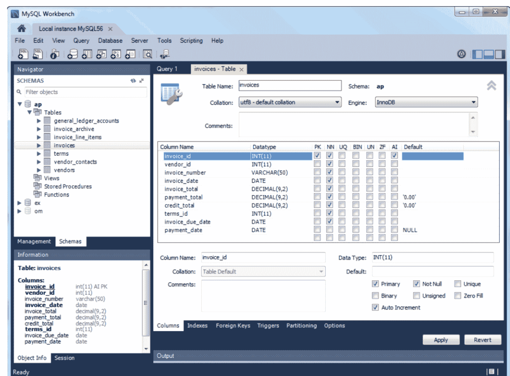

## 描述

- 要查看表的列，在 Navigator（导航器）窗口中右键点击该表，选择 Alter Table（修改表）项，并点击 Columns（列）选项卡。
- 要重命名列，双击列名并输入新名称。
- 要更改列的数据类型，点击 Datatype（数据类型）列中的数据类型，并从显示的下拉列表中选择一种数据类型。
- 要更改列的默认值，在 Default（默认）列中输入新的默认值。
- 要更改列的其他属性，勾选或取消勾选列右侧的属性复选框。
- 要删除列，右键点击列名并选择 Delete Selected（删除选中项）项。
- 要将列向上或向下移动，右键点击列名，并使用键盘上的 Move Up（上移）或 Move Down（下移）键。
- 要添加新列，在最后一列下方的 Column Name（列名）列中双击并输入新。然后为新列指定属性。
- 要将更改应用到表，点击 Apply（应用）按钮。要撤销更改，点击 Revert（还原）按钮。

图 11-10 如何处理表的列

## 如何处理表的索引

虽然 MySQL Workbench 提供了多种处理索引的方法，但最简单的方法之一是在 Navigator 窗口中右键点击表，选择 Alter Table（修改表）命令显示表定义。然后，你可以点击 Indexes（索引）选项卡显示表的索引。例如，图 11-11 显示了 Invoices 表的索引。

在大多数情况下，你会使用此选项卡为表添加索引。要执行此操作，首先双击最后一个索引名称下方，然后输入新索引的名称。接着，你可以选择想要创建的索引类型、想要索引的列或列，以及每个列的顺序。要更改或删除索引，可以使用图中所示的技巧。

## Indexes 表的索引

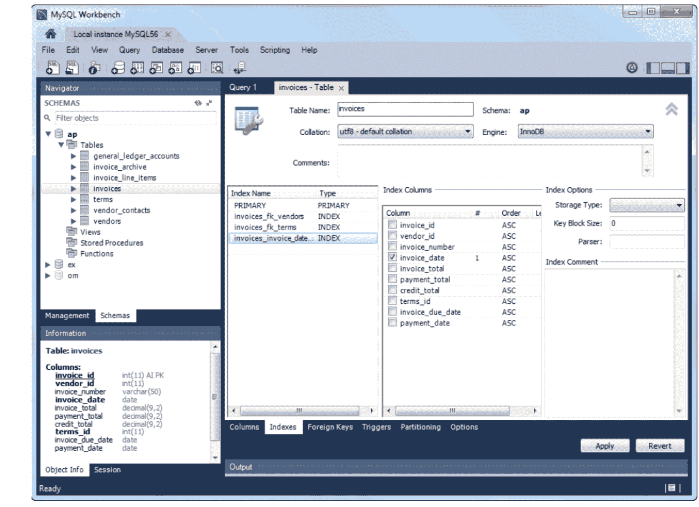

## 描述

- 要查看表的索引，在 Navigator 窗口中右键点击该表，选择 Alter Table（修改表）项，并点击 Indexes（索引）选项卡。
- 要重命名索引，双击名称并输入新名称。
- 要更改索引类型，点击 Column type（列类型）。然后从出现的下拉列表中选择一种类型。
- 要更改被索引的列，选择该索引并在出现的列列表中选择其列。你也可以通过点击 Order（顺序）列并从出现的下拉列表中选择 ASC（升序）或 DESC（降序）来更改索引的排序。
- 要删除索引，右键点击索引名称并选择 Delete Selected（删除选中项）项。
- 要添加新索引，双击最后一个索引名称下方并输入新名称。然后为索引指定类型、列和顺序。
- 要将更改应用到表，点击 Apply（应用）按钮。要撤销更改，点击 Revert（还原）按钮。

图 11-11 如何处理表的索引

## 如何处理表的外键

要处理表的外键，使用 Foreign Keys（外键）选项卡。例如，图 11-12 显示了 Invoices 表的外键，并选中了名为 `invoices_fk_terms` 的外键。在这里，MySQL Workbench 显示了被外键引用的表、外键列以及被外键引用的列。如果需要，你可以按照图中所示更改定义外键的任何信息。你还可以添加新的外键，并删除现有的键。

## Invoices 表的外键

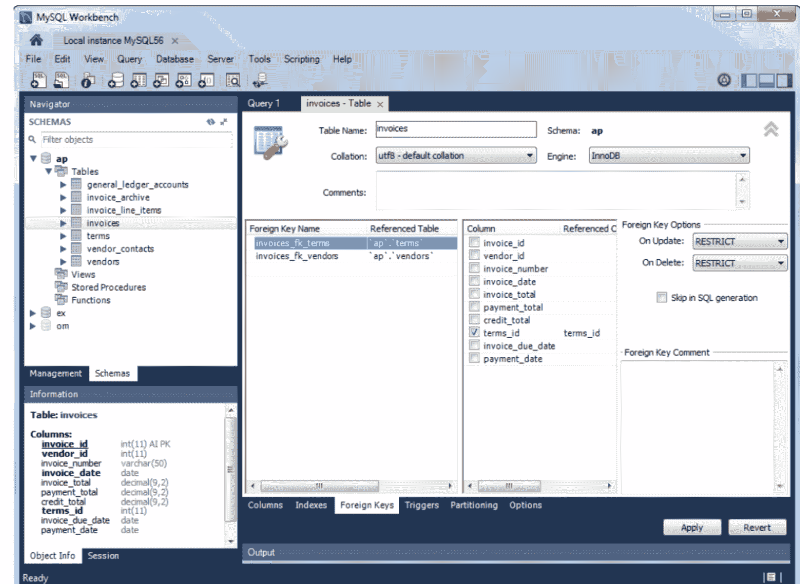

## 描述

- 要查看表的外键窗口，选择 Alter table（修改表）项，并点击 Foreign Keys（外键）选项卡。
- 要重命名外键，双击名称并输入新名称。
- 要更改引用的表，点击 Referenced Table（被引用表）列中的表名，从出现的下拉列表中选择一个表。
- 要更改外键的列或被引用列，选择该外键，然后在出现的列表中选择相应的列或被引用列。
- 要删除外键，右键点击它并选择 Delete（删除）项。
- 要添加新外键，双击最后一个外键名称下方并输入新名称。然后指定被引用表、外键列和被引用列。
- 要将更改应用到表，点击 Apply（应用）按钮。要撤销更改，点击 Revert（还原）按钮。

图 11-12 如何处理表的外键

## 如何处理字符集和排序规则

到目前为止，本书假设你正在使用 MySQL 服务器的默认字符集（character set）和排序规则（collation）。在本主题中，你将学习更多关于字符集和排序规则，以及为什么你可能想要使用与默认不同的字符集或排序规则。然后，你将学习如何为数据库、表甚至列指定字符集和排序规则。

### 字符集和排序规则简介

当列定义为 CHAR 或 VARCHAR 等字符串类型时，MySQL 会为每个字符存储一个数值。然后，它使用字符集将这些数值映射到字符串的字符。

图 11-13 首先展示了 MySQL 常用的两种字符集。首先，介绍了 MySQL 5.5 及更早版本的默认字符集：latin1 字符集。该字符集每个字符使用一个字节，以为西欧语言提供更多字符。然而，如果你需要存储其他字符，可以使用 MySQL 5.6 及更后版本的默认字符集：utf8 字符集。

utf8 字符集的优势是它可以表示更广泛的字符范围。latin1 字符集局限于西欧语言。如果你在为全球用户构建应用程序，可能应该使用 utf8。

排序规则（collation）是一组决定如何比较和排序文本字符串的规则。例如，某些排序规则决定 'a' 和 'A' 是否视为相同字符，而另一些则决定 'a' 和 'á' 是否被视为相同。

latin1 字符集的默认排序规则是 `latin1_swedish_ci`。utf8 字符集的默认排序规则是 `utf8_general_ci`。你可以根据特定需求更改数据库、表或列的排序规则。

## 如何查看字符集和排序规则

图 11-14 首先展示了如何查看 MySQL 服务器上所有可用的字符集。要做到这一点，你可以像第一个示例所示使用 `SHOW CHARSET` 语句。该语句的执行结果显示，`SHOW CHARSET` 除了显示名称外，还会显示每个字符集的信息。

你也可以使用 `SHOW CHARSET` 语句查看单个字符集的信息。要做到这一点，你可以使用 `LIKE` 子句来识别字符集，如第二个示例所示。

此图还展示了如何使用 `SHOW COLLATION` 语句查看有关排序规则的信息。例如，图中的第三个示例显示了如何查看当前服务器上所有可用排序规则的信息。在该语句返回的结果集中，你可以看到 `latin1` 字符集的排序规则，以及 `latin2` 字符集的某些排序规则。

如果你只想查看特定字符集的排序规则，可以使用带有 `%` 通配符的 `LIKE` 子句。例如，图中的第二个 `SHOW COLLATION` 语句显示了 `latin1` 字符集的排序规则。

图中的接下来的四个示例展示了如何使用 `SHOW VARIABLES` 语句查看你当前服务器或数据库的默认字符集和排序规则。在这些示例中，使用 `LIKE` 子句来指定变量名。例如，要查看服务器的默认字符集，使用 `character_set_server` 变量。

你还可以查看数据库中所有表的字符集和排序规则。要做到这一点，你可以如最后一个示例所示查询名为 `Information_Schema` 的表。在这里，`SELECT` 语句返回 `ap` 数据库中每个表的名称和排序规则。由于排序规则的名称也标识了字符集，因此这指示了每个表的字符集。

### 如何查看服务器所有可用的字符集

```
SHOW CHARSET
```

| Charset | 描述 | 默认排序规则 | 最大长度 |
| :--- | :--- | :--- | :--- |
| latin1 | cp1252 西欧 | latin1_swedish_ci | 1 |
| latin2 | ISO-859-2 中欧 | latin2_general_ci | 1 |
| sw7 | 7bit 瑞典 | sw7_swedish_ci | 1 |
| ascii | 美国 ASCII | ascii_ci | 1 |
| utf8 | EUC-JP 日语 | utf8_japanese_ci | 3 |

### 如何查看特定的字符集

```
SHOW CHARACTER LIKE 'latin1'
```

### 如何查看服务器所有可用的排序规则

```
SHOW COLLATION
```

| 排序规则 | 字符集 | ID | 默认 | 已编译 | 排序长度 |
| :--- | :--- | :--- | :--- | :--- | :--- |
| latin1_swedish_ci | latin1 | 8 | Yes | Yes | 1 |
| latin1_danish_ci | latin1 | 15 | Yes | Yes | 1 |
| latin1_german_ci | latin1 | 31 | Yes | Yes | 2 |
| latin1_bin | latin1 | 47 | Yes | Yes | 1 |
| latin1_general_ci | latin1 | 48 | Yes | Yes | 1 |
| latin1_general_cs | latin1 | 49 | Yes | Yes | 1 |
| latin1_spanish_ci | latin1 | 94 | Yes | Yes | 1 |
| latin2_czech_ci | latin2 | 2 | Yes | Yes | 4 |
| latin2_general_ci | latin2 | 9 | Yes | Yes | 1 |

### 如何查看特定字符集的所有排序规则

```
SHOW COLLATION LIKE 'latin1'
```

### 如何查看服务器的默认字符集

```
SHOW VARIABLES LIKE 'character_set_server'
```

### 如何查看服务器的默认排序规则

```
SHOW VARIABLES LIKE 'collation_server'
```

### 如何查看数据库的默认字符集

```
SHOW VARIABLES LIKE 'character_set_database'
```

### 如何查看数据库的默认排序规则

```
SHOW VARIABLES LIKE 'collation_database'
```

### 如何查看数据库中所有表的字符集和排序规则

```
SELECT table_name, table_collation
FROM information_schema.tables
WHERE table_schema = 'ap'
```

| table_name | table_collation |
| :--- | :--- |
| invoice_line_items | utf8_general_ci |
| invoices | utf8_general_ci |
| terms | utf8_general_ci |

### 如何指定字符集和排序规则

图 11-15 显示了如何在数据库、表和列三个级别指定字符集和排序规则。在大多数情况下，你可能希望在数据库级别指定字符集和排序规则，如第一组示例所示。这样，所有存储字符串数据的表中的列都将使用该字符集和排序规则进行定义。不过，如果有需要，你也可以如第二组和第三组示例所示，在表或列级别设置字符集和排序规则。

要指定字符集或排序规则，可以使用 `CHARSET` 和 `COLLATE` 子句。对于新的数据库或表，你可以将这些子句添加到数据库或表的 `CREATE` 语句中。对于现有的数据库或表，你可以将这些子句添加到数据库或表的 `ALTER` 语句中。

图中的大多数示例都同时使用了 `CHARSET` 和 `COLLATE` 子句。这清楚地显示了正在指定的字符集和排序规则。然而，在大多数情况下，你只需要使用其中之一。这是因为每个字符集都有一个默认排序规则，而每个排序规则都有一个对应的字符集。因此，如果你省略了 `COLLATE` 子句，MySQL 将使用指定字符集的默认排序规则。如果你省略了 `CHARSET` 子句，MySQL 将使用与指定排序规则对应的字符集，你可以通过在不带 `CHARSET` 子句的情况下编写 `COLLATE` 子句来实现。

你也可以使用 MySQL Workbench 来更改表或列的字符集和排序规则。要做到这一点，使用图 11-10 中看到的 `Columns` 标签页。要更改表的字符集和排序规则，使用标签页顶部的 `Collation` 下拉列表。要更改列的字符集和排序规则，选择该列，然后使用列列表方的 `Collation` 下拉列表。

### 指定字符集和排序规则的子句

`[CHARSET character_set] [COLLATE collation]`

### 如何在数据库级别指定字符集和排序规则

对于新数据库

`CREATE DATABASE ar CHARSET latin1 COLLATE latin1_swedish_ci`

对于现有数据库

`ALTER DATABASE ar CHARSET utf8 COLLATE utf8_general_ci`

对于仅使用 `CHARSET` 子句的现有数据库

`ALTER DATABASE ar CHARSET utf8`

对于仅使用 `COLLATE` 子句的现有数据库

`ALTER DATABASE ar COLLATE utf8_general_ci`

### 如何在表级别指定字符集和排序规则

对于新表

```
CREATE TABLE employees (
emp_id INT PRIMARY KEY,
emp_name VARCHAR(25)
CHARSET latin1 COLLATE latin1_swedish_ci)
```

对于现有表


`ALTER TABLE employees CHARSET utf8 COLLATE utf8_general_ci`

### 如何在列级别指定字符集和排序规则

#### 对于新表中的列

```
CREATE TABLE employees (
  emp_id INT PRIMARY KEY,
  emp_name VARCHAR(25)
  CHARSET latin1 COLLATE latin1_swedish_ci
)
```

#### 对于现有表中的列

`ALTER TABLE employees MODIFY emp_name VARCHAR(25) CHARSET utf8 COLLATE utf8_general_ci`

## 描述

- 你可以使用 `CHARSET` 和 `COLLATE` 子句在数据库、表或列级别设置字符集和排序规则。
- 如果省略了 `CHARSET` 子句，MySQL 将使用与指定排序规则对应的字符集。
- 如果省略了 `COLLATE` 子句，MySQL 将使用指定字符集的默认排序规则。
- `CHARACTER SET` 关键字是 `CHARSET` 的同义词。


## 使用存储引擎

存储引擎决定了 MySQL 如何存储数据以及你可以使用的数据库功能。与许多数据库不同，MySQL 提供了多种可选存储引擎，每个引擎的功能略有不同。

### 存储引擎简介

图 11-16 首先介绍了两种常用的存储引擎：InnoDB 和 MyISAM。`InnoDB` 引擎是 MySQL 5.5 的默认引擎。因此，如果你按照本书附录 A 或 B 安装了软件，你一直在使用 `InnoDB` 引擎。该引擎支持前文提到的外键。此外，它还支持事务（见第 14 章）。

在 MySQL 5.5 之前，`MyISAM` 引擎是默认引擎。因此，如果你在使用较旧版本的 MySQL，请使用 `MyISAM` 引擎。它支持一些 `InnoDB` 不支持的功能，包括全文检索和空间数据类型。然而，`MyISAM` 引擎不支持外键，这是维护引用完整性的重要功能。

### 两种常用的存储引擎

| 名称 | 描述 |
|---|---|
| InnoDB | MySQL 5.5 及更高版本的默认存储引擎。该引擎支持外键和事务。 |
| MyISAM | MySQL 5.5 之前的默认存储引擎。该引擎支持全文检索和空间数据类型。 |

### 如何查看服务器的所有存储引擎

```
SHOW ENGINES
```

| 引擎 | 支持 | 注释 | 事务 | XA | 保存点 |
|---|---|---|---|---|---|
| FEDERATED | NO | 联邦 MySQL 存储引擎 | FULL | FULL | FULL |
| MRG_MyISAM | YES | 相同 MyISAM 表集合 | NO | NO | NO |
| MyISAM | | MyISAM 存储引擎 | NO | NO | NO |
| BLACKHOLE | | /dev/null 引擎（写入其中的内容... | NO | NO | NO |
| CSV | | CSV 存储引擎 | NO | NO | NO |
| MEMORY | YES | 存储在内存中的哈希表，用于临时... | NO | NO | NO |
| ARCHIVE | YES | 归档引擎 | NO | NO | NO |
| InnoDB | DEFAULT | 支持事务、行级锁和外... | YES | YES | YES |
| PERFORMANCE_SCHEMA | YES | 性能体系 | NO | NO | NO |

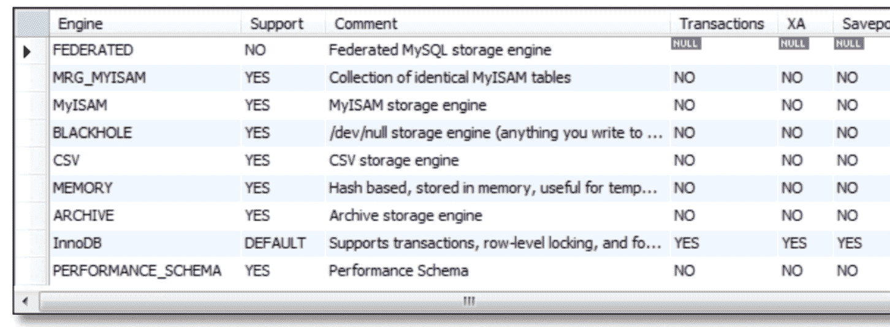

### 如何查看服务器的默认存储引擎

```
SHOW VARIABLES LIKE 'storage_engine'
```

### 如何查看数据库中所有表的存储引擎

```
SELECT table_name, engine
FROM information_schema.tables
WHERE table_schema = 'ap'
```

| table_name | engine |
|---|---|
| invoice_line_items | InnoDB |
| invoices | InnoDB |
| terms | InnoDB |

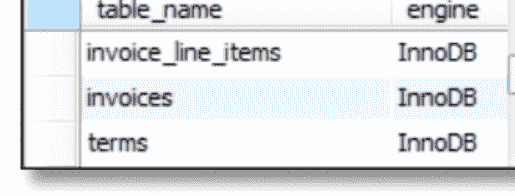

## 描述

- 存储引擎决定了 MySQL 如何存储数据，以及你可以使用哪些数据库功能。
- 你可以在同一台服务器的同一个数据库中使用多个存储引擎。

### 如何指定存储引擎

如果你在创建表时没有指定存储引擎，MySQL 将使用服务器的默认存储引擎。然而，如果默认存储引擎没有提供你需要的功能，你可以使用 `ENGINE` 子句来更改所创建的表的存储引擎。例如，假设你想创建一个可以利用 `MyISAM` 存储引擎提供的全文检索功能的表。要实现这一点，你可以编写一个如图 11–17 中第一个示例所示使用 `ENGINE` 子句的 `CREATE TABLE` 语句。

你也可以在 `ALTER TABLE` 语句中使用 `ENGINE` 子句来更改现有表的存储引擎，如第二个示例所示。你可能想对使用 `MyISAM` 存储引擎的旧表进行操作，以便利用 `InnoDB` 存储引擎提供的外键功能。当你更改现有表的存储引擎时，应该知道 MySQL 可能需要花费大量时间来重建表。此外，在此期间无法访问该表。因此，除非你准备好在 MySQL 重建表时停止所有应用程序访问该数据库，否则你不应尝试更改生产数据库的存储引擎。

你可以从 MySQL Workbench 更改表的存储引擎。要这样做，你需要使用图 11–10 所示的 Columns（列）选项卡。然后，使用 Engine（引擎）下拉列表选择一种存储引擎。

如果你发现自己经常使用与服务器默认引擎不同的存储引擎，可以更改当前会话的默认存储引擎。要这样做，你可以编写 `SET SESSION` 语句为当前会话设置 `storage_engine` 变量。由于这只更改了当前会话的存储引擎，你可能希望永久更改存储引擎。尽管如此，你需要如第 17 章所示修改服务器的配置文件。

### 用于指定存储引擎的子句

`ENGINE = engine_name`

### 如何为表指定存储引擎

#### 对于新表

```
CREATE TABLE product_descriptions (
  product_id          INT         PRIMARY KEY,
  product_description VARCHAR(200)
) ENGINE = MyISAM
```

#### 对于现有表

```
ALTER TABLE product_storage engine ENGINE = InnoDB
```

### 如何为当前会话设置默认存储引擎

```
SET SESSION storage_engine = InnoDB
```

## 描述

- 要为表指定存储引擎，可以使用 `ENGINE` 子句。
- 要更改当前会话的默认存储引擎，可以使用 `SET SESSION` 语句为当前会话设置 `storage_engine` 变量。
- 要永久更改服务器的默认存储引擎，可以修改服务器的配置文件。有关如何执行此操作的更多信息，请参见第 17 章。


## 观点

现在你完成了本章，你应该能够通过编写 DDL 语句创建和修改数据库的表。此外，你应该能够使用 MySQL Workbench 等图形化工具处理数据库的表。

在继续之前，请花一点考虑使用 MySQL Workbench 处理对象的优缺点。优点是 MySQL Workbench 提供了一个图形用户界面，易于查看和操作数据库。缺点是它不会记录你对数据库进行的任何更改。相反，如果你使用脚本为表添加列，这些更改将被记录。此外，MySQL Workbench 是快速查看数据库对象或创建临时表的优秀工具。

## 术语

- 属性
- 约束
- 列级约束
- 表级约束
- 非空约束
- 唯一约束
- 主键约束
- 外键约束
- 引用约束
- 级联删除
- 索引
- 脚本
- 字符集
- 排序
- 存储引擎

## 练习

1. 编写一个脚本，为 AP 数据库表的邮编字段添加索引。
2. 编写一个脚本，包含实现 EX 数据库设计所需的 `CREATE TABLE` 语句：

| members | members_groups | groups |
|---|---|---|
| member_id | member_id | group_id |
| first_name | group_id | group_name |
| last_name | | |
| address | | |
| city | | |
| phone | | |

这些表提供了成员关系，每个成员可以注册到一个或多个组。

`member_id` 和 `group_id` 列是 Members 和 Groups 表的主键，这些列也是 Members_Groups 表中的外键。

包含你认为必要的任何约束或默认值。包含如果表已存在则删除表的语句。

3. 编写 `INSERT` 语句，为第 2 题创建的表添加行。

为 Members 表添加前两个成员行。

为 Groups 表添加前两个组 ID 的行。

为 Group_Membership 表添加三行：成员 1 和组 2 的行；成员 2 和组 1 的行；以及成员 2 和组 2 的行。

编写 `SELECT` 语句，连接这些表并检索组名、姓和成员名。按组名、姓和成员首名对结果进行排序。

4. 编写一个 `ALTER TABLE` 语句，为第 2 题创建的 Members 表添加两个新列。

添加一个名为 annual days（年数）的列，小数点左侧和右侧均为三位数。该列的默认值为 52.50。

添加一个支付日期的列。

5. 编写一个 `ALTER TABLE` 语句，修改第 2 题创建的 Groups 表，使每行的组名变为唯一。然后，使用 `INSERT` 语句尝试插入重复名称。该语句应由于唯一约束而失败。

# 12

## 如何创建视图

正如你在整本书中所看到的，`SELECT` 查询可能会非常复杂，特别是当它们使用多个连接（joins）、子查询或复杂的函数时。因此，你可能想要存储经常使用的查询。实现这一目标的方法是将语句存储在脚本中。另一种方法是创建一个视图。

与存储在文件中脚本不同，视图存储为数据库的一部分。因此，SQL 程序员和能够访问数据库的自定义应用程序都可以使用它们。这比直接使用表具有一些优势。

- 视图简介
- 视图的工作原理
- 使用视图的好处
- 如何使用视图
- 如何创建视图
- 如何创建可更新视图
- 如何使用 WITH CHECK OPTION 子句
- 如何通过视图插入或删除行
- 如何修改或删除视图
- 观点

### 视图简介

在学习操作视图的细节之前，对视图的工作原理有一个大致的概念会有帮助。此外，考虑视图的一些好处也很有帮助，这样你就可以决定是否想要使用它们。

### 视图的工作原理

视图是一个存储在数据库中的数据库对象的 `SELECT` 语句。要创建视图，你使用 `CREATE VIEW` 语句，如图 12-1 所示。该语句创建了一个新的 `Vendors_Min`，它从 `Vendors` 表中检索了 `vendor_name`、`vendor_state` 和 `vendor_column` 列。

你可以将视图认为是一个虚拟表，它仅由 `CREATE VIEW` 语句中指定的行和列组成。`FROM` 子句中列出的表或表是视图的基表。由于视图引用了基表，它本身不存储任何数据，并且始终反映基表中的当前数据。

要使用视图，你可以在另一个 SQL 语句中引用它。例如，在图中，`SELECT` 语句在 `FROM` 子句中使用 `Vendors_Min` 视图而不是表。因此，`SELECT` 语句从视图所代表的虚拟表中提取结果。在这种情况下，加利福尼亚州所有供应商都是从视图检索的。

当你像图中这样创建一个视图时，该视图是可更新的。因此，可以在 `INSERT`、`UPDATE` 或 `DELETE` 语句中使用该视图。例如，图中 `UPDATE` 语句使用 `Vendors_Min` 视图来更新 `Vendors` 表中指定供应商的 `vendor_phone` 列。

要删除视图，你可以使用如图所示的 `DROP VIEW` 语句。这与你在上一节中学过的用于表和索引的 `DROP` 语句工作类似。

由于视图作为对象存储在数据库中，因此任何具有相应权限的人都可以使用它。这可能包括通过提供即时查询和报告生成的应用程序访问数据库的用户。此外，这可能包括专门编写用于与数据库中的数据交互的自定义应用程序。事实上，视图通常设计用于与此类应用程序配合使用。

#### 名为 Vendors_Min 视图的 CREATE VIEW 语句

```
CREATE VIEW vendors_min As
SELECT vendor_name, vendor_state, vendor_phone
FROM vendors
```

#### 视图所代表的虚拟表

| vendor_name | vendor_state | vendor_phone |
|---|---|---|
| US Postal Service | WI | (800) 555-1205 |
| National Information Data Data | DC | (301) 555-8958 |
| Register of Copies | DC | NULL |
| Jobrak | CA | (800) 555-8725 |
| Newridge Book Clubs | NJ | (800) 555-9980 |

(122 行)

#### 使用 Vendors_Min 视图的 SELECT 语句

```
SELECT * FROM vendors_min
WHERE vendor_state = 'CA'
ORDER BY vendor_name
```

#### SELECT 语句返回的结果

| vendor_name | vendor_state | vendor_phone |
|---|---|---|
| Abbey Office Furnings | CA | (559) 555-8300 |
| American Express | CA | (800) 555-3344 |
| ASC Signs | CA | NULL |
| Aztek Label | CA | (714) 555-9000 |
| Bertelsmann Industry Svcs. Inc | CA | (805) 555-0584 |
| BFI Industries | CA | (539) 555-1551 |

(75 行)

#### 使用视图更新基表的 UPDATE 语句

```
UPDATE vendors_min
SET vendor_phone = '(800) 555-3941'
WHERE vendor_name = 'Register of Copies'
```

#### 删除视图的语句

```
DROP VIEW vendors_min
```

## 描述

- 视图由一个 `SELECT` 语句组成，该语句作为对象存储在数据库中。`SELECT` 语句中引用的表称为视图的基表。
- 当你创建视图时，可以在 `SELECT`、`UPDATE` 或 `DELETE` 语句中使用它。
- 尽管视图像一个表，但它本身不存储任何数据，它始终引用基表。
- 视图也可以用于访问基表。


### 使用视图的好处

图 12-2 描述了使用视图的一些优势。首先，你可以使用视图来限制对外部用户和应用程序的暴露。例如，假设你将一个表拆分为两个表。为了适应这种变化，你只需修改视图。这意味着查询视图的用户不需要感知变化，使用视图的应用程序也不需要修改。


你还可以使用视图来限制对数据库的访问。这样做，你需要用户或应用程序通过视图访问数据。例如，假设你有一个包含每个员工工资信息的 `Employees` 表。在这种情况下，你可以创建一个不包含工资列的视图，但对于需要工资的用户创建另一个视图。

此外，你可以使用视图来隐藏查询语句的复杂性。例如，如果你有一个连接多个表的复杂 `SELECT` 语句，可以为其创建一个视图。这让你和其他数据库用户处理这些数据变得更容易。

最后，当你创建视图时，可以允许通过视图更新基表数据。这样做，你需要使用 `INSERT`、`UPDATE` 或 `DELETE` 语句来操作视图。

## 视图提供的一些益处

| 好处 | 描述 |
| --- | --- |
| 设计独立 | 视图可以限制外部用户和应用程序对表的访问。因此，当设计发生变化时，你可以根据需要修改视图，以便查询视图的用户不需要感知变化，使用视图的应用程序也不需要修改。 |
| 数据安全 | 视图可以通过 `SELECT` 子句仅包含表的某些列，或通过 `WHERE` 子句仅包含表的某些行，来限制对表中数据的访问。 |
| 简化查询 | 视图可以用于隐藏检索操作的复杂性。然后，可以使用指定视图的简单 `SELECT` 语句来重取数据。 |
| 可更新性 | 在某些限制下，视图可用于更新、插入和删除基表数据。 |

## 描述

- 你可以基于几乎任何 `SELECT` 语句创建视图。这意味着你可以编写连接表、汇总数据以及使用子查询和函数的视图。

# 如何使用视图

现在，你已经对视图的工作原理以及它们提供的优势有了通用的理解，准备好学习操作视图的细节了。

# 如何创建视图

图 12-3 展示了用于创建视图的 `CREATE VIEW` 语句。在最简单的情况下，你编写 `CREATE VIEW` 关键字，后面跟视图名称，然后是 `AS` 关键字和定义视图的 `SELECT` 语句。例如，图中第一条语句创建了一个名为 `Vendors_Phone_List` 的视图。该视图包含了 `Vendors` 表中所有具有发票的供应商的四列。

如果你执行第一个 `CREATE VIEW` 语句，且当前数据库中不存在同名的视图，MySQL 会添加该视图并显示一条消息表示语句执行成功。然而，如果已经存在同名的视图，MySQL 将不会添加该视图，并显示一条指示名称已使用的消息。在这种情况下，你需要为视图指定一个新名称，或者删除掉已经使用该名称的视图。

在编写 `CREATE VIEW` 语句时，你可以指定自动删除与你正在创建的视图同名的视图。要做到这一点，你可以在 `CREATE` 关键字之后指定 `OR REPLACE` 关键字，如图图中除第一个示例外的所有示例所示。

用于视图的 `SELECT` 语句可以使用普通 `SELECT` 语句的大多数功能。例如，图中第二个示例创建了一个连接两个表数据的视图。同样地，第三条语句创建了一个使用 `LIMIT` 子句的视图。

默认情况下，视图中的列被赋予与基表中的列相同的名称。然而，如果视图包含一个计算列，你可能希望像在其他 `SELECT` 语句中那样为该列命名。此外，你还需要重命名来自不同表但同名的列。要做到这一点，你可以像第四个示例所示，在 `CREATE VIEW` 子句中编写列名。或者，你可以像第五个示例所示，在 `SELECT` 语句中使用 `AS` 子句。

注意，如果你使用第四个示例所示的技术，你必须为所有列分配名称。相比之下，如果你使用第五个示例所示的技术，你只需要为需要重命名的列分配名称。因此，你通常会希望使用第五个示例所示的技术。

# CREATE VIEW 语句的语法

```sql
CREATE [OR REPLACE] VIEW view_name
  [(column_alias_1[, column_alias_2...)]
AS
  select_statement
  [WITH CHECK OPTION] [CONSTRAINT constraint_name]]
```

# 具有发票的供应商视图

```sql
CREATE VIEW vendors_phone_list AS
SELECT vendor_name, vendor_contact_last_name,
  vendor_contact_first_name, vendor_phone
FROM vendors
WHERE vendor_id IN (SELECT DISTINCT vendor_id FROM invoices)
```

# 使用连接的视图

```sql
CREATE OR REPLACE VIEW vendor_invoices AS
SELECT vendor_name, invoice_number, invoice_date, invoice_total
FROM vendors
  JOIN invoices ON vendors.vendor_id = invoices.vendor_id
```

# 使用 LIMIT 子句的视图

```sql
CREATE OR REPLACE VIEW top5_invoices_totals AS
SELECT vendor_id, invoice_total
FROM invoices
  ORDER BY invoice_total DESC
  LIMIT 5
```

# 在 CREATE VIEW 中命名了所有列的视图

```sql
CREATE OR REPLACE VIEW invoices_outstanding
  (invoice_number, invoice_date, invoice_total, balance_due)
AS
  SELECT invoice_number, invoice_date, invoice_total,
    invoice_total - payment_total AS credit_total
FROM invoices
  WHERE invoice_total - payment_total - credit_total > 0
```

# 在 SELECT 子句中仅命名了计算列的视图

```sql
CREATE OR REPLACE VIEW invoices_outstanding AS
SELECT invoice_number, invoice_date, invoice_total,
  invoice_total - payment_total - credit_total AS balance_due
FROM invoices
WHERE invoice_total - payment_total - credit_total > 0
```


图 12-3 第 2 部分的示例创建一个按供应商汇总 `Invoices` 表中行的视图。这表明视图可以使用聚合函数和 `GROUP BY` 子句来汇总数据。在这种情况下，行按供应商名称进行分组，并为每个供应商计算了发票数量和发票总额。

当你创建一个视图时，你在视图定义中内部编写的 `SELECT` 语句可以引用另一个视图而不是基表。换句话说，视图是可以嵌套的。在理论上，嵌套视图可以使向用户展示数据变得更容易。在实践中，使用嵌套视图可能会使表与视图之间的依赖关系变得复杂，导致你的代码难以维护。因此，如果你使用嵌套视图，应该谨慎地使用它们。

# 按供应商汇总发票的视图

```sql
CREATE OR REPLACE VIEW invoice_summary AS
SELECT vendor_name,
   COUNT(*) AS invoice_count,
   SUM(invoice_total) AS invoice_total_sum
FROM vendors
JOIN invoices ON vendors.vendor_id = invoices.vendor_id
GROUP BY vendor_name
```

## 说明

- 你使用 `CREATE VIEW` 语句来创建视图。

- 如果包含了 `OR REPLACE` 关键字，`CREATE VIEW` 语句将替换任何同名的现有视图。否则，不会。

- 如果在 `CREATE VIEW` 子句中重命名列，则必须为所有列分配名称。相比之下，如果你在 `SELECT` 子句中重命名列，则你只需要为需要重命名的列分配名称。

- 视图是可以嵌套的。图 12-3 第 2 部分展示了如何创建视图。

- 如果视图是更新的，可以用于 `INSERT`、`UPDATE` 或 `DELETE` 语句。如果视图是不可更新的，则被称为只读视图。

- 可更新视图的编码要求比只读视图更严格。这是因为 MySQL 必须能够明确确定哪些基表和哪些列受到了影响。

# 如何使用 WITH CHECK OPTION 子句

图 12-5 显示了一个可更新视图的示例，该视图使用 `WITH CHECK OPTION` 来防止导致行被排除在视图之外的更新。首先，`CREATE VIEW` 语句创建一个名为 `Vendor_Payment` 的可更新视图，该视图连接了 `Vendors` 和 `Invoices` 表的数据，并检索所有余额大于或等于零的发票。

然后，第一个 `UPDATE` 语句使用该视图修改特定发票的 `payment_date` 和 `payment_total` 列。这之所以能成功，是因为该 `UPDATE` 语句没有将该行从视图中排除。

然而，第二个 `UPDATE` 语句导致 `balance due` 变为小于零。结果，该语句由于 `WITH CHECK OPTION` 子句而失败，并显示错误。由于这可以防止用户在数据库中存储无效数据，该子句在某些情况下非常有用。

# 一个带有 WITH CHECK OPTION 子句的可更新视图

```sql
CREATE OR REPLACE VIEW vendor_payment AS
SELECT vendor_name, invoice_number, invoice_date, payment_date,
   invoice_total, credit_total, payment_total
FROM vendors JOIN invoices ON vendors.vendor_id = invoices.vendor_id
WHERE invoice_total - payment_total - credit_total >= 0
WITH CHECK OPTION
```

# 一个显示视图中行的 SELECT 语句

```sql
SELECT * FROM vendor_payment
WHERE invoice_number = 'P-0608'
```

# 结果集

| vendor_name | invoice_number | invoice_date | payment_date | invoice_total | credit_total | payment_total |
|---|---|---|---|---|---|---|
| Malloy Lithographic Inc | P-0608 | 2014-07-23 | | 20551.18 | 1200.00 | 0.00 |

# 一个更新视图的 UPDATE 语句

```sql
UPDATE vendor_payment
SET payment_total = 400.00,
   payment_date = '2014-08-01'
WHERE invoice_number = 'P-0608'
```

# 系统的响应

(1 row affected)

# 更新后的相同行数据

| vendor_name | invoice_number | invoice_date | payment_date | invoice_total | credit_total | payment_total |
|---|---|---|---|---|---|---|
| Malloy Lithographic Inc | P-0608 | 2014-07-23 | 2014-08-01 | 20551.18 | 1200.00 | 400.00 |

# 一个尝试更新视图的 UPDATE 语句

```sql
UPDATE vendor_payment
SET payment_total = 30000.00,
   payment_date = '2014-08-01'
WHERE invoice_number = 'P-0608'
```

系统的响应

Error Code: 1369. CHECK OPTION failed 'ap.vendor_payment'

## 描述

- 如果在创建视图时没有包含 `WITH CHECK OPTION` 子句，通过视图所的更改可能会导致修改后的行不再包含在视图中。

- 如果你在创建视图时指定了 `WITH CHECK OPTION` 子句，当你尝试修改某行以使其不再包含在视图中时，就会发生错误。


# 如何通过视图插入或删除行

在之前的图中，你学习了如何使用视图更新底层表中的数据。现在，图 12-6 显示了如何使用视图向底层表插入或删除数据。通常情况下，这的工作原理与你直接操作表时相同。然而，由于表约束的存在，通过视图插入或删除行经常会导致此类图中所示的错误。因此，在插入或删除行时，通常操作基表更为常见。

在该图的顶部，你可以看到一个名为 `ibm_invoices` 视图的 `CREATE VIEW` 语句。该视图从 `Invoices` 表中检索名为 IBM 的供应商的列和行，其 `vendor_id` 为 34。然后，随后的 `INSERT` 语句尝试通过此视图向 `Invoices` 表插入一行。

然而，此插入操作失败了，因为视图和 `INSERT` 语句没有包含 `Invoices` 表所需的所有列。在这种情况下，`Invoices` 表中的其他列（包括 `vendor_id` 和 `invoice_due_date` 列）需要值。因此，要使用视图插入行，你必须设计一个包含底层表所有必要列的视图。

此外，使用视图的 `INSERT` 语句只能向一个表插入行。即使视图是基于两个或多个表，并且这些表的所有必要列都包含在视图中，事实也是如此。在这种情况下，你可以使用单独的 `INSERT` 语句分别向每个表插入行。

此图还展示了如何通过视图删除行。要做到这一点，你需要使用此处所示的 `DELETE` 语句。首先，第一个 `DELETE` 语句尝试通过 `ibm_invoices` 视图从 `Invoices` 表中删除发票。然而，该 `DELETE` 语句失败了，因为 `Invoice_Line_Items` 表包含与该发票相关的行。这导致了如图所示的错误。为了让此 `DELETE` 语句工作，必须先删除相关的行。

# 一个创建一个可更新视图的语句

```sql
CREATE OR REPLACE VIEW vendor_payment AS
SELECT vendor_name, invoice_number, invoice_date, payment_date,
   invoice_total, credit_total, payment_total
FROM vendors JOIN invoices ON vendors.vendor_id = invoices.vendor_id
WHERE invoice_total - payment_total - credit_total >= 0
WITH CHECK OPTION
```

# 一个显示视图中一行的 SELECT 语句

```sql
SELECT * FROM vendor_payment
WHERE invoice_number = 'P-0608'
```

# 结果集

| vendor_name | invoice_number | invoice_date | payment_date | invoice_total | credit_total | payment_total |
|---|---|---|---|---|---|---|
| Malloy Lithographic Inc | P-0608 | 2014-07-23 | | 20551.18 | 1200.00 | 0.00 |

# 一个更新视图的 UPDATE 语句

```sql
UPDATE vendor_payment
SET payment_total = 400.00,
   payment_date = '2014-08-01'
WHERE invoice_number = 'P-0608'
```

# 系统的响应

(1 row affected)

# 更新后的相同行数据

| vendor_name | invoice_number | invoice_date | payment_date | invoice_total | credit_total | payment_total |
|---|---|---|---|---|---|---|
| Malloy Lithographic Inc | P-0608 | 2014-07-23 | 2014-08-01 | 20551.18 | 1200.00 | 400.00 |

# 一个尝试更新视图的 UPDATE 语句

```sql
UPDATE vendor_payment
SET payment_total = 30000.00,
   payment_date = '2014-08-01'
WHERE invoice_number = 'P-0608'
```

系统的响应

Error Code: 1369. CHECK OPTION failed 'ap.vendor_payment'

## 描述

- 如果在创建视图时没有包含 `WITH CHECK OPTION` 子句，通过视图所做的更改可能会导致修改后的行不再包含在视图中。

- 如果你在创建视图时指定了 `WITH CHECK OPTION` 子句，当你尝试修改某行以使其不再包含在视图中时，就会发生错误。


# 如何通过视图插入或删除行


在之前的图中，你学习了如何使用视图更新底层表中的数据。现在，图 12-6 显示了如何使用视图向底层表插入或删除数据。通常情况下，这的工作原理与你直接操作表时相同。然而，由于表约束的存在，通过视图插入或删除行经常会导致此类图中所示的错误。因此，在插入或删除行时，通常操作基表更为常见。

在该图的顶部，你可以看到一个名为 `ibm_invoices` 视图的 `CREATE VIEW` 语句。该视图从 `Invoices` 表中检索名为 IBM 的供应商的列和行，其 `vendor_id` 为 34。然后，随后的 `INSERT` 语句尝试通过此视图向 `Invoices` 表插入一行。

然而，此插入操作失败了，因为视图和 `INSERT` 语句没有包含 `Invoices` 表所需的所有列。在这种情况下，`Invoices` 表中的其他列（包括 `vendor_id` 和 `invoice_due_date` 列）需要值。因此，要使用视图插入行，你必须设计一个包含底层表所有必要列的视图。

此外，使用视图的 `INSERT` 语句只能向一个表插入行。即使视图是基于两个或多个表，并且这些表的所有必要列都包含在视图中，事实也是如此。在这种情况下，你可以使用单独的 `INSERT` 语句分别向每个表插入行。

此图还展示了如何通过视图删除行。要做到这一点，你需要使用此处所示的 `DELETE` 语句。首先，第一个 `DELETE` 语句尝试通过 `ibm_invoices` 视图从 `Invoices` 表中删除一个发票。然而，该 `DELETE` 语句失败了，因为 `Invoice_Line_Items` 表包含与该发票相关的行。这导致了如图所示的错误。为了让此 `DELETE` 语句工作，必须先删除相关的行。

## 一个创建一个可更新视图的语句

```sql
CREATE OR REPLACE VIEW vendor_payment AS
SELECT vendor_name, invoice_number, invoice_date, payment_date,
   invoice_total, credit_total, payment_total
FROM vendors JOIN invoices ON vendors.vendor_id = invoices.vendor_id
WHERE invoice_total - payment_total - credit_total >= 0
WITH CHECK OPTION
```

## 一个显示视图中一行的 SELECT 语句

```sql
SELECT * FROM vendor_payment
WHERE invoice_number = 'P-0608'
```

## 结果集

| vendor_name | invoice_number | invoice_date | payment_date | invoice_total | credit_total | payment_total |
|---|---|---|---|---|---|---|
| Malloy Lithographic Inc | P-0608 | 2014-07-23 | | 20551.18 | 1200.00 | 0.00 |

## 一个更新视图的 UPDATE 语句

```sql
UPDATE vendor_payment
SET payment_total = 400.00,
   payment_date = '2014-08-01'
WHERE invoice_number = 'P-0608'
```

## 系统的响应

(1 row affected)

## 更新后的相同行数据

| vendor_name | invoice_number | invoice_date | payment_date | invoice_total | credit_total | payment_total |
|---|---|---|---|---|---|---|
| Malloy Lithographic Inc | P-0608 | 2014-07-23 | 2014-08-01 | 20551.18 | 1200.00 | 400.00 |

## 一个尝试更新视图的 UPDATE 语句

```sql
UPDATE vendor_payment
SET payment_total = 30000.00,
   payment_date = '2014-08-01'
WHERE invoice_number = 'P-0608'
```

系统的响应

Error Code: 1369. CHECK OPTION failed 'ap.vendor_payment'

## 描述

- 如果在创建视图时没有包含 `WITH CHECK OPTION` 子句，通过视图所做的更改可能会导致修改后的行不再包含在视图中。
- 如果你在创建视图时指定了 `WITH CHECK OPTION` 子句，当你尝试修改某行以使其不再包含在视图中时，就会发生错误。


## 如何通过视图插入或删除行

在之前的图中，你学习了如何使用视图更新底层表中的数据。现在，图 12-6 显示了如何使用视图向底层表插入或删除数据。通常情况下，这的工作原理与你直接操作表时相同。然而，由于表约束的存在，通过视图插入或删除行经常会导致此类图中所示的错误。因此，在插入或删除行时，通常操作基表更为常见。

在该图的顶部，你可以看到一个名为 `ibm_invoices` 视图的 `CREATE VIEW` 语句。该视图从 `Invoices` 表中检索名为 IBM 的供应商的列和行，其 `vendor_id` 为 34。然后，随后的 `INSERT` 语句尝试通过此视图向 `Invoices` 表插入一行。

然而，此插入操作失败了，因为视图和 `INSERT` 语句没有包含 `Invoices` 表所需的所有列。在这种情况下，`Invoices` 表中的其他列（包括 `vendor_id` 和 `invoice_due_date` 列）需要值。因此，要使用视图插入行，你必须设计一个包含底层表所有必要列的视图。

此外，使用视图的 `INSERT` 语句只能向一个表插入行。即使视图是基于两个或多个表，并且这些表的所有必要列都包含在视图中，事实也是如此。在这种情况下，你可以使用单独的 `INSERT` 语句分别向每个表插入行。

此图还展示了如何通过视图删除行。要做到这一点，你需要使用此处所示的 `DELETE` 语句。首先，第一个 `DELETE` 语句尝试通过 `ibm_invoices` 视图从 `Invoices` 表中删除一个发票。然而，该 `DELETE` 语句失败了，因为 `Invoice_Line_Items` 表包含与该发票相关的行。这导致了如图所示的错误。为了让此 `DELETE` 语句工作，必须先删除相关的行。

## 观点

在本章中，你学习了如何创建和使用视图。正如你所看到的，视图提供了一种强大且灵活的方式，可以重新定义从数据库中检索的数据。通过视图，你可以限制对数据库的访问，同时为终端用户和应用程序提供一种一致且简单的方法来访问这些数据。

## 术语

- 视图 (view)
- 嵌套视图 (nested view)
- 基表更新视图 (base table updatable view)
- 视图表 (viewed table)
- 只读视图 (read-only view)

## 练习题

1. 创建名为 `open_items` 的视图，显示未支付的发票。

   该视图应从 `Vendors` 和 `Invoices` 表返回四列：`vendor_name`, `invoice_number`, `invoice_total`, 和 `balance_due` (`invoice_total – payment_total – credit_total`)。

   只有当余额大于0时才返回行，且行应按 `vendor_name` 顺序排列。

2. 编写一个 `SELECT` 语句，返回你在练习 1 中创建的 `open_items` 视图中的所有列，其中每个余额为 $1000 或以上的发票返回一行。

3. 创建一个名为 `open_items_summary` 的视图，为每个有未支付发票的供应商返回一个摘要行。

   每行应包含 `vendor_name`, `open_item_count`（余额待付的发票数量）和 `open_item_total`（余额金额的总和）。

   行应按 `open_item_total` 降序排列。

4. 编写一个 `SELECT` 语句，仅返回你在练习 3 中创建的 `open_items_summary` 视图的前 5 行。

5. 创建一个名为 `vendor_address` 的可更新视图，返回每个供应商的 `vendor_id` 和所有地址列。

6. 编写一个 `UPDATE` 语句，更改 `vendor_id` 为 4 的行的地址，使套房号（`Ste 260`）存储在 `vendor_address2` 列中，而不是在 `vendor_address1` 列中。

## 第 4 节

## 存储程序开发


# 本节介绍

本节介绍了使用 MySQL 创建存储程序的必备技能。这些技能将使你的 SQL 能力提升到新的水平。在第 13 章中，你将学习在存储程序内部编写过程化代码的基础。在第 14 章中，你将学习如何在存储程序内部管理事务和锁定。在第 15 章中，你将学习创建两种存储程序：存储过程和函数。在第 16 章中，你将学习创建另外两种存储程序：触发器和事件。

# 第 13 章 编写存储程序的语言技能

本章介绍了编写存储程序所需的各种语言技能。通过本章介绍的技能，你将能够编写存储程序，并提供类似于 `PHP`、`Java`、`C++`、`C#` 和 `Visual Basic` 等过程化语言的功能。

如果你具有其他过程化语言的经验，那么学习本章介绍的技能时应该不会遇到困难。然而，你应该知道，与其他语言相比，MySQL 的功能是有限的。这是因为 MySQL 专为与 MySQL 数据库协作而设计的，而不是作为一种通用编程语言。对于其预期用途，MySQL 既强大又灵活。

- 存储程序简介
- 四种类型的存储程序
- 创建并调用存储过程的脚本
- 编写存储程序的语句摘要
- 如何编写过程化代码
- 如何显示数据
- 如何声明和设置变量
- 如何编写 `IF` 语句
- 如何编写 `CASE` 语句
- 如何编写循环
- 如何使用游标
- 如何声明条件处理器
- 如何使用条件处理器
- 如何使用多个条件处理器
- 观点

## 存储程序简介

MySQL 5.0 和 5.1 引入了对标准 SQL 的扩展，允许你编写存储程序。存储程序可以包含控制执行流的过程化代码。

## 四种类型的存储程序

图 13-1 展示了可以在 MySQL 中创建的四种类型的存储程序。存储过程可以从访问数据库的应用程序调用。例如，`PHP` 应用程序可以调用存储过程并向其传递参数。存储函数可以从第 9 章学过的 SQL 语句中调用。然而，你可以自定义存储函数，使其执行特定于你数据库的任务。存储过程和存储函数在许多方面是相似的，也被称为存储例程（stored routines）。

触发器和事件不需要被调用。相反，它们在情况发生时自动执行。触发器在对特定表执行 `INSERT`、`UPDATE` 或 `DELETE` 语句时执行。事件在预定时间执行。

## 创建并调用名为 test 的存储过程的脚本

```
USE ap;

-- 将分隔符从分号改为双斜杠
DELIMITER //

CREATE PROCEDURE test()
BEGIN
  DECLARE sum_balance_due_var DECIMAL(9, 2);

  SELECT SUM(invoice_total - payment_total - credit_total)
  INTO sum_balance_due_var
  FROM invoices
  WHERE vendor_id = 95;

  IF sum_balance_due_var > 0 THEN
    SELECT CONCAT('Balance due: ', sum_balance_due_var) AS message;
  ELSE
    SELECT 'Balance paid in full' AS message;
  END IF;
END//

-- 将分隔符从双斜杠改为分号
DELIMITER ;

CALL test();
```

## 描述

- 存储程序由一个或多个存储在数据库中供以后使用的 SQL 语句组成。
- 在存储程序内部，你可以编写控制执行流的过程化代码。这包括 `if/else` 结构、循环和错误处理代码。

图 13-1 存储程序简介

这些数据类型用于 `Invoices` 表中的 `invoice_total`、`payment_total` 和 `credit_total` 列。然后，使用 `SELECT` 语句设置存储在该变量中的值。为了实现这一点，`SELECT` 语句返回单个值并包含一个指定变量名称的 `INTO` 子句。结果是 `SELECT` 语句将值选择到变量中。

在第一个 `SELECT` 语句之后，脚本使用 `IF` 语句测试变量的值。如果变量大于零，`THEN` 子句中的语句返回一个结果集，表示余额待付。否则，`ELSE` 子句中的语句使用 `SELECT` 语句返回一个结果集，表示余额已全额支付。

存储过程创建后，脚本使用 `DELIMITER` 语句将分隔符改回默认的分号（`;`）。然后，它使用 `CALL` 语句调用存储过程。这将执行存储在过程中的代码。你将在第 15 章中学习更多关于存储程序中 `CALL` 语句。

现在，如果你不理解脚本的编码细节，请不要担心。相反，请关注通用概念。在本章的晚些部分，你将学习使用 MySQL 提供的过程语言所需的细节。然后，在第 15 章，你将学习更多关于创建存储过程的细节。

## 用于编写存储程序的语句摘要

13-2 节总结了用于控制存储程序内部执行流的 SQL 语句。这些语句可以用于添加与过程化语言提供的功能类似的功能。

在编写过程化代码的 SQL 语句之后，此图展示了一个你已经熟悉的、通常在存储程序内部使用的 SQL 语句：`SELECT` 语句。在处理存储程序时，你可以使用 `SELECT` 语句为调用程序返回一个结果集。这通常用于显示消息，可以帮助程序员人员开发和调试存储程序。

此外，你还可以使用带有 `INTO` 子句的 `SELECT` 语句从数据库检索数据并将其存储在一个或多个变量中。你已经在上一个图中看到了这个示例，随着本章的不断进行，你将学习更多关于其工作原理。

### 控制执行流的 SQL 语句

| 关键字 | 描述 |
| --- | --- |
| `IF...ELSEIF...ELSE` | 根据条件控制执行流。 |
| `CASE...WHEN...ELSE` | 根据条件控制执行流。 |
| `WHILE...DO...LOOP` | 当条件为真时重复语句。 |
| `REPEAT...UNTIL...REPEAT` | 当条件为真时重复语句。 |
| `DECLARE CURSOR FOR` | 定义一个可以由循环处理的结果集。 |
| `DECLARE...HANDLER` | 定义一个存储程序遇到错误时执行的处理器。 |

### 存储程序内部使用的 SQL 语句

| 语句 | 描述 |
| --- | --- |
| `SELECT` | 向调用程序返回结果集。或者，从数据库检索数据并将其存储起来，以便存储程序处理。 |

## 描述

- MySQL 提供了可以在脚本内部语句，以添加与过程化编程语言类似的功能。


## 如何编写过程化代码

现在你已经对存储程序的工作原理有了通用概念，准备好学习编写用于存储程序内部的过程化代码的细节了。

## 如何显示数据

在开发存储程序时，你经常需要像图 13-3 所示显示消息。这可以帮助你确保存储程序正在正确执行，并帮助你调试程序。要显示消息，你可以使用 `SELECT` 语句。例如，在图中，存储过程使用 `SELECT` 语句返回一个包含单行的结果集，其中包含名为 `message` 的列，该列包含字符串“This is a test.”。

要显示更复杂的消息，你可以编写更复杂的 `SELECT` 语句。例如，在下一个图中，你将看到一个使用 `SELECT` 语句返回带有多个值的结果集的存储过程。然后，`SELECT` 语句将这些值存储在变量中，变量可以被格式化并显示。

此图仅显示创建存储过程所需的 `DELIMITER` 语句和 `CREATE PROCEDURE` 语句。在执行这些语句之前，你可能需要选择相应的数据库并删除任何与图中同名的过程（如图 13-1 所示）。同样，在执行这些语句之后，在没有像图 13-1 所示调用它之前，存储过程将不会执行。

### 显示消息的存储过程

```
DELIMITER //

CREATE PROCEDURE test()
BEGIN
 SELECT 'This is a test.' AS message;
END//
```

### 调用过程时系统的响应


## 描述

- 要从存储程序显示消息，你可以使用 `SELECT` 语句返回结果集。

## 如何声明和设置变量

变量存储一个可以随过程执行而改变的值。图 13-4 显示了如何声明和设置变量。

要声明变量，使用 `DECLARE` 关键字，后跟变量名和数据类型。例如，在图中，存储过程开始声明五个变量。每个变量的数据类型与与该变量相关的列的数据类型对应。例如，前两个变量使用 `DECIMAL` 类型声明。这与 `Invoices` 表中 `invoice_total` 列使用的数据类型相同。第三个变量也使用这种数据类型，但是是 4 位而不是 2 位。最后两个变量使用 `INT` 类型，这与 `invoice_id` 和 `vendor_id` 列的数据类型匹配。在指定变量的数据类型时，你可以使用在指定列的数据类型时可以使用的任何数据类型。

一旦声明了变量，你可以使用 `SET` 语句为其赋值。要分配字面值或表达式的结果，你可以编写赋值运算符 (`=`)，后跟字面值或表达式。例如，在脚本中，第一个 `SET` 语句使用赋值运算符将值 95 分配给名为 `vendor_id_var` 的变量。第二个 `SET` 语句使用赋值运算符将结果分配给名为 `_difference` 的变量。

你还可以使用 `DEFAULT` 关键字在声明变量时为其分配默认值。然后，如果没有给变量分配另一个值，则使用该默认值。对于此工作，默认值必须是字面值，而不是表达式。例如，要声明并为 `vendor_id_var` 赋值，你可以编写这样的语句：

```
DECLARE vendor_id_var INT DEFAULT 95;
```

### 变量的语法

```
DECLARE variable_name data_type [DEFAULT literal_value];
```

### 将变量设置为字面量或表达式的语法

```
SET variable_name = literal_value_or_expression;
```

### 将变量设置为所选值的语法

```
SELECT column_1[, column_2]...
INTO variable_name_1[, variable_name_2]...
```

### 使用变量的存储过程

```
DELIMITER //

CREATE PROCEDURE test()
BEGIN
  DECLARE max_invoice_total DECIMAL(9,2);
  DECLARE min_invoice_total DECIMAL(9,2);
  DECLARE percent_difference DECIMAL(9,4);
  DECLARE count_invoice_id INT;
  DECLARE vendor_id_var INT;

  SET vendor_id_var = 95;
  SELECT MAX(invoice_total), MIN(invoice_total), COUNT(invoice_id)
  INTO max_invoice_total, min_invoice_total, count_invoice_id
  FROM invoices WHERE vendor_id = vendor_id_var;
  SET percent_difference = (max_invoice_total - min_invoice_total) /
    min_invoice_total * 100;
  SELECT CONCAT('$', max_invoice_total) AS 'Maximum invoice',
    CONCAT('$', min_invoice_total) AS 'Minimum invoice',
    CONCAT('%', ROUND(percent_difference, 2)) AS 'Percent difference',
    count_invoice_id AS 'Number of invoices';

END;
```

### 调用存储过程时的系统响应

| 最大发票 | 最小发票 | 百分比差异 | 发票数量 |
|---|---|---|---|
| $46.21 | $16.33 | %182.98 | 6 |

## 描述

- 变量存储一个随存储过程执行而改变的值。
- 变量必须有一个名称，该名称必须与存储过程中内部任何 `SELECT` 语句中使用的任何列都不同。为了区分变量和列，你可以在变量名后添加如 `_var` 的后缀。

图 13-4 如何声明和设置变量

## 如何编写 IF 语句

图 13-5 显示了如何使用 `IF` 语句根据布尔表达式返回的值执行一个或多个语句。布尔表达式是一个返回真值或假值的表达式。

此图中的脚本使用 `IF` 语句测试变量的值。该变量包含 `Invoices` 表中最早的发票到期日期。如果该到期日期小于当前日期，布尔表达式求值为真，`IF` 子句中的语句将显示未付发票已到期。如果值等于当前日期，`ELSEIF` 子句中的语句表示未付发票在今天到期。如果这两个条件都不成立，则最早的到期日必须大于当前日期。结果是脚本没有识别出任何过期的发票。

在图中，`IF` 语句仅包含一个 `ELSE` 子句。然而，你可以根据需要添加许多 `ELSEIF` 子句。因此，如果你需要，可以编写几十个此类子句。如果你不需要 `ELSE` 子句，就不必编写。这种不带 `ELSE` 子句的 `IF` 语句是常见的：

```
IF first_invoice_due_date < NOW() THEN
  SELECT 'Outstanding invoices overdue!';
ELSE
  SELECT 'No invoices are overdue.';
END IF;
```

同样，`ELSE` 子句是可选的。因此，编写如下所示的 `IF` 语句很常见：

```
IF first_invoice_due_date < NOW() THEN
  SELECT 'Outstanding invoices overdue!'
END IF;
```

你还可以像这样将一个 `IF` 语句嵌套另一个 `IF` 语句中：

```
IF first_invoice_due_date <= NOW() THEN
  SELECT 'Outstanding invoices are overdue!'
  IF first_invoice_due_date = NOW() THEN
    SELECT 'TODAY!'
  END IF;
END IF;
```

在这种情况下，当最早的发票到期日期小于或等于当前日期时，执行外部 `IF`。然而，嵌套的 `IF` 语句仅在最早的发票到期日期等于当前日期时才执行。也就是说，如果当前日期等于最早的发票到期日期，此代码将返回两个结果集而不是一个。正如你在本章节后面看到的，你还可以将 `IF` 语句嵌套在其他类型的语句（如循环）中。

### IF 语法

```
IF boolean_expression THEN
  statement_1;
  [statement_2]...
ELSEIF boolean_expression THEN
  statement_1;
  [statement_2]...
ELSE
  statement_1;
  [statement_2]...
END IF;
```

### 使用 IF 语句的存储过程


```
DELIMITER //

CREATE PROCEDURE test()
BEGIN
  DECLARE first_invoice_due_date DATE;
  SELECT MIN(invoice_due_date)
  INTO first_invoice_due_date
  FROM invoices
  WHERE invoice_total - payment_total - credit_total > 0;
  IF first_invoice_due_date < NOW() THEN
    SELECT 'Outstanding invoices overdue!';
  ELSEIF first_invoice_due_date = NOW() THEN
    SELECT 'Outstanding invoices are due today!';
  ELSE
    SELECT 'No invoices are overdue.';
  END IF;
END//
```

# 调用存储过程时的系统响应


## 描述

- 你可以使用 `IF` 语句根据一个或多个布尔表达式执行一个或多个语句。布尔表达式是一个求值为真或假的表达式。
- 你可以将一个 `IF` 语句嵌套在另一个 `IF` 语句或其他 SQL 语句（例如用于编写循环的语句）中。
- 你也可以像这样在 `IF` 语句的布尔表达式周围加上括号：
  `IF (first_invoice_due_date < NOW()) THEN ...`
  你可能会看到其他程序员使用这种技术。

图 13-5 如何编写 IF 语句

# 如何编写 CASE 语句

在第 9 章，你学习了如何在 `SELECT` 语句中编写 `CASE` 表达式。`CASE` 表达式的运行速度通常比在存储过程中编写的 `CASE` 语句快。因此，如果你可以使用 `CASE` 表达式来解决当前任务，你应该这样做。然而，你有时可能需要使用如图 13-6 所示的 `CASE` 语句。

此图中的脚本显示了如何使用简单的 `CASE` 语句根据返回的值执行一个或多个语句。要做到这一点，首先编写 `CASE` 关键字后跟一个表达式。在示例中，`CASE` 语句包含了针对值 1、2、3 的 `WHEN` 子句。在 `WHEN` 子句之后，你可以编写一个可选的 `ELSE` 子句，当值不匹配任何值时执行。

虽然此图中没有显示示例，但你也可以使用搜索 `CASE` 语句根据一个或多个布尔表达式执行一个或多个语句。这与 `IF` 语句的工作原理类似。例如，你可以使用搜索 `CASE` 语句替换图中的 `IF` 语句：

```
CASE
  WHEN first_invoice_due_date < NOW() THEN
    SELECT ('Outstanding invoices overdue!')
  WHEN first_invoice_due_date = NOW() THEN
    SELECT ('Outstanding invoices are due today!');
  ELSE
    SELECT ('No invoices are overdue.');
END CASE;
```

相反，你可以将所示的简单 `CASE` 语句重写为 `IF` 语句。

那么，什么时候应该使用 `IF` 语句，什么时候应该使用 `CASE` 语句？虽然这很大程度上取决于个人偏好，但你通常尝试使用最易阅读和理解的语句。

# 简单 CASE 语句的语法

```
CASE expression
WHEN expression_value_1 THEN
  statement_1;
[statement_2]... 
WHEN expression_value_2 THEN
  statement_1;
[statement_2]... 
ELSE
  statement_1;
  [statement_2]... 
END CASE;
```

# 使用简单 CASE 语句的存储过程

```
DELIMITER //

CREATE PROCEDURE test()
BEGIN
  DECLARE terms_id_var INT;

  SELECT terms_id_var INTO terms_var
  FROM invoices WHERE invoice_id = 4;

  CASE terms_id_var
    WHEN 1 THEN
      SELECT 'Net due 10 days' AS Terms;
    WHEN 2 THEN
      SELECT 'Net due 20 days' AS Terms;
    WHEN 3 THEN
      SELECT 'Net due 30 days' AS Terms;
    ELSE
      SELECT 'Net due more than 30 days' AS Terms;
  END CASE;
END//
```

# 调用存储过程时的系统响应


# 搜索 CASE 语句的语法

```
CASE
WHEN boolean_expression THEN
  statement_1;
  [statement_2]... 
[WHEN boolean_expression THEN
  statement_1;
  [statement_2]... 
ELSE
  statement_1;
  [statement_2]... 
END CASE;
```

## 描述

- 你可以使用简单 `CASE` 语句或搜索 `CASE` 语句根据表达式返回的值执行一个或多个语句。

图 13-6 如何编写 CASE 语句

# 如何编写循环

图 13-7 显示了如何使用循环在条件为真时重复一条或多条语句。该图首先展示了如何使用 `WHILE` 循环在计数器处于指定范围内时继续执行。在示例中，存储过程首先声明了一个计数器变量 `i`，其默认值为 1。然后，它声明了一个字符串变量 `s`，可以存储多达 400 个字符，默认值为为空字符串。

`WHILE` 语句首先声明只要计数器小于四，循环就继续执行。由于第二个 `SET` 语句在每次循环时都会将计数器的值加 1，因此循环将执行三次（当计数器等于 1、2 和 3 时）。结果是，第一个 `SET` 语句被执行了三次。该语句将一些字符串字面量和计数器的值追加到字符串变量 `s` 中。

循环执行完成后，`SELECT` 语句显示字符串变量 `s`。这提供了计数器变量三个值的字符串表示。虽然这没有完成任何实用的功能，但它清晰地展示了 `WHILE` 循环的工作原理，并且对调试很有用。

接两个示例展示了如何使用不同类型的循环来获得与第一个示例相同的结果。虽然图中没有给出这些循环的语法，但你理解它们如何工作或在 `WHILE` 循环下如何工作应该不会有困难。

这两个示例都侧重于循环代码。换句话说，它们没有显示示例中出现的 `DELIMITER` 和 `CREATE PROCEDURE` 语句。此外，它们也没有显示声明计数器和字符串变量的代码，也没有显示字符串变量的代码。然而，为了运行这些示例，需要包含这些代码。

第二个示例展示了如何使用 `REPEAT` 循环。在这个示例中，`REPEAT` 循环持续执行，直到计数器变量 `i` 等于 4。它的工作方式与 `WHILE` 循环类似，不同之处在于布尔表达式被写在循环的末尾。因此，`REPEAT` 循环至少执行一次。因此，如果你希望至少执行一次代码，就应该使用 `REPEAT` 循环；如果你希望在某些情况下完全不执行代码，则应该使用 `WHILE` 循环。

第三个示例展示了如何使用简单循环。讽刺的是，循环的编写是最复杂的。首先，你必须编写一个用于标识循环开始和结束的名称。在这个示例中，循环命名为 `testLoop`。然后，你使用 `IF` 语句来确定循环何时结束。在 `IF` 语句内部，你可以使用 `LEAVE` 语句跳转到循环末尾。随后，加上你想要离开的循环名称。虽然这在嵌套循环中使用可能很有用，但对于非嵌套循环来说，这有很多不必要的代码。因此，你通常会使用 `WHILE` 循环或 `REPEAT` 循环。

在需要跳转到循环开头的少数情况下，可以使用 `ITERATE` 语句。该语句的作用与 `LEAVE` 语句类似，但它是跳转到循环的开头而不是结尾。

# WHILE 循环的语法

```
WHILE boolean expression DO
statement_1;
[statement_2];...
END WHILE;
```

# 使用 WHILE 循环的存储过程

# 此代码的输出

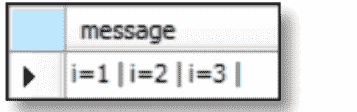

# REPEAT 循环

```
REPEAT
SET s = CONCAT(s, 'i=', i, ' | ');
SET i = i + 1;
UNTIL i = 4
END REPEAT;
```

# 简单循环

```
testLoop : LOOP
SET s = CONCAT(s, 'i=', i, ' | ');
SET i = i + 1;

IF i = 4 THEN
LEAVE testLoop;
END IF;
END LOOP testLoop;
```

## 描述

- 为了重复执行 SQL 语句，可以使用循环。MySQL 提供了三种类型的循环：`WHILE` 循环、`REPEAT` 循环和简单循环。
- 你可以使用 `LEAVE` 语句跳转到循环末尾。
- 你可以使用 `ITERATE` 语句跳转到循环开头。

图 13-7 如何编写循环

# 如何使用游标

默认情况下，SQL 语句处理的是整个结果集而不是单行。然而，你有时可能需要一次一行地处理结果集中的数据。要做到这一点，你可以像图 1-3 所示那样使用游标。

在该图中，存储过程首先声明变量。注意，第三个变量虽然声明为 `TINYINT` 类型，但被赋予了默认值 `FALSE`。这之所以有效，是因为 `FALSE` 关键字是 `0` 的别名。尽管许多程序员使用 `0` 表示假，用 `1` 表示真，但本章使用了 `FALSE` 和 `TRUE` 关键字，因为它们使代码更易读。

接下来，这段代码声明了一个名为 `invoices_cursor` 的 `CURSOR` 类型变量。在声明内部，该代码使用 `SELECT` 语句来定义游标的结果集。该结果集包含了 `invoices` 表中的两列以及所有具有余额的行。

在声明游标后，代码声明了一个当游标结果集中不再找到更多行时的错误处理程序。该错误处理器将 `row_not_found` 变量设置为 `TRUE`。由于 `WHILE` 循环仅在 `row_not_found` 变量等于 `FALSE` 时才执行，这会导致 `WHILE` 循环停止执行。

在声明错误处理器后，代码使用 `OPEN` 语句打开游标。然后，使用 `WHILE` 循环遍历游标中的每一行。当 `row_not_found` 变量被错误处理器设置为 `TRUE` 时，循环停止。在 `WHILE` 循环内部，`FETCH` 语句获取行值并将其存储在之前定义的变量中。随后，`IF` 语句检查当前 `invoice_total` 列是否大于 1000。如果是，`UPDATE` 语句会将 `credit_total` 列增加 10%。

`WHILE` 循环结束后，代码关闭游标。最后，它使用 `SELECT` 语句显示更新的行数。

在使用游标处理单行数据之前，你应该考虑其他解决方案。因为数据库访问比基于游标的访问更快且消耗资源更少。例如，你可以使用此 `UPDATE` 语句完成与存储过程相同的更新：

```
UPDATE invoices
SET credit_total = credit_total + (invoice_total * .1)
WHERE invoice_total > 0
AND invoice_total > 1000
```

然而，如果你遇到需要使用游标的情况，图中所示的技能将帮助你完成。

# 语法

声明游标

`DECLARE cursor_name CURSOR FOR select_statement;`

声明当游标不再找到更多行时的错误处理器

`DECLARE CONTINUE HANDLER FOR NOT FOUND handler_statement;`

打开游标

`OPEN cursor_name;`

获取行值并存储在系列变量中

`FETCH cursor_name INTO variable1[, variable2][, variable3]...`

关闭游标

`CLOSE cursor_name;`

# 使用游标的存储过程

```
DELIMITER //

CREATE PROCEDURE test()
BEGIN
  DECLARE invoice_idvar INT;
  DECLARE invoice_total_var DECIMAL(9,2);
  DECLARE row_not_found TINYINT DEFAULT FALSE;
  DECLARE update_count INT DEFAULT 0;

  DECLARE invoices_cursor CURSOR FOR
    SELECT invoice_id, invoice_total FROM invoices
    WHERE payment_total - credit_total > 0;

  DECLARE CONTINUE HANDLER FOR NOT FOUND
    SET row_not_found = TRUE;

  OPEN invoices_cursor;
  WHILE row_not_found = FALSE DO
    FETCH invoices_cursor INTO invoice_id_var, invoice_total_var;
    IF invoice_total_var > 1000 THEN
      UPDATE invoices
      SET credit_total = credit_total + (invoice_total * .1)
      WHERE invoice_id = invoice_id_var;
      SET update_count = update_count + 1;
    END IF;
  END WHILE;
  CLOSE invoices_cursor;

  SELECT CONCAT(update_count, ' ', row(s), ' updated.');
END //
```

调用该过程时系统的响应

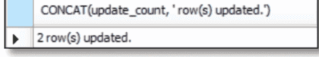

# 如何声明条件处理程序

在声明条件处理程序之前，你需要熟悉 MySQL 错误代码和 MySQL 定义的命名条件。图 13-9 通过文件列出了 700 多个 MySQL 错误代码。这些错误代码可以让你对 MySQL 提供的错误代码类型有一个大致的了解。

这些代码中的每一个都对应于 ANSI 标准的一部分 SQLSTATE。然而，如果 MySQL 代码更具体，那么它们通常会更有用。例如，最后四个 MySQL 错误代码都对应 SQLSTATE 代码 23000。

通常情况下，你只有在测试过程中遇到这些错误时才需要处理它们。不过，如果你想查看所有错误代码的列表，你可以在 MySQL 参考手册中找到它们。

此图中的第二个表格列出了 MySQL 提供的三个内置命名条件。首先，它提供了在 13-8 存储过程中使用的 `NOT FOUND` 条件。该条件对应 MySQL 错误代码 1529 和 SQLSTATE 代码 02000。

此外，MySQL 还提供了 `SQLEXCEPTION` 和 `SQLWARNING` 条件。`SQLEXCEPTION` 条件为你提供了一种处理所有错误的方法，即使是你在测试期间没有遇到的错误。`SQLWARNING` 条件的工作原理类似于 `SQLEXCEPTION` 条件，但它允许你捕获警告和错误，而不仅仅是。

此图展示了如何使用 `DECLARE...HANDLER` 语句来处理你的存储程序中可能发生的错误。在 MySQL 中，这被称为条件处理程序。在其他语言中，这被称为错误处理程序或异常处理器。

此图中的三个示例展示了如何为 MySQL 错误代码、SQLSTATE 和命名条件声明条件处理程序。这三个条件处理程序都使用了 `CONTINUE` 关键字，这会使存储程序在发生错误的语句处继续执行。如果这不是你想要的结果，可以使用 `EXIT` 关键字在执行完当前代码块后继续执行。你将在下一个图中看到相关的示例。

在大多数情况下，你可以使用 MySQL 错误代码和内置条件来处理你遇到的异常。在某些情况下，你可能想要创建你自己的命名条件。虽然这没有提供任何新功能，但有时可以提高代码的可读性。有关创建你自己的命名条件的更多信息，你可以在 MySQL 参考手册中搜索关于 `DECLARE CONDITION` 语句的信息。

# 常用 MySQL 错误代码

| 错误代码 | SQLSTATE 代码 | 说明 |
|---|---|---|
| 1329 | 02000 | 程序尝试从不存在的行获取数据时发生。 |
| 1062 | 23000 | 程序尝试向具有唯一约束的列中存储重复值时发生。 |
| 1048 | 23000 | 程序尝试向不接受 NULL 值的列插入 NULL 值时发生。 |
| 1216 | 23000 | 程序尝试添加或更新子行，但由于外键约束无法操作时发生。 |
| 1217 | 23000 | 程序尝试删除或更新父行，但由于外键约束无法操作时发生。 |

# 内置命名条件

| 命名条件 | 说明 |
|---|---|


| NOT FOUND | 程序使用 `FETCH` 语句或 `SELECT` 语句检索数据但未找到任何数据时发生。 |
| SQLEXCEPTION | 当发生 `NOT FOUND` 条件以外的任何错误条件时发生。 |
| SQLWARNING | 当发生 `NOT FOUND` 条件以外的任何错误条件或发生任何警告消息时发生。 |

# 声明条件处理程序的语法

```
DECLARE (CONTINUE|EXIT) HANDLER
FOR (mysql_error_code|SQLSTATE sqlstate_code|named_condition)
handler_actions;
```

# 如何为 MySQL 错误代码声明条件处理程序

```
DECLARE CONTINUE HANDLER FOR 1329
SET row_not_found = TRUE
```

# 如何为 SQLSTATE 声明条件处理程序

```
DECLARE CONTINUE HANDLER FOR SQLSTATE '02000'
SET row_not_found = TRUE
```

# 如何为命名条件声明条件处理程序

```
DECLARE CONTINUE HANDLER FOR NOT FOUND
SET row_not_found = TRUE
```

## 说明

- 你可以使用 `DECLARE...HANDLER` 语句为可能发生的错误声明一个处理程序。在 MySQL 中，这被称为条件处理程序。
- 当发生错误时继续执行，请使用 `CONTINUE` 关键字。当发生错误时退出代码块，请使用 `EXIT` 关键字。
- 若需 MySQL 错误代码及其对应的 SQLSTATE 代码的完整列表，可以在 MySQL 参考手册中搜索“Server error codes”。

图 13-9 如何声明条件处理程序

# 如何使用条件处理程序

现在你已经知道了如何声明条件处理程序。

在开发存储程序时，像这样的错误消息可能很有帮助，但对应用程序的终端用户来说并没有帮助。因此，你通常希望在将存储程序投入生产环境之前处理异常。由于处理错误最具体的方法是使用 MySQL 错误代码，你通常希望为正在发生的错误代码声明一个条件处理程序。然后，你可以通过执行适当的代码来处理此错误。通常，这意味着显示一个对用户更友好的消息。不过你也可以执行其他错误处理任务，例如将错误信息写入日志表。

此图展示了如何使用 `DECLARE...HANDLER` 语句来处理你的存储程序中可能发生的错误。在 MySQL 中，这被称为条件处理程序。在其他语言中，这被称为错误处理程序或异常处理器。

此图中的三个示例展示了如何为 MySQL 错误代码、SQLSTATE 和命名条件声明条件处理程序。这三个条件处理程序都使用了 `CONTINUE` 关键字，这会使存储程序在发生错误的语句处继续执行。如果这不是你想要的结果，可以使用 `EXIT` 关键字在执行完当前代码块后继续执行。你将在下一个图中看到相关的示例。

在大多数情况下，你可以使用 MySQL 错误代码和内置条件来处理你遇到的异常。在某些情况下，你可能想要创建你自己的命名条件。虽然这没有提供任何新功能，但有时可以提高代码的可读性。有关创建你自己的命名条件的更多信息，你可以在 MySQL 参考手册中搜索关于 `DECLARE CONDITION` 语句的信息。

# 使用 EXIT 句处理处理错误的存储过程

DELIMITER //

```sql
CREATE PROCEDURE test()
BEGIN
  DECLARE duplicate_entry_for_key TINYINT DEFAULT FALSE;
  BEGIN
    DECLARE EXIT HANDLER FOR 1062
    SET duplicate_entry_for_key = TRUE;

    INSERT INTO general_ledger_accounts VALUES (130, 'Cash');

    SELECT '1 row was inserted.' AS message;
  END;

  IF duplicate_entry_for_key = TRUE THEN
    SELECT 'Row was not inserted - duplicate key encountered.' AS message;
  END IF;
END//
```

# 系统的响应


# 使用命名条件处理所有错误的存储过程

DELIMITER //

```sql
CREATE PROCEDURE test()
BEGIN
  DECLARE sql_error TINYINT DEFAULT FALSE;
  BEGIN
    DECLARE EXIT HANDLER FOR SQLEXCEPTION
    SET sql_error = TRUE;

    INSERT INTO general_ledger_accounts VALUES (130, 'Cash');

    SELECT '1 row was inserted.' AS message;
  END;

  IF sql_error = TRUE THEN
    SELECT 'Row was not inserted - SQL exception encountered.' AS message;
  END IF;
END//
```

# 系统的响应


## 描述

- 如果你希望 MySQL 在遇到错误时立即退出当前代码块，请使用 EXIT 句处理器。

图 13-10 如何使用条件处理程序（部分，共 2 部分）

## 如何使用多个条件处理程序

在编写存储程序时，声明多个条件处理程序是常见做法，如图 13–11 所示。这样做，会先执行最具体的错误处理程序，然后执行最不具体的错误处理程序。

图中的存储过程首先声明了三个变量，用于指示是否发生了错误。在这里，所有三个变量都被设置为默认值 FALSE。

在声明这三个变量后，该存储过程定义了一个代码块。在这个代码块中，前三个语句声明了三个与这三个变量对应的条件处理程序。当发生指定的错误时，这些处理程序都会退出代码块。其中，前两个专门针对 MySQL 错误代码 1062 和 1048，但第三个是一个通用处理程序，用于捕获可能发生的任何其他错误。

在代码块之后，IF 语句会检查由条件处理程序设置的变量。然后，它执行相应的代码。对于前两个变量，这段代码会显示一个针对所发生的意外错误的适用的用户友好消息。换句话说，如果发生了 MySQL 错误代码 1062 或 1048，代码将显示一个对程序员处理该错误有用的用户友好错误消息。否则，它将显示一个包含对程序员用处较小信息的用户友好错误消息。

如果你运行图中所示的存储过程，它将返回一个类似于所示的结果集。在这种情况下，行没有被插入，是因为第一列包含一个非法的 NULL 值。要测试其他错误，你可以更改 INSERT 语句中的值。例如，如果你在第三列输入一个位为 'xx' 的值，存储过程将执行针对 SQLEXCEPTION 条件的条件处理程序。

# 第 13 章 编写存储程序的语言技能 397

# 使用多个条件处理器的存储过程

```sql
DELIMITER //

CREATE PROCEDURE test()
BEGIN
  DECLARE duplicate_entry_for_key TINYINT DEFAULT FALSE;
  DECLARE column_cannot_be_null TINYINT DEFAULT FALSE;
  DECLARE sql_exception TINYINT DEFAULT FALSE;

  BEGIN
    DECLARE EXIT HANDLER FOR 1062
    SET duplicate_entry_for_key = TRUE;
    DECLARE EXIT HANDLER FOR 1048
    SET column_cannot_be_null = TRUE;
    DECLARE EXIT HANDLER FOR SQLEXCEPTION
    SET sql_exception = TRUE;

    INSERT INTO general_ledger_accounts VALUES (NULL, 'Test');
    SELECT '1 row was inserted.' AS message;
  END;

  IF duplicate_entry_for_key = TRUE THEN
    SELECT 'Row was not inserted - duplicate key encountered.' AS message;
  ELSEIF column_cannot_be_null = TRUE THEN
    SELECT 'Row was not inserted - column cannot be null.' AS message;
  ELSEIF sql_exception = TRUE THEN
    SELECT 'Row was not inserted - SQL exception encountered.' AS message;
  END IF;
END//
```

# 系统的响应


## 描述

- 你可以为单个存储程序声明多个条件处理程序。这样做，会先执行最具体的错误处理程序，最后执行最不具体的错误处理程序。
- MySQL 错误代码和 NOT FOUND 条件用于识别特定错误。SQLSTATE 代码识别不那么具体的 ANSI 标准错误。而 SQLEXCEPTION 和 SQLWARNING 条件用于识别通用错误。

图 13-11 如何使用多个条件处理程序

## 展望

在本章中，你接触了存储程序，并学习了如何使用 MySQL 编写过程化代码。在接下来的三个章节中，你将学习更多关于存储程序的知识。在第 14 章，你将学习事务管理和锁定。在第 15 章，你将学习存储过程和函数。在第 16 章，你将学习触发器和事件。

## 术语

- 存储程序 (stored program)
- 存储过程 (stored procedure)
- 存储函数 (stored function)
- 程序 (routine)
- 触发器 (trigger)
- 事件 (event)
- 代码块 (block)
- 变量 (variable)
- 布尔值 (Boolean)
- 表达式 (expression)
- 语句 (statement)
- CASE 语句 (CASE statement)
- 搜索 CASE 语句 (searched CASE statement)
- 循环 (loop)
- WHILE 循环 (WHILE loop)
- REPEAT 循环 (REPEAT loop)
- LOOP (LOOP)
- 计数器 (counter)
- 游标 (cursor)
- 条件处理程序 (condition handler)
- 错误处理程序 (error handler)
- 异常处理程序 (exception handler)
- 命名条件 (named condition)

## 练习

在以下练习中创建的每个脚本都应使用图 13-1 所示的结构：

1. 编写并调用一个名为 test 的存储过程。该存储过程声明一个变量，并设置为 Invoices 表中余额大于等于 5000 的行数。
2. 编写并调用一个名为 test 的存储过程。该存储过程使用两个变量来存储 (1) 余额大于 5000 的发票数量和 (2) 余额的总和。如果总和大于 30000，存储过程将显示：总和小于30000。
3. 编写并调用一个名为 test 的存储过程。该存储过程计算 10 的阶乘（计算阶乘时要乘以小于自身的每一个正整数）。然后，它将显示如下消息：10 的阶乘是：3628800。
4. 编写并调用一个名为 test 的存储过程。该过程应创建一个游标，包含所有余额大于等于 5000 的行的 vendor_name、invoice_number 和 balance 列。结果集应按余额降序排列。然后，过程应显示如下消息：

```
11130.70|P-0608|Lithographic Inc//6585.62|0-2436|Lithographic Inc//
```

在这里，每列用管道符 (|) 隔开，每行用双斜杠 (//) 隔开。

5. 编写并调用一个名为 test 的存储过程。该过程应将 ID 为 1 的发票的 invoice_date 列更新为 NULL。如果更新成功，过程将显示此消息：

```
1 row was updated.
```

如果更新失败，过程将显示此消息：列未更新。

6. 编写并调用一个名为 test 的存储过程。该过程应识别 100 以内的所有质数（质数是除 1 和自身之外不能被其他整数除的整数）。然后，它将显示一个包含质数的字符串变量如下：

```
2 | 3 | 5 | 7 | 11 | 13 | 17 | 19 | 23 | 29 | 31 | ...
```

> 提示：为了实现此功能，你需要在循环内部嵌套另一个循环。此外，你需要在内部循环中编写一个 IF 语句。

7. 增强你在练习 4 中的脚本，使其根据金额分三组显示发票数据，标题如下：

```
$20000 to $20000
$10000 to $20000
$5000 to $10000
```

完成后，应返回的字符串变量格式如下：

$20000 to $20000: 11130.70|P-0608|Lithographic Inc//$5000 to $10000: 6585.62|0-2436|Lithographic Inc//

为了完成这一点，你可以通过三次遍历游标，每次循环都打开并关闭游标。提示：对于每组发票，你可以编写一个包含针对 NOT FOUND 条件的 EXIT 处理器的代码块。

## 如何使用事务和锁

如果你一直是在自己的计算机上使用 MySQL，那么你就是数据库的唯一用户。但在现实世界中，数据库可能被成千上万的用户同时使用。那么，当两个用户尝试同时更新同一条数据时会发生什么？在本章中，你将学习 MySQL 如何处理这种情况。但首先，你将学习如何将多个 SQL 语句组合成单一的逻辑工作单元，这被称为“事务”。

| 标题 | 页码 |
| :--- | :--- |
| 如何使用事务 .................................................... | 402 |
| 如何提交和回滚事务............................................... | 402 |
| 如何使用保存点.................................................................. | 404 |
| **如何处理并发和锁 ................................. | 406** |
| 并发和锁之间的关系...................................................... | 406 |
| 锁可以防止的四种并发问题.............................. | 408 |
| 如何设置事务隔离级别................................................... | 410 |
| 如何防止死锁...................................................................... | 412 |
| **观点 ................................................................................ | 414** |

## 如何使用事务

事务是一组被你组合成单一逻辑工作单元的 SQL 语句。通过这种方式组合 SQL 语句，你可以防止某些类型的数据库错误。

在开始使用 MySQL 处理事务之前，你应该意识到某些引擎并不支持事务。特别是 MyISAM 存储引擎不支持事务。因此，本主题中介绍的技能仅适用于 InnoDB 等支持事务的存储引擎。

## 如何提交和回滚事务

默认情况下，MySQL 会话使用自动提交（autocommit）模式，该模式会在执行 INSERT、UPDATE 和 DELETE 语句后立即自动提交这些更改。到目前为止，我们一直假设你正在使用自动提交模式。但是，如果这不是你想要的，你可以使用事务来控制何时提交更改。

由于事务通常被编写在存储过程内部，图 14-1 显示了一个名为 `test` 的存储过程，它包含三个被编写为事务的 `INSERT` 语句。首先，该存储过程声明了一个变量 `sql_error` 并将其设置为 `FALSE`，表示没有发生任何 SQL 错误。然后，第二个 `DECLARE` 语句创建了一个条件处理程序，当发生 SQL 错误时，它会将 `sql_error` 设置为 `TRUE`。

`START TRANSACTION` 标识事务的开始，这会临时关闭自动提交模式。然后，第一个 `INSERT` 语句向 `Invoices` 表添加了一张新发票。接下来，另外两个 `INSERT` 语句向 `Invoice_Line_Items` 表添加了该发票的明细项目。

在 `INSERT` 语句之后，`IF` 语句使用 `sql_error` 变量检查在执行任何 `INSERT` 语句时是否发生了错误。如果没有发生 SQL 错误，此代码将使用 `COMMIT` 语句将更改提交到数据库，从而使更改永久化。否则，`ROLLBACK` 语句将回滚更改，即取消它们。


为了理解为什么这是必要的，假设这些 `INSERT` 语句中的每一个在执行后立即提交到数据库。那么，如果第三个 `INSERT` 语句失败会发生什么？在这种情况下，`Invoices` 和 `Invoice_Line_Items` 表将不匹配。具体来说，`Invoice_Line_Items` 表中 `line_amount` 列的总和将不等于 `Invoices` 表中 `invoice_total` 列。换句话说，储蓄账户的完整性没有得到维护。

同样，考虑银行支票账户和储蓄账户之间的转账示例。在这种情况下，一个更新减少支票账户的余额，另一个更新增加了储蓄账户的余额。那么，如果这些更新中的一个失败，客户就会获得或丢失这笔交易的金额。但在这里，将两次更新视为单个事务就可以解决这个问题。通常，这就是你想要的。

## 第 14 章 如何使用事务和锁

### 一个运行三个 INSERT 语句作为事务的存储过程

```sql
DELIMITER //

CREATE PROCEDURE test ()
BEGIN
    DECLARE sql_error TINYINT DEFAULT FALSE;

    DECLARE CONTINUE HANDLER FOR SQLEXCEPTION
    SET sql_error = TRUE;

    START TRANSACTION;

    INSERT INTO invoices line_items
    VALUES (115, 34, 'ZXA-080', '2015-01-18', 14092.59, 0, 0, 3, '2015-04-18', NULL);

    INSERT INTO invoice line_items
    VALUES (115, 1, 160, 4447.23, 'HW upgrade');

    IF sql_error = FALSE THEN
        COMMIT;
        SELECT 'The transaction was committed.';
    ELSE
        ROLLBACK;
        SELECT 'The transaction was rolled back.';
    END IF;
END //
```

## 何时使用事务

- 当你编写两个或多个影响相关数据的 `INSERT`、`UPDATE` 或 `DELETE` 语句时。
- 当你通过 `INSERT` 和 `DELETE` 语句将行从一个表移动到另一个表时。
- 每当 `INSERT`、`UPDATE` 或 `DELETE` 语句失败就会违反数据完整性时。

## 说明

- 默认情况下，MySQL 以自动提交模式运行，在每个 `INSERT`、`UPDATE` 或 `DELETE` 语句执行后立即自动提交数据库更改。如果这不是你想要的，可以将语句分组为名为事务的逻辑工作单元。
- 要启动事务，请编写 `START TRANSACTION` 语句。在事务中的语句提交或回滚期间，这会关闭自动提交模式。要提交更改，使用 `COMMIT` 语句。要回滚更改，使用 `ROLLBACK` 语句。
- MySQL 在执行 DDL 语句（如 `CREATE TABLE`）后会自动提交更改。因此，你不应该在事务中执行 DDL 语句。

图 14-1 如何提交和回滚事务

## 如何使用保存点

图 14-2 中的脚本显示了如何使用 `SAVEPOINT` 语句在事务内部识别一个或多个保存点。在这里，使用 `SAVEPOINT` 语句来标识脚本包含的三个语句之前的每个保存点。因此，该脚本包含了三个保存点。

该脚本还显示了如何使用 `ROLLBACK TO SAVEPOINT` 语句回滚整个或部分事务。在这里，三个 `ROLLBACK TO SAVEPOINT` 语句将事务回滚到三个保存点。第一个语句将其回滚到插入第二个明细项目之前的点。第二个语句将其回滚到插入第一个明细项目之前的点。第三个语句将其回滚到插入发票之前的点。

在此时，脚本调用了 `COMMIT` 语句以提交已进行的所有更改。然而，由于三个 `ROLLBACK TO SAVEPOINT` 语句已经回滚了三个 `INSERT` 语句，因此这并没有向数据库提交任何更改。为了验证这一点，你使用 `SELECT` 语句查看 `Invoices` 和 `Invoice_Line_Items` 表中 `invoice_id` 为 115 的行。

通常情况下，保存点用于事务包含太多语句，以至于回滚整个事务的效率太低。在这种情况下，应用程序可以回滚到错误发生之前的最后一个保存点。对于大多数应用程序，你不需要使用保存点。

大多数情况下，事务及其保存点被编写在存储过程中，如图 14-1 所示。但在该图中，事务及其语句被编写在脚本中。虽然这不是一个真实的示例，但它确实展示了保存点是如何工作的，因此如果你以后需要，你应该能够使用它们。此外，这个示例展示了你可以在脚本中使用处理事务的语句，这在处理类似第 11 章中的数据库脚本时有时会有帮助。

### 使用保存点的脚本

```sql
USE ap;

START TRANSACTION;

SAVEPOINT before_invoice;

INSERT INTO invoices
VALUES (115, 35, 34, 'ZXA-080', '2015-01-18',
14092.59, 0, 0, 3, '2015-04-18', NULL);

SAVEPOINT before_line_item1;

INSERT INTO invoice_line_items
VALUES (115, 1, 160, 4447.23, 'HW upgrade');

SAVEPOINT before_line_item2;

INSERT INTO invoice_line_items
VALUES (115, 2, 167, 9645.36, 'OS upgrade');

ROLLBACK TO SAVEPOINT before_line_item1;

ROLLBACK TO SAVEPOINT before_invoice;

COMMIT;
```

### 说明

- 当你使用保存点时，可以将事务回滚到事务开始或回滚到特定的保存点。
- 你可以使用 `SAVEPOINT` 语句创建一个指定名称的保存点。
- 你可以使用 `ROLLBACK TO SAVEPOINT` 语句将事务回滚到指定的点。
- 当单个事务包含许多 SQL 语句，以至于回滚整个事务效率很低时，保存点就非常有用。

## 如何处理并发和锁定

当两个或多个用户访问同一个数据库时，他们可能在同时处理相同的数据。这被称为并发。虽然当两个用户同时检索数据时，并发并不是一个问题，但当一个用户更新其他用户正在查看或更新的数据时，它就会变成一个问题。在接下来的主题中，你将学习如何防止并发问题。

## 并发和锁定之间的关系

图 14-3 展示了两个事务，说明了 MySQL 默认如何处理并发。首先，事务 A 提交了一个 `UPDATE` 语句，将 `invoice_id` 值为 6 的发票的 `credit_total` 列的值加了 100。由于事务 A 尚未将此更改提交到数据库，它保留了对该行的锁。这被称为锁定。

此时，如果你在事务 B 中运行 `SELECT` 语句，`credit_total` 列并不包含更新后的值。`SELECT` 语句只读取已提交的更改。

此外，事务 B 中的 `UPDATE` 语句由于事务 A 对该行的锁定将无法更新该行。因此，它必须等待事务 A 完成后才能更新该行。

一旦事务 A 提交了 `UPDATE` 语句所做的更改，如果你在事务 B 中运行 `SELECT` 语句，它将显示 `credit_total` 列中更新后的值。此外，当事务 A 提交更新时，它会释放对该行的锁。然后，如果事务 B 的 `UPDATE` 语句一直在等待，它现在将完成执行。或者，如果你再次执行事务 B 中的 `UPDATE` 语句，它将立即执行。

可以通过打开多个连接并执行相应的 SQL 语句来实验模拟多个用户。例如，当你使用 MySQL Workbench 时，可以使用 Home 标签页打开两个连接。然后，你可以使用第一个连接执行事务 A，使用第二个连接执行事务 B。为了做到这一点，你可以将光标置于每个语句中并使用 Current Statement 按钮（`Ctrl+Enter`）一次运行一条语句。这允许你减慢每个脚本的执行速度。否则，如果你使用 SQL Script 按钮（`Ctrl+Shift+Enter`），脚本运行得非常快，你无法让两个脚本同时访问同一行。

此示例显示，MySQL 的默认锁定行为防止了大多数并发问题。然而，如果你发现锁定行为不足，你可能需要覆盖它。你稍后将学习如何做到这一点。首先，你可能需要理解锁可以防止的四个并发问题。

### 检索并修改同一行数据的两个事务

#### 事务 A

- 逐条执行每条语句。
- 按照描述与事务 B 交替执行。

```sql
START TRANSACTION;

UPDATE invoices SET credit_total = credit_total + 100 WHERE invoice_id = 6;

-- 事务 B 中的 SELECT 语句不会显示更新后的数据
-- 事务 B 中的 UPDATE 语句将等待事务 A 完成

COMMIT;

-- 事务 B 中的 SELECT 语句将显示更新后的数据
-- 事务 B 中的 UPDATE 语句将立即执行
```

#### 事务 B

- 使用第二个连接执行这些语句！
- 否则，它们将无法按照所述运行。

```sql
START TRANSACTION;

SELECT invoice_id, credit_total FROM invoices WHERE invoice_id = 6;

UPDATE invoices SET credit_total = credit_total + 200 WHERE invoice_id = 6;

COMMIT;
```

### 说明

- 并发是系统支持两个或多个事务同时处理相同数据的能力。
- MySQL 可以使用锁自动防止某些并发问题。如果锁与正在运行的事务发生冲突，将停止另一个事务的执行。
- 只有当数据被修改时，并发才是一个问题。当两个或多个 `SELECT` 语句读取相同的数据时，`SELECT` 语句互不影响。

## 锁可以防止的四个并发问题

图 14-4 描述了四个最常见的并发问题。首先，*丢失更新* 是你已经学过的问题。它发生在两个事务选择同一行，然后根据最初选择的值更新该行时。由于每个事务都不知道对方，后发生的更新会覆盖较早的更新。然而，对于许多应用程序来说，这种问题很少发生，而且即使发生了也不严重。

与丢失更新一样，其他三个问题可能对数据库产生不利影响。事实上，对于许多应用程序来说，这些问题的发生频率较低。当它们发生时，可以通过重新提交发生问题的 SQL 语句来修正。但在某些数据库系统中，这些问题可能会损害数据完整性，需要进行处理。

虽然锁可以防止图中列出的问题，但 MySQL 的默认锁定行为并不防止*幻读*。如果这种锁定级别不可接受，你可以通过如下图所示设置事务隔离级别来更改默认锁定行为。

### 四种类型的并发问题

| 问题 | 描述 |
|---|---|
| 丢失更新 | 当两个事务选择同一行并根据最初选择的值更新该行时发生。由于每个事务都不知道对方，后发生的更新会覆盖较早的更新。 |
| 脏读 | 当一个事务选择了另一个事务尚未提交的数据时发生。例如，事务 A 更改了一行。事务 B 在事务 A 提交更改之前选择了更改后的行。如果 A 回滚了更改，事务 B 选择的数据在数据库中并不存在。 |
| 不可重复读 | 当两个 `SELECT` 语句尝试获取相同的数据值时，因为另一个事务在两个语句之间更新了数据。例如，事务 A 选择了一行。事务 B 然后更新了该行。当事务 A 再次选择该行时，数据发生了变化。 |
| 幻读 | 当你对一组行执行更新或删除时，另一个事务正在对同一组行执行插入或影响其中一个或多个行时发生。例如，事务 A 更新每个有余额的发票的总额，但事务 B 在事务 A 仍在运行时插入了一个新的未付发票。在事务 A 完成后，仍然有一张有余额的发票。 |

### 说明

- 在有许多用户的大系统中，你应该预期这类问题的发生。通常情况下，你不需要采取任何行动来预测问题。在许多情况下，如果重新提交 SQL 语句，问题就会消失。
- 在某些系统中，如果两个事务相互覆盖，数据库的有效性将受到损害，重新提交其中一个事务将无法消除问题。如果你在这样的系统上工作，你必须预测这些并发问题并在代码中考虑它们。
- 如果这些问题之一可能影响你系统的数据完整性，你可以通过如下所示设置事务隔离级别来更改默认锁定行为。

## 如何设置事务隔离级别

防止并发问题最简单的方法是更改默认锁定行为。要做到这一点，你可以使用图 14-5 所示的 `SET TRANSACTION ISOLATION LEVEL` 语句来设置事务隔离级别。默认情况下，该语句为当前会话中的下一个事务设置隔离级别。如果你想为会话中的所有事务设置隔离级别，可以包含 `SESSION` 关键字。如果你想为所有会话设置隔离级别，也可以包含 `GLOBAL` 关键字。图中的示例说明了其工作原理。

此图还列出了 MySQL 提供的四种事务隔离级别，以及它们防止或允许的并发问题。例如，如果你使用 `SERIALIZABLE` 选项，所有四个并发问题都将被防止。

当你将隔离级别设置为 `SERIALIZABLE` 时，每个事务都与其他所有事务完全隔离，并发受到严格限制。这是通过锁定每个资源来实现，防止其他事务访问它。由于每个事务必须等待上一个事务提交，因此事务是按顺序执行的，一个接一个地。

由于 `SERIALIZABLE` 级别消除了所有并发问题，你可能认为这总是最佳选项。然而，该选项需要更多的开销来管理所有锁，因此每个事务的访问时间会增加。对于某些系统，这可能会导致严重的性能问题。因此，你可能只想在无法接受幻读的情况下使用 `SERIALIZABLE` 隔离级别。

最低的隔离级别是 `READ UNCOMMITTED`，它允许所有四个并发问题发生。它是通过在执行 `SELECT` 查询时不设置任何锁，并尊重任何已有的锁来实现的。这意味着你的 `SELECT` 语句将始终立即执行；此设置提供了最佳性能。由于其他事务可以检索并修改相同的数据，这无法防止并发问题。

`READ COMMITTED` 隔离级别防止事务看到由其他事务更改但尚未提交的数据。这防止了脏读，但允许其他类型的并发问题。

MySQL 的默认隔离级别是 `REPEATABLE READ`。在此级别下，事务读取的行将在同一个事务内保持读取一致性。此外，服务器会对事务使用的所有数据进行加锁，防止其他用户更新这些数据。

`REPEATABLE READ` 级别允许的并发性高于 `READ COMMITTED`，但少于 `SERIALIZABLE`。正如你所预期的，它的性能比 `SERIALIZABLE` 快，且允许的并发问题比 `READ COMMITTED` 少。在大多数情况下，默认的 `REPEATABLE READ` 隔离级别是可以接受的。

### 各事务隔离级别防止的并发问题

| 隔离级别 | 脏读 | 丢失更新 | 不可重复读 | 幻读 |
|---|---|---|---|---|
| READ UNCOMMITTED | 允许 | 允许 | 允许 | 允许 |
| READ COMMITTED | 防止 | 允许 | 允许 | 允许 |
| REPEATABLE READ | 防止 | 防止 | 防止 | 允许 |
| SERIALIZABLE | 防止 | 防止 | 防止 | 防止 |

### `SET TRANSACTION ISOLATION LEVEL` 语句的语法

```sql
SET [GLOBAL | SESSION] TRANSACTION ISOLATION LEVEL
{READ UNCOMMITTED | READ COMMITTED | REPEATABLE READ | SERIALIZABLE}
```

#### 为下一个事务设置事务隔离级别为 SERIALIZABLE

```sql
SET TRANSACTION ISOLATION LEVEL SERIALIZABLE
```

#### 为当前会话设置事务隔离级别为 READ UNCOMMITTED

```sql
SET SESSION TRANSACTION ISOLATION LEVEL READ UNCOMMITTED
```

#### 为所有会话设置事务隔离级别为 READ COMMITTED

```sql
SET GLOBAL TRANSACTION ISOLATION LEVEL READ COMMITTED
```

### 说明

- 事务隔离级别控制事务之间相互隔离的程度。在最严格的隔离级别下，并发问题被减少或消除。然而，在最宽松的级别下，性能得到了增强。
- 要更改事务隔离级别，请使用 `SET TRANSACTION ISOLATION LEVEL`。
- 如果包含 `GLOBAL` 关键字，隔离级别将全局设置为所有会话中的事务。如果包含 `SESSION` 关键字，隔离级别将设置为当前会话中的所有事务。如果省略 `GLOBAL` 和 `SESSION`，则隔离级别将设置为当前会话中的下一个新事务。
- 默认事务隔离级别是 `REPEATABLE READ`。这会对事务中使用的所有数据加锁，防止其他用户更新数据。然而，这仍然允许插入，因此可能会发生幻读。
- `READ UNCOMMITTED` 隔离级别不设置任何锁，并忽略已持有的锁。这使得你的查询获得可能的性能，但面临每种并发问题的风险。出于此原因，你应该只对极少更新的数据使用此级别。
- `READ COMMITTED` 隔离级别锁定已更改但未提交的数据。这防止了脏读，但允许所有其他类型的并发问题。
- `SERIALIZABLE` 隔离级别对事务使用的所有数据加锁。由于每个事务必须等待上一个事务提交，事务按顺序处理。这是最严格的级别。

图 14-5 如何设置事务隔离级别

## 如何防止死锁


# 死锁与存储过程

## 死锁

当两个事务都在等待对方时，就会发生死锁。如图14-6所示。在这里，事务 A 更新储蓄账户，而事务 B 更新检查账户。现在，假设事务 A 锁定了检查账户而事务 B 锁定了储蓄账户。此时，其中一个事务必须回滚，以便另一个事务继续；失败的事务被称为**死锁受害者**。

### 防止死锁的技术

为了防止死锁，可以使用下面介绍的技术：

- **不要允许事务长时间开启**：
  - 保持事务短。
  - 除非绝对必要，否则将 `SELECT` 语句放在事务之外。
  - 永远不要在事务中编写用户输入。

- **不要使用高于必要的事务隔离级别**：
  - 默认的 `REPEATABLE READ` 级别通常是可以接受的；如果死锁变成问题，你应该考虑更改为 `READ COMMITTED`。
  - 将 `SERIALIZABLE` 级别留用于对数据完整性至关重要的短事务更改。

- **在可以确保独占访问时进行大规模更改**：
  - 如果你需要在活动表中更改数百万行，不要在高峰时段这样做。
  - 如果可能，在进行大规模更改之前获取数据库独占访问。

- **在编写事务时考虑锁定行为**：
  - 如果你需要编写两个或多个更新相同资源的事务，请在每个事务中按相同的顺序编写更新。

### 演示死锁的 UPDATE 语句

**Transaction A**
```sql
START TRANSACTION;
UPDATE savings SET balance = balance - transfer_amount;
UPDATE checking SET balance = balance + transfer_amount;
COMMIT;
```

**Transaction B (可能死锁)**
```sql
START TRANSACTION;
UPDATE checking SET balance = balance - transfer_amount;
UPDATE savings SET balance = balance + transfer_amount;
COMMIT;
```

**Transaction B (防止死锁)**
```sql
START TRANSACTION;
UPDATE savings SET balance = balance + transfer_amount;
UPDATE checking SET balance = balance - transfer_amount;
COMMIT;
```

### 描述

- 死锁发生在两个事务都无法提交时，因为每个事务都持有另一个事务所需的资源锁。

### 观点

在本章中，你学习了 MySQL 如何保护你的数据免受真实系统中可能出现的问题。由于一个或多个相关 SQL 语句的失败可能会违反数据完整性，你学习了通过将语句分组为事务来防止这些问题。由于多个事务可以同时修改数据，你学习了如何通过设置事务隔离级别来更改默认锁定行为，防止并发问题。由于更改隔离级别可能会增加死锁概率，你学习了防御性编程技术来防止死锁。

### 术语

- 事务 | 脏读
- 提交事务 | 不可重复读
- 回滚事务 | 幻读
- 储存点 | 事务隔离级别
- 并发 | 死锁
- 锁定 | 死锁受害者
- 丢失更新

### 练习

1. 编写一个脚本，创建并调用一个名为 `test` 的存储过程。该存储过程应包含一组三个 SQL 语句，并被编码为一个事务，以反映以下变化：美国联邦政政公司（United Parcel Service）已被联邦快递公司（Federal Express Corporation）收购，新公司命名为 FedUP。在更新 `Invoices` 表中的 `vendor_id` 列后，重命名其中一个供应商并删除另一个。如果这些语句执行成功，则提交更改。否则，回滚更改。

2. 编写一个脚本，创建并调用一个名为 `test` 的存储过程。该存储过程应包含一组两个 SQL 语句，并被编码为一个事务，以删除 `Invoices` 表中 `invoice ID` 为 114 的行。为了做到，你必须先从 `Invoice_Line_Items` 表中删除该发票的所有项目。如果这些语句执行成功，则提交更改。否则，回滚更改。

---

## 第 15 章 如何创建存储过程和函数

### 章节目录

| 主题 | 页码 |
| :--- | :--- |
| 如何编写存储过程 | 416 |
| 如何创建并调用存储过程 | 416 |
| 如何编写输入和输出参数 | 418 |
| 如何为参数设置默认值 | 420 |
| 如何验证参数并引发错误 | 422 |
| 插入行的存储过程 | 424 |
| 如何使用用户变量 | 428 |
| 如何使用动态 SQL | 430 |
| 如何删除存储过程 | 432 |
| 如何编写存储函数 | 434 |
| 如何创建并调用函数 | 434 |
| 计算欠款余额的函数 | 436 |
| 如何删除函数 | 438 |
| 如何在 Workbench 中使用过程和函数 | 440 |
| 如何查看和编辑存储例程 | 440 |
| 如何创建存储例程 | 440 |
| 如何删除存储例程 | 440 |
| 观点 | 442 |

### 如何编写存储过程

存储过程（称为 sproc 或简单的过程）是一个包含过程化 SQL 代码块的数据库对象。你可以使用存储过程来修改存储在数据库中的数据。例如，你可以使用存储过程执行 `INSERT`、`UPDATE` 或 `DELETE` 语句。

### 如何创建并调用存储过程

图15-1 显示了如何使用 `CREATE PROCEDURE` 语句创建存储过程。首先，你编写 `CREATE PROCEDURE` 关键字，后跟过程名称。例如，图中该语句创建了一个名为 `update_invoices_credit_total` 的过程。此名称清楚地标识了该过程更新了 `invoices` 表的 `credit_total` 列。

在过程名称之后，你编写一组括号。在括号中，你可以为过程编写一个或多个参数。参数通常用于从调用程序向存储过程传递一个值。

如果过程接受多个参数，你必须使用逗号来分隔参数。当你声明一个参数时，你编写参数名称后跟其数据类型。例如，在图中，该过程接受两个参数。第一个参数名为 `invoice_id_param`，数据类型为 `INT`，第二个参数名为 `credit_total_param`，数据类型为 `DECIMAL`。

在括号之后，你编写一个语句块。该块由 `BEGIN` 和 `END` 关键字标识。在块内部，你可以编写大多数 SQL 语句，包括第13章中演示的过程化代码语句以及第14章中演示的用于事务的语句。

当你运行 `CREATE PROCEDURE` 语句时，MySQL 会编译过程的代码并将编译后的代码存储在数据库中。作为此过程的一部分，MySQL 编译器会检查过程中代码的语法。如果你犯了编码错误，系统将响应相应的消息，且不会创建该过程。

你可以使用 `CALL` 语句执行或调用存储过程。例如，在图中，`CALL` 语句调用了在第一个示例中创建的过程。该语句为过程定义的每个参数传递了一个值。在这里，第一个参数是指定发票 ID 的字面量，第二个参数是标识 `credit_total` 新金额的字面量。

当你使用 `CALL` 语句时，必须按位置传递参数。换句话说，你编写参数的顺序与在 `CREATE PROCEDURE` 语句中编写顺序相同。

在第18章中，你将学习如何向特定用户授予 `INSERT`、`UPDATE` 和 `DELETE` 权限。然而，如果你想对授予给用户的权限进行更细粒度的控制，你可以创建存储过程。

#### CREATE PROCEDURE 语句

```sql
CREATE PROCEDURE procedure_name
(
  [parameter_name_1 data_type]
  , parameter_name_2 data_type]...
)
sql_block
```

#### 创建一个更新表的存储过程的脚本

```sql
DELIMITER //

CREATE PROCEDURE update_invoices_credit_total
(
  invoice_id_param INT,
  credit_total_param DECIMAL(9,2)
)
BEGIN
  DECLARE sql_error TINYINT DEFAULT FALSE;

  DECLARE CONTINUE HANDLER FOR SQLEXCEPTION
  SET sql_error = TRUE;

  START TRANSACTION;

  UPDATE invoices
  SET credit_total = credit_total_param
  WHERE invoice_id = invoice_id_param;

  IF sql_error = FALSE THEN
    COMMIT;
  ELSE
    ROLLBACK;
  END IF;
END//
```

#### 调用存储过程的语句

```sql
CALL update_invoices_credit_total(56, 300);
```

#### 描述

- 你使用 `CREATE PROCEDURE` 语句创建存储过程。存储过程是一个包含 SQL 代码块的可执行数据库对象。
- 你可以使用参数从调用程序向存储过程传递一个或多个值，或从过程传递到调用程序。关于使用参数的更多信息，请参见图15-2和图15-3。
- 在存储过程中声明参数时，你编写参数名称后跟其数据类型。如果你声明了两个或多个参数，则用逗号分隔它们。
- 你可以使用 `CALL` 语句调用过程。当过程接受参数时，你通过在过程后的括号内编写参数并用逗号分隔来将它们传递给过程。

> 图15-1 如何创建并调用存储过程
>
> ……用于执行你希望在数据库中允许的所有类型的数据操作。然后，你可以授予执行这些存储过程的权限。对于安全性至关重要的系统，这是防止意外错误和对数据恶意破坏的极佳方法。

### 如何编写输入和输出参数

图 15-2 显示了如何为存储过程编写输入和输出参数。输入参数是从调用程序传递给存储过程的。你可以通过在参数名称之前编写 `IN` 关键字来显式地标识输入参数。例如，在图中，前两个参数被标识为输入参数。然而，如果你省略了该关键字，参数将被假设为输入参数。例如，在图 15-1 中，两个参数都是输入参数。

在过程内部，你可以像使用变量一样使用输入参数。但是，你不能更改参数的值。例如，在图中，存储过程在 `UPDATE` 语句中使用第一个参数来指定要更新行的发票 ID。

输出参数从存储过程返回给调用程序。要编写输出参数，你必须在参数名称前编写 `OUT` 关键字来显式地标识该参数。例如，在图中，第三个参数是输出参数。如果 `UPDATE` 语句执行成功，`SET` 语句会在输出参数中存储值 1。否则，当过程结束时，输出参数的值将返回给调用程序。

为了显示调用程序如何工作，此图包含一个调用过程的脚本。在这里，为两个输入参数提供了初始值。然后，为输出参数提供了一个名为 `@row_count` 的变量。这种变量是一种特殊的变量，被称为用户变量。用户变量是一个全局变量，在当前会话的剩余时间内对用户可用。你将在本章后面学习更多关于用户变量的知识。

过程执行后，输出参数的值被存储在 `@row_count` 变量中。然后，调用程序可以访问该变量。在图中，脚本使用 `SELECT` 语句显示变量的值。然而，它也可以使用 `IF` 语句检查变量的值并执行适当的操作。

除了输入和输出参数外，MySQL 还提供了一种既可用于输入也可用于输出的参数。输入/输出参数存储从调用程序作为输入参数传递的初始值。然而，存储过程可以更改此值并像输出参数一样将其返回给调用程序。要标识输入/输出参数，你必须在参数名称前编写 `INOUT` 关键字。虽然这在某些情况下很有用，但也可能会导致混淆。因此，避免使用输入/输出参数通常是有意义的。

#### 声明输入和输出参数的语法

`[IN|OUT|INOUT] parameter_name data_type`

#### 使用输入和输出参数的存储过程

```sql
DELIMITER //

CREATE PROCEDURE update_invoices_credit_total (
  IN invoice_id_param INT,
  IN credit_total_param DECIMAL(9,2),
  OUT update_count INT
)
BEGIN
  DECLARE sql_error TINYINT DEFAULT FALSE;
  DECLARE CONTINUE HANDLER FOR SQLEXCEPTION
    SET sql_error = TRUE;

  START TRANSACTION;

  UPDATE invoices
  SET credit_total = credit_total_param
  WHERE invoice_id = invoice_id_param;

  IF sql_error = FALSE THEN
    SET update_count = 1;
    COMMIT;
  ELSE
    SET update_count = 0;
    ROLLBACK;
  END IF;
END
//
```

#### 调用存储过程并使用输出参数的脚本

```sql
CALL update_invoices_credit_total(56, 200, @row_count);
SELECT CONCAT(@row_count, ' ', @row_count) AS update_count;
```

#### 描述

- 输入参数接受从调用程序传递的值。这些值不能由存储过程体更改。默认情况下，参数被定义为输入参数。因此，标识参数时 `IN` 关键字是可选的。
- 输出参数存储返回给调用程序的值。这些值必须由存储过程体设置。要标识输出参数，你必须编写 `OUT` 关键字。
- 输入/输出参数存储从调用程序传递的初始值。然而，存储过程体可以更改此参数。要标识输入/输出参数，你必须编写 `INOUT` 关键字。
- 当处理输出参数或输入/输出参数时，调用程序通常会将用户变量传递给参数列表。有关变量的更多信息，请参见图 15-6。

> 图 15-2 如何编写输入和输出参数

### 如何为参数设置默认值

图 15-3 显示如何为参数设置默认值。如果为参数传递了空值，这将非常有用。这时，可以使用默认值代替空值。

在图中，存储过程为第二个参数设置了默认值，该参数包含分配给发票 `credit_total` 列的贷方总额。为了实现这一点，它使用 `IF` 语句检查参数是否包含空值。如果是，则将参数的值设置为 100。

图中的两个 `CALL` 语句显示了向存储过程提供值的两种方法。在这里，第一个 `CALL` 语句为每个参数提供值。因此，该发票的贷方总额被设置为 200。相比之下，第二个 `CALL` 语句为第二个参数提供了 `NULL` 值。在这种情况下，发票的贷方总额被设置为 100。

> 第 15 章 如何创建存储过程和函数 423

### 如何验证参数并引发错误

#### SIGNAL 语句的语法

```sql
SIGNAL SQLSTATE [VALUE] sqlstate_value
[SET MESSAGE_TEXT = message[, MYSQL_ERRNO = mysql_error_number]]
```

#### 一个抛出预定义异常的存储过程

```sql
DELIMITER //

CREATE PROCEDURE update_invoices_credit_total
(
  invoice_id_param INT,
  credit_total_param DECIMAL(9,2)
)
BEGIN
  -- 验证参数值
  IF credit_total_param < 0 THEN
    SIGNAL SQLSTATE '22003'
    SET MESSAGE_TEXT =
      'The credit_total column must be greater than or equal to 0.',
      MYSQL_ERRNO = 1264;
  ELSEIF credit_total_param >= 1000 THEN
    SIGNAL SQLSTATE '22003'
    SET MESSAGE_TEXT =
      'The credit_total column must be less than 1000.',
      MYSQL_ERRNO = 1264;
  END IF;

  -- 为参数设置默认值
  IF credit_total_param IS NULL THEN
    SET credit_total_param = 100;
  END IF;

  UPDATE invoices
  SET credit_total = credit_total_param
  WHERE invoice_id = invoice_id_param;
//
```

#### 调用该存储过程的语句

```sql
CALL update_invoices_credit_total(56, -100);
```

#### 系统的响应

错误代码: 1264。

The credit_total column must be greater than or equal to 0.

#### 描述

- 在使用数据之前在存储过程中内验证数据通常被认为是一种良好的做法。这被称为数据验证。
- `SIGNAL` 语句会抛出一个错误。当你抛出错误时，必须按照第 13 章指定的指定 SQLSTATE 代码。此外，你还可以选择指定错误消息或 MySQL 错误代码。
- 当你抛出错误时，MySQL 以数据库引擎返回错误相同的方式将错误返回给调用者。然后，调用程序可以处理该错误。

> 图 15-4 如何验证参数并抛出错误


## 一个插入行的存储过程

图 15-5 展示了一个向 `invoices` 表插入新行的存储过程。这应该让你更好地了解如何使用存储过程。

此存储过程使用了六个参数，分别对应 `Invoices` 表中的六列。所有这些参数都是输入参数，且每个参数分配的数据类型与 `Invoices` 表中对应列的数据类型相同。因此，如果调用程序传递了一个无法转换为正确数据类型的值，则在调用存储过程时将抛出错误。

这些参数中没有一个与 `invoice_id` 对应，因为该列是自增列。同样，存储过程为最后两个参数设置了默认值。因此，如果调用程序为这些参数提供空值，存储过程会自动为它们设置默认值。

存储过程的主体从声明三个变量开始。在这些变量中，前两个变量的数据类型与 `invoices` 表中的列对应。然而，第三个变量使用 `INT` 数据类型来存储发票日期之前的天数。

这三个变量都有 `.var` 后缀，而之前定义的其他变量具有 `.param` 后缀。这易于区分从调用程序传递给存储过程的参数与在存储过程内部使用的变量。

变量声明后，存储过程开始使用 `IF` 语句检查 `invoice_total` 列参数的值，查看其是否小于零。如果是，存储过程将使用 `SIGNAL` 语句抛出一个带有适当错误代码和消息的错误。该语句将退出存储过程并将错误返回给调用程序。同样，`ELSEIF` 检查此参数是否大于一百万。如果是，它将抛出一个适当的错误。虽然此图使用了此 `IF` 语句处理两个条件，但使用一系列 `IF` 语句来提供更广泛的数据验证是很常见的。

接下来，使用另一个 `IF` 语句检查 `terms_id` 参数是否为空值。`SELECT` 语句获取供应商的 `default_terms_id` 列的值并将其存储在 `terms_id` 变量中。如果该参数为空，则将 `terms_id` 参数的值赋值给 `terms_id` 变量。

下一个 `IF` 语句也类似。它检查 `invoice_due_date` 列参数的值是否为空值。如果参数为空，`SELECT` 语句将使用 `terms_id` 变量的值从表中获取到发票到期的天数，并将该值存储在 `terms_days` 变量中。然后，它通过 `DATE_ADD` 函数将天数加上发票日期以计算发票的到期日。不过，如果 `invoice_due_date` 参数为空，代码会将 `invoice_due_date` 变量设置为参数中存储的值。

## 一个验证新发票中数据的存储过程

```sql
DELIMITER //

CREATE PROCEDURE insert_invoice
(
  vendor_id_param INT,
  invoice_number_param VARCHAR(50),
  invoice_date_param DATE,
  invoice_total_param DECIMAL(9,2),
  terms_id_param INT,
  invoice_due_date_param DATE
)
BEGIN
  DECLARE terms_id_var INT;
  DECLARE invoice_due_date_var DATE;
  DECLARE invoice_days_var INT;

  -- 验证参数值
  IF invoice_total_param < 0 THEN
    SIGNAL SQLSTATE '22000'
    SET MESSAGE_TEXT = 'a positive number.',
  ELIF invoice_total_param >= 1000 THEN
    SIGNAL SQLSTATE '22003'
    SET MESSAGE_TEXT = 'The credit_total column must be less than 1000.',
    MYSQL ERNO = 1264;
  END IF;

  -- 为参数设置默认值
  IF terms_id_param IS NULL THEN
    SELECT default_terms_id INTO terms_id_var FROM vendors WHERE vendor_id = vendor_id_param;
  ELSE
    SET terms_id_var = terms_id_param;
  END IF;

  IF invoice_due_date_param IS NULL THEN
    SELECT terms_days INTO invoice_days_var FROM terms WHERE terms_id = terms_id_var;
    SELECT DATE_ADD(invoice_date_param, INTERVAL invoice_days_var DAY) INTO invoice_due_date_var;
  ELSE
    SET invoice_due_date_var = invoice_due_date_param;
  END IF;

  INSERT INTO invoices
  (vendor_id, invoice_number, invoice_date,
    invoice_total, terms_id, invoice_due_date)
  VALUES (vendor_id_param, invoice_number_param, invoice_date_param,
    invoice_total_param, terms_id_var, invoice_due_date_var);
//
```

图 15-5 插入行的存储过程（部分 1/2）

在 `terms_id` 和 `invoice_due_date` 列的值设置好后，存储过程执行 `INSERT` 语句。如果该语句执行成功，行将插入数据库。

通常情况下，这种存储过程是由应用程序调用的。然而，为了在应用程序使用之前对其进行测试，可以使用如图所示 `CALL` 语句。

前两个 `CALL` 语句提供了有效的值并成功插入行。在这些语句中，第一个提供了所有参数的非空值。第二个提供了前四个参数的非空值。这表明前四个参数是要求非空的。

第三个 `CALL` 语句提供了一个负数。因此，该调用语句导致存储过程抛出错误。由于 `CALL` 语句没有处理此错误，将显示如图所示的错误消息。然而，如果你从另一个存储过程或应用程序调用该存储过程，可以包含处理错误的代码。

## 调用该存储过程的语句

```sql
CALL insert_invoice(34, 'ZXA-080', '2015-01-18', 14092.59,
     3, '2015-03-18');
```

```sql
CALL insert_invoice(34, 'ZXA-082', '2015-01-18', 14092.59,
     NULL, NULL);
```

## 插入时的系统消息

1 行(s) 受影响

## 抛出错误的语句

```sql
CALL insert_invoice(34, 'ZXA-080', '2015-01-18', -14092.59);
```

发生验证错误时的系统消息

错误代码: 1264。The invoice_total column must be a positive number.

## 描述

如果该行每列的数据都是有效的，存储过程将执行 `INSERT` 语句插入该行。否则，存储过程或数据库引擎将抛出错误并退出存储过程。
- 如果应用程序调用此存储过程，它可以处理由存储过程或数据库引擎抛出的任何错误。

# 如何使用用户变量

在图 15-3 中，你学习了如何将输出参数的值存储在用户变量中。现在，你将学习更多关于用户变量的知识。

用户变量是 MySQL 变量的一种特殊类型，当前用户全局可见。然而，用户变量仅在用户保持与服务器连接时可用，并在用户断开连接时被重置。此外，用户变量仅对当前用户可用，其他用户无法查看或访问它。

由于用户变量对当前用户全局可见，因此多个存储程序可以共享该变量。例如，在图 15-6 中，名为 `set_global_count` 的存储程序将名为 `@count` 的变量设置为指定的 `INT` 值。然后，名为 `increment_global_count` 的存储过程将 `@count` 变量的值加 1。要设置此用户变量的值，这两个存储过程都使用了 `SET` 语句。

请注意，这些存储过程不需要为用户变量包含 `DECLARE` 语句来声明其数据类型。因为用户变量可以存储各种数据类型，包括字符串、数值和日期/时间类型。因此，你只需要在代码中使用 `at` 符号（@）后跟变量名，即可在任何地方声明或访问用户变量。

虽然用户变量经常用于存储程序内部，但你也可以存储程序外部访问它们。这时，你可以使用标准 SQL 语句（如 `SELECT` 语句）来操作它们。例如，在图中，`SELECT` 语句显示了在两个 `CALL` 语句设置并增加后 `@count` 变量的值。你也可以在存储程序外部使用 `SET` 语句来设置用户变量的值。

## 设置用户变量的语法

```sql
SET @variable_name = expression
```

```sql
DELIMITER //
-- 两个使用同一个用户变量的存储过程

DELIMITER //

CREATE PROCEDURE set_global_count
(
  count_var INT
)
BEGIN
  SET @count = count_var;
END//

CREATE PROCEDURE increment_global_count()
BEGIN
  SET @count = @count + 1;
END//
```

## 调用这些存储过程的两个语句

```sql
CALL set_global_count(100);
CALL increment_global_count();
```

## 直接访问用户变量的 SELECT 语句

```sql
SELECT @count AS count_var
```


## 描述

- 用户变量是 MySQL 变量的一种特殊类型，当前用户全局可见。
- 用户变量仅对当前用户可用，其他用户无法查看或访问。
- 只要用户保持与服务器连接，用户变量可用，但在用户断开连接时会被重置。
- 用户变量可以存储各种数据类型，包括字符串、数值和日期/时间类型。然而，你不需要为用户变量声明数据类型。
- 用户变量在存储程序内部和外部的语句中均可用。


## 如何使用动态 SQL

图 15-7 显示了如何使用动态 SQL。动态 SQL 允许使用过程化代码来构建并执行依赖于运行时未知参数的 SQL 语句。要实现这一点，你可以构建一个包含该 SQL 语句的字符串。然后，你可以使用 `PREPARE`、`EXECUTE` 和 `DEALLOCATE` 语句来执行字符串中的语句。

动态 SQL 通常用于构建依赖多个搜索条件或可能由用户指定的复杂 `WHERE` 子句。例如，在图中，代码创建名为 `select_invoices` 的存储过程，允许用户指定两个参数：(1) 最小发票日期和 (2) 最小发票总额。然而，如果用户为参数指定了空值，存储过程将不会在该参数包含在搜索条件中。

首先，存储过程声明了两个可以容 200 个字符的字符串变量。然后，它将名为 `select_clause` 的变量设置为从 `In` 表中选择四列的 `SELECT` 子句，并将名为 `where_clause` 的变量设置为不包含任何搜索条件的 `WHERE` 子句。

在设置变量后，一系列 `IF` 语句根据参数的值执行 `WHERE` 子句。第一个 `IF` 语句检查第一个参数是否包含非空值。如果是，`IF` 语句将向 `WHERE` 子句添加搜索条件，如下：

```
WHERE invoice_date > 'min_invoice_date param'
```

注意参数被包含在单引号中，因为它包含一个日期非空值。如果是，嵌套的 `IF` 语句将检查 `WHERE` 子句的字符串是否已经追加了搜索条件。在这种情况下，它向 `WHERE` 子句添加 `AND` 关键字以创建一个复合条件。然后，`SET` 语句向 `WHERE` 子句添加一个搜索条件。此时，`WHERE` 子句可能包含一个复合搜索条件、单个搜索条件或没有任何搜索条件。

第三个 `IF` 语句检查 `WHERE` 子句是否已添加了搜索条件。如果没有，`SELECT` 语句将仅将子句添加到用户变量 `@dynamic_sql` 中。否则，它将同时添加 `SELECT` 和 `WHERE` 子句。

`PREPARE` 语句根据字符串准备语句。在 MySQL 准备好之后，`EXECUTE` 语句执行该语句。最后，`DEALLOCATE PREPARE` 语句释放语句。

## 使用参数动态 SQL 存储过程

```sql
SELECT invoice_id, invoice_number, invoice_date, invoice_total
FROM invoices
WHERE invoice_date > '2014-07-25' AND invoice_total > 100
```

## 描述

- 你可以使用过程构建一个包含 SQL 语句的字符串变量。然后，你可以使用 `PREPARE`、`EXECUTE` 和 `DEALLOCATE` 语句来执行它。这被称为动态 SQL。

图 15-7 如何使用动态 SQL

## 如何删除存储过程

图 15-8 显示了如何删除存储过程。你可以编写 `DROP PROCEDURE` 后跟过程名称。在图中，第一个示例使用 `CREATE PROCEDURE` 语句创建一个过程。第二个示例使用 `DROP PROCEDURE` 语句删除该过程。

如果你尝试删除一个的存储过程，MySQL 会返回错误。为了防止此错误，可以在 `DROP PROCEDURE` 语句中添加可选的 `IF EXISTS` 关键字，如第三个示例所示。这样，MySQL 只会在存储过程存在时尝试删除。

如果你删除了存储过程使用的表或视图，你应该确保也删除该存储过程。如果不这样做，任何被授予相应权限的用户或程序仍然可以调用它。此时，由于该存储过程所依赖的表或视图已不存在，将发生错误。

## DROP PROCEDURE 语句的语法

```sql
DROP PROCEDURE {IF EXISTS} procedure_name
```

## 创建存储过程的语句

```sql
DELIMITER //

CREATE PROCEDURE clear_invoices_credit_total
(
  invoice_id_param INT
)
BEGIN
  UPDATE invoices
  SET credit_total = 0
  WHERE invoice_id = invoice_id_param;
END//
```

## 删除存储过程的语句

```sql
DROP PROCEDURE clear_invoices_credit_total
```

## 仅在存储过程存在时删除存储过程的语句

```sql
DROP PROCEDURE IF EXISTS clear_invoices_credit_total
```

## 如何编写存储函数

在第 9 章中，你已经学习了 MySQL 的一些内置函数。现在，你将学习如何创建你自己的函数。这些函数被称为存储函数、用户定义函数（UDFs）或直接称为函数。

如果你使用过 MySQL 以外的数据库，你可能对返回结果集的函数熟悉。然而在 MySQL 中，函数只能返回单个值。这种类型的函数被称为标量函数（scalar function）。

在许多方面，创建函数的代码与创建存储过程的代码非常相似。但是，存储过程和函数之间有两个主要区别。第一，MySQL 函数始终返回一个特定的值。其次，函数不能对数据库进行更改，例如执行 `INSERT`、`UPDATE` 或 `DELETE` 语句。

## 如何创建和调用函数

要创建一个函数，你使用使用图 15-9 所示的 `CREATE FUNCTION` 语句。首先，编写 `CREATE FUNCTION` 关键字，后面跟上函数的名称。在这幅图中，第一个示例展示了如何创建一个名为 `get_vector_id` 的函数。

在函数名之后，编写一组括号。在括号内部，函数包含一个 `VARCHAR` 类型的单个参数，即 `named_vector_param`。这类似于你为存储过程声明参数的方式，你理解它的工作原理应该没有困难。主要的区别在于，对函数使用输出参数几乎没有意义。因此，函数几乎总是使用输入参数，正如本章示例所示。

在括号之后，编写 `RETURNS` 关键字，后面跟上函数返回的数据类型。在这幅图中，示例返回一个 `INT` 类型的值。

在返回类型声明之后，编写 `BEGIN` 关键字，以指示你正准备开始编写函数的代码。在这幅图中，代码从声明一个名为 `named_id_var` 的 `INT` 类型变量开始。然后，它使用 `SELECT` 语句返回与向量名称对应的 ID 值，并将其存储在变量中。最后，它使用 `RETURN` 语句将此值返回给调用程序。

要调用用户定义函数，如果它是 MySQL 的内置函数之一，你可以在表达式中使用它。那么，函数返回的值就是…… 示例展示了如何在 `SELECT` 语句中使用 `get_vector_id` 函数，以返回名称为 'IBM' 的向量的 ID 值。

如果你发现自己在 SQL 语句中反复使用相同的表达式，你可能想为该表达式创建一个标量值函数。然后，你就可以用该函数代替表达式，这可以节省你的编码时间并使你的代码更易维护。因此，你可能想为你的数据库创建一组实用的存储函数。

## CREATE FUNCTION 语句的语法


# 存储函数语法

```
CREATE FUNCTION function_name
(
  parameter_name_1 data_type
  [, parameter_name_2 data_type]...
)
RETURNS data_type
sql_block
```

## 返回与供应商的 ID 的函数

```
DELIMITER //

CREATE FUNCTION get_vendor_id
(
  vendor_name_param VARCHAR(50)
)
RETURNS INT
BEGIN
  DECLARE vendor_id_var INT;

  SELECT vendor_id
  INTO vendor_id_var
  FROM vendors
  WHERE vendor_name = vendor_name_param;

  RETURN(vendor_id_var);
END; //
```

## 使用该函数的 SELECT 语句

```
SELECT invoice_number, invoice_total
FROM invoices
WHERE vendor_id = get_vendor_id('IBM');
```

## 系统的响应

| invoice_number | invoice_total |
|---|---|
| Q Q58872 | 116.54 |
| Q545443 | 1083.58 |

## 描述

- 存储函数（也可以是用户定义函数 (UDF) 或直接称为函数）是一个包含过程化 SQL 代码块的可执行对象。
- 在 MySQL 中，你只能创建标量函数，它返回一个单一值。
- 要识别函数返回的数据类型，你需要在函数的声明中使用 `RETURNS` 关键字。在函数体内，你使用 `RETURN` 关键字来指定返回的值。
- 函数可以接受输入参数，这些参数的工作方式类似于存储过程的输入参数。
- 函数不能对数据库进行更改，例如执行 `INSERT`、`UPDATE` 或 `DELETE` 语句。
- 要调用存储函数，你可以像使用内置函数一样在任何表达式中使用它。

## 计算欠款余额的函数

图 15-10 显示了一个计算发票欠款余额的函数。为了实现这一点，该函数接受一个包含发票 ID 值的参数。然后，函数体计算欠款余额，将计算结果存储在名为 `balance_due_var` 的变量中，并使用 `RETURN` 语句返回该值。

图中的 `SELECT` 语句使用此函数返回指定发票 ID 值的欠款余额。请注意，这样调用函数：`get_balance_due(invoice_id) AS balance_due` 与执行如下计算的效果相同：

```
invoice_total - payment_total - credit_total AS balance_due
```

然而，使用函数有两个优势。第一，代码更短。其次，计算欠款的代码存储在一个位置中。因此，当计算欠款的公式发生变化时，你只需要在一个地方进行修改。

## 计算欠款的函数

```
DELIMITER //

CREATE FUNCTION get_balance_due
(
  invoice_id_param INT
)
RETURNS DECIMAL(9,2)
BEGIN
  DECLARE balance_due_var DECIMAL(9,2);

  SELECT invoice_total - payment_total - credit_total
  INTO balance_due_var
  FROM invoices
  WHERE invoice_id = invoice_id_param;

  RETURN balance_due_var;
END//
```

## 调用该函数的语句

```
SELECT vendor_id, invoice_number,
  get_balance_due(invoice_id) AS balance_due
FROM invoices
WHERE vendor_id = 37
```

## 系统的响应

| vendor_id | invoice_number | balance_due |
|---|---|---|
| 37 | 54741328 | 0.00 |
| 37 | 547479217 | 0.00 |
| 37 | 547481022 | 224.00 |

## 描述

- 该函数接受一个指定发票 ID 的参数，并返回该发票的欠款余额。

## 如何删除函数

图 15-11 显示了如何删除用户定义函数。要执行删除，编写 `DROP FUNCTION` 关键字，后面跟函数的名称。这如图示例所示。此外，第四个示例说明了如何添加 `IF EXISTS` 关键字以在删除前检查函数是否存在。

然而，首先，第一个示例提供了另一个名为 `get_sum_balance_due` 的函数。该函数使用第 5 章描述的聚合函数 `SUM` 返回指定供应商的总余额之和。这里有趣的是，该函数调用了图中 `get_balance_due` 函数。换句话说，这个函数“依赖”于 `get_balance_due`。

然后，第二个示例展示了一个使用 `get_sum_balance_due` 函数的 `SELECT` 语句。该语句获取 ID 为 37 的供应商每个发票的发票号和余额。此外，它还获取该供应商的总欠款。

与存储过程一样，函数依赖于表和视图等底层数据库对象以及其他过程和函数。因此，如果你删除了函数所依赖的数据库对象，该函数将无法正常工作。例如，如果你删除了 `get_balance_due` 函数，`get_sum_balance_due` 函数将无法工作。因此，你应该避免删除任何其他数据库对象所依赖的数据库对象。

## DROP FUNCTION语句的语法

```
DROP FUNCTION [IF EXISTS] function_name
```

## 创建函数的语句

```
DELIMITER //

CREATE FUNCTION get_sum_balance_due
(
    vendor_id_param INT
)
RETURNS DECIMAL(9,2)
BEGIN
    DECLARE sum_balance_due_var DECIMAL(9,2);
    SELECT SUM(get_balance_due(invoice_id))
    INTO sum_balance_due_var
    FROM invoices
    WHERE vendor_id = vendor_id_param;
    RETURN sum_balance_due_var;
END;
//
```

## 调用函数的语句

```
SELECT vendor_id, invoice_number,
    get_balance_due(invoice_id) AS balance_due,
    get_sum_balance_due(vendor_id) AS sum_balance_invoices
FROM invoices
WHERE vendor_id = 37;
```

| vendor_id | invoice_number | balance_due | sum_balance_due |
|---|---|---|---|
| 37 | 54748128 | 0.00 | 224.00 |
| 37 | 54749217 | 0.00 | 224.00 |
| 37 | 54748012 | 224.00 | 224.00 |

## 删除函数的语句

```
DROP FUNCTION get_sum_balance_due;
```

## 仅在函数存在时删除函数的语句

```
DROP FUNCTION IF EXISTS get_sum_balance_due;
```

## 说明

- 要从数据库中删除自定义函数，请使用 `DROP` 语句。如果你想在删除之前检查函数是否存在，可以添加可选的 `IF EXISTS` 关键字。
- 此图中的函数使用了前一个图中介绍的 `get_balance_due` 函数。因此，如果你删除了 `get_balance_due` 函数，此图中的函数将无法工作。

## 如何在 Workbench 中使用存储过程和函数

MySQL Workbench 提供了一些处理存储过程和函数的基本功能。图 15-12 描述了这些功能。总来说，存储过程和函数有时被称为存储程序（stored routines）。

## 如何查看和编辑存储程序

首先，此图展示了如何使用 MySQL Workbench 查看存储过程和函数。要做到，你可以连接到服务器，然后展开相应数据库的 Stored Procedures（存储过程）或 Functions（函数）节点。例如，在图中，我展开了 AP 数据库的存储过程和函数节点，这样你可以看到图中显示的所有过程和函数。

在显示数据库的存储过程或函数后，你可以通过右键点击其名称并选择 Alter item（修改项）来查看过程或函数的代码。然后，MySQL Workbench 会如图中所示在标签页中显示该过程或函数。如果你需要处理由其他程序员创建且你不理解其作用的存储过程或函数，这可能会非常有用。如果你需要修改其中一个存储过程或函数，也可能很有帮助。

## 如何创建存储程序

你可以使用 MySQL Workbench 来帮助你编写创建存储过程和函数的脚本。为此，你可以右键点击 Stored Procedures 或 Functions 节点，然后选择 Create item（创建项）。操作后，Workbench 会为过程或函数生成一些基本代码，包括 `DELIMITER` 语句、`CREATE PROCEDURE` 或 `CREATE FUNCTION` 语句以及 `BEGIN` 和 `END` 关键字。然后，你可以根据需要修改这些代码，并添加特定于存储过程或函数的代码。

在创建存储过程或函数后，它不会立即出现在 Navigator（导航器）窗口中。要显示它，你可以刷新 Navigator 窗口。最简单的方法是点击 Navigator 窗口右上角的 Refresh（刷新）按钮。

## 如何删除存储程序

一旦在 Navigator 窗口中显示存储过程或函数，你就可以通过右键点击它并选择相应的 Drop item（删除项）来删除它。然后，你可以使用生成的对话框确认删除。

## MySQL Workbench

## 说明

- 要查看数据库的存储过程和函数，可以展开该数据库节点。然后，你可以展开 Stored Procedures 或 Functions 节点。
- 要查看现有过程或函数的代码，右键点击其名称并选择相应的 Alter item。
- 要创建一个存储过程，右键点击 Stored Procedures 节点并选择 Create Stored Procedure 项。
- 要创建一个新函数，右键点击 Functions 节点并选择 Create Function 项。
- 在创建新过程或函数后，你可以刷新 Navigator 窗口将其包含在存储过程或函数列表中。要执行此，点击 Navigator 窗口右上角的 Refresh 按钮。
- 要删除过程或函数，右键点击其名称并选择 Drop item。然后使用对话框确认删除。
- 你可以使用 `SHOW PROCEDURE STATUS` 和 `SHOW FUNCTION STATUS` 语句来显示有关存储过程和函数的信息。更多信息请参阅 MySQL 手册。

## 观点

在本章中，你学习了如何创建两种存储程序：过程和函数。本章的重点是 SQL 开发者处理过程和函数通常所需的技能。然而，关于编写过程和函数还有很多内容。以本章为基础，你应该能够学习其他内容。

## 术语

- 存储过程 (stored procedure)
- 过程 (sproc)
- 参数 (parameter)
- 编译过程 (compiling a procedure)
- 调用过程 (calling a procedure)
- 按位置传递参数 (passing parameters by position)
- 输入参数 (input parameter)
- 输出参数 (output parameter)
- 输入输出参数 (input/output parameter)
- 用户变量 (user variable)
- 数据验证 (data validation)
- 抛错 (raising an error)
- 动态 SQL (dynamic SQL)
- 存储函数 (stored function)
- 用户定义函数 (UDF)
- 函数 (function)
- 标量函数 (scalar function)

## 练习

1. 编写一个脚本创建一个名为 `insert_account` 的存储过程。首先，编写一个向 AP schema 下的 `Ledger_Accounts` 表添加新行的语句。为此，该过程应为每一列有一个参数。然后，编写一个 `CALL` 语句测试该过程。（注意表不允许重复账户。）
2. 编写一个脚本创建一个名为 `test_glaccount` 的存储函数。首先，编写一个测试账户描述是否已在 `Ledger_Accounts` 表中的函数。为此，该函数应接受一个账户描述作为参数，如果账户在表中则返回 1，否则返回 0。（注意：如果 `SELECT` 语句没有返回任何数据，它会抛出一个函数可以处理的 `FOUND` 条件。）
3. 修改你在练习 1 中创建的脚本，使其创建并调用名为 `insert_account_with_test` 的存储过程。该过程应使用你在练习 2 中创建的函数在执行 `INSERT` 语句之前测试账户描述是否重复。

# 第 16 章 如何创建触发器和事件

现在你已经学习了如何处理存储过程和函数，准备好学习另外两种类型的存储程序了：触发器和事件。触发器可以在表上执行 `INSERT`、`UPDATE` 或 `DELETE` 语句之前或之后执行。因此，它们为强制数据一致性、记录数据库更改以及实现业务规则提供了一种强大的方法。事件可以在预定的时间执行。因此，它们为自动执行任何定期运行的任务（如表的维护）提供了方便的方法。

- 如何使用触发器...............................................446
- 创建 BEFORE 触发器.............................................446
- 使用触发器强制数据一致性...............448
- 创建 AFTER 触发器...............................................450
- 查看或删除触发器................................................452
- 如何使用事件..................................................454
- 如何开启事件调度器.......................................454
- 创建事件......................................................454
- 查看、修改或删除事件................................................456
- 观点 ..............................................................458

# 如何使用触发器

触发器是一个命名的代码块，当执行特定类型的 SQL 语句时，它会自动执行或触发。在使用 MySQL 时，当在表上执行 `INSERT`、`UPDATE` 或 `DELETE` 语句时，触发器就会触发。与存储过程和函数一样，触发器是在 MySQL 5.0 中引入的。

# 如何创建 BEFORE 触发器

图 16-1 显示了 `CREATE TRIGGER` 语句的语法。首先，编写 `CREATE TRIGGER` 关键字，后面紧跟触发器的名称。例如，在图中第一个示例创建了一个名为 `vendors_before_update` 的触发器。该名称表示触发器与 `Vendors` 表相关，并且在更新之前触发。本章对其他触发器也使用了类似的命名规范。

在名称之后，编写 `BEFORE` 或 `AFTER` 关键字来指示触发器触发的时机。然后，确定导致触发器触发的语句。例如，第一个示例创建了一个在 `Vendors` 表执行 `UPDATE` 语句之前执行的触发器。

在 `ON` 子句之后，编写 `FOR EACH ROW` 子句。该子句表示触发器是一个行级触发器，会在每行被修改时触发一次。例如，一个更新五行的 `UPDATE` 语句将导致触发器执行五次，每行一次。尽管某些数据库支持其他类型的触发器，但 MySQL 仅支持行级触发器。

在触发器的正体中，你可以使用 `NEW` 关键字来处理正在插入或更新的新值。在图中，`NEW` 关键字为新行的 `vendor_state` 列设置值。如果你尝试对已删除的行使用此关键字，你将得到一个错误，因为该行没有任何新值。

你还可以使用 `OLD` 关键字来处理正在更新或删除的行中的值。不过，你不能对正在插入的行使用此关键字，因为新行没有任何旧值。

触发器的正体由 `BEGIN` 和 `END` 关键字标识。在图中，触发器的正体包含一个更新 `vendor_state` 列的单一语句，代码始终以大写字母存储。为了实现这一目标，该语句使用 `UPPER` 函数将 `vendor_state` 列的新值转换为大写。

由于此触发器的正体执行的是单一语句，它也可以在不指定代码块的情况下编写：


```sql
CREATE TRIGGER vendors_before_update
BEFORE UPDATE ON vendors
FOR EACH ROW
SET NEW.vendor_state = UPPER(NEW.vendor_state);
```

# CREATE TRIGGER 语句

```
CREATE TRIGGER trigger_name
(BEFORE|AFTER) {INSERT|UPDATE|DELETE} ON table_name
FOR EACH ROW
sql_block
```

# 修正混合大小写名称 CREATE TRIGGER 语句

```sql
DELIMITER //

CREATE TRIGGER vendors_before_update
BEFORE UPDATE ON vendors
FOR EACH ROW
BEGIN
  SET NEW.vendor_state = UPPER(NEW.vendor_state);
END//
```

# 触发触发器的 UPDATE 语句

```sql
UPDATE vendors
SET vendor_state = 'wi'
WHERE vendor_id = 1
```

# 显示新行的 SELECT 语句

```sql
SELECT vendor_name, vendor_state
FROM vendors
WHERE vendor_id = 1
```

| vendor_name | vendor_state |
| :--- | :--- |
| US Postal Service | WI |

## 描述

- 触发器是一个命名的代码块，响应 `INSERT`、`UPDATE` 或 `DELETE` 语句而执行或*触发*。
- 你可以在表上执行 `INSERT`、`UPDATE` 或 `DELETE` 语句之前或之后触发触发器。
- 你必须指定 `FOR EACH ROW` 子句。这创建了一个*行级*触发器，会在每行被修改时触发一次。
- 你可以使用 `OLD` 和 `NEW` 关键字来获取和设置旧行和新行中列的值。
- 触发器是在 MySQL 5.0 中引入的。

不指定代码块的优点是不需要更改分隔符（`delimiter`）或标识代码块的开始和结束。缺点是，如果你以后决定让触发器执行更多工作，向触发器中添加语句会变得困难。

# 如何使用触发器强制数据一致性

触发器常用于强制数据一致性。例如，`Invoice_Line_Items` 表中发票明细项目金额的总和应该始终等于 `Invoices` 表中对应的发票总金额。遗憾的是，你无法通过在 `Invoices` 表或 `Invoice_Line_Items` 表上使用约束（`constraint`）来强制此规则。然而，你可以使用像 16-2 所示的触发器，在更新发票金额时强制此规则。

所示的触发器在 `UPDATE` 语句尝试更新 `Invoices` 表中的 `invoice_total` 列之前触发。当此触发器触发时，它会检查明细总和是否等于发票总额。如果不相等，触发器将抛出一个 `SQLSTATE` 为“HY000”的错误，这表示通用错误。然后，发布 `UPDATE` 语句的应用程序可以处理该错误。

尽管这个示例并不完全符合现实，但你可以使用这样的触发器来强制业务规则或验证数据一致性。由于你可以编写触发器以适应许多情况，因此触发器比约束更灵活。

# 更新发票时验证明细项目金额的触发器

```sql
DELIMITER //

CREATE TRIGGER invoices_before_update
BEFORE UPDATE ON invoices
FOR EACH ROW
BEGIN
    DECLARE sum_line_item_amount DECIMAL(9,2);
    SELECT SUM(item_amount) INTO sum_line_item_amount FROM line_items
    WHERE invoice_id = NEW.invoice_id;
    IF sum_line_item_amount != NEW.invoice_total THEN
        SIGNAL SQLSTATE 'HY000'
        SET MESSAGE_TEXT = 'Line item total must match.';
    END IF;
END//
```

# 触发触发器的 Update 语句

```sql
UPDATE invoices
SET invoice_total = 600
WHERE invoice_id = 100
```

系统的信息

Error Code: 1644. Line item total must match.

## 描述

- 触发器可以用于强制约束无法实现的一致性规则。

# 如何创建 AFTER 触发器

触发器常用于存储数据库的操作信息，特别是 `AFTER` 触发器用于在语句执行后存储信息。图 16-3 显示了其工作原理。

首先，图中显示了一个 `CREATE TABLE` 语句，创建一个名为 `Invoices_Audit` 的表。该表包含了关于操作的五列。在这些列中，前三个存储来自 `Invoices` 表的值，后两个存储关于导致语句的操作的信息。

在 `CREATE TABLE` 语句之后，图中显示了两个 `CREATE TRIGGER` 语句，用于向 `Invoices_Audit` 表添加行。第一个 `CREATE TRIGGER` 语句创建一个在 `Invoices` 表执行 `INSERT` 语句后执行的触发器。该触发器将 `vendor_id`、`invoice_number` 和 `invoice_total` 列的新值插入到 `Invoices_Audit` 表中。此外，它插入字符串值“Inserted”表示该行已插入，并使用 `NOW()` 函数插入操作的时间戳。

第二个 `CREATE TRIGGER` 语句原理类似，但它在 `DELETE` 语句后执行。此外，它插入字符串值“Deleted”表示该行已删除。

注意，第一个触发器插入的是插入行的新值，因为该行没有任何旧值。然而，第二个触发器插入的是删除行的旧值，因为该行没有任何新值。

尽管图中展示的示例经过了简化，但它展示了创建更复杂的审计表所需的所有技能。例如，如果你在更新数据库行时遇到问题，可以创建一个审计表和一个触发器来存储有关每次更新的任何数据。然后，当下一次更新问题发生时，你可以查看审计表中的数据来识别问题所在。

# 第 16 章 如何创建触发器和事件 451

## 为 invoices 表格的操作创建审计表的的语句

```sql
CREATE TABLE invoices_audit (
  vendor_id INT NOT NULL,
  invoice_number VARCHAR(50) NOT NULL,
  invoice_total DECIMAL(9,2) NOT NULL,
  action_type VARCHAR(50) NOT NULL,
  action_date DATETIME NOT NULL
)
```

## 向审计表中插入新行的两个触发器

```sql
DELIMITER //
CREATE TRIGGER invoices_after_insert
AFTER INSERT ON invoices
FOR EACH ROW
BEGIN
  INSERT INTO invoices_audit VALUES
  (NEW.vendor_id, NEW.invoice_number, NEW.invoice_total,
  'INSERTED', NOW());
END

CREATE TRIGGER invoices_after_delete
AFTER DELETE ON invoices
FOR EACH ROW
BEGIN
  INSERT INTO invoices_audit VALUES
  (OLD.vendor_id, OLD.invoice_number, OLD.invoice_total,
  'DELETED', NOW());
END//
```

## 触发第一个触发器的 INSERT 语句

```sql
INSERT INTO invoices VALUES
(15, 34, 'ZXA-080', '2015-02-01', 14092.59, 0, 0, 3, '2015-03-01', NULL)
```

## 触发第二个触发器的 DELETE 语句

```sql
DELETE FROM invoices WHERE invoice_id = 115
```

## 获取审计表中的行的 SELECT 语句

```sql
SELECT * FROM invoices_audit
```

| vendor_id | invoice_number | invoice_total | action_type | action_date |
| :--- | :--- | :--- | :--- | :--- |
| 34 | ZXA-080 | 14092.59 | INSERTED | 2014-12-08 09:36:32 |
| 34 | ZXA-080 | 14092.59 | DELETED | 2014-12-08 09:36:45 |

## 描述

- 你可以使用 `AFTER` 触发器向审计表插入新行。

# 如何查看或删除触发器

当你处理触发器时，通常需要查看为某个数据库创建的所有触发器。然后，你可以检查有关这些触发器的信息，如果它们不再被需要，你就可以删除它们。

16-4 开始演示了如何使用 `SHOW TRIGGERS` 语句来查看当前数据库中的所有触发器。通常情况下，这就是你想要的。但在某些情况下，你可能想使用 `IN` 子句来指定数据库，如第二个示例所示。

第二个示例的结果集显示 `ap` 数据库包含四个触发器，并提供了关于每个触发器的详细信息。首先，`Trigger` 列显示每个触发器的名称。其次，`Event` 列显示导致触发器触发的语句类型。第三，`Table` 列显示触发器所属的表。在这里，这些触发器中有三个与 `Invoices` 表关联，一个与 `Vendors` 表关联。第四，`Statement` 列显示触发器正体代码。之后，还有五列其他信息。

如果数据库包含大量触发器，你可能想使用 `LIKE` 子句只显示匹配指定模式的触发器。例如，在图中，第三条 `SHOW TRIGGERS` 语句只显示以 "ven" 开头的触发器。结果是该语句只显示了为 `Vendors` 表定义的 `UPDATE` 触发器。有关使用 `LIKE` 子句的更多信息，请参见第 3 章。

由于 MySQL 不提供修改触发器的方法，因此你必须删除它并创建一个新触发器来更改它的工作方式。要删除触发器，可以使用 `DROP TRIGGER` 关键字后跟触发器的名称。如果你需要，可以添加 `IF EXISTS` 关键字。由于这只会在触发器存在时删除它，因此它可以防止在触发器不存在时发生错误。

在某些情况下，你可能想临时禁用触发器。例如，在插入大量行之前，你可能想禁用一个或多个表的触发器。这可以帮助 `INSERT` 语句运行得更快，并允许你插入触发器不允许的数据。遗憾的是，MySQL 不提供禁用触发器的方法。相反，你必须删除触发器，稍后再创建它。

## 列出当前数据库中所有触发器的语句

```
SHOW TRIGGERS
```

## 列出指定数据库中所有触发器的语句

```
SHOW TRIGGERS IN ap
```

| Trigger | Event | Table | Statement | Timing | Created |
| :--- | :--- | :--- | :--- | :--- | :--- |
| invoices_after_insert | INSERT | invoices | BEGIN INSERT INTO invoices_audit VALUES ... | AFTER | YES |
| invoices_before_update | UPDATE | invoices | BEGIN DECLARE sum_line_item_DECI... | BEFORE | YES |
| invoices_after_delete | DELETE | invoices | BEGIN INSERT INTO invoices_audit VALUES ... | AFTER | YES |
| vendors_before_update | UPDATE | vendors | BEGIN SET NEW.vendor_state = UPPER(NEW.... | BEFORE | NO) |

## 列出数据库中以 "ven" 开头的所有触发器的语句

```
SHOW TRIGGERS IN ap LIKE 'ven%'
```

| Trigger | Event | Table | Statement | Timing | Created |
| :--- | :--- | :--- | :--- | :--- | :--- |
| vendors_before_update | UPDATE | vendors | BEGIN SET NEW.vendor_state = UPPER(NEW.... | BEFORE | NO) |

## 删除触发器的语句

```
DROP TRIGGER
```

## 仅当触发器存在时删除它

```
DROP TRIGGER IF EXISTS
```

## 描述

- 要查看触发器，使用 `SHOW TRIGGERS` 语句。
- 要过滤结果集，包含 `IN` 子句。
- 要删除触发器，使用 `DROP TRIGGER` 语句。
- 要确保触发器存在，包含 `IF EXISTS`。

# 如何使用事件

事件或调度事件是根据事件调度器执行的命名代码块。默认情况下，事件调度器是关闭的。因此，在你开始使用之前，你需要开启它。相反，如果你不需要事件，应该关闭它以节省资源。

事件是在 MySQL 5.1 中引入的，如果你使用的是 5.0，你可以处理其他存储程序（过程、函数和触发器），但事件。

## 如何开启事件调度器

16-5 首先演示如何检查事件调度器是否已开启。为此，你可以使用 `SHOW VARIABLES` 语句查看名为 `scheduler` 的变量。然后，如果它未开启，你需要开启它。为此，你可以使用 `SET` 语句将 `event_scheduler` 的值设置为 `ON`。

在这里，`ON` 关键字是整数值 `1` 的同义词。相反，`OFF` 关键字是整数值 `0` 的同义词。由于 `ON` 和 `OFF` 比 `1` 和 `0` 更易读，本章使用了这些关键字。但如果你使用的是旧版本的 MySQL，可能需要使用整数值。

当你使用 `SET` 语句更改 `event_scheduler` 变量时，更改将持续到服务器重启。但是，如果你想使此更改永久，可以像下一章所示在 MySQL 文件中更改此变量。

## 如何创建事件

16-5 还演示了如何使用 `CREATE EVENT` 语句创建事件。你可以使用此语句创建一个执行一次的事件，或创建一个定期重复的循环事件。

图中第一个 `CREATE EVENT` 语句创建一个名为 `time_delete_audit_rows` 的一次事件。为此，它触发了 `AT` 关键字，指定在当前日期时间一个月后执行事件。然后，它使用 `DO` 关键字标识事件执行的语句。这些语句包含了 `BEGIN` 和 `END` 关键字以标识代码块。在该块内部，单个 `DELETE` 语句将删除 `Invoices Audit` 表中所有超过一个月之前的行。

第二个 `CREATE EVENT` 语句创建一个名为 `monthly_delete_audit_rows` 的循环事件。该语句的工作方式与第一个语句非常相似，只是使用了 `EVERY` 关键字指定事件每月执行一次，并使用 `STARTS` 关键字指定从 2015 年 6 月 1 日午夜开始的日期。结果是，每个月底，该事件都会删除所有超过一个月的审计行。

# 第16章 如何创建触发器和事件 455

## 检查事件调度器是否开启的语句

```
SHOW VARIABLES LIKE 'event_scheduler'
```

| Variable_name | Value |
|--- |--- |
| event_scheduler | OFF |

## 开启事件调度器的语句

```
SET GLOBAL event_scheduler = ON
```

## CREATE EVENT 语句的语法

```
CREATE EVENT event_name
ON SCHEDULE [At timestamp | EVERY interval [STARTS timestamp] [ENDS timestamp]]
DO sql_block
```

## 只执行一次的 CREATE EVENT 语句

```
DELIMITER //

CREATE EVENT one_time_delete_audit_rows
ON SCHEDULE AT NOW() + INTERVAL 1 MONTH
DO BEGIN
DELETE FROM invoices audit WHERE action_date < NOW() - INTERVAL 1 MONTH;
END//
```

## 每月执行一次的 CREATE EVENT 语句

```sql
CREATE EVENT monthly_delete_audit_rows
ON SCHEDULE EVERY 1 MONTH
STARTS '2015-06-01'
DO BEGIN
DELETE FROM invoices audit WHERE action_date < NOW() - INTERVAL 1 MONTH;
END//
```

## 描述

- 事件（或计划事件）是根据事件调度器执行或触发的具名代码块。
- 在开始使用事件之前，你需要确保事件调度器已开启。在默认情况下，它是关闭的。


- 要检查事件调度器的状态，可以使用 `SHOW VARIABLES` 语句来查看命名变量 `event_scheduler`。

- 要开启或关闭事件调度器，可以使用 `SET` 语句将 `event_scheduler` 变量的值设置为 `ON` 或 `OFF`。这里，`ON` 和 `OFF` 关键字是整数值 1 和 0 的同义词。

- 事件可以是发生一次的一次，也可以按指定间隔定期发生的循环事件。

- 事件是在 MySQL 5.1 中引入的。

图 16-5 如何创建事件

`CREATE EVENT` 语句使用了与日期函数配合的时间间隔。因此，你可以使用 `INTERVAL` 关键字结合 `MINUTE`、`HOUR`、`DAY`、`WEEK`、`MONTH` 和 `YEAR` 等关键字来指定时间。更多信息请参阅第 9 章。

## 如何查看、修改或删除事件

你学习的查看和删除触发器的技能与查看和删除事件的技能是类似的。因此，一旦你学会了如何查看和删除触发器，在查看和删除事件时就不会有太大困难。例如，图 16-6 中的前三个示例显示了如何使用 `DROP EVENT` 语句查看事件，而最后 2-6 个示例显示了如何使用 `ALTER EVENT` 语句删除事件。

在处理事件时，你还可以使用 `ALTER EVENT` 语句临时启用或禁用事件，或者重命名事件。例如，图中的第四个示例显示了如何使用 `ALTER EVENT` 语句禁用事件。要这样做，你需要编写 `ALTER EVENT` 关键字，后事件名称和 `DISABLE` 关键字。然后，第五个示例显示了如何使用 `ENABLE` 关键字启用已禁用的事件。最后，第六个示例显示了如何使用 `RENAME TO` 关键字重命名事件。

## 列出服务器上所有事件的语句

```
SHOW EVENTS
```

## 列出数据库中所有事件的语句

```
SHOW EVENTS IN ap
```

| Db | Name | Definer | Time zone | Type | Execute at | Interval value | Interval field |
|---|---|---|---|---|---|---|---|
| ap | monthly_delete_audit_rows | root@localhost | SYSTEM | RECURRING | | 1 | MONTH |
| ap | one_time_delete_audit_rows | root@localhost | SYSTEM | ONE TIME | 2015-01-10 09:50:06 | | MONTH |

## 列出数据库中以 "mon" 开头的所有事件的语句

```
SHOW EVENTS IN LIKE 'mon'
```

| Db | Name | Definer | Time zone | Type | Execute at | Interval value | Interval field |
|---|---|---|---|---|---|---|---|
| ap | monthly_delete_audit_rows | root@localhost | SYSTEM | RECURRING | | 1 | MONTH |

## 禁用事件的语句

```
ALTER EVENT monthly_delete_audit_rows DISABLE
```

## 启用事件的语句

```
ALTER EVENT monthly_delete_audit_rows ENABLE
```

## 重命名事件的语句

```
ALTER EVENT one_time_delete_audit_rows RENAME TO one_time_delete_audits
```

## 删除事件的语句

```
DROP EVENT monthly_delete_audit_rows
```

## 仅在事件存在时删除事件的语句

```
DROP EVENT IF EXISTS monthly_delete_audit_rows
```

## 描述

- 要查看事件，使用 `SHOW EVENTS` 语句。要过滤返回的结果集，请包含 `IN` 子句或 `LIKE` 子句。

- 要启用或禁用事件，使用带有 `ENABLE` 或 `DISABLE` 关键字的 `ALTER EVENT` 语句。

- 要重命名事件，使用带有 `RENAME` 关键字的 `ALTER EVENT` 语句。

- 要删除事件，使用 `DROP EVENT` 语句。为了确保在删除前事件存在，请包含 `IF EXISTS` 关键字。

图 16-6 如何查看、修改或删除事件

## 观点

在本章中，你将学习如何创建、管理和删除事件。事件对于清理旧数据等任务有用。在本章中，你将学习如何使用事件调度器、如何创建新事件，以及如何使用 `ALTER` 和 `DROP` 语句管理它们。

## 术语

- event (事件)
- scheduled event (计划事件)
- event scheduler (事件调度器)
- one-time event (一次性事件)
- recurring event (循环事件)

## 练习

- 要查看事件，使用 `SHOW EVENTS` 语句。要过滤返回的结果集，请包含 `IN` 子句或 `LIKE` 子句。

- 要启用或禁用事件，使用带有 `ENABLE` 或 `DISABLE` 关键字的 `ALTER EVENT` 语句。

- 要重命名事件，使用带有 `RENAME` 关键字的 `ALTER EVENT` 语句。

- 要删除事件，使用 `DROP EVENT` 语句。为了确保在删除前事件存在，请包含 `IF EXISTS` 关键字。

# 数据库管理概念

在学习数据库管理的实用技能之前，了解以下内容将有所帮助……

## 数据库管理员职责

数据库管理员（DBA）有许多职责，具体取决于数据库的类型。这些职责在图 17-1 中所示。对于大多数数据库，DBA 按照第 10 至 12 章所述设计并创建数据库。然后，DBA 应该按照第 18 章所述对数据库进行安全保护。当然，DBA 必须确保定期备份数据库，以便能够按照第 19 章所述恢复到当前时间点。

当数据库进入生产环境时，DBA 负责监控服务器以确保其能够处理工作负载。如有必要，DBA 可能需要配置服务器以解决问题或提高运行效率。为了帮助完成这些任务，DBA 可能需要查看日志以监控数据库性能，或识别诸如查询缓慢等问题。这些技能在本章中得到了描述。

一个数据库也可能由多人管理。例如，大型关键任务数据库可能先由专家设计并创建，然后交给另一个负责监控的 DBA。或者，如果数据库托管在远程，远程地的一位 DBA 负责某些管理任务，而另一位 DBA 则可以远程执行其他管理任务。

本章和接下来的两章重点关注 DBA 管理运行在单服务器上的数据库所需的技能。然而，在多个服务器上运行多个数据库也是有意义的。例如，你通常可以通过在多台机器上运行 MySQL 服务器并在每台机器上运行数据库来提高大型数据库的性能。然后，你可以使用数据库复制来同步数据库，这样对一个数据库进行的任何更改都会自动传播到其他数据库。为了实现这一点，你可以将一个服务器识别为主主（master），其他服务器识别为从（slave）。

## 数据库管理员职责

### 维护

- 监控服务器
- 配置服务器
- 维护日志文件

### 设计

- 设计数据库
- 创建数据库

### 安全

- 用户账户
- 保护服务器及其数据库

### 备份

- 定期备份数据库
- 必要时恢复数据库
- 必要时将数据迁移到另一台服务器

### 杂

- 必要时启动或停止服务器
- 优化服务器
- 必要时更新软件
- 必要时启用并管理复制

## 描述

- 数据库管理员（DBA）有许多职责，具体取决于数据库的类型。

- 第 2 章描述了如何启动和停止服务器。

- 第 10 至 12 章描述了 DBA 通常用于设计和创建数据库的技能。

- 第 17 至 19 章重点关注 DBA 管理运行在单服务器上的数据库所需的技能。

- 数据库复制涉及设置两个或多个运行在不同机器上的 MySQL 服务器，其中一个为主主，其他服务器为从。然后，对一个服务器上的数据库进行的任何更改都会自动传播到其他服务器的数据库中。


## 数据库文件类型

图 17-1 总结了 MySQL 服务器的数据库文件类型，包括配置文件、数据文件和日志文件。首先，MySQL 在启动时会读取配置文件。对于 Windows，该文件名为 `my.ini`，通常存储在数据目录（MySQL 5.6 及更高版本）或基础目录（MySQL 5.5 及更早版本）。对于 Mac OS X 和 Unix，该文件名为 `my.cnf`，通常存储在 `/private/etc/` 目录下。

MySQL 的数据目录包含 MySQL 用于存储其数据库数据的子目录。每个子目录对应一个数据库。例如，`AP` 数据库存储在名为 `AP` 的目录中。在子目录内部，文件对应于数据库的和其他和其他。表文件取决于表是 InnoDB 还是 MyISAM。例如，InnoDB 每个表使用一个文件（`.frm` 文件）。然而，MyISAM 每个表使用三个文件（`.frm`、`.myd`、`.myi`）。除了子目录外，数据目录还可能包含包含服务器写入信息的日志文件。

默认情况下，MySQL 的数据目录是隐藏的。因此，你需要能够查看此目录中的文件。对于 Windows，你需要更改资源管理器的设置，使其显示隐藏的文件、文件夹和驱动器。对于 Mac OS X，你可以启动终端（Terminal）窗口并执行这些命令：

```
defaults write com.apple.finder AppleShowAllFiles YES
killall Finder
```

若要隐藏这些内容，你可以再次执行这两个命令，但在第一条命令中指定值为 `NO` 而不是 `YES`。

## 日志文件类型

图 17-2 同样总结了 MySQL 语句创建的不同类型的日志文件。首先，通用日志（general log）包含了客户端连接记录、从客户端接收的 SQL 语句和其他信息。该文件对于监控服务器有用。错误日志（error log）包含有关服务器启动和关闭以及错误信息。该文件对于排查启动或停止服务器的问题有用。慢查询日志（slow query log）包含执行时间较长的 SQL 语句列表。该文件对于识别需要重写以优化数据库性能的查询有用。

二进制日志（binary log）由一个索引文件和一系列编号的二进制文件组成。索引文件包含二进制文件列表，二进制文件包含对数据库进行的更改记录。中继日志（relay log）也由一个索引文件和一系列编号的二进制文件组成。索引文件包含二进制文件列表，二进制文件包含对主服务器进行的更改记录。

## 数据库文件类型

| 文件类型 | 描述 |
| :--- | :--- |
| 配置文件 | 包含 MySQL 服务器启动时用于设置默认值的文件。对于 Windows，该文件名为 `my.ini`。对于 Mac OS X 和 Unix，该文件名为 `my.cnf`。 |
| 数据文件 | 定义表、索引和其他对象的文件。这些文件还存储数据库对象使用的任何数据。InnoDB 每个表使用一个文件（`.frm`）。MyISAM 每个表使用三个文件（`.frm`、`.myd`、`.myi`）。 |
| 日志文件 | 包含服务器记录的信息的文件。你可以配置服务器开启或关闭这些文件并控制它们的工作方式。 |

## 日志类型

| 日志类型 | 描述 |
| :--- | :--- |
| 通用 | 包含客户端连接记录、从客户端接收的 SQL 语句和其他信息的文本文件。 |
| 错误 | 包含服务器启动和关闭以及错误信息的文本文件。 |
| 慢查询 | 包含执行时间较长的 SQL 语句的文本文件。 |
| 二进制 | 包含更改记录的多个二进制文件。此日志可以配合备份在崩溃后恢复数据库。 |
| 中继 | 从服务器上用于中继主服务器上进行的更改的多个二进制文件。 |

## 如何监控服务器

当数据库运行在服务器上时，你应该定期监控服务器，以确保其运行高效。这包括确保服务器没有占用过多的系统 CPU 和内存，并且连接数和流量对于服务器来说不要过大。要做到这一点，你可以查看进程列表、状态变量和系统变量。

## 如何查看服务器状态

要查看有关服务器的信息，你可以打开与服务器的连接。然后，你可以从菜单中选择服务器（Server）→服务器状态（Server Status）项，以显示如图 17-3 所示的管理（Administration）选项卡。

或者，你也可以通过点击导航器（Navigator）窗口中的服务器状态项来显示此管理选项卡。在接下来的几张图中，将不会显示导航器窗口。这使得这些图能够集中于管理选项卡，如果你需要，可以使用它来显示管理选项卡。

服务器状态窗口中的信息分为两个部分。左侧你可以看到服务器的名称、版本和其他信息。右侧你可以看到服务器是否正在运行，以及服务器正在使用的 CPU 和内存数量的图表。此外，还有服务器连接数、每秒 KB 流量等图表。通过查看这些图表，你可以了解服务器是否有足够的资源来处理其连接和流量。

## 第 17 章 数据库管理简介 467

## 服务器状态窗口

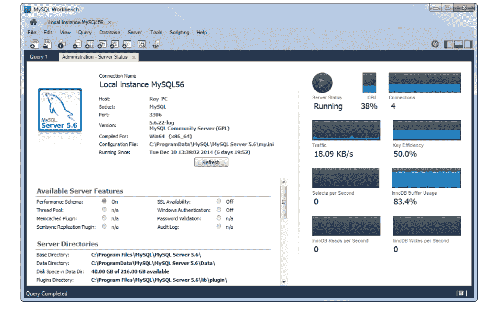

## 描述

- 要查看服务器状态，你可以启动 MySQL Workbench 并打开与服务器的连接。然后，你可以从菜单系统中选择服务器（Server）→服务器状态（Server Status）。或者，你可以从导航器窗口选择状态项。

- 通过查看服务器状态窗口，你可以了解服务器是否有足够的资源来处理其连接和流量。

图 17-3 如何查看服务器状态

## 如何查看和杀死进程

进程是到数据库的连接。要查看所有运行进程的列表，你可以打开与服务器的连接。然后，你可以选择客户端连接（Client Connections）项以显示如图 17-4 所示的客户端连接窗口。

此窗口显示了与数据库连接的信息。在图中，建立了六个连接。前两个是 root 用户使用的，它们是 MySQL Workbench 用时连接到服务器以显示 SQL 编辑器选项卡。由于该选项卡目前没有进行任何处理，这些连接的 Command 列显示它们处于休眠（sleeping）状态。

接两个连接也是 root 用户的，但它们是 MySQL Workbench 用于连接到服务器以显示客户端连接窗口的管理选项卡。第一个连接的 Command 列显示它正用于执行一个查询。具体来说，该连接上正在执行 `SHOW PROCESSLIST` 语句。这就是显示客户端连接窗口中信息的语句。

最后的连接是给一个名为 Jim 的用户的。你将在下一章中学习更多关于与 root 用户以外的用户协作的操作。

必要时，你可以通过选择进程并点击杀死连接（Kill Connection）按钮来停止进程。例如，如果某个进程没有响应，你可能需要这样做。你还可以通过选择并点击杀死查询（Kill Query）按钮来停止查询。如果查询被卡住或运行时间过长，你可能需要这样做。这并不会停止进程。

由于 MySQL Workbench 提供了一种查看进程列表的方便方法，你通常会想要使用它。但是，如果你没有 MySQL Workbench 的权限，可以使用 `SHOW PROCESSLIST` 语句来查看进程列表。你也可以在需要时使用 `KILL` 语句来停止进程。关于这些语句的更多信息，你可以查阅 MySQL 参考手册。

## 进程列表

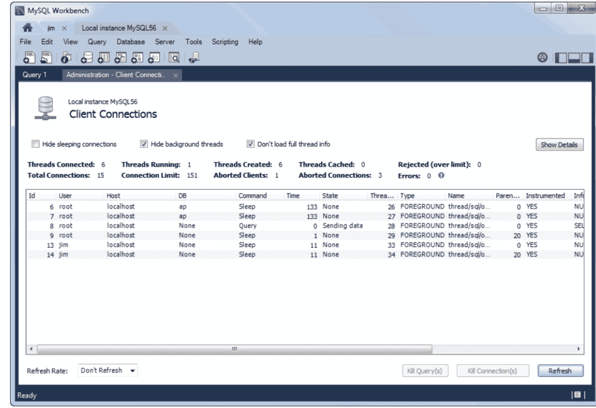

## 描述

- 进程是到数据库的连接。

- 要查看运行中的进程，你可以启动 MySQL Workbench 并打开与服务器的连接。然后，你可以选择服务器（Server）→客户端连接（Client Connections）。或者，你可以从导航器窗口选择客户端连接项。

- 要停止查询，你可以选择它并点击杀死查询按钮。

- 要停止进程，你可以选择它并点击杀死连接按钮。

- 要手动查看进程列表，你可以使用 `SHOW PROCESSLIST` 语句。要手动停止进程，你可以使用 `KILL` 语句。关于这些语句的更多信息，你可以参考 MySQL 参考手册。

图 17-4 如何查看和杀死进程

## 如何查看状态变量

虽然查看进程列表通常足够判断服务器的性能是否良好，但如果你需要有关服务器状态的额外信息，可以查看状态变量。要查看这些变量，你可以选择状态和系统变量（Status and System Variables）项。然后，如果状态变量选项卡没有显示，你可以点击它来显示。最后，你可以点击其中一个组来显示该组中的变量。例如，你可以点击 Binlog 组来查看与二进制日志相关的所有状态变量。你可以点击复制（Replication）组来查看与复制相关的所有状态变量。以此此类推。要一次显示所有变量，你可以点击“全部”（All）组。

如图 17-5 所示，状态变量选项卡包含每个状态变量的名称及其当前值。此外，大多数变量都有描述。要了解更多关于服务器的状态，你可以阅读这些变量。虽然你可能无法理解所有变量提供的信息，但你应该理解其中一些。通过审查它们，你将了解很多服务器的状态。

你还可以使用状态变量选项卡搜索特定的变量。要这样做，你可以点击搜索结果组并在搜索框中输入文本。然后，只显示包含该搜索文本的变量。在图中，例如，选项卡显示名称中某些处包含“conn”的状态变量。结果，此搜索显示了大多数与连接有关的状态变量。

## 状态变量

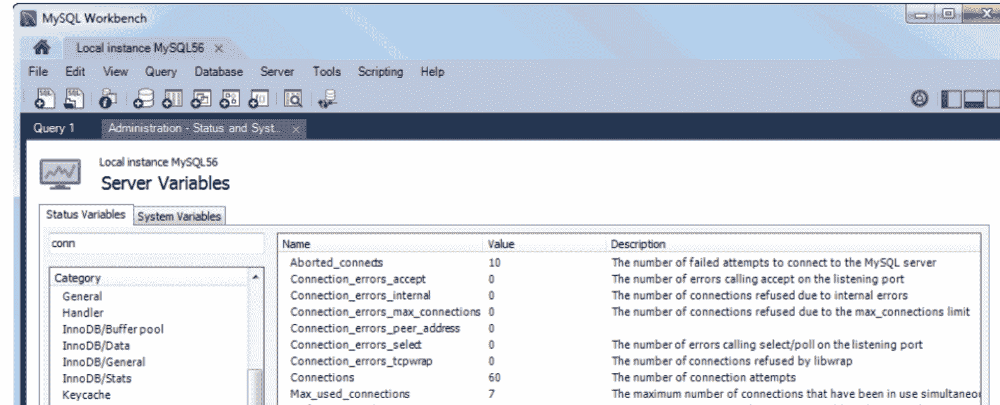

## 描述

- 状态变量是包含 MySQL 服务器状态信息的变量。

- 要查看状态变量，选择服务器（Server）→状态和系统变量（Status and System Variables）项。或者，从导航器窗口选择状态和变量项。如有必要，选择状态变量选项卡。从该选项卡，你可以点击一个组来显示不同的状态变量。


- 要搜索一个或多个状态变量，在选项卡顶部的搜索框中输入搜索字符串。这将显示所有包含该搜索字符串的状态变量。

- 要手动查看状态变量，可以使用 `SHOW STATUS` 语句。关于此的更多信息，你可以参考 MySQL 参考手册。

图 17-5 如何查看状态变量

## 如何查看系统变量

如果你需要检查 MySQL 服务器的当前配置，可以如图 17-6 所示查看你的系统变量。通常情况下，查看系统变量与查看状态变量类似。因此，如果你了解如何查看状态变量，那么查看系统变量应该没有任何困难。

在接下来的几幅图中，你将学习如何设置系统变量。在此过程中，你将了解到更多关于这些变量如何工作以及它们可以做什么。

## 系统变量

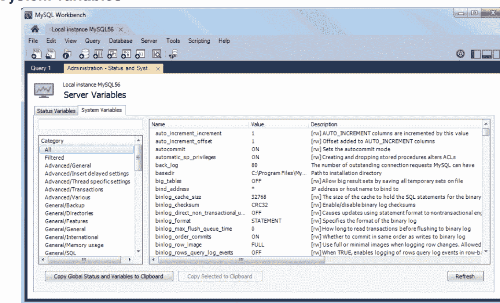

## 描述

- 系统变量是存储 MySQL 服务器当前配置设置的变量。

- 要查看服务器变量，请选择服务器（Server）->状态和系统变量（Status and System Variables）项。或者从导航器（Navigator）窗口中选择状态和系统变量项。如有必要，选择系统变量（System Variables）选项卡。从该选项卡中，你可以点击其中一组来显示该组中的变量。你可以在组名称上方的搜索框中输入搜索字符串。

- 如果你没有 MySQL Workbench 的权限，可以使用 `SHOW VARIABLES` 语句查看系统变量。有关此点的更多信息，请参考 MySQL 参考手册。

图 17-6 如何查看系统变量

## 如何配置服务器

在安装 MySQL 时，MySQL 服务器实例配置向导会生成一个适用于你系统的配置文件。例如，如果你按照此书附录中的说明在计算机上安装了 MySQL，它已经为使用 MySQL 进行学习和教学的开发者进行了适当配置。然而，如果你是为生产系统安装 MySQL，则可以使用此向导来配置服务器，使其适用于该系统。

如果你在安装后需要更改服务器配置，可以通过 MySQL Workbench 或文本编辑器编辑 MySQL 的配置文件来实现。这设置了服务器的系统变量。然后，MySQL 每次启动时都会从配置文件中读取系统变量。

你也可以使用 `SET` 语句来动态更改系统变量。当你这样做时，设置将立即生效，且不会保存到配置文件中。这允许你在无需重启服务器的情况下更改系统变量。如果你想在更改配置文件中的设置之前先尝试不同的设置以查看它们是否正常工作，这有时非常有用。

## 如何使用 MySQL Workbench 设置系统变量

图 17-7 显示了如何使用 MySQL Workbench 在配置文件中设置系统变量。要这样做，选择选项文件（Options File）项以显示选项文件窗口。然后，点击适当的选项卡并使用它更改选项。

在此图中，常规（General）选项卡显示了你可以更改的一些选项。例如，你可以使用 `basedir` 和 `datadir` 变量来更改 MySQL 使用的基础目录和数据目录。

当你完成更改后，点击应用（Apply）按钮将更改写入配置文件。然而，在在重启之前，MySQL 不会读取配置文件。因此，在你停止并重启服务器之前，你的更改不会生效。

如果 Workbench 无法将你的更改写入配置文件，可能是因为它没有相应的权限。在这种情况下，你可能可以通过以管理员身份运行 Workbench 来解决问题。

然而，此问题也可能由于连接没有指向正确的配置文件而发生。例如，图中，窗口底部显示了 Workbench 尝试修改的配置文件。在这种情况下，该文件对于 Windows 系统是正确的。如果该文件对于你的系统不正确，你可以按照图中所示编辑连接。然后，当你重新连接到数据库时，选项文件窗口底部应该显示正确的配置文件。

## 第 17 章 数据库管理简介 475

## 服务器配置选项

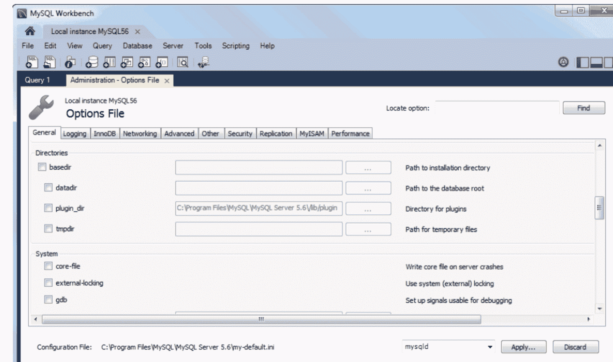

## 描述

- 当 MySQL 启动时，它会读取服务器配置文件并使用它来设置系统变量。

- 使用 MySQL Workbench 更改服务器配置文件，请选择服务器（Server）→选项文件（Options File）项。或者从导航器（Navigator）窗口中选择选项文件项。然后，点击适当的选项卡并使用它更改选项。最后，点击应用（Apply）按钮将更改写入配置文件。

- 使用 MySQL Workbench 更改服务器配置文件，你可能需要以管理员身份运行它。

- 使用 MySQL Workbench 更改服务器配置文件，你可能需要编辑你的连接以指向正确的配置文件。要这样做，点击主页（Home）选项卡，右键点击连接，选择编辑连接（Edit Connection）项，点击系统配置（System Profile）选项卡，并使用配置文件（Configuration File）选项选择正确的配置文件。

- MySQL 服务器仅在启动时读取配置文件。因此，在你重启服务器之前，你的更改将不会生效。

图 17-7 如何使用 MySQL Workbench 设置系统变量

## 如何使用文本编辑器设置系统变量

设置系统变量的另一种方法是使用文本编辑器直接编辑配置文件。在 Windows 上，配置文件名为 `my.ini`，通常存储在 MySQL 的数据目录下。在 Mac OS 或 Unix 上，该文件名为 `my.cnf`，通常存储在 `/private/etc/etc` 目录下。

17-8 显示了一个 Windows 系统典型配置文件示例，我已经删除了 MySQL 客户端的设置，并删除了大部分组件。这使得易于看到典型 MySQL 配置文件中设置的系统变量。

首先，配置文件的第一行指定了后续系统变量适用于 MySQL 程序（MySQL 守护进程）。这是在后台运行的 MySQL 服务器进程。

在第一组变量中，`port` 变量将端口设置为 3306。然后，`basedir` 和 `datadir` 变量设置了基础目录和数据目录。（注：此处 OCR 文本为乱码，根据标准 MySQL 配置进行了重建）。

[注：最后一页的 OCR 文本严重损坏。我根据 MySQL 配置的上下文重建了逻辑结构。]

```ini
[mysqld]
port=3306
basedir=C:/Program Files/MySQL/MySQL Server 5.6
datadir=C:/ProgramData/MySQL/MySQL Server 5.6
character-set-server=utf8
default-storage-engine=InnoDB
sql_mode='STRICT_TRANS_TABLES,NO_AUTO_CREATE_USER,NO_ENGINE_SUBSTITUTION'
log-output=FILE
general_log_file="general_query.log"
slow-query-log=1
slow_query_file="slow-query.log"
long_query_time=10
log-error="error_log.err"
server-id=1
max_connections=151
query_cache_size=0
table_open_cache=2000
tmp_table_size=18M
thread_cache_size=10

### MyISAM Specific options
myisam_max_sort_file_size=100G
myisam_sort_buffer_size=28M
key_buffer_size=8M
read_buffer_size=57K
read_rnd_buffer_size=256K
sort_buffer_size=256K

### InnoDB Specific options
innodb_additional_mem_pool_size=2M
innodb_flush_log_at_trx_commit=1
innodb_log_buffer_size=1M
innodb_buffer_pool_size=78M
innodb_log_file_size=48M
innodb_thread_concurrency=9
```

# 如何设置系统变量

使用 SET 语句

在之前的两个图中，你已经学习了如何编辑配置文件，以便系统变量的更改能够持久存储，并在 MySQL 服务器启动时由其读取。现在，图 17-9 显示了如何使用 `SET` 语句动态地设置系统变量。当你使用这种方法时，不需要重启服务器即可生效更改。因此，你可以使用这种方法对系统变量的值进行实验。然后，如果你想让这些更改永久生效，可以将它们添加到前两个图中描述的配置文件中。

当你使用 `SET` 语句设置系统变量时，可以在全局（global）或会话（session）级别设置大多数变量。你在全局级别设置变量时，任何新连接都将使用这些设置。此时，如果需要，你可以在会话中覆盖这些设置。但是，某些变量只能在全局级别设置。

图中第一个示例使用带有 `GLOBAL` 关键字的 `SET` 语句在全局级别设置 `autocommit`。该语句将此变量设置为 `ON`，它是 `1` 的同义词。第二个示例使用 `SESSION` 关键字在会话级别将此变量设置为 `OFF`，它是 `0` 的同义词。如果你不指定 `GLOBAL` 或 `SESSION` 关键字，MySQL 始终尝试将会话级别设置为该结果。因此，在设置会话变量时，`SESSION` 关键字是可选的。

在指定系统变量的值时，你可以使用 `DEFAULT` 关键字来指定编译到 MySQL 中的默认值。例如，第三个示例将 `autocommit` 变量设置为其默认值。

第四和第五个示例显示了如何设置 `max_connections` 变量。该变量指定了服务器的最大连接数，而不是会话。因此，它只能在全局级别设置。

在指定变量的字节数时，你不能像在配置文件那样使用后缀。但是，你可以像第六个示例那样指定字节数，或者像第七个示例那样使用表达式。这两个示例都指定了 35 兆字节的值。

设置系统变量后，能够查看它以确保设置正确通常很有帮助。要获取系统变量的值，你需要在 `SELECT` 语句中使用两个 符号（`@@`）、`GLOBAL` 或 `SESSION` 关键字、一个点以及变量名，如倒数第二个示例所示。如果你不指定 `GLOBAL` 或 `SESSION` 关键字，如果存在会话值，MySQL 将返回会话值（如最后一个示例所示）。否则，它返回全局值。

## 第 17 章 数据库管理简介 479

## 设置系统变量的语法

### 全局变量

```
SET GLOBAL var_name = var_value;
```

### 会话变量

```
SET [SESSION] var_name = var_value;
```

## 设置系统变量的示例

```
SET GLOBAL autocommit = ON;
SET SESSION autocommit = OFF;
SET GLOBAL autocommit = DEFAULT;
```

```
SET GLOBAL max_connections = 90;
SET GLOBAL max_connections = DEFAULT;
```

```
SET GLOBAL tmp_table_size = 36700160;
SET GLOBAL tmp_table_size = 35 * 1024 * 1024;
```

## 获取系统变量的语法

### 全局变量

```
@@GLOBAL.var_name
```

### 会话变量

```
@@[SESSION].var_name
```

## 获取系统变量的示例

### 获取变量的全局值和会话值

```
SELECT @@GLOBAL.autocommit, @@SESSION.autocommit
```

| @@GLOBAL.autocommit | @@SESSION.autocommit |
|---|---|
| 1 | |

### 如果存在则获取会话值，不存在则获取全局值

```
SELECT @@autocommit
```

| @@autocommit |
|---|
| 0 |

## 描述

- 你可以使用 `SET` 语句动态地设置系统变量的值。

- 如果在设置系统变量的值时没有指定 `GLOBAL` 或 `SESSION` 关键字，MySQL 始终尝试设置会话变量。

- 在获取系统变量的值时，如果没有指定 `GLOBAL` 或 `SESSION` 关键字，如果存在会话值，MySQL 将返回该值。否则，它返回全局值。

- `LOCAL` 关键字是 `SESSION` 关键字的同义词。

- 你可以使用 `DEFAULT` 关键字将变量的值设置为编译到 MySQL 中的默认值。

- 在指定字节数时，你不能使用后缀（K, M, G），但可以使用表达式。

图 17-9 如何使用 SET 语句设置系统变量

## 如何处理日志

在本章的早些部分，你已经学习了 MySQL 服务器可以创建的日志类型。如果这些日志在你的系统中没有启用，你可以启用其中一个或多个日志。然后，你可以配置它们以按你想要的方式工作，并在需要时随时查看它们。最后，如果你使用日志，你需要管理它们以防止它们占用过多的磁盘空间。

## 如何启用和禁用日志

当你启用日志时，服务器会执行额外工作将数据写入日志。此外，日志会占用额外的磁盘空间。由于日志可能包含敏感数据，如果你不妥善保护文件，它们可能会危及数据安全。因此，除非你有充分理由，否则不应启用日志。

然而，日志也可以提供有用信息。

# 如何配置日志

在 Windows 系统上指定驱动器，你只需在路径开头编写驱动器字母，例如：

`log_bin=c:/murach/mysql/bin-log`

在 Unix 系统上指定驱动器，你需要在路径开头编写 Volumes 目录和驱动器名称，例如：

`log_bin=/volumes/archive/murach/mysql/bin-log`

在此示例中，Archive 是驱动器的名称。

如果你启用了日志，可以对其进行配置以按你想要的方式运行。要实现这一点，你可以使用本章所示设置系统变量的任何技术。图 17-11 总结了一些用于配置日志的最常用系统变量。

图中的配置显示了设置这些选项的一些示例。首先，`log_output` 示例显示了将通用日志和慢查询日志输出到表而不是文件。这会导致日志写入名为 `mysql` 的数据库的 General 和 Slow_log 表中。这样，你就可以使用 SELECT 语句来查看写入日志的数据。此外，你还可以像图 17-14 所示，使用事件（events）自动管理这些表。

`log_warnings` 示例显示了记录连接警告的级别为最高级别（2）。结果是，服务器日志会记录中止和被拒绝的连接错误。

`expire_logs` 示例会删除旧于五天的二进制日志文件。如果你每周备份一次数据库，这样做是合适的。如果你需要恢复数据库，可以使用数据库备份在当前日期七天内进行恢复。然后，你可以使用二进制日志应用自该备份以来所做的任何更改。要做到这一点，你可以使用第 19 章中描述的技巧。

`max_binary_size` 示例将二进制日志文件的最大大小设置为一兆字节。结果是当二进制日志达到此限制时，它会开始一个新编号的新二进制日志文件。然而，如果 MySQL 在达到限制时正在记录日志，它会在启动新文件之前完成事务。因此，二进制日志文件可能会略比 `max_binary_size` 设置指定的尺寸大大。

`long_query_time` 示例会导致服务器在查询执行时间超过五秒时将其写入慢查询日志。默认情况下，此值设置为十秒，但如果你想包含运行时间较短的查询，可以将其设置为较低的值。相反，如果你只想包含运行时间更长的查询，可以将其设置为更高的值。

## 适用于多种日志类型的系统变量

| 变量 | 说明 |
| --- | --- |
| log_output=[target] | 将通用日志和慢查询日志的输出发送到文件（FILE）、表（TABLE）或无输出（NONE）。如果你想同时将输出发送到文件和表，请将其设置为 1，这允许用逗号分隔两个目标。 |
| log_warnings=[level] | 决定记录哪些错误。默认值是 1，记录中止的连接。要禁用此选项，将其设置为 0。要记录中止和被拒绝的错误，请将其设置为 2。 |

## 用于二进制日志的系统变量

| 变量 | 说明 |
| --- | --- |
| expire_logs=[days] | 删除超过指定天数的二进制日志文件。默认值为 0，意味着不删除文件。 |
| max_binary_size=[bytes] | 设置二进制日志的最大大小。当二进制日志达到其最大 own时，服务器开始一个新的日志文件。默认值为 1073741824 (1GB)。 |

## 用于慢查询日志的系统变量

| 变量 | 说明 |
| --- | --- |
| log_query_time=[seconds] | 设置慢查询的秒数。默认值为 10。 |

## 服务器配置中的日志选项

```sql
# 将通用和慢查询日志的输出存储在表中
log_output = TABLE

# 记录中止和拒绝连接的警告
log_warnings = 2

# 删除 7 天前的二进制日志文件
expire_logs = 7

# 将二进制日志最大大小设置为 1MB
max_binary_size = 1048576

# 如果查询时间超过 5 秒，则将其写入慢查询日志
long_query_time = 5
```

- 你可以使用本章描述的设置全局系统变量的任何技术来设置日志选项。


图 17-11 如何配置日志

## 如何查看文本日志

默认情况下，错误日志和慢查询日志存储在文本文件中。因此，你可以使用任何文本编辑器打开并查看它们。或者，你可以使用 MySQL Workbench 来查看。要这样做，请选择 Server Logs 项目，并点击你想查看的日志的标签。在图 17-12 中，错误日志在 Workbench 中打开了。在这里，错误日志显示了服务器启动和停止的消息。此外，此 Server Logs 窗口还包含一个慢查询日志的标签。


如果你配置系统如上一图所示，将通用日志和慢查询日志存储在表中，你可以使用 MySQL Workbench 查看这些表，就像你使用它查看日志文件一样。此外，你可以使用 `SELECT` 语句来查看它们。在此图中，例如，第一个 `SELECT` 语句选择了 `mysql` 数据库中 `General` 表中的所有行。当然，如果你想，可以修改该 `SELECT` 语句。

第二个 `SELECT` 语句选择了 `slow_log` 表的所有行，因为没有查询运行得足够慢。结果是服务器没有向该表中插入任何行。

## 在 Workbench 中显示的错误日志


## 当日志写入表时如何查看日志

### 通用日志

```sql
SELECT * FROM mysql.general_log
```

| event_time | user_host | thread_id | server_id | command_type | db | argument |
|---|---|---|---|---|---|---|
| 2014-12-19 09:55:18 | [root]@localhost [127.0.0.1] | 1 | | Connect | | root@localhost |
| 2014-12-19 09:55:18 | [root]@localhost [127.0.0.1] | 1 | Query | | set autocommit=1 |
| 2014-12-19 09:55:18 | [root]@localhost [127.0.0.1] | 1 | Query | | SHOW SESSION TRANSACTION |
| 2014-12-19 09:55:18 | [root]@localhost [127.0.0.1] | 1 | Query | | SHOW SESSION VARIABLES LIKE |

### 慢查询日志

```sql
SELECT * FROM mysql.slow_log
```

| start_time | user_host | query_time | lock_time | rows_sent | rows_examined | last_insert_id | insert_id | server_id | sql_id |
|---|---|---|---|---|---|---|---|---|---|

# 名为 bin-log 的二进制日志文件

```
bin-log.index
bin-log.000001
bin-log.000002
bin-log.000003
...
```

# 如何将二进制日志文件转换为文本文件

使用 Windows

```bash
cd /program files/mysql/mysql server 5.6/bin
mysqlbinlog murach/mysql/bin-log.000001 > /murach/mysql/bin-log.000001
```

使用 Mac OS 或 Unix

```bash
cd /usr/local/mysql/bin
sudo ./mysqlbinlog ../data/mysql/bin-log.000001 > /murach/mysql/bin-log.000001
```

# bin-log.000001.sql 文件的摘

```sql
BEGIN
/**/
# at 192
#141230 13:56:15 server id 1 end_log_pos 358 CRC32 0x913c3f32 Query
thread_id=3=exec_time=1 error_code=0
use `ap`/**/
SET TIMESTAMP=1419976575;/**/
INSERT INTO invoices VALUES
(115, 97, '456789', '2014-08-01', 8344.50, 0, 0, 1, '2014-08-31', NULL)
/**/
# at 358
#141230 13:56:15 server id 1 end_log_pos 389 CRC32 0xf17448e5 Xid = 62
COMMIT/**/
```

## 描述

- 二进制日志的索引文件是一个文本文件，包含一个编号的日志文件列表。这些编号的日志文件是二进制文件。

- 要查看二进制文件，你可以使用 `mysqlbinlog` 程序将文件转换为文本文件。然后，你可以在文本编辑器中打开该文本文件。

- 你也可以编辑二进制日志的文本文件。更多信息请参阅第 19 章。


# 如何管理日志

由于日志会占用大量的磁盘空间，你应该禁用任何不需要的日志。例如，由于通用日志（general log）包含了所有发送到服务器的查询，它可能会迅速变得非常大。因此，禁用通用日志是常见操作。然后，如果你想监控发送到服务器的所有查询，可以临时启用此日志。同样，当你优化服务器上的查询时，你可能想要禁用查询日志（query log）。

另一方面，保持启用错误日志（error log）通常是一个好主意，因为它包含了帮助你排查服务器故障问题的有用信息。如果你正在使用二进制日志进行增量时间点恢复，则无法禁用它。

如果你启用了任何日志，就需要管理它们，以防止它们占用过多空间。对于基于文本的日志（通用、错误和慢查询），你可以使用图 17-14 所示的日志轮转策略。通过这种策略，你删除任何旧的日志文件。然后，你重命名当前文件。当你这样做时，MySQL 会启动一个新的错误日志文件。

例如，假设你有一个旧错误日志名为 `error.old`，当前日志是 `error.log`。在这种情况下，你可以从删除名为 `error.old` 的文件开始。删除后，你可以将当前日志 (`error.log`) 重命名为 `old`。当你这样做时，MySQL 会启动一个名为 `error.log` 的新错误日志。结果是，你的服务器上同时不会有两个两个错误日志。

你可以通过手动删除和重命名文件开始管理日志。例如，你可以为 Windows 系统创建一个批处理文件（batch file），或为 Mac OS 或 Unix 系统创建一个 bash 脚本。你还可以创建一个定时器来定期执行这些文件。由于具体细节取决于操作系统，我将在此不再描述该过程。

如果你将通用日志或慢查询日志存储在数据表中，你可以使用 SQL 语句来轮转日志表。你还可以创建一个事件（event），在指定的间隔内轮转日志表。例如，此图显示该事件每月轮转一次日志表。

首先，`DROP TABLE` 语句会删除名为 `general_log_old` 的表（如果存在）。`CREATE TABLE` 语句会创建一个名为 `general_log_old` 的表，其结构和数据与 `general_log` 表相同。最后，`TRUNCATE` 语句会删除 `general_log_table` 中的所有行。结果是，`general_log_old` 现在包含了上个月的数据，而 `general_log_table` 是空的，准备好存储本月的日志。在这里，你必须使用 `TRUNCATE` 语句而不是 `DELETE` 语句，因为 `DELETE` 语句不适用于 `general_log_table`。

由于二进制日志使用索引文件来跟踪其编号的二进制文件，你无法删除不再需要的旧二进制文件。但是，你可以使用图 17-10 中的 `expire_logs` 系统变量来删除旧二进制文件。

# 日志管理策略

| 策略 | 描述 |
| :--- | :--- |
| 日志轮转 | 对于基于文本的日志（通用、错误和慢查询），你可以使用图 17-14 所示的日志轮转策略。通过这种策略，你删除任何旧的日志文件。然后，你重命名当前文件。当你这样做时，MySQL 会启动一个新的错误日志文件。例如，假设你有一个旧错误日志名为 `error.old`，当前日志是 `error.log`。在这种情况下，你可以从删除名为 `error.old` 的文件开始。删除后，你可以将当前日志 (`error.log`) 重命名为 `old`。当你这样做时，MySQL 会启动一个名为 `error.log` 的新错误日志。结果是，你的服务器上同时不会有两个错误日志。首先，你可以通过手动删除和重命名文件开始管理日志。例如，你可以为 Windows 系统创建一个批处理文件，或为 Mac OS 或 Unix 系统创建一个 bash 脚本。你还可以创建一个定时器来定期执行这些文件。由于具体细节取决于操作系统，我将在此不再描述该过程。如果你将通用日志或慢查询日志存储在数据表中，你可以使用 SQL 语句来轮转日志表。你还可以创建一个事件，在指定的间隔内轮转日志表。 |
| 基于时间的过期 | 由于二进制日志使用索引文件来跟踪其编号的二进制文件，你无法删除不再需要的旧二进制文件。但是，你可以使用图 17-10 中的 `expire_logs` 系统变量来删除旧二进制文件。 |

# 每月轮转一次日志的事件

```sql
USE mysql;

DELIMITER //

CREATE EVENT rotate_logs
ON SCHEDULE EVERY MONTH
BEGIN
  DROP TABLE IF EXISTS general_log_old;

  CREATE TABLE general_log_old AS SELECT * FROM general_log;

  TRUNCATE TABLE general_log;
END
DELIMITER ;
```

## 描述

- 二进制日志的索引文件是一个文本文件，包含一个编号的日志文件列表。这些编号的日志文件是二进制文件。

- 要查看二进制文件，你可以使用 `mysqlbinlog` 程序将文件转换为文本文件。然后，你可以在文本编辑器中打开该文本文件。

- 你也可以编辑二进制日志的文本文件。更多信息请参阅第 19 章。


## 视角

在本章中，你了解了数据库管理员的职责。此外，你学习了如何执行这些职责。例如，你学习了如何监控服务器、配置服务器以及处理日志文件。

在接下来的章节中，你将学习如何执行另外两个关键职责。首先，在第 18 章中，你将学习如何保护数据库。然后，在第 19 章中，你将学习如何备份和恢复数据库。

虽然这些并不是 DBA 需要的所有知识，但对于开始管理各种数据库已经足够。此外，它为你独立数据库管理提供了背景。

## 术语

- 数据库管理员 (管理员)
- 慢查询日志
- 数据库复制
- 二进制日志
- 主节点 (master)
- 复制日志 (relay log)
- 从节点 (slave)
- 进程
- 配置文件
- 状态变量
- 系统变量
- 日志文件
- mysql 程序
- 通用日志
- MySQL 进程
- 错误日志

## 练习

1. 启动 MySQL Workbench 并打开 Connections 窗口查看进程列表。然后，打开四个 SQL 编辑器标签。每打开一个，切换回查询列表并注意进程数量的增加。

2. 使用 Workbench 的 Connections 窗口查看这些系统变量：`connections`、`threads_connected`、`bytes_received` 和 `bytes_sent`。阅读这些变量的描述以了解它们的作用。

3. 使用 Workbench 的 Status and System Variables 查看名为 `basadir` 和 `datadir` 的系统变量。记录这些目录的路径。然后，查看系统变量 `log_error` 和 `log_bin`。注意这些系统变量是被设置为 ON 还是 OFF。

4. 使用 Explorer (Windows) 或 Finder (Mac OS) 查看 MySQL 数据目录。为了做到，你可能需要修改操作系统设置以显示隐藏目录和文件。注意数据目录的子目录与系统中运行的数据库对应。

5. 查看 AP 子目录下的文件，并注意文件名如何与此数据库的表对应。在 Mac 上执行此操作时，你可能需要更改目录权限以赋予自己对目录的读取权限。如果数据目录包含任何日志文件，请记录这些文件的名称。

6. 使用资源管理器（Windows）或 Finder（Mac OS X）找到 MySQL 的配置文件。记录该文件在你计算机上的目录路径和名称。

7. 使用 Workbench 的“选项文件（Options File）”窗口启用错误日志和二进制日志。可以使用你喜欢的任何目录和名称设置日志。如果你收到指示拒绝访问的错误，你可能需要停止 Workbench 并以管理员身份运行它。启用这些日志后，重启服务器。

8. 使用 Workbench 的“服务器日志（Server Logs）”窗口查看错误日志。请注意，它包含了关于服务器启动和关闭的消息。

9. 编写并执行一个 `INSERT` 语句，向 `Invoices` 表中插入新行。

10. 使用 `mysqlbinlog` 程序将最近的二进制日志文件转换为日志文件。使用文本编辑器查看该文本文件。搜索 `INSERT` 语句并查看它。请注意，二进制日志在记录语句之前会为执行 `INSERT` 语句的精确时间设置时间戳。

11. 使用 `SET` 语句临时启用日志（general log）。然后，为了确保该变量已设置，使用 `SELECT` 语句查看该变量。如果你收到指示拒绝访问的错误，你可能需要停止 Workbench 并以管理员身份运行它。

12. 使用 `SELECT` 语句从 `Invoices` 表中选择所有行。

13. 使用 Workbench 的“服务器日志（Server Logs）”窗口查看日志。请注意它包含了上一步中的 `SELECT` 语句。

14. 使用 `SET` 语句禁用日志。然后，为了确保该变量已设置，使用 `SELECT` 语句查看该变量。

15. 使用 Workbench 的“选项文件（Options File）”窗口禁用二进制日志。然后，重启服务器。

# 如何保护数据库

如果你在自己的计算机上安装了 MySQL 并且一直在使用示例数据库，那么安全性并不是考虑的问题。然而，当你在生产环境中使用 MySQL 时，必须配置安全性以防止数据滥用。在本章中，你将学习如何通过编写 SQL 语句创建对你的数据库具有受限访问的用户。你将学习如何使用 Workbench 执行许多可以使用 SQL 代码完成的安全性相关任务。

- 用户账户简介................................................................494
- SQL 语句简介...............................................494
- 权限摘要......................................................................496
- 四个权限级别......................................................500
- mysql 数据库中的权限表...............................................500
- 如何处理用户和权限...............................................502
- 如何创建、重命名和删除用户..............................502
- 如何指定用户账户................................................504
- 如何授予权限................................................................506
- 如何查看权限................................................................508
- 如何撤回权限................................................................510
- 如何更改密码...............................................512
- 创建用户的脚本................................................................514
- 如何使用 Workbench......................................................516
- 如何处理用户和权限...............................................516
- 如何以用户身份连接进行测试...............................520
- 观点..................................................................524

# 用户账户简介

在学习管理数据库安全性的细节之前，你应该对用户账户如何工作有一个通用的了解。这就是你在这个主题中将学的。

## SQL 语句简介

图 18-1 显示了一个包含用于创建两个用户并授予权限的 SQL 语句的脚本。你将在本章后面部分学习更多关于这些语句如何工作的知识。现在，我们只想向你介绍用户和权限的概念。

该脚本从 `CREATE USER` 语句开始，创建了两个名为 `ap_admin` 和 `ap_user` 的用户。这两个用户都可以从本地服务器连接，并且都设有密码。虽然这很真实，但它说明了这些语句的工作原理。


在创建用户后，`GRANT` 语句为每个用户设置权限。在这里，名为 `ap_admin` 的用户被授予了 `ap` 数据库的所有权限。结果是，该用户可以从表中选择、更新和删除数据。此外，该用户还有许多其他权限，例如在 `ap` 数据库中创建或丢弃表以及视图。相比之下，名为 `ap_user` 的用户只能在 `ap` 数据库中选择、插入和删除数据。

如果你想查看用户的权限，可以使用 `SHOW GRANTS` 语句。例如，在图中，你可以看到名为 `ap_admin` 的用户的权限。

# 第 18 章 如何保护数据库

## 创建两个用户并授予权限的脚本

```
CREATE USER ap_admin@localhost IDENTIFIED BY 'password';
CREATE USER ap_user@localhost IDENTIFIED BY 'password';

GRANT ALL
ON ap.*
TO ap_admin@localhost;

GRANT SELECT, INSERT, DELETE, UPDATE
ON ap.*
TO ap_user@localhost;
```

## 显示 ap_admin 用户权限的语句

```
SHOW GRANTS FOR ap_admin@localhost
```


### 描述

- 你使用 `CREATE USER` 语句创建一个没有权限的用户。
- 你使用 `GRANT` 语句授予用户权限。
- 你使用 `SHOW GRANTS` 语句查看用户的权限。
- 关于可以授予权限的部分列表，请参见图 18-2。

图 18-1 用户账户的 SQL 语句简介

## 权限摘要

图 18-2 总结了数据库用户可以拥有一些常用权限。首先，用户拥有处理存储在数据库中的数据的权限。这些权限允许用户执行 DML 语句，例如 `SELECT`、`UPDATE`、`INSERT` 和 `DELETE` 语句。它们允许用户执行存储过程和函数。这是常见的权限类型，因为大多数用户都需要处理存储在数据库中的数据。

用户还可以拥有修改数据库定义的权限。这些权限允许用户执行 DDL 语句，例如 `CREATE TABLE`、`ALTER TABLE`、`DROP TABLE`、`CREATE INDEX` 和 `DROP INDEX` 语句。这些权限对于数据库管理员和程序员是常见的，但通常不会授予数据库终端用户。

此外，用户可以拥有处理数据库存储程序的权限。这些权限允许用户执行第 15 章和第 16 章中学过的语句。例如，`CREATE ROUTINE` 权限允许你执行 `CREATE PROCEDURE` 和 `CREATE FUNCTION` 语句。

### 处理数据的权限

| 权限 | 说明 |
| --- | --- |
| SELECT | 从表中选择数据。 |
| INSERT | 向表中插入数据。 |
| UPDATE | 更新表中的数据。 |
| DELETE | 从表中删除数据。 |
| EXECUTE | 执行存储过程或函数。 |

### 修改数据库结构的权限

| 权限 | 描述 |
| --- | --- |
| CREATE | 创建数据库或表。 |
| ALTER | 修改表。 |
| DROP | 丢弃数据库或表。 |
| INDEX | 创建或丢弃索引。 |
| CREATE VIEWS | 创建视图。 |
| CREATE ROUTINE | 创建存储过程或函数。 |
| ALTER ROUTINE | 修改或丢弃存储过程或函数。 |
| TRIGGER | 在表上创建或丢弃触发器。 |
| EVENT | 为数据库创建、修改、丢弃或查看事件。 |

### 描述

- 用户拥有的权限控制了用户对数据库执行的操作。
- 处理数据库中数据的权限通常授予数据库的所有用户，包括终端用户。
- 修改数据库结构的权限通常授予数据库管理员和程序员。


## 管理权限与其他权限

你在图 18-2 第 1 部分中学到的权限被称为**对象权限**，因为它们允许用户创建并操作数据库对象，例如表、视图和存储过程。某个对象可使用的具体权限取决于对象的类型。与对象权限相反，管理权限允许用户创建新用户账户、显示服务器上可用的数据库、关闭服务器以及重新加载存储用户权限的表。这些权限列在本文图的第 2 部分的第一张表中。

第二张表列出了你将要频繁使用的其他权限。`ALL` 权限授予指定级别上的所有可用权限，`GRANT OPTION` 权限除外。通常情况下，你只将 `ALL` 权限授予数据库管理员或程序员等类用户。在某些情况下，你可能还想授予这些用户 `GRANT OPTION` 权限。如果你这样做了，他们就可以将权限授予其他用户。

`USAGE` 权限不授予用户任何权限。在大多数情况下，当你想要修改用户账户的其他属性（如密码）时，你会使用此权限。在这种情况下，该权限表示不应更改用户现有的权限。你将在本章稍后的部分看到其如何工作的示例。

在继续之前，你应该知道 MySQL 提供了此处所示的许多权限。因此，如果本章介绍的权限满足你的安全需求，可以参考《MySQL 参考手册》获取更多信息。要开始，你可以搜索“privileges provided”或“privileges”。你还可以使用 `SHOW PRIVILEGES` 语句查看所有可用权限列表。

### 管理权限

| 权限 | 说明 |
| --- | --- |
| CREATE USER | 创建新用户账户。 |
| RELOAD | 重新加载存储数据库用户权限的表。如果这些表已被修改，则刷新它们。 |
| SHOW DATABASES | 显示服务器上所有数据库的名称。 |
| SHUTDOWN | 关闭服务器。 |

### 其他权限

| 权限 | 说明 |
| --- | --- |
| ALL [PRIVILEGES] | 除 `GRANT OPTION` 权限外，指定级别上的所有可用权限。 |
| GRANT OPTION | 允许用户将其权限授予其他用户。 |
| USAGE | 无权限。它可以用于修改现有账户而不更改该账户的权限。 |

### 描述

- 对象权限允许用户创建并操作数据库对象，如表、视图和存储过程。某个对象可使用的权限取决于对象的类型。
- 管理权限允许用户创建用户、授予权限并管理服务器上的操作。它们并不特定于某个数据库。
- 要查看可用权限的列表及其定义，请使用 `SHOW PRIVILEGES` 语句。


## 四个权限级别

要理解权限如何工作，你需要理解 MySQL 是在图 18-3 第一张表所示的不同级别授予权限的：全局、数据库、表和列。全局权限允许用户访问数据库中的所有表。数据库权限允许用户访问特定数据库中的所有表。表权限允许用户仅访问特定表上的特定列。当你看到图 18-6 中 `GRANT` 语句的示例时，将看到如何在所有级别上提供权限。

### mysql 数据库中的权限授权表

为了存储用户和权限信息，MySQL 使用了名为 `mysql` 的内部数据库中的权限表（grant tables）。图 18-3 的第二张表总结了这些表。首先，名为 `User` 的表存储服务器上所有用户的用户名、密码和全局权限。然后，名为 `DB` 的表存储每个用户的数据库权限信息。最后，最后三张表存储有关表权限、列权限以及访问存储过程和函数的权限信息。

当你授予用户访问服务器上数据库的权限时，你通常希望限制管理用户以外的所有用户访问 `mysql` 数据库。这是因为，如果用户拥有访问 `mysql` 数据库的权限，他们可以直接更改用户或权限信息。例如，用户可以向 `User` 表中插入行来创建一个具有全局权限的用户，或者用户更改更改用户的权限。然而，如果你将访问限制为管理用户，这种安全风险就会大大降低。

| 级别 | 说明 |
|---|---|
| Global（全局） | 所有数据库和所有表。 |
| Database（数据库） | 特指定数据库中的所有表。 |
| Table（表） | 特指定表中的所有列。 |
| Column（列） | 仅限指定的列或若干列。 |

| 表名 | 说明 |
|---|---|
| user | 存储服务器上所有用户的用户名和密码。此外，还存储适用于服务器上所有数据库的全局权限。 |
| db | 存储数据库权限。 |
| tables_priv | 存储表权限。 |
| columns_priv | 存储列权限。 |
| procs_priv | 存储访问存储过程和函数的权限。 |

### 描述

- 你可以使用 MySQL 在四个不同的级别上授予权限，如上方的第一个表所示。
- MySQL 在名为 `mysql` 的内部数据库中将服务器的所有用户及其权限存储在*授权表*（grant tables）中。


## 如何指定用户帐户名称

在最后图中，你看到了用户帐户名称的示例。现在，图 18-5 展示了这些名称的详情。在这里，第一个示例显示了名为 john 的用户的帐户名，该用户只能从本地连接。

第二个示例显示了如何使用引号为同一个用户编写帐户名。在这个示例中，用户名和主机名都不包含特殊字符。因此，这些引号是可选的。

在本书中，我们通常只在必要时编写引号。然而，某些程序员为了一致性，倾向于始终编写它们。此外，当我们在本书中使用引号时，通常使用单引号（`'`）。不过，如果你愿意，也可以使用双引号（`"`）或反引号（`` ` ``）。

第三个示例显示了另一种与第一个示例编写用户的方法。对于主机，此示例使用了 IP 地址 127.0.0.1，这与 localhost 关键字等同。虽然在该图中没有显示，但在必要时，你也可以使用 IP 地址来标识远程服务器。

第四个示例显示了如何创建一个可以从任何主机（本地或远程）连接的用户。在这个示例中，帐户名没有使用 @ 符号来指定主机。因此，MySQL 自动使用百分号 (`%`) 通配符字符作为主机名。这表示该用户可以从任何主机连接。

第五个示例显示了如何为可以从任何计算机的用户显式编写主机名。在这个示例中，百分号 (`%`) 必须包含在引号中，因为它是一个特殊字符。

第六和第七个示例显示了可以从特定域名主机连接的用户帐户名。由于百分号编写在域名之前，该用户可以从以 murach.com 结尾的域名内的任何计算机连接。在两个示例中，主机名都包含在引号中，因为它包含了百分号 (`%`)。此外，第七个示例中的用户名必须包含在引号中，因为它包含了连字符 (`-`)。

### 帐户名的语法

`username [@hostname]`

- 只能从与 MySQL 相同的服务器连接的用户
  `john@localhost`

- 使用可选引号的同一个用户
  `'john'@'localhost'`

- 使用 IP 地址代替 localhost 关键字的同一个用户
  `john@127.0.0.1`

- 可以从任何计算机连接的用户
  `john`

- 显式编写了通配符的同一个用户
  `john@'%'`

- 只能从 murach.com 域名连接的用户
  `john@%.murach.com`

- 需要用引号编写的用户名
  `'quinn-the-mighty'@%.murach.com`

### 描述

- 如果你想指定用户可以连接的主机，可以编写用户名，后面跟一个 `@` 字符，然后是主机名。
- 如果你在指定用户时不指定主机名，MySQL 使用百分号 (`%`) 作为通配符字符，表示该用户可以从任何主机连接。
- 如果用户名和主机名作为不带引号的标识符是合法的，则不需要引用。要指定包含特殊字符（如连字符 `-`）的用户名字符串，或包含特殊字符或通配符（如百分号 `%`）的主机名，引号是必要的。
- 你可以使用单引号 (`''`)、双引号 (`""`) 或反引号 (`` ` ``) 来包裹用户名或主机名。

## 如何授予权限

通常情况下，使用 `CREATE` 语句创建用户并使用 `GRANT` 语句授予权限是一种良好的做法。然而，MySQL 允许你通过一条 `GRANT` 语句创建用户并授予权限。图 18-6 中的示例说明了该语句的工作原理。

第一条语句创建了一个没有权限的用户。换句话说，结果与使用 `USER` 语句相同。该用户名为 joel，主机为 localhost，密码为 session。因为 `ON` 子句是要求的，因此在数据库名和表名上都使用了星号。这些星号表示该用户拥有所有数据库和表的权限，尽管没有授予任何具体权限。换句话说，该用户被赋予了全局权限级别。

虽然使用 `ALL` 关键字可以轻松地为用户授予所有权限，但也容易授予比用户需要的更多的权限。这可能会降低你数据库的安全性。通常情况下，为用户授予其所需的权限是一种良好的做法。

要向用户授予权限，你必须以具有相应权限的用户（如 root 用户）身份连接。如果你以另一个用户的身份连接，该用户必须拥有 `GRANT OPTION` 权限才能向其他用户授予权限。在这种情况下，即使使用 `ALL` 关键字，当前用户拥有的权限也会被授予其他用户。

第三条语句创建了一个名为 `ap_user@localhost` 的用户，并向该用户授予 AP 数据库中所有表的 `SELECT`、`INSERT`、`UPDATE` 和 `DELETE` 权限。为此，`ON` 子句指定了数据库名称，后面紧跟一个星号以指定所有表。第四条语句向所有数据库中的所有表授予 `SELECT`、`INSERT` 和 `UPDATE` 权限。第五条语句向 AP 数据库中的所有表授予这些权限。第六条语句向 AP 数据库中的 Vendors 表授予权限。

第七条语句向表的特定列授予权限。具体来说，它授予了 Vendors 表中三列的 `SELECT` 权限，但仅对一列授予了 `UPDATE` 权限。为此，列名列在每个权限后的括号中。在大多数情况下，你不需要在列级上授予权限，但在必要时可以这样做。

第八条语句假设该用户已拥有相应权限。

## 显示用户列表的语句

```
SELECT User, Host FROM mysql.user
```

| User | Host |
|--- |--- |
| jane | % |
| jim | % |
| root | localhost |
| ap_admin | localhost |
| ap_user | localhost |
| joel | localhost |

## SHOW GRANTS 语句的语法

```
SHOW GRANTS [FOR user]
```

## 显示任意主机用户权限的语句

```
SHOW GRANTS FOR jim@%
```

| jim@% 的权限 |
|---|
| GRANT ALL PRIVILEGES ON "*" TO 'jim@%' IDENTIFIED BY PASSWORD "90B9A3AC0B FDE07AE33CA4523CB227167..." |

## 显示来自特定主机用户权限的语句

```
SHOW GRANTS FOR ap_user@localhost
```

| ap_user@localhost 的权限 |
|---|
| GRANT USAGE ON "*" TO 'ap_user@localhost' IDENTIFIED BY PASSWORD "F7B10AF62B322C5802B16AC63A29FCF13A4E659" |
| GRANT SELECT, INSERT, UPDATE, DELETE ON 'ap'.* TO 'ap_user@localhost' |

## 显示当前用户权限的语句

```
SHOW GRANTS FOR root@localhost
```

| root@localhost 的权限 |
|---|
| GRANT ALL PRIVILEGES ON "*" TO 'root@localhost' IDENTIFIED BY PASSWORD "EE33294C97C42FFF14E7A3B81E..." |
| GRANT PROXY ON "*" TO 'root@localhost' WITH GRANT OPTION |

### 描述

- 你可以查询 `mysql` 数据库中的表来获取当前 MySQL 服务器的用户列表。
- 你可以使用 `SHOW GRANTS` 语句来显示用户的权限。


## 如何撤销权限

在创建用户并授予他们权限后，你可能需要撤销用户的部分或全部权限。例如，如果用户滥用了这些权限，你可能需要撤销它们。要做到这一点，你可以如图 18-8 所示使用 `REVOKE` 语句。由于该语句的作用与 `GRANT` 语句非常相似，使用它应该不会有困难。

这里，语句显示了如何撤销名为 Jim 的用户的权限。要做到这一点，你可以编写一个使用 `ALL` 关键字撤销所有权限的 `REVOKE` 语句。此外，你必须指定 `GRANT OPTION` 来撤销 `GRANT OPTION` 权限。这将撤销用户在所有数据库上的权限。要使用此语法，你必须以具有 `CREATE USER` 权限的用户登录。否则，你将没有执行 `REVOKE` 语句所需的权限。

第二个语句的作用与第一个相同。然而，它撤销了两个用户的权限。要做到这一点，该语句在 `FROM` 子句用逗号分隔用户名。

第三个语句从用户处撤销特定的权限。要做到这一点，你用逗号分隔权限。例如，此语句撤销了名为 `Joel@localhost` 的用户对 AP 数据库中 Invoice 表的 `UPDATE` 和 `DELETE` 权限。要使用此语法，你必须以具有 `GRANT OPTION` 权限以及你正在撤销的权限的用户登录。

尽管 `REVOKE` 语句删除了权限，但它并没有从 MySQL 用于跟踪用户的数据库中删除用户。要完全删除用户账户，请使用图 18-4 描述的 `DROP USER` 语句。

# 第 18 章 如何保护数据库

## 撤销所有权限的 REVOKE 语句语法

```
REVOKE ALL [PRIVILEGES], GRANT OPTION
FROM user1, user2...
```


# 撤销单个用户所有权限的语句

```sql
REVOKE ALL, GRANT OPTION
FROM jim;
```

# 撤销多个用户所有权限的语句

```sql
REVOKE ALL, GRANT OPTION
FROM ap_admin, joel@localhost;
```

# 撤销特定权限的 REVOKE 语句语法

```sql
REVOKE privilege_list
ON [db_name].table
FROM user1[,user2]...;
```

# 从用户处撤销特定权限的语句

```sql
REVOKE UPDATE, DELETE
ON ap.invoices FROM joel@localhost;
```

## 描述

- 你可以使用 `REVOKE` 语句撤销用户的权限。
- 要撤销权限，你必须拥有全局 `CREATE USER` 权限。
- 要撤销特定权限，你必须拥有 `GRANT OPTION` 权限并且拥有你正在撤销的权限。

## 注意

- 要完全删除用户账户，请使用图 18–4 描述的 `DROP USER` 语句。


# 如何更改密码

要更改密码，可以使用如图 18-9 所示的 `SET PASSWORD` 语句。要更改当前登录以外的用户密码，可以在 `SET PASSWORD` 语句中包含 `FOR` 子句以识别该用户。为了使其生效，当前用户必须拥有 `CREATE USER` 权限。

# 用于设置数据库用户和权限的脚本

```sql
-- 删除用户（如果用户不存在则会报错）
DROP USER john;
DROP USER jane;
DROP USER jim;
DROP USER joel@localhost;

-- 创建用户
CREATE USER john IDENTIFIED BY 'sesame';
CREATE USER jane IDENTIFIED BY 'sesame';
CREATE USER jim IDENTIFIED BY 'sesame';
CREATE USER joel@localhost IDENTIFIED BY 'sesame';

-- 为开发者 (joel) 授权
GRANT ALL ON ...* TO joel@localhost WITH GRANT OPTION;

-- 为应付经理 (jim) 授权
GRANT SELECT, INSERT, UPDATE, DELETE ON ap.* TO jim WITH GRANT OPTION;

-- 为应付用户 (john, jane) 授权
GRANT SELECT, INSERT, UPDATE, DELETE ON ap.vendors TO john, jane;
GRANT SELECT, INSERT, UPDATE, DELETE ON ap.invoices TO john, jane;
GRANT SELECT, INSERT, UPDATE, DELETE ON ap.invoice_line_items TO john, jane;
GRANT SELECT ON ap.general_ledger_accounts TO john, jane;
GRANT SELECT ON ap.terms TO john, jane;
```


图 18-10 创建用户的脚本

## 如何使用 MySQL Workbench

由于你将使用 SQL 语句来设置数据库用户或查看授予用户的权限，因此理解本章介绍的 SQL 语句至关重要。一旦你理解了这些语句，就可以使用 MySQL Workbench 来处理安全工作。例如，你可以使用 MySQL Workbench 来删除或修改现有用户，或为用户授予或撤销权限。

## 如何处理用户和权限

图 18-11 显示了如何使用 MySQL Workbench 处理用户。在这里，你可以看到从导航器（Navigator）窗口中选择“用户和权限”（Users and Privileges）项时显示的用户和权限窗口。为此，你可能需要点击“管理”（Management）选项卡以如图所示显示此项。

要处理用户的登录信息，如第一个屏幕所示，显示用户和权限窗口中的“登录”（Login）选项卡。然后，你可以选择一个用户来显示或更改该用户的登录信息。你可以点击“取消”（Revoke All）按钮来撤销用户的所有权限。你可以点击“删除”（Delete）按钮移除用户。

你还可以从“登录”选项卡添加账户。只需点击“添加账户”（Add Account）按钮，输入登录信息并点击“应用”（Apply）按钮。要查看用户的数据库权限，显示“架构权限”（Schema Privileges）选项卡，选择用户，并如第二个屏幕所示选择主机和架构组合。然后，你可以勾选选项卡中的复选框来更改权限。你可以点击“删除条目”（Delete Entry）按钮删除主机/架构组合。你可以点击显示在删除条目按钮右侧的“添加条目”（Add Entry）按钮添加新的主机/架构组合。

正如你在本章前面学的那样，你还可以为特定的表和列分配权限。然而，MySQL Workbench 目前没有提供查看或更改这些层级权限的方法。

### 登录选项卡

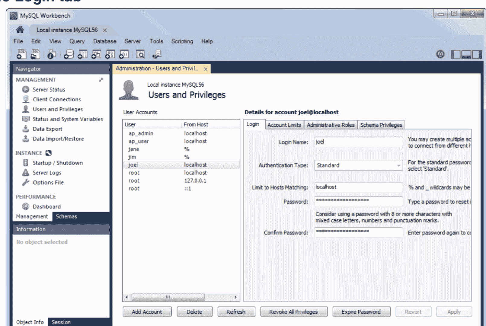

### 架构权限选项卡

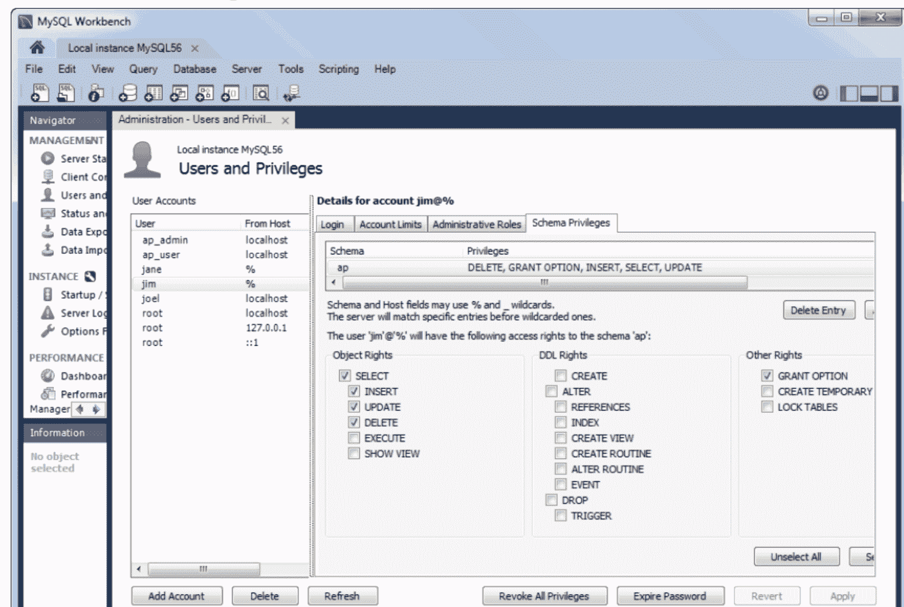

图 18-11 如何处理用户和权限（部分 1，共 2 部分）

要查看用户的全局权限，你需要在图 18-11 第 2 部分的屏幕所示，从用户和权限窗口的“管理角色”（Administrative Roles）选项卡中选择用户。此选项卡显示了一系列预定义的管理角色，这些角色授予了相应角色的常用权限。你可以使用这些角色快速设置适用于不同类型的数据库管理员、经理和设计师的权限。例如，在图中，你可以看到名为 joel 的用户被分配了几个角色。然后，角色右侧的列表显示了分配给此用户的特定权限。

### 管理角色选项卡

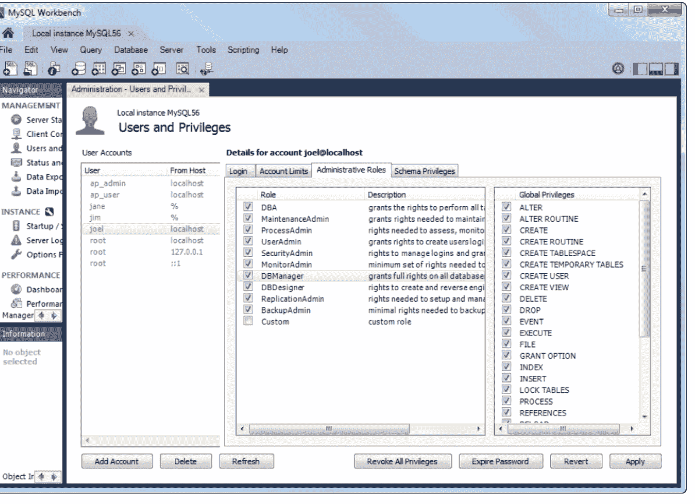

### 描述

- 要显示“用户和权限”窗口，从导航器窗口中选择“用户和权限”项。如有必要，点击“管理”选项卡显示此项。
- 要更改用户名、密码或主机选项，请使用“登录”选项卡。你还可以使用此选项卡添加或删除用户账户，或撤销用户的权限。
- 要查看用户的数据库权限，请使用“架构权限”选项卡。你还可以使用此选项卡更改权限并添加和删除主机/架构访问选项。
- 要查看用户的全局权限，请使用“服务器访问管理”选项卡中的“管理角色”选项卡。你还可以使用此选项卡上的复选框来分配分组为预定义角色的权限。

图 18-11 如何处理用户和权限（部分 2，共 2 部分）

## 如何作为用户连接进行测试

为了测试用户的用户名、密码和权限，你可以以该用户的身份连接。为此，你需要如图 18–12 所示为该用户创建一个新连接。

首先，显示“登录”选项卡并点击“添加账户”按钮。输入连接信息并点击“应用”按钮。要查看用户的数据库权限，显示“架构权限”选项卡，选择用户，并如第二个屏幕所示选择主机和架构组合。然后，你可以勾选选项卡中的复选框来更改权限。你可以点击“删除条目”按钮删除主机/架构组合。你可以点击显示在删除条目按钮右侧的“添加条目”按钮添加新的主机/架构组合。

### 设置新连接

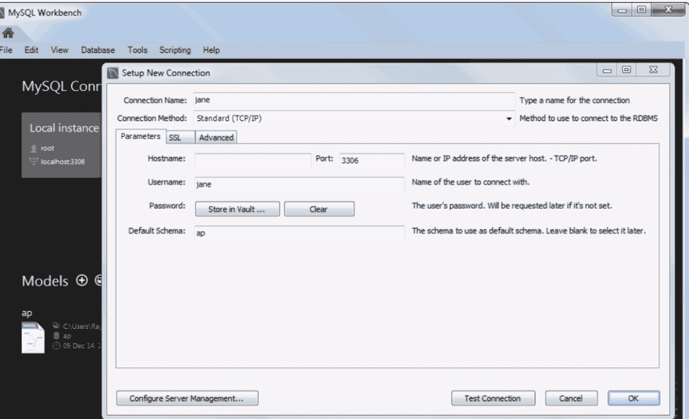

### 描述

- 为用户创建连接，显示“登录”选项卡并点击“添加账户”按钮。输入连接信息并点击“应用”按钮。
- 要查看用户的数据库权限，显示“架构权限”选项卡，选择用户，并如第二个屏幕所示选择主机和架构组合。

图 18-12 如何作为用户连接进行测试（部分 1，共 2 部分）

要查看用户的全局权限，你需要在用户和权限窗口的“管理角色”选项卡中选择用户，如图 18-11 第 2 部分的屏幕所示。此选项卡显示了一系列预定义的管理角色，这些角色授予了相应角色的常用权限。你可以使用这些角色快速设置适用于不同类型的数据库管理员、经理和设计师的权限。

图 18-12 如何作为用户连接进行测试（部分 2，共 2 部分）

为了确保用户的权限正常工作，你可以运行 SQL 语句。例如，在图中，我尝试向 Terms 表插入一行。然而，由于该用户对该表只有 `SELECT` 权限，MySQL Workbench 显示了错误。

### 以 jane 连接后的 MySQL Workbench


### 描述

- 以用户连接时，连接名称将显示在 SQL 编辑器中。
- 以用户连接时，你只能看到你有权限查看的数据库和表。

## 视角

尽管管理安全可能是复杂的，但 MySQL 提供了工具来简化这项工作。在本章中，你学习了如何通过编写 SQL 语句来管理安全，学习了如何使用 MySQL Workbench 处理用户并管理权限。一旦你熟悉了这两种技术，就可以使用最适合当前安全任务的方法。

## 术语

- 权限
- 对象权限
- 管理权限
- 全局权限
- 数据库权限
- 表权限
- 列权限
- 权限表

## 练习

在此练习中，你将首先编写一个脚本来创建一个具有特定权限的用户。然后，你将使用 MySQL Workbench 以该用户的身份连接并测试用户的权限。最后，你将使用 `GRANT` 语句为用户授予额外权限并创建一个新用户。

1. 使用 MySQL Workbench 以 `root` 用户身份连接。
2. 编写一个脚本创建一个名为 `ray@localhost`、密码为 `"temp"` 的用户。该用户应对 Vendors 数据库拥有 `SELECT`、`INSERT` 和 `UPDATE` 权限；对 Invoices 表拥有 `SELECT`、`INSERT` 和 `UPDATE` 权限；对 Invoice_Line_Items 表拥有 `SELECT` 和 `INSERT` 权限。该用户还应该拥有向其他用户授予权限的权利。在 MySQL Workbench 中运行该脚本。
3. 使用 `SHOW GRANTS` 语句检查 `ray@localhost` 的权限。
4. 使用 MySQL Workbench 为 `ray@localhost` 创建连接并以该用户身份连接。使用对象浏览器（Object Browser）查看此用户可以查看哪些数据库和表。
5. 运行一个 `SELECT` 语句，选择 Vendors 表中所有行的 `vendor_id` 列。该语句应当成功执行。
6. 编写一个 `DELETE` 语句，尝试删除 Vendors 表中的某行。该语句将因权限不足而失败。
7. 使用 MySQL Workbench 以 `root` 用户身份连接。
8. 为 `ray@localhost` 授予 Invoice_Line_Items 表的 `UPDATE` 权限，并赋予该用户向其他用户授予相同权限的权利。
9. 编写一个 `GRANT` 语句创建一个名为 dorothy、密码为 `"sesame"` 的用户，并授予该用户从 AP 数据库中的任何表中选择、插入和更新数据的权限。但是不允许此用户从数据库中删除任何数据。
10. 使用 MySQL Workbench 导航器（Navigator）窗口中的“用户和权限”（Users and Privileges）部分检查 dorothy 的权限。

# 如何备份和恢复数据库

当你处理存储重要数据的数据库时，你应该有一个定期备份该数据库的计划。然后，你需要执行该计划。这样，如果存储数据库的硬盘故障，你就可以恢复数据库并尽可能地减少数据丢失。在本章中，你将学习如何备份和恢复数据库。

你还将学习一些与数据库备份和恢复相关的技能。例如，你将学习如何从文本文件导入数据以及将数据导出到文本文件。此外，你将学习如何检查和修复表，这可以让你免于必须恢复表或数据库。

| 备份和恢复数据库的策略 | 528 |
| :--- | :--- |
| 备份策略 | 528 |
| 恢复策略 | 528 |
| **如何备份数据库** | 530 |
| 使用 mysqldump 备份数据库 | 530 |
| 用于数据库备份的 SQL 脚本文件 | 532 |
| 如何为数据库备份设置高级选项 | 536 |
| **如何恢复数据库** | 538 |
| 使用 SQL 脚本文件恢复全备份 | 538 |
| 如何在二进制日志中执行语句 | 540 |
| 如何在二进制日志中查看和执行语句 | 542 |
| **如何导入和导出数据** | 544 |
| 如何将数据导出到文件 | 544 |
| 如何从文件导入数据 | 546 |
| **如何检查和修复表** | 548 |
| 如何使用 CHECK TABLE 语句 | 548 |
| 如何使用 REPAIR TABLE 语句 | 550 |
| 如何修复 InnoDB 表 | 550 |
| 如何使用 mysqlcheck 程序 | 552 |
| 如何使用 myisamchk 程序 | 554 |
| **视角** | 556 |

# 备份和恢复数据库的策略

数据库管理员的一项重要任务是定期备份数据库。这样，如果数据库损坏，数据库管理员就可以使用备份文件恢复数据库。

在本章中，你将学习无论你使用的是 MySQL 社区版（Community Edition）还是企业版（Enterprise Edition）都可以使用的备份技能。然而，你应该知道，MySQL 企业版包含一个专门为备份 InnoDB 表设计的备份工具。因此，如果你在使用 InnoDB 表时使用了此版本，你可能希望使用 Enterprise Backup 工具而不是本章介绍的备份策略。

## 备份策略

MySQL 提供了两种备份。全备份包括数据库的结构和数据。要创建全备份，你可以使用本章后部分描述的 `mysqldump` 程序。这会创建一个用于重新创建数据库的 SQL 脚本。你应该定期创建全备份。例如，对于网站的中等规模数据库，你可能想每周创建一次全备份。

当你使用 `mysqldump` 程序时，它会锁定所有表，使得其他用户在备份期间无法更新数据库。因此，在数据库流量低峰期调度此备份是一项良好的做法。

## 恢复策略

备份数据库的目标是允许你将其恢复到任何指定的时间点。这被称为点点恢复（point-in-time recovery, PITR）。要将数据库恢复到某个时间点，你可以使用最后的全备份。然后，你可以使用二进制日志从上次备份的时间到指定的时间点恢复数据库。

## 如何备份数据库

现在你已经理解了数据库备份和恢复的基本策略，已经准备好学习备份数据库的细节了。

## 如何使用 mysqldump 备份数据库

图 19-2 显示了如何使用 `mysqldump` 程序将一个或多个数据库备份（或导出）到 SQL 脚本文件中。首先，显示命令提示符，然后使用 `cd` 命令切换到 MySQL 的 `bin` 目录。该目录存储了各种 MySQL 命令行程序，包括本章描述的所有程序。与第 17 章一样，我在本章中使用斜杠来分隔目录和文件名。然而，在 Windows 系统上，你通常使用反斜杠。

切换目录后，你可以从命令提示符运行 `mysqldump` 程序来执行备份。要使用此程序备份单个数据库，你需要在 `mysqldump` 命令中指定数据库名称。要备份多个数据库，请使用 `--databases` 或 `--all-databases` 选项。

指定要备份的数据库后，输入 `>` 字符，然后是你想要存储备份的 SQL 脚本文件路径。在操作时，通常在脚本文件末尾添加日期被视为最佳实践。例如，图中所有的示例都显示脚本文件位于 `murach/mysql` 目录下，并且所有的 SQL 文件都以“2015-02-23”结尾。

接下来，使用 `-u` 选项，后接具有备份权限的用户名。在图中，程序连接到 `root` 用户。最后，你使用 `-p` 选项让程序提示密码。

除了 `--databases` 和 `--all-databases` 选项外，在备份数据库时通常还想要使用 `--single-transaction`、`--routines` 和 `--events` 选项。这样，即使在使用事务，你的备份也能正常工作，并包含例程和事件。此外，你可能希望使用 `--flush-logs` 选项以便服务器启动一个新的二进制日志文件。这使得在以后恢复数据库时，更容易找到所需的二进制日志文件或文件。

当你尝试执行 `mysqldump` 程序时，可能会得到指示拒绝访问的错误。要获得访问，通常可以以管理员身份启动命令提示符。例如，在 Windows 中，你可以右键点击用于启动命令提示符窗口的图标，并选择“以管理员身份运行”命令。

同样，如果你的电脑上有防火墙，它可能会尝试阻止 `mysqldump` 程序。然而，如果你允许 `mysqldump` 程序访问数据库，它应该能够正常工作。

在我继续之前，你应该知道你也可以使用 MySQL Workbench 将一个或多个数据库备份到 SQL 文件。要执行此操作，从 Navigator（导航）的 Management（管理）选项卡选择 Data Export（数据导出）选项，在 Object Selection（对象选择）选项卡上选择“Export to Self-Contained File”（导出到独立文件），选择备份文件的路径和名称，并点击 Start Export（开始导出）按钮。

### 如何切换到 MySQL 的 bin 目录

#### 使用 Windows

```
cd /program files/mysql/mysql server 5.6/bin
```

### 如何运行 mysqldump 程序

#### 针对单个数据库

```
mysqldump ap > /murach/mysql/ap-2015-02-23.sql -u root -p
```

#### 针对指定数据库

```
mysqldump --databases example mysql > /murach/mysql/backup-2015-02-23.sql -u root -p
```

#### 针对所有数据库

```
mysqldump --all-databases > /murach/mysql/all-db-2015-02-23.sql -u root -p
```

#### 使用附加选项

```
mysqldump --databases example mysql --single-transaction --routines --events --flush-logs /murach/mysql/backup-2015-02-23.sql -u root -p
```

### mysqldump 程序的常用选项

| 选项 | 说明 |
| --- | --- |
| `--databases` | 标识要备份的数据库。 |
| `--all-databases` | 表示应该备份所有数据库。 |
| `--single-transaction` | 保证 `mysqldump` 看到的数据不会发生变化。此选项应适用于使用 InnoDB 表和事务的数据库。 |
| `--routines` | 包含存储过程和函数。 |
| `--events` | 包含事件。 |
| `--flush-logs` | 使 MySQL 使用序列中的下一个数字创建一个新的二进制日志文件。 |

- 你可以使用 `mysqldump` 程序将一个或多个数据库备份（或导出）到 SQL 脚本文件中。
- 如果你收到拒绝访问的错误，你可能需要以管理员身份启动命令提示符。在 Windows 中，你可以通过右键点击启动命令提示符窗口的图标并选择“以管理员身份运行”来实现。
- 如果你的电脑上运行着防火墙，它可能会尝试阻止 `mysqldump` 程序。然而，如果你允许 `mysqldump` 程序访问数据库，它应该正常工作。
- 在 Mac OS X 系统上，你通常需要在 `mysqldump` 程序名称之前输入一个点和斜杠 (`./`) 以指定它位于当前目录（bin 目录）。

### 描述

图 19-2 如何使用 mysqldump 备份数据库

如果你只为单个数据库生成备份，该备份的 SQL 文件将不包含 `CREATE DATABASE` 和 `USE` 语句。因此，如果你想重新创建整个数据库，需要在脚本中添加这些语句。

脚本接下来的部分是创建数据库结构和内容的语句。这包括数据库的表，以及视图、存储过程、函数、触发器和事件。在图 19-3 的第 2 部分中，你可以看到创建 `Terms` 表的语句。首先，一个 `DROP TABLE` 语句会在表存在时将其删除。然后，一个 `CREATE TABLE` 语句会重新创建该表。

接下来，脚本使用 `INSERT` 语句将所有数据重新加载到表中。但首先，它使用 `LOCK TABLES` 语句来防止其他用户在脚本执行期间向此表写入数据。此外，它还使用 `ALTER TABLE` 语句来禁用该表的索引。在向数据插入到表之后，脚本会启用该表的索引。这可以提高插入操作的性能。最后，脚本使用 `UNLOCK TABLES` 语句允许其他用户更新此表。

在创建数据库及其对象的 SQL 语句之后，该脚本设置了一些系统变量。它使用了脚本开头定义的一些用户自定义变量。再次，这通常按照你想要的方式运行，因此你通常不需要仔细检查这段代码。

该脚本的最后一行是一个注释，指示 `mysqldump` 程序完成创建此 SQL 文件的时间点。如果你以后需要恢复数据库，可以使用此日期/时间值作为存储在二进制日志文件中语句的起始时间。

## 第 19 章 如何备份和恢复数据库 535

## 数据库备份的 SQL 脚本部分 第 2 页

-- 表 `terms` 的结构 --

```
```


# MySQL 数据库备份与恢复

## SQL 脚本示例：`terms` 表结构与数据

```sql
DROP TABLE IF EXISTS `terms`;

/*!!40101 SET @cs_set_client = @character_set_client */;

/*!!40101 SET character_set_client = utf8 */

CREATE TABLE `terms` (
  `terms_id` int(11) NOT NULL,
  `terms_description` varchar(50) NOT NULL,
  `terms_due_days` int(11) NOT NULL,
  PRIMARY KEY (`terms_id`)
) ENGINE=InnoDB DEFAULT CHARSET=latin1;

/*!!40101 SET character_set_client = @saved_cs_client */
```

```sql
-- 导出表 `terms` 的数据 --

LOCK TABLES `terms` WRITE;

/*!!40000 ALTER TABLE `terms` DISABLE KEYS */

INSERT INTO `terms` VALUES (1,'Net due 10 days',10),(2,'Net due 20 days',20),(3,'Net due 30 days',30),(4,'Net due 60 days',60),(5,'Net due 90 days',90);

/*!!40000 ALTER TABLE `terms` ENABLE KEYS */

UNLOCK TABLES;
```

```sql
/*!!40103 SET TIME_ZONE=@OLD_TIME_ZONE */;

/*!!40101 SET SQL_MODE=@@OLD_SQL_MODE */;

/*!!40014 SET FOREIGN_KEY_CHECKS=@@OLD_FOREIGN_KEY_CHECKS */;

/*!!40014 SET UNIQUE_CHECKS=@@OLD_UNIQUE_CHECKS */;

/*!!40101 SET CHARACTER_SET_CLIENT=@OLD_CHARACTER_SET_CLIENT */;

/*!!40101 SET CHARACTER_SET_RESULTS=@OLD_CHARACTER_SET_RESULTS */;

/*!!40101 SET COLLATION_CONNECTION=@@OLD_COLLATION_CONNECTION */;

/*!!40111 SET SQL_NOTES=@OLD_SQL_NOTES */
```

-- 导出完成于 2015-02-23 12:52:15


## 如何设置数据库备份的高级选项

大多数情况下，`mysqldump` 程序的选项按你想要的方式设置。因此，你通常只使用图 19-2 显示的选项来创建数据库备份。然而，`mysqldump` 程序提供了许多高级选项，例如图 19-4 所示的选项，允许你更改 `mysqldump` 程序的工作方式。这些选项允许你自定义生成的 SQL 脚本文件，使其包含完全按照你要求运行的注释和 SQL 语句。

例如，如果你想在备份完成后删除旧的二进制日志文件，可以指定 `--delete-master-logs` 选项。在大多数情况下，你不想这样做，以防备份文件出现问题。如果你正在使用复制，你绝对不想这样做，因为这可能会阻止语句中继到其他服务器。然而，如果你对备份文件很有信心且没有使用复制，你可能想要使用此选项，因为它删除了不再需要的旧文件。

默认情况下，此图中的大多数选项都是启用的。例如，前六个选项默认情况下都是启用的。因此，你不需要使用 `mysqldump` 程序来指定这些选项。但是，如果你想使用 `mysqldump` 程序来指定这些选项，你也可以这样做。

### mysqldump 程序的一些高级选项

| 选项 | 描述 |
|---|---|
| `--add-drop-table` | 对于每个表，删除该表。 |
| `--add-locks` | 对于每个表，锁定该表。 |
| `--disable-keys` | 对于每个表，禁用键。 |
| `--comments` | 在脚本中包含注释。 |
| `--quote-names` | 使用反引号（`）引用名称。 |
| `--create` | 创建数据库。 |
| `--compact` | 该脚本仅包含备份所需的语句。 |
| `--compress` | 在服务器中使用压缩。 |
| `--delete-master-logs` | 执行导出后删除二进制日志文件。 |
| `--force` | 即使程序遇到错误也继续。 |

## 如何使用 "skip"

* `mysqldump` 程序包含许多你可以用来控制它的选项
* 许多选项以 `--` 开头
* 要获取 `mysqldump` 的完整选项列表，请查阅 MySQL 参考手册。


## 如何使用 mysql 程序恢复数据库

### 单个数据库

```bash
mysql < /murach/mysql/ap-2015-02-23.sql -u root -p
```

### 多个数据库

```bash
mysql < /murach/mysql/backup-2015-02-23.sql -u root -p
```

### 描述

- 你可以通过运行包含数据库备份的 SQL 脚本文件来使用 `mysql` 程序恢复一个或多个数据库。
- 在从脚本文件恢复数据库之前，通常认为备份现有数据库是一个好主意，以防恢复操作没有正常运行。
- 在从脚本文件恢复数据库之前，你可以打开并查看 SQL 文件，以确保其执行内容符合你的预期。如果不符合，你可以编辑该文件。
- 如果你收到指示“访问被拒绝”的错误提示，你可能需要以管理员身份启动命令提示符。
- 如果你的电脑上运行了防火墙，它可能会尝试阻止 `mysql` 程序。但是，如果你允许 `mysql` 程序访问数据库，它应该能够正常工作。
- 在 Mac OS X 系统上，你通常需要在 `mysql` 程序名称之前输入一个点和斜杠 (`./`)，以指定它位于当前目录（bin 目录）。


## 如何在二进制日志中执行语句

图 19-6 显示了如何使用 `mysqlbinlog` 程序执行二进制日志中的全部或部分语句。首先，第一个示例显示了如何执行存储在单个二进制日志中的所有语句。在这里，`mysqlbinlog` 程序首先指定文件的路径和名称。然后，它指定一个管道字符 (`|`) 后面跟上 `mysql`。这表示 `mysqlbinlog` 程序使用 `mysql` 程序来执行二进制日志中的语句。最后，`-u` 选项标识具有恢复数据库权限的用户，`-p` 选项指定程序应该提示输入密码。

当你像第一个示例那样使用二进制日志恢复数据时，默认情况下每个数据库都会被执行。但如果你只需要从二进制日志中恢复一个数据库呢？在这种情况下，你可以使用 `--database` 选项指定该数据库的名称，如第二个示例所示。或者，如果你只想执行落在特定日期/时间范围内的语句？在这种情况下，你可以使用一个或两个日期/时间选项来指定起始日期/时间、结束日期/时间，或者起始和结束日期/时间。

最后，如果你的二进制日志由于服务器重启或文件大小限制被拆分到多个文件中？在这种情况下，你可以像第四和第五个示例所示指定二进制日志文件列表。在第四个示例中，日志文件名用空格分隔。这在 Windows、Mac OS X 和 Unix 上均有效。你可以使用正则表达式来选择所有二进制日志文件，如第五个示例所示。虽然你可能认为可以使用 Windows 的通配符选择二进制日志文件 (`bin-log.*`)，但这目前在 `mysqlbinlog` 程序中不起作用。不过，在程序的未来版本中可能会有效。

## 如何使用 mysqlbinlog 程序执行语句

### 所有数据库

```bash
mysqlbinlog /murach/mysql/bin-log.000001 | mysql -u root -p
```

### 特定数据库

```bash
mysqlbinlog --database=ap /murach/mysql/bin-log.000001 | mysql -u root -p
```

### 特定时间范围

```bash
mysqlbinlog --start-datetime="2015-02-01 00:00:00" /murach/mysql/bin-log.000001 | mysql -u root -p
```

### 使用多个二进制日志文件的所有数据库

```bash
mysqlbinlog /murach/mysql/bin-log.000001 /murach/mysql/bin-log.000002 | mysql -u root -p
```

### 使用多个二进制日志文件的所有数据库（仅限 Mac 和 Unix）

```bash
mysqlbinlog /murach/mysql/bin-log.0-[9]* | mysql -u root -p
```

## mysqlbinlog 常用选项

| 选项 | 描述 |
| --- | --- |
| `--database=db_name` | 标识数据库。 |
| `--start-datetime=datetime` | 标识起始日期/时间。 |
| `--stop-datetime=datetime` | 标识结束日期/时间。 |

### 描述

- 你可以使用 `mysqlbinlog` 程序执行日志文件中所有数据库或特定数据库的语句。你还可以执行落在特定日期/时间范围内的语句。
- 如果要执行的语句存储在多个二进制日志中，你应该在命令提示符上按编号从最小到最大的顺序指定所有日志文件。
- 在 Mac OS 系统上，你通常需要：(1) 首先输入 `sudo` 命令，(2) 在 `mysqlbinlog` 程序和 `mysql` 程序名称之前输入点和斜杠 (`./`)，以及 (3) 指定数据目录的路径。例如，你可以这样执行上面的第一个示例：

```bash
sudo ./mysqlbinlog ../data/bin-log.000001 | ./mysql -u root -p
```


## 如何查看和编辑二进制日志中的语句

大多数情况下，你可以使用上图所示的技术直接从二进制日志执行你需要的语句，而无需查看或编辑。但在某些情况下，你可能需要查看二进制日志以检查所需的语句。或者，你可能需要删除二进制日志中的某些语句以免其执行。例如，假设用户误发了 `DROP DATABASE` 命令。在这种情况下，使用 `mysqlbinlog` 执行二进制日志将再次执行该语句，这不会恢复数据库。要解决这个问题，可以使用 `mysqlbinlog` 程序将二进制日志转换为文件，以便你可以对其进行编辑。

图 19-7 显示了如何使用它。在这里，图顶部的示例从名为 `bin-log.00001` 的二进制文件创建了一个 `.sql` 文件。换句话说，该文件名与二进制日志相同，但扩展名改为 `.sql`。这使得跟踪二进制文件与文件的对应关系变得简单，也方便使用 MySQL 编辑器打开。不过，你可以使用任何文本编辑器打开它。

一旦你打开了文件，就可以搜索找到你需要的语句。例如，`DROP DATABASE` 语句被高亮了。在这里，第二行注释显示该语句执行于：

```text
2015-02-28 13:04:14
```

此时，你有两种方法来解决这个问题。如果你不需要执行日志文件中该语句之后的语句，可以使用上图中的 `--stop-datetime` 选项在 `DROP DATABASE` 语句执行后停止。然而，如果你需要执行该语句之前后的语句，可以从文件中删除 `DROP DATABASE` 语句。该语句以注释标识位置 (`# at 433`) 开始并以分号 (`;`) 结束。一旦你编辑了这些文本，就可以使用 `mysql` 程序如图所示执行它。或者，你可以像平时一样使用 MySQL Workbench 执行它。

如果你研究此日志文件中的语句，你会发现 `INSERT` 和 `DROP DATABASE` 语句之前都有 `SET` 语句。这些语句设置了 `timestamp` 变量，标识了每个语句执行的时间。然后，如果语句使用了 `NOW` 函数，则使用 `timestamp` 变量的值代替系统的当前时间。

## 如何将二进制日志文件转换为 SQL 文件

```bash
mysqlbinlog /murach/mysql/bin-log.000001 > /murach/mysql/bin-log.0001.sql
```

### 转换文件的片段

```sql
BEGIN

/**

# at 173

# 2015-02-28 13:02:45 server 1 end_log_pos 201 var

SET INSERT_ID=1/*

# at 201

# 2015-02-28 13:02:45 server 1 end_log_pos 406 Query thread_id=144

exec_time=0 error_code=0

use ap;/**

SET TIMESTAMP=1330462965/**/

INSERT INTO vendors VALUES

(DEFAULT,'Eagle Networks', '1289 Fresno', NULL, 'CA', '93711','559-431-7283','Shaw', 'Doug', 3, 527)

/**

# at 406

# 2015-02-28 13:02:45 server 1 end_log_pos 403 Xid = 94239

COMMIT;

# at 433

# 2015-02-28 13:03:14 server 1 end_log_pos 510 Query thread_id=144

exec_time=0 error_code=0

SET TIMESTAMP=1330463054/**/

DROP DATABASE ex;/**

# at 310

# 2015-02-28 13:04:58 server 1 end_log_pos 555 Rotate to bin-log.00003

pos: 4

DELIMITER;

# End of log file

ROLLBACK /* added by mysqlbinlog */

/*150003 SET COMPLETION_TYPE=OLD_COMPLETION_TYPE*/
```

## 如何使用 mysql 程序执行转换后的文件

```bash
mysql < murach/mysql/bin-log.000001.sql -u root -p
```

### 描述

- 如果二进制日志包含了你不想执行的语句，可以将二进制文件转换为文本文件。然后，你可以编辑该文本文件。
- 在编辑二进制日志的文本文件后，你可以使用 MySQL Workbench 或 `mysql` 程序执行该文本文件，就像执行任何 SQL 脚本一样。
- 在 Mac OS 系统上，你通常需要：(1) 首先输入 `sudo` 命令，(2) 在 `mysqlbinlog` 程序名称之前输入点和斜杠 (`./`)，以及 (3) 指定数据目录的路径。例如，你可以这样执行上面的第一个示例：

```bash
sudo ./mysqlbinlog ../data/bin-log.000001 > /murach/mysql/bin-log.00001.sql
```


# 如何导入和导出数据

当你像本章早期所示对数据库进行备份时，可以使用备份脚本将数据库复制到另一个服务器。在这种情况下，备份数据库可以被称为导出数据库。同样，当你恢复在另一台服务器上执行的备份时，可以被称为导入数据库。

除了导入和导出整个数据库外，你有时可能需要将数据从数据库导出到文件或将数据从文件导入到数据库。例如，你可能需要将存储在文件中运费加载到表中。或者，你可能需要导出数据以便电子表格程序使用或由另一个数据库导入。幸运的是，MySQL 导入和导出数据非常简单。

## 如何将数据导出到文件

图 19-8 显示了如何将数据导出到文件。要做到这一点，你可以添加 `INTO OUTFILE` 语句将结果保存到输出文件中。默认情况下，此子句使用制表符（`\t`）来分隔或界定列，使用换行符（`\n`）来分隔或界定行。当你将此类数据存储在文件中时，该文件被称为制表符分隔文件。

图中的第一个示例导出了 `Vendor_Contacts` 表中的所有数据，并将其存储在名为 `vendor_contacts.txt` 的制表符分隔文件中。由于这是一个只有三列八行的小表，因此 `SELECT` 语句导出了整个文件。不过，如果有必要，你可以通过包含列列表和 `WHERE` 子句来限制数据量。

由于将数据导出到制表符分隔文件很容易，而且这种格式可以被许多程序读取，因此这是你通常想要使用的文件类型。然而，如果你需要将数据导出到另一种格式，可以包含 `FIELDS` 子句来指定列和行的分隔符。例如，要导出到逗号分隔的文件，你可以包含一个带有 `TERMINATED BY` 逗号（`,`）的 `FIELDS` 子句，以及指示每列应用双引号（`"`）括的 `ENCLOSED BY` 子句。例如，在图中，第二个示例将 `Vendor_Contacts` 表中的数据导出到逗号分隔的文件。此外，如果你的数据可能包含双引号（`"`），你还需要包含一个 `ESCAPED BY` 子句来指定转义字符。然后，MySQL 使用该转义字符来识别数据中的任何双引号字符。在图中，第二个示例使用反斜杠作为转义字符。由于反斜杠被用于转义制表符（`\t`）、换行符（`\n`）和单引号（`'`）等特殊字符，因此必须编写两个反斜杠（`\\`）才能使用反斜杠字符作为转义字符。

### 将数据导出到文件的 SELECT 语法

```sql
SELECT column_list
INTO OUTFILE file_path
[FIELDS [TERMINATED BY string]
[ENCLOSED BY char]
[ESCAPED BY char]]
FROM table_name
WHERE search_condition
[ORDER BY order_by_list]
```

### 制表符分隔文件

语句

```sql
SELECT *
INTO OUTFILE '/murach/mysql/vendor_contacts.txt'
FROM vendor_contacts
```

文件内容

| | | |
|---|---|---|
| 5 | Davison | Michelle |
| 12 | Maytech | Kendall |
| 17 | Onandonga | Bruce |
| 44 | Antavius | Anthony ||
| 76 | Bradlee | Danny |
| 94 | Suscipe | Reynaldo |
| 101 | O'Sullivan | Geraldine |
| 123 | Bucket | Charles |

### 逗号分隔文件

语句

```sql
SELECT *
INTO OUTFILE '/murach/mysql/vendor_contacts.txt'
FIELDS TERMINATED BY ',' ENCLOSED BY '"' ESCAPED BY '\\'
FROM vendor_contacts
```

文件内容

```text
"5", "Davison", "Michelle"
"12", "Maytech", "Kendall"
"17", "Onandonga", "Bruce"
"44", "Antavius", "Anthony"
"76", "Bradlee", "Danny"
"94", "Suscipe", "Reynaldo"
"101", "O'Sullivan", "Geraldine"
"123", "Bucket", "Charles"
```

## 描述

- 你可以添加 `INTO OUTFILE` 子句将结果保存到输出文件中。
- 你可以使用 `FIELDS` 子句来识别用于界定列的字符、用于界定行的字符以及转义字符。
- 在 Mac OS 系统上，你可能会遇到一个错误，指示你没有权限写入 `/murach/mysql` 目录。为了解决这个问题，你可以将文件写入 `/tmp` 目录。你也可以将文件从该目录复制到 `/murach/mysql` 目录。

图 19-8 如何将数据导出到文件

此外，输入文件中的数据不能与已存储在表行中的任何唯一键的值冲突。如果发生这种情况，你将得到一个错误，指示你正尝试创建重复条目。通常，这是你想要的。如果不是，你可以删除表中的任何重复条目。

## 如何使用 LOAD DATA 语句从文件导入数据

### 语法

```sql
LOAD DATA INFILE file_path
INTO TABLE table_name
[FIELDS [TERMINATED BY string]
[ENCLOSED BY char]
[ESCAPED BY char]]
```

### 制表符分隔文件

```sql
LOAD DATA INFILE '/murach/mysql/vendor_contacts.txt'
INTO TABLE vendor_contacts
```

### 逗号分隔文件

```sql
LOAD DATA INFILE '/murach/mysql/vendor_contacts.txt'
FIELDS TERMINATED BY ',' ENCLOSED BY '"' ESCAPED BY '\\'
INTO TABLE vendor_contacts
```

## 描述

- 你可以使用 `LOAD DATA` 语句从文件导入数据。
- 输入文件中的列必须与表中的列匹配。
- 输入文件中的数据不能与已存储在表行中的任何唯一键的值冲突。如果发生这种情况，你将得到一个错误，指示你正尝试创建重复条目。

# CHECK TABLE 语句语法

```sql
CHECK TABLE table_list option_list
```

## CHECK TABLE 语句的选项

| 选项 | 描述 |
| --- | --- |
| EXTENDED | 对每行进行全扫描。这确保表是 100% 一致的，但需要很长时间。 |
| MEDIUM | 对每行进行平均扫描。这是 MyISAM 表的默认选项。 |
| QUICK | 对行进行快速扫描。 |
| FAST | 只检查未正常关闭的表。 |
| CHANGED | 仅检查自上次检查以来发生变化或未正常关闭的表。使用 QUICK 选项。 |
| FOR UPGRADE | 检查表是否与当前的 MySQL 版本兼容。 |

### 检查单个表的语句

```sql
CHECK TABLE vendors
```

| Op | Mg_type | Mg_text |
| --- | --- | --- |
| ► ap.vendors | check | status | OK |

### 检查多个表和视图的语句

```sql
CHECK TABLE vendors, invoices, terms, invoices_outstanding
```

| Op | Mg_type | Mg_text |
| --- | --- | --- |
| ► ap.vendors | check | status | OK |
| ap.invoices | check | status | OK |
| ap.terms | check | status | OK |
| ap.invoices_outstanding | check | status | OK |

### 使用选项的语句

```sql
CHECK TABLE vendors, invoices FAST
```

| Op | Mg_type | Mg_text |
| --- | --- | --- |
| ► ap.vendors | check | status | OK |
| ap.invoices | check | status | OK |

## 描述

- `CHECK TABLE` 语句适用于 InnoDB 和 MyISAM 表。在 MySQL 5.0 及更高版本中，该语句也适用于视图。
- InnoDB 引擎忽略所有的 `FOR UPGRADE` 选项。该引擎执行彻底的检查，可以检测到大多数问题。如果发现问题，服务器将关闭以防止问题恶化。
- 如果你升级到更高版本的 MySQL，`FOR UPGRADE` 选项非常有用。在这种情况下，新版本的更改可能会导致旧数据与新版本不兼容。
- `CHECK TABLE` 语句仅在服务器运行时有效。

# 如何使用 REPAIR TABLE 语句

图 19-11 显示了如何使用 `REPAIR TABLE` 语句修复损坏的 MyISAM 表。该语句的工作原理与 `CHECK TABLE` 语句相似。然而，它的选项较少，因此更容易使用。此外，`CHECK TABLE` 语句不适用于 InnoDB 表。使用 `REPAIR TABLE` 语句时，修复操作有时会导致表丢失数据。因此，在执行修复之前对表进行备份通常被认为是最佳实践。如果保留所有数据至关重要，这一点尤为如此。

`REPAIR TABLE` 语句在修复的同时会检查是否需要升级。如果是，它会自动执行与 `CHECK TABLE` 语句中 `FOR UPGRADE` 选项相同的升级操作。

## 如何修复 InnoDB 表

如果 `CHECK TABLE` 语句发现 InnoDB 表存在问题，服务器将关闭以防止问题恶化。因此，你必须使用图 19-11 所示的步骤来修复 InnoDB 表。首先，向 MySQL 配置文件添加 `innodb_force_recovery` 系统变量。虽然你可以为此变量设置不同的值，但通常值 4 就足够了。要了解更多关于此变量以及可以设置的其他值，请参阅《MySQL 参考手册》。

添加了 `innodb_force_recovery` 系统变量，你就可以重启服务器。然后，你应该能够像本章前面描述的那样备份包含损坏表的数据库。接下来，从配置文件中删除 `innodb_force_recovery` 变量并重启服务器。最后，你可以从刚刚创建的备份中恢复数据库。

在大多数情况下，此过程将修复损坏的表并恢复大部分数据。如果无效，你可以使用最后的全量备份和增量备份恢复数据库。

## 如何修复 MyISAM 表

### REPAIR TABLE 语句的语法

```sql
REPAIR TABLE table_list option_list
```

### REPAIR TABLE 语句的常用选项

| 选项 | 描述 |
| --- | --- |
| QUICK | 执行修复大多数常见问题的标准修复。 |
| EXTENDED | 执行更扩展的修复。 |

### 修复单个表的语句

```sql
REPAIR TABLE vendors
```

### 修复两个表并使用选项的语句

```sql
REPAIR TABLE vendors, invoices QUICK
```

### 如何修复 InnoDB 表

1. 按照第 17 章所述使用文本编辑器向配置文件添加此系统变量：`innodb_force_recovery=4`
2. 重启服务器，然后使用 `mysqldump` 程序备份数据库。
3. 从配置文件中删除 `innodb_force_recovery` 变量，重启服务器，并恢复数据库以修复损坏表并尽可能恢复数据。

## 描述

- 要修复 MyISAM 表，你可以使用 `REPAIR TABLE` 语句。该语句仅在服务器运行时有效。
- `REPAIR TABLE` 语句检查表以查看是否需要升级。如果是，它会自动执行与 `CHECK TABLE` 语句中 `FOR UPGRADE` 选项提供的相同操作。
- 在执行修复之前对表进行备份通常被认为是最佳实践。修复操作有时会导致表丢失数据。
- `innodb_force_recovery` 变量允许服务器重启以便你可以备份包含损坏表的数据库。如果无效，你可以使用最后的全量备份和增量备份恢复数据库。
- 要修复 InnoDB 表，请使用上述步骤（图 19-11）。

# 如何使用 mysqlcheck 程序

图 19-12 显示了如何使用 `mysqlcheck` 程序执行与 `CHECK TABLE` 和 `REPAIR TABLE` 语句相同的检查和修复。如果你理解了这些语句，就不难理解如何使用 `mysqlcheck` 程序。使用 `mysqlcheck` 优势在于它可以检查数据库中的所有表，而无需指定每个表。

通常，如果你使用的是 macOS 系统，通常需要在程序名称前加上点斜杠 (`./`)。这表示该程序位于当前目录（bin 目录）。

## 使用 mysqlcheck 程序检查表

- 单个数据库：`mysqlcheck ap -u root -p`
- 多个数据库：`mysqlcheck --databases ap -u root -p`
- 所有数据库：`mysqlcheck --all-databases -u root -p`
- 数据库中的指定表：`mysqlcheck ap vendors -u root -p`
- 快速检查：`mysqlcheck ap --quick -u root -p`
- 扩展检查：`mysqlcheck ap --extended -u root -p`

### 检查表的常用选项

| 选项 | 对应的 CHECK TABLE 选项 |
| --- | --- |
| --extended | EXTENDED |
| --medium-check | MEDIUM |
| --quick | QUICK |
| --fast | FAST |
| --check-only-changed | CHANGED |
| --check-upgrade | FOR UPGRADE |

## 使用 mysqlcheck 程序修复表

- 标准修复：`mysqlcheck ap --repair -u root -p`
- 扩展修复：`mysqlcheck ap --repair --extended -u root -p`

### 修复表的常用选项

| 选项 | 描述 |
| --- | --- |
| --repair | 执行修复大多数常见问题的修复。 |
| --extended | 比标准修复更扩展的修复。 |
| --quick | 比标准修复更快的修复。 |

## 描述

- `mysqlcheck` 程序使用 `CHECK TABLE` 和 `REPAIR TABLE` 语句检查并修复一个或多个表。
- 大多数检查和修复选项会被 InnoDB 引擎忽略。
- 只有服务器运行时才能使用 `mysqlcheck` 程序。

# 如何使用 myisamchk 程序

图 19-13 显示了如何使用 `myisamchk` 程序来检查和修复 MyISAM 表。如果你理解如何使用上一个图表描述的 `mysqlcheck` 程序，那么在理解此程序的工作原理时应该不会太大困难。

`myisamchk` 程序的优势在于你可以在服务器停止时使用它。例如，如果由于表损坏导致服务器无法启动，你可以使用 `myisamchk` 程序尝试修复这些表。然而，你不应该在服务器运行时尝试使用 `myisamchk` 程序。这是因为如果有其他程序正在使用同一张表，该程序将无法正常工作。在这种情况下，你应该使用本章中介绍的其他技术之一。

当你使用 `myisamchk` 程序时，你需要指向文件系统中的表。要做到这一点，你首先需要输入 MySQL 数据目录的路径，紧接着是该表所属数据库的名称。然后，例如，所有的示例都指定了指向 EX 数据库中 `Engine_Sample` 表的路径。这些示例中显示的 MySQL 数据目录是 Windows 系统上的默认路径。然而，此路径在 Mac OS X 或 Unix 系统上会有所不同。

与 `CHECK TABLE` 语句和 `mysqlcheck` 程序不同，你可以通过单个 `myisamchk` 命令同时检查表并修复它。要实现这一点，你需要使用如此图最后一个示例所示的 `--force` 选项。然后，如果程序发现表存在问题，它会自动进行修复。

如果你正在使用 Mac OS X 系统，你通常需要从 `sudo` 命令开始，在 `myisamchk` 程序名称之前输入一个点和斜杠 (`./`)，并指定数据目录。例如，你可以像这样执行此图中的第一个示例：

```bash
sudo ./myisamchk "../data/ex/engine_sample"
```

## 如何使用 myisamchk 程序检查表

对于标准检查

```bash
myisamchk "ProgramData/MySQL/MySQL Server 5.6/data/ex/engine_sample"
```

对于中等检查

```bash
myisamchk --medium-check "ProgramData/MySQL/MySQL Server 5.6/data/ex/engine_sample"
```

对于扩展检查

```bash
myisamchk --extend-check "ProgramData/MySQL/MySQL Server 5.6/data/ex/engine_sample"
```


# 检查表的常用选项

| 选项 | 对应的 CHECK TABLE 选项 |
| --- | --- |
| `--extend-check` | EXTENDED |
| `--medium-check` | MEDIUM |
| `--check` | QUICK |
| `--fast` | FAST |
| `--check-only-changed` | CHANGED |
| `--force` | 无。如果发现错误，则会自动修复表。使用 `--recover` 选项。 |

# 如何使用 myisamchk 程序修复表

对于标准修复：

```
myisamchk --recover "ProgramData/MySQL/MySQL Server 5.6/data/ex/engine_sample"
```

对于快速修复：

```
myisamchk --quick "ProgramData/MySQL/MySQL Server 5.6/data/ex/engine_sample"
```

对于扩展修复：

```
myisamchk --safe-recover "ProgramData/MySQL/MySQL Server 5.6/data/ex/engine_sample"
```

# 修复表的常用选项

| 选项 | 描述 |
| --- | --- |
| `--recover` | 执行标准修复，修复大多数常见问题。 |
| `--quick` | 比标准修复更快的修复。 |
| `--safe-recover` | 比标准修复更扩展的修复。 |

# 检查表并在必要时修复它的命令

```
myisamchk --force "ProgramData/MySQL/MySQL Server 5.6/data/ex/engine_sample"
```


## 描述

- `myisamchk` 程序可以检查和修复 MyISAM 表。
- 你应该只在服务器停止时使用 `myisamchk` 程序。


## 展望

在本章中，你学习了如何备份数据库以及在必要时如何恢复它们。如果你将这些技能与你在上一章中学到的用于保护数据库和处理用户账户的技能相结合，你就正在向成为成功的数据库管理员迈进了。当然，要学习的内容比这里展示的要得多。如果你有兴趣学习更多，我推荐阅读 O'Reilly 出版的《高性能 MySQL》（High Performance MySQL）。这本书深入探讨了数据库安全和备份，并介绍了优化和复制等其他重要主题，这些可以将你的 DBA 技能提升到一个新高度。

## 术语

- 备份数据库 (back up a database)
- 恢复数据库 (restore a database)
- 全量备份 (full backup)
- 增量备份 (incremental backup)
- 点点恢复 (PITR)
- 转储数据库 (dump a database)
- 导出数据库 (export a database)
- 导入数据库 (import a database)
- 分隔列或行 (delimit columns or rows)
- 制表符分隔文件 (tab-delimited file)
- 逗号分隔文件 (comma-delimited file)
- 转义字符 (escape character)

## 练习

在本次练习中，你备份数据库以创建一个备份脚本文件。然后，你对数据库进行更改并将其删除。最后，从备份脚本和二进制日志文件恢复数据库。

# 备份数据库

1. 按照第 17 章所述启用二进制日志。
2. 启动命令提示符并使用 `mysqldump` 程序创建 AP 数据库的全量备份。此备份应包含数据库的结构和数据，以及任何存储过程、函数和事件。备份完成后，保持命令提示符开启。
3. 启动 Workbench 并打开由 `mysqldump` 创建的备份脚本。确保该脚本包含恢复数据库所需的结构和数据。如果需要，添加创建数据库的 `CREATE DATABASE` 语句和选择该数据库的 `USE` 语句。
4. 使用 Workbench 执行 `INSERT` 语句，在 AP 数据库的表中插入一行数据。
5. 使用 Workbench 执行 `DROP DATABASE` 语句删除整个 AP 数据库。

# 恢复数据库

6. 回到命令提示符并使用 `mysql` 程序运行备份脚本。这将恢复整个 AP 数据库。
7. 从命令提示符使用 `mysqlbinlog` 程序将编号最大的二进制日志文件转换为文本文件。
8. 使用 Workbench 打开文本文件并查看内容。记录执行 `DROP DATABASE` 语句的时间。
9. 回到命令提示符并使用 `mysqlbinlog` 程序执行二进制日志中在最后备份时间之后的所有 AP 数据库语句。要做到这一点，你可能需要查看备份脚本的最后一行以获取备份完成的准确时间。

# 附录 A

## 在 Windows 上安装本书所需的软件

在开始阅读本书之前，我们建议安装：(1) MySQL Community Server 和 (2) MySQL Workbench。这两个产品都可以从 MySQL 网站免费获取，并按照本附录所述在你的计算机上进行安装。

安装这些产品后，我们建议你从 Murach 网站（www.murach.com）下载本书的源码。然后，我们建议你运行创建书中所用数据库的 SQL 脚本。

当你安装了本附录描述的所有产品后，就可以通过完成每章末尾的练习来获得实践经验了。首先，第 2 章展示了如何使用 MySQL Workbench 在 MySQL 数据库上运行 SQL 语句。随着你继续阅读，你可以使用 MySQL Workbench 打开安装在计算机上的 SQL 语句，并针对计算机上安装的数据库运行它们。

本附录假设你使用 Microsoft Windows 作为操作系统。如果你想在 Mac OS X 系统上安装本书所需的软件，请参阅附录 B。

# 如何从 mysql.com 安装软件

本主题将介绍如何安装 MySQL Community Server（社区版服务器）和 MySQL Workbench。这两个软件产品都可以从 MySQL 网站免费获取。这些产品的安装程序已针对 MySQL Community Server 5.6 和 MySQL Workbench 6.2.3 进行过测试。不过，您仍然可以使用类似的程序来安装这些产品的早期版本或更高版本。

# 如何安装 MySQL Community Server

MySQL Community Server 是一个免费且易于使用的数据库服务器。由于它设计用于运行在大多数现代计算机上，因此对于想要在自己的电脑上安装它以学习如何操作 MySQL 数据库的开发者来说是非常理想的。这就是为什么本书假设您如图 A-1 所示在电脑上安装了 Community Server。

当您在电脑上安装 MySQL 时，需要为 root 用户指定密码。在设置时，请务必记住您输入的密码。如果您在学习阶段对安全性没有太高要求，我们建议使用 `sesame` 作为密码。这样，密码就会很容易记住。

书中介绍的所有语句都已针对 MySQL Community Server 5.6 进行过测试。MySQL 具有后兼容性；这些语句也适用于 MySQL 的未来版本。此外，书中介绍的大多数语句也适用于 MySQL 的早期版本，我们已尽力识别出任何不适用的语句。

# 如何安装 MySQL Workbench

MySQL Workbench 是一个免费的图形化工具，使操作 MySQL 数据库变得更加简便。由于 MySQL Workbench 是学习操作 MySQL 的理想工具，因此它与 Community Server 封装在一个方便的安装包中。因此，如果您按照图 A-1 所示使用 MySQL Installer 安装 Community Server，您也将获得 MySQL Workbench。

如果您在执行此安装时收到 `status: failed` 消息，您可能需要安装 Visual C++ 2013 可再发行包（Redistributable Package）。要进行此操作，您可以访问图中所示的 MySQL Workbench Prerequisites（前提条件）并按照那里的说明进行。

书中介绍的所有操作 MySQL Workbench 的技能都已针对 6.2 版本进行过测试。因此，如果您使用的是此版本的 MySQL Workbench，这些技能将完全按照描述的方式工作。然而，MySQL Workbench 正在被积极开发且变化很快。因此，如果您使用的是较新版本的 MySQL Workbench，这些技能可能不会完全按照描述的方式工作，但其原理应该是类似的。

# MySQL Installer 的 URL

http://dev.mysql.com/downloads/installer/

# 如何安装 MySQL Community Server 和 MySQL Workbench

1. 找到 Windows 版 MySQL Installer 的下载页面。该页面目前位于上述 URL。如有必要，您可以在互联网上搜索 `MySQL Installer for Windows`。
2. 按照该网页提供的说明，将您选择的安装程序文件下载到硬盘上。在硬盘上安装该安装程序并运行它。安装包有两种类型：(1) 完整包，大小约为 200 MB；以及 (2) 网络安装程序，大小约为 2MB。完整包包含了所有的 MySQL 产品（包括 MySQL 服务器）。网页包含安装程序和配置文件，并且仅下载您选择要安装的 MySQL 产品。
3. 对弹出的对话框做出响应。您可以接受大多数默认选项，但您应该为 root 用户指定密码。请务必记住您输入的密码。如果您在学习阶段对安全性没有太高要求，建议使用 `sesame` 作为密码。
4. 为了确保数据库已正确安装，请在安装完成后启动 MySQL Workbench。然后，使用您在上一步中输入的密码以 root 用户身份登录数据库服务器。

# MySQL Workbench Prerequisites（前提条件） URL

http://dev.mysql.com/resources/wb62_prerequisites.html

# 如何安装 MySQL Workbench Prerequisites

1. 找到 MySQL Workbench Prerequisites 的下载页面。该页面目前位于上述 URL。如有必要，您可以在互联网上搜索 `MySQL Workbench Prerequisites`。
2. 按照该网页提供的说明，将安装程序下载到硬盘上。
3. 在硬盘上找到安装程序文件并运行它。

## 注意事项

- 如果在使用 MySQL Installer 安装或升级到 MySQL Workbench 6.2.3 时收到 `status: failed` 消息，您可能需要安装 Visual C++ 2013 可再发行包。MySQL Workbench 页面上有进行该操作的链接和说明。
- 您也可以单独安装 MySQL Server 和 MySQL Workbench。有关此此的更多信息，可以访问 MySQL 网站的下载页面。
- 为了方便启动 MySQL Workbench，您可能希望将该程序固定到任务栏上，或在桌面上添加快捷方式。

# 如何从 murach 安装软件

一旦您安装了 MySQL 软件产品，我们建议您安装本书的源代码。此外，我们建议您创建书中书中使用的数据库。

## 如何安装本书的源代码

图 A-2 显示了如何安装本书的源代码。这包括一个 SQL 脚本，可以使用它来创建后续图所示的书中使用的数据库。它包含了书中所有示例的 SQL 代码 SQL 脚本。它还包含了每章末练习题答案的 SQL 脚本。

本书的源代码包含在一个自解压 zip 文件（一个 exe 文件）中，您可以从 www.murach.com 下载它。当您下载并执行此文件时，它会将书籍的 SQL 脚本文件解压到 `C:\murach\mysql` 目录。在该目录下，您可以找到图中所示包含源代码的子目录。

# 源代码的默认安装目录

`C:\murach\mysql`

# 如何下载并安装这些文件

1. 访问 www.murach.com 并导航到 Murach's MySQL（第二版）页面。
2. 点击“FREE download of the book examples（免费下载书籍示例）”链接。
3. 选择“All book files（所有书籍文件）”链接并对弹出的页面做出响应。这将名为 `msq2_all.exe` 的设置文件下载到您的硬盘。
4. 使用 Windows 资源管理器在硬盘上找到该设置文件。
5. 双击此文件并对随后的对话框做出响应。如果您接受默认设置，则会将源代码安装到上述所示的目录。

# 包含源代码的目录

| 目录 | 内容 |
|---|---|
| db_setup | 用于创建书中三个数据库的 SQL 脚本。 |
| book_scripts | 书中所有示例的 SQL 脚本。 |
| ex_solutions | 每章末练习题答案的 SQL 脚本。 |
| diagrams | 第 10 章中展示的图表的 MySQL Workbench 文件。 |
| java | 第 1 章中展示的 Java 程序的源代码。 |
| php | 第 1 章中展示的 PHP 程序的源代码。 |

# 数据库

| 数据库 | 说明 |
|---|---|
| ap | AP（应付账款）数据库。这是书中使用的主要数据库。 |
| cm | OM（订单管理）数据库。该数据库用于书中某些示例。 |
| ex | EX（示例）数据库。该数据库包含几个用于示例的表。 |

## 描述

- 本附录中描述的所有源代码都在一个自解压 zip 文件（一个 exe 文件）中，可以从 murach.com 下载。

图 A-2 如何安装本书的源代码

# 如何为本书创建数据库

在运行书中介绍的 SQL 语句之前，您需要创建前图所示的三个数据库。最简单的方法是使用 MySQL Workbench 运行存储在 `create_databases.sql` 文件中的 SQL 脚本。操作步骤如图 A-3 所示。要确定 SQL 脚本运行成功，可以查看输出窗口中的结果。例如，输出窗口显示了一系列成功执行的语句。此外，导航器窗口显示三个数据库已创建。

然而，如果脚本遇到问题，MySQL Workbench 会输出窗口中显示一个或多个错误。然后，您可以阅读这些错误来找出为什么脚本没有正确执行。

在运行 `create_databases.sql` 脚本之前，数据库服务器必须运行。默认情况下，数据库服务器会在计算机启动时自动启动，因此这不是问题。但是，如果它在您的系统中没有运行，您可以按照第 2 章所述启动它。

# 如何恢复数据库

在处理书中介绍的代码时，您可能会对数据库或表做出非意的修改。在这种情况下，您可能希望将数据库恢复到原始状态，以便您的结果与书中显示的结果匹配。要这样做，您可以再次运行 `create_databases.sql` 文件。这将删除三个数据库并重新创建它们。

# 包含 create_databases.sql 文件的目录

`C:\murach\mysql\db_setup`

# 执行 create_databases.sql 文件后的 MySQL Workbench


# 如何创建数据库

1. 启动 MySQL Workbench。
2. 以 root 用户连接到运行在本地计算机上的 MySQL 实例。要执行此操作，点击连接名称“Local instance MySQL56”，如果提示，则输入 root 用户的密码。
3. 点击 SQL 编辑器工具栏上的 Open SQL Script（打开 SQL 脚本）按钮打开脚本文件。然后，使用解析对话框找到并打开 `create_databases.sql` 文件。完成后，MySQL Workbench 会在代码编辑器标签页中显示此脚本。
4. 点击代码编辑器工具栏上的 Execute Script（执行脚本）按钮执行脚本。完成后，输出窗口将显示消息，用指示脚本是否执行成功。

# 如何恢复数据库

- 再次运行 `create_databases.sql` 脚本以删除数据库并重建它们。

## 描述

为了运行 `create_databases.sql` 文件，数据库服务器必须处于运行状态。默认情况下，启动计算机时数据库服务器会自动启动。如果它没有在你的系统上运行，你可以按照第 2 章中的描述启动它。

图 A-3 如何创建和恢复本书的数据库

# 附录 B

在开始阅读本书之前，我们建议您安装两个产品：(1) MySQL 社区服务器（MySQL Community Server）和 (2) MySQL Workbench。这两个产品都可以从 MySQL 网站免费获取，您可以按照本附录所述在计算机上下载并安装它们。

安装这些产品后，我们建议您从 Murach 网站（www.murach.com）下载本书的源代码。然后，我们建议您运行创建本书中所用数据库的 SQL 脚本。

当您安装了附录中描述的所有产品后，您就可以通过完成每章末尾练习来获得实践经验了。首先，第 2 章展示了如何使用 MySQL Workbench 对 MySQL 数据库运行 SQL 语句。然后，随着您阅读书中剩余部分，可以使用 MySQL Workbench 打开安装在计算机上的 SQL 语句，并针对安装在计算机上的数据库运行它们。

本附录假设您使用 Mac OS X 作为操作系统。如果您想在 Microsoft Windows 系统上安装本书的软件，请参阅附录 A。或者，如果您想在 Unix 等其他操作系统上安装本书的软件，MySQL 网站提供了在大多数现代操作系统上安装 MySQL 社区服务器和 MySQL Workbench 的说明。

| 如何从 mysql.com 安装软件...........................................................568 |
| 如何安装 MySQL 社区服务器...............................................568 |
| 如何安装 MySQL Workbench......................................................................570 |
| 如何从 murach.com 安装软件...............................................572 |
| 如何安装本书的源代码..................................................572 |
| 如何创建本书的数据库.........................................................574 |
| 如何恢复数据库.......................................................................574 |
| 如何更新 root 用户的密码.....................................................576 |

# 如何从 mysql.com 安装软件

本主题展示了如何安装 MySQL 社区服务器和 MySQL Workbench。这两款软件产品都可以从 MySQL 网站免费获取。安装这些产品的程序已针对 MySQL 社区服务器 5.6 和 MySQL Workbench 6.2 进行过测试。然而，您应该可以使用类似的程序来安装这些产品的更早或更后版本。

# 如何安装 MySQL 社区服务器

MySQL 社区服务器是一个免费且易于使用的数据库服务器。由于它设计用于在大多数现代计算机上运行，因此它非常适合想要在自己的计算机上安装它以学习如何操作 MySQL 数据库的开发者。这就是为什么本书假设您已经如图 B-1 所示在计算机上安装了社区服务器。

当您在计算机上安装社区服务器时，会自动创建 root 用户以便您登录服务器。但是，默认情况下不会为该用户分配密码。换句话说，服务器是不安全的。如果您想保护服务器，可以按照附录稍后部分的描述为 root 用户分配密码。

除了服务器本身，MySQL 社区服务器的下载包还包含 MySQL 偏好设置（MySQL preference pane）。可以使用可以使用所示的 MySQL 偏好设置启动和停止服务器，并控制 MySQL 是否在启动计算机时自动启动。

书中展示的所有 SQL 语句都针对 MySQL 社区服务器 5.6 进行过测试。因此，您可以使用书中提供的语句与此版本的数据库进行工作。由于 MySQL 向后兼容，这些语句也适用于未来的 MySQL 版本。此外，本作品中的大多数语句也适用于早期的 MySQL 版本，我们已尽力识别出任何不适用的语句。

# 附录 B 如何在 Mac OS X 上安装本书的软件 569

# 下载 MySQL 社区服务器的 URL

http://dev.mysql.com/downloads/mysql/

# 如何下载并安装 MySQL 社区服务器

1. 找到 MySQL 社区服务器的下载页面。该页面位于上述 URL。如有必要，您可以在互联网上搜索 `MySQL Server download`。
2. 按照该网页提供的说明，将适用于您操作系统的相应磁盘镜像 (IMG) 文件下载到硬盘上。
3. 在硬盘上找到 DMG 文件并双击它。这会打开一个包含包 (PKG) 文件的窗口，文件名为 `mysql-5.6.22-os10.8-x86_64.pkg`。
4. 双击 MySQL 的 PKG 文件，并对弹出的对话框进行响应以安装。
5. 通过进入苹果菜单下的“系统设置”并点击 MySQL 图标，确保 MySQL 已正确安装。MySQL 偏好设置显示服务器正在运行，或者您可以启动服务器，则说明 MySQL 安装正确。

# MySQL 偏好设置


## 描述

- 您可以使用 MySQL 偏好设置来启动和停止 MySQL，并控制 MySQL 是否在启动计算机时自动启动。
- 要显示 MySQL 偏好设置，使用苹果菜单显示“系统设置”对话框。然后点击 MySQL 图标。

图 B-1 如何安装 MySQL 社区服务器

# 如何安装 MySQL Workbench

MySQL Workbench 是一个免费的图形化工具，使操作 MySQL 数据库变得更加容易。安装 MySQL Workbench，您可以使用图 B-2 中的第一个程序。

安装 MySQL Workbench 后，您应该确保它已配置好供本书使用。要执行此操作，您可能需要按照此图中第二个程序所述添加连接。

# MySQL Workbench 的下载 URL

http://dev.mysql.com/downloads/workbench/

# 如何下载和安装 MySQL Workbench

1. 找到 MySQL Workbench 的下载页面。该页面可以通过上述 URL 访问。如有必要，你可以在互联网上搜索 `MySQL Workbench download`。
2. 按照网页上的说明下载 MySQL Workbench 的磁盘镜像 (DMG) 文件。
3. 在你的硬盘上找到 DMG 文件并双击它。然后，对弹出的对话框进行响应。

# 如何为本书配置 MySQL Workbench

1. 启动 MySQL Workbench。
2. 如果 Home（首页）选项卡中的 MySQL Connections（MySQL 连接）部分包含名为“localhost”的连接，你可以使用该连接来编写和运行 SQL 语句。如果 MySQL Connections 部分不包含连接，你需要创建一个，以便用于编写和运行 SQL 语句。要这样做，请点击 MySQL Connections 部分右侧的 `+` 图标。 然后在弹出的对话框中为连接名称输入“Local instance MySQL56”，并点击 OK 按钮。

## 注意事项

- 虽然你可以为 MySQL Workbench 中创建的连接命名任何名称，但“Local instance MySQL56”是 Windows 系统上为 MySQL 5.6 版本创建的默认连接名称，这也是我们在书中使用的名称。
- 为了方便启动 MySQL Workbench，你可能希望将此应用程序保留在你的 Dock（程序坞）中。

# 如何从 murach.com 安装软件

一旦安装了 MySQL 软件产品，我们建议你安装本书的源代码。此外，我们建议你创建在书中用到的数据库。

# 如何安装本书的源代码

图 B-3 显示了如何安装本书的源代码。这包括一个 SQL 脚本，你可以使用它来如接下来的图所示创建在书中用到的数据库。它包含了书中所有示例的 SQL 代码的 SQL 脚本。它还包含了每章末尾练习题答案的 SQL 脚本。

本书的源代码包含在从 www.murach.com 下载的 zip 文件中。当你下载并解压此文件时，它会将本书的 SQL 脚本文件存储在名为 `mysql` 的目录中。在该目录内，你可以找到如图所示的包含源代码的子目录。在将这些文件解压到 `mysql` 目录后，我们建议将此目录移动到硬盘上另一个名为 `murach's` 的目录中。这样，你计算机上的路径将与书中指定的路径匹配。

# 源代码的默认安装目录

`/murach/mysql`

# 如何下载和安装这些文件

1. 访问 www.murach.com，并进入 Murach’s MySQL（第二版）页面。
2. 点击 Downloads（下载）选项卡。
3. 选择“All book files for any system”链接获取常规 zip 文件，并响应弹出的页面和对话框，将名为 `mysql2_allfiles.zip` 的文件下载到你的硬盘。
4. 使用 Finder 在硬盘上找到该 zip 文件并双击它进行解压。这将创建 `mysql` 目录及其子目录。
5. 如必要，使用 Finder 直接在硬盘上创建 `murach` 目录。
6. 使用 Finder 将 `mysql` 目录移动到 `murach` 目录。

# 包含源代码的目录

| 目录 | 说明 |
| --- | --- |
| db_setup | 你用于创建本书三个数据库的 SQL 脚本。 |
| book_scripts | 本书中展示的所有示例的 SQL 脚本。 |
| ex_solutions | 每章末尾练习题答案的 SQL 脚本。 |
| diagrams | 第 10 章中展示图表的 MySQL Workbench 文件。 |
| java | 第 1 章中展示的 Java 程序的源代码。 |
| php | 第 1 章中展示的 PHP 程序的源代码。 |

# 数据库

| 数据库 | 说明 |
| --- | --- |
| ap | AP（应付账款）数据库。这是本书使用的主要数据库。 |
| cm | OM（订单管理）数据库。该数据库用于书中某些示例。 |
| ex | EX（示例）数据库。该数据库包含几个用于短示例的表。 |

## 说明

- 书的所有源代码都在一个可以从 www.murach.com 下载的 zip 文件中。

图 B-3 如何安装本书的源代码

# 关于右键点击的说明

- 本书经常邀请你进行右键点击，因为这在 Windows 中很常见。在 Mac 上，默认未启用右键点击。你可以使用 `Ctrl-click` 代替右键点击。或者，如果你愿意，可以通过编辑鼠标的系统偏好设置来启用右键点击。


# 如何为本书创建数据库

在运行书中展示的 SQL 语句之前，你需要创建上一个图所示的三个数据库。最简单的方法是使用 MySQL Workbench 运行存储在 `create_databases.sql` 文件中的 SQL 脚本。此操作步骤见图 B-4。

要确定 SQL 脚本是否成功运行，你可以查看 Output（输出）窗口中的结果。例如，在图中，Output 窗口显示了一系列执行成功的语句。此外，Object Browser（对象浏览器）窗口显示三个数据库已创建。另一个名为 Test 的数据库是 MySQL 自带的数据库。

如果脚本遇到问题，MySQL Workbench 会 Output 窗口中显示一个或多个错误。然后，你可以阅读这些错误以找出脚本没有正确执行的原因。

在运行 `create_databases.sql` 脚本之前，数据库服务器必须运行。默认情况下，数据库服务器会在启动计算机时自动启动，因此通常不是问题。但是，如果它没有在你的系统上运行，你可以按照图 B-1 所示启动它。

# 如何还原数据库

当你处理书中展示的代码时，你可能会对数据库或表做出无意中的更改。在这种情况下，你可能希望将数据库还原到原始状态，以便你的结果与书中的结果匹配。这样做，你可以再次运行 `create_databases.sql` 文件。这会删除附录描述的三个数据库并重新创建它们。

# create_databases.sql 文件所在的目录

`/murach/mysql/db_setup`

# 执行 create_databases.sql 后的 MySQL Workbench


# 如何创建数据库

1. 启动 MySQL Workbench。
2. 点击 root 用户的存储连接连接到运行 localhost 上的 MySQL 实例。如果你在图 B-2 中创建了名为“Local instance MySQL56”的连接，可以使用它。
3. 点击 SQL 编辑工具栏中的 Open SQL Script 按钮打开 `create_databases.sql` 文件。使用对话框找到并打开该文件。这样做时，MySQL Workbench 会代码编辑器标签页中显示此脚本。
4. 点击代码编辑器工具栏中的 Execute SQL 按钮运行脚本。这样做时，Output 窗口将显示指示脚本执行成功的消息。

# 如何还原数据库

- 再次运行 `create_databases.sql` 脚本以删除数据库并重新创建它们。

## 说明

为了运行 `create_databases.sql` 文件，数据库服务器必须运行。默认情况下，数据库服务器会在启动计算机时自动启动。

图 B-4 为本书创建和还原数据库

## 如何更新 root 用户密码

当你在计算机上安装社区版服务器（Community Server）时，会自动创建一个 root 用户以便你登录服务器。然而，默认情况下该用户没有分配密码。换句话说，服务器是不安全的。因此，我们建议通过运行图 B-5 所示的 SQL 脚本为 root 用户分配密码 `sesame`。

当然，`sesame` 是一个弱密码，同样不安全。因此，对于生产系统，你可能需要修改此脚本，为 root 用户分配一个难以被破解的安全密码。

## 包含 update_root_password.sql 文件的目录

`/murach/mysql/db_setup`

## 步骤

1. 启动 MySQL Workbench。
2. 以 root 用户身份连接到运行在本地计算机上的 MySQL 实例。执行此操作，请点击 root 用户的存储连接。由于 root 用户尚未分配密码，因此你不需要输入密码。
3. 点击 SQL 编辑器工具栏中的“打开 SQL 脚本”（Open SQL Script File）按钮，导航到 `/murach/mysql/db_setup` 目录并打开 `update_root_password.sql` 文件。
4. 点击“执行 SQL 脚本”（Execute SQL Script）按钮。这应该将 root 密码更新为 `sesame`。
5. 使用本附录之前显示的 MySQL 偏好面板停止并启动 MySQL 服务器。

## 描述

- 默认情况下，root 用户没有密码。这是不安全的。
- 在书中，你可以运行如图所示的脚本将 root 用户的密码更改为 `sesame`。
- 对于生产系统，你可以修改图中所示的脚本，使 root 用户的密码更安全。


## 索引

- 运算符（减法）, 83
- 字符（注释）, 32, 33
- `!=` 运算符, 93
- 运算符（乘法）, 78, 79, 83
- .NET, 34, 35
- 运算符（除法）, 83
- `/*` 字符（块注释）, 32, 33
- `+` 运算符（加法）, 83
- `<` 运算符, 92, 93
- `<=` 运算符, 92, 93
- `>=` 运算符, 92, 93
- `=` 运算符, 92, 93
- `>` 运算符, 92, 93

## A

- `ABS()` 函数, 250, 251
- 账户名称, 504, 505
- 临时关系 (Ad hoc relation), 114, 115
- `ADD PRIMARY KEY`, 324, 325
- 加法运算符, 83
- 管理权限 (MySQL Workbench), 518, 519
- ADO.NET, 34, 35
- `AFTER` 关键字（触发器）, 446, 447
- `AFTER` 触发器, 450, 451
- 聚合函数, 170-173
- 聚合查询, 170-173
- 列 (column), 81, 82
- 在 `ORDER BY` 中, 106, 107
- 表 (table), 116
- `ALL` 关键字, 194, 195
- 聚合函数, 170, 171
- `SELECT`, 77, 79
- 子查询, 196, 197
- `UNION`, 140, 141
- `ALTER EVENT` 语句, 456, 457
- `ALTER INDEX` 语句, 23
- `ALTER Table` 命令 (MySQL Workbench), 53
- `ALTER TABLE` 语句, 23, 322-325
- `ALTER VIEW` 语句, 368, 369
- 歧义列名, 114, 115
- 美国国家标准协会 (ANSI), 18, 19
- `AND` 运算符, 94, 95, 120, 121
- ANSI (美国国家标准协会), 18, 19
- ANSI/ISO SQL, 19
- ANSI 标准 SQL, 18, 19
- `ANY` 关键字, 194, 195, 198, 199
- AP 数据库（创建它的脚本）, 331-333
- API (应用程序编程接口), 6, 7, 34, 35
- 字面量值中的单引号, 84, 85
- 应用服务器, 8
- 软件, 6, 7
- 应用程序编程接口 (API), 6, 7, 34, 35
- 近似数值类型, 222, 223
- 近似值, 252, 253
- 参数 (Argument), 84, 85
- 算术表达式, 82, 83
- 算术运算符, 82, 83
- `AS` 关键字 (`SELECT`), 81, 82
- ASC 码, 104, 105, 328, 329
- 升序序列, 104, 105
- 分配列, 284, 285
- 关联表, 286, 287
- 属性 (Attribute), 278, 279, 316
- 自动增列, 15
- `AUTO_INCREMENT`, 316, 317
- `AVG()` 函数, 170-173

## B

- 后端 (Back end), 7
- 备份数据库, 528-537
- 基础表 (Base table), 26, 27, 74, 75, 354, 355
- BCNF (Boyce 范式), 294, 295
- `BEFORE` 关键字（触发器）, 446, 447
- `BEGIN` 关键字, 374, 375, 394, 395
- `BETWEEN` 运算符, 98, 99
- `BIN` 数据类型, 221
- 二进制目录, 486, 487, 530, 531
- 二进制日志, 464, 465, 486, 487, 540, 543
- 转换为文本, 476, 487
- 位 (Bit), 218, 219
- `BLOB` (二进制大对象) 数据类型, 230, 231
- 块注释, 32, 33
- 代码块, 374, 375
- `BOOL` 数据类型, 220, 221
- `BOOLEAN` 数据类型, 220, 221
- 布尔表达式, 74, 75, 383
- Boyce 范式 (BCNF), 294, 295
- 浏览器 (Browser), 8, 9
- 业务组件, 8, 9
- 按位置 (parameters), 416, 417
- 字节 (Byte), 218, 219

## C

- C#, 34, 35
- 计算值, 26, 27, 78, 79, 81, 82
- 调用过程, 416, 417
- `CALL` 语句, 375, 376, 416, 417
- 卡尔积, 138, 139
- `CASCADE` 选项, 320, 321
- 级联删除 (Cascading delete), 320, 321
- `CASE`, 284, 285
- `CASE` 函数, 268, 269
- `CASE` 语句, 384, 385
- Cast, 234, 235
- `CAST()` 函数, 234, 235, 246, 247
- `CEILING()` 函数, 250, 251
- Cell, 10, 11
- `CHANGE` 选项, 548, 549
- `CHAR` 数据类型, 15, 218, 219, 234, 235
- `CHAR()` 函数, 236, 237
- 字符集, 340-345, 344, 345
- `CHARACTER SET` 关键字, 344, 345
- `CHARACTER` 数据类型, 216-219
- `CHARSET` 子句, 344, 345
- `CHECK TABLE` 语句, 548-553
- Client, 4, 5, 6, 7
- 客户端/服务器系统, 4, 5
- 文件处理系统, 7, 架构, 8
- `CLOB` (大对象) 数据类型, 230, 231
- `COALESCE()` 函数, 270, 271
- Codd, E.F., 10, 18, 19
- 代码块, 374, 375
- 过程的, 379, 380
- 日期/时间格式字符串代码, 261
- 编码行, 32, 33
- `COLLATE` 子句, 344, 345
- 排序规则 (Collation), 340-345, 344, 345
- 查看, 342, 343
- 列 (Column), 10, 11
- 别名 (alias), 81, 82
- alter, 322, 323
- 歧义名, 114, 115
- 分配, 284, 285
- 属性, 316, 317
- 定义, 52, 53
- 函数, 170, 171
- 相同值, 90, 91
- 列表 (`INSERT`), 152, 153
- 命名, 81, 82
- 按位置 (`ORDER BY`), 106, 107
- 权限, 500, 501
- 限定名, 114, 115
- 规范, 78, 79, 81, 82
- 表 (MySQL Workbench), 334, 335
- 列级约束, 318, 319
- 外键约束, 320, 321
- 主键约束, 318, 319
- 逗号分隔文件, 544, 545
- 注释, 32, 200, 532, 402, 403
- `COMMIT` 语句, 402, 403
- 比较运算符, 72, 93, 194, 195
- 复杂查询, 208-211
- 复合索引, 292, 293
- 主键, 10
- 复合条件, 94, 95
- 复合连接, 120, 121
- 搜索, 180, 181
- `CONCAT()` 函数, 77, 79, 84, 85, 242-245
- `CONCAT_WS()`, 78, 79, 84, 85
- 拼接, 84, 85
- 拼接顺序, 406-411
- 并发, 406-411, 408, 409
- 复合连接, 120, 121
- 复合搜索, 94, 95
- 连接, 114, 115
- 条件处理程序, 390, 391
- 声明, 390, 391
- 多个, 396, 397
- 使用, 392, 393
- 配置文件, 464, 465, 476, 477
- 日志, 482, 483
- 服务器, 474, 475
- 以用户连接 (MySQL Workbench), 520-525
- 连接表, 286, 287
- 连接对象 (Java), 38, 39
- Connector/J 驱动, 34, 35
- Connector/Net 驱动, 34, 35
- 约束, 24, 25, 318, 319, 324, 325
- 外键, 288, 289
- 关键字, 318, 319, 324, 325
- 继续处理程序, 390-395
- 转换（隐式）, 92, 93
- 二进制转 SQL 文件, 542, 543
- 数据类型, 232, 233
- `CONVERT()` 函数, 234, 235
- 关联子查询, 200, 201
- 关联标识符, 444, 447
- `COUNT()` 函数, 170-173
- 计数器, 386, 387
- `CREATE DATABASE` 语句, 23, 314, 315, 330, 331, 336
- `CREATE FUNCTION` 语句, 434, 435
- `CREATE INDEX` 语句, 23, 328, 329
- `CREATE OR REPLACE VIEW` 语句, 368, 369
- `CREATE PROCEDURE` 语句, 374, 375, 416, 417
- `CREATE TABLE AS`, 150, 151
- `CREATE TABLE` 语句, 23, 150, 151, 316, 317
- `CREATE TRIGGER` 语句, 446, 447
- `CREATE USER` 权限, 494, 495, 502, 503
- `CREATE VIEW` 语句, 354, 358, 359
- `CROSS JOIN` 关键字, 138, 139
- `CURDATE()` 函数, 254, 255
- `CURRENT_DATE()` 函数, 88, 89, 255
- `CURRENT_TIMESTAMP()` 函数, 254, 255
- `CUR_db`, 388, 389
- `CURSOR` 变量类型, 388, 389
- `CURTIME()` 函数, 254, 255
- 数据库权限, 500, 501
- 数据库复制, 462, 463
- 数据库服务器, 9
- 启动和停止, 46, 47
- `DATE` (搜索), 264, 265
- `DATE` 列, 226, 227
- `DATE` 数据类型, 15, 216, 217, 225, 234
- `DATE()` 函数, 260, 261
- `DATE` 字面量, 92, 93
- `DATE` 值, 266, 267
- 日期类型，参见日期/时间数据类型
- 日期/时间数据类型, 216, 217, 224, 225, 254-257
- 日期/时间格式, 260, 261
- `DATE()` 函数, 256, 257
- `DATE` 字面量值, 266, 267
- `DATE` 计算, 262, 263
- `DATE` 单位, 258, 259
- `DATE_ADD()` 函数, 262, 263
- `DATE_SUB()` 函数, 262, 263
- `DATETIME` 列, 224, 225, 234, 235
- `DATETIME()` 函数, 260, 261
- `DATETIME` 值, 266, 267

## D

- `DELETE` 语句, 23, 30, 31, 162, 163
- 子查询, 162, 163
- 通过视图, 366, 367
- Delimit, 544, 542
- `DELIMITER` 语句, 374, 375
- 反范式化, 302, 303
- `DESC` 窗口, 328, 329
- 在 `ORDER BY` 中, 104, 105
- 降序, 104, 105
- 设计数据结构, 278, 279
- 方言 (SQL), 18, 19
- 脏读, 408, 409
- `DISABLE` 关键字, 456, 457
- 禁用标记, 480, 481
- `DISTINCT` 关键字,
- 聚合函数, 170-173
- `SELECT`, 78, 79, 90, 91
- 自连接, 122
- `DISTINCTROW` 关键字, 91
- `DIV()` 函数, 82, 83
- 除法运算符, 83
- DKNF (域-键范式), 294, 295
- `DML` (数据操作语言), 22, 23
- 域, 294, 295
- 域-键范式 (DKNF), 294, 295
- `DOUBLE` 类型, 222, 252, 253
- `DOUBLE PRECISION` 数据, 222, 223
- 双引号
- 别名, 80, 81
- 字面量值, 84, 85
- 字符串字面量, 84, 85
- 双精度数字, 222, 223
- `DRI` (声明性引用完整性), 288, 289
- 驱动程序 (数据库), 34, 35
- 删除 一个表, 326, 327
- `DROP IF EXISTS`, 330, 331
- `DROP DATABASE` 语句, 23, 314, 315
- `DROP EVENT` 语句, 456, 457
- `DROP FOREIGN KEY` 关键字, 324, 325
- `DROP CONSTRAINT` 语句, 438, 439
- `DROP INDEX` 语句, 23, 328, 329
- `DROP PRIMARY KEY` 关键字, 324, 325
- `DROP PROCEDURE IF EXISTS` 语句, 357, 374
- `DROP PROCEDURE` 语句, 432, 433
- `DROP TABLE` 语句, 23, 150, 151, 326, 327
- `DROP TRIGGER` 语句, 452, 453
- `DROP USER` 语句, 502, 503, 510, 511
- `DROP VIEW` 语句, 368, 369
- 转储, 530-531
- 去重 (消除), 90, 91
- 动态 SQL, 430, 431

## E

- EER (增强实体-关系), 42
- EER 图, 304, 305, 308, 309
- EER 模型, 304-307
- 省号, 78
- `ELSE` 子句, 382, 383
- `ELSEIF` 子句, 382, 383
- `ENABLE` 关键字, 456, 457
- 启用日志, 480, 481
- `ENCLOSED BY` 子句, 544, 545
- `END` 关键字, 374, 375, 394, 395
- `ENGINE` 子句, 348, 349
- 增强实体-关系 (EER), 42
- 模型, 304, 305
- 企业系统, 4, 5
- 实体, 278, 279
- 实体关系图, 16, 17
- 实体关系图, 278, 279, 304, 305
- `ENUM` 数据类型, 227, 228
- 等号运算符, 92, 93
- 等值连接, 134, 135
- ER (实体-关系) 模型, 278, 279
- 错误代码 (MySQL), 390, 391
- 错误处理器, 390, 391
- 错误
- 常见原因, 58, 59
- 抛出, 422, 423
- 错误日志, 464, 465, 484
- 转义字符, 544, 545
- `ESCAPED BY` 子句, 544, 545
- 事件, 374, 375, 454, 455
- 事件调度器, 454, 394, 395
- 精确数值类型, 222, 223
- 执行当前语句 (MySQL Workbench), 555
- 执行脚本 (MySQL Workbench), 63
- `EXECUTE` 命令, 430, 431
- `EXISTS` 运算符, 202, 203
- `EXIT` 句处理器, 391, 394, 395
- 显式转换, 232-235
- 显式语法, 114, 115
- 用于外连接, 129
- 导出数据到文件, 544, 545
- 表达式, 78, 79
- 算术运算, 82, 83
- 比较两个, 92, 93
- `ORDER BY`, 106, 107
- 字符串, 84, 85
- 测试, 88, 89
- `EXTENDED` 选项 (`CHECK TABLE`), 548, 549
- `EXTENDED` 选项 (`REPAIR TABLE`), 550, 551
- `EXTENDED` (SQL), 18, 19
- `EXTRACT()` 函数, 258, 259

## F

- `FALSE` 关键字, 220, 221, 388, 389
- `FAST` 选项 (`CHECK TABLE`), 548, 549
- `FETCH` 语句, 388, 389
- 字段, 10, 11
- `FIELDS` 子句, 544, 545
- 第五范式, 302, 303
- 文件
- 逗号分隔, 544, 545
- 制表符分隔, 544, 545
- 文件处理系统 vs. 客户端/服务器系统, 7
- 过滤器, 74, 75
- 触发触发器, 446, 447
- 创建事件, 454, 455
- 第一范式, 296, 297
- `FIXED` 数据, 222, 223
- 固定长度字符串, 218, 219
- 固定点数据类型, 222, 223
- `FLOAT` 数据类型, 15, 222, 223, 252, 253
- 浮点数据类型, 222, 223, 252
- 降序搜索, 252, 251
- `FLOOR()` 函数, 250, 251
- 执行流 (控制), 376, 377
- `FOR EACH ROW` 子句, 446, 447
- `FOR UPDATE` 选项, 548, 549
- 外键, 12, 113, 114, 286, 287
- 在 MySQL Workbench 中, 338, 339
- `FOREIGN KEY` 约束, 320, 321, 324, 325
- 模式 (范式), 294, 303
- `FORMAT()` 函数, 236, 237
- 形成日期时间, 260, 261
- 第四范式, 302, 303
- `FROM` 子句, 26, 27, 75, 89, 114, 115
- 子查询, 206, 207
- 前端, 7
- 全备份, 528, 529
- 全外连接, 141, 144
- `FULLTEXT` 索引, 346, 347
- 函数, 84, 85, 242-247, 334, 435
- 用户定义函数
- 大于, 92, 93
- 格林治时间 (GMT), 254, 255
- `GROUP BY` 子句, 174, 179
- `CREATE VIEW`, 360, 363

## G

- 通用日志, 464, 465, 484, 485
- `GLOBAL` 关键字, 410, 411, 479
- 全局定位 (GPS), 216, 217
- 权限, 500, 501
- 格林治时间 (GMT), 254, 255
- `GRANT` 选项, 510, 511
- 权限, 506, 507
- `GRANT` 语句, 494, 495, 506, 507, 512, 513
- 数据库 (mysql), 500, 501
- 大于, 92, 93

## H

- `HAVING` 子句, 174, 179
- `WHERE` 子句, 178, 179
- 子查询, 204, 205
- 历史 (SQL), 18, 19
- Home (MySQL Workbench), 42, 43
- `HOUR()` 函数, 256, 257
- `HOUR` 单位, 258, 259
- HTML 标签, 36

## I

- IBM (DB2), 18, 19
- `IDENTIFIED` 子句, 502, 503, 513
- 标识数据元素, 280, 281
- 标识表, 284, 285
- `IF EXISTS` 子句, 314, 315
- `IF()` 函数, 270, 271
- `IF NOT EXISTS` 子句, 314, 315
- `IF` 语句, 375, 376, 382, 383
- `IFNULL()`, 270, 271
- 忽略数据, 92, 93, 232
- 隐式版本, 26, 27
- 隐式语法 (连接), 114, 115
- 隐式连接 (内连接), 126, 127
- 从文件导入数据, 546, 547
- `IN` (参数), 418, 419
- `IN` 运算符, 96, 97
- 增量备份, 528, 529
- 索引, 10, 11
- 列, 292, 293
- 复合, 292, 293
- 创建, 328, 329
- 删除, 328, 329
- `FULLTEXT`, 346, 347
- 在 MySQL 中, 336, 337
- 内联视图, 206, 207

## J

- Java, 34-39
- JDBC, 34, 35
- JDBC 驱动, 34, 35
- `JOIN` 关键字, 114, 115
- `JOIN` 语句, 114, 115

## K

- 关键字, 318, 319

## L

- 输入/输出, 418, 419
- `INSERT()` 函数, 242-245
- `INSERT` 语句, 23, 30, 31, 152, 153
- 默认值, 154, 155
- 多行子查询, 156, 157
- null 值, 154, 155
- 视图, 366, 367
- 写入表, 484, 485
- 隔离级别, 410, 411
- 迭代, 386, 387
- LAN (局域网), 4
- 大对象 (LOB) 类型, 216, 217
- `LARGET` 类型, 231
- `LAST_DAY()` 函数, 257
- Latin 字符集, 218, 219
- latin, 341
- `LEAVE` 语句, 386, 387
- `LEFT()` 函数, 86, 87
- `LEFT` 关键字, 128, 129
- 左外连接, 128, 133
- `LENGTH()` 函数, 242, 245
- 小于运算符, 92, 93
- 小于等于运算符, 92, 93
- `LIKE` 子句, 342, 345
- 运算符, 100, 101
- 通配符, 100, 101
- `LIMIT` 子句, 74, 75
- `CREATE VIEW`, 358, 359
- 扩展语法, 108, 109
- 链接表, 286, 287
- 用户列表, 508, 509
- 日期, 92, 93
- 数值, 92, 95
- 字符串, 84, 85
- 日期时间函数, 226, 227
- 值, 82, 85
- `LOAD DATA` 语句, 546, 547
- `LOB` (大对象) 类型, 230, 231
- 局域网 (LAN), 4
- 本地实例 (MySQL Workbench), 44, 45
- `LOCAL` 关键字, 478, 479
- `LOCATE()` 函数, 242-248, 249
- 锁, 404, 406
- 防止并发问题, 408, 409
- 日志, 464, 465, 480
- 二进制, 486, 487
- 管理, 488, 489
- 基于文本的, 484, 485
- 写入表, 484, 485
- 日志, 480, 481
- 配置, 482, 483
- 禁用, 480, 481
- 启用, 480, 481
- 逻辑运算符, 94, 95
- 登录 (MySQL Workbench), 516, 517
- `LONGBLOB` 类型, 231
- 循环, 386, 387
- 最后更新, 408, 409
- `LOWER()` 函数, 242, 243
- `LPAD()` 函数, 242, 243
- `LTRIM()` 函数, 242-245

## M

- `NumberFormat` 类, 38, 39
- `RAND()` 函数, 250, 251

## N

- 数值数据, 250, 251
- 数据类型, 216, 217, 222, 223
- 函数, 250, 251
- 字面量, 92, 93
- `NUMERIC` 数据类型, 222, 223
- 解析 (Parse)
  - 日期和时间, 256, 257
  - 字符串, 248, 249
- 修改密码 (Password), 512, 513
- PDO (PHP 数据对象), 34
- API, 36, 37
- 对象, 36
- 幻读, 408, 409
- PHP, 34-37
- 管道 (Pipe), 78
- 点点查询 (PITR), 528, 529
- PostgreSQL, 20
- `POWER()` 函数, 250, 251
- 优先级 (Precedence), 82, 83
- 精度 (Precision), 222, 223
- 谓词 (Predicate), 74
- `PREPARE` 语句, 430, 431
- 主键 (Primary key), 10-12, 114, 185, 286, 287, 318, 319
  - 复合, 10, 11
- `PRIMARY KEY` 关键字, 318, 319
- 权限 (Privileges), 494-511
  - 管理, 498, 499
  - 四个级别, 500, 501
  - 授予 (grant), 506, 507
- 修改数据库结构, 496, 497
- MySQL Workbench, 516, 517
  - 对象, 408, 499
  - 取消 (revoke), 510, 511
  - 视图 (view), 508, 509
- 处理数据, 496, 497
- 过程代码, 378, 379
- 过程 (Procedure), 参见存储过程 (stored Procedure)
- 进程 (查看或调用), 468, 469
- 进程列表 (Process list), 469
- `PROXY` 调用, 508, 509
- 伪代码 (Pseudocode), 210-211
- 对象权限, 498, 499
- 偏移量 (Offset), 108, 109
- `OLD` 关键字, 446, 447
- `ON` 子句, 134-137, 329, 506, 507
  - `ON DELETE` 子句, 320, 321
- 一次性事件 (One-time event), 454, 455
- 一对多关系, 12, 13, 286, 287
- 一对一关系, 12, 13, 287
- 打开 SQL 脚本 (MySQL Workbench), 61
- `OPEN` 语句, 388, 389
- 开源数据库系统, 20, 21
- `OR` 运算符, 94, 95, 120, 121
- `OR REPLACE` 子句, 354-357
- Oracle
  - 与其他数据库比较, 20, 21
  - 数据库系统, 18, 19
- `ORDER` 子句, 26, 27, 74, 105-107
  - 别名 (alias), 106, 107
  - 编码, 174, 175
  - 列位置, 106, 107
  - 扩展语法, 105
  - 表达式, 106, 107
- 优先级顺序 (Order of precedence), 82, 83, 94, 95
- 孤立 (Orphaned), 288, 289
- `OUT` 关键字 (参数), 418, 419
- 外连接 (Outer join), 28, 29, 128-133
  - 与内连接结合, 132, 133
  - 示例, 130, 131
  - 显式语法, 129
- `OUT` 关键字, 128, 129
- 输出参数, 418, 419

## P

- 程序包 (Packages), 18, 19
- 参数 (Parameter), 84, 85, 416, 417
  - 默认值, 420, 421
  - 输入, 418, 419
  - 输出, 418, 419
  - 按位置传递, 416, 417
- 括号 (Parentheses), 94, 95

## Q

- 限定列名 (Qualified column name), 114, 115
- `QUARTER()` 函数, 257
- 查询 (Query), 26, 27
  - 聚合, 170-173
  - 结果, 7
  - SQL, 6, 7
  - 摘要, 170-173
- `QUICK` 选项, 548-551
- 引号 (字符串字面量), 84, 85

## R

- 抛出错误 (Raise an error), 422, 423
- `RAND()` 函数, 250, 251
- RDBMS, 18, 19
- 行级触发器, 446, 447
- `READ COMMITTED` 隔离级别, 410, 411
- `RPAD()` 函数, 242, 243
- `READ UNCOMMITTED` 隔离级别, 410, 411
- 只读 (Read-only), 362, 363
- 真实数据类型 (Real data type), 222, 223
- 实数, 216, 217, 222, 223
- 真实世界系统, 278, 279
- 建议 (编码), 32, 33
- 记录 (Record), 10, 11
- 循环事件, 454, 455
- 冗余数据, 290, 291
- `REFERENCES` 子句, 324, 325
- 引用约束 (Reference constraint), 320, 321
- 参考手册 (MySQL Workbench), 64, 65
- `REFERENCES` 子句, 320, 321, 324, 325
- 引用完整性 (Referential integrity), 12, 13, 288, 289
- 正则表达式运算符 (Regex operator), 100, 101
- 相关表, 12, 13
- 关系型数据库, 10, 11
- 复合 (compound), 94, 95, 180, 181
- 日期, 264, 265
- 表间, 12, 13
- 继写日志 (Relay log), 464, 465
- 时间, 266, 267
- `RNAME` 列 (`SELECT`), 81, 82
- `RENAME TABLE` 语句, 326, 327
- `RENAME TO` 关键字, 456, 457
- `RENAME USER` 语句, 502, 503
- 规范式 (Normal form), 298, 299
- `REPAIR TABLE` 语句, 522, 523
- `REPEAT` 循环, 386, 387
- `REPEATABLE READ` 隔离级别, 410, 411
- `REPEAT` 列, 290, 291, 296
- Select Limit 100 (MySQL Workbench)
- `REPLACE()` 函数, 242, 243
- 结果, 528, 529, 538
- `SELECT` 语句, 25, 74, 75
- 基础语法, 74, 75
- 显示数据, 378, 379
- 按列排序, 104, 105
- 五范式, 74, 75
- `GROUP BY` 子句, 175
- `HAVING` 子句, 175
- `SELECT` 语句, 188, 189
- 自连接 (Self-join), 122, 123
- `REVOKE` 语句, 510, 511
- `SERIALIZABLE` 隔离级别, 410, 411
- `RIGHT` 关键字, 128, 129
- 右外连接 (Right outer join), 128, 133
- 回滚 (Roll back), 402, 403
- `ROLLBACK` 语句, 402, 403
- `ROLLBACK TO SAVEPOINT` 语句, 404, 405
- `ROLLUP`, 182, 183
- `ROUND()` 函数, 86, 87, 250, 251
- 舍入值, 252, 253
- 行 (Row), 10, 11
- 重复 (duplicate), 90, 91

## S

- 服务 (web)
- `SESSION` 关键字, 410, 418, 479
- `SET` 类型, 227, 228
- `SET NULL` 关键字, 320, 321
- `SET PASSWORD` 语句, 512, 513
- `SET SESSION` 语句, 348, 349
- `SET` 语句, 380, 381, 388, 389, 428, 429
- `SET timestamp`, 486, 487
- `SET TRANSACTION LEVEL`, 410, 411
- Setup (MySQL Workbench), 521
- 七种范式, 294, 295
- `SHOW CHARACTER` 语句, 342, 343
- `SHOW COLLATION` 语句, 342, 343
- `SHOW DATABASES` 语句, 68, 69
- `SHOW ENGINES` 语句, 346, 347
- `SHOW EVENTS` 语句, 348, 349
- `SHOW GRANTS` 语句, 494, 495, 508, 509
- `SHOW PRIVILEGES` 语句, 498, 499
- `SHOW PROCEDURE STATUS`, 441, 442
- `SHOW PROCESSLIST` 语句, 468, 469
- `SHOW STATUS` 语句, 470, 471
- `SHOW TRIGGERS` 语句, 482, 483
- `SHOW VARIABLES` 语句, 342, 343, 346, 374, 454, 455, 472, 473
- `SIGN()` 函数, 250, 251
- `SIGNAL` 语句, 422, 423
- `SIGNED` 数据类型, 234, 235
- 有效数字, 222, 223
- Simple `CASE` 函数, 268, 269
- Simple `CASE` 语句, 384, 385
- Simple loop, 386, 387
- 单引号, 81, 82
- 字符串字面量, 84, 85
- 单字符字节, 218, 219
- 单行命令, 32, 33
- 单精度命令, 222, 223
- Slave, 462, 463
- Slow query log, 464, 465, 484, 485
- `SMALLINT` 数据类型, 221
- 代码片段 (snippets), 56, 57
- `SOME` 关键字, 194, 195, 198, 199
- Sort order, 104, 105
- `SPACE()` 函数, 242, 243
- Spatial 空间数据类型, 216, 217
- Specification (列), 78, 79
- Sproc, 416, 417
- SQL
- ANSI-standards, 18, 19
- 编码指南, 32, 33
- 方言 (dialect), 18, 19
- Dynamic, 430, 431
- 扩展 (to), 18
- 历史, 18, 19
- 查询, 6, 7
- 标准, 18, 19
- 变体 (variant), 18, 19
- SQL Additions (MySQL Workbench), 56, 57
- SQL 编辑 (MySQL Workbench), 55
- SQL 文件 (二进制日志), 542, 543
- SQL 查询, 60, 61
- 创建数据库, 331, 333
- 输入并保存, 62, 63
- SQL Server, 18, 19
- 与其他数据库比较, 20, 21
- SQL 标准, 18, 19
- SQL 语句, 22, 23
- 执行, 54, 55
- 执行流, 376, 377
- SQL 语法, 56, 57
- SQL/数据系统 (SQL/DS), 18, 19
- SQL 标准, 114, 115
- `SQLEXCEPTION` 异常, 390, 391, 396, 397, 422
- `SQLSTATE` 代码, 390, 391, 396, 397
- `SQLWARNING` 异常, 390, 391, 396, 397
- `SQRT()` 函数, 250, 251
- SQL 标准, 18, 19
- 标准 (SQL2), 115
- `STRICT TRANS_TABLES` 严格事务, 402, 403
- 启动/关闭选项 (MySQL Workbench), 46, 47
- 语句对象 (Java), 38, 39
- 状态变量, 470, 471
- 存储引擎 (查看并指定), 346-349
- 存储函数, 374, 375, 434
- 存储过程, 374, 416-433
- 删除 (drop and), 452, 453
- 插入行, 424-427
- 存储程序 (Stored Programs), 374-397
- 存储运行时, 374, 376
- String, 84, 242-249
- Concatenating, 84, 85
- Data type, 216, 217
- Formatting, 84, 85
- Parse, 248, 249
- Sort, 246, 247
- String exception, 84, 85
- String functions, 242-249
- 结构化查询语言, 参见 SQL
- 细分数据元素, 282, 283

## T

- 表分隔的, 544, 545
- 表, 10, 11, 316, 317
- 别名, 116, 117
- alter, 322, 323
- 基础, 26, 27
- drop, 326, 327
- 识别, 284, 285
- MySQL Workbench, 334, 335
- 之间的关系, 12, 13
- 重命名, 326, 327
- truncate, 326, 327
- 表约束, 324, 325
- 表数据（查看和编辑）, 50, 51
- 表名（查询）, 119
- 表权限, 500, 501
- 表扫描, 292, 293
- 表级约束, 318, 319
- 外键, 320, 321
- 主键, 318, 319
- 时间时间数据类型, 参见 日/时间数据类型
- Teradata, 20
- `TERMINATED BY` 子句, 544, 545
- 文本表达式, 88, 89
- 文本表, 150, 151
- `TEXT` 数据, 230, 231
- 文本编辑器, 476, 477
- 文本数据类型, 216, 217
- 基于文本的日志, 484, 485
- `THEN` 子句, 375, 376
- 第三客户端, 8
- 第三范式, 300, 301
- 第三数据类型, 234, 225, 224
- 时间值
- 忽略, 264, 265
- 搜索, 266, 267
- `TIME_FORMAT()` 函数, 260, 261
- `TIME_TO_SEC()` 函数, 262, 263
- `TIMESTAMP` 数据类型, 224, 225
- `TINYBLOB` 数据类型, 231
- `TINYINT` 数据类型, 221
- `TINYTEXT` 数据类型, 231
- `TO_DAYS()` 函数, 262, 263
- 事务, 402, 403
- 事务隔离级别, 410, 411
- 传递依赖, 294, 295
- 触发器, 375, 445-453
- `AFTER`, 450, 451
- drop, 452, 453
- 数据强制子句, 448, 449
- 行级, 446, 447
- 视图, 452, 453
- `TRIM()` 函数, 242-245
- `TRUE` 关键字, 220, 221, 388, 389
- `TRUNCATE()` 函数, 250, 251
- `TRUNCATE` 语句, 326, 327

## U

- UDF (用户定义函数), 434-439
- 不相关的子查询, 200, 201
- Unicode 标准, 218, 219
- `UNION`, 140, 145
- 模拟完全外连接, 144, 145
- 语法, 140, 141
- `UNION` 关键字, 140-145
- `UNIQUE` 属性, 316, 317
- `UNIQUE` 约束, 318, 319
- `UNIQUE` 键, 10, 11
- `UNIQUE` 关键字, 328, 329
- 协调时间 (UTC), 254, 255
- Unix 时间, 224, 225
- Unix 操作系统, 20
- 非规范化数据结构, 290, 291
- `UNSIGNED` 属性, 220-223
- `UNSIGNED` 数据类型, 234, 235
- 可更新视图, 362, 363, 365
- 更新（列表）, 408, 409
- 更新现有行, 158, 159
- `UPDATE` 权限, 512, 513
- `UPDATE` 语句, 23, 30, 158, 159
- `UPDATE` 视图, 364, 365
- 带子查询, 160, 161
- `UPPER()` 函数, 242, 243
- `USAGE` 权限, 512, 513
- `USE` 语句, 314, 315, 330, 331
- 用户账户, 494, 495
- 连接到, 520, 525
- 创建, 514, 515
- 列表, 508, 509
- MySQL Workbench, 516, 517
- 指定名称, 504, 505
- 用户变量, 418, 428, 429
- 用户定义函数, 434-439
- 用户名, 504, 505
- 用户, 502, 503
- `USING` 子句, 134
- `USING` 关键字, 134, 135
- UTC (世界时间), 254
- `UTC_DATE()` 函数, 254, 255
- `UTC_TIME()` 函数, 254, 255
- UTF-8 字符集, 218, 219, 341

## V

- 视图, 354-369
- 优点, 355, 357
- 创建, 354, 355, 359
- 删除, 366, 367
- 插入, 366, 367
- 嵌套, 360, 361
- 过程, 468, 469
- 只读, 362, 363
- 可更新的, 362, 363
- 更新, 364, 365
- 查看的表, 355

## W

- WAN (广域网), 4
- Web, 8, 9
- Web 的系统, 8
- `WEEK()` 函数, 257
- `WHEN` 子句, 268, 269
- `WHERE` 子句, 74, 75, 93
- `BETWEEN` 短语, 98, 99
- 与 `HAVING` 子句, 178, 179
- `DELETE`, 162, 163
- 示例, 93
- `IN` 短语, 96, 97, 192, 193
- `IS NULL` 子句, 102, 103
- 连接条件, 126, 127
- `LIKE` 短语, 100, 101
- 逻辑操作符, 94, 95
- `REGEXP` 短语, 100, 101
- `WHERE`, 188, 211
- `UPDATE`, 158, 159
- `WHILE` 循环, 386-389
- 广域网 (WAN), 4
- 通配符, 100, 101
- Windows 操作系统, 20, 21
- `WITH CHECK OPTION` 子句, 364, 365
- `WITH GRANT OPTION`, 506, 507
- `WITH ROLLUP` 操作符, 182, 183
- 分隔符 (WS), 242

## XYZ

- Y2K38 问题, 224, 225
- 2038 年问题, 224, 225
- `YEAR` 数据类型, 225
- `YEAR()` 函数, 257
- `yyyy-mm-dd` 格式, 226, 227
- z/OS 操作系统, 20, 21
- `ZEROFILL` 属性, 220-223

# 100% 保证

直接从我们这里订购，您必须感到满意。我们的书必须比您用过的任何其他编程书籍都更好……无论是培训还是参考……或者您可以在 60 天内将其退回以获得快速退款。不问任何理由！


Mike Murach, 出版人 Ben Murach, 总裁


# 给 Web 开发者的书籍

| Murach's Dreamweaver CC 2014 | $54.50 |
| Murach's HTML5 and CSS3 | $54.50 |
| Murach's JavaScript and jQuery | $54.50 |
| Murach's JavaScript and DOM Scripting | $54.50 |
| Murach's PHP and MySQL (2nd Ed.) | $54.50 |

# 给数据库程序员的书籍

| Murach's MySQL (2nd Ed.) | $54.50 |
| Murach's Oracle SQL and PL/SQL | $54.50 |
| Murach's SQL Server 2012 | $54.50 |

# 给 Java 程序员的书籍

| Murach's Android Programming | $57.50 |
| Murach's Java Programming (4th Ed.) | $57.50 |
| Murach's Servlets and JSP (3rd Ed.) | $57.50 |

# 给 .NET 开发者的书籍

| Murach's C# 2012 | $54.50 |
| Murach's ASP.NET 4.5 Web Programming w/ C# 2012 | $57.50 |
| Murach's Visual Basic 2012 | $54.50 |
| Murach's ASP.NET 4.5 Web Programming w/ VB 2012 | $57.50 |

*价格和供应可能会发生变化。请访问我们的网站。

我们想听听您的反馈

请通过任何方便的方式分享您的反馈。

- www.murach.com
- 1-800-5528 (周一至周五，太平洋时间上午 8 点到下午 4 点)
- murachbooks@murach.com
- twitter.com/MurachBooks
- facebook.com/murachbooks
- linkedin.com/company/mike-murach-&-associates
