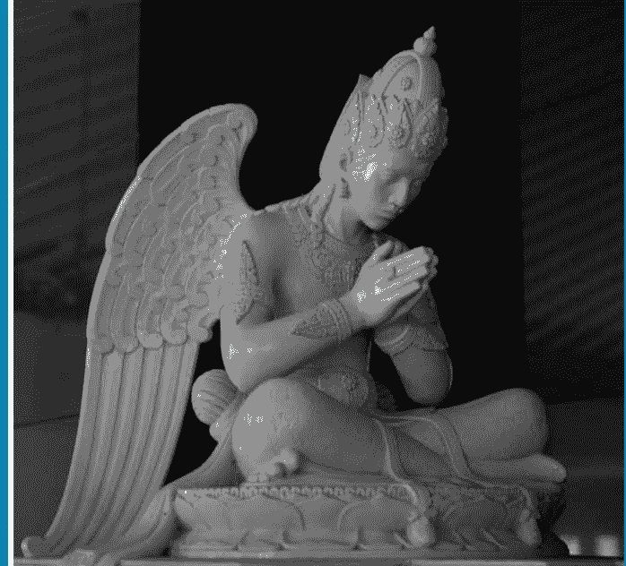
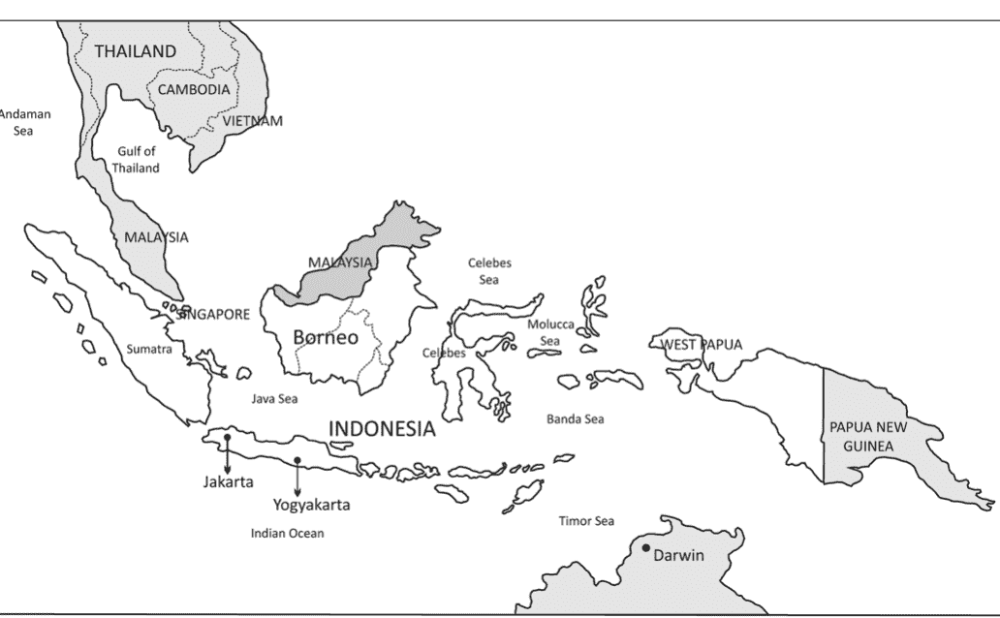
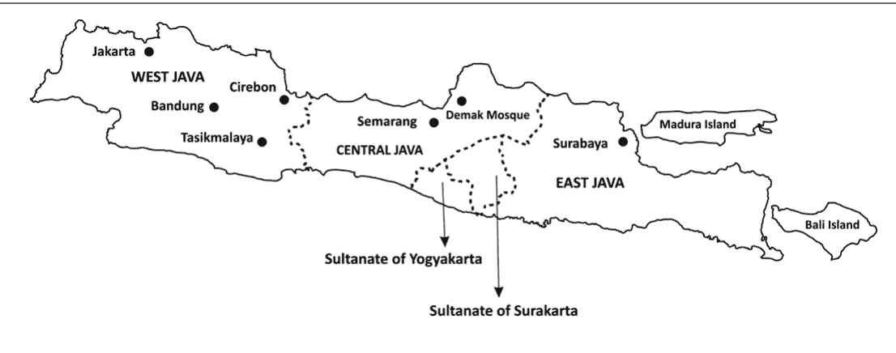
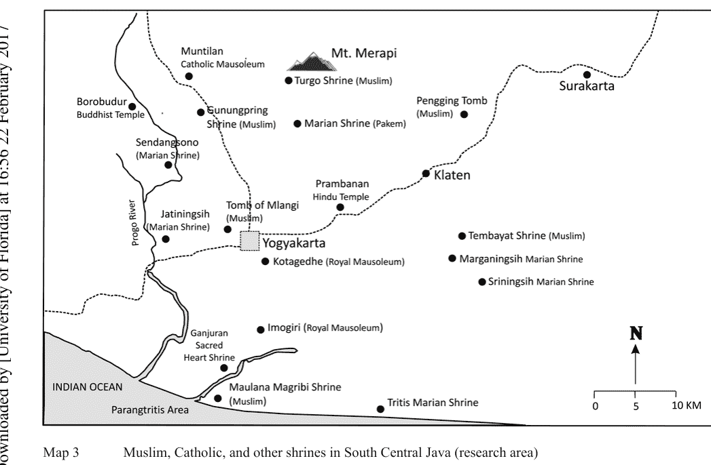
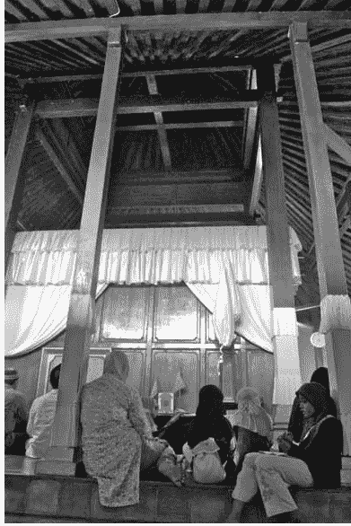
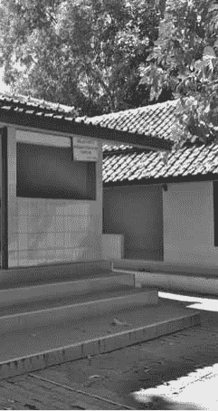
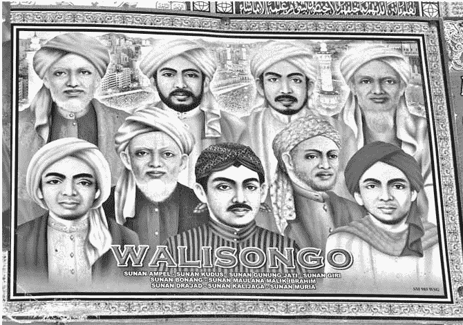
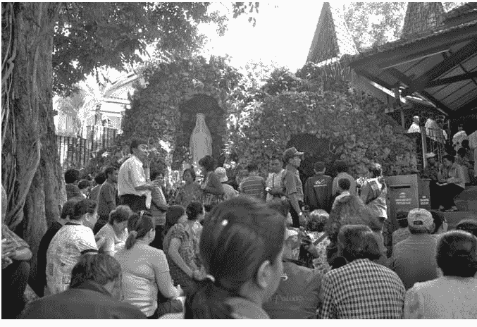
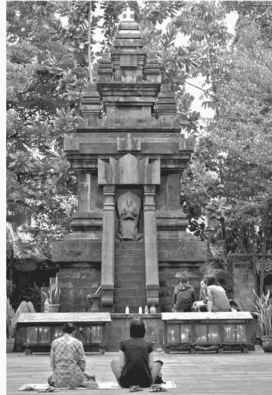
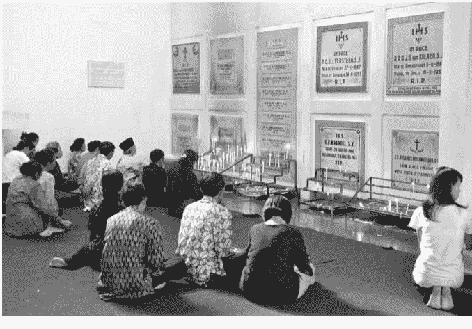

# 穆斯林与天主教徒朝圣实践：爪哇的探索（Routledge 朝圣、宗教旅行与旅游研究系列）

《穆斯林与天主教的朝圣实践》探索了穆斯林和天主教徒当地朝圣传统的独特特质与作用，特别关注了印度尼西亚的爪哇中部。在这一地区，混合的穆斯林朝圣文化是由传统伊斯兰教、爪哇-伊斯兰苏丹国以及具有深厚印度教-佛教遗产的爪哇文化共同塑造的。该地区也是一个充满活力的天主教社区的家园，其身份的形成涉及了与伊斯兰教以及爪哇文化的复杂互动，而这些复杂的互动正发生在伊斯兰教、天主教和爪哇文化之间。在这方面，当地的朝圣传统呈现出一个丰富的环境，伊斯兰教、天主教与爪哇文化之间的这些复杂互动正是在此发生。

本书通过比较神学和现象学的分析，揭示了朝圣实践在爪哇中部南部穆斯林和天主教徒身份形成与互动中更深层次的宗教文化和神学意义。在更广泛的背景下，它也阐明了伊斯兰教、基督教与当地文化之间复杂遭遇的更大动态。

## 丛书编辑

- Simon Coleman，加拿大多伦多大学
- Dee Dyas，英国约克大学
- John Eade，英国罗汉普顿大学与伦敦大学学院
- Jas Elsner，英国牛津大学与芝加哥大学

朝圣研究曾一度被相对忽视，但在过去的几十年里，它已成为一个日益受到关注的研究课题。它的研究不可避免是跨学科的，延伸到日益增长的学术领域，包括宗教、人类学、地理学、历史、文学研究、艺术史、考古学、社会学、遗产和旅游研究。这一过程没有停止的迹象——事实上，它似乎将继续扩大。

本系列力求处于这些对话的最前沿。它涵盖了来自资深学者和新兴学者的新作，涉及了多元化的主题，如国家和后国家框架内的朝圣、朝圣写作、朝圣的物质性、数字朝圣以及世俗朝圣。

印度尼西亚，Sanata Dharma 大学

穆斯林与天主教的朝圣实践：穿越爪哇岛的探索 / Albert Bagus Laksana 著。

献给我的母亲，朝圣的记忆。

## 致谢

朝圣的写作是一场旅程。在许多方面，这本书的研究得到了许多人的慷慨帮助——这些是上帝祝福的清晰显现。在波士顿，我非常感谢我的导师 James Morris，多年来他在波士顿对我来说是一份礼物和祝福。哈佛大学的 Francis X. Clooney 在比较神学方面也是一位出色的导师。衷心感谢波士顿大学的 Roberto Goizueta 和 Catherine Cornille。我的语言学习、图书馆研究以及 2007 年和 2008 年在荷兰、土耳其和印度尼西亚（爪哇、巴厘和苏门答腊）的实地考察，得到了纽约耶稣会省和波士顿大学比较神学领域的资助，而 Ernest 基金帮助了我在 2006 年于哈佛大学的阿拉伯语学习。我也享受了剑桥、波士顿（圣玛堂）、华盛顿特区、海牙、雅加达、大马士革和洛杉矶各个耶稣会社区的学习与研究。本书的最后部分是在我在洛杉矶玛丽山大学担任博士后基金期间（2011–12）完成的。

此外，在这一类跨学科项目面临的巨大挑战时，由于以下机构的图书馆和档案管理人员提供了卓越的专业知识和慷慨帮助，使得工作变得简单许多：波士顿大学、哈佛大学、康奈尔大学、荷兰尼梅根档案馆、KITLV（荷兰东南亚和加勒比研究所）与莱顿大学、大马士革法国中东学院（IFPO）、雅加达圣 Ignatius 学院以及位于三宝垄的印度尼西亚耶稣会档案馆。

我特别感激这个项目涉及了圣徒和上帝朋友的主题，这同时也充满了许多合作与友谊。在这里我应该感谢 Tom Michel, James Fredericks, Fr. Gregorius Utono, Karel Steenbrink, James Spillane, Christian Krokus, Karen Enriquez, Bede Bidlack, Tracy Tiermeier, Julian Millie, Thomas Tjaya, Kuntoro Adi, Casey Beaumont。

我的家人，Sophie Toligi，F. Purnawijayanti 以及许多人。我在 Sanata Dharma 大学的同事以及位于雅加达的 Kolese St Ignatius 学院的耶稣会兄弟们也是我这段旅程中极佳的伴侣。还要感谢 Ashgate 出版社编辑 Sarah Lloyd 以及两位匿名评审员提供的慷慨且有帮助的建议和意见。

最后，我由衷地感谢我的父母（Agustus Wahadi 和 Cecilia Sugiharti）和我的全家人，这些年来一直是我力量和慰藉的源泉。如果离开他们的这些年教会了我什么，那就是这种爱与情的纽带会变得更加强大。我将这部作品献给我的祖母，她慈爱的记忆永远存在于我的心中。

雅加达

ABL

## 关于拼写、转写和来源的说明

在处理爪哇语、印尼语和荷兰语拼写的变体时，我决定对引号内的单词保留其各自来源的原始拼写。对于爪哇语的地名和未加引号的词，我使用印尼语系统，特别是关于字母“o”（将其拼写为“a”），但某些在爪哇语系统中广为人知的名称，如 `Sendangano`（而非 `Sandals`）除外。此外，关于爪哇语专有名词，我选择了在该学术领域使用更广泛的名称，例如 `Tembayat`（而非 `Bayat`）、`Kalijaga`（而非 `Kalijogo`）、`Walisongo`（而非 `Walanga`）、`Yogyakarta`（而非 `Jogakarta`）以及 `Soegijaprana`（而非 `Sugiyaprana`）。对于一般的爪哇语词汇，我采用了最简单的转写系统，去除了变音符号（如 `è` 和 `é`），极少数专有名词除外。

在使用源自阿拉伯语的爪哇语单词时，我会提供阿拉伯语词根，以便了解阿拉伯语的读者更清楚地理解语义。同样的原则也适用于源自梵语的爪哇语词，主要涉及爪哇印度教和佛教的语境。

对于未加引号的印尼语单词，我使用最新的拼写规则，即 `EYD` 系统（`Ejaan Yang Disempurnakan`）。对于阿拉伯语单词的转写，我采用原始文本的拼写，在某些情况下可能与现在的荷兰语拼写系统不同。

本研究中访谈人员姓名化名，知名人物除外。然而，所有的地点名称（包括这些人所来自的地点）都是真实的。除非另有说明，所有爪哇语、印尼语、荷兰语和法语来源的翻译均由我完成。

- `Ar.` 阿拉伯语
- `b.` 出生
- `BKI` `Bijragen tot de Taal-, Land- en Volkenkunde`（语言、土地与民族学贡献委员会）
- `D.` 荷兰语
- `d.` 去世
- `I.` 印尼语
- `Jv.` 爪哇语
- `L.` 拉丁语
- `r.` 在位
- `S.` 梵语
- `ST` `Swara-Tama`

# 引言

## 朝圣、杂糅性与身份构建

我被这样一个想法所吸引：朝圣将帮助我找到通上帝的路，从而找到我自己。

—— Hape Kerkeling¹

我在东西方流浪；对于许多流浪者和隐士来说，我是他们的伴侣。
我见证了每一个奇异奇特的奇观，在舒适与苦难中经历了恐惧。
我已长埋于土下；我希望我的主是我的伴侣。

—— ‘Ali ibn Abī Bakr al-Harawī（卒于 1215 年）

朝圣确实是一个非常古老的实践。它以无数方式继续进行，人类生活的各个方面与之交织。朝圣也是一种极其丰富且复杂的实践，涉及对上帝的深层宗教和精神寻觅²。许多基督教圣徒和穆斯林圣徒都是其中最热诚的参与者和推动者，例如 `Ignatius` 和 `Ibn al-‘Arabi`。对于上述引用的、了解阿拉伯语的朝圣者 `al-Harawī`（卒于 1215 年）来说，朝圣是一种极其丰富且复杂的体验，以一种戏剧化的方式让他理解了存在的深刻意义——“我见证了每一个奇异奇特的奇观，在舒适与苦难中经历了恐惧”，并与上帝建立了亲密的关系。作为一个“非宗教”人士，德国喜剧演员 `Hape Kerkeling` 自己构思了前往圣地亚哥德康波斯特拉的传统基督教朝圣之路，以此寻找上帝和自我。

¹ Hape Kerkeling, *I’m Off* (New York, 2009), p. 4.
² Josef W. van Meer, *A Lonely Wayfarer’s Guide to Pilgrimage* (Princeton, 2004), p. xx.

### 朝圣实践

在当代爪哇，跨宗教朝圣非常流行，尽管本书主要关注穆斯林和天主教的背景。在爪哇穆斯林中，朝圣吸引了从君主到苏菲派学者的各类人士，寻求上帝及其义友的祝福（`Ar. baraka`）。每年有成千上万的朝圣者涌向著名的 `Waliongo` 圣地。相比，天主教徒是爪哇的新移民（19 世纪末 20 世纪初），但朝圣文化在他们的形成时期就已深入爪哇化。

这种更广泛的朝圣文化导致了朝圣地的激增。随着时间的推移，朝圣传统变得越来越复杂。此外，它与宗教社区在与现实以及相互互动中的整个身份构建过程交织。在爪哇的背景下，朝圣与爪哇身份构建的关系至关重要。事实上，爪哇语文献 `Serini`（19 世纪）将爪哇的集体身份想象为前往所有神圣有力之地的旅行，同时关注当地习俗、自然奇观等。在文中，旅行对应于人类个人成长的各个阶段。这部关于爪哇集体理解的百科全书认为，朝圣在个人和集体身份构建方面至关重要。

考虑到上述朝圣传统的丰富性和复杂性，本书是对爪哇南部天主教和穆斯林前往坟墓和圣龛（`Jv. ziarah`, `Ar. ziyāra`）朝圣传统的比较现象学和神学论。我的基本论点如下。

> Cf. George Quinn, “Local Pilgrimage in Java and Madura: Why is it booming?” *IIAS Newsletter*, 35 (2004): p. 16; also Mark Woodward, *Java, Indonesia and Islam* (New York, 2010), p. 6 and passim.
> See Nelly van Dorn-Harder and Kees de Jong, “The Pilgrimage to Tombayat: Tradition and Revival in Indonesian Islam.” *The Muslim World*, 91 (2001): pp. 325–54.

## 引言

在新比较神学方法的指导下，我试图对爪哇中南部的穆斯林和天主教徒朝圣传统进行一次比较现象学的概述，重点关注人们理解它们之间更深层共同特征和亲密相遇的主要方式，以及这两种传统之间存在的某些特殊性（程度较小）。与神、自我以及他者的交融这一主要范畴将作为这项比较研究的引导性诠释学原则。

如前所述，本书关注的是印尼西亚爪哇中南部穆斯林和天主教社区朝圣实践的特定背景（见地图 1–3）。该地区在爪哇身份的构建在历史上具有至关重要的地位，特别是在其与印度教佛教遗产以及后来的伊斯兰元素之间长期且独特的接触方面。这一地区大致涵盖了荷兰殖民时期的爪哇主要公国地区（`De Vorstenland`），现在由 `Yogyakarta` 和 `Surakarta` 苏丹国代表，这两个苏丹国源于 16 世纪末建立的爪哇-伊斯兰王国——`Mataram` 王国。在印尼共和国的早期历史（1940 年代），`Yogyakarta` 及其苏丹（`Hamengkubuwono IX` 大苏丹）发挥了重要作用。他是反对荷兰殖民政策的独立运动的主要支持者，该市在 1946 年至 1949 年间曾作为印尼首都，这是一个新宣布的独立在重重困难下取得成功的极其关键时期。基于这段历史及其文化遗产，`Yogyakarta` 近期关于其特殊地位的争议引发了关注，这一历史事实被其支持者作为这座王室城市拥有特殊地位的合法理由之一。

`Yogyakarta` 在印尼境内的独特文化身份具有悠久的历史。在新秩序政权时期（1966–98 年），作为中央政府构建独特“印尼化”身份项目的一部分，`Yogyakarta` 被构想为多元一体统一的国家象征，即所谓的“潘加斯兰旅游”（`Pancasila tourism`）。关于这一点，海迪·达尔斯（Heidi Dahles）写道：

> 故苏哈托总统领导下的新秩序政权经历过一场针对 1965 年滥用共产主义叛乱的政治动荡。在国家身份形成的领域，该政权的项目是将印尼身份牢固地植根于民族、地方文化、宗教等的多元统一原则之上，正如国家哲学“潘加斯兰”（`Pancasila`）所表达的，它由五项原则组成：信仰唯一的至高真神、公正且文明的人道主义、基于印尼统一的民族主义、通过共识实现的代表制民主，以及所有人的社会公正。该政权的文化准则是：印尼文化是所有民族和地方文化的总和。该政权于 1998 年在东南亚经济危机加剧引发的政治混乱中终结。

`Yogyakarta` 代表了共同的历史、革命精神、民族自豪感以及对殖民权力的胜利，它被设计为印尼人必经之地，在此处他们可以同时体验“印尼性”和“爪哇性”，并让外国游客接受关于国家身份的教导。有观点认为，`Yogyakarta` 被创造为“潘加斯兰旅游”的中心。访问 `Yogyakarta`（特别是对国内游客而言）具有国家朝圣的元素，并强调文化的连续性。

总而言之，`Yogyakarta` 和 `Surakarta` 的独特性始终处于文化和文化想象领域，无论是在被理解为“爪哇”的具体背景下，还是在更广泛的“印尼”概念中。从殖民时代起，`Yogyakarta` 和 `Surakarta` 就被视为最正宗、最高爪哇文化传统的库。关于 `Surakarta`，约翰·彭伯（John Pember）观察到：“对于许多新秩序时期的爪哇人来说，这是一个起源之城，是过去的印记所在地，是许多被称为‘爪哇式’回忆的特权场所。事实上，`Yogyakarta` 和 `Surakarta` 的宫廷在许多方面将自己视为宗教文化实体，特别是伊斯兰维度是如何整合进爪哇更古老的遗产中的，例如爪哇印度教和本土宗教体系，这些遗产主要体现在宫廷（`kraton`）独特的仪式、艺术和文化风格中。”

在很大程度上，`Yogyakarta` 和 `Surakarta` 的当地居民认同这一观点，将苏丹宫视为保护爪哇传统和文化的中心。近期关于 `Yogyakarta` 在印尼共和国境内地位的争议进一步凸显了 `Yogyakarta` 人民对独特身份的强烈认同。对他们来说，中央政府试图通过取消苏丹无需选举产生的省长职衔来“民主化” `Yogyakarta`，是对 `Yogyakarta` 悠久文化和政治身份的侮辱。作为回应，`Yogyakarta` 发起了有组织的应对，最终在 2012 年成功获得了该地区的特殊地位。

然而，这种明显的混合自我理解引发了关于霸权的问题，特别是关于伊斯兰其中的性质和确切作用。印尼穆斯林中存在某种情绪，认为伊斯兰身份要么真正匮乏，要么不值得。正如：“在印度，伊斯兰是辉煌的过去；而在穆斯林印尼，伊斯兰只有未来。”这种情绪应当置于以下背景下理解：新秩序政权并非真正开启对爪哇文化的推崇。这种倾向从殖民时代起就存在第一批在个人和专业上爱上伊斯兰前爪哇的荷兰东方学家眼中。在很大程度上，伊斯兰是“异者”以及伊斯兰传统与爪哇遗产之间存在显著不兼容性的事实，确实是殖民主义学术的一部分。

基于这一背景，我将证明伊斯兰实际上在塑造当地社区（特别是在爪哇）方面发挥了重要作用。一种真实的伊斯兰愿景在爪哇中南部的朝圣传统得到了保护和表达，这在一个高度创造且复杂的框架内，该框架包含了对古老爪哇遗产的真实吸纳。无疑，爪哇文化的其复杂性已成为中南部不同宗教群体之间的共同纽带。

爪哇中南部的独特之处在于，由于 `Yogyakarta` 和 `Surakarta` 宫廷作为 `Mataram` 爪哇-伊斯兰王国遗产的当代继承者，这种作用变得更加强大和普遍。正是在这种宗教文化背景下，丰富多样的朝圣传统在这些宫廷之一或双方的官方赞助下蓬勃发展。近年来，爪哇文化的统一力量及其与朝圣传统之间的特定关系在许多形式和层次上都变得更加明显。

在这一层面，这种爪哇文化的复兴在这一地区许多当地社区对各种社区仪式和节日的重新挖掘中可见一斑。通过多种方式，本书将展示某些宫廷文化元素在穆斯林和天主教徒中的盛行。

在爪哇或印度尼西亚更广泛的背景下，中爪哇非常独特，原因在于天主教基督教的大规模存在以及其与爪哇文化和伊斯兰教接触的独特动态。天主教在该地区的出现可以追溯到 19 世纪末 20 世纪初荷兰耶稣会传教士开展任务的最早期时期。

在讨论中爪哇在爪哇荷兰耶稣会传教历史中的特殊意义之前，有必要对现印度尼西亚群岛的新教和天主教传教活动进行概括。从历史角度看，天主教在印度尼西亚本土人中的存在可以追溯到 16 世纪的方朗西·徐奇（`Francis Xavier`），他在马鲁古群岛形成了小型天主教社区。在方朗西·徐奇之后，葡萄牙传教士也在印度尼西亚的其他岛屿工作。然而，随着 17 世纪荷兰殖民的到来，马鲁古群岛天主教传教的进展实际上被停止，而其他仍受葡萄牙控制的岛屿则一直发展到 18 世纪下半叶。弗勒斯岛（天主教目前仍是多数宗教）一直持续到 1859 年。新教以一种非常有限的方式开始，主要在群岛的外围岛屿，始于 17 世纪。从 19 世纪下半叶起，由于各种传教协会积极作用，新教传教在印度尼西亚许多地区变得更加密集（爪哇除外），而在此时的大部分时间内，无论是在荷兰还是东印度，天主教都受到歧视。这种歧视直到 1808 年才被消除，允许一些耶稣会神父在东印度为欧洲天主教徒工作。然而，在爪哇人中耶稣会的传教直到 1859 年才开始。

正是在爪哇早期耶稣会传教的背景下，位于 `Yogyakarta` 以北约 20 英里的 `Muntilan`（地图 3）发挥了至关重要的作用。它是 20 世纪前二三十年爪哇天主教传教的中心，这很大程度上归功于方朗西·范·利（`Francis van Lith`，1863–1926）的开拓性工作，他是一位卓越的人物，正如我后将所示，他的记忆和遗产已成为爪哇天主教徒身份形成的重要支柱。在范·利神父奠定的基础上，中爪哇南部的天主教传教被认为是成功的，特别是与爪哇的其他地区相比。结果是，中爪哇南部仍整个爪哇地区比例最高的天主教徒。天主教在该地区有显眼的存在。这座大学城镇拥有两所天主教大学，以及许多高等教育机构和学校，从全国吸引了数千名学生。

¹ 参见 Aritanon 和 Steenberg（编），《A History of Christianity in Indonesia》（Leiden, 2008）。

## 引言

该地区还遍布天主教医院、孤儿院、修道院和神学院，以及历史悠久的教堂和圣地。如果考虑到当地新教教会及其巨大的教育机构网络、医疗保健体系等，该地区的基督教的存在变得更加显著。总的来说，天主教和新教传教从一开始与苏丹保持着良好的关系；在殖民时期的某些阶段，这种关系被穆斯林人口中的某些元素认为是亲密的。¹¹⁶

# 中爪哇的宗教-文化动态

简而言之，中爪哇呈现出一个迷人的地区，其特征是四种元素之间丰富且独特的宗教-文化动态：伊斯兰教的存在、爪哇文化（带有来自更早期的当地印度教、佛教和本土宗教信仰与习俗的各种元素）、苏丹国的关键作用，以及基督教和天主教的大规模存在。在该地区，几乎所有的伊斯兰圣地和爪哇人圣地在历史和精神上以某种方式与一个或两个苏丹相连。在天主教方面，该地区拥有爪哇最基础且最重要的天主教圣地。此外，在该地区穆斯林和天主教圣地在空间和文化上彼此邻近。

# 蒙蒂兰：爪哇天主教传教的中心

正是在爪哇早期耶稣会传教的背景下，位于雅加达以北约20英里的蒙蒂兰（Muntilan，地图3）发挥了至关重要的作用。它是20世纪前二三十年爪哇天主教传教的中心，这很大程度上归功于方朗西·范·利（Francis van Lith，1863–1926）的开拓性工作，他是一位卓越的人物，正如我后将所示，他的记忆和遗产已成为爪哇天主教徒身份形成的重要支柱。在范·利父奠定的基础上，中爪哇南部的天主教传教被认为是成功的，特别是与爪哇的其他地区相比。结果是，中爪哇南部仍整个爪哇地区比例最高的天主教徒。天主教在该地区有显眼的存在。这座大学城拥有两所天主教大学，以及许多高等教育机构和学校，从全国吸引了数千名学生。

¹ 参见 Aritanon 和 Steenberg（编），《A History of Christianity in Indonesia》(Leiden 2008)。

## 引言

该地区还遍布天主教医院、孤儿院、修道院和神学院，以及历史悠久的教堂和圣地。如果考虑到当地新教教会及其巨大的教育机构网络、医疗保健体系等，该地区的基督教的存在变得更加显著。总的来说，天主教和新教传教从一开始与苏丹保持着良好的关系；在殖民时期的某些阶段，这种关系被穆斯林人口中的某些元素认为是亲密的。¹16

# 爪哇文化的复兴与混合身份

在这一层面，这种爪哇文化的复兴在这一地区许多当地社区对各种社区仪式和节日的重新挖掘中可见一斑。通过多种方式，本书将展示某些宫廷文化元素在穆斯林和天主教徒中的盛行。

在爪哇或印度尼西亚更广泛的背景下，中爪哇非常独特，原因在于天主教基督教的大规模存在以及其与爪哇文化和伊斯兰教接触的独特动态。天主教在该地区的出现可以追溯到19世纪末20世纪初荷兰耶稣会传教士开展任务的最早期时期。

# 印度尼西亚基督教传教史概述

在讨论中爪哇在爪哇荷兰耶稣会传教历史中的特殊意义之前，有必要对现印度尼西亚群岛的新教和天主教传教活动进行概括。从历史角度看，天主教在印度尼西亚本土人中的存在可以追溯到16世纪的方朗西·徐奇（Francis Xavier），他在马鲁古群岛形成了小型天主教社区。在方朗西·徐奇之后，葡萄牙传教士也在印度尼西亚的其他岛屿工作。然而，随着17世纪荷兰殖民的到来，马鲁古群岛天主教传教的进展实际上被停止，而其他仍受葡萄牙控制的岛屿则一直发展到18世纪下半叶。弗勒斯岛（天主教目前仍是多数宗教）一直持续到1859年。新教以一种非常有限的方式开始，主要在群岛的外围岛屿，始于17世纪。从17世纪下半叶起，由于各种传教协会积极作用，新教传教在印度尼西亚许多地区变得更加密集（爪哇除外），而在此时的大部分时间内，无论是在荷兰还是东印度，天主教都受到歧视。这种歧视直到1808年才被消除，允许一些耶稣会神父在东印度为欧洲天主教徒工作。然而，在爪哇人中耶稣会的传教直到1859年才开始。

# 朝圣与圣徒假期：基督教与伊斯兰教的视角

朝圣者，特别是在 Tembayat 和 Gunungpring 圣地的，这也引人注目。有趣的是，在大多数情况下，这些中国天主教由于成长环境的影响，也接受了爪哇文化的特征。也许更重要的是，爪哇文化在这些圣地通过许多方式得到了保留，例如仪式形式、节日等。这已成为他们独特的特征，并受到所有族裔朝圣者的赞赏。在书中，“爪哇-伊斯兰式”和“爪哇-天主教式”身份对应于这些圣地、当地社区以及跨族裔朝圣者共同享有的这种混合宗教-文化框架。这些圣地还发展出了一种后印尼时期的特征。许多朝圣者和圣地官员根据潘加息（Pancasila）的包容性原则来制定这种特征，这是印度尼西亚共和国的官方基础原则，其中包括对所有宗教的尊重。

## 基督教与伊斯兰教中的朝圣与圣徒假期

即使对于偶然观察者来说，天主教和穆斯林前往当地圣地和圣墓朝圣的传统的当代流行也是显而易见的。然而，这种广泛的实践在两种传统中都有着相当戏剧性且充满争议的历史。在基督教方面，诚然，朝圣的比喻自早期以来一直是教会喜爱的集体形象——教会和基督徒是世上的朝圣者，通往上帝的旅行。然而，当涉及到前往圣地的真实朝圣问题时，情况就相当复杂了。朝圣实践的属性在早期基督教曾引发激烈的辩论。古代晚期关于朝圣属性的辩论解决了一方面当地朝圣地与另一方面耶路撒冷之间的紧张关系；同时也解决了在内在和精神空间中旅行的困境。此外，主要的关注点还触及了神学问题，即在特定的空间位置上是否存在神性的临在，这优于对经书中理想的“高天耶路撒冷”（加拉太书 4:26）和“用灵拜，在灵里拜”（约翰福音 4:24）。

总的来说，理解上帝临在的精神与空间框架之间保持着富有成果的紧张。显而易见，朝圣（无论是前往耶路撒冷还是当地圣地）在基督教的前几个世纪不仅迅速成为一种具有某些神学根据的宗教实践，而且变得非常流行。在这方面，至关重要的是此时各自基督教社区复杂且并行的发展产生的作用。23 同样重要的一个事实是，这场辩论与这些基督徒宗教身份形成的特定细节有很大关系。24 因为这种身份的形成不仅基于《新约》的数据，还考虑了基督教社区本身随着历史推移而不断演变的自我理解。例如，到第四世纪，这种自我理解已经纳入了耶路撒冷作为其神圣城市的形象。25 因此，到那时，问题不再主要是关于一个地方本身的圣洁性或神圣性，而是关于这一特定地点对信徒社区的历史意义。在这个框架下，地方的意义是深层的社区化和关系性的。地点、社区和信仰之间存在着紧密的联系。早期基督教社区殉道者圣地周围崇拜的兴起应该在这个更大的框架内被理解。26 延伸之，通过信仰的眼光，基督教朝圣者也把活圣徒的角色视为信徒社区发展过程中上帝临在这一动态的重要组成部分。27 从神学上说，社区自身的具体历史是圣灵作的场所。圣地反映了社区与其神圣之地连接的愿望。它们是上帝为社区工作的记忆。这正是今天许多基督教神学家和倡导者所的方法。28 基督教朝圣历史发展的另一个重要方面是其个人化和精神化的。29

> 20 参见 F 1 1:1; 2:11 以及希伯来书 11:13 和奥古斯丁的《神之国》。
>
> 21 Bitton-Ashkelony, *Encountering the Sacred* (Berkeley, 2005), p. 4; Craig Bartholomew and Fred Hughes (eds), *Explorations in a Christian Theology of Pilgrimage* (Aldershot, 2004); John Inge, *A Christian Theology of Place* (Aldershot, 2003).
>
> 22 Andrew T. Lincoln, “Pilgrimage and the New Testament,” and Steve Motyer, “Paul and Pilgrimage,” in Bartholomew and Hughes, *Explorations*, pp. 29–49, 50–69.

朝圣严肃地对待朝圣的双重方面——作为一种世俗旅行——因为这正是朝圣变得如此丰富的原因。在更大的伊斯兰背景下，任何关于圣地和圣墓朝圣（Al-zīāra）相对于麦加正式朝圣（hajj）的讨论都无法避免关于虔诚的更激烈的辩论。在这方面，通过考察伊本·泰米叶亚（死于1328年，大马士革的汉伯派法学家）对 zīāra 传统某些方面的批判性观点来阐明这种辩论已成为一种习惯。他并没有全面攻击 zīāra 传统。他支持所谓的“合法朝圣”（Ar-zīāra al-sharʿya）。在这个框架下，他认为问候亡者、代死者向上帝祈祷的做法是可以的——但仅限于旨在提供这些祈祷的访问，并且让自己更加意识到死亡或生命的短暂性。如果允许访问非穆斯林的墓地，因为穆斯林朝圣者不为他们祈祷。32

> 23 在这方面，至关重要的是此时各自基督教社区复杂且并行的发展产生的作用。23 同样重要的一个事实是，这场辩论与这些基督徒宗教身份形成的特定细节有很大关系。24 因为这种身份的形成不仅基于《新约》的数据，还考虑了基督教社区本身随着历史推移而不断演变的自我理解。例如，到第四世纪，这种自我理解已经纳入了耶路撒冷作为其神圣城市的形象。25 因此，到那时，问题不再主要是关于一个地方本身的圣洁性或神圣性，而是关于这一特定地点对信徒社区的历史意义。
>
> 23 Bitton-Ashkelony, *Encountering the Sacred* (Berkeley, 2005), p. 4; ...-正如它，例如尼撒的尼格列（死于395年）关于朝圣的论述。
>
> 24 Bitton-Ashkelony, *Encountering the Sacred* (Berkeley, 2005), p. 4; Craig Bartholomew and Fred Hughes (eds), *Explorations in a Christian Theology of Pilgrimage* (Aldershot, 2004); John Inge, *A Christian Theology of Place* (Aldershot, 2003).
>
> 25 Andrew T. Lincoln, “Pilgrimage and the New Testament,” and Steve Motyer, “Paul and Pilgrimage,” in Bartholomew and Hughes, *Explorations*, pp. 29–49, 50–69.
>
> 26 Peter Brown, *The Cult of Saints*.
>
> 27 Peter Brown, *The Cult of Saints*.
>
> 28 Peter Brown, *The Cult of Saints*.
>
> 29 Vatican II, *Lumen Gentium* #50, 67.

在考虑到 zīāra 传统的某些方面时，伊本·泰米叶亚的主要观点是，当代 zīāra 传统的许多特征是危险的“创新”。而且它们不是古兰经、圣训和先贤实践（前几代人）所特别许可的活动。

> ... 他支持所谓的“合法朝圣”（Ar-zīāra al-sharʿya）。
>
> 30 在拉丁美洲背景下，瓜达卢佩圣母的案例非常有趣，特别是关于基督教与本土身份遭遇的问题。这见：Virgil Elizondo, *Guadalupe* (Maryknoll, 1997)。关于基督教圣徒崇拜与印度教及印度当地现实遭遇的问题，参见 Corrine Dempsey, *Kerala Christian Sainthood* (Oxford, 2001); 以及 Margaret Meibhohm, *Cultural Complexity in South India* (Ph.D. Dissertation, University of Pennsylvania, 2004).

> 31 在爪哇岛之外，在苏门腊麦丹的安奈·韦兰卡 玛利亚圣地，新教朝圣者的大量出现令人印象深刻。
>
> 32 Christopher Taylor, *In the Vicinity of the Righteous* (Leiden, 1999), p. 188.
>
> 33 George Makdisi, “Ibn Taymiyya: a Shūfi of the Qādirīya Order,” *American Journal of Arabic Studies*, 1 (1973): pp. 118–29.

世世代相传的（伊斯兰教）做法带有多神教色彩（阿拉伯语：`shirk`），因此违背了主主一性的原则（阿拉伯语：`tawhid`）。让伊本·泰米亚（`Ibn Taymiyya`）感到更为糟糕的是，这些做法可能受到了他所厌恶的其他宗教群体的影响，例如什叶派穆斯林和基督徒。[^34]

他的教义反对的是刻意前往特定地点（如墓地）进行祈祷或祈求（阿拉伯语：`duʿ`）的恰当性，认为这种做法并未获得早期传统的认可，却相信上帝会接受这些祈祷。在这方面，伊本·泰米亚承认某些哈圣提到某些地方比其他地方更神圣——例如麦加的禁真寺、麦地那的先知寺、耶路撒冷的阿克萨清真寺、窟以及朝圣中的其他遗址——并且某些祈祷比其他更虔诚，例如深夜的后段。[^35] 同样，他并不反对“瞻拜”（`ziāra`）作为访问圣地的观点。他在这方面的关注揭示了他的疑虑，即他认为前往特定地点进行祈祷的行为可能带有多神教的色彩。对他而言，这是一种在上帝与人类之间寻求中介的愿望。

几个世纪以来，许多著名的斯斯林学者对伊本·泰米亚做出了回应。克里斯托弗·泰勒（`Christopher Taylor`）指出，大马士革首席法学家塔卡丁·阿尔·苏比基（`Taqʿal-Dīn al-Subki`，卒于1355年）提供了详尽、全面的回应。在反驳中，阿尔·苏比基指出了伊本·泰米亚的三处“司法错误”。首先，伊本·泰米亚错误地解释了那句名为“除了三座清真寺外不要……”的哈圣，将其理解为穆斯林不能前往除上述三座之外的任何清真寺进行崇拜。因此，哈圣并未禁止出于虔诚和为他们祈祷的愿望而对圣徒和家族墓地进行瞻拜。伊本·泰米亚的第二个司法错误是基于对这一值得赞扬的传统中少数过度或不当元素的有限例子，就否定了整个瞻拜传统。从阿尔·苏比基的角度来看，伊本·泰米亚的第三司法错误在于他认为瞻拜是一种被禁止的创新，这一观点并未得到任何宗教学者或先知本人的范例支持。[^36] 在其他著作中，阿尔·苏比基拒绝了伊本·泰米亚的反对，将瞻拜视为一种合法且值得赞扬的宗教性趋近行为（`qurb`）——一种能让人与上帝更亲近的善行或虔诚工作。[^37] 在合法瞻拜的类别中，阿尔·苏比基为通过接近义死者来获得祝福的瞻拜之恰当性提供了有力论证。[^38]

[^34]: Muhammad Umar Memon, *Ibn Taymiyya's Struggle Against Popular Religion* (The Hague, 1973), p. 5.
[^35]: Taylor, *In the Vicinity of the Righteous*, p. 174.
[^36]: Ibid., pp. 201–8.
[^37]: Ibid., p. 201.
[^38]: Ibid., p. 205.

## 引言

这场辩论也阐明了关于朝圣的一些细微观点，这些观点对于本书的主题非常重要。例如，伊本·凯义姆·阿尔·齐齐亚（`Ibn Qayyim al-Qziziya`，1292–1328）虽然是瞻拜传统某些方面的坚定批评者，但他重申了根据圣训行法（`sunna`）进行瞻拜的合理理由——即纪念后世、为墓中人行善事，以及为朝圣者自己行善事——并强调，关于缅怀死者，如果没有定期拜访，与死者的交流与结合将会断绝，而死者会因为远离了亲友而享受到这些拜访。因此，对伊本·凯义姆来说，瞻拜的核心精神之一是维护现有的友谊与纽带，这是本书所讨论的许多爪哇朝圣者虔诚中非常重要的一部分。同样，伊本·奥斯曼（`Ibn Uthmān`，卒于1218年）强调了朝圣者内心真诚或纯洁意图的必要性，这也是今天的朝圣者努力追求的条件，正如本书将所示。[^40]

在此，必须说明的是，关于瞻拜的辩论已变得如此技术化和复杂。由于我没有空间深入探讨，只需说明总的来说，穆斯林学者、法学家、神秘主义者和统治者已经在伊斯兰传统内部找到了法律和其他依据来支持本书的观点，有两点观察值得注意。首先，作为对这场辩论的回应并考虑到实践的有效性[^41]，需要将瞻拜传统视为一种复杂的整体实践，具有许多层次的意义和影响。这是我在本书中所采取的方法，它整合了朝圣者爱的虔诚和祝福的灵性体验（包括个人和社区的），并讨论了与这些实践相关的创造性宗教。在很大程度上，瞻拜传统已成为许多穆斯林（包括今天的爪哇人）宗教和精神形成的重要方面。鉴于这种实践的深度、丰富性和复杂性——即刻意前往一个未受古兰经和圣训认可的特定地点进行祈祷的合法性——似乎极其狭隘，它掩盖或简单忽略了这一传统的其他显著方面，正如阿尔·苏比基正确指出的那样。这在

[^39]: Ibid., p. 189.
[^40]: Ibid., p. 71. 由于朝圣期间内心相对纯洁，伊本·奥斯曼证明了朝圣期间祈祷的必要性。
[^41]: 由于朝圣期间内心相对纯洁，伊本·奥斯曼证明了朝圣期间祈祷的必要性。在许多中世纪的朝圣指南中，例如，学者们为朝圣这种实践提供了更平衡的观点。这些指南也包含了为死者祈祷的特定理由。在某些情况下，这些作者对墓地哀嚎等行为持批评态度，他们认为后者在圣训中也有依据。见泰勒，*In the Vicinity of the Righteous*, p. 70.

这种实践的复杂性和有机演变的更广泛语境下，应当关注那些被视为伊斯兰教可疑的方面。[^42]

其次，人们还需要关注伊斯兰历史发展的更大问题，包括它与不同文化和宗教传统的持续互动。正如一些学者指出的，有理由相信与早期基督教朝圣传统的互动是伊斯兰教发展的一部分。[^43] 在这一点上，穆罕默德写了伊本·泰米亚在背离其僵正教义的情况下，通过与不同民族的信仰的一系列快速互动，并试图理解人类意识的深层、非理性的一面：[^44]

在伊斯兰解释学的框架内，瞻拜的新和局部方面可以被理解为“值得赞扬的创新”（阿拉伯语：`bid’ al-hasana`），这可以根据更广泛、更深灵感和目标来解释。正如苏提（`al-Suyūti`，卒于1505年）所言，节日确实是创新。[^45] 如书中许多地方所示，爪哇的穆斯林社区一直试图将瞻拜的各个方面（特别是那些似乎源于此前的伊斯兰传统——即当地爪哇宗教文化传统）纳入一个全面且包容的伊斯兰宗教框架内，使其具有成为全宇宙福祉（阿拉伯语：`rahmatalin`）的动态性。爪哇传统派哈德拉特乌拉玛（`Nahdlat Ulama`，简称 `NU`）的神学框架，其创始人之一阿哈迈德·谢迪基格（`Ahmad Shiddiq`，卒于1991年）提供了基于宽容（阿拉伯语：`tasamüh`）和中庸（阿拉伯语：`tawassut`）原则的有效解释学，这些原则包含了公平或和谐（阿拉伯语：`tidāl`）以及平衡（阿拉伯语：`tawāzun`）的概念。从谢迪基的角度来看，这些原则最终形成了一个接纳所有方式的伊斯兰愿景。

## 引言

事物存在于人们通常认知的伊斯兰边界之外，例如当地文化的丰富性[^46]

在爪哇的背景下，必须注意到，直到最近，朝圣（`ziāra`）传统一直是传统派穆斯林与现代主义穆斯林之间对立身份最重要的标志之一。然而，在当代爪哇，情况已经发生了相当的变化，尽管并非完全。如今，现代主义穆斯林对朝圣传统的反对仍然存在，但语气变得更具争论性。而最激烈的批评来自规模较小的瓦哈比倾向圈子[^47]。另一方面，一些传统派穆斯林学者和领袖撰写了书籍和小册，在不采用争论性框架的情况下，解释了朝圣传统的本质、合法性及其特征[^48]

对于朝圣者来说，情况非常有趣。当然，坚定的瓦哈比倾向穆斯林并不积极参与这一传统。可能令人惊讶的是，有一些当地的穆斯林朝圣者声称，他们对现代主义穆罕哈迪亚（`Muhamadiyah`）的宗教文化认同比对传统派纳哈达乌玛（`NU`）更强。这种现象也反映在近期穆罕哈迪亚领导层对于伊斯兰与当地文化之间动态关系的更细致、更现实的观点中。[^49] 在实野调查中，我遇到许多朝圣者认为这个问题——“你认同 NU 还是穆罕哈迪亚？”基本上无关紧要。在这方面，朝圣传统似乎已经变成了一种深受实用的实践，被许多不同信仰和背景的穆斯林所共有。一些深陷朝圣的朝圣者并不一定觉得认为自己是传统派 NU 的成员。

我主张，朝圣传统必须被视为伊斯兰内部一个复杂、完整且不断演变的传统。与此相关，这一传统的一个关键方面是圣性的本质（`Ar walāya`）。圣性是朝圣最重要的神学框架之一，要求我们关注其在古兰中的依据，以及其作为教义和实践在发展中的丰富性和复杂性。例如，圣性的本质将帮助我们理解苏伯基（`Subki`）关于在不参与多神教或崇偶像（`shirk`）的情况下，为了通过接近圣人获得福报而进行朝圣的合法性观点。

尽管圣性的教义方面对于回答问题可能很重要，但考虑到朝圣作为一种持续宗教实践的宏大框架，这一点至关重要。[^50]

穆斯林圣人的典范作用在*圣训*（`hadith`）文献中得到了进一步的证明和解释，这些文献进一步规定了真主圣徒（`awliyya`）的品质。一段特定的圣训（`hadith qudsi`）从虔诚（脱离世俗财产）、祈祷、对上帝亲密而“秘密”的奉诚与服务等方面阐述了圣徒的基本品质。这段特定的圣训似乎强调了内在特质以及内心的隐藏。[^52] 著名的“嫉妒圣训”（阿拉伯语：`al-ghibah`）将真主的圣徒确定为他的仆人，他们既不是先知也不是殉道者，但被先知和殉道者赋予了他们特殊的地位和亲密的面容。[^54] 根据这段圣训，这些圣人将获得光之宝座的福分，当他们面对面见到上帝时，他们的脸将是光明的。这段圣训在描述赐予最高等级圣人的恩典方面是非寻常的：他们将通过更亲密地参与上帝的荣耀，更完全地参与上帝的圣性（`walāya`）。

伊斯兰圣性的所有这些特征产生了穆斯林圣人极其复杂且多层的人格、社会社区和宇宙角色。穆斯林圣人具有发起或引导的功能，也具有宇宙角色，同时他们可能成为当地社区的虔诚祖先。再次，所有这些角色的神学基础是他们对上帝自身的特殊参与。

## 近期朝圣研究与本书的方法

由于朝圣跨越宗教传统和文化的普遍性，以及其在当代的兴起，朝圣已被视为各种学科的研究课题，如历史、人类学、社会学、文化研究以及神学。在基督教和伊斯兰传统方面，朝圣倾向于关注特定的地区或时期。[^55] 在方面，一些研究探讨了宗教身份以及不同信仰朝圣者之间的互动[^56]。这类研究是对爪哇案例的一种谦虚尝试，是针对朝圣实践的长期连续性所进行的全面研究。

[^42]: Memon, *Ibn Taymiyya’s Struggle*, p. 6.
[^43]: 见泰勒，*In the Vicinity of the Righteous*, p. 70.
[^44]: Memon, *Ibn Taymiyya’s Struggle*, p. 6.
[^45]: 见泰勒，*In the Vicinity of the Righteous*, p. 70.
[^46]: See Mantin van Bruessen, 存在于人们通常认知的伊斯兰边界之外，例如当地文化的丰富性
[^47]: Cf. 规模较小的瓦哈比倾向圈子
[^48]: 一些传统派穆斯林学者和领袖撰写了书籍和小册，在不采用争论性框架的情况下，解释了朝圣传统的本质、合法性及其特征
[^49]: 这种现象也反映在近期穆罕哈迪亚领导层对于伊斯兰与当地文化之间动态关系的更细致、更现实的观点中
[^50]: 考虑到朝圣作为一种持续宗教实践的宏大框架，这一点至关重要
[^51]: “wāli”这一术语也是真主的名字之一，因此成为 *wāli* 是上帝的一个方面
[^52]: 这段圣训似乎强调了内在特质以及内心的隐藏
[^53]: 这段圣训带有细微差异，包含在提米迪、伊本·马贾和伊本·汉拔的经典集中；引用自 J Morris，《定位伊斯兰神秘主义：在文字传统与大众灵性之间》
[^54]: 著名的著名的圣训将真主的圣徒确定为他的仆人，他们既不是先知也不是殉道者，但被先知和殉道者赋予了他们特殊的地位和亲密的面容
[^55]: 在伊斯兰方面，例如参见 Taylor，《接近正义者》；Josef W. Meri，《中世纪叙利亚穆斯林和犹太人的圣徒崇拜》；Vincent J. Cornell，《圣人的领域》
[^56]: 在基督教方面，没有单一作品具有这样的全球覆盖范围。我们拥有的是区域性或历史性的作品，例如 Diana Webb 的著作《中世纪西方的朝圣者与朝圣》；中世纪朝圣，公元700-1500年。

本书遵循了弗朗西斯·克鲁伊（`Francis Clooney`）、詹姆斯·弗雷德里克斯（`James Fredericks`）等人提出的新比较神学的方法论假设——例如对宗教传统的某个特定、有限方面进行比较，以获取神学见解，从而丰富比较者对其自身传统的理解——然而在研究材料方面，本书则截然不同，因为它关注的是一种宗教实践而非宗教文本。此外，这种实践处于一个非常特定的社会宗教背景中，在该背景下，不同宗教社区之间某些比较性互动的动态已经发生。在这里，我试图解决的问题显然属于克鲁伊在年轻一代比较者身上观察到的新方向：“教义神学仍然重要，但生活化的宗教和文化交流对他们工作的意义比我的更为核心。”[^58]

在某种程度上，本书也试图加入关于身份形成问题的当代话语，这个问题在当今全球世界正日益成为一个难题。这项比较研究之所以选择爪哇作为案例，原因之一是整个印度尼社会一直在努力理解塑造强健身份与考虑“他者”存在之间的关系。[^59] 就此，本书对朝圣进行了神学-现象学的分析，将其视为一种宗教文化身份形成的特权环境——这种意义上是丰富、真实、完整且持久的。在爪哇南部，朝圣实践中形成的混合型宗教文化身份的创造性、真实性和可持续性在今天变得尤为重要，考虑到该地区正处于百年历史的爪哇-伊斯兰传统与规模较小的近期具有激进排他性的瓦哈比主义（`Wahhabism`）之间“伊斯兰灵魂之争”的背景之下。[^60]

[^57]: 克鲁伊的大部分作品是关于文本的比较，因此优先考虑了比较性阅读的行为。克鲁伊表示这是他偏爱的方法，同时也承认其他途径（基于实践、符号、图像等）也是有效的。参见他的《比较神学》（*Comparative Theology*, Chichester, 2010) ，第 58 页；以及詹姆斯·弗雷德里克斯的《佛教徒与基督徒》（*Buddhists and Christians*, Maryknoll, 2004)），第 ix–xiii 页，112–15 页。
[^58]: 克鲁伊，《比较神学》，第 52 页。
[^59]: 参见约翰·西德尔（`John Sidel`），《暴乱、迫害与圣战》（*Riots Pogrom Jihad*, Ithaca, 2006）；克里斯·威尔逊（`Chris Wilson`），《印度尼西亚的民族-宗教暴力》（*Ethno-religious violence in Indonesia*, New York, 2008）。
[^60]: 伍德沃德（`Woodward`），《在雅加加达抵抗瓦哈比殖民主义》（*Resisting Wahhabi Colonialism in Yogyakarta*），第 1–8 页。

## 引言

第一部分和第二部分的基本结构围绕与上帝及其圣徒团契合的核心理念如何在朝圣中体现，这包含了自我与他者的核心身份问题，并体现在三个主要领域：即（1）每座圣地及其圣徒的历史；（2）圣地的空间、仪式、艺术和建筑特征；以及（3）朝圣者及其当地社区的体验。

在第一部分，第一章探讨了爪哇穆斯林对神圣历史的理解与实践，重点是将历史视为与过去的契合与延续，这种延续包含了典范性人物和圣徒。这种历史观被视为一种在当下保持活力的神圣过去。这种神圣历史并非过去固定的叙事和遗产，因为重要的是与其不断重新连接的社区任务，这包含了“他者”的存在（前伊斯兰时代的遗产）。这种理念主要是通过前往过去典范人物圣地的朝圣的行为，体现了这种作为记忆记忆的历史观。在这种动态中，当地圣地的形象代表了爪哇-伊斯兰身份形成化身的生生记忆。基于这种神圣历史的概念，本章还探讨了三座穆斯林圣地及其圣徒的历史特殊性。

正如第二章将所示，这种混合身份形成的普遍模式通过许多方式表现出来，即圣地和当地爪哇穆斯林社区处理早期痕迹的方式，或体现在仪式、艺术和建筑中。这种混合体被认为是当地爪哇穆斯林圣徒（如苏南·卡里贾加 `Sunan Kalijaga`、苏南·潘丹朗格 `Sunan Pandanarang` 等）最持久且独特的遗产之一，他们的角色是“宗教-文化中介”，确保了这种复杂合成的伊斯兰真实性。本章将审视这种宗教-文化合成的某些特殊之处和创造性维度。

第三章涉及爪哇穆斯林朝圣者的体验世界，即朝圣者通过许多方式进入对上帝及其“朋友”（圣徒）虔诚的亲密契合体验，获得神圣形式的祝福，同时也与自身以及来自不同背景的其他朝圣者建立更深层的接触。将特别关注爪哇文化与更广泛的伊斯兰传统之间独特的交汇，这体现在朝圣者实际体验朝圣各个方面的各种方式中。

正如在爪哇-伊斯兰背景下发生一样，爪哇天主教徒的朝圣实践也作为了一个环境，他们通过参与不同形式的他者性（特别是印度教部分和占主地位的穆斯林现状），在其混合身份的所有复杂性和模糊性中进行协商。因此，第五章将讨论这种复杂的身份诠释学在圣地的空间、建筑和仪式维度上运作的主要方式。

遵循这一思路，第六章将进一步探讨所研究的三座圣地朝圣实践的动态，这是朝圣者在他们的爪哇宗教文化敏感性背景下所体验的。本章旨在展示身份形成的整体理念以及契合的总体愿望是如何具体地体验和协商的。在第三部分（第七章），我对比第一部分和第二部分提供的数据进行显性的比较分析，采用新比较理论的方法。本章的主要目标是识别我认为这两个朝圣传统中最显著的相似性和一些观察到的差异。这些关键相似之处包括：（1）圣徒的作用和灵性更新；以及（3）位于这些朝圣传统核心的深层圣礼世界观。这些见解表明了本书的一个主要神学论点，即这两个朝圣传统中所涉及的与上帝契合的不断扩大的动态，这种动态在许多不同方面通过爪哇文化得到了加强和表达，而爪哇文化是两者共同的宗教文化纽带。这种比较之所以已经是“神学的”，恰正因为它展示了促进更深层、更广泛与上帝契合的底层圣礼动态——这本身是一个具有严肃神学意义的现实——在爪哇中部的伊斯兰和天主教朝圣传统中是被深度共享的。

## 爪哇-穆斯林案例

> 请牢记，所有被创造之物，
>
> 不要在此世上寻求永恒，
>
> 仿佛你正处于自己的居所一般。
>
> *Carita Iskandar (1729)*

2 《中提尼》的起源可以追溯到19世纪的苏卡塔宫廷，但故事本身讲述于17世纪（1636年），即来自爪哇中中部的马塔兰军队为了东爪哇吉里王国的利益。参见 Marcel Bonneff—“Centhini, servante de javaism,” *Archipel*, 56 (1998): 第483–511页。我对比雅延格斯米旅程的描述基于 Soowitz Santos 对《中提尼》文本的缩编译本 *The Centhini Story*（新加坡, 2006）。

3 雅延格斯米的父亲苏南·吉里·普潘（Sunan Giri Prapen）也是爪哇传说中“九圣”传统中的一位著名圣者。参阅 de Graaf and Pigeaud, *De Eerste Moslimse Vorstendom op Java* (Leiden, 1974), 第11章。

在他访问的伊斯兰圣迹中，他造访了爪哇著名穆斯林圣者的坟墓。有趣的是，这位虔诚的穆斯林也访问了印度教马芝帕希特（Majapahit）王国和其他印度教王国的坟墓。有一次，他在帕纳塔兰（Panataran）印度教寺庙建筑内住了一夜。5 作为爪哇人，他发现自己与这些王国深层的联系。在访问期间，他在试图应对不确定的未来时，被对爪哇过去辉煌消逝的感触深深吸引。6 然而，当他留在印度教隐居时，他经常能获得平静；7 那里的宁静似乎渗透了他的内心，平复了他的情绪，并驱散了疲惫与忧虑。7 这次朝圣也试图虔诚地访问他远祖祖的坟墓。8 在这方面，《中提尼》将这位王子的长途朝圣之旅想象为与其祖先建立联系，不仅通过祭扫他们的坟墓，还通过接触他们的宗教文化遗产，这些遗产构成了他的爪哇认同。

比其他任何事情都重要的是，19世纪爪爪哇中部的爪哇穆斯林社区的独特性，他们参与了作品的创作。雅延格斯米的形象并非一个历史人物，而是一个爪哇-穆斯林认同的宗教文化模型。他的朝圣风格——特点是与爪哇过去的事件和人物有着发自内心的交感，并以最包容的方式进行理解——首要被构想为一种特别符合爪哇穆斯林情感的朝圣方式。在《中提尼》的背景下，这种朝圣的包容性与爪哇认同同紧密相连。

## 爪哇-伊斯兰认同的形成

形成，爪哇的认同。

聚焦于爪哇中部的三个圣地（见地图3），本章旨在通过分析集体记忆来丰富朝圣的动态。由于我在引言中已经介绍了这三个地方的认同，它们将在本章后面详细阐述，因此重复关于圣地地位的最相关信息就足够了。在本章中，我将从历史开始论述，即交感的基础原理是在爪哇中南部对神圣历史的理解与实践的特殊性中体现的，特别是与其相关的

> 9 位于甘朱兰（Ganjuran）的天主教圣心圣地距离跑滩（Parangtritis）几英里（地图3）。如后文所示，这一地点对于爪哇社会文化背景下该天主教圣地的认同和使命具有意义。

第三个地点是马夫拉纳·马格比（Mawlana Maghribi）的坟墓，他是一位阿拉伯圣者和早期传教士，也被认为是雅加加塔皇室的祖先（图1.3）。作为雅加加塔南岸跑滩（Partangitis）一个充满神话色彩的地区，它吸引了来自爪哇各地的持续朝圣者流——每年可能超过一万，——一些人作为流浪朝圣者停留较长时间。

朝圣传统。更具体地说，我将探索“历史”这一概念，即通过当地社区的典范人物（创始人和圣人）、圣地和神圣经典，实现与神圣过去在契合与延续上的不断重塑。由于这种神圣过去也充满了印度教爪哇哇“他者”的存在，因此这种历史在爪哇岛中部的实践，是对复杂的爪哇岛-伊斯兰认同的再确认。

### 作为契合与延续区域的神圣历史

对于爪哇朝圣者来说，这种特定的空间和历史位置以及随之而来的网，被认为是这些圣地宗教文化认同和作用至关重要的。在下文中，我将阐述有助于这些圣地认同形成的主要元素，即从它们与整个王国历史或南部爪哇人社区的联系来看。我将先从一般的爪哇思维中的历史概念开始，然后更具体地转向这一概念如何影响朝圣者自身自我理解中圣地的认同和作用。

在爪哇朝圣者中，历史通常被理解为定义他们认同的集体记忆，而非遥远过去的功能性和客观事件。过去总是通过神圣事件和典范式的公平联系在一起的。历史的实践被视为对与神圣过去建立连接与契合的渴望，这种渴望对社区的现在以及未来持续产生深远影响。人们显然在寻找与过去的某种当代性，在那里，这些事件的鲜活感可以被重新刷新。在这个框架下，书写和阅读历史的行为构成了一种神圣活动，能够唤起超自然的祝福，这正是因为历史将读者和作者与无形世界的力量联系在一起.¹¹。以此类推，前往历史遗迹的朝圣是通过其痕迹与神圣历史建立连接的行为。爪哇世界观中朝圣与历史之间的联系也从这一事实得到体现：当朝圣被称为“surajah”时，而历史被称为“sejarah”，两者共享同一个语义场。这两个词都源自同一个阿拉伯语词根 shajarah，意为“发生”或“爆发”，象征着作为事件的历史。从该动词词根派生出的名词是 shajara，意为“树”，象征着谱缘关系的联系.¹¹²

> 10 参见 Pemberton, On the Subject of “Java,” 以及 Nancy Florida, Writing the Unread in Traditional Javanese Literature,” Indonesia, 44 (1987): p. 1–15; 另见 Javanese Literature, vol. 1, p. 11ff. 爪哇朝圣者认为，与爪哇其他地区相比，爪哇中南部圣地的“爪哇性”更为明显，尽管并不一定以最精炼的形式表现。我对东亚朝圣者的采访以及对东爪哇圣地访问礼仪（阿拉伯语：abad al-ziara）的观察证实了这一印象。

> 11 参见 Ricklefs, The Seen and Unseen; 以及 Nancy Florida, Writing the Past, Inscribing the Future (Durham, 1995).

> 12 Hans Wehr, Arabic-English Dictionary (第四版); 1994), p. 532.

在这种理解与实践框架下，过去是神圣的，因为它是奠基时刻，是社区的开始，对应米尔恰·埃利亚亚德（Mircea Eliade）所说的“大时间”（in lo tempore）¹³。再次，历史理念所代表的并非对过去的实录记录，而是自我发现自身的神圣时刻和社区的记忆。在这方面，与过去的连接对于社区的自我理解更为关键；在爪哇文化中，*babad*（史书）是一种培养社区的尝试。因此，在与祖先的交流与契合至重要的爪哇文化中，历史的实践表现为纪念化，无论是在个人层面还是社区层面¹⁵。

这就是为什么深层的连接更为重要¹⁶。*Babad*（爪哇历史的书面记录）以及其他著作，被称为 *pusaka pustaka*，即书籍形式的神圣传宝。因为它们通过与神圣时刻和人物的联系而拥有“力量”，并引导了比仅仅阅读更深层的连接¹⁷

> 13 Mircea Eliade

> 14 这种爪哇谱系的包容性在《Babad Tanah Jawi》中显而易见，这是并入伊斯兰神圣历史（先知亚当等）的结果。参见 E. Weringa, “An Old Text Brought to Life: A Consideration of the ‘Final Version’ of Babad Tanah Jawi,” BKI, 155 (1999); p. 250; R. Kevin Jaques, “Sajarah Leluhur: Hindu Cosmology and the Construction of Javanese Muslim Genealogical Inquiry., Journal of Islamic Studies, 17:2 (2006): pp. 129–157.

> 15 Henri Chambert-Loir 和 Anthony Reid (编), The Potential Dead (Hololulu, 2002).

> 16 Florida, “Reading the Unread,” p. 4.

> 17 “Puisaka pustaka” 也是《Babad Tanah Jawi》作者对该作品的称呼。在爪哇语中，传宝也被称为 *wasiyat*（阿拉伯语：wasiya），通过与祖先的联系而成为遗产（Weringa, “Old Text,” p. 249）。来自爪哇宫廷的其他历史、宗教和神秘手稿也是神圣且强力的，例如 *Surya Raja*、*Carita Iskandar*、*Carita Yusuf*（约瑟的故事）以及 *Kitab Usuliyah*（阿拉伯语先知故事 Qiṣas al-anbiy’ 的爪哇语译）。在王国的某些关键时刻，其中一些文本被重新复制以恢复秩序。参见 Ricklefs, The Seen and Unseen, p. 28–105; Mystic Synthesis, p. 179.

根据内容的本质，编写神圣历史的创作过程也涉及某种程度的“圣性”，即超自然的启示与纪律的意义，这产生了将爪哇诗人视为具有预言之笔的圣人的观点¹¹⁸。因此，并非最有成就的宫廷文学人物（爪语：pujangga）的墓地迅速变成了大众朝圣之地。

因此，“巴德”（Babads）保留了一个社区的记忆，主要不是通过被广泛阅读，而是通过仪式、朝圣、节日等方式被“参与”。正是在这种作为对神圣过去记忆与交融的历史框架下，我讨论了所研究圣迹的“历史性”。

爪哇历史身份在其南爪哇观念中围绕着两个早期的极点展开。焦点是马爪帕希王国（1294–1478），它是东爪哇最大且最后一个印度教-爪哇王国，在那里，宗教文化成就被想象为爪哇古典文明最精炼的体现。这种对马爪帕希的现代重建也构成了新秩序苏哈托总统时期（1966–1968）背景下构建泛印尼国家身份的文化政治支柱。在这种对国家身份的文化想象中，马爪帕希标志着远在殖民时代的国家统一建立时刻¹¹⁹。中爪哇身份的第二个所在地是马特拉姆王国，这个政体被认为是马爪帕希真正的伊斯兰继承者，它真正将伊斯兰元素和爪哇元素调和为伊斯兰的某种“神秘合成”。在1755年马特拉姆分裂后，雅加加塔和苏拉卡塔的王室成为马特拉姆这一宗教文化遗产的主要代表。在这里，在谈论“神秘合成”时，我显然避开了带有贬义且程度不足的术语“融合主义”（syncretism）。正如里克尔斯（Rickles）所指出的，这种合成建立在接受伊斯兰作为主要身份的基础上，这种方式也吸收了更老的爪哇精神力量。当然，在这种复杂且持续的合成中，存在着内在的紧张和模糊。通常，爪哇宫廷的神秘伊斯兰教接纳并记录了爪哇大部分前伊斯兰的高级文化。在这个框架下，爪哇的经典文献如《Dewa Rji》、《Arjunawijaya》、《罗摩衍衍》等被认为具有深厚的伊斯兰色彩，南海守护神通常被描绘为在伊斯兰框架内行为，例如爪哇人在与西方异教徒的战斗中会诵读古兰经并向真主祈祷¹⁰。

此外，在一般的爪哇历史话语框架下，以及本文所考虑的伊斯兰圣迹背景下，这两个支柱或极点之间复杂的历史动态关系

¹¹⁸

¹⁹ 参见 Michael Wood, *Official History in Modern Indonesia* (Leiden, 2005).

²⁰ 参见 *Serat Surya Raja*; Rickles, *Mystic Synthesis, is to See and Unseen*, p. 220.

由两个主要人物代表：(1) 布拉维查亚五世（Brawijaya V），印度教马爪帕希的最后一个君主；(2) 苏南·卡里雅加（Sunan Kalijaga），无疑是中爪哇南部最受推崇和最有影响力的穆斯林圣徒（爪语：wali，阿拉伯语：wali），马特拉姆早期创始人的精神保护者。

这些政治实体和典范人物所代表的，实际上是爪哇与伊斯兰之间形成广泛文化合成的复杂长期谈判，或者是爪哇-伊斯兰混合身份的形成。在这方面，布拉维查亚五世和苏南·卡里雅加的人物象征地确保了爪哇-伊斯兰身份的连续性和真实性，而非新旧之间的任何裂痕或破坏性断裂。虽然马特拉姆理直地声称其血缘可以追溯到印度教马爪帕希，但其身份是通过苏南·卡里雅加作为其精神保护者的关键统治得以保障的。这是因为布拉维查亚国王无法被想象为直接参与了作为爪哇-伊斯兰政体的建立。这位最后一位印度教-爪哇君主的穆斯林身份是爪哇话语中的争议点，他皈依伊斯兰的性质并非没有模糊性，我将在稍后讨论。然而，布拉维查亚五世是爪哇皇王朝神圣权力链条中一个卓越的人物。卡里雅加是连续性的化身，因为他的身份既是马爪帕希宫廷圈的爪哇人物，同时又是著名的穆斯林圣徒。这种双重身份解释了他的无处不在以及在神圣历史中的作用，这可能是无与比的。《爪哇之地》（Tanah Jawa）记录了卡里雅加的传奇角色，而他的记忆通过遍布爪哇、巴厘岛和兰ombok与之相关的无数圣（爪语：petilasan）得以保留。

鉴于其作用的重要性，必须更紧密地考察卡里雅加作为一个卓越的爪哇穆斯林的身份形成，特别是他作为爪哇传统所构想的圣性本质，包括

> ² 这与该王室有关，他的他们是爪哇宇宙观中的权力中心。国王通常被描述为爪哇-伊斯兰神秘人类学的理想化身。参见 Ricklefs, *Mystic Synthesis*, pp. 47–8; Milner, “Islam and the Muslim State,” in M. Hooker (ed.), *Islam in South-East Asia* (Leiden, 1983), pp. 23–49.

在其中伊斯兰元素与印度教-爪哇元素之间的相互作用。我认为，这两个维度的相互作用对于理解他在中爪哇爪哇-伊斯兰身份大整体形成中的作用非常有帮助，在那个那里爪哇-穆斯林朝圣传统非常盛行，且卡里雅加仍然经常被唤为一个典范模型（图 1.4）。

出生于与马爪帕希宫廷相关的显赫爪哇家族，卡里雅加的谱系背景来自于他出生为拉登·拉哈马（Raden Rahmat），一位娶了卡里雅加姑母的著名穆斯林圣徒。卡里雅加可能在家里学习伊斯兰教，但他转变为穆斯林 wali（圣徒）可能是爪哇最壮观且最具传奇色彩的。在爪哇传奇“九圣”中另一位著名成员苏南·邦南的指导下，他经历了一场剧性的精神觉醒，与“真实”（The Real）接触。他不仅放弃了以前作为贵族家族成员成员以及随后作为像罗宾汉德式的路边盗的身份，还通过在河岸进行长期冥想的苦修实践来培养新的自我。在某些版本中，他的冥想被认为持续了几年，以至于在他回来时，身体周围长满了植物。电影《卡里雅加》（1984）似乎强调了这位未来圣徒与富有家庭之间的戏剧性冲突，以及他通佛般的启蒙之路和对穷人的慈悲。在将卡里雅加与其摩洛哥对手进行比较时，克利福德·格尔茨（Clifford Geertz）认为，卡里雅加通过内心的转变成为穆斯林，而这种转变源于他所所属的印度传统中类似的瑜伽式精神纪律，那是其核心宗教行为；他的救赎（如果可以这样的话）是一种自我产生的内在状态，一种意志的情绪。²⁴

> ²⁴ Geertz, *Islam Observed* (Chicago, 1968), p. 27. 在这部作品中，格尔茨似乎假设卡里雅加在转变之前完全不知道伊斯兰教。

> ²⁵ 卡里雅加的突然转变让人想起法伊布德·伊亚德。John Renard, *Friends of God* (Berkeley, 2008), p. 48.

图 1.4 铺在神龛地毯上的卡里加加（中间，穿着爪哇服饰）和其他爪哇的瓦里（walis）的流行描绘。

卡里加加对伊斯兰精神世界的神秘直觉，被认为是其圣人身份特殊性以及未来在伊斯兰爪哇扮演角的关键。据说卡里加加以“塞·马拉雅”（Seh Malaya）的名字接受了阿尔-卡迪尔（al-Kadir）的进一步引导——使他进入了阿尔-卡迪尔弟子的特殊群体，其中最著名的摩西、伊本·阿尔-阿拉伯比、阿卜杜·卡迪尔·阿尔-吉拉尼等人。26 在穆斯林化的爪哇，没有与阿尔-卡迪尔相关的圣龛，但他作为最高水平神秘知识的卓越导师的角色，在各种爪哇文献得到了得到了。27 在爪哇民间传说中，卡里加加作为唯一瓦里的形象与阿尔-卡迪尔紧密相关，这有助于确保他进入伊斯兰精神世界的启蒙具有真正的伊斯兰本质，以及他在爪哇瓦里（awliya’）中的高地位。

26 最初，“塞·马拉雅”这个名字可能是在卡里加加故事的中文版本中赋予的。We Hasanu, *Misteri Syekh Siti Jenar* (Yogyakarta, 2008), p. 283.

27 在爪哇，阿尔-卡迪尔一直被视为一位先知，因为他在奥秘知识和启示方面的显赫地位。他的故事出现在许多爪哇文献中，如《Serat Asmaradasuki》、《Serat Musawaratan》、《Suluk Seh Malaya》等。见 Nancy Florida, *Javanese Literature*, vol. 2 (Ithaca, 2000), p. 201, 205, and 235; Pigeaud, *Literature of Java*, vol. 2 (The Hague, 1968), p. 446–57; Siti Chamamah Soeratno, “Tokoh Khidlar dan Tradisinya pada Masyarakat Jawa: Tinjauan atas Dampak Penyebaran Islam di Jawa” (Yogyakarta, 1995)。

然而，同样关键的是，在卡里加加阿尔-卡迪尔门徒的这一框架下，一个将他置于熟悉的爪哇-印度的神秘故事《德瓦鲁西》（Déwaruci）的爪哇主题也发挥了作用.^28 《德瓦鲁西》（或 Bimasucmi）的故事讲述了摩诃婆罗罗英雄比马（Bhima）寻求启蒙的神秘之旅。更重要的是，它形成了爪哇神与自我神秘统一框架的核心。在故事中，比马对启蒙的追求被象征性地描述为对生命之水（爪语：tirta perwitasari）的追求，这种水带他穿过高山和深海，最后发现他必须在自己的内在核心找到它。在这里，同样值得注意的是，关于阿尔-卡迪尔的古兰之外传说中的一个重要部分是他他对生命之水的寻找。29 在爪哇神秘文献《Suluk Déwaruci》中描述了比马寻求启蒙的最后阶段，^30

《Suluk》中的英雄、潘达瓦王子比马，勇敢地经受了一系列恐怖的危险，最终实现了与上帝的合一。这是通过自我超越获得的知识，其形式为英雄与自身的一个极微缩模型进行神性的融合。这个微缩模型代表了英雄的“内在自我”，即德瓦鲁西（Déwaruci）。尽管英雄最初希望留在结合的永恒瞬间，但他了解到他必须回到现象世界以履行他作为战士的职责。· 回归是回到英雄必须离开的点——且无处可去。作为一个改变了的人，他保持着“自我”；“回归”是回到一个改变的世界——回到一个他从未离开的世界.^31

在《Caballék》（18世纪）中——这是一部关于爪哇-伊斯兰神秘主义和精神人类学的论文，强调了为了真切认识自我和上帝而进行的苦修实践——这个比马的故事也是具有基础性的。尽管 Bimasucmi 故事起源于伊斯兰教之前，但这部 Cabolèk 作品认为，只要有高明的解释者，这个前伊斯兰故事的精神与伊斯兰的精神传统是完全兼容的。^32 在这部作品中，呼应著名的圣训（hadith），苦修净化被描述为“在死去之前死去！”爪语：`mati sajroning urip`，或 `ngurip iya urip sajroning pejah`。（肉体的）死亡是精神身体的条件

> 28 Leiden (LOr.7510); see Soeratno, “The Figure of al-Kadir,” p. 14.
>
> 29 参见 John Reynolds 关于 al-khadir 的条目，J.D. McAulliffe (ed.), *The Encyclopedia of the Qur‘an* vol. 3 (Leiden, 2003), p. 83.
>
> 30 *Suluk Déwaruci* 由18世纪苏拉卡塔宫廷的爪哇诗人 Yasadipidura I (1729–1803) 创作。见 Florida *Writing the Past*, pp. 257–8.
>
> 31 Florida, *Writing the Past*, p. 261.
>
> 32 见 Ricklefs, *Mystical Mysticism*, pp. 116–17; also Soebardi, *The Book of Caboleék* (The Hague, 1975), pp. viii and 28.

同样有趣的是，比马进入德瓦鲁西的子宫以实现与上帝的统一。^33 对于他来说，爪哇的子宫概念刻意呼应了其阿拉伯语对应词 `rahīm`。因此，这一过程类似于进入 `al-Rahm al-Rahīm` 的本质，充分参与了上帝的恩典。结果是，比马能够克服狭隘的自我中心主义。书中描述了这种转变：维库达拉（Werkudara）的心不再烦扰，他认识了自己。通过德瓦鲁西的力量，他不需要翅膀就能飞行并穿越整个宇宙，他掌握了自己的身体。在爪哇诗歌语言中，将他比作一朵花是合适的，这朵花曾是一个芽，现在绽放了它的美丽和芬芳……整个世界都欢欣了。^34 卡里加加的案例是，早期的爪哇模式中卡里加加与阿尔-卡迪尔之间的相互作用塑造了他的身份。爪哇传统也将卡里加加（Sheikh Malay）称为新的德瓦鲁西（Dewaruci）。在麦加的会面期间，阿尔-卡迪尔化身为一个孩子，卡里加加进入其中以获得现实的神秘知识。这种对德瓦鲁西的重塑最终在另一部重要的爪哇文献《Suluk Melaya》（19世纪末）中明确出来。正如我们稍后所示，作为爪哇朝圣的传统理想，卡里加加与阿尔-卡迪尔的神秘关系因他与马塔拉拉王国的亲密关系而提高。我之前论证过，正是卡里加加提供了使马塔拉拉成为真正伊斯兰政权的联系。正如 James Fox 所示，《Babad Tanah Jawi》（关于马塔拉拉建立的宗教记载）叙述，苏丹卡里加加是所有马塔拉拉创始人的精神导师，自马塔拉拉历史开始以来一直在关键时刻介入。这些创始人包括 Ki Gede Pamananan 和他的儿子 Panemahan Senapati (1582–1601)，以及 Sultan Agung (1624–45)。在 Panemahan Senapati 与南方女神遭遇后，卡里加加遇到了并警告他不要过度自信自己的超能力，而要顺从上帝的旨意。然后他赐给 Senapati 一块祈祷垫和先知穆罕默德的长袍。根据传说，卡里加加在大丹真与其他瓦里一起祈祷时收到了这份礼物。这份礼物被认为是马塔拉拉神宠的证明。此外，根据传说历史，当爪哇的瓦里在马哈雅陷落后聚集在大丹真时，卡里加加投入了他的苦修和精神实践（爪语：`tirakat`），位于南部的 Mapantingan 和 Parangtritis，奇迹地为大清真贡献了主要的支柱之一。《Babad Tanah Jawi》似乎假设了这一点，卡里加加成功地将爪哇中部马塔拉拉伊斯兰王国与爪哇北部最重要的清真连接起来。后来，大丹大清真和位于附近的卡里加加墓被认为是爪哇永远无法被夺走的圣物。著名的马塔拉拉国王 Pakubuwani I (1704–19) 的故事是：即使爪哇土地所有的宝物（pusaka）都被夺走，只要卡里兰古卡里加加墓和大丹清真真还在，就没有关系。大丹清真真被视为宝物，是爪哇伊斯兰权力的集中，其建造过程涉及所有的瓦里和爪哇的其他典范穆斯林人物。

> ³³ *Serat Calebok*, Kanto VIII (51): 38; Soebardi, *The Book of Calebok*, p. 126.
>
> ³⁴ *Serat Calebok*, Kanto VIII (53): 40; Soebardi, *The Book of Calebok*, p. 126.
>
> ³⁵ Leiden (LOr.7510); Soeratno, “The Figure of al-Kadir,” p. 14. 另见 Anthony H. Jones, “From Buddhism to Islam: Interpretation of the Javanese Literature,” *Comparative Studies in Society*, 9 (1996): p. 48–50; Zainul Bilal Bizawie, “The Thoughts and Religious Understanding of Shikh Ahmad Mutamak: The Struggle of Java 1645–1740,” *Studia Islamika*, 9 (2002): p. 52.
>
> ³⁶ Florida, *Writing the Past*, p. 261; 另见 *Javanese Literature*, vol. 2, p. 235.
>
> ³⁷ Laurie Sears, *Shadows of the Past*, (1996), p. 54; Geertz, *Islam Observed*, p. 26; Florida, 329.
>
> ³⁸ 见 James Fox, “Sunan Kalijaga and the Rise of Mataram: A Reading of the Babad Tanah Jawi as a Genealogical Narrative,” in Peter G. Riddell and Tony Eddy (eds), *Islam: Essays on Scripture, Thought and Society* (Leiden, 1997), pp. 212–14; 还有 H.J. van Graaf, *De regering van Panemahan Senapati Inanggal (‘s Gravenhende*, 1954), pp. 76–7; Ricklefs, *The Seen and Unseen*, p. 11.
>
> ³⁹ J. Ras, “The Genesis of the Babad Tanah Jawi: Origin and function of the Javanese chronicle,” *BKI*, 143 (1987): p. 350; “Sunan Kalijaga and the Rise of Mataram,” p. 202.
>
> ³⁰ Ricklefs, *Mystic Synthesis*, (Florida, *Writing the Past*, p. 81).
>
> ³¹ 见 *Babad Jaka Tingkir* (*Writing the Past*, p. 155–63) 以了解建筑中所有圣人的名单。这部 babad 还包含了伊斯兰爪哇最详细的圣人等级制度。

在很大程度上，卡里贾加的形象是爪哇-伊斯兰身份（一种神秘合成）的人格化，马特拉姆宫廷一直试图发展这种身份——尽管仍具有模糊性。这种神秘合成植根于创造性，具有强烈的伊斯兰身份，基于对伊斯兰五支柱的履行、对一系列精神力量的广泛接受以及本土文化。与此同时，伍德纳（Woodward）强调了广泛的苏菲派框架在维系爪哇伊斯兰化这一神秘合成中创造性与模糊性紧张关系方面的作用。⁴² 这种神秘合成的一个重要体现可以在迪帕内戈罗王子（Prince Dipanegoro，1785–1855）身上看到，他是马特拉姆宫廷的一位爪哇王子，以及作为流浪圣者的神秘实践。里克莱夫茨（Ricklefts）关于迪帕内戈罗写道：“这是一个虔诚的穆斯林，他穿行于乡村寻找新的知识和神秘体验……那些幻象让他接触到了卡里贾加的精神以及拉图基杜尔（Ratu Kidul，南海女神）。”⁴³

同样，这种合成也被通俗地认为是卡里贾加独特的宗教遗产。在这方面，有一个非常独特的传统叙述了卡里贾加的一个基础性事实，这一事实帮助他成为了爪哇-伊斯兰身份的象征性人格化。这个传说涉及卡里贾加在为伊斯兰爪哇相对于以麦加为代表的宇宙伊斯兰中心的正当地位所做的努力。根据19世纪的爪哇史诗《贾卡廷基尔史》（*Babad Jaka Tingkir*）记载，当爪哇穆斯林圣人会议正在处理顽固的德马马克真寺（Demak）朝麦加对齐过程中可能发生的灾难性失败时，卡里贾加作为一个具有巨大调解能力的威严人物出现了。正是凭借卡里贾加的精神力量，大真寺最终与麦加的`朝向标`（qibla，阿拉伯语：qibla）对齐，即宇宙伊斯兰的物质-精神中心。⁴⁴

这一事件高度揭示了爪哇-伊斯兰身份相对于宇宙伊斯兰的谈判性质和过程，以及卡里贾加在其中的独特作用。关于这一点，南希·弗罗里达（Nancy Florida）指出：

> 这座真寺的抵抗反映了建造它的爪哇穆斯林社会，这标志着该社会努力定义其伊斯兰教并从其在伊斯兰世界边缘的位置建立一个权威中心的工作。*圣人*（wali）带来了萌芽权威的结构，他们之间相互辩论*朝向*（kibblat），以此协商出对先知启的有效理解，这种理解将妥善地指导那些皈依者的顺服，即*伊斯兰教*（Islam）。⁴⁵

⁴² Woodward, *Islam in Java*, p. 6 and passim.
⁴³ Ricklefts, *Polarizing*, p. 8.

至关重要的一点是，当地伊斯兰（以大真寺作为伊斯兰爪哇的神圣遗产代表）与宇宙伊斯兰（以麦加为代表）之间的关系问题是通过“卡里贾加的神奇操控解决的，这种对克卜和德马马克真寺的操控”。⁴⁶ 因为卡里贾加用右手抓住了克卜，而他的另一只手举起了德马马克真寺的最高峰。通过拉动两者，卡里贾加将克卜的屋顶和真寺的顶峰统一成了一个完美的结构或实体。⁴⁷

卡里贾加在这一宗教文化谈判和宇宙伊斯兰在爪哇的本土化中的传奇壮举——从而克服了中心与边缘之间的二元对立——之后是一系列其他对爪哇文化的挪用重要姿态。⁸⁸ 他为人知是一位欣赏印度-爪哇皮影戏（爪哇语：wayang）的穆斯林圣人，卡里贾加对这种宗教艺术的神秘解释是富有见解的。引用爪哇语文本《井勒汶史》（*Babad Cirebon*），由于荷兰人 Jongnik 将他的解释总结为：

> 皮影戏（*wayang*）是合一的倒影，或者说：法的影像。皮影人偶（*wayang*）代表全人类；操纵者（*dalang*）对应真主（Allah），宇宙的创造者……因此，造物主只能按照至高主的意志行事，祂操控着世界。⁴⁹

此外，在爪哇的其他主要圣人中，卡里贾加是唯一一个总是被描绘为穿着爪哇传统服装（而不是阿拉伯服装）的人，作为他身份的表达（图 1.4）。这种象征意义的宗教文化意义变得更加清晰，例如一位当代改革派作家的批评，他沉思道这种穿衣方式在伊斯兰教内是可以接受的，但它由于反阿拉伯倾向和爪哇文化优越感的影响而变成了一个问题。⁵⁰

⁴⁵ 同上，p. 334.
⁴⁶ 同上。
⁴⁷ *贾卡廷基尔史*，XV: 33–4; p. 167.
⁴⁸ 关于卡里贾加对爪哇文化元素的挪用，如传统音乐（爪哇语：gamel）、皮影戏等，见 Van Dijk，“达瓦教与本土文化：伊斯兰的传播”，BKI.
⁵⁰ Hasan, *Misteri Syekh Jenar*; G.W. Drewes *An Early Course of Islam* (The Hague, 1978), p. 37.

## 爪哇-伊斯兰身份的形成

如前所述，帕库瓦纳十二（Pakuwana XII）是伊斯兰在爪哇的标志⁵¹ 在这方面，《乌苏里亚书》（*Kitab Usuliyah*，《先知故事》（*Qisas-anbiya*）提供了一个面向前方和后方的形象。⁵²

### 布拉吉亚五世与印度-伊斯兰连续性思想

在上一节中，我的分析集中在卡里贾加作为爪哇-伊斯兰身份创始者的形象。这种爪哇身份反过来植根于精神和文化的连续性。印度-爪哇的满者伯特王国随后被建构并想象为爪哇文化的精髓，马特拉姆——以及本应传承的爪哇身份理念——必须与满者伯特密切相关。在这方面，需要一个卡里贾加以外的人。因为，尽管穆斯林爪哇圣人很优秀，但他作为国王的谱缘位置无法让他进入满者伯特与马特拉姆之间无可争议的皇统。

在爪哇传统中，这种连续性原则通过布拉吉亚五世的人物得以确保，因为他无疑是后世君主的祖先。我将在本章后面展示，所有的考虑场所以及爪哇中部的许多其他场所在谱缘上与布拉吉亚五世有关，这一原则确保了超自然信仰和力量的连续。⁵³

然而，布拉吉亚五世与爪爪哇伊斯兰身份的关系超越了简单的谱缘。在爪哇文化记忆中，他也被想象和记忆为一个受膏的圣人，他的力量和圣徒成就变得意义重大，正是因为这解释了从印度-爪哇时期向新的爪哇-伊斯兰时期过渡这一关键时刻的性质。在这种记忆中，被认为特别重要的不是他作为爪哇君主的成就，而是他生命的终结性质。之前几次提到的爪哇史诗《贾卡廷基尔史》（*Babad Java Tingkir*）用旧印度式的解脱（moksha）框架描述了布拉吉亚生命的最后一个时刻：“消失于”。⁵⁴

> 在凡尘界，他以闪电之躯升华，进入了解脱之境（moksa），并非通过死亡；而是完成了真正的归 true，回到神圣纯净的境界；在完美的境界中，Brawijaya陛下完美地实现了 Jatimurti，知晓了来处与去向。^54

通过这种描述，Brawijaya 达到了神秘觉悟之旅（阿拉伯语：`tahīq al-haqq`）的最高阶段，这与 Kalijaga 在 al-Qadir 或 Dewaruci 下的神秘体验某种相似。因为他在存在本身中体悟了人性的神性，这种体悟引导他回到了实在（the Real）的最终回归。至关重要的是，《Babad Jaka Tingkir》一书使用了爪哇语的 `jimaturi` 和 `sangkan`。Jatimurti 源自梵语词汇——`jāti`，表示真理、现实、原始存在状态和出生；以及 `murti`，意味着身体、化身和形式——而 `sangkan` 是一个爪哇语复合词，既表示本源（`sangkan`）也表示终点（`paran`）。`sangkan paran` 教义构成了爪哇神秘主义和精神人类学的支柱，因为它描述了人类之旅最基础的动态：源于上帝并回归于他。^55

然而，至关重要的是，这段旅程与自我紧密相，即 `Rasa` 的作用，这是爪哇文化中一个至关重要的概念。Rasa 最初是一个梵语词，表示味道、本质、喜悦等。在爪哇的精神和神学人类学中，`rasa` 指最深层的直觉和内在感知。因此，它具有认识论和精神上的品质。正如 Paul Stange 所说，“rasa”既是被感知物，又是感知物的实体、振动或品质。^56 这个术语在爪哇文化中也获得了许多精神和神秘含义。

^51 参考 帕库瓦纳十二，苏拉卡塔宫；Woodward, *Islam in Java*。
^52 参考 Ricklefs, *Mystic Synthesis*, pp. 46–77; *Seen and Unseen World*, p. 75.
^53 Fox, “Ziarah Visits to the Tombs of the Wali,” p. 30.
^54 *Babad Jaka Tingkir* L.13: Florida, Writing the Past, p. 357. 在《Babad Jaka Tingkir》中，该作品的（穆斯林）作者追溯了 Brawijaya 的宗教信仰：“Brawijaya陛下虽是异教佛教徒，但依然光辉灿烂，知晓来处与去向。”尽管书中未提及，但这种天升的框架对于伊斯兰教来说并不陌生。事实上，这种 moksa 将 Brawijaya 置于以诺克（Idrīs）和以利亚（Ilyās）的升天境界。
^55 *sangkan paran* 的理念与更广泛的伊斯兰传统中的“起源”与“回归”（阿拉伯语：al-maād wa al-maād）框架密切相关，它指向了人类的本体论结构和动态（精神心理学）以及整个实在（宇宙论）。这一理念对于像 Müller Rajim al-Rzī、Afdal al-Dīn Kāifinī 等穆斯林思想者来说是核心。在爪哇精神人类学与伊斯兰教的创造性碰撞中，可以在爪哇-伊斯兰神秘文学（J. suluk）和 kebatinan 运动（本土爪哇神秘兄弟会）的精神教义中找到。参见 P.J. Zoetlander，*Pantheism and Monism in Javanese Suluk Literature*（Leiden, 1995）；亦有 Franz Mangulis-Suseno，“Javanese Sangkan-Paran Philosophy”，载于其 *Pijar-Pijar Filsafat*（Yogyakarta, 2005），pp. 40–57。
^56 Paul Stange，“The Logic of Rasa in Java,” *Indonesia*, 38 (1984): p. 119.

因为它也与另一个梵语词汇 `rahasa`（秘密、神秘）联系在一起。因此，`rasa` 一词被用来指代无法用语言解释的最深精神体验或知识。当爪哇语词 `rasa` 被用来翻译阿拉伯语和伊斯兰教概念 `sirr` 等时，这种精神深度得到了进一步强化，它指的是人类内心最细微、最隐秘的深处，人们认为上帝正居住于此，那是上帝与灵魂亲密接触的地方。根据这一 `sirr` 框架，那么 `rasa` 就是人类构造中最深层的领域，在那里对来处与去向的认知和体悟（`J. sangkan paran`）得以维持。同样，对于爪哇人来说，来处与去向的之旅意味着作为 `Rasa` 的角色深入探索自我，这是爪哇文化中一个至关重要的概念。Rasa 最初是一个梵语词，表示味道、本质、喜悦等。

成为爪哇尊崇的九圣（Wali Songo）最后一位瓦里（爪哇语：wali panutup）的过程。就此而言，注意到19世纪爪哇文献《贾卡·廷基尔史》（Babad Jaka Tingkir）非常重要，尽管它似乎并未认同布拉维亚五世（Brawijaya V）和潘达甘（Pandarangan）的身份，但在两者在通向圣徒的精神转变本质上仍然保持了平行关系。正如布拉维亚的“解脱”（moksa）案例一样，这段文本也强调，加里加（Kalijaga）作为门弟引入的是关于jimaturni的知识，这是爪哇神秘主义和精神人类学的核心。⁶²

因此，在这里再次注意到爪哇式的模式，即在新的穆斯林圣人的认同形成中，保留旧宗教框架的连续性。形成包容性爪哇-穆斯林认同的愿望，在潘达甘通往圣道的形成事件中得到了进一步体现。正如《登姆巴特诗》（Serat Tembayat）所叙述，潘达甘在贾巴尔卡特山（Jabalkat）顶部建造了他的第一座清真寺，以便他的宣礼声和清真寺的光芒被整个爪哇看到。资深瓦里对这位后辈瓦里的傲慢感到光恼，责备了潘达甘。正是加里加再次教导他如何在爪哇环境中理解自己作为一名真正的穆斯林瓦里的身份。通过告诉他将清真寺迁到低处并减小宣礼声的音量，加里加教会了潘达甘谦逊的美德，这首要不是为了个人成就，而是穆斯林认同的恰当表达。

这种谦逊的教训在《贾卡·廷基尔史》对潘达甘皈依故事的独特叙述背景下显得更加贴切。与该故事的主要版本不同，这部史书将他描述为三宝望的摄政，他感到自己在印度教马者帕希特王国灭亡、德马克（Demak）伊斯兰政权诞生后，由伊斯兰瓦里引入的爪哇新宗教政治权力体系中被边缘化了。发现自己在这个新等级制度中没有高层权威后，他完全拒绝承认新结构的合法性。再次是加里加克服了这场危机。为了满足潘达甘对权威的渴望，加里加教了他瓦里制的奥义教，并将他提升到了新精神等级制度的阶梯上.³⁶ 在潘达甘谦逊的这一关键点上，贾姆哈里认为：

《登姆巴特诗》将警惕视为一种提醒登姆巴特圣（Sunan Tembayat）的方式：伊斯兰不应自我困扰。换句话说，《登姆巴特诗》将在山顶建造清真寺构建为傲慢的行为。

《贾卡·廷基尔史》XVI.12; Florida, Writing the Past, p. 357.

> ⁶² Florida, Writing the Past, p. 339. 从这个意义上说，《贾卡·廷基尔史》在其他主要史书中是独特的，因为它从未提到圣南巴特在通往瓦里道路上追求声望权力的动机。然而，这个故事可能进一步解释了登姆巴特墓的名声，作为一个与声望、权力和力量（baraka）以及世俗成就相关的场所。

作为一种新宗教，伊斯兰不应以傲慢的方式表达。换句话说，搬迁清真寺的叙述可以解释为对中爪哇南部快速发展的穆斯林社区的一种文化警示。64

潘达甘与加里加以及布拉维亚的关系无疑将他以及位于登姆巴特（Tombatay）的墓置于爪哇的精神地图上。然而，该墓在中爪哇历史上的突出地位很大程度上是因为它与马特拉姆（Mataram）宫廷的联系。在其皇室朝圣名单中，大阿贡苏丹（Sultan Agung，在位1624–45），这位马特拉姆王朝最虔诚且最有成就的君主，他在梦中见到圣徒后造访了该墓。67 他在1633年朝圣的时机再不过意义了。这发生在阿贡苏丹辉煌统治最脆弱的时刻。在1628年和1629年被迫吞下荷兰人后，阿贡苏丹付出了巨大努力才在登姆巴特成功镇制68

> 68 Fox, "Zirah Visits to the Tombs of the Wali," p. 29.

## 爪哇-伊斯兰认同的形成

无论阿贡苏丹的确切动机是什么，这次访问在爪哇-伊斯兰认同方面具有重要意义。阿贡苏丹选择的是包含而非替代，这说明了69

## 马里纳格里比：一位阿拉伯圣徒与爪哇-伊斯兰传统

到此为止，我提到了登姆巴特墓的历史意义，在那里人们也发现了加里加和布拉维亚在印度教爪哇框架下的核心地位。研究的另外两个穆斯林墓地——昆宁山（Gunungpring）和马里纳格里比，与登姆巴特墓相比并没有同样的“历史”地位。然而，两者在象征意义上与加里加或布拉维亚（或两者）都有联系。

在谱系方面，马里纳格里比属于一个重要的阿拉伯家族，爪哇的所有穆斯林都源于该家族。根据墓中张贴的谱系，他是朱米迪·库布拉的孙孙70 如范布鲁森所指出的，朱米迪·库布拉是许多九圣的祖先。总的来说，这

> 71 van Bruisenen, "Najmuddin al-Kubra, Jumadil Kubra and Jamaluddin al-Akbar," chapter 1 p. 320; also de Graaf and Pigeaud, De Eerste Moslimse Voordommen op Java, note #2).

Jumadil Kubra 与爪哇岛早期穆斯林圣徒（如 Mawlana Giri、Ibrahim Asmaraqi、Mawlana Ishaq 和 Sunan Giri）之间的确切谱缘关系在爪哇岛史书中从未被明确。。存在太多不一致的故事。

根据 Pigeaud 的说法，Jumadil Kubra（或称 Jumadil Akbar）是最后一个来到爪哇岛的人。在这方面，理解这位人物在爪哇岛历史想象中的意义更为重要。Van Bruessen 写道：“传奇的范围和地理分布的程度表明，Jumadil Kubra 的原型在早期印度尼西亚伊斯兰教中一定享有极高的威望。”⁷爪哇岛的许多朝圣地都与 Jumadil Kubra 有关，例如位于雅加达北部的默拉火山山上，那里他被认为是苏丹阿贡（在位 1613–46）的精神顾问，这显然不是历史意义上的，而是在神秘主义框架内的。在这个谱系中，尽管 Maghribi 年纪比 Jumadil Kubra 幼，但他属于爪哇岛穆斯林存在的最早时期。证明这一点的是，他的名字出现在那个时代现存的最古老文本——《费拉里手稿》中.³⁷ 而且，尽管爪哇对于“九位圣徒”中最资深的成员 Mawlana Malik Ibrahim 谱系的描述存在混乱和不一致之处。传说他源于中亚，但可能在 14 世纪的最后几十年通过古吉拉特（印度）和占碑（越南）来到爪哇。由于他在传教工作中的平和和蔼，他显然与马真帕希特的印度教宫廷保持着友好的关系。正如他在东爪哇格雷西克的墓碑上的铭文所证明，他于 1419 年去世。

在前往 Maghribi 圣地的典型朝圣者所共同的爪哇中部超自然世界观背景下，通常强调 Maghribi 与 Kalijaga 以及 Brawijaya V（位于马塔拉姆）的谱缘联系，以及他朝圣地的地理-精神位置。Maghribi 娶了 Kalijaga 的姐姐（Roro Rosowulan），⁷⁴，他的其中一个孙女（Dewi Nawangsih）成为了 Brawijaya V 之子 Bondan Kej 王子的妻子，马塔拉姆王朝正起源于这一分支。在 Parangitis 地区（见地图 3），Brawijaya 家族与 Mawlana Maghribi 之间的联系得到了进一步证实

> ⁷² Martin van Bruessen,“Najuddin al-Kubra, Jumadil Kubra and Jamaluddin al-Akbar,” p. 324.

> ⁷³ Mawlana Maghribi 在该手稿中被点名列为参加“瓦里圣会议”（synod of the walis）的七位圣徒之一，该会议对据称正统圣徒的 Sheikh Lebang 做出了判决。见 Drees, An Early Javanese Code of Muslim Ethics, p. 9 and 13.

> ⁷⁴ 这一传统基于《爪哇土地史》（Babad Tanah Jawi）；参见 Soewito Santoso, Babad Tanah Jawi (Surakarta, 1979), p. 80ff; 另见 Klaus Fuhrmann, Formen der javanischen Pilgerschaft zu Heiligenreichen (Ph.D. Dissertation, Albert-Ludwigs-Universität, Freiburg imisgau, 2000), p. 269.

根据当地传说，Brawijaya 的两个孩子在被穆斯林圣徒击败并使其印度老师皈依伊斯兰教后，成为了 Maghribi 的学生。Maghribi 这两个归依伊斯兰教的学生（被称为 Sĕh Bela-Bela 和 Sĕh Gagang Dami Aking）的所谓墓至今仍位于同一地区，且在爪哇朝圣者中广受欢迎。事实上，这条复杂的谱系使得 Maghribi 成为源自马塔拉姆王朝的雅加达苏丹国独特的阿拉伯祖先（爪哇语：*punden*）。正如此，他在 Parangtritis 的圣地也属于该王室的管辖。⁷⁵

这种与 Brawijaya 和马塔拉姆的联系对于 Pangeran Santri 的认同也至关重要。

在阿拉伯语中，关于埃及苏菲派学者阿布·哈山·沙迪利（死于1258年）的生平与美德（manāqib）的作品被称为 *Tanwīr-al māʿān*。当地爪哇人赋予了其非凡的魅力，而姆巴·达哈尔（Mbah Dalhar）还是马塔兰国王昂古库拉三世（死于1734年）的远后裔。他在古楠普林（Gunungpring）的圣迹是那些被他吸引者的朝圣中心，这些人是通过宗教学校（pesantren）网络中的导师与其建立联系，而非作为圣徒（Santri）。例如，古斯·米克（Gus Miek）的前学生和追随者因为他们的老师教他们这样做，因此熟悉前往姆巴·达哈尔墓朝圣。

此时，观察爪哇南部宫廷文化与宗教学校传统之间的汇流至关重要。正如我所出的，拉东·圣特里（Radon Santri）的形象很大程度上代表了宫廷文化，而古斯·乔雷索罗（Gus Jogoresoro）、姆巴·达哈尔和古斯·米克的形象则代表了宗教学校文化。在大多数情况下，两者并行不悖，使得朝圣传统变得更加丰富、剧烈且广泛。由于这种汇流，这种实践的混合性变得显而易见。宗教学校由于其“师徒关系”，也将一个特定的圣徒及其圣墓与其他所有的圣徒和坟墓联系起来。例如，由于古斯·米克的作用，古楠普林的墓地与东爪哇肯德里的丹巴克墓地（Makam Tambak）联系在一起，他的墓就位于那里，那里还有其他爪哇瓦里（walis）圣徒的墓。由于古斯·米克在20世纪70年代发起的古兰经诵读会（Vu Sema’an al-Quran）和纪念念祷仪式（Dzikrul Ghofilin）的流行，前往该墓地的朝圣者网络显著增长。这座墓地正位于聚会所在地。⁸³

本章探讨了爪哇南部穆斯林徒朝圣传统背景下的神圣历史这一关键问题。在这方面，我试图证明，在这种背景下，一种特定的历史观正在发挥作用，即作为对神圣过去的记忆和集体任务。历史并不是一种固定的叙事和后代可以轻易接受的过去遗产，而是一项不断记忆与复杂过去之联系与连续性的集体任务，在在那段过去中，“他者”（前伊斯兰遗产）不仅存在，而且在构成性上是必然的。具体来说，正是通过前往过去典范人物圣墓的朝圣行为，爪哇穆斯林才演绎了这种记忆历史。在这一动态过程中，圣徒的形象代表了这种爪哇-伊斯兰身份形成创造性过程化身的生动记忆。

> ⁸² 有关姆巴·达哈尔（其名穆哈默德·瓦法·阿尔·哈萨尼，Muhammad Wafa al-Hasani）的简传，请参阅“Waliyullah Mbah Kyai Dalhar Watucongol”，http://al-kahfi.com/tarikh-wa-tsaqafah//waliyullah-mbah-kyai-dalhar-watucongol/（访问于2009年9月）。

> ⁸³ Muhammad Nurul Ibad, *Perjalanan dan Ajaran Gus Miek*, 第 113–54 页，及各处。

这种身份形成的基石是苏南·卡里加加（Sunan Kalijaga）的作用。他的作用如此独特，以至于爪哇中南部的混合爪哇-伊斯兰身份在很大程度上继续被认同这位特定的圣徒。通常而言，由于这种作用，像苏南·卡里加加和苏南·潘达朗（Sunan Pandarang）这样的圣徒对当代社区仍然具有宗教文化权威。基于这种宗教文化模式的显著性，我认为爪哇中南部的爪哇穆斯林朝圣传统大程度上受到与神圣过去交融与连续性原则的支配。在这一交融的总体框架下，较新的圣徒及其宗教文化遗产被创造性地安置和诠释。

## 穆斯林自我与印度教-爪哇他者：空间、建筑与仪式象征

> 尘世之作，已消逝得无迹可寻！

> 爪哇纪时诗¹

在爪哇伊斯兰化的早期历史中，印度教-爪哇政权马札希特（Majapahit）的遗产很大程度上成为了“他者”，作为伊斯兰确立自身的衬托。因此，从马札希特灭亡（1478年）到第一个德马克（Demak）伊斯兰苏国的过渡，奇特地被上述纪时诗标记着：“尘世之作，已消逝得无迹可寻”（`J. sira ilang pakitartinin bumi`）。然而，如果将此纪时诗特指代印度教-爪哇王国马札希特的消失，一个问题随之产生了：这个强大的王国真的没有留下任何痕迹吗？前章已经阐明，与神圣过去（包括前伊斯兰遗产）的连续、连接和交融原则，已成为所谓爪哇-伊斯兰身份建立和协商的主要方式。在《中提尼》（Serat Centini）的朝圣模式中，一位穆斯林王子兼流浪朝圣者在对神圣过去的渴望中，访问了印度教-爪哇遗址的废墟，并从隐居地的活生印度教教师那里学了一些智慧。《中提尼》似乎在论证，这位虔诚的穆斯林王子之所以哀叹这段神圣过去的宏大，以及为何他仍然赋予其力量，是有正当理由的。

本章通过考察空间、艺术和建筑象征，以及仪式行为，进一步推进了爪哇-伊斯兰身份形成的讨论。在这一框架下，这些象征和仪式被理解为对他者的物质性表达。在这种框架下，这些象征和仪式被理解为爪哇-伊斯兰身份的感性物质表达。通过各种方式，本章进一步支持了这样一个论点：爪哇中部的朝圣传统一直伴随着与神圣过去交融并使其存在的欲望，这种过去包含了圣徒和国王等人物。通过与这种神圣过去的保持联系，这种身份形成变得更加丰富且复杂，同时也引发了关于艺术、建筑与仪式领域的问题。

正如第一章所考察的，在协商爪哇-伊斯兰身份的框架内，爪哇中部的朝圣实践找到了其意义。在这一框架下，过去的痕迹通过朝圣遗迹被细心保存；当遗迹缺失时，它们也被寻找或“发明”。

在这方面，爪哇人对寻找神圣过去的“痕迹”以及其中包含的统一性的倾向，在 `petasan`的作用中得到了很好的说明（`petasan` 源自爪哇语 `tilas`，痕迹）。这些是与重要的历史或神话人物相关的特定地点，可能对应于更广泛的 `maqām`（圣所）概念，即典范人物停留或经过的地方，正如伊斯兰传统所示。然而，大多数情况下，爪哇的 `petasan` 非常简单，似乎对渴望视觉体验的朝圣者毫无贡献，甚至其缺席感多于存在感。正如尚巴·卡菲尔所示，在某些情况下，这些 `petasan` 可能使一个神圣之地具体化；而在另一些情况下，它们可能是揭示神话人物的原因。通过访问这些不起眼的地点，爪哇朝圣者（不仅是穆斯林）寻求与一种神圣且强大的存在感交融，无论这种存在看起来如何。爪哇人有一个特殊的术语来将这种朝圣指定为历史的重演。它被称为“沿着足迹”。在这方面，这种爪哇实践与米歇尔·德·塞尔特将史学理解为“对缺失的处理”的观点之间的相似性令人注目。

³ Chambert-Loir, “Saints and Ancestors: The Cult of Muslim Saints in Java,” in Chambert-Loir and Reeds (eds), *The Potent Dead*, 第 136 页。

在追溯的意义上，沿着消失者的足迹。⁴在穆斯林爪哇的语境下，消失者包含了“他者”，例如印度教-爪哇历史的历史和神秘人物，以及整个印度教-爪哇的历史。

在所讨论的三座圣庙中，通巴亚特（Tombatay）圣庙的印度教-爪哇“他者”痕迹最为显著.³从历史角度看，这种特征源于一个事实：其大部分建筑遗迹追溯到马塔兰王朝早期（17世纪），当时伊斯兰教与印度教-爪哇传统某些方面的所谓“神秘合成”（即伊斯兰教与基于苏菲派和爪哇文化共有的神秘世界观的爪哇文化的文化合成）在阿贡·苏丹（Sultan Agung，在位1613–46）的统治下蓬勃发展。他在1633年对圣庙进行了历史性的朝圣，并成为其王室赞助人。⁵在这座陵墓中，正如伊莫戈里（Imogiri）和科塔格盖德（Kotagedhed）的陵墓（图3）一样，最显著的他者痕迹是带有精美装饰的印度教风格大门。

圣庙还融合了更具冲击力的标志图像。例如，在内殿（Jv. bangs 层）前方，就在圣人陵墓正下方，立着一座短方尖碑，底部有一个熟悉的卡拉（Kala）头装饰。接着，在大厅门的底端两侧，可以看到龟头的形象，一只张着嘴，另一只闭着嘴。在同一区域，还立着传说中的水桶（Jv. genthong sinaga），其形状像龙头，底座则有流水的之状。然后，在进入供有圣人及其家族成员墓的墓室之前，可以看到龙门（Jv. regol sinaga）。这扇门并非典型的爪哇-印度教的满札帕特风格——这一事实可能暗示了其年代较晚——它被分为三个较小的门。在这些较小门的正顶端有一组组有趣的装饰。右侧和左侧的门有守护印度教寺庙（Jv. candi）的两只野兽装饰，而中间的门则有

> ⁴ 阐述将史学理解为“对缺席的处理”，德·塞尔托（de Certeaux）认为：“正如岛屿岸边的鲁滨逊·克鲁索，在赤脚的足迹印印在沙滩上之前”，旅行者跨越了他的边界；他造访的海滩上，他者仅作为过去事物的痕迹出现。”De Certeaux, L’Absent de l’histoire, p. 8–9；引用 Jeremy Arahne, Michel de Certeaux (Stanford, 1995), p. 10.

> ⁵ 当谈论印度教-佛教作为“他者”的宗教文化逻辑时，我并非暗示这一定是因为连续性原则在作用，意味着这种他者已成为自我的内在部分。在爪哇-伊斯兰教的“神秘合成”框架下，由于印度教-爪哇性与伊斯兰教之间缺乏“全的”认同，存在着一种持久的异质感、模糊性和张力。

> ⁶ Ricklefs, *Mystic Synthesis*, p. 39.

> ⁷ 这些印度教-爪哇风格的大门（Jv. `gapura`）其设计目的是为了标记从圣庙外部到内部的空间移动。如果将这些门置于通往卡法夫山（`Jabal al-Qāf`）的神秘升华语境中，可以看到这座圣庙如何展示了一种有趣的印度教-穆斯林建筑隐喻。

两条龙演变的图像，形成一个布满莲花的皇冠形状，两侧环绕着两个处于深度冥想的类佛形象.^⁹

带有这些图像的非满札帕特风格大门的建筑特征确实给人一种起源较晚的印象。总的来说，这座圣庙的艺术和建筑特征表现出受雅加达（`Yogyakarta`）和苏拉卡塔（`Surakarta`）王室显著的影响。在雅加加塔宫发现了惊人相似的混合艺术图案。¹¹⁰ 有趣的是，在雅加加塔宫，这些混合艺术图案也被放置在其最具伊斯兰色彩的部分，即大清真寺（Jv. `Masjid Agung`）。例如，在清真寺的柱子上，可以看到装饰性设计（“Putri Mirong”），它们融合了印度教和佛教传统的各种中心象征，如莲花和类塔状的金色叶片。非常刻意的是，这些非伊斯兰象征被视为王室对印度教和佛教中所有善之性的认可。在这种混合装饰设计中，伊斯兰框架通过“真主”和“穆罕默德”字字的铭文表现出来，以及阿拉伯字母“Alif Lām Mīn”——即《古兰经》某些章节开头的神秘字母。这些中心伊斯兰象征也提醒着人们，他的权力是有限的，而真主是真正的世界主。¹¹

考虑到这种联系，人们可能会假设同样的解释框架也应用在了通巴亚特（`Tembayat`）圣庙对印度教-爪哇象征符号的融合中。对通巴亚特圣庙这种艺术的一种可能的解释——特别是关于山峰（`Jabalat`）的象征意义——将在后文中给出。在某个时候，对爪哇-伊斯兰混合艺术模式的普遍观察将有助于定位通巴亚特的案例，并证明无论从历史位置还是混合艺术模式来看，这都不是一个孤立案例。

> ⁸ 尽管如此，在爪哇的不同地区，可以看到早期伊斯兰建筑的特征，如水牛和怪兽（Jv. `reksa`）。在某些门（Jv. `naka`）上可以看到爪哇式的图案和金刚鸟（Jv. `garuda`）装饰。在圣庙的大厅（Jv. `bangs`）上方，可以看到伊斯兰教的痕迹。

> ⁹ 圣庙的装饰上有两条龙演变的图像，形成一个布满莲花的皇冠形状，两侧环绕着两个处于深度冥想的类佛形象。通巴亚特圣庙的门廊（Jv. `regangan`）上的这种混合艺术被称为“双龙合”（`Dwi tunggal`），指向公元1570年。

> ¹⁰ 雅加达王宫，Sengeng Agung, *Kraton Jogja*, p. 57。

> ¹¹ 同上（Ibid）。

在伊斯兰教框架下，表达了对印度教-爪哇性的认可。然而，在爪哇的许多地方，可以看到非伊斯兰教的象征。在这种混合装饰设计中，伊斯兰框架通过“真主”和“穆罕默德”字字的铭文表现出来，以及阿拉伯字母“Alif Lām Mīn”——即《古兰经》某些章节开头的神秘字母。这些中心伊斯兰象征也提醒着人们，他的权力是有限的，而真主是真正的世界主。¹¹

考虑到这种联系，人们可能会假设同样的解释框架也应用在了通巴亚特（`Tembayat`）圣庙对印度教-爪哇象征符号的融合中。对通巴亚特圣庙这种艺术的一种可能的解释——特别是关于山峰（`Jabalat`）的象征意义——将在后文中给出。在某个时候，对爪哇-伊斯兰混合艺术模式的普遍观察将有助于定位通巴亚特的案例，并证明无论从历史位置还是混合艺术模式来看，这都不是一个孤立案例。

> 1² 德·塞尔托（`de Certeaux`）阐述将史学理解为“对缺席的处理”：“正如岛屿岸边的鲁滨逊·克鲁索，在赤脚的足迹印印在沙滩上之前”，旅行者跨越了他的边界；他造访的海滩上，他者仅作为过去事物的痕迹出现。”De Certeaux, *L’Absent de l’histoire*, p. 8–9；引用 Jeremy Arahne, *Michel de Certeaux* (Stanford, 1995), p. 10.

> ³ 当谈论印度教-佛教作为“他者”的宗教文化逻辑时，我并非暗示这一定是因为连续性原则在作用，意味着这种他者已成为自我的内在部分。在爪哇-伊斯兰教的“神秘合成”框架下，存在着一种持久的异质感、模糊性和张力，由于印度教-爪哇性与伊斯兰教之间缺乏“全的”认同。

> ⁶ Ricklefs, *Mystic Synthesis*, p. 39.

> ⁸ 尽管如此，在爪哇的不同地区，可以看到早期伊斯兰建筑的特征，如水牛和怪兽（Jv. `reksa`）。在某些门（Jv. `naka`）上可以看到爪哇式的图案和金刚鸟（Jv. `garuda`）装饰。在圣庙的大厅（Jv. `bangs`）上方，可以看到伊斯兰教的痕迹。

> ⁹ 圣庙的装饰上有两条龙演变的图像，形成一个布满莲花的皇冠形状，两侧环绕着两个处于深度冥想的类佛形象。通巴亚特圣庙的门廊（Jv. `regangan`）上的这种混合艺术被称为“双龙合”（`Dwi tunggal`），指向公元1570年。

> ¹⁰ 雅加达王宫，Sengeng Agung, *Kraton Jogja*, p. 57。

> ¹¹ 同上（Ibid）。

在伊斯兰教框架下，表达了对印度教-爪哇性的认可。然而，在爪哇的许多地方，可以看到非伊斯兰教的象征。在这种混合装饰设计中，伊斯兰框架通过“真主”和“穆罕默德”字字的铭文表现出来，以及阿拉伯字母“Alif Lām Mīn”——即《古兰经》某些章节开头的神秘字母。这些中心伊斯兰象征也提醒着人们，他的权力是有限的，而真主是真正的世界主。¹¹

考虑到这种联系，人们可能会假设同样的解释框架也应用在了通巴亚特（`Tembayat`）圣庙对印度教-爪哇象征符号的融合中。对通巴亚特圣庙这种艺术的一种可能的解释——特别是关于山峰（`Jabalat`）的象征意义——将在后文中给出。在某个时候，对爪哇-伊斯兰混合艺术模式的普遍观察将有助于定位通巴亚特的案例，并证明无论从历史位置还是混合艺术模式来看，这都不是一个孤立案例。

通常来说，爪哇从最早时期（15世纪）开始的伊斯兰建筑标志着其独特身份中所包含的关注点。

> 1² 德·塞尔托（`de Certeaux`）阐述将史学理解为“对缺席的处理”：“正如岛屿岸边的鲁滨逊·克鲁索，在赤脚的足迹印印在沙滩上之前”，旅行者跨越了他的边界；他造访的海滩上，他者仅作为过去事物的痕迹出现。”De Certeaux, *L’Absent de l’histoire*, p. 8–9；引用 Jeremy Arahne, *Michel de Certeaux* (Stanford, 1995), p. 10.

> ³ 当谈论印度教-佛教作为“他者”的宗教文化逻辑时，我并非暗示这一定是因为连续性原则在作用，意味着这种他者已成为自我的内在部分。在爪哇-伊斯兰教的“神秘合成”框架下，存在着一种持久的异质感、模糊性和张力，由于印度教-爪哇性与伊斯兰教之间缺乏“全的”认同。

> ⁶ Ricklefs, *Mystic Synthesis*, p. 39.

> ⁷ 这些印度教-爪哇风格的大门（Jv. `gapura`）其设计目的是为了标记从圣庙外部到内部的空间移动。如果这些门置于通往卡法夫山（`Jabal al-Qāf`）的神秘升华语境中，可以看到这座圣庙如何展示了一种有趣的印度教-穆斯林建筑隐喻。

> ⁸ 尽管如此，在爪哇的不同地区，可以看到早期伊斯兰建筑的特征，如水牛和怪兽（Jv. `reksa`）。在某些门（Jv. `naka`）上可以看到爪哇式的图案和金刚鸟（Jv. `garuda`）装饰。在圣庙的大厅（Jv. `bangs`）上方，可以看到伊斯兰教的痕迹。

> ⁹ 圣庙的装饰上有两条龙演变的图像，形成一个布满莲花的皇冠形状，两侧环绕着两个处于深度冥想的类佛形象。通巴亚特圣庙的门廊（Jv. `regangan`）上的这种混合艺术被称为“双龙合”（`Dwi tunggal`），指向公元1570年。

> ¹⁰ 雅加达王宫，Sengeng Agung, *Kraton Jogja*, p. 57。

> ¹¹ 同上（Ibid）。

# 穆斯林与天主教的朝圣实践

如前所述，苏南·卡里加（`Sunan Kalijaga`）在 Sendang Dhuwar 这座古代混合清真寺（墓）建立中的作用值得关注。当地传说，Sendang Dhuwar 的圣人（约1585年去世）曾试图从其所有者杰帕拉的卡拉特女王（`Queen Kalayat of Jepara`）那里获得这座清真寺。她最初拒绝了，后来在苏南·卡里加介入后才允许，帮助 Sendang Dhuwar 之圣将清真寺从原址迁到 Dhuwar 山顶。目前，这座清真寺与这位圣人的坟墓相连。再次，这个典型的故事揭示了卡里加（`Kalijaga`）作为爪哇-伊斯兰混合身份创始者的宗教文化记忆，包括其在艺术和建筑上的表现¹¹⁶

在这种具有印度教、佛教和伊斯兰元素特征的混合艺术与建筑连续性中，我们可以看到苏哈卡塔（`Surakarta`）和雅加加塔（`Yogyakarta`）王室作为马塔拉姆王朝（`Mataram dynasty`）继承者的关键作用，这一传统自15世纪末或16世纪初的最早期阶段一直延续。正如第一章所研究，爪哇-伊斯兰身份自建立以来一直是马塔拉姆王朝的宗教文化标志，而苏南·卡里加在这方面的作用一直被认为是具有基础性和典范意义的。正是在这种更广泛的爪哇-伊斯兰艺术传统框架，以及雅加加塔和苏哈卡塔宫廷的特殊作用下，Tombayat 圣地的艺术和建筑独特性才得以被理解。

在我看来，人们在 Tombayat 圣地以及雅加加塔和苏哈卡塔的场所共同看到的，是包容性与过去联系的这种宗教文化动态的扩张。虽然 Tombayat 的解释框架很大程度上是伊斯兰的——考虑到此处受崇拜的圣人的身份，这是合情常的——但人们刻意努力保持与印度教-爪哇过去的联系。在这方面，山名 Jabalkat 很有深意，因为它将此处圣地置于一个明确的伊斯兰神圣地理之中。这显然是阿拉伯语“`Jabal al-Qāf`”（卡法山）的爪哇式变体，根据穆斯林传统，它是万山之母，环绕着大部分人类居住的世界¹⁷⁷。置于这个宇宙框架中，圣地之

> ¹⁶ “纯真”伊斯兰教的概念，在这方面，卡里加相对于爪哇当地更“纯真”的阿拉伯裔圣人的优越性，也被视为混合爪哇-伊斯兰教优越性的证明。参见 John Mik, “The Art of Cirebon and the Image of the Ascetic in Early Javanese Islam,” p. 138；另见 Zakaria Ali, *Islamic in Southeast Asia*, p. 325.

> ¹⁷⁷ Ibn Faql Ali Umar (1349) 这样描述：“所有的山脉都是环绕着大部分人类居住世界的山脉的分支。它被称为 `Jabal al-Qāf`，是山脉之母，因为它们都源于它。它在某些地方是连续的，在某些地方是间断的。像圆圈一样，准确地说，它没有可识别的起点，因为 `Jabal al-Qāf` 的圆周终点并非球体，但它是一个边界圆环，或几乎如此。”参见 N. Levztion and J.F.P. Hopkins (eds), *Corpus of Early Arabic Sources for West African History* (Princeton, 2000), p. 254.

# 穆斯林自我与印度教-爪哇他者 57

Tembayat 变成了一种临界空间。Jabalkat 的这一命名在朝圣被理解为对上帝和真我的苦修的背景下变得更有意义，这种旅程涉及一个强烈的苦修净化过程，正如许多爪哇朝圣者希望理解的那样。正如上一章提到的，苦修净化在南爪哇穆斯林对朝圣的苦修（`tirakat`）和修行（`laku`）的理解中是如此核心。

在这方面，Tembayat 圣人（苏南·潘达兰甘 `Sunan Pandarangan`）的旅程是典范。正如第一章所讨论，苏南·潘达兰甘在苏南·卡里加的指导下，通过从三宝（`Semarang`）到 Tembayat 的艰辛旅程获得了圣性。在关于这位圣人的流行传说中，这段程一直被理解为灵魂从其低级自我（阿拉伯语：`nafs`）中剧烈净化的之旅，这对于追求接近上帝的真友谊（阿拉伯语：`wala`）是必要的。只有在他能够净化自己之后，苏南·潘达兰甘才才被允许居住在 Jabalkat 山顶。因此，居住在山上是他作为“圣者”（`wali`，上帝的亲密朋友）身份的象征标志。

这种将精神旅程视为向上帝升华的理解，在伊斯兰更广泛的神秘主义传统中非常熟悉。在 Farī‘al-Dīn ‘Attār 的 *al-Mantiq al-tayr*（《万鸟论》）中，这种升华通过三十只鸟（代表人类不同的心理精神类型）的旅程被戏剧性地描述，领路的是鸟之王西穆格（`Simurgh`），上帝的象征性代表，他住在 `Jabal al-Qāf`。在 ‘Attār 的神秘框架下，西穆格或上帝的这段艰辛且净化的旅程，是作为与上帝及他人关系的真我发现之旅而发生的¹对于 ‘Attār 作品中自我与上帝这种核心关系，James Morris 表示同：

> 这首诗的核心——事实上是唯一的主题是上帝与人类灵魂的亲密关系，他最经常用奥秘或神圣之爱描述这种关系……因为贯穿他整部作品的爱不仅仅是特定的人类情感，甚至是人类更深层次的目标。

在 ‘Attār 作品中自我与上帝这种核心关系上，James Morris 同意：

> 这首诗的核心——事实上是唯一的主题是上帝与人类灵魂的亲密关系，他最经常用奥秘或神圣之爱描述这种关系……

（此处原文重复部分）

> ¹⁸ James Morris, *The Reflective Heart* (Louisville, 2005), p. 16；另见 “Reading Attār’s ‘Conference of the Birds’” in Wm. Theodore and Irene Bloom (eds), *Approaches to the Asian Classics* (New York, 1990), pp. 77–85.

> ¹⁹ Morris, “Reading Attār’s ‘Conference of the Birds,’” pp. 78–81.

> ²⁰ 因此，在更深层面上，`Jabal al-Qāf` 的整个符号意义与爪哇-伊斯兰教的 Meru 山共享，

# 穆斯林与天主教的朝圣实践 就像 `Jabal al-Qāf`，即向上帝的升华之旅。正如之前提到的，这种神学人类学是爪哇神秘主义的骨干。在这种框架下，对 `Jabal al-Qāf` 的这种神秘解释是自然的。

在这方面，Tombayat 的独特之处在于，由于它包含了印度教-爪哇的各种符号，`Jabal-Qāf` 的伊斯兰符号意义变得更加复杂，其以 Meru 山为形式存在的各种符号意义。对于登上 Tembayat 山（作为象征性的 `Jabal al-Qāf`）的朝圣者来说，必须考虑到各种符号门，即在进入供奉圣人的室内之前的龙门（J. `sinaga`）。这种符号意义可能有力地提醒人们，Meru（印度教的山）与 `Jabal al-Qāf`（穆斯林的山）之间存在着某种深层的亲缘关系。在上帝及其圣徒的精神领域中，对苦修的需求使得这两个符号代表了一个可能的交汇点。值得注意的是，在印度教-爪哇的描绘中，这座圣山在最低的入口被野兽或魔王守护着。

在整个爪哇文化中，受印度教宇宙学的影响，Meru 的符号意义非常重要，作为宏观的山和微观的精神升华地图。Meru 的符号意义出现在印度教和佛教寺庙中，也出现在王室的建筑和仪式元素中。在这方面，罗布梭织（`Borobudur`）寺庙是标志性的，因为它在结构上按照 Meru 山的模板建造（包括其整体结构和成千上万的塔），而且在浮雕故事以及从一层到下一层的动态中，展现了佛的精神升华与开悟的原型故事。在这些寺庙领域之外，Meru 的符号进入了爪哇文化，最主要体现在传统影戏（J. `wayang`）的中心图像——`gunungan` 中，它在爪哇语中意为“山之像”。² 在这一框架下，个体和集体的（Attār 的鸟）³

## 穆斯林自我与印度教-爪哇他者

任何渴望开启神秘升华的人，都应该经历一段艰辛的旅程，类似于登山，到达其顶峰，顶峰象征着涅槃式的解放体验，从而实现其存在的真正使命（这对应于上一节提到的爪哇的 `sankan parana` 教义）。

因此，在个人的精神旅程或通往上帝与真我的朝圣的框架内，野兽的象征意义很容易被视为对朝圣者的提醒，即他们需要克服自我主义的诱惑（阿拉伯语：`nafs`）。² 回到阿塔尔（`Attar`）的神秘主义框架，朝圣者是“鸟”，他们必须与体内的这些野兽战斗，才能开启通往西穆格（`Simurgh`）的旅程。凭借对自身 `nafs` 的胜利，朝圣者将准备好抵达真“卡夫山”（`Jabal al-Qāf`）的边界领域。

在此，必须指出，这种伊斯兰艺术传统与其他关于净化思想的传统之间的象征关系模式，并非爪哇所独特。对于特姆巴亚特（`Tembayat`）神庙以及爪哇其他神庙或清真寺中发现的象征，特别有见地的是伊斯兰艺术中龙的各种意义。正如阿巴斯·丹内什瓦里（`Abbas Daneshwari`）指出的，龙的形象是伊斯兰艺术、建筑和文学中反复出现且流行的形象。³⁴ 在某种程度上，这种龙的形象及其各种意义是取自非伊斯兰文化的。然而，在伊斯兰精神世界的框架内，龙已成为贪婪、执着和世俗生活的象征；它也被用来描述人类欲望的破坏性方面。²⁵

与特姆巴亚特神庙的龙形象特别相关的是——即由两条龙守护的王冠形象——龙被描绘为宝藏和王权的守护者的广泛描绘。这种信仰可能源于一种流行观念，即龙因为贪婪和对的迷恋而盘踞在宝藏之上。因此，在这个框架下，要获得这些宝物，就需要杀死龙，这种观点在穆斯林诗人和神秘主义者中，如纳西尔·库斯拉瓦（`Nāṣir Khusraw`）、法里德·丁·阿塔尔（`Farīḍ al-Dīn ‘Attar’`）和阿杜·拉赫曼·贾米（`Abd al-Raḥmān Jāmi`）身上可见。²⁶ 在伊斯兰精神世界的语境下，“杀死”这些龙的过程变得更加重要。净化的精神旅程，每个人的朝圣，无非是对这种由“野龙”所代表的扭曲人类 `nafs` 的转化。正是通过这一过程，

- + ²³ 在特姆巴亚特，龙门处双龙守护、两尊冥想佛环绕的冠象征意义，朝圣旅程的终点是以“权力”构想的，这是爪哇圣性显现中一个至关重要的类别。

- + ²⁴ Abbas Daneshwari, “The Iconography of the Dragon in the Cult of the Saints of Islam,” in Grace Martin Smith and Carl W. Ernst (eds), *Manifestations of Sainthood in Islam* (Istanbul, 1993), pp. 16–25.

- + ²⁵ Daneshwari, “The Iconography,” pp. 18–19.

- + ²⁶ Ibid., pp. 19–20.

像圣徒这样精神启醒的人成为了精神宝藏的真正守护者。这一观点对于更广泛的伊斯兰传统来说并不陌生，在这些传统中，龙也被认为守护着精神宝藏。²⁷ 这一特征可能与流行的伊斯兰前信仰有关，即龙负责“太阳”的食。然而，也应该指出，将“太阳”作为上帝的象征在伊斯兰传统中是广为人知的。²⁸

据此，可以理解为什么龙的形象在穆斯林的神庙和坟墓中相当流行。²⁹ 作为上帝的朋友（阿拉伯语：*awliyā*），圣徒及其精神能力被看作聚集在神圣宝藏周围的“龙”。像龙一样，他们是强大的。但他们的力量和权威源于他们对接近上帝的参与。这是他们施行神迹（阿拉伯语：*karāmāt*）力量的基础。在这方面，圣徒的神庙也参与了这一神圣的宝藏，变成一个可以获得上帝赐福的环境。人们可以将上述关于特姆巴亚特神庙的见解理解为圣山（*Jabal al-Qāf*）中的一种边界空间，朝圣者在那里于上帝中找到真我。神庙仅仅限制了那里神圣宝藏的存在，这种宝藏是圣徒参与其中的，也是朝圣者在攀升过程中通过净化他们的 *nafs* 获得的。³⁰

在此处，必须指出，这里提供的对特姆巴亚特神庙艺术装饰可能的象征意义的解释，只是说明了包含“他者”的空间和建筑模式对于前往该神庙的朝圣者意味着一个例子。他者可能会让事情变得复杂，但也可以丰富整个朝圣体验，只要此人拥有正确的精神倾向。记住伊斯兰艺术的本质是深层沉思和转化的至关重要的，正如詹姆斯·莫里斯（James Morris）所论证的：“这些艺术中本质的总是每个观众或听话者内部正在发生的事情，即意识从‘此世界（*al-dunyā*）’的感性物质、时间形式向其原型神圣名字中超越性的源头与现实的神秘内在转变。”³¹

> 例如，在《先知故事》（*qiṣaṣ*）中，据说神圣宝座被强大的圣徒环绕着。参见 Annemarie Schimmel, *Deciphering the Signs of God*, p. 25.
>
> 与同上，p. 14.
>
> 如 Daneshwari 所示，有很多关于圣徒之间密切友谊的故事。参见 Daneshwari, “The Iconography of the Dragon in the Cult of the Saints of Islam”, p. 23.
>
> 在某些萨法维艺术中，龙被描述为对灵魂转化的。V.R. Cammann, *History of Religions*, 15 (1976): p. 19.
>
> James Morris, *Remembrance and Repetition: Spiritual Foundations of Islamic Art*, Sufi (Autumn 2000): p. 18.

## 穆斯林自我与印度教-爪哇他者

在这种框架下，将“他者”包含在伊斯兰艺术中，对于前往该神庙的朝圣者来说，首先意味着这种朝圣是神圣的意义。他者可能会让事情变得复杂，但也可以丰富整个朝圣体验，只要此人拥有正确的精神倾向。对于圣徒作为上帝的朋友（阿拉伯语：*awliyā*），其精神能力可以被看作聚集在神圣宝藏周围的“龙”。像龙一样，他们是强大的。但他们的力量和权威源于他们对接近上帝的参与。这是他们施行神迹（阿拉伯语：*karāmāt*）力量的基础。在这方面，圣徒的神庙也参与了这一神圣的宝藏，变成一个可以获得上帝赐福的环境。人们可以将上述关于特姆巴亚特神庙的见解理解为圣山（*Jabal al-Qāf*）中的一种边界空间，朝圣者在那里于上帝中找到真我。神庙仅仅限制了那里神圣宝藏的存在，这种宝藏是圣徒参与其中的，也是朝圣者在攀升过程中通过净化他们的 *nafs* 获得的。³⁰

在此，必须指出，这里提供的对特姆巴亚特神庙艺术装饰可能的象征意义的解释，只是说明了包含“他者”的空间和建筑模式对于前往该神庙的朝圣者意味着一个例子。他者可能会让事情变得复杂，但也可以丰富整个朝圣体验，只要此人拥有正确的精神倾向。记住伊斯兰艺术的本质是深层沉思和转化的至关重要的，正如詹姆斯·莫里斯（James Morris）所论证的：“这些艺术中本质的总是每个观众或听话者内部正在发生的事情，即意识从‘此世界（*al-dunyā*）’的感性物质、时间形式向其原型神圣名字中超越性的源头与现实的神秘内在转变。”³¹

> 例如，在《先知故事》（*qiṣaṣ*）中，据说神圣宝座被强大的圣徒环绕着。参见 Annemarie Schimmel, *Deciphering the Signs of God*, p. 25.
>
> 与同上，p. 14.
>
> 如 Daneshwari 所示，有很多关于圣徒之间密切友谊的故事。参见 Daneshwari, “The Iconography of the Dragon in the Cult of the Saints of Islam”, p. 23.
>
> 在某些萨法维艺术中，龙被描述为对灵魂转化的。V.R. Cammann, *History of Religions*, 15 (1976): p. 19.
>
> James Morris, *Remembrance and Repetition: Spiritual Foundations of Islamic Art*, Sufi (Autumn 2000): p. 18.

## 穆斯林自我与印度教-爪哇他者

在这种框架下，将“他者”包含在伊斯兰艺术中，对于前往该神庙的朝圣者来说，首先意味着这种朝圣是神圣的意义。他者可能会让事情变得复杂，但也可以丰富整个朝圣体验，只要此人拥有正确的精神倾向。对于圣徒作为上帝的朋友（阿拉伯语：*awliyā*），其精神能力可以被看作聚集在神圣宝藏周围的“龙”。像龙一样，他们是强大的。但他们的力量和权威源于他们对接近上帝的参与。这是他们施行神迹（阿拉伯语：*karāmāt*）力量的基础。在这方面，圣徒的神庙也参与了这一神圣的宝藏，变成一个可以获得上帝赐福的环境。

由于本书幅限制，我没能详细讨论伊斯兰艺术与宗教文化传统（如拜占庭和佛教传统）发展的复杂课题。³² 然而，重要的是不要忽视当地社会在创造伊斯兰艺术和建筑中的作用。正如 Grabar 所指出的，这种实践伴随着精神修行（爪哇语：*tirakat*）和苦修（爪哇语：*laku*）。大多数情况下，典型的爪哇朝圣者不会以任何系统化的方式表达他们对这种复杂世界的体验，但在爪哇-伊斯兰身份的形成方面的影响是真实的。对于一个人来说，他者的引入可以被视为卡里贾加（Kalijaga）对先知告诫的创造性实现，他建议将特姆巴亚特神庙从山顶移至低地。现在，身体位于山顶是完全恰当的，因为因为神庙充当了包容性的标志，而非侵扰。

或者是在开罗的本·图卢恩（Ibn Tulun）的建筑，或是撒马尔罕的某座经学院（madrasa），甚至是泰姬陵，这种回答虽然简短，但仍然是有效的，因为伊斯兰艺术表达了其名称所指示的含义，而且这种表达毫无歧义。³⁴（强调补充）

根据伯克哈特（Burckhardt）的观点，爪哇中南部（或整个爪哇）穆斯林圣人的圣迹和墓地从未被称为“伊斯兰艺术的杰作”。在大多数情况下，它们在建筑上显得平庸且谦逊。但是，回到格拉巴（Grabar）关于伊斯兰建筑与其社会之间关系的观点，我们可以说，这些圣人圣迹在艺术和建筑形式以及历史意义上，与建造它们的爪哇-伊斯兰社会的身份形成或自我理解过程紧密不可分。

而且，正如前章所讨论的那样，由于社会本身并未免于面对前伊斯兰传统的创造性张力和模糊性，其建筑也无法回避这种状态。虽然在最遥远的历史时期，理解伊斯兰世界其他地区一些混合艺术案例背后更深层（而非实用或技术性）的推理通常更为困难，³⁵ 但爪哇中南部的案例有所不同，这很大程度上是因为我们对其底层逻辑有一定的了解，即连续性以及与过去复杂遗产保持共融的原则，这一原则在宫廷文化和朝圣传统中保持着生命力。与伯克哈特关于伊斯兰艺术杰作具有无歧义性的观点相反，这一原则在爪哇的应用并非没有歧义性。

这种模糊性为爪哇穆斯林社区的持续辨析和协商留下了空间，这是一个复杂的过程，也涉及到朝圣者的积极参与，我将在下一章进行讨论。鉴于此，可以说，这些伊斯兰圣迹的混合建筑和艺术不仅回答了“什么是伊斯兰？”这个问题，而且在爪哇中南部的语境下以一种非常具体且开放的方式回答了这个问题，这恰恰由于其复杂的模糊性——这种模糊性被正面理解为宗教-文化身份谈判的结果。在爪哇中南部，这种身份与苏南·卡里贾加（Sunan Kalijaga）和其他瓦里圣（walis）的范式角色相关联，并由雅加达塔（Yogyakarta）和梭罗卡塔（Surakarta）的爪哇-伊斯兰宫廷延续。正是在这种意义上，这种混合艺术表达了伊斯兰的普遍精神，作为一种包容性的精神以及一种复杂且持久的文化力量，是整个宇宙的真正祝福（Ar. *raḥmat lil-‘ālamīn*）。

> ³⁴ Burckhardt, *Art of Islam: Language and Meaning*, Commemorative edn (Blooming, 2009), p. xv.
>
> ³⁵ Géza Fehérvári, “Islamic Incense-burners and the Influence of Buddhist Art,” in O’Kane, *The Iconography of Islamic Art*, p. 138.

## 爪哇-伊斯兰仪式与节日中的自我与他者

如前所述，与爪哇东部和西部相比，爪哇中南部的穆斯林朝圣传统以其更大且丰富的爪哇特色而闻名。这种特征主要体现在当地的朝圣仪式中。在本节中，我将通过关注以下方面，阐明涉及爪哇和伊斯兰元素的包容性身份复杂动态如何在研究的圣迹仪式和节日中发生：(a) 朝圣的礼仪规范；(b) 仪式性群体（Jv. *slametan*）作为崇拜圣人与纪念祖先之间汇点的作用；(c) 独特的爪哇宫廷文化中帝国节日（Jv. *garebeg*）的影响，及其在圣迹主要节日中对神圣遗物（Jv. *pusaka*）的随之崇拜。

## 爪哇-伊斯兰朝圣礼仪与圣迹节日

在登姆亚特（Tembayat）和马夫拉纳·马格布（Mawlana Maghrib）圣迹处，大量的爪哇朝圣者会持续遵循一种很大程度上爪哇式的墓地访问礼仪，并结合更标准的伊斯兰仪式礼仪（Ar. *adab al-ziyāra*）。

*sembah*（膜拜姿）

*ziarah*（朝圣/访问）

*Jv. sila*（爪哇式坐姿/交叉）

*Jv. donga*（爪哇式祈祷）

*Jv. gate*（爪哇式大门）

*Jv. kunci*（爪哇式钥匙）

*Jv. kiri*（爪哇式左侧）

*Jv. gero*（爪哇式向后）

*Jv. jaba*（爪哇式进入）

*Jv. regat*（爪哇式记录）

*Jv. kembang*（爪哇式花）

*Jv. atur*（爪哇式等待）

*Jv. language*（爪哇式语言）

*Jv. choice*（爪哇式选择）

*Jv. area*（爪哇式区域）

## 穆斯林的自我与爪哇化的他者

尽管混合型的朝圣（ziāra）仪式在腾姆巴亚（Tembayat）圣地非常流行，但该圣地对于朝圣者并没有固定的仪式。事实上，人们会发现其他类型的朝圣者，他们并不遵循混合的爪哇-伊斯兰仪式礼仪，而是遵循更标准的伊斯兰扫墓仪式（阿拉伯语：*adab al-ziyāra*），即受当地文化的影响极小。当他们来时，领者会带领进行标准的朝圣祈祷文（大多使用阿拉伯语），这些祷文在整个爪哇岛的其他圣地都在使用。这种仪式的基本结构可以在流行的朝圣指南中找到。在祈祷方面，它通常包括：*tahlīl*祈祷（诵念“唯真真主”的公式）以及其他短的祷文公式，如*tasbīḥ*（赞美真主）、诵读《古兰经》章节，通常是第36章《雅辛章》（Sūra Yā Sīn），或第112章《忠诚章》（Sūra al-Ikhlāṣ），或者是《古兰经》第二章的最后一节（*Āyat al-Kursī*）；*ṣalawāt*祈祷（为先知穆罕默德祈福的祷告）；*tawassul*（对先知、圣徒和其他义人的代求祈愿）。这类朝圣者还会在陵墓的内殿里共同进行其他祈祷。其中一些人还会在圣地内的旧清真寺通过履行*ṣalāt*来开始访问。圣地朝圣者的多样性中中国朝圣者的案例非常有趣。由于苏南·潘达朗（Sunan Pandarang）曾是三宝市摄政，许多来自这座城市的华人会来到腾姆巴亚致敬并寻求祝福。他们将他视为自己的祖先，由于他过去的身份，他的代求尤为灵验。当然，他们中的大多数不是穆斯林，因此他们会遵循自己的仪式方式，大多是爪哇华人中常见的佛教或儒教仪式形式。

在我书中论证的背景下，重要的是，这种标准的伊斯兰扫墓仪式礼仪实际上是向真主及其灵属（特别是先知和圣徒）进行的祈祷与代求（*tawassul*），以及对死者的祈祷。在这个框架下，对先知和圣徒的祈愿总是在向真主祈祷的框架内进行的。底层逻辑是以向他们提供祈祷和祝福的形式，对先知和圣徒进行虔诚的纪念。在此，访问死者被认为与访问活人无异。朝圣者直接对死者（无论是虔诚的还是普通的）说话，因为死者在场或感知到了他们的访问。这也是朝圣者必须带上礼物（祈祷）作为爱、尊重和联系的象征。

只有在这个对真主及其灵属虔诚纪念的框架内，人们才能理解祈祷中的代求部分。有时在

> ⁴⁰ 这就是贾哈里（Jamhari）所说的仪式的“复调”。参见他的《解释的意义》，第91页。
>
> ⁴¹ 参见 Labib M.Z., *Tuntunan Ziarah Walisongo* (Surabaya, 2000)。

在非常通用的术语下，朝圣者在真主面前请求先知和圣徒的代求。联系此，祈祷中被呼唤的神圣和典范人物名单的包容性动态值得注意。它始于先知穆罕默德及其家人；接着是其他先知、天使、圣徒和殉道者，以及所有的义人（阿拉伯语：*ṣāliḥīn*），特定的圣徒，通常是阿卜·卡迪尔（‘Abd al-Qādir al-Jīlānī）和正在访问的当地圣徒。名单继续是所有墓中人（阿拉伯语：*ahl al-qubūr*），既包括*muslimīn*（字面意思是顺服真主的人）和*mu’minīn*（有信仰的人），最后以朝圣者的直系祖先、老师和父母结束。这一概念的普遍基调在祈祷中表现得很清楚。它规定这些人物既有男性也有女性，来自东方和西方，来自海洋和陆地。²非常有趣的是，文中特别提到了所有对朝圣者生活起过作用的人。再次，这个名单的包容范围令人震惊，与所有这些人物之间那种生动且震撼的交感是如此显著。³³

在下一节中，我将处理这两个特征在爪哇仪式性社区餐（*slametan*）中是如何发挥作用的。然而，在深入探讨这种非常重要的仪式性社区餐及其与圣徒崇拜和怀念祖先的亲密关系时，我将简要解释朝圣传统中祝福与代求（阿拉伯语：*tawassul*）动态的另一个方面，即朝圣者及其社区对圣徒的定期庆祝。

在腾姆巴亚，人们相信圣徒的祝福对所有人都是充足的，并在混合爪哇-伊斯兰历法的周五前夜（每35天一次）具有很强的社区性质。在晚上，当地信徒作为朝圣者在庆祝圣徒中感到欢欣。通常情况下，这个夜晚的氛围是清澈、节日且宁静的。大量当地人和朝圣者聚集在广场上，那是整个圣地群山脚最外层，他们可以在那里享受各种娱乐活动并相互交谈。随着夜深，人群会攀登（爪哇语：*J mungghah*）登上 Jabalat 山顶的圣徒之墓，穿过数百级台阶。

纪念品和食品摊位仍然位于台阶两侧，但到达墓地的内部区域（以洗净区为标记）后，山脚下活跃的节日氛围变成了

> 42 Labib M.Z., 《Tuntunan Ziarah Walisongo》，第57页。*iman*（及其派生词 *mu min*）的概念是《古兰经》的核心，它主要不是指“相信”，而是指真主赋予的信仰、内在的和平、绝对的保证和完全的信任。这是人类在真主面前（*vis-ā-vis*）的基础性存在状态。参见 Farid Esack, 《Qur’an, Liberation and Pluralism》(Oxford, 1997), 117–26；以及 Toshiiko Izutsu, 《The Concept of Belief in Islamic》(Tokyo, 1965)。

> 43 在爪哇使用的代求祈祷，Julian Millie, *Splashed by the Saints*(Leiden, 2009), 101–7。

山顶。嘈杂的音乐和交谈声被祈祷厅内整齐划一的神圣呼唤（dhikr）所取代，由一群穿着爪哇传统服装的人引导。当这种 dhikr 仍在进行时，朝圣者会停下来参与这一长时间环节，然后进入陵墓的内室进行自己的祈祷。在这次庆祝中，大多数朝圣者会带着家人，包括孩子。虽然大多数人在午夜一两小时后离开圣地，但他们相信圣徒的祝福会在这段时间内降临他们身上，许多朝圣者甚至在圣地守了一整晚夜（tirakat）。⁴⁴ 在晚上，墓地与活人社区之间的边界似乎消失了，因为墓地变成了一个死者重生的光明之城。

> 44 同样的仪式在苏拉卡塔（Surakarta）的 Mangkunegaran 宫每周五举行。这种仪式在宫廷周五祈祷之后是定期的 slametan。这显示了爪哇-伊斯兰文化与圣地之间的密切关系。参见 Ann Kumar, 《Java and Modern Europe: Ambiguous Encounters》(Richmond, 1997), 57–60。

# 穆斯林与天主教朝圣实践

（注：此处原文文本存在大量重复和乱码，已根据逻辑流对爪哇-伊斯兰文化的描述进行了整合翻译，未翻译重复内容。）

在 Legi（爪哇历日）周五的下午，开始在上一节中讨论过的圣地举行社区庆祝活动。

在继续之前，应当注意的是，学者们对于这种名为 *slametan*（谢饭）的仪式性社区晚餐的性质存在持续的争论。马马克·伍德纳（Mark Woodward）认为这种仪式性晚餐具有真正的伊斯兰教色彩，即它可以在大伊斯兰教框架（文本和神秘主义传统）内得到完全解释；而安德鲁·贝蒂（Andrew Beatty）则强调了它的多重性特征。^^47。在我看来，这场辩论强化了 slametan 在爪哇伊斯兰教身份中的核心地位，以至于可以确定，这座圣地及其朝圣者将自己理解为爪哇穆斯林，而非仅仅是“穆斯林人”。这种做法在穆斯林世界的其他地区也存在，但已成为爪哇仪式和社区生活中最重要的特征之一，作为他们身份的关键部分，因此他们不时会捍卫这种做法，以抵御现代主义穆斯林的冲击。爪哇的基督教圣地也是如此，那里也会举行定期的 slametan（详见本章第5章）。

在这一辩论的背景下，结合本书的主，将 slametan 的特殊角色视为一种宗教文化奉献的特定表达——一种感恩餐。在这种餐宴中，社区在上帝及其灵性社区或宫廷（先知、圣人以及隐形世界的所有成员，包括祖先）面前聚集在一起。这是爪哇人通过“slamet”（源自阿拉伯语 salama，意为健康、平安）和“berkah”（阿拉伯语 baraka，意为祝福、福分）范畴，作为社区表达与上帝及其圣人关系的核心方式之一。

在这方面，人们不应忽视 slametan 在爪哇宗教虔诚中的中心性和普遍性，它超越了朝圣的特定背景，但与广泛的圣人崇拜以及对祖先的爱的奉献（和纪念）保持着有机联系。所有信仰的传统爪哇人在每个重大事件（如成年礼、社区节日等）面前都会举行 slametan，以寻求上帝及其圣人社区和祖先的祝福，这正是因为这些人物是他们社区不可或缺的一部分，社区的祝福正取决于他们。这一仪式中的关键是召唤圣人和灵，向他们象征性地供奉食物并分享给参与者。有趣的是，至少在原始且完整的形式下，圣人和灵必须通过仪式被邀请。同样关键重要的是，slametan 在当代以不同的方式进行。

^47 见 Woodward, “The Slametan,” pp. 54–89; Beatty, “Adam and Vishnu: Syncretism in the Javanese Slametan,” The Journal of the Royal Anthropological Institute, 2 (1996): 穆林与印度-爪哇他者

在这方面，在圣地举行 slametan 可以完全在更广泛爪哇圣人崇拜和祖先纪念传统内被理解。圣地和神圣墓穴由于其位置处于朝圣者及其社区对特定圣人的奉献和联系之中，slametan 在此获得了更具体的意义。然而，也是通过这种仪式，奉献的虔诚被置于更大的圣人崇拜和对祖先深情纪念的框架中。这部分归功于圣人制的包容性（从独裁意义上说）以及 slametan 仪式中召唤的守护圣人名单。爪哇人扩大 slametan 仪式中召唤的圣人和祖先名单的倾向可以用几种方式来解释。显然，这是试图拥抱来自不同宗教（无论是历史还是传奇）的典范人物和圣人所代表的普遍和宇宙力量。因此，最全面的列表从亚当开始（伊斯兰传统），然后一直延伸到不同的先知、先知穆罕默德及其早期伴侣、爪哇的伊斯兰圣徒和君主，以及一些人物，这并不意外。

^48 见 Woodward, “The Slametan,” p. 76.

49 关于中世纪叙利亚和埃及类似的朝圣礼仪，见 The Cult of Saints, p. 145; Taylor, In the Vicinity of the Righteous, p. 70.

^0 ruwah 源自阿拉伯语中的灵魂或精神（ruh, arwah）。这种庆祝的精神与基督教的万灵节惊地相似。在穆斯林虔诚的更大背景下，ruwah 月（在爪哇被称为 ruwah）被认为是净化和祭墓的特殊月份。在爪哇，这个月份传统上与乡村净化仪式（ruwah desa）相连。通过拜访和清理祖先及圣人的墓地，爪哇穆斯林感受到了他们在斋戒月所需的特殊祝福。

^51 在圣人去世周年（haul）之际举行 slametan 的传统在爪哇非常流行。参考 Ann Kumar, *The Diary of a Javanese Muslim* (Canberra, 1985), p. 154.

## 穆斯林与天主教朝圣实践

随后将食物分给所有人，以及更换墓布的仪式，辅以各种爪哇音乐和舞蹈。这是圣地最大的庆祝活动，当地穆斯林社区和其他朝圣者在此表达他们对圣地及其圣人的共同奉献和联系，并将其祖先聚在一起。

^52 每年 ruwahan 或 sadranan 期间，雅加达王室会向 Mawlana Maghribi 圣地派遣资金和仪式物品，因为这位圣人被认为是其受尊敬的祖先（pundhun）。

^53 Ann Kumar, *Java and Modern Europe*, p. 60. 这似乎是识别其祖谱两边的模型。这种祖谱的右侧（panangen）包含了通过伊斯兰人物从亚当代的先知和圣人，而左侧（pandemi）则是通过印度-爪哇神灵从亚当传承的谱系。见 Ricklefs, *Mystic Synthesis*, p. 171.

## 圣人与社区身份：Haul 节

slametan 的包容性和社区性质在索罗卡塔（Surakarta）和雅加达（Yogyakarta）王室每年举行三次、针对三个主要伊斯兰教节日（开斋节、宰戒节和先知诞辰）的帝国节日期间，以最盛大的规模展现出来。在这里，slametan 的精神成为了庆祝活动的核心，因为这个节日的顶点是供奉巨大的“果山”（gunungan），作为对上帝赐王国平安的感恩象征。

# 穆斯林自我与印度教爪哇他者

向民众提供这些食物，作为国王对子民慷慨的象征。这些节日利用了大量的爪哇符号体系，展现了另一种圣徒性的仪式元素，这种神圣力量被具体理解为爪哇圣徒周年纪念活动（哈尔节，haul festival）的独特标志：对圣物（爪哇语：jamas pusaka）的清洗以及随后的圣物游行（爪哇语：kirab pusaka）。⁵⁴

中爪哇圣徒哈尔节模仿了宫廷仪式和节日，具有两个主要元素，即伊斯兰和爪哇。无论是腾姆亚特（Tembayat）还是古努普林（Gunungpring）圣所，哈尔庆祝都包括诵读古兰经、《Al-Baranj》文本⁵⁵以及圣人的传记；集体念念（dhikr）；传统的伊斯兰音乐表演（爪哇语：terbangan）；男孩割礼礼等。它还包含了爪哇文化表演，如皮影戏（wayang）、传统舞蹈、使用从服装到手势丰富的爪哇文化符号的仪式游行等。在古努普林圣所，这一庆祝发生在伊斯兰历新年的同一天。在这一天的前夕，苏卡尔塔和雅加达的王室会向若干神圣之地发送祭品，包括与王室相关的圣徒墓和圣所，如古努普林圣所和马哈纳·马格里比（Maulana Maghribi）圣所。

哈尔庆祝的另一个涵盖圣徒墓的独特方面与清洗圣物的仪式有关。显然，这些仪式与爪哇王廷圣物清洗仪式之间存在密切的关系。⁵⁶ 在穆斯林世界的许多其他地区，将圣徒延伸到与圣徒或先知相关的物体并非未闻。⁵⁷ 在爪哇地区，这种圣徒性之间的相互联系，将武器视为最强大的圣物，

+ 54 Hamengku Buono X, Kraton Jogja, pp. 114–25.

+ 55 由麦地地的沙斐仪穆夫提贾法尔·本·哈桑·本·阿卜杜尔·卡里姆·阿尔-巴兰齐（死于1764年）撰写，该文本是通往先知穆罕默德受喜爱的传统路径之一。在穆斯林世界的许多地区，这段文本在先知生日（At-mawlid）庆祝期间被诵读。通过参与这一庆祝，许多穆斯林相信他们获得了先知的祝福和调解。在此过程中，mawlid的精神是在之前讨论的祈祷框架内体现的。

+ 56 在某些圣所，这被称为“buka luwur”。在苏南·库杜斯（Sunan Kudus）墓，这也发生在穆哈拉姆月一日。在该圣所，与爪哇圣物清洗仪式（爪哇语：jamas pusaka）的联系非常明显。事实上，哈尔庆祝从清洗一把爪哇短刀开始，这把短刀被认为是圣徒生前的遗有物。圣物清洗仪式也发生在爪哇的其他圣所。参阅 Inajati A. Romli, *Jejak Wali Dan Ziar Spiritual* (Jakarta, 2006), chỗ.

+ 57 这种做法也应当与对先知穆罕默德“遗骸”（如他的头发、斗篷、鞋、足迹等）的尊崇联系起来。Annarie Schimmel, *And Muhammad Is His Messenger* (Chapel Hill, 1985), pp. 39–45;

## 穆斯林与天主教朝圣实践

以及宫廷文化，这可能源于这样一个事实：一些主要的当地圣徒也是国王或独立社区/政体的首领，而且人们广泛地认为国王由于他们作为国王时所拥有的超自然力量而被视为“圣徒”。

在许多同样纳了圣物清洗仪式（宫廷文化的另一个特征）的圣所中，也会举行圣物的盛大公开游行（爪哇语：kirab pusaka）。在这一时刻，通常不向公众展示的神圣物体变得清晰可见。因此，*kirab pusaka* 是圣徒性中通常被隐藏的方面被揭开的仪式时刻。对于今天的大多数爪哇人来说，这些仪式性移动的“遗骸”是作为王国和社区建立的记忆，尽管遗骸形式的圣徒性方面尚未完全消失。这种仪式的当代实践强调的是对祖先的致敬以及为了纪念他们而保护传统。在望加锡地区，腾姆亚特圣徒基阿根·潘丹纳兰（Ki Ageng Pandanaran）的*kirab pusaka* 也被呈现为通过回归创始人和社区创始记忆（爪哇语：asal-usal）来表达社区认同的体现。在仪式之前，县令会对腾姆亚特的墓地进行*ziarah*（朝圣）。六件圣物的清洗持续15天。清洗后，它们被呈给现政，然后被带游行，最后在主广场（爪哇语：alun-alun）达到顶点。整个仪式的基调是爪哇式的——显然模仿了爪哇宫廷的盛大王室游行——除了某些圣物承载者采用了阿拉伯式的清洗外⁵⁸ 总的来说，这项年度仪式对于围绕作为创始人的圣徒形象培养当地认同很大很大。

在这方面，伊斯兰传统的更广泛的背景可以帮助我们更好地理解这种象征意义（短刀和游行）的动态，特别是其作为社区建立记忆的功能。以神圣之剑形式存在的遗骸的崇拜在伊斯兰传统中是广为人知的，例如，阿卜杜尔·穆塔比（‘Abd al-Muṭṭib）发现了剑。在许多文化中，神圣之剑形式的遗骸被视为王权的象征。然而，正如韦勒（Wheeler）所言，圣物剑的发现被视为伊斯兰文明黎明的象征⁵⁹ 先知穆罕默德遗骸的公开展示和游行也是某些地方mawlid庆祝的一部分⁶⁰

also Ignaz Goldziher, “Theation of Saints,” *Muslim Studies*, 2 (1971): pp. 255–341.

+ 58 Suara Merdeka Daily, December 20, 2003.

+ 59 Been Wheeler, *Mecca and Eden: Relics, and Territory in Islam* (Chicago, 2006), p. 43.

+ 60 Wheeler, *Mecca and Eden*, p. 75.

# 穆斯林自我与印度教爪哇他者

关于我们对身份和他者的讨论，节日发挥着独特的作用，由于其包容性以及作为社区创始的意义。显然，节日的混合性与复杂的认同是一致的，因为“节日”是一个族群和行为的特殊语境⁶¹ David D. Harnish, *Bridges to the Ancestors* (Honolulu, 2000), p. 3.

模仿哈尔节，穆斯林圣所的各种节日成为了民族和宗教身份重演的独特时刻。*slametan*（祈宴）在此类节日中的中心地位也加强了包容感，因为它因为它带来的祝福在范围上是深度普遍的。

## 作为宗教保证者和文化媒介的穆斯林圣徒

在前节中，我讨论了包容性和混合，本章的第一部分也显示卡里贾加（Kalijaga）和其他圣徒被视为接纳当地爪哇文化、艺术和节日中这种包容性的传播者。哈尔节的延续也归功于他们的精神和倡议。事实上，这可能是爪哇-伊斯兰认同最公开的方面。

这种特定身份框架的力量似乎在于它为不同的理解和实践创造了空间。因此，觉得自己比爪哇人更是穆斯林的朝圣者仍然能够完全出现在圣所，这在很大程度上是因为仪式符号的解释并不是单一的；因此，参与总是允许许多不同的解释和意义⁶² 在我的研究中，我的实地调查证实了韦勒在这一“亚当与维湿奴”中关于爪哇仪式解释框架多元化的观察，例如，关于南海女神的作用。帕兰特里蒂斯（Parangtritis）不认信这位女神存在的爪哇朝圣者可以理解爪哇宫廷向这位守护神灵进行祭奠的宗教文化精神。

+ 62 Beatty, “Adam and Eve and Vishnu”.

## 穆斯林与天主教的朝圣实践

这反映了他们统一的能力，或者仅仅是随着时间的推移为了应对不同需求的变化。作为一种记忆的宗教文化实践，这些圣地呈现过去并非为了过去本身，而是为了响应当代爪哇社会的需求，这个社会持续保持多元化，尽管这种多元化具有不同且不断变化的意义。这些圣地充当了中间空间或间隙，从意义上说，它们真实地属于爪哇人的本土世界，也属于更广泛的伊斯兰传统。

通过这种方式，爪哇的案例使得人们很难谈论自我与他者、伊斯兰与爪哇性（或反之）之间存在清晰分明的界限。从社会学或人类学的角度来看，“瓦里”（walis）被认为是宗教文化的“中介”，他们平滑了复杂的边界交织。⁶³ 在更具神学意义的一方面，这些圣人则是这些交汇点穆斯林特征真实性的保证者。

# 结语

我试图在本章中从艺术、建筑和仪式的角度，展示爪哇中南部地区爪哇-伊斯兰朝圣传统丰富而复杂的图景。特别强调了这些朝圣传统特征在爪哇-穆斯林社区宗教文化身份形成过程中的意义；另一方面，这种通过极其复杂的方式也作用于圣地的物质和仪式文化，以及爪哇中南部爪哇穆斯林的朝圣传统中。在很大程度上，这一原则被认为是像卡里贾加（Kalijaga）、潘达朗格（Pandanarang）等当地圣人最独特的正当性之一。结果是形成了一种混合的爪哇-伊斯兰身份，其标志是对爪哇文化丰富性的极度尊重，以及将这种文化的优良吸纳到伊斯兰实践中的渴望。在爪哇中南部，这种宗教文化过程得到了雅尼加塔和苏卡尔塔爪哇-伊斯兰宫廷以及传统穆斯林组织（纳哈德拉·乌拉玛）的支持与调和。

这种宗教文化的合成在内容和特殊性方面是独特的。它是关于伊斯兰与爪哇文化之间的特定遭遇，而爪哇文化本身就是不同宗教文化传统（如灵性、印度教、佛教等）的合成。这一框架解释了某些爪哇本土的独特仪式、艺术和建筑特征的存在。例如，我讨论了*slametan*作为当地祖先以及先知和圣人的仪式召唤和记忆的独特作用。这种仪式性餐在爪哇中南部朝圣传统中的无处不在

> ⁶³ 克里福德·格尔茨（Clifford Geertz）创造了爪哇传统穆斯林领袖（爪哇语：kyai）作为文化中介的角色概念：“爪哇人Kijaji: 文化中介不断变化的角色”，载于 *Comparative Studies in Society and History*, 2 (1960): pp. 228–49。

在爪哇中南部，这种仪式餐的普遍存在赋予了这种圣人崇拜传统更独特的特质，作为对祖先的记忆。尽管这种仪式餐的基本形式在伊斯兰世界的其他地区是为人知的，但这种对圣徒和典范祖先的记忆——以及仪式中召唤的具有明显混合特征的先知圣徒名单——使得爪哇的案例变得相当独特。同样，我也展示了对圣徒和祖先遗骸的崇拜在爪哇中南部由于雅尼加塔和苏卡尔塔爪哇王室的影响，呈现出明显的本土形式。

# 第三章 朝圣体验的丰富性：虔诚、记忆与祝福

然而，就吸纳的一般模式而言，爪哇中部的案例并非完全特例，因为它可以在世界其他地区和不同历史时期，伊斯兰与其他宗教传统之间遭遇的更广泛模式内被理解。就其更大的伊斯兰阐释框架而言，例如这种伊斯兰神秘主义的灵魂升华、动物象征主义等等。至于爪哇案例的细节，它们仍然可以在伊斯兰传统内被理解，特别是其各种符号装置，如神秘之山；在这种创造性的宗教文化合成中，始终蕴含着某种程度的模糊性。作为一种范式，这就是早期的“瓦里”（*walis*）作为“宗教文化中介”所实现的合成类型。对于许多爪哇穆斯林来说，正是由于这些圣人的角色确保了这种合成的伊斯兰真实性。这就是宗教文化中介所实现的成就。然而，这并不意味着对这种合成的理解和解释已经定型。这种宗教文化的阐释框架应该被视为这些圣人和创始者的活态遗产，在这个框架内，模糊性既被视为复杂性的标志，也被视为对当代社会动态中进一步、多元的阐释参与的开放态度。

每当他离开家门流荡在孤独之地，[他]汲取古老的教训，带着清晰的意图寻求极乐，怀着巨大的纪律，日夜兼修，塑造令同胞内心愉悦。上述引用的文本完全使用了爪哇习语，旨在描述一位相当著名的爪哇-穆斯林人物——朱杜里基（Kyai Chudori, 1912–1977）个人的灵性之旅习惯（爪哇语：ziarah, tirakat）。这种仪式餐在爪哇中南部朝圣传统中的无处不在，赋予了这种圣人崇拜传统更独特的特质，作为对祖先的记忆。尽管这种仪式餐的基本形式在伊斯兰世界的其他地区是为人知的，但这种对圣徒和典范祖先的记忆——以及仪式中召唤的具有明显混合特征的先知圣徒名单——使得爪哇的案例变得相当独特。同样，我也展示了对圣徒和祖先遗骸的崇拜在爪哇中南部由于雅尼加塔和苏卡尔塔爪哇王室的影响，呈现出明显的本土形式。

# 穆斯林与天主教的朝圣实践

这反映了他们统一的能力，或者仅仅是随着时间的推移为了应对不同的变化。作为一种记忆的宗教文化实践，这些圣地呈现过去并非为了过去本身，而是为了响应当代爪哇社会的需求，这个社会持续保持多元化，尽管这种多元化具有不同且不断变化的意义。这些圣地充当了中间空间或间隙，从意义上说，它们真实地属于爪哇人的本土世界，也属于更广泛的伊斯兰传统。

通过这种方式，爪哇的案例使得人们很难谈论自我与他者、伊斯兰与爪哇性（或反之）之间存在清晰分明的界限。从社会学或人类学的角度来看，“瓦里”（walis）被认为是宗教文化的“中介”，他们平滑了复杂的边界交织。⁶³ 在更具神学意义的一方面，这些圣人则是这些交汇点穆斯林特征真实性的保证者。

# 结语

我试图在本章中从艺术、建筑和仪式的角度，展示爪哇中南部地区爪哇-伊斯兰朝圣传统丰富而复杂的图景。特别强调了这些朝圣传统特征在爪哇-穆斯林社区宗教文化身份形成过程中的意义；另一方面，这种通过极其复杂的方式也作用于圣地的物质和仪式文化，以及爪哇中南部爪哇穆斯林的朝圣传统中。在很大程度上，这一原则被认为是像卡里贾加（Kalijaga）、潘达朗格（Pandanarang）等当地圣人最独特的正当性之一。结果是形成了一种混合的爪哇-伊斯兰身份，其标志是对爪哇文化丰富性的极度尊重，以及将这种文化的优良吸纳到伊斯兰实践中的渴望。在爪哇中南部，这种宗教文化过程得到了雅尼加塔和苏卡尔塔爪哇-伊斯兰宫廷以及传统穆斯林组织（纳哈德拉·乌拉玛）的支持与调和。

这种宗教文化的合成在内容和特殊性方面是独特的。它是关于伊斯兰与爪哇文化之间的特定遭遇，而爪哇文化本身就是不同宗教文化传统（如灵性、印度教、佛教等）的合成。这一框架解释了某些爪哇本土的独特仪式、艺术和建筑特征的存在。例如，我讨论了*slametan*作为当地祖先以及先知和圣人的仪式召唤和记忆的独特作用。这种仪式餐在爪哇中南部朝圣传统中的无处不在，赋予了这种圣人崇拜传统更独特的特质，作为对祖先的记忆。尽管这种仪式餐的基本形式在伊斯兰世界的其他地区是为人知的，但这种对圣徒和典范祖先的记忆——以及仪式中召唤的具有明显混合特征的先知圣徒名单——使得爪哇的案例变得相当独特。同样，我也展示了对圣徒和祖先遗骸的崇拜在爪哇中南部由于雅尼加塔和苏卡尔塔爪哇王室的影响，呈现出明显的本土形式。

然而，就吸纳的一般模式而言，爪哇中部的案例并非完全特例，因为它可以在世界其他地区和不同历史时期，伊斯兰与其他宗教传统之间遭遇的更广泛模式内被理解。就其更大的伊斯兰阐释框架而言，例如这种伊斯兰神秘主义的灵魂升华、动物象征主义等等。至于爪哇案例的细节，它们仍然可以在伊斯兰传统内被理解，特别是其各种符号装置，如神秘之山；在这种创造性的宗教文化合成中，始终蕴含着某种程度的模糊性。作为一种范式，这就是早期的“瓦里”（*walis*）作为“宗教文化中介”所实现的合成类型。对于许多爪哇穆斯林来说，正是由于这些圣人的角色确保了这种合成的伊斯兰真实性。这就是宗教文化中介所实现的成就。然而，这并不意味着对这种合成的理解和解释已经定型。这种宗教文化的阐释框架应该被视为这些圣人和创始者的活态遗产，在这个框架内，模糊性既被视为复杂性的标志，也被视为对当代社会动态中进一步、多元的阐释参与的开放态度。

# 第三章 朝圣体验的丰富性：虔诚、记忆与祝福

每当他离开家门流荡在孤独之地，[他]汲取古老的教训，带着清晰的意图寻求极乐，怀着巨大的纪律，日夜兼修，塑造令同胞内心愉悦。上述引用的文本完全使用了爪哇习语，旨在描述一位相当著名的爪哇-穆斯林人物——朱杜里基（Kyai Chudori, 1912–1977）个人的灵性之旅习惯（爪哇语：ziarah, tirakat）。这种仪式餐在爪哇中南部朝圣传统中的无处不在，赋予了这种圣人崇拜传统更独特的特质，作为对祖先的记忆。尽管这种仪式餐的基本形式在伊斯兰世界的其他地区是为人知的，但这种对圣徒和典范祖先的记忆——以及仪式中召唤的具有明显混合特征的先知圣徒名单——使得爪哇的案例变得相当独特。同样，我也展示了对圣徒和祖先遗骸的崇拜在爪哇中南部由于雅尼加塔和苏卡尔塔爪哇王室的影响，呈现出明显的本土形式。

## 朝圣体验的丰富性

对于朝圣者们，我的主要问题可以表述如下：朝圣在爪哇岛已演变成了现在的样子；更具体地说，为什么朝圣对这些穆斯林人来说仍然是一项在个人、文化和宗教上具有意义的活动；以及它是如何作为这些个人和社区身份形成的手段的。自然，对朝圣者体验的这种处理涉及大量的复杂性，这体现在体验的丰富性和多样性上。然而，仍然有可能寻找某种程度的共同体验，这通过我采访的朝圣者的个人陈述得到了说明。

我采用了两个相当宽泛的类别，这两个类别之间的相互联系有助于为朝圣者广阔且复杂的体验世界建立一些结构。第一类与朝圣者复杂的动机有关，通过虔诚、需求和祝福等概念来捕获。第二类包含了各种灵性教训和个人成长，并伴随着相当剧烈的苦行和净化实践。大致来说，这两个类别对应于朝圣的总类型：(1) 虔诚型朝圣者，(2) 苦行与反省型朝圣者。我将在稍后详细讨论这些类型的细分。然而，必须指出，这种分类是基于每个类别更主导的特征；因此它们并不是互斥的。事实上，苦行与反省型朝圣者也培养了虔诚，而虔诚型朝圣者也将苦行净化作为朝圣的重要组成部分。

应当记住，可能还存在其他类型，如游客型朝圣者。然而，我发现在这本书所讨论的三座圣地中，这种随性朝圣者的数量非常有限，因为这些圣地并非最受欢迎的旅游景点，尽管在某种程度上，这些圣地显然是旅游业场所的一部分，这一点从大多数团体朝圣者将这些圣地与其他旅游景点结合作为目的地可以看出来。此外，一些在节日期间出现的人可能符合“当地朝圣者”的标准，但他们更恰恰被认为是当地社区的成员。

在朝圣人数方面。在最繁忙的几个月份，这座圣地每天的游客超过一千人。考虑到汤巴亚特（Tombayat）圣地的地位，朝圣者的人数会更多。在爪哇岛最受欢迎的圣地，这个数字可以轻易翻倍，例如位于泗水的苏南安佩尔（Sunan Ampel）圣地和位于井汶的贡贾蒂（Gunung Jati）圣地。

> 4 这一特征与雅加达作为印尼文化旅游独特目的地的地位有关。如引言所述，印尼新秩序政府（1967–98）将雅加达推为所谓的“潘查西拉”（Pancasila）旅游之地。潘查西拉是印尼的国家原则，代表了多元一体中的统一等思想。在这个框架下，雅加达被想象成一种国家象征，代表了在多样性和多元化中理想的和谐存在，这应该是整个印尼社会的标志。因此，许多前往雅加达的朝圣者将宗教朝圣与文化旅游相结合。

# 穆斯林与天主教的朝圣实践

在这方面，至关重要的是，不仅游客与圣人之间的关系差异很大——使得很难在虔诚的朝圣者和更肤浅的游客之间建立硬性的边界——而且这种关系随着推移而发展。许多经验朝圣者将他们对朝圣的倾向归因于最初对某些圣地非常随意的访问。

## 动机：虔诚、需求和祝福

在我看来，以虔诚这一类别开始对朝圣者体验世界的讨论是非常合适的，这里的虔诚被理解为与神以及社区典范人物之间深层的个人联系。这是因为虔诚是理解朝圣者许多重要行为的关键，无论是在圣地内外，在外还是内在。因为，如果不认真对待虔诚，人们几乎无法理解朝圣本身的动态、最初的意图和整个过程，以及作为下一轮朝圣的结果。正是虔诚将圣人带到了朝圣者的心中并带到了圣地。它解释了许多朝圣者定期来到圣地的动机，仅仅因为这种实践已经成为他们内心的习惯。例如，它解释了一群老年爪哇穆斯林朝圣者的动机，他们选择将政府的援助资金用于进行“朝圣”（ziarah）；这有助于理解一群朝圣者的动机，他们由于恰好在该地区参加婚礼庆典时，觉得有必要路过贡努普普林（Gunungpring）圣地。这种个人和社区的对圣人的虔诚和联系感，内心的核心，对某些人来说可能是困惑的。

在这方面，关于印尼前总统阿卜杜拉·瓦哈希德先生（Abdurah Wahid,1940–2009）的故事相当有趣。瓦哈希德先生——一位备受尊敬的穆斯林学者，该国最大组织纳哈达特乌拉玛（Nahdlatul Ulama）的前领导——

> 与朝圣的敏感性质有直接关系，一些穆斯林朝圣者将内心建立在强大的个人宗教联系和信仰之上（虔诚的一部分），有时结合从传统内部提取的神学论点。例如，小企业经营者Wiwik女士辩称，尽管她是现代主义穆罕马迪教（Muhammadiyah）的成员——事实上，她没能住在雅加达的科塔盖德（Kotagede），那里是现代主义穆罕马迪运动于1912年创立的地方——但由于她个人的信念和经历，她保留了一些爪哇的宗教文化实践。采访，马夫拉纳·吉布里（Mawlana Ghibri）圣地，2009年6月5日。

> 这个特定小组来自特加洛尔（Tegalore），位于望葛（Magelang）。他们决定访问汤巴亚特（Tembayat）和姆兰齐（Mlangi，位于雅加达郊区的基亚·伊曼之墓）圣地。采访，贡努普普林（Gunungpring），2009年5月30日。

> 这组来自萨拉提加（Salatiga），距离圣地约20英里。采访，2009年5月27日。

> 据报道，他在一个重要会议开始前几小时突然离开了总统宫，由于一些穆斯林朝圣者将内心建立在强大的个人宗教联系和信仰之上（虔诚的一部分），有时结合从传统内部提取的神学论点。例如，Wiwik女士辩称，尽管她是现代主义穆罕马迪教的成员——事实上，她没能住在雅加达的科塔盖德，那里是现代主义穆罕马迪运动于1912年创立的地方——但由于她个人的信念和经历，她保留了一些爪哇的宗教文化实践。采访，马夫拉纳·吉布里（Mawlana Ghibri）圣地，2009年6月5日。

在这一特定情况下，瓦哈希德先生感到必须去往已故领导人的墓地，因为他的亲信告诉他瓦哈希德已经很久没有访问了。作为回应，他的工作人员调动了三架直升机赶往墓地。片刻他带着新的信心和决心出现，并随后宣布了撤换内阁。再次，对于不熟悉许多穆斯林那般强烈且独特的虔诚的人来说，这一事件看起来确实奇异、迷信且可疑，尤其是与政治的联系。然而，被许多人认为是活圣人（wali）的瓦哈希德……例如，在担任印尼总统期间（1999–2001），瓦哈希德访问了汤巴亚特（Tembayat）圣地以及位于伊莫戈里（Imogiri）的马塔兰墓（见地图3），引起了政对手的严厉批评。《共和国日报》（Replika Daily）；2000年4月22日。

> 9 Chambert-Loir and Reid, The Pound Dead, p. xv.

> 10 自2009年去世以来，瓦哈希德在爪哇的墓已成为主要的朝圣地。根据某些报道，那里曾每天吸引数千名朝圣者（《雅加达邮》，2010年12月22日）。有人建议称瓦哈希德为第十位圣人，将其纳入著名的爪哇九圣（Jv. Wali Songo）传统中。《雅加达邮》，2010年12月19日。

尽管瓦哈希德先生的案例显然比那两个普通朝圣者要复杂且具有争议，但他们拥有一个共同的特征。与许多其他爪哇朝圣者一样，他们基本上从对神以及神的灵性伴侣——圣人和社区典范人物的虔诚角度理解他们的“朝圣”（ziarah）。

在这方面，更具体地说，许多爪哇朝圣者会在爪哇文化实践“访问”（sawan）和“祭祖”（nyekar）的框架内描述朝圣的特殊性质。这种关于……的概念

圣徒身份及其相应的“ziāra”（朝圣）作为“sowan”的概念，呼应了王室的宗教文化传统，特别是国王是被赋予特殊超自然能力的圣徒这一信仰.¹¹¹¹

当这种“ziāra”的概念与“nyekar”一词结合时——其字面意思是向去世祖先和家族成员的坟墓上鲜花，作为表达爱的怀念的标志——人们就能看到，这种虔诚的访问是在一个更亲密的、家庭的、跨世代的和社区的关系框架内发生的。“sowan”这一概念意味着虔诚的敬畏（爪哇语 *urmat*），而“nyekar”则是由于个人联系而产生的虔诚的外表现（爪哇语 *bekit*）。¹¹² 结合我之前对爪哇“ziāra”礼仪的讨论，这种态度也会被用于父母（无论在世还是已故），因为爪哇人与父母有着真诚的个人情感纽带。当“nyekar”一词被用作访问圣徒墓穴的称呼时，它是对祖先之爱自然延伸的朝圣。

正是在这种复杂的关系框架内，大多数爪哇朝圣者理解他们那些世俗的意图。对于许多朝圣者来说，他们与上帝及圣徒之间的关系是围绕虔诚和祈求的动态发展的。在这方面，核心不在于祈愿是否得到实现，而在于这种交流的动态和影响——本质上是自我的揭示，发生在一个对上帝及其圣徒的关系与虔诚的连续之中。这是该特定朝圣所发现的精神成长的宏大背景。通常情况下，这种动态对所有朝圣者都是成立的。在爪哇，不少朝圣者最初会被访问那些拥有“传奇力量”的圣地所吸引。然而，一旦建立了虔诚的关系，满足逐渐不再是朝圣的唯一目标。正是因为这些真实虔诚的其他特征浮出了水面，或者因为朝圣者会在不同的层面上理解祈求及其实现的真谛意义——也许是在他们复杂生活中一个更具存在主义和整体性的框架内——正如我将说明的那样。

这一过程通常包括对朝圣者生活理解之必要增长的更深层认识。在这个框架下，即使在世俗祈求似乎通过反复前往圣地来表现出虔诚的情况下，这也是理解他们与上帝及其圣徒之间生活复杂性这一大过程的一部分。在这种动态中，朝圣在个人层面具有启示性，因为它作为一个媒介，通过上帝的恩典，使朝圣者生活中迄为止隐藏的方面被揭开。

¹¹¹ Woodward, *Islam in Java*, pp. 163–77.

¹¹² 结合我之前对爪哇“ziāra”礼仪的讨论，这种态度也会被用于父母（无论在世还是已故），因为人们与他们有个人关系，但例如，不会用于政府官员。参见 Jamhari, “In the Center of Meaning.” pp. 70–78.

## 朝圣体验的丰富性

让我通过一个我在古努普林（Gunungpring）圣地遇到的中中年女性朝圣者的故事来说这个关键点。这个女性从小就来到这个圣地。她一直来这里，尤其是最近在她女儿精神崩溃后，她来得更加虔诚。显然，女儿康复的希望依然渺茫这一事实并没有阻止她来到圣地。在我遇到她那天，她去拜访了圣徒，因为她的女儿可能会被转到精神病院。当我问她关于她的请求未被圣徒实现的事实时，她直率地表示她一直在请求某些东西。在追求女儿康复的过程中，她失去了一切，包括她最初为前往麦加朝圣攒的钱。此外，她女儿的儿子（也是她唯一的孙子）由于邻居的虐待和忽视，正缩在她膝盖上。除此之外，她还遭受了严重的社会污名。她的邻居指责她忽视了女儿和孙子。然而，尽管她向上帝抗议，她说她无法不来这个圣地，因为她已经把女儿托付给了圣徒的保护。她的女儿被委身给了圣徒，而圣徒也是她女儿生活的一部分，她的女儿在崩溃之前本身就是圣徒的信徒。她抽着泪对我诉说，现在情况非常糟糕，但她坚定地保持对上帝以及其祝福的信仰，通过拉登·桑特里（Raden Santri）——他是埋在这里的爪哇圣徒之一，也是她挚爱的圣徒。她相信，如果她的女儿被治愈，将在拉登·桑特里的手中，因为他比其他圣徒拥有更高的圣性。

换句话说，通过多年朝圣的动态过程，这个女性学会了更好地理解对上帝信仰的各个方面，以及对圣徒信任的忠诚美德。这种对上帝和圣徒虔诚的跨世代方面在实践中也存在。她还学会了如何将自己的个人需求放在虔诚的宏大框架内。

所有这些朝圣者的故事在他们的局限性内表明，虔诚是非常私人的且高度复杂的。它随着朝圣者自身个人成长的背景随时间不断的发展。在许多方面，特定的访问或朝圣与现在及未来的访问有关，并与朝圣者对与上帝及圣徒之间关系的理解之发展有关。在大多数情况下，虔诚并非关于一种平等的友谊关系。这当然是一种爱的虔诚。然而，爪哇穆斯林朝圣者在接近圣徒保护的途中，继续表现出一种依赖圣徒的感觉。在我看来，正是在亲近、友谊和保护的真实复杂动态框架下——由伊斯兰教中代表圣徒的术语 *walāya* 所涵盖——人们应该像朝圣者自己那样，理解朝圣的“交易”性质。¹³

¹³ Interview, April 2009. 在这个意义上，当代穆斯林朝圣者与彼得·布朗在著作《圣徒崇拜》中认为的不同。

## 穆斯林与朝圣实践

联系，我在马夫拉·马吉布（Mawlana Maghib）圣地遇到的一些穆斯林朝圣者解释了亲近（阿拉伯语 `qurbā`）和中介（阿拉伯语 `tawassul`）逻辑的自然性，而人际关系构成了该社会的一个关键部分。

特别是对于那些习惯了萨满或魔法的穆斯林朝圣者来说，将与圣徒的友谊转化为交易的诱惑有时似乎真实¹⁴ 然而，总的来说，这种交易模型在帮助我们理解其复杂性、深层意义和整体结构方面很大程度上不足。上述例子表明，“异质性”是这种关系固有的。最普通的朝圣者清楚上帝是主宰，他们只是不知道上帝的奥秘和广阔。圣徒本身确实拥有在上帝之外祈愿的力量⁵；最简单的人似乎对这种正统框架非常了解，即从严格来说，他们是在通过圣徒的中介（阿拉伯语 `tawassul`）寻求上帝的青睐。在这方面，过去标记了传统派和改革派穆斯林之间许多关于“ziāra”合理性的争议和辩论，可能对现在的朝圣者产生了良好影响。

¹⁴ 这种做法在与伊斯兰关系极小或没有联系的爪哇教圣地变得更为普遍，例如位于日惹（Bantul）的 Pambahan Kaja Bodo 墓、东爪哇的古维山（Gunung Kawi）圣地以及中爪哇肯穆斯（Kemusus）的 Pangar Samudra 墓。关于肯穆斯和古维山的圣地，参见 Frmann 的 *Formen der janavanischen Gesellschaft zu Heiligenverehrung*，页 193–265, 317–68；关于古维山，另见 Hu，“ontwikkel en betekenis van twee islamitische bedeartsorten van Java,”见 Willy Janssen 和 H. de Lange 编，《Islamische Pelgrimstochten* (Muiderberg, 1991)，页 89–99。

⁵ 见引言。

## 朝圣体验的丰富性

在朝圣者的体验中，纯粹交易的解药是纯净意图的培养。正如穆斯林朝圣礼仪（ziāra）中所述，正确的意图（Ar. `niyyāt`）是这种友谊与奉献不可或缺的一部分。有趣的是，意图的净化发生在对同一圣地的反复朝圣中，因为未得到回应的祈祷可能标志着意图的缺陷。在这个框架下，朝圣者动机的转变也可能发生。许多朝圣者表示，只有通过长期净化内心和意图的斗争，他们才得知了自己的真实需求，这种精神上的转化或成长过程是由神和圣人的一系列外部拒绝所触发的。

此外，在祈祷的动态中还有另一个对我此处讨论至关重要的方面，即祈祷作为亲密对话背景下自我的表达（显现）。正如我在 Tombatay 圣地的背景下说明的，某些朝圣者通过特定的仪式进行这种显现：通过守护人向神和圣地表达意图的仪式，以及个人祈祷（Ar. `du‘ā’`）。然而，某些类型的朝圣者（下一节）会继续通过在圣地的亲密祈祷对话（Ar. `munājāt`）来进行这种自我显现。对许多朝圣者来说，正是这种自我的显现最帮助了他们，让他们与神、圣人及其圣地建立了持久而深层的关系。这也是精神更新之路往往开始的地方。

在爪哇岛许多朝圣者的体验中，事实上，圣地变成了一个亲密的空间，朝圣者在其中不仅与神和圣人对话，也彼此之间交流。令人惊讶的是，在朝圣期间，“陌生人”可以向彼此分享他们生活中最私人的方面，尽管程度很大。这种亲密对话的动态似乎围绕着现实与信任。通常情况下，它从普通的对话开始，只需要一个人敞扉，就能将其转化为人与之间的沟通与连接。对于其他朝圣者来说，这种自我的显现标志着一种谦卑的求助，他们回应的方式不是给出直接建议，而是通过讲述自己的生活故事来表达连接和团结。也就是说，正当他们感到如此无助并被各种生活问题所淹没时，一位在 Mawlana Maghribi 圣地的中年女性朝圣者解释了这背后的精神：“成为朝圣者就是与其他朝圣者分享，因为大家都有问题，分享可以让我们宽慰！”这种人际间的自我显现导致了朝圣者之间产生了一种相互团结感。在神之友（Ar. `awliyā‘`）面前，陌生人从字面意义上变成了朋友。这种友谊在圣地之外可能持续也可能可能不断，但更持久的是友谊本身的体验。在这一友谊的时刻，与神及其圣人的交融意味着彼此之间的交融。

对许多朝圣者来说，这种与其他朝圣者相遇和友谊的体验是许多神圣祝福（Ar. `baraka`）形式之一。在爪哇及其他地区，`baraka` 的类别对于朝圣者的动机和体验是非常核心的。爪哇语 `ngalal berkah`——意义上等同于伊斯兰的 `tabarruk` 概念——表达了一种流行观点，即追求神圣祝福是普遍适的，可以通过许多可能的途径获得，不仅通过朝圣，还通过参加圣地、宫廷、清真寺等地的公共仪式和节庆。在朝圣九圣（Wali Songo）墓群的框架内，`ngalal berkah` 的主题在团体朝圣的海单或社交海报中是一贯的，因为这些海报被贴在爪哇各地主要圣地的墙上，这种做法延续了在每个遗迹写下名字作为纪念的老传统。这个主题会以不同的写法出现，例如 `lavish mubarak`（之旅）、`ekspisi ngalal berkah`（追求神圣祝福的远征）等。一个有趣的例子是来自东爪哇一所伊斯兰高中的海单。“`Ngalap Pangestu Para Wali`”（寻求圣人的祝福），它描绘了一个奇特的画面：一个男人在深夜山上的大树下祈祷，这是爪哇语对苦行修行自然环境（jv. `tiratan`）的描述。

在许多人看来，获得获得祝福的可能性之一与某些物质性有关，大多是以一种无法言表的方式，例如在节庆期间分发的仪式物品，或撒在圣人墓前的花瓣。当然，他们知道这些碎片本身并不是 `baraka` 的“源头”，也不包含全部 `baraka` 及其灵验力量，但它们以某种方式与神圣 `baraka` 的世界相关。对许多朝圣者来说，这些花瓣成为了朝圣祝福的实体记忆。当他们将这些花瓣送给家人朋友时，受朝圣祝福影响的人网就随之扩大了。

与之相关，爪哇朝圣者中非常流行的一个概念是 `kesawahan`。这个概念表达了这样信念：通过物理接近、个人奉献与服务、血缘关系等，与圣人和圣地建立不同程度的联系可以获得神圣祝福。这个词最初可能源于阿拉伯语 `šaba`，意思是“正确、获得或赋予”，但也意味着“伤害、受伤”等。这就是为什么爪哇人也认为 `sawab` 是具有歧义的。因为它可能带来真正的祝福，也可能带来灾难。为了获得这种作为正力量的 `baraka`，必须拥有正确的意图和适当的心态。一旦获得这种 `baraka`，就不应滥用。因此，它既是一份礼物，也是一种要求。

这种歧义的语义领域很有见地，因为它展示了精神力量的双刃剑效应。正如 Janhari 所示，`baraka` 是一个多义词，Tembayat 圣地的许多朝圣者区分了“真正的祝福”（jv. `berkah`）与“恩惠”或世俗利益（jv. `perolehan`）。朝圣者相信，虽然两者都是神赐予给他们的，但两者在效果上不同。对于 `berkah` 的效果，一种真正的精神平静（jv. `slamet` 或 `tentrem`）超越了个人在地球上（jv. `donya`）生活的边界；而 `perolehan` 在对个人内在价值的影响方面是世俗的且具有歧义的。一些朝圣者会从普通教育和内心或灵魂的净化角度来谈论前者。他们的原则很简单：在圣地花费的时间越长、进行的精神练习越多，内心越纯净。这就是 `baraka` 的概念。

关于真正的精神祝福（jv. `berkah`）与世俗恩惠（jv. `perolehan`）之间的关系，朝圣者认为这种精神祝福不仅自然关乎世俗利益，还能帮助他们管理这些利益。Tembayat 圣地的小食小贩 Parjono 先生评论道，当他的内心得到净化时，这会反映在他的行为中，让客户感到吸引或愉快。此外，一旦他的内心得到净化并充满了对神的感激，他就有正确的内在心态来更明智地利用这种恩惠。在此过程中，朝圣者似乎表现出，如果没有更基础的祝福状态的恩典，对世俗利益的特定请求是不够的，甚至是危险的。这种纯粹的交易模式无法描述朝圣者体验中 `baraka` 的动态。

我将在下一节中考察这种交易模式如何无法解释苦行朝圣者那复杂而丰富的世界，这些朝圣者对朝圣礼（ziāra）目标的实现与朝圣的整个教育维度紧密交织，在这些维度中，祝福的体验是高度内化并强化的。需要注意的是，在朝圣者的世界观中，`baraka` 可能已经变成了最具包容性的类别。源自神无限的慈悯（伊斯兰意义上的 `rahma`），它在空间上是宇宙性的，超越了

## 88 穆斯林与天主教朝圣实践

……宗教传统的正式或外在边界。在爪哇及其他地区，这解释了不同宗教之间共同供奉圣地的做法。在这种背景下，爪哇的 `slametan` 仪式提供了一个共享祝福的典范。神圣祝福的普适性也是 Tembayat 守护者坚持圣地具有包容性的原因：“这是一个 `Pancasila`（五民）圣地！”23 换句话说，圣人属于所有人，无论正式的宗教信仰如何。这种包容性解释了中国朝圣者的出现，他们会在这里进行自己的仪式。

尽管如此，需要说明的是，普通的朝圣者体验到了 `baraka`（恩典）的高度个人化性质，因为其效力和影响也取决于他们与神及其圣徒灵性社区之间的关系。在这种个人关系与连接的背景下，我称之为 `baraka` 如何与个人需求、内在倾向和意图等在一个复杂且动态的关联网中运作。24 此外，虔诚在更深层次、更私人的层面解释了朝圣者来到爪哇伊斯兰仪式中表达“自我”的原因：因为这些仪式属于他们自身，属于他们的身份认同。这帮助我们理解了为什么他们不会轻易被他人的外在形式或异质性所分心，恰恰是因为重要的是他们内心对于自己与神及圣徒之间持久的关系所感受到的东西。

## 朝圣、苦修主义与灵性时刻

在之前的两个章节中，我指出爪哇穆斯林强调朝圣中的苦修和和净化元素。这是爪哇人对朝圣的理解，即 `aku` 或 `tirakat`，这是一种通过密集的灵性修习和苦修实践（J. `tapa`）实现的一段严肃且专注的灵性培养时期。这是一个从世俗喧嚣中进行高强度孤独退隐的时刻。`tirakat` 通常被视为一项重大事业的准备，其目标也是净化自我（阿拉伯语 `nafs`）中扭曲的利己主义利益，使自己处于一种适当的状态，以便根据事业的真实目标辨别正确的进展方向。在 `tirakat` 的过程中，传统上至关重要的是其特定的环境，即传统上与显赫祖先和圣徒相关的圣地。

> 23 如前所述，`Pancasila` 是印尼的国家意识形态，它在其他方面还保障了主要世界宗教信徒之间的崇拜自由，其基础是信仰一真神的共同原则。结合国家格言“多元一体统一”（S. `Bhinneka Tunggal Ika`），`Pancasila` 为印尼社会的宗教-文化多元主义和和谐提供了基础。

> 24 鉴于这种虔诚，我发现克里斯托弗·泰勒（Christopher Taylor）对 `ziyāra` 更全面的定义——作为虔诚表达的一种模式或风格，而非特定的行动。他在《义人的邻近》（The Vicinity of the Righteous）第62页中看到了这一点。

## 朝圣体验的丰富性

这是因为 `tirakat` 在传统上与与爪哇祖先和灵性守护交流的大思想联系在一起，这种交流可以传递多种形式的灵性祝福和力量。在这方面，爪哇人使用 `laku` 一词来描述这段延伸的自我净化时期。对于爪哇人来说，`laku` 是一个运动框架，是一个向目标转化的积极自我转化过程，其中自我否定和苦修构成了其内在的一部分。

`tirakat` 或 `laku` 深植于爪哇文化中，由过去的典范人物（如国王、典范祖先和圣徒）实践，以获得灵性或超自然的力量，这种力量通常转化为政治权力。总的来说，传统的爪哇人认为真正的灵性力量通过对一切事物的克制获得，不仅是食物、饮料或睡眠，还包括各种形式的自私（J. `pamrih`）。因此，尊重 `tirakat`（或 `tapa-brata`）的实践对所有人的灵性形成至关重要。在19世纪，这经常被解释为“生中的死亡”（J. `mati ing sajroning ngurup`），呼应了著名的圣训：“在死之前先死。”关于净化性苦修的中心地位，《Serat Sasana Sunu》断言地写道：

> 凡有大能的人，拥有超自然的力量，并成为 `priyayi`（贵族），这一切都根于 `tapa`（苦修）。任何伟事都源于 `tapa`，随之而来的是和谐。即使一个人非常有能力，即使他成为了 `priyayi`；如果这不源于 `tapa`，那就是魔鬼的财富。²⁶

此文本认为，这种苦修实践是爪哇领导人形成的关键部分。他们被建议不要关注世俗事务。他们应该像像死人一样生活。我在第一章中展示了这种对灵性净化的理解如何以典范的方式在 Sunan Kalijaga 以及 Sunan Pandarangan 的灵性形成中发挥作用的。

值得注意的是，即使在前往爪哇伟大穆斯林圣徒墓的普及性团体朝圣背景下，这种净化和苦修的方面在某种程度上仍然维持。朝圣者乘坐巴士旅行，跨越多个地点。`tirakat` 通常被视为重要事业的准备，其目标也是为了净化自我的扭曲的利己利益……²⁷

²⁵ 参见 Carey, The Power of Prophecy, p. 131.

²⁶ 参见 Kumer, Java and Modern Europe, p. 404.

²7 如一位朝圣者的博客中所说，“朝圣 Wali Songo”：[网址省略]。

## 88 穆斯林与天主教朝圣实践

对于朝圣者来说，苦修的方面可能被认为是实现特定目标的必要手段。然而，还有另一群爪哇穆斯林徒，他们将其视为一种延伸的灵性教育。我之前提到过虔诚朝圣者与寻觅朝圣者之间的区别。后者的数量可能较少，但显然这些朝圣者和他们的模式构成了非常重要的部分。此外，根据朝圣的模式和时长，可以区分“寻觅朝圣者”和“苦修游型朝圣者”。前者在特定圣地花费较长时间（几天或几周）进行高强度练习。他们倾向于有更具体的目标，通常是为了应对个人情况，并且通常在长途旅程中从一个圣地移动到另一个。相反，苦修游型朝圣者在很长时间（几个月或几年）内远距离旅行，在圣地停留并进行一系列苦修，作为更全面的灵性追求的一部分。

## 寻觅朝圣者

对于寻觅朝圣者来说，圣地主要是与神（及其圣徒）以及自我进行独处和亲密的空间。来自雅加达的年轻企业家 Y 女士定期在 Mawlana Maghiri 圣地度过许多时间，她评论说，她在圣地时，言语和内心之间没有隔阂。正是在圣地，她才能与神长时间独处。28 这解释了为什么这类类型的朝圣者不喜欢拥挤的圣地或在某些朝圣点拥挤。

> 28 当我在2009年6月20日采访她时，Yuni 已经在圣地待了十天。她苦修朝圣的习惯源于她从毒品的转变……

# 朝圣体验的丰富性 91

情感证实了前往 Tombayat 的朝圣者的体验，即在那里可以最大限度地集中注意力，以便更清晰地观察并接触他们生活中的问题。29

大多数朝圣者会将圣地这种安定人心和启性的功效归功于圣地的地理位置和环境，以及它的神圣性。例如，在 Mawlana Maghribi 圣地的的一些朝圣者认为，这座圣地带给他们许多平静，因为远离了那个熟悉的世俗世界，在那个世界里，他们有时会被问题和挣扎感到窒息。30 这种与平庸日常生活的距离有助于他们专注于与上帝和圣徒的相遇。特别是对于城市朝圣者来说，这些地点的自然美和新鲜感增添了圣地作为一个不同之处的氛围。在这方面，孤独和寂寥的氛围对朝圣者也有很大帮助。来自东爪哇的朝圣者 Mi Pinasti 表达了他发现上帝和自我的深刻经历：“人们说，尽管我试图处处寻找上帝，却失败了；但他们不知道，在生病、无助、被拒绝和被放逐的最艰难时期，我经历了与上帝独处：正义且自我的时刻。”31

圣地是一个不同的地方。32 这种距离和差异的方面有趣的是，它与上帝、圣徒以及自我亲近、接近和亲密的体验结合在了一起。33 我之前在 Al-Harawi 和 Kyai Chudlori 身上说明了这种动态关系。因此，实际的距离在雅加达一位穆斯林大师的指导下，为一个精神灵敏的人提供了便利。她每次访问圣地，都会至少待一周。

+ 29 Jamboari, “The Meaning Interpreted,” p. 114.

30 与 Ms. Wiwik 的访谈，Mawlana Maghribi 圣地，2009年7月5日。Gunungpring 的另一位朝圣者（建筑工人）表示，朝圣让他精神焕然一新，让他脱离了建筑工地的日常苦作（访谈，Gunungpring，2009年5月10日）。我在 Kotagede 陵墓遇到的另一组建筑工人提到，由于他们日常工作的艰辛以及位于雅加达内城住房的拥挤，他们需要这个和平的空间。访谈，2009年5月14日。

31 2009年5月5日。《Ziarah: Sepotong Surya Para Musafir》一文发表于《Kompas》日报（雅加达版），提到寻求者会引导朝圣者避开热门圣地，或在朝圣高峰期避开人群。来自泗水的的穆斯林朝圣者 Mr. Agus 说，他甚至为了这种孤独，会考虑去中爪哇 Dieng 高原的印度教或佛教寺庙。2009年7月2日。

32 我使用这个术语参考了 Jill Dubisch 的《In a Different Place: Pilgrimage, Gender and Politics of a Greek Island Shrine》（普林斯顿，1995）。这种“圣地作为不同地方”的观点与将朝圣理解为一种场所疗愈法密切相关，这是人类学中研究朝圣的一种重要方法。

33 普通朝圣者（包括结群而来的人）也会拥有这种精神亲近的特殊时刻。在 Tombayat 和 Gunungpring 圣地，我观察到许多组朝圣者在集体祈祷后会有长时间的冥想（静默）。

# 穆斯林与天主教的朝圣实践

亲近。此外还有对神性存在感增强的追求。这些朝圣者谈到，他们在圣地中对神性的临在变得更加敏感，尽管他们在家里也保持祈祷。

在这些朝圣者中，这种亲近和神性存在的精神体验通常通过一种相当结构化的日常活动秩序获得。在 Gunungspring 和 Mawlana Maghrib 圣地，总有遵循类隐修模式的朝圣者：他们的一天围绕精神练习展开，例如常规祷告（阿拉伯语 `salāi`）、个人冥想与反思（阿拉伯语 `tafakkur`）、与上帝亲密且私化的交流公式（阿拉伯语 `munāḏā`）、禁食、体力劳动（如清理圣地区域）、与其他朝圣者及管理者的对话等。再次，这种模式充当了从日常生活中延伸出来的朝圣。一位女性朝圣者在圣地停留期间提到，她可以在早晨花费两个到三个小时进行祈祷、虔诚的夜间净化仪式（阿拉伯语 `tahajjud`）、数千次的念主（阿拉伯语 `dhikr`）以及某些特定的古兰经诵读或祈祷公式（阿拉伯语 `wirid`）。³⁴

在这些寻求灵魂的穆斯林朝圣者中，爪哇派（Javanist）类型有时会进行全禁（24小时，爪哇语 passa ngbleng）的苦修，以及在冥想时焚香。关于这些当地做法，较保守的 santri（教徒）型朝圣者通常会避开这些，但他们也不会进行强烈谴责。作为爪哇人，他们完全理解这些做法背后的底层宗教文化假设。之前提到的朝圣者 Ms. Yeni 说，作为一名爪哇人，她无法在没有周期性禁食和冥想等“laku”（苦修）的情况下维持生活。但 santri 类型的宗教情感引导她以伊斯兰教法的精神去追求这些行为。因此，她不会进行爪哇式的全禁食，但她宽容其他朝圣者的这种做法。关于爪哇派朝圣者对香的使用，她辩论说这在伊斯兰框架内是合理的，因为先知以及所有隐形世界的居民都喜爱恩典。总的来说，这种宽容似乎是中爪哇伊斯兰朝圣传统的特征之一。³⁵

> ³4 访谈，Mawlana Maghrib 圣地，2009年6月5日。
>
> ³5 2009年5月5日。《Ziarah: Sepotong Surya Para Musafir》一文发表于《Kompas》日报（雅加达版），提到寻求者会引导朝圣者避开热门圣地，或在朝圣高峰期避开人群。来自泗水的穆斯林朝圣者 Mr. Agus 说，他甚至为了这种孤独，会考虑去中爪哇 Dieng 高原的印度教或佛教寺庙。2009年7月2日。
>
> ³6 我使用这个术语参考了 Jill Dubisch 的《In a Different Place: Pilgrimage, Gender and Politics of a Greek Island Shrine》（普林斯顿，1995）。这种“圣地作为不同地方”的观点与将朝圣理解为一种场所疗愈法密切相关，这是人类学中研究朝圣的一种重要方法。
>
> ³7 普通朝圣者（包括结群而来的人）也会拥有这种精神亲近的特殊时刻。在 Tombayat 和 Gunungpring 圣地，我观察到许多组朝圣者在集体祈祷后会有长时间的冥想（静默）。

## 苦修型朝圣者

正如我之前所说，爪哇派类型有时会进行全（24小时）禁食（爪哇语 passa ngbleng）的苦修，以及在冥想时焚香。关于这些当地做法，较保守的 santri-型朝圣者通常会避开这些，但他们也不会进行强烈谴责。作为爪哇人，他们完全理解这些做法背后的底层宗教文化假设。之前提到的朝圣者 Ms. Yeni 说，作为一名爪哇人，她无法在没有周期性禁食和冥想等“laku”（苦修）的情况下维持生活。但 santri 类型的宗教情感引导她以伊斯兰教法的精神去追求这些行为。因此，她不会进行爪哇式的全禁食，但她宽容其他朝圣者的这种做法。这种距离有趣的是，它与上帝、圣徒以及自我亲近、接近和亲密的体验结合在了一起。关于爪哇派朝圣者对香的使用，她辩论说这在伊斯兰框架内是合理的，因为先知以及所有隐形世界的居民都喜爱恩典。总的来说，这种宽容似乎是中爪哇伊斯兰朝圣传统的特征之一。

## 朝圣体验的丰富性

亲近。此外还有对神性存在感增强的追求。这些朝圣者谈到，他们在圣地中对神性的临在变得更加敏感，尽管他们在家里也保持祈祷。

在这些朝圣者中，这种亲近和神性存在的精神体验通常通过一种相当结构化的日常活动秩序获得。在 Gunungspring 和 Mawlana Maghrib 圣地，总有遵循类隐修模式的朝圣者：他们的一天围绕精神练习展开，例如常规祷告（阿拉伯语 salāi）、个人冥想与反思（阿拉伯语 tafakkur）、与上帝亲密且私化的交流公式（阿拉伯语 munāḏā）、禁食、体力劳动（如清理圣地区域）、与其他朝圣者及管理者的对话等。再次，这种模式充当了从日常生活中延伸出来的朝圣。一位女性朝圣者在圣地停留期间提到，她可以在早晨花费两个到三个小时进行祈祷、虔诚的夜间净化仪式（阿拉伯语 tahajjud）、数千次的念主（阿拉伯语 dhikr）以及某些特定的古兰经诵读或祈祷公式（阿拉伯语 wirid）。³⁴

# 穆斯林与天主教朝圣实践

这是精神成长的时刻，特别是在获得和实践对上帝完全信任（阿拉伯语：tawakkul）、坚毅、耐心（阿拉伯语：sabr）等美德。对于女性巡回朝圣者来说，它们的旅程可能艰难得多。这就是为什么人们认为，她们在 `tawakkul` 美德方面的训练比男性同伴更精细。基于此，`musafirs`（朝圣者）倾向于尊重女性朝圣者，认为她们的精神境界（阿拉伯语：maqām）更高。

这里有两个例子，代表了爪哇-伊斯兰教神秘合成连续体中的两种不同取向。第一个是更严格的“穆斯林圣里”（`Muslim santri`），另一个是“爪哇式”朝圣者。胡赛因·阿斯瓦蒂先生（Mr. Hussein Astawati，可能姓 Astawati）是一位长达二十年的巡回朝圣者，只有结婚期间有过短暂中断。当2009年6月我在苏南·格斯能（Sunan Geseng）圣墓见到他时，他已经在那里待了多月。⁴² 胡赛因先生带着自豪感讲述了他与古斯·米埃克（Gus Mieck）的故事，那是近期记忆中一位特立独行的奇格圣者（第一章）。他经常与古斯·米埃克流浪于爪哇各处，他最苦修的实践是禁食17天不进食（仅从事符合伊斯兰法的工作），同时在位于雅加达以北部、美拉比山坡卡里让（Kaliurang）图戈山的朱米德·库布拉（Jupid Kubra）圣墓前冥想（见地图3）。然后，有一天，一个带着美味鸡肉的女人出现了，因为全能者命令她为古斯·米埃克这样做。³³

当我问他进行这种长途巡回朝圣的动机时，他的回答简洁而深邃：在他没有朝圣的生活中缺少某些东西。作为穆斯林宗教领袖（爪哇语：kyai）的儿子，他通过家庭深浸于 `ziyāra`（朝圣）传统之中。他对朝圣的热爱使他前往苏门答腊远远的圣墓，这是爪哇朝圣者极少做的事情。他甚至去了麦地和也门，探访了先知胡德和先知穆罕默德的墓。在这方面，像许多其他 `musafirs` 一样，胡赛因先生并没有向圣者或先知提出特定的“世俗”请求。每天进行的祈祷仪式（阿拉伯语：tawassul），以及对他访问过的一长串圣者的缅怀和祈请，已成为他内心虔诚的习惯，一种没有请求的交融习惯。他将这些圣者视为效仿的道德和精神模型。⁴⁴

总的来说，他喜欢朝圣是因为他通过长途旅行中学了许多生活道理，包括与据说占领了爪哇某些朝圣地的改革派穆斯林发生的激烈冲突。

⁴² 苏南·格斯能是苏南·卡里雅加（Sunan Kalijaga）最著名的弟子之一。他的圣墓位于该许多地方，如皮永根（雅加达）、普罗雷乔（Purorejo）和望加冷（Magelang）。C. Rinkes, *Nine Saints of Java*, pp. 49–68.

⁴³ 这种腌制鸡（爪哇语：ingkung）在爪哇被视为一种供品，是集体聚餐 `seletan` 中食物供奉的义务组成部分。

⁴⁴ 在某些情况下，这种动机导致这类朝圣者不去访问历史身份未知的圣者圣墓，因为很难遵循他们的足迹。与 Subaki 先生的访谈，Gunungpring，2009年5月10日。

## 朝圣经验的丰富性

然而，这种冲突证实了他在朝圣时遵循伊斯兰法准则的实践，以达到一种平衡。他总是努力关注自己朝圣的个人风格，以及伊斯兰传统所界定的 `ziyāra` 的特定原因和规定行为：记住死亡、为逝者者祈祷，以及效法这些圣者的榜范。当我在望加冷的苏南·格斯能圣墓与他在一起时，显而易见，胡赛因先生对其他巡回朝圣者来说是某种精神导师，尤其是对那些对穆斯林传统了解仅未跨越边界的年轻 `musafirs`。⁵ 每天晚上，胡赛因先生都会在圣墓引导长时间的集体祈祷（阿拉伯语：mujāhā）。⁴⁶ 在我看来，他代表了一种流浪朝圣者，他对比穆斯林认一性原则（`tawhid`）和沙法（`shari'a`）的坚持，与他在前往具有更明显爪哇特色的圣墓时对隐形世界的深度关注密不可分，例如科塔盖德和伊莫戈里的马塔拉姆王朝（见地图3）。

如前所述，爪哇的圣墓是另一类 `musafir`，即穆斯林-爪哇型。卡西约先生（Mr. Kasiyo）是雅加达附近的普通爪哇村民，他每天都待在圣墓和神圣墓中，包括位于帕兰特里蒂斯（Parangtritis）地区的马夫拉纳·马吉布（Mawlana Maghibri）和 Sè Bèlu Bèlu 圣墓（见地图3）。与胡赛因先生不同，卡西约从未正式学习过伊斯兰教，甚至没有上完小学。用爪哇语框架来描述他对朝圣的天生倾向，是将他的动态（从动机、过程和目标而言）锚定在“内在探索与直觉/精神知识”（爪哇语：risa）的世界中。每当他被微妙的扰动和精神感触动时，他就会开启长途朝圣，有时完全步行。他还是个男孩时，跟随祖母在雅加达地区进行苦修式朝圣（爪哇语：tirakat）时，就初尝了朝圣艺术的滋味，穿过无人居住的森林。由于缺乏伊斯兰学习的正规教育，卡西约满足于用阿拉伯语念一些基础祷文，并且大部分用爪哇语表达自己。在朝圣期间，他满足于用爪哇语表达自己。这种动机实际上导致了这类朝圣者留在圣墓中，在那里他们从不同的“大师”那里直接学习爪哇知识。⁵ 在某些情况下，这种动机导致这类朝圣者不去访问历史身份未知的圣者，因为很难遵循他们的足迹。这部分是因为著名的 `kyais` 会在朝圣期间留在圣墓，作为其他朝圣者的导师。⁶ 许多这类朝圣者，一位自诩为圣者（`wali`）的穆斯林，他的 `mujāhā` 正是爪哇信徒的核心。见 Kumar, *The Diary of a Javanese Muslim*, p. 89.

⁷ 见我的文章“Ziarah Kasiyo”，《Basis》，56 (2007): p. 14–19。

# 穆斯林与天主教朝圣实践

然而，他对身份没有任何怀疑。作为爪哇神秘学的学者，他理解朝圣的终极目标是寻求 Kyai Slamet（整体安康）和 Nyai Tentrem（真正的和平），这两个概念服务于爪哇式的和谐。⁸

正如我所论证的，这两个个人代表了两类巡回朝圣者。第一类是“圣里”（`santri`），由爪哇伊斯兰寄宿学校（爪哇语：pesantren）的老师和前学生组成，以及以某种方式与这一网络联系的人。他们沿着老师的足迹开启长途朝圣之旅，为了精神和知识（阿拉伯语：'ilm）的成长。许多人在毕业后继续这种流浪实践。第二类类型是我称的“爪哇式穆斯林”流浪朝圣者。⁰ 探索他们作为爪哇穆斯林的特殊身份，他们在遵循伊斯兰实例的同时培养了一些爪哇宗教文化实践。当然，他们在履行规范性伊斯兰沙法（如标准祷告（阿拉伯语：salat）和斋月禁食）方面的规律因人而异。他们自然地倾向于伊斯兰的神秘主义。

⁴⁸ Kyai 和 Nyai 分别是对男女的高尊称谓。通常指具有崇高宗教和社会地位的人，这些词也用于被认为拥有超能力的事物，例如圣物。因此，通过将安康定义为 Kyai Slamet 将和平定义为 Nyai Tentrem，卡西约将他们视为爪哇人所理解的被圣化的朝圣者。⁹ 这种实践深植于爪哇的 `satriya lelana` 和 `santri`（骑士王子或宗教学生）传统，以著名的穆斯林王子迪帕纳格拉（Dipanagara, 1785–1855）为例。

¹⁰ 此处参考 Woodward (*Islam in Java*, p. 2F)，格尔兹指出这种类型的朝圣不属于格尔兹的分类法：santri（正统穆斯林）、priayi（深受印度-爪哇传统影响的贵族）或 abangan（乡村居民）。虽然深受爪哇传统影响，但他们并非出身贵族，也遠非万物崇拜者或“异端”。他们清楚地认同自己为爪哇穆斯林，强调爪哇式的穆斯林方式，更符合雷克莱夫斯所说的“伊斯兰与爪哇传统的神秘合成”（见他的 *Mystic Synthesis*）。

## 朝圣体验的丰富性

（Jv. kebatinan）尽管他们共享了爪哇精神教学的一些基本教义。在马夫拉纳·马格里比之墓下的三座圣地中，无疑是这类流浪朝圣者造访最频繁的一处。他们也会访问其他的爪哇圣地（见地图3）。^{51}

尽管这两类流浪朝圣者在宗教文化取向和情感上有所不同，但他们经常相遇。圣特里（santri）型朝圣者还会访问一些比伊斯兰教更具爪哇色彩的圣地，例如传奇中的印度-爪哇人物的 `petilasans`（圣地，Ar. maqām）。仅具有伊斯兰教基础知识的普通爪哇朝圣者，在某些圣地也能从那些更博通经典的圣特里（Jv. santri）朋友那里学到很多。这种非正式且自发的师徒关系相遇在爪哇的圣地中发生非常频繁。通常情况下，这些群体对他人的圣地神圣性持有一种包容的观点。至少他们中的一些会访问其他宗教传统的圣地，如爪哇本土圣地、印度教佛教寺、天主教玛利亚圣地、中国庙等^{52} 这些访问通常很短暂，源于对观察和置身神圣区域的单纯好奇，这也可能导致更深层次的关系。这些流浪朝圣者往往会发现此前未被认可的圣地，并为这些地点开启新的朝圣传统。

在这方面，看到这些流浪朝圣者如何认知此前未知地点的神圣性是令人惊目的。对于圣特里型朝圣者来说，事实仍然是尽管他们对爪哇-伊斯兰历史通常有更深的了解，但他们的认知并非基于对过去事件客观描述的理解。相反，正如我在第一章关于爪哇历史观中所述的，他们依赖于与灵性存在连接的体验，这种感受他们在内心深处（Jv. rasa）感受到。

> 51 Parangtris 被认为是精英马塔拉姆（Mataram）地区最强大的区域之一。许多穆斯林流浪朝圣者还会访问其他的爪哇圣地，如 Parangkumo、Guwa Lange 等。迪帕纳加拉（Dipanagara）在准备爪哇战争（1825–30年）的精神游历中，也访问了这些地点。迪帕纳加拉是一位与宗教学校（pesantren）世界有密切联系的穆斯林贵族，但他访问了这些与爪哇本土灵体相关的地点。参见 Rieckels, *Mystic Synthesis*, p. 209; Carey, *The Power of Prophecy*, p. 140。
>
> 52 在这方面，一些流浪朝圣者发展出了一种灵活且个人化的祈祷方式，取决于他们所访问的圣地的性质。来自泗水的朝圣者 Agus 先生说，当他访问本土圣地时，他通过使用爪哇语而非阿拉伯来调整祈祷方式。当他去伊斯兰圣徒（wali）的圣地时，他会使用伊斯兰式的祈祷方式。采访，Pengging圣地，2009年7月2日。

## 98 穆斯林天主教朝圣实践

这就是为什么他们青爱的地点并不受大众或那些历史背景和伊斯兰身份明确无误的地点青睐^{53} 他们还需要理解圣徒的魅力恩典（Ar. karāma），这并非基于他们外表的“神迹”，而是基于他们人格中的美德品质，特别是他们对上帝的爱（Ar. mahabba）和亲近（Ar. walādya）。

在两类朝圣者的语境下，这种精神体验的深度通常与对梦境、内在幻象和心灵悸等敏感性的特殊培养有关^{54} 正如 Jamhari 所指出的，Tombayat 圣地的许多朝圣者认为，这些与不可见世界的内在交流形式对他们的朝圣以及获得真正的巴拉卡（baraka，祝福）至关重要。朝圣者会谈论这种体验，有时会咨询守护者或其他以获得正确的解释。例如，Tombayat 圣地的一位朝圣者这样叙述了他的梦境和解释：

> 我来到这座圣地是因为梦中一个虔诚的人敦促我。我无法清楚地认出那个人。那个人告诉我，这座圣地是寻找护符的场所。在对 Sunan [圣徒] 进行朝圣（ziarah）后，我在 Sunan Tombayat 之墓的主建筑角落睡着。一个带着微笑、穿着整洁的人向我走来。他没有对我说的任何话，但他给了我一把锄头。我不理解这个符号的含义。因此，我询问了守护者（Jv. juru kunci）。^{55} 随后，在坚信圣徒会通过梦境指导访墓客的守护者的帮助下，这位朝圣者理解到圣徒对他非常高兴，并敦促他在生活中更加努力，用那把锄头实现他的目标。因此，对于这位朝圣者来说，上帝和圣徒的真巴拉卡来自于来自圣徒的这种精神保证和支持，并且应该在他生命更大的框架内实现。

我之前提到的 Hussein 先生在朝圣期间也有过难忘的梦境经历。他声称在访问东爪哇兰甘（Lamangan）的墓地期间，遇到过著名的爪哇圣徒 Sunan Djrajad。随后——

> 53 我遇到的另一个例子是 Zuhdi，一位来自马格朗（Magelang）的年轻圣特里型流浪朝圣者，他喜欢访问位于万隆（Malang）、日加卡（Yogyakarta）的 Kyai Nur Iman 之墓，以及帕提（Pati）和朱瓦纳（Juwana）其他较为人知的地点。采访，2009年5月26日。

> 54 Wiwik 女士是一位处于破产边缘的女性朝圣者，她认为专注的冥想可以作为梦梦的基础。采访，Maulana Maghribi，2009年6月5日。

> 55 参见 Jamhari, “The Meaning Interpreted,” p. 93。

## 朝圣体验的丰富性

他会将自己对这种最初遭遇的喜爱归于梦境。至于这些“征兆”的全范围在最初发生时并不总是显而易见的，它们需要在生命更大的框架内进行辨别。许多朝圣者会证实 Hussein 先生的观点 [^56] 在这一点上，重要的是，通过对精神生活的密集培养，爪哇的圣地是普通朝圣者与精神导师之间持续交流的场所。而这种精神导师或顾问的角色适用于圣特里型和流浪型，正如 Hussein 先生的经历所证明的那样。在当代爪哇，这种角色既是真实的，也充满了问题，正如流浪朝圣者自己意识到的那样。

> [^56]: 之前提到的流浪朝圣者 Agus 先生说，他经常在解释这种与不可见世界的交流时迷失。有时，只有通过 `rasa` 的培养以及在生活中不断寻找各种征兆的坚持，才能让他明白精神交流的真正含义。采访，2009年7月2日。

> 57 大多数情况下，这些问题源于简单朝圣者的容易，但也源于某些“精神导师”利用这些轻信的人的倾向。

在 Mbah Dalhar 的墓前，他们通过师徒传承链（`silsila`, `isnād`）以某种方式与他联系在一起。他们经常进行苦行式的守夜活动，通夜不睡（`Sahr al-layal`），效法 Mbah Dalhar 的个人榜样。[^59] 许多信徒（`santris`）有一个虔诚的习惯，在圣者墓前完成整部《古兰经》（阿拉伯语：`khatamāt al-Qur’ān`）。

# 结语

作为结论，需要注意三点。首先，在爪哇岛中部南部的爪哇穆斯林朝圣者中，朝圣是一种丰富且复杂的宗教与虔诚模式，既是个人的又是集体的，既是宗教的又是文化的。它的动力源于精神上的奉献与爱，但也包含了对福报和圣性的非常真实的追求，这反过来又涉及一个深刻的自我转化与理解过程。朝圣是一个空间，对人类所有完善的纯粹渴望往往转化为一段更漫长的自我发现和精神成长之旅。在很大程度上，朝圣的动态受到伊斯兰教“圣性”（`walāya`）理念的支配，意指接近上帝及其圣者，并参与上帝及其灵性社区的权威。爪哇穆斯林朝圣者将圣者视为受尊崇的祖先或创始人、精神中介者和保护者，以及典范榜样。在大多数情况下，这些圣者也拥有权威和持续的存在。因此，通过在将朝圣理解为“修行”（`laku`）和“苦修”（`tirakat`）的过程中实践苦行与净化，朝圣者变得更加接近上帝和他们真实的自我。

其次，我展示了朝圣者如何体验朝圣的爪哇-伊斯兰特性。鉴于朝圣者多元的宗教文化取向以及相应的朝圣模式，这种混合特质并非以所有方式或以相同的程度被实践或体验。相反，人们在这些不同类型的朝圣者身上看到的是朝圣体验本身极非凡的丰富性。朝圣传统因许多原因吸引了广泛的人。在这些不同的体验中，至关重要的是爪哇文化如何自然且有意识地接纳某些方式，例如对“感”（`rasa`）的培养以及对真正的和平与福祉的追求（爪哇语：`tentrem` 和 `slamet`）。

> [^59]: Mbah Dalhar 被认为是一位出色的苦行者。在希贾兹期间，他曾过三个月的静修。他对“念念”（`dhikr`）的偏爱有时让他处于那种强烈的忆念上帝的状态中持续三天不中断。他的后裔和学生记得他是一位为了他们的福祉而进行苦行和精神实践（阿拉伯语：`riyādā`）的圣者。因此，参见 Muhammad Wafa al-Hasani，“Waliyullah Mbah Kyai Dalhar Watucongol”，http://al-kahfi.net/tarikh-wa-tasqafah/waliyullah-mbah-yai-dalhar-watucongol/（访问于2009年9月）。

第三，在许多方面，我对朝圣实践的讨论展示了“契合”理念的各种表现——以包容性、连续性、适应、与过去的连接、与上帝、自我以及其他朝圣者的精神契合的形式——在面对朝圣体验涉及的复杂关系时，作为一种原则在发挥作用。由于这一切，整个朝圣传统变成了一个环境，复杂的爪哇-伊斯兰身份在此被锻造，这种锻造不是表面且瞬间的，而是通过对这一古老传统多方面元素的长期个人和集体参与实现的。

# 第二部分

爪哇-天主教案例

# 第四章

作为记忆的身份：圣空间与爪哇-天主教身份的形成

> 这个洞窟不仅是天主教徒巨大快乐的来源，对于那些尚未成为天主教徒来说也是一个非常美丽且合适的广告；因为圣母将是那里的传教士。
>
> —— J.B. Prennthaler, S.J. (1928)[^1]

本章探讨了所研究的三个天主教圣地的历史与当地爪哇天主教社区身份形成之间的关系。从一开始，就必须指出，爪哇岛中部南部的爪哇天主教社区的形成是通过一个非常复杂且相当戏剧性的过程实现的，在这个过程中他们面临着不同的挑战。这种形成的背景也至关重要，即20世纪初的前三四年的爪哇。在此期间，荷兰殖民主义正在逐渐退出，但在爪哇人眼中，基督教从一开始就与殖民主义和西方的威胁力量联系在一起。因此，新生的爪哇天主教社区面临的最巨大挑战必然与这种双重异质性有关：成为基督徒意味着追随由带有反伊斯兰议程的威胁殖民力量带入爪哇的外来宗教。[^2]

## 爪哇-天主教社区简史

在初始阶段（20世纪20-30年代），这种挑战是以一种决心、甚至是对抗的态度面对的，正如第一代爪哇天主教知识分子和领袖的发喉《爪声》（`Swara-Tama`）中所示。

> [^1]: Prennthaler 神父的信件，1928年3月24日，见于 *Brieven van Pater J.B. Prennthaler aan Pater Directeur van de St. Claverbord 1922–1937*（下简称 `Brieven`），第65页。
>
> [^2]: 参见 Steenbrink, *Catholics in Indonesia*, 第2卷，第406页。作为基督教外来性的说明，阿姆巴拉瓦（Ambarawa）镇的新天主教徒被指控背弃了爪哇人的信仰，他们激烈辩论说欧洲人本应该是基督徒，而上帝的旨意已规定爪哇人应当追随先知穆罕默德。参见 J.A.C. Schots, S.J., “Eerelingenen te Ambarawa!” *St. Claverbord* (1923): p. x。

> [^3]: 《爪声》（`Swara-Tama`，爪哇语：好消息；下简称 `ST`）是一份在20世纪20年代到40年代流通的爪哇语出版物。它由蒙提兰（Muntilan）天主教学校（Xavier学院）的学生创办，编辑部后来迁到了雅加达，并曾与耶稣会有过联系。在书中，我将贡献这些出版物的爪哇知识分子称为“第一代爪哇天主教知识分子”；他们不仅对公众看待新生爪哇天主教社区的关注和愿景，还成为了该社区在教会和政治领域的领袖，例如 Soegijaprana（第一位本土及爪哇裔主教）和 I.J. Kasmo（天主教党创始人）。
>
> [^4]: 参见 `ST`, 1921.
>
> [^5]: 参见 Takashi Shishi, *An Age in Motion* (Ithaca,1990)。
>
> [^6]: 参见 `ST`, 1921。
>
> [^7]: Soegijaprana 认为，这种身份身份是 Lith 对其爪哇学生的愿景。原则是建立一种高度天主教化的爪哇人身份，即一种稳固的天主教身份，保留了爪哇性的特质或将其升华。参见他的“Pastor van Lith ons opvoerder，” *Berichten uit Java* (1952): 第101页；以及他的文章“Missi kalian Kaboedajan: Agami Katholik saged mengkoe sadajinan kaboedajan”，`ST`, 1940年6月26日和7月4日。

在这一期间，荷兰殖民主义正在逐渐退出，但在爪哇人眼中，基督教从一开始就与殖民主义和西方的威胁力量联系在一起。因此，这种对性风格的身份形成确实是令人震惊的。鉴于朝圣者多元的宗教文化取向以及相应的朝圣模式，这种混合特质并非以所有方式或以相同的程度被实践或体验。相反，人们在这些不同类型的朝圣者身上看到的是朝圣体验本身极非凡的丰富性。朝圣传统因许多原因吸引了广泛的人。在这些不同的体验中，至关重要的是爪哇文化如何自然且有意识地接纳某些方式，例如对“感”（`rasa`）的培养以及对真正的和平与福祉的追求（爪哇语：`tentrem` 和 `slamet`）。

爪哇天主教社区面临的最定义挑战之一是文化混合性与宗教纯洁性之间的张力。他们意识到文化混合性的必要：他们希望保持爪哇人，同时也对西方文化开放。然而，在宗教领域，他们最初认为这是不可妥协的，并希望过出“天主教的纯洁”。随后，社区采取了创造性的策略来理解他们的爪哇性。在第一批爪哇知识分子中最能言辩的 Soegijaprana 看来，这种混合愿景的原则表述如下：因此，也存在一种混合性的必然性，他们从天主教和爪哇文化中进行了协商。他们选择天主教元素作为这种混合身份的主要框架。在这个过程中，第一代爪哇知识分子对他们的天主教身份感到自豪。他们相信

## 记忆中的认同

天主教能够增强爪哇文化中的优良之处。[^8] 然而，这种决定也伴随着一种希望成为正统爪哇人的普遍情感，而不是变成西方人或荷兰人——这有时并非因为荷兰文化或西方文化被视为某种不不受欢迎的东西，而是因为他们必须防止人们对天主教传教（相对于爪哇语：当地文化与认同）产生隐藏的怀疑。以下警告反映了这种担忧：“不要成为虚假的荷兰人（爪哇语：*Walandi tetitron*），让人们说：‘[天主教]传教破坏了文化’[^9] (*D De Zender beter de cultuur* [那个去基督教化者更好地破坏了文化]）。

关于这种认同的必要性和真实性，一位爪哇天主教知识分子这样得出了他的论点：

> 我反复强调，如果我们想从最深层次上、从骨髓里成为真正的天教徒，仅仅保护我们的宗教知识是不够的。我们必须洗礼我们的道德和文化。这意味着，我们将爪哇的文化和道德转化为爪哇-天主教的道德和文化。这样做并不是因为爪哇-天主教的道德和文化与荷兰、英国、中国、日本等国的文化不同[^10]

在寻找这种最终由社区和连续性原则引导的混合认同的方法时，这个社区实际上将他们深爱的创始人弗朗西斯库·范·利特父（Franciscus van Lith，1863–1926）作为范式，特别是他将现代（西方）教育与对当地及其文化的普遍关怀完美结合。正是这种范式和原则，使得第一批爪哇天主教徒毫无羞耻地接受外国元素——即荷兰教会以及荷兰人带来的西方文化的积极价值观——同时也支持民族主义愿望，并保持他们的爪哇文化认同。由于范·利特人物的其他方面将在本章后的第5章和第6章中讨论，在下文中我将根据当地爪哇天主教社区的记忆，简要概述他的生平[^11]

> [^8]: `ST`，1921年9月15日。
>
> [^9]: `ST`，1926年2月19日。
>
> [^10]: `ST`，1940年6月26日。这篇演说扩展到了新版（`ST`，1940年7月3日），该版本强行聚集了其他欧洲或欧洲天主教国家和民族，反而是让他们从自己的文化角度成为鲜明的天主教徒。
>
> [^11]: 关于范·利特的历史和传记记载，参见 L Ros Rosario，《Father Franciscus van Lith, S.J.: Turning Point of the Catholic Church’s Approach in the Pluralistic Indonesian Society》（博士论文，罗马大学，1997年）；Gerry van Klinken，“Power, symbol and the Catholic mission in Java: The Biography of Frans van Lith, S.J.”，发表于 *Documentieblad voor Geschiedenis van der Nederlandse Zending in Overweerse Kerken*，1 (1997):43–59。

### 爪哇的精神之父

学生们亲切地记得利特是一位出色的神父，也是他们最喜爱的精神父亲。这在很大程度上归于他对爪哇人自我牺牲的爱。他总是被描绘为一个完全脱离世俗和自我追求的人，利特也被记得是一个白人天主教教士，他的生命致力于完成一项崇高的使命（爪哇语：`pakaryan luhur`），不仅是为了爪哇天主教徒，也是为了整个印度民岛[^12] 他的学生曾在蒙蒂安（Muntian）的传教学校与他生活多年，并被他的人格所感动：社交友好、谦逊且完全致力于事业[^13]

事实上，关于利特在爪哇中部的长期居住（从1896年至1926年，期间仅离开了几年），其特点是他在爪哇世界的个人和职业领域的深度沉浸。他是爪哇学院（`Java Institut`）的活跃成员，在那里，他与爪哇精英的著名成员以及荷兰东方主义者分享了对复兴古典时代（被理解为伊斯兰教相对发展的时期）爪哇文化的关注[^14] 俯还对关于爪哇文化中印度教-佛教元素的学术话语贡献了几篇文章[^15] 利特在爪哇学院的成员身份和他的学术贡献可以被认为是他具有东方主义倾向的证据，这对于伊斯兰教问题产生了明确的影响。

> [^12]: 尽管利特对爪哇人有明显的偏好，但他的关注范围超出了爪哇的局限。他与伊斯兰联合会（Sarekat Islam）的著名穆斯林人物哈吉·阿古斯·萨利姆（Haji Agus Salim）的友谊，是因为他们对印度尼尼人整体福利的共同关注。著名的民族主义活动家苏加诺（Sukarno）在1929年审判的辩护词中引用了利特的观点，并由于他对当地人事业的偏爱将利特视为真正的圣徒。参见 von Klingen，“Power,” pp. 55–6。
>
> [^13]: `ST`，1934年8月24日。
>
> [^14]: 爪哇学院建立于1919年，是1918年在苏卡塔（Surakarta）举行的爪哇文化发展大会之后，旨在复兴爪哇古典（印度教-佛教）文化（参见 Ricklefs, *Mystic Synthetic*, p. 242；Laurie Shears, *Shadows of Empire*, p. 146）。在此背景下，范·利特与苏瓦迪·苏里亚纳尼加特（Suwardi Suryaningat）、苏里亚普拉诺托（Suryopranoto）和萨斯拉宁王子（Prince Sasraning）建立了更深友谊，他们都是来自帕库阿拉曼（Pakualaman）皇室（日惹加达的小宫）的爪哇文化。该学院还列出了当时一些著名的荷兰东方主义者。
>
> [^15]: 利特在爪哇学院的成员身份和他的学术贡献可以被认为是他具有东方主义倾向的证据，这对于伊斯兰教问题产生了明确的影响。

*(注：原文文本中存在大量重复段落，译文已按要求去重，仅保留核心内容。)*

# 穆斯林与天主教徒朝圣实践

图 4.1 2009年桑当松索诺玛利亚圣龛的朝圣者

在进入第一节之前，有必要介绍所研究的三座圣地的一些基本信息。第一座圣地是上述的桑当松索诺（Sendangsonano）玛利亚洞（图4.1），被称为“爪哇的卢尔德”。

这座圣地以法国著名的玛利亚圣地为原型，是爪哇岛最重要且最古老的玛利亚圣地。最重要的是，它在1929年的祝圣纪念了本土爪哇-天主教社区的诞生与建立。因为，正是在这个地方，1904年一大批爪哇人（171人）在爪哇传教团创始人弗朗西斯·范·利斯（Fr. Francis van Lith, 1863–1926）神父的带领下接受了信仰洗礼。该圣龛位于桑当松索诺村，隶属于较大的卡里巴旺（Kalibawang）地区，位于梅诺雷山脉（Menoreh）的山丘上，距离雅加达塔西北20英里，距离罗布祖屠神庙约7英里（地图3）。圣龛每天都吸引大量朝圣者，但五月和十月这两个玛利亚之月除外。

第二处朝圣圣地是甘朱兰圣心圣龛（Sacred Heart Shrine of Ganjuran，图 4.2），位于雅加达塔王城西南约20英里处，距离南部帕兰特蒂斯（Parangtritis）海岸几英里，那里也是各种爪哇教和穆斯林圣地的所在地（见地图3）。

该圣龛由施穆泽家族（Schmutzer family）建造，该家族是著名的荷兰人，在爪哇耶稣会传教团中的作用无人能及。该圣龛也被被认为是桑当松索诺洞的姊妹圣龛。它于1930年祝圣，比桑当松索诺洞晚一年。在祝圣期间，爪哇岛作为整个印度尼的象征被置于圣心的保护下。

图 4.2 2009年甘朱兰圣心圣龛，内殿设有圣心像[^117] 这座圣龛的核心精神是：在桑当松索纪念建立的日益壮大的爪哇-天主教社区，现在被号召成为所有人和整个国家的祝福。这处圣龛从一开始就被认为是天主教本土化到爪哇文化的典范，因为它的复兴利用了大量的印度教佛教符号和建筑。在经历了一段期的忽视和衰落后，该圣龛从20世纪90年代后期经历了壮观的复兴，现在吸引的朝圣者比其他两座更多。这次复兴的一个重要部分是非天主教朝圣者参与度的日益增多，他们主要是爪哇穆斯林人。

第三处圣地是蒙蒂兰陵墓（Mausoleum of Muntilan，图 4.3）。这座陵墓位于蒙蒂兰小镇，那里是范·利斯时代天主教传教中心的原始遗址。因此，这个地方在爪哇-天主教社区的身份形成中具有非常特殊的意义。由于罗布祖屠神庙地理位置临近，这座小圣龛是爪哇天教会历史上一些最杰出人物的安息之地，包括

> [^17]: Karel Steenbrink, Catholics in Indonesia, vol. 1, p. 396.

图 4.3 2009年蒙蒂兰陵墓中桑贾亚神父墓前的朝圣者

范·利斯神父和桑贾亚神父（Fr. Sanjaya，后者是年轻天主教社区的第一位殉道者）。它与古农普林山（Gunungpring）圣龛地理位置临近，后者是第一部分讨论过的重要穆斯林朝圣地。按照传统，朝圣者会同访问桑当松索诺洞一起参观这座陵墓。

## 社区的起源：爪哇的卢尔德

## 与创始时刻及创始人的圣融记忆

2004年被三宝总教区宣布为“感谢信仰之礼物年”，桑当松索诺玛利亚洞正属于该教区管辖范围。这份“信仰之礼物”指的正是一百年前发生在现桑当松索诺洞遗址的创始事件，即上述1904年第一批爪哇人接受的洗礼。

> ¹⁸ 该遗址在民间中也被称为桑贾亚神父的墓（Makam Sanjaya），但由于这位殉世神父在当地天主教徒中声望很高，尽管桑贾亚神父的墓通常是朝圣的焦点，但许多朝圣者也会专门瞻访范·利斯神父以及其他人士的墓。

## 作为记忆的身份

卡里巴旺人的访问对我来说是一个意料之外且无法解释的事件，因为由于朝圣者必须徒步穿越梅诺雷山崎岖的地形，路途艰辛，这在雨季节可能像是一场噩梦，这标志着爪哇传教团将继续下去。从历史角度来说，这次洗礼并不是爪哇人中的真正第一个，但它被认为具有独特的奠基意义，因为它拯救了爪哇传教团在最关键时刻的彻底失败，从而标志了中爪爪哇天主教社区的真正开始。

用那些已成为传奇的话来说，范·利斯神父的范·利斯神父的范·利斯神父…… (此处持续重复，已去重)

也许更，萨里克拉马（Sarikrama）也被描绘为爪尼（Janist）教与天主教之间的桥梁。他在婆罗布朱寺附近的爪尼圣庙 Den Bagus Samijo 进行朝圣和冥想，这种寻找最终引导他来到了蒙蒂兰（Muntilan）传教中心。当身体残疾、几乎无法走路的他到达蒙蒂兰，他在身体和精神上都变成了一个健康的人。萨里克拉马是卓越的朝圣者，也是社区成立之初连接精神世界的桥梁或道路。在这里，可以看到两种传统之间延续与完成的框架。因为萨里克拉马将爪哇人的精神传统（爪哇语：ngelmu uri）视为天主教信仰本土化的必要土壤。

- 25 Tartono, Barnabas Sarikrama (Muntilan, 2005), pp. xii–xv.

26 Den Bagus Samijo 是一位祖先（爪哇语：pundhen），被认为在玛利亚到来之前，他的住所就在 Sendangsono 泉水。为了强调萨里克拉马在爪哇精神世界中的地位深度，文中提到他的父亲（Kyai Mertalesana）是一位成就的爪尼教大师（爪哇语：guru），他的坟墓直到今天仍然是当地的一个小型朝圣地。Tartono, Barnabas Sarikrama, pp. 6–7.

27 这种两种传统之间和谐的方面在圣庙的历史文献中得到了强调。参见 Sindhunata, Mengasih Maria: 100 Tahun Sendangsono (Yogyakarta, 2004), p. 40.

## 穆斯林与天主教的朝圣实践

如前所述，洞窟及其社区的创始人是约翰内·普雷内特神父（Fr Johannes Prehnterer，1885–1946），他无疑是范立（Van Lith）时代该地区最杰出的耶稣会传士。他出生于奥地利蒂罗尔州一个普通的农民家庭，1904年进入法国省耶稣会，最初被注定在叙利亚或中东的穆斯林人中担任传士。他通阿拉伯语，并在贝鲁特工作了三年（1914–18），但在一战后无法留在中东。他与爪哇传教工作的开始于于维也纳读到的一篇关于该传区的文章。被这段传教故事所吸引，他请求耶稣会总长将其调往荷兰省。1920年到达爪哇后，他最终在 Sendalong 附近的 Bara 教区工作了多年，同时在雅加达教向年轻的耶稣会神学生教授阿拉伯语。然而，尽管精通阿拉伯语并在中东有三年的经验，普雷内特在爪哇期间似乎并未对伊斯兰教事物表现出浓厚的兴趣。²⁸

与巴纳巴斯·西克拉（Barnabas Sikrama）一起，普雷内特神父不仅在1929年建立 Sendalong 圣庙方面发挥了关键作用，还在那里留下了非常个人化的印记。他毫不情地请求他的荷兰资助人为他的传教工作提供资金和各种物品。他对他因1930年代大萧条经济困难而陷入贫困的信徒的担忧包括：确保他们的祈祷、主食、水供应和药物、帮助他们还债、反对殖民政府对鸦片的的规定，以及监督他们的精神健康。与范立不同，他无疑不是一个深邃的思想家或进步的传教神学家，但在完全浸入他人民的现实之前，他的工作是非凡的。²⁹

普雷内特神父被当地爪哇天主教社区亲切地记作他们神圣的父亲。2002年教区庆祝七十五周年时，人们对他个人格的记忆变得非常清晰。³⁰ 社区记得他是一个勤劳的传士、一个祈祷的人、完全奉献于神圣的事业，为了信徒的福利完全放弃了自己的世俗利益。他的一位仰慕者写道：“约翰内斯神父不再关心（他自己的）世俗需求。”³¹ 他的贫穷和节俭像范立一样成为传奇。³² 他对他肖像的敏锐刻画展现了他作为朝圣者的形象，一个每年跋涉数千英里的旅行传士。³³³

- ²⁸ Robert Hardawiryana, S.J., Romo J.B. Prehnterer, S.J. (Yakarta, 2002), 49pff.

- ³⁹ Hardawiryana, Romo Prehnterer, p. 110.

- ³⁰ See the forefront of the anniversary celebration in Hardawiryana, Romo Prehnterer, p. 4.

- ³¹ 此人还讲述了一个普雷内特神父在一次传教旅行中行行的奇迹故事。参见 Sindhumata, Mengasih Maria, p. 60.

- ³² Hardawiryana, Romo Prehnterer, pp. 110–11.

- ³³ Letter of Prehnterer, January 24, 1928; Brieven, p. 55; also F. Knooren, S.J., “Bijonderheden over het Dood van Pater Prehnterer S.J.—RIP.” St. Claverbord (1946): p. 93.

## 作为记忆的身份（续）

疲劳导致的崩溃加强了他作为一名彻底苦行的传士的形象，这导致他在1946年最终去世，他一直在奔波中，时间让挫折和困难变得难以忍受。³³⁴

他在他人民中记忆的持久力量，体现在他位于 Sendangsono 洞窟以东两里的 Bara 教区墓地的坟已成为一个真正的当地朝圣地。近来，2007年以他的名字举行的九祷显然是社区不仅为了纪念他，也是为了作为中保者与他交融。他在去世后向信徒保证了卢德母玛利亚（Our Lady of Lourdes）的持续帮助。由于他在担任牧师期间对信徒整体健康的关注，这种努力扩大了普雷内特记忆的范围。⁶

## 与他者的遭遇：从模仿竞争到交融

在前节中，我讨论了 Sendangsono 创始人和成立时刻记忆的主要动态是如何受交融和延续原则支配的。因此，社区的身份很大程度上是在各种形式的交融框架内形成的，包括与荷兰资助人的交流。然而，故事中的他者问题以不同的形式表现出来。

在 Sendangsono 的故事中，这种复杂的异质性有两个主要维度。第一个维度在于玛利亚洞窟取代了爪尼圣庙。正如之前提到的，Sendangsono 的卢德母玛利亚像是在1904年被放置在爪哇人的遗址上的。然而，这个地方曾是两个祖先神灵——Bagus Samijo 和他的母亲 Dewi Lantansari 的住所，并被当地“异教徒”和穆斯林人口访问。在遥远的过去，它被佛教僧用作往婆罗布朱寺路上的休息处。为此，

- ³⁴ Swara（1934年11月9日），普雷内特报告他在1920年在爪哇辛勤多年后在荷兰的休息。在他的信件中，他相当坦诚地描述了作为传士的艰辛：旅行带来的身体疲劳、心理抑郁、财务困难以及与穆哈迈迪（Muhamadiyah）的竞争。见他1929年2月15日、3月27日和6月12日的信件；Brieven, pp. 112–15, 117–20。

- ³⁵ Prehnterer, “Het Testament van Pater Prehnterer,” St. Claverbond (1946): p. 203.

- ³⁶ 在任期间，普雷内特非常关注他信徒的社会经济发展，例如反对工业家对土地的夺取。见他1930年6月26日的信件；Brieven, p. 211.

- ³⁷ Letter of Prehnterer, March 24, 1928; Brieven, p. 65.

## 穆斯林与天主教的朝圣实践（续）

洞窟的建立，连同洗礼，也被视为基督教对“异教”或宗教他者的胜利故事。在这方面，据范立神父说：“因为这个泉水被当地人和佛教僧认为是神圣的，让我来洗礼它（以及大家）。”洞窟建成后，这种基督教的胜利采取了深层主教的形式，因为玛利亚占据了中心的象征角色。关于这一点，普雷内特神父批判性地写道：“由于位于此处（异教），卢德洞窟配以无染胎圣像，总是提醒人们玛利亚是粉碎蛇头的女人，玛利亚赶走了这些异教祖先神（爪哇语：pundhen）。”⁹

由于该地点作为祖先神（即当地异教社区的创始人）住所的意义，通过建立洞窟对他们的取代也标志着一个新社区的建立。再次，这种差异和新颖的方面在 Sendangsono 的历史中主要通过洗礼和玛利亚的安置来解释。然而，忽视洞窟创始故事中解释这两个宗教文化框架之间转换的微妙方式是关键的。那两个祖先灵在玛利亚到来之前离开了。后来，当母亲 Dewi Lantansari 回到旧住所并发现玛利亚更有力量时，她永远放弃了那个地方。⁴

一个有趣的点是，还有微妙的暗示，可能是 Den Agus Samijo 的异教祖先灵引导了爪尼教萨里克拉马完成了最后的洗礼。正如之前提到的，在寻求治疗的过程中，萨里克拉日在婆罗布朱寺附近的 Den Bagus Samijo 遗址冥想，正是在这次冥想期间，他收到了前往天主教教区的超自然启。⁴¹ 因此，从爪尼教到天主教的转变是以和平的方式构的，而不是通过暴力胜利的方式。² 此外，萨里克拉马吸收了爪哇历史中爪哇精神传统的重要方面。⁴³

- 38 G. Vriens, Seratus Tahun Misi (Yogyakarta, 1959), p. 77.

- 39 Letter of Prehnterer, May 23, 1922; Brieven, p. 130.

- 40 Sindhunata, Mengasih Maria, p. 16–17.

- 41 Tartono, Barnabas Sarikrama, p. 19; also Wismapranata et al., Kenangan, p. 25.

- 42 在 Sendangsono，尽管玛利亚作为蛇头的杀手出现过，但她从未被想象过（至少没有明确地）是穆斯林和异教徒的杀手，相比之下，例如伊比利亚天主教中 Santiago Matamor（穆斯林杀手圣圣亚提亚哥）的蜕变。参见，Jerrylynn D. Dodds et al., The Arts of Intimacy (New Haven, 2008), p. 100–101.

- 43 Tartono, Barnabas Sarikrama, pp. 27 and 30.

连续性原则而非冲突原则的流行，可能也解释了为什么在散当索诺（Sendangsono），对埃及（穆斯林）他者的魔化相对较少，这与中世纪埃及或当今斯里兰卡等背景相比不同。44 在爪哇基督教与伊斯兰教相遇的历史中，对他者的魔化极少被构想为上帝与属于虚假宗教的魔鬼之间的战斗。尽管有一些穆斯林将基督徒视作“异教徒”，但这些基督徒并未被想象成魔鬼，反之亦然。尽管普伦塔勒神父（Fr. Prenthaler）将祖先神灵崇拜称为“异教”，但他从未认为穆斯林人是受到魔鬼启发的。

建立这一山穴的基石天主教教派对待宗教他者的第二个维度，源于其创始人所构想的“传教”性质。这个山穴被期望成为一个身份认同的灯塔，它被赋予的不仅是一个在他者背景下标记自我存在的主导议程，还包括将这种他者转化并归入自我。在普伦塔勒神父的愿景中，散当索诺山穴不仅被构想为爪哇天主教徒极大喜和与感激的标志，重要的是正如本章开头的引言所说明的，它是非天主教人口的恰当广告（D. passendeende reclame）。他坚信地宣布：“我们的圣母将是这些人中的传教士。”45 在普伦塔勒的心中，这种传教显然是指字面意思，即玛利亚不仅将征服当地的祖先神灵，还将转化当地的穆斯林和爪哇教徒。他希望这个山穴——“爪哇的卢尔德”（Lourdes van Java），最终成为一个主要的朝圣地，成为这片“异教之地”（D. heidenen）的首个。46

这就是普伦塔勒神父如何将这座圣地构想为天主教教派存在于他者之上的标志。在他生前，山穴确实吸引了源源不断的非天主教爪哇朝圣者，其中包括一些当地的高级政府官员。47 山穴在穆斯林人口中的受欢迎从这一点得到了有力证明：在某个时刻，一位当地政府官员认为有必要告知，非基督徒造访山穴只会导致灾难和诅咒。显然，有一些穆斯林会派遣代表去拜访山穴。普伦塔勒神父不相信这些非天主教朝圣者的诚意。他也担心爪哇天主教徒会将山穴视为某种魔力爆发的异教神龛。他的当地教辅（catcheists）向他保证，这种担心并没有根据。

44 Frankfurter, *Pilgrimage and Space in Late Antique Egypt*, p. 38; Stirrat, "Demonic Possession in Roman Catholic Sri Lanka," *Journal of Anthropological Research*, 33 (1977): p. 137.

45 Letter of Father Prenthaler, March 24, 1928; Brieven, p. 65.

46 Ibid.

47 Cf. Letter of Fr Prenthaler, October 16, 1930; Brieven, p. 231.

# 穆斯林与天主教的朝圣实践

如所述，与**穆罕默迪**（Muhammadiyah）的竞争已成为普伦塔勒神父焦虑的特殊来源。49 他几乎每天都感到需要竞速，观察到他们故意阻碍传教工作的开展。他们在传教计划开展工作的地方建立了据点。50 在这方面，针对其爪哇社区进行的细致且严谨的天主教教养——以山穴和玛利亚为中心，包括在他领导下进行的定期社区朝圣、节日和游行、每日三次的祈祷等等——也无法与他为当地教会奠定坚实天主教基础的关注相分离；在**穆罕默迪**“侵略性”存在的光下，这个社区必须在其天主教身份中具有强烈的视觉可见性。51

在转向研究的第二个圣地之前，至关重要的一点是，虽然散当索诺的大部分神圣象征最初是在一个相当狭窄且排外的框架内为天主教社区的身份形成而构建的，但这座圣地的发展目前是面向对他者的好客。事实上，其2004年周年庆的纪念出版物充满了穆斯林朝圣者前往圣地的故事。52 这本书以一篇关于玛利亚的有趣文章结束，该文章由伯恩哈德·基泽尔（Fr. Bernhard Kieser）神父撰写，他是雅加达圣纳塔达玛大学的高级耶稣会神学家，本人也是散当索诺山穴的经常朝圣者。基泽神父将玛利亚视为万民之母，编织了一种对教会敏感的玛利亚学，同时也考虑了玛利亚在伊斯兰传统中的作用。从《古兰经》（21:91）中汲取重大见解，强调了玛利亚和耶稣作为上帝力量标志的角色，这是一个产生真正信仰的强大标志。53

虽然通过洗礼的教养是最初基础故事和叙述的关键部分，但当代当地天主教社区将其放在天国扩张的考量之中。时任三宝主教伊格纳修·苏哈尔托（Mgr. Ignatius Suharto）在散当索诺山穴基础洗礼的周年庆期间评论道：54

> 48 See the letter of October 16, 1930; Brieven, p. 231.
> 49 See the letters of September 9, 1927; May 13, 1928.
> 50 See the letter of October 16, 1930; Brieven, p. 231.
> 51 Brieven, p. 231.
> 52 Brieven, p. 65.
> 53 Kieser, "Siapa Punya?", 189-204.
> 54 See interview in the video program by S.A.V., Sendangsono (Yogyakarta, 2004).

# 身份作为记忆

“教会现在的观点主要是通过洗礼。”

## 甘芝的耶稣心圣地：一个被派遣的社区

众所易见，爪哇天主教社区的历史早期以紧张为特征，它在安全与不安全、深信与怀疑之间摇摆。在下文中我将说明社区在文化融合背景下是如何产生这些紧张的。

从历史及其对社区身份形成的作用来看，甘芝的耶稣心圣地（位于雅加达郊外，距离南部海岸几英里，那里有一些爪哇和穆斯林的圣地）与散当索诺山穴紧密相连。该圣地于1930年2月11日（卢尔德圣母瞻礼日）祝圣，被期望像卢尔德一样：即充满奇迹。55

> 55 ST, February 14, 1930.
> 56 Cf. ST, June 19, 1935; November 16, 1934.

圣地由**舒穆策家族**（Schmutzer family）在其庄园内构想并建造，作为社区身份形成中“使徒时刻”的纪念碑，它获得了教会意义：即整个社区在建立后被派遣到更大的社会进行传教。在圣地的落成仪式上，整个爪哇地区和荷属殖民地也被献给了耶稣圣心的保护。这些关注超越了爪哇天主教社区或荷属印度天主教教会的狭隘范围，而是指向整个“国家”（I. Nusantara）。

鉴于这种基础精神，圣地应该是爪哇天主教社区成熟的标志，是其成年的标志，标志着对更广泛社会具有更强的责任感。这种基础精神同样受到复杂的社区辨别过程的影响—— 

# 穆斯林与天主教的朝圣实践

这包含了对自我与他者的神学诠释。然而，从一开始就可以说，这种与他人交融的精神——无论其最初意图为何——自这座圣地建立以来，其核心一直是通过一种引导神圣恩典的框架，将耶稣圣心慈悲的怀抱带向更广泛的爪哇或印度尼西亚社会。57 这种社群诠释学的方向从一开始就受到包含他者的精神引导，同时让自己深浸于他者的领域。更具体地说，正如我将展示的，这种基础精神已转化为了一项针对所有人的结构化慈善与教育计划，以及天主教信仰在当地爪哇文化中的本土教化。

在接下来的部分，我对比甘尼朱兰（Ganjuran）圣地这些动态的历史分析将集中在三个元素上。在简要述述 20 世纪初 20 年代和 30 年代爪哇天主教社区身份形成的历史背景后，我将考察该社区针对“他者”的话语，即那种将甘尼朱兰圣地视为天主教对爪哇文化欣赏之活生证明的论点，这无疑是殖民时期爪哇天主教使命最重要的表现之一。然后，我将讨论圣地创始人施穆策泽家族（Schmutzer family）在社会政治领域社区身份形成中的作用，以及天主教信仰在爪哇文化中本土教化的领域作用。

甘尼朱兰圣地诞生的直接背景是 20 世纪初前三个动荡的十年。正如我在本章开头简要提到的，在此期间，爪哇社会和整个印度群岛经历着深刻的裂痕，这种分裂不仅体现在宗教的不同，还体现在冲突的政治和经济意识形态上。对我这里的讨论尤为关键的是社会主义/共产主义团体与其敌人（伊斯兰教、基督教和民族主义团体）之间的意识形态敌对，这在 20 年代变得非常明显。

正是在这种教派政治斗争的背景下，由一个宗教和社会上都很进步的天主教家庭（施穆策泽家族）拥有的甘尼朱兰工厂，被爪哇天主教知识分子和社区视为天主教良性的典范，而他们当时因为与荷兰工业家的联系正遭受严厉攻击。在社会经济领域，爪哇天主教社区经常被指责为荷兰资本家的走狗。58 因此，在 19 世纪末和 20 世纪初爪哇糖厂对爪哇民众进行肆意资本主义剥削，以及影响力的社会主义和共产主义思想关注的背景下，第一批爪哇天主教知识分子自豪地将甘尼朱兰呈现为一个使爪哇人口受益的良良工厂，即引进了良好的灌溉系统，留出专门资金用于慈善和教育，并积极响应周围社会的社会关注。59 这种“团结”实践——与粗放资本主义、社会主义或共产主义相对——被天主教《声报》（Swara-Dama）采纳，作为天主教社会经济企业及其社会政治身份的独特标志。60

在甘尼朱兰圣地的故事中，团结实践植根于施穆策泽家族的个人及职业生活。他们是一个显赫的荷兰天主教家族，对爪哇（印度尼西亚）人民的贡献体现在政治（公共服务）、经济（糖厂）以及宗教和慈善（教区教堂、医院、孤儿院和学校）领域。我将深入探讨施穆策泽家族，因为他们不仅是圣地的创始人，也是更广泛的爪哇天主教社区的创始人，而且作为殖民时期爪哇天主教历史上最有成就的平信徒使他们具有范范地位。无疑，他们作为宗教虔诚和社会进步的创始人的形象，继续在圣地今日理解自身和运作的方式中发挥着典范作用，正如我后将说明的。61

在社会政治思想领域，施穆策泽家族在塑造爪哇天主教社区的身份和观点方面具有影响力。这对双施穆策泽兄弟——约瑟夫和利维——出生于爪哇，在荷兰德尔夫特理工学院（Polytechnic School）完成学业。毕业后，约瑟夫前往巴黎国立高等矿学院（Ecole Supérieure de Mines）攻读博士，随后回到德尔夫特担任讲师。他的弟弟利维回到印度群岛。在印度群岛期间，利维是人民议会（Volksraad）的成员。人民议会成立于 1918 年，是针对爪哇设立的第一个机构。57 这种社群诠释学的方向通过一种引导神圣恩典的框架，将耶稣圣心慈悲的怀抱带向更广泛的爪哇或印度尼西亚社会。在其目前的表述中，这种精神表现为“成为万物的祝福”（Becoming a Blessing for All, Rahmat Bagi Semua）。参见耶稣圣心教堂（Gereja Hati Kudus Yesus）甘尼朱兰。

# 身份作为记忆

在约瑟夫·舒穆策（Josef Schmutzer）的思想中，这种对殖民主义和本土民族主义务实且细微的观点，与天主教团结原则相结合在一起。⁶⁶ 他在印度群岛漫长旅中所开展的活动和公共服务，无非试图将这一原则应用于荷兰属东印的殖民背景下。在爪哇中部南部天主教教区的背景下，这种团结愿景变得更加具体，并由他的弟弟夫妇朱利乌斯·舒穆策（Julius Schmutzer）和卡罗琳·范·瑞克韦韦尔（Caroline van Rijkwevel）实现。朱利乌斯是一位虔诚的天主教工业家，管理着甘朱（Ganjuran）的糖厂。⁶⁷ 在他的指导下，甘朱的种植园和糖厂受到天主教整合实践的引导，其特点是对整个社区（包括穆斯林人口）的精神和物质福祉的关注。然而，存在一个团结之处，工人以教育、医疗服务和基础设施建设的形式回归社区。⁶⁸ 这种团结的另一个方面是舒穆策对保护爪哇文化以及天主教信仰在爪哇土地上本土化的关注（详见见下一章）。

在当地爪哇-天主教社区的记忆中，所有的慈善活动都塑造了舒穆策家族的形象：他们是来自荷兰的虔诚勤奋的天主教朝者，被用于上帝对爪哇人的救赎计划。作为创始人，他们对这个家族感激不尽⁹⁹ 舒穆策家族是殖民地爪哇一个优秀的荷兰天主教平信徒的典范。⁷⁰

在当地圣地的生活和动态中，这种保留创始人记忆的历史方面非常显著。我将在下一章中讨论舒穆策家族的记忆如何在圣心灵修的祈祷中（即圣地的精神）占据显赫地位。在这些中。除了这些仪式外，这种对创始人的记忆在很大程度上受到圣心主大叙事的支配，即分享上帝恩赐的精神，即成为上帝向所有人倾泻恩典的渠道，这种恩典是和解与普世和谐的恩典（I. Menjadi Berkat Untuk Segala Mahluk）。⁷¹ 圣心精神被视为舒穆策家族最深层的动力。⁷² 在这一资源化运动中，格雷戈里斯·乌托莫（Father Gregorius Utomo）神父的作用至关重要，他是圣地的现任且长期牧师，他对所谓“甘朱遗产”的追求构成了当今圣地身份形成和实践的骨干。⁷³

近年来，这种资源化导致了圣地周围整合天主教实践的复兴，在这种实践中，任何有利于人类在与神、自我（个人和社区）、邻里（包括宗教他者）、当地文化以及宇宙的关系背景下实现充分成长的良善，都不应被排除。这种动态可以更具体地体现在圣心灵仪式、圣地的混合建筑，以及针对病人和穷人的慈善计划等领域。

## 殉道者与创始者的陵墓：受考验的社区

在前一节中，我试图充实一个核心概念：历史，被理解为圣地及其社区的建立运动，成为了一种当下的现实，持续定义着两者的身份和使命。虽然甘朱圣地的爪哇-天主教社区似乎在通过扩大其基础愿景来对当今世界的使命理解进行资源化方面没有困难，但研究的第三座圣地——蒙蒂兰陵墓（Mausoleum of Muntilan）的动态则呈现出某种波动性。尽管与他人团契的原则在最后仍具有规范性，但这座陵墓代表了社区身份形成历史中的一个阶段，其特点是充满了紧张和挣扎，涉及在穆斯林他者之手的殉道。正如提到的，陵墓安放着爪哇殉道者理查德·萨南贾亚（Fr. Richard Sananjaya）神父的墓，他在1948年被当地的伊斯兰民杀害，以及同一事件中遇难的其他荷兰耶稣会传教士的墓，还有印尼宣布独立后1945年的事件。

因此，在某种程度上，蒙蒂兰陵墓代表了爪哇-天主教社区自我重新连接的复杂复杂性，正因为在一个“印尼”作为一个国家的新兴但脆弱的身份刚刚产生的关键时刻，它必须将其自身的身份与其自身的异质性调和。通过这种方式，蒙蒂兰陵墓代表了爪哇-天主教社区关于异质性的微妙问题，不是另一个的异质性，而是它自身的。在这里，与所有元素团契框架的韧性受了考验，我稍后将讨论社区是如何处理这一令人不安的事件。

> 66 J. Schmutzer, Solidarisme in Indië (Leiden, 1922).
> 67 Cf. van Kalken, S.J., “Hunne Werken Immers Folgen Hen,” pp. 142–9.
> 68 在基础设施和社区发展方面，舒穆策家族在当地建造了12所学校、两所医院（一个在当地，另一个在城市）以及一个水利灌溉系统。由于他对社区的贡献，他获得了雅加尔塔苏丹的个人赞赏和青睐。
> 69 Cf. ST, 1934年6月22日。
> 70 Cf. Rahmat Yang Menjadi Berkat, p. 26. 舒穆策家族的地位变得更加典范，教皇授予朱利乌斯·舒穆策圣格列古勋章骑士称号。*Cf. ST*, 1929年12月6日。
> 71 See Rahmat Yang Menjadi Berkat, p. 7.
> 72 Rahmat Yang Menjadi Berkat, p. 57.
> 73 See Rahmat Yang Menjadi Berkat, p. 38.

# 身份作为记忆

在当地爪哇-天主教社区的记忆中，所有的慈善活动都塑造了舒穆策家族的形象：他们是来自荷兰的虔诚勤奋的天主教朝者，被用于上帝对爪哇人的救赎计划。作为创始人，他们对这个家族感激不尽⁹⁹ 舒穆策家族是殖民地爪哇一个优秀的荷兰天主教平信徒的典范⁷⁰

在当地圣地的生活和动态中，这种保留创始人记忆的历史方面非常显著。我将在下一章中讨论舒穆策家族的记忆如何在圣心灵修的祈祷中（即圣地的精神）占据显赫地位。除了这些仪式外，这种对创始人的记忆在很大程度上受到圣心主大叙事的支配，即分享上帝恩赐的精神，即成为上帝向所有人倾泻恩典的渠道，这种恩典是和解与普世和谐的恩典（I. Menjadi Berkat Untuk Segala Mahluk）。⁷¹ 圣心精神被视为舒穆策家族最深层的动力。⁷² 在这一资源化运动中，格雷戈里斯·乌托莫（Father Gregorius Utomo）神父的作用至关重要，他是圣地的现任且长期牧师，他对所谓“甘朱遗产”的追求构成了当今圣地身份形成和实践的骨干⁷³

近年来，这种资源化导致了圣地周围整合天主教实践的复兴，在这种实践中，任何有利于人类在与神、自我（个人和社区）、邻里（包括宗教他者）、当地文化以及宇宙的关系下实现充分充分长的良善，都不应被排除。这种动态可以更具体地体现在圣心灵仪式、圣地的混合建筑，以及针对病人和穷人的慈善计划等领域。

## 殉道者与创始者的陵墓：受考验的社区

在前一节中，我试图充实一个核心概念：历史，被理解为圣地及其社区的建立运动，成为了一种当下的现实，持续定义着两者的身份和使命。虽然甘朱圣地的爪哇-天主教社区似乎在通过扩大其基础愿景来对当今世界的使命理解进行资源化方面没有困难，但研究的第三座圣地——蒙蒂兰陵墓的动态则呈现出某种波动性。尽管与他人团契的原则在最后仍具有规范性，但这座陵墓代表了社区身份形成历史中的一个阶段，其特点是充满了紧张和挣扎涉及在穆斯林他者之手的殉道。正如提到的，陵墓安放着爪哇殉道者理查德·萨南贾亚（Fr. Richard Sananjaya）神父的墓，他在1948年被当地的伊斯兰民杀害，以及同一事件中遇难的其他荷兰耶稣会传教士的墓，还有印尼宣布独立后1945年的事件。

因此，在某种程度上，蒙蒂兰陵墓代表了爪哇-天主教社区自我重新连接的复杂复杂性，正因为在一个“印尼”作为一个国家的新兴但脆弱的身份刚刚产生的关键时刻，它必须将其自身的身份与其自身的异质性调和。通过这种方式，蒙蒂兰陵墓代表了爪哇-天主教社区关于异质性的微妙问题，不是另一个的异质性，而是它自身的。在这里，与所有元素团契框架的韧性受了考验，我稍后将讨论社区是如何处理这一令人不安的事件。

然而，在另一个层面上，蒙蒂兰陵墓也被赋予了建立时刻的氛围。因为蒙蒂兰是“爪哇的伯利恒”，一个与爪哇-天主教社区相关的地点。在陵墓处，这种起源的理念与各种创始人密切相关。因为除了上述殉道者的墓以及范·里特神父（Fr. van Lith）和梅尔滕斯神父（Fr. Mertens）这两位圣洁耶稣会传教士的墓外，这里还安放着社区其他重要人物，包括欧洲人和爪哇人。

在我看来，社区能够在这一令人不安的事件后有效地应对异质性问题——不仅是在加强他们身份的方面，还为了防止他们从更大的团契框架中撤出——正因为他们没有失去对社区未来的神圣保障感，这种感在桑加诺（Sendangano）已变得清晰（并在甘朱得到了加强），正如我在本章的前几节中所示。

如之前提到的，1948年萨南贾亚神父（一位爪哇教区神父）和亨利·波文斯（Henri Bouwens，一位年轻的耶稣会传教士）的遇杀是对爪哇-天主教社区复杂身份形成韧性的考验，特别是与所有元素团契的原则。对社区的打击感觉沉得多，因为三年后，邻近城市马格朗（Magelang）的几位荷兰神父在万圣节期间也被遇杀了⁵。在反荷兰的革命战争（1945–49年）的动荡时期，源于与当地社区任何形式关联的“外国性”问题在政治上变得严锐，这在很大程度上是因为荷兰人拒绝承认独立的印尼（1945年宣布），以及他们试图通过武力重新夺回印尼。

> 66 J. Schmutzer, Solidarisme in Indië (Leiden, 1922).
> 67 Cf. van Kalken, S.J., “Hunne Werken Immers Folgen Hen,” pp. 142–9.
> 68 在基础设施和社区发展方面，舒穆策家族在当地建造了12所学校、两所医院（一个在当地，另一个在城市）以及一个水利灌溉系统。由于他对社区的贡献，他获得了雅加尔塔苏丹的个人赞赏和青睐。
> 69 Cf. ST, 1934年6月22日。
> 70 Cf. Rahmat Yang Menjadi Berkat, p. 26. 舒穆策家族的地位变得更加典范，教皇授予朱利乌斯·舒穆策圣格列古勋章骑士称号。*Cf. ST*, 1929年12月6日。
> 71 See Rahmat Yang Menjadi Berkat, p. 7.
> 72 Rahmat Yang Menjadi Berkat, p. 57.
> 73 See Rahmat Yang Menjadi Berkat, p. 38.

## 128 穆斯林与天主教的朝圣实践

印尼人民的记忆中与日本在短暂占领（1942–45年）期间发起的反荷兰和亲伊斯兰运动有关。在这方面，值得注意的是，随着第二次世界大战的开始，20世纪40年代初爪哇天主教社区面临着“异质性”的特殊挑战。该社区因为与基督教欧洲的紧密联系而受到攻击.¹⁷⁶ 随后，在日占时期的政治混乱中，天主教会在印度属地陷入了艰难的境地，因为大多数荷兰传教士因其荷兰身份以及（推测的）与盟国的联系而被关押。

大约此时，本土主教苏吉普普拉纳塔（Soegijaprranata）谈到了天教会面临的由于政治混乱带来的迫在之险，特别是由于对穆斯林的错误殖民政策导致的荷兰人与穆斯林社区之间的紧张关系。他用严厉的语气评论：

印尼的天主教社区意识到，教会面临着一些危险和威胁，特别是来自穆斯林社区。正是在这种背景下，国际社会对印尼的关注可以防止这种威胁……我们的焦虑在很大程度上并非来自荷兰控制的地区[这些地区也是穆斯林聚居地]，因为荷兰政府总是想要（并控制）整个穆斯林社区。他们将现在印尼共和国的常态（即独立后）看作是不可能的、危险的或不符合策略的。荷兰人可能试图通过促进所有已引入的条件来让穆斯林人对他们有利，但这种尝试本身就充满了罪恶。¹⁷⁷

很清楚的是，蒙蒂拉兰（Muntilan）的殉道元素揭示了爪哇天主教社区在形成阶段所采纳的这种混合身份的脆弱性。正如我提到的，这基本上论了该社区既希望成为真正的天主教徒，又希望保持正统的爪哇人身份。在团契精神驱动下，它也建立在与荷兰教会的亲密关系之上，在殖民条件下努力尝试，将慷慨且善意的荷兰教会与自保自私的荷兰政府区分开来。这种殉道特别揭示了荷兰传教士本人在个人政治立场上必须经历的脆弱性.¹⁷⁸ 事件发生多年后，两位爪哇神父辩论道：

> ⁷⁷⁶ ST，1940年5月22日；10月23日。
>
> ⁷⁷⁷ G. Viens, S.J., 《De Javan-Missie der Jezezuieten in de Republiek》（无出版地和日期），第18页。这段引用最初是苏吉普普拉纳塔先生在20世纪40年代为《格尔德兰报》（Gelderlander-pers）的一位荷兰记者接受采访的一部分。
>
> ⁷⁷⁸ 参见 Willy Setiarja 的记述，“Kesaksian Kecil hingga‘Calon Orang Besar.,’”，收于 Hadiwikarta, Rama Sanjaya，第54页。

荷兰人为了夺回印尼而采取侵略行为在印尼民众中引发了相当强烈的反荷兰情绪。问题在于，他们没有将作为殖民者的荷兰人与广义上的荷兰人区分开来：他们无差别地反荷兰，拒绝一切与荷兰人有关的事物。因此，大部分由荷兰传教士担任职务的天主教使命深受猜疑，而这其实没有理由，因为教会的活动是普世的（不受国籍或种族限制）。⁷⁹

在这样的情况下，对基督教异质性的感知变得愈发强烈。邻里穆斯林青年与传教区内神学生之间的冲突也急剧恶化。关于足球场使用的口头冲突导致了偶尔的肢体冲突。神学生们自然被指责站在荷兰人一边。⁸⁰ 然而，一些人认为仇恨的种子实际上可以追溯到里特（Lith）领导的使命早期，反映了穆斯林社区对使命扩张的愤怒和嫉妒。⁸¹ 此外，传教区在1942年曾有过破坏事件的历史。⁸²

在1948年事件的标准历史描述中，圣南贾亚（Sananjaya）和赫尔曼·博文斯（Herman Bouwens）的谋杀被认为是一个伊斯兰民兵组织（I. Laskar Hizullah）成员所为，很可能是在印尼国家诞生（1945年）和荷兰殖民统治结束的政治混乱背景下，带有强烈的反荷兰和反基督教色彩。荷兰人在拒绝承认印尼主权后，发动了新的军事攻击，目标之一就是雅加达他市（Yogyakarta）。新生的印尼政府指示焚毁所有公共建筑和大型结构，以防荷兰军队没收。在蒙蒂拉兰，试图扑灭建筑火灾的神学生与试图阻止他们的 Hizullah 民兵之间爆发了冲突。此前，该民兵组织还要求使用神学院大楼。这一请求被拒绝了，导致局势进一步恶化。随后，在一个宿命的夜晚，一群这类穆斯林民兵要求神学院的司职人员参加

> ⁷⁷⁹ Kachmadi, O. Carmm, and J. Hadiwikarta, Pr，“Menjelang hari-hari terakhir，”收于 Hadiwikarta, Rama Sananjaya，第25页。
>
> ⁸⁰ Hadiwikarta, Rama Sanjaya，第24–25页。
>
> ⁸¹ Hadiwikarta, Rama Sanjaya，第21页。与此问题相关的是20世纪30年代天主教使命与反宗教地区马革（M. Danoegoonda）之间的紧张关系。感到受到威胁的耶稣会斯佩莱姆（Speklem）父亲谈到了
>
> ⁸² Kachmadi, O. Carmm, and J. Hadiwikarta, Pr，“Menjelang hari-hari terakhir，”收于 Hadiwikarta, Rama Sanjaya，第25页。

# 穆斯林与天主教的朝圣实践

在清真寺开会并要求所有荷兰神父出席。荷兰传教士对这次会议感到非常怀疑，部分是因为会议将在清真寺举行。南贾亚父亲是神学院和足球场之间中唯一的爪哇神父。他去世了，同行的还有耶稣会学生赫尔曼·博文斯。一位爪哇平信徒兄弟基斯马迪（Kismadi）也加入了代表团。当然，人们希望由于当地爪哇神父的出现能改变这种危险的局势。。事实证明，他们并没有被护送到清真寺，而是被带到了南贾亚和博文斯被残忍杀死的地方。谋杀的具体情况并不清楚。然而，残暴暴力的痕迹在南贾亚和博文斯的尸体上显而易见，第二天，是南贾亚自己的父亲在浅坟中发现了他们。显然，他们在死前遭受了残忍的折磨。

> ⁸³ 参见文章“Martelaren?”第9页。
>
> ⁸⁴ Hadiwikarta, Rama Sanjaya，第27和58页。
>
> ⁸⁵ 枢机 J. Darmojo，“Proses yang berhenti di tengah jalan，”收于 Hadiwikarta, Rama Sanjaya，第61页。
>
> ⁸⁶ 参见《耶稣会在爪哇岛教区活动年表摘要》（Voorzetting van “Chronologisch Overzicht”），1934年7月9日至1956年3月12日（存档于印尼三宝市耶稣会总会办公室），第123页；“Martelaren?”第9页；Hadiwikarta, Rama Sanjaya，第34和38页。
>
> ⁸⁷ Hadiwikarta, Rama Sanjaya，各处。

总的来说，爪哇天主教界对该事件的反应基调非常谨慎且克制，与20世纪20、30年代《Swara-Tama》的战斗风格相比。。令人惊讶的是，他们并没有感到社区正遭受穆斯林社区的系统性攻击。相反，他们采取了接受这一不幸事件并对犯罪者宽恕的基本立场。他们努力理解局势的复杂性，以及这一命运事件对社区长期发展的意义。“殉道”

## 身份即记忆

这被理解为该社区自日本占领以来所遭受的痛苦的一部分，是其基督教社群成长所必须承担的十字架。这一十字架中一个特别令人困扰的问题也得到了认可，即东方与西方之间的对立，“棕色”（D. bruin）与“白色”（D. blank）。他们接受这是作为一个由跨越殖民主义的欧洲传教团所建立的基督教社群，其身份的自然结果。⁸⁸

与其关注谋杀案中模糊且政治敏感的背景，社区对这一事件的记忆迅速转向了被杀殉道者的形象以及他们生命死亡的意义，特别是圣尼亚亚神父（Father Sananjaya）。圣尼亚亚神父（1914–48）的圣人形象随后迅速形成。在社区眼中，圣尼亚亚神父是一位在其出生土地的关键时刻为教会奉献了生命的司祭，而这片土地已成为爪哇天主教徒社区诞生的摇篮。⁸ ⁹ 因此，殉道的种子就落在了整个社区根基的土壤上。关于这一点，一位作者写道：

> 我们将爪哇的首批殉道者安放在爪哇传教团的首批先驱——利特神父和梅滕斯神父所选择的上帝之地，因为人们觉得信仰的第一颗种子已经种下。在这里，在同样的土地上，我们寄托了殉道的种子。因此，这片土地立即获得了丰硕的收获。⁹⁰

呼应了德土真教关于殉道和教会成长的格言，爪哇中部南部的天主教社区希望圣尼亚亚在蒙蒂兰（Muntilan）殉道的种子也能肥沃当地的教会。在这里有趣的是，看到这个社区是如何解释“肥沃”这一整个概念的。显然，“与他人相通性”这一释释学原则是一个恒常的指导原则，即使当社区必须面对其最令人困扰的时期，即殉道者的遗产时（正如我将在下文所示）。

在基础理想与肥沃之间紧密联系的框架下，至关重要的是，圣尼亚亚是蒙蒂兰人，是当地第一代天主教家庭的后裔。他的爷爷被描述为一个严格且虔诚的穆斯林，出生于麦加；而他的父亲像圣尼亚亚本人一样，受利特神父洗礼，后来在传教团工作。圣尼亚亚的父亲被描述为一个简单、平凡的人，却拥有深厚的精神生活。⁹¹ 年轻的圣尼亚亚被记得是一个才华横溢且勤奋的学生，但在信徒眼中，他有着虔诚的宗教感，这体现在他经常参加清晨弥，特别是他对圣母的极度虔诚。从小起，他就养了在学校假期前往塞南当索索戈（Sendangsongo）洞穴朝圣的个人习惯，往返步行九小时，受到最恶劣的热带天气影响也不为动摇。作为一名司祭，圣尼亚亚保持了他的简朴与温柔，他温和的固执与腼羞。人们记得他书卷气十足，不在意外表，并且在务实和社交事务中显得有些笨拙。许多人被他性格中罕见的美德特质结合所震撼。对于圣尼亚亚来说，他无疑是一个富有理性和理解力的人（*L. lucerna lucens*），拥有一颗高贵的爪哇心。他被描绘为一个年轻且虔诚的司祭，其生活方式信仰极其深厚；外表上他精神勇敢。在社区中，由于他模范的生活，他是一道“闪耀的光芒”（*D. een licht dat brandt*）。⁹²

显然，社区对这位殉道者对信徒的作用更感兴趣，而不是追捕杀害者。圣尼亚亚在蒙蒂兰的坟墓迅速成为神圣援助与眷顾的社区身份的新中心。他的遗迹备受追。。³ 一位作者智地表达了这种情感：“我们对殉道者的祈祷是‘愿他们安息！’倒不如说是‘主啊，请在您的荣耀中纪念我们！’⁹⁴ 在二十年的跨度内，圣尼亚亚可能的封福程序被启动，随后虽被放弃，但围绕他的平信崇拜继续增长。⁹⁵ 关于这次失败的封福尝试，前三宝望大主教达莫朱沃诺枢机机（Cardinal Darmojuwono）评论道：

> 个人而言，我倾向于我们回到早期教会的精神。让信徒永远向那些在1948年12月20日被杀的司祭祈求，而不必一定授予他们圣人或福者的头衔。他们赢得了人们的尊重，人们总是称呼圣尼亚亚的名字。

> ⁸⁸ W. Nijs, S.J., “Moentilitan,” “Muntilan,” p. 77.
>
> ⁸⁹ 参见 Dwidjoesanta, “Rama Sananjaya, zijn levensschets in roomweelinde: Het martelaarschap van de eerste Javaansseculiere priester,” Berichten uit Java (1949): 54–88.
>
> ⁹⁰ “Martelaren?” p. 12.
>
> ⁹¹ Kachmadi, O.Carm., “Muntilan Tempat Bersejarah,” in Hadiwakarta, Rama Sananjaya, p. 6.
>
> ⁹² 参见 “Martelaren?” p. 9.
>
> ⁹³ 关于他遗迹的力量在爪哇社区中流传。参见 Hadiakarta, *Rama Sanjaya*, pp. 45–77.
>
> ⁹⁴ “Martelaren?” p. 12.
>
> ⁹⁵ 1962年启动的封福程序被中断；围绕他的平信崇拜继续增长。前三宝望大主教达莫朱沃诺枢机说：“个人而言，我倾向于我们回到早期教会的精神。让信徒永远向那些在1948年12月20日被杀的司祭祈求，而不必一定授予他们圣人或福者的头衔。”（注：此处OCR略有混乱）。
>
> ⁹⁶ Kartinal Darmojuwono, “Proses yang berhenti tengah jalan,” p. 6.

## 身份即记忆

因此，在传统的殉道释释学框架下，圣尼亚亚的暴力死亡并不代表失去，而是社区生活的新增。在这一“圣徒相通”（communio sanctorum）的框架下，相通原则在发挥作用，社区借此试图保持这些典范人物的记忆。蒙蒂兰圣对爪哇天主教社区起着至关重要的作用。在加入圣尼亚亚之前，利特神父的坟墓已成为一个重要的朝圣地。在利特去世三年后，他的一个学生写了一篇关于该传教团代祷作用的极具个人色彩的记。在1963年利特出生百年庆典期间，人们聚集在他的遗像周围。

# 结语

正如本章所示，我们所研究的三座圣所已变得具有历史意义，这是因为它们在爪哇天主教社区身份认同过程中发挥了至关重要的作用。森当索诺（Sendangsono）洞代表了起始阶段，即“天主教”身份的特殊性与普遍性之间的张力首次以物质性符号纪念碑的形式——一座玛利亚圣所——呈现出来。这座圣所既是天主教身份特殊性的标志，也是教会在爪哇人中履行普遍性使命的标志。自然地，该社区的焦点在很大程度上是不变的。在这一持续的动态中，位于甘朱兰（Ganjuran）的圣心圣所体现了社区要求其使命普遍化的决定。在天主教虔诚语言、基督教慈善的完整实践以及基督教信仰本土化的的框架下，该圣所的使命从一开始就被理解为具有深远的外向视域，即成为上帝赐福给所有人的载体，而爪哇天主教社区正试图在更广泛的爪哇社会及其他地区协商其恰当的位置和角色。在这种动态中，蒙蒂兰陵墓（Mausoleum of Muntilan）既纪念了奠基思想（带有范·利特的坟墓），圣纳贾亚父的殉道，也可以被视为社区为了维持对使命的创造性忠诚而奋斗的纪念碑。

正如本章所明确的，这三座圣所的历史是爪哇天主教社区如何理解在圣所建立过程中涉及的张力与模糊性，以及该社区本身的历史。在这方面，社区采用了一种诠释学原则，该原则基于与创始人、奠基时刻以及资助者进行交流的精神。我试图阐明，这种交流的精神以及周围社区如何在当今圣所的实践和愿景中变得扩大，以及对“他者”（Otherness）的感知现在已有所不同。虽然传教士普因塔勒父（Father Preinthaler）对穆斯林他者的每一个举动都感到吃措，但今天的爪哇天主教社区则期待他们的穆斯林邻居和其他人的存在与参与，不仅在圣所中，而且在社区更广泛的动态中。正是在这一过程中，他们接触神圣恩典更全面的包容性——耶稣圣心的恩典通过玛利亚、圣人以及他们自己的当地虔诚祖先（如范·利特父和圣纳贾亚父）流淌。

## 第五章

## 爪哇天主教身份中他者的痕迹

在启示的明亮清晰之中，通过祈祷和工作，东方的科学与东方的艺术融合形成了一种充满活力的新兴文化，这将确保才华横溢的爪哇人在世界人民中占据一个荣誉的地位。

约瑟夫·舒策泽（Josef Schmutzer, 1882–1946）¹

在20世纪30年代，荷兰传教士杂志《圣克拉弗本德》（St. Claverbond）经常刊登一种奇图像，描绘了基督教、伊斯兰教、印度教和佛教在建筑象征意义方面的差异。这张图像中心是一座西方风格的教堂（顶部刻有“Lumen Gentium”世界之光字样和一个发光的十字架），左侧是一座爪哇风格的清真寺（顶部写有“Mohammed”穆罕默德字），右侧是一座印度佛教寺（顶部放有“Boeddha”佛字）。¹这种图像通常被用作耶稣会传教士关于爪哇其他宗教的文章的主插图和想象框架。

在这一引人深思的图像背景下，可以提出以下问题：当天主教编辑（“世界之光”的物质性符号体现）以印度佛教寺或伊斯兰清真寺的风格建造时，会发生什么？这种情况自该地区最早的天主教传教以来一直发生在爪哇中部。在某种意义上，不仅三者之间整齐的偏离似乎不再是《克拉弗本德》象征意义的核心，作为“万民之光”（L. lumen gentium）的教会本身似乎由于其不熟悉的外貌而矛盾地变得隐形了。事实上，在视觉表面上占据主导地位的是宗教他者的面孔和痕迹。但在他者眼中，教会变得相当熟悉。

通过深入的考察，正如我将在下方建议的那样，在这一通过建筑形式实现我所谓的“爪哇天主教”身份的过程中，存在着由各种意图和元素组成的复杂格局。真正的尊重、谦卑以及与他者亲近的渴望，与隐藏的适度凯旋主义阴谋并存，这在当时殖民时期爪哇不同族群和宗教团体之间的接触中并不寻常。这种新形象无疑代表了教会身份与宗教他者之间关系的复杂性——模糊性、张力和承诺。一方面，他者的痕迹被嵌入了自我之中，无论这对社区还是其他观察者意味着什么。此外，这种复杂关系的动态可能为新的解释提供空间，并被各自社区的后代以不同的方向引导。

## 穆斯林与天主教徒朝圣实践

如前章所述，今天的爪哇天主教社区理解圣所的神圣历史，是在于与奠基事件、范式人物及其对整个社区的的信息（以其回应现状）达成和。圣所以及前往那里的朝圣传统变得高度的社区化和教会化，因为它们被理解为对社区这些关键历史事件和斗争的纪念。圣所的故事与朝圣传统交织在一起，对这一神圣历史的持续影响和参与是一种诠释学，其动态特意地指向更全面的自我理解，并同时与邻近的他者交流。本章将进一步探讨这种交流诠释学，它已成为爪哇中部爪哇天主教身份形成的底层原则，特别是它在研究圣所的空间、建筑和仪式维度上是如何运作的。

## 空间位置的意义

在第四章中，我指出所研究的三座圣所的空间位置是有意义且经过有意选择的，作为当地爪哇天主教社区身份诠释的重要来源。圣所及其位置与社区的建立紧密相连（如森当索诺和蒙蒂兰陵墓），并与爪哇文化和社会背景下社区的最终增长有关（如甘朱兰圣所）。这些空间位置在与他者的接触中也具有意义，反映了基督教本身与当地（爪哇）文化精神的思想，以及基督教吸收并成就宗教他者的理念。

由于森当索诺在上一章中已经深入讨论，现在我转向甘朱兰圣心圣所的空间维度。从一开始，特意将圣心圣所建在甘朱兰（原名“Gondang-Lipura”），是因为靠近爪哇圣地利普拉（Lipura），现在位于圣心圣所一里处。圣所创始人约瑟夫·舒策泽在圣所奉献之际明确了这一点，他认为：

> ¹ Josef Schmutzer, Un Art Javanais Chrétien (Paris and Louvain, ca. 1929), p. 86.
>
> ² See St. Claverbond (1937): p. 60.

## 穆斯林与天主教徒朝圣实践

## 爪哇-天主教身份中的“他者”痕迹

Lipura 是爪哇-伊斯兰马特拉宫廷的起源。Lipura 确实是该王朝所代表的爪哇-伊斯兰身份形成的基石。在早期形成阶段，马特拉的创始人 Panembahan Senapati（约17世纪）在该遗址进行了一系列苦行冥想，在此期间他接收到了王权的超征兆。马特拉王朝随后的国王以及直到现在的爪哇南部其他人物也会访问这一遗址进行苦行朝圣（爪哇语：tirakat）。Schmutzer 提到，该地区还有与其他马特拉王朝创始人相关的遗址，以及第一章中讨论的两个关键人物基根·佩曼纳汉（Ki Ageng Pemanahan）和阿贡苏丹（Sultan Agung）。人们还认为，爪哇-伊斯兰马特拉王国的皇冠储存在同一区域。

此外，该遗址还赋予了与印度教过去的连续感。自印度教时代以来，这里一直是一个特殊的领土，印度教寺庙的存在证明了这一点。在如今神圣圣地的背景下，Lipura 的记忆及其在马特拉混合爪哇-伊斯兰身份形成中的作用变得生动且更有意义，这是因为这座圣地旨在承载马特拉的宗教文化精神，这种精神以传播爪哇文化为中心，并以包容他者为特征。

在同样的包容动态中，整个圣地群现在被称为“圣心曼陀罗”（the mandala of the Sacred Heart），被理解为神与人类在所有复杂性中相遇的神圣环境。曼陀罗在南亚和东亚地区的起源和意义非常复杂。作为一种古老的印度教习俗，它是佛教密宗传统的核心，密教（Tantra）曾是爪哇人在印度教和佛教王朝时期宗教生活的重要部分；它也是爪哇-印度教寺庙（爪哇语：candi）的重要仪式背景。对我来说，这一点至关重要，因为圣地（the Ganjuran）也被称为“candi”（寺庙）。显然，“曼陀罗”和“candi”这两个词的使用是圣地社区维护爪哇文化相关特征努力的一部分。在很大程度上，它是与该场所精神连接的表达。

在密教的框架下，曼陀罗是宏观和微观世界的蓝图，功能是将两者结合在一起。它由神圣空间内神性星座的空间或心理地图组成，中心有一个治理主体，该主体在冥想或仪式期间应成为修习者的身份。因此，它是一种整合的力量。曼陀罗实践在人体（微观世界）中也具有深层次的个人元素，人体可以被想象成一个曼陀罗，一个需要整合的各种元素和现实构成的星座。

此外，至关重要的是，曼陀罗实践的底层原则之一是万物之间（特别是宇宙、曼陀罗和人体之间）结构性关联和平行关系的真实性。在曼陀罗的观念和实践中，蕴含着一种丰富且整体的交融感，即与神性和真我、范式人物或导师、同类人类以及与整个宇宙现实的交融。曼陀罗实践中仪式、空间和冥想元素之间的互通性也值得关注。这些特征构成了中爪哇地区天主教和穆斯林背景下朝圣传统的主要方面。

在下一章中，我将通过对朝圣者的分析，探索曼陀罗符号丰富且包容的意义。这是因为在 Ganjuran 圣地，只有当从存在框架（即朝圣者的体验）来看空间和建筑元素时，曼陀罗符号的整个意义才会被清晰地整合在一起。目前，我的分析将集中在 Ganjuran 圣地的混合爪哇-天主教建筑上，包括主寺庙（图4.2）以及位于圣地和相邻教区教堂内的各种塑像。

## 圣地混合建筑与宗教艺术中的自我与他者

我在这里的观点是，Ganjuran 圣地的建筑是形成自我精神的表达，这涉及到包容和接纳他者的行为，即自我与他者交融的整个动态。由于它是中爪哇南部爪哇-天主教身份的建筑标志，我在这节中的分析重点是 Ganjuran 圣地混合建筑和宗教艺术的丰富性和复杂性。正如前章所述，文化渗透

## 爪哇天主教身份中的“他者”痕迹

在初始阶段，殖民条件下西方与东方的复杂遭遇是这一动态中的一个主要主题。在前一章中，我试图证明，在圣地及其社区的背景下，接受“爪哇”现实的基本观点仍在通过多种方式继续。在爪哇天主教徒方面，决定

# 穆斯林与天主教的朝圣实践

继承并进一步发展爪哇宗教艺术与建筑传统，可以被视为一种同时走向“自我”与“他者”的行为。这是因为对他们来说，爪哇印度教宗教文化是其传统宗教文化环境中自我身份的一部分，但又并非完全如此，因为他们的天主教身份与西方天主教传统有着非常紧密的联系。因此，即使作为一种文化产品（而非宗教产品），爪哇印度教寺庙对于爪哇天主教徒来说，仍然带有可见的他者性痕迹。在这种身份的形成过程中，自我与他者之间存在着一种自然微妙的紧张关系。这是一种拥抱某种他者的行为，但这一过程变得更加复杂，因为这种他者性很少与自我相关联。

对于施穆策泽夫妇和荷兰人社区而言，整个过程同样不复杂。他们拒绝仅仅强加自己熟悉的欧洲风格，而是采纳本土的文化表达，这种事实本身蕴含着拥抱他者和“自我虚空”的感觉。然而，这一过程也引发了微妙而复杂的自我探索需求。在上一章中，我提到了利神父及其荷兰传教士的文化愿景——即对爪哇文化的东方愿景，这种愿景倾向于印度教佛教思想，而相对排除了伊斯兰教。在荷兰东印度群岛，这种文化愿景作为爪哇古代印度教佛教遗址考古发掘的框架。¹¹⁷ 殖民地的这一文化运动在某种程度上是20世纪00年代以来欧洲和荷兰的一项更大考古项目的一部分，该项目可以被视为一种与欧洲起源达成更好关系的努力，这是一种特定的身份寻找，这种寻找与对希腊、罗马、埃及、巴比伦和美索不达米亚遗址的考古发掘不可分。在这方面，与印度教佛教世界的联系随着梵语和印度古代印度教文明的发现而来，它们被称为“所有这些文明的原初源头”。¹¹⁸ 关于自我探索的这一点，玛丽·布洛姆伯根写道：“从事这类研究的人主要关注的是发现更多关于他们文明的起源和古代历史。本质上，他们正在进行一种形式的自我审查。”¹⁹

在寻找文明起源和国家代表性的过程中，这种考古过去的意义在1900年巴黎世博会上变得非常明显。在这里，爪哇印度教古代被选为代表，不仅代表了荷兰殖民地文明的宏大，也代表了荷兰本身。¹²⁰

> ¹⁷ 参见关于爪哇考古的文章，以及 F. Bosch、Purabacara 和 Thomas Karasten 在爪哇学院（Java Instituut）第一次会议上提交的论文，见《爪哇语言、土地与民族第一次会议会议集》（索罗，1919年12月25日至26日）。（Weltereden, 1921）。

> ¹⁸ Marieke Bloembergen, 《Colonial Spectacles》（新加坡， 2006），第195–6页；另见 Tomoko Masuzawa，《The Invention of World Religions》（芝加哥， 2005）。

> ¹⁹ Bloembergen, 《Colonial Spectacles》，第196页。

## 爪哇天主教身份中的他者痕迹 (141)

1900年巴黎的荷兰馆以爪哇印度教古代为中心。这是对这一古代文化欣赏和渴望与之和解的标志。其中涉及一种民族主义的主题和国际竞争，即通过向法国和英国等竞争对手展示荷兰的文化尊严。在这个框架下，文物越古老，价值就越高。荷兰人引以为傲的是，在荷兰馆重点展出的“萨里寺庙”（Candi Sari）比法国人在同场展览中展出的金字塔要古老得多。

从这段历史中可以看到，在荷兰人方面，在甘鲁兰（Ganjuran）发生的事情可能与这种自我理解的寻求有关，尽管这种联系非常微妙。一个可能起过相当直接作用的关键因素是约瑟夫·施穆策（Josef Schmutzer）与亨利·麦克莱恩·庞特（Henri Maclaine Pont，1884–1971）之间的私人友谊，后者是一位有影响力的天主教建筑师，印度群岛本土建筑的先驱，并参与了爪哇印度教佛教历史的考古发掘。从这种身份追求的视角来看，甘鲁兰的本土教化（inculturation）是一个通过他者的陌生形式来重塑自我形象的决定，这种形式随后通过一个并非完全没有歧义和紧张的辨别过程，与自我紧密地联系在一起。

麦克莱恩·庞特参与了印度群岛的建筑话语，特别是反对主张在印度群岛采用欧洲建筑的学派——他们认为印度群岛没有本土建筑传统，因此有必要且合理地建造“热带荷兰”——以及主张混合印度群岛建筑的学派。在很大程度上，甘鲁兰神庙属于后者，在这种情况下，当地的爪哇印度教传统与“欧洲”元素融合在一起，在这里即天主教的表达和意义框架。¹²¹ 在此方面，麦克莱恩·庞特是后一种学派的支持者，他与施穆策夫妇建立了私人友谊。自从在荷兰求学时代起，约瑟夫·施穆策就与麦克莱恩·庞特保持着私人联系。庞特出生于巴达维亚，在荷兰乌特勒支接受建筑师训练，施穆策的兄弟也在那里接受教育；麦克莱恩·庞特还参与了东爪哇特罗乌兰爪哇印度教王国马查帕希特（Majapahit）首都的考古发掘（及重建）。他最终于1931年在教堂受洗成为天主教徒，他在爪哇甘鲁兰施穆策家族庄园的设计中发挥了重要作用。²²

> ²⁰ 同上，第195页。

> ²¹ Abidin Kusno，《Behind the Postcolonial》（2000），第29页。

> ²² Steenbrink，《Catholics in Indonesia》，第2卷，367–70页；另见 Ben F. van Leerdam，《Architect Maclaine Pont》（海牙，1995），第143–60页。利神父与该学派的另一位支持者托马斯·卡斯滕也有私人关系。

# 穆斯林与天主教的朝圣实践

与约瑟夫·施穆策的本土教化愿景相比，麦克莱恩·庞特似乎受二十世纪前几十年荷兰殖民者中伦理传统的影响更大。在文化领域，这一时期是殖民者根据被认同为“本土”的文化和传统重新调整态度的时期，也是在应对“新时代”需求和基于“伦理”原则重建理想殖民社会方面产生深远影响的时期。¹²³ 关于创造混合建筑传统的必要性，麦克莱恩·庞特认为：

> “入侵者最终会对被征服者的文化产生眼光，并证明自己是可以接受的…… 那么，阶级就不需要展示优越性，人们聚集在一起…… 如果存在活着的建筑传统，就能产生一种新的、强大的、混合且风格不纯的建筑。”⁴（强调为作者加）

> ²³ 同上。

> ²⁴ 引用自 Kusno，《Behind the Postcolonial》，第33页。

“崇高”的语言也被印度群岛的天主教徒用来描述信仰的本土教化。然而，从天主教本土化神学的动态来看，重点通常被放在他者真正的“天主教式”和肉身化的维度。在这里，崇高变成了精神复兴。这一过程也等同于本土文化“基督教化”与“本土化”的复杂动态。在下文中，我将通过探索甘鲁兰神庙创始人约瑟夫·施穆策的愿景，进一步探讨这种基督教化与本土化双重过程的逻辑（无论是神学还是其他的）。

## 约瑟夫·施穆策的宗教-文化愿景

在发起本土基督教艺术的努力中，约瑟夫·施穆策及其圈子必须首先定义什么是真正的“爪哇”文化。在这里，爪哇的东方主义愿景——围绕着收回和复兴这一项目

## 爪哇天主教认同中的“他者”痕迹

过去印度-爪哇的荣光一直是荷属印度群岛人的主导框架，其中包括传教士以及像舒穆泽家族（Schmutzers）和麦克莱恩·庞特（Maclaine Pont）这样的著名信徒。由于遍游爪哇以及与印度东方主义者的友谊，约瑟夫·舒穆策（Josef Schmutzer）对爪哇的印度佛教考古遗迹有了非常深入且广泛的接触。他对这种文化的个人赞赏和热爱令人惊叹，由于伊斯兰教的到来，爪哇人已经忘记了他们过去伟大纪念物的意义和重要性。²⁵ 随后，将自己的艺术和文化兴趣与少数成为“具有古典灵感的现代爪哇艺术推动者”的爪哇人相一致，舒穆策很高兴地看到出现了一群具有民族主义情感的一代人，他们越来越多地欣赏过去的杰作。

然而，舒穆策敏锐地察觉到，初生的爪哇天主教社区最初似乎并不是这一运动的一部分。在他们的形成阶段，他们的宗教艺术品味很大程度上是由低质量的外国宗教艺术塑造的。²⁶ 对印度佛教遗产高雅文化的痴迷在最初并不是第一批爪哇天主教社区的一部分。但随后，部分由于范·里特（van Lith）、舒穆策和麦克莱恩·庞特等伟大人物的影响，他们开始将这一遗产视为身份认同的一部分。如提到的，舒穆策关于本土基督徒的实验论被爪哇天主教知识分子所接纳，以增强他们关于文化杂糅的论点。

但是，为什么舒穆策选择印度-爪哇传统作为他将在爪哇土地上推行基督教信仰本土化项目的工具，而不是其他可用形式呢？虽然东方主义框架确实发挥了作用，但对舒穆策来说，这种辨别过程既是自然的也是选择性的。之所以说是自然的，是因为他在爪哇中部和东爪哇的长期逗留使他接触到了大量的印度-爪哇建筑和艺术。他被这些艺术卓越而精湛的品质所吸引，并深受个人触动，这些艺术帮助他传达了“永恒”的感觉。²⁷

> ²⁵ Josef Schmutzer, “Christelijk-Javaanse Kunst,” in J. Schmutzer and J. Berge, *Europeanisme of Katholisisme?* (ca. 1929), p. 59. 舒穆策关于本土基督徒艺术的这篇文章首次出现在《Gemeenschchap》，7–8期（1927）：pp. 230–51。随后，它作为书的一部分单独出版，*Europeanisme of Katholisisme?*（乌得勒支，无日期），包含 J.J. ben 关于其他传教区本土基督徒艺术的长章节，题为“Christelijk-Inheemsche Kunst in de Missie”。这本书被翻译成法语为*Europeanisme ou Katholisisme?*（巴黎和鲁汶，1929年）。舒穆策文章的法语译名为*Un Art Javanais Chrétien*，我在本章中广泛使用了。

> ²⁶ Schmutzer, *Un Art Javanais Chrétien*, p. 61.

> ²⁷ Schmutzer, *Un Art Javanais Chrétien*, p. 69.

# 穆斯林与天主教的朝圣实践

对于舒穆策来说，这个过程也是选择性的，因为他曾与一位当地爪哇教理员合作，尝试通过其他爪哇艺术形式探索不同的途径，即影戏世界（爪语：wayang）。出于这一目的，三位一体以影戏的风格呈现出来。舒穆策并没有发现这一尝试令人满意，因为除其他原因外，它在美学上未能传达神圣奥秘的圣洁，也许是由于在他的艺术框架中对神灵和人类形象的描绘是高度抽象且扁平的。²⁸

因此，他正在寻找一种合适的艺术框架，作为基督教灵感的媒介，而不仅仅是本土建筑传统。可以理解，爪哇的伊斯兰艺术传统在表达神性方面并未自然成为替代方案。从这个意义上说，对伊斯兰艺术的排除并非完全源于殖民文化偏见。²⁹ 舒穆策进一步认为，尽管印度传统是从异地带来的，但它为爪哇人提供了本土的文化遗产。在他看来，伊斯兰教必须摧毁印度教神像和建筑结构，但这并没有破坏所有连接爪哇人的联系。

## 爪哇天主教认同中的“他者”痕迹

145

形式在他感官上似乎是犯忌或不妥的，尤其是女神们裸露的胸部。

# 穆斯林与天主教的朝圣实践

这是一个至关重要的圣灵论框架。³² Schmutzer 在三位一体的神学理解中强调爱的优先性，将圣灵的形象置于中心，父与子环绕在其两侧。这种艺术作品与“活化（vivify）”一词具有见地，正如里昂的伊里纽斯所说，是圣灵活化了肉体并赋予其超越生物学的真实生命。圣灵是生命的赋予者，她的工作没有固定的边界。³⁵

在 Schmutzer 的观念中，这一圣灵论框架也深具基督论色彩。因为圣灵的角色与圣心更广泛的灵性紧密相连。他评论道：

> 圣言成肉的事件是归功于圣灵的；尽管圣灵没有力量派遣他所发出的子，但我们可以说，他作为“未受造的生命”，是赐予我们救主的神圣之举的原初原因；他也是子神圣使命后所产生的慈悲果效的原因…………是圣灵让耶稣的圣心满溢着慈悲。³⁴

正如这段话所揭示的，神爱与智慧的圣灵方面，Schmutzer 的愿景锚定在父子之间神爱的动态之上。在甘朱兰（Ganjuran）圣地当代发展的背景下，这种现象学与基督论之间的亲密关系得以维持。对于这种精神而言，耶稣的圣心被认为是上帝向人类及整个宇宙倾注之爱的媒介。

在这个神学框架内，Josef Schmutzer 所开展的本土基督教艺术实验不仅仅是将基督教艺术作为审美形式进行文化化，更是通过爱与慈悲的范畴与上帝的临在进行深层接触的机会。因此，这些混合艺术与建筑的完整含义必须在更深、更广的接触中寻找。这就是为什么 Schmutzer 强调了这种艺术在营造冥想祈祷氛围方面的重要性。³⁵ 在很大程度上，

- ³² Schmutzer 在 1924 年遇到了 Iko，他是一位才华横溢的穆斯林雕塑家，熟悉印度教佛教艺术风格。Iko 的艺术天赋在荷兰艺术家和收藏家圈中广为人知。在 Iko 的本土艺术作品中，Schmutzer 发现了他自己项目最有前景的平台。见他的《Un Art Javanais Chrétien》，第 69 页。

- ³³ 在这方面，值得关注的是亚洲主教会议联合会（FABC）开发出了一种圣灵论宗教神学，以回应在基督教仅占极少数人口的亚洲背景下，圣灵超越教会正式边界的压倒性临在。见我的学位论文《圣灵的工作：自下而上的亚洲圣灵论与宗教多元主义问题》（马萨诸塞州剑桥：The Weston Jesuit School of Theology, 2005年）。

- ³⁴ Schmutzer, *Un Art Javanais Chrétien*, 第 75–76 页。

- ³⁵ 同上，第 74 页。

## 爪哇天主教认同中他者的痕迹

是爱与慈悲的底层力量真正将天主教信仰融入了本土背景，而不仅仅是它的表达。这就是为什么人们应该关注这一圣地更广泛、更深的朝圣动态，特别是来自不同背景的朝圣者的经历。因为他们的经历可以作为更好的指标，表明真正的文化化或复兴已经发生，即三位一体的恩典现实根植于当地人、他们的文化和日常生活中。正如我将在下一章中讨论的，甘朱兰所有背景的朝圣者以不同的方式接触上帝的治愈力量。在这方面，同样至关重要的是圣地作为更大当地社区慈善中心的角色，通过它，上帝的恩典成为跨宗教边界的许多人的现实。正如 Schmutzer 本人似乎预料的那样，这种神爱不断扩大的影响是圣灵的工作，其工作无疆。

## 甘朱兰混合宗教艺术的表达

作为 Schmutzer 基督教本土艺术实验的具体说明，我考察了他收藏品中两个最具代表性且具有神学洞察力的例子，即圣心像或基督为王之像（图 5.1），以及圣母与子像（图 5.2）。

甘朱兰圣心的设计无疑是一件混合的爪哇-基督教艺术品。基督穿着印度教-爪哇式的皇室袍，坐在宝座上；左手按住胸部并将其打开，右手指向这一图像。圣心的发光图像被一圈光环环绕着。在 Schmutzer 的观念中，这顶发光的爱之冠象征着对基督之爱的冥想应当升华为对“未受造之爱”——圣灵的沉思，通过圣灵，父与子彼此相爱并爱人类。如果没有胸前的圣心图像，这尊雕像可能只会掩盖印度教爪哇国王在其所有荣耀和权力中的光芒。显然，Schmutzer 试图呈现一种不同的王权形象，一种完全基于爱的形象。这一设计已被雕刻，雕像现在安置于寺庙圣地的内殿和教区教堂内（图 4.2）。

第二个样本是圣母与子像的设计（图 5.2）。采用 Prajnaparamita（或拉克希米 Lakshmi）的模板，玛利亚被描绘成一位女王，穿着古典皇室长袍，披着披肩和长胸衣，膝上抱着孩子。长袍由两层爪哇布料制成。

- ³⁶ Prajnaparamita（13世纪）的设计被誉为“爪哇最伟大的雕塑”，并被复制。在当代，这尊标志性的雕塑被用于强化古代历史和当代观念。

- ³⁷ *parang-rusak* 和 *kawung* 风格是两种传统的爪哇设计。*kawung* 的起源可以追溯到满者伯夷时期（1294–1478年），当时这种风格由皇室穿着。雅加达和梭罗的宫廷将 *parang-rusak* 图案保留给最高阶层。

- ³⁸ 该模型还有另一种变体，玛利亚坐在由 Prajnaparamita 模型制作的宝座上。

# 穆斯林与天主教的朝圣实践

![image/89378ab55c4963d8edb14072adefd1_166.png]

图 5.1 印度教爪哇风格的基督为王与圣心

*`kawung*` 的重叠圆位于 *`parang-usak*` 的皇室纹样之上，标志着玛利亚的位置低于基督。此外，孩子直视前方，而圣女则闭着双眼处于冥想状态。孩子胸前有流线型光环和祭司带。宝座上装饰着盛开的莲花。

- ³⁹ W.F. Stutterheim, "Note on Saktism in Java," *Acta Orientalia*, 17 (1938): 第 150 页；Nancy Dowling, "Javanization of Indian Art," 第 20 页。
- ⁴⁰ 在爪哇，Sylvia Fraser-Lu, *Indonesian Batik*（纽约, 1986），第 34, 37 页；以及 Pepin van Roijen, *Batik Design*（波士顿, 1997），第 50 和 59 页。

## 爪哇天主教认同中他者的痕迹

![image/89378ab55c4963d8edb14072adefd1_167.png]

图 5.2 印度教风格的圣母子

在这方面，`Prajnaparita` 作为图像模板的作用值得注意。考虑到其作为艺术作品的内在品质以及在爪哇宗教历史上的作用，可以理解 `Josef Schmutzer` 为何决定采用这一雕像作为描绘玛利亚的模型。关于 `Prajnaramita` 的母性，大乘佛教确实将她视为“代表物质的精神，天地万物由此产生，自然至高无上的自性力量，宇宙之母，原初原因”³⁹ 在爪哇，`Prajnaparamita` 还与印度教女神 `Lakshmi` 尼或 `Parvati`（`Vishnu` 的配偶）联系在一起⁴⁰

# 穆斯林与天主教的朝圣实践

在天主教方面，尽管 `Schmutzer` 没有明确提到，但这种对玛利亚的特定描绘无疑与传统的“智慧之座”或“威严圣母”形象有关。在这幅图像中，圣母与圣子被描绘在相同的宝座上，这种表现自七八世纪以来在基督教西方已变得普遍。最初，这幅图像是“贤士朝拜”传统描绘的一部分；随后它变成了一个独立的像，就此玛利亚的存在而言，将其与法国 `Chartres` 大教堂设计的威严圣母像进行比较将具有见地。^41 显然，这种图像是甘朱兰（`Ganjuran`）般若蜜（`Prajnaparamita`）贤士的天主教原型。

在我在此处的讨论中，至关重要的一点是，传统上贤士代表了非犹太的存在以及对耶稣权威的承认；因此，他们的出现代表了“他者”。《马太福音》将他们具体标识为来自东方（马太福音 2:1）。为什么在场景的传统描绘中，他们的形象被刻画为东方他者的形象，通常是阿拉伯人、波斯人或印度人？在这方面，甘朱兰的般若蜜玛利亚像可能代表了一种相当独特的动态。目前是圣母与圣子成为了他者，因为他们采取了他者的形式。通过这样，这里崇拜者与被崇拜者“贤士”之间的区别是爪哇人自己。因此没有必要将崇拜者描述为来自东方，因为玛利亚和圣子现在就在东方，就在这些人们之中。从这一背景来看，甘朱兰的爪哇-天主教图像变成了玛利亚和圣子对他者的访问，而非相反。这种逻辑是道成肉身动态的一部分，这种动态构成了广义天主教神学的骨干，也是 `Josef Schmutzer` 所拥抱的文化渗透（`inculturation`）。

因此，这种般若蜜玛利亚像被证明是朝圣的结果，对他者的访问导致了转化。在艺术层面上，当玛利亚采取了般若蜜的美学与智慧的框架时，这种转化是可见的。然而，这种转化似乎具有更深层次的意义。因为在天主教神学的道成肉身动态框架内，玛利亚和圣子的座位被表现为莲花。这与传统的西方图像有显著不同，在西方图像中，圣子坐在玛利亚的膝上，而她的赤脚（象征基督的人性）没有停留在任何宝座上（即玛利亚被称为智慧之座），且玛利亚坐在所罗门王座上。^42 般若蜜玛利亚这一独特特征可能象征着从他者的智慧中学习的精神。

> ^41 在这种描绘中，圣子也被描绘为具有皇权，他的手势是在给予祝福。参见 Sarah Jane Boss, *Mary* (伦敦与纽约，2003), p. 107及以后。
> ^42 Boss, Mary, p. 109.

# 爪哇-天主教身份同中他者的痕迹

尽管 `Schmutzer` 在讨论宣教神学话题时更多地提到基督教在教导各国方面的作用，但这种从早期爪哇文化丰富性中学习的精神，在他的爪哇-天主教艺术作品中发挥了很大作用。他对印度教-爪哇艺术的欣赏远超任何审美上的惊叹。尽管他没有花时间深入研究宗教教学和实践方面印度教和佛教传统的丰富性，但他被这些艺术所激发的精神氛围、那种与永恒接触的感觉深深吸引了。这种精神在圣地的发展中变得更加明显。

这里没有足够的空间来阐述关于般若蜜与玛利亚的比较神学话语的巨大潜力。^43 此时只需说明，甘朱兰的般若蜜玛利亚像似乎引导人们对般若蜜与玛利亚的交汇进行深层冥想。两者都被赞誉为纯洁，并作为宇宙级的避难所。两者都以各自相当独特的方式作为保护之母。般若蜜由于其带来启悟的角色，是所有菩萨之母；玛利亚由于她对上帝的激进开放与连接，以及她慈爱的慈悲和母性的关怀，是上帝及祂一切之母。看到《阿斯哈斯里卡般若蜜》经文中从佛教救赎学框架内如何描述般若蜜的，非常有见地：

> 完美智慧散发着她的光芒，值得崇拜。她圣洁无染，整个世界无法玷污她……我们在她处寻求依靠；她的功德是卓越的，她将我们带入启悟的庇护之翼。她为盲人带来光明，使所有的恐惧和灾难得以消散……并驱散幻觉的阴霾与黑暗。她引导迷途者正道。她是全知的；无始无终的完美智慧，以同情为她的特征标志；她是菩萨之母……她不会被击倒，是无所保护者的保护者，……佛的完美智慧，转动法轮。^44

+ 43 遵循 `Francis Clooney` 在 *Divine Mother, Blessed Mother*（牛津，2005年）中对印度教女神传统与天主教玛利亚传统进行的极具见地的比较神学研究，我相信，对般若蜜和玛利亚进行比较神学处理是可能的，而且是必要的。如果能看到印度教女神传统如何丰富我们对玛利亚的理解，将非常有趣，正如在 `Clooney` 的背景下所做。在印度尼西亚的背景下，这种比较项目应该考虑到玛利亚的角色。
+ 44 Wm. Theodore de Barry (编), *The Buddhist Tradition* (1969), p. 103；引自 `Reischle`, *Violence and Serenity*, p. 56.

# 穆斯林与天主教的朝圣实践

由于般若蜜形象的存在，这些结合的特征对于甘朱兰的玛利亚来说是恰当的。正如本章所示，意义上的启悟构成了甘朱兰朝圣者最具范式的体验。事实上，在 `Gregory Utama` 神父的背景下，这种风格是宣教的体现。这种设计可能解决了爪哇文化的东方主义视角中的某些紧张关系，这种关系影响了爪哇-天主教社区的早期自我认知。由于其层级屋顶和内部开放空间，这所教堂现在类似于爪哇传统的清真寺设计，最著名的 `Demak` 清真寺。

## 关于爪哇耶稣会宣教艺术的混合性

在本章早期，我简要接触了荷兰人为了追求民族认同而对印度教-爪哇古代文化的痴迷。正如 `Bloembergen` 指出的，这种殖民痴迷相当复杂。这种复杂性在1900年巴黎博览会上 `Candi Sari`（萨里寺）复制品的展示中得到了很好的说明。

> 45 这里没有空间列举新甘朱兰圣地所有的混合象征。基本上，由于教堂既被构想为葡萄园也是爪哇宫殿，顶篷上的装饰图案是花卉，包含了爪哇文化中最重要的三种花（J. `kembang telon`）以及基督教的葡萄和小麦符号。主创艺术家是一位爪哇天主教徒，他也曾为 `Yogyakarta` 宫廷工作，包括参与 `Yogyakarta` 主要清真寺的设计。
> 46 `Candi Sari` 是一座位于 `Yogyakarta` 北部、靠近 `Prambanan` 南的小型佛教寺庙（8世纪）。由荷兰考古学家挖掘出

## 爪哇-天主教认同中的他者痕迹

153

这一决策涉及一些迥然不同的元素。它表明荷兰人将荷属东印度群岛（特别是爪哇）视为其身份认同的一部分。这一决策也可能是出于对殖民地高深且古老文化的真正尊重。事实证明，这次展览也引发了一些批评，例如它是对原作的杂交化，是对神圣圣所的世俗化，是为了大众消费而对精美艺术作品进行的平庸、毫无意义且乏味的复制，这种东西与巴黎 `Trocadéro` 广场周围的环境格格不入。⁴7

在我看来，关于杂交化的问题也可以适用于爪哇的天主教教区，这正是因为其中涉及的动态机制。甘朱兰（`Ganjuran`）神庙及其雕塑仅仅是印度教爪哇人式原作的杂交化吗？⁴⁸ 它是为了朝圣者提供的乏味大众复制品吗？这里特别需要考虑的关键范畴是这种混合艺术的宗教性质和背景。这种宗教维度赋予了这种艺术独特的特征和特质。这一宗教方面无非巴黎展览上佛教佛塔的完全世俗化复制。`Schmutzer` 的工作原理是，爪哇印度教艺术的基督教复兴必须通过让本土艺术的形式和神圣背景优先来实现。这就是为什么他将受印度教爪哇启发的雕塑置于印度教风格寺庙的空间框架内，并位于其爪哇土地的原始所在地，处于爪哇人及其原始所有者之中。⁴⁹ 如下一章将说明的，朝圣者来到甘朱兰神庙的原因远不仅仅是出于审美赞赏去观看雕塑和神庙。对于许多朝圣者来说，神庙的混合建筑有助于营造出一种特定的精神宁静与和平的氛围。即使在圣心神庙的天主教背景下，这些传统的当地艺术形式也赋予了它们力量。用 `Schmutzer` 的话说，它带来了一种深邃的精神氛围。⁵⁰ 因此，19世纪末从未在之前接触过这种欧洲的大门。然而，在1900年的巴黎展览上，萨里神庙（`Candi Sari`）的复制品实际上是由在爪哇发现的佛教或印度教寺庙的不同特征组合而成的；它还有玻璃地板，这是对这个古老复制品的现代增添。`Bloember`, *Colonial Spectacles*, pp. 201–2.

⁴7 同上，p. 210.

⁴⁸ `Schmutzer` 通过引用 `Cajus Rahim` 对基督教主题的描绘来解决爪哇艺术的杂交化问题，他是一位同时也尝试本土基督教艺术的当地艺术家。在他的一件作品中，耶稣被描绘手持圣杯。这幅画完全是西方的，包括耶稣的面部和手势，除了采用爪哇蜡染风格的画框外。因此，爪哇元素被降级为仅仅是装饰性纹样。`Schmutzer` 认为，在甘朱兰没有发生此类情况，因为印度教-爪哇纹样比西方纹样更具突出。*Art Javanais Chrétien*, p. 67.

⁴⁹ `Schmutzer`, *Un Art Javanais Chrétien*, p. 79.

# 穆斯林与天主教的朝圣实践

在这种宗教体验的框架下，建筑并不真的格格不入。⁵¹ 相反它更新了该地的精神存在。正如所提到的，甘朱兰神庙-寺庙因 `Ganjucana` 地区的神圣性而被刻意退隐，来自不同背景的当代朝圣者的体验证实了这一点。

由于 `Schmutzer` 致力于为本土艺术提供正式空间，爪哇-天主教的混合艺术在甘朱兰显示出将西方外表并入了本土准则之下。正如 `Gauvin Bailey` 所指出的，这种模式在不同的耶稣会传教领地都发生过。⁵² 因此，总的来说，这些爪哇-印度教艺术的初始审美外观是。在这里，耶稣和玛利亚显然仍然可见的，但他们的可见性被笼罩在不可见性之中，因为他们采取了他者陌生的外貌。这是可见性和不可见性动态的一部分，这种动态也发生在爪哇中部伊斯兰化的过程中。在本书的第一部分，我试图通过爪哇-穆斯林圣人的传记来展示这一点，这反过来对于爪哇中部伊斯兰化过程的本质具有启示意义，即一种独特的爪哇-穆斯林认同的逐渐形成。

## 本地天主教仪式与节日中的自我与他者

虽然在建筑上，`Sendangsono` 神庙没有提供引人注目的宗教他者痕迹，但它对一种被称为 *`terbangan`* 或 *`slawatan`* 的伊斯兰音乐表演形式有着相当独特的挪用。在爪哇，这种类型不再被认为是明显的伊斯兰音乐。尽管它的起源显然是外来的，但它在18和19世纪逐渐被爪哇中部穆斯林宫廷和更大的社会接受，有时甚至与爪哇传统音乐（J. `gamelan`）融合。历史上，它可能与苏菲派 `dhikr` 协会来到爪哇。⁵³ 表演的核心是为先知穆哈默德诵阿拉伯语祷文（Ar. `salawat`）或穆斯林信条（Ar. `shahada`），仅由手铃鼓伴奏。爪哇语文本《中提尼集》（*`Serat Centini`*）告诉我们，某些地区人们相信

> 50 同上，p. 70.
> 51 虽然没有专门与甘朱兰神庙相关，但对爪哇天主教混合建筑的一个主要批评是它倾向于精英化、不实用且昂贵。因此，它没有被批评为原作的廉价杂交化。一个例子是 `Bara` 教区教堂的爪哇设计——瑟当索石窟。
> 52 `Bailey`, *Jesuit Missions in Asia and Latin America* (Toronto, 2001), p. 113.
> 53 `Sumarsana`, *Gamelan* (Chicago, 1992), pp. 22–36.

## 爪哇-天主教认同中的他者痕迹

作为神庙仪式生活的独特特征，它在近年来经历了有趣的进展，因为天主教小组会与穆斯林小组合作表演。关于这一点，`Irene Courtens` 写道：

> 穆斯林和基督徒之间的联系在这些场合得到了加强，因为穆斯林被邀请伴奏 [`slawatan`]。穆斯林社区欢迎这些邀请，在 `slawatan` 期间，穆斯林人们不仅演奏乐器，还加入歌。人们认为歌词并非来自完全不同的宗教，而是宗教故事。在表演时，他们体验到了信仰中的相似性。

> 56 `Irene Courtens`, "Mother, Mother of All," in `Anna-Karina Hermkens` et al. (eds), *Moved by Mary* (Aldershot, 2009), pp. 113–14.

在很大程度上，这种友好的合作标志着天主教对伊斯兰音乐的挪用被视为对他者的非法借鉴。这种独特的混合音乐近年来也到了几个地方，包括 `Muntilan` 陵。例如，在2007年陵地的九日期间，表演了天主教 `terbangan` 音乐，作为对穆斯林开放和尊重的标志。⁵⁷

> 54 `Santoso`, *The Centini Story*, p. 175.
> 55 `Sundharata`, *Mengasih Maria*, pp. 73, 75; cf. *ST*, April 24, 1940.
> 57 其中一次九日活动是专门为跨信仰对话主题开发的，主题为“跟随基督，尊重宗教他者”（Jv. `Ndherek Gusti Agama Liya`）。这源于意识到上帝基督在由不同宗教社区组成的世界运作。主持祭司、`Muntilan` 传教博物馆的馆长，将神庙对宗教他者借用的做法建立在天主教长期以来对他者所有善的开放传统之上。

# 穆斯林与天主教的朝圣实践

将其放在历史连续体中观察，这种发展是非凡的。正如我在前章中所述的，这无疑是围绕所研究的三座圣地，不断扩大的关于“对他者开放”的社区诠释学的一个部分。在 `Sendangsono` 圣地看到这种发展尤为引人注目。在其早期阶段，该圣地的天主教仪式不仅是作为纯粹的宗教仪式进行的，更是当地天主教存在的公开展示；该圣地的创立者 `Prennthaler` 神父利用他从欧洲带回的天钟来对抗穆斯林的清真寺。⁵⁸ 随后，在 1930 年，他写道自己对抗 `Muhammadiyah` 营那喧闹、挑衅且充满胜利感的爪哇传统音乐的努力：“我们必须明确展示自己的音乐和歌曲来对抗他们，我们的音乐必须变得更大、更具挑衅性、更有威慑力且更有胜利感！”⁵⁹

因此，在这种早期的模仿性竞争中，天主教对伊斯兰音乐的渐进挪用以及随之来的与穆斯林团体的合作确实是非凡的。在这种“友好模仿者”的新框架下，混合型的 *`terbangan`* 乐器成为了他者的活态记忆。在某种意义上，它在典型的天主教徒耳中听起来仍然很“奇怪”，但正变得越来越熟悉。在天主教对这种音乐的采纳中，人们承认它通常与伊斯兰教有关；然而，更深层的联系也变得越来越重要，因为采纳的原因被表述为诚心赞神，而非模仿性的竞争。⁶⁰

## 本土化的圣人崇拜

在 `Ganjuran` 的圣心圣地，对他者的包容运动在天主教信仰融入本土文化的过程中变得非常直观。出于本章的有限目的，我将分析重点放在圣人崇拜这一特定仪式以及该圣地的耶稣圣心节上。

这一仪式由复兴该圣地的牧师 `Gregorius Utama` 神父于 20 世纪 90 年代后期创立，被称为“全国圣心祈祷词”（I `Doa Umat Kudus se-Nusantara`）。受通过祈祷在和之中建立更广泛、更深层团结与契合的渴望，这一运动的基本理念是同时为彼此共同祈祷（早晨七点）。正如我将在下讨论的，这种祈祷的完整形式包含了玛利亚敬礼、圣人崇拜、对创始人和祖先的纪念，以及整体治愈的祈祷。这就是为什么我将这种祈祷称为一种圣人崇拜仪式。

⁵⁹ `Prennthaler` 的信，1930 年 10 月 10 日；*Brieven*, p. 228。
⁶⁰ `Sindhunata`, *Mengasih Maria*, pp. 71–6.

# 爪哇天主教身份中的他者痕迹

信徒在忙碌的日程中被要求每日诵读的简化版祈祷非常短，却充满了圣经和圣体性的韵味：“耶稣圣心，求怜悯我！（I `Hati Kudus Yesus, kasihanilah kami!`）。”作为一种咒语，这种祈祷本应是圣友会成员精神生活的焦点。这种祈祷的完整仪式通常在每月第一个周五的晚上以及六月的年度圣心节期间在圣地定期举行。在这两个场合，这种特殊的祈祷整合了部分圣体庆典，并持续超过三十分钟。

这种圣心祈祷的创作非常引人注目的是其基础原则：“我们请求上帝的祝福，以便我们反过来成为他人的祝福。”¹ 这种接受和引导神圣祝福的精神在祈祷时特定的手势中得到了体现。信徒通常坐在垫子上，双腿交叉，右手置于右膝盖上，掌向上，象征着接受上帝的祝福；而左手置在左手上，掌向下，象征着与全人类的交融与团结，以及将神圣祝福传递给所有人。最后一点被理解为尽管距离遥远但自内心的交融。这种手势有趣地与佛教的手印（s. `mudra`）非常相似，特别是象征施予姿态的 `varada mudra`，这种手势对于引导众生走向成道是必要的。⁶² 考虑到 `Ganjuran` 圣地作为整个宇宙圣心慈悲通道的基础原则，佛教的联系可能意味着某种更深层的意义。⁶³

在完整形式下，这一仪式始于对从圣殿地下获取的生命之水（Jw. `perwitasari`）的祝福。在对水的祝福之后，开始对圣心的祈祷，随后是对玛利亚、约瑟以及一长串守护天使的崇拜。这种形式的祈祷活动可以看作是传统天主教圣人崇拜仪式的复兴，形式为请求圣人的代祷，同时结合了对整体福祉以及社区其他紧迫需求的关注。⁶⁴

+ ⁶¹ 参见圣地官方手册，*Rahmat Yang Menjadi Berkat*。
+ ⁶² `O'Brien`, p. 171. 这个位置与 `Mevlevi` 仪式中手势的象征完全相同。

# 穆斯林与天主教的朝圣实践

将其放在历史连续体中观察，这种发展是非凡的。正如我在前章中所述的，这无疑是围绕所研究的三座圣地，不断扩大的关于“对他者开放”的社区诠释学的一个部分。在 Sendangsono 圣地看到这种发展尤为引人注目。在其早期阶段，该圣地的天主教仪式不仅是作为纯粹的宗教仪式进行的，更是当地天主教存在的公开展示；该圣地的创立者 Prennthaler 神父利用他从欧洲带回的天钟来对抗穆斯林的清真寺。⁵⁸ 随后，在 1930 年，他写道自己对抗穆罕马迪迪（Muhammadiyah）营那喧闹、挑衅且充满胜利感的爪哇传统音乐的努力：“我们必须明确展示自己的音乐和歌曲来对抗他们，我们的音乐必须变得更大、更具挑衅性、更有威慑力且更有胜利感！”⁵⁹

因此，在这种早期的模仿性竞争中，天主教对伊斯兰音乐的渐进挪用以及随之来的与穆斯林体的合作确实是非凡的。在这种“友好模仿者”的新框架下，混合型的 `terbangan` 乐器成为了他者的活态记忆。在某种意义上，它在典型的天主教徒耳中听起来仍然很“奇怪”，但正变得越来越熟悉。在天主教对这种音乐的采纳中，人们承认它通常与伊斯兰教有关；然而，更深层的联系也变得越来越重要，因为采纳的原因被表述为诚心赞神，而非模仿性的竞争。⁶⁰

## 本土化的圣人崇拜

在 Ganjuran 的圣心圣地，对他者的包容运动在天主教信仰融入本土文化的过程中变得非常直观。出于本章的有限目的，我将分析重点放在圣人崇拜这一特定仪式以及该圣地的耶稣圣心节上。

这一仪式由复兴该圣地的牧师 Gregorius Utama 父亲于 20 世纪 90 年代后期创立，被称为“全国圣心祈祷词”（I Doa Umat Kudus se-Nusantara）。受通过祈祷在和之中建立更广泛、更深层团结与契合的渴望，这一运动的基本理念是同时为彼此共同祈祷（早晨七点）。正如我将在下讨论的，这种祈祷的完整形式包含了玛利亚敬礼、圣人崇拜、对创始人和祖先的纪念，以及整体治愈的祈祷。这就是为什么我将这种祈祷称为一种圣人崇拜仪式。

⁵⁹ Prennthaler 的信，1930 年 10 月 10 日；*Brieven*, p. 228。

⁶⁰ Sindhunata,*Mengasih Maria*, pp. 71–6.

# 爪哇天主教身份中的他者痕迹

信徒在忙碌的日程中被要求每日诵读的简化版祈祷非常短，却充满了圣经和圣体性的韵味：“耶稣圣心，求怜悯我！（I Hati Kudus Yesus, kasihanilah kami!）。”作为一种咒语，这种祈祷本应是圣友会成员精神生活的焦点。这种祈祷的完整仪式通常在每月第一个周五的晚上以及六份的年度圣心节期间在圣地定期举行。在这两个场合，这种特殊的祈祷整合了部分圣体庆典，并持续超过三十分钟。

这种圣心祈祷的创作非常引人注目的是其基础原则：“我们请求上帝的祝福，以便我们反过来成为他人的祝福。”¹ 这种接受和引导神圣祝福的精神在祈祷时特定的手势中得到了体现。信徒通常坐在垫子上，双腿交叉，右手置于右膝盖上，掌向上，象征着接受上帝的祝福；而左手置在左手上，掌向下，象征着与全人类的交融与团结，以及将神圣祝福传递给所有人。最后一点被理解为尽管距离遥远但自内心的交融。这种手势有趣地与佛教的手印（s. `mudra`）非常相似，特别是象征施予姿态的与愿印（`varada mudra`），这种手势对于引导众生走向成道是必要的。⁶² 考虑到 Ganjuran 圣地作为整个宇宙圣心慈悲通道的基础原则，佛教的联系可能意味着某种更深层的意义。⁶³

在完整形式下，这一仪式始于对从圣殿地下获取的生命之水（Jw. `perwitasari`）的祝福。在对水的祝福之后，开始对圣心的祈祷，随后是对玛利亚、约瑟以及一长串守护天使的崇拜。这种形式的祈祷活动可以看作是传统天主教圣人崇拜仪式的复兴，形式为请求圣人的代祷，同时结合了对整体福祉以及社区其他紧迫需求的关注。⁶⁴

+ ⁶¹ 参见圣地官方手册，*Rahmat Yang Menjadi Berkat*。

+ ⁶² O'Brien, p. 171. 这个位置与梅夫列（Mevlevi）仪式中手势的象征完全相同。

+ ⁶³ 这种特定的手印在宇宙佛宝生罗来佛的框架内，与地元素和行之五蕴（`skandha`）紧密相关。如 O'Brien p. 171 所示。

+ ⁶⁴ 正如下文新定义的这些圣人角色所示，该仪式是传统天主教圣人崇拜的更新形式。圣人名单及其角色包括：圣斐格林（St. Peregrine），癌症治愈者；卢德的圣伯纳德德（St. Bernadette of Lourdes）用于对抗恶灵；圣斯各拉斯蒂（St. Scolastica）用于天气，无论是物理还是精神意义；圣犹达（St. Jude）用于灾难；圣东尼（St.Anthony）用于丢失物品，但

## 爪哇-天主教身份中的他者痕迹 159

这一节日和游行长期以来一直是爪哇天主教徒流行实践的一部分。以其目前的形式，在甘贾兰圣殿举行的圣心年度节日基本上是一场庄严而漫长的弥撒，约有两千人参加，其中上述的圣心祈祷仪式构成了一个重要且独特的部分，使得圣人崇拜与其基督论框架之间的联系更加显现。在这一节日的背景下，对圣人的崇拜包括圣殿的创始人成员或当地的异教人物。节日之前通常会举行集体朝圣，前往过去为社区做出贡献的人的墓地。

这弥庄严弥撒的其他方面包括：

- (1) 弥撒前的朗读祈求或诉愿；⁶⁷

- (2) 农产品的奉献以及呈圣山形式（爪哇语：`gunungan`）的供品；⁶⁸

- (3) 在寺庙建筑的神圣空间（爪哇语：`mandala`）内的圣体游行，其中包括绕寺庙的三次绕；

- (4) 圣水的祝福（爪哇语：`periwitasari`）。

弥撒的另一个特征是非主持祭司在负责仪式香中的仪式角色；这位穿着爪哇服饰的祭司在整个仪式期间盘腿坐在寺庙正前方，执行着一种显然借用自爪哇仪式世界的仪式。总的来说，这个节日浸透着无比拟的爪哇文化存在。它的主要特征与日惹加达和苏拉卡塔宫廷的皇室庆典（爪哇语：`garebeg`）惊地相似（第二章），例如所有官员穿着的爪哇服装、圣山形式（爪哇语：`gunungan`）的供品以及发放的谢礼供品，以及对爪哇传统音乐（爪哇语：`gamel`）的使用。甘贾兰圣殿的志愿者自称为“`abdi dalem`”（字面意思是“国王的仆人”），他们侍奉王基督；但该术语也用于那些服务苏丹的人，以及在王室赞助下穆斯林圣地的守护者。这种精神传统也通过这一事实变得更加清晰：甘贾兰圣殿的志愿者在周五克里旺（Friday Kliwon，最具灵性力量的夜晚）的前夕举行特别祈祷仪式。

> ⁶⁶ 在1935年的整个6月，《Swara-Tama》报刊登了关于爪哇中部和东部游行的各种报道，这也吸引了许多当地穆斯林人的参加。

> ⁶⁷ 这些请求或意愿是为圣殿委员会服务的。每个月，委员会都会收到大约800到1000封信，既通过邮寄也可以在仪式开始时提交。第一个周五的仪式也以朗读这些诉愿祈告为特色。这些信件来自印度尼西亚各地，以及居住在国外的印尼裔移民，影响了信徒之间某种程度的全球性交融。

> ⁶⁸ 这些供品将由主持祭司进行祝福，信徒们将在弥撒结束后通过竞争（爪哇语：`rebutan`）抢夺其中的一部分，因为人们认为它包含了上帝的祝福，是日惹加达宫廷`garebeg`庆典的真实回忆。

# 穆斯林与天主教的朝圣实践

在爪哇信仰中，爪哇教和穆斯林圣地在这一晚也挤满了朝圣者。

同样非常有趣的是，在庆祝活动一天或一天举行集体聚餐（爪哇语：`kenduri` 或 `slametan`）。坚持这种集体聚餐的包容精神，不同信仰的人都参与其中，这在爪哇中部很常见。然而，这里更具体的是，感恩祷文也由其他信仰的主持人员连续献出，这在爪哇仍然相当不寻常。⁶⁹ 在我参加的2009年这次聚餐中（正值堂教区纪念日之际），跨宗教的祈祷由穆斯林（用阿拉伯语祈祷）、新教和天主教官员进行，共同的意愿是希望教会成为他人的祝福。除了促进跨宗教的兄弟情外，这种集体聚餐还被构想为保护爪哇文化的努力。有三百多人参加了这次集体聚餐，可能大约有一百人是穆斯林。

在这一年度节日期间，圣殿的基础精神通过将整个国家（印尼语：`Nusantara`）重新奉献给圣心的保护得到更新⁷⁰。节日的普世主义感和重新奉献感也体现在仪式的某些部分使用了印尼语（而非爪哇语），以及圣心社区成员在全国及海外的广泛存在，包括那些从欧洲和北美等海外发送祈求请求的人。华裔天主教徒的出现非常引人注目，庆祝祭司通常包括来自爪哇以外的人以及外国传教士。

# 结语

在本章中，我讨论了研究的三个天主教圣殿已成为当地爪哇-天主教社区崇拜文化繁荣和身份形成的特权场所，在这里，爪哇-天主教自我的混合概念通过以多样的方式参与不同的“他者”（即印度教的过去和穆斯林的现在）而不断地进行协商。

> 69 在爪哇各地的许多地方，这种包容性的集体聚餐通常由举办者所属宗教的宗教主持者引导。在甘贾兰圣殿发生的情况——不同宗教的主持者连续朗读祷告——相当独特。然而，这种跨宗教祈祷的精神与1986年教皇保禄二世在亚西西领导的一系列跨宗教和平祈祷并不遥远。

> 70 这种特征在其他语境下也为人知，例如18世纪在1720年瘟疫后将马赛市重新奉献给圣心。参见 Raymond Jonas, 《法国与圣心崇拜》。

## 爪哇-天主教身份中的他者痕迹 161

将他者纳入空间、建筑和仪式维度中。该社区在一种不断扩大的开放性诠释学中似乎是坚决的。在这方面，可以通过参考本章开头约瑟夫·舒穆策（Josef Schmutzer）的愿景来识别这种诠释学的主要元素。舒穆策将这一愿景的目的理解为受圣灵引导的基督教启示的基本框架，他将圣灵理解为爱。他将这一概念建立在创造一种全新的、繁荣丰富的爪哇天主教文化之上，这种文化将作为爪哇天主教徒对世界的特殊贡献。然而对他而言，这一愿景只有通过祈祷和工作的手段，通过西方科学与东方艺术之间的合作与混合精神来实现，才是有成效的。

## 第6章

## 沉浸在福泽与交融的网络中

在苦难与耻辱的时刻，尽管我们人性脆弱，我们却因为祂而变得更加强大。

阿尔伯特·苏吉亚普拉纳塔，耶稣会¹¹¹

1927年在甘朱兰（Ganjuran）圣心圣殿的奠基石仪式上，发生了一个非常不同且令人惊讶的场景。一位拄拐杖的残疾爪哇老妇突然从人群中走出来，爬上寺庙平台，蹒着走向地面上的开口，那里正在放置基督王像的复制品。随后，她诚恳地跪下，向基督进行了三次致拜（*Jv. sembah*）。² 这一幕揭示的不仅是一位爪哇妇女对圣心之虔诚的投入程度和诚意。更重要的是，可能是她表达虔诚的具体且触及的方式，因为她在那个特定时刻与上帝（耶稣圣心）的相遇具有独特的特质。这是一种对耶稣虔诚的极个人化的体验，同时也处于公众的注视之下。这是一个深具感官和身体性的灵性时刻。因为耶稣像不仅是一个宗教符号，更获得了一种特殊的力量和意义，使她感到一种自发的冲动，想要冲过去、跪下致拜，克服一切困难与祂建立联系。对于观众来说，这样一个插曲可能不仅让他们感到惊奇，也产生了疑问。出席仪式并对活动撰写报告的范里克费沃索尔神父（Father van Rijkversol）评论道，场景非常出乎意料且深受感动，但他并未说明该妇女是否在寻求治愈她的残疾。如果她的动机不是为了治愈，那么她究竟在寻找什么？在这里，我们不应理所当然地认为这一场景发生在圣殿中。这样的场景在朝圣地经常发生，我认为

¹ 圣经，1939年11月1日。这段引用源自苏吉亚普拉纳塔在甘朱兰圣心圣殿庆典期间（1939年10月29日）的讲道。次年，苏吉亚普拉纳塔被任命为中爪哇三望市的第一位本土宗徒代理主教（主教）。

² L. van Rijkversol，“Eerste Steenlegging van een H. Hart-Monument op Java,” St. Claverbond (1928): p. 137.

*

我认为这一事件的逻辑只有通过更深入探索朝圣者的经验世界、他们的个人经历以及他们的宗教文化敏感性，才能得到更完全的理解。

因此，本章旨在深入探讨在爪哇宗教或文化敏感性的背景下，朝圣者使用的三座天主教圣殿中朝圣传统的动态机制。我的分析将集中在朝圣体验的五个显著类别上，这些类别也定义了本书的五个主要部分。这些类别包括：(1) 作为连接的虔诚；(2) 作为基本福泽的平静；(3) 圣事祝福的可触性；(4) 与自我及他人的交流；以及(5) 其他宗教传统的朝圣者的问题。

# 虔诚作为连接：朝圣的基础框架

在第一部分中，我的分析从“虔诚”这一类别开始，它被理解为不仅是感性的宗教习惯，而是与神在其所有显现形式中的个人连接与交融。我将把虔诚视为朝圣的基础框架，它强调了朝圣的个人动机、更广泛的内在过程以及朝圣的结果。在这方面，我认为朝圣是一种心灵的习惯，有助于朝圣者身份的形成。这一框架也有助于我们理解通过在旧圣殿中开发新圣殿来持续创造更广泛的氛围。

在第二部分中，我将继续讨论朝圣所追求“结果”（福泽），以“平静”的体验为中心，它是最常见、最基础、最具包容性和转化性的朝圣祝福形式。我将探索爪哇朝圣者在圣殿及之外体验平静方式的宗教-文化特性。

第三部分涉及朝圣福泽的另一个方面，即其“可触性”。在本节中，我将考察朝圣祝福的圣事性质。圣事通常被视为天主教神学的一个独特类别，圣事性或圣事视角基本上指向上帝在具象现实中的存在。它引导我们关注不可见的恩典（上帝的自我启示）的可见性、可触性和中介性。在朝圣中，圣事性通过与朝圣之旅和圣殿相关的物品（如圣水、建筑、塑像、纪念品等）与记忆的概念密切相连。

虽然这一部分更多涉及与朝圣和圣空间相关的“物”的灵性，但本章的四个部分涉及了这种恩典体验的社区方面，这种动态也涉及与自我的接触。因为朝圣往往是揭示个人灵性自我的特殊时刻，这为朝圣者之间更强的社区感奠定了基础。

最后，在最后一个部分中，我将探讨这个社区的一个至关重要的方面，即来自其他宗教传统的朝圣者（主要是穆斯林人）。我将简要考察朝圣如何帮助爪哇天主教朝圣者处理他者性的问题，具体包括其他传统的朝圣者的存在，以及原始天主教传教与周围穆斯林社区之间关系历史上较为阴暗的片段。

## 基础经验：虔诚作为连接

即使对于偶然访问的游客来说，甘朱兰圣心圣殿朝圣者每天的虔诚表现也显得很寻常。许多老幼朝圣者来到圣殿认真地进行他们的虔诚活动。通常，在用圣殿水洗手脚脸（`Jv. petang`）后，他们会将这些圣水装在瓶子里并放在平台上。然后他们在平台边缘的烛盒里点蜡。许多人会在院子里度过静祷的时间。在繁忙时段，他们必须排队进入圣殿，那里供奉着爪哇式的圣心像。在圣殿内，他们跪着或盘腿坐着祷。

当我问一组大学生为什么想去圣殿时，他们一致回答道：“如果我们不在圣像面前祈祷，我们在心灵上就无法满足（`Jv. manteb`）！”这可能就是本章提到的那位残疾妇女同样的动机。在我看来，这种对虔诚的渴望以及圣殿的整个场景只能通过虔诚的更大框架来解释，即每个朝圣者与上帝的个人连接。虔诚也可以被视为我论证中突出的交流原则的情感-灵性层面。通常情况下，虔诚确实指向上帝和祂的天庭（玛利亚、圣人和天使），但正如我稍后将证明的，它也影响朝圣者如何考虑与神圣领域密切相关的地球现实和象征。在这方面，虔诚是爱的内在视角，使朝圣者的心能够看到并体验更多。

沿着这一思路，虔诚可以被视为整个包含他人运动、为他人创造空间运动中最个人化、最深的维度。在第四章和第五章中，我考察了发生在圣殿的这种社区释学的主要元素。正是这种虔诚让舒穆策家族最初建立了圣殿。在神学上，如所述，约瑟夫·舒穆策将这种动态建立在基督教三位一体神学中爱的中心之上。在这个框架下，是圣灵激励朝圣者的心灵走向虔诚运动以及更深层、更广泛的交流，因为圣灵使耶稣的心溢出无限的慈悲与爱。

根据这种爱的灵论框架，朝圣是朝圣者的一种爱与虔诚的行为，正如一位爪哇作家写道：“作为真爱的标志（`Jv. katresnan sedatos`），朝圣者渴望访问圣母。”⁴ 作者被爪哇朝圣者共同表现出的爱与奉献深深打动，因为他正目睹着他们上山前往森当加诺（`Sendangano`）洞穴的游行。这是一个巨大的朝圣群体，男女老少，向洞穴进发，穿过莫诺克（`Morenoch`）起伏的丘陵。物资由小组中年轻成员用长杆抬着。他用爪哇语韵律总结道：“真爱无畏苦”（`Iv. katresnan sedjatos sanadjan kanti reakos, doi dipenoeras`）。

在这方面，爪哇岛南爪哇天主教徒对这种朝圣的理解有一种独特的方式。这种独特性区别于传统的爪哇宗教文化范畴，如 `sowan`（虔诚且充满爱的访问）、`sembah`（致敬和尊重）以及 `bekti`（爱的奉献；源自 `S. bhakti`），朝圣者采用了这些概念。

爪哇天主教徒将前往圣母圣地的朝圣称为“`sowan Ibu Maria`”是非常常见的，即“`sowan`”是一个高雅的爪哇语，通常用于指代弟子对导师、孩子对父母或臣民对君主的尊重且虔诚的访问行为。它假设了一种不平等的关系，一种关于奉献或尊重的关系。尽管它传达了一种责任感，但该词的宗教语义场强调了爱的关系框架。这种访问并非出于纯粹的责任，而是出于亲切且尊重的连接或虔诚（`Iv. sembah bekti`）。

这种奉献感、爱的关系和虔诚的尊重，在《赞美经/圣母经》（`Hail Mary`）的爪哇语译文中得到了完美的表达，尤其是第一行。“圣母玛利亚，你充满恩典”这一句的爪哇语译文是“`sembah bekti kawula Dewi Maria, kekasih Allah`”，字面意思是：“玛利亚，我们对您的敬畏与奉献您是上帝挚爱的。”这种翻译的爪哇语情感只有在与其他替代方案进行比较时才变得清晰。例如，印尼语译文更忠圣经版本（路加福音 1:28）。爪哇人显然选择了一个完全不同、更符合他们宗教情感的语义场。通过使用 `sembah` 和 `bhakti` 这两个词，他们试图强调自己在一种充满爱的尊重关系中对玛利亚的奉献。在爪哇语中，“`sembah-bekti`”并不是人们之间的普通问候语。加百列对玛利亚的问候没有在当地爪哇语中复刻，可能是因为这没有表达这种关于奉献、爱和父子依赖的语义元素。

此外，在爪哇人使用 `bhakti` 一词时，无疑有着印度教传统的回响；因为它源自梵语词 `bhakti`，该词的原意是“分享、属于和崇拜”。它有时被用作表示尊重的意义。在印度教中，`bhakti` 被理解为信徒与神之间的个人关系，一种强烈的爱之情感，这种情感可以导致与上帝的合一，虽然要经过漫长而艰辛的努力、净化等等；而且它始终涉及崇拜和仪式的背景。⁶

因此，从 `bhakti` 的个人（爱的关系）和仪式方面来看，当爪哇天主教朝圣者在 `bekti` 中理解他们的朝圣时，这种印度教他者的痕迹之深度在他们的宗教情感（而非宗教教义）中仍然清晰可见。爪哇语与印度教传统的联系也因为将玛利亚称为“`Devi Maria`”这一称呼而变得更有趣。“`devi`”一词无疑源自梵语“`devi`”，指代大女神或唯一的女神。⁷ 如第5章所示，圣地肖像中将玛利亚描绘为新的普若那妈妈（`Prajnapatama`）或拉克什米（`Lakshmi`），这有助于朝圣者将玛利亚与印度教或佛教的女神传统（这可能就是其含义）的联系在视觉上更加直观。尽管爪哇天主教徒显然不将玛利亚视为女神，但这种称呼和关联似乎使得像印度教背景下那样以深切敬畏和奉献（`Jv. sembah`）以及爱的奉献（`Jv. bekti`）来接近玛利亚显得更加恰当。

此外，在 `bhakti` 的框架下，一种绝对的安全感和一种压倒性的保护感——源于在玛利亚脚下的爱之顺服和皈依——也可以被深刻地体验到。⁸ 正这种特质处于流行的爪哇圣母赞歌《`Ndherek Dewi Maria`》（（“在玛利亚的保护下”）的核心位置。这首歌赞美玛利亚是充满爱且强大的保护者，能够抵御主要通过“恶”来定义的各种危险。核心信息是，所有顺服于玛利亚（`Jv. sumarah`）的人都不需要担心这些危险，即使在面对恶时感到无力为力时，因为玛利亚会进行救援和保护。因此，爪哇天主教朝圣者的宗教情感似乎结合了印度教 `bhakti`（爱的奉献）和 `prapatti`（爱的顺服）的方面。⁹

在此联系上，应该注意的是，朝圣通常被理解为 `nyekar`；即访问圣徒和祖先的圣地或墓地作为标志。

+ ⁴ `ST`, 1935年6月15日。
+ ⁵ 参阅 `Sindhunata` 在《`Mengasih Maria`》书中关于该圣地朝圣者的各种记载，第149页及其他处。
+ ⁶ `Raj Sing`, *`Bhakti and Philosophy`* (`Lanham`, 2006), 第1页。
+ ⁷ 在梵语中，`devi` 意味着简单的女神。然而，印度教传统也将 `Devi` 视为大女神；她是湿婆的配偶。
+ ⁸ 在去奉献的背景下，`de Sales`, 2008。
+ ⁹ 关于顺服的重要性，*`Hinduism and Catholicism`*, 2008。

## 沉浸在祝福与交融中

在此联系上，应该注意的是，朝圣通常被理解为 `nyekar`；即访问圣徒和祖先的圣地或墓地作为尊重、爱和纪念的标志。1926年，一位爪哇的学生的学生写道，他想去蒙提兰（`Muntilan`）部分是因为想要表达这种心意。¹⁰在爪哇天主教徒和穆斯林教徒中，这种墓地访问是祝福的有力来源。

## 作为心灵习惯的朝圣

在随时间增长的奉献关系框架下，朝圣变成了一种习惯。它不是孤立的活动，因为它已经成为生活的重要部分。这是因为过去发生会影响未来。作为心灵习惯（记忆）的朝圣与净化之旅之间存在紧密的联系。对于跨宗教背景的爪哇人来说，这一点至关重要，朝圣始终被理解为与其苦行和净化方面的有机联系。正如提到的，爪哇人理解 `tirakat` 和 `laku`，这两个词指向外在和内在的长期苦行与精神净化。许多朝圣者感到旅程的外在艰辛帮助他们在内心更接近上帝和玛利亚。“`J. luwah rukemes`，”一位朝圣者惊叹道，试图解释朝圣中这种净化苦行的逻辑。¹¹

此外，感激和奉献的品质往往与旅程的艰辛并存。一位爪哇中年男子告诉我，除非他走到洞穴，否则他无法对上帝和玛利亚的祝福表示感激。¹² 然而，在这种情况下，这种类型的朝圣具有更个人化的维度，因为它与他早期与圣地的个人历史有关。七年来，他一直访问圣地祈求一个孩子，但无果。在某个时刻，他放弃了访问，并对上帝和玛利亚不回应他的合理请求感到非常愤怒。“我真的对上帝很生气（`J. jengkel`）”他说，因为他曾是一个虔诚的朝圣者。

+ ¹⁰ `ST`, 1926年4月16日。
+ ¹¹ 访谈，森当加诺洞穴，2010年5月24日。
+ ¹² 访谈，森当加诺洞穴，2010年5月24日。

## 沉浸在恩典与圣契之网中

他将青春奉献给了这座圣地。他带着来自日惹加达内城教区的许多天主教青年，前往圣地进行多次集体的朝圣。看着其他朝圣者与上帝似乎更容易相处，这让他感到更加愤怒。然而，当他厌倦了抱怨并对这一切感到释然时，他产生了一种对上帝的顺服。令他惊讶的是，上帝回应了他的请求。因此，他内心充满了巨大的感激，并决定再次步行前往圣地作为回应。他无法想象还有什么方式能以恰当感激的方式完成朝圣，这正体现了他自己与上帝以及沙岩洞（`Sandsrotto`）的个人历史。他发现，这次朝圣让他过去所有朝圣的记忆都浮上脑海，包括他与上帝之间的短暂对峙。对他个人而言，这种时刻特别帮助他将生活重新整合到自己的个人历史中。

作为一种心灵的习惯，朝圣往往是圣地最受欢迎的活动。对朝圣的习惯性渴望，源于它在爪哇许多天主教朝圣者个人虔修和记忆中所扮演的长期角色。在这座圣地，你会看到成群的老年朝圣者。他们可能偶尔也会去往其他圣地，但由于围绕此建立长期关系，这座特定的圣地在他们的精神生活中仍占据着特殊地位。他们中的许多人来自邻近地区，由于财务状况、身体虚弱以及其他限制，前往此处朝圣并不总是能实现的。这对他们来说意义重大，因此他们必须做长时间的准备。大多数时候，他们会攒钱在五月或十月的玛利亚月份访问圣地。

这里朝圣的另一个重要特征是代际性。大多数人从父母或祖父母那里学习朝圣的艺术，祖父母在他们小时候经常带他们去圣地。爪哇的天主教父母会去圣地为年幼的孩子祈祷。在某种程度上，这种朝圣也与成年礼有关。当爪哇人要进入人生中新且关键的阶段时，如上大学、找工作、结婚、进入宗教生活等。在这种特定背景下，访问圣地与祭奠家族墓地是并行的，因为他们相信上天的支持也包含了他们的祖先。这一点显示了爪哇天主教对圣徒的崇敬是如何与祖先关系的框架有机结合在一起的。

由于这一特征，朝圣也与父母、祖父母或其他家族成员的记忆密不可分。朝圣者想要回到某些圣地，因为这些地方在精神上以特殊方式将他们与家族记忆联系在一起。¹⁵ 这一特征的个人侧面从许多朝圣者在圣地访客簿上留下的祈文中可以看出。在这里可以感受到为家人祈祷的占导地位：父母为孩子的健康祈祷，而孩子为临终或去世的父母祈祷。许多父母做出特别承诺，将再次访问圣地以感谢祈愿的成真。¹⁶ 因此，当父母在身体和精神上将孩子带到圣地时，孩子们随后也会将父母（以及他们自己的孩子）带回圣地，这种动态代代相传。¹⁷ 得益于这种记忆和家族纽带的交织，朝圣往往成为家族关系获得更深层次质的时刻。这一切都反映了爪哇社会的结构，即家庭是人生活中最直接、最真实的背景。

> ¹³ 这一点在一群朝圣者（大多为女性）身上得到了很好的说明，他们从大约30英里外的家乡特马贡（`Temanggung`）出发，访问桑松戈（`Sandsongo`）圣地。这些质朴的女性说，她们对这次五月的朝圣已往；他们通过攒孙子给的钱来准备这次旅程。访谈，桑松戈圣地，2009年5月24日。
> ¹⁴ 参见 `Sindhunata`, 《`Mengasih Maria`》，第62页。
> ¹⁵ 对于日本祭司和修女来说，前往桑松戈圣窟是他们宗教使命的有力记忆。这种类型的朝圣是他们为孩子祈祷的礼物。在身份形成期间，许多虔诚的爪哇天主教徒会继续这样做。参见 `Wisnap-ranata`, 《`Kenangan`》，41–51页；`Sindhunata`, 《`Mengasih Maria`》，89–93页，以及108页。
> ¹⁶ 这一特征与朝圣文化的更广泛方面有关。
> ¹⁷ 参见 `Catrien`, 《`连接生者与死者：玛利亚虔诚`》，140页。

## 虔诚的传播：子圣地的建立

在爪哇中南部天主教徒的朝圣文化背景下，作为一种连接方式，虔诚具有模仿和纪念的特殊特征，这种特征在建立新的圣窟或圣地（作为旧圣地的“子圣地”）的现象中显而易见。作为爱与虔诚的实体纪念，对奇迹的期望通常不是其动机。正如我下文将阐明的，很多时候奇迹事件可以成为建立新圣地的催化剂。

在爪哇天主教徒中，这种建立新圣地的倾向在他们身份形成的早期就开始了，始于1929年桑松戈（`Sendangsono`）圣窟的建立。例如，在1935年，`Swara-Tamu`对建立玛利亚圣窟的重要性写道：

> 圣窟将是我们对圣母、我们的母亲和女王、我们的保护者之爱与虔诚崇敬的象征。通过建立圣窟，我们得以表达对母亲的爱与虔诚。

在这种现象中，人们可以看到朝圣文化中一种非常有趣的模仿（`mimesis`）动态。通过创造圣地的复制品，模仿与记忆让遥远的圣地变得离家更近了。有趣的是，这种动态并没有剥夺朝圣作为旅程的基本特征。因为现在的旅程更多地是向内构想的，是一个日益接近上帝和自我的，几乎每天如此，而非物理上的旅行。在圣母岩洞的情况下，个人对玛利亚的承诺感也得到了加强。信徒们感到自己与圣地的个人联系更加紧密，同时也没有失去访问远方场所（包括母圣地）的习惯性渴望。

# 穆斯林与天主教的朝圣实践

这种圣地与家之间的临近现象非常引人。在某种意义上，圣地通过临近变成了家，或者家通过延伸变成了圣地。从遥远地方运来的圣地，现在成了信徒私密家庭的一部分。在某种程度上，这种动态模糊了私人空间与公共空间之间的边界。这是一个家庭的神圣空间。但这种私有化并不持久，因为随着圣地名声在周围传开，“私人”圣地通常可以在主教的祝福下发展成为公共和教会场所。因此，从这个意义上说，圣地将家庭的私人空间转变为公共或社区的虔诚空间。

## 平静作为朝圣的基础性祝福

在朝圣者的体验中，虔诚的质量和深度与朝圣期间接触到压倒性平静的体验密切相关。在很大程度上，这种平静的体验构成了朝圣最基础的祝福，因为它为朝圣者欣赏更具体的祝福提供了最坚实的基础。它将朝圣者与更深层次的感和意义联系起来，有力量帮助他们在更稳固的基础上重新整合生活，并协助他们处理那些较小的问题或困难。

在圣地寻求平静是朝圣最常见的直接动机。这些朝圣者中的许多人在生活中面临许多麻烦和危机，这促成了他们朝圣的动力。即使他们的朝圣没有为这些问题带来“魔法般”的解决方案，朝圣者通常在圣地体验到一种深刻的平静，这种影响持续了那个特定的时刻。这种平静显然是与上帝进行更深度交融的深层体验的结果。同时，这种平静的构成可能也涉及参与这一交融时刻的各种元素的正确组合。

尽管是私人的，但在2006年主教的祝福下，它变成了一个非常重要的朝圣地。与 Indro Ludiro 先生访谈，2009年5月15日。

## 沉浸在祝福与交融的网络中

在这方面，许多朝圣者寻求接触圣地作为神圣空间的治疗维度。更具体地说，他们提到了其自然美、地理位置和其他特性、它与日常生活单调生活的距离，以及一种更强的神圣存在感。^23。在这方面，朝圣者经常渴望为了这种“场所疗法”访问圣地，将宗教与娱乐目的结合起来。^24。

许多朝圣者通过在圣地感到如家一般来寻求这种平静的体验。圣地成为一个“家”，是因为那里是人们以更深层次的认同感与之和和的地方。在这一刻，朝圣者重新赢得了自信和自我认同，对他们与上帝关系的身份产生了更深层的认识。这种平静（J. tentrem）源于对连接到更大生命框架的个人实现。这种连接对于那些生活深受迷失和困惑困扰的朝圣者来说尤为至关重要。而平静对于许多生活在狭窄住房、生活节奏忙碌且对表现要求的城市朝圣者来说，可能显得更加明显。^25。

在某些情况下，朝圣者在到达圣地后才会意识到这种寻求平静的渴望。一位来自雅加达内市中心的年轻朝圣者在 Ganjuran 圣地的留言簿上写道：当我决定访问这座圣地时，我不太确定自己的真实意图；在圣地期间，我唯一知道的是我的心境被打开了，清明了。^26。在那一刻，他开始更清晰地意识到自己。这种体验引发了一个关键点，因为它表明朝圣是一种精神实践，其动态在维度上（尽管不仅限于）处于精神领域。维多·特纳（Victor Turner）将朝圣称为“外化的沉思”。

> ^23 一位朝圣者解释了他在 Sendangoso 岩洞的体验：“到达岩洞时，我坐在大树阴影下。在这里我感到如此平静。我的负担减轻了，一种真正的幸福感战胜了我。”见 Sindhunata，《Mengasih Maria》，第 90 页。
>
> ^24 当代学术发现，朝圣者与游客之间的僵硬界限很难维持，而维多·特纳说“朝圣者是半个游客，而游客是半个朝圣者”。这是因为游客通过许多不同方式与神圣的遭遇经历转变，特别是通过他们对个人生活手段的追求。参见 Ellen Badone 和 Sharon Roseman（编），《Intersecting Journeys: The Anthropology of Pilgrimage and Tourism》(Urbana, 2004)。
>
> ^25 Ganjuran 圣地吸引了许多这类朝圣者。他们中的许多人原本来自中爪哇，但生活在雅加达。他们总是倾向于将雅加达不人道般疯狂的城市生活与圣地的和平、宁静和自然进行对比。这一类别的朝圣者曾对我提到，这是对朝圣祝福的“理性”解释。这种平静的体验让他作为一个普通人也能正常运作，在工作场所也能作为一名专业人士。在 Ganjuran 圣地的访谈，2009年5月25日。
>
> ^26 留言簿，2009年3月18日。

## 穆斯林与天主教的朝圣实践

正如一种沉思，其最终手段很大程度上受朝圣者精神生活动态的支配。^27。在朝圣期间的任何时刻，人的精神都可以被唤醒与上帝的深层交融。这正是马斯·梅顿在罗马发生的事情，通向更充分交融的生活。^28。有趣的是，大多数朝圣者用平静来定义这种交融的效果。例如，Ganjuran 圣地的留言簿充满了此类体验的证词。

在许多朝圣者中，使用 `rasa`（一种在爪哇文化背景下关于朝圣者体验讨论的微妙范畴）来表达这种平静（J. tentrem）。例如，在 Ganjuran 圣地的朝圣者 Andreas Handika 待在圣地时都能感受到这种无处不在的平静。^29。他属于之前提到的城市朝圣者。每当从雅加达工作回来在雅加达的家人时，他都会去 Ganjuran 圣地并在那里过夜。午夜时分他进入圣殿祈祷，那时平静感最强烈。“当我感受到这种平静时，我知道我达到了真正的平静境界，”他解释道。在他案例中，用 `rasa` 来讨论此事的特殊倾向可能与其对爪哇精神和神秘运动（J. kebatin）的深度接触有关。在雅加达，他加入了一个此类运动的爪哇信徒灵性小组。

通过使用 `rasa` 这个词，像 Handika 这样的朝圣者指的是某种非常深层且真实（几乎是即时的）、难以描述的东西，因为这发生在内外世界交互的复杂领域。正如之前提到几次的（特别是第一章），这种 `rasa` 的概念被爪哇人作为人类内在生活的重要范畴。爪哇人将 `rasa` 理解为一种精神认识论范畴的“内在感知”。保罗·斯坦（Paul Stange）认为，感知是指感知物的物质、振动或质量，以及感知它的工具或器官。^30。因此，培养 `rasa` 使人以深度的方式与其体验的世界相连。

在爪哇的神秘主义实践（J. kebatinin）中，培养 `rasa` 的最终目标是与上帝的神秘合一。^31。这里的爪哇人

> ^27 Victor 和 Edith Turner，《Image and Pilgrimage in Christian Culture》，第 33 页。
>
> ^28 Thomas Merton，《Store Mountain》（New York, 1999），第 119–120 页。
>
> ^29 在 Ganjuran 圣地的访谈，2009年4月20日。
>
> ^30 Stange，“The Logic of Rasa in Java,”第 119 页。
>
> ^31 Ibid.,第 121 页。

## 沉浸在恩典与契通的网络中

这结合了梵语词汇 *rasa* 和 *rahasia*（秘密或奥秘）的原意，并利用这种联系来翻译伊斯兰教的概念 *sirr*。^32 例如，在伊本·阿拉伯阿拉比（Ibn al-'Arabi）的思想中，这个 *sirr* 的概念指的是人类内在的本质，神通过最亲密的方式与灵魂交流，即“直接的精神灵感开启，而非更为复杂的普通精神理解过程”。^33 这种伊斯兰框架试图让爪哇神秘主义者能够将 *rasa* 越来越多地与人的内在核心认同起来。^34 因为在神作为灵灵的中介性临在中。

考虑到这一背景，人们可以更好地理解爪哇天主教朝圣者在朝圣体验中坚持 *rasa* 优先地位的完整内涵。通过诉助于这一范畴，他们意味着他们的朝圣体验是深度且真实的，而非平凡虚幻的，而且真实且个人化的。他们有时使用 *rasa* 一词，是想表达出这种体验已达到生存的最深层级。因为 *rasa* 既是精神认知的工具，也是与神及整个现实进行深度契通的媒介。

然而，在朝圣背景下，这种与神亲密契通的深度体验的 *rasa* 修持，无法与两个交织的范畴分离，即：苦修净化（爪哇语：*laku*）以及必要的沉默或孤独。在许多朝圣者的体验中，真正的平静（爪哇语：*tentrem*）——即在微观和宏观层面达到和谐与稳态的最深层意义，这包含了对神的和解与顺服——除非通过内在斗争和精神净化（有时需要苦修实践的帮助），否则很难获得。苦修净化（*via purgativa*）无疑是普通朝圣者体验中的恒恒元素。然而，正如我所证的，在爪哇文化背景下，朝圣从根本上被理解为 *laku* 或 *tirakat*，这是一个在密集精神及苦修实践辅助下的、严肃且专注的精神修持时期（第3章）。

在三个天主教圣地中，甘贾兰（Ganjaran）和森栋岸（Sendongan）的圣地与作为 *laku* 或 *tirakat* 的朝圣联系更为紧密。由于其位置偏远且艰难，森栋岸洞窟传统上与这种苦修净化相联系。特别是过去几年的甘贾兰圣地，总有一群朝圣者会在那里过夜或更久，作为他们 *laku* 的一部分。与穆斯林朝圣者相比，爪哇的天主教朝圣传统极少见到流浪或苦修圣者。但总有一些天主教朝圣者尝试在朝圣中加入更强烈程度的苦修，例如步行步行、徒步前往圣地等。在某些情况下，一些爪哇天主教徒仍保留着相当传统的观念，将进行苦悔朝圣视为对神、耶稣、玛利亚和圣人许愿的履行。然而，它在追求平静的过程中仍处于核心地位。因为通过排遣心和心的烦扰，它让朝圣者与自我以及神之间建立了更亲近的关系。^34

这种净化性质的苦修让朝圣者在圣地保持沉默与孤独，没有了它，朝圣者将更难进入灵魂的深处——即 *rasa* 的世界，那里发生了与神的亲密契通。甘贾兰的年轻朝圣者费德里克 Wijaya 评论道，朝圣者经常在教堂、圣地和寺庙等“建筑”中寻找神，但神居住在信徒的心中，在那里可以遇到他。^34 他的观点是，除非朝圣者关注这一维度，否则他们将无法获得这种在内在遭遇神的真实体验。

在这方面，爪哇的天主教圣地是在和平的宁静与深度的孤独中庆祝喧闹宴会和节日的场所。事实上，三宝的前任大主教（伊格纳修斯·苏哈尔托先生）采纳了爪哇关于平静、孤独和完全自省的哲学，作为另一种天主教朝圣的精神框架。正如在位于雅加达以西七里的贾蒂宁（Jatining）玛利亚圣地所表达的那样，这一框架表述如下：“在这个圣地，我们在保持孤独的同时调整自己，以便获得心灵和意识的清晰，从而进入我们存在的核心和生命的精神状态”（I. Di tempat kita men mangan awawang lan dunung）。

这位大主教列举了精神朝圣者的三位一体：*meneng*（静）、*wening*（清）和 *dunung*（归）。在爪哇哲学语境下，*meneng* 一词与情感平衡有关，不受生活外部和琐碎事的扰扰；它代表了灵魂从物质和世俗生活的巨大诱惑和告解中净化出来的状态。而 *wening* 的概念指的是拥有清晰愿景或真理、良心和内在和平（正念）的状态，这是 *meneng* 的自然结果。反之，这两个原则的行使将导致 *hanung*，即知晓自身深层核心和人生个人使命的状态。传统的译法是，这三个原则将带人类走向真正的胜利（爪哇语：*menang*），这无非战胜了低级的、虚幻或自我主义的自我——即伊斯兰精神人类学中的 *nafs*。这四个原则通常被缩写为 *neng-ning-nung-nang*，是最后四个音节的组合。^37 在主教的信息中，*hanung* 被定义为 *dunung*，指的是回到自己在世界中的位置、使命及其精神状态，并最终指向了在日常生活中付诸行动的生存挑战。

在我看来，这一整个动态过程的所有元素构成了甘贾兰曼荼罗（mandala）的生存侧面（第5章）。因为，至少在佛教语境下，曼荼罗的功能之一是作为获得平静的内在地图。^38

## “圣事”祝福的触感性

正如我所证的，爪哇中部天主教的朝圣传统受一种虔诚框架的支配，这种框架使朝圣体验既充满精神又非常感官且可触及。这正是 Van Lith 在1922年在雅加达创立的本土化教育体系的精神祝福核心。

***

^32 Ibid., p. 127.

^33 Morris, The *Reflective Heart*, p. 220.

^34 Cf. J. Gonda, *Sanskrit in Indonesia* (New Delhi, 1973), p. 256ff.

^35 Sindhunata, *Mengasih Maria*, pp. 109; also Asmodito and Sunarto, *Hati Kudus Tuhan dari Ganjuran* (2001), p. 42.

^36 Interview at Ganjuran, May 22, 2009.

^37 这些原则被 Ki Hadjar Dewantara (d. 1959) 一位重要的爪哇人物所采纳。

^38 O’Brien, *Sutasoma*, pp. 160–70.

^39 Cf. Sindhunata, *Mengasih Maria*, pp. 61, 80, 86, 89, etc.; Asmodito and Sunarto, *Hati Kudus*, pp. 43–5.

See Ki Priyo Dwiarto, “Problem Solving at Ki Hadjar Dewantara,” *Kedaul Rakyat Daily*, April 3, 2008.

宁静也与圣地的物理或物质特性以及朝圣之旅有关。在这方面，“事实性”是朝圣以及一般的圣人崇拜最显著的特征之一。例如，在 Sendangongo 洞穴和 Ganjuran 圣地，那些看重圣地通过沉默祈祷和冥想帮助他们培养内心以获得宁静的朝圣者，仍然会对圣地中被视为神圣的实物赋予许多意义，例如水、花瓣、游行过程中祭司的法衣、基督君王像等（参见我对本章的描述）。在 Ganjuran 圣地的某些夜晚，许多包括年轻人在内的朝圣者会花费数小时进行灵性修习，直到进行洗礼的时间到来，他们相信这会带来上帝的祝福。奇怪的是，一些新教朝圣者做了一切事情。

在圣体仪式的过程中，在包含完整圣心仪式（第5章）第一个周五圣体庆目的结束时，许多朝圣者会试图触摸手持圣体光的主持祭司在圣地殿宇巡游时所穿的法衣。因此，在这种仪式中，精神上的祝福也是通过感官的方式寻求的。朝圣者们互相推挤，试图从仪式中通过喷洒圣水——*perwatasari*——祝福过的水的形式获得某些东西。

在 Sendangongo 洞穴和 Ganjuran 圣地的案例中，水的神圣性是圣地身份形成的一部分。在 Sendangongo，从一开始开始，泉水就被认为具有治愈力量；有时，这种治愈会引导人们走向教堂。^40 Ganjuran 圣地的泉水是在20 世纪 90 年代圣地复兴时发现的，并促进了它的重新流行，包括穆斯林朝圣者在内。仪式性沐浴习俗是爪哇伊斯兰圣地的共同特征。^41 天主教朝圣者也将这种水带给他们感兴趣的穆斯林朋友和邻居。穆斯林通过这种水获得治愈的故事在 Ganjuran 圣地 Sendangongo 洞穴的朝圣者中广传。

尽管与任何神迹或治愈能力无关，Ganjuran 圣地的爪哇-天主教混合建筑和雕塑也具有特殊的吸引力，主要对于对爪哇印度教部分有更多接触或钦佩的特定朝圣者。对于这些朝圣者来说，除了审美上的独特性，这种建筑为整个空间延伸了一种独特的精神氛围和宁静，从而营造了空间的神圣感。在这里，朝圣者使用两个重要概念来描述这种特质，即美和独特。有很多朝圣者在访客簿上写道，他们对 Ganjuran 圣地建筑风格的独特性印象深刻，这对于也是爪哇文化鉴赏者的朝圣者来说是可以预料到的。其中一位爪哇建筑专家明确地将圣地这种“如家”般的品质归功于他的印度-爪哇建筑风格。^42

Ganjuran 圣地吸引印度教巴厘岛人，既是因为与水的联系，也是因为其印度-爪哇式的建筑。^43 这些朝圣者将访问此处圣地视为他们 *tirtha yatra*（圣水中的朝圣）的一部分。他们询问圣地的天主教祭司是否允许他们拜访耶稣。为了承认圣地的神圣但为了让它成为“自己的”，这些印度教朝圣者捐赠了一块黄布，他们用它来标记自己的神圣庙，并将其放置在天主教圣地周围。^44 这些情况是非常自然的。然而，令人惊讶的是，一些非爪哇或非巴厘岛的朝圣者也被该圣地的美和独特性所吸引。

> ^40 Frennhaller 父亲报告说，一位名叫 Mbok Kramadimijea 的爪哇妇女通过洞穴水的力量完全治愈了她的口部疾病。她曾发誓，如果痊愈，她将寻求洗礼。他在 1930 年 3 月 9 日的信中写：*Bronnenven*，第 185 页。
>
> ^41 例如，在井勿汶 Sunan Gunung Jati 圣地的沐浴仪式。见 Inajati Romoli 等人，*Jejak Para Wali dan Ziarah Spiritual*，第 127–44 页。夜间沐浴也是雅加加塔 Kotagede 王室陵墓流行仪式的重要部分，那里发现了两口天然泉。

# 穆斯林与天主教朝圣实践

## 自我的社区

朝圣的一个关键方面是与神建立社区。在前一章中，我展示了通过圣心建立了更广泛的社区；与宇宙的交融也得以实现。现在，我深入探讨这一与社区的另一个方面，即朝圣中的自我展现。

## 沉浸在祝福与圣融之网中

他被带到一旁，放在了更柔软的土地上。他的臀部伤得非常严重，但他确定是耶稣救了他。当他决定去 Ganjuran 圣地寻求治愈时，奇迹发生了。因为在从家乡到圣地的漫长（六个小时）且相当凄惨的旅程中，他完全没有感到疼痛。他将其视为上帝的旨意指引。然而，当他在通往圣地的最后一个路口下车时，他对自己是如此自以为是且骄傲，以至于上帝给了他一课。他瘫痪了，无法骑上那位提出载他前往圣地的人的摩托车。他吸取了教训，并坚持每个月都来圣地。自从开始来这个圣地以来，治愈过程一直很稳定。他一步步康复了，并放弃了所有的医疗治疗。当分享这类故事时，会加强朝圣者之间的纽带。这是真诚自我揭示的标志。它也可以加深其他朝圣者的朝圣体验，因为它可以很好作为上帝交流的途径。

与这种社区感的创造有关，像 Sendangsono 和 Ganjuran 这样的圣地是天主教青年建立更深层友谊和群体认同的最喜爱场所。通常，他们成群结队，朝圣结合了天主教朝圣的传统特征（如拜视苦路和念玫瑰经）以及更具现代感的以群体为核心的活动，如游戏、信仰分享、关于他们协会的对话等。从这个意义上说，圣地有助于创造社区，因为朝圣加强了群体成员或朝圣者之间的纽带。在此形成的社区感在很大程度上是以群体为导向的，尽管并不一定是特纳意义上的那种*圣融*（communitas）——后者在本质上是阈限的，并假设了更大社会结构的悬置。⁴⁸

这一特征也揭示了年轻人的朝圣模式。尽管他们许多人是第一次通过父母学会朝圣艺术的，但亲密的朋友网络对于维持这一传统也起着重要作用。年轻的朝圣者从朋友那里了解某些圣地，然后一起去朝圣。雅加达是印度尼西亚最大的大学城，许多来自其他城市和岛屿的学生涌入这座城市接受教育。来自各省的大量天主教学生通过朋友网络了解这些朝圣地。例如，来自婆罗洲的许多华裔学生也会在学习期间了解爪哇-天主教崇奉文化的特定细节，并在学习期间成为这种文化的一部分。来自其他族群的天主教学生也是如此。

总的来说，这些年轻朝圣者之间的纽带在朝圣期间确实得到了加强。这种朝圣也变得与众不同，因为它植根于他们作为一个群体的日常生活动态之中。在应对学生身份的各种挑战以及努力规划大学之后的未来方面的共同经历，使他们处于相似的境地。因此，他们想出相似的方法来应对这些共同挑战是理所当然的。朝圣就是方法之一。在某些情况下，由于这种纽带的力量和朋友网络，新教学生也会加入他们天主教朋友的朝圣活动。此外，圣地的青年活动往往涉及与穆斯林学生的合作。

## 穆斯林与天主教的朝圣实践

## 朝圣体验与“他者”问题

本章前四个部分所证明的（其他包括），爪哇中南部天主教徒的朝圣构成了一幅丰富的个人和社区奉献的织锦。它确实充满活力且蓬勃发展，吸引着来自各行各业越来越多的朝圣者。因此，可以理解为什么朝圣实践可以很好作为朝圣者及其社区身份形成的重要环境。下文中我将讨论在这些圣地的朝圣实践中如何出现特定的异质问题，例如天主教朝圣者如何看待圣地上的宗教“他者”，以及其他传统的朝圣者如何在天主教圣地体验自己的朝圣。

这里首先要注意，对于今天的爪哇天主教徒来说，朝圣往往被简单理解为他们天主教徒的身份和实践，而不是与其他基督徒的对比或对立。爪哇的天主教徒受当地新教徒或穆斯林关于圣人崇拜或玛利亚崇敬的宗教辩论而驱动是极罕见的。⁴⁹ 他们这样做是因为这种奉献习惯，这种习惯是使他们真正成为天主教徒的重要组成部分。这就是为什么当他们未能定期这样做时，他们会感到某种缺失和遗憾，特别是在五月和十月的玛利亚月。通过这种方式，朝圣与宗教身份密切相连，尽管并不总是以意识的方式表现。这里的逻辑不是让他们在朝圣期间专门认同自己的天主教身份，而是他们的天主教身份——通过这种代代相传的奉献习惯和对该传统的个人参与——引导了他们朝圣。

与其说是缺乏宗教竞争，一种相当有意识的开放和包容他者的精神已成为爪哇中南部天主教圣地自我理解的一部分。我已经证明了这一元素在历史、建筑和仪式方面是如何发挥作用的。对于其他信仰的朝圣者，发生了同样的模式。下面的故事是一个关于穆斯林女性被神圣恩典触动的感人描述。Pujasarta 主教（当时的万鸦老教区总代理）在圣心节期间向数千天主教徒讲述了这个故事。故事本身是这样的：一位因丈夫离婚而深受痛苦的穆斯林妇女打算从离圣地几公里的普罗河跳下去。尽管她是一个穆斯林，但她从朋友那里知道了圣心圣地。然后受内在启感的驱动，她来到这个圣地并感受到了某种宁静和安慰。她在圣地那里停留了一会，遇到了一位愿意提供帮助的神父，最终帮助她获得了一台缝纫机。对于她和儿子来说，这台缝纫机变成了新生活的源泉。这样一个故事在圣心节被讲述的事实表明，“他者”的存在已被接受为圣地及其社区身份的重要部分。

与他们的同类一样，非天主教朝圣者出于不同的原因来到这些圣地。各种元素如个人奉献和信仰（从与上帝联系的个人历史角度来看，可能包括耶稣或玛利亚）、对宁静和特殊祝福的寻找、朋友和家庭成员的网络等可能构建一个处于变化的格局，并因朝圣者的不同而异。在这方面，举几个例子可能是可能的。

例如，Mbah Iman Suwong 是一位简单且年老的爪哇食品小贩，她每个月都去 Sendanggung。她是一个穆斯林，尽管是名义上的，她的朝圣习惯表现为 *nyekar*，即祭奠祖先和典范人物。如前文提到的，这种框架在跨宗教边界的爪哇老一代中相当常见。她的邻居指责她寻找生意成功的灵源（Jv. cekelan）。然而，她将这种实践和整个体验理解为通过交付（Jv. pasrah）生活中所有的奋斗和痛苦而获得的宁静。

⁴⁸ Victor and Edith Tun, *Image and Pilgrimage in Christian Culture*, p. 250.

⁴⁹ 偶尔会在玛利亚圣地与其穆斯林邻居之间发生细小冲突，例如在 Tombay 的 Margansih 玛利亚岩窟。该圣地距离 Sunan Pandanarang 之墓非常近。在初期，与穆斯林邻居的紧张关系爆发，玛利亚雕像不断从圣地被盗。然而，没有迹象表明天主教朝圣该圣地是受这种冲突驱动。

50 在 2009 年短暂担任爪哇西部万隆教区主教后，Pujasarta 主教在 2010 年被任命为望加锡大主教。

她的实践植根于一种信念，即上帝的恩典对于诚实的人是普适的：“我相信，作为生命源头的上帝，总是喜悦那些诚实且善意的人。”作为一名爪哇穆斯林，她在圣地按照自己的方式进行祈祷。她相信与玛利亚相关的圣物具有相对的神圣性，例如圣水、念珠、塑像等。因此，这位老妇人前往玛利亚圣地朝圣拥有一套非常个人化且复杂的理由，这种理由涉及虔诚、对上帝本性及其怜悯的个人信仰信念，以及关于她拜访玛利亚这一行为与其自身生活之间关系的个人经验。

其他案例则凸显了其他维度。一位同时也习惯性地拜访爪哇当地穆斯林圣徒墓地（Wali Songo）的穆斯林朝圣者，会定期访问 Sendangsono 圣地，有时会被内心的感召（*Jw wisik*）所触动。他的造访与对希望的绝望感无关。他说，喜欢访问圣地会增强他的精神生活。有趣的是，他称玛利亚为“Eyang Putri Maria”（字面意思是“玛利亚祖母”），暗示玛利亚属于虔诚祖先的类别。他在造访期间保留了自己的穆斯林教法祈祷。讽刺的是，在他一次前往该圣地的朝圣期间，他的妻子收到一种感应，称她天主教的姐姐由于精神状态不佳而无法直接进入洞窟，而他和他的妻子（都是穆斯林）被允许更近一些。整个造访过程令他记忆深刻，他体验到了深切的和平与感激。事实上，他在洞窟中的祈祷是感谢上帝的，而非玛利亚，尽管他意识到玛利亚的存在和作用。他认为，对玛利亚真正的朝圣是基于诚实和意图的纯洁（*Ar Ikhlas*）。因此，像上述那位老妇人一样，这次朝圣强调了和平作为朝圣的基础性恩典，也强调了精神虔诚的作用。作为一名爪哇人，他似乎也从 *nyekar*（祭祖仪式）的角度来理解他对玛利亚的朝圣。在许多其他案例中，他的家庭网络元素也显而易见。有时很难真正确定这些朝圣者的确切动机，例如，一组穆斯林在完成前往麦加教法朝圣后，访问了位于爪哇中北部 Ambarawa 的 Kerep 玛利亚圣地。

总而言之，对和平与恩典的追求是非天主教朝圣者的主要动机之一，由于他们具有神学上的中立性。例如，一位门诺派新教大学学生会进入 Ganjuran 寺庙的内部深处，在一尊印度-爪哇风格的耶稣圣心塑像前祈祷。她对塑像的外观没有异议，因为知道那是耶稣，她在那里体验到了许多和平。她将自己的朝圣定格为祈祷和冥想的时刻（*I. renungan*），她看重圣地中的宁静与独处。同样的模式似乎出现在位于苏门答腊北部麦丹市郊的 Annai Velankanni 圣母玛利亚圣地的新教朝圣者身上。⁵³

51 Sindhunata, *Mengasih Maria*, p. 80.

52 同上, pp. 117–19.

在仪式中，这些其他信仰的朝圣者在访问这些天主教圣地时，被赋予按照自己的方式行动的自由。在 Ganjuran，一些中国佛教徒或儒教徒会在寺庙前毫无抑制地进行他们独特的致敬仪式。穆斯林朝圣者虽然避免进入圣地的内殿，但会去水域进行某种净礼，然后带着水移动到圣地的庭院进行祈祷。总的来说，这种氛围符合该圣地所采用的原则：每位朝圣者都有权表达他们与上帝的个人关系，只要他们保持恰当、相互尊重和敏感性。⁵⁴

圣地对他人的这种制度性开放，无疑是绝大多数天主教朝圣者自身的一种体现。不同宗教社区之间和平互动的悠久历史，是大多数天主教朝圣者自身表达的一部分。

# 非天主教朝圣者的动机与圣地的开放性

总而言之，对和平与恩典的追求是非天主教朝圣者的主要动机之一，这得益于他们具有神学上的中立性。例如，一位门诺派新教大学学生会进入 Ganjuran 寺庙的内部深处，在一尊印度-爪哇风格的耶稣圣心塑像前祈祷。她对塑像的外观没有异议，因为知道那是耶稣，她在那里体验到了许多和平。她将自己的朝圣定格为祈祷和冥想的时刻（`I. renungan`），她看重圣地中的宁静与独处。同样的模式似乎出现在位于苏门答腊北部麦丹市郊的 Annai Velankanni 圣母玛利亚圣地的新教朝圣者身上。⁵³

> 51 Sindhunata, *Mengasih Maria*, p. 80.
>
> 52 同上上, pp. 117–19.

## 仪式中的自由与相互尊重

在仪式中，这些其他信仰的朝圣者在访问这些天主教圣地时，被赋予按照自己的方式行动的自由。在 Ganjuran，一些中国佛教徒或儒教徒会在寺庙前毫无抑制地进行他们独特的致敬仪式。穆斯林朝圣者虽然避免进入圣地的内殿，但会去水域进行某种净礼，然后带着水移动到圣地的庭院进行祈祷。总的来说，这种氛围符合该圣地所采用的原则：每位朝圣者都有权表达他们与上帝的个人关系，只要他们保持恰当、相互尊重和敏感性。⁵⁴

## 制度性开放的根源

圣地对他人的这种制度性开放，无疑是绝大多数天主教朝圣者自身的一种体现。不同宗教社区之间和平互动的悠久历史，是大多数天主教朝圣者自身表达的一部分。正如上所提到的，这种朝圣强调了和平作为朝圣的基础性恩典，强调了精神虔诚的作用。作为一名爪哇人，他似乎也从 `nyekar` 的角度来理解他对玛利亚的朝圣。在许多其他案例中，他的家庭网络元素也显而易见。有时很难真正确定这些朝圣者的确切动机，例如，一组穆斯林在完成前往麦加教法朝圣后，访问了位于爪哇中北 Ambarawa 的 Kerep 玛利亚圣地。

## 跨宗教朝圣中的自由与包容

在仪式中，这些其他信仰的朝圣者在访问这些天主教圣地时，被赋予按照自己的方式行动的自由。在 Ganjuran，一些中国佛教徒或儒教徒会在寺庙前毫无抑制地进行他们独特的致敬仪式。穆斯林朝圣者虽然避免进入圣地的内殿，但会去水域进行某种净礼，然后带着水移动到圣地的庭院进行祈祷。总的来说，这种氛围符合该圣地所采用的原则：每位朝圣者都有权表达他们与上帝的个人关系，只要他们保持恰当、相互尊重和敏感性。⁵⁴

### 制度性开放的根源

圣地对他人的这种制度性开放，无疑是绝大多数天主教朝圣者自身的一种体现。不同宗教社区之间和平互动的悠久历史，是大多数天主教朝圣者自身表达的一部分。正如上所提到的，这种朝圣强调了和平作为朝圣的基础性恩典，强调了精神虔诚的作用。作为一名爪哇人，他似乎也从 `nyekar` 的角度来理解他对玛利亚的朝圣。在许多其他案例中，他的家庭网络元素也显而易见。有时很难真正确定这些朝圣者的确切动机，例如，一组穆斯林在完成前往麦加教法朝圣后，访问了位于爪哇中北 Ambarawa 的 Kerep 玛利亚圣地。

### 和平与恩典的追求

总而言之，对和平与恩典的追求是非天主教朝圣者的主要动机之一，由于他们具有神学上的中立性。例如，一位门诺派新教大学学生会进入 Ganjuran 寺庙的内部深处，在一尊印度-爪哇风格的耶稣圣心塑像前祈祷。她对塑像的外观没有异议，因为知道那是耶稣，她在那里体验到了许多和平。她将自己的朝圣定格为祈祷和冥想的时刻（`I. renungan`），她看重圣地中的宁静与独处。同样的模式似乎出现在位于苏门答腊北部麦丹市郊的 Annai Velankanni 圣母玛利亚圣地的新教朝圣者身上。⁵³

### 参考文献

51 Sindhunata, *Mengasih Maria*, p. 80.

52 同上上, pp. 117–19.

## 沉浸在祝福与契通的网络中

其他信仰的朝圣者也因在圣地与上帝相遇而赞美祂。在某些情况下，这种经历由于包含了耶稣和玛利亚而带有某种基督教色彩，尽管这极少导致洗礼。以特别符合目前爪哇中部南部爪哇-天主教社区的宗教文化感性的方式，基督的王权在甘祖兰（`Ganjuran`）圣地正成为现实，这最明显的表现就是耶稣圣心的倾注。这一发展可以被视为该圣地基础信息的实现，即作为上帝对所有人祝福的载体。

因此，人们甚至可以认为，奉献祷已在爪哇中部南部所有的天主教圣地得到应许，而不只是圣心圣地。这里至关重要的是社区持续的辨别与诠释，他们为了让所有当代人理解自己的身份和使命所付出的不懈努力。在`资源回归`（`resourcement`）和创造性忠诚的精神下，他们试图设计出有效的解决方案，解决嵌入这些圣地基础中的紧张关系。这种契通的诠释使他们能够以一种方式协商他们的爪哇-天主教身份，这种方式不仅重视他者的痕迹，也重视他者的持续存在和意义。正如本章所示，这种诠释的果实性也通过其他宗教传统的朝圣者的实际经验得到了证实。

由于其强度、活力和大众的参与，这种契通的诠释导致了圣地周围产生了一种相当独特的“文化”。在甘祖兰圣地的奉献上，爪哇天主教报《Swara-Tama》预言性地写道，这座圣地将成为独特“基督教文化”（`D. Christelijk beschaving`）的象征。在这方面，此前讨论的圣地的发展代表了这种独特文化的诞生——这种基督教文化也是真正的爪哇（或印度尼西亚）文化，因为它对爪哇或印尼社会的真实需求和精神诉求做出了回应。

> 58 这里的一个典型例子是一个穆斯林女性的经历，她声称在朝圣圣地及之后曾与耶稣有一系列相遇。她说，耶稣希望她保持穆斯林的身份，并对他保持特殊的虔诚。访谈，2009年6月6日。
>
> 59 ST，1930年2月14日。
>
> 60 ST，1930年2月14日。

## 第三部分

### 比较视角

## 第7章

### 双重访问：对爪哇穆斯林与天主教朝圣实践的比较洞察

如果我们把这些文本放在一起阅读，我们的阅读必须呈现出灵活舞蹈的特征，因为这些文本相互推让，每个文本在阅读片刻后，另一个再次进入前景。

弗朗西斯·X·克鲁伊，《超越比较》（`Beyond Compare`）

本章题为“双重访问”有两个原因。首先，它反映了我在书中比较神学框架的本质和方法，在这个框架中，我在自己的天主教基督教传统与我访问的伊斯兰教传统之间来回。根据新比较神学作为一种通过宗教他者完成的神学学习过程的本质，这种双重访问的动态变成了一场朝上帝及其圣徒的真实宗教朝圣；在这些层面，我通过爪哇朝圣过程中穆斯林传统的丰富性，学到了更多关于上帝、我自己以及我的宗教传统的知识。我作为访问运动的朝圣为我提供了通过熟悉（身份）和异质（他者性）以及两者之间更深层联系而获得的多层次学习动态。

其次，由于这本书被构想为新比较神学中一次非常的实验，我刻意使用“双重访问”一词，也作为将这本书置于弗朗西斯·克鲁伊、詹姆斯·弗雷德里克斯等人提出的新比较神学学科话语中的方法。¹我发现这种比较神学框架非常适合阐明天主教和穆斯林朝圣传统的主要动态，正因为它对主题的恰当宗教和神学维度的关注。它试图通过前往其他宗教（传统）的比较之旅，阐明自己本土传统的神学维度。在这个过程中，比较者兼朝圣者对他者的宗教世界进行多次访问，并在精神影响和神学理解方面回到家中焕然一新。³

+ ¹ Francis Clooney, *Beyond Compare*, pp. 26–27.

² 特别参见 Francis Clooney, *Comparative Theology* (2010) 和 *Beyond Compare* (2009)；Fredericks, *Buddhists and Christians* (2004)。

## 192 穆斯林与天主教朝圣实践

在这方面，舞蹈（上述引用）特别具有洞察力。在某种意义上，这是我在其他地方提出的关于朝圣作为比较神学极具成效的比喻这一属性的论点的一个非常具体的例子。⁴

在新比较神学的背景下，这种双重阅读和访问被刻意接受为一种交叉肥化的环境，通过这种环境，植根于某一传统的比较神学变成了一种受惠于某一或其他理论的神学。³作为比较神学的一次实验，本书旨在整合爪哇-穆斯林（第一部分）和爪哇-天主教（第二部分）的朝圣实践，将其理解为特定的虔诚和奉献模式。

因此，在后的内容我将追求一种恰当的比较行为，即识别穆斯林和天主教传统之间的相似性——程度较小。这些相似性构成了传统融合和相互启示的主要方式。可以看到两个朝圣传统一直在共同跳一种灵活的舞蹈。通过这些相似性，这些传统之间相互作用的不同形式和结构得以体现。我的分析将专注于识别这些朝圣传统的共同宗教、文化和神学结构与逻辑，包括它们在各自社区身份形成中的作用，以及朝圣者的宗教体验等内容。

为了实现这一目的，本章分为五个部分。我将首先对爪哇南部共同的精神环境和奉献文化的存在及其作用进行观察（¹），以及爪哇文化作为这些生命与存在动态共同纽带（²）的特殊作用。我认为这种共同生活的现实是基础性的，因为它为穆斯林和天主教朝圣实践之间不同形式的交叉提供了文化和生存背景。通过同样的动态，我将展示这两个社区如何在将爪哇文化引入自己的宗教感性和传统时，接受类似的框架。随后，我将讨论这两个朝圣传统的三个主要相似点，即圣徒和典范人物作为祖先的作用（³），以及这些朝圣传统核心的深层圣礼世界观（⁵）。

> 3 Clooney, *Beyond Compare*, p. 186；亦见 Fredericks, *Buddhist and Christians*, p. 95.

> 4 见我的章节“Comparative Theology: Between Identity and Alterity”，见 Francis Clooney (ed.), *The New Comparative Theology*, pp. 1–20.

> 5 Clooney, *Comparative Theology*, p. 38.

> 6 比较 Clooney, *Hindu God, Christian God* (Oxford, 2001), p. 167.

# 共同的精神氛围与共同的虔献文化

在中爪南部，穆斯林和天主教朝圣实践中，首先值得注意到的是这两个社区之间存在更具基础性的交流框架。由于存在大量圣地（即本文研究的对象），中爪南部形成了一个充满精神能量的神圣空间，这些能量源于当地民众和朝圣者不断的祈祷、奉献和神圣仪式。在某种意义上，这种氛围产生了一个包容性的`mandala`，简单来说，它理解为一个与上帝以及他者进行复杂遭遇的内外空间。即使更仔细地观察这两种朝圣实践之间更直接的互动与接触，这种`mandala`中的能量水平也相当显著。这种虔献的能量主要在周四晚上（周五前）以其最显著的形式呈现（第3章和第6章）。在这个晚上，该地区的各种圣地挤满了朝圣者，许多人会一直留到圣地直到深夜。这是所有人的虔献之夜，是一个充满了`berkah`（阿拉伯语：`baraka`）——上帝对所有人的祝福的夜晚。

地图3所示，其中许多圣地位于该地区主要皇室城市——约雅加塔和苏卡塔之外。然而，在这个晚上，这些圣地变成了在黑暗中闪烁的小“城市”，它们通过对上帝无尽的祈祷和歌唱打破了夜晚的宁静。在阴雨寒冷的日子里，朝圣者涌向这些圣地。这些不同圣地之间的地理或物理上的邻近性，在这一类比较神学研究中应当被考虑在内。因为以不同的方式和各种水平，邻近可以作为不同信仰传统的朝圣者之间更显性遭遇的更深层基础。在中爪南部，几乎每个玛利亚亚圣地附近都有对应的穆斯林圣地，*反之亦然*，这绝非巧合。这种邻近性背后的历史一直以友好的意图和良好的互动为特征，正如Sendangsono玛利亚亚圣地的基础叙事所示（第4章）。然而，总而言之，这种空间上的邻近已成为相互尊重的标志，有时甚至是两个社区之间更密切合作的可能性。通过长期的社区辨别和动态，社区能够通过一个复杂且更包容的宗教文化诠释框架来重新解读这些紧张关系和歧义。一方面，各社区决定不在在这些不同的圣地之间设置物理和制度障碍，这一事实揭示了它们作为共同且包容的遭遇空间的真实且持久的特质。

在这方面，考察中爪中部这一空间命名的意义是富有见地的。正如第1章所研究，`mandala`框架被用作马塔拉姆（Mataram）宫廷的神圣宇宙，即现约雅加塔和苏卡塔苏丹的共同祖先王国。在这种背景下，`mandala`是一个由神圣柱和形象标记的神圣空间。反过来，神圣宇宙对朝圣地的布局产生了深远影响。这就是为什么这些圣地大多聚集在中心区域（约雅加塔市）、默拉皮山的北极，以及帕朗特里蒂斯海岸的南极（地图3）。对于许多传统的爪哇人朝圣者来说，这些神圣形象和圣地的位置自然地带来了更强的精神存在感，正是因为它们将这一区域变成了一个充满高能量的氛围。

正如第6章讨论的，Ganjuran圣心社区也利用了包容性神圣`mandala`的意图，来捕捉朝圣者与上帝之间遭遇复杂空间和精神动态。在这里，`mandala`框架被用作一种特定的方式，用来构想一个场所复杂的精神意义，这种意义源于上帝的存在、义人和典范人物或圣徒的祝福与记忆，以及朝圣者与上帝在该场所持续遭遇所产生的精神影响。在Ganjuran圣心的故事中，将圣地置于爪哇伊斯兰王国马塔拉姆的神圣宇宙之中的观点是非常具有基础性的。它与圣地创始人Josef Schmutzer通过基督教精神存在来复兴该地区神圣性的想法也紧密相连（第5章）。神圣化（Revification）在性质上不同于取代。因为在这个框架下，基督教并不是简单地取代另一个社区，而是通过其精神存在使`mandala`神圣化，这是一个漫长而复杂的宗教文化过程，通过不同的方式得以实现，例如圣事的施行、个人和社区祈祷、精神奉献、天主教徒及其他人的朝圣者的意图和经历、社区的辨别、更广泛爪哇社区的接纳等等。

在这方面同样至关重要的另一个观点是，历史是对神圣过去的集体纪念，这包含了典范人物、事件和地点。在中爪中部，社区的神圣历史在构建圣地中的作用怎么强调都不为过。在爪哇穆斯林和天主教徒的许多情况下，一个特定的空间之所以变得神圣，是因为它紧密地对应了……的神圣历史

> 7 如地图3所示，Sendangsono玛利亚亚圣地与Muntilan的陵墓与Gunungpring的Raden Sati穆斯林圣地具有物理上的邻近性；而Ganjuran圣心距离Mawlana Maghribi的墓以及帕朗特里蒂斯地区（约雅加塔南部）的其他爪哇教圣地并不远。Tombayat圣地距离Marganingsih玛利亚亚圣地仅数百米。在约雅加塔北部，Pakem的永恒忧苦圣母玛利亚亚窟（Jv. Ibu Risang Sungawa）的起源也与Turgo山上的Jumadil al-Kubra圣地有关。

> 8 Woodward, *Islam in Java*, p. 195

# 穆斯林与天主教的朝圣实践

# 双重访问

## 爪哇文化作为共同纽带

因此，这些穆斯林和天主教圣地以及朝圣实践反映了伊斯兰化和……形成的特定动态

# 穆斯林与天主教的朝圣实践

爪哇中南部的天主教社区。在整本书中，我将这种身份的形成呈现为复杂的宗教文化协商与互动，这种互动发生在伊斯兰教与基督教等不同实体之间——一方面是那些将这些人带到爪哇的文化与社会，另一方面是爪哇的宗教文化现实与民众。在伊斯兰教和天主教的语境下，这一过程都比简单的移植外国宗教实践和观念要复杂得多。此外，至关，这一过程在很大程度上受到社区和连续性原则的指导。然而，这两个社区都是通过长期的、复杂的文化和社区辨别，非常有选择性地应用了这一原则。

再次，爪哇文化在这些围绕圣地和朝圣传统的身份形成中发挥了至关重要的作用。受爪哇文化的影响，爪哇中南部的穆斯林和天主教有了许多共同点，这使得圣地的各种形式的相遇不仅可能，而且是自然、理想且更加亲密的。正是在这种背景下，人们可以看到爪哇文化作为一种`mandala`的作用，作为一种统一的宗教文化力量以及两个宗教社区相互互动的共同宗教文化环境。结合前文提到的爪哇中南部的神圣，这一类文化`mandala`解释了这种共同的神圣地理愿景是如何通过对历史、仪式、建筑等的特定局部化理解被具体解释和执行的。在这个特定的宗教文化`mandala`中，朝圣者及其社区中混合的爪哇-伊斯兰教和爪哇-天主教身份形成提供了一个共同框架。

沿着这一思路，我试图通过不同的方式说明爪哇的、印度的、阿拉伯/波斯的以及欧洲的宗教文化传统——这些传统有时分别与本土性、印度教、伊斯兰教和基督教的身份更紧密地联系——在朝圣传统的背景及之外是如何相遇的。在爪哇的穆斯林和天主教社区中，相遇的动态一直受吸用当地爪哇文化原则的支配，这一过程在所有的模糊性和复杂性中发生，特别是在早期。例如，荷兰传教士试图拥抱所谓的“爪哇文化”，尽管他们在吸用当地人文化方面付出了高尚努力，但仍被标记为殖民主义的“他者化”或淡化伊斯兰教存在的项目；而第一批爪哇天主教知识分子塑造混合身份的决心——即成为真正的爪哇人和真正的天主教徒——也同样未完全脱离模糊性（第4章）。一方面，他们面临着一项微妙而复杂的任务，即在持续的民族主义政治斗争中，在宗教与文化的错综联系之间找到道路。虽然他们乐于庆祝爪哇文化与西方文化的混合性，但他们需要更多的时间来处理其天主教与受印度教、佛教和伊斯兰教影响的传统爪哇宗教或精神传统之间的合适关系。在伊斯兰教的

# 双重访问

199

在不同传统的背景下，玛利亚的意义。这种相遇也让爪哇穆斯林朝圣者通过与玛利亚的灵性体验，理解圣地中玛利亚尊称的深层意义，而这在伊斯兰传统中是可能的。

在朝圣传统之外更宏大的背景下，将天主教融入爪哇社会宗教-精神结构的过程可以被看作戏剧性的，因为在20世纪初，爪哇社会的大部分人排斥天主教（作为一种“外来”传统）。双重异他者的问题，即基督教作为殖民和反伊斯兰的形象是如此真实，且有时显得不可压抑的（第4章）。南爪哇的天主教朝圣文化现在吸引了爪哇（穆斯林）社会某些群体的相当参与，这不应被视为理所当然。再次，第一批爪哇天主教知识分子培养混合爪哇-天主教身份的宗教-文化策略——即在拥抱天主教的同时，固执地坚持爪哇身份——被证明是极具创造性、及时性且富有成效的。这一复杂而漫长的宗教-文化遭遇过程以一种非侵入的方式向爪哇人展示了天主教的丰富性，包括其灵性财富，很大程度上是因为他们邀请了灵性的体验与参与，而非强制。在这个过程中，天主教传统中“普性”特征更深层且具包容性的意义被视为通过与当地文化和现实互动而丰富的原则（第4章）。正是在这种普性的框架下，人们才能理解约瑟夫·舒策泽（Josef Schmutzer）爪哇文化基督教复兴思想之前的深层启示。这种语言最初可能是一个将他者转化为自身的基督教项目，但事实证明，到头来，“自我”本身也经历了深刻的转型。

普性（catholic）的原则在混合爪哇-天主教身份的形成中处于相当关键的地位。然而，这一原则由早期爪哇天主教知识分子提出的，存在一个严重的缺陷，因为它忽略了伊斯兰在爪哇文化形成中的关键作用。在荷兰耶稣会会士的指导下（这些会士反过来受到殖民地条件下东方主义的影响），很大一部分爪哇天主教分子的宗教-文化愿景，是通过基督教价值观，基于宗教-文化系统的开放性和普遍性，来复兴爪哇文化的过去光辉与良善——这种被排他地定义为印度教-佛教遗产。然而，这种关于爪哇文化的话述未能考虑到伊斯兰复杂的角色。在此背景下，中南爪哇当代天主教朝圣传统的“亲伊斯兰文化”呈现出一种解毒剂的角色；它是当代爪哇天主教社区面对早期混合爪哇-天主教身份解释中嵌入的紧张和模糊性所做出的创造性且及时的回应。

考虑到爪哇天主教徒之间这种相当有趣的动态，有趣的是观察爪哇的伊斯兰（特别是通过传统的纳哈达拉特·乌玛，Nahdlatut Ulama）如何就爪哇文化的形成以及将这种文化纳入其自我理解和实践的可能方式来协商其角色和愿景，这大致与爪哇天主教分子的时期（1920年代）相同。⁹ 为了我这里的讨论，重要的是，民族主义的纳哈达拉特·乌玛一直被其成员和学者理解为一种宗教-文化身份，锚定在“传统”理念之上，这种传统是由伊斯兰原则与对当地文化和习俗（Ar ādāt）的某种程度的吸收之间的创造性合成，建立在宽容（Ar tasāmuh）和中庸（Ar tawassut）原则的基础上，这些原则包含了公平或和谐（Ar ‘tidal）以及平衡（Ar tawazūn）。¹⁰ 关于这一点，阿赫迈德·西德基基（Achmad Siddqi，卒于1991年）这位著名的爪哇穆斯林学者、纳哈达拉特·乌玛前主席的言论具有高度的见地：

中庸（At-tawassut，包括 al-tidal 和 at-tawazun）并不意味着完全的承诺，也不是一系列元素的融合（混合主义）。它也不是排除自我以拒绝某些元素组合的问题。中庸（at-tawassut）的特征始于上帝在伊斯兰中安置了各种善事，而恰妙的是，所有的善事都可以在歪曲（tahrruf，或走向极端的倾向）这两个界限之间找到……因此，伊斯兰承认在接受伊斯兰教义之前，个人或群体中已经发展出了积极价值观是合逻辑的。伊斯兰并不采取先验拒绝、摧毁或消除这些“旧价值”的态度，而是寻求以一种选择性和平衡的方式来接纳它们。¹¹（强调加强）

正如这揭出的，阿赫迈德·西德基愿景的一个关键框架是将伊斯兰视为上帝对整个宇宙的祝福（Ar. rahmatilan lil-alamin）。¹²

> 纳哈达拉特·乌玛（NU）是印度尼西亚最大的传统穆斯林组织。成立于1926年，是为了应对当时具有改革议程的现代穆哈姆德教组织（1912年成立于雅加加塔）、第一次世界大战后奥斯曼帝国的覆灭以及1924年瓦哈比夺取希贾的影响。NU声称拥有超过六万信徒。该群体中的大多数朝圣者尽管有时如此。然而，其中一些人惊人地将自己认同为现代穆哈姆德组织的追随者，而该组织通常倾向于将朝圣圣墓的做法视为一种“危险的创新”。

> Van Brussel, “Traditions for the Future,” in Barton and Fealy, Nahdlatul Ulama, pp. 163–89.

> Greg Barton, “Islam, Pancasila and the Middle Path of Tawassuth: The Thought of Achmad Siddqi,” in Barton and Fealy, Nahdlatul Ulama, p. 118.

> Barton, “Islam, Pancasila and the Middle Path of Tawassuth,” p. 118.

# 双重访问

201

这些神学观点将伊斯兰的整体身份和存在意义置于宇宙层面。在这个框架下，前往圣徒和祖先墓的朝圣（这在传统上标志着爪哇传统穆斯林的社会-宗教身份）因此具有了深层的宇宙维度。这种适应当地文化或吸收当地文化的原则，也被认为是爪哇圣徒（Jv. Wali Songo）遗产中最具特征的元素之一，纳哈达拉特·乌玛正以此理解自己。¹¹⁴

## 202 穆斯林与天主教徒的朝圣实践

爪哇中南部所有崇拜盛行的穆斯林圣徒都与马塔兰王朝——包括卡里贾加（Kalijaga）——以及印度教爪哇的马者帕希特王国有关。在爪哇中部，这种创造性与混合的宗教文化身份形成模式一直延续至今。

# 穆斯林与天主教徒的朝圣实践

## 将祖先视为圣徒进行交流

如前几章（第一、二部分）所明确的那样，将社区创始者的记忆作为祖先保留下来，为爪哇中南部穆斯林和天主教社区的朝圣传统提供了更大的背景。事实上，这是两者之间最显著且最重要的相似之处之一。沿着这一思路，我试图展示的是文化与宗教之间的共同纽带。正如第1章所研究，爪哇文化认为神圣的过去对现在具有真正的权威和影响力，而祖先属于这一神圣且具有权威的过去范畴。在这个框架下，人们可以将爪哇人对记忆和历史的重要性从根本上理解为一种“临在与交流”的范畴。历史绝非对过去的集体怀旧，而是社区保持神圣过去记忆鲜活的习惯，通过各种节日、仪式、公墓、祭扫墓地等，庆祝与这一神圣过去的存在与连接——这包括作为开创性事件的典范人物、祖先和创始人。

这一框架中的一个关键要素是“祖先”这一类别的包容性。通常情况下，爪哇人不是以个体身份理解祖先，而是将其视为一群典范人物的包容性群体。在这个框架下，圣性的概念具有深远的社区特征，因为这些圣徒和神秘人物之所以（如果可以说的话）实现了“圣性”，是因为他们在社区历史中的角色和位置，也就是说，在社区形成的整个过程之中。在这里，圣性不仅关乎虔诚和道德。圣徒的虔诚和卓越固然至关重要，但更重要的标准是，这些道德和精神范畴是否对社区的福祉发挥了具体的作用。圣性与社区之间这种有机的关系，有助于解释圣性与圣徒作为社区中活生现实和人物的特征，以及该社区保持这些开创性及典范人物记忆鲜活的需求。

## 双重祭奠

尊重和保留圣徒祖先记忆的范畴有几种主要方式继续在爪哇中部穆斯林和天主教徒的朝圣传统中发挥至关重要的作用。在伊斯兰教方面，必须提到对已故祖先的尊敬虔奉（爪哇语 `bekti`）是爪哇传统穆斯林虔诚的重要部分——很大程度上由（但不限于）传统的纳赫德拉特·乌玛（`Nahdlatul Ulama`）代表——通过塔哈里尔（`tahlil`）祈祷传统以及社区宴餐（爪哇语 `kenduri`）来实现。¹⁵ 这解释了这些仪式在穆斯林圣地（如 `Tebayat` 墓）的盛行，因为那里长葬的圣徒苏南·潘达纳兰（`Sunan Pandanaran`）被认为是当地社区的创始祖先（爪哇语 `pundhen`）（第3章）。许多此类爪哇穆斯林朝圣者将这种朝圣理解为对祖先的尊敬访问（爪哇语 `nyekar`, `sowan`）。这种访问结合了爪哇传统的祭扫礼仪——例如在墓碑上摆放某种花卉并举行仪式宴餐——以及访问神圣墓地的伊斯兰礼仪，后者包括与圣徒相关的特定祈祷和誓愿。

在这方面，看到死者的塔哈里尔祈文与仪式社区宴餐精神之间更大的关系是重要的。在爪哇的传统派穆斯林中，塔哈里尔祈文被认为是对死者的特殊祈祷，基本上由诵读《古兰经》苏章和一些念念（`dhikr`）公式组成，特别是“唯有真主”这一公式（阿拉伯语 `lā ilhā Allāh`）。它通常以《古兰经》开篇章（阿拉伯语 `al-Fātiṭha`）开始，以宣告意图（阿拉伯语 `duā`）结束。至关重要的是，这种祈祷不仅针对主家的某些死者成员，而是针对所有的（穆斯林）死者和祖先。在大多数情况下，这种塔哈里尔是社区餐（爪哇语 `slametan`）的一部分，食物在祝福后被分享。事实上，这种伊斯兰仪式性社区餐也被俗称为 `tahlilan`，食物的分享也被视为分享上帝的祝福。¹⁶ 穆斯林将分享的食物视为自愿的施舍（阿拉伯语 `sadaqah`），是培养兄弟情和团结的手段。¹⁷

* ¹⁵ 这些做法仍然被认为是爪哇传统伊斯兰教的宗教文化标记，正如近期传统派穆斯林学者对这些做法的辩护所表明。例如，Anies, *Tahlil dan Kenduri*；Fattah, *Tradisi Orang-Orang NU*。
* ¹⁶ 这一实践基础的各种哈迪斯围绕着社区食物与祝福之间关系的想法展开。
* ¹⁷ Anies, *Tahlil dan Kenduri*。

正如所示，爪哇的传统派穆斯林会在逝世纪念日前往某些圣地和圣墓。在爪哇穆斯林中，对父母的虔奉是 `bekti`，即阿拉伯语中的孝道表达（阿拉伯语 `birr al-widayn`）¹⁸ 在这种动态中，死者的保护者（`walis`）也被视为社区的典范祖先。这一特征与之前讨论的圣性有机的联系。

与整个社区交流的非凡感不仅包括活者和死者（祖先），还包括在死者的问候中：“愿上帝保佑我们的先辈，上帝也将与你们汇聚在中间世界（阿拉伯语 `barzakh`）。”¹⁹ 因此，活着的穆斯林社区不仅为死者祈祷，也为后代祈祷。此外，由于朝圣者最终将加入死者的行列，活者与死者之间的交流得到了极大增强。在这一切中，交流的跨代特征也非常显著，且具有普遍性或包容性。

在上一段中，我试图展示在朝圣圣徒以及祖先和家族成员墓的背景下，围绕死者的某些伊斯兰实践和仪式是如何与爪哇尊重祖先并保持其记忆鲜活的框架相结合的。在这方面，伊斯兰传统中另一个特征在这种动态中至关重要。那就是 `isnād` 或 `silsila` 的概念，即老师与学生之间的关系链条。在早期伊斯兰传统中，`isnād` 对于哈迪斯传输的合法性关关。然而，`isnād` 也作为将自己置于伊斯兰作为先知传统的动态延续中的手段。

* ¹⁸ Anies, *Tahlil dan Kenduri*, pp. 96–7。
* ¹⁹ 基于对爱莎（`Āisha`）权威的哈迪斯，见于《希穆斯林》，1/388。
* ²⁰ Anies, *Tahlil dan Kenduri*, pp. 96–7。

## 双重造访

一种特殊的祝福媒介，正因为它让人们与先知、伟导师和圣人建立了更紧密的联系或亲近。²²

在爪哇的传统穆斯林徒中，`isnad`（传承链）和 `silsila`（谱系）这一概念超越了知识传递的技术性含义。因为这种关系既是高度个人化的，也是跨世代的。它是个人化的，因为学生在一生中都会保持老师们的精神共鸣。这些老师已成为他们信仰中的祖先。从现实意义上说，他们与老师的关系定义了他们的宗教身份。在某种程度上，社区中的其他人也通过他们与这些老师的关联来认识他们。这种关系还把他们置于与其他导师和学生之间更广泛的关系网络中。因此，他们将自己老师的老师视为自己的老师，将自己导师的其他学生视为兄弟姐妹，以此类推。这种 `isnad` 或 `silsila` 关系变得更加广泛且具有深远的跨世代性。这解释了这样流行现象：`santri` 学生前往前老师的坟墓以及与其老师相关的其他坟墓和圣地进行朝圣，正如 `Gungpruning` 圣地的情况，`Gus Mick` 的学生们定期拜访他们前老师的导师 `Mbah Dhar` 的墓（第1章和第3章）。再次，这种现象揭示了朝圣文化的独特特征之一，即一种与不断扩张的动态整体进行交融的文化。

有趣的是，在爪哇的天主教徒中，同样的逻辑也在发挥作用，正如本书第二部分所所示。例如，位于 `Muntantil` 的 `van Lith` 神父坟墓成了他前学生及其家属最喜爱的朝圣地。在某种程度上，这是天主教徒版本的穆斯林 `isnad` 关系。尽管绝大多数爪哇天主教徒都会认为自己与作为社区创始者的 `van Lith` 神父密相连，但这种 `isnad` 关系在那些曾就读于 `van Lith` 神父传教学校的爪哇天主教徒中尤为强烈，这种关系在某种程度上也会遗传给他们的孩子。来自以此伟大传教士命名的相邻天主教高中的学生也会前来。同样，人们也会注意到其他传教士受到了同样的情感对待，例如 `Prenthal` 神父（第5章）。对信仰中前老师的亲近在社区中变得更加广泛，因为他们成为了整个社区的创始人和祖先。²³

在许多不同方面，这一特征在所研究的所有三个天主教圣地中都在发挥作用（第5章）。`Sendangsono` 玛利亚圣地的身份从未与 `van Lith` 神父、`Prenthaler` 神父以及 `Barnabas Sarikrama` 的记忆分离。同样，`Muntilan` 的陵墓已变得如此重要——成为爪哇中南部天主教徒朝圣的焦点，正因为这里安放着许多信仰典范人物的坟墓，从最早到最近的都有（第5章）；对于整个社区而言，这不仅是因为 `van Lith` 神父和殉道者 `Sananjaya` 神父的记忆，还因为埋葬于此的社区其他创始人和祖先的记忆。事实证明，`Schnitzer` 家族的记忆在 `Ganjuran` 圣地的圣心祈祷活动中也表现得非常突出。

这种 `isnad` 关系的跨世代动态机制，在较小程度上也作用于如蘑菇增长的玛利亚圣地（第6章）。在这种动态中，一个特定的圣地通过其“创始人”（即建造它的朝圣者）与其母圣地相连，并反将其传递给他的子女和更大的当地社区。这种圣地变成了创始人或祖先的复杂记忆，既是社区的，也是家族的。在所有这些中，可以说，这种 `isnad` 类型的关系成为了爪哇-天主教身份中的一个重要支柱。

在本章早些时候，我讨论了爪哇传统穆斯林中 `slametan`（谢宴）仪式性社区聚餐的作用与圣人作为社区典范祖先的角色之间的关系。同样，通过与 `slametan` 的联系，天主教徒也欣赏爪哇文化这一更广泛的框架。正如提到的，`slametan` 在伊斯兰教和天主教圣地中都会定期举行（第2章和第5章）。考虑到 `slametan` 作为处于爪哇宗教核心的全爪哇仪式的作用，这并不意外。由于这种共同的实践，两个社区彼此变得更加接近，这种做法揭示了类似的宗教文化策略如何适应并以应对当代爪哇社会的需求。

总之，在本节中，我展示了“祖先记忆”这一类别在爪哇文化中如何通过某些独特的方式将穆斯林和天主教社区与其典范人物联系起来。²⁵ 并且通过祖先关系的框架，圣徒和朝圣传统具有了强烈的社区和跨世代特征。通过这样，朝圣是对与其神圣历史的社区深度归属感的表达。在两个社区中，这一过程导致了更强的社区认同感，且这种感绝不是排他性的，正是因为在这一祖先关系框架内共享的爪哇文化和感性。²⁶

* ²² 同上，第273页。
* ²³ 在这一框架下，`Muntantil` 陵墓成为爪哇中南部天主教徒朝圣的焦点，正因为这里安放着许多信仰典范人物的坟墓，从最早到最近的都有（第5章）。
* ²⁴ 证实了 `Geertz` 几十年前曾论证的观点，`Beaty` 对 `slametan` 评论道：“作为一种适应多种信仰和意识形态的仪式框架，它仍然是爪哇宗教的核心。作为合一主义的例子，它展示了人们如何以及以怎样的创造性优雅来面对他们的差异。” Beaty, 《亚当与夏娃》，第286页。
* ²⁵ 在这里，有趣的是看到，埃及基督徒中对圣人的崇拜也基于对死者的古老传统。例如，穆斯林法学家 `al-Shafi‘i`（卒820）位于埃及。参见 Hoffman, 《埃及的苏菲主义、神秘主义与圣徒》，第354页。
* ²⁶ 尽管这种表达方式不同，许多不同信仰的爪哇人对人物充满尊重，例如 `Panembahan Sepati`（1588-1601），马达腊王朝的传奇创始人；`Sultan Agung`（1613-1646），该王朝最伟大的君主；`Dipanagara`（1785-1855），在爪哇战争中反抗荷兰人的苏菲派王子；`Ranggawarsita`（1802-1873），苏卡塔法院的苏菲派诗人，以此类推。

## 作为虔奉和对和平与福祉追求的朝圣

正如第3章和第6章所示，实现整体福祉和和平的渴望是穆斯林和天主教主要的动力框架。我展示了 `tentrem` 这一类别——爪哇人对和平最基本、最全面的理解——也被爪哇穆斯林朝圣者理解为上帝的真正祝福（第3章）。在我看来，这种现象在爪哇精神感性方面具有高度启发性，表达了对具有深度、平衡和完整生活的深度渴望。处于危机中的朝圣者无论是穆斯林还是天主教徒，为了和平可能会采取更加艰难的路。他们中的许多人在圣地停留更长时间，或反复这样做，通过在与上帝关系的背景下进行严密的自我反思和灵魂探索，从而处理生活中的“问题”方面。对于苦行朝圣者来说，这种对和平的追求变成了更长、更艰难的旅程，在长时间内从一个圣地移动到另一个圣地（第3章）。在这种高度个人化的朝圣背景下，没有心灵的就没有和平。

在爪哇天主教朝圣者中，这种和平框架同样值得关注，作为理解其他特定朝圣祝福的框架。即使是年轻朝圣者，对和平的追求也引人注目。在这方面，看到爪哇获得深层和平的精神方法（`ning-nang-nung` 哲学）是如何被运用的也至关重要。

天主教徒之所以如此，正是因为这是爪哇人传统的方式，以此获得一种深层次的和平感，这种感源于与真实的自我接触——即净化自我或内心，免受由自我主义、狭隘和扭曲欲望所引起的各种干扰扰，并通过灵修实践与上帝交融（第6章）。

这种生活哲学的核心在普通爪哇人中仍然非常流行，程度足以成为一个框架，用来描述朝圣的动态，将其视为一个强烈的心灵净化时期（爪语：`laku`, `tirakat`）。尽管爪哇南部没有任何穆斯林圣地正式采纳这种做法的精神，但它是许多穆斯林朝圣者朝圣期间精神体验的核心。因为正如我在书中一直指出的，在许多爪哇穆斯林人的朝圣实践中，关键在于净化低级自我（阿拉伯语：`nafs`）和精神意图，以获得和平与安宁的真正福报（爪语：`tentrem`, `slamet`）。

在这一切中，人们可以看到，所用的灵性手段可能特定于伊斯兰教和天主教（如念念 `dhikr`、祈祷 `munajat`、苦路十四），也特定于爪哇灵性（冥想、禁食、`ning nang nung` 等灵修实践）。然而，其底层框架是相同的，即培养精神以实现与上帝、自我、他人以及环境（包括社会和宇宙）更深层次的交融与和谐。

对于许多穆斯林和天主教朝圣者来说，这种和平的体验是朝圣最深刻、最持久的祝福和果实。这是因为这种体验涉及到在与神圣存在交融时，一个极具个人化且精神性的辨别、开放、清晰和平衡的过程。在个人层面，这种对和平的追求让“自我”变得极其显现。我主张，这一特征与朝圣中虔诚的普遍概念密切相关，即与上帝及其圣徒精神旅程有着更深层且动态的联系。这种虔诚是高度个人化的并随着时间的推移而发展。它还具有代际性，会代代相传。这就是为什么我认为，虔诚和对真正和平与安宁的追求应该被视为理解具有经验和背景复杂性的朝圣中更基础的因素，而不是对某些世俗利益的短期追求。

许多朝圣者还将和平的内在体验作为衡量圣地深度和个人意义的重要标准，即圣地是否充满了上帝的临在。由于这一特性，和平是爪哇南部穆斯林和天主教徒朝圣背景下的一种包容性体验和标准。和平（爪语：`tentrem`, `slamet`）处于爪哇生活哲学的核心这一事实，对于包容性而言至关重要。在之前讨论的 `ning-nang-nung` 哲学框架中，这种包容性源于对 `hanung` 和 `dungun` 的基本精神动态。

这些爪哇语通常被用来解释该哲学的最后部分（`nung` 的部分）。这些爪哇词汇的语义场包括宽宏、慷慨、慈悲、平衡、开胸、宽恕、免于狂热和极端主义等等。²⁷。在爪哇的 `dungun` 概念中，存在一种相对于整体现实来认知自我存在状态的动态。因此，它涉及到与真实的自我、现实的真实本质深入地接触并据此行动的过程。到最后，一个人将获得对自我的精神掌控（爪语：`wenang`，控制自我），这等同于真正的智慧。²⁸。正如之前提到的，这种动态对于爪哇人将朝圣理解为 `laku` 和 `tirakat` 的观点至关重要。这就是为什么例如，`Tembayat` 圣地的守护者评论道，没有 `laku`（包括 `ziarah`）的生活将非常艰难；因为如果没有这种实践，很难达到和平与顺服的状态（爪语：`tremend`, `sumeleh`）。²⁹。

正如我试图证明的那样，穆斯林和天主教朝圣者的虔诚动态导致了更基础、更持久的和平，一种与整体现实、上帝、自我和他人更深层次的意图感。此外，真正的和平体现在向上帝进行爱之顺服行为的动态中。这一阶段的爪哇词是 `sumleh`，它与带有宿命论色彩的 `pasrah` 相对。在许多朝圣者的体验中，从听命生活中艰难的现实或危机（爪语：`pasrah`）到对上帝全面的顺服（爪语：`sumeleh`）的转变绝非容易，需要艰辛的道路。然而，正如许多朝圣者所证明的那样，正是这一过程——即意识到危机、挣扎理解其主要因素和方向、通过对上帝天佑的信仰行动找到危机的更深层意义和教育目的——构成了精神更新的核心。再次，可以说，这一过程的高峰是获得 `sumleh` 的精神美德，将自我交托上帝。这种美德与爪哇人的宁静理想密切相关，也与伊斯兰灵性中灵魂与上帝和解的终极精神状态的概念（阿拉伯语：`fas-muta'inna`，《古兰经》89:27）相关。在 18 世纪的爪哇-伊斯兰神秘主义著作《Serat Cabolèk》中，这种思想被描述为一种深刻的和平体验，当寻求者、大英雄 `Bhima` 进入 `Dewaru` 的子宫时（`Dewaru` 是代表他的导师和真实自我的灵性人物），文中写道：“`Bhima` 的心现在平和而宁静，处于完全的顺服中，完全的顺服中。”³⁰。

* ²⁷ 见爪哇概念 `Kedaulatan`。
* ²⁸ 见爪哇内心和平哲学。
* ²⁹ 访谈数据，2009。
* ³⁰ 见《Serat Cabolèk》对和平的描述。

## 空间、事物与时间的神圣性（圣事性）

在本章早些时候，我讨论了作为神圣空间的 `mandala`。在爪哇中部的背景下，这个框架充满了超自然的色彩。然而，`Ganjuran` 天主教圣地利用了 `mandala` 的象征来理解精神临在，这在许多方面帮助朝圣者与神性交流。

简而言之，我将圣事性理解为一种愿景，基本上理解我们与上帝的交融动态总是发生在更大的背景中，包括自然界和社会世界。因此，我理解“圣事的”一词是指其与教会作为这种神圣相遇媒介的特定关系，正如 `Avery Dull` 试图强调的那样³¹。我的理解和强调与上帝恩典和教会本质更基础的“普遍性”意义相关，即上帝恩典、眷顾和临实在整个客观现实中的普遍性。³²

这一独特天主教神学畴的核心是对地上现实的神学愿景，能够承载、中介、体现、揭示超自然、普遍和绝对的现实。³³。换句话说，这种圣事愿景隐含拒绝将整个客观现实视为“同质的”，即空虚且孤立。相反，圣事愿景是一种交融、关系和临在的愿景。在这种愿景中，没有任何事物是孤立存在的的。在这种神学语言中，每个特定现实的意义和价值在于其使上帝的自我启示和恩典临在真实的能力。

* ³¹ 见他的《Catholicity of the Church》(Oxford, 1985)，第6章。
* ³² 见 `Hans Boersma`, 《Nouvelle Théologie and Sacramental Ontology: A Return to Mystery》(Oxford, 2009)。
* ³³ 见 `Roberto Goizueta`, 《Caminos Con Jesus》(Maryknoll, 2005)，第48页。

## 双重访问

它指向自身内部，同时也超越自身指向一个不可见的“现实”，而这种现实在最终分析中，就是造物主。”34

然而，为了避免在这种圣事化世界观中丧失每个现实之特殊性的意义，罗伯托·戈尔伊苏埃塔（Roberto Goizueta）认为：

> 圣事的定义中蕴含着这样一个前提：即具体的、特定的对象或实体所承载的普遍性现实，实际上在历史上是具体且特定的。因此，与特定实体建立任何圣事关系（即与超自然的绝对者建立的关系）的一个不可或缺的前提条件是，人们必须同时肯定该特定实体的特殊性和历史的正确性。35

从圣事视角的角度，人们可以看到爪哇穆斯林徒与天主教朝圣之间存在惊人的相似性。因为，虽然朝圣作为一种通过净化实现的自我之旅，其更具精神或内在的意义或祝福，对于精神旅程中的朝圣者来说变得越来越至关重要，但这种涵盖性的精神框架也转化为无数更具体的方式，使与上帝的交融得以具体地体验，并体现在朝圣者的生活中。正是这种朝圣的独特性使其对朝圣者具有吸引力，为他们的宗教形成提供了一个丰富且完整的框架。

因此，在接下来的内容，我将重申在穆斯林和天主教朝圣传统与经历中发生的与上帝、自我及他人交融的具体方式。在这方面，我对这项沉思性神学研究的呈现结构实际上是由圣事视角作为一种交融视角的广度所决定的。这就是为什么本关于朝圣中与上帝交融动态的书围绕三个主要元素展开：即历史（1）；神圣空间、艺术、建筑和仪式（2）；以及朝圣者的经验世界（3）。由于我在上一节中刚刚讨论了第三个元素，本节的其余部分将致力于讨论圣事逻辑在前两个元素的背景下是如何运作的。

在这种圣事现实观中，历史被理解为社区的神圣哨所。在这种对历史的特殊理解中，社区创立时刻的意义，以及圣人作为创始人物的角色，变得异常关键。正如本章早期指出的，爪哇穆斯林

> 34 Schoesser, *Jazz Age Catholicism* (Toronto, 2005), p. 6.
>
> 35 Roberto Goizueta, *Caminos Con Jesus*, p. 48. 同样，Philip Sheldrake 认为道成肉身需要上帝致力于特殊性的观点。但这种对特殊性的关注伴随着一种上帝被此类特殊性所束缚或限制的感觉。Sheldrake, *For the Sacred*, p. 30; 另 Peter Scott, “A Theology of Eucharistic Place: Pilgrimage as Sacramental,” in Bartholomew and Hughes, *Explorations in a Christian Theology of Pilgrimage*, pp. 152–3.

# 穆斯林与天主教朝圣实践

圣人苏南·卡里加（Sunan Kalijaga）和荷兰耶稣会传士弗朗斯·范·利斯（Frans van Lith）被认为爪哇穆斯林和爪哇天主教社区具有重要的宗教意义，这不仅是因为他们的精神美德、功绩和神迹，还因为他们在社区神圣历史中的特殊地位。在这方面，我认为，朝圣也是由与神圣过去交融的渴望驱动的，这种渴望在社区的身份形成中起着持续的作用。从这种意义上说，身份形成在这里所理解的圣事意义上具有深层的宗教性。或者换句话说，对过去的圣事愿景——即将过去视为神圣的能力，揭示了上帝对社区提供关怀和照料的极特殊性——是爪哇-伊斯兰和爪哇-天主教等复杂身份进行协商的具体方式之一。我将爪哇中南部地区这两个社区在混合身份形成中所采纳的这种原则称为“与过去的连续性原则”。正如本书书中不同处所示，两个社区始终努力永不切断与过去的联系，这种共同特征在他们对“断裂”或“仪式中断”概念的厌恶中显而易见。例如，这也写在穆斯林圣人苏南·卡里加的皈依故事中，也写在森当索诺（Sendangsono）玛利亚圣地的创始故事中。

这种圣事视角的第二个主要方面与其具体的空间、艺术、建筑和仪式维度有关。在朝圣的背景下，上帝的持续存在、神圣的过去、社区的集体身份，以及在协商这种复杂身份时对当前身份的辨别，也被理解为以不同方式与作为圣徒和圣人墓穴的神圣空间以及它们独特的建筑特征和仪式密切相关。再次，在此背景下，精神体验具有深层的感官方面。

在建筑风格方面，我证明了爪哇大清真寺（德马克清真寺）和汤姆亚特（Tombayat）圣地的特定风格形式是如何受到一种尊重现实（即爪哇文化）的原则所支配的。在这方面，令人记忆深刻的是卡里加在形成爪哇穆斯林社区的过程中，协商爪哇文化持续进程的奇绩（第1章）。在这方面，大多数愿景都是尊重包括当地文化在内的特定现实的愿景，这种愿景最终与上帝对人的交流和恩典的具体性有关。同样，混合身份（如爪哇-伊斯兰身份）的形成也可以理解为这种尊重当地现实的动态，这种动态已成为人们自身集体自我认同的一部分。正如所考察的，这是传统主义者采纳的宗教文化愿景

> 36 特别地，注意在该玛利亚岩窟的创始叙事中，当地守护神从（内部）被基督人物玛利亚和耶稣平滑地取代了（第5章）。

# 双重访问

纳哈达特乌拉玛（Nahdlatul Ulama），其在爪哇农村广泛而深根的存在帮助塑造了独特的爪哇-伊斯兰朝圣文化。

在建筑和仪式方面，这种圣事的交融原则使爪哇-伊斯兰社区能够接受宗教上的“他者”，不仅体其外部形式（无论是仪式、建筑还是艺术），还在于其深层意义。这一过程当然是有选择性的，但将这种选择性看作更广泛的社区辨别、一种面对异质形式的身份形成的宗教文化诠释是至关重要的。此时，无需重申爪哇的伊斯兰清真寺及其社区所采纳的印度教-爪哇艺术象征（第2章）。总而言之，这种对他者的接纳标志着对旧遗产持续有效性的承认，这是一个关键点，意义只能通过一个复杂的宗教文化过程来确定，这个过程包含了社区自身相应的宗教和精神体验。这种对“他者”的征用将这些神圣空间变成了更具包容性的场所，但也需要持续的、可能是复杂且脆弱的辨别。我试图在第2章中对汤姆亚特圣地爪哇-伊斯兰艺术的可能意义提供一些相关的解释。⁷ 然而，这种解释只有当放在朝圣的更大框架内时才是合理的且有意义的，朝圣是一种整体实践，让朝圣者在理解整个经历的过程中意识到并净化意图（第3章和第6章）。

在天主教方面，这种复杂的辨别在约瑟夫·舒策泽（Josef Schmutzer）将基督教信仰的普遍性纳入爪哇人民和文化特殊性的计划中得到了很好的说明。对于甘久鲁兰（Ganjuran）圣心圣地的创始人舒策泽来说，圣地特定的印度教-爪哇风格对于表达上帝在基督中的爱以及圣灵对爪哇人的工作的具体性具有重要作用。上帝爱的普遍性需要被具体化化，同样在艺术和建筑象征方面。在他的天主教想象中，神圣之爱——他始终理解为基督倾出的怜悯和圣灵的工作——意味着对当地现实和人民特殊性的深刻尊重（第4章和第5章）。在这个框架下，虽然基督教最初被构想为爪哇文化的复兴者，但事实证明，基督教通过爪哇人（包括非天主教徒，他们是文化的活体体现）的参与而得到了复兴和焕新。

> ⁷ 例如，汤姆亚特圣地中各种冥想佛像、印度教寺庙或印度教-爪哇皇冠（两侧有狮子、鳄鱼等）图像的深层意义，可能必须被放在朝圣作为自我净化之旅的相应经历框架内（第2章）。

在朝圣的背景下，任何关于圣礼（sacramentality）的论述必须考虑到仪式中使用的神圣事物或物品，或与圣地及其圣人相关的物品。再次，朝圣从根本上是一种非常具体的体验，涉及丰富的物质文化，并受到寻找具体方式获得上帝祝福这一原则的驱动。在上帝福佑最具象的体现之一中是圣水，它在天主教圣地非常流行，但在穆斯林圣地中也并非完全缺失。在这方面，圣水对穆斯林和天主教徒所含有的祝福，正如在甘詹（Ganjan，第6章）圣心圣地的情况。在这里，有趣的是观察爪哇天主教社区对圣当松索诺（Sendangsono）玛利亚圣地圣水圣礼交流原则的辨析演变。因为这种具有治愈能力的水最初被用作基督教优于异教和伊斯兰教的标志，但现在它被用作上帝恩典的真正圣礼标志，带来了跨宗教背景的人们之间不断扩大的交流（第5章）。

爪哇的穆斯林和天主教朝圣者对时间的神圣性也有着类似的理解。受其宗教传统和共同价值观的影响，他们必须认为某些时间对于造访圣地更为吉利。例如，周四晚上（周五前）通常被认为是吉利的，这很可能是由于伊斯兰教传统的影响。然而，爪哇人还认为每35天出现一次的混合农历-伊斯兰历中的“克里沃周五”（Friday Kliwon）前夕尤为吉利，这可能是错误地受到了爪哇当地文化的影响。在天主教虔诚方面，周五的流行很大程度上源于第一个周五是献给耶稣圣心的传统。然而，爪哇文化的影响体现在，是周五晚上（而不是周五当天）被特别视为是有益的。作为对比，在许多中东国家，周五当天（而不是前夕）被穆斯林和基督徒共同认为是吉利的。38此外，由于共同的爪哇文化，周二晚上和周五克里沃晚上在爪哇穆斯林和天主教徒中被认为特别有利，尽管这在各自的传统中缺乏教会或广泛的传统基础。在我看来，这种相似性实现了或标志着了

> 38 在叙利亚，穆斯林家庭有在周五上午祭拜坟墓的习惯。通常他们会去墓地，清理坟墓，然后朗读古兰经文并为去世的家族成员祈祷。他们还会访问圣人圣地，例如谢赫·阿尔斯兰（Shaykh Arslan）和大马士士巴小门（Bab al-Saghir）圣地的各种穆斯林人物圣地。奇的是，基督徒也有周五上午访问圣地的类似习惯，例如马阿鲁拉（Ma’alula）的圣母和圣提克拉拉圣地，这些地方也吸引了穆斯林朝圣者。在我2008年留在叙利亚期间，我将周五分配在穆斯林社区和基督教圣地之间，这种“双重访问”的动态我在本章开头讨论过。

# 双重访问 215

一个共同虔诚的戏剧性时刻。这是因为这种共同的神圣时间创造了一个圣礼时间的框架。在这个神圣的时刻，两种传统在独特的精神层融合，共同散发出我在本章开头描述的共同虔诚能量。

作为结论，让我们重申，这项比较研究中的基本神学论点之一是，伊斯兰教和天主教崇敬圣人的整个实践预设了一个圣礼世界观。广义而言，这种圣礼世界观认为上帝的存在可以在个人、自然（物质、宇宙）和社会世界的现实本身中被遇到；这种现实有能力成为上帝荣耀、智慧和恩典显的载体，并通过参与上帝与世界的互动动态而变得神圣；我们的世界和社区以各种方式与上帝相连，包括通过典范人物、圣人和社区的创始人。我认为，圣礼世界观和传统宇宙论中与上帝进行完整且全面交流的精神——正如在今天的爪哇人发现的那样——是这两种传统对圣徒和神圣崇拜理解与实践的基石。

## 可见的特殊之处

到为止，我比较分析的重点是压倒性的相似之处，即在爪哇中部盛行的穆斯林和天主教朝圣传统之间的汇点。当然，这种首选的处理方式并不意味着两者之间的特殊性或差异不存在。因为，即使是我目前识别出的相似点，在特殊性的背景下也是显现的。在不同的方式和不同程度上，我也试图在讨论中使这一点变得清晰。例如，虽然和平的祝福对穆斯林和天主教朝圣者来说都非常普遍，并且通常通过共同的爪哇文化框架被描述和实现，但它在很大程度上仍与伊斯兰教和天主教传统的特殊性有关。大多数天主教朝圣者的宗教情感中，这种和平的恩典最终是由上帝通过基督赐予的，而许多穆斯林朝圣者的赞美和灵性交流则是一种仪式和体验。许多传统穆斯林徒坚信，*salawat*（对先知的特别祈祷）已成为为他们带来上帝丰盛的祝福，带来内心的平静。也可以说，在这种交流和祝福的动态中，玛利亚的角色与穆斯林朝圣者相比，在天主教朝圣者中通常更为准确且具有情感色彩，尽管他们可能访问同一个玛利亚圣地。

在这里我只能简要地指出这些穆斯林和天主教朝圣传统中两个最重要且可见的区别，特别是关于

被崇敬典范人物的概况，例如被崇敬人物的性质。在这方面，爪哇的穆斯林朝圣地起源于历史和“当地”人物，即居住或安葬在此的灵性领袖。虽然在这里研究的圣人在东南亚之外并不为人知，但这种区域性可能指向伊斯兰教中不同的普世观。与罗马教形成鲜明对比的是，逊尼派伊斯兰教没有全球性的圣人名单（Awliyā），因此为当地典范人物提供了充足的空间。事实上，当地典范人物的纳入是爪哇伊斯兰教特色的特征之一，最终贡献了普世性的丰富性。

正如我在书中论证的那样，爪哇中部的基督教实践已带有明显的当地特色，但结合了其国际网络和象征意义。这一特征在其圣地的概况中可见的。为了纪念当地社区的建立，圣当松索诺（Sendangsono）玛利亚圣地特意模仿了法国著名的卢尔德圣地；而甘兰（Ganjuran）圣心圣地的起源则无法与19世纪以来在欧洲和荷兰流行的这种虔诚活动分开。这种当地历史与国际联系的结合无疑对这些圣地的吸引力发挥了重要作用。除了显而易见的天主教国际主义和圣人崇拜的相对统一外，这一事实无疑与教会在爪哇相对晚近的历史存在有关。这解释了为什么该社区的典范人物或创始人名单仍然以欧洲为主。然而，在这方面，殉道神父桑贾亚（Fr. Sanjaya）的人物代表了爪哇罗马教中完全本土的圣徒形象。

在这里值得注意的是，爪哇中部天主教徒中相关的“子圣地”创建模式。正如第6章所示，该地区玛利亚朝圣地的激增反映了为了纪念母圣地而建立子圣地的模式。这种模式源对母圣地的虔诚和特殊体验。在某些情况下，它也是朝圣传统深层代际特征的表达，即子女决定为去世的父母建立一座玛利亚圣地

“国际性”穆斯林圣人在爪哇是为人知的，阿卜杜·卡迪尔·吉兰尼（Abd al-Qādir al-Jilānī）是最受欢迎的跨国圣人。（Ar manāib）在爪哇广为人知，曼纳基班（manakiban）仪式——即根据吉兰尼的圣迹聚集并进行赞美和纪念——在传统派穆斯林中非常广泛。

## 双重朝圣

他们对玛利亚的特殊奉献，以及对上帝赐予朝圣机会的感激。在大多数情况下，人们可以看到，玛利亚圣地从一个私人的神圣空间转变为当地社区及更远地区的神圣空间。

在某种程度上，这一特征是天主教朝圣文化中相当独特的特征，而这在穆斯林背景下并不为人知。然而，从私人到公共的转变也发生在穆斯林朝圣传统中，著名的魅力型穆斯林领袖（J. kyai）的墓最初大多是私人或家族场所，后来变成了流行的朝圣地。这里有一个极佳的例子：位于爪爪爪邦 Tebiring Pesantren（伊斯兰寄宿学校）院内的哈辛·阿什亚里（Kyai Haji Hasim Asyari，1875–1947）之墓，他是乌理玛（Nahdlatul Ulama）的创始人，那里已成为主要的朝圣地。正如伊斯兰世界各地的情况一样，神圣墓通常不需要机构的批准即可进入公共。在这一初始阶段，朝圣很大程度上取决于被安葬圣者的地位和精神存在感，以及他们的家族、前学生等网络。这与天主教的情况显然很不同，在天主教案例中，圣地通常需要某种形式的当地教会批准才能成为瞻圣崇拜的公共空间。

# 结语

我开始这一比较章节时，谈到了“双重朝圣”，这让我从穆斯林传统的丰富性、复杂性以及特殊性中学习了更多关于上帝、我的灵魂和我的宗教传统。在比较神学中，这种往返的朝圣是两种传统之间灵敏的舞蹈，最终导致了以深度和美为特征的延伸形式的相遇。根据我的经验，由于在本章中研究的穆斯林和天主教朝圣实践之间存在相似的结构，这种双重朝圣的动态和果实变得更加顺畅和丰富。在这些往返访问中，我觉得自己可以说已经生活在一种意义上的比较神学语境中，那里有一种共同语言，不同宗教的人之间的遭遇和对话可以使用第三种语言进行，这种语言并没有抹杀这些传统，而是在许多不同层面（包括情感连接层面）使它们变得更加丰富。在某种意义上，这种共同语言指向了比较学习，穆斯林和天主教徒在这里找到了一个具体的共同基础，来讨论他们的精神实践和神学基础。

> 40 由于他在印度尼西亚传统主义穆斯林中的显赫地位，哈辛·阿什亚里被称为“大谢赫赫”（hadrat al-shaikh）。他的孙子，已故的阿卜杜拉赫曼·瓦希德（Abdrahman Wahid）不仅是印度尼西亚总统，还被认为是一位圣者（wali）。访问这所著名学校的总游客中，约有80%是出于宗教目的拜访哈辛·阿什亚里的墓（也去阿卜杜拉赫曼·瓦希德的墓）。在一个典型的月份里，平均记录有3,000名朝圣者，而在穆哈拉姆月，数字每天超过3,000名朝圣者。参见 Lukens-Bull, *A Peaceful Jihad*, p. 28.
>
> 41 参见 Clooney, *Comparative Theology*, p. 86.

# 回家与再次出发

在每一次朝圣中，返回之路与准备工作、前往圣地的旅程以及在当地实际花费的时间同样重要。朝圣者带着某种程度的新奇回到他们无处不在的平凡生活中。正如上述引用的*Serat Cabolëk*所言，可以说朝圣者回到了一个改变的世界，尽管这个世界的熟悉感可能仍然令人压倒。本着这种精神，并在本书的最后，我将确定这项研究中一些最关键的见解。

据我看来，从这项研究中可以得出五个最重要的比较见解。第一个与朝圣以及更广泛的圣者崇拜传统在爪哇南部穆斯林和天主教社区独特且混合身份的形成中所起的关键且复杂的角色有关。正如我在穆斯林和天主教案例所示的那样，这些混合身份在丰富性上变得与众不同，并为他们更大的伊斯兰和天主教基督教传统做出贡献。也许更重要的是，这些身份构成了稳健且真实的宗教传统，它们不仅在时代风中生存了下来，而且产生了非常显著且充满活力的宗教社区。因为在在这两种情况下，这种混合身份都以创造力和包容性为特征，这在很大程度上源于对共同当地爪哇文化的根植，这种文化继续使双方在许多不同层面进行富有的互动，并作为本研究的一个关键比较成果。正如引言所示，基督教和穆斯林传统中朝圣（访问圣地）或一般的圣者崇拜的性质、属性和角色在过去一直存在争议，并在两种传统中仍在讨论中。因此，尽管这些实践根植于神学并继续激发强有的神学反思，但它们传统上并不是每个宗教传统中神学反思区域。在这种背景下，本书展示了朝圣传统如何在爪哇南部穆斯林和天主教社区的实际身份形成中变得至关重要。这种实践深植于他们的社区结构以及虔诚和宗教生活的共同习惯，这一事实反过来引发了更深的神学反思。

> ¹ Canto VIII, 54:41. 爪哇语原文：“Wus salin alamipun, angulihi alamami”；obardi, *The Book of Serat Cabolëk*, 126.

# 穆斯林与天主教朝圣实践

从天主教的角度来看，这一发现可能看起来并不新奇，因为朝圣一直是天主教最独特的标志之一。然而，考虑到这种现象在许多西方国家最近日益消失的背景，这一发现可能是至关重要的。我的论点是，如果圣事原则（在万物中发现上帝）、中介（上帝恩典始终特定的、具体的性质）和团契（基督教信仰始终是社群性的或教会性的）构成了许多神学家所主张的天主教愿景中真正独特的支柱，那么整个朝圣传统完全可以作为实现这种广阔深邃的天主教愿景的自然环境。这正是因为所有这些方面——即圣事、中介和团契——都是天主教朝圣和圣者崇拜实践的核心。此外，朝圣和圣者崇拜能够将这些方面锚定在高度个人化且持久的精神体验中。

第一个见解引出了第二个，关于朝圣或圣者崇拜——与天主教是平等的。我的比较发现表明，朝圣实践或圣者崇拜并非天主教所独特，因为在穆斯林传统中发现了大量的相似之处。或者，更积极地说，在爪哇中南部实施的天主教圣者崇拜也是。在这方面，我想进一步论证，对“圣徒通相”（`communio sanctorum`，与上帝和神圣者的团契，包括圣者）这一深刻圣事教义的更广泛精神、实践和理解，也可以在伊斯兰传统中找到。在这里，人们需要记住伊斯兰朝圣传统和更广泛的圣者崇拜传统具有惊人的普遍性——在历史上许多穆斯林信徒及其社区的现实生活中，尽管在`mukallimūn`或言（`Kalam`）神家的教义公式中缺乏对这些实践的显性教义形式化。

> ² 因此 Avery Dulles 陈述道：“几乎没有哪个实践像圣徒崇拜那样具有独特的天主教特色。”Dulles, *The Catholicity of the Church*, p. 85.

> ³ Richard P. McBrien, *Catholicism* (San Francisco, 1994), pp. 9–14, 1196–200.

# 结论

特定社会的宗教-文化框架——完全可能成为独特比较神学的基础，这种神学的生命力及其关键见解不仅得益于两种传统作为宗教传统的本身，更得益于它们之间具体的历史与文化互动。

在这方面，这项比较研究圆满地展示了这种相互开放动态背后的更深层次的神学原因，例如两个社区在朝圣实践方面在宗教和神学维度上的相似性。我试图证明，这种深层且广阔的包容性愿景，可以从两种传统对上帝恩典普遍性这一神学概念、其圣礼性、上帝之友（圣人）在神圣恩典倾注动态中的作用等方面的坚持进行比较性分析。

我的第三点洞察涉及了像日本这样的文化在两种传统的朝圣实践繁荣过程中所起的底层作用，以及穆斯林与天主教朝圣传统之间的相遇。大体而言，我认为日本文化极有利于这两种宗教传统朝圣文化的繁荣，这很大程度上是因为这种文化的本质是传统宇宙论综合的生动体现——在这种综合中，上帝、人类与宇宙以有机整体的形式相互联系。特别是，可以识别出日本文化的某些显著特征，这些特征促进了穆斯林和天主教传统中朝圣文化的繁荣。其一是对历史的共同理解，将其视为一种对神圣过去的参与性记忆，并认为过去对现在具有权威性，这包括但不限于通过典范意义上的圣人人物（祖先）的作用和持续存在来实现的。其次，他们对个体自我有着深刻的共同体理解。第三，他们共享一种神学人类学，这种人类学将人类的旅程理解为通往上帝和真自我的朝圣，这一过程包含了灵性修养和净化实践，而这些实践通常发生在朝圣或访问圣地以及与社区神圣过去有深厚联系的神圣人物的语境中。

当然，解释这一现象意义有多种方法。然而，有趣的是，这种现象相对于至少在现代西方的传统宇宙论综合展现了前景——在那种综合中，三者（上帝、宇宙和人类）曾被理解为一个完整的整体。正如路易·杜普（Louis Dupré）所指出的，自中世纪以来，由唯名哲学引发的这种综合的崩溃，导致了“现代”世界观的发展。在这种世界观中，三者彼此脱离——上帝脱离了自然，而人类变成了独立的主体，并倾向于将自然视为一个空的对象进行开发（世界的去魅化）。与

> 4 Louis Dupré, *Passage to Modernity: An Essay in the Hermeneutics of Nature and Culture* (New Haven, 1993).

这一背景相比，朝圣和圣人崇拜繁荣的整个现象为世界的“重新魅”提供了一条充满前景的途径。

这种富有成果的洞察在新兴的新型比较神学学科背景下，进一步追求了这种宇宙论综合的理想。对于伊斯兰和天主教传统而言，朝圣具有许多特征——如个人的、包容的、宇宙的、跨世代的等——这些特征可以总结为契契的主导原则。基于我的比较研究以及作为“比较朝圣者”的个人经历，我认为，这种朝圣传统作为一种复杂的契契实践，其更完整、更深层的范围和丰富性，只有在两种传统之间的往返访问中变得更加真实并具有个人的转化意义，这也意味着让自己浸入另一个世界的感官和体验世界中。因此，需要通过比较行为和反思来深化我们对这种朝圣传统的更完整范围、前提和深层后果的经验与知识。

从我自己的经历中学习，这一过程会乐意带领朝圣者进入他者的深层领域，这种开始意味着同时被记忆和图像所淹没。作为一个爪哇中南部的本地人，可以说我从小就对苏南·卡里雅加（`Sunan Kalijaga`）形象非常熟悉，例如，他是该地区受欢迎的穆斯林圣人。然而，我对这一人物以及他在爪哇-伊斯兰认同形成过程中作用的深层习得，更多受到这位圣人的启示。

当朝圣者访问他人的圣地，或者当一种信仰的朝圣者在自己的圣地遇到其他信仰的朝圣者时，这种联系可能会变得更加明确和深层次。

在这种动态过程中，比较神学的作用恰恰是将这些共同的表达、理解和经验带入适当的神学反思领域。在这一特定情况下，比较神学的核心是一项追溯与系统化的事业，它的生命源于多一种神学传统。然而，正如我所论证和主张的，它也应该具有建设性的一面，即（在非常有限的意义上）识别出这些共同性与多层次相遇现实可能指向的新神学意义。从天主教视角出发，我可以认定天主教“圣徒相通”（`communio sanctorum`，“与上帝和圣徒的交融”）神学的比较性丰富是这些共同性所指向的一个神学建设性框架。9. 然而，由于本书篇幅限制，我将不会对“圣徒相通”天主教神学进行一个完备的比较神学构建。这类工作理应紧随本书之后进行。10 此时，只需说明，这种比较神学构建应当基于已经存在的共同理解（文化的、精神的和神学的）以及经验动态。希望这种神学基础一旦变得更加广泛，可以帮助社区在精神和神学层面，以及社会文化层面理解彼此，从而创造出一种更深层次的相互理解，以防止在某些情况下（如圣地等地区所证明的那样）在此类社区互动中可能发生的竞争感。

最后，再次与竞争与紧张的问题联系起来，我想让我强调的是，爪哇南部的穆斯林和天主教朝圣实践已成为一个特权环境，在这个环境里，朝圣者及其各自的当地社区继续以创造性、真实且具有历史可持续性的方式来协商宗教文化认同。这一过程是创造性的，因为它为个人和社区层面的自我理解增长开辟了新途径。尽管偶尔存在模糊性，但它是真实的；朝圣通常有助于他们从生活的个人维度以及宗教传统的背景下，从内部强化他们的宗教认同。这种在朝圣背景下发生的身份认同形成过程达到了某种程度，以至于这种通常具有创造性和混合性的身份成为了他们宗教传统更广泛框架（在本例中，为天主教基督教或伊斯兰教）的历史体现。这种身份认同在历史上也是具有可持续性的，因为朝圣传统已成为一种集体性的包容性社区遭遇宗教文化现象，几个世纪吸引了各行各业和信仰的人，这一过程能够帮助朝圣者及其社区以许多富有收获的方式应对复杂且交织的旅程。

> 9 有关这一教义的新理解，请参见伊丽莎白·约翰逊（Elizabeth Johnson）《上帝的朋友先知》（*Friends of God and Prophets*）。

> 10 我在我的博士论文《与他人共同走向上帝》（*Journeying to God in Community with the Other*, Boston College, Mass., 2011）第九章中发展了这种“圣徒相通”的比较神学更新。

# 术语表

- `Adab al-ziyāra` (阿拉伯语)：虔诚访问墓地时遵循的伊斯兰仪式礼仪。

- `Sultan Agung`（在位 1624–45）：马塔兰王朝最伟的君主，通常被描绘为苏菲派的穆斯林。

- `Bahad`：在爪哇宫廷产生的神圣历史记载或编年。

- `Berkah` (爪哇语；阿拉伯语 `baraka`)：通过各种手段和各种形式获得的上帝的祝福。

- `Bhima` (`Dewaruci`)：《摩诃婆罗多》史诗中的中心人物；在爪哇，他的神秘之旅成为卡里亚加（`Kalijaga`）入圣的象征。

- `Brijawaya V`（约 15世纪末–16世纪）：东爪哇爪哇杜-印度马雅伯拉王国的最后的君主。

- `Mbah Dalhar`（卒于 1959 年）：马塔兰国王的著名后裔，安葬于 `Gunungpring` 圣地；他是阿姆库拉特三世（1734）的后裔，主要与 `Darussalam` 寄宿学校相关。

- 约瑟夫·舒穆泽（`Josef Schmutzer`,1882–1946）和朱利斯·舒穆泽（`Julius Schmutzer`，1884–1954）：舒穆泽家族的两位著名兄弟，雅万加达甘祖兰圣地的创始人。约瑟夫还是爪哇基督教艺术的先驱；而朱利斯尤其因其在天主教教会针对爪哇本土人的社会福利计划而被铭记。

- `Slamet`（爪哇语，源自阿拉伯语 `salāma`）：爪哇人的整体福祉观念，涵盖个人、社区和宇宙层面（参见 `tentrem`）。

- `Slametan`（爪哇语）：爪哇岛通行的仪式性社区聚餐，向上帝、先知、圣徒和祖先供祭以表示感谢（或为了社区的福祉）。

- `Tentrem`（爪哇语）：深层、真实且内在的和平。

- `Tiratak`：守夜或朝圣，指一种有意识且高强度的净化时期，涉及一系列苦行实践，如禁食、长时间冥想等，通常在圣地进行（参见 `laku`）。

- `Wali`（阿拉伯语 `walī`，复数 `awliyā’`）：伊斯兰教中的真主友或圣徒。

# 术语表

**Wayang**（爪哇语）：爪哇流行的皮影戏表演，取自《摩诃婆罗》和《罗摩衍那》史诗并与伊斯兰主题相结合。

**Wilāya/Walāya**（阿拉伯语）：伊斯兰教的“圣性”概念，强调与上帝的精神上的接近或亲密关系，这种关系会导致权威的赋予。

**Ziarah**（爪哇语；阿拉伯语 *ziyāraara*）：对圣地或陵墓的虔诚访问。

# 参考文献

## 档案资料

- Breven van Pater J.B. Prennthaler aan Pater Directeur van de St Claverbond (1922–1937). Archive, the Jesuit Provincial Office, Semarang, Indonesia. Voorzetting van het “Chronologisch Overzicht” van der werkzaamheid der Jesuieten, 9 Juli 1934–12 Maart 1956. Archive, the Jesuit Provincial Office, Semarang, Indonesia.

## 期刊与报纸

- Berichten Uit Java. 荷兰耶稣会传教士期刊. 1947–54.
- De Jakarta Post
- Kedaulatan Rakyat
- Kompas
- Missienieuws: Tijdschrift der Paters Jezuieten. Nijmegen. 1955–67.
- St. Claverbond. 荷兰耶稣会传教士期刊. 约 1889–1941.
- Suara Merdeka Swara-Tama. 爪哇语报. 1921–40年代.

## 圣地手册

- Doa-doa untuk Ziarah di Ganjuran: Mohon Berkat Menjadi Berkat. 关于甘祖兰圣地仪式的。无日期。
- Gereja Hati Kudus Tuhan Yesus Ganjuran: Rahmat Yang Menjadi Berkat. 雅万加达甘祖兰普oj克尔托耶稣圣心圣地的官方手册。2008年。
- Silsilah Kyai Raden Santriy (Eyang Pangeran Sangasari) Puroloyo Gunungpring Muntilan. 由 Paguyuban Abdi Dalem Kraton Ngayogyakarta Hadiningrat 出版。约2004年。

## 网站与视频记录

- al-Hasani, Muhammad Wafa. “Waliyullah Mbah Kyai Dalhar Watucongol.” http://al-kahfi.net/tarikh-watsaqafah/waliyullah-mbah-kyai-dalhar-watucongol/（访问于2009年9月）。

# 穆斯林与天主教朝圣实践

- Edi Psw Blog. “Ziarah Wali Songo 2008”（一篇关于前往爪哇圣徒朝圣的文章）. www.edipsw.com/opini/ziarah-wali-songo-2008/（访问于2010年7月）。
- Komunitas Tuis Kandi. Hati Kudus Yesus Ganjuran: Tanah Para Terjanji. 雅万加达，2005（视频节目）。
- S.A.V. Puskat, Sendangsono: Mata Air Penyejuk Iman di Kaki Sang Ibu. 雅万加达，2004（视频节目）。

## 印刷品

- Ahearne, Jeremy. *Michel de Certeau: Interpretation and Its Other*. Stanford: Stanford University Press, 1995.
- Asmodito, Obad, and Agust Sanunto. *Hati Kudus Yesus dari Ganjuran*. Yogyakarta: Yayasan Pustaka Nusantara, 2001.
- Bailey, Gavin. *On the Jesuit Missions in Asia and Latin America 1542–1773*. Toronto: University of Toronto Press, 2001.
- Bartholomew, Craig, and Fred Hughes. *Explorations in a Christian Theology of Pilgrimage*. Aldershot: Ashgate, 2004.
- Barton, Greg. “Islam, Pancasila and the Middle Path Tawassuth: The Thought of Achmad Siddiq.” In *Nahlatul Ulama, Traditional Islam and Modernity in Indonesia*. Edited by Greg Barton and Greg Fealy. Clayton: Monash Asia Institute.
- Beaty, Andrew. “Adam and Eve and Vishnu: Syncretism in the Javanese *Slametan*.” *The Journal of the Royal Anthropological Institute*, 2 (1996): 27–88.
- Ben Ami, Issachar. *Saint Veneration among the Jews in Morocco*. Detroit: Wayne State Press, 1998.
- Bennet, James. *Crescent Moon: Islamic Art and Civilization in Southeast Asia*. Adelaide and Canberra: Art Gallery of Australia, 2005.
- Bennett-Ashkelon, Buria. *Encountering the Sacred: The Debate on Christian Pilgrimage*. Berkeley: University of California Press, 2005.
- Biewazie, Zainul. “The Thoughts and Religious Understanding of Ahmad al-Mutamak: The Struggle of Javanese Islam 1645–1740.” *Studia Islamika*, 9 (2002): 27–67.
- Bloemberberg, Marie. *Colonial Spectacles: The Netherlands and Dutch East Indies in Exhibitions, 1880–1931*. Translated by Beverley Jackson. Singapore: Singapore University Press.
- Boersma, Hans. *Nouvelle Ontology: A Return to Mystery*. Oxford: Oxford Press, 2009.
- Bonne, Marcel. *Péjavaises: une vision de Java au XIX siècle (1860–70)*. Paris: Editions des Sciences de'Homme.
- Boss, Sarah Jane. *New York: Continuum, 2003*.
- Brauen, Martin. *The Mandala: Sacred Circle in Tibetan Buddhism*. Boston: Shambala, 1998.
- Brenner, Suzanne. *The Domestication of Desire: Women, Wealth, and Modernity*. Princeton: Princeton University Press, 1998.
- Brown, David. *God and Enchantment of Place: Reclaiming Human Experience*. Oxford: Oxford Press, 2006.
- Brown, Jonathan. *Hadith: Muhammad’s Legacy in the Medieval World*. Oxford, 2009.
- Brown, Peter. *The Cult of Saints: Its Rise and Function in Late Christianity*. Chicago: University Chicago Press, 1981.
- Bruinesen, Martin. “Najmuddin al-Kubra and Jamaluddin-Akbar: Traces of early Indonesian Islam.” *BKI*, 150 (1994): 305–29.
- Bührmann, Gudrun. *Mandalas and Yantras in Hindu Traditions*. Leiden: Brill, 2003.
- Burckhardt, Titus. *Art of Islam: Language and Meaning*. Bloomington: World Wisdom, 2009.
- Cammann, Schuyler V. “Religious Symbolism in Persian Art.” *History of Religions*, 15 (1976): 19–208.
- Carey, Peter. *The Power of Prophecy: Prince Dipanagara and the End of an Old Order in Java, 1785–1855*. Leiden: 2008.
- Chambert-Loir, Henri, and Claude Guillot. *Le culte des saints dans le monde musulman*.
- Chambert-Loir, Henri, and Anthony Reid, eds. *The Potential Dead: Ancestors, Saints, and Heroes in Contemporary Indonesia*. Honolulu: University’ Press, 2002.
- Chodkiewicz, Michel. *The Seal of the Saints: Prophethood and Sainthood in the Doctrine of Ibn ‘Arabi*. Cambridge: The Islamic Texts, 1993.
- Clooney, Francis X., ed. *The New Comparative Theology: Interreligious Insights from the Next Generation*. T&T Clark, 2010.
- Clooney, Francis X. *Comparative Theology: Deep Learning across Religious Borders*. Chichester: Wiley-Blackwell, 2010.
- *Surrender to God*. Loving Washington.C.: University Press, 2009.
- “Encountering the (Divine) Mother in Hindu and Christian Hymns.” *Religion and the Arts*, 12 (2008): 230–43.
- *Divine Mother: Goddesses in Hindu and the Virgin Mary*. Oxford: Oxford University Press, 2005.
- Cornell, Vincent J. *Realm of the Saint: Power and Authority in Moroccan Sufism*. Austin: University of Texas Press, 1998.
- Courtens, I. “Mother of All: Finding Faith at the Sacred Source of Sendangono, Indonesia.” In *Moved by Mary: The Power of Pilgrimage in the Modern World*. Edited by Anna-Karina Herkens, 101–16. Aldershot: Ashgate, 2009.
- Cuff, Alexandra. “From Practice to Polemic: shared saints and festivals as ‘women religion’ in the medieval Mediterranean.” *The Bulletin of the School of Oriental and African Studies*, 68 (2005): 401–19.
- Dahles, Heidi. *Tourism, Heritage and National Culture in Java: Dilemmas of a Local Community*. New York: Routledge, 2001.
- Danishvari, Abbas. “The Iconography of the Dragon in the Cult of Saints in Islam.” In *Manifestations of Sainthood in Islam*. Edited by Grace Smith and Carl W. Ernst, 16–25. Istanbul: The Iris Press, 1993.
- van der Deijl, S.J. “Geloof in Wetenschap.” *St. Claverbord* (1930): 50–58.
- Dempsey, Corinne. *Kerala Christian Sainthood: Collisions of Culture and Worldview in South India*. Oxford: Oxford University Press, 2001.
- van Dijk, Keyes. “Dakwah and Indigenous Culture: the Dissemination of Islam.” *BKI*, 154 (1998): 218–35.
- Dirks, F.-S. “N Christen over Mohammedanen.” *St. Claverbord* (1937): 60–63.
- Dodds, Jerlynn D., et al. *The Arts of Intimacy: Jews and Muslims in the Making of Castilian Literature*. New Haven: Yale University Press, 2008.
- von Dorn-Haried, Nelly, and Kees de Jong. “The Pilgrimage to Tembatay: Tradition and Revival in Indonesian Islam.” *The Muslim World*, 91 (2001): 325–54.
- Dowling, Nancy, ed. and trans. *An Javanese Code of Muslim Ethics*. Indonesia, 54 (1992): 117–38.
- Drewes, G.W.J. *The Hague: Martinus Nijhoff, 1977*.
- “The Struggle between Javanism and Islam as Illustrated by the Serat Dermagagul.” *BKI*, 122 (1996): 39–65.
- Dubisch, Jill. *In a Different Place: Pilgrimage, Gender and Politics of a Greek Island Shrine*. Princeton: Princeton University Press, 1995.

## 参考文献 235

- Dulles, Avery. *《教会的普世性》*. 牛津: Clarendon Press, 1985。
- Dumarcay, Jacques. *《罗布浮屠》*. 牛津: Oxford University Press, 1992.
- Dupré, Louis. *《通往现代性：自然与文化诠释学论文》*. 新哈芬: Yale University Press, 1993.
- Dwiarsos, Ki Priyo. “基·Hadjar Dewantara 式的解决问题方法.” *《人民每日日报》(Kedaulatan Rakyat Daily)*, 2008年4月3日。
- Dwidjosoesito, P.C. “Rama Sananjja 的速写与古老传说：第一位爪哇人世俗祭司的殉道.” *《报告》(Berichten uit)* (1949): 54–8。
- Eliade, Mircea. *《永恒回归的神话：宇宙与历史》*. 普林斯顿: Princeton University Press, 2005. 1949年第一版。
- Elmore, Gerald T. *《圆满之时的伊斯兰圣徒：伊本·阿拉伯的《奇幻格里芬书》》*. 莱登: Brill, 1999.
- Esack, Farid. *《古兰经、解放与自由：反对压迫的跨宗教团结伊斯兰视角》*. 牛津: Oneworld, 1997.
- Fattah, H. Munawir. *《Nu 人的传统》*. 雅加加塔: Pusaka Pesasantren, 2006。

# 参考文献

Fehervári, Géza. “伊斯兰香炉与佛教艺术的影响”。收于《伊斯兰艺术图学》(The Iconography of Islamic Art)。Bernard O’Kane 编，127–41。爱丁堡: Edinburgh University Press, 2008。

Florida, Nancy C. 《书写过去，铭未来：殖民时期爪哇作为预言的历史》。达勒姆: Duke University Press, 1995.

- 《苏拉卡塔手稿中的爪哇文学》。2卷。伊塔卡: 康奈大学东南亚亚洲计划, 2003。

- “阅读传统爪哇文学中未被阅读的内容。对《爪哇土地志》作为谱系叙事的解读”。收于《伊斯兰：经文、思想与社会的论文集》。Peter G. Riddell 和 James J. 编。“Sunan Kalijaga 与马塔拉姆的兴起”。收于《伊斯兰：经文、思想与社会的论文集》。Peter G. Riddell 和 Tony Street 编，187–218。莱登: Brill, 1997。

- “前往瓦里（Wali）墓地的朝圣，爪哇伊斯兰教的创始人（朝圣）”。收于《印尼社会背景》(The Indonesian Social Context)。M.C. Ricklefs 编，19–36。维多利亚: 莫纳什大学东南亚研究中心, 1991。

Frank, Georgia. 《眼睛的记忆：基督教晚期活生圣徒的朝圣者》。加利福尼亚大学出版社, 2000.

Fraser-Lu, Sylvia. 《印尼蜡染：工艺、纹样与地域》。纽约: Oxford University Press, 1986.

Fredericks, James. 《佛教徒与基督徒：通过比较神学走向团结》。玛里诺尔: Orbis Books, 2004.

Fuhrmann, Karl. 《爪哇前往圣地的朝圣形式》。博士论文。弗赖堡（布莱斯地区）阿尔伯特·路德维希希大学, 2000。

Geertz, Clifford. 《观察伊斯兰：摩洛哥与印尼的宗教发展》。芝加哥: 芝加哥大学出版社, 1968.

## 穆斯林与天主教朝圣实践

“爪哇人 Kijaji：文化中间人角色的演变”，“社会与历史比较研究”(Comparative Studies in Society and History), 2 (1960): 228–49。

《爪哇宗教》。芝加哥: 芝加哥大学出版社, 1976. 1960年第一版。

Gifford, Julie. 《佛教实践与视觉文化：罗布浮屠的视觉修辞》。纽约: Routledge, 2011.

Gitsels, S.J. “一次孤独的离别。(1923): 圣克拉弗本 (St. Claverbond): 271–4。

Goizueta, Roberto. 《与耶稣同行：迈向西班牙/拉丁裔陪伴神学》。玛里诺尔: Orbis Books, 2005.

Goldier, Ignaz. “伊斯兰中的圣徒崇拜。《穆斯林研究》(Muslim Studies), (1971): 255–341.

Gonda, J. 《印尼的梵语》。新德里: 国际文化学院, 1973.

de Graaf, H.J. 《马塔拉姆的兴起：塞纳帕提的统治》。雅加达: Grafiti, 1985.

de Graaf, H.J., Th. G. Pigeaud. 《爪哇的第一位穆斯林君主：关于15和16世纪政治史的研究》。莱登: 1974.

Grabar, Oleg. 《伊斯兰艺术及之外：构建伊斯兰艺术研究》。第3卷。奥尔德肖特: 2006.

《早期伊斯兰艺术，650–1100：构建伊斯兰艺术研究》。第1卷。奥尔德肖特: 2005.

Greenbaum, G.E., Muhammad. 《穆罕默德》。伦敦: Curzon and Littlefield, 1976. 1951年第一版。

Hadiwikarta, J., 《认识并纪念 Rama Sanjaya Pr》。雅加达塔: Obor, 1984.

Hamkubuwono, R. 《历史与记忆》。雅加达: Karaton Hadiningrat, 2002.

Hardwiyana, Robert. 《孤独行者的朝圣指南》。Josef W. 译。普林斯顿: 2004.

Harnish, David. 《朝圣：现代印尼的意义》。霍诺鲁: 夏威夷大学出版社, 2006.

Haryadi. 《大麦吉寺与格雷贝节》。雅加达: CV Mega, 2003.

Hermkens, Anna-Karina, 等. 《移动的圣徒：现代朝圣的力量》。奥尔德肖特: 2009.

Hoffman, Valerie. 《苦修者、圣徒与圣埃及》。哥伦比亚: 南卡罗来纳大学出版社, 1995.

Ibad, Mahmud. 《路径》。雅加达: Pesantren, 2007.

Inge, John. 《基督教的圣地》。奥尔德肖特: 2003.

Izutsu, Toshihiro. 《伊斯兰与道教：比较神学视角》。伯克利: 加利福尼亚大学出版社, 1983.

——— 《比较神学：伊斯兰的概念分析》。东京: 庆应义学院, 1965.

Jaiz, Hartono. 《玛利亚，属于谁？基督徒与伊斯兰对玛利亚的尊重》。雅加达: Darul Farah, 1999.

——— 《苏菲派与朝圣》。雅加达: 2006.

Jamhari. 《被诠释的朝圣。《印尼伊斯兰研究》(Studi Islamika), 8 (2001): 87–18.

Jaques, Kevin. 《爪哇的视觉愿景。《印尼伊斯兰研究》(Studi Islamika), 7 (2000): 51–90.

Jessen, Huub. 《爪哇文化大会1918–1921》。莱登: Uitgave van Java-Institut, ca. 1922.

——— 《爪哇文化大会1918–1921》。Java-Institut, 1922.

Mabbett, I.W. 《婆鲁浮山的象征。《穆卡纳斯》(Muqarnas), 3 (1985): 138–61.

Jonas, Raymond. 《法国与圣徒崇拜：朝圣之路。《圣克拉弗本》(St. Claverbond) (1930): 142–9.

van Kalken, S.J. 《他们的跟随。《圣克拉弗本》(St. Claverbond) (1946): 93–6.

Kerkeling, I. 《离开出发：在圣地亚哥朝圣之路上的寻找自我》。纽约: Free Press, 2009.

Kieser, Bernhard. S.J. 《玛利亚，属于谁？基督徒与伊斯兰对玛利亚的尊重》。收于《比较神学：身份与异质性》。Francis X. Clooney 编，100–204。雅加达: 2010.

Kinney, Ann, 等. 《崇拜湿婆奴：神庙》。霍诺鲁: 夏威夷大学出版社, 2003.

van Klingen, Gerry. 《权力与东爪哇的天主教传教。《传教记录》(Documentie van de Zending), 1 (1997): 43–59.

Magnis-Suseno, Franz. 《Pijar-Pijar Filafat》（哲学碎片）。雅加达：Kanisus, 2005。

Makdisi, George. “伊本·泰米亚：卡迪里教的一位苏菲派。”《美国阿拉伯研究期刊》，第1卷 (1973): 118–29。

Masazawa, Tomoko. 《世界宗教的发明：或，欧洲普遍主义如何在多元主义语言中得以保留》。芝加哥：芝加哥大学出版社，2005。

Meibohm, Margaret. 《南印度的复杂性：朝圣之路中的印度教徒与天主教徒》。博士论文。宾夕法尼亚大学，2004。

Memum, Muhammad Umar. 《伊本·泰米亚对流行宗教的斗争》。海牙：Mouton, 1973。

Meri, Josef W. 《中世纪叙利亚的穆斯林与犹太人的圣人崇拜》。牛津：牛津大学出版社，2002。

Merton, Thomas. 《七层山：一部信仰的自传》。纽约：Harcourt Brace and Co., 1999。

Miksik, John. “井里汶的艺术与早期爪哇伊斯兰教中的苦行者形象。”收于《新月：东南亚的伊斯兰艺术与文明》。James Bennett 编，120–38。阿德莱德：南澳大利亚美术馆和澳大利亚国家馆，2007。

Millie, Julian Patrick. 《受精神冲刷：西爪哇的仪式性阅读与伊斯兰神圣性》。莱登：KITLV, 2009。

Milner, A.C. “伊斯兰教与穆斯林国家。”收于《东南亚》。M. Hooker 编，23–49。Brill, 1983。

Moberto, Soemasaid. 《古爪哇的国家与治术：后期马塔拉姆时期的研究，16至19世纪》。伊塔卡：康奈尔大学，1968。

Morris, James W. 《反思之心心：在伊本·阿拉比的〈麦加启示〉中发现精神智能》。路易斯维：Fons Vitae, 2005。

Suf, 47 (2000): 15–23。

— “记忆与重复：伊斯兰艺术的精神性基础。”

— “定位伊斯兰‘神秘主义’：在文字传统与大众灵性之间。”收于《书之中的神秘主义者：主题、课题与类型》。R. Herrera 编，293–334。纽约：Peter Lang, 1993。

— “阅读阿塔尔的〈鸟之会〉。”收于《亚洲古典文献入门方法》。Wm. Theodore de Bary 和 Irene Blome 编，77–85。纽约：哥伦比亚大学出版社，1990。

Motyer, Steve. “保罗与朝圣。”收于《基督教朝圣神学的探索》。Craig Bartholomew 和 Fred Hughes 编，50–69。阿尔德赫斯特：Ashgate, 2004。

Mulkhan, Abdul Munir. 《农民社会中的纯真伊斯兰教》。雅加达：Bintang Budaya, 2000。

Nijs, S.J. “蒙特利亚安。”《St. Claverabond》(1946): 52–78。

Norris, H.T. 《东欧的流行苏菲主义：苏菲兄弟会与基督教及‘异端’的对话》。纽约：Routledge, 2006。

Notermans, Catrien. “连接生者与死者：通过玛利亚崇拜重新记忆家族。”收于《受玛利亚驱动：现代世界中朝圣的力量》。Anna-Karina Hermkens 等编，135–48。阿尔德斯肖特：Ashgate。

O'Brien, Kate. 译。《Sutamas：一位14世纪诗人 Mpu Tantular 的佛陀古故事》。曼谷：Orchid Press, 2008。

Pakubuwani II. 621. 苏拉卡塔：哈丁格拉特宫廷的观察。新加坡：Marshall Cavendish, 2006。

Pemberton, John. 《关于爪哇的主题》。伊塔卡：康奈尔大学出版社，1994。

Pigeaud, Th. 《爪哇文学》。第2卷。雅加达：Nijhoff, 1968。

Pranowo, Bambang M. 《理解伊斯兰教》。雅加达：Pustaka Akar Indonesia (INSEP), 2009。

《当代爪哇的传统伊斯兰教：宗教学校的案例》。M.C. Rickle 编，39–55。维多利亚：莫纳什大学东南亚研究中心，1991。

《事实性伊斯兰教：传统与权力关系》，第1卷。

Quinn, George. “爪哇与马杜拉的本土朝圣：为什么？”IIAS Newsletter，35 (2004): 16。

Ras, J. “爪哇的编史。”BKI,134 (1987): 343–56。

Ras, J. 《Francisus van Lith, S.J.：天主的转折点》。罗马：格列格大学，1997。

Reichle, Natasha. 《暴力与宁静：印度尼的佛教雕塑》。伯克利：加州大学，2008。

Renard, John. 《上帝之友：虔诚、承诺与侍奉》。伯克利：加州大学，2008。

Ricklefs, M.C. 《现代印度尼的简史（自1830年（1930年）》。斯坦福：斯坦福大学出版社，2008。

Ricklefs, M.C. 《爪哇的可见与不可见世界：历史、文学与帕库布瓦尼宫廷（1726–1749）》。檀诺鲁：夏威夷大学出版社，1998。

Ricklefs, M.C. 《爪哇的神秘综合》。诺福尔克：Eastbridge, 2006。

Rijversel, L. “爪哇的第一块基石。”St. Claverbord (1928): 129–37。

Rinkes, D.A. 《爪哇的新圣人》。H.M. Vogel 译。吉隆坡：马来西亚社会研究学院，1996。

Robson, Stuart. “哈金·圣里。”BKI,121 (1965): 259–64。

Robson, Stuart, 与 Singgih Wissono. 《爪哇语英语字典》。新加坡：Periplus, 2002。

Romli, Inajati A., 等 编。《圣人的足迹与灵性朝圣》。雅加达：Penerbit Kompas, 2006。

van Roojen, Pepin. 《蜡染设计》。波士顿：Shamballa, 1997。

Santoso, Soewhito, 译并编。《琴蒂的故事：爪哇的人生之旅》。新加坡：Marshall Cavendish, 2006。

Schimmel, Annemarie. 《解读上帝的符号：伊斯兰教现象学方法》。奥巴尼：SUNY, 1994。

《他是他的使者》。山角：北卡罗来纳大学出版社，1985。

《伊斯兰教的神秘维度》。山角：北卡罗来纳大学出版社，1975。

Schloesser, Stefan. 《简内主教：战后巴黎的神秘现代主义（1919–1933）》。多伦多：多伦多大学出版社，2005。

Schmutzer, J.M. 《荷兰殖民政策与印度尼的身份寻找（1920–1931）》。莱登：E.J. Brill, 1997。

- “艺术的传教活动。”St. Claverbord (1935): 53–68

- “爪哇圣母。”St. Claverbord (1935): 214–22

- “伊琳娜·佩尔滕堡与阿雅传教士。”St. Claverbord (1934): 65–8。

- “政府一般政策与议会中的劳工问题。”收于《印度尼主教党出版物（1922）》。第1卷。

《爪哇基督教艺术》。巴黎与鲁汶汶：A Giraudon 和 De Vlaamsche Drukkerij, 1929。

- “灵魂化与劳动。”收于荷兰举行的第一次国际传教会议。乌特勒支，1922年9月25–29日，第193–208页。

《印地的团结主义》。莱登, 1922。

- “在印度尼传教区的可进入性。”收于第一次荷兰传教会议。BKI, 130 (1974): 22–58。

Schmutzer, J.M. “迪帕纳加拉的精神体验。”St. Claverbord (1923): 289–97。

Sears, Laurie. 《帝国的影子：殖民话语与阿拉伯朝圣（V至VII世纪）》。达姆：杜克大学出版社，1996。

Sheldrake, Philip. 《神圣空间：记忆与身份》。伦敦：SCM Press, 2001。

Walker, Peter. “早期教会的朝圣。”收于《基督教朝圣神学的探索》。Bartholomew 和 Hughes 编，73–91。阿尔德赫斯特：Ashgate, 2004。

Webb, Diana. 《中世纪欧洲朝圣（约700–1500年）》。牛津：帕尔格雷夫，2000。

— “西方的朝圣者与朝圣。”伦敦：I.B. Tauris, 1999。

Wehr, Hans. 《阿拉伯英语字典》。Milton Cowan 编。第4版。Spoken Language Services, 1994

Wheeler, Brannon. 《麦加与伊甸：伊斯兰的遗迹与领土》。芝加哥：芝加哥大学出版社，2006。

Wieringa, Erwin. 《活生的古文献：对〈爪哇土地史〉最终版本的重新审视。”BKI,155 (1999): 244–63。

— “来自卡博莱村的神秘人物哈吉·艾哈迈德·穆罕默德。《伊斯兰研究》，5 (1998): 25–40。

Wilson, Chris. 《印度尼的民族宗教冲突：从土地到神》。纽约：Routledge, 2008。

Wisismaprata, 等。《圣当索诺100周年纪念：对信仰的感恩》，雅加达，2004。

Wood, Michael. 《现代印度尼的官方历史：新秩序的观点与反观点》。莱登：Brill, 2005。

Woodward, Mark. 《印度尼与伊斯兰》。纽约：Springer, 2010。

— “在雅加达抵抗瓦哈比殖民主义。”COMPS Journal (2008): 1–8。

— 《爪哇伊斯兰教：爪哇伊斯兰苏丹国的规范虔诚与神秘主义》。图森：亚利桑那大学出版社，1989。

Zoetmulder, P.J. 《爪哇苏莱克文学中的格律与一元论：印尼背景下的伊斯兰与印度神秘主义》。莱登：KITLV, 1995。

# 索引

`ad al-ziyāra`（朝圣） 28, 63, 65, 69, 227

`亚当`（Adam） 29, 68, 70, 206, 232

`适应`（adaptation） 101, 201, 206

`美学的`（aesthetic） 146, 151, 153–4, 178

`hahl al-qubr`（墓穴） 66, 69

`真主`（Allah） 38, 54, 166, 203

`异者性`（alterity） 53, 78, 117, 126–7, 182, 191, 213, 238, 另`另一性`（oneness）

`双重文章`（double article） 105, 199

`模糊性`（ambiguity） 2, 7, 24–5, 29, 45, 47, 62, 73, 75, 109, 134, 136, 141, 194–7, 199, 224

`祖先`（ancestor(s)） 2, 89, 100, 117–18, 139, 156, 167–19, 201–6, 228–9, 236; 另见`奠基`（found）

`虔诚的`（pious） 184

`追念`（remembrance of） 66–70, 82, 158

`圣洁且典范的`（saintly and paradigmatic） 75, 198, 204, 206

# 索引

## 墓之
69, 167, 204, 228

## 圣母经
120, 156

## 无偶像的
53, 55

## 安奈·维兰坎南比
11, 185

## 人类学
17, 91

## 伊斯兰神学的（神秘的/精神的）
31, 40–41, 176

## 爪哇-伊斯兰的（神秘）
34, 41

## 阿奎那
204, 128

## 建筑
9, 19, 54, 56, 59, 61–2, 74, 111, 126, 142–3, 146, 152–4, 161, 164, 179, 183, 206, 211, 221, 228

## 爪哇-天主教
138–9, 141, 178

## 艺术
59–61, 73–4, 124, 138, 140, 143–7, 153, 161–19, 180–20, 211

## 爪哇-天主教
139, 151, 154, 229

## 爪哇-伊斯兰的
54

## 上升
58–61, 66, 75

## 向真主和真我
57, 61

## 通往圣性
42, 57

## 苦修者
32, 34, 36, 56, 86, 89–90, 92, 94, 100, 117, 168, 175, 208, 239

## 苦修且反省的朝圣者
79, 90

## 苦修游行朝圣者
91, 207

## 印度教徒
44

## 穆斯林
48

## 朝圣
61, 88–90, 92–3, 100, 114, 175

## 净化苦修主义
168, 176, 227

## 阿塔拉斯瓦拉·普若那蜜
151

## 法里德·丁
57, 99

## 《鸟之会》
57, 239

## 巴达文学
29–30, 227

## 井井汶巴达
38

## 加巴达
43, 51

## 爪哇土地巴达
35, 46, 235

## 鲍尔文
55, 124

## 巴厘
31, 93, 158

## 巴卡
2, 43, 64, 67–8, 98–9, 193, 208, 227

## 阿-班齐吉
71

## 私生化
153–4, 179

## 巴提
55, 147–8, 153

## 安德鲁
68, 206, 232

## 美
35, 91, 150, 179

## 恩提
82, 166–8, 203–4; 另见虔诚

## 贝拉·塞
47, 95

## 贝卡
68, 87, 207, 227

## 爪哇伯利恒
127

## 虔诚
166–7; 另见恩提

## 比希马
34–5, 77, 209, 227

## 希马苏
34

## 布隆伯根·玛丽
140, 152–3, 251

## 本丹万·拉登
46, 48

## 罗布得登
7–8, 25, 58, 110–111, 115, 117–18, 236

## 鲍文·赫尔曼
127, 129, 130

## 波里雅五世
31–2, 39–43, 45–8, 227

## 布鲁森·马丁
45–6, 233

## 佛
58, 139, 144, 151

## 佛教
37, 54, 74, 135, 144, 167, 237

## 密乘的
137

## 布蒙·古鲁德
137–283

## 伯克哈特·提图
61–25

## 甘庙
55, 137, 139, 242

## 沙里甘
141

## 伊斯坎达的故事
23, 29, 45

## 天主教
6–7, 106–10, 115, 122, 125, 139–40, 161, 167–7, 199, 208, 211, 216, 220, 243

## 天主教学
199, 210, 240

## 《中廷尼经》
2, 3–4, 51, 93, 154

## 尚伯-洛瓦尔·亨利
17, 52, 233

## 基督教
11–10, 118, 129–30, 135–6, 145, 151, 191, 196, 215–16, 224

## 基督学
164

## 绕行
158–9

## 殖民主义
6, 105–24, 129, 143

## 圣徒通相
133, 220, 224

## 圣体
2, 12, 19–20, 26, 28–30, 50–51, 77–8, 85, 94, 99, 101, 115–12, 127–8, 133–4, 136, 156–9, 163–4, 172–6, 180, 187, 193, 195–7, 202, 204–5, 210–11, 215, 220

## 与亡者
29

## 与真主、自我及他人
3, 101

## 原则
25, 62, 74, 78, 109, 117, 121, 126, 131, 161, 165, 196, 201, 213–24, 222

## 共同体
93, 181

## 比较的
17–18, 20, 201, 215, 219

## 现象学的
3, 18, 201, 151, 214

## 沉思
61, 147, 174

## 领土争议
173

## 连续性
25, 31, 41, 49, 101, 137, 204

## 合一
26, 50

## 文化的
4, 39, 42

## 原则
39, 41, 53, 62, 74, 107, 196, 201, 212

## 皈依
47, 90–74

## 布拉维雅
31–2

## 进入天主教
109, 113

## 潘达甘
43–4

## 宇宙学
16, 39, 40, 215, 237

## 神圣的
47, 194

## 法院
155, 234

## 达莱斯
3, 234

## 达马尔
7, 48–9, 100, 225, 231

## 密性的
11–12

## 达斯哈里·阿哈斯
59, 234

## 达莫沃诺
127, 130, 232

## 达鲁萨兰
48, 227

## 德库尔托
52–3

## 虔诚
12, 19, 25, 64, 67–8, 70–77, 85, 88, 100, 112, 132, 156, 163–72, 177, 179, 192–5, 203–4, 207

## 德瓦鲁
34–5, 42

## 兰塔阿里
117–18

## 玛利亚圣母
166–7, 183

## 吉念
23, 67, 92, 100, 154

## 迪帕纳加拉王子
8, 37, 47, 137, 240

## 世界的魅惑
221

## 龙
53–5, 58–60, 64, 234

## 拉贾德苏丹
98

## 杜拉斯
210, 220

## 荷兰人
3, 5, 38, 44, 106–108, 117, 122–30, 141–3, 146, 152, 185, 207, 228

## 反荷兰的
128–9

## 殖民主义
105

## 东印度群
121, 228

## 印度群岛的天主教教
5–6, 126–8, 135, 190, 202, 212, 227

## 友谊
13, 77, 83–6, 108, 141, 181, 195

## 与真主
16, 57, 81, 229

## 加刚·丁金·西蒂
47

## 甘兰
38, 154, 159

## 甘久鲁丹
122–7, 138–9, 141, 142, 146–54, 157–9, 178–81, 183–7, 228

## 般若蜜
15–51

## 圣心
8, 109–11, 121, 134, 137, 156, 163, 168, 171, 193–4, 206, 210, 213–14, 216, 229

## 加热
63, 70, 259

## 格尔兹·克利福德
32, 36, 74, 96

## 谱系
22, 39, 45–6, 48, 70

## 格松·苏丹
94–5

## 埃及
118, 506

## 埃里亚德
229

## 永恒轮回的神话
29, 235

## 启蒙
32, 34–5, 151–2, 157

## 圣体
158, 180

## 爪哇印度教佛教古代挖掘
140–41, 228

## 亚洲主教会议联合会
146

## 禁食
92, 96, 208–9

## 费拉拉手稿
46

## 节日
6, 9, 14, 30, 63–71, 79, 86, 120, 154, 176, 234

## 哈
69, 71

## 圣心
166–60, 183, 201

## 恩典
17, 35, 82, 87, 125, 134, 164, 183, 185–6, 210, 214–15, 220

## 戈伊塔
211, 236

## 未受造的恩典
71

## 格雷西
46, 55

## 古农南
58, 70, 159

## 贡加蒂
7–9, 25, 43–47, 71, 78, 80, 91, 94, 99, 112, 193, 205–227

## 佛罗里达·南西
28, 33–4, 36–8, 40, 43, 51, 235

## 奠者
19, 31, 114–15, 118, 122–3, 125, 133–4, 201–229

## 社区的祖先
17, 25, 29, 100, 139, 156, 198, 202, 205–6, 216

## 爪哇的伊斯兰化
8, 32, 235

## 爪哇-天主教社区
105, 113, 123, 126

## （纪念化）
19, 25, 29–30, 49–54, 221

## 圣殿与圣徒
19, 105, 118, 134, 136

## 本土化

### 天主教信仰
8, 111, 115, 122, 125, 134, 141–3, 146–7, 150, 156, 201, 202

### 伊斯兰教
39

## 知识分子

## 真主党党民兵
129

## 好客
51, 78, 120

## 先知
94

## 混合的
1, 19, 55, 73, 106, 138, 144, 216

## 爪哇天主教
105, 109, 122, 134, 147–9, 187, 206

## 爪哇-伊斯兰的（穆斯林）
7, 23–5, 31–2, 37, 39, 44–52, 55–6, 68, 73, 78, 154, 196

## 想象
46, 201

## 包容性
29, 42, 45, 56, 66, 73, 101, 106, 208, 204, 219

## 历史
3–4, 6, 9, 23, 26, 28, 31–39, 44, 47, 51–2, 97, 115, 119, 129, 147, 149, 164, 188–3, 185, 187, 193, 206, 217, 216

## 与教皇交流
19, 202, 221

## 爪哇的伊斯兰化
38, 51, 97, 154

## 爪哇-天主教社区
105, 113, 123, 126

## 诠释学
20, 24, 42, 107, 128, 219, 224

## 传宝

## 意图
16, 57, 64, 77, 80, 81, 88, 90, 94, 97, 100, 106, 113, 117, 120, 124, 138, 139, 141, 144, 151, 155, 157, 159, 164, 167, 171, 173, 176, 178, 181, 185, 187, 191, 193, 196, 199, 200, 201, 203, 206, 208, 210, 211, 212, 215, 216, 217, 219, 220, 221, 232, 233, 234, 236, 237, 238, 239, 240, 241, 242, 243

## 索引

### Kadilangu
36

### Kalam
220

### Kalijaga, Sunan
7, 19, 25, 31–40, 42, 43–66, 48, 50, 52, 55–57, 61–73, 74–89, 201–2, 212, 222, 227–235

#### 以及爪尼–伊斯兰认同
25, 39

#### 以及 Mataram
31–7

#### 神秘启蒙
33, 35

### Kebatinan (内在灵性)
40, 174

### kenduri (谢宴)
160, 203；另见“slametan”

### Kereling, Hape
137

### kesawakan
86

### al-Khadizir
35–5, 48

### Kitab Usulbiyah
29, 39, 41

### Kotagedhe
53, 80, 91, 95, 178

### kraton (皇宫)
4, 152, 231

### Kubra, Jumadil
8, 45–7, 94, 193

### Kudus, Sunan
32

### Laksmi
147, 169

### laku (修行)
32, 57, 61, 88–9, 92, 100, 168, 175, 197, 209, 222；另见“tirakat”

### Lipura
47, 136–7

### Lombok (相比之下)
93

### Lordes
18, 157, 216

### 爪尼的
110, 112, 171

### 我们的圣母
117, 121, 179

### 爱
59, 65, 98, 100, 124, 143, 146–7, 161, 165–68, 170, 183, 186, 195, 213

### 非受造的
145

### Loyola, Ignatius (依纳爵·洛锡)
1

### lumen gương
135

- Macmaine Pont, Henri 141–3, 228
- Madjid, Nurulish 5
- Magelang 48, 77, 94–5, 98, 129
- Mahabarata (摩诃婆罗多) 34, 77, 209
- Majapahit (满者国) 5, 24, 30–32, 35–6, 42–3, 45–6, 51, 53, 55, 139, 141, 148, 202, 227
- Malayah, Sheh 33, 35, 41；另见 Kalijaga, Sunan
- mandala (曼陀罗) 27, 137–8, 177, 193–6, 210
- 圣心的的，159
- Margansishi 玛利亚圣殿 171, 182, 193
- 玛利亚学 120
- 殉道 126, 80–131, 133–4
- 玛利亚 109, 114–15, 118–20, 147–52, 154–5, 157–8, 165–8, 170–72, 183–18, 187–19, 215, 217, 228, 234
- Mataram 3, 8, 11, 25–6, 30–31, 35, 37, 39, 44–7, 49, 53, 56, 81, 95, 137, 194–2, 201–2, 207–8, 235
- Mawlana Ishaq 46
- Mawlana Maghrib 45–8
- ……的光芒 7, 26–7, 45, 52, 63, 71, 84–5, 90–92, 95, 97–183
- Mawlana Ibrahim 46
- 麦加 11, 37–8, 72, 131, 184
- 麦那 71, 94
- 穆罕德 14, 239
- 记忆 10, 25, 29–31, 39, 45, 49, 56, 63, 74–5, 77–81, 116–17, 125, 133–4, 158–9, 185, 195, 202–6, 211, 216, 235
- 认同 105
- 朝圣之路 86
- Merapi 火山 7, 46–7, 94
- Mertens, F. 127, 131, 174
- Meru 火山 5–8, 139, 238
- mietic 193, 155–6, 171
- 奇迹 92, 121, 170, 212
- 使区 25, 108, 115–120, 126, 129, 146, 151–2, 176–7, 187, 205
- 天主教使区 6–7, 118, 125, 139, 164, 186, 227
- 爪尼使区 110, 113, 116, 131, 202
- 耶稣会使区 6, 124, 154
- 博物馆 133, 155
- 新教 6–7
- Morris, James W. 60, 239
- 运动 38, 80, 85–6, 91, 94–5, 164–5, 170, 172, 184
- 穆罕德，先知 65, 71
- 穆斯林与天主教朝圣
- Muhamadiyah 15, 80, 117, 120, 228
- Muntilan 6–7, 25, 48, 106, 112–13, 128–136, 205, 227–8, 231, 242
- 陵墓 8, 109, 111–12, 126–134, 136, 185–206
- 旅行者 2–45
- Mutamakin, Ahmad 55
- 神秘的 24–29, 41, 46, 58–9, 68, 75, 70–73, 94–4, 174
- 神秘主义 16, 35, 43, 58, 196, 228, 239, 241
- 神秘者(们) 1, 375；另见 synthesis
- nafs (灵魂) 57–59, 66–80, 186
- Nahdul Ulama (乌理玛协会) 14–15, 74, 80–81, 97, 200–201, 213, 217, 228；另见 traditionalist
- 民族主义 3, 125
- 荷兰 6, 117–23, 140–41, 158, 216
- 新秩序 3–4, 30, 79
- 九圣人（爪尼的）32, 32–3, 45–6, 81, 86, 94, 232；另见 Wali Songo
- nyakar 64, 32, 167–8, 183, 203–228；另见 sowan
- O’Brien, Kate 177, 240
- 东方主义 199
- 东方主义者 5, 108, 153
- 日本文化的视野 140, 242
- 其他，Th 3, 18–19, 26, 42, 49, 51, 53, 58, 60–61, 63, 74, 87, 97, 114, 122, 137–8, 140–41, 150, 152, 154–6, 161–4, 162–3, 185, 191, 199, 208–9, 213, 222
- 宗教的 19, 15, 118–19, 126, 133–6, 144, 158, 192, 213
- 痕迹 52–3, 78, 135–6, 140, 161, 167
- 他异性 2, 50, 52–3, 84, 88, 117, 130–33, 139, 140, 156, 160, 179–185
- Pakubuana I 1, 36
- Pakubuana II 4, 240
- Pancasila (五民原则) 9, 79, 232
- Pandarang, Sunan 7, 19, 25–6, 42–4, 50, 57, 65, 69, 72, 74, 182, 201, 203, 228
- Parangitis 7, 25, 27, 36–46, 7, 95, 110, 193
- 和平 87, 152, 172–8, 183–5, 197, 207–9
- Pemberton, John 4, 44, 240
- pesantren (寄宿学校) 77, 217, 228
- Pigeaud, Th.
- 圣灵学 146
- Prajnaramita 147–9, 161
- 祈祷 12, 16, 23, 46, 49, 52, 54, 61, 63–7, 81–5, 91–2, 116, 120, 125, 132, 165, 170–71, 180, 184, 194–5, 198, 215–222, 227
- 代祷的 94
- 圣心的耶稣 156–59, 206
- Preennalar, Johannes 109, 114–20, 134, 156, 205, 228
- 保护者 31, 100, 170, 186
- 上主的保护者 16, 81
- 保护者身份（圣人的）16, 70, 81
- 新教的 6–7, 10–11, 160
- 朝圣者 178, 182–5
- 接近性 8, 25, 31, 37, 86, 111, 136, 172, 183, 203
- 上帝 57, 60, 81, 84, 95, 100, 229
- 圣徒的 12, 16
- 空间与文化的 141
- Puharsarang
- Rahmat, Raden 32
- Rahmat 14, 62, 200
- 这种 41, 54, 95, 97, 100
- 资源 109, 114, 126, 133, 187
- 复生 147, 194
- Rickle, M.C. 8, 23–29, 36–7, 41, 45, 70, 76, 235, 240
- Rinke, D.A. 38, 41–2, 94, 240
- 成年礼 68, 159
- 仪式 6, 19, 30, 51, 63, 65, 78–8, 154, 158, 161, 185, 193–5, 201–214, 221–5
- 圣心的 125–6, 180
- 圣殿的 73, 156, 183
- Robson, Stuart 48, 240
- 圣圣 164, 210, 220–1
- 耶稣的心 122, 125, 145–8, 152, 156–60, 163, 165, 171, 180, 183–4
- 圣心 48, 47, 109–1, 121, 134, 136–7, 153, 156, 165, 171, 183, 193–4, 206, 210–213, 228–9
- 圣徒 1, 10, 12, 19–20, 25, 30, 42–3, 55–75, 78–8
- Santri, Raden (Pangeran Singasari) 7, 25, 47–9, 83, 193, 228, 231, 240
- Sarikrama, Barnamas 114–16, 118, 206, 228, 242
- Sasana Sunu, Serat 89
- Schmutzer, Eduard J.M. 142, 241
- 舒穆策家族 8, 110, 1–3, 125–6, 138, 143, 158, 171, 201–2, 206
- Josef Schmutzer 124, 125, 135–7, 141–7, 149–51, 153–4, 161, 165, 194, 199, 229, 241
- Julius Schmutzer 124, 225
- Semarang 42–3, 65, 72, 130
- 大主教 120, 132, 176
- 大教区 112, 163, 183
- 耶稣会省公 61, 130, 231
- semah 64, 163–76
- Senapati, Panembahan 8, 36–47, 8, 137, 207–227, 236–8
- Sendang Dhur 清真寺 55–6
- Sendangossono 8, 25, 109–21, 127, 132, 134, 154, 66–73, 175, 178–9, 181–4, 193, 205, 212, 216, 228, 232, 237
- Shādhyyah 48–9
- Shalawat Katolik 155
- Siddiq, Ahmad 200, 232
- silsila 100, 204–5
- Simurgh 57, 59
- sir 117, 225
- slamet 8, 100, 197
- slametan 66, 70, 73–4, 88, 94, 160, 198, 203, 206
- 东南亚 216
- 空间 9, 85–91, 100, 135, 154, 159, 172, 194
- 之间 74
- 最后的 57, 60
- 精神 10, 146–7, 158
- 守护者 69, 117
- 陌生人 44, 85, 92
- Suharyo, Ignatius 110, 176
- Nahdlatul Ulama（爪尼的）23, 36, 48, 53, 207
- Suluk Dewaru 34, 94, 185
- Surabaya 23, 79
- Surakarta 的房子 3–5, 24, 26–8, 30, 34, 39, 45, 54, 56, 62, 67, 75, 93, 148, 194, 197
- Swara-Tama 106, 123, 130, 159, 170
- 融合 19, 54, 55, 71, 161, 221
- 神秘的 29–31, 36–7, 39, 53, 70；另见
- 叙利亚 116, 214
- Trowulan 141
- Turner, Victor 173, 181, 242
- 揭示 82, 85, 164, 180–81
- Utomo, Gregorio 126, 152, 156
- Driesseck, Henricus 186
- Lith, Francis 5–6, 8–106, 112–14, 118, 127, 131, 133–4, 140–41, 168, 177, 201–2, 205–6, 212, 227–237
- Rijkevorsel, L. 163–240
- 圣徒的崇敬 9, 11, 63, 68–72, 75, 139–56, 157–159, 178, 182, 198, 215–17, 219–20, 222
- 玛利亚 105, 109, 150
- Vishu 68, 70, 73, 144, 206, 232
- Volksraad 123–4
- tahlilan 203
- 先知者的故事 39
- tasbih (念念) 65
- tawakkul (信赖) 94
- tawwassul 65–6, 71, 84, 94
- Taylor, Christopher 11–14, 17, 69, 88, 242
- Tebu Iring 寄宿学校 217
- Tegalrejo 伊斯兰学校（寄宿学校）48, 77
- Tembayat 7, 9, 23, 25–6, 42–5, 52–4, 56–60, 63–7, 69, 71, 79–81–87–9, 181, 182, 193, 203, 207, 209, 212–233, 224
- 圣徒 57, 61, 720
- Sunan 63,4–93
- tentrem 87, 100, 173–5, 197, 208–9, 229
- terbangan 71, 133, 154–6
- Nyai Tengat 96
- 神学 17, 124, 146, 150–51, 155, 164, 192, 211, 219, 244；另见比较理论
- 宗教的 186
- tirakat 36, 67, 77, 89, 95, 137, 158
- 朝圣 57, 61, 88, 160, 175, 197, 208–9, 229；另见“laku”
- 传统派（穆斯林）14–15, 68, 74, 81, 84, 197–201, 203–5, 212, 216, 228；另见 Nahdlatul Ulama
- Wahid, Ahmadur 80–81, 217
- awaliya (开端) 15, 31, 81, 83, 95, 229
- 圣职 43；另见圣性
- Wali Songo（九圣人）7, 25, 32, 39, 84, 184, 201, 232；另见圣徒
- ziarah（朝圣）2, 32, 45, 64, 67, 72, 77, 80–81, 89, 98, 229, 232, 235, 237–8
