# 我的中国、日本与爪哇之旅，1903（Kegan Paul 旅行者系列）

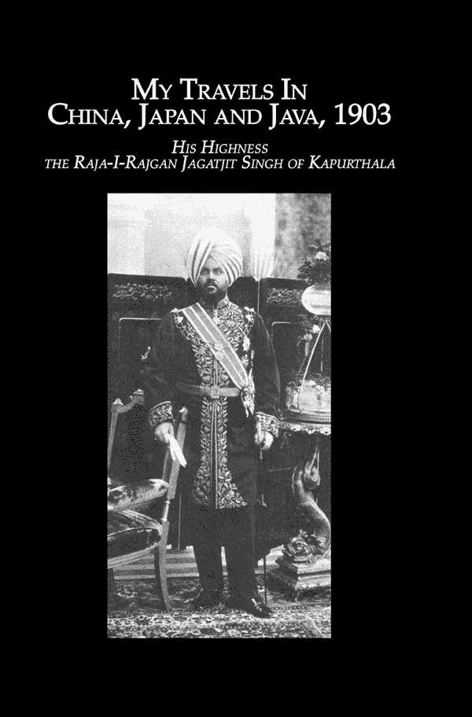

这种对中国、日本和爪哇的独特视角，是由卡普塔拉的印度王拉吉·拉杰甘·贾加吉特·辛格（Jagatjit Singh）殿下撰写的，作为他对远东短暂访问的记录，并献给他的朋友。这与其说是一本学术分析，不如说是他对所到目的地个人印象和经历的记录。

拉吉·拉杰甘·贾加吉特·辛格写作于世纪交之际，当时公众的注意力已转向 1904-05 年的俄日战争，当时双方为了争夺朝鲜和满洲的主导权而战。这一背景以及作者的王室身份，使得对该地区的旅行提供了一个特别引人入胜的视角。

## 凯根保罗旅行系列

### 编辑顾问：彼得·霍普金斯

2005 年由 Kegan Paul Limited 初版

2014 年由 Routledge 出版

2 Park Square, Milton Park, Abingdon, Oxon OX14 4RN

711 Third Avenue, New York, NY 10017

英国图书馆出版数据

美国国会图书馆出版数据

# 前言

本书的写作主要是为了记录我访问远东的行程，并赠送给我的朋友。它并不标榜文学上的卓越，其设计更多是作为对所见人物和地点事实及个人印象的记录，而不是为了强调我作为作者应该受到公众关注。

我希望，对于那些正在关注俄日战争进程的人来说，这本书是有趣的，因为它在某种程度上描述了关于后一个国家的一些情况，并简要介绍了满洲和其他地区的一些有趣之处，由于战争，公众的注意力现在正集中在这些地方。迫在眉睫的战争使得我的日本之旅显得格外及时，而研究该国人民也成为了一项异常有趣的活动。

从旅行者的角度来看，日本也许是世界上最有趣的国家之一；这个国家本身充满了令人愉悦且多样的风景，而那里的人在相貌举止上有一种在其他地方无处可见的魅力。

我也访问了中国和爪哇的部分地区；但对于这些国家的人们，我没什么赞美可说的。中国人似乎对目前事件的进展漠不关心；他们似乎没有国家理想，我被这些人明显的个人自私性所震惊，他们之中不存在爱国主义和公共精神。爪哇人是完全冷漠的；他们表现出活力似乎是不可能的。然而，这两个国家都是很有趣且非常值得一游的。

与这段记录相比，我唯一的遗憾是，由于我掌握的时间非常有限，我不得不对观察我接触到的不同人的习惯和思想只用了简短且通常不足的时间；这种探索本可以花费一整年的时间。

现在我剩下的只是感谢我在旅途中各方面所遇到的一如既往的善意和好客，并感谢所有帮助我寻找有关我访问的不同地点的信息和细节的人。

卡普尔塔拉，1904 年 12 月 1 日。

# 插图

- 卡普尔塔拉的拉贾-伊-拉杰甘·贾加吉特·辛格殿下（石版画）
- 殿下及随从人员
- 殿下与拉尼·萨希巴在北京
- 天坛
- 喇嘛庙入口
- 喇嘛庙内的坛
- 北京故宫入口（皇宫）
- 北京景山门
- 颐和园
- 故宫皇座

（注：提供的文本包含许多重复片段和碎片化句子，可能是由于 OCR 错误或源格式导致的。以上内容反映了根据指令清理后的结构意图。）

*摘自作者原作*。

当俄罗斯公使被接觐见时，引起了大量的关注。据说罗森男爵（Baron Rosen）是外国大臣中最聪明的之一，考虑到他国家与日本之间紧张的关系，他的举动一直受到他人的极大关注。接下来是中国公使。他身后跟着一大随从人员，他们都穿着中国宫廷盛装，是场上唯一没穿欧洲服装的人。

在外国海军和陆军官员之后，日本大臣也接受了觐见。他们的行礼方式是双手放在膝盖上，深鞠致躬。皇后没有与他们握手。觐见就此结束。

随后是一场盛大的宴会。这与在其他地方所习惯的下午茶完全不同，而是一顿有几道菜的正规正餐：汤、鱼、肉块、冰淇淋，配有香槟和其他葡萄酒。皇后坐在主位，她旁边坐着东伏见宫王子和公主们。我观察到，皇室成员几乎没有碰面前面前的实实在在，而客人们则尽情享用了提供的佳肴。

我的位置面对皇后，可以很好地观察整个过程。除了外交使团和一些较显贵的客人外，用餐时并没有提供餐桌；其他人不得不在一张充当自助餐的长桌旁享用点心，他们站在那里自取。餐桌上的服务由日本侍者执行，他们打扮得像欧洲的随从，隶属于皇室。用餐持续了半小时，皇后通过起身示意宴会结束。

我必须提一下，在我们用餐期间，日本军乐队演奏了许多非常精美的欧洲音乐。男士们穿着非常法国式的制服，演奏得非常完美。随后队伍重新整队；但在离开之前，皇后与她一些较显贵的客人握了手，并祝我在日本期间过得愉快，平安回国。就这样，年度菊花节宴会结束了，整个活动的安排之精细，在伦敦的白金汉宫或巴黎的爱丽舍宫都是无法企及的。

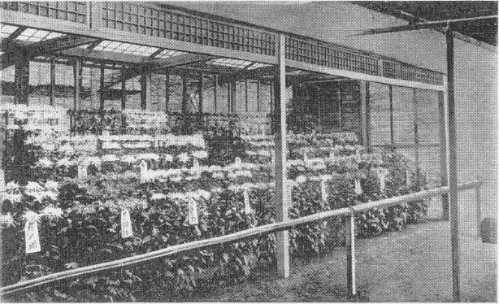

东京赤坂皇室庭园的菊花花展。

我所描述的这场娱乐活动是现代日本进步的众多证据之一；而所有安排的完美程度展现了对外部援助的完全独立，这充分说明了日本人民采纳他人习俗并适应现代和变化条件的能力。二十年前，这样一场以这种系统、以这种规模举办的娱乐活动将超出日本人的能力范围；但现在这并不被认为是什么了不起的事。

皇帝由于忙于秋季演习，未能出席菊花庭园派对，因为他距离那里有一天的路程，且有约 3 万士兵需要视察。

皇后离开后，现场出现了一阵抢车的人潮。我们的车很快就准备好了，我们急忙赶回横滨的快车。我没有什么时间可以浪费，因为那天晚上有年度俱乐部舞会；晚餐结束后，我来到俱乐部，玩得非常尽兴，并跳得心情舒畅。宴会提供了丰盛的夜宵，我与来自各国欢快的人群一直留到凌晨一点。

这场舞会的一个显著特征是，除了横滨总督和他的夫人外，几乎完全没有日本男女。我注意到，尽管日本处于先进状态，但他们与欧洲人之间几乎没有社交往来。只有在仪式性和正式集会上，他们似乎才会聚在一起：原因似乎是日本人在外国社会中并不完全自在。我没有注意到欧洲人在日本有任何排外的倾向。

由于希望留在首都并参与日本生活中心发生的一切活动，我在与几位英国朋友共进午餐后离开了横滨，在东京停留。东京在过去的两百年里一直是首都，现在人口有 150 万。这是一座巨大的城市，从一端到另一端有十英里。在路途中浪费的时间非常可怕。这座城市的面貌拥有壮丽的建筑，如陆军部、议会大厦、法院等，围绕中心公共公园和休闲场形成圈，明显比加尔各答或孟买都要整洁得多，让人想起维也纳的环形街（Ring Strasse），无疑其整体布局是模仿了那里。

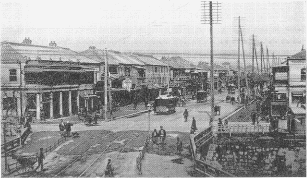

东京银座主街（从新桥出发）。

到达东京后，我们立即前往英国使馆，在那里，二等秘书霍勒先生（Mr. Hohler）带我们去看一场摔跤比赛，比赛在一个铺有草席的房子里举行。进入时，我们必须脱鞋换上帆布室内鞋，这是日本的惯例。起初，摔跤教授用英语解释了摔跤术的基础知识，并进行了实地演示；随后参赛者上场，比赛开始。

摔跤似乎更多是依靠技巧而非力量或体力，看到一个人仅仅通过转动手或扭动脚就被摔倒，简直太不可思议了。考虑到他们被摔倒时的力度，摔倒的人没有受重伤，这非常了常。这些人身材矮小而结实，满身肌肉。每场比赛持续五六分钟。摔跤在日本是一门精妙的艺术。警察也被教授了这些技巧，他们经常对那些吵闹但有力的外国水手练习摔跤。

我们留了大约两个小时，期间我们目睹了大约十场比赛，然后前往帝国酒店，那是我们在东京期间的住所。酒店是一座三层楼的大建筑，立面漂亮，底层有宽敞的公共房间。餐厅可以容纳约两百人，此外还有若干间用于私人娱乐的房间。

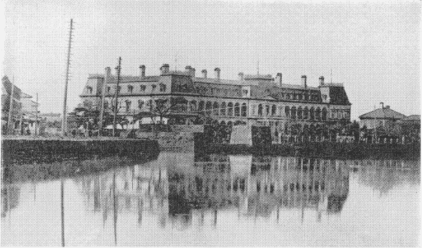

东京帝国酒店（日式管理）。

15 日上午，我拜访了几位皇室王子。不幸的是他们全不在，所以我能去打纸牌。这些王子现在拥有许多为了享乐建造的别墅，是根据法国设计建造的。在家具上花费了巨资，装饰得非常华丽；但仅用于娱乐而居住的日本式房屋实际上没有任何家具。

我还拜访了俄罗斯、意大利和中国大臣，我见到了他们并与他们交谈。俄罗斯公使在我进入时告诉我，他是前任的好朋友，曾和他一起打台球——这一观察直到他误以为我是新到的泰国公使！在交谈期间，俄罗斯公使希望他的政府与日本政府之间的分歧能够友好解决；当我询问日本人是否真的如所信那样强壮时，他回答说他们是不可阻挡的。他还提到，无论他去哪里都会被日本警察监视，在俄军占领奉天后，为了安全起见，发往他政府的公文必须通过特使派遣并由轮船运送。与中国大臣的会面充满了趣味。对于中国可能采取的行动的同情提问，他露出宽大的微笑，请我喝了茶并给了香烟。

当天晚些时候，我去上野公园游览——那里被称为东京的海德公园。那里有许多名树和宽阔维护良好的大道；那里还有一个博物馆、一些寺庙、餐厅和一个美术展。我参观了美术展，看到了许多日本艺术家的画作，其中大部分是水彩画。从公园露台，可以俯瞰脚下的城市美景。

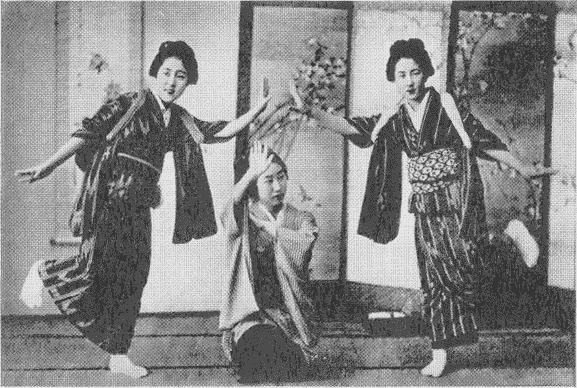

舞蹈。

晚餐后，我在一家通常举行此类活动的茶馆看了艺伎表演，这些表演是提前准备好的。到达时，女侍从行了跪下并用头磕地的惯常礼节。我们脱掉靴子换上室内鞋，然后上楼进入专门用于娱乐的房间。这里与日本所有其他房子一样。它是木头制成的，用纸屏风隔开；这些屏风可以推拉，通过调整形成任意数量的房间。地板铺着干净的棕席，整个地方的整洁程度无与伦比。

房间的一端放了一些垫子供客人坐，在每个垫子之间都放了一个金属或瓷制的火炉，以便客人暖手。在我们就座后不久，女音乐家登场，在行了惯常的礼节后坐在地上。与大众的认知相反，艺伎并不跳舞。她们只负责伴奏，而所谓的“舞姬”（mykos）负责所有的跳舞。后者是九到十四岁的小女孩。大约六个舞姬进入并排成一行面对我们，不久后她们开始了这种奇特而优雅的舞蹈。这包括在艺伎音乐和歌声伴奏下，身体各种优美的动作和纤细手的缓慢挥动。

舞姬穿着五彩斑斓的衣服和漂亮的腰带，看起来像蝴蝶，而艺伎则穿着深色的服装，显得庄重。间隙，舞姬会停止舞蹈休息，随后继续。舞蹈代表了战争、爱情、四季等，解释是由舞者的肢体剧和手势完成的，他们的模仿能力之好，使得这变得毫不困难。

这些微型舞者那孩童般的纯真完全令我着迷，更像娃娃而不是发育中的女性。我必须补充一点，艺伎在被认为胜任演奏和唱歌之前，必须全部当过舞姬。我注意到其中一些人通过黑牙来毁掉唇部形象，这是极度俏皮的习俗。这种新奇的娱乐活动令我着迷直到深夜。

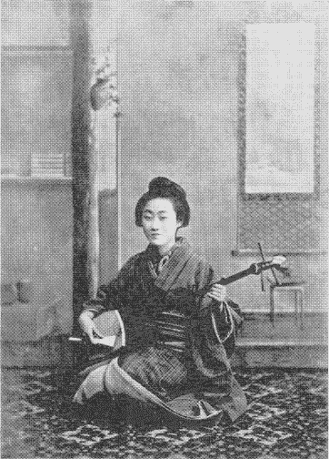

一种艺伎。

16 日，我与德国使馆的一等秘书埃克特先生（Herr Erckert）及其夫人共进午餐，随后参加了由大仓（一位政治家）举办的园游派对。在大仓举办的聚会上比几天前的皇室园游派毫不逊色。花园是典型的日式风格，有微型湖泊、岛屿、桥和矮松树。这次聚会上有三位皇公主和一个王子，以及大量的东京社交人士。

在皇室成员的陪同下，我们德高望重的主人带我们在花园里转了一圈，从小丘上可以获得邻近乡村的好景。四点，所有客人坐下享用丰盛的晚餐。专门留了两张皇室桌，我坐在其中一张，左侧是美丽的梨本公主。她用法语与我交流，我必须承认，她独特的发音并没有让这种语言失去美丽。这位公主结婚不久，她的丈夫当时正在法国的一所军事学校接受培训。这些公主的羞涩、礼仪和对话完全令人愉快，与欧洲女士完全不同。我被连番追问在日本看到的景光，当我提到艺伎表演时，引起了许多趣味和笑声。派对五点散场，大家向主人告别后回家。

英国使馆在晚餐后举办了舞会，因此离开园游派会后我没有时间可以浪费。这是一场正式场合，在场所有人都穿着全装礼服。我穿着我最好的旁遮普服装，这引起了许多关注，因为在场没有人以前见过这种衣服。我随公主们、王子们以及我们的主人夫妇庄严地列队进入舞厅。当我们进入时，欧洲外交官、日本官员以及其他客人都聚集在房间里，景象确实非常壮丽：漂亮的连衣裙、布满勋章的制服，构成了一幅在印度罕见的绚丽景象。

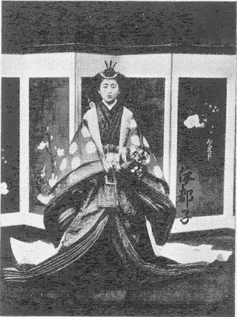

梨本公主殿。

*取自赠给 Rani Sahiba 的照片*。

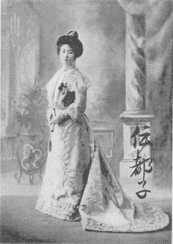 身着欧洲服饰的皇室成员 Nashimoto 公主

# 回忆

*摘自献给拉尼萨希（Rani Sahiba）的照片*。首先跳的是宫廷舞曲，我有幸与这位迷人的梨本公主（Princess Nashimoto）共舞，她穿着极其精致的*欧式*紫色天鹅绒服装，额头和颈子上佩戴着精美的钻石。午夜，我们来到一间为此专门搭建的临时房间吃晚餐。皇室成员离开后，在向我的主人和迷人的女主人道晚安后，我也离开了。东京社交界对麦唐纳德夫人（Lady MacDonald）经常举办的盛大宴会，以及她对所有社会慈善机构的关切关注表示尽表感激。

17 日，我访问了著名的芝芝寺，那是首都最美的寺庙。几座寺庙坐落在一个方形区域内，内部装饰规模宏大，由彩绘和镀金的木雕组成。我入主寺时恰逢午间祈祷进行。僧侣和信徒们不时站立或跪下，用低沉的声音重复着佛教咒语：“Om namo ami Daibutsu”（礼拜佛祖）。据说皇帝每年都会去这些佛教寺庙。

人们可能不知道，在日本流行着两种宗教：一种是以两种或三种不同形式存在的佛教；另一种是神道教，它是国家或皇帝的宗教。后者很难被称为“宗教”，因为它的主要组成部分是祖先崇拜，辅以一套非常简单的道德准则，其核心原则是将天皇（Mikado）神化。然而，事实上，普通日本人并不为任何种宗教问题烦恼。

参观完寺庙后，我询问是否可以见主持，并被带入寺院。他非常礼貌地接待了我，并端上了通常的茶（在日语中称为 *O’cha*）。我可以提一下，这种茶是黄色的，且不加牛奶或糖。无论去哪里，无论是在商店还是寺庙，奉上这种茶都是习俗。高僧穿着黄色长袍，看起来非常博学且像个圣者。他带我去看其他僧侣朗诵赞，我觉得那听起来像吠陀赞歌，因为两者都采用了那种低沉、如吟唱般的语调。在祈祷结束时，僧侣们低头合十，就像印度教徒一样。离开时，高僧给了我两份印有日字的佛教仪式书。

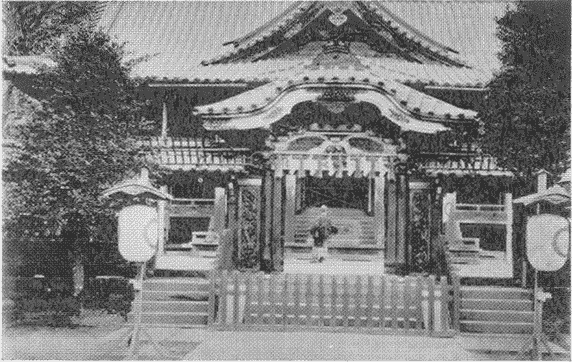

东京的一座寺庙

离开寺庙的灵性氛围后，我参加了在帝国酒店举办的一场现代婚礼招待会。这对幸福夫妇属于东京的贵族，婚礼仪式结束后，他们在帝国酒店会合了所有朋友，接受他们的祝福和祝贺。数百位宾客出席了，他们包含了欧洲和日本社会的*精英*。新娘（来自少数基督徒家庭之一）和新郎站在入口迎接客人。祝贺结束后，所有人在场移到另一个房间——我随新娘母亲一同——坐下享用了一顿丰盛的晚餐，晚餐快结束时提议并喝了传统的祝酒，随后宾客离开。

我可以提到，在日本，婚姻是由媒人安排的，与印度的同阶层人不同，这些媒人在各自的圈子里是有影响力的人。婚姻纽带非常松散，在下层阶级中尤为如此。根据现代法律，男人只能有一个合法妻子；但法律非常松散，男人很常见去登记处，以任何微小的借口请求将妻子的名字从其家庭成员中除去。之后，他总会找另一位更合心意的妻子。妻子对丈夫的从属是完全的。她的首要责任是服从丈夫；第二是服从婆婆；第三是在她成为寡妇后服从她的儿子。

在我所描述的这场婚礼上，新娘和新郎穿着欧洲服装，但我注意到大多数日本女性坚持穿着自己的服饰。对于日本人来说，欧洲服装只有在宫廷活动中才被视为*必须的着装*，且前段时间发布过一项命令，规定国家典礼上将永久废除日本服饰。这项命令适用于男性也适用于女性。大多数欧洲人和许多日本男性（后者出于经济考虑）对从民族服装变为欧洲服装的改变感到遗憾；但根据我所能收集的所有信息，这种变化的真正原因是（与日本所有趋向西方思想和外表的改变一样），为了培养这样一种印象：外表的相似性会引发心理上的平等感。

傍晚开车经过城市的一个区域时，我来到了一条宽阔、灯光良好的街道，两旁有两三层的建筑。每栋房子前面都有一个宽敞的平台，由镀金铁栏围着，后部部分装饰华丽并镀了金。在这些围栏内，就像动物园里的野生动物一样，坐着许多打扮得极其妖艳的女性。街道上挤满了男女，因为正值某个节日的纪念日，许多人（包括妇女和女孩）通过铁栅观察那些被囚禁其中的华丽生物来消遣自己。后者无言，静静地坐着，似乎对旁观者的目光无动于衷。

我完全无法理解这一景象的含义，向向导询问后得知在这条街道以及其他一些地方，该阶层的女性都是受到限制的，法律规定没有特殊许可绝不允许离开。我提到的这个区域被称为“吉原”（Yoshiwara）；它反映了世界各地在情感和观念上的差异，体面的中产阶级认为去那里没什么。

11 月 8 日早晨，我们受邀请参加在保护区举行的一次捕鸭活动，这种活动每年举行一次。不幸的是，那天阴云密布。当所有客人都聚集在帐篷下，准备开始行动时，下雨了，但这并未消灭猎者的热情。捕鸭的方法是独特的：他们从野鸭聚集的大片水域引诱野鸭，在水侧筑起一堵覆盖着植物的矮墙。在墙后，猎者们各就其位，每人拿着一种网。信号一响，猎者们突然站起，野鸭受惊，被敏捷的动作和套上的网迅速捕获。我没有成功捕到鸭，尽管这个过程看起来并不困难。然而，我完全想象这看起来比现实要容易，手部的灵活性对于成功至关重要。捕获的猎物立即被处理，随后被做成午餐，这形成了一个愉快的结尾。在运动间隙，有香槟、茶、巧克力等点心在温暖的帐篷里提供，这种消遣愉快地度过了时光。午餐时间，每位男客都安排了一位女士陪同，午餐在湖中心的一座大亭子里进行，通过一座艺术感的小桥到达那里。安排执行得非常完美：甚至我们的外套和披肩也没有被遗漏；所有的经过了仔细的标记和编号以防混淆。亭子的位置选得很好，确保了各个方向的视野，周围的水域和树木景色极佳。

一小时的车程将我们带到了上野站，在伊里（Imori）上的陪同下离开。我们晚上到达了宇都宫（Utsonomiya），抵达时有来自皇家卫队的官员和警察接我们。他们把我带到附近的一家酒店，里面的房间是欧式的，我在那里舒适地度过了夜晚。第二天，我乘坐人力车环绕宇都宫镇，然后前往约三英外的操练场。到达时，看不到部队，只有远处的炮声和枪击声是距离的唯一证明。等待后，我被带到某处，在那里见到了长川（Hasegawa）将军，他当时担任皇家卫队的司令。

随后，敌对双方出现了，我冲过去更清楚地观察。在碰撞时，我发现自己陷入了混战中，双方距离不到五十英尺。战斗以典型的火力对决开始，每一方都希望击败对方，随后步兵部队发动进攻。观察他们侧击对方并寻找机会掩护是非常有趣的。我看到几乎所有的欧洲士兵都在检阅，从这些日本人的装束来看，很难相信自己身处东方。制服都是法式的，但训练动作模仿了德国人。只有在近距离观察时，差异才显现。战斗很快结束，士兵们立刻成为朋友，并在食物和饮料中欢聚。日本人一定有惊人的耐力，正如我描述的那样，士兵们从凌晨四点到十一点一直武装状态，尽管经历了疲惫的时间，但他们看起来并没有糟糕。从我所见，日本军队很容易供应。每个士兵都配备了一个整洁的小盒子，可以放在背包里。盒子的容量能装下一天的口粮，其中一个格是罐肉，另一个格是米饭。米饭煮得像稠胶或布丁。另一个小格用于放置必不可少的筷子。这种安排的巨大优点在于口粮携带方式精美便携，以及食物本身的浓形态，使得每个士兵一天都能自给自足。

11 月 19 日早晨，我们受邀请参加在保护区举行的一次捕鸭活动，这种活动每年举行一次。不幸的是，那天阴云密布。当所有客人都聚集在帐篷下，准备开始行动时，下雨了，但这并未消灭猎者的热情。捕鸭的方法是独特的：他们从野鸭聚集的大片水域引诱野鸭，在水侧筑起一堵覆盖着植物的矮墙。在墙后，猎者们各就其位，每人拿着一种网。信号一响，猎者们突然站起，野鸭受惊，被敏捷的动作和套上的网迅速捕获。我没有成功捕到鸭，尽管这个过程看起来并不困难。然而，我完全想象这看起来比现实要容易，手部的灵活性对于成功至关重要。捕获的猎物立即被处理，随后被做成午餐，这形成了一个愉快的结尾。在运动间隙，有香槟、茶、巧克力等点心在温暖的帐篷里提供，这种消遣愉快地度过了时光。午餐时间，每位男客都安排了一位女士陪同，午餐在湖中心的一座大亭子里进行，通过一座艺术感的小桥到达那里。安排执行得非常完美：甚至我们的外套和披肩也没有被遗漏；所有的经过了仔细的标记和编号以防混淆。亭子的位置选得很好，确保了各个方向的视野，周围的水域和树木景色极佳。

11 月 20 日早晨，我们受邀请参加在保护区举行的一次捕鸭活动，这种活动每年举行一次。不幸的是，那天阴云密布。当所有客人都聚集在帐篷下，准备开始行动时，下雨了，但这并未消灭猎者的热情。捕鸭的方法是独特的：他们从野鸭聚集的大片水域引诱野鸭，在水侧筑起一堵覆盖着植物的矮墙。在墙后，猎者们各就其位，每人拿着一种网。信号一响，猎者们突然站起，野鸭受惊，被敏捷的动作和套上的网迅速捕获。我没有成功捕到鸭，尽管这个过程看起来并不困难。然而，我完全想象这看起来比现实要容易，手部的灵活性对于成功至关重要。捕获的猎物立即被处理，随后被做成午餐，这形成了一个愉快的结尾。在运动间隙，有香槟、茶、巧克力等点心在温暖的帐篷里提供，这种消遣愉快地度过了时光。午餐时间，每位男客都安排了一位女士陪同，午餐在湖中心的一座大亭子里进行，通过一座艺术感的小桥到达那里。安排执行得非常完美：甚至我们的外套和披肩也没有被遗漏；所有的经过了仔细的标记和编号以防混淆。亭子的位置选得很好，确保了各个方向的视野，周围的水域和树木景色极佳。

（注：提供的文本包含大量重复和损坏的内容，我已根据实际叙述处理了核心内容并优化了格式。）

*摘自作者原手稿*。

“君权神授”理论在日本得到了最充分的体现。在那里，天皇本人被视为神圣的存在，其照片不被允许出售。从最高层到最低层，社会的所有阶级实际上都在崇拜他们的统治者，在他们的宗教和社会观念中，统治者的人格体现了所有神圣和类神性的特质。当然，无法得知日本目前繁荣和知识水平的地位有多大程度上归功于天皇的人格；同样难以确定他个人在多大程度上主宰了他所统治国家的命运。然而，这一点是广为人知的，*即*：没有他的知情和许可，就不会采取任何措施，也不会发生任何重大的变革。陛下得到了精干且经验丰富的大臣的有力支持，在讨论重大事项时，总会寻求所谓“元老们”的建议。在这里可以补充一点，这些“元老”包括了一些最卓越的改革者，日本目前在世界国家中的地位在很大程度上归功于他们。

## 天皇复新

四十年前，当现任天皇继位时，日本及其制度仍受封建制度统治；天皇仅仅是一个名义上的首领，实际上是一个囚徒。所有的行政权力都掌握在大将军或封建领主手中，他们统治着不同的省份。当日本人觉醒到改革的必要性时，他们的选择要么继续现行的制度，要么通过将所有权力集中在天皇身上，统一成一个强大的国家。由于人们在这一重要问题上存在分歧，发生了一场血腥的革命，其结果是天皇恢复了其应有的地位和职能。随着革命的发生，将军们放弃了他们自认为的权利和傲慢的态度。现在，一些大人在国家政府中担任重要职务，并对他们的天皇完全忠诚和顺从。从政治、社会和经济角度来看，这一转变带来的良好结果现在对全世界都是显而易见的。日本皇室是现存最古老的王朝，其血系可以追溯到过去的 2500 年。

## 皇宫

我的下一步是参观宫殿本身，因为这种机会可能不会再次出现。我穿过了了宴会厅、接待室和宝座厅，所有的地方规模很大，装饰得极其华丽。门是由玻璃制成的，为周围营造出一种水晶晶般的效果，这以自己的方式非常有效。家具都是笨重的类型，全部是从德国进口的。

在我看来，纯日本式的装饰优于我所看到的任何进口物品：例如，宴会厅是一个面积超过五百平方英尺的房间，其天花板装饰有金箔以艺术的方式与不同色彩相结合；墙上覆盖着昂贵的丝绸。在其中一个接待室里，我注意到一幅超过四十英尺长的精美挂毯；据说是由京都的一位织工一次性织成的。木材被大量用于装饰工作，并用漆器精细地加工，其技法完全无法模仿。所有的墙板都装饰有独特的设计，有浮凸或彩绘。房间的墙壁主要覆盖着锦缎，而走廊的墙壁贴着一种日本特有的压凸纸。我相信这种纸的制造是一项庞大且日益重要的产业。所有房间都喷洒了薰衣草精油，并且暖得很好。

## 浅草公园与公共表演

回到酒店吃早餐后，我随后访问了浅草公园（Asakusa Park），它之于日本就像水晶宫之于伦敦。公园被不同方向的街道贯穿，街道上的摊位出售各种装饰品，如人偶、扇子等。点心在公众面前制作并现场出售。这些点心摊普遍的整洁和雅洁的环境形成了一种购买和食用的诱惑，否则这种诱惑本是不存在的。

侧边表演非常多，集市的所有特征一俱全；我们在那里看到了机灵的杂技师、流浪艺人、摔跤手、演员等。剧场表演正如火如荼，深受人们欢迎，现场有大量专心于度假的人参加。这里的人们与在巴黎、伦敦或事实上欧洲任何地方看到的、同样无闲的人们相比，对比非常显著；在这里，尽管这些人显然在享受乐趣，但他们表现得非常有教养，完全没有任何形式的醉酒和闹事，这是表演中一个令人愉快的特征。

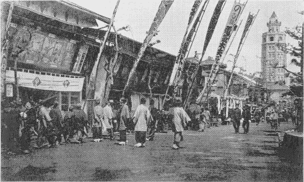

公共表演，带有十二层高塔的浅草公园，东京。

## 观音寺

在这个热门旅游胜地附近立着著名的观音寺（慈悲菩萨）。日本这座和其他寺庙的一个奇特特征是，人们自由利用它们进行崇拜以外的用途。当我们看到整座寺庙时，呈现出一种奇特的混合景象：鸟儿进进出的；人在抽烟；有些人在躺着或睡觉；商人在讨价还价；与此同时，一些人正在礼拜。这一景象很奇特，让人感到寺庙除了我们理解的崇拜之外，还有其他用途。

## 生日晚餐

由于想以得体的方式庆祝我的生日，我邀请了几人在酒店与我共进晚餐。他们包括克劳德爵士和唐纳德夫人、外务大臣小村男爵、三宫夫人（后者是东京社交界非常受欢迎的女士），以及德国使馆的冯·埃克特男爵；还有许多不同国籍的朋友。座位的问题非常困难，只能由拥有礼仪决定权的皇室成员来安排。现场大约有四十位客人，我负责护送三宫夫人就座。晚餐的主菜（pièce de résistance）是由随我而来的厨师制作的，他的厨艺受到了所有人的赞赏，特别是日本客人。在适当的时候，我向天皇致意并发表了简短的演讲，小村男爵也热烈地回应了，三宫夫人也表达了祝意。晚餐期间，日本军乐队演奏了各自的国歌。

## 日本的马球

第二天，我们受邀观摩一场马球赛；日本的马球是封建时代的遗迹，现在为了游客的消遣而复兴。比赛在海边的一个皇家公园内举行。这四个小时的路程非常乏味，涉及到马车和人力车。天气糟糕，完全不利于狩猎。天皇有时允许贵客在这一区域内狩猎，但并非总是。马球场的安排让观众拥有极佳的视野。比赛本身与英国马球完全不同。参赛者穿着不同的服装，每个人都配备有一种球杆，试图将球击入球门。每回合持续十分钟，结束后，我前往东京俱乐部。我很享受这种比赛的新奇，并通过与罗森男爵一起打台球来消遣，我并没有太大困难。然而，不幸降现在英国海军随从特罗布奇上尉身上，他进行了一场精彩的比赛。东京俱乐部深受欧洲外交官和一些日本官员的青睐。纯粹贵族的俱乐部被称为贵族俱乐部。

## 狩猎

11 月 27 日清晨，我在休姆上校的陪同下出发去狩猎。四小时的路程非常乏味，涉及到马车和人力车。天气极其寒冷，完全不利于活动。天皇有时允许贵客在这一区域内狩猎，但并非总是。狩猎的主人田伯爵和他的助手在我到达时迎接了我，我们没有浪费时间开始行动。组织了几次搜索，但运气不在，我甚至没有开枪的机会。鸟类非常稀少，只有休姆杀了几只；他的猎物只有两只雉鸡一只鹬。午餐结束后，回程途中我的人力车翻了，将我摔在满是泥泞的路上。我满身泥泞地尽力爬起来继续路程；最终在深夜回到酒店，我在日本唯一失望的一天就这样结束了。

## 贵族学校

第二天，我访问了所名为贵族学校的机构，贵族和名族的年轻女儿们在那里接受教育；那里教授各种科目，所授的培训似乎是全面且深入的。英国和日本的女负责们带我参观了所有部门，并解释了工作的体系。绘画课特别值得赞誉，作品水平很高：在那里，我看到了两件学生技巧的范本，这令我非常欣慰。这些与时代的日本女孩甚至在学习西式的跳舞！注意到西方舞蹈与日本通常练习的舞蹈之间的差异是非常有趣的；后者也在教授中，而且显然比前者复杂得多。歌唱课极具吸引力，学生表现出很高的天赋。要描述这所学校教授的音乐和歌曲种类相当困难，但也许我这样说会更清楚：该国的本土音乐似乎处于过渡状态，外来的或西方的体系以及某种和声被引入，其程度足以使其存在变得明显，而不破坏原有的。我访问的周六是半假，由于我正好在十二点到达那里，我目睹了充满活力的景象：从五岁的小不到十七岁的成年少女，各年龄的女孩散回到家中。她们精致服装上五彩斑斓的色彩，以及她们笑容和神情的活力，构成了一幅以色彩和活力为主基调的画面。有些女孩自备了早餐或午餐，装在像普通巧克力盒大小的小盒子里，每个盒子里装有必不可少的筷子和同样重要的饭团。这些食物被日本人在现场大口享用。

| 军级 | 薪资 |
| :--- | :--- |
| 将军 | 年 7,500 日元 ¹ |
| 中将 | 6,000 |
| 少将 | 5,700 |
| 上校 | 3,600 |
| 中校 | 2,700 |
| 少校 | 1,950 |
| 上尉 | 1,350 |
| 中尉 | 900 |
| 少尉 | 630 |
| 军士官 | 每月 36.66 日元 |
| 军士 | 18 |
| 军士 | 12 |
| 中士 | 9 |
| 下士 | 3 |
| 一等兵 | 2.8 |
| 二等兵 | 2 |

# 日本旅行：早期观察

午饭后，我前往了大约五英外的上野公园参加一场音乐会。在那里，我发现自己置身在一个时尚聚会之中。节目的第一部分是欧洲器乐曲，表演者是在一位奥地利指挥家（chef d’orchestre）指挥下的日本人。执行水平显然非常高，对所有参与者来说都是完全值得的。乐队是皇室私人机构的一部分，因此被称为皇室乐团。许多出色的业余爱好者也参加了这次音乐会。

第二部分完全由日本歌曲和器乐曲组成。那种歌曲很难用描述；但可以说它主要由颤音组成，而且似乎是用小调执行的，并伴随着许多面部表情。有人告诉我，我此刻正努力描述的这场表演具有古典特征；但注意到，音乐越古典，在场的欧洲人就越难以抑制笑声！

我的东京之行现在已经结束，我剩下的就是向 C·麦道纳德爵士及其夫人道别，并诚挚感谢他们对我的许多关照。他们的帮助让我的东京之行变得既愉快又有教益。

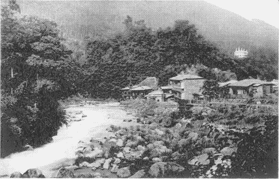箱根县，箱之石的温泉。

在日本无论我走到哪里，都有两名便服探员如影随形。起初，我倾向于反感这一点，并认为他们的不断出现是没有意义的；然而，有人向我解释说，当贵宾来到该国时，有一项不变的规定，即在任何时间和地点安排两名探员随在其左右。在某些场合，我发现这些人是有用的，特别是在拥挤的街道和火车站等地，他们在不引起过度骚乱的情况下，为我在人群中辟出一条道路。

## 前往箱之石之旅

我于 11 月 29 日乘中午火车离开东京。下午三点，我们到达了一个名为野座（Noza）的地方，下车后我们乘坐有电车继续行，我们在车上呆了大约一小时。大部分路途中，我们在电路线两侧经过了许多村庄；偶尔能看到开阔的田野，注意到我们正逐渐进入多山的地形区域。山坡非常肥沃，人们不禁赞叹树木上茂盛覆盖的秋季美丽色彩。一条最终汇聚成河流溪流，为景观增添了另一抹美丽。

乘坐有电车行驶一小时后，我们到达了必须换乘轿子前往箱之石的地方。当我们开始上山时，天已经变黑了；虽然道路很陡，但路况良好，我们在一小时后到达了目的地。在那里，我们找到了一家名为“藤屋”的装修良好的酒店。老板迷人的女儿山口小姐（Mademoiselle Yamaguchi）带我们进入了舒适的房间。这位年轻女士是典型的欧洲化日本人；她的法语非常好。

第二天起床时，我们发现自己处在清爽宜人的气候中，感到非常高兴。箱之石是日本最受欢迎的山区度假地之一；尽管我们不是在旺季（夏季）访问那里，但酒店里还是坐满了欧洲和美国客人。极佳的气候促使我们去箱根湖考察；这涉及到在一条困难的小径上攀爬大约两个半小时。`En route`（途中）我们经过了一些美丽的山谷，并对许多热矿泉很感兴趣，那些患有各种疾病的人去那里寻求缓解。

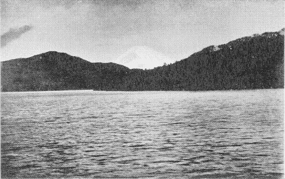箱根湖。

从日本当地旅馆的窗户望出去，湖泊仿佛铺展在我们的脚下。四周环绕着高山；但最壮丽的过于富士山，它以一万三千英尺的高高耸立，在周围一切之上。它的形状几乎完美对称，像一个锥体或金字塔。山峰在静静湖面上的倒影为景观增添了分美。从山顶到大约六千英尺处，山峰覆盖着闪烁的万年雪，阳光在上面的反射几乎让人眩目。

用过午饭并欣赏了一段时间景色后，我们步行前往一个小山丘，那里坐落着离宫，据我介绍那是皇室在温暖季节的度假胜地；然而，已知皇帝只去过一次。离宫分为两部分——日本部分和欧洲部分——后者类似于人们在法国蔚埃拉沿岸常见的宫殿式 `châlet`（木屋别墅）；从那里的窗户看到的景色可以媲美甚至优于欧洲南部看到的任何风景。皇室居住的日本部分一如既常，没有任何家具。我们遗憾地转过脸离开这些迷人的环境，回途中，并在黄昏时分到达箱之石。

## 名古屋与城堡

我们在箱之石停留的第二天，主要特点由于是天气糟糕。大雨倾盆而下，加上我感觉不是特别好，决定整天都待在室内。第二天，我们乘坐 111 点的火车前往名古屋，在途中看到了著名的富士山的最佳景观。在经过疲惫的旅程后，我们在晚上 9:30 到达名古屋，入住了一家小酒店。名古屋是日本主要的城市之一；它拥有几家工厂，给人一种繁荣的感觉。由于只有几个小时时间，我们决定参观古城堡，据说它是该国最精美的封建城堡。这个地方对公众是不开放的，需要领事馆的介绍信才能进入。最初有两个护城河，现在都保持干涸，供驻军使用。城堡内部的房间非常值得一看，因为装饰有花卉、樱花等，几乎全是由该国最著名的艺术家完成的。

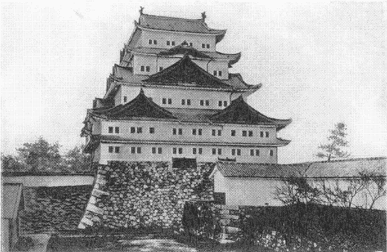名古屋城堡。

晚上离开名古屋，我们同一晚到达京都，入住位于小山丘顶部的妙访酒店。这间酒店完全由木头建成，没有建筑美上的追求；尽管如此，居住其中非常舒适；晚上了一场大雪，第二天早晨来时，一切都覆盖了一层美丽的白色斗篷。从酒店可以看到城市的一部分，以及附近的一些山脉。到目前为止，西方影响尚未进入这个纯正日本风格的地方；因此它比东京等其他城市更有趣。

过去，尽管皇帝每年在这里居住一段时间，这座城市重要性有所下降，目前仅次于东京。但在商业和工业方面，京都仍占据领先地位，因为最好的日本货物是在这里制造和销售的。我的时间非常有限，但我决定充分利用，并在早餐后立即开始参观两处皇宫。这两处地方在风格和陈设上完全是日本式的，与东京的皇宫形成了鲜明对比。入口处的访客簿让我记录了名字。大厅里的告示告示禁止吸烟，外套和伞要留在外面。在入口处必须脱鞋，但作为例外，我被允许保留，并配了一双拖鞋。皇宫占地面积达二十六英亩，六扇门通往内部。过去在皇宫围外还有许多较小的建筑；贵族住在这些建筑中。在曾由君主使用的皇宫部分，现在举行神道节。看起来像纸制的拉门上覆盖着由顶尖艺术家创作的美丽画作。在这里，我们看到了皇帝的宝座——一个覆盖着多种色彩丝绸的顶篷结构。

我们看到的下一个地方被称为清西殿（Seriyoden）；这里有许多追溯到几个世纪前的原作。一条走廊带我们来到所谓的“御所”（Ko-Gosho），那里有三个房间都相当现代；它们装饰色彩鲜艳，用于次重要的会议。检查皇宫只有三个小时时间，但要彻底完成它们至少需要一整天。在参观皇宫结束后，我们去看了一所日本击剑学校。男女老都来这里参加这种优雅而健康的运动。日本的击剑体系与那里的大多数事情一样，与任何国家都完全不同；他们的剑更长、更难操控，在每一次点刺或进攻时，战斗者都会发出一种奇特的小叫声。奇怪的是，尽管日本在军事科学、武器等方面已与世界接轨，人们仍保持旧式的击剑、摔跤和体育，仅仅是为了提供合适的锻炼，并在很大程度上防止自己完全失去古代习俗的联系。

## 桂离宫与西本院

5 号在妙访酒店（京都最大的酒店）用过午饭（déjeûner）后，我们开车去看桂离宫（Katsura-no-kyu），它是日本景观园林的一个完美典范。这种风格非常有效果，包含了人工池、微型桥、踏石、修剪并训练成奇幻形状的树木，以及许多同样奇特且有效的事物。花园维护良好，但建筑就不能这样说了，大部分处于不同程度的破败状态。

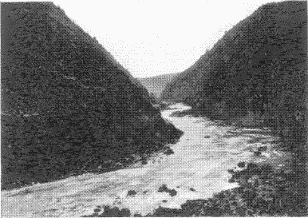桂川急流。

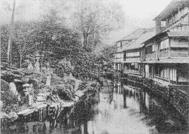典型的日本茶室。

返回途中，我们看到了一座名为西本院（Nishihongwan）的大寺，它是现存最新的寺庙之一。它与同类的其他地方对比很大，这源于它的新颖，时间没有抹除它。一位年轻的主持带我参观，奇怪的是，他在牛津接受过三年的教育。他告知我更多信息，他曾在印度度过一段时间，并在德里大婚（Darbar）期间在场。

*摘自作者提供的照片*。苏丹经常访问欧洲，正因如此以及由于其他原因，我们很快就有了共同语言，成了无无的朋友。我们找到了许多可以讨论的话题和人物，并交换了许多彼此感兴趣的故事。他的殿下告诉我，他打算再次访问欧洲，并将在那里停留两年。当我问起他如何成功获得许可离开这么久的时间时，他表示非常惊讶，并说他从未想过向任何人提出这种请求。

在廖惹（Johore）度过一段非常愉快的时光后，我们于傍晚回了新加坡。晚饭后，我们去了马来人剧院。表演者正努力排演一出荷兰剧。他们成功地把这出戏搞得一塌糊涂，而且他们将欧洲音乐改编为马来歌词的尝试简直荒唐至极。服装是对原原作的拙劣模仿，看起来设计初衷是为了滑稽剧，而非严肃的剧。

12 月 30 日的雨使我在早晨被困在室内；但午下午，应廖惹苏丹的邀请，我在新加坡的宫殿里与他喝了茶。他在新加坡有两座宫殿——一座大，另一座较小。两座建筑家具装修都非常华丽，位于装饰性的自然公园之中。他在他自称为“单身汉之家”的地方接待了我，他在那里度过大量时间。在那里，我看到了许多他珍贵的赛马奖杯，还有他的一些马，其中大多数都是异常优秀的良马。他还拥有汽车，对它们的运作非常熟悉。

12月31日我乘船前往爪哇的轮船是一艘七百吨的破旧小船，不幸对我来说，它载着一货干鱼；因此，船上充满了恶臭的气味。如果不忽略满在船上游荡的大群中国人和马来人，乘客名单上只有另外一个人，他们在甲板上吃饭、睡觉和洗澡，让我们感到非常不适。船长（一个真正的老海员）和两名军官是英国人；前者格外有礼貌，把前甲板上的客房让给我用，那里的鱼味没那么刺鼻。我们忍受了周围环境糟糕的不适，在条件允许的范围内为这段旅程安排得尽可能舒适，幸运的是，这段航程没有超过两天。这是我一生第一次跨越赤道；但由于欧洲乘客稀少，并没有出现船只越过想象中环绕世界的那条界线时的惯常仪式。此外，我们太忙于对抗鱼腥味，也许赤道受到的关注还没有它应有的那么多。

阵阵剧烈的风雨偶尔会缓解酷热；但由于这些风雨持续时间很短，我们的不适只在一定程度上得到了缓解。第二天整天，我们都能看到陆地——属于荷兰的小岛。

## 荷属印度

荷兰荷属印度（`NETHERLANDS INDIA`）一直引起我的好奇心，因为它是东方最大的非英国殖民地；当我们在1月3日接近巴达维亚（`Batavia`）时，我很高兴我的机会到了，可以进行比较并记录差异。荷兰在殖民国家中排名第三，在没有任何地方能像爪哇这样其统治得到更好的利用或受到更严厉的批评。整个苏门答腊、婆罗洲和望加锡（`Celebes`）都处于荷兰的统治（`régime`）下，许多小岛也是如此。所有地区的总人口达到了4000万的可观数字。在所有地方中，爪哇是最重要的，其人口密度是任何其他国家都难以比拟的。这一点显而易见，在提到的4000万人中，爪哇包含了不少于2500万，即超过了一半。

尽管荷兰持有目前的殖民地已有几个世纪，但他们一直在与当地民族作斗争，与他们的战争通常带有血腥色彩。如今，苏门答腊的阿齐音人（`Achinese`）偶尔给荷兰当局带来麻烦，这些人的性格比爪哇居民更动荡、更具侵略性，而爪哇现在维持着和平宁静。人们可能并不普遍知道，或者这个事实已被大多数人忘记：在拿破仑入侵荷兰期间，荷兰的殖民地要么被接管，要么通过预先安排交给英国人，英国人保留了大约五年，随后在那个国家恢复独立后将它们归还给了荷兰。

许多证据表明，爪哇是现在所谓的英属印度的一部分，当时那里的人是印度教的信徒。受穆罕默德入侵的影响，他们最终成为了先知的追随者，直到今天依然如此，尽管必须承认，他们在遵循该宗教方面绝非正统。在私人的家庭空间里，人们直到今天仍沉溺于偶像崇拜，这显示了代代相传的习惯的影响，而这种习惯伊斯兰教无法完全根除。

## 抵达巴达维亚

我们的轮船早晨七点到达丹戎普里奥（`Tandjong Priok`），在乘坐20分钟火车后，我们到达巴达维亚。我们住在印度酒店（`Hôtel des Indes`），那里有一整个侧楼被预留供我住宿。侧楼是一栋大建筑，房间高敞，在家具等方面非常适合获得真正的舒适。地板铺着大理石，而且像爪哇随处一样，床的尺寸非常巨大。说一点也不夸张，为我提供的床有8英尺乘6英尺。

到达后不久，我们的第一顿饭就上了，这被证明是我们经历中一个非常有趣的特征。餐点本身被称为“饭桌（`Riz-tafel`）”，字面意思是“饭桌”，在一点钟供应。所有的菜都同时放在面前，盛在一个大尺寸的盘子里，上面放着咖喱肉、鸡肉、鱼等等。午饭后，大多数人消失了，商店和办事场所也关闭了，为了方便行人，一种“无所谓（`dolce niente`）”的感觉笼罩着每个人。下午六点，酷热过去，一种复苏发生了，生活的迹象再次变得可见。晚上，我开车对周围环境有了大致的了解。在驾车过程中，我窥视了兵营，并对他们的生活方式非常感兴趣。荷兰人和当地人聚在一起生活和进餐。欧洲人的总数约为四万。小镇设计和布局良好，尽管大部分建筑是单层的，但它们非常坚固且都配有宽敞的走廊。街道铺设平整，两侧都有人行道。军乐队在一个名为“`Plein`”的大广场上演奏了精选的音乐。七点（通常的访问时间），弗雷泽先生（`Mr. Fraser`）会我。他带我去了和谐厅（`Harmonie`），那是一个公民俱乐部，人们对清凉的饮料感到快乐。

## 总督宫殿

尽管荷兰持有目前的殖民地已有几个世纪，但他们一直在与当地民族作斗争……[此处似乎有重复/被打乱的部分，关于访问巴达维亚、参观博物馆以及访问布廷索格的叙述被保留了]。

第二天早上我参观了博物馆。它包含了一系列精美的物品——有些古老，有些现代，同时也展示了在荷属印度实践的艺术和科学。收藏中的一个特征令我很感兴趣，是从岛的不同地区挖掘出的石像。考虑到这些像的历史，很难推断出古代印度教是主流宗教。例如，我认出了甘聂（`Ganesha`）的像，还有湿婆（`Shiva`）和奎师那（`Krishna`）。

接下来我访问了总督的住所，我发现那是一座宏伟的建筑，家具齐全。接待室宽敞高大。然而，这座宫殿并不常用——事实上，只有当总督从布廷索格下凡来参加盛大的招待或其他活动时才使用。当地的一个特征是欧洲人部分采用了当地服装，对于女性来说，这包括围笼（`sarong`）——另一种则是一种宽松的衬衫。前者有时是当地艺术的精品，价值差异很大。脱掉鞋子、袜子和帽子，他们整天都这样；只有在下午出去应对气候变化时才换上欧洲服装！

## 前往布廷索格

布廷索格的气候是对巴达维亚的极大改善，在各方面都更舒适、更凉爽。由于靠近赤道，布廷索格的温度始终如，昼夜长度相等。

1月5日我们出发前往布廷索格时下着大雨。我乘坐一节预留的车厢，相当舒适。大多数车厢有包皮的座椅或普通的藤底座。线路的轨位于印度的宽轨和米轨之间。火站的名字用罗马字母和爪哇文字显示，拼写法显然采用荷兰系统。大约两个半小时的旅程后到达了布廷索格。雨一路上都在下着，但不足以抹去途中（`en route`）的美景。在线路两侧，凡眼睛所及之处，都是人们能想象的最茂盛的热带植被丛丛。

布廷索格的海拔约二千英尺，但线路的坡度非常平缓。到达目的地后，我们开车前往贝尔维酒店（`Hôtel Bellevue`），顺便说，这个名字起得非常合适，因为从酒店走廊望出去的景色格外漂亮，延伸到森林葱葱且极其肥沃的山谷。我们的到达恰好对应于“饭桌（`Riz-tafel`）”的时间，这里的情况我在巴达维亚描述的一样。

这个国家严格遵守护照制度，一个人必须在抵达后三天内出示卡盖章（`viséd`）。我发现商店外观吸引人，充满了来自欧洲几乎所有国家的商品。我发现这种安排比孟买和加尔各答大多数大型机构的盛行安排要优，在那里，人们不得不接受大多在英国制造的东西，或者什么都没有。下午开车期间，我被荷兰人为区分不同种族的居住区所做的安排所震惊。一部分被留给欧洲社区专属使用，另一部分留给马来人，还有一部分留给中国人。奇奇的是，几个日本人没有被归类为亚洲人，被允许随心所欲地居住。作为临时访客，我们的国籍并没有阻止我们住在欧洲区。

接下来访问了和谐厅（`Concordia`）；这是一个军事俱乐部，我们发现它甚至比和谐厅（`Harmonie`）还要。。我看了市政厅，那里有很多任总督的画像。

## 罗洛布杜寺

10日，我们早早出发去著名的罗洛布杜（`Boroboedoer`）寺。每七英里就有接力马；虽然我们车上一一次四匹马，但旅程花了三个半小时。道路是一条宽敞的大路，一侧有一条电车，我们与它并排了很长距离。电车似乎很受欢迎，在不同地方可见。途中我们到了一个集市（`passer`或露天市场），我们在那里下车，那里值得一去。村民从周围村庄带着农产品来到集市，售卖不同的物品。那里出售着各种物品，如服装、水果、蔬菜和各种家居用品。优质的水果供应非常充足。

*一张展示给作者的照片*。在我们离开雅加加达前往索洛卡尔塔的第二天，那是爪哇岛最重要的苏丹的首都。一小时的车程让我们到达了目的地，抵达后，我们直接开车了`Hôtel Slier`。索洛卡尔塔是一个极其重要的地方，也是另一位荷兰驻员的所在地。

在下午的驾车途中，我们遇到了一座宏伟、看起来庄严的建筑。经询问，我们得知那是苏丹姐夫的官邸，其名为`Mankundukuru Adipati`。在获得必要的许可后，我们进入内部参观了那里。按照该国的习俗，建筑内部没有墙隔，房间都非常高大且宽敞；地板铺着大理石，装饰和家具呈现出华丽的东方风格。建筑本身与其说是房子，倒不如说像是一座巨大的亭子，坐落在一个巨大的矩形围院中间，而这个围院又被高墙环绕着。

据说`Mankundukuru Adipati`是荷兰统治下最有权且最开明的君主之一。由于我掌握的时间有限，没有机会与他结面，我我很希望能有机会这样做。

下一个引起我注意的是一座看起来相当威严的堡垒，它的地理位置恰好可以俯瞰对面的苏丹宫。我很奇奇进入堡垒的内部（那里驻扎着许多携带枪支的荷兰士兵），但没有获得许可，因为这违反了规定。

在这里或许有必要提到，在荷兰统治下的爪哇苏丹与在英国统治下的印度拉贾（`Rajas`）之间，在权力和特权方面存在巨大差异。当然，由于我在爪哇岛停留的时间很短，我无法对这类问题做出个人判断；但根据我所听到的（以及我看到的少量景象也证实了这一点），我得出的结论：在权力和个人自由方面，我们在印度的整体状况比爪哇的苏丹要好得多。

一个令人惊讶的事实是，爪哇岛的两位大苏丹从未见过`巴达达`；从这一点以及我所了解的其他事情，我被迫得出一个不幸的结论：这些不幸的人虽然受到了荷兰人所有形式的礼遇和尊重，但归根结底与政治犯并无二致。在过去，这些苏丹曾顽强地反抗荷兰人，当他们的抵抗最终被克服后，荷兰为了自我保护并防止进一步的爆发，对苏丹施加了这样的生存条件，使其永远失去了了反抗的可能性。

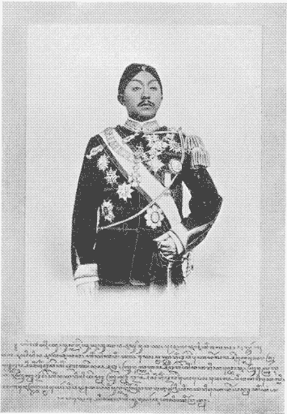

索洛卡尔塔苏丹殿下

（其全衔等以爪哇语标注在肖像下方）。

# *向作者展示照片后*

值得注意的是，这些苏丹身上展现出一种东方特质；他们的私人嫉妒之情如此，以至于阻止了彼此之间的礼节性访问。东方人的性格使其所有者丧失了所有联合的优势；因此，外人总能获得成功，而东方人如果能表现出某种自我克制，本可以与敌人获得至少平等的机会。

在`Java`的荷兰人并没有没有察觉到这个国家两个最强大的苏丹之间存在的嫉妒，出于自己的利益考虑，他们自然无所作为，现在也克制于采取任何行动来促进他们之间建立更友好的关系。我对观察此类现象产生了特别的兴趣，并在脑中对荷兰人统治下`Java`的状况与英国统治下`India`的盛况进行了对比记录。我认为，我提到的这两个国家是极少数存在此类类比的国家之一，而且由于我本身也是个感兴趣的人，我的好奇心自然被激发了。这促使我进行了一些询问，作为回应，我获得了如下信息：`Solokarta`的年收入约为4,000,000法法（（6,000,000卢比）；此外，苏丹每月从荷兰政府获得70,000法林的补贴——这一制度在这方面与`India`盛行的制度有本质区别。

## 洛卡塔苏丹

`Solokarta`苏丹的军事力量由约1,500名非规军组成，这个术语用在他们身上是完全贴切的。他们配备了极其古老的武器，这些武器看起来更适合放在博物馆里作为奇珍陈列，而不是在士兵手中。苏丹拥有一支由荷兰欧洲士兵组成的卫队；人数六十，由一名隶属于苏丹宫廷的上尉指挥。至少有一部分卫兵会随苏丹行踪，这一事实除了其他因素外，也清楚地表明，虽然卫队表面上是最高权力授予的一种荣誉，但后者同时也希望苏丹不要在监视的情况下离开太久！！

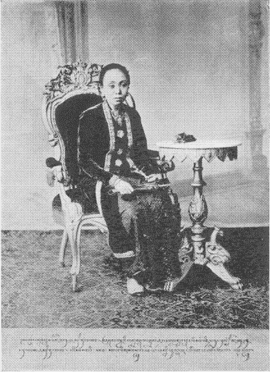

索洛卡塔苏丹夫人。

苏丹家庭的女性总人口约为6,000人，在这庞大的数字中，约数百人归属于苏丹本人。其余的是亲属、官员的妻子、仆人等。

在我的有限时间内，很难确定这些苏丹对臣民的权力范围和程度；但我被告知他们对居住在各自国家内的人民拥有权威；但在所有重大事务上，他们被要求咨询荷兰驻员，这位驻员被令人动容地称为“大哥”。

## 索洛卡塔的接待

那天晚上，我受邀参加了`Solokarta`苏丹（其正式头称为`Susuhnan`）举办的宴会，他非常体地为我举办了这次活动。不幸的是，荷兰驻员在那一天缺席了，但他的首席秘书代表上级迎接了我，并乘着苏丹为我提供的马车送我前往苏丹宫。几名驻员工作人员的官员以及几位来自驻公馆的女士也出席了宴会。

索洛卡塔苏丹接待我的细节与我之前在`Djocjokarta`描述的大大相同，唯一的区别在于这次接待部分由于`Solokarta`地位较高，部分由于其宫廷及周围环境更为华丽，规模要考究得多。然而，所遵循的礼仪在两次场合是相同的。当我到达时，受到了殿下的最热诚的接待，他立即带我来到一个台，台上站着拉托贝（或`Sultana`）以及许多公主和宫廷女士，我们被正式向他们介绍。

介绍仪式非常简单。苏丹延续了我到达时那种热情的方式，挽着我的手臂，逐一向我介绍了每一位女士。我鞠躬，女士们则微弱地回应。

女士们的服装是她们特有的，我在其他任何国家从未见过类似的。我不擅长描述女士的服装，因此请读者参考书中的照片以获取更多；这些照片真实地展示了爪哇公主的打扮。她们戴着一些珠宝（尤其是苏丹的女儿们），显得漂亮且精致。

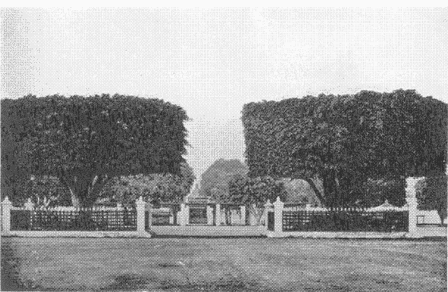

索洛卡塔苏丹的女儿和女婿。

女士们的动作有些机械，面部表情在很大程度上是缺失的；她们举止和外完全缺乏活力。另一方面，她们穿着华丽，在裙装中显得纤细脆弱。我不得不注意到，爪哇女士对各种香水有明显的`迷恋`；而且她们习惯同时使用多种香料，产生了一种难以描述的气味，其中檀香油占主。

## 宴会与宫廷习俗

介绍结束后，我们被邀请与苏丹和夫人一起坐在放在台前的一些华丽金椅上。在我们右侧是公主们，她们之后是苏丹家族的男性成员。在我们左侧是驻员的随从。在离我们台面的对面，坐着许多苏丹的部长和宫廷官员；他们都穿着奇特的头饰和迷人的服装。

我们坐的亭子规模宏大，能够容纳许多人；尽管空间很大，也被家庭和宫廷的女士占满了。她们穿着一种短款服装，由萨笼和一条提到手臂下的腰带组成，导致身体上半部完全暴露。我被告知，如果她们穿着低胸（`décolleté`）服装将违反宫廷礼仪。只有苏丹家族的女士才有权遮盖胸部和肩膀。我们在`India`习惯的隔离制度（`pardah`）在`Java`没有立足之地；尽管那里的女性没有该制度带来的不利影响，但她们并不与男性社交，仅在特殊场合露面；她们的社会地位与其他国家的女性相同。

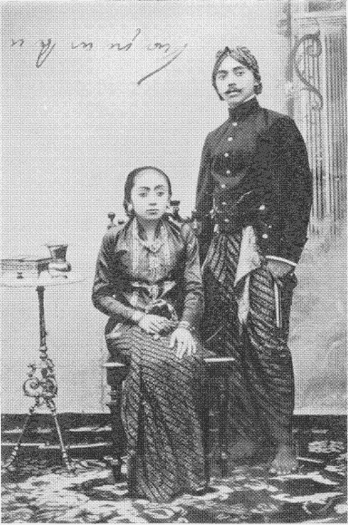

索洛卡塔苏丹的女儿和女婿。

苏丹和夫人身后是前者的侍从。这些女性年龄各异；一位六十左右的老妇人通过念诵祝福吸引了我的注意。我环顾四周对上了她的目光，她微笑并向我的头落下祝福。我被告知，她的祝福感谢上主派了这样一位荣誉的人来访。经常，苏丹的一位女性会过来按摩他的腿。行礼的方式与旁遮普的做法相同：双手接触并触碰额头。即使是苏丹的儿子和首席妃，被他说话时也以手势回应。这些宫廷的礼仪规范被非常严格遵守；一个细节令我感到有趣。禁止仆人直立靠近苏丹；因此当某物被送来时，仆人必须通过体操般的动作来完成他们的任务。

殿下的头衔如下：

`Hingkang Sinoeho`

`Pakoe Boemono Senopati Ingaloge Rachman`

`荷兰狮子勋章指挥`

`橙色勋章大十字`

`柬埔寨大勋章`

`泰国大勋章`

`比利时大勋章`

`荷兰陆军少将`

`宇宙之钉`

在我所描述的这个场合，他穿着一件刺绣精美的夹克和一条帅的萨笼。他还戴着许多来自荷兰、法国、泰国和德国政府的宝石勋章。在我们的交谈中，我被告知他拥有的其他勋章如此之，以衬子上没有足够的空间一次性全部取出。这是允许他们接受外国勋章的问题。这场宴会（持续了约一小时）仅仅为了看，远赴`Java`也是值得的。

我与苏丹的对话是通过荷兰首席秘书进行的，他使用法语进行翻译。我被要求对索洛卡塔宫廷的宴会和环境是否优于`Djocjokarta`给出意见。我认为这类问题最难回答，并用我最外交的方式回避了它们。从我们主人的态度以及我听到的事情中，我推测他并未对邻国浪费感情；他们之间的竞争和嫉妒是完全公开的。可能如果荷兰人离开`Java`，苏丹们会互相掐喉，重演那个时代存在的流血状态。

## 舞蹈

描述舞蹈本身是一件困难的事，要公正评价它需要皮埃（`Pierre Loti`）那样的笔触。眼前的景象是迷人的，在我见过的许多国家中是无与伦比。首先来的是音乐家，他们带着奇特的器器坐在分配给他们的位置。接着是舞者，由大约五十名穿着漂亮萨笼和低背心的的女孩组成。她们以八分之一的时间，两两成行，从亭子的后部移动，最后在我们坐的台对面排成平行。所有的女孩都属于苏丹家族，并与他有关。她们长相漂亮，身材苗条，年龄似乎在十四到十八岁之间。她们肤色是橄榄色，特征有些是蒙古式的。

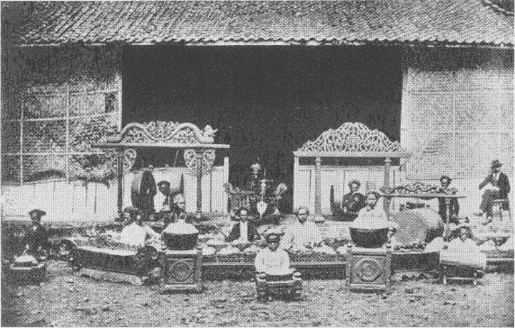

索洛卡塔的音乐家。

到达台，女孩们行跪礼，双手合，然后开始跳舞。舞蹈由无数姿势组成，随着手臂的挥动和相应的头部动作；在某些方向缓慢移动，脚起起部分作用。舞蹈的动作复杂且多样；圆形、正方形、进后移动最后变得令人眼花缭乱。偶尔一位侍从不得不介入调整其中一个人的裙摆，由于裙摆太长，无法由者自己照顾。音乐家并没有完全局限于器乐，他们再次爆发出狂野而奇异的歌唱，特质上让我想起了我们国家的音乐。眼前的场景的新奇感让我的想象带到了《摩婆罗婆》（`Mahabharata`）中的某些章节；带到了印度神话中著名的因陀罗（`Raja Indra`）宫廷。然而，欧洲宾客的黑色晚服和制服提醒了我仍然生活在二十世纪。

在感谢并赞美我的主人为我提供的盛大宴会后，他回答说如果早早知道我的到访，他会派出他全部的、约两百名女孩组成的舞队。

## 离开与最终观察

活动结束后，我的主人带我参观了他的若干间房间，这些房间是按照`Java`的独特风格布置和装饰的。一件似乎被特别尊崇的家具是一张巨大的、帅的、雕刻金金床，用作一种皇室床，占据了接待厅后方一间房间的荣誉位置。

在许多宫廷官员、随从和侍从的陪同下，我们前往了主人花园里的一座喜欢的暑房，我们在那里享用了许多美味清凉的饮料。我们停留了一段时间。在我离开之前，苏丹慷慨送给我一根精美的金镶杖，手柄上刻有他的缩写。午夜降临，我们在向这位善良的主人告别后离开，结束了我在远东度过的最有趣的一天。

第二天早上，在苏丹儿子们的陪伴下，我愉快地参观了他的清真寺（这是一件常事）。清真寺最有趣的部分是库（`toshakhana`），在我在那里看到了足够的金银器以及瓷器等，足以供应两百位客人。当我表达想看苏丹的珠宝（我被告知价值非凡）时，我被礼貌地告知由于某种迷信，向游客展示此类贵物品是不吉之兆，因此我的愿望未能实现。接着我们看到了兵器库，那里有一些有趣的古代武器，除了作为奇珍外别无用处。我们的下一步是前往马房，那里安置了约一百匹骑用动物和五十辆马。马房由一位退役的荷兰骑兵军士管理；他负责该设施的接待。几匹马着完全的爪哇式马饰（与`India`非常相似）被牵出来供我们检查。这些马既不穿靴也不穿裤子，尽管它们似乎并不缺少这些。因此，由于明显的原因，检阅的想法被放弃了。在回答我的一个问题时，我的信息来源进一步带着非常天真的语气告诉我，现有的混乱状况是由于荷兰政府的政策，他们不喜欢认为苏丹在任何方面如他们高效。

## 寺庙与印度教的影响

当我们结束寺庙检查时没有火车可用，我们不得不开车前往`Djocjokarta`（二十英里外），我们抵达时赶上了晚餐。那天晚上，`Djocjokarta`苏丹为我举办了一场宴会，驻员和许多荷兰官员出席了。一些平民也在场。整个宫殿是一片欢庆，在那场合公众被允许进入。那里一定有几千人在场，因为整个巨大的围墙区域都被挤满了。在那里，正如`Solokarta`一样，宴会主要以舞蹈的形式呈现，类型相似。大约二十名女孩参与，与我在`Solokarta`看到的不同仅在于服装。她们还在脸上涂了某种白色颜料，眉毛涂成黑色并横跨鼻梁上方，并在寺庙处以异常的方式弯曲。这些年轻女性从小就开始学习舞蹈，每天练习一段时间某种形式。她们都属于苏丹家庭，由苏丹根据自己的意愿嫁给有地位的男性。
