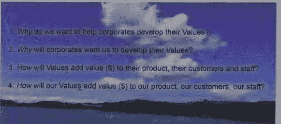
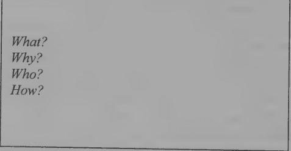
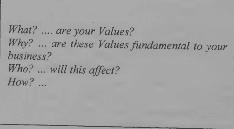
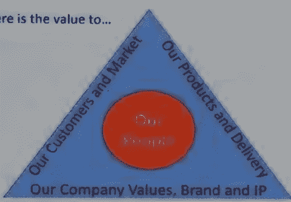
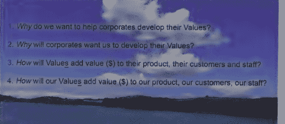
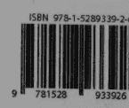

# 我的价值或我的价值观：挽回客户信任

Heather Robertson 曾在新西兰及海外的多个商业领域工作。她于 22 年前创立了一家咨询公司，拥有一种独特的贡献性哲学，这种哲学包括让客户在一种共享体验学习的环境中相互协助。

十年来，她为选定的商业领袖运营着一项免费的月度计划，因为她深知顶端是孤独的——并为他们提供了一个机密的环境来互相帮助并解决公司面临的关键问题。

# 献词

这些书献给书中收录的那些“T 恤领导者们”。

他们愿意讲述自己的故事并分享经验，以便让你从中学习，也让你知道，在面临的问题和困难中，你并不孤单。

他们了解“苦难咖啡馆”（Hard Knocks Café），去过那里，买过那件 T 恤并穿破了……而且他们继续穿着它。

# Heather E. Robertson

# 致谢

Mark Cathie，他激发了 STG 概念的灵感，并在我偏离轨道时勇敢地说出来；以及 György Piro，他细致的润色为时而平淡但属实的故事线增添了氛围。

## 序言

如果你想读那些教你该做什么的商业书——如何创建一个更好的业务——如何规避陷阱——请不要读任何一本《行动策略》。

它们没有提供关于如何创造财富、获取更多客户或成为一名明智领导者的路线图或指导。

《行动策略……》的设计初衷是实实说说——商业中真实发生了什么——让你学到符合你需求以及你公司战略需求的教训。

它们是基于真实人物及其公司的生活、业务以及他们所经历经历的小说。包含了他们的挫败与愤怒、成功的狂喜以及失去的痛苦。包含了他们遭遇的境遇、曾击倒他们的问题，以及他们取得的成就。英雄和女英雄是真实存在的；他们是我们年来合作过的所有公司、领导者和经理的集合。

我们向你介绍书中收录的那些“T 恤领导者们”，以便让你从中学习，也让你知道，在面临的问题和困难中，你并不孤单。

他们了解“苦难咖啡馆”（Hard Knocks Café），去过那里，买过那件 T 恤并穿破了……而且他们继续穿着它。

## 人物表

# 第一章：人质

如果你想读那些教你该做什么的商业书——如何创建一个更好的业务——如何规避陷阱——请不要读任何一本《行动策略》。

它们没有提供关于如何创造财富、获取更多客户或成为一名明智领导者的路线图或指导。

《行动策略……》的设计初衷是实实说说——商业中真实发生了什么——让你学到符合你需求以及你公司战略需求的教训。

它们是基于真实人物及其公司的生活、业务以及他们所经历的小说。包含了他们的挫败与愤怒、成功的狂喜以及失去的痛苦。包含了他们遭遇的境遇、曾击倒他们的问题，以及他们取得的成就。英雄和女英雄是真实存在的；是我们年来合作过的所有公司、领导者和经理的集合。

我们向你介绍书中收录的那些“T 恤领导者们”，以便让你从中学习，也让你知道，在面临的问题和困难中，你并不孤单。

他们了解“苦难咖啡馆”（Hard Knocks Café），去过那里，买过那件 T 恤并穿破了……而且他们继续穿着它。

## 正文

他必须有勇气回到当时已更名为“FutureSafe”的公司。吸引他的并非品牌重塑，而是他重新焕发的承诺。这次回归提供了他职业生涯中最大的挑战。但如果没有 Randalls 的订单，Paul 的激情以及公司所有人的努力将化为乌有。

当 Paul 从与 Randalls 执行官 Tom Medici 会面回来时，这确实是一个坏消息/好消息的故事，随后演变成一个大新闻/震惊消息，最后陷入完全困惑。Randalls 想要取消审计；他们不想取消合同；他们想要重新评估他们的“核心项”，并进行 FutureSafe 经历过的“价值观”练习，然后将其落实到所有的主要供应商中，包括 FutureSafe。但是，他们想要 Jeremy 来进行价值观评估。

如果他拒绝加入，Randalls 会取消 FutureSafe 的合同吗？Tom 在这一点上含糊其辞，因为他坚信 Jeremy 是这份工作的最佳人选。不仅是因为他在 FutureSafe 取得的成就，更因为他通过审计工作已经深耕 Randalls。不需要过渡期，他可以立即见效。

Callum 在愿景和距离上的判断是正确的。Jeremy 知道如果进入 Randalls，他会太近了，无法像他目前表现出的那样，清晰地审视问题。

“不仅如此，”Jeremy 说，Paul 和 Callum 停下来听他的话，突然意识到他们一直在谈论、围绕的这个人可能有自己的见解。“我没有他们的‘初衷’。”

他确实没有。他无法为 Randalls 创造出一个“初衷”。这家已经垄断市场的国际出版巨头已经

### 名人流派

任何甚至曾“想过”自己是在电影、音乐、体育、电视领域——甚至是真人秀领域中是某位“名人”的人。他对于 Randalls 所做的事情并不热情。他也无法对这样一个实体产生热情，因为根据他们业务合作的本质，他们会吸引那种类型的媒体关注，这种关注足以让像 FutureSafe 这样的公司倒闭，而这本质上非仅仅是一场商业上的错位。取消他们的合同是一回事——但他们自身“名人”地位带来的曝光度，并不能很好地保护与他们做生意的人。他想为这样一个实体工作吗？

他知道自己为 FutureSafe 交付了高质量的工作，因为他拥有他们的“初衷”。他们的目标就是他的目标，他希望他们的价值观得到展示和证明——不仅是在 Randalls，而且是在 FutureSafe 的所有客户。对于所有 FutureSafe 客户的员工。他不仅仅是为了财务原因留住这个客户，他出现在那里是为了履行 FutureSafe 的承诺尽自己的一份——为 Randalls 的每个人守护未来的财务。

他想守护那些明星的传记吗？

保罗坚持让 Callum 说，他不认为 Jeremy 去 Randalls 是个好主意，现在他明白为什么了。随着这个发现，他的脸上充满了失望和无奈的皱纹。

但 Callum 还没说完。“还有另一种办法。我们知道，只有跳出框架的人，才能看清整个局图……这不仅适用于 Randalls，也适用于我们。”

“所以，如果 Jeremy 完全在框架之外工作，跳出 Randalls 和我们的框架，也许他可以为 Richard 工作，并与 Randalls 签约，”

“还有和我们。”保罗抓住了这个主意，就像一个刚抓到救命稻草的人。“我不知道 Tom 会不会买账。我也不知道 Richard 会不会买账。这值得考虑。也许我们先和 Richard 谈谈看看……”

他的声音消失了，惊恐的神情掠过脸，他意识到自己又一次在关于 Jeremy 为谁工作的决策中，没有把 Jeremy 考虑在内。尽管很担心，保罗脸上的表情如此毫无防备，Callum 和 Jeremy 忍不住大笑起来。这打破了紧张气氛。

Jeremy 笑了笑。“我知道，这是那种‘不用说’的事，谢谢你们，”他感谢道。“Callum 说得对。但就像你们一样，在我谈论这个之前，我也想说，我不想离开。既然我们大家都这么说了，那来谈谈 Callum 的观点吧。”

他犹豫了，思考着，保罗和 Callum 等着他，给他时间整理思绪。

“对于第一个问题，我想我会去的。至于‘初衷’，是因为我将与公司的价值观一起工作。即使我没有得到那个‘初衷’（即他们所的工作），我的‘初衷’也将是帮助他们建立价值观，结果就是看到他们为客户和员工实现应得的价值。”

“我必须承认，”他犹豫了，看着保罗和 Callum。“我一直在想，在完成 Randalls 的价值观计划后我该做什么。价值观一旦建立，就需要不断地调整，这对我们来说是如此，对他们来说也是如此。但并不是一项一次性的工作。这可以成立一个独立的实体，与 Randalls 合作，然后与其他公司合作，这会非常令人兴奋。”

保罗在点头，Callum 看起来既惊讶又高兴。

“好。那么现在我们来看‘如何做’，这我们需要真正仔细谈谈。”Jeremy 在说话的同时仍在组织思绪。“你看，要做到这一点，我需要我构建的所有指标和系统。我是为你们构建的，那是你们的知识产权。如果我这样做，它应该是你们的。没有理由你们要把 Randalls、Richard 或我这些你们付钱构建的知识产权交出去。为什么你们不能从投资中获得回报呢？承认我构建的这个‘价值模型’是有价值的。我做了工作，但你们提供了资金。你们应该考虑与 Richard 成立一个合资企业（JV）来这样做。不要只把它交给他和 Randalls。”

保罗震惊地沉默了。有这样的人在他身边真好。他看着 Jeremy，然后看向 Callum，又看向 Jeremy，摇了摇头，不是不同意，而是意识到这两个人正是“价值观”和“价值”的全部意义。

是的，这是一个好主意。确实很有潜力。他的脑海中闪过各种可能性。如何进行结构化、资助、开发、扩张和营销。不是合资企业，而是一家公司。一个专门帮助其他企业建立其价值观并将其贯穿于业务方方面面的实体——向所有利益相关者交付正确的价值。

“不，”保罗突然说。Callum 和 Jeremy 惊了一下。Jeremy 耸了耸肩，既惊讶又失望。“不，我不想和 Richard 成立合资企业。我们都在局中；我想建立一个实体，我们三个人加上 Richard。如果 Richard 同意，他和 Jeremy 将担任执行董事，Callum，你和我将提供运营和营销支持。你们两个怎么想？

但他其实并不需要问。他们的表情已经说明了一切。Callum 点点头，他常冷静的神态被一种类似于焦虑的情绪取代了。

Jeremy 是第一个开口的，“我知道我们可以叫它什么。”

“价值观有限公司（Values Incorporated）。’这是一个双关语——‘Incorporated’，简称 Inc.，是一个双关语——因为 Randalls 的底牌将暴露在所有人面前。”

保罗举起咖啡杯，“价值观公司（Values Inc.）。”

# 第二章：阴暗

“如果我们放弃这次机会，我们会后悔的，”保罗说。Callum 和 Jeremy 惊了一下。“这是 Randalls 回归正轨的难得机会。但我们需要让它发生。”

他看着董事会，等待他们的反应。他们沉默了一会儿，意识到形势的严重性。

“我们加入，”保罗终于说道，“我们全都要。”

于是，计划开始了。一个可能改变 Randalls 世界，或者至少改变他们自己的计划。

“如果我们不放弃这次机会，我们会后悔的，”保罗说。“这是 Randalls 回归正轨的难得机会。但我们需要让它发生。”

他看着董事会，等待他们的反应。

“你们觉得 Magna 在乎价值观吗？”Ike 哼了一声。“当然不在。Magna 只在乎一件事——如果他们认为 Randalls 软了，他们就会担心消息来源，并寻找其他合作伙伴。Magna 会转向我们，他们别无选择。”

Ike 在椅子上向前倾倾，看着主席 Mack Spencer。Mack 一直毫无表情。这并不意味着什么，你永远无法知道他在想什么。既严厉也不软，从未见过他大笑或愤怒，从未不果断、逻辑性和理性。但他很冷酷。当他做决定时，不会让任何事情或任何人阻碍。如果你有价值，你就在 Mack 的范围内。如果你只有价值观……那么对 Mack 来说你毫无价值。”

而董事会等待着。Mack 没有说话，所以没有人说话。Mack 没有问 Ike 打算做什么，所以没有人问。他们只关注收购机会，知道如果他们同意收购，他们就是同意了 Ike 击垮 Randalls 的无声手段。现在他们安静了，因为 Mack 沉默了。一个坚决的点头，“做吧！”Mack 拿起文件离开了。

而在城市的另一边，在另一个会议室里，有人没有说话。思考、吸收、考虑。Richard 读到了 Randalls 暂停审计的快讯，随后是 Tom 和 Paul 的联合声明，解释了原因。“加强和塑造关系”这些话他没有遗漏。他们承诺在接下来的 48 小时内给出完整的声明。出问题了，但还没有完全崩溃。他会等 Paul 的电话。傍晚时 Paul 打了电话，询问什么时候可以去见他们。“马上，”他回答道。

## 腹地

他们向他介绍了“价值公司”（Values Inc.）。这确实很有道理。在过去的几个月里，他已经足够了解保罗、卡拉姆和杰米，知道自己可以和他们共事，并且可以信任他们是值得的业务伙伴。自从那天他把保罗挤进地下以来，他们已经走了很远的路。

他们提议的安排在业务方面并没有困扰他。他的犹豫源于放弃独立性的非理性恐惧。20年来，他一直以自己的名字和品牌提供咨询服务。设定自己的方向，做出自己的决定。现在，他不得不让其他人参与到业务的战略、方向和功能中。这将是一个巨大的改变。

另一方面，他在杰米身上看到了潜力，并意识到这为他提供了独立性所剥夺的接班计划。

他们并没有要求他将目前的业务并入其中，这是一个全新的、独立的实体。他可以继续目前的工作，保罗和卡拉姆也将继续经营 FutureSafe。只有杰米会在价值公司全职工作，保罗、卡拉姆和理查德的任何贡献都将以利润分成的形式进行。

此外，保罗非常慷慨地准备将围绕价值模式的知识产权（IP）放入价值公司，作为他们所有人共同拥有和分享的资产。

这实际上是一个显而易见的决定。理查德看清了这个机会的本质，点了点头说：“这很好。这是可行的。如果……兰达尔公司（Randalls）接受，我们就有了一个平台客户，可以在精炼模型和声誉两个方面进行构建。这是一个我们任何人都不应该拒绝的机会。感谢你们邀请我。是的，我加入。”

“但是，我们需要做的第一件事是为兰达尔公司定位，因为如果他们不接受，那么就没有‘价值公司’，而且可能不会……”理查德话没说完，他们中没有人需要他说明白。

“好，让我们在白板上画画。”行动起来了，杰米站了起来。“我们首先从设计汤姆需要看到的 WIFM 开始。即‘对我来说有什么好处？’。”

“这需要比此进一步，”保罗说，“对汤姆来说确实有 WIFM，但他的董事会还需要一些标准，这会进一步扩展它。我认为我们应该从董事会开始，然后为汤姆创建一个个人化的 WIFM。我们需要在这两方面都让他满意，但对他来说，业务和董事会是首位的，并由满足他对他想要领导的业务的个人愿望、他的战略、领导风格的要素作为支撑。”

“好的，让我们列一下——董事会需要看到什么？”杰米问。

“嗯，”卡拉姆开始说，“董事会可能更关注‘什么’和‘怎么做’，而不是‘为什么’。成员中有六个人是职业‘董事董事’，只有两个加上汤姆，在行业内工作过，并且对他们所做的事情有一个‘为什么’。

他们的重点将是财务稳定性、公司声誉以及整体治理。他们需要从公司角度以及他们个人责任和声誉的角度，确保这些是安全的。”

“是的，但我想我们可能想得了，”保罗说。记住，董事会已经对“价值练习”深表认同了。以至于他们竟然提出了带走杰米的荒谬提议。”他们都笑了起来。

“我们提议的，”他继续道，“是让他们以另一种方式‘得到杰米’。所以从这个角度来看，我认为这首先关乎汤姆，然后才是董事会。”

“汤姆正处于一段价值之旅中。而他将获得的是一得四，”卡拉姆说。

“是的，但四个中的两个直接受益于结果。所以这与他现在拥有的其实没有太大区别。他正试图确保公正性，这可能就是为什么他想把杰米从 FutureSafe 抽离出来为他工作的原因。”理查德若有所思地说道。

“你们知道吗，”他继续道，“我认为现实情况是，我们并不完全清楚汤姆为什么想要杰米。他可能有某些没有告诉我们的事情。”

“我不认为公正是问题，”保罗皱眉道。记住，他从杰米那里想要的是对公司进行全南北东西的评估，以及贯穿于他们身份的价值应用。然后将其外部应用到市场和客户，并在内部应用到员工和产品开发。只有当完成这些，他们才会考虑与供应商的交叉匹配，所以可能有一年的时间我们才会回到焦点，到那时模型已经得到证明了。”

“这不仅仅关乎我们；事实上，这根本与我们无关。在目前，我们对汤姆试图做的事情完全无关紧要，唯一让我们进入视野的是因为……”他举起手指点着要点，“……1) 我们开始了这个过程，2) 我们‘拥有’可以执行这个项目的人。”

“而且我们拥有执行该项目所需的 IP。”杰米提醒道。

“你们知道我想什么吗？”理查德说，“这是一个与汤姆的讨论。这不是一个提案或演示，而是一次讨论。是保罗和杰米坐下来，与汤姆以理性和逻辑的方式进行交谈，向他解释并提出共同的解决方案。

“业务很大程度上关乎合作而非定位。抛开那些提案、投标、合资企业；持久的关系是那些每个人都理解对方需要什么、他们能和不能交付什么，以及他们如何从所产生的联盟中受益的关系。

“所以，就像任何关系中的任何事情一样，良好的关系取决于良好的沟通，这是我们真正需要和汤姆谈谈的时候。离开办公室，离开媒体，在某个地方见面。而且只是谈谈。”

# 第三章：对峙

这就是恐惧的感觉。你知道你并不掌握控制权，命运掌握在他人手中。他们并不认为你的命运像他们一样重要。这可能关乎生死，但在企业世界，这种崩溃是终结。对公司的终结，对许多工作的终结，对许多人的财务破产。

而那个拥有权力的人，那个掌控局面的人，命运掌握在他手中，正生气。

杰米知道汤姆很生气，尽管汤姆背对着他。站在轮船的甲板上，宽大的背影沐浴在月光下，当轮船航行时，灯火通明的建筑成了背景。个体无关紧要，集体地唱着城市的赞歌。汤姆同意离开办公室，离开媒体，在轮船见面是个好主意。没有窥探的眼睛，没有偷听的耳朵。任何观察晚餐桌上三个男人的人都会认为他们只是在聚在一起。那个高大、和蔼的人似乎将大部分注意力放在了三人中最年轻的人身上。但这些外在动态并不是周围人的现实。他们都知道赌注是什么，这是一种游戏，但一种可能导致致命后果的游戏。晚饭后，他们带着酒来到顶层甲板，享受凉爽的夜晚和黑暗提供的隐蔽。黑暗带来了勇气。“我们不是你们可以拿走的。保罗的 IP 是保罗的 IP。我不是动产。我们是自愿来的，否则根本不来。”他的勇气增加了，他平静地继续道，“你可以选择毁灭我们，但请明白，今晚的决定将为你自己的价值奠定基础。

你的‘价值观练习’从这里开始。它将向你展示你是谁。

“你不明白，”汤姆说，依然空洞地盯着窗外掠过的城市景象，“这不仅仅是一个价值观练习。当你进行这项练习时，你所发现的将令你大震惊。你必须修复的，远比我们为业务和利益相关者决定价值要得多。当你发现真相时，我需要你被死死钉住。我需要你无法说话、无法离开。受保密协议的约束，只有当你成为员工时，我才能守护这种秘密。你无法离开。被高薪这副‘金手铐’锁在我的公司里，你无法离开，也无法透露。

“就是你，”汤姆吐出这几个字，“你，带着你那所有的‘为什么’。你所有那些找不到为了为我的公司工作的‘为什么’的理由，你所有关于客户为什么与公司产生联系、你的员工为什么想为公司工作并留任公司的种种言论。为什么，为什么，为什么……但你从未深入地挖掘过我们为什么要进行这项价值观练习背后的‘为什么’。而且为什么我准备好做出如此出格的事情——去‘偷走’一家我所钦佩的业务和老板公司的员工。”

# 第四章：击败生态战士

清脆的碰撞声，雪茄的香气。这曾是辛劳但成功的一天结束时成就的奖励——现在，它们是支撑艾克度过这一天的动力。

他站在办公室外的露台上，俯瞰着下方的城市生活。人们，那些爪仔，在他们不幸且毫无价值的任务中忙碌穿梭。不像他，他是强大的 `e.Celebs` 公司的首席执行官。艾克不需要忙碌——他有自己的爪仔来去做那些事。

正是那些爪仔为他带来了情报、内幕以及那些登上头条新闻的料。其中一个甚至带了丹·兰达尔。

`e.Celebs` 缺乏兰达尔所积累的人脉和支持，那些兰达尔能够‘负担得起’的、兰达尔从 `Magna` 公司享有的支持。`e.Celebs` 不得不采取其他‘方法’来获取名人新闻。而那些爪仔的作用就是钻入每一个缝隙，挤出细节和信息。但是，如果他们有机会能把 `Magna` 从兰达尔手中夺过来——将 `Magna` 据为己有，他们将彻底颠覆名人媒体市场。他可以彻底颠覆这个媒体市场。

所以兰达尔想要重置他们的价值观。艾克嗤之以鼻。那是一种并不悦听的声音，甚至在他自己听来也是如此。低沉的。但艾克记得自己从哪里走来。他曾是那些爪仔之一，他了解阴沟里的世界。但他一路爬了上来，现在他要把 `e.Celebs` 提起来，提向上，推到那个顶端。那个‘目前’被兰达尔占据的位置。他想起某部电影里的一句台词：“这具行走的尸体有名字吗？”他笑了；这就是他看待兰达尔的方式。

一切已各就就位。一旦陷阱触发，董事会就批准了对即将受损的兰达尔公司进行收购。他有一位来自兰达尔内部的线人，并安排了与 `Magna` 的一位高管会面，因此，大网正向着丹·兰达尔收拢。

艾克一口气喝光了最后一点饮料，靠在椅子背上，闭上眼睛，深长地吸了一口雪茄。在他身后，那个被称为办公室的玻璃笼子里，水彩画般的谈论充满了推测。每个人都知道事情正在发生。未计划的董事会会议，麦克频繁且突然造访艾克的办公室。紧闭的门，提高音量。而现在，艾克在下午时分，就这么坐在露台上喝酒抽烟。事实上，他并没有动——他难道真的睡着了吗？

睡着了？艾克的思维异常活跃，排练着与 `Magna` 高管的会面。他将如何让对方慢慢意识到，他们与兰达尔的联盟正走向毁灭。

兰达尔正在进行一项价值观练习，这项练习将质疑他们与兰达尔合作的有效性。

# 第5章 – 孙子遇到史波克先生

先说为什么，再说怎么做。接着是方法——然后是衡量标准。

他们为什么想帮助企业发展价值观，这是一个很好的开场白。这始于卡勒（`Callum`）直言不讳的：“如果不这样做，我们会失去 `Randall` 客户。” 然后是保罗（`Paul`）说的：“如果我们做了，我们就能留住杰米（`Jeremy`）。”所以这些情绪已经出来了。那些怨恨。在表达了这些情绪后，是卡勒带他们回了正轨。

“我们之所以这样做，是因为我们已经走过这条路了。我们知道如果没有它，我们的客户、员工和产品会遭受什么样的痛苦。我们知道‘价值观练习’是如何拯救了我们公司的。”

“嗯，几乎是，”保罗务实地说，“我们还没有完全脱离困。”

“不，但它正在积极进展，我们有了喘息的空间，如果我们没有做价值观练习，这种空间是不存在的，”卡勒指出。“这关于我们想在‘`Values Inc.`’ 中为‘价值观整合公司’创造什么。就像 `FutureSafe` 平台曾经存在的状况。我们在此基础上构建。”

“所以，在此基础上，我们的‘为什么’是因为我们想拯救公司，”保罗说，“难道不意味着对公司来说，‘为什么’是因为它们想被拯救吗？这难道有点……呃，显而易见吗？”

“你有许多方法可以‘拯救’你的公司，”理查德（`Richard`）回答。“你可以注入资金、引入投资者、收购另一家公司或出售……许多在财务上可行的选择。但你们选择了审视你们所做事的价值以及你们是如何做的。”

“你们为什么选择这种方式而不是使用财务方案，这是我们建立 `Values Inc.` 需要考虑的‘为什么’，它也将是吸引我们未来客户的‘为什么’。”

“好，，那么这件事的切入点是卡勒和我决定和杰米谈谈。我们需要回到那次对话中。”保罗看向卡勒。

“我记得清楚。”卡勒犹豫着看向保罗，保罗耸了耸肩，带着一种认命的态度说：“继续吧……”、“简略版……” 卡勒笑了，根据我们和你、理查德、保罗和我所做的工作，我们知道缺少了什么。我们意识到这不仅仅是通向利润的美元价值，业务的本质消失了。我们的性格、我们的个性、我们的目标、我们的一致性——定义了我们作为一个独立实体的一切。一切将我们与竞争对手区分开来的一切。一切说明‘我们没有竞争对手；我们如此独特，以至于没人会在我们的领域竞争’的一切。关于孙子的那套理论，即创造你自己的战场，而不是被迫在别人的战场上战斗。”

“接下来，是我们的人们。他们来上班只是在‘做他们的工作’。缺勤率很高，当每个人都在场时，生产力很低。流失率正在上升。这从杰米的辞职开始……” 杰米皱了皱眉。“不，”卡勒摇摇头，“你不是原因，你是症状。”

“但真正让我们警醒的事情是这里。员工建议箱是空的。过去，我们总有很多建议。有些是可行的，有些是可以调整的，有些是不现实的。无论如何，这并不重要。建议是人们参与的证明，从中产生了反馈和改进。我们总是对每一条建议给予回应。如果采纳了，会大表庆祝；如果没有采纳，会做出解释。

杰米点头回忆道。

卡勒继续道：“但建议减少了，在五周的时间里，箱是空的——一个建议也没有。直到有一天，我打开了箱子，里面躺着一张折叠的纸。我把它拿出来，很高兴地把它摊开。上面写着：*有什么意义呢！*”

“那个感叹号触动了我。那不是一个问题。这是一个陈述。”

“那时我们就想到了杰米。不，是卡勒想到了杰米。”保罗接过了话，“我承认我心情复杂。”他看了杰米一眼，“我的意思是，你确实告诉过我要守好自己的本职。”

杰米笑了，“是啊，但至少我没告诉你要去守在哪儿。”

“确实，”保罗承认道，“但我们第一次邀请你进来时，是为了喝咖啡、聊聊天，听听你的观点。我们并没有打算邀请你回来的。我们只是想和你谈谈，看看你想说什么。请你回来只是在……某个地方……偶然发生了。”

“对我来说也是，”杰米承认道。这是一种冲动。也许不是冲动，但它是我们讨论内容的自然演变。

“我的‘为什么’回来了，”他在犹豫后说道。陷入了深思。

大家都沉默了。“回到‘为什么’，”保罗自言自语。这是他们都在思考的事情。沉默几分钟后，卡勒起身走到窗边，在下面写道：我们为什么想帮助企业发展它们的价值观？

接着在下面写道：

> 因为
>
> - 我们不希望他们遭受我们经历过的痛苦
> - 我们希望他们的价值观能让他们与竞争对手区分开来
> - 我们希望他们直观地向客户展示他们理应获得的价值$
> - 我们希望他们能够在公司与其员工、客户和供应商之间建立可衡量的互动标准

可衡量的互动标准……杰米心想，当他们走进 `Randalls` 的电梯时。他期待看到电梯门在第 5 层打开时理查德脸上的表情。理查德还没有进过 `Randalls` 的生产车间。杰米知道那是一片混乱。*在这里创造可衡量的互动标准*，他想，这是一个挑战，即使有理查德的帮助也是如此。

电梯慢了下来，在停下时轻微地跳动了一下。当门打开时，杰米向后退让理查德先走。电梯里充满了嘈杂的噪音、声音、人声、电子音……他带着幽意观察着理查德震惊的表情。理查德犹豫了一下，杰米凑近他，并给了他那句常被误引的斯波克的话……“这就是，吉姆，但并非我们所熟悉的生命。”

## 第6章 – 免责声明羞辱者

但杰米说得太早了。

当他们走出电梯时，理查德脸上的是满意的喜悦。杰米看了他一眼，在他还没来得及提问之前，理查德迎接他的不是别人正是乔弗（`Geoffrey`）。

“如果材料缺乏诚信性，你们的产品价值就会大打折扣。实际上‘毫无价值’。无论是从你们的价值观，还是从你们能收取的金额角度来看……”

“但这不仅仅是钱的问题，这关乎我们是谁以及我们意味着什么，”有人插话道，“而且这正在影响员工的士气……”

理查德一直在等这个问题是否会被提出来。他看向说话者，发现是人力资源经理马修·布伦南（`Matthew Brennan`）“因为没有了这种诚信性，他们觉得自己提供的不是有价值的产品。一些入职时间较长的员工并不喜欢产品的演变方式；事实上，我们在过去的五个月里已经流了三个关键人才。

“不仅如此，”马修继续说道，“我们正在吸引不同类型的员工。现在来公司的人是因为他们想与‘名人’市场联系在一起。我们在面试中遇到过人说，他们想加入公司是因为能与名人建立联系，有些人甚至说，他们希望可以挖到一些不会印出的名人内部八卦，甚至能见到一些名人。”

“如果丹·兰达尔（`Dan Randall`）知道发生了这些事，他会惊掉的，”首席财务官萨姆·库森（`Sam Cussons`）插道。萨姆在公司工作了25年，见证了管理层从丹交给汤（`Tom`）的交接。他对汤的忠诚并没有因为他不断想提醒大家他在公司创立之初就与丹共事而减弱。虽然每当这种提醒出现时，都会翻白眼或局促不安，但理查德看出每个人都同意萨姆的观点，他们的不安更多是因为这一次，萨姆显然在陈述显而易见的事实。

杰雷米看向理查德，又看了看大家。“现在我想把话权交给理查德，他想深入探讨我们涵盖过的某些方面，但由于我们上次见面已经有一段时间了，回顾一下看看是否有变化是有价值的。然后我们可以考虑进入下一个阶段。”

大家都点头认同，尽管有些人比其他人更认同。“你们在质疑那些针对明星和名人的信息的诚信性。”

“可能‘质疑’这个词还是太重了，”詹姆斯（`James`）若有所思地评论道，“这太容易验证了。”

“而且当我们从‘来源’那里获取它时，”

“这就是问题所在”

“有趣，”理查德说，“所以你们不仅在质疑媒体来源和传记来源，还在质疑你们自传来源？”

“涉及到明星和名人的时候。`Celep`！”萨姆回答道。

“但主要是媒体”

“你说的媒体是指……”

“我们与 `Magna` 就所有有关体育人物的信息签署了独家协议”

“哼。”杰雷米不确定如何回答

但理查德并不打算被带偏，他想让杰雷米自己处理。于是杰雷米继续问道：“会有其他更可靠的来源吗？”

“我们不知道，”詹姆斯回答道，“在这三个领域我们没有使用过其他来源。是 `Magna` 找到我们并提议交换交易的。他们为我们的出版物提供素材，我们为他们的媒体制作提供成品故事。”

“如果没有他们的接触，我们可能永远没有考虑过这个市场，”阿比（`Abby`）补充道。

理查德从座位上走到白板前。

理查德写道：

在每一项旁边他添加了……

然后他写道：

> 什么？……你们的价值观是什么？
>
> 为什么？……这些价值观对你们的业务是基础性的？
>
> 谁？……会影响谁？
>
> 如何？……你们如何创造价值$
>
> 你们如何监控核心价值观
>
> 你们如何让它们对信息供应商很重要
>
> 你们如何让它们对读者来说真实
>
> 你们如何让它们为员工服务
>
> 它们会为公司带来利润吗

“这些信息大部分你们在和杰雷米进行的原始练习中已经收集了，但我们将开始完善它们，以便根据你们的验证流程进行测试。

“和杰雷米一起”

大家都表示同意，理查德勾掉了“什么？”。

- 什么？……你们的价值观是什么？
- 为什么？……这些价值观对你们的业务是基础性的？
- 谁？……会影响谁？
- 如何？……你们如何创造价值$
  - 你们如何监控核心价值观
  - 你们如何让它们对信息供应商很重要
  - 你们如何让它们对读者来说真实
  - 你们如何让它们为员工服务？
  - 它们会为公司带来利润吗？

“那么我们转向‘为什么？’。让我们测试一下——为什么这很重要？你们可以随时发布免责声明，其他出版物也是这样做。你们想施加这样严格的标准吗？‘可靠且可验证的’。这真的可能吗？”

“免责声明羞辱者，”萨姆冷哼一声。

“丹·兰达尔绝不会赞同的，”阿比插话道。萨姆的反应带着嘲讽，但也表示认同。“我们已经争论过很多次了，”她显出一丝不耐烦，“不仅是在管理层，在更广泛的管理小组也是如此。”

“说公司分分裂是不公平的，”詹姆斯打断道，“但确实存在一个强大的反对群体，他们正变得越来越大言。事实上，我认为关于使用免责声明的整个争论正在产生影响，不是通过增加有效性，而是由于我们价值观的流失。”

“如果我们足够强大，或者不在这个市场，就不会有这种使用免责声明的建议了，”萨姆挥舞着拳头。

“詹姆斯说得对，我注意到员工士气在恶化，”马修说，“事实上，我对整个公司范围进行了一次微调查，发现结果很杂乱。如果我们解决了这个问题，这些影响将大大减少。”

杰雷米皱起眉，“我很困惑，发布不发布免责声明会产生这种影响？”

“嗯，问题在于，”阿比解释道，“我的领域可能处于这种影响的风口浪尖。而且，”她赶紧补充道，“我们中没有人支持萨姆所说的‘免责羞辱者’。”

## 第7章 – “杰克住在这里”

艾克（`Ike`）紧握手机。通话已经结束。对方挂断了。线路陷入了死寂，断线提示音已经响起。但艾克依然握着手机。

来电者已经告诉了他需要知道的信息。但他感到不安。艾克懂人。他们很简单，只想要两件事：金钱或权力。前者也能买到后者。只要理解一个人想要什么，你就掌握了他们。

但这个来电者不同。他不是在索要而是在给予。他匿名且神秘，起初给了他丹·兰达尔（`Dan Randall`），现在确认了与兰达尔公司（`Randalls`）高级经理会面，以核实信息。时间、地点、描述——不是名字。那将在见面时发生。就在今晚。

兰达尔公司内部线人的身份是显而易见的。他漏掉了一些细节。艾克在挂掉电话时心中暗笑。多年来，他习惯了捕捉那些足以揭开一个故事的细微之处，这个线人根本不是他的对手。尽管对方透露的信息不足以识别其身份，而且他并不想要任何回报，艾克也没有办法诱骗他暴露身份。

线人为什么要放弃他的公司？如果不是为了金钱或权力，那只能是第三个“丑小妹”：复仇。艾克是最不稳定的伴侣，完全没有对更多事物日益增长的欲望。与金钱和权力需要不断满足不同，复仇一旦得到满足就会熄灭。而艾克无法预测这种满足发生的时点。

目前，能拿什么就拿什么，今晚是他可以开始将所有碎片拼凑起来的时候，以便他准备将这一切带给麦格纳媒体（Magna Media）。

他早早来到夜店，坐在一张俯瞰“预留”字样的桌旁，他知道那张桌是为他和未未身份的客人预留的。他想在加入他（或她）之前，看看究竟是谁，观察并可能认出对方。当他的威士忌送来时，他坐着观察，一只眼睛盯着舞者，另一只盯着桌子。随着约定的见面时间临近，他又点了一杯威士忌，感到一种不常的焦虑，看向舞者的目光少了，盯着空桌子的目光多了。但在约定时间一小时后，桌子依然是空的。

他告诉自己这在预料之中，他干了威士忌杯，推开椅子准备起身——但一只手按在他的肩膀上按住了他。他僵住了，感到一股暖流掠过耳边，有人凑得非常近说道：“你并不是唯一不信任他人的人。当你准备好这样做时，拨打这个号码。”他感觉到一只手滑进了他的外套口袋。当他转身看是谁在说话时，一群喧闹且醉酒的人撞到了他。人群遮挡了他的视线。“预留”桌依然空着。他等待着。一名女侍走到桌边，拿走了“预留”牌，一对夫妇坐下来点了饮料。

汤姆（Tom）看着那个曾如大山一般的男人。年龄是残酷的。年龄与疾病并存，对任何人都是不公平的，但对一个曾经充满活力的男人来说尤为严酷。丹勇敢地挺过了两次中风，但现在这些让他付出了代价。

大部分时间只能坐轮椅，曾经作为他标志性步态、带他穿过南美雨林的宽大步履已不复存在。尽管大脑依然敏锐，但身体现在却背叛了他，挫败感影响了他的推理。

抑或他一直都不合理智？坚定、专一？这是否正是帮助过他、驱使他成就所成就的？他拯救了雨林是因为那是他所信仰的，还是因为他需要完成一项不可能的壮举？一项无人能完成的事业。他们永远不会，也许丹自己也不知道。大约五年前的一个深夜，两人面对着一瓶杰克·丹尼士（Jack Daniels）威士忌，只有他们两个时，汤姆问他为什么要那样做，丹回答道：“没有别人能……”汤姆不知道丹是感到了一种责任感，还是觉得他拥有了一片清晰的竞技场——没有竞争。荣耀全属于他自己。

“拯救森林”可能没有竞争对手，但丹还遇到并克服了其他困难。军阀、毒品集团，而他们并不只在森林里，外面还有想要分一杯关注度以增加自己声望的政客和社会名流。更不用说那位总统候选人，他秘密地破坏他们的物资供应，以便被看作救星，通过（据称）个人资助的直升机投放物资和设备。

汤姆看着丹挣扎着操控轮椅越过树冠去拿他的饮料。他试图对他产生一些同情，毕竟这个人是建立伟大的兰达尔帝国的男人，但他也是现在可能摧毁这个帝国的人。而丹对汤姆那种好斗的傲慢毫无耐心。

他意识到丹并不明白这完全不关乎他，他太习惯了关注、奖项和赞誉。他知道丹生活在英雄丹·兰达尔的阴影下。那个来救援雨林的超级人。但那是“是什么”，而现在的“怎么做”可能会让他们所有人毁于一旦一旦，而丹那种“好吧，那时就是那样的”态度将无法在公众面前过得去。如果他们发现的话。

这将是如此一个奇特的矛盾：他们不信任媒体来源能提供可靠的信息，然而这些不可信的来源却创造了价值观的变化。在从社会中抽离后，只让少数朋友进入家中，丹成了他自己的参考系。是的，杰克住在这里，而且杰克就在家。

汤姆环顾丹的顶层公寓，看到了他生活的碎片。那些珍藏的奖杯，现在只是散落在客厅里。也许确实“那时就是那样”，但汤姆很清楚媒体（包括麦格纳）会如何处理这个故事。

## 第 8 章——保护佩特拉（PETRA）

保罗冲下楼梯来到地下室。自从理查德强迫他开始那段发现之旅以来，保罗就不断回到这里。那第一次旅程就像是一场骑行，在逻辑、情感和身体上都像是一头狂野的野马，直到教训变得清晰。他已经真正理解了“价值观（Values）”的价值，以及一个字母“s”所带来的多大的差异。

现在，这已变成了一种仪式，并不是旅程的全部五个方面，而是关键的三个：地下室、艾琳的咖啡馆，以及所有价值中最大的——安瓦尔的出租车。不，出租车，是安瓦尔。他平静、真诚、不复杂的推理。价值以简单、清晰的逻辑呈现在保罗面前。不，不是逻辑，是智慧。它是真实的，基于生活的实际经验，让保罗脚踏实地。

今天他需要重心，理智与情感，逻辑与感。他需要和安瓦尔谈谈。他努力压制情绪，平息那种攫住他并摧毁他逻辑的、不断升起的恐慌。他知道他必须等这些感受、这些愤怒、这些尴尬过去，他的头脑才能稳定下来，他才能决定怎么做。不，他不会做决定；将是他的管理团队，这绝对是他学到的教训之一。但在告诉他们发生了什么之前，他必须到达逻辑点。不能让任何情绪污染这段解释。

他想到了丹尼尔·卡尼曼（Daniel Kahneman）。理查德向他介绍了丹尼尔——当然，不是私下见，理查德是向他介绍了丹尼曼的书、视频和教学。他的著作《思考，快与慢》已经成了保罗的圣经。书一直放在他的办公桌上，触手可及。他的屏幕保护程序闪烁着他最尊重的卡尼曼名言：“生活中，当你正在思考某件事时，没有什么是它像你认为的那么重要。”

但这确实很重要，他无法停止思考它。昨天与 PETRA 董事会的会议。新的董事会现在包含了三名成员，他们来自他们那场雄心勃勃的收购中收购的公司。

PETRA 是保罗去年费尽全力想要留住的公司。正是这家公司的需求导致他公司内部原本形成的裂痕彻底爆发。它标志着“曲线”的开始。一条他们尚未完全爬过的曲线。

而从中产生了一场重建，让所有的痛苦变得值得——这种痛苦是他与一个强大的管理团队共同的：卡拉姆，长期的中坚力量；杰米，不归之子（保罗微微微笑）；还有理查德，那位受重视的顾问，他将自己的才华投入他们的事业，创立了 Values Inc.。尽管它仍处于婴儿期，但定位是去做保罗真正相信的事——为企业创造价值和价值观。他已经在 FutureSafe 用自己的方式做到了，而现在，通过 Values Inc.，他有机会将其推广得更远。

几乎失去 Randalls 和 PETRA 曾差点让他失去了自己的公司。但随后杰米回来并创建了“价值金字塔（Value Pyramid）”，这不仅为两家公司提供了出路，还让他们获得了 PETRA 的三家子公司。

但现在，他刚刚遭受了致命打击。他去敲了一个看似无辜者的门，而那两个新董事成员却像专家级的标签配合一样对他反击。

六个月前，他们通过收购 Oilsol 实现了了一次巨大的飞跃，这家对手的规模是他们的五倍。这在整个行业引起了震动，而要让油井工人震惊并不容易。

PETRA 在其领域备受推崇，花了 40 年时间稳健地发展了针对石油平台行业的三项服务：研究与技术开发、工程维修与维护，然后在 10 年前增加了他们的“白骑士”部门——一个完全整合的国际应急响应服务。收购 Oilsol 使他们成为该行业第三大且最全面的服务提供商。

作为尽职调查的一部分，他们发现 Oilsol 员工的财务方案比 FutureSafe 提供的要全面得多，回报率更高，启动成本更低。保罗被要求解释。他做不到。他审查了这些方案，它们是合理的。即使是考虑批量购买的考量也无法解释为何会有如此低的准入门槛和高回报率。

卡拉姆仔细研究了那些数字，他们一起会见了咨询精算师，但找不到任何解释能说明这些方案是如何被设计成那样的。Oilsol 投资方找到资金和承销的来源在公开市场上是未知的。

而保罗面对 PETRA 董事会，无法对成本差异提供解释；他只能提供价值金字塔，并向他们证明它是如何保持他们的价值观交付处于轨道且可衡量的。

仅仅。保罗在想。价值金字塔是……无价的。它对齐了价值观的所有三个方面，从而提供了价值 S（Values）。

价值在哪里……

但即使他带领他们看了价值金字塔，解释它是如何应用的；他们与客户之间的交叉流，这些价值观如何决定并支持 FutureSafe 交付的价值，并向他们展示了模型如何在内部应用，为员工提供决策工具使他们能够根据特殊情况进行调整，并在结束时向他们展示它如何确保所有利益相关者获得最大程度的保护……他知道这还不够。

火车在轨道上轰鸣着摇晃。这种感觉现在让保罗冷静下来。恐慌不再占据主导。他不再感到不知所措。逻辑正在回归。他需要做好准备。他需要就绪。他开始重新思考这种情况，重新评估数字、风险以及他们创造的价值。

忽略了湖，第一个标准：

- 不希望企业遭受损失
- 帮助他们与竞争对手脱颖而出
- 想要切实展示价值
- 想要创建可衡量的标准

所以当他们面对第二个标准时，企业为什么要开发价值观……

他们最初复制了第一点的答案。如果一家公司想要进行价值观练习——他们想要的原因和 Values Inc. 的一样。不是吗？没有企业想要遭受利润损失，他们都想与竞争对手脱颖而出，切实展示价值并创建可衡量的标准。

但 Randalls 将这些击碎了。他们希望价值观练习发现并修复业务内部非常糟糕的问题。找出那是什么以及已经糟糕到了什么程度。所以作为一个团队，他们得出结论：对于每个企业，“为什么”都是不同的，而作为 Values Inc.，在练习开始之前，首先要帮助塑造他们的“为什么”。

## 第8章 – 保护 PETRA

OilSol 的财务提供商为何能在如此低的准入门槛下给予他们如此高的回报？这怎么可能？他的羞愧感再次涌上心头。他感到羞愧。羞于自己没有更好地展示“价值金字塔”。羞于他们那珍贵的金字塔被当作未能达到 OilSol 所享有的价值的借口。它已经变成了一个借口，因为在他交付它时它就是那个样子，他清楚 OilSol 将其视为无能的拙劣理由。

当他结束演示时，现场出现了一刻的沉默。保罗当时短暂地疑惑那是尴尬还是同情。仅仅是了一会儿，因为当主席感谢他的坦诚时，新成员之一——来自 OilSol 董事会的两人之一——清了清嗓子，透过眼镜看向主席，虚伪地询问是否可以向保罗提一个问题，并在没有等主席许可的情况下直接开始了。

第一个问题就像风暴前的宁静一样，显得无关紧要。克里斯·迈尔斯问保罗：“你自己创立了这家公司，对吧？你最初并不是来自金融领域？”保罗解释了父母的情况，以及他如何建立公司是为了提供一种能够提升行业标准的服务。

“一个带着使命的男人。另一种类型的白骑士。”这句话来自库特·巴兰斯基，OilSol 成员中最资深的人之一。那是微笑还是冷笑？“你是这样看待自己的吗？”随后，他脸上挂着那个“微笑”补充道：“与其说是分析师，不如说是个狂热分子。”

保罗开始解释他与精算师建立的分析，以及他们正在进行的审计计划，他知道这听起来很有防御性，在某些精确细节上结结口吾，并胡乱了一些数据。但这并不重要，因为显然他们并没有在听。在他解释得太深之前，克里斯打断了他，开始进行一场看起来只能是预先计划好的辩论。显然，而且辞藻并不简洁，他向董事会概述了他们聘请了一家独立的精算师事务所审查了 FutureSafe 投资和回报的历史，而精算师对投资的构成提出了质疑。

作为演说大师，他老练地抛出“欺诈”一词，并迅速通过解释平息了这个问题：他们发现的并非欺诈，而是可能是误导或一个构思不当的。虽然他无法评价保罗不幸地与之建立这种同盟的精算师的经历，但他看出保罗的错误是在他“白骑士行动”之初的判断错误，而这些错误在多年来被反复复制，因为它们对保罗的公司是有利润的。接着他闲侃道，这些回报“对于焦虑或缺乏经验的投资者来说是稳健且安全的”。最后总结道：“而我们既不焦虑，也不缺乏经验。”

此时，库特发出了致命一击，对主席说：“这就是为什么我们不得不通过建议他们留在 Oilsol 的提供商处来保护 PETRA。”他转看向保罗，平稳地说：“你的合同在两年半后才到期，除非如第 72.1.3 条所示，发生了公司收购。虽然是 PETRA 接管了我们，但该条款仍然赋予我们提前三个月通知拟撤资的权利。这给了你三个月的时间来匹配 Oilsol 的提供商，否则合同将在从今天起三个月后自动过期。”

当保罗离开车站时，他看到安瓦尔在等他，靠在出租车旁。他一看到保罗，脸上就放出了大大的笑容，他打开副驾驶门，用宽大而略显滑稽的手臂挥动着，示意保罗上车，并在保罗坐好后关上门。保罗不由自主地笑了，这个大汉见到他时那种显而易见又真心的快乐提了他的精神，让他觉得自己再次是有价值的。

当安瓦尔开车进入车流时，他侧看向保罗问：“为什么拉着脸（马脸）？”

保罗皱了皱眉，很困惑，然后明白了：“噢，你是说‘脸长了’。”他笑了起来。“脸可能确实长，而且又青一块紫的，”他补充道，“我在董事会议上和三个人斗了二十回合。”故事就这样说开了。

当保罗说完后，安瓦尔沉默了。他什么也没说，只是摇了摇头，最后说：“味道不对劲。”

## 第9章

### 赌徒的基因

有许多她没听过的声音。

警察带走她父亲时，她没有听到车门关上的声音。她没有听到法槌的声音，也没有听到监狱大门在他身后关上的哐当声。

但她听到了寂静。大宅的走廊放大了这种寂静。这些走廊见证了德拉文斯基家族三代人的生活、财富，以及现在的悲剧。走廊失去了这个伟大家族的所有踪。她听到了大门在她身后关上的响，回响着内心的空虚。彻底的。

她的父亲是个赌徒。他赌光了家产和生意，为了维持一个女人的生活，那个女人余生将在印度餐厅上方的小公寓里度过，与世隔绝，由她的小女儿供养。

15岁的安娜在财富和特权中长大，现在却沦为贫穷和羞耻。她环顾着小公寓和他们为数的家当，看着母亲——失去女佣后显得憔悴，萎缩得似乎只有她的一半大。

## 第9章

### 赌徒的基因

她从父亲那里继承的遗产是他的赌徒基因。

接下来的几年里，她努力经营自己的事业，从法学院毕业，在法律援助领域获得了实战经验，并最终获得了 Simmonds and Saul 的合伙人职位。这是一家规模小但精英的律师事务所，通过专门处理罕见和异常的、即没有先例的案件来脱颖而出。Simmonds and Saul 以“先例创造者”为傲。

而让她最终走向自我觉醒的痛苦并非来自赌桌，而是商业世界。在赌桌上，每个人都知道彼此想要什么。他们知道规则，游戏很透明。这取决于运气和纯熟技巧，如何利用现有资源，如何让别人相信你拥有他们的东西。

但她所生活的商业世界是诡诈的。在体面的伪装下，大型国际企业在微笑、变脸和暗示背后运作。人们制定自己的议程并执行策略，这些策略的成功为他们带来了名声和短期利润，但长期来看损害了公司。

至少这些是安娜所熟悉的。她选择坏客户，就像选择坏男人。她知道有好客户，就像有好男人，但由于某种原因，他们并不是吸引她的。

而正是在赌桌上，她遇到了恩里科。不，她从未爱上恩里科的拉丁式感性，她的心是安全的，但她的头脑陷入了他的事业中。赌注对恩里科来说是不够的，他赌的是生命和法律。而她将他介绍了丹。

名声和财富的诱惑是令人醉迷的。但行善带来的名声，是

## 第九章 – 赌徒的基因

预示着一位拯救星球的超级英雄——这太让人上瘾了。当丹（Dan）意识到他的“生态战士”名誉是如何获得资金支持时，已经为太晚了。

起初，当他听到文物丢失或在运输过程中被误投时，很容易装出失望，甚至是担心。但最终，那个应而生支持他工作的组织已经变成了一台极其精密的机器，使他能够从心理和生理上与那些资助这一切的盈利机制隔离开来，而这一切的初衷是一个对人类至关重要的目标。随后，他背过身，拒绝了那些归根结底只是流言和暗示的信息。他顺从地安抚自己，这一切完全不配引起丹·兰这位伟大的生态战士（DanRan）的关注。

出版公司是一个绝佳的解决方案。这是安娜（Anna）的主意，在恩里科（Enrico）的压力下，为了给丹寻找注意力，因为这位强大的战士已经厌倦了他的雨林探险之旅，并开始考虑退休。如果他这样做，目前以他的名义运送且未受当局检查的货物将受到审查，恩里科无法承受这种特权的丧失。恩里科已经向安娜说得很：想办法让丹继续领导这个组织。

而将他们的儿子放入出版公司，担任一个非管理性的监察角色——这简直是一记神来之笔。

## 第十章 – ROR – 报复回报率

艾克（Ike）举起水瓶喝了一口，犹豫了一下，然后继续喝。他并不渴。这只是一个停顿。他知道如何利用沉默。多年来他进行过无数次采访；他对停顿技巧的运用堪称炉火纯青。

水拍打着码头的柱子变得愈剧烈，受到路过的河船尾波的推动。艾克允许自己被他们的喧闹分心，这有助于缓解等待。他靠在栏杆上望向对面，河流在这里是最窄的，对岸清晰得他可以观察岸边行走的人，像窥淫者一样参与到他们的活动中。瞬间，他的注意力落在一对看起来很熟悉的夫妇身上，他们是处于毫无防备私会中的明星。他的手自动开始伸进口袋，寻找他为了应对此类机会而随身携带的小型相机。接着他想起了优先事项。他正在等待，试图在沉默上胜过他的线人。

但乔弗里（Geoffrey）很厉害。多年来在兰德公司（Randall corporation）中潜行，察觉而不被察觉。沉默是他磨炼出的一种技能，他也对此精通。。于是，他们在沉默中站着。线人和审问者。各自想要从对方身上得到什么，谁也不准备移动。

于是艾克放下饮料，问出了问题，知道提问可能会吓到乔弗里。但乔弗里已经准备好开口了，他的犹豫只是他游戏的一部分。

“汤姆（Tom）认为组织里有某些不对劲？”

乔弗里对艾克的问题心不在意地耸了耸肩，用另一个问题回答，保持着游戏的节奏：“但那并不是真正的问题，不是吗？真正的问题是到底有没有东西不对劲。”然后他用戏剧性的姿态喝光了整瓶啤酒，“砰”地一声放下，说道：“确实有……”

艾克开始想问“为什么”，但停顿了，转头看向乔弗里，转而问：“你为什么要告诉我这些？兰德家族背景里有黑料对你有什么好处？所以他们正在做一项‘价值观’练习。管理团队认为这是为了给读者创造更好的价值，增加或恢复他们打印材料的完整性。但你所说，汤姆这样做是因为他认为某些东西不对劲。而你说汤姆是对的。那么你认为那是什么？”

“我不去思考。我知道。”乔弗里转头看向艾克，观察他话语的影响。他重复道：“我知道。我知道什么不对劲。是我。”他大笑起来。那是一种沙哑的笑声，纤细而高调。对于已经对不愉快之物产生耐受受的艾克来说，这种笑声令人不悦。

乔弗里向艾克讲述了那个故事。他是丹·兰德（Dan Randall）和安娜·德拉文斯基（Anna Dravinsky）的儿子。他的姓氏注册为德拉弗斯（Dravers），所以他们三人之间没有联系。首先，这是为了保护，因为安娜担心恩里科的影响力；然后是为了隔绝，防止公司内部知道这个故事。

最后，乔弗里停止了玩他的小游戏。他向艾克讲述了古董交易的情况，无意中证实了艾克收集到的信息碎片，同时填补了艾克知识中的空白。这个故事在艾克面前展开得如此详细，他没有理由怀疑其真实性，但它是如此引人入胜，以至于他甚至无法在脑中感知到拿到这样一个大磅故事时通常会有的兴奋。

当他抓住每个细节并在脑中对照自己的知识进行核对时，艾克意识到乔弗里还没有告诉他“为什么”要讲这个故事。乔弗里知道他无法阻止出版。然而他既没有尝试也没有要求任何东西。他想要什么？认可？钱？他的动机是什么？

但答案慢慢浮现了。乔弗里，这个丹拒绝承认的私生子，想要丹的认可——别的无。伟大的英雄丹·兰——不仅不是世界所相信的那个生态战士，不仅和那个文物诈骗背后的女人生了一个儿子，而且现在正在出版来自不可靠来源的内容，完全违背了兰德家族赖以建立的基础“价值”。

这确实是一个故事。一个头条新闻。但艾克知道这不仅于此，这将把兰德从麦格纳媒体（`Magna Media`）手中击落，并给电子明星（`e-Celebs`）提供取代他们的机会。但更重要的是，他可以兑现他对麦克·斯宾塞（`Mack Spencer`）和董事会的承诺——兰德！

而乔弗里想要什么？他只要一件事。他想把消息传给他的“父亲”。那个剥夺了他在组织中应有地位和遗产的父亲。换句话说，乔弗里想要兰德。代价确实很大。

但艾克还没准备好出牌。他假装好奇。“我不明白。大惊小怪什么？简单的免责声明就能解决任何问题——这是我们的做法。我们让‘信息出来’——那是读者付钱的原因。好吧，有时，经常，”他漫不在心地安抚道，“不正确——那又紧？”他张开双臂耸了耸肩膀强调他的不在乎。“好像真有人会在乎。至于那些明星……好吧，没报道也是坏报道，所以即使是不正确的，甚至是虚假的。”他嗤的一声笑了起来。

“兰德有不同的受众，不同的读者群。”乔弗里突然跳出来辩护让他自己感到惊讶。他停顿了一下恢复冷静。“好吧，那是‘他们’说的。”他笑来掩饰不安。“这项‘价值观’练习不仅关于公司价值观，以及发现公司内部是否有任何问题，还关于理解如何为读者给产品定定‘价值’。

“管理团队一直在发送关于他们在做什么以及为什么要这么做的简要介绍，他们组建了一个由公司各个部门的人员组成的‘焦点小组’。我设法让自己被选进这个小组，”他翻了翻白眼表示鄙蔑。“显然，我需要搞清楚发生了什么，”他没必要地解释道。

“财务部对投资回报率`ROI`估值进行了财务分析，”乔弗里俯视着解释道，他知道艾克懂财务术语，“也就是说，他们对核实和未核实材料之间的价格差异定了一个金额。这是一个指标，他们成功地让它看起来非常复杂，但基本上是对高验证成本 = 高封面成本 = 低读者量对比低验证成本 = 低封面成本 = 高读者量。”

“他们比较了不同的出版物，包括你们的。”乔弗里变换语调以引起艾克的波动，而这起效了。艾克猛地抬头看向他。

“噢是的，他们对你们的出版物有一些有趣的市场信息，包括它的方法和来源。但无论如何，”他流畅地继续道，“这对他们来说只在他们的‘价值观’练习中有意义。”

乔弗里从夹克的口袋里掏出几张A4纸。它们看起来很破旧，但他把它们递给了艾克。艾克随意地打开它们，看到了财务指标和市场信息。他看到了公司的名字，但没有在那细节上停留。没有理由表现得太感兴趣。

# 第10章 – ROR – 报复回报率

杰弗里知道伊克（`Ike`）在掩饰他的反应，但他无动于色地继续说道：“换句话说，他们的决定是，留在目标市场内并保护基础材料的真实性，比通过他们所谓的‘裸奔式’进入那些未经证实的且不可靠的材料和来源领域来扩大市场更有利。”

“对于这一点，他们将其包装在一个陈述中，将‘公司的价值观’与‘出版方法和回报的 S 价值’结合在一起。”

“那么，这对于与 Magna（大公司）的关系意味着什么？”伊克漫不经心地问道。

“嗯，那确实很有趣，”杰弗里回答道，“管理层正在为董事会写一份报告，建议与 Magna 举行会议，讨论 Magna 如何或能够满足他们对可核实材料的要求。”

“他们并不是想与 Magna 破裂关系，他们将能够加强这种关系。”

“不，完全不是。管理层相信，通过与 Magna 讨论，他们未来能够接受 Magna 的所有材料，但他们认为，当 Magna 看到数据并谈论市场时，将‘加强他们的联盟纽带’。”杰弗里将右手放在胸口，做出了一个戏弄的效忠姿态。

伊克心里微微一笑。与其说是微笑，不如说是冷笑。“加强他们的联盟纽带，，”他心里想。可非如此。如果我先一步到达 Magna 的话。

## 第11章 – 黑天鹅

“这才是关键所在。”理查德（`Richard`）向后推了椅子，动作很随意，但他看向汤姆（`Tom`）的眼神没有留任何误解的余地。语气中也没有任何随意的。

汤姆看向当天聚在一起和他见面的团队。保罗（`Paul`）、卡拉姆（`Callum`）、理查德和杰米（`Jeremy`）。他现在将他们视为自己顾问小组的一部分，而不是他们最初的供应商。他们从供应商转变成了合作伙伴，但这种伙伴关系已经在发展——他们之间建立了一种联系，一种在过去几个月里形成的纽带。他感到一丝内疚，因为他没有和他们分享那个对他公司构成最大威胁的“价值观”问题。

他本能地试图通过提问来转移自己的负疚感：“也许是关于兰道斯（`Randalls`）的，但我很想知道为什么你们两家公司处于类似的境地？如果你不介意分享的话。”他赶紧补充道，“如果我能理解你们正在发生的情况，可能有助于我理解你们的提议。”

汤姆知道自己在拖延时间，但他也有某种好奇。这些给他提供建议的人也有他们自己的问题。他们是在根据经验说话，他喜欢这一点。他们是如何处理这些问题的？在他们为自己公司的解决方案中，是否也为他提供了一些想法？

理查德看向其他人，在短暂的沉默后，是保罗开口了：“嗯，虽然我们两家公司的规模都没有像你那样大，汤姆，但它们都面临着与关键客户相关的决策。这些是基于价值观的决策。在两种情况下，定义我们实体身份的、使我们在市场中脱颖而出并标定我们产品价值 `$` 的价值观，都受到威胁。在两种情况下，我们都可能失去一位宝贵的客户。贵在是因为我们与他们的关系，贵在是因为他们对我们的生存提供了财务贡献。”

“在其中一家公司的情况下，”卡拉姆若有所思、谨慎地说，“我们不知道发生了什么，我们的市场来源无法识别问题背后的原因。但是，”他继续得更加不自信，“在第二家公司的情况下，我们知道问题的来源，但还没有决定如何向我们的客户提出这个问题。”

“不确定性。双重的不确定性，”杰米插话道，语气带着一丝尖锐，“都是由于客户向我们隐瞒信息。其中一个，我们认为是因为欺骗。另一个……”看到理查德向他投来犀利的目光时，他的声音消失了。

“我明白了，”汤姆说道，他也看到了那个眼神，因此克制了深挖的冲动。他知道自己不能再转移话题了。“那么关于兰道斯的价值观练习，你们进展到哪一步了，你们认为下一步是什么？”

理查德点头让杰米继续讨论，杰米在汤姆面前放了一张照片，那是他和理查德与管理团队第一次会议时拍摄的白板照片。

- 什么？……你们的价值观是什么？
- 为什么？……这些价值观对你们的业务至关重要吗？
- 谁？……这会影响谁？
- 如何？……你们如何创造价值 `$`？
- 你们会监控你们的核心价值观吗
- 你们会让它们对你们的信息供应商变得重要吗
- 你们会让它们对你们的读者来说真实吗
- 你们会让它们为你们的员工发挥作用吗
- 它们会回报公司利润吗

“我们和管理团队一起编写了这些，它们成了我们的议程，是我们规划的基本大纲。它确定、提出并回答了关于完全‘认证材料’与‘免责声明保护’的未经证实材料的问题，”杰米解释道。

“我看到财务评估了，”汤姆说，“但坦率地说，如果分发量足够大，我们可以证明支持未经实的材料是合理的。‘免责声明保护’是你们这样称呼它的？”

“是的，”杰米回答道，尽管团队中有些人将其称为‘免责声明羞辱者’材料。”

汤姆挑起眉毛。“他们是这样看的吗？有趣。”

同样的诚实。明确自己的立场，无论那意味着什么。

“免责声明的羞辱者，”杰米说道，“好吧，那是一个商业决定。‘价值观练习’告诉你要做些什么才能重回顶峰，而一个良好的衡量系统将告诉你要如何留在那儿。一切都在报告里。方法论和关键绩效指标（`KPI`）在第12节。”

随后，他继续说道，语气变得更加坚定，“价值观练习至关重要。但仅对你们的管理团队而言如此。它是一次验证——而不是启示。

“但是，”他停顿了一下，直接看着汤姆，“你对这一切了如指掌，也知道如果不解决那个即将冲击你们公司的核心问题，修复它只是徒劳无功。那个你们还没有告诉过我们的问题。”

汤姆和杰米对视着。汤姆想起了杰米身上那股钢铁般的意志；当那个晚，杰米在轮汽船的甲板上冒了一切，声称自己不是奴隶时，是谁有胆量告诉他，他的价值观练习始于他那个晚的决定，他正在为自己的价值观奠定基础，这些价值观将告诉他他是谁，并决定他将成为什么。

他记得那天晚看着杰米时，内心交织的羞愧与自豪，以及他在那一刻就意识到，这些人将是改变兰德斯公司（`Randalls`）的人。改变他们流失的价值观，并最终改变那场将吹散整个公司的喷嚏。因为丹的故事将这样发生，一场巨大的喷嚏。响亮、肮脏，覆盖了他们所做的一切，定义了他们本性的一切。等这一切结束后，可能一无所有。

他看着杰米，然后是看着其他人，告诉了他们关于丹的故事。

一段时间后回首起来，汤姆从不确定他们是否已经知道丹的故事。他们中没有

做出反应。他们确实了，但并不是出于震惊、不信、沮丧或担忧——是卡姆先开口的。他只是说：“如果你们翻到第15节，标题为‘黑天鹅’，你们会看到我们研究了如何应对可能偏离价值观练习的未知因素。意外且不可预测的问题——那些我们或你们的管理团队都无法想象的问题。

“纳西姆·塔勒布，”卡姆解释道，“是世界著名的对冲基金量化大师，之所以在量化领域之外也闻名，是因为他发明了‘黑天鹅’理论。该理论承认存在无法预见和无法想象的事件，它们会产生深远的影响。不仅在它们发生时，而且因为它们是完全不可想象的，无法预测，因此无法进行任何缓解计划。”

卡姆继续道：“当然，丹的故事对你们来说并非不可想象，你们已经知道它有一段时间了；尽管如此，对于你们的管理团队和你们的市场来说，它仍然是完全不可预测的——它对你们公司价值观的根基造成了致命打击，这让情况变得更加糟糕。

“这意味着，”汤姆轻声说，“我们正试图回到那些——黑天鹅已经揭示的——从未存在过的价值观。”

## 第12章

双倍鱼

“但对麦格（`Magna`）来说，不必非全有或无。”

当汤姆宣布他们试图回到那些从未真正存在过的价值观时，房间里陷入了绝对的沉默。这是一种尊重而非尴尬的沉默，这种沉默让汤姆意识到自己刚刚所说的全部意义。

保尔清理了咖啡残渣，由于现在是下午晚晚，他打开冰箱分发了啤酒。

汤姆反唇相讥，重振了精神，显然在思考围绕麦格局势的方案。没有人发表评论，他们只是让话题维持，理解他脑海中飞旋的策略。他继续说道，将他们的沉默误认为是接受。

“我的意思是，我们不必搞得非黑即白，要么转化要么断绝。有中间地带。我们可以要求他们的原始材料，然后通过我们的验证流程。这意味着麦格可以继续像现在那样运作，不会破坏我们的关系，但我们可以植入我们的流程并满足我们的‘验证价值观’。”

“验证价值观，”保尔疑惑地重复道。

卡姆第一个开口：“这是一个很好的术语。它对你们很有用。营销部门可以将其包装得既吸引人又有意义，成为一个员工和客户通用的良好参考术语。”

汤姆的表情亮了，但卡姆接下来的话重重地中了他：“当然，如果价值观对你们来说仅仅是一场营销活动。”更多的沉默之后，卡姆平静地继续道，

“但从价值观的角度来看，这种‘妥协’将是双重伤害。你们的价值观被稀释，而且你们向核心合作伙伴传递了一个信息：你们不信任他们。”

又是一片沉默。

汤姆的大脑在运转。卡姆是对的。这将向麦格传递一个明确信号：他们不信任对方。当然，麦格知道他们的材料没有经过‘完全验证’，但告诉他们兰德斯将更好地、甚至完全地验证这些信息，会在他们的关系中产生裂痕，对麦格产生深远影响。这将使他们暴露在聚光灯下，揭露他们和读者市场心知但不愿面对的裂痕。

“你们必须记住，”理查终于开口了，“我们经历了一段漫长的旅程，而麦格并没有参与其中。这对他们来说是新事物。而你却希望他们能跟上你们，并做出可能影响、也将影响他们业务、品牌、方法论——利润的决定。”

汤姆站起来在房间里踱步。他站在两个十字路口的交汇点。

## 第12章 – 双重河虎

支持了这些完全经过验证的材料。大家都点了点头。随后，他宣布自己表示100%的支持。

管理团队爆发了掌声和击掌，他们对这一决定感到欣喜若狂，在他们看来，这个决定会让公司重回昔日的辉煌。

汤姆提醒他，他需要将此提交董事会，因为考虑到股东和投资者的利益，这最终是董事会的决定。

“但那只是走个程序，”首席财务官萨姆说，他相信自己在公司工作的25年经验让他拥有预判局势的能力。尽管由于他可是“免责声明羞辱者”口号的发起者，他的观点仍带有一种主观色彩。

“好吧，”汤姆说，“我们需要谈谈这件事。我将向你们介绍一些背景。我准备要告诉你们有些话将留在这个房间里。无论你们在会议结束时每个人做出什么决定，我需要你们宣誓，这件事绝不会再传出去——直到我们就好如何管理这件事为止。

“无论我们‘每个人’做出什么决定？”市场和公关负责人阿比问道。文字是她的擅长领域，所以她很快捕捉到了其中的含意。“你听起来像是个人的，而不是包容性的？”

“是的，”汤姆回答道，“会有你们每个人都需要做出的个人决定。因为，当你们听完我要说的话后，你们将意识到我们面临的战斗。我将给你们所有人提供一个‘退出’选项。如果有人选择退出，他们的工作将得到保障，并在我们每个人完全理解的情况下继续履行原职。

“我们为什么不想参与呢？”首席运营官詹姆斯和人力资源总监马修随声道。

“首先是你们的庄严承诺，”汤姆坚定地说道，“在那些自由选择参与这个‘项目’的人同意发布什么内容以及何时发布之前，房间外不能透露任何半个字。”

“甚至对董事会也是如此？”萨姆问。

“房间外不能透露任何字……”汤姆重复道。阿比第一个举起手，很快大家都跟了上来。汤姆看向理查德和杰米，他们点了点头，随后他开始了。开始了那个标志着终结开始的故事。

但终结是什么？公司的终结，还是公司历史中这一章节的终结？汤姆没有允许自己思考这些或他们的B计划计划。他只是讲述了故事。丹的故事。

当他结束时，现场一片沉默，在没有人来得及开始提问之前，他切入了第二个河虎故事——麦格纳媒体（`Magna Media`）。

“所以你们看，我们面临我所谓的两个‘河虎’。既然已经决定‘完全验证’既是我们的价值也是我们的价值观，并最终将带来我们所需的利润，那么这必须从我们自己公司的故事，丹的故事开始，然后是我们从麦格纳获取的材料。不像提供河虎的厨师可以在上菜前提取毒性，我们在发布丹的故事时将浸泡在毒性之中，当我们告诉麦格纳我们的决定时也是如此。我们不知道会有多大的毒性，以及它是否会致命。

“所以，这就是为什么我给你们所有人提供一个‘退出’选项。我们有很多计划要做，在决定对每只河虎采取的行动方案之前，我已经把这件事带给你们了。接下来的几天将涉及疲惫且压力巨大的规划——但这与我们即将面临的未来几周完全不同。而且我们可能活不过这一次，”他严肃地补充道，“这就是为什么你们每个人必须决定想做什么。你们每一个人都有不同的职业、个人和家庭需求。如果出于某种原因，你觉得你无法、或不想参与这件事，现在就是说的时候。我们中没有一个人……”他一个个看着他们，“……将不会对任何选择退出的人发表任何言论或批评。

“现在，我们将休息一小时。请去喝咖啡，去散步，做任何你们需要做的事情都行。但一小时后，我们将开始规划……对于那些回到这个房间的人。不回来的人将直接回到工作岗位，你们的决定将得到完全接受。我们要求的要求的你们在这些事情上保持完全沉默。”

## 第13章

夺回佩特拉（`Petra`）

保罗和卡姆没有说话。他们甚至没有看对方一眼。人太多了，摄像头太多了。谁知道谁在看。他们走出建筑，上车。保罗说了一个词：“啤酒。”

卡姆平淡地回答：“当然。”

十分钟后，坐在附近的一家酒吧里，保罗问：“你同意吗？”

卡姆回答道：“这还用问吗？”

新斯科舍亚海岸外钻井爆炸的消息登上了世界头条新闻，由于除了死亡和受伤人员外还造成了巨大的生态破坏，这显得更加严重。3人死亡，11人重伤且可能是永久性受伤。对于佩特拉（`PETRA`）公司，死者中有一工程师，五名工程师重伤。

保罗收到佩特拉首席执行官彼特·布拉班（`Peter Brabant`）的邮件“传唤”时感到很恼火。当然他会去见他，但彼特绝不会认为他们不接受那六名工程师家属的索赔要求，尽管正处于通知期的边缘。这不是彼特需要问的问题，更不用说让他专门跑来见他了。

自从保罗被佩特拉/石油公司（`Oilsol`）公开处刑以来，在第二天下午，他们坐在彼特的办公室里，结束后，彼特叫他的助理清理了一切。只有在那里，节奏发生了变化。

“我很抱歉没告诉你们我为什么需要见你们，”他开始说道，“但通过邮件讨论是不恰当的。你们尽早告知不匹配麦格纳政策的决定，以及你们对佩特拉员工提供的援助建议，非常周到。”

“谢谢，”保罗回答道，但当我们知道无法匹配麦格纳政策时，在通知期结束之前隐瞒这些信息将给佩特拉员工带来困扰。这不是我们希望发生的。对他们来说，越早进行转换越好。这当然是这些政策的意义。

卡姆比保罗理解得更快。“所以，高额额度和低廉费率仅仅是因为根本没有保单？”

彼特点了点头。“我可以给你们讲述一个层层叠加的欺诈故事，涉及国际联系，资金溶解在无法追踪的离岸账户中。所有相关部门都在处理此事，”他耸了耸肩，“但我需要和你们谈论的是石油公司的员工。他们一直在向一个不存在的基金注资。钻井爆炸在保险保障方面字面上导致了‘爆表’，”彼特苦涩地说。

沉默。每个人各怀自己的思绪。两名石油公司工程师去世，六名重伤。家属没有得到赔偿，也没有长期护理。家属没有得到一次性付款或持续支付。所有石油公司员工都没有了未来。他们投入的资金全部化为乌有。

## 第13章 – 夺回佩特拉

“你需要什么？”保罗因被传唤而产生的愤怒被一种完全不同的愤怒所取代。那是那种想起他父母所经历的遭遇后的愤怒，想起了他为何要创立 `FutureSafe` 的愤怒。

“给所有人一个安全的未来，”彼得说道，“过去发生的事已成定局。`PETRA` 将负责纠正错误。我们需要每个人的未来都得到保护。我们不会去市场上寻找保险公司……不，”他露一笑，“我们并不打算掩盖这件事，恰恰相反。我们想让所有人知道发生了什么，确保所有公司都去检查，并持续检查他们为员工背书的保单有效性。

“仅仅在签署保单时检查一下是不够的。我们需要在整个期限内获得持续的报告和审计，就像你们所提供的那样。但我偏离主题了，我们不是去市场寻找保险供应商，我们找的是你，唯有你。我们需要你尽快接管所有的 `Oilsoil` 员工，现在就是 `PETRA` 的员工。我们来这里不是为了和你们谈判新条款，或者为了压低折扣或寻求更具吸引力的方案，只是要求你们将现有的方案扩展到所有人身上。

“但还有还有……”彼得犹豫了一下，直到他确定保罗和卡拉姆已经吸收了他所说的这对他们来说是震撼性的声明。当他满意他们准备好听他继续时，他继续说道……

我们需要将前 `Oilsoil` 的方案构建成这样：过往保费由 `PETRA` 承保。换句话说，`Oilsoil` 员工的保单将从他们离开那家之前“不存在”的公司的起点重新开始。`PETRA` 将支付他们所有的保费费用。不是一次性支付，我们将在五年内分支付，除非员工离开公司或其保单根据条款到期，届时我们将支付一次性款项弥补剩余的保费余额。你们能做到吗？

保罗思考了一刻。“我不知道怎么做，但我们会找到办法。”他看着彼得。“而且，”他继续道，“我们还将帮助你们满足工程师的笔付款和持续年金支付。”他没有看卡拉姆，但知道卡拉姆会完全赞同。

这就是当他们上车后，卡拉姆提出的那个疑问式的陈述：“你还需要问吗？”

## 第14章 – 丘吉尔的精英

你闻到的不是成功的味道，杰弗里刻薄地想，那是你那根臭雪茄的味道。

杰弗里对 `艾克（Ike）` 的反感随着每次会议而加剧。已经开了三次了。但他知道，如果他对 `丹·兰达尔（Dan Randall）` 复仇，就需要 `艾克` 的人脉以及 `艾克` 对收购 `兰达尔` 的渴望。诚然他会成为傀儡总统，但他不在乎，他已经从 `丹` 手中夺走了他的公司，而且无论如何，傀儡总统会有机会扯断某根弦。

而当他真的那样做时，`艾克` 会是第一个牺牲的。杰弗里笑了。那微笑让 `艾克` 误以为是认同了他关于“闻到了成功的甜味”的评论。`艾克` 准备好采取行动了。一切已准备就绪。故事准备好向 `Magna` 董事会公布。他在董事会内部的消息来源已向他保证，董事会不高兴的。他们不会轻视 `兰达尔` 家族的这种行为，那会让市场认为他们的消息来源存疑。而这还是源于一家自身背景就不仅仅是“存疑”的公司。

不幸的是，他在 `Magna` 的线人无法让 `艾克` 在本月的会议上与董事会“会面”，所以几乎还要等七周才能提交他的揭料。他将安排揭料在他们所有的出版物中同步发布，正好赶上董事会。`兰达尔` 家族想表现得那么纯洁不染，他们正在进行“价值观”练习，是因为他们质疑自己媒体来源的诚信，而他们自己却建立在这样的腐败之上，这种冲击将不仅会动摇他们的出版界，也会波及 `丹` 本人。他知道这不会止于此，他正在引发一场将吞噬艺术界和博物馆的海啸，并将直接横扫南美政治与金融的微妙平衡。

是的，一切都已近在咫尺，他已经闻到了。他必须再保密一会。与此同时，杰弗里正沉浸在自己的世界里，让思绪飘向了经营 `兰达尔` 家族会是什么样。随着他的母亲担任他们的法律顾问，两人的复仇需求都能得到满足。在管理上，他需要因为这项“价值观”练习而做一些调整——“免责声明羞辱者，”他在内心畏缩地想。`兰达尔` 作为出版商的声誉将受到严重破坏，他们能保住“免责声明羞辱者”这个目标就谢天了。“可验证的价值观”将是一个被长期遗忘的梦想。

那么查德呢，该对查德怎么办？看到查德今天早上来，他很惊讶。好吧，他既惊讶也不惊讶。这恰恰是查德会参与的项目类型，所以其实并不意外。他喜欢查德，查德对他很友好。遗憾的是，查德的成果将被摧毁。

当 `艾克` 正慢慢沉浸在威士忌的醇厚陪伴中时，杰弗里想起了十年前和查德的时光。那时杰弗里还是一个崭露头角的量化分析师，玩股市，而查德和他开启了一个交易组合。当市场崩盘时，查德亏了一大笔钱，杰弗里一直记得查德告诉他这件事时的反应。其他投资者都在借此发泄，理性地将其归咎于整个市场的低迷。得过。但查德的反应只是——“你怎么样？你整体一定遭受了相当严重的损失。”

这就是卡拉姆在他们上车后那个疑问式的陈述：“你还需要问吗？”

## 第14章 – 丘吉尔的巅峰时刻

我们把它呈现了出来。但如果只是把真相摆在人们面前而不解释它的含义，是不负责任的。难道你会因为生蔬菜在烹饪前营养最高，就给婴儿吃生蔬菜吗？我们必须计划发布真相的方式，以便对那些无辜受影响的人造成最小的伤害。诚实是我们的价值观，而管理它的影响同样是我们价值观的一部分。

杰米犹豫地开始开口，他不想打扰讨论，但觉得迫于向他们分享一个重要的观点。“当我们创立 `价值观公司（Values Inc.）` 时，我们问了自己四个问题，而最后一个问题与汤姆说的话非常相关。我们问自己：‘我们的价值观如何为我们的产品、客户和员工创造价值？’这是一个非常相关的问题。汤姆说得对。诚实是你们价值观的核心，你们已经确定它对你们的产品、客户和员工有价值。我们需要考虑如何让它与他们产生关联。但只有通过能够同时保护他们的方式进行管理，它才可能产生关联。”

现场陷入了沉默，当汤姆看到他们都冷静下来并对这一点达成共同时，他问问马修和阿比：“所以，你们对这没意见吧？”

他们毫不犹豫地点头表示同意。“但萨姆呢？”阿比问道。

“等一下，”汤姆说，“我们需要给他一些时间，如果有必要，我会去和他谈谈。但目前，我觉得我们应该开始计划了。”

“是的，”马修用力地说道，“我们正准备要做两件事：和 `格纳公司（Magna）` 讨论核实他们的来源，以便满足我们‘可验证的价值观’；同时，我们要告诉世界我们是一个骗子。”

杰米紧张地看向理查德，但理查德笑了并表示同意。“大体如此，”他打破了紧张。“我们提议的，”理查德带头，“是三个独立的练习，由你们每人负责。我们需要涵盖的三个领域是 `格纳`、大市场，以及我们需要决定如何向员工和合同撰写者涵盖这些内容。每个练习涵盖三个方面：计划、发布和持续管理。”

“我们想过，”阿比看起来有些不确定。

“是的，”汤姆回答道，“我们昨晚研究了一套映射方法，我们也认为最好在‘作战室’模式下工作。我们所有人都在同一个房间里工作，这样我们可以共享信息并互相提问，而不受时间或距离的限制。我们需要速度、沟通流和互动，以确保所有三个领域顺畅地结合在一起。”

“我们还没有决定的是是在会议室设立，还是在 `价值观公司` 那边。如果我们在这里设立，每个人都会纳奇我们在干什么；如果我们转到 `价值观公司`，每个人都会奇怪我们为什么缺席了业务。”

“我认为那是第一份公告的一部分，”马修说，“在不误导人的情况下，我们可以告诉大家，这是管理团队在过去几周里一直工作的延续。事实如此，在确定了价值观后，我们现在需要确定如何将它们推向市场。我们已经分了项目小组——这是事实，而且我们需要解释为什么詹姆斯和萨姆，”他犹豫了，“嗯，至少詹姆斯，”没有加入小组。我们可以和他讨论。但随后我们需要告知我们已经设定了截止日期，所以我们都在为实现这一目标而努力。”

“基于此，如果我们搬到办公室外，他们会很惊讶的；他们需要看到我们在这里工作，表现出传达正常感的心态，即使我们内心并不这么觉得。”他紧张地笑了一下，汤姆惊讶地看着他，然后意识到他们现在都有些紧张。他看了看其他人，他们看起来还好。正在专心。

“好，”汤姆果断地说，“所以我们把这个房间布置成作战室，并开始价值观实施的下一阶段工作。”

“如果是那样，我们现在就可以开始了，”理查德说。杰米给每个人分发了一包文件，剩下的两份文件提醒了大家萨姆和詹姆缺席。

杰米打开了留给自己的那一份，“正如你们所看到的，有一份中央计划指南与三个不同领域相关，这样我们就能识别出完全属于这三个领域的行动，以及它们在何处交汇以保持一致。”他看向理查德和汤姆。“我们将做什么来帮助阿比？”

汤姆迅速回答，“我们都需要时间读完这些文件。尽管你、理查德和我昨晚把它们合在一起，但我们现在需要重新过，特别关注我们正在处理的实际计划领域。在我们分小组之前，我们就知道萨姆的情况了。”

当他们阅读文件时，现场陷入了沉默，汤姆的思绪飘到了他正带领他们进入的境地，以及缺席的萨姆。萨姆是试金石。他一直都是试金石。他的反应总是坦率且忠诚，在过去的许多时候一直是汤姆的舵，不仅是在他在财务的角色中。他现在的缺席令人不安，他对 `丹` 的忠诚很强，但汤姆确定他对真实的忠诚会胜过一切。他可以等。

半小时后，他们之间开始了小交谈。马修和阿比开始做了一些笔记，所以理查德认为是时候开始分组了。他看向汤姆，“我在想也许我可以在和你阿比之间穿梭，也许既然你和我们一起编写了文件，我可以先花点时间陪阿比？”

汤姆只是点了点头。理查德加入了阿比，马修和杰米移到窗边，开始布置计划包。汤姆开始根据标记为‘格纳’的时间表做记录。

二十分钟后，门开了，萨姆走了进来。他没有任何表情，安静地关上门，走到桌旁，在桌上放了一个 `U 盘`。他清楚地模仿温斯顿·丘吉尔的语气说道……“我们将在书架上与他们战斗。”

## 第15章 – 告别与收获

脱掉外套，松开领带，卷起袖子，每个人手里有一瓶啤酒。他们坐在会议室外的阳台上。每个人看着河流全景的不同一个点。汤姆、保罗、卡拉姆、萨姆、杰米、理查德和马修。每个人都记得旅程中的不同部分。但都记得代价。

那天 `丹` 的葬礼是一次安静的聚会，并不是为了避免近期‘发布’带来的媒体关注，而是因为他在他的遗愿书（`Deed of Wishes`）中明确规定了这一点。他指示，由于他没有家人，汤姆只需邀请他认为对他推进其‘出版愿景’贡献最大的人。对汤姆来说，`丹` 没有定义他的“出版愿景”，让汤姆可以根据自己的想法自由解读。

没有家人。汤姆想到了杰弗里。当他和 `伊凯` 进入 `格纳` 董事会会议揭露他们的宏大曝光时，杰弗里脸上的震惊并没有让他感到愉快，结果却看到汤姆和萨姆与 `格纳` 的高管坐在一起。直到那天，汤姆才知道杰弗里是 `丹` 的儿子，当然这并不是由于他与 `伊凯` 的结盟。他只知道 `格纳` 董事会所知道的：`伊凯` 打算揭露一些与 `兰达尔（Randalls）` 相关的、对 `格纳` 可能有损害的信息，以及有一个愿意公开身份的完美来源。

他们即将揭露的内容，`格纳` 的每个人都知道，因为汤姆向他们分享了管理团队在过去几周所做的价值观工作，他也告诉了他们关于即将发布的 `丹` 的故事。但对于 `伊凯` “完美来源”的身份，他们非常震惊，以及那个来源与 `丹` 的关系。

汤姆对杰弗里感到同情，他不怪他，并想过如果自己处在杰弗里的位置会怎么做。一旦他意识到杰弗里的情况，他就尽力平息局面，作为 `兰达尔` 的首席执行官，并拥有 `丹` 遗产的代理权，他竭尽全力为杰弗里考虑一个合理的解决方案。但他不能把公司交给他，杰弗里想要给予 `丹` 本人的羞辱从未发生，因为在过去的几周里，`丹` 病情已经重到无法感知周围的一切。他的死亡既没有悲伤也没有祝福。

汤姆邀请了安娜和杰弗里参加葬礼，这是 `丹` 遗愿的宽泛解释，但无论如何，他们都没有出席，他们关于遗产赔偿的讨论也没有成功，因此现在将由各自的律师来解决。以此，汤姆的思绪转向了他的新责任，新公司的首席执行官，`兰达尔` 与 `格纳` 合并的结果。

萨姆思绪也在杰弗里身上。当杰弗里和 `伊凯` 进入 `格纳` 董事会会议时，他感到了最大的震惊。不，不是进来时，萨姆从未信任过杰弗里，所以他是“完美来源”并没有让他感到震惊，甚至感到意外。事实上，这让他松了口气，因为他一直担心那是一个他看重的人。但杰弗里是 `丹` 的儿子，以及他为了报复所付出的代价，让萨姆深感震惊，尽管他并不认同汤姆的情感。

理查德也想到了杰弗里。他记得作为量化分析师认识的那个杰弗里。在市场崩溃后他深入了解杰弗里后，尽管他经常质疑对方的优先事项排序，但他仍然承认杰弗里在实现他所拥有的一切方面付出了努力。他为一个非理性的市场创造了一套逻辑，而这一事实并没有削弱杰弗里成就的价值。对于所有在该领域内“博弈”并相信他们共同遭受损失的人来说，情况都是如此。

至于 `伊克（Ike）`，怎么看他呢？嗯，汤姆从哲学角度思考，他是为了一个雄心勃勃的目标而战；他会战斗另一场，用另一种方式，在另一天。他的消失并不是媒体上正在上演的谜团。`伊克` 会在某个黑洞里舔伤口，等他准备好了，就会重新出现。

当 `阿比（Abby）` 走上甲板时，他举起一瓶白葡萄酒，脸上带着疑惑的微笑。她微笑并点头，对他未说出口的问题回答了“谢谢”，他倒了一杯，担心她脸上露出的疲惫神色。“我知道你决定独自处理媒体是正确的，让我让你这么做我感到非常内疚。”他皱了皱眉。

她接过杯子对他一笑：“我知道你是这么想的，但这是唯一的办法现在不是回答他们所有问题的时机，同样不是你推卸责任的时机。我一个人，可以用‘这还不清楚’以及‘我没有权限对此发表评论’来脱身，当然还有固定的立场：‘将在下周与 `兰道斯（Randalls）` 和 `麦格（Magna）` 联合发布的新闻中说明。’”

“问题的焦点是什么？”`马修（Matthew）` 问道，“关于 `丹` 的故事，还是 `兰道斯` 与 `麦格` 的合并？”

“嗯，”`阿比` 深叹了口气，但赞许地看向萨姆。“你新书出版的效果完全正如你预期的那样。通过记录真实发生的多年来撰写公司的历史/传记……”她停顿了一下，眼中泛起泪光，“它实现了你想要的每一个目的。从问题中可以看出，人们‘读懂’了故事。这是一部他们见证了结局的传记。你讲述 `兰道斯` 发展过程的方式让读者亲历了这段旅程，因此当涉及到现在，即关于 `丹` 的故事时，他们能够感受到我们共同经历的那种复杂情感和挫败感。他们也有被背叛的感觉。

“我们在作战室写的那些章节——我们在其中分享了坚持我们‘价值观’决策的艰难，我们在‘价值观练习’中确定的价值观，并借此诚实说明我们所发现的真相——强化了这种背叛感。到那个时候，读者已经和我们站在一起了，而且基本上，他们懂了。连媒体也懂了。”她讽刺地笑了。

“关于 `丹` 的遗产的决定，存在哪些问题？”汤姆问道。“你是如何处理那些批评的？他们认为应该把这笔钱还给南美洲。”

“我认为目前我们能要求的最好就是他们保持‘静观其变’的态度，”`阿比` 若思地回答道，“至少到下周的 `兰道斯-麦格` 联合新闻发布会为止。但我们确实需要准备好你设立的信托的充分证明。光有答案是不够的，即使律师在场。事实上，这看起来仍然像是利用 `丹` 遗产的资金购买了 `麦格` 的大多数股份——而这些资金源于一个非法所得的遗产。”

“好，到下周，我们将确立信托的所有法律要求，而且在新闻发布会上，秘鲁的文物部长、智利的文化随官以及联邦财政部信托与投资部门的高级审计师将共同出席，”`保罗（Paul）` 说。“他的存在本身就能证明信托已经建立、其目的以及将设定和维护的控制措施。”

## 第15章 告别与收获

“但是，是的，”`理查德（Richard）` 若思地承认道，“让人们相信资金的净值将产生与目前 `丹` 遗产相等甚至更多的收入，这有些牵强——而且是一笔真正将用于南美生态研发、以及文物位置和回报的资金。”

“关于 `安娜（Anna）` 和杰弗里有什么问题吗？”萨姆问。

“并没有，有一些猜测性的评论，但不是由我来回答。`丹` 的故事在法律上无法被实质性地证明，这一事实可能免除了 `安娜` 遭受法律诉讼，但除非他们做些补偿，否则她和杰弗里将永远与舆论作斗，那是他们的麻烦。”

`杰雷米（Jeremy）` 无疑拿开了几瓶新鲜啤酒，然后陷进椅子里。他看着轮机动船逆流而上，记得他与汤姆一起站在甲板上的夜晚，告诉他自己不是奴隶。他记得汤姆回答时的痛苦，说他所面对的比一次“价值观练习”要大得多。但事实并非如此。这是一个更大的练习，但并不比“价值观”大。是“价值观练习”拯救了他们。拯救了他们和 `麦格`。

心不在焉地摆弄着手机，点击了 `Values Inc.` 的价值观图表，他在 `因查卡塔湖（Lake Inchakata）` 拍摄的照片就这样出现了。

- 1. 我们为什么想帮助企业发展他们的价值观？
- 2. 为什么企业会希望我们帮助他们发展价值观？
- 3. 价值观如何为他们的产品、客户和员工增加价值（$）？
- 4. 我们的价值观如何为我们的产品、客户、员工增加价值（$）？

这些行动和衡量将确保这些价值观在实践中得到可持续的应用，从而创造出让我们所有人安全的利润。

> “难道有人比别人智慧，能通过他人的经验来学习吗？”
>
> —————伏尔泰

## T 恤领袖访谈

以下是三位经验丰富的商业领袖的个人简介——他们经历过一切，并把 `T恤` 穿到了磨损。

他们所经营的公司各不相同，管理风格、行业和客户也同样如此。但保持不变的是，他们每个人都面对过且目前仍在面对的相似问题。

除了他们对价值、价值观和利润的个人经验外，他们还为书中的领导者们提供了自己的建议。

## 第 16 章

### Peter V – Augen Software：价值观会发生……

对 `Augen Software` 首席执行官 `Peter V` 的采访。

`Augen Software` 为技术需求提供高质量的成果，为所有促进业务发展的应用程序提供解决方案咨询、架构、业务分析、项目管理、集成和测试服务。

当志同道合的人分享共同目标和方法时，价值观就会……非常自然地发生。

我们是否开过规划会议并选择了一套价值观或像 `FutureSafe` 和 `Randalls` 那样的指导原则？并没有，但我们一起做了大量的规划，并发展了统一的哲学理念，这些理念在我们在发展业务的过程中指导了我们，我们也强烈且公开地倡导这些理念。

`Paul` 曾独自奋斗以建立他的业务，其基于他热信赖的价值观哲学。我们在第一本书中看到，当业务增长并面临财务挑战时，这种“激情”不足以让他保持在正轨上。

为什么？为了指导我们的决策？并不如此。为了帮助我们避免回避那些我们并不完全适应的决策，因此这些决策被标记为

所以他独自时迷失了方向，但他现在吸引到自己身边的人，以及那些

## 第 16 章 – Peter V – Augen Software：价值观会发生……

“在商业上合理”？不。对于书中强调的情况，我深表尊重，这些并不是我们的经历，也许是因为 `Mitch` 和我是一起在业务中“成长”的，所以我们自然地共同发展了这些基于价值观的哲学。

这些哲学决定了我们在角色、家庭、员工和业务实践中如何相互支持。它们并没有写在墙上供每个人看到并遵守，尽管现在业务已经发展，而且我们已经是国际化的，但确保我们的哲学被每个人吸收已变得非常重要。

另一方面，`Tom` 管理着一家成熟的企业，其市场已经经历了变化，管理结构也是如此。作为一个管理团队，他们正式地计划并同意了他们的价值观实践不仅是合适的，而且确实是救命稻草。

我们以一种异常的方式创立公司，我们认识几个大学里的，他们负责编程。我当时处于职业生涯的初期，是一名会计，但对编程感兴趣，并在业余时间学习。我们资助了那些大学男生，并将他们安置在一间房子里。他们在沙发上工作，在泳池里游泳。很长一段时间，似乎什么都没有发生，但我每天下班回路上都会顺便看看他们，最终他们产出了有人购买的代码。来自第一个客户的第一笔付款。我们有一家公司了！

我们在业务中没有遇到过这两种情况，但我们与 FutureSafe 和 Randalls 共同拥有的是明确的理解：价值观保护利润。

价值观拯救了 Paul 和 Tom 公司的局面，

所以我们现在有了更多客户，在本地和海外，我们对现有和未来客户的价值观哲学非常明确。是微观而非宏观。我们分享我们所知的、所拥有的、所做的。对于现有客户，这确保了我们与他们的业务无缝衔接，但共享的知识有助于我们双方成长。对于潜在的新客户，我们分享我们所知和拥有的，帮助了那些不需要我们服务的公司建立起来，正如那些证明我们不需要服务的公司也帮助过我们一样——我们共同都是更广泛的商业社区的公民。这为我们在本地和海外打开了大门，培养了远超产品销售现金回报的忠诚度。

> 我们的价值观哲学直接促进我们的增长，微观变成了宏观，引导我们进入越来越广阔的商业圈。是的，价值观对我们很重要，因为在保护我们公司时，它们保护了利润——而利润保护了我们的家庭、员工和客户——这是我们业务所做出的最终贡献。

业务在变，一切都是不定的，总会有“黑天鹅”，我们也没有幸免，但我们业务和家庭所遵循的共同价值观或哲学创造了 FutureSafe 和 Randalls 所寻求的平台。

109

## 第 17 章

### Andrew Hunt – Kinetics Group：价值观会痛苦……

对 Kinetics Group 董事总经理 Andrew Hunt 的采访

Kinetics Group 提供实用的 IT 服务以提高业务绩效，提供设计、支持、用户培训、IT 咨询和管理。他们是该地区获得奖励最多的微软公司之一。

价值观会痛苦……价值观是你即使在这样做让你感到痛苦时也会去做的事。良好价值观的衡量标准是你在你承受压力时对它的坚持。当你脑子里在尖叫让你去做符合逻辑或商业上合理的事情时，但你内心知道这不符合你的价值观。

我们认为，如果我们专注于为客户带来更好的结果，诚实、卓越、承诺——客户就会对此做出回应，他们会选择我们并为我们提供的服务付费。如果事实如此，那么每一家存在的公司都会让 Kinetics 增强他们的 IT 性能！

业务是有压力的，并且面临许多意想不到的变化和“黑天鹅”，正如 Paul 所看到的那样。

我想与 Paul 分的建议来自我的个人经验，我最大的压力来自第17章 – Andrew Hunt – Kinetics Group：价值观会痛苦……

现实是，公司不仅在服务提供方面有不同的需求和预算，还有不同的标准和适用的价值观。我们契合良好的公司是那些与我们共享的标准和价值观的公司，我们创造并享受长期关系，在需要时相互支持，不仅是为了服务，而是因为我们成为了彼此业务的延伸。当我行使我的价值观时。

当你背离了你在业务中支持的原则，纯粹基于商业可行性做出决策时，其影响可能是巨大的。

我从零开始我的业务。我记得买第一台笔记本电脑时，不知道如何付钱。早晨跑步，希望回家时电话答机上有一条信息。我记得我第一次付得起雇佣半个人。不是整个人，明白，那时只是半个人。我记得我的第一批客户，最难对付的客户，以及那些我们以合作方式真正让我的工程师使他们的 IT 性能超出预期的客户。

首先，你的员工知道你对价值观的承诺是“灵活”的，这会在他们脑中种下怀疑和不信任的种子。

还有客户……Paul，即使你试图按照 PETRA 的条款留住他们，那会是怎样的关系？一个如此操纵的客户会暗示你是诈骗，以此迫使你重新组合产品——这种成本会给那些你的产品旨在保护的人带来产生的不稳定性。

但我最记得那些我们我们合同承诺和权利，并使用价值观的时刻，客户会决定他们购买的产品是否是他们想要的，以及它是否符合他们的世界，

## 第17章 – Andrew Hunt – Kinetics Group：价值观是痛苦的……

为了决定我们将做什么以及如何行动。当我们把合同义务抛诸脑后，根据我们的价值观进行交付时。

> 但当你妥协了你所信仰的东西——你交付的到底是什么？事实上，你应该问自己一个问题——你是谁？

价值观对我们服务的价值和我们的利润有贡献吗？嗯，我们仍然拥有着最初的一些客户，也仍然留着最初的一些员工（那个“半个人”Leon 仍然是一个老朋友）。我们拥有一个健全的顾问委员会，并积极参与了有助于国家商业和政治福祉的行业小组。任何一家企业都不应该对自己的长期成功过度自信，许多强大的企业都已倒下，但只要我们的价值观继续作为我们的默认立场，我们就拥有了更强大的竞争优势。

## 第18章

### David Tombs - Attenti：价值观验证价值

> *对 David Tombs 的采访，Attenti 新西兰公司大洋洲地区副总裁*

Attenti 是一家全球性的电子监控公司，为 34 多个国家的执法和执法机构提供电子人员监控解决方案。在一个对合规性要求极端的行业中，David 在这种毫不妥协的环境下的领导是建立在具有复杂交付模式的前线运营角色之上的。

没有一个坚定的首席运营官无法交付任何价值或价值观。这一角色是交付领导者愿景所设定的价值观，以及销售人员承诺的价值之间的关键纽带。没有比这更具前线的了。David 对这个故事的投入尤为犀利，因为他曾在服务行业担任过 COO，在这些行业中，价值和价值观是无形的，除非公司和客户对这些的“感知”能够诚实且现实地对齐，否则它们就是毫无意义的。

当价值观似乎无法交付时，会发生什么……

这种情况会发生。你想给客户带来安心，但并不能总是保护他们。没有比这更好的行业了，那就是你已经确定了诚实和正直对你意味着什么，你准备好为之捍卫。

## 第18章 – David Tombs – Attenti：价值观验证价值

在专门为保护安全而设立的行业中，没有比这更能说明问题的。当董事会面临 Randall 灾难时，以及当你推出“免责声明羞辱者”时，你已经在董事面前接受了测试。

安全是一种恐惧，且往往是基于怨恨的购买，虽然原则上你“一钱一货”，但你得到的是你供应商的价值观。他们根据自己认为重要的事情来构建他们的服务和产品，并根据他们的价值观进行交付。这在安全行业尤为如此，因为没有人能向你保证他们可以完全保护你或你的财产而让你省心。如果他们的价值观是真实的，他们会告诉你这一点，并构建一个能够现实地减少你风险的服务交付模型，而不是向你承诺他们无法控制的东西。

然而，是公司的文化价值会让你的价值观变得可行。

要让它们真正起，你现在需要确保它们在整个组织范围内都是对齐的、可行的且现实的。

与可以交付的内容对齐。与你的员工所相信的对齐。

你们中的许多人可能处于这样的行业：你们的竞争对手与你们在同一空间工作，使用非常相同的工具。你们的区别在于应用工具和人机接口的方式。损害你们的是，当你们的人机接口因为没有对齐而无法交付你们价值观时。

- 监控、衡量、提及（Monitored, Measured, Mentioned）：监控以预判不对齐；衡量以验证一致的交付……然后庆祝你们的成功！

将产品的价值与你们交付时遵循的价值观对齐，你们就能为客户、公司以及你们的底线提供现实。

为了你们的业务获得验证，你们的价值观必须与现实对齐，聚焦于

## 第18章 – David Tombs – Attenti：价值观验证价值

预判它们能够产生最切实的利益的情况——并揭示它们无法发挥作用的地方。

> 当价值观由忠诚且文化上对齐的人交付时，你就提供了价值。那时，你们的价值观将验证你们的业务交付成果和盈利能力。

我在大型和中型企业的服务行业工作过，包括安全、货运、债务催收、物流。在这些公司里，愿景是 CEO 真实的愿望——或者是由遥远的董事会设定的。它们是道德的、伦理的、真实的、有抱负且鼓舞人的——并不总是可以交付的。

我如何在不损害价值观的情况下让它们变得可交付？务实的答案是，让它们具有可扩展性。将它们与价值美元对齐。你可以拥有高尚的价值观，只要它们被对齐为以现实的价值衡量来交付——并能够根据客户的需求和期望进行交付。

其他任何事情都是幻觉或欺骗。

## 要点总结

这些策略……像好的外带咖啡那样的……被设计成你可以带走的故事，可以随身阅读，并根据对你和你的业务最有效的方法得出自己的结论。

你现在已经阅读了当公司利益冲突时，价值观如何提供引导和保护，这个简短的总结为你提供了两个对 FutureSafe 和 Randall 的保护至关重要的关键点。

客户令人惊讶且令人沮丧的地方在于，他们不会就你的价值观质疑你。他们没有完全理解你服务交付承诺的价值衡量，他们不在乎你的利润，直到……

你看到客户生活在自己的世界里，照顾他们自己的客户，创造自己的价值观、价值衡量和利润，这样他们就不会关注你的公司，直到……

所以，无论你决定了特定的价值观，你如何定义你的价值衡量，你所达到的利润水平只有在某些事情产生扰动时对他们才有结果意义。就像这三部曲第一本书中的故事，斯巴达人对马其顿的腓力二世威胁他将如何对待他们时的回答。斯巴达人回了一个信息：“如果”。

但在商业世界，“如果”往往会变成“当”，因为事情会出错，人们会犯错，人类表现出他们原本的样子——以及

## 要点总结

最好、最严谨的计划无法预见“黑天鹅”。

而且只有当我们面临测试时——要么是因为我们处于困境，正如 Paul 面临 PETRA 董事会那样，要么我们面临像 Randall 那样的攻击——价值观才会成为决策的平台。无论强是弱，它们绝对会影响结果。

价值观不仅仅让我们保持“圣洁”或聚焦北极星，价值观为我们的思维提供了形状，我们可以和不能交付的内容——当它是现实且选择良好的——是我们在面临压力时（通过验证我们做什么、如何做以及我们能实现的利润）的默认立场。

如果……Paul 在与 PETRA 的会议上崩溃了？他面临着巨大的压力——不仅他的公司价值观受到了最侮辱性的质疑，他本人也被嘲笑，他们即将失去一个大客户。在这样的挑衅下，如果他背离 FutureSafe 的价值观并提供承诺、协议或定价，是可以理解的。

但“黑天鹅”降临了，新斯科舍亚油井的喷发。如果 Paul 抛弃 FutureSafe 的价值观并按照他们的条款留下了 PETRA/Oilsoil 账户，这种“商业合理性”对 FutureSafe 将是多么毁灭性的？至少，没有人的未来是安全的。

如果……Randalls 决定采纳“免责声明羞辱者”对其素材的不认可？在管理团队决定“免责声明羞辱者”无法满足他们的价值观时，他们完全不知道可怕的“黑天鹅”即将

# 核心要点

即将击败他们，而这正源于创始人本人。

如果……管理团队决定面对产量分配市场，并通过与 Magna 的合作保护他们的未来，采用未经验证的材料并包含真实性免责声明的风险更小且利润更高，会怎样？

谁会责怪他们呢？这在商业上是合理的。

价值观，如果切实际并被遵守，就能创造出将“商业合理”转化为行动和交付的立场，从而保护金钱和利润，并最终验证公司的存在价值。

记住第一卷中关于战术大师孙子的论述。他教授的战争战术包括诡计和正战，而其发生的条件和时代是让我们无法想象比拟的。但他享誉国际的《兵法》中最为持久的哲学思想之一是……

“战争中取得成功的五个基本因素：

- 天气

- 领导力

- 军事原则

以及最重要的是……

士气的影响。”

价值观、道德——它们对于赢得古代中国的王国之战至关重要，对于赢得当今商业的利润之战也至关重要。

# 价值观三部曲 - 第二卷 挽回客户信任

如果你想读那些教你该做什么、如何创建更好的业务、如何避免陷阱的商业书籍，请不要读任何“……策略（Strategies to Go...）”。

“随行策略……”就像外带咖啡一样，是你可以带走、随手翻读，并根据什么对你和你的业务最有效来得出你自己的结论的故事。

它们基于真实故事，并如实是地讲述了商业中真实发生的一切，让你能够学到适合你需求以及你业务战略需求的教训。

我们大多数人生命中 1/3 的时间在睡觉（至少）在工作，然后把其他所有事情都挤在准时完成的最后 1/3 时间里，我们难道不应该非常清楚每天早晨去上班要做什么吗……

这本书以独特的方式讲述了一个故事，并没有直接给出答案，而是带你找到你自己的答案。毕竟，以及你的生活。你选择做的事可以定义你是谁。如果你选择与志同道合的人在一起，你们可以创造改变并成就伟业。同时，你可能还会乐在其中，并做真正有意义的事情！

如果你有其他选择，你可能会错过……这取决于你……

Brian Watson – AsureQuality Limited 经理

542-BAC-604

www.austinmacauley.com

US$28.95 / C$36.95

£15.99 / AUS $36.95 / NZ$40.95

AUSTIN MACAULEY 出版社

伦敦 纽约
