# MyLab Programming with Pearson eText -- 访问码卡 -- Java软件解决方案：程序设计基础

# 学生数字资源

# 重要提示

**作者**
- JOHN LEWIS，维吉尼亚理工大学
- WILLIAM LOFTUS，埃森哲

**出版团队**
- 投资组合管理总监：计算机科学与全球：Julian Partridge
- 高等教育组合管理专家：Matt Goldstein
- 投资组合管理：Kristy Alura
- 全球版助理编辑：Aditee Agarwal
- 权利与许可经理：Ben Ferrini
- 高等教育制造采购员，Lake Side Communications Inc (LSC)：Maurza Zaldívar-García
- 库存经理：Ann Lam
- 产品营销经理：Yvonne Vannatta
- 现场营销经理：Demetrius Hall
- 全球版资深项目编辑：Amrita Naskar
- 内容制作制作人：Scott Disanno
- 内容制作人：Carol Snyder
- 网页开发者：Steve Wright
- 全球版资深媒体编辑：Garbani Banerjee
- 全球版资深制造控制师：Jerry Kataria
- 封面设计：Lumina Datamatics Ltd.
- 项目管理：Louise C. Capilli, Lakeside Editorial Services, L.L.C.
- 全方位服务：项目管理：Revathi Viswanathan, Ceneo® Publisher Services

来自其他来源的致谢和经许可再版的内容出现在教科书前言部分结尾的致谢页上。

# 前言

欢迎阅读《Java 软件解决方案：程序设计基础》第九版。我们很高兴这本书多年来一直为学生和教师提供服务。

# 序言

本书献给：
- 我们的妻子和一直支持我们的家人。
- Sharon, Justin, Kayla, Nathan, Samantha。
- Veena, Isaac, 和 Dévi。
- 感谢所有在编写本书过程中给予我们建议的同事。
- 以及所有一直以来支持我们工作并提供反馈的读者。

# 本版新增内容

本版最大的变化是对比 Swing 进行了全面改革，而 Swing 已不再获得积极支持。本版采用了 JavaFX。对本版的更改包括：
- 覆盖图形形状
- 覆盖按钮、复选框、单选框、颜色选择器、日期选择器、对话框、滑动条和计数器
- 使用 JavaFX API 及其类层次结构
- 对 JavaFX 属性和属性绑定的解释
- 修订的章节末练习和编程项目
- 新增附录 G 提供了布局面板的概述
- 新增附录 H 介绍了 Scene Builder

使用 JavaFX 有两个令人兴奋的方面。首先，它比 Swing 提供了更易理解的 GUI 开发方法。其次，这种方法比 Swing 更好地拥抱了面向对象的原则。例如，所有的形状都由类表示。

布局面板在示例中根据需要进行使用和解释。我们认为这比我们以前将布局管理器作为一个独立的章节来讨论的效果更好。

# 本书基石

本书基于以下基本理念，我们认为这些理念有助于编写良好的入门教材：

- **真正的面向对象化。** 一本真正教授实实面向对象方法的教材必须使用所谓的“对象语言”。也就是说，所有处理都以面向对象的术语进行。然而，这并不意味着学生看到的第一个程序必须讨论多个类和方法。学生应该先学习使用对象，再学习编写它们。这采用了一种自然的进展方式，最终达到设计真实面向对象解决方案的能力。
- **良好的编程实践。** 学生不应该被教如何编程，而应该被教如何编写良好的软件。编写软件不是菜谱，程序也不仅仅语句的集合。本书整合了作为良好编程技能基础的实践。这些实践应用于所有示例中，并在讨论中得到了加强。学生学习如何解决问题，同时也学习实现解决方案。我们在书中贯穿了软件工程技术。“软件失败”片段通过展示不遵循这些良好实践的后果，重申了这些教训。
- **图形与图形用户界面（GUI）。** 图形可以成为学生学习巨大动力，它们的使用可以作为面向对象编程极佳示例。因此，我们在书中通过一组定义良好的章节贯穿始终介绍了这些，我们称之为“图形轨道”（Graphics Track）。本书完全拥抱了 JavaFX API，这是 Java 图形和 GUI 推荐且受完全支持的方法。学生将按照主题的自然进展顺序，学习以正确的方法构建 GUI。对于不选择使用图形的同学，可以完全跳过图形轨道。

# 特性

**核心概念。** 在全文中，“核心概念”框突出了基本思想和重要指南。这些概念在每章的末尾进行了总结。

**代码列表。** 所有编程示例都以清晰标记的列表呈现，并附带示例输出。代码经过颜色处理，以在视觉上区分注释和关键字。

**语法图。** 在文中适当的位置，在突出显示的部分讨论了 Java 语言的语法元素，清晰地识别了语句或结构的有效形式。整个 Java 语言的语法图列于附录 L。

**图形轨道。** 所有涉及图形和用户界面的处理都在每章末尾的一个或两个章节中讨论，我们统称为“图形轨道”。这些材料可以跳过而不影响连贯性，也可以根据需要进行关注。任何图形轨道中的材料都与其所在章节的主题相关。图形轨道章节通过页面边缘的棕色框指示。

**核心概念总结。** 贯穿整个章节的核心概念在章末尾进行了总结。

**自测题与答案。** 这些简答题回顾了前节建立的基本思想和术语。它们旨在让学生评估自己对内容的掌握情况。这些问题的答案可以在书后的附录 N 中找到。

**练习。** 这些问题需要计算、分析或编写代码片段，并彻底理解章节内容。虽然练习题可能随代码变化，但它们通常不需要任何在线活动。

**编程项目。** 这些问题要求设计和实现 Java 程序。它们的难度差异很大。

**Pearson MyLab Programming。** 通过练习题和即时的个性化反馈，Pearson MyLab 提高了那些经常对高级编程语言的基本概念和范式感到困难的学生编程能力。

**VideoNotes。** 由作者演示的 VideoNotes 通过易于理解的视频解释主题，为学生提供理解重要概念所需的帮助。寻找此 VideoNote 图标以查看 VideoNote 形式的章节主题和章节后编程项目。

**软件失败。** 这些章节之间的分析了现实世界中的软件设计缺陷，鼓励学生从一开始就采用良好的设计。

# 致谢

我感谢全球范围内对本书以前版本提供反馈的教师和学生。我很高兴看到教师对学生的深度关注，以及学生对知识的渴望。随时欢迎您的意见和问题。

我特别感谢来自杨百大学的 Robert Burton 提供的帮助、见解和对细节的关注。多年来，Robert 持续提供宝贵的反馈，帮助塑造和演变了本教材。

瑞士西北应用大学的 Bradley Richards 在过渡 JavaFX 期间提供了有用的建议和资源。西蒙弗雷大学的 Brian Fraser 也提供了一些出色的反馈帮助澄清了一些问题。与计算机教育工作者的这种互动是极具价值的。

我还想感谢来自维拉诺瓦大学的 Dan Joyce，他开发了最初的自测测试题，确保了每个相关主题都有足够的复习材料，并编写了每个问题的答案。

我继续对 Pearson 团队展现出的才华和努力感到惊叹。我们的编辑 Matt Goldstein 拥有卓越的洞察力和奉献精神。他的助手 Kristy Alura 提供了持续且有帮助的支持。市场经理 Demetri Hall 确保了讲师们理解该书在教学上的优势。封面由 Joyce Scott 的才华横溢者设计。Disanno 和 Carole Snyder 领导了制作工作。来自 Lakeside Editorial Services 的 Louise Capilli 是本版本的项目经理，并在每天对作者给予了巨大的帮助。我们感谢他们所有人，确保了这本书符合最高质量标准。

特别感谢以下人员，他们通过参与焦点小组、访谈和评审，对本书提供了宝贵的建议。他们，以及许多其他教师和朋友，提供了宝贵的反馈。

- Elizabeth Adams - 詹姆斯·麦迪逊大学
- James Assadipour - 罗格斯大学
- David Atkins - 俄勒冈大学
- Lewis Barnett - 罗士满大学
- Thomas W. Bennet - 密西西比学院
- Gian Mario Besana - 德波大学
- Hans-Peter Bischof - 罗彻斯特理工学院
- Don Graffiti - 拉德福大学
- Robert Burton - 杨布翰大学
- John Chandler - 俄克拉荷马州立大学
- Robert Cohen - 马萨诸塞大学波士顿分校
- Dodi Coreson - 林-本顿社区学院
- James H. Cross II - 奥伯恩大学
- Eman El-Sheikh - 西佛罗里达大学
- Sherif Elfyoum - 北佛罗里达大学
- Christopher Eliot - 马萨诸塞大学阿姆斯特丹分校
- Wanda M. Eanes - 梅肯州学院
- Stephanie Elzer - 米勒斯维尔大学
- Matt Evett - 东部密歇根大学
- Marj Feroe - 宾夕法尼亚州德拉华县社区学院
- John Gauch - 堪萨斯大学
- Chris Haynes - 印第安纳大学
- James Heliotis - 麦吉尔大学
- Laurie Hendren - 奥斯汀学院
- Mike Higgs - 罗亚诺克学院
- Stephen Hughes - 维拉诺瓦大学
- Daniel Joyce - 凯特林大学
- Sarojo Kanchi - 阿利格尼学院
- Gregory Kapfhammer - 达特茅学院
- Karen Kluge - 夏威夷大学
- Jason Levy - 麦吉尔大学
- Peter Mackenzie - 奥克兰大学
- Jerry Marsh - 俄克拉荷马州立大学
- Blayne Mayfield - 罗格斯大学
- Gheorghe Muresan - 德德大学
- Laurie Murphy Pacific - 卡尔顿学院
- Dave Muscant - 亚利桑那州立大学
- Faye Navabi-Tadayon - 拉马大学
- Lawrence Osborne - 旧金山城市学院
- Bob Pollock - 罗德岛大学
- B. Vikramar - 威斯康星大学拉克罗斯分校
- David Riley - 阿利格尼学院
- Bob Roos - 哈特福德大学
- Vincent Ramdhanie - 商业与计算机科学学院 (SBCS)

## 评审员

- Mutharaj M. Samsung
- Patricia Moore - 都柏林大学
- Subrata Sinha - 迪布鲁格大学

# 目录概览

## 第 1 章 计算机系统概述
- 1.2 硬件组件
- 输入/输出设备
- 互联网

## 第 2 章 基础数据类型
- 布尔型
- 运算符优先级

## 第 3 章 类与对象
- 3.2 类的结构
- 3.3 封装
- 3.4 方法的结构
- 参数

## 第 4 章 JavaFX GUI 编程基础
- UML 类图
- 4.4 静态成员
- 4.6 文本框
- 4.7 指定事件源
- 4.8 复选框

**软件故障：丹佛机场行李系统**

## 第 5 章 控制语句
- 5.4 while 语句

## 第 6 章 面向对象设计
- 聚合

## 第 7 章 继承与接口
- 7.5 接口
- 迭代器接口

**软件故障：Therac-25**

- 7.8 方法重载
- 7.10 GUI 设计
- 7.12 键事件

**软件故障：2003年东北大停电**

## 第 8 章 数组
- 8.2 声明与使用数组
  - 边界检查
  - 替代数组语法
  - 初始化列表
  - 作为参数的数组
- 8.3 对象数组
- 8.5 可变参数列表
  - 多维数组
- 8.7 多边形与折线
- 8.9 选择框

## 第 9 章 高级继承与 GUI
- protected 修饰符
- 多继承
- 变量遮蔽
- Object 类
- 接口层次结构
- 9.6 JavaFX 中的继承
- 9.8 对话框

**软件故障：UA 501 航班**

## 第 10 章 排序与搜索
- 选择排序
- 插入排序
- 排序比较
- 线性搜索
- 二分查找
- 搜索比较
- 10.6 针对多态的设计
- 10.7 属性
  - 更改监听器
- 10.8 滑块
- 10.9 调节器

## 第 11 章 异常
- 未捕获的异常
- 11.2 未捕获异常
- 11.3 try-catch 语句
  - finally 子句
- 11.4 异常传播
- 11.5 异常类层次结构
  - 检查异常与未检查异常
- 11.6 I/O 异常
- 11.7 提示与禁用控件
- 11.8 滚动面板
- 11.9 分割面板与列表视图

## 第 12 章 递归
- 12.1 递归思维
  - 无限递归
  - 数学中的递归
- 12.2 递归编程
  - 递归与迭代
  - 直接递归与间接递归
- 12.3 使用递归
  - 遍历迷宫
  - 汉诺亚塔
- 12.4 瓦片图像
- 12.5 分形

## 第 13 章 集合
- 13.1 集合与数据结构
  - 接口与实现的分离
- 13.2 动态表示
  - 动态结构
  - 动态链表


# 视频笔记

- 程序元素概述 56
- Java IDE 比较 68
- 各种错误类型 70
- 为 PP 1.2 开发解决方案 81
- 使用字符串和转义序列 89
- 基础数据与表达式复习 102
- 使用 `Scanner` 类 117
- PP 2.10 的解决方案 122
- 创建对象 129
- 使用 `Random` 和 `Math` 类 143
- PP 3.6 的解决方案 173
- 剖析 `die` 类 180
- `Account` 类的讨论 194
- PP 4.2 的解决方案 214

# 第 1 章 绪论

## 1.1 计算机处理

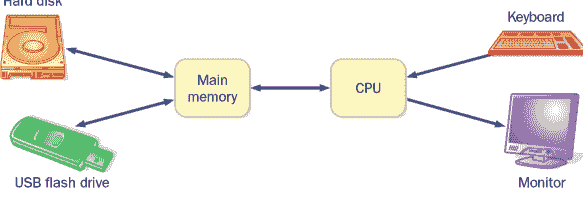

**图 1.1 计算机系统的视图**

图 1.1 显示了信息如何在计算机的基本硬件组件之间流动。假设你有一个想要运行的可执行程序。该程序存储在辅助存储器设备中，如硬盘。当你指示计算机执行你的程序时，程序的副本会从辅助存储器调入并存储在主内存中。CPU 从主内存读取各个程序指令。CPU 逐条执行这些指令，直到程序结束。指令使用的数据（例如两个要相加的数字）也存储在主内存中。这些数据要么从辅助存储器取出，要么从键盘等输入设备读取。在执行期间，程序可能会向显示器等输出设备显示信息。

执行程序的过程是计算机运行的基础。所有计算机系统基本上都以相同的方式工作。

> **核心概念**
>
> CPU 从主内存读取程序指令，并逐条执行，直到程序结束。

## 软件分类

可以使用各种标准将软件分为许多类。此时，我们仅简单地区分系统程序和应用程序。

操作系统是计算机的核心软件。它执行两个重要功能：首先，它提供了一个用户界面，允许用户与机器交互。其次，操作系统管理 CPU 和主内存等计算机资源。它决定了程序何时加载到内存中，以及硬件设备如何通信。操作系统的任务是让计算机易于使用并确保其高效运行。

目前在使用的几种流行的操作系统。Windows 操作系统是由微软为个人计算机开发的，它占据了操作系统市场的大部分份额。

> **核心概念**
>
> 操作系统提供了一个用户界面并管理计算机资源。

各种版本的 Unix 操作系统也非常流行，特别是在大型计算机系统中。一种名为 Linux 的 Unix 版本作为开源项目开发，这意味着许多人对其开发做出了贡献，并且其代码是免费提供的。正因如此，Linux 深受用户的喜爱。Mac OS 是苹果公司用于计算系统的操作系统。

操作系统通常针对智能手机和平板电脑等移动设备进行了专门设计。苹果的 iOS 操作系统用于 iPhone、iPad 和 iPod。它在功能和外观上与桌面版 Mac OS 相似，但是为较小的设备定制的。由谷歌开发的 Android 操作系统主导了智能手机市场。

应用程序（在对话中通常缩短为“app”）是除操作系统外任何软件的通用术语。文字处理器、导弹控制系统、数据库管理器、Web 浏览器和游戏都可以认为是应用程序。每个应用程序都有自己的用户界面，允许用户与特定程序进行交互。

大多数现代操作系统和应用程序的界面是图形用户界面（GUI，发音为 "gooey"），正如名称所示，它利用了图形元素。在许多元素中，这些元素包括：

- 窗口：用于将屏幕分成不同的工作区域
- 图标：代表计算机资源（如文件）的小图像
- 菜单、复选框和单选按钮：为用户提供可选选项
- 滑块：允许用户从一系列值中进行选择
- 按钮：可以通过鼠标点击来“按下”，以指示用户的选择

鼠标或触控板是使用 GUI 的首要输入设备；GUI 有时被称为“点点点击界面”。图 1.2 中的截图显示了 GUI 的示例。

应用程序或操作系统的界面是软件的重要部分，因为它是程序中用户直接交互的唯一部分。对用户来说，界面就是程序本身。

本书的重点是开发高质量的应用程序。我们探索如何设计和编写能够执行计算、做出决策并以文本或图形形式呈现的软件。我们在全文中使用 Java 编程语言来演示各种计算概念。

> **核心概念**
>
> 对于用户来说，界面就是程序本身。

## 1.2 硬件组件

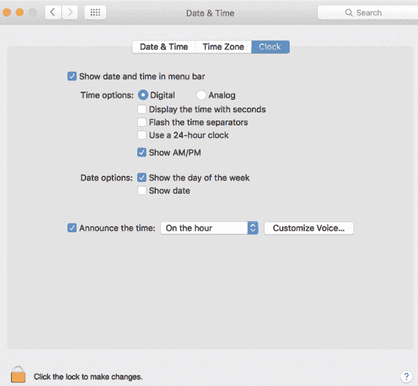

**图 1.2 图形用户界面（GUI）的一个示例**

## 数字计算机

使用两种基本技术来存储和管理信息：模拟和数字。模拟信息是连续的，与信息的源成正比。例如，酒精温度计是测量温度的模拟设备。酒精在管中上升与管外的温度直接成正比。模拟信息的另一个例子是用于表示声波振动的电子信号。信号的电压与原始声波成正比。立体声放大器增强这种电子信号并传到扬声器，扬声器通过振动重现声音。我们使用“模拟”一词是因为该信号与其所代表的信息直接模拟。图 1.3 图形地描绘了麦克风捕获并表示为电子信号的声波。

数字技术将信息分解成离散片段，并将这些片段表示为数字。光盘上的音乐是以数字存储的，作为一系列数字。每个数字代表……

> **核心概念**
>
> 数字计算机通过将信息分解为离散片段并将每个片段表示为数字来存储信息。

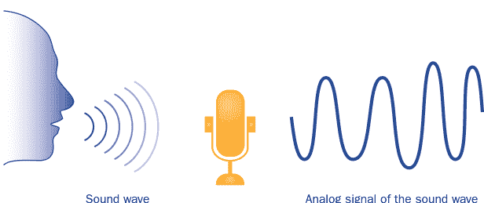

**图 1.3 模拟信号与声波的表示关系**

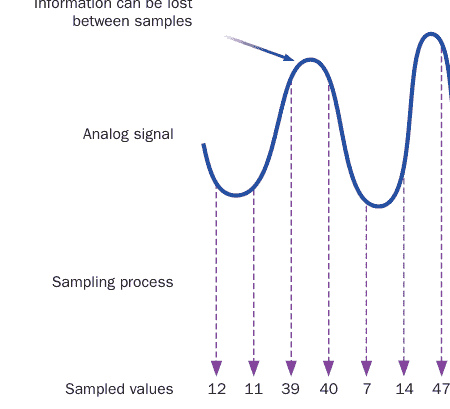

**图 1.4 通过采样数字化模拟信号**

由于采样之间的信号变化会丢失，因此采样率必须足够快。

采样只是数字化信息的一种方法。例如，文本句子是以一系列数字存储在计算机中的，每个数字代表一个字符。每个字母、数字和标点符号都分配了一个数字。甚至空格字符也被分配了数字。考虑以下句子：

`Hi, Heather.`

句子字符表示为 12 个数字，如图 1.5 所示。当字符重复时，例如大写的 'H'，使用相同的表示。注意字母的大写形式存储方式与小写形式不同，例如 Heather 中的 'H' 和 'h'。它们被视为不同的字符。

现代计算机是数字的。每种信息包括文本、图像、数字、音频、视频甚至程序指令，都被分解成片段。每个片段都表示为数字。信息通过存储数字来存储。

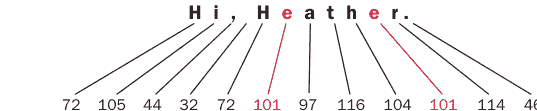

**图 1.5 文本通过将每个字符映射到数字存储**

## 二进制数字

数字计算机用数字存储信息，但这些数字并不是以十进制存储的。计算机中的所有信息都以二进制存储和传输。与具有 10 个数字（0 到 9）的十进制不同，二进制数字系统只有两个数字（0 和 1）。单个二进制数字称为位（bit）。

所有数字系统都遵循相同的规则。基值系统决定了我们有多少数字可用，并指示数字中每个数字的位值。十进制数字系统是基 10，而二进制数字系统是基 2。附录 B 对数字系统进行了详细讨论。

> **核心概念**
>
> 计算机中使用二进制来存储和移动信息，是因为存储和处理二进制数据的设备廉价且可靠。

由于这种特性，二进制系统并没有特殊之处。虽然已经创建了使用其他数字系统来存储和移动信息的计算机，但它们并不如二进制方便。

某些计算机内存设备（如硬盘）在本质上是磁性的。磁性材料可以被极化为极端一端或另一端；中间状态很难区分。因此，磁性设备可以非常有效地表示二进制值——磁化区域代表二进制 1，去磁区域代表二进制 0。其他计算机内存设备由微小的电路组成。如果这些设备只需要在两种状态之间切换，那么它们更容易制造，而且故障概率也更小。与其制造少数更复杂的设备，不如复制数百万这种简单的设备更为明智。

二进制值和数字电子信号是密不可分的。它们提高了我们沿着链路可靠地传输信息的能力。正如我们所看到的，模拟信号是连续变化的电压，具有无限多的状态；而数字信号是离散的，这意味着电压在其中一个极端（如 +5 伏）和另一个极端（如 -5 伏）之间发生剧烈变化。在任何一点，数字信号的电压都被视为“高”（代表二进制 1）或“低”（代表二进制 0）。图 1.6 对比了这两种信号。

当信号向下传输时，由于环境条件的影响会变弱并衰化。这意味着原始信号的电压电平发生了细微变化。模拟信号的问题在于，随着它的波动，它会丢失信息。由于信息与信号直接对应，信号的任何变化都会改变信息。退化的信号无法恢复，因为数字信号的衰化方式与模拟信号相同，但由于数字信号最初处于两个极端值之一，在任何信息丢失之前，都可以对其进行增强。电压可能会与其原始值发生细微变化，但它仍然可以被正确解释为高或低。

我们在任何给定情况下使用的比特（bit）数量决定了我们可以表示的唯一项目数量。单个比特有两个可能的值，0 和 1，

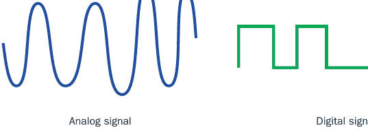

**图 1.6 模拟信号对比数字信号**

因此，可以表示两种可能的项目或情况。如果我们想表示灯泡的状态（关闭或开启），一个比特就足够了，因为我们可以将 0 解释为灯关，将 1 解释为灯开。如果我们想表示两个以上的物体，就需要多于一个比特。

两个比特结合在一起可以表示四个可能的项目，因为两个比特恰好有四种排列组合：`00`、`01`、`10` 和 `11`。假设我们要表示汽车所处的档位（P档、D档、R档或空档）。我们只需要两个比特，并在排列与档位之间建立映射关系。例如，我们可以说 `00` 代表 P 档，`01` 代表 D 档，`10` 代表 R 档，`11` 代表空档。在这种情况下，交换映射顺序没有关系，尽管在某些情况下，排列与它们所表示的内容之间的关系是重要的。

三个比特可以表示八个项目，因为三个比特有八种排列组合。同样，四个比特可以表示 16 个项目，五个比特可以表示 32 个项目，以此类推。图 1.7 显示了所用比特数量与它们能表示的项目数量之间的关系。通常情况下，N 个比特可以表示 2^N 个唯一项目。每增加一个比特，可以表示的项目数量就会翻倍。

> **核心概念**
>
> N 个比特恰好有 2^N 种排列组合。N 个比特最多可以表示 2^N 个唯一项目。

| 比特数 | 可表示项目数 | 排列示例 |
| :--- | :--- | :--- |
| 1比特 | 2 个项目 | 0, 1 |
| 2比特 | 4 个项目 | 00, 01, 10, 11 |
| 3比特 | 8 个项目 | 000, 001, 010, 011, 100, 101, 110, 111 |
| 4比特 | 16 个项目 | 0000, 0001, 0010, 0011, 0100, 0101, 0110, 0111, 1000, 1001, 1010, 1011, 1100, 1101, 1110, 1111 |
| 5比特 | 32 个项目 | 00000, 00001, 00010, 00011, 00100, 00101, 00110, 00111, 01000, 01001, 01010, 01011, 01100, 01101, 01110, 01111, 10000, 10001, 10010, 10011, 10100, 10101, 10110, 10111, 11000, 11001, 11010, 11011, 11100, 11101, 11110, 11111 |

**图 1.7 所用比特数量与它们能表示的项目**

## 1.3 计算机组织

假设我们有一个计算列表平均值的程序。程序和数字在程序运行时必须驻留在内存中。CPU 从内存中读取一条指令并执行。如果指令需要数据（例如一个数字）来完成任务，CPU 也会读取该信息。这个过程一直持续到程序结束。计算出的平均值存储在内存中等待处理。

机器的核心是 CPU 和内存。除了 CPU 和主内存之外，计算机中的几乎所有设备都是外设设备；它们位于系统的边缘。尽管它们构成了机器的核心，如果没有外设设备，CPU 和内存将毫无用处。

控制器是协调外设活动的设备。每个设备都有其独特的数据格式化和通信方式，控制器的作用之一就是处理这些特性并将它们与计算机其余部分隔离开。此外，控制器处理了大部分实际传输，允许 CPU 专注于其他活动。

输入输出（I/O）设备和辅助内存设备被视为外设设备。另一类外设是允许计算机之间发送接收信息的设备。图 1.8 所示的计算机包含一个网卡，该网卡使用 802.11 标准通过无线电通信连接计算机网络。

在某些方面，辅助内存设备和数据传输设备可以被视为 I/O 设备，因为它们代表了信息的来源（输入）和去向（输出）。然而，在讨论中，我们将 I/O 设备定义为允许用户与计算机交互的设备。

### I/O 设备

让我们详细检查一些 I/O 设备。最常见的输入设备是键盘和鼠标或触摸板。其他还包括：

- 条形码阅读器，例如零售店收银台使用的设备
- 麦克风，用于解释语音命令的识别系统
- 虚拟现实设备，例如解释手部动作的手持设备
- 扫描仪，将文本、照片和图形转换为机器可读的形式
- 摄像头：用于捕捉静态图像和视频，还可以用于处理 QR 码等特殊输入

显示器和打印机是最常见的输出设备。其他设备包括：

- 绘图仪：在大幅纸张上移动画笔（或反之）
- 扬声器：用于音频输出
- 虚拟现实显示器：用于虚拟现实显示

某些设备可以同时提供输入和输出功能。触摸屏系统可以检测用户触碰屏幕的适当位置。软件随后可以使用屏幕响应用户的触摸，显示文本和图形。触摸屏在便携式设备中已非常常见。

图 1.8 所示的计算机包含一个具有 15.6 英寸显示区域（对角线测量）的显示器。计算机中图像是通过将其拆分为独立的图像元素（或像素）来表示的。该显示器可以显示一个 1366 × 768 像素的网格。

### 主内存与辅助内存

主内存由一系列小型、连续的内存位置组成，如图 1.10 所示。每个内存位置都关联着一个被称为“地址”的唯一数字。

> **核心概念**
>
> 地址是与内存位置关联的唯一数字。

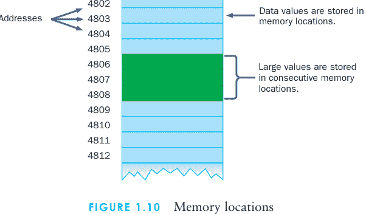

当数据存储在内存位置时，它会覆盖并破坏之前存储在该位置上的数据。然而，从内存位置读取数据的过程不会影响它。

在许多计算机上，每个内存位置由八个位（或一个字节）信息组成。如果我们需要存储一个无法用单个字节表示的值（例如一个大数字），则使用多个连续的字节来存储数据。

此类设备的存储容量是其能容纳的字节总数。通常是数百或数百万字节，因此你应该熟悉更大的测量单位。由于计算机内存基于二进制数字系统，所有存储单位都是 2 的幂。一个千字节（KB）是 1024 字节，即 $2^{10}$。一些较大的存储单位如下表所示：兆字节（MB）、吉字节（GB）、太字节（TB）和拍字节（PB）。通常通过向上舍入来考虑这些容量会更容易一些。例如，大多数计算机用户将一个千字节视为大约一千，将兆字节视为大约一百万，将吉字节视为大约十亿，依此类推。

| 单位 | 符号 | 字节数 |
| :--- | :--- | :--- |
| 字节 (byte) | - | $2^0 = 1$ |
| 千字节 (kilobyte) | KB | $2^{10} = 1,024$ |
| 兆字节 (megabyte) | MB | $2^{20} = 1,048,576$ |
| 吉字节 (gigabyte) | GB | $2^{30} = 1,073,741,824$ |
| 太字节 (terabyte) | TB | $2^{40} = 1,099,511,627,776$ |
| 拍字节 (petabyte) | PB | $2^{50} = 1,125,899,906,842,624$ |

**图 1.11 二进制存储单位**

> **核心概念**
>
> 主内存是易失性的，这意味着只有在供电的情况下，存储的信息才能维持。

许多计算机具有 4 GB 的主内存，例如图 1.8 所示的系统。大内存允许大型程序或多个程序高效运行，因为它们不需要频繁地从辅助内存中检索信息。

主内存是易失性的，这意味着如果关闭电源，存储在其中的信息将会丢失。当你在使用计算机时，应该在断电之前经常将工作内容保存到辅助内存设备（如 USB 闪存盘）上。辅助设备通常是非易失性的；即使关闭电源，信息也会保留。

缓存被 CPU 用于缩短对指令和数据的平均访问时间。缓存是一种小型、快速的内存，用于存储最频繁使用的主内存位置的内容。现代 CPU 包含指令缓存（用于加速可执行指令的取指）和数据缓存（用于加速数据的获取和存储）。

常见的辅助存储设备是硬盘和 USB 闪存盘。一个典型的 USB 闪存盘存储 1 到 256 GB 的信息。硬盘的存储容量各异，但在个人计算机上，容量通常在 500 到 750 GB 之间，例如图 1.8 所示的系统。某些硬盘可以存储更多。

USB 闪存盘由一个带有电路元件的小型打印电路板和一个 USB 连接器组成，封装在塑料、金属或橡胶外壳内进行绝缘和保护，例如可以放在口袋里或挂在钥匙链上。

磁盘是一种磁介质，位在上面以磁化颗粒的形式表示。一个读写头在旋转的磁盘上方移动，根据需要读取或写入信息。硬盘驱动器实际上可能包含垂直排列的几块磁盘，并配有数个读写头，如图 1.12 所示。

在磁盘普及之前，磁带被用作辅助存储。由于访问信息的方式，磁带比硬盘和 USB 闪存盘慢得多。硬盘是一种直接访问设备，因为读写头通常可以直接移动到所需信息的位置。USB 闪存盘也是一种直接访问设备。

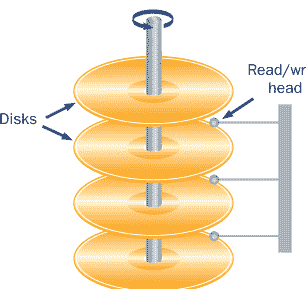

**图 1.12 带有读写头的硬盘**

直接访问和随机访问通常互换使用。然而，磁带上的信息只能在倒回或快进后访问。因此，磁带被认为是顺序访问设备。

描述内存设备还有两个术语：随机存取存储器（RAM）和只读存储器（ROM）。理解这些术语很重要，因为它们经常使用且名称具有误导性。RAM 和主内存基本通用。ROM 可以指主板上的 BIOS（基本输入输出系统）芯片，它在计算机启动时提供所需的指令。一旦信息存储在 ROM 中，在使用过程中不会被更改（正如只读一词所暗示）。RAM 和 ROM 都是直接访问设备。

CD 的表面有光滑区域和小凹坑。凹坑代表二进制 1，光滑区域代表二进制 0。

## 13.4 非线性数据结构

- 树
- 图
- 泛型

## 其他动态列表表示

## 栈

## 索引


# CD-ROM

CD-ROM 是一种便携式内存设备。CD 代表紧光盘。由于 ROM 信息在创建时是永久存储且无法更改，其音乐对应的 CD-ROM 以二进制格式存储信息。在最初创建 CD 时，在磁盘上压出一个微小的坑来表示二进制 1，而光滑区域则留给旋转磁盘。位是通过向旋转的磁盘投射低强度激光束来读取的。光束从磁盘的光滑区域反射，从坑处反射较弱。感知反射的传感器判断每个位是 1 还是 0。典型的 CD-ROM 存储容量在 650 到 900 MB 之间。

## CD 技术变体

CD 技术的变体迅速出现。可刻录光（CD-R）磁盘可用于创建音乐或通用计算机存储 CD。创建后，你可以在标准的 CD 播放机中使用 CD-R，但一旦“刻录”，就无法更改 CD-R 上的信息。你是从市场购买 CD，而 CD-R 是用激光刻录的。

## DVD

CD 最初是一种流行的格式；后来演变为用作通用计算机存储设备。同样，DVD 格式最初是为视频创建的，现在作为通用数据格式正取得进展。DVD 曾代表数字视频光，但该缩写现在独立存在。DVD 的格式比 CD 更密集（每平方英寸位更多），因此可以存储更多信息。

## 存储趋势

随着网络和外部“云”存储的进步，CD 和 DVD 作为计算机辅助存储设备的使用已大幅下降。

# 1.2 硬件组件

存储设备的容量随着技术的进步不断增加。计算机行业的一个通用规则是，存储容量每 18 个月大约翻倍。然而，随着容量接近物理极限，这种进步最终将会放缓。

## 中央处理器

CPU 与主内存交互，以执行计算机中的所有基础处理。CPU 在连续的循环中解释并执行指令，一个接一个。正如图 1.13 所示，它由三个重要的部分组成：控制单元协调处理步骤，寄存器在 CPU 内部提供少量的存储空间，而算术逻辑单元则执行计算并做出决策。寄存器是系统中最小、最快的缓存。

控制单元协调主内存与 CPU 寄存器之间数据和指令的传输。它还协调算术逻辑单元电路的执行，对存储在特定寄存器中的数据进行操作。

在大多数 CPU 中，某些寄存器被留作特殊用途。例如，指令寄存器是持有当前执行指令的寄存器。程序计数器是持有下一个要执行指令地址的寄存器。除了这些和其他特殊用途寄存器外，CPU 还包含一组通用寄存器，用于根据需要临时存储值。

将程序指令和数据共同存储在主内存中的概念是冯·诺依曼计算机设计的基础原理，它以约翰·冯·诺依曼命名，他是一位匈牙利裔数学家，于 1945 年首次提出了这种编程概念。这些计算机不断地遵循图 1.14 所示的取-解码-执行循环。指令被取自

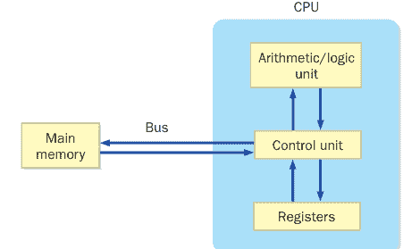

图 1.13 CPU 组件和主内存

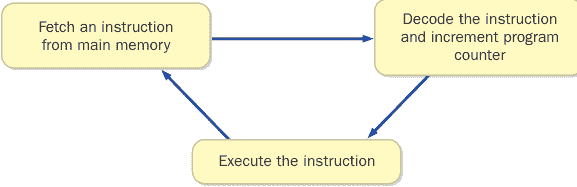

图 1.14 连续的取-解码-执行循环

> **核心概念**
>
> 取-解码-执行循环构成了计算机处理的基础。

从程序计数器存储的地址的主内存中取出指令并放入指令寄存器中。此时，程序计数器加1，为下一个循环做准备。然后，对指令进行电子解码，以确定执行何种操作。最后，控制单元激活正确的电路来执行指令。

CPU 构建在一个名为微处理器的芯片上，该设备是计算机主电路的一部分。该电路板还包含 ROM 芯片和到设备控制器的通信接口，例如管理视频显示的控制器可以连接在这里。

主电路板的另一个关键组件是系统时钟。时钟以固定的间隔产生电子脉冲，用于同步 CPU 的事件。脉冲发生的速率称为时钟频率，根据处理器而异。图 1.8 描述的计算机包含一个 Intel Core i7 处理器，其运行频率为 3.1 GHz，或每秒约 31 亿次脉冲。时钟速度提供了 CPU 执行指令快慢的粗略衡量。

被描述为双核的处理器实际上在一个芯片上构建了两个处理器，如果它正在执行的程序是为之设计的，它可以同时做两件事。然而，编写能够利用第二个处理器的程序是困难的。这对于软件开发人员来说将变得越来越重要，因为处理器设计的未来可能是更多的核心，而不是更快的速度。

## 自习题（答案见附录 L）

- SR 1.7 以下各项中各有多少个字节？
  - a. 3 KB
  - b. 2 MB
  - c. 4 GB

- SR 1.8 以下各项中各有多少个位？
  - a. 8 字节
  - b. 2 KB
  - c. 3 MB

- SR 1.9 CD 上的音乐是以每秒 44,000 次的采样率创建的。每个测量值存储为一个代表特定电压水平的数字。假设每个数字需要两个字节的存储空间。表示一小时音乐需要多少 MB？

- SR 1.10 计算机中的主要硬件组件有哪些？它们是如何交互的？

- SR 1.11 什么是内存地址？

- SR 1.12 什么是易失性？哪些内存设备是易失的，哪些是非易失的？

- SR 1.13 从列表中选择一个词与以下每个短语最匹配：控制器、CPU、网卡、外设、寄存器、ROM、辅助存储
  - a. 除了 CPU 和主内存之外，计算机系统中的大多数设备被归类为此。
  - b. 协调外设活动的设备。
  - c. 允许发送和接收信息。
  - d. 这种内存通常是易失的。
  - e. 这种内存通常是非易失的。
  - f. 这个术语基本上与“主内存”互换。
  - g. 计算机的基本处理发生的地方。

# 1.3 网络

网络由两个或多个计算机连接在一起，以便交换信息。使用网络已成为现代计算机系统的正常模式。每天都有新技术出现，以利用连接的计算机环境。图 1.15 显示了一个简单的计算机网络。网络中的一个设备是打印机，它允许任何连接的计算机

> **核心概念**
>
> 网络由两个或多个计算机连接在一起，以便它们交换信息。

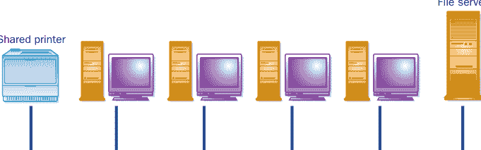

图 1.15 简单的计算机网络

在打印机上打印文档。网络中的其中一台计算机被指定为服务器，用于存储许多网络用户需要的程序和数据。服务器通常拥有大量的辅助存储。当网络有一个服务器时，每个独立计算机都不需要程序的副本。

## 网络连接

如果两台计算机直接连接，它们可以以信息在机器内部移动相同的方式进行通信。在连接地理位置的计算机时，这种方案运行良好，被称为点对连接。然而，考虑跨远距离连接许多计算机的任务。如果使用点对连接，每台计算机都通过电线连接到网络中的其他计算机。为每个连接配备单独的线不是可行的方案，因为每向网络添加一台新计算机，都要为网络中已有的计算机安装新的通信线。此外，单台计算机只能处理有限数量的连接。

图 1.16 显示了多个点对连接。考虑如果向网络增加三台计算机，需要多少通信线。如今，单栋内的局部网络通常使用无线连接，减少了布线需求。比较图 1.15 和 1.16 中的图表。图 1.15 中的所有计算机共享一条通信线。网络上的每台计算机都有自己唯一的网络地址。这些地址在概念上与主内存中的地址相似，但它们识别的是网络上的单个计算机，而不是单个机器内部的内存位置。

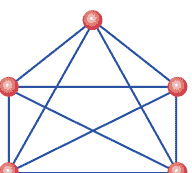

图 1.16 点对连接

通过指定目标计算机的网络地址，信息从一台计算机发送到另一台计算机。

共享通信线具有成本效益，并使向网络添加新计算机变得简单。然而，共享线路引入了延迟。网络上的计算机不能同时使用通信线。它们必须轮流发送信息，这意味着当线路繁忙时它们必须等待。

> **核心概念**
>
> 共享通信线会产生延迟，但具有成本效益并简化了向网络添加新计算机的过程。

改进网络延迟的一种技术是将大消息分成段、数据包，然后将各个数据包通过网络发送与其他用户发送的消息片段混合在一起。数据包在目的地被收集并重新组造成原始消息。这种情况类似于一组人使用传送带将箱子从一个地方移动到另一个地方。如果只允许一个人使用传送带，而这个人手里有大量箱子要移动，其他人在使用它之前将等待很长时间。通过轮流，每个人可以一次放一个箱子，他们都完成了工作。这不像拥有自己的传送带快，但不必等所有人完成后那么慢。

## 局域网和广域网

局域网（LAN）旨在跨越短距离并连接相对少的计算机。通常，局域网只连接一栋建筑或一个房间内的机器。局域网易于安装和管理，且非常可靠。随着计算机变得越来越小且多功能，局域网为整个组织共享信息提供了一种廉价的方法。然而，拥有局域网就像拥有一个只能拨打自己镇电话电话系统。我们需要能够在更远的距离上共享信息。

> **核心概念**
>
> 局域网（LAN）是在整个组织范围内共享信息和资源的有效方式。

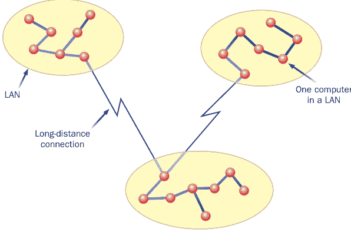

图 1.17 连接到广域网的局域网

广域网（WAN）连接两个或多个局域网（LAN），通常跨越长距离。通常每个局域网上有一台计算机专门处理跨广域网通信。这种技术减轻了局域网内其他计算机执行远程通信细节的负担。图 1.17 显示了连接到广域网的几个局域网。这些网络由不同的公司或组织所有，可能位于不同的国家。

## 互联网

在整个 20 世纪 70 年代，美国国防部一个名为高级研究计划局（ARPA）的机构资助了几个探索网络的技术。这些努力的结果之一是 ARPANET，这是一个最终演变为互联网的广域网。`互联网` 是一个基于广域网互联概念的网——它将许多网络连接在一起。

> **核心概念**
>
> 互联网是一个跨越全球的广域网（WAN）。

1983 年，连接到互联网的计算机少于 600 台。现在，互联网为全球数十亿用户服务。随着越来越多的计算机连接到互联网，跟上日益增加的用户和更沉重的流量的任务变得困难。自最初开发以来，新技术已经数次取代了 ARPANET，每次都提供了更大的容量和更快的处理速度。

## 协议与 IP 地址

协议是一组规定两个事物如何通信的规则。控制消息在互联网上移动的软件必须符合一组被称为 `TCP/IP` 的协议（通过拼读字母读作 T-C-P-I-P）。`TCP` 代表传输控制协议（Transmission Control Protocol），`IP` 代表互联网协议（Internet Protocol）。`IP` 软件定义了信息如何从源到目的地进行格式化和传输。`TCP` 软件处理如信息到达顺序错乱或丢失等问题，这在大量信息同时汇聚在某处时可能会发生。

连接到互联网的每台计算机都有一个 `IP` 地址，它在互联网上所有其他计算机中唯一标识自己。`IP` 地址的一个示例是 `204.192.116.2`。幸运的是，互联网用户很少需要处理 `IP` 地址。互联网允许为每台计算机赋予名称。与 `IP` 地址一样，名称也是唯一的。计算机的互联网名称通常被称为其互联网地址。互联网地址的示例是 `hector.vt.edu`。

> **核心概念**
>
> 连接到互联网的每台计算机都有一个唯一标识它的 IP 地址。

互联网地址的第一部分是特定计算机的本地名称。地址的其余部分是域名，它指示计算机所属的组织。例如，`vt.edu` 是弗吉尼亚州科技大学（Virginia Tech）计算机网络的域名，而 `hector` 是该校园内某台特定计算机的名称。由于域名是唯一的，许多组织可以拥有子域名，将子域名添加到基本域名之后，用以唯一地区分较大组织内的计算机组。例如，`cs.vt.edu` 子域名专门用于弗吉尼亚州科技大学计算机科学系。

每个域名的最后部分称为顶级域名（TLD），指示计算机所属的组织类型。TLD `edu` 指示教育机构。TLD `com` 通常指商业实体。另一个常见的 TLD `org` 被非营利组织使用。顶级域名包括 `biz`、`info`、`jobs` 和 `name`。许多计算机（尤其是美国以外的计算机）使用国家顶级域名，如英国的 `uk` 或澳大利亚的 `au`。

当引用互联网地址时，它会被翻译为相应的 `IP` 地址，并从那时起被使用。这种翻译的软件被称为域名系统（DNS）。每个连接到互联网的组织都运行一个域名服务器，维护该组织内所有计算机及其 `IP` 地址的列表。你提供名称，域名服务器提供数字。如果本地服务器没有该名称的 `IP` 地址，它会联系另一个拥有该地址的域名服务器。

最初，互连计算机的主要用途是发送电子邮箱，但互联网的能力增长迅速。今天互联网最重要的用途之一是万维网（World Wide Web）。

## 万维网

互联网赋予我们交换信息的能力。万维网（也称为 WWW 或简单的 Web）让人类能够交换信息。Web 软件提供了一个公共的用户界面，通过点击鼠标即可访问不同类型的信息。

> **核心概念**
>
> 万维网是一种让人们轻松地在网络上共享信息的软件。

Web 基于超文本（hypertext）和超媒体（hypermedia）的概念。“超文本”一词是由泰德·尼尔森（Ted Nelson）于 1965 年提出的。它描述了一种组织信息的方式，使其不受限于线性进展。保罗·布什（Paul Bush，1899–1994，被某些人认为是信息科学之父）设想了一种管理信息的概念。其核心思想是文档可以根据自然关系在各个点建立链接，以便读者可以从一个文档跳转到另一个文档，遵循符合该读者需求的相应路径。当引入其他媒体组件（如图形、声音、动画和视频）时，生成的组织被称为超媒体。

`Internet`（互联网）和 `World Web`（网）这两个词有时通用，但它们之间存在重要差异。`Internet` 让全球范围通信成为可能。`Web` 本质上是一种服务。浏览器是一种加载和解释文档的软件工具。第一个图形界面浏览器 `Mosaic` 发布于 1993 年。流行的浏览器包括 `Google Chrome`、`Apple Safari`、`Mozilla Firefox` 和 `Opera`。随着替代方案的出现，`Internet Explorer` 的使用率有所下降。许多此类文档使用 `HTML` 格式。

### 资源定位符

通过识别统一资源定位符（URL）可以在 Web 上找到并唯一地指定浏览器获取的文档和其他信息。以下是一个示例：

```
http://www.google.com
```

该特定 URL 的网站是著名搜索引擎的主页，该引擎允许你在 Web 上搜索特定的单词或短语。

URL 包含部分信息。第一部分是协议，决定了浏览器传输信息的方式。第二部分是存储文档机器的互联网地址。第三部分信息是文件名或资源。如果没有提供文件名（如 Google URL 所示），Web 服务器将提供默认页面。

来看另一个 URL 示例：


https://www.whitehouse.gov/issues/education

在这个 URL 中，协议是 `https`，它是超文本传输协议的安全版本。由 `www` 引用的机器（Web 服务器的典型引用）位于 `whitehouse.gov`。最后，`issues/education` 代表要传输到浏览器查看的文件。URL 还有许多其他形式，但这种最常见。

## 自习题（答案见附录 L）

- SR 1.14 什么是服务器？
- SR 1.15 五台计算机的全连接网络需要多少条通信线？哪些计算机？
- SR 1.16 描述网络上计算机共享通信线的好处。描述共享通信线的成本/缺点。
- SR 1.17 Internet 一词的词源是什么？
- SR 1.18 TCP/IP 协议集描述了使用互联网软件的通信规则。TCP 代表什么？IP 代表什么？
- SR 1.19 解释以下 URL 的部分：
  a. `duke.csc.villanova.edu/jss/examples/index.html`
  b. `sun.com/products/index.html`

# 第1章 引绪

## 1.4 Java编程语言

现在让我们关注让计算机系统变得实用的软件。程序是用特定的编程语言编写的，这种语言使用特定的单词和符号来表达解决方案。编程语言定义了一套规则，规定了程序员如何将语言的单词和符号组合成编程语句，而语句就是程序执行时所携带的指令。

自从计算机诞生以来，已经出现了许多编程语言。我们在本书中使用 Java 语言来演示各种编程概念和技术。尽管我们的主要目标是学习这些底层的软件开发原理，但一个重要的副作用将精通 Java 程序的开发。

Java 编程语言由 James Gosling 于1991年在 Sun Microsystems（太阳日月公司）开始开发。该语言最初称为 Oak，后称为 Green，最终称为 Java。Java于1995年向公众推出，并获得了巨大的人气。自2010年起，Sun Microsystems 被 Oracle 公司收购。

Java 平台有多个变体，包括标准版（Standard Edition），它是该语言的主流版本；它包含了支持大型系统开发的额外功能；以及微型版（Micro Edition），专门用于为手机等便携设备开发软件。本书侧重于标准版。

此外，Java 标准版多年来经历了多次修订，扩展了其功能并对其某些方面进行了更改。下表列出了各个版本及一些新功能。注意，它们从版本 5 开始更改了编号方式。本书的读者应该使用 6 或更高版本。

| 版本 | 年份 | 新功能 |
|---|---|---|
| 1.0 | 1996 | 初始部署 |
| 1.1 | 1997 | 内部类 |
| 1.2 | 1998 | 集合框架、Swing 图形处理 |
| 1.3 | 2000 | 音频框架 |
| 1.4 | 2002 | 断言、XML 支持、自动装箱、正则表达式 |
| 5 | 2004 | 泛型、for-each 循环、枚举、注解、变长参数列表 |
| 6 | 2006 | GUI 改进、各种库更新 |
| 7 | 2011 | `switch` 语句支持字符串、其他语言变更 |
| 8 | 2014 | JavaFX、Lambda 表达式、日期时间 API |

早期 Java 技术的一些部分已被弃用（`deprecated`），这意味着它们被认为是过时的，不应被使用。在重要时，我们会指出已弃用的元素并讨论其首选替代方案。

Java 获得最初关注的原因之一是因为它是第一个刻意拥抱编写可在 Web 上执行的程序（称为 apps）概念的编程语言。从那时起，创建具有动态功能页面的技术已经急剧扩展。

Java 是一门面向对象的编程语言。对象是组成程序的基本元素。面向对象软件开发的原理是本书的基石。我们将在本章后续部分及书的其他部分探索面向对象的编程概念。

> 核心概念：本书侧重于面向对象编程的原理。

Java 语言配有一个额外的软件库，我们在开发程序时会使用。这些软件被称为 Java API，全称应用程序编程接口，或简称为标准类库。Java API 提供了创建图形、通过网络通信以及与数据库交互等许多其他功能。Java API 非常庞大且功能强大。尽管我们无法涵盖该库的所有方面，但我们将探索其中几个。

Java 用于全球的商业环境。它是历史上增长最快的编程技术之一。因此，它不仅是一门学习编程概念的好语言，也是一门对你未来大有益的实用语言。

## Java 程序

让我们来看一个简单但完整的 Java 程序。列表 1.1 中的程序在屏幕上打印两个句子。这个特定程序打印了亚伯拉罕·林肯的一句名言。输出显示在程序列表下方。

所有的 Java 应用都有相似的结构。尽管大小不同，这个程序包含了几个重要特性。让我们仔细剖析它并检查各个部分。

程序的前几行是注释，它们以 `//` 符号开头并表示行的结束。注释不影响程序的执行，但将其包含在内是为了让人类更容易理解程序。程序员可以在整个程序中添加所需的注释，以清楚地标识程序的目的并描述任何特殊处理。任何书面注释或文档（包括用户指南和技术参考）都称为文档。包含在程序中的注释称为行内文档。

> 核心概念：注释不影响程序的处理；相反，它们的作用便于人类理解。

### 列表 1.1

```java
// Lincoln.java Author: Lewis/Loftus
// 展示了 Java 应用程序的基本结构。

public class Lincoln {

    // 打印总统名言。
    public static void main(String[] args) {
        System.out.println("A quote by Abraham Lincoln:");
        System.out.println("Whatever you are, be a good one.");
    }
}
```

## 输出

亚伯拉罕·林肯的格言：
Whatever you are, be a good one.


Java 是一门面向对象的编程语言。对象是组成程序的基本元素。面向对象软件开发的原理是本书的基石。我们将在本章后续部分及书的其他部分探索面向对象的编程概念。

Java 语言配有一个额外的软件库，我们在开发程序时会使用。这些软件被称为 Java API，全称应用程序编程接口，或简称为标准类库。Java API 提供了创建图形、通过网络通信以及与数据库交互等许多其他功能。Java API 非常庞大且功能强大。尽管我们无法涵盖该库的所有方面，但我们将探索其中几个。Java 用于全球的商业环境。它是历史上增长最快的编程技术之一。因此，它不仅是一门学习编程概念的好语言，也是一门对你未来大有益的实用语言。

## 1.4 Java编程语言

程序的前几行是注释，它们以 `//` 符号开头并表示行的结束。注释不影响程序的执行，但将其包含在内是为了人类更容易理解程序。程序员可以在整个程序中添加所需的注释，以清楚地标识程序的目的并描述任何特殊处理。任何书面注释或文档（包括用户指南和技术参考）都称为文档。包含在程序中的注释称为行内文档。

早期 Java 技术的一些部分已被弃用，这意味着它们被认为是过时的，不应被使用。在重要时，我们会指出已弃用的元素并讨论其首选替代方案。Java 获得最初关注的原因之一是因为它是第一个刻意拥抱编写可在 Web 上执行的程序（称为 apps）概念的编程语言。从那时起，创建具有动态功能页面的技术已经急剧扩展。Java 是一门面向对象的编程语言。对象是组成程序的基本元素。面向对象软件开发的原理是本书的基石。我们将在本章后续部分及书的其他部分探索面向对象的编程概念。

程序的前几行是注释，它们以 `//` 符号开头并表示行的结束。`println` 方法被称为 `println`（打印行）。`println` 方法将指定的字符打印到屏幕上。

亚伯拉罕·林肯的格言：
Whatever you are, be a good one。

要打印的字符表示为字符字符串，包含在双引号（`""`）中。当程序执行时，它调用 `println` 方法打印第一个语句，再次调用打印第二个语句，由于它是方法的最后一行，程序终止。

Lincoln 程序中的注释。

# 第1章 绪

这种注释类型不使用行尾来表示注释的结束。在起始斜杠星号（`/*`）和结束星号斜杠（`*/`）之间的任何内容都是注释的一部分，包括代表行结束的不可见换行字符。因此，这种类型的注释可以跨多行。斜杠和星号之间不能有空格。

如果在注释开头的 `/*` 之后跟着第二个星号，则注释内容可以使用一个名为 `javadoc` 的工具自动生成关于你程序的外部文档。关于 `javadoc` 的更多信息请参见附录 I。

两种基本的注释类型可以用于创建各种文档样式，例如：

```java
// 这是一个单行注释。

//// 诸如上述方法或类之上的注释
// 应该被隔离，以便特别关注
// 代码的某个特定方面。注意这些
// 每一行在技术上都是独立的注释。
//

/*
 这是一个跨越
 几行的注释。
*/
```

程序员过分专注于编写代码，导致他们对文档的关注太少。你应该养成良好的注释习惯并习惯性地遵守它们。注释应该写得良好，使用完整的句子。它们不应该解释显而易见的事，而应该对代码的意图提供适当的见解。以下示例不是良好的注释：

```java
System.out.println("hello"); // prints hello
System.out.println("test"); // change this later
```

第一条注释赞美了该行显而易见的目的，没有为语句添加任何价值。与其有一个没用的注释，不如没有注释。第二个注释具有歧义。以后应该修改什么？什么是以后？为什么要修改？

# 标识符和保留字

编写程序时使用的各种单词被称为标识符。Lincoln 程序中的标识符有 `class`、`Lincoln`、`public`、`static`、`void`、`main`、`String`、`args`、`System`、`out` 和 `println`。这些分为三类：

## 1.4 Java 编程语言

- 我们编写程序时自定义的单词（`Lincoln` 和 `args`）
- 其他程序员选择的单词（`String`、`System`、`out`、`println` 和 `main`）
- 语言中保留用于特殊用途的单词（`class`、`public`、`static` 和 `void`）

在编写程序时，我们简单地选择将类命名为 `Lincoln`，但我们可以使用许多其他可能性之一。例如，我们可以将其命名为 `Quote`、`Abe` 或 `Goodone`。标识符 `args`（arguments 的缩写）通常用于我们在 Lincoln 中使用它的方式，但我们可以在该位置使用任何其他标识符。

标识符 `String`、`System` 和 `println` 是由其他程序员选择的。它们不是 Java 语言标准库预定义代码的一部分（标准库是某些人已经为我们写的一组类和方法）。这些代码的作者选择了代码中的标识符——我们只是在利用它们。

保留字是在编程语言中具有特殊含义的标识符，不能用于任何其他用途，例如命名类或方法。在 Lincoln 程序中，保留字是 `class`、`public`、`static` 和 `void`。在书中，我们用蓝色字体显示 Java 保留字。图 1.18 按字母顺序列出了所有保留字。标记有星号的单词目前在 Java 中没有意义。

程序的标识符可以由任何字母、数字、下划线字符（`_`）和美元符号（`$`）组成，但可以是任何长度。因此，

| abstract | default | goto* | package | this |
| :--- | :--- | :--- | :--- | :--- |
| assert | do | private | throw | |
| boolean | if | implements | protected | |
| break | else | import | public | transient |
| byte | enum | return | true | |
| case | extends | int | short | try |
| catch | false | interface | static | void |
| char | final | long | strictfp | volatile |
| class | finally | native | super | while |
| const* | float | new | switch | |
| continue | for | null | synchronized | |

图 1.18 Java 保留字

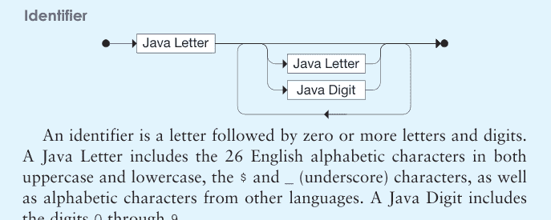

标识符是一个字母，后面跟着零或多个字母和数字。Java 字母包括大小写的 26 个英语字母字符、`$` 和 `_`（下划线）字符，以及来自其他语言的字母字符。Java 数字包括数字 0 到 9。例如：

```text
total
MAX_HEIGHT
num1
Keyboard
System
```

`total`、`label1`、`nextItem`、`NUM_BOXES` 和 `$amount` 都是有效的标识符，但 `4th_word` 和 `coin#value` 不是有效的。

标识符可以使用大写字母和小写字母，且这种差异非常重要。Java 是区分大小写的，这意味着两个仅在字母大小写上不同的标识符被视为不同的标识符。因此，`total`、`Total`、`ToTal` 和 `TOTAL` 都是不同的标识符。正如你可以想象的，使用多个仅大小写不同的标识符不是一个好主意，因为它们很容易被混淆。

虽然 Java 语言没有要求，但对每种标识符使用一致的大小写格式会更容易理解。关于标识符有多种应该遵循的 Java 规范，从技术上讲不必这样做。例如，我们使用 title case（每个单词的首字母大写）来命名。在全文中，我们在第一次遇到每类标识符时描述了其首选的大小写样式。

虽然标识符可以是任何长度，但你应该仔细地选择你的名称。它们应该是具有描述性的，但不应冗长。你应该避免使用没有意义的名称，如 `a` 或 `x`。这条规则的例外是如果短名称实际上具有描述性，例如使用 `x` 和 `y` 表示二维网格上的 `(x, y)` 坐标。

> 核心概念
> Java 是区分大小写的。字母的大写和小写版本是不同的。

# 列表 1.3

```java
// Lincoln3.java Author: Lewis/Loftos
// Demonstrates another valid program that is poorly formatted.

public class
Lincoln3 {
    public
    static void main (
        String
        [] args)
    {
        System.out.println (
            "A quote by Abraham Lincoln:"
        );
        System.out.println (
            "Whatever you are, be a good one."
        );
    }
}
```

## 输出

A quote by Abraham Lincoln:
Whatever you are, be a good one.

# 核心概念

你应该遵循一组指南，这些指南规定了你格式化和记录程序的方式。

将空白推向极端，我们几乎可以将每个单词和符号都写在不同的行，并带有不同数量的空格，例如列表 1.3 所示的 Lincoln3。

所有版本的 Lincoln 在技术上都是有效的，并且以相同的方式执行，但从读者的角度来看，它们完全不同。后者的示例展示了糟糕的风格，使程序难以理解。在编写程序时，你可能会被要求遵循特定的指南。软件开发公司通常有一项要求程序员遵循的编程风格策略。

无论情况下，你都应该采用并一致使用一套风格指南，以增加代码的可读性。

# 自测习题 *(参见附录 L 中的答案)*

- **SR 1.20** Java 编程语言是什么时候开发的？由谁开发的？什么时候向公众介绍的？
- **SR 1.21** Java 程序的处理从哪里开始？
- **SR 1.22** 你预测 Java 程序中以下行代码的结果会是什么？

```java
System.out.println("Hello"); // 打印 hello
```

- **SR 1.23** 你预测 Java 程序中以下行代码的结果会是什么？

```java
// 打印 hello System.out.println("Hello");
```


- **SR 1.24** 下列哪些项中哪些不是有效的 Java 标识符？为什么？
  a. `RESULT`
  b. `result`
  c. `12345`
  d. `x12345y`
  e. `black&white`
  f. `answer_`

- **SR 1.25** 假设程序需要一个标识符来表示一个班级的测试成绩。对于以下每个名称，说明每个名称是否是用于该标识符的好名称。解释你的答案。
  a. `x`
  b. `scoreSum`
  c. `sumOfTheScoresOfTheStudents`
  d. `smTstScr`

- **SR 1.26** 什么是空白？它如何影响程序的执行？它如何影响程序的可读性？

## 1.5 程序开发

运行程序的过程涉及各种活动。程序必须用适当的编程语言（如 Java）编写。该程序必须翻译成计算机可以执行的形式。在这个过程的各个阶段都可能发生错误并且必须修复。各种软件工具也可以用于帮助开发过程的所有部分。让我们详细地探讨这些问题。

# 第 1 章 引言

## 编程语言层级

假设某人正在给朋友提供旅行路线。那个人可以使用几种语言中的任何一种来解释这些路线，例如英语、俄语或意大利语。无论路线如何表达，路线都是相同的。朋友必须能够理解所使用的语言才能遵循路线。

同样，可以通过许多编程语言之一（如 Java、Ada、C、C++、C#、Pascal 和 Smalltalk）编写程序来解决问题。无论使用什么语言，程序的目的本质上都是相同的，但这些指令的特定组织随每个语言而异。计算机必须能够理解指令以执行它们。

编程语言可以分为以下几组。这些组基本上反映了计算机语言的历史发展。

- 机器语言
- 汇编语言
- 高级语言
- 第四代语言

为了让程序在计算机上运行，它必须用该计算机的机器语言表示。每种 CPU 都有自己的语言。

> 每条机器语言指令只能完成简单的任务。例如，单条机器语言指令可能会将一个值复制到寄存器或将一个值清零。可能需要四个独立的机器语言指令才能将两个数相加并存储结果。然而，计算机每秒可以执行数百万条指令，因此可以快速执行许多简单命令来完成复杂任务。

机器语言代码表示为一系列二进制数字，对于人类来说，读写极其困难。最初，程序是使用开关或其他类似的枯燥方法输入计算机的。早期的程序员发现这些技术耗费时间且容易出错。

这些问题促成了汇编语言的使用，它用助记符代替了二进制数字，助记符是代表命令的短类英语单词。

| 高级语言 | 汇编语言 | 机器语言 |
| :--- | :--- | :--- |
| `a + b` | `1d [%fp-20], %00` | ... |
| | `1d [%fp-24], %01` | `1101 0000 0000 0111` |
| | `add %00, %01, %00` | `1011 1111 1110` |
| | | `1011 1111 1110` |
| | | `1001 0000` |
| | | `0111` |
| | | `0000` |

> **核心概念**
> 高级语言允许程序员忽略机器语言的细节。

在 1.19 中，此特定表达式的机器语言代码为 400 位。

高级语言使程序员不需要知道他们正在工作的处理器的底层语言。但高级语言代码必须翻译成机器语言才能执行。

某些编程语言被认为运行在比高级语言更高的水平。它们可能包括自动生成报告或与交互的特殊设施。这些语言被称为第四代语言或简单的 4GL，因为它们遵循了前三代：机器、汇编和高级。

## 编辑器、编译器和解释器

需要几种特殊程序来帮助开发过程。它们有时被称为构建程序的软件工具。基本软件工具的示例包括编辑器、编译器和解释器。

最初，你在将程序输入计算机并存储在文件中时使用编辑器。有许多种不同的编辑器。你应该熟悉你经常使用的编辑器，因为它会极大地影响你输入和修改程序的速度。

图 1.20 显示了程序开发的基本视图。保存程序后，你尝试将其从高级代码翻译成可以执行的形式。该翻译可能会产生错误，这时你需要返回编辑器进行更改以修复问题。一旦翻译成功，你就可以执行程序并评估结果。如果结果不是你想要的，或者你想增强程序，你再次返回编辑器进行更改。

源代码翻译特定类型 CPU 的（最终）机器语言可以通过多种方式进行。编译器是一个将一种语言的代码翻译成另一种语言的等效代码的程序。原始代码被称为源代码，而翻译成的目标语言被称为目标语言。对于许多传统编译器来说，源代码被直接翻译成特定的机器语言。在这种情况下，翻译过程只发生一次，生成的可执行程序可以在任何时候在任何使用该类型 CPU 的计算机上运行。

解释器与编译器相似，但有一个重要的区别。解释器将翻译和执行活动交织在一起。源代码的一小部分（例如一条语句）会被翻译并执行。然后是另一条语句……这种技巧的优点之一是它消除了对单独编译过程的需求。然而，程序的运行速度通常较慢，因为翻译是在每次执行期间完成的。

通常用于翻译和执行 Java 程序的流程结合了编译器和解释器的使用。如图 1.21 所示。Java 编译器将 Java 源代码翻译成 Java 字节码，这是一种低级的、与架构无关的程序表示。称为 Java 虚拟机（JVM）的 Java 解释器执行 Java 字节码。

Java 字节码与真正的机器代码的区别在于，Java 字节码不依赖任何特定的处理器类型。这种方法的明显优势是使 Java 具有架构无关，因此很容易从一台机器迁移到另一台机器。唯一的限制是每台机器上都必须有一个 JVM。

> **核心概念** Java 编译器将 Java 源代码翻译成 Java 字节码，这是一种低级的、与架构无关的程序表示。

由于编译过程将高级 Java 源代码翻译成低级表示，JVM 的解释过程比直接解释高级代码要高效得多。通过解释其字节码来执行程序仍然比直接执行机器代码慢，但对于大多数应用程序来说已经足够快了。

## 开发环境

软件开发环境是用于创建、测试和修改程序的工具集。某些开发环境是免费提供的，而另一些可能具有高级功能的开发环境则必须购买。某些开发环境被称为集成开发环境（IDE），因为它们将各种工具集成到一个软件程序中，并提供方便的用户界面。

任何开发环境都将包含某些工具，例如 Java 编译器和解释器。某些环境还会包含调试器，它可以帮助你发现程序中的错误。其他可能包含的工具还有生成器、归档工具以及帮助你可视化程序结构的工具。

Java 标准版的下载包包含软件开发工具包（SDK），它有时被简单地称为 Java 开发包（JDK）。Java SDK 包含了让 Java 程序运行所需的内核开发工具，但它并不是一个集成环境。它是命令行式的。也就是说，SDK 没有图形用户界面（GUI）。它也不包含编辑器，尽管任何可以将文档保存为纯文本的编辑器都可以使用。

最流行的 Java IDE 之一是 Eclipse（参见 `www.eclipse.org`）。Eclipse 是一个开源项目，这意味着它由广泛的程序员开发并免费提供。其他流行的 Java IDE 还包括 jEdit (`www.jedit.org`)、DrJava (`drjava.sourceforge.net`)、JGRASP (`www.jgrasp.com`) 和 BlueJ (`www.bluej.org`)。

有多种 Java 开发环境可供。网络搜索可以发现数十种。选择使用哪种开发环境非常重要。你对环境的能力了解得越多，你在程序开发期间的效率就越高。

## 语法与语义

每种编程语言都有其独特的语法。语言的语法规则规定了语言的词汇元素如何组合成语句。为了创建程序，必须遵循这些规则。我们已经讨论了几个 Java 语法规则。例如，标识符不能以数字开头，这是一个语法规则。使用大括号来开始和结束类和方法也是语法规则。附录 L 正式定义了 Java 编程语言的基本语法规则，并在文中处处强调了特定规则。

在编译期间，所有的语法规则都会被检查。如果程序在语法上不正确，编译器将发出错误信息且不产生字节码。Java 的语法与 C 和 C++ 编程语言相似，因此，代码的外观和感觉对于具有这些语言背景的人来说是亲切的。

编程语言中语句的语义定义了执行该语句时会发生什么。编程语言通常是无歧义的，这意味着程序的语义是有良好定义的。也就是说，每条语句都有且仅有一种解释。相反，人类用于通信的自然语言（如英语和意大利语）充满了歧义。一个句子通常有两个或多个不同的含义。例如，考虑以下句子：

`Time flies like an arrow.` (光阴如箭。)

普通人可能将这句话解释为一个通用的观察：即时间移动得快就像箭移动得快一样。然而，如果我们将单词 `time` 解释为动词（如“跑 50 码冲刺，我告诉你”）并将单词 `flies` 解释为名词（飞蝇的复数），解释就完全改变了。我们知道箭不会做某事，所以我们通常不会那样解释句子，但它是句中词汇的有效解释。计算机就会这样做。此外，这个句子可能是在描述一种奇特昆虫的特征，即一种“时间蝇”（time fly），这种昆虫可能出现在附近。

## 错误

软件中可能会出现几种类型的问题，特别是在程序开发期间。“错误”一词经常被误用，其含义取决于情况。从用户的角度来看，与机器交互时发生的任何问题都可以被称为错误。计算机执行我们给出的命令并对我们提供的数据进行操作。如果我们的程序是错误的或数据不准确，我们就无法期望结果正确。描述这种情况的常用说法是“垃圾进，垃圾出”。

你在开发程序时会遇到三种错误：

- 编译错误
- 运行时错误
- 逻辑错误

编译器检查以确保你使用的是正确的语法。如果你有任何不符合语言规则的语句，编译器将产生语法错误。编译器还会寻找其他问题，例如数据类型不兼容。语法在技术上可能是正确的，但你可能正在尝试执行语言不允许的操作。编译器识别的任何错误都是编译错误。如果发生编译错误，就不会创建可执行版本。

第二种问题发生在程序执行期间。它被称为运行时错误，会导致程序异常终止。例如，如果我们尝试除以零，程序将“崩溃”并停止执行。因为请求的操作是未定义的，系统将直接放弃继续你的程序。最好的程序是健壮的，也就是说，尽可能避免运行时错误。例如，程序代码可以防止除以零的可能性，并在出现时进行妥善处理。在 Java 中，运行时问题被称为可以捕获并处理的异常。

第三种软件问题是逻辑错误。在这种情况下，软件执行时没有抱怨，但会产生错误的结果。例如，当值计算错误或图形按钮未出现在正确位置时，就会发生逻辑错误。程序员必须对程序进行彻底测试，预期结果与实际结果进行比较。发现缺陷时，必须追溯到代码中的问题源并进行修正。发现并修正程序缺陷的过程被称为调试。逻辑错误可以以许多方式表现，真正的根源可能很难发现。

## 1.6 面向对象编程

### 自测习题（答案见附录 L）

- **SR 1.27** 我们知道计算机都被用来执行复杂的任务。在本节中，你学习了计算机的指令只能执行简单的任务。请解释这一表面的矛盾。
- **SR 1.28** 高级语言与机器语言之间存在什么关系？
- **SR 1.29** 什么是 Java 字节码？
- **SR 1.30** 从下列表中选择一个词，与以下每个短语相匹配：
  - a. 用这种语言编写的程序可以直接在计算机上上运行。
  - b. 通常，这种类型语言中的每条语言指令都对应一条等效的机器语言指令。
  - c. 大多数程序员使用这种类型的语言编写程序。
  - d. Java 是这种类型语言的一个示例。
  - e. 这种类型的程序将一种语言的代码翻译成另一种语言的代码。
  - f. 这种程序将代码的翻译和代码的执行交织在一起。
- **SR 1.31** 我们所说的编程语言的语法（syntax）和语义（semantics）是指什么？
- **SR 1.32** 将以下每种情况分类为编译时错误（compile-time error）、运行时错误（run-time error）或逻辑错误（logical error）。
  - a. 错写了一个 Java 关键字。
  - b. 通过将列表上数字之和（为 0）除以列表的大小（也为 0）来计算空数字列表的平均值。
  - c. 在应该输出学生平均分时，打印了学生的高分成绩。

### 1.6 面向对象编程

正如我们在本章前面所说，Java 是一种面向对象（OO）的语言。正如名称所示，对象（object）是 Java 程序中的基本实体。本书侧重于通过定义相互作用的对象来开发软件的理念。

面向对象的软件开发原则已经存在多年了，本质上与高级编程语言的使用历史一样长。20 世纪 60 年代开发的编程语言 Simula 具有许多定义现代 OO 软件开发方法的特征。20 世纪 80 年代 90 年代，面向对象编程变得广泛流行，这在很大程度上归功于 C++ 和 Java 等编程语言的发展。现在，它是商业软件开发中使用的主导方法。

面向对象方法最吸引人的特征之一是对象可以有效地用于表示现实世界的实体。例如，我们可以使用软件对象来代表公司中的员工。我们为每个员工创建一个对象，每个对象都具有我们需要表示的行为和特征。通过这种方式，面向对象编程允许我们将程序映射到程序所代表的真实情况中。也就是说，面向对象的方法使得解决问题变得更容易，而这正是编写程序的初衷。

让我们讨论一下与问题解决相关的通用问题，然后探索帮助我们解决问题的面向对象方法的特定特征。

#### 问题解决

通常情况下，问题解决包含多个步骤：

1. 理解问题。
2. 设计解决方案。
3. 考虑解决方案的替代方案并完善解决方案。
4. 实现解决方案。
5. 测试解决方案并修复任何存在的问题。

尽管这种方法适用于任何类型的问题解决，但在开发软件时效果特别好。这些步骤并不是纯线性的。也就是说，某些活动会与其他活动重叠。但在某个时间点，所有这些步骤都应该被仔细处理。

第一步理解问题听起来似乎显而易见，但对这一步的忽视一直是软件开发工作误导的原因。如果我们尝试解决一个我们并不完全理解的问题，就会导致失败。

#### 面向对象的概念

- 对象（object）
- 属性（attribute）
- 方法（method）
- 类（class）
- 封装（encapsulation）
- 继承（inheritance）
- 多态（polymorphism）

除了这些术语，还有许多相关的概念允许我们以无数方式调整解决方案。本节提供了这些思想的概览。

我们前面提到，*对象*（object）是程序中的基本元素。对象通常代表现实世界中的对象。每个对象都有*状态*（state）和一组*行为*（behaviors）。当我们说“状态”时，指的是对象的属性值。银行账户的状态是余额。银行账户的行为包括存款和取款。

除了对象，Java 程序还管理原始数据。*原始数据是数字和字符等数值。* 对象通常表示更有趣或复杂的实体。

> **概念**
> 每个对象都有由属性定义的状态，以及一组由方法定义的行为。

对象的属性是它内部存储的值，这些值可能表示为原始数据或其他对象。例如，银行账户可能会存储一个浮点数（原始值）来代表账户余额。它可能包含其他属性，如账户所有者的姓名。总的来说，对象的属性定义了它的当前状态。

正如本章前面提到的，方法是一组被命名的编程语句。当方法被调用时，它的语句会被执行。一组方法与一个对象相关。方法定义了对象的潜在行为。为了定义向银行账户存款的能力，我们定义了一个包含编程语句的方法，以相应更新余额。

对象由*类*（class）定义。类是创建对象的模型或蓝图。考虑建筑师设计房屋时的蓝图。蓝图定义了房屋的重要特征——墙、窗户、门、电源插座等。如图 1.22 所示，一旦创建了蓝图，就可以用来建造几栋房屋。

在某种意义上，从蓝图建造的房屋是不同的。它们位于不同的位置，有不同的地址，包含不同的家具，但在许多方面，它们是“同一个”房子。房间的布局和其他关键特征在每个房子中都是相同的。要创建不同的，我们需要不同的蓝图。

类是对象的蓝图。它建立了该类型对象将持有的数据类型，并定义了代表此类行为的方法。然而，类并不是对象，就像蓝图不是房子一样。通常，类不包含存储数据的空间。每个对象都有存储自己数据的空间，这就是为什么每个对象都可以有自己的状态。

> **核心概念**
> 类是对象的蓝图。
> 从一个类定义中可以创建多个对象。

对象应该是封装的，这意味着它保护并管理着自己的信息。也就是说，对象应该是自律的。对对象状态的唯一更改应该通过该对象的方法来完成。我们设计对象时，应该让其他对象无法“伸入内部”并改变它们的状态。

类通过继承从其他类创建。一个类的定义可以基于已经存在的另一个类。继承是软件重用形式，利用了我们可能想要创建的各种类之间的相似性。一个类可以用于派生出几个新类。派生类随后可以用于派生出更多的类。这创建了一个类的层次结构，其中在一个类中定义的属性和方法被子类继承，子类又将它们传递给它们的类，以此类推。例如，我们可能会创建一个表示各种类型账户的类层次。共同特征在高层类中定义，特定的差异在派生类中定义。

多态是指我们可以在一段时间内以一致的方式引用多个类型的相关对象的思想。它赋予了我们能够为处理多个对象的问题设计强大且优雅的解决方案的能力。

图 1.23 描绘了一些面向对象的核心概念。我们不期望你在此时就能完全理解这些思想。本书的大部分内容是为了阐述这些思想。本概述仅用于铺垫背景。

### 自测习题（答案见附录 L）

- **SR 1.33** 列出解决问题所需的五个通用步骤。
- **SR 1.34** 为什么考虑一种方法来解决问题是重要的？为什么在解决问题的过程中早期考虑替代方案是重要的？
- **SR 1.35** 支持面向对象编程的主要概念有哪些？

## 核心概念总结

- 计算机系统由硬件和软件组成，它们协同工作以帮助我们解决问题。
- CPU 从主内存中读取程序指令，一次执行一个，直到程序结束。
- 操作系统提供用户界面并管理计算机资源。
- 对于用户来说，界面就是程序。
- 数字计算机通过将信息拆分为若干部分并将每部分表示为一个数字来存储信息。
- 二进制用于在计算机中存储和移动信息，因为存储和处理二进制数据的设备廉价且可靠。
- N 位恰好有 2^N 种排列组合。因此，N 位可以表示最多 2^N 个唯一项目。
- 计算机的核心由主内存（存储程序和数据）和 CPU（一次执行一条程序指令）组成。
- 地址是与内存位置关联的唯一数字。
- 主内存是易失的，这意味着只有在供电时存储的信息才会被保持。
- CD 的表面有平滑区域和小凹槽。凹槽代表 1，平滑区域代表二进制 0。
- “取指-解码-执行”循环形成了计算机处理的基础。
- 网络由两个或多个连接在一起的计算机组成，以便它们交换信息。
- 共享通信线会产生延迟，但具有成本效益，并简化了向网络添加新计算机的过程。
- 局域网（LAN）是在整个组织范围内共享信息和资源的有效方法。
- 互联网是跨越全球的广域网（WAN）。
- 每个连接到互联网的计算机都有唯一标识它的 IP 地址。
- 万维网（Web）是一种让人们能够轻松跨网络共享信息的软件。
- URL 唯一指定了在 Web 上的文档和其他信息，供浏览器获取和显示。
- 本书侧重于面向对象编程的原则。
- 注释不影响程序的处理；相反，它们有助于人类理解。
- 内联文档应该提供对代码的洞察。它不应该是模糊的，也不应描述显而易见的事。
- Java 是大小敏感的。字母的大写和小写版本不同。
- 标识符名称应具有描述性且可读性。
- 适当使用空格使程序更易读。
- 你应该遵循一套建立你记录程序方式的指南。
- 所有程序必须翻译成特定 CPU 的机器语言才能执行。
- 高级语言允许程序员忽略机器语言的底层细节。
- Java 编译器将 Java 代码翻译成 Java 字节码，这是程序的一种低级、与架构无关的表示。
- 存在许多不同的环境来帮助你创建和修改 Java 程序。
- 语法规则规定程序的形式。语义规定程序语句的含义。
- 程序员对程序的准确性和可靠性负责。
- Java 程序必须在语法上是正确的，否则编译器将无法推导出字节码。
- 面向对象编程帮助我们解决问题，这就是编写程序的目的。
- 程序设计涉及将解决方案拆分为可管理的单元。
- 每个对象都有一个状态（由其属性定义）和一组行为（由其方法定义）。
- 类是对象的蓝图。从一个类定义中可以创建多个对象。

## 练习题

- **EX 1.1** 描述你的个人电脑或你可以使用的实验室计算机的硬件组件。包括处理器类型和速度、主内存和辅助内存的容量，以及 I/O 设备类型。解释你是如何确定答案的。
- **EX 1.2** 为什么我们使用二进制制在计算机上存储信息？
- **EX 1.3** 下面每项可以表示多少个唯一项目？
  a. 4 位
  b. 7 位
  c. 12 位
  d. 15 位
  e. 24 位
- **EX 1.4** 如果图片由 128 种可能的颜色组成，存储每个像素需要多少位？为什么？
- **EX 1.5** 如果一种语言使用 50,000 个唯一字符，存储文档中的每个字符需要多少位？为什么？
- **EX 1.6** 下面各项中有多少位？每项有多少个字节？
  a. 100 KB
  b. 10 MB
  c. 5 GB
  d. 1.5 TB
- **EX 1.7** 解释随机存储器（RAM）和只读存储器（ROM）的区别。
- **EX 1.8** 磁盘是随机访问设备，但它不是 RAM（随机存储器）。解释。
- **EX 1.9** 确定你的计算机或你可以使用的实验室计算机是如何通过网络与其他计算机连接的。它是否连接到互联网？请画一张图来显示你环境中的基础连接。
- **EX 1.10** 解释局域网 (LAN) 和广域网 (WAN) 之间的区别。它们之间是什么关系？
- **EX 1.11** 八台计算机的全连接点对点网络共需要多少条通信线？十台计算机又需要？确定此结果的通用公式是什么？
- **EX 1.12** 解释互联网（Internet）和万维网（World Wide Web）之间的区别。
- **EX 1.13** 列出并解释 URL 的组成部分：
  a. 你的学校
  b. 你们学校的计算机科学系
  c. 你老师的网页
- **EX 1.14** 给出两种类型 Java 注释的示例，并解释它们之间的区别。
- **EX 1.15** 下哪些不是有效的 Java 标识符？为什么？
  a. `Fraction`
  b. `theSumOfSquaresOnTheTwoSides`
  c. `1direction`
  d. `direction1`
  e. `NUMBER_OF_STARS`
  f. `high&low`
  g. `power$`
- **EX 1.16** 为什么以下有效的 Java 标识符不被认为是良好的标识符？
  a. `q`
  b. `studNum`
  c. `theNumberOfStudent`
- **EX 1.17** Java 是区分大小写的。这意味着什么？
- **EX 1.18** 什么是 Java 虚拟机 (JVM)？解释它的作用。
- **EX 1.19** 当我们说英语具有歧义性时是什么意思？给出两个英语歧义的例子（本章中使用的示例之外）并解释该歧义。为什么歧义对编程语言来说是一个问题？
- **EX 1.20** 将每种情况归类为编译时错误、运行时错误或逻辑错误。
  a. 本想除以 100 却除以了 10
  b. 在计算中使用 0 作为分母
  c. 忘记在程序末尾写一个 `]`
  d. 本想将程序结果分多行输出，却输出在同一行内
  e. 使用 `[ ]` 代替 `{ }`
  f. 在计算圆面积时得出了不准确的结果

## 编程项目

- **PP 1.1** 输入、编译并运行以下程序：

```
```


public class Test {

    public static void main(String[] args) {

        System.out.println("An Emergency Broadcast");

    }

}

PP 1.2 逐个向 PP 1.1 的程序引入以下错误。记录编译器产生的任何错误信息。在引入新错误之前，修复上一个错误信息。如果没有产生错误信息，请解释原因。在每次更改之前，尝试预测会发生什么。

+ a. 将 `Test` 改为 `test`
b. 将 `Emergency` 改为 `emergency`
c. 删除字符串中的第一个引号
d. 删除字符串中的最后一个引号
e. 将 `main` 改为 `man`
f. 将 `println` 改为 `bogus`
g. 删除 `println` 语句末尾的分号
h. 删除程序中的最后一个大括号

PP 1.3 写一个程序，分行打印你的名字、生日、爱好、你最喜欢的书和电影最喜欢的电影。在输出中为每条信息打上标签。


为 PP 1.2 开发解决方案。

PP 1.4 写一个程序，打印至少五部你最喜欢的电影的列表。打印每部电影的标题和简要剧情。

PP 1.5 写一个程序，打印一首歌的前几节（任自选择）。为副歌部分标记标签。

PP 1.6 写一个程序，用星号 (`*`) 字符打印一个带有门和窗的房屋轮廓。

PP 1.7 写一个程序，打印你任选小说中的段落。

+ PP 1.8 写一个程序打印短语 "Deeds not Words"：
a. 在一行中
b. 占据三行，每行一个单词，单词彼此相对居中
c. 在由 `-` 和 `|` 字符组成的框内

PP 1.9 写一个程序打印以下菱形。不要打印任何不需要的字符。（也就是说，不要让任何字符字符串超过其必要的长度）。

```
*
***
*****
*******
*********
*******
*****
***
*
```

PP 1.10 写一个程序，用大区块字体显示你的首字母。让每个大字母由相应的普通字符组成。例如：

```
JJJJJJJJJJJJ AAAAAAAA LLLL
JJJJJJJJJJJJJJ AAAAAAAA LLLL
JJJJ AAA AAA LLLL
JJJJ AAA AAA LLLL
JJJJ AAAAAAAAAA LLLL
JJJJ AAAAAAAAAA LLLL
J JJJJ AAA AAA LLLL
JJ JJJJ AAA AAA LLLLLLLLLLLLLL
JJJJJJJJJJ AAA AAA LLLLLLLLLLLLLLL
JJJJJJJJJJ AAA AAA LLLLLLLLLLLLLLL
```

# 数据与表达式

# 目标

- 讨论字符串、拼接和转义序列。
- 探索变量的声明和使用。
- 描述 Java 原始数据类型。
- 讨论表达式的语法和处理。
- 定义数据转换的类型以及实现转换的机制。
- 引入 `Scanner` 类以创建交互式程序。

本章探索了 Java 程序中使用的某些基本数据类型以及使用表达式进行计算。它讨论了数据从一种类型到另一种类型的转换，以及如何从运行程序的用户那里交互式读取输入。

## 2.1 字符串

在第 1 章中，我们以 Lincoln 程序为例，讨论了 Java 程序的基本结构，包括注释、标识符和空白的使用。第 1 章还包含了面向对象编程涉及的各种概念的概述，如对象、类和方法。如有必要，请花点时间回顾这些内容。

字符型字符串是 Java 中的一种对象，由 `String` 类定义。由于字符串对计算机编程非常基础，Java 提供了使用由双引号界定的字符串字面量的能力，正如我们在之前的示例中所所示。我们将在第 3 章更详细地探讨 `String` 类及其方法。现在，让我们更详细探索字符串字面量的用法。

以下都是有效字符串字面量的示例：

```
"The quick brown fox jumped over the lazy dog."
"60"
"x"
```

字符串字面量可以包含任何字符，包括数字、标点和特殊字符。

### print 和 println 方法

在第 1 章的 Lincoln 程序中，我们如下调用 `println` 方法：
`System.out.println("Whatever you are,");`

`println` 方法是 `System.out` 对象为我们执行的服务。当我们请求它时，它就会在屏幕上打印。传递给方法的每个数据被称为参数。在这种情况下，`println` 方法只接受一个参数：要打印的字符串。

`System` 对象提供了另一个我们可以使用的服务：`print` 方法。`print` 和 `println` 之间的区别很小但很重要。`println` 方法打印发送的信息，然后移动到行首。`print` 方法与 `println` 类似，但在完成后不会跳转到下一行。

> 核心概念
> print 和 println 方法代表了 System 对象提供的两种服务。

列表 2.1 所示程序名为 `Countdown`，它调用了 `print` 和 `println` 方法。

仔细比较 `Countdown` 程序的输出与程序代码。注意 "Liftoff" 一词与前面的几个单词在同一行，尽管它是使用 `println` 方法打印的。记住，`println` 方法在传递给它的信息打印后会移动到下一行。

# 列表 2.1

```java
/**
 * Countdown.java               作者：Lewis/Loftus
 *
 * 展示 print 和 println 的区别。
 */
public class Countdown {
    /**
     * 火箭倒计时的两行输出。
     */
    public static void main(String[] args) {
        System.out.print("Three ... ");
        System.out.print("Two ... ");
        System.out.print("One ... ");
        System.out.print("Zero ... ");
        System.out.println("Liftoff!"); // 出现在第一输出行
        System.out.println("Houston, we have a problem.");
    }
}
```

## 输出

Three... Two... One... Zero... Liftoff!
Houston, we have a problem.

# 字符串拼接

在程序中，字符串字面量不能跨行。以下程序的语法是不正确的，并且在尝试编译时会产生错误：

```java
// 以下语句将无法编译
System.out.println("the only stupid question is the one that is not asked.");
```

当我们想要打印一个过长而无法放纳在程序单行的字符串时，我们可以依靠字符串拼接，将一个字符串附加另一个字符串的末尾。字符串拼接操作符是加号 (`+`)。下面的表达式将一个字符与另一个字符拼接在一起，生成了一行：

`"The only stupid question is " + "the one that is not asked."`

列表 2.2 所示的名为 Facts 程序包含几个语句。第一行打印了一句较长的句子，无法放纳在程序的一行中。由于字符字面量在程序中不能跨行，我们将字符串拆分为两部分并使用字符串拼接将它们连接。第一个 `println` 语句中的字符串拼接操作会生成一个大字符串，并将其传递给方法进行打印。

注意，我们不需要向 `println` 方法传递任何信息，如 Facts 程序中的第二行所示。此调用没有打印任何变量，但它确实移动到了下一的输出。在这种情况下，调用不带参数的 `println` 效果是打印一个空行。

Facts 程序中最后三次调用 `println` 展示了拼接的另一个有趣现象：字符串可以与数字拼接。注意这些行中的数字没有被双引号括起来，因此它们不是字符字符串。在这些情况下，数字会自动转换为字符串，然后两个字符串进行拼接。

由于我们正在打印特定的值，我们可以简单地将数值包含在字符串字面量中，例如：

`"Speed of ketchup: 40 km per year"`

数字是字符，可以包含在字符串中，我们在 Facts 程序中分离它们是为了演示拼接字符串和数字的能力。这种技术在接下来的示例中将有用。

正如你可以想象的，`+` 运算符也用于算术加法。因此，`+` 运算符的作用取决于它操作的数据类型。

## 2.1 字符字符串

### 列表 2.2

```java
/*****************************************************************
// Facts.java      作者: Lewis/Loftus
// 展示了字符串拼接操作符的使用以及
// 整数到字符串的自动转换。
/****************************************************************/
public class Facts {
    // 打印各种事实。
    public static void main(String[] args) {
        // 字符串可以拼接成一个长字符串
        System.out.println("We present the following facts for your "
            + "curricular edification:");
        System.out.println("");
        // 字符串可以包含数字
        System.out.println("Letters in the Hawaiian alphabet: 12");
        // 数值可以拼接到字符串上
        System.out.println("Dialing code for Antarctica: " + 672);
        System.out.println("Year in which Leonardo da Vinci invented "
            + "the parachute: " + 1515);
        System.out.println("Speed of ketchup: " + 40 + " km per year");
    }
}
```

## 输出

我们提供以下事实以供你的课外教育：
夏威夷字母表中的字母：12
南极的拨号代码：672
列奥纳多·达芬奇发明落地伞的年份：1515
番茄酱的速度：每年40公里

## 第 2 章 数据与表达式

如果 `+` 运算符的操作数之一或双方都是字符串，则执行字符串拼接。

列表 2.3 所示的 Addition 程序演示了字符串拼接与算术加法的区别。Addition 程序使用了四次 `+` 运算符。在第一次调用 `println` 时，两个操作都执行了字符串拼接，因为运算符是从左到右执行的。第一个操作符将字符串与第一个数字 (24) 拼接，创建一个更大的字符串。然后该字符串又与第二个数字 (45) 拼接，创建一个更更大的字符串并打印出来。

在第二次调用 `println` 时，我们使用括号将 `+` 运算与两个数值操作数分组。这强制该运算首先发生。由于两个操作数都是数字，因此这些数字在算术意义上被相加了。

```java
/****************************************************************
// Addition.java               作者: Lewis/Loftus
// 展示了加法运算符与字符串
// 拼接运算符之间的区别。
****************************************************************
public class Addition {
    // 拼接并相两个数字并打印结果。
    // -------------------------------------------------------------
    public static void main(String[] args) {
        System.out.println("24 and 45 concatenated: " + 24 + 45);
        System.out.println("24 and 45 added: " + (24 + 45));
    }
}
```

### 列表 2.3

```
24 and 45 concatenated: 2445
24 and 45 added: 69
```

产生结果 69。该数字与字符串拼接，生成一个更大的字符串并打印。

我们将在在本章稍后重新讨论这种情况，届时我们将形式化定义运算符求顺序的优先级规则。

## 转义序列


为了解决这个问题，Java 定义了几个转义序列来表示特殊字符。转义序列以反斜杠 (`\`) 开始，表示该字符应该以特殊方式解释。列表 2.4 所示的程序打印了一段像诗一样的文本。注意在整个字符串中的转义序列。`\n` 转义序列强制输出到新行，而 `\t` 转义序列表示一个制表符。`\"` 转义序列确保引号字符被视为字符串的一部分，而不是字符串的终止。

| 转义序列 | 含义 |
|---|---|
| `\b` | 退格 |
| `\t` | 制表符 |
| `\n` | 换行 |
| `\r` | 回车 |
| `\"` | 双引号 |
| `\'` | 单引号 |
| `\\` | 反斜杠 |

图 2.1 Java序列

## 第 2 章 数据与表达式

玫瑰是红色的，
紫花是蓝色的。
糖是甜的，
我有感情症。所以我宁愿做朋友
在我们关系的这一点。

## 自测

- **SR 2.1** 什么是字符串字面量？
- **SR 2.2** `print` 和 `println` 方法之间有什么区别？
- **SR 2.3** 什么是参数？
- **SR 2.4** 以下代码片段的输出是什么？
```java
System.out.println("One ");
System.out.print("Two ");
System.out.println("Three ");
```
- **SR 2.5** 以下代码片段的输出是什么？
```java
System.out.print("Ready ");
System.out.println("");
System.out.println("Set ");
System.out.println("");
System.out.println("Go ");
```
- **SR 2.6** 以下语句的输出是什么？如果移除内部括号会发生什么？
```java
System.out.println("It is good to be " + (5 + 5));
```
- **SR 2.7** 什么是转义序列？举几个例子。
- **SR 2.8** 写一个单条 `println` 语句将按照所示输出内容（包括换行和引号）：

“我把这封信写得比平时长，是因为没有时间把它写短。”

变量是用于存储数据值的内存位置名称。变量声明指示编译器留出足够存储特定类型值的内存空间，并指示引用该位置的名称。

考虑列表 2.5 所示的 PianoKeys 程序。main 方法的第一行是变量 keys 的声明，它持有一个整数 (`int`) 值。该声明还为 keys 提供了 88 的初始值。如果没有为变量指定初始值，则值是未定义的。如果你在显式赋值之前尝试使用变量，大多数编译器会给出错误或警告。

keys 变量及其值可以被想象为：

| keys | 88 |

> 核心概念
变量是用于存储特定数据类型值的内存位置的名称。

# 局部变量声明

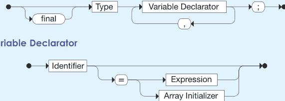

# 变量声明

变量声明由一个类型（`Type`）和其随后的变量列表组成。每个变量都可以在声明中初始化为指定表达式（`Expression`）的值。如果最后的修饰符位于声明之前，则标识符被声明为命名常量，其值在设置后无法更改。示例：

```
int total;
double num1, num2 = 4.356, num3;
char letter = 'A', digit = '7';
final int MAX = 45;
```

# 列表 2.5

```java
// PianoKeys.java 作者: Lewis/Loftus
// 展示了整数变量的声明、初始化和
// 使用。
//******************************************************
public class PianoKeys
{
    // 打印钢琴上按键的数量。
    //-
    public static void main(String[] args)
{
  int keys = 88;
  System.out.println("A piano has " + keys + " keys.");
}
```


# 列表 2.5 继续

## 输出

一台钢琴有 88 个按键。

在 `PianoKeys` 程序中，调用 `println` 方法时使用了两个信息。第一个是字符串，第二个是变量 `keys`。当引用变量时，将使用当前存储在它中的值。因此，当执行 `println` 调用时，将获取 `keys` 的值，即 88。由于该值是一个整数，它会自动转换为字符串并与初始字符串拼接。拼接后的字符串被传递给 `println` 并打印。

一个变量声明可以在同一行中声明多个相同类型的变量。行中的每个变量可以带有初始化值进行声明，也可以不带初始化值声明。例如：

```java
int count, minimum = 0, result;
```

# 赋值语句

让我们来看一个改变变量值的程序。列表 2.6 显示了一个名为 `Geometry` 的程序。该程序首先声明了一个名为 `sides` 的整数变量，并将其初始化为 7。它打印出 `sides` 的当前值。

`main` 方法中的下一行更改了存储在变量 `sides` 中的值：

```java
sides = 10;
```

这被称为赋值语句，因为它为变量分配了一个值。当执行时，赋值运算符（`=`）右侧的表达式将被求值，结果将存储在左侧变量所指示的内存位置。在这个示例中，表达式仅仅是一个数字 10。我们将在下一节中讨论比这更复杂的表达式。

## 列表 2.6

```java
// Geometry.java      作者: Lewis/Lofts
// 展示了如何使用赋值语句来更改存储
// 变量中的值。

public class Geometry
{
    // 打印几个几何形状的边数数量。
    public static void main(String[] args) {
        int sides = 7;      // 带有初始化的声明
        System.out.println("A heptagon has " + sides + " sides.");
        sides = 10;      // 赋值语句
        System.out.println("A decagon has " + sides + " sides.");
        sides = 12;
        System.out.println("A dodecagon has " + sides + " sides.");
    }
}
```

七边形有 7 条边。
十边形有 10 条边。
十二边形有 12 条边。

> 核心概念
> 访问数据会保持其在内存中完好无损，但赋值语句会覆盖旧数据。

变量只能存储其声明类型的一个值。新值会覆盖旧值。在这种情况下，当将值 10 分配给 `sides` 时，原始值 7 将被覆盖并永久丢失，如下：

| 初始化后： | sides | 7 |
| 第一次赋值后： | sides | 10 |

## 2.2 变量与赋值

## 基础赋值

赋值语句的结果使用赋值运算符（`=`）将表达式（`Expression`）的结果存储到指定的标识符（`Identifier`）中，通常是一个变量。

示例：

```java
total = 57;
count = count + 1;
value = (min / 2) * lastValue;
```

当引用变量时（如打印它时），变量的值不会改变。这是计算机内存的本质：访问（读取）数据会保留内存中的变量，但写入数据会用新数据替换旧数据。

Java 语言是强类型的，这意味着我们不允许给一个与其声明类型不一致的变量赋值。当你尝试组合不兼容的类型时，在编译程序时将产生错误。因此，赋值语句右侧的表达式必须求值出一个与左侧变量类型兼容的值。

> 核心概念
> 我们不能将一种类型的值赋值给一个不兼容的类型的变量。

# 常量

有时我们使用在整个程序中都保持不变的数据。例如，我们可能会编写一个处理容纳不超过 47 人的程序。给一个常量名称（例如 `MAX_OCCUPANCY`）通常比使用字面量（literal value）更有帮助，因为字面量值 47 在代码中可能会让人困惑。

> 核心概念
> 常量在程序期间保持一个特定的值。在 Java 语言中，如果 `final` 修饰符位于声明之前，标识符被声明为命名常量，其值在设置后无法更改。

```java
final int MAX = 47;
```

当不确定特定变量的范围会是多少时，我们应该提供一个合理的、甚至是慷慨的空间。在大多数情况下，内存空间并不是严重的限制，我们通常可以负担得起慷慨的假设。

请注意，尽管 `float` 值支持非常大（非常小）的数字，但它只有七位有效数字。因此，为了准确维护诸如 50341.2077 这样的值，我们需要使用 `double`。

正如我们已经讨论过的，字面量（literal）是程序中使用的显式数据值。程序中作为 Facts、`Addition` 和 `PianoKeys` 的各种数字都是整数。Java 假设所有字面量都是 `int` 类型，除非在值的末尾加上 `L` 或 `l` 表示其应被视为 `long` 类型字面量，例如 `45L`。

同样，Java 假设所有浮点数字面量都是 `double` 类型。如果我们将浮点数字面量视为 `float`，则在值的末尾加上 `F` 或 `f`，例如 `2.718F` 或 `123.45f`。如果需要，`double` 类型数值字面量后面可以跟随 `D` 或 `d`。

整数字面量由一系列数字加上一个可选的后缀组成，指示它应被视为整数。字面量的否定被视为一个独立的操作。示例：

- 5
- 2594
- 4920328L

以下是 Java 中数值变量声明的示例：

```java
int answer = 42;
byte smallNumber1, smallNumber2;
long countedStars = 86827263927L;
float ratio = 0.236F;
double delta = 453.523311903;
```

## 2.3 基本数据类型

## 字符

字符是计算机上使用和管理的另一种基本数据类型。单个字符可以被视为单独的数据项，并且正如我们在几个示例中所看到的，它们可以组合成字符字符串。字符字面量在 Java 程序用单引号表示，例如 `'b'` 或 `';'`。你可能记得字符串字面量是用双引号界定的，而且 `String` 类型在 Java 中不是一种基本数据类型；它是一个类名。我们将在第 3 章中详细讨论 `String` 类。

注意作为数字（或字符串的一部分）的字符与作为数字（或数字的一部分）的数字之间的区别。数字 602 是一个可以用于算术计算的数值。在字符串 "602 Greenbri Court" 中，6、0 和 2 是字符，就像构成字符串的其他字符一样。

字符由字符集定义，字符集仅仅是按顺序排列的字符列表。每种编程语言都支持一种特定的字符集，定义了该语言中字符变量的有效值。已经提出了几种字符集，但多年来只有少数几个被经常使用。ASCII 字符集是一个流行的选择。ASCII 代表美国信息交换标准（American Standard for Information Interchange）。基础 ASCII 每个字符使用七位，提供高达 128 个字符的空间，包括：

- 大写字母，如 'A'、'B' 和 'C'
- 小写字母，如 'a'、'b' 和 'c'
- 标点符号，如句号（'.'）、分号（';'）和逗号（','）
- 数字 '0' 到 '9'
- 空格字符 ' '
- 特殊符号，如和符号（'&'）、竖线（'|'）和反斜杠（'\\'）

控制字符有时被称为非打印字符或不可见字符，因为它们没有代表自己的特殊符号。然而，它们与其他任何字符一样是有效的，并且可以以相同的方式存储和使用。许多控制字符对某些软件应用程序具有特殊含义。

随着计算成为一项全球性事业，用户需要包含其他语言字母的更灵活字符集。ASCII 被扩展为每个字符八位，集合中的字符数量增加到 256 个。扩展 ASCII 包含了英语其他语言使用的许多重音和变符号。

> 核心概念
> Java 使用 16 位 Unicode 字符集来表示字符数据。

然而，即使有 256 个字符，ASCII 字符集也无法表示世界的字母，特别是考虑到各种亚洲字母及其数以千计的表意字。因此，Java 语言的开发者使用 Unicode 字符集，它每个字符使用 16 位，支持 65,536 个唯一字符（以及允许使用多个字节表示更多字符的技术）。许多语言的字符和符号都包含在 Unicode 中。ASCII 是 Unicode 集的子集，包含前 256 个字符。附录 C 详细讨论了 Unicode 字符集。

字符集为每个字符分配一个特定的数字，根据定义，字符处于特定的顺序。这被称为字典序。在 ASCII 和 Unicode 排序中，数字 '0' 到 '9' 是连续的（中间没有其他字符）且是有序的。同样，小写字母 'a' 到 'z' 是连续且有序的，大写字母 'A' 到 'Z' 也是如此。这些特性使得按字母顺序保持排序相对容易。

在 Java 中，`char` 表示单个字符。以下是字符变量的示例：

```java
char topGrade = 'A';
char symbol1, symbol2;
char terminator = ':';
```

### 布尔值

布尔值在 Java 中定义只有两个值：`true` 和 `false`。布尔变量通常用于指示某个条件是否成立。

布尔值不能转换为其他类型，其他类型也不能转换为布尔值。`true` 和 `false` 是保留字，不能在此语境之外使用。

以下是布尔声明的示例：

```java
boolean flag = true;
boolean tooHigh, tooSmall;
boolean done = false;
```

> 自测问题（答案见附录 L。）

- SR 214 什么是基本数据？基本类型与对象有什么区别？
- SR 215 整数变量可以存储多少值？
- SR 16 Java 中的四种整数数据类型是什么？它们如何？
- SR 17 Java 自动给整数字面量分配什么类型？如何指示整数字面量被视为不同的类型？
- SR 218 Java 自动给浮点字面量分配什么类型？如何指示浮点字面量被视为不同的类型？
- SR 219 什么是字符集？
- SR 220 ASCII 字符集、扩展 ASCII 字符集和 Unicode 字符集支持多少字符？

## 2.4 表达式

表达式是一个或多个运算符和操作数的组合，通常执行计算。计算的值不必须是数字，但通常是。操作中使用的操作可以是字面量、常量、变量或其他数据源。表达式的评估和使用方式是编程的基础。目前，我们将关注使用数值操作数并产生数值结果的算术表达式。

> 核心概念
> 表达式是用于计算的运算符和操作数的组合。

### 算术运算符

通常的算术操作适用于整数和浮点数值类型，包括加法（`+`）、减法（`-`）、乘法（`*`）和除法（`/`）。Java 还有另一种算术操作：余数运算符（`%`）返回第二个除以第一个后的余数。余数有时被称为模运算。余数结果的符号与被除数的符号相同。因此，

| 操作 | 结果 |
|---|---|
| 17 % 4 | 1 |
| -20 % 3 | -2 |
| 10 % -5 | 0 |
| 3 % 8 | 3 |

正如你预期的那样，如果数值运算符的一个或两个操作数中有一个是浮点值，则结果是一个浮点值。然而，除法运算符产生的结果并不那么直观，具体取决于操作数的类型。如果两个操作数都是整数，该运算符将执行整数除法，这意味着结果的任何小数部分都会被舍弃。如果其中一个操作数是浮点值，则 `/` 运算符将执行浮点除法，并保留结果的小数部分。例如，10/4 的结果是 2，但 10.0/4 和 10/4.0 的结果均为 2.5。

一元运算符只有一个操作数，而二元运算符有两个操作数。`+` 和 `-` 算术运算符完成加法和减法，而一元版本表示正、负数。例如，`-1` 就是使用一元否定运算符使值变为负数的例子。一元 `+` 运算符很少使用。

Java 没有内置的运算符来计算数值的幂。然而，`Math` 类提供了执行幂运算以及许多其他数学函数的方法。`Math` 类将在第 3 章中讨论。

## 运算符优先级

运算符可以组合起来创建更复杂的表达式。例如，考虑以下赋值语句：

```java
result = 14 + 8 / 2;
```

赋值语句的整个右侧会被求值，然后将结果存储在变量中。但结果是什么呢？如果先执行加法，结果是 11；如果先执行除法操作，结果是 18。运算符的求值顺序影响很大。在这种情况下，除法在加法之前执行，得到结果 18。

请注意，在这些和随后的示例中，我们使用字面量值而不是变量来简化表达式。如果操作数是变量或其他任何数据源，运算符的求值顺序是相同的。

所有表达式都根据运算符优先级层次进行求值，该层级规定了操作求值顺序的规则。算术运算符通常遵循你在代数中学到的相同规则。乘法、除法和取余运算符的优先级相同，且在加法和减法之前执行（优先级高于加法）。加法和减法的优先级相同。

任何处于相同优先级的算术运算符都从左到右执行。因此，我们说算术运算符具有左到右的结合性。

然而，可以使用括号在表达式中强制规定优先级。例如，如果我们真的想在在上一个示例中先执行加法，我们可以按照如下方式编写表达式：

```java
result = (14 + 8) / 2;
```

括号中的任何表达式都会被求值。在复杂的表达式中，即使不是严格必要的，使用括号也是一种良好的做法，可以更清楚地说明表达式是如何求值的。

括号可以嵌套，并且最内层的嵌套表达式最先求值。考虑以下表达式：

```java
result = 3 * ((18 - 4) / 2);
```

在这个示例中，结果是 21。首先，在内层括号的强制下执行减法。然后，即使乘法和除法处于相同的优先级且通常从左到右评估，但由于外层括号的存在，除法先执行。最后，执行乘法。

在算术操作完成后，计算出的结果将存储在赋值运算符 `-=` 左侧的变量中。换句话说，赋值运算符的优先级低于任何算术运算符。

特定表达式的求值可以使用表达式树来表示，例如图 2.3 所示。运算符从底向上执行，创建出用于表达式其他部分的值。因此，树中位置较低的操作优先级高于上面的操作，或者它们被强制使用括号执行。

| 优先级级别 | 运算符 | 操作 | 结合性 |
|---|---|---|---|
| 1 | + | 一元加 | 从右到左 |
| | - | 一元减 | |
| 2 | * | 乘法 | 从左到右 |
| | / | 除法 | |
| | % | 取余 | |
| 3 | + | 加法 | 从左到右 |
| | - | 减法 | |
| | + | 字符串拼接 | |
| 4 | = | 赋值 | 从右到左 |

图 2.4 部分 Java 运算符之间的优先级

表达式中使用的括号本身也是运算符。括号的优先级高于几乎任何其他运算符。图 2.4 显示了算术运算符、括号和赋值运算符之间关系的优先级表。附录 D 包含显示所有 Java 运算符的完整优先级表。

为了使表达式在语法上正确，左括号的数量必须与右括号的数量匹配，且必须正确嵌套。以下示例是*无效的*：

```java
result = ((19 + 8) % 3) - 4); // 无效
result = (19 + 8) % 3 - 4);      // 无效
```

请记住，当表达式中引用变量时，将使用它的当前值进行计算。在下面的赋值语句中，变量 `count` 的当前值与变量 `total` 的当前值相加，结果存储在变量 `count` 中：

```java
count += total;
```

上述语句等同于：

```java
count = count + total;
```

结果存储回变量 `count`。因此，赋值运算符的优先级低于任何算术运算符。等同于我们在上一节讨论的以下语句：

```java
count = count + total;
```

递增运算符（`++`）给任何整数或浮点值加 1。两个加号组成的运算符不能被空格隔开。递减运算符（`--`）类似，但是从值减去 1。它们都是一元运算符，因为它们只操作操作数。语句会导致 `count` 的值递增：

```java
count++;
```

结果存储回变量 `count`。因此，它等同于以下语句：

```java
count = count + 1;
```

注意，在温度转换程序中，除法的操作数是浮点字面量，以确保保留数字的小数部分。


```java
************************************************
// TempConverter.java 作者: Lewis
// 展示原始类型和
// 表达式的使用
************************************************
public class TempConverter
{
    // 使用公式计算摄氏度的
    // 华氏
    public static void main(String[] args)
    {
        final int BASE = 32;
        final double CONVERSION_FACTOR = 9.0 / 5.0;

        double celsiusTemp = 24;
        double fahrenheitTemp = celsiusTemp * CONVERSION_FACTOR + BASE;

        System.out.println("Celsius Temperature: " + celsiusTemp);
        System.out.println("Fahrenheit Equivalent: " + fahrenheitTemp);
    }
}
```

OUTPUT

Celsius Temperature: 24

Fahrenheit Equivalent: 75.2

递增和递减运算符可以应用于变量（如 `count++` 或 `count--`），创建出运算符的**后置形式**。它们也可以应用于变量之前（例如 `++count` 或 `--count`），即所谓的**前缀形式**。当单独在语句中使用时，前缀和后置形式在功能上是等价的。也就是说，无论你写

```
count++;
```

还是

```
++count;
```

当递增或递减运算符用于更大的表达式时，根据使用的形式，可能会产生不同的结果。例如，如果变量

## 2.4 表达式

`count` 目前包含值 15，接述语句将值 15 赋值给 `total`，将值 16 赋值给 `count`：

```
total = count++;
```

然而，接述语句将值 16 同时赋值给 `total` 和 `count`：

```
total = ++count;
```

在两种情况下，`count` 的值都增加了，但在较大的表达式中使用的值取决于使用的是增量运算符的前缀形式还是后置形式。由于增、减运算符的前缀和后置形式之间细微差异，使用时应谨慎。始终优先考虑可读性。

### 赋值运算符

为了方便起见，Java 定义了一些赋值运算符，它们将基本操作与赋值结合。例如，`+=` 运算符可以如下使用：

```
total += 5;
```

此操作的效果与以下语句的操作相同：

```
total = total + 5;
```

赋值运算符的右侧可以是一个完整的表达式。因此，以下语句：

```
total += sum - 12;
```

等同于：

```
total = total + (sum - 12);
```

Java 中定义了许多类似的赋值运算符，包括减法 (`-=`)、乘法 (`*=`)、除法 (`/=`) 和取余 (`%=`)。所有的赋值运算符都会先求出右侧整个表达式的值，然后将结果作为另一个操作的操作数。因此，以下语句：

```
result *= count1 + count2;
```

等同于：

```
result = result * (count1 + count2);
```

同样，以下语句：

```
result %= (highest - 40) / 2;
```

等同于：

```
result = result % ((highest - 40) / 2);
```

### 自测（答案见附录 D.）

- SR 2.21 `19%5` 在 Java 表达式中求值时，结果是什么？

- SR 2.22 `13/4` 在 Java 表达式中求值时，结果是什么？请解释。

- SR 2.23 如果整数变量 `diameter` 目前持有值 5，执行以下语句后值是多少？请解释。

  ```
  diameter = diameter * 4;
  ```

- SR 2.24 什么是运算符优先级？

- SR 2.25 下面每个表达式的值是多少？

  a. `15 + 7 * 3`

  b. `(15 + 7) * 3`

  c. `3 * 6 + 10 / 5`

  d. `27 % 5 + 3`

  e. `100 / 2 / 2`

  f. `100 / (2 / 2) / 2`

- SR 2.26 对于以下每个表达式，说明它们是有效还是无效。解释原因。

  a. `result = (5 + 2);`

  b. `result = (5 + 2 * (15 - 3));`

  c. `result = (5 + 2 (;`

  d. `result = (5 + 2 (4) );`

- SR 2.27 在执行以下语句序列后，整数变量 `result` 包含什么值？

  ```
  result = 27;
  result = result + 3;
  result = result / 7;
  result = result * 2;
  ```

- SR 2.28 在执行以下语句序列后，整数变量 `result` 包含什么值？

  ```
  int base;
  int result;
  base = 5;
  result = base + 3;
  base = 7;
  ```

- SR 2.29 什么是赋值运算符？

- SR 2.30 如果整数变量 `weight` 目前持有值 100，执行以下语句后值是多少？请解释。

  ```
  weight -= 17;
  ```

## 2.5 数据转换

由于 Java 是强类型语言，每个数据值都与特定类型相关联。将一种类型的数据值转换为另一种类型有时是有帮助或必要的，但我们必须小心不要在此过程中丢失重要信息。例如，假设一个持有数字 1000 的 `short` 变量转换为 `byte` 值。由于 `byte` 没有足够的位来表示值 1000，转换过程中将丢失一些位，基本类型中表示的数字将无法保持其原始值。

一个基本类型之间的转换分为两类：宽转换（`widening conversions`）和窄转换（`narrowing conversions`）。宽转换是最安全的，因为它们通常不会丢失丢失信息。所有宽转换都是从一个数据类型到使用相同或更多空间来存储值的类型。图 2.5 列出了 Java 宽转换。

例如，从 `byte` 转换为 `short` 是安全的，因为 `byte` 存储在 8 位中，而 `short` 存储在 16 位中。没有信息丢失。所有从整数类型到另一个整数类型的宽转换都保留了该值。

> 核心概念
>
> 窄转换可能会丢失信息。通常情况下，应该避免窄转换。

| 从 | 到 |
| :--- | :--- |
| `byte` | `short`, `int`, `long`, `float`, `double` |
| `short` | `int`, `long`, `float`, `double` |
| `char` | `int`, `long`, `float`, `double` |
| `int` | `long`, `float`, `double` |
| `long` | `float`, `double` |
| `float` | `double` |

图 2.5 Java 宽转换

### 转换技术

在 Java 中，转换可以通过三种方式发生：

- 赋值转换
- 提升
- 强制转换

赋值转换发生在将一种类型的值赋值给另一种类型的变量时，期间值会被转换为新类型。只有宽转换才能通过赋值完成。例如，如果 `money` 是 `float` 变量，`dollars` 是 `int` 变量，那么下面的赋值语句会自动将 `dollars` 转换为 `float`：

```
money = dollars;
```

因此，如果 `dollars` 包含值 25，赋值后 `money` 包含值 25.0。然而，如果我们尝试将 `money` 赋值给 `dollars`，编译器将发出错误，警告我们正在尝试一种可能丢失信息的窄转换。如果我们真的想这样做，必须通过强制转换来使转换显式化。

转换提升发生在某些运算符需要修改操作数以执行操作时。例如，当一个名为 `sum` 的浮点值除以整数值 `count` 时，`count` 的值在除法发生之前会自动提升为浮点值，从而产生浮点数结果：

```
result = sum / count;
```

类似的转换也发生在数字与字符串拼接时。数字首先被转换为（提升为）字符串，然后将两个字符串进行拼接。

强制转换是 Java 中最通用的转换形式。如果转换在 Java 程序中可以实现，就可以使用强制转换来实现。强制转换是一种 Java 运算符，由括号中的类型名称指定。它位于被转换值的前面。例如，为了将 `money` 转换为整数值，我们可以在它前面加上一个强制转换：

```java
dollars = (int) money;
```

强制转换返回 `money` 中的值，并截断任何小数部分。如果 `money` 包含值 84.69，那么在赋值后，`dollars` 将包含值 84。但请注意，强制转换并没有改变 `money` 中的值。赋值操作完成后，`money` 仍然包含值 84.69。

在许多需要将一个值临时视为另一种类型的场景中，强制转换是非常有用的。例如，如果我们将整数值 `total` 除以整数值 `count` 并得到浮点数结果，我们可以如下操作：

```
result = (float) total / count;
```

第一个运算符返回了 `total` 中值的浮点数版本。此操作不会改变 `total` 中的值。然后，通过算术提升，`count` 被视为一个浮点数值。现在，除法运算符将执行浮点除法并产生预期的结果。如果没有包含强制转换，该操作将执行整数除法并在赋值给 `result` 之前截断答案。还要注意，由于强制转换运算符的优先级高于除法运算符，强制转换作用于 `total` 的值，而不是除法运算的结果。

## 自测习题（答案见附录 L）

- SR 2.31 为什么宽化转换比收窄转换更安全？

- SR 2.32 识别以下每个转换属于宽化转换还是收窄转换。

  a. `int` 到 `long`

  b. `int` 到 `byte`

  c. `byte` 到 `short`

  d. `byte` 到 `char`

  e. `byte` 到 `double`

- SR 2.33 假设 `result` 是一个 `float` 变量而 `value` 是一个 `int` 变量，执行以下赋值语句后，变量将是什么类型？请解释。

  ```
  result = value;
  ```

- SR 2.34 假设 `result` 是一个包含值 27.32 的 `float` 变量，`value` 是一个包含值 15 的 `int` 变量，执行以下赋值语句后，每个变量的值是多少？请解释。

  ```
  value = (int) result;
  ```

- SR 2.35 给定以下声明，以下每个赋值语句分别存储了什么结果？

```java
int iResult, num1 = 17, num2 = 5;
double fResult, val1 = 12.0, val12 = 2.34;
```

  a. `iResult = num1 / num2;`

  b. `fResult = num1 / num2;`

  c. `fResult = val1 / num2;`

  d. `fResult = (double) num1 / num2;`

  e. `iResult = (int) val1 / num2;`

## 2.6 交互式程序

设计一个程序在执行期间交互式地从用户处读取数据通常很有用的。这样，每次运行程序时，都可以根据输入的数据计算出新的结果。

### Scanner 类

`Scanner` 类是 Java API 的一部分，提供了读取各种类型输入值的方法。输入可以来自各种来源，包括用户交互式输入的数据或存储在文件中的数据。`Scanner` 还可以用于将字符字符串解析成不同的部分。图 2.7 列出了 `Scanner` 类提供的一些方法。

> 核心概念
>
> `Scanner` 类提供了从各种来源读取各种类型输入的方法。

我们必须创建一个 `Scanner` 对象才能调用它的方法。在 Java 中，对象是使用 `new` 运算符创建的。以下声明创建一个从键盘读取输入的 `Scanner` 对象：

```java
Scanner scan = new Scanner(System.in);
```

此声明创建了一个名为 `scan` 的变量，它代表一个 `Scanner` 对象。对象本身通过 `new` 运算符创建，并通过调用一个名为构造函数的特殊方法来设置对象。`Scanner` 构造函数接受：

- `Scanner(InputStream source)`
- `Scanner(File source)`
- `Scanner(String source)`

构造函数：设置新的扫描器从指定的源扫描值。

- `String next()`：将下一个输入标记作为字符字符串返回。
- `String nextLine()`：将当前行剩余的所有输入作为字符字符串返回。
- `boolean nextBoolean()`
- `byte nextByte()`
- `double nextDouble()`
- `float nextFloat()`
- `int nextInt()`
- `long nextLong()`
- `short nextShort()`

按指定的类型返回下一个输入标记。如果下一个标记与类型不一致，则抛出 `InputMismatchException`。

- `boolean hasNext()`：如果扫描器的输入中还有另一个标记，则返回 `true`。
- `Scanner useDelimiter(String pattern)`
- `Scanner useDelimiter(Pattern pattern)`：设置扫描器的分隔模式。
- `Pattern delimiter()`：返回扫描器当前用于匹配分隔符的模式。
- `String findInLine(String pattern)`
- `String findInLine(Pattern pattern)`：尝试寻找指定模式的下一次出现，忽略分隔符。

图 2.7 Scanner 类的一些方法

指示输入来源的参数。`System.in` 对象代表标准输入流，默认是键盘。使用 `new` 运算符创建对象将在第 3 章进一步讨论。

除非另有说明，否则 `Scanner` 对象假设使用空白字符（空格、制表符和换行符）来分隔相互调用的输入元素。这些字符被称为分隔符；如果输入标记是由空白以外的字符分隔的，可以更改分隔符集。

`Scanner` 类的 `next` 方法将输入作为字符串读取并。。如果是由空格分隔的单词，每次调用 `next` 都会返回下一个单词。`nextLine` 方法读取到行尾的所有输入，并将其作为一个字符串返回。

定义 `Echo` 类之前的 `import` 语句告诉程序我们将使用 `Scanner` 类。`Scanner` 类属于 `java.util` 类。`import` 语句的使用将在第 3 章进一步讨论。

各种 `Scanner` 方法（如 `nextInt` 和 `nextDouble`）用于读取特定类型的数据。列表 2.9 所示的 `GasMileage` 程序读取整数类型的里程数和双精度类型的燃料消耗加量，然后计算油耗。

```
LISTING 2.8
************************************************
// Echo.java               Author: Lewis/Loftus
//
// 展示了使用 Scanner 类的 nextLine 方法
// 从用户读取字符串。
************************************************

import java.util.Scanner;

public class Echo

    // 从用户读取字符字符串并打印它。
    //
    public static void main(String[] args)
{
  String message;
  Scanner scan = new Scanner(System.in);

  System.out.println("Enter a line of text:");
  message = scan.nextLine();

  System.out.println("You entered: \"" + message + "\"");
}
```

## 输出

Enter a line of text:

Set your laser printer on stun!

nYou entered: "Set your laser printer on stun!"

```
LISTING 2.9
************************************************
// GasMileage.java               Author: Lewis/Loftus
//
// 展示了使用 Scanner 类读取数值数据。
************************************************

import java.util.Scanner;

public class GasMileage {
  // 根据用户输入的值计算燃料效率。
  //--------------------------------------------------------------------------------
  public static void main(String[] args)
```

## 2.6 交互式程序

## 列表 2.9 续


```java
{
  int miles;
  double gallons, mpg;

  Scanner scan = new Scanner(System.in);

  System.out.print("Enter the number of miles: ");
  miles = scan.nextInt();

  System.out.print("Enter the gallons of fuel used: ");
  gallons = scan.nextDouble();

  mpg = miles / gallons;

  System.out.println("Miles Per Gallon: " + mpg);
}
```

输入英里: 328

输入使用的燃料加仑: 11.2

每加仑英里: 29.2857142857142

`Scanner` 对象通过方法一次处理一个输入标记，这些方法用于读取数据以及使用用于分隔输入值的分隔符。因此，根据情况的不同，多个值可以位于输入行的同一行中，也可以跨越多行读取。

在第 5 章中，我们使用 `Scanner` 从数据文件中读取输入，并修改它用于解析数据时使用的分隔符。附录 H 解释了如何使用 `Scanner` 类通过指定的正则表达式来分析其输入模式。

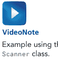

## 自测习题（答案见附录 L）

SR 2.36 识别 `GasMileage` 程序中每一行对应以下哪项操作：

- a 告诉程序我们将使用 `Scanner` 类。
- b 创建一个 `Scanner` 对象。
- c 设置 `Scanner` 对象 `scan` 以便从标准输入流中读取内容。
- d 从标准输入流中读取一个整数。

编写程序语句，要求用户输入年龄，并将他们的响应存储在变量 `value` 中。

## 核心概念总结

- `print` 和 `println` 方法代表了 `System.out` 对象提供的两种服务。
- 转义序列可以表示一个否则会引起编译问题的字符。
- 变量是用于存储特定数据类型值的内存位置的名称。
- 访问数据会保持其在内存不变，但赋值语句会覆盖旧数据。
- 我们不能将一种类型的值赋值给不兼容类型的变量。
- 常量在其存在期间保持特定值。
- Java 有几种数值类型：整数和浮点数。有四整数数据类型和两种浮点数数据类型。
- Java 使用 16 位的 Unicode 字符集来表示字符。
- 表达式是运算符和操作数的组合，用于执行计算。
- Java 遵循一套定义良好的优先级规则，这些规则规定了运算符在表达式中的求值顺序。
- 应避免窄化转换，因为它们可能会丢失信息。
- `Scanner` 类提供了从各种来源读取值类型输入的方法。

## 练习题

EX 2.1 字面量 4, 4.0, '4' 和 "4" 之间有什么区别？

EX 2.2 从对象及其它们提供的服务的角度解释以下编程语句：

```java
System.out.println("I gotta be me!");
```

EX 2.3 下列代码段产生什么输出？请解释。

```java
System.out.print("Name: ");
System.out.println("Sol:");
System.out.print("Distance to Earth:");
System.out.println(" 92.96 million miles");
System.out.print("Surface Temperature: ");
System.out.println("5,778 K");
System.out.println();
System.out.println("------------------------------------");
```

## EX 2.4 下列程序语句有什么错误？如何修复？

```java
System.out.println("To be or not to be, that is the question.");
```

## EX 2.5 下列语句产生什么输出？请解释。

```java
System.out.println("50 plus 25 is " + 50 + 25);
```

## EX 2.6 下列语句产生什么输出？请解释。

```java
System.out.println("Bill\n\tMacaroni:\t$1.90\n\tBlue:\t$0.50\n\tGrape" + "Juice:\t$1.00\nn================Total \nless tax:\t$3.40");
```

## EX 2.7 在执行以下语句后，整数变量 `size` 中包含什么值？

```java
size = 18;
size = size + 12;
size = size * 2;
size = size / 4;
```

## EX 2.8 在执行以下语句后，浮点数变量 `temperature` 中包含什么值？

```java
temperature = 36.0;
tperature = 30.0 + temperature / 4;
tperature = temperature * 2;
```

## EX 2.9 在执行以下语句后，整数变量 `count` 中包含什么值？

```java
count = 0;
count++;
count += 1;
count = count + 1;
count++;
```

## EX 2.10 编写四个不同的程序语句来增加整数变量 `total` 的值。

EX 2.11 根据给定的声明，列出的赋值语句中每个存储了什么结果？

```java
int iResult, num1 = 25, num2 = 40, num3 = 17, num4 = 10;
double fResult, val1 = 17.0, val2 = 28.5;

- a. iResult = num1 + num2;
- b. fResult = num1 + num2;
- c. iResult = num1 - num2;
- d. fResult = num1 - num2;
- e. iResult = num1 * num2;
- f. fResult = num1 * num2;
- g. iResult = num1 / num2;
- h. fResult = num1 / num2;
- i. iResult = num1 % num2;
- j. fResult = num1 % num2;
- k. iResult = (int)val1;
- l. fResult = (double)val1;
- m. iResult = (int)val2;
- n. fResult = (double)val2;
- o. iResult = val1 + val2;
- p. fResult = val1 + val2;
```

EX 2.12 对于下列表达式，指示运算符的求值顺序：

- a. a + b
- b. a / c
- c. a * b
- d. a / c
- e. a * b
- f. a / c
- g. a * b
- h. (a + b) / c
- i. a + (b / c)
- j. a * (b + c)
- k. (a * b) + c
- l. a * (b + c)
- m. a + b + c

## 程序项目

- PP 2.1 创建第一章的修订版本，使得引号出现。
- PP 2.2 编写一个程序读取三个整数并打印它们的平均值。
- PP 2.3 编写一个程序读取两个点数并打印它们的和、差和积。

## 第 2 章 数据与表达式

- PP 2.4 编写一个程序提示并读取姓名、年龄和宠物名字。然后打印以下段落，插入相应的数据：Hello, my name is name and I am age years old. I'm enjoying my time at college, though I miss pname very much!
- PP 2.5 创建 `TempConverter` 应用的版本，将华氏转换为摄氏。从用户处读取华氏温度。
- PP 2.6 编写一个程序将英里转换为公里。（1英里等于1.60935公里。）以浮点数从用户处读取英里值。
- PP 2.7 编写一个程序，提示并读取速度和距离的整数值，然后以浮点数结果打印所需的时间。
- PP 2.8 编写一个程序读取表示公里、米和厘米距离的值，并打印等效的总厘米数。（例如，10,050米和20厘米等于1,005,020厘米。）
- PP 2.9 创建上一个项目的版本以反转计算。即读取一个表示厘米数的值，然后打印等效的公里、米和厘米的组合距离。（例如，1,005,020厘米等于10公里、50米和20厘米。）
- PP 2.10 编写一个程序确定罐子中硬币的值，并以美元和分的形式打印总额。读取代表季度币、角、镍币和美分的整数值。
- PP 2.11 假设空间站的宇航员需要在各个各个的地方安装排气管道。管道长度分别为10米、5米、1米、25厘米、10厘米、5厘米和1厘米。编写一个程序，提示并读取一个表示要覆盖距离的 `double` 值。然后确定覆盖该距离所需的最少管道。例如，要覆盖37.72米，程序应该打印：
  - 3米长度
  - 1米长度
  - 2米长度
  - 二十五厘米长度
  - 2 根10厘米长的管
  - 0 根5厘米长的管
  - 2 根1厘米长的管
  - 总计：12 根管子
- **PP 2.12** 编写一个程序，提示并读取一个表示正方形边长的整数，然后打印正方形的周长和面积。
- **PP 2.13** 编写一个程序，提示并读取作为整数的分数分子和分母，然后打印该分数的小数等效值。

# 软件故障

# NASA 火星气候轨道器与极地着陆器

### 发生了什么？


作为探索火星系列任务的一部分，NASA 分于 1998 年 12 月发射了火星气候轨道器，并于 1999 年 1 月发射了火星极地着陆器。这项双探测器任务旨在通过其每项任务观察火星的大气状况。轨道器和着陆器本应收集有关温度、灰尘、水蒸气、云以及火星极地区增加和减少的二氧化碳（CO₂）数量的数据。

在经历了九个月的飞行后，轨道器于 1999 年 9 月到达火星，但其主引擎未能建立轨道。随后它飞过了行星后方，在预期与行星合并后，未能与其重新建立联系。数据审查显示，轨道器在进入轨道时的高度仅为 57 公里，而计划高度为 140 公里。最小生存高度在 85 到 100 公里之间。NASA 得出的结论是轨道器被大气摩擦摧毁。

极地着陆器于 1999 年 12 月到达火星，所有数据表明它正按计划在距离火星南极目标着陆点 10 公里内成功软着陆。然而，NASA 在着陆器进入大气层后不久就与其失去了联系。在随后的几周和几个月里，多次尝试重新建立联系均未告成功。

轨道器和着陆器的总成本为 3.276 亿美元。

# 是什么导致了这种情况？

轨道器问题的根源是一个令人尴尬的通信问题。引导航天器导航的软件使用了英制单位（磅），而航天器本身期望的数据是公制单位（牛顿）。因此，预期的导航调整与实际效果之间存在 4.45 倍的偏差。这种不匹配实际上导致一个位于科罗拉多州的团队领导了航天器的工作，而一个位于加利福尼亚州的团队则管理相关问题。

- 火星气候轨道器的概念图

# 软件故障 125

着陆器通信问题的原因尚未解决，且被认为与轨道器的问题无关。调查得出，最可能的原因是一个软件错误，它将着陆器支腿展开时产生的震动误认为是降落在行星表面时产生的震动。这一错误本会导致着陆器在距离地面 40 米处就切断下降发动机。然而，也存在其他可能的情景。

# 教训

火星气候轨道器的单位不匹配表明，在高度复杂的系统中，显而易的问题可能会被忽视。错误是不可避免的，但必须建立流程在错误变成致命问题之前捕捉它们。调查得出，在这种情况下，跟踪和双检查子系统之间互连元素的系统不够稳健。此外，对团队新成员的通信培训不一致，某些通信渠道过于非正式。简而言之，该任务缺乏严谨的系统系统视角，这本可以在事为太晚之前发现单位不匹配的问题。

鉴于着陆器问题的原因尚不明确，很难从中得出强有力的结论。该问题仍然是一个未解之谜，这一事实强调了在关键资源面临风险的情况下，需要进行更多的评估、模拟和测试。

> 来源：nasa.gov

# 使用类和对象

## 章节目标

- 讨论对象的创建和对象引用变量的使用。
- 探索 `String` 类提供的服务。
- 探索 `Random` 和 `Math` 类提供的服务。
- 讨论输出格式的方法。
- 引入枚举类型。

（注：原文后续存在大量重复段落，已根据指令要求去重，保留核心内容）

包含了名和姓名之间的空格。某些方法不返回值。其他 `String` 方法将在下一节中讨论。

声明对象引用变量和创建对象本身的操作可以在声明时初始化变量，合并为一个步骤，就像我们处理基本类型时那样：

```java
String title = new String("Java Software Solutions");
```

尽管字符字符串不是基本类型，但由于它们是如此基础且经常被使用，因此 Java 定义了由双引号分隔的字符串，正如我们在各种示例中看到的那。这是一种快捷表示法。每当一个字符串字面量出现时，都会自动创建一个 `String` 对象。因此，该声明是有效的：

```java
String city = "London";
```

也就是说，对于 `String` 对象，可以消除 `new` 运算符的使用和对构造函数的调用。在大多数情况下，我们将使用这种简化的语法。

## 别名

由于对象引用变量存储的是一个地址，程序员在管理对象时必须小心。首先，让我们回顾赋值对基本类型值的影响。假设我们有两个整数变量 `num1` 初始化为 5，`num2` 初始化为 12：

| num1 | 5 |
| num2 | 12 |

在下面的赋值语句中，`num1` 中存储值的副本被存储在 `num2` 中：

```java
num2 = num1;
```

`num2` 中的原始值 12 被值 5 覆盖。变量 `num1` 和 `num2` 仍然指向内存中不同的位置，这两个位置现在都包含值 5：

| num1 | 5 |
| num2 | 5 |

## 3.1 创建对象

现在考虑以下对象声明：

```java
String name1 = "Ada, Countess of Lovelace";
String name2 = "Grace Murray Hopper";
```

最初，引用 `name1` 和 `name2` 指向两个不同的 `String` 对象：

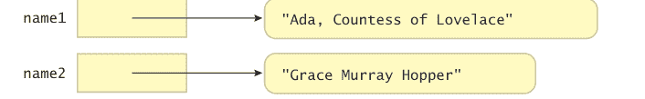

现在假设执行以下赋值语句，将 `name1` 中的值复制到 `name2` 中：

```java
name2 = name1;
```

这种赋值的操作与整数赋值相同——`name1` 值的副本被存储在 `name2` 中。但记住，对象变量持有的是对象的地址，被复制的是该地址。最初，两个引用指向不同的对象。赋值后，`name1` 和 `name2` 包含相同的地址并指向同一个对象：

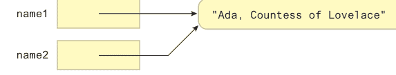

变量 `name1` 和 `name2` 现在是它们彼此的别名，因为它们是引用同一个对象的两个名称。最初由 `name2` 引用的对象的所有引用现在都消失了；该对象无法在程序中再次使用。

别名的一个重要影响是，当我们使用一个引用指向一个对象时，另一个引用也会随之改变，因为实际上只有一个对象。除非经过仔细管理，否则别名可能会产生不希望的后果。

> 核心概念
>
> 多个引用变量可以指向同一个对象。

与对象的所有交互都是通过引用变量发生的，因此只有当我们拥有该对象的引用时，才能使用该对象。当对对象的所有引用都丢失时（可能是通过重新赋值），该对象无法再对程序做出贡献。程序无法再调用它的方法或使用它的变量。此时，该对象被称为“垃圾”，因为它不再具有任何用处。

Java 执行自动垃圾回收。当对对象的最后一个引用丢失时，该对象就会成为垃圾回收的候选者。偶尔，Java 环境在后台执行一个方法，“收集”所有标记为垃圾回收的对象，并将它们的内存返回给系统供以后使用。程序员不需要担心显式回收已变成垃圾的内存。

## 自测习题（答案见附录 L）

- SR 3.1 什么是空引用？
- SR 3.2 `new` 运算符实现了什么功能？
- SR 3.3 为一个名为 `author` 的 `String` 变量编写声明，并将其初始化为字符串“Fred Brooks”。画出该变量及其值的图形表示。
- SR 3.4 编写一条代码语句，将名为 `len` 的整数变量的值设置为名为 `name` 的 `String` 对象的长度。
- SR 3.5 什么是别名？它与垃圾回收有什么关系？

## 3.2 String 类

我们将更详细地检查 `String` 类。图 3.1 列出了 `String` 类的一些更有用的方法。

一旦创建了 `String` 对象，其值就不能变长或变短，它的任何字符都不能被改变。我们说 `String` 对象是不可变的。然而，`String` 类中的几个方法返回了新的 `String` 对象，这些对象是修改原始字符串值的结果。

注意，某些 `String` 方法引用特定字符的索引。字符串中的字符可以通过其在字符串中的位置或索引来指定。字符串中第一个字符的索引为 0；例如，在字符串“Hello”中，字符 'H' 的索引为 0，依此类推。

列表 3.1 所示的程序练习了几个 `String` 方法。当你检查 `StringMutation` 程序时，请记住这并不是一个改变其数据的单一 `String` 对象；该程序使用 `String` 类的各种方法创建了五个独立的 `String` 对象。最初，设置了 `phrase` 对象：


# String 类方法概览

| 方法签名 | 说明 |
| :--- | :--- |
| `String(String str)` | 构造函数：创建一个与 `str` 字符相同的字符串对象。 |
| `charAt(int index)` | 返回指定索引处的字符。 |
| `int compareTo(String str)` | 返回一个整数，指示此字符串在字典顺序上小于（负值）、等于（零值）还是大于（正值）`str`。 |
| `String concat(String str)` | 返回此字符串与 `str` 拼接后的字符串。 |
| `boolean equals(String str)` | 如果此字符串与 `str` 相同（区分大小写）则返回 `true`，否则返回 `false`。 |
| `boolean equalsIgnoreCase(String str)` | 如果此字符串忽略大小写的情况下与 `str` 相同，则返回 `true`，否则返回 `false`。 |
| `int length()` | 返回字符串中的字符数量。 |
| `String replace(char oldChar, char newChar)` | 返回一个新字符串，其中所有的 `oldChar` 都被替换为 `newChar`。 |
| `String substring(int offset, int rowIndex)` | 返回从索引 `offset` 到 `rowIndex-1` 的字符串子集。 |
| `toLowerCase()` | 返回一个将所有大写字母转换为小写的新字符串。 |
| `toUpperCase()` | 返回一个将所有小写字母转换为大写的新字符串。 |

图 3.1 String 类的一些方法

## 3.2 String 类

在打印了原始短句及其长度后，执行 `concat` 方法来创建一个由变量 `mutation1` 引用的新字符串对象：

```java
mutation1 = "Change is inevitable, except from vending machines."
```

然后在 `mutation1` 对象上执行 `toUpperCase` 方法，并将结果字符串存储在 `mutation2` 中：

```java
mutation2 = "CHANGE IS INEVITABLE, EXCEPT FROM VENDING MACHINES";
```

注意，`length` 和 `concat` 方法是在短句上执行的，但 `toUpperCase` 方法是在 `mutation1` 对象上执行的。String 类的任何方法都可以在任何对象上执行，但对于任何调用，方法都是在特定的对象上执行的。在 `mutation1` 上执行 `toUpperCase` 的结果与在 `phrase` 上执行相同的结果将大不相同。记住，每个对象都有自己的状态，这通常会影响方法调用的结果。

> **核心概念**
>
> 通常，方法是在特定对象上执行的，这将影响结果。

最后，通过分别调用 `mutation2.replace` 和 `mutation3.substring` 初始化了 String 对象变量 `mutation3` 和 `mutation4`：

```java
mutation3 = "CHANGING IS INEVITABLE, EXCEPT FROM VENDING MACHINES";
```

```java
mutation4 = "NGING IS INEVITABLE, EXCP F";
```

### 自测题（答案见附录 L）

**SR 3.6** 假设 `s1`、`s2` 和 `s3` 分别初始化为 "Amanda"、"Bobby" 和 "Chris" 的 String 变量。以下语句改变了哪个 String 变量？

- a. `System.out.println(s1);`
- b. `s1 = s3.toLowerCase();`
- c. `System.out.println(s2.replace('B', 'M'));`
- d. `s3 = s2.concat(s1);`

**SR 3.7** 下代码段产生什么输出？

```java
String s1 = "Foundations";
String s2;
System.out.println(s1.charAt(1));
s2 = s1.substring(0, 5);
System.out.println(s2);
```

```java
System.out.println(s1.length());
System.out.println(s2.length());
```

- **SR 3.8** 编写一个语句，打印名为 `title` 的 String 对象的全大写值。
- **SR 3.9** 编写一个名为 `front` 的 String 变量声明，并将其初始化为另一个名为 `description` 的 String 对象的前 10 个字符。

## 3.3 包

我们之前提到过，Java 语言由名为 Java API 的标准类库支持，我们可以根据需要使用它。让我们进一步检查。


类库是一组支持程序开发的类集合。编译器或开发环境通常会带有一个类库。类库也可以通过第三方供应商单独获得。类库中的类包含许多方法，由于它们提供了特殊功能，这些方法对程序员通常非常有价值。事实上，程序员经常会依赖类库中的方法，并开始将它们视为语言的一部分。然而，从技术上讲，它们本身并不属于语言。

例如，String 类并不是 Java 语言的固有部分。它是 Java 标准类库的一部分，可以在任何开发环境中找到。构成该库的类是由 Sun Microsystems 的员工创建的，他们是 Java 语言的创建者。

类库由相关类的簇组成，这些簇通常被称为 Java APIs（应用程序编程接口）。例如，当我们谈论帮助我们编写与数据库交互的程序的类集合时，我们提到了 Java Database API。另一个 API 的例子是 JavaFX API，它指的是一组定义图形用户界面 (GUI) 中使用的特殊图形组件的类。整个标准库通称为 Java API。

标准类库的类也被分到不同的包（packages）中。每个类都是特定包的一部分。例如，String 类是 `java.lang` 包的一部分。我们在第 2 章提到过 `Scanner` 类是 `java.util` 包的一部分。


包的组织比 API 名称更基础且基于语言的。虽然包名和 API 名称之间存在一般的对应关系，但构成给定 API 的类组可能会跨越包。

### 常用 Java 包

| 包 | 提供支持的对象 |
| :--- | :--- |
| `java.awt` | 绘制和创建图形用户界面；AWT 代表抽象窗口工具包。 |
| `java.beans` | 定义可以轻松组合到应用程序中的软件组件。 |
| `java.io` | 执行各种输入和输出功能。 |
| `java.lang` | 通用支持；它会被自动导入到所有 Java 程序中。 |
| `java.math` | 执行任意高精度的计算。 |
| `java.net` | 跨网络通信。 |
| `java.rmi` | 创建可以分布在多个计算机上的程序；RMI 代表远程方法调用。 |
| `java.security` | 强制安全限制。 |
| `java.sql` | 与数据库交互；SQL 代表结构化查询语言。 |
| `java.text` | 格式化文本。 |
| `java.util` | 通用工具类。 |
| `javafx.scene.shape` | 表示形状。 |
| `javafx.scene.control` | 显示控件。 |

包的组织比 API 名称更基础且基于语言的。虽然包名和 API 名称之间存在一般的对应关系，构成给定 API 的类组可能会跨越包。

类库由相关类的簇组成，这些簇通常被称为 Java APIs，应用程序编程接口。例如，当我们谈论帮助我们编写与数据库交互的程序的类集合时，我们提到了 Java Database API。另一个 API 的例子是 JavaFX API，它指的是一组定义图形用户界面 (GUI) 中使用的特殊图形组件的类。整个标准库通称为 Java API。

标准类库的类也被分到不同的包（packages）中。每个类都是特定包的一部分。例如，String 类是 `java.lang` 包的一部分。我们在第 2 章提到过 `Scanner` 类是 `java.util` 包的一部分。

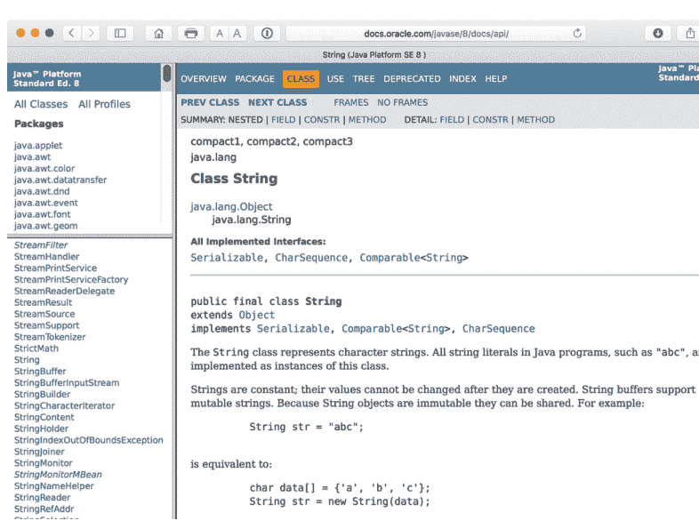

包的组织比 API 名称更基础且基于语言的。虽然包名和 API 名称之间存在一般的对应关系，构成给定 API 的类组可能会跨越包。

### 导入声明

另一种导入语句的形式使用星号（`*`）表示包中的任何类都可能被使用。因此，以下声明允许无需限定引用 `java.util` 包中的所有类：

```java
import java.util.*;
```

如果程序只使用特定包中的一个类，最好在导入声明中指定该类。如果使用两个或多个，使用 `*` 号通常可以。

`java.lang` 包的类会被自动导入，因为它们是基础的，可以被视为语言的基本扩展。因此，`java.lang` 包中的任何类（如 `System` 和 `String`）都可以无需显式导入。所有程序文件自动包含以下声明：

```java
import java.lang.*;
```

> **核心概念**
>
> `java.lang` 包中的所有类都会被自动导入。

### 自测题（答案见附录 I。）

- **SR 3.10** 什么是 Java 包？
- **SR 3.11** `java.net` 包包含什么？`javafx.scene` 包包含什么？
- **SR 3.12** 哪个包包含 `Scanner` 类？`String` 类？`Random` 类？`Math` 类？
- **SR 3.13** 使用在线 Java API 文档描述 `Point` 类。
- **SR 3.14** 导入语句起什么作用？
- **SR 3.15** 为什么我们的程序不需要专门导入 `String` 类？

## 3.4 Random 类

在编写软件时，经常需要随机数。游戏通常使用随机数来表示骰子的掷点或牌组的洗牌。飞行模拟器可能会使用随机数来决定模拟飞行发生引擎故障的频率。一个旨在帮助学生准备标准化考试的程序可能会使用随机数来选择下一个要问的问题。

`Random` 类是 `java.util` 类的一部分，代表一个伪随机数生成器。随机数生成器从一个值范围内随机选取一个数字。承担此角色的程序技术上是伪随机的，因为程序没有办法真正随机地选择一个数字。伪随机数生成器根据初始种子值执行一系列复杂的计算，并产生一个数字。它们在技术上不是随机的（因为它们是计算出来的），但伪随机数生成器产生的值通常看起来是随机的，至少对于大多数情况而言足够。

图 3.4 列出了 `Random` 类的一些方法。`nextInt` 方法可以在不带参数的情况下调用，也可以向它传递单个整数值。该值将产生整个 `int` 值范围内的随机数，包括负数。通常，我们需要一个更特定范围内的随机数。例如，为了模拟掷骰子，我们可能想要 1-6 范围内的随机数。`nextInt` 方法返回一个范围从 0 到参数减 1 的之间的值。例如，如果我们传入 100，我们将得到一个大于等于 0 且小于等于 99 的随机值。

> **核心概念：伪随机数生成器通过复杂的计算来营造随机的幻象。**

| 方法签名 | 说明 |
| :--- | :--- |
| `Random()` | 构造函数：创建一个新的伪随机数生成器。 |
| `float nextFloat()` | 返回一个 0.0（包含）到 1.0（不包含）之间的随机数。 |
| `int nextInt()` | 返回一个覆盖所有可能的 `int` 值（包括负数）的随机数。 |
| `int nextInt(int num)` | 返回一个 0 到 `num-1` 范围内的随机数。 |

图 3.4 Random 类的一些方法

注意，我们传递给 `nextInt` 方法的值也是我们返回的可能值的数量。可以通过加上或减去适当的数量来移动范围。要获取 1–6 范围内的随机数，我们可以调用 `nextInt(6)` 获取一个 0 到 5 之间的值，然后加 1。

`Random` 类的 `nextFloat` 方法返回一个大于等于 0 且小于 1 的浮点值。如果需要，可以使用乘法来缩放结果，将其转换为 `int` 以截断小数部分，并像我们处理整数那样移动范围。

列表 3.2 显示的程序在各种范围内产生几个随机数。

**列表 3.2**

```java
/*
// RandomNumbers.java    作者: Lewis/Loftus
// 演示如何使用 Random
// 类创建伪随机数。
*/

import java.util.Random;

public class RandomNumbers {
    // 生成各种范围内的随机数
    public static void main(String[] args) {
        Random generator = new Random();
        int num1;
        float num2;

        num1 = generator.nextInt();
        System.out.println("A random integer: " + num1);

        num1 = generator.nextInt(10);
        System.out.println("From 0 to 9: " + num1);

        num1 = generator.nextInt(10) + 1;
        System.out.println("From 1 to 10: " + num1);

        num1 = generator.nextInt(15) + 20;
        System.out.println("From 20 to 34: " + num1);

        num1 = generator.nextInt(20) - 10;
        System.out.println("From -10 to 9: " + num1);

        num2 = generator.nextFloat();
        System.out.println("A random float (between 0-1): " + num2);

        num2 = generator.nextFloat() * 6; // 0.0 to 5.999999
        num1 = (int)num2 + 1;
        System.out.println("From 1 to 6: " + num1);
    }
}
```

**输出示例：**

```text
A random integer: 1773351873
From 0 to 9: 8
From 1 to 10: 6
From 20 to 34: 20
From -10 to 9: -6
A random float (between 0-1): 0.71058085
From 1 to 6: 3
```

### 自测习题（答案见附录 L）

- **SR 3.16** 假设有一个名为 `rand` 的 Random 对象，调用 `rand.nextInt()` 返回什么？
- **SR 3.17** 假设有一个名为 `rand` 的 Random 对象，调用 `rand.nextInt(20)` 返回什么？
- **SR 3.18** 假设已经创建了一个名为 `generator` 的 Random 对象，每个以下每个表达式的结果范围是什么？
  - a. `generator.nextInt(50)`
  - b. `generator.nextInt(5)`
  - c. `generator.nextInt(10)`
  - d. `generator.nextInt(25)`

## 3.5 Math 类

`Math` 类提供了大量的基本函数，这些函数在计算时通常很有帮助。`Math` 类中的所有方法都是静态的，这意味着不需要实例化即可调用。`Math` 类定义在 `java.lang` 包中。

### 自测习题（答案见附录 L）

- **SR 3.19** 假设已经创建了一个名为 `generator` 的 Random 对象，写一个程序使用 `Math` 类生成以下内容：
  - 数字的绝对值
  - 数字的平方根
  - 数字的幂
  - 0.0 到 1.0 之间的随机数

**列表 3.3 继续输出**

```text
Enter the coefficient of x squared: 3
Enter the coefficient of x: 8
Enter the constant: 4
Root #1: -0.6666666666666666
Root #2: -2.0
```

- **SR 3.20** 什么是类方法（也称为静态方法）？
- **SR 3.21** 下列每个表达式的值分别是多少：
  - a. `Math.abs(10) + Math.abs(-10)`
  - b. `Math.pow(2, 4)`
  - c. `Math.pow(4, 2)`
  - d. `Math.pow(3, 5)`
  - e. `Math.pow(5, 3)`
  - f. `Math.sqrt(16)`
- **SR 3.22** 编写一条语句，打印测量 1.23 弧度的角的正弦。
- **SR 3.23** 声明一个名为 `result` 的 double 类型变量，并将其初始化为 5 的 2.5 次方。
- **SR 3.24** 使用在线 Java API 文档，列出 Math 类中未包含在图 3.5 中的方法。

## 3.6 输出格式化

`NumberFormat` 类和 `DecimalFormat` 类用于对信息进行格式化，使其在打印或显示时看起来恰当。它们都是 Java 标准类库的一部分，定义在 `java.text` 包中。

### NumberFormat 类

`NumberFormat` 类为数字提供了通用的格式化功能。你不需要使用 `new` 运算符来实例化 `NumberFormat` 对象。相反，你通过通过类名本身调用的某个静态方法来请求一个对象。图 3.6 列出了 `NumberFormat` 类的一些方法。


# 3.6 格式化输出

```
String(double number)
返回一个包含指定数字的字符串，该数字根据此对象的模式进行了格式化处理。
```

```
static NumberFormat getCurrencyInstance()
返回一个表示当前区域设置货币格式的 NumberFormat 对象。
```

```
static NumberFormat getPercentInstance()
返回一个表示当前区域设置百分比格式的 NumberFormat 对象。
```

图 3.6 NumberFormat 类的一些方法

`NumberFormat` 类中的两个方法 `getCurrencyInstance` 和 `getPercentInstance` 返回一个用于格式化数字的对象。`getCurrencyInstance` 方法返回一个用于货币值的格式化器，而 `getPercentInstance` 方法返回一个格式化百分比的对象。`format` 方法通过格式器对象调用，并返回一个包含以恰当方式格式化的数字的 `String`。

列表 3.4 所示的 `Purchase` 程序使用了两种类型的格式器。它读取一个销售交易并计算最终价格（包括税费）。

## 列表 3.4

```
************************************************
// Purchase.java 作者: Lewis/Loftus
//
// 展示了使用 NumberFormat 类来格式化输出。
************************************************

import java.util.Scanner;
import java.text.NumberFormat;

public class Purchase
{

// 使用用户输入的值计算所购物品的最终价格
//------------------------------------------------------
public static void main(String[] args)
```

## 列表 3.4 继续

```
{
    final double TAX_RATE = 0.06; // 6% 销售税
    int quantity;
    double subtotal, totalCost, unitPrice;
    Scanner scan = new Scanner(System.in);
    NumberFormat fmt1 = NumberFormat.getCurrencyInstance();
    NumberFormat fmt2 = NumberFormat.getPercentInstance();
    System.out.print("Enter the quantity: ");
    quantity = scan.nextInt();
    System.out.print("Enter the unit price: ");
    unitPrice = scan.nextDouble();

    subtotal = quantity * unitPrice;
    double tax = subtotal * TAX_RATE;
    totalCost = subtotal + tax;

    // 使用适当的格式化打印输出
    System.out.println("Subtotal: " + fmt1.format(subtotal));
    System.out.println("Tax: " + fmt1.format(tax) + " at " + fmt2.format(TAX_RATE));
    System.out.println("Total: " + fmt1.format(totalCost));
}
```

## 输出

Enter the quantity: 5

Enter the unit price: 3.87

Subtotal: $19.35

Tax: $1.16 at 6%

Total: $20.51

## DecimalFormat 类

与 `NumberFormat` 类不同，`DecimalFormat` 类是通过使用 `new` 运算符来实例化的。它的构造函数接收一个字符串，代表引导格式化过程的模式。我们可以使用 `format` 方法对特定值进行格式化。在后续阶段，如果我们想更改格式器使用的模式，可以调用 `applyPattern` 方法。图 3.7 描述了这些方法。

# 3.6 输出格式化

```
DecimalFormat(String pattern)
构造函数：创建一个带有指定模式的新 DecimalFormat 对象。

void applyPattern(String pattern)
将指定的模式应用到此 DecimalFormat 对象。

String format(double number)
返回一个包含指定数字的字符串，该数字根据当前模式进行了格式化处理。
```

图 3.7 DecimalFormat 类的一些方法

传递给 `DecimalFormat` 构造函数的字符串模式可以相当复杂。使用不同的符号来表示特定的格式化指南。例如，字符串 `"0.###"` 定义的模式表示小数点左侧至少应打印一个数字，如果值的整数部分为零，则应为零。它还表示值的小数部分应保留三位。

该模式用于列表 3.5 所示的 `CircleStats` 程序，该程序从用户处读取圆半径并计算其面积和周长。末尾的零（例如圆面积 78.540）不会被打印。

## printf 方法

除了 `print` 和 `println`，`System` 类还有另一个名为 `printf` 的输出方法，它允许用户打印一个包含数据值的格式化字符串。方法的第一个参数表示格式字符串，其余参数指定插入到格式字符串中的值。

例如，以下代码行打印了 `("ID: %5d\tname: %s", id, name)` 和一个数字：

```java
System.out.printf("ID: %5d\tname: %s", id, name);
```

方法的第一个参数表示格式字符串，其余参数指定插入到格式字符串中的值。`%5d` 表示相应的数值应在五个字符的字段中打印。`%s` 匹配字符串参数。

## 列表 3.5

```
************************************************
// CircleStats.java 作者: Lewis/Loftus
//
// 展示了使用 DecimalFormat 类格式化小数。
************************************************

import java.util.Scanner;
import java.text.DecimalFormat;

public class CircleStats {
    // 给定半径计算圆的面积和周长。
    public static void main(String[] args) {
        Scanner scan = new Scanner(System.in);
        double radius;
        DecimalFormat df = new DecimalFormat("0.###");

        System.out.print("Enter circle's radius: ");
        radius = scan.nextDouble();

        double area = Math.PI * radius * radius;
        double circumference = 2 * Math.PI * radius;

        System.out.println("Area: " + df.format(area));
        System.out.println("Circumference: " + df.format(circumference));
    }
}
```

## 输出

Enter circle's radius: 5

Area: 78.54

Circumference: 31.416

> 核心概念

`printf` 方法是为了支持旧系统的迁移。

然而，使用 `printf` 方法并不是解决输出问题的面向对象的解决方案，因此我们在书中避免使用它。

## 自测习题（答案见附录 L）

- SR 3.25 描述如何在程序中请求 `NumberFormat` 对象。

- SR 3.26 假设你的程序中有一个名为 `cost` 的 `double` 变量。你想以当前区域设置的格式输出 `cost` 中的值。

  a. 编写一条代码语句，声明并请求一个名为 `moneyFormat` 的 `NumberFormat` 对象，用于表示当前区域的货币。

  b. 编写一条代码语句，使用 `moneyFormat` 对象打印以当前区域设置格式格式化的 `cost` 值。

  c. 如果 `cost` 的值为 54.89 且你的计算机区域设置设置为美国，那么你在第 (b) 部分编写的语句的输出是什么？如果你的计算机区域设置设置为英国呢？

- SR 3.27 使用 Java 格式化类将浮点值输出为百分比的步骤是什么？

- SR 3.28 编写代码语句提示并从用户处读取一个 `double` 值，然后打印输入值绝对值的平方根结果。结果保留两位小数。

## 3.7 枚举类型

Java 提供了定义*枚举类型*（enumerated type）的能力，可以在声明变量时将其作为变量的类型。枚举类型通过列出（或枚举）可能值来确立该类型变量的可取值。这些值是标识符，可以是任何所需的内容。

例如，以下声明定义了一个名为 `Season`（季节）的枚举类型，其可能值为*冬、春、夏、秋*：

```java
enum Season {winter, spring, summer, fall};
```

对于枚举类型，你可以列出的值数量没有限制。一旦定义，就可以声明一个该类型的变量：

```
Season time;
```

变量 `time` 现在被限制在它可以所取的的值范围内。它只能持有四个 `Season` 值中的其中一个，而不能持有其他任何值。Java 枚举类型被认为是*类型安全*的（type-safe）的，这意味着任何尝试使用枚举值之外的值的尝试都会导致编译时错误。

通过类型的名称访问这些值。例如：

```java
time = Season.spring;
```

在变量可以假设的离散值较少的情况下，枚举类型会非常有帮助。例如，假设我们要表示学生可能获得的各种字母等级。我们可能会声明以下枚举类型：

```java
enum Grade {A, B, C, D, F};
```

任何持有 `Grade` 的初始化变量都保证是这些等级之一。这比使用简单的字符或字符串变量来表示等级要好得多，因为后者可以取任何值。

假设我们想表示带加号和减号的等级，例如 `A-` 和 `B+`。我们不能使用 `A-` 或 `B+` 作为值，因为它们不是有效的标识符（在 Java 中，字符 ‘-’ 和 ‘+’ 不能作为标识符的一部分）。然而，可以使用标识符 `Aminus`、`Bplus` 等来表示这些值。

在内部，枚举类型中的每个值都被存储为一个整数，这被称为它的*序数值*（ordinal value）。枚举类型中的第一个值的序数值为 0，第二个值的序数值为 1，第三个为 2，依此类推。序数值仅在内部使用。你不能给枚举类型分配一个数值，即使该数值恰于于一个有效的序数值。

枚举类型是一种特殊的类，枚举类型的变量都是对象变量。因此，所有枚举类型都关联有几个方法。`ordinal` 方法返回与特定枚举类型值相关的数值。`name` 方法返回值的名称，这与定义该值的标识符相同。

列表 3.6 显示了一个名为 `IceCream`（冰淇淋）的程序，并演示了它的某些方法。由于枚举类型是特殊的类，它们不是在方法内部定义的。它们可以在类级别定义（在类内部但方法外部），也可以在最外层定义。

我们将在第 6 章中进一步探讨枚举类型。

```java
列表 3.6
********************************************************************************************************************
// IceCream.java          作者: Lewis/Loftus
// 演示了枚举类型的使用。
********************************************************************************************************************
public class IceCream {
    enum Flavor {vanilla, chocolate, strawberry, fudgeRipple, coffee, rockyRoad, mintChocolateChip, cookieDough} 
    //
    // 创建并使用 Flavor 类型的变量。
    //
    public static void main(String[] args) {
        Flavor cone1, cone2, cone3;
        cone1 = Flavor.rockyRoad;
        cone2 = Flavor.chocolate;
        System.out.println("cone1 value: " + cone1);
        System.out.println("cone1 ordinal: " + cone1.ordinal());
        System.out.println("cone1 name: " + cone1.name());

        System.out.println();
        System.out.println("cone1 value: " + cone1);
        System.out.println("cone1 ordinal: " + cone1.ordinal());
        System.out.println("cone1 name: " + cone1.name());
    }
}
```

我们将在第 6 章中进一步探讨枚举类型。

## 3.9 JavaFX 简介

## 自动装箱 (Autoboxing)

自动装箱基本类型与其对应的包装对象之间的自动转换。例如，在以下代码中，一个 `int` 值被赋值给 `Integer` 引用变量：

```java
Integer obj1;
int num1 = 69;
obj1 = num1; // 自动创建一个 Integer 对象
```

反向转换称为拆箱（unboxing），在需要时自动发生。例如：

```java
Integer obj2 = new Integer(69);
int num2;
num2 = obj2; // 自动提取 int 值
```

基本类型与对象类型之间的赋值是不兼容的。自动装箱功能只发生在基本类型和相应的包装类之间。在任何其他情况下，尝试将基本值赋值给对象引用变量（或反之亦然）都会导致编译时错误。

> 核心概念

自动装箱提供了基本类型与对应对象之间的自动转换。

## 自测习题（答案见附录 L）

- SR 3.32 我们如何将基本类型表示为对象？

- SR 3.33 以下每个基本类型对应的包装类分别是什么：`byte`、`int`、`double`、`char`、`boolean`？


- SR 3.34 假设已经声明了一个名为 `number` 的 `int` 变量，并初始化了一个名为 `holdNumber` 的 `Integer` 变量。展示 Java 中的两种方法让 `holdNumber` 表示 `number` 中存储的值。

- SR 3.35 写一条语句打印最大的 int 值。

## 3.9 JavaFX 简介

本节标志着书中“图形轨道”（Graphics Track）的开始。从现在起，每个章节的最后几节将致力于与生成图形和 GUI 相关的主题。这些章节可以在章节中遇到时涵盖，也可以作为一个整体进行探索，或者合并在一起而不影响非图形主题的覆盖。

Java 对图形和 GUI 的支持多年来通过多种方式演变。当语言首次引入时，它使用了一组名为 AWT（Abstract Windowing Toolkit，抽象窗口工具包）的类。后来，引入了 Swing API，用更通用的版本替换了 AWT 的 GUI 组件。然而，Swing API 最适用于桌面应用程序；其他技术则用于在 Web 浏览器中开发 Java 程序。

JavaFX API 已经取代了用于开发图形程序的 AWT 和 Swing。JavaFX 结合了以前方法的优点，并添加了许多额外功能。它还可以创建可以在 Web 上运行的应用程序。管理 Java 语言的 Oracle 公司不再支持旧技术。

# 核心概念

JavaFX 现在是使用图形和 GUI 开发 Java 程序的首选方法。

代码列表 3.7 显示了一个位于 `HelloJavaFX` 类中的简短 JavaFX 程序。该程序显示了一个包含两个文本元素的窗口。

首先要注意的是 `HelloJavaFX` 继承了 `JavaFX Application` 类。这一过程体现了面向对象的继承概念，我们在第 1 章中引入了它，并在书后部分进行了更详细的探讨。所有的 JavaFX 程序都继承自 `Application` 类。

注意 `HelloJavaFX` 类有两个方法：一个 `main` 方法（我们在其他程序中见过），以及一个 `start` 方法。`main` 方法用于调用 `Application` 类的 `launch` 方法。在执行一些后台设置后，`launch` 方法会调用 `start` 方法。你通常使用 `start` 方法来设置并显示应用程序的主窗口。

在完全支持 JavaFX 的开发环境中，`launch` 方法是被自动调用的。因此，如果你使用 IDE（集成开发环境），你不需要编写 `main` 方法。我们会很乐意在示例中省略 `main` 方法，尽管你可能仍然需要包含它。

在这个示例中，`start` 方法创建了两个 `Text` 对象，将它们添加到 `Group` 中，然后将 `Group` 添加到 `Scene` 中。`scene` 显示在主 `Stage` 中。虽然看起来有很多活动部件，但这种组织方式有一种模式，你很快就会适应。

JavaFX 采用了剧院比喻。`Stage`（舞台）是一个窗口。如果需要，程序可以使用多个 `Stage`。主 `Stage` 对象是自动创建并传递给 `start` 方法的。

# 核心概念

JavaFX 采用了剧院比喻。`Stage` 是一个窗口。

## 代码列表 3.7

```java
// HelloJavaFX.java 作者: Lewis/Loftus
//
// 展示了一个基础 JavaFX 应用程序。

import javafx.application.Application;
import javafx.scene.Group;
import javafx.scene.Scene;
import javafx.scene.paint.Color;
import javafx.scene.text.Text;
import javafx.stage.Stage;

public class HelloJavaFX extends Application {
    // 在 JavaFX 窗口中创建并显示两个 Text 对象。
    public void start(Stage primaryStage) {
        Text hello = new Text(50, 50, "Hello, JavaFX!");
        Text question = new Text(120, 80, "How's it going?");

        Group root = new Group(hello, question);
        Scene scene = new Scene(root, 300, 120, Color.LIGHTGREEN);

        primaryStage.setTitle("A JavaFX Program");
        primaryStage.setScene(scene);
        primaryStage.show();
    }

    // 启动 JavaFX 应用程序。在自动启动 JavaFX 应用程序
    // IDE 中，此方法不是必须的。
    public static void main(String[] args) {
        launch(args);
    }
}
```

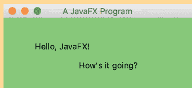

# 核心概念

与传统的二维坐标系不同，原点 (0, 0) 是左上角。

x 坐标随着向右移动而增大，y 坐标随着向下移动而增大。

## 3.10 基础形状

图中第一个 `Text` 对象的显示点是 (50, 50)。因此，"Hello JavaFX" 字符串位于右侧 50 像素，距离顶部 50 像素。

下一节将介绍包括几何形状的其他示例。

## 自测习题（答案见附录 L）

- SR 3.36 在什么情况下你会省略 Java 应用程序中的 `main` 方法？
- SR 3.37 在 JavaFX 剧院比喻中 stage 是什么？
- SR 3.38 scene 的根节点包含什么？
- SR 3.39 描述 Java 系统中点 (20, 50) 的位置。

JavaFX 中的形状由 `javafx.scene.shape` 包中的类表示。从这些类创建的对象可以添加到 `scene` 中显示。

图 11 显示了创建形状的示例调用。构造函数参数指定形状的位置和大小。例如，`Line` 构造函数接受四个参数表示线的两个端点。哪个点是起点或终点并不重要。

```java
Line(startX, startY, endX, endY)

// 创建一条从 (10, 20) 到点 (300, 80) 的线：
myLine = new Line(10, 20, 300, 80);

Rectangle(x, y, width, height)

// 创建一个 200 x 70 的矩形，其左上角位于点 (30, 50)：
Rectangle myRect = new Rectangle(30, 50, 200, 70);

Circle(centerX, centerY, radiusX, radiusY)

// 创建一个中心点为 (100, 150)、半径为 40 的圆：
myCircle = new Circle(100, 150, 40, 40);

Ellipse(centerX, centerY, radiusX, radiusY)

// 创建一个中心在 (100, 50) 的椭圆，水平半径为 80，垂直半径为 30：
myEllipse = new Ellipse(100, 50, 80, 30);
```

FIGURE 3.11 一些 JavaFX 形状类的构造函数

`Rectangle`（矩形）构造函数的前两个参数指定矩形左上角的位置，另外两个参数指定矩形的宽度和高度。

`Circle`（圆）和 `Ellipse`（椭圆）构造函数的前两个参数指定形状的中心点。圆还有一个单一半径值：椭圆的形状基于两个半径值：一个水平方向（或 x 轴），一个垂直方向（或 y 轴）。

列表 3.8 显示了一个 JavaFX 程序，它显示了各种形状以及阿尔伯特·爱因斯坦的一句名言。与上一节的 HelloFX 示例一样，显示的元素被添加到 `Group` 对象中，该对象作为 `Scene`（场景）的根节点，并显示在主 `Stage`（舞台）上。

# 核心概念

形状按照它们添加到组的顺序进行绘制，这使得一个形状显示在另一个前面。

形状的轮廓是描边（stroke），内部是填充（fill）。可以通过分别调用 `setStroke` 和 `setFill` 方法来设置描边和填充的颜色。可以使用 `setStrokeWidth` 方法设置描边宽度，就像在爱因斯坦示例中对矩形执行的那样。矩形的填充颜色设置为 `null`，这会完全移除填充——形状背后的任何内容都会透出来。

注意 `Text` 中的字符字符串包含一个换行符 (`\n`)，这在显示时会导致该点发生换行。

# 列表 3.8

```java
// Einstein.java               Author: Lewis/Loftus
// 展示了各种形状类的用法。

import javafx.application.Application;
import javafx.scene.Group;
import javafx.scene.Scene;
import javafx.scene.paint.Color;
import javafx.scene.shape.*;
import javafx.scene.text.Text;
import javafx.stage.Stage;

public class Einstein extends Application {
    // 创建并显示几个形状。
    public void start(Stage primaryStage) {
        Line line = new Line(35, 60, 150, 170);
        Circle circle = new Circle(100, 65, 20);
        circle.setFill(Color.BLUE);
        Rectangle rect = new Rectangle(60, 70, 250, 60);
        rect.setStroke(Color.RED);
        rect.setStrokeWidth(2);
        rect.setFill(null);
        Ellipse ellipse = new Ellipse(200, 100, 150, 50);
        ellipse.setFill(Color.PALEGREEN);
        Text quote = new Text(120, 100, "Out of clutter, find " + "simplicity.\n\n Albert Einstein");
        Group root = new Group(ellipse, rect, circle, line, quote);
        Scene scene = new Scene(root, 400, 200);
        primaryStage.setTitle("Einstein");
        primaryStage.setScene(scene);
        primaryStage.show();
    }
}
```

# 显示


让我们看另一个处理形状的示例。列表 3.9 显示了一个显示雪人场景的程序。

# 列表 3.9

```java
// Snowman.java      Author: Lewis/Loftus
// 展示一组形状的组合。

import javafx.application.Application;
import javafx.stage.Stage;
import javafx.scene.Group;
import javafx.scene.Scene;
import javafx.scene.paint.Color;
import javafx.scene.shape.*;

public class Snowman extends Application {
    // 展示一个雪人场景。
    public void start(Stage primaryStage) {
        Ellipse base = new Ellipse(80, 210, 80, 60);
        base.setFill(Color.WHITE);
        Ellipse middle = new Ellipse(80, 130, 50, 40);
        middle.setFill(Color.WHITE);
        Circle head = new Circle(60, 70, 30);
        head.setFill(Color.WHITE);
        Circle rightEye = new Circle(70, 60, 5);
        Circle leftEye = new Circle(90, 60, 5);
        Line mouth = new Line(80, 80, 90, 80);
        Circle topButton = new Circle(60, 120, 6);
        topButton.setFill(Color.RED);
        Circle bottomButton = new Circle(80, 140, 6);
        bottomButton.setFill(Color.RED);
        Line leftArm = new Line(110, 130, 160, 130);
        leftArm.setStrokeWidth(3);
        Line rightArm = new Line(50, 130, 0, 100);
        rightArm.setStrokeWidth(3);
        Rectangle stovepipe = new Rectangle(60, 0, 40, 45);
        Rectangle brim = new Rectangle(50, 45, 60, 5);
        Group hat = new Group(stovepipe, brim);
        hat.setTranslateX(10);
        hat.setRotate(15);
        Group snowman = new Group(base, middle, head, leftEye, rightEye, mouth, topButton, bottomButton, leftArm, rightArm, hat);
        snowman.setTranslateX(170);
        snowman.setY(50);
        Circle sun = new Circle(50, 50, 30);
        sun.setFill(Color.GOLD);
        Rectangle ground = new Rectangle(0, 250, 500, 100);
        ground.setFill(Color.STEELBLUE);
    }
}
```


```java
Group root = new Group(ground, sun);

Scene scene = new Scene(root, 500, 350);

primaryStage.setTitle("Snowman");

primaryStage.setScene(scene);

primaryStage.show();

}
}
```

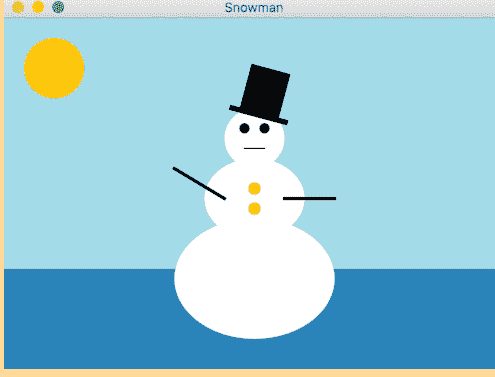

## 3.10 基础形状

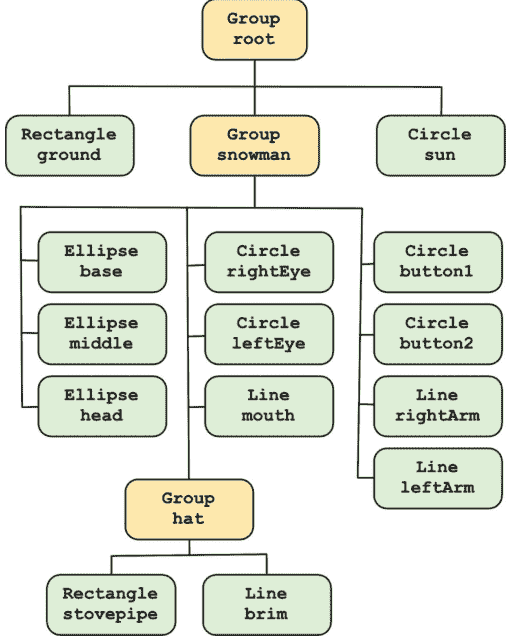

将像雪人这样复杂的元素定义为 `Group` 对象允许你对整个组进行操作。例如，为了将雪人向右移动，只需要更改传递给一个方法的值。如果没有分组，必须更改每个元素的位置。

同样，调用 `setRotate` 将形状或组绕其中心点旋转指定的角度。在雪人示例中，帽子被移动后按顺时针旋转 15 度。如果传递给 `setRotate` 方法的值为负数，旋转将沿逆时针方向。

> **核心概念**
> 形状和组可以根据需要移动和旋转。

### 自测题（答案见附录 I）

- SR 3.40 如何让一个形状出现在另一个前面？
- SR 3.41 为一个宽度为 100 像素、高度为 200 像素、左上角位于点 (30, 20) 的 `Rectangle` 编写声明。
- SR 3.42 下述语句定义的椭圆是宽大于高还是高大于宽？
  `Ellipse = new Ellipse(100, 150, 70, 90);`
- SR 3.43 在 `Circle` 对象上调用 `setFill` 并传入 `null` 参数的效果是什么？
- SR 3.44 在场景中对特定元素分组有什么好处？

## 3.11 颜色的表示

Java 中的颜色由三个数字定义，这些数字统称为 RGB 值。RGB 代表红（Red）、绿（Green）和蓝（Blue）。每个数字代表对应颜色的贡献。这种方法反映了人眼结合与红、绿、蓝对应的光波长的方式。

> **核心概念**
> Java 使用 RGB 值表示颜色。

通常，RGB 值中的每个数字都在 0–255 范围内。例如，RGB 值为 255, 255, 0 的颜色对红色和绿色的贡献完全，对蓝色的贡献为——即黄色。粉色可以通过 RGB 值 255, 175, 175 定义（全红和部分绿色及部分蓝色）。RGB 数字的任何变化都会改变颜色，尽管微小的变化可能无法被察觉。

在 Java 中，颜色由 `Color` 对象表示。`Color` 类有一个静态方法，可以返回一个带有参数指定的 RGB 值的 `Color` 对象：

```java
Color purple = Color.rgb(183, 44, 150);
```

| 对象 | RGB 值 |
| :--- | :--- |
| `Color.BLACK` | 0, 0, 0 |
| `Color.WHITE` | 255, 255, 255 |
| `Color.GRAY` | 128, 128, 128 |
| `Color.RED` | 255, 0, 0 |
| `Color.MAROON` | 128, 0, 0 |
| `Color.LIME` | 0, 255, 0 |
| `Color.GREEN` | 0, 128, 0 |
| `Color.BLUE` | 0, 0, 255 |
| `Color.NAVY` | 0, 0, 128 |
| `Color.YELLOW` | 255, 255, 0 |
| `Color.MAGENTA` | 255, 0, 255 |
| `Color.CYAN` | 0, 255, 255 |
| `Color.PINK` | 255, 192, 203 |
| `Color.ORANGE` | 255, 165, 0 |

图 3.14 `Color` 类中的某些预定义颜色

`Color` 类还有另一个名为 `color` 的静态方法，允许你以百分比的形式指定 RGB 值。以下调用创建了一个基于 60% 红色、10% 绿色和 0% 蓝色的红红色：

```java
Color maroon = Color.color(0.6, 0.1, 0.0);
```

使用这些方法，可以定义任何颜色。然而，为了方便起见，预定义了大量的 `Color` 对象——图 3.14 仅列出了其中几个。请查看 `Color` 类的在线文档以获取预定义颜色的完整列表。本章之前的 JavaFX 示例使用了这些预定义颜色。

### 自测习题（答案见附录 L）

- SR 3.45 什么是 RGB 值？
- SR 3.46 写一条语句，使用 `rgb` 方法创建一个与 `Color.PINK` 等效的 `Color` 对象。
- SR 3.47 写一条语句，使用 `color` 方法创建一个与 `Color.YELLOW` 等效的 `Color` 对象。

## 核心概念总结

- `new` 操作符返回指向新创建对象的引用。
- 多个引用变量可以引用同一个对象。
- 通常，方法是在特定对象上执行的，这将影响结果。
- 类库在开发程序时提供了非常有用的支持。
- Java 标准类库组织成包（packages）。
- `java.lang` 包中的所有类都会为每个程序自动导入。
- 伪随机数生成器通过复杂的计算来产生随机的错觉。
- `Math` 类的所有方法都是静态的，这意味着它们通过类名调用。
- Java 添加了 `printf` 方法以支持遗留系统的迁移。
- 枚举类型（Enumerated types）是类型安全的，确保不会使用无效值。
- 包装类允许将基本值作为对象管理。
- 自动装箱（Autoboxing）提供了基本值与其包装对象之间的自动转换。
- JavaFX 是开发带有图形和 GUI 的 Java 程序的首选方法。
- JavaFX 使用剧场比喻在舞台上呈现场景。
- Java 坐标系的原点在左上角。所有可见坐标均为正数。
- 形状按照它们添加到组的顺序进行绘制，一个形状会出现在另一个形状前面。
- 形状和组可以根据需要移动和旋转。
- Java 使用 RGB 值表示颜色。

## 练习题

- EX 3.1 写一条语句，打印名为 `overview` 的 `String` 对象的字符数。
- EX 3.2 写一条语句，打印名为 `introduction` 的 `String` 对象的第 8 个字符。
- EX 3.3 声明一个 `String` 变量 `str`，并初始化为包含与名为 `name` 的 `String` 对象相同的字符，但全部使用大写字母。
- EX 3.4 写一行代码，将 `String` 句子中所有的逗号（,）改为冒号（:）。将修改后的字符串存储在名为 `corrected` 的新变量中。
- EX 3.5 以下代码段产生什么输出？
- EX 3.6 这里的 import 语句的作用是什么？
  ```java
  import java.awt.*;
  ```
- EX 3.7 假设 `Random` 对象已调用为 `generator`，那么以下每个表达式的范围是什么？
  - a. `generator.nextInt(20)`
  - b. `generator.nextInt(8) + 2`
  - c. `generator.nextInt(12) + 2`
  - d. `generator.nextInt(35) + 10`
  - e. `generator.nextInt(100) - 50`
- EX 3.8 写代码声明并实例化一个 `Random` 对象（将对象命名为 `rand`）。然后列出使用 `nextInt` 或 `nextFloat` 的表达式列表，生成以下范围内的随机数：
  - a. 0.0 到 100.0
  - b. 1000 到 5000
  - c. 1 到 6
  - d. -40.0 到 40.0
  - e. 2.5 到 3.5
  - f. 0 到 500
- EX 3.9 写一条赋值语句，计算 `num1` 和 `num2` 之和的平方根，并将结果赋值给 `num3`。
- EX 3.10 写一条语句，计算并打印 `total` 的绝对值。
- EX 3.11 写代码创建一个 `DecimalFormat` 对象，将值保留到四位小数。然后写一条语句打印格式化后的结果。
- EX 3.12 写代码语句提示并从用户读取一个 `double` 值，然后打印该值四次方的结果。输出结果保留三位小数。
- EX 3.13 写一个枚举类型的声明，表示星期中的某几天。
- EX 3.14 对比图形组件使用的传统坐标系。
- EX 3.15 为以下每一项写一个声明：
  - a. 一条从点 (60, 100) 延伸到点 (30, 90) 的直线。
  - b. 一个宽 20 像素、高 100 像素的矩形，其左上角位于点 (10, 100)。
  - c. 一个圆心位于点 (50, 75)，半径为 30 的圆。
  - d. 一个圆心位于点 (150, 180)，宽为 100 像素且高为 80 像素的椭圆。
- EX 3.16 以下操作是否创建了一个正方形？
  - a. (20, 80)
  - b. (80, 20)
  - c. (20, 80)
  - d. (80, 80)
- EX 3.17 以下椭圆是宽还是高？
  - a. (300, 100)
  - b. (200, 50)
  - c. (80, 20)
- EX 3.18 如何创建一个没有填充颜色的形状？
- EX 3.19 写两条代码，将名为 `myGroup` 的对象向右移动 100 像素并向上 20 像素。

## 编程项目

- PP 3.1 写一个程序，提示并读取用户的姓和名（分别）。然后打印一个由用户的姓、后面的五个字母以及 10 到 99 之间的随机数组成的字符串。假设姓至少有五个字母。
- PP 3.2 写一个程序打印立方和。提示两个整数并打印每个值的立方。
- PP 3.3 写一个程序生成符合特定标准的随机密码。密码应该以 7、8 或 9 开头，接下来的五位可以是 0 到 9 之间的任何数字。后面是一个连字符，然后是三个随机大写字母。提示：65 到 90 代表字母 A 到 Z。你可以这样将整数转换为字符类型：`(char)65` 是 'A'，`(char)66` 是 'B'。
- PP 3.4 写一个程序读取一个浮点值，并打印小于和大于该值的整数。例如，如果数字是 28.466，程序将打印 28 和 29。
- PP 3.5 写一个程序读取两个点的 (x,y) 坐标。使用以下公式计算两点之间的距离：
  ```
  Distance = \sqrt{(x_2 - x_1)^2 + (y_2 - y_1)^2}
  ```
- PP 3.6 写一个程序读取球的半径并打印其体积和表面积。使用以下公式并将输出保留四位小数，$r$ 代表半径。
  ```
  Volume = \frac{4}{3}\pi r^3
  ```
  ```
  Surface Area = 4\pi r^2
  ```
- PP 3.7 等比数列是相邻项之间具有常数比例的数列。为了知道该数列的第 $n$ 项，可以使用公式：
  ```
  $a_n = a_1 \cdot r^{n-1}
  ```
  在这里，$a_n$ 是第 $n$ 项，$a_1$ 是第一项，$r$ 是公比。写一个程序从用户处接受第一项、公比和值 $n$，并计算数列的第 $n$ 项。
- PP 3.8 编写一个程序，生成一个 20 到 40（包含边界）之间的随机整数，并显示该数字的正弦、余弦和正切。
- PP 3.9 编写一个程序，为圆柱生成随机的半径 (r) 和高度 (h)，范围在 1 到 20（包含边界）之间，然后计算圆柱的体积和表面积。
  体积 = $\pi r^2h$
  表面积 = $2\pi rh$
- PP 3.10 按以下方式修改雪人应用程序：
  - 添加第三个按钮。
  - 将太阳移动到图片的右上角。
  - 在图片的左上角显示你的名字。
  - 将整个雪人向右平移 40 像素。
- PP 3.11 编写一个 JavaFX 程序，在 $500 \times 500$ 像素的范围内显示一棵带有三个圆和两个白色圆的树。
- PP 3.12 编写一个 JavaFX 程序，绘制城市的城市天际线。在建筑上显示一些透光的窗户，并为建筑顶部包含至少三种不同的形状。在建筑后面添加一个巨大的升起的满月。
- PP 3.13 编写一个 JavaFX 程序，绘制一个中心在 (200, 200) 的圆，半径在 50 到 150 之间随机。每次运行程序，它都会画出一个不同的圆。
- PP 3.14 编写一个 JavaFX 程序，以随机角度（0 到 360 度）旋转显示你的名字。每次运行程序，都会以不同的角度绘制你的名字。
- PP 3.15 编写一个 JavaFX 程序，显示一个填充有随机颜色的矩形，该颜色使用 `Color` 类的 `rgb` 方法创建。每次运行程序，都会显示一个不同颜色的矩形。
- PP 3.16 编写一个 JavaFX 程序，显示一个太阳和三个行星的太阳系模型。使用椭圆显示行星绕太阳运行的轨道。

# 第 4 章 写类

## 章节目标

- 讨论类定义的结构和内容。
- 使用实例数据建立对象状态的概念。
- 描述可见性修饰符对方法和数据的影响。
- 探索方法定义的结构，包括参数和返回值。
- 讨论构造函数的结构和目的。
- 定义并显示弧形形状。
- 加载并显示图像。
- 介绍创建交互式图形用户所需的概念。
- 探索一些基本的 GUI 控制和事件处理。

在第 3 章中，我们使用了类和对象以及它们提供的各种服务。也就是说，我们使用了 Java API 提供的预定义类来使编写程序的过程变得简单。在本章中，我们将处理面向对象编程的核心：编写我们自己的类来定义我们自己的对象。本章探索了类定义的基础知识，包括方法的结构以及数据的范围和封装。本章的“图形跟踪”部分讨论了如何表示弧形和图像，并引入了创建真正的交互式图形用户界面所需的问题。

## 4.1 复习类和对象

在第 1 章中，我们介绍了基本的面向对象概念，包括对对象和类的简要概述。在第 3 章中，我们使用了 Java 标准类库中的几个预定义类来创建对象，并利用它们提供的特定功能。

在本章中，我们将注意力转向编写自己的类。虽然现有的类库提供了许多有用的类，但面向对象程序开发的本质是设计和实现我们的类以适应我们的特定需求。

回想对象与类之间的基本关系：类是对象的蓝图。类代表对象的概念，从该类创建的任何对象都是该概念的实现。

例如，从第 3 章我们知道 `String` 类代表字符字符串的概念，每个 `String` 对象代表一个包含特定字符的特定字符串。

让我们考虑另一个例子。假设大学有一个名为 `Student` 的类。从 `Student` 类创建的对象代表一个特定的学生。`Student` 类代表学生的一般概念，从该类创建的每个对象都代表一个在该校的学生。在一个管理大学业务的系统中，我们将有一个 `Student` 类和数千个 `Student` 对象。

回想对象具有状态，状态由与对象关联的属性的值定义。学生的属性可能包括学生的姓名、地址、专业和平均学点（GPA）。`Student` 类规定每个学生都具有这些属性。每个 `Student` 对象存储特定学生的这些属性的值。在 Java 中，对象的属性定义在类内部。

对象还具有行为，行为由与对象关联的操作定义。学生的操作将包括更新学生地址和计算当前平均学点的能力。`Student` 类定义了这些操作，例如计算平均学点的细节。这些操作可以在特定的 `Student` 对象上执行（或由其执行）。请注意，对象的行为可能会修改该对象的状态。在 Java 中，对象的操作是由类中的方法定义的。

图 4.1 列出了类的示例，以及可能为这些类的对象定义的某些属性和操作。这取决于程序设计者来确定需要哪些属性和操作，这取决于程序的目的以及特定对象在其中扮演的角色。考虑一下你可能为这些示例中包含的其他属性和操作。

| 类 | 属性 | 操作 |
| :--- | :--- | :--- |
| `Student` | 姓名、地址、专业、平均学点 | 设置地址、设置专业、计算平均学点 |
| `Rectangle` | 长度、宽度、颜色 | 设置长度、设置宽度、设置颜色 |
| `Aquarium` | 材料、宽度、高度 | 设置材料、设置宽度、设置高度、计算体积 |
| `Flight` | 航空公司、航班号、出发地、当前状态 | 设置航空公司、设置航班号、确定状态 |
| `Employee` | 姓名、部门、职称、薪水 | 设置部门、设置职称、计算奖金、计算税费 |

图 4.1 类示例及某些操作

### 自测习题

- SR 4.1 什么是属性？
- SR 4.2 什么是操作？
- SR 4.3 列出可能为代表图书馆中书籍的 `Book` 类定义的某些属性和操作。
- SR 4.4 正还是错？解释原因。
  - a. 编写程序时我们应该只使用 Java 类库中的类——没有必要定义或使用其他类。
  - b. 对象上的操作可以改变对象的状态。
  - c. 对象的当前状态会影响在该对象的操作的结果。
  - d. 在 Java 中，对象的状态是由其方法表示的。

## 4.2 类的构造分析

在我们之前所有的示例中，我们都写了一个包含 `main` 方法的单个类。这些类代表了小但完整的程序。这些程序通常使用 Java 类中的预定义类来实例化，并使用这些对象提供的服务。这些类也是程序的一部分，但除了知道如何与其交互之外，我们并不关心它们。我们只需信任它们提供承诺的服务。

图 4.2 所示的 `RollingDice` 类包含一个 `main` 方法，实例化了两个 `Die` 对象（dice 的单数）。它掷骰子并打印结果。它还调用了 `Die` 类提供的其他方法，例如显式设置和获取骰子的当前点数。

```java
// RollingDice.java                Author: Lewis/Loftus
// 展示了自定义类的创建和使用。

public class RollingDice
{
    // 创建两个 Die 对象并多次投掷。
    //
    public static void main(String[] args) {
        Die die1, die2;
        int sum;
        die1 = new Die();
        die2 = new Die();
        die1.roll();
```


# 4.2 类的剖析

```java
die2.roll();

System.out.println("Die One: " + die1 + ". Die Two: " + die2);

die1.roll();

die2.setFaceValue(4);

}
}
```

```java
// LISTING 4.1 continued
System.out.println("Die One: " + die1 + ", Die Two: " + die2);

sum = die1.getFaceValue() + die2.getFaceValue();

System.out.println("Sum: " + sum);

sum = die1.roll() + die2.roll();

System.out.println("Die One: " + die1 + ", Die Two: " + die2);

System.out.println("New sum: " + sum);

}
```

```
OUTPUT
Die One: 5, Die Two: 2
Die One: 1, Die Two: 4
Sum: 5
Die One: 4, Die Two: 2
New sum: 6
```

这个示例与之前示例的主要区别在于 `Die` 类不是 Java 类库预定义的部分。我们必须自己编写 `Die` 类，定义我们希望 `Die` 对象执行的服务，该程序才能编译并运行。

每个类都可以包含数据声明和方法声明，如图 4.2 所示。数据声明代表存储在该类的每个对象中的数据。方法声明定义了这些对象提供的服务。类的数据和方法合称为类的**成员**（members）。

我们在之前的示例中编写的类也遵循这一模型，但在类级别上不包含数据，且只有一个方法（`main` 方法）。我们将继续定义这样的类，例如 `RollingDice` 类，用以定义程序的起始点。

然而，真正的面向对象编程来自于定义表示具有定义状态和行为对象的类。例如，在任何时刻，一个 `Die` 对象都显示一个特定的点数，我们可以将其称为 `Die` 的状态。`Die` 对象还具有各种我们可以调用的方法，例如掷骰子的能力或获取其点数的能力。这些方法代表了骰子的行为。

> **核心概念**
> 面向对象编程的核心是定义表示具有定义状态和行为对象的类。

## 第 4 章 编写类

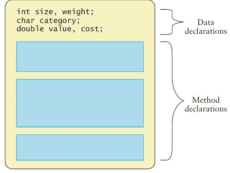

图 4.2 类的成员：数据声明和方法声明

`Die` 类如列表 4.2 所示。它包含两个数据值：一个代表骰子最大值的整数常量（`MAX`）和一个整数变量（`faceValue`），代表骰子的当前点数。它还包含一个名为 `Die` 的构造函数和四个普通方法：`roll()`、`setFaceValue()`、`getFaceValue()` 和 `toString()`。

你会回想起第 2 章和第 3 章的内容，构造函数是与类名相同的特殊方法。当使用 `new` 运算符创建 `Die` 类的新实例时，就会调用 `Die` 构造函数。`Die` 类中的其他方法定义了 `Die` 对象提供的服务。

我们使用一组文档块来解释类中每个方法的作用。这种做法对于任何试图理解软件的人来说至关重要，而且便于在阅读代码时让眼睛轻松地从一个方法跳转到另一个方法。

图 4.3 列出了 `Die` 类的方法。从这个角度来看，它与我们在之前示例中使用的任何其他类都不同。唯一的重大区别是 `Die` 类不是由 Java API 提供的，而是我们自己写的。

`Die` 类的方法包括掷骰子以产生新的点数的能力。`roll()` 方法将新点数返回给调用方法，但你也可以随时使用 `getFaceValue()` 方法获取当前点数。`setFaceValue()` 方法显式地设置点数，就像你伸过去把骰子转到你想要的任何面一样。任何对象的 `toString()` 方法都会在你将对象传递给 `print` 或 `println` 方法时自动被调用，以获取该打印输出的字符串描述。因此，为大多数类定义一个 `toString()` 方法通常是一个好主意。

# 列表 4.2

```java
/*
// Die.java      Author: Lewis/Loftus
// 表示一个骰子（dice 的单数），其面显示的值在
// 1 到 6 之间的值。
********************************************************************************/
public class Die {

    private final int MAX = 6; // 最大点数
    private int faceValue; // 骰子上显示的当前值

    //
    // 构造函数：设置初始点数。
    //
    public Die() {
        faceValue = 1;
    }

    //
    // 掷骰子并返回结果。
    //
    public int roll() {
        faceValue = (int)(Math.random() * MAX) + 1;
        return faceValue;
    }

    //
    // 点数修改器。
    //
    public void setFaceValue(int value) {
        faceValue = value;
    }

    //
    // 点数访问器。
    //
    public int getFaceValue() {
        return faceValue;
    }

    //----------------------------------------------------------------------
    // 返回此骰子的字符串表示形式。
    //----------------------------------------------------------------------
    public String toString() {
        String result = Integer.toString(faceValue);
        return result;
    }
}
```

## 第 4 章 编写类

这些方法的定义包含多个部分，我们将在后续过程中对其进行析。对于书中的示例，我们通常将每个类存储在自己的独立文件中。Java 允许将多个类存储在一个文件中。类的名与文件名对应。例如，`Die` 类存储在 `Die.java` 中。

| Die | |
|---|---|
| 构造函数 | 将骰子的初始点数设置为 1。 |
| `int roll()` | 通过设置一个随机数来掷骰子。 |
| `void setFaceValue(int value)` | 将骰子的点设置为指定的值。 |
| `int getFaceValue()` | 返回骰子的当前点数。 |
| `String toString()` | 返回骰子的字符串表示形式。 |

图 4.3 Die 类的一些方法

# 实例数据

注意，在 `Die` 类中，常量 `MAX` 和变量 `faceValue` 定义在类内部，而不是任何方法内部。变量定义的位置是它的作用域，即程序中可以引用它的区域。通过在类级别声明（而不是在方法内部），这些变量和常量可以在类的任何方法中引用。

作为属性的 `faceValue` 是实例数据，因为为该类的实例预留了新的内存空间。每个 `Die` 对象都有自己的 `faceValue` 变量及其自己的数据。这就是每个 `Die` 对象都能拥有自己的状态的原因。这体 `RollingDie` 程序的输出：一个骰子的值为 5，另一个点数为 2。这之所以可能，是因为为每个 `Die` 对象创建了 `faceValue` 变量的内存空间。

我们可以将这种情况描述为：

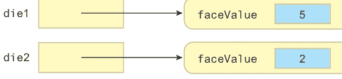

`die1` 和 `die2` 引用变量指向（即包含）各自的 `Die` 对象。每个对象都包含一个具有独立内存空间的 `faceValue` 变量。每个对象可以存储不同的实例数据值。

Java 会自动初始化任何在类级别声明的变量。例如，所有 `int` 和 `double` 数字类型的变量都会初始化为零。然而，尽管语言执行这种自动初始化，但显式初始化变量（通常在构造函数中）是一种良好的做法，这样阅读代码的人就能清楚地理解意图。

# UML 类图

在本书中，我们使用 UML 图来视觉化类与对象之间的关系。UML 代表统一建模语言，它已成为面向对象程序设计最流行的表示法。

存在多种类型的 UML 图，每种都设计用于显示面向对象程序的特定方面。我们在书中主要关注 UML 类图，用以展示类的内容以及它们之间的关系。

# 第 4 章 类类

| RollingDice | Die |
|---|---|
| | `faceValue : int` |
| `main(args: String []) : void` | `roll() : int`<br>`setFaceValue(int value) : void`<br>`getFaceValue() : int`<br>`toString() : String` |

图 4.4 显示参与 RollingDice 程序的类的 UML 类图

# 核心概念

UML 类图帮助我们视觉化程序中各个类之间的内容和关系。

在 UML 图中，每个类都表示为一个矩形，可能包含三个部分，用以显示类名、其属性（数据）和其操作（方法）。图 4.4 显示了包含 RollingDice 程序类的类图。

图 4.4 中连接 RollingDice 和 Die 类的箭头表示类之间存在关系。虚线箭头表示一个类使用了另一个类的方法。类之间其他类型的面向对象关系通过不同类型的连接线和箭头显示。我们将在书中的相关主题中讨论这些其他关系。

请记住，UML 并不是专门为 Java 程序员设计的。它的目的是与语言无关的，因此 UML 图并不等同于 Java。例如，变量的类型显示在变量名之后，用逗号隔开。方法的返回类型也是同样的方式。

UML 图是多用途的。根据特定图的目标，我们可以包含任何所需的适当信息。例如，如果某些细节对特定图不相关，我们可能会省略类的数据和方法部分。

UML 图允许你视觉化程序的设计。随着我们的程序增长，由越来越多多的类组成，这些视觉化手段将变得越来越有用。我们将根据情况探索 UML 图的新方面面。

> **自测复习题（答案见附录 E）**
>
> - SR 4.5 对象和类之间的区别是什么？
> - SR 4.6 描述 Die类的实例数据（instance data）。
> - SR 4.7 为 Die 类定义的方法中，哪些可以改变 Die 对象的状态——也就是说，哪些方法可以为实例数据赋值？
> - SR 4.8 当你将对象传递给 print 或 println 方法时会发生什么？
> - SR 4.9 变量的作用范围是什么？
> - SR 4.10 UML 图的设计目的是什么？

# 4.3 封装

我们在第 1 章对面向对象概念的概述中提到，对象应该是自管理的。也就是说，对象的实例应该只由对象本身进行修改。例如，Die 类的方法应该专门负责更改 `faceValue` 变量的值。我们应该让类外部的代码难以“进入内部并修改在类内部声明的变量的值”，甚至让这变得不可能。这种特性被称为封装。

> **核心概念**
> 对象应该被封装，以保护其数据免受不当的访问。

对象应该与系统的其余部分封装离开。它只应该通过定义该对象提供的服务的特定方法集与程序的其他部分交互。这些方法定义了对象与使用它的程序之间的接口。

封装在图 4.5 中以图形形式表示。使用对象的代码（有时称为对象的客户端）不应允许直接访问变量。客户端应该调用对象的方法，这些方法与对象内部封装的数据进行交互。例如，RollingDice 程序中的 `main` 方法调用了 Die 对象的 `roll()` 方法。`main` 方法不应该（实际上无法）直接访问 `faceValue` 变量。

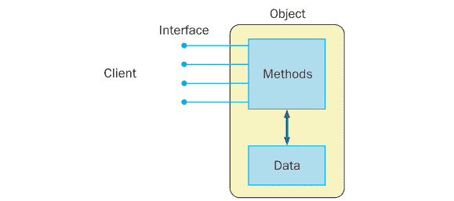

图 4.5 客户端与对象的方法交互

在 Java 中，我们使用修饰符来实现对象封装。修饰符是 Java 保留字，用于指定编程语言构造的特定特征。在第 2 章中，我们讨论了 `final` 修饰符，它用于声明常量。Java 有多种可以以各种方式使用的修饰符。某些组合是无效的。我们将在本书的适当各处讨论各种 Java 修饰符，所有它们都总结在附录 E 中。

# 可见性修饰符

某些 Java 修饰符被称为可见性修饰符，因为它们控制对类成员的访问。保留字 `public` 和 `private` 是可以应用于类的变量和方法的可见性修饰符。如果类的成员具有 `public` 可见性，则从对象外部直接引用它。如果类的成员具有 `private` 可见性，则可以在类定义内部的任何地方使用，但不能从外部引用。第三种修饰符 `protected` 只在继承上下文中相关。我们将在第 9 章中讨论它。

> **实例变量应该声明为 private 可见性，以促进封装。**

Public 变量违反了封装。它们允许定义数据的类之外的额外代码访问或修改数据的值。因此，实例数据应该定义为 `private` 可见性。声明为 `private` 的数据可以由类的方法访问。

我们应用于方法的可见性取决于该方法的目的。为客户端提供服务的方法必须声明为 `public` 可见性，以便它们被客户端调用。这些方法有时被称为服务方法。`private` 方法不能从类外部调用。`private` 方法的唯一目的是帮助类的其他方法。

赋予常量 `public` 可见性通常是可以接受的，尽管它们的值可以被直接更改。因为常量根据定义是不可变的，所以封装问题在很大程度上不存在。

UML 类图通过在成员前加上特定的字符来显示可见性。具有 `public` 可见性的成员以加号 (+) 表示而具有 `private` 可见性的成员以减号 (−)。

# 4.3 封装

| | `public` | `private` |
|---|---|---|
| 变量 | 违反封装 | 强制封装 |
| 方法 | 为客户端提供服务 | 支持类的其他方法 |

图 4.6 public 和 private 可见性的影响

# 访问器和修改器

由于实例数据通常声明为 `private` 可见性，类通常提供访问和修改数据的服务。如 `getFaceValue()` 之类被称为访问器方法（accessor method），因为它提供了对特定值的只读访问。同样，如 `setValue()` 之类的方法被称为修改器方法（mutator method），因为它改变了特定的值。

通常，访问器的命名的形式为 `getX`，其中 X 是它提供的值。同样，修改器的命名的形式为 `setX`，其中 X 是它们设置的值。设置，这些类型的方法有时被称为“getter”和“setter”。

例如，如果一个类包含实例变量 `height`，它可能也包含方法 `getHeight()` 和 `setHeight()`。注意，这种命名约定在方法名中使用该变量的首字母大写，这与方法名的命名方式是一致的。

某些方法可能作为其主要目的的副作用提供访问/或修改器功能。例如，Die 类的 `roll()` 方法更改了骰子的 `faceValue` 并返回该新值作为。因此，`roll()` 也是一个修改器。

注意，`roll()` 方法的代码非常小心地保持骰子的面值在有效范围内（1 到 `MAX`）。服务方法必须经过仔细设计，以仅允许适当的访问和更改。这指出了 Die 类设计中的一个缺陷：`setFaceValue()` 方法没有限制——客户端可以使用它将值设为 20，这超出了有效范围。`setFaceValue()` 方法的代码应该只允许有效的

> **核心概念**
> 大多数对象包含访问器和修改器，允许客户端以受控的方式管理数据。

对骰子面值的修改。在下一章中，我们将探索如何实现那样的控制。

# 自测习题（答案见附录 L。）

- SR 4.11 对象应该是自治的。请解释。
- SR 4.12 对象的接口是什么？
- SR 4.13 什么是修饰符？
- SR 4.14 为什么给常量赋予公有可见性？
- SR 4.15 描述以下每一项内容：
    - a. 公有方法 (public method)
    - b. 私有方法 (private method)
    - c. 公有变量 (public variable)
    - d. 私有变量 (private variable)

## 4.4 方法的剖析

我们已经看到类由数据声明和方法声明组成。让我们详细检查一下方法声明。

正如第 1 章所述，方法是一组被命名的编程语言语句。方法声明指定了在方法被调用时执行的代码。Java 程序中的每个方法都是特定类的一部分。

当方法被调用时，控制流会转移到该方法。该方法的语句会被一个接一个地执行。当该方法执行完毕，控制将返回到调用发生的位置并继续执行。

被调的方法（被调用的方法）可能与调用它的方法属于同一个类。如果被调的方法属于同一个类，则只需要名称即可调用它。如果它属于不同的类，则通过该其他类的对象名称来调用，正如我们多次看到的那样。图 4-7 显示了方法被调用时的执行流。

我们在示例中多次定义了程序的 `main` 方法。它的定义与所有方法遵循相同的语法。方法的头部包括返回值的类型、方法名以及该方法接受的参数列表。构成方法体的语句定义在由花括号分隔的块中。本节的其余部分将更详细地讨论与方法声明相关。

## 方法声明

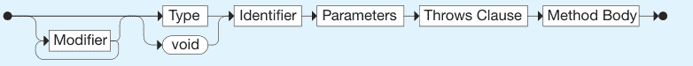

## 参数

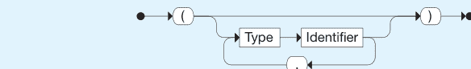

方法由可选修饰符定义，随后是返回类型，接着是确定方法名的标识符，然后是参数列表，最后是方法体。返回类型指示方法将返回的值类型，该类型可以是 `void`。方法体是在方法被调用时执行的语句块。`Throws` 子句是可选的，它指明了该方法可能抛出的异常。

```java
public void void(int count) {
```


System.out.println("Follow all instructions.");

System.out.println("Use no more than " + count + " turns.");

}

```

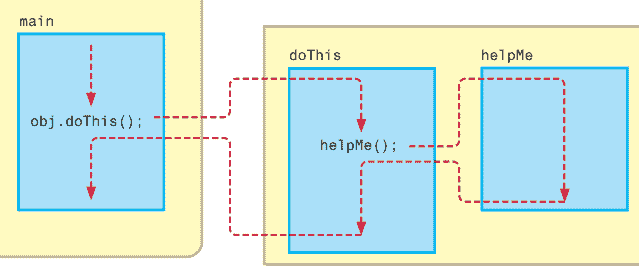

图 4.7 方法调用后的控制流

## return 语句

在方法头部中指定的返回类型可以是基本类型、类名或保留关键字 `void`。当方法不返回任何值时，使用 `void` 作为返回类型，这在 `main` 方法中总是这样做的。`Die` 类的 `setValue` 方法的返回类型也是 `void`。

返回值的方法必须有一个 `return` 语句。当执行 `return` 语句时，控制会立即返回到调用方法中的语句，并在那里继续处理。一个 `return` 语句由关键字 `return` 后面跟一个规定要返回值的表达式组成。该表达式必须与方法头部中的返回类型一致。

`Die` 类的 `getCellValue` 方法返回一个 `int`，代表骰子的当前值。`roll` 方法也执行相同的操作，返回随机设置给 `faceValue` 的新值。`toString` 方法返回一个 `String` 对象。

不返回值的方法通常不包含 `return` 语句。当到达方法末尾时，方法会自动返回到调用方法。此类方法可能包含一个没有表达式的 `return` 语句。

尽管可以这样做，但使用多个 `return` 语句并不是良好的做法。通常，方法应该在方法体的最后一行有一个 `return` 语句，除非这会让方法变得过于复杂。

方法返回的值在调用方法中可以被忽略。例如，在 `RollingDice` 类的 `main` 方法中，该值是

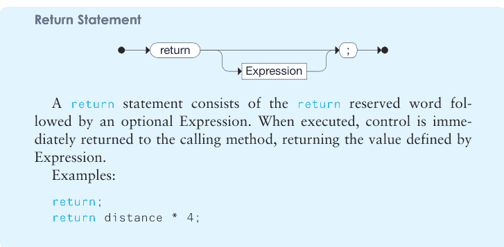

一个 `return` 语句由保留关键字 `return` 跟着一个可选的 `Expression` 组成。执行时，控制立即返回到调用方法，返回 `Expression` 定义的值。

示例：

```java
return;

return distance * 4;
```

## 4.4 方法的剖析

从 `roll` 方法返回的值在某些调用中被忽略了，而在另一些调用中，返回值被用于计算。

构造函数没有返回类型（即使不是 `void`），因此不能返回值。我们将在本章稍后部分详细讨论构造函数。

## 参数

正如第 2 章定义的，参数是在方法被调用时传递到方法的值。方法头部的参数列表指定了传递的值的类型，以及被调用方法引用这些值的名称。

方法声明头部中参数的名称被称为**形式参数** (formal parameters)。在调用中，传递到方法的值被称为**实际参数** (actual parameters)。实际参数也称为方法的**参数** (arguments)。

方法调用和定义始终会在方法名后的括号中给出参数列表。如果没有参数，则使用空括号，如 `roll` 和 `getFaceValue` 方法所示。骰子也接受参数，尽管构造函数可以定义形式参数。正如图 4.8 所示。实际参数的类型必须与形式参数匹配。

关于参数传递的更多细节将在第 7 章讨论。

## 局部数据

正如本章前面描述的变量或常量的作用域是可以对其进行有效引用的程序部分。

> **KEY CONCEPT**
> 方法被调用时，实际参数被拷贝到形式参数中。

## 第 4 章 写类

```java
ch = obj.calc(25, count);

char calc(int num1, int num2, String message) {

    int sum = num1 + num2;

    char result = message.charAt(sum);

    return result;

}
```

图 4.8 从方法调用到声明传递参数

可以在方法内部定义变量，使其局部数据而不是实例化数据。实例化数据定义在类中但在任何特定方法内部。

> **KEY CONCEPT**
> 在方法中定义的变量是该方法的局部，不能在外部使用。

局部数据的作用域仅限于定义它的方法。`Die` 类 `toString` 方法中定义是局部数据。对 `Die` 类任何其他方法的引用都会导致编译器发出错误信息。局部或处理，实例化数据，定义在类级别，其作用域是整个类；类的任何方法都可以引用它。

由于局部数据和实例化数据在不同的作用域上运行，可以在方法内部声明与类级别定义的实例变量同名的局部变量。在方法中引用命名将引用该变量的局部版本。这种命名习惯显然可能会混淆阅读代码的人，因此应该避免。

形式参数名称在方法头部作为该方法的局部数据。它们在方法被调用之前才存在，并在方法退出时消失。例如，`setFaceValue` 方法中的形式参数值在方法被调用时产生，在方法执行结束时消失。

## 银行账户示例

让我们看看另一个类及其使用的示例。列表 4.3 所示的 `Transactions` 类包含一个 `main` 方法，该方法创建了几个 `Account` 对象并调用其服务。

## 4.4 方法的内部结构

## 代码列表 4.3

```java
****************************************************************

// Transactions.java      Author: Lewis/Loftus

// 展示了多个 Account 对象的创建和使用。

//****************************************************************

public class Transactions {

    // 创建一些银行账户并请求各种服务。

    //

    public static void main(String[] args) {

        Account acct1 = new Account("Ted Murphy", 72354, 102.56);

        Account acct2 = new Account("Jane Smith", 69713, 40.00);

        Account acct3 = new Account("Edward Demsey", 93757, 759.32);

        acct1.deposit(25.85);

        double smithBalance = acct2.deposit(500.00);

        System.out.println("Smith balance after deposit: " + smithBalance);

        System.out.println("Smith balance after withdrawal: " +

            acct2.withdraw(430.75, 1.50));

        acct1.addInterest();

        acct2.addInterest();

        acct3.addInterest();

        System.out.println();

        System.out.println(acct1);

        System.out.println(acct2);

        System.out.println(acct3);

    }

}
```

## 输出

Smith balance after deposit: 540.0
Smith balance after withdrawal: 107.75

72354   Ted Murphy      $132.90
69713   Jane Smith      $111.52
93757   Edward Demsey   $785.90

## 第 4 章 编写类


关于 Account 类的讨论。

代码列表 4.4 显示的 Account 类代表一个基础银行账户。它包含表示账户号码、账户当前余额和账户所有者名称的实例数据。注意，实例数据可以是一个对象引用变量（不仅仅是基本类型），因为账户所有者的名称是指向 String 对象的引用。账户的利率被存储为常量。

Account 类的构造函数接受三个参数，用于初始化实例数据。`deposit` 和 `withdraw` 方法对账户执行基础交易，根据参数调整余额。还有一个 `addInterest` 方法，通过加上赚取的利息来更新余额。这些方法代表了改变余额的有效方式，因此没有提供像 `setBalance` 这样的经典的变变器（mutator）。

在 Transactions 程序中，刚创建的三个 Account 对象的状态可以描述如下：

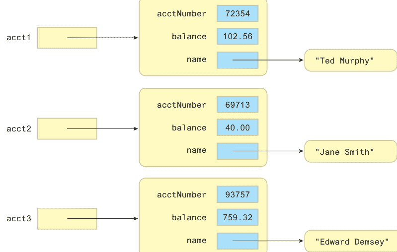

更新账户余额的各种方法可以设计得更严谨。应该进行检查以确保参数值有效，例如防止提取负数金额（这在本质上等同于存款）。这种处理将在下一章中讨论。

## 自测习题（答案见附录 L。）

# 代码列表 4.4

```java
****************************************************************

// Account.java               Author: Lewis/Loftus

// 代表一个银行账户，提供存款和

// 取款等基础服务。

****************************************************************

import java.text.NumberFormat;

public class Account {

    private final double RATE = 0.035;      // 3.5% 的利率

    private long acctNumber;

    private double balance;

    private String name;

    //-

    // 通过定义所有者、账户号码

    // 初始余额来设置账户。

    //-

    public Account(String owner, long account, double initial) {

        name = owner;

        acctNumber = account;

        balance = initial;

    }

    //-

    // 将指定金额存入账户。返回

    // 新余额。

    //-

    public double deposit(double amount) {

        balance = balance + amount;

        return balance;

    }

    // 从账户中提取指定金额并收取手续费。

    // 返回新余额。

    public double withdraw(double amount, double fee) {

        balance = balance - amount - fee;

        return balance;

    }

    // 为账户增加利息并返回新余额。

    public double addInterest() {

        balance += (balance * RATE);

        return balance;

    }

    // 返回账户的当前余额。

    public double getBalance() {

        return balance;

    }

    // 返回字符串格式的账户单描述。

    public String toString() {

        NumberFormat fmt = NumberFormat.getCurrencyInstance();

        return acctNumber + "\t" + name + "\t" + fmt.format(balance);

    }

}
```

- SR 4.16 方法通过什么被调用的？
- SR 4.17 方法返回值意味着什么？
- SR 4.18 return 语句的作用是什么？
- SR 4.19 必须使用 return 语句吗？
- SR 4.24 构造函数有什么用途？
- SR 4.25 如何定义构造函数？

## 第 4 章 编写类

# 列表 4.5 延续

```java
Arc arc1 = new Arc(250, 150, 170, 100, 90, 90);

arc1.setType(ArcType.OPEN);

arc1.setStroke(Color.RED);

arc1.setFill(null);

Arc arc2 = new Arc(250, 150, 170, 100, 200, 50);

arc2.setType(ArcType.ROUND);

arc2.setStroke(Color.GREEN);

arc2.setFill(Color.GREEN);

Arc arc3 = new Arc(250, 150, 170, 100, 230, 130);

arc3.setType(ArcType.CHORD);

arc3.setStroke(Color.BLUE);

arc3.setFill(null);

Group root = new Group(backgroundEllipse, arc1, arc2, arc3);

Scene scene = new Scene(root, 500, 300, Color.LIGHTYELLOW);

primaryStage.setTitle("Arc Display");

primaryStage.setScene(scene);

primaryStage.show();
```

# 显示

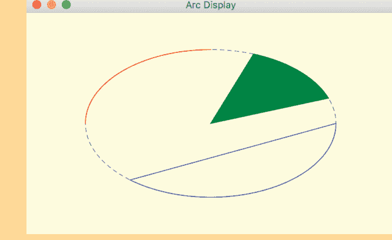

第一个弧（红色）是一个开放弧，它顺着椭圆的左上角曲线，从 90 度开始扫过 90 度。此弧没有填充颜色，因此它遵循椭圆的轮廓。在其他条件都相同的情况下，填充的开放弧和填充的弦弧在视觉上是相同的。

第二个（绿色）是一个填充的圆角弧，形成了一个倾斜的饼图形状。它从水平线上方 20 度处开始，扫过 20 度。

第三个（蓝色）是一个未填充的弧，因此轮廓显示了弧的两个端点之间的连接，该弧从 230 度开始，长度为 130 度。

可以使用负值来指定起始角度或弧长度。如果是负值，角度将沿顺时针方向而非逆时针测量。这里是示例中红色弧的另一种指定方法：

```java
Arc1 = new Arc(250, 150, 170, 100, -180, -90);
```

- 自测习题（答案见附录 L）
- SR 4.26 椭圆和弧之间是什么关系？
- SR 4.27 使用哪种类型的弧来显示“饼图”形状？简单的曲线呢？
- SR 4.28 你会指定什么样的起始角度和弧长度来包含底层椭圆的完整下半部分？你可以使用哪些替代值？

## 4.7 图像

对象代表图形图像，并支持从文件或 URL 加载图像。支持的格式包括 jpeg、gif 和 png。

列表 4.6 中的程序显示了一个在窗口中居中的图像（使用一个图像查看器）。

> **核心概念**
> 正起始角度和长度按逆时针方向测量。负值按顺时针方向测量。

> **核心概念**
> 图像由 Image 对象表示，但使用 ImageView 对象进行显示。

```java
import javafx.application.Application;

import javafx.scene.Scene;

import javafx.scene.image.Image;

import javafx.scene.image.ImageView;

import javafx.scene.layout.StackPane;

import javafx.stage.Stage;
```

# 列表 4.6 延续

```java
****************************************************************

// ImageDisplay.java      作者: Lewis/Loftus

// 演示了 Image 和 ImageView 对象的用法

****************************************************************

public class ImageDisplay extends Application

{

    // 在窗口中居中显示一个图像。

    //

    public void start(Stage primaryStage) {

        Image img = new Image("gull.jpg");

        ImageView imageView = new ImageView(img);

        StackPane pane = new StackPane(imageView);
```


```java
pane.setStyle("fx-background-color:cornsilk");

Scene scene = new Scene(pane, 500, 350);

primaryStage.setTitle("Image Display");

primaryStage.setScene(scene);

primaryStage.show();

}
}
```


## 4.7 图像

与之前的 JavaFX 示例使用 `Group` 对象作为场景的根节点不同，此程序在 `StackPane` 对象中显示图像。`StackPane` 类是 JavaFX API 提供的几种布局窗格之一。布局窗格是一个控制控件如何排列和视觉呈现的容器。布局窗格会在需要时调整呈现，例如当窗口调整大小时。

> **核心概念**
> 布局窗格是一个 JavaFX 容器，它以特定方式管理节点的视觉布局。

`StackPane` 中的节点是堆叠在彼此之上的。例如，你可能使用 `StackPane` 将文本叠加在形状上。在这个示例中，`ImageView` 对象是添加到窗格中的唯一节点，因此它仅起到了保持图像在窗口中居中的作用。我们将在后续示例中根据需要探索其他布局窗格，附录 G 展示了 JavaFX 布局窗格的示例。

调用 `StackPane` 的 `setStyle` 方法用于设置窗格的背景颜色。在之前的示例中，我们设置场景的背景颜色，但窗格有自己的背景颜色。`setStyle` 方法接受一个字符串，可以指定许多属性。JavaFX 样式属性类似于层叠样式表（CSS），以 `fx-` 开头。

`Image` 构造函数的参数是相对于目录的路径。例如，以下代码指定了 `myPix` 目录下的图像：

```java
Image logo = new Image("myPix/smallLogo.png");
```

图像也可以从 URL 获取：

```java
Image logo = new Image("http://example.com/images/bio.jpg");
```

如果指定了 URL，必须包含协议（如 `http://`）。

## Viewport

`Viewport` 是限制 `ImageView` 显示像素的矩形区域。例如：

```java
imageView.setViewport(new Rectangle(200, 80, 70, 60));
```

将此行添加到 `ImageDisplay` 程序中，将显示图像的后续：


## 第 4 章 编写类

- 自测习题（答案见附录。）
- SR 4.29 `Image` 和 `ImageView` 之间有什么区别？
- SR 4.30 什么是布局窗格？
- SR 4.31 如何设置 JavaFX 的样式属性？

## 4.8 图形界面

与文本的程序不同，图形界面（GUI）提供了更高水平的用户交互，这通常让程序更有趣。

三类对象协作创建 JavaFX GUI：

- 控件
- 事件
- 处理器

控件是允许用户交互的屏幕元素。GUI 控件包括按钮、文本字段、滚动条和滑块。

事件代表我们可能感兴趣的事件的对象，例如鼠标点击或在键盘上按键。围绕事件的程序被称为事件驱动程序。

> **核心概念**
> GUI 由事件、控件以及处理这些事件的处理器组成。

事件处理器是一个包含事件发生时被调用的对象。程序员设置生成事件的组件与响应它的处理器之间的关系。大多数情况下，我们使用 JavaFX API 中预定义的控件和事件。为了设置 GUI，我们展示并定制必要的控件，并提供处理器以在事件发生时执行任何所需的操作。

# 列表 4.7 继续

```java
// 当按钮被按下时，更新计数器和标签。

public void processButtonPress(ActionEvent event) {

    count++;

    countText.setText("Pushes: " + count);

}
```


该程序显示了一个按钮（`Button`）和一个文本（`Text`）对象。`Button` 类表示一个推按钮，允许用户通过鼠标点击来启动操作。`Button` 构造函数接受一个 `String` 参数，用于指定按钮上的文本。

`Button` 对象在被按下时会产生一个动作事件。`setOnAction` 方法用于指定按钮的事件处理器。
`::` 运算符用于指定方法引用（method reference），这是 Java 8 引入的新特性。在本示例中，方法引用指向该类中的 `processButtonPress` 方法（与 `start` 方法相同）。该引用指向正在执行该方法的对象。因此，在这个示例中，`PushCounter` 类本身充当了按钮的事件处理器。还有其他指定事件处理器关系的方法，将在本节的后部分进行讨论。

`processButtonPress` 方法增加计数器并更新显示的文本。请注意，计数器和 `Text` 对象被声明为实例数据（在类级别），因此它们可以在类中的两个方法中被引用。

`Button` 和 `Text` 控件被添加到 `FlowPane` 中，它被用作场景的根节点。`FlowPane` 是一种布局面板，类似于上一节中使用的 `StackPane`。`FlowPane` 中的节点以水平行（默认方式）或垂直列的形式进行布局。当没有更多可用空间时，面板中的下一个节点将流到下一行或下一列。在本示例中，按钮和文本水平排列并居中显示，间距为 20 像素。JavaFX 布局面板的概述请参见附录 G。

顺便提一下，此程序中使用的 `Text` 对象可以用 `Label` 控件替换以创建类似的效果。然而，`Label` 在为其他控件标记时最为合适，因为它提供了高级的键盘导航。`Label` 具有许多 `Text` 对象没有的样式属性，还可以包含图像。在本示例中，`Text` 对象就足够了。

## 指定事件处理器的其他方法

`PushCounter` 程序使用方法引用来定义按钮生成的事件的事件处理器。让我们看看定义事件处理器的其他方法。

事件处理器实际上是一个实现 `EventHandler` 接口的对象。接口是实现类必须定义的方法列表（接口将在第 7 章中详细讨论）。在这种情况下，`EventHandler` 接口要求你定义一个名为 `handle` 的方法来处理事件。因此，创建 `EventHandler` 的替代方案是定义一个实现 `EventHandler` 接口的完整类，可以作为 `ButtonCounter` 的一个私有类：

```java
private class ButtonHandler<ActionEvent> {

    public void handle(ActionEvent event) {

        count++;

        countText.setText("Pushes: " + count);

    }

}
```

然后，对按钮的 `setOnAction` 调用可以指定这样一个对象：

```java
push.setOnAction(new ButtonHandler());
```

除了定义单独类，还可以使用 Lambda 表达式（lambda expression）定义事件处理器：

```java
push.setOnAction((event) -> {

    count++;

    countText.setText("Pushes: " + count);

});
```

## 第 4 章 编写类

Lambda 表达式由括号中的参数列表、`->` 箭头运算符以及后面的表达式定义。如果一个表达式不足以完成，本示例中的 Lambda 表达式接受事件对象，该对象被传递到包含我们处理器代码的代码块。

每当需要函数接口（functional interface）的对象时，都可以使用 Lambda 表达式。函数接口是指单个抽象方法的接口。`EventHandler` 接口就是一个函数接口。

`PushCounter` 程序使用的方法引用方法等同于为方法提供参数的 Lambda 表达式。`this::processButtonPress` 等同于 `event -> processButtonPress(event)`。

我们认为方法引用方法是最整洁且易于遵循的，因此我们将在示例中常用该方法。

- 自习题（答案见附录 L。）
- SR 4.32 GUI 控件、事件和处理器之间是什么关系？
- SR 4.33 `Button` 对象在被按下时产生什么种类型的事件？
- SR 4.34 总结定义 JavaFX 处理器的三种技术。
- SR 4.35 什么是 `FlowPane`？

## 4.9 文本字段

文本字段允许用户输入一行文本，程序可以根据需要使用该文本。`FahrenheitConverter` 程序展示了一个 GUI，其中包含一个文本字段，用户可以在其中输入华氏温度。当用户按下 Return（或 Enter）键时，程序将显示相应的摄氏温度。

```java
// LISTING 4.8

import javafx.application.Application;

import javafx.scene.Scene;

import javafx.stage.Stage;

//************************************************************************************
// FahrenheitConverter.java      Author: Lewis/Loftus
// 展示了 TextField 和 GridPane 的使用。
//************************************************************************************
```

# 列表 4.8 继续

```java
public class FahrenheitConverter extends Application {

    // 启动温度转换器应用程序。

    public void start(Stage primaryStage) {

        Scene scene = new Scene(new FahrenheitPane(), 300, 150);

        primaryStage.setTitle("Fahrenheit Converter");

        primaryStage.setScene(scene);

        primaryStage.show();

    }

}
```

## 列表 4.9 续

```java
setAlignment(Pos.CENTER);

setHgap(20);

setVgap(10);

setStyle("fx-background-color: yellow");

add(inputLabel, 0, 0);

add(fahrenheit, 1, 0);

add(outputLabel, 0, 1);

add(result, 1, 1);

}

// 当用户在文本字段中按下回车键时，计算并显示转换后的温度。

public void processReturn(ActionEvent event) {

    int fahrenheitTemp = Integer.parseInt(fahrenheit.getText());

    int celsiusTemp = (fahrenheitTemp - 32) * 5 / 9;

    result.setText(celsiusTemp + "");

}
```

`processReturn` 方法用于定义事件处理器，当用户在文本字段中按下回车键时触发该处理器。它通过调用 `setOnAction` 方法与文本字段关联。`processReturn` 方法通过调用 `getText` 方法从文本字段获取文本，该方法返回一个字符字符串。使用 `Integer` 包装类的 `parseInt` 方法将文本转换为整数。然后，该方法执行计算以确定等值的摄氏温度，并将结果设置到相应标签的文本。

## 自习题（答案见附录 L）

- SR 4.36 描述当用户在文本字段中输入数字并按下回车键时，`FahrenheitConverter` 程序中发生了什么。
- SR 4.37 `GridPane` 布局中是如何对行和列进行编号的？你将如何指定从左上角向右三格向下两格的单元格？

## 核心概念总结

- 面向对象编程的核心是定义类来表示具有良好状态和行为的对象。
- 变量的作用域决定了它可以在哪里被引用，取决于它的声明位置。
- UML 类图帮助我们可视化程序中类的内容以及类之间的关系。
- 对象应该是封装的，保护其数据免受不当访问。
- 实例变量应该声明为 `private` 可见性，以促进封装。
- 大多数对象包含访问器（accessor）和修改器（mutator）方法，允许客户端以受控的方式管理数据。
- 方法返回的值必须与方法头中指定的返回类型一致。
- 当调用方法时，实际参数会被复制到形式参数中。
- 在方法中声明的变量是该方法的局部变量，不能在外部使用。
- 构造方法不能有任何返回类型，即使是 `void`。
- 弧被定义为椭圆的一部分。
- 正起始角和长度按逆时针测量。负值按顺时针测量。
- 图像由 `Image` 对象表示，但使用 `ImageView` 对象显示。
- 布局面板（layout pane）是一个 JavaFX 容器，以特定方式管理节点的视觉排布。
- GUI 由控件、代表用户操作的事件以及处理这些事件的处理器组成。

## 练习题

- EX 4.1 对于以下每一对，哪一个代表类，哪一个代表该类的对象？
  a. `Ingredient`（原料）, `Stick of Butter`（黄油棒）
  b. `Birch`（桦树）, `Tree`（树）
  c. `Kentucky`（肯塔基州）, `State`（州）
  d. `Ship`（船）, `Mayflower`（五月花号）
  e. `Toyota`（丰田）, `Car`（汽车）

- EX 4.2 列出可能为代表画框的 `PictureFrame` 类定义的某些属性和操作。

- EX 4.3 考虑一个名为 `HistoricalEvent`（历史事件）的类，它代表历史上发生的事件，如战争或独立宣言。列出可能为此类定义的某些属性和操作。

- EX 4.4 列出可能为代表大学课程的 `Course` 类（不是特定的某次课程，泛泛意义的课程）定义的某些属性和操作。

- EX 4.5 假设你有一个名为 `Meal`（餐点）的类，包含实例变量 `name` 和 `price`。编写一个名为 `printMeal()` 的方法，打印餐点的详情。

- EX 4.6 编写一个名为 `cube` 的方法，接受一个整数并返回其值的立方。

- EX 4.7 编写一个名为 `random100` 的方法，返回 1 到 100（包含）范围内的随机整数。

- EX 4.8 编写一个名为 `randomRange` 的方法，接受两个表示范围的整数参数。该方法应返回指定范围内的随机整数（包含）。假设第一个参数小于第二个参数。

- EX 4.9 编写一个名为 `randomColor` 的方法，创建并返回一个表示随机颜色的 `Color` 对象。`Color` 对象可以通过 0 到 255 之间的三个值定义，代表红、绿、蓝的贡献（其 RGB 值）。

- EX 4.10 假设你有一个 `City` 类。为该类编写一个构造方法，根据传递给构造方法的参数初始化 `name`、`population` 和 `geographicalArea` 实例变量。

- EX 4.11 为以下类的实例变量添加 getter 和 setter 方法。

```java
class Skyscraper {

    String name;

    double height;

    int numberOfFloors;

}
```


## 练习

- EX 4.12 绘制一个 UML 类图，显示 Transactions 程序使用的类之间的关系。

- EX 4.13 编写一个声明，创建一个 `Arc` 对象，其圆心位于点 (50, 50)，并跨越底层椭圆的上半部分。以一个水平半径为 40、垂直半径为 100 的椭圆为基础。

- EX 4.14 你如何限制图像显示的像素？

- EX 4.15 布局面板的作用是什么？

- EX 4.16 如何使用方法来定义事件处理器？

## 编程项目

- PP 4.1 编写一个名为 `Thermometer` 的类，表示一个测量温度的温度计。`Thermometer` 类应包含当前温度的实例数据。构造方法将温度初始化为 37 °C。编写一个名为 `increase` 的方法增加温度，并编写另一个名为 `getTemperature` 的方法返回当前温度。

- PP 4.2 编写一个名为 `Bulb` 的类，代表一个可以开启和关闭的灯泡。创建一个 `Lights` 类来实例化灯泡对象。

- PP 4.3 编写一个名为 `Cylinder` 的类，包含表示圆柱半径和高度的实例数据。定义 `Cylinder` 构造方法接受并初始化半径和高度，并包含 setter 方法。计算并返回 $\pi r^2h$（体积）、$2\pi rh + 2\pi r^2$（表面积）的方法。`toString` 方法返回圆柱的单行描述。创建一个 `MultiCylinder` 类，其 `main` 方法实例化对象。

- PP 4.4 编写一个名为 `Dog` 的类，包含名称和年龄的实例数据。定义 `Dog` 构造方法接受并初始化实例数据。包含所有实例数据的 getter 和 setter 方法。编写一个返回狗的年龄的方法。创建一个 `Kennel` 类，其 `main` 方法实例化狗对象。

- PP 4.5 编写一个名为 `Car` 的类，包含品牌、型号和年份的实例数据。定义 `Car` 构造方法初始化这些值。包含所有实例数据的 getter 和 setter 方法，以及一个返回汽车单行描述的 `toString` 方法。添加一个返回布尔的方法指示汽车是否为古董（如果超过 45 岁）。创建一个 `CarTest` 类，其 `main` 方法实例化汽车对象。

- PP 4.6 编写一个名为 `Box` 的类，包含表示盒子高度、宽度和深度的实例数据。还包含一个布尔变量 `full` 表示盒子是否装满。定义 `Box` 构造方法接受并初始化盒子的高度、宽度和深度。每个新创建的盒子都是空的（构造方法应初始化为 false）。包含所有实例数据的 getter 和 setter 方法。包含一个返回盒子单行描述的 `toString` 方法。创建一个 `BoxTest` 类，其 `main` 方法实例化更新盒子对象。

- PP 4.7 编写一个名为 `Book` 的类，包含标题、作者、出版商和版权日的实例数据。定义 `Book` 构造方法接受并初始化这些数据。包含所有实例数据的 getter 和 setter 方法。包含一个 `toString` 方法返回新格式的多行书籍描述。创建一个 `Books` 类，其 `main` 方法实例化多个对象。

- PP 4.8 编写一个名为 `Duration` 的类，用小时和分钟表示时长。它应该包含表示起始小时、结束小时和结束分钟的实例数据。定义 `Duration` 构造方法接受并初始化所有实例数据。包含所有实例数据的 getter 和 setter 方法。包含一个 `toString` 方法返回格式为 `[HH:MM,HH:MM]` 的字符串。编写一个方法 `length` 以分钟返回时长。假设所有时间时长都使用 24 小时制，且没有时长会跨越几天。创建一个 `DurationTest` 类，其 `main` 方法实例化并更新多个 `Duration` 对象。

- PP 4.9 使用本章定义的类，编写一个名为 `PairOfDice` 的类，由两个 `Dice` 对象组成。包含设置和获取单个骰子值的方法、一个掷骰子的方法，以及一个返回两个骰子值当前总和的方法。创建一个名为 `RollingDice2` 的驱动类，以实例化并使用 `PairOfDice` 对象。

- PP 4.10 编写一个 JavaFX 应用程序，并排显示三张图像。使用 `FlowPane` 并在图像之间设置适当的间隔。

- PP 4.11 编写一个 JavaFX 应用程序，使用 `GridPane` 在 2×2 的网格中显示四个版本的图像。对于每个版本，使用视口来显示图像的不同部分，或者对图像进行调整大小和旋转。

- PP 4.12 编写一个 JavaFX 应用程序，显示一个按钮和一个数字。每当点击按钮时，将该数字更改为 1 到 100 之间的随机值。

- PP 4.13 编写一个 JavaFX 应用程序，展示一个按钮和一个圆形。每当点击按钮时，圆形应移动到窗口内的新随机位置。

- PP 4.14 编写一个 JavaFX 应用程序，向用户展示两个按钮和一个数字（初始设为 30）。将按钮标记为 Increment（增加）和 Decrement（减小）。当点击增加按钮时，增加显示的值。同样，当点击减小按钮时，减少该值。

- PP 4.15 编写一个 JavaFX 应用程序，在窗口中心展示一个被圆形围绕的无标签文本框。当用户在文本框输入半径值并按回车键时，相应地重绘圆形。

- PP 4.16 编写一个 JavaFX 应用程序，展示四个带标签的文本框，允许用户输入姓名、年龄、喜欢的颜色和爱好。包含一个标记为 Print（打印）的按钮。当点击按钮时，程序应使用 `println` 语句将所有字段的内容打印到控制台窗口（标准输出）。

## 软件失败

## 丹佛机场行李处理系统

### 发生了什么？

丹佛国际机场的设计者对自动化行李处理有宏大的计划。由于机场闸口和航站之间的距离长达一英里，他们希望通过最少的人工干预，将行李从值机台运送到出发飞机，并从到达飞机运送到行李收集处。该系统将减少航班延迟、缩短在行李转盘处的等待时间，并降低人工成本。


该系统设计于 20 世纪 80 年代后期和 90 年代初。他们建造了约 26 英里的轨道，在中央计算机的控制下让灰色推车在坡道上下运行。

- 丹佛的自动行李处理系统导致了行李丢失和包裹损坏。

然而，计划于 1994 年 3 月开放的机场因行李系统的失败而持续延迟。在测试期间，行李被错误装载和路由。它们在转弯时从推车上掉落。系统加载了已经满的推车，并卸到塞满行李的传送带上。行李因挤在推车下或掉落在混凝土地上而受损。

机场最终于 1995 年 2 月正式开放。在那那时，只有一家航空公司——美国航空（United）同意使用该自动系统。这是系统的精简版本，仅用于出发航班。没有其他航空公司完全使用该系统。他们选择由人工驾驶行李推车，就像今天大多数机场所做的那样。美国航空于 2005 年最终放弃了该系统。

系统的原始成本为 1.86 亿美元。每天损失 100 万美元，超过了原始成本。当美国航空在 2005 年选择放弃该系统时，尽管他们拥有到 2025 年的、每年 6000 万美元的系统租赁。

### 是什么导致了它？

这个项目代表的失败被认为是历史上最严重的软件工程和整体系统设计失败之一。许多人对问题的产生有所贡献，但总的来说，设计者只是对他们使用的技术过度信任。他们没有考虑到复杂系统中总是会错误和效率低的问题。

具体问题包括：软件误读了光电眼睛，因此没有检测到已有的行李堆。当系统崩溃后重启时，丢失了推车的状态信息，不知道哪些推车是满的。传送带的速度没有正确考虑到急转角的情况，导致推车倾翻。一种被称为“蜥蜴舌”的伸缩带装载器——设计用于进入飞机货舱并在无人工帮助的情况下提取行李——完全失败了。

### 经验训

这种规模的项目不应在没有对使用的技术进行大量局部测试的情况下尝试。失败往往是系统整体运行时多个变量共同导致的结果。

当该系统在 20 世纪 80 年代后期设计时，它依赖于中央主机来控制系统。这种方法在当今分布式处理的世界看来是荒谬的，但它是一个大型系统在开发完成时可能已经过时的良好例子。今天，配备手持扫描仪的人工行李员提供的交付系统比计划中的自动系统的最佳目标更快且准确得多。

> 来源：《国际先驱报》（The International Herald Tribune）

## 第 5 章 条件与循环

## 章节目标

- 定义通过方法的控制流。
- 探索可用于做决策的布尔表达式。
- 使用 `if` 语句执行基础决策。
- 讨论与数据比较相关。
- 使用循环重复执行语句。
- 讨论迭代器概念并使用它读取文本文件。
- 引入 `ArrayList` 类。
- 探索 GUI 控件和事件。

## 5.1 布尔表达式

在运行程序中，语句执行的顺序被称为控制流。除非另有规定，程序的执行按线性方式进行。也就是说，运行的程序从第一条语句开始，一次移动一条语句，直到程序完成。Java 应用程序从 `main` 方法的第一行开始执行，并逐步进行直到到达 `main` 方法结束。

调用方法会改变控制流。当方法被调用时，控制跳转到该方法的代码处。当方法完成后，控制返回到调用该方法的处，并从那里继续。

在方法内部，我们可以通过使用某些类型的语句来改变代码的控制流。控制方法执行流的语句分为两类：条件语句和循环。

> 条件语句被称为选择语句，因为它允许我们选择将执行哪条语句。Java 中的条件语句是 `if-else` 语句和 `switch` 语句。我们将在章中探索 `if` 语句和 `if-else` 语句，并在第 6 章介绍 `switch` 语句。

每个决策都基于一个布尔表达式（也称为条件），这是一个求值结果为真或假的表达式。表达式的结果决定了下一步执行哪条语句。以下是 `if` 语句的示例：

```
if (count > 20)
  System.out.println("Count exceeded");
```

该语句中的条件是 `count > 20`。该表达式求值为一个布尔值（真或假），或者不是。存储在 `count` 中的值要么大于 20 或者不是。如果是，则 `println` 语句被跳过，处理将从随其后的任何代码继续。

做这种决策的需求在编程场景中随处可见。例如，人寿保险的成本可能取决于被保险人是否抽烟。如果此人抽烟，我们使用特定的公式计算成本；如果不抽烟，我们使用另一种方法计算。条件语句的作用是评估布尔条件（此人是否抽烟），然后相应地执行正确的计算。

循环，或称为重复语句，允许我们反复执行某条编程语句。与条件语句一样，循环基于一个布尔表达式，该表达式决定了语句执行的次数。

> 核心概念
> 循环允许程序多次执行某条语句。

例如，假设我们想要计算班级中每个学生的平均学分（GPA）。对每个学生的计算方法是相同的，只是在不同的数据上进行。我们将使用一个循环，对每个学生重复该计算，直到没有更多需要处理的学生为止。

Java 有三种类型的循环：`while` 语句、`do-while` 语句和 `for` 语句。每种循环语句都有与其他循环不同的独特特征。本章将介绍 `while` 语句，`do` 和 `for` 循环将在第 6 章介绍。

条件语句和循环所依据的布尔表达式使用相等运算符、关系运算符和逻辑运算符来做出决策。在详细讨论条件语句和循环语句之前，让我们先探索这些运算符。

## 等于和关系运算符

`==` 和 `!=` 运算符被称为相等运算符。它们测试两个值是否相等或不相等。注意，相等运算符由两个并排等号组成，不应将其误认为是仅使用一个符号的赋值运算符。

下面的 `if` 语句仅在变量 `total` 和 `sum` 包含相同值时才打印语句：

```java
if (total == sum)
    System.out.println("total equals sum");
```

同样，`if` 语句仅在变量 `total` 和 `sum` 不包含相同值时才打印语句：

```java
if (total != sum)
    System.out.println("total does NOT equal sum");
```

Java 还有几个关系运算符，让我们能够判断值之间的相对顺序。在本节较之前，我们使用了大于运算符 (`>`) 来判断一个值是否大于另一个值。我们可以使用各种运算符询问类似的问题。在 Java 中，关系运算符包括大于 (`>`)、小于 (`<`)、大于等于 (`>=`) 和小于等于 (`<=`)。图 5.1 列出了 Java 的相等运算符和关系运算符。

| 运算符 | 含义 |
| --- | --- |
| == | 等于 |
| != | 不等于 |
| < | 小于 |
| <= | 小于等于 |
| > | 大于 |
| >= | 大于等于 |

图 5.1 Java 相等运算符和关系运算符

相等运算符和关系运算符的优先级低于算术运算符。因此，首先评估算术运算符，然后是相等关系操作。一如既，可以使用括号显式地指定评估顺序。

在本章检查条件语句和循环语句的过程中，我们将看到更多关系运算符的示例。

## 逻辑运算符

除了相等关系运算符外，Java 有三个产生布尔结果的逻辑运算符。它们也接受布尔操作数。图 5.2 列出并描述了逻辑运算符。

| 运算符 | 描述 | 示例 | 结果 |
| --- | --- | --- | --- |
| ! | 逻辑非 | ! a | 如果 a 为 false 则为 true，a 为 true 则为 false |
| && | 逻辑与 | a && b | 如果 a 和 b 均为 true 则为 true，否则为 false |
| \|\| | 逻辑或 | a \|\| b | 如果 a 或 b 为 true 则为 true，否则为 false |

图 5.2 Java 逻辑运算符

`!` 运算符用于执行逻辑非操作，也称为逻辑取反。布尔值的逻辑取反会产生其相反的值。也就是说，如果一个名为 `found` 的布尔变量值为 `false`，那么 `!found` 就是 `true`。同样，如果 `found` 是 `true`，那么 `!found` 就是 `false`。逻辑非操作不会改变存储在 `found` 中的值。

逻辑操作可以用真值表来描述，真值表列出了表达式中所用变量的所有可能组合。由于逻辑非运算符是单元运算符，它的唯一操作数只有两个可能的值：`true` 或 `false`。图 5.3 显示了描述 `!` 运算符的真值表。

| a | !a |
| --- | --- |
| false | true |
| true | false |

图 5.3 描述逻辑非运算符的真值表

`&&` 执行逻辑与操作。如果两个操作数都为 `true`，则结果为 `true`，否则为 `false`。逻辑或运算符 (`||`) 的结果相比，如果其中一个操作数为 `true`，则结果为 `true`，否则为 `false`。

与和或运算符都是二元运算符，因为每个都使用两个操作数。有四种可能的组合需要考虑：两个操作数均为 `true`、均为 `false`、一个为 `true` 另一个为 `false` 反之亦然。图 5.4 描述了一个显示 `&&` 运算符的真值表。

逻辑非在三个逻辑运算符中优先级最高，逻辑与之后是逻辑或。

考虑以下 `if` 语句：

```java
if (!done && (count > MAX))
    System.out.println("Completed.");
```

在什么情况下 `println` 语句会被执行？布尔变量 `done` 的值要么是 `true` 要是 `false`，非运算符反转该值。`count` 的值要么大于 `MAX` 或者不是。图 5.5 中的真值表显示了所有可能性。

| !done | count > MAX | !done && (count > MAX) |
| --- | --- | --- |
| false | false | false |
| false | true | false |
| true | false | false |
| true | true | true |

图 5.5 条件的真值表

`&&` 和 `||` 运算符的一个重要特性是它们是“短路的”。也就是说，如果它们的左操作数足以判断操作的布尔结果，则不会评估右操作数。

> 核心概念
> 逻辑运算符经常用于构建复杂的条件。

| a | b | a && b | a \|\| b |
| --- | --- | --- | --- |
| false | false | false | false |
| false | true | false | true |
| true | false | false | true |
| true | true | true | true |

图 5.4 逻辑与或运算符的真值表

有时你可以利用操作短路。例如，如果左操作数为 `false`，则整个表达式为 `false`。同样，如果左操作数为 `true`，无论右操作数的值如何，结果都是 `true`。这可以避免错误，例如除零。

```java
if (count != 0 && total > 0)
    System.out.println("Testing:");
```

你应该考虑是否依赖这些技巧。正如我们之前强调的，可读性优于巧妙技巧。始终努力让读者理解你的程序的逻辑。

## 自我复习题（答案见附录）

- SR 5.1 什么是程序的控制流？
- SR 5.2 条件语句和循环基于什么？
- SR 5.3 什么是相等运算符？关系运算符？逻辑运算符？
- SR 5.4 假定以下声明，下列每个表达式的值是多少？

```java
int value1 = 5, value2 = 10;
boolean done = true;
```


## 5.2 if 语句

- a. `value1 <= value2`
- b. `(value1 + 5) >= value2`
- c. `value1 < value2 / 2`
- d. `value2 != value1`
- e. `(!value1 == value2)`
- f. `(value1 < value2) || done`
- g. `(value1 > value2) || done`
- h. `(value1 < value2) && !done`
- i. `done || !done`
- j. `((value1 > value2) || done) && (!done || (value2 > value1))`

- SR 5.5 什么是真值表？
- SR 5.6 假设 `done` 是布尔变量，`value` 是 `int` 变量，为表达式 `(value > 0 ) || !done` 创建真值表
- SR 5.7 假设 `c1` 和 `c2` 是布尔变量，为表达式 `(c1 && c2) || (!c1 && c2)` 创建真值表

### if 语句基础

我们在本章之前的示例使用了基础的 `if` 语句。让我们详细探索它。

`if` 语句由关键字 `if` 后接布尔表达式和一个语句组成。条件在括号内，必须求值为 `true` 或 `false`。如果条件为 `true`，则执行该语句并继续处理下一个语句。如果条件为 `false`，则跳过该语句并直接继续处理下一个语句。图 5.6 显示了这种处理过程。

> **核心概念**
> 适当缩进对于人类可读性很重要；它显示了语句与语句之间的关系。

考虑以下 `if` 语句的示例：

```java
if (total > amount)
    total = total + (amount + 1);
```

在这个示例中，如果 `total` 的值大于 `amount` 的值，则执行赋值语句；否则，跳过赋值语句。

注意此示例中的赋值语句在 `if` 语句的标题行下缩进了。这传达了赋值语句是 `if` 语句的一部分；它意味着 `if` 语句控制了赋值语句是否会被执行。虽然这种缩进对人类读者来说至关重要，但编译器会忽略它。

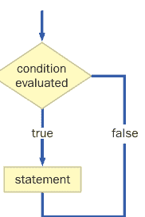

列表 5.1 中的示例读取了用户输入的年龄，并根据输入的年龄决定是否打印某个特定的句子。`Age` 类在所有情况下都会回显输入的年龄值。如果年龄小于常量 `MINOR` 的值，则打印关于你的语句。如果年龄大于或等于 `MINOR` 的值，则跳过 `println` 语句。无论何种情况，都会打印最后一句关于“年龄是一种心态”的句子。

#### 列表 5.1 Age.java

```java
// Age.java               Author: Lewis/Loftus
// 展示了 if 语句的使用。
//****************************************************************************
import java.util.Scanner;

public class Age {
    // 读取用户的年龄并根据情况打印注释。
    // - 
    public static void main(String[] args) {
        final int MINOR = 21;
        Scanner scan = new Scanner(System.in);
        System.out.print("Enter your age: \n");
        int age = scan.nextInt();
        System.out.println("You entered: " + age);
        if (age < MINOR) {
            System.out.println("Youth is a wonderful thing. Enjoy.");
            System.out.println("Age is a state of mind.");
        }
    }
}
```

**输出**
```text
Enter your age: 40
You entered: 40
Age is a state of mind.
```

让我们来看几个更多基础 `if` 语句的例子。以下 `if` 语句如果变量 `size` 的当前值大于或等于常量 `MAX` 的值，则将其设置为零：

```java
if (size >= MAX)
    size = 0;
```

接下来的 `if` 语句的条件将三个值相加，然后将结果与 `numBooks` 中的值进行比较：

```java
if (numBooks < stackCount + inventoryCount + duplicateCount)
    reorder = true;
```

如果 `numBooks` 小于所选的其他值，布尔变量 `reorder` 被设置为 `true`。加法操作是在小于运算符之前执行的，因为算术运算符的优先级高于关系运算符。

假设 `generator` 指向 `Random` 类的一个对象，接下来的 `if` 语句检查调用 `nextInt` 返回的值以确定一个随机胜者：

```java
if (generator.nextInt(CHANCE) == 0)
    System.out.println("You are a randomly selected winner!");
```

这段代码选出胜者的概率基于常量 `CHANCE` 的值。也就是说，如果 `CHANCE` 包含 20，那么中奖概率就是 1 分 20。条件寻找返回值为 0 这一事实是任意的；0 到 `CHANCE-1` 之间的任何值都可以生效。

### if-else 语句

有时，我们希望在条件为真时做一件事，在条件为假时做另一件事。我们可以为 `if` 语句添加一个 `else` 子句，使其成为 `if-else` 语句，以处理这种情况。以下是一个 `if-else` 语句的例子：

```java
if (height <= MAX)
    adjustment = 0;
else
    adjustment = MAX - height;
```

如果条件为真，则执行第一个赋值语句；如果条件为假，则执行第二个赋值语句。只有其中一个会被执行，因为布尔条件求值的结果为 `true` 或 `false`。注意，这里再次使用了正确的缩进来表明这些语句是控制语句的一部分。

`if` 语句测试布尔表达式，如果为真，则执行第一条语句。可选的 `else` 子句识别了当表达式为假时应该执行的语句。

示例：

```java
if (total < 7)
    System.out.println("Total is less than 7.")

if (firstCh != 'a')
    count++;
else
    count = count / 2;
```

列表 5.2 中的 `Wages` 程序使用 `if-else` 语句为员工计算适当的金额。

在 `Wages` 程序中，如果员工每周工作超过 40 小时，支付金额将考虑到加班的小时。使用 `if-else` 语句来确定用户输入的小时数是否大于 40。如果是，额外的时数将按正常费率的一半支付。如果没有加班小时，总支付金额将简单基于工作小时数和标准费率。

让我们来看另一个 `if-else` 语句例子：

```java
if (roster.getSize() == FULL)
    roster.expand();
else
    roster.addName(name);
```

#### 列表 5.2 Wages.java

```java
// Wages.java               Author: Lewis/Loftus
//
// 展示了 if-else 语句的使用。
//********************************************************************************
import java.text.NumberFormat;
import java.util.Scanner;

public class Wages {
    // 读取工作时间并计算工资。
    public static void main(String[] args) {
        final int STANDARD = 40;
        final double RATE = 12.50;
        Scanner scan = new Scanner(System.in);
        System.out.print("Enter the hours worked: ");
        int hours = scan.nextInt();
        double pay = 0.0;
        // 加班时间和半
        if (hours > STANDARD)
            pay = STANDARD * RATE + (hours - STANDARD) * RATE * 1.5;
        else
            pay = hours * RATE;
        NumberFormat fmt = NumberFormat.getCurrencyInstance();
        System.out.println("Gross earnings: " + fmt.format(pay));
    }
}
```

**输出**
```text
Enter the hours worked: 46
Gross earnings: $562.50
```

这个示例使用了名为 `roster` 的对象。即使不知道 `roster` 代表什么或如何创建的，我们可以看到它有三个方法：`getSize()`、`expand()` 和 `addName()`。`if` 语句的条件调用 `getSize()` 并将其结果与常量比较。如果条件为真，则调用 `expand()` 方法（扩展 roster）。如果 roster 未满，则将变量作为参数传递给 `addName()` 方法。

列表 5.3 程序实例化 `Coin` 对象，翻转它，然后使用 `if-else` 语句根据结果决定打印哪句话。

#### 列表 5.3 CoinFlip.java

```java
// CoinFlip.java          Author: Lewis/Loftus
//
// 展示了 if-else 语句的使用。
//************************************************
public class CoinFlip {
    // 创建 Coin 对象，翻转它并打印结果。
    //
    public static void main(String[] args) {
        Coin myCoin = new Coin();
        myCoin.flip();
        System.out.println(myCoin);
        if (myCoin.isHeads()) {
            System.out.println("You win.");
        } else {
            System.out.println("Better luck next time.");
        }
    }
}
```

**输出**
```text
Tails
Better luck next time.
```

`Coin` 类见列表 5.4。它存储了两个整数常量（`HEADS` 和 `TAILS`）代表硬币的可能状态，以及一个名为 `face` 的实例变量代表当前状态。构造函数通过调用 `flip()` 方法初始化硬币，该方法通过随机选择一个数字（0 或 1）来确定硬币的状态。`isHeads()` 方法根据当前的朝面值返回一个布尔值。`toString()` 方法使用 `if-else` 语句来决定硬币返回哪种字符字符串。当 `myCoin` 对象传递给 `main` 方法中的 `println` 时，`toString()` 方法会被自动调用。

#### 列表 5.4 Coin.java

```java
// Coin.java      作者: Lewis/Loftus
// 表示一个有两个面且可以翻转的硬币。
//********************************************************************************
public class Coin {
    private final int HEADS = 0;
    private final int TAILS = 1;
    private int face;

    //-----------------------------------------------------------------
    // 通过初始翻转来设置硬币（构造函数）。
    //-----------------------------------------------------------------
    public Coin() {
        flip();
    }

    //-----------------------------------------------------------------
    // 通过随机选择一个朝面值来翻转硬币（翻转方法）。
    //-----------------------------------------------------------------
    public void flip() {
        face = (int) (Math.random() * 2);
    }

    //-----------------------------------------------------------------
    // 如果硬币当前朝面是正面，则返回 true。
    //-----------------------------------------------------------------
    public boolean isHeads() {
        return (face == HEADS);
    }

    //-----------------------------------------------------------------
    // 将硬币当前的朝面以字符串形式返回。
    //-----------------------------------------------------------------
    public String toString() {
        String faceName;
        if (face == HEADS)
            faceName = "Heads";
        else
            faceName = "Tails";
        return faceName;
    }
}
```

### 使用块语句

我们可能希望根据评估布尔条件的结果做多一件事。在 Java 中，我们可以用块语句替换任何单个语句。

块语句是包含在大括号内的一组语句。在之前的示例中，我们已经多次使用这些大括号来包含方法和类的定义。

列表 5.5 所示的名为 `Guessing` 的程序使用了 `if-else` 语句，其中 `else` 分句的语句是一个块语句。

如果用户输入了随机选择的答案，将打印相应的确认信息。然而，如果答案错误，则会打印两条语句：一条声明猜测错误，另一条打印实际答案。本章末尾的一个编程项目将此示例的概念扩展为“Hi-Lo 游戏”。

请注意，如果不使用块大括号，那么当答案错误时，声明答案错误的句子会被打印，而揭示正确答案的句子在所有情况下都会被打印。也就是说，只有第一条语句会被视为 `else` 分句的一部分。

请记住，缩进除了人类读者之外没有任何意义。没有被正确分块的语句可能会导致程序员对代码的执行方式产生错误的假设。例如，以下代码具有误导性：

```java
if (depth >= UPPER_LIMIT)
    delta = 100;
else
    System.out.println("WARNING: Delta is being reset to ZERO");
    delta = 0; // 不属于 else 分句！
```

缩进（更不用说代码逻辑了）意味着变量 `delta` 仅在 `depth` 小于 `UPPER_LIMIT` 时才重置为零。然而，如果不使用块，重置 `delta` 为零的赋值语句完全不受 `if-else` 语句控制。它在任何情况下都会执行，这显然不是意图所在。

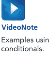


```java
// 列表 5.5
// Guessing.java      作者: Lewis/Loftus
// 演示在 if-else 中使用块语句。

import java.util.*;
public class Guessing
{
    // 与用户玩简单的猜数字游戏。
    //
    public static void main(String[] args) {
        final int MAX = 10;
        int answer, guess;

        Scanner scan = new Scanner(System.in);
        Random generator = new Random();
        answer = generator.nextInt(MAX) + 1;

        System.out.print("我正在想一个 1 到 "
                + MAX + " 之间的数字。猜猜是多少: ");

        guess = scan.nextInt();

        if (guess == answer) {
            System.out.println("你猜对了！猜得好！");
        } else {
            System.out.println("不对，抱歉。");
            System.out.println("数字是 " + answer);
        }
    }
}
```

```
输出
我正在想一个 1 到 10 之间的数字。猜猜是多少: 7
不正确，抱歉。
数字是 5
```

## 5.2 if 语句

在 Java 语法中，任何需要调用单个语句的地方都可以使用块语句。例如，`if-else` 语句的 `if` 部分可以是一个块，或者 `else` 部分可以是一个块（正如我们在 `Guessing` 程序中看到的那样），或者两者都可以是块语句。例如：

```java
if (boxes != warehouse.getCount()) {
    System.out.println("库存与仓库不匹配。");
    System.out.println("重新开始库存处理！");
    boxes = 0;
} else {
    System.out.println("库存与仓库匹配。");
    warehouse.ship();
}
```

在 `if-else` 方法中，`boxes` 的值与通过调用 `warehouse` 对象的 `getCount` 方法获得的值进行比较（即 `warehouse.getCount()`）。如果它们不完全匹配，则执行两条 `println` 语句和一个赋值语句。如果它们匹配，则会打印不同的消息并调用 `warehouse` 的 `ship` 方法。

### 嵌套 if 语句

作为 `if` 语句结果而执行的语句可以是另一个 `if` 语句。

```java
if (num1 >= num2)
{
    System.out.print(" red ");
    System.out.print(" orange ");
}
if ((num1 + 5) >= num2)
    System.out.print(" white ");
else
    if ((num1 + 10) >= num2)
    {
        System.out.print(" black ");
        System.out.print(" blue ");
    }
    else
        System.out.print(" yellow ");
System.out.println(" green ");
```

- a. 假设 `num1` 的值为 5 且 `num2` 的值为 4？
- b. 假设 `num1` 的值为 5 且 `num2` 的值为 12？
- c. 假设 `num1` 的值为 5 且 `num2` 的值为 27？

**SR 5.12** 编写一个表达式，根据名为 `temperature` 的 `int` 变量的值打印相应的消息。如果 `temperature` 等于或小于 50，则打印“It is cool.” 并在下一行打印“Dress warmly,”。如果 `temperature` 大于 80，则在一行打印“It is warm.” 并在下一行打印“Dress coolly.”。如果 `temperature` 在 50 到 80 之间，则在一行打印“It is pleasant.” 并在下一行打印“Dress pleasantly.”

## 5.3 比较数据

在使用布尔表达式比较数据时，理解根据所检查的数据类型而产生的细微差别很重要。让我们来看几个关键情况。

### 比较浮点数

在比较浮点数据时会出现一种有趣的情况。根据 `==` 运算符，只有当两个浮点值的底层表示的所有二进制位匹配时，这两个浮点值才相等。如果比较的值是计算得，如果它们对于特定情况足够接近，它们不太可能完全相等。因此，在比较浮点数时，你应该极少使用相等运算符 (`==`)。

检查浮点相等性的更好方法是计算两个值之差的绝对值，并将结果与某个容差水平进行比较。例如，我们可以选择 0.00001 的容差水平。如果两个浮点值非常接近，以至于它们的差小于容差，那么我们就愿意认为它们是相等的。比较两个浮点值 `f1` 和 `f2` 可以如下实现：

```java
if (Math.abs(f1 - f2) < TOLERANCE)
    System.out.println("Essentially equal.");
```

常量 `TOLERANCE` 的值应该适用于这种情况。

### 比较字符

当我们说一个数字小于另一个数字时我们很清楚，但说字符小于意味着什么呢？正如第 2 章所讨论的，Java 中的字符基于 Unicode 字符集，该字符集定义了所有可以使用的字符的顺序。因为字符 `'a'` 在字符集中位于字符 `'b'` 之前，我们可以说 `'a'` 小于 `'b'`。

我们可以在字符数据上使用相等运算符和关系运算符。例如，如果两个字符变量 `ch1` 和 `ch2` 持有两个字符，我们可以通过如下 `if` 语句确定它们在 Unicode 字符集中的相对顺序：

```java
if (ch1 < ch2)
    System.out.println(ch1 + " " + " is greater than " + ch2);
else
    System.out.println(ch1 + " " + " is NOT greater than " + ch2);
```

> **核心概念**
>
> Java 中字符的相对顺序由 Unicode 字符集定义。

Unicode 字符集的结构使得所有小写字符（`'a'` 到 `'z'`）都是连续且按字母顺序排列的。对于大写字母（`'A'` 到 `'Z'`）和代表数字的字符（`'0'` 到 `'9'`）也是如此。数字在大写字母之前，大写字母在小写字母之前。在这些组之前和这些组之间还有其他字符。详情请参见附录 C 中的图表。

记住，字符和字符串是两种不同的信息类型。`char` 是表示一个字符的原始值。字符字符串在 Java 中表示为一个对象，由 `String` 类定义。虽然比较字符串基于比较字符串中的字符，但比较受比较对象的规则的支配。

### 比较对象

字符之间的 Unicode 关系使得对字符和字符字符串变得简单。例如，如果你有一个名称列表，你可以根据字符集中字符之间的内在关系将其按字母顺序排列。

然而，你不应该使用相等运算符或关系运算符来比较 `String` 对象。`String` 类包含一个名为 `equals` 的方法，如果两个字符串比较的字符完全相同，该方法返回一个布尔值，否则返回 `false`。例如：

```java
if (name1.equals(name2))
    System.out.println("The names are the same.")
else
    System.out.println("The names are not the same.")
```

假设 `name1` 和 `name2` 是 `String` 对象，此条件决定了字符是否完全匹配。因为两个对象都是从 `String` 类创建的，所以它们都响应 `equals` 方法。因此，该条件可以写为 `name1.equals(name2)`，并且结果会发生。

测试条件 `name1 == name2` 是有效的，但它实际上测试的是引用变量是否指向同一个 `String` 对象。对于任何对象，`==` 运算符都会测试两个引用变量是否为彼此的别名（它们是否包含相同的地址）。这与测试两个不同的 `String` 对象是否包含相同的字符不同。

请记住，字符串字面量（例如 `"Nathan"`）是一种方便手段，是创建对象的简写技术。与字符串比较比较相关的一个有趣问题是，Java 仅在需要时为字符串字面量创建对象。也就是说，如果方法中多次使用字面量 `"Hi"`，会创建一个对象来表示它。后续使用该字面量时，都会引用原始对象。


要确定两个字符串的相对顺序，使用 `String` 类的 `compareTo` 方法。`compareTo` 方法比 `equals` 方法更通用。`compareTo` 方法不返回布尔值，而是返回一个整数。如果被调用的 `String` 对象小于作为参数的字符串，则返回值为负。如果两个字符串包含相同的字符，则返回值为零。如果被调用的 `String` 对象大于作为参数的字符串，则返回值为正。例如：

```java
int result = name1.compareTo(name2);
if (result < 0)
    System.out.println(name1 + " comes before " + name2);
else
    if (result == 0)
        System.out.println("The names are equal.");
    else
        System.out.println(name1 + " follows " + name2);
```

记住，比较字符和字符串基于 Unicode 字符集（见附录 C）。这被称为字典序。如果所有字母都是相同的大小（大写或小写），字典序将是字母顺序。在比较两个字符串（如 `"able"` 和 `"Baker"`）时，`compareTo` 方法会得出 `"Baker"` 在之前的结论，因为在 Unicode 字符集中所有大写字母都在所有小写字母之前。一个字符串如果是另一个更长字符串的前缀，被认为在长字符串之前。例如，在比较两个字符串 `"horse"` 和 `"horsefly"` 时，`compareTo` 方法会得出 `"horse"` 在之前的结论。

+   **自习题（答案见附录 L）**

**SR 5.13** 为什么我们在比较浮点数的相等性时必须小心？

**SR 5.14** 我们如何比较字符串的相等性？

**SR 5.15** 为 4.2 节的 `Die` 类编写一个 `equals` 方法。如果被调用的 `Die` 对象与作为参数的 `Die` 对象具有相同的点数，该方法返回 `true`，否则返回 `false`。

**SR 5.16** 假设字符串变量 `s1` 和 `s2` 已经初始化。编写一个表达式，按字典序分行打印这两个字符串。

## 5.4 while 语句

正如我们在本章引言中讨论的那样，重复语句（或循环）允许我们多次执行另一个语句。`while` 语句是一种循环，它像 `if` 语句一样评估一个布尔条件，并在该条件为真时执行一个语句（称为循环体）。与 `if` 语句不同的是，在执行完循环体后，条件会再次被评估。如果条件仍然为真，则再次执行循环体。这种重复一直持续到 `while` 循环体不再为止。图 5.7 显示了这种处理过程。

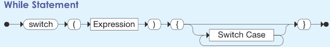

只要布尔表达式为真，`while` 循环就会重复执行指定的 `Statement`。表达式首先被求值；因此，`Statement` 可能完全不执行。在每次执行 `Statement` 之后，表达式都会再次被评估，直到表达式变为为假。

示例：

```java
while (total > max)
{
    total = total / 2;
    System.out.println("Current total: " + total);
}
```

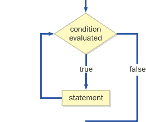

图 5.7 `while` 循环的逻辑

以下循环打印从 1 到 5 的值。循环的每次迭代打印一个值，然后计数器加1。

```java
int count = 1;
while (count <= 5)
{
    System.out.println(count);
    count++;
}
```

> **核心概念**
>
> `while` 语句不断执行相同的语句，直到其条件变为为假。

注意 `while` 循环的体是一个包含两个语句的块。整个块在循环的每次迭代中都会重复执行。

让我们来看另一个使用 `while` 循环的程序。列表 5.7 所示的 `Average` 程序从用户处读取一组整数值，将它们求和，并计算它们的平均值。

我们不知道用户可能会输入多少个值，因此我们需要一种方法来指示用户已完成数字输入。在这个程序中，将 0 设计为哨兵值，用于指示输入的结束。`while` 循环继续处理输入值，直到用户输入 0。

### 列表 5.7

```java
// Average.java         作者: Lewis/Loftus
// 演示了 while 循环、哨兵值以及
// 累加和的使用。

import java.text.DecimalFormat;
import java.util.Scanner;

public class Average
{
    // 计算用户输入的一组值的平均值。
    // 在输入数字时打印当前累加和。
    // ------------------------------------------------------------
    public static void main(String[] args)
    {
        int sum = 0, value, count = 0;
        double average;

        Scanner scan = new Scanner(System.in);
        System.out.print("Enter an integer (0 to quit):");
        value = scan.nextInt();

        while (value != 0) //  0 作为哨兵值以终止循环
        {
            count++;

            sum += value;
            System.out.println("The sum so far is " + sum);

            System.out.print("Enter an integer (0 to quit):");
            value = scan.nextInt();
        }

        System.out.println();

        if (count == 0) {
            System.out.println("No values were entered.");
        } else {
            average = (double)sum / count;
            DecimalFormat fmt = new DecimalFormat("0.###");
            System.out.println("The average is " + fmt.format(average));
        }
    }
}
```

**OUTPUT**

```
Enter an integer (0 to quit): 25
The sum so far is 25
Enter an integer (0 to quit): 164
The sum so far is 189
Enter an integer (0 to quit): -14
The sum so far is 175
Enter an integer (0 to quit): 84
The sum so far is 259
Enter an integer (0 to quit): 12
The sum so far is 271
Enter an integer (0 to quit): -35
The sum so far is 236
Enter an integer (0 to quit): 0
The average is 39.333
```

0 并不是应该计入平均值的有效数字之一。哨兵值必须始终位于输入值的正常范围之外。

注意在 `Average` 程序中，使用了一个名为 `sum` 的变量来维护累加和，这意味着它是到目前为止值的和。变量 `sum` 初始化为 0，每个值都会被加到 `sum` 并存回 `sum`。

我们还必须统计输入的值的个数，以便在循环结束后，我们可以除以适当的值来计算平均值。注意哨兵值是不计入数的。对于用户在输入任何有效值之前立即输入哨兵值的这种异常情况，程序末尾的语句避免了除以零错误。


让我们检查另一个使用 `while` 循环的程序。列表 5.8 所示的 `WinPercentage` 程序计算获胜比赛的百分比。我们在 `WinPercentage` 中使用 `while` 循环来验证游戏次数大于或等于 0。在这个例子中，只要条件为真，`while` 循环就会继续下去。

## 列表 5.8

```java
/****************************************************************
// WinPercentage.java         作者: Lewis/Loftus
// 演示了 while 循环计算
// 获胜百分比的使用。
****************************************************************

import java.text.DecimalFormat;
import java.util.Scanner;

public class WinPercentage
{
    public static void main(String[] args)
    {
        int sum = 0, value, count = 0;
        double ratio;

        Scanner scan = new Scanner(System.in);
        System.out.print("Enter the number of games played: ");
        count = scan.nextInt();

        while (count >= 0)
        {
            System.out.print("Enter the number of games won (or a negative number to quit): ");
            value = scan.nextInt();

            if (value >= 0)
            {
                sum += value;
                System.out.println("Total wins so far: " + sum);
            }
            count--;
        }

        if (count > 0)
        {
            ratio = (double)sum / count;
            DecimalFormat fmt = new DecimalFormat("0.###");
            System.out.println("The winning percentage is " + fmt.format(ratio) + "%");
        }
        else
        {
            System.out.println("No games were played.");
        }
    }
}
```

OUTPUT

Enter the number of games played: 5

Enter the number of games won (or a negative number to quit): 2

Total wins so far: 2

Enter the number of games won (or a negative number to quit): 1

Total wins so far: 3

Enter the number of games won (or a negative number to quit): 0

Total wins so far: 3

Enter the number of games won (or a negative number to quit): 1

Total wins so far: 4

Enter the number of games won (or a negative number to quit): -1

The winning percentage is 80%

# 嵌套循环

循环体内部可以包含另一个循环。这种情况被称为嵌套循环。请记住，对于外层循环的每一次迭代，内部循环都会完整执行。考虑以下代码片段。字符串 "Here again" 被打印了几次？

```java
int count1, count2;
count1 = 1;
while (count1 <= 10) {
    count2 = 1;
    while (count2 <= 50) {
        System.out.println("Here again");
        count2++;
    }
    count1++;
}
```

`println` 语句位于内部循环。外层循环执行 10 次，因为 `count1` 在 1 到 10 之间迭代。内部循环执行 50 次，因为 `count2` 在 1 到 50 之间迭代。外层循环的每一次迭代，内部循环都会完整执行。因此，`println` 语句执行了 500 次。

与任何循环情况一样，我们必须仔细检查循环的条件和变量的初始化。让我们考虑对这段代码进行一些微小的更改。如果外层循环的条件是 `(count1 < 10)` 而不是代码中的条件，打印的总行数会发生什么变化？嗯，外层循环将执行 9 次而不是 10 次，所以 `println` 语句将执行 450 次。如果外层循环保持原始定义，但在内部循环之前将 `count2` 初始化为 11 而不是 1，结果会怎样？那么内部循环将执行 40 次而不是 50 次，因此打印的总行数将是 400。

让我们来看另一个使用嵌套循环的示例。回文（palindrome）是指正读和反向读都相同的字符字符串。例如，以下字符串是回文：

- radar
- drab hard
- ab cde xxxx edc ba
- kayak
- deified
- able was I ere I saw

## 5.4 while 语句

注意，某些回文具有偶数个字符，而另一些具有奇数个字符。列表 5.9 中的 `PalindromeTester` 程序测试一个字符串是否为回文。用户可以根据需要测试任意字符串。

`PalindromeTester` 的代码包含两个循环，一个嵌套在另一个里面。外层循环控制测试多少字符串，内部循环则逐字符地扫描每个字符串，直到确定该字符串是否为回文。

## 列表 5.9

```java
/********************************************************************
// PalindromeTester.java             作者: Lewis/Loftus
// 演示了嵌套 while 循环的使用。
********************************************************************
import java.util.Scanner;

public class PalindromeTester {
    // 测试字符串以是否为回文。
    // ...
    public static void main(String[] args)
    {
        String str, another = "y";
        int left, right;

        Scanner scan = new Scanner(System.in);

        while (another.equalsIgnoreCase("y")) // 允许 y 或 Y
        {
            System.out.println("Enter a potential palindrome: ");
            str = scan.nextLine();

            left = 0;
            right = str.length() - 1;

            while (str.charAt(left) == str.charAt(right) && left < right)
            {
                left++;
                right--;
            }

            System.out.println();

            if (left < right)
                System.out.println("That string is NOT a palindrome.");
            else
                System.out.println("That string IS a palindrome.");

            System.out.println();
            System.out.print("Test another palindrome (y/n)? ");
            another = scan.nextLine();
        }
    }
}
```

## 输出

输入一个可能的回文：
radar

该字符串是回文。

测试另一个回文 (y/n)? y
输入一个可能的回文：
able was I ere I saw elba

该字符串是回文。

测试另一个回文 (y/n)? y
输入一个可能的回文：
abcddcba

该字符串是回文。

测试另一个回文 (y/n)? y
输入一个可能的回文：
abracadabra

该字符串不是回文。

测试另一个回文 (y/n)? n

变量 `left` 和 `right` 存储两个字符的索引。它们最初指向字符串两端的字符。内部循环的每次迭代都会比较由 `left` 和 `right` 指向的两个字符。当字符不匹配时，我们跳出内部循环，这意味着字符串不是回文；或者当 `left` 的值等于或大于 `right` 的值时，这意味着整个字符串已测试完毕，它是回文。

注意，以下短语不会被当前版本的程序认为是回文：

- A man, a plan, a canal, Panama.
- Dennis and Edna sinned.
- Rise to vote, sir.
- Doom an evil deed, liven a mood.
- Go hang a salam; I'm a lasagna hog.

这些字符串因为空格、标点符号以及大小写变化而没有符合我们的回文标准。然而，如果移除或忽略这些特征，这些字符串正读和反向读都是相同的。考虑如何更改程序来处理这些情况。这些修改被列为章节末尾的编程项目。

## break 和 continue 语句

Java 包含了两个影响条件判断和循环处理的语句。当执行 `break` 语句时，执行流会立即转移到控制当前流的语句之后的语句。例如，如果在循环体内执行了 `break` 语句，循环的执行将停止，并执行循环后的语句。它“跳出”循环。

在第 6 章中，我们将看到在编写 `switch` 语句时 `break` 语句是绝对必要的。然而，在循环中并没有必要使用 `break` 语句。因为 `break` 语句

## 自测（见附录。）

17. 什么是无限循环？
18. 下述代码的输出是什么？

```java
int low = 0;

while (low < 10) {

    System.out.println(low);

}
```

19. 下述代码的输出是什么？

```java
int low = 0;

while (low < 10) {

    System.out.println(low);

    low++;

}
```

20. 下述代码的输出是什么？

```java
int low = 0;

while (low < 10) {

    System.out.println(low);

    low++;

}
```

21. 下述代码的输出是什么？

```java
int low = 0;

while (low < 10) {

    System.out.println(low);

    low++;

}
```

## 5.5 迭代器

22. 假设变量 `value` 被初始化为一个正整数。写一个 while 循环打印 `value` 的所有因数。例如，如果 `value` 是 28，它打印 2 4 7 14 28
23. 假设变量 `value` 被初始化为一个正整数。写一个 while 循环打印从之一到 value 的每个数。例如，如果 `value` 是 4，它打印 1 2 4

迭代器是一个允许你每次处理集合中的一个对象。迭代器让你遍历每个项目并根据需要与其进行交互。例如，你的目标可能是处理俱乐部的每个成员或 URL 的不同部分。关键在于迭代器为系统地处理一组项目提供了一种一致且简单的机制。由于它本质上是一个递归过程，因此与循环密切相关。

> 核心概念
> 迭代器是一个帮助你处理一组对象的。

从技术上，Java 中的迭代器对象是通过 `Iterator` 接口定义的，这将在第 7 章讨论。目前，只需知道此类对象存在以及你如何使用它们。

每个迭代器都有一个 `hasNext()` 方法，返回一个布尔值，指示至少有一个项目待处理。因此，`hasNext()` 方法可以作为条件来控制每个项目的处理。迭代器还有一个 `next()` 方法来获取集合中的下一个项目。

Java 标准库中有几个类定义了迭代器。其中之一是 `Scanner`，我们在之前的示例中多次使用它来帮助从用户那里读取数据。`Scanner` 的 `hasNext()` 方法在存在另一个输入待处理时返回 true。而且正如我们之前看到的，它有一个方法可以将下一个输入作为字符串返回。

当从标准输入交互式读取输入时，`Scanner` 的 `hasNext()` 方法将等待输入可用，然后返回 true。也就是说，从键盘读取的交互式输入始终被认为拥有更多数据有待处理——它们只是在用户输入之前还没有到达。这就是为什么在之前的示例中，我们使用了特殊的哨兵值来确定交互式输入的结束。

然而，`Scanner` 对象是一个迭代器，这一事实在当扫描器用于处理来自具有特定终点的源的输入时，特别有用，例如处理数据文件的行或处理字符字符串的各个部分。让我们来看这种类型处理的示例。

## 读取文本文件

假设我们有一个输入文件 `urls.inp`，它其中包含一个我们想要以这种方式处理的 URL 列表：

- www.google.com
- www.linux.org/info/gnu.html
- thelyric.com/calendar/
- wcs.vt.edu/undergraduate/about
- youtube.com/watchv2=EHCRimwRGLs

列表 5.10 中的程序从该文件中读取 URL 并对其进行剖析，以显示路径的不同部分。它使用一个 `Scanner` 对象来处理输入。事实上，它使用了多个 `Scanner` 对象——一个用于读取文件的行，另一个用于处理每个 URL 字符串。

## 列表 5.10

```java
/****************************************************************/

// URLDissector.java Author: Lewis/Loftus

// 了如何使用 Scanner 读取文件输入并使用

// 替代分隔符对其进行解析。

***************************************************************/

import java.util.Scanner;
import java.io.*;

public class URLDissector
{
    // 从文件读取 urls 并打印它们的路径组件。
    public static void main(String[] args) throws IOException
    {
        String url;
        Scanner fileScan, urlScan;

        fileScan = new Scanner(new File("urls.inp"));

        // 读取并处理文件的每一行
        while (fileScan.hasNext())
        {
            url = fileScan.nextLine();
            System.out.println("URL: " + url);

            urlScan = new Scanner(url);
            urlScan.useDelimiter("/");

            // 打印 url 的每个部分
            while (urlScan.hasNext())
            {
                System.out.println("" + urlScan.next());
            }
            System.out.println();
        }
    }
}
```

## 输出

```
URL: www.google.com
www.google.com

URL: www.linux.org/info/gnu.html
www.linux.org
info
gnu.html

URL: thelyric.com/calendar/
thelyric.com
calendar

URL: www.cs.vt.edu/undergraduate/about
www.cs.vt.edu
undergraduate
about

URL: youtube.com/watch?v=EHCRimwRGLs
youtube.com
watch?v=EHCRimwRGLs
```


## 第 5 章 条件与循环

此程序中有两个 `while` 循环，一个嵌套在另一个内部。外层循环处理文件的每一行，内部循环处理当前行中的每个标记（token）。

变量 `fileScan` 被创建一个在名为 `urls.inp` 的输入文件上的扫描器。我们没有将 `System.in` 传递给 `Scanner` 构造函数，而是实例化了一个代表输入文件的 `File` 对象并将其传递给 `Scanner` 构造函数。此时，`fileScan` 对象已准备好读取和处理输入文件的输入。

如果由于某种原因在查找或打开输入文件时出现问题，创建 `File` 对象的尝试将抛出 `IOException`，这就是为什么我们在方法头中添加了 `throws IOException`。（I/O 异常的处理将在第 11 章进一步讨论）。

另一个 `while` 循环的主体只要输入扫描器的 `hasNext` 方法返回 `true` 就会执行——也就是说，只要数据文件中还有更多输入待处理。循环的每次迭代都会从输入文件中读取一行（一个 URL）并打印它，直到——

对于每个 URL，都会设置一个新的 `Scanner` 对象来解析 URL 字符串的各个部分，该字符串在实例化 `urlScan` 对象时被传递给 `Scanner` 构造函数。内部 `while` 循环将 URL 的每个标记打印在单独的一行上。

记住，默认情况下，`Scanner` 对象的空白（空格、制表符和换行符）被用作输入标记的分隔符。然而，如果默认分隔符不能满足需求，在这个示例中，在处理 URL 的过程中，它可以被更改。

在这种情况下，我们对由斜杠 (`/`) 字符分隔的路径的每个部分感兴趣。调用扫描器的 `useDelimiter` 方法可以在处理 URL 字符串之前将分隔符设置为斜杠。

如果你想解析多个分隔符字符，或者如果你想以更复杂的方式解析输入，`Scanner` 可以处理称为正则表达式的模式，这些在附录 H 中会有讨论。

> **核心概念**
> `Scanner` 对象中用于分离标记的分隔符可以根据需要显式设置。

## 自测习题（答案见附录 L）

- SR 5.24 设计创建每个 `Scanner` 对象的语句。
  - a. 一个用于交互式输入，从 `System.in` 读取。
  - b. 一个从文件 "info.data" 读取。
  - c. 一个从 `String` 变量 `infoString` 读取。

- SR 5.25 假设 `Scanner` 对象 `fileScan` 已初始化为从文件读取。

## 5.6 ArrayList 类

现在我们已经有了数组，让我们引入一个用于存储对象的非常有用的类。其意义在于能够管理一个对象列表。`ArrayList` 是标准库的一部分。`ArrayList` 对象存储引用，这意味着你可以向列表中放入任何类型。与任何其他对象一样，当 `ArrayList` 类的 `toString` 方法被发送到 `print` 方法时，它会被自动调用，打印出由方括号围绕的所有元素。

> **核心概念**
> 当创建 `ArrayList` 时，你需要指定将存储的元素类型。

`ArrayList` 的索引值从 0 开始，而不是 1。从概念上讲，例如，一个 String 数组如下：

```
0 Bashful
1 Sleepy
2 Happy
3 Dopey
4 Doc
```

还要注意，`ArrayList` 不存储原始值。你不能创建 `ArrayList<int>`。

```
ArrayList<E>()

构造函数：创建一个初始的空列表。

boolean add(E obj)
将指定的对象插入此列表的末尾。

void add(int index, E obj)
将指定的对象插入此列表的指定索引处。

void clear()
从列表中移除所有元素。

E remove(int index)
删除列表中指定索引处的元素并返回它。

E get(int index)
返回列表中指定索引处的对象，但不删除它。

int indexOf(Object obj)
返回指定对象首次出现的索引。

boolean contains(Object obj)
如果此列表包含指定的对象，则返回 true。

boolean isEmpty()
如果此列表不包含任何元素，则返回 true。

int size()
返回列表中的元素数量。
```

图 5.8 `ArrayList<E>` 类的一些方法。

列表 5.11 中的程序实例化了一个名为 `band` 的 `ArrayList<String>`。使用 `add` 方法按特定顺序将多个 `String` 对象添加到 `ArrayList` 的末尾。当一个特定的字符串被删除并插入到特定索引时。与任何其他对象一样，`ArrayList` 类的 `toString` 方法在被发送到 `print` 方法时会被自动调用，它打印出由方括号围绕的所有元素。程序末尾的 `while` 循环显式地将每个元素打印在单独的一行上。

```java
// Beatles.java       Author: Lewis/Loftus
// 展示如何使用 ArrayList 对象。

import java.util.ArrayList;

public class Beatles {
    // 存储和修改乐队成员列表。

    public static void main(String[] args) {
        ArrayList<String> band = new ArrayList<String>();

        band.add("Paul");
        band.add("Pete");
        band.add("John");
        band.add("George");

        System.out.println(band);

        int location = band.indexOf("Pete");
        band.remove(location);

        System.out.println(band);

        System.out.println("At index 1: " + band.get(1));

        band.add(2, "Ringo");

        System.out.println("Size of the band: " + band.size());

        int index = 0;
        while (index < band.size()) {
            System.out.println(band.get(index));
            index++;
        }
    }
}
```

```
[Paul, Pete, John, George]
[Paul, John, George]
At index 1: John
Size of the band: 4
Paul
John
Ringo
George
```

## 自测习题（答案见附录 L）

- SR 5.26 使用 ArrayList 的好处是什么？
- SR 5.27 ArrayList 包含什么类型的元素？
- SR 5.28 为一个名为 `dice` 的变量编写声明，它是一个对象的 ArrayList。
- SR 5.29 以下代码段产生什么输出？

```java
ArrayList<String> names = new ArrayList<String>();

names.add("Andy");
names.add("Betty");
names.add(1, "Chet");
names.add(1, "Don");
names.remove(2);

System.out.println(names);
```

## 5.7 确定事件源

在第 4 章中，我们开始探索具有真正交互式图形界面（GUI）的程序。你可能会记得，交互式 GUI 要求我们在事件发生时设置事件处理器。让我们来看一个示例，其中一个处理器被用于处理来自多个源的事件。

列表 5.12 显示了一个程序，该程序显示了标记为 Red（红色）和 Blue（蓝色）的按钮。当每个按钮被按下时，面板的背景颜色会随之改变。使用 `FlowPane` 来并排布局这两个按钮。

### 列表 5.12

```java
import javafx.application.Application;
import javafx.event.ActionEvent;
import javafx.geometry.Pos;
import javafx.scene.Scene;
import javafx.scene.control.Button;
import javafx.scene.layout.FlowPane;
import javafx.stage.Stage;

// RedOrBlue.java      作者: Lewis/Loftus
// 展示使用一个处理器处理多个按钮。

public class RedOrBlue extends Application {
    private Button redButton, blueButton;
    private FlowPane pane;

    //---
    // 显示带有两个按钮的 GUI，用于控制面板
    // 背景的颜色。
    //---
    public void start(Stage primaryStage) {
        redButton = new Button("Red!");
        redButton.setOnAction(this::processColorButton);

        blueButton = new Button("Blue!");
        blueButton.setOnAction(this::processColorButton);

        pane = new FlowPane(redButton, blueButton);
        pane.setAlignment(Pos.CENTER);
        pane.setHgap(20);
        pane.setStyle("-fx-background-color: white");

        Scene scene = new Scene(pane, 300, 100);
        primaryStage.setTitle("Red or Blue?");
        primaryStage.setScene(scene);
        primaryStage.show();
    }

    //---
    // 确定哪个按钮被按下并相应设置
    // 面板颜色。
    //---
    public void processColorButton(ActionEvent event) {
        if (event.getSource() == redButton) {
            pane.setStyle("-fx-background-color: crimson");
        } else {
            pane.setStyle("-fx-background-color: deepskyblue");
        }
    }
}
```

显示：
Red or Blue?
Red! Blue!

这两个按钮使用相同的方法作为它们的事件处理器。每当其中一个按钮被按下时，就会调用 `processColorButton` 方法。它使用一个 `if` 语句来检查是哪个按钮生成的事件。如果是 Red 按钮，面板的背景颜色被设置为红色。否则，它一定是 Blue 按钮，因此背景颜色被设置为蓝色。

> **核心概念**
> 单个事件处理器可以用于处理由多个控件生成的事件。

一如既往，代表事件的 `ActionEvent` 对象被传递到事件处理器方法中。在之前的示例中，我们忽略了事件参数。在这种情况下，我们调用了 `getSource` 方法，该方法返回生成事件的控件。

注意，表示两个按钮和面板的变量被声明为类级别的实例数据，这样它们就可以在 `start` 方法和事件处理器方法中被访问。

我们本可以创建两个独立的事件处理器，一个用于 Red 按钮，另一个用于 Blue 按钮。在这种情况下，就不需要确定是哪个按钮生成的事件了。

## 复习题（答案见附录 L）

- SR 5.30 你如何设置事件？
- SR 5.31 你如何确定源？

## 5.8 管理字体

`Font` 对象用于影响文本的外观。字体首先由字体族（font family 或 font face）定义。字体族的示例包括 Arial、Helvetica、Garamond 和 Times New Roman。

字体通过其他特征进一步细化。字体大小以“点”（points）为单位表示，决定了字符的大小。字重（font weight）决定它们是否加粗，而字体姿态（font posture）决定它们是否以斜体显示。例如，你可能显示 14 号加粗 Garamond 文本。

列表 5.13 中的程序显示了带有不同字体的 `Text` 对象。

> **核心概念**
> 应用到 `Text`、`Label` 或 `Button` 的字体由 `Font` 类表示。

### 列表 5.13

```java
import javafx.application.Application;
import javafx.scene.Scene;
import javafx.scene.Group;
import javafx.scene.paint.Color;
import javafx.scene.text.Font;
import javafx.scene.text.FontPosture;
import javafx.scene.text.FontWeight;
import javafx.scene.text.Text;
import javafx.stage.Stage;

// FontDemo.java               作者: Lewis/Loftus
// 展示字体的使用。

public class FontDemo extends Application {
    //--------------------
    // 使用字体样式显示 Text 对象。
    //---------------------
    public void start(Stage primaryStage) {
        Font font1 = new Font("Courier", 36);
        Font font2 = Font.font("Times", FontWeight.BOLD, FontPosture.ITALIC, 28);
        Font font3 = Font.font("Arial", FontPosture.ITALIC, 14);

        Text text1 = new Text(30, 55, "Dream Big");
        text1.setFont(font1);
        text1.setUnderline(true);

        Text text2 = new Text(150, 110, "Know thyself!");
        text2.setFont(font2);
        text2.setFill(Color.GREEN);

        Text text3 = new Text(50, 150, "In theory, there is no difference " +
            "between theory\npractice, but in practice there is.");
        text3.setFont(font3);

        Group root = new Group(text1, text2, text3);
        Scene scene = new Scene(root, 400, 200, Color.LIGHTCYAN);
        primaryStage.setTitle("Font Demo");
        primaryStage.setScene(scene);
        primaryStage.show();
    }
}
```


使用 `setFont` 方法将 `Font` 对象应用到特定的 `Text` 对象。字体本身通过 `Font` 构造函数或调用静态字体方法来创建。

该程序由列表 5.14 和 5.15 中的类组成，显示了复选框和一个文本对象。复选框决定文本是否以**粗体**、**斜体**、两者兼顾或均不显示。粗体和斜体的任何组合都是有效的。

GUI 的细节在列表 5.15 的 `StyleOptionsPane` 类中指定。复选框由 JavaFX API 中的 `CheckBox` 类定义。当复选框被选中或取消选择时，它会产生一个事件。在这个示例中，两个复选框都由同一个事件处理方法处理。

检查 `processCheckboxAction` 方法如何处理每个复选框的状态。事件处理器并没有费精力去判断哪一个复选框被选中或取消，而是简单地检查两个复选框的当前状态并据此重置字体。使用局部变量来设置字体粗细和形态。

### LISTING 5.14

```java
import javafx.application.Application;
import javafx.geometry.Pos;
import javafx.scene.Scene;
import javafx.stage.Stage;

/********************************************************************
// StyleOptions.java               Author: Lewis/Loftus
// Demonstrates the use of check boxes
********************************************************************/
public class StyleOptions extends Application {
    // Creates and presents the program window.
    //------------------------------------
    public void start(Stage primaryStage) {
        StyleOptionsPane pane = new StyleOptionsPane();
        pane.setAlignment(Pos.CENTER);
        pane.setStyle("-fx-background-color: skyblue");
        Scene scene = new Scene(pane, 400, 150);
        primaryStage.setTitle("Style Options");
        primaryStage.setScene(scene);
        primaryStage.show();
    }
}
```

### LISTING 5.14 继续显示

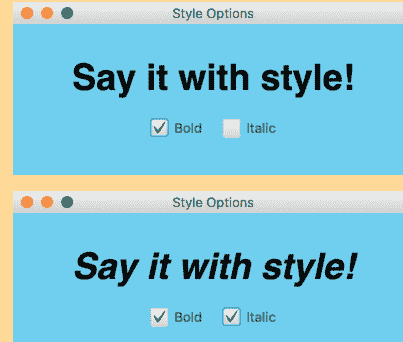

### LISTING 5.15

```java
import javafx.event.ActionEvent;
import javafx.geometry.Pos;
import javafx.scene.control.CheckBox;
import javafx.scene.layout.HBox;
import javafx.scene.layout.VBox;
import javafx.scene.text.Text;
import javafx.scene.text.Font;
import javafx.scene.text.FontPosture;
import javafx.scene.text.FontWeight;

/*****************************************************************
// StyleOptionsPane.java      Author: Lewis/Loftus
// Demonstrates the use of check boxes.
*****************************************************************/
public class StyleOptionsPane extends VBox {
    private Text phrase;
    private CheckBox boldCheckbox, italicCheckBox;

    // 设置此面板，包含一个文本 对象和复选框，
    // 它们决定文本字体的样式。
    //
    public void StyleOptions setOnPane() {
        phrase = new Text("Say it with style!");
        phrase.setFont(new Font("Helvetica", 36));
        boldCheckBox = new CheckBox("Bold");
        boldCheckBox.setOnAction(this::processCheckBoxAction);
        italicCheckBox = new CheckBox("Italic");
        italicCheckBox.setOnAction(this::processCheckBoxAction);
        HBox options = new HBox(boldCheckBox, italicCheckBox);
        options.setAlignment(Pos.CENTER);
        // 在复选框之间
        options.setSpacing(20); // 在文本和复选框之间
        getChildren().addAll(phrase, options);
    }

    // 更新显示文本的字体样式。
    //
    public void processCheckBoxAction(ActionEvent event) {
        FontWeight weight = FontWeight.NORMAL;
        FontPosture posture = FontPosture.REGULAR;
        if (boldCheckBox.isSelected())
            weight = FontWeight.BOLD;
        if (italicCheckBox.isSelected())
            posture = FontPosture.ITALIC;
        phrase.setFont(Font.font("Helvetica", weight, posture, 36));
    }
}
```

## 第5 章 条件判断与循环

### 5.10 单选按钮

它们最初被假设为未选中状态。然后会调用每个复选框的 `isSelected` 方法，如果复选框当前被选中，则返回 `true`。最后，适当设置文本的字体。

此程序使用了两个布局面板。`HBox` 和 `VBox` 布局分别将它们的节点排列在单行（水平）或单列（垂直）中。附录 G 提供了 JavaFX 布局面板的概述。

`StylePane` 类继承自 `VBox`，用于将两个复选框上面的文本居中。单独的 `HBox` 被设定为将复选框水平并排。

由于节点没有被添加到 `VBox` 构造函数中，它们是在事后添加的。但你不会直接添加到面板。相反，你调用 `getChildren` 方法，该方法返回面板中的所有节点（在这种情况下为空），然后调用 `addAll` 方法添加新节点。

> 核心概念
> `HBox` 和 `VBox` 布局面板分别将它们的节点排列在单行或单列中。

## 自测习题（答案见附录 L）

+ SR 5.35 下列哪些可以使用一个或多个复选框来确定？请解释。
  a. 汉堡上应该放置的条件。
  b. 是否调用打印作业。
  c. 你喜欢的运动。
  d. 所有参加的运动。
  e. 你的年龄范围（0–12, 13–18, 19–29, 30–50, 等）。
+ SR 5.36 如何确定某个复选框是否被选中？
+ SR 5.37 `HBox` 如何排列其节点？

### 列表 5.17 继续

```java
private String philosophyQuote, carpentryQuote, comedyQuote;
private RadioButton philosophyButton, carpentryButton, comedyButton;

//----------------
// 设置此面板，包含一个 Text 对象和单选按钮
// 决定显示哪个字符串。
//----------------
public QuoteOptionsPane() {
    philosophyQuote = "I think, therefore I am.";
    carpentryQuote = "Measure twice. Cut once.";
    comedyQuote = "Take my wife, please.";
    quote = new Text(philosophyQuote);
    quote.setFont(new Font("Helvetica", 24));
    StackPane quotePane = new StackPane(quote);
    quotePane.setSize(300, 100);
    ToggleGroup group = new ToggleGroup();
    philosophyButton = new RadioButton("Philosophy");
    philosophyButton.setToggleGroup(group);
    philosophyButton.setOnAction(this::processRadioButtonAction);
    carpentryButton = new RadioButton("Carpentry");
    carpentryButton.setToggleGroup(group);
    carpentryButton.setOnAction(this::processRadioButtonAction());
    comedyButton = new RadioButton("Comedy");
    comedyButton.setToggleGroup(group);
    comedyButton.setOnAction(this::processRadioButtonAction());
    VBox options = new VBox(philosophyButton, carpentryButton,
        comedyButton);
    options.setAlignment(Pos.CENTER_LEFT);
    options.setSpacing(10);
    setSpacing(20);
    getChildren().addAll(options, quotePane);
}

//----------------
// 更新显示文本的内容。
//----------------
public void processRadioButtonAction(ActionEvent event) {
    if (philosophyButton.isSelected())
        quote.setText(philosophyQuote);
    else if (carpentryButton.isSelected())
        quote.setText(carpentryQuote);
    else
        quote.setText(comedyQuote);
}
```

使用一个事件处理器来处理所有三个单选按钮。当单选按钮被选中时，会产生一个事件。`processRadioButton` 方法使用嵌套的 if 语句来判断当前哪个按钮被选中，并相应设置文本。

与上一个示例一样，该程序使用 `HBox` 和 `VBox` 来组织 GUI 元素。然而这一次，`VBox` 用于组织按钮，并将其被放入 `HBox` 中，以与文本并排布局。

## 自测习题（答案见附录 L）

- SR 5.38 下列哪些项可以使用一组单选按钮来确定？请解释原因。
  - a. 汉堡包上应该放哪些调料。
  - b. 是否对打印作业进行校对。
  - c. 你喜欢的运动。
  - d. 你参加过的所有运动项目。
  - e. 你的年龄范围（0–12, 13–18, 19–29, 30–50，等）。
- SR 5.39 复选框和单选按钮之间的主要区别是什么？
- SR 5.40 如何指定一组特定的单选按钮共同工作，以提供一组互斥的选项？

## 核心概念总结

- 条件语句和循环允许我们控制方法中的执行流。
- `if` 语句允许程序选择是否执行某条语句。
- 循环允许程序多次执行某条语句。
- 逻辑运算符常用于构建复杂的条件。
- 适当的缩进对人类可读性非常重要；它显示了语句与语句之间的关系。
- `if` 语句允许程序在条件为真时执行一件，在条件为假时执行另一件事。
- 在嵌套语句中，`else` 子句与最近的未匹配项匹配。
- Java 中字符的相对顺序由 Unicode 字符集定义。
- 语句会一直执行同一语句，直到其条件变为假。
- 我们必须仔细设计程序以避免死循环。
- 迭代器是一个帮助你处理一组相关项的对象。
- `Scanner` 对象中用于分隔标记的边界符可以根据需要显式设置。
- 对象存储一个对象列表，并允许你使用整数索引访问它们。
- 当创建对象时，你指定了将存储在列表中的元素类型。
- 单个事件处理器可以处理由多个控件生成的事件。
- 应用于 `Text`、`Label` 或 `Button` 对象的字符字体由 `Font` 类表示。
- `HBox` 和 `VBox` 布局面板分别将它们的节点排列在单行或单列中。
- 一组单选按钮提供了一组互斥的选项。

## 练习题

- EX 5.1 如果 `MinNumberOf` 程序中两个或多个值相等，会发生什么？如果恰好两个值相等，这两个相等值比第三个值低还是高重要吗？
- EX 5.2 下列代码片段有什么问题？重写它使其产生正确的输出。

```java
if (age <= 18)
    System.out.println("Sorry, you are too young");
    System.out.println("Please try again when you are older");
else
    System.out.println("Congratulations, welcome to the club");
```

- EX 5.3 下列代码片段有什么问题？如果这段代码是另一个有效程序的一部分，它能编译吗？请解释。

```java
if (length = MIN_LENGTH)
    System.out.println("The length is minimal.");
```

- EX 5.4 下列代码片段会产生什么？

```java
String language = "Java"
int n = 10;
if (n < 10)
    System.out.println(language);
    System.out.println("Ada");
n = n + 2;
System.out.println(language);
```

*(注：原文中 5.4 代码片段似乎不完整，已根据上下文补全逻辑结构进行翻译)*

- EX 5.5 下列代码片段会产生什么？

```java
int limit = 100, num1 = 15, num2 = 40;
if (limit < num1)
    if (num2 == limit)
        System.out.println("lemon");
System.out.println("lime");
```

- EX 5.6 考虑以下代码：

```java
ArrayList<String> scores = new ArrayList<>();
scores.add("92");
scores.add("120");
```

某些值存储在 `ArrayList` 中。执行 `Collections.sort(scores)` 后，结果为 [73, 89, 92, 120]。请解释原因。

- EX 5.7 下列代码片段产生什么输出？

```java
int num = 0, max = 20;
while (num < max)
{
    System.out.println(num);
    num += 4;
}
```

- EX 5.8 下列代码片段产生什么输出？

```java
int num = 1, max = 20;
while (num < max)
{
    if (num % 2 == 0)
        System.out.println(num);
    num++;
}
```

- EX 5.9 下列代码有什么问题？如何修正？

```java
int i = 50;
while (i != 0)
{
    System.out.println(i);
    i = i - 3;
}
```

- EX 5.10 编写一个 `while` 循环验证用户输入的是整数。
- EX 5.11 读取并打印整数值，直到输入特定的哨兵值（`SENTINEL`）。不要打印哨兵值。
- EX 5.12 编写一个 `maxOfTwo` 方法，接受两个整数参数并返回较大的那个。


- EX 5.13 编写一个 `larger` 方法，接受两个浮点数参数（`double`），如果第一个参数大于第二个参数则返回 `true`，否则返回 `false`。

- EX 5.14 编写一个 `evenlyDivisible` 方法，接受两个整数参数，如果第一个参数能被第二个参数整除，或反之，则返回 `true`，否则返回 `false`。如果任意参数为零，则返回 `false`。

- EX 5.15 编写一个 `isAlpha` 方法，接受一个字符，如果该字符是大写或小写字母则返回 `true`。

- EX 5.16 编写一个 `equals` 方法，接受三个浮点值。如果前两个值在第三参数指定的范围内相等，该方法返回 `true`。

- EX 5.17 编写一个 `isosceles` 方法，接受三个整数参数表示三角形边边。如果三角形是等腰三角形而非等三角形（即仅有两个边相等），返回 `true`，否则返回 `false`。

- EX 5.18 使用复选框还是单选按钮来确定以下内容更好？请解释。

  - a. 你喜欢的书籍类型。

  - b. 是否让个人资料可见。

  - c. 使用哪种图像格式（jpg, png 或 gif）。

  - d. 你知道哪些编程语言。

## 程序项目

PP 5.1 编写一个程序，从用户处读取一个代表年份的整数值。程序的目的是判断该年份是否为格里历历中二月有29天的闰年。如果一个年份能被 4 整除，则为闰年，除非它也能被 100 整除但不能被 400 整除。例如，2003 年不是闰年，但 2004 年是。对于任何小于 1582 的输入值，产生错误消息。

## 第5章 条件判断与循环

PP 5.2 修改上一个项目的解决方案，使用户可以评估多个年份。允许用户使用适当的哨兵值终止程序。对每个输入值进行验证，确保其大于等于1582。

PP 5.3 编写一个程序，确定并打印从键盘输入的整数值中奇数数字、偶数数字和零的个数。

PP 5.4 编写一个玩数字猜大小游戏（Hi-Lo）的程序。该程序应该在1到100（包含边界）之间随机选择一个数字，并反复提示用户进行猜测。每次猜测时，告知用户其结果是正确的、猜大了还是猜小了。继续猜，直到用户猜中或选择退出。使用哨兵值来判断用户是否想要退出。统计猜测次数并在用户猜中时报告该值。在每局游戏结束时（通过退出或猜中），提示用户是否想再次玩。继续玩游戏直到用户选择停止。

PP 5.5 编写一个程序，接受用户的姓名作为输入，并通过累加名称中每个字母的数值来计算结果，假设 a = 1，b = 2，以此此类推。字母的大小不影响，即 a = 1 且 A = 1。

PP 5.6 使用本章定义的 `Coin` 类，设计并实现一个驱动类 `FlipPlace`，其 `main` 方法创建 `Coin` 对象，然后不断翻转两个硬币，看哪一个先在比赛中出现三次正面。继续翻转，直到其中一个硬币赢得比赛，并考虑平局的可能性。打印每一回合的结果，并在最后打印获胜者和总翻转次数。

PP 5.7 编写一个与电脑玩石头剪刀布游戏的程序。当在两个人之间玩耍时，每个人同时选择三个选项之一（通常用手势表示），并决定胜负。在游戏中，石头赢剪刀，剪刀赢纸牌，纸牌赢石头。程序应该随机选择三个选项之一（不提前显示），然后提示用户进行选择。此时，程序揭晓双方的选择，并给出一个声明说明是用户获胜、电脑获胜还是平局。继续玩直到用户选择停止，然后打印用户的胜场数、负场数和平局次数。

PP 5.8 设计并实现一个应用程序，模拟一个简单的老虎机，其中随机选择并并排打印0到9之间的三个数字。如果三个数字都相同，或者任意两个数字相同，则打印一条适当的语句。继续玩直到用户选择停止。

PP 5.9 修改第4章的 `Die` 类，如果参数在有效范围之外，则 `setFaceValue` 方法不执行任何操作。

PP 5.10 修改第4章的 `Account` 类，使其对存款和取款操作执行有效性检查。具体来说，不允许存款负数或超过当前余额的取款。如果发生这些问题，打印适当的错误信息。

PP 5.11 使用第4章的 `PairDice` 类，设计并实现一个玩名为“猪猪游戏”（Pig）的类。在这个游戏中，用户与电脑竞争。在每一回合中，玩家掷出一对骰子并累积分数。目标是在对手之前达到100分。如果在任何一回合中玩家掷出1，则该轮累积的所有分数将作废，并将骰子的控制权移给另一个玩家。如果玩家在一个回合内掷出2，则玩家将失去游戏中为止累积的所有分数并失去骰子的控制权。玩家可以在每次掷骰后自愿放弃。因此，玩家必须决定是再次掷骰（冒着丢分的风险）还是放弃控制权（可能让另一个玩家获胜）。

PP 5.12 设计并实现一个处理高尔夫分数的程序。四位高尔夫的分数存储在一个文本文件中。每行代表一个洞，文件包含18行。每行包含五个值：洞的编号，紧后是每位高尔夫在该洞使用的击杆数。将标准杆（par）和玩家的总分存储在 `ArrayList` 中。确定获胜者并生成一个表格显示每位高尔夫的表现（与标准杆相比）。

PP 5.13 设计并实现一个程序，逐行比较两个输入文件以判断是否相等。打印任何不相等的行。

PP 5.14 设计并实现一个程序统计文本输入文件中整数值的个数。生成一个表格，列出你从输入文件中识别出的整数的数值。

PP 5.15 设计并实现一个程序统计文本输入文件中标点符号的个数。生成一个表格，显示每个符号出现的次数。

PP 5.16 编写一个 JavaFX 应用程序，显示类似于游客入境国家时填写的海关表单。表单应列出至少五个受限项目以及相应的费用，并允许用户通过复选框选择项目。在表单上显示总费用和适当的消息。

PP 5.17 编写一个 JavaFX 应用程序，允许用户通过复选框选择项目。

PP 5.18 编写一个 JavaFX 应用程序，允许用户通过复选框选择项目。

PP 5.19 编写一个 JavaFX 应用程序，允许用户通过复选框选择项目。

## Therac-25

### 发生了什么？

Therac-25 是一台用于消除癌症的放射治疗设备。在使用期间（1985年至1987年），它导致了严重的残疾和死亡。对于数百名患者来说，Therac-25 提供了治疗，但最初的投诉被忽视了，没有进行调查。后来当问题明显发生时，无法复制。这是一个非常异常的情况——在通常情况下不会发生。

在典型的治疗中，患者接受辐射。患者被告知副作用是类似于晒伤的不适。在事故案例中，一些患者报告感到“巨大的力量”或“电击”。在某个病例中，患者失去了肩膀和手臂的功能并不得不切除乳房。其他人死于放射中毒。辐射量以拉（rad）衡量。标准治疗量约为200拉。据估计，事故导致了20,000拉的照射。

### 是什么导致的？

操作员被告诉 Therac-25 具有许多安全措施，导致患者过量的概率“几乎是不可能的”。但使用的部分软件重用自早期的版本，该版本包含了许多基于硬件的安全措施。因此，硬件功能掩盖了底层软件的问题。Therac-25 的安全功能主要是软件性的，隐藏的问题随之出现。事实证明，如果操作员错误输入参数并以特定方式进行纠正，软件允许机器在没有适当扩散的情况下释放最大剂量。这种错误如此奇怪，技术人员机器无法重现。它重新投入使用。

分析师认为，软件问题只是事故发生的原因之一。虽然存在基础性的编程错误，但对安全问题的关注也不足。这也是机器使用如此之久的原因之一，导致问题没有按照应有的方式进行报告。

### 经验训

软件安全是本案中的主要问题。当人类生命面临危险时，很难想象不去尽一切努力确保你的软件尽可能稳健。这取决于风险分析。你愿意承担多大的风险，让某段特定的软件可能仍包含错误？对于许多应用程序来说，问题可能会给用户带来不便并产生业务影响，但其他应用程序则直接关乎人的生命。

> 来源：computingcases.org, IEEE Computer

# 更多条件语句和循环

## 章节目标

- 使用 `switch` 语句检查条件处理。

- 讨论条件运算符。

- 检查替代的循环语句：`do` 循环和 `for` 循环。

- 在条件和循环帮助下绘制图形。

- 对图形对象应用变换。

在第 5 章中，我们检查了用于决策的 `if` 语句和用于循环的 `while` 语句。本章探索了 Java 中执行类似任务的若干种额外语句。特别是，它检查了 `switch` 条件语句，以及 `do` 循环和 `for` 循环。这些替代语句在关键细节上有所不同，任何特定情况都可能适用于其中一种而不是另一种。本章的“图形轨道（Graphics Track）”部分探索了如何使用条件和循环来控制我们的图形，并研究了变换的作用。

## 6.1 switch 语句

Java 中的另一种条件语句称为 `switch` 语句，它使执行中的程序根据单个值遵循几条路径之一。虽然可以使用多个 `if` 语句构建类似的逻辑代码，但在需要的情况下，`switch` 语句通常使代码更易读。

`switch` 语句评估一个表达式以确定一个值，然后与几个可能的 `case` 之一匹配。每个 `case` 都有与其关联的语句。评估表达式后，控制将跳转到与匹配值的第一个 `case` 关联的语句。考虑以下示例：

```java
switch (idChar)
{
    case 'A':
        aCount = aCount + 1;
        break;
    case 'B':
        bCount = bCount + 1;
        break;
    case 'C':
        cCount = cCount + 1;
        break;
    default:
        System.out.println("Error in Identification Character.");
}
```

首先，评估表达式。在这个示例中，执行转移到与匹配表达式的值后的第一个语句。因此，如果 `idChar` 包含 'A'，变量 `aCount` 就会加1。如果它包含 'B'，则执行该用例，并在 `bCount` 加1 的处继续处理。同样，如果 `idChar` 包含 'C'，则处理该用例。

如果没有匹配的值，执行将继续可选的 `default` 用例，由保留字 `default` 指定。如果没有 `default` 用例，则不执行任何 `switch` 语句，处理将继续到 `switch` 语句之后的语句。即使你不认为它会被执行，包含一个 `default` 用例也是好主意。

当遇到 `break` 语句时，处理跳转到 `switch` 语句之后的语句。`break` 语句通常用于跳出 `switch` 语句的每个 `case`。如果没有 `break` 语句，处理将继续进入 `switch` 的下一个 `case`。因此，如果上一个示例中 'A' 情况结尾没有 `break`，那么当 `idChar` 包含 'A' 时，`aCount` 和 `bCount` 变量都会加1。通常，

> **核心概念**
>
> `switch` 语句将字符或整数值匹配到可能的 `case` 之一。

我们只想执行一个 `case`，因此几乎都会使用 `break` 语句。尽管如此，“贯穿（pass through）”特征也会大派用场。

> **核心概念**
>
> `break` 语句用于 `switch` 语句中每个 `case` 备选项的结尾。

你可能记得第 5 章中简要提到过 `break` 语句，因为它可以用于其他类型的循环和条件语句。我们注意到，这种处理通常是不必要的，并且被许多开发者认为是坏习惯。`switch` 语句是一个例外，`break` 语句是使代码仅执行一个 `case` 代码的唯一方法。

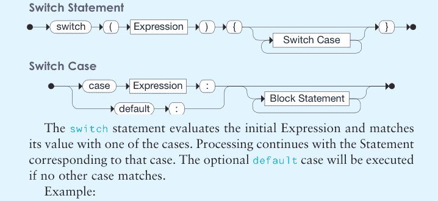

`switch` 语句评估初始表达式并将其值与一个 `case` 之一匹配。处理持续到该 `case`。如果没有其他 `case` 匹配，将执行可选的 `default` 用例。示例：

```java
switch (numValues)
{
  case 0:
    System.out.println("No values were entered.");
    break;
  case 1:
    System.out.println("One value was entered.");
    break;
  case 2:
    System.out.println("Two values were entered.");
    break;
  default:
    System.out.println("Too many values were entered.");
}
```

在 `switch` 语句开始处评估的表达式类型必须是 `char`、`byte`、`short`、`int` 或枚举类型。从 Java 7 开始，也可以对 `String` 执行 `switch`。但 `switch` 不能是 `boolean` 或 `float` 值。此外，每个 `case` 的值必须是常量；不能是变量或其他表达式。这限制了 `switch` 适用的情况。但在适用时，它可以使代码更易阅读和理解。

还要注意，`switch` 语句的隐式布尔条件是基于相等性的。语句开头的表达式与每个 `case` 值进行比较，以确定它等于哪一个。`switch` 语句不能用于确定其他关系操作（例如小于），除非进行了某些初步处理。例如，列表 6.1 中的 `GradeReport` 程序根据用户输入的数字成绩打印注释。

## 列表 6.1

```java
// GradeReport.java                 Author: Lewis:Loftus
// 演示了 switch 语句的使用。

import java.util.Scanner;

public class GradeReport
{
    // 从用户处读取成绩并相应的相应的注释。
    public static void main(String[] args)
    {
        int grade, category;

        Scanner scan = new Scanner(System.in);

        System.out.print("Enter a numeric grade (0 to 100): ");
        grade = scan.nextInt();

        category = grade / 10;
        System.out.print("That grade is ");

        switch (category)
        {
            case 10:
                System.out.println("a perfect score. Well done.");
                break;
            case 9:
                System.out.println("well above average. Excellent.");
                break;
            case 8:
                System.out.println("above average. Nice job.");
                break;
            case 7:
                System.out.println("average.");
                break;
            case 6:
                System.out.println("below average. You should see the");
                System.out.println("instructor to clarify the material " + "presented in class.");
                break;
            default:
                System.out.println("not passing.");
        }
    }
}
```

```
Enter a numeric grade (0 to 100): 86
That grade is above average. Nice job.
```

在 `GradeReport` 中，成绩的类别通过将成绩除以 10（使用整数除法）确定，得到 0 到 10 之间的整数值。此结果作为 `switch` 的表达式，为 60 分及以上打印不同的消息，对所有其他值打印默认句子。

注意，任何 `switch` 语句都可以实现为一组嵌套语句。然而，嵌套的 `if` 语句对于人类读者可能难以理解，并且在实现和调试时出错。由于 `switch` 只能评估相等性，嵌套的 `if` 语句是必要的。

### 自测题（答案见附录 L）

- SR 6.1 当 Java 程序运行时，如果用于 switch 的表达式与语句关联的任何 case 值都不匹配，会发生什么？

- SR 6.2 如果 switch 语句中的某个 case 结尾没有 `break` 语句，会发生什么？

- SR 6.3 如果用户输入 72，`GradeReport` 程序的输出是什么？如果输入 46 呢？如果输入 123 呢？

## SR 6.4

将以下嵌套的 if 语句转换为等效的 switch 语句。

```java
if (num1 == 5)
    myChar = 'W';
else
    if (num1 == 6)
        myChar = 'X';
    else
        if (num1 == 7)
            myChar = 'Y';
        else
            myChar = 'Z';
```

## 6.2 条件运算符


# Java 的条件运算符

Java 的条件运算符在某些方面与 `if-else` 语句相似。它是一个三元运算符，因为它需要三个操作数。条件运算符的符号通常写为 `?`，但它与其他运算符不同之处在于它的两个符号总是分开的。以下是一个包含条件运算符的表达式示例：

```java
(total > MAX) ? total + 1 : total * 2;
```

`?` 之前是一个布尔条件。`?` 之后有时有两个由 `:` 符号分隔的表达式。如果条件为真，整个条件表达式返回第一个表达式的值；如果条件为假，则返回第二个表达式的值。

记住这个示例是一个返回值的表达式。条件运算符仅仅是一个运算符，而不是一个独立的语句。通常，我们想对该值进行某些操作，例如将其赋值给变量：

```java
total = (total > MAX) ? total + 1 : total * 2;
```

条件运算符与条件语句之间的区别可能是细微的。在很多情况下，`?` 运算符允许我们形成简洁的逻辑，作为缩短的 `if-else` 语句。下面的语句在功能上与其等价，但有时更方便：

```java
if (total > MAX)
    total = total + 1;
else
    total = total * 2;
```

## 条件运算符示例

让我们再看另外两个例子。考虑以下声明：

```java
int larger = (num1 > num2) ? num1 : num2;
```

如果 `num1` 大于 `num2`，则返回 `num1` 的值并用于初始化变量 `larger`。如果不是，则返回 `num2` 的值并初始化 `larger`。同样，以下语句打印两个值中的较小的一个：

```java
System.out.println("Smaller: " + ((num1 < num2) ? num1 : num2));
```

条件运算符偶尔有助于评估简短条件并返回结果。它不是 `if-else` 语句的替代品，因为 `?` 运算符的操作数是表达式，而不一定是完整的语句。即使当条件运算符是一个可行的替代方案时，你也应谨慎使用它，因为它可能比 `if-else` 语句的可读性差。

### 自习题（答案见附录 L）

**SR 6.5** 条件运算符和条件语句之间有什么区别？

**SR 6.6** 编写一个声明，初始化名为 `id` 的 `char` 类型变量：如果布尔变量 `first` 为真，则将其初始化为 `'A'`，否则初始化为 `'B'`。

**SR 6.7** 使用条件运算符以简洁的方式表示以下逻辑。

```java
if (val <= 10)
    System.out.println("The value is not greater than 10.");
else
    System.out.println("The value is greater than 10.");
```

# 6.3 do 语句

记得第 5 章，`while` 语句首先检查条件，如果条件为真，则执行其循环体。`do` 语句与 `while` 语句相似，但它的终止条件是在循环体的末尾进行评估。像 `while` 循环一样，`do` 循环不断执行循环体直到条件变为假。条件写在循环的末尾，表示它在循环体执行之前不会进行评估。注意，`do` 循环体始终至少执行一次。图 6.1 显示了这种处理。

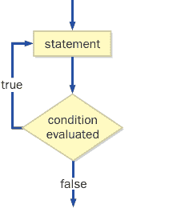

以下代码使用 `do` 循环打印从 1 到 5 的数字。将此代码与第 5 章中使用 `while` 循环完成任务的类似示例进行比较。

```java
int count = 0;
do {
    count++;
    System.out.println(count);
} while (count < 5);
```

注意 `do` 循环以保留字 `do` 开始。`do` 循环体持续执行，直到 `while` 子句包含的布尔条件决定是否继续执行循环体。有时，很难判断一行以保留字 `while` 开头的代码是 `while` 循环的开始还是 `do` 循环的结束。

> **核心概念**
>
> `do` 循环至少执行一次其循环体。

### do 语句语法

```
do -> Statement -> while ( Expression ) -> ;
```

`do` 循环只要布尔表达式 `Expression` 为真，就会重复执行指定的 `Statement`。`Statement` 至少执行一次，然后评估 `Expression` 以确定是否再次执行 `Statement`。

### 示例

```java
do {
    System.out.print("Enter a word: ");
    word = scan.next();
    System.out.println(word);
} while (word.equals("quit"));
```

## 示例程序：ReverseNumber

`ReverseNumber` 程序从用户读取一个整数并用数学方法反转其数字。

```java
// ReverseNumber.java
import java.util.Scanner;

public class ReverseNumber {
    // 展示了 do 循环的使用。
    public static void main(String[] args) {
        Scanner scan = new Scanner(System.in);
        System.out.print("Enter an integer: ");
        int number = scan.nextInt();
        int reverse = 0;
        int lastDigit;

        do {
            lastDigit = number % 10;
            reverse = (reverse * 10) + lastDigit;
            number = number / 10;
        } while (number > 0);

        System.out.println("That reversed is " + reverse);
    }
}
```

### 运行输出

```
Enter an integer: 2896
That reversed is 6982
```

`ReverseNumber` 中的循环使用取余运算确定数字，将其添加到 `reverse`，然后使用整数除法从原始数字中去掉该数字。当变量 `number` 达到零时循环终止。仔细跟踪几个示例以理解其工作原理。

### 自习题（答案见附录 L）

**SR 6.8** 比较 `while` 循环和 `do` 循环。

**SR 6.9** 以下代码片段的输出是什么？

```java
int low = 0, high = 10;
do {
    System.out.println(low);
    low++;
} while (low < high);
```

**SR 6.10** 以下代码片段的输出是什么？

```java
int low = 10, high = 0;
do {
    System.out.println(low);
    low++;
} while (low <= high);
```

**SR 6.11** 使用 `do` 循环从用户获取一系列正整数，使用零作为哨值。程序应该输出这些数字的和。

# 6.4 for 语句

`while` 和 `do` 语句适用于起初不知道要执行循环体多少次的情况。`for` 语句是另一种重复语句，特别适用于在循环执行前确定特定次数执行循环体。

以下代码使用 `for` 循环计数 1 到 5，就像我们在之前的示例中使用循环语句一样：

```java
for (int count = 1; count <= 5; count++)
    System.out.println(count);
```

`for` 循环头部包含三个由分号分隔的部分。在循环开始之前，执行头部的第一部分，称为初始化。头部的第二部分是布尔条件，在执行循环体之前进行评估（类似于 `while` 循环）。如果为真，则执行循环体，随后执行头部的第三部分，称为增量。注意，初始化部分只执行一次，但增量部分在每次迭代后都会执行。图 6.2 显示了这种处理。

> **核心概念**
>
> `for` 语句通常用于循环次数固定的情况。

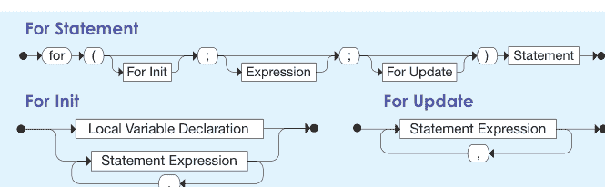

`for` 循环在习惯它之前可能有点难以阅读。代码的执行顺序并不遵循“从上到下、从左到右”的阅读顺序。尽管增量部分位于循环头部，但它是在循环体执行之后执行的。

在这个示例中，`for` 循环头部的初始化部分用于声明变量 `count` 并给它一个初始值。我们并不强制声明一个变量，但在变量在循环外部不需要的情况下，这是一种常见的做法。由于 `count` 是在 `for` 循环头部声明的，它只存在于循环体内部，而不能在其他地方引用。循环控制变量通过循环头部的操作进行设置、检查和修改。它可以在循环体内部被引用，但不应该由循环体中的代码对其进行修改。

### for 语句语法

只要布尔表达式为真，`for` 语句就会重复执行指定的 `Statement`。头部的 `For Init` 部分在循环开始之前只执行一次。`For Update` 部分在每次执行 `Statement` 之后执行。

**示例：**

```java
for (int value = 1; value < 25; value++)
    System.out.println(value + " squared is " + value * value);
```

```java
for (int num = 40; num > 0; num--)
    sum = sum + num;
```

`for` 循环头部的增量部分尽管名为增量，但它可以减少一个值而不是增加它。例如，以下循环打印了从 100 到 1 的整数值：

```java
for (int num = 100; num > 0; num--)
    System.out.println(num);
```

事实上，`for` 循环的增量部分可以执行任何计算，而不仅仅是简单的增或减。考虑列表 6.3 中的程序，它打印直到特定限制的特定倍数。

## 示例程序：Multiples

`Multiples` 程序中 `for` 循环的增量部分在每次迭代后都会加上用户输入的值。每行打印值的个数通过计算打印的值来控制，每当 `count` 被 `PER_LINE` 常数整除时，就移动到下一行。

```java
// LISTING 6.3
// Multiples.java             Author: Lewis/Loftus
// 展示了 for 循环的使用。
import java.util.Scanner;

public class Multiples {
    // 打印用户指定数字的倍数，直到用户指定的限制。
    public static void main(String[] args) {
        final int PER_LINE = 5;
        int value, limit, mult, count = 0;

        Scanner scan = new Scanner(System.in);

        System.out.print("Enter a positive value: ");
        value = scan.nextInt();

        System.out.print("Enter an upper limit: ");
        limit = scan.nextInt();

        System.out.println();
        System.out.println("The multiples of " + value + " between " + value + " and " + limit + " (inclusive) are: ");

        for (mult = value; mult <= limit; mult += value) {
            System.out.print(mult + "\t");
            // 每行输出指定数量的值
            count++;
            if (count % PER_LINE == 0)
                System.out.println();
        }
    }
}
```

### 运行输出

```
Enter a positive value: 7
Enter an upper limit: 400

The multiples of 7 between 7 and 400 (inclusive) are:
7	14	21	28	35
42	49	56	63	70
77	84	91	98	105
112	119	126	133	140
147	154	161	168	175
182	189	196	203	210
217	224	231	238	245
252	259	266	273	280
287	294	301	308	315
322	329	336	343	350
357	364	371	378	385
392	399
```

列表 6.4 中的 `Stars` 程序显示了嵌套 `for` 循环的使用。输出是一个由星号字符组成的三角形。外层循环精确执行 10 次。外层循环的每次迭代都会打印一行输出。内层循环执行的迭代次数取决于外层循环的值。

# 6.5 for-each 循环

（原文此处标题重复，内容缺失，保留标题占位）


| 217 | 224 | 231 | 238 | 245 |
| 252 | 259 | 267 | 273 | 280 |
| 287 | 294 | 301 | 308 | 315 |
| 322 | 329 | 336 | 343 | 350 |
| 357 | 364 | 371 | 378 | 385 |
| 392 | 399 | | | | |

列表 6.4 中的 Stars 显示了嵌套 `for` 循环的使用。输出是一个由星号字符组成的三角形。外层循环精确执行 10 次。外层循环的每次迭代都会打印一行输出。内层循环执行的迭代次数取决于外层循环的值。

## `for-each` 循环

实际上，`for` 循环的增量部分可以执行任何计算，而不仅仅是简单的增或减。考虑列表 6.3 中的程序，它打印直到特定限制的特定值的倍数。

`Multiples` 程序中 `for` 循环的增量部分在每次迭代后都会加上用户输入的值。每行打印值的个数通过计算打印的值来控制，每当 `count` 被 `PER_LINE` 常数整除时，就移动到下一行。

### 代码列表 6.3

```java
/****************************************************************
// Multiples.java             Author: Lewis/Loftus
// 展示了 for 循环的使用。
/****************************************************************
import java.util.Scanner;
public class Multiples
{
    // 打印用户指定数字的倍数，直到用户
    // 指定的限制。
    // ---------------------------------------------------------
    public static void main(String[] args) {
        final int PER_LINE = 5;
        int value, limit, mult, count = 0;

        Scanner scan = new Scanner(System.in);

        System.out.print("Enter a positive value: ");
        value = scan.nextInt();

        System.out.print("Enter an upper limit: ");
        limit = scan.nextInt();

        System.out.println();
        System.out.println("The multiples of " + value + " between " + value + " and " + limit + " (inclusive) are: ");

        for (mult = value; mult <= limit; mult += value) {
            System.out.print(mult + "\t");
            count++;
            if (count % PER_LINE == 0)
                System.out.println();
        }
    }
}
```

### 输出

| 7 | 14 | 21 | 28 | 35 |
| 42 | 49 | 56 | 63 | 70 |
| 77 | 84 | 91 | 98 | 105 |
| 112 | 119 | 126 | 133 | 140 |
| 147 | 154 | 161 | 168 | 175 |
| 182 | 189 | 196 | 203 | 210 |
| 217 | 224 | 231 | 238 | 245 |
| 252 | 259 | 267 | 273 | 280 |
| 287 | 294 | 301 | 308 | 315 |
| 322 | 329 | 336 | 343 | 350 |
| 357 | 364 | 371 | 378 | 385 |
| 392 | 399 | | | | |

列表 6.4 中的 Stars 显示了嵌套 `for` 循环的使用。输出是一个由星号字符组成的三角形。外层循环精确执行 10 次。外层循环的每次迭代都会打印一行输出。内层循环执行的迭代次数取决于外层循环的值。

## 6.5 在图形中使用循环和条件语句

### 代码列表 6.5

```java
import javafx.application.Application;
import javafx.scene.Group;
import javafx.scene.Scene;
import javafx.scene.paint.Color;
import javafx.scene.shape.Circle;
import javafx.stage.Stage;

/****************************************************************
// Bullseye.java      Author: Lewis/Loftus
// 演示使用循环和条件语句进行绘制。
***************************************************************/
public class Bullseye extends Application {
    //
    // 使用同心黑白圆环和红色中心
    // 显示一个靶目标。
    //
    public void start(Stage primaryStage) {
        Group root = new Group();
        Color ringColor = Color.BLACK;
        Circle ring = null;
        int radius = 150;

        for (int count = 1; count <= 8; count++) {
            ring = new Circle(160, 160, radius);
            ring.setFill(ringColor);
            root.getChildren().add(ring);

            if (ringColor.equals(Color.BLACK)) {
                ringColor = Color.WHITE;
            } else {
                ringColor = Color.BLACK;
            }
            radius = radius - 20;
        }
        ring.setFill(Color.RED);

        Scene scene = new Scene(root, 320, 320, Color.CYAN);
        primaryStage.setTitle("Bullseye");
        primaryStage.setScene(scene);
        primaryStage.show();
    }
}
```

### 显示


使用一个 `for` 循环来精确绘制八个圆。在循环的每次迭代中，都会创建一个圆并将其添加到组中。`for` 循环体中的 `if` 语句用于设置下一个圆的颜色；如果刚刚添加的圆是黑色的，则颜色变为白色，反之亦然。在退出循环后，绘制的圆环填充颜色被改为红色。

让我们来看另一个例子。代码列表 6.6 显示了一个在随机位置绘制若干个矩形的程序。每个矩形的宽度和高度也是随机选择的。在宽度或高度低于某个阈值（10 像素）之前，这些框是不填充的。窄的框被填充为黄色，短的框被填充为绿色。

### 代码列表 6.6

```java
import java.util.Random;
import javafx.application.Application;
import javafx.scene.Group;
import javafx.scene.Scene;
import javafx.scene.paint.Color;
import javafx.scene.shape.Rectangle;
import javafx.stage.Stage;

/****************************************************************
// Boxes.java                               Author: Lewis/Loftus
// 演示使用循环和条件语句进行绘制。
***************************************************************/
public class Boxes extends Application {
    // 在随机位置显示具有随机宽度和高度
    // 的多个矩形。窄和短的框通过填充颜色
    // 进行高亮。
    public void start(Stage primaryStage) {
        Group root = new Group();
        Random gen = new Random();
        for (int count = 1; count <= 50; count++) {
            int x = gen.nextInt(350) + 1;
            int y = gen.nextInt(350) + 1;
            int width = gen.nextInt(50) + 1;
            int height = gen.nextInt(50) + 1;
            Color fill = null;
            if (width < 10)
                fill = Color.YELLOW;
            else if (height < 10)
                fill = Color.GREEN;
            Rectangle box = new Rectangle(x, y, width, height);
            box.setStroke(Color.WHITE);
            box.setFill(fill);
            root.getChildren().add(box);
        }

        Scene scene = new Scene(root, 400, 400, Color.BLACK);
        primaryStage.setTitle("Boxes");
        primaryStage.setScene(scene);
        primaryStage.show();
    }
}
```

### 显示

使用一个 `for` 循环来创建 50 个框。`for` 循环体创建并添加一个框。使用嵌套的 `if` 语句来检查当前框随机生成的宽度和高度，并相应设置颜色。对于每个框，填充颜色最初被设置为 `null`，只有当其中一个维度太小时才会发生更改。

- 自我复习题（答案请见附录 L）

- SR 6.17 对 `Bullseye` 程序需要做哪些更改才能获得一个 10 环的靶目标？

- SR 6.18 如何修改 `Boxes` 程序，使得既不窄也不短的框填充为白色，而不仅仅是用白色描边。

## 6.6 图形变换

JavaFX 变换是一种应用于节点的效果，它改变了节点视觉上呈现的方式。四种基本的变换类型为：

- 平移——沿 x 轴或 y 轴改变节点的位置。
- 缩放——使节点看起来更大或更小。
- 旋转——绕其中心点旋转节点。
- 倾切——扭曲形状。

### 在组上应用变换

变换可以应用于任何 JavaFX 节点，这意味着它们不仅可以应用于单个形状、图像和控件，还可以应用于组和窗格。当变换应用于组或窗格上时，它会应用到该容器中的每个节点上。

> 核心概念
>
> 应用于组或窗格的变换会自动应用于该容器中的所有节点。

列表 6.7 所示的类继承自 `Group` 类。它的构造函数创建了显示机器人脸所需的元素，并将它们添加到组中。

### 代码列表 6.7

```java
import javafx.scene.Group;
import javafx.scene.paint.Color;
import javafx.scene.shape.Rectangle;

/****************************************************************
// RobotFace.java               Author: Lewis/Loftus
// 展示机器人的脸。
***************************************************************/
public class RobotFace extends Group {
    //--
    // 设置构成机器人脸的元素，它们位于
    // 坐标系的左上角。
    //--
    public RobotFace() {
        Rectangle head = new Rectangle(5, 0, 100, 70);
        head.setFill(Color.SILVER);
        head.setArcHeight(10);
        head.setArcWidth(10);

        Rectangle ears = new Rectangle(0, 20, 110, 30);
        ears.setFill(Color.DARKBLUE);
        ears.setArcHeight(10);
        ears.setArcWidth(10);

        Rectangle eye1 = new Rectangle(25, 15, 20, 10);
        eye1.setFill(Color.GOLD);

        Rectangle eye2 = new Rectangle(65, 15, 20, 10);
        eye2.setFill(Color.GOLD);

        Rectangle nose = new Rectangle(52, 25, 6, 15);
        nose.setFill(Color.BLACK);

        Rectangle mouth = new Rectangle(35, 45, 40, 10);
        mouth.setFill(Color.RED);

        getChildren().addAll(ears, head, eye1, eye2, nose, mouth);
    }
}
```

如果按照原始定义将 `RobotFace` 对象添加到容器中，它将显示在左上角：


列表 6.8 显示了一个创建并显示三个应用了各种变换的机器人脸的程序。

### 代码列表 6.8

```java
import javafx.application.Application;
import javafx.scene.Group;
import javafx.scene.Scene;
import javafx.scene.paint.Color;
import javafx.stage.Stage;

//****************************************************************
// Robots.java      Author: Lewis/Loftus
// 展示图形变换。
//****************************************************************

public class Robots extends Application
{
```


```java
// -- 显示三个机器人脸，应用各种变换。
// --
public void start(Stage primaryStage)
{
    RobotFace robot1 = new RobotFace();
    robot1.translateX(70);
    robot1.translateY(40);

    RobotFace robot2 = new RobotFace();
    robot2.translateX(300);
    robot2.translateY(40);
    robot2.setRotate(20);

    RobotFace robot3 = new RobotFace();
    robot3.translateX(200);
    robot3.translateY(200);
    robot3.setScale(2.5);

    Group root = new Group(robot1, robot2, robot3);

    Scene scene = new Scene(root, 500, 380, Color.WHITE);

    primaryStage.setTitle("Robots");
    primaryStage.setScene(scene);
    primaryStage.show();
}
```

# 显示

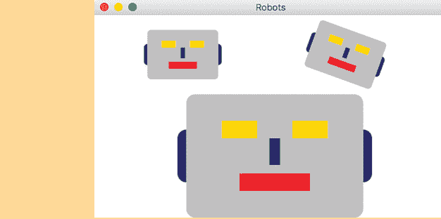

第一个机器人显示在窗口的左上部分。应用于它的唯一变换是位置沿 x 轴平移了 70 像素，沿 y 轴平移了 40 像素，使其移出了窗口边角。

第二个机器人（右上角）已平移到新位置，并顺时针旋转了 20 度。

第三个机器人的位置也被平移了，并且被缩放为正常尺寸的二点半。

注意，所有这些变换都是应用于 `RobotFace` 对象的，由于继承，它们是 `Group` 对象。然后，这三个组都被添加到场景的根节点（也是一个组）中。

## 自测习题（答案见附录 L）

- SR 6.19 你如何将一个名为 `ring` 的 `Circle` 的位置移动到比原始位置低 100 像素的地方？

- SR 6.20 你如何将一个名为 `view` 的 `ImageView` 显示为原始大小的两倍？

- SR 6.21 如果沿 x 和 y 轴以不同的因子缩放节点会发生什么？

- SR 6.22 你如何将一个名为 `oval` 的 `Ellipse` 顺时针旋转 40 度？如果你想逆时针旋转 10 度又如何？

## 核心概念总结

- `switch` 语句匹配字符或整数值到多个可能的情况。

- `break` 语句通常用于每个 `case` 的结尾。

- 条件运算符根据布尔条件评估两个值之一。

- `do` 语句至少执行一次其循环体。

- `for` 语句通常用于执行固定次数的循环。

- `for-each` 版本的循环简化了对可迭代元素的处理。

- 各种循环语句在功能上是等价的。使用哪种取决于情况。

- 变换因子改变节点的视觉呈现。

- 在两个轴上使用相同的缩放因子以保持节点的比例。

- 应用于组或窗格的变换会自动应用于容器中的所有节点。

## 练习题

EX 6.1 以下循环将执行多少次？

a. `for (int i = 0; i < 20; i++) {`

b. `for (int i = 1; i <= 20; i++) {`

c. `for (int i = 5; i < 20; i++) {`

d. `for (int i = 20; i > 0; i--) {`

e. `for (int i = 1; i < 20; i += 2) {`

f. `for (int i = 1; i < 20; i *= 2) {`

EX 6.2 以下代码的输出是什么？

```java
for (int num = 100; num >= 1; num /= 2)
    System.out.println(num);
```

EX 6.3 以下代码的输出是什么？

```java
for (int val = 200; val >= 0; val--)
    if (val % 4 != 0)
        System.out.println(val);
```

EX 6.4 将以下 `while` 循环转换为等效的 `do` 循环（产生相同的输出）。

```java
int num = 1;
while (num < 20)
{
    num++;
    System.out.println(num);
}
```

EX 6.5 将之前的 `while` 循环转换为等效的 `for` 循环（产生相同的输出）。

EX 6.6 编写一个 `do` 循环验证用户输入的是整数。

EX 6.7 编写一个 `for` 循环打印 15 到 25 的所有数字（包含边界）。

EX 6.8 编写一个 `for` 循环打印小于 100 的所有 3 的倍数。

EX 6.9 编写一段代码，从用户处读取 10 个整数并打印最大值。

EX 6.10 编写一段代码，确定并打印字符串 `title` 中大写字母的总数。

EX 6.11 编写一段代码，反向打印字符串 `str` 中的字符。

EX 6.12 编写一段代码，从字符串 `word` 开始每隔打印一个字符。

EX 6.13 编写一个名为 `powersOf` 的方法，打印 2 的前 10 次幂。该方法接收参数但不返回任何内容。

EX 6.14 编写一个名为 `pad` 的方法，接受字符串 `str` 和整数 `length`。通过在字符串末尾添加相应数量的 '0' 字符来返回一个长度为 `length` 的字符串。如果字符串比 `length` 长，则返回原始字符串。例如，`pad("aaa")` 将返回 "aaa000"。

EX 6.15 编写一个名为 `sum100` 的方法，返回 1 到 100（包含边界）整数的和。

EX 6.16 编写一个名为 `sumRange` 的方法，接受表示范围的整数参数。如果第二个参数小于第一个，则发布错误消息并返回零。否则，方法应返回该范围内整数的和（包含边界）。

EX 6.17 编写一个名为 `countA` 的方法，接受字符串参数并返回字符 'A' 在字符串中出现的次数。

EX 6.18 编写一个名为 `piggy` 的方法，接受包含单个单词的字符串并将其转换为皮英语。皮英语的规则是：如果单词以辅音开头，你需要删除单词开头的辅音并添加到单词末尾，加上 "ay"。如果单词以元音开头，则需要加上 "way"。

EX 6.19 在 `Bullseye` 程序中，最内层圆在被改变之前的完整颜色是什么？解释。

EX 6.20 给定编写好的 `Boxes` 程序，如果矩形既窄又短，它会是什么颜色？解释。

EX 6.21 重写 `Boxes` 程序中使用的 `if` 语句，如果框既窄又短，它的完整颜色为橙色。否则，窄框为黄色，短框为绿色。

EX 6.22 编写代码将矩形 `rec` 向右移动 50 像素并向下 10 像素，顺时针旋转 45 度，并按原始大小的一半显示。

EX 6.23 编写代码将名为 `square` 的形状绕其中心旋转 60 度并使用缩放将其大小翻倍。

EX 6.24 在组上应用变换会发生什么？

## 编程项目

PP 6.1 编写一个程序读取一个整数，并打印 2 到输入值（包含边界）的所有偶数的和。如果输入值小于 2，则打印错误消息。进行适当提示。

PP 6.2 编写一个程序从用户处读取一个字符串并每行打印一个字符。

PP 6.3 编写一个程序生成乘法表，显示 1 到 12 整数自相乘的结果。

# 第 6 章 更多条件判断与循环

PP 6.4 编写一个程序，打印旅行歌曲《百瓶啤酒》（One Hundred Bottles of Beer）的前几节。使用循环使每次迭代打印一节。从用户处读取要打印的节数，并对输入进行验证。以下是该歌曲的前两节：

- 墙上有 100 瓶啤酒
- 100 瓶啤酒
- 如果其中一瓶恰好掉落
- 墙上剩下 99 瓶啤酒
- 墙上有 99 瓶啤酒
- 99 瓶啤酒
- 如果其中一瓶恰好掉落
- 墙上剩下 98 瓶啤酒

PP 6.5 使用 PP 4.9 中的 `PairOfDice` 类，编写一个程序投掷一对骰子 1000 次，并统计点数（两个六点）出现的次数。

PP 6.6 使用第 5 章定义的 `Coin` 类，编写一个名为 `FourHeads` 的程序，其 `main` 方法不断抛掷硬币直到连续出现四次正面。打印获得连续四次正面所需的总抛掷次数。

PP 6.7 修改 `Stars` 程序版本以打印以下模式。为每个模式创建一个独立的程序。提示：部分 b、c 和 d 需要多个循环，其中某些循环需要打印特定数量的空格。

```
a. ********** b. ********** d. **********
    ** ** ****** *
  ****** ****** **
****** ****** ******
****** ****** ******
****** ****** ******
****** ****** ******
  ****** ****** **
    ** *
  ********* *
```

PP 6.8 编写一个程序打印一个显示 Unicode 字符及其数值的表格。每行打印五个数字/字符对，并用制表符分隔。打印数值从 32（空格字符）到 126（~ 字符）的表格，这对应 Unicode 字符集中可打印的 ASCII 子集。将你的输出与附录 C 中的表格进行比较。与附录 C 中的表格不同，你表格中的值会随行而增加。

PP 6.9 编写一个程序从用户处读取一个字符串，然后确定并打印整个字符串中每个小写元音（a, e, i, o, 和 u）出现的次数。为每个元音设置单独的计数器。还要统计并打印非元音字符的数量。

PP 6.10 编写一个程序打印歌曲《圣诞十二夜》的歌节，其中每节都增加一行。你歌曲的前两节内容如下：

- 圣诞节第一天，我的真爱送给我
  一只梨树上的仙鹌鹑。
- 圣诞节第二天，我的真爱送给我
  两只斑鸠，
  一只梨树上的仙鹌鹑。

在循环中使用 `switch` 语句控制打印哪些行。提示：仔细安排 `case` 的顺序并避免使用 `break` 语句。在日期后使用不同的后缀（1st, 2nd, 3rd, 等）。歌曲的最后一节涉及 12 天，如下所示：

- 圣诞节第十二天，我的真爱送给我
  十二位鼓手在敲鼓，
  十位长管手在吹奏，
  十位主在跳跃，
  九位女士在跳舞，
  八位女仆在挤奶，
  七只天鹅在游泳，
  六只鹅在下蛋，
  五个金圆环，
  四只鸣叫鸟，
  三只法国母鸡，
  两只斑鸠，
  一只梨树上的仙鹌鹑。

PP 6.11 编写一个 JavaFX 应用，绘制 20 条长度随机、间距均匀的水平平行线。

PP 6.12 编写一个 JavaFX 应用，显示一个星空，其中具有随机大小的星星随机分布在夜空中。星空中应有 1000 颗星。

PP 6.13 编写一个 JavaFX 应用，绘制 10 个半径随机的同心圆。

PP 6.14 编写一个 JavaFX 应用，在随机位置绘制 100 个颜色随机、大小随机的圆。确保整个圆出现在场景的可见区域内。

PP 6.15 编写一个 JavaFX 应用，在可见区域内的随机位置显示 10,000 个圆（半径为 1 像素）。将场景左部分的点填充为红色，右半部分的点填充为绿色。使用场景的 `getWidth` 方法确定中点。

PP 6.16 编写一个 JavaFX 应用，显示砖块图案，其中每行砖块相对于其上方和下方都有偏移。

PP 6.17 编写一个名为 `Quilt` 的 JavaFX 应用，显示由两个交替正方形组成的被子。定义一个 `QuiltSquare` 类来表示你选择的图案。允许 `QuiltSquare` 类的构造函数改变图案的某些特征，例如颜色方案。实例化两个 `QuiltSquare` 对象并将它们以棋盘布局整合到被子里。

PP 6.18 编写一个 JavaFX 应用，在随机位置绘制 10 个半径相同的圆。除了最大的圆外，所有圆均不填充，最大的圆应填充半透明红色（30% 透明度）。如果多个圆具有相同的最大尺寸，填充其中任意一个。提示：在生成圆时跟踪最大的圆；然后在最后再更改它的颜色。

PP 6.19 编写一个 JavaFX 应用，显示四次相同的图像：一次正立，然后是朝右侧、倒置，最后是朝左侧。

PP 6.20 编写一个 JavaFX 应用，显示一个由星组成的图案。每个星应该通过堆叠两个正方形构造，其中一个旋转 45 度。至少有五行，每行五颗星。

PP 6.21 编写一个 JavaFX 应用，显示空间中的四艘飞船。在一个单独的类中定义船，由你喜欢的形状组成。创建四个并显示，调整它们的位置和大小，使其看起来远近不同。在飞船背后包含一组随机生成的星星（小点）。

# 面向对象的设计

# 目标

- 建立与面向对象设计相关的关键问题。
- 探索程序所需的类和对象的技术。
- 讨论类之间的关系。
- 说明 `static` 修饰符对类的影响。
- 说明 `static` 修饰符对方法的影响。
- 讨论继承和多态的概念。
- 讨论方法重载的概念。
- 探索图形界面的设计。
- 测试策略。

## 7.1 开发活动

创建软件不仅仅是编写代码。随着问题变得越来越复杂，解决方案包含越来越多的类，思考设计变得至关重要。任何适当的开发努力包含四个开发活动：

- 建立需求
- 创建设计
- 实现
- 测试

如果这些活动按照这个顺序定义了软件开发的步进方法就再好了。然而，尽管它们看起来是顺序的，在现实中并非完全线性的。它们相互重叠并交互。让我们简要讨论每个开发活动。

> 软件需求规定了程序必须完成的任务。它们指示了程序应该执行的任务，而不是如何执行。通常，需求表达在一个称为功能规范的文档中。

我们在第 1 章中讨论过基本前提：编程就是解决问题；我们创建一个程序来解决特定的问题。需求是该问题的清晰表达。在我们不知道要尝试解决什么问题之前，我们无法真正解决它。

## 7.2 识别类和对象

在软件设计过程中，需要考虑并探索各种替代方案。通常，第一次设计的尝试并不是最佳解决方案。幸运的是，在设计阶段更改是非常容易的。

> 核心概念
>
> 在设计上的投入既至关重要，又具有成本效益。

实现是编写解决问题的源代码的过程。更准确地说，实现是将设计翻译成特定编程语言的行为。许多程序员只关注实现，而实际上，它应该是所有开发活动中创造性最低的一项。重要的决策应该在建立需求和创建设计时做出。

### 自测题（答案见附录 L）

- SR 7.1 列出软件开发过程中涉及的四种基本活动。
- SR 7.2 谁来创建/规范软件需求，客户还是开发者？请讨论。
- SR 7.3 比较本节提出的四种基本开发活动与第 1 章（第 1.6 节）中提出的五个通用问题解决步骤。

## 7.2 识别类和对象

面向对象的软件设计的根本组成部分是确定对程序有贡献的类。我们必须仔细考虑如何表示构成整体解决方案的各种元素。这些类决定了我们将在系统中管理的对象。

当然，问题规范中的每一个名词并不对应于你程序中的一个类。这项活动只是一个起点，让你能够思考你的程序将管理的对象类型。

> 核心概念
>
> 问题描述中的名词可能指示程序中需要的某些类和对象。

## 第 7 章 面向对象设计

> 用户必须允许通过其主要特征来指定每个产品，包括其名称和产品编号。如果条形码与产品不匹配，则应向消息窗口生成错误并记入错误日志。所有交易的摘要报告必须按照 7.A 节的规定进行构建。

图 7.1 圈出名词的部分问题描述

记住，一个类表示一组具有相似行为的对象。规范中的复数名词（如 products 产品）可能表示需要一个表示其中某类物品的类，例如 `Product`（产品）。如果你的系统中只有一个特定类型的对象，那么它最好被表示为一个类。

表示对象的类通常应被赋予以单数名词的名称，例如 `Coin`（硬币）、`Student`（学生）和 `Message`（消息）。类代表一个单一项目，我们可以随意地从中创建任意数量的实例。

另一个关键决策是将某物表示为对象，还是表示为另一个对象的原始属性。例如，我们最初可能认为员工的工资应该是一个整数，这对于系统的大部分处理可能是行得通的。但经过进一步的反思，我们意识到工资是基于人的职级的，而职级有上限和下限工资限制，必须谨慎管理。因此，最终结论可能是，我们认为将所有数据和相关行为表示为一个单独类更好。

考虑到特定程序的需求，我们希望在过于通用的类和过于具体的类之间取得良好的平衡。例如，为房子存在的每种类型的电器创建一个单独的类，可能会不必要地增加设计的复杂性。拥有一个 `Appliance`（电器）类可能足够了，或许带有一个实例数据来指示它是哪种类型的电器。但有时可能也不够。这完全取决于软件想要实现什么。

除了代表问题领域对象的类之外，我们可能还需要支持完成工作所需工作的类。例如，除了 `Member`（成员）对象之外，我们可能还需要一个单独的类来帮助我们管理俱乐部的所有成员。

请记住，在生产真实系统时，我们在设计期间识别出的某些类可能已经存在。即使没有完全匹配的，也可能有一个与我们的新类足够相似、可以作为其基础的旧类。现有的类可能是 Java 标准类库的一部分，是我们之前解决过的问题的解决方案，或者是可以从第三方购买并进行重用的库的一部分。这些都是软件重用的例子。

## 分配责任

识别程序所需的类的过程的一部分，也是为每个类分配责任的过程。每个类都代表一个具有某些行为的对象，这些行为由类的方法定义。程序必须完成的任何活动都应该在类的行为某处表示。每个类负责执行某些活动，这些责任必须在设计程序时进行分配。

类的行为执行着构成程序功能的动作。我们通常使用动词作为行为以及实现这些行为的方法名称。

有时，确定哪一个类是执行特定责任的最佳类具有挑战性。考虑多种可能性。有时这种分析会让你意识到，通过定义另一个类来承担责任可能会让你获益。

在设计的早期，没有必要识别一个类将包含的所有方法。通常分配主要责任并考虑这些责任如何转换为特定方法就足够。


> 自测题（答案见附录 L）

- SR 7.4 识别问题规范中的名词如何帮助你为该问题设计面向对象的解决方案？

- SR 7.5 在问题解决方案设计的早期阶段，识别并定义一个类将包含的所有方法是否重要？请讨论。

## 7.3 静态类成员

在书中之前的示例中，我们已经在各种情况下使用了静态方法。例如，`Math` 类的所有方法都是静态的。记住，静态方法是通过其类名调用的，而不是通过类的对象。不仅方法可以是静态的，变量也可以是静态的。我们使用 `static` 修饰符声明静态成员。

### 静态变量

到为止，我们看到了两类变量：方法内部定义的局部变量，以及在类中但在方法外部定义的实例变量。使用“实例变量”一词是因为类的每个实例都有它自己的版本。也就是说，每个对象都有该变量的独立内存。

静态变量（有时称为类变量）由类的所有实例共享。对于类的所有对象，静态变量只有一个。在一个对象中更改静态变量的值会改变所有对象的值。使用关键字 `static` 作为修饰符声明静态变量：

```java
private static int count = 0;
```

静态变量的内存空间在包含它的类首次在程序中引用时建立。方法内部定义的局部变量不能是静态的。使用 `final` 修饰符声明的常量通常也使用 `static` 修饰符声明。因为常量的值无法更改，因此类的所有对象共享一个值即可。

### 静态方法

在第 3 章中，我们引入了静态方法（也称为类方法）的概念。静态方法可以通过类名调用。我们不需要实例化类的对象就可以调用该方法。

`Math` 类中的方法根据传递的参数值执行基础计算。在这些情况下，没有对象需要维护；因此，没有理由创建对象来请求这些服务。

在方法声明中使用 `static` 修饰符使方法变为静态的。正如我们多次看到的，Java 程序的 `main` 方法必须声明为 `static` 修饰符；这样做是为了让解释器能够在不实例化包含 `main` 的类的情况下执行 `main`。

### 静态成员的限制

由于静态方法不在特定对象的上下文中运行，因此它们不能引用实例变量（实例变量只存在于类的实例中）。如果静态方法尝试使用非静态变量，编译器将发出错误。然而，静态方法可以引用静态变量，因为静态变量的存在独立于特定的对象。因此，`main` 方法只能访问静态变量或局部变量。

### 示例：SloganCounter 与 Slogan

列表 7.1 所示程序实例化了 `Slogan` 类的对象，并依次打印出每个对象。在程序结束时，它通过类名调用了 `getCount` 方法，该方法返回程序中实例化的 `Slogan` 对象的数量。

#### 列表 7.1 SloganCounter.java

```java
/****************************************************************
// SloganCounter.java      Author: Lewis/Loftus
// // 展示了 static 修饰符的使用。
****************************************************************
public class SloganCounter
{
    // 创建几个 Slogan 对象并打印创建的
    // 对象的数量。
    public static void main(String[] args)
    {
        Slogan obj;

        obj = new Slogan("Remember the Alamo.");
        System.out.println(obj);

        obj = new Slogan("Don't Worry Be Happy.");
        System.out.println(obj);

        obj = new Slogan("Live Free or Die.");
        System.out.println(obj);

        obj = new Slogan("Talk is Cheap.");
        System.out.println(obj);

        obj = new Slogan("Write Once, Run Anywhere.");
        System.out.println(obj);

        System.out.println("Slogans created: " + Slogan.getCount());
    }
}
```

#### 输出

```
Remember the Alamo.
Don't Worry. Be Happy.
Live Free or Die.
Talk is Cheap.
Write Once. Run Anywhere.

Slogans created: 5
```

列表 7.2 显示了 `Slogan` 类。`Slogan` 的构造函数会增加一个名为 `count` 的静态变量，该变量在声明时初始化为零。因此，`count` 用于跟踪已创建的 `Slogan` 实例数量。

`Slogan` 的 `getCount` 方法也被声明为静态，这允许在 `main` 方法中通过类名进行调用。注意，`getCount` 方法中引用的唯一数据是变量 `count`，它是静态的。作为静态方法，`getCount` 无法引用任何非静态数据。

`getCount` 方法本可以不带 `static` 修饰符声明，但那样在 `main` 方法中的调用将必须通过 `Slogan` 类的实例而不是类本身来完成。

#### 列表 7.2 Slogan.java

```java
/******************************************
// Slogan.java           Author: Lewis/Loftus
//
// 表示一个的口号字符串。
/******************************************

public class Slogan
{
    private String phrase;
    private static int count = 0;

    //------------------------------------------------------
    // 构造函数：设置口号并计算创建的
    // 实例数量。
    //------------------------------------------------------
    public Slogan(String str)
    {
        phrase = str;
        count++;
    }
    //------------------------------------------------------
    // 将此口号作为字符串返回。
    //------------------------------------------------------
    public String toString()
    {
        return phrase;
    }
    //------------------------------------------------------
    // 返回此类已创建的
    // 实例数量。
    //------------------------------------------------------
    public static int getCount()
    {
        return count;
    }
}
```

## 自测习题（答案见附录 L）

- **SR 7.6** 静态变量和实例变量之间的区别是什么？

- **SR 7.7** 假设你正在定义一个 `BankAccount` 类，其对象代表独立的银行账户。请写一个类变量声明，该变量将存储该类所表示的所有银行账户的总余额。

- **SR 7.8** 假设你正在定义一个 `BankAccount` 类，其对象代表独立的银行账户。请写一个类变量声明，该变量将存储每个账户必须维持的最低余额。

- **SR 7.9** 任何程序的 `main` 方法可以引用什么种的变量？为什么？

## 7.4 类关系

软件系统中的类之间存在各种类型的关系。最常见的三种关系是依赖（dependency）、聚合（aggregation）和继承（inheritance）。

我们在许多示例中看到见过依赖关系，其中一个类“使用”另一个类。本节将回顾依赖关系，并探索类依赖于自身的情况。然后我们探索聚合，在聚合中，一个类的对象包含另一个类的对象，创建了一种“拥有”（has-a）的关系。我们在第一章介绍的继承在类之间创建了“是”（is-a）的关系。我们将对继承的详细检查推到第 9 章。

### 依赖

在之前的许多示例中，我们见过一个类依赖于另一个类的想法。这意味着一个类在某些方面依赖另一个类。通常，一个类的方法会调用另一个类的方法。这建立了一种“使用”（uses）关系。

通常，如果 A 使用类 B，那么类 A 的一个或多个方法会调用类 B 的一个或多个方法。如果调用的方法是静态的，那么 A 仅仅引用 B。如果调用的方法不是静态的，那么 A 必须拥有 B 的实例才能调用它。

### 同类对象的依赖

在某些情况下，类依赖于自身。也就是说一个类的对象与同类的另一个对象进行交互。为了实现这一点，类的方法可以接受同类的对象作为参数。

`String` 类的 `concat` 方法就是这种情况的例子。该方法通过一个 `String` 对象执行，并传递另一个 `String` 对象作为参数。例如：

```java
str3 = str1.concat(str2);
```

执行方法的 `String` 对象 (`str1`) 将其字符追加到作为参数传递的 `String` (`str2`) 之后。返回一个新的 `String` 对象作为结果并存储在 `str3` 中。

列表 7.3 所示的 `RationalTester` 程序演示了类似的情况。有理数是可以表示为两个整数之比的值（分数）。`RationalTester` 程序创建了两个有理数的对象，并对它们进行各种操作以产生新的有理数。

#### 列表 7.3 RationalTester.java

```java
// RationalTester.java       Author: Lewis/Loftus
//
// 演示有理数对象之间的交互。
public class RationalTester
{
    public static void main(String[] args)
    {
        RationalNumber r1 = new RationalNumber(3, 4);
        RationalNumber r2 = new RationalNumber(1, 3);
        RationalNumber r3, r4, r5, r6, r7;

        System.out.println("第一个有理数：" + r1);
        System.out.println("第二个有理数：" + r2);

        if (r1.isLike(r2))
            System.out.println("r1 和 r2 相等。");
        else
            System.out.println("r1 和 r2 不相等。");

        r3 = r1.reciprocal();
        System.out.println("r1 的倒数是：" + r3);

        r4 = r1.add(r2);
        r5 = r1.subtract(r2);
        r6 = r1.multiply(r2);
        r7 = r1.divide(r2);

        System.out.println("r1 + r2: " + r4);
        System.out.println("r1 - r2: " + r5);
        System.out.println("r1 * r2: " + r6);
        System.out.println("r1 / r2: " + r7);
    }
}
```

#### 输出

```
第一个有理数：3/4
第二个有理数：1/3
r1 和 r2 不相等。
r1 的倒数是：4/3
r1 + r2: 13/12
r1 - r2: 5/12
r1 * r2: 1/4
r1 / r2: 9/4
```

`RationalNumber` 类在代码列表 7.4 中显示。在我们检查这个由 `RationalNumber` 类创建的对象时，请记住它代表单个有理数。`RationalNumber` 类包含了对有理数的各种操作，例如加法和减法。

#### 列表 7.4 RationalNumber.java

```java
/**
// RationalNumber.java         作者: Lewis/Loftus
//
// 表示一个带有分子和分母的有理数。
********************************/

public class RationalNumber
{
    private int numerator, denominator;

    // 构造函数：通过确保分母不为零且仅让分子带有符号
    // 来设置有理数。
    //
    public RationalNumber(int numer, int denom)
    {
        if (denom == 0)
            denom = 1;
        
        // 让分子“存储”符号
        if (denom < 0)
        {
            numer = numer * -1;
            denom = denom * -1;
        }

        numerator = numer;
        denominator = denom;

        reduce();
    }

    // 返回此有理数的分子。
    //
    public int getNumerator()
    {
        return numerator;
    }

    // 返回此有理数的分母。
    //
    public int getDenominator()
    {
        return denominator;
    }

    // 返回此有理数的倒数。
    //
    public RationalNumber reciprocal()
    {
        return new RationalNumber(denominator, numerator);
    }

    //---
    // 将此有理数与作为参数传递的有理数相加。
    // 通过相乘各自的分母来找到公分母。
    //---
    public RationalNumber add(RationalNumber op2)
    {
        int commonDenominator = denominator * op2.getDenominator();
        int numerator1 = numerator * op2.getDenominator();
        int numerator2 = op2.getNumerator() * denominator;
        int sum = numerator1 + numerator2;

        return new RationalNumber(sum, commonDenominator);
    }

    //---
    // 从此有理数中减去作为参数传递的有理数。
    //---
    public RationalNumber subtract(RationalNumber op2)
    {
        int commonDenominator = denominator * op2.getDenominator();
        int numerator1 = numerator * op2.getDenominator();
        int numerator2 = op2.getNumerator() * denominator;
        int difference = numerator1 - numerator2;

        return new RationalNumber(difference, commonDenominator);
    }

    //---
    // 将此有理数与作为参数传递的有理数相乘。
    //---
    public RationalNumber multiply(RationalNumber op2)
    {
        int numer = numerator * op2.getNumerator();
        int denom = denominator * op2.getDenominator();

        return new RationalNumber(numer, denom);
    }

    //---
    // 将此有理数除以作为参数传递的有理数。
    // 通过乘以第二个有理数的倒数来实现。
    //---
    public RationalNumber divide(RationalNumber op2)
    {
        return multiply(op2.reciprocal());
    }

    // 确定此有理数与作为参数传递的有理数相等。
    // 假设它们都是约简过的。
    //
    public boolean isLike(RationalNumber op2)
    {
        return numerator == op2.getNumerator() &&
               denominator == op2.getDenominator();
    }

    // 以字符串形式返回此有理数。
    //
    public String toString()
    {
        String result;
        if (numerator == 0)
            result = "0";
        else
            if (denominator == 1)
                result = numerator + "";
            else
                result = numerator + "/" + denominator;
        return result;
    }

    // 通过将分子和分母都除以它们的最大公约数
    // 来约简此有理数。
    //
    private void reduce()
    {
        if (numerator != 0)
        {
            int common = gcd(Math.abs(numerator), denominator);

            numerator = numerator / common;
            denominator = denominator / common;
        }
    }

    // 计算并返回两个正数参数的最大公约数。
    // 使用欧几里得算法。
    //-
    private int gcd(int num1, int num2)
    {
        while (num1 != num2)
            if (num1 > num2)
                num1 = num1 - num2;
            else
                num2 = num2 - num1;

        return num1;
    }
}
```

`RationalNumber` 类的方法（如 `add`、`subtract`、`multiply` 和 `divide`）使用执行该方法的 `RationalNumber` 对象作为第一个（左）操作数，并将作为参数传递的 `RationalNumber` 对象作为第二个（右）操作数。

`RationalNumber` 类的 `isLike` 方法被用于判断两个有理数在本质上是否相等。人们很想将该方法命名为用于比较相等的方法，类似于 `String` 对象（在第 5 章讨论过）。然而，在第 9 章中，我们将讨论 `equals` 方法由于继承而具有特殊之处，并且应该以特定的方式实现。

### 聚合

聚合是一种特殊的关联类型，一个对象包含其他对象。这通常被描述为“拥有”（has-a）关系。例如，学生有一个地址。

让我们考虑另一个例子。代码列表 7.5 显示的 `StudentBody` 创建了两个 `Student` 对象。我们再次使用对象来创建有理数的有效表示。代码列表 7.6 显示的 `Student` 类代表一个单一的学生。如果要表示所有方面，该类需要大幅扩展。我们特意保持简单，现在该对象是清晰的。


# 第 7 章 对象设计

## 代码列表 7.3 续

```java
r4 = r1.add(r2);
r5 = r1.subtract(r2);
r6 = r1.multiply(r2);
r7 = r1.divide(r2);

System.out.println("r1 + r2: " + r4);
System.out.println("r1 - r2: " + r5);
System.out.println("r1 * r2: " + r6);
System.out.println("r1 / r2: " + r7);
}
```

## 输出

第一个有理数：3/4

第二个有理数：1/3

r1 和 r2 不相等。

r1 的倒数是：4/3

r1 + r2: 13/12

r1 - r2: 5/12

r1 * r2: 1/4

r1 / r2: 9/4

`RationalNumber` 类在代码列表 7.4 中显示。在我们检查这个由 `RationalNumber` 类创建的对象时，请记住它代表单个有理数。`RationalNumber` 类包含了对有理数的各种操作，例如加法和减法。

## 代码列表 7.4

```java
/**
// RationalNumber.java         作者: Lewis/Loftus
//
// 表示一个带有分子和分母的有理数。
********************************/

public class RationalNumber
{
    private int numerator, denominator;
```

## 代码列表 7.4 续

```java
// 构造函数：通过确保分母不为零且仅让分子带有符号
// 来设置有理数。
//
public RationalNumber(int numer, int denom)
{
    if (denom == 0)
        denom = 1;
    
    // 让分子“存储”符号
    if (denom < 0)
    {
        numer = numer * -1;
        denom = denom * -1;
    }

    numerator = numer;
    denominator = denom;

    reduce();
}

// 返回此有理数的分子。
//
public int getNumerator()
{
    return numerator;
}

// 返回此有理数的分母。
//
public int getDenominator()
{
    return denominator;
}

// 返回此有理数的倒数。
//
public RationalNumber reciprocal()
{
    return new RationalNumber(denominator, numerator);
}
```

## 代码列表 7.4 续

```java
//---
// 将此有理数与作为参数传递的有理数相加。
// 通过相乘各自的分母来找到公分母。
//---
public RationalNumber add(RationalNumber op2)
{
    int commonDenominator = denominator * op2.getDenominator();
    int numerator1 = numerator * op2.getDenominator();
    int numerator2 = op2.getNumerator() * denominator;
    int sum = numerator1 + numerator2;

    return new RationalNumber(sum, commonDenominator);
}
```

## 代码列表 7.4 续

```java
public RationalNumber subtract(RationalNumber op2)
{
    int commonDenominator = denominator * op2.getDenominator();
    int numerator1 = numerator * op2.getDenominator();
    int numerator2 = op2.getNumerator() * denominator;
    int difference = numerator1 - numerator2;

    return new RationalNumber(difference, commonDenominator);
}

public RationalNumber multiply(RationalNumber op2)
{
    int numer = numerator * op2.getNumerator();
    int denom = denominator * op2.getDenominator();
    return new RationalNumber(numer, denom);
}

public RationalNumber divide(RationalNumber op2)
{
    return multiply(op2.reciprocal());
}
```

```java
// 确定此有理数与作为参数传递的有理数相等。
// 假设它们都是约简过的。
//
public boolean isLike(RationalNumber op2)
{
    return numerator == op2.getNumerator() &&
           denominator == op2.getDenominator();
}
```

```java
// 以字符串形式返回此有理数。
//
public String toString()
{
    String result;
    if (numerator == 0)
        result = "0";
    else
        if (denominator == 1)
            result = numerator + "";
        else
            result = numerator + "/" + denominator;
    return result;
}
```

```java
// 通过将分子和分母都除以它们的最大公约数
// 来约简此有理数。
//
private void reduce()
{
    if (numerator != 0)
    {
        int common = gcd(Math.abs(numerator), denominator);

        numerator = numerator / common;
        denominator = denominator / common;
    }
}
```

## 代码列表 7.4 续

```java
// 计算并返回两个正数参数的最大公约数。
// 使用欧几里德算法。
//-
private int gcd(int num1, int num2)
{
    while (num1 != num2)
        if (num1 > num2)
            num1 = num1 - num2;
        else
            num2 = num2 - num1;

    return num1;
}
```

`RationalNumber` 类的方法（如 `add`、`subtract`、`multiply` 和 `divide`）使用执行该方法的 `RationalNumber` 对象作为第一个（左）操作数，并将作为参数传递的 `RationalNumber` 对象作为第二个（右）操作数。

`RationalNumber` 类的 `isLike` 方法被用于判断两个有理数在本质上是否相等。人们很想将该方法命名为用于比较相等的方法，类似于 `String` 对象（在第 5 章讨论过）。然而，在第 9 章中，我们将讨论 `equals` 方法由于继承而具有特殊之处，并且应该以特定的方式实现。

## 聚合

聚合是一种特殊的关联类型，一个对象包含其他对象。这通常被描述为“拥有”关系。例如，学生有一个地址。

## 代码列表 7.5

```java
************************************************
// StudentBody.java      作者: Lewis/Loftus
// 展示了聚合类的用法。
************************************************
public class StudentBody
{
    // 创建一些 Address 和 Student 对象并打印它们。
    
    public static void main(String[] args)
    {
        Address school = new Address("800 Lancaster Ave.", "Villanova",
            "PA", 19085);
        Address jHome = new Address("21 Jump Street", "Blacksburg",
            "VA", 24551);
    }
}
```

代码列表 7.5 显示的 `StudentBody` 类创建了两个 `Student` 对象。我们再次使用对象来创建有理数的有效表示。代码列表 7.6 显示的 `Student` 类代表一个单一的学生。如果要表示所有方面，该类需要大幅扩展。

## 代码列表 7.6

```java
************************************************
// Student.java        作者: Lewis/Loftus
// 表示一个大学学生。
************************************************
public class Student
{
    private String firstName, lastName;
    private Address homeAddress, schoolAddress;
```

## 代码列表 7.6 续

```java
// 构造函数：使用指定的值初始化此学生对象。
//
public Student(String first, String last, Address home, Address school)
{
    firstName = first;
    lastName = last;
    homeAddress = home;
    schoolAddress = school;
}

// 返回此 Student 对象的字符串描述。
//
public String toString()
{
    String result;

    result = firstName + " " + lastName + "\n";
    result += "Home Address:\n" + homeAddress + "\n";
    result += "School Address:\n" + schoolAddress;

    return result;
}
```

在列表 7.7 中展示了 `Address` 类。它表示一个街道地址。请注意，`Address` 类中没有任何内容表明它是 `Student` 对象的一部分。`Address` 类保持了通用性，因此可以用于任何需要街道地址的场景。

## 列表 7.7

```java
/**
Address.java 作者：Lewis/Loftus
 表示一个街道地址。
 */
public class Address
{
    private String streetAddress, city, state;
    private long zipCode;

    //---
    // 构造函数：使用指定的数据初始化此地址。
    //---
    public Address(String street, String town, String st, long zip)
    {
        streetAddress = street;
        city = town;
        state = st;
        zipCode = zip;
    }

    //---
    // 返回此 Address 对象的描述。
    //---
    public String toString()
    {
        String result;

        result = streetAddress + "\n";
        result += city + ", " + state + " " + zipCode;
        return result;
    }
}
```

对象越复杂，它越可能被表示为一个聚合对象。在 UML 中，聚合关系表示在两个类之间，在靠近聚合类的末端有一个空心菱形。图 7.2 显示了 `StudentBody` 程序的 UML 类图。

请注意，在 UML 图示例和图 7.2 中，字符串没有被表示为具有聚合关系的独立类，尽管从技术上讲可以这样做。字符串对于编程来说是非常基础的，以至于在 UML 图中被表示得像原始类型一样。

## this 引用

在我们离开类之间关系的话题之前，我们应该检查 Java 程序中使用的另一个特殊引用，称为 `this` 引用。`this` 词是 Java 中的一个保留字。它允许对象引用自己。正如我们

## 7.4 类关系

| StudentBody |
| :--- |
| + main (args : String[]) : void |

| Student |
| :--- |
| - firstName : String |
| - lastName : String |
| - homeAddress : Address |
| - schoolAddress : Address |
| + toString() : String |

| Address |
| :--- |
| - streetAddress : String |
| - city : String |
| - state : String |
| - zipCode : long |
| + toString() : String |

图 7.2 显示聚合关系的 UML 类图

非静态方法是通过特定的对象调用的。在该方法内部，`this` 引用可以用来指向当前正在执行该方法的对象。

例如，在一个名为 `ChessPiece` 的类中，可能有一个名为 `move` 的方法，它可能包含以下行代码：

```java
if (this.position == piece2.position)
   result = false;
```

在这种情况下，`this` 引用被用来明确引用的是哪一个位置。`this` 引用指向调用该方法的对象。因此，当使用以下行代码调用方法时，`this` 引用指向 `bishop1`：

```java
bishop1.move();
```

然而，当使用不同的对象调用该方法时，`this` 引用指向该对象。因此，当使用以下调用时，`move` 方法中的 `this` 引用指向 `bishop2`：

```java
bishop2.move();
```

通常，`this` 引用被用来区分构造函数的参数与其具有相同名称的实例变量。例如，`Account` 类的构造函数在第 4 章中所示：

```java
public Account(String owner, long account, double initial) {
    name = owner;
    acctNumber = account;
    balance = initial;
}
```

在编写构造函数时，我们刻意为参数取不同的名称，以将它们与实例变量 `name`、`acctNumber` 和 `balance` 区分开。这种区分是任意的。构造函数可以使用 `this` 引用按如下编写：

```java
public Account(String name, long acctNumber, double balance) {
    this.name = name;
    this.acctNumber = acctNumber;
    this.balance = balance;
}
```

在构造函数的这个版本中，`this` 引用特指指向对象的实例变量。赋值语句右侧的变量指的是形式参数。这种方法消除了寻找不同但等效名称的需要。这种情况有时出现在其他方法中，但通常出现在构造函数中。

- 自测习题（答案见附录 L）

- SR 7.10 描述两个类之间的依赖关系。

- SR 7.11 解释类如何与它自身建立关联。

- SR 7.12 什么是聚合对象？

- SR 7.13 `this` 引用指的是什么？

## 7.5 接口

我们使用“接口” 一词来指代一组与对象交互的集合。在本节中，我们将使用特定的语言来形式化这一概念。接口由抽象方法组成，因此无法实例化。

## 列表 7.8

```java
************************************************
// Complexity.java 作者：Lewis/Loftus
// 表示显式复杂性的接口。
****************************************************************

public interface Complexity {
    public void setComplexity(int complexity);
    public int getComplexity();
}
```

列表 7.9 所示 `Question` 类实现了 `Complexity` 接口。`setComplexity` 和 `getComplexity` 方法都已实现。它们的声明与接口中的对应部分相同。在 `Question` 类中，这些方法被用于设置或返回表示问题复杂度的数值。

请注意，`Question` 类还实现了不属于接口的其他方法。它具体定义了 `getQuestion`、`getAnswer`、`answerCorrect` 和 `toString` 方法，这些与接口无关。接口保证了类实现了某些方法，

## 列表 7.9


```java
****************************************************************
// Question.java 作者：Lewis/Loftus
// 表示一个问题（及其答案）。
****************************************************************
public class Question implements Complexity
{
    private String question, answer;
    private int complexityLevel;

    // 构造函数：使用默认复杂度初始化此问题。
    //
    public Question(String query, String result)
    {
        question = query;
        answer = result;
        complexityLevel = 1;
    }

    // 设置此问题的复杂度级别。
    //
    public void setComplexity(int level)
    {
        complexityLevel = level;
    }

    // 返回此问题的复杂度级别。
    //
    public int getComplexity()
    {
        return complexityLevel;
    }

    // 返回问题。
    //
    public String getQuestion()
    {
        return question;
    }
}
```

## 列表 7.9 继续

```java
// 返回此问题的答案。
//-
public String getAnswer()
{
    return answer;
}

// 如果候选答案与答案匹配，则返回 true。
//-
public boolean answerCorrect(String candidateAnswer)
{
    return answer.equals(candidateAnswer);
}

// 将此问题（及其答案）作为字符串返回。
//-
public String toString()
{
    return question + "\n" + answer;
}
```

但这并不限制它拥有额外的方法。实现接口的类拥有其他方法是常见的情况。

列表 7.10 显示了一个名为 `MiniQuiz` 的程序，它使用了一些 `Question` 对象。接口及其与其实现的类之间的关系可以通过 UML 类图显示。接口的表示方式与类节点相似，不同在于插入了 `<<interface>>` 标记，并带有一个从类指向其所实现的接口的箭头。图 7.3 显示了 `MiniQuiz` 程序的 UML 类图。

多个类可以实现同一个接口，为方法提供备选定义。例如，我们可以实现一个名为 `Task` 的类，它也实现了 `Complexity` 接口。在这种情况下，它可以选择以不同的方式管理任务的复杂性（尽管它仍然必须实现接口中的所有方法）。

一个类可以实现多个接口。在这些情况下，该类必须为列出的所有接口中的所有方法提供实现。

## 列表 7.10

```java
********************************************************************************
// MiniQuiz.java      作者: Lewis/Loftus
// 展示实现接口的类的用法。
********************************************************************************

import java.util.Scanner;

public class MiniQuiz {
    // 展示一个简短问验。
    //-
    public static void main(String[] args)
    {
        Question q1
```

## 列表 7.10 继续

```java
System.out.println("No, the answer is " + q2.getAnswer());
)
```

## 输出

牙买加的首都是哪里？（级别: 4）

Kingston

正确

无知还是冷漠更糟？（级别: 10）

apathy

不，答案是我不知道我不在乎

如果一个类实现了多个接口，它们将列在 `implements` 子句中，并用逗号分隔。例如：

```java
class ManyThings implements Interface1, Interface2, Interface3
{
// 包含所有接口的方法
}
```

除了抽象方法之外（或者代替抽象方法），接口还可以包含常量，使用 `final` 修饰符定义。当一个类实现接口时，它获得了访问其中定义的所有量的权限。

接口结构定义了我们与类交互的方式。它还作为一种强大的编程技术——多态的基础，我们将在第 10 章中讨论这种技术。

## Comparable 接口

Java 标准库包含了接口和类。例如，`Comparable` 接口定义在 `java.lang` 包中。`Comparable` 接口只包含一个方法 `compareTo`，它接受一个对象作为参数并返回一个整数。

该接口的意图是提供一种比较一个对象与其他对象的通用机制。一个对象调用方法并将另一个对象作为参数传递如下：

```java
if (obj1.compareTo(obj2) < 0)
System.out.println("obj1 is less than obj2");
```

## 第 7 章 面向对象设计

```java
<<interface>>
Complexity

+ getComplexity () : int
+ setComplexity (int) : void

MiniQuiz
+ main (args : String[]) : void

Question
+ getQuestion (i) : String
+ getAnswer () : String
+ answerCorrect (String) : boolean
+ toString() : String
```

**图 7.3** MiniQuiz 程序的 UML 类图

按照接口文档的规定，`compareTo` 方法返回的整数在 `obj1` 小于 `obj2` 时应为负数，如果它们相等则为 0，如果 `obj1` 大于 `obj2` 则为正数。由该类的设计者来决定类中的一个对象小于、等于或大于另一个对象意味着什么。

在第 5 章中，我们提到 `String` 类包含一个以这种方式运行的 `compareTo` 方法。现在我们可以看到 `String` 类拥有这个方法是因为它实现了 `Comparable` 接口。`String` 类对该方法的实现基于 Unicode 字符集定义的字典顺序进行比较。

## Iterator 接口

`Iterator` 接口是另一个定义在 Java 标准类库中的接口。它被表示对象集合的类使用，提供了一种一次移动一个对象遍历集合的方法。

在第 5 章中，我们定义了迭代器的概念，使用循环处理集合中的所有元素。大多数迭代器（包括 `Scanner` 类的对象）都是使用 `Iterator` 接口定义的。

`Iterator` 接口中的两个主要方法是 `hasNext`（返回一个布尔结果）和 `next`（返回一个对象）。这两个方法都不接受参数。如果还有剩余元素待处理，`hasNext` 返回 `true`，`next` 返回下一个对象。由实现 `Iterator` 接口的类设计者来决定由 `next` 方法交付对象的顺序。

我们应该注意，根据接口的精神，`next` 方法不会从底层集合中移除对象；`Iterator` 接口还有一个 `remove` 方法，它接受参数并返回一个 `void`。

# 自测习题（答案见附录）

- SR 14 类和接口之间有什么区别？

- SR 15 定义一个名为 `Nameable` 的 Java 接口。

- SR 16 判断对错？

  - a. 接口可以只包含抽象方法。

  - b. 抽象方法是种没有实现的方法。

  - c. 定义中的所有方法必须是抽象的。

  - d. 实现接口的类可以只定义那些方法。

  - e. 多个类可以实现同一个接口。

  - f. 一个类可以实现多个接口。

  - g. 所有实现接口的类必须提供方法的相同定义。

## 7.6 复习枚举类型

在第 3 章中，我们引入了枚举类型的概念，它定义了一种新数据类型并列出了所有可能的值。我们给出了名为 `Season` 的枚举类型示例，其声明如下：

```java
enum Season {winter, spring, summer, fall};
```

我们提到枚举类型是一种特殊的类，该类型的值是对象。例如，`winter` 是 `Season` 类的一个对象。让我们进一步探索一下。

假设我们如下所示声明了一个 `Season` 类型的变量：

```java
Season time;
```

由于枚举类型是一种特殊的类，变量 `time` 是一个对象引用变量。此外，作为枚举类型，它只能被赋值为 `Season` 定义中列出的值。

这些值（`winter`、`spring`、`summer` 和 `fall`）实际上是存储在 `Season` 类中公共静态变量的 `Season` 对象引用。因此，我们可以进行如下赋值：

```java
time = Season.spring;
```

现在更进一步。在列表 7.11 中，我们重新定义了 `Season` 类型，赋予它更实质性的定义。注意我们仍然使用 `enum` 关键字来声明枚举类型，并且仍然列出了该类型所有可能的值。此外，在这个定义中我们添加了一个私有字符串 `span`、一个 `Season` 类的构造函数以及名为 `getSpan` 的方法。每个值调用构造函数，传递存储在每个值的 `span` 变量中的字符。

## 列表 7.11

```java
****************************************************************
// Season.java 作者: Lewis/Loftus
// 枚举 Season 的值。
****************************************************************
public enum Season {
    winter ("December through February"),
    spring ("March through May"),
    summer ("June through August"),
    fall ("September through November");

    private String span;

    Season(String span) {
        this.span = span;
    }

    public String getSpan() {
        return span;
    }
}
```

## 列表 7.11 继续

```java
//------------------------------------
// 构造函数：为每个值设置关联的字符串。
//--------------------
Season(String months)
{
    span = months;
}
//--------------------
// 返回此值的值的 span 消息。
//--------------------
public String getSpan()
{
    return span;
}
```

列表 7.12 所示的 `SeasonTester` 类的 `main` 方法打印了 `Season` 枚举类型的每个值，以及每个值对应的 span 语句。每个枚举类型都包含一个名为 `values` 的静态方法，该方法返回该类型所有可能值的列表。该列表是一个迭代器，因此我们可以使用增强型循环来处理每个值。

## 列表 7.12

```java
************************************
// SeasonTester.java           作者: Lewis/Loftus
// 演示了完整枚举类型的使用。
************************************
public class SeasonTester
{
    //------------------------------------
    // 遍历 Season 枚举类型的值。
    //------------------------------------
    public static void main(String[] args)
{
```

## 第 7 章 面向对象设计

## 列表 7.12 继续

```java
for (Season time : Season.values()) {
    System.out.println(time + "\t" + time.getSpan());
}
```

冬季 十二至二月

春季 三月至五月

夏季 六月至八月

秋季 九月至十一月

> 核心概念

> 我们可以向枚举类型的定义中添加属性和方法。

除了每个枚举类型中定义的可能值列表外，我们还可以包含任意数量自行选择的属性或方法。这为创新的类设计提供了各种机会。

# 自测习题（参见附录 L 中的索引。）

SR 7.17 使用本节定义的类型 `Season`，执行以下代码序列的输出是什么？

```java
Season time1, time2;
time1 = Season.winter;
time2 = Season.summer;
System.out.println(time1);
System.out.println(time2.name());
System.out.println(time1.ordinal());
System.out.println(time2.getSpan());
```

## 7.7 方法设计

一旦确定了类并分配了基本职责，每个方法的设计将决定类具体如何定义其行为。有些方法是直观的，不需要过多思考。其他方法则更有趣，需要仔细的规划。

算法是解决问题的分步过程。食谱就是算法的一个示例。旅行路线是另一个算法示例。每个方法都实现了一个算法，该算法决定了方法如何建立目标。

## 7.7 方法设计

算法通常使用伪代码来描述，伪代码是代码语句和英语短语的混合体。伪代码提供了足够的结构来展示代码将如何运行，而不会陷入特定编程语言的语法细节中，也不会过早地受到特定编程构造特征的限制。

本节讨论了方法层级上程序设计的两个重要方面：方法分解以及将对象作为参数传递的影响。

# 方法分解

有时，对象提供的服务非常复杂，无法通过一个方法来实现。因此，我们有时需要将一个方法分解为多个方法，以创建一个更易理解的设计。例如，让我们检查一个将英语句子翻译成猪语英语的程序。

Pig Latin 是一种虚构语言，句子中的每个单词通常通过将单词的起始音移到末尾并添加 "ay" 音来修改。例如，单词 `happy` 将被写并读作 `appbay`，单词 `birthday` 将是 `irmthayday`。元音本身的单词会在末尾添加 "ay" 音，将 `enough` 变成 `enoughay`。单词开头的辅音丛（如 "ch" 和 "st"）在添加 "ay" 音之前一起移动到结尾。因此，单词 `grapefruit` 变成 `apefruitgray`。

列表 7.13 所示的 `PigLatin` 程序读取一个或多个句子，并将每个翻译成 Pig Latin。

PigLatin 程序背后工作的是 `LatinTranslator` 类，如列表 7.14 所示。`LatinTranslator` 类提供了一个基本服务，即一个名为 `translate` 的静态方法，它接受一个字符串并将其翻译成 Pig Latin。注意，`PigLatinTranslator` 类不包含构造函数，因为不需要。

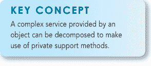

```java
************************************************************************************
// PigLatin.java               作者: Lewis/Loftus
//
// 演示了方法分解的概念。
//************************************************************************************

import java.util.Scanner;
```

## 第 7 章 面向对象设计

# 列表 7.13 继续


# 第 7 章 面向对象的设计

## 7.7 方法设计

将整个句子翻译成 Pig Latin 并非易事。如果写在一个大方法中，它将变得非常长且难以理解。更好的解决方案（如在 `PigLatinTranslator` 类中实现的那样）是分解 `translate` 方法并使用几个其他辅助方法来协助完成任务。

`translate` 方法使用 `Scanner` 对象将字符串拆分为单词。记得 `Scanner` 类（在第 3 章中讨论）的作用之一是将字符串拆分为称为标记（tokens）的较小元素。在这种情况下，标记是由空格字符分隔的，我们可以使用默认的空白分隔符。Latin 程序的输入中没有标点符号。

`translate` 方法将每个单词传递给辅助方法 `translateWord`。即使翻译一个单词的工作也有些复杂，`translateWord` 方法使用了两个私有方法：`startsWithVowel` 和 `startsWithBlend`。

`startsWithVowel` 方法返回一个布尔值，表示作为参数传递的单词是否以元音开头。请注意，代码没有单独检查每个元音，该方法的的代码声明了一个包含所有元音的字符串，然后使用 `String` 方法 `indexOf` 来确定单词的第一个字符是否为元音字符串。如果找不到指定的字符，`indexOf` 方法返回值为 -1。

`startsWithBlend` 方法也返回一个布尔值。该方法体只包含一个返回语句，其中有一个大型表达式，该表达式调用了 `String` 类的 `startsWith` 方法。如果这些调用中的任何一个返回 `true`，那么 `startsWithBlend` 方法也会返回 `true`。

注意，`translateWord`、`startsWithVowel` 和 `startsWithBlend` 方法都以私有（private）可见性声明。它们并不是为类外的客户端提供服务。相反，它们的存在是为了帮助 `translate` 方法（这是该类中唯一的服务方法）完成它的工作。通过将此类声明为私有，无法从该类的外部调用它。例如，如果 `PigLatin` 类的 `main` 方法尝试调用 `translateWord` 方法，编译器将发出错误信息。

图 7.4 显示了 PigLatin 程序的 UML 类图。注意显示各种方法可见性的符号。

### 图 7.4 PigLatin 程序的 UML 类图

| PigLatin | PigLatinTranslator |
| --- | --- |
| + main (args : String[]) : void | + translate (sentence : String) : String |
| | - translateWord (word : String) : String |
| | - beginsWithVowel (word : String) : boolean |
| | - beginsWithBlend (word : String) : boolean |

每当一个方法变得巨大或复杂时，我们都应该将其分解为多个方法，以创建一个更易理解的类设计。然而，我们首先必须考虑如何定义其他类和对象，以创建更好的整体系统设计。在面向对象的设计中，方法分解必须从于对象分解。

### 方法参数回顾

与方法设计相关的另一个重要问题涉及参数传递到方法的方式。在 Java 中，所有参数都是通过值传递（by value）的。这意味着实际参数（在调用时）的当前值被复制到方法头中的形式参数中。我们在第 4 章中提到过；现在让我们更详细地检查它。

本质上，参数传递就像一条赋值语句，将存储在实际参数中的值副本赋值给形式参数。在方法内部对形式参数进行更改时，必须考虑这个问题。形式参数是传递进去的值的独立副本，因此对其进行的任何更改对实际参数都没有影响。在控制返回调用方法后，实际参数的值将与调用方法之前的值相同。

然而，当我们将对象传递给方法时，我们实际上传递的是该对象的引用。被复制的值是对象的地址。因此，如果我们通过形式参数索引更改对象的状态（即我们更改了实际参数所引用的对象），那么形式参数和实际参数就变成了别名（aliases），因为它们引用同一个对象。另一方面，如果我们更改形式参数本身（例如指向一个新对象），我们并没有改变实际参数仍然指向原始对象的事实。

> **核心概念**
>
> 当对象传递给方法时，实际参数和形式参数就变成了别名。

列表 7.15 中的程序说明了参数传递的细微差别。仔细跟踪该程序的处理处理过程，并注意输出的值。`ParameterTester` 类包含一个 `main` 方法，该方法调用了 `ParameterModifier` 对象中的 `changeValues` 方法。`changeValues` 的两个参数是 `Objects`，每个对象都只存储一个整数值。另一个参数是基本类型整数值。

## 列表 7.14 `LatinTranslator.java`

```java
/************************************************************************************
// LatinTranslator.java      作者: Lewis/Loftus
//
// 将英语翻译成 Pig Latin。
************************************************************************************
import java.util.Scanner;

public class LatinTranslator
{
    // 将句子翻译成 Pig Latin。
    //
    public static String translate(String sentence)
    {
        String result = "";

        Scanner scan = new Scanner(sentence);

        while (scan.hasNext())
        {
            result += translateWord(scan.next()) + " ";
        }

        return result;
    }

//------------------------------------
// 将单词翻译成 Pig Latin。
// 如果单词以元音开头，在单词末尾添加 "yay"。
// 否则将第一个或两个字母移到末尾，
// 并添加 "ay"。
//------------------------------------
    private static String translateWord(String word)
    {
        String result = "";

        if (beginsWithVowel(word))
            result = word + "yay";
        else
            if (beginsWithBlend(word))
                result = word.substring(2) + word.substring(0,2) + "ay";
            else
                result = word.substring(1) + word.charAt(0) + "ay";
        return result;
    }

//--------------------
// 判断单词是否以元音开头。
//--------------------
    private static boolean beginsWithVowel(String word)
    {
        String vowels = "aeiou";
        char letter = word.charAt(0);
        return (vowels.indexOf(letter) != -1);
    }

//--------------------
// 判断单词是否以两个
// 辅音丛开头。
//--------------------
    private static boolean beginsWithBlend(String word)
    {
        return (word.startsWith("bl") || word.startsWith("sc") ||
                word.startsWith("br") || word.startsWith("sh") ||
                word.startsWith("ch") || word.startsWith("sk") ||
                word.startsWith("cl") || word.startsWith("sl") ||
                word.startsWith("cr") || word.startsWith("sn") ||
                word.startsWith("dr") || word.startsWith("sm") ||
                word.startsWith("dw") || word.startsWith("sp") ||
                word.startsWith("fl") || word.startsWith("sq") ||
                word.startsWith("fr") || word.startsWith("st") ||
                word.startsWith("gl") || word.startsWith("sw") ||
                word.startsWith("gr") || word.startsWith("th") ||
                word.startsWith("kl") || word.startsWith("tr") ||
                word.startsWith("ph") || word.startsWith("tw") ||
                word.startsWith("pl") || word.startsWith("wh") ||
                word.startsWith("pr") || word.startsWith("wr") );
    }
}
```

## 列表 7.15 `ParameterTester.java`

```java
/********************************************************************
// ParameterTester.java      Author: Lewis/Loftus
// 演示传递各种类型参数的影响。
//****************************************************
public class ParameterTester {
    // 设置三个变量（一个基本类型和两个对象）来
    // 作为 changeValues 方法的实际参数。在调用方法
    // 前后打印它们的值。
    //
    public static void main(String[] args) {
        ParameterModifier modifier = new ParameterModifier();

        int a1 = 111;
        Num a2 = new Num(222);
        Num a3 = new Num(333);

        System.out.println("Before calling changeValues:");
        System.out.println("a1\ta2\ta3");
        System.out.println(a1 + "\t" + a2 + "\t" + a3 + "\n");

        modifier.changeValues(a1, a2, a3);

        System.out.println("After calling changeValues:");
        System.out.println("a1\ta2\ta3");
        System.out.println(a1 + "\t" + a2 + "\t" + a3 + "\n");
    }
}
```

### 输出

```
Before calling changeValues:
a1      a2      a3
111     222     333

After calling changeValues:
a1      a2      a3
111     222     333
```

## 列表 7.16 `ParameterModifier.java`

```java
/********************************************************************
// ParameterModifier.java Author: Lewis/Loftus
//
// 演示更改参数的影响。
*/

public class ParameterModifier {
    // 修改参数，并在更改前后
    //打印它们
    public void changeValues(int f1, Num f2, Num f3) {
        System.out.println("Before the values:");
        System.out.println("f1\tf2\tf3");
        System.out.println(f1 + "\t" + f2 + "\t" + f3 + "\n");

        f1 = 999;
        f2.setValue(888);
        f3 = new Num(777);

        System.out.println("After the values:");
        System.out.println("f1\tf2\tf3");
        System.out.println(f1 + "\t" + f2 + "\t" + f3 + "\n");
    }
}
```

## 列表 7.17


```java
// Num.java      Author: Lewis/Loftus
//
// 将单个整数表示为对象。
public class Num {
    private int value;

    // 设置 Num 对象，存储初始值。
    public Num(int update) {
        value = update;
    }

    // 将存储的值设置为新的值。
    public void setValue(int update) {
        value = update;
    }

    // 将存储的整数值作为字符串返回。
    public String toString() {
        return value + "";
    }
}
```

返回方法后打印的最终值。基本类型整数没有从其原始值发生改变，因为更改是在方法内部对其副本进行的。同样，最后一个参数指向其原始对象并具有其原始值。这是因为方法中创建的新 `Num` 对象只被形式参数引用。当方法返回后，该形式参数被销毁，它所引用的 `Num` 对象被标记为垃圾回收。唯一“永久”的改变是对第二个参数状态的修改。图 7.5 显示了该程序的逐步处理过程。

## 第 1 步

在调用 `changeValues` 之前

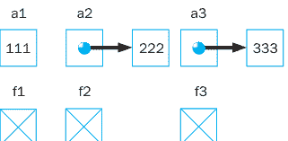

## 第 2 步

`tester.changeValues(a1, a2, a3);`

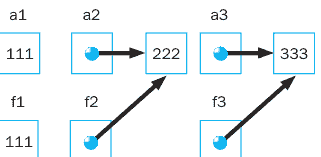

## 第 3 步

`f1 = 999;`

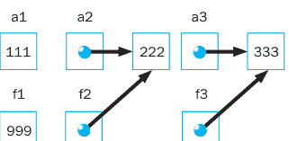

## 第 4 步

`f2.setValue(888);`

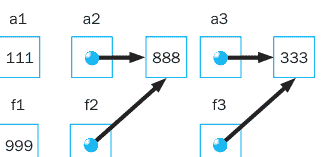

## 第 5 步

`f3 = new Num(777);`

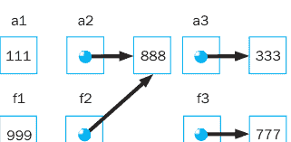

## 第 6 步

从 `changeValues` 返回后

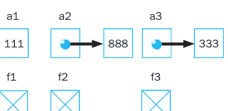

= Undefined

图 7.5 追踪 `ParameterTesting` 程序中的参数

## 7.8 方法重载

## 自测习题（答案见附录 L）

- SR 7.18 什么是方法分解？

- SR 7.19 回答关于 `PigLatinTranslator` 类的问题。

  - 没有定义构造函数。为什么？

  - 定义的一些方法是私有的。为什么？

  - 在 `translate` 方法中声明了一个 `Scanner` 对象。它被用来扫描什么？

- SR 7.20 当使用以下实际参数调用 `translate` 时，识别 `PigLatinTranslator` 支持方法所产生的调用/返回结果序列。

  - a. "animal"

  - b. "hello"

  - c. "We are the champions"

- SR 7.21 对象是如何作为参数传递的？

我们已经讨论过，当一个方法被调用时，控制流会转移到定义方法的代码处。方法执行完毕，控制返回到调用位置并继续处理。

通常，方法名就足够指示特定的调用执行了哪种方法。但在 Java 中，与其他面向对象的语言一样，你可以为多个方法使用相同的名称但带有不同的参数列表。这种技术被称为**方法重载**。当你需要对不同类型的数据执行相似的方法时，这种技术非常有用。

编译器必须能够将每次调用与特定的方法声明关联。如果两个或多个方法的名称相同，则将使用额外信息来唯一标识被调用的版本。在 Java 中，只要参数的数量、参数的类型和/或参数的顺序是不同的，方法名就可以用于多个方法。

例如，我们可以如下所示声明一个名为 `sum` 的方法：

> 核心概念
>
> 重载方法的版本通过其参数的数量、类型和顺序来区分。

```java
public int sum(int num1, int num2) {
    return num1 + num2;
}
```

然后，我们可以在同一个类中如下声明另一个名为 `sum` 的方法：

```java
public int sum(int num1, int num2, int num3) {
    return num1 + num2 + num3;
}
```

现在，当进行调用时，编译器会查看参数的数量来确定调用哪个版本的 `sum` 方法。例如，以下调用将调用 `sum` 方法的第二个版本：

`sum(25, 69, 13);`

方法的名称以及其参数的数量、类型和顺序被称为方法的**签名**（signature）。编译器使用完整的方法签名将方法调用绑定到适当的定义上。编译器必须能够检查方法调用以确定具体调用了哪种特定方法。如果你尝试指定两个相同签名的方法，编译器将发出错误信息且不会创建可执行程序。

注意，方法的返回类型不是方法签名的一部分。也就是说，两个重载方法不能仅在返回类型上不同。这是因为方法返回的值可以被调用处忽略。在这种情况下，编译器无法区分引用的是哪一个重载方法版本。以下是重载了多次且每个版本都接受单一类型的方法其签名的部分列表：

- `println(String s)`
- `println(int i)`
- `println(double d)`
- `println(char c)`
- `println(boolean b)`

这两行代码实际上调用了具有相同名称的不同方法：

```java
System.out.println("Number of students: ");
System.out.println(count);
```

第一行调用了接受字符串的 `println` 版本。第二行（假设 `count` 是整数）调用了接受整数的 `println` 版本。


## 7.9 测试

## 缺陷测试

由于测试的目标是发现错误，它通常被称为缺陷测试。以该目标为中心，一个好的测试是能够揭示程序任何缺陷的测试。这听起来很奇怪，因为我们最终并不希望在系统中出现问题。但请记住，错误几乎肯定存在。测试工作应该尽可能尝试发现它们。我们想要增加

> 核心概念
>
> 对程序进行测试永远无法保证没有错误。

通过特定输入运行程序并产生正确的结果，只能证明该程序在特定输入下是有效的。随着更多的测试用例执行而没有揭示错误，我们对程序的信心会增加，但我们永远无法确定所有错误都已消除。可能一直存在未被发现的错误。正因为如此，对程序进行彻底测试是重要的。证明程序是正确的是可能的，但对于大型系统来说，这种技术极其复杂，而且在证明过程中也可能出错。因此，我们通常依赖测试来确定程序的质量。

在确定存在错误后，我们确定错误的原因并修复它。问题解决后，我们应该重新运行之前的测试，以确保在修复问题时没有产生另一个错误。这种技术被称为回归测试。

评估设计或代码的一种技术称为评审，这是一种会议，在会议中几个人仔细检查设计文档或代码片段。向他人展示我们的设计或代码，使我们能够更深入地思考它，并允许他人与我们分享他们的建议。参与者讨论其优点和问题，并创建一个必须解决的问题列表。


方法返回后，该形式参数被销毁，它所引用的 `Num` 对象被标记为垃圾回收。唯一“永久”的改变是对第二个参数状态的修改。图 7.5 显示了该程序的逐步处理过程。

## 第 1 步

在调用 `changeValues` 之前


## 第 2 步

`tester.changeValues(a1, a2, a3);`


## 第 3 步

`f1 = 999;`


## 第 4 步

`f2.setValue(888);`


## 第 5 步

`f3 = new Num(777);`


## 第 6 步

从 `changeValues` 返回后


= Undefined

图 7.5 追踪 `ParameterTesting` 程序中的参数

## 7.8 方法重载

## 自测习题（答案见附录 L）

- SR 7.18 什么是方法分解？

- SR 7.19 回答关于 `PigLatinTranslator` 类的问题。

  - 没有定义构造函数。为什么？

  - 定义的一些方法是私有的。为什么？

  - 在 `translate` 方法中声明了一个 `Scanner` 对象。它被用来扫描什么？

- SR 7.20 当使用以下实际参数调用 `translate` 时，识别 `PigLatinTranslator` 支持方法所产生的调用/返回结果序列。

  - a. "animal"

  - b. "hello"

  - c. "We are the champions"

- SR 7.21 对象是如何作为参数传递的？

我们已经讨论过，当一个方法被调用时，控制流会转移到定义方法的代码处。方法执行完毕，控制返回到调用位置并继续处理。

通常，方法名就足够指示特定的调用执行了哪种方法。但在 Java 中，与其他面向对象的语言一样，你可以为多个方法使用相同的名称但带有不同的参数列表。这种技术被称为方法重载。当你需要对不同类型的数据执行相似的方法时，这种技术非常有用。

编译器必须能够将每次调用与特定的方法声明关联。如果两个或多个方法的名称相同，则将使用额外信息来唯一标识被调用的版本。在 Java 中，只要参数的数量、参数的类型和/或参数的顺序是不同的，方法名就可以用于多个方法。

例如，我们可以如下所示声明一个名为 `sum` 的方法：

> 核心概念
>
> 重载方法的版本通过其参数的数量、类型和顺序来区分。

```java
public int sum(int num1, int num2)
{
    return num1 + num2;
}
```

然后，我们可以在同一个类中如下声明另一个名为 `sum` 的方法：

```java
public int sum(int num1, int num2, int num3)
{ return num1 + num2 + num3;
}
```

现在，当进行调用时，编译器会查看参数的数量来确定调用哪个版本的 `sum` 方法。例如，以下调用将调用 `sum` 方法的第二个版本：

```
sum(25, 69, 13);
```

方法的名称以及其参数的数量、类型和顺序被称为方法的签名。编译器使用完整的方法签名将方法调用绑定到适当的定义上。编译器必须能够检查方法调用以确定具体调用了哪种特定方法。如果你尝试指定两个相同签名的方法，编译器将发出错误信息且不会创建可执行程序。

注意，方法的返回类型不是方法签名的一部分。也就是说，两个重载方法不能仅在返回类型上不同。这是因为方法返回的值可以被调用处忽略。在这种情况下，编译器无法区分引用的是哪一个重载方法版本。以下是重载了多次且每个版本都接受单一类型的方法其签名的部分列表：

- `println(String s)`
- `println(int i)`
- `println(double d)`
- `println(char c)`
- `println(boolean b)`

这两行代码实际上调用了具有相同名称的不同方法：

```
System.out.println("Number of students: ");
System.out.println(count);
```

第一行调用了接受字符串的 `println` 版本。第二行（假设 `count` 是整数）调用了接受整数的 `println` 版本。


## 7.9 测试


方法返回后，该形式参数被销毁，它所引用的 `Num` 对象被标记为垃圾回收。唯一“永久”的改变是对第二个参数状态的修改。图 7.5 显示了该程序的逐步处理过程。

## 第 1 步

在调用 `changeValues` 之前


## 第 2 步

`tester.changeValues(a1, a2, a3);`


## 第 3 步

`f1 = 999;`


## 第 4 步

`f2.setValue(888);`


## 第 5 步

`f3 = new Num(777);`


## 第 6 步

从 `changeValues` 返回后


= Undefined

图 7.5 追踪 `ParameterTesting` 程序中的参数

## 7.8 方法重载

## 自测习题（答案见附录 L）

- SR 7.18 什么是方法分解？

- SR 7.19 回答关于 `PigLatinTranslator` 类的问题。

  - 没有定义构造函数。为什么？

  - 定义的一些方法是私有的。为什么？

  - 在 `translate` 方法中声明了一个 `Scanner` 对象。它被用来扫描什么？

- SR 7.20 当使用以下实际参数调用 `translate` 时，识别 `PigLatinTranslator` 支持方法所产生的调用/返回结果序列。

  - a. `"animal"`

  - b. `"hello"`

  - c. `"We are the champions"`

- SR 7.21 对象是如何作为参数传递的？

我们已经讨论过，当一个方法被调用时，控制流会转移到定义方法的代码处。方法执行完毕，控制返回到调用位置并继续处理。

通常，方法名就足够指示特定的调用执行了哪种方法。但在 Java 中，与其他面向对象的语言一样，你可以为多个方法使用相同的名称但带有不同的参数列表。这种技术被称为方法重载。当你需要对不同类型的数据执行相似的方法时，这种技术非常有用。

编译器必须能够将每次调用与特定的方法声明关联。如果两个或多个方法的名称相同，则将使用额外信息来唯一标识被调用的版本。在 Java 中，只要参数的数量、参数的类型和/或参数的顺序是不同的，方法名就可以用于多个方法。

例如，我们可以如下所示声明一个名为 `sum` 的方法：

> 核心概念
>
> 重载方法的版本通过其参数的数量、类型和顺序来区分。

```java
public int sum(int num1, int num2)
{
    return num1 + num2;
}
```

然后，我们可以在同一个类中如下声明另一个名为 `sum` 的方法：

```java
public int sum(int num1, int num2, int num3)
{ return num1 + num2 + num3;
}
```

现在，当进行调用时，编译器会查看参数的数量来确定调用哪个版本的 `sum` 方法。例如，以下调用将调用 `sum` 方法的第二个版本：

```
sum(25, 69, 13);
```

方法的名称以及其参数的数量、类型和顺序被称为方法的签名。编译器使用完整的方法签名将方法调用绑定到适当的定义上。编译器必须能够检查方法调用以确定具体调用了哪种特定方法。如果你尝试指定两个相同签名的方法，编译器将发出错误信息且不会创建可执行程序。

注意，方法的返回类型不是方法签名的一部分。也就是说，两个重载方法不能仅在返回类型上不同。这是因为方法返回的值可以被调用处忽略。在这种情况下，编译器无法区分引用的是哪一个重载方法版本。以下是重载了多次且每个版本都接受单一类型的方法其签名的部分列表：

- `println(String s)`
- `println(int i)`
- `println(double d)`
- `println(char c)`
- `println(boolean b)`

这两行代码实际上调用了具有相同名称的不同方法：

```
System.out.println("Number of students: ");
System.out.println(count);
```

第一行调用了接受字符串的 `println` 版本。第二行（假设 `count` 是整数）调用了接受整数的 `println` 版本。


## 7.9 测试

363

通过发现并修复存在的错误来提高我们程序的可靠性，而不是让用户去发现这些错误。

> 核心概念
>
> 一个好的测试是能够揭示错误的测试。

一个测试用例由一组输入、用户操作或其他初始条件以及预期的输出组成。测试用例应该被妥善记录，以便在需要时重复。开发者通常会创建一个完整的测试套件（test suite），这是一组涵盖了系统各个方面的测试用例。


由于程序运行在大量可能的输入上，因此要为所有可能的输入或操作创建测试用例是不可行的。通常也没有必要测试每种情况。两个特定的测试用例可能非常相似，以至于它们没有测试到程序的独特之处。同时做这两者将是徒劳的。我们应该执行一个以某种新方式压力测试程序的测试用例。因此，我们必须仔细选择测试用例。最后，让我们检查测试的两种方法：黑盒测试和白盒测试。

> 核心概念
>
> 对程序所有可能的输入和操作进行穷尽式测试是不行的。

顾名思义，黑盒测试将被测试的对象视为一个黑盒。在黑盒测试中，开发测试用例时不考虑其内部工作机制。黑盒测试基于输入和输出。可以使用黑盒技术对整个程序进行测试，这意味着输入是用户提供的信息和作为按钮点击的操作。如果输入产生了预期的输出，则该测试用例是成功的。单个类也可以使用黑盒技术进行测试，这种测试侧重于类的系统接口（其公共方法）。某些参数被传入，产生特定的结果。黑盒测试通常直接源于系统的需求或方法的陈述目的。

黑盒测试用例的输入数据通常通过定义等价类（equivalence categories）来选择。等价类是一组预期会产生相似输出的输入集合。通常，如果一个方法适用于其中一个，则适用于其他；例如，计算整数平方根的方法可以分为两个等价类：非负整数和负整数。如果它对一个负值运行正常，那么它可能也适用于所有负值。同样地，如果它对一个负值运行正常，

等价类具有定义的边界。由于一个等价类的所有值本质上是在测试程序的相同功能，因此在等价边界内只需要一个测试用例。然而，由于编程往往会产生“差一错误”（off by one），应该对边界及周围的错误进行穷尽测试。对于整数边界，一个良好的测试套件应至少包含边界的精确值、边界减1以及边界加1。应该定义使用这些用例的测试用例，再加上至少一个来自类别通用区域内部的用例。

## 第 7 章 面向对象设计

让我们来看一个例子。考虑一个其目的是验证特定整数值是否在0到99（包含99）范围内的方法。在这种情况下，有三类值：0以下的值、0到99范围内的值以及99以上的值。黑盒测试要求我们使用位于边界周围和落在边界上的值，以及等价类中的一些通用值。因此，针对这种情况的一组黑盒测试用例可能是：-500, -1, 0, 1, 50, 98, 99, 100 和 500。

白盒测试，也称为玻璃盒测试，是对方法的内部结构和实现进行演练（测试）。白盒测试基于代码逻辑。其目标是确保程序中的每条路径至少执行一次。白盒测试映射代码中的路径，并确保测试用例覆盖了要执行的每条路径。这种测试通常是语句覆盖（statement coverage）。

代码路径由各种使用条件表达式（如 `if`）的控制流语句控制。白盒测试映射代码中的路径，并确保测试用例覆盖了要执行的每条路径。代码路径通过使用条件表达式的各种控制流语句进行控制。这些 `if` 语句控制 `if` 语句的以执行的路径。类似情况可以创建这些情况。在黑盒测试和白盒测试中，预期输出是预期输出。

> 自测回顾题（见答案）

25 从列表中选择最符合以下短语的术语：

a. 黑盒测试基于输入和输出。

b. 黑盒测试基于代码逻辑。

c. 黑盒测试将被测试的对象视为一个黑盒。

d. 白盒测试是对方法的内部结构和实现。

e. 目标是确保程序的每条路径至少执行一次。

f. 白盒测试通常是语句覆盖。

g. 黑盒测试时不考虑内部工作机制。

h. 白盒测试映射代码中的路径并确保覆盖。

## 7.10 GUI 设计

当我们关注细节时，有时会忽视大局。

> 核心概念
>
> 任何 GUI 设计都遵循以下原则：

- 了解用户。
- 防止用户错误。
- 优化可用性。
- 保持一致性。

并不是所有用户都一样。有些人更熟练。我们应该根据最低共同标准进行设计。最后，一致性在处理大型系统时非常重要。用户习惯了特定的布局；这些不应随意更改。

> 自测问题（见答案）

26 本节介绍了哪些 GUI 设计的原则？

27 为什么良好的用户界面设计如此重要？

## 7.11 鼠标事件

让我们检查在使用鼠标时产生的事件（见 7.6 节）。当这些事件发生时，鼠标坐标会被捕获在事件对象中。

当鼠标指针在 JavaFX 节点上点击鼠标时，会发生三个事件：按下鼠标按钮时（mouse pressed）以及抬起时（mouse released 和 mouse clicked）。当鼠标指针进入节点的图形空间时，节点将产生一个 mouse entered 事件。同样，当鼠标指针移出节点时，会产生 mouse exited 事件。

当鼠标移动时，会产生一系列鼠标事件。如果在鼠标移动时按下鼠标按钮，则会产生 mouse dragged 事件。这些事件在鼠标移动时产生的频率很高，允许程序跟踪并响应持续的移动。

> 核心概念
>
> 移动鼠标和点击鼠标按钮产生程序可以响应的事件。

| 鼠标事件 | 描述 |
| :--- | :--- |
| mouse pressed | 按下鼠标按钮。 |
| mouse released | 释放鼠标按钮。 |
| mouse clicked | 在节点上按下并释放鼠标按钮。 |
| mouse entered | 鼠标指针移到节点上方。 |
| mouse exited | 鼠标指针移出节点。 |
| mouse moved | 鼠标移动。 |
| mouse dragged | 在按下鼠标按钮的同时移动鼠标。 |

图 7.6 JavaFX 鼠标事件

对于每个鼠标事件，都有相应的便捷方法来设置处理程序，例如 `setOnMouseClicked`、`setOnMouseReleased` 等。

代码列表 7.18 所示的程序响应了一个鼠标事件。当在场景的任何地方点击鼠标按钮时，屏幕会显示一条从左上角的原点 (0, 0) 到鼠标指针位置的线段。同时，程序还会计算并显示这两点之间的距离。

### 代码列表 7.18

```java
import javafx.application.Application;
import javafx.scene.Group;
import javafx.scene.Scene;
import javafx.scene.input.MouseEvent;
import javafx.scene.paint.Color;
import javafx.scene.shape.Line;
import javafx.scene.text.Text;
import javafx.stage.Stage;

/**************************************************************************************************
// ClickDistance.java      Author: Lewis/Loftus
// 演示了鼠标点击事件的处理。
****************************************************************************************************

public class ClickDistance extends Application {
    private Line line;
    private Text textDistance;

    // 显示原点 (0, 0) 与鼠标
    // 点击位置之间的距离。
    public void start(Stage primaryStage) {
        line = new Line(0, 0, 0, 0);
        distanceText = new Text(150, 30, "-");

        Group root = new Group(textDistance, line);

        Scene scene = new Scene(root, 400, 300, Color.LIGHTYELLOW);

        scene.setOnMouseClicked(this::processMouseClicked);

        primaryStage.setTitle("Click Distance");
        primaryStage.setScene(scene);
        primaryStage.show();
    }

// 将线段的终点重置为鼠标点击
// 事件的位置并更新显示的距离。
public void processMouseClick(MouseEvent event)
{
    double clickX = event.getX();
    double clickY = event.getY();

    line.setEndX(clickX);
    line.setEndY(clickY);

    double distance = Math.sqrt(clickX * clickX + clickY * clickY);

    String distanceStr = String.format("%.2f", distance);
    distanceText.setText("Distance: " + distanceStr);
}
```

### 显示

| 点击距离 | 点击距离 |
| :--- | :--- |
| 距离: 318.28 | 距离: 289.36 |

`processMouseClick` 方法被设置为事件处理程序，它接收一个表示事件的 `MouseEvent` 对象。调用事件的 `getX` 和 `getY` 方法可以返回鼠标点击位置的坐标。使用这些值可以重置线段的终点，并计算并显示到原点的距离。

现在，让我们来看一个响应两个鼠标相关事件的示例。代码列表 7.19 所示的 `RubberLines` 程序允许用户通过点击鼠标按钮建立一个端点并拖动鼠标到另一个端点，在两点之间绘制一条线。在鼠标拖动过程中，线段会不断重绘，给用户一种正在拉伸线条的错觉。这种效果被称为“橡皮筋带”（rubberbanding）。

> 核心概念
>
> 橡皮筋带是指当形状在鼠标拖动时似乎在调整大小时所产生的图形效果。

### 代码列表 7.19

```java
import javafx.application.Application;
import javafx.scene.Group;
import javafx.scene.Scene;
import javafx.scene.input.MouseEvent;
import javafx.scene.paint.Color;
import javafx.scene.shape.Line;
import javafx.stage.Stage;

/****************************************************************
// RubberLines.java      Author: Lewis/Loftus
//
// 演示了鼠标按下和鼠标拖动事件的处理。
************************************************

public class RubberLines extends Application
{
    private Line currentLine;
    private Group root;

    //
    // 显示初始为空的场景，等待用户使用
    // 绘制线条。
    public void start(Stage primaryStage)
    {
        root = new Group();

        Scene scene = new Scene(root, 500, 300, Color.BLACK);
        scene.setOnMousePressed(this::processMouseEvent);
        scene.setOnMouseDragged(this::processMouseDragged);

        primaryStage.setTitle("Rubber Lines");
        primaryStage.setScene(scene);
        primaryStage.show();
    }

// 当鼠标按钮按下时，在场景中添加一条新线。
//
public void processMousePress(MouseEvent event) {
    currentLine = new Line(event.getX(), event.getY(), event.getX(), event.getY());
    currentLine.setStroke(Color.CYAN);
    currentLine.setStrokeWidth(3);
    root.getChildren().add(currentLine);
}

// 当鼠标拖动时更新当前线条的终点。
//
public void processMouseDrag(MouseEvent event) {
    currentLine.setEndX(event.getX());
    currentLine.setEndY(event.getY());
}
```

## 7.12 关键事件

### 代码列表 7.20 继续

```java
primaryStage.setTitle("Alien Direction");
primaryStage.setScene(scene);
primaryStage.show();
}
// Modifies the position of the image view when an arrow key is
// pressed.
//
public void processKeyPress(KeyEvent event) {
    switch (event.getCode()) {
        case UP:
            imageView.setY(imageView.getY() - JUMP);
            break;
        case DOWN:
            imageView.setY(imageView.getY() + JUMP);
            break;
        case RIGHT:
            imageView.setX(imageView.getX() + JUMP);
            break;
        case LEFT:
            imageView.setX(imageView.getX() - JUMP);
            break;
        default:
            break; // do nothing if it's not an arrow key
    }
}
```

### 显示

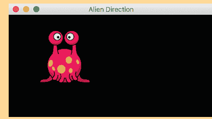

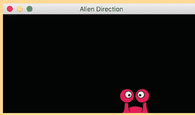

## 第 7 章 面向对象设计

此示例的 `start` 方法加载外星人图像并设置 `ImageView` 对象来显示它。图像视图的初始位置被显式设置。

按键事件由拥有键盘焦点的节点处理。在这个示例中，事件由场景（scene）本身处理。调用场景的 `setOnKeyPressed` 方法来为按下的按键设置处理程序。

当按下按键时，会调用事件处理方法并传递一个 `KeyEvent` 对象。事件的 `getCode` 方法返回一个表示所按按键的代码。更具体地说，它返回一个 `KeyCode` 对象，这是一个表示各种按键的枚举类型。

使用 `switch` 语句来处理我们希望程序响应的四个箭头键中的每一个。例如，按下右箭头键时，会在图像视图的位置上加上特定数量的像素（由常量 `JUMP` 表示）。如果用户按下箭头键以外的任何按键，则会被忽略。

需要注意的是，如果生成了按键事件，其 `getCode` 方法将始终返回 `KeyCode.UNDEFINED`。在这种情况下，可以使用事件的 `getCharacter` 方法来获取字符。

> 自测题（答案在附录 L）

- SR 7.31 输入键盘按键时会产生哪些事件？
- SR 7.32 在程序中，你如何确定按了哪一个按键？
- SR 7.33 当按下箭头键时，`AlienDirection` 程序会执行什么？

## 核心概念总结

- 设计上付出的努力既至关重要又具有成本效益。
- 问题描述中的名词可能指示了程序中需要的一些类和对象。
- 静态变量在类的所有实例之间共享。
- 聚合对象由其他对象组成，形成“有一个……”的（has-a）关系。
- 接口是抽象方法的集合，因此不能被实例化。
- 枚举类型的值是该类型的静态变量。
- 我们可以在枚举类型的定义中添加属性和方法。
- 对象提供的复杂服务可以分解以利用私有的辅助方法。
- 当将对象传递给方法时，实际参数和形式参数变成别名。
- 重载方法的版本通过其参数的数量、类型和顺序来区分。
- 测试程序不能保证错误的不存在。
- 一个良好的测试是覆盖了错误的测试。
- 对所有可能的输入和用户操作对程序进行详尽测试是不可能的。
- 任何 GUI 设计都应遵循一致性和可用性的基本指南。
- 移动鼠标和点击鼠标按钮会产生程序可以响应的事件。
- 橡皮带效应（Rubberbanding）是在拖动鼠标时形状似乎在调整大小的图形效果。
- 按键事件允许程序立即响应用户的按键。

## 练习题

EX 7.1 编写一个 `average` 方法，接受两个整数参数并返回它们的平均值作为浮点值返回。


# 练习题

## EX 7.2
重载 7.1 中的 `average` 方法，使得在提供三个整数时，该方法返回平均值。

## EX 7.3
当按下箭头键时，`AlienDirection` 程序会执行什么？

## EX 7.4
编写一个名为 `splice` 的方法，接受两个整数：`startIndex` 和 `deleteLength`。从 `startIndex` 开始从字符串中删除 `deleteLength` 个字符。

## EX 7.5
重载 7.4 中的 `splice` 方法，使其接受一个名为 `replace` 的额外字符串。在 `startIndex` 处插入 `replace`。

## EX 7.6
编写一个名为 `makeCircle` 的方法，接受：中心的 (x, y) 坐标、一个表示半径的整数以及一个定义圆形的填充颜色的 `Color` 对象。

## EX 7.7
编写一个名为 `shiftLeft` 的方法，接受一个字符串并删除第一个字符。

## EX 7.8
重载 7.7 中的 `shiftLeft` 方法，使其接受一个表示次数的整数。

## EX 7.9
重载 7.8 中的 `shiftLeft` 方法，使其接受一个名为 `c` 的额外字符（`char`）。

## EX 7.10
讨论 Java 向方法传递参数的方式。

## EX 7.11
解释为什么静态方法不能引用实例变量。

## EX 7.12
一个类可以实现两个包含相同方法签的接口吗？

## EX 7.13
创建一个名为 `Visible` 的接口，包含两个方法：`Visible` 和 `makeInvisible`。这两个方法都不应接受参数并返回布尔值。描述类如何实现它。

## EX 7.14
绘制一个 UML 类图，显示 7.13 中元素之间的关系。

## EX 7.15
想象一个游戏，其中某些元素可以损坏而另一些不能。创建一个接口名为 `Breakable`，它有一个不接受参数的 `break` 方法以及另一个返回对象是否损坏的 `broken` 方法。

## EX 7.16
创建一个接口 `VCR`，拥有代表录像机标准操作的方法（播放、停止等）。以你喜欢的方式定义方法签名。描述类如何实现它。

## EX 7.17
绘制一个 UML 类图，显示 7.16 中元素之间的关系。

## EX 7.18
比较鼠标点击事件和按键事件。

## EX 7.19
什么是橡皮带效应？如何实现？

# 编程项目

## PP 7.1
修改第 4 章中的 `Account` 类，允许仅使用名称和账号打开账户，假设初始余额为零。修改 `Transactions` 类的 `main` 方法以演示这种新功能。

## PP 7.2
创建一个 `SalesPerson` 类，代表组织中的销售人员。`SalesPerson` 类应该有销售人员的姓名、电话号码和所属区域。每个销售人员每天获得一个销售额。提供一个根据参数值设置所有实例值的构造函数。重载构造函数，使得每周的每天金额设置为零。提供一个方法 `setDailyAmount`，接受一周中的一天（星期日0，星期一1，以此类推）以及另一个设置当天金额的方法。提供一个名为 `getDailyAmount` 方法，接受一周中的一天并返回金额。提供一个方法 `total` 来计算总额，以及一个方法 `average` 计算每周平均销售额。编写一个 `toString` 方法打印销售人员的所有详情。编写一个驱动类来测试 `SalesPerson` 类。

## PP 7.3
写一个名为 `SalesTeam` 的类，代表由销售人员组成的团队。团队中的每个销售人员由 PP 7.2 中的 `SalesPerson` 类。每个团队都有一个，构造函数只需要接受团队名称。使用 `ArrayList` 来存储团队成员。提供一个名为 `addSalesPerson` 的方法，接收一个 `SalesPerson` 对象。提供一个名为 `weeklyReport` 的方法，打印每个团队成员的名称和总销售额以及整个团队的总金额。编写一个驱动类来充分测试 `SalesPerson` 类。

## PP 7.4
修改 `RationalNumber` 类使其实现 `Comparable` 接口。为了进行比较，为两个 `RationalNumber` 对象从分子和分母计算出等效浮点值，然后使用 0.0001 的容差值对其进行比较。编写一个主驱动程序来测试你的修改。

## PP 7.5
编写一个名为 `Priority` 的接口，包含两个方法：`setPriority` 和 `getPriority`。该接口应该定义在对象集合之间建立数值优先级的方法。设计并实现一个实现 `Priority` 接口的 `Task` 类，表示任务（如待办事项）。创建一个驱动类来练习一些 `Task` 对象。

## PP 7.6
修改 PP 7.5 中的 `Task` 类，使其也实现本章定义的 `Complexity` 接口。修改驱动类以显示 `Task` 对象的这些新功能。

## PP 7.7
修改 PP 7.5 和 7.6 中的 `Task` 类，使其实现 Java 类库中的 `Comparable` 接口。实现该接口使任务按优先级排序。编写一个驱动类，其 `main` 方法显示 `Task` 对象的这些新功能。

## PP 7.8
编写一个名为 `Lockable` 的接口，包含以下方法：`setKey`、`lock`、`unlock` 和 `locked`。`setKey`、`lock` 和 `unlock` 方法接收代表密钥的整数参数。`setKey` 方法建立密钥。`lock` 和 `unlock` 方法锁定和解锁对象，但仅当传入的密钥正确时。`locked` 方法返回一个布尔值，指示对象是否被锁定。`Lockable` 对象表示一个其方法受保护的对象：如果对象被锁定，则无法调用方法；如果已解锁，则可以调用。编写第 5 章中 `Coin` 类的一个版本使其成为 `Lockable`。

## PP 7.9
编写第 4 章中 `Account` 类的版本，使其根据 PP 7.8 的定义成为 `Lockable`。

## PP 7.10
编写一个 JavaFX 应用，统计场景中点击鼠标按钮的次数。在窗口顶部显示该数字。

## PP 7.11
编写一个 JavaFX 应用，根据鼠标指针的位置更改其背景颜色。如果鼠标指针在程序窗口的左半部分，显示红色；如果在右半部分，显示绿色。

## PP 7.12
编写一个 JavaFX 应用使用橡皮筋带技术（rubberbanding technique）绘制多个圆。圆的大小由鼠标拖动决定。使用初始鼠标按下位置作为圆的固定中心点。计算鼠标指针当前位置与中心点之间的距离以确定圆的半径。

## PP 7.13
编写一个 JavaFX 应用作为鼠标里程表，持续显示鼠标在程序窗口上方移动的距离（像素为单位）。在窗口顶部显示当前里程表值。提示：当鼠标移动时，使用距离公式计算自上一次事件以来鼠标移动的距离，并将其累加到总数中。

## PP 7.14
编写一个 JavaFX 应用，显示跟随鼠标移动的战坦克顶视图。当按下鼠标按钮时，让激光束从坦克上的炮上射出（一条连续的光束，而不是移动的射体），直到释放鼠标按钮。使用单独的类定义坦克。

## PP 7.15
修改本章的 `AlienDirection` 程序，不允许图像移动到窗口可见区域之外。忽略任何导致这种情况的按键事件。

# 软件故障

## 2003年东北部大停电

### 发生了什么？


- 停电前后的美国东北部。

2003年8月14日，美国历史上最大的停电事件袭击了美国东北部和加拿大部分地区。几个大都市区受到影响，包括纽约、克利夫兰、底特律、多伦和渥太华。在三分钟内，21座发电厂停止运行，影响了约5000万人口。

典型问题导致了停电地区。交通信号灯缺失导致交通问题。火车和电梯被困住。机场延迟了航班。依赖电泵的水压失效了。手机使用被中断。（有线电话使用仍可用，但在紧急情况下负荷过重。）由于服务器宕机和尝试重新路由消息，互联网流量变慢。据报道发生了一些抢劫事件。

估计停电造成的总财务损失在40亿美元左右。

### 谁造成的？

许多来源被指责对停电负有责任。在凌晨几个小时内，当局迅速排除了恐怖主义。

# 数组

## 目标

- 定义并使用数组进行基本数据组织。
- 讨论边界检查和容量管理的技术。
- 讨论作为对象的数组和对象数组的问题。
- 探索命令行的使用。
- 描述变长参数列表的语法和用法。
- 讨论多维数组的创建和使用。
- 探索多边形和折线形状

## 8.1 数组元素

数组是一种简单但强大的编程语言结构，用于分组和组织数据。在编写一个管理大量信息的程序（例如包含 100 个名字的列表）时，为每条数据声明单独的变量是不现实的。数组通过让我们声明一个可以包含多个可访问值的变量来解决这个问题。

数组是值的列表。每个值都存储在数组中某一个特定的、带有编号的位置。与每个位置对应的数字被称为索引（index）或下标。图 8.1 显示了一个整数型数组以及与每个位置对应的索引。名为 `height` 的数组包含了表示几个人身高的整数。

在 Java 中，数组索引始终从零开始。因此，存储在索引 5 位置的值是数组中的第六个值。图 8.1 所示的数组具有从 0 到 10 的 11 个值。

> **核心概念**
>
> 大小为 N 的数组索引从 0 到 N-1。

要访问数组中的某个值，我们使用数组名后跟方括号中的索引。例如，该表达式引用了 `height` 数组中的第九个值：

```
height[8]
```

根据图 8.1，`height[8]`（读作 height-eight）包含值 79。不要将索引的值（在此例中为 8）与存储在该索引处的数组值（在此例中为 79）混淆。

| index | height |
|-------|--------|
| 0     | 69     |
| 1     | 61     |
| 2     | 70     |
| 3     | 74     |
| 4     | 62     |
| 5     | 69     |
| 6     | 66     |
| 7     | 73     |
| 8     | 79     |
| 9     | 62     |
| 10    | 70     |

图 8.1 一个名为 height 的包含整数值的数组

表达式 `height[8]` 指存储在特定位置的单个整数。它可以用在任何可以使用整数变量的地方。因此，你可以给它赋值、在计算中使用它、打印它的值等。此外，由于数组索引是整数，因此你可以使用整数表达式来索引数组并访问任何元素。这些概念在以下代码行中有所演示：

```java
height[2] = 72;
height[count] = feet * 12;
average = (height[0] + height[2]) / 3;
System.out.println("the middle value is " + height[MAX/2]);
pick = height[rand.nextInt(11)];
```

数组连续存储在内存中，这意味着元素是一个接一个存储的，正如我们在概念上构想的那样。这使得数组在通过索引访问任何元素时极具效率。理想情况下，为了确定任何特定元素的地址，将索引乘以每个元素的大小，并加上数组起始点的内存地址。这就是数组索引从零开始的原因——为了让该计算尽可能简单。从效率的角度来看，访问数组中的第 50 个元素与访问第一个元素一样简单。

### 自我复习题（答案见附录 L。）

- SR 8.1 什么是数组？
- SR 8.2 数组的每个元素是如何被引用的？
- SR 8.3 根据图 8.1 所示的数组，以下各项的分别是什么？
  - a. height[1]
  - b. height[2] + height[5]
  - c. height[2 + 5]
  - d. 存储在索引 8 的值
  - e. 第四个值
  - f. height.length

## 8.2 声明和使用数组

在 Java 中，数组是对象。为了创建一个数组，必须使用 `new` 运算符声明并初始化数组。如下代码 8.1 所示，声明了一个数组：

```java
int[] height = new int[11];
```

### 代码清单 8.1 声明和使用数组

```java
// 作者: Lewis
// 描述：演示数组的声明和使用。
public class BasicArray {
    public static void main(String[] args) {
        // 声明数组
        final int LIMIT = 11;
        int[] height = new int[LIMIT];

        // 初始化数组值
        height[0] = 69;
        height[1] = 61;
        height[2] = 70;
        height[3] = 74;
        height[4] = 62;
        height[5] = 69;
        height[6] = 66;
        height[7] = 73;
        height[8] = 79;
        height[9] = 62;
        height[10] = 70;

        // 使用数组
        int count = 5;
        int feet = 6;
        height[count] = feet * 12;
        int average = (height[0] + height[2]) / 3;
        System.out.println("the middle value is " + height[LIMIT/2]);

        java.util.Random rand = new java.util.Random();
        int pick = height[rand.nextInt(LIMIT)];
    }
}
```

**输出**

```
the middle value is 69
```

### 代码清单 8.2 数组索引处理

```java
// ReverseOrder.java      Author: Lewis/Loftus
// 数组索引处理。

import java.util.Scanner;

public class ReverseOrder {
    // 从用户处读取数字列表，将其存储在数组
    // 中，然后反顺序打印它们。
    public static void main(String[] args) {
        Scanner scan = new Scanner(System.in);

        double[] numbers = new double[10];

        System.out.println("The size of the array: " + numbers.length);

        for (int index = 0; index < numbers.length; index++) {
            System.out.print("Enter number " + (index+1) + ": ");
            numbers[index] = scan.nextDouble();
        }

        System.out.println("The numbers in reverse order:");

        for (int index = numbers.length-1; index >= 0; index--) {
            System.out.print(numbers[index] + " ");
        }
    }
}
```


The size of the array: 10
Enter number 1: 18.36
Enter number 2: 48.9
Enter number 3: 53.5
Enter number 4: 29.06
Enter number 5: 72.404
Enter number 6: 34.8
Enter number 7: 63.41
Enter number 8: 45.55
Enter number 9: 69.0
Enter number 10: 99.18
The numbers in reverse order:
99.18 45.55 63.41 34.8 72.404 29.06 53.5 48.9 18.36

# 第 8 章 数组

示例 8.3 所示的 `LetterCount` 示例使用了两个数组和一个 `String` 对象。名为 `upper` 的数组用于存储字符串中每个大写字母出现的次数。名为 `lower` 的数组对小写字母起相同的作用。

由于英语字母表中有 26 个字母，因此 `upper` 和 `lower` 数组都声明为 26 个元素。每个元素都包含一个初始值为 0 的整数。`for` 循环逐个字符地扫描字符串。对于字符串中找到每个字符，对应数组中相应的计数器都会加一。

## 示例 8.3

```
********************************************************************
// LetterCount.java               Author: Lewis/Loftus
//
// 演示数组与字符串之间的关系。
********************************************************************

import java.util.Scanner;

public class LetterCount
{
    // 从用户处读取一个句子，并统计其中包含
    // 大写和小写字母的数量。
    //
    public static void main(String[] args)
{
        final int NUMCHARS = 26;
        Scanner scan = new Scanner(System.in);
        int[] upper = new int[NUMCHARS];
        int[] lower = new int[NUMCHARS];

        // 当前处理的字符
        char current;
        int other = 0; // 非字母计数器

        System.out.println("Enter a sentence:");
        String line = scan.nextLine();

        // 统计每个字母的出现次数
        for (int i = 0; i < line.length(); i++) {
            current = line.charAt(i);
            if (current >= 'A' && current <= 'Z')
                upper[current-'A']++;
            else
                if (current >= 'a' && current <= 'z')
                    lower[current-'a']++;
                else
                    other++;
        }

        // 打印结果
        System.out.println();
        for (int i = 0; i < upper.length; i++) {
            System.out.print((char)(i + 'A'));
            System.out.print(": " + upper[i]);
            System.out.print("\t" + (char)(i + 'a'));
            System.out.println(": " + lower[i]);
        }
        System.out.println("Non-alphabetic characters: " + other);
    }
}
```

## 8.2 数组的声明与使用

### LISTING 8.4

```
********************************************************************
// Primes.java Author: Lewis/Loftus
// 演示了数组初始化列表的使用。
********************************************************************
public class Primes {
    // 将一些质数存储在数组中并打印。
    public static void main(String[] args) {
        int[] primeNums = {2, 3, 5, 7, 11, 13, 17, 19};

        System.out.println("Array length: " + primeNums.length);
        System.out.println("The first few prime numbers are:");

        for (int prime : primeNums) {
            System.out.print(prime + " ");
        }
    }
}
```

### OUTPUT

```
Array length: 8
The first few prime numbers are:
2 3 5 7 11 13 17 19
```

- 自测习题（答案见附录 L）

- SR 8.4 数组的元素类型是什么？

- SR 8.5 描述创建数组的步骤。何时为数组分配内存？

- SR 8.6 编写一个数组声明，表示参加夏令营的全部 100 名儿童的年龄。

- SR 8.7 编写一个数组声明，表示投掷标准六面骰子时，每个面出现的次数。

## 8.3 对象数组

在本章之前的示例中，我们使用数组来存储整数和字符等基本类型。数组也可以将对象的引用作为元素存储。仅使用数组和其他对象就可以创建相当复杂的信息管理结构。例如，数组可以包含对象，而这些对象中的每一个对象都可以由几个变量和使用这些变量的方法组成。这些变量本身也可以是数组，以此类推。程序的设计应该利用组合这些构造的能力，为信息创建最合适的表示形式。

请记住，数组本身是一个对象。因此，将一个名为 `weight` 的 `int` 类型值数组想象成如下形式是合适的：

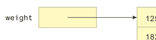

| 125 |
| 182 |
| 160 |
| 104 |
| 147 |

> 核心概念

实例化对象数组仅预留存储引用的空间。每个元素中存储的对象必须单独实例化。

当我们在数组中存储对象时，每个元素都是一个独立的对象。也就是说，对象数组实际上是对象引用的数组。考虑以下声明：

```
String[] words = new String[5];
```

变量 `words` 是一个指向 `String` 对象的引用数组。声明中的 `new` 运算符实例化了数组并为五个 `String` 引用预留了空间。此声明没有创建任何 `String` 对象；它仅仅创建了一个持有 `String` 对象引用的数组。初始状态下，数组如下：

```
words
|
|
|
|
|
```

在创建几个 `String` 对象并将其放入数组后，它可能看起来这样：

```
words
|--"friendship"
|--"loyalty"
|--"honor"
|
```

`words` 数组是一个对象，它所持有的每个字符串都是它自己的对象。数组中包含的每个对象必须单独实例化。

请记住，`String` 对象可以表示为字符串字面量。因此，以下声明创建了一个名为 `verbs` 的数组，并使用初始化列表填充了几个 `String` 对象，每个对象都使用字符串字面量进行实例化：

```
String[] verbs = {"play", "work", "eat", "sleep"};
```

### LISTING 8.5

```
********************************************************************
// GradeRange.java Author: Lewis/Loftus
// 演示了对象数组的使用。
********************************************************************
public class GradeRange {
  // 创建对象数组并打印它们。
  public static void main(String[] args) {
    Grade[] grades = {
      new Grade("A", 95), new Grade("A-", 90),
      new Grade("B", 87), new Grade("B-", 85),
      new Grade("C", 80), new Grade("C-", 75),
      new Grade("D", 67), new Grade("D-", 65),
      new Grade("F", 0)
    };

    for (Grade letterGrade : grades) {
      System.out.println(letterGrade);
    }
  }
}
```

| | |
|---|---|
| A | 95 |
| A- | 90 |
| B | 87 |
| B- | 85 |
| C | 80 |
| C- | 75 |
| D | 67 |
| D- | 65 |
| F | 0 |

### LISTING 8.6

```
********************************************************************
// Grade.java      Author: Lewis/Loftus
//
// 代表成绩。
********************************************************************
public class Grade {
    private String name;
    private int lowerBound;

    // 构造函数：使用指定的
    // 名称和数值下限设置此 Grade 对象。
    //
    public Grade(String grade, int cutoff) {
        name = grade;
        lowerBound = cutoff;
    }

    // 返回成绩的字符串表示。
    //
    public String toString() {
        return name + "\t" + lowerBound;
    }

    // 名称修改方法。
    //
    public void setName(String grade) {
        name = grade;
    }

    // 下限修改方法。
    //
    public void setLowerBound(int cutoff) {
        lowerBound = cutoff;
    }

    // 名称访问方法。
    //
    public String getName() {
        return name;
    }

    // 下限访问方法。
    //
    public int getLowerBound() {
        return lowerBound;
    }
}
```

### LISTING 8.7

```
********************************************************************
// Movies.java      Author: Lewis/Loftus
//
// 演示对象数组的使用。
********************************************************************
public class Movies {
    //----------------------------------------------------
    // 创建 DVDCollection 对象并向其添加 DVD。
    // 打印集合状态的报告。
    //----------------------------------------------------
    public static void main(String[] args) {
        DVDCollection movies = new DVDCollection();
        movies.addDVD("The Godfather", "Francis Ford Coppola", 1972, 24.95, true);
        movies.addDVD("District 9", "Neill Blomkamp", 2009, 19.95, false);
        movies.addDVD("Iron Man", "Jon Favreau", 2008, 15.95, false);
        movies.addDVD("All About Eve", "Joseph Mankiewicz", 1950, 17.50, false);
        movies.addDVD("The Matrix", "Andy & Lana Wachowski", 1999, 19.99, true);
    }
}
```

### LISTING 8.7 续

```
System.out.println(movies);
movies.addDVD("Iron Man 2", "Jon Favreau", 2010, 22.99, false);
movies.addDVD("Casablanca", "Michael Curtiz", 1942, 19.95, false);
System.out.println(movies);
```

### OUTPUT

```
My DVD Collection
Number of DVDs: 5
Total cost: $98.30
Average cost: $19.66

DVD List:
$24.95 1972 The Godfather Francis Ford Coppola Blu-ray
$19.95 2009 District 9 Neill Blomkamp
$15.95 2008 Iron Man Jon Favreau
$17.50 1950 All About Eve Joseph Mankiewicz
$19.95 1999 The Matrix Andy & Lana Wachowski Blu-ray

My DVD Collection
Number of DVDs: 7
Total cost: $141.24
Average cost: $20.18
```


# 第 8 章 数组

## DVD 列表示例

```
$24.95 1972 The Godfather Francis Ford Coppola Blu-ray
$19.95 2009 District 9 Neill Blomkamp
$15.95 2008 Iron Man Jon Favreau
$17.50 1950 All About Eve Joseph Mankiewicz
$19.95 1999 The Matrix Andy & Lana Wachowski Blu-ray
$22.99 2010 Iron Man 2 Jon Favreau
$19.95 1942 Casablanca Michael Curtiz
```

每个添加到集合中的 DVD 都通过其标题、导演、发行年份、购买价格以及是否为蓝光格式来指明。

## 列表 8.8 `DVDCollection` 类

```java
/********************************************************************
// DVDCollection.java                             作者: Lewis/Loftus
// 代表一组 DVD 电影集合。
********************************************************************/

import java.text.NumberFormat;

public class DVDCollection {
    private DVD[] collection;
    private int count;
    private double totalCost;

    //--------------------------------------------------------------------
    // 构造函数：创建一个初始为空的集合。
    //----------------------------------------------------
    public DVDCollection() {
        collection = new DVD[100];
        count = 0;
        totalCost = 0.0;
    }

    //--------------------------------------------------------------------
    // 将 DVD 添加到集合中，必要时增加
    // 集合数组的大小。
    //----------------------------------------------------
    public void addDVD(String title, String director, int year,
                        double cost, boolean bluray) {
        if (count == collection.length) 
            increaseSize();
        
        collection[count] = new DVD(title, director, year, cost, bluray);
        totalCost += cost;
        count++;
    }

    // 返回一个描述 DVD 集合的报告。
    // ------------------------------------------------------
    public String toString() {
        NumberFormat fmt = NumberFormat.getCurrencyInstance();

        String report = "---------------------------------------\n";
        report += "My DVD Collection\n\n";

        report += "Number of DVDs: " + count + "\n";
        report += "Total cost: " + fmt.format(totalCost) + "\n";
        report += "Average cost: " + fmt.format(totalCost/count);

        report += "\nDVD List:\n\n";

        for (int dvd = 0; dvd < count; dvd++) {
            report += collection[dvd].toString() + "\n";
        }
        return report;
    }

    // 通过创建一个更大的数组并将现有集合
    // 复制到其中来增加集合的容量。
    // ------------------------------------------------------
    private void increaseSize() {
        DVD[] temp = new DVD[collection.length * 2];

        for (int dvd = 0; dvd < collection.length; dvd++) {
            temp[dvd] = collection[dvd];
        }
        collection = temp;
    }
}
```

## 8.3 对象数组

集合数组在 `DVDCollection` 构造函数中实例化。每当将 DVD 添加到集合中时（使用 `addDVD` 方法），就会创建一个新的 `DVD` 对象，并将其引用存储在集合数组中。

每当向集合中添加一个 DVD 时，我们都会检查是否已达到集合数组的当前容量。如果不进行此检查，当我们尝试在无效索引处存储新的 `DVD` 对象时，最终会发生异常。如果达到了当前容量，将调用私有方法 `increaseSize`，该方法会先创建一个比当前集合数组大一倍的数组。现有集合中的每个 DVD 都会复制到新数组。最后，将集合设置为更大的数组。使用这种技术，从理论上说，我们的 DVD 集合空间永远不会耗尽。`DVDCollection` 对象的使用（即 `addDVD` 方法）不需要担心空间耗尽。

## 图 8.3 DVD 类的类图

> 图 8.3 展示了 `DVDCollection` 包含零或多个 `DVD` 对象。菱形表示聚合。`toString` 方法显示集合报告。

## 列表 8.9 `DVD` 类

```java
/********************************************************************
// DVD.java                               作者: Lewis/Loftus
// 代表一个 DVD 光盘。
********************************************************************/
import java.text.NumberFormat;

public class DVD {
    private String title, director;
    private int year;
    private double cost;
    private boolean bluray;

    // 根据指定的信息创建一个新的 DVD。
    public DVD(String title, String director, int year, double cost, boolean bluray) {
        this.title = title;
        this.director = director;
        this.year = year;
        this.cost = cost;
        this.bluray = bluray;
    }

    // 返回此 DVD 的字符串描述。
    public String toString() {
        NumberFormat fmt = NumberFormat.getCurrencyInstance();

        String description;
        description = fmt.format(cost) + "\t" + year + "\t";
        description += title + "\t" + director;
        if (bluray) {
            description += "\tBlu-ray";
        }
        return description;
    }
}
```

## 自习题（答案见附录）

**SR 8.14** 对象数组是如何创建的？

**SR 8.15** 假设 `team` 是一个字符串数组，用于存放排球队球员的名字：Amanda、Clara、Emily、Julie、Katie 和 Maria。

- a. 为 `team` 编写声明。
- b. 显示如何使用初始化列表同时声明并填充 `team`。

**SR 8.16** 假设 `Book` 是一个表示书籍的类。假设该类的构造函数接受两个参数——书名和页数。

- a. 为名为 `library` 的变量编写声明，它是一个十本书的数组。
- b. 写一个 `new` 语句，将 `library` 数组中的第一本书设置为“星际战队”，它有 208 页。

## 8.4 命令行参数

Java 应用的 `main` 方法的参数始终是一个 `String` 对象数组。我们在之前的示例中忽略了参数，但现在我们可以讨论它有时如何被使用。

当将应用程序提交给解释器时，Java 运行时环境会调用 `main` 方法。`String[]` 参数（我们称为 `args`）代表调用解释器时提供的命令行参数。调用解释器时命令行上的任何信息都存储在 `args` 数组中供程序使用。这种技术是提供输入的另一种方式。

列表 8.10 中的程序使用命令行参数打印名牌。它假设第一个参数代表某种问候，第二个参数代表人的名字。

### 列表 8.10 `NameTag` 类

```java
/*****************************************************************
// NameTag.java      Author: Lewis/Loftus
//
// 展示了命令行参数的用法。
//*****************************************************************/
public class NameTag {
    //
    // 使用用户指定的问候语和名称
    // 打印一个简单的名称标签。
    //
    public static void main(String[] args) {
        System.out.println(" " + args[0]);
        System.out.println("My name is " + args[1]);
    }
}
```

### 输出

```
> java NameTag Howdy John

Howdy
My name is John

> java NameTag Hello Bill

Hello
My name is Bill
```

请记住，`main` 方法的参数始终是一个 `String` 对象的数组。如果你想将数值信息作为命令行参数输入，程序必须将其从字符串表示进行转换。

你还应该意识到，在某些程序开发环境中，命令行并不用于将程序提交给解释器。在这些情况下，可以通过其他方式指定命令行信息。如有必要，请查阅文档以获取这些细节。

## 自测习题（答案见附录 L）

- **SR 8.17** 什么是主命令行参数？
- **SR 8.18** 为程序编写一个 `main` 方法，输出其前几个命令行参数的字符串长度之和。
- **SR 8.19** 为程序编写一个 `main` 方法，输出其两个命令行参数（整数）的值之和。

## 8.5 变长参数列表

假设我们想设计一个方法，该方法在每次调用之间可以处理不同数量的数据。例如，让我们设计一个 `average` 方法，它接受几个整数值并返回它们的平均值。在方法的其中一次调用中，我们可能会向 `average` 传递三个整数：

```java
mean1 = average(42, 69, 37);
```

在同一方法的另一次调用中，我们可能会向 `average` 传递七个整数：

```java
mean2 = average(35, 43, 93, 23, 40, 21, 75);
```

> 为了实现这一点，我们可以定义 `average` 方法的不同重载版本，但这要求我们知道可能存在的最大参数数量，并为每种可能性创建一个独立的方法版本。或者，我们可以定义该方法接受一个整数数组，该数组在每次调用时可以是不同的大小。但这要求在调用方法中将整数封装成数组并传递一个参数。

Java 提供了一种定义接受变长参数列表的方法的方法。通过在方法的形式参数列表中使用某些特殊语法，我们可以定义该方法接受任意数量的参数。这些参数被自动放入一个数组中，以便在方法中进行处理。例如，`average` 方法可以写如下：

```java
public double average(int ... list) {
    double result = 0.0;
    if (list.length != 0) {
        int sum = 0;
        for (int num : list) {
            sum += num;
        }
        result = (double)sum / list.length;
    }
    return result;
}
```

注意形式参数的定义方式。省略号（三个连续的点）表示该方法接受任意数量的参数。在这种情况下，方法接受任意数量的 `int` 参数，并将其自动放入一个名为 `list` 的数组中。在方法中，我们处理这个数组。

我们现在可以向 `average` 方法传递任何 `int` 参数，包括一个都没有。这就是为什么我们在计算平均值之前要检查数组的长度是否为零。

多个参数的类型可以是任何基本类型或对象类型。例如，以下方法接受并打印多个 `Grade` 对象（我们在本章中定义了 `Grade` 类）：

```java
public void printGrades(Grade ... grades) {
    for (Grade letterGrade : grades) {
        System.out.println(letterGrade);
    }
}
```

接受变长数量参数的方法还可以接受其他参数。例如，以下方法接受一个 `int`、一个 `String` 对象，然后变长数量的 `double` 将存储在一个名为 `nums` 的数组中：

```java
public void test(int count, String name, double ... nums) {
    // 略
}
```

变长参数必须位于形式参数的最后。一个方法不能接受两组变长参数。

构造函数也可以设置为接受变长数量的参数。列表 8.11 所示的程序创建了两个 `Family` 对象，将变长数量的字符串（代表成员姓名）传入 `Family` 构造函数。

### 列表 8.11 `VariableParameters` 类

```java
/********************************************************************
// VariableParameters.java      Author: Lewis/Loft
// 展示了变长参数列表的用法。
********************************************************************/
public class VariableParameters {
    // 使用接受变长数量 String 对象作为参数的构造函数
    // 创建两个 Family 对象。
    //
    public static void main(String[] args) {
        Family lewis = new Family("John", "Sharon", "Justin", "Kayla", "Nathan", "Samantha");
        Family camden = new Family("Annie", "Mary", "Simon", "Lucy", "Ruthie", "Sam");

        System.out.println(lewis);
        System.out.println(camden);
    }
}
```

### 输出

```
John
Sharon
Justin
Kayla
Nathan
Samantha
Annie
Mary
Simon
Lucy
Ruthie
Sam
```

### 列表 8.12 `Family` 类

```java
/*****************************************************************
// Family.java      Author: Lewis/Loft
//
*****************************************************************/
public class Family {
    private String[] members;
    // ... 后续代码省略
}
```


# 8.6 二维数组

我们到目前为止的数组都是一维数组，因为它们表示一个简单的值列表。正如名称所示，二维数组有两个维度，通常被看作表格的行和列。图8.4 形象地比较了一维数组和二维数组。我们必须使用两个索引来引用二维数组中的值，其中一个指定行，另一个指定列。

列表8.13所示的 `TwoDArray` 程序实例化了一个整数的二维数组。和一维数组一样，维度的大小是在创建数组时指定的。维度的大小可以是不同的。

## 列表 8.13

```java
// TwoDArray.java 作者: Lewis/Loftus
//
// 展示了二维数组的使用。

public class TwoDArray {

    // 创建一个整型二维数组，并用递增的
    // 整数值填充它，然后将其打印出来。
    public static void main(String[] args) {

        int[][] table = new int[5][10];

        // 为表格加载值
        for (int row = 0; row < table.length; row++) {
            for (int col = 0; col < table[row].length; col++) {
                table[row][col] = row * 10 + col;
            }
        }

        // 打印表格
        for (int row = 0; row < table.length; row++) {
            for (int col = 0; col < table[row].length; col++) {
                System.out.print(table[row][col] + "\t");
            }
        }

        System.out.println();
    }
}
```

## 输出

```
0 1 2 3 4 5 6 7 8 9
10 11 12 13 14 15 16 17 18 19
20 21 22 23 24 25 26 27 28 29
30 31 32 33 34 35 36 37 38 39
40 41 42 43 44 45 46 47 48 49
```

与一维数组一样，可以使用初始化列表来实例化二维数组，其中每个元素本身都是一个数组初始化列表。这种技术用于 `SodaSurvey` 程序，该程序在列表 8.14 所示。

### 列表 8.14

```java
// SodaSurvey.java               作者: Lewis/Loft
// 展示了二维数组的使用。

import java.text.DecimalFormat;

public class SodaSurvey {

    // 并打印调查得分中每行（汽水）和每
    // 列（受访者）的平均值。
    public static void main(String[] args) {

        int[][] scores = { {3, 4, 5, 2, 1, 4, 3, 2, 4, 4},
                          {2, 4, 3, 4, 3, 2, 1, 2, 2},
                          {3, 5, 4, 5, 3, 2, 5, 5, 5},
                          {1, 1, 3, 1, 2, 1, 3, 2, 4} };

        final int SODAS = scores.length;
        final int PEOPLE = scores[0].length;

        int[] sodaSum = new int[SODAS];
        int[] personSum = new int[PEOPLE];

        for (int soda = 0; soda < SODAS; soda++) {
            for (int person = 0; person < PEOPLE; person++) {
                sodaSum[soda] += scores[soda][person];
                personSum[person] += scores[soda][person];
            }
        }

        DecimalFormat fmt = new DecimalFormat("0.#");

        System.out.println("Averages:\n");

        for (int soda = 0; soda < SODAS; soda++)
            System.out.println("Soda #" + (soda+1) + ": " +
            fmt.format((float)sodaSum[soda]/PEOPLE));

        System.out.println();

        for (int person = 0; person < PEOPLE; person++)
            System.out.println("Person #" + (person+1) + ": " +
            fmt.format((float)personSum[person]/SODAS));
    }
}
```


## 输出

平均值：

soda #1: 3.2
soda #2: 2.6
soda #3: 4.2
soda #4: 1.9

Person #1: 2.2
Person #2: 3.5
Person #3: 3.2
Person #4: 3.5
Person #5: 2.5
Person #6: 3
Person #7: 2
Person #8: 2.8
Person #9: 3.2
Person #10: 3.8

假设一家汽水制造商对四种新口味进行了口味测试，以查看人们对它们的喜爱程度。制造商请了 10 个人尝试每种新口味，并给出 1 到 5 分的评分，其中 1 分差，5 分优秀。名为 `SodaSurvey` 的多维数组程序存储了调查的结果。每行对应一种汽水，该行中的每一列对应品尝过该水的人。更通俗地说，每行包含一种汽水，每列包含一个人。

## 多维数组

与一维数组一样，可以使用初始化列表来实例化二维数组，其中每个元素本身都是一个数组初始化列表。这种技术用于 `SodaSurvey` 程序，该程序在列表 8.14 所示。

与一维数组一样，三维数组可能很难可视化。然而，可以将三维数组想象成一个立方体。例如，假设我们想要存储大学人数。第一维度代表州。第二维度代表大学。第三维度代表学院。第四维度代表部门。

## 8.7 多边形和折线

多边形是 JavaFX API 中由 `Polygon` 类表示的多边形。多边形使用一系列 (x, y) 点来定义。数组通常用于存储定义多边形的顶点列表。

多边形总是闭合形状。线条总是从多边形顶点列表的最后一个点画到第一个点。

相反，折线是开放形状。折线是由线段连接的一系列点。折线的第一个和最后一个顶点不会自动连接。

> **关键概念**
> 折线与多边形相似，但折线不是闭合形状。


图 8.5 四维数组的可视化

### 列表 8.15

```java
import javafx.application.Application;
import javafx.scene.Group;
import javafx.scene.Scene;
import javafx.scene.paint.Color;
import javafx.scene.shape.Polygon;
import javafx.scene.shape.Polyline;
import javafx.stage.Stage;
```

```java
// Rocket.java      Author: Lewis/Loft
// 展示了多边形和折线的用法。

public class Rocket extends Application {

    //
    // 显示火箭正在起飞。火箭主体和舱门是多边形，
    // 火焰是一条折线。
    //

    public void start(Stage primaryStage) {
        double[] hullPoints = {200, 25, 240, 60, 240, 230, 270, 270, 30, 140, 140, 260, 160, 230, 160, 60};
        Polygon rocket = new Polygon(hullPoints);
        rocket.setFill(Color.BEIGE);

        double[] hatchPoints = {185, 70, 215, 70, 220, 120, 180, 120};
        Polygon hatch = new Polygon(hatchPoints);
        hatch.setFill(Color.MAROON);

        double[] flamePoints = {142, 310, 142, 330, 150, 355, 155, 380, 165, 340, 175, 360, 190, 350, 200, 375, 215, 320, 225, 355, 230, 370, 240, 340, 255, 370, 260, 335, 268, 310};
        Polyline flame = new Polyline(flamePoints);
        flame.setStroke(Color.RED);
        flame.setStrokeWidth(3);

        Group root = new Group(rocket, hatch, flame);
        Scene scene = new Scene(root, 400, 400, Color.BLACK);
        primaryStage.setTitle("Rocket");
        primaryStage.setScene(scene);
        primaryStage.show();
    }
}
```

## 显示


火箭本身的主体，以及侧面的其他形状是舱门。折线用于表示从火箭底部喷出的火焰。

对于每个形状，构成顶点的坐标值存储在 `double` 数组中，并在创建形状对象时将该数组传递给 `Polygon` 或 `Polyline` 构造函数。每个数组都是使用初始化列表创建的。

数组中的每对坐标代表一个点。例如，构成主体的多边形的第一个点是 (20, 25)，它是火箭的鼻尖。下一个点是 (240, 60)。第三个点是 (240, 230)，依此类顺时针绕主体移动。

如果你初始不知道所有的坐标，可以在形状创建后，通过获取当前的顶点列表并添加额外的顶点来添加顶点。以下行代码向指定的多边形添加了两个顶点，一个在 (50, 75)，另一个在 (100, 30)：

```java
myPolygon.getPoints().addAll(50, 75, 100, 30);
```


注意，数组可以存储浮点值（`double`），但我们将整数存储为 `double`，以便它们可以通过涉及浮点数的计算来确定。

与其他形状一样，多边形和折线的填充颜色、描边颜色和描边宽度可以使用相应的方法进行设置。

- 自测习题（答案见附录 L）
- SR 8.25 什么是折线？如何指定这个形状？
- SR 8.26 多边形和折线有什么区别？
- SR 8.27 为什么 JavaFX 中的坐标存储为 `double`？

## 8.8 Color 数组

让我们来看一个使用 `Color` 数组的示例。列表 8.16 程序允许你在窗口的任何位置点击鼠标来制作彩色点。点的数量显示在窗口的左上角。如果用户双击任何位置，点将被清除，计数器重置。

```java
import javafx.application.Application;
import javafx.scene.Group;
import javafx.scene.Scene;
import javafx.scene.input.MouseEvent;
import javafx.scene.paint.Color;
import javafx.scene.shape.Circle;
import javafx.scene.text.Font;
import javafx.scene.text.Text;
import javafx.stage.Stage;

/********************************************************************
// Dots.java               Author: Lewis/Loft
// 展示了 Color 数组的使用以及双击的捕捉。
********************************************************************/

public class Dots extends Application {

    private Color[] colorList = {Color.RED, Color.CYAN, Color.MAGENTA, Color.YELLOW, Color.LIME, Color.WHITE};
    private int colorIndex = 0;
    private int count = 0;
    private Text countText;
    private Group root;

    //
    // 显示一个用户可以通过鼠标点击添加彩色点的场景。
    public void start(Stage primaryStage) {
        countText = new Text(20, 30, "Count: 0");
        countText.setFont(new Font(18));
        countText.setFill(Color.WHITE);
        root = new Group(countText);
        Scene scene = new Scene(root, 400, 300, Color.BLACK);
        scene.setOnMouseClicked(this::processMouseClicked);
        primaryStage.setTitle("Dots");
        primaryStage.setScene(scene);
        primaryStage.show();
    }

    //
    // 通过在该位置添加圆圈来处理鼠标点击，
    // 循环一组颜色。双击会清除点并重置计数。
    public void processMouseClicked(MouseEvent event) {
        if (event.getClickCount() == 2) { // 双击
            count = 0;
            colorIndex = 0;
            root.getChildren().clear();
            countText.setText("Count: 0");
        } else {
            Circle circle = new Circle(event.getX(), event.getY(), 10);
            circle.setFill(colorList[colorIndex]);
            root.getChildren().add(circle);
        }
    }
}
```

## 第 8 章 数组

```java
// LISTING 8.16 continued
colorIndex = (colorIndex + 1) % colorList.length;
count++;
countText.setText("Count: " + count);
```


Dots 示例被设置为处理鼠标点击事件。每当发生鼠标点击事件时，就会调用事件处理方法。恰好调用 `processMouseClicked` 的事件处理方法是在 `start` 方法中使用 `setOnMouseClicked` 方法指定的。

事件处理方法的第一工作是通过调用事件对象的 `getClickCount` 来检查是否双击（在同一位置快速发生的两次点击）。如果检测到双击，场景中的所有节点将被清除，并将计数文本（计数为 0）再次添加到场景。

如果不是双击，则执行 `if` 语句的 `else` 部分，它会在鼠标点击发生的位置创建并向场景添加一个彩色点。事件对象的 `getX` 和 `getY` 方法用于获取鼠标点击的坐标。

## 8.9 选择框

添加到场景中的点的颜色在六种颜色之间循环，这些颜色存储在一个在类级别使用初始化列表创建的 `color` 数组中。第一个添加的点是红色的。第二个是青色的，遵循数组中颜色的顺序。第三个是洋红色，依此类推。在添加白色点后，循环再次从红色开始。

循环颜色由整数变量 `colorIndex` 控制。它代表要添加的下一个点的颜色数组索引。添加彩色点后，`colorIndex` 值增加，以便下一个点是下一种颜色。递增通过以下行代码完成：

```java
colorIndex = (colorIndex + 1) % colorList.length;
```

该行代码不仅增加了 `colorIndex` 中的值，还使用取余运算符（`%`）在索引到达末尾时将其回数组开头。但它是将更新后的索引除以 `colorList` 数组的长度（为 6）。例如，如果索引从 2 增加到 3，取余运算符返回 3。然而，如果索引从 5 增加到 6，取余运算符返回 0，循环再次开始。

> 核心概念
> 取余运算符可用于将序列值绕回零。

- 自测习题（答案见附录 L）
- SR 8.28 如何确定用户双击了鼠标按钮？
- SR 8.29 列表 8.16 的显示显示了 12 个点。下一个点的颜色是什么？
- SR 8.30 对 Dots 程序进行哪些修改才能向循环颜色集中添加更多颜色？

## 代码列表 8.17

```java
import java.io.File;
import javafx.application.Application;
import javafx.event.ActionEvent;
import javafx.geometry.Insets;
import javafx.geometry.Pos;
import javafx.scene.Scene;
import javafx.scene.control.Button;
import javafx.scene.control.ChoiceBox;
import javafx.scene.layout.HBox;
import javafx.scene.layout.VBox;
import javafx.scene.media.AudioClip;
import javafx.stage.Stage;

/********************************************************************
// JukeBox.java 作者: Lewis/Loftus
// 演示了组合框（combo box）和音频片段的使用
********************************************************************/

public class JukeBox<String> extends Application {

    private ChoiceBox<String> choice;
    private AudioClip[] tunes;
    private AudioClip current;
    private Button playButton, stopButton;

    //-
    // 提供了一个界面允许用户从下拉框中
    // 选择并播放一曲歌曲。
    //-
    public void start(Stage primaryStage) {
        String[] names = {"Western Beat", "Classical Melody",
            "Jeopardy Theme", "Eighties Jam", "New Age Rythym",
            "Lullaby", "Alfred Hitchcock's Theme"};

        File[] audioFiles = {new File("Western Beat.wav"),
            new File("classical.wav"), new File("jeopardy.mp3"),
            new File("eighties.jam"), new File("newAgeRythym.wav"),
            new File("lullaby.mp3"), new File("hitchcock.wav")};

        tunes = new AudioClip[audioFiles.length];
        for (int i = 0; i < audioFiles.length; i++) {
            tunes[i] = new AudioClip(audioFiles[i].toURI().toString());
        }
    }
}
```

## 代码列表 8.17 续

```java
current = tunes[0];

Label label = new Label("Select a tune:");
choice = new ChoiceBox<String>();
choice.getItems().addAll(names);
choice.getSelectionModel().selectFirst();
choice.setOnAction(this::processChoice);

playButton = new Button("Play");
stopButton = new Button("Stop");

HBox buttons = new HBox(playButton, stopButton);
buttons.setSpacing(10);
buttons.setPadding(new Insets(15, 0, 0, 0));
buttons.setAlignment(Pos.CENTER);

playButton.setOnAction(this::processButtonPush);
stopButton.setOnAction(this::processButtonPush);

VBox root = new VBox(label, choice, buttons);
root.setPadding(new Insets(15, 15, 15, 25));
root.setSpacing(10);
root.setStyle("fx-background-color: skyblue");

Scene scene = new Scene(root, 300, 150);
primaryStage.setTitle("Java Juke Box");
primaryStage.setScene(scene);
primaryStage.show();

// 当在组合框中选择选项时，如果正在播放片段
// 则停止它并设置当前歌曲。
//
public void processChoice(ActionEvent event) {
    current.stop();
    current = tunes[choice.getSelectionModel().getSelectedIndex()];
}

// 处理播放和停止按钮。在两种情况下
// 都会停止当前片段。如果按下播放按钮，则（重新）开始
```

## 第 8 章 数组 Arrays

```java
// 代码列表 8.17 续
// 当前片段。
//------------------------------------------------------
public void processButtonPush(ActionEvent event) {
    current.stop();
    if (event.getSource() == playButton)
        current.play();
}
```

# 显示


JukeBox 程序使用了多个数组。首先，一个名为 `names` 的字符串数组用于存储在组合框中显示的歌曲名称。在创建 `ChoiceBox` 对象后，`names` 数组被添加到被的的项目列表中。

使用 `File` 对象数组来表示每首歌曲的音频文件。然后用它们来创建一个 `AudioClip` 对象数组。`AudioClip` 类是 `javafx.scene.media` 包的一部分，它提供了对未压缩音频文件的播放控制。对于更复杂的控制、更长的音频片段或压缩文件格式，请使用 `Media` 对象。

JukeBox 程序中有两个事件处理方法。一个响应于在组合框中选择选项时发生的动作事件。另一个响应于由任一按钮生成的动作事件。

当用户在组合框中选择新选项时，如果当前歌曲正在播放，则停止它；如果当前歌曲没有播放，则调用 `stop` 方法将不执行任何操作。然后，代表当前选中歌曲的变量将设置为 `tunes` 数组中相应的 `AudioClip` 对象。索引通过调用组合框所使用的底层选择模型的 `getSelectedIndex` 方法获得。

当按下“播放”或“停止”按钮之一时，正在播放的歌曲将停止（如果有）。然后，如果按下的是播放按钮，当前歌曲将从头开始。

应该注意的是，组合框可以是可编辑的也可以是不可编辑的。默认情况下，组合框是不可编辑的。在不可编辑的框中更改选项只能通过从列表中选择来实现。如果组合框是可编辑的，用户可以向其输入值。`ComboBox` 是另一个类似的控件。

## 8.9 组合框 Choice Boxes

## 自测 SELF-REVIEW（答案见附录）

- 8.1：JukeBox 程序中使用了哪些数组？
- 8.2：什么是数组？
- 8.3：JukeBox 程序中定义了多少个事件处理器？
- 8.4：描述数组如何在内存中存储。

## 概念总结 Summary of Concepts

- 大小为 $N$ 的数组从 0 开始索引。
- 实例化数组保留内存。
- 边界检查确保索引在范围内。
- 初始化列表可以初始化数组。
- 整个数组可以作为参数传递。
- 命令行参数存储在数组中。
- 使用超过二维的数组很罕见。
- 取模运算符可以用于循环索引。
- 组合框提供了菜单选项。

## 练习题 Exercises

EX 8.1 以下哪些声明是有效的？哪些实例化数组？

```java
boolean[] flags = {true, false, false};
int[] powersOfTwo = {1, 2, 4, 8, 16, 32};
char[] vowels = new char[5];
float[] length = new float[100];
String[] names = {"Sam", "Frodo", "Merry", "Pippin"};
char[] vowels = {'a', 'e', 'i', 'o', 'u'};
double[] standardDeviation = new double[];
```

EX 8.2：描述五个如果没有数组难以实现的程序。

EX 8.3：描述数组元素如何在内存中被访问。例如，`myArray[25]` 存储在哪里？

EX 8.4：描述以下代码发生了什么问题。应该进行哪些修改来消除该问题？

```java
double[] masses = {123.6, 34.2, 765.87, 987.43, 90, 321.5};
double totalMass = 0;
for (int index = 1; index < masses.length; index++) {
    totalMass += masses[index];
}
```


# 练习题

## EX 8.5
为以下每种情况编写数组声明和必要的类：

- a. 太阳系的行星名称
- b. 特定一天从机场出发的每个航班：航班号、出发时间和时长
- c. 在线商店的每个产品：产品名称、描述、价格、库存数量和评分
- d. 一年的平均温度
- e. 音乐播放器播放的每个曲目：标题、长度、流派和艺术家

## EX 8.6
编写代码将 `nums` 数组的每个元素设置为常量 `INITIAL` 的值。

## EX 8.7
编写代码倒序打印存储在 `names` 数组中的值。

## EX 8.8
编写代码将布尔数组 `flags` 的每个元素设置为交替值（索引 0 为 `true`，索引 1 为 `false`，以此类推）。

## EX 8.9
编写一个方法 `sumArray()`，接收浮点数数组并返回数组中存储的值之和。

## EX 8.10
编写一个方法 `switchThat()`，接受两个整数数组作为参数并交换数组的内容。考虑到数组的大小可能不同。

## EX 8.11
描述一个你会使用 `ArrayList` 而不是数组的程序。描述一个你会使用数组的程序。解释你的选择。

## EX 8.12
`Dots` 程序处理鼠标点击事件来绘制点。如果它处理的是鼠标拖拽事件，程序行为会有什么不同？如果处理的是鼠标释放事件呢？

## EX 8.13
修改 `JukeBox` 程序，使其在用户按下键盘上的 `P` 键时播放选定歌曲（无需按下“播放”按钮）。

## EX 8.14
如何修改 `JukeBox` 程序，使其使用单个歌曲数组，而不是三个独立的数组（分别用于名称、音频文件和歌曲）？

# 编程项目

## PP 8.1
编写一个程序，读取任意数量的 0 到 50（包含边界）之间的整数；统计每个整数出现的次数。输入一个范围之外的值表示输入结束。在处理完所有输入后，打印所有出现过一次或多次的数值（以及它们的次数）。

## PP 8.2
修改 PP 8.1 中的程序，使其能够处理 -25 到 25 之间的数字。

| 范围 | 频率 |
| :--- | :--- |
| 1 - 10 | `*****` |
| 11 - 20 | `**` |
| 21 - 30 | `*****************` |
| 31 - 40 | `(empty)` |
| 41 - 50 | `***` |
| 51 - 60 | `*****` |
| 61 - 70 | `**` |
| 71 - 80 | `*****` |
| 81 - 90 | `****` |
| 91 - 100 | `**********` |

## PP 8.3
编写一个直方图程序，允许你直观地检查一组数值的频率分布。程序应读取任意数量的 1 到 100（包含边界）之间的整数；然后生成一个类似下表的图表，显示落在 1 到 10、11 到 20 等范围内的输入值有多少个。每输入一个值就打印一个星号。

## PP 8.4
如果输入了大量数值，PP 8.3 中直方图的行将变得太长。修改程序，使其在每个类别中每五个值打印一个星号。忽略余下的部分。例如，如果某个类别有 17 个值，则在该行中打印三个星号。如果某个类别有 4 个值，则在该行中不打印任何星号。

## PP 8.5
编写一个程序，计算并打印一个整数列表 $x_i$ 的平均值和标准差。假设输入值不超过 50 个。使用以下公式以浮点数的形式计算平均值和标准差。

## PP 8.6
L&L 银行可以处理多达 30 个拥有储蓄账户的客户。设计并实现一个管理账户的程序。跟踪关键信息并允许每个客户进行存款和取款。对无效交易产生适当的错误信息。提示：你可能基于第 4 章中的 `Account` 类来设计账户。另外提供一个方法，每当调用该方法时，为所有账户增加 3%。

## PP 8.7
创建一个名为 `ScrabbleTile` 的类，代表带有字母和分数的 Scrabble 牌。然后创建一个包含 100 张 Scrabble 牌的 `TileBag` 类。`TileBag` 类应包含洗牌和选取牌（并从包中移除该牌）的方法。编写一个主类来创建 `TileBag` 实例，从包中选择七张牌并展示这些牌。报告包中剩余的牌数量。

## PP 8.8
编写一个程序，读取最多 25 对个人姓名和邮政编码序列。将数据存储在一个对象中，该对象设计用于存储名（字符串）、姓（字符串）和邮政编码（整数）。假设每行输入包含两个字符串后跟一个整数值，并用制表符分隔。在读取输入后，将列表以适当格式返回到屏幕。

## PP 8.9
修改你在 PP 8.8 中创建的程序以实现以下目标：
- 存储额外的用户信息：街道地址（字符串）、城市（字符串）、州（字符串）和 10 位数字（长型），包含区号且不包含 `-` 或 `.` 等特殊字符。
- 将数据存储在 `ArrayList` 中。

## PP 8.10
使用第 7 章中的 `Quiz` 类来定义 `Quiz` 类。一个测试可以由 25 个问题组成。定义 `Quiz` 类的 `add()` 方法向测试添加问题。定义 `Quiz` 类的 `giveQuiz()` 方法逐个向用户展示问题，接收每个问题的回答并跟踪结果。创建一个名为 `QuizTime` 的类，其 `main()` 方法可以弹出测试、展示测试并打印最终结果。

## PP 8.11
修改 8.10 中的程序，以考虑测试的复杂程度。重载 `giveQuiz()` 方法，使其接收两个指定测试最小和最大复杂度的整数，并展示该范围内的问题。演示此功能。

## PP 8.12
定义一个继承 `Polygon` 的 `Star` 类，形状像五角星。使用 `Star` 的构造函数指定星的颜色、位置和大小。编写一个 JavaFX 应用展示不同大小的星形。

## PP 8.13
定义一个继承 `Group` 的 `PieChart` 类，展示数值的饼图。饼图的每个部分应具有不同的颜色。使用 `javafx.scene.shape` 包构建图表。编写一个 JavaFX 应用展示饼图。

## PP 8.14
如果输入了大量数值，PP 8.3 中直方图的行将变得太长。修改程序，使其在每个类别中每五个值打印一个星号。忽略余下的部分。例如，如果某个类别有 17 个值，则在该行中打印三个星号。如果某个类别有 4 个值，则在该行中不打印任何星号。

## PP 8.15
编写一个程序，计算并打印整数列表 $x_i$ 的平均值和标准差。假设输入值不超过 50 个。使用以下公式以浮点数的形式计算平均值和标准差。

## PP 8.16
L&L 银行可以处理多达 30 个拥有储蓄账户的客户。设计并实现一个管理账户的程序。跟踪关键信息并允许每个客户进行存款和取款。对无效交易产生适当的错误信息。提示：你可能基于第 4 章中的 `Account` 类来设计账户。另外提供一个方法，每当调用该方法时，为所有账户增加 3%。

## PP 8.17
创建一个名为 `ScrabbleTile` 的类，代表带有字母和分数的 Scrabble 牌。然后创建一个包含 100 张 Scrabble 牌的 `TileBag` 类。`TileBag` 类应包含洗牌和选取牌（并从包中移除该牌）的方法。编写一个主类来创建 `TileBag` 实例，从包中选择七张牌并展示这些牌。报告包中剩余的牌数量。

## PP 8.18
编写一个程序，读取最多 25 对个人姓名和邮政编码序列。将数据存储在一个对象中，该对象设计用于存储名（字符串）、姓（字符串）和邮政编码（整数）。假设每行输入包含两个字符串后跟一个整数值，并用制表符分隔。在读取输入后，将列表以适当格式返回到屏幕。

## PP 8.19
修改你在 PP 8.8 中创建的程序以实现以下目标：
- 存储额外的用户信息：街道地址（字符串）、城市（字符串）、州（字符串）和 10 位数字（长型），包含区号且不包含 `-` 或 `.` 等特殊字符。
- 将数据存储在 `ArrayList` 中。

## PP 8.20
使用第 7 章中的 `Quiz` 类来定义 `Quiz` 类。一个测试可以由 25 个问题组成。定义 `Quiz` 类的 `add()` 方法向测试添加问题。定义 `Quiz` 类的 `giveQuiz()` 方法逐个向用户展示问题，接收每个问题的回答并跟踪结果。创建一个名为 `QuizTime` 的类，其 `main()` 方法可以弹出测试、展示测试并打印最终结果。

# 软件故障

联邦航空管理局（FAA）最初在对现场系统进行测试时发现了这个问题。该系统运行了 49.7 天，然后崩溃了。在重启后，一切似乎都正常。当另一个系统发生类似的崩溃时，FAA 实施了每 30 天重启一次的程序。

在洛杉矶事件发生后，该问题被追踪到了，并创建了软件补丁来修复该问题。现在系统会定期重置计数器，无需人工干预。

# 经验教训

在这种情况下，问题本身（如果不是其影响）是预先已知的。Harris（制造商）知道计时器可能会过期，但尚未确定它可能对系统产生什么影响。FAA 在测试期间发现了问题——尽管这还不是根源。他们没有进一步深究，而是建立了一套基于人工的解决方案——即终极的“有疑问就重启”方案。

诚然，如果遵守了 FAA 的程序，这个问题本是可以避免的，但当软件可以让这些程序变得毫无必要时，这种安慰也微乎其微。同样，如果备份系统没有故障，该事件也将是微不足道的。拥有冗余备份系统将降低完全失败的概率。

但在这种情况下，底线是彻底的测试和调查会将问题暴露出来。

> 来源：IEEE Spectrum，2004年11月

# 第9章 继承

## 章节目标

- 探索从现有类派生新类。
- 定义方法重写的概念和目的。
- 讨论类层次的设计。
- 讨论与继承相关的可见性问题。
- 探索从一个接口派生另一个的能力。
- 讨论继承背景下的面向对象设计。
- 描述 JavaFX 控件和形状的继承结构。
- 探索颜色和日期选择器和对话框。

本章解释了继承，这是一种组织和创建类的基本技术。这是一个强大的思想，影响了我们设计面向对象软件的方式，并增强了我们在其他情况和程序中重用类的能力。在本章中，我们将探索创建子类和类层次的技术，并讨论一种重写继承方法定义的技术。我们将检查 `protected` 修饰符，并讨论所有可见性修饰符对被继承的属性和方法的影响。最后，我们讨论了继承在 JavaFX 图形用户界面中的作用，以及更多的控件和对话框。

## 9.1 创建子类

在第 1 章对面向对象概念的介绍中，我们提出了一个类比：类之于对象就像蓝图之于房子。在随后的章节中，我们强化了这一观点，编写了定义一组相似对象的类。类建立了对象的特征和行为，但没有为变量预留内存空间（除非这些变量被声明为 `static`）。类是计划，而对象是该计划的体现。

从同一张蓝图可以创建许多房子。它们本质上是位于不同位置的相同房子，由不同的人居住。现在假设你想要一个与另一个相似但具有不同或额外特征的房子。你想从相同的基础蓝图开始，但对其进行修改以适应新的、略有不同的需求。许多住宅开发项目都是这样创建的。开发区的房屋具有相同的核心布局，但具有独特的特征。例如，它们可能都是具有相同基础配置的分层房屋，但有些有壁炉或完整的地下室，而另一些没有，或者拥有升级版的美食厨房而不是标准版本。

房屋开发商可能会委托一位大师建筑师创建一张蓝图，以建立开发区所有房屋的基本设计，然后创建一系列变体的新蓝图，以吸引不同的买家。创建系列蓝图的行为被简化了，因为这些变体赋予了它们独特的特征，这些特征对潜在所有者可能非常重要。

创建一个基于面向对象继承概念的新蓝图，继承是指从现有类派生出新类的过程。


继承是一种强大的软件开发技术，也是面向对象编程的定义特征。我们之前在示例中已经以基础的方式使用了继承；在这一章中我们将探索什么？

通过继承，新类自动包含了原始类中的变量和方法。然后，为了根据需要定制类，程序员可以在派生类中添加新的变量和方法，或修改继承来的。


通常，通过继承创建新类比从头开始编写它们更快、更容易且更便宜。继承是支持软件重用设计的一种方式。通过使用现有软件来创建新软件，我们利用了在现有软件的设计、实现和测试上付出的努力。

请记住，“类（class）”一词源于对具有相似特征的对象组进行分类的想法。分类方案通常使用相互相关的类层级。例如，所有哺乳动物都具有某些特征：它们是温血动物，有毛，并产生乳汁来喂养后代。现在考虑哺乳动物的一个子集，例如马。所有的马都是哺乳动物并具有哺乳动物的所有特征，但它们也有与其他哺乳动物（如狗）区别的独特特征。

如果我们把这个想法翻译成软件术语，现有的 `Mammal` 类将具有描述哺乳动物状态和行为的变量和方法。`Horse` 类可以从现有的 `Mammal` 类派生，继承 `Mammal` 中包含的变量和方法。`Horse` 类引用继承的变量和方法，就像它们在该类中局部声明的一样。可以添加新的变量和方法。

现有的 `Mammal` 类将具有某些变量和方法来描述哺乳动物的状态和行为。`Horse` 类可以从现有的 `Mammal` 类派生，继承 `Mammal` 中包含的变量和方法。`Horse` 类可以引用继承的变量和方法，就像它们在该类中局部声明的一样。可以添加新的变量和方法以将其与其他哺乳动物区分开。

原始类用于派生父类、超类或基类。派生类是子类或子类。Java 使用 `extends` 关键字来表示从现有类派生一个新类。

继承的过程应该在两个类之间建立“是（is-a）”的关系。子类应该是父类的更具体的版本。例如，马是哺乳动物。不是所有的哺乳动物都是马，但所有的马都是哺乳动物。对于任何从类 Y 派生的类 X，如果“X 是 Y”不成立，那么继承可能不是合适的用法。

让我们来看一个例子。列表 9.1 中的程序初始化了一个 `Dictionary` 类对象，该类派生自 `Book` 类。在 `main()` 方法中，通过 `Dictionary` 对象调用了三个方法：两个是在 `Dictionary` 类中局部定义的，另一个是从 `Book` 类继承的。

### 列表 9.1

```java
// 作者: Lewis/Loftus
// 展示了继承方法的用法

public class Words {

  // 实例化派生类并调用其继承的
  // 本地方法。

  public static void main(String[] args) {

    Dictionary webster = new Dictionary();

    System.out.println("Number of pages: " + webster.getPages());

    System.out.println("Number of definitions: " + webster.getDefinitions());

    System.out.println("Definitions per page: " + webster.computeRatio());

  }

}
```

**输出**

```text
Number of pages: 1500
Number of definitions: 52500
Definitions per page: 35.0
```

字典有页面，因为所有书都有页面，但字典还有定义，而并非所有书都有定义。

继承关系通常在 UML 类图中表示。图 9.1 显示了 `Book` 类和 `Dictionary` 类之间的继承关系。UML 图中使用带有空心箭头的箭头来表示继承，箭头从子类指向父类。

### 列表 9.2

```java
// Book.java Author: Lewis/Loftus
// 表示一本书。用作派生类的父类，以
// 展示继承。

public class Book {

    protected int pages = 1500;

    //
    // 页面修改器。
    //

    public void setPages(int numPages) {
        pages = numPages;
    }

    //
    // 页面访问器。
    //

    public int getPages() {
        return pages;
    }

}
```


# protected 修饰符

正如我们所看到的，可见性修饰符用于控制对类成员的访问。这种效果扩展到了继承过程中。父类中的任何公共方法或变量都可以在子类以及该类的对象中通过名称显式引用。相反，父类的私有方法和变量无法在子类中或通过子类对象进行引用。

然而，如果我们声明一个具有 `public` 可见性的变量以便派生类能够引用它，我们就违反了封装原则。因此，Java 提供了第三种可见性修饰符：`protected`。注意变量 `pages` 在 `Book` 类中被声明为 `protected` 可见性。当一个变量或方法被声明为 `protected` 可见性时，派生类可以引用它。

## 列表 9.3

```java
// Dictionary.java      Author: Lewis/Loftus
// 表示字典，它是一本书。用于展示
// 继承。
public class Dictionary extends Book
{
    private int definitions = 52500;

    //--------------------------------------------------------------------
    // 使用本地值和继承的值打印消息。
    //--------------------------------------------------------------------
    public double computeRatio() {
        return (double) definitions / pages;
    }

    //--------------------------------------------------------------------
    // 定义修改器。
    //--------------------------------------------------------------------
    public void setDefinitions(int numDefinitions) {
        definitions = numDefinitions;
    }

    //--------------------------------------------------------------------
    // 定义访问器。
    //--------------------------------------------------------------------
    public int getDefinitions() {
        return definitions;
    }
}
```

`protected` 可见性允许类保留某些封装属性。`protected` 可见性的封装没有当变量或方法声明为 `private` 时那么紧密，但比声明为 `public` 要好。具体来说，一个被声明为 `protected` 可见性的变量或方法除了可以被任何派生类访问外，还可以被同一包中的任何类访问。所有 Java 修饰符之间的关系在附录 E 中有详细解释。

在 UML 图中，`protected` 可见性可以通过使用哈希符号 (`#`) 标记保护成员来指示。`Book` 类的 `pages` 变量在图 9.1 中具有此注解。

每个变量或方法都保留其原始可见性的效果。例如，`setPages` 方法在 `Dictionary` 类中以继承的形式出现仍被认为是公共的。

让我们明确一下术语。所有方法和变量，即使是声明为 `private` 可见性的，也会被子类继承。然后它们的定义和内存空间会为这些变量留出。只是它们无法通过名称进行引用。这个问题在第 9.4 节中会有更详细的探讨。

然而，构造函数是不继承的。构造函数是用于设置特定类型对象的特殊方法，对于名为 `Dictionary` 的类来说，有一个名为 `Book` 的构造函数是没有意义的。你可以想象子类可能想要引用父类的构造函数，这就是接下来描述的 `super` 引用的原因之一。

> **核心概念**
>
> `protected` 可见性提供了允许继承的最佳封装。


# super 引用

关键字 `super` 可以在类中用于引用其父类。就像 `this` 引用一样，`super` 指向取决于它所在的类。

> **核心概念**
>
> 使用 `super` 引用可以调用父类的构造函数。

`super` 引用的一种用法是调用父类的构造函数。让我们来看一个例子。列表 9.4 显示了原始 9.1 程序的修改。与原始版本类似，我们使用名为 `Book2` 的类（见列表 9.5）作为派生类 `Dictionary2`（见列表 9.6）的父类。然而，与这些类的早期版本不同，`Book2` 和 `Dictionary2` 具有显式的构造函数用于初始化它们的实例变量。`Words2` 程序的输出与原始 `Words` 程序相同。

## 列表 9.4

```java
// Words2.java      Author: Lewis/Loftus
// 展示了 super 引用的用法
public class Words {
    //-
    // 实例化派生类并调用其继承的
    // 本地方法。
    //-
    public static void main(String[] args) {
        Dictionary2 webster = new Dictionary2(1500, 52500);

        System.out.println("Number of pages: " + webster.getPages());

        System.out.println("Number of definitions: " + webster.getDefinitions());

        System.out.println("Definitions per page: " + webster.computeRatio());
    }
}
```

### OUTPUT

```text
Number of pages: 1500
Number of definitions: 52500
Definitions per page: 35.0
```

## 列表 9.5

```java
// Book2.java Author: Lewis/Loftus
// 表示一本书。用作派生类的父类，以
// 展示继承和 super 引用的用法。
public class Book2
{
    protected int pages;

    // 构造函数：设置指定数量的
    // 页面
    public Book2(int numPages)
    {
        pages = numPages;
    }

    // 页面修改器。
    // --------------------------------------------------
    public void setPages(int numPages)
    {
        pages = numPages;
    }

    // 页面访问器。
    // --------------------------------------------------
    public int getPages()
    {
        return pages;
    }
}
```

## 列表 9.6

```java
// Dictionary2.java      作者: Lewis/Loftus
// 表示一个字典，它是一本书。用于演示
// super 引用的使用。
public class Dictionary2 extends Book2
{
    private int definitions;

    // 构造函数：用指定的页数和定义数量
    // 初始化字典。
    public Dictionary2(int numPages, int numDefinitions) {
        super(numPages);
        definitions = numDefinitions;
    }

    // 使用本地值和继承的值打印消息。
    public double computeRatio() {
        return (double) definitions / pages;
    }

    // 定义的修改器（mutator）。
    public void setDefinitions(int numDefinitions) {
        definitions = numDefinitions;
    }

    // 定义的访问器（accessor）。
    public int getDefinitions() {
        return definitions;
    }
}
```

`Dictionary2` 构造函数接受两个整数值作为参数，代表书中的页数和定义数量。因为 `Book2` 类已经有一个构造函数来执行设置被继承的字典部分的工作，所以我们依靠该构造函数来完成这些工作。然而，由于构造函数没有被继承，我们无法直接调用它，因此使用 `super` 引用在父类中初始化它。`Dictionary2` 构造函数继续初始化 `definitions`。

在这种情况下，在 `Dictionary2` 构造函数中显式地设置页数，其实与使用 `super` 调用 `Book2` 构造函数一样容易。但是，让每个类“自管其事”是一个良好的编程习惯。如果我们选择让 `Book2` 构造函数来设置它的 `pages` 变量，那么我们也必须记得在 `Dictionary2` 中也进行相应的更改。通过使用 `super`，在 `Book2` 中所做的更改会自动反映在 `Dictionary2` 中。

子类的构造函数负责调用其父类的构造函数。通常，构造函数的第一行应该使用 `super` 引用来调用父类的构造函数。如果不存在此类调用，Java 将在构造函数的开头自动调用 `super()`。这条规则确保了父类在子类开始执行之前初始化了它的变量。使用 `super` 引用调用父类的构造函数只能在子类的构造函数中进行，如果包含，它将是构造函数的第一行。

`super` 引用也可以用于引用在父类中定义的其他变量和方法。我们将在章的后续章节中使用这种技术。

# 多重继承

Java 的继承方法被称为单继承。这个术语意味着派生类只能有一个父类。某些面向对象的语言允许子类拥有多个父类。这种方法被称为多重继承，有时用于描述介于两个类别或类之间的对象。例如，假设我们有一个 `Car` 类和一个 `Truck` 类，我们想要创建一个新的类 `PickupTruck`。皮卡车有点像汽车，又有点像卡车。在单继承中，我们必须决定派生新类 `Car` 还是 `Truck` 更好。在多重继承中，它可以从两者都派生，如图 9.2 所示。


多重继承在某些情况下运行良好，但它是有代价的。如果 `Truck` 和 `Car` 都有同名的方法怎么办？`PickupTruck` 会继承哪一个方法？这个问题的答案是复杂的，取决于支持多重继承的语言的规则。

Java 语言的设计者显式地决定不支持多重继承。相反，我们可以依靠接口（interfaces）来提供多重继承的最佳特性，而不会增加复杂性。一个 Java 类只能派生自一个父类，它可以实现多个接口。因此，我们可以在从一个父类继承信息的同时，以特定的方式与特定的类进行交互。

## 自测题（答案见附录 L。）

- SR 9.1 描述父类与子类之间的关系。
- SR 9.2 继承如何支持软件重用？
- SR 9.3 每一个类派生应该代表什么样的关系？
- SR 9.4 `protected` 修饰符起什么作用？
- SR 9.5 为什么 `super` 引用对子类很重要？
- SR 9.6 定义一个 `SchoolBook2` 类，它继承自 `Book2`，并包含一个指示书籍目标年龄（4 到 16 岁）的属性。构造函数接受年龄作为参数。该类还提供一个返回字符串的方法，如下：如果目标年龄是 4 到 6 岁，返回“Pre-school”，如果目标年龄是 7 到 9 岁，返回“Early”，如果目标年龄是 10 到 12 岁，返回“Middle”，如果目标年龄是 13 到 16 岁，返回“Upper”。
- SR 9.7 单继承和多重继承有什么区别？

# 9.2 重写方法

当子类定义了一个与父类方法具有相同名称和签名的方法时，我们说子类的版本*覆盖*（override）了父类的版本，以使用自己的版本。重写的需求通常发生在继承场景中。

列表 9.7 中的程序提供了 Java 中方法重写的简单演示。`Messages` 类包含一个方法，该方法两个对象：一个来自 `Thought` 类，另一个来自 `Advice` 类。`Thought` 类是 `Advice` 类的父类。

> **核心概念**
>
> 子类可以覆盖（重新定义）其继承的方法的定义。

## 列表 9.7

```java
// Messages.java 作者: Lewis/Loftus
//
// 演示重写方法。
public class Messages {
    // 创建两个对象并调用它们的方法。
    // --------------------------------------------------
    public static void main(String[] args) {
        Thought parked = new Thought();
        Advice dates = new Advice();

        parked.message();

        dates.message(); // 覆盖
    }
}
```

### 输出

```text
感觉像我停泊在平行宇宙中。

警告：日历上的日期比想象的要近。

感觉像我停泊在平行宇宙中。
```

`Thought` 类（见列表 9.8）和 `Advice` 类（见列表 9.9）都包含一个 `message` 方法定义。`Thought` 类中的方法版本被 `Advice` 继承，但 `Advice` 用另一个版本覆盖了它。新版本的方法打印完全不同的消息，并使用 `super` 引用父类的方法。

调用方法的对象决定了执行哪一个版本的方法。

## 列表 9.8

```java
// Thought.java 作者: Lewis/Loftus
//
// 表示一个杂念。作为派生类的父类
// 用于演示重写方法的使用。

public class Thought {
    //
    // 打印消息。
    //
    public void message() {
        System.out.println("I feel like I'm diagonally parked in a " +
            "parallel universe.");
        System.out.println();
    }
}
```


```java
********************************************************************
// Advice.java      作者: Lewis/Loftus
// 表示一些深思的建议。用于演示
// 重写方法的使用。
//****************************************************
public class Advice extends Thought
{
    // 打印消息。此方法覆盖了父类的版本。
    //
    public void message()
    {
        System.out.println("警告：日历上的日期比想象的要比 " +
        "近。");

        System.out.println();

        super.message(); // 显式调用父类的版本
    }
}
```

方法可以定义为 `final` 修饰符。子类不能重写 `final` 方法。这种技术用于确保派生类使用特定方法的定义。

方法重写是面向对象设计中的关键元素。它允许通过继承相关的对象使用相同的命名约定，以不同的方式完成相同的任务。重写在涉及多态时变得更加重要，多态将在第 10 章中讨论。

# 变量隐藏

可能（尽管不建议）子类可以声明一个与父类继承的名称相同的变量。重新声明变量与仅仅为继承的变量赋予特定值之间的区别在于：如果在子类中声明了同名的变量，它被称为隐藏变量。它在概念上与重写过程相似，但会产生混淆的细微差别。

# 450 第9章 继承

由于继承的变量对子类已经可用，因此通常没有理由对其进行重新声明。阅读带有被遮蔽变量（shadowed variable）代码的人会发现两个不同的声明，它们似乎都适用于子类中的一个变量。这种困惑会导致问题且毫无用处。重新声明特定的变量名可能会更改其类型，但通常这是没有必要的。通常情况下，应该避免变量遮蔽。

# 自测习题（答案见附录 L。）

- SR 9.8 为什么子类要重写其父类的一个或多个方法？

- SR 9.9 判断对或错？并解释原因。

  a. 子类可以定义一个与父类中方法同名的方法。

  b. 子类可以重写父类的构造函数。

  c. 子类可以重写父类的最终（final）方法。

  d. 子类重写来自父类的方法时被认为是不良的设计。

  e. 子类可以定义一个与父类中变量同名的变量。

## 9.3 类层级结构

> 核心概念
>
> 一个类的子类可以是一个或多个类的父类，从而创建类层级结构。

派自一个父类的子类可以是其自身子类的父类。此外，多个类可以派自同一个父类。因此，继承关系往往会演变成类层级结构。


**图 9.3** 显示类层级的 UML 类图

图 9.3 显示了一个包含哺乳动物（`Mammal`）和马（`Horse`）类之间继承关系的类层级结构。

一个类拥有的子类数量没有限制，类层级结构延伸的深度也没有限制。同一个父类的两个子类被称为兄弟。虽然兄弟共享共同父类传递的特征，但它们之间没有继承关系，因为其中一个并没有用于派生另一个。

在类层级结构中，应尽可能将共同特征保留在层级结构的较高位置。这样，子类中显式建立的特征只有那些使该类与其父类及兄弟区分开来的特征。这种方法最大限度地利用了类的重用潜力。它也便于维护工作，当对父类进行更改时，这些更改会自动反映在后代中。在构建类层级结构时，始终要记住“是（is）”关系。

继承机制是传递的。也就是说，父类将特征传递给子类，该类再传递给它的子类，以此类推。继承的特征可能源于直接父类，也可能源于几级更远的祖先类。

> 核心概念
>
> 应尽可能将共同特征位于类层级结构中的高处。

并没有一种适用于所有情况的最优层级组织方式。你在设计类层级结构时做出的决策会限制并引导更详细的决策和实现选项，因此你必须谨慎做出决策。

在本章前面的部分，我们讨论了一种根据主要生物分类（如哺乳动物、鸟类和爬行动物）组织动物的类层级结构。然而，在不同的情况下，相同的动物在逻辑上可能会以不同的方式组织。例如，如图 9.4 所示，类层级结构可以围绕动物的功能进行组织，例如它们的飞行能力。在这种情况下，鹦鹉（`Parrot`）类和蝙蝠（`Bat`）类将是派自一个通用飞行动物（`FlyingAnimal`）类的兄弟。这种类层级结构与原始的一样有效且合理。使用这些类的程序需求将决定哪种方案对特定情况最佳。


**图 9.4** 组织动物的替代层次

## Object 类

在 Java 中，所有类最终派自 `Object` 类。如果一个类没有使用 `extends` 子句显式地派自另一个类，那么该类默认自动派自 `Object` 类。因此，以下两个类定义是等价的：

```java
class Thing
{
    // 任意
}
```

```java
class Thing extends Object
{
    // 任意
}
```

由于所有类都派自 `Object`，因此 `Object` 的所有公共方法都被每个 Java 类继承。它们可以通过任何 Java 程序中创建的任何对象被调用。`Object` 类定义在 Java 标准类库的 `java.lang` 包中。图 9.5 列出了 `Object` 类的一些方法。

事实证明，我们在示例中经常使用 `Object` 方法。例如，`toString` 方法定义在 `Object` 类中，因此可以在任何对象上调用 `toString` 方法。正如我们多次看到的，当带有一个对象参数的 `println` 方法时，会调用 `toString` 来确定要打印的内容。

因此，当我们在类中定义 `toString` 方法时，我们实际上是在重写一个继承的定义。`toString` 的定义由 `Object` 类提供，返回一个包含……的字符串

> 核心概念
>
> 所有 Java 类都直接或间接地派自 `Object` 类。

> 核心概念
>
> `toString` 和 `equals` 方法被每个 Java 程序中的每个类继承。

| 方法 | 描述 |
| :--- | :--- |
| `boolean equals(Object obj)` | 如果此对象是指定对象的别名，则返回 true。 |
| `String toString()` | 返回此对象的字符串表示。 |
| `Object clone()` | 创建并返回此对象的副本。 |

**图 9.5** `Object` 类的一些方法

## 9.3 类层级结构 (续)

对象名后紧跟一个对该对象唯一的数值值。通常，我们重写 `Object` 的 `toString` 版本以适应自己的需求。`String` 类重写了 `toString` 方法，以便返回其字符串值。

当我们为类定义 `equals` 方法时，也在重写一个继承的方法。正如我们之前讨论过的，`equals` 方法的目的是判断两个对象是否相等。`Object` 类提供的 `equals` 定义如果两个对象实际上引用同一个对象（即如果它们是别名），则返回 true。类通常会为了更合适的定义而重写继承的 `equals`。例如，`String` 类重写为仅当两个字符串包含相同顺序字符时返回 true。

# 抽象类

抽象类表示类层级结构中的一个通用概念。抽象类不能实例化，通常包含一个或多个抽象方法，这些方法没有定义。我们在第7章定义 Java 接口时讨论过抽象方法。抽象类在某些方面与接口相似。但与接口不同，抽象类可以包含非抽象方法。它还可以包含常量以外的数据声明。

通过在类头包含 `abstract` 修饰符来声明类。任何包含一个或多个抽象类的必须声明为抽象。在抽象类中（与接口不同），抽象修饰符必须应用于每个抽象方法。声明为抽象的类不必包含抽象方法。

抽象类在类层级结构中充当占位符。正如名称所示，抽象类表示一个通常本身不足以实用的实体。抽象类可能包含部分描述，该描述由所有后代继承。它的子类更具体，填补了空白。

考虑图 9.6 所示的类层级结构。层级顶部的 `Vehicle` 类对于特定应用可能太通用了。我们可能选择将其实现为抽象类。在 UML 图中，抽象类用斜体表示。

> 核心概念
>
> 抽象类不能实例化。它代表一个其他类可以在其构建定义的概念。


**VideoNote** 使用类层级结构的示例。

# 第 9 章 继承


**图 9.6** 类层次结构

由于继承，它会自动拥有该 `vehicle` 变量。我们对车辆速度表示所做的任何更改都会自动反映在所有后代类中。同样，我们可以声明一个名为 `fuelConsumption` 的抽象方法，其目的是计算特定车辆消耗燃料的速度。`fuelConsumption` 方法的细节必须由每种类型的车辆定义，`Vehicle` 类确立了所有车辆都消耗燃料，并提供了一种计算该值的一致方法。

某些概念并不适用于所有车辆，因此我们不会在 `Vehicle` 级别表示这些概念。例如，我们不会在 `Vehicle` 类中包含 `numberOfWheels` 变量，因为并不是所有车辆都有轮子。对于适合轮子的子类，可以在层次结构中的适当层级添加该概念。

抽象类在类层次结构中的定义位置没有限制。通常，它们位于类层次结构的上层。然而，也可以从非抽象类派生出抽象类。

通常，抽象类会对其继承自父类的抽象方法提供特定的定义。注意，这是重写方法的一种特殊情况，提供了与父类提供的不同的定义。如果抽象类的子类没有对其父类继承的每个抽象方法给出定义，则该子类也被视为抽象类。

注意，如果抽象方法是 `final` 或 `static` 的，对其修改将是矛盾的。因为 `final` 方法不能在子类中重写，所以抽象 `final` 方法无办法在子类中提供定义。`static` 方法可以使用类名调用，而无需声明类的对象。由于抽象方法没有实现，因此抽象 `static` 方法没有意义。

选择哪些类和方法应该是抽象的是设计过程的重要部分。你应该只在仔细考虑后做出此类选择。通过明智使用抽象类，你可以创建灵活、可扩展的软件设计。

> 派自抽象父类的类必须重写父类所有的抽象方法，否则派生类也被视为抽象类。

# 接口层次结构

继承的概念同样适用于接口和类。也就是说，一个接口可以从另一个接口派生。这些关系形成了接口层次结构，这与 UML 图中所示的类似，并与类使用相同的连接方式（带有空心箭头的箭头）。

当使用父接口来派生子接口时，子接口继承父类的所有抽象方法和常量。实现子接口的任何类必须实现所有方法。在处理接口之间的继承时，没有可见性问题（就像处理类的 `protected` 和 `private` 成员那样），因为接口的所有成员都是公共的（`public`）。

类层次结构和接口层次结构是不重叠的。也就是说，接口不能用于派生类，类也不能用于派生接口。只有当一个类被设计为实现特定接口时，类和接口才会发生交互。

# 自我复习题（答案见附录 L。）

- SR 9.10 绘制一个 UML 类图，显示表示不同类型食物的继承层次结构类。为其中至少两个类显示一些合适的变量和方法名。

- SR 9.11 `Object` 类的意义是什么？

- SR 9.12 哪个 Java 类是唯一没有父类的类？请解释。

- SR 9.13 抽象类的作用是什么？

- SR 9.14 为什么定义 `final` 抽象类是矛盾的？

- SR 9.15 什么是接口层次结构？

# 9.4 可见性

正如本章早期讨论，定义在父类中的所有变量和方法（即使是 `private` 成员）都被子类继承。它们存在于派生类的对象中，尽管不能直接引用。然而，它们可以被间接引用。

让我们来看一个演示这种情况的示例。列表 9.10 中的程序包含一个 `main` 方法，它实例化了一个 `Pizza` 对象并调用一个方法来确定披萨每份有多少热量。

## 列表 9.10

```java
********************************************************************
// FoodAnalyzer.java      作者: Lewis/Loftus
// 展示了对继承的私有成员的间接访问。
********************************************************************
public class FoodAnalyzer
{
    // 实例化 Pizza 对象并打印其每份
    // 的的热量。
    public static void main(String[] args) {
        Pizza special = new Pizza(275);

        System.out.println("Calories per serving: " +
            special.caloriesPerServing());
    }
}
```

## 输出

```text
Calories per serving: 309
```

## 列表 9.11

```java
****************************************************
// FoodItem.java      作者: Lewis/Loftus
// 表示一种食物。用作派生类的父类
// 以演示间接引用。
****************************************************

public class FoodItem {
    final int CALORIES_GRAM = 9;
    private int fatGrams;
    protected int servings;

    //
    // 设置指定的食物克数
    // 和份数。
    //
    public FoodItem(int numFatGrams, int numServings) {
        fatGrams = numFatGrams;
        servings = numServings;
    }

    //
    // 计算并返回由于脂肪 
    // 产生的热量。
    //
    private int calories() {
        return fatGrams * CALORIES_GRAM;
    }

    //
    // 计算并返回每份脂肪热量。
    //
    public int caloriesPerServing() {
        return (calories() / servings);
    }
}
```

## 列表 9.12

```java
************************************************
// Pizza.java      作者: Lewis/Loftus
// 表示披萨，披萨是一种食物。用于通过继承
// 进行间接引用。
************************************************

public class Pizza extends FoodItem
{
    //
    // 设置具有特定脂肪量的披萨（假设
    // 有八份）。
    //
    public Pizza(int fatGrams)
    {
        super(fatGrams, 8);
    }
}
```

尽管 `Pizza` 类不能显式引用 `calories`、`fatGrams` 或 `CALORIES_GRAM`，但当 `Pizza` 对象需要时，它们可以间接使用。`Pizza` 对象不能用于调用 `calories` 方法，但它可以调用它的方法。注意，从未创建或需要 `FoodItem` 对象。

+   自我复习题（答案见附录 I）

    SR 9.16 父类的所有成员都被子类继承吗？请解释。

    SR 9.17 `Pizza` 类可以显式引用变量 `servings` 吗？关于 `calories` 方法呢？请解释。

# 9.5 为继承而设计

作为面向对象软件的主要特征，继承必须在软件设计期间仔细且具体地处理。对继承关系的稍加思考可以带来更优雅的设计，从远来看将产生巨大的回报。

> 关键概念
>
> 软件设计必须仔细且具体地处理继承。

# 9.5 面向继承的设计 459

在本章中，在讨论 Java 继承的内部机制时，我们已经处理了几个设计问题。以下列表总结了在程序设计阶段您应该记住的一些继承问题：

- 每一个派生关系都应该是一个“是……的”（is-relationship）关系。子类应该是父类的一个更具体的版本。

- 设计一个类层次结构，以利用当前的重用以及未来可能的重用。

- 当在问题领域识别出类和对象时，找到它们的共同点。将公共特征推到类层次结构中适当高的位置，以保持一致性和易于维护性。

- 在适当的情况下重写（Override）方法，以定制定制或更改子类的功能。


- 按照声明在子类中添加新变量，但不要遮蔽（重新定义）任何继承来的变量。
- 允许每个类管理自己的数据。因此，在适当的情况下使用 `super` 来调用父类的构造函数，并调用被重写的方法版本。
- 使用接口创建一个承担多个角色的类（模拟继承）。
- 设计一个符合应用程序需求的类层次结构，并注意其在未来可能有用处。
- 即使目前没有这些方法的用途，也要在子类中适当地重写 `toString` 和 `equals` 等通用方法，以防继承的版本引起意外问题。
- 使用抽象类为层次结构中下方的具体类指定通用的类接口。
- 使用可见性修饰符在不破坏封装的情况下，为派生类提供所需的访问。

## 限制继承

我们已经多次看到在声明中使用 `final` 修饰符来创建常量。`final` 修饰符的其他用途涉及继承，并对软件设计产生重大影响。具体来说，`final` 修饰符可以用来限制与继承相关的能力。

在本章前面的部分，我们提到方法可以被声明为 `final`，这意味着它在扩展该方法的类中不能被重写。`final` 方法通常用于限制特定功能在所有子类中使用。

> 核心概念
>
> `final` 修饰符可以被用于限制继承。

`final` 修饰符也可以应用于整个类。`final` 类永远不能被扩展。考虑以下声明：

```java
public final class Standards {
  // 任意内容
}
```

给定此声明，`Standards` 类不能用于另一个类的 `extends` 子句中。在这种情况下，编译器将生成错误消息。`Standards` 类可以正常使用，但它不能作为另一个类的父类。

使用 `final` 修饰符限制继承能力是一个关键的设计决策。它应该适用于子类可能被用来更改某些功能，而你作为设计者特别要求以特定方式处理这些。这个问题在第 10 章讨论多态时会再次出现。

## 自测习题（答案见附录 L）

- SR 9.18 继承派生表示一种关系意味着什么？
- SR 9.19 类的共同特征应该出现在类层次结构的什么位置？为什么？
- SR 9.20 如何定义一个具有多个角色的类？
- SR 9.21 为什么你应该在子类中重写父类的 `toString` 方法，即使你当前的应用程序没有通过子类调用该方法？
- SR 9.22 如何使用 `final` 修饰符来限制继承？为什么要这样做？

## 9.6 JavaFX 中的继承

在第 3 章中，当我们开始讨论 JavaFX 应用程序时，我们使用了舞台上场景的类比，即 `Scene` 对象有一个根节点，场景中的其他节点被添加到该节点上，形成一个场景图（scene graph）。根据节点本身的类型，这些节点又可能持有其他节点。

这种方法的实现是通过 JavaFX API 中许多类之间的继承关系完成的。其中一部分（以 `Node` 类位于顶端）如图 9.7 所示。`Node` 类直接派自 `java.lang.Object` 类。并不是所有的派生类都显示在这个层次结构中，但它展示了一个极具代表性的样本。

> 核心概念
>
> 定义 JavaFX 场景节点的类被组织成类层次结构。


记住，继承建立的是一种“是……的”关系，这种关系适用于所有的派生类。例如，`Polygon` 是一个 `Shape`，而 `Shape` 派自 `Node`。因此 `Polygon` 也是一个 `Node`。事实上，图 9.7 中的所有类都是节点。

所有定义几何形状的类都派自 `Shape` 类，该类管理所有形状共有的属性，如描边（stroke）和填充（fill）。`setFill`、`setStroke` 和 `setStroke` 等方法在 `Shape` 类中定义并被其子类继承。注意，`ImageView` 不是一个 `Shape`，但它是一个 `Node`。

我们讨论的大多数其他节点都派自 `Parent` 类，该类代表了场景图中可以包含其他元素的节点。正如我们所看到的，`Group` 对象可以持有节点，并允许同时对所有组元素应用变换。`Region` 是一个可以使用层级样式表（CSS）进行样式化并通过布局面板（layout panes）进行视觉组织良好的节点。布局面板本身都派自 `Pane` 类。

控件（Controls）形成了它们自己庞大的类层次结构，使用了各种中间类来适当地地组织共同特征。例如，`TextField` 派自 `TextInputControl`，而 `TextInputControl` 是一个 `Control`。

理解类之间的继承关系是非常重要的。是场景图通过某些节点位于其他节点之中，决定了场景图是如何构建的。例如，`Pane` 可以持有节点，但只有 `Parent` 才能作为 `Scene` 的根。所以 `Circle` 不能直接作为根。

- SR 9.23 `Shape` 类的作用是什么？
- SR 9.24 说明 `Node` 和 `Ellipse` 之间的继承关系。
- SR 9.25 说明 `Node` 和 `Label` 之间的继承关系。
- SR 9.26 哪些节点可以作为根节点？

# 列表 9.13 续

```java
 // 允许用户选择日期和颜色。Text 对象
// 以指定的颜色显示星期几。
//
public void start(primaryStage) {
    datePicker = new DatePicker(LocalDate.now());
    datePicker.setOnAction(this::processDateChoice);

    color = new Color(Color.BLACK);
    color.setOnAction(this::processColorChoice);

    message = new Text("HAPPY " + LocalDate.now().getDayOfWeek());
    message.setFont(Font.font("Helvetica", FontWeight.BOLD,
    FontPosture.REGULAR, 24));

    HBox pickers = new HBox(datePicker, color);
    pickers.setSpacing(15);
    pickers.setAlignment(Pos.CENTER);

    VBox root = new VBox();
    root.setStyle("fx-background-color: white;");
    root.setSpacing(20);
    root.setAlignment(Pos.CENTER);
    root.getChildren().addAll(pickers, message);

    Scene scene = new Scene(root, 400, 150);

    primaryStage.setTitle("Picker Demo");
    primaryStage.setScene(scene);
    primaryStage.show();
}

 // 从日期选择器获取日期值，并用相应的
// 星期更新消息。
//
public void processDateChoice(ActionEvent event) {
    LocalDate date = datePicker.getValue();
    message.setText("HAPPY " + date.getDayOfWeek());
}
```

# 列表 9.13 续

# 显示


该程序使用了 `java.time.LocalDate` 类，该类表示日历日期。除其他外，`LocalDate` 类有一个名为 `now` 的静态方法，用于返回当前日期，还有一个名为 `getDayOfWeek` 的对象方法，用于返回与日期对应的星期。

如果在实例化 `DatePicker` 对象时没有指定日期，该字段最初将为黑色。然而，在程序中，将当前日期传递给 `DatePicker` 构造函数以设置初始日期。如果在创建 `ColorPicker` 时没有指定颜色，则默认颜色为白色。此示例将黑色传递给 `ColorPicker` 构造函数，以匹配消息的初始颜色。

在程序中，使用了两个动作事件处理器来处理使用日期选择器和颜色选择器所做的选择。两者都使用相应选择器的 `getValue` 方法来获取用户当前选定的当前值。颜色选择器的 `getValue` 方法返回一个 `Color` 对象，而日期选择器的 `getValue` 方法返回一个 `LocalDate` 对象。

# 第 9 章 继承

## 自测习题（答案见附录 L）

- SR 9.27 颜色选择器允许用户指定颜色的某些方式有哪些？
- SR 9.28 `Date` 对象的 `getValue` 方法返回什么？`ColorPicker` 对象的 `getValue` 方法返回什么？

# 9.8 对话框


对话框是一个弹出在任何当前活动窗口之上的窗口，用户可以与其交互。对话框可以有多种用途，例如传递信息、确认操作或允许用户输入某些信息。通常，对话框只有一个单一的目的，用户与它的交互是短暂的。

GUI 中的对话框源于 JavaFX API 中的几个类。`Alert` 类提供了几个可以轻松创建和显示的 Basic 对话框。有几种类型的警报（alerts），由 `AlertType` 枚举类指定：

- `AlertType.INFORMATION` — 传递信息
- `AlertType.CONFIRMATION` — 允许用户确认操作
- `AlertType.WARNING` — 传递发生了某些错误
- `AlertType.ERROR` — 指示发生了某些错误

警报类型之间的区别包括标题、页眉、按钮和图形。所有这些元素都可以根据需要进行定制。

在 JavaFX 中定义对话框的另外两个类是 `TextInputDialog` 类和 `Choice` 类。它们分别允许用户在文本字段和下拉选择框中输入内容。

列表 9.14 中的程序完全使用对话框来与用户交互。它首先向用户展示一个 `TextInputDialog`，提示用户输入一个整数。在用户按下 OK 按钮后，会出现第二个对话框，告知用户输入的数字是偶数还是奇数。在用户关掉该对话框后，会显示第三个对话框，以确定用户是否想要测试另一个数字。

# 列表 9.14

```java
import java.util.Optional;
import javafx.application.Application;
import javafx.scene.control.Alert;
```

# 列表 9.14 续

```java
import javafx.scene.control.Alert.AlertType;
import javafx.scene.control.ButtonType;
import javafx.scene.control.TextInputDialog;
import javafx.stage.Stage;

//****************************************************************
// EvenOdd.java 作者: Lewis/Loft
// 展示了信息和确认警报的使用，
// get文本输入对话框的使用。
//****************************************************************
public class EvenOdd extends Application
{
    // 提示用户输入整数，告知用户
    // 是偶数还是奇数，然后询问用户是否想要
    // 另一个值。所有交互都通过对话框完成。

    public void start(Stage primaryStage) throws Exception
    {
        boolean doAnother = true;

        while (doAnother)
        {
            TextInputDialog inputDialog = new TextInputDialog();
            inputDialog.setHeaderText(null);
            inputDialog.setContent("输入整数:");
            Optional<String> numString = inputDialog.showWait();

            if (numString.isPresent())
            {
                int num = Integer.parseInt(numString.get());

                String result = "该数字是" + ((num % 2 == 0) ? "偶数。" : "奇数.");

                Alert alertDialog = new Alert(AlertType.INFORMATION);
                alertDialog.setHeaderText(null);
                alertDialog.setContent(result);
                alertDialog.showWait();

                Alert confirmDialog = new Alert(AlertType.CONFIRMATION);
                confirmDialog.setHeaderText(null);
                confirmDialog.setContent("再来一个吗？");
                Optional<ButtonType> another = confirmDialog.showAndWait();

                if (another.get() != ButtonType.OK)
                    doAnother = false;
            }
            else
                doAnother = false;
        }
    }
}
```

# 第 9 章 继承

# 列表 9.14 续


# 9.8 对话框

9.14 所示的所有对话框的页眉都设置为 null，以保持它们短小简单。第一个的标题（标题栏中的文本）也设置为 null，但其他的使用了默认值。

在设置第一个对话框后，调用了它的 `showWait` 方法，这会导致程序在该处阻塞，等待用户输入值并按下按钮。

如果用户在字段中输入了内容，它会被转换为整数，然后程序使用条件语句判断它是偶数还是奇数。使用相应的文本设置一个信息警报，然后使用它的 `showWait` 方法显示。这次返回值被忽略了。

第三个对话框被设置并显示，再次使用 `showWait` 方法。如果用户按下 OK 按钮，循环再次执行以处理另一个示例。如果用户按下取消或简单地关闭对话框窗口，`doAnother` 布尔变量将设置为 false，循环终止。

`Optional` 类对于特定类型的值非常简单。`TextInputDialog` 的 `showWait` 方法返回 `Optional<String>`。对于确认警报，`showAndWait` 返回的是 `Optional<ButtonType>`。通过这种设置，任何对话框的 `showWait` 方法都返回相同类型的对象（`Optional` 对象），但它包含了适用于该交互的任何类型的值。

# 文件选择器

一种称为文件选择器的特殊对话框允许用户从硬盘或其他存储介质中选择文件。你可能运行过许多允许你使用类似对话框指定文件的程序。

列表 9.15 中的程序向用户显示一个文件选择器对话框。当选择一个文件后，文件的内容将被读取并显示在包含文本区域的窗口中。

## 第 9 章 继承

## 列表 9.15 继续


```java
import javafx.scene.text.Font;
import javafx.stage.FileChooser;
import javafx.stage.Stage;

/**
 * DisplayFile.java               Author: Lewis/Loftus
 * Demonstrates a file chooser dialog box and a text area.
 */
public class DisplayFile extends Application
{
    // Presents a file chooser dialog, reads the selected file and
    // loads it into a text area.
    public void start(Stage primaryStage) throws IOException
    {
        FileChooser chooser = new FileChooser();
        File selectedFile = chooser.showOpenDialog(primaryStage);

        TextArea content = new TextArea();
        content.setFont(new Font("Courier", 12));
        content.setEditable(false);

        if (selectedFile == null) {
            content.setText("No file chosen.");
        } else {
            Scanner scan = new Scanner(selectedFile);
            String info = "";
            while (scan.hasNext()) {
                info += scan.nextLine() + "\n";
            }
            content.setText(info);
        }

        Scene scene = new Scene(content, 500, 500);
        primaryStage.setTitle("Display File");
        primaryStage.setScene(scene);
        primaryStage.show();
    }
}
```

## 9.8 对话框

### 显示


## 第 9 章 继承

`FileChooser` 对象的 `showOpenDialog` 方法会显示一个对话框，允许用户指定要打开的文件。同样，`showOpenMultipleDialog` 方法会显示一个对话框，允许用户一次指定多个文件，而 `showSaveDialog` 方法会显示对话框，允许用户指定保存的文件。

所有这些方法都接受一个代表“所有者”窗口的参数。在显示文件对话框期间，所有对所有者的输入都会被阻塞。

文件选择器对话框的外观和感觉基于运行程序的底层平台——它不是由 JavaFX 规定的。


在这个示例中，在指定文件后，内容被逐行加载到 `TextArea` 对象中。`TextArea` 是一个显示多行文本的控件（与只显示一行的 `TextField` 不同）。一旦设置了文本区域的内容，它就会显示在主阶段（primary stage）的场景中。

文本区域默认情况下是可编辑的，允许用户更改文本。注意，此类编辑只会更改显示的文本，而不是底层文件。要保存更改，必须将文本写回文件，或保存到另一个文件中。在这种情况下，`FileChooser` 类的对话框可能会帮助。

需要注意的是，另一个 JavaFX 类叫做 `DirectoryChooser`，它与 `FileChooser` 类似，但设计用于选择目录（文件夹）。

> **自习题（答案见附录 L。）**
>
> - SR 9.29 什么是对话框？
> - SR 9.30 哪些类可以创建并显示对话框？
> - SR 9.31 什么是文件选择器？

## 核心概念总结

- 继承是从现有类派生出新类的过程。
- 继承的一个目的是重用现有的软件。
- 继承在父类和子类之间创建了“是一个（is-a relationship）”的关系。
- `protected` 可见性提供了允许继承的最优封装。
- 可以使用 `super` 引用调用父类的构造函数。
- 子类可以重写（重新定义）父类对被继承方法的定义。
- 一个类的子类可以是一个或多个类的父类，从而创建类层次结构。
- 公共特征应尽可能位于类层次结构中高层的位置。
- 所有的 Java 类都直接或间接地派生自 `Object` 类。
- `toString` 和 `equals` 方法被每个 Java 程序中的每个类继承。
- 抽象类不能被实例化。它代表了一个其他类可以在其基础上构建定义的概念。
- 派生自抽象父类的类必须重写其父类所有的抽象方法，否则该派生类也将被视为抽象类。
- 继承可以应用于接口，使得一个接口可以派生自另一个接口。
- 私有成员被子类继承，但不能通过名称直接引用。然而，可以间接使用它们。
- 软件设计必须仔细地重用并专门处理继承。
- `final` 修饰符可以限制继承。
- 定义 JavaFX 场景节点的类被组织在类层次结构中。
- 颜色选择器和日期选择器是允许用户指定颜色或日历日期的控件。
- 对话框是一个弹出窗口，允许简短、特定的用户交互。
- 文件选择器的外观和感觉基于底层平台。

## 练习题

- EX 9.1 绘制一个 UML 类图，显示一个包含代表不同类型钟的类的继承层次结构。
- EX 9.2 为 9.1 显示另一种替代图。说明它为什么可能更好或更差。
- EX 9.3 绘制一个 UML 类图，显示一个包含代表不同类型汽车的类的继承层次结构。
- EX 9.4 为 9.3 显示另一种替代图，其中汽车按制造商分类。
- EX 9.5 绘制一个 UML 类图，显示一个包含不同类型飞机的类的继承层次结构。
- EX 9.6 绘制一个 UML 类图，显示一个包含不同类型树的类的继承层次结构。
- EX 9.7 使用在线 API 查找 `Shape` 以及至少四个子类。绘制一个显示这些类的继承层次结构的 UML 类图。
- EX 9.8 对两个类之间的简单继承进行实验。在父类和子类的构造函数中放置打印语句。不要显式调用父类的构造函数。发生了什么？将子类的构造函数改为显式调用父类的构造函数。现在又如何？
- EX 9.9 下列哪些允许包含类？决定因素是什么？
    - a. `Line`
    - b. `Canvas`
    - c. `Region`
    - d. `WebView`
    - e. `CubicCurve`
- EX 9.10 描述 `Alert` 类的作用。

## 编程项目

- PP 9.1 编写一个名为 `MonetaryCoin` 的类，它派生自第 5 章中的 `Coin` 类。在 `MonetaryCoin` 中存储一个整数表示其值，并添加一个返回该值的方法。创建一个主驱动类来实例化并计算多个 `MonetaryCoin` 对象的和。证明货币币继承了父类的翻转能力。
- PP 9.2 设计并实现一组类，定义医院员工：医生、护士、行政人员、外科、前台、清洁工等。在每个类中包含根据其提供的服务命名的方法，并打印适当的消息。创建一个主驱动类来实例化并练习这些类。
- PP 9.3 设计并实现一组类，定义不同类型的阅读材料：书籍、小说、杂志、技术期刊、教科书等。包含描述材料各种属性的数据值，例如页数和主要角色的名字。为每个类包含命名恰当的方法，并打印适当的消息。创建一个主驱动类来实例化并练习这些类。
- PP 9.4 设计并实现一组类，跟踪应用程序商店中的各种应用程序。让每个低层类代表一种特定类型的应用程序，例如游戏或工具。根据问题的应用程序类型定制类服务，并适当地将公共属性移动到高层类中。创建一个主驱动类来实例化并练习这些类。
- PP 9.5 设计并实现一组类，跟踪关于一组人的人口统计学信息，如年龄、国籍、职业、收入等。设计每个类以关注数据收集的特定方面。创建一个主驱动类来实例化并练习这些类。
- PP 9.6 设计并实现一组类，用于定义一系列三维几何形状（这些不是 JavaFX 类且没有图形表示）。对于每个类，存储关于其大小的基本数据，并提供访问和修改这些数据的方法。此外，提供适当的方法计算每个形状的周长、面积和体积。在你的设计中，考虑形状之间的关系，以及在哪里可以实现继承。创建一个主驱动类来实例化几个不同类型的形状，并练习你提供的行为。
- PP 9.7 设计并实现一组类，用于定义各种类型的电子设备（计算机、手机、传呼机、数码相机等）。包含描述电子设备各种属性的数据值，例如重量、成本、功耗和制造商名称。为每个类包含命名恰当的方法，并打印适当的消息。创建一个主驱动类来实例化并练习其中的几个类。
- PP 9.8 设计并实现一组类，用于定义你课程体系中的各种课程。包含有关每门课程的信息，如标题、描述和教授该课程的部门。在设计继承结构时，考虑构成你课程的类类别。创建一个主驱动类来实例化并练习其中的几个类。
- PP 9.9 编写一个 JavaFX 程序，显示一个文本字段、一个颜色选择器和一个按钮。当用户按下按钮或在文本字段中按回车时，用颜色选择器选择的颜色显示从文本字段获取的文本。
- PP 9.10 修改第 7 章的 `RubberLines` 程序，在窗口左上角显示一个颜色选择器。让颜色选择器的值决定下一条线条的颜色。
- PP 9.11 编写一个 JavaFX 程序，允许用户通过拖动鼠标在场景中画线（波浪线）。在左上角提供一个清除场景的按钮和一个选择当前绘画颜色的颜色选择器。提示：每当按下鼠标按钮时，向场景添加一条新的多折线。随着鼠标的拖动，向当前的多折线添加点。

# 软件故障

## Ariane 5 号 501 次飞行

### 发生了什么？

Ariane 5 是由欧洲空间局（ESA）设计的可回收发射系统，用于将载荷送入地球轨道。1996年6月4日，该火箭首次飞行（501次飞行）在起飞37秒后爆炸。控制系统发生故障，导致火箭偏离航向。强大的气动力学导致火箭主体破碎。机载监测器检测到破碎并启动了自动销毁系统在空中摧毁了飞行器。


501 次飞行携带了无人飞行器，旨在研究地球磁场。火箭的毁灭导致载荷完全损失，估计成本为 3.7 亿美元。

- Ariane 5 号火箭的首次飞行在起飞后不久发生爆炸。

### 是什么原因导致的？

Ariane 5 重用了部分用于控制其前身 Ariane 4 的软件。该软件包含一个将浮点数转换为带符号的 16 位整数的段落。在 501 次飞行中，该值超出了 16 位整数能表示的范围，导致溢出错误。在 Ariane 4 中，转换后的值一直足够小，避免了这个问题。

溢出错误本应由异常处理器捕获，但由于效率考虑，部分系统被禁用。错误几乎在主计算机和备用计算机同时发生，导致它们关闭。这导致火箭偏离航线并被毁。

### 教训

Ariane 4 的成功让 Ariane 5 的设计者对软件充满了信心。因此，对系统的某些部分只进行了最少测试。潜在问题已经存在于之前的系统中，但数据（代表测量值）一直很小。新系统的各种参数没有被考虑在内。所以，虽然根本原因是软件漏洞，但失败归因于系统动力学及其环境的变化。这是设计和测试的失败——与其说是软件漏洞。对这类问题更好的反应也将会有帮助。如果异常处理系统保留下来，本可以更优雅地处理问题，而不是简单地关闭控制计算机。讽刺的是，在这种情况下，所涉及的测量值在起飞后根本不再需要。

来源：IEEE Software, cnn.com

# 多态

## 章节目标

- 定义多态并探索其益处。
- 讨论动态绑定的概念。
- 使用继承关系创建多态引用。
- 使用接口创建多态引用。
- 探索使用多态实现进行排序和搜索。
- 在多态背景下讨论面向对象的设计。
- 检查属性绑定的概念。
- 检查滑块（`Slider`）和旋转器（`Spinner`）控件。

本章讨论多态，这是面向对象软件的基本原理之一。我们首先探索绑定的概念，并讨论它如何与多态相关。然后我们检查如何使用继承或接口来实现多态引用。检查了与多态相关的设计问题。本章的图形部分引入了 JavaFX 属性，并探索了如何将其绑定以保持数据同步。我们还探索了更多的 GUI 控件。

## 10.1 绑定

通常，引用变量的类型与对象的类匹配。当我们使用特定的类名声明引用变量时，它可以用于引用该类的任何对象。此外，它还可以引用任何通过继承与其相关的任何类的对象。例如，如果 `Mammal` 类是 `Horse` 类的父类，那么 `Mammal` 引用可以引用 `Horse` 类的任何对象。这种能力由代码所示：

```
Mammal pet;
Horse secretariat = new Horse();
pet = secretariat;
```

反向操作将 `Mammal` 对象赋值给 `Horse` 引用也可以完成，但需要强制类型转换。在该方向上分配引用通常不常见，且更容易引起问题，尽管马具有了 `Mammal` 的所有功能（因为马是哺乳动物），但反过来并不一定。

这种关系适用于整个类层次结构。如果 `Mammal` 类派生自 `Animal` 类，那么下面的赋值也是合法的：

```
Animal creature = new Horse();
```

将此推向极端，`Object` 引用可以引用任何对象，因为所有类都是 `Object` 类的后代。例如，`ArrayList` 使用了多态，因为它被设计为持有 `Object` 引用。这就是为什么未指定元素类型的 `ArrayList` 可以存储任何类型的对象。事实上，特定的 `ArrayList` 可以同时持有多种不同类型的对象，通过继承，它们都是 `Object` 对象。

引用变量 `creature` 可以是多态的，因为在任何时刻它都可以引用 `Animal` 对象、`Mammal` 对象或 `Horse` 对象。假设这三个类都有一个名为 `move` 的方法，且以不同的方式实现（因为...


通常，引用变量的类型与对象的类匹配。当我们使用特定的类名声明引用变量时，它可以用于引用该类的任何对象。此外，它还可以引用任何通过继承与其相关的任何类的对象。例如，如果 `Mammal` 类是 `Horse` 类的父类，那么 `Mammal` 引用可以引用 `Horse` 类的任何对象。这种能力由代码所示：

```
Mammal pet;
Horse secretariat = new Horse();
pet = secretariat;   // 有效赋值
```

反向操作将 `Mammal` 对象赋值给 `Horse` 引用也可以完成，但需要强制类型转换。在该方向上分配引用通常不常见，且更容易引起问题，尽管马具有了 `Mammal` 的所有功能（因为马是哺乳动物），但反过来并不一定。

溢出错误本应由异常处理器捕获，但由于效率考虑，部分系统被禁用。错误几乎在主计算机和备用计算机同时发生，导致它们关闭。这导致火箭偏离航向并被毁。

Ariane 4 的成功让 Ariane 5 的设计者对软件充满了信心。因此，对系统的某些部分只进行了最少测试。潜在问题已经存在于之前的系统中，但数据（代表测量值）一直很小。新系统的各种参数没有被考虑在内。所以，虽然根本原因是软件漏洞，但失败归因于系统动力学及其环境的变化。这是设计和测试的失败——与其说是软件漏洞。对这类问题更好的反应也将会有帮助。如果异常处理系统保留下来，本可以更优雅地处理问题，而不是简单地关闭控制计算机。讽刺的是，在这种情况下，所涉及的测量值在起飞后根本不再需要。

## 10.2 通过继承的多态

### 自测题（答案见附录 L。）

- SR 10.1 什么是多态？
- SR 10.2 为什么编译时绑定比动态绑定更高效？

### 10.2 通过继承的多态

当我们使用特定的类名声明引用变量时，它可以用于引用该类的任何对象。此外，它还可以引用任何通过继承与其相关的任何类的对象。例如，如果 `Mammal` 类是 `Horse` 类的父类，那么 `Mammal` 引用可以引用 `Horse` 类的任何对象。这种能力由以下代码所示：


```
Mammal pet;
Horse secretariat = new Horse();
pet = secretariat;   // 有效赋值
```

反向操作将 `Mammal` 对象赋值给 `Horse` 引用也可以完成，但需要强制类型转换。在该方向上分配引用通常不常见，且更容易引起问题，尽管马具有了 `Mammal` 的所有功能（因为马是哺乳动物），但反过来并不一定。

这种关系适用于整个类层次结构。如果 `Mammal` 类派生自 `Animal` 类，那么下面的赋值也是合法的：

```
Animal creature = new Horse();
```

将此推向极端，`Object` 引用可以引用任何对象，因为所有类都是 `Object` 类的后代。例如，`ArrayList` 使用了多态，因为它被设计为持有 `Object` 引用。这就是为什么未指定元素类型的 `ArrayList` 可以存储任何类型的对象。事实上，特定的 `ArrayList` 可以同时持有多种不同类型的对象，通过继承，它们都是 `Object` 对象。


# 第 10 章 多态

引用变量 `creature` 可以是多态的，因为在任何时刻它都可以引用 `Animal` 对象、`Mammal` 对象或 `Horse` 对象。假设这三个类都有一个名为 `move` 的方法，且以不同的方式实现（因为子类重写了它继承的定义）。以下调用了 `move` 方法，但调用的特定方法版本是在运行时决定：

```
creature.move();
```

当执行此行时，如果 `creature` 目前指向一个 `Animal` 对象，则调用 `Animal` 类的 `move` 方法。同样，如果 `creature` 目前指向一个 `Mammal` 对象，则调用 `Mammal` 版本的 `move`。同样，如果它目前指向一个 `Horse` 对象，也是如此。

当然，由于 `Animal` 和 `Mammal` 代表的是通用概念，它们可以被定义为抽象类。这种情况并不会消除拥有多态引用的能力。假设 `Mammal` 类中的 `move` 方法是抽象的，并且在 `Horse`、`Dog` 和 `Whale` 类（均派生自 `Mammal`）中给出了独特的定义。`Mammal` 引用变量可以用于指向 `Horse`、`Dog` 或 `Whale` 类中的任何对象，并用于执行它们中的任何一个方法。

让我们来看另一个情况。考虑列表 10.1 中的类层次结构。这些类代表特定公司可能雇佣的各种类型的员工。让我们探索一个使用该层次结构支付不同类型员工工资的示例。

## 10.2 通过继承实现多态

列表 10.1 中的 `Firm` 类包含一个主驱动程序，它创建一个 `Staff` 员工列表并调用 `payday` 方法支付他们的工资。程序输出包含了关于每个员工的信息以及每个人的薪水金额（如果有的话）。

列表 10.2 中的 `Staff` 类维护了一个对象数组，代表各种种类的个人员工。注意，该数组被声明为持有 `StaffMember` 引用，但它实际上是由从几个类（如 `Executive` 和 `Employee`）创建的对象填充的。这些类都是 `StaffMember` 类的后代，因此这些赋值是有效的。`staffList` 数组填充了多态引用。

`Staff` 类的 `payday` 方法扫描员工列表，打印它们的信息并调用它们的 `pay` 方法来确定每个人应该支付多少工资。`pay` 方法的调用是多态的，因为每个类都有自己的 `pay` 方法版本。

列表 10.3 所示的 `StaffMember` 类是抽象的。它不代表特定类型的员工，也不打算被实例化。相反，它作为所有员工类的祖先，并包含了适用于所有员工的信息。每个员工都有姓名、地址和电话号码，因此存储这些值的变量在 `StaffMember` 类中声明，并被所有后代继承。

`StaffMember` 类包含一个 `toString` 方法来返回由 `StaffMember` 类管理的信息。它还包含一个抽象方法 `pay`，它不接受参数并返回一个 `double` 类型的值。在通用的 `StaffMember` 级别，为此方法提供定义是不恰当的。

### LIST 10.1

```
/**
// Firm.java
// 通过继承演示多态。
 */
public class Firm {
    // 为公司创建员工员工团队并支付他们的工资。
    //----------------------------------------------------
    public static void main(String[] args) {
        Staff personnel = new Staff();
        personnel.payday();
    }
}
```

程序输出：

```
Name: Sam
Address: 123 Main Line
Phone: 555-0469
Social Security Number: 123-45-6789
Paid: 2923.07

Name: Carla
Address: 456 Off Line
Phone: 555-0101
Social Security Number: 987-65-4321
Paid: 1246.15

Name: Woody
Address: 789 Off Rocker
Phone: 555-0000
Social Security Number: 010-20-3040
Paid: 1169.23

Name: Diane
Address: 678 Fifth Ave.
Phone: 555-0690
Social Security Number: 958-47-3625
Current hours: 40
Paid: 422.0

--------------------------------------

Name: Norm
Address: 987 Suds Blvd.
Phone: 555-8374
Thanks!

--------------------------------------

Name: Cliff
Address: 321 Duds Lane
Phone: 555-7282
Thanks!

--------------------------------------
```

### LIST 10.2

```
****************************************************************
// Staff.java      Author: Lewis/Loftus
// 代表特定业务的人员员工。
****************************************************************
public class Staff {
    private StaffMember[] staffList;

    //----------------------------------------------------
    // 构造函数：设置员工列表。
    //----------------------------------------------------
    public Staff() {
        staffList = new StaffMember[6];

        staffList[0] = new Executive("Sam", "123 Main Line", "555-0469");
        staffList[1] = new Employee("Carla", "456 Off Line", "555-0101");
        staffList[2] = new Employee("Woody", "789 Off Rocker", "555-0000");
        staffList[3] = new Hourly("Diane", "678 Fifth Ave.", "555-0690");
        staffList[4] = new Executive("Norm", "987 Suds Blvd.", "555-8374");
        staffList[5] = new Hourly("Cliff", "321 Duds Lane", "555-7282");
    }

    // 支付所有员工工资。
    //-----------------------------------------
    public void payday() {
        double amount;

        for (int count = 0; count < staffList.length; count++) {
            System.out.println(staffList[count].toString());
            amount = staffList[count].pay();

            if (amount == 0.0) {
                System.out.println("Thanks!");
            } else {
                System.out.println("Paid: " + amount);
            }
        }
    }
}
```

### LIST 10.3

```
****************************************************************
// StaffMember.java      Author: Lewis/Loftus
// 代表一个通用的员工。
****************************************************************
abstract class StaffMember {
    protected String name;
    protected String address;
    protected String phone;

    //
    // 构造函数：使用指定信息设置此员工。
    //
    public StaffMember(String eName, String eAddress, String ePhone) {
        name = eName;
        address = eAddress;
        phone = ePhone;
    }

    //
    // 返回包含员工信息的字符串。
    //
    public String toString() {
        String result = "Name: " + name + "\n";

        result += "Address: " + address + "\n";
        result += "Phone: " + phone;

        return result;
    }

    //
    // 子类必须为每种类型的员工定义 pay 方法。
    //
    public abstract double pay();
}
```

### LIST 10.4

```
****************************************************************
// Employee.java        Author: Lewis/Loftus
// 代表月薪员工。
****************************************************************
public class Employee extends StaffMember {
    private double salary;

    //
    // 构造函数：使用指定信息设置此员工。
    //
    public Employee(String eName, String eAddress, String ePhone, double salary) {
        super(eName, eAddress, ePhone);
        this.salary = salary;
    }

    //
    // 返回此员工的工资。
    //
    public double pay() {
        return salary;
    }
}
```

### LIST 10.5

```
****************************************************************
// Hourly.java          Author: Lewis/Loftus
// 代表按小时计费工资的员工。
****************************************************************
public class Hourly extends StaffMember {
    private double hours;
    private double rate;

    //
    // 构造函数：使用指定信息设置此小时薪员工。
    //
    public Hourly(String eName, String eAddress, String ePhone, double hours, double rate) {
        super(eName, eAddress, ePhone);
        this.hours = hours;
        this.rate = rate;
    }

    //
    // 返回此小时薪员工的工资。
    //
    public double pay() {
        return hours * rate;
    }
}
```

### LIST 10.6

```
****************************************************************
// Executive.java        Author: Lewis/Loftus
// 代表带奖金的薪资员工。
****************************************************************
public class Executive extends Employee {
    private double bonus;

    //
    // 构造函数：使用指定信息设置此执行经理。
    //
    public Executive(String eName, String eAddress, String ePhone) {
        super(eName, eAddress, ePhone, 3000.0);
        bonus = 500.0;
    }

    //
    // 返回此执行经理的工资加奖金。
    //
    public double pay() {
        return super.pay() + bonus;
    }
}
```

如果被重写，`Volunteer` 类将被视为抽象类，且无法实例化。

请注意，当志愿者获得“薪水”时，调用了 `Staff` 类的 `payday` 方法，它会打印一条简单的感谢信息。在所有其他支付值大于 0 的情况下，将打印支付金额本身。

列表 10.5 所示的 `Employee` 类代表每个薪资结算期按固定率获得工资的员工。费率与其他基本信息一起传递给 `Employee` 构造函数。基本信息通过 `super` 引用传递给 `StaffMember` 的构造函数。

`Employee` 的 `toString` 方法被重写，以将 `Employee` 管理的信息与父类版本的 `toString` 返回的信息连接起来，该版本是通过 `super` 引用调用的。`Employee` 的 `pay` 方法简单地返回该方法的费率。

列表 10.6 所示的 `Executive` 类代表除了正常薪率外还可能获得奖金的员工。`Executive` 类派自 `Employee`，因此同时继承了 `StaffMember` 和 `Employee`。`Executive` 的构造函数将所有信息传递给 `Employee` 构造函数，并将执行奖设置为零。

使用 `awardBonus` 方法向执行员发放奖金。该方法在 `Staff` 构造函数中被调用，针对 `staffList` 数组中唯一的执行员。请注意，泛型 `StaffMember` 引用必须强制转换为 `Executive` 才能调用 `awardBonus` 方法（该方法在 `StaffMember` 中不存在）。

`Executive` 类重写了 `pay` 方法，首先像对待任何员工一样确定支付金额，然后加上奖金。`Employee` 类的 `pay` 方法仅使用 `payRate` 变量调用，因为如果这种技术更好，我们选择更改 `Employee` 对象的支付方式，该更改将自动反映在 `Executive` 中。发放奖金后，将其设置为零。

列表 10.7 所示的 `Hourly` 类代表按小时计费获得工资的员工。它跟踪当前薪资结算期的工作小时数，可以通过调用 `addHours` 方法进行修改。该方法从 `Staff` 的 `payday` 方法调用。`Hourly` 的 `pay` 方法根据工作小时决定支付金额，并将小时数重置为零。


# 代码列表 10.6：Employee.java

```java
/********************************************************************
// Employee.java      Author: Lewis/Loftus
// 代表一个普通的付费员工。
********************************************************************/
public class Employee extends StaffMember
{
    protected String socialSecurityNumber;
    protected double payRate;
    //
    // 构造函数：使用指定的 
    // 信息设置此员工。
    public Employee(String eName, String eAddress, String ePhone,
        String socSecNumber, double rate) {
        super(eName, eAddress, ePhone);
        socialSecurityNumber = socSecNumber;
        payRate = rate;
    }
    //
    // 以字符串形式返回员工信息。
    public String toString() {
        String result = super.toString();
        result += "\nSocial Security Number: " + socialSecurityNumber;
        return result;
    }
    //
    // 返回此员工的费率。
    public double pay() {
        return payRate;
    }
}
```

# 代码列表 10.7：Executive.java

```java
/********************************************************************
// Executive.java      Author: Lewis/Loftus
// 代表可以获得奖金的执行级员工。
//********************************************************************/
public class Executive extends Employee {
    private double bonus;

    //----------------------------------------------------------------------
    // 构造函数：使用指定的
    // 信息设置此执行员。
    //----------------------------------------------------------------------
    public Executive(String eName, String eAddress, String ePhone,
                     String socSecNumber, double rate) {
        super(eName, eAddress, ePhone, socSecNumber, rate);

        bonus = 0;      // 奖金尚未发放
    }

    //----------------------------------------------------------------------
    // 为此执行员发放指定的奖金。
    //----------------------------------------------------------------------
    public void awardBonus(double execBonus) {
        bonus = execBonus;
    }

    //----------------------------------------------------------------------
    // 计算并返回执行员的工资，即
    // 常规员工工资加上一次性奖金。
    //----------------------------------------------------------------------
    public double pay() {
        double payment = super.pay() + bonus;

        bonus = 0;
        return payment;
    }
}
```

# 代码列表 10.8：Hourly.java

```java
/********************************************************************
// Hourly.java      Author: Lewis/Loftus
// 代表按小时获得工资的员工。
********************************************************************/
public class Hourly extends Employee
{
    private int hoursWorked;

    //----------------------------------------------------------------------
    // 构造函数：使用指定的
    // 信息设置此小时工员工。
    //----------------------------------------------------------------------
    public Hourly(String eName, String eAddress, String ePhone,
                  String socSecNumber, double rate)
    {
        super(eName, eAddress, ePhone, socSecNumber, rate);
        hoursWorked = 0;
    }

    //----------------------------------------------------------------------
    // 将指定的的小数增加此员工的
    // 累积小时。
    //----------------------------------------------------------------------
    public void addHours(int moreHours)
    {
        hoursWorked += moreHours;
    }

    //----------------------------------------------------------------------
    // 计算并返回员工的工资。
    //----------------------------------------------------------------------
    public double pay()
    {
        double payment = payRate * hoursWorked;
        hoursWorked = 0;
        return payment;
    }

    // 以字符串形式返回员工信息。
    public String toString() {
        String result = super.toString();
        result += "\nHours Worked: " + hoursWorked;
        return result;
    }
}
```

# 自测题（见附录）

- 10.3 继承如何支持多态？
- 10.4 假设 `MusicPlayer` 是 `CDPlayer` 的父类。以下语句合法吗？
  ```
  MusicPlayer mplayer = new CDPlayer();
  cdplayer = mplayer;
  ```
- 10.5 假设 `MusicPlayer` 是 `CDPlayer` 的父类。以下语句合法吗？
  ```
  CDPlayer cdplayer = new MusicPlayer();
  mplayer = cdplayer;
  ```
- 10.6 重写与多态有什么关系？
- 10.7 为什么 `StaffMember` 被声明为抽象类？
- 10.8 既然 `StaffMember` 是抽象的且没有方法体，为什么在 `StaffMember` 类中声明了 `pay` 方法？
- 10.9 `Staff` 类中的以下行代码调用了哪个 `pay` 方法？
  ```
  amount = staffList[count].pay();
  ```

# 10.3 通过接口实现多态

## 核心概念

接口名称可以声明对象引用变量。

现在让我们研究如何使用接口创建多态。正如我们多次看到的，类名可以作为对象引用的类型。同样，接口名称也可以作为引用变量的类型。假设我们定义了如下接口 `Speaker`：

```java
public interface Speaker
{
    public void speak();
    public void announce(String str);
}
```

接口名称 `Speaker` 现在可以声明对象引用变量：

```java
Speaker current;
```

## 核心概念

接口引用可以引用实现该接口的任何类的对象。

引用 `current` 可以引用实现 `Speaker` 接口的任何类的对象。例如，如果我们定义了一个实现 `Speaker` 接口的 `Philosopher` 类，可以将 `Philosopher` 对象赋值给 `Speaker` 引用：

```java
current = new Philosopher();
```

这种赋值是有效的，因为 `Philosopher` 是一个 `Speaker`。从这个意义上说，类与其子类之间的关系与子类与其父类之间的关系是相同的。这是一种“是”的关系。这种关系构成了多态的基础。

接口引用的灵活性允许我们创建多态引用。正如我们在本章早期部分看到的，通过继承，我们可以创建一个多态引用，只要对象之间存在继承关系，它就可以引用集合中的任何一个。使用接口，我们可以在实现相同接口的对象之间创建类似的多态引用。

例如，如果我们创建一个实现 `Speaker` 接口的 `Dog` 类，它也可以被赋值给 `Speaker` 引用变量。事实上，同一个引用变量可以在某一个时刻指向 `Philosopher` 对象，稍后又指向 `Dog` 对象。以下代码说明了这一点：

```java
Speaker guest;
guest = new Philosopher();
guest.speak();
guest = new Dog();
guest.speak();
```

在这段代码中，第一次调用 `speak()` 方法时，它调用了 `Philosopher` 类中的 `speak()` 方法。第二次调用时，它调用了 `Dog` 类的 `speak()` 方法。通过基于继承的多态引用，决定调用哪种方法的并不是引用的类型，而是根据在调用瞬间该引用所指向的对象的类型。

请注意，当我们使用接口引用变量时，我们只能调用接口中定义的方法，即使它所引用的对象具有其他它可以响应的方法。例如，假设 `Philosopher` 类还定义了一个名为 `pontificate` 的公有方法。那么以下代码的第二行将产生编译错误，尽管该对象实际上可以响应 `pontificate` 方法：

```java
Speaker special = new Philosopher();
special.pontificate(); // 产生编译错误
```

问题在于，编译器只能确定该对象是一个 `Speaker`，因此只能保证该对象可以响应 `speak()` 和 `announce()` 方法。因为引用变量 `special` 可能指向 `Dog` 对象（它无法执行 `pontificate()`），所以编译器不允许进行该调用。如果我们知道在特定情况下这种调用是有效的，可以将对象强制转换为适当的引用，以便编译器接受它，如下：

```java
((Philosopher)special).pontificate();
```

与基于继承的多态引用一样，接口可以作为方法参数的类型。在这些情况下，任何实现接口的类的对象都可以传递给该方法。例如，以下方法接受一个 `Speaker` 对象作为参数。因此，在不同的调用中，`Dog` 对象和 `Philosopher` 对象都可以传递给它：

> **核心概念**
>
> 方法的参数可以是多态的，使方法能够对其参数进行灵活的控制。

```java
public void sayIt(Speaker current)
{
    current.speak();
}
```

将多态引用作为方法的形式参数是一项强大的技术。它允许方法控制传入参数的类型，但又赋予了方法接受各种类型参数的灵活性。

## 自测习题（答案见附录 L）

- SR 10.10 如何使用接口实现多态？
- SR 10.11 假设 `Speaker` 接口以及 `Philosopher` 和 `Dog` 类如本节所述。在 Java 中允许以下语句序列出现：
    - `Speaker current = new Speaker();`
    - `Speaker current = new Dog();`
    - `Speaker first, second;`
    - `first = new Dog();`
    - `second = new Philosopher();`
    - `first.speak();`
    - `first = second;`
    - `Speaker first = new Dog();`
    - `Philosopher second = new Philosopher();`
    - `second.pontificate();`
    - `first = second;`
    - `Speaker first = new Dog();`
    - `Philosopher second = new Philosopher();`
    - `first = second;`
    - `second.pontificate();`
    - `first.pontificate();`

# 10.4 排序

让我们来看一个适合多态解决方案的问题。排序是将项目列表按照定义的顺序进行排列的过程。例如，你可能想对姓名列表按字母顺序排序，或者将调查结果列表按数字降序排列。多年来，人们已经开发并评判了许多排序算法。事实上，排序被认为是计算机科学领域中的一个经典研究领域。

本节研究了两种排序算法：选择排序和插入排序。对各种排序技术的全面覆盖超出了本书的范围。相反，我们介绍了该主题并确定了其中涉及的一些基本思想。我们不会对算法进行详细分析，而是关注所涉及的策略和一般特征。

## 选择排序

选择排序算法通过连续将特定值放置在它们最终的排序位置来选择值列表。换句话说，对于列表中的每个位置，算法都会选择应该放在该位置的值并将其置于那里。选择排序的通用策略是：扫描整个列表找到最小值。将该值与列表第一个位置的值交换。扫描剩余列表（除第一个值以外的所有）找到最小值，然后将其与列表第二个位置的值交换。扫描剩余列表（除前两个值以外）找到最小值，然后将其与列表第三个位置的值交换。持续这个过程，直到列表的最后一个位置为止（该位置最终将包含最大值）。当过程完成后，列表就排好序了。图 10.2 展示了选择排序算法的使用。

代码列表 10.8 显示的程序使用选择排序将 `Contact` 对象列表按升序排列。

代码列表 10.9 显示了 `Sorting` 类，它包含两个算法。`PhoneList` 程序仅使用 `selectionSort` 方法。另一个方法将在本节稍后部分讨论。


图 10.2 选择排序处理

## 代码列表 10.8


```java
****************************************************************
// PhoneList.java           Author: Lewis/Loftus
//
// 测试排序算法的驱动程序。
****************************************************************

public class PhoneList
{
    // 创建 Contact 对象的数组，排序
    // 然后打印它们。
    public static void main(String[] args)
    {
        Contact[] friends = new Contact[8];

        friends[0] = new Contact("John");
        friends[1] = new Contact("Sarah");
        friends[2] = new Contact("Mark");
        friends[3] = new Contact("Laura");
        friends[4] = new Contact("Larry");
        friends[5] = new Contact("Phelps");
        friends[6] = new Contact("Mario");
        friends[7] = new Contact("Marsha");

        Sorting<Contact> sorts = new Sorting<Contact>();
        sorts.selectionSort(friends);

        for (Contact friend : friends)
        {
            System.out.println(friend);
        }
    }
}
```

## 输出

| Barnes, Sarah | 215-3827 |
| Getz, Laura | 663-3984 |
| Grant, Marsha | 243-2837 |
| Guzman, Mario | 804-9066 |
| Phelps, Frank | 322-2284 |
| Riley, Mark | 733-2969 |
| Smith, John | 610-7384 |
| Smith, Larry | 464-3489 |

# 列表 10.9 继续

```java
// 将较大的值向右移动
while (position > 0 && key.compareTo((T)list[position-1]) < 0)
{
    list[position] = list[position-1];
    position--;
}

list[position] = key;
```

`selectionSort` 方法接受一个 `Comparable` 对象的数组进行排序。请记住，`Comparable` 是一个仅包含一个方法 `compareTo` 的接口，该方法旨在返回一个整数：如果执行对象小于、等于或大于与之比较的对象，则分别返回小于零、零或大于零。

`Comparable` 是一个泛型接口，操作泛型类型 `T`，该类型指定了可比较对象可以与什么类型的对象进行比较。

任何实现 `Comparable` 接口的类必须指定该类的什么对象可以与其进行比较（即 `T` 是什么），并相应地定义 `compareTo` 方法。例如，如果 `Book` 类实现了 `Comparable<Book>`，则任何 `Book` 对象都可以与其他任何 `Book` 对象比较，以确定它们的相对顺序。

`selectionSort` 方法是多态的。注意，它完全没有引用 `Contact` 对象，用于对 `Contact` 对象数组进行排序。`selectionSort` 方法被设计为对任何对象数组排序，只要这些对象可以通过比较来确定它们的顺序。你可以多次调用 `selectionSort` 并传入不同类型的对象数组，只要它们是

每个 `Contact` 对象代表一个具有名字和电话号码的人。列表 10.10 显示了 `Contact` 类。

`Contact` 类实现了 `Comparable` 接口，因此提供了 `compareTo` 方法的定义。在这种情况下，联系人按姓氏排序；如果两个联系人的姓相同，则使用他们的名字。

# 核心概念

以多态方式实现排序算法可以使其对任何可比较的对象集合进行排序。

# 列表 10.10

```java
// Contact.java 作者: Lewis/Loftus
// 表示一个电话联系人。
//****************************************************************
public class Contact implements Comparable<Contact> {
    private String firstName, lastName, phone;

    // // 构造函数：使用指定的数据设置此联系人
    // //
    public Contact(String first, String last, String telephone) {
        firstName = first;
        lastName = last;
        phone = telephone;
    }

    // // 以字符串形式返回此联系人的描述。
    // //
    public String toString() {
        return lastName + ", " + firstName + "\t" + phone;
    }

    // // 如果此联系人的名字和姓与参数的匹配，则返回 true
    // //
    // //
    public boolean equals(Object other) {
        return (lastName.equals(((Contact)other).getLastName()) &&
                firstName.equals(((Contact)other).getFirstName()));
    }

    // // 同时使用姓和名确定顺序。
    // //
    public int compareTo(Contact other) {
        int result;
```

# 列表 10.10 继续

```java
if (lastName.equals(other.getLastName()))
    result = firstName.compareTo(other.getFirstName());
else
    result = lastName.compareTo(other.getLastName());

return result;
}

// 名字访问器。
//
public String getFirstName() {
    return firstName;
}

// 姓访问器。
//
public String getLastName() {
    return lastName;
}
```


`selection` 方法的实现两个 `for` 循环对数组进行排序。外层循环控制数组中存储下一个最小值的位置。内层循环通过扫描所有大于或等于外层循环指定索引的位置，在列表其余部分找到最小值。当确定了最小值后，将其与存储在索引处的值交换。这种交换通过使用一个名为 `temp` 的额外变量通过三条赋值语句完成。这种交换通常被称为交换（swapping）。

注意，由于该算法每次迭代都寻找最小值，结果是一个按升序排列的数组（即从最小到最大）。该算法可以很容易更改，通过每次找到最大值来将值按降序排列。

同样注意，我们将排序方法设置为对对象数组进行排序。因此，如果你的目标是排序一个基本类型的数组（例如整数数组），则必须将它们放入 `Integer` 对象数组中进行处理。所有的包装类都实现了 `Comparable` 接口。

# 插入排序

`Sorting` 类还包含一个对 `Comparable` 对象数组执行插入排序的方法。如果用于对 `Playlist` 中的 `Contact` 对象数组排序，它将产生与 `selectionSort` 相同的结果。然而，用于对对象排序的逻辑是不同的。

插入排序算法通过反复将一个值插入到列表已排序的子集中对列表进行排序。一次，每个新元素被插入到该排序子集中的适当位置，直到整个列表有序。

插入排序的通用策略是：从一个只包含一个值的“已排序”列表开始。通过在必要时交换，对列表中的前两个值进行相对排序。将包含第三个值的列表插入到相对于前两个（已排序）值的适当位置。将第四个值插入到其相对于列表中列表中三个值的正确位置。每进行一次插入，排序子集中的值数量就会增加一个。持续到所有值都插入到它们正确的位置为止，此时列表就完全排序了。

插入过程要求数组中的其他值移动以为插入的元素留出空间。图 10.3 演示了整数插入排序的行为。

与选择排序的实现类似，`insertionSort` 方法使用两个循环对数组进行排序。在插入排序中，外层循环

3 是排序的。

什么都不移动。插入 9。

3 和 9 是排序的。

将 9 向右移动。插入 6。

3, 6, 和 9 是排序的。

将 9, 6, 和 3 向右移动。插入 1。

1, 3, 6, 和 9 是排序的。

将 9, 6, 和 3 向右移动。插入 2。

所有值已排序。


控制数组中下一个插入值的索引。内层循环将当前插入的值与较低索引的值进行比较（这些索引构成整个列表的排序子集）。如果当前插入的值小于位置处的值，则该值向右移动。移动持续直到为该值打开适当的位置。外层循环的每次迭代向排序子集增加一个值，直到整个列表排序。

# 比较排序

选择一种排序算法而不是另一种排序算法有多种原因，包括算法的简单性、效率水平以及它使用的内存量。更容易理解的算法也更容易实现和调试。然而，最简单的算法往往是最无效的。效率通常被认为是排序算法的首要标准。通常情况下，如果一个排序算法比另一种执行更多比较，则它的效率较低。有几种比我们过的更有效的算法，但它们也复杂。

选择排序和插入排序的效率本质上相同。它们都具有相似的外层循环和内层循环，外层循环为列表中的每个值执行，内层循环与列表其余部分的大部分所有值进行比较。因此，两者都执行大约 $n^2$ 次比较，$n$ 是列表中值的数量。我们说选择排序和插入排序是 $n^2$ 阶算法。更有效的排序执行次数更少，且规模更小，为 $n \log n$。

由于选择排序和插入排序的效率相同，它们之间几乎是任意的。然而，还有一些需要考虑的问题。选择排序通常更容易理解，在许多情况下足够。此外，每个值只移动一次到它在列表中的最终位置。也就是说，虽然选择排序和插入排序在比较次数上大致相等，但选择排序的交换更少。

### 自测题（答案见附录 L）

SR 10.12 描述 `Comparable<T>` 接口。

SR 10.13 显示选择排序算法对以下数字列表产生的变化序列：

5 7 1 8 2 4 3

# 10.5 搜索

SR 10.14 显示插入排序算法对以下数字列表所做的更改序列：

5 7 1 8 2 4 3

SR 10.15 本章定义的排序方法在哪些方面体现了多态性？

SR 10.16 选择排序和插入排序哪个更好？请解释原因。

## 10.5 搜索

与排序一样，查找项目是另一个经典的计算问题，它也适用于多态化的解决方案。搜索是在一组项目中寻找指定元素的过程。例如，我们可能需要在俱乐部名列表中查找一个名为 Vito Andolini 的人。

待搜索的项项组有时被称为搜索池（search pool）。搜索池通常被组织成某种类型对象的集合，例如数组。

每当我们执行搜索时，都必须考虑目标可能不在该组中的可能性。此外，我们还希望能够高效地执行搜索。我们不希望进行任何多必要的比较。

在本节中，我们检查了两种搜索算法：线性查找和二分查找。我们探索了这些算法多功能、多态的实现，并比较了它们的效率。

## 线性查找

如果搜索池可以按任何顺序一次检查一个元素，那么执行搜索的最直接方法是从列表开始，将每个值与目标元素进行比较。最终，要么会找到目标元素，要么到达列表末尾并得出目标不存在于组中的结论。

这种方法被称为线性查找，因为它从一端开始并以线性方式扫描搜索池。该过程如图 10.4 所示。当项存储在数组中时，线性查找相对简单。

列表 10.1 中的程序与上一节的 `PhoneList` 程序相似。它从相同的、未排序的 `Contact` 对象数组开始。它对联系人进行线性查找并打印结果。然后它调用了 `selectionSort` 方法（该方法在上一节中讨论过），使用二分查找对另一个联系进行排序（二分查找将在本节稍后部分讨论）。


图 10.4 线性查找

```java
****************************************************************
// PhoneList2.java               Author: Lewis/Loftus
// Driver for testing searching algorithms.
//**************************************************
public class PhoneList2 {
    //-
    // 创建一个 Contact 对象数组，对其进行排序，然后打印
    // 它们。
    //-
    public static void main(String[] args) {
        Contact test, found;
        Contact[] friends = new Contact[8];

        friends[0] = new Contact("John", "Smith", "610-555-7384");
        friends[1] = new Contact("Sarah", "Barnes", "215-555-3827");
        friends[2] = new Contact("Mark", "Riley", "733-555-2966");
        friends[3] = new Contact("Laura", "Getz", "663-555-3984");
        friends[4] = new Contact("Larry", "Smith", "464-555-3489");
        friends[5] = new Contact("Frank", "Phelps", "322-555-2284");
        friends[6] = new Contact("Mario", "Guzman", "804-555-9066");
        friends[7] = new Contact("Marsha", "Grant", "243-555-2837");

        Searching<Contact> search = new Searching<Contact>();

        Contact test = new Contact("Frank", "Phelps", "");
        Contact found = search.linearSearch(friends, test);
        if (found != null) {
            System.out.println("Found: " + found);
        } else
}
```

# 列表 10.11 续

```java
System.out.println("The contact was not found.");
System.out.println();

Sorting<Contact> sorts = new Sorting<Contact>();
sorts.selectionSort(friends);

test = new Contact("Mario", "Guzman", "");
found = (Contact) search.binarySearch(friends, test);
    if (found == null)
        System.out.println("Found: " + found);
    else
        System.out.println("The contact was not found.");
}
```

## 输出

| Found: Phelps, Frank | 322-555-2284 |
| Found: Guzman, Mario | 804-555-9066 |

列表 10.12 显示了 `Searching` 类。它包含了两个静态搜索算法。

在 `linear` 方法中，`while` 循环遍历数组的元素，在找到目标或到达数组末尾时终止。布尔变量 `found` 初始化为 `false`，只有在找到目标时才会更改为 `true`。

注意，在得出目标不在数组中的结论之前，我们需要检查每一个元素。平均而言，线性查找方法在找到数组中的目标之前会查看一半的数据。

`linearSearch` 方法使用 `equals` 方法来搜索目标对象，因此不需要数组填充 `Comparable` 对象。限制是数组元素和目标的类型。

## 二分查找


如果数组中的元素按升序或降序排列，那么我们的搜索方法可以比线性查找高效得多。二分查找利用搜索池是有序的这一事实，每次排除搜索池的大部分部分。

## 列表 10.12

```java
// Searching.java Author: Lewis/Loftus
// 展示线性查找和二分查找算法。

public class Searching<T> {
    // 使用线性查找搜索数组目标。
    // 如果找到则返回引用，否则返回 null。
    public T linearSearch(T[] list, T target) {
        int index = 0;
        boolean found = false;

        while (!found && index < list.length) {
            if (list[index].equals(target)) {
                found = true;
            } else {
                index++;
            }
        }

        if (found) {
            return list[index];
        } else {
            return null;
        }
    }

    // 使用二分查找搜索数组目标。
    // 假设数组已升序排列。
    // 如果找到则返回引用，否则返回 null。
    public Comparable<T> binarySearch(Comparable<T> list, Comparable<T> target) {
        int min = 0, max = list.length - 1, mid = 0;
        boolean found = false;

        while (!found && min <= max) {
            mid = (min + max) / 2;
            if (list[mid].equals(target)) {
                found = true;
            } else if (target.compareTo((T) list[mid]) < 0) {
                max = mid - 1;
            } else {
                min = mid + 1;
            }
        }

        if (found) {
            return list[mid];
        } else {
            return null;
        }
    }
}
```

考虑以下整数数组：

| 索引 | 0 | 1 | 2 | 3 | 4 | 5 | 6 | 7 | 8 | 9 | 10 | 11 | 12 | 13 | 14 |
|---|---|---|---|---|---|---|---|---|---|---|---|---|---|---|---|
| 值 | 10 | 12 | 18 | 22 | 31 | 34 | 40 | 46 | 59 | 67 | 69 | 72 | 82 | 84 | 98 |

假设我们试图确定数字 67 是否在列表中。最初，目标可能在列表的任何位置，或者不在。也就是说，首先搜索池中的所有项都是*候选对象*。

二分查找不是从一端或其他端开始，而是从排序列表的中间开始。如果在该元素没有找到目标，搜索将继续。列表的中间元素是 46，它不是我们的目标，所以我们必须搜索。然而，由于列表是有序的，我们知道 67 在列表中，它会在数组的后半部分。因此，通过一次比较，我们就排除了一半的数据，剩下以下候选对象：

### 候选对象

| 索引 | 0 | 1 | 2 | 3 | 4 | 5 | 6 | 7 | 8 | 9 | 10 | 11 | 12 | 13 | 14 |
|---|---|---|---|---|---|---|---|---|---|---|---|---|---|---|---|
| 值 | 10 | 12 | 18 | 22 | 31 | 34 | 40 | 46 | 59 | 67 | 69 | 72 | 82 | 84 | 98 |

# 第 10 章 多态

为了搜索剩余的候选元素，我们再次检查了“中间”元素。中间元素是 72，因此我们仍然没有找到目标。但再次，我们可以排除掉一半的可行候选元素（那些大于 72 的元素），剩下的是：

## 可行候选元素

| 索引 | 0 | 1 | 2 | 3 | 4 | 5 | 6 | 7 | 8 | 9 | 10 | 11 | 12 | 13 | 14 |
|---|---|---|---|---|---|---|---|---|---|---|---|---|---|---|---|
| 值 | 10 | 12 | 18 | 22 | 31 | 34 | 40 | 46 | 59 | 67 | 69 | 72 | 82 | 84 | 98 |

再次采用相同的方法，我们选择中间元素 67，并找到了我们寻找的元素。如果它不是我们的目标，我们将继续这个过程，直到找到该值或排除掉所有可能的数据。

每次比较，二分查找都会排除大约一半的待搜索数据（它也会排除中间元素）。也就是说，二分查找在第一次比较中排除了一半的数据，在第二次比较中排除另外四分之一，在第三次比较中排除另外八分之一，以此类推。二分查找的方法如图 10.5 所示。

`Searching` 类的 `binarySearch` 方法通过循环执行二分查找，直到找到目标元素或排除所有可行候选元素。使用两个整数索引 `min` 和 `max` 来定义被认为是可行的数组部分。当 `min` 大于 `max` 时，可行候选元素已耗尽。

在循环的每次迭代中，通过将 `min` 和 `max` 之和除以二来计算中点。如果当前存在偶数可行候选元素且有两个“中间”值，此计算将舍弃小数余数并选取两者中的第一个。

如果未找到目标元素，则修改 `min` 或 `max` 的值以排除相应一半的可行候选元素。然后继续搜索。


## 搜索算法对比

从算法来说，毫无疑问，二分查找方法远比线性查找高效得多。然而，二分查找要求数据是排序的。因此，选择算法仍然取决于具体情况。

如果保持数据排序相对容易，或者如果会有大量的搜索操作，那么使用二分查找可能会更合适。另一方面，线性查找的实现非常简单，当长期效率不是问题时，它可能是最佳选择。

## 自测习题（答案见附录 L）

- **SR 10.17** 给定以下数字列表，线性查找算法将检查列表中的多少个元素，以确定指示出的目标元素是否在列表中？

  15 21 4 17 8 27 1 22 43 57 25 7 53 12 16

  a. 17

  b. 15

  c. 16

  d. 45

- **SR 10.18** 描述二分查找的一般概念。

- **SR 10.19** 给定以下数字列表，二分查找算法将检查列表中的多少个元素，以确定指示出的目标元素是否在列表中？

  1 4 7 8 12 15 16 17 21 22 25 27 43 53 57

  a. 17

  b. 15

  c. 57

  d. 45

## 10.6 为多态进行设计

在整本书中，我们一直在演进良好软件设计的概念。对于面向对象软件的每一个方面，我们都应该做出自觉且仔细的决策，以产生结构良好、灵活且优雅的代码。我们希望定义合适的类和对象，并进行适当封装。我们希望定义类与对象之间的关系，包括尽可能利用继承的强大特性。现在，我们可以将多态加入我们思考软件设计的智力工具箱中。

## 512 第 10 章 多态

> **核心概念**
>
> 多态允许我们用一致的方法来处理不一致的行为。

多态为我们的软件创建优雅的多样性提供了手段。它允许我们用一致的方法来处理不一致但相关的行为。我们应该尝试在系统中寻找适合多态解决方案的机会。在开始编写代码之前，我们应该刻意去寻找这些机会。

每当你发现不同类型的对象执行相同类型的行为时，就有多态解决方案的机会。你获得的经验越多，就越容易检测到此类情况。看看你是否在以下情况下识别出多态的机会：

- 不同类型的车辆移动方式不同。
- 公司所有的业务交易都必须记录。
- 公司生产的所有产品必须符合某些质量标准。
- 酒店需要为每间房间规划装修工作。
- 赌场想要分析利润率。

> **核心概念**
>
> 我们应该寻找适合多态解决方案的机会。

这些示例中的共同主题是对象是以不同的方式绘制的。一旦确定了多态解决方案，细节可以通过对象的关系来解决。如果这些对象可以通过继承自然关联，那么通过继承来实现多态可能是正确的方法。但如果对象唯一的共同点是需求，那么使用接口可能是解决方案。

## 自测习题（见附录 L）

- **SR 10.20** 假设你正在为银行系统设计类。支账户和储蓄账户都需要存款和取款操作。你决定使用多态提供这些行为。哪种机制（继承或接口）更适合这种情况？请给出理由。

- **SR 10.21** 假设你正在为水族屏保程序设计类。有时你想让一些水族对象“漂”在鱼箱顶部。你决定使用多态提供这种行为。哪种机制（继承或接口）更适合这种情况？请给出理由。

- **SR 10.22** 假设你正在为支持雨林环境设计类。动物对象（如蝴蝶和猴子）需要生长。你决定使用多态提供这种行为。哪种机制（继承或接口）更适合这种情况？请给出理由。

## 10.7 属性

JavaFX 属性是一个持有值的对象，类似于包装类。但属性是可观察的，这意味着值可以根据需要进行监控。许多 JavaFX 类存储属性而不是实例数据。例如，而不是原始类型或 `Integer` 对象，JavaFX 类可以存储 `IntegerProperty`。

使用属性的一个优势是属性绑定的概念。属性可以绑定到另一个属性，这样当一个属性的值变化时，另一个属性会自动更新。例如，`Circle` 类的半径由 `DoubleProperty` 表示，它可以绑定到代表 `Scene` 宽的属性，这样当场景缩放时，圆的大小会自动变化。

> **核心概念**
>
> JavaFX 类中的许多值是作为属性管理的，并且可以绑定到其他属性。

## 列表 10.13

```java
import javafx.application.Application;
import javafx.beans.property.SimpleStringProperty;
import javafx.beans.property.StringProperty;
import javafx.scene.Group;
import javafx.scene.Scene;
import javafx.scene.paint.Color;
import javafx.scene.shape.Circle;
import javafx.scene.text.Text;
import javafx.stage.Stage;

// PropertyBindingDemo.java      Author: Lewis/Loftus
// 展示了将一个属性绑定到另一个属性的能力。
public class PropertyBindingDemo extends Application {
    //
    // 显示场景的宽度和高度，以及位于场景中心
    // 的圆形。当窗口大小发生变化时，场景将通过属性
    // 绑定进行更新。
    //    //
    public void start(Stage primaryStage) {
        Group root = new Group();
        Scene scene = new Scene(root, 300, 200, Color.SKYBLUE);

        Circle center = new Circle(6);
        center.centerXProperty().bind(scene.widthProperty().divide(2));
        center.centerYProperty().bind(scene.heightProperty().divide(2));

        StringProperty width = new SimpleStringProperty("Width: ");
        StringProperty height = new SimpleStringProperty("Height: ");

        Text widthText = new Text(20, 30, "");
        widthText.textProperty().bind(width.concat(scene.widthProperty()));

        Text heightText = new Text(20, 60, "");
        heightText.textProperty().bind(height.concat(scene.heightProperty()));

        root.getChildren().addAll(center, widthText, heightText);

        primaryStage.setTitle("Property Binding Demo");
        primaryStage.setScene(scene);
        primaryStage.show();
    }
}
```

## 显示


代表圆心 x 和 y 坐标的属性分别绑定到代表场景宽度高度的属性。x 坐标保持为宽度属性值的一半，y 坐标保持为高度属性的一半。当窗口调整大小时，圆形保持在窗口中心。

`centerXProperty()` 方法返回代表圆 x 坐标的 `DoubleProperty`。它通过调用属性的 `bind()` 方法，绑定到场景的 `widthProperty()` 方法返回的属性。该值通过 `divide()` 方法减半（属性是对象，因此你可以对它们使用普通的算术运算符）。y 坐标和高度也建立了类似的关系。

`Text` 对象显示的文本存储在 `StringProperty` 对象中。在程序中，创建了两个额外的 `StringProperty` 对象来将它们绑定（一个属性只能绑定到另一个属性）。

显示宽度的文本属性绑定到一个包含 "Width: " 的字符串属性，该属性与场景的宽度连接在一起。对于高度文本也建立了类似的关系。

请注意，此程序没有设置任何显式的事件处理程序。属性绑定负责场景中所有元素的所有动态更新。

# 第 10 章 多态

> **核心概念**
>
> 属性绑定专门用于保持数据同步。它们并不是通用事件处理程序的替代品。

然而，重要的是要意识到，属性绑定并不总是可以用来替代事件处理程序的。绑定被用于保持数据同步，而事件处理程序是在事件发生时执行的代码，用以实现任何所需的效果。因此，事件处理程序更多功能。由于在这个程序中我们只是为了保持数据同步，所以属性绑定足够了。

我们已经过属性是可观察的。确切地说，属性实现了 `Observable` 接口（或者更有可能是其后代类之一）。`bind()` 方法创建一个 `Binding` 对象，以使特定值与一个或多个源保持同步。`divide()` 等方法也会创建绑定。

## 变化监听器

属性可以有一个变化监听器，它与事件处理程序类似，因为它被设置为运行你想要的任何特定代码。如果你想对属性值的变化做出响应，并且需要执行保持两个值同步以外的操作，你就会使用变化监听器。

属性有一个 `addListener()` 方法，可以为该属性设置变化监听器。你可以像使用事件处理程序便利方法一样指定监听器方法：

```java
myProperty.addListener(this::processChange);
```

变化监听器方法接收三个参数：值发生变化的 `Observable` 对象（属性）、旧值和新值。旧值和新值的类型取决于属性所持有的值的类型。例如，这里有一个处理 `StringProperty` 对象变化的监听器方法：

```java
public void processChange(ObservableValue<? extends String> val,
    String oldValue, String newValue) {
    // 任意
}
```

与事件处理方法一样，方法名可以是任何内容。同样，这里有一个处理 `IntegerProperty` 对象变化的变化监听器方法：

```java
public void processChange(ObservableValue<? extends Integer> val,
    Integer oldValue, Integer newValue) {
    // 任意
}
```

## 列表 10.14

列表 10.14 显示了一个功能上与 `PropertyBindingDemo` 程序等效的程序，但使用变化监听器而不是属性绑定。


```java
// 列表 10.14
import javafx.application.Application;
import javafx.beans.value.ObservableValue;
import javafx.scene.Group;
import javafx.scene.Scene;
import javafx.scene.paint.Color;
import javafx.scene.shape.Circle;
import javafx.scene.text.Text;
import javafx.stage.Stage;

// ChangeListenerDemo.java      Author: Lewis/Loftus
// 展示通过变化监听器响应属性变化的能力。
// 功能与 PropertyBindingDemo 等效。
public class ChangeListenerDemo extends Application {
    private Scene scene;
    private Circle center;
    private Text textWidth, textHeight;

    // 显示场景的宽度和高度，以及位于场景中心
    // 的圆形。当窗口大小发生变化时，场景通过变化
    // 监听器进行更新。
    public void start(Stage primaryStage) {
        Group root = new Group();

        scene = new Scene(root, 300, 200, Color.SKYBLUE);
        scene.widthProperty().addListener(this::processResize);
        scene.heightProperty().addListener(this::processResize);

        center = new Circle(6);
        center.setCenterX(scene.getWidth() / 2);
        center.setCenterY(scene.getHeight() / 2);

        textWidth = new Text(20, 30, "Width: " + scene.getWidth());
        textHeight = new Text(20, 60, "Height: " + scene.getHeight());

        root.getChildren().addAll(center, textWidth, textHeight);

        primaryStage.setTitle("Change Listener Demo");
        primaryStage.setScene(scene);
        primaryStage.show();
    }

    // 当窗口调整大小时，更新圆的位置和显示的
    // 宽度高度。
    public void processResize(ObservableValue<? extends Number> property,
                              Object oldValue, Object newValue) {
        center.setCenterX(scene.getWidth() / 2);
        center.setCenterY(scene.getHeight() / 2);
        textWidth.setText("Width: " + scene.getWidth());
        textHeight.setText("Height: " + scene.getHeight());
    }
}
```

## 列表 10.14 续

在这个版本的程序中，场景、圆和文本对象被声明在类级别，以便监听器方法可以访问。对于场景宽度和高度的变化都使用了同一个监听器。

新的属性值本可以从监听器的参数中获取，但那样我们就必须为宽度单独设置一个监听器（以便我们知道要设置哪个属性），并且涉及到大量的类型转换。相反，我们忽略了方法参数，并直接从场景对象获取新值。

### 自习题（答案见附录 L）

- SR 10.23 什么是 JavaFX 属性？
- SR 10.24 属性绑定的结果是什么？
- SR 10.25 如何在数值属性上进行数学运算？
- SR 10.26 什么是变化监听器？

## 10.8 滑块

滑块是一种 GUI 控件，允许用户在限定范围内指定一个数值。它显示为一条轨道，滑块旋钮（knob）可以在其滑动。滑块可以垂直或水平显示，并可以带有可选的刻度（tick marks）和指示数值范围的标签。

列表 10.15 中的程序显示了一个椭圆，并允许用户使用两个滑块来控制该椭圆的形状。水平滑块决定椭圆沿 x 轴的半径值，垂直滑块决定椭圆沿 y 轴的半径值。

> **核心概念**
>
> 滑块允许用户在限定范围内指定一个数值。

```java
// Listing 10.15
import javafx.application.Application;
import javafx.geometry.Insets;
import javafx.geometry.Orientation;
import javafx.scene.Scene;
import javafx.scene.control.Slider;
import javafx.scene.layout.BorderPane;
import javafx.scene.paint.Color;
import javafx.scene.shape.Ellipse;
import javafx.stage.Stage;

// EllipseSliders.java      Author: Lewis/Loftus
// 展示了滑块控件和属性绑定的使用。
public class EllipseSliders extends Application {
    private Ellipse ellipse;
    private Slider xSlider, ySlider;

    // 显示一个带有滑块的椭圆，通过滑块控制
    // 椭圆的宽高度。
    public void start(Stage primaryStage) {
        ellipse = new Ellipse(250, 150, 150, 75);
        ellipse.setFill(Color.SALMON);

        xSlider = new Slider(0, 200, 150);
        xSlider.setShowTickMarks(true);
        xSlider.setPadding(new Insets(0, 20, 20, 80));
        ellipse.radiusXProperty().bind(xSlider.valueProperty());

        ySlider = new Slider(0, 100, 75);
        ySlider.setOrientation(Orientation.VERTICAL);
        ySlider.setShowTickMarks(true);
        ySlider.setPadding(new Insets(20, 0, 0, 30));
        ellipse.radiusYProperty().bind(ySlider.valueProperty());

        BorderPane pane = new BorderPane();
        pane.setLeft(xSlider);
        pane.setBottom(ySlider);
        pane.setCenter(ellipse);
        pane.setStyle("fx-background-color: grey");

        Scene scene = new Scene(pane, 500, 300);

        primaryStage.setTitle("Ellipse Sliders");
        primaryStage.setScene(scene);
        primaryStage.show();
    }
}
```

### 显示


滑块默认水平显示，除非你使用 `setOrientation` 方法显式将其设置为垂直。`setShowTickMarks` 方法接受一个布尔值，用于设置是否在滑块条旁边显示刻度。`setPadding` 方法决定了滑块显示时周围的间距。`Slider` 具有额外的方法，可用于定制滑块的外观和行为。

对椭圆的更改是通过属性绑定完成的，这在第 10.7 节中进行了讨论。此程序没有编写显式的事件处理器。代表椭圆半径的属性（使用 `bind` 方法）绑定到了滑块的值上。同样，代表椭圆半径的属性也绑定到了垂直滑块的值上。如果不使用属性绑定，也可以使用 `getValue` 方法显式获取滑块的值，或者设置一个变化监听器来对滑块的移动做出响应。

### 自测习题（答案见附录 I）

- SR 10.27 滑块允许用户做什么？
- SR 10.28 如何访问滑块所代表的值？

## 10.9 计数器

计数器（spinner）是一种 JavaFX 控件，允许用户从一组顺序排列的预定义值列表中选择值。当前值显示在文本框中，用户通过文本框旁侧或上方的一对箭头按钮在选项之间切换。

选项永远不会以列表形式显示，就像下拉框（drop-down box）或组合框（combo box）那样。在计数器中，一次只显示一个值，即当前选中的值。可能喜欢计数器，这样选项就不会遮挡 GUI 中的其他元素。

列表 10.16 中的程序展示了两个计数器，一个提供 1 到 10 的数值选项，另一个允许用户从字符串序列中选择。计数器的当前值反映在它们下方显示的 Text 对象中。

> **核心概念**
>
> 计数器允许用户使用箭头按钮从预定义的选项列表中选择一个值。

```java
// LISTING 10.16
import javafx.application.Application;
import javafx.beans.property.SimpleStringProperty;
import javafx.beans.property.StringProperty;
import javafx.collections.FXCollections;
import javafx.collections.ObservableList;
import javafx.geometry.Pos;
import javafx.scene.Scene;
import javafx.scene.control.Spinner;
import javafx.scene.layout.VBox;
import javafx.scene.text.Font;
import javafx.scene.text.Text;
import javafx.stage.Stage;

// SpinnerDemo.java      Author: Lewis/Loftus
// 展示了计数器控件和属性绑定的使用。
public class SpinnerDemo extends Application {
    private Spinner<Integer> intSpinner;
    private Spinner<String> stringSpinner;
    private Text text;

    //
    // 展示两个计数器，通过属性绑定
    // 在值改变时更新。
    //
    public void start(Stage primaryStage) {
        IntegerSpinnerFactory svf = new IntegerSpinnerFactory(1, 10, 5);
        intSpinner = new Spinner<>(svf);

        ObservableList<String> list = FXCollections.observableArrayList();
        list.addAll("Grumpy", "Happy", "Sneezy", "Sleepy", "Dopey", "Bashful", "Docy");
        stringSpinner = new Spinner<>(list);
        stringSpinner.getStyleClass().add(Spinner.STYLE_CLASS_ARROWS_VERTICAL);

        StringProperty textString = new SimpleStringProperty("");

        text = new Text();
        text.setFont(new Font("Helvetica", 24));
        text.textProperty().bind(textString.concat(
            intSpinner.valueProperty()).concat(" and ").concat(
            stringSpinner.valueProperty()));

        VBox pane = new VBox(intSpinner, stringSpinner, text);
        pane.setStyle("fx-background-color: skyblue");
        pane.setAlignment(Pos.CENTER);
        pane.setSpacing(25);

        Scene scene = new Scene(pane, 300, 250);

        primaryStage.setTitle("Spinner Demo");
        primaryStage.setScene(scene);
        primaryStage.show();
    }
}
```

### 显示


计数器的选项集由 `SpinnerValueFactory` 定义。在本例中，整数计数器是通过创建一个具有最小值 1、最大值 10 和初始值 5 的 `IntegerSpinnerFactory` 创建的。该工厂被传递给 `Spinner` 构造函数。

对于字符串计数器，`ObservableList` 对象作为值工厂。它被填充代表选项的字符串，然后用于创建计数器。

默认情况下，计数器的箭头出现在文本框的右侧，向上和向下（垂直）。这就是本例中整数计数器的箭头显示方式。通过向计数器添加特定的计数器样式类，可以显式将其设置为位于文本框的上下。`Spinner` 类包含了表示不同箭头位置的多个常量。

窗口下方显示的 Text 对象在任何计数器更新时自动更新。设置了属性绑定以保持显示文本与计数器值的同步。属性绑定在第 10.7 节中进行了讨论。

### 自测习题

- SR 10.29 用户如何与计数器交互？
- SR 10.30 为什么程序设计人员可能会选择计数器而不是选择框？
- SR 10.31 什么是计数器值工厂？

## 核心概念总结

- 多态引用可以随着时间的推移而引用不同类型的对象。
- 对于多态引用，方法调用到其定义的绑定是在运行时完成的。
- 引用变量可以引用从与其具有继承关系的任何类中创建的任何对象。
- 使用对象的类型而非引用的类型来决定调用哪个版本的方法。
- 接口的名称可用于声明对象引用变量。
- 接口引用可以引用实现该接口的任何类的任何对象。
- 方法的参数可以是多态的，这使得方法能够对其参数进行灵活的控制。
- 以多态的方式实现排序算法使其能够排序任何可比较的对象集合。
- 多态允许我们用一致的方法来处理不一致的行为。
- 我们应该尊重设计直觉，以识别适用于多态解决方案的场景。
- JavaFX 类中的许多值是作为属性（properties）管理的，这些属性可以绑定到其他属性上。
- 属性绑定专门用于保持数据同步。它们不是通用事件处理程序的替代品。
- 滑块允许用户在限定范围内指定数值。
- 计数器允许用户使用箭头按钮从预定义选项列表中选择值。

## 练习题


# 练习题

## EX 10.1
绘制并注释一个类层次结构，表示不同类型的文档，如 Word、PDF、TXT 和 HTML。每个文档都应该共享一个公共结构，由文档本身和一些基本的格式选项组成。解释多态在显示每种文档的过程中可能起到什么作用。

## EX 10.2
绘制并注释一个类层次结构，表示法庭上呈现的各种犯罪案件。显示该层次结构中不同类将表示哪些特征。解释多态在确定不同类型犯罪的刑罚时可能起到什么作用。

## EX 10.3
绘制并注释一个类层次结构，表示商店中各种类型的销售交易（现金、信用卡等）。显示该层次结构中不同类将表示哪些特征。解释多态在支付过程中可能起到什么作用。

## EX 10.4
如果 `pay` 方法没有在 Firm 程序的 `StaffMember` 类中被定义为抽象方法，会发生什么？

## EX 10.5
描述一种你可以设置的章节示例之外的属性绑定。

## EX 10.6
写一条语句，将表示 `Circle` 对象半径的属性绑定到表示滑动块值的属性上。

# 编程项目

- **PP 10.1** 修改本章中的 Firm 程序，使其通过名为 `Payable` 的接口实现多态性。
- **PP 10.2** 定义一个 `Planet` 类，表示太阳系中的行星。`Planet` 类应具有行星名称、以公斤为单位质量、距离太阳的距离、大气状况和卫星数量。定义一个继承自 `Planet` 类的 `ExoPlanet`，包含系外行星运行的恒星名称。修改 `ExoPlanet` 的 `toString` 方法以返回额外信息。编写一个驱动程序来显示这些行星和系外行星。
- **PP 10.3** 实现第10.3节描述的 `Speaker` 接口，并创建三个以此方式实现 `Speaker` 的类。创建一个驱动类，其 `main` 方法实例化其中一些对象并测试它们的实现。
- **PP 10.4** 重写 `Sorting` 类，使两种算法都按降序排序值。创建一个带有 `main` 方法的驱动类以测试这些修改。
- **PP 10.5** 编写一个程序，将 PP 10.2 中定义的行星列表存储在 `ArrayList` 中。按质量升序打印行星列表。


- **PP 10.6** 创建本章中 `EllipseSliders` 程序的新版本，使用更改监听器（change listeners）而不是属性绑定来实现相同的功能。
- **PP 10.7** 编写一个 JavaFX 应用，显示一个带有多个不同形状（如正方形、圆形和弧）选项的旋转计数器。当用户选择形状时，显示所选形状。使用更改监听器添加此功能。
- **PP 10.8** 编写一个 JavaFX 应用，显示一个 `Text` 对象和一个控制文本字体大小的滑动块。
- **PP 10.9** 创建第5章中 `QuoteOptions` 程序的新版本，使用旋转计数器来选择引用类别，而不是一组单选按钮。

本页故意留白

# 第11章 异常

## 章节目标

- 讨论异常的目的。
- 检查异常消息和调用栈轨迹溯。
- 检查用于处理异常的 `try-catch` 语句。
- 探索异常传播的概念。
- 描述 Java 标准类层次中的异常类层次结构。
- 探索 I/O 异常和编写文本文件的能力。
- 使用提示（tool tips）和禁用控件增强 GUI。
- 探索额外的 GUI 控件和容器。

异常处理是面向对象软件系统的重要部分。异常代表程序中可能出现的问题或异常情况。Java 提供了在异常发生时处理异常的方法。我们探索了 Java 标准库中用于定义异常的类层次结构，以及定义自定义异常对象的能力。本章还讨论了处理输入输出时使用异常，并研究了一个写入文本文件的示例。本章的图形轨道（Graphics Track）部分探索了一些可以提高用户体验的 GUI 细节以及额外的控件和容器。

## 11.1 异常处理

正如我们在文本其他部分简要讨论过的，程序中出现的问题可能会产生异常或错误。异常是定义异常情况的对象。错误与异常相似，但通常不应该被捕获。我们探索了用于定义异常的 Java 标准库类层次结构，以及定义自定义异常对象的能力。

> **核心概念**
>
> **错误和异常表示无效的情况。**
>
> - 尝试除以零。
> - 数组索引越界。
> - 找不到指定的文件。
> - 无法完成 I/O 操作。
> - 尝试遵循空引用。
> - 尝试执行违反安全措施的操作。
>
> 这些只是几个例子。还有几十种其他。

在处理异常时我们有几种选择。程序可以设计为以三种方式之一处理异常。它可以：

- 不处理异常，
- 在异常发生处处理，
- 在其他点处理异常。

我们将在后续章节中探索每种方法。

### 自测题（答案见附录 L）

**SR 11.1** 错误和异常之间有什么区别？

**SR 11.2** 抛出的异常可以通过哪些方式进行处理？

## 11.2 未捕获的异常

如果程序不处理异常，它将异常终止并产生一个描述发生了什么异常以及何时发生的消息。与异常关联的信息通常有助于追踪问题所在。

让我们看看异常的输出。列表 11.1 中的程序在尝试无效的算术操作时抛出 `ArithmeticException`。在这种情况下，程序尝试除以零。

由于此程序没有显式处理异常的代码，它会在异常发生时终止，打印有关异常的特定信息。注意程序中的最后一个 `println` 语句从未执行，因为异常先发生了。

### 列表 11.1

```java
/*
 // Zero.java               Author: Lewis/Loftus
 // 展示未捕获的异常。
 */

public class Zero
{
    // 故意除以零以产生异常。
    // -
    public static void main(String[] args)
    {
        int numerator = 10;
        int denominator = 0;

        System.out.println(numerator / denominator);

        System.out.println("这段文本不会被打印。");
    }
}
```

#### 输出

```
Exception in thread "main" java.lang.ArithmeticException: / by zero at Zero.main(Zero.java:17)
```

> **核心概念**
>
> **当抛出异常时打印的消息提供了一个方法调用堆栈跟踪。**

异常输出的第一行指示了抛出了哪种异常，并提供了关于为何抛出异常的一些信息。其余行是**调用堆栈跟踪**；它们指示了异常发生的位置。在这种情况下，调用堆栈跟踪中只有一行，但取决于异常的源头，可能会有多行。第一条跟踪行指示了发生异常的方法、文件和行号。其他跟踪行（如果存在的话）指示了为了到达产生异常的方法而调用的其他方法。在程序中，只有一个方法，并且它产生了异常；因此，跟踪中只有一行。

通过调用正在抛出的异常类的方法，也可以获取调用堆栈跟踪信息。`getMessage` 方法返回一个字符串，解释了为何抛出该异常。`printStackTrace` 方法打印调用堆栈跟踪。

#### 自复习题（答案见附录 L）

**SR 11.3** 判断对错。请解释。

a. 异常和错误（error）是同一件事。

b. 尝试除以零会导致抛出异常。

c. 如果程序没有处理抛出的异常，该异常将被忽略且不被捕获。

d. 如果程序没有处理异常，将产生一条与异常相关的消息。

e. 调用堆栈跟踪显示了导致异常发生代码位置的方法调用序列。

## 11.3 try-catch 语句

现在让我们看看当异常抛出时我们如何捕获并处理它。`try-catch` 语句识别一个可能抛出异常的语句块。跟在 `try` 块之后的 `catch` 子句定义了如何处理特定类型的异常。每个 `catch` 子句被称为一个异常处理器。

当执行 `try` 语句时，其中的语句会按顺序执行。如果在执行 `try` 块期间没有抛出异常，处理过程将继续执行 `try` 语句之后的语句（在所有 `catch` 子句之后）。这种情况是正常的执行流，并且在大多数情况下都会发生。

如果在执行 `try` 块期间的任何点抛出了异常，如果存在适当的 catch 处理器，控制将立即转移到那里。也就是说，控制转移到第一个异常类与抛出的异常相对应的 `catch` 句处。在执行完 `catch` 子句中的语句后，控制将转移到整个 `try-catch` 语句之后的语句。

让我们来看一个例子。假设有一家公司使用代码来表示其产品。产品代码除了其他信息外，第 10 个位置的一个字符代表制造该产品的区域，第 4 到第 7 位的一个四位整数代表其将销售的地区。由于某些重组，来自 R 区域的产品被禁止在标记为 2000 或更高的地区销售。列表 11.2 所示的程序从用户处读取产品代码并计算输入的被禁用代码的数量。

> **核心概念**
>
> **每个 `catch` 子句处理 `try` 块可能抛出的特定类型的异常。**


`try` 语句包含一个代码块，随后跟有一个或多个 `catch` 子句。如果 `try` 块中发生异常，将执行相应的 `catch` 子句的代码。如果存在 `finally` 子句，无论 `try` 块如何退出，它都会被执行。

示例：

```java
try {
    System.out.println(Integer.parseInt(numString));
} catch (NumberFormatException exception) {
    System.out.println("Caught an exception.");
} finally {
    System.out.println("Done.");
}
```

### 列表 11.2

```java
/********************************************************************
// ProductCodes.java      Author: Lewis/Loftus
// 展示了 try-catch 块的使用。
********************************************************************/
import java.util.Scanner;

public class ProductCodes
{
    // 统计输入的区域为 R 且地区大于 2000
    // 的产品代码数量。
    //
    public static void main(String[] args)
    {
        String code;
        char zone;
        int district;
        int valid = 0;
        int banned = 0;

        Scanner scan = new Scanner(System.in);

        System.out.print("Enter product code (XXX to quit): ");
        code = scan.nextLine();

        while (!code.equals("XXX"))
        {
            try
            {
                zone = code.charAt(9);
                district = Integer.parseInt(code.substring(3, 7));

                valid++;

                if (zone == 'R' && district >= 2000)
                {
                    banned++;
                    System.out.println("Banned code: " + code);
                }
            }
            catch (StringIndexOutOfBoundsException exception)
            {
                System.out.println("Improper code length: " + code);
            }
            catch (NumberFormatException exception)
            {
                System.out.println("District is not numeric: " + code);
            }

            System.out.print("Enter product code (XXX to quit): ");
            code = scan.nextLine();
        }

        System.out.println("# of valid codes entered: " + valid);
        System.out.println("# of banned codes entered: " + banned);
    }
}
```

#### 输出

```
Enter product code (XXX to quit): TRV2475A5R-14
Enter product code (XXX to quit): TRD1704A7R-12
Enter product code (XXX to quit): TRL2k74A6R-11
District is not numeric: TRL2k74A5R-11
Enter product code (XXX to quit): TRQ2949A6M-04
Enter product code (XXX to quit): TRV2105A2
Improper code length: TRV2105A2
Enter product code (XXX to quit): TRQ2787A7R-19
Enter product code (XXX to quit): XXX
# of valid codes entered: 4
# of banned codes entered: 2
```

`try` 块中的编程语句尝试提取区域和地区信息，然后判断它是否代表被禁用的产品代码。如果在提取区域和地区信息时出现任何问题，该产品代码将被视为无效且不再进一步处理。例如，`charAt` 或 `substring` 方法可能会抛出 `StringIndexOutOfBoundsException`。此外，如果 `substring` 不包含有效的整数，`parseInt` 方法可能会抛出 `NumberFormatException`。将根据抛出哪种异常来打印特定的消息。在任何情况下，如果异常被捕获并处理，处理将正常继续。

注意，对于每个被检查的代码，只有在没有抛出异常时，`valid` 才会递增。如果抛出异常，控制将立即转移到相应的 `catch` 子句。同样，只有在没有抛出异常时，才会通过 `if` 语句对区域和地区进行测试。

### finally 子句

> **核心概念**
>
> **无论 try 块是否正常退出，`finally` 子句都会执行。**

无论 `try` 块是正常退出还是由于异常退出，`finally` 子句都会执行。`try-catch` 语句可以有一个可选的 `finally` 子句。`finally` 子句用于管理资源。如果异常被捕获并处理，`finally` 子句将在 `catch` 块之后执行。如果异常未被捕获，`finally` 子句将在异常传播到调用方法之前执行。

#### 自复习题（答案见附录 L）

**SR 11.4** 什么是 `catch` 子句？

**SR 11.5** 什么是 `finally` 子句？

**SR 11.6** 下述代码产生什么输出？

```java
try {
    question();
} catch (Exception1 exception) {
    System.out.println("one caught");
} catch (Exception2 exception) {
    System.out.println("two caught");
} finally {
    System.out.println("finally");
}
System.out.println("the end");
```

a. `question()` 方法没有抛出异常。

b. `question()` 方法抛出了 `Exception1` 异常。

c. `question()` 方法抛出了 `Exception2` 异常。

d. `question()` 方法抛出了 `Exception3` 异常。

## 11.4 异常传播

如果异常在发生时没有被捕获和处理，它将传播到调用方法。我们可以设计软件使得异常在这一层被捕获并处理。如果未被捕获，异常将传递出 `main` 方法，从而终止程序。要在外层捕获异常，产生异常的方法必须在一个可以处理它的 `try` 块内部被调用。

> **核心概念**
>
> **如果异常在发生时没有被捕获和处理，它将传播到调用方法。**

列表 11.3 所示的 `Propagation` 程序演示了异常传播的过程。`main` 方法调用 `ExceptionScope` 类中的 `level1`（见列表 11.4），`level1` 调用 `level2`，`level2` 调用 `level3`。`level3` 方法没有捕获并处理异常，因此控制传回 `level2`。`level2` 方法也没有捕获并处理异常，因此控制传回 `level1`。由于对 `level2` 的调用是在 `level1` 的 `try` 块内部，异常在该点被捕获并处理了。

注意，输出中不包含方法 `level3` 和 `level2` 正在结束的消息。这些 `println` 语句永远不会执行，因为发生了异常且尚未被捕获。然而，之后 `level1` 方法处理了异常，处理过程从适当的异常处理处正常继续，并打印指示 `level1` 方法和程序正在结束的消息。

### 列表 11.3

```java
/****************************************************************
// Propagation.java    作者: Lewis/Loftus
// 展示了异常的传播。
****************************************************************/
public class Propagation {
    // 调用 level1 方法以开始异常演示。
    // ----------------------------------------------------
    public static void main(String[] args) {
        ExceptionScope demo = new ExceptionScope();

        System.out.println("Program beginning.");
        demo.level1();
        System.out.println("Program ending.");
    }
}
```


```
OUTPUT
Program beginning.
Level 1 beginning.
Level 2 beginning.
Level 3 beginning.

异常消息为: / by zero

调用堆栈轨迹如下:
java.lang.ArithmeticException: / by zero
    at ExceptionScope.level3(ExceptionScope.java:54)
    at ExceptionScope.level2(ExceptionScope.java:41)
    at ExceptionScope.level1(ExceptionScope.java:18)
    at Propagation.main(Propagation.java:17)

Level 1 ending.
Program ending.
```

# 列表 11.4

```java
/** ExceptionScope.java
 * 作者: Lewis/Loftus
 *
 * 展示了异常的传播。
 */
public class ExceptionScope {
    /**
     * 捕获并处理在 level3 中抛出的异常。
     */
    public void level1() {
        System.out.println("Level 1 beginning.");

        try {
            level2();
        } catch (ArithmeticException problem) {
            System.out.println("The exception message is: " + 
                problem.getMessage());
            System.out.println();
            System.out.println("The call stack trace:");
            problem.printStackTrace();
            System.out.println();
        }

        System.out.println("Level 1 ending.");
    }

    /**
     * 作为中间层。异常通过此方法
     * 传到 level1。
     */
    public void level2() {
        System.out.println("Level 2 beginning.");
        level3();
        System.out.println("Level 2 ending.");
    }
```

```java
// 列表 11.4 续
//-
// 执行计算以产生异常。该异常没有
// 在这一层被捕获和处理。
//-
public void level3() {
    int numerator = 10, denominator = 0;
    System.out.println("Level 3 beginning.");
    int result = numerator / denominator;
    System.out.println("Level 3 ending.");
}
```

# 核心概念

程序员必须仔细考虑如何以及在何时处理异常（如果需要的话）。

程序员必须选择最合适的层级来捕获并处理异常。关于如何这样做，没有单一的最佳答案。它取决于具体情况和系统设计。正确的方法可能根本不捕获异常，而是让程序终止。

- 自测习题（答案见附录 L）

- SR 11.7 如果异常没有被捕获，会发生什么？

- SR 11.8 如果将以下代码片段放置在 `level2` 方法中，恰好在调用 `level3` 方法之前，`Propagation` 程序的运行会发生什么变化？

- SR 11.9 如果将以下代码片段放置在 `level2` 方法中，恰好在调用 `level3` 方法之后，`Propagation` 程序的运行会发生什么变化？

```java
int num = 10, den = 0;
int res = num / den;
```

# 11.5 异常类层次结构

定义各种异常的类通过继承相关联，创建如图 11.1 所示的类层次结构。

`Throwable` 类是 `Error` 类和 `Exception` 类的父类。许多类型的异常派自 `Exception` 类，这些类也有许多子类。尽管这些高层类定义在 `java.lang` 包中，但许多定义特定异常的子类属于其他几个包。继承关系可以跨越包的边界。


# 第 11 章 异常

我们可以通过从 `Exception` 或其后代类派生新类来定义自己的异常。我们选择哪个类作为父类取决于新异常代表什么情况或条件。

# 核心概念

新异常是通过从 `Exception` 类或其后代类派生新类来定义的。

列表 11.5 中的程序实例化了一个异常对象并抛出它。该异常是由 `OutOfRangeException` 类创建的，如列表 11.6 所示。注意此异常不是 Java 标准类库的一部分。它的创建是为了表示值超出特定有效范围的情况。

# 列表 11.5

```java
// CreatingExceptions.java
// 作者: Lewis/Loftus
// 展示了通过继承定义异常的能力
/****************************************************************/
import java.util.Scanner;
public class CreatingExceptions
{
    //-- 创建一个异常对象并可能抛出它。
//--
    public static void main(String[] args) throws OutOfRangeException
    {
        final int MIN = 25, MAX = 40;

        Scanner scan = new Scanner(System.in);

        System.out.print("Enter an integer between " + MIN + " and " + MAX + ": ");
        int value = scan.nextInt();

        // 判断是否应该抛出异常
        if (value < MIN || value > MAX)
            throw new OutOfRangeException("Input out of range.");

        System.out.println("End of main.");
    }
}
```

# 11.5 异常类层次结构

# 列表 11.5 续

```
Enter an integer between 25 and 40: 69
Exception in thread "main" OutOfRangeException:
Input out of range.
    at CreatingExceptions.main(CreatingExceptions.java:20)
```

读取输入值，`main` 方法评估其是否在有效范围内。如果异常没有被捕获和处理，程序将终止。我们通过扩展 `Exception` 类来创建异常。通常，异常所示：

```java
****************************************************************
// OutOfRangeException.java      作者: Lewis/Loftus
//
// 表示值超出特定范围的异常情况。
****************************************************************
public class OutOfRangeException extends Exception
{
    // 使用消息设置异常对象。
    //
    OutOfRangeException(String message) {
        super(message);
    }
}
```

# 第 11 章 异常

它是 `Exception` 类和 `Throwable` 类的后代，这使其能够通过 `throw` 语句抛出。

此程序处理的情况（即值超出范围）不需要表示为异常。我们之前使用条件判断来处理此类情况。是使用异常处理情况还是在正常流程中处理，是一个重要的决定。

# 检查异常与未检查异常

某些异常是检查的，而另一些是未检查的。检查异常必须被方法捕获，或者在任何可能抛出或传播它的方法的 `throws` 子句中列出。在方法头部附加 `throws` 子句是为了正式承认方法可能会抛出或传播特定的异常。未检查异常不需要 `throws` 子句。

Java 中唯一的未检查异常是 `RuntimeException` 类型或其后代。所有其他异常都被视为检查异常。`CreatingExceptions` 程序的 `main` 方法有一个 `throws` 子句，表示它可能会抛出 `OutOfRangeException`。这个 `throws` 子句是必要的是因为 `OutOfRangeException` 派自 `Exception` 类，它是检查异常。

> 核心概念 对于方法中未捕获和处理的检查异常，方法头部必须包含 `throws` 子句。

- 自测习题（答案见附录 I）

- SR 11.10 什么是检查异常？

- SR 11.11 正确还是错误？请解释。

    - a. `ArithmeticException` 是 `Exception`。

    - b. `ArithmeticException` 是 `Throwable`。

    - c. `ArithmeticException` 是检查异常。

    - d. `NoSuchMethodException` 是检查异常。

    - e. 我们可以通过扩展 `Exception` 类来创建自己的异常。

    - f. 如果方法可能抛出 `ArithmeticException`，则必须在方法定义的头部中附加 `throws` 子句。

- SR 11.12 如果 `CreatingExceptions` 程序的输入是 42 会发生什么？如果输入是 -3 会发生什么？

## 11.6 I/O 异常

处理输入输出是一项经常产生不可预测情况的任务，这会导致异常抛出。让我们探索一些 I/O 问题以及可能出现的问题。

流（stream）是字节的有序序列。“流”一词源于一种类比：我们读取和写入信息时，数据就像水流过溪流一样从源头（source）流向目的地（sink）。信息源就像填充溪流，而目的地则是水流汇的洞穴。

> 核心概念
>
> 流是字节的顺序序列；它可以被用作输入源或输出目的地。

在程序中，我们将流视为输入流（从该流读取信息）或输出流（我们向其写入信息）。一个程序可以同时处理多个输入和输出流。特定的数据存储区域（例如文件）可以作为程序的输入流或输出流，但通常不能同时兼具两者。

有三个被称为标准 I/O 流的流。它们在图 11.2 中所示。`System` 类包含了对象变量（`in`、`out` 和 `err`），它们代表这三个标准 I/O 流。它们被声明为 `public` 且 `static`，这允许通过 `System` 类直接访问它们。

> 核心概念
>
> 标准 I/O 流中的三个公共引用变量。

在本书中，我们将一直使用标准输出流，例如 `System.out.println`。当我们想要处理从用户处交互式读取输入时，我们也使用过标准输入流来创建 `Scanner` 对象。`Scanner` 类以多种方式管理输入流，使我们的编程任务变得更加简单。它还在内部处理了各种 I/O 异常，并在需要时创建 `InputMismatchException`。

标准 I/O 流默认代表特定的 I/O 设备。`System.in` 通常代表键盘输入，而 `System.out` 和 `System.err` 通常代表显示器屏幕上的特定窗口。

| 标准 I/O 流 | 描述 |
|---|---|
| System.in | 标准输入流。 |
| System.out | 标准输出流。 |
| System.err | 标准错误流（错误消息的输出） |


`System.out` 和 `System.err` 流默认向同一个窗口写入输出，尽管它们可以设置为不同的地方。`System.err` 流通常是发送错误消息的地方。

除了标准输入流外，Java API 的 `java.io` 包还提供了许多类，让我们定义具有特定特征的流。某些类处理文件，另一些处理内存，还有处理字符串。某些类假设数据句由二进制信息的原始字节组成，而另一些类提供了某种方式操作流中数据的方法，例如对信息进行缓冲或编号。通过适当的方式组合类，我们可以创建表示信息流的对象，使其具有我们在特定情况下所需的精确特征。

> 核心概念
>
> 类库包含许多用于定义具有各种特征的 I/O 流的类。

I/O 这一主题非常广泛，加上 `java.io` 包中类的数量之多，我们无法在书中详细介绍它。我们目前的重点是 I/O 异常。

由 I/O 类执行的许多操作都可能抛出 `IOException`。`IOException` 类是几个异常类的父类，这些异常类代表在尝试执行 I/O 时出现的问题。

`IOException` 是一个受检异常（checked exception）。在本章前面所述，这意味着异常要么必须被捕获，要么所有传播它的方法都必须在方法头部的 `throws` 子句中列出它。

由于 I/O 经常涉及外部资源，在尝试执行 I/O 操作的程序可能会出现许多问题。例如，我们想要读取的文件可能不存在；当我们尝试打开该文件时，将抛出一个异常，因为找不到该文件。通常情况下，在处理潜在问题时，我们应该将程序设计得尽可能健壮。

在之前的示例中，我们已经看到如何使用 `Scanner` 类来读取和处理从测试文件中读取的输入。现在让我们探索一个将数据写入文本输出文件的示例。

假设我们想要测试正在编写的程序，但没有可用的真实数据。我们可以写一个程序生成一个包含随机值的测试数据文件。列表 11.7 所示程序生成了一个包含特定范围内随机整数值的文件。它还会输出一行标准输出，以确认数据文件已写入。

```java
********************************************************************
// TestData.java      Author: Lewis/Loftus
// 演示 I/O 异常以及字符文件
//     输出流的使用。
//********************************************************************

import java.util.Random;
import java.io.*;

public class TestData {
    // 创建一个测试数据文件，每行十行
    // 包含 10 到 99 范围内的十个整数值。
    //
    public static void main(String[] args) throws IOException {
        final int MAX = 10;

        int value;
        String fileName = "test.txt";

        PrintWriter outFile = new PrintWriter(fileName);

        Random rand = new Random();

        for (int line=1; line <= MAX; line++) {
            for (int num=1; num <= MAX; num++) {
                value = rand.nextInt(90) + 10;
                outFile.print(value + " ");
            }
            outFile.println();
        }
        outFile.close();
        System.out.println("Output file has been created: " + fileName);
    }
}
```

## 第 11 章 异常

禁用的控件会显示为“灰色”，并且不会对用户的任何交互尝试做出响应。禁用的组件不仅可以告诉用户哪些操作是合适的、哪些是不适的，还可以防止错误情况的发生。

> 核心概念
>
> 当控件的使用不合适时，应该将其禁用。

控件默认情况下是启用的。要禁用一个控件，调用其 `setDisable` 方法并传入布尔值 `true`：

```
myButton.setDisable(true);
```

要重新启用该控件，调用 `setDisable` 并传入 `false`。

列表 11.8 中的程序同时使用了工具提示和禁用的控件。场景显示了一个灯泡的图像和两个按钮。按钮用于控制灯泡的“开启”或“关闭”。

## 列表 11.8


```java
import javafx.application.Application;
import javafx.event.ActionEvent;
import javafx.geometry.Pos;
import javafx.geometry.Rectangle2D;
import javafx.scene.Scene;
import javafx.scene.control.Button;
import javafx.scene.control.Tooltip;
import javafx.scene.image.Image;
import javafx.scene.image.ImageView;
import javafx.scene.layout.HBox;
import javafx.scene.layout.VBox;
import javafx.stage.Stage;

/********************************************************************
// LightBulb.java               Author: Lewis/Loft

// 演示工具提示和禁用的控件的用法。
********************************************************************/

public class LightBulb extends Application
{
    private Button onButton, offButton;
    private ImageView bulbView;

    //-
    // 显示一个灯泡图像，可以使用设置了工具提示的
    // 用按钮来开启和关闭。
    //-
    public void start(Stage primaryStage)
    {
      Image img = new Image("lightBulbs.png");
      bulbView = new ImageView(img);
      bulbView.setView(new Rectangle2D(0, 0, 125, 200)); // off

      onButton = new Button("On");
      onButton.setPrefWidth(70);
      onButton.setTooltip(new Tooltip("Turn me on!"));
      onButton.setOnAction(this::processButton);

      offButton = new Button("Off");
      offButton.setPrefWidth(70);
      offButton.setTooltip(new Tooltip("Turn me off!"));
      offButton.setDisable(true);
      offButton.setOnAction(this::processButton);

      HBox buttons = new HBox(onButton, offButton);
      buttons.setAlignment(Pos.CENTER);
      buttons.setSpacing(20);

      VBox root = new VBox(bulbView, buttons);
      root.setAlignment(Pos.CENTER);
      root.setStyle("-fx-background-color: black");
      root.setSpacing(20);

      Scene scene = new Scene(root, 250, 300);

      primaryStage.setTitle("Light Bulb");
      primaryStage.setScene(scene);
      primaryStage.show();
    }

    // 确定哪个按钮被按下并适当设置视口
    public void processButton(ActionEvent event) {
      if (event.getSource() == onButton) {
        bulbView.setView(new Rectangle2D(0, 0, 125, 200)); // on
        onButton.setDisable(true);
        offButton.setDisable(false);
      } else {
        bulbView.setView(new Rectangle2D(125, 0, 125, 200)); // off
        offButton.setDisable(false);
        onButton.setDisable(true);
      }
    }
}
```

## 11.7 工具提示和禁用控件

## 11.8 滚动面板

我们有时需要处理太大而无法放入合理区域的图像或信息。在这些情况下，滚动面板（`ScrollPane`）通常很有帮助，因为它提供了底层节点的受限视图，以及允许用户更改可见区域的滚动条。

列表 11.9 中的程序显示了一个滚动面板，其中包含一幅相当大的美国地图。地图只有部分是可见的，但用户可以使用面板右侧和底部的滚动条来更改可见的地图部分。

> 核心概念
> 滚动面板对于查看大图像或大量数据非常有用。

图像被加载到 `Image` 对象中。要查看地图的不同部分，用户可以拖动任何一个滚动条的滑块。或者，用户可以通过点击滚动条本身，或通过点击滚动条两端的小箭头来移动滑块。

## 列表 11.9

```java
import javafx.application.Application;
import javafx.scene.Scene;
import javafx.scene.control.ScrollPane;
import javafx.scene.image.Image;
import javafx.scene.image.ImageView;
import javafx.stage.Stage;

/********************************************************************
// MapViewer.java               Author: Lewis/Loftus

// 演示滚动面板的用法。
********************************************************************/

public class MapViewer extends Application {

    //----------------------------------------------------
    // 提供一个滚动面板，允许用户决定
    // 底层图像（美国地图）的哪个部分可见。
    //----------------------------------------------------

    public void start(Stage primaryStage) {
        Image img = new Image("map.jpg");
        ImageView imgView = new ImageView(img);
        ScrollPane root = new ScrollPane(imgView);
        Scene scene = new Scene(root, 600, 400);
        primaryStage.setTitle("Map Viewer");
        primaryStage.setScene(scene);
        primaryStage.show();
    }
}
```

## 11.9 分割面板

JavaFX 分割面板（`SplitPane`）显示两个或多个由分割线分隔的节点。分割线可以由用户拖动，为一侧提供更多空间或减少另一侧的空间。

列表 11.10 显示了一个带有垂直分割线的分割面板。左侧是一个列表，右侧是一个图像。当选择列表中的不同项目时，图像会变化。

> 自测（见附录）
> - 11.19 什么是工具提示？
> - 11.20 为什么要禁用一个控件？
> - 11.21 滚动面板的作用是什么？
> - 11.22 用户如何更改滚动条的位置？
> - 11.23 滚动条策略决定了什么？

## 列表 11.10

```java
import javafx.application.Application;
import javafx.beans.value.ObservableValue;
import javafx.collections.FXCollections;
import javafx.collections.ObservableList;
import javafx.scene.Scene;
import javafx.scene.control.ListView;
import javafx.scene.control.SplitPane;
import javafx.scene.image.Image;
import javafx.scene.image.ImageView;
import javafx.scene.layout.StackPane;
import javafx.stage.Stage;

/**************************************************
// FoodImages.java           作者: Lewis/Loftus
// 展示了拆分窗格和列表视图。
****************************************************/

public class FoodImages extends Application {

    private Image[] foodImages;
    private ImageView imageView;
    private ListView<String> listView;

    // 显示一个拆分窗格，左侧是食品列表，
    // 右侧是所选食品项的图像。
    public void start(Stage primaryStage) {
        String[] args = { "apples", "asparagus", "bacon", "bread",
                         "carrots", "cheecake", "eggs", "hamburger", "muffins",
                         "onions", "oranges", "pancakes", "peanuts", "pizza",
                         "potatoes", "pretzels", "spaghetti", "sushi", "watermelon"};

        foodImages = new Image[args.length];
        for (int i = 0; i < args.length; i++) {
            foodImages[i] = new Image(args[i] + ".jpg");
        }

        imageView = new ImageView(foodImages[0]);
        StackPane imgPane = new StackPane(imageView);
        imgPane.setMinWidth(300);
        imageView.setPreserveRatio(true);
        imageView.fitWidthProperty().bind(imgPane.widthProperty());

        ObservableList<String> list = FXCollections.observableArrayList();
        list.addAll(args);
        listView = new ListView<>(list);
        listView.setMinWidth(100);
        listView.getSelectionModel().select(0);
        listView.getSelectionModel().selectedItemProperty().addListener(
            this::processListSelection);

        SplitPane root = new SplitPane();
        root.setDividerPositions(0.25);
        root.getItems().addAll(listView, imgPane);

        Scene scene = new Scene(root, 600, 350);
        primaryStage.setTitle("Food Images");
        primaryStage.setScene(scene);
        primaryStage.show();
    }

    // 处理列表视图选择，通过获取所选项的索引
    // 并显示相应的图像。
    public void processListSelection(ObservableValue<? extends String> val,
        String oldValue, String newValue) {
        int index = listView.getSelectionModel().getSelectedIndex();
        imageView.setImage(foodImages[index]);
    }
}
```

## 11.9 分割面板和列表视图

## 列表 11.10 续

### 显示

| 食品图像 |
| :--- |
| 苹果 |
| 芦笋 |
| 培根 |
| 面包 |
| 胡萝卜 |
| 芝士蛋糕 |
| 鸡蛋 |
| 汉堡 |
| 麦芬 |
| 洋葱 |
| 橙子 |
| 煎饼 |
| 花生 |
| 披萨 |
| 土豆 |
| 蝴蝶结 |
| 意大利面 |
| 寿司 |
| 西瓜 |

列表视图的初始选择是通过获取视图的选择模型并选择第一个元素（索引为 0）来设置的。列表视图的选择模型默认为单选型模式，一次只能选择一个项目，但选择模型可以设置为允许一次选择多个连续项目，甚至允许选择任何组合的项。

在本例中，使用了属性绑定来保持图像视图的宽度与堆栈布局（`StackPane`）同步，这样当移动分割条或调整窗口大小时，图像会填充拆分窗格的右侧。属性绑定将在第 10 章中讨论。

设置了一个更改监听器来处理新项的选择。当列表视图中的某项被选中时，更改监听器方法会从选择模型中获取当前选择的索引，并将相应的图像加载到图像视图中。

当程序中创建拆分窗格时，向其添加了两个项，因此拆分窗格由两个部分和一个分割条组成。如果向拆分窗格添加了两个以上节点，每个节点将通过分割条彼此隔开。每个分割条的初始位置可以使用调用 `setDividerPositions` 方法来设置。在本例中，分割条的初始位置被设置为 0.25，为左半部分留出 25% 的空间，右侧留出 75%。

## 自习题（答案见附录 L）

- SR 11.24 描述拆分窗格上分割条的作用。
- SR 11.25 组合框（choice box）和列表视图（list view）的区别是什么？
- SR 11.26 如果向拆分窗格中添加了两个以上节点会发生什么？

## 核心概念总结

- 错误和异常是表示异常事件的对象。
- 异常打印的消息提供了堆栈跟踪。
- 每个 `catch` 处理一种特定类型的异常。
- 无论 `try` 块是正常退出还是由于异常退出，`finally` 子句都会执行。
- 异常被捕获并处理。
- 如果异常未被捕获和处理，它将传递给调用者。
- 程序员必须仔细考虑异常发生的地方。
- 新异常通过派生异常类来定义。方法头 `throws` 用于声明异常。
- 流是用于输入或输出的字节序列。
- Java 库包含了许多定义的异常类。
- 输出流在完成时应显式关闭。
- 滚动面板对于查看大量数据很有用。
- 拆分窗格并行显示。
- 列表显示可选选项。

## 练习题

- 11.1 绘制一个 UML 图，显示 `RuntimeException` 和 `IndexOutOfBoundsException` 之间的关系。
- 11.2 如果删除了 `try` 语句会发生什么？
- 11.3 下面代码有何问题？如何修复？

```java
try {
  System.out.println(Integer.parseInt(str.charAt(8)));
} catch (IndexOutOfBoundsException e) {
  e.printStackTrace();
} catch (StringIndexException e) {
  e.printStackTrace();
} catch (NumberFormatException e) {
  e.printStackTrace();
}
```


- 11.4 在 Java API 中查询以下异常类并描述它们的用途：
  a. `ArithmeticException`
  b. `NullPointerException`
  c. `NumberFormatException`
  d. `PatternSyntaxException`
- 11.5 除了本章讨论的示例，描述一种你可能会禁用控件以引导用户操作的情况。
- 11.6 如果删除了属性绑定，“FoodImages” 程序的功能会发生什么变化？

## 编程项目

- 11.1 编写一个程序创建一个名为 `TooException` 的异常，当发现字符串字符过多时抛出。在程序的驱动中，从用户处读取字符串直到输入“DONE”。如果输入的字符串字符过多（例如20个），则抛出异常。允许异常终止程序。
- 11.2 修改 11.1 的解决方案，使其在异常抛出时进行捕获和处理。通过打印适当的消息来处理异常，并继续处理字符串。
- 11.3 假设在某个业务中，所有文档的标记都是以 U、C 或 P 开头的两个字符，分别代表未分类、机密或专有。创建一个异常类 `InvalidDocumentException`，在处理过程中遇到不正确的标记时抛出。如果遇到不符合描述的文档标记，则抛出异常。创建一个驱动程序来测试异常，允许异常终止程序。
- 11.4 修改 11.3 的解决方案，使其在异常抛出时进行捕获和处理。通过打印适当的消息来处理异常，并继续处理。
- 11.5 编写一个 JavaFX 程序每次显示页文本。添加“下一页”和“上一页”按钮允许用户在页面之间导航。在不应使用时适当禁用按钮。
- 11.6 编写一个 JavaFX 程序，使用拆分窗格显示可以应用于屏幕对象的视觉效果列表。在拆分窗格的右侧显示文本，左侧显示列表。当用户选择一种效果时，将其应用于右侧的文本。
- 11.7 基于第 9 章的 `DisplayFile` 编写一个 JavaFX 程序。除了打开和显示文件外，允许用户修改文本区域中的文本。提供一个“保存”按钮，按下时显示一个对话框，让用户将修改保存到文件中。提示：使用 `FileChooser` 类的 `showSaveDialog` 方法，并使用 `try-catch` 语句处理写入文件过程中发生的任何异常。

# 递归

## 章节目标

- 解释递归的底层概念。
- 探索促进递归思维的示例。
- 检查递归方法并解析其处理机制。
- 定义无限递归并讨论避免它的方法。
- 解释何时应该以及不应该使用递归。
- 演示如何使用递归解决问题。
- 探索递归在基于图形程序中的应用。
- 探索分形及其与递归的关系。

递归是一种强大的编程技术，为某些问题提供了优雅的解决方案。本章介绍了递归处理的介绍。它包含了对递归基本概念的解释，并探索了递归在编程中的应用。通过递归解决了几个特定问题，展示了它的多功能性、简单性和优雅性。

## 12.1 递归思维

我们已经多次看到，一个方法可以调用另一个方法来完成目标。然而，我们还没有看到的是，一个方法可以调用自己。*递归*是一种方法通过调用自身来实现其目的的编程技术。但在深入细节如何在程序中使用递归之前，我们需要探索递归的一般概念。具备递归思维的能力对于将递归作为一种编程技术使用至关重要。

总而言之，递归是用自身来定义某事的过程。例如，考虑以下单词 *decoration*（装饰）的定义：

```
decoration: n 用于装饰某物的任何饰品或点缀
```

单词 *decorate* 被用来定义单词 *decoration*。你可能记得小学老师告诉过你，在解释单词含义时要避免这种递归定义。然而，在某些情况下，递归是表达思想或定义的适当方式。例如，假设我们想正式地定义一个由一个或多个数字由逗号分隔的列表。列表可以递归地定义为一个数字，或者为一个数字后跟着逗号，再跟着列表。这个定义可以表示如下：

- 一个 *List*（列表）是：
    - 数字
    - 或者：数字 逗号 List

这个对 *List* 的递归定义定义了以下每个数字列表：

```
24, 88, 40, 37

96, 43

14, 64, 21, 69, 32, 93, 47, 81, 28, 45, 81, 52, 69

70
```

无论列表有多长，递归定义都能描述它。它完全由定义中的第一个（非递归）部分定义。对于任何长度大于一个元素的列表，定义中的递归部分（引用自身的部分）将根据需要使用若干次，直到达到最后一个元素。列表中的最后一个元素始终由定义中的非递归部分定义。图 12.1 显示了一个特定的数字列表是如何对应于 *List* 的递归定义的。

### 无限递归

注意，*List* 的定义包含一个递归选项和一个非递归选项。定义中非递归的部分称为*基准情况*（base case）。如果所有选项都包含递归组件，递归将永远不会结束。例如，

```
LIST: number 逗号 LIST
```

```
24 , 88, 40, 37
number 逗号 LIST
88 , 40, 37
number 逗号 LIST
40 , 37
number
37
```

> **核心概念**
> 任何递归定义都必须有一个非递归部分，称为基准情况，它允许递归最终结束。

例如，如果 List 的定义仅仅是“一个数字后跟着逗号，再跟着一个 List”，那么没有任何列表可以永远结束。这个问题被称为无限递归。它类似于无限循环，只不过“循环”发生在定义本身中。

就像无限循环一样，程序员在设计算法时必须小心避免无限递归。任何递归定义都必须有一个基准情况，即 List 的定义是一个单独的数字，后面不跟任何内容。换句话说，当到达列表中的最后一个数字时，基准情况会终止递归路径。

### 数学中的递归

让我们来看数学中递归的示例。被称为 N!（读作 N 阶乘）的值对于任何正整数 N 被定义为 1 到 N 之间所有整数的乘积。因此，3! 定义为：

```
3! = 3*2*1 = 6
```

而 5! 定义为：

```
5! = 5*4*3*2*1 = 120.
```

数学公式通常以递归形式表示。N! 的定义可以递归地表示为：

```
1! = 1
N! = N * (N-1)! 对于 N > 1
```

> **核心概念**
> 数学问题和公式通常以递归形式表示。

这个定义的基准情况是 1!,定义为 1。N! 的所有其他值（对于 N > 1）都定义为 N 乘以 (N-1)! 的值。阶乘函数是通过其阶乘函数定义的。这就是递归。

使用这个定义，50! 等于 50 * 49!.49! 等于 49 * 48!.48! 等于 48 * 47!.这个过程一直持续，直到达到 1 的基准情况。阶乘函数是通过其阶乘函数定义的。

- 答
12.1 什么是递归？
12.2 定义被使用了多少次？
12.3 什么是无限递归？
12.4 什么时候需要基准情况？
12.5 写一个名为 sum 的递归方法。

## 12.2 递归编程

例如，1 到 20 之间的数字和等于 20 加上 1 到 19 之间的数字和。19 等于 19 加上 1 到 18 之间的数字和。这个过程一直持续，直到达到 1 的基准情况。

让我们使用一个简单的示例来演示递归是如何工作的。正如我们之前提到的，在 Java 以及许多其他语言中，方法可以调用自身。每次调用都会创建一个工作环境。也就是说，当方法被调用时，所有的变量和参数都会定义它们的数据空间。每次方法终止时，返回到它调用的方法。

> **核心概念**
> 方法的每次调用都会创建局部变量和参数。

求和问题的递归解决方案由以下递归方法定义：

```java
// 此方法返回从 1 到 num 的和
public int sum(int num)
{
    int result;
    if (num == 1)
        result = 1;
    else
        result = num + sum(num-1);
    return result;
}
```

注意，这个方法本质上体现了我们的递归定义：1 到 N 之间的数字和等于 N 加上 1 到 N-1 之间的数字和。`sum` 是递归的，因为 `sum` 一直被调用，直到达到 1 的基准情况。递归方法始终包含一个 if-else 语句，其中一个分支（通常是第一个）代表基准情况，本例所示。

假设 `main` 方法调用 `sum`，传递一个初始值 1，它存储在参数 `num` 中。由于 `sum` 等于 1，结果 1 返回给 `main` 且没有发生递归。

现在让我们跟踪 `sum` 方法在接收初始值 2 时的执行情况。由于 `sum` 不等于 1，再次调用 `sum`，参数为 `num-1`（即 1）。这是对 `sum` 方法的调用，带有一个新的局部变量 `result`。由于在此次调用中 `sum` 等于 1，返回结果 1，而不再有进一步的递归调用。

## 第 12 章 递归

> **核心概念**
> 对递归处理进行细致追踪可以让我们深入理解它是如何用于解决问题的。

被调用的 `sum` 版本。返回值 1 加到该 `sum` 调用中 `num` 的初始值 2 上。因此，`result` 被赋值为 3，并返回给 `main` 方法。从 `main` 调用的方法正确计算了从 1 到 2 的整数之和，并返回结果 3。

求和示例中的基本情况（base case）是 $N$ 等于 1，此时不再进行进一步的递归调用。递归开始回溯 `sum` 方法的更早版本，每次返回适当的值。每个返回值对更高层级的和计算做出贡献。如果没有基本情况，将导致无限递归。每次对方法的调用都需要额外的内存空间；因此，无限递归通常会导致指示内存耗尽的运行时错误。

使用不同的 `num` 值追踪 `sum` 函数，直到对这种处理变得熟悉。图 12.3 展示了当 `main` 调用 `sum` 来确定 1 到 4 的整数之和时的递归调用。每个框表示方法被调用时的副本，指示了分配用于存储形式参数和任何局部变量的空间。调用用实线表示，返回用虚线表示。每一步都显示了返回值 `result`。完全遵循递归路径，直到到达基本情况；调用开始沿着链向上返回它们的结果。

### 递归与迭代

当然，对于我们探讨的求和问题，有一个非递归的解决方案。可以使用 `for` 循环迭代地计算 1 到 `num`（包含边界）之间数字的和，如下所示：

```java
sum = 0;
for (int number = 1; number <= num; number++)
    sum += number;
```

这个解决方案显然比递归版本直观得多。我们使用求和问题来演示递归是因为它简单，而不是因为在正常情况下你会使用递归来解决它。递归具有多次方法调用的开销，并且在这种情况下，它提供的解决方案比对应的解决方案更为复杂。

程序员必须学会何时使用递归以及何时不使用。确定哪种方法最好取决于正在解决的问题。所有问题都可以迭代的方式解决，但在某些情况下，迭代版本要复杂得多。对于某些问题，递归允许我们创建较短、优雅的程序。

### 直接递归与间接递归

直接递归发生在方法调用自身时，例如 `sum` 调用 `sum`。间接递归发生在方法调用另一个方法，导致原始方法被再次调用。例如，如果方法 `m1` 调用方法 `m2`，而 `m2` 调用方法 `m1`，我们可以说 `m1` 是间接递归的。间接的深度可能是几层，当 `m1` 调用 `m2`，`m2` 调用 `m3`，`m3` 调用 `m4`，`m4` 调用 `m1`。图 12.4 描绘了一个间接递归的情况。方法调用用实线表示，返回用虚线表示。遵循整个调用路径，然后沿着路径回溯展开递归。

间接递归需要与直接递归相同的所有关注。此外，由于中间插入的方法调用，间接递归可能更难追踪。因此，在设计或评估间接递归方法时需要格外小心。确保间接性真的是必要的，并在文档中清晰解释。

> **核心概念**
> 递归是解决某些问题最优雅且合适的方法，但对于其他问题，它没有迭代解决方案那么直观。

## 第 12 章 递归

### 自测习题（见附录 L 中的答案）

- SR 12.6 递归是必要的吗？
- SR 12.7 何时应该避免递归？
- SR 12.8 描述以下递归方法的返回内容。

```java
public int exercise(int n)
{
    if (n < 0)
        return -1;
    else
        if (n < 10)
            return 1;
        else
            return 1 + exercise(n/10);
}
```

- SR 12.9 编写一个递归方法，返回 $5 * n$ 的值，其中 $n > 0$。参考自测习题 12.5。解释为什么你通常不使用递归来解决这个问题。
- SR 12.10 什么是间接递归？

## 12.3 使用递归

以下每个部分都描述了一个特定的递归问题。对于每个问题，我们确切检查递归在解决方案中起了什么作用，以及如何使用基本情况来终止递归。在检查这些示例时，考虑非递归解决方案有多复杂。

### 遍历迷宫

解决迷宫涉及大量的尝试：遵循路径、在无法继续时回溯以及尝试未尝试过的选项。这些活动可以通过递归很好地处理。代码 12.1 创建了一个 `Maze` 对象并尝试遍历它。

**LISTING 12.1**

```java
// Maze.java          Author: Lewis
// 展示了递归。
public class Maze {
    // 创建一个新的迷宫，
    // 尝试解决它，
    // 并打印它的最终形式。
    public static void main(String[] args) {
        Maze labyrinth = new Maze();
        if (labyrinth.traverse(0, 0)) {
            System.out.println("迷宫已成功遍历！");
        } else {
            System.out.println("没有可能的路径.");
        }
        System.out.println(labyrinth);
    }
}
```

**OUTPUT**

```
1110101
1011101
0001011
1111010
1000000
迷宫已成功遍历！
7770110
3077077
0000000
7777111
```

**LISTING 12.2**

```java
// Maze.java          Author: Lewis
class Maze {
    private final int TRIED = 3;
    private final int PATH = 7;
    private int[][] grid = {
        {1,1,1,0,1,1,0,0,1,1,1},
        {1,0,1,1,1,0,1,1,1,0,1},
        {0,0,0,1,0,1,1,1,1,0,1},
        {1,1,1,1,1,1,1,0,0,0,1},
        {1,0,0,0,0,0,0,0,0,1},
        {1,0,1,1,1,1,1,0,1,1,1},
        {1,0,0,0,0,0,0,0,0,1},
        {1,1,1,1,1,1,1,1,1,1,1},
        {1,0,1,0,0,0,0,1,1,0,1},
        {1,0,1,1,1,1,1,0,1,1,1},
        {1,0,0,0,0,0,0,0,0,0,1},
    };
    //---
    // 递归地遍历迷宫。插入
    // 特殊字符表示已尝试的位置，// 最终成为解决方案的一部分。
    //---
    public boolean traverse(int row, int column) {
        boolean done = false;
        if (valid(row, column)) {
            grid[row][column] = TRIED; // 单元格已尝试
            if (row == grid.length-1 && column == grid[0].length-1)
                done = true; // 迷宫已解决
            else {
                done = traverse(row+1, column); // 向下
                if (!done)
                    done = traverse(row, column+1); // 向右
                if (!done)
                    done = traverse(row-1, column); // 向上
                if (!done)
```


```java
done = traverse(row, column - 1); // 向左
        }
    }

    if (done) // 此位置是最终路径的一部分
        grid[row][column] = PATH;

    return done;
}

//---

// 确定特定位置是否有效。

//---

private boolean valid(int row, int column) {
    boolean result = false;

    if (row >= 0 && row < grid.length &&
        column >= 0 && column < grid[0].length) {
        if (grid[row][column] == 1)
            result = true;
    }

    return result;
}

@Override
public String toString() {
    StringBuilder sb = new StringBuilder();

    for (int[] row : grid) {
        for (int cell : row) {
            sb.append(cell);
        }
        sb.append("\n");
    }

    return sb.toString();
}
```

# 12.3 使用递归

# LISTING 12.2

```java
{1,0,1,0,0,0,0,1,1,0,0},
{1,0,1,1,1,1,1,0,1,1,1},
{1,0,0,0,0,0,0,0,0,0,0},
{1,1,1,1,1,1,1,1,1,1,1}};
```

# 列表 12.2 续

```java
// 检查单元是否在矩阵边界内
if (row >= 0 && row < grid.length &&
    column >= 0 && column < grid[row].length)
// 检查单元是否未被阻塞且未尝试过
if (grid[row][column] == 1)
    result = true;

return result;
}

// 将迷宫转换为字符串。
//
public String toString() {
    String result = "\n";

    for (int row = 0; row < grid.length; row++) {
        for (int column = 0; column < grid[row].length; column++) {
            result += grid[row][column] + "";
        }
        result += "\n";
    }

    return result;
}
```

通过迷宫的唯一有效移动是四个主要方向：下、右、上、左。不允许对角移动。在这个示例中，迷宫是 8 行 13 列，尽管代码设计用于处理任何大小的迷宫。

让我们用递归的方式思考这个问题。如果可以从位置 `(0, 0)` 成功穿过，那么迷宫就可以成功穿过。因此，如果可以从 `(0, 0)` 的任何相邻位置（即位置 `(1, 0)`、`(0, 1)`、`(-1, 0)` 或 `(0, -1)`）成功穿过，迷宫就可以成功穿过。选择一个潜在的下一步，例如 `(1, 0)`，我们发现自己处于与之前相同的情况。要从新的当前位置成功穿过迷宫，我们必须从相邻位置成功穿过。在任何一点，某些相邻位置可能是无效的、被阻塞的，或者代表一条可能的成功路径。我们递归地继续这个过程。如果到达基础情况位置 `(7, 12)`，则表示迷宫已成功穿过。

`Maze` 类中的递归方法是 `traverse`。它返回一个布尔值，指示是否找到了解决方案。首先，方法确定移动到指定的行和列是否有效。如果移动位于网格边界内且网格在该位置包含 `1`，则认为该移动是有效的，这表示该方向的移动未被阻塞。`traverse` 的初始调用传递了左上角位置 `(0, 0)`。

如果移动有效，网格条目将从 `1` 更改为 `3`，标记此位置以便以后不再回溯步骤。然后，`traverse` 方法通过到达右下角位置来确定迷宫是否已完成。因此，对于将终止任何递归路径的问题，实际上有三种情况：

- 因为移动超出范围而导致移动无效
- 因为之前已经尝试过该移动而导致移动无效
- 移动到达了最终位置

如果当前位置不是右下角，我们在每个主要方向上搜索解决方案。首先，我们通过递归调用 `traverse` 方法并传入新位置来向下查找。`traverse` 方法的逻辑将使用此位置重新开始。解决方案要么通过首先尝试从当前位置向下移动找到，要么未找到。如果未找到，我们尝试向右移动。如果失败，我们尝试向上。最后，如果没有其他方向产生了正确的路径，我们尝试向左。如果从此位置没有路径，则 `traverse` 返回 `false`。

如果从当前位置找到了解决方案，网格条目将更改为 `7`。第一个 `7` 放置在右下角。下一个 `7` 放置在通往右下角的位置，以此类推，直到最后一个 `7` 放置在左上角。因此，当打印最终迷宫时，`0` 表示阻塞路径，`1` 表示从未穿过的开放路径，`3` 表示已尝试过但未能产生正确解决方案的路径，而 `7` 表示迷宫最终解决方案的一部分。

请注意，在每次调用 `traverse` 方法时，都有多次递归的机会。取决于迷宫的配置，可能会遵循其中一个或所有机会。虽然穿过迷宫可能有很多条路径，但在找到路径时递归将终止。请在跟踪迷宫数组时，仔细追溯此代码的执行过程，以查看递归是如何解决问题的。考虑产生非递归解决方案的难度。

- 将 N–1 个盘子从额外销移动到目标销。

## 12.3 使用递归


原始配置

第四次移动

第一次移动

第五次移动

第二次移动

第六次移动

第三次移动

第七次（最后一次）移动

图 12.6 三盘汉诺塔谜题的解决方案

这种策略本身非常适合递归解决方案。将 N–1 个盘子移开的步骤是完全相同的问题：移动一叠盘子。对于这个子任务，盘子更少，我们的目标销就是我们最初称的额外销。在我们移动最大的盘子后，发生了类似的情况，我们必须再次移动原始的 N–1 个盘子。

该问题的基础情况发生在当我们移动一个由一个盘子组成的“栈”时。该步可以直接完成而不需要递归。列表 12.3 中的程序创建 `TowersOfHanoi` 对象并调用其 `solve` 方法。这通过参数给 `TowersOfHanoi` 指定了所有的盘子从 `1` 移动到 `3`。`traverse` 的初始调用指示了所有的盘子应该如何移动。`moveTower` 方法首先考虑一个盘子的基础情况。如果栈包含超过一个盘子，我们再次调用 `moveTower` 将 N-1 个盘子移开，然后移动最大的盘子，最后通过另一次调用 `moveTower` 将 N-1 个盘子移到目的地。

## 列表 12.4

```java
// 代表经典的汉诺塔谜题。
// ----------------
public class TowersOfHanoi {
    private int totalDisks;

    // 使用指定的盘子数量设置谜。
    //
    public TowersOfHanoi(int disks) {
        totalDisks = disks;
    }

    // 执行 moveTower 的初始调用以解决谜。
    // 将盘子从销 1 移动到销 3，使用销 2。
    //
    public void solve() {
        moveTower(totalDisks, 1, 3, 2);
    }

    // 通过移出一个包含 n-1 个盘子的子栈、移动一个盘子、
    // 再将子栈移回，将指定的盘子数量从一个销移动到另一个。
    // 基础情况为1个盘子。
    //
    private void moveTower(int numDisks, int start, int end, int temp) {
        if (numDisks == 1) {
            moveOneDisk(start, end);
        } else {
            moveTower(numDisks - 1, start, temp, end);
            moveOneDisk(start, end);
            moveTower(numDisks - 1, temp, end, start);
        }
    }

    private void moveOneDisk(int start, int end) {
        // 移动单个盘子的实现
    }
}
```

```java
// SolveTowers.java      Author: Lewis/Loftus
//
// 展示了递归。
// ----------------
public class SolveTowers {
    // 创建 TowersOfHanoi 并解决它。
    public static void main(String[] args) {
        TowersOfHanoi towers = new TowersOfHanoi(4);
        towers.solve();
    }
}
```

## 第12 章 递归

# 列表 12.4 续

```java
//- 打印指令，将一个盘从指定的起始柱
// 移动到指定的结束柱。
//-
private void moveOneDisk(int start, int end) {
    System.out.println("Move one disk from " + start + " to " + end);
}
```

请注意，`moveTower` 中描述柱子的参数为了移动部分栈而进行了调换。此代码遵循了我们的通用策略，并使用 `moveTower` 方法来移动所有部分栈。请仔细跟踪三个盘栈的代码执行过程以理解处理逻辑。将处理步骤与图 12.6 进行对比。

> 核心概念
> 汉诺塔问题的解决方案具有指数级复杂度，效率非常低。该解决方案的实现极其简短且优雅。

遗憾的是，尽管实现非常简短优雅，汉诺塔谜题的解决方案效率极其低下。要解决一个包含 N 个盘的栈的谜题，我们需要 $2^N-1$ 次单盘移动。随着盘数量的增加，所需的移动次数呈指数级增长。

传说中，梵天的祭司们在世界中心的一个寺庙里研究这个谜题。他们使用 64 个金盘，在纯钻石制成的柱之间移动。缺点是，当祭司们完成谜题时，世界将会结束。而好处是，如果他们每秒移动一个盘，将需要 5840 亿年才能完成。仅仅只有 64 个盘！这足以说明指数级复杂度是多么难以对付。

# 自测习题（答案见附录 L。）

- SR 12.11 在 `MazeSearch` 程序中，递归在什么条件下停止？

- SR 12.12 识别 `MazeSearch` 程序中提供各项功能具体位置：
    - a. 测试是否已到达目标的测试发生在哪里？
    - b. 测试是否已经到达（通过）发生在哪里？
    - c. 将某个位置标记为已尝试发生在哪里？
    - d. 测试是否已经尝试过某个位置发生在哪里？

**SR 12.13** 跟踪 `MazeSearch` 程序，确定如果原始迷宫所示，会发生对 `valid` 方法的系列调用（包括传递的参数值）。
    - a. 1 1
    - b. 0 0
    - c. 1 1
    - 1 1
    - 0 0
    - 1 0

**SR 12.14** 解释解决汉诺塔问题的通用方法。它与递归有什么关系？

**SR 12.15** 跟踪初始为 1 个盘栈的 `SolveTowers` 代码。调用了多少次 `moveTower` 方法？初始为 2 个盘栈时调用了多少次？3 个盘栈又是多少次？描述随着盘数量的增加，调用 `moveTower` 方法次数之间呈现的模式。

## 12.4 平铺图像

让我们探索一个使用递归展示图形元素的示例。仔细观察列表 12.5 所示的 `TiledImages` 程序的显示效果。整个区域被分为四个象限。右下象限显示了一张年轻女孩的全彩色照片。左下象限是相同图像的黑白版本，右上象限是深褐色调。

显示中有趣的部分在左上象限。它包含了整个拼贴画的副本，包括它自己。在较小的版本中，你可以看到三个主图像位于各自的象限中。而且在左上角，拼贴画重复出现（包括它自己）。这种重复发生了多个层次。这类似于你在观察另一面镜子反射中的镜子时看到的效果。

## 列表 12.5

```java
import javafx.application.Application;
import javafx.scene.Group;
import javafx.scene.Scene;
```

# 列表 12.5 续

```java
import javafx.scene.effect.ColorAdjust;
import javafx.scene.effect.SepiaTone;
import javafx.scene.image.Image;
import javafx.scene.image.ImageView;
import javafx.scene.paint.Color;
import javafx.stage.Stage;

// *********************************************************************
// // TiledImages.java      作者: Lewis/Loftus
// //
// 展示了递归的使用。
// *********************************************************************
public class TiledImages extends Application {
    private final static int MIN = 20;
    private Image image;
    private ColorAdjust monochrome;
    private SepiaTone sepia;
    private Group root;

    // -----------------------------------------------------
    // 设置一系列平铺图像的显示。
    // -----------------------------------------------------
    public void start(Stage primaryStage) {
        image = new Image("girl.jpg");
        monochrome = new ColorAdjust(0, -1, 0, 0);
        sepia = new SepiaTone();
        root = new Group();
        addPictures(300);
        Scene scene = new Scene(root, 600, 600, Color.WHITE);
        primaryStage.setTitle("Tiled Images");
        primaryStage.setScene(scene);
        primaryStage.show();
    }

    // 使用参数来指定图像的大小和位置。
    // 显示全彩色、黑白和深褐色的图像。
    // 然后在左上象限递归地重复显示。
    private void addPictures(double size) {
        ImageView colorView = new ImageView(image);
        colorView.setFixedWidth(size);
        colorView.setHeight(size);
        colorView.setX(size);
        colorView.setY(size);

        ImageView monochromeView = new ImageView(image);
        monochromeView.setEffect(monochrome);
        monochromeView.setFixedWidth(size);
        monochromeView.setHeight(size);
        monochromeView.setX(0);
        monochromeView.setY(size);

        ImageView sepiaView = new ImageView(image);
        sepiaView.setEffect(sepia);
        sepiaView.setFixedWidth(size);
        sepiaView.setHeight(size);
        sepiaView.setX(size);
        sepiaView.setY(0);

        root.getChildren().addAll(sepiaView, monochromeView, colorView);
    }
}
```


# 第 12 章 递归


分形的一个特殊例子被称为科赫雪花（Koch snowflake），以瑞典数学家赫尔格·冯·科赫（Helge von Koch）命名。它从一个等边三角形开始，这是 1 阶科赫分形。更高阶的科赫分形通过相同的方式修改形状中的所有线段来构建。

要创建下一阶的科赫分形，形状中的每条线都会经过修改，将其中间三分之一替换为两条线组成的尖锐突出物，每条线的长度都与被替换的部分相同。相对于整个形状，任何线段上的突出部分都向外。图 12.7 显示了科赫分形的前几阶。随着阶数的增加，分形开始变得像雪花。

列表 12.6 所示程序显示了几个不同阶的科赫雪花。窗口顶部的按钮允许用户增加和减少分形的阶数。每当按下按钮时，分形都会更新。

## 列表 12.6

```java
import javafx.application.Application;
import javafx.event.ActionEvent;
import javafx.geometry.Pos;
import javafx.scene.Scene;
import javafx.scene.control.Button;
import javafx.scene.image.Image;
import javafx.scene.image.ImageView;
import javafx.scene.layout.HBox;
import javafx.scene.layout.VBox;
import javafx.scene.text.Text;
import javafx.stage.Stage;
```

```java
//***********************************************************
// KochSnowflake.java      Author: Lewis/Loft
// 演示了使用递归绘制分形。
//***********************************************************

public class KochSnowflake extends Application {

    private final static int MIN_ORDER = 1;
    private final static int MAX_ORDER = 6;
    private int order;
    private Button up, down;
    private Text orderText;
    private KochPane fractalPane;

    // 显示两个按钮，用于控制下方窗格中
    // 分形的阶数。
    public void start(Stage primaryStage) {
        Image upImage = new Image("up.png");
        up = new Button();
        up.setGraphic(new ImageView(upImage));
        up.setOnAction(this::processUpButtonPress);

        Image downImage = new Image("down.png");
        down = new Button();
        down.setGraphic(new ImageView(downImage));
        down.setOnAction(this::processDownButtonPress);
        down.setDisable(true);

        order = 1;
        orderText = new Text("Order: " + order + "");

        HBox toolbar = new HBox();
        toolbar.setStyle("-fx-background-color: darksalmon");
        toolbar.setAlignment(Pos.CENTER);
        toolbar.setPrefHeight(50);
        toolbar.setSpacing(40);
        toolbar.getChildren().addAll(up, orderText, down);

        fractalPane = new KochPane();
        VBox root = new VBox();
        root.setStyle("-fx-background-color: white");
        root.getChildren().addAll(toolbar, fractalPane);

        Scene scene = new Scene(root, 400, 450);
        primaryStage.setTitle("Koch Snowflake");
        primaryStage.setScene(scene);
        primaryStage.show();
    }

    //
    // 按下向上按钮时增加分形的阶数。
    // 如果达到最大阶数，则禁用向上按钮。
    //
    public void processUpButtonPress(ActionEvent event) {
        order++;
        orderText.setText("Order: " + order);
        fractalPane.makeFractal(order);
        down.setDisable(false);
        if (order == MAX_ORDER) {
            up.setDisable(true);
        }
    }

    //
    // 按下向下按钮时减少分形的阶数。
    // 如果达到最小阶数，则禁用向下按钮。
    //
    public void processDownButtonPress(ActionEvent event) {
        order--;
        orderText.setText("Order: " + order);
        fractalPane.makeFractal(order);
        up.setDisable(false);
        if (order == MIN_ORDER) {
            down.setDisable(true);
        }
    }
}
```

## 显示


列表 12.6 中的 `start` 方法设置了 GUI，顶部显示了两个 `Button` 对象和一个 `Text` 对象。两个按钮分别用向上和向下的箭头标记，而不是文本。`Text` 对象显示分形的当前阶数。分形本身在按钮下方的独立 `Pane` 中呈现。

有两个方法在处理按下按钮时发生的动作事件。当按下向上按钮时，`order` 值增加并重绘分形。处理向下按钮的方法中也有类似的处理过程。此程序允许的最小和最大阶数被设置为常量。当达到这些层级时，控制分形阶数的按钮会被禁用。最小阶数（1）是一个自然限制。最大阶数没有自然限制，但存在实际限制。考虑到线段的初始大小，阶数大于 6 时该分形的细节变得难以观察，且计算需要大量时间。

显示分形的窗格由独立的类 `KochPane` 定义（如列表 12.7 所示），该类扩展了 `Pane`。`KochPane` 的构造函数调用了 `makeFractal` 并传递了阶数 1。因此，当程序运行时，最初显示的是最低阶（一个三角形）。

## 列表 12.7

```java
import javafx.scene.layout.Pane;
import javafx.scene.shape.Line;

/**************************************************/
// KochPane.java                       Author: Lewis/Loft
// 表示呈现科赫分形的窗格。
/**************************************************/

public class KochPane extends Pane {

    public final static double SQ = Math.sqrt(3) / 6;

    //
    // 当窗格首次创建时，创建一个 1 阶的初始分形（三角形）。
    //
    public KochPane() {
        makeFractal(1);
    }

    //
    // 通过清空窗格并添加指定阶数的线条来
    // 绘制分形。
    public void makeFractal(int order) {
        getChildren().clear();
        addLine(order, 200, 20, 60, 300);
        addLine(order, 60, 300, 340, 300);
        addLine(order, 340, 300, 200, 20);
    }

    //
    // 递归地向分形添加指定阶数的线条。
    // 基准情况是给定点之间的直线。
    // 否则，计算三个中间点并添加
    // 较小阶数的段。
    public void addLine(int order, double x1, double y1, double x5, double y5) {
        double deltaX, deltaY, x2, y2, x3, y3, x4, y4;

        if (order == 1) {
            getChildren().add(new Line(x1, y1, x5, y5));
        } else {
            deltaX = x5 - x1; // 点之间的距离
            deltaY = y5 - y1;

            x2 = x1 + deltaX / 3; // 三分之一
            y2 = y1 + deltaY / 3; // 三分之一

            x3 = (x1 + x5) / 2 + SQ * (y1 - y5); // 投影
            y3 = (y1 + y5) / 2 + SQ * (x5 - x1); // 投影

            x4 = x1 + 2 * deltaX / 3; // 三分之二
            y4 = y1 + 2 * deltaY / 3; // 三分之二

            addLine(order - 1, x1, y1, x2, y2);
            addLine(order - 1, x2, y2, x3, y3);
            addLine(order - 1, x3, y3, x4, y4);
            addLine(order - 1, x4, y4, x5, y5);
        }
    }
}
```

### 自测题（答案见附录 L）

- SR 12.19 什么是分形？它与递归有什么关系？
- SR 12.20 为什么程序对科赫雪花分形的阶数设置了上限限制？
- SR 12.21 描述当进入下一个高一阶阶分形时，科赫雪花的每一条线段是如何发生改变的。

## 核心概念总结

- 递归是一种编程技术，其中方法调用其自身。能够递归编程的关键在于能够以递归的方式思考。
- 任何递归定义必须包含一个非递归部分，称为基准情况（`base case`），它允许递归最终结束。
- 数学问题和公式通常以递归方式表示。
- 方法的每次递归调用都会创建局部变量和参数。
- 对递归处理过程进行细致的追踪可以深入理解其被用于解决问题的方式。
- 递归是解决某些问题最优雅、最合适的方法，但对于其他问题，它不如迭代解决方案直观。
- 汉诺塔问题的解决方案具有指数级复杂度，效率非常低。但该解决方案的实现极其短小且优雅。
- 分形是一种具有重复模式的几何形状，可以用递归进行描述。
- 科赫雪花具有有限的面积但无限的周长。

## 练习题

- EX 12.1 写出有效 Java 标识符递归定义（见第 1 章）。
- EX 12.2 写出 $x^y$（x 的 y 次方）的递归定义，其中 $x$ 和 $y$ 是整数且 $y > 0$。
- EX 12.3 拉链猜想从正整数 $n$ 开始，如果 $n$ 是偶数，则除以 2 得到下一项；否则，下一项计算为 $3n+1$。对每个后续项重复该过程。该猜想是序列将始终收敛到 1。编写一个 Java 方法，接受整数 $n$ 并使用递归打印从 $n$ 到 1 的整数序列。
- EX 12.4 Hofstadter Q 序列定义为 $Q(n)=Q(n-1)+Q(n-2)$。序列的前两个值给出为 1, 1。即 $Q(1)=1, Q(2)=1$。编写一个递归方法，接受正整数 $n$ 并找到第 $n$ 个 Hofstadter 数字。
- EX 12.5 修改本章所示的计算 1 到 N 之间整数之和的方法。使新版本符合以下递归定义：1 到 N 之和等于 1 到 (N/2) 之和加上 (N/2 + 1) 到 N 之和。使用 $N=7$ 追踪你的解决方案。
- **EX 12.6** 使用本章给出的定义编写一个返回 $N!$（阶乘）值的递归方法。解释为什么你通常不使用递归来解决这个问题。
- **EX 12.7** 编写一个用于反转字符串的递归方法。解释为什么你通常不使用递归来解决这个问题。
- **EX 12.8** 为本章中的 `MazeSearch` 程序设计或生成一个新的迷宫，并重新运行程序。根据你的新迷宫解释处理过程，给出尝试过但失败的路径、从未尝试过的路径以及最终解决方案的示例。
- **EX 12.9** 对本章 `SolveTowers` 程序的输出行进行注释，以显示递归步骤。
- **EX 12.10** 制作一个表格，显示使用以下数量盘子解决汉诺塔谜所需的次数：2, 3, 4, 5, 6, 7, 8, 9, 10, 15 和 25。
- **EX 12.11** 构建一个 N 阶科赫雪花需要使用多少条线段？制作一个图表，显示构成 1 阶到 9 阶科赫雪花的线条数量。

## 编程项目

- **PP 12.1** 设计并实现第 5 章 `PalindromeTester` 程序的递归版本。
- **PP 12.2** Bag（容器）是一种可以定义为如下的数据结构：Bag 可以是空的，也可以包含一个对象（`Object`）。识别该定义中的基准情况和递归情况。编写一个实现 Bag 结构的 Java 类。包含一个向 Bag 添加元素的方法。某些辅助方法可以包括 `size()`（返回 Bag 中的元素数量）和 `isEmpty()`（如果 Bag 为空则返回 true）。使用递归编写一个 `toString` 方法，返回格式如 `"(1, (2, (3, EMPTY)))"` 的字符串，描述一个包含整数 1, 2 和 3 的 Bag。编写一个驱动程序来测试 Bag 的功能。
- **PP 12.3** 修改类，使其在发现最终解决方案时打印输出路径，而不存储它。


开发 PP 12.1。

- **PP 12.4** 设计并实现一个遍历 3D 迷宫的程序。
- **PP 12.5** 设计并实现一个递归程序解决八皇后问题（Non-Attacking Queens），该问题确定八皇后在八字棋盘上放置的所有方式，使得任何两个皇后都不在同一行、列或对角线上。
- **PP 12.6** 修改 12 节描述的 Bag 类，增加一个 `contains(obj)` 方法，如果对象在 Bag 中则返回 true，否则返回 false。
- **PP 12.7** 修改 12 节描述的 Bag 类，增加一个 `parse()` 方法，接受一个字符串并创建一个新的 Bag。如果字符串无效，抛出 `ParseException`。
- **PP 12.8** 考虑一个整数数组。我们现在为数组的每个元素定义左孩子和右孩子：

```
left(i) = 2i
right(i) = 2i+1
```


例如考虑数组 `[24, 16, 22, 8, 12, 20, 3, ...]`。由于 `left(1) = 2`，24 的左孩子是 16。由于 `right(1) = 3`，24 的右孩子是 22。注意 `left(6) = 12` 超出了数组边界。

- **PP 12.9** 设计并实现二分查找的递归版本。第 10 章引入了迭代算法。对于递归版本，不要使用循环查找目标值，而是允许每次递归调用缩小搜索空间并再次调用方法。范围的索引可以传递给方法。基准情况是找到目标值或没有数据可搜索（排序后的 String 对象）。

- **PP 12.10** 创建本章 TiledImages 程序的新版本，在右下角显示重复图像而不是左上角。

- **PP 12.11** 编写一个类似于本章 KochSnowflake 程序的 Java 应用，展示各种阶数的曲线分形（C-Curve fractal）。1 阶曲线分形是一条直线。每一阶都是通过将所有线段替换为两条长度只有原始一半的线段来生成的。具体来说，从 $(x1, y1)$ 到 $(x3, y3)$ 的曲线曲线线段被替换为从 $(x1, y1)$ 到 $(x2, y2)$ 以及从 $(x2, y2)$ 到 $(x3, y3)$ 的两条线段，其中：
  - $x2 = (x1 + x3 - y3) / 2$
  - $y2 = (y1 + y3 - x1) / 2$
设置曲线分形的阶数上限为 15。

- **PP 12.12** 编写一个类似于本章 KochSnowflake 程序的 Java 应用，展示各种阶数的谢宾斯基三角形分形（Sierpinski Triangle fractal）。1 阶谢宾斯基三角形是一个三角形。每一阶都是通过使用原始三角形每条边的中点制作三个更小的三角形来生成的。这里是 1 阶、2 阶和 5 阶的谢宾斯基三角形：


使用 `Polygon` 对象表示每个三角形。设置谢宾斯基三角形分形的阶数上限为 8。

# 集合

## 章节目标

- 探索集合（collection）的概念。
- 强调接口与实现分离的重要性。
- 分析固定与动态实现之间的区别。
- 定义并使用动态链表。
- 介绍经典的线性数据结构，如队列和栈。
- 介绍经典的非线性数据结构，如树和图。
- 讨论 Java Collections API。
- 定义泛型类型及其在集合类中的用法。

解决问题通常需要组织和管理信息的技巧。本章将探索用于存储信息的对象，这些对象被称为“集合”，以及实现这些对象的各种方法。你已经在第 5 章中看过了集合的示例，即 `ArrayList`。多年来，人们已经开发了许多集合，其中一些已经成为经典。本章将解释如何通过从一个对象到另一个对象的引用来实现这些集合。

# 13.1 集合与数据结构

*集合*（collection）是一个作为其他对象存储库的对象。它是一个通用术语，适用于许多情况，但我们通常在讨论一个特定角色是提供添加、删除及其他管理其包含元素的对象时使用它。例如，`ArrayList`（在第 5 章讨论过）就代表一个集合。它提供了将元素添加到列表末尾或根据索引值将元素添加到列表特定位置的方法。它还提供了根据需要删除元素的方法。

某些集合按照特定顺序维护其元素，而另一些则不然。Java 中的所有集合类都是泛型的，因此在创建集合对象时，你可以指定集合所管理的对象类型。例如，你可以创建一个持有字符字符串的 `ArrayList<String>`，或者创建一个持有 `Book` 对象的 `ArrayList<Book>`。

## 接口与实现的分离

集合的一个关键方面是，它们可以以多种方式实现。也就是说，存储对象的底层数据结构可以使用各种技术来实现。例如，Java 标准库中的 `ArrayList` 类是使用数组实现的（因此得名如此）。对 `ArrayList` 的所有操作都是通过调用在底层数组上执行相应操作的方法来完成的。`LinkedList` 类也代表列表集合，但它的实现依赖于一种称为链表（linked list）的数据结构（再次，名副其实），这将在下一节中讨论。

> *抽象数据类型*（ADT）是数据以及允许对该数据进行的特定操作的集合。ADT 有一个名称、一个值域和一组可以执行的操作。你对其执行的操作与底层实现是分离的。也就是说，ADT 如何存储数据以及如何完成其方法的细节与它所体现的概念是分开的。本质上，*集合*和*抽象数据类型*这两个术语是可以互换的。

对象非常适合定义集合。根据定义，对象具有一个定义良好的接口，其实现隐藏在类内部。数据的表示方式以及管理数据的操作被封装在对象内部。这种类型的对象是可用且可靠的，因为它与系统其余部分的交互是控的。

### 核心概念
对象及其定义良好的接口是实现集合的完美机制。

## 自测习题（答案见附录 L）

SR 13.1 什么是集合？

SR 13.2 集合和数据结构之间有什么区别？

SR 13.3 为什么对象特别适合实现抽象数据类型？

# 13.2 动态表示

数组在某方面存在局限性：它们在整个存在期间的大小是固定的。有时我们并不知道将存储多少信息。`ArrayList` 类通过在需要时创建一个更大的数组并复制所有内容来处理这个问题。这并不总是一种高效的实现。

动态数据结构是通过链接（links）实现的。使用引用作为对象之间的链接，我们可以创建任何适合特定情况的结构。如果实现得当，该结构可以足够高效以进行搜索和修改。这种方式创建的结构被认为是动态的，因为它们的大小是根据使用情况动态确定的，而不是通过声明确定的。

### 核心概念
动态数据结构的大小根据需要增长和缩小。

## 动态结构

回想一下，用于跟踪对象的变量实际上是该该对象的引用，这意味着它存储了对象的地址。如下声明：

`House home = new House("602 Greenbriar Court");` 实际上完成了两件事：它声明了 `home` 指向一个 `House` 对象，并实例化了 `House` 类的对象。现在考虑一个包含相同类型另一个对象的引用对象。例如：

```java
class Node {
  int info;
  Node next;
}
```

该类的两个对象可以被实例化并链联，只需让一个 `Node` 对象的 `next` 引用指向另一个 `Node` 对象。第二个

# 第 13 章 集合


图 13.1 链表

### 核心概念
动态链表通过存储和更新对对象的引用来管理。

对象的 `next` 引用可以指向第三个 `Node` 对象，从而创建一个链表。列表中的第一个节点可以使用单独的变量引用。列表中的最后一个节点将有一个 `null` 的 `next` 引用，表示列表的结束。图 13.1 描绘了这种情况。

在这个示例中，在每个 `Node` 中存储的信息是一个简单的整数，但请记住，我们可以定义一个类来包含任何数量、任何类型的信息。

## 动态链表

13.1 中的程序设置了 `Magazine` 对象列表并打印了该列表。列表封装在 `MagazineList` 内部。`MagazineList` 类使用内部类 `MagazineNode` 来表示列表中的节点。每个节点包含对一个杂志的引用以及对列表中下一个节点的引用。由于 `MagazineNode` 是一个内部类，允许数据值公开是合理的。因此，`MagazineList` 类中的代码引用了这些数据值。


视频笔记：使用链表的示例。

### 列表 13.1

```java
****************************************************************
// MagazineRack.java 作者: Lewis/Loftus
// 用于测试 MagazineList 集合的驱动程序。
****************************************************************

public class MagazineRack {
    //
    // 创建 MagazineList 对象，将多个杂志添加到
    // 列表中，然后打印它。
    //
    public static void main(String[] args) {
        MagazineRack rack = new MagazineList();
        rack.add(new Magazine("Time"));
        rack.add(new Magazine("Woodworking Today"));
        rack.add(new Magazine("Communications of the ACM"));
        rack.add(new Magazine("House and Garden"));
        rack.add(new Magazine("GQ"));
        System.out.println(rack);
    }
}
```

```
输出
Time
Woodworking Today
Communications of the ACM
House and Garden
GQ
```

`MagazineList` 类中还可以包含其他方法。例如，除了提供的 `add` 方法（它始终将新杂志添加到列表末尾）之外，还可以定义另一个名为 `insert` 的方法，在列表的任何位置添加节点（例如为了保持排序）。`insert` 的参数可以指示在新节点应该插入之后的节点的值。图 13.2 显示了在插入新节点时如何更新引用。

> 核心概念
插入和删除操作可以通过细致操作对象引用来实现。

### 列表 13.2

```java
********************************************************************
// MagazineList.java      作者: Lewis/Loftus
// 表示一个杂志集合。
********************************************************************

public class MagazineList {
    private MagazineNode list;
    //---
    // 初始化一个初始空的杂志列表。
    //---
    public MagazineList() {
        list = null;
    }
    //---
    // 创建一个新的 MagazineNode 对象并将其添加到
    // 链表的末尾。
    //---
    public void add(Magazine mag) {
        MagazineNode node = new MagazineNode(mag);
        MagazineNode current;
        if (list == null) {
            list = node;
        } else {
            current = list;
            while (current.next != null) {
                current = current.next;
            }
            current.next = node;
        }
    }
    //---
    // 将此杂志列表作为字符串返回。
    //---
    public String toString() {
        String result = "";
        MagazineNode current = list;
        while (current != null) {
            result += current.magazine + "\n";
            current = current.next;
        }
        return result;
    }
}**********************************************************
/* 一个内部类，表示杂志列表中的一个节点。
 * 公有变量由 MagazineList 类访问。
 ***********************************************************/
private class MagazineNode {
    public Magazine magazine;
    public MagazineNode next;
    // 初始化节点
    //
    public MagazineNode(Magazine mag) {
        magazine = mag;
        next = null;
    }
}
```

```java
********************************************************************
// Magazine.java      作者: Lewis/Loftus
// 表示单本杂志。
********************************************************************

public class Magazine {
    private String title;
    //----------------------------------------------------
    // 使用标题初始化新杂志。
    //----------------------------------------------------
    public Magazine(String newTitle) {
        title = newTitle;
    }
    //----------------------------------------------------
    // 将此杂志作为字符串返回。
    //----------------------------------------------------
    public String toString() {
        return title;
    }
}
```


## 13.2 动态表示


图 13.3 从列表中删除节点

列表接口中另一个有用的操作可能是用于移除特定节点的 delete 方法。回想我们在第 3 章中的讨论，移除对一个对象的所有引用后，它将成为垃圾回收的候选对象。图 13.3 显示了如何更新引用以从列表中删除一个节点。必须小心按照正确的顺序完成引用的修改，以确保其他节点不会丢失，并且引用继续指向列表中有效、适当的节点。

## 其他动态列表表示

你可以根据你正在设计的程序的具体需求使用不同的列表实现。例如，在某些情况下，实现一个双向链表可能会使处理变得更容易，在双向链表中，每个节点不仅有指向下一个节点的引用，还有指向列表中上一个节点的引用。我们的通用 Node 可以声明为：

> 核心概念
> 可以定义动态链表在实现上的许多变体。

```java
class Node {
    int info;
    Node next, prev;
}
```

图 13.4 显示了一个双向链表。注意，与单向链表一样，最后一个节点的 next 引用为 null。同样，第一个节点的 prev 引用也是 null，因为没有在第一个节点之前的节点。这种结构使得在列表的节点之间来回移动变得而易举，但需要花费更多精力来设置和修改。


图 13.4 双向链表

# 610 第 13 章集合


图 13.5 带有头部和尾部引用的列表

另一种链表的实现可以包含一个列表的头部节点，它有一个指向列表开部的引用和另一个指向列表尾部的引用。尾部引用使得更容易向列表末尾添加新节点。头部节点可以包含其他信息，例如列表中节点数量计数。头部节点的声明类似于：

```java
class ListHeader {
    int count;
    Node front, rear;
}
```


注意，头部节点与它所引用的 `Node` 类不是同一个类。图 13.5 描述了一个使用头部节点实现的链表。

还可以创建其他链表实现方式。例如，可以将头部的使用与双向链表结合，或者维护头部节点。头部节点与它所引用的 `Node` 类不是同一个类。

> **自测**
> - 13.4 什么是动态结构？
> - 13.5 描述向列表中插入节点的步骤。
> - 13.6 描述从列表中删除节点。
> - 13.7 节点的计数是什么？
> - 13.8 什么是双向链表？
> - 13.9 列表的头部节点是什么？

## 13.3 线性集合

除了列表之外，某些集合已成为经典。本节将更详细探讨某些集合。

### 队列

队列与列表相似，不同在于它的元素从末尾进入并离开。具体来说，队列使用先进先出（FIFO）处理。图 13.6 展示了队列。

> **核心概念**
> 队列是以先进先出的方式管理数据的线性集合。

任何排队都是队列。想象在银行柜员处排队的队伍。我们目前不考虑客户队列是向柜员移动，还是在接待客户时保持不动。队列数据结构通常具有以下操作：

- `enqueue`——向队列尾部添加一个元素
- `dequeue`——从队列头部移除一个元素
- `empty`——如果队列为空则返回 true


### 栈

> **核心概念**
> 栈是以后进先出的管理数据的线性集合。

栈与队列相似，不同在于它的元素从末尾进入并离开。最后进入栈的元素是第一个离开的元素，就像橱柜里的堆叠盘子或谷仓里的干草堆。因此，栈以后进先出（LIFO）的方式处理信息，如图 13.7 所示。

典型的栈 ADT 包含以下操作：

- `push`——将一个元素推入栈顶
- `pop`——从栈顶弹出一个元素
- `peek`——获取栈顶元素的信息但不将其移除
- `empty`——如果栈为空则返回 true

API 的 `java.util` 包包含一个名为 `Stack` 的类，它实现了一种数据结构。它包含了对应标准栈操作的方法，此外还有一个可以在栈中搜索特定对象的方法。

`Stack` 类有一个 `search` 方法，返回与特定对象在栈中位置对应的整数。这种搜索类型通常被认为是经典栈集合的一部分。


图 13.7 栈数据结构

与 `ArrayList` 一样，`Stack` 也是一个泛型类。在创建 `Stack` 对象时，你需要指定要放入栈中的对象类型。

让我们来看一个使用栈来解决问题的示例。列表 13.4 中的程序接收一个代表秘密消息的字符字符串。程序会对消息进行解码并打印。

#### 列表 13.4

```java
/*****************************************************************
// Decode.java               Author: Lewis/Loftus
//
// 展示了 Stack 类的使用。
*****************************************************************/

import java.util.*;

public class Decode {

    // 通过反转字符串中的每个单词来解码消息。

    public static void main(String[] args) {

        Scanner scan = new Scanner(System.in);

        Stack<Character> word = new Stack<Character>();

        String message;

        int index = 0;

        System.out.println("Enter the coded message:");

        message = scan.nextLine();

        System.out.println("The decoded message is:");

        while (index < message.length()) {

            // 将单词推入栈

            while (index < message.length() && message.charAt(index) != ' ') {

                word.push(message.charAt(index));

                index++;

            }

            // 反向打印单词

            while (!word.empty()) {

                System.out.print(word.pop());

            }

            System.out.print(" ");

            index++;

        }

        System.out.println();

    }

}
```

输出：
```
Enter the coded message:
artxE eesehch esaelp
The decoded message is:
Extra cheese please
```

经过编码的消息中每个单独单词都被反转了。消息中的单词由单个空格分隔。程序使用 `Stack` 类将每个单词的字符推入栈中。当读取完整个单词时，每个字符都会从栈中弹出并打印。

### 自习题（答案见附录 L）

- SR 13.10 队列与列表有何区别？
- SR 13.11 显示执行以下操作后队列的内容。假设队列初始为空。

```
enqueue(5);
enqueue(21);
dequeue();
enqueue(72);
enqueue(37);
enqueue(15);
dequeue();
```

- SR 13.12 什么是栈？
- SR 13.13 显示执行以下操作后栈的内容。假设栈初始为空。

```
push(5);
push(21);
pop();
push(72);
push(37);
push(15);
pop();
```

- SR 13.14 什么是 `Stack` 类？

## 13.4 非线性数据结构

列表、栈和队列等线性集合可以通过数组或链表等线性数据结构进行恰当管理。然而，对于元素本质上不是线性的集合，使用非线性数据结构实现可能会更好。本节将研究两种类型的非线性结构：树和图。

### 树

> **核心概念**
> 树是一种将数据组织成层次结构的非线性数据结构。

树由一个根节点和可能存在的多个级额外节点组成，这些节点形成层次结构。除根节点以外的所有节点称为内部节点。没有子节点的称为叶子节点。图 13.8 描述了一棵树。注意，我们画树是“倒着画”，根节点在顶部，叶节点在底部。

在图 13.8 所示的通用树中，每个节点可以有很多子节点。正如我们在第 9 章中提到的，类之间的继承关系可以使用通用树结构来表示。

在二叉树中，每个节点最多有两个孩子。二叉树在各种编程系统中非常有用，并且通常比通用树更容易实现。从技术上说，二叉树是通用树的子集，但它们在计算世界中如此重要，通常被视为独立的数据结构。

树和二叉树的操作各异，主要包括从树或二叉树中添加和删除节点。由于其非线性特性，树可以使用引用作为动态链接良好地实现。然而，也可以使用树和固定表示（如数组）来实现树数据结构。


图 13.8 树数据结构

### 图

> **核心概念**
> 图是一种使用通用边连接节点的非线性数据结构。

与树一样，图也是一种非线性数据结构。与树不同，图没有像树根节点那样的主入口点。在图中，节点通过称为边的连接连接到另一个节点。通常，图中节点之间可以建立的边数量没有限制。图 13.9 展示了图数据结构。

当需要表示线性路径和严格层次结构不足以描述的关系时，图非常有用。例如，地图上连接城市的公路系统和机场之间的航空连接，比目前讨论的任何其他数据结构都更好地用图来表示。

在有图中，节点通过称为边的连接连接到另一个节点。通常，图中节点之间可以建立的边数量没有限制。图 13.9 展示了图。

## 核心概念总结

- 对象通过其定义良好的接口是实现集合的完美机制。
- 动态数据结构的大小根据需要增长或收缩。
- 动态链表通过存储和更新对对象的引用来管理。
- 通过仔细操作对象引用，可以实现插入和删除操作。
- 动态链表的实现方式可以有多种变体。
- 队列（`Queue`）是一种以先进先出方式管理数据的线性集合。
- 栈（`Stack`）是一种以后进先出方式管理数据的线性集合。
- 树（`Tree`）是一种非线性数据结构，它将数据组织成层级结构。
- 图（`Graph`）是一种使用通用边连接节点的非线性数据结构。
- Java Collections API 定义了若干以不同方式实现的集合。
- Java Collections API 的类是以泛型类型实现的。
- 泛型类确保了集合存储的对象之间的类型兼容性。

## 练习题

- EX 13.1 假设 `current` 是一个 `Node` 对象的引用，且它目前指向链表中的某个特定节点。请用伪代码显示从链表中删除 `current` 之后节点的步骤。请仔细考虑 `current` 指向链表第一个和最后一个节点的情况。
- EX 13.2 假设链表被设置为双向链表（同时具有 `next` 和 `prev` 引用），修改你对练习 13.1 的答案。
- EX 13.3 假设 `current` 和 `newNode` 是 `Node` 对象的引用。假设 `current` 目前指向链表中的某个特定节点，而 `newNode` 指向一个未连接的 `Node` 对象。请用伪代码显示在列表中 `current` 之后插入 `newNode` 的步骤。请仔细考虑 `current` 指向链表第一个和最后一个节点的情况。
- EX 13.4 假设链表被设置为双向链表（同时具有 `next` 和 `prev` 引用），修改你对练习 13.3 的答案。
- EX 13.5 链表头节点中的 `front` 和 `rear` 引用指向同一个节点吗？它们都会是 `null` 吗？如果其中不是 `null`，另一个会是 `null` 吗？请用示例解释你的答案。
- EX 13.6 考虑一个值为 2,7,4,6,3,2,8,9,1 的队列。显示执行以下操作后队列的内容。

```
enqueue(4);
enqueue(8);
enqueue(5);
enqueue(3);
dequeue();
dequeue();
dequeue();
enqueue(7);
enqueue(11);
enqueue(10);
enqueue(13);
dequeue();
dequeue();
dequeue();
```

- EX 13.7 从队列的最终状态来看，`dequeue` 操作与 `enqueue` 操作的交替方式重要吗？`enqueue` 操作相互之间的交替方式重要吗？请用示例解释。
- EX 13.8 考虑一个值为 1,2,3,4,5 的栈。显示执行以下操作后栈的内容。

```
pop();
pop();
pop();
push(5);
push(4);
push(3);
pop();
push(6);
push(8);
pop();
push(7);
pop();
pop();
```


# 练习题

## EX 13.9
从栈的最终状态来看，`pop` 操作与 `push` 操作的交替方式重要吗？`push` 操作相互之间的交替方式重要吗？请用示例解释。

## EX 13.10
树数据结构是表示显示血缘关系的家族树的好选择吗？为什么或为什么不？二叉树会是更好的选择吗？为什么或为什么不？

## EX 13.11
什么种数据结构是表示不同网站之间链接的好选择？举例子。

# 编程项目

## PP 13.1
设计并实现一个名为 `CalendarEvent` 的类，代表日历上的事件。每个事件都应包含标题、日期、开始时间和持续时间。编写一个程序创建 `CalendarEvent` 列表并打印该列表。

## PP 13.2
通过实现 `Comparable` 接口，修改 PP 13.1 中定义的 `CalendarEvent` 类。创建一个名为 `CalendarEvents` 的新类，它由一个 `CalendarEvent` 集合组成。`Calendar` 类应该具有添加和删除 `CalendarEvent` 的方法。编写一个程序创建一个包含 `CalendarEvent` 集合的 `Calendar` 并按排序顺序打印它。

## PP 13.3
设计并实现一个选择排序（来自第 10 章）版本，该排序在一个包含整数的节点链表上操作。

## PP 13.4
设计并实现一个插入排序（来自第 10 章）版本，该排序在一个包含整数的节点链表上操作。

## PP 13.5
设计并实现一个模拟交通信号灯处汽车的应用程序。使用数据结构来表示车队。当汽车到达信号灯时，它们被放在队列末尾。当绿灯亮起时，通过 `deque` 操作从队列头部移除汽车对象。随机决定新汽车何时到达信号灯，并以固定间隔将灯光从绿变红。在仿真运行期间，每次发生操作时都打印一条消息。

## PP 13.6
修改 PP 13.5 的解决方案，以便使用不同的值运行多次仿真。你可以增加或减少交通灯的定时，或者增加或减少到达信号灯的汽车数量。在每次仿真结束时，打印仿真摘要，包括汽车数量。

## PP 13.7
设计并实现一个选择排序（来自第 10 章）版本，该排序在一个包含整数的节点链表上操作。（注：此处源文本似乎存在重复或合并）

## PP 13.8
设计并实现一个程序，提示用户输入一个字符串。第一个程序使用单个栈来测试其是否为回文。第二个程序使用两个栈来测试回文。

## PP 13.9
设计并实现一个 `StringTree` 类，这是一种按字母顺序存储 `String` 对象的二叉树。树中的每个节点应包含指向右、左子节点的指针。对于树中的任何节点，其左子应该在该值之前，右子应该在在该值之后。`StringTree` 类应同时具有添加字符串的方法和打印树的方法。编写一个驱动程序，从文件中读取字符串（每行一个）并将其添加到树中。

# 附录 A 术语表

**applet**——一种链接到 HTML 文档中的 Java 程序，然后使用 Web 浏览器进行检索和执行。JavaFX 技术已通常取代了 applet。

**application（应用程序）**——(1) 任何程序的泛指术语。(2) 一种不使用 Web 浏览器或作为 Java applet 就无法运行的 Java 程序。

**Application Programming Interface (API)接口**——一组为程序员定义服务的类。它不是语言本身的一部分，但通常依赖它来执行甚至基础的任务。参见类库。

**arc（弧）**——一种定义为椭圆部分的 Java 形状。

**arc type（弧类型）**——Java 弧的类型，可以是开口（open）、弦形（chord）或圆（round）。

**architectural design（架构设计）**——识别软件系统层级和关键数据结构的高级设计。参见详细设计。

**architecture（架构）**——参见体系体系。

**architecture neutral（体系无关）**——不针对任何特定平台。Java 被认为是体系无关的，因为它被编译成字节码，然后在带有 Java 解释器的机器上进行解释。

**arithmetic operator（算术运算符）**——执行基本算术运算（如加法或乘法）的运算符。

**arithmetic promotion（算术提升）**——将数值操作数的类型提升到与另一个操作数一致的行为。

**array（数组）**——一种用于存储原始值或对象有序列表的编程语言结构。数组中的每个元素都使用从 0 到 N-1 的数值索引引用，其中 N 是数组的大小。

**array element（数组元素）**——存储在数组中的值或对象。

**array element type（数组元素类型）**——存储在数组中的值或对象的类型。

**ASCII**——许多编程语言使用的常用字符集。ASCII 代表美国信息信息交换代码。它是 Unicode 字符集的子集，Java 使用了 Unicode。

**assembly language（汇编语言）**——一种使用助记符表示程序命令的低级语言。

**assert（断言）**——一个保留字，用于出于测试目的建立关于程序的断言。

**assignment conversion（赋值转换）**——某些数据可以转换为赋值语句。参见宽化转换。

**assignment operator（赋值运算符）**——将值赋给变量的运算符。`=` 运算符执行基本赋值。许多赋值运算符在赋值之前会执行额外的操作，例如 `*=` 运算符。

**association（关联）**——两个类之间的关系，其中一个类使用另一个类或以某种方式与之相关。参见运算符关联、使用关系。

**autoboxing（自动装箱）**——从原始值到相应的包装对象的自动转换。反向过程是解箱。

**AWT**——抽象窗口工具包（Abstract Window Toolkit）。

**base（基数）**——特定数值系统的基数值。它决定了该系统中可用数字的数量以及该系统中每个数字的位值。参见二进制、十六进制、八进制、位值。

**base 2（二进制）**——参见二进制。

**base 8（八进制）**——参见八进制。

**base 10（十进制）**——参见十进制。

**base 16（十六进制）**——参见十六进制。

**base case（递归边界）**——终止递归处理的条件，允许活动递归方法开始返回其调用点。

**base class（基类）**——参见父类。

**behavior（行为）**——对象的的功能特征。参见标识、状态。

**boolean expression（布尔表达式）**——评估为真或假结果的结果，除非作为选择和循环语句中的条件。

**binary（二进制）**——二进制计数系统。计算机系统将信息存储为二进制数字串（位）。

**boolean operator（布尔运算符）**——当应用于布尔操作数时的位与 (`&`)、位或 (`|`) 或位异或 (`^`)。结果与其逻辑对应物等效，但布尔运算符不是短路逻辑。

**binary operator（二进制运算符）**——使用两个操作数的运算符。

**binary search（二分查找）**——一种需要列表排序的搜索算法。它反复比较列表中间元素与目标值，每次缩小搜索范围。参见线性搜索。

**border pane（边界布局）**——JavaFX 布局面板将节点组织成五个区域：顶、底、左、右和中间。

**boundary values（边界值）**——等价边界的输入值。用于黑盒测试。

**binary string（二进制字符串）**——一系列二进制数字（位）。

**binary tree（二叉树）**——每个节点最多有两个子节点的数据结构。

**binding（绑定）**——将标识符与代表它的构造关联的过程。例如，将方法名绑定到特定定义（如果存在）。

**bounds checking（边界检查）**——在给定数组大小的情况下确定索引是否在边界内的过程。Java 执行自动

**bit（位）**——一个二进制数字，0 或 1。

**bps**——参见每秒比特。

**bit shifting（位移）**——将值的位向左或向右移动的行为，丢失一端的位并在另一端插入位。

**break（中断）**——一个 Java 保留字，通过跳出当前循环或 switch 语句中断控制流。

**bits per second (bps)**——数据传输速度的测量率。

**browser（浏览器）**——一种跨网络检索 HTML 文档和其他资源并对其进行格式化以便查看的程序。浏览器是访问万维网的主要工具。

**bitwise operator（位运算符）**——通过计算或位对单个位进行操作的运算符。

**bug（错误）**——计算机程序缺陷或错误的俚语。

**black-box testing（黑盒测试）**——根据软件组件的输入和预期输出产生并测试用例。用例重点关注输入的等价类和边界值。参见白盒测试。

**build-and-fix approach（构建法）**——一种软件开发方法，在没有任何计划或设计的情况下创建程序，然后不断修改直到达到某些接受水平。

**block（块）**——封装在大括号 `{}` 中的一组编程语句和声明。

**bus（总线）**——计算机中用于在组件（如 CPU 和主内存）之间传输数据的一组线。

**boolean（布尔）**——一个 Java 保留字，代表可以取真或假的原始数据类型。

**button（按钮）**——允许用户通过点击启动操作的控件。参见复选框。

**byte（字节）**——1) 等于 8 位的存储单位。(2) 代表整数类型的 Java 保留字，以二进制补码格式存储。

**byte**——管理原始数据的 I/O 流。

**char（字符）**——代表原始字符类型的保留字。所有 Java 字符都是 Unicode 字符集的成员，并使用 16 位进行存储。

**character set（字符集）**——有序字符列表，例如 ASCII 或 Unicode 字符集。每个字符对应字符集中一个特定的唯一值。编程语言采用特定的集合用于表示和管理。

**character stream（字符流）**——管理 16 位 Unicode 字符的 I/O 流。参见字节流。

**character string（字符字符串）**——一系列有序字符。在 Java 中使用 String 类和字符串字面量 "hello" 表示。

**capacity（容量）**——参见存储。

**Cascading Style Sheets (CSS 样式表)**——一种用于描述内容外观的语言。CSS 用于格式化网页。

**case（情况）**——1) 用于 switch 语句中识别唯一选项的保留字。(2) 字母的方向（大写或小写）。

**case sensitive（大小写敏感）**——区分字母的大写和小写。Java 是大小写敏感的；标识 Total 和 total 是不同的。

**cast（强制类型）**——使用类型或类名显式将任何数据类型转换为另一种类型的 Java 操作。

**catch（捕获）**——在 try 块之后指定异常处理程序的保留字。

**CD-Recordable (CD-R 可刻录光盘）**——可以使用合适的驱动器存储信息的光盘。参见可重写光盘、CD-ROM——一种以类似于音乐片的方式存储二进制信息的光学介质。

**central processing unit (CPU 中央处理器)**——控制计算机主要活动的硬件组件，包括信息的流动和命令的执行。

**change listener（变化监听）**——当可观测值（如 JavaFX 属性）更改时设置用于响应的对象。

**char（字符）**——代表原始字符类型的保留字。所有 Java 字符都是 Unicode 字符集的成员，并使用 16 位存储。

**character set（字符集）**——有序字符列表，例如 ASCII 或 Unicode 字符集。每个字符对应字符集中一个特定的唯一值。编程语言采用特定的集合用于表示和管理。

**character stream（字符流）**——管理 16 位 Unicode 字符的 I/O 流。参见字节流。

**byte（字节）**——1) 等于 8 位的存储单位。

**check box（复选框）**——允许用户通过点击选择布尔条件的 GUI。复选框可以独立于其他复选框启用。参见单选框。

**checked exception（检查异常）**——必须捕获或显式抛给调用方法的 Java 异常。参见未检查异常。

**class subclass（子类）**——子类。

**choice box（选择框）**——允许用户从下拉菜单中从多个选项选择一个 GUI。选择框显示最近的选择。参见组合框。

**class（类）**——(1) 定义类的保留字。(2) 对象的蓝图——定义实例化对象包含的变量和方法。

**class diagram（类图）**——显示类之间关系（包括继承和使用关系）的图。参见统一建模语言

**类层次（class hierarchy）**——类通过继承派自其他类时创建的树形结构。参见接口层次（interface hierarchy）。

**组合框（combo box）**——显示最近一次的选择。参见选择框（choice box）。

**类库（class library）**——一组为程序员定义有用服务的类。参见应用程序编程接口（Application Programming Interface）。

**命令行参数（command-line arguments）**——命令行上程序名后的值。在 Java 程序中通过 String 数组访问并管理这些方法。

**类方法（class method）**——一种仅可以使用类名调用的方法。不需要像实例方法那样需要实例。在 Java 程序中使用 `static` 关键字定义。

**注释（comment）**——一种允许程序员在源代码中嵌入人类可读注释的编程语言标记。参见。

**类变量（class variable）**——类中所有对象共享的变量。它也可以通过类名引用，而无需实例化该类的任何对象。在 Java 程序中使用 `static` 关键字定义。

**编译器（compiler）**——一种将代码从一种语言翻译成并在另一种语言中执行的程序。Java 编译器将源代码翻译成 Java 字节码。参见解释器（interpreter）。

**static（静态）**——一种操作系统设置，决定 Java 解释器搜索类文件的位置。

**编译时错误（compile-time error）**——编译过程中发生的任何错误，通常表示程序包含不正确的语法，或对不适当的数据类型执行了操作。参见逻辑错误（logical error）、运行时错误（run-time error）、语法（syntax）。

**客户端-服务器（client-server）**——一种基于对象（客户端）构建软件设计的方法，利用其他对象（服务器）提供的。

**计算机架构（computer architecture）**——计算机硬件组件的结构和交互。

**编码规范（coding guidelines）**——一系列关于程序应如何构建的约定。它们使程序更容易易读、交换和集成。有时被称为编码标准，特别是在强制执行时。

**拼接（concatenation）**——参见字符串拼接（string concatenation）。

**编码标准（coding standard）**——参见编码规范（coding guidelines）。

**条件（condition）**——用于确定是否执行选择语句或循环语句体的布尔表达式。

**内聚性（cohesion）**——软件组件内部各个部分之间关系的强度。参见耦合（coupling）。

**条件（conditional）**——白盒测试中使用的一种策略，其中执行程序中的所有条件，产生真和假的结果。参见覆盖率（coverage）。

**冲突（collision）**——两个希值产生相同哈希的过程。参见哈希码（hash code）。

**条件运算符（conditional operator）**——一种 Java 三元运算符，根据条件评估两个表达式中的一个。

**取色器（color picker）**——一种 JavaFX GUI 控件，允许用户选择颜色。取色器显示单个字段，点击时显示下拉颜色调色板。

**条件语句（conditional statement）**——参见选择语句（selection statement）。

**const（常量）**——一个目前未使用的保留字。

**常量（constant）**——一个包含不可修改之值的标识符。用于提高代码可读性并方便更改。在 Java 中使用 `final` 修饰符定义。

**组合框（combo box）**——一种允许用户从下拉列表中多个选项中选择一个 GUI 控件。

**构造函数（constructor）**——类中的特殊方法，在从类实例化对象时调用。用于初始化对象。

**容器（container）**——可以容其他组件的图形界面组件。*参见*层次（hierarchy）。

**包含层次（containment hierarchy）**——用户界面图形组件之间的关系。*参见*容器（container）。

**控件（control）**——一种 Java GUI 元素，如按钮、滑块或文本框，允许用户与程序交互。

**控制字符（control characters）**——*参见*不可打印字符（nonprintable characters）。

**控制器（controller）**——控制计算机系统与特定外设之间交互的硬件设备。

**耦合（coupling）**——两个软件组件之间关系的程度。*参见*内聚性（cohesion）。

**CPU**——中央处理器。

**数据流（data stream）**——代表数据特定源或目的（如文件）的 I/O 流。*参见*处理（processing）。

**数据结构（data structure）**——一种用于将数据组织成格式以方便访问和处理的编程结构。数组、链树等都被视为数据结构。

**数据类型（data type）**——指定一组值（可能是无限的）的标记。每个 Java 变量都有数据类型，指定可以存储的值类型。

**数据传输设备（data transfer device）**——允许在计算机之间发送信息的硬件组件，如调制解调器。

**日期选择器（date picker）**——一种允许用户选择日日期的 Java GUI 控件。日期选择器显示为单个字段，点击时显示下拉日历。

**调试器（debugger）**——一种允许程序员步进执行程序并在任何一点检查变量值的软件工具。*参见*pdb。

**十进制（decimal）**——人类在日常生活中使用的十进制计数系统。*参见*二进制（binary）。

**default（默认）**——一种 Java 保留字，用于指示 switch 语句的默认情况（如果其他其他情况匹配的话）。也用于指定接口方法的默认实现。

**默认可可见性（default visibility）**——当不使用显式修饰符声明类、接口、方法或变量时授予的访问级别。有时被称为包级可见性。任何用默认可见性声明的内容仅对同一包内可见。

**缺陷测试（defect testing）**——用于发现程序中错误的测试。

**分隔符（delimiter）**——任何用于设置编程语言边界的符号或单词，例如定义 Java 块语句、方法或类内容的大括号 `{}`。

**弃用（deprecated）**——被认为过时的东西，例如 Java API 中的特定方法，不应使用。

**派生类（derived class）**——子类（subclass）。

**设计（design）**——(1) 实现程序的计划，包括使用的类和对象的规范以及对重要程序算法的解释。(2) 创建程序的过程。

**人工检查（desk check）**——一种开发者仔细检查设计的设计评审类型。

**详细设计（detailed design）**——(1) 设计的低级步骤。(2) 确定这些设计的阶段。

**开发阶段（development stage）**——软件创建的阶段。

**对话框（dialog box）**——一种允许用户交互的弹出窗口。

**数字（digital）**——数字的表示。所有计算机系统都是数字的。

**动态数据结构（dynamic data structure）**——使用引用连接的对象集合。

**数字化（digitize）**——将模拟表示转换为数字的行为。

**编辑器（editor）**——一种允许用户输入和存储文件的软件工具。通常供程序员编辑源代码。

**有向图（digraph）**——每个边具有特定方向的图结构。

**效率（efficiency）**——算法所需数量的特征。例如，排序效率可以通过比较次数来衡量。

**维度（dimension）**——数组的索引级。

**元素（element）**——存储在数组中的值或对象。

**直接递归（direct recursion）**——方法调用自身的过程。参见间接递归（indirect recursion）。

**元素类型（element type）**——数组元素。

**禁用（disable）**——使 GUI 非活动状态以便无法使用。

**else（否则）**——指示 *if* 语句中条件为假的代码部分的 Java 关键字。

**DNS**——域名系统。

**do**——一种表示构造结构的 Java 关键字。*do* 语句执行一次或多次。参见 *for*。

**例如，转义序列 `\t` 表示应打印一个制表符。**

**exception（异常）**——(1) 程序执行过程中出现的错误或异常情况。(2) 一种可以被抛出并由特殊 catch 块处理的对象。参见 error（错误）。

**exception handler（异常处理器）**——`try` 语句中 `catch` 子句里的代码，当抛出特定类型的异常时执行。

**exception propagation（异常传播）**——当抛出异常时发生的过程：控制返回到堆栈跟踪中的调用方法，直到异常被捕获并处理，或者异常从主方法抛出并导致程序终止。

**exponent（指数）**——浮点数内部表示中指定小数点移动位移的部分。参见 mantissa（尾数）。

**expression（表达式）**——运算符和操作数的组合，用于产生结果。

**extends（继承）**——Java 保留关键字，用于在定义子类时指定父类。

**event（事件）**——(1) 用户操作，如鼠标点击或按键按下。(2) 一个表示用户操作的对象，程序可以对其做出响应。参见 event-driven programming（事件驱动编程）。

**event-driven programming（事件驱动编程）**——一种软件开发方法，程序被设计为感知事件的发生并采取准确的。参见 event（事件）。

**event handler（事件处理器）**——一个用于在事件发生时做出响应的对象。

**false（假）**——Java 保留关键字，作为两个布尔字面量 true 和 false 之一。

**fetch-decode-execute（取-译-执）**——CPU 间断从主内存获取指令并执行指令的循环。

**FIFO（先进先出）**——参见 first-in, first-out。

**file（文件）**——存储在磁盘等次级存储设备上的命名数据集合。参见 text file（文本文件）。

**file chooser（文件选择器）**——一种特殊的对话框，允许用户从存储设备中选择文件。

**file server（文件服务器）**——网络中的计算机，通常具有大存储容量，专门用于存储网络用户所需的软件。

**fill（填充）**——形状的内部区域。在 JavaFX 中可以设置填充颜色。参见 stroke（描边）。

**filtering stream（过滤流）**——参见 processing（处理）。

**final（最终）**——Java 保留关键字，作为类、方法和变量的修饰符。final 类不能用于派生新类。final 方法不能被重写。final 变量是常量。

**finalize（清理）**——Object 类中定义的 Java 方法，在任何其他类中都不能被重写。它在对象成为垃圾回收候选并在销毁之前被调用。它用于执行垃圾回收器不会自动执行的“清理”活动。

**finally（最终）**——Java 保留关键字，指定在抛出异常时、在处理完任何适当的处理器后执行的代码块。

**first-in, first-out (FIFO)（先进先出）**——一种数据管理技术，数据结构中存储的值是取出的值。参见 last-in, first-out queue（后进先队列）。

**float（浮点型）**——Java 保留关键字，表示一种原始浮点数值类型，使用 IEEE 754 格式用 32 位存储。

**flow pane（流式布局）**——一种 JavaFX 布局，它按行水平排列节点，根据容器宽度尽可能在行内放置节点。flow pane 还可以按列垂直显示节点。

**flushing（刷新）**——强制将输出缓冲区的内容显示在输出设备上的过程。

**font（字体）**——描述字符如何视觉上显示的规范。

**font family（字体族）**——一组字符的一致设计。字体族的示例有 Arial 和 Helvetica。

**（执行）对不再具有任何有效引用的对象进行自动垃圾回收。**

**font postocur（字体后处理）**——指定字符是否以斜体显示的规范。

**gigabyte (GB)（千字节）**——一种二进制存储单位，等于 $2^{30}$（约 10 亿位比特）。

**font size（字体大小）**——字符显示时的尺寸，以点为单位表示。

**goto**——(1) 一个未被使用的保留关键字。(2) 无条件分支。

**font weight（字重）**——指定字符显示粗细的单位规范。

**grammar（语法）**——语言语法的表示，规定了单词、符号和标识符如何组合成程序。

**for（for）**——一个表示重复构造的保留关键字。`for` 语句执行零次或多次，通常用于已知迭代次数的场景。

**graph（图）**——由节点和连接节点的边构成的非线性数据结构。参见 digraph（有向图）。

**formal parameter（形式参数）**——在方法中用作参数名称的标识符。它接收从传递给它的实际参数得到的初始值。参见 actual（实际参数）。

**graph user interface (GUI)（图形用户界面）**——允许用户使用按钮、滑块和文本字段等鼠标驱动的控件与程序交互的软件。

**fourth-generation language（第四代语言）**——一种高级语言，提供了传统高级语言之外的自动报告生成或数据库管理的功能。

**grid pane（网格布局）**——一种 JavaFX 布局，它将其节点排列在行列的灵活网格中。参见 tile（平格）。

**fractal（分形）**——由不同比例和方向的相同模式构成的几何形状。可以使用递归生成分形。

**group（组）**——一种 JavaFX 节点，包含计算机系统的其他组件，如键盘、显示器和电路板。

**function（函数）**——一组命名的声明和编程语句，需要时可以调用（执行）。作为类的一部分函数是方法。Java 没有函数，只有方法。

**has-relationship（组合关系）**——两个对象之间的关系，其中一个由另一个的一个或多个组成。参见 aggregate object（聚合对象），is-relationship（继承关系）。

**functional interface（函数式接口）**——一个包含单个抽象方法的接口，用于在 Java 中定义 lambda 表达式。

**hash code（哈希值）**——从数据值或对象计算出的整数值，用于确定值应该存储在何处。

**garbage（垃圾）**——(1) 未指定的内存位置。(2) 除非所有所有引用否则无法访问的对象。

**hash method（哈希方法）**——从数据值计算哈希值的方法。相同的对象将产生。

**hash table（哈希表）**——一种存储值以便高效查找的数据结构。

**garbage collection（垃圾回收）**——回收不需要内存的过程。

**hashing（哈希）**——一种为了能够高效存储项的技术。

**if（如果）**——一个指定简单构造的保留关键字。参见 else（否则）。

**HBox（水平布局）**——一种按单行水平排列节点的 JavaFX 布局。

**image（图像）**——图片，通常使用 GIF、JPEG 等格式指定。

**hexadecimal（十六进制）**——十六进制系统，通常用于二进制字符串。

**image view（图像视图）**——用于显示图像的 JavaFX 节点。

**hierarchy（层次结构）**——一种通过分层或分组组织的组织技术。

**immutable（不可变）**——对象的实例创建后无法更改。例如，String 对象的的内容除非字符串具有。

**high-level language（高级语言）**——一种每条语句代表许多机器指令的语言。

**implementation（实现）**——(1) 将设计转换为源码的过程。(2) 定义方法、类、抽象数据类型或其他实体的源码。

**HTML（超标记语言）**——用于定义 Web 页面的标记。参见 World Wide Web。

**implements（实现）**——用于声明的保留关键字，指定实现特定接口的方法。

**hypermedia（多媒体）**——超文本的概念，包含其他媒体类型如图形、音频、视频和图片。

**import（导入）**——用于指定特定源文件中使用的包和类的保留关键字。

**hypertext（超文本）**——一种允许用户以非线性方式导航的文档表示。文档其他部分的链接嵌入在适当的位置，允许用户从文档的一个部分跳转到另一部分。参见 hypermedia（多媒体）。

**index（索引）**——用于指定数组中特定元素的整数值。

**index operator（索引运算符）**——指定数组索引的括号（`]`）。

**HyperText Markup Language (HTML)**——用于 Web 页面的标记。参见 World Wide Web。

**indirect recursion（间接递归）**——调用另一个方法并最终导致原始方法被调用的过程。参见 direct recursion（直接递归）。

**icon（图标）**——一种小型固定尺寸的图片，用于装饰图形界面。

**infinite loop（无限循环）**——由于控制循环从未变为假而不终止的循环。

**identifier（标识符）**——程序员在程序中创建的任何名称，如类名或变量名。

**infinite recursion（无限递归）**——由于未到达基准而不终止的递归调用序列。

**identity（身份）**——对象的标识，在 Java 中是对象的引用名称。参见 state（状态），behavior（行为）。

**infix expression（中缀表达式）**——运算符位于其工作的操作数之间的表达式。参见 postfix expression（后缀表达式）。

**IEEE 754**——一种表示点值的标准。Java 用它表示 float 数据类型。

**继承（inheritance）**——从现有类派生新类的能力。原始（父）类的继承变量和方法在新（子）类中可用，就像它们被局部声明一样。

**实例化（instantiation）**——从类创建对象的行为。

**初始化（initialize）**——给变量赋予初始值。

**初始化列表（initializer list）**——由逗号分隔的值列表，用大括号 (`{}`) 分隔，用于初始化并指定数组的大小。

**int**——Java 保留字，表示一种原始整数类型，使用 32 位补码格式存储。

**集成测试（integration test）**——对由其他相互作用组件组成的软件组件进行测试的过程。它强调组件之间的通信而非单个组件的功能。

**内联文档（inline documentation）**——包含在程序源代码中的注释。

**内部类（inner class）**——一种非静态的嵌套类。

**接口（interface）**——1) Java 保留字，用于定义一组抽象方法，这些方法由特定类实现。2) 可以从对象外部调用的方法集。3) 人类用户与程序交互的技术，通常是图形化的。参见图形界面。

**输入输出（input output）**——数据在通往计算机（输入缓冲区）或从计算机到用户（输出缓冲区）的存储位置。

**输入设备（input devices）**——允许用户与计算机交互的硬件，例如键盘、鼠标和显示器。

**输入流（input stream）**——代表数据源（输入流）或数据目标（输出流）的字节序列。

**接口层次结构（interface hierarchy）**——当接口通过继承自其他接口时创建的树形结构。参见层次。

**解释器（interpreter）**——在特定机器上翻译并执行代码的程序。Java 解析器翻译并执行字节码。参见编译器。

**输入验证（input validation）**——在处理之前检查输入以确保其符合某些标准。

**互联网（Internet）**——世界上无处不在广域网；它是计算机之间通信的主要媒介。

**插入排序（insertion sort）**——一种排序算法，将值一个一个地插入到整个列表的已排序子集中。参见选择排序。

**互联网地址（Internet address）**——唯一标识互联网上计算机或设备的标记。

**检查（inspection）**——参见走步演练（walkthrough）。

**调用（invocation）**——参见方法调用。

**实例（instance）**——从单个类创建的可以被实例化的对象。

**I/O 设备（I/O devices）**——输入/输出设备。

**实例方法（instance method）**——必须通过类的特定实例调用的方法，与类方法相反。

**IP 地址（IP address）**——一系列用点 (`,`) 分隔的整数值，唯一标识互联网上的某个特定计算机或设备。互联网地址有相应的 IP 地址。

**实例变量（instance variable）**——必须通过类的特定实例访问的变量，与类变量相反。

**instanceof**——Java 保留字，也是一种运算符，用于确定变量的类或类型。

**is-a 关系（is-a relationship）**——通过继承妥当派生类创建的关系。子类是父类的更具体的版本。参见 has-a 关系（has-a relationship）。

**ISO-Latin-1**——由国际标准组织（ISO）定义的 ASCII 字符集的 128 字符扩展集。这些字符对应于 ASCII 和 Unicode 中 128 到 255 的数值。

**迭代（iteration）**——(1) 重复语句体的一次执行。(2) 经过一个循环过程，例如迭代开发过程。

**迭代语句（iteration statement）**——参见重复语句；迭代开发过程（iterative development process）——一种创建软件的步进方法，包含一系列重复执行的阶段。

**迭代器（iterator）**——一个允许你一次处理一个项目集合的对象。

**java**——Java 命令行解释器，翻译并执行 Java 字节码。Java 开发包（JDK）的一部分。

**Java**——用于演示软件开发概念的编程语言。由开发者开发为面向对象、健壮、安全、架构中立、可移植、高性能、解释型、多线程和动态。

**Java API**——参见应用程序编程接口。Java 开发包（JDK）——一组用于开发 Java 的基本工具，包括编译器和解释器。参见软件开发工具包（Software Development Kit）。

**Java 虚拟机（JVM）**——在软件中实现的概念设备，在上面执行 Java 字节码。字节码是架构中性的，不可以在特定硬件上运行；它在 JVM 上运行。

**javac**——Java 命令行编译器，将 Java 源代码翻译成字节码。Java 开发包的一部分。

**javadoc**——一种软件工具，用于关于 Java 软件的内容和结构创建 HTML 格式的外部文档。Java 开发包的一部分。

**JavaFX**——在 Java 中开发图形和图形界面的首选包。取代了 AWT 和 Swing 包。

**javah**——一种软件工具，生成头文件和源，用于实现原生方法。Java 开发包的一部分。

**javap**——一种软件工具，将包含不可读字节码的 Java 类文件反汇编译为人类可读的版本。Java 开发包的一部分。

**JDK**——参见 Java 开发包。

**JVM**——参见 Java 虚拟机。

**键事件（key event）**——用户使用键盘时产生的一系列事件。键事件的示例包括按下和释放。

**键盘焦点（keyboard focus）**——即将接收输入的 JavaFX 节点。

**千比特（Kb 或 KB）**——一种二进制存储单位，等于 $2^{10}$ 或 1024 字节。

**千字节（kilobyte）**——一种二进制存储单位，等于 $2^{10}$ 或 1024 字节。

**科雪花（Koch snowflake）**——以瑞典数学家 Helge Koch 命名的分形。

**标签（label）**——(1) 显示文本、图像或两者的图形用户界面组件。(2) Java 中用于指定特定事物的标识符。

**Lambda 表达式（lambda expression）**——可以作为参数传递或从方法返回的代码块。

**LAN**——参见局域网。

**后进先出（last-in, first-out, LIFO）**——最后进入的最出的数据结构。参见栈。

**线性查找（linear search）**——一种将列表中的每个项与目标值进行比较直到找到或列表耗尽的算法。参见二分查找。

**long**——表示原始整数，使用 64 位补码格式存储。

**循环（loop）**——重复语句。

**逻辑错误（logical error）**——源于代码处理不当的问题。它不会导致程序异常终止，但产生错误的结果。

**布局窗（layout pane）**——一种规定内容视觉排列的 JavaFX 容器。包括栈布局和流布局。

**字典序排序（lexicographical ordering）**——基于特定字符集（如 Unicode）的字符和字符串排序。

**逻辑代码行**——一条编程语句，可以跨行。参见物理行。

**生命周期**——软件产品开发和使用的阶段。

**逻辑运算符（logical operator）**——执行逻辑非 (`!`)、与 (`&&`) 或或 (`||`)，返回布尔值的运算符。逻辑运算符是短路逻辑，这意味着如果其左操作数足以确定结果，则不评估右操作数。

**主内存（main memory）**——CPU 激活时存放程序数据的易失性硬件设备。参见辅助内存。

**字面量（literal）**——程序中显式使用的原始，例如数字字面量 14 或字符串字面量“hello”。

**维护（maintenance）**——(1) 对发布的软件产品修复错误或进行增强的过程。(2) 软件使用的生命周期。

**局域网（local-area network, LAN）**——用于连接相对较少数量计算机的网络网络。参见广域网。

**尾数（mantissa）**——浮点值内部表示中指定数值大小的部分。参见指数（exponent）。

**局部变量（local variable）**——定义在方法内部的变量，仅在方法执行期间存在。

**兆字节 (MB)**——二进制存储单位，等于 2^20（约 100 万）字节。

**成员（member）**——对象或类中的变量或方法。

**内存（memory）**——存储程序数据的硬件设备。参见主内存、外存。

**内存位置（memory location）**——内存中可寻址的单个单元，可以在其中存储数据。

**内存管理（memory management）**——动态分配内存部分的过程，特别是不再需要内存时返回内存的行为。参见垃圾收集。

**方法（method）**——一组命名的声明和编程语句，可以在需要时被调用（执行）。方法是类的一部分。

**方法调用转换（method call conversion）**——当将一种类型的值传递给另一种类型的形式参数时发生的自动转换。

**方法定义（method definition）**——指定在方法被调用时执行的代码的规范。定义包含了局部变量和形式参数的声明。

**方法调用（method invocation）**——导致方法执行的代码行。它指定了作为参数传递给方法的任何值。

**方法重载（method overloading）**——重载。

**方法引用（method reference）**——指定特定方法的紧凑 lambda 表达式。

**助记符（mnemonic）**——(1) 汇编语言中标识命令或数据值的单词或标识符。(2) 用于作为激活 GUI 控制按钮的替代键盘字符。

**模态（modal）**——具有多种模式（如对话框）。

**调制解调器（modem）**——一种老式数据传输设备，允许通过电话线发送信息。

**修饰符（modifier）**——Java 声明中的标记，用于指定被声明构造的特定特征。

**显示器（monitor）**——计算机系统中作为输出设备的屏幕。

**鼠标事件（mouse event）**——用户操作鼠标时产生的一系列事件。鼠标事件的示例包括点击和鼠标拖拽。

**多维数组（multidimensional array）**——使用多一个索引来存储存储值的数组。

**多重继承（multiple inheritance）**——从多个父类派生类，并继承每个父类的方法和变量。Java 不支持多重继承。

**多重性（multiplicity）**——两个对象之间的数值关系，通常在类图中显示。

**NaN**——“不是数字”（not a number）的缩写，用于标识不适当的数值。

**窄转换（narrowing conversion）**——两个不同数据类型值之间的转换。由于转换后的类型内部表示比原始存储空间小，窄转换可能会丢失信息。参见宽转换。

**原生（native）**——Java 关键字，用作方法的修饰符。原生方法是用另一种编程语言实现的。

**自然语言（natural language）**——用于通信的语言，如英语或法语。

**负无穷大（negative infinity）**——一种表示“最小可能”值的特殊浮点数。也参见正无穷大。

**嵌套类（nested class）**——在另一个类内部声明的类，以便于实现和访问限制。

**嵌套 if 语句（nested if statement）**——体位于 if 语句的 if 语句。

**网络（network）**——连接在一起可以交换数据和共享资源的两个或多台计算机。

**网络地址（network address）**——参见地址。

**new**——Java 保留字，也是一种运算符，用于从类实例化对象。

**换行符（newline character）**——表示行结束的不可打印字符。

**节点（node）**——(1) JavaFX 图形界面中的元素。(2) 数据结构（如链表或树）中的元素。

**不可打印字符（nonprintable characters）**——任何字符，如转义符或换行符，其在显示器或打印机上没有符号表示。也参见可见字符。

**易失性（volatile）**——内存设备的特性，即使在电源关闭后仍保留其信息。外存是易失的。

**null**——一种保留字，作为引用字面量使用，用于表示没有引用任何对象。

**数值系统（number system）**——由特定基值定义的数值和操作集合，该值决定了可用数字以及每个数字的具体值。

**对象（object）**——(1) 面向对象范式的主要软件构造。(2) 封装的数据变量和方法的集合。(3) 类的实例。

**对象图（object diagram）**——程序在特定时间点对象的可视化表示，通常显示实例数据的状态。

**面向对象编程（object-oriented programming）**——一种以对象和类为核心的软件设计和实现方法。参见过程化编程。

**八进制（octal）**——8 进制数值系统，用于缩写二进制字符串。也参见二进制、十六进制。

**差一错误（off-by-one）**——由于计算或条件偏差一导致的错误，例如当循环被设置为访问过多的数组元素时。

**操作数（operand）**——运算符执行其功能的值。在表达式 5 + 2 中，值 5 和 2 是操作数。

**操作系统（operating system）**——为计算机提供用户界面并管理其资源（如内存和 CPU）的程序集合。

**运算符（operator）**——编程语言中表示特定操作的符号，例如加法运算符 (`+`)。

**运算符结合（operator association）**——相同优先级的运算符的评估顺序，从右到左或从左到右。也参见运算符优先级。

**运算符重载（operator overloading）**——赋予运算符额外的含义。Java不支持运算符重载，但支持方法重载。

**运算符优先级（operator precedence）**——根据定义的层级结构指定的表达式中运算符的评估顺序。

**阶（order）**——方程中的主项，指定了算法的效率。例如，选择排序的阶是 $n^2$。

**序数值（ordinal value）**——与枚举类型中的值相关的整数。

**溢出（overflow）**——当数据值增长到超过其存储大小时发生的问题，可能导致算术运算不准确。也参见下溢。

**重载（overloading）**——赋予编程语言构造（如方法或运算符）额外的含义。Java 支持方法重载，但不支持运算符重载。

**重写（overriding）**——修改继承的方法以适应子类的过程。也参见方法隐藏。

**包（package）**——用于指定一组相关类的保留字。

**包级可见性（package visibility）**——参见默认。

**点对点（point-to-point）**——网络设备之间的链路。

**参数（parameter）**——(1) 从方法传递的值。(2) 接收值的标识符。参见实际参数、形式参数。

**参数列表（parameter list）**——实际参数或形式参数的列表。

**多边形（polygon）**——由顶点组成的 JavaFX 形状。

**父类（parent class）**——参见超类。

**多态（polymorphism）**——一种面向对象的技术，通过引用调用不同类型的方法。

**引用传递（pass by reference）**——传递引用的过程。在 Java 中，所有对象都使用引用管理，因此对象的形式参数是原始对象的别名。参见值传递。

**可移植性（portability）**——程序在不更改的情况下从一个硬件平台移动到另一个平台的能力。由于 Java 字节码与任何硬件无关，因此 Java 程序是可移植的。参见架构中立。

**值传递（pass by value）**——创建值的副本并将其传递到方法的方法。因此，方法内部对该值的任何更改都不会反映在原始值上。所有 Java 基本类型都是值传递。

**正无穷大（positive infinity）**——一种表示“最大可能”值的特殊浮点数。也参见负无穷大。

**PDL**——参见程序设计语言。

**外设（peripheral）**——除 CPU 或内存之外的任何硬件设备。

**后缀表达式（postfix expression）**——运算符位于操作数之后的表达式。参见中缀表达式。

**持久性（persistence）**——对象在创建它的程序终止后仍然存在的能力。参见序列化。

**后缀运算符（postfix operator）**——在 Java 中位于单个操作数之后的运算符，其评估结果为执行操作前的值。增 (`++`) 和减 (`-`) 运算符都可以应用后缀。也参见前缀运算符。

**物理行（physical line of code）**——源代码中的行，以换行符或类似字符结束。参见逻辑代码。

**优先级（precedence）**——参见运算符优先级。

**像素（pixel）**——图像元素。数字图像由像素组成。

**前缀运算符（prefix operator）**——在 Java 中位于单个操作数之前的运算符，其评估结果为执行操作后的值。增 (`++`) 和减 (`-`) 运算符都可以应用前缀。也参见后缀运算符。

**位值（place value）**——数字中每个数字位置的值，决定了该数字对整体数值的贡献。参见数值系统。

**指针（pointer）**——可以存储内存地址的变量。Java 不使用指针，而是使用引用，它提供了与指针本质相同的功能，但不需要显式解引用。

**基本数据类型**——在编程语言中预定义的数据类型。

**可打印字符**——任何具有符号表示且可以在显示器上显示或由打印机打印的字符。*另参见不可打印字符。*

**私有（private）**——Java 的保留字，用作内部类以及方法和变量的可见性修饰符。私有内部类仅对声明它的类中的成员可访问。私有方法和变量仅在声明它们的类中可见。

**过程化编程**——一种以过程（函数）及其交互为核心的软件设计方法。*另参见面向对象编程。*

**处理流（processing stream）**——对流中的数据执行某种类型操作的 I/O 流。*另参见过滤流。*

**程序（program）**——由硬件顺序执行的一系列指令。

**程序设计语言（PDL）**——一种用于表达程序设计和算法的语言。*另参见伪代码。*

**编程语言**——用于创建程序的语句的语法和语义的规范。

**编程语句**——编程语言中的某单条指令。

**提示（prompt）**——用于向用户请求信息的消息或信号。

**传播（propagation）**——参见异常传播。

**属性（property）**——一种具有可观察值的 JavaFX 对象，可以根据需要进行监控和更改。

**属性绑定（property binding）**——建立在两个 JavaFX 属性之间的关系，使得当其中一个发生变化时，另一个会自动更新。

**受保护（protected）**——Java 的保留字，用作内部类以及方法和变量的可见性修饰符。受保护内部类对同一包中的类以及对所有扩展了声明它的类的其他包类可见。受保护的方法和变量对同一包中的所有类以及扩展该包的包外的类可见。

**原型（prototype）**——一个用于探索或证明特定方法可行性的程序。

**伪代码（pseudocode）**——用于表达程序算法步骤的结构化且简的语言。*另参见程序设计语言。*

**伪随机数**——由软件根据初始种子通过执行大量量计算生成的值。其结果不是真正的随机，因为它基于计算，但对于大多数用途来说它已经足够随机。

**公有（public）**——Java 的保留字，用作类、接口、方法和变量的可见性修饰符。任何声明为公共的内容对所有类可见。

**纯面向对象语言**——在某种程度上强制使用面向对象的方法进行软件开发的语言。

**队列（queue）**——一种以先进先出的方式管理信息的集合。

**单选按钮（radio button）**——允许用户通过鼠标点击一组按钮中的某一个 GUI 控件。单选按钮只有作为一组按钮的一部分才有用。*另参见复选框。*

**RAM**——参见随机内存。

**随机访问设备**——可以可以直接访问的存储设备。*另参见随机内存，顺序访问设备。*

**随机存存储器（RAM）**——一个基本上与主内存等同的术语。为了与只读内存区分，可能应该读作读写内存。

**随机数生成器**——通过基于种子值进行计算来产生伪随机数的软件。

**只读内存（ROM）**——任何在设备创建时其存储的信息即被永久存储的存储设备。它可以被读取，但不能写入。

**递归（recursion）**——方法直接或间接调用自身的过程。递归算法通常为复杂问题提供了优雅（有时效率较低）的解决方案。参见递归。

**引用（reference）**——持有对象地址的变量。在 Java 中，引用可用于与对象交互，但无法访问、设置或操作其数值地址。

**寄存器（register）**——计算机 CPU 中的微小存储区域。

**关系运算符（relational operator）**——确定两个值之间关系的几种运算符之一：小于 (`<`)、小于等于 (`<=`)、大于 (`>`) 和大于等于 (`>=`)。参见等等运算符。

**发布（release）**——提供给客户的软件产品版本。

**重复（petition）**——一种允许在特定条件为真时重复执行一组语句的编程结构。重复语句的体最终应使条件变为假。也称为迭代语句或循环。另参见 do，for。

**需求（requirements）**——(1) 对程序必须做和不能做的事的规范。(2) 软件开发过程的早期阶段，在阶段阶段建立程序需求。

**保留字（reserved word）**——编程语言中具有特殊含义且不能用于任何其他目的的词。

**退役（retirement）**——程序生命周期中被移出活动状态的阶段。

**返回（return）**——Java 的保留字，导致程序执行流从方法返回到调用点。

**返回值（return type）**——从方法返回的值类型，在方法声明中的方法名之前指定。它可以是 void，表示不返回任何值。

**重用（reuse）**——使用现有的软件组件来创建新的组件。

**审查（review）**——批判性地检查设计或程序是否存在错误的过程。有许多类型的审查。另参见台检（desk check），走查（walkthrough）。

**RGB 值**——定义颜色的三个值的集合。每个值代表红、绿、蓝颜色的贡献。

**ROM**——只读内存。

**根节点（root node）**——(1) 一种 JavaFX 节点，作为场景中所有其他节点的容器。(2) 树中所有其他节点从其开始分支的节点。

**旋转（rotation）**——使图形节点围绕给定点以某个角度出现。

**橡皮筋带（rubberbanding）**——当拖动鼠标时，形状似乎在调整大小时产生的图形效果。

**运行求和（running sum）**——在读取或遇到每个值时计算的数值之和。

**运行时错误（runtime error）**——发生在程序执行期间导致程序异常终止的问题。另参见编译时错误、逻辑错误、语法错误。

**缩放（scaling）**——(1) 使图形节点变得更大或更小。(2) 能够处理问题的输入能力。

**场景（scene）**——一个用于显示形状和控件的阶段（stage）。

**作用域（scope）**——程序中标识符可以被引用的区域。另参见访问。

**滚动面板（scroll pane）**——通过滚动条提供有限视图的 JavaFX 控件。

**兄弟（sibling）**——树或层次结构中具有相同父节点的项。

**符号位（sign bit）**——表示数值（正负）的位。

**SDK**——参见软件开发工具。

**搜索（searching）**——在列表中确定目标值的存在或位置的过程。另参见二分查找，线性查找。

**符号数值（signed value）**——带有符号的值。所有数值都是带符号的。

**辅助内存（secondary memory）**——磁磁盘等永久存储信息的硬件设备。另参见主内存。

**签名（signature）**——方法参数的数量、类型和顺序。重载方法必须具有唯一的签名。

**种子值（seed value）**——生成器用于计算的基础值。

**滑块（slider）**——允许用户通过移动滑块在范围内选择特定值的 JavaFX 控件。

**选择排序（selection sort）**——一种每次将一个值放在最终排序位置的排序算法。另参见插入排序。

**软件（software）**——(1) 程序和数据。(2) 系统的无形组件。

**选择语句（selection statement）**——允许在特定条件为真时执行一组语句的编程结构。另参见 switch，

**软件组件（software component）**——参见组件。

**语义（semantics）**——对程序或编程结构的解释。

**软件工程（software engineering）**——计算机科学的一个学科，解决在实际限制内开发高质量软件的问题。

**哨兵值（sentinel value）**——用于指示特殊条件（如输入结束）的特定值。

**排序（sorting）**——将列表按定义排序的过程。另参见插入排序，

**序列化（serialize）**——将对象转换为线性字节序列的过程以便保存到文件或跨网络传输。另参见持久化。

**服务方法（service methods）**——在对象中声明为可见的方法，定义了客户端可以调用的服务。

**器（spinner）**——允许用户从顺序排列定义的列表中选择值的 JavaFX 控件。器只显示一个值并使用箭头按钮切换选择。

**变量隐藏（shadowing variables）**——在子类中定义一个覆盖继承变量的过程。

**剪切（shearing）**——通过旋转一个轴使 x y 轴不再垂直，从而扭曲图形的外观。

**分割面板（split pane）**——一种通过可移动分割条显示两个或多个节点（在侧面或其他上方）的 JavaFX 控件。

**短型（short）**——Java 中表示原始整数类型的词，使用补码存储 16 位。

**栈（stack）**——一种以后进先出的方式管理集合。

**stack pane（栈面板）**——一种 JavaFX 布局面板，将其内容在面板中心处相互堆叠。

**stack trace（堆栈跟踪）**——到达程序中某一点时调用的系列方法。当异常抛出给程序员时，可以对堆栈跟踪进行分析。

**stage（阶段）**——一种 JavaFX 窗口，用于显示节点场景。

**standard I/O（标准输入输出）**——三种常见的 I/O 流之一，代表标准输入（通常为键盘）、标准输出（通常为显示器）和错误输出（同样为显示器）。参见。

**state（状态）**——对象的状态，由其数据的值定义。*参见* 行为，恒等性。

**statement（语句）**——参见 编程语句。

**statement coverage（语句覆盖率）**——白盒测试中使用的一种策略，其中执行程序中的所有语句。*参见* 条件覆盖率。

**static（静态）**——一个保留字，作为方法和变量的修饰符。静态方法通过类调用，并可以在不实例化类的情况下进行引用。静态变量也是类变量，被类的所有实例所共有。

**static data structure（静态数据结构）**——一种具有固定大小且不能根据需要伸缩的数据结构。*参见* 动态数据结构。

**storage capacity（存储容量）**——特定内存设备中可以存储的字节总数。

**stream（流）**——输入源或输出目的地。

**strictfp**——一个用于控制浮点算术某些特面的保留字。

**string（字符串）**——字符序列。

**string concatenation（字符串拼接）**——将一个字符的开头附加另一个字符的末尾的过程，产生一个更长的字符串。

**stroke（描边）**——形状的轮廓。在 JavaFX 中，可以显式设置描边的颜色和宽度。*参见* 填充。

**strongly typed language（强类型语言）**——一种每个变量在其存在期间都与一个特定数据类型相关的编程语言。不允许变量取与其类型不一致的值或在操作中使用。

**structured programming（结构化编程）**——一种程序开发方法，其中每个软件组件只有一个入口和一个出口，且控制流不会发生不必要的交叉。

**stub（存根）**——模拟特定软件组件功能的方法。通常用于单元测试。

**subclass（子类）**——通过继承派自另一个类的类。也称为派生类或子级类。参见 父类。

**subscript（下标）**——参见 索引。

**super（超）**——一个保留字，用于引用引用它的对象的父类。通常用于调用父类的构造函数。

**super reference（超引用）**——参见 super。

**superclass（父类）**——通过继承派自另一个类的类。也称为基类或父类。参见 子类。

**support methods（辅助方法）**——对象中不打算在类之外使用的方法。因此，它们通常不声明为 `public` 可见。

**swapping（交换）**——交换两个变量值的过程。

**swing**——Java API 中的一个图形包，它与 SWT 包一起被首选的 JavaFX 包所取代。

**switch（切换）**——一个指定复合条件构造的保留字。

**synchronization（同步）**——确保多个线程之间共享的数据在同一时间不会被超过一个线程访问的过程。*参见* synchronized。

**synchronized（同步）**——一个 Java 保留字，作为方法的修饰符。进程中的单独线程可以并发执行方法中的代码，除非该方法是同步的，此时它将成为互斥资源。访问共享数据的方法应标记为同步。

**text field（文本字段）**——一种显示或允许用户输入单行数据的 GUI 控件。

**file（文件）**——一个包含格式化为 ASCII 或 Unicode 字符的数据的文件。

**syntax error（语法错误）**——编译器因程序不符合编程语言的语法而产生的错误。语法错误是编译时错误的子集。参见 编译，运行时错误，语法规则。

**this（this）**——一个 Java 保留字，引用执行引用代码的实例。

**thread（线程）**——在程序内部执行的独立进程。一个 Java 程序可以同时有多个线程在运行。

**syntax rules（语法规则）**——规定语言元素如何组合成有效语句的规范集。

**throw（抛出）**——一个 Java 保留字，用于启动异常传播。

**throws（声明异常）**——一个 Java 保留字，指定方法可能会抛出特定类型的异常。

**tab pane（标签页面板）**——一种 JavaFX 控件，允许用户在一组显示节点或布局内容的标签之间切换。一次只显示一个标签。

**tile pane（平铺面板）**——一种 JavaFX 布局，其中节点被组织在矩形网格中。每个单元格（或瓷砖）的大小相同。参见 网格面板。

**target value（目标值）**——在数据集合上搜索时寻找的值。

**timer（定时器）**——一个按固定间隔生成事件的对象。

**TCP/IP**——控制消息在互联网上移动的软件。是传输控制协议/网际协议的缩写。

**token（令牌）**——由一组分隔符定义的字符串部分。

**tool tip（工具提示）**——当鼠标指针悬停在特定组件上时出现的短文本。此外，工具提示还用于告知用户组件的作用。

**terabyte（太字节）**——一种二进制存储单位，高达 $2^{40}$（约 1 万亿）字节。

**termination（终止）**——程序停止执行的点。

**top-level domain（顶级域名）**——网络域名的最后部分，如 edu 或 com。

**ternary operator（三元运算符）**——一种使用三个操作数的运算符。

**Towers of Hanoi（哈诺塔）**——一种经典的圆盘游戏。

**test case（测试用例）**——一组输入值和操作，以及预期输出的规范，用于发现系统中的错误。

**transformation（变换）**——应用于节点的 JavaFX 效果，改变其显示方式，例如沿轴移动节点或缩放其大小。

**transient（瞬态）**——一个 Java 保留字，作为变量的修饰符。瞬态变量不会持久化，因此不需要保存。参见 序列化。

**testing（测试）**——(1) 运行设计以发现 bug 的过程。(2) 使用各种测试用例对程序进行评估的过程。

**text area（文本区域）**——一种显示或允许用户输入多行数据的 GUI 控件。

**translation（平移）**——沿轴移动形状的位置。

**tree（树）**——一种从根节点形成层次结构的非线性数据结构。

**true（真）**——两个布尔字面量之一（另一个是 `false`）。

**truth table（真值表）**——表示所有布尔表达式变化的完整枚举。

**try（尝试）**——一个保留字，用于定义处理抛出异常的上下文。

**two-dimensional（二维）**——一种使用两个索引指定位置的数组。两个维度通常被视为行和列。

**Let’s complement（补码）**——一种表示数值数据的技术。

**UML（统一建模语言）**——用于可视化类和对象之间关系的图形表示法。缩写 UML。

**unary operator（一元运算符）**——使用一个操作数的运算符。

**unchecked exception（未检查异常）**——不需要捕获或处理的异常。

**underflow（下溢）**——当浮点值小到超出其表示范围时发生的问题。

**Unicode**——用于定义 Java 字符的国际字符集。每个字符使用 16 位无符号数表示。

**Unified Modeling Language (UML)（统一建模语言）**——用于可视化类和对象之间关系的图形表示法。它有许多类型的 UML 图表。参见 类图。

**uniform resource locator (URL)**——通过 Web 浏览器定位的资源的标识。

**unit test（单元测试）**——对单个软件组件进行测试的过程。可能需要创建存根模块来系统系统。

**unsigned numeric value（不存储符号的数值）**——表示符号的位包含在值中，增加了可以存储数值的幅度。Java 字符以无符号数值存储，但没有无符号的基础数值类型。

**URL**——参见 统一资源定位符。

**冯·诺依曼架构（von Neumann architecture）**——以约翰·诺曼命名的计算机架构，程序和数据存储在相同的存储设备中。

**广域网（WAN）**——跨越地理距离连接两个或多个局域网的计算机网络。参见局域网。

**宽转换（widening conversion）**——两个不同但兼容的类型值之间的转换。宽转换通常会保持数据完整，因为转换后的类型内部表示等同或大于原始存储空间。参见收窄转换（narrowing conversion）。

**WAN**——参见广域网。

**字（word）**——二进制存储的单位。字的大小因计算机而异，通常为二、四或八字节。字长表示机器一次可以移动的信息量。

**瀑布模型（waterfall model）**——最早的软件开发模型之一。它定义了需求、设计、实现和测试阶段之间基本线性的交互。

**Web**——参见万维网。

**万维网（WWW 或 Web）**——通过为多种类型的信息提供公共用户界面，使跨网络的信息交换变得更容易软件。Web 浏览器用于检索和格式化 HTML 文档。

**白盒测试（white-box testing）**——基于软件组件的内部逻辑生成并评估测试用例。测试用例重点于压力决策点并确保覆盖。参见黑盒测试、条件覆盖、语句覆盖。

**包装类（wrapper class）**——设计用于在对象中存储基本类型的类。通常在需要对象引用而基本类型已足够时使用。

**空白符（white space）**——用于分隔源代码区域的空格、制表符和空行，以提高程序的可读性。

**WWW**——参见万维网。

# 附录 B 进制系统

本附录详细介绍了数字系统及其底层特征。重点关注二进制系统、其在计算机中的应用以及它与其他数字系统的相似性。本介绍还涵盖了不同基数之间的转换。

在日常生活中，我们使用十进制制来表示数值、计数和进行算术运算。十进制也称为十位制。我们使用 10 个数字（0 到 9）来表示十进制中的值。

计算机使用二进制系统来存储和管理信息。二进制系统也称为二位制，只有两个数字（0 和 1）。每个 0 和 1 被称为位（bit），是 binary digit 的缩写。一系列位被称为二进制字符串。

二进制系统或十进制系统并没有特别之处。很久以前，人类采用十进制可能是因为我们手上有 10 根手指。如果人类有 12 根手指，我们可能会经常使用十二进制制，而且处理起来像现在处理十进制一样简单。这取决于你习惯什么。当你探索二进制系统时，它会变得更加熟悉和自然。

二进制用于计算机处理，是因为用于管理和存储信息的设备如果只表示两个可能的值，会更便宜且更可靠。虽然制造了使用十进制的计算机，但它们并不方便。

数字系统有无限，它们遵循相同的基本规则。你已经知道二进制系统是如何工作的，但你可能并没有意识到这一点。这都回追溯到算术的基本规则。

## 位

在十进制中，我们只用一个数字表示 0 到 9 的值。为了表示任何大于 9 的值，我们必须使用多个数字。每个数字的位置都有一个权值，指示它对总值的贡献量。在十进制中，我们称之为个位、十位、百位等。

每个权值都由系统的*基数*（base）决定，随着我们从右向左移动，幂次逐渐增加。在十进制系统中，最右侧数字的权值是 $10^0$，或 1。下一个数字的权值是 $10^1$，或 10。从右数第三个数字的权值是 $10^2$，或 100，以此类推。图 B.1 显示了十进制中的每个数字如何贡献数值。

二进制系统的工作方式相同，只是我们更快地耗完了可用数字。我们可以用一个位表示 0 和 1，但为了表示任何大于 1 的值，我们必须使用多个位。

二进制中的权值由从右向左移动时基数的增加幂次决定，就像在十进制系统中一样。然而，在二进制中，基数为 2。最右侧位的权值是 $2^0$，或 1。下一个位的权值是 $2^1$，或 2。从右数第三个位的权值是 $2^2$，或 4，以此类推。图 B.2 显示了一个二进制数及其权值。


十进制数：$8$ $4$ $7$

十进制数：$8 * 10^3 + 4 * 10^2 + 2 * 10^1 + 7 * 10^0 = 8 * 1000 + 4 * 100 + 7 * 1 = 8427$


二进制数：$1$ $0$ $1$ $1$

十进制数：$1 * 2^3 + 0 * 2^2 + 1 * 2^1 + 1 * 2^0 = 8 + 0 + 2 + 1 = 11$

1101 是一个有效的二进制数，但它也是一个有效的十进制数。为了清楚是哪种数字系统，基数附加在数字后面。因此，你可以区分 $1101_2$，它等同于 $13_{10}$（二进制一百零一）。

基数为 $N$ 的数字系统有 $N$ 个数字（0 到 $N-1$）。正如我们看到的，十进制系统有 10 个数字（0 到 9），而二进制系统有 2 个数字（0 和 1）。它们的工作方式相同。例如，五进制系统有 5 个数字（0 到 4）。注意在任何数字系统中，最右侧数字的权值都是 1，因为在十进制系统中我们称其为“十”。在二进制系统中，10 是两个位；在五进制系统中，10 是五个位。

## 大于 10

由于所有基数为 $N$ 的数字系统都有 $N$ 个数字，因此十六进制有 16 个数字。但它们是什么？我们使用数字 0 到 9，但在大于 10 的基数中，我们需要单个数字符号来表示十进制值 10。事实上，在十六进制中（也称为 hex），我们需要表示 10 到 15 的数字。数字是 0 到 F，其中 A 代表 10，B 代表 11，C 代表 12，D 代表 13，E 代表 14，F 代表 15。

因此，248E 是一个有效的十六进制数。权值像十进制和二进制一样，使用基数的增加幂来决定。所以在十六进制中，十六进制数 248E 的权值贡献了总值。


权值：$16^3$ $16^2$ $16^1$ $16^0$
十六进制数：$2$ $A$ $8$ $E$
十进制数：$2 * 16^3 + 10 * 16^2 + 8 * 16^1 + 14 * 16^0 = 8192 + 2560 + 128 + 14 = 10894$

所有基大于 10 的数字系统使用字母作为数字。例如，十二进制有 0 到 B 的数字，十九进制有 0 到 I 的数字。然而，除了不同的数字集合和不同的基数外，每个数字系统的规则是相同的。

记住，当我们切换数字系统时，我们只是改变表示值的方式，而不是值本身。如果你有 $18_{10}$ 个铅，可以写成二进制的 10010 或十六进制的 12，但铅的数量仍然是相同的。图 B.4 显示了多种进制下十进制值 0 到 20 的表示法，包括八进制（octal）。注意基数越大，单个位能表示的值就越高。

| 二进制 (base 2) | 八进制 (base 8) | 十进制 (base 10) | 十六进制 (base 16) |
|---|---|---|---|
| 0 | 0 | 0 | 0 |
| 1 | 1 | 1 | 1 |
| 10 | 2 | 2 | 2 |
| 11 | 3 | 3 | 3 |
| 100 | 4 | 4 | 4 |
| 101 | 5 | 5 | 5 |
| 110 | 6 | 6 | 6 |
| 111 | 7 | 7 | 7 |
| 1000 | 10 | 8 | 8 |
| 1001 | 11 | 9 | 9 |
| 1010 | 12 | 10 | A |
| 1011 | 13 | 12 | B |
| 1100 | 14 | 14 | C |
| 1101 | 15 | 13 | D |
| 1110 | 16 | 14 | E |
| 1111 | 17 | 15 | F |
| 10000 | 20 | 16 | 10 |
| 10001 | 21 | 17 | 11 |
| 10010 | 22 | 18 | 12 |
| 10011 | 23 | 19 | 13 |
| 10100 | 24 | 20 | 14 |

图 B.4 各种进制中的计数

## 转换

我们已经见过如何通过确定每个数字的位值并计算结果，将其他基数中的数字转换为十进制。这个过程可以将任何基数的任何数字转换为其在基数 10 中的等效值。

现在让我们反转这个过程，将十进制值转换为其他基数。首先，在新数字系统中找到小于或等于原始值的最高位值。然后，将原始数字除以该位值，以确定该位置上的数字。余数是必须在剩余位数中表示的值。继续这个过程，一个位置接一个位置，直到整个数值被表示出来。

例如，图 B.5 显示了将十进制值 180 转换为二进制的过程。二进制中小于或等于 180 的最高位值是 128（或 $2^7$），它是从右数的第八位。180 除以 128 得到 1，余 52。因此，第一位是 1，十进制值 52 必须在剩余位中表示。52 除以 64（下一个位值 $2^6$）得到 0，余 52。第二位是 0。52 除以 32 得到 1，余 20。第三位是 1，第四位是 1，余 4。20 除以 16 得到 1，余 4。4 除以 8 得到 0，余 4……

由于数字已被完全表示，其余位均为 0。因此，$180_{10}$ 等于二进制的 $10110100$。可以通过将此新的二进制数转换回十进制来确认，确保我们得到了原始值。

| 位值 | 数字 | 数字位 |
|---|---|---|
| 128 | 180 | 1 |
| 64 | 52 | 0 |
| 32 | 52 | 1 |
| 16 | 20 | 1 |
| 8 | 4 | 0 |
| 4 | 4 | 1 |
| 2 | 0 | 0 |
| 1 | 0 | 0 |

> $180_{10} = 10110100_2$

图 B.5 将十进制值转换为二进制

| 位 | 数字 | 数字位 |
| --- | --- | --- |
| 256 | 1967 | 7 |
| 16 | 175 | $1967_{10} = 7AF_{16}$ |
| 1 | 15 | F |

图 B.6 将十进制值转换为十六进制

此过程适用于将任何十进制转换为转换为目标基数。对于每个目标基数，位值和可能的数字都会改变。如果你从正确的位值开始，每次除法操作都会产生新基数中的有效数字。

在图 B.5 的示例中，由于我们正在转换为二进制，每次除法操作可能产生的数字只有 1 或 0。当我们转换为其他基数时，新基数中的任何有效数字都可能产生。例如，图 B.6 显示了将十进制值 1967 转换为十六进制的过程。

256 的位值 $16^2$ 是小于或等于原始值的最高位值，因为下一个位值是 $16^3$ 或 4096。1967 除以 256 得到 7，余 175。175 除以 16 得到 10，余 15。记住，十进制中的 10 可以表示为单个数字 A，剩余的 15 可以表示为数字 F。因此，$1967_{10}$ 等于十六进制的 7AF。

## 快捷转换

我们已经建立了将任何基数中的任何值转换为其十进制等效表示，以及从十进制转换为任何其他基数的技术。因此，你现在可以通过通过十进制将任何基数的数字转换为任何其他基数。然而，在作为 2 的幂的基数之间（例如二进制、八进制和十六进制）存在一种有趣的关系，允许它们之间进行非常快速的转换。

例如，从二进制转换为十六进制，你只需要从右开始将原始值的位分成四一组，然后将每组四位转换为单个十六进制数字。图 B.7 中的示例演示了这一过程。

从十六进制转换为二进制，我们反转这个过程，将每个十六进制数字扩展为四个二进制位。注意，如果必要，你可能需要为扩展后的每个十六进制数字的二进制版本添加零以满四个二进制位。图 B.8 显示了十六进制值 40C6 转换为二进制。


为什么在从二进制转换为十六进制时，我们将位分成四一组？快捷转换在二进制和任何作为 2 的幂的基数之间有效。由于 $2^4 = 16$，我们将位分成四一组。从二进制转换为八进制的过程是相同的，我们将位分成三一组。同样，当从二进制转换为八进制时，我们将位分成二组。例如，在二进制和八进制之间的转换，首先从二进制转换为八进制，然后取结果。任何进制之间的转换，由于 $2^3 = 8$。

# 附录 C Unicode字符集

Java 语言使用 Unicode 字符。Unicode 支持超过 65,000 个唯一字符。当许多字符不足时，开发了一种编码策略来表示国际用户。某些编程语言仍然使用 ASCII 字符集，ASCII 非常小，无法在显示器上打印。注意，空格字符（数值 32）被认为是可打印字符，而不可打印字符在 ASCII 中是定义的，数值 127 也是不可打印的。这些字符在 ASCII 中有常见的用途。

| 值 | 字符 | 值 | 字符 | 值 | 字符 | 值 | 字符 |
|---|---|---|---|---|---|---|---|
| 32 | 空格 | 51 | 3 | 70 | F | 89 | Y |
| 33 | ! | 52 | 4 | 71 | G | 90 | O |
| 34 | * | 53 | 5 | 72 | H | 91 | [ |
| 35 | # | 54 | 6 | 73 | I | 92 | \ |
| 36 | $ | 55 | 7 | 74 | J | 93 | ] |
| 37 | % | 56 | 8 | 75 | K | 94 | ^ |
| 38 | & | 57 | 9 | 76 | L | 95 | _ |
| 39 | ' | 58 | : | 77 | M | 96 | ` |
| 40 | ) | 59 | ; | 78 | N | 97 | a |
| 41 | ( | 60 | < | 79 | O | 98 | b |
| 42 | * | 61 | | | 80 | P | 99 | c |
| 43 | + | 62 | | | 82 | R | 100 | d |
| 44 | , | 63 | ? | 83 | S | 101 | e |
| 45 | - | 64 | @ | 84 | T | 102 | f |
| 46 | . | 65 | A | 85 | U | 103 | g |
| 47 | / | 66 | B | 86 | C | 104 | h |
| 48 | 0 | 67 | | 87 | W | 105 | i |
| 49 | 1 | 68 | D | 88 | X | 106 | j |
| 50 | 2 | 69 | E | 89 | Y | 107 | k |
| 51 | 3 | 70 | F | 90 | O | 108 | l |
| 52 | 4 | 71 | G | 91 | [ | 109 | m |
| 53 | 5 | 72 | H | 92 | \ | 110 | n |
| 54 | 6 | 73 | I | 93 | ] | 111 | o |
| 55 | 7 | 74 | J | 94 | ^ | 112 | p |
| 56 | 8 | 75 | K | 95 | _ | 113 | q |
| 57 | 9 | 76 | L | 96 | ` | 114 | r |
| 58 | : | 77 | M | 97 | a | 115 | s |
| 59 | ; | 78 | N | 98 | b | 116 | t |
| 60 | < | 79 | O | 99 | c | 117 | u |
| 61 | = | 80 | P | 100 | d | 118 | v |
| 62 | | | 81 | Q | 101 | e | 119 | w |
| 63 | ? | 82 | R | 102 | f | 120 | x |
| 64 | @ | 83 | S | 103 | g | 122 | z |
| 65 | A | 84 | T | 104 | h | 123 | { |
| 66 | B | 85 | U | 105 | i | 124 | \| |
| 67 | | | 86 | C | 106 | j | 125 | } |
| 68 | D | 87 | W | 107 | k | 126 | ~ |
| 69 | E | 88 | X | 108 | l | | |
| 70 | F | 89 | Y | 109 | m | | |

（注：）图 C.1 Unicode 字符集的一小部分

不可打印字符在许多情况下用于表示特殊情况。例如，某些不可打印字符可以存储在文本文档中以表示新行的开始。编辑器会处理这些字符，将随后的文本另起新行，而不是在屏幕上打印符号。不同类型的计算机系统在用不可打印字符表示特定情况方面可能有所不同。

除了没有表示之外，不可打印字符本质上与可打印字符等效。它们可以存储在 Java 字符变量中并作为字符串字面量的一部分。它们使用 16 位存储，可以转换为它们的数值，并可以使用关系运算符进行比较。

| 值 | 字符 |
|---|--- |
| 0 | 空 (null) |
| 7 | 响铃 (bell) |
| 8 | 退格 (backspace) |
| 9 | 制表符 (tab) |
| 10 | 换 (line feed) |
| 12 | 回页 (form return) |
| 13 | 回车 (carriage return) |
| 27 | 转逸 (escape) |
| 127 | 删除 (delete) |

图 C.2 Unicode字符集中的某些不可打印字符

Unicode字符集的前128个字符对应于常用的ASCII字符集。前256个字符对应于ISO-Latin-1扩展ASCII字符集。大多数操作系统和网络浏览器都能处理这些字符，但它们可能无法打印其他的Unicode字符。

Unicode字符集包含了当今使用的许多字母，包括希腊语、希伯来语、西里尔字母以及各种亚洲表意字。它还包含了盲文以及用于数学和音乐的几组符号。图 C.3展示了一些来自非西方字母的字符。

| 值 | 字符 | 来源 |
|---|---|---|
| 1071 | Я | 俄罗斯语（西里尔字母） |
| 3593 | mid | 泰语 |
| 5098 | Ꮳ | 切罗基语 |
| 8478 |  | 类字母符号 |
| 8652 | ⇌ | 箭头 |
| 10287 | ⠿ | 盲文 |
| 13407 | mid | 中/日/韩（通用） |

图 C.3 Unicode字符集中的某些非西方字符

# 附录 D Java 运算符

Java运算符根据图 D.1所示的优先级层次进行求值。低优先级的运算符在高优先级运算符之前计算。同一优先级的运算符根据指定的结合性进行计算，即从右到左（R to L）或从左到右（L to R）。相同优先级的运算符没有按特定顺序列出。

始终可以使用括号来强制规定运算符的计算顺序。在不需要时使用括号有时是一个主意，可以向人类阅读者明确地说明表达式是如何计算的。

在某些情况下，操作数的类型决定了执行什么操作。例如，如果对两个字符串使用 `+` 运算符，则执行字符串拼接；但如果应用于两个数值类型，则按算术意义进行相加。如果只有一个操作数是字符串，另一个将转换为字符串，并执行字符串拼接。同样，运算符 `&`、`^` 和 `|` 对数值操作数布尔操作数执行位运算。

布尔运算符 `&` 和 `|` 与逻辑运算符 `&&` 和 `||` 有微妙的区别。逻辑运算符是“短路”的，即如果表达式的结果可以通过仅计算左操作数来确定，则右操作数就不会被计算。布尔运算符始终计算表达式的两个边。没有执行异或（XOR）操作的逻辑运算符。

## Java 位运算符

位运算符对原始类型值内部的单个位进行操作。它们仅针对整数和字符定义。它们在所有Java运算符中是独特的，因为它们让我们能够在二进制存储的最低层次进行工作。图 D.2列出了Java位运算符。

位运算符中的三个与逻辑运算符 `!`、`&&` 和 `|` 相似。位非（NOT）、位与（AND）和位或（OR）的操作原理基本相同。

| 优先级级别 | 运算符 | 操作 | 结合性 |
| --- | --- | --- | --- |
| 1 | `[]` (参数) `++` | 数组索引对象成员引用参数求值方法调用后置递增后置递减 | 从左到右 |
| 2 | `++ -- + !` | 前置递增、前置递减、一元加、一元减、位非、逻辑非 | 从右到左 |
| 3 | `new (type)` | 对象对象实例化、类型转换 | 从右到左 |
| 4 | `= / %` | 乘法、除法、取余 | 从左到右 |
| 5 | `+ -` | 加法、字符串拼接、减法 | 从左到右 |
| 6 | `<< >>>` | 左移、带符号右移、无符号右移 | 从左到右 |
| 7 | `< <= >= instanceof` | 小于、小于等于、大于、大于等于、类型比较 | 从左到右 |
| 8 | `== !=` | 等于、不等于 | 从左到右 |
| 9 | `& &&` | 位与、布尔与 | 从左到右 |
| 10 | `^` | 位异异、布尔异异 | 从左到右 |
| 11 | `\|` | 位或、布尔或 | 从左到右 |
| 12 | `&&` | 逻辑与 | 从左到右 |
| 13 | `\|\|` | 逻辑或 | 从左到右 |

图 D.1 Java 运算符优先级

| 优先级级别 | 运算符 | 操作 | 结合性 |
| --- | --- | --- | --- |
| 14 | `?:` | 三元运算符 | 从右到左 |
| 15 | `=` | 赋值 | 从右到左 |
| | `+=` | 加法，然后赋值 | | |
| | `-=` | 字符串拼接，然后赋值 | | |
| | `*=` | 减法，然后赋值 | | |
| | `/=` | 乘法，然后赋值 | | |
| | `/=` | 除法，然后赋值 | | |
| | `%=` | 取余，然后赋值 | | |
| | `<<=` | 左移，然后赋值 | | |
| | `>>=` | 右移（带符号），然后赋值 | | |
| | `>>>=` | 右移（无符号），然后赋值 | | |
| | `&=` | 位与，然后赋值 | | |
| | `\|=` | 位或，然后赋值 | | |
| | `^=` | 位异异，然后赋值 | | |
| | `<<=` | 左移，然后赋值 | | |
| | | | 表达式 | 从右到左 |

图 D.1 运算符优先级，续

与其逻辑对应一样，位运算符在单个位上工作。图 D.3 显示了两个位上的位运算符。将此表与第五章中的逻辑运算符对比，可以看到它们的相似之处。位运算符包括异或运算符，逻辑 `||` 是包含性的或，意味着当两个操作数都为真时返回真。位 `\|` 也是包含性的并产生一个

图 D.2 位运算符

| a | b | - | a & b | a \| b | a ^ b |
|---|---|---|---|---|---|
| 0 | 0 | | 0 | 0 | 0 |
| 0 | 1 | | 0 | 0 | 1 |
| 1 | 0 | | 0 | 1 | 0 |
| 1 | 1 | | 1 | 1 | 1 |

图 D.3 单个位上的位运算

如果两个操作数都是1。然而，Java中没有逻辑异或运算符。当位运算符应用于整数值时，操作是在值中的每个位上单独进行的。例如，假设整数变量 `number` 被声明为 `byte` 且当前值为 45。作为一个 8 位字节，它的二进制表示法为 `00101101`。当位非运算符应用于 `number` 时，值中的每个位都被反转，得到 `11010010`。由于整数使用补码形式存储，该值表示为负数，具体为 -46。同样，对于所有位运算符，操作都是按位进行的，这就是“位”一词的由来。对于二进制运算符（两个操作数），操作是在每个操作数的对应位上进行的。例如，假设 `num1` 和 `num2` 是 `byte` 整数，`num1` 的值为45，`num2` 的值为14。图 D.4 显示了位运算的结果。

运算符 `&`、`\|`、`^` 也可以应用于布尔值，它们的含义与逻辑运算符基本相同。当用于布尔值时，它们被称为布尔运算符。然而，与具有短路功能的 `&&` 和 `\|\|` 不同，布尔运算符不是短路的。表达式的两个边每次都会被计算。

| num1 & num2 | num1 \| num2 | num1 ^ num2 |
|---|---|---|
| 00101101 | 00101101 | 00101101 |
| & 00001110 | \| 00001110 | ^ 00001110 |
| = 00001100 | = 00101111 | = 00100011 |

图 D.4 字节上的位运算

与其他位运算符一样，这三个按位运算符操作的是整数值的各个位。它们都接受操作数。左侧操作数是需要位移的值；右侧操作数指定了位移动的次数。在执行移位之前，对于所有运算符，`byte` 和 `short` 类型的值都会被提升为 `int`。此外，如果任一操作数是 `long`，另一个操作数也会被提升为 `long`。为了可读性，本节示例使用了 16 位位宽，但这些概念与应用于 32 位或 64 位字符串是相同的。

当位发生位移时，数字会从一端丢失，另一端则需要填充新位。左移运算符 (`<<`) 将位向左移动，并用零填充右侧位。例如，如果整数变量 `number` 当前值为 13，语句

```
number << 2
```

将 `number` 的值左移两位，结果为 52。


`number = number << 2;`

会将值 52 存储在 `number` 中。初始，`number` 包含位字符串 00000000000001101。向左移位后，值变为 00000000000011010，即 52。注意，每向左移动一位，原始值就会乘以 2。

数字的符号位会随着所有位一起位移。因此，如果移位的次数足够以改变符号位，该值的符号可能会发生变化。例如，值 -8 以二进制补码的形式存储为 1111111111111100。向左移位两位后，它变为 11111111111110000，即 -32。然而，如果移位次数足够，负数可能会变成正数，反之亦然。

右移运算符有两种形式：一种是保留原始值符号的 (`>>`)，另一种是向最左侧位填充零 (`>>>`)。

让我们来看两个带符号填充的右移运算符的示例。如果 `int` 变量当前值为 39，表达式 `(number >> 2)` 的结果为 9。存储在 `number` 中的原始位是 00000000001001111，向右移位两次的结果是 00000000000001001。最左侧的符号位（在此情况下为零）被用于从左侧填充。

如果 `number` 的原始值为 -16，即 1111111111110000，则带符号填充的右移表达式 `(number >> 3)` 的结果为二进制字符串 1111111111111110，即 -2。在这种情况下，最左侧的符号位是 1，用于填充新位以保持符号不变。

如果不希望保持符号，可以使用零填充右移运算符 (`>>>`)。它的操作方式与 `>>` 运算符类似，但无论原始值的符号如何，都会用零填充位。

# Java 修饰符

本附录总结了赋予 Java 类、接口、方法和变量特定特性的修饰符。为了方便讨论，所有的 Java 修饰符分为两组：可见性修饰符和其他修饰符。

## Java 可见性修饰符

图 E.1 中的表格描述了 Java 可见性修饰符对各种构造的影响。可见性修饰符在类和接口上的作用方式相同，在方法和变量上的作用也相同。

**默认可见性**意味着没有显式使用可见性修饰符。默认可见性有时被称为包可见性，但你不能将 `package` 作为修饰符。

注意，只有内部类可以具有 `private` 或 `protected` 可见性。

| 修饰符 | 类和接口 | 方法和变量 |
| --- | --- | --- |
| default (无修饰符) | 在包内可见。 | 对同一包中的任何类可见。 |
| public | 随处可见。 | 随处可见。 |
| protected | 只能应用于内部类。在包内可见，并对扩展了定义类的类的可见。 | 对同一包中的任何类以及任何派生类可见。 |
| private | 只能应用于内部类。仅对所属外部类可见。 | 对任何其他类不可见。 |

**图 E.1** Java 可见性修饰符

## 可见性示例

考虑图 E.2 所示的极端情况。类 P 是父类，用于派生子类 C1 和 C2。类 C1 与 P 在同一个包中，但 C2 不在。P 包含四个方法，每个方法都有不同的可见性修饰符。这些类每个都实例化了一个对象。

`public` 方法 `a()` 被 C1 和 C2 继承，任何可以访问对象 x 的代码都可以调用 `x.a()`。`private` 方法 `d()` 对 C1 或 C2 不可见，因此对象 y 和 z 没有此类方法可用。此外，`d()` 被完全封装，只能从对象 x 调用。

`protected` 方法 `b()` 在 C1 和 C2 中均可见。y 中的方法可以调用 `x.b()`，但 C1 中的方法则不能调用。此外，包 One 中的任何类的类的对象都可以调用 `x.b()`，即使是那些与类 P 没有继承关系的类，作为从类 Another1 创建的对象，也是可以的。

方法 `c()` 具有不同的可见性修饰符（等待，文本在此处中断/碎片化，但根据上下文：“方法 `c()` 有不同的可见性修饰符”）。

*注意：由于 OCR 文本在此部分存在混乱/碎片化，但根据上下文：“方法 `c()` 有不同的可见性修饰符”。*

## 其他修饰符

| 修饰符 | 类 | 接口 | 方法 | 变量 |
| --- | --- | --- | --- | --- |
| abstract | 类可以是抽象的。 | 接口都是抽象的。 | N/A | N/A |
| default | N/A | N/A | 指定默认值。 | N/A |
| final | 类不能被继承。 | N/A | 不可重写。 | 是常量。 |
| native | N/A | N/A | 另一种语言。 | N/A |
| static | N/A | N/A | 定义类方法。 | 实例间共享。 |
| synchronized | N/A | N/A | 执行是互斥。 | N/A |
| transient | N/A | N/A | N/A | 不会被序列化。 |
| volatile | N/A | N/A | N/A | 异步更改。 |

**图 E.3** 剩余修饰符

# Java 编码规范

本附录包含了一系列描述如何组织和格式化 Java 代码的规范。它们旨在使程序更易阅读和维护。某些规范可以归于个人偏好并进行修改。然而，重要的是拥有一套合理的实践标准并严格遵守。这里提出的规范在本文的示例代码中得到遵循，并符合 Java 命名规范。

## 设计指南

### A. 设计准备

1. 终极指南是开发整洁的设计。在开始编码之前先思考。一个可以运行的程序并不一定是一个良好的程序。
2. 使用一致、清晰的符号来表达和记录你的设计。

### B. 结构化编程

1. 不要使用 `continue` 语句。
2. 仅使用 `break` 语句来终止 `switch` 语句的情况。
3. 方法中仅在最后一行使用一个 `return` 语句，除非不必要地增加了方法的复杂性。

### C. 类与包

1. 包含 `main` 方法的类中不要有额外的方法。
2. 将包含 `main` 方法的类定义在文件的顶部，如果合适，后续是其他类。
3. 如果从导入的包中只使用一个类，请按名称导入该类。如果导入了两个或多个类，可以使用 `*`。

### D. 修饰符

1. 不要声明具有 `public` 可见性的变量。
2. 不要在接口内部使用修饰符。
3. 始终为每种情况使用最合适的修饰符。例如，如果变量被用作常量，使用 `final` 修饰符显式将其声明为常量。

### E. 异常

1. 使用异常处理真正的异常情况，例如终止错误，或显著且不重要的情况。
2. 不要使用异常来隐藏不当的处理。
3. 在设计的适当级别处理每个异常。

### F. 杂项

1. 只要合理，尽可能使用常量代替字面量。
2. 设计方法使其执行一个逻辑功能。因此，方法的长度倾向于不会超过 50 行代码，通常更短。
3. 将源文件的物理行长度保持在 80 个字符以内。
4. 仅在必要时将逻辑代码行扩展到二或多行物理行。在逻辑处断行。

## 风格指南

### A. 标识符命名

1. 给标识符赋予语义含义。例如，除非单字母具有语义含义，否则不要使用 `a` 或 `i` 等单字母命名。
2. 使标识符易于阅读。例如，使用 `currentValue` 代替 `curval`。
3. 保持标识符长度合理合理。
4. 使用下划线字符分隔常量中的单词。

### B. 标识符的大小写

1. 常量使用大写，并用下划线 (`_`) 分隔单词。
2. 类、包和接口名称使用 TitleCase。
3. 变量和方法名使用小写，但第一个单词后的每个单词的首字母除外。例如：`minTaxRate`。注意所有保留字必须小写。

### C. 缩进

1. 任何块中的代码缩进三个或四个空格（保持一致）。
2. 如果 `if` 或 `else` 子句的体是单个语句（不是块），则在该语句所在的行缩进三个空格。
3. 将开始每个大括号的左大括号 `{` 另起一行。将结束的右大括号 `}` 与左大括号 `{` 对齐。例如：

```
while (value < 25)
{
    value += 5;
    System.out.println("The value is " + value);
}
```

4. 在 `switch` 语句中，每个 `case` 标签缩进三个空格。所有与 `case` 相关的代码再额外缩进三个空格。

### D. 空格

1. 仔细使用空白来引起对程序适当特征的注意。
2. 在参数列表的每个逗号后加一个空格。
3. 在二元运算符的两侧各加一个空格。
4. 不在此左括号之后或右括号之前立即放置空格。
5. 不在此分号之前放置空格。
6. 在左括号之前加一个空格，但空参数列表前除外。
7. 声明数组时，将方括号与元素类型关联，而不是数组名，这样它就适用于该行上的所有变量。
   例如：

```
int[30] list1, list2;
```

8. 引用数组类型时，不要在元素类型和方括号之间放置任何空格，例如 `int[]`。

### E. 消息与提示

1. 不要贬低。
2. 不要尝试幽默。
3. 保持信息丰富、简洁。
4. 在适当的情况下在提示中定义特定的输入选项。
5. 在适当的情况下在提示中指定默认选择。

### F. 输出

1. 清晰标记所有输出。
2. 以一致的方式向用户呈现信息。

## 文档指南

### A. 读者

1. 编写所有文档时，假设读者具备计算机知识，并基本上熟悉 Java 语言。
2. 假设读者对程序应该做什么几乎一无所知。
3. 记住，当你编写代码时认为直观的代码段，对其他读者或你以后的自己可能并不直观。据此记录文档。

### B. 内容

1. 确保注释准确。
2. 随着代码的更改，保持注释更新。
3. 简洁但详尽。

### C. 头块

1. 每个源文件都应该包含一个文档头块，提供关于内容和作者的基本信息。
2. 每个类、接口以及每个方法都应该有头块。
3. 每个类、接口、方法和变量都应该有文档。

### D. 行内注释

1. 使用行内注释解释复杂的逻辑。
2. 避免对显而易见的代码注释。

### E. 杂项

1. 使用 Javadoc 说明公共 API。
2. 使用块注释说明内部细节。

# 附录 G JavaFX 布局容器

## G. JavaFX 布局

布局面板是一个根据特定规则布局节点的容器。所有这些类都派自 `Pane` 类。注意滚动面板、分割面板和标签面板都被视为控件，而不是布局面板。本附录概述了几个类：

- FlowPane
- TilePane
- StackPane
- HBox
- VBox
- AnchorPane
- BorderPane
- GridPane

### FlowPane

添加到 FlowPane 的节点按水平（默认）或垂直顺序显示。当面板的宽度或高度无法容纳下一个节点时，将换行。根据需要创建行或列。

以下代码创建了五个按钮并将它们添加到 FlowPane：

```
Button b1 = new Button("Push Me!");
Button b2 = new Button("No, Push Me!");
Button b3 = new Button("I am the BEST! Push Me!");
Button b4 = new Button("Smart people push me!");
Button b5 = new Button("I'm here, too...");
```

```
FlowPane pane = new FlowPane(b1, b2, b3, b4, b5);
pane.setStyle("fx-background-color: cyan");
pane.setAlignment(Pos.CENTER_LEFT);
pane.setHGap(10);
pane.setVGap(5);
```

如图所示，添加到面板的前三个按钮显示在第一行。面板宽度无法容纳第四个按钮，因此为另外两个开启了新行。


面板的布局规则会被查询，并随着面板调整自动调整其内容。如果此窗口（以及它包含的场景和面板）足够宽以容纳第四个按钮，它会自动跳回第一行。

在这个例子中，行内节点之间的水平间隙被设置为 10 像素。行之间的垂直间隙设置为 5 像素。

### Tile Pane (平格布局容器)

TilePane 类似于 FlowPane，但不同之处在于其节点是以固定大小的瓦格（或单元格）布局的。瓦格的大小能够容纳容器中最大的节点。

与 FlowPane 类似，TilePane 中的节点会在容器的边界处换行。由于所有节点占据的空间相同，这创建了一个网格化的瓦格。

用于显示 FlowPane 示例中创建的按钮的 TilePane 可以几乎相同的代码进行设置：

```
TilePane pane = new TilePane(b1, b2, b3, b4, b5);
pane.setStyle("-fx-background-color: cyan");
pane.setAlignment(Pos.CENTER_LEFT);
pane.setHgap(10);
pane.setVgap(5);
```

布局时，显示每个按钮所需的空间是显示最宽（第三个）按钮所需的尺寸：


### Stack Pane (堆叠布局容器)

顾名思义，StackPane 按节点添加到容器的顺序将其节点堆叠在一起。默认情况下，节点在垂直和水平方向上都居中，但根据需要更改对齐方式。

向 StackPane 中添加节点是保持节点在其显示区域居中的简单方法。StackPane 也用于叠加形状、文本和图像以创建更复杂的效果。以下代码向 StackPane 中添加了一个图像视图和一个矩形：

```
ImageView imageView = new ImageView(new Image("tiger.jpg"));
Rectangle rect = new Rectangle(350, 300, null);
rect.setStroke(Color.ORANGE);
rect.setStrokeWidth(6);
```

```
StackPane imagePane = new StackPane(imageView, rect);
imagePane.setStyle("-fx-background-color: beige");
```

注意，矩形的宽度高度是在创建时设置的，但其位置不是。图像视图和矩形都在 StackPane 中居中，这使得矩形充当图像的框架：


如果窗口（以及场景和容器）被调整大小，StackPane 将保持图像和矩形在窗口中居中。

### HBox 和 VBox

HBox 类表示一种在单行中水平排列一系列节点的布局容器。类似地，VBox 在单列中垂直排列其节点。与流式布局不同，节点在到达容器边界时不会自动换行。

整个系列节点周围的内边距可以显式设置，可以通过调用 `setPadding` 方法或使用 CSS 样式。行或列中节点之间的间距可以通过调用 `setSpacing` 方法设置。

以下代码向 VBox 中添加了三个单选按钮、一个分隔符、一个标签和一个颜色选择器：

```
RadioButton sepiaButton = new RadioButton("Sepia");
RadioButton monoButton = new RadioButton("Monochrome");
RadioButton colorButton = new RadioButton("Full Color");
Separator sep = new Separator();
Label colorLabel = new Label("Frame:");
ColorPicker colorPicker = new ColorPicker(Color.ORANGE);
VBox colorControls = new VBox(sepiaButton, monoButton, colorButton, sep, colorLabel, colorPicker);
colorControls.setStyle("-fx-background-color: skyblue");
colorControls.setPadding(new Insets(20, 10, 20, 10));
colorControls.setSpacing(10);
```

使用 `Insets` 对象设置了整个列周围的内边距，使得列的上下有 20 像素的缓冲区，两边有 10 像素。列中每个节点之间的间距被设置为 10 像素。


默认情况下，HBox 和 VBox 中的节点是左对齐的，但可以使用名为 `setAlignment` 的方法更改对齐方式。

### Anchor Pane (锚点布局容器)

AnchorPane 是一种布局容器，允许你将节点锚在容器的顶部、底部、左侧或右侧。当容器调整大小时，它会保持每个锚定节点的相对位置。

以下代码创建两个 Button 对象并将它们锚定在 AnchorPane 中：

```
Button prev = new Button("Prev");
Button next = new Button("Next");
AnchorPane navPane = new AnchorPane(prev, next);
navPane.setStyle("fx-background-color: black");
navPane.setPrefHeight(70);
```


# Anchor Pane (锚点布局容器)

Anchor Pane 是一种布局容器，允许你将节点锚定在容器的顶部、底部、左侧或右侧。当容器调整大小时，它会保持每个锚定节点的相对位置。

锚点使用静态方法（如 `AnchorPane.setBottomAnchor()` 和 `AnchorPane.setLeftAnchor()`）设置，这些方法接受节点和距离作为参数。

以下代码创建两个 `Button` 对象并将它们锚定在 `AnchorPane` 中：

```java
Button prev = new Button("Prev");
Button next = new Button("Next");
AnchorPane navPane = new AnchorPane(prev, next);
navPane.setStyle("-fx-background-color: black");
navPane.setPrefHeight(70);
AnchorPane.setBottomAnchor(prev, 20.0);
AnchorPane.setLeftAnchor(prev, 30.0);
AnchorPane.setBottomAnchor(next, 20.0);
AnchorPane.setRightAnchor(next, 30.0);
```

# Border Pane (边框布局容器)

Border Pane 是一种布局容器，允许你在五个区域放置节点：顶、底、左、右和居中。每个区域只能包含一个节点。中心区域会填充剩余空间。

以下代码创建了一个 `BorderPane` 并设置了它的区域：

```java
BorderPane root = new BorderPane();
root.setTop(new Label("Top Header"));
root.setBottom(new Label("Bottom Footer"));
root.setLeft(new Label("Left Sidebar"));
root.setRight(new Label("Right Sidebar"));
root.setCenter(new Label("Main Content"));
```

中心区域是应用程序的主要内容区域，而其他区域通常用于导航、工具栏或状态栏。

你可以使用相应的 setter 方法更改任何区域的内容：

```java
root.setTop(new Button("New Header"));
root.setCenter(new Label("Updated Content"));
```

`BorderPane` 也支持区域之间的内边距和间距，类似于 `HBox` 和 `VBox`。

```java
root.setPadding(new Insets(10));
```


`BorderPane` 是创建标准应用程序界面的多功能布局容器。


由于某些节点跨越了行和列，并且节点可以在单元格内以多种方式对齐，因此很难看出底层网格是如何被用于布局节点的。调用 `setGridLinesVisible` 方法可以显示网格线，这在初始设计布局时特别有用。这里是显示了网格线的相同 GUI：


请记住，此布局中有三列和四行；行与列之间的间隙也被显示了出来。

## JavaFX Scene Builder

书中开发的图形和 GUI 示例都是“手动”完成的，这意味着控件和布局容器是通过代码中的显式调用创建的。JavaFX 的优势之一是，也可以使用名为 `JavaFX Scene Builder` 的独立程序轻松且高效地定义 GUI。本附录提供了使用该工具的概述和一些示例。

`JavaFX Scene Builder` 允许你通过将组件拖放到中央设计区域来创建 GUI。然后你可以根据需要修改这些组件。完成后，GUI 被保存为一种基于 XML 的表示形式，称为 FXML。你的开发环境（如 NetBeans 或 Eclipse）使用 FXML 表示来自动生成 GUI 代码。

在手动开发 GUI 时，很难让布局和样式恰到好处。通过使用 `JavaFX Scene Builder`，你完全不需要编写 GUI 代码。

`JavaFX Scene Builder` 是一个独立应用程序。为了利用它，你使用的 IDE 必须支持从 FXML 生成 GUI 代码。例如，Eclipse 和 NetBeans IDE 都支持 FXML。我们在本附录的示例中使用 NetBeans。

## Hello Moon

我们将使用 `JavaFX Scene Builder` 开发的第一个示例称为 HelloMoon（HelloWorld 启动程序的变体）。该程序简单地显示一个标签（label）和一张图像——没有用户交互。它演示了拖放式 GUI 构建方法的关键方面。

当程序运行时，它将显示一个与图 H.1 所示类似的窗口。

当你打开 NetBeans 时，会显示一个启动页，其中包含最近打开的项目链接以及 NetBeans 文档的链接。


图 H.1 使用 JavaFX Scene Builder 生成 GUI 的 JavaFX 程序

NetBeans 中的应用程序被定义为一个项目，它是与项目相关的所有文件的组。这些包括源代码文件、图像和表示 GUI 的 FXML 文件。要创建一个新项目，选择 `File > New Project`。在 `File` 菜单中或点击工具栏上的图标。这将显示“New Project”对话框，如图 H.2 所示。在 `Categories` 下选择 `JavaFX project`，在 `Projects` 下选择 `JavaFX FXML Application`。然后点击 `Next >` 按钮。

接下来，在 JavaFX Application 窗口中，你指定项目名称（HelloMoon）、项目位置、FXML 文件名（不一定与项目名称相同，但可以相同）以及应用程序类名。如果勾选了 `Create Application Class` 复选框，NetBeans 将创建一个指定名称的类，其中包含项目的 main 方法。设置好信息后，点击 `Finish` 按钮创建项目。

当 NetBeans 创建 JavaFX 项目时，它会为你创建一些初始文件。在 NetBeans 窗口左侧，你会看到 `Projects` 标签，可以在那里访问项目中的所有文件。点击 `HelloMoon` 条目，然后点击 `Source Packages`，最后点击 `<default package>` 以展开每个节点。`Projects` 标签应该类似于图 H.3 所示。

当我们创建项目时，没有指定包名，因此我们的源文件位于默认包中。如果你指定了包名，你的文件将列在该包下。

## 附录 H JavaFX Scene Builder


图 H.2 NetBeans New Project 窗口


图 H.3 NetBeans 窗口中的 Projects 标签

NetBeans 为此项目创建的三个文件：

- `HelloMoon.fxml` — GUI 的 FXML 表示
- `HelloMoon.java` — 显示 GUI 的类
- `HelloMoonController.java` — 处理用户事件的类

双击文件名将会在 NetBeans 窗口中心的编辑标签页中打开它。查看每一个文件。

请记住，FXML 文件不是 Java 代码——它是 GUI 的 XML 表示。默认 GUI 包含一个标签和一个按钮。虽然我们可以通过编辑 FXML 的文本来更改此文件，但这将违背了初衷。相反，我们使用 `JavaFX Scene Builder` 应用程序来更改它。

下面显示的未带注释的 `HelloMoon.java` 文件包含一个继承 JavaFX `Application` 类的类，类似于在任何硬编码示例中创建的类。它包含一个 `start` 方法和一个启动应用程序的 `main` 方法。尽管与之前的示例不同，`HelloMoon` 类中的 `start` 方法显式地创建了作为 `Parent` 对象的 FXML 元素。然后设置了 scene 和 stage。

```java
import javafx.application.Application;
import javafx.fxml.FXMLLoader;
import javafx.scene.Parent;
import javafx.scene.Scene;
import javafx.stage.Stage;

public class HelloMoon extends Application {
    public void start(Stage stage) throws Exception {
        Parent root = FXMLLoader.load(
            getClass().getResource("HelloMoon.fxml")
        );
        Scene scene = new Scene(root);
        stage.setScene(scene);
        stage.show();
    }

    public static void main(String[] args) {
        launch(args);
    }
}
```

除了更新文档外，我们完全不需要更改 `HelloMoon` 类。事实上，对于这个示例，我们不需要显式编写任何 Java 代码。

## 附录 H JavaFX Scene Builder


图 H.4 使用 JavaFX Scene Builder 生成 GUI 的 JavaFX 程序

## 在 JavaFX Scene Builder 中处理事件

HelloMoon 程序显示了一个标签和一张图像，但用户无法与之交互。让我们来看一个使用了用户可以操作的控件的示例。


图 H.5 一个计算每加仑英里数的 JavaFX 程序

图 H.5 显示了一个应用程序，它可以根据行驶英里数和消耗的油量计算每加仑英里数。用户通过在文本字段中输入滑块值来设置英里值。当用户点击“Calculate MPG”按钮时，结果显示在窗口底部的标签中。

与 HelloMoon 示例一样，我们使用 `JavaFX Scene Builder` 开发 GUI。与 HelloMoon 不同，`MilesPerGallon` 程序将通过一个控制器类来处理用户事件。

在 NetBeans 中像之前执行 HelloMoon 示例那样创建一个新项目。包含主类的 `MilesPerGallon.java` 文件将作为生成的代码使用。对 GUI 的所有更改将通过 `JavaFX Scene Builder` 完成。

通过右键点击文件并选择 Open，在 Scene Builder 中打开 FXML 文件。删除默认控件。与 HelloMoon 一样，使用 `VBox` 作为 GUI 的根元素。

`VBox` 中的元素将是另一个布局容器，一个 `GridPane` 对象，它允许元素以网格形式布局。我们将使用一个 2 x 2 的 `GridPane` 来显示 GUI 中的两行元素。左列将显示英里和用油量的标签，右列将显示滑块和文本字段。

从 Libraries 选项卡拖入一个 `GridPane` 到设计区域。它默认为 2 x 3 网格，如图 H.6 所示。要删除不需要的行，选择第三行并按 Backspace 或 Delete。现在从 Libraries 将两个 `Label` 对象拖入到左列的每个单元格（第 0 列）中。然后将一个水平 `Slider` 拖入右列的单元格中，并将一个 `TextField` 拖入右列的底部单元格中。

在我们配置这些元素的外观之前，先将剩余元素添加到 GUI 中。将一个 `Button` 拖到 `VBox`（不在 `GridPane` 中，而是在其下方）。然后在按钮下方添加另一个标签以显示结果。

## 附录 H JavaFX Scene Builder


图 H.6 JavaFX Scene Builder 中的 GridPane

此时，所有部分都已就位，但它们看起来并不是我们所想要的。依次选择每个组件并使用 Inspector（检查器）来定制其特征。例如，设置标签和按钮的文本。将 `GridPane` 的左列设置为右对齐。设置滑块和文本字段的大小。

在 `Slider` 的属性面板中，将它的 Min 和 Max 值分别设置为 0 和 500。将它的默认 Value 设置为 100。结果标签最初显示为“...”，因为尚未输入消耗油量的值。

一旦建立了 GUI 的初始设计，我们就可以转向处理用户交互了。我们在代码中需要引用的每个节点必须使用 Scene Builder 设置一个 fxid。例如，选择 `Slider`，然后在 Inspector Code 选项卡中将其 fxid 设置为：`milesSlider`。这对应于 Java 代码中引用此滑块的变量名。

`MilesPerGallonController` 类处理用户拖动滑块或按下按钮时生成的事件。带有 `@FXML` 注解的变量与关键组件的 fxid 属性相对应。某些组件（如“Gas Used”标签）不需要在代码中引用，因此不需要 fxid。

以下是 `MilesPerGallonController` 类的最终版本：

```java
import javafx.beans.value.ChangeListener;
import javafx.beans.value.ObservableValue;
import javafx.event.ActionEvent;
import javafx.fxml.FXML;
import javafx.fxml.Initializable;
import javafx.scene.control.Button;
import javafx.scene.control.Label;
import javafx.scene.control.Slider;
import javafx.scene.control.TextField;

public class MilesPerGallonController {
    private int milesTraveled = 100;

    @FXML
    private Label milesLabel;

    @FXML
    private Slider milesSlider;

    @FXML
    private TextField gasTextField;

    @FXML
    private Button calculateButton;

    @FXML
    private Label resultLabel;

    @FXML
    private void calculateMPG(ActionEvent event) {
        double gasUsed = Double.parseDouble(gasTextField.getText());
        double mpg = milesTraveled / gasUsed;
        resultLabel.setText(String.format("MPG: %.2f", mpg));
    }

    public void initialize() {
        milesSlider.valueProperty().addListener(new SliderListener());
    }

    // 一个内部类，作为滑块的监听器。
    private class SliderListener implements ChangeListener<Number> {
        @Override
        public void changed(ObservableValue<? extends Number> ov,
            Number oldValue, Number newValue)
        {
            milesTraveled = newValue.intValue();
            milesLabel.setText("Miles: " + milesTraveled);
        }
    }
}
```

`calculateMPG` 方法计算每加仑英里数并更新结果标签。我们希望每当 GUI 中的按钮被按下时执行此方法。在 `JavaFX Scene Builder` 中，选择按钮并点击 Inspector Code 选项卡。在下拉菜单中选择 onAction。

## 附录 H JavaFX Scene Builder

### 正则表达式

在本书中，构建正则表达式的通用规则包括：

- 点 (`.`) 匹配任何字符。
- 星号 (`*`) 匹配零个或多个字符。
- 方括号 (`[]`) 匹配任何单个字符。
- 反斜杠 (`\`) 后跟一个字符匹配该字符。

例如，`\*` 匹配单词。图 1.1 显示了一些可以匹配的模式：

| 正则表达式 | 匹配 |
| :--- | :--- |
| x | 字符 |
| . | 任何字符 |
| [abc] | a, b, 或 c |
| [^abc] | 除 a, b, c 的任何字符（否定） |
| [a-z][A-Z] | a 到 z 或 A 到 Z（范围） |
| [a-d][m-p] | a 到 d 或 m 到 p（并集） |
| [a-z&&def] | d, e, 或 f（交集） |
| [a-z&&[^bc]] | a 到 z，排除 b 和 c（减法） |
| [a-z&&[^m-p]] | a 到 z 但不是 m 到 p（减法） |
| \d | 数字：[0-9] |
| \D | 非数字：[^0-9] |
| \s | 空白字符 |
| \S | 非空白字符 |
| ^ | 行首 |
| $ | 行尾 |

图 1.1 Java 表达式中可以匹配的模式

### Javadoc

Javadoc 处理置于 `/**` 和 `*/` 之间的代码注释。注释允许跨越多行，每行以一个字符开头，该字符以及其前的任何空白会被工具丢弃。这些注释允许包含 HTML 标签。例如：

```java
/**
 * This is an <strong>example</strong> document comment.
 */
```

注释的放置位置应该仔细考虑。Javadoc 工具会自动从每个文档注释中提取第一句，并复制到 HTML 文档顶部的摘要中。该句子从 `*` 字符后的任何空白处开始，到第一个句号处结束。文档注释应该是简洁且完整的。只有当文档注释直接放置在类、构造函数、方法、接口或字段声明之前时，它们才会被识别。

在描述中使用 HTML 的情况应限制用于适当的注释分隔和显示，而不是用于样式设置。

## 标签

标签包含在文档注释中。每个标签必须另起一行开始，因此其前面必须有一个 `*` 字符。标签对大小写敏感，并以 `@` 符号开头。

在某些情况下，某些标签是必须的。每个参数都必须提供 `@param` 标签，用于描述参数的用途。每个返回非 `void` 类型的方法都必须提供 `@return` 标签，用于描述方法返回的内容。`@author` 类和 `@version` 标签仅适用于类和接口。

图 J.1 列出了 javadoc 注释中使用的各种标签。注意图 J.1 中列出的两种不同类型的标签。以 `@` 符号开头的块标签（例如 `@author`）必须放置在主描述之后的标签部分。在 `{ }` 分隔符中的内联标签必须放置在描述部分的任何位置，或块标签的注释中。

例如：

```java
/**
 * This is an <strong>example</strong> document comment.
 * The {@link Glossary} provides definitions of types used.
 * @author Sebastian Niezgoda
 */
```


# 附录 J Javadoc 文档生成器

| 标签名称 | 描述 |
| :--- | :--- |
| `@author` | 插入带有指定文本的“作者（Author）”条目。 |
| `@code` | 与 `<code>{literal}</` 相同。 |
| `@deprecated` | 插入带有指定文本的粗体“已弃用（Deprecated）”条目。 |
| `@docRoot` | 相对于文档根目录。 |
| `@exception` | 参见 `@throws`。 |
| `@inheritDoc` | 复制从最近的继承类或实现的接口继承的文档，允许重用层级更高类的更通用注释。 |
| `@link` | 插入指向 HTML 文档的超链接。使用方法：`{@link name url}`。 |
| `@linkPlain` | 与 `{@link}` 相同，但显示为纯文本。使用方法：`{@link label}`。 |
| `@literal` | 文档中字面表示的包含文本，包含任何 HTML。例如，`{@literal} <td>TouchDown` 将显示为 `<td>TouchDown`（不被解释为表格单元格）。 |
| `@param` | 插入“参数（Parameters）”部分，列出并描述特定构造函数/方法的参数。 |
| `@return` | 插入“返回（Returns）”部分，列出并描述特定构造函数/方法的任何返回值。使用方法：`{@return description}`。对于 `void` 类型的方法，注释中将显示错误。 |
| `@see` | 包含一个指向带有更多信息文档的“参见（See Also）”注释。使用方法：`{@see link}`。 |
| `@serial` | 用于序列化字段。使用方法：`{@serial text}`。 |
| `@serialData` | 用于描述由 `writeObject`、`readObject`、`writeExternal` 和 `readExternal` 方法写入的数据。使用方法：`{@serialdata text}`。 |
| `@serialField` | 用于注释 `ObjectStreamField`。使用方法：`{@serialField name type description}`。 |
| `@since` | 插入一个新的“自（Since）”标题，用于指示特定首次首次的时间。使用方法：`{@since text}`。 |
| `@throws` | 包含“抛（Throws）”标题。使用方法：`{@throws name description}`。 |
| `@value` | 返回其所引用代码元素的值。使用方法：`{@value member label}`。 |
| `@version` | 当使用 `-version` 命令行选项时添加“版本（Version）”标题。使用方法：`{@version text}`。 |

图 J.1 javadoc 注释中使用的各种标签

## 生成的文件

`javadoc` 工具分析 java 源文件或包，并为每个类生成一个三部分的 HTML 文档。该 HTML 文件通常称为文档。它包含了从代码中包含的文档注释派生出的整洁类信息。

文档的第一部分包含类的整体描述。类名首先出现，然后是继承关系的图形表示。接下来显示一个性描述，该描述是从每个文档注释的第一句中提取的。

文档的第二部分是构造函数和方法列表。源文件中包含的所有构造函数和方法的签名连同其单句描述。

最后是方法的完整描述。同样，首先提供签名。

HTML 文档大量使用超链接来提供必要的信息，例如使用 `@see` 标签，用于导航目的。页眉和页脚是导航栏，带有以下链接：

- 包（Package）提供类列表以及简短的描述。
- 树（Tree）提供类的层次结构。
- 已弃用（Deprecated）列出类中的任何功能。
- 索引（Index）提供类、构造函数和方法的字母列表。
- 帮助（Help）加载有关使用和导航文档的帮助页面。

所有页面都可以在有框架的情况下查看。每个类摘要都有链接，可以快速访问文档的任何部分。

输出内容可以通过执行 `javadoc` 工具时使用的命令行选项进行定制。默认情况下，如果没有指定选项，返回的输出等同于使用 `-protected` 选项。选项包括：

- `-private` 显示所有类、方法和变量。
- `-public` 显示仅公共类、方法和变量。
- `-protected` 显示仅受保护的公共类、方法和变量。
- `-help` 显示在线帮助。
- `-keywords` 向输出文件添加 HTML 元标记以辅助搜索。

# 附录 K Java 语法

## 类声明


## 类关联


## 类体


## 类成员


## 接口声明


## 接口体


## 接口成员


## 字段声明


## 变量定义符


## 类型


## 修饰符


## 原始类型


## 数组初始化


## 标识


## 标识列表


## 方法声明


## 参数


## Throws 子句


## 方法体


## 构造函数声明


## 构造函数体


## 构造函数调用


## 块


## 块语句


## 局部变量声明


## 语句


## If 语句


## Switch 语句


## Switch Case


## While 语句


## Do 语句


## For 语句


## For 初始化与更新


## 基础赋值


## Return 语句


## Throw 语句


## Try 语句


## Synchronized 语句


## 空语句


## Break 语句


## Continue 语句


## 带标签语句


## 表达式


## 基础表达式


## 基础后缀


## 参数


## 分配


## 数组维度


## 语句表达式


## 赋值


## 算术表达式


## 相等表达式


## 关系表达式


## 逻辑表达式


## 位运算表达式


## 条件表达式


## 实例表达式


## 强制转换表达式


## 字面量


## 浮点字面量


## 指数部分与后缀


## 字符字面量


## 布尔值字面量


## 字符串字面量


## 转义序列


## 标识符


## Java 字母
- “其他 Java 字母”类别包含了除英语以外的语言字母。

## Java 数字

- “其他 Java 数字”类别包含了 Unicode 中定义的额外数字。

## Unicode 转义

- 在某些上下文中，Unicode 转义所代表的字符是受限的。

# 附录 L 自测题答案

## 第 1 章 简介

### 1.4 Java 编程语言

**SR 1.15** 统计图 1.16 中的唯一连接数量，完全连接一个五台计算机的点对网络需要 10 条通信线。在网络中增加第六台计算机将需要它与原始的五台计算机连接，总共达到 15 条通信线。

**SR 1.16** 让网络上的计算机共享通信线是有成本效益的，因为它减少了所需的连接数量，并且更容易向网络中添加新计算机。然而，如果网络繁忙，共享线路会导致延迟。

**SR 1.17** Internet 一词源于网间互（internetworking），这是一个与广域网（WAN）相关的概念。Internet 将一个网络连接另一个网络。Internet 就是广域网。

**SR 1.18** TCP 代表传输控制协议。IP 协议是一组规定通信方式的规则。

**SR 1.19** 拆解每个 URL 的部分：

- **a.** `duke` 是 `Villanova` 域名下 `csc` 子域（计算科学系）内的一台计算机名称，该域名代表 Villanova 大学。`edu` 顶级域名表示这是一个教育机构。此 URL 正在请求位于 `jss` 子目录下的名为 `examples.html` 的文件。
- **b.** `java` 是 `sun.com` 域名下的一台计算机（Web 服务器）名称，该域名代表太阳系统公司。顶级域名表示这是一个商业实体。此 URL 正在请求 `products` 子目录下的名为 `index.html` 的文件。

**SR 1.20** Java 编程语言由 James Gosling 在 20 世纪 90 年代初在太阳公司开发。它于 1995 年向公众推出。

**SR 1.21** Java 程序的处理从 `main` 方法开始。

**SR 1.22** 字符“Hello”将打印在计算机屏幕上。

**SR 1.23** 整行代码是一条注释，因此没有结果。

**SR 1.24** 所示的所有标识符都是有效的，除了 `12345`（因为标识符不能与数字开头）和 `black&white`（因为标识符不能包含字符 `&`）。标识符 `RESULT` 和 `result` 都是有效的，但在程序中不应同时使用它们，因为它们仅在大小写不同。下划线字符（如 `answer_7` 中的）是标识符的有效部分。

**SR 1.25** 列出的任何名称都可以作为所需的标识符，唯一的“良好”选择是 `scoreSum`。标识符 `x` 没有描述性且毫无意义，标识符 `sumOfTestScoresOfTheStudents` 太长，标识符 `smTestScr` 不清晰。

**SR 1.26** 空格是一个术语，指程序中分隔单词和符号的空格、制表符和换行符。编译器忽略空格；因此，它不影响执行。然而，适当使用空格对于使程序对人类可读至关重要。

### 1.5 程序开发

**SR 1.27** 在最底层，计算机指令只执行任务，例如复制值或比较两个数字。然而，通过每秒组合数百万这样的指令，计算机可以执行复杂的任务。

**SR 1.28** 高级语言允许程序员以类似于英语的术语表达一系列程序指令，这些术语易于阅读和使用。然而，为了执行，程序必须以特定计算机的机器语言表示，机器语言由一系列人类基本上无法读取的位组成。高级语言程序在运行之前必须翻译成机器语言。

**SR 1.29** Java 字节码是 Java 源程序的低级表示。Java 编译器将源代码翻译成字节码，可以使用 Java 解释器执行。字节码在被 Web 浏览器中的 Java 解释器执行之前，可能会跨越网络进行传输。

**SR 1.30** 最匹配的单词是：

- **a.** 机器
- **c.** 高级的
- **d.** 高级的
- **e.** 编译器
- **f.** 解释器

**SR 1.31** 语法规则定义了编程语言的符号和单词可以如何组合。编程语言指令的语义决定了执行该指令时会发生什么。

**SR 1.32**
- **a.** 编译时错误
- **b.** 运行时错误（你不能除以零）
- **c.** 逻辑错误

## 1.6 面向对象编程

**SR 1.33**
1. 理解问题。
2. 设计解决方案。
3. 考虑解决方案的替代方案和改进。
4. 实现解决方案。
5. 测试解决方案。

**SR 1.34** 我们想到的问题的第一个解决方案可能不是好的方案。在花费过多精力实现我们的第一个想法之前，考虑替代方案，我们通常可以节省整体的时间和精力。

**SR 1.35** 支持面向对象编程的主要元素是对象、类、封装和继承。对象由类定义，类包含定义对象上操作的方法（它们执行的服务）。对象被封装起来，使得它们能够存储和管理自己的数据。继承是一种重用技术，其中一个类可以从另一个类派生出来。

## 第 2 章 数据与表达式

### 2.1 字符字符串

**SR 2.1** 字符串字面量是由双引号界定的字符序列。

**SR 2.2** `System.out` 对象的 `print` 和 `println` 方法都会将字符字符串写入显示器屏幕。它们的区别在于……

**SR 2.3** 字符串字面量是由双引号界定的字符序列。

**SR 2.4** 字符串字面量是由双引号界定的字符序列。

**SR 2.5** 字符串字面量是（双引号界定的字符序列。

**SR 2.6** 输出为：

```
```


# SR 2.7 输出为：

```
Ready

Set
```

# SR 2.8 输出为：

```
55
```

# SR 2.9 变量声明

变量声明确立了它可以包含的数据名称和类型。声明也可以有可选的初始化。

```java
int numCD = 0;
```

# SR 2.10 给这些声明，答案是：

- a. 五个变量：`count`, `total`。
- b. 它们都是 `int` 类型。
- c. `count`, `total`, `maxValue` 都有初始值。
- d. 有效。`maxValue` 是 `int`。
- e. 无效。`maxValue` 是 `int`。

# SR 2.11 变量名应该反映用途。例如：

```java
final int FT_PER_MILE = 5280;
```

# SR 2.12 变量名应该反映用途。例如：

```java
int feet;
```

# SR 2.13 常量的优势

第一，通过仔细选择常量名称使程序更容易理解。第二，使用常量确保值不会改变。第三，如果你需要使用不同的值重写程序，只需要更改该值一次。

# 2.3 基本数据类型

## SR 2.14 基本数据与对象

基本数据是基本值，如数字或字符。对象是包含原型数据的复杂实体。

## SR 2.15 整数变量存储

整数变量一次存储一个值。当新值赋值给它时，旧值会被覆盖。

## SR 2.16 整数类型

四种类型是 `byte`, `short`, `int` 和 `long`。它们的区别在于为每个类型分配的内存空间以及它们数字的大小。

## SR 2.17 整数字面量类型

Java 自动分配整数数据类型 `int`。如果你在整数字面量末尾加上 `L` 或 `l`，例如 `1234L`，Java 将其分配为 `long`。

## SR 2.18 浮点字面量类型

Java 自动分配浮点字面量数据类型 `double`。如果你在浮点字面量末尾加上 `F` 或 `f`，例如 `12.34f`，Java 将其分配为 `float`。

## SR 2.19 字符集

字符集是按特定顺序排列的字符列表。字符集定义了特定类型的计算机或语言支持的有效字符。Java 使用 Unicode 字符集。

## SR 2.20 字符集对比

ASCII 字符集支持 2⁷ = 128 个字符，扩展 ASCII 字符集支持 2⁸ = 256 个字符，而 Unicode 字符集支持 2¹⁶ = 65536 个字符。

# 附录 L 自答答案

## SR 2.22 整数除法

在 Java 表达式中，`13/4` 的结果是 `3`（而不是 `3.25`）。由于两个操作数都是整数，因此结果是一个整数。因此，`/` 运算符执行整数除法，结果的小数部分会被截断。

## SR 2.23 复合赋值

执行语句后，`diameter` 的值为 `20`。首先，将 `diameter` 的当前值 (`5`) 乘以 `4`，然后将结果存回 `diameter`。

## SR 2.24 运算符优先级

运算符优先级是决定表达式中运算符求值顺序的规则。

## SR 2.25 表达式求值

表达式的求值结果：

- a. `15 * 7 * 3 = 15 + 21 = 36`
- b. `(15) * 3 = 22 * 3 = 66`
- c. `3 * 6 + 10 / 5 = 18 + 2 = 25`
- d. `27 % 5 + 7 % 3 = 2 + 1 = 3`
- e. `100 / 2 / 2 = 50 / 2 = 25`
- f. `(100 / 2) / 2 = 100 / 1 / 2 = 100 / 2 = 50`

## SR 2.26 表达式有效性

表达式 a 是有效的。表达式 b 是无效的，因为它有两个左括号但只有一个右括号。同样，表达式 c 有两个左括号但没有右括号。表达式 d 在代数书中可能是一个有效的代数表达式，但在 Java 中它不是一个有效的表达式。在操作数 `2` 和 `(4)` 之间没有运算符。

## SR 2.27 语句执行结果

执行该系列语句后，`result` 的值为 `8`。

## SR 2.28 变量赋值独立性

执行该系列语句后，`result` 的值为 `8`。请注意，尽管 `result` 被赋值为 `base + 3`，改变 `base` 的值也不会溯溯改变 `result` 的值。

## SR 2.29 赋值运算符

赋值运算符将操作与赋值结合。例如，`+=` 运算符执行加法，并将结果存储在左侧的变量中。

## SR 2.30 复合赋值示例

执行语句后，`weight` 的值为 `83`。赋值运算符 `-=` 通过从当前值 (`100`) 中减去 `17` 来修改 `weight`，并将结果存回 `weight`。

# 2.5 数据转换

## SR 2.31 宽转换与窄转换

宽转换倾向于从存储数据所需的空间来看的较小数据值转换为较大的值。窄转换则是相反的。窄转换中更容易丢失信息，这就是为什么窄转换被认为比宽转换不安全。

## SR 2.32 转换类型判断

转换类型为：a. 宽转换，b. 窄转换，c. 宽转换，d. 宽转换。

## SR 2.33 赋值转换不改变变量类型

在语句执行期间，存储在 `value` 中的值被读取，并在复制到内存位置时转换为 `float`。但 `value` 变量本身没有被改变，因此在赋值语句后 `value` 仍然是一个 `int` 变量。

## SR 2.34 窄转换示例

在语句执行期间，存储在 `result` 中的值被读取，并在按值复制到内存位置时转换为 `int`。但 `result` 变量本身没有被改变，因此它保持等于 `27.32`，而 `value` 变为 `27`。

## SR 2.35 除法结果存储

存储的结果为：

- a. `3` 因为两个操作数都是整数，因此使用了整数除法。
- b. `3.0` 虽然两个操作数都是整数，但其中一个操作数是浮点，因此使用了浮点除法。
- c. `2.4` 浮点。
- d. `3.4` `num1` 首先被强制转换为 `double`；由于其中一个操作数是浮点，因此使用了浮点除法。
- e. `2` `val` 首先被强制转换为 `int`；由于两个操作数都是整数，因此使用了整数除法。

# 2.6 交互式程序

## SR 2.36 GasMileage 程序关键行

`GasMileage` 程序对应的行是：

- a. `import java.util.Scanner;`
- b. `Scanner scan = new Scanner(System.in);`
- c. `Scanner scan = new Scanner(System.in);`
- d. `miles = scan.nextInt();`

## SR 2.37 Scanner 使用示例

在上述假设下，以下代码将要求用户输入年龄并将响应存储在 `value` 中。

```java
System.out.print("Enter your age in years: ");

value = myScanner.nextInt();
```

# 第 3 章 使用类和对象

## 3.1 创建对象

### SR 3.1 空引用

空引用（`null` reference）是不引用任何对象的引用。可以使用保留关键字 `null` 在跟踪这些引用之前检查它们是否为空。

### SR 3.2 new 运算符

`new` 运算符创建指定类的新实例（一个对象）。然后调用该类的构造函数来帮助设置新创建的对象。

### SR 3.3 String 对象创建

该声明创建了一个名为 `author` 的 `String` 变量并初始化它：

```java
String author = new String("Fred Brooks");
```

对于字符串，该声明可以简化为：

```java
String author = "Fred Brooks";
```

该对象引用及其值可以描述为：

c06bba431b4857194cbf8e161f729_0

### SR 3.4 对象引用定义

对象引用是一个存储对象地址的变量。引用变量的初始值为 `null`，除非显式赋值了对象地址。

### SR 3.5 对象引用赋值

对象引用的值是它所引用的对象的内存地址。当对象引用赋值给另一个对象引用时，它们指向同一个对象。

### SR 3.6 对象引用相等性

如果两个对象引用指向同一个对象，则认为它们相等。改变对象的状态不会改变指向它的对象引用的值。

### SR 3.7 点运算符

点运算符 `.` 用于访问对象的字段和方法。例如，`name.length()` 调用 `String` 对象的 `length` 方法。

### SR 3.8 构造函数

构造函数是在创建对象时调用的特殊方法。它通常与类名相同且没有返回类型。

### SR 3.9 方法

方法是用于对对象执行操作的函数。它们可以接收参数返回值。

### SR 3.10 字段

字段（或属性）是类中存储对象状态的变量。可以使用构造函数进行初始化。

### SR 3.11 this 关键字

`this` 关键字用于引用当前对象实例。

### SR 3.12 重载

重载允许类具有多个同名但参数列表不同的方法。

### SR 3.13 继承

继承是一种一个类获取另一个类的属性和方法的机制。

### SR 3.14 接口

接口定义了类必须实现的一组方法。

### SR 3.15 封装

封装是隐藏对象内部状态并通过公共方法提供访问的实践。

### SR 3.16 抽象

抽象是隐藏复杂实现细节并仅显示必要特征的过程。

### SR 3.17 动态内存分配

动态内存分配允许程序在运行时扩展和缩小。

### SR 3.18 垃圾回收

垃圾回收是自动从不再使用的对象回收内存的过程。

### SR 3.19 异常处理

异常处理用于处理程序执行期间的错误。

### SR 3.20 单元测试

单元测试用于验证代码的单个组件。

# 附录 L 自习题答案 731

## SR 27 百分比格式化

要将浮点值输出为百分比，首先使用 `NumberFormat` 类的静态方法 `getPercentage()` 获取一个 `NumberFormat` 对象。然后将要格式化的值传递给格式化对象的方法，返回格式正确的字符串。例如：

```java
NumberFormat fmt = NumberFormat.getPercentage();

System.out.println(fmt.format(value));
```

## SR 28 DecimalFormat 与 Math 类使用

以下代码将提示输入一个 `double` 值，并将该绝对值的平方根保留两位小数打印：

```java
Scanner scan = new Scanner(System.in);

DecimalFormat fmt = new DecimalFormat("0.00");

double value, result;

System.out.print("Enter a double value: ");

value = scan.nextDouble();

result = Math.sqrt(Math.abs(value));

System.out.println(fmt.format(result));
```

# 3.7 枚举类型

## SR 29 电影分级枚举

以下是电影分级的枚举类型声明：

```java
enum Ratings {G, PG, R, NC}
```

## SR 30 枚举输出示例

在列出的假设下，输出为：

```
hearts

0
```


# SR 31

通过使用枚举类型，你可以确保该类型的变量只会取枚举定义的值。

# 3.8 包装类

SR 32 Java 标准库为每种基本类型都定义了包装类。在需要对象的情况下，由包装类创建的对象就足够了。

SR 33 对应的包装类是 `Byte`、`Integer`、`Character` 和 `Boolean`。

SR 34 一种方法是使用 `Integer` 的构造函数，如下：
`obj = new Integer(number);`
另一种方法是利用自动装箱，如下：
`obj = number;`

SR 35 以下语句使用 `Integer` 类的 `MAX_VALUE` 常数来打印可能的 `int` 值：
`System.out.println(Integer.MAX_VALUE);`

## 3.9 JavaFX 简介

SR 36 如果你使用的 IDE 会自动启动 JavaFX，则不需要 `main` 方法。否则，需要一个调用 `launch` 方法的单行 `main` 方法。

SR 37 JavaFX `stage` 是显示 `scene` 的窗口。JavaFX 应用程序的主 `stage` 会自动创建并传递给 `start` 方法。

SR 38 `scene` 的根节点包含 `scene` 显示的所有节点。

SR 39 点 (20, 50) 距离 `scene` 左边缘 20 像素，距离顶部 50 像素。Java 坐标系中的所有像素均为正值。

## 3.10 基础形状

SR 40 形状按照它们被添加到容器（如 `group` 或 `pane`）的顺序绘制。要让一个形状出现在另一个形状前面，应该在它之后添加。

SR 41 以下声明创建了一个宽 100 像素、高 200 像素的矩形，其左上角位于 (30, 20)：
`Rectangle myRect = new Rectangle(30, 20, 100, 200);`

SR 42 `Ellipse` 构造函数的最后两个参数分别指定水平半径和垂直半径。因此该椭圆比宽高。

SR 43 如果向 `Circle` 对象的 `setFill` 方法传递 `null` 值，它的填充颜色将完全透明。圆后的任何形状都将通过圆可见。

# 附录 L 自习题答案 733

SR 44 通过对 `scene` 中的一组节点进行分组，你可以一次对整个组应用旋转和位置偏移（平移）等变换。

## 3.11 颜色表示

SR 45 RGB 值是三个整数值的集合，通过指定红、绿、蓝颜色的相对贡献来表示颜色。

SR 46 以下语句创建了一个等于 `Color.PINK` 的 `Color` 对象：
`myPink = Color.rgb(255, 165, 0);`

SR 47 以下语句创建了一个等于 `Color.YELLOW` 的 `Color` 对象，它由红色和绿色的完全贡献以及无蓝色定义：
`myYellow = Color.color(1.0, 1.0, 0.0);`

# 第 4 章 编写类

## 4.1 复习类与对象

SR 4.1 属性是存储在对象中的数据值，定义了该对象的特定特征。例如，`Student` 对象的一个属性可能是学生当前的平均分。对象属性的值共同决定了对象的状态。

SR 4.2 操作是可以对对象执行或由对象执行的函数。例如，`Student` 对象的一个操作可能是计算其平均分。

SR 4.3 一些属性和操作包括：

| 属性 | 操作 |
|---|---|
| id | checkOut |
| onShelf | checkIn |
| dueDate | isAvailable |
| status | placeHold |

# 附录 L 自习题答案 733

SR 4.4 通过对 `scene` 中的一组节点进行分组，你可以一次对整个组应用旋转和位置偏移（平移）等变换。

# 附录 L 自习题答案

SR 4.4 答案为：
- False
- True
- True
- False

## 4.2 类的结构

### SR 4.5

### SR 4.6

### SR 4.7

### SR 4.8

### SR 4.9

### SR 4.10

## 4.3 封装

### SR 4.11

# 附录 L 自习题答案

### SR 4.12

### SR 4.13

### SR 4.14

### SR 4.15

## 4.4 方法的结构

### SR 4.16

### SR 4.17

SR 4.18 显式返回语句用于指定方法返回的值。返回值的类型必须与方法定义中指定的返回类型匹配。

SR 4.19 对于返回类型非 `void` 的方法，必须有返回语句。不返回值的方法可以使用不带表达式的返回语句，但并非必须的。

SR 4.20 实际参数是在调用方法时发送给方法的值。形式参数是方法声明头中对应的变量；它会获取实际参数的值，以便在方法内部使用。

SR 4.22 在 Transactions 程序中：
- 创建了三个 `Account` 对象。
- 当在 `acct2` 对象上调用 `withdraw` 方法时，传递了两个参数（实际参数）。
- 当在 `acct3` 对象上调用 `addInterest` 方法时，没有传递任何参数（实际参数）。

SR 4.23 `getBalance` 方法是一个经典的访问器方法（accessor method）。作为访问器，它返回关于对象的信息。`deposit`、`withdraw` 和 `addInterest` 方法同时提供了修改器（mutator）和访问器功能，因为它们既可以用于更改账户余额，也可以返回更改后的余额值。上述所有方法都是服务方法（service methods）——它们具有公共可见性，并为客户端提供服务。

## 4.5 构造函数回顾

SR 4.24 构造函数是对象中的特殊方法，用于在实例化时初始化对象。

SR 4.25 构造函数的名称与其类相同，且不返回值。

## 4.6 弧

SR 4.26 弧（arc）被定义为椭圆的一部分，使用起始角度（弧开始的地方）和长度角（沿椭圆边缘的长度）。

SR 4.27 `ArcType.ROUND` 指定包含圆角椭圆与椭圆圆心之间部分的弧，形成“饼图”形状。`ArcType.OPEN` 指定仅由椭圆边缘的曲线组成的弧。

SR 4.28 180 度的起始角度和 180 度的弧长指定了底层椭圆的整个下半部分，可以使用 0 度起始角度和 -180 度的弧长来定义该弧。

## 4.7 图像

SR 4.29 `Image` 代表图像本身。`ImageView` 对象是一个 JavaFX 节点，允许显示 `Image`。

SR 4.30 布局面板（layout pane）是一个 JavaFX 节点，它根据特定规则组织其内容的视觉呈现。

SR 4.31 JavaFX 节点的样式属性可以通过调用 `setStyle` 方法来设置，该方法传递一个包含级联样式表（CSS）表示法的属性名/值对的字符串。

## 4.8 图形用户界面

SR 4.32 GUI 控件会产生事件，通常当用户与控件交互时。程序员设置一个事件处理器，以便在事件发生时执行某些代码。

SR 4.33 `Button` 对象在用户按下它时会产生一个动作事件。

SR 4.34 JavaFX 事件处理器可以通过以下方式定义：(1) 方法引用，指定当事件发生时将调用哪种方法；(2) 实现相应事件处理器接口的完整类；或 (3) 在调用 `setEventHandler` 时直接定义要执行代码的 lambda 表达式。这些都是同一种方法的各种表示法变体。

SR 4.35 `FlowPane` 是一种布局面板，它将其节点组织成行或列，并在到达面板边界时自动换行。

## 4.9 文本字段

SR 4.36 当光标在文本字段内且用户按下 Return 时，文本会产生一个动作事件（该事件可能由事件处理器处理）。

SR 4.37 `GridPane` 的行和列从 0 开始编号。因此，`GridPane` 中的左上单元格位于第 0 列第 0 行。同样，左上角右三移二的单元格位于第 2 列第 1 行。

# 第 5 章 条件与循环

## 5.1 布尔表达式

SR 5.1 程序的控制流决定了程序在运行时将执行的程序语句。

SR 5.2 每个条件和循环都基于一个求值结果为真或为假的布尔条件。

SR 5.3 等于运算符有等于 (`==`) 和不等于 (`!=`)。关系运算符有小于 (`<`)、小于等于 (`<=`)、大于 (`>`) 和大于等于 (`>=`)。逻辑运算符有非 (`!`)、与 (`&&`) 或或 (`||`)。

SR 5.4 假设给定声明，这些值为：a. true, b. true, c. false, d. true, e. false, f. true, g. true, h. false, i. true, j. true。

SR 5.5 真值表显示了在所有变量和条件组合的情况下，布尔表达式可能的结果。

SR 5.6 真值表为：

| value > 0 | done | !done |
|---|---|---|
| true | false | true |
| true | false | true |
| false | true | false |
| false | false | true |

SR 5.7 真值表为：

| c1 | c2 | !c1 | !c2 | c1 && c2 | c1 && !c2 |
|---|---|---|---|---|---|
| true | true | false | false | false | false |
| true | false | false | true | false | true |
| false | true | true | false | false | false |
| false | false | true | true | false | false |

## 5.2 if 语句

SR 5.8 根据给定的假设，输出为：
- true
- b true

SR 5.9 嵌套 `if` 语句将多个语句组合在一起。我们使用它们来做出多个判断。

SR 5.10 嵌套 `if` 发生在 `else` 语句内部。同样，嵌套循环发生在循环内部。

SR 5.11 根据给定的假设，输出为：
- true
- b true

SR 5.12
```java
if (temperature <= 50) {
    System.out.println("It is cool.");
    System.out.println("warmly.");
} else if (temperature > 80) {
    System.out.println("It is warm.");
} else {
    System.out.println("It is pleasant.");
}
```

## 5.3 数据比较

SR 5.13 因为它们内部存储为数字，所以浮点数值的相等性只有在它们相等时才为真。

SR 5.14 我们使用 `String` 类的 `equals` 方法来比较字符串，它返回一个布尔结果。`compareTo` 方法也可以用于比较字符串，取决于它们之间的关系。

SR 5.15
```java
// 如果相等返回 true
// 否则返回 false。
public boolean equals(Die die) {
    return this.faceValue == die.faceValue;
}
```

SR 5.16
```java
if (s1.compareTo(s2) < 0)
    System.out.println(s1 + "\n" + s2);
else
    System.out.println(s2 + "\n" + s1);
```

## 5.4 while 语句

SR 5.17 死循环是一种永远不终止的重复语句。具体来说，循环条件从未变为假。

SR 5.18 输出为 0 到 9 的整数，每行一个。

SR 5.19 未进入循环，因此没有输出。

SR 5.20 由于 `high` 的值始终大于 `low`，代码持续循环，产生大量的零，直到程序终止。

SR 5.21 输出为：
```
0 1 2 3 4 5 6 7 8 9 10
1 2 3 4 5 6 7 8 9 10
2 3 4 5 6 7 8 9 10
3 4 5 6 7 8 9 10
4 5 6 7 8 9 10
5 6 7 8 9 10
6 7 8 9 10
7 8 9 10
8 9 10
9 10
10
```

SR 5.22
```java
int count = 1;
System.out.print("divisors of " + value + ":");
while (count <= value) {
    if ((value % count) == 0)
        System.out.print(" " + count);
    count++;
}
```

SR 5.23
```java
int count1 = 1, count2;
while (count1 <= value) {
    System.out.print("divisors of " + count1 + ":");
    count2 = 1;
    while (count2 <= count1) {
        if ((count1 % count2) == 0)
            System.out.print(" " + count2);
        count2++;
    }
    System.out.println();
    count1++;
}
```

## 5.5 迭代器

SR 5.24
a. `Scanner user = new Scanner(System.in);`
b. `Scanner infoScan = new Scanner(new File("info.dat"));`
c. `Scanner infoString = new Scanner(infoString);`

# 附录 L 自测题答案

SR 5.25 以下代码将打印出每行的平均字符数：
```java
int numChars = 0;
int numLines = 0;
String holdLine;
// 读取并处理文件的每一行
while (fileScan.hasNext()) {
    numLines++;
    holdLine = fileScan.next();
    numChars += holdLine.length();
}
System.out.println((double)numChars/numLines);
```

SR 5.26 `ArrayList` 一次性存储和管理多个对象。它允许你通过数字索引访问对象，并在对象添加或删除时保持其索引的连续性。`ArrayList` 会根据需要动态增加其容量。

SR 5.27 `ArrayList` 通常持有对 `Object` 类的引用，这意味着它可以容纳任何类型的对象（这在第 8 章中会进一步讨论）。在 `ArrayList` 中可以且应该指定特定的元素类型，以限制可以添加的对象的类型，并消除提取类型时进行类型转换的需要。

SR 5.28 `ArrayList<Die> dice = new ArrayList<Die>();`

SR 5.29 `[Andy, Betty]`。

## 5.3 确定事件源

SR 5.30 要设置一个处理来自多个源的事件的处理器，你需要为每个源调用相应的便利方法（如 `setAction`），并指定相同的事件处理方法。然后，当任何一个源产生事件时，就会调用该公共事件处理方法。

SR 5.31 对传递给事件处理器的事件对象调用 `getSource` 方法会返回产生该事件的控件。

## 5.8 字体管理

SR 5.32 如果你只需要指定字体族和字体大小，可以使用 `new` 运算符创建一个 `Font` 对象：
```java
Font myFont = new Font("Courier", 24);
```
如果你想指定字体粗细和/或字体姿态，可以使用静态字体方法：
```java
Font yourFont = Font.font("Arial", FontWeight.BOLD, FontPosture.ITALIC, 18);
```


## SR 5.33 Font 对象

`Font` 对象代表字体族、字体大小、字体重量（粗细程度）和姿态（是斜体还是正体）。

## SR 5.34 文本外观影响因素

除了所使用的 `Font` 特性外，文本的外观还受到其笔画和颜色，以及文本是否下划线或显示“删除线”效果的影响。

## 5.9 复选框

### SR 5.35 复选框适用性分析

(a) 和 (d) 可以使用复选框合理地确定，因为它们涉及多个项的组合。(b) 也可以用（单个）复选框完成，因为它是一个布尔选项。然而，(c) 和 (e) 不适合复选框，因为它们在同一时间只能选中其中一个。

### SR 5.36 判断复选框状态

你可以调用复选框的 `isSelected()` 方法，该方法返回一个布尔结果，以判断它当前是否被选中。

### SR 5.37 布局容器对比

`HStack` 将节点排列成单行水平布局，而 `VBox` 将节点排列成单列垂直布局。

## 5.10 单选按钮

### SR 5.38 单选按钮适用性分析

由于单选按钮提供互斥选项，因此它们不适用于 (a) 或 (d)，因为这些项必须允许多选。单个单选按钮可以用于 (b)，但复选框可能是更好的选择。单选按钮适用于 (c) 或 (e)，因为这些项需要从几个选项中选出一个单一答案。

### SR 5.39 复选框与单选按钮的区别

复选框和单选按钮的主要区别在于，单选按钮作为一个组共同工作以提供一组互斥选项，而复选框是独立工作的。

### SR 5.40 指定互斥单选按钮组

要指定一组互斥的单选按钮，你需要调用组中每个按钮的 `setToggleGroup()` 方法，传入同一个 `ToggleGroup` 对象。

## 第 6 章 更多条件和循环

### 6.1 switch 语句

#### SR 6.1 default 分支行为

当 Java 程序运行时，如果用于 `switch` 语句求值的表达式与该语句关联的任何 `case` 值不匹配，执行将继续执行语句的 `default` 分支。如果不存在 `default` 分支，则处理将继续执行该语句之后的后续语句。

#### SR 6.2 穿透行为

如果一个 `case` 不以 `break` 语句结束，则处理将继续进入下一个 `case` 的语句块中。我们通常希望使用 `break` 语句以便跳转到 `switch` 的末尾。

#### SR 6.3 示例输出

如果用户输入 72，输出是：`That grade is average.`。如果用户输入 46，输出是：`That grade is not passing.`。如果用户输入 123，输出是：`That grade is not passing.`。

#### SR 6.4 等价 switch 语句

一个等价的 `switch` 语句是：

```java
switch (value) {
    case 5:
        myChar = 'W';
        break;
    case 6:
        myChar = 'X';
        break;
    case 7:
        myChar = 'Y';
        break;
    default:
        myChar = 'Z';
}
```

### 6.2 条件运算符

#### SR 6.5 条件运算符 vs 条件语句

条件运算符是一个三元运算符，它评估一个条件并产生两个可能结果之一。条件语句（如 `if` 语句和 `switch` 语句）是一类语句，允许对条件进行评估并根据结果执行相应的语句。

#### SR 6.6 示例代码

```java
char id = (first) ? 'A' : 'B';
```

#### SR 6.7 示例代码

```java
System.out.println((val <= 10) ? "not " : "greater than.");
```

### 6.3 do 语句

#### SR 6.8 while 与 do 区别

`while` 循环先评估条件。`do` 语句先执行循环体，然后评估条件。

#### SR 6.9 示例输出

输出是：`10`

#### SR 6.10 死循环示例

代码包含一个死循环。

```java
Scanner scan = new Scanner(System.in);
int num, sum = 0;
do {
    System.out.print("enter next number (0 to quit) ");
    num = scan.nextInt();
    sum += num;
} while (num != 0);
System.out.println(sum);
```

#### SR 6.11 循环选择指南

`for` 循环通常用于已知或可以计算迭代次数的情况。`while` 循环处理更通用的情况。

#### SR 6.13 示例输出

输出是：`100`

#### SR 6.14 示例输出

输出是：`60`

#### SR 6.15 示例输出与代码

输出是：`******`

```java
final int NUMROLLS = 100;
int sum = 0;
for (int i = 1; i <= NUMROLLS; i++) {
    sum += die.roll();
}
System.out.println((double) sum / NUMROLLS);
```

### 6.5 在图形中使用循环和条件

#### SR 6.17 修改 Bullseye 程序

要修改 `Bullseye` 程序使其拥有十环目标，你需要修改循环头迭代 10 次，并且需要减少每次半径的幅度（例如从 20 减到 16）。

#### SR 6.18 修改 Boxes 程序

要修改 `Boxes` 程序，使既不窄也不短的框用白色填充，你只需要更改变量 `fill` 的默认值。在 `if` 语句之前不是将 `fill` 设置为 `null`，而是设置为 `Color.WHITE`。

### 6.6 图形变换

#### SR 6.19 平移变换

将名为 `ring` 的圆的位置向下移动 100 像素：
```java
ring.setTranslateY(100);
```

#### SR 6.20 缩放变换

将名为 `view` 的 `ImageView` 显示为原始大小的两倍：
```java
view.setScaleX(2.0);
view.setScaleY(2.0);
```

#### SR 6.21 非均匀缩放失真

如果沿 x 和 y 轴以不同的比例缩放节点，节点的外观将失真。例如，如果你在 x 轴缩放 `2.0` 而在 y 轴缩放 `0.5`，图像将宽度加倍而高度减半。

#### SR 6.22 旋转变换

将名为 `oval` 的椭圆顺时针旋转 40 度：
```java
oval.setRotate(40);
```
将其逆时针旋转 10 度：
```java
oval.setRotate(-10);
```

## 附录 L 自测题答案（第 7 章部分）

### SR 7.3 软件开发与问题求解步骤对应

软件开发是一项解决问题的活动。因此，本节提出的四个基本开发活动与 1.6 节中提出的五个通用问题步骤本质上是相同的，这并不意外。“建立需求”直接对应于“理解问题”。“设计解决方案”和“考虑替代设计”共同对应于“创建设计”——在软件的情况下，设计就是解决方案。最后，在两种方法中，我们都经历了“实现”和“测试”阶段。

### 7.2 识别类和对象

#### SR 7.4 名词识别法

在问题规格说明中识别名词，可以帮助你在为问题开发面向对象的解决方案时识别出潜在的类。规格说明中的名词通常对应于应该在解决方案中表示的对象。

#### SR 7.5 方法识别时机

在问题解决方案设计的早期，识别并定义类将包含的所有方法并不是关键的。通常证明那些提供类主要职责的方法就足够了。当你演进并为你的设计添加细节时，可以根据需要向类中添加额外的方法。

### 7.3 静态类成员

#### SR 7.6 实例变量 vs 静态变量

每个从类实例化的对象都会为实例变量创建内存空间。静态变量在该类的所有对象之间共享。

#### SR 7.7 静态变量声明示例

假设你决定使用标识符 `totalBalance`，声明如下：

```java
private static int totalBalance = 0;
```

#### SR 7.8 常量声明示例

假设最小需求值为 100 且你决定使用标识符 `MIN_BALANCE`，声明如下：

```java
public static final int MIN_BALANCE = 100;
```

#### SR 7.9 main 方法限制

任何程序的 `main()` 方法都是静态的，并且只能引用静态变量或局部变量。因此，`main()` 方法不能引用在类级别定义的实例变量。

### 7.4 类关系

#### SR 7.10 依赖关系

当一个类依赖另一个类的功能时，两个类之间就会产生依赖关系。这通常被称为“使用”关系。

### 附录 L 自测题答案（续）

#### SR 7.11 同类对象间方法调用

通过从同一类创建的对象执行的方法。例如，`String` 类的 `concat()` 方法通过一个 `String` 对象执行，并接受另一个 `String` 对象作为参数。

#### SR 7.12 聚合对象定义

聚合对象是一个拥有其他对象实例数据的对象。也就是说，聚合对象是由其他对象组成的。

#### SR 7.13 this 引用

`this` 引用始终指向当前执行的对象。类的非静态方法是为类的所有对象通用编写的，但它是通过特定对象调用的。因此，`this` 引用指向正在执行该方法的对象。

### 7.5 接口

#### SR 7.14 类与接口的区别

类可以实例化；接口不能。接口包含一组抽象方法，类为这些方法提供实现。

```java
public interface Nameable {
    public void setName(String name);
    public String getName();
}
```

#### SR 7.16 接口特性判断

- a. 错误——接口也可以包含常量。
- b. 正确——抽象方法没有定义代码体。
- c. 正确——接口是常量和抽象方法的集合。
- d. 错误——虽然类必须定义包含接口中包含的方法，但类也可以定义额外的方法。
- e. 正确——只要实现类提供了所需的方法即可。
- f. 正确——只要类为它实现的每个接口提供了所需的方法即可。
- g. 错误——虽然方法的签名必须相同，但方法的实现可以是不同的。

### 7.6 复习枚举类型

#### SR 7.17 枚举类型示例输出

使用枚举类型 `Season`，输出为：

```
winter
summer
0
June through August
```

### 7.7 方法设计

#### SR 7.18 方法拆解

方法拆解是将一个复杂方法拆分为若干辅助方法以完成工作的过程。这简化并促进了程序的设计。

#### SR 7.19 PigLatinTranslator 类分析

基于 `PigLatinTranslator` 类：
- 该类提供的服务（即将字符串翻译为皮丁语）通过静态方法访问。因此，没有必要创建类的对象。由此得出，不需要构造函数。
- 定义为私有方法的方法不直接为类的客户端提供服务。相反，它们被用于支持公共方法 `translate()`。
- 在 `translate()` 方法中声明的 `Scanner` 对象用于扫描字符串句子，该句子是由客户端传递给该方法的。

#### SR 7.20 调用序列

调用序列为：
- `translate()` → `translateWord()` → `beginsWithVowel()`
- `translate()` → `translateWord()` → `beginsWithVowel()` → `beginsWithBlend()`
- `translate()` → `translateWord()` → `beginsWithVowel()` → `beginsWithBlend()` → `end()` → `translateWord()` → `beginsWithVowel()` → `translateWord()` → `beginsWithVowel()` → `translateWord()` → `beginsWithBlend()`

#### SR 7.21 对象传递机制

对象通过复制对象的引用（其地址）传递给方法。因此，方法的实际参数和形式参数成为彼此的别名。

### 7.8 方法重载

#### SR 7.22 重载方法签名

重载方法通过具有唯一的签名来区分，签名包括参数的数量、顺序和类型。返回类型不是签名的一部分。

#### SR 7.23 重载判断示例

- a. 它们是不同的。
- b. 它们不是不同的。方法的返回类型不是签名的一部分。
- c. 它们不是不同的。方法的返回类型不是它的签名。
- d. 它们是不同的。

#### SR 7.24 构造函数示例

```java
// 设置新的，存储默认值 0
public Num() {
    value = 0;
}
```

### 7.9 测试

#### SR 7.25 测试术语匹配

与 a 最匹配的单词是：
- a. regression
- b. review
- c. walkthrough
- d. test case
- e. white-box

### 7.10 GUI 设计

#### SR 7.26 GUI 设计通用指南

GUI 设计的通用指南包括：了解用户需求、防止用户错误、优化用户能力以及保持布局一致性。

### 7.11 鼠标事件

#### SR 7.27 鼠标点击事件序列

当鼠标按钮被点击时，它会产生鼠标按下事件、鼠标释放事件和鼠标点击事件。程序员可以选择响应哪些种事件。

#### SR 7.28 鼠标移动事件

当鼠标移动时，它会产生多个移动事件。可以从事件中获取鼠标指针的位置。

#### SR 7.29 获取鼠标位置

当事件发生时，鼠标的位置可以通过调用事件上的 `getX()` 和 `getY()` 方法获取。

### 7.12 键盘事件

#### SR 7.30 键盘事件类型

当在键盘上击键时，它会产生按键按下、按键释放和按键输入事件。程序员可以选择响应哪些种事件。

#### SR 7.31 判断按下的键

要确定事件发生时按了哪个键盘键，可以调用事件对象的 `getCode()` 方法并与 `KeyCode` 枚举类型进行比较。

#### SR 7.32 AlienDirection 程序事件处理

在 `AlienDirection` 程序中按下键时，事件处理程序判断按键是否为方向键，如果是，则更新图像的位置。如果按下任何其他方向键，则将其忽略。

## 第 8 章 数组

### 8.1 数组元素

#### SR 8.1 数组定义

数组是一个存储值列表的对象。整个列表可以通过其名称引用，列表中的每个元素可以根据其在数组中的位置单独引用。

#### SR 8.2 数组索引

数组中的每个元素通过其在数组中的数字位置（称为索引）引用。在 Java 中，所有数组索引从 0 开始。使用方括号指定索引。例如，`nums[5]` 引用数组中的第六个元素。

#### SR 8.3 示例答案

a. 61, b. 139, c. 73, d. 79, e. 74, f. 11

### 8.2 声明和使用数组

#### SR 8.4 数组元素类型

数组元素类型是数组可以包含的值类型。特定数组的所有值具有相同类型，或者至少是兼容的类型。因此，我们可能有整数数组、布尔数组或 `Dog` 对象数组等。

#### SR 8.5 数组创建过程

数组是对象。像所有对象一样，创建数组首先创建数组的引用（其名称）。我们实例化数组本身，为存储数组元素留出内存空间。普通对象实例化与数组实例化之间的区别在于语法。

#### SR 8.6 数组声明实例化示例

```java
int[] ages = new int[100];
```

### 附录 L 自习题答案（第 8 章部分）

#### SR 8.7 数组声明示例

```java
int[] faceCounts = new int[6];
```

#### SR 8.8 索引边界检查

每当引用特定的数组元素时，索引运算符（括号内包含下标）会确保索引值大于或等于 0 且小于数组的大小。如果索引不在有效范围内，则会抛出 `ArrayIndexOutOfBoundsException`。

#### SR 8.9 差一错误

当程序逻辑超出数组（或类似结构）的边界一个时，就会发生“差一错误”。这些错误包括忘记处理边界元素，以及尝试处理不存在的对象。数组处理很容易发生差一错误，因为它们的索引从 0 开始，且长度比数组的大小少一。

#### SR 8.10 遍历数组示例

```java
for (int index = 0; index < values.length; index++) {
    values[index]++;
}
```

#### SR 8.11 求和示例

```java
int sum = 0;
for (int index = 0; index < values.length; index++) {
    sum += values[index];
}
System.out.println(sum);
```

#### SR 8.12 数组初始化列表

数组初始化列表用于在数组声明中，以设置其初始值。数组初始化器会实例化数组对象，因此不需要 `new` 运算符。

#### SR 8.13 数组作为参数传递

整个数组可以作为参数传递。具体来说，由于数组是一个对象，因此传递给方法的是数组的引用。对数组元素的任何更改都将反映在方法之外。

### 8.3 对象数组

#### SR 8.14 对象数组本质

对象数组实际上是对象引用的数组。数组本身必须实例化，而对象必须单独创建。

#### SR 8.15 String 数组示例

- a. `String[] team = new String[6];`
- b. `String[] team = {"Amanda"};`

#### SR 8.16 Book 数组示例

- a. `Book[] library = new Book[10];`
- b. `library[0] = new Book("Starship Troopers", 208);`

### 8.4 命令行参数

#### SR 8.17 命令行参数概念

命令行参数是在调用解释器执行程序时包含在命令行中的数据。命令行参数是向程序输入的另一种方式。它们通过传递给 `main()` 方法的字符串数组进行访问。

#### SR 8.18 打印前两个参数长度之和

```java
// 打印前两个命令行参数字符串长度之和。
public static void main(String[] args) {
    System.out.println(args[0].length() + args[1].length());
}
```

#### SR 8.19 打印前两个参数整数之和

```java
// 打印前两个命令行参数之和，假设它们是整数。
public static void main(String[] args) {
    System.out.println(Integer.parseInt(args[0]) + Integer.parseInt(args[1]));
}
```

### 8.5 变长度参数列表

#### SR 8.20 可变参数语法

Java 方法可以使用形式参数列表中的省略号（`...`）定义为接受变数量的参数。当一组值传递给方法时，它们会自动转换为数组。这允许以数组处理的方式编写方法，而无需强制要求调用方法创建数组。

#### SR 8.21 distance 方法示例

```java
public int distance(int... legs) {
    int sum = 0;
    for (int leg : legs) {
        sum += leg;
    }
    return sum;
}
```

### 附录 L 自习题答案（续）

#### SR 8.22 travelTime 方法示例

```java
double travelTime(int speed, int... legs) {
    int sum = 0;
    for (int leg : legs) {
        sum += leg;
    }
    return (double) sum / speed;
}
```

### 8.6 二维数组

#### SR 8.23 多维数组实现

多维数组在 Java 中实现为数组对象的数组。作为外部数组元素的数组也可以包含数组作为其元素。这种嵌套过程可以持续所需的层级。

#### SR 8.24 查找二维数组最值（片段）

```java
int high = scores[0][0];
int low = high;
for (int row = 0; row < scores.length; row++) {
    for (int col = 0; col < scores[row].length; col++) {
        if (scores[row][col] < low) {
            low = scores[row][col];
        }
        if (scores[row][col] > high) {
            high = scores[row][col];
        }
    }
}
```


```
low = scores[row][col];

if (scores[row][col] > high)
  high = scores[row][col];

}

}

System.out.println(high);
```

# 8.7 多边形与折线

SR 8.25 折线是由线段组成的形状。

SR 8.26 多边形是一个闭合形状，而折线可能是开放的。

SR 8.27 坐标值以浮点数形式存储。多边形由 `(x, y)` 坐标组成。

# 附录 L 自习题答案

# 8.8 颜色数组

SR 8.28 `protected`（保护）可见性允许从同一包中的任何类访问。

SR 8.29 `protected` 修饰符建立了一个考虑继承的可见性级别（如 `public` 和 `private`）。用 `protected` 可见性声明的变量或方法可以在派生类中通过名称引用，同时保留某种程度的封装性。

SR 8.30 唯一的修改就是向数组中添加内容。

# 8.9 选择框

SR 8.31 选择框是一个允许用户从下拉菜单中选择选项的控件。

SR 8.32 `JukeBox` 有两个事件处理器：一个处理选择的变化，另一个处理播放（Play）或停止（Stop）按钮。

SR 8.33 `JukeBox` 依赖于选择。

# 第 9 章 继承

# 9.1 创建子类

SR 9.1 子类派生自父类。父类的方法和变量自动成为子类的一部分，但取决于用于声明它们的可见性修饰符。

SR 9.2 由于可以从现有类派生新类，因此可以重用父类的特征，而无需经过易出错的代码复制和修改过程。

SR 9.3 每次继承派生都应该表示一种“是”（is-a）的关系：子类是父类的更具体的版本。如果这种关系不成立，则继承的使用是不当的。

# 附录 L 自习题答案

SR 9.4 `protected` 修饰符建立了一个考虑继承的可见性级别（如 `public` 和 `private`）。用 `protected` 可见性声明的变量或方法可以在派生类中通过名称引用，同时保留某种程度的封装性。`protected` 可见性允许从同一包中的任何类访问。

SR 9.5 `super` 引用可以调用父类的构造函数，而构造函数无法直接通过名称调用。它还可以用于调用被重写方法的版本。

```java
public class SchoolBook2 extends Book2 {

    private int ageLevel;

    //

    // 构造函数：设置音频书页数和年龄等级

    //（假设在 4 到 16 之间）。

    //

    public SchoolBook2(int numPages, int age) {

        super(numPages);

        ageLevel = age;

    }

    //

    // 返回描述年龄等级的字符串。

    //

    public String ageLevel() {

        if (ageLevel <= 6)
            return "Pre-school";
        else
            if (ageLevel <= 9)
                return "Early";
            else
                if (ageLevel <= 12)
                    return "Middle";
                else
                    return "Upper";

    }

}
```


# SR 9.7

在单继承中，类仅派生自一个父类，而在多重继承中，类可以派生自多个父类，继承每个父类的属性。多重继承的问题在于：当两个或多个父类贡献具有相同名称的属性或方法时，必须解决命名冲突。Java 支持单继承。

# 9.2 方法重写

- **SR 9.8** 子类可能倾向于使用它自己的方法定义，而不是使用来自父类的定义。在这种情况下，子类用自己的定义来重写（重新定义）父类的定义。

- **SR 9.9** 答案是：
  a. 正确——如果两个方法具有相同的签名，则子类方法就“重写”了父类的方法定义。
  b. 错误——构造函数是一个没有返回类型的特殊方法，其名称与类名相同。如果你尝试重写父类的构造函数，将会导致语法错误，因为除了构造函数之外的所有方法都必须有返回类型。
  c. 错误——`final` 方法不能被重写（这就是为什么它是“final”的原因）。
  d. 错误——相反，在用继承时，经常需要重写父类的方法。
  e. 正确——这种变量被称为隐藏变量（shadow variable）。你可以这样做，但这可能会导致令人混淆的情况，且不建议使用它。

# 9.3 类层次结构

- **SR 9.10** 这个问题有很多潜在的答案。

- **SR 9.11** Java 中的所有类都直接或间接继承自 `Object` 类。因此，`Object` 类的公共方法（如 `equals` 和 `toString`）对每个类都可用。

- **SR 9.12** 唯一没有父类的类是 `Object` 类。正如上一个回答所述，所有其他类都直接或间接继承自 `Object`。`Object` 是 Java 继承树的根节点。

- **SR 9.13** 抽象类是泛指概念的表示。可以在抽象类中定义共同特征和方法签名，以便子类从那里继承这些内容。

- **SR 9.14** 将抽象类定义为 `final` 是自矛盾的。抽象类不能实例化，并且通常包含抽象方法。通常，这些方法的定义由扩展抽象类的一个或多个类来完成。但 `final` 类不能被扩展，因此没有办法来完成它的定义。

- **SR 9.15** 可以通过继承从现有接口派生出新接口，就像从现有类派生出新类一样。

# 9.4 可见性

- **SR 9.16** 如果类成员具有私有可见性，则它不会被继承，这意味着它不能在子类中通过名称引用。然而，此类成员对于子类是存在的，并且可以间接引用。

- **SR 9.17** `Pizza` 类可以显式引用 `serving` 变量，因为它被声明为受保护可见性。然而，它不能显式引用 `calories` 方法，因为 `calories` 方法被声明为私有。

# 9.5 面向继承的设计

- **SR 9.18** 当子类代表父类的更具体版本时，继承派生表示了一种“是一个（is-a）”的关系。例如，字典是书的一种类型，所以如果 `Dictionary` 类扩展了 `Book` 类，那么这种继承就代表了“是一个”的关系。

- **SR 9.19** 类的共同特征应该尽可能出现在层次结构中的高层级，只要这些特征在它们定义的层级上是合适的。这种方法支持可理解性、一致性和重用性。

- **SR 9.20** 你可以通过让类实现多个接口来定义具有多个角色的类。

- **SR 9.21** 你应该在子类中重写父类的 `toString` 方法，即使你当前的应用程序没有通过子类调用该方法，以避免以后出现问题。直接使用该类或扩展该类的人可能假设存在有效的 `toString` 方法。

- **SR 9.22** `final` 修饰符可以应用于特定的方法，从而防止该方法在子类中被重写。

# 附录 自习题答案

## 9.6 Java 中的继承

- **SR 9.23** 所有的形状都派生自 `Shape`。
- **SR 9.24** 所有的形状都派生自 `Shape`。
- **SR 9.25** 所有的形状都派生自 `Shape`。
- **SR 9.26** 所有的形状都派生自 `Shape`。

## 9.7 颜色和日期选择器

- **SR 9.27** `ColorPicker` 允许用户从面板选择颜色。
- **SR 9.28** `getValue` 方法返回 `LocalDate`。

## 9.8 对话框

- **SR 9.29** 对话框是用于用户简要交互的窗口。
- **SR 9.30** `Alert` 类用于获取用户输入。
- **SR 9.31** 文件选择器允许用户从硬盘或其他存储设备选择文件。

# 10 多态

## 10.1 晚绑定

- **SR 10.1** 多态是指引用变量可以在不同时间指向不同类型的能力。通过此类引用调用的方法在不同时间绑定到不同的定义。
- **SR 10.2** 编译绑定被认为比动态绑定高效。编译绑定在程序执行之前发生，不会延迟执行过程。动态绑定在程序运行时发生，因此影响程序的运行效率。

## 10.2 通过继承的多态

- **SR 10.3** 在 Java 中，使用父类声明的引用变量可以引用子类的对象。如果两个类都包含相同签名的方法，则父类引用可以是多态的。
- **SR 10.4** 是的，这些语句是有效的。由于 `CDPlayer` 是 `MusicPlayer`，将 `CDPlayer` 类对象赋值给 `MusicPlayer` 类变量是合法的。
- **SR 10.5** 否，第三条语句无效。`MusicPlayer` 不一定是 `CDPlayer`。使用显式类型转换进行转换是不合法的。
- **SR 10.6** 当子类重写父类方法的定义时，存在该方法的两个版本。如果使用多态引用调用方法，调用的方法版本取决于引用对象的类型，而不是引用变量的类型。
- **SR 10.7** `Staff` 类是抽象的，因为它不打算被实例化。它在继承层次结构中作为一个占位符，有助于多态地组织和管理对象。

## 附录 L 自测题答案

- **SR 10.8** `pay` 方法在 `StaffMember` 级别没有意义，因此被声明为抽象方法。但通过在这里声明，我们确保了子类的每个对象都拥有 `pay` 方法。这允许我们创建一个 `StaffMember` 对象数组，该数组实际上填充了各种类型的员工，并对每个人进行支付。支付的具体细节由每个类根据情况决定。

- **SR 10.9** 取决于情况。`pay` 方法的调用是多态的。运行时调用的实际方法取决于当前员工列表元素（根据 `count` 的值）所引用的对象的类。

# 10.3 通过接口实现多态

- **SR 10.10** 接口名称可以作为引用的类型。这种引用变量可以指向实现该接口的任何类的任何对象。由于所有类都实现了同一个接口，它们具有相同签名的方法，这些方法可以进行动态绑定。

  - a. 无效——`Speaker` 是一个接口，接口没有构造函数。
  - b. 有效——`Dog` 类实现了 `Speaker`。
  - c. 有效——注意所有涉及的类都实现了 `Speaker`，因此将 `philosopher` 对象赋值给 `speaker` 变量是合法的。
  - d. 有效——`Philosopher` 实现 `Speaker`。无效——`first` 被声明为 `Speaker`，因此我们不能通过 `first` 调用 `Philosopher` 的 `pontificate` 方法。

# 10.4 排序

- **SR 10.12** `Comparable<T>` 接口包含一个名为 `compareTo` 的方法，如果对象小于、等于或大于与其进行比较的对象，则该方法应分别返回一个小于零、等于零或大于零的整数。

- **SR 10.13** 选择排序算法对数字列表所做的更改序列为：

| 5 7 1 8 2 4 3 |
| 1 5 8 2 4 3 |
| 1 2 5 8 7 4 |
| 1 2 3 8 7 4 |
| 1 2 3 4 7 8 |
| 1 2 3 4 5 8 |
| 1 2 3 4 5 7 |

- **SR 10.14** 插入排序算法对数字列表所做的更改序列为：

| 5 7 1 8 2 4 3 |
| 5 7 1 8 2 4 3 |
| 1 5 7 8 2 4 3 |
| 1 5 7 8 2 4 3 |
| 1 2 5 7 8 4 3 |
| 1 2 4 5 7 8 3 |
| 1 2 3 4 5 7 8 |

- **SR 10.15** 本章中的排序方法都是对 `Comparable` 对象的数组进行操作。因此，排序方法并不真正“知道”对象是什么，只要它们是可比较的，并且预见到有一个可以调用的 `compareTo` 方法。

- **SR 10.16** 选择排序和插入排序在效率上通常相当，因为它们排序一个包含 $n$ 个数字的列表大约需要 $n^2$ 次比较。然而，选择排序的交换次数通常较少。某些排序算法比这两个都更高效。

# 10.5 搜索

- **SR 10.17** a. 4, b. 1, c. 15, e. 15

- **SR 10.18** 二分搜索假设搜索池已经排序，并从检查中间元素开始。假设未找到目标，大约一半的数据被排除在候选范围之外。然后，检查剩余候选数据的中间部分，排除四分之一的数据。这个过程持续直到找到元素或所有有效数据都已检查完毕。

- **SR 10.19** a. 1, b. 3, c. 4, d. 4

# 10.6 面向多态设计

- **SR 10.20–SR 10.22** 对于本节中的问题，在描述的每种情况下都可以使用继承或接口给出合理的论点。这些问题的目的在于让你思考选择、考虑替代方法，并练习通过技术论证来支持你的决策。

# 10.7 属性

- **SR 10.23** JavaFX 属性是一个持有可观测值的对象，这意味着该属性可以根据需要进行监控和更改。

- **SR 10.24** 属性绑定允许将一个属性的值绑定到另一个属性，这样当一个属性的值变化时，另一个属性会自动更新。

- **SR 10.25** 数值属性不能包含在使用 `+` 和 `-` 等内置运算符的常规算术表达式中。相反，数值属性具有 `add` 和 `subtract` 方法来执行此类操作。

- **SR 10.26** 更改监听器类似于事件处理器，它定义了当可观测属性值发生变化时执行的代码。

# 10.8 滑块 (Sliders)

- **SR 10.27** 滑块允许用户通过在最小值和最大值之间滑动滑块轨道，在有界范围内指定一个数值。

- **SR 10.28** 滑块的当前值表示为 JavaFX 属性，通过调用滑块的 `valueProperty` 方法获取。

# 10.9 数字调节器 (Spinners)

- **SR 10.29** 用户通过点击其中一个箭头与数字调节器交互。

- **SR 10.30** 在某些情况下，数字调节器可能优于滑块。

- **SR 10.31** 数字调节器是一个作为模型的对象。

- **SR 10.32** 数字调节器是可以点击的。

# 第 11 章 异常

## 11.1 异常概述

- **11.1** 异常是一个定义异常或错误情况的对象。错误与异常相似，不同之处在于错误通常代表不可恢复的情况。

- **11.2** 抛出的异常可以通过三种方式之一进行处理：被忽略，这将导致程序终止；使用 `try` 语句进行处理；或者在更高层级被捕获。

## 11.2 未捕获的异常

- a. 错误——异常和错误是相关的，但不总是相同的。
- b. 有效——除以零是无效的。
- c. 错误——异常必须被处理或声明。
- d. 有效——如果不处理异常，程序将终止。
- e. 有效

## 11.3 捕获异常

- **11.3** `catch` 语句定义了处理特定类型的代码。

## 11.5 finally 子句

- **11.5** `finally` 子句无论 `try` 块如何退出都会执行。如果抛出异常，则执行相应的 `catch` 块；然后执行 `finally` 子句。

## 11.6 执行结果

- **11.6** 输出结果为：
  - a. finally the end
  - b. one caught the end
  - c. two caught the end
  - d. finally

## 11.4 异常传播

- **11.4** 如果异常在抛出时没有被立即捕获，它将向上向生成它的方法传播。异常可以在传播的任何点被捕获。如果它溢出 `main` 方法，程序将终止。

- **11.8** 如果生成异常的代码添加到 `level2` 方法中，在调用 `level3` 方法之前，输出将不会包含任何“Level 3”——因为异常在调用发生之前就被抛出了。

- **11.9** 没有变化。异常仍然在 `level3` 中抛出。这些
  - a. 有效——它继承自 `RuntimeException`，`RuntimeException` 继承自 `Exception`。
  - b. 有效——它通过 `RuntimeException` 和 `Exception` 继承自 `Throwable`。
  - c. 错误——它继承自 `RuntimeException`，所以是非检查异常。
  - d. 有效——它没有继承自 `RuntimeException`。
  - e. 有效——例如在本节中定义的 `RangeException`。
  - f. 错误——`ArithmeticException` 是非检查异常。

## 11.10 检查异常与非检查异常

- **11.10** 检查异常是必须 (1) 捕获并处理，或 (2) 在任何可能抛出或传播它的方法的 `throws` 子句中列出的异常。这建立了一组必须在程序中以某种形式正式确认的异常。如果需要，可以完全忽略非检查异常。

## 11.12 异常处理示例

- **11.12** 如果输入是 42，程序定义的 `OutOfRangeException` 在 `main` 中抛出，打印“Input value is out of range.” 以及仅包含 `CreatingExceptions.main` 信息的堆栈轨迹，然后程序终止。如果输入是 -3，发生相同的情况。如果输入是字符串“thirty”，则抛出库定义的 `InputMismatchException`，打印包含五个方法信息的堆栈轨迹，然后程序终止。

## 11.13 流

- **11.13** 流是字节的顺序序列，作为输入源或输出目的。

- **SR 11.14** Java 中的标准输入输出流是 `System.in`（标准输入）、`System.out`（标准输出）和 `System.err`（标准错误输出）。通常，标准输入来自键盘，而标准输出和错误输出到显示器屏幕上的默认窗口。

- **SR 11.15** 我们在整书中显式使用的 `Stream` 对象是 `System.out` 对象。我们在程序输出结果时使用了它。有时我们也会使用 `System.in` 对象来创建 `Scanner` 对象以便从用户读取输入。

- **SR 11.16** `CreatingExceptions` 程序的 `main` 方法没有包含 `throws InputMismatchException` 子句，因为 `Scanner` 类已经处理了这一点——当代码已经包含辅助类中时，没有在 `main` 方法中重复代码。

- **SR 11.17** `TestData` 程序的 `main` 方法定义没有包含 `throws FileNotFoundException` 子句，因为 `FileWriter` 类已经处理了这一点——当代码已经包含辅助类中时，没有在 `main` 方法中重复代码。

- **SR 11.18** 如果给 `Date` 类的 `PrintWriter` 构造器传递 `fw` 对象而不是 `bw` 对象，程序仍然可以工作。唯一的区别是程序没有使用 `BufferedWriter` 类的缓冲功能，因此处理效率可能不会那么高。

# 11.7 提示工具与禁用控件

- **SR 11.19** 提示（tooltip）是用户将鼠标指针悬停在控件或其他 GUI 元素上方时显示的短文本行。它们通常用于解释图标按钮或类似控件的作用，其目的并不明显。

- **SR 11.20** 当使用某个控件无效时，程序员可能会禁用该控件。这是一种引导用户执行正确操作的技术，并消除了需要事件处理器来处理不当情况的需求。

# 11.8 滚动面板

- **SR 11.21** 滚动面板（scroll pane）为图像或其他 GUI 元素的区域提供限制视图，该区域太大，在分配的空间内无法完全显示。滚动面板侧和底部滚动条允许用户更改可视区域。

- **SR 11.22** 要更改滚动条上的滑块位置，用户可以 (1) 拖动滑块，(2) 点击滑块两侧的滚动条本身，或 (3) 点击滚动条两端的小箭头。

- **SR 11.23** 分割面板（split pane）的滚动策略决定滚动条是始终显示、从不显示，还是仅在需要访问底层 GUI 节点的其他区域时显示。

# 11.9 分割面板与列表视图

- **SR 11.24** 分隔条（divider bar）分隔了分割面板中的两个节点。用户可以拖动分隔条来更改两个节点分配的相对空间。

- **SR 11.25** 选项框（choice box）的选项仅在用户点击它产生下拉菜单时才可见。相反，列表视图（list view）的选项始终显示，如果需要访问长选项，则会带有滚动条。

- **SR 11.26** 分割面板可以包含两个以上的节点。每添加一个节点，就会额外添加一个分隔条以与最后添加的节点隔离开。

# 第 12 章 递归

## 12.1 递归思维

- **SR 12.1** 递归是一种编程技术，其中方法调用它自己，每次解决问题的较小版本，直到达到终止条件。

- **SR 12.2** `List` 定义中的递归部分被使用了 9 次来定义包含 10 个数字的列表。基础情况（base case）被使用了一次。

- **SR 12.3** 当没有作为终止条件的基础情况，或者基础情况指定不当时，就会发生无限递归。递归路径被无限遵循。在递归程序中，无限递归通常会导致指示可用内存耗尽的错误。

- **SR 12.4** 始终需要一个基础情况来终止递归并开始通过调用层级返回的过程。没有基础情况就会导致无限递归。

- **SR 12.5** 如果 n = 1，则 5 * n = 5；如果 n > 1，则 5 * n = 5 + (5 * (n - 1))

## 12.2 递归编程

- **SR 12.6** 递归并不是必要的。每个递归算法都可以以迭代的方式编写。然而，某些问题的解决方案在用递归编写时会更加优雅和直接。

- **SR 12.7** 当迭代解决方案更简单、更容易理解和编程时，请避免使用递归。递归具有多次方法调用的开销，并不总是直观的。

- **SR 12.8** 如果 n < 0 则返回 -1；否则返回整数的位数。

- **SR 12.9** 下面的递归解决方案比迭代版本更复杂，因此通常不会这样做。

```
public int multByFive(int num) {
    int result = 5; // when num == 1
    if (num > 1)
        result = 5 + multByFive(num - 1);
    return result;
}
```


# SR 12.10

间接递归发生于一个方法调用另一个方法，该方法调用另一个方法，以此类推，直到被调用的方法之一调用了原始方法。间接递归通常比直接递归（方法调用自身）更难追踪。

# 12.3 使用递归

## SR 12.11

分隔条分隔了分割面板中的两个节点。用户可以拖动分隔条来更改两个节点分配的相对空间。

## SR 12.12

选项框的选项仅在用户点击它产生下拉菜单时才可见。相反，列表视图的选项始终显示的，如果需要访问长选项，则会带有滚动条。

## SR 12.13

分割面板可以包含两个以上的节点。每添加一个节点，就会额外添加一个分隔条以与最后添加的节点隔离开。

## SR 12.14

下面的递归解决方案比迭代版本更复杂，因此通常不会这样做。

## SR 12.15

分隔条分隔了分割面板中的两个节点。用户可以拖动分隔条来更改两个节点分配的相对空间。

## SR 12.16

选项框的选项仅在用户点击它产生下拉菜单时才可见。相反，列表视图的选项始终显示的，如果需要访问长选项，则会带有滚动条。

## SR 12.17

分割面板可以包含两个以上的节点。每添加一个节点，就会额外添加一个分隔条以与最后添加的节点隔离开。

# 附录 自习练习答案

## SR 12.1

a. 分隔条分隔了分割面板中的两个节点。用户可以拖动分隔条来更改两个节点分配的相对空间。

## SR 12.2

b. 选项框的选项仅在用户点击它产生下拉菜单时才可见。相反，列表视图的选项始终显示的，如果需要访问长选项，则会带有滚动条。

## SR 12.3

c. 分割面板可以包含两个以上的节点。每添加一个节点，就会额外添加一个分隔条以与最后添加的节点隔离开。

## SR 12.4

当没有作为终止条件的基础情况，或者基础情况指定不当时，就会发生无限递归。递归路径被无限遵循。在递归程序中，无限递归通常会导致指示可用内存耗尽的错误。

## SR 12.5

如果 `n = 1`，则 `5 * n = 5`；如果 `n > 1`，则 `5 * n = 5 + (5 * (n - 1))`

## SR 12.6

递归并不是必要的。每个递归算法都可以以迭代的方式编写。然而，某些问题的解决方案在用递归编写时更加优雅直接。

## SR 12.7

当迭代解决方案更简单、更容易理解和编程时，请避免递归。递归具有多次方法调用的开销，并不总是直观的。

## SR 12.8

如果 `n < 0` 则返回 `-1`；否则返回整数的位数。

## SR 12.9

下面的递归解决方案比迭代版本更复杂，因此通常不会这样做。

## SR 12.10

间接递归发生于一个方法调用另一个方法，该方法调用另一个方法，以此类推，直到被调用的方法之一调用了原始方法。间接递归通常比直接递归（方法调用自身）更难追踪。

## SR 12.11

分隔条分隔了分割面板中的两个节点。用户可以拖动分隔条来更改两个节点分配的相对空间。

## SR 12.12

选项框的选项仅在用户点击它产生下拉菜单时才可见。相反，列表视图的选项始终显示的，如果需要访问长选项，则会带有滚动条。

## SR 12.13

分割面板可以包含两个以上的节点。每添加一个节点，就会额外添加一个分隔条以与最后添加的节点隔离开。

## SR 12.14

下面的递归解决方案比迭代版本更复杂，因此通常不会这样做。

## SR 12.15

分隔条分隔了分割面板中的两个节点。用户可以拖动分隔条来更改两个节点分配的相对空间。

## SR 12.16

选项框的选项仅在用户点击它产生下拉菜单时才可见。相反，列表视图的选项始终显示的，如果需要访问长选项，则会带有滚动条。

## SR 12.17

分割面板可以包含两个以上的节点。每添加一个节点，就会额外添加一个分隔条以与最后添加的节点隔离开。

# 12.3 使用递归

## SR 12.11

分隔条分隔了分割面板中的两个节点。用户可以拖动分隔条来更改两个节点分配的相对空间。

## SR 12.12

选项框的选项仅在用户点击它产生下拉菜单时才可见。相反，列表视图的选项始终显示的，如果需要访问长选项，则会带有滚动条。

## SR 12.13

分割面板可以包含两个以上的节点。每添加一个节点，就会额外添加一个分隔条以与最后添加的节点隔离开。

# 12.4 瓦格图像

## SR 12.16

在 `TiledImages` 程序中，递归发生于它自身调用。

## SR 12.17

`TiledImages` 中只创建了一个 `Image`。

## SR 12.18

`TiledImages` 程序中递归的基础情况是 `size` 的值。

# 12.5 分形

## SR 12.19

分形是由在不同比例下重复相同模式构成的几何形状。

## SR 12.20

在示例程序中，为 `Koch-fractal` 设置了最大阶数，因为超过六级的分形细节变得难以看到，且计算需要大量时间。

## SR 12.2.1

在科赫雪花的每一层，每条线段都通过将其中间三分之一替换为由两条线段组成的尖锐突起来变换。

# 附录 L 自测题答案 771

## SR 13.5

向列表中插入一个节点，找到新节点之前的节点（假设为 `beforeNode`）。然后，将新节点的 `next` 指针指向 `beforeNode` 的 `next` 指针。接着，将 `beforeNode` 的 `next` 指针指向新节点。在列表开头插入节点时存在特殊情况。

## SR 13.6

从列表中删除一个节点，找到要删除节点之前的节点（假设为 `beforeNode`）。然后，将 `beforeNode` 的 `next` 指针指向被删除节点的 `next` 指针。在删除列表第一个节点时存在特殊情况。

## SR 13.7

```
set count = 0;
current = first;
while current != null
    count++;
    current = current.next;
```


# SR 13.8
双向链表中的每个节点都拥有指向列表中前一个节点和后一个节点的引用。这种结构允许在列表中轻松向前或向后移动，并简化了某些操作。

# SR 13.9
链表的头节点是一个特殊的节点，它保存着有关列表的信息，例如指向列表头部和尾部的引用，以及一个用于跟踪当前节点数量的整数。

# 13.3 线性集合

## SR 13.10
队列是一种类似于列表的线性集合，但其使用有更多限制。通用列表可以通过在列表中任意位置插入或删除节点来修改，但队列只能从一端添加节点（入队），从另一端取出（出队）。因此，队列采用先进先出（FIFO）的方法。

## SR 13.11
队列从队头到尾的内容为：72 37 15

## SR 13.12
栈是从一端添加（推送）和移除（弹出）节点的线性集合。它使用后进先出（LIFO）的方法进行管理。

## SR 13.13
栈从顶到底的内容为：37 72 15

## SR 13.14
`Stack` 类定义在 Java 类库的 `java.util` 包中。它代表一个元素使用泛型 `T` 指定的栈。

# 13.4 非线性数据结构

## SR 13.15
树和图都是非线性数据结构，意味着它们存储的数据不是以线性方式组织的。树创建了节点的层级结构。图中的节点通过通边相互连接。

## SR 13.16
a. 树，b. 图，c. 图，d. 树

# 13.5 Java Collections API

## SR 13.17
Java Collections API 是 Java 标准库中的一组类，表示各种类型的集合，如 `ArrayList` 和 `LinkedList`。

## SR 13.18
泛型是一种集合对象，其实现方式使得在创建集合时就可以确定其所管理的对象类型。这允许对添加到集合中的对象类型进行某些编译时的控制，并消除了在从集合中移除对象时进行强制类型转换的需要。Java Collections API 中的所有集合都已实现为泛型。

# 索引

- `:` 运算符, 206
- `==` 运算符, 221, 238
- `-=` (减赋值运算符), 106–107
- `'` (字符字面量使用的单引号), 99
- `-` (减法运算符), 101
- `=` (等号运算符), 221–222
- `(` (左括号), 89
- `$` 美元符号, 99
- `%=` (取模赋值运算符), 107–108
- `%` (取模运算符), 101
- `&` (与符号运算符), 99
- `&` (按位与运算符), 663
- `{` (大括号), 88–89, 111–112, 129
- 算术表达式, 103–104
- 布尔表达式, 225
- 强制转换数据转换, 111–112
- 调用方法, 129
- 运算符优先级, 88–89, 103–104
- `|` (按位或运算符), 663
- `{` (if语句的大括号), 233, 237
- `)` (强制转换运算符), 111–112
- `/` (除法运算符), 101
- `++` (自增运算符), 106–107
- `*=` (乘法赋值运算符), 107
- `*` (乘法运算符), 101
- `.` (用于访问方法的点), 129
- `/` (除法运算符), 101–102
- `*` and `/` (多行注释), 58
- `*` and `+` (外部注释), 58
- `/` (注释), 57
- `-=` (除法赋值运算符), 107
- `?` (条件运算符), 288
- `[` (数组的方括号), 384, 388
- `\'` (单引号转义序列), 89
- `"` (双引号转义序列), 99
- `\` (反斜杠转义序列), 99
- `^` (退格键序列), 89
- `\n` (换行转义序列), 89
- `\r` (回车序列), 89
- `\t` (制表符序列), 89
- `~` (按位取反运算符), 663
- `_` (下划线字符), 59
- `^` (竖线), 49
- `+` (类定义), 56
- `<` (if语句的大括号), 233, 237
- `!` (逻辑非运算符), 221–224
- `|` (按位或运算符), 663
- `|` (逻辑或运算符), 222–224
- `!` (按位取反运算符), 663
- `+` (加号), 96, 88
- 加法运算符, 107
- 拼接, 86, 88
- `++` (自增运算符), 107
- `+=` (加法赋值运算符), 107
- `<` (小于运算符), 221
- `<<` (左移运算符), 665
- `<=` (小于等于运算符), 221
- `-=` (减法赋值运算符), 107
- `==` (不等于运算符), 221–222
- `>` (大于运算符), 221–222
- `>=` (大于等于运算符), 221–222
- `>>` (右移运算符), 665
- `>>>` (无符号右移运算符), 665
- 抽象类, 453–454
- 抽象数据类型 (ADT), 602
- 抽象方法, 208, 339, 343, 453–455
- 抽象修饰符, 453, 669
- 抽象窗口工具包 (AWT), 158
- 访问方法, 146–187, 397
- 事件, 206–207, 266, 426, 465
- 实际参数, 191
- add 方法, 209, 605, 684–685
- Addition程序, 88
- Address 类, 333, 335
- 地址, 41
- Internet 地址, 51
- IP 地址, 51
- 内存, 41
- Advanced Research Agency (ARPA), 550
- 星号 (`*`), 139
- Advanced Research Agency (ARPA) 网络 (ARPANET), 50
- 聚合对象, 333
- 聚合, 332–336
- 报警, 466
- 算法, 348–349
- 别名, 130–132
- ASCII 字符集, 99–100, 657
- 汇编语言, 64–65
- `/=` (除法赋值运算符), 107
- `*=` (乘法赋值运算符), 107
- `%=` (取模赋值运算符), 107–108
- `-=` (减法赋值运算符), 107
- 数据值, 93–95
- Java 定义运算符的值, 106–107
- 运算符 (`=`), 95
- 运算符 (`=`), 104
- 语句, 93–95
- 变量, 93–95
- 基本类型和对象之间, 175
- 背景颜色, 160, 203, 260, 262
- 带, 258
- 条形码器, 40
- 基类, 437
- 基准值, 35
- 二进制计数制, 649
- 二进制数, 35–58
- 二进制搜索, 507–510
- 二进制字符串, 649
- 二进制表达式, 615
- BIOS (基本输入/输出系统), 44
- 位 (bit), 35–37, 97
- 按位运算, 661–665
- 黑盒测试, 363
- 块语句, 231–235
- 蓝图, 74
- 布尔表达式, 220–224
- 条件和循环, 220–222
- 等等运算符, 221–222
- if 语句, 220, 224–228
- if-else 语句, 220, 228–231
- 逻辑运算符, 222–224
- 关系运算符, 221–222
- switch 语句, 220
- 布尔整数数据类型, 155
- 布尔字面量, 100
- 布尔运算符, 664
- 布尔基本数据类型, 100, 111, 155
- 布尔值, 111
- 布尔变量, 100
- 边界, 363–364
- 等价类别对于, 363–364
- 边界检查, 388–393
- 自动, 388
- 差一错误, 388
- break 语句, 251, 284–285
- 浏览器, 52
- 总线, 39
- Button 对象, 206
- 按钮复选框, 265–269
- 事件源, 206–207, 266, 426, 465
- 播放按钮, 223, 247
- 单选框, 269
- 切换, 265
- 提示, 552
- 字节, 35
- 字节类型, 97
- C++, 69
- 缓存, 53
- 调用栈, 53
- 被调用方法, 188
- 调用方法, 189
- 强制转换数据, 111–112
- catch 子句, 532
- CD 磁盘, 44
- 控制单元, 45
- 取指-解码-周期, 45
- 机器语言, 64
- 微处理器, 45
- 程序计数器, 45
- 系统类, 46
- 更改, 51
- 布尔数据类型, 100, 111
- 布尔数据类型, 100, 111
- 字符串, 37
- 转义序列, 89
- 比较, 239
- 转换的, 109–112
- if 语句, 239
- 字面量, 99
- 狭窄转换的, 110
- 非打印的, 657–659
- 基本类型作为, 99
- 可打印的, 657
- 字符数据类型, 100, 111
- 字符数据类型, 100, 111
- 字符字符串, 37
- 下划线字符, 59
- Unicode 字符, 100, 657–669
- 复选框, 265–269
- 检查的异常, 554
- 子类, 451
- 选择复框, 223–447
- CircleStats 程序, 149
- 类, 436
- 抽象, 453–454
- 聚合, 336
- 解剖结构, 178–184
- 分配责任给, 321
- 属性和操作, 176–180
- DecimalFormat 类, 148–149
- 依赖, 326–332
- 封装, 185–188
- 枚举类型, 152–154, 345–348
- 数据实例, 183
- Math 类, 143
- 成员的, 179–180
- NumberFormat 类, 146–147
- 对象和包, 136–140
- 多态, 453–454
- Random 类, 140–141
- 关系, 326–338
- 软件设计. 查看软件设计
- 静态成员, 321–325
- 子类. 查看子类
- 此引用, 336–338
- UML 图, 183–184
- 可见性修饰符, 186–187
- 包装类, 155–197
- 写入, 175–211

# 776
# 索引

- 类层次结构, 450–455
- 抽象类, 453–454
- 子类和, 451
- 接口层次结构, 452–453
- Object 类, 452
- 动物组织, 451
- UML 类图, 450
- 类库, 136
- 类方法, 322
- 类变量, 322
- 客户端, 318
- 时钟频率, 46
- 集合抽象数据类型 (ADT), 602
- 数据结构, 602
- 动态表示, 603–610
- 泛型类型, 618–619
- 图, 616–618
- 的实现, 602–603, 609–610
- 的接口, 602
- Java Collections API, 618–619
- 链表, 602, 604–610
- 列表表示, 609–610
- 非线性数据, 615–618
- 队列, 611–612
- 树, 615–616
- Color 类, 169
- Color 对象, 168
- 颜色选择器, 462–465
- 颜色表示, Java 图形, 168–169
- 组合框, 427
- 命令行参数, 406–407
- 注释, 57–58
- 双斜线 (`//`) 符号, 58
- 内联文档, 57–58
- javadoc, Veravadoc
- javadoc 的 (`*` 和 `*/`) 符号, 58
- 多行的 (`*` 和 `*/`) 符号, 58
- 换行符, 58
- 标签, 700–701
- Comparable 接口, 500, 502
- 编译器, 66–68, 91, 96
- 编译时错误, 70
- 补位运算符 (`~`), 664
- 编译器错误, 69
- 计算机系统, 29–76
- 架构, 39–40
- 中央处理器 (CPU), 30, 45–46
- 开发环境, 68
- 错误, 69–70
- 输入/输出 (I/O) 设备, 30, 40–41
- 内存, 30, 41–45
- 面向对象 (OO) 编程, 71–76
- 编程语言. 参见编程
- 语义, 68–69
- 软件. 参见软件
- 语法, 68–69
- 广域网 (WAN), 50
- 万维网 (World Wide Web), 52
- 条件 语句, 220
- 块语句, 231–235
- 布尔表达式的, 220–224
- 循环语句的比较, 298
- 条件运算符, 288–289
- 使用数据比较, 238–241
- 确定事件, 260–262
- do 语句, 220, 281–292
- 控制流, 220
- if 语句, 225–228
- if-else, 220, 228–231
- 迭代器, 253–256
- 嵌套 if 语句, 235–257
- for 语句, 221
- switch 语句, 220, 284–287
- 使用图形, 299–303
- while 语句, 242–251
- 常量, 95–96
- 编码错误和, 96
- 使用原因, 96
- 构造函数, 113, 488–489
- Arc, 198
- Button, 206
- 子类, 445
- Circle, 162
- Coin, 231
- ColorPicker, 465
- 用于创建形状, 161
- DatePicker, 465
- DecimalFormat 类, 148–149
- 默认, 197–198
- Dio, 180
- DVIOCollection, 404
- 消除, 130
- Ellipse, 162
- FPane, 209
- Font, 264
- FoodItem, 456
- Grade, 397
- 继承的, 441

# 索引 777
- 实例化初始化, 197, 443
- 调用, 129, 346
- JavaFX 形类, 161–162
- 重载的, 361
- 参数的, 338, 409, 411
- Polygon, 419
- Polyline, 419
- Rectangle, 162
- 普通方法和, 197
- Scanner, 256
- 场景的, 160
- Sloan 增量, 234
- 用于 JavaFX 形类, 161
- `super()`, 445
- `this` 引用, 338
- View, 269
- 包装类, 155
- Comparable 类, 500
- Comparable 对象, 500
- continue 语句, 251
- 执行-循环, 43
- 控件, 99, 657
- 控制流, 364
- 控制单元, 40
- 赋值, 111
- 数据, 109–112
- 转换, 110
- 数字制, 653–654
- 反转, 157
- 坐标系, Java, 160
- 本地, 191–192
- Unicode 关系, 240–241
- 变长参数, 408–411
- 数据转换, 111–109
- 强制转换, 111
- 窄转换, 110–111
- 提升, 111
- 宽转换, 109–110
- 数据结构, 602–603
- 动态, 602–611
- 泛型类型, 618–619
- 图, 614–618
- 节点, 610
- 实现, 602–603, 609–610
- 的接口, 602
- 性的, 611–614
- 链表, 602, 604–610
- 列表表示, 609–610
- 非线性数据, 615–618
- 队列, 611–612
- 栈, 612–614
- 树, 615–616
- 日期选择器, 462–465
- 调试, 69
- 进制数字制, 649
- 进制值, 35
- DecimalFormat 类, 148–149
- DecimalFormat 构造函数, 149
- 数组, 385–396
- 星号 (`*`), 139
- 布尔变量, 100
- 边界检查, 388–393
- 字符变量, 100
- 常量, 95–96
- 构造函数, 113–115
- 导入声明, 138–139
- 实例数据, 183
- java.util 包, 138–139
- 本地数据, 191–192
- 方法, 188
- 数值变量, 98, 481–493
- 多态性和, 481–493
- 引用变量, 481–493
- 方括号用于, 385–398, 393
- String 方法, 128–130, 396–405
- 语法和, 395
- 变量的, 91, 98
- 装饰, 560
- 数据赋值语句, 93–95
- 布尔原生类型, 100, 111, 155
- char 数据类型, 100, 110–111
- 字符字符串, 86–89, 240–241
- 类型比较, 240–241
- 常量, 95–96
- 举举类型, 152–154, 345–348
- 转义序列, 89
- 表达式, 101–108
- 浮点数, 97–98
- 实例, 183
- 整数, 97–98

# 索引 778
- 装饰, 366
- 默认构造函数, 197–198
- 默认修饰符（关键字）, 669
- 默认可见性, 666
- 缺陷测试, 362–364
- 分隔符, 115
- 派类, 75
- 对话框, 466–472
- 文件选择器, 469–472
- 多态性, 33–38
- 数字计算机, 33–38
- 二进制值, 35–38
- 数字化过程, 34–35
- 采样率, 33–35
- 信号, 34
- 数字信号, 36
- 二分图, 616
- 直接访问, 44
- 直接访问设备, 43
- 直接递归, 571
- 直接图, 616
- 禁用控制, 549–553
- 除以错误, 245
- do 语句, 221, 289–292
- 逻辑, 290
- 终止条件, 292
- while 语句, 290
- 文档, 55
- API, 137–138
- 编码指南, 671–675
- 注释, 57–58, 699
- 编码指南, 674–675
- 内联, 57–58
- javadoc 文档注释, 699–700
- 标签, 700–701
- 美元符号 (`$`), 59
- 域名名称, 51
- 域名 (DNS), 51
- 域名服务器, 51
- 绘制数组, 420–423
- 使用的数组, 417–420
- 背景颜色, 160, 203, 260, 262
- 圆类, 51
- 像素, 81, 160–161, 203, 310, 374, 556, 678, 781
- 多边形, 420
- 折线, 417–420
- 递归, 583–594
- RGB（红-绿-蓝）值, 168
- 视口, 203–204
- DVD, 44
- Collection 类, 402
- 动态结构, 202–611
- Eclipse, 68
- 边缘, 616
- 子句, 235, 237
- 封装的对象, 75
- 封装, 185–188
- 访问方法, 186
- 公有和私有的可见性, 186–187
- 实例和, 439–441
- 修改器方法, 186
- 可见性, 186–441
- 等于运算符, 221–222
- 等价类, 363
- 黑盒测试, 363
- 编码, 96
- 编译时, 70
- 计算机, 69
- 缺陷测试, 362–364
- 除以错误, 245
- 和, 530
- 逻辑, 70
- 差一, 388
- 事件, 204
- 事件处理器方法, 204, 371, 426, 553
- 日期选择器和颜色选择器, 465
- 确定事件, 260–262
- 异常, 553
- 在 JavaFX 场景, 692–696
- 字体, 262–265
- 使用复选框, 269–273
- 使用单选按钮, 269–273
- 事件驱动程序的操作事件, 206, 267, 273, 426, 465
- 修改器, 260–262
- 图形用户界面 (GUI), 作为, 204
- 场景器中的事件处理, 692–996
- 键事件, 371–374
- 列表选择事件, 556–560
- 鼠标事件, 366–371
- 分割面板, 556–560
- EventHandler 接口, 207–208

# 索引 779
- 异常赋值, 111
- 强制数据转换, 111–112
- 转换, 109–112
- 数据比较, 240–241
- if 语句, 238–241
- 调用堆栈跟踪, 532
- catch 子句, 532
- 检查的, 544
- 类层次结构, 541–544
- 禁用控制, 549–553
- Error 和 Exception 层次结构, 541
- 错误和, 530
- finally 子句, 536
- 处理, 532
- 输入/输出 (I/O), 545–549
- 列表视图, 556–560
- 传播, 537–540
- 运行时错误, 530
- 滚动面板, 553–556
- 分割面板, 556–560
- 流, 544
- throws 子句, 541
- 工具提示和, 549–553
- try 块, 532–535
- try-catch 语句, 532–535
- 被捕获的, 531
- 未检查的, 544
- 指数复杂度, 582
- 表达式, 101–108
- 算术运算符, 101–102
- 赋值运算符, 107–108
- 递减 (`--`) 运算符, 106–107
- 递增 (`++`) 运算符, 106–107
- lambda, 207–208
- 逻辑运算符, 222–224
- 运算符优先级, 102–106
- 控制流, 220
- Font 构造函数, 264
- 字体族, 263
- 字体对象, 264
- 字体样式, 263
- 字体大小, 263
- 字体粗细, 263
- for 语句, 221, 293–298, 371, 390, 502
- 循环语句的比较
- for-each 循环, 296–298
- 头部的, 293
- 增量代码用于, 293–295
- 化的, 293–295
- 迭代器和, 297–298
- 逻辑的, 290
- 嵌套, 512
- 重复的, 293–295
- 使用图形, 301–532
- 形式参数, 191
- 格式化输出
- DecimalFormat, 148–149
- NumberFormat 类, 146–147
- printf 方法, 149–151
- 第四代语言 (4GLs), 66
- 分形几何, 587–594
- 功能接口, 208
- 功能规范, 318
- 关系运算符, 221–222
- 树, 103
- extends 子句, 452, 460

# 索引

- 图形用户界面 (GUI), 32–33, 136, 204–208, 260, 591
- 计算机架构, 39–40
- 控制器, 40
- `::` 运算符, 206
- 抽象窗口工具包 (AWT), 158
- 事件 (action events), 206–207, 266, 273, 426, 465, 591
- 输入/输出 (I/O) 设备, 40–41
- 主内存, 41
- 外围设备, 40
- 按钮, 273
- 复选框 (check box), 266
- 选择框 (choice box), 423
- 控制, 204
- 二级内存, 41–45
- hasNext 方法, 253
- 头头节点, 610
- 高级语言, 65–66
- 水平滑动条, 519
- 超媒体 (hypermedia), 52
- 超文本 (hypertext), 52
- 设计, 365–386
- 在对话框中, 466
- 事件 (event), 204. 另参见事件
- 事件处理程序 (event handler), 204, 207–208. 另参见事件
- 事件驱动的 (event-driven), 204. 另参见事件驱动的
- 超文本标记语言 (HTML), 52
- 超文本传输协议 (HTTP), 503
- 程序
- Java SDK, 368
- 键入条目, 371–374
- 方法引用, 206, 208
- 鼠标事件, 366–371
- 滑动条, 519–521
- IceCream 程序, 153
- idChar, 284
- 标识符 (identifiers), 58–61
- 缩写, 60
- 大小写敏感性, 60, 673
- 编码规范, 673
- 命名, 60, 673
- 保留字, 58–61
- 标题大小写 (title case), 60
- 计数器 (spinners), 521
- 分裂窗, 556
- 文本字段, 208
- 此引用, 206
- 提示框和禁用控件, 549
- 图形 (graphics), 52, 55
- 颜色表示, 168–169
- 绘制 (drawing). 另参见绘制
- 分形 (fractals), 587–594
- if 语句, 220–221, 224–228, 284, 422
- if 中的中括号 `[]`, 223, 237
- 字符数据比较, 239
- 使用数据进行比较, 238–241
- 浮点数据比较, 238–239
- 流程图, 226
- 缩进, 226, 233
- 无限循环, 247
- 嵌套的, 235–237
- 对象比较, 240–241
- 使用图形, 301
- 翻译, 304
- 使用循环和条件判断, 299–303
- 图形轨道 (Graphics Track), 157
- 图 (graphs), 616–618
- 大于, 221
- 大于等于, 221
- (Group), 166–167
- if-else 语句, 220, 228–231, 288, 569
- 块语句, 233, 235
- 条件（三元）运算符, 288–289
- 嵌套的, 237
- 对象 (Image object), 201
- 显示程序 (ImageDisplay program), 203
- 颜色对象数组, 420–423
- 颜色选择器, 462–465
- 分形, 587–594
- 像素, 41–161, 203, 310, 310, 354, 356, 678, 681
- 递归用于, 583–594

# H

- 硬盘, 43
- 硬件组件, 38–47
- 总线, 39
- 中央处理器 (CPU), 39–40, 45–46
- 磁贴图像, 583–587
- 视口 (viewports), 203–204
- ImageView, 201
- ImageView 对象, 305
- 实现
- 集合的, 602–603, 609–610
- 数据结构的, 602–603, 609–610
- 软件设计, 319
- 导入声明, 138–9
- 导入语句, 115
- 包含或 (inclusive OR), 663
- 索引值
- ArrayList 的, 257
- 数组元素, 393
- 边界检查, 388–393
- 集合和代码, 602
- 初始化器列表, 393–394
- 整数 (integer), 257
- 间接引用, 571
- 无限引用, 566–567
- 信息存储与管理, 33–38, 41–45
- 模拟 (analog), 33
- 二进制值, 35–38
- 位 (bits), 35–37
- 设备容量, 42–45
- 主内存, 30, 41–45
- 采样率, 33–35
- 二级内存, 30, 41–45
- 信号, 34–38
- 实例, 75, 436, 619
- 抽象类, 453–454
- 子类, 450–451
- 类层次结构, 450–455
- 类层次结构和, 451
- 颜色和日期器, 462–465
- 设计, 458–460
- 对话框, 466–472
- 文件选择器, 469–472
- final 修饰符, 459–460
- 接口层次结构, 455
- is-a 关系, 437
- 问题, 459
- 在 JavaFX 中, 460–462
- 多态, 445–446
- Object 类, 452–453
- 面向对象概念, 158
- 重写方法, 447–450
- 父（基）类, 450–451
- 在 Java 中使用多态, 481–493, 495, 511–512
- protect 修饰符, 439–441
- 接口之间的关系, 455
- 限制, 459–460
- 影子变量, 449–450
- 单个, 445
- 子类, 436–446
- super 引用, 442–445
- 变换, 310
- 树和, 615
- 可见性和, 455–458
- 可见性修饰符, 186
- 初始化列表, 393–394
- 输入流, 545
- 输入/输出 (I/O) 设备, 30, 40–41
- 插入, 545–549
- 插入算法, 503–504
- 实例数据, 183
- 实例变量, 322
- 实例化, 129, 155
- 对象, 125
- 使用 new, 385, 387, 394
- int 数据类型, 385–386
- 数组声明, 385–386, 412
- 自动装箱 (autobox), 157
- 转换用于, 110–111
- 原始数据作为, 97–98
- 方括号 (`[]`), 用于, 385–386, 412
- 变量声明, 91–93
- 包装类, 155–156
- Integer 类, 155–156
- 赋值, 111
- 边界检查, 388–393
- 强制转换, 111–112
- 字面量, 98
- 窄转换, 110
- 原始数据作为, 97–98
- 提升转换, 111
- 整数值, 257
- 整数字面量, 98
- 集成开发环境 (IDEs), 68
- Java 接口, 476
- 交互式程序, 113–117
- 接口层次结构, 455
- 接口, 207, 338–345
- 抽象方法, 339
- Comparable 接口, 343–344
- compareTo, 344

# 索引

接口（续）

- 复杂度接口 (Complexity interface), 339, 341
- 超文本, 52
- 图形用户界面 (GUI), 32–33
- hasNext 方法, 345
- 实现 (implements), 339
- 实例，和, 455
- Iterator 接口, 344–345
- 点点接口, 32
- 通过多态, 494–496
- 引用变量，用于, 494–496
- remove 方法, 345
- 软件设计, 338–345
- 内部节点, 615
- Internet
- 地址, 51
- 高级研究计划署 (ARPA)
- 网络 (ARPANET), 50
- 域名, 51
- 域名服务器, 51
- 超文本, 52
- IP 地址, 51
- 搜索引擎, 53
- 子域名, 51
- 传输控制协议 (TCP), 51
- 统一资源定位符 (URL), 53
- 万维网 (World Wide Web), 52
- 解释器, 68
- 调用方法, 129
- IP 地址, 51
- is-a 关系, 437
- isIsSelected 方法, 269
- 迭代器, 235–256
- 条件语句和, 254–256
- 分隔符, 260
- hasNext 方法, 253
- 路径分离 (`/`), 256
- 读取文件, 254–256
- 递归在, 571
- Scanner 类, 254, 256
- 布尔变量声明, 100
- 字节码, 67
- 大小写敏感性, 60
- 强制转换, 111–112
- 字符字符串 (`""`), 57, 89
- 字符变量声明, 100
- 类定义 (`class`), 56
- 类库, 136
- 编码规范, 671–675
- 图形, 168–169
- 注释, 57–58
- 编译器, 66–67
- 设计, 319
- 文档, 55
- 文档规范, 674–675
- 美元符号 (`$`), 89
- Eclipse, 68
- 枚举类型, 152
- 异常, 89
- 浮点字面量, 94
- 标识符, 58–61
- 标识符和解析, 58–61
- 导入声明, 138–9
- 文档行, 555
- 整数字面量, 98
- 解释器, 68
- 迭代器对象, 253
- Java 接口, 55
- 图形系统, 160
- Java 开发工具包 (JDK), 68
- Java 软件 (SDK), 68
- Java 标准版, 54
- Java 虚拟机 (JVM), 68
- java.lang 包, 138–9, 155, 452, 460
- java.util 包, 139, 612, 257
- NumberFormatException 类, 146–147
- javadoc, 58
- a 代码, 699
- 弃用, 72
- 文档注释, 699–700
- 生成的文件, 702
- 帮助, 702
- 索引, 702
- javadoc 命令, 699
- 输出内容, 703
- 包, 702
- 标签, 700–701
- 树, 702
- JavaFX API, 157–161
- 警报, 466
- 数组, 198–201
- 颜色和数据选择器, 462–465
- 对话框, 466–472
- DirectoryChooser, 472
- 图形变换, 304–310
- 图形用户界面在, 204–208
- 在 scene builder 中处理事件, 692–696
- HelloMoon 程序, 687–692
- 图像, 201–204
- 实例, 460–462
- 键入事件, 371
- 方法, 159
- 布局面板, 677–686
- 列表视图, 556–560
- 鼠标事件, 366
- Node 类层次结构在, 461
- 多边形, 417
- 属性, 513–518
- RadioButton 类, 270
- scene builder, 687–696
- 滚动页, 553–556
- 形状在, 161–167
- 计数器, 521–524
- 分裂窗, 556–560
- 样式属性, 203

# 索引

- 本地数据, 191–192
- 逻辑 `||` 运算符, 663
- 逻辑取反, 222
- 逻辑错误, 70
- 逻辑 NOT 运算, 222
- 逻辑运算符, 222–224
- 长整数据类型, 97–98, 110, 155, 338
- 循环, 221
- 布尔表达式, 用于 220–221
- do 语句的比较, 221, 289–292
- for-each 语句, 296–298
- 无限, 246–247
- 嵌套, 248–251
- for 语句, 221, 293–298, 347, 390, 502
- while 语句, 221, 242–251, 289–292
- 低级语言, 65

- applyPattern, 149
- 银行账户示例, 192–196
- 被调用, 188
- 调用, 188
- 类, 322
- 作为构造函数, 129
- 构造函数作为, 129, 180, 197
- 声明, 180
- 分解, 349–353
- 事件处理器: 见事件处理器方法
- 后续方法创新的流流, 189
- getCount, 323–324
- getFaceValue, 190
- getSource, 262
- getText, 211
- hasNext, 253
- 继承与 447–450

# M

- Mac OS, 32
- 机器语言, 64
- 主内存, 30–41
- 主方法, 56–57, 188, 220, 333
- MAX Value, 156
- 兆字节 (MB), 42
- 内存, 30–31–45
- 地址, 41
- 字节, 42
- 容量, 42–45
- 计算机硬件, 30–31–45
- 直接访问设备, 43–44
- 位置, 41–42
- 磁性设备, 43
- main-do, 30–31–45
- 随机访问存储器 (ROM), 44
- 只读内存, 65
- 次级, 30–41–45
- 顺序访问设备, a
- 设备存储容量, 42
- 易失性, 的, 42
- 方法, 59, 69, 74, 132, 135–136, 139
- 153, 156, 158–160, 166, 182–187-
- 360, 369, 374, 397, 394, 404, 455
- 469, 472, 478, 480–483, 489, 495-
- 500, 502, 503, 507, 515–516, 518, 521
- 532, 537, 546, 553, 562–566, 577, 579, 
- 586–587, 591, 602, 604, 609
- 抽象, 208, 339, 343, 453–455
- 访问器, 187, 397
- 添加, 209, 605, 684–688
- 算法, 348–349
- 某类的结构, 188–196
- 调用, 129
- isSelected, 269
- 启动, 159
- 长度, 129
- 本地数据, 191–192
- 主方法, 56–57, 178–179, 188, 220
- 变异器, 387
- nextDouble, 115
- nextFloat, 141
- nextInt, 115, 140–141
- nextLine, 115
- 对象的, 69, 74–75
- 重载, 359–361
- 重写, 447–450
- 参数, 84, 191, 354–358
- parseInt, 211
- 打印和, 84–85
- parseInt, 149–151
- println, 57, 93, 120, 258, 333, 548
- 递归, 566–568
- 引用, 206, 208
- 345
- 返回语句, 190–191
- rgb, 168
- 掷, 187
- Scanner, 113–115
- 服务 (支持), 186
- 签名, 360
- 静态, 143, 168–169, 176, 322–324, 347, 393, 443, 465
- String, 84, 128–130, 133, 396–405
- 可见性, 668–669
- 克风, 40
- 处理器, 46
- MIN_VALUE, 156
- 修饰符, 669
- 抽象, 453
- final, 186, 322, 343, 449, 459
- 保护, 439–441
- 静态, 321
- transient, 669
- 可见性, 186–187, 439–441, 455–558
- 模运算符, 101
- Mosaic, 522
- 鼠标事件, 366–371
- 拖动事件, 366
- 移动事件, 366
- 多维数组, 416–417
- 变异器方法, 187, 397
- new 运算符, 113, 115, 128–130, 146, 180, 385, 387, 394
- 换行符 (in), 163
- nextDouble 方法, 115
- nextFloat 方法, 141
- nextInt 方法, 115, 140–141
- nextLine 方法, 115
- 非负整数, 363
- 可打印字符, 657–659
- NOT 运算符 (`!`), 663
- 数字系统
- base-2, 649
- base-10, 649
- 高于 10, 651–652
- 转换, 653–654
- 进制, 649
- 位值, 649–651
- 短类型转换, 654–655
- NumberFormat 类, 146–147

# N

- 窄转换, 110–111
- 原生修饰符 (关键字), 669
- 自然语言, 69
- 负整数, 363
- Nelson, Ted, 52
- 嵌套 for 循环, 412
- 嵌套语句, 220, 224–228, 235–237
- processGridLayout 方法, 273
- 使用图形, 303
- 嵌套循环, 248–251
- 嵌套语句, 222–224
- 缩进用于, 237
- 回回文错误, 248–251
- 括号用于, 103
- for 语句, 221, 293–298, 347, 390, 502
- 二维数组, 412–416
- while, 221, 242–251, 289–292
- 网络, 47–53
- 连接, 48–49
- Internet, 50–52
- 局域网 (LAN), 49–50
- 网络地址, 48
- 点对连接, 48–49
- 协议, 51

# O

- Object 类, 452–453
- 面向对象 (OO) 编程, 71–76
- 聚合, 332–336
- 分配责任, 321
- 特性, 72
- 类, 75
- 类与, 319–321
- 基础类型, 345–348
- 依赖, 326–332
- GUI 设计, 365–366
- 继承, 75
- 接口, 338–345
- 键事件, 371–374
- 方法设计, 348–358
- 鼠标事件, 366–371
- 重载方法, 359–361
- 多态, 76
- 问题解决, 72–73
- 软件设计, 318–319
- 静态成员, 321–325
- 测试, 361–364
- UML 图, 336–337, 341, 444
- 聚合对象, 332–336
- ArrayList 对象, 257
- 数组, 396–406
- 颜色数组, 220–223
- 属性与, 176
- 行为, 176
- Button 对象, 206
- 字符字符串, 86–89, 240–241
- 类与, 74
- 类组, 336
- 比较, 240–241
- 构造, 129, 197, 443
- 变量声明, 128–130
- 依赖关系, 326–332
- 派生类, 405
- 封装, 185–188
- 事件驱动程序, 204–208
- Font 对象, 264
- 垃圾回收, 131–132
- 标识, 319–321
- Image 对象, 201
- ImageView 对象, 305
- 不变性, 132
- 实例化, 229
- 方法, 69–75
- 新对象, 113, 115, 128–130, 146, 180, 385, 387, 394, 397
- Object 类, 452–453
- 操作与, 176
- 序值, 152–153
- 括号用于, 129
- 指针, 122
- 引用变量, 128–130
- 返回值, 129–130
- Robot 对象, 305
- 自治, 185
- Stage 对象, 176
- 状态, 176
- 字符串字面量, 84, 86, 99, 240
- String 对象, 130, 132, 240
- 文本字段, 208–251
- Text 对象, 163, 263, 270
- this 引用, 326–338
- ToggleButton 对象, 270
- 包装类, 155–157
- 可观察属性, 513
- 差一错误, 388
- 操作，对象行为和, 176–177
- 运算符
- `.` (用于访问方法的点运算符), 129
- `::` 运算符, 206
- `?:` 运算符, 288
- `==` 运算符, 221, 239
- `|` (位运算符), 663
- `(type)` (强制转换), 111–112
- `--` (减运算符), 106–107
- `-=` (减赋值运算符), 106–107
- `/=` (赋值运算符), 107
- `/` (除法运算符), 101
- `==` (等于运算符), 221–222
- `++` (增运算符), 106–107
- `++` (增赋值运算符), 106–107
- `*=` (乘赋值运算符), 107
- `*` (乘运算符), 101
- `!=` (不等于运算符), 221–222
- `!` (NOT 运算符), 222
- `+` (加运算符), 86, 88
- `||` (OR 逻辑运算符), 224–224
- `%=` (取模赋值运算符), 107–108
- `%` (取模运算符), 101
- `-=` (减赋值运算符), 107
- `-` (减运算符), 101
- 算术, 101–102
- 赋值, 107–108
- `&` (与位与运算符), 663
- 布尔, 664
- 补码运算符, 664
- 条件, 288–289
- `--` (减运算符), 106–107
- 等价性, 221–222
- 三元 (条件), 288
- 一元, 223
- `|` (OR 逻辑运算符), 663
- Oracle, 54
- 序值方法, 153
- 序值, 152
- Outlet, 502
- 输出数据, 54
- DecimalFormat 类, 148–149
- Java 标准库, 146–149
- NumberFormat, 146–147
- 打印和 println, 84–85
- printf 方法, 149–151
- 输出流, 54
- 重载方法, 359–361
- 重写方法, 447–450
- 滑滑块, 519–521
- 排序, 496–504
- 扫描, 521–524
- 用于对话框的, 467–472
- 通过继承, 481–493
- 通过接口, 494–496
- 原始类型, 97–100
- 自动装箱, 157
- 布尔, 100
- 边界检查, 388–393
- 强制转换, 111–112
- 字符, 99–100
- 数据值, 95–101
- double, 97–98
- false, 100
- float, 97–98
- 浮点, 197–208

# P

- 包, 136–139
- 数据包, 49
- 回回文, 248–249
- 异常，用于 553–556
- 布局, 203, 677–686
- 滚动, 553–556
- 分割, 556–560
- 参数列表, 191
- 修饰符对象, 354, 356
- 参数, 191
- 实际, 191
- args 标识符, 50, 496
- 参数, 191
- 数组, 34
- 字符字符串, 84
- 构造函数的, 338, 409, 411
- 数据, 408–411
- 形式参数, 191
- 方法, 84, 191, 354–358
- 按值参数, 354
- 变长参数, 408–411
- Parameter 类, 354
- 父类, 47
- parseInt, 156
- parseInt 方法, 211
- 路径分离 (`/`), 256
- byte (48), 42
- programKeys, 91, 93
- Pojo 程序, 349–354
- 像素, 46–161, 201, 303, 310, 374, 556, 678, 681
- 绘图, 41
- 多态, 76
- 类与, 453–454
- 声明与, 481–493
- 设计用于, 511–512
- 日期（动态）绑定, 480
- 方法重写和, 449
- 面向对象 (OO) 编程, 76
- 多态，Java 继承中的, 481–493, 495, 511–512
- 属性, 513–518
- 搜索, 505–511

- 整数, 97–98
- long, 98–110, 155, 338
- 窄转换, 110
- 提升转换, 111
- short, 97–110, 155
- true, 100
- 包装类, 155–157
- 打印方法, 180
- 可打印类, 657
- printf 方法, 149–151
- 打印方法, 57, 93, 128, 258, 333, 548
- 打印语句, 89, 220, 248
- 私有方法, 186
- 私有修饰符, 167
- 私有 (关键字), 186
- 私有可见性, 186–207
- processProcessStart, 208
- processCreateIndexAction 方法, 266
- processColorButton 方法, 262
- processMouseClick 方法, 369
- processRadioActionButton 方法, 273
- processReturn 方法, 211
- 程序计数器, 45
- 编程语言, 64–66
- 汇编语言, 64–65
- 编译器, 66–67, 91
- 调试, 69
- 开发环境, 65
- 编辑器, 66–68
- 错误, 69–70
- 四代语言, 64, 66
- 高级语言, 65–66

# 索引

## 编程语言（续）
- 解释器, 67
- 机器语言, 64
- 语义, 68–69
- 软件工具, 66–68
- 语法规则, 68–69

## 程序
- 类定义 (I), 56
- 注释, 57–58
- 编译器, 66
- 计算机硬件和, 30
- 调试器, 68
- 开发环境, 68
- 文档, 57
- 编辑器, 66
- 错误, 69–70
- 解释器, 67–68
- 调用（invoking）方法, 57
- 面向对象 (OO), 71–76
- 语义, 69
- 终止, 56
- 异常传播, 537–540
- 属性绑定, 513, 516–517, 521, 524
- 保护修饰符 (protected modifier), 439–441, 667
- 协议 (protocol), 51
- 伪代码, 349
- 伪随机数生成器, 140
- 公有修饰符 (public modifier), 58–59, 186, 667
- public（保留关键字）, 182, 186
- 公有静态变量, 346
- 公有可见性, 186–187
- 数学中, 367–568
- 编程, 568–572
- sun 方法, 569–570
- 瓦片图像, 583–587
- 汉诺塔游戏, 578–582
- 穿越迷宫, 573–577
- 使用, 572–582
- 与迭代的对比, 571
- 对 String 对象的引用, 128

## 引用变量
- 垃圾, 131
- 接口的, 494–496
- 对象的别名, 130–132
- 对象, 128–130
- 多态引用, 481–493, 495, 511–512
- 方法, 128–130

## 寄存器, 45
- 回归测试, 362
- 正则表达式, 117
- 关系运算符, 221–222
- 取余运算符 (`%`), 101
- 重复语句, 221

## 保留关键字, 58–61
- 抽象修饰符, 453, 669
- ocean, 100
- class, 58–59
- 使用声明的常量, 95–96
- extend, 437
- false, 102
- final 修饰符, 186, 322, 343, 449, 459–460, 667
- 标识符, 58–61
- 实现, 339, 343
- 私有修饰符 (private modifier), 186, 667
- private（保留关键字）, 186
- 保护修饰符, 439–441, 667
- public, 182, 186
- 公有修饰符, 58–59, 186, 667
- static 修饰符, 321, 324, 669
- return, 190–191
- super 引用, 442–445
- this 引用, 336–338
- true, 100
- 可见性修饰符, 186, 439–441
- void, 58–59, 155, 190, 700
- 限制继承, 459–460
- return语句, 190–191
- 返回值

## PushCounter, 207–208

## 二次方程, 143
## 二次程序, 143
## Question 类, 339
## 队列 (queues), 611–612

## 单选按钮, 269–273
- 锯齿数组 (ragged arrays), 417
- 随机访问, 44
- 随机访问内存 (RAM), 44
- Random 类, 140–141
- 只读内存 (ROM), 44
- 后部间隙, 610

## 递归
- 定义, 566
- 直接递归与迭代的对比, 571–572
- 分形与, 587–594
- 无限的, 566–567

# Q

# R

# 索引
- rgb 方法, 168
- RGB (红-绿-蓝) 值, 168
- 符号位右移运算符 (`>>`), 665
- 零填充右移运算符 (`>>>`), 665
- 健壮程序, 70
- roll 方法, 187
- RollingDice, 178–180, 182, 184, 190
- 根节点, 615
- 旋转变换, 305–306
- 橡皮筋 (rubberbanding), 369
- 运行求和, 245
- 运行时错误, 70, 53

## 兄弟节点, 451
- 数字的符号位, 665

## 信号 (signal)
- 模拟, 36
- 数字, 34–38
- 采样率, 34–35
- 签名 (signature), 方法创新, 360
- Simula, 72
- sink, 545
- 滑滑块旋钮, 519
- SliderListener, 696
- 滑块 (sliders), 519–521
- Slogan, 323

## S
- 采样率, 34–35
- 缩放变换, 304–305
- Scanner 扫描, 113–117, 128, 697
- Scanner 对象, 113, 117, 128, 254
- scanner scan, 110
- 变量的作用域, 183
- 滚动条, 553–556
- 滚动面板, 553–556
- 搜索引擎, 53
- 二进制搜索, 507–510
- 线性搜索, 505–507
- 多态与, 505–511
- 二级内存, 30, 41–45
- 直接访问设备, 43
- 随机访问内存 (RAM), 44
- 只读内存 (ROM), 44
- 顺序访问设备, 44
- 设备存储容量, 42
- 种子值, 140
- 排序, 497
- 哨兵值, 243, 245
- 服务方法, 186
- set 方法, 180, 179
- setFrame, 192
- setFill 方法, 162
- setScale 方法, 304
- setStroke 方法, 162
- setter, 88
- setTranslate 方法, 304
- setTranslateX, 166
- 剪切变换, 306
- 短整数类型, 97–98, 110, 155
- 应用, 32
- 复选框, 32
- 图形用户界面 (GUI), 32–33
- 硬件组件, 31
- 菜单, 52
- 操作系统, 31–32
- 点击点击接口, 32
- 程序工具, 66–68
- 单选按钮, 32
- 重用, 70
- 用户界面, 31
- 软件设计, 318–319
- 聚合与, 332–336
- 客户端, 318
- 依赖与, 326–332
- 设计评审, 362
- 开发活动, 318–319
- 枚举类型, 345–348
- 功能性规范, 311
- GUI 设计, 365–366
- 标识类和对象, 319–321
- 实现, 319
- 接口, 338–345
- 关键事件, 371–374
- 方法设计, 348–358
- 方法重载, 359–361
- 鼠标事件, 366–371
- 参数传递, 354–358
- 静态类成员, 321–325
- 静态方法, 322–324
- 静态变量, 322
- 测试程序, 319, 361–364
- this 引用, 336–338

# 软件故障
- 引用, 128–129
- 返回值, 129–130
- 2003东北停电, 380–381
- 机场行李处理系统, 217–218
- LA 交通控制, 403–434
- 火星轨道和着陆器, 124–125
- Therac-25, 281–282
- 软件重用, 75, 436
- 排序, 496–504
- 插入, 503–504
- 多态与, 496–502
- 选择, 497–502
- StringMutation 程序, 132
- stroke, 162
- span 变量, 346
- StudentBody 程序, 333, 336
- 子类, 436–446
- 扬声器, 41
- 基类, 437
- extends 关键字, 437
- 多重继承, 445–446
- 重写方法, 447–450
- 旋转计数器 (spinners), 521–554
- 父类, 437
- 影子变量, 449–450
- 分割面板, 556–560
- UML 类图, 438, 441
- StarPatterns 类, 203
- 子域, 51
- Sun 系统, 54
- stage 对象, 160
- per 引用, 442–445
- 标准 I/O 类, 115, 545
- 超类, 437
- 支持方法, 186
- 交换, 502
- switch 语句, 220, 284–285

## 软件设计, 318–319
- 缺陷测试, 362
- 设计评审, 362
- 开发活动, 318–319
- 功能性规范, 311
- GUI 设计, 365–366
- 标识类和对象, 319–321
- 实现, 319
- 接口, 338–345
- 关键事件, 371–374
- 方法设计, 348–358
- 方法重载, 359–361
- 鼠标事件, 366–371
- 参数传递, 354–358
- 静态类成员, 321–325
- 静态方法, 322–324
- 静态变量, 322
- 测试程序, 319, 361–364
- this 引用, 336–338

## 软件重用, 75, 436

## 索引
- 黑盒测试, 364
- 回归测试, 362
- 语句覆盖, 364
- 测试用例, 363
- 测试套件, 363
- 走读 (walkthrough), 362
- 白盒测试, 364
- 文本区域, 472
- 文本字段, 308–211
- 测试对象, 163, 263, 270
- this 引用, 336–338
- throw 语句, 543–544
- throws 子句, 544
- 瓦片图像, 583–587
- 切换按钮, 265
- 遗留对象, 270
- 标记 (tokens), 115
- 扫描, 115
- 用户界面, 32
- 顶部域 (TLD), 51
- toString 方法, 180
- 汉诺塔游戏, 578–582
- 接收 (received), 699
- translate 方法, 353
- 变换, 304
- 传输控制协议 (TCP), 51
- 穿越迷宫, 573–577
- 树, 615–616
- 二进制, 615
- 集合, 615–616
- 数据结构, 615–616
- 继承与, 615
- javadoc, 702
- true 值, 100
- 真值表, 322–324
- try 块, 532–533
- try-catch 语句, 532–536

## U
- 一元运算符, 223
- 解包, 157
- 未捕获异常, 544
- 下划线字符 (`_`), 59
- Unicode 字符集, 100, 657–659
- 统一建模语言 (UML) 图表, 183, 184, 336, 404
- 类层次结构, 450
- 类分级, 450
- 继承关系, 438, 441
- MiniQuiz 程序, 344
- 面向对象 (OO) 编程, 336–337, 344
- 统一资源定位符 (URL), 53, 256
- USB 驱动器, 30
- 使用方法, 256
- 用户界面, 32

## V
- 变长参数列表, 408–411
- 变量, 91–93
- 赋值与, 93–95
- 布尔值, 100
- 字符, 100
- 类, 322
- 声明, 91, 93, 128
- 枚举类型, 152–154, 345–348
- 继承与, 449–450, 481–482
- 初始化器, 393–394
- 实例, 382
- int 值声明, 91, 93, 129, 393, 396
- 接口, 494–496
- 晚绑定, 480
- 地数据, 191–992
- new 运算符, 129–130
- 空值设置, 129
- 数值, 98
- 序数值, 152
- 引用, 481–493
- 作用域, 183
- 影子, 449–450
- 跨, 346
- 静态, 322
- 静态类成员, 322
- 变量声明, 91, 93
- 视口, 203–204
- 虚拟现实设备, 40
- 可见性修饰符, 186, 439–441, 455–458
- 默认, 667

## void 数据类型, 58–59, 155, 190, 197, 700
## void 修饰符, 56, 58–59, 155
Java 编程使用, 56, 58–59, 155, 197
return 语句和, 190–191, 197
包装类, 155
volatile 修饰符（关键字), 669
冯·诺依曼，约翰 (John Neumann), 45
计算机设计的冯·诺依曼架构, 45

# W
逐步讲解, 362
Web 服务器, 52
do 语句的 while 子句, 290
while 语句, 221, 242–251, 289–292
- 主体, 242
- break 语句, 251
- continue 语句, 251
- 除以零错误, 245
- 死循环, 246–247
- 输入验证, 245
- 使用迭代, 251, 256
- 逻辑, 242
- 嵌套循环, 248–251
- 循环请求, 243
- 哨兵值, 243, 245
- 空格, 61–63, 115
白盒测试, 364
广域网 (WAN), 250
宽化转换, 109–110
万维网 (World Wide Web), 52
包装类, 155–157
类的编写, 127–169

# X
XOR 按位运算符 (`^`), 663

对于这些全球版，Pearson 编辑团队与全球的教育工作者合作，涵盖了广泛的主题和需求，为学生提供最好的学习工具。此全球版保留了原版的前端方法和教学法，同时也包含了针对北美版本的修改、定制和适配。

这是一本在全球范围内大学院校广泛使用的成熟著作的特别版本。Pearson 出版该专属版本是为了美国和加拿大以外的学生的利益。如果您在美国或加拿大购买了此书，您应当意识到它是在未经出版商或作者许可的情况下进口的。

Pearson 全球版
