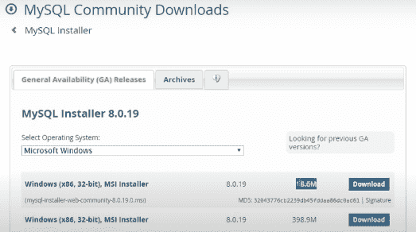
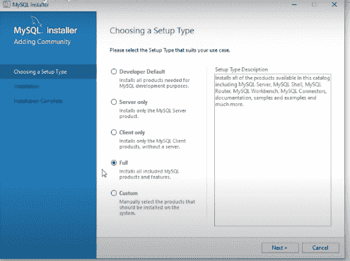
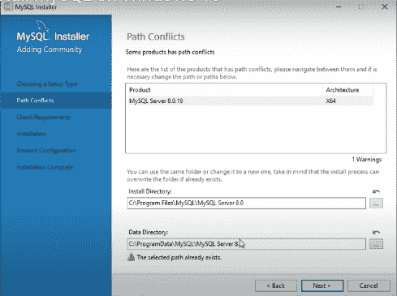
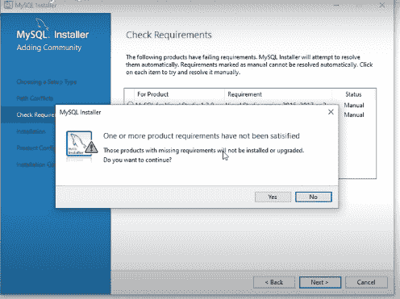
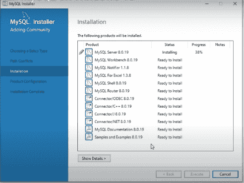
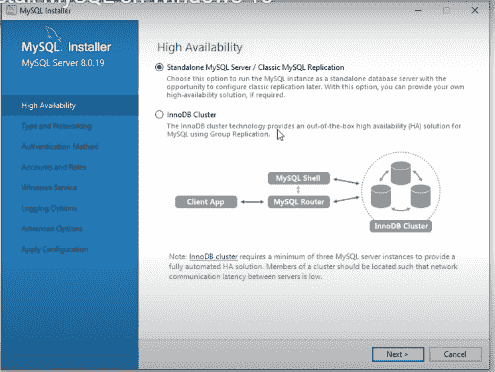
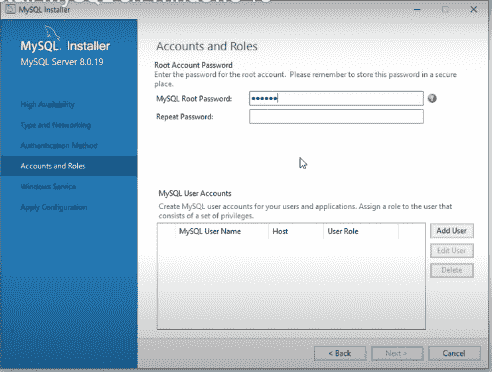
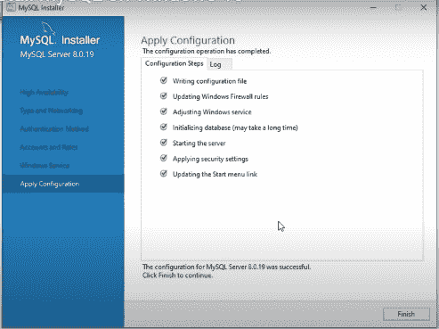
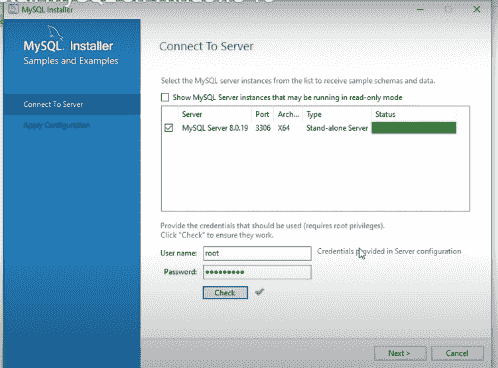

# MySQL 入门指南（编程语言 - JavaScript, Java, MySQL, PHP 及 Python 自动化）


## 前言

`SQL` 是最强大的编程语言之一，用于处理 `RDBMS`（关系型数据库管理系统）的任务。它使用紧凑的英语语句来创建、定义、插入、更新和控制关系型数据库。

`SQL` 用于在关系型数据库中存储和处理信息，而 `MySQL` 则用于开源关系型数据库。本电子书将同时讨论 `SQL` 和 `MySQL`。

`MySQL` 最适合客户端-服务器环境。它提供了灵活的事务管理。它是许多应用程序、网站以及商业产品的主要关系型数据库。

作为一本电子书，这将是关于如何使用 `MySQL` 提取、组织、管理和处理存储在关系型数据库中的数据的良好参考。我们已经通过多个示例详细讨论了 `DDL`、`DQL`、`DML`、`DCL` 和 `TCL`。

本电子书涵盖了广泛的数据库任务，方式更加易于理解、无痛且高效。你不会感到无聊。如果你觉得大多数编程书籍太枯燥，那么这可能是你入门 `MySQL` 的绝佳书籍。

## MySQL 概述

`SQL`（结构查询语言）最初由 IBM 创建，并于 1979 年由 Oracle 公司首次商业化实施，但当时没有官方标准，因此在后 1986 年由 `ANSI` 和 `ISO` 改进并联合发布。1992 年发布了 `SQL’92`。它的组织方式改进得多：数据包含在表中，表分组在模式（schemas）中，模式分组在目录（catalogues）中，目录分组在集群（clusters）。`MySQL` 的第一个版本由 Monty Widenius、David Axmark 和 Allan 开发，于 1995 年出现。到 2000 年，发布了多个版本的 `MySQL`。这些版本兼容几乎所有主要平台。

`MySQL` 是一种基于结构查询语言（`SQL`）的 `RDBMS`（关系数据库管理系统）。关系型数据库以表格的形式存储信息，行和列表示不同的数据属性以及数据值之间的各种关系。

我们使用命令来创建、定义、插入、提取、更新和控制数据库。以下是 SQL 命令的类型：

- `DDL`（数据定义语言）
- `DQL`（数据查询语言）
- `DML`（数据操语言）
- `DCL`（数据控制语言）
- `TCL`（事务控制语言）

我们将在接下来的章节中讨论所有内容。

### 以下是使用 MySQL 的前 10 个应用程序

1. 在线游戏
2. 数字营销
3. 零售销售点系统
4. 物联网监控系统
5. SaaS 应用
6. Facebook
7. Flickr
8. Web 开发
9. Twitter
10. YouTube

## 第 1 章：MySQL 简介

### 1.1 简介

`MySQL` 是一种采用 `SQL`（结构查询语言）的软件。对于小型和大型应用程序都是非常快速、可靠、可扩展且易用。MySQL 是创始人 Widenius 的女儿建议的名字。

在日常生活中，如果我们访问商场，会看到店主使用扫描枪处理产品数据库。另一个例子，让我们考虑银行，他们正在处理客户数据库。第三个例子是学校，他们正在处理学生数据库。因此，数据库既可以手动在笔记本上处理，也可以通过如 `MySQL` 等计算机软件进行处理。

#### 什么是数据库？

数据是现实世界中到处使用的原始事实和数字。一组数据构成特定的信息或数据库。`SQL` 用于在关系型数据库中存储和处理信息。

#### 什么是关系型数据库？

它是存储在一个或多个表中的组织数据集合。我们可以很容易看到并理解不同数据结构之间的相互关系。

#### MySQL 和 SQL 的区别

我们使用 `MySQL` 创建、读取、更新和删除数据库。但 `SQL`（结构查询语言）是用于访问、处理和协调数据库的紧凑英语语句。在本电子书中，我们将讨论如何在输入的数据库上进行交互式操作。

- `DML`（数据操纵语言）这些命令用于操纵数据，如和、平均值等。
- `DCL`（数据控制语言）– 它为数据库提供安全保护，如 `Grant`（授权）和 `Revoke`（撤销权限）。
- `DQL`（数据查询语言）– 它允许用户向关系型数据库发送查询语句。
- `TCL`（事务控制语言）– 它允许用户保存和恢复数据库。

**注意：** 我们将在接下来的章节中讨论这些命令。

### 1.2 安装 MySQL

在本节中，你将学习安装 MySQL Workbench。让我们从 `dev.mysql.com` 下载 MySQL 开始。选择相应的操作系统并下载 MySQL 安装程序 `8.0.19`。将它保存到合适的位置，例如桌面。



点击保存的文件，现在选择一种安装类型，我根据我的需求选择“Full”（完整安装），然后点击 next（下一步）按钮。



选择 MySQL 和数据存储的位置。点击 next（下一步）按钮，出现需求检查界面，你可以选择需求或直接点击 next（下一步）。



如果我们不选择需求，将出现下面的界面，只需点击“Yes”（是），然后点击 next（下一步）。



将出现 MySQL 的功能界面，点击 `Execute`（执行）并等待几分钟。



所有产品已成功安装在我们的电脑上，现在双击 next（下一步）按钮，选择 standalone MySQL server（独立 MySQL 服务器），然后点击 next（下一步）。



点击 next（下一步）跳过类型选择和网络/身份验证设置。

现在为你的账户设置密码，点击 next（下一步）。



点击 next（下一步）到达 Apply configuration（应用配置）界面，点击 `execute`（执行）然后点击 `Finish`（完成）。我们成功配置了 MySQL。接下来跳过产品配置。



将出现 Connect to the server（连接服务器）界面，输入你的账户密码并检查是否已连接到服务器 – Connection succeeded（连接成功），点击 next（下一步）按钮。



回到 Apply configuration（应用配置），点击 `execute`（执行）然后点击 `Finish`（完成）。我们已经在电脑上成功配置并安装了 MySQL。

MySQL Workbench 安装成功，使用你的密码连接服务器并开始使用 MySQL。

## 第 2 章：MySQL 语法

和其他编程语言一样，MySQL 遵循一套独特的规则和指南，即 MySQL 语法。它也非常容易运行和执行。

### 2.1 MySQL 数据类型

MySQL 数据类型指定了存储在数据库表中数值类型。数据类型主要分为三类。

- 数型
- 字符串型
- 日期和时间

#### 2.1.1 数型

它指的是以数字形式的数据，如整数（Integer）、浮点数（Float）和布尔值（Boolean）。下表列出了 MySQL 数型。

| 数型类型 | 范围 |
| :--- | :--- |
| BIT | 0-1 |
| TINYINT | 0-255 |
| SMALLINT | -32,768 - 32,767 |
| BIGINT | -9,223,372,036,854,775,808 - 9,223,372,036,854,775,807 |
| FLOAT | -1.79E+308 - 1.79E+308 |
| REAL | -3.40E+38 - 3.40E+38 |

#### 2.1.2 字符串类型

它允许我们存储固定或可变的字符值，如 `char`、`varchar` 和 `text`。下表列出了 MySQL 字符串类型。

| 字符串类型 | 说明 |
| :--- | :--- |
| CHAR | 固定长度 8000 个字符 |
| VARCHAR | 可变长度 8000 个字符 |
| TEXT | 可变长度 2GB 数据 |

#### 2.1.3 日期和时间类型

它用于存储包含日期和时间的数值。下表列出了 MySQL 日期和时间类型。

| 日期和时间类型 | 说明 |
| :--- | :--- |
| DATE | 以格式 (YYYY-MM-DD) 存储日期 |
| TIME | 以格式 (HH:MI:SS) 存储时间 |
| DATETIME | 存储日期和时间信息 (YYYY-MM-DD HH:MI:SS) |

### 2.2 MySQL 运算符

MySQL 运算符用于在语句中指定特定条件。运算符分为五类：

- 算术运算符
- 逻辑运算符
- 比较运算符
- 位运算符
- 集合运算符

#### 2.2.1 算术运算符

它对对数值数据执行算术运算。下表列出了这些运算符。

| 算术运算符 | 说明 |
| :--- | :--- |
| + | 加法 |
| - | 减法 |
| * | 乘法 |
| / | 除法 |
| % | 取模 |

#### 2.2.2 逻辑运算符

它执行布尔运算，给出真（true）或假（false）的结果。下表列出了这些。

| 逻辑运算符 | 说明 |
| :--- | :--- |
| AND | 如果两个表达式都为真 |
| IN | 如果操作数等于列表中的任意一个 |
| OR | 如果任一表达式为真 |
| NOT | 取反 |
| LIKE | 如果操作数匹配模式 |
| BETWEEN | 如果操作数在范围内 |

#### 2.2.3 比较运算符

也被称为关系运算符，比较表中的值。下表列出了。

| 比较运算符 | 说明 |
| :--- | :--- |
| = | 等于 |
| > | 大于 |
| < | 小于 |
| >= | 大于等于 |
| <= | 小于等于 |
| <> | 不等于 |

#### 2.2.4 位运算符

它将整数转换为二进制，对每个位执行 AND、OR、NOT 操作。下表列出了。

| 位运算符 | 说明 |
| :--- | :--- |
| AND | 如果两个值... |
| OR | 如果任一值... |
| NOT | 取反... |

#### 2.2.5 集合运算符

集合运算符用于合并两个或多个集的行。下表列出了。

| 集合运算符 | 说明 |
| :--- | :--- |
| UNION | 不去重复地合并两个或多个集 |
| UNION ALL | 包含重复合并两个或多个集 |
| INTERSECT | 仅包含存在于... |
| EXCEPT | 仅包含来自第一个集但不包含在... |

## 第 3 章：数据定义语言 (DDL)

在上一章节中学习了 MySQL 的语法，包括数据类型和运算符，现在我们将学习 MySQL 中的完整性约束，然后学习 DDL 创建表。

### 3.1 MySQL 中的完整性约束

完整性约束是表数据或列必须遵循的规则。我们可以在列级或表级使用完整性约束。表级约束适用于整个表，而列级约束仅适用于某一列。表显示了 MySQL 中使用的。

| 完整性约束 | 说明 |
| :--- | :--- |
| NOT NULL | 防止列具有空值 |
| DEFAULT | 当列没有定义值时，`DEFAULT` 约束提供一个默认值 |
| UNIQUE | 确保列中的任何值都是唯一的 |
| PRIMARY KEY | 唯一标识每行/记录 |
| FOREIGN KEY | 识别任何数据库表中的行/记录 |

### 3.2 MySQL DDL 简介

MySQL DDL 语句用于定义和操作数据库结构。它允许我们使用命令创建、修改和维护数据库。

以下是 DDL 命令。

- `CREATE` - 用于创建表和模式
- `ALTER` - 用于从表中添加、修改或删除列或约束
- `TRUNCATE` - 用于删除表中的数据，但不会删除表本身
- `DROP` – 用于删除整个表
- `RENAME` – 用于重命名表

#### 3.2.1 CREATE 命令

MySQL 允许我们使用 `CREATE` 命令创建数据库表。让我们创建一个员工表。如果我们在 MySQL Workbench 中执行如下所示的语句序列，就可以创建一个员工表。

```sql
CREATE TABLE employees (
  employee_id INT,
  first_name VARCHAR (50),
  last_name VARCHAR (50),
  hourly_pay DECIMAL (5,2),
  hire_date DATE
);
```

我将向你展示如何在 MySQL 中创建一些表。关系型数据库中的表表由行和列组成，类似于 Excel 表格。在本主题中，我们将创建表和列。

只需输入 `CREATE TABLE` 然后是表名，我将创建一个名为 `employees` 的表，然后在末尾添加一组括号和分号；在括号内，我们将列出员工的列，让我们有 `employee_id`、`first_name`、`hourly_pay` 和 `hire_date`。现在，我们需要为每一列设置在每个列中存储的数据的类型。

##### 让我们为每一列设置数据类型：

- `employee_id INT` – 数据将为整数
- `first_name VARCHAR (50)` – 最多 50 个字符序列
- `last_name VARCHAR (50)` – 最多 50 个字符序列
- `hourly_pay Decimal (5,2)` – 小数点前最多 5 位，后 2 位 (99999.99)
- `hire_date DATE` – 日期格式 (dd-mm-yyyy)

如果你需要选择表，请输入：

**语法：** `SELECT * FROM table name;`

**实现：** `SELECT * FROM employees;`

| employee_id | first_name | last_name | hourly_pay | hire_date |
| :--- | :--- | :--- | :--- | :--- |

我们已成功创建了一个包含五列的员工表。

#### 3.2.2 RENAME 命令

如果我们需要重命名上面的表，请输入：

**语法：** `RENAME TABLE original name TO new name;`

**实现：** `RENAME TABLE employees TO workers;`

在 MYSQL workbench 执行并获取结果。

#### 3.2.3 DROP 命令

如果我们需要删除上面的表，请输入：

**语法：** `DROP TABLE name of table;`

**实现：** `DROP TABLE employees;`

在 MYSQL workbench 执行并获取结果。

#### 3.2.4 ALTER 命令

如果我们需要修改表，让我们添加新列 `phone_number`，输入：

```sql
ALTER TABLE employees
ADD phone_number VARCHAR (15);
```

在 MYSQL workbench 执行并获取结果。

让我们将 `phone_number` 重命名为 `email`，输入：

```sql
ALTER TABLE employees
RENAME COLUMN phone_number to email;
```

在 MYSQL workbench 执行并获取结果。

让我们为 `email` 列添加数据类型，这里我们必须使用 `MODIFY` 命令，输入：

```sql
ALTER TABLE employees
MODIFY COLUMN email VARCHAR (100)
```

在 MYSQL workbench 执行并获取结果。

让我们在 `last_name` 之后添加 `email`，输入：

```sql
ALTER TABLE employees
MODIFY email VARCHAR (100)
AFTER last_name;
```

在 MYSQL workbench 执行并获取结果。

让我们删除 `email` 列，输入：

```sql
ALTER TABLE employees
DROP COLUMN email;
```

在 MYSQL workbench 执行并获取结果。

## 第 4 章：数据操语言 (DML)

### 4.1 MySQL DML 绪览

MySQL DML 处理数据库表内数据的修改。DML 语句用于向数据库中添加（插入）、删除和修改（更新）数据。

以下是 DML 命令：

- `INSERT` – 用于手动向表中添加行。
- `SELECT` – 我们可以使用 `Select` 命令访问和操作数据。
- `DELETE` – 我们可以使用 `Delete` 命令删除现有表的行。
- `UPDATE` - 用于更改表中的实际数据。

### 4.2 DML 命令执行

在上一章中，我们创建了一个 `employees` 表，现在让我们使用 DML 命令操作该表。

#### 4.2.1 INSERT 命令

在本主题中，我将讨论如何向表中插入行。我们有一个名为 `employees` 的表。我将从我的表 `employees` 中选择所有内容。

```sql
SELECT * FROM employees;
```

| employee_id | first_name | last_name | hourly_pay | hire_date |
| :--- | :--- | :--- | :--- | :--- |

让我们使用 `INSERT` 命令插入一行数据。


要向表中插入一行，我们将输入`INSERT INTO`紧跟表名，然后是`VALUES`括号和分号；在这组括号之间，我们将添加该行的所有数据。我们将按照此顺序，从`employee_id`、`first_name`、`last_name`等以此类推，但我们必须注意数据类型。每条数据之间将用逗号分隔。

在`Employees`表中插入一行数据：

```sql
INSERT INTO employees
VALUES (1, "Eugene", "Krabs", 25.50, "2023-01-02");
```

现在我们可以执行这些语句并获得所示结果。

| employee_id | first_name | last_name | hourly_pay | hire_date |
| :--- | :--- | :--- | :--- | :--- |
| 1 | Eugene | Krabs | 25.50 | 2023-01-02 |

一次性插入多行：

```sql
INSERT INTO employees
VALUES (1, "Eugene", "Krabs", 25.50, "2023-01-02"),
(2, "Squidward", "Tentacles", 15.00, "2023-01-03"),
(3, "Spongebob", "Squarepants", 12.50, "2023-01-04"),
(4, "Patrick", "Star", 12.00, "2023-01-05"),
(5, "Sandy", "Cheeks", 17.25, "2023-01-06");
```

执行后：

```sql
SELECT * FROM employees;
```

| employee_id | first_name | last_name | hourly_pay | hire_date |
| :--- | :--- | :--- | :--- | :--- |
| 1 | Eugene | Krabs | 25.50 | 2023-01-02 |
| 2 | Squidward | Tentacles | 15.00 | 2023-01-03 |
| 3 | Spongebob | Squarepants | 12.50 | 2023-01-04 |
| 4 | Patrick | Star | 12.00 | 2023-01-05 |
| 5 | Sandy | Cheeks | 17.25 | 2023-01-06 |

### 4.2.3 UPDATE 命令

在本节中，我们将讨论如何更新表中的数据。在我们的表中，员工`Id`6缺少部分数据。

```sql
UPDATE employees SET first_name = "Sheldon", last_name = "Plankton", hourly_pay = 20.00, hire_date = "2023-01-07" WHERE employee_id = 6;
```

| employee_id | first_name | last_name | hourly_pay | hire_date |
| :--- | :--- | :--- | :--- | :--- |
| 1 | Eugene | Krabs | 25.50 | 2023-01-02 |
| 2 | Squidward | Tentacles | 15.00 | 2023-01-03 |
| 3 | Spongebob | Squarepants | 12.50 | 2023-01-04 |
| 4 | Patrick | Star | 12.00 | 2023-01-05 |
| 5 | Sandy | Cheeks | 17.25 | 2023-01-06 |
| 6 | Sheldon | Plankton | 20.00 | 2023-01-07 |

#### 更新单列

让我们更新单列`hourly_pay = 10.25`：

```sql
UPDATE employees
SET hourly_pay = 10.25
WHERE employee_id = 6;
```

##### 输出

| employee_id | first_name | last_name | hourly_pay | hire_date |
| :--- | :--- | :--- | :--- | :--- |
| 1 | Eugene | Krabs | 25.50 | 2023-01-02 |
| 2 | Squidward | Tentacles | 15.00 | 2023-01-03 |
| 3 | Spongebob | Squarepants | 12.50 | 2023-01-04 |
| 4 | Patrick | Star | 12.50 | 2023-01-05 |
| 5 | Sandy | Cheeks | 17.25 | 2023-01-06 |
| 6 | Sheldon | Plankton | 10.25 | |

#### 更新多列

让我们更新多列`hourly_pay`和`hire_date`：

```sql
UPDATE employees
SET hourly_pay = 10.25,
    hire_date = "2023-01-07"
WHERE employee_id = 6;
```

##### 输出

| employee_id | first_name | last_name | hourly_pay | hire_date |
| :--- | :--- | :--- | :--- | :--- |
| 1 | Eugene | Krabs | 25.50 | 2023-01-02 |
| 2 | Squidward | Tentacles | 15.00 | 2023-01-03 |
| 3 | Spongebob | Squarepants | 12.50 | 2023-01-04 |
| 4 | Patrick | Star | 12.50 | 2023-01-05 |
| 5 | Sandy | Cheeks | 17.25 | 2023-01-06 |
| 6 | Sheldon | Plankton | 10.25 | 2023-01-07 |

#### 更新所有行

我们可以更新某一列中的所有行。让我们为所有员工更新`hourly_pay = 10.25`：

```sql
UPDATE employees
SET hourly_pay = 10.25;
```

##### 输出

| employee_id | first_name | last_name | hourly_pay | hire_date |
| :--- | :--- | :--- | :--- | :--- |
| 1 | Eugene | Krabs | 10.25 | 2023-01-02 |
| 2 | Squidward | Tentacles | 10.25 | 2023-01-03 |
| 3 | Spongebob | Squarepants | 10.25 | 2023-01-04 |
| 4 | Patrick | Star | 10.25 | 2023-01-05 |
| 5 | Sandy | Cheeks | 10.25 | 2023-01-06 |
| 6 | Sheldon | Plankton | 10.25 | |

#### 设置字段为 NULL

我们还可以在`UPDATE`命令中用完整性约束。让我们将某个字段设置为`NULL`（无值），如上例所示，Sheldon Plankton 的`hire_date`是空的：

```sql
UPDATE employees
SET hire_date = NULL
WHERE employee_id = 6;
```

##### 输出

| employee_id | first_name | last_name | hourly_pay | hire_date |
| :--- | :--- | :--- | :--- | :--- |
| 1 | Eugene | Krabs | 10.25 | 2023-01-02 |
| 2 | Squidward | Tentacles | 10.25 | 2023-01-03 |
| 3 | Spongebob | Squarepants | 10.25 | 2023-01-04 |
| 4 | Patrick | Star | 10.25 | 2023-01-05 |
| 5 | Sandy | Cheeks | 10.25 | 2023-01-06 |
| 6 | Sheldon | Plankton | 10.25 | |

注意：Plankton 的`hire_date`现在是`NULL`。

### 4.2.4 DELETE 命令

#### 删除所有行

要删除`employees`表中的所有行，输入：

```sql
DELETE FROM employees;
```

注意：请小心！表中的所有行将被删除。

#### 删除特定行

要删除`employees`表中的第 6 行，输入：

```sql
DELETE FROM employees
WHERE employee_id = 6;
```

##### 输出

| employee_id | first_name | last_name | hourly_pay | hire_date |
| :--- | :--- | :--- | :--- | :--- |
| 1 | Eugene | Krabs | 10.25 | 2023-01-02 |
| 2 | Squidward | Tentacles | 10.25 | 2023-01-03 |
| 3 | Spongebob | Squarepants | 10.25 | 2023-01-04 |
| 4 | Patrick | Star | 10.25 | 2023-01-05 |
| 5 | Sandy | Cheeks | 10.25 | 2023-01-06 |

## 第 5 章：数据控制语言 (DCL)

### 5.1 DCL 简介

MySQL DCL 是用于管理权限的。主要包括：

- **GRANT**: 授予用户特定的权限。
- **REVOKE**: 撤销已授予的权限。

## 第 6 章：事务控制语言 (TCL)

### 6.1 事务简介

TCL 是用于管理数据库事务的命令集。核心操作包括：

- **COMMIT**: 提交事务，将更改永久保存到数据库。
- **ROLLBACK**: 回滚事务，撤销未提交的更改。
- **SAVEPOINT**: 在事务中设置保存点，允许部分回滚。

### 6.2 自动提交 (Autocommit)

在 MySQL 中，默认提交默认是开启的。这意味着每一条 SQL 语句都会被视为一个独立的事务。我们可以关闭它：

```sql
SET AUTOCOMMIT = OFF;
```

关闭后，我们需要手动控制事务：

- 使用`COMMIT`提交更改。
- 使用`ROLLBACK`撤销更改。

注意：如果我们想保存更改，请使用`COMMIT`命令。

## 第 7 章：数据查询语言 (DQL)

### 7.1 MySQL DQL 简介

`MySQL`中的`DQL`是 SQL 子语言基础分组的一部分。它用于向数据库架构发送查询指令。它提供了使用`SELECT`命令的最大灵活性，可以根据用户的需求从数据库中检索信息。我们将详细讨论`SELECT`命令。

当对表执行`SELECT`语句时，结果将根据要求编译成一个进一步的临时表。

只有在创建表并插入了值的情况下，我们才能使用`SELECT`命令。让我们以已经创建的`employees`表为例。

#### 7.1.1 语法 1

```sql
SELECT * FROM table_name;
```

实现：从`employees`表中检索所有信息。

```sql
SELECT * FROM employees;
```

执行并获取结果：

| employee_id | first_name | last_name | hourly_pay | hire_date |
| :--- | :--- | :--- | :--- | :--- |
| 1 | Eugene | Krabs | 25.50 | 2023-01-02 |
| 2 | Squidward | Tentacles | 15.00 | 2023-01-03 |
| 3 | Spongebob | Squarepants | 12.50 | 2023-01-04 |
| 4 | Patrick | Star | 12.50 | 2023-01-05 |
| 5 | Sandy | Cheeks | 17.25 | 2023-01-06 |
| 6 | Sheldon | Plankton | 10.25 | 2023-01-07 |

#### 7.1.2 语法 2

```sql
SELECT Col1, Col2,…. FROM table_name;
```

实现：检索表中的特定列。

```sql
SELECT employee_id, first_name, last_name FROM employees;
```

执行并获取结果：

| employee_id | first_name | last_name |
| :--- | :--- | :--- |
| 1 | Eugene | Krabs |
| 2 | Squidward | Tentacles |
| 3 | Spongebob | Squarepants |
| 4 | Patrick | Star |
| 5 | Sandy | Cheeks |
| 6 | Sheldon | Plankton |

注意：列的顺序将由用户决定。

#### 7.1.3 语法 3

```sql
SELECT * FROM table_name WHERE condition;
```

实现：它将检索所有与`WHERE`子句相关的行。

```sql
SELECT * FROM employees WHERE employee_id< 4;
```

执行并获取结果：

| employee_id | first_name | last_name | hourly_pay | hire_date |
| :--- | :--- | :--- | :--- | :--- |
| 1 | Eugene | Krabs | 25.50 | 2023-01-02 |
| 2 | Squidward | Tentacles | 15.00 | 2023-01-03 |
| 3 | Spongebob | Squarepants | 12.50 | 2023-01-04 |

注意：`WHERE`子句用于根据条件过滤行。

#### 7.1.4 语法 4

```sql
SELECT col1, col2, …… FROM table_name WHERE condition;
```

实现：这里将根据`WHERE`子句检索员工的`first_name`、`last_name`和`hourly_pay`。

```sql
SELECT first_name, last_name, hourly_pay FROM employees WHERE hourly_pay<15;
```

执行并获取结果：

| first_name | Last_name | hourly_pay |
| :--- | :--- | :--- |
| Spongebob | Squarepants | 12.50 |
| Patrick | Star | 12.50 |
| Sheldon | Plankton | 10.25 |

### 7.2 使用 MySQL 获取当前日期和时间

让我们创建一个临时演示表，输入：

```sql
CREATE TABLE demo(
my_date DATE,
my_time TIME,
my_datetime DATETIME
);
```

执行它，我们成功创建了一个包含三列的表——`my_date`、`my_time`、`my_datetime`。

如果我们想获取当前日期，我们需要创建一个时间戳。向`DEMO`表中插入数据，输入：

```sql
INSERT INTO demo
VALUE(CURRENT_DATE(), CURRENT_TIME(), NOW());

SELECT * FROM demo;
```

执行它并获取当前日期和时间。

| my_date | my_time | my_datetime |
| :--- | :--- | :--- |
| 2024-07-23 | 07:27:58 | 2024-07-23 07:27:58 |

让我们为当前日期增加一天，输入：

```sql
INSERT INTO demo
VALUES(CURRENT_DATE() + 1, NULL, NULL)

SELECT * FROM demo;
```

执行并获取结果：

| my_date | my_time | my_datetime |
| :--- | :--- | :--- |
| 2024-07-23 | 07:27:58 | 2024-07-23 07:27:58 |
| 2024-07-24 | | |

注意：这里 datetime 设置为`NULL`。

## 第 8 章：约束的作用

在本节中，我们将讨论约束。

### 8.1 UNIQUE 约束

`MySQL`中的`UNIQUE`约束确保列中的所有值都是唯一的。我们可以在创建表时添加它：

```sql
CREATE TABLE products (
product_id INT,
product_name VARCHAR(25),
price DECIMAL(4,2)
);
```

创建后，我们可以将其添加到现有表中：


```sql
ALTER TABLE products
ADD CONSTRAINT UNIQUE (product_name);
```

## 8.2 NOT NULL 约束

`NOT NULL` 约束确保列不能有 `NULL` 值。

## 8.3 CHECK 约束

`CHECK` 约束用于限制列的值。

```sql
CREATE TABLE employees (
employee_id INT,
first_name VARCHAR(50),
last_name VARCHAR(50),
hourly_pay DECIMAL(5,2),
hire_date DATE,
CONSTRAINT chk_hourly_pay CHECK (hourly_pay >= 10)
);
```

删除该约束：

```sql
ALTER TABLE employees
DROP CHECK chk_hourly_pay;
```

## 8.4 DEFAULT 约束

`DEFAULT` 约束在插入时未指定值时为列提供默认值。

```sql
CREATE TABLE products (
product_id INT,
product_name VARCHAR(25),
price DECIMAL(4,2) DEFAULT 0
);
```

```sql
INSERT INTO products (product_id, product_name)
VALUES (10, "spoon"), (11, "fork");
```

## 8.5 PRIMARY KEY 约束

`PRIMARY KEY` 应用于列（或列），其中每个值必须是唯一的且不为 `NULL`。

```sql
CREATE TABLE transactions(
transaction_id INT PRIMARY KEY,
amount DECIMAL(5,2)
);
```

## 8.6 MYSQL 中的自增属性

`auto increment` 属性可以应用于设置为主键的列，每当我们插入新行时，我们的主键会自动填充，然后随后的每一行都会自动递增。

让我们删除 `transactions` 表并使用自动递增功能重新创建，类型：

```sql
CREATE TABLE transactions (
  transaction_id INT PRIMARY KEY AUTO_INCREMENT,
  amount DECIMAL (5,2)
);
```

注意：默认情况下，`auto increment` 将设置为 `1`。

让我们在 `transactions` 表中插入一些值，不需要插入 `transaction_id`，它将被自动分配。

```sql
INSERT INTO transactions (amount)
VALUES (2.56);
SELECT * FROM transactions;
```

| transaction_id | amount |
| --- | --- |
| 1 | 2.56 |

注意：这里 `transaction_id` 是自动插入的。

我们可以设置主键从不同的值开始，类型：

```sql
ALTER TABLE transactions
AUTO_INCREMENT = 1000;
```

执行并获取结果，`transaction_id` 从 `1000` 开始设置。我们必须删除整行并插入新值。

## 8.7 FOREIGN KEY 外键约束

外键是其中一个表中的 `PRIMARY KEY`，可以通过 `foreign key` 在另一个表中找到它，我们可以在两个表之间建立连接。在我们的交易表里，这样做有两个主要好处：如果我想查看发起此交易的 `customer_id`，我可以引用 `customers` 表，然后找到该客户的姓和名。

让我们创建 `transaction` 和 `customer` 表，使用外键在它们之间建立连接。

我将创建一个新的 `customers` 表，类型：

```sql
CREATE TABLE customers (
  customer_id INT PRIMARY KEY AUTO_INCREMENT,
  first_name VARCHAR (50),
  last_name VARCHAR (50)
);
```

执行并获取结果。

现在向表中插入一些值，类型：

```sql
INSERT INTO customers (first_name, last_name)
VALUES ("Fred", "Fish"),
("Larry", "Lobster"),
("Bubble", "Bass");

SELECT * FROM customers;
```

输出：

| customer_id | first_name | last_name |
| --- | --- | --- |
| 1 | Fred | Fish |
| 2 | Larry | Lobster |
| 3 | Bubble | Bass |

现在，我们将通过 `customer_id` 在我们的 `customers` 表和 `transactions` 表之间建立连接。让我们创建一个带有 `FOREIGN KEY` 约束的 `transactions` 表，类型：

```sql
CREATE TABLE transactions (
  transaction_id INT PRIMARY KEY AUTO_INCREMENT,
  amount DECIMAL (5,2),
  customer_id INT,
  FOREIGN KEY (customer_id) REFERENCES customers(customer_id)
);
```

执行并获取结果：

| transaction_id | amount | customer_id |

注意：这里 `customer_id` 列是 `FOREIGN KEY`。

使用外键在两个表之间的连接如下所示：

| customer_id | first_name | last_name |
| --- | --- | --- |
| 1 | Fred | Fish |
| 2 | Larry | Lobster |
| 3 | Bubble | Bass |

| transaction_id | amount | customer_id |
| --- | --- | --- |
| 1000 | 4.89 | 2 |
| 1001 | 2.68 | 3 |
| 1002 | 3.32 | 1 |
| 1003 | 4.99 | 3 |

## 8.8 MySQL 中的 JOIN 子句

`JOIN` 是一个用于根据两个或多个表之间的相关列（例如 `foreign key`）合并来自这些表的行的子句。让我们连接之前创建的两个表。我们有两个表：一个 `transaction` 表和一个 `customers` 表。

### 1. Transaction 表

| transaction_id | amount | customer_id |
| --- | --- | --- |
| 1000 | 4.89 | 2 |
| 1001 | 2.68 | 3 |
| 1002 | 3.32 | 1 |
| 1003 | 4.99 | 3 |

### 2. Customers 表

| customer_id | first_name | last_name |
| --- | --- | --- |
| 1 | Fred | Fish |
| 2 | Larry | Lobster |
| 3 | Bubble | Bass |

让我们内连接两个表，类型：

```sql
SELECT *
FROM transactions INNER JOIN customers
ON transaction.customer_id = customer.customer_id;
```

输出：

| transaction_id | amount | customer_id | customer_id | first_name | last_name |
| --- | --- | --- | --- | --- | --- |
| 1000 | 4.89 | 2 | 2 | Larry | Lobster |
| 1001 | 2.68 | 3 | 3 | Bubble | Bass |
| 1002 | 3.32 | 1 | 1 | Fred | Fish |
| 1003 | 4.99 | 3 | 3 | Bubble | Bass |

# 第 9 章：MySQL 中的函数和逻辑运算符

## 9.1 MySQL 中的函数

一种接受用户提供的参数并返回返回值的存储程序称为 `Function`。MySQL 提供了许多函数。下面显示了一些。

让我们统计 `transaction` 表中 `amount` 列的行数，类型：

```sql
SELECT COUNT (amount)
FROM transaction;
```

执行并获取结果。

查找 `transaction` 表 `amount` 列中的最大值，类型：

```sql
SELECT MAX(amount)
FROM transaction;
```

执行并获取结果。

查找 `transaction` 表 `amount` 列中的平均值，类型：

```sql
SELECT AVG(amount)
FROM transaction;
```

执行并获取结果。

查找 `transaction` 表 `amount` 列中的总和，类型：

```sql
SELECT SUM(amount)
FROM transaction;
```

执行并获取结果。

统计 `transaction` 表 `amount` 列的行数，类型：

```sql
SELECT COUNT (amount)
FROM transaction;
```

执行并获取结果。

拼接 `customers` 表中的姓和名，类型：

```sql
SELECT CONCAT(first_name, ' ', last_name)
FROM customers;
```

执行并获取结果。

## 9.2 逻辑运算符

逻辑运算符用于组合多个条件。

让我们在 `employees` 表中使用逻辑运算符。

```sql
SELECT *
FROM employees
WHERE salary > 50000 AND department = 'Sales';
```

执行并获取结果：

| employee_id | first_name | last_name | salary | department |
| --- | --- | --- | --- | --- |
| 1 | John | Doe | 60000 | Sales |

### 9.2.1 AND 运算符

它返回两个条件都为真的行。

```sql
SELECT *
FROM employees
WHERE salary > 50000 AND department = 'Sales';
```

### 9.2.2 OR 运算符

它返回至少一个条件为真的行。

```sql
SELECT *
FROM employees
WHERE salary > 50000 OR department = 'Marketing';
```

### 9.2.3 NOT 运算符

它返回条件不为真的行。

```sql
SELECT *
FROM employees
WHERE NOT department = 'Sales';
```

### 9.2.4 BETWEEN 运算符

它返回指定范围内的行。

```sql
SELECT *
FROM employees
WHERE salary BETWEEN 40000 AND 60000;
```

### 9.2.5 IN 运算符

它返回匹配列表中任何值的行。

```sql
SELECT *
FROM employees
WHERE department IN ('Sales', 'IT');
```

# 第 10 章：一些重要的 MySQL 命令

在本节中，我们将讨论用于处理数据库或架构对象的 MySQL 中重要子句。

## 10.1 通配符字符

通配符是用于处理数据库的特殊字符。有两种通配符——百分比和下划线。

让我们在 `employees` 表中使用 `%` 来检索以 S 开头的第一个名，类型：

```sql
SELECT * FROM employees
WHERE first_name LIKE "s%";
```

执行并获取结果：

| employee_id | first_name | last_name | hourly_pay | hire_date |
| :--- | :--- | :--- | :--- | :--- |
| 2 | Squidward | Tentacles | 15.00 | 2023-01-03 |
| 3 | Spongebob | Squarepants | 12.50 | 2023-01-04 |
| 5 | Sandy | Cheeks | 17.25 | 2023-01-06 |
| 6 | Sheldon | Plankton | 10.25 | 2023-01-07 |

让我们从 `employees` 表中找到 1 月入职的员工，输入：

```sql
SELECT * FROM employees
WHERE hire_date LIKE "____-01-__";
```

注意：年份使用四个下划线，月份使用两个下划线。

### 输出

| employee_id | first_name | last_name | hourly_pay | hire_date |
| :--- | :--- | :--- | :--- | :--- |
| 1 | Eugene | Krabs | 25.50 | 2023-01-02 |
| 2 | Squidward | Tentacles | 15.00 | 2023-01-03 |
| 3 | Spongebob | Squarepants | 12.50 | 2023-01-04 |
| 4 | Patrick | Star | 12.50 | 2023-01-05 |
| 5 | Sandy | Cheeks | 17.25 | 2023-01-06 |
| 6 | Sheldon | Plankton | 10.25 | 2023-01-07 |

## 10.2 Order by 子句

`ORDER BY` 子句根据我们列出的列对查询结果进行升序或降序排序。

### 让我们改变 `employees` 表中姓名的顺序，输入：

```sql
SELECT * FROM employees
ORDER BY first_name DESC;
```

执行并获取结果：

```sql
SELECT * FROM employees
ORDER BY first_name ASC;
```

执行并获取结果。

## 10.3 Limit 子句

`LIMIT` 子句用于限制记录的数量。如果你正在处理大型数据库，它非常有用。

### 让我们限制 `employees` 表中显示的员工数量，输入：

```sql
SELECT * FROM employees
LIMIT 2;
```

注意：只会显示前两个位员工的详情。

### 输出

| employee_id | first_name | last_name | hourly_pay | hire_date |
| :--- | :--- | :--- | :--- | :--- |
| 1 | Eugene | Krabs | 25.50 | 2023-01-02 |
| 2 | Squidward | Tentacles | 15.00 | 2023-01-03 |

## 10.4 Union 运算符

`UNION` 运算符合并两个或多个 `select` 语句的结果。

### 让我们合并两个表（`Employees` 表和 `Customers` 表）的 `first_name` 和 `last_name`。

#### Employees 表

| employee_id | first_name | last_name | hourly_pay | hire_date |
| :--- | :--- | :--- | :--- | :--- |
| 1 | Eugene | Krabs | 25.50 | 2023-01-02 |
| 2 | Squidward | Tentacles | 15.00 | 2023-01-03 |
| 3 | Spongebob | Squarepants | 12.50 | 2023-01-04 |
| 4 | Patrick | Star | 12.50 | 2023-01-05 |
| 5 | Sandy | Cheeks | 17.25 | 2023-01-06 |
| 6 | Sheldon | Plankton | 10.25 | 2023-01-07 |

#### Customers 表

| customer_id | first_name | last_name |
| :--- | :--- | :--- |
| 1 | Fred | Fish |
| 2 | Larry | Lobster |
| 3 | Bubble | Bass |

### 使用 `UNION` 进行合并，输入：

```sql
SELECT first_name, last_name FROM employees
UNION
SELECT first_name, last_name FROM customers
```


### 输出

| first_name | last_name |
| :--- | :--- |
| Eugene | Krabs |
| Squidward | Tentacles |
| Spongebob | Squarepants |
| Patrick | Star |
| Sandy | Cheeks |
| Sheldon | Plankton |
| Fred | Fish |
| Larry | Lobster |
| Bubble | Bass |

注意：如果我们要合并包含重复值，请使用 `UNION ALL` 而不是 `UNION`。

## 10.5 MySQL 中的视图 (Views)

我们可以在 MySQL 中使用 `VIEWS` 创建虚拟表。视图中的字段是数据库中一个或多个真实表中的字段。

### 让我们将 `employees` 表视为 `employees_attendance` 表，输入

```sql
CREATE employees_attendance AS
SELECT first_name, last_name
FROM employees;
```

这样一切都成功了，我们有一个新的视图，输入：

```sql
SELECT * FROM employees_attendance;
```

### 输出

| first_name | last_name |
| :--- | :--- |
| Eugene | Krabs |
| Squidward | Tentacles |
| Spongebob | Squarepants |
| Patrick | Star |
| Sandy | Cheeks |
| Sheldon | Plankton |

## 10.6 MySQL 中的索引 (Indexes)

索引用于更快速地找到列中的值。MySQL 通常会搜索整个列。

#### Customers 表

| customer_id | first_name | last_name |
| :--- | :--- | :--- |
| 1 | Fred | Fish |
| 2 | Larry | Lobster |
| 3 | Bubble | Bass |

### 让我们为客户表的姓创建索引，输入

```sql
CREATE INDEX last_name_idx ON customers(last_name);
```

执行并获取结果。如果我想通过 `last_name` 搜索客户，输入：

```sql
SELECT * FROM customers
WHERE last_name = "Bass";
```

### 输出

| customer_id | first_name | last_name |
| :--- | :--- | :--- |
| 3 | Bubble | Bass |

## 10.7 子查询 (Subqueries)

查询内部的查询被称为子查询。

### 让我们显示薪资等于平均薪资的员工姓名，输入

```sql
SELECT first_name, last_name, hourly_pay, (SELECT AVG(hourly_pay) FROM employees) AS avg_pay FROM employees;
```

执行并获取结果。

## 10.8 Group by 子句

`GROUP BY` 子句将按特定列聚合行，通常与聚合函数如 `SUM()`、`MAX()`、`MIN()`、`COUNT()` 使用。

#### 交易表 (Transaction table)

| transaction_id | amount | Order_date |
| :--- | :--- | :--- |
| 1000 | 4.89 | 2023-01-01 |
| 1001 | 2.68 | 2023-01-01 |
| 1002 | 3.32 | 2023-01-02 |
| 1003 | 4.99 | 2023-01-02 |

### 让我们在交易表上应用 `GROUP BY` 子句来计算每日交易额，输入

```sql
SELECT SUM(amount), order_date
FROM transactions
GROUP BY order_date;
```

### 输出

| SUM(amount) | order_date |
| :--- | :--- |
| 7.57 | 2023-01-01 |
| 8.31 | 2023-01-02 |

## 10.9 Roll up 子句

它是 `GROUP BY` 子句的扩展，产生另一行并显示超级聚合值。

### 让我们使用 `ROLLUP` 计算交易表中的总额，输入

```sql
SELECT SUM(amount), order_date
FROM transactions
GROUP BY order_date WITH ROLLUP;
```

### 输出

| SUM(amount) | order_date |
| :--- | :--- |
| 7.57 | 2023-01-01 |
| 8.31 | 2023-01-02 |
| 15.88 | |

## 10.10 On delete 子句

`ON DELETE` 子句有两个版本：

1. `ON DELETE SET NULL`
2. `ON DELETE CASCADE`

当外键被删除时，我们可以将外键替换为值 0。

### 让我们以客户表为例，其中 `customer_id` 是外键，因此要删除整个选定行，输入

```sql
SET foreign_key_checks = 0;
DELETE FROM customers
WHERE customer_id = 4;
SELECT * FROM customers;
```

执行并获取结果。

# 结束
