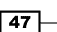
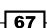
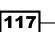
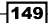
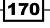
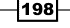
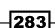

# Java 和 LingPipe 自然语言处理秘籍

# 致谢

## 作者

- Breck Baldwin
- Krishna Dayanidhi

## 项目协调员

- Kranti Berde

## 审稿员

- Aria Haghhii
- Kshitij Judah
- Karthik Raghunathan
- Altaf Rahman

## 校对员

- Bridget Braund
- Maria Gould
- Ameesha Green
- Lucy Rowland

## 索引员

- Monica Ajmera Mehta
- Tejal Soni

## 委约编辑

- Kunal Parikh

## 制作协调员

- Melwyn D'sa

## 策划编辑

- Sam Wood

## 封面设计

- Melwyn D'sa

## 内容开发编辑

- Ruchita Bhansali

## 技术编辑

- Mrunal M. Chavan
- Shiny Poojary
- Sebastian Rodrigues

## 文字编辑

- Janbal Dharmaraj
- Karuna Narayanan
- Merilyn Pereira

# 关于作者

**Breck Baldwin** 是 Alias-i/LingPipe 的创始人兼总裁。该公司专注于为客户构建系统、为开发者提供教育，并偶尔进行纯研究。自 1996 年以来，他一直在构建大型 NLP 系统。他喜欢遥距滑雪，并撰写了《从零制作遥控飞机：破解天空的布鲁克林机场圣经》（Breck-Hill/TAB Electronics）。

> 本书献给 Peter Jackson，在我创立公司之前，他曾聘请我担任 Westlaw 的顾问，并给了我创业的信心。直到他不幸离世，他一直担任我的顾问委员会，我非常想念他。

亚里士多德同道 **Bob Carpenter** 是 LingPipe API 的架构师和开发者。让 LingPipe 开源是他的主意，这开启了许多机会并促成了本书的诞生。

**Mitzi Morris** 多年来一直与我们合作，在我们极具挑战性的 NIH 工作中发挥了关键作用，并在需要的地方编写了教程、包并进行了推演。

**Jeff Reynar** 是我研究生期间的室友，我们一起构思了参加 MUC-6 比赛，这是成立公司的主要动力；他现在担任我们的顾问委员会成员。

我们的志愿者审稿员应该受到感谢；**Doug Donahue** 和 **Rob Stupar** 提供了很大的帮助。Packt Publishing 的审稿员对本书的审查非常仔细；感谢 **Karthik Raghunathan**、**Altaf Rahman** 和 **Kshit Judah** 对细节的关注以及提出的极佳问题和建议。

我们的编辑们非常有耐心；**Ruchita Bhansali** 保持了章节的进展并提供了出色的评论；**Shiny Poojary** 是我们严谨的技术编辑，她为了让你们免受苦难而辛苦。非常感谢你们两位。

没有 **Krishna**，我无法完成工作，他保持了章节的进展并提供了出色的评论。非常感谢 **Karen** 在整个成书期间的支持。

# 关于审稿员

**Karthik Raghunathan** 是加州州微软的一位科学家，从事语音和语言研究。自 2006 年进入该领域以来，他一直致力于语音对话系统、机器翻译、文本归一化、指消解析等工作。他在德克萨斯大学达拉斯分校获得自然语言处理博士学位。他的论文是关于冲突问题的。

**Altaf Rahman** 目前是美国加州 Yahoo Labs 的研究科学家。他从事搜索查询研究，包括查询标记、查询解释排序、垂直搜索触发、模块排序等理解类问题。他在德克萨斯大学达拉斯分校获得自然语言处理博士学位。Rahman 博士在主要的 NLP 会议上发表过论文，引用量超过 200 次。此前，他曾在 IBM 马斯·沃森研究所中心、巴黎 Diderot 大学和 Google 担任研究实习生。

# www.PacktPub.com

# 支持文件、电子书、折扣优惠及更多

如需与您的书籍相关的支持文件和下载，请访问 `www.PacktPub.com`。

您知道吗？Packt 出版的每本书都提供电子书版本，并提供 PDF 和 EPub 格式。您可以在 `www.PacktPub.com` 升级到电子书版本，作为纸质书客户，您有权享受电子书版本的折扣。更多详情请通过 `service@packtpub.com` 与我们联系。

在 `www.PacktPub.com`，您还可以在阅读系列免费的技术文章，订阅一系列免费通讯邮件，并接收 Packt 图籍和电子书的专属折扣和优惠。

https://www.packtpub.com/books/subscription/packtlib

您需要针对 IT 问题的即时解决方案吗？PacktLib 是 Packt 的在线数字图书馆。在这里，您可以搜索、访问并阅读 Packt 的整个书库。

## 为什么要订阅？

- 可全文检索 Packt 出版的每一本书
- 支持内容的复制、粘贴、打印和书签
- 按需获取，并可通过网络浏览器访问

## Packt 账户持有者的免费访问权限

如果您在 `www.PacktPub.com` 拥有 Packt 账户，您现在即可访问 PacktLib 并查看 9 本完全免费的书。只需使用登录登录据即可立即访问。

# 目录

## 第 1 章：简单分类器

- 反序列化并运行分类器
- 从分类器获取置信度估计
- 从 Twitter API 获取数据
- 将分类器应用于 .csv 文件
- 分类器的评估 - 混淆矩阵
- 训练你自己的语言模型分类器
- 如何使用交叉验证进行训练和评估
- 查看错误类别 - 误报
- 理解精确率（precision）和召回率（recall）
- 如何序列化 LingPipe 对象 - 分类器示例
- 使用 Jaccard 距离消除近重复
- 如何分类情感 - 简单版本

## 第 6 章：字符串比较与聚类

- 引言
- 距离与接近性 - 简单编辑距离
- 加权编辑距离
- Jaccard 距离
- Tf-idf 距离
- 使用编辑距离和语言模型进行拼写检查
- 大小写恢复修复器
- 自动短语补全
- 单链和全链聚类
- 隐含狄利克雷分配 (LDA) 聚类

## 索引

# 约定

在本书中，你将发现多种风格的文本，它们用于区分不同类型的信息。以下是这些风格的一些示例及其含义的解释。

Java 是一种非常不适合放入食谱书籍中的语言，因为代码每行有 66 个字符的限制。无法逾越的问题是代码非常难看，我们深表歉意。

文本中的代码词、数据库表名、文件夹名、文件名、扩展名、路径名、虚拟 URL、用户输入和 Twitter 句柄显示如下：“一旦在控制台中读取该字符串，就会调用 `classifier.classify(input)`，它将返回 `Classification`。”

代码块的设置如下：

```
public static List<String[]> filterJaccard(List<String[]> texts,
    TokenizerFactory tokFactory, double cutoff) {
    JaccardDistance jaccardD = new JaccardDistance(tokFactory);
```

当我们希望你注意代码块的特定部分时，相关项目将以**粗体**显示：

任何命令行输入或输出的编写方式如下：

```
tar -xvzf lingpipeCookbook.tgz
```

新术语和重要词汇以**粗体**显示。你在屏幕、菜单或对话框中看到的词（例如）在文中显示如下：“点击‘创建新应用程序’。”

> 警告或重要注释将以此类框的形式出现。

> 提示和技巧将此类形式出现。

# 读者反馈

我们总是欢迎读者的反馈。请让我们知道你对这本书的看法——你喜欢或可能不喜欢的地方。读者反馈对于我们开发能让你最大获益的书籍至关重要。

如需向我们发送通用反馈，只需向 `feedback@packpub.com` 发送电子邮件，并在邮件主题中注明书名即可。

如果你在某个领域拥有专长，并有兴趣编写或贡献书籍，请参阅我们在 `www.packpub.com/authors` 上的作者指南。

请向 `cookbook@lingpipe.com` 发送不满、喜爱或中立的邮件。我们很在乎，但我们不会为你作业或免费为你的初创公司制作原型，不过请与我们交流。

# 客户支持

既然你已经是 Packt 书籍的幸运所有者，我们有很多方法帮助你从购买中获得最大收益。

我们提供咨询服务，并设有公益（免费）计划以及支持计划。NLP 是很困难的，这本书包含了我们知道的大部分知识，但也许我们可以提供更多帮助。

# 下载示例代码

你可以从 `http://www.packpub.com` 账户下载购买的所有 Packt 书的示例代码文件。如果你是在其他地方购买的这本书，可以访问 `http://www.packpub.com/support` 并注册，以便文件通过电子邮件发送给你。

书籍的所有源码均可在 `http://alias-i.com/book.html` 获取。

# 前言

# 错误列表

尽管我们尽力确保内容的准确性，但错误仍然会发生。如果你在我们的某书中发现错误——可能是文本或代码中的错误——如果你能向我们报告，我们将不胜感激。这样做可以避免其他读者感到沮丧，并帮助我们改进本书的后续版本。如果你发现任何错误，请访问 `http://www.packtub.com/submit-errata`，选择你的书籍，点击错误提交链接，并输入错误详情。一旦你的错误通过验证，你的提交将被接受，错误将上传到我们的网站，或添加到该书“错误列表”部分下的任何现有错误列表中。你可以通过 `http://www.packtub.com/support` 选择你的书籍来查看任何现有错误。

# 盗版

互联网上版权材料的盗版是所有媒体中持续存在的问题。在 Packt，我们非常重视对版权和许可的保护。如果你在互联网上发现我们作品的任何形式的非法复制，请立即向我们提供位置地址或网站名称，以便我们寻求补救。

请通过 `copyright@packtub.com` 联系我们，并附上疑似盗版材料的链接。

感谢你帮助保护我们的作者，并支持我们为你提供价值内容的能力。

# 问题

如果你对本书的任何方面有问题，可以通过 `questions@packtub.com` 与我们联系，我们将尽力解决。

访问 `http://lingpipe.com` 并进入我们的论坛，是获取解答的最佳场所，并查看你是否已经有了解决方案。

# 第 1 章：简单分类器

## 引言

本章在竞争环境的背景下介绍了 LingPipe 工具包，并直接探讨文本分类器。文本分类器为文本分配类别，例如，它们为句子分配语言，或者如果是推文，则判断其情感是正面、负面还是中性。本章涵盖了如何使用、评估和创建基于语言模型的文本分类器。这些是 LingPipe API 中最简单的基于机器学习的分类器。使它们变得简单的原因是因为它们仅对字符操作——稍后，分类器将引入词/标记的概念。

### 为什么使用 LingPipe？

- **企业级/服务器优化**：LingPipe 从底层开始就是为服务器应用程序设计的，而不是为了命令行使用（尽管我们在本书中将大量使用命令行）。
- **使用 Java 方言编写**：LingPipe 是一个原生的 Java API，根据标准的 Java 类设计原则（Addison-Wesley 出版的 Joshua Bloch《Effective Java》）设计，因此在构造、不可变性、类型安全、向后兼容序列化和线程安全方面具有一致性检查。
- **错误处理**：通过异常和针对长时间运行的可配置消息流对错误处理进行了有条件的关注。
- **支持**：LingPipe 拥有专门的员工，工作负责回答您的问题并确保 LingPipe 正常运行。罕见的 bug 通常在 24 小时内即可修复。我们会快速响应您的查询，并非常乐意提供帮助。
- **咨询**：您可以聘请 LingPipe 专家为您构建系统。通常情况下，开发者并不是顺便了解 NLP 系统的。
- **一致性**：LingPipe API 由 **Bob Carpenter** 一个人设计，他对一致性有着近乎执着的追求。虽然它并不完美，但你会发现它具有规律性和易用性，而这在学术研究中可能是缺失的。研究生们来来往往去，其对大学工具包产生的贡献可能非常庞杂。
- **开源**：有许多商业供应商，但他们的软件是黑盒。LingPipe 的开源特性提供了透明度和信心，确保代码确实如我们所要求执行的那样工作。当文档失效时，能够访问代码以更好地理解它，将是一个巨大的慰藉。

## 下载书籍代码和数据

您需要从 `http://alias-i.com/book.html` 下载本食谱指南的源码，以及支持的模型和数据。使用以下命令解压并解压缩：

```
tar -xzf lingpipecookbook.tgz
```

> **下载示例代码**
>
> 您可以从 `http://www.packpub.com` 的个人账户下载您已购买的所有 Packt 书籍的示例代码文件。如果您在其他处购买了此书，可以访问 `http://www.packpub.com/support` 并注册，以便文件直接通过电子邮件发送给您。

或者，您的操作系统可能提供其他提取归包的方法。所有的配方都假设您在生成的食谱指南目录中运行命令。

## 下载 LingPipe

下载 LingPipe 并非必须，但您可能希望查看源码并拥有一个 Javadoc 的本地副本。

LingPipe 的下载和安装说明可以在 `http://alias-i.com/lingpipe/web/install.html` 找到。

本章示例使用命令行调用，但假设读者具有足够的开发技能，可以将示例映射到他们偏好的 IDE/ant 或其他环境中。

## 反序列化并运行分类器

本配谱做了两件事：引入一个非常简单且有效的语言 ID 分器，并演示如何反序列化一个 LingPipe 类。如果您是从后面的章节来到这里尝试理解反序列化的，我鼓励您仍然运行这个示例程序。它将花费 5 分钟，您可能会学到一些有用的东西。

我们的语言 ID 分类器基于字符语言模型。每个语言模型给出了文本是由该语言生成的概率。与文本最熟悉的模型即是第一个最佳拟合模型。这个模型已经构建好了，但在章节的后半部分，您将学习如何创建您自己的模型。

### 如何操作...

执行以下步骤来反序列化并运行分类器：

1. 进入书籍的食谱目录，并针对 OSX、Unix 和 Linux 运行命令：

```
java -cp lingpipe-cookbook.1.0.jar:lib/lingpipe-4.1.0.jar com.lingpipe.cookbook.chapter1.RunClassifierFromDisk
```

Windows 调用（对类路径加引号并使用 `;` 代替 `:`）：

```
java -cp "lingpipe-cookbook.1.0.jar;lib\lingpipe-4.1.0.jar" com.lingpipe.cookbook.chapter1.RunClassifierFromDisk
```

我们本书将使用 Unix 风格的命令行。

2. 程序报告正在加载的模型和默认值，并提示输入要分类的句子：

```
Loading: models/3LangId.LMClassifier

输入要分类的字符串，输入空字符串退出。

The rain in Spain falls mainly on the plain.

english
```


# 第 1 章

输入要分类的字符串，输入空字符串退出。

la lluvia en España cae principalmente en el llano.

spanish

输入要分类的字符串，输入空字符串退出。

スペイン的雨は主に平野に落ちる。

japanese

- 3. 分类器在英语、西班牙语和日语上进行了训练。我们输入了每种语言的示例——关于日语，请访问 `http://ja.wikipedia.org/wiki/`。这些是它知道的语言，但它会对任何文本进行猜测。所以，让我们尝试阿拉伯语：

输入要分类的字符串。输入空字符串退出。

•العلم يوضح أسماء اللغات الإنجليزية والسبانية

japanese

- 4. 它认为这是日语，因为这种语言的字符比英语或西班牙语多。这导致模型预期未知字符。所有的阿拉伯字符都是未知的。

- 5. 如果您在 Windows 终端工作，可能会遇到输入 UTF-8 字符的困难。

## 工作原理...

jar 包中的代码位于 `cookbook/src/com/lingpipe/cookbook/chapter1/RunClassifierFromDisk.java`。正在发生的是一个预构建的语言识别模型被反序列化并可用。本配谱的重点是展示如何反序列化分类器并运行它。`RunClassifierFromDisk` 的完整代码从包声明开始：

```java
package com.lingpipe.cookbook.chapter1;
import java.io.File;
```

```java
import java.io.IOException;

import com.lingpipe.classify.BaseClassifier;
import com.lingpipe.util.AbstractExternalizable;

public class RunClassifierFromDisk {
    public static void main(String[] args) throws
    IOException, ClassNotFoundException
```

上述代码是非常标准的 Java 代码，我们不作解释。接下来是大多数副本中的一个功能，在命令行没有提供文件时提供默认值。这允许您在有自己的数据时使用，否则将从发行版运行。在这种情况下，如果没有命令行参数，则提供默认分类器：

```java
String classifierPath = args.length > 0 ? args[0]
: "models/3LangId.LMClassifier";
System.out.println("Loading: " + classifierPath);
```

接下来我们将展示如何从磁盘反序列化分类器或其他 LingPipe 对象：

上述代码段是第一个 LingPipe 特有的代码，使用静态 `AbstractExternalizable.readObject` 方法构建分类器。

```java
File serializedClassifier = new File(classifierPath);
@SuppressWarnings("unchecked")
BaseClassifier<String> classifier
= (BaseClassifier<String>)
AbstractExternalizable.readObject(serializedClassifier);
```

此类在整个 LingPipe 中用于执行类的编译，原因有两个。首先，它允许编译类具有 final 变量，这支持 LingPipe 对不可变对象的大量使用。其次，它避免了暴露外部化和反序列化所需的 I/O 方法，特别是无参构造函数。该类被用作私有内部类的子类，该私有内部类实现了无参构造函数并存储了 `readResolve()` 所需的对象。

> 我们使用 `Externalizable` 而不是 `Serializable` 是为了避免在更改任何方法签名或成员变量时出现向后兼容问题。`Externalizable` 实现了 `Serializable` 并允许对对象的读写进行控制。关于此更多信息，请参考 Josh Bloch《Effective Java》中关于序列化的精彩章节。

## 简单分类器

`BaseClassifier<E>` 是基础分类器接口，其中 E 是 LingPipe 中被分类对象的类型。查看 Javadoc 可以看到实现该接口的分类器范围——共有 10 个。反序列化为 `BaseClassifier<E>` 有些许复杂性，我们稍后在本章的“如何序列化 LingPipe 对象 - 分类器”示例中进行探讨。

最后一行调用了一个工具方法，我们将在书中经常使用该方法：

```java
Util.consoleInputBestCategory(classifier);
```

该方法处理与命令行的交互。代码位于 `src/com/lingpipe/cookbook/Util.java`：

```java
public static void consoleInputBestCategory(
    BaseClassifier<CharSequence> classifier) throws IOException {

    BufferedReader reader = new BufferedReader(
    new InputStreamReader(System.in));

    while (true) {
        System.out.println("\n输入要分类的文本。\n" +
        + "输入空字符串退出.");

        String data = reader.readLine();

        if (data.equals("")) {
            return;
        }

        Classification classification = classifier.classify(data);

        System.out.println("最佳类别: " +
        classification.bestCategory());
    }
}
```

一旦从控制台读取到字符串，就会调用 `classifier.classify(input)`，它返回 `Classification`。这反过来提供了一个打印出来的 String 标签。就是这样！你运行了一个分类器。

## 从分类器中获取置信度估计

如果分类器能提供更多关于其对分类置信度的信息，通常会有用得多——这通常是一个得分或概率。我们经常对分类器进行阈值处理，以适应安装的性能需求。例如，如果分类器绝不能出错至关重要，那么我们在做出决定之前会分类具有很高的置信度。

LingPipe 分类器根据它们提供的估计类型存在分级结构。骨干是一系列接口——不要慌；实际上非常简单。你现在不需要理解它，但我们确实需要将其记录下来备后参考：

- `BaseClassifier<E>`: 这只是你对 E 类型对象的基础分类器。它有一个 `classify()` 方法，返回一个 `classification`，而该结果又有一个 `bestCategory()` 方法和一个具有某些信息价值的 `toString()` 方法。
- `RankedClassifier<E>` 继承自 `BaseClassifier<E>`: `classify()` 方法返回 `RankedClassification`，它继承了 `Classification` 并添加了关于类别（int rank）的方法，说明第 1 到第 n 次分类是什么。还有一个 `size()` 方法表示有多少个分类结果。
- `ScoredClassifier<E>` 继承自 `RankedClassifier<E>`: 返回的 `ScoredClassification` 添加了一个 `score (int rank)` 方法。
- `ConditionalClassifier<E>` 继承自 `RankedClassifier<E>`: 此属性产生的 `ConditionalClassification` 具有以下特征：所有类别的得分之和通过 `conditionalProbability(int rank)` 和 `conditionalProbability(String category)` 方法访问必须等于 1。还有更多内容；你可以阅读它的 Javadoc。非常高级，而且我们想知道推文是英语相对于西班牙语的置信度。这些估计必须和为 1。
- `JointClassifier<E>` 继承自 `ConditionalClassifier<E>`: 这提供了在所有可能的输入空间内输入和类别的联合分类（`JointClassification`），且所有估计之和为 1。这是一个稀疏空间，因此值是基于对数的，以避免未使用错误。我们在生产环境中确实需要大量使用这种估计。

显而易见，在提出的分类栈中投入了大量的思考。这是因为大量的工业级 NLP 问题最终都由分类系统处理。

事实证明，我们最简单的分类器——在某种任意的简单意义上——产生了最丰富的估计，即联合分类。让我们深入研究吧。

## 准备工作

在上一个示例中，我们轻而易举地反序列化为 `BaseClassifier<String>`，这隐藏了发生的所有细节。现实情况比这个模糊的抽象所暗示的要复杂一些。注意，从磁盘加载的文件命名为 `3LangIdLMClassifier`。按照惯例，我们将序列化模型命名为它将反序列化的对象类型，在本例中，是 `LMClassifier`，它继承自 `BaseClassifier`。分类器最具体的类型是：

```java
LMClassifier<CompiledNGramBoundaryLM, MultivariateDistribution> classifier
= (LMClassifier <CompiledNGramBoundaryLM, MultivariateDistribution>) AbstractExternalizable.readObject(new File (args[0]));
```

向 `LMClassifier<CompiledNGramBoundaryLM,MultivariateDistribution>` 的强制转换指定了分布类型为 `MultivariateDistribution`。`com.alias.stats.MultivariateDistribution` 的 Javadoc 在描述这一点时非常明确且有用。

> MultivariateDistribution 实现了对有限结果集的离散分布，这些结果从零开始连续编号。

Javadoc 对 `MultivariateDistribution` 详述了许多细节，但基本上意味着我们有一个 n 类的概率分配，其总和为 1。

强制转换中的下一个类是 `CompiledNGramBoundaryLM`，它是 `LMClassifier` 的“内存”。事实上，每种语言都有它自己的模型。这意味着英语将是一个与西班牙语相互独立的语言模型，以此类推。有 8 种语言模型可以作为此分类器的一部分——请参阅 `LanguageModel` 接口的 Javadoc。每个语言模型 (LM) 具有以下属性：

- LM 将提供它生成该文本的概率。它对未见以前的数据具有健壮性，意味着它不会崩溃或给出零概率。
- 任何长度的所有字符概率之和为 1。查看 Javadoc 了解这是如何计算的。
- 每个语言模型对类别之外的数据没有知识。分类器跟踪类别的边际概率并将其纳入结果中。边际概率意味着我们倾向于看到三分二的英语、六分之一的西班牙语。这些信息与 LM 估计相结合。
- LM 是 `LanguageModel` 的编译版本，我们将在稍后讨论训练的示例中介绍。

`JointClassifier` 将这些组件封装成分类器。幸运的是，接口通过更美观的反序列化方式服务：

```java
JointClassifier<String> classifier = (JointClassifier<String>) AbstractExternalizable.readObject(new File(classifierPath));
```

这就是程序运行的情况。

## 如何实现...

这个示例是我们第一次偏离分类器的基本功能，但首先，让我们先玩一下：

- 1. 让你的魔法外壳精灵召唤出一个带有 Java 解释器的命令提示符并输入：
  `java -cp lingpipe-cookbook.1.0.jar:lib/lingpipe-4.1.0.jar: com.lingpipe.cookbook.chapter1.RunClassifierJoint`

- 2. 我们将输入之前相同的数据：
  输入要分类的字符串。输入空字符串退出。
  The rain in Spain falls mainly on the plain.
  Rank Category P (Category|Input) log2 P(Category, Input)
  0=english -3.60092 0.999999999 -165.64233891356052
  1=spanish -4.50743 3.06495494621E-022 -207.02722764132006
  2=japanese -14.369 7.685568234E-150 -660.998401136873

正如所述，`JointClassification` 继承了以 `Classification` 为根的层次结构中的所有的分类指标。每个层级的分类对之前的分类器显示如下：

- `Classification` 提供第一个类别作为排名为 O 的类别。
- `RankedClassification` 对所有可能的类别进行排序，排名越低表示类别的可能性越高。rank 列反映了这种排序。
- `ScoredClassification`（评分分类）为排序后的输出添加一个数值分数。请注意，取决于分类器的类型，分数可能无法与其他分类的字符串进行良好比较。该列标记为 Score（分数）。要了解此得分的依据，请参阅相关的 Javadoc。
- `ConditionalClassification`（条件分类）通过将得分转换为条件于输入的类别概率来精细化评分。所有类别的概率之和为 1。该列标记为 `P [Category | Input]`，这是表示在给定输入条件下类别概率的传统写法。
- `JointClassification`（联合分类）添加了输入和类别的对数（以 2 为底）概率——这被称为联合概率。所有类别和输入的概率概率之和为 1，这是一个非常大的空间，任何类别和字符串对被分配的概率都非常低。这就是为什么使用对数值来防止数值下溢。该列标记为 `log 2 P(Category, Input)`，翻译为类别和输入的 log2 概率。

查阅 `com.aliasi.classify` 包的 Javadoc，可以获取更多关于它们所实现的指标和分类器的信息。

## 工作原理...

`src/com/linepipe/cookbook/chapter1/RunClassifierJoint.java` 中的代码将被反序列化为 `JointClassifier<CharSequence>`：

```java
public static void main(String[] args) throws IOException, ClassNotFoundException {

  String classifierPath = args.length > 0 ? args[0] : "models/3LangId.LMClassifier";

  @SuppressWarnings("unchecked")

  JointClassifier<CharSequence> classifier = (JointClassifier<CharSequence>)

      AbstractExternalizable.readObject(new File(classifierPath));

  Util.consoleInputPrintClassification(classifier);

}
```

它调用了 `Util.consoleInputPrintClassification(classifier)`，这与 `Util.consoleInputBestCategory(classifier)` 的主要区别在于它使用了分类的 `toString()` 方法进行打印。代码如下：

```java
public static void consoleInputPrintClassification(BaseClassifier<CharSequence> classifier) throws IOException {

  BufferedReader reader = new BufferedReader(new InputStreamReader(System.in));

  while (true) {

    System.out.println("\n输入一个字符串进行分类。输入 'exit' 退出。");

    String data = reader.readLine();

    if ("exit".equals(data)) {

      return;

    }

    Classification classification = classifier.classify(data);

    System.out.println(classification);

  }

}
```


我们得到了比预期的更丰富的输出，因为类型是 `Classification`，但 `toString()` 方法将作用于运行时类型 `JointClassification`。

# 第 1 章

## 另见

- Bob Carpenter 和 Breck Baldwin 编写的、LingPipe 出版的《Text Analysis with LingPipe 4》（[使用 LingPipe 4 进行文本分析](http://alias-i.com/lingpipe-book/lingpipe-book-0.5.pdf)）第 6 章中有关于语言模型的详细信息。

## 使用 twitter4j 包调用 Twitter Search API

我们使用 `twitter4j` 包来调用 Twitter Search API，搜索推文将其保存到磁盘。Twitter API 需要 1.1 版本的身份验证，在开始之前，我们需要获取验证令牌并将其保存到 `twitter4j.properties` 文件中。

## 准备工作

如果你没有 Twitter 账户，请访问 twitter.com/signup 创建账户。你还需要访问 dev.twitter.com 并登录以启用开发者账户。一旦你有了 Twitter 登录，我们就可以开始创建 Twitter OAuth 凭证。请准备好此过程可能与我们展示的有所不同。无论如何，我们会在数据目录中提供示例结果。现在让我们创建 OAuth 凭证。

- 登录 dev.twitter.com。
- 找到顶部栏你图标旁的小下拉菜单。
- 选择 My Applications（我的应用）。
- 点击 Create new application（创建应用程序）。
- 填写表单并点击 Create Twitter application（创建 Twitter 应用）。
- 下一页包含 OAuth 设置。
- 点击 Create access token（创建访问令牌）。
- 你需要复制 Consumer key（密钥）和 Consumer secret（密钥密钥）。
- 你还需要复制 Access token（访问令牌）和 Access secret（访问密钥）。
- 这些值应放入 `twitter4j.properties` 文件。属性如下：

```properties
debug=false

auth.consumerKey=

auth.consumerSecret=

auth.accessToken=

auth.accessTokenSecret=
```

### 如何操作...

现在我们准备好通过以下步骤访问 Twitter 并获取一些搜索数据：

1. 进入本章目录并运行以下命令：
   `java -cp lingpipe-cookbook.1.0.jar:lib/twitter4j-core-4.0.1.jar:lib/opencv-2.4.jar:lib/lingpipe-4.1.jar com.lingpipe.chapter1.TwitterSearch`
2. 代码显示输出文件（默认情况下）。提供路径将写入该文件。然后输入查询：
3. 代码随后查询并将报告到 csv：
4. 该程序搜索该术语并写入磁盘：

### 如何操作...

将分类器应用到 .csv 文件非常简单！只需执行以下步骤：

1. 获取命令提示符并运行：
   ```bash
   java -cp lingpipe-cookbook.1.0.jar:lib/lingpipe-4.1.0.jar:lib/twitter4j-core-4.0.1.jar:lib/opencv-2.4.jar com.lingpipe.cookbook.chapter1.ReadClassifierRunOnCsv
   ```
2. 这将使用来自 `data/disney.csv` 分配的默认 CSV 文件，遍历 CSV 文件的每一行，并使用 `models/3LangId.LMClassifier` 中的语言 ID 分类器对其进行处理：
   输入文本: When all else fails #Disney
   最佳分类语言: english
   输入文本: ES INSUPERABLE !! QUIERO VOLVER: (
   最佳分类语言: Spanish
3. 你也可以将输入指定为第一个参数，分类器指定为第二个。

### 工作原理...

我们将通过之前食谱中描述的外部化模型反序列化一个分类器。然后，我们将遍历 .csv 文件的每一行，并调用分类器的分类方法。`main()` 函数中的代码如下：

```java
String inputPath = args.length > 0 ? args[0] : "data/disney.csv";

String classifierPath = args.length > 1 ? args[1] : "models/3LangId.LMClassifier";

@SuppressWarnings("unchecked") BaseClassifier<CharSequence> classifier =
    (BaseClassifier<CharSequence>) AbstractExternalizable.readObject(new File(classifierPath));

List<String[]> lines = Util.readCsvReaderHeader(new File(inputPath));

for (String[] line : lines) {
    String text = line[Util.TEXT_OFFSET];
    Classification classified = classifier.classify(text);
    System.out.println("Input: " + text);
    System.out.println("Best Classified Language: " + classified.bestCategory());
}
```

## 简单分类器

前面的代码在之前的食谱基础上并没有特别新奇。如下所示的 `Util.readCsvRemoveHeader` 仅在读取 .csv 文件之前跳过第一行，然后返回在 `TEXT_OFFSET` 位置上具有非空值且非空字符串的行：

```java
public static List<String[]> readCsvRemoveHeader(File file) throws IOException {
    FileInputStream inFile = new FileInputStream(file);
    InputStreamReader inputReader = new InputStreamReader(inFile, Strings.UTF8);
    CSVReader csvReader = new CSVReader(inputReader);
    csvReader.readNext(); // 跳过表头
    List<String[]> rows = new ArrayList<String[]>();
    String[] row;
    while ((row = csvReader.readNext()) != null) {
        if (row[TEXT_OFFSET] == null || row[TEXT_OFFSET].equals("")) {
            continue;
        }
        rows.add(row);
    }
    csvReader.close();
    return rows;
}
```

## 分类器评估 – 混淆矩阵

评估对于构建可靠的 NLP 系统极其重要。它允许开发者和管理层将业务需求映射到系统性能，从而有助于向利益相关方说明系统的改进。“嗯，呃，系统似乎变好好了”远没有“召回率提升了 20%，且特异性在增加 50% 训练数据后保持良好”那样具有分量。

本食谱提供了创建真实值或金标准数据的步骤，并告诉我们如何使用这些数据来评估我们预编译分类器的性能。它既简单又强大。

## 准备工作

你可能已经了 CSV 写入器的表头和标记可疑的列 `TRUTH`。现在我们来处理它。加载我们之前提供的推文，或者将你的数据转换为我们使用的 `.csv` 格式。获取新数据的一种简单方法是针对 Twitter 运行多语言查询，例如 Disney，这是我们提供的默认数据。

打开 CSV 文件，并对你认为是英语的推文进行至少 10 个示例的标注（英语为 `e`，非英语为 `n`）。分发中有一个 `data/disney_e_n.csv` 文件；如果你不想处理数据标注，可以使用它。如果你不确定，请尽管忽略。未标注的数据将被忽略。请看下面的截图：


电子表格截图显示了英语（e）和非英语（n）的人工标注。它被称为 `truth`（真实值）。“金标准”代表了这种现象。

通常，这被称为金标准，因为它代表了真相。“金标准”中的“金”是非常字面上的。将其备份并长久存储——它很可能是你硬盘上最有价值的推文集，因为生产任何数量的此类数据都很昂贵，而且它是对所做工作最清晰的表述。实现可能会失败，但评估数据永存。第 7 章“寻找概念与人之间的联系”食谱中的 John Smith 语料库（John Smith corpus）是该特定问题的标准评估语料库，并作为自 1997 年开始的一行的比较点存在。其实现方式早已被遗忘。

### 如何操作...

执行以下步骤来评估分类器：这将运行默认

1. 在命令提示符中输入以下内容；将在默认标准数据中的文本上运行默认分类器。然后，它将在默认标准数据中的文本上运行默认分类器，如下：
   ```bash
   java -cp lingpipe-cookbook.1.0.jar:lib/lingpipe-4.1.0.jar:lib/twitter4j-core-4.0.1.jar:lib/opencv-2.4.jar com.lingpipe.cookbook.chapter1.RunConfusionMatrix
   ```
2. 这将产生如下的矩阵：

| reference \ response | e | n |
|---|---|---|
| **e** | 11 | 0 |
| **n** | 1 | 9 |

混淆矩阵之所以被称为混淆矩阵，是因为可以很容易看到分类器正确预测了什么，错误预测了什么，以及它认为答案是什么。混淆矩阵扩展到多个类别也非常自然。例如，英国英语和美国英语可能会很高。稍后会看到。

### 工作原理...

我们将设置 `BaseClassifierEvaluator`。这需要对分类器进行评估。我们将设置类别以及一个控制是否在构造时将输入存储在分类器中的布尔值：

```java
boolean storeInputs = false;
BaseClassifierEvaluator<CharSequence> evaluator = new BaseClassifierEvaluator<CharSequence>(classifier, categories, storeInputs);
```

注意，分类器可以为 `null` 并在稍后指定；类别必须与注解和分类器产生的完全匹配。我们不会配置评估器来存储输入，因为我们在本配方中不会使用此功能。请参考“查看错误类别 - 假阳性”配方以获取存储和访问输入的示例。

接下来，我们将进行实际评估。循环将遍历 `.csv` 文件中的每一行信息，构建一个 `Classified<CharSequence>`，并将其传递给评估器的 `handle()` 方法：

```java
for (String[] row : rows) {
  String truth = row[Util.ANNOTATION_OFFSET];
  String text = row[Util.TEXT_OFFSET];
  Classification classification = new Classification(truth);
  Classified<CharSequence> classified = new Classified<CharSequence>(text, classification);
  evaluator.handle(classified);
}
```

第四行将根据真实注解（truth annotation）或在此例中）的值创建一个分类对象。这与 `BaseClassifier<E>` 的 `bestCategory()` 方法返回的类型相同。真实注解没有特殊类型。下一行添加分类器所应用的文本，我们得到了一个 `Classified<CharSequence>` 对象。

循环的最后一行将应用该方法创建已分类对象。评估器假设提供给 `handle` 方法的数据是真实注解，它将通过提取被分类的数据、将分类器应用于这些数据、获取 `firstBest()` 分类结果，最后记录该分类是否与刚刚使用真实值构建的内容匹配来处理。这会发生在 `.csv` 文件的每一行。

在循环之外，我们将使用 `Util.createMatrix()` 打印出混淆矩阵。

```java
System.out.println(Util.confusionMatrixToString(evaluator.confusionMatrix()));
```

检查代码留给读者自行。就这样；我们已经评估了分类器并打印了混淆矩阵。

## 还有更多……

评估器有一个完整的 `toString()` 方法，它关于你的分类器表现如何的信息量如喷涌般。输出的这些方面将在后面的配方中介绍。Javadoc 非常详尽，值得阅读。

## 训练你自己的语言模型分类器

当分类器被自定义时，NLP 的世界就真正打开了。本配方详细介绍了如何通过收集供分类器学习的示例来自定义分类器——这被称为训练数据。它也被称为金标准数据、真实值或地面真（ground truth）。我们从上一个配方中获得了一些数据。

## 准备工作

我们将为英语和其他语言创建一个自定义的语言分类器。训练数据的创建涉及访问文本数据并分类器的类别对其进行标注——在本例中，标注是语言。训练数据可以来自多种来源。可能的情况包括：

- 金标准数据，如在上一个配方中创建的。
- 已经对你关心的类别进行了标注的数据。例如，Wikipedia 有特定语言的版本，这是训练语言 ID 分类器的理想素材。这就是我们创建 `3LangId.LMClassifier` 模型的方法。
- 发挥创意——引导分类器向正确方向的数据在哪里？

语言 ID 不需要大量数据即可工作，因此每个语言 20 条推特就能开始可靠地区分差异强烈的语言。训练数据量由评估驱动——更多数据通常会提高性能。

示例假设可以使用大约 10 条英语推特和 10 条非英语推特。

### 如何操作？

要训练自己的语言分类器，请执行以下步骤：

1. 在终端中，输入以下内容：
   ```bash
   java -cp .:lib/* LongPipe.java
   ```
2. 然后，使用以下代码创建模型：
   ```java
   String dataPath = args.length > 0 ? args[0] : "data/spanish.csv";
   List<String> annotatedData = Util.readAnnotatedCsv(new File(dataPath));
   String[] categories = Util.getCategories(annotatedData);
   int maxNGram = 3;
   DynamicClassifier<NGBoundary> classifier = DynamicClassifier.createNGBoundary(categories, maxNGram);
   ```
3. 使用以下代码训练分类器：
   ```java
   for (String[] row : annotatedData) {
     String truth = row[Util.ANNOTATION_OFFSET];
     String text = row[Util.TEXT_OFFSET];
     Classification classification = new Classification(truth);
     Classified<CharSequence> classified = new Classified<CharSequence>(text, classification);
     classifier.handle(classified);
   }
   ```
4. 训练后，你可以通过控制台使用分类器：
   ```java
   Util.consoleInputPrintClassification(classifier);
   ```


# 简单分类器

## 另见

LingPipe 分类器的 Javadoc 对驱动该技术的底层数学原理有非常详尽的说明。

## 如何通过验证进行训练和评估

之前的配谱展示了如何使用真实数据评估分类器，以及如何使用真实数据进行训练，但如何同时进行两者呢？这个棒的想法被称为交叉验证（cross validation），其工作原理如下：

- 将数据分成 n 个不同的集合或折叠（folds），标准的 n 为 10。
- 对于 i 从 1 到 n：
    - 在排除折叠 i 后定义的 n - 1 个折叠上进行训练
    - 在折叠 i 上进行评估
- 报告所有折叠 i 的评估结果。

这是大多数机器学习系统进行性能调优的方法。其工作流如下：

- 查看交叉验证的性能。
- 查看由评估指标确定的误差。
- 查看实际错误——是的，查看数据——以获得关于如何改进系统的见解。
- 进行一些更改。
- 再次评估。

交叉验证是比较问题不同方法、尝试不同的分类器、为归一化方法提供动力、探索特征增强等的极佳方式。通常，在交叉验证上显示出性能提升的系统配置在新数据上也会显示出性能提升。交叉验证无法做到的是（特别是稍后讨论的主动学习策略）可靠地预测新数据上的性能。在发布生产系统之前，务必将分类器应用于新数据以作为最后的 sanity 检查。你已经收到警告了。

与在所有可能的训练数据上训练的分类器相比，交叉验证还会引入负偏差，因为每个折叠都是稍弱的分类器，因为它只有 10 个折叠数据的 90%。

清洗、揉搓、重复是构建顶尖 NLP 系统的准则。

## 准备工作

注意这种方法与其他经典的计算机工程方法有多不同，后者关注于针对单元测试驱动的功能规范进行开发。这个过程更多是根据评估指标来完善和调整代码，使其运行得更好。

## 如何操作……

要运行代码，请执行以下步骤：

1. 进入类型的命令提示符：
```java
java -cp lingpipe-cookbook.1.0.jar:lib/opencv-2.4.4.jar:lib/lingpipe-4.1.0.jar com.lingpipe.cookbook.chapter1.RunXValidate
```

2. 结果将是：
```
Training data is: data/disney_e_n.csv

Training on fold 0

Testing on fold 0

Training on fold 1

Testing on fold 1

Training on fold 2

Testing on fold 2

Training on fold 3

Testing on fold 3

reference\response

\e,n,

e 10,1,

n 6,4,
```
输出在接下来的章节中会有意义。

## 它如何工作……

本配谱引入了管理交叉验证的 `XValidatingObjectCorpus` 对象。它被大量用于训练分类器。其他所有内容应该在之前的配谱中已经熟悉了。`main()` 方法开始：

```java
String inputPath = args.length > 0 ? args[0] : "data/disney_e_n.csv";

System.out.println("Training data is: " + inputPath);

List<String[]> truthData = Util.readAnnotatedCsvRemoveHeader(new File(inputPath));
```

### 简单分类器

前面的代码让我们获取了数据或用户输入的文件。接下来的两行引入了 `XValidatingObjectCorpus`——本配谱的主角：

```java
int numFolds = 4;

XValidatingObjectCorpus<Classified<CharSequence>> corpus = Util.loadXValCorpus(truthData, numFolds);
```

`numFolds` 变量控制刚加载的数据将如何分区——在这种情况下它将分为四个分区。现在，我们使用 `Util.loadXValCorpus(truthData, numFolds)` 子程序：

```java
public static XValidatingObjectCorpus<Classified<CharSequence>>

loadXValCorpus(List<String> rows, int numFolds) throws IOException {

    XValidatingObjectCorpus<Classified<CharSequence>> corpus =

        new XValidatingObjectCorpus<Classified<CharSequence>>(numFolds);

    for (String[] row : rows) {

        Classification classification = new

        Classification(row[ANNOTATION_OFFSET]);

        Classified<CharSequence> classified = new

        Classified<CharSequence>(row[TEXT_OFFSET], classification);

        corpus.handle(classified);

    }

    return corpus;

}
```

构造的 `XValidatingObjectCorpus<E>` 将包含以 `Objects E` 形式存在的所有数据。在这种情况下，我们使用的是在本章之前的配谱中用于训练和评估的相同对象——`Classified<CharSequence>`。这将非常有用，我们将使用这些对象来同时训练和测试分类器。`numFolds` 参数指定了要对数据进行多少分区。它可以被更改。

下面的 `for` 循环应该是熟悉的，因为它遍历了所有标注数据并在应用 `corpus.handle()` 方法之前创建 `Classified<CharSequence>` 对象，该方法将其添加到语库中。最后，我们将返回 `corpus`。如果你有任何问题，值得查看 `XValidatingObjectCorpus<E>` 的 Javadoc。

回到 `main()` 的底部，我们将遍历语库以混合数据、类别，并设置 `BaseClassifierEvaluator<CharSequence>`，在之前的配谱中我们提供了分类器的地方，这里我们提供一个 `null` 值：

```java
// (code continues from original text)
```

# 第 1 章

现在，我们准备好执行：

```java
int maxNGram = 3;

for (int i = 0; i < numFolds; i++) {

  // (loop logic)

}
```

## 查看错误类别 – 误报（False Positives）

通过检查错误并对系统进行更改，我们可以获得最佳的分类器性能。开发者和机器学习人员中有一个非常坏的习惯是不查看错误，特别是在系统趋于成熟之后。明确一下，项目结束时，负责调优分类器的开发者应该对被分类的领域非常熟悉（如果不是专家的话），因为他们在调优系统时已经查看了大量数据。如果开发者无法合理地模拟你正在调优的分类器，那么你查看的数据还不够。

本配方执行了最基础的错误检查，即查看系统在哪些方面出现了错误，形式为误报。误报是指训练数据中的被分类器分配到某个类别，但正确的类别实际上是其他的示例。

### 如何操作...

按照以下步骤操作，使用误报来查看错误类别：

1. 本配方扩展了之前的*使用交叉验证进行训练和评估*配方，访问了评估器类提供的更多功能。打开命令行提示符并输入：

```java
java -cp lingpipe-cookbook.1.0.0.jar:lib/opencv-2.4.jar:lib/lingpipe-4.1.0.jar com.lingpipe.cookbook.chapter1.ReportFalsePositivesOverXValidation
```

2. 将得到结果：
训练数据为：`data/disney_e_n.csv`
reference\response
\,n,
e 10,1,
n 6,4,
False Positives for e
Malísimos los novos dibujitos de disney, nickelodeon, cartoon, etc, no me gustann : n
@meelp mas que venha um filhinho mais fafo que o próprio pai, com covinha e amando a Disney kkkkkkkkkkkkkkkkkkk : n
@HedyHAMIDI t'as de quartier pas a Disney moi : n
@greenath_ t'as de la chance d'aller a Disney putain j'y ai jamais été moi. : n

Simple Classifiers

Prefiro gastar uma baba de dinheiro pra pra cancun doq pra Disney por exemplo : n
ES INSPERABLE DISNEY !! QUIERO VOLVER: (: n
False Positives for n
request now "let's get tricky" by @bellathorne and @ROSHON on @nradioisney!! just call 1-877-870-5678 or at http://t.co/cbene5yRkQ! <3 : e

3. 输出以混淆矩阵开始。然后，我们将看到混淆矩阵左下侧 p 的实际误报实例，并标记为分类器猜测的类别。接着，我们将看到 n 的误报，这是一个单一示例。真实类别后面带有冒号 `:`，这对于具有两个以上类别的分类器很有帮助。


本配方基于上一个配方，但其源代码位于 `com/lingpipe/cook/chapter1/ReportFalsePositivesOverValidation.java`。有两个不同之处。首先，将 `storeInputs` 设置为评估器：

```java
boolean storeInputs = true;

BaseClassifierEvaluator<CharSequence> evaluator = new BaseClassifierEvaluator<CharSequence>(null, categories, storeInputs);
```

其次，添加了一个 Util 方法来打印误报：

```java
for (String category : categories) {

  Util.printFalsePositives(category, evaluator, corpus);

}
```

前面的代码工作原理是识别一个关注的类别——e 或英语推文，并从分类器评估器中提取所有误报。对于该类别，误报是指真实情况下非英语但分类器认为它们是英语的推文。
重新引用的 Util 方法如下：

```java
public static <E> void printFalsePositives(String category,

BaseClassifier<E> evaluator, Corpus<ObjectHandler<Classified<E>>> corpus) throws Exception {

final Map<E, Classification> truthMap = new HashMap<E, Classification>().visit();

corpus.visitCorpus(new ObjectHandler<Classified<E>>() {

@Override

public void handle(Classified<E> data) {

truthMap.put(data.getObject(), data.getClassification());

}

});
```

前面的代码获取包含所有真实数据的语料库并填充 `Map<E,Classification>`，以便根据给输入查找真实标注。如果相同的输入进入了两个类别，该方法将不够健壮，但会记录最后看到的示例：

```java
List<Classified<E>> falsePositives = evaluator;

falsePositives.add(category);

System.out.println("False Positives for " + category);

for (Classified<E> classified : falsePositives) {

  E data = classified.getObject();

  Classification truthClassification = truthMap.get(data);

  System.out.println(data + " : " + trueClassification.bestCategory());

}
```

代码从评估器中获取误报，然后通过前面代码构建的 `truthMap` 遍历所有误报，并打印相关信息。评估器中还有获取假阴性、真阳性和真阴性的方法。

识别错误的能力对于提高性能至关重要。虽然这个建议看起来很显而易见，但开发者不看错误是非常常见的。他们会查看系统输出并粗略估计系统是否足够；这并不会产生顶级性能。

下一个配方通过更多的指标和定义工作。

## 理解精确率（Precision）和召回率（Recall）

前一个配方的误报是四种错误类别之一。所有类别及其解释如下：

- 对于给定的类别 X：
  - 真阳性：分类器预测为 X，真实类别也是 X
  - 误报：分类器预测为 X，但真实类别是其他类别
  - 真阴性：分类器预测为不同的类别，且真实类别也是不同的类别
  - 假阴性：分类器预测为不同的类别，但真实类别是 X

### Simple Classifiers

有了这些定义，我们可以对类别定义其他常用的评估指标如下：

- 类别 X 的精确率 = 真阳性 / (误报 + 真阳性)
  - 退化情况：对类别做出非常有信心的预测以获得 100% 的精确率。这会减少误报，但召回率会很低。

- 类别 X 的召回率或灵敏度 = 真阳性 / (假阴性 + 真阳性)
  - 退化情况：假设所有数据均为类别 X 以获得 100% 的召回率。这会减少假阴性，但精确率会很低。

- 类别 X 的特异性 = 真阴性 / (真阴性 + 误报)
  - 退化情况：假设所有数据都不属于类别 X。

提供退化情况是为了明确指标关注的重点。还有诸如平衡精确率和召回率的指标，但即使如此，也没有包含真阴性，而真阴性非常有参考价值。更多细节请参见 `com.aliasi.classify.PrecisionRecallEvaluation`

根据我们的经验，大多数业务需求需要映射到三种场景之一：

- 高精确率/高召回率：语言 ID 需要同时具有良好的覆盖率和准确性；否则会出现很多问题。幸运的是，对于差异明显的语言（如日语与英语或西班牙语），LM 分类器的性能良好。

- 高召回率/可接受精确率：大多数业务案例呈这种形状。例如，在拼写错误时自动更改查询的搜索引擎宁愿不要犯太多错；虽然将 "Breck Baldwin" 改为 "Brad Baldwin" 看起来很糟糕，但如果不纠正 "Brad Baldwin"，没人会注意到。

- 高召回率/可接受精确率：在海洋中寻找特定需求的情报分析会容忍大量的误报，以找到目标。这是从早期的教训中

## 如何序列化 LingPipe 对象 – 分类器示例

在部署情况下，训练好的分类器、具有复杂配置的其他 Java 对象或训练过程最好通过从磁盘反序列化来访问。第一个配方通过使用 `AbstractExternalizable` 从磁盘读取 `LMClassifier` 正是如此。本配方展示了如何使用写入磁盘的语言 ID 以供以后使用。

# 第 1 章

将 `DynamicLMClassifier` 序列化并读取回来得到一个不同的类，它是 `LMClassifier` 的实例，其功能与刚刚训练的那个相同，但它不再接受训练实例，因为计数已转换为对数概率，且退避平滑弧存储在树中。生成的分类器速度快得多。

通常情况下，大多数 LingPipe 分类器、语言模型和隐藏马尔可夫模型 (HMM) 都实现了 `Serializable` 和 `Compilable` 接口。

## 准备工作

我们将使用在“查看错误类别——假阳性食谱”中使用的相同的数据。

### 如何操作...

执行以下步骤对 LingPipe 对象进行序列化：

1. 进入命令行并输入：
```java
java -cp lingpipe-cookbook.1.0.jar:lib/opencsv-2.4.jar:lib/lingpipe-4.1.0.jar com.lingpipe.cookbook.chapter1.TrainAndWriteClassifierToDisk
```

2. 程序将响应输入/输出的默认值：
Training on data/disney_e_n.csv
Wrote model to models/my_disney_e_n.LMClassifier

3. 通过调用反序列化并在指定分类器文件的同时运行分类器来测试模型是否工作：
```java
java -cp lingpipe-cookbook.1.0.jar:lib/lingpipe-4.1.0.jar com.lingpipe.cookbook.chapter1.LoadClassifierRunOnCommandLine models/my_disney_e_n.LMClassifier
```


- 4. 交互如下：
输入要分类的字符串。输入空字符串退出。
The rain in Spain
Best Category: e

### 工作原理...

`src/com/lingpipe/cookbook/chapter1/TrainAndWriteClassifierToDisk.java` 中 `main()` 的内容包含了之前食谱中涵盖的内容，用于读取 `.csv` 文件、设置分类器并对其进行训练。如果有任何不清楚的地方，请回看每个食谱。

## 简单分类器

本食谱的新点在于我们在 `DynamicLMClassifier` 上调用 `AbstractExternalizable.compileTo()` 方法，该方法会编译模型并将其写入文件。此方法用于写入 Java `Externalizable` 接口中的 `writeExternal` 方法：

```java
AbstractExternalizable.compileTo(classifier, outputFile);
```

各位，将分类器写入磁盘您只需要知道这些了。

## 更多内容...

还有另一种序列化方法，适用于不基于 `File` 类的更多数据源序列化。写入分类器的另一种方法是：

```java
FileOutputStream fos = new FileOutputStream(outputFile);
ObjectOutputStream oos = new ObjectOutputStream(fos);
classifier.compileTo(oos);
oos.close();
```

此外，可以使用静态的 `AbstractExternalizable.compile()` 方法在不涉及磁盘的情况下编译 `DynamicLM`。其使用方式如下：

```java
@SuppressWarnings("unchecked")
LMClassifier<LanguageModel, MultivariateDistribution> compiledLM = (LMClassifier<LanguageModel, MultivariateDistribution>)
AbstractExternalizable.compile(classifier);
```

编译后的版本快得多，但不允许进一步的训练。

## 使用 Jaccard 距离消除近重复

数据中经常会出现应该过滤的重复或近重复。Twitter 数据有大量重复内容，即使搜索 API 提供了 `-filter:retweets` 选项，处理起来也非常令人沮丧。查看这一点的一种快速方法是在电子表格中排序文本，具有相同前缀的推文将成为邻居：

# 第 1 章

| 列 A | 列 B |
| :--- | :--- |
| A Disney deveria fazer uma cena sem castelos, para cada menina no mundo que luta c cça | |
| A Disney Happiness Playlist http://it.co/CWqIU4w7via @Weidneckt | |
| A Disney hace crear una princesa que sin su principe nunca vivia vez | |
| A Disney hace crear una princesa que tiene sin príncipe vive feliz; | |
| A Disney hace crear una princesa que tiene sin príncipe vive feliz. | |
| A Disney hace crear una princesa que también sin príncipe vive feliz. | |
| A Disney hace crear una princesa que también sin príncipe vive feliz. | |
| A Disney move never fails to make me happy. | |
| A Disney Pixar hace crear una princesa que también sin príncipe vive feliz. | |

共享前缀的重复推文

这种排序只能揭示接近的前缀；更多的是共享前缀。本食谱将允许您找到其他重叠源和阈值（即移除重复的点）。

### 如何操作...

执行以下步骤使用 Jaccard 距离消除近重复：

- 1. 在命令行中：
```java
java -cp lingpipe-cookbook.1.0.jar:lib/opencv-2.4.jar:lib/lingpipe-4.1.0.jar com.lingpipe.cookbook.chapter1.DeduplicatedcsvData
```
- 2. 你会被如下测试淹没：
Tweets too close, proximity 1.00
@britneyspears do you ever miss the Disney days? and iilysm follow me. kiss from Turkey #AskBritneyJean ??
@britneyspears do you ever miss the Disney days? and iilysm follow me. kiss from Turkey #AskBritneyJean ??
Tweets too close, proximity 0.50
Sooo, I want to have a Disney Princess movie night...
I just want to be a Disney Princess
- 3. 显示两个示例输出——第一个是仅有差异的近重复。

### 工作原理...

`src/com/lingpipe/cookbook/chapter1/TrainAndWriteClassifierToDisk.java` 中 `main()` 的内容包含了之前食谱中涵盖的内容，用于读取 `.csv` 文件、设置分类器并对其进行训练。如果有任何不清楚的地方，请回看每个食谱。

## 简单分类器

本食谱的新点在于我们在 `DynamicLMClassifier` 上调用 `AbstractExternalizable.compileTo()` 方法，该方法会编译模型并将其写入文件。此方法用于写入 Java `Externalizable` 接口中的 `writeExternal` 方法：

```java
AbstractExternalizable.compileTo(classifier, outputFile);
```

各位，将分类器写入磁盘您只需要知道这些了。

## 更多内容...

还有另一种序列化方法，适用于不基于 `File` 类的更多数据源序列化。写入分类器的另一种方法是：

```java
FileOutputStream fos = new FileOutputStream(outputFile);
ObjectOutputStream oos = new ObjectOutputStream(fos);
classifier.compileTo(oos);
oos.close();
```

此外，可以使用静态的 `AbstractExternalizable.compile()` 方法在不涉及磁盘的情况下编译 `DynamicLM`。其使用方式如下：

```java
@SuppressWarnings("unchecked")
LMClassifier<LanguageModel, MultivariateDistribution> compiledLM = (LMClassifier<LanguageModel, MultivariateDistribution>)
AbstractExternalizable.compile(classifier);
```

编译版本快得多，但不允许进一步的训练。

## 使用 Jaccard 距离消除近重复

### 如何操作...

之前的配方关注的是语言识别——那么我们如何将分类器转移到完全不同的情感分析任务呢？这比你想象的要简单得多——信不信，唯一需要改变的是训练数据。步骤如下：

- 1. 使用 Twitter 搜索配方下载关于某个主题的推文，该主题应包含正面/负面的推文。以搜索 disney 为例，但你可以自由扩展范围。此配方适用于提供的 CSV 文件 `data/disneySentiment_annot.csv`。
- 2. 将创建的 `data/disneySentiment_annot.csv` 文件加载到你选择的电子表格中。其中已经有一些标注了。
- 3. 类似于“分类器评估——混淆矩阵”配方，对三个类别之一的真实类别列进行标注：
    * `p` 注释代表正面。例如“Oh well, I love Disney moves. #hateonit”。
    * `n` 注释代表负面。例如“Disney really meant me up yo, this is not the way we are suppose to be”。
    * `o` 注释代表其他。例如“Update on Downtown Disney. http://t.co/SE39z73vnw”。
    * 保留非英语、无关、同时正面又负面，或者你不确定的推文。
- 4. 继续标注，直到最小的类别至少有 10 个示例。
- 5. 保存标注。
- 6. 运行之前的交叉验证配方，提供标注文件的文件名：`java -cp lingpipe-cookbook.1.0.jar:lib/lingpipe-4.1.0.jar:lib/opencv-2.4.jar com.lingpipe.cookbook.chapter1.RunXValidate data/disneyDedupedSentiment.csv`
- 7. 系统随后将运行四折验证和一个混淆矩阵。如果需要进一步解释，请查看“如何使用交叉验证进行训练和评估”：

```
Training on fold 0
Testing on fold 0
Training on fold 1
Testing on fold 1
Training on fold 2
Testing on fold 2
Training on fold 3
Testing on fold 3
```

## 在 fold 3 上测试

```
reference\response
\p,n,o,
p 14,0,10,
n 6,0,4,
o 7,1,37,
```

就是这样！分类器分类的内容完全依赖于训练数据。更复杂的技术将带来比字符 n-gram 更丰富的特征，但最终，训练数据强加的标签就是传递给分类器的知识。取决于你的观点，底层技术是魔性的还是简单得惊人。

### 工作原理...

大多数开发者惊讶的是，语言识别和情感分析之间的唯一区别在于应用于训练数据的标注。语言分类器为每个类别应用了单个语言模型，并在估计中记录了类别的边缘分布。

## 更多内容...

如果不要期望分类器在能力之外工作，它们其实相当笨但非常有用。语言识别作为一个分类问题效果很好，因为观察到的事件与正在进行的分类紧密相关——语言的单词和字符。情感分析更为困难，因为在这种情况下，观察到的事件与语言识别完全相同，与最终分类的关联较低。例如，“I love”这个短语是句子是否为英语的良好预测指标，但作为情感是正面、负面还是其他的预测指标则没有那么清晰。如果推文是“I love Disney, not”，那么它是负面的，说明我们有一个正面陈述。如果推文是“I love Disney”，情感的复杂性或更复杂的现象往往通过以下方式解决：

- 创建训练数据。即使是像语言模型分类器这样相对笨的技术，在数据足够的情况下也可以表现良好。人类在抱怨或赞美某事方面并不具有创意。第3章“高级分类器”中的“学习一点，学习一点——主动学习”配方提供了一种巧妙方法。
- 使用更高级的分类器，反过来使用关于数据的更高级特征（观测值）来完成工作。更多信息请参见逻辑回归配方。对于否定情况，一个寻找推文中负面短语的特征可能会有所帮助。这可以变得任意复杂。



## 简单分类器

注意，处理情感问题的更合适方法可以是为“正面和非正面”创建一个二分类分类器，并为“负面和非负面”创建一个二分类分类器。这些分类器将拥有独立的训练数据，并允许推文既是正面的又是负面的。

## 作为分类问题的常见问题

分类器构成了许多工业级 NLP 问题的基础。此配方介绍了将一些常见问题编码为基于分类的解决方案的过程。我们将尽可能从我们构建的真实示例中提取内容。你可以将它们视为微型配方。

## 主题检测

问题：从财务文档（10Qs 和 10Ks）中提取脚注，并确定是否应用扩展业务报告语言（XBRL）类别，例如“前瞻性财务报表”。事实证明，所有动作都发生在脚注中。例如，脚注是否指的是退休的债务？性能需要大于 90% 的精确率和可接受的回召率。

解决方案：这个问题反映了我们处理语言识别和情感分析的方法。实际解决方案涉及一个检测脚注的句子识别器——参见第5章“文本中的跨度——分块”，然后为每个 XBRL 类别创建数据。我们使用混淆矩阵输出了系统难以区分的 XBRL 类别。合并是一种可能，我们合并了它们。该系统基于语言分类器。如果现在这样做，我们将使用逻辑回归。

## 答

问题：在基于文本的支持数据中识别常见问题（FAQs），并能以 90% 的精确率交付答案。

解决方案：对日志进行聚类分析以查找 FAQ——参见第6章“字符串比较与聚类”。这将产生大量的常见问题 FAQ；这意味着 FAQ 的频率可能低至 1/20000。分类器的正面数据很容易找到，但创建负面数据太昂贵——对于每个正面案例，预计会有 19999 个负面案例。解决方案是假设任何随机样本包含很少正面。改进方法是在负面上运行训练过的分类器以寻找高分案例，并对其进行标注以提取可能发现的正面。

## 情感程度

问题：根据负面程度在 1 到 10 的比例范围内对情感进行分类。

解决方案：尽管我们的分类器提供了可以映射到 1 到 10 的评分，但并不是底层计算正在做的。要正确映射到程度比例，必须在训练数据中标注这种区别——这条推文是 1，那是 3，以此类推。我们随后训练一个 10 类分类器，理论上第一个最佳类别应该是该程度。尽管客户经常要求，我们理论上会这样做，但从未发现过愿意支持所需标注的客户。

# 查找与处理单词

在本章中，我们将介绍以下方案食谱：

- 分词器工厂简介——在字符流中查找单词
- 组合分词器——小写分词器
- 组合分词器——停用词分词器
- 使用 Lucene/Solr 分词器
- 结合 LingPipe 使用 Lucene/Solr 分词器
- 使用单元测试评估分词器
- 修改分词器工厂
- 为无空格语言查找单词

## 引言

构建 NLP 系统的一个重要部分是使用合适的单元进行处理。本章讨论了与词级处理相关的抽象层。这被称为分词，即将相邻字符分组成有意义的块，以支持分类、实体识别以及 NLP 的其他任务。

LingPipe 提供了广泛的分词器需求，这些需求在书中并未涵盖。请查看 Javadoc 以获取更多支持词干提取、Soundex（基于英语单词发音的标记）等的分词器。

## 分词器工厂简介——在字符流中查找单词

LingPipe 分词器基于一种通用模式构建：一个基础分词器可以独立使用，也可以作为后续过滤分词器的源。过滤分词器通过基础分词器来操作标记/空白符。本方案食谱涵盖了我们最常用的分词器 `IndoEuropeanTokenizerFactory`，它适用于使用印欧风格标点和单词分隔符的语言——包括英语、西班牙语和法语。此外，Javadoc 包含许多有用的信息。

> `IndoEuropeanTokenizerFactory` 创建的分词器内置了对印欧语言中字母数字、数字和其他常见构词的支持。
>
> 分词规则大致基于 MUC-6 使用的规则，但通常更细致，因为 MUC 分词器是基于词法和语义信息的（例如字符串是否为缩写）。

MUC-6 指消息理解会议，该会议在 1995 年引入了承包商之间进行政府资助竞赛的想法。非正式术语是 Bake off，参考自 1949 年开始的伯里 Bake-Off，其中作者之一曾作为博士后研究员参加了 MUC-6。MUC 推动了 NLP 系统领域的许多创新。

LingPipe 分词器使用 `LingPipe TokenizerFactory` 接口构建，该接口提供了一种相同接口创建不同类型分词器的方法。这在创建过滤分词器时非常有用，过滤分词器构造为分词器链并以某种方式修改其输出。`TokenizerFactory` 实例可以作为基础过滤分词器创建，接收其他分词器工厂对象作为参数。在任何情况下，`TokenizerFactory` 的实例都只有一个 `tokenize()` 方法，它接收字符数组、起始索引和要处理的字符数作为输入，并输出一个 `Tokenizer` 对象。`Tokenizer` 对象表示特定字符串切片的分词状态，并提供标记流。虽然 `TokenizerFactory` 是线程安全的和/或可序列化的，但分词器实例通常既不是线程安全的也不是可序列化的。`Tokenizer` 对象提供了遍历字符串中标记的方法以及提供标记在底层文本中位置的方法。

## 准备工作

如果你还没有下载，请下载本书的 JAR 文件和源码。

## 如何实现……

这一切都非常简单。以下是开始分词的步骤：

1. 进入 `cookbook` 目录并调用以下类：

```java
java -cp 'lingpipe-cookbook.1.0.jar:lib/lingpipe-4.1.0.jar' com.lingpipe.cookbook.chapter2.RunBaseTokenizerFactory
```


# 查找与处理单词

这将引导我们命令行提示符，要求我们查看某些文本中的标记：
`type a sentence to see tokens and white spaces`

## 示例输出

如果我们取这样一个句子：`It's no use growing older if you only learn new ways of misbehaving yourself`，我们得到如下输出：

```text
Token:'It'
Whitespace: ''
Token:''
Whitespace: ''
Token:'s'
Whitespace: ''
Token:'no'
Whitespace: ''
Token:'use'
Whitespace: ''
Token:'growing'
Whitespace: ''
Token:'older'
Whitespace: ''
Token:'if'
Whitespace: ''
Token:'you'
Whitespace: ''
Token:'only'
Whitespace: ''
Token:'learn'
Whitespace: ''
Token:'new'
Whitespace: ''
Token:'ways'
Whitespace: ''
Token:'of'
WhiteSpace: ' '
Token:'misbehaving'
WhiteSpace: ' '
Token:'yourself'
WhiteSpace: ' '
Token:'.'
WhiteSpace: ' '
```

检查输出并注意标记和空白符是什么。文本来自 Saki 的短篇小说《The Stamping of Lady Bastable》。

## 工作原理

代码非常简单，可以完整地包含如下：

```java
package com.lingpipe.cookbook.chapter2;

import java.io.BufferedReader;
import java.io.IOException;
import java.io.InputStreamReader;
import com.alias.tokenizer.IndoEuropeanTokenizerFactory;
import com.alias.tokenizer.Tokenizer;
import com.alias.tokenizer.TokenizerFactory;

public class RunBaseTokenizerFactory {

    public static void main(String[] args) throws IOException {
        TokenizerFactory factory = IndoEuropeanTokenizerFactory.INSTANCE;
        BufferedReader reader = new BufferedReader(
            new InputStreamReader(System.in));
        while (true) {
            System.out.println("type a sentence to see the tokens and white spaces");
            String input = reader.readLine();
            Tokenizer tokenizer = factory.tokenizer(
                input.toCharArray(), 0, input.length());
            String token = null;
            while ((token = tokenizer.nextToken()) != null) {
                System.out.println("Token:" + token + " ");
                System.out.println("Whitespace:" + " " +
                    tokenizer.nextWhitespace() + "");
            }
        }
    }
}
```

## 第2章

此方案食谱从 `main()` 方法的第一条语句创建 `TokenizerFactory tokFactory` 开始。注意使用了单例 `IndoEuropeanTokenizerFactory.INSTANCE`。工厂将为给字符串产生标记，这在行 `Tokenizer tokenizer = tokFactory.tokenizer(input.toCharArray(), 0, input.length())` 中是可见的。输入的字符串通过 `input.toCharArray()` 转换为字符数组作为标记方法的第一个参数，生成的分词器提供了该切片的标记，空白符和标记在 `while` 循环中打印出来。

`IndoEuropeanTokenizerFactory` 假设了一个相当标准的字符抽象，分解如下：

- 从字符数组开始到第一个标记的字符被忽略，不报告为空白
- 从最后一个标记结束到字符数组结束的字符被报告为下一个空白
- 空白符可能因为两个相邻的标记而为空字符串——注意输出中的撇号和相应的空白

这意味着，如果输入从标记开始，则不一定还原原始字符串。坦率地说，分词器很容易根据需要进行修改。我们将在本章稍后看到这一点。

## 更多内容

分词可以任意复杂。LingPipe 的标记旨在覆盖大多数情况，但你可能需要创建自己的分词器以获得细粒度的控制，例如将 "Victoria's Secret" 的标记为 "Victoria's"。如果需要这种自定义，请咨询 `IndoEuropeanTokenizerFactory` 的源码，以查看此处是如何进行任意分词的。

## 组合配方——小写分词器

我们在之前的配方中提到，LingPipe 的令牌（tokens）可以是基础的或经过过滤的。基础令牌（例如印欧语分词器）在参数化方面不需要很多，实际上完全不需要。然而，过滤令牌需要一个分词器作为参数。我们对过滤令牌所做的操作是调用多个分词器，通常是基础分词器被过滤器修改以产生一个不同的分词器。

管道（Pipes）。完整列表可以在 LingPipe 的 Javadoc 中找到。在本节中，我们将向你展示如何将印欧语分词器与小写分词器结合。这是许多搜索引擎为印欧语言实现的相当常用的过程。

### 准备工作

你需要下载该书籍的 JAR 文件，并配置好 Java 和 Eclipse，以便运行示例。

### 如何操作

此方法与之前的配方完全相同。执行以下步骤：

1. 从命令行调用 `RunLowerCaseTokenizerFactory` 类：
   ```bash
   java -cp "lingpipe-cookbook.1.0.jar:lib/lingpipe-4.1.0.jar" com.lingpipe.cookbook.chapter2.RunLowerCaseTokenizerFactory
   ```

### 示例输出

```text
Token: 'these'
Whitespace: ' '
Token: 'are'
Whitespace: ' '
Token: 'numbers'
Whitespace: ' '
Token: '1'
Whitespace: ' '
Token: '2'
Whitespace: ' '
Token: '3'
Whitespace: ' '
Token: '4.5'
Whitespace: ' '
Token: '.'
Whitespace: ' '
```

## 它是如何工作的

从前面的输出中可以看出，所有的令牌都被转换成了小写，包括以大写输入的单词 `UPPERCASE`。由于此示例使用印欧语分词器作为其基础分词器，你可以看到数字 4.5 被留为 `4.5`，而不是被拆分为 `4` 和 `5`。

我们组合令牌的方法非常简单：

```java
while ((token = tokenizer.nextToken()) != null) {
  System.out.println("Token:'" + token + "");
  System.out.println("WhiteSpace:'" + 
    tokenizer.nextWhitespace() + "");
}
```

在这里，我们创建了一个分词器，它返回使用印欧语分词器产生的、大小写和空白归一化的令牌。从分词器工厂创建的分词器是一个过滤后的令牌，它从印欧语基础分词器开始，然后被 `LowerCaseTokenizer` 修改以产生小写分词器。接着它再次被 `WhiteSpaceNormTokenizerFactory` 修改，以产生一个小写且空白归一化的印欧语分词器。

大小写归一化被应用于单词大小写不重要的场景；例如，搜索引擎通常在索引中存储经过大小写归一化的单词。现在，我们将在接下来的关于分类器的示例中使用大小写归一化的令牌。

## 另请参考

- 有关如何构建过滤分词器的更多详细信息，请参阅抽象类 `ModifiedTokenizerFactory` 的 Javadoc。

## 组合令牌——停用词分词器

与组合小写和空白归一化分词器的方法类似，我们可以使用过滤令牌来创建一个过滤掉停用词（stop words）的分词器。同样，以搜索引擎为例，我们可以从输入集中移除常见单词以归一化文本。停用词本身通常携带很少的信息，尽管它们在上下文中可能传达信息。

输入使用设置的任何基础分词器进行分词，然后生成的令牌被停用词分词器过滤，产生一个不包含初始化时指定的停用词的令牌流。

### 准备工作

你需要下载该书籍的 JAR 文件，并配置好 Java 和 Eclipse，以便运行示例。

### 如何操作

正如我们之前所做的，我们将通过与分词器交互的步骤：

1. 从命令行调用 `RunStopTokenizerFactory` 类：
   ```bash
   java -cp "lingpipe-cookbook.1.0.jar:lib/lingpipe-4.1.0.jar" com.lingpipe.cookbook.chapter2.RunStopTokenizerFactory
   ```
2. 然后，在提示符中，让我们使用以下示例：
   ```text
   查看下面的句子以查看令牌和空白符：
   the quick fox is jumping
   
   Token:'quick'
   Whitespace:' '
   Token:'brown'
   Whitespace:' '
   Token:'fox'
   Whitespace:' '
   Token:'jumping'
   Whitespace:'\n'
   ```
3. 注意，我们拥有松散的相邻信息。在输入中，我们有 `fox is jumping`，但令牌输出为 `fox` 紧跟 `jumping`，因为 `is` 被过滤掉了。这对于需要准确相邻信息的基于令牌的处理可能是一个问题。在第4章“标记单词和令牌”的基于前台或背景驱动的有趣短语检测配方中，我们将展示一种保留相邻性的基于长度的过滤分词器。

## 它是如何工作的

此 `StopTokenizerFactory` 中使用的单词只是一个非常短的列表：`is`, `of`, `the`, `and`, `to`。显然，如果需要，这个列表可以长得多。正如你在前面的输出中看到的，单词 `the` 和 `is` 已经从分词输出中移除。这是通过一个非常简单的步骤实现的：我们在 `src/com/lingpipe/cookbook/chapter2/RunStopTokenizerFactory.java` 中实例化了 `StopTokenizerFactory`。相关代码如下：

```java
TokenizerFactory factory = IndoEuropeanTokenizerFactory.INSTANCE;
tokFactory = new LowerTokenizerFactory(tokFactory);
Set<String> stopWords = new HashSet<>();
stopWords.add("the");
stopWords.add("of");
stopWords.add("to");
stopWords.add("is");
tokFactory = new StopTokenizer(tokFactory, stopWords);
```

大小写归一化被应用于单词大小写不重要的场景；例如，搜索引擎通常在索引中存储经过大小写归一化的单词。现在，我们将在接下来的示例中使用大小写归一化的令牌。

## 另请参考

- 有关如何构建过滤分词器的更多详细信息，请参阅 `ModifiedTokenizerFactory`。

## 使用 Lucene/Solr

非常流行的搜索引擎 Lucene 包含了许多分析模块，提供了通用的分词器以及特定语言的。从 Lucene 4 开始，大多数分析器都位于单独 JAR 文件。如果你想尝试其他语言，请从 Apache Lucene 网站下载它们。

### 准备工作

你需要下载该书籍的 JAR 文件，并配置好 Java 和 Eclipse，以便运行示例。

### 如何操作

记住我们在配方中没有使用 LingPipe 分词器，而是引入了 Lucene 类：

1. 从命令行调用 `RunLucene` 类：
   ```bash
   java -cp "lingpipe-cookbook.1.0.jar:lib/lucene-analyzers-common-4.6.0.jar:lib/lucene-core-4.6.0.jar" com.lingpipe.cookbook.chapter2.RunLucene
   ```
2. 在提示符中，让我们使用以下示例：
   ```text
   the quick BROWN jumped
   输入下面的句子以查看令牌和空白符：
   The Rain in Spain.
   
   Token:'the' Start: 0 End:3
   Token:'rain' Start: 4 End:8
   Token:'in' Start: 9 End:11
   Token:'spain' Start: 12 End:17
   ```

## 它是如何工作的

让我们查看以下代码，看看这些分词器与之前的示例有何不同——`src/com/lingpipe/cookbook/chapter2/RunLucene.java` 的相关部分：

```java
BufferedReader reader = new BufferedReader(new InputStreamReader(System.in));
while (true) {
  System.out.println("type a sentence below to see the tokens and white spaces:");
  String input = reader.readLine();
  if (input == null) break;
  Reader stringReader = new StringReader(input);
  TokenStream tokenStream = new StandardTokenizer(Version.LUCENE_46, stringReader);
  tokenStream = new LowerCaseFilter(Version.LUCENE_46, tokenStream);
  CharAttribute textAttr = tokenStream.addAttribute(CharAttribute.class);
  OffsetAttribute offsetAttr = tokenStream.addAttribute(OffsetAttribute.class);
  tokenStream.reset();
  while (tokenStream.incrementToken()) {
    System.out.println("Token:'" + textAttr.toString() + "' Start: " + offsetAttr.getStart() + " End: " + offsetAttr.getEnd());
  }
}
```

输入文本用于通过提供的 Lucene 版本控制系统构建 `StandardTokenizer`——这将产生一个 `TokenStream` 实例。然后，我们使用 `LowerCaseFilter` 以基础 `tokenStream` 为参数创建最终的 `tokenStream`。

在 Lucene 中，我们需要从标记流中附加我们感兴趣的属性；这是通过 `addAttribute` 方法实现的：

```java
CharTermAttribute terms = tokenStream.addAttribute(CharTermAttribute.class);
OffsetAttribute offset = tokenStream.addAttribute(OffsetAttribute.class);
tokenStream.reset();
```

注意，在 Lucene 4 中，一旦实例化分词器，在使用分词器之前必须调用 `reset()` 方法：

```java
while (tokenStream.incrementToken()) {
  String token = terms.toString();
  int start = offset.startOffset();
  int end = offset.endOffset();
  System.out.println("Token:" + token + " Start: " + start + " End:" + end);
}
```


`tokenStream` 通过以下内容结束工作：

```
tokenStream.end();
tokenStream.close();
```

# 另参阅

Mitzi Morris 写的《Text Processing with Java》对 Lucene 有一个极佳的介绍，书中对我们之前解释内容的描述比我们提供的配方更加清晰。

## 在 LingPipe 中使用 Lucene/Solr 分词器

我们可以在 LingPipe 中使用这些 Lucene 分词器；这非常有用，因为 Lucene 拥有如此丰富的分词器集合。我们将展示如何通过扩展 `Tokenizer` 抽象类将 Lucene `TokenStream` 封装进 LingPipe `TokenizerFactory`。

## 如何实现...

我们将进行一些操作，并提供一个可以运行的配方。执行以下步骤：

1. 从命令行调用 `LuceneTokenizerFactory` 类：
   ```
   java -cp lingpipe-cookbook.1.0.jar:lib/lucene-analyzers-common-4.6.0.jar:lib/lucene-core-4.6.0.jar:lib/lingpipe-4.1.0.jar com.lingpipe.cookbook.chapter2.LuceneTokenizerFactory
   ```
2. 类中的 `main()` 方法指定了输入：
   ```java
   String text = "Hi how are you? " + "Are the numbers 1 2 3 4 5 integers?";
   Analyzer analyzer = new StandardAnalyzer(Version.LUCENE_46);
   TokenizerFactory tokFactory = new LuceneTokenizerFactory(analyzer,"DEFAULT");
   Tokenizer tokenizer = tokFactory.tokenizer(text.toCharArray(), 0, text.length());
   String token = null;
   while ((token = tokenizer.nextWhitespace()) != null) {
       String ws = tokenizer.nextWhitespace();
       System.out.println("Token:'" + token + "'");
       System.out.println("Whitespace:'" + ws + "'");
   }
   ```
3. 前述代码创建了一个 Lucene `StandardAnalyzer` 并使用它构建了一个 LingPipe `TokenFactory`。输出如下——`StandardAnalyzer` 过滤了停用词，因此标记被过滤了：
   Token:'hi'
   Whitespace:'default'
   Token:'how'
   Whitespace:'default'
   Token:'you'
   Whitespace:'default'
   Token:'numbers'
   Whitespace:'default'
4. 空格报告为默认是因为该实现没有准确提供空格格，而是使用了默认值。我们将在“工作原理”章节中讨论这一点。

## 工作原理

让我们来看看 `LuceneAnalyzerTokenizerFactory` 类。该类通过封装 Lucene 分析器实现了 LingPipe `TokenizerFactory` 接口。我们将从 `src/lingpipe/cookbook/chapter2/LuceneAnalyzerTokenizerFactory.java` 中的类定义开始：

```java
public class LuceneAnalyzerTokenizerFactory
    implements TokenizerFactory, Serializable {

    private static final long serialVersionUID = 837601749171316935L;

    private Analyzer analyzer;

    public LuceneAnalyzerTokenizerFactory
        (Analyzer analyzer, String field) {

        super();
        this.analyzer = analyzer;
        this.field = field;
    }
}
```

构造函数将分析器和字段名称存储为私有变量。由于此类实现了 `TokenizerFactory` 接口，我们需要实现 `tokenizer()` 方法：

```java
public Tokenizer tokenizer(char[] charSeq, int start, int length) {
    Reader reader = new ArrayReader(charSeq,start, length);
    TokenStream tokenStream = analyzer.tokenStream(field, reader);
    return new LuceneTokenStreamTokenizer(tokenStream);
}
```

`tokenizer()` 方法创建了一个新的字符数组读取器并将其传递给 Lucene 分析器以转换为 `TokenStream`。`LuceneTokenStreamTokenizer` 实例是一个扩展了 LingPipe `Tokenizer` 类的嵌套类：

```java
static class LuceneTokenStreamTokenizer extends Tokenizer {
    private TokenStream tokenStream;
    private CharTermAttribute termAttribute;
    private OffsetAttribute offsetAttribute;
    private int lastTokenStartPosition = -1;
    private int lastTokenEndPosition = -1;

    public LuceneTokenStreamTokenizer(TokenStream ts) {
        tokenStream = ts;
        termAttribute = tokenStream.addAttribute(CharTermAttribute.class);
        offsetAttribute = tokenStream.addAttribute(OffsetAttribute.class);
    }
}
```

构造函数存储了 `TokenStream` 并附加了项和偏移属性。在之前的配方，我们看到项和偏移属性包含了项和偏移属性。我们实现了 `nextToken()` 方法并使用 `incrementToken()` 从流中检索标记：

```java
@Override
public String nextToken() {
    try {
        if (tokenStream.incrementToken()) {
            lastTokenStartPosition = offsetAttribute.startOffset();
            lastTokenEndPosition = offsetAttribute.endOffset();
            return termAttribute.toString();
        } else {
            endAndClose();
            return null;
        }
    } catch (IOException e) {
        endAndClose();
        return null;
    }
}
```

`nextWhitespace()` 方法有一些局限性，因为 `offsetAttribute` 聚焦于标记：

```java
@Override
public String nextWhitespace() {
    return "default";
}
```

代码还涵盖了如何序列化分词器，但我们将在配方中涵盖这一部分。

## 使用单元测试评估标记

我们不会像 LingPipe 那样使用精确率和召回率等指标来评估标记。相反，我们将通过单元测试来开发它们，因为其他是基于启发式构建的，并预期在示例数据上表现完美——如果分词器未能分词一个已知案例，那么这是一个 bug，而不是性能下降。为什么这样？

- 许多标记是非常机械的，适用于单元测试框架的严谨性。例如，`RegTokenizerFactory` 显然是测试的对象而非评估支架。
- 驱动大多数分词器的启发式规则是通用的，不存在以牺牲部署系统为代价的过拟合问题。如果你有一个已知的错误案例，只需修复分词器并添加测试。
- 假设标记和空格是语义中性的，这意味着标记不随上下文而改变。这在印欧语分词器中并不完全正确，取决于它是小数的一部分还是句尾，例如，3.14 is pi：
  Token:'3.14'
  Whitespace: ' '
  Token:'is'
  Whitespace: ' '
  Token:'pi'
  Whitespace: ' '
  Token:'.'
  Whitespace: '.'

对于基于统计的分词器可以使用评估指标；这在本章的“为无空格语言查找单词”配方中进行了讨论。请参第五章“文本中的范围 - 分块”中的句子检测评估配方获取合适的范围评估技术。

## 如何实现...

我们将跳过运行代码步骤，直接进入源码构建分词器评估器。源码位于 `src/com/lingpipe/chapter2/TestTokenizerFactory.java`。执行以下步骤：

1. 下列代码使用正则表达式设置了基础分词器——如果不清楚正在构建什么，请查看该类的 JavaDoc：
   ```java
   public static void main(String[] args) {
       String pattern = "[a-zA-Z]+|[0-9]+|\\S+";
   ```

# 第2章

```java
TokenizerFactory tokFactory = new
  RegExTokenizerFactory(pattern);

String[] tokens =
  {"Tokens", "need", "unit", "tests", "."};

String text = "Tokenizer need unit tests.";

checkTokens(tokFactory, text, tokens);

String[] whiteSpaces = {" ", " ", " "};

checkTokensAndWhiteSpaces(
  tokFactory,text, tokens,whiteSpaces);

System.out.println("All tests passed!");
```

3. 该方法对错误不容忍，因为如果 token 数组长度不相同或任何 token 不相等，它将退出程序。像 JUnit 这样适当的单元测试框架是更好的选择，但这超出了本书的范围。你可以查看 `lingpipe.4.1.0/src/com/alias/test` 中的 LingPipe 测试单元，了解如何使用 JUnit。

4. `checkTokensAndWhiteSpaces()` 方法同时检查空格和 token。它遵循与 `checkTokens()` 相同的基本思想，因此我们不再对其解释。



## 修改分词器工厂

在本节中，我们将描述一种可以修改 token 流中 token 的分词器。我们将扩展 `ModifyTokenizerFactory` 类，以返回在英语字母表中位移 13 位的文本，也称为 rot-13。Rot-13 是一种非常简单的替换密码，它将一个字母替换为其后 13 位的字母。例如，字母 `a` 将被替换为 `n`，字母 `z` 将被替换为 `m`。这是一种对称加密，意味着应用相同的加密即可恢复原始文本。

## 如何实现...

我们将从命令行调用 `Rot13TokenizerFactory` 类：

```java
java -cp "lingpipe-cookbook.1.0.jar:lib/lingpipe-4.1.0.jar" com.lingpipe.cookbook.chapter2.Rot13TokenizerFactory
```

```
在下方输入一个句子以查看 token 和空格：

Move along, nothing to see here.

Token:'zbir'
Token:'nybat'
Token:',`
Token:'abguvat'
Token:'gb'
Token:'frr'
Token:'urer'
Token:'.

Modified Output: zbir nybat, abguvat gb frr prer.

在下方输入一个句子以查看 token 和空格：

zbir nybat, abguvat gb frr prer.

Token:'move'
Token:'along'
Token:',`
Token:'nothing'
Token:'to'
Token:'see'
Token:'here'
Token:'.

Modified Output: move along, nothing to see here.
```

你可以看到，输入文本（混合大小写写且为普通英语）已转转换为其 Rot-13 等效文本。你可以看到第二次，我们将经过 Rot-13 修改的文本作为输入，并恢复了原始文本，只是全部变成了小写字母。

### 工作原理...

`Rot13TokenizerFactory` 扩展了 `ModifyTokenTokenizerFactory` 类。我们将重写 `modifyToken()` 方法，该方法一次处理一个 token，在本例中，将 token 转换为其 Rot-13 等效形式。还有一个类似的 `modifyWhiteSpace(String)` 方法，可以在需要时修改空格：

```java
public class Rot13TokenizerFactory
extends ModifyTokenTokenizerFactory {

    public Rot13TokenizerFactory (TokenizerFactory f) {
    }

    @Override
    public String modifyToken(String tok) {
        return rot13(tok);
    }

    public static void main(String[] args) throws IOException {
        TokenizerFactory tokFactory = 
            IndoEuropeanTokenizerFactory.INSTANCE;

        tokFactory = new LowerCaseTokenizerFactory(tokFactory);

        tokFactory = new Rot13TokenizerFactory(tokFactory);
    }
}
```

token 的起始和结束位置与底层分词器保持一致。在这里，我们将使用印欧语分词器作为基础分词器。它首先通过 `LowerCaseTokenizer` 过滤，然后通过 `Rot13Tokenizer`。

`rot13` 方法如下：

```java
public static String rot13(String input) {
    StringBuilder sb = new StringBuilder();
    for (int i = 0; i < input.length(); i++) {
        char c = input.charAt(i);
        if (c >= 'a' && c <= 'm') c += 13;
        else if (c >= 'A' && c <= 'M') c += 13;
        else if (c >= 'n' && c <= 'z') c -= 13;
        else if (c >= 'N' && c <= 'Z') c -= 13;
        sb.append(c);
    }
    return sb.toString();
}
```


## 为没有空格的语言寻找单词

像中文这样的语言没有单词边界。例如，“木卫是绕木星运转的一颗卫星，公转周期约为7天”是来自 Wikipedia 的中文句子，由 https://translate.google.com 的翻译服务大致翻译为“Ganymede is running around Jupiter's, orbital period of about seven days”。注意到这里没有空格。

## 准备工作

我们使用去空格的英语来近似非单词定符的正字法。这对于理解本节内容足够了，并且可以很容易修改。

## 如何实现...

我们将运行一个程序，并解释其功能，使用以下步骤：

1. 输入以下内容：
   `java -cp "lingpipe-cookbook.1.0.jar:lib/lingpipe-4.1.0.jar" com.lingpipe.cookbook.chapter2.Rot13TokenizerFactory`
2. 输出是
3. 该方法对错误不容忍...
4. `checkTokensAndWhiteSpaces()` 方法同时检查空格和 token。
5. 这是完美的插入点。

# 第 2 章

最后是我们的标准 I/O 例程：

```java
BufferedReader reader = new BufferedReader(InputStreamReader(System.in));

while (true) {

    System.out.println("type an English sentence (English " + "without spaces like Chinese))");

    String input = reader.readLine();

    String result = spellChecker.didYouMean(input);

    System.out.println(result);

}
```

`CompiledSpellChecker` 和 `WeightedEditDistance` 类的机制在 JavaDoc 或第 6 章“字符串比较与聚类中的‘使用编辑距离和语言模型进行拼写纠错’”食谱中会有更详细的描述。然而，其基本思想是将输入的字符串与训练好的语言模型进行比较，得到一个显示其拟合程度的分数——但注意，这里没有分词器在起工作，因此拼写检查器开始插入空格并重新评估序列的分数。当插入空格增加了序列的分数时，它会保留这些序列。

记住，语言模型是在带有空格的文本上训练的。拼写检查器尝试在每个地方插入空格，并保留一组“目前最佳”的空格插入。最后，它返回得分最高的编辑系列。

注意，要完成分词器，需要将适当的 `TokenizerFactory` 应用于修改空格后的文本，但这被留给读者的练习题。

## 更多内容...

`CompiledSpellChecker` 还允许 n 最佳（n-best）输出；这允许对文本进行多种可能的分析。在搜索引擎等高覆盖率/高召回率的情况下，允许应用多种分词可能会有所帮助。此外，可以通过直接扩展 `WeightedEditDistance` 类来操作编辑成本，以调优系统。

# 另请

为此食谱提供非英语资源将很有帮助。我们利用网络上可用于研究的资源构建了一个中文分词器。我们关于中文分词的教程详细涵盖了这一点。你可以在以下地址找到中文分词教程：http://alias-i.com/lingpipe/demos/tutorial/chineseTokens/read-me.html。


## 高级分类器

在本章中，我们将涵盖以下食谱：

- 一个简单的分类器
- 带有标记的语言模型分类器
- 朴素贝叶斯 (Naïve Bayes)
- 特征提取器
- 逻辑回归
- 多线程交叉验证
- 逻辑回归中的参数调优
- 自定义特征提取
- 组合特征提取器
- 分类器构建生命周期
- 语言学调优
- 分类器阈值处理
- 学一点，懂一点——主动学习
- 标注

## 引言

本章介绍了更复杂的分类器，它们使用了不同的学习技术，以及对数据（特征）更丰富的观察。我们还将讨论构建机器学习系统的最佳实践，以及数据标注方法和能够最大限度减少所需训练数据量的方法。

## 一个简单的分类器

这个食谱是一个思想实验，应该有助于明确机器学习到底在做什么。回想第 1 章“简单分类器”中的“训练你自己的语言模型分类器”食谱，在该食谱中训练你自己的情感分类器。考虑一下对相同问题采取保守的方法可能是——从输入到正确类别构建 `Map<String,String>`。这个食谱将探索它的工作原理以及可能产生的后果。

### 如何操作...

做好心理准备；这将会非常愚蠢，但希望很有启发性。

1. 在命令行中输入以下内容：
```bash
java -cp lingpipe-cookbook.1.0.jar:lib/lingpipe-4.1.0.jar:lib/opencav-2.4.jar com.lingpipe.cookbook.chapter3.OverfittingClassifier
```

2. 出现通常的提示，带有一些用户输入：
```
Training Type string to be classified. Empty string to quit.

When all else fails #Disney

Category is: e
```

3. 它正确地获取了语言 e 或 English。然而，其他所有内容都即将失败。接下来，我们将使用以下代码：
```
Type string to be classified. Empty string to quit.

When all else fails #Disney

Category is: n
```

我们去掉了 #Disney 最后的 y，结果导致我们得到了一个非常困惑的分类器。发生了什么？

## 它是如何运行的...

这一部分真的应该被称为“它是如何不工作的”，但让我们进入细节吧。

为了清楚起见，这个食谱并不建议作为任何需要灵活性的分类问题的实际解决方案。然而，它引入了一个如何与 LingPipe 的 `Classification` 类工作的极简示例，并清楚地展示了极端过拟合情况是什么样子；反之，这证明了机器学习与标准计算机工程的不同之处。

从 `main()` 方法开始，我们将进入你在第 1 章“简单分类器”中熟悉的标准代码编写：

```java
String dataPath = args.length > 0 ? args[0] : "data/disney_e.csv";

List<String[]> annotatedData = Util.readAnnotatedData(new File(dataPath)); // 移除表头逻辑
```

```java
OverfittingClassifier classifier = new OverfittingClassifier();

System.out.println("Training");

for (String[] row: annotatedData) {

    String truth = row[Util.ANNOTATION_OFFSET];

    String text = row[Util.TEXT_OFFSET];

    classifier.handle(text, new Classification(truth));

}

Util.consoleInputCategory(classifier);
```

```java
public class OverfittingClassifier implements BaseClassifier<CharSequence> {

    Map<String, Classification> mMap = new HashMap<>();

    public void handle(String text, Classification classification) {

        mMap.put(text, classification);

    }

    @Override

    public Classification classify(CharSequence text) {

        if (mMap.containsKey(text.toString())) {

            return mMap.get(text.toString());

        }

        return new Classification("n");

    }

}
```

## 高级分类器

`classify()` 方法只是在 `Map` 中查找，如果有则返回值，否则我们得到类别 `n`。

上述代码的优点在于你有一个 `BaseClassifier` 实现的极简示例，你可以看到 `handle()` 方法如何将数据添加到分类器。

上述代码的坏处是数据到类别的映射完全僵化。如果在训练中没有看到精确示例，则假设为 `n`。

这是过拟合的一个极端例子，但它本质上解释了过拟合意味着什么。过拟合模型过度适应训练数据，无法良好泛化到新数据。

## 带有标记的语言模型分类器

第 1 章“简单分类器”涵盖了在不知道标记/单词是什么的情况下分类，每个类别有一个语言模型——我们使用字符或 ngrams 来建模文本。第 2 章“寻找与处理单词”详细讨论了在文本中寻找标记的过程，现在我们可以使用它们来构建分类器。大多数情况下我们使用标记化的输入到分类器，因此这个食谱是对该概念的一个重要介绍。

# 第 3 章

## 如何实现...

本配谱将告诉我们如何训练和使用分词后的语言模型分类器，但它将忽略评估、序列化、反序列化等问题。你可以参考第 1 章“简单分类器”中的配谱作为示例。此配谱代码位于 `lingpipe.cookbook.chapter3.TrainAndRunTokenizedLMClassifier`：

1. 以下代码的异常与第 1 章“简单分类器”中的“训练你自己的语言模型分类器配谱”相同。`DynamicLMClassifier` 提供了一个用于创建分词 LM 分类器的静态方法。需要进行一些设置。`maxTokenNGram` 变量指定了分类器使用的标记最大大小——较小的数据集通常从低阶数（标记数量）n-grams 中获益。接下来，我们将使用 `tokenizerFactory` 方法，从第 2 章“发现与处理单词”中选择 `wordtokenizer`。最后，我们将指定分类器使用的类别：
```java
int maxTokenNGram = 2;

TokenizerFactory tokenizerFactory =
IndoTokenizerFactory.INSTANCE;

String[] categories = Util.getCategories(annotatedData);
```

2. 接下来，构建分类器：
```java
DynamicLMClassifierTokenizedLM classifier =
DynamicLMClassifier.createTokenized(categories, tokenizerFactory, maxTokenNGram);
```

3. 从命令行或你的 IDE 运行代码：
`java -cp lingpipe-cookbook.1.0.jar:lib/lingpipe-4.1.0.jar:lib/opencv-2.4.jar com.lingpipe.cookbook.chapter3.TrainAndRunTokenizedLMClassifier`

## 更多...

在应用中，`DynamicLMClassifier` 在商业应用中并不算常用。该分类器可能是作者识别分类器（即分类给定文本是由作者还是其他人撰写的）的良好选择，这种分类器对措辞和精确的词汇用法非常敏感。值得查阅 Javadoc 以更好地理解此类的功能。

## 朴素贝叶斯

朴素贝叶斯可能是世界上著名的分类技术，为了让你保持警惕，我们提供了两个具有高度可配置性的独立实现。贝叶斯分类器最著名的应用之一是电子邮件垃圾邮件过滤。

## 高级分类器

使用“朴素（naïve）”一词是因为分类器假设单词（特征）之间是相互独立的——这显然是一个朴素的假设，但许多有用和无用的技术都是基于这种方法的。传统朴素贝叶斯的一些显著特征包括：

- 字符序列被转换为带有计数的标记包。不考虑空格，且标记的顺序并不重要。
- 朴素贝叶斯分类器需要两个或多个类别，将输入文本归类其中。这些类别必须同时是完备且互斥的。这意味着用于训练的文档只能属于一个类别。
- 数学原理非常简单：$p(category|tokens) = p(category, tokens) / p(tokens)$。
- 该类针对各种未知标记模型进行配置。

朴素贝叶斯分类器估计两个方面。首先，它在不依赖于任何标记的情况下估计每个类别的概率。这是根据为每个类别提供的训练示例来进行的。其次，对于每个类别，它估计在该类别中看到每个标记的概率。朴素贝叶斯如此有用且重要，以我们将向你详细展示它的工作原理并推导公式。我们的示例是根据文本对热天气和冷天气进行分类。

首先，我们将计算给定单词序列下类别概率的数学公式。我们将代入示例，然后使用我们构建的分类器对其进行验证。

## 准备工作

让我们列出给定文本输入时计算类别概率的基本公式。基于标记的朴素贝叶斯分类器计算联合标记计数和类别概率如下：

```
p(tokens,cat) = p(tokens|cat) * p(cat)
```

- 条件概率通过应用贝叶斯法则反转概率计算来得出：

```
p(cat|tokens) = p(tokens,cat) / p(tokens)
p(tokens|cat) * p(cat) / p(tokens)
```

- 现在，我们展开所有这些项。如果我们观察 $p(tokens|cat)$，这就是朴素假设发挥作用的地方。我们假设每个标记都是独立的，因此所有标记的概率是每个标记概率的乘积：

```
p(tokens|cat) = p(tokens[0]|cat) * p(tokens[1]|cat) * . . .
* p(tokens[n]|cat)
```

标记本身的概率，即 $p(tokens)$，是前一个方程中的分母。这只是它们在每个类别中的概率乘以类别本身概率的加权和：

```
p (tokens) = p(tokens|cat1) * p(cat1) + p(tokens|cat2)
* p(cat2) + ... + p(tokens|catN) * p(catN)
```

在构建朴素贝叶斯分类器时，不需要显式计算 $p(tokens)$。相反，我们可以使用 $p(tokens|cat) * p(cat)$并将标记分配给乘积较高的类别。

3. 现在既然我们已经列出了方程的每个元素，就可以查看这些概率是如何计算的。（注：OCR文本在此处有重复，我已保持逻辑流）。

遗憾的是，这些估计对于未见过的标记概率为零。你可以在未见单词的计算中很容易看到这一点。为了克服这个问题，我们将使用一种名为平滑（smoothing）的技术。添加了两组计数：第一个是将标记计数加到类别计数中，第二个是将类别计数加到标记计数中。

# 第 3 章

```
(freq(super|hot)+beta) + (freq(steamy|hot) + beta) + 
. + (freq(freezing|hot)+beta)
```

我们将考虑所有的标记，包括那些在 hot 类别中未过的标记：

```
freq(super|hot) + beta = 1 + 1 = 2
freq(steamy|hot) + beta = 2 + 1 = 3
freq(today) + beta = 1 + 1 = 2
freq(boiling) + beta = 1 + 1 = 2
freq(out|hot) + beta = 1 + 1 = 2
freq(freezing|hot) + beta = 0 + 1 = 1
freq(icy) + beta = 0 + 1 = 1
```

这将我们得到一个等于这些输入之和的分母：

```
2+3+2+2+1+1+1 = 13
```

- 现在，p(super|hot) = 2/13 是等式的一部分。我们仍然需要计算 p(hot) 和 p(super)：
```
np(hot) = (freq(hot) + alpha) / /
 (freq(hot) + alpha) + 
freq(cold)+alpha)
```

对于 hot 类别，我们的训练数据中有三个文档或案例；对于 cold 类别，我们有两个文档。因此，freq(hot) = 3 且 freq(cold) = 2：

```
p(hot) = (3 + 1) / (3 + 1) + (2 + 1) = 4/7
相似地 p(cold) = (2 + 1) / (3 + 1) + (2 + 1) = 3/7
请注意 p(hot) = 1 - p(cold)
```

```
p(super) = p(super|hot) * p(hot) + p(super|cold) + p(cold)
```

计算 p(super|cold)，我们需要重复这些步骤：

```
p(super|cold) = freq(super,cold) + beta / /
[freq(super|hot)+beta) + (freq(steamy|cold) + beta) + .
freq(freezing|cold)+beta)
```

```
freq(super|cold) + beta = 0 + 1 = 1
freq(steamy|cold) + beta = 0 + 1 = 1
freq(today|cold) + beta = 0 + 1 = 1
freq(boiling|cold) + beta = 1 + 1 = 2
freq(out|cold) + beta = 1 + 1 = 2
freq(freezing|cold) + beta = 1 + 1 = 2
```


freq(icy|cold) + beta = 1 + 1 = 2


## 高级分类器

p(super|cold) = freq(super|cold)+beta/上述所有项之和

= 0 + 1 / (1+1+1+1+2+2+2) = 1/10

这给我们标记 super 的概率：

P(super) = p(super|hot) * p(hot) + p(super|cold) * p(cold)

= 2/13 * 4/7 + 1/10 * 3/7

现在我们凑了所有的部分来计算 p(hot|super) 和 p(cold|super)：

p(hot|super) = p(super|hot) * p(hot) / p(super)

= (2/13 * 4/7) / (2/13 * 4/7 + 1/10 * 3/7)

p(cold|super) = p(super|cold) * p(cold) / p(super)

= (1/10 * 3/7) / (2/13 * 4/7 + 1/10 * 3/7)

= 0.3272

显然，p(hot|super) = 1 - p(cold|super)

如果我们想对输入流 super super 重复此过程，可以使用以下计算：

p(hot|super|super) = p(super|super|hot) * p(hot) / p(super|super)

= (2/13 * 2/13 * 4/7) / (2/13 * 2/13 * 4/7 + 1/10 * 1/10 * 3/7)

p(cold|super|super) = p(super|super|cold) * p(cold) / p(super|super)

= (1/10 * 1/10 * 3/7) / (2/13 * 2/13 * 4/7 + 1/10 * 3/7)

= 0.2406

记住我们的朴素假设：标记的概率是概率的乘积，因为我们假设它们之间是相互独立的。

让我们使用朴素贝叶斯分类器和相同的输入来验证我们的计算：

## 如何进行...

让我们使用朴素贝叶斯分类器和相同的输入来验证我们的计算：

## 高级分类器

以下是根据我们的训练方案对 21 条标记为英语 (e) 和非英语 (n) 的推文生成的某些特征。特征相对较，因为特征权重会被我们的算法推向 0.0，一旦权重为 0.0，该特征就会被移除。注意，对于类别 n，所有属于 n-1 类别的特征都被设置为 0.0——这是逻辑回归过程的一个属性，它会将某一类的特征固定为 0.0 并并此调整所有其他类别：

| 特征 (FEATURE) | e | n |
| :--- | :--- | :--- |
| I : | 0.37 | 0.0 |
| ! | 0.30 | 0.0 |
| Disney : | 0.15 | 0.0 |
| " | 0.08 | 0.0 |
| to : | 0.07 | 0.0 |
| amonymore | 0.06 | 0.0 |
| is : | 0.06 | 0.0 |
| ' | 0.0 | 0.0 |
| t : | 0.04 | 0.0 |
| for : | 0.03 | 0.0 |
| que | -0.01 | 0.0 |
| moi : | -0.01 | 0.0 |
| - | -0.02 | 0.0 |
| , | -0.08 | 0.0 |
| pra : | -0.09 | 0.0 |
| ? | -0.09 | 0.0 |

以字符串 "I Disney" 为例，它只有两个非零特征：对于 e 类为 I=0.37 和 Disney=0.15，对于 n 类则为 0。由于没有匹配 I 的特征，它会被忽略。英语类的概率分解为：

```
vectorMultiply(e,[I,Disney]) = exp(.37*1 + .15*1) = 1.68

vectorMultiply(n,[I,Disney]) = exp(0*1 + 0*1)
```

我们将通过对结果求和并除以此将其缩放为概率：

```
p(e,[I,Disney]) = 1.68/(1.68+1) = 0.62

p(n,[I,Disney]) = 1/(1.68+1) = 0.38
```

这就是运行逻辑回归模型时的数学工作原理。训练完全解决了这个问题。

## 准备工作

该方案假设使用了我们一直以来使用的框架，从 .csv 文件中获取训练数据、训练分类器并从命令行运行它。

# 第 3 章

由于训练中使用的参数和对象较多，设置训练分类器有点复杂。我们将讨论 `com.lingpipe.cookbook.chapter3.TrainAndRunLogReg` 中找到的训练方法的全部 10 个参数。

`main()` 方法从类似的类和方法开始——如果不熟悉，我们将分别查看《如何使用交叉验证进行训练和评估》以及《分词器工厂简介 - 在字符流中查找单词》，这些内容分别源自第 1 章的《简单分类器》和第 2 章的《查找与处理》：

```java
public static void main(String[] args) throws IOException {

String trainingFile = args.length > 0 ? args[0] : "data/disney_e_n.csv";

List<String> training = Util.readAnnotatedCSVRemover(new File(trainingFile));

}
```

```java
int numFolds = 0;

ValidatingObjectCorpus<Classified<CharSequence>> corpus

= Util.loadXValCorpus(training, numFolds);
```

```java
Tokenizer tokenizerFactory;
```

## 高级分类器

3. 虽然我们不会使用它，但这里将展示如何将训练好的模型序列化到磁盘。
第1章“简单分类器”中的“如何序列化 LingPipe 对象——分类器示例食谱”解释了这一点：

```
AbstractExternalizable.compileTo(classifier,

new File("models/myModel.LogisticRegression"));
```

4. 一旦训练完成，我们将使用以下代码应用标准分类循环：
Util.consoleInputPrintClassification(classifier);

5. 在你选择的 IDE 或命令行中运行预测的分类器：
java -cp lingpipe-cookbook.1.0.0.jar:lib/lingpipe-4.1.0.jar:lib/
opencv-2.4.jar com.lingpipe.cookbook.chapter3.TrainAndRunLogReg

6. 结果是关于训练的大量信息输出：

```
Reading data.

:0 Feature Extractor class=class com.alias.tokenizer.
TokenFeatureExtractor

:0 min feature count=1

:0 Extracting Training Data

:0 Cold start

:0 Regression callback handler-null

:0 Logistic Regression Estimation

:0 Monitoring convergence=true

:0 Number of dimensions=233

:0 Number of Outcomes=233

:0 Number of Parameters=233

:0 Number of Training Instances=21

:0 Prior-LaplaceRegressionPrior(Variance=2.0,
noninformativeIntercept=true)

:0 Annealing Schedule=Exponential(initialLearningRate=2.5E-4,
base=0.999)

:0 Minimum Epochs=100

:0 Maximum Epochs=2000

:0 Minimum Improvement Per Period=1.0E-9

:0 HasInative Prior-true

:0 epoch=0 lr=0.0002500000 ll=-20.9648 lp=
:232.0139 lyp=-252.9787 ll*=-252.9787

:0 epoch=1 lr=0.000249750 ll=-20.9406 lp=
:232.0195 lyp=-252.9602 ll*=-252.9602
```

7. epoch 报告会持续，直到达到指定的 epoch 数或搜索收敛。在以下情况下，epoch 的数量为：

```
:0 epoch=1998 lr=0.000033868 ll=-15.4568 lp=
:233.8125 ll=-249.2693 ll*=-249.2693

:0 epoch=1999 lr=0.000033834 ll=-15.4565 lp=
:233.8127 ll=-249.2692 ll*=-249.2692
```

8. 现在，我们可以稍微玩一下这个分类器：
输入要分类的字符串。输入空字符串退出。
I like Disney

| 排名 | 分类 | 评分 | P(Category\|Input) |
| :--- | :--- | :--- | :--- |
| 0 | e | 0.62689805027528 | 0.62689805027528 |
| 1 | n | 0.373101194972472 | 0.373101194972472 |

9. 这看起来很熟悉；它与食谱开头的示例结果完全相同。

与食谱开头的示例结果完全相同。

大功告成！你已经训练并使用了世界上最相关的工业分类器。然而，要充分利用这个猛兽的力量还有很多要做。

## 多线程交叉验证

交叉验证（参见第1章“简单分类器”中的“如何使用交叉验证训练和评估”食谱）可能会非常慢，这会干扰系统的调优。本食谱展示了一种简单而有效的方法，可以访问系统上的所有可用核心，从而更快地处理每一折（fold）。

### 如何操作...

1. 启动你的 IDE 或输入命令：
java -cp lingpipe-cookbook.1.0.jar:lib/lingpipe-4.1.0.jar:lib/opencv-2.4.jar com.lingpipe.cookbook.chapter3.TuneLogRegParams

2. 系统随后将返回以下输出（你可能需要滚动到窗口顶部）：
Reading data.
RUNNING thread Fold 5 (1 of 10)
RUNNING thread Fold 9 (2 of 10)
RUNNING thread Fold 3 (3 of 10)
RUNNING thread Fold 4 (4 of 10)
RUNNING thread Fold 0 (5 of 10)
RUNNING thread Fold 2 (6 of 10)
RUNNING thread Fold 8 (7 of 10)
RUNNING thread Fold 7 (9 of 10)
RUNNING thread Fold 1 (10 of 10)

3. 默认训练数据是 21。在前面的输出中，我们看到了每一折的交叉验证。这在！我们在下一个食谱的上下文中解释多线程交叉验证。

## 它是如何工作的...

本食谱将在下一个食谱的上下文中解释多线程交叉验证，所以不要因为同一个类被重复而感到困惑。

1. 启动你的 IDE 或输入命令...
2. 系统随后将返回以下输出...
3. 默认训练数据是 21。在前面的输出中，我们看到了每一折的交叉验证。这在！我们在下一个食谱的上下文中解释多线程交叉验证。


- 8. 现在，我们可以稍微玩一下这个分类器：
输入要分类的字符串。输入空字符串退出。
I like Disney

| 排名 | 分类 | 评分 | P(Category\|Input) |
| :--- | :--- | :--- | :--- |
| 0 | e | 0.62689805027528 | 0.62689805027528 |
| 1 | n | 0.373101194972472 | 0.373101194972472 |

- 9. 这看起来很熟悉；它与食谱开头的示例结果完全相同。

大功告成！你已经训练并使用了世界上最相关的工业分类器。然而，要充分利用这个猛兽的力量还有很多要做。

## 多线程交叉验证

交叉验证（参见第 1 章“简单分类器”中的“如何使用交叉验证训练和评估”食谱）可能会非常慢，这会干扰系统的调优。本食谱展示了一种简单而有效的方法，可以访问系统上的所有可用核心，从而更快地处理每一折。

### 如何操作...

本食谱将在下一个食谱的上下文中解释多线程交叉验证，所以不要因为同一个类被重复而感到困惑。

- 1. 启动你的 IDE 或输入命令：
`java -cp lingpipe-cookbook.1.0.jar:lib/lingpipe-4.1.0.jar:lib/opencv-2.4.jar com.lingpipe.cookbook.chapter3.TuneLogRegParams`

- 2. 系统随后将返回以下输出（你可能需要滚动到窗口顶部）：

```
Reading data.
RUNNING thread Fold 5 (1 of 10)
RUNNING thread Fold 9 (2 of 10)
RUNNING thread Fold 3 (3 of 10)
RUNNING thread Fold 4 (4 of 10)
RUNNING thread Fold 0 (5 of 10)
RUNNING thread Fold 2 (6 of 10)
RUNNING thread Fold 8 (7 of 10)
RUNNING thread Fold 7 (9 of 10)
RUNNING thread Fold 1 (10 of 10)
```

- 3. 默认训练数据是 21。在前面的输出中，我们看到了每一折的交叉验证。这在！我们在下一个食谱的上下文中解释多线程交叉验证。

## 它是工作的...

(后续内容由于原文大量重复，已根据逻辑整合翻译)

- 5. 设置好所有线程后，我们将调用 `runThreads()` 并打印生成的混淆矩阵。我们不会深入研究 `runThreads()` 的源码，因为它是直接的 Java 线程管理，而 `printConfusionMatrix` 已经在第 1 章“简单分类器”中介绍过了：

```java
runThreads(threads, numThreads);

printConfusionMatrix(crossFoldEvaluator.confusionMatrix());

}
```

它是为了显著加快在多核机器上的交叉验证速度。在调优系统时，它可以产生巨大的影响。

## 逻辑回归中的参数调节

逻辑回归呈现了一系列令人望畏的调节参数以提高性能，与其打交道像是一门艺术。尽管已经构建了数千个这样的分类器，我们仍在学习如何这样做。这个食谱将为你提供一个大致正确的方向，但这个主题可能值得专门写一本书。

## 如何操作……

此食谱涉及对 `src/com/lingpipe/cookbook/chapter3/TuneLogRegParams.java` 源码的大量修改。我们仅运行它的一个配置，大部分说明将放在“工作原理……”部分。

- 1. 启动你的 IDE 或在命令行输入以下内容：
`java -cp lingpipe-cookbook.1.0.0.jar:lib/lingpipe-4.1.0.jar:lib/opencv-2.4.jar com.lingpipe.cookbook.chapter3.TuneLogRegParams`

- 2. 系统随后报告我们默认数据 `data/disney_e_n.csv` 的交叉验证输出混淆矩阵：

```
reference\response

e,n

e 11,0,

n 6,4,
```

- 3. 接下来，我们将报告每个类别的误报——这将涵盖所有出现的错误：

```
False Positives for e

ES INSUPERABLE !! QUIERO VOLVER:( : n

@greenath_t'as de la chance d'aller a Disney putain : n

jamais été moi. : n

@HedyHAMIDI au quartier pas pas a Disney moi: : n
```

输出之后是特征、它们的系数以及计数——记住我们会看到 n-1 个类别，因为其中一个类别的特征在所有特征上都被设置为 0.0：

```
Feature coefficients for category e

I : 0.36888604

! : 0.29588525

Disney : 0.14954419

" : 0.07897427

to : 0.07378086

...
```

获取特征数量: 113

最后，我们有了标准的 I/O，允许测试用例：

```
Type a string to be classified

U liv design

Rank Category Score P(Category|Input)

0e=0.597006507161321 0.597006507161321

1-n 0.402993924293283678 0.40299392429394283678
```

- 6. 这是我们以后使用的基本结构。在接下来的章节中，我们将更紧密地探索不同参数的影响。

## 工作原理……

此食谱假设你已经熟悉两个食谱前的逻辑回归训练与配置，以及上一个食谱中的交叉验证。代码整体结构以概要形式呈现，保留了调优参数。每个参数的修改将在食谱中讨论——下面我们从 `main()` 方法开始，忽略由‘...’指示的部分的代码，并展示了用于分词和特征提取的可调代码：

```java
public static void main(String[] args) throws IOException {

...

TokenizerFactory tokenizerFactory
  = IndoTokenizerFactory;

FeatureExtractor<CharSequence> featureExtractor
  = new FeatureExtractor(tokenizerFactory);

int minFeatureCount = 1;

boolean addInterceptFeature = false;

```

接下来设置了以下内容：

```java
boolean noninformativeIntercept = true;

double priorVariance = 2;

RegressionPrior prior
  = laplace(priorVariance,
  noninformativeIntercept);
```

## 第 3 章

先验概率对赋值行为有很大影响：

```java
AnnealingSchedule annealingSchedule
= AnnealingSchedule.exponential(0.00025,0.999);

double minImprovement = 0.0000001;

int minEpochs = 10;

int maxEpochs = 20;
```

之前的代码控制了逻辑回归的搜索空间：

```java
Util.xLogRegThread(corpus);
```

之前的代码通过交叉验证查看系统运行情况——在后续代码中，我们将折数设置为 0，这将训练语料：

```java
corpus.setNumFolds(0);

LogisticRegressionClassifier<CharSequence> classifier
= LogisticRegressionClassifier.train(corpus);
```

然后，对于每个类别，我们将打印训练分类器的特征及其系数：

```java
int featureCount = 0;

for (String category : categories) {

ObjectMap<String> featureCoeff
= classifier.featureValues(category);

System.out.println("Feature coefficients for category "
+ category);

for (String feature : featureCoeff.keysList()) {

System.out.print(feature);

System.out.printf("%.8f\n",featureCoeff.getValue(feature));

featureCount++;

}

System.out.println("Got feature count: " + featureCount);

```

最后，我们将得到普通的控制台 I/O：

```java
Util.consolePrintClassification(classifier);
```


## 特征调节

输入逻辑回归的特征对性能影响巨大。我们将在后面的食谱中详细介绍特征提取，但在这里我们将采用一种非常有用且有些反直觉的方法，因为非常简单——使用字符 n-grams 代替单词。让我们看一个例子：

```
Type a string to be classified. Empty string to quit.

The rain in Spain

Rank Category Score P(Category|Input)

0=e 0.5 0.5

1=n 0.5 0.5
```

此输出表明分类器在英语和 n 之间处于平局状态。回溯特征，我们会发现输入中的任何单词都没有匹配。在英语侧有一些匹配。对于语言 ID，考虑子序列是合理的，根据经验，这对情感分析和其他问题也有很大帮助。

将分词器修改为双字符 n-grams 如下：

```java
int min = 2;

int max = 4;

TokenizerFactory tokenizerFactory
= NGramTokenizerFactory(min, max);
```

这导致了正确的区分：

```
Type a string to be classified. Empty string to quit.

The rain in Spain

Rank Category Score P(Category|Input)

0=e 0.5113903651380305 0.5113903651380305

1=n 0.4880962438621965 0.4880962438621965
```

交叉验证的整体性能有所提升。对于许多训练集（如 21 条推文），这并不意外。通常，通过查看错误来看交叉验证性能，查看误报有助于引导这一过程。

在观察误报时，很英语是问题的来源，因为特征上的系数显示它是英语的证据。部分误报如下：

- 对于 e 的误报
@greenath_ t'as de la chance d'aller a Disney putain j'y ai jamais été moi. : n
@HedyHAMIDI au quartier pas a Disney moi : n

Prefiro gastar uma baba de dinheiro pra ir pra cancun pra Disney por exemplo : n

以下是类别 e 的特征：

```
Feature coefficients for category e

I : 0.36688604

! : 0.29588525

Disney : 0.14954419

" : 0.07897427

to : 0.03707806
```

在缺乏训练数据的情况下，应该从此分类器中移除特征 `!`、`Disney` 和 `"`，以获得更好的性能，因为这些特征都不是特定语言的，而 `i` 和 `to` 是（尽管并非英语所有）。可以通过过滤数据或创建适当的分词器来实现，但最好的办法是获取更多数据。

当数据多得多时，`minFeature` 计数变得有用，因为你不希望逻辑回归关注极极低频率的现象，因为这往往会导致过拟合。

将 `addInterceptFeature` 参数设置为 `true` 将添加一个始终触发的特征。这将允许逻辑回归拥有对每个类别示例数量敏感的特征。这并不是类别的概率，因为逻辑回归会像调整其他特征一样调整权重——但以下先验显示了如何对其进行调节：

```
de : -0.08864114

(: : -0.10818647

*&^INTERCEPT$%** : -0.17089337
```

截距最后是 n 最强的特征，这是本例中进行的整体交叉验证。

## 先验

先验的作用是限制逻辑回归完美拟合训练数据的倾向。我们使用的先验在不同程度上尝试将系数推向零。我们将从 `nonInformativeIntercept` 先验开始，它控制截距特征是否受先验归一化的影响——如果为 `true`，则截距不受先验影响，在前一个例子中就是如此。将其设置为 `false` 使从 -0.17 更加接近零。

```
*&^INTERCEPT$%** : -0.03874782
```

## 高级分类器

接下来，我们将调整先验的方差。这为权重设置了预期的变化。低方差意味着系数预计不会偏离零太远。在之前的代码中，方差被设置为 2。这是将其设置为 .01 后的结果：

```
Feature coefficients for category e

: -0.00003809

Feature coefficients for category n
```

这是从方差为 2 的 104 个特征减少到方差为 .01 的一个特征的结果，因为一旦特征降为 0，就会被移除。

增加方差将我们的顶部 e 特征从 2 个增加到 4 个：

```
Feature coefficients for category e

I : 0.36886804

! : 0.29588525

Disney : 0.14954419

I : 0.40189501

! : 0.31387376

Disney : 0.18255271
```

总共有 119 个特征。

考虑方差为 2 和高斯先验：

```java
boolean noninformativeIntercept = false;

double priorVariance = 2;

RegressionPrior prior
= RegressionPrior.gaussian(priorVariance,
noninformativeIntercept);
```

我们将得到以下输出：

```
I : 0.38866670

! : 0.27367013

Disney : 0.22693340
```

奇怪的是，我们花极少的时间去考虑使用哪种先验，但方差对性能有很大影响，因为它可以快速缩小特征空间。Laplace 先验是 NLP 应用中广泛接受的先验。

更多信息请参阅 Javadoc 和逻辑回归教程。

## 退火调度与轮次

随着逻辑回归的收敛，退火调度控制了搜索空间的探索和终止：

```java
AnnealingSchedule annealingSchedule
    = AnnealingSchedule.exponential(0.00025,0.999);

double minImprovement = 0.000000001

int minEpochs = 10;

int maxEpochs = 20;
```

在调优时，如果搜索时间太长，我们将退火调度中的第一个参数增加数量级（.0025, .025, .）——通常，我们可以增加训练速度来影响交叉验证性能。此外，可以增加 `minImprovement` 值使收敛更早结束，这既可以提高训练速度又能防止模型过拟合——被称为早停。同样，在这种情况下，你的指导思想是在进行更改时查看交叉验证的性能。

达到收敛所需的轮次可能很高，因此分类器迭代到 `maxEpochs - 1`，这意味着需要更多轮次才能收敛。请确保设置了 `reporter.setLevel(LogLevel.INFO)` 属性或更详细的级别以获取收敛报告。这值得额外强制执行早停。

参数调优是一门黑术，只能通过实践来学习。训练数据的质量和数量可能是影响分类器性能主导因素，但调优也能产生巨大差异。

## 自定义特征提取

逻辑回归允许使用任意特征。特征是关于被分类数据可以进行的任何观察。以下是一些示例：

- 文本中的单词/标记。
- 我们发现字符 n-gram 的效果比单词或词干词更好。对于少于 10,000 个单词训练的小型数据集，我们将使用 2-grams。更大的训练数据可以使用更长的 gram，但我们从未在超过 8-gram 的字符上获得过良好结果。
- 来自另一个组件的输出可以作为特征，例如词性标记器。
- 关于文本的已知元数据，例如推文的位置或其创建的时间。
- 从实际值中抽象出的日期和数字。

## 高级分类器

## 如何实现...

此配谱的源码位于 `src/com/lingpipe/cookbook/chapter3/ContainsNumberFeatureExtractor.java`。

- 特征提取器的构建非常简单。以下是一个返回权重为 1 的 `CONTAINS_NUMBER` 特征的提取器：
```java
```


public class ContainsNumberFeatureExtractor implements FeatureExtractor<CharSequence> {

    @Override
    public Map<String, Counter> features(CharSequence text) {
        ObjectToCounterMap<String> featureMap = new ObjectToCounterMap<String>();
        if (text.toString().matches(".*\\d.*")) {
            featureMap.set("CONTAINS_NUMBER", 1);
        }
        return featureMap;
    }
}

```

- 通过添加 `main(String[] args)` 我们可以测试该方法：
```java
static void main(String[] args) {
    FeatureExtractor<CharSequence> featureExtractor = new ContainsNumberFeatureExtractor();
    System.out.println(featureExtractor.features("I have a number 1"));
}
```

- 现在运行以下命令：
```
java -cp lingpipe-cookbook.1.0.jar:lib/lingpipe-4.1.0.jar:lib/opencv-2.4.jar com.lingpipe.cookbook.chapter3.ContainsNumberFeatureExtractor
```

- 前述代码产生输出：
```
CONTAINS_NUMBER=1
```

就是这样。下一个配谱将展示如何组合提取器。

### 更多信息...

Javadoc 引用了广泛的特征提取器和组合器/过滤器来帮助管理特征提取任务。该类的一个令人困惑的地方是，`FeatureExtractor` 接口位于 `com.aliasi.util` 包中，而实现类都位于 `com.aliasi.features`。

## 高级分类器

## 如何实现...

此配谱的源码位于 `src/com/lingpipe/cookbook/chapter3/ContainsNumberFeatureExtractor.java`。

1. 我们将从 `main` 方法开始。
2. 然后，我们将构建特征提取器。
3. 接下来，LingPipe 类将两者结合。
4. 剩余代码将获取并打印特征。

在顶层构建中，分类器通常按以下步骤进行：

1. 创建训练数据——更多信息参考后续配谱。
2. 构建训练和评估基础设施并进行健全检查。
3. 建立基准性能。
4. 选择分类器的优化指标——这是分类器试图做的事情，并将指导调优。
5. 通过等技术优化分类器：
   - 参数调优
   - 阈值处理
   - 语言学调优
   - 增加训练数据
   - 精炼分类器解码器

此配谱将以具体形式呈现四步，本章中还有关于优化步骤的配谱。

## 准备工作

没有训练数据，分类器就无法工作。请查看本章末尾的“标注（Annotation）”配方获取创建训练数据的技巧。你也可以使用主动学习框架来增量生成训练语料库（在本章后部分介绍），这是本配方中使用的数据。

接下来，从最简单的实现开始以降低风险，以确保所解决的问题假设是正确的，并且整体架构是合理的。用简单的代码将输入与假设的输出连接起来。我们保证，在大多数情况下，这两者中有一个会与你预想的不一样。

本配方假设你已经熟悉第 1 章“简单分类器”中的评估概念（如交叉验证和混淆矩阵），以及到目前为止介绍的逻辑回归配方。

完整的源代码位于 `src/com/lingpipe/cookbook/chapter3/ClassifierBuilder.java`。

本配方还假设你可以在偏好的开发环境中编译并运行代码。我们所做的所有更改的结果都位于 `src/com/lingpipe/cookbook/chapter3/ClassifierBuilderFinal.java`。

> 本配方有一个很大的提示——我们正在使用一个极小的数据集来阐述分类器构建的基本点。我们试图构建的情感分类器将受益于 10 倍的数据。


## 如何实现...

我们从一组去重后的推文开始，这些推文是随本配方之后的“学一点，练一点——主动学习”配方的结果。本配方的起点是以下代码：

```java
public static void main(String[] args) throws IOException {
    String trainingFile = args.length > 0 ? args[0]
            + "data/activeLearningCompleted/"
            + "disSentimentDedupe.2.csv";
    int numFolds = 10;
    List<String> training = Util.readAnnotatedCSVHeaderRemover(new File(trainingFile));
    String[] categories = Util.getCategories(training);
    XValidatingObjectClass<Classified<CharSequence>> corpus = Util.loadXValCor(training, numFolds);
    TokenizerFactory tokenizerFactory = IndoEuropeanTokenizerFactory.INSTANCE;
    PrintWriter progressWriter = new PrintWriter(System.out, true);
    Reporter reporter = Reporters.writer(progressWriter);
    reporter.setLevel(LogLevel.WARN);
    boolean storeInputs = true;
    ConditionalClassifierEvaluator<CharSequence> evaluator = new ConditionalClassifierEvaluator<CharSequence>(null, categories, storeInputs);
    corpus.setNumFolds(0);
    LogisticRegressionClassifier<CharSequence> classifier = Util.trainLogReg(corpus, tokenizerFactory, progressWriter);
    evaluator.setClassifier(classifier);
    System.out.println("!!!Testing on training!!!");
    Util.printConfusionMatrix(evaluator.confusionMatrix());
}
```

## 高级分类器

## 健全检查 – 在训练数据上测试

要做的第一件事是让系统运行并在训练数据上进行测试：

1. 我们留了一个打印语句来告知正在发生什么：
   `System.out.println("!!!Testing on training!!!");`
   `corpus.visitTrain(evaluator);`

2. 运行 `ClassifierBuilder` 将产生以下输出：
   ```
   !!!Testing on training!!!
   reference\n   \p,n,o,
   p 67,0,3,
   n 0,30,2,
   o 2,1,106,
   ```

3. 前面的混淆矩阵几乎是完美的系统输出，这验证了系统基本在运行。千万不要让管理层看到它，否则他们会认为这种水平的性能是可以实现或已经完成的。

## 使用交叉验证和指标建立基准

现在是看看究竟发生了什么了。

1. 如果你的数据较少，请将折数设置为 10，这样 90% 的数据将用于训练。如果你有大量数据或者非常急，将其设置为 2：
   `static int NUM_FOLDS = 10;`

2. 注释或移除测试代码上的训练部分：
   `//System.out.println("!!!Testing on training!!!");`
   `//corpus.visitTrain(evaluator);`

3. 接入交叉验证循环，或者直接取消我们源码中的循环注释：
```java
corpus.setNumFolds(numFolds);
for (int i = 0; i < numFolds; i++) {
    corpus.setFold(i);
    LogisticClassifier<CharSequence> classifier = Util.trainLogReg(corpus, tokenizerFactory, progressWriter);
    evaluator.setClassifier(classifier);
    corpus.visitTest(evaluator);
}
```

4. 重新编译后，代码将给我们以下输出：
```
reference\response
\p,n,o,
p 45,8,17,
n 16,13,3,
o 18,3,88,
```

5. 分类器标签意味着 `p=positiveSentiment`（正面情感），`n=negativeSentiment`（负面情感），`o=other`（其他），涵盖了其他语言或中性情感。混淆矩阵的第一行表示系统提供了 45 个真正例、8 个被误认为是 `n` 的假性负例，以及 17 个被误认为是 `o` 的假性负例。

6. 混淆矩阵是最诚实的展示性能的方式。

## 选择单一指标进行优化

执行以下步骤：

- 虽然混淆矩阵确立了整体性能，你和你的团队必须就一个数字达成共识，该数字越高，系统越好。常见的指标包括：
  - **F-measure**：F-measure 试图同时奖励假性负例和假正例。
    `F-measure = 2*TP / (2*TP + FN)`
    它主要是一个用于声明系统优的学术指标。在工业界很少见。
  - **90% 召回率 Recall**：目标是尽可能提供覆盖，同时不产生超过 10% 的假正例。这适用于系统不想经常看起来很糟糕；适用于拼写检查器、问答系统和情感仪表板。
  - **99.9% 精确率 Precision**：该指标支持大海捞针或堆找针类的问题。用户无法漏掉任何东西，并且愿意接受大量的假正例，只要不漏掉。假正例率越低的系统越好。用例是情报分析师和医学研究人员。

- 确定这个指标取决于业务/研究需求、技术能力、可用资源和意志力的混合。如果客户想要高召回率和高精确率的系统，我们的第一个问题将询问预算。如果预算足够，我们将建议纠正系统输出，这是计算机擅长（完备性）和人类擅长（判别能力）的最佳结合。通常预算不支持这种，因此权衡开始了。

- 对于本配方，我们将为 `n`（负面情感）选择一个最大召回率 50% 精确率，因为我们想要拦截任何负面情感并忍受假正例。我们将正面情感（`positive`）选择 65%，因为好消息的可执行性较低，而且谁不知道（其他性能）是什么？因为该类别是因为语言原因存在的。该指标可能适用于情感仪表板应用。

## 实现评估指标

按照以下步骤实现评估指标：

1. 我们首先在打印混淆矩阵后，使用 `Util.printPrecRecall` 方法报告所有类别的精确率/召回率：
```java
Util.printConfusionMatrix(evaluator.confusionMatrix());
Util.printPrecRecall(evaluator);
```

2. 输出现在看起来所示：
| reference | p | n | o |
| --- | --- | --- | --- |
| p | 45 | 8 | 17 |
| n | 16 | 13 | 3 |
| o | 18 | 3 | 88 |

类别 p
Recall : 0.64
Prec : 0.57
类别 n
Recall : 0.41
Prec : 0.54
类别 o
Recall : 0.81
Prec : 0.81

3. `n` 类别的精确率超过了我们的 .5 目标——由于我们希望在 .5 处最大化召回率，因此可以在达到限制之前允许一些错误。你可以参考阈值分类器（Thresholding classifier）来了解如何做到。

4. `p` 类别的精确率为 57%，这对于我们的业务目标来说太低了。然而，逻辑回归分类器提供了条件概率，可能允许我们通过关注概率来满足精确率需求。添加以下行代码将允许我们看到按条件概率排序的结果：
```java
Util.printPRCurve(evaluator);
```


- 5. 上述行代码首先从 `evaluator` 获取一个 `ScoreRecallEvaluation` 值。通过将该 `Boolean` 的 `interpolate` 设置为 `false` 获得一个双评分曲线（`[]`），因为我们希望曲线是不经削减的。你可以查看 Javadoc 以了解发生了什么。然后，我们将使用同一类中的一个打印方法来打印该曲线。
输出看起来所示：

| reference | p | n | o |
| --- | --- | --- | --- |
| p | 45 | 8 | 17 |
| n | 16 | 13 | 3 |
| o | 18 | 3 | 88 |

## 高级分类器

类别 p
Recall: 0.64
Prec : 0.57
类别 n
Recall: 0.41
Prec : 0.54
类别 o
Recall: 0.81
Prec : 0.81

类别 p 的 PR 曲线：

| PREC | RECALL | SCORE |
| --- | --- | --- |
| 0.000000 | 0.000000 | 0.988542 |
| 0.500000 | 0.014286 | 0.979390 |
| 0.666667 | 0.028571 | 0.975054 |
| 0.750000 | 0.042857 | 0.967286 |
| 0.600000 | 0.042857 | 0.953539 |
| 0.666667 | 0.057143 | 0.942158 |
| 0.571429 | 0.057143 | 0.927563 |
| 0.625000 | 0.071429 | 0.922381 |
| 0.555556 | 0.071429 | 0.902579 |
| 0.600000 | 0.085714 | 0.901597 |
| 0.636364 | 0.100000 | 0.895898 |
| 0.666667 | 0.114286 | 0.891566 |
| 0.615385 | 0.114286 | 0.888831 |
| 0.642857 | 0.128571 | 0.884803 |
| 0.666667 | 0.142857 | 0.877658 |
| 0.687500 | 0.157143 | 0.874135 |
| 0.647059 | 0.157143 | 0.874016 |
| 0.611111 | 0.157143 | 0.871183 |
| 0.631779 | 0.171429 | 0.858999 |
| 0.650000 | 0.185174 | 0.842926 |
| 0.619048 | 0.185174 | 0.845691 |
| 0.636364 | 0.200000 | 0.810079 |
| 0.652174 | 0.214286 | 0.807661 |
| 0.666667 | 0.228571 | 0.807339 |
| 0.640000 | 0.228571 | 0.799474 |
| 0.653846 | 0.242857 | 0.753967 |
| 0.666667 | 0.257143 | 0.753169 |
| 0.678571 | 0.271429 | 0.751815 |
| 0.655172 | 0.271429 | 0.747515 |
| 0.633333 | 0.271429 | 0.747515 |
| 0.645161 | 0.285714 | 0.744455 |
| 0.656250 | 0.300000 | 0.738555 |
| 0.636364 | 0.300000 | 0.736364 |

## 语言微调

此配方将通过调整参数和特征来解决分类器周围的问题。语言微调位于 `src/lingpipe/cookbook/chapter3/LinguisticTuning.java`。


### 如何操作...

我们将直接跳过去运行一些数据——默认是 `data/activeLearning/sentimentDedupe.2.csv`，但你可以在命令行中指定自己的文件。

- 1. 在命令行或 IDE 等效环境中运行以下：
```bash
java -cp lingpipe-cookbook.1.0.jar:lib/lingpipe-4.1.0.jar:lib/opencav-2.4.jar com.lingpipe.cookbook.chapter3.LinguisticTuning
```
- 2. 对于每个折，分类器的特征将打印出来。每个类别的输出所示（仅显示每个类别的前几个特征）：

```
Training on fold 0

################------------Printing features for category p NON_ZERO

?: 0.41
!: 0.41
love: 0.37
can: 0.36
my: 0.36
is: 0.34
in: 0.29
of: 0.28
I: 0.28
old: 0.26
me: 0.25
My: 0.25
?: 0.25
wait: 0.24
?: 0.23
an: 0.22
out: 0.22
movie: 0.21
?: 0.21
movies: 0.21
shirt: 0.21
t: 0.20
again: 0.20
Princess: 0.19
i: 0.19

################################Printing features for category o NON_ZERO
::: 0.69
/: 0.52
*^&INTERCEPT: 0.48
@: 0.41
*: 0.36
(: 0.35

################################Printing features for category n ZERO
```

## 高级分类器

7. 运行代码，我们将获得一些精确率和召回率：

类别 p
召回率: 0.69
精确率: 0.59

8. 特征如下：

在折叠 0 上训练
############################
打印类别 p 的非零特征
?: 0.53
my: 0.49
love: 0.43
can: 0.41
!: 0.39
i: 0.35
is: 0.31
of: 0.28
wait: 0.27
old: 0.25
❤: 0.24
an: 0.22

9. 下一步该做什么？最小特征数（minFeature count）非常低，只有 1。让我们将其提高到 2 看看会发生什么：

类别 p
召回率: 0.67
精确率: 0.58

10. 这导致几个案例的性能下降，因此我们将回到 1。然而，经验表明，随着更多数据的发现，为了防止过拟合，最小值会增加。

11. 现在是使用“秘密武器”了——将分词器（tokenizer）更改为 NGramTokenizer；它通常比标准分词器效果更好——我们现在采用以下代码：

```java
TokenizerFactory = new NGramTokenizerFactory(2,4);
tokenizerFactory = new LowerTokenizerFactory(tokenizerFactory);
```

12. 这有效了。我们多获得了几个案例：

类别 p
召回率: 0.71
精确率: 0.64

# 第 3 章

13. 然而，现在的特征非常难以扫描：

```
打印类别 p 的非零特征

ea: 0.20
!!: 0.20
ov: 0.17
n: 0.16
ne: 0.15
?: 0.14
al: 0.13
rs: 0.13
ca: 0.13
! : 0.13
ol: 0.13
lo: 0.13
m: 0.13
re: 0.12
so: 0.12
i : 0.12
f: 0.12
lov: 0.12
```

14. 随着时间的推移，我们发现字符 ngram（character ngrams）是文本分类器问题的首选特征。它们似乎几乎很有帮助，在这里也确实有效。看看这些特征，你可以发现 `love` 仍然在贡献，但是以碎片化的形式，例如 `lov`、`ov` 和 `lo`。

15. 还有一种值得提到的方法，IndEuropeanTokenizerFactory 产生的一些标记很可能是没用的，它们只是在混淆问题。使用停用词列表、关注更有用的分词并应用诸如 Porter 词干提取器（stemmer）可能同样有效。这是处理这类问题的传统方法——我们以前很少使用这种方法。

16. 现在是时候检查 n 类别的性能了；我们一直在调整模型，现在检查一下：

```
类别 n
召回率: 0.41
精确率: 0.72
```

17. 输出报告了 p 和 n 的误报。我们并不太在乎 o，除非它作为其他类别的误报出现：

p 的误报
<category> 是真实类别

我本来对下周的迪士尼非常兴奋，直到我刚读到那里是“新泽西”周#oooooooooo



## 高级分类器

```
p 0.8434727204351016
o 0.08488521562829848
*n 0.07164206393660003
```

“为什么要担心？如果你已经尽力，担心不会让任何事情变得更好。”——华特·迪士尼
p 0.4791823543407749
*o 0.32783922620930565
n 0.19297841956571868

- 18. 观察误报，我们可以对特征提取提出建议。识别来自 -Walt Disney 的引用可以帮助分类器处理 `IS_DISNEY_QUOTE`。

- 19. 此外，从标注错误点来看，有人认为以下内容是积极的：
leep so im watching.. Beverly Hills Chihuahua.. Yep thats right, I'm watching a Disney film about talking dogs.. FML!!!
p 0.60459975879079997
o 0.3113324571409484
*n 0.08406598406825164

此时，系统已经经过了一定调整。配置应该保存在某处，并考虑后续步骤。它们包括：

- 宣布胜利并部署。在部署之前，务确保使用所有训练过的数据在新数据上进行测试。阈值分类器（Thresholding classifiers）配方非常有用。
- 标注更多数据。使用以下主动学习框架来帮助识别错误和正确的案例。这对性能的帮助比任何事情都大，特别是对于我们处理过的低计数数据。
- 观察 epoch 报告，系统从未自动收敛。将限制增加到 10,000 看看这是否有帮助。

我们调优努力的结果是将性能从：

```
reference\response
np,n,o,
p 45,8,17,
n 16,13,3,
o 18,3,88,
```

```
类别 p
召回率 : 0.64
精确率 : 0.57
类别 n
召回率 : 0.41
精确率 : 0.54
类别 o
召回率: 0.81
精确率 : 0.81
```

变为以下：

```
reference\p,n,o,
P 50,3,17,
n 14,13,5,
o 14,2,93,
```

```
类别 p
召回率: 0.71
精确率: 0.64
类别 n
召回率: 0.41
精确率: 0.72
类别 o
召回率: 0.85
精确率: 0.81
```

考虑到查看一些数据并思考如何帮助分类器工作，这种性能的提升并不差。

## 阈值分类器

逻辑回归分类器通常带有阈值部署，而不是提供的 `bestCategory()` 方法。该方法选择条件概率最高的类别，在三分类器中，该概率可能略高于三分之一。这个配方将展示如何调整分类器。

考虑到查看一些数据并思考如何帮助分类器工作，这种性能的提升并不差。

```
类别 p
召回率: 0.64
精确率: 0.57
类别 n
召回率: 0.41
精确率: 0.54
类别 o
召回率: 0.81
精确率: 0.81
```

# 如何操作

# 第 3 章

| | A | B | C | Sort | CRITERIA | OPTIONS |
|---|---|---|---|---|---|---|
| 1 | SCORE | GUESS TRUTH | | | | |
| 2 | 0.981217118 n | "Family show" | Sort by | | | |
| 3 | 0.862015709 n | At Disney run | Ascending | | | |
| 4 | 0.846006818 n | | GUESS | Descending | | | |
| 5 | 0.796790506 n | Get a good ide | Ascending | | | |
| 6 | 0.768295207 n | Kids these day | SCORE | | | |
| 7 | 0.756160620 n | I always like to | Descending | | | |
| 8 | 0.734366762 n | Call me when | Ascending | | | |
| 9 | 0.721399323 n | Aaand just w | Descending | | | |
| 10 | 0.684676834 n | does anyone | undefined | | | |
| 11 | 0.664218025 n | Disney Res | So'm I lea | | | |
| 12 | 0.672779881 n | Disney sure d | | | | |
| 13 | 0.672501729 n | @MSCam | | | | |

## 高级分类器

类别
召回率：0.00
精确率：NaN

- 10. 首先，对于我们经过极少训练的分类器来说，这种系统性能惊奇地好。在不节流的情况下，p 非常接近 0.65 的目标精确率，而且覆盖率也不错：在 1,500 条推文中发现了 141 个真正例。由于我们没有对其进行标注，因此无法准确判断分类器的召回率是多少，所以该术语在常用中是多义的。n 类的表现不佳，但仍然很不错。我们的标注对 o 类类没有标注，因此系统列全为 0。

- 11. 接下来，我们将查看线程引导的精确率/召回率/得分：

| 精确率 | 召回率 | 分数 |
| :--- | :--- | :--- |
| 1.000000 | 0.006024 | 0.976872 |
| 1.000000 | 0.012048 | 0.965248 |
| 1.000000 | 0.018072 | 0.958461 |
| 1.000000 | 0.024096 | 0.947749 |
| 1.000000 | 0.030120 | 0.938152 |
| 1.000000 | 0.036145 | 0.930893 |
| 1.000000 | 0.042169 | 0.928653 |
| 0.829268 | 0.204819 | 0.781308 |
| 0.833333 | 0.210843 | 0.777209 |
| 0.837209 | 0.216867 | 0.776252 |
| 0.840909 | 0.222892 | 0.771287 |
| 0.822222 | 0.222892 | 0.766425 |
| 0.804348 | 0.222892 | 0.766132 |
| 0.808511 | 0.228916 | 0.764918 |
| 0.791667 | 0.228916 | 0.761848 |
| 0.795918 | 0.239440 | 0.758419 |
| 0.780000 | 0.239440 | 0.755753 |
| 0.784314 | 0.240964 | 0.755314 |
| 0.649746 | 0.771084 | 0.531612 |
| 0.651515 | 0.777108 | 0.529871 |
| 0.653266 | 0.783133 | 0.529396 |
| 0.650000 | 0.783133 | 0.529988 |
| 0.651741 | 0.789157 | 0.526603 |
| 0.648515 | 0.789157 | 0.526153 |
| 0.650246 | 0.795181 | 0.525740 |
| 0.651961 | 0.801205 | 0.525636 |
| 0.648780 | 0.801205 | 0.524874 |

# 第 3 章

12. 为了节省空间，之前的输出省略了大部分值。我们看到，分类器通过 0.65 精确率的那个点得分为 .525。这意味着，如果我们在 .525 处设置阈值，我们可以预期获得 65% 的精确率，但需要满足一些限制条件：

- 这是一个单点样本，没有置信度估计。得出阈值的方法更复杂，超出了本食谱的范围。
- 时间是导致性能波动的一个大影响因素。
- 对于开发良好的分类器，性能出现 10% 的波动在实践中并不少见。这一因素会影响性能需求。

13. 预测曲线的奇妙之处在于，如果我们认为需要更高的精确率，那么我们可以在 .76 的阈值下提供一个精确率为 .80 的分类器，且其覆盖率几乎是 .65 精确率分类器的 30% 左右。

14. n 类的情况曲线如下：

```
n 类的 PR 曲线
精确率 召回率 分数
1.000000 0.013158 0.982117
0.500000 0.013158 0.862016
0.666667 0.026316 0.844607
0.500000 0.026316 0.796797
0.600000 0.039474 0.775489
0.500000 0.039474 0.762895
...
```


0.468750 0.197368 0.571442

0.454455 0.197368 0.571117

0.470588 0.210526 0.567976

0.485714 0.223684 0.563354

0.500000 0.236842 0.552538

0.486486 0.236842 0.549950

0.500000 0.250000 0.549910

0.487179 0.250000 0.547843

0.475000 0.250000 0.540650

0.463415 0.250000 0.529589

`.549` 的阈值就能完成任务。有了阈值后，剩下的食谱将展示如何设置阈值分类器。`ThresholdClassifier.java` 背后的代码在本章语境下并没有新意，就留给你自己来实现。

## 高级分类器

## 工作原理

目标是创建一个分类器，如果推文的 `p` 类得分高于 `.55` 且 `n` 类得分高于 `.54`，则将其分配为 `p`；否则分配为 `o`。解决方案非常简单：如果 `p` 的得分为 `.76`，则将其降为 `0.0`。同样，如果 `n` 的得分为 `.54`，则将其降为 `0.0`。这样做的结果是 `o` 在所有阈值情况下都是最佳类别，因为 `p` 可能只有 `.25`（低于阈值），而 `n` 最多只有 `.47`（低于阈值）。如果所有类别都设置了阈值，或者阈值很低，情况就会变得复杂。

回顾一下，我们正在对一个得分总和为 `1.0` 的条件分类器打破这一约定，因为我们将估计 `p` 为 `.76` 并将其降为 `0`。`n` 也是类似的。结果分类器现在必须是 `ScoredClassifier`，因为这是 LingPipe API 中需要遵循的具体约定。在顶层，我们有类、相关的成员变量和构造函数：

```java
public class ThresholdedClassifier<E> implements ScoredClassifier<E> {

  ConditionalClassifier<E> mThresholdedClassifier;

  public ThresholdedClassifier(ConditionalClassifier<E> classifier) {

    mThresholdedClassifier = classifier;

  }

}
```

接下来，我们将实现 `ScoredClassification` 唯一需要的方法，这也是魔法发生的地方：

```java
@Override

public ScoredClassification classify(E input) {

  ConditionalClassification classification =

    mThresholdedClassifier.classify(input);

  List<ScoredObject> scores =

    new ArrayList<ScoredObject>();

  for (int i = 0; i < classification.size(); i++) {

    String category = classification.category(i);

    Double score = classification.score(i);

    if (category.equals("p") && score < .76) {

      score = 0.0;

    }

    if (category.equals("n") && score < .54) {

      score = 0.0;

    }

    ScoredObject<String> scored =

      new ScoredObject<String>(category, score);

    scores.add(scored);

  }

  ScoredClassification throttled = ScoredClassification.create(scores);

  return throttled;

}
```

关于得分分类的复杂之处在于，如果得分不是 `0`，则必须为所有类别分配得分。从得分总和为 `1.0` 的条件分类的映射并不适用于通用解决方案，这就是为什么使用了上述实现。

还有一个 `main()` 方法，它会装载 `ThresholdedClassifier` 的相关部分并应用它们：

```bash
java -cp lingpipe-cookbook.1.0.0.jar:lingpipe-4.1.0.jar:lib/opencv-2.4.4 com.lingpipe.cookbook.chapter3/ThrottledClassifier data/freshAnnotated.csv
```

```bash
Data is: data/freshAnnotated.csv model is: models/ClassifierBuilder.LogisticRegression
```

参考响应：

```
p,n,o,
p 38,14,114,
n 5,19,52,
o 5,5,69,
```

类别 `p`
召回率：0.23
精确率：0.79
类别 `n`
召回率：0.25
精确率：0.50
类别 `o`
召回率：0.87
精确率：0.29

# 训练一点，学习一点 – 主动学习

主动学习是快速开发分类器的超能力。它在现实世界中拯救了许多项目。想法非常简单，可以分解为：

1. 收集一个远大于你手动标注能力的原始数据包。
2. 标注少到惊讶的原始数据。
3. 使用这些少量的训练数据训练分类器。
4. 在所有数据上运行训练好的分类器。
5. 将分类输出按类别置信度排序放入 `.csv` 文件中。
6. 从最有可能的分类开始，修正另一部分少到惊讶的数据。
7. 评估性能。
8. 重复该过程，直到性能达到或数据耗尽。

## 准备工作

这里正在发生的是，我们正在使用分类器寻找更多与已知信息相似的数据。对于目标类别在未标注数据中非常稀少的问题，这种方法可以迅速帮助系统识别出更多该类的示例。例如，在一个原始数据中目标类别边缘概率仅为 `1%` 的二分类任务中，这几乎是唯一可行的方法。你无法要求标注人员随着时间的推移可靠地标记出一个 `100` 分之一概率的现象。虽然这是正确的方法，但最终结果可能并不取决于所付出的努力。

就像大多数作弊、捷径和超能力一样，需要问的是付出的代价。在精确率（`precision`）和召回率（`recall`）的对立中，这种方法会损害召回率。这是因为该方法使标注偏向已知案例。措辞完全不同的案例不太可能被发现，因此覆盖率可能会受到影响。

## 如何操作……

让我们开始主动学习：

1. 从第 1 章“简单分类器”中收集一些 `.csv` 格式的训练数据，或者使用我们 `data/activeLearning/disneyDedupe.0.csv` 中的示例数据。我们的数据基于第 1 章“简单分类器”中的迪士尼推文。情感是主动学习的良好候选，因为它于高质量的训练数据，而创建高质量的训练是非常是非常的。如果你使用自己的数据，请使用来自搜索下载器的 `.csv` 文件格式。
2. 运行第 1 章“简单分类器”中“使用 Jaccard 距离消除近重复”配方的 `.csv` 去重程序，以删除近重复的推文。我们已经对示例数据完成了此操作。从 `1,500` 条推文减少到了 `1,343` 条。
3. 如果你有自己的数据，请根据标准标注在 `TRUTH` 列中标注大约 `25` 个示例：
   - `p` 代表正面情感（positive sentiment）
   - `n` 代表负面情感（negative sentiment）
   - `o` 代表其他，意味着没有表达情感或推文不是英文
   - 确保每个类别都有几个示例

我们的示例数据已经完成了此步的标注。如果你使用自己的数据，请务必使用第一个文件的格式（即 `0.csv` 格式），且路径中没有其他 `.csv` 文件。

| A | SCORE | GUESS | TEXT |
|---|---|---|---|
| 1 | | | When all feels #Disney 僕の気持ちはランドにいっちゃってようあ、それに笑う |
| 2 | | | Best part of having a new movie is having an excuse to relieve the old Disney movies #TheAristocrat |
| 3 | | | I can't wait for Disney today @byabellamirth@ROSHON @onradissney#just call 1-877-801 |
| 4 | | | 100分の(ディズニーが買いたいよー...）前に買っとこと。それにアッセン、ラッちゃんが |
| 5 | | | I love the Disney channel! I do care |
| 6 | | | @green_th_e de folle de charm puje [vujai] je aime moi |
| 7 | | | What I want is to be a collector @goshonshaAen in Disney-Style Spell Block Tag! http://t.com/mp |
| 8 | | | Prefiro gastar uma batida de dinheiro pra que cananc dos pra Disney por exemplo |
| 9 | | | @mmeep mas venha um filho mais fofo do que o próprio pai, com wherever I am mando a Disney |
| 10 | | | @ordvkin I want to be a collector of Disney Land, wherever I want |
| 11 | | | Can see so in watching. Beverly Chihahua. Yeah thats right, I'm watching a Disney film abo |
| 12 | | | な、ツイッターダッた(ー。) |
| 13 | | | Anyway it's hard to explain anything, Selena is an Alex anymore. Disney isn't |
| 14 | | | ES INSUPERABLE! QUIERO VOLVER! |
| 15 | | | Creo lo que puedo hacer limpiar las voces de la disney, etc. no me gustann |
| 16 | | | @Hukasaa_ディズニー ネオを一つ役立せた(笑）聞いたようなマジアニフェスした(笑) |
| 17 | | | @FernandaAbarca,How did you become an artist at Dream Works. I wanna do that for Disney! |
| 18 | | | Disney channel that they played is a winner |
| 19 | | | Some information, huh? #flamstic #glowwiththe #dis #disneyed #disneyaddict |
| 20 | | | @SolDominguez14 CONTE SE ME PREDIERON CON LAS FOTOS DE DISNEY |
| 21 | | | @Hedi4dyHAMIDI au quantier pas a Disney moi |
| 22 | | | For Christmas I am going to Disney for 4 days and then Naples (Florida) and then be |

标注过的推文示例。注意所有类别都有示例。

4. 运行以下命令。在没有备份文件的情况下，这不会在你自己的标注数据上执行。I/O 程序的是为了简单编写的，而非为了健壮性。它有风险：
   `java -cp lingpipe-cookbook.1.0.jar:lib/libpipe-4.1.0.jar:lib/opencv-2.4.jar:lib/ com.lingpipe.cookbook.chapter3.Active`

5. 指向提供的标注数据，这将在控制台打印最终建议：

```
response p, n, o,

n 7, 0, 1,

o 2, 11,

Category p

Recall: 0.88

Category n

Prec: 0.70

Category o

Recall: 0.85
```


Writing to file: `data/activeLearning/disneyDedupe.csv`
Done, 现在以相同的名称保存

- 6. 该配方将显示如何通过增大规模来改进它。如下：
- 数据标注了三个类别
- 在 1,343 条推文中，标注了 25 条，其中是 `o`，我们并不特别关心，但它们很重要，因为它们不是 `p` 或 `n`
- 这不足以建立可靠的分类器，但可以使用它来帮助更多标注和文件名

- 7. 每个类别都报告了精确率和召回率，这是训练数据上的结果。它还是混淆矩阵。在这个阶段，我们并不期望良好的性能，但 `p` 和 `o` 的表现良好。`n` 类别没有。接下来，如果你使用电子表格并使用 UTF-8 导入 `.csv` 文件，Openoffice 显示如下：

| | A | GUESS | TRUTH |
|---|---|---|---|
| 1 | 0.94179948093877 | o | @_atmi_1212 めいい！しゅべーから、キャラに手伝ったら細 |
| 2 | 0.94169072633876 | o | @Disney_Piba_Daney (@ane_Anya_Diba)@ane_afah98@syfarana33@Miss_Thila@sheeri |
| 3 | 0.94169853185871 | o | @IzumuraPick しまべった(#カフェは)最後にエンターにキサミーしよう |
| 4 | 0.91137326162145 | p | 并不是、初めから用意(∀∀)わけではなく、たまた(ﾟ)に書かれたわけも |
| 5 | 0.92035166086571 | o | @Internetcomada me lo pintado, que estaba en facebook de disney, pero |
| 6 | 0.87651952268063 | o | I love October! All the Halloween movies on @YouTube (http://t.co/KWYkgpr) Personajes de disney |
| 7 | 0.820425061975546 | p | I don't think ever get better than this. Happy Halloween from @me_me! |
| 8 | 0.669812830417282 | o | おございます 今日から英語をを楽しもう！頑張るぞ)) |
| 9 | 0.86411469543204 | p | AHH! What a talent you are! @ShoastBean in Disney-Style Spell Tag |
| 10 | 0.8570934627202295 | | @_Callinroc @_LB channel is TRUTH on Concat?(??) |
| 11 | 0.857206922026256 | | Initial output of the learning approachありがとうございます(*∀*)よろしくお願いします(ﾟ)はやくご |

- 8. 从左到右读取，我们将看到 `SCORE` 列，它反映了分类器的置信度；最可能的类别显示在 `GUESS` 列，下一列是由人类决定的 `TRUTH` 类。最后的 `TEXT` 列是正在分类的推文

## 高级分类器

9. 所有 1,343 条推文都以两种方式进行了分类：

- 如果推文有标注（或不在 `TRUE` 列中），标注是在推文处于 10 折交叉分类测试折时进行的。第 13 行就是这样的情况。在这种情况下，分类结果是 `o`，但事实是 `p`，所以对于 `p` 来说是一个假阴性。
- 如果推文未标注（不在 `TRUE` 列中），则使用所有可用训练数据进行分类。所示电子表格中的其他示例都是这样处理的。它们完全不提供评估信息。我们将标注这些内容来提高分类器的性能。

10. 接下来，无论类别如何，我们将标注高置信度的推文，并在下面的电子表格中：

| SCORE | GUESS | TRUTH | TEXT |
|---|---|---|---|
| 1 | 0.947 | o | |
| 2 | 0.941 | o | |
| 3 | 0.941 | o | |
| 4 | 0.911 | p | |
| 5 | 0.920 | o | |
| 6 | 0.876 | o | |
| 7 | 0.820 | p | |
| 8 | 0.669 | o | |
| 9 | 0.864 | p | |
| 10 | 0.857 | | |
| 11 | 0.857 | | |

## 第3章

| A | B | C | TEXT |
|---|---|---|---|
| 1 | 分数 | | 猜测 | TEXT |
| 2 | 0.7703517490527 | | | 嗨 #mickymouse #disney #drawing #graffiti #art #skills #high |
| 3 | 0.61799623165403 | | | 唐纳德让你感到很快快乐 #sketch #disney #drawing #magical #hearts #drawing |
| 4 | 0.59915737264059 | | | 蝴蝶就是 #disney #zombies #prite #japan #makeup #to/Co.ZaMMWWni |
| 5 | 0.558199787364354 | | | 你最喜欢的公主是哪个？#disney #world #OnceUponATime #OnceAndDisney |
| 6 | 0.53165832947107 | | | 万圣节快乐 #disney #zombies #prite #japan #makeup #to/Co. |
| 7 | 0.52308566559156 | | | 嘿今天！@you #MoveToStay #Disney #com #instag #happy #http://co/Qj |
| 8 | 0.52671567584191 | | | 只有我知道米老鼠的胡桃夹？#disney #mickey #nutrack |
| 9 | 0.52105426139583 | | | 牛奶和饼干以及傻笨 @good #beid #disney #magic #bakery #http://co/L |
| 10 | 0.51444333224569 | | | 存在还是不存在，这是一个问题 #disney # |
| 11 | 0.50012085532453 | | | 我以前从未见过这种东西……噢等等，他很帅，不是吗？#little |
| 12 | 0.49775503809268 | | | 产成品。#Mickey #Disney #family #happy #http://co/TiaR0f |
| 13 | 0.49188933141947 | | | 朋友是世界上最好的东西 #bymaster #disney |
| 14 | 0.49267065058745 | | | 我只想去一个有着大大的 #http://co/FZrOm #LifeSpace #SmallWorld |
| 15 | 0.488141018607927 | | | Karabauty # By #Me #art #pix #drawing #Parents #Disney #Sailito |
| 16 | 0.48533333333333 | | | 我的朋友们太甜了，我太爱他们了！这就是我喜爱的 |
| 17 | 0.484111477682968 | | | #filming #mickey #disney #prite # |
| 18 | 0.483219411951957 | | | 我的保姆员是个吸血鬼 #Love #Disney #NeverToo #Perfect #Popcorn #1 |
| 19 | 0.475929303108574 | | | #Boyfriends #绘画：#蜡笔色彩 迪士尼公主上色课：你觉得呢？ |
| 20 | 0.46335240217496 | | | 我的朋友比这些要好，但也许你不是动画角色；:) #http://co |
| 21 | 0.461159241731421 | | | 我的梦想是真实的还是一个想法，你如何说它是欧洲的？#Itis us |
| 22 | 0.450057309498506 | | | #Disney #Me #Me #PONY #FONCO #GRANDE TIMPO, #MAFIA # #http://co |
| 23 | 0.427260151773359 | | | @your_handle, #mickey #cartoon #confetti #shadow #artist #disney #you |

13. 按类别的标注，类别非常少或为负类。

| A | B | C | D |
|---|---|---|---|
| 94 | 0.87422056197742 | p | o |
| 95 | 0.85804450947463 | p | o |
| 96 | 0.81335045730502 | p | o |
| 97 | 0.79655483482615 | p | o |
| 98 | 0.77035174905271 | p | o |
| 99 | 0.75915737264059 | p | o |
| 100 | 0.78891010849268 | p | o |
| 101 | 0.77883932415106 | p | o |
| 102 | 0.7608871671218 | p | o |
| 103 | 0.7125508671527 | p | o |
| 104 | 0.7661882290164 | p | o |
| 105 | 0.750373333333 | p | o |
| 106 | 0.735999333333 | p | o |
| 107 | 0.732603715157 | p | o |
| 108 | 0.732019312452 | p | o |
| 109 | 0.728811111111 | p | o |
| 110 | 0.7006378065925 | p | o |
| 111 | 0.729605198165 | p | o |
| 112 | 0.728061111111 | p | o |
| 113 | 0.714411111111 | p | o |
| 114 | 0.726358319197 | p | o |
| 115 | 0.7273282720351 | p | o |
| 116 | 0.721221111111 | p | o |
| 117 | 0.7147808223194 | p | o |
| 118 | 0.7038296785052 | p | o |
| 119 | 0.7035826159328 | p | o |
| 120 | 0.7018250130164 | p | o |

我喜欢十月！迪士尼所有的万圣节电影：你不认为你可以
这个女士来到我面前，她告诉我我很棒并想待在上面——这感觉就像迪士尼的结尾
只有等待我不能回到迪士尼卡通——我受不了了！这是那个 #disney
我如何回到迪士尼，一个简单的办法或者我能忍受吗？#米老鼠
我有关于回到迪士尼的糟糕事情，比如获取新的迪士尼和米老鼠 #我想我
谁比4岁大要去迪士尼？这？？ #glitter
我会原谅你再次像这样今晚
希望你会原谅我 @JosephMorgan 今晚没做但
我讨厌迪士尼现在的所有的事情，所以它们让我开心。这是我的
亲爱的朋友们，我不能只选你们中的一个。我我如此开心！#我
Kardashian家族在迪士尼公园呆了一天，并关闭了公众区域
噢等等，有一天我想去 #billance 迪士尼，并让我找到迪士尼并呈现
我记得我们一起去迪士尼时非常有趣
还有 @amyelia_it！我想去加利福州的迪士尼，这样我就可以去我们掉过的那个迪士尼！我打算明年夏天去迪士尼。我
我从未知道要去迪士尼，就像不能这么快，我们做得好！
抽奖时间！那些有机会去迪士尼的人是幸运的。我会
明年当我有钱时尝试去迪士尼。
我的人生目标之一是收集所有的迪士尼和皮克斯电影。我
我喜欢在去迪士尼前3天弄乱我的行程……
在另一个生命里，我想回来拥有一份糟糕地唱迪士尼儿童童歌的工作
小时候，我曾提供过一份迪士尼的工作，这产生了海量的输出
带有纠正和令人惊讶的正面行，在 `p` 猜测中混合了大量的 `p` 以及一些标注。

14. 在 `p` 数量中发现了八个负类。

## 高级分类器

15. 我们将在不更改文件名的情况下保存文件，并运行与之前相同的程序：

```
java -cp lpingipe-cookbook.1.0.jar:lib/lingpipe-4.1.0.jar:lib/opencv-2.4.jar: com.lingpipe.cookbook.chapter3.ActiveLearner
```

16. 输出如下：

```
第一个文件: data/activeLearning2/disneySentimentDedupe.0.csv

正在从文件 data/activeLearning2/disneySentimentDedupe.1.csv 读取

reference\p,n,o,

p 17,1,20,

n 16,13,

o 18,3,38,

类别 p

召回率: 0.64

精确率 : 0.54

类别 n

召回率: 0.41

精确率 : 0.54

类别 o

召回率: 0.81

精确率 : 0.81
```

我喜欢十月！迪士尼所有的万圣节电影：你不认为你可以
这个女士来到我面前，她告诉我我很棒并想待在上面——这感觉就像迪士尼的结尾
只有等待我不能回到迪士尼卡通——我受不了了！这是那个
我如何回到迪士尼，一个简单的办法或者我能忍受吗？#米老鼠
我有关于回到迪士尼的糟糕事情，比如获取新的迪士尼和米老鼠 #我想我
谁比4岁大要去迪士尼？这？？ #glitter
我会原谅你再次像这样今晚
希望你会原谅我 @JosephMorgan 今晚没做但
我讨厌迪士尼现在的所有的事情，所以它们让我开心。这是我的
亲爱的朋友们，我不能只选你们中的一个。我我如此开心！#我
Kardashian家族在迪士尼公园呆了一天，并关闭了公众区域
噢等等，有一天我想去 #billance 迪士尼，并让我找到迪士尼并呈现
我记得我们一起去迪士尼时非常有趣
还有 @amyelia_it！我想去加利福州的迪士尼，这样我就可以去我们掉过的那个迪士尼！我打算明年夏天去迪士尼。我
我从未知道要去迪士尼，就像不能这么快，我们做得好！
抽奖时间！那些有机会去迪士尼的人是幸运的。我会
明年当我有钱时尝试去迪士尼。
我的人生目标之一是收集所有的迪士尼和皮克斯电影。我
我喜欢在去迪士尼前3天弄乱我的行程……
在另一个生命里，我想回来拥有一份糟糕地唱迪士尼儿童童歌的工作
小时候，我曾提供过一份迪士尼的工作，这产生了海量的输出
带有纠正和令人惊讶的正面行，在 `p` 猜测中混合了大量的 `p` 以及一些标注。

18. 这最后一轮标注让我们跨越了边缘（记得拷贝我们的 `disneySentimentDedupe.csv`）。我们标注了 `p` 和 `n` 的高置信示例。`n` 的第一个最佳标注是50%的精确率和41%的召回率。我们假设这将是满足 `p` 80%要求的的可调阈值，并在211次移动中宣告胜利，这远少于总共的143次标注。

19. 就是这些。这是一个真实的案例，也是我们在书中尝试的例子，所以数据还没有经过加工。这种方法通常有效，但不能保证；有些数据即使是装备齐全的语言学家也无法解决。

20. 请确保将最终的 `.csv` 文件存储在安全的地方。丢失所有的标注。

21. 在发布此分类器之前，我们希望在所有标注数据上运行分类器，并在新文本上验证性能并设置阈值。此标注过程在数据中引入了偏差，这些偏差在现实世界中不会被反映。特别是我们对 `p` 和 `n` 有偏差标注，并根据看到的情况加入了 `o`。

## 工作原理……

由于同时评估和创建用于标注的排序输出，此配方有一些微妙之处。代码从你熟悉的结构开始：

```java
public static void main(String[] args) throws IOException {

    String fileName = args.length > 0 ? args[0]
    : "data/activeLearning/disneySentimentDedupe.0.csv";
    System.out.println("First file: " + fileName);

    String latestFile = getLatestEpochFile(fileName);
}
```

`getLatestEpochFile` 方法查找以 `csv` 结尾、与文件名共享根目录的编号最高的文件并返回。我们绝不会将此例程用于任何严肃场合。该方法是标准的 Java，所以我们不再进行介绍。

## 高级分类器

一旦我们获得了最新的文件，我们将进行一些报告，将其读取到我们标准的 `.csv` 注释文件中，并加载一个交叉验证语料库。所有这些程序在 `Util` 源码中指定的其他位置都有了解释。最后，我们将获取在 `.csv` 注释文件中找到的类别：

```java
List<String[]> data
    = Util.readCsvRemoveHeader(new File(latestFile));

int numFolds = 10;

XValidatingObject<Classified<CharSequence>> corpus
    = Util.loadXValCorpus(data, numFolds);

String[] categories = Util.getCategoryArray(corpus);
```

接下来，我们将配置标准的逻辑回归训练参数，并创建用于交叉折评估的评估器。注意 `store` 的布尔值为 `true`，这将有助于记录结果。第 1 章“简单分类器”中关于“如何使用交叉验证进行训练和评估”的教程提供了完整的解释：

```java
PrintWriter progressWriter = new PrintWriter(System.out);

boolean storeInputs = true;
```


ConditionalClassifierEvaluator<CharSequence> evaluator = new ConditionalClassifierEvaluator<CharSequence>(null, categories, storeInputs);

Tokenizer tokFactory = IndoEuropeanTokenizerFactory.INSTANCE;

然后，我们将执行标准的交叉验证：

```java
for (int i = 0; i < numFolds; ++i) {
    corpus.setFold(i);
    final LogicalRegression<CharSequence> classifier = Util.trainLogReg(corpus, tokFactory, progressWriter);
    evaluator.setClassifier(classifier);
    corpus.visit(evaluator);
}
```

在交叉验证结束，评估器将在 `visitTest()` 中存储所有的分类结果。接下来，我们将这些数据传输到累加器中，累加器会创建并存储将要放入输出表格的行，并冗余地存储分数；该分数将用于排序以控制打印出的注释顺序：

```java
final ObjectDoubleMap<String[]> accumulator = new ObjectDoubleMap<String[]>();
```

然后，我们将遍历每个类别，并为该类别创建一个假阴性和假阳性的列表——这些情况是指真实类别即为该类别标签的情况：

```java
for (String category : categories) {
    List<Classified<CharSequence>> inCategory = evaluator.truePositives(category);
    inCategory.add(evaluator.falseNegatives(category));
}
```

# 第 3 章

接下来，所有类别内的测试用例将用于为累加器创建行：

```java
for (Classified<CharSequence> testCase : inCategory) {
    CharSequence text = testCase.getObject();
    ConditionalClassification classification = (ConditionalClassification) testCase;
    getClassification();
    double score = classification.conditionalProbability(0);
    String[] xFoldRow = new String[Util.TEXT_OFFSET + 1];
    xFoldRow[Util.Score] = String.valueOf(score);
    xFoldRow[Util.GUESSED_CLASS] = classification.bestCategory();
    xFoldRow[Util.ANNOTATION_OFFSET] = category;
    xFoldRow[Util.TEXT_OFFSET] = text.toString();
    accumulator.set(xFoldRow, score);
}
```

接下来，代码将打印一些标准的评估器输出：

```java
Util.printConfusionMatrix(evaluator.confusionMatrix());
Util.printPrecall(evaluator);
```

所有上述步骤仅适用于已注释的数据。现在我们将通过训练，为 .csv 文件中所有未注释的数据获取最佳类别得分。

首先，我们将交叉验证语料库的折数设置为 0，这意味着 `visit()` 将访问整个语料库——未注释的数据本身不包含在语料库中。逻辑回归分类器将按通常方式进行训练：

```java
corpus.setNumFolds(0);
final LogisticRegressionClassifier<CharSequence> classifier = Util.trainLogReg(corpus, tokFactory, processWriter);
```

拥有分类器后，代码将遍历所有数据项，一次处理一行。第一步是检查是否有注释。如果值不是空字符串，则该数据位于上述语料库并使用了训练数据，因此循环将跳到下一行：

```java
for (String[] csvData : data) {
    if (!csvData[Util.ANNOTATION_OFFSET].equals("")) {
        continue;
    }
    ScoredClassification classification = classifier.classify(csvData[Util.GUESSED_CLASS]);
    double estimate = classification.score(0);
    csvData[Util.SCORE] = String.valueOf(estimate);
    accumulator.set(csvData, estimate);
}
```

如果该行未注释，则会在适当的位置添加分数和 `bestCategory()` 方法，并将该行带分数添加到累加器中。

其余代码将增加文件名索引，并带有一些报告输出累加器数据：

```java
String outfile = incrementFileName(latestFile);
Util.writeCsvHeader(accumulator.keysOrderedByValue(), new File(outfile));
System.out.println("Corpus size: " + corpus.size());
System.out.println("Writing to file: " + outfile);
System.out.println("Done, now annotate and save with same" + " file name");
```

这就是它的工作原理。请记住，如果你使用大型测试集，这种方法引入的偏差将降到最低。

## 注释

我们提供的最有价值的服务之一是金标准数据。NLP 的质量完全取决于训练数据。例如，你需要 100 个示例，或者至少是 500 个。

### 如何操作

4. 与所有注释相关的利益相关者开会。这包括设计者、开发者和最终用户。会议的目标是让所有相关方了解系统实际要做。这里是：

- 分类器的上游/下游用户期望产生。例如，系统消耗 UTF-8 编码的推文并产生 p、n 或 u。
- 对于情感，人们倾向于想要分数，这很难获得。可以提供分数，但对类别正确的信心有限。这次会议将强制讨论。
- 在会议期间，解释每个类别可能至少需要 100 个示例，或者 500 个，才能达到效果。还要解释切换领域可能需要新的注释。
- 不要忘记包括为此付费的人。我想如果是这样，就不应该让父母参与。

5. 写一个解释每个类别背后意图的注释标准。它不需要非常复杂，但必须存在。注释标准应该在利益相关者中传播。如果你开过上述会议之一，将加分；如果是，结束时可能会有所不同，但没关系。例如：

- 如果对迪士尼的情感明确积极，则该推文为积极。适用于非迪士尼推文的积极情感不是 p 而是 u。示例是对迪士尼有明确负面意图的推文。示例包括所有其他推文均为 u。
- 注释标准中的示例在沟通意图方面效果最好。根据你的经验，人类对示例的理解优于对描述。

6. 创建你的未注释数据集合。这里的最佳实践是数据来自预期来源的随机数据，例如 10% 或更多，但对于问答系统，使用发生率为 1/2,000,000 的二分类器。对于稀有类别，你可以使用搜索引擎寻找类别的实例——例如，搜索 luv 来寻找积极推文。或者，你可以使用用示例训练的分类器在数据上运行，并查看高分正样本——我们在上一个教程中涵盖过：

## 高级分类器

7. 招募至少两名标注者对数据进行标注。我们需要至少两个人的原因是，该任务必须证明对人类来说是可以重复的。如果人们无法可靠地完成任务，你就不能指望计算机能完成它。这就是我们执行某些代码的地方。在命令行中输入以下命令，或在你的 IDE 中调用你的标注者——这将以你的默认设置运行：

```
java -cp lingpipe-cookbook.1.0.jar:lib/lingpipe-4.1.0.jar:lib/opencv-2.4.jar com.lingpipe.cookbook.chapter3.InterAnnotatorAgreement
```

data/disney_e_n.csv 被视为真值
data/disney1_n.csv 被视为响应
Disagreement: n x e 对于: When all else fails #Disney
Disagreement: e x n 对于: 昨日の幸せな気持ちのまま今日はLANDににっ
reference\response
e,
e 10,1,
n 1,9,

Category: e 精确率: 0.91, 回回率: 0.91
Category: n 精确率: 0.90, 回回率: 0.90

8. 代码报告了分歧并打印出混淆矩阵。精确率和召回率是有用的指标。

## 它是如何工作的...

在 `src/com/lingpipe/cookbook/chapter3/InterAnnotatorAgreement.java` 代码中并没有多少新颖的数据。一个微小的变化在于，我们使用了 `BaseClassifierEvaluator` 来评估，而从未指定分类器——其创建方式如下：

```
BaseClassifierEvaluator<CharSequence> evaluator = new BaseClassifierEvaluator<CharSequence>(null, categories, storeInputs);
```

评估器直接通过分类结果填充，而不是像书中其他地方常用的 `Corpus.visitTest()` 方法：

```
evaluator.addClassification(truthCategory, responseClassification, text);
```

如果食谱需要进一步解释，请参阅第 1 章“简单分类器”中的分类器评估——混淆矩阵章节。

## 更多...

标注是一个非常复杂的领域，值得专门写一本书，幸运的是，有一本很好的著作。*Natural Language Annotation for Machine Learning*，James Pustejovsky 和 Amber Stubbs，O'Reilly Media。为了完成标注，有 Amazon 的 Mechanical Turk 服务，以及像 CrowdFlower 这样专门创建训练数据的公司。然而，要小心外包，因为分类器非常依赖于数据的质量。

标注者之间的冲突解决是一个具有挑战性的领域。许多错误将由于注意力疏忽引起，但某些错误将作为合理的分歧存在。两种简单的解决策略是要么丢弃数据，要么保留两种标注。

## 标记单词和标记单元（Tokens）

在本章中，我们将涵盖以下食谱：

- 有趣短语检测（Interesting phrase detection）
- 前景驱动的有趣短语检测
- 后景驱动的有趣短语检测
- 隐马尔可夫模型 (HMM) – 词性标记
- N 优单词标记 (N-best word tagging)
- 基于置度的标记 (Confidence-based tagging)
- 训练单词标记
- 单词标记评估
- 用于单词/标记单元的条件随机场 (CRF)
- 修改 CRF

## 引言

单词和标记（Tokens）是本章的重点。常见的提取技术（如命名实体识别）实际上已经编码在本文介绍的概念中，但这些要等到第 5 章“在文本中寻找跨度——分块”。我们将从寻找有趣的标记单元开始，从简单入手。然后，我们将转向 HMM，并以 LingPipe 最复杂的组件之一 CRF 结束。像往常一样，我们将向你展示如何评估标记以及训练你自己的标记器。

## 有趣短语检测

想象一个程序可以获取大量文本并自动找到有趣的部分，这里的“有趣”意味着单词或短语出现的频率比预期更高。它有一个非常棒的特性——不需要训练数据，并且适用于任何我们拥有标记的语言。你最常在标签云中看到这种现象，如下所示：

```
javadoc models textbook LingPipe 3.9.3 Home Page
bugs license install sandbox home citations Services
demos competition contact customers about alias-lipiping core tutorials
```

上图了为 lingpipe.com 首页生成的标签云。然而，我们注意到，正如 Jeffery Zelman 在 http://www.zeldman.com/daily/0405d.html 中提到的，标签云被认为是互联网的“鬣鱼发型”（mullets），所以如果你在网站上部署此类功能，你的处境将很不稳。

### 如何操作...

要从包含关于迪士尼推文的小型数据获取有趣的短语，请执行以下步骤：

- 启动命令行并输入：

```
java -cp lingpipe-cookbook.1.0.jar:lingpipe-4.1.0.jar:lib/opencv-2.4.jar com.lingpipe.cookbook.book.chapter4.InterestingPhrases
```

- 程序应该返回类似以下的内容：

```
Score 42768.0 : Crayola Color
Score 42768.0 : Bing Rewards
Score 42768.0 : PassPorter Moms
Score 42768.0 : PRINCESS BATMAN
Score 42768.0 : Vynymation NIB
Score 42768.0 : York City
Score 42768.0 : eternal damnation
```


如果食谱需要进一步解释，请参阅第 1 章“简单分类器”中的分类器评估——混淆矩阵。

## 更多...

标注是一个非常复杂的领域，值得专门写一本书，幸运的是，有一本很好的著作。*Natural Language Annotation for Machine Learning*，James Pustejovsky 和 Amber Stubbs，O'Reilly Media。为了完成标注，有 Amazon 的 Mechanical Turk 服务，以及像 CrowdFlower 这样专门创建训练数据的公司。然而，要小心外包，因为分类器非常依赖于数据的质量。

标注者之间的冲突解决是一个具有挑战性的领域。许多错误将由于注意力疏忽引起，但某些错误将作为合理的分歧存在。两种简单的解决策略是要么丢弃数据，要么保留两种标注。

## 标记单词和标记单元（Tokens）

在本章中，我们将涵盖以下食谱：

- 有趣短语检测
- 前景驱动的有趣短语检测
- 后景驱动的有趣短语检测
- 隐马尔可夫模型 (HMM) – 词性标记
- N 优单词标记 (N-best word tagging)
- 基于置度的标记 (Confidence-based tagging)
- 训练单词标记
- 单词标记评估
- 用于单词/标记单元的条件随机场 (CRF)
- 修改 CRF

## 引言

单词和标记（Tokens）是本章的重点。常见的提取技术（如命名实体识别）实际上已经编码在本文介绍的概念中，但这些要等到第 5 章“在文本中寻找跨度——分块”。我们将从寻找有趣的标记单元开始，从简单入手。然后，我们将转向 HMM，并以 LingPipe 最复杂的组件之一 CRF 结束。像往常一样，我们将向你展示如何评估标记以及训练你自己的标记器。

## 有趣短语检测

想象一个程序可以获取大量文本并自动找到有趣的部分，这里的“有趣”意味着单词或短语出现的频率比预期更高。它有一个非常棒的特性——不需要训练数据，并且适用于任何我们拥有标记的语言。你最常在标签云中看到这种现象，如下所示：

```
javadoc models textbook LingPipe 3.9.3 Home Page

bugs license install sandbox home citations Services

demos competition contact customers about alias-lipiping core tutorials
```

上图为 lingpipe.com 首页生成的标签云。然而，我们注意到，正如 Jeffery Zelman 在 http://www.zeldman.com/daily/0405d.html 中提到的，标签云被认为是互联网的“mullets”，所以如果你在网站上部署此类功能，你的处境将很不稳。

### 如何操作...

要从包含关于迪士尼推文的小型数据获取有趣的短语，请执行以下步骤：

- 启动命令行并输入：
  `java -cp lingpipe-cookbook.1.0.jar:lingpipe-4.1.0.jar:lib/opencv-2.4.jar com.lingpipe.cookbook.book.chapter4.InterestingPhrases`

- 程序应该返回类似以下的内容：
  Score 42768.0 : Crayola Color
  Score 42768.0 : Bing Rewards
  Score 42768.0 : PassPorter Moms
  Score 42768.0 : PRINCESS BATMAN
  Score 42768.0 : Vynymation NIB
  Score 42768.0 : York City
  Score 42768.0 : eternal damnation

（剩余第 155-156 页的 OCR 文本是重复的垃圾，无法重构为有意义的文本。）

# 第 4 章

`SortedSet<ScoredObject<String[]>>` 连排按分数从高到低排序。评分背后的直觉是：如果标记一起出现的频率超过了它们在训练数据中单次频率的预期，则赋予更高的分数。换句话说，短语的评分取决于它们与基于标记的独立性假设之间的偏差程度。确切定义请参见 http://alias.com/lingpipe/lm/TokenizedLM.html 的 Javadoc——一个有趣的练习是创建你自己的评分并将其与 LingPipe 中的做法进行比较。

# 有些……

鉴于这段代码已经可以在网站上使用了，讨论调优是非常的。调优是指观察系统输出并根据系统犯的错误进行更改的过程。我们会立即考虑的一些更改包括：

- 一个语言 ID 分类器，有助于过滤非英语文本
- 关于如何对数据进行分词（`tokenize`）的一些思考
- 改变标记长度，以便在摘要中包含三元组（3 grams）和单字（unigrams）
- 使用命名实体识别来突出专有名词

# 前景或背景驱动的有趣短语检测

与上一个食谱类似，这个食谱寻找有趣的短语，但它使用另一个语言模型来确定什么是有趣的。亚马逊的统计学低概率短语（SIP）就是这样运作的。你可以从他们的网站 http://www.amazon.com/gp/search-inside/sipshelp.html 获取清晰视图：

> “亚马逊的统计学低概率短语，或‘SIPs’，是 Search Inside! 程序书籍文本中最具特征的短语。为了识别 SIP，我们的计算机会扫描 Search Inside! 程序中所有书籍的文本。如果发现某个短语相对于所有 Search Inside! 书籍相比，在特定书中出现的次数很多，那么该短语就是该书中的 SIP。
>
> SIP 在特定书中并不一定是低概率的，但它们相对于 Search Inside! 的所有书籍是低概率的！”

前景模型将是正在处理的书，背景模型将是亚马逊 Search Inside! 程序中的所有书籍。虽然亚马逊可能引入了不同的微调，但基本原理是相同的。


## 准备工作

有几个数据源值得关注，可以通过两个独立的语言模型获取有趣的短语。关键是你希望背景模型作为预期单词/短语分布的来源，这将帮助突出前景模型中的有趣短语。示例包括：

- 按时间分离的 Twitter 数据：时间分离的 Twitter 数据示例如下：
    - 背景模型：指直到昨天关于迪士尼海洋的一年推文。
    - 前景模型：今天的推文。
    - 有趣短语：今天 Twitter 上关于迪士尼海洋的新闻。
- 按主题分离的 Twitter 数据：主题分离的 Twitter 数据示例如下：
    - 背景模型：关于迪士尼乐园推文
    - 前景模型：关于迪士尼海洋的推文
    - 有趣短语：关于迪士尼海洋的说法但关于迪士尼乐园未提到的说法
- 关于非常相似主题的书：相似主题书籍示例如下：
    - 背景模型：一堆早期科幻小说
    - 前景模型：朱尔·凡尔纳的《世界大战》
    - 有趣短语：“世界大战”中独特的短语和概念

## 如何实现……

以下是在关于迪士尼乐园的推文与关于迪士尼海洋的推文之间运行前景或背景模型的步骤：

- 在命令行中，输入：
  `java -cp lingpipe-cookbook.1.0.jar:lib/lingpipe-4.1.0.jar:lib/opencv-2.4.jar com.lingpipe.cookbook.chapter4.InterestingPhrasesForegroundBackground`
- 输出看起来像这样：
    - Score 989.621859 : [sleeping, beauty]
    - Score 989.621859 : [california, adventure]
    - Score 521.568529 : [winter, dreams]
    - Score 367.309361 : [disneyland, resort]

- 1. 前景模型由搜索语 `disneyland` 的推文组成，背景模型由搜索术语 `disneyworld` 的推文组成。

- 2. 顶部的并列结果是针对位于加州的迪士尼乐园的独特特征，即城堡的名字“沉睡公主城堡”（Sleeping Beauty's Castle），以及在加州迪士尼乐园停车场建造的主题公园“加州冒险”（California Adventure）。

- 3. 下一个双元组（bigram）是“Winter Dreams”，指的是一部电影的首映。

- 4. 总体而言，对于区分这两个度假胜地的推文来说，是不坏的结果。

# 它的原理……

代码位于 `src/com/lollipop/cookbook/chapter4/InterestingPhrasesForegroundBackground.java`。在我们加载了前景和背景模型的原始 .csv 数据后，开始解释：

```java
Tokenizer tokenizerFactory = IndoEuropeanTokenizerFactory.INSTANCE;

tokenFactory = new LowerCaseTokenizerFactory(tokenizerFactory);

minLength = 5;

tokenFactory = new LengthFilterTokenizerFactoryPreserveToken(tokenizerFactory, minLength);
```

人们可能会纳闷为什么我们专门花了整个第 2 章“寻找与处理单词”，但事实证明大多数 NLP 系统对字符流如何拆分成单词或标记非常敏感。

# 第4 章

> “本故事涉及的严苛法律和习俗都是历史性的，用来说明这些习俗的片段也是历史性的。”

这里的训练数据很少，但对于表达该观点已经足够了。考虑一下我们如何使用语言模型对短语“The ungentle inflows”（不平缓的流入）进行估计值。在 24 个单词中，“The” 出现了一次；我们为其分配 1/24 的概率。我们也会为 "ungentle" 分配 1/24 的概率。如果我们停在这里，可以说 "The ungentle" 的概率是 1/24 * 1/24。然而，下一个单词是 "inflows"，它在训练数据中并不存在。这个 token 被分配了 0/22 的值，这将使得整个字符串的概率变为 0 (1/24 * 1/24 * 0/20)。这意味着每当出现一个估计值可能为 0 的未见 token 时，这通常是一个没有用的属性。

解决此问题的标准方法是使用替换和近似值来代表训练中未见过的数据。解决此问题有几种方法：

- 为未知 token 提供一个低但非零的估计值。这是一个非常常见的方法。
- 使用带有未知 token 的语言模型。课程中对此有规定——请参考 Javadoc。
- 还有许多其他方法和大量的研究文献。好的搜索词是“back off”（回退）和“smoothing”（平滑）。

# 隐藏马尔可夫模型 (HMM) – 词性

这个食谱引入了 LingPipe 的第一个硬核语言能力；它指的是单词的语法类别或词性（POS）。文本中的动词、名词、形容词等是什么？

## 如何操作……

让我们直接开始，回到初中的英语课时代：

- 1. 进入命令行，输入以下内容：
  `java -cp lingpipe-cookbook.1.0.jar:lib/lingpipe-4.1.0.jar: com.lingpipe.cookbook.chapter9.PostTagger`

- 2. 系统将返回一个提示，我们在其中添加一段乔尔赫·路易斯·博尔斯的格言：

```
INPUT> Reality is not always probable, or likely.
```



# 标记单词和 Token

- 3. 系统将对这段格言给出非常完美的响应：

> Reality_nn_is_bez_not* _,rb_probable_jj _,or_cc_likely_jj
'..'

每个 token 后面都附加了一个词性标签；`nn` 是名词，`rb` 是副词，以此此类推。完整的标签集和语料库描述可以在 http://en.wikipedia.org/wiki/Brown_Corpus 找到。尝试操作一下。POS 标记是 90 年代 NLP 领域首批突破性的机器学习应用之一。你可以预计它的准确率将高于 90%，尽管由于底层语料库是在 1961 年收集的，它在 Twitter 数据上的表现可能稍不佳。

## 工作原理……

作为食谱书的一部分，我们不会揭示构建词性标记的原理。你有 Javadoc、网页和研究文献可以帮助你理解底层技术——在训练 HMM 的食谱中，对底层 HMM 进行了简要讨论。这主要是关于如何使用 API：

```java
public static void main(String[] args) throws ClassNotFoundException,
Exception {

TokenizerFactory tokenizerFactory = EuropeanTokenizerFactory.INSTANCE;

String hmmModelPath = args.length > 0 ? args[0] : "models/pos-en-general-brown.HiddenMarkovModel";

HiddenMarkovModel hmm = (HiddenMarkovModel) AbstractExternalizable.readObject(new File(hmmModelPath));

HmmDecoder decoder = new HmmDecoder(hmm);

BufferedReader bufReader = new BufferedReader(new InputStreamReader(System.in));

while (true) {

System.out.print("\nnINPUT > ");

System.out.flush();

String input = bufReader.readLine();

Tokenizer tokenizer = tokenizerFactory.tokenizer(input.toCharArray(),0,input.length());

String[] tokens = tokenizer.tokenize();

List<String> tokenList = Arrays.asList(tokens);

firstBest(tokenList,decoder);

}

}
```

代码从使用 `TokenizerFactory` 开始，这是合理的，因为我们需要知道哪些单词需要标记词性。在之前训练的词性标记器中，下一行是 `HiddenMarkovModel`。我们不会详细赘述；你只需要知道 HMM 根据先前的标签分配为 token $n$ 分配一个词性标签。

这些标签在数据中不被直接观测到的这一事实使得马尔可夫模型是隐藏的。通常，会回溯一个或两个 token。HMM 中有很多值得理解的内容。

带有 `HmmDecoder` 的下一行将 HMM 封装在代码中以便对提供的 token 进行标记。接下来是标准的交互 `while` 循环，所有有趣的部分都集中在 `firstBest(tokenList,decoder)` 中。该方法如下：

```java
static void firstBest(List<String> tokenList, HmmDecoder decoder) {

    // 实现细节

}
```

## 基于置信度的标记

这是标记概率的另一种观点；它反映了词层面的概率分配。代码反映了底层的 TagLattice（标签格），并提供了关于标记是否置信的洞察。

### 如何操作...

本食谱将概率估计集中在单个标记上。请执行以下步骤：

- 1. 在命令行或相应的 IDE 中输入以下内容：

```
java -cp lingpipe-cookbook.1.0.jar:lib/lingpipe-4.1.0.jar: com.lingpipe.cookbook.chapter4.ConfidenceBasedTagger
```

- 2. 然后，输入以下内容：

```
INPUT> Colorless green ideas sleep furiously.
```

- 3. 它产生如下输出：

| Token | (Prob:Tag) * | | |
|---|---|---|---|
| Colorless | 0.991:jj | 0.006:np$ | 0.002:np |
| green | 0.788:jj | 0.208:nn | 0.002:nns |
| ideas | 1.000:nns | 0.000:rb | 0.000:jj |
| sleep | 0.821:vb | 0.101:rb | 0.070:nn |
| furiously | 1.000:rb | 0.000:ql | 0.000:jjr |
| | 1.000:. | 0.000:np | 0.000:nn |

这种数据视图分布了标记和词的联合概率。我们可以看到，有 .208 的概率 green 应该标记为 nn（单数名词），但正确的分析仍然是 .788 的形容词 jj。

### 工作原理...

我们仍然在使用来自隐马马尔可夫模型（HMM）的旧版词性标记食谱——只是使用了代码的不同部分。要读取的代码完全相同，主要区别在于报告结果的方式。`src/com/lingpipe/cookbook/chapter4/ConfidenceBasedTagger.java` 中的方法：

```java
static void confidence(List<String> tokenList, HmmDecoder decoder) {

    System.out.println("\nCONFIDENCE");

    System.out.println("# Token (Prob:Tag)*");

}
```


## 标记单词和标记

```java
TagLattice<String> lattice = decoder.tagMarginal(tokenList);
```

```java
for (int tokenIndex = 0; tokenIndex < tokenList.size(); ++tokenIndex) {
    ConditionalClassification tagScores = lattice.tokenClassification(tokenIndex);
    System.out.print(pad(Integer.toString(tokenIndex), 4));
    System.out.print(pad(tokenList.get(tokenIndex), 15));
    for (int i = 0; i < 3; i++) {
        double conditionalProb = tagScores.score(i);
        String tag = tagScores.category(i);
        System.out.printf("%9.3f:" + pad(tag, 4), conditionalProb);
    }
    System.out.println();
}
```

该方法显式地展示了标记到概率的底层格，这是 HMM 的核心。更改 for 循环的终止条件可以查看更多或更少的标记。

## 训练单词标记

当你能够创建自己的模型时，单词标记会变得有趣得多。标注词性标记语料库的领域对于一本简单的食谱书来说有点太复杂了——词性数据的标注非常困难，它需要大量的语言学知识才能做得很好。本食谱将直接处理基于 HMM 的句子检测器的机器学习部分。

由于这是一本食谱书，我们将极简地解释一下什么是 HMM。我们一直在使用的标记标记语言模型对当前待估算词之前的某些单词/标记进行先前的计算。HMM 在计算当前标记的标记的估计值时，会考虑一些先前的标记。这使得看似不相关的邻接词（如 of 和 in）可能具有相似性，因为它们都是介词词。

在第 5 章“在文本中查找跨度 - 分块”的句子检测食谱中，有用但并不灵活的句子检测器是基于 LingPipe 中的 `HeuristicSentenceModel`。我们不会费精力去修改/扩展 `HeuristicSentenceModel`，而是根据我们标注的数据构建一个基于机器学习的系统。

### 如何操作...

这里的步骤描述了如何运行 `src/com/lingpipe/cookbook/chapter4/HMMTrainer.java`：

1. 创建一个新的句子标注数据语料库，或使用以下默认数据，该数据位于 `data/connecticut_yankee_EOS.txt` 中。如果你在准备自己的数据，只需编辑带有 `[` 和 `]` 的某些文本以标记句子边界。我们的示例如下：

> Thetencent laws and customs touched upon this tale are historical, and the episodes which are used to illustrate them also historical.] [It is not pretended that these laws and customs existed in England in the sixth century; it is only pretended that inasmuch as they existed in the English and other civilizations of far later times, it is safe to consider that it is no label upon the sixth century to suppose them to have been in practice in that day also.] [One is quite justified in inferring that whatever one of these laws or

2. 进入命令行提示符运行程序：
```bash
java -cp lingpipe-cookbook.1.0.jar:lib/lingpipe-4.1.0.jar com.lingpipe.cookbook.chapter4.HMMTrainer
```

3. 它将产生输出：
```
Training, token count: 123

Enter: Colorless green ideas sleep furiously.
```

4. 输出为：
```
BOS

  Colorless 0.991:jj 0.006:np$ 0.002:np

  green 0.788:jj 0.208:nn 0.002:nns

  ideas 1.000:nns 0.000:rb 0.000:jj

  sleep 0.821:vb 0.101:rb 0.070:nn

  furiously 1.000:rb 0.000:ql 0.000:jjr

   1.000:. 0.000:np 0.000:nn

EOS
```

## 标记单词和标记

### 工作原理...

类似于许多基于跨度的方法，之前的代码通过首先对文本进行分词来工作。我们来看以下代码：

```java
static void addTagging(TokenizerFactory tokenizerFactory, List<Tagging<String>> taggingList, String text) {
    Tokenizer tokenizer = tokenizerFactory.tokenizer(text, 0, text.length());
    List<String> tokens = new ArrayList<String>();
    List<String> tags = new ArrayList<String>();
    boolean bosFound = false;

    for (String token : tokenizer.tokenize()) {
        if (token.equals("[")) {
            bosFound = true;
        } else if (token.equals("]")) {
            tags.set(tags.size() - 1, "EOS");
        } else {
            tokens.add(token);
        }

        if (bosFound) {
            tags.add("BOS");
            bosFound = false;
        } else {
            tags.add("WORD");
        }
    }

    if (tokens.size() > 0) {
        taggingList.add(new Tagging<String>(tokens, tags));
    }
}
```

之前的代码有一个微妙之处。训练数据被视为单一标记——如果训练时使用了多个文档/段落，我们将为每个文本块调用此子程序。

---

# 标记单词和标记

请注意，并不要求训练分词器（`tokenizer`）必须与生产环境的分词器相同，但必须小心不要以完全不同的方式进行分词；否则，HMM 将无法看到它训练时使用的标记。系统将使用回退模型（`back-off model`），这可能会降低性能。查看以下代码片段：

```java
BufferedReader reader = new BufferedReader(new InputStreamReader(System.in));
while (true) {
    String evalText = reader.readLine();
    Tokenizer tokenizer = tokenizerFactory.tokenizer(evalText.toCharArray(), 0, evalText.length());
    List<String> evalTokens = Arrays.asList(tokenizer.tokenize());
    Tagging<String> evalTagging = decoder.tag(evalTokens);
    System.out.println(evalTagging);
}
```

就是这样！为了将此封装成真正的句子检测器，我们需要将原始文本中的字符偏移量映射回去，但这将在第 5 章“在文本中寻找 Pandas——分块”中介绍。这已经足够展示如何操作 HMM 了。更完整的方法可以确保每个 BOS（句子开始）都有匹配的 EOS（句子结束），反之亦然。HMM 没有此类要求。

## 还有更多……

我们有一个很小且易于使用的词性标记语料库；这允许我们展示为一个完全不同的问题训练 HMM，其原理是一致的。这就像我们在第 1 章“简单分类器”中的“如何分类情感——简单版配方”；语言 ID 和情感之间的唯一区别在于训练数据。为了简单起见，我们将从一个硬编码语料库开始——它位于 `src/com/lingpipe/cookbook/chapter4/TinyPosCorpus.java`：

```java
public class TinyPosCorpus extends Corpus<ObjectHandler<Tagging<String>>> {
    public void visitTrain(ObjectHandler<Tagging<String>> handler) {
        for (String[] tags : WORDS_TAGS) {
            String[] words = tags[0];
            String[] tagsArr = tags[1];
            Tagging<String> tagging = new Tagging<String>(Arrays.asList(words), Arrays.asList(tagsArr));
            handler.handle(tagging);
        }
    }

    public void visit(ObjectHandler<Tagging<String>> handler) {
        /* no op */
    }

    static final String[][] WORDS_TAGS = new String[][] {
        {"John", "ran", "."}, {"PN", "IV", "EOS"},
        {"Mary", "ran", "."}, {"PN", "IV", "EOS"},
        {"John", "jumped", "."}, {"PN", "IV", "EOS"},
        {"The", "dog", "jumped", "."}, {"DET", "N", "EOS"},
        {"The", "dog", "sat", "."}, {"DET", "N", "EOS"},
        {"Mary", "sat", "."}, {"PN", "IV", "EOS"},
        {"Mary", "likes", "."}, {"PN", "TV", "EOS"},
        {"The", "dog", "likes", "."}, {"DET", "N", "EOS"},
        {"John", "likes", "the", "dog", "."}, {"PN", "TV", "DET", "N", "EOS"},
        {"The", "dog", "ran", "."}, {"DET", "N", "IV", "EOS"},
        {"The", "dog", "ran", "."}, {"DET", "N", "IV", "EOS"}
    };
}
```

该语料库为静态的 `WORDS_TAGS` 创建标记以及标签，并为每个句子创建 `Tagging<String>`：`Tagging<String>` 由每个句子中对齐的 `List<String>` 实例组成。然后标签被发送到 `Corpus` 父类的 `handle()` 方法。切换此语料库的操作如下：

```java
/*
List<Tagging<String>> taggingList = new ArrayList<Tagging<String>>();
addTagging(tokenizerFactory, taggingList, text);
ListCorpus<Tagging<String>> corpus = new ListCorpus<Tagging<String>>();
for (Tagging<String> tagging : taggingList) {
    System.out.println("Training " + tagging);
    corpus.addTrain(tagging);
}
*/

Corpus<ObjectHandler<Tagging<String>>> smallCorpus = new TinyPosCorpus();
HmmLmEstimator estimator = new HmmLmEstimator();
corpus.visitTrain(estimator);
```


我们注释掉了 `TinyPosCorpus` 中带有句子检测和特征的加载语料库的代码，取而代之的是它不需要添加数据，所以我们将直接用它来训练 HMM。为了避免混淆，我们创建了一个独立的类 `HmmTrainerPos.java`。运行如下：

```bash
java -cp lingpipe-cookbook.1.0.jar:lib/lingpipe-4.1.0.jar
```

```
done training, token count: 42

Enter text followed by line feed

> The cat in the hat is back.

/DET cat/N in/TV the/DET hat/N is/TV back/PN /EOS
```


# 用于单词/标记符号标记的条件随机场 (CRF)

**条件随机场 (CRF)** 是第 3 章“高级分类器”中逻辑回归方案的扩展，但被应用于单词标记。在第 1 章“简单分类器”的末尾，我们讨论了将问题编码为分类问题的各种方法。CRF 将标记问题序列化为寻找最佳类别，其中每个类别 (C) 都是分配给标记的 `C*T` 标签 (T) 赋值之一。

例如，如果我们有标记 `The` 和 `rain`，标记为 `d` 表示限定词，`n` 表示名词，那么 CRF 分类器的类别集合为：

- 类别 1: d d
- 类别 2: n d
- 类别 3: n n
- 类别 4: d n

应用了多种优化来使这种组合性的噩梦变得可计算，但这就是其核心思想。虽然很疯狂，但确实有效。

此外，CRF 允许在训练中使用随机特征，这与逻辑回归用于分类的方式完全相同。此外，它具有针对 HMM 观测值相对于上下文优化的数据结构。它在词性标记中的应用并不令人兴奋，因为我们目前的 HMM 已经接近顶级水平。CRF 在我们喜欢的用例（如命名实体检测）中确实起了作用，这些在第 5 章“在文中查找跨度——分块”中有所介绍，但在通过块接口变得复杂之前，我们想先处理纯粹的 CRF 实现。

在 `http://alias-i.com/lingpipe/demos/tutorial/crf/read-me.html` 有一个关于 CRF 的非常详细的教程；本方案非常遵循该教程。你可以在那里找到更多信息和适当的引用。

## 如何操作...

到目前为止我们展示的所有技术都是上世纪发明的；而这项技术是新世纪的技术。执行以下步骤：

1. 在命令行中，输入：

```
java -cp lingpipe-cookbook.1.0.jar:lingpipe-4.1.0.jar com.lingpipe.cookbook.chapter4.CRFTagger
```

2. 控制台继续输出结果，这些结果在第 3 章“高级分类器”的逻辑回归方案中应该是熟悉的，我们将获得标准的命令提示符：

**输入文本并按换行**
> The rain in Spain falls mainly on the plain.

### 标记单词和标记

3. 作为此响应，我们将得到非常混乱的输出：
`The/DET rain/N in/TV Spain/PN falls/IV mainly/EOS on/DET the/N plain/IV ./EOS`

4. 这是一个糟糕的输出，CRF 已经在 11 个句子上训练过了。所以，我们不要太严厉——特别是当这项技术在有足够训练数据的情况下对单词标记和跨度标记占据统治地位时。

## 工作原理...

与逻辑回归一样，我们需要执行许多与配置相关的任务来让这个类运行。本方案将处理代码中针对 CRF 的方面，并参考第 3 章“高级分类器”中的逻辑回归方案来处理配置中的逻辑回归方面。

从 `main()` 方法开始，我们将语料库，这在之前的三个方案中讨论过：

```
Corpus<ObjectHandler<Tagging<String>>> corpus = new TinyPosCorpus();
```

接下来是特征提取器，它是 CRF 训练器的实际输入。之所以标记为 `final` 的唯一原因是将存在一个匿名内部类，用于在下一个方案中演示特征提取是如何工作的：

```
final ChainCrfFeatureExtractor<String> featureExtractor = new SimpleCrfFeatureExtractor();
```

我们将在后续的方案中讨论该类如何工作。

下一块配置是用于底层逻辑回归算法的。请参考第 3 章“高级分类器”中的逻辑回归方案获取更多信息：

```
boolean addIntercept = true;
int minFeatureCount = 1;
boolean cacheFeatures = false;
boolean allowUnseenTransitions = true;
double priorVariance = 4.0;
boolean uninformativeIntercept = true;
RegressionPrior prior = RegressionPrior.gaussian(priorVariance, uninformativeIntercept);
int priorBlockSize = 3;
double initialLearningRate = 0.05;
double learningRateDecay = 0.995;
AnnealingSchedule annealingSchedule = AnnealingSchedule.exponential(initialLearningRate, learningRateDecay);
double minImprovement = 0.00001;
int minEpochs = 2;
int maxEpochs = 2000;
Reporter reporter = Reporters.stdOut().setLevel(LogLevel.INFO);
```

接下来，使用以下代码训练 CRF：

代码的其余部分使用标准的 I/O 循环。参考第 2 章“查找和处理单词”了解 `tokenizerFactory` 如何工作：

```
TokenizerFactory tokenizerFactory = IndoEuropeanTokenizerFactory.INSTANCE;
BufferedReader reader = new BufferedReader(new InputStreamReader(System.in));
while (true) {
    System.out.print("Enter text followed by new line\n");
    System.out.flush();
    String text = reader.readLine();
    Tokenizer tokenizer = tokenizerFactory.tokenizer(text.toCharArray(), 0, text.length());
    List<String> evalTokens = Arrays.asList(tokenizer.tokenize(text));
    Tagging<String> evalTagging = crf.tag(evalTokens);
    System.out.println(evalTagging);
}
```

## SimpleCrfFeatureExtractor

现在，我们到了特征提取器。该实现紧密模仿 HMM。`com/lingpipe/cookbook/chapter4/SimpleCrfFeatureExtractor.java` 中的类如下：

```java
public class SimpleCrfFeatureExtractor implements ChainCrfFeatureExtractor<String> {

    private List<String> tokens;

    public SimpleCrfFeatureExtractor() {
    }

    @Override
    public Map<String, Double> nodeFeatures(int n) {
        Map<String, Double> features = new HashMap<>();
        String token = tokens.get(n);
        if (token != null) {
            features.put("TOKEN_" + token, 1.0);
            features.put("SHAPE_" + token.toUpperCase(), 1.0);
        }
        return features;
    }

    @Override
    public Map<String, Double> edgeFeatures(int n, int k) {
        Map<String, Double> features = new HashMap<>();
        String prevToken = tokens.get(n);
        String currToken = tokens.get(k);
        if (prevToken != null && currToken != null) {
            features.put("EDGE_" + prevToken + "_" + currToken, 1.0);
        }
        return features;
    }
}
```

*(注：提供的原文代码片段碎片化，上述是根据上下文描述的标准 CRF 实现模式重构的)*

## 修改 CRF

CRF 的强大和吸引力来自于丰富的特征提取——请带上提供反馈的评估框架来进行你的探索。本方案将详细介绍如何创建更复杂的特征。

### 工作原理...

我们的特征提取代码位于 `src/com/lingpipe/cookbook/chapter4/ModifiedCrfFeatureExtractor.java`。我们将从 `main()` 方法开始，它加载语料库，将内容通过特征提取器并打印出来：

```java
public static void main(String[] args) throws IOException, ClassNotFoundException {
    Corpus<ObjectHandler<Tagging<String>>> corpus = new TinyPosCorpus();
    final ChainCrfFeatureExtractor<String> featureExtractor = new ModifiedCrfFeatureExtractor();
```

我们将使用上一个配方中的 `TinyPosCorpus` 作为语料库，然后从容器中创建一个特征提取器。使用 `final` 是因为引用了后面的匿名内部类。

对于匿名内部类表示歉意，但由于复制和打印等各种原因，它是访问语料库中存储内容最简单的方法。在这种情况下，我们只是在生成并打印训练数据的特征：

```java
    corpus.visit(new ObjectHandler<Tagging<String>>() {
        @Override
        public void handle(Tagging<String> tagging) {
            ChainCrfFeatures<String> features = featureExtractor.extract(tagging.tokens(), tagging.tags());
```

语料库包含 `Tagging` 对象，反之，它们包含包含标记和标签的 `List<String>`。这些信息用于通过将 `featureExtractor.extract()` 方法应用于标记和标签，来创建一个 `ChainCrfFeatures<String>` 对象。这将涉及大量的计算，正如后文所示。

接下来，我们将报告带有标记和预期标签的训练数据：

```java
            for (int i = 0; i < tagging.size(); ++i) {
                System.out.println("--------------------");
                System.out.println("Tagging: " + tagging.token(i) + "/" + tagging.tag(i));
            }
```

然后，我们将紧随特征，这些特征将用于告知 CRF 模型，以尝试产生节点的节点标记：

```java
            System.out.println("Node Feats: " + features.nodeFeatures(i));
```

然后，边缘特征通过以下相对于源 `i` 的相对位置的迭代产生：

```java
            for (int j = 0; j < tagging.size(); ++j) {
                System.out.println("Edge Feats:\n" + features.edgeFeatures(i, j));
            }
        }
    });
}
```

这就是打印特征的内容。现在，我们处理特征提取器是如何构建的。我们假设你熟悉之前的配方。首先是引入 Brown 语料库 POS 标记器的构造函数：

```java
private HmmDecoder mDecoder;

public ModifiedCrfFeatureExtractor() throws IOException, ClassNotFoundException {
    File hmmFile = new File("models/pos-en-general-brown.HiddenMarkovModel");
    HiddenMarkovModel hmm = (HiddenMarkovModel) AbstractExternalizable.readObject(hmmFile);
    mDecoder = new HmmDecoder(hmm);
}
```


构造函数引入了一些用于特征生成的外部资源，即在 Brown 语料库上训练的 POS 标记器。为什么要为一个 POS 标记器引入另一个 POS 标记器呢？我们将 Brown POS 标记器的角色称为“特征标记器”，以区别于我们正在构建的标记器。使用特征标记器的几个理由如下：

- 我们使用一个极小的语料库进行训练，一个更健壮的泛化特征标记器将有所帮助。`TinyPosCorpus` 对于这种处来说太小了，但如果多一点数据，存在一个统一 `a`、`a` 和 `some` 的特征将有助于 CRF 识别出 `some dog` 是 'DET' 'N'，即使它在训练中从未出现过。
- 我们处理过与 POS 特征标记器未对齐的标签集。CRF 可以利用这些外来标签集中的观察值来更好地推断所需的标记。最简单的情况是，`at` 从 Brown 语料库标记集中可以干净地映射到此标记集中的 `DET`。
- 运行在不同数据上训练或使用不同技术进行标记的多个层可能会提高性能。希望 CRF 能够识别出某一个标记器性能优于其他标记器的语境，并使用这些信息引导分析。过去，我们的 MUC-6 系统具有 3 个 POS 标记器并通过投票产生最佳输出。让 CRF 来解决将是一个更优的方法。


# 单词与标记的标记

特征提取的核心通过 `extract` 方法访问：

```java
public class ChainCrfFeatures<String> {
    extract(List<String> tokens, List<String> tags) {
        return new ModChainCrfFeatures(tokens, tags);
    }
}
```

`ModChainCrfFeatures` 被创建为内部类，以使类的扩散降到最低，且外部类非常轻量：

```java
class ModChainCrfFeatures extends ChainCrfFeatures<String> {
    TagLattice<String> mBrownTaggingLattice;

    public ModChainCrfFeatures(List<String> tokens, List<String> tags) {
        super(tokens, tags);
        mBrownTaggingLattice = mDecoder.taginal(tokens);
    }
}
```

之前的构造函数将标记和标签交给父类。`mBrownTaggingLattice` 用于访问标记。特征创建通过两个方法进行：`nodeFeatures` 和 `edgeFeatures`。我们将从上一个配方的 `edgeFeatures` 开始：

```java
public Map<String, ? Number> edgeFeatures(int i, int j) {
    ObjectToDoubleMap<String> features = new ObjectToDoubleMap<String>();
    // ... (基于上下文的逻辑)
}
```

```
System.out.println("Edge Feats:\n" + features.edgeFeatures(i, j));
```

除非特征提取另有说明，否则数字标记是不存在的。请参阅 Javadoc 获取完整信息。



# 候选边缘特征

CRF 允许随机特征，因此问题是哪些特征是合理的。边缘特征与节点特征结合使用，因此另一个问题是将特征应用于边缘还是节点。边缘特征将用于推理当前单词/标记与其周围标记的关系。一些边缘特征包括：

- 前一个标记的形状（全大写、以数字开头等），如之前所述。
- 识别抑格五音步，这需要正确的重音和非重音音节顺序。这还需要一个音节分词器。
- 它通常包含一种或多种语言——这被称为代码切换。这在文本中很常见。一个合理的边缘特征将是周围标记的语言；这种语言将更好地模型下一个单词可能是前一个单词的语言。

## 节点特征

节点特征往往是 CRF 的核心所在，且它们可以非常丰富。在第 5 章“文本跨度 - 分块”中具有更好特征的 CRF 实体识别就是一个例子。我们将本配方中的 POS 标记加入上一个配方的标记特征中：

```java
public Map<String, ? extends Number> nodeFeatures(int n) {
    ObjectToDoubleMap<String> features = new ObjectToDoubleMap<String>();
    features.set("TOK_" + token(n), 1);
    ConditionalClassificationLattice tagScores = tokenClassification(n);
    for (int i = 0; i < 3; i++) {
        double conditionalProb = tagScores.score(i);
        String tag = tagScores.category(i);
        features.increment(tag, conditionalProb);
    }
    return features;
}
```

与上一个配方一样，标记特征是添加的：
`features.set("TOK_" + token(n), 1);`

这导致标记被表示为 TOK_ 和计数 1。请注意，虽然 `tag(n)` 在训练时是可用的，但使用这些信息是没有意义的，因为那是 CRF 试图预测的内容。

## 标记词和标记

接下来，从 POS（词性标注）特征标记标记器中提取前三个标记，并带上相关的条件概率。CRF（条件随机场）能够高效地处理这些变化的权重。

## 更多内容……

在生成新特征时，数据的稀疏性问题是值得考虑的。如果日期可能是 CRF 的一个重要特征，那么按照计算机科学的标准做法，将日期转换为自 GMT 1970 年 1 月 1 日以来的毫秒数，可能不是一个好主意。原因是 `MILLI_1000000000` 特征将被视为与 `MILLI_1000000001` 完全不同的特征。原因有以下几点：

- 底层分类器不知道这两个值几乎是相同的
- 分类器不知道 `MILLI` 前缀是相同的——公共前缀仅为了人类方便
- 该特征在训练数据中不太可能出现超过一次，并且可能会被最小特征计数过滤掉

与其将日期归一化为毫秒，不如考虑对日期进行抽象，这些抽象在训练数据中可能有许多实例，例如忽略具体日期但记录日期存在的 `has_date` 特征。如果日期很重要，则计算关于该日期的所有重要信息。如果是星期几，则映射到星期几。如果时间顺序很重要，则映射到可能具有许多测量值的较粗粒度测量。总体来说，CRF 和底层的逻辑回归分类器对无效特征具有鲁棒性，因此尽管发挥创意——添加特征不太会导致你担心。

# 5 在文本中寻找跨度 – 分块

本章涵盖了以下配方：

- 句子检测
- 句子检测评估
- 句子检测调优
- 标记字符串中的嵌入分块 - 句子分块示例
- 段落检测
- 简单名词短语和动词短语
- 基于正则表达式的 NER（命名实体识别）分块
- 基于字典的 NER 分块
- 词标记与分块之间的转换 – BIO 编码
- 基于 HMM 的 NER
- 混合 NER 来源
- 用于分块的 CRF
- 使用更好特征的基于 CRF 的 NER

## 引言

本章将告诉你如何处理通常覆盖一个或多个词/标记的文本跨度。LingPipe API 将此文本单元表示为分块（chunk），并有相应的产生分块的分块器（chunkers）。以下是带有字符偏移指示的文本：

```
LingPipe is an API. It is written in Java.
0123456789012345678901234567890123456789000
        1         2         3         4
```

将前面的文本分块为句子，我们将得到：

```
Sentence start=0, end=18
Sentence start=20, end=41
```

为命名实体添加分块后，会为 LingPipe 和 Java 添加实体：

```
Organization start=0, end=7
Organization start=37, end=40
```

我们可以根据包含这些实体的句子的偏移量来定义命名实体分块；这对 LingPipe 没有影响，但对 Java 有影响：

```
Organization start=17, end=20
```

这就是分块的基本思想。有很多方法可以实现它们。

### 句子检测

书面文本中的句子大致对应于口语语句。它们是工业应用中处理单词的标准单位。在几乎成熟的 NLP 应用中，句子检测是推文处理流程的一部分，推文在允许的 140 个字符内可能包含多个句子。

### 如何实现？

1. 如 usual，我们将先玩一些数据。在控制台中输入以下命令：
   `java -cp lingpipe-cookbook.1.0.jar:lib/lingpipe-4.1.0.jar: com.lingpipe.cookbook.chapter5.SentenceDetection`

2. 程序将为你的句子检测实验提供提示。
   新行/回车结束要分析的文本：
   输入文本并按换行
   >A sentence. Another sentence.

   SENTENCE 1:
   A sentence.

   SENTENCE 2:
   Another sentence.

3. 值得对不同的输入进行一些尝试。以下是探索句子检测器属性的几个示例。去掉句首的大写字母；这将防止对第二个句子的检测：
   >A sentence. another sentence.
   SENTENCE 1:
   A sentence. another sentence.

4. 检测器不需要最后的句号——这是可配置的：
   >A sentence. Another sentence without a final period
   SENTENCE 1:A sentence.
   SENTENCE 2:Another sentence without a final period

5. 检测器会平衡括号，这不会允许句子在括号内断——这也是可配置的：
   >A sentence. Another sentence.
   SENTENCE 1: (A sentence. Another sentence.)

## 工作原理……

这个句子检测器是一个基于启发式或规则的句子检测器。统计句子检测器也是一种合理的方法。我们将通过整个源码来运行检测器，稍后我们将讨论修改：

```java
package com.lingpipe.cookie.chapter5;

import com.aliasi.chunk.Chunk;
import com.aliasi.chunk.Chunker;
import com.aliasi.chunk.Chunking;
import com.aliasi.sentences.IndoEuropeanSentenceModel;
import com.aliasi.sentences.SentenceChunker;
import com.aliasi.sentences.SentenceModel;
import com.aliasi.tokenizer.IndoEuropeanTokenizerFactory;
import com.aliasi.tokenizer.TokenizerFactory;
import java.io.BufferedReader;
import java.io.IOException;
import java.io.InputStreamReader;
import java.util.Set;

public class SentenceDetection {
    public static void main(String[] args) throws IOException {
        boolean endSent = true;
        boolean parenS = true;
        SentenceModel sentenceModel = new
        IndoEuropeanSentenceModel(endSent, parenS);

        TokenizerFactory tokFactory =
        IndoEuropeanTokenizerFactory.INSTANCE;

        Chunker sentenceChunk =
        new SentenceChunker(tokFactory, sentenceModel);

        BufferedReader reader =
        new BufferedReader(new InputStreamReader(System.in));

        while (true) {
            System.out.print("Enter text followed by new line\n");
            String text = reader.readLine();
            if (text == null) break;
            Chunking chunk = sentenceChunk.chunk(text);
            Set<Chunk> sentences = chunk.chunkSet();
            if (sentences.size() < 1) {
                System.out.println("No sentence chunks found.");
                return;
            }
            String textStored = chunk.charSequence().toString();
            for (Chunk sentence : sentences) {
                int start = sentence.start();
                int end = sentence.end();
                System.out.println("SENTENCE " + (sentences.indexOf(sentence) + 1) + ": "
                + textStored.substring(start,end));
            }
        }
    }
}
```

## 句子检测的评估

与我们做的大多数工作一样，我们想要评估组件性能。句子检测也不例外。句子检测是一种跨度标注，与我们之前对分类器和分词器的评估不同。由于文本可能包含不属于任何句子的字符，因此存在句子开始和句子结束的概念。不属于句子的字符示例是 HTML 页面中的 JavaScript。

接下来的食谱将引导你完成创建评估数据并运行评估类的步骤。

### 如何操作...

执行以下步骤来评估句子检测：

- 打开文本编辑器，复制并粘贴一些你想要评估句子检测的文学佳作，或者使用我们的源默认文本（如果你不提供自己的数据，将使用该文本）。使用纯文本是最容易的。
- 插入 `[` 和 `]` 来指示文本中句子的开始和结束。如果文本中已经包含每个 `[` 或 `]`，请选择另一个文本中不存在的字符作为句子分隔符——大括号或斜杠是很好的选择。如果你使用不同的分隔符，将不得不适当修改源码并重新创建 JAR 文件。代码假设文本分隔符为单字符。一个来自《银河系漫游指南》的句子标注文本示例如下——注意，并非每个字符都在句子中；某些句子之间存在空格：

> The Guide says that the best drink in existence is the Pan Galactic Blaster.] [It says that the effect of a Pan Galactic Blaster is like having your brains smashed out by a slice of lemon wrapped round a large gold brick.]

- 获取命令行并运行以下命令：

```
java -cp lingpipe-cookbook.1.0.jar:lib/lingpipe-4.1.0.jar com.lingpipe.cookbook.chapter5.EvaluateAnnotatedSentences
```

```
TruePos: The Guide says that the best drink in existence is the Pan Galactic Blaster..S
TruePos: It says that the effect of a Pan Galactic Blaster is like having your brains smashed out by a slice of lemon wrapped round a large gold brick.:S
```


## 在文本中查找跨度 – 分块（Chunking）

本食谱未涵盖所有的评估方法——请查看 Javadoc——但它提供了句子检测器调优时可能需要的内容；这里列出了句子检测器识别正确的句子（真正性）、找到但识别错误的句子（假正性）以及它漏掉的句子（假阴性）。请注意，在跨度标注中，真负性没有意义，因为它们将是所有不在真值句子检测中的可能跨度集合。

## 调优句子检测

大量数据会抵消 `IndoEuropeanSentenceModel` 的魅力，因此本食谱将提供一个起点，通过修改句子检测来适应新类型的句子。遗憾的是，这是系统构建中一个非常开放的领域，因此我们将关注技术，而不是可能的句子格式。

## 如何实现...

本食谱将遵循一个经典的模式：创建评估数据、设置评估并开始黑客操作。我们开始吧：

- 1. 调出你最喜欢的文本编辑器并标记一些数据——我们将坚持使用 `[` 标记方法。以下是一个示例，它运行了我们大量的标准的 `IndoEuropeanSentenceModel`：

[All decent people live beyond their incomes nowadays, and those who aren't respectable live beyond other people's.] [A few gifted individuals manage to do both.]

- 2. 我们将前面的句子放入 `data/saki.sentDetected.txt` 并运行它：
`java -cp lingpipe-cookbook.1.0.0.jar:lib/lingpipe-4.1.0.jar: com.lingpipe-cookbook.chapter5.EvaluateAnnotatedSentences data/saki.sentDetected`
FalsePos: 0-159/All decent people live beyond their incomes nowadays, and those who aren't respectable live beyond other people's. A few gifted individuals manage to do both.
FalseNeg: 0-114/All decent people live beyond their incomes nowadays, and those who aren't respectable live beyond other people's::S
FalseNeg: 116-159/A few gifted individuals manage to do both.:

## 还有更多...

单个假正对应于找到的一个句子，而两个假阴性是我们标注但未找到的两个句子。发生了什么？句子模型没有将 `people's.` 识别为句子结束。如果删除撇号，句子就能被正确检测——到底发生了什么？

# 第 5 章

首先，让我们看看后台运行的代码。`IndoEuropeanSentenceModel` 通过从 `HeuristicSentenceModel` 的 Javadoc 中配置几类标记来扩展 `HeuristicSentenceModel`：

- 可能的停止符（Possible stops）：这些是允许作为句子结尾的标记。该集合通常包括句末标点标记。

根据 Javadoc，`IndoEuropeanSentenceModel` 是不可配置的，很明显，所有单字符都被认为是不可能的“倒数第二个标记”。单词 `people's` 被分词为 `people`、`'s` 和 `.`。单字符 `s` 是 `.` 的倒数第二个，并被阻止了。

出现了几个选项：

- 忽略“这种错误不会频繁发生”的假设
- 通过创建自定义的句子模型来修复
- 通过修改分词器使其不分离撇号来修复
- 为接口编写一个完整的句子检测模型

第二种选项，创建自定义句子模型，最简单的方法是将 `IndoEuropeanSentenceModel` 的源码复制到新类并对其进行修改，因为相关的数据结构是私有的。这样做是为了简化类的序列化——需要编写的配置很少。在示例类中，有一个 `MySentenceModel.java` 文件，其不同之处在于包名和导入项的更改：

```
IMPOSSIBLE_PENULTIMATES.add("R");

//IMPOSSIBLE_PENULTIMATES.add("S"); 在 "people's." 处会中断

//IMPOSSIBLE_PENULTIMATES.add("T"); 在 "didn't." 处会中断

IMPOSSIBLE_PENULTIMATES.add("U");
```


上面的代码只是注释掉了两个可能的、作为单单词字符的倒数第二个标记的特殊情况。要查看效果，请在 `EvaluateAnnotatedSentences.java` 类中将句子模型改为 `SentenceModel sentenceModel = new MySentenceModel();` 并重新编译运行它。


## 在文本中查找跨度 - 分块

观察上述问题的一种方法是，为了句子检测的目的，缩写不应该被拆分成标记。应该调优 `IndoEuropeanTokenizerFactory` 以将 "people's" 和其他缩写保留在一起。虽然最初看起来第一种解决方案更好，但它会忽略 `IndoEuropeanSentenceModel` 是针对特定的分词进行调优的这一事实，在缺乏语料库的情况下，更改的后果是未知的。另一个选项是编写一个支持 `SentenceModel` 接口的全新句子检测类。面对 Twitter Feed 这种高度新颖的数据集，我们将考虑使用机器学习驱动的跨度技术，如第 4 章“标记单词和标记”中涵盖的 HMM 或 CRF，以及在最后。

## 在字符串中标记嵌入块

在之前的食谱中显示块的方法不适用于需要修改底层字符串的应用。例如，情感分析器可能只想突出强烈积极的句子，而不显示剩余句子，同时仍显示文本。生成标记文本的细微复杂之处在于添加标记会改变底层字符串。本食谱提供了反向插入块的可用代码。

## 如何实现...

虽然这个食谱在技术上可能很复杂，但获取跨度是有用的。本食谱将展示一个简单的句子检测程序，通过反向插入块来修改底层字符串。

## 段落检测

句子的典型结构是段落。它可以在标记语言如 HTML 中通过两个或多个换行明确设置，这是段落通常渲染的方式。我们处于 NLP 中没有硬性规则适用的部分，因此对我们的模糊表示歉意。我们将在本章处理一些常见示例，并留给您泛化。

# 第 5 章

2. 该配方的真正意义在于帮助维护指向原始文档的字符偏移量的机制，并展示嵌入式处理。这将通过保留两个独立的句子分块来实现：一个用于段落，一个用于句子：

```
ChunkImpl paraChunking = new
ChunkImpl(document.toCharArray(), 0, document.length());

ChunkImpl sentChunking = new
ChunkImpl(paraChunking.charSequence());
```

3. 接下来，句法检测器的设置方法与上一个配方中的相同：

```
boolean eoSSentBoundary = true;
boolean balanceParens = false;
SentenceModel sentenceModel = new
IndoEuropeanSentenceModel(eosSentBoundary, balanceParens);
SentenceChunk sentenceChunker = new
SentenceChunk(IndoEuropeanTokenizerFactory.INSTANCE, sentModel);
```

4. 分块操作遍历段落数组并为每个段落构建句子分块。这种方法较为复杂的地方在于，句子分块的偏移是相对于段落字符串的，而不是整个文档。因此，在代码中，变量 `starts` 和 `ends` 使用文档偏移量进行更新。由于分块对象没有调整开始和结束位置的方法，因此必须创建一个新的分块 `adjustedSentChunk`，赋予其相对于段落的适当偏移量并添加到 `sentChunking` 中：

```
int paraStart = 0;
for (String paragraph : paragraphs) {
    for (Chunk sentChunk : sentChunker.chunk(paragraph).chunkSet()) {
        Chunk adjustedSentChunk = ChunkFactory.createChunk(
            sentChunk.start() + paraStart,
            sentChunk.end() + paraStart, "S"
        );
        sentChunking.add(adjustedSentChunk);
    }
}
```

5. 循环的剩余部分添加段落分块，然后用段落长度加上段落分隔符长度来更新段落的起始位置。这将完成原始文档中正确偏移的句子和段落的：

```
paraChunking.add(ChunkFactory.createChunk(
    paraStart, paraStart + paragraph.length(), "P"
));
paraStart += paragraph.length() + paraSeparatorLength;
}
```


# 在文中查找跨度 - 分块

6. 程序的其余部分负责打印带有某些标记的段落和句子。首先，我们将创建一个包含句子和段落分块的分块：

```
String underlyingString = paraChunking.charSequence().toString();
ChunkingImpl displayChunking = new ChunkingImpl(paraChunking.charSequence());
displayChunking.addAll(sentChunking.chunkSet());
displayChunking.addAll(paraChunking.chunkSet());
```

7. 接下来，`displayChunking` 将通过恢复 `chunkSet`、将其转换为分块数组并应用静态比较器进行排序：

```
Set<Chunk> chunkSet = displayChunking.chunkSet();
Chunk[] chunkArray = chunkSet.toArray(new Chunk[0]);
Arrays.sort(chunkArray, Chunk.LONGEST_MATCH_ORDER_COMPARATOR);
```

8. 我们在“在字符串中标记嵌入分块 - 句子分块”配方使用了相同的逻辑，即向字符串向后插入标记。我们需要维护一个偏移计数器，因为嵌套句子会推迟段落结束标记的位置。该方法假设分块之间互不重叠，且句子始终包含在段落内：

```
StringBuilder output = new StringBuilder(underlyingString);
int sentBoundOffset = 0;
for (int i = chunkArray.length - 1; i >= 0; --i) {
    Chunk chunk = chunkArray[i];
    if (chunk.type().equals("P")) {
        output.insert(chunk.end() + sentBoundOffset, "</p>");
        output.insert(chunk.start(), "<p>");
        sentBoundOffset = 0;
    }
    if (chunk.type().equals("S")) {
        output.insert(chunk.end(), "[/s]");
        output.insert(chunk.start(), "[s]");
        sentBoundOffset += 2;
    }
}
System.out.println(output.toString());
```

9. 以上就是配方的内容。

# 简单名词短语和动词短语

本配方将向你展示如何寻找名词短语 (NP) 和动词短语 (VP)。我们说的“简单”是指短语内部没有复杂的结构。例如，复杂的 NP "The rain in Spain" 将被拆分为两个简单的 NP 分块 "The rain" 和 "Spain"。这些短语也被称为“基础的 (basal)”。

本配方不会深入探讨如何计算基础 NP/VP 的细节，而是介绍如何使用该类——它会大派用场，如果你想了解它的工作原理，可以查看源码。

## 如何实现...

对于许多配方，我们将在此处提供一个命令行交互式界面：

- 运行命令 `java -cp lingpipe-cookbook.1.0.jar:lib/lingpipe-4.1.0.jar com.lingpipe.cookbook.chapter5.PhraseChunker`
- 输入示例：
```
INPUT> The rain in Spain falls mainly on the plain.
At/the/rain nn/in/Spain/np falls/vbz mainly/rb on/in/the/plain/jj/.
noun(0,8) The rain
noun(12,17) Spain
verb(18,30) falls mainly
```

### 工作原理...

`main()` 方法通过反序列化一个文件开始，然后创建一个分词器：

```
public static void main(String[] args) throws IOException {
    File hmmFile = new File("models/brown.Model");
    HiddenMarkovModel posHmm = (HiddenMarkovModel) readObject(hmmFile);
    Tagging<String> tagging = new Decoder(posHmm);
    TokenizerFactory tokenizerFactory = IndoEuropeanTokenizerFactory.INSTANCE;
}
```

# 在文中查找跨度 – 分块

接下来，构建 `PhraseChunker`，该方法是从左到右的：

我们的标准控制 I/O 代码如下：

```
BufferedReader bufReader = new BufferedReader(new InputStreamReader(System.in));
while (true) {
    System.out.print("\n\nINPUT > ");
    String input = bufReader.readLine();
```

然后，对输入进行分词、POS 标记，并打印出标记：

```
Tokenizer tokenizer = tokenizerFactory.tokenize(input.toCharArray(), 0, input.length());
List<String> tokenList = Arrays.asList(tokens);
for (int j = 0; j < tokenList.size(); j++) {
    System.out.print(tokens[j] + "/" + tagging.get(j) + " ");
}
```

然后计算并打印 NP/VP 分块：

```
Chunking chunking = chunker.chunk(input);
CharSequence cs = chunking.charSequence();
for (Chunk chunk : chunking.chunkSet()) {
    String type = chunk.type();
    int start = chunk.start();
    int end = chunk.end();
    CharSequence text = cs.subSequence(start, end);
}
```

在更全面的教程请访问 `http://alias-i.com/lingpipe/demos/tutorial/postTags/read-me.html`。

## 基于正则表达式的 NER 分块

命名实体识别 (NER) 是在文中查找特定事物的提及的过程。考虑一个简单的名称；位置命名实体识别器可能会在如下情况下将 Prefect 和 Guildford 分别识别为名称和地点提及：

> Ford Prefect used to live in Guildford before he needed to move.

我们将从构建基于规则的 NER 系统开始，转向机器学习方法。在这里，我们将查看构建一个从文中提取电子邮件地址的 NER 系统。

## 如何实现...

1. 在命令提示符中输入以下命令：
   `java -cp lingpipe-cookbook.1.0.jar:lib/lingpipe-4.1.0.jar com.lingpipe.cookbook.chapter5.RegexNer`

2. 与程序的交互如下：
   ```
   Enter text, . to quit:
   >Hello, my name is Foo and my email is foo@bar.com or you can also contact me at foo.bar@gmail.com.
   input-Hello, my name is Foo and my email is foo@bar.com or you can also contact me at foo.bar@gmail.com.
   chunking-Hello, my name is Foo and my email is foo@bar.com or you can also contact me at foo.bar@gmail.com : [37-48:email@0, 79-96:email@0.0]
   chunk=37-48:email@0.0 text=foo@bar.com
   chunk=79-96:email@0.0 text=foo.bar@gmail.com
   ```

3. 你可以看到 `foo@bar.com` 和 `foo.bar@gmail.com` 都被作为有效的电子邮件类型分块返回。此外，注意句末的点并不是第二个电子邮件的一部分。

## 在文本中查找跨度 - 分块

### 工作原理...

正则表达式分块器会寻找与给定正则表达式 `find()` 匹配的分块。本质上，它使用 `java.util.regex.Matcher` 方法迭代查找匹配线段，然后将这些段转换为 `Chunk` 对象。`RegExChunker` 类封装了这些步骤。`src/com/lingpipe/cookbook/chapter5/RegExNer.java` 的代码描述如下：

```java
public static void main(String[] args) throws IOException {
    String emailRegex = "[A-Za-z0-9](\\._\\]+\\.[a-zA-Z0-9]+)*" + 
                        "@[A-Za-z0-9-]+" + 
                        "(\\._\\]+\\.[A-Za-z]{2,2}))";
    String chunkType = "email";
    double score = 1.0;
    Chunker chunker = new RegExChunker(emailRegex, chunkType, score);
}
```

所有有趣的工作都在前面的几行代码中完成了。`emailRegex` 是从互联网获取的——来源见下文，其余部分设置了 `chunkType` 和 `score`。

代码其余部分读取输入并打印分块结果：

```java
BufferedReader reader = new BufferedReader(new InputStreamReader(System.in));
String input = "";
while (true) {
    System.out.println("Enter text, . to quit:");
    input = reader.readLine();
    if (input.equals(".")) {
        break;
    }
    Chunking chunking = chunker.chunk(input);
    System.out.println("input=" + input);
    System.out.println("chunking=" + chunking);
    Set<Chunk> chunkSet = chunking.chunkSet();
    Iterator<Chunk> it = chunkSet.iterator();
    while (it.hasNext()) {
        Chunk chunk = it.next();
        int start = chunk.start();
        int end = chunk.end();
        String text = input.substring(start, end);
        System.out.println("chunk=" + chunk + " text=" + text);
    }
}
```


## 第 5 章

### 另请参

- 电子邮件地址匹配的正则表达式来自 regexlib.com，网址为 `http://regexlib.com/DisplayPatterns.aspx?cattabindex=0&categoryId=1`

## 基于字典的 NER（命名实体识别）分块

在许多网站、博客以及网络论坛上，你可能会看到关键词高亮，这些关键词链接到你可以购买产品的页面。同样，新闻网站也为人物、地点和热门事件提供主题页面，例如 `http://www.nytimes.com/pages/topics/` 上的页面。

其中许多内容是全自动化的，使用基于字典的分块器即可实现。编译实体及其类型的列表是非常直接的。字典分块器根据分词后的字典条目的匹配项来提取分块。

LingPipe 中基于字典的分块器实现基于 Aho-Corasick 算法，该算法可以在线性时间内找到字典的匹配项，与匹配数量或字典大小无关。这比进行子字符串搜索或使用正则表达式的朴素方法高效得多。

### 如何操作...

1. 在你选择的 IDE 中运行 `chapter5` 包下的 `DictionaryChunker` 类，或者使用命令行输入以下内容：
   `java -cp lingpipe-cookbook.1.0.jar:lib/lingpipe-4.1.0.jar com.lingpipe.cookbook.chapter5.DictionaryChunker`

2. 由于此特定的分块器示例（非常强烈地）基于《银河系漫指南》，让我们使用一个包含一些角色的句子：
   Enter text, to quit:
   Ford and Arthur went up the bridge of the Heart of Gold with Marvin
   CHUNKER overlapping, case sensitive:
   phrase=|Ford| start=0 end=4 type=PERSON score=1.0
   phrase=|Arthur| start=9 end=15 type=PERSON score=1.0
   phrase=|Heart| start=42 end=47 type=ORGAN score=1.0
   phrase=|Heart of Gold| start=42 end=55 type=SPACECRAFT score=1.0
   phrase=|Marvin| start=61 end=67 type=ROBOT score=1.0

3. 注意我们有来自 `Heart` 和 `Heart of Gold` 的重叠分块。正如我们将看到的，这可以配置为不同的行为。


## 在文本中查找跨度 - 分块

### 工作原理...

基于字典的 NER 驱动了大量针对非结构化文本数据的自动链接。我们可以通过以下步骤来构建它。

代码的第一步将创建 `MapDictionary<String>` 来存储字典条目：

```java
static final double CHUNK_SCORE = 1.0;

public static void main(String[] args) throws IOException {

    MapDictionary<String> dictionary = new MapDictionary<String>();

}
```

接下来，我们将使用 `DictionaryEntry<String>` 填充字典，它包含了类型信息和用于创建分块的评分：

```java
dictionary.addEntry(new DictionaryEntry<String>("Arthur", "PERSON", CHUNK_SCORE));

dictionary.addEntry(new DictionaryEntry<String>("Ford", "PERSON", CHUNK_SCORE));

dictionary.addEntry(new DictionaryEntry<String>("Heart", "ORGAN", CHUNK_SCORE));

dictionary.addEntry(new DictionaryEntry<String>("Heart of Gold", "SPACECRAFT", CHUNK_SCORE));

dictionary.addEntry(new DictionaryEntry<String>("Marvin", "ROBOT", CHUNK_SCORE));
```
（注：上述代码块中的几行已损坏，我根据上下文和之前的列表进行了重构。）

```java
boolean returnMatches = true;

boolean caseSensitive = true;

ExactChunker chunker = new ExactChunker(dictionary, returnMatches, caseSensitive);
```


- 3. 接下来，打印分块（chunking）：
  来自 StringTagging 的分块
  0-8:Weather@-Infinity
  12-17:Place@-Infinity

- 4. 然后，根据刚刚显示的分块创建标记（tagging）：
  来自分块的 StringTagging
  The/B_Weather
  rain/I_Weather
  in/o
  Spain/B_Place
  ./o

## 工作原理

代码首先从手动构建 StringTagging 开始——我们将看到 HMM 和 CRF 如何通过程序化实现相同的操作，但这里是显式的。它会打印出创建的 StringTag：

```java
public static void main(String[] args) {

List<String> tokens = new ArrayList<String>();

tokens.add("The");

tokens.add("rain");

tokens.add("in");

tokens.add("Spain");

tokens.add(".");

List<String> tags = new ArrayList<String>();

tags.add("B_Weather");

tags.add("I_Weather");

tags.add("O");

tags.add("B_Place");

tags.add("O");

CharSequence cs = "The rain in Spain.";

//012345678901234567

int[] tokenStarts = {0,4,9,12,17};

int[] tokenEnds = {3,8,11,17,17};

StringTagging tagging =

new StringTagging(tokens, tags, cs,

tokenStarts, tokenEnds);

System.out.println("Tagging for : " + cs);

for (int i = 0; i < tagging.size(); ++i) {

System.out.println(tagging.token(i) + "/"

+ tagging.tag(i));

}

}
```

## 在文本中查找跨度 - 分块

接下来，它将构建 `BioTagChunkCodec` 并将刚刚打印的标记转换为分块，然后输出分块：

```java
BioTagChunkCodec codec = new BioTagChunkCodec();

Chunking chunk = codec.toChunking(tagging);

System.out.println("Chunking from StringTagging");

for (Chunk chunk : chunk.chunkSet()) {

    System.out.println(chunk);

}
```

剩余代码反转了该过程。首先，创建一个带有布尔值 `enforceConsistency` 的不同 `BioTagChunkCodec`，如果为 true，它会检查由供应器分词器创建的标记是否与分块的开始和结束对齐。如果没有对齐，取决于情况，分块和标记之间可能会出现一种不可持续的关系：

```java
boolean enforceConsistency = true;

BioTagChunkCodec codec2 =

new BioTagChunkCodec(IndoEuropeanTokenizerFactory.INSTANCE,

enforceConsistency);

StringTagging tagging2 = codec2.toStringTagging(chunking);

System.out.println("StringTagging from Chunking");

for (int i = 0; i < tagging2.size(); i++) {

    System.out.println(tagging2.token(i) + "/" + tagging2.tag(i));

}
```

最后一个 `for` 循环简单打印由 `codec.toTagging()` 方法返回的标记。

## 还有更多……

该配方通过标记与分块之间映射的最简单示例来运行。`BioTagChunkCodec` 还接受 `TagLattice<String>` 对象以产生 n-best 输出，这将在 HMM 和 CRF 分块器中展示。

## 基于 HMM 的 NER

`HmmChunker` 使用 HMM 对分词后的字符序列进行分块。实例包含一个用于模型的 HMM 解码器和分词器工厂。分块器要求 HMM 的状态符合分块的逐标记编码。它使用分词器工厂将分块分解为标记和标签序列。请参考第 4 章“标记单词和标记”中的“隐藏马尔可夫模型”。

我们将查看训练 `HmmChunker` 并将其用于 CoNLL2002 西班牙语任务。你可以使用自己的数据，但本配方假设训练数据将采用 CoNLL2002 格式。



### 训练使用提供训练实例的 `ObjectHandler` 完成。

## 准备工作

由于我们需要训练这个分块器，我们需要使用计算自然语言学习 (CoNLL) 方案标记一些数据，或者使用公开的方案。为了速度，我们将选择 CoNLL 2002 任务中提供的语料库。

> CoNLL 是一个举办比锦赛（bakeoff）的年度会议。2002 年的任务涉及西班牙语和荷兰语 NER。

数据可以从 `http://www.cnts.ua.ac.be/conll-2002/ner.tgz` 下载。

与我们在前面的配方中展示的类似，让我们来看看这些数据：

```
El
Abogado B-PER
General I-PER
del I-PER
Estado I-PER
' O
Daryl B-PER
Williams I-PER
' O
```

使用这种编码方案，短语 El Abogado General del Estado 和 Daryl Williams 被编码为人员，它们的起始和持续标记分别选为 B-PER 和 I-PER。

> 数据中存在必须处理的格式错误。

## 如何操作……

1. 使用以下命令，输入：
2. 它将在数据上运行训练：
3. 提示出现后，输入某些内容以：
4. 我们将看到实体数量、它们的置信度得分、原始句子中的跨度、实体类型以及代表它的短语。
5. 为了找出正确的标记，请查看 `esp.test` 文件，它包含：
6. 可以这样读取：
7. 因此，我们获得了所有置信度为 1.000 的正确结果，其余的错误。这有助于我们在生产环境中设置阈值。

## 在文本中查找跨度 - 分块

| 排名 | 置信度 | 类型 | 短语 |
| :--- | :--- | :--- | :--- |
| 0 | 1.000 | ORG | Tele Leste |
| 1 | 1.000 | LOC | Bahía |
| 2 | 1.000 | ORG | Iberrola |
| 3 | 1.000 | ORG | Portugal Telecom |
| 4 | 1.000 | LOC | Sao Paulo |
| 5 | 1.000 | LOC | Sergipe |
| 6 | 0.997 | ORG | además |
| 7 | 0.9736 | ORG | también |
| 8 | 0.9736 | ORG | en |
| 9 | 0.0264 | ORG | Leste |

```
Tele B-ORG
Leste I-ORG
Celular I-ORG
Bahía B-LOC
Sergipe B-LOC
Iberrola B-ORG
Portugal B-ORG
Telecom I-ORG
Telesp B-ORG
Celular I-ORG
Sao B-LOC
Paulo I-LOC
```

## 在文本中查找跨度 - 分块 (Chunking)

```
= (RescoringChunker<CharLMResoringChunker>)AbstractExternalizable.readObject(modelFile);
```

`trainHMMChunker()` 方法在为 `CharLMResoringChunker` 设置配置参数之前首先进行一些文件记录：

```java
static void trainHMMChunker(String modelFilename, String trainFilename) throws IOException{

File modelFile = new File(modelFilename);

File trainFile = new File(trainFilename);

}
```

```java
int numChunkingsRescored = 64;

int maxNgram = 12;

int numChars = 256;

double lmInterpolation = maxNgram;

TokenizerFactory factory = IndoEuropeanTokenizerFactory.INSTANCE;
```

```java
CharLMResoringChunker chunkEstimator =

new CharLMResoringChunker(factory, numChunkingsRescored, maxNgram, numChars, lmInterpolation);
```

从第一个参数开始，`numChunkingsRescored` 设置了嵌入式 Chunker 将进行重打分的块数量，旨在提高性能。这种重打分的实现可能有所不同，但通常使用较少局部化的信息来改进基础 HMM 输出，因为后者的局限性在于上下文。`maxNgram` 设置了每个块类型用于重打分边界字符语言模型的最大字符大小，`lmInterpolation` 决定了模型如何进行插值。这是一个 n-gram 大小的良好值；创建了一个分词器工厂。该类包含很多内容；更多信息请参阅 Javadoc。

在下一个方法中，我们将获取一个将在代码段中讨论的解析器，它接收带有 `setHandler()` 方法的 `chunkEstimator`，然后通过 `parse()` 方法执行实际训练。最后一段代码将模型序列化到磁盘——请参阅第 1 章“简单分类器”中的“如何序列化 LingPipe 对象 - 分类器”食谱以了解发生了什么：

```java
Conll2002ChunkTagParser parser

= new Conll2002ChunkTagParser();

parser.setHandler(chunkEstimator);

parser.parse(trainFile);

AbstractExternalizable.compileTo(chunkEstimator, modelFile);
```

### 现在，让我们来看解析 CoNLL 数据。该类的源码位于 `src/com/lingpipe/cookbook/chapter5/Conll2002ChunkTagParser`：

```java
public class Conll2002ChunkTagParser extends StringParser<ObjectHandler> {

    static final String TOKEN_TAG_LINE_REGEX = 
        "\\S+\\\\s(\\S+\\\\)?(O)|[B]|-\-\\\S+)";

    static final int TOKEN_GROUP = 1;

    static final int TAG_GROUP = 3;

    static final String IGNORE_LINE_REGEX = 
        "-DOCSTART(\\)";

    static final String EOS_REGEX = 
        "\\|[A-Z]\\";

    static final String BEGIN_TAG_PREFIX = "B-";

    static final String IN_TAG_PREFIX = "I-";

    static final String OUT_TAG = "O";

}
```

`stats` 设置了 `com.aliase.tag.LineTaggingParser` 类的配置。CoNLL 与许多可用数据集一样，使用每行标记/标签的格式，这种格式非常易于解析：

```java
```


private final `LineTaggingParser` mParser =
    new `LineTaggingParser`(`TOKEN_TAG_LINE_REGEX`, `TOKEN_GROUP`, `TAG_GROUP`, `IGNORE_LINE_REGEX`, `EOS_REGEX`);

`LineTaggingParser` 构造函数需要一个正则表达式，通过分组识别标记和标签字符串。此外，还有一个用于忽略行的正则表达式，最后是一个用于句尾的正则表达式。

接下来，我们使用 `TagChunkCodec`；它将处理从 BIO 格式的标记标记到适当块的映射。请参阅之前的食谱“在词标记与块之间转换 - BIO codec”以获取更多此处信息。这些参数自定义了标签以匹配 CoNLL 训练数据的标签：

```java
private final `TagChunkCodec` mCodec =
    new `BioTagChunkCodec`(null, false, `BEGIN_TAG_PREFIX`, `IN_TAG_PREFIX`, `OUT_TAG`);
```

该类的其余部分提供了 `parseString()` 方法，该方法会立即发送到 `LineTaggingParser` 类：

```java
public void parseString(char[] cs, int start, int end) {
    mParser.parseString(cs, start, end);
}
```


## 在文本中查找跨度 - 分块

接下来，`ObjectHandler` 解析器使用 codec 和提供的处理器进行了正确配置：

```java
public void setHandler(`ObjectHandler<Chunking>` handler) {
    `ObjectHandler<Tagging<String>>` taggingHandler
    = `TagCodecAdapters.chunkingToTagging`(mCodec, handler);
    mParser.setHandler(taggingHandler);
}

public `TagChunkCodec` getTagChunkCodec() {
    return mCodec;
}
```

这些代码看起来很奇怪，但这一切都是为了设置一个解析器来从输入文件中读取行并从中提取块。

最后，回到主方法并查看输出循环。我们将 `MAX_NBEST` 块值设置为 10 并在 chunker 上调用 `nBestChunking` 方法。这会提供前 10 个块及其概率评分。根据评估，我们可以选择截断：

```java
char[] cs = text.toCharArray();
`Iterator<Chunk>` it = chunker.nChunks(cs
```

# 还有更多...

关于运行完整评估的详情，请参阅 http://alias-i.com/lingpipe/tutorial/ne/read-me.html 中的评估部分。

## 另请参见

关于 `CharLmRescoringChunker` 和 `HmmChunker` 的更多细节，请参阅：

- http://alias-i.com/lingpipe/docs/api/com/aliasi/chunk/AbstractLmRescoringChunker.html
- http://alias-i.com/lingpipe/docs/api/com/aliasi/chunk/HmmChunker.html

已经学习了如何构建几种类型的 NER，现在可以查看如何合并它们。在这个食谱中，我们将使用正则表达式分块、字典分块和 HMM 分块，并合并它们的输出以查找重叠。

### 如何操作...

1. 使用命令行或 IDE 中的等效命令输入以下内容：
`java -cp lingpipe-cookbook-1.0.jar:lib/lingpipe-4.0.jar com.lingpipe.chapter5.MultipleNer`
2. 随后会出现交互式提示：
```
Enter President Obama is scheduled to arrive in London this evening. address the G-8 summit.
```
Chunking: [83-86:ORGANIZATION, 10-15:PERSON, 10-15:PRESIDENT, 42-48:LOCATION, 62-66:MALE_PRONOUN]
3. 我们看到了三个 chunker 的输出：`neChunking` 是经过训练返回6 个实体的 HMM 输出，`pChunking` 是识别男性代词的简单正则表达式，`dChunking` 是识别美国总统的字典输出。
4. 如果允许重叠，我们将在合并输出中同时看到 PRESIDENT 和 PERSON 的块。
5. 如果不允许重叠，它们将被从唯一块中移除的重叠块集中。

### 工作原理...

我们初始化了三个 chunker，你在本章之前的食谱中应该对它们熟悉：

```java
`Chunker` pronounChunker =
new `RegExChunker`("He | he | Him | him", "MALE_PRONOUN", 1.0);

`File` MODEL_FILE =
new `File`("models/ne-en-news.muc6"
+ "AbstractCharRescoringChunker");

`Chunker` nechunker =
(`Chunker`) `Abstractizable.read`(MODEL_FILE));
```

`MapDictionary<String>` dictionary = new `MapDictionary<String>`();
dictionary.addEntry(
new `DictionaryEntry<String>`("Obama", "PRESIDENT", `CHUNK_SCORE`);
dictionary.addEntry(
new `DictionaryEntry<String>`("Bush", "PRESIDENT", `CHUNK_SCORE`);
`ExactDictionaryChunker` dictionaryChunker =
new `ExactDictionaryChunker`(dictionary,
`IndoEuropeanTokenizerFactory.INSTANCE`);

# 第 5 章

现在，我们将通过三个分块器对输入文本进行分块，将这些块合并为一组，并将我们的 `getCombinedChunks` 方法传递给它：

```java
`Set<Chunk>` neChunking = neChunker.chunk(text).chunkSet();
`Set<Chunk>` pChunking = pronounChunker.chunk(text).chunkSet();
`Set<Chunk>` dChunking = dictionaryChunker.chunk(text).chunkSet();
`Set<Chunk>` allChunks = new `HashSet<Chunk>`();
allChunks.addAll(neChunking);
allChunks.addAll(pChunking);
allChunks.addAll(dChunking);
getCombinedChunks(allChunks, true); // 允许重叠
getCombinedChunks(allChunks, false); // 不允许重叠
```

这个教程的核心在于 `getCombinedChunks` 方法。我们将遍历所有的块，并检查每一对在开始和结束处是否重叠。如果它们重叠且不允许重叠，则它们会被添加到重叠集合中；否则，它们会被添加到合并集合中：

```java
static void getCombinedChunks(`Set<Chunk>` chunkSet,
    boolean allowOverlap) {
    `Set<Chunk>` overlappedChunks = new `HashSet<Chunk>`();
    for (`Chunk` c : chunkSet) {
        combinedChunks.add(c);
        for (`Chunk` x : chunkSet) {
            if (c.equals(x)) {
                continue;
            }
            if (`ChunkingImpl.overlap`(c, x)) {
                if (allowOverlap) {
                    combinedChunks.add(x);
                } else {
                    overLappedChunks.add(x);
                    combinedChunks.remove(c);
                }
            }
        }
    }
}
```

## 在文本中寻找跨度 - 分块

这里是添加更多关于重叠块规则的地方。例如，你可以让它基于评分，这样如果 `PRESIDENT` 类型的得分比基于 HMM 的类型高，你就可以选择它。

## 用于分块的 CRFs

CRFs（条件随机场）以为命名实体标记提供接近最先进水平的性能而闻名。本教程将告诉我们如何构建这样一个系统。本教程假设你已经阅读、理解并尝试了第 4 章《标记单词和标记》中的“条件随机场 – CRF 用于词标记识别”，该章节探讨了底层技术。与 HMM 类似，CRFs 将命名实体检测视为一个词标记问题，并提供了一个解释层。与 HMM 不同，CRFs 使用了基于逻辑回归的分类方法，这反过来允许包含特征。关于 CRFs 有非常好的教程，本教程紧遵循了该教程（但省略了细节），地址为：http://alias-i.com/lingpipe/demos/tutorial/crf/read-me.html。Javadoc 中有大量信息。

## 准备工作

正如我们决定的，我们将使用一个小手工编码的语料库作为训练数据。语料库位于 `src/com/lingpipe/cookbook/chapter5/TinyEntityCorpus.java`。它如下：

```java
public class `TinyEntityCorpus` extends `Corpus<ObjectHandler<Chunking>>` {

    public void visitTrain(`ObjectHandler<Chunking>` handler) {
        for (`Chunking` chunking : `CHUNKS`) handler.handle(chunking);
    }

    public void visitTest(`ObjectHandler<Chunking>` handler) {
        /* no op */
    }
}
```

由于我们只使用此语料库进行训练，`visitTrain()` 方法什么都不做。然而，它将处理器暴露给存储在 `CHUNKS` 常中的所有块。这看起来如下：

```java
static final `Chunking[]` `CHUNKS` = new `Chunking[]` {
    chunking(""), chunking("The"),
    chunking("John ran."), chunk(0, 4, "PER"),
    chunking("Mary ran."), chunk(0, 4, "PER"),
    chunking("The kid ran."), chunking("John likes Mary."),
    chunk(0, 4, "PER"), chunk(11, 15, "PER"),
    chunking("Tim lives in Washington,"), chunk(0, 3, "PER"),
    chunking(13, 23, "LOC"), chunking("Mary Smith is in New York City"),
    chunk(0, 10, "PER"), chunk(17, 30, "LOC"),
    chunking("New York City is fun"), chunk(0, 13, "LOC"),
    chunking("Chicago is not like Washington"), chunk(0, 7, "LOC"), chunk(20, 30, "LOC")
};
```


我们还没有结束。由于 `Chunking` 的创建相当繁琐，有一些静态方法可以帮助动态创建所需的对象：

```java
static `Chunking` chunking(`String` s, `Chunk`... chunks) {
    `ChunkingImpl` chunking = new `ChunkingImpl`(s);
    for (`Chunk` chunk : chunks) chunking.add(chunk);
    return chunking;
}
```

```java
static `Chunk` chunk(int start, int end, `String` type) {
    return `ChunkFactory.createChunk`(start, end, type);
}
```

这是所有的准备工作，接下来将在之前的数据上训练并运行 CRF。

### 如何操作...

1. 在命令行中输入 `TrainAndRunSimpleCrf` 类，或者在你的 IDE 中运行相应的命令：`java -cp lingpipe-cookbook.1.0.jar:lib/lingpipe-4.1.0.jar:com.lingpipe.cookbook.chapter5.TrainAndRunSimpleCrf`

2. 这将在屏幕上加载 CRF 的进度，大部分来自底层逻辑回归分类器。我们将得到新行：`>John went to New York.`

3. 分块器报告第一个输出：`John went to New York. [0-10:PER, 19-27:LOC]`

## 在文本中寻找跨度 - 分块

4. 前面的输出是 CRF 对句子中实体的第一次分析。它认为 `John Smith` 是 `0-10:PER`。我们知道它适用于 0 到 10 的子串，没有分数。它认为 `New York` 是一个 `LOC`。

5. 紧接着是条件概率：

| Rank | log(tags) | Tagging |
|---|---|---|
| 0 | -1.6633590 | [0-10:PER, 19-27:LOC] |
| 1 | -2.3867149 | [0-10:PER, 19-28:LOC] |
| 2 | -2.7734174 | [0-10:PER] |
| 3 | -2.8590867 | [0-4:PER, 19-27:LOC] |
| 4 | -3.0039856 | [0-10:PER, 19-22:LOC] |
| 5 | -3.2335082 | [0-10:PER, 16-27:PER] |
| 6 | -3.4977365 | [0-10:PER, 23-27:PER] |
| 7 | -3.5824452 | [0-4:PER, 19-28:LOC] |
| 8 | -3.7231557 | [0-10:PER, 19-22:PER] |
| 9 | -3.9538763 | [0-10:PER, 16-28:LOC] |

6. 前面的输出提供了整个短语的 10 种分析以及它们的条件（自然）对概率。在这种情况下，我们将看到系统对其中任何一个都很确定。例如，第一个分析正确的概率是 `exp(-1.66)=0.19`。

7. 接下来，在输出中，我们看到单个块的概率：

```
0 0-10:PER@-0.49306888756518963 John Smith
1 19-27:LOC@-1.1957935770408703 New York
2 0-4:PER@-1.32709422628329682 John
3 19-22:LOC@-2.484463373596263 New
4 23-27:PER@-2.6919267282113976 York
5 16-27:LOC@-2.8810576702795971 to New York
6 11-15:PER@-3.0863623773744222 went
7 16-18:PER@-3.1580344940140192 to
8 19-23:LOC@-3.5362948962110111 York
```

8. 与之前的条件输出一样，概率是 log，所以我们可以看到 `John Smith` 块的估计概率为 `exp(-0.49)=0.61`，这在训练中是合理的，因为 CRF 在一个开头看到了 `John`，在另一个结尾看到了 `Smith`，但没有直接看到 `John Smith`。

9. 如果有足够的资源考虑广泛的分析和合并证据的方法以选择可以改进的结果，前面的概率分布可以真正改进系统。最佳分析倾向于过度承诺符合训练数据的保守结果。

### 工作原理...

`src/com/lingpipe/cookbook/chapter5/TrainAndRunSimpleCRF.java` 中的代码与我们的分类器和 HMM 教程相似，但有几处不同。这些差异通过如下方式处理：


```java
public static void main(String[] args) throws IOException {
    Corpus-ObjectHandler<Chunking> corpus =
    new TinyEntityCorpus();

    TokenizerFactory tokenizerFactory =
    IndoEuropeanTokenizerFactory.INSTANCE;
    boolean enforceConsistency = true;
    TagChunkCodec tagChunkCodec =
    new BioTagChunkCodec(tokenizerFactory,
    enforceConsistency);
}
```

当我们之前玩 CRFs 时，输入是 `Tagging<String>` 类型。回看 `TinyEntityCorpus.java`，类型是 `Chunking` 类型。前面的 `BioTagChunkCodec` 通过提供的 `TokenizerFactory` 和布尔值协助将 `Chunking` 转换为 `Tagging`，如果 `TokenizerFactory` 与块的开始和结束不一致，则抛出异常。

## 文本中的片段查找 – 分块 (Chunking)

此编解码器将内容转换为标记：

```
Tok      Tag
John    B_PER
Smith   I_PER
went    O
to      O
New     B_LOC
York    I_LOC
City    I_LOC
        O
```

该编解码器也会执行反操作。Javadoc 值得一读。一旦建立了这种映射，CRF 的其余部分与背后的词标记情况完全相同，这体现在我们在条件随机场（CRF）词/标记标记的配方中使用了相同的特征提取器——该配方请参阅第 4 章“单词和标记的标记”。请考虑以下代码段：

```
ChainCrfFeatureExtractor<String> featureExtractor =
new SimpleCrfFeatureExtractor();
```

所有的机制都隐藏在一个新的 `ChainCrfChunker` 类中，它的初始化方式类似于逻辑回归（逻辑回归是其底层技术）。关于配置的更多信息，请参考第 3 章“高级分类器”中的逻辑回归配方：

```java
int minFeatureCount = 1;
boolean cacheFeatures = true;
boolean addIntercept = true;
double priorVariance = 4.0;
boolean uninformativeIntercept = true;
RegressionPrior prior =
RegressionPrior.gaussian(priorVariance,
informativeIntercept);
int priorBlockSize = 3;
double initialLearningRate = 0.05;
double learningRateDecay = 0.995;
AnnealingSchedule annealingSchedule =
AnnealingSchedule.exponential(initialLearningRate,
learningRateDecay);
double minImprovement = 0.00001;
int minEpochs = 10;
int maxEpochs = 5000;
Reporter reporter =
Reporters.out.setLevel(LogLevel.DEBUG);
System.out.println("\nEstimating");
ChainCrfChunker crfChunker =
```

ChainCrfChunker.estimate(corpus,

tagChunkCodec, tokenizerFactory,

featureExtractor, addIntercept,

minCount, cacheFeatures,

prior, getBlockSize, annealingSchedule,

minImprovement, minEpochs, maxEpochs, reporter);

```

这里唯一的新点是 `tagChunkCodec` 参数，我们已经描述过它。

一旦训练完成，我们通过以下代码获取第一个最佳结果的分块器：

```

System.out.println("\nFirst BEST");

Chunk chunking = crfChunker.chunk(evalText);

System.out.println(chunking);

```

条件片段通过以下方式交付：

```java

int maxNBest = 10;

System.out.println("\n" + maxNBest + " BEST CONDITIONAL");

System.out.println("Rank log p (tags) (tokens) Tagging");

Iterator<ScoredObject<Chunking>> it =

crfChunker.nBestConditional(evalTextChars,

evalTextChars.length, maxNBest);

```

```java

for (int rank = 0; rank < maxNBest && it.hasNext(); ++rank) {

    ScoredObject<Chunking> scoredChunking = it.next();

    System.out.println("Rank " + rank + " " + 

    scoredChunking.score() + " " + 

    scoredChunking.getObject().chunkSet());

}

```

可以通过以下方式访问单个片段：

```java

System.out.println("\nMARGIN CHUNK PROBABILITIES");

System.out.println("Rank Chunk Phrase");

int maxNBestChunks = 10;

Iterator nBestChunks = crfChunker.nBestChunks

(evalTextChars, 0, evalTextChars.length, maxNBestChunks);

for (int n = 0; n < maxNBestChunks && nIt.hasNext(); ++n) {

    Chunk chunk = nBestChunks.next();

    System.out.println("" + n + " chunk " + 

    evalText.substring(chunk.start(),chunk.end()));

}

```

就是这样。你已经可以使用世界上最好的分块技术之一。我们将向你展示如何改进它。

## 使用更好特征的 CRF 进行 NER

在这个配方中，我们将向你展示如何为 CRF 创建一组真实的（尽管不是最先进的）特征集。这些特征将包括归一化标记、词性标记、词形特征、位置特征以及标记的前缀和后缀。在 CRF 配方中将其替换 `SimpleCrffFeatureExtractor` 即可使用。

### 如何操作...

此配方的源码位于 `src/lingpipe/cookbook/chapter5/FancyCrffFeatureExtractor.java`：

- 1. 打开你的 IDE 或命令行提示符并输入：
```bash
java -cp lingpipe-cookbook.1.0.jar:lib/lingpipe-4.1.0.jar: com.lingpipe.cookbook.chapter5.FancyCrffFeatureExtractor
```
- 2. 准备好迎接控制台爆发出的特征。用于特征提取的数据是上一个配方中的 `TinyEntityCorpus`。坦率地说，第一部分数据只是 "John ran." 的节点特征：
```
Tagging: John/PN

Node Features:{PREV_N_ra=1.0, PREF Jo=1.0, POS_np=1.0, TOK_CAT_LET-CAP=1.0, SUFF_NEXT_an=1.0, PREF Jo=1.0, PREV_NEXT_r=1.0, SUFF_John=1.0,
```
- 3. 替换 `SimpleCrfFeatureExtractor` 为 `FancyCrfFeatureExtractor`。

- 运行配方。

Token 方法对 token 进行了某种归一化，将所有数字压缩为同一种类型的值。该方法如下：

```java
public String normedToken(int n) {

    return token(n).replaceAll("\\d+", "*$0*");

    replaceAll("\\d+", "D");

}
```

该方法获取每一个数字序列并将其替换为 *D..D*。例如，12/3/0 被转换为 *DD*/D*/DD*。

然后，我们将为前一个和后一个 token 设置特征值。首先，通过一个标志位表示它是否开始或结束了一个句子或内部节点：

```java
if (bos) {

    feats.set("BOS",1.0);

}

if (eos) {

    feats.set("EOS",1.0);

}

if (!bos && eos) {

    feats.set("!BOS!EOS",1.0);

}
```

接下来，我们将包含 token、token 类别以及它们的词性：

```java
feats.set("TOK_ " + token, 1.0);

if (!bos) {

    feats.set("TOK_PREV " + prevToken,1.0);

}

if (eos) {

    feats.set("TOK_NEXT " + nextToken,1.0);

}

feats.set("TOK_CAT " + tokenCat, 1.0);

if (!bos) {

    feats.set("TOK_CAT_PREV " + prevTokenCat,1.0);

}

if (eos) {

    feats.set("TOK_CAT_NEXT " + nextToken, 1.0);

}

feats.set("POS_ " + posTag,1.0);

if (!bos) {

    feats.set("POS_PREV " + prevPosTag,1.0);

}

if (eos) {

    feats.set("POS_NEXT " + nextPosTag,1.0);

}
```

## 在文本中查找跨度 – 分块（Chunking）

最后，我们将添加前缀和后缀特征，为指定长度内的每个后缀和前缀添加特征：

```java
for (String suffix : suffixes (token)) {

    feats.set("SUFF_" + suffix, 1.0);

}

if (!bos) {

    for (String suffix : suffixes (prevToken)) {

        feats.set("SUFF_PREV_" + suffix, 1.0);

    }

}

if (!eos) {

    for (String suffix : suffixes (nextToken)) {

        feats.set("SUFF_NEXT_" + suffix, 1.0);

    }

}

for (String prefix : prefixes (token)) {

    feats.set("PREF_" + prefix, 1.0);

}

if (!bos) {

    for (String prefix : prefixes (prevToken)) {

        feats.set("PREF_PREV_" + prefix, 1.0);

    }

    if (!eos) {

        for (String prefix : prefixes (nextToken)) {

                feats.set("PREF_NEXT_" + prefix, 1.0);

            }

        }

        return feats;

}
```

在此之后，我们将直接返回生成的特征映射。前缀或后缀函数简单地通过列表实现：

```java
static int MAX_PREFIX_LENGTH = 4;

static List<String> prefixes(String s) {

    int numPrefixes = Math.min(MAX_PREFIX_LENGTH, s.length());

    if (numPrefixes == 0) {

        return Collections.emptyList();

    }

    if (numPrefixes == 1) {

        return Collections.singletonList(s);

    }

    List<String> result = new ArrayList<String>(numPrefixes);

    for (int i = 1; i <= Math.min(MAX_PREFIX_LENGTH, s.length()); i++) {

        result.add(s.substring(0, i));

    }

    return result;

}

static int MAX_SUFFIX_LENGTH = 4;

static List<String> suffixes(String s) {

    int numSuffixes = Math.min(s.length(), MAX_SUFFIX_LENGTH);

    if (numSuffixes <= 0) {

        return Collections.emptyList();

    }

    if (numSuffixes == 1) {

        return Collections.singletonList(s);

    }

    List<String> result = new ArrayList<String>(numSuffixes);

    for (int i = s.length() - numSuffixes; i < s.length(); ++i) {

        result.add(s.substring(i));

    }

    return result;

}
```

这是一个非常实用的命名实体检测特征集。

## 字符串比较与聚类

在本章中，我们将涵盖以下配方：

- 距离与相似度——简单编辑距离
- 加权编辑距离
- Jaccard 距离
- Tf-idf 距离
- 使用编辑距离和语言模型进行拼写检查
- 大写还原器
- 自动短语补全
- 使用编辑距离的单链和全链聚类
- 用于多主题聚类的隐含狄利克分布 (LDA)

## 引言

本章首先使用语言无关的技术比较字符串。然后我们将使用这些技术构建一些应用程序。我们还将介绍基于距离的聚类技术。对于字符串，我们使用的标准定义是字符的序列。显然，这些技术适用于单词、短语等，这些在之前的章节中已经学过了。

## 距离与相似度——简单编辑距离

字符串比较是指用于衡量两个字符串之间相似性的技术。我们将使用距离和相似度来指定两个字符串的相似程度。字符串越相似，它们之间的距离越小，因此字符串到自身的距离为 0。反向指标是相似度，这意味着两个字符串越相似，它们的相似度越高。

我们将查看简单的编辑距离衡量，即将一个字符串转换为另一个需要多少次编辑。Levenshtein 在 1965 年提出的常用衡量标准允许删除、插入和替换。包含交换的称为 Damerau-Levenshtein 距离。例如，foo 和 boo 之间的距离为 1。有关距离指标的更多信息，请参考 Wikipedia 文章：http://en.wikipedia.org/wiki/Distance。

让我们来看一些编辑操作示例：

- 删除：Bart 和 Bar
- 插入：Bar 和 Bat
- 替换：Bar 和 Car
- 交换：Bart 和 Brat

现在我们将运行一个编辑距离的简单示例：

1. 使用命令行或 IDE 运行 `SimpleEditDistance` 类：
```bash
java -cp lingpipe-cookbook-1.0.jar:lib/lingpipe-4.1.0.jar com.lingpipe.cookbook.chapter6.SimpleEditDistance
```
2. 在命令提示符中，将提示输入两个字符串：
输入第一个字符串：ab
输入第二个字符串：ba
允许交换 ab 和 ba 之间的距离为 1
不允许交换 ab 和 ba 之间的距离为 2

3. 你将看到允许交换和不允许交换时，两个字符串之间的距离。
4. 尝试一些示例来感受它的工作原理——手动尝试，然后验证你是否得到了最优解。

## 工作原理……

这是一段非常简单的代码，它仅仅创建了两个 `EditDistance` 类的实例：一个允许交换，另一个则不允许：

```java
public static void main(String[] args) throws IOException {
```


## 字符串比较与聚类

```java
EditDistance dmAllowTrans = new EditDistance(true);
EditDistance dmNoTrans = new EditDistance(false);
```

我们将使用循环处理编辑距离并输出它们：

如果我们想要相似度而不是距离，只需使用相似度方法代替距离。

在简单的 `EditDistance` 中，所有编辑操作的代价固定为 1.0，即每个操作（删除、替换、插入，如果允许则包含交换）代价都是 1.0。因此，在允许交换的情况下，`ab` 和 `ba` 之间的距离为 1.0；在不允许交换的情况下，`ab` 和 `ba` 之间的距离为 2.0。


虽然 `EditDistance` 使用非常简单，但实现并不简单。以下是 Javadoc 对该类的说明：

> 注意：此类使用动态规划以 `O(n * m)` 的复杂度实现编辑距离，其中 `n` 和 `m` 是所比较序列的长度。通过使用滑动窗口矩阵而不是一次性分配整个矩阵，所需的空间是两个比较字符序列中较短者的数组。

在接下来的章节中，我们将查看如何为每个编辑操作分配代价。

### 另

- 更多细节请参考 LingPipe 关于 `Distance` 的 Javadoc：http://alias-i.com/lingpipe/docs/api/com/alias/spell/Distance.html
- 有关距离的更多信息请参考 Javadoc：http://alias-i.com/lingpipe/docs/api/com/alias/util/Distance.html
- 有关相似度的更多信息请参考 Javadoc：http://alias-i.com/lingpipe/docs/api/com/alias/util/Proximity.html

在本节中，我们将使用 `FixedWeightEditDistance` 实例并创建一个扩展 `WeightedEditDistance` 类的 `CustomWeightEditDistance` 类。`FixedWeightEditDistance` 类在初始化时为每个编辑操作指定了权重。`CustomWeightEditDistance` 类继承自 `WeightedEditDistance`，并为每个编辑操作权重设置了规则。删除字母的权重为 -1，对于所有其他字符（即标点符号和空格），权重为 0。我们将插入权重设置为与删除权重相同。

### 如何操作...

让我们扩展之前的示例，查看一个既运行简单编辑距离又运行我们的加权编辑距离的版本：

1. 在你的 IDE 中使用 `SimpleWeightedEditDistance` 类，或者在命令行中输入：
   ```bash
   java -cp lingpipe-cookbook.1.0.jar:lingpipe-4.1.0.jar com.lingpipe.cookbook.chapter6.SimpleWeightedEditDistance
   ```

2. 在命令行中，系统将提示你输入两个字符串：输入此处显示的示例或选择你自己的：
```
SimpleWeightedEditDistance [Java Application] /Library/Java/JavaVirtualMachines/1.6.0_37-b06-434.jdk

Enter the first string:

Bart

Enter the second string:

Brat

Allow Transposition Distance between: Bart and Brat is 1.0

No Transposition Distance between: Bart and Brat is 2.0

Fixed Weight Edit Distance between: Bart and Brat is 4.0

Custom Weight Edit Distance between: Bart and Brat is 2.0

Enter the first string:

ab+

Enter the second string:

ab-

Allow Transposition Distance between: abc+ and Ab- is 2.0

No Transposition Distance between: abc+ and Ab- is 2.0

Fixed Weight Edit Distance between: abc+ and Ab- is 4.0

Custom Weight Edit Distance between: abc+ and Ab- is -0.0

Enter the first string:
```

3. 如你所见，这里显示了另外两种距离度量：固定权重编辑距离和自定义权重编辑距离。

4. 尝试其他示例，包括标点符号和空格。

## 工作原理

我们将实例化 `FixedWeightEditDistance` 类，并赋予一些任意选择的权重：

```java
double matchWeight = 0;
double deleteWeight = -2;
double insertWeight = -2;
double substituteWeight = -2;
double transposeWeight = Double.NEGATIVE_INFINITY;
WeightedEditDistance wed = new FixedWeightEditDistance(matchWeight, insertWeight, substituteWeight, transposeWeight);
System.out.println("Fixed Weight Edit Distance: " + wed.toString());
```

在这个示例中，我们将删除、替换和插入的权重设置为相等。这与标准编辑距离相似，不同在于我们将与编辑操作相关的权重从 1 修改为 2。将转置权重设置为负无穷大将完全关闭转置功能。显然，删除、替换和插入的权重并不一定是相等的。

我们还将创建一个 `CustomWeightedEditDistance` 类，它将标点符号和空格视为匹配，即插入和删除操作的成本为零（对于字母或数字，成本仍为 -1）。对于替换，如果字符仅大小写不同，则成本为 0；对于所有其他情况，成本为 -1。我们还通过将其成本设置为负无穷大来关闭转置。这将导致 `Ab+` 匹配 `abc-`。

```java
public static class CustomWeightedEditDistance extends WeightedEditDistance {
    @Override
    public double deleteWeight(char arg0) {
        return (Character.isDigit(arg0) || Character.isLetter(arg0)) ? -1 : 0;
    }

    @Override
    public double insertWeight(char arg0) {
        return deleteWeight(arg0);
    }

    public double matchWeight(char arg0) {
        return 0;
    }

    @Override
    public double substituteWeight(char cDeleted, char cInserted) {
        return Character.toLowerCase(cDeleted) == Character.toLowerCase(cInserted) ? 0 : -1;
    }

    @Override
    public double transposeWeight(char arg0, char arg1) {
        return Double.NEGATIVE_INFINITY;
    }
}
```

这种自定义加权编辑距离在比较遇到细微格式变化的字符串时特别有用，例如从 `Serpin` 变为 `serina` 但指代同一事物的基因/蛋白名称。

## 参见

- 存在用于比较蛋白质名称的编辑距离 T&T (Tsuruoka and Tsujii) 规范，参考 http://alias-i.com/lingpipe/docs/api/com/alias/dict/ApproxDictionaryChunker.html#TT_DISTANCE
- 关于 `WeightedEditDistance` 类的更多细节可以在 Javadoc 页面找到：http://alias-i.com/lingpipe/docs/api/com/alias/spell/WeightedEditDistance.html

## Jaccard 距离

Jaccard 距离是一种比较字符串的常用且有效的方法。它通过计算两个集合的交集除以并集来工作。如果两个字符串越相似，它们之间的距离就越小。记住，Jaccard 距离是 0 到 1 之间的值，0 表示完全匹配，1 表示完全不同。

接下来，在给定分词器工厂作为参数的情况下，构建 Jaccard 距离类：

```java
JaccardDistance jaccardIndoEuropean = new JaccardDistance(indoEuropeanTf);
JaccardDistance jaccardCharacter = new JaccardDistance(characterTf);
JaccardDistance jaccardEnglishStopWord = new JaccardDistance(englishStopTf);
```

代码其余部分只是我们标准的输入/输出循环和一些打印语句。到此为止！关于字符串距离的更复杂的度量。

## Tf-Idf 距离

`TfIdfDistance` 类提供了一种字符串之间非常有用的指标。事实上，它与开源搜索工具 Lucene/SOLR/Elastic Search 中的距离度量密切相关，其中比较的字符串是查询词与索引中的文档。Tf-idf 代表公式：查询和文档共享词汇的词频（TF）乘以逆文档频率（IDF）。这种方法非常酷的一点是，常见词汇（例如 "the"）在文档中频率很高，会被降低权重，而稀有词汇在距离比较中会被增加权重。这有助于将距离集中在真正能够区分文档集合的词汇上。

`TfIdfDistance` 不仅对类搜索引擎的应用程序非常有用，它对于聚类以及任何不需要监督训练数据的文档相似性问题也很有用。它具有一个理想的属性：分数被归一化为 0 到 1 之间的分数，并且对于固定的文档 `d1` 和变化的文档长度 `d2`，它不会压倒分配的分数。根据我们的经验，如果你对对文档的匹配质量进行排名，那么不同文档对的分数是非常稳健的。

> 注意，有一系列不同的距离被称为 Tf-Idf 距离。此类中的一个被定义为对称，这与通常为了信息检索目的而定义的 Tf 距离不同。

Javadoc 中有很多值得仔细查看的信息。然而，对于这些食谱来说，你只需要知道 Tf-Idf 距离对于基于逐词比较的相似文档是很有用的。

## 如何操作……

为了保持一点趣味性，我们将使用我们的 `TfIdfDistance` 类在推文上构建一个非常简单的搜索引擎。我们将执行以下步骤：

1. 如果你还没有这样做，请运行第 1 章“简单分类器”中的 `TwitterSearch` 类，并获取一些推文进行测试，或者使用我们提供的数据。我们将使用运行“Disney World”查询找到的推文，它们已经在数据目录中了。

2. 在命令行中输入以下内容——这使用了我们的默认值：
```bash
java -cp lingpipe-cookbook.1.0.jar:lib/lingpipe-4.1.0.jar:lib/opencv-2.4.jar com.lingpipe.cookbook.chapter6.TfIdfSearch
```
从 data/disney.csv 读取索引数据
从 data/connecticut_yankee_king_arthur.txt 获取 IDF 数据

3. 输入一个可能有词汇匹配的查询：
```
want to go to disney world

0.86 : I want to go to disneyworld
0.86 : I want to go to disneyworld
0.75 : I just want to go to DisneyWorld...
0.75 : I just want to go to DisneyWorld ???
0.65 : Cause I wanna go to Disneyworld with Demi
0.56 : I wanna go to disneyworld with Demi
0.50 : I wanna go back to disneyworld
0.50 : I so want to go to Disneyland I've never been. I've been to Disneyworld in Florida.
0.47 : I want to go to #DisneyWorld again.. It's so magical!!
0.45 : I want to go to DisneyWorld.. Never been there :(

jadedchildhood
```

4. 就这样。尝试不同的查询并调整分数。然后，查看源码。

## 工作原理……

这段代码是构建搜索引擎的一种非常简单的方法，而不是构建搜索引擎的好方法。然而，它是探索字符串距离概念在搜索背景下如何运作的一种良好方法。从 `src/com/lingpipe/cookbook/chapter6/TfIdfSearch.java` 中的 `main()` 类开始：

```java
public static void main(String[] args) throws IOException {
    String searchableDocs = args.length > 0 ? args[0] : "data/disneyWorld.csv";
    System.out.println("Reading search index\nfrom " + searchableDocs);

    String idfFile = args.length > 1 ? args[1] : "data/connecticut_yankee_king_arthur.txt";
    System.out.println("Getting IDF data from " + idfFile);
}
```

该程序可以接受命令行中的 `.csv` 格式搜索数据文件以及作为数据的文本文件。接下来，我们将设置分词器工厂和 `TfIdfDistance`。如果你不熟悉分词器工厂，请参考第 2 章“修改分词器工厂”中的解释：

```java
TokenizerFactory tokFact = IndoEuropeanTokenizerFactory.INSTANCE;
TfIdfDistance tfIdfDistance = new TfIdfDistance(tokFact);
```


# 第 6 章

可以可选指定分词器工厂（`tokenizer factory`）来训练对 token 敏感的拼写检查器。通过分词，输入会被进一步归一化，在输入中所有未被空格分隔的 token 之间插入单个空白符。然后，这些 token 将在编译期间输出，并读入编译后的拼写检查器中。token 的输出可以进行修剪，以移除低于任何给定计数阈值的项。在缺少 token 的情况下，阈值是没有意义的，因为在没有 token 的情况下我们只有字符可以计数。此外，已知 token 集合可以用于限制拼写检查过程中提出的备选建议集，使其仅包含观测集中的 token。

这种拼写检查方法与基于字典的解决方案相比有几个优势：

- 上下文得到了明智的建模。如果下一个单词是 `dealership`，则 `Frod` 可以被纠正为 `Ford`；如果后面是 `Frodo`，则可以纠正为 `Baggins`——《指环王》三部曲中的一个角色。拼写检查可以对领域敏感。这种方法相比基于字典的拼写检查的另一个大优势是，修正是由训练语料库中的数据驱动的。因此，`trt` 在法律领域会被纠正为 `tort`，在烹饪领域会被纠正为 `tart`，在生物信息学领域则会被纠正为 `TRt`。

### 如何操作...

让我们看看运行拼写检查涉及的步骤：

- 在你的 IDE 中，运行 `SpellCheck` 类，或者在命令行中输入以下内容——注意我们正在使用 `-Xmx1g` 标志分配 1 GB 字节的堆内存空间：
```
java -Xmx1g -cp lingpipe-cookbook.1.0.jar:lib/lingpipe-4.1.0.jar:lib/opencv-2.4.jar com.lingpipe.cookbook.chapter6.SpellCheck
```
请耐心；拼写检查器需要一或两分钟进行训练。
现在，让我们输入一些拼写错误的单词，例如 `believe`：

输入单词，输入 `.` 退出：
> believe

Query Text: believe
Best Alternative: believe
best: 0: believe Score:-13.97322991490364
nbest: 1: believed Score:-17.326215342327487
nbest: 2: believes Score:-20.85956822333572
nbest: 3: because Score:-21.4680564420996233

如你所见，我们得到了输入文本的最佳替代方案以及其他一些替代方案。它们是根据成为最佳替代方案的可能性排序的。


## 字符串比较与聚类

5. 现在，我们可以尝试不同的输入并看看这个拼写检查器的效果如何。在输入中尝试多个单词并看它的表现：

The rain in Spani falls falls mainly on the plain.

Query Text: The rain in Spani falls falls mainly on the plain.

Best Alternative: the rain in spans falls mainly on the plain .

Nbest: 0: the rain in spans falls mainly on the plan
Score:-96.30435947247245

Nbest: 1: the rain in spans falls mainly on the plan
Score:-101.55547763639404

Nbest: 2: the rain in spans falls mainly on the place
Score:-101.32592701496742

Nbest: 3: the rain in spans falls mainly on the plain ,
Score:-101.8291411223759

6. 同时，尝试输入一些专有名词看看它们是如何被评估的。

### 工作原理...

现在，让我们看看它是如何运作的。我们将从设置 `TrainSpellChecker` 开始，它需要一个 `NGramProcessLM` 实例、`TokenizerFactory` 以及一个 `EditDistance` 对象，该对象为删除、插入、替换等编辑操作设置权重：

```java
public static void main(String[] args) throws IOException, ClassNotFoundException {
    double matchWeight = -0.0;
    double deleteWeight = -4.0;
    double insertWeight = -2.5;
    double substituteWeight = -2.5;
    double transposeWeight = -1.0;
    FixedWeightEditDistance fixedEdit = new FixedWeightEditDistance(matchWeight, deleteWeight, insertWeight, substituteWeight, transposeWeight);
    int NG_LENGTH = 6;
    NGramProcessLM lm = new NGramProcessLM(NG_LENGTH);
}
```

```java
TokenizerFactory tokenizerFactory = IndoEuropeanTokenizerFactory.INSTANCE;
tokenizerFactory = new com.aliasi.tokenizer.LowerCaseTokenizerFactory(tokenizerFactory);
```

`NGramProcessLM` 需要知道在对数据建模时采样多少字符。此示例中为加权编辑距离提供了合理的数值，但可以根据特定数据集的变化进行调整：

```java
TrainSpellChecker sc = new TrainSpellChecker(lm, fixedEdit, tokenizerFactory);
```

现在可以构建 `TrainSpellChecker` 了，接下来我们将从古登堡计划（Project Gutenberg）加载 150,000 行书籍。在搜索引擎的语境中，这些数据将是你的索引中的数据：

```java
File inFile = new File("data/project_gutenberg_books.txt");
String bigEnglish = Files.readFromFile(inFile, Strings.UTF8);
sc.handle(bigEnglish);
```

接下来，我们将从字典加载一些单词：

```java
File dict = new File("websters.txt");
String webster = Files.readFromFile(dict, Strings.UTF8);
sc.handle(webster);
```

## 字符串比较与聚类

### 工作原理...

这些类的工作方式类似于拼写纠正，其中我们有一个由语言模型指定的模型，以及一个由编辑距离度量指定的通道模型。然而，距离度量仅允许更改，即大小写变体的代价为零，而所有其他编辑代价都被设置为 `Double.NEGATIVE_INFINITY`：

我们将关注它与上一个配方的不同之处，即它会在整个源中找到最大的项。我们将使用来自 Project Gutenberg 的一些英文文本来训练拼写检查器，并使用 `CompiledSpellChecker` 类中的 `CASE_RESTORING` 编辑距离：

```java
int NGRAM_LENGTH = 5;
NGramProcessLM lm = new NGramProcessLM(NGRAM_LENGTH);
TrainSpellChecker sc = new TrainSpellChecker(lm, CompiledSpellChecker.CASE_RESTORING);
```

再次，通过调用 `bestAlternative` 方法，我们将获得大小写还原文本的最优估计：

```java
String bestAlternative = csc.didYouMean(query);
```

就是这样。大小写还原变得简单了。

## 另见

- Lucian Vlad Lita 等人 2003 年的论文，位于 http://acl.ldc.upenn.edu/P/P03/P03-1020.pdf，是真大小写（truecasing）的良好参考

## 自动短语补全

自动短语补全与拼写纠正不同，它根据用户目前输入的文本在一组固定短语中找到最可能的补全项。

显然，自动短语补全在 Web 上无处不在，例如 https://google.com。例如，如果我输入 `anz` 作为查询，Google 会弹出以下建议：


注意，应用程序在执行补全的同时也在进行拼写检查。例如，第一个建议是 `amazon`，尽管目前的查询内容是 `anz`。这并不意外，因为以 `anaz` 开头的短语报告的结果数量可能非常少。

此外，它进行的不是单词建议，而是短语建议。结果中的某些（例如 `amazon prime`）是两个单词。

自动补全和拼写检查之间的一个重要区别是，自动补全通常在一个固定短语集上运行，这些短语必须匹配开头才能被补全。这意味着如果我输入我想查找 `anaz` 的查询，就没有建议的补全。网络搜索的短语来源通常是查询日志的高频查询。

在 LingPipe 中，我们使用 `AutoComplete` 类，它维护了一个带有计数的短语字典，并根据基于加权距离和短语似然性的前缀匹配提供建议的补全。

自动补全为给定的前缀找到最高分。短语相对于前缀的得分是短语得分与前缀相对于短语中任何前缀的最大得分之和。短语得分就是其最大似然概率估计，即其对数除以所有计数的和。

Google 和其他搜索引擎最可能使用它们的查询计数作为最优评分的数据。由于我们这里没有查询日志，我们将使用关于人口超过 100,000 的美国城市的普查数据。短语是城市名称，计数是它们的人口。

### 如何操作...

1. 在你的 IDE 中运行 `AutoComplete` 类，或者在命令行输入以下命令：
```bash
java -cp lingpipe-cookbook.1.0.jar:lib/lingpipe-4.1.0.jar com.lingpipe.cookbook.chapter6.AutoComplete
```

2. 输入美国城市名称并查看输出。例如，输入 `new` 将产生以下输出：

```
Enter word, . to quit:
new
||
-13.39 New York, New York
-17.89 New Orleans, Louisiana
-18.30 Newark, New Jersey
-18.92 Newport News, Virginia
```

| mew |
| :--- |
| 13.39 | New York, New York |
| 17.89 | New Orleans, Louisiana |
| 19.39 | New Haven, Connecticut |

3. 输入我们初始列表中不存在的城市名称将不会返回任何输出：

```
Enter word, . to quit:
Alta, Wyoming
```
| Alta, Wyoming |
| :--- |

## 工作原理

配置自动补全与配置拼写非常相似，不同之处在于除了训练语言模型，我们还将为它提供固定短语列表和计数、编辑距离度量以及一些配置参数。代码的初始部分仅读取文件并设置短语到计数的映射：

```java
File wordsFile = new File("data/city_populations_2012.csv");
String[] lines = FileReader.readArray(wordsFile, "ISO-8859-1");
ObjectToCounterMap<String> cityPopMap = new ObjectToCounterMap<String>();
int lineCount = 0;
for (String line : lines) {
    if (lineCount++ < 1) continue;
    int i = line.lastIndexOf(',');
    if (i < 0) continue;
    String phrase = line.substring(0, i);
    String countString = line.substring(i + 1);
    Integer count = Integer.valueOf(countString);
    cityPopMap.set(phrase, count);
}
```

## 第 6 章

配置自动补全与配置拼写非常相似，除了训练语言模型外，我们还将为它提供一个固定短语列表和计数、编辑距离度量以及一些配置参数。代码的初始部分只是读取一个文件并建立一个短语到计数的映射：

（此处代码同上文，省略翻译）

聚类是根据某种距离将一组对象分组的过程。我们可以将聚类广泛分为层次式（凝聚式）和划分式。层次技术最初假设每个对象都是一个类，并合并类直到满足停止标准。划分技术则相反，通过将所有对象分到一个类开始并拆分它直到满足停止标准。

我们将在几类，以 `EditDistance` 度量的基于单链类的树看起来如下：

```
3.0
2.0
1.0
aaa
aaa
aaaa
1.0
bbbb
bbb
```

基于基于基于类类```的的类类类树的编辑距离看起来如下：

```java
double matchWeight = 0.0;
double insertWeight = 10.0;
double substituteWeight = 10.0;
double deleteWeight = 10.0;
double transposeWeight = Double.NEGATIVE_INFINITY;
FixedWeightEditDistance editDistance = new FixedWeightEditDistance(matchWeight, deleteWeight, substituteWeight, transposeWeight);
```

自动补全有两种方法从树中提取类。简单的方法是设置一个距离边界并维护所有小于等于该边界的类。另一种构建聚类的方法是继续切割最高距离直到获得指定数量的类。

```java
int maxResults = 5;
int maxQueue = 100;
double score = 2.0;
```

结果的距离 `editDistance`

## 另见

- 查看 `AutoComplete` 类 http://lingpipe.org/docs/api/com/lingpipe.cookbook.AutoComplete

## 字符串比较与聚类

### 工作原理

聚类是根据某种距离将一组对象分组的过程。我们可以将聚类广泛分为层次式（凝聚式）和划分式。层次技术最初假设每个对象都是一个类，并合并类直到满足停止标准。划分技术则相反，通过将所有对象分到一个类开始并拆分它直到满足停止标准。

我们将介绍接下来的层次技术。我们将提供的两种聚类实现是单链和全链；结果形成的类被称为划分（partition）。一个集合的集合是另一个集合的划分，如果该集合的每个元素恰属于一个集合。在数学术语中，构成划分的集合是两两不交的，且它们的并是原集合。

聚类接受一组对象作为输入并返回一组对象，即在代码中，`Clusterer` 有一个方法作用于 `Set<String>` 并返回 `Set<Set<String>>`。

层次类提取 `Clusterer` 接口并作用于一组对象，但它返回的是 `Dendrogram` 而不是对象集合。树图是聚类元素的二叉树，每个分支上都附有距离，这指示了两个分支之间的距离。

有两种方法从树图中提取类。最简单的方法是设置一个距离边界并维护所有小于或等于该边界的类。另一种构建聚类的方法是继续切割最高距离直到获得指定数量的类。

对于 `aa`, `aaa`, `aaaa`, `bbb`, `bbbb` 字符串，基于 `EditDistance` 度量的单链树看起来如下：

```
3.0
2.0
1.0
aaa
aaa
aaaa
1.0
bbbb
bbb
```

前面的树图基于单链聚类，它取任何两个元素之间的最小距离作为相似性度量。因此，当 `{'aa', 'aaa'}` 与 `{'aaaa'}` 合并时，通过加 2，得分为 2.0。全链聚类取任何两个元素之间的最大距离，这将是 3.0，对 aa 增加三。单链聚类倾向于创建高度分离的类，而全链聚类倾向于创建更紧密的类。

在这个示例中，我们将查看以编辑距离作为距离度量的单链和全链聚类。我们将尝试通过 `EditDistance` 对对城市名称进行聚类，其中最大距离为 4。


### 如何操作...

1. 在你的 IDE 中，使用 `HierarchicalClustering` 类，或者在命令行中输入以下：
```
java -cp lingpipe-cookbook.1.0.jar:lib/lingpipe-4.1.0.jar com.lingpipe.cookbook.chapter6.HierarchicalClustering
```

2. 输出是针对同一底层字符串集（Strings）的各种聚类方法。在本食谱中，我们将插入源码和输出。首先，我们将创建一个字符串集：
```java
```


# 字符串比较与聚类

```java
public static void main(String[] args) throws UnsupportedEncodingException, IOException {

    Set<String> inputSet = new HashSet<String>();

    String[] input = { "aa", "aaaa", "bbb", "bbbb" };

    inputSet.addAll(Arrays.asList(input));

}
```

## 单链聚类

接下来，我们将使用编辑距离（`EditDistance`）设置单链实例，并为前面的集合创建树状图并打印出来：

```java
boolean allowTranspositions = false;

Distance<CharSequence> editDistance = new EditDistance(allowTranspositions);

AbstractHierarchicalClusterer<String> slClusterer = new SingleLinkClusterer<String>(editDistance);

Dendrogram<String> slDendrogram = slClusterer.hierarchicalCluster(inputSet);

System.out.println("\nSingle Link Dendrogram");

System.out.println(slDendrogram.prettyPrint());
```

输出将如下：

```
Single Link Dendrogram
3.0
2.0
1.0
aaa
aa
aaaaa
1.0
nbbb
bbb
```

## 完全链聚类

接下来，我们将创建并打印相同集合的完全链处理：

```java
AbstractHierarchicalClusterer<String> clClusterer = new CompleteLinkClusterer<String>(editDistance);

Dendrogram<String> clDendrogram = clClusterer.hierarchicalCluster(inputSet);

System.out.println("\nComplete Link Dendrogram");

System.out.println(clDendrogram.prettyPrint());
```

这将产生相同的树状图，但得分不同：

```
Complete Link Dendrogram
5.0
3.0
1.0
aaa
aa
aaaaa
1.0
bbbbb
bbb
```

## 不同 K 值下的聚类

接下来，我们将产生聚类数量由单链情况控制的聚类：

```java
System.out.println("\nSingle Link Clusterings with k Clusters");
for (int k = 1; k < 6; ++k) {
    Set<Set<String>> slKClustering = slDendrogram.partitionK(k);
    System.out.println(k + " " + slKClustering);
}
```

这将产生以下结果——对于定的输入集，完全链的结果也是相同的：

| k | Clusters |
| :--- | :--- |
| 1 | [[bbbb, aaa, aa, aaaaa, bbb]] |
| 2 | [[aa, aa, aaaaa], [bbbb, bbb]] |
| 3 | [[aaaaa], [bbbb, bbb], [aaa, aa]] |
| 4 | [[bbbb, bbb], [aa], [aaa], [aaaaa]] |
| 5 | [[bbbb], [aa], [aaa], [aaaaa], [bbbb]] |

## 无最大距离限制的完全链聚类

以下代码段是在不带最大距离的完全链聚类：

```java
Set<Set<String>> clClustering = clClusterer.cluster(inputSet);

System.out.println("\nComplete Link Clustering No Max Distance");

System.out.println(clClustering + "\n");
```

输出将：

```
Complete Link Clustering No Max Distance
[[bbbb, bbb, aaa, aa, aaaaa, bbb]]
```

## 受最大距离限制的完全链聚类

接下来，我们将控制最大距离：

```java
for (int k = 1; k < 6; ++k) {
    clClusterer.setMaxDistance(k);
    System.out.println("Complete Link Clustering at Max Distance = " + k);
    Set<Set<String>> clClusteringMd = clClusterer.cluster(inputSet);
    System.out.println(clClusteringMd);
}
```

以下是完全链情况下受最大距离限制的聚类效果。注意，这里的单链输入在距离为3时所有元素都在同一个聚类中：

```
Complete Link Clustering at Max Distance= 1
[[bbbb, bbb, aaa, aa], [aaaaa]]

Complete Link Clustering at Max Distance= 2
[[bbbb, bbb, aaa, aa], [aaaa]]

Complete Link Clustering at Max Distance= 3
[[bbbb, bbb, aaa, aa, aaaaa]]

Complete Link Clustering at Max Distance= 4
[[bbbb, bbb, aaa, aa, aaaaa]]

Complete Link Clustering at Max Distance= 5
[[bbbb, aaa, aa, aaaaa, bbb]]
```

完成！我们已经练习了 LingPipe 的大部分类 API。

---

# 还有更多...

聚类对用于比较聚类的距离（`Distance`）非常敏感。请查看 10 个实现类的 Javadoc 以获取可能的变量。

## 准备工作

我们将继续处理来自 tweets 的 .csv 数据。参考第1章简单分类器（`Simple Classifiers`）以了解如何操作。

本食谱遵循了 `http://alias-i.com/lingipe/demos/tutorial/read-me.html` 中的教程，那里提供了比我们更详细的内容。

## 隐含狄利克雷分布 (LDA)

隐含狄利克雷分布（LDA）是一种统计技术。LDA 的神奇之处在于它是无监督的，这意味着不需要训练数据。

### 如何操作...

本节是对 `src/lingipe/cookbook/chapter6/Lda.java` 的源码审查，并涉及 `src/lingipe/cookbook/chapter6/LdaReportingHandler.java`。

1. 方法顶部从标准 csv 读取器获取数据：
   ```java
   File corpusFile = new File(args[0]);
   List<String> tweets = Util.readCsvHeader(corpusFile);
   ```

2. 接下来是一组我们将逐行的配置。`minTokenCount` 过滤掉出现少五次的标记。随着数据集增大，这个数字也可以增大。对于1100条推文，我们假设至少五次有助于减少推特数据的噪声：
   ```java
   int minTokenCount = 5;
   ```

3. `numTopics` 参数可能是最关键的配置值，因为它告诉算法要找到多少个主题。改变这个数字会产生完全不同的主题。你可以尝试一下。通过选择10，我们是在说这1100条推文总共讨论了10件事。这显然是错误的；也许100更接近目标。1100条推文可能有超过1100个主题，因为一条推文可以属于多个主题。尝试一下吧：
   ```java
   short numTopics = 10;
   ```

4. 根据 Javadoc，`documentTopicPrior` 的一个经验法是将其设置为 5 除以主题数量（如果主题很少，则设置更小；0.1 通常是使用的最大值）：
   ```java
   double documentTopicPrior = 0.1;
   ```

5. `topicWordPrior` 的一个通常通用的值如下：
   ```java
   double topicWordPrior = 0.01;
   ```

6. `burninEpochs` 参数设置了在采样之前运行多少个轮次。将其设置为 0 具有良好的属性，它可以避免样本之间产生相关性。`sampleLag` 控制在预热完成后取采样的频率，而 `numSamples` 控制要采样的样本数量。将采集 2000 个样本。如果 `burninEpochs` 为 1000，则将在 `sampleLag` 为 1（每次抽取）的情况下采集 3000 个样本。如果 `sampleLag` 为 2，则将会有 5000 次迭代（1000 次预热，每 2 个 epoch 抽取一次 2000 个样本，总计 4000 个 epoch）。有关此处的更多信息，请参阅 Javadoc 和教程：
   ```java
   int burninEpochs = 0;
   int sampleLag = 1;
   int numSamples = 2000;
   ```

7. 最后，`randomSeed` 初始化了 `GibbsSampler` 中的随机过程：
   ```java
   long randomSeed = 64748355;
   ```

8. 构建 `SymbolTable`；这将存储从字符串到整数的映射，以便进行高效处理：
   ```java
   SymbolTable symbolTable = new SymbolTable();
   ```

9. 接下来使用我们的标准分词器：
   ```java
   TokenizerFactory tokFactory = IndoEuropeanTokenizerFactory.INSTANCE;
   ```

10. 接下来，打印 LDA 的配置：
    ```java
    System.out.println("Input file=" + corpusFile + " minTokenCount");
    System.out.println("Minimum token count=" + minTokenCount);
    System.out.println("Number of topics=" + numTopics);
    System.out.println("Topic prior in docs=" + documentTopicPrior + wordPrior);
    System.out.println("Burnin epochs=" + burninEpochs);
    System.out.println("Sample lag=" + sampleLag);
    System.out.println("Number of samples=" + numSamples);
    ```

11. 然后，我们将创建一个文档和标记矩阵，将其输入 LDA，并重新报告存在多少标记：
    ```java
    int[][] docTokens = LatentDirichletAllocation.tokenizeDocuments(idTexts, tokFactory, symbolTable, minTokenCount);
    System.out.println("Number of unique words above count threshold-" + symbolTable.numSymbols());
    ```

12. 随后将通过报告总标记数进行合理性检查：
    ```java
    int numTokens = 0;
    for (int[] tokens : docTokens) {
        numTokens += tokens.length;
    }
    System.out.println("Tokenized.      #Tokens After Pruning:" + numTokens);
    ```

13. 为了获得关于轮次/样本的报告，创建一个处理器来传递所需的消息。它接受 `symbolTable` 作为参数，以便在报告中重建标记：
    ```java
    LdaReportingHandler handler = new LdaReportingHandler(symbolTable);
    ```

14. `LdaReportingHandler` 中搜索访问的方法如下：
    ```java
    public void handle(LatentDirichletAllocation.GibbsSample sample) {
        System.out.printf("Epoch=%3d elapsed time=%s\n",
            sample.epoch(),
            Strings.toString(System.currentTimeMillis() - mStartTime));
        if ((sample.epoch() % 10) == 0) {
            double corpusLog2Prob = sample.corpusLog2Probability();
            System.out.println("log2 p(corpus,phi,theta)=" + corpusLog2Prob + " entropy rate=" + (-corpusLog2Prob/sample.numTokens));
        }
    }
    ```

15. 完成设置后，我们将运行 LDA：
    ```java
    LatentDirichletAllocation.GibbsSample sample =
        LatentDirichletAllocation.gibbsSampler(docTokens,
            numTopics,
            documentTopicPrior,
            topicWordPrior,
            burninEpochs,
            sampleLag,
            numSamples,
            new Random(randomSeed),
            handler);
    ```

16. 等等，还有更多！不过我们快完成了。我们只需要一份最终报告：
    ```java
    int maxWordsPerTopic = 20;
    int maxTopicsPerDoc = 10;
    boolean maxTokens = true;
    handler.reportTopics(sample, maxWordsPerTopic, maxTopicsPerDoc, maxTokens);
    ```

## 另请参阅

聚类对用于比较聚类的距离（`Distance`）非常敏感。请查看 10 个实现类的 Javadoc 以获取可能的变量。

LDA 模型由固定数量的主题组成，每个主题都建模为词的分布。LDA 下的文档被建模为主题的分布。在词的主题分布和文档的主题分布上都有一个狄利克雷先验分布。如果你想了解更多背后发生了什么，请查看 Javadoc、引用的教程以及研究文献。


## 17. 运行代码

最后，我们将运行这段代码。输入以下命令：

```bash
java -cp lpingpe-cookbook.1.0.jar:lib/lpingpe-4.1.0.jar:lib/opencv-2.4.jar com.lpingpe.cookbook.chapter6.LDA
```

## 18. 查看结果输出

查看结果输出的示例，它确认了配置和搜索轮次的早期报告：

```
Input file=data/gravity_tweets.csv
Minimum count=1
Number of topics=10
Topic prior in docs=0.1
Word prior in topics=0.01
Burnin epochs=0
Sample lag=1
Number of samples=2000
Number of unique words before threshold=1652
Tokenized. #Tokens After Pruning=1011
Epoch:0 elapsed time:0
log2 p(corpus,phi,theta)=-7895.71967482
entropy-rate=7.6128360489
Epoch:1 elapsed time:0
```

## 19. 获得发现的主题报告

完成后，我们将获得发现的主题报告。第一个主题是按计数排序的单词列表。注意主题没有标题。在这种情况下，有一个 Z 分数为 4.0 的单词，得到了 6.0，并且查看列表，我们看到了 5.6 的分数。Z 分数反映了单词与主题的独立性；这意味着该单词与主题的关联更紧密。查看 `LdaReportingHandler` 源码以获取确切定义：

**TOPIC 0 (total count=1033)**

| WORD | COUNT | Z |
|---|---|---|
| movie | 109 | 4.0 |
| Gravity | 73 | 1.9 |
| a | 72 | 6.0 |
| is | 57 | 4.9 |
| was | 52 | 3.2 |
| good | 45 | 6.0 |
| | 42 | 5.8 |

## 20. 评估输出质量

先前的输出非常糟糕，其他主题看起来并没有更好。下一个主题显示出更多潜力，但由于分词出现了一些问题：

**TOPIC 1 (total count=1334)**

| WORD | COUNT | Z |
|---|---|---|
| / | 144 | 2.2 |
| | 117 | 2.5 |
| # | 91 | 3.5 |
| @ | 73 | 4.2 |
| ! | 50 | 1.3 |
| co | 49 | 0.8 |
| t | 47 | 1.2 |

## 21. 调整系统

为了调整我们的系统，我们将分词器调整为新的正则表达式 `("\\s+")`，它清理了聚类，并应用 `Util.filterJaccard(tweets, .5)` 来移除重复（100到3031）。这些步骤没有执行，但我们展示了实验结果。聚类的评估和调优非常困难。输出看起来好一点。

## 22. 扫描主题

通过扫描主题，我们发现主题中仍然有很多低值单词，主题 18 看起来很不错，对于“best and ever”具有较高的 Z 分数：

**TOPIC 18 (total count=115)**

| WORD | COUNT | Z |
|---|---|---|
| movie | 24 | 1.0 |
| the | 24 | 1.3 |
| of | 15 | 1.7 |
| best | 10 | 3.0 |
| ever | 9 | 2.8 |
| one | 9 | 2.8 |
| I've | 8 | 2.7 |
| seen | 7 | 1.8 |
| most | 4 | 1.4 |
| it's | 3 | 0.9 |
| had | 1 | 0.2 |
| can | 1 | 0.2 |

## 23. 查看高分文档

进一步查看输出，我们将看到在主题 18 上得分较高的文档：

**文档 1**

| TOPIC | COUNT | PROB |
|---|---|---|
| 18 | 3 | 0.270 |
| 4 | 2 | 0.183 |
| 3 | 1 | 0.096 |
| 6 | 1 | 0.096 |
| 8 | 1 | 0.096 |
| 19 | 1 | 0.096 |

```
Gravity(4) is(6) the(8) best(18) movie(19) I've(18) seen(18) in(3) a(4)
```

**DOC 50**

| TOPIC | COUNT | PROB |
|---|---|---|
| 18 | 6 | 0.394 |
| 17 | 4 | 0.265 |
| 5 | 2 | 0.135 |
| 7 | 1 | 0.071 |

```
The(17) movie(18) Gravity(7) has(17) to(17) be(5) one(18) of(18) the(18) best(18) of(18) all(17) time(5)
```

## 24. 总结

对于“有史最佳电影”这个主题，两者似乎都是合理的。然而，请注意其他主题/文档的分配相当糟糕。

坦诚地说，我们并不能声称在这一数据集上取得了胜利，但我们已经阐述了 LDA 的工作机制及其配置。LDA 并没有取得巨大的商业成功，但它为国立卫生协会（National Institutes of Health）和其他客户产生了有趣的概念级实现。LDA 是调优者的天堂，有许多方法可以处理结果聚类。查看教程和 Javadoc，并向我们分享你的成功故事。

---

# 第 7 章 寻找概念/人物之间的指共关系

在本章中，我们将涵盖以下配方：

- 结合文档的命名实体指共
- 在指共中添加代词
- 跨文档指共
- 约翰·史密斯（John Smith）问题

## 引言

指共（Coreference）是人类语言中的基本机制，允许两个句子描述同一事物。它的功能与编程语言中的变量名相似，但增加了由与块（blocks）完全不同的规则定义的微妙作用域（scope）。指共在商业上没有那么重要——也许本章会对此有所帮助。这里有一个例子：

> Alice 走进了花园。她感到很惊讶。

`Alice` 和 `She` 之间存在指共关系；这两个短语描述的是同一件事。当我们开始询问一个文档中的 `Alice` 是否与另一个文档中的 `Alice` 是同一个人时，这一切变得非常有趣起来。

## 寻找概念/人物之间的指共关系

指共就像词义消歧一样，是一种下一代工业能力。指共的挑战持续于美国国税局（IRS）坚持要求有一个社会安全号码，以便不依赖于姓名就能明确地识别个人。讨论的许多技术都是为了帮助跟踪文本数据中的个人和组织，并取得了不同程度的成功。

## 结合的命名实体指共

正如第 5 章“在文本中寻找跨度——分块”所示，LingPipe 可以使用多种技术来识别对应地点、事物、基因等的名词。然而，分块（chunking）并不能完全完成工作，因为当两个命名实体相同时，它无法帮助找到实体。能够说 `John Smith` 和 `Mr. Smith` 是同一个实体，甚至是完全重复的 `John Smith`，将非常有用——这种用途以至于它是我们还是一个初创国防承包商时的公司基础。我们新的贡献是生成按其提到的实体进行索引的句子，事实证明这是总结关于该实体描述内容的极佳方法，特别是对于跨越语言的情况——我们称之为基于实体的摘要。

> 基于实体的摘要的想法可能源于 Baldwin 在宾夕法尼亚大学的一场研究生研讨会上的讲座。系主任 Mitch Marcus 表示，显示所有提到某个实体的句子（包括代词）将是对该实体的一个极佳总结。从某种意义上说，这就是 LingPipe 存在的原因。它让 Baldwin 领导了宾夕法尼亚大学的 DARPA 项目并创建了 Alias-I。学到的教训是——与所有人讨论你的想法和研究。

这个配方将带你了解计算指共的基础知识。

## 准备工作

准备一些叙述性文本；我们将使用一个我们知道有效的简单示例——指共系统通常需要针对领域进行大量的调整。你可以选择其他内容，但它必须是英语的。

### 如何操作...

一如既常，我们将带你通过命令行运行代码，然后深入研究代码实际在做什么。我们开始吧。

1. 我们将从一个简单的文本开始来说明指共。文件位于 `data/simpleCoref.txt`，内容如下：

   ```
   John Smith went to Washington. Mr. Smith is a business man.
   ```

2. 运行命令行和 Java 解释器，并执行以下操作：

   ```bash
   java -cp lingpipe-cookbook.1.0.jar:lib/lingpipe-4.1.0.jar com.lingpipe.cookbook.chapter7.NamedEntityCoreference
   ```

3. 结果如下：

   ```
   Reading in file :simpleCoref.txt

   Sentence Text=John Smith went to Washington.

   mention text=John Smith type=PERSON id=0

   mention text=Washington type=LOCATION id=1

   Sentence Text=Mr. Smith is a business man.

   mention text=Mr. Smith type=PERSON id=0
   ```

4. 有三个命名实体。注意输出中有一个 ID。`John Smith` 和 `Mr. Smith` 实体具有相同的 ID，`id=0`。这意味着这些短语被认为是具有指共关系。剩余的实体 `Washington` 有不同的 ID，`id=1`，并且与 `John Smith` / `Mr. Smith` 不指共。

5. 创建你自己的文本文件，作为命令行参数提供，并查看计算结果。

## 它的原理...

LingPipe 中的指共代码是一个构建在句子检测和命名实体识别之上的启发式系统。整体流程如下：

1. 文本分词。
2. 检测文档中的句子，对于每个句子，从左到右检测句子中的命名实体，并对每个命名实体执行以下任务：
   1. 创建一个提及（mention）。提及是命名实体的单个实例。
   2. 提及可以添加到现有的指共链（mention chains）中，也可以开启它们自己的指共链。
   3. 尝试通过已创建的链来解析提及。如果找到唯一匹配，则将提及添加到指共链；否则，创建一个新的指共链。

代码位于 `src/lingpipe/cookbook/chapter7/NamedEntityCoreference.java`。`main()` 方法设置了此代码部分，从分词器工厂、句子分块器和命名实体分块器开始：

```java
TokenizerFactory mTokenizerFactory = IndoEuropeanTokenizerFactory.INSTANCE;

SentenceModel sentenceModel = new IndoEuropeanSentenceModel();

Chunker sentenceChunker = new Chunker(mTokenizerFactory, sentenceModel);

File modelFile = new File("ne-news-" + "Chunker");
```

`MentionFactory` 准备了指共的基础。接下来是：

```java
MentionFactory mf = EnglishMentionFactory.INSTANCE;
```

`WithinDocCoref` 类封装了计算指共的所有机制。

```java
WithinDocCoref coref = new WithinDocCoref(mf);
```

接下来的代码获取文档文本、检测句子，并遍历句子：

```java
File doc = new File(inputDoc);
String text = Files.readFile(doc, Strings.UTF8);

Chunking sentenceChunking = sentenceChunker.chunk(text);
Iterator sentenceIt = sentenceChunking.chunkSet().iterator();

for (int sentenceNum = 0; sentenceIt.hasNext(); ++sentenceNum) {
    Chunk sentenceChunk = (Chunk) sentenceIt.next();
    String sentenceText = text.substring(sentenceChunk.start(), sentenceChunk.end());
    System.out.println("Sentence Text = " + sentenceText);

    Chunking neChunk = namedEntChunker.chunk(sentenceText);
```

在当前句子的文中，句子中的命名实体是从左到右遍历的。我们知道这一点是因为 `ChunkingImpl` 类按照我们添加的顺序返回块，而我们的 `HMMChunker` 是从左到右添加它们的：

```java
for (Chunk neChunk : neChunk.chunkSet()) {
```

以下代码从块类型和短语中提取信息（但不包含偏移信息），并创建一个提及：

```java
String mentionText = sentenceText.substring(neChunk.start(), neChunk.end());
String mentionType = neChunk.type();
Mention mention = mf.create(mentionText, mentionType);
```

下一行根据提及及其所在的句子运行指共并返回其 ID：

```java
int id = coref.coref(mention, sentenceText);
```

如果提及被解析到现有实体，它将具有该 ID，正如我们在 `Mr. Smith` 中所示。否则，它将获得一个独特的 ID，并本身作为后续提及的先行指。

---

### 如何操作...（交互式版本）

本食谱将使用交互版本来帮助你探索核心共指算法的属性。该系统非常依赖命名实体检测的质量，因此我们使用了 HMM（隐马尔可夫模型）很可能识别正确的示例。该模型是基于 90 年代的《华尔街日报》文章训练的。

1. 准备好控制台并输入以下命令：

   ```bash
   java -cp lingpipe-cookbook.1.0.0.jar:lib/lingpipe-4.1.0.jar com.lingpipe.cookbook.chapter7.Coreference
   ```

2. 在输出的命令提示符中，输入以下内容：

   ```
   输入文本并换行
   >John Smith went to Washington. He was a senator.

   Sentence=John Smith went to Washington.
   mention text=John Smith type=PERSON id=0
   mention text=Washington type=LOCATION id=1

   Sentence Text=He was a senator.
   mention text=He type=MALE_PRONOUN id=0
   ```

3. `He` 和 `John Smith` 之间的共享 ID 表示两者之间的共指关系。后面将会有更多带有注释的示例。请注意，每个输入被视为一个具有独立 ID 空间的独立实体。

4. 如果代词没有被解析为命名实体，它们将获得索引 -1，如此处所示：

   ```
   >He went to Washington.

   Sentence=He went to Washington.
   mention text=He type=MALE_PRONOUN id=-1
   mention text=Washington type=LOCATION id=0
   ```

5. 下述情况也会导致 id 值为 -1，因为在上下文中没有唯一对应的人。这被称为预设假设失败：

   ```
   >Jay Smith and Jim Jones went to Washington. He was a senator.

   Sentence=Jay Smith and Jim Jones went to Washington.
   mention text=Jay Smith type=PERSON id=0
   mention text=Jim Jones type=PERSON id=1
   mention text=Washington type=LOCATION id=2

   Sentence Text=He was a senator.
   mention text=He type=MALE_PRONOUN id=-1
   ```

6. 下面的代码显示 `John Smith` 也可以被解析为女性代词。这是因为目前没有关于哪些名称对应什么性别的数据。可以添加这些数据，但通常情况下上下文会消除歧义。`John` 可能是一个女性名字。这里的关键在于代词将消除性别歧义，而男性代词将失败：

   ```
   Frank Smith went to Washington. She was a senator.

   Sentence=Frank Smith went to Washington.
   mention text=Frank Smith type=PERSON id=0
   mention text=Washington type=LOCATION id=1

   Sentence Text=She was a senator.
   mention text=She type=FEMALE_PRONOUN id=0
   ```

7. 性别分配将阻止错误性别的指代。以下代码中的 `He` 代词被解析为 ID -1，因为唯一的人员被解析为了女性代词：

   ```
   Frank Smith went to Washington. She was a senator. He left.

   Sentence=Frank Smith went to Washington.
   mention text=Frank Smith type=PERSON id=0
   mention text=Washington type=LOCATION id=1

   Sentence Text=She was a senator.
   mention text=She type=FEMALE_PRONOUN id=0

   Sentence Text=He left.
   mention text=He type=MALE_PRONOUN id=-1
   ```


### 如何操作...

此配方的所有代码都在 `com.lingpipe.cookbook.chapter7.tracker` 包中。

- 访问你的 IDE 并运行 `RunTracker`，或者在命令行中输入以下命令：`java -cp lingpipe-cookbook.1.0.jar:lib/lingpipe-4.1.0.jar: com.lingpipe.cookbook.chapter7.tracker.RunTracker data/Xdoc/author-dictionary.xml`

- `xdoc/output/docs1.xml` 中的输出与之前的运行非常不同。首先，注意我们的 ID 现在是按照字典文件指定的：Breck 为 1，Krishna 为 2。这是结构化数据库（字典本质）与非结构化文本之间的链接。其次，注意两个昵称都被正确识别并分配了正确的 ID。第三，注意类型是 `MALE`（男性）而不是 `OTHER`（其他）：

```xml

<docs>

<doc id="1">

<title/>

<content>

<s index="0">

<entity id="1" type="MALE">Breck Baldwin</entity> and <entity id="2" type="MALE">Krishna Dayanidhi</entity> wrote a book about <entity id="1000000001" type="OTHER">LingPipe.</entity>

</content>

</doc>

<doc id="2">

<title/>

<content>

<s index="0">

<entity id="2" start="0" type="MALE">K-dog</entity> likes to cook does <entity id="1" start="28" type="MALE">Breckles</entity>.

</content>

</doc>

<doc id="3"><title/><content><s index="0"><entity id="1" start="28" type="MALE">Breckles</entity> is a developer.

</content></doc>

</docs>
```

### 工作原理...

在此配方之前，我们一直尝试保持代码简单、直观且易于理解，而不深入研究堆栈。这个配方更为复杂。支撑此配方的代码并不是为了适应（拟合）堆栈。

这只是对如何运行 XDoc 的非常快速介绍。在下一节中，我们将看到它是如何工作的。

直到这个配方之前，我们一直尝试保持代码简单、直观且易于理解，而不深入研究堆栈。这个配方更为复杂。支撑此配方的代码并不是为了适应（拟合）堆栈。

（注：原文此处存在大量重复段落，译文已去重）

# 设置实体宇宙

（译文略）

# 第7章

（译文略）

# ProcessDocuments() 和 ProcessDocument()

（译文略）


# 寻找概念/人之间的指共

```java
String content = document.content();

List<String> sentenceTextList = new ArrayList<String>();

List<Mention[]> sentenceMentionList = new ArrayList<Mention[]>();

List<Integer> mentionStartList = new ArrayList<Integer>();

List<Integer> mentionEndList = new ArrayList<Integer>();

int firstContentSentenceIndex = processBlock(title, 0,
    sentenceTextList,
    sentenceMentionList,
    mentionStartList, mentionEndList,
    coref);

processBlock(content, firstContentSentenceIndex,
    sentenceTextList,
    sentenceMentionList,
    mentionStartList, mentionEndList,
    coref);

MentionChain[] chains = coref.mentionChains();
```

我们使用了一种区分标题和文档正文的文档格式。如果标题与正文是分开的（如新闻稿中常见的情况），这是一个好主意。`chains` 变量将包含来自标题和正文的链，它们之间可能存在指共关系。`mentionStartList` 和 `mentionEndList` 数组将使得在方法的后续部分能够将文档范围的 ID 与实体范围的 ID 重新对齐。

```java
Entity[] entities = mDocCoref.xdocCoref(chains);
```

## 计算 XDoc

XDoc 是经过数小时手动调整算法的结果，使其在新闻风格的数据上运行良好。它已在 20,000 左右的数据集上运行，并设计为能够积极支持字典条目。代码还尝试防止短路现象，即短路发生在明显不同的实体被合并在一起时。如果你在全局数据库中错误地将 `Barbara Bush` 和 `George Bush` 设为指共，你将得到用户会看到的、极其糟糕的结果。

另一种错误是全局存储器中存在两个实体，而实际上只需要一个。这类似于“超人/克拉克·肯特”的问题，也适用于对同一个名字的多次提及。

## 第 7 章

我们将从顶层代码开始：

```java
public Entity[] xdocCoref(MentionChain[] chains) {
    Entity[] entities = new Entity[chains.length];
    Map<MentionChain, Entity> chainToEntity = new HashMap<MentionChain, Entity>();
    ObjectSet<Entity, MentionChain> entityToChainSet = new ObjectSet<Entity, MentionChain>();

    for (MentionChain chain : chains) {
        resolveMentionChain((TTMentionChain) chain, chainToEntity, entityToChainSet);
    }

    for (int i = 0; i < chains.length; ++i) {
        TTMentionChain chain = (TTMentionChain) chains[i];
        Entity entity = chainToEntity.get(chain);

        if (entity != null) {
            if (Tracker.DEBUG)
                System.out.println("XDOC: resolved to " + entity);

            Set<MentionChain> chainSetForEntity = entityToChainSet.get(entity);
            if (chainSetForEntity.size() > 1)
                System.out.println("XDOC: multiple chains resolved to same entity " + entity.id());

            entities[i] = entity;

            if (entity.addSpeculativeAliases())
                addMentionToEntity(chain, entity);
        } else {
            Entity newEntity = promote(chain);
            entities[i] = newEntity;
        }
    }
    return entities;
}
```

文档包含一个提及链列表（`MentionChain`），每个提及都将被添加到现有的实体中，或者该提及链被提升为一个新实体。提及链必须包含一个非代词的提及，代词是在文档内部指共层级进行处理的。


### 寻找概念/人之间的指共

在处理每个提及时，有三个数据结构被更新：

- `Entity[] entities` 由 `xdocCoref` 方法返回，用于文档的内联标注。
- `Map<MentionChain, Entity> chainToEntity` 将提及链映射到实体。
- `ObjectSet<Entity, MentionChain> entityToChainSet` 是 `chainToEntity` 的反向。同一文档中的多个链可能映射同一个实体，因此此数据结构对这种可能性敏感。此版本的代码允许这种现象发生——XDoc 正在作为副作用设置一种双赢的解决。

非常简单，如果找到了实体，`addMentionToEntity()` 方法会将提及链中的任何信息添加到实体中。新信息可以包括新的别名和类型变化（例如，在消除歧义代词引用时，将某人类型改为男性或女性）。如果没有找到实体，则提及将进入 `promote()`，该函数会在实体宇宙中创建一个新实体。我们将从 `promote()` 开始。

## `promote()` 方法

实体宇宙是一个极简主义的数据结构，用于跟踪短语、类型和 ID。`TTMentionChain` 类是对特定文档提及的更复杂的表示方式：

```java
private Entity promote(TTMentionChain chain) {
    Entity entity = mEntityUniverse.createEntitySpeculative(
        chain.normalPhrases(),
        chain.entityType());

    if (Tracker.DEBUG) {
        System.out.println("XDOC: promoted " + entity);
    }
    return entity;
}
```

对 `mEntityUniverse.createEntitySpeculative` 的调用只需要该链的短语和实体类型。

## `createEntitySpeculative()` 方法

`createEntitySpeculative` 方法需要链的短语和实体类型。逻辑如下：

```java
public Entity createEntitySpeculative(Set<String> phrases, String entityType) {
    Set<String> nonXdcPhrases = new HashSet<String>();
    Set<String> xdcPhrases = new HashSet<String>();

    for (String phrase : phrases) {
        if (isXdcPhrase(phrase, entityType))
            xdcPhrases.add(phrase);
        else
            nonXdcPhrases.add(phrase);
    }

    Entity entity = new Entity(mLastId + 1, entityType, xdcPhrases, nonXdcPhrases);
    add(entity);
    return entity;
}
```

布尔值 `isXdcPhrase` 在用于 XDoc 中起着关键作用。其设计参见 <http://en.wikipedia.org/wiki/Rigid_designator>。

这种方法试图识别 XDoc 的不良短语，而不是良好的短语。推理过程如下：

- 已经存在该短语的实体：这强制假设世界上只有一个 `Smith`。
- 该短语是唯一的，并且关联多个短语：这假设长短语对 XDoc 更好。
- 短语是代词：这是一个相当安全的假设，除非我们在宗教文本中，句中大写的 `He` 或 `Him` 指代神。

一旦知道了 `xdc` 和 `nonXdc` 短语的集合，就会创建实体。参考 `Entity.java` 的源码以理解实体是如何创建的。

然后，创建实体，并通过 `add` 方法更新实体宇宙中 `xdc` 短语到实体 ID 的映射：

```java
public void add(Entity e) {
    if (e.id() > mLastId)
        mLastId = e.id(); // update last ID

    mIdToEntity.put(new Long(e.id()), e);

    for (String phrase : e.xdcPhrases()) {
        mXdcPhraseToEntitySet.addMember(phrase, e);
    }
}
```

实体宇宙的全局 `mXdcPhraseToEntitySet` 是用于 XDoc 寻找实体的关键。

## `XDocCore.addMentionChainToEntity()` 实体

回到 `XDocCore.promote()`，我们已经涵盖了通过 `XDocCore.promote()` 创建新实体的情况。下一个选项是涵盖提及链解析到现有实体时发生的情况，命名为 `XDocCore.addMentionChainToEntity()`。为了添加投机提及，实体必须允许 `Entity.allowSpeculativeAliases()` 方法提供的发现提及。这是讨论过的自定义字典实体的一个特性。如果允许投机实体，则提及链将被添加到实体，并对它们是否为 `xdc` 具有敏感性：

```java
private void addMentionToEntity(TTMentionChain chain, Entity entity) {
    for (String normalPhrase : chain.normalPhrases()) {
        mEntityUniverse.addPhraseToEntity(normalPhrase, entity);
    }
}
```

添加提及链能为实体带来的唯一变化是增加一个新的短语。这些额外的短语根据其是否为 `xdc` 进行分类，其方法与提升提及链时处理的方式是一致的。

至此，我们已经回顾了文档中的提及链如何提升为推测查询或与 `EntityUniverse` 中的现有实体合并的基础知识。接下来，我们将查看 `XDocCore.resolveMentionChain()` 是如何进行解析的。

## `XDocCore.resolveMentionChain()` 实体

```java
private void resolveMentionChain(TTMentionChain chain,
    Map<MentionChain, Entity> chainToEntity,
    ObjectSet<Entity, MentionChain> entityToSet) {

    if (Tracker.DEBUG)
        System.out.println("XDOC: resolving mention chain " + chain);

    int maxLengthAliasOnMentionChain = 0;
    int maxLengthAliasResolvedToEntityFromMentionChain = -1;
    Set<String> tokens = new HashSet<String>();
    Set<Entity> candidateEntities = new HashSet<Entity>();

    for (String phrase : chain.normalPhrases()) {
        String[] phraseTokens = mEntityUniverse.normalTokens(phrase);
        String normalPhrase = mEntityUniverse.concatenateNormalTokens(phraseTokens);

        for (int i = 0; i < phraseTokens.length; i++) {
            tokens.add(phraseTokens[i]);
        }

        int length = phraseTokens.length;
        if (length > maxLengthAliasOnMentionChain)
            maxLengthAliasOnMentionChain = length;

        Set<Entity> matchingEntities = mEntityUniverse.xdcEntitiesWithPhrase(phrase);
        for (Entity entity : matchingEntities) {
            // ... 后续处理逻辑
        }
    }
}
```


```java
if (null != TTMatchers.unifyTypes(entity.type(), chain.type())) {

    if (maxLengthAliasResolvedToEntityFromMentionChain < length)

        maxLengthAliasResolvedToEntityFromMentionChain = length;

    candidateEntities.add(entity);

}

}

resolveCandidates(chain,

tokens,

candidateEntities,

maxLengthAliasResolvedToEntityFromMentionChain == maxLengthAliasOnMentionChain,

chainToEntity,

entityToSet);

}
```

`resolveMentionChain` 方法通过在 `EntityUniverse.xdcEntitiesWithPhrase()` 查询实体宇宙，汇出一个可能匹配正在解析的提及链的实体集合，然后尝试通过调用 `XDocCref.resolveCandidates()` 来寻找唯一的实体。

代码通过尝试提及链的所有别名来完成，而不考虑它们是否良好。在将实体添加到 `candidateEntities` 之前，必须通过 `TTMatchers.unifyTypes` 确定的类型与提及链的类型一致。通过这种方式，可以记录位以判断提及链中最长的别名是否已经匹配到实体。

## resolveCandidates() 方法

`resolveCandidates()` 方法捕获了一个适用于文档内共指（within-document coreferences）的关键假设——即这是解析的唯一依据。在文档内的情况下，人类遇到此类问题的示例是句子：“Bob 和 Joe 正在一起工作。他掉进了机器里。”这种语言上的预期是将一个被称为先行（antecedent）的单数指代术语视为预设假设。一个 XDoc 示例如下：

- Doc1: John Smith 是来自 ontas 的角色
- Doc2: John Smith 是董事长或总经理
- Doc3: John Smith 受人喜爱

这里的 John Smith 指的是哪一个 John Smith？如果多于一个或为零，则创建一个新实体。实现如下：

```java
private void resolveCandidates(TTMentionChain chain,

    Set<String> tokens,

    Set<Entity> candidateEntities,

    boolean resolvedMaxLength,

    Map<MentionChain, Entity> chainToEntity,

    ObjectSet<Entity, MentionChain> filterCandidates method
```

`filterCandidates` 方法消除了所有因各种语义原因而失败的候选实体。只有在存在唯一可能的解决方案时，才会与宇宙中的实体发生共指。系统不区分候选实体过多（多于一个）还是过少（为零）。在更高级的系统中，人们可以通过上下文在实体过多时尝试进一步消除歧义。这是 XDoc 代码的核心。代码的其他部分标记了 `xdocCref` 方法返回的实体宇宙相关的索引，我们刚刚涵盖了它：

```java
Entity[] entities = mXdocCref.xdCref(chains);
```

接下来的循环遍历提及链，这些链与 `xdCref` 返回的实体对齐。对于每个提及链，提及被映射到其跨文档实体：

```java
Map<Mention, Entity> mentionToEntityMap = new HashMap<Mention, Entity>();

for (int i = 0; i < chains.length; i++) {

    for (Mention mention : chains[i].mentions()) {

        mentionToEntityMap.put(mention, entities[i]);

    }

}
```


## 寻找概念/人之间的共指

接下来，代码将设置一组映射以创建反映实体宇宙 ID 的块：

```java
String[] sentenceTexts = sentenceTextList.<String>toArray(new String[sentenceTextList.size()]);

Mention[][] sentenceMentions = sentenceMentionList.<Mention[]>toArray(new Mention[sentenceMentionList.size()][]);

int[][][] mentionStarts = mentionStartList.<int[]>toArray(new int[mentionStartList.size()][]);

int[][] mentionEnds = mentionEndList.<int[]>toArray(new int[mentionEndList.size()][]);

Chunking[] chunks = new Chunking[sentenceTexts.length];

for (int i = 0; i < chunks.length; ++i) {

    ChunkImpl chunk = new ChunkImpl(sentenceTexts[i]);

    chunks[i] = chunk;

    for (int j = 0; j < sentenceMentions[i].length; ++j) {

        Mention mention = sentenceMentions[i][j];

        Entity entity = menuItemMap.get(mention);

        if (entity == null) {

            Chunk chunk = ChunkFactory.createChunk(mentionStarts[i][j],

            mentionEnds[i][j],

            mention.entityType() + ":-");

            //chunking.add(chunk); //取消注释以获取未解析的实体为 -1

        } else {

            Chunk chunk = ChunkFactory.createChunk(mentionStarts[i][j],

            mentionEnds[i][j],

            entity.type() + ":" + entity.id());

            chunking.add(chunk);

        }

    }

}
```

块的实际创建发生在接下来：

```java
// 此处和最后是不必要的分配，但结构简单

Chunking[] titleChunkings = new Chunking[firstContentIndex];

for (int i = 0; i < titleChunkings.length; ++i)

    titleChunkings[i] = chunks[i];

Chunking[] bodyChunkings = new Chunking[chunks.length];

for (int i = 0; i < bodyChunkings.length; ++i)

    bodyChunkings[i] = chunks[firstContentIndex + i];

String id = document.id();

OutputDocument result = new OutputDocument(id, titleChunkings, bodyChunkings);

return result;

```

## 寻找概念/人物之间的指代关系

本课程从标准的 NLP 工具包开始，用于分词、句子检测和命名实体检测。如果对该技术栈不熟悉，请参考之前的配方：

```java
public static void main(String[] args)

throws ClassNotFoundException, IOException {

    TokenizerFactory tokenizerFactory = IndoEuropeanTokenizerFactory.INSTANCE;

    SentenceModel sentenceModel = new IndoEuropeanSentenceModel();

    SENTENCE_CHUNKER = new SentenceChunker(tokenizerFactory, sentenceModel);

    File modelFile = new File("models/ne-en-news-muc6");

    AbstractCharLmRescoringChunker NAMED_ENTITY_CHUNKER = (Chunker) AbstractExternalizable.readObject(modelFile);

}
```

接下来，我们将使用 Tfidf。然而，任务要求我们封装该类，以便操作 `Document` 而不是 `CharSequence`，因为我们希望保留文件名，并能够操纵用于后续计算的文本：

查看引用的类，我们有以下代码：

```java
public void train(CharSequence text) { mTfidfDistance.handle(text); }

@Override

public double distance(Document doc1, Document doc2) {

    return mTfidfDistance.distance(doc1.mCoreferentText, doc2.mCoreferentText);

}
```

## 第 7 章

`train` 方法与 `TfIdfDistance.handle()` 方法接口，并提供了 `distance(Document doc1, Document doc2)` 方法的实现，这将驱动下文讨论的聚类讨论。`train` 方法所做的只是提取相关文本并将其交给 `TfIdfDistance` 类获取相关值。

引用类 `Document` 是 `JohnSmith` 中的一个内部类，非常简单。它获取匹配 `.*John Smith.*` 模式实体的句子，并将放入 `mCoreferText` 变量中：

```java
static class Document {

    final File mFile;

    final CharSequence mText;

    final CharSequence mCoreferText;

    Document(File file) throws IOException {

        mFile = file; // 包括名称

        mText = Files.readAllBytes(file, Strings.UTF_8);

        Set<String> getCoreferSents = getCoreferSents(".*John " + "Smith.*", mText.toString());

        StringBuilder sb = new StringBuilder();

        for (String sentence : getCoreferSents) {

            sb.append(sentence);

        }

        mCoreferText = sb.toString();

    }

    public String getParentFile() {

        return mFile.getParentFile().getName() + "/" + mFile.getName();

    }

}
```

深入代码，我们现在访问 `getCoreferSents()` 方法：

```java
static final Set<String> getCoreferSents(String targetPhrase, String text) {

    Chunking sentenceChunking = SENTENCE_CHUNKER.chunk(text);

    Iterator<String> sentenceIt = sentenceChunking.iterator();

    int targetId = -2;

    MentionFactory mentionFactory = new EnglishMentionFactory();

    WithDocCoref coref = new WithDocCoref(mentionFactory);

    Set<String> matchingSentenceAccumulator = new HashSet<String>();

    for (int sentenceNum = 0; sentenceIt.hasNext(); ++sentenceNum) {
```



## 寻找概念/人物之间的指代关系

```java
Chunk sentenceChunk = sentenceIt.next();

String sentenceText = text.substring(sentenceChunk.start()
```

## 第 7 章

查看跨文档指代配方以了解上述方法的大部分运行组件。我们将指出几个值得注意的部分。在某种意义上，我们是在“作弊”，使用正则表达式分块器来查找任何包含 John Smith 子字符串的字符串，并将其作为 PERSON 实体添加。对于大多数这类“作弊”，如果你人生的目标是追踪 John Smith，它是非常有用的。我们实际上做的作弊是使用字典匹配来寻找像奥萨马·本·拉登这样的高价值情报目标的所有变体。在 MiTAP 项目中，我们拥有他名字的 40 多个版本，在公开的新闻来源中进行评分。

此外，随着每个句子的处理，我们将检查所有提及（mentions）是否匹配 John Smith 的模式，如果是，我们将收集任何包含此 ID 的句子。这意味着使用代词指回 John Smith 的句子将被包含在内，如果指代发生在他工作期间，Mr. Smith 的案例也会被包含。我们需要在开始收集上下文信息之前看到 John Smith 的匹配项，因此我们会错过第一句“他醒了。John Smith 是一只巨大的蟑螂。”还要注意，如果出现另一个具有不同 ID 的 John Smith，它将被忽略——这种情况可能会发生。

最后，请注意有一些错误检查，即如果没有找到 John Smith，则会向 System 报告错误。

如果在 `main()` 方法中设置好 `TfIdDocumentDistance` 后，回到平庸的 I/O 操作：

```java
File dir = new File(args[0]);

Set<Document> docs = new HashSet<Document>();

for (File catDir : dir.listFiles()) {

    System.out.println("Category from file=" + catDir);

    Set<Document> docsForCat = new HashSet<Document>();

    referencePartition.add(docsForCat);

    for (File file : catDir.listFiles()) {

        Document doc = new Document(file);

        TfIdDocument.train(doc);

        docsForCat.add(doc);

    }

}
```

引用类 `Document` 是 `JohnSmith` 中的一个内部类，非常简单。它获取匹配 `.*John Smith.*` 模式实体的句子，并将放入 `mCoreferText` 变量中：

我们没有讨论这个，但真实的标注是由文件所在的目录决定的。johnSmith 目录下的每个目录都被视为真实的。`referencePartition` 包含了真实的标注。我们可以将其封装为分类问题，带有每个子目录。我们将留给你们放入逻辑回归解决方案。


## 寻找概念/人物之间的指代关系

继续，我们将通过将之前的分类展平为 `Document` 集合来构建测试集：

```java
Set<Document> testSet = new HashSet<>();

for (Set<Document> cluster : referencePartition) {

    testSet.addAll(cluster);

}
```

接下来我们将测试聚类算法。我们将执行 CompleteLink 和 SingleLink。聚类算法的细节在第 5 章“文本中的跨度”中涵盖。我们将根据聚类数量从 $i$ 到 `the` 的变化来报告性能：


```java
System.out.println("-------------------------------------------------");

System.out.println("| K | Single | Cross |");

for (int k = 1; k <= testSet.size(); ++k) {

    // ... 计算逻辑 ...

    System.out.printf(" %3d | %3.2f %3.2f %3.2f | %3.2f %3.2f %3.2f |\n",

        k, singlePrec, singleRecall, singleF1, completePrec, completeRecall, completeF1,

        xPrec, xRecall, xF1);

}

System.out.println("-------------------------------------------------");
```

## 如何操作

我们只需要运行这段代码，然后对其进行一点测试：

1. 进入终端并输入：
   `java -cp lingpipe-cookbook.1.0.0.jar:lib/lingpipe-4.1.0.jar: com.lingpipe.cookbook.chapter7.JohnSmith`

2. 结果将是一系列信息，指示哪些句子被提取用于聚类——记住真实的标注是由文件所在的目录决定的。第一个类是 0：

   Category from file=data/johnSmith/0

## 概念/人物之间的共指消解

3. 代码报告了包含对 John Smith 引用的句子：

```
Adding I thought John Smith marries Pocahontas.'
mention text=John Smith type=PERSON id=5
Adding He's bullets , she's arrows.'
mention text=He type=MALE_PRONOUN id=5
```

4. 对 John Smith 的名词性引用是包含第二句的依据。

5. 系统输出继续，最后我们将获得单链聚类（single-link clustering）与真值的对比以及全链（complete link）与真值的对比结果。列表示算法允许的簇数量，并报告了精确率（precision）、召回率（recall）和 F 值。在这种情况下，第一行显示有一个簇可以允许单链和全链都达到 100% 的召回率和 23% 的精确率。观察得分，我们可以发现全链在 11 个簇时报告了最佳 F 值，为 .60；而在另一处有 35 个簇。单链方法在 68 个簇时 F 值达到最大，为 0.78，并在不同数量的簇上表现出更大的鲁棒性。交叉案例显示，单链和全链在直接比较中也相当不同。注意为了可读性，某些 K 值经过估算：

| K | Complete | | | Single | | |
|---|---|---|---|---|---|---|
| | P | R | F | P | R | F |
| 1 | 0.23 | 1.00 | 0.38 | 0.23 | 1.00 | 0.38 |
| 2 | 0.28 | 0.64 | 0.39 | 0.24 | 1.00 | 0.38 |
| 3 | 0.29 | 0.64 | 0.40 | 0.24 | 1.00 | 0.39 |
| 4 | 0.30 | 0.64 | 0.41 | 0.24 | 1.00 | 0.39 |
| 5 | 0.44 | 0.63 | 0.52 | 0.25 | 0.99 | 0.39 |
| 6 | 0.45 | 0.63 | 0.52 | 0.25 | 0.99 | 0.39 |
| 7 | 0.45 | 0.63 | 0.52 | 0.25 | 0.99 | 0.40 |
| 8 | 0.49 | 0.62 | 0.55 | 0.25 | 0.99 | 0.40 |
| 9 | 0.55 | 0.61 | 0.58 | 0.25 | 0.99 | 0.40 |
| 10 | 0.55 | 0.61 | 0.58 | 0.25 | 0.99 | 0.41 |
| 11 | 0.59 | 0.61 | 0.60 | 0.27 | 0.99 | 0.42 |
| 12 | 0.59 | 0.61 | 0.60 | 0.27 | 0.98 | 0.42 |
| 13 | 0.56 | 0.41 | 0.48 | 0.27 | 0.98 | 0.43 |
| 14 | 0.71 | 0.41 | 0.52 | 0.27 | 0.98 | 0.43 |
| 15 | 0.71 | 0.41 | 0.52 | 0.28 | 0.98 | 0.43 |
| 16 | 0.68 | 0.34 | 0.46 | 0.28 | 0.98 | 0.44 |
| 17 | 0.68 | 0.34 | 0.46 | 0.28 | 0.98 | 0.44 |
| 18 | 0.69 | 0.34 | 0.46 | 0.29 | 0.98 | 0.44 |
| 19 | 0.67 | 0.32 | 0.43 | 0.29 | 0.98 | 0.45 |
| 20 | 0.69 | 0.29 | 0.41 | 0.29 | 0.98 | 0.45 |
| 30 | 0.84 | 0.22 | 0.35 | 0.33 | 0.96 | 0.49 |
| 40 | 0.88 | 0.18 | 0.30 | 0.61 | 0.88 | 0.72 |
| 50 | 0.89 | 0.16 | 0.28 | 0.64 | 0.86 | 0.73 |
| 60 | 0.91 | 0.14 | 0.24 | 0.66 | 0.77 | 0.71 |
| 61 | 0.91 | 0.14 | 0.24 | 0.66 | 0.75 | 0.70 |
| 62 | 0.93 | 0.14 | 0.24 | 0.87 | 0.75 | 0.81 |
| 63 | 0.94 | 0.13 | 0.23 | 0.87 | 0.69 | 0.77 |
| 64 | 0.94 | 0.13 | 0.23 | 0.87 | 0.69 | 0.77 |
| 65 | 0.94 | 0.13 | 0.23 | 0.87 | 0.68 | 0.77 |
| 66 | 0.94 | 0.13 | 0.23 | 0.87 | 0.66 | 0.75 |
| 67 | 0.95 | 0.13 | 0.22 | 0.87 | 0.66 | 0.75 |
| 68 | 0.94 | 0.13 | 0.22 | 0.95 | 0.66 | 0.78 |
| 69 | 0.94 | 0.11 | 0.20 | 0.95 | 0.66 | 0.77 |
| 70 | 0.94 | 0.11 | 0.20 | 0.95 | 0.65 | 0.77 |
| 80 | 0.98 | 0.11 | 0.19 | 0.97 | 0.43 | 0.59 |
| 90 | 0.99 | 0.10 | 0.17 | 0.97 | 0.30 | 0.46 |
| 100 | 0.99 | 0.08 | 0.16 | 0.96 | 0.20 | 0.34 |
| 110 | 0.99 | 0.07 | 0.14 | 1.00 | 0.11 | 0.19 |
| 120 | 1.00 | 0.07 | 0.12 | 1.00 | 0.08 | 0.14 |
| 130 | 1.00 | 0.06 | 0.11 | 1.00 | 0.06 | 0.12 |
| 140 | 1.00 | 0.05 | 0.06 | 1.00 | 0.05 | 0.10 |
| 150 | 1.00 | 0.04 | 0.08 | 1.00 | 0.04 | 0.08 |
| 160 | 1.00 | 0.04 | 0.07 | 1.00 | 0.04 | 0.07 |
| 170 | 1.00 | 0.03 | 0.07 | 1.00 | 0.03 | 0.07 |
| 180 | 1.00 | 0.03 | 0.06 | 1.00 | 0.03 | 0.06 |
| 190 | 1.00 | 0.02 | 0.05 | 1.00 | 0.02 | 0.05 |
| 197 | 1.00 | 0.02 | 0.04 | 1.00 | 0.02 | 0.04 |

6. 这里的输出不是根据簇大小限制，而是根据最大距离阈值。单链簇的输出在 .05 时增加了距离，评估指标是 B-cubed。输出是距离、精确率、召回率以及簇的大小。在 .80 和 .9 处的性能相当不错，在生产环境中，我们在设置阈值之前想看到更多数据：

```
B-cubed eval

Dist: 0.00 P: 1.00 R: 0.77 size:189
Dist: 0.05 P: 1.00 R: 0.80 size:171
Dist: 0.10 P: 1.00 R: 0.80 size:164
Dist: 0.15 P: 1.00 R: 0.81 size:157
Dist: 0.20 P: 1.00 R: 0.81 size:153
Dist: 0.25 P: 1.00 R: 0.82 size:148
Dist: 0.30 P: 1.00 R: 0.82 size:144
Dist: 0.35 P: 1.00 R: 0.83 size:142
Dist: 0.40 P: 1.00 R: 0.83 size:141
Dist: 0.45 P: 1.00 R: 0.83 size:141
Dist: 0.50 P: 1.00 R: 0.83 size:138
Dist: 0.55 P: 1.00 R: 0.83 size:136
Dist: 0.60 P: 1.00 R: 0.84 size:128
Dist: 0.65 P: 1.00 R: 0.84 size:119
Dist: 0.70 P: 1.00 R: 0.86 size:108
Dist: 0.75 P: 0.99 R: 0.88 size:90
Dist: 0.80 P: 0.99 R: 0.94 size:60
Dist: 0.85 P: 0.95 R: 0.97 size:26
Dist: 0.90 P: 0.91 R: 0.99 size:8
Dist: 0.95 P: 0.23 R: 1.00 size:1
```


对于这一特定问题，研究领域已有大量工作。我们并不是第一个考虑到这个问题的人，但我们提出了主导评估指标，并发布了一个语料库供其他小组与我们对比。我们的贡献是基于 Lee 和 Baldwin 的向量空间模型的实的跨文档共指，发表于 ACL '98 论文集（第 36 届计算语言协会年会会议和第 17 届国际计算语言会议）。目前已有很大进展——在 Google Scholar 上该模型有超过 400 次引用；如果此问题对你很重要，它们值得一看。

# 索引

## .csv 文件
- 分类器，应用到 22-22

## 主动学习 (active learning)
- 关于 126-133
- 运行 133-136

## URL 8
- 标注数据
  - 解析 179-182
- 标注
  - 关于 136-138
  - 运行中

## AutoCompleter 类
- URL 243
- 自动短语补全
  - 关于 240
  - 运行 241-243

## 背景模型
- 运行中，在推文 146-148
- 带有交叉指标的基准，建立 108, 109
- 带有交叉验证，建立 109
- 批处理生命周期
  - 关于 269
  - `createEntitySpeculative()` 方法
  - `processDocument()` 方法 271, 272
  - `processDocuments()` 方法 271, 272
  - `promote()` 方法 274
  - `resolveCandidates()` 方法 278-281
  - XDoc, 计算 272, 273
  - `XDocCref.mentionToEntity(entity` 276, 278

## Begin, In, and Out (BIO) 标签 195

## 相关主题的书籍
- 关于 146
- 背景模型 146
- 前向模型 146
- 有趣的短语 146
- Brown 语料库

## 错误类别
- 查看 37-39
- 评估指标
- 实现 111-113
- 评估

## URL，参见教程 248
## 可扩展业务业务报告语言 (XBRL) 48

## F

## 特征提取
- 自定义 103, 104
- 调优 101
- 特征提取器
  - 关于 85-87
  - 结合 105, 106
- 过滤标记，Javadoc 页面
- URL 60
- 前景模型
  - 关于 145
  - 运行，在推文 146-348

## G

## GATE 9
- 黄金标准数据 25
- Google
  - URL 240

## H

## `handle(1)` 方法 31, 77
- 隐藏马尔可夫模型 (HMM) 41, 149-151
- 分层次聚类器 244
- 基于 HMM 的 NER（命名实体识别）
  - 概述 198-204
  - HmmChunker
    - 关于 198
    - URL 205

## I

## `incrementToken()` 方法 65
- 欧语系分词器工厂 (`IndoEuropeanTokenizerFactory`) 52, 55, 56
- 常见问题解答 (IAQs) 48
- 安装，LingPipe 8

## 有趣的短语
- 检测，从小数据集 142-145

## 接口
- `BaseClassifier<E>` 15
- `ConditionalClassifier<E>` 继承
- `RankedClassifier<E>` 15
- `JointClassifier<E>` 继承
- `ConditionalClassifier<E>` 15
- `RankedClassifier<E>` 继承
- `BaseClassifier<E>` 继承
- `ScoredClassifier<E>` 继承
- `RankedClassifier<E>` 15

## 逆文档频率 (IDF) 230
## 问题，作为分类问题
- 关于 48
- 情感程度 49
- 非互斥类别分类 49
- 人员/公司/地点检测 49
- 问答 48

## J

## Jaccard 距离
- 关于 227
- 相似重复，使用 42-45 消除
- JaccardDistance 示例
  - 运行 228, 229
- 日语分类器
  - URL 12
- Javadoc，用于 CompiledSpellChecker
  - URL 239

## JavaNLP 9
## John Smith 问题
- 概述 281-290

## K

## K-means (++) 聚类 244

## L

## 语言模型分类器
- 训练 29-31
- 使用标记 78, 79

## 语言模型 (LM)
- 属性 16, 17
- URL 19
- 使用，用于拼写检查 234-238

## 隐含狄利克雷分布 (LDA)
- 关于多主题聚类的 248 248-255

## LingPipe
- 关于 8, 86
- 优势书籍代码，下载 10
- 下载 11
- 安装 8
- Lucene 分词器，与 62-65 使用
- Sol 分词器，与 11 使用

## LingPipe 1.0

## LingPipe Javadoc, EditDistance
- URL 224

## LingPipe 对象
- 序列化 40,41
- 语言处理流水线。参见 LingPipe 语言调优 114-119

## LMClassifier 17

## 逻辑回归
- 关于 87-93
- 退火调度和事件 103
- 特征提取，调优 100
- 参数，在 97, 98 中
- 先验 101, 102
- URL 87
- 运行 87-99

## 小写分词器 56-58

## LowerCaseTokenizerFactory

## Lucene
- URL 60
- Lucene 分词器使用 60-62
- 使用，与 LingPipe 62-65

## M

## 语言机器学习工具包 (Mallet) 92
- 边缘标记评估器 162
- 最大熵 87
- MedlineModel 177
- 消息理解会议。参见 MUC-36
- 改进参数 91

## MUC 52
- 多线程交叉验证 93
- 运行 94-97

## MultivariateDistribution 16

## N

## 朴素贝斯 (Naïve Bayes)
- 关于 79-84
- 期望最大化，URL 85
- 特征 80

## 命名实体，文档 258-261
## 命名实体识别。参见 NER
## 自然语言处理。参见 NLP

## NBestaggerEvaluator 162
## N-best 标记 151, 152
## 使用 Jaccard 距离 42-45

## NER
- 关于 191
- 字典分块 193-195
- 基于正则表达式的分块 191, 192
- 使用 CRFs 214-219

## NER 来源 205-208
- 混合 205-208
- 嵌套句子 177
- `nextToken()` 方法 65
- `nextWhitespace()` 方法 65

## NLP 9

## 名词短语 (NP)
- 关于 189
- 查找 189, 190

## O

## OpenNLP 9

## P

## 段落检测
- 概述 186-188

## 逻辑回归参数调优 97, 98

## 词性 (POS) 149

## `SortedSet<ScoredObject<String>>`

## 精率
- 搭配 145
- 关于 39
- 拼写检查
  - 关于 145
  - 运行 235-238
- 先验 101, 102

## 古登堡计划
- 关于 234
- URL 70
- 编辑距离使用 234-238

## 代词
- 语言模型使用 234-238
- 添加到指消 261

## 拼写检查

## 接近性
- URL 224
- 统计学概率 (SIP)

## R
- 关于 145
- 回召率
  - 关于 145

## StopTokenizerFactory
- 59
- 停词 58-60

## 基于正则表达式的分块

## 字符串
- 嵌入块，标记 184-185
- 233

## 支持向量机 (SVM) 9

## S

## 标签云
- 句子块
- URL 144
- 示例 184, 185

## 句子检测
- 关于 174
- 230

## 标记评估
- URL 160
- 评估 178, 179

## 词频 (TF)
- 概述 174-177

## Tf-idf 距离
- 调优 182-184
- 关于 230

## 情感
- 类别 146
- 关于 146

## 时间分隔推文
- 分类 45-48
- 关于 146
- 后景模型 146
- 前景模型 146
- 有趣的短语 146

## SimpleFeatureExtractor 165, 166

## 简单距离
- 关于 222, 223

## 标记化语言模型
- 示例 222, 223
- 问题 148, 149

## 单链聚类

## 分词 55
- 使用编辑距离 244-258

## 单一指标
- 关于 144
- 选择 110
- URL 145
- 平滑 81

## `tokenize()` 方法 52

## Sol 分词器

## 分词器工厂
- 使用 60-62
- 关于 52
- 使用，LingPipe 62-65
- 关于 52
- 使用，LingPipe 62-65
- 修改 68, 69

## TokenizerFactory
- 实例 52
- 接口 52
- `tokenizer()` 方法 64
- `tokenizer.nextToken()` 方法 52
- 对象 52

## 分词器
- 结合 56-59
- 使用单元测试评估 66, 67

## 标记
- 不可能的倒数词 183
- 不可能的开头 183
- 使用 78, 79 的语言模型分类器
- 可能的停词 183

## 主题页面
- URL 193

## 主题分隔推文数据
- 后景模型 146
- 前景模型 146
- 有趣的短语 146

## `toString()` 方法 29
## `train()` 方法 31

## 区分大小转换
- 参考链接 240

## T&T ，编辑距离
- URL 227

## 调优 145
## 调优特征提取 101

## Twitter
- URL 19
- twitter4j
  - 用于文档 22
- twitter API
  - 获取数据从 19-22
  - 用于文档 22

## U

## V

## 动词短语 (VP)
- 关于 189
- 查找 189, 190

## Vowpal Wabbit 9

## W

## 加权编辑距离
- 关于 224
- 运行 225-227

## WeightedEditDistance 类
- 关于 73
- URL 224, 227

## 单词
- 在字符流中查找 52-55
- 无空格的单词 70-73
- 针对语言的查找

## 单词标记
- 训练 154-160

## 单词标记和分块
- 在之间翻译 195-198

## 单词标记评估 160-162
