# 自然、文化与不平等：比较与历史视角

> “皮凯蒂改变了我们的经济话语。”
>
> ——《纽约评论书评》

托马斯·皮凯蒂（Thomas Piketty）是法国社会科学高等学院（EHESS）和巴黎经济学院的教授，也是世界不平等实验室的共同主任。他因畅销书《21世纪的资本》而闻名，也是《资本与意识形态》和《平等简史》等著作的作者。

威拉德·伍德（Willard Wood）是2002年刘易斯·加兰蒂尔文学翻译奖获得者，2000年美国国家艺术基金会翻译奖金获得者。威拉德翻译了三十多本法语著作。他的近期著作包括艾德里安·博斯的《星座》（Constellation）和雅尼克·格拉内克的《小胜利的女神》（The Goddess of Small Victories）。他居住在康涅狄格州。

本文基于2022年3月18日受Société d'ethnologie邀请，在布朗利凯-雅克·希拉克博物馆（Quai Branly）的演讲。

## 存在自然产生的不平等吗？

### 走向平等的长征

不平等系统——即它们随时间的演变——具有极其多样性。只有当我们考虑到历史的核心作用时，我们才能理解这一现象。

瑞典被认为是最平等的国家之一，它提供了一个具有启发性的例子。有些人将其平等主义归于该国固有的特征，事实上，瑞典曾是欧洲阶级分化最严重的国家之一。这种情况在20世纪后三分之一发生了迅速变化，这是在社会民主党于1930年代上台后，通过社会和政治的共同努力实现的。该党在随后的半个世纪里持续执政，奠定了瑞典的基础。

但在这些极具多样性的平等系统之外，我们可以看到过去几个世纪里的一个基本趋势：趋向更大平等的趋势。这一趋势始于历史上的一个特定点，而不是例如新石器时代或中世纪。它是历史发展的一部分，起源于1789年——可以称之为18世纪的一部分——并引向了政治和社会经济平等的不断增加。

尽管程度有限，这种迈向平等的渐进运动是一个停滞、混乱的过程，社会冲突在其中发挥了极其重要的作用。它要求各种形式的集体学习。在我的书籍《资本与意识形态》（2019年；英文版2020年）中，我专门围绕边界问题阐述了集体学习的主题：你所属的社区轮廓是什么？政治权力和政治体系在这个社区内部是如何组织的？财产也是如此：定义财产权界限和范围的有限集体规则是什么？你有权拥有什么？成为所有者意味着什么？

这两个核心问题——边界和财产——是冲突和方向变化的来源，每个国家都试图从自己的轨迹中学习，却往往忽视了其他国家的轨迹。每个国家遵循自己的学徒轨迹，如果这种运动是犹豫且伴有倒退阶段的，那么从长期来看它倾向于更大的平等。

最后，在平等系统的多样性和迈向平等的有限趋势之上，自然、文化与不平等之间还存在另一种类型的关系，我想在这里探讨，并在本文最后部分进行讨论：全球变暖、二氧化碳排放以及对自然和生物多样性的破坏。这一问题将占据日益在未来几十年中占据中心地位。它可能导致比我们最近看到的对平等的更大需求：如果不大幅减少不平等，如果不建立一套与当前资本主义体系根本不同的新经济体系，全球变暖危机将无法解决，人类与自然之间也不可能实现和解。在描述这一体系时，我指的是“一种参与式的、民主的、生态社会主义”，但显然也可以制定其他术语——而且无疑会这么做。无论如何，我认为重新开启改变经济体系和重新构想其长期发展的讨论是迫不缓的。

### 不平等的演变与反平等主义体系

**我打算在此处展示的要素，部分源自我2021年在法国首次出版的著作《平等简史》（A Brief History of Equality），另一部分源自世界不平等数据库（该数据库发布了《2022年世界不平等报告》）。这个关于全球不平等的数据库是人类集体努力的成果，借鉴了百多名国际研究人员的工作。在它的支持下，收集了历史数据，使我们能够追踪长期以来收入和财富分配的变化——有时甚至跨越三个世纪。**

社会和经济不平等领域本身有着悠久的历史，我只是遵循了前人的努力。我的先辈包括费尔南·布罗德尔（Fernand Braudel）、埃内斯特·拉布鲁（Ernest Labrousse）、阿德琳·道马尔（Adeline Daumard）、弗朗索瓦·西芒（François Simiand）、克里斯蒂安·鲍德洛（Christian Baudelot）、吉尔·波斯泰尔维内（Gilles Postel-Vinay）等许多人。法国有一条优秀的传统，从20世纪初开始，历史学家、社会学家和经济学家致力于收集工资、收入、利润、土地和继承的数据。我很幸运在这个时代，数据的数字化使得获取知识变得容易得多。事实上，当重读拉布鲁或道马尔的作品时，令人惊讶的是，数据收集工作是手工完成的，往往是以牺牲其他事务为代价的。继承数据必须从巴黎及各省的档案中筛选，那里被存储在卡片上。这涉及大量工作，但留下的几乎没有可供后世研究人员使用的成果。所得的研究被标记为“序列”历史，几乎消失在视野中，部分原因是数据收集本身的组织和描述占据了研究人员的大部分精力；今天，显然，数据收集的任务简单得多，而且是在规模巨大的、直接累积的背景下进行的。

此外，将20世纪明确纳入研究的长跨度中（第一波序列历史学家并未这样做，他们主要处理18和19世纪），这必然将历史，尤其是政治置于分析的核心。当你考虑18世纪甚至19世纪时，你很容易被引导——这是错误的——相信存在独立于政治发展的命运性趋势。但对于20世纪，当你画出一条显示工资、收入和财富的曲线时，这些联系会立刻显现出来：第一次世界大战、第二次世界大战、法国解放、1968年5月事件等。我们必须立即考虑政治历史，以解释你看到的转折点。我想立即强调的是，我谈论的是政治历史的建设性和集体性方面。与某些人的声称相反，平等并非战争本身的产物，也不是黑死病等灾难性事件的产物。在法国革命的情况下，战争甚至往往会抑制革命的发展。而一战和二战对许多国家平等的影响相对较小：这取决于之后实施的社会结构和结果。政治动员和工会压力在带来转变方面更为重要，例如在瑞典，两次世界大战的影响相对较小。在美国，导致建立福利政策的很大程度上是20世纪30年代的经济危机而非第一次世界大战。变革的真正力量正如我们将看到的，源于协调的社会和政治压力，以及建立新制度结果的能力。

我有幸运在开始工作时，数据的数字化使得获取知识变得容易得多，正如我提到的，这使我扩大了比较关注范围，并观察到不平等体系的巨大多样性。因此，为了对范围内的不平等体系提供一个初步感觉，我将从一个非常简单的标准开始：收入。之后，我将转向财富的分配。让我们快速定义这两个术语：收入是在一年内获得的，无论是通过工作报酬还是财富（利息、股息等）；财富是一个拥有（住房、资产等），而且它的分布总是比收入更不平等。资本的拥有也决定了权力关系：对于拥有资产和生产资料显然如此，对于通过公共债务拥有的国家权力，以及私人和家庭生活的框架也是如此。

### 收入不平等

那么，让我们从收入开始。我们使用一个相当简单的指标：前10%收入者占总收入的份额。根据定义，在一个完全平等的社会中，这一份额应该是总收入的10%，因为这些人占人口的10%。在一个完全不平等的社会中，他们将获得所有收入，即100%。当然，实际情况处于这两个极端之间。如图1所示，前10%收入者的份额在北欧最低（20-30%），在南非最高，达到70%。这应该让你对全球不平等的巨大差异性有一个初步了解。

如果你尝试从高处俯瞰，判断哪些是世界上最平等和最不平等的部分，你首先注意到的是巨大的差异，有时甚至在一个区域内也是如此：例如，拉丁美洲，阿根廷比巴西或智利更平等，这与该国的社会政治历史以及胡安·佩隆为建立福利国家奠定的基础有关，这在那里比任何邻国实现得更充分。但某些地区表现出更高的整体不平等程度：南非及其种族隔离制度的遗产，以及整个南部非洲；拉丁美洲整体在财产不平等上程度较高，这与西班牙殖民扩张和随后的政权有关；而北美则带有特定种族不平等的痕迹。总的来说，殖民遗产对不平等结构留下了深刻而持久的印记。但也有一些地区，例如中东，那里剧烈的差异并非源于过去的种族或殖民不平等，而是源于一个现代事实，即石油收入，这些收入集中在极少数人手中。

当我们观察经济谱的低端时，我们的收入不平等衡量标准得出的结果更为严峻：国家总收入中有多少比例分配给了最贫困的50%人口（图2）？同样，你必须考虑到比例关系。在一个完全平等的社会中，最贫困的50%人口将获得总收入的50%。相反，在一个完全不平等的社会中，他们将一无所获。事实上，在最不平等的国家（例如南非），这一数字仅占总收入的5%或6%，而在最平等的国家（再次是北欧），这一比例为20%或25%。在任何地方，这一比例都没有达到50%。当我们说这部分人口获得了总收入的25%时，意味着最贫困的50%人口的平均收入大约是国家平均水平的一半。这确实反映了相当程度的不平等，但远低于底部50%人口仅获得总收入5%的情况，后者意味着最贫困群体的平均收入仅为平均收入的十分之一。

记住情况的巨大多样性至关重要。如果我们只考核一个国家的国民生产总值（GNP）或其平均国民收入，我们可能会完全忽视影响该社会内大量群体生活条件的非常真实的因素，因为在两个平均收入相同的国家，根据收入分配模型的不同，分配给最贫困的50%人口的份额可能存在一到五的差异（在南非约占总收入的5%，而在瑞典约占25%）。因此，当我们观察贫困是如何产生时，如果只看整体平均收入，将会遗漏大量信息。

仅基于“自然”因素来解释这种不平等的差异是不可能的。这些差异不能归因于个人天赋、先天禀赋或自然气质的差异——而且如果这些天赋在国家之间分布如此不均，将是非常令人惊讶的。自然资源——中东有石油挪威也有石油，但它们的收入分配却完全不同。所有证据表明，是这些不同社会所选择的制度（这些制度本身是不同社会、文化、政治和意识形态历史产物）导致了不平等水平的巨大差异。

### 财富不平等

我们在收入分配上观察到的现象也适用于财富分配，但有一个重要的区别：财富——意味着财产、房地产以及业务或金融资产——总是更高度地集中在少数人口中。在收入方面，最富有的10%人口的份额从25%到70%不等，取决于我们看的是瑞典还是南非。在财富方面，无论看哪里，最富有的10%人口的份额都在60%到90%之间。在光谱的另一端，最贫困的50%人口获得了5%到25%的收入，但在地球上的任何国家，他们拥有的财富都不超过5%（图3）。

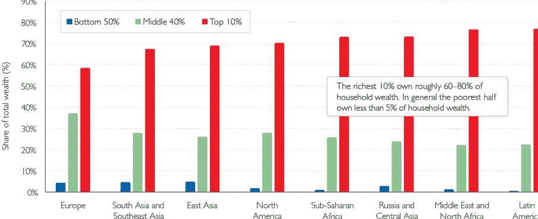

图3 资本的极端集中——2021年全球区域财富不平等

在拉丁美洲，最富有的10%人口拥有77%的家庭财富，而最贫困的50%人口仅拥有1%。家庭财富等于个人拥有的金融资产（如股票和债券）和非金融资产（如房产和土地）的总和，减去任何债务。参见：wir2022.wid.world/methodology。

基本上，最贫困的50%人口从未拥有过任何东西，或者几乎没有。在欧洲，特别是在法国，他们仅拥有总财富的4%。

这确实比拉丁美洲要好得多，那里的数字仅为2%，但考虑到这个数字是分配在一半的人口之间，仍然是一个非常低的数字。

记住这些数字至关重要。在描绘全球不平等图景时，我们欧洲人倾向于对自己国家的平等程度（法国人尤为如此）赞叹不已。这些数字帮助我们保持客观。是的，从历史上看，法国和欧洲的平等运动确实比世界其他地区更强，但首先，首先，这并非自发发生——这种运动是艰苦的社会政治斗争的结果；其次，它主要影响收入分配，而收入分配在过去一个世纪里确实在某种程度上得到了均衡。然而，在财富分配方面情况变化很小。一个世纪以前的法国，最贫困的50%人口拥有的份额为2%，与今天的拉丁美洲相同。今天这一比例已升至4%，这确实是进步，但这种微不足道的改进并没有改变基本现实：整体财产（金融、企业和房地产）集中在极少数人手中。如果我们只看企业资本，即生产资料，画面将更加极端。前10%人口的份额占80%到90%或以上，而底部50%人口的份额几乎为零。福利国家本身一直以经济权力的极端集中为特征。在1914年至1980年间发生的财产“大再分配”对缩小最富有的10%与与其紧后的40%之间的差距产生了显著影响。

### 性别不平等

在世界不平等数据库（World Inequality Database）开发方法和来源时，我们的目标通常是尽可能编制具有全球可比性的数据。我们首先研究收入不平等，然后是财富不平等；随后我们为性别不平等开发了一个简单的指标：女性在劳动收入中的占比（工资和无薪收入）。如果完全平等，这个数字应该是50%。事实上，如果你考虑到家务时间，女性的占比总是超过50%。理想情况下，她们占总收入的份额应该超过50%。但我们在现实看到的，她们的份额低于这一数字（图4）。尽管取得了一些进展（例如在欧洲，女性的收入份额在过去几十年中从30%增加到36%，男性仍占64%），但也有一些国家处于相反趋势：中国由于共产主义遗产最初让女性拥有较高的收入份额，但近几十年来一直呈下降趋势，这主要是由于极高收入的大幅增加，这在中国和其他地方也是如此。

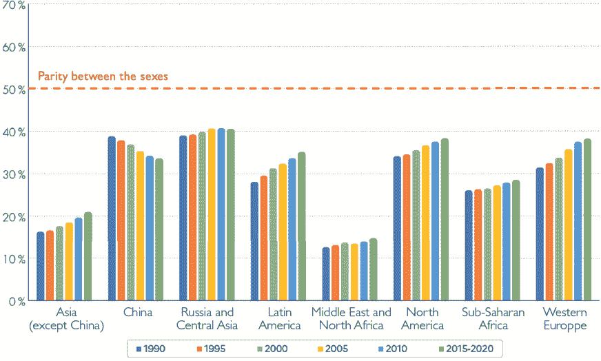

图4 1990-2020年世界不同地区女性获得的劳动收入

从1990年到2020年，北美女性劳动收入份额从34%上升到38%。参见：wir2022.wid.world/methodology；以及 Theresa Neef 和 Anne-Sophie Robillard，“Half the Sky? The Female Labor Share in a Global Perspective,” World Inequality Lab—Working Paper No. 2021/22, 2021年12月。

我们使用的指标与其他指标相比，其优势在于更准确地描绘了性别之间的巨大差异，后者往往会美化现实：我们通常只查看特定职位的薪资差距，而问题实际上是男女并无法获得相同的职位。我们在这里衡量的是女性占总收入的份额。显然，这汇集了许多因素：任何特定职位的薪资差异（约为10%到20%），以及男女能够从事的工作类型之间的差异、女性获得的兼职机会、高薪职位中女性的匮乏、女性晋升率低等等。

在法国，目前总收入中约有35%归女性所有，65%归男性所有。为了方便直观理解，1970年女性获得的收入份额为20%，这与今天印度、南亚和中东女性所获得的水平十分相近。在1970年，女性几乎被完全排除在货币体系之外，购买力微乎其微。尽管这一领域确实取得了一些进展，但我们不应夸大其程度。父权经济与资本主义的发展紧密相连，我们从这一体系中脱离仍处于早期阶段，尽管再次令人震惊的是，不同国家和世界地区之间的差异如此巨大，而且这些差异与不同的社会政治和历史过程联系得如此紧密。

### 欧洲通往平等的非均衡之路

我想回到关于不平等历史发展的问题。法国是我们在收入方面、特别是在财富和财产所有权方面，拥有最可靠历史数据的国家之一。这主要归功于法国大革命时期建立的遗产和庄园记录系统，该系统产生了数据异常丰富的遗产档案，历史可以追溯到18世纪后期（图5和图6）。

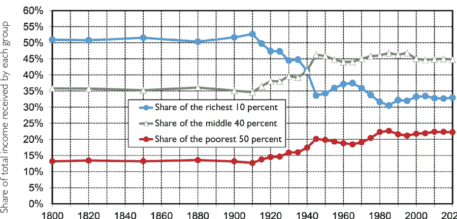

图5 1800–2020年法国收入分布：长期迈向平等运动的开始？

前10%收入者所占的总收入份额（包括劳动收入（工资和薪金、非薪资活动收入、退休金、失业补助金）以及资本收入（利润、股息、利息、租金、资本利得等））在1800年至1910年间保持在50%左右。两次世界大战后，收入差距缩小，受益于工人阶级（最贫困的50%）和中产阶级（中间的40%），而损害了上层阶级（最富有的10%）的利益。参见：piketty.pse.ens.fr/egalite

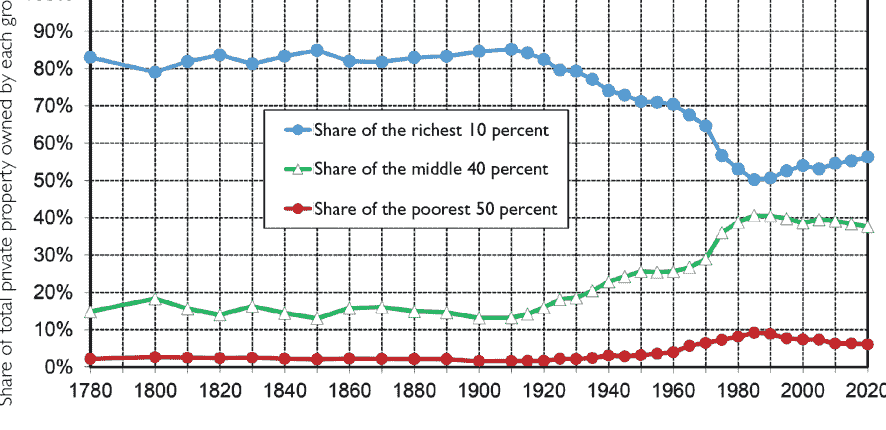

图6 1780–2020年法国财产分布：有产中产阶级的逐渐出现

1870年至1910年间，法国最富有的10%所占的私有财产份额（包括房地产、商业资产和金融资产，扣除债务后）一直在80%到90%之间波动。第一次世界大战后，财产所有变得更加普遍，这一趋势始于20世纪80年代初，并主要使“有产中产阶级”受益，这里该群体被定义为处于弱势阶层（最贫困的50%）和富裕阶层（最富有的10%）之间的群体。参见：piketty.pse.ens.fr/egalite

因此，在收入方面，我们看到过去两个世纪（尤其是20世纪）呈现出向更大程度平等的趋势。最富有者的收入份额从50%下降到30%或35%，而最贫困的50%者的收入份额则从10%或15%上升到20%或25%。这种变化的规模应当被客观对待。正如我们所看到的，最贫困的50%者的份额仍然远低于最富有的10%者的份额，尽管按照定义，这50%的人数是后者的五倍。

当我们观察财产分布时，不平等的程度大得多，通往平等的运动也局限得多。我们观察到富有的10%所占总财产份额显著减少，从一战前夕的80%或90%下降到今天的50%或60%，但这一份额自20世纪80年代以来已开始再次上升。因此，虽然承认这种长期的下降是重要的，但不应夸大其规模。此外，这种减少基本上惠及了之后的40%，即介于最富有的10%和最贫困的50%之间。但在过去的两个世纪里，最贫困的50%的人几乎没有从财产再分配中受益。

在西欧（德国、英国、法国和瑞典），整体趋势是类似的：1913年至1920年间，财富集中程度向不那么极化的方向转变（图7和图8）。新奇的发展是我所说的“有产中产阶级”的出现。这40%的人既不是最富有的10%，也不是最贫困的50%，他们在1913年以前几乎一无所有，因此和最贫困的50%一样贫穷。今天，这一群体拥有西欧总财富的40%，占人口的40%：其人均平均财富在40万欧元左右，但这些家庭的中位数为10万、20万或30万欧元。这些人并不是极度富有的，但远非贫穷之躯，并且反感被这样对待。这一群体的出现是一项重大的事件——无论在经济、社会还是政治上——尽管对于最贫困的50%来说，获得财富的机会仍然为零。

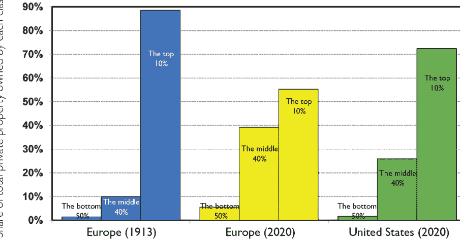

图7 财产所有的高度集中持续

1913年最富有的10%所占总财产份额（涵盖法国、英国和瑞典）为89%（其中最贫困的50%仅占1%）；2020年欧洲为56%（其中最贫困的50%占2%）。参见：piketty.pse.ens.fr/egalite

### 图8 财富的极端不平等：黄金时期的欧洲财产社会（1880–1914）

# 财富不平等与累进税制的历史演变

## 欧洲一战前的财富集中

1880年至1914年间，最富有的10%所占的份额（包括房地产、商业资产和金融资产）在法国平均为84%（其中中产的40%占14%，最贫困的50%占2%）；在英国为91%（其中中产的40%占8%，最贫困的50%占1%）；在瑞典为88%（其中中产的40%占11%，最贫困的50%占1%）。参见：`piketty.pse.ens.fr/egalite`

在欧洲，主要特征是财产的高度持续集中以及有产中产阶级的出现。我们今天看到的情况处于欧洲现状与一战前状况之间。美国有产中产阶级在30到40年前曾达到欧洲的水平，而现在开始向一战前的水平下降。

总的来说，欧洲一战前不平等的历史提供了许多启示。这一时期与现在相比具有非常丰富的对比价值，对我的研究轨迹产生了深远影响。我的朋友和同事Gilles Post-Vinay以及Jean-Laurent Rosenthal能够证明，法国的财产集中程度与英国差别不大。

首先，从根本上说，其次，庄园地产在1913年已不再具有太大意义。虽然英国的土地所有权确实更加集中，但这一点的意义次要于这样一个事实：对于当时遍布于世界各地的工业资本或金融组合而言，无论你是共和国还是君主制国家，对财富的积累和集中几乎没有本质区别。法国和英国的财富集中程度同样之高。因此，在事件发生一个世纪后，这些事实才揭示了那个时代许多政治演说的虚伪性，其中包括像保罗·勒鲁瓦-巴伊伊（Paul Leroy-Baillie）等当代经济学家的言论，他们曾大声主张法国是一个由小土地主组成的国家。

事实上，这些数据在当时就已经开始投入使用了，因为在1901年一项法律出台后，遗产税变得略微具有进步性。这说明制度和财政体系的改变可以释放信息，并提供一种可以被充分利用的知识。例如，约瑟夫·卡约（Joseph Caillaux）能够利用遗产税统计数据来支持他的主张，宣布法国实际上并不是一个小土地主国家。这些数据也被用于在1914年建立所得税，尽管考虑到该国面临的新挑战，其效果微乎其微。法国实际上是最后一个实行所得税的西方国家。通过1914年7月15日法律的参议院和众议院多数派并非为了投资教育，而是为了资助反对德国的战争。在许多北欧国家以及日本、英国和美国已经存在累进所得税的那个时代，这是打破僵局的唯一因素。法国之所以加入这一进程进展缓慢，部分源于其基于法国革命这一事实对自身平等主义的盲目自信。

## 瑞典的案例

现在，我想再花一点时间研究另一个有趣的案例：瑞典，瑞典在今天通常被认为是一个极其平等的国家。然而，在20世纪初，情况并非如此。欧洲所有国家都极度不平等，瑞典在法国和英国之间的光谱中处于中间位置。但在瑞典的案例中，这种不平等具有非常特定的结构。对于法国和英国来说，它们的殖民帝国发挥了很大作用：殖民资产，即位于世界其他地区的资产；而在瑞典，这种情况显然少得多，那里与政治体系相关的其他因素才是导致高度不平等的主要原因。

从1865年至1910年，瑞典有一套非常复杂的系统，根据财产所有和纳税状况来筛选选民。以财产为限制的投票一直持续到第一次世界大战，而包括英国在内的其他国家在19世纪扩大了投票权。在瑞典，只有最富有的20%的男性才能投票。然而，该系统甚至更具限制性，因为这最富20%的人中的选民根据其财富程度，可能拥有从一票到一百票等不等的票数。你越富有，拥有的票数越多。更好的是，虽然普通选举有百张票的上限，但市政选举却没有上限！因此，瑞典有几十个城镇，一个选民的票数就超过了总票数的50%，这使其成为一个拥有完全民主合法性的独裁者。事实上，该国的总理几乎总是一个拥有其选区50%以上选票的贵族。

公司和法律实体直到第一次世界大战都有权在地方选举中投票，票数取决于它们在社区投入的资本量及其收入水平。这是当今跨国公司非常想要拥有的特权，有时它们会找到实现类似结果的方法，但它们并不太敢要求的这一事实标志着一种重要的变化已经发生。

瑞典直到第一次世界大战一直保留这种政治体系，这展示了人类社会——特别是其主导群体——所运用的创造力。

## 公共支出、教育与不平等

公共支出和税收占国民收入的比例必须绝对保持稳定。鉴于医疗保健和退休福利的份额一直在增加——尽管还不足以跟上公众的需求，但确实在增长——其他支出就必须削减，这从长远来看正是教育领域所发生的情况。扩大福利国家的规模可以解决这些矛盾，但这需要在国家和国际层面的税收正义和累进税制方面实现新的里程碑。

尽管在公共教育投资的分配向更加公平的方向上确实取得了进展，但我们不应描绘一幅理想化的图景。让我们看看法国教育投资的不平等状况（图10）。这些数据适用于今天完成学业的这一代人，即在2020年满二十岁的青少年。在图中，所有出生于2000年的人都根据他们从幼儿园到高级学位所接受的教育总支出进行了排名。简而言之，那些获得最多公共教育资金的人（在整个教育生涯中每人约25万至30万欧元）是那些就读长期且资金充足的课程的人——通常是为学生进入竞争性高等院校做准备的课程，这些院校在法国被称为`grandes écoles`，以及`grandes écoles`本身。图中处于最低水平的是那些在十六岁或十七岁时辍学的青少年：他们只接受小学和中学教育的资助。而处于中间的是那些在大学就读了资金不足的课程的学生，例如人文科学学位。

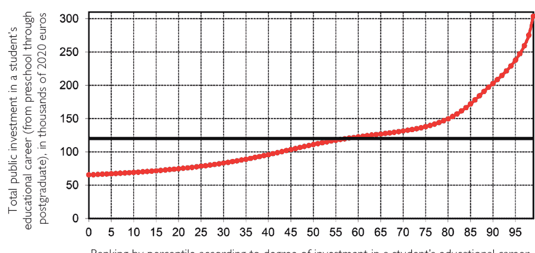

平均而言，2020年达到二十岁的学生（从学前教育到研究生学位）接受了120,000欧元的公共支出（约15年教育，平均每年成本8,000欧元）。这一代中受益于公共投资最少的10%学生收到了20,000–70,000欧元，而受益于最大投资的10%学生收到了300,000欧元。注：2015-20年法国教育体系的每年平均成本为：学前和小学教育5,000–6,000欧元，中学教育8,000–10,000欧元，大学9,000–10,000欧元，进入`grandes écoles`的预科15,000–16,000欧元。参见：`pikety.pse.ens/france`

在教育资金上支出最少的人个人获得了60,000至70,000欧元，而支出最多的人获得了250,000或300,000欧元，中间的人大约获得100,000欧元。简而言之，我们看到获得最少者与获得最多者之间存在200,000欧元的公共支出差异。遗憾的是，获得最多的人往往比其他人来自更有的社会背景。因此，公共支出在很大程度上加剧了现有的不平等。这20万欧元的差异大约相当于平均遗产的规模：这就像是特权阶层获得了一份额外的平均遗产，而这一份是公共国库给他们的礼物。

从长远来看，获得教育的机会实际上扩大了，但有两个重要的前提：不平等现象依然严重，而且支出水平远低于以前的水平。我总是回到这个悖论：得益于政治斗争和历史发展，我们的社会仍然是非常平等的，它们向着更大的平等取得了进展。我关于收入和财富分配所展示的内容也适用于教育支出的分配（图11）。今天，特定年龄组中获得最多公共教育资金的10%的人占了教育总支出的20%。这仍然是一个巨大的数字，因为底部的50%只占了35%。如果这条曲线看起来是平等的，实际上它是极度不等的，因为获得最多资金的10%所获得的资金仅比底部50%少1.5倍，尽管后者的人数是其五倍：简而言之，前10%的人人均支出高出三倍。

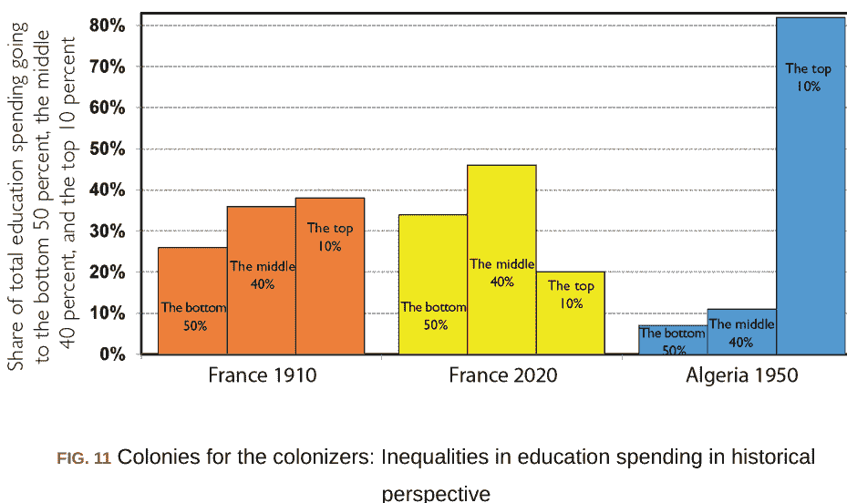

在1950年的阿尔及利亚，受益于小学、中学和高等教育公共支出最多的10%学生占了教育总资金的82%。相比之下，1910年法国受益最多的10%人口占的份额为38%，而2020年法国这一比例为20%（这仍然是他们学生人数的两倍）。参见：`pikety.yse.ens.fr/egalite`

虽然今天的情况看起来比1910年更平等，但那是因为那时的系统比现在更加分层。对于除了富裕阶级之外的大多数社会阶层来说，教育在小学就结束了。然而，资产阶级则可以获得更多机会。教育的分层导致了更大的不平等，美国的情况就是如此。在阿尔及利亚，受益于公共支出最多的10%占了总资金的80%。这是一个重大发展，是二战后在德国和瑞典产生的。

## 使权利更加平等

对我而言，我正试图开发一种基于基本物资平等获取的方法：教育、医疗保健和政治参与。我提到过瑞典的选举权，但这显然不仅止于投票：当涉及到政治竞选和媒体的资金时，我们可以想象更平等的制度。我也非常关注所有涉及经济民主的内容，即企业内部的平等参与。我对比德国和北欧看到的共同决策或共同管理制度很感兴趣，在那里，高达50%的投票被分配给薪资工人代表。这还不够，因为票数平分，股东总是拥有决定性选票，但尽管如此，当持有80%或90%资本的股东反对时，这仍然可以使决策向其倾斜。

这就是我试图在面对经济实力时的平等问题上开发的思考方式。它并不要求结果的完全平等，因为人们有不同的愿望：个人会有不同的计划，而且绝对的平等并不存在，无论是职业还是收入。收入水平考虑到个人观点和活动选择的差异，这种不平等是合理的，那么社会和经济组织需要什么程度的激励措施呢？从一到三、或从一到五的收入比例可能与这些目标相兼容。但正如任何历史实验所所示，一比五十的比例显然是毫无正当性的。

我提到的这几个数量级在我看来代表了可以接受的不平等程度，但这显然是一个应该由民主程序和公共审议来决定的问题。然而，这需要对政治局面具有平等的影响力，而我们离此还有很远的距离。

### 累进税制

我想在结束时详细阐述一下与不平等相关的另外两点：一方面是累进税的问题，另一方面是对自然界的破坏。

累进税的整个问题极其重要。首先，它是一个讨论了很久的话题。下表说明了18世纪法国讨论的两种理念的例子：一个源自约瑟夫·路易·格拉斯林（Joseph-Louis Graslin），一位来自南特的城市规划师和匿名经济学家；另一个则源自西拉科斯特先生（Sieur Lacoste），一位更具匿名的公民。他们都发表了小册，其中大部分关于征收所得税，格拉斯林建议征收遗产累进税，而拉科斯特建议征收遗产累进税，并称之为“国民继承权”。这些模型在当时并未被采用，但与许多国家在20世纪建立的制度有很多共同点。从概念上说，这似乎很简单：对于低于平均水平的收入和财产，税率从5%或6%开始，但一旦达到平均水平100到1000倍的收入和财产，税率就会上升到60%、70%或80%。

**表 1 18世纪法国的累进税建议**

| 格拉斯林* | 拉科斯特** |
| :--- | :--- |
| 所得累进税 | 遗产累进税 |
| 平均收入有效税率的倍数 | 平均财产税率倍数 |
| 0.5 → 5% | 0.3 → 6% |
| 20 → 15% | 8 → 14% |
| 200 → 50% | 500 → 40% |
| 1,300 → 75% | 1,500 → 67% |

* *Essai analytique sur la richesse et l'impôt*, 1767. ** *Du droit national d'hérédité*, 1792.

在格拉斯林于1767年提出的累进所得税计划中，有效税率从年收入150图尔瓦图尼（livres tournois，约当时成年人平均收入的一半）的5%逐渐上升到收入400,000图尔瓦图尼（约平均收入的1,300倍）的75%。拉科斯特在1792年也提了一个类似的累进遗产税税率表。参见：`piketty.pse.ens/fr/egalite`

1792年底和1793年初建立了累进税制以支付战争费用，但这项实验很快就结束了，法国大革命末期采用的税收制度是绝对比例的（或称固定税率）税收制度。同样，遗产税也是严格按比例征收的：在整个19世纪，从父母到子女的财产转移税率均为0.5%，无论价值是一千法郎还是一百万法郎。当时并没有尝试进行再分配。

1901年，遗产税变为累进制，最高档档的税率为2.5%。此后，该税率会增加到5%或6%，专门用于资助1910年的退休法。尽管如此，第一次世界大战期间并没有发生向累进税制的剧烈转变（图12和13）。法国最高的所得税税率（适用于最高收入者）在1914年之前为0%，因为法国在整个战争期间没有所得税。第二次世界大战期间，情况变化非常快，特别是20世纪10年代的美国。这一过程非常复杂，因为需要通过宪法修正案，但当时美国对于公正税制存在着强大的支持浪潮。美国人决心不像旧欧洲那样变成平等主义的、寡头政治的和财阀政治的，旧欧洲被认为是极度精英主义的。相对保守的经济学家普遍持有的观点是，如果美国落入像欧洲一样精英主义的陷阱，将完全摧毁民主制度。

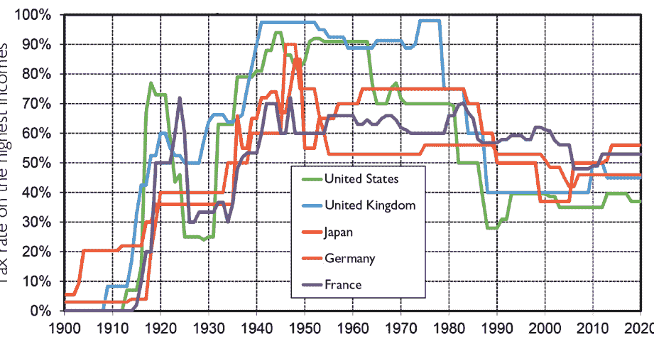

美国最高收入的税率在1900年至1932年间平均为23%，1932年至1980年间为81%，1980年至2020年间为39%。在相同时期，英国的最高税率分别为30%、89%和46%；日本为26%、68%和53%；德国为18%、58%和50%；法国为23%、60%和57%。税收在20世纪中期最具累进性，特别是在美国和英国。参见：`piketty.pse.ens/fr/egalite`

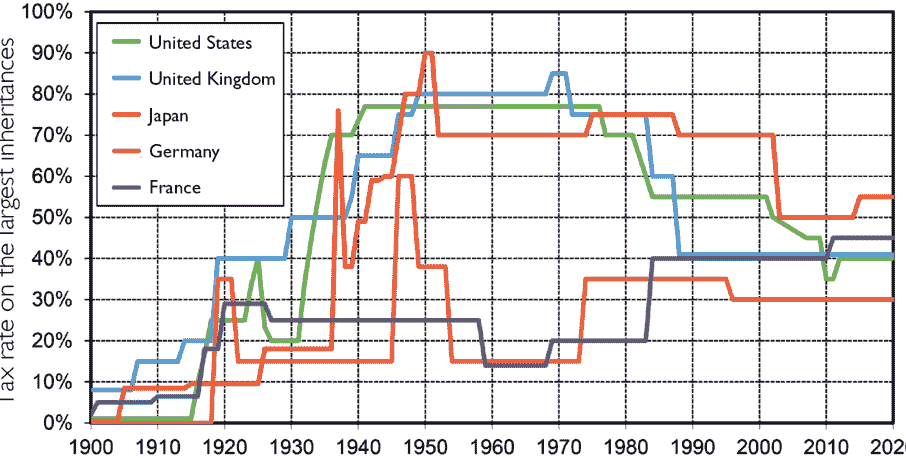

美国最高收入的税率在1900年至1932年间平均为23%，1932年至1980年间为81%，1980年至2020年间为39%。在相同时期，英国的最高税率分别为30%、89%和46%；日本为26%、68%和53%；德国为18%、58%和50%；法国为23%、60%和57%。税收在20世纪中期最具累进性，特别是在美国。

……至少和他们一样少。从这个角度来看，日益进步的累进税制是建立福利国家的决定性因素，它为税收提供了一个合约基础，使得不断上升的税收负担变得可以接受。

另一方面，今天税收制度是问题的巨大根源。中低层阶级可能会有这样印象——而且这不仅仅是印象——富人正在避税，因为尽管有理论上的税率，但富人仍有许多漏洞和策略来降低他们的纳税额度。

遗产税也遵循了类似的轨迹（图13）。令人震惊的是，20世纪中期，美国、英国和日本的最高税率攀升得如此快。这与法国和德国形成了对比——部分原因是这两个国家的财富再分配是战争、破坏和通胀的结果。有趣的是，德国唯一一次对遗产征收高税率（以及所得税）是在1945至1948年间，当时税率飙升至90%。这对应于德国税收政策由美国设计的时期，因为盟军管制委员会负责制定德国的税率。美国人并没有特别地意图惩罚德国精英，因为他们自己在国内也在做同样的事情。美国当时认为这都是“文明包”的一部分：他们将向德国引入民主制度，并辅以一套税收结构，以防止民主变成富豪精英政治。这在今天听起来是多么奇特！这并不是很久以前的事，回顾这段历史是非常重要的，仅仅是为了意识到我们的观点发生了多大的变化。

关于20世纪不平等的历史性减少，我还有一个花时间说明的一个重要点：国际资产的崩溃，特别是殖民资产的崩溃（图15）。这种现象在法国和英国尤为突出：直到1913年，这两个国家在全球范围内积累了大量的资产。这些资产的形式包括苏伊士运河的股份、俄罗斯和阿根廷的铁路，以及政府对海地、摩洛哥、中国和奥斯曼帝国征收的款项，这些款项相当于真正的军事贡金。总之，法英拥有的债务相当于法国一年的财政收入和英国两年的财政收入。这些债务收益（以利息、股息和租金的形式）占法国财政收入的5%和英国的10%。仅对法国而言，这就等同于该国整个东北部的工业产值，并允许了持续的结构性贸易逆差的融资。在1880年到1914年间，贸易逆差上升到2%或3%，同时国民收入的5%到10%作为收入和资本来自世界其他地区。这些资金不仅涵盖了贸易逆差，还让“购买世界其他地区”的做法得以继续。这相当于你付给房东的租金让他买下了剩下的整栋楼。

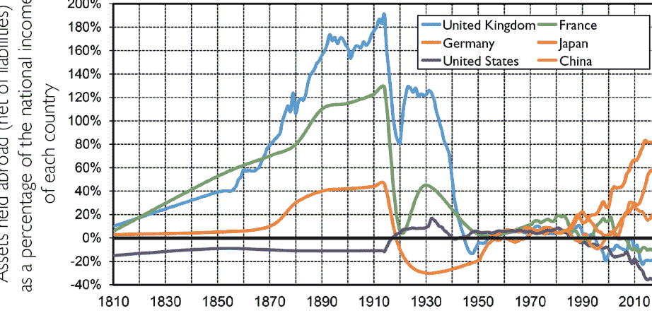

净外国资产——居住在特定国家的所有者持有的资产（包括政府拥有的资产）减去世界其他地区所有者在该国持有的资产——在1914年占英国国民收入的191%，占法国国民收入的125%。2020年，净外国资产分别占日本财政收入的82%，德国的61%和中国的19%。参见：`pikety.pse.ens.fr/egalite`

这些是高度紧张且不稳定的局势，仅得于殖民政府和军事力量才维持稳定。体系随着第一次世界大战的爆发而崩溃。新的国际形势负有部分责任：公开没收、布尔什维克夺权后对俄国国债的否认、苏伊士运河的国有化等等。部分责任还来自于战争成本：法英财产所有者被迫出售大部分外债，以向他们的政府提供资金来进行战争——这些战争正在摧毁他们国家剩余的工业资本。这是从1914年到1945年欧洲历史中心的一段略显荒谬的自我毁灭过程。

## 债务如何处理？

从财产利益的角度来看，这些1914年之前的殖民和外国资产在三十年后（即1945年）变成了公共债务。这笔债务达到了国民收入的200%或300%，这意味着比今天的希腊债务还要多——这些债务属于德国、法国和英国这些大得多的经济体。这里的教训是，这些债务很快被处理掉了，而且从未被偿还。有几种方法被用来消除这些债务，包括取消和通胀。德国提供了几个最显著的例子（图16）。

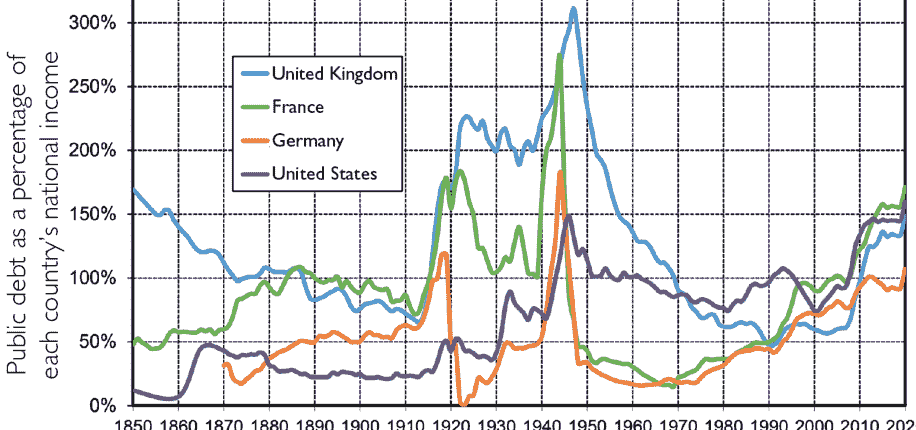

公共债务在两次大战后大幅增加，占德国国民收入的150%到300%，在英国和美国则增长得较缓。在2008年金融危机和2020年疫情后，公共债务再次激增，在德国和法国达到300%，在美国则超过300%，且从未开始偿还。参见：`pikety.pse.ens.fr/egalite`

某些商品和服务被排除在市场之外。教育、医疗保健、养老金、住房和基础设施等部门的增长表明，经济的某些领域可以组织起来，在市场和资本主义的逻辑之外运行。这看起来可能微不足道，但医疗保健这样一个部门占据了国民收入的10%。例如，这比汽车行业多得多，而且在大多数国家，该部门主要围绕公共支出构建结构。在政府之外，该部门还汇聚了大量的营利性和非营利性主体、协会等。通过美国体系（很大程度上基于营利性结构）与欧洲体系的比较，这可能不是最容易想象的配置，但结果总是显示前者处于劣势。众所周知，美国体系成本更高，而且与欧洲相比，其公共卫生结果是灾难性的。

发生的情况是，一套公共资助和公共组织体系围绕着这些商品和服务发展起来，并根据非利润为驱动的标准进行管理。显然，这在教育领域已经发生。然而，在智利，皮诺切特政权竭力建立了一个营利性教育体系，但这是一个巨大的失败。也存在过诸如美国特朗普大学这样的股份公司，它们完全运作过。美国的私立教育机构并不产生或分配利润。这并不意味着它们是完美的，因为大捐赠者获得了权力并安排他们的子女入学，这还有其他许多不幸的进展。尽管如此，当你向斯坦福大学或哈佛大学捐赠一大笔钱时，它并不会让你永久地拥有50%的投票权。这种权力关系与股份公司略有不同。在教育和医疗保健领域，没有人想要回到或发展一个纯粹的营利性体系。为什么？因为正如人们集体意识到的那样，也正如历史所充分说明的那样，在许多领域中，对利润的追求会破坏导致人们教学、提供医疗保健和从事其他此类活动的内在动力。

这一重要教训不仅适用于教育和医疗保健，还适用于文化和媒体，在这些领域，对利润的追求和股票私人所有制造了许多问题。这就是为什么随着时间的推移，建立了许多非营利组织结构（例如信托和基金会），例如英国的《卫报》和法国的《法语报》都是非营利组织。这些实验中没有一个是完美的，但人们很久以前就开始在交通、电力分配、地方行政和水资源管理等如此多样化的领域思考这种结构。

从长远来看，我认为应该追求这种将商品和服务从市场中提取的过程，它应该延伸到越来越大的部门，而且它可能代表一个国家经济活动的全部。这需要去中心化，以及组织和社区的参与，依靠对收入和财富征收累进税的公共资助，以及企业和剩余部门（即我之前概述的营利部门）更好的权力分配。仍有许多需要发明的东西，但重点在于这不仅仅是一个是一个重新分配资金的问题。它远于此。将整个经济部门从市场中移除的趋势是不可回回的。

## 自然与不平等

我想通过在自然破坏、即锁定在自然中的资本的背景下，考察自然、文化与不平等之间的相互作用来结束本文。我将讨论与气候变化和碳排放相关的数据；但我们也可以关注与人类影响自然的其他方面同样感兴趣的数据。我想说明的要点是，气候和环境带来的挑战与不平等紧密相连。

如果不大幅减少不平等，并且在追求更高水平平等方面取得新进展，无法想象出解决全球变暖挑战的任何可靠解决方案——首先是因为全球北方和南方国家之间碳排放存在巨大差异，而且是因为各国内部的碳排放不平等。

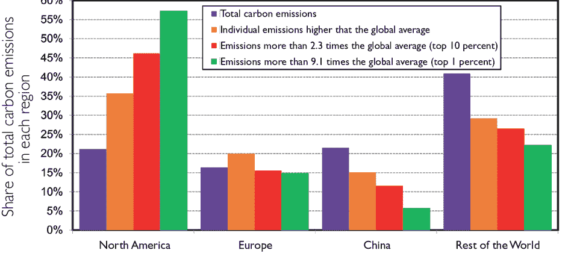

图 17 全球碳排放，2010–18年

从2010年至2018年，北美在总碳排放（直接和间接）中占平均比例为21%。美国和加拿大还占了高于全球平均水平（每年6.2吨二氧化碳）的个人排放量的36%，占超过全球平均水平2.3倍排放量的46%（即全球个人排放最高的前10%人口，占了总排放量的45%，而底部50%的排放者仅占13%），以及超过平均水平9.1倍排放量的57%（即全球个人排放最高的前1%人口，占了总排放量的14%）。参见：`piketty.pse.ens/fr/regalte`

上面的图（图17）关注国家之间的差异，基于我们在世界不平等研究实验室由卢斯·尚塞尔（Lucas Chancel）进行的研究。总碳排放的总体分布用紫色显示：我们可以看到北美、欧洲和中国的碳排放量大致处于相当的水平。他们的人口规模非常不同，排放水平也大不同。我应该指出，这些数据已经根据嵌入在进口中的排放进行了修正：很多时候，我们只计算了国内产生的排放，忽略了外包给国外的排放。通过纳入这一因素，上面的图表提供了一个更平衡的说明。

但让我们特别关注其他颜色。例如，绿色条形代表的不是国家总排放的份额，而是其高排放者的份额，即排放超过平均水平9倍的人。全球十亿人类的平均排放量约为每年六吨。个人排放的前1%——这1%的排放量就超过了排放最少的50%人口。这些高排放中超过55%来自北美，其次是欧洲，然后是中国。因此，碳排放的责任在全球范围内分布极不对称。完全可以想象，当气候灾难的破坏比今天更严重时，某些国家将向其他国家索赔，并可能重新审视它们之间的贸易安排。我不知道需要什么程度的灾难才能让我们达到这一点，事实是目前的情况是非常不对称的。

第二个方面涉及国家内部的差异。这张图（图18）源自《2022年世界不平等报告》，显示了人均碳排放水平，并分为之前绘制收入和财富图时使用的相同分组，即比较底部50%（碳排放最少的人）、前10%和中间的40%。在欧洲，碳排放最少的50%人口（他们在经济上大致对应于底部50%）处于五吨水平（法国为四半吨）。为了达到可持续的碳污染水平，这些排放必须下降到二或三吨。因此，这一群体几乎看到了2030年或2040年的官方目标。相比之下，前10%的人每人二十九吨、三十吨甚至三十五吨。如果我们只看欧洲的前1%，我们会发现他们的排放量每人六十到七十吨。在美国，前10%的人排放量已经超过了每人七十吨。

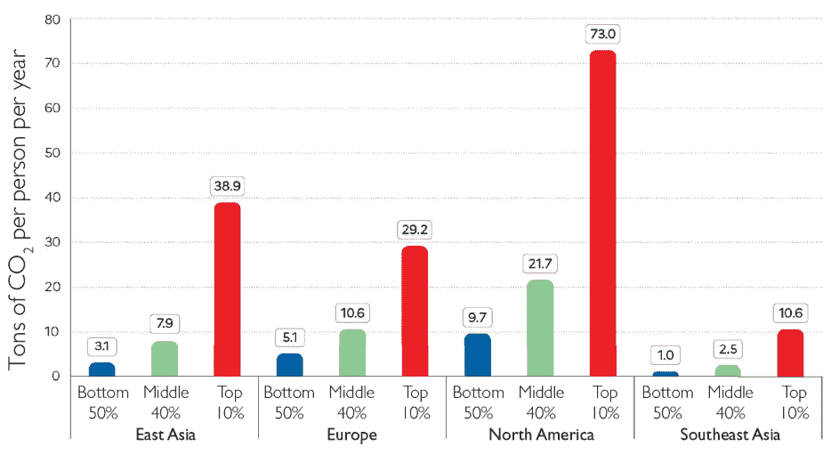

图 18 2019年全球各地区人均排放量

个人碳足迹由国内消费、公共和私人投资，以及从世界其他地区商品和服务的净进口组成。这些估算基于税收数据、家庭研究和进出口统计表。排放量平均分配给每个家庭成员。详见：`wr2022.wid.world/methodology` 和 Chancel (2021)。

因此，一项建议对全人口进行固定比例削减的减排政策不可避免会遇到困难。要说服那些每年排放四五吨碳的人，让他们与排放三十或七十吨的人以相同比例减少排放，是非常困难的。一种以相同速率增加能源成本的策略，在未来几年甚至几十年内不可避免会引发反税运动，类似于近期*黄背甲*（gilets jaunes）发起的运动，而这种运动往往会针对最富裕群体消耗的能源——特别是喷机燃料。

很难想象还有什么办法可以应对这些挑战，而不是要求碳排放量最高的人进行比例更高的减排。这需要建立一套完整的体系，包括累进式碳卡等工具。它还需要大幅缩减收入和财富差距。

### 结论

基于历史数据，我发现很难预测现状将如何发展，以及未来将呈现何种形式。但我仍然提供两个假设。

首先，一旦气候变化的后果对个人生活产生更具体的影响，欧洲和世界其他地区一样，对经济系统的态度可能会发生迅速转变。

其次，我希望我已经说服了你们，不平等的历史并不是漫长的。为了不平等，已经进行过许多战斗；并且也取得了许多胜利。从长远来看，存在一种走向平等的总体趋势，这种趋势是真实但有限的。关于经济、金融、政府债务和财富分配的问题太重要了，不能交给少数经济学家和专家，而他们中的许多人非常保守。他们并没有扩大历史和比较的视角，反而经常透过望远镜的反端来寻找狭隘的解决方案。我们需要其他社会科学研究人员——历史学家、社会学家、政治学家、人类学家、民族学家——深入钻研这些问题，应对其技术层面，并采取立场。这些问题不应交给他人。经济和历史知识的民主化可能、应当并且必须成为一个运动的重要部分，其目标是实现整个社会的民主化并更好地分配权力。

### 参考文献

Chancel, Lucas, Thomas Piketty, Emmanuel Saez, and Gabriel Zucman, eds. World Inequality Report 2022. Cambridge, Mass.: The Belknap Press of Harvard University Press, 2022.

Piketty, Thomas. A Brief History of Equality. Translated by Steven Rendall. Cambridge, Mass.: The Belknap Press of Harvard University Press, 2022.

————. Capital and Ideology. Translated by Arthur Goldhammer, Cambridge, Mass.: The Belknap Press of Harvard University Press, 2020.

World Inequality Database:

`https://wid.world/`

Lecture Materials:

`http://piketty.pse.ens.fr/files/Piketty2022SE.pdf`

### 鸣谢

图 1 至 4 及 18：

World Inequality Report 2022, edited by Lucas Chancel, Thomas Piketty, Emmanuel Saez, Gabriel Zucman, with a Foreword by Esther Duflo and Abhijit Banerjee, Cambridge, Mass.: The Belknap Press of Harvard University Press, Copyright © 2022 by the World Inequality Lab. Used by permission. All rights reserved.

图 5 至 17 及表 1:

A Brief History of Inequality, by Thomas Piketty, translated by Steven Rendall, Cambridge, Mass.: The Belknap Press of Harvard University Press, Copyright © 2022 by the President and Fellows of Harvard College. Used by permission. All rights reserved.

你通往知识与文化的大门。人人可用。

z-library.se singlelogin.re go-to-zlibrary.se single-login.ru

官方 Telegram 频道

Z-Access

`https://wikipedia.org/wiki/Z-Library`
