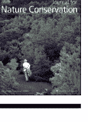
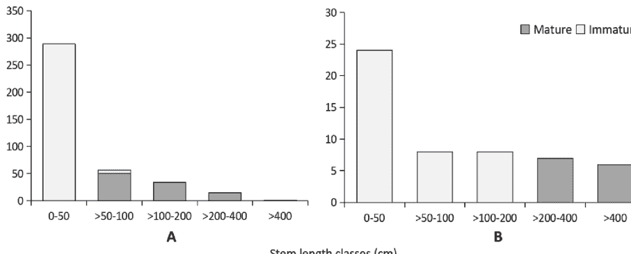
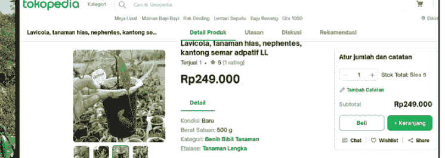

# 受危苏门答腊特有猪笼植物 Nepenthes lavicola Wistuba & Rischer 的新分布记录及其保护意义

# 受威胁的苏门答答捕虫 *Nepenthes lovistuba* & Rischer (Nepentacheis) 的新分布记录及保护意义

Ahmad Yusuf Mahardhika^a, Sri Wahyuni^a, Hartutingsih-M Tenggara^a, Mustaid Sigreat^b, Yusuf Sigif Ahmad Fauzan^a, Andri Yusuf Ahmad Persada^a, Ulfan Arico^a, Wendy Amardhika^c,d, Iyan Robansyah^a, Engal Prmanama^a,d

*   * a 植物保护中心、植物园与森林 - BRIN, Jl. Jakarta-Bogor No. 46, Cibinin, 16911, West Java, 印度尼西亚
* b 生态与生物中心 - BRIN, Kawasan Sukarno, Jl. Jakarta-Bogor KM 46, Cibinin, 16911, Jawa Barat, 印度尼西亚
* c UI 生物系, Dr. Syarif Tahrir, Meuranga, Aceh, 24116, Aceh, 印度尼西亚
* d 印度尼西亚森林保护区 (FPU), Kulon Building, Jl. No. 18, 16122, West Java, 印度尼西亚
* e Tambun Alam Nusantara, BTN Korpi Blok C 10, Waosawa, Makassar, Sulawesi 95253, Sulawesi Tengah, 印度尼西亚

# 摘要

*   关键词：
世界自然保护联盟红色名录
猪笼草
苏门答
受威胁植物

*Nepenthes lovistuba* & Rischer (Nepentacheis) 是一种特产于印度尼西亚苏门答北部的猪笼草。由于地理分布狭窄，且受到火山爆发和猪笼草猎人破坏栖息地的威胁，*N. lovistuba* 根据 IUCN 红色名录的 B1 + 2c 标准被评估为极临濒危 (CR)。2020 年，我们在亚齐东南亚县（Aceh Tenggara Regency）报告了 *N. lovistuba* 的两个新发现，并介绍了该物种在每个地点的种群密度和栖息地特征。基于这些发现，我们建议将濒危 (EN) [B1(a)(ii)(iii) + 2c(a)(ii)(iii)] 作为 *N. lovistuba* 的新保护现状。建议的状态包含了当前栖息地状况和新类别的注释。*N. lovistuba* 仍被认为面临野外极高的灭绝风险。需要采取全面且紧时的保护行动以防止物种灭绝。

# 引言

苏门答岛是猪笼草生物多样性热点之一，该植物属有超过194 种（POWO, 2023）。该岛拥有 39 种猪笼草的栖息地，由于非法采挖以及森林变为农田和种植园，其中超过76% 处于濒危状态（Herrnaux et al., 2022）。在本研究中，我们确定了 5 种极临濒危 (CR)、3 种濒危 (EN) 和 4 种易危 (VU) 植物（Davis, 2022）。

*Nepenthes lovistuba* & Rischer (Nepentacheis) 是特产于苏门答北部的唯一植物种。该物种首次于 1996 年根据亚齐省 Bukit Lawang (Kulon Teleng) 的栖息地描述，那里是位于亚齐省 Bera Aceh 的火山地区（Wistuba & Rischer, 1996）。据报道，该植物在海拔 2000 至 2600 米 (m) 的开阔坡地上非常常见。*Nepenthes lovistuba* 代表了苏门答最北部的物种，尽管它是生长在火山土壤上的物种之一（Wistuba & Rischer, 1996），但它受地理分布以及火山爆发和植物猎人非法采集威胁的限制。*N. lovistuba* 根据 IUCN 的 B1 + 2c 标准被评估为 CR（Schnell et al., 2020）。

我们报告了位于亚齐省纳加亚县（Naga Raya Regency）海拔 800 米处发现的 *N. lovistuba* 新地点。文中未报告该物种在新地点的种群状况。

> 通讯作者。邮箱：ahmad807@gmail.com (A.Y). Mahardhika.

在本研究中，我们报告了来自亚齐东南亚地区（Aceh Tenggara Raya）山区的两个 *N. lovistuba* 新地点，以及该物种在每个地点的种群数据和特征。本文介绍并讨论了这些新增分布记录地点以及种群数据对该物种保护的意义。

在观测个体附近：海拔 (m asl)、坡度 (°)、坡度 (° 和地形特征（山谷、坡或山脊）。为了评估不同地点之间环境变量的差异，我们使用 Passab Statistics 18.0 (SPSS Inc., Chicago, Illinois) 使用独立样本 T 检验，并记录了种群的任何迹象。

# 2. 材料与方法

## 2.1. 研究区域

*N. lovistuba* 的野外调查在印度尼西亚亚齐县（Aceh Regency）的 Gegarang 村和 Bur Ni Pepanji 的山坡上进行。在两个地点，我们收集了苏门答山地植物样本，这些代表了贯穿岛屿南北的山脉沿海拔 1000 米以上的森林。研究地的地形为山地，最高海拔为 260 m asl。平均气温和湿度为 21.38°C 和 89.91%（IPS Kabupaten Merah, 2021）。

由于数据可用性限制，我们根据 IUCN 红色名录（IUCN, 2012）的本地数据 B（地理范围）、C（种群数量小或种群限制）重新评估了 *N. lovistuba* 的现状。使用 GeoCat (http://geocat.org/; Bachman, 2011) 利用 5 × 2 km 网格计算了发生范围 (EOO) 和占据面积 (AOO)。对于 C 和 D，根据个体数量估计了物种的种群数量。

## 2.3. 保护现状

# 3. 结果

## 3.1. 种群状况和栖地偏好

在调查期间，我们共发现了 449 个 *N. lovistuba* 个体，大部分 (88.2%)位于 Gegarang（图 2）。*N. lovistuba* 在两个地点的种群结构遵循 J 型模式（图 3）。种群由叶片小于 50 cm 的个体组成，且较小尺寸的个体更多。

我们在 Gegarang 观察到 8 个开花个体（6 雄，2 雌），株长从 60 cm 到 80 cm；而在 Bur Ni Pepanji 有 13 个开花个体（1 雄，12 雌），株长从最短个体到我们估计的最长的 210 cm。

所有 *N. lovistuba* 个体均偏好 Bur Ni Pepanji 的开阔区域（平均高度 35.5 ± 0.6 m），且坡度明显陡峭（1127.5 ± 7.9 m）。Gegarang 的个体生长在北部 (56.6%) 和西坡 (43.18%)，而它们分布在南部 (22.6%) 和东部 (20.75%)。海拔方面，Gegarang 的 *N. lovistuba* 个体生长在海拔 1689 至 1785 米之间（平均 1738 ± 1.38），显著低于 Bur Ni Pepanji（范围 1916–1994 米，平均 1953 ±）。

**图 2.** *Nepenthes lovistuba* 的形态：(A) 栖息地中的植物；(B) 植物；(C) 带有叶基的茎；(D) 开花的活植物；(E) 带长萼雄花序；(F) 花序的一部分；(G) 被长萼保护的花序蕾；(H) 上笼；(I) 下笼；(J) 下侧；(K) 盖的上侧带附件。摄影：E. Primanda。

3.2. 威胁与灭绝风险评估

我们观察到 *N. lovistuba* 种群的主要威胁是栖息地转化为大规模咖啡园和非法采伐。部分森林的转化导致了两个地点 *N. lovistuba* 栖息地的减少和退化。非法采挖也已知威胁到这两个地点的种群。当地猎人经常出现在当地，定期采集植物。他们根据买家的直接要求或通过在线商店在国内外销售。

利用当前和之前调查的发生频率数据（Wistuba & Rischer 1996; Vicierno, 2021），GeoCAT 计算了

图 3. Garing (A) 和 Bur Ni Pepani (B) 根据茎长分类的猪笼植物 lawichii 种群结构。

# 4. 讨论

图 4. 对笼植物 lawichii 种群的主要威胁：(a) 栖地转化；(b) 其它物种的非法砍伐。

N. lawichii 的 EOO（分布范围）和 AOO（活动范围）分别为 463 km² 和 16 km²，估计位于4 个地点，即 Bur Telong 山、Bukit Garing 和 Bur Ni Pepani。根据 IUCN 红色名录 B 标准，该物种被归入极危 (EN) 类别 B(iia)+B(iii)，因为其 EOO = 500 km²，AOO = 500 km²，估计数量小于 500 只，且推断其栖地面积、范围和质量正在持续下降。

根据我们的估计，在两个研究地点该物种有 113 株成年个体。如果加上其他地点，成年个体总数将不超过 250 株，每个地点的估计数量为 25–113 株。因此，根据 C 标准，该物种被评定为极危 (EN C2ii)。对于 D 标准，如果估计成年个体数量在 250 到 250 之间，该物种被归为易危 (VU)、近危 (NT) 甚至无极缘 (LC)。

匍生，卷须长达 2 cm；捕虫笼缘在茎部周围无毛，有刺毛且长度不大于 6 cm；与柄等长的叶少于四片，卵圆形或圆形，反折，基部无钩状突起，小型（0–3 mm）腺体众多且不明显。位于的物种为 N. lawichii，与同一研究区域发现的其他物种不同，即 M.b.R. Bakar & R.S. Gulong。

栖地转化、森林植物和非法采集被认为是对 N. lawichii 最大威胁。A. lawichii 与 Merah Bali 一同是印度尼西亚产量最高的地区（BPI Aprifans, 2020），它们受栖地转化导致栖地流失的威胁最大（Hililah 等人，2014），且随着许多地区新种植园的扩张，其数量最终在增加。

此外，由于它是印度尼西亚法律保护的物种之一，该物种作为观赏植物备受追捧。这意味着任何人都可以轻松地在电子商务平台或社交媒体上找到该物种。然而，似乎非法采集和栖地转化尚未影响到 N. lawichii 的再生能力。研究中两个地点的猪笼植物种群显示，它们偏好坡度中等至陡坡的区域。该物种对开阔地区的偏好可能归因于猪笼植物属对贫瘠土壤和充足阳光的高适应性（Adam 等人，2002；Risch & Richter,1996）。与闭合区域相比，开阔地区的土壤有利于低营养含量（Dykes, 1996；Wang 等人，2023）。此外，开阔地区可能为该物种提供阳光。以往的研究（参见 Green, 1967; Mazrimas, 1999）显示光照显著增强了猪笼植物的生长。

Nepenthes bewichii 在以下特征组合上没有区别（Wistuba & Rarcher 1996; Check & Jebs 2001）：(1) 茎呈方形；(2) 叶：边缘全缘，收缩至明显的物种并简短地显示出 J 形图案，这表明种群具有充足的再生和补充能力。我们在两项研究中也看到了较多的成年个体。成年个体的数量为该属提供了另一个信息，正如我们观察到的 J 形种群，如 N. ampullia、Rafflesia 和 N. alnarnama（2002）。然而，我们建议未来以后定期进行多次种群调查，因为众，干扰会对受影响的种群数量产生负面影响，研究项目。

遵循 IUCN 红色名录标准和规范（IUCN 委员会，2022），物种应使用最高威胁类别进行列名。在这里，我们建议更改 N. lavatifius 的 IUCN 红色名录状态。新状态的威胁类别低于当前状态，但在新类别下，N. lavatifius 被认为在野外面临极高的灭绝风险。

作者声明他们没有可能出现或影响本文报告工作的竞争性利益或个人关系。

- Adam, J. H., Warwick, C. G., & Swan, M. D. (1992). 婆罗洲 *Nepenthes* 的生态学和分布。Journal of Tropical Forest, 15, 1–33.
- Baden, J. J. (2001). 越南、苏里里腊和沙巴叶片（捕虫植物）的形态和结构。第 46 届国际会议论文集，日本东京。
- Baden, J. J., De La Torre, J., S., & Scott, B. P. (2021). 使用 Geocosat 的报告趋势：全球保护评估工具。Global Ecology and Forest Science, 29(10), 114–25.
- BBPS Kenap (2021). 研究年度报告。获取自 https://bbps.brin.go.id/uploads/2021/09/Laporan-Kinerja-Tahunan-BBPS-Kenap-2021.pdf
- Green, S. (1967). 印度尼西亚的猪笼植物。政府出版局。
- Sachs, J. E. (1937). 世界植物，第 2 。伦敦: Macmillan Press.
- Wang, L., Y, W., W. H., Ling, J., 等. (2023). 降雨强度和坡度对印度尼西亚梅尔布布山区土壤成分和氮的影响。Forest Ecology and Management, 532, 119-1.
- Wistuba, A., & Richter, H. (1996). Nepenthes lavifolia，一种来自苏门答省的新种猪笼植物。Carnivorous Plant, 25(4), 198-201.

