# HTML5 和 CSS3 的新视角：全面指南

## 想把 C 变成 A 吗？显然，对吧？

但实现这一点的正确方法并不总是显而易见的。通过数字化学习获得高分。MindTap 的定制学习工具和电子教科书将你所需的一切都集于一处。

与课程内容互动，享受随时随地学习的灵活性，通过 MindTap 移动应用程序与作业截止日期和讲师通知保持连接……最重要的是……**更好的成绩**。


高级产品总监：Kathleen McMahon

助理产品经理：Kate Mason

助理内容开发：Alyssa Pratt

开发经理：Paul Conrad

产品助理：Abby Puffuff

高级内容经理：Jennifer K. Felder-George

艺术总监：Diana Graham

制造规划师：Lola Orekya

封面：Shutterstock/Aguesta

制作：GFX Publishing Services

Cengage Learning 是领先的定制化学习解决方案提供商，在全球范围内设有办事，包括新加坡、英国、印度、墨西哥和日本。通过以下网址查找您的当地办事：

www.cengage.com/global

Cengage Learning 材料由 Nelson Education, Ltd. 在加拿大制作。

根据您的课程和学习需求，请访问 www.cengage.com

在当地商店或优选在线商店 www.cengage.com 购买我们的任何产品。

书中使用的某些产品和公司名称仅供识别之，可能是其各自制造商和供应商的商标或注册商标。

免责声明：通过本书使用的任何与人员或 URL 相关的数据仅供参考。作者不声称此类数据为事实且不属于真实的人或公司。

Microsoft 和 Windows 是微软公司在美国及/或其他国家的注册商标。Cengage Learning 是微软公司的一个独立实体，不以任何方式产生附属关系。

## 前言

“New Perspectives 文本提供了真实世界的应用，使学习变得简单。” —— 科技学院

## 背景

每个教程都从一个“真实世界”案例开始。案例设定了场景，帮助学生理解他们将要做什么。

## 实践方法

每个教程都被分为逐步操作。清晰的截图引导学生完成步骤。技巧提示预测了常见问题，帮助学生保持进度。

## 视觉总览

每个章节都以视觉总览开始，这是一个跨两页的设计，包含许多数字和关键术语，为学生提供课程涵盖主题的全面预览，作为一个方便的学习指南。

## 专业技能

### 专业技能框

专业技能框提供了应用于真实世界的指导，涉及一个或多个技能：决策、问题解决、团队合作、口头交流和书面交流。

## 关键步骤

重要的步骤用黄色突出，并带有边注注释，帮助学生注意正确完成步骤并避免耗时的研究。

## 洞察

### 洞察框


## 提示

## 复习

## 应用

## 挑战

## 创建

## 参考

## 词表/索引

在每个教程中，参考框出现在一组步骤之前，提供执行某项任务的简洁摘要或预览。此外，每本书都包含一个词表/索引组合，方便参考材料。

评估是学习的关键组成部分。在每个章节结束时，一系列快速检查将测试他们对材料的理解，然后继续进行。有趣的教程末复习评估和案例题一直是 New Perspectives 系列的一个标志性。彩色条和简短说明解释了作业，使其易于理解特定作业的目标和水平。

## 系统要求

本书假设学生拥有网络连接、文本编辑器和支持 HTML5 的浏览器。

Cengage Learning 材料由 Nelson Education, Ltd. 在加拿大制作。

根据您的课程和学习需求，请访问 www.cengage.com

在当地商店或优选在线商店 www.cengage.com 购买我们的任何产品。

书中使用的某些产品和公司名称仅供识别之，可能是其各自制造商和供应商的商标或注册商标。

## 我们的完整教学系统

## 满足您的需求的范围

无论您是在寻找少量的内容，还是足以填满整个学期课程的内容，我们都能为您提供符合您需求的教材。

- 入门类书籍平均包含 5 到 8 个教程，并涵盖有关书籍概念的核心技能。
- 综合类书籍深入涵盖了所有详细概念和技能，非常适合整学学期的课程，包含 9 到 12 个教程。

因此，如果您正在寻找核心技能或对某个主题进行更深入的覆盖，我们都有相应的满足您需求的方案。请访问我们的网站或联系 Cengage 学习代表以了解更多我们我们提供的服务。

## MindTap

MindTap 是一种个性化的学习体验，通过相关的作业引导学生进行分析、应用和改进思维，让您能够轻松衡量技能和成果。

对于讲师：可以使用根据关键目标构建的“学习路径”（`Learning Path`）进行个性化教学。控制学生看到的内容以及他们使用它的时间。可以直接使用，也可以与您的教学大纲完全匹配：隐藏、重新排列或创建您自己的内容。

对于学生：一条独特的学习路径，包含相关的阅读材料、多媒体和活动，提供课程进度、在课时间、参与度和完成率的快照。

适用于 HTML5 和 CSS3 的 MindTap 包括代码实验室、工具和交互式测试，全部集成在一个电子阅读器中，其中包含印刷版书籍的完整内容。

## 讲师资源

我们提供的不仅仅是书籍。我们拥有您所需的所有工具来增强您的课程、检查学生的作业并生成考试，整合在一个全新的、更易使用且完全修订的软件包中。本书的手册、Cogenberg 测试、PowerPoint 演示文稿、数据文件、解决方案、图片文件示例教学大纲均可在 `sito.cengage.com` 获取。

## 致谢

我要感谢那些让这本书与众不同的人。特别感谢我的开发编辑 Jim Conrad 的辛勤工作、对细节的关注以及宝贵的见解，并感谢助理内容开发经理 Alyssa Pratt，她对这个项目付出了不懈努力，并用热情幽默让工作变得轻松得多。Cengage 的其他值得感谢的人员包括产品经理 Kathleen McMahon；助理项目经理 Kate Mason；产品助理 Abby Bulpaff；高级项目经理 Jen Felitri-George；总监 Diana Graham；制造计划员 Fola Orekoya；GEX 出版服务排字员，以及 MQA 项目负责人 Chris Carver 和 MQA 测试员 John Franklin 和 Danielle Shaw。

反馈是编写任何书籍的重要部分，感谢以下评审员提供的有用建议和评论：Alison Consol（Wake 技术社区学院）；Dana Hooper（阿拉巴马大学）；Kenneth Kleiner（Layetteville 技术社区学院）；以及 Laurie Crawford（Franklin 大学）。

我要感谢我的妻子 Joan 和我的六个孩子，感谢他们的爱、鼓励和忍受一个有时心不在焉的丈夫和父亲。这本书献给我的孙子们：Benedict, David 和 Elanor。

使用分节元素 ................................................ HTML 24

在浏览器中查看 HTML 文件 ................ HTML 12

- 复习作业 ................................................................ HTML 71
- 案例问题 ............................................................................ HTML 74

# 教程 2 开始 CSS

- 为健身俱乐部设计网站 ................................. HTML 83

## 章节 2.1

- 简介 CSS ................................................ HTML 86
- 样式的类型 ................................................................ HTML 86
- 使用不同的样式表查看页面 ................ HTML 87
- 探索规则 ........................................ HTML 90
- 浏览器扩展 ..................................................... HTML 90
- 嵌入样式表 ............................................ HTML 91
- 内联样式 ............................................................ HTML 92
- 样式特定性与优先级 ....... HTML 92
- 样式继承 ......................................... HTML 93
- 浏览器开发者工具 ................................... HTML 93
- 创建样式表 ................................... HTML 95
- 写样式注释 ....................................... HTML 95
- 定义字符编码 ........................ HTML 96
- 导入样式表 ...................................... HTML 96
- 在 CSS 中使用颜色 ................................ HTML 97
- 颜色名称 ................................................... HTML 97
- RGB 颜色值 ...................................... HTML 98
- HSL 颜色值 ......................................... HTML 99
- 定义半透明颜色 ................... HTML 100
- 设置文本和背景颜色 ............... HTML 101
- 使用渐进增强 ............ HTML 104
- 章节 2.1 快速检查 ................ HTML 105

## 章节 2.2 ............................ HTML 106

- 探索选择器模式 ...................... HTML 108
- 上下文选择器 ................................ HTML 108
- 属性选择器 ......................... HTML 111
- 使用字体 ................................. HTML 115
- 选择字体 ....................................... HTML 115
- 探索网络字体 ............................ HTML 118
- `@font` 规则 ........................................ HTML 118
- 设置字体大小 ............................ HTML 121
- 绝对单位 ....................................... HTML 121
- 相对单位 ...................................... HTML 121
- 使用 `em` 和 `rem` 缩放字体............... HTML 122
- 使用视口 ................................ HTML 123
- 尺寸关键字 ...................................... HTML 123
- 控制间距和缩进..... HTML 125
- 使用字体 ......................... HTML 127
- 水平和垂直对齐... HTML 128
- 将所有格式合并到单个样式中.. HTML 128
- 章节 2.2 快速检查 ................. HTML 131

## 章节 2.3 ................... HTML 132

- 格式化列表 ................................ HTML 134
- 选择列表类型 ....................... HTML 134
- 创建大纲样式 ............... HTML 134
- 使用图像制作列表 ................. HTML 137
- 设置列表标记位置 ........... HTML 138
- 使用外边距和内边距 ..... HTML 139
- 设置内边距空间 .............. HTML 140
- 设置外边距和边框空间.. HTML 142


- 固定、流式和弹性布局. . . . . . . 240
- 垂直居中 . . . . . . . . . HTML 182
- 章节 4.1 快速检查 ................ HTML 285

设计列布局 ....................... HTML 478

定义列宽和间距 ............... HTML 481

创建选择列表 ................................. HTML 531

为媒体播放器应用样式 ................. HTML 594

创建命令按钮 ....................... HTML 556

使用 WebTT 制作轨道 ................ HTML 608

- 应用 JavaScript 的用法 ................... 680
- 编写日历天数 ................... 783
- 介绍数组 ........................................ 741
- 高亮当前日期 ............................... 785
- 创建并填充数组 ................... 742
- 章节 10.3 快速检查 ............................... 793
- 为每个数组项运行函数 .. 765
- 过滤数组 ................... 766
- 插入 HTML 元素和属性

## 第 1.2 节

Sajja Adutel 是 Curbside Thai 的所有者兼主厨。这是一家位于北卡罗来纳州夏洛特的餐厅，他目前也是一家食品餐车供应商，主打泰菜。Sajja 聘请你开发公司的网站。该网站将展示有关宴会机会和联系方式的信息。Sajja 希望页面能传达这样的信息：无论客户是在餐厅还是在餐车旁，都能获得极佳的食物和服务。这些页面的部分材料已由前员工完成，Sajja 需要完成剩余工作，将这些工作转换为一系列网页文档。为了完成这项任务，你将学习如何编写和编辑 HTML5 代码，以及如何让你的 HTML 文件准备好在万维网上显示。

| --- | --- | --- |

文档类型声明是用于指示文档中所使用的标记语言的声明。

`<html>` 标签标记 HTML 文档的开始。

```html
<!DOCTYPE html>
<html>
<head>
  <meta charset="UTF-8">
  <link href="base.css" rel="stylesheet">
  <link href="style.css" rel="stylesheet">
  <title>Curbside Thai</title>
</head>
<body>
  <header>
    
  </header>
  <main>
    <a href="about.html"></a>
    <a href="locations.html"></a>
    <a href="menu.html"></a>
    <a href="reviews.html"></a>
    <a href="contact.html"></a>
  </main>
  <footer>
    Curbside Thai &copy; 2026; 411 Belleide Drive, Charlotte NC 28201; 704-555-1151
  </footer>
</body>
</html>
```

`<head>` 标签标记文档头，其中包含关于文档的信息。

HTML 注释是添加到 HTML 文件中的描述性注释。

`<title>` 标签标记包含关于文档信息的元数据。

`<title>` 标签标记出现在浏览器标题栏或浏览器标签页中的页面标题。

`<body>` 标签标记正文，包含将在页面上显示的所有内容。

起始标签标记元素的开始；内容标记页面页脚的开始。

结束标签标记内容的结束；它标记了页面页脚的结束。

在浏览器中显示的文档。

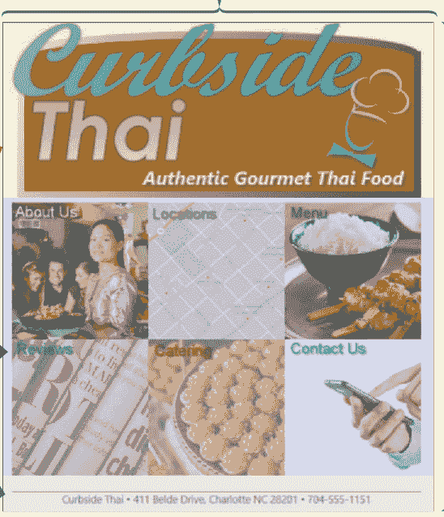


# HTML5 入门

## 万维网的影响

毫不夸张地说，万维网对人类通信产生了深远影响。一个关键区别是，印刷机的使用受到限制，但万维网使信息共享民主化。

## Web 技术发展史

### 早期发展

HTML 这种技术在 1989 年由 CERN 的研究人员开发。在 HTML 2.0 时代，没有组织定义 HTML 的规则或语法。浏览器开发者可以自由以不同的方式定义和支持这种语言，这自然导致了不同的浏览器支持不同的“变体”。

### 标准化进程

万维网联盟（W3C）决定不拥有执行权，但通过达成符合所有人利益的共识，制定了一系列标准。这些建议通常会被遵循，尽管并非立即执行。每个新版本的 HTML 在经过讨论和测试后才被采纳。欲了解更多关于 W3C 及其服务的信息，请访问 `www.w3.org`。

1999 年，HTML 进展到第四版本 HTML 4.01，它为多媒体、在线和交互脚本提供了支持。然而，HTML 浏览器和开发者编写 HTML 的方式仍然存在许多不兼容之处。W3C 试图接管这一混乱的过程，并在另一种版本的语言——即 XML（可扩展网络标记语言）中创建一套标准。

### HTML5 的诞生

2004 年，Web 应用技术工作组（WHATWG）成立，其使命是开发 HTML5。HTML5 将与早期版本的 HTML 兼容。W3C 以及 WHATWG 开启了一个新篇章，将 HTML5 开发为下一代 HTML 的事实标准。今天，HTML5 是 HTML 语言的当前版本，受到所有当前浏览器和设备的支持。你可以在 `www.whatwg.org` 了解更多关于 WHATWG 及其当前项目。

### 兼容性挑战

HTML 有许多特性在语言的早期版本中就被引入，但现在已被废弃或逐步淘汰。虽然废弃的特性可能不再包含其中，但对于那些不希望在工作中保留这些特性的人来说——事实上，如果你正在维护旧版本，你仍然需要对早期版本的 HTML 代码进行解释。此外，目前仍有许多旧浏览器和设备在运行，它们支持 HTML5，这对于编写既能利用 HTML 特性又能兼容旧技术的代码的 Web 设计师来说是一项挑战。

## HTML 文档结构

### 文档类型声明

HTML 文件的第一行是文档类型声明或 doctype，它是引入文档中所用标记的处理指令。浏览器使用文档类型声明来知道使用何种标准来显示内容。对于 HTML5，doctype 输入如下：

```
<!DOCTYPE html>
```

你也可能看到小写的 doctype：

```html
<!doctype html>
```

这两种都被所有浏览器支持。旧版本的 HTML 具有更复杂的文档声明。例如，HTML 4.01 的文档声明如下：

```html
<!DOCTYPE HTML PUBLIC "-//W3C//DTD HTML 4.01//EN"
"http://www.w3.org/TR/html4/strict.dtd">
```

你可能还会遇到没有文档声明的旧版 HTML 文件。许多浏览器会将缺失文档声明解释为应该根据 20 世纪 90 年代初样式和实践以怪异模式渲染页面。当存在文档声明时，浏览器将以标准模式渲染页面，采用最新的 HTML 规范。怪异模式与标准模式之间的区别可能意味着布局精美的页面与混乱的一团之间的差异，因此，你应该始终通过包含文档声明将你的 HTML 文件置于标准模式中。

### 元素标签

每个 HTML 文档的根本构建单元是元素标签，它标记了文档中的一个元素。起始标签表示该元素的开始，而结束标签表示结束。双边元素的通用语法是：

```html
<element>content</element>
```

其中 `element` 是元素的名称，`content` 是元素的内容，而 `</element>` 是结束标签。例如，以下代码创建了一个段落元素：

```html
<p>Welcome to Curbside Thai.</p>
```

在这里，`<p>` 和 `</p>` 标签标记了段落的存在，而文本 "Welcome to Curbside Thai" 成了段落文本。

并不是每个元素都包含内容。空元素不是文本的（如图像），或者包含指示浏览器如何处理页面的指令。空元素使用以下单边元素标签之一进行输入：

```html
<element />
```

或者

```html
<element>
```

例如，以下 `br`（用于指示文本中的换行）是使用单边标签输入的：

```html
<br />
```

注意，虽然这段代码也可以写为 `<br>`，但结束斜杠 `/>` 是 XHTML 文档以及其他标记语言中要求的格式。HTML5 允许这两种形式，如果你打算将来与标记语言工作，习惯使用结束斜杠 `/` 是个好主意。我们在本书的代码中遵循 `/` 约定。

元素可以包含其他元素，这些被称为嵌套元素。例如，`em` 用于标记强调文本，嵌套在段落元素内部，通过 `em` 标记标签完全包含在 `p` 标记标签内。

正确的语法：

```html
<p>Welcome to <em>Curbside Thai</em></p>
```

注意，将一个元素嵌套在另一个元素内部，内部元素的整个代码必须包含在外部元素内部，包括开启和关闭标签。在以下代码中，将 `em` 元素的结束标签放置在 `p` 元素之外是不正确的：

不正确的语法：

```html
<p>Welcome to <em>Curbside Thai</p></em>
```

### 元素层级结构

HTML 文档的整个结构可以被视为层级树中的一组嵌套元素。树的顶端是 `html` 元素，它标记了整个文档。在 `html` 元素内部是 `head` 元素，用于标记文档本身的信息，以及 `body` 元素，用于标记将出现在网页中的内容。因此，HTML 文件的通用结构如下所示：

```html
<!DOCTYPE html>
<html>
<head>
head content
</head>
<body>
body content
</body>
</html>
```

其中 `head content` 和 `body content` 是标记文档头部和主体内容的嵌套元素。注意，`body` 元素始终放在 `head` 元素之后。

为了创建 HTML 文件的基本结构，请输入标签：

```html
<!DOCTYPE html>
<html>
<head>
head content
</head>
<body>
body content
</body>
</html>
```

### 元素属性

元素将包含一个或多个元素属性。每个属性都向浏览器提供关于元素用途或浏览器应如何处理该元素的额外信息。双边标签中元素属性的通用语法是：

```html
<element attr="value" attr2="value" ...>
content
</element>
```

或者，对于单边标签：

```html
<element attr="value" attr2="value" ... />
```

当 `attr`、`attr2` 等属性与元素和属性关联时，`value`、`value2` 等对应值也是如此。例如，代码向 `<p>` 标签中添加了值为 "intro" 的 `id` 属性，以便将段落识别为介绍段落。

```html
<p id="intro">Welcome to Curbside Thai.</p>
```

HTML 编辑器通常会对属性及其值进行颜色区分。每个元素都有自己的属性，但除了这些特定的属性，还有一组可以应用于几乎所有元素的属性。下表列出了一些常用属性：

| 属性 | 说明 |
| --- | --- |
| `class="text"` | 定义元素的分类 |
| `dir="auto"` | 定义元素的方向为从左到右、从右到左或由浏览器决定 |
| `hidden` | 指示元素应该被隐藏 |
| `id` | 为元素提供唯一标识符 |
| `lang="text"` | 指定元素的语言 |
| `style="definition"` | 定义元素的样式或外观 |
| `tabindex="integer"` | 指定元素的制表顺序 |
| `title="text"` | 为元素内容分配标题 |

某些属性不需要值，所以结果是，代码中使用的 `hidden` 属性指示段落被隐藏。

```html
<p hidden>Placeholder Text</p>
```

为元素添加属性：

```html
<element attr1="value1" attr2="value2" ...>
content
</element>
```

其中 `attr1`、`attr2` 等属性与元素关联，`value1`、`value2` 等对应值也是如此。

### 处理空格

由于 HTML 文件是文本文件，它由文本字符和空白字符组成。空白字符是任何空或空白字符，如空格、制表符或换行。当浏览器读取 HTML 文件时，它忽略元素标签之间的空白字符，并将连续出现的空白字符合并为单个出现。浏览器将完全相同地处理以下两段代码：

```html
<p>Welcome to <em>Curbside Thai</em></p>
```

和

```html
<p>
Welcome to
<em>
Curbside Thai
</em>
</p>
```

这意味着以下代码中的段落文本仍然是 "Welcome to Curbside Thai"，因为 "Curbside" 和 "Thai" 之间的额外空格被忽略了。

结论在于，无论你如何布局 HTML 代码，浏览器只对文本感兴趣，而不关心文本是如何输入的。你可以通过缩进行和添加额外的空白字符来分隔区块，使你的 HTML 文件更易读。然而，这意味着你为了提高代码可读性而对页面文本使用的任何格式，都不会传输到网页上。

## 实战演练

### 在浏览器中查看 HTML 文件

1. 打开你的网络浏览器。你不需要连接互联网即可查看存储在计算机上的文件。
2. 加载来自 `html01/tutorial` 文件夹的 `ct_start.html` 文件。图 1-4 显示了页面在手机和平板设备上的显示效果。这两个设备的屏幕宽度不同，这会影响页面的渲染方式。
3. 缩小浏览器窗口的宽度并注意当宽度低于某个值（在本例中为 480 像素）时，布局会自动更改为堆叠的行，这种布局更适合窄屏显示。
4. 增大浏览器窗口的宽度并确认布局更改为 2x3 的图像网格，这种设计更适合宽窗口。

图 1-4 阐述了一个重要的原理：HTML 并不描述文档的外观，它只描述文档的内容和结构。同一个 HTML 文档在不同设备之间、或者不同屏幕尺寸之间可以渲染出完全不同的界面。文档的实际外观由样式表决定。

### 创建 HTML 文件

现在你已经学习了 HTML 文件的结构，将开始为 Curbside Thai 网站创建你自己的文档。

开始编写 HTML 文件：

1. 使用你喜欢的编辑器，在 `html01/tutorial` 文件夹中创建一个新的空白 HTML 文件，并将文件保存为 `ct_about.html`。


- 2. 在文件中输入以下代码：

```
<!DOCTYPE html>
<head>
</head>
<body>
</body>
</html>
```

图 1-5 显示了文档中的初始元素。

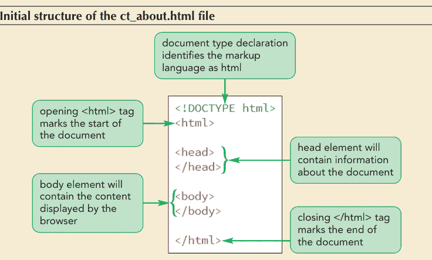

- 3. 保存对文件的更改。

接下来，你将向文档的头部（`head`）中添加元素。

## 书面交流：编写高效的 HTML 代码

编写良好的 HTML 的一部分是要意识到各种浏览器和设备的要求，并理解该语言的不同版本。以下是编写良好的 HTML 代码的几条指南：

- 熟悉 HTML 的历史以及 HTML 和 XHTML 的各种版本。与其他语言不同，HTML 的历史确实会影响你编写代码的方式。
- 了解你的市场。你必须支持旧版浏览器吗，还是你的客户已统一使用某个特定的浏览器或浏览器版本？你的网页会在电脑等单一设备上查看，还是你必须支持多种设备？
- 在几个不同的浏览器和浏览器版本上测试你的代码。不要假设如果页面在其中一个浏览器中正常，它在所有其他浏览器或该浏览器的早期版本中也能正常工作。还要检查连接速度。在高速连接下表现良好的大文件在较慢连接下可能无法使用。
- 在 W3C 网站上阅读不同版本的 HTML 和 XML 的文档，并关注该语言的最新进展。

为了与客户和用户有效交流，你需要确保你的网站始终是可读的。编写良好的 HTML 代码是一个很好的开始。

## 创建文档头部

文档头部（`head`）包含元数据，即描述文档或提供关于浏览器应如何处理文档的信息的内容。图 1-6 描述了文档头部中不同的元数据元素。

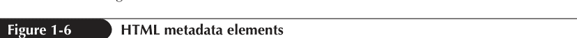

| 元素 | 描述 |
|---|---|
| `head` | 包含元数据元素，描述文档或向浏览器提供指令 |
| `base` | 指定文档用于相对超链接时的位置 |
| `link` | 指定文档所连接的外部资源 |
| `meta` | 提供通用元数据值列表，如关键字、视口属性和文件的字符编码 |
| `script` | 为在文档内运行的程序提供编程代码 |
| `style` | 定义用于渲染文档内容的显示样式 |
| `title` | 存储文档的标题或名称，通常显示在浏览器的标题栏或标签页上 |

## 设置页面标题

文档头部（`head`）包含元数据，即描述文档或提供关于浏览器应如何处理文档的信息。图 1-6 描述了文档头部中不同的元数据元素。

## 创建 HTML 文件

现在你已经学习了 HTML 文件的结构，将开始为 Curbside Thai 网站创建你自己的文档。Sajja 希望你创建一个包含餐厅信息的网页。从开始插入 `doctype` 以及 `html`、`head` 和 `body` 元素的标记标签。

开始编写 HTML 文件：

- 1. 使用你喜欢的编辑器，在 `html01> tutorial` 文件夹中创建一个新的空白 HTML 文件，并将文件保存为 `ct_about.html`。
- 2. 在文件中输入以下代码：

```
<!DOCTYPE html>
<head>
</head>
<body>
</body>
</html>
```

图 1-5 显示了文档中的初始元素。


- 3. 保存对文件的更改。

接下来，你将向文档头部添加元素。

## 向文档中添加元数据

文档头部（`head`）包含元数据，即描述文档或提供关于浏览器应如何处理文档的信息。图 1-6 描述了文档头部中不同的元数据元素。

例如，你可以使用以下 `meta` 元素为 Curbside Thai 网站提供一组关键字，有助于搜索引擎（如 Google 或 Bing 搜索工具）找到页面：

```
<meta name="keywords" content="Thai, restaurant, Charlotte, food" />
```

在此标签中，`name` 属性定义元数据的类型，`content` 属性提供值。常用的名称包括 `keywords`、`description` 和 `viewport`。`meta` 元素的另一个用途是定义文档使用的字符编码。字符编码是计算机在存储时将文本转换为字节序列并在读取时将这些字节转换回文本的过程。最常用的字符编码是 UTF-8，它可以表示你需要的所有字符。要指示文档使用 UTF-8，向文档头部添加以下 `meta` 元素：

```
<meta charset="utf-8" />
```

`charset` 属性在 HTML5 中引入，取代了早期 HTML 版本中以前复杂的表达式：

```
<meta http-equiv="Content-Type" content="text/html; charset="UTF-8" />
```


## 向文档中添加元数据

要定义文档中使用的字符编码，输入：

`<meta charset="encoding" />`

其中 `encoding` 是文档使用的字符编码；

要定义与文档相关的关键字，输入：

`<meta name="keywords" content="terms" />`

其中 `terms` 是逗号分隔的关键字列表。

向文档头部添加 `meta` 元素，提供字符集和描述页面的关键字列表。

## 要插入元数据：

- 1. 直接在 `<head>` 标签之后，插入以下 `meta` 元素，并缩进以使代码更易读：

```
<meta charset="utf-8" />
<meta name="keywords"
content="Thai, restaurant, Charlotte, food" />
```

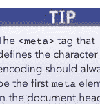

图 1-9 亮出了文档头部中新添加的元数据元素。

# HTML 18 HTML 和 CSS | 教程 1 从 HTML5 入门

图 1-9 为文档添加元数据

| 文档使用的字符编码 | 用于搜索引擎搜索的关键词 |
|---|---|
| `<head>`<br>`<meta charset="utf-8" />`<br>`<meta name="keywords" content="thai, restaurant, Charlotte, food" />`<br>`<title>About Curbside Thai</title>`<br>`</head>` | |

- 2. 将更改保存到文件。
- 3. 在浏览器中打开 `ct_about.html` 文件。确认浏览器标签或标题栏包含文本 'About Curbside Thai'。浏览器窗口中不应显示任何文本，因为你尚未向页面正文中添加任何内容。

在继续编辑 `ct_about.html` 文件之前，你应该记录你的工作内容。你可以通过注释来实现。

## 文档中的注释

注释是添加到 HTML 文件中的描述性文本，当页面显示时不会出现在浏览器窗口中。注释可以包括文档作者姓名、文档创建日期以及创建文档的目的。注释使用以下标记添加：

```
<!-- comment -->
```

其中 `comment` 是注释或说明的文本。例如，以下代码插入了描述为 Curbside Thai 创建的页面的通用信息：

```
<!-- General Information about Curbside Thai -->
```

注释可以跨多行，因为注释文本以 `<!--` 开始并以 `-->` 结束。由于浏览器会忽略注释，因此可以将其添加到文档的任何位置，尽管良好的做法是在文档头中包含一个注释，以描述文档的内容。

## 在 HTML 文档中添加注释

- 要在 HTML 文档中插入注释，请输入 `<!-- comment -->`，其中 `comment` 是 HTML 注释的文本。

在 `ct_about.html` 文件中添加注释，说明文档作者、创建日期和目的。

## 为文档添加注释：

- 1. 回到 HTML 编辑器中的 `ct_about.html` 文件。
- 2. 紧接在 `<head>` 标签之后，插入以下注释文本，并进行缩进以使代码更易读：

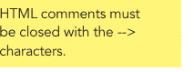

```
<head>
<!--
New Perspectives on HTML5 and CSS3, 7th Edition
Tutorial 1
Tutorial Case
General Information about Curbside Thai
Author: your name
Date: the date
--
Filename: ct_about.html
-->
```

`your name` 是你的名字，`the date` 是当前日期。图 1-10 高亮了文件中新添加的注释。


## 为文档添加注释

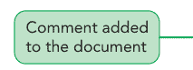

```
<head>
<!--
New Perspectives on HTML5 and CSS3, 7th Edition
Tutorial 1
Tutorial Case
General Information about Curbside Thai
Author: your name
Date: the date
--
Filename: ct_about.html
-->
<meta charset="UTF-8" />
<meta name="keywords" content="Thai, restaurant, Charlotte, food" />
<title>About Curbside Thai</title>
</head>
```

- 3. 将更改保存到文件。

## 条件注释和 Internet Explorer

你在许多 HTML 文件中会遇到的另一种注释是条件注释，它封装了仅应由特定版本的 Internet Explorer 浏览器运行的注释内容。条件注释的一般形式为：

```
<!--[if IE version]>
content
<![endif]-->
```

其中 `operator` 是逻辑运算符（小于或大于），`version` 是 Internet Explorer 浏览器的版本号，`content` 是当条件表达式为真时要渲染的内容。以下代码使用 `<`（小于）逻辑运算符来警告用户，如果他们运行的是版本 8 之前的 Internet Explorer，则需要升级浏览器。

```
<!--[if lt IE 8]>
<p>Upgrade your browser to view this page.</p>
<![endif]-->
```

其他逻辑运算符包括 `lte`（小于或等于）、`gt`（大于）、`gte`（大于或等于）和 `!`（不等于）。例如，以下代码使用逻辑运算符仅在浏览器不是 Internet Explorer 时显示段落文本：

```
<!--[if !IE]>
<p>You are not running Internet Explorer.</p>
<![endif]-->
```

请注意，如果省略了版本号，则条件注释将适用于所有 Internet Explorer。

条件注释的需求之所以出现，是因为 Internet Explorer 实现 HTML 的方式与其它浏览器有显著不同，因此需要将 IE 浏览器的代码与其他浏览器的代码分开。在最近的 Internet Explorer 版本中，这个问题不再严重，但如果你正在编写兼容旧版本 Internet Explorer 的代码，你可能仍需要使用条件注释。

## 章节 1 快速检查

- 1. 什么是 HTML 语言？
- 2. 什么是 XHTML？
- 3. 什么是 doctype？
- 4. 什么是 HTML5 doctype？
- 5. 关于 Curbside Thai 的 HTML 标记。
- 6. 关于 Curbside Thai 的注释。
- 7. 关于 Curbside Thai 的关键词。
- 8. UTF-8 字符编码。
- 9. 关于 Curbside Thai 的注释。


其中是注释或说明的文本。例如，以下代码插入了描述为 Curbside Thai 创建的页面的通用信息（General Information）--- 注释可以跨多行，因为注释文本以 `<!--` 开始并以 `-->` 结束。由于浏览器会忽略注释，因此可以将添加到文档的任何位置，尽管良好的做法是在文档头中包含一个注释，以描述文档的内容。

```
<!-- General Information about Curbside Thai ---->
```

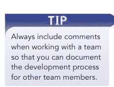

## 在 HTML 文档中添加注释

- 要要在 HTML 文档中插入注释，请输入 `<!-- comment -->`

其中是 HTML 注释的文本。

在 `ct_about.html` 文件中添加注释，说明文档作者、创建日期和目的。

WOW! eBook www.wowebook.org

# 教程 1 从 HTML5 入门 | HTML 和 CSS

## 为文档添加注释：

1. 回到 HTML 编辑器中的 `ct_about.html` 文件。

2. 紧接在 `<head>` 标签之后，插入以下注释文本，并进行缩进以使代码更易读：


```
<head>
<!--
New Perspectives on HTML5 and CSS3, 7th Edition
Tutorial 1
Tutorial Case
General Information about Curbside Thai
Author: your name
Date: the date
--
Filename: ct_about.html
-->
```

`your name` 是你的名字，`the date` 是当前日期。图 1-10 高亮了文件中新添加的注释。


## 为文档添加注释


```
<head>
<!--
New Perspectives on HTML5 and CSS3, 7th Edition
Tutorial 1
Tutorial Case
General Information about Curbside Thai
Author: your name
Date: the date
--
Filename: ct_about.html
-->
<meta charset="UTF-8" />
<meta name="keywords" content="Thai, restaurant, Charlotte, food" />
<title>About Curbside Thai</title>
</head>
```

3. 将更改保存到文件。

# WOW! eBook

www.wowebook.org

## 条件注释和 Internet Explorer

你在许多 HTML 文件中会遇到的另一种注释是条件注释，它封装了仅应由特定版本的 Internet Explorer 浏览器运行的注释内容。条件注释的一般形式为：

```
<!--[if IE version]>
content
<![endif]-->
```

其中 `operator` 是逻辑运算符（小于或大于），`version` 是 Internet Explorer 浏览器的版本号，`content` 是当条件表达式为真时要渲染的内容。以下代码使用 `<`（小于）逻辑运算符来警告用户，如果他们运行的是版本 8 之前的 Internet Explorer，则需要升级浏览器。

```
<!--[if IE 8]>
<p>Upgrade your browser to view this page.</p>
<![endif]-->
```

其他逻辑运算符包括 `<=`（小于或等于）、`gt`（大于）、`gte`（大于或等于）和 `lt`（不等于）。例如，以下代码使用逻辑运算符仅在浏览器不是 Internet Explorer 时显示段落文本：

```
<!--[if IE]>
<p>You are not running Internet Explorer.</p>
<![endif]-->
```

请注意，如果省略了版本号，则条件注释将适用于所有 Internet Explorer。

条件注释的需求之所以出现，是因为 Internet Explorer 实现 HTML 的方式与其它浏览器有显著不同，因此需要将 IE 浏览器的代码与其他浏览器的代码分开。在最近的 Internet Explorer 版本中，这个问题不再严重，但如果你正在编写兼容旧版本 Internet Explorer 的代码，你可能仍需要使用条件注释。

在继续编辑 `ct_about.html` 文件之前，你应该记录你的工作内容。你可以通过注释来实现。

WOW! eBook www.wowebook.org

## 章节 1 快速检查

1. 什么是 HTML 语言？

2. 什么是 XHTML？

3. 什么是 doctype？

4. 什么是 HTML5 doctype？

5. 关于 Curbside Thai 的 HTML 标记。

6. 关于 Curbside Thai 的注释。

7. 关于 Curbside Thai 的关键词。

8. UTF-8 字符编码。

9. 关于 Curbside Thai 的注释。

## 编写页面主体

现在你已经创建了 Curbside Thai 网页的文档头部，你将开始编写文档正文。你将从通用标记标签开始，使用 `h2` 标识页面正文的区域，然后处理这些区域内部更具体的内容。

## 使用区块元素

设计页面正文的第一任务是识别页面的主要主题。一个主题通常包含一个头部（header）、一个或多个作为页面核心内容的文章（article），以及一个提供作者或公司联系信息的页脚（footer）。HTML 使用图 1-11 所示的区块元素来标记这些主要区域。

图 1-11 HTML 选择性元素

| 元素 | 描述 |
|---|---|
| address | 标记个人或群体的联系信息 |
| article | 标记文档中自包含的组合，如新闻报道 **[HTML]** |
| aside | 标记与主文章相关的内容 **[HTML]** |
| body | 包含文档的所有内容 |
| footer | 包含结束文章或章节的内容项 **[HTML]** |
| h2, h3, h4, h5, h6 | 标记标题，其中 h1 表示级别最高的标题，h2 表示子标题，依此类推 |
| header | 包含引入文章或章节的起始内容 **[HTML]** |
| nav | 标记超文本链接或导航链接列表 **[HTML]** |
| section | 标记页面上共享共同主题或目的的内容 **[HTML]** |

例如，一个新闻博客文章可能包含几个主要主题。为了识别这些主题，博客文章的 HTML 可能包含以下元素来标记页面的头部、导航列表、文章、侧边栏和页脚。

```html
<body>
  <header>
  </header>
  <nav>
  </nav>
  <article>
  </article>
  <aside>
  </aside>
  <footer>
  </footer>
</body>
```

这些元素也被称为语义化元素，因为标签定义了页面的目的及其包含的内容。在不了解大量 HTML 的情况下，上述代码中定义的页面结构可以通过标签名称被轻松理解。

> 提示 区块元素可以相互嵌套；例如，一个文章可以包含它自己的头部、页脚和一组导航链接。

WOW! eBook www.webook.org

## 教程 1 入门 HTML5 | HTML 和 CSS HTML 25

## 定义页面章节

- 要标记页面头部，使用 `header` 元素。
- 要标记自包含的内容，使用 `article` 元素。
- 要标记超链接的导航列表，使用 `nav` 元素。
- 要标记侧边栏，使用 `aside` 元素。
- 要标记页面页脚，使用 `footer` 元素。
- 要分组通用内容，使用 `section` 元素。

Curbside Thai 页面将具有简单的结构，包含一个头部、一个文章和一个页脚。在头部内部将有一个 `h1` 元素提供页面标题（不要与显示在浏览器栏或浏览器标签页上的文档标题混淆）。将此结构添加到文档正文中。

### 要定义页面正文中的章节：

1. 如果你在上一节课程后休息了，请返回 HTML 编辑器中的 `ct_about.html` 文件。

2. 紧接 `<header>` 标签之后，插入以下 HTML 代码，目的是使代码更易读：

```html
<header>
  <h1>Curbside Thai</h1>
</header>
<article>
  <h1>About Us</h1>
</article>
<footer>
  Curbside Thai 411 Belde Drive, Charlotte NC 28201 704-555-1151
</footer>
```

图 1 显示了页面正文中使用的元素。


在页面正文中添加区块元素：

```html
<body>
  <header>
    <h1>Curbside Thai</h1>
  </header>
  <article>
    <h1>About Us</h1>
  </article>
  <footer>
    Curbside Thai 411 Belde Drive, Charlotte NC 28201 704-555-1151
  </footer>
</body>
</html>
```

3. 保存更改到文件。

WOW! eBook

www.wwebook.org

## 比较 HTML4 和 HTML5 中的章节

图 1-11 中描述的许多区块元素是在 HTML5 中引入的。在 HTML5 之前，章节被为以下 `div` 元素创建的划分：

```html
<div id="id">
  <div>
    content
  </div>
</div>
```

其中 `id` 是唯一标识该划分的名称。图 1-13 显示了使用 HTML5 区块元素标记的页面布局将如何在使用 HTML 4.01 中使用 `div` 元素进行定义。

### 图 1-13 HTML 5.0 中的章节，HTML 4.01 中的划分

| HTML 5.0 | HTML 4.01 |
|---|---|
| `<header></header>` | `<div id="header">` |
| `<nav></nav>` | `<div id="nav">` |
| `<section></section>` | `<div id="section">` |
| `<aside></aside>` | `<div id="aside">` |
| `<article></article>` | `<div id="article">` |
| `<footer></footer>` | `<div id="footer">` |
| | `</div>` |

图 1-11 中描述的许多区块元素是在 HTML5 中引入的。在 HTML5 之前，章节被定义为使用以下 `div` 元素创建的划分：

```html
<div id="id">
  <div>
    content
  </div>
</div>
```

其中 `id` 是唯一标识该划分的名称。图 1-13 显示了使用 HTML5 区块元素标记的页面布局将如何在使用 HTML 4.01 中使用 `div` 元素进行定义。

## 使用分组元素

章节内部是分组元素。每个分组元素组织一个共同主题。图 1-14 描述了所有的分组元素。

图 1-14 分组元素

| 元素 | 描述 |
|---|---|
| blockquote | 包含引用自源的内容，通常会缩进 |
| div | 页的通用分组 |
| dl | 标记一个或多个元素的描述列表 |
| dt | 描述列表中的单个术语 |
| dd | 与术语相关的描述 |
| figure | 包含插图、照片、图或类似对象 |
| caption | 包含与图相关的说明 |
| hr | 标记水平规则或到新主题的过渡 |
| main | 标记文档或应用程序的主要内容 |
| ol | 包含有序列表 |
| ul | 包含无序列表 |
| li | 包含有序或无序列表中的单个项目 |
| p | 包含段落文本 |
| pre | 包含预格式文本块，其中换行和额外字符会被保留（通常以等宽字体显示）|

例如，以下代码显示了文章中的三个段落，每个段落代表一组内容：

```html
<article>
  <p>第一段落的内容。</p>
  <p>第二段落的内容。</p>
  <p>第三段落的内容。</p>
</article>
```

当浏览器遇到包含元素或一组元素时，默认样式是使包含的内容在一个新行开始，将其与之前的任何内容隔开。因此，这些段落中的每一个都将在 article 插入时在新行开始。注意，段落的外以及它们之间的间距取决于应用于这些元素的样式。

## HTML 28 HTML 和 CSS | 教程 1 HTML5 入门

Sajja 在一个文本文件中编写了一篇关于 Curbside Thai 的文章。将他的文本输入“About Curbside Thai” 页的 `article` 元素中，并使用 `p` 元素来标记文章中的段落。

要将页面文本分组为段落：

1. 使用文本编辑器打开 `html01 > tutorial` 文件夹下的 `ct_pages.txt` 文件。

2. 直接从“About Us”标题处选择并复制三段文本。

3. 关闭文件，但不要保存你对文档进行的任何更改。

4. 回到 HTML 编辑器中的 `ct_about.html` 文件。

5. 在页面 `article` 内部的 `<h1>About Us</h1>` 行之后，直接插入一个新空行并粘贴你复制的文本。

6. 将粘贴的三个段落中的每一段都封装在起始标签 `<p>` 和结束标签 `</p>` 之间，并对代码进行缩进以便阅读。

图 1-15 显示了为三段文章新添加的代码。

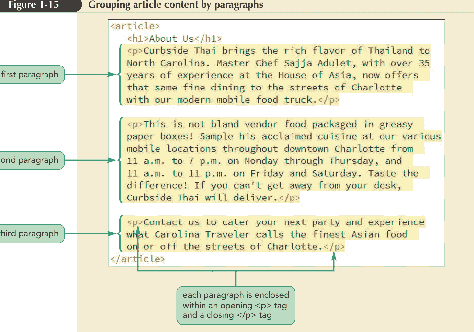

7. 保存你对文件的更改。

## 使用文本级元素

每个分组内部都包含文本级元素，它们的作用类似于段落中的短语或字符。与在新行开始并形成自包含文本块的分段或分组元素不同，文本级元素与周围内容并显示，被称为内联元素（inline elements）。例如，此段落中的斜体或粗体文本被视为内联内容，因为它们与周围内容一同出现。图 1-16 描述了 HTML 中的一些文本级元素。

| 元素 | 描述 |
| --- | --- |
| a | 作为超链接的标记 |
| abbr | 标记缩写或首字母词 |
| b | 表示需要引起注意的文本范围（文本通常为粗体） |
| br | 表示分组元素内的换行符 |
| cite | 标记对创作作品标题或作者的引用（文本通常为斜体） |
| code | 标记代表计算机代码的标记（文本通常以等宽字体显示） |
| data | 将数据值 `HTML` 与标记的文本相关联 |
| dfn | 标记一个在文档其他地方有定义的术语 |
| i | 表示被强调或重的文本范围（文本通常为斜体） |
| kbd | 标记代表用户输入（来自计算机键盘或语音命令）的文本 |
| marks | 包含一行为了引用目的而标记或高亮的文本内容 `[HTML5]` |
| q | 标记引用自其他来源的内容 |
| s | 标记不再准确或相关的内（文本通常带有删除线） |
| samp | 标记代表计算机程序或应用程序示例输出的文本 |
| small | 标记侧边内容（文本在打印时通常较较小字体） |
| span | 表示重要性或严肃性的内容（文本通常为粗体） |
| sub | 标记应被视为下标的文本 |
| time | 标记时间值或字符串 `[HTML]` |
| var | 标记在数学表达式或计算机程序中被视为变量的文本 |
| wbr | 对于长文本字符串，在需要时表示在发生之前允许换行 `[HTML]` |

以下 HTML 代码演示了如何通过使用文本级元素来标记段落中的短语或字符。

```html
<p>
Contact us to cater your next party and experience what
<cite>Carolina Traveler</cite> calls the finest
Asian food on or off the streets of Charlotte.</q>
</p>
```

## HTML 和 CSS | 教程 1 HTML5 入门

此段落使用了两级元素：使用 `cite` 元素来标记对 *Carolina Traveler* 杂志的引用，使用 `quote` 元素来标记杂志对 Curbside Thai 的直接评价。引用标记和引用内容在段落中与其他未标记文本一同以特殊格式显示。

## 定义文本级内容

- 要标记强调，使用 `em` 元素。
- 要标记非常重要的文本，使用 `strong` 元素。
- 要标记引用，使用 `cite` 元素。
- 要标记引用内容的选择，使用 `q` 元素。
- 要标记下标，使用 `sub` 元素；要标记上标，使用 `sup` 元素。
- 要标记通用文本级内容的选择，使用 `span` 元素。

在“About Columbus” 网页中使用文本级元素来标记强调文本、重要内容、引用和引用内容的示例。

## 将文本级元素应用于页面：


- 1. 转到页面 `article` 内部的第一段，将开头的单词 Curbside Thai 封装在起始和结束的 `<strong>` 标签之间。使用 `<em>` 标签向读者强烈强调该文本（如餐厅名称）的重要性。

- 2. 在第二段中，将短语 "Curbside Thai will deliver" 封装在起始和结束的 `<em>` 标签之间以进行强调。

- 3. 转到第三段，使用 `cite` 元素标记 *Carolina Traveler*，然后使用 `q` 元素标记长引用内容“the finest Asian food on or off the streets of Charlotte”。

图 1-17 显示了四种文本级元素在段落内容中的应用。

# 教程 1 入门 HTML5 | HTML 和 CSS

图 1-20

# 在新样式表下渲染的 Curbside 页面

## Curbside Thai 样式

以新字体样式显示的 h1 标题文本

## 关于我们

Curbside Thai 带来了北卡罗莱纳州的新鲜风味。主厨 Saej Advent 在亚洲酒店拥有 35 年的经验，他说，自从通过我们的现代食品餐车将美食送送到 Curbside Thai 的街道上以来——

这不是包装在杂货店纸盒里的廉价食品。在我们的各个地点广受赞誉，从周一至周四上午 11 点开始，以及周五至周六上午 11 点开始提供美味的 Curbside Thai。如果你能摆脱原有的选择，请感受这种不同。Curbside Thai 将送送-

联系我们为您的下一次派对提供餐饮服务，并体验Curbside Travel 在街上或线下携带的新鲜亚洲美食。

- 页面主体添加了带有投影效果的棕褐色背景
- 引用以浅蓝色字体显示
- 页脚带有顶部边框并显示页脚内容

Curbside Thai 411 Belle Drive, Charlotte, NC 28201 704-555-1951

- 直引号替换为弯引号

将这些样式应用于 HTML 代码会导致页面主体显示在棕褐色背景上。h2 标题中使用的字体已更改，页脚添加了顶部边框以与前面的内容隔开，对 Carolina Traveler 的引用以浅蓝色字体显示。这种效果使得页面内容更容易阅读，视觉上更加愉悦。

Saja 担心页脚难以区分。他希望你添加项目符号（•）来将餐厅名称、街道地址和餐厅电话隔开。然而，这个字符可以通过键盘上的任何按键表示。那么，你是否会将此符号插入到网页中呢？

## 使用字符集和特殊字符

你的浏览器能够渲染的每个字符和符号都称为字符集。英语字母表的字符集是美国信息交换标准代码，简称为 ASCII。一种更扩展的字符集，称为 Latin-I 或 ASCII 8859-1，包含 255 个字符，可以用于许多使用拉丁字母的语言，包括英语、法语、西班牙语和意大利语。Unicode 是最扩展的集，使用多达 65,536 个符号，可以用于世界上任何语言。

## 字符编码

字符集中的每个字符都关联着一个编码值，该值可以被计算机程序存储和读取。例如，Unicode 字符中的符号 © 被编码为数字 169。如果你知道编码，可以使用以下字符引用将字符直接插入到你的网页中：

> 提示
>
> 你可以通过打开 Html1 demo 文件夹中的 `demo_character.html` 文件来探索不同的编码值。

```
&#169;
```

WOW! 电子书

www.wowebook.org

其中 code 是编码引用数字。因此，若要在你的网页中显示 © 符号，你需要输入

&#169;

## 字符实体引用

插入特殊符号的另一种方法是使用字符实体引用，这是一种代替编码引用数字的短且易记的名称。使用以下语法插入字符实体引用：

```
&char;
```

其中 char 是字符实体引用。版权符号的字符实体引用是 `copy`，要在你的网页中显示 © 符号，你可以在 HTML 代码中插入以下表达式：

```
&copy;
```

在上一节课程中，你学习了 HTML 会将连续出现的空白合并为单个空白字符。你可以使用以下字符引用来强制 HTML 显示额外的空白：

```
&nbsp;
```

其中 nbsp 代表 `non-breaking space`（不换行空格）。当你想要显示额外的空白时，你需要在每个想要显示的空格处，在 HTML 代码中插入该不换行空格字符引用。

## 从字符集中插入符号

- 要根据编码引用数字插入符号，请输入 `&#code;`
- code 是编码引用数字。
- 要根据字符实体引用插入符号，请输入 `&char;`
- 其中 char 是分配给字符的名称。
- 要插入空白字符，请使用 `&nbsp;`

对于 Curbside Thai 页面的页脚，使用项目符号（•，编码值为 8226）来隔开餐厅名称、地址和电话。使用 `&nbsp;` 字符引用在餐厅地址的邮政编码之前插入一个额外的空格。

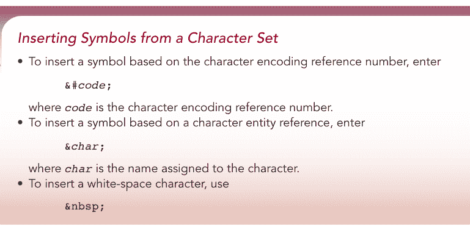

# 教程 1 入门 HTML | HTML 和 CSS HTML 35

要插入编码引用数字和实体引用：

- 1. 返回到 HTML 编辑器中的 `ct_about.html` 文件。
- 2. 找到页脚元素，在 Thai 单词之后和邮政编码 28201 之后直接插入编码数字 `&#8226;`。在邮政编码之前直接插入字符引用 `&nbsp;`。

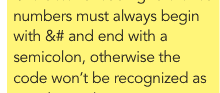

图 1-21 显示了添加到页脚的字符代码和引用。

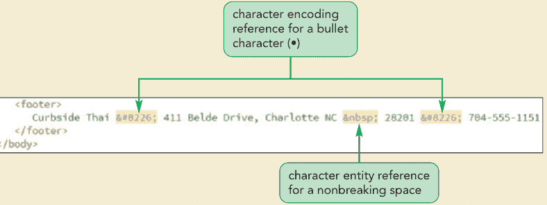

- 3. 保存更改并在浏览器中重新加载 `ct_about.html`。确认页脚显示了图 1-22 所示的字符。

图 1-22

-22

WOW! 电子书

www.wowebook.org

## 呈现属性

早期版本的 HTML 支持通过呈现属性来描述元素的渲染方式。例如，为了让元素对齐，网页作者会使用：

```
<element align="content"></element>
```

其中 align 是 left、right、center 或 justify。因此，要在页面上居中 h1 标题，他们可以使用以下代码：

```
<h1 align="center">你好!</h1>
```

所有的呈现属性现在已被样式表取代，你可能在旧网站的代码中看到它们。遵循最佳实践，到目前为止你对 Curbside 页的工作仅限于文本内容。接下来，你将探索如何在网页添加图形内容。

## 使用内联图像

大多数页面都使用嵌入内容，这种内容是非文本的，如图像、音频、视频片段或交互游戏。为了支持这种类型的内容，HTML 提供了图 1-23 所示的嵌入元素。

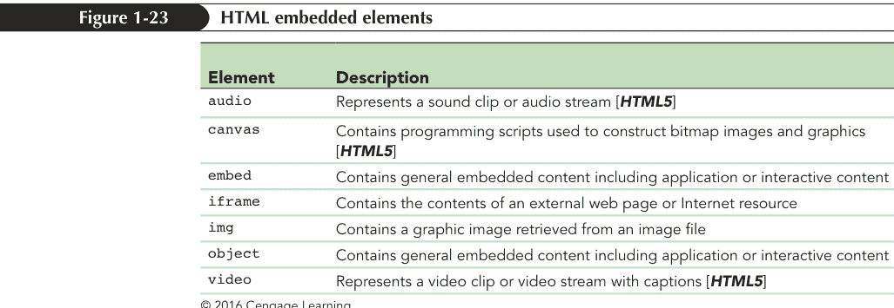

| 元素 | 描述 |
|---|---|
| audio | 代表音频片段或音频流 [HTML] |
| canvas | 包含用于构建位图图像和图形的编程脚本 [HTML] |
| embed | 包含应用程序或交互内容 |
| iframe | 包含外部网页或网络资源的内容 |
| img | 从图像文件获取的图形 |
| object | 包含应用程序或交互内容 |
| video | 代表带有字幕的视频片段或视频流 [HTML] |

这些元素也被称为交互元素，因为它们允许用户与嵌入对象之间进行交互。例如，音频或视频内容包含控制播放的按钮。使用以下元素将图像到网页中：

> 提示 始终包含 alt 属性，它是 HTML 代码的强制要求，以适应非视觉网页浏览器的用户。

```

```

其中 file 是图像名称。如果浏览器无法显示图像，则用文本 alt 属性代替图像。对于其他单边标签，img 元素可以不带闭合斜杠结束：

```

```

## 教程 1 HTML 入门 | HTML 和 CSS

图像也被称为内联图像，因为它们像文本级元素一样，与周围内容对齐放置。

默认情况下，图像的大小与文件中图像的大小相同，但你可以通过向 `img` 元素添加以下 `width` 和 `height` 属性来指定不同的大小

```
width="value" height="value"
```

其中宽度和高度值是以像素为单位的。如果你只指定了宽度，浏览器会自动设置高度以保持图片的比例；同样，如果你定义了高度，浏览器会自动设置宽度以保持比例。图像大小也可以在文档的样式表中设置。

## 嵌入内联图像

- 要向文档中嵌入内联图像，使用 ``
- file 是图形图像文件名，text 是浏览器显示以代替图形图像的文本。

Sajja 为你提供了图片。来自 `ct_logo2.png` 文件的图像显示餐厅标志，而 `ct_photo1.png` 提供了一张员工在其实体店中供应定制菜肴的图像。Sajja 包含这张图片是为了强调他的卡车上的食物与他获奖餐厅的食物具有同样的质量和美味。将这两张图片都添加到 `ct_about.html` 文件中。

## 在文档中插入内联图像：

- 1. 返回 HTML 编辑器中的头部 `ct_about.html` 文件。
- 2. 进入 `<header>` 元素，并将 `h1` 元素替换为标签 ``
- 3. 进入 `<article>` 元素，在 `h1` 元素之后插入标签 ``

图 1-24 显示了文档中新添加的图像。

## 插入内联图像

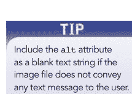

图 1-24

```
<header>

</header>
<article>
<h1>About Us</h1>
<h2>h1 replaced</h2>
with an inline image
<p><strong>Curbside Thai</strong> 将泰国的丰富风味带到了北罗来纳州。Sajja Adulet 主厨在 House of Asia 拥有超过 35 年的经验，现在通过我们的现代移动餐车将这种精致美食带到夏洛特的街头。</p>
```

在 About Us 文章中添加了图像

## WOW! 电子书

www.wowebook.com

Copyright 2023 Cengage Learning. 版权所有。未经许可不得全部或部分复制、扫描或复制。WCN 02-200-253

## HTML 和 CSS | 教程 1 HTML5 入门

- 4. 保存对文件的更改，然后在浏览器浏览器中重新加载 `ct_about.html` 文件。图 1-25 显示了网页中新添加的图形图像。

图 1-25 About Curbside Thai 页面上的图像

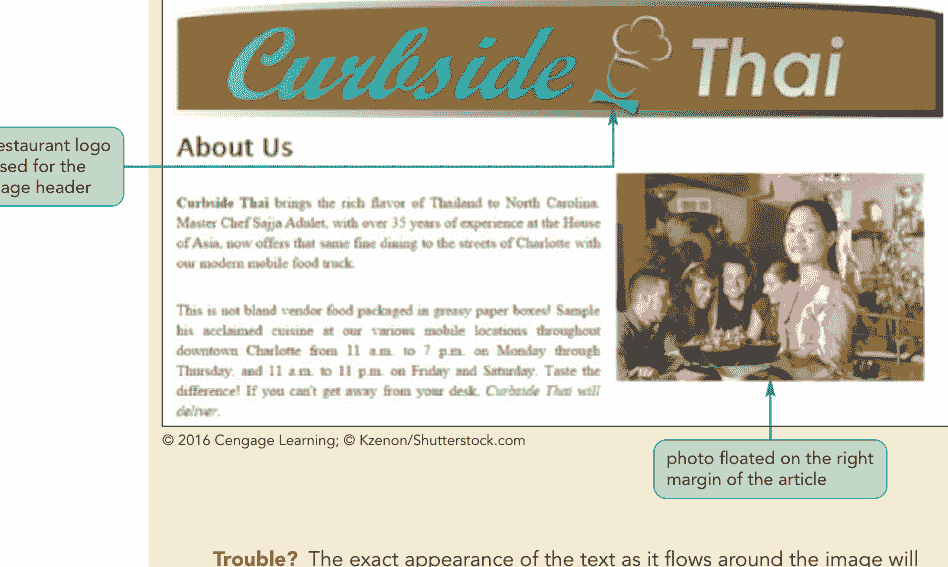

Curbside Thai 将泰国的风味带到了北罗来纳州。主厨 Saran Adulet 在 House of Asia 拥有超过 35 年的经验，现在通过独特的现代美食将精致餐饮带到夏洛特的街头。

这不再是以前包装在杂货纸里的平淡无味的食物了！我们在夏洛特各处备受誉的料理供应时间为周一至周四上午 11 点到下午 7 点，周五、周六、周日上午 11 点到晚上 9 点——大不同！如果你能离开办公桌，Curbside Thai 就会为你送上门。

> © 2016 Cengage Learning; © Zenon/Shutterstock.com

真的吗？文本环绕图像流的具体外观将取决于浏览器的宽度。

注意，Curbside Thai 客户的照片沿文章的右边距浮动，周围的段落环绕图像流动。这是样式表中代码的结果。你将在教程 3 中学习浮动图像。

## 换行和其他空元素

内联元素使用空标签插入，因为它不包含任何页面内容，而是链接到外部图像文件。另一个重要元素是 `br` 元素，它创建换行

```
<br />
```

换行放置在分组元素（如段落或标题）中，以强制页面内容在新行开始。虽然 `br` 元素用于控制文本流，但不应将其用作格式化工具。例如，如果仅仅是为了增加文本行之间的间距，连续插入两个或多个 `br` 元素是没有意义的。相反，所有此类格式选择都应属于样式表。

如果一行的文本无法适应视图窗口的宽度，浏览器将在其认为最合适的地方折行文本。若要建议不同的换行点，请需要的地方使用 `br`（单词断行）元素。例如，以下 HTML 代码使用了

（注：后续由于原文中存在大量重复段落，译文已根据核心逻辑进行精简处理）

# 教程 1 入门 HTML5 | HTML 和 CSS

图 1-27

## 餐厅评论的引用块

| 评论 | 样式表会添加起始引号 |
| --- | --- |
| 这辆餐车的烹饪艺术在过去的 10 年里不断进步，拥有 Autumn's Indian、Organic on the Basil 和 Curbside Thai 等精美佳肴。Saj Adhik 以实惠的价格提供高效且地道的泰国菜而受到赞誉。感谢 Curbside 在街头提供最优质的亚洲美食。 | 带有香辣亚洲菜的米饭是常见的街头食物，我们接受它的层叠，以换取在路上的快餐。对于 Curbside，你必须在主厨或几家正在兴起的饭店之间做出妥协。Saj Adhik 为“餐车大战”带来了顶级餐饮体验，我们再好不过了。 |

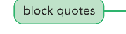

Carlana Traveler

> 最佳展示（亚洲菜）
>
> 一奖（供应商）

餐车料理大赛

Vendy 奖

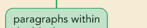

由于 Saj 的样式设计，blockquote 元素出现在它自己的框内，并带有一个引号字符，以加强这些是引用材料的事实。

下一页将创建关于 Curbside Thai 餐饮的内容。该页面的结构与关于 Curbside Thai 的页面结构相同。Sajha 将餐饮页面链接到两个包含样式规则的表，这些规则规定了页面在浏览器中渲染时的外观。

## 要创建餐饮页面：

- 1. 在 HTML 编辑器中打开 html01 教程文件夹下的 `ct_catering.txt.html` 文件。在注释部分输入你的姓名和日期，并将文件另存为 `ct_catering.html`。
- 2. 返回文本编辑器中的 `ct_pages.txt` 文件。
- 3. 找到包含 Curbside Thai 餐饮服务信息的部分，并复制四段信息。
- 4. 回到 HTML 编辑器中的 `ct_catering.html` 文件，将复制的文本直接粘贴在 `<h1>heading</h1>` 行之后。
- 5. 使用 `<p>` 元素标记文章中的每一段。对齐并缩进你的代码以使其更易阅读。
- 6. 紧接 `<h1>heading</h1>` 标签，插入一个以 `ct_photo2.png` 为源的内联图像，`alt` 属性设为空字符串。

WOW! 电子书

www.wowebook.com

# HTML 42 HTML 和 CSS | 教程 1 入门 HTML5

图 1-28 显示了文档中新增的段落。

## 图 1-28 为餐饮内容输入标记

```html
<article>
  <h1>Catering</h1>
  
  <p>Curbide Thai 为婚礼和特殊活动提供顶级的餐饮服务。我们通过移动餐车覆盖了夏洛特和北卡罗来纳的大部分地区，专门为大型活动提供餐饮服务。</p>
  <p>餐点将在现场现场热烹饪。我们有一支经验丰富的餐饮团队，为各种规模的活动提供专业服务并根据要求提供盘子、餐巾、玻璃器和其他物品。</p>
  <p>Curbide Thai 获得全方位吧台服务许可，涵盖多种烈酒，可以咨询您的婚礼或私人活动的定制饮饮单。我们还提供一系列出色的特色亚洲茶饮和饮料。</p>
  <p>用 Curbide Thai 餐饮活动让你的朋友和同事们印象深刻吧！</p>
</article>
```

- 7. 保存对文件的更改，然后在浏览器中打开 `ct_catering.html` 文件。图 1-2 显示了页面的外观。

## 图 1-29 页面内容

自 2010 年以来，Curbside Thai 为婚礼和特殊活动提供顶级的餐饮服务。我们通过移动餐车覆盖了夏洛特和北卡罗来纳的大部分地区，专门为大型活动提供餐饮服务。

餐点将在现场现场热烹饪。我们有一支经验丰富的餐饮团队，为 50 到 300 人的各种活动提供专业服务并根据要求提供盘子、餐巾、玻璃器和其他物品。

Curbide Thai 获得全方位餐饮服务许可，涵盖多种烈酒、啤酒和葡萄酒。可以咨询您的婚礼或私人活动的定制饮单。我们还提供一系列出色的特色亚洲茶饮和饮料。

用 Curbide Thai 餐饮活动让你的朋友和同事们印象深刻吧！

© Filmmanque/Shutterstock.com。

你在本次话中创建的最后一个页面将包含 Curbside Thai 的联系信息。在主页面中使用段落标记这些内容。

# WOW! 电子书

www.wowweebook.org

版权 2018 Cengage Learning. 版权所有。未经许可不得全部或部分扫描或复制。WCN 220-200-233

# 教程 1 入门 HTML5 | HTML 和 CSS HTML 43

## 要创建联系我们页面：

- 1. 在 HTML 编辑器中打开 html01 -> tutorial 文件夹下的 `ct_contact.txt` 文件。在注释部分输入你的姓名和日期，并将文件另存为 `ct_contact.html`。
- 2. 返回文本编辑器中的 `ct_pages.txt` 文件。


- 3. 找到包含 Curbside Thai 餐饮服务的部分，并复制四段信息。
- 4. 回到 HTML 编辑器中的 `ct_catering.html` 文件，将复制的文本直接粘贴在 `<h1>heading</h1>` 行之后。
- 5. 使用 `<p>` 元素标记文章中的每一段。对齐并缩进你的代码以使其更易阅读。
- 6. 紧接 `<h1>heading</h1>` 标签，插入一个以 `ct_photo2.png` 为源的内联图像，`alt` 属性设为空字符串。
- 7. 保存对文件的更改，然后在浏览器中打开 `ct_catering.html` 文件。图 1-2 显示了页面的外观。

*(注：原文后续存在大量重复的操作步骤，已按要求完成翻译逻辑处理)*

在下一节课程中，你将继续开发 Curbside Thai 网站，添加描述餐厅菜单的页面，并列出移动餐车停靠的时间和地点。

## 第 1.2 节快速检查

1. 提供代码，将文本 *Gourmet Thai Cooking* 标记为二级重要性的标题。
2. 你应该使用什么元素来将页面内容标记为侧边栏？
3. 什么是 `div` 元素？为什么你会在 HTML5 之前的旧代码中遇到它？
4. 你会使用哪种元素来指示节内主题的变更？
5. 提供代码，将文本 *Daily Special* 标记为强调文本。
6. 提供代码，为文本 $H_2SO_4$ 添加下标。
7. 提供代码，将网页链接到 CSS 文件 `mystyles.css`。
8. 提供使用字符 8212 在网页中插入破字符的表达式。
9. 提供代码，使用源文件 `awlogo.png` 和替代文本 *Art World* 插入一个内联图像。

## 第 1.3 节 视觉概览

`href` 属性提供了链接文件的 URL (`ct_start.html`)。

`<a>` 标签将内容标记为指向外部资源的超文本链接。

`<nav>` 标签标记一组用于导航的超文本链接列表。

`tel` 方案用于为电话链接提供 URL。

`<ul>` 标签标记一个无序列表，其中 `<li>` 标签标记每个项目。

```html
<header>
  <nav>
    <a href="ct_start.html"></a>
  </nav>
  <ul>
    <li><a href="ct_start.html">Home</a></li>
    <li><a href="ct_locations.html">Locations</a></li>
    <li><a href="ct_reviews.html">Reviews</a></li>
    <li><a href="ct_category.html">Category</a></li>
    <li><a href="ct_contact.html">Contact</a></li>
  </ul>
</header>
<article>
  <h1>Contact Us</h1>
  <p>联系 Curbside Thai 预订您的下一次活动，或了解我们的移动餐车是否将出现在您所在的地区。目前有用职机会：</p>
  <address>
    411 Belle Drive<br />
    Charlotte, NC 28201
  </address>
  <p><a href="tel:+17845551151">(784) 555-1151</a></p>
  <p><a href="mailto:curbside.theidesample@example.com">curbside@example.com</a></p>
</article>
```

每个列表项都被标记为超文本链接。

`mailto` 方案用于为电子邮件链接提供 URL。

URL 指向电子邮件地址。

WOW! eBook

www.wowebook.org

## 列表与超文本链接

点击标志将将用户跳转到 `ct_start.html` 文件。

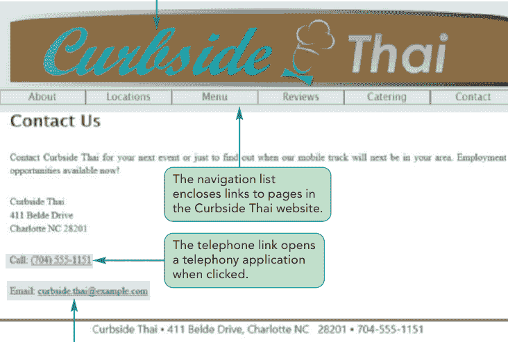

| 关于 | 地点 | 菜单 | 评价 | 餐饮服务 | 联系我们 |
| --- | --- | --- | --- | --- | --- |

联系 Curbside Thai 预订您的下一次活动，或了解我们的移动餐车是否将出现在您所在的地区。现有用职机会！

- Curbside Thai
- 411 Belle Drive
- Charlotte NC 28201

导航列表链接到 Curbside Thai 网站中的页面。

电话链接在点击时会打开电话应用程序。

拨打 (704) 555-1151

电子邮件：curbsideethai@example.com

Curbside Thai • 411 Belle Drive, Charlotte NC 28201 • 704-555-1151

电子邮件链接在点击时会打开电子邮件程序。

WOW! eBook

www.wowebook.org

## 使用列表

在上一节中，你使用了一些 HTML 分节和分组元素，为你的网页添加顺序和结构。另一种类型的分组元素是列表。HTML 支持三种类型的列表：有序列表、无序列表和描述列表。

## 有序列表

有序列表用于遵循某些定义顺序的项目的项目，例如按字母顺序或数字顺序排列的项目。有序列表使用 `<ol>`（有序列表）元素标记，每个列表项使用 `<li>` 元素。基本结构如下：

```html
<ol>
  <li>item1</li>
  <li>item2</li>
</ol>
```

其中 `item1`、`item2` 等是列表中的项目。例如，以下有序列表列出了前三个最受欢迎的州：

```html
<ol>
  <li>California</li>
  <li>Texas</li>
  <li>New York</li>
</ol>
```

默认情况下，浏览器将在数字旁边显示列表项。对于有序列表，这是一个从数字 1 开始并按值递增的数值。例如，各州的有序列表在大多数浏览器中将渲染为：

1. California
2. Texas
3. New York

注意，`<ol>` 和 `<li>` 元素都是分组元素，在不对这些元素应用不同样式的情况下，每个列表项都会出现在文档中。

要显示不同的编号，可以使用 `<ol>` 的 `start` 和 `reverse` 属性。`start` 属性提供列表中第一个项目的数字值，而 `reverse` 属性指定列表应按降序显示。因此，以下 HTML 代码列出了最受欢迎的州：

```html
<ol start="50" reverse>
  <li>California</li>
  <li>Texas</li>
  <li>New York</li>
</ol>
```

将渲染为从 50 开始的降序列表：

50. California
49. Texas
48. New York


你可以通过为每个列表项添加 `value` 属性来显式定义值。之前显示的列表可以使用以下代码生成：

```html
<ol>
  <li value="50">California</li>
  <li value="49">Texas</li>
  <li value="48">New York</li>
</ol>
```

你可以使用样式表使用字母标记 (A, B, C, ...) 或罗马数字 (I, II, ...) 来定义列表。你将在教程 2 中探索这种技术。

## 无序列表

无序列表用于项目没有顺序的项目。无序列表的结构与有序列表相似，不同之处列表项在 `<ul>`（无序列表）元素内分组：

```html
<ul>
  <li>item1</li>
  <li>item2</li>
</ul>
```

例如，以下 HTML 代码创建了沿太平洋海岸所有州的无序列表：

```html
<ul>
  <li>California</li>
  <li>Oregon</li>
  <li>Washington</li>
</ul>
```

默认情况下，浏览器将带有项目符号显示无序列表中的项目。因此，太平洋各州的无序列表可能会渲染为：

- California
- Oregon
- Washington

无序列表的确切外观取决于应用于元素的样式表。

## 创建嵌套列表

由于 `<li>` 元素本身是一个分组元素，它可以用于分组其他列表，从而创建一系列嵌套列表。无序列表集合的基本结构为：

```html
<ul>
  <li>Item 1</li>
  <li>Item 2
    <ul>
      <li>Sub Item 1</li>
      <li>Sub Item 2</li>
    </ul>
  </li>
</ul>
```

其中 `Sub Item 1`、`Item 2` 等包含在 `Item 2` 列表中。例如，州和城市的无序列表可以标记为：

```html
<ul>
  <li>California</li>
  <li>Oregon
    <ul>
      <li>Portland</li>
      <li>Salem</li>
    </ul>
  </li>
  <li>Washington</li>
</ul>
```

大多数浏览器将通过增加缩进并在嵌套列表的每一层使用不同的列表样式来区分各个级别，例如将上述 HTML 代码渲染为：

* California
* Oregon
  * Portland
  * Salem
* Washington

每层使用的标记和应用于每个嵌套列表的缩进量由样式表决定（浏览器内置或页面设计师提供的）。你将在教程 2 中探索这种技术。

## 描述列表

第三种列表是**描述列表**，它包含术语和匹配描述的列表。描述列表由 `<dl>` 列表元素分组，术语用 `<dt>` 描述术元素标记，每个术语对应的描述用 `<dd>` 元素标记。基本结构如下：

```html
<dl>
  <dt>term</dt>
  <dd>description1</dd>
  <dt>term2</dt>
  <dd>description2</dd>
  <dt>term3</dt>
  <dd>description3</dd>
</dl>
```

其中 `term1`、`term2` 等是列表中的术语，而 `description1`、`description2`、`description3` 等是与术语相关的描述。注意，描述必须紧随其所描述的术语，并且每个术语可能提供多个描述。

默认情况下，大多数浏览器将对每个术语对应的描述进行缩进。标记很少与描述术语或描述对齐。Sarah 想要在一个显示 Seaside Thai 销售的某些菜单项的页面中使用描述列表。她已经开始编写 HTML 代码，但你需要通过添加描述的标记来完成它。

## 完成菜单页面

1. 在你的 HTML 编辑器中打开来自 html01 ▶ tutorial 文件夹的 **menu.txt** 文件。在注释部分输入你的**姓名**和**日期**，并将文件保存为 **ct_menu.html**。
2. 如果文本编辑器中尚未打开 **pages.txt** 文件，请打开它，并将五个菜单项复制到移动菜单中。
3. 回到 HTML 编辑器中的 **ct_menu.html** 文件，将复制的文本直接粘贴在 `<h1>Mobile Menu</h1>` 之后。
4. 使用起始和结束 `<dl>` 标签将整个菜单包起来。
5. 使用 `<dt>` 元素标记每个菜单项目的名称。使用 `<dd>` 元素标记相应的描述。缩进你的代码以便更易于阅读和理解。

图 1-32 显示了移动菜单描述列表的完成代码。

## 图 1-32 将餐厅菜单标记为描述列表

每个菜单项的名称被标记为描述术语（`<dt>`）；关于该项目的信息被标记为描述（`<dd>`）。

```html
<article>
  <dl>
    <dt>罗勒牛肉芝麻沙拉</dt>
    <dd>辣安格斯牛肉和甜罗勒撒在新鲜混合蔬菜、紫甘蓝、胡萝卜、黄瓜和番茄上；配芝麻油醋 ($9.95)</dd>
    <dt>Curbside 米饭</dt>
    <dd>与洋葱、红灯椒、豌豆和胡萝卜一起炒，用紫甘蓝、黄瓜、葱和炸蒜末装饰 ($6.50)；加鸡肉 ($8.50) 或虾仁 ($10.00)</dd>
    <dt>蒜椒猪肉</dt>
    <dd>与新鲜大蒜和胡椒一起炒；配蒸茉莉饭、紫甘蓝、胡萝卜、黄瓜、葱和炸蒜末 ($8.50)</dd>
    <dt>泰式河粉</dt>
    <dd>豆芽和韭菜炒河粉，用紫甘蓝、胡萝卜、葱、青柠和碎花生装饰 ($7.50)；加鸡肉 ($8.50) 或虾仁 ($9.50)</dd>
    <dt>泰式红咖喱</dt>
    <dd>传统的红咖喱用椰奶、竹笋、新鲜罗勒、青柠和泰式辣椒煮制，盛放在蒸茉莉饭上 ($7.50)；加鸡肉 ($8.50) 或虾仁 ($9.50)</dd>
  </dl>
</article>
```

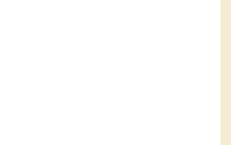

6. 将你的更改保存到文件中，然后在浏览器中打开 `ct_menu.html` 文件。图 1-33 显示了 Curbside Thai 的完成后的菜单。

## 图 1-33 Curbside Thai 菜单作为描述列表

| 术语 | 描述 |
| --- | --- |
| 罗勒牛肉芝麻沙拉 | 辣安格斯牛肉和甜罗勒撒在新鲜混合蔬菜、紫甘蓝、胡萝卜、黄瓜和番茄上；配芝麻油醋 ($9.95) |
| Curbside 米饭 | 与洋葱、红灯椒、豌豆和胡萝卜一起炒，用紫甘蓝、黄瓜、葱和炸蒜末装饰 ($6.50)；加鸡肉 ($8.50) 或虾仁 ($10.00) |
| 蒜椒猪肉 | 与新鲜大蒜和胡椒一起炒；配蒸茉莉饭、紫甘蓝、胡萝卜、黄瓜、葱和炸蒜末 ($8.50) |
| 泰式河粉 | 豆芽和韭菜炒河粉，用紫甘蓝、胡萝卜、葱、青柠和碎花生装饰 ($7.50)；加鸡肉 ($8.50) 或虾仁 ($9.50) |
| 泰式红咖喱 | 传统的红咖喱用椰奶、竹笋、新鲜罗勒、青柠和泰式辣椒煮制，盛放在蒸茉莉饭上 ($7.50)；加鸡肉 ($8.50) 或虾仁 ($9.50) |

注意 Saja 为其网站使用的样式是列表中每个术语和描述之间的分隔线。

描述列表也可以使用任何通用列表，将一个列表中的一个项目与另一个提供有关第一个列表项目额外信息的列表进行配对。例如，Saja 有一个页面列出了 Curbside Thai 出现的时间和地点。通过将内容封装在描述列表中完成此页面，将列表标记为“项目 (items)”，将地点标记为列表“描述 (descriptions)”。

## 创建时间和地点页面

1. 在你的 HTML 编辑器中打开 html01 教程中的 **ct_locations.txt** 文件。在注释部分输入你的**姓名**和**日期**，并将其保存为 **ct_locations.html**。
2. 回到文本编辑器中的 **ct_pages.txt** 文件，并从“今日页面 (Today's Pages)”中复制四个地点。
3. 回到 HTML 编辑器中的 **ct_locations.html** 文件，将复制的文本直接粘贴在 `<h1>Today's Locations</h1>` 之后。
4. 使用 `<dl>` 元素标记时间和地点列表。使用 `<dt>` 元素标记每个时间，使用 `<dd>` 元素标记每个地点。缩进你的代码以便于阅读和理解。
5. 为了将此列表与网站中的描述列表区分开

```html

```

## 标记日期和时间

“时间在互联网上转即逝”的格言也意味着网页上充斥着不再相关甚至可能不再准确的旧文章、文档和新闻故事。你发布到网络上的任何内容都应该带有时间戳以记录其历史。创建日期时间值的一种方法是使用 `<time>` 元素：

```html
<time datetime="value">content</time>
```

其中 `value` 是与包含内容相关的日期和时间。日期应以 `yyyy-mm-dd` 格式输入，其中 `yyyy` 是四位年份，`mm` 是两位月份，`dd` 是两位日期。时间应以 24 小时制的 `hh:mm` 格式输入小时和分钟。要组合日期和时间，输入日期和时间，并用 `T` 隔开：

```html
<time datetime="2017-03-14T15:32">March 14, 2017 at 3:32 pm</time>
```

对于国际标准时间：

```html
<footer>更新于：<time datetime="2017-03-14T15:32Z">March 14, 2017 at 3:32 pm</time></footer>
```

对于格林威治时间，应用程序可以根据以下代码相对于格林威治时间：

```html
<p>更新于：<time datetime="2017-03-10T20:30Z">March 10, 2017 at 8:30 pm</time></p>
```

`datetime` 属性对用户是不可见的，但搜索引擎等可以使用它来识别时间。


# HTML 52 HTML 和 CSS | 教程 1 HTML 入门

## 图 1-32 将餐厅菜单标记为描述列表

每个菜单项的名称被标记为描述术语（`dt`）；关于该项目的信息被标记为描述（`dd`）。

```html
<article>
  <dl>
    <dt>新鲜混合蔬菜、紫甘蓝、胡萝卜和番茄上撒上甜罗勒的牛肉芝麻沙拉；配芝麻油醋 ($9.95)</dt>
    <dt>Curbside</dt>
    <dd>炒饭，加入洋葱、红灯椒、豌豆和胡萝卜，用卷心菜、黄瓜、葱和炸蒜末装饰 ($6.50)；加鸡肉 ($8.50) 或虾仁 ($10.00)</dd>
    <dt>蒜椒猪肉</dt>
    <dd>腌制猪肉配新鲜大蒜和胡椒炒制；配蒸茉莉饭、紫甘蓝、胡萝卜、黄瓜、葱和炸蒜末 ($8.50)</dd>
    <dt>泰式河</dt>
    <dd>豆芽和白菜炒河粉，用紫甘蓝、胡萝卜、葱、青柠和碎花生装饰 ($7.50)；加鸡肉 ($8.50) 或虾仁 ($9.50)</dd>
    <dt>泰式红咖喱</dt>
    <dd>传统的红咖喱用椰奶、竹笋、新鲜罗勒、青柠和泰式辣椒煮制，盛放在蒸茉莉饭上 ($7.50)；加鸡肉 ($8.50) 或虾仁 ($9.50)</dd>
  </dl>
</article>
```


6. 将你的更改保存到文件中，然后在浏览器中打开 `ct_menu.html` 文件。图 1-33 显示了 Curbside Thai 的完成后的菜单。

# 教程 1 HTML5 入门 | HTML 和 CSS

## 图 1-33

### Curbside Thai 菜单作为描述列表

| 术语 | 描述 |
| --- | --- |
| 罗勒牛肉芝麻沙拉 | 辣安格斯牛肉和甜罗勒撒在新鲜混合蔬菜、紫甘蓝、胡萝卜、黄瓜和番茄上；配芝麻油醋 ($0.95) |
| Curbside 米饭 | 与洋葱、红灯椒、豌豆和胡萝卜一起炒，用紫甘蓝、黄瓜、葱和炸蒜末装饰 ($6.50)；加鸡肉 ($8.50) 或虾仁 ($5.50) |
| 蒜椒猪肉 | 与新鲜大蒜和胡椒一起炒；配蒸茉莉饭、紫甘蓝、胡萝卜、黄瓜、葱和炸蒜末 ($8.50) |
| 泰式河 | 豆芽和韭菜炒河粉，用紫甘蓝、胡萝卜、葱和碎花生装饰 ($7.50)；加鸡肉 ($8.50) 或虾仁 ($9.50) |
| 泰式红咖喱 | 传统的红咖喱酱用椰奶、竹笋、新鲜罗勒、青柠和泰式辣椒煮制，盛放在蒸茉莉饭上 ($7.50)；加鸡肉 ($8.50) 或虾仁 ($9.50) |

注意 Saja 为其网站使用的样式是列表中每个术语和描述之间的分隔线。

描述列表也可以使用任何通用列表，将一个列表中的一个项目与另一个提供有关第一个列表项目额外信息的列表进行配对。例如，Saja 有一个页面列出了 Curbside Thai 出现的时间和地点。通过将内容封装在描述列表中完成此页面，将列表标记为“项目 (`items`)”，将地点标记为列表“描述 (`descriptions`)”。

## 创建时间和地点页面：

1. 在你的 HTML 编辑器中打开 html01 教程中的 `ct_locations.txt` 文件。在注释部分输入你的**姓名**和**日期**，并将其保存为 `ct_locations.html`。
2. 回到文本编辑器中的 `ct_pages.txt` 文件，并从“今日页面 (Today's Pages)”中复制四个地点。
3. 回到 HTML 编辑器中的 `ct_locations.html` 文件，将复制的文本直接粘贴在 `<h1>Today's Locations</h1>` 之后。
4. 使用 `dl` 元素标记时间和地点列表。使用 `dt` 元素标记每个时间，使用 `dd` 元素标记每个地点。插入你的代码以便于阅读和理解。
5. 为了将此列表与网站中的描述列表区分开

```html

```

# 教程 1 HTML5 入门 | HTML 和 CSS

## 标记日期和时间

“时间在互联网上转即逝”的格言也意味着网页上充满了不再相关甚至可能不再准确的旧文章、文档和新闻故事。你发布到网络上的任何内容都应该带有时间戳以记录其历史。创建日期时间值的一种方法是使用 `time` 元素

```html
<time datetime="value">content</time>
```

其中 `value` 是与包含内容相关的日期和时间。日期应以 `yyyy-mm-dd` 格式输入，其中 `yyyy` 是四位年份，`mm` 是两位月份，`dd` 是两位日期。值应以 24 小时制的 `hh.mm` 格式输入两个小时和分钟。要组合日期和时间，输入日期和时间，并用 `T` 隔开：

```html
<time datetime="2017-03-14T15:32">March 14, 2017 at 3:32 pm</time>
```

对于国际标准时间：

```html
<footer>更新于：<time datetime="2017-03-14T15:32">March 14, 2017 at 3:32 pm</time></footer>
```

对于格林威治时间，应用程序可以根据以下代码相对于格林威治时间：

```html
<p>更新于：<time datetime="2017-03-10T20:30">March 10, 2017 at 8:30 pm</time></p>
```

`datetime` 属性对用户是不可见的，但搜索引擎等可以使用它来识别时间。

## 使用超链接

超文本通过将内容封装在一组开启和结束的 `<a>` 标签中创建，结构如下：

```html
<a href="url">content here</a>
```

其中 `URL` 是统一资源定位符（URL），它是用于识别资源位置的标准格式，`content` 是被标记为链接的内容。当链接同一文件夹中的另一个 HTML 文件时，`URL` 仅仅是文件名。

## 创建链接列表

链接列表位于 `nav` 元素内的无序列表：

1. 在 HTML 编辑器中打开 `ct_about.html` 文件。
2. 在 Curbside Thai 标志下方插入以下列表：

```html
<nav>
  <ul>
    <li>关于</li>
    <li>地点</li>
    <li>菜单</li>
    <li>评价</li>
    <li>餐饮服务</li>
    <li>联系</li>
  </ul>
</nav>
```

## 标记超链接

要将内容标记为超链接，请使用

`<a href="url">content</a>`

其中 `url` 是被链接文档的地址，`content` 是正被标记为链接的文档内容。

对导航列表中的六项内容进行标记，将每项指向相应的 Curbside Thai 页面。

## 创建超链接：

1. 回到 HTML 编辑器中打开 `ct_about.html` 文件。
2. 将第一项标记为指向 `ct_about.html` 文件的超链接，将列表项更改为

`<a href="ct_about.html">关于我们</a>`

3. 将第二个列表项的代码更改为

`<a href="ct_locations.html">我们的位置</a>`

4. 按照同样的方法，将 Menu（菜单）更改为指向 `ct_menu.html` 的链接，将 Reviews（评价）项更改为指向 `ct_reviews.html` 的链接，将 Catering（餐饮）项更改为指向 `ct_catering.html` 文件的链接，并将 Contact（联系我们）项更改为指向 `ct_contact.html` 文件的链接。

图 1-38 显示了新添加的代码，这些代码将导航列表中的所有项目更改为超链接。

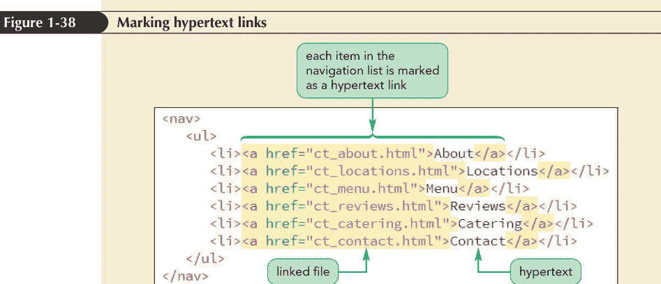

5. 保存文件更改，然后在浏览器中重新打开 `ct_about.html` 文件。
6. 点击六导航列表中的每一项，并验证浏览器是否加载了相应的网页。在查看每个文档后，使用浏览器的“后退”按钮返回 About Side Thai 页面。

## 教程 1 HTML5 入门 | HTML 和 CSS HTML 59

**遇到问题？** 如果链接无法工作，请确保你的代码与图 1-38 一致。例如，检查每个 `<a>` 标签 `href` 属性中文件名的拼写，确保它与相应的 Curbside Thai 页面的文件名匹配，并确保包含了所有的起始和结束标签。

你可能已经注意到，当鼠标指针悬停在导航列表中的链接上时，链接的外观会变为黑底白字。这是一个悬停效果（rollover effect）的示例，用于提供视觉提示，说明文本是超链接而非普通文本。你将在教程 2 中学习如何创建悬停效果。

## 将内联图像转换为链接

也可以通过将图像包含在起始和结束 `<a>` 标签内将内联图像转换为链接。将 Curbside Thai logo 指向你在第一个会话中打开的 Startup（启动）页面的超链接。

### 要将图像标记为超链接：

1. 回到 HTML 编辑器中打开 `ct_about.html` 文件。
2. 通过更改 HTML 代码将页眉中的图像标记为超链接

`<a href="ct_start.html"></a>`

图 1-39 显示了将 logo 更改为超链接的代码。

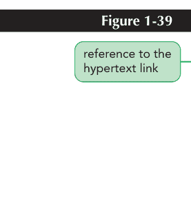

| 超链接的引用 | <body><header><a href="ct_start.html"></a></nav><ul> |
| | --- |

3. 保存文件更改，并在浏览器中返回 `ct_about.html` 文件。
4. 点击 Curbside Thai logo，验证浏览器是否打开了 Curbside Thai Startup 页面。点击“后退”按钮返回 About Curbside Thai 页面。

Sajja 希望能够从任何页面跳转到 Curbside Thai 网站上的任何文档。他要求你将从 `ct_about.html` 文件中刚刚创建的超链接（包括图像链接）复制到网站的其他文档中。

### 要复制并粘贴超链接：

1. 回到 HTML 编辑器中打开 `ct_about.html` 文件。
2. 复制从起始 `<header>` 标签到结束 `</header>` 标签的页头全部内容，添加公司名称和导航列表的修订代码。

> WOW! eBook
> www.wowebook.org
> Copyright 2018 Cengage Learning. 保留所有权利。未经许可不得全部或部分复制、扫描或复制。WCN 020-23-200

## HTML 60 HTML 和 CSS | 教程 1 HTML5 入门

3. 转到 HTML 编辑器中的 `ct_locations.html` 文件。粘贴复制的 HTML 代码，替换此文档中之前的页头。保存文件更改。
4. 对 `ct_menu.html`、`ct_reviews.html`、`ct_catering.html` 和 `ct_contact.html` 文件重复上述步骤，将这些文档中的正文头部替换为来自 `ct_about.html` 的修订后的页头。保存每个文件的更改。
5. 在浏览器中重新打开 `ct_locations.html` 文件，验证你可以通过点击每个页面顶部导航列表中的项目从一个页面跳转到另一个页面。还要验证你可以随时点击顶部 logo 跳转到 Startup 页面。

> **提示**
>
> 通过在每个页面上包含相同的导航列表，使你的网站设计统一，这样用户就可以轻松从一个页面移动到另一个页面。

## 指定文件夹路径

在创建的链接中，浏览器假设链接的文件与当前文件在同一个文件夹中。然而，包含数百份文档的大型网站通常将文档放在单独的文件夹中以便管理。在目录结构中，将文档放在不同的文件夹中会更易管理。从根目录开始，Sajja 组织的 HTML 目录结构如图 1-40 所示，随着网站规模增加，将文档放在不同的文件夹中。例如，通用目录（general）、移动目录（mobile）、餐饮目录（catering）等文件夹分别描述了 Curbside Thai 的服务。

图 1-40

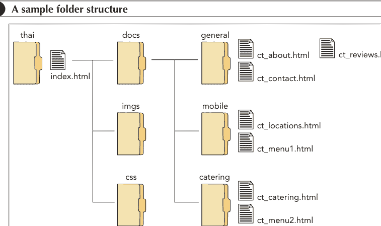

© 2016 Cengage Learning

WOW! eBook

www.wowebook.org

版权保留所有权利。未经许可不得全部或部分复制、扫描或复制。

## 教程 1 HTML5 入门 | HTML 和 CSS HTML 61

要创建文件之间的链接，HTML 支持两种类型的路径：绝对路径和相对路径。

## 绝对路径

绝对路径是从根目录开始并包含整个文件夹结构的路径，如

`/folder1/folder2/folder3`

其中 `folder1` 是根目录，后面是文件夹2 等直到链接文件。例如，根据图 1-40 所示的结构，`catering.html` 的绝对路径将是 `/thai/docs/catering.html`。

如果文件位于不同的驱动器以及不同的文件夹，则必须在路径中包含驱动器，表达式为

`drive/folder1/folder2/folder3`

其中 `drive` 是分配给驱动器的字母。如果 `catering.html` 文件位于 E 盘，则绝对路径将是 `E:/thai/docs/catering.html`

注意，如果链接文档位于相同的驱动器上，则不需要包含驱动器。

## 相对路径

当涉及许多文件夹和子文件夹时，绝对路径表达式很快变得很长且难以处理。为此，网页设计师倾向于使用相对路径，路径相对于当前文档的位置。如果当前文档和链接文件在同一个文件夹中，则不需要路径，只需要文件名。如果链接文件位于当前文档的子文件夹中，路径包含从当前页面开始的所有文件夹名称，表达式为

`folder1/relative-file.html`

其中 `folder1`、`folder2` 等是当前文档的文件夹。例如，从 `index.html` 文件到 `ct_about.html` 文件的相对路径是

`general/ct_about.html`

注意，相对路径通常用父级、子、后代、兄弟等家族关系来表示，以指示文件夹结构的层次结构。相对路径还可以通过包含符号 (`..`) 向上层级结构移动，它表示“向上一个级别”。因此，要从 general 目录中的 `ct_about.html` 文件向上两级到 index 文件，你需要输入表达式

`../index.html`

最后，要在文件夹结构中横向移动以访问同一层级不同文件夹中的文件，你需要回到父文件夹，然后进入另一个子文件夹：从 general 目录中的 `ct_about.html` 文件到 mobile 目录中的 `ct_locations.html` 文件，你将使用相对路径表达式

`../mobile/ct_locations.html`

# HTML 62 HTML 和 CSS | 教程 1 从 HTML5 开始

在上述表达式中，链接向上到父文件夹 `doc` 的 `ct_locations.html` 引用，然后向下通过 `mobile` 文件夹。


你应该始终在链接中使用相对路径。如果你必须将文件移动到不同的计算机或服务器，你可以移动整个文件夹结构，而无需编辑你创建的相对路径。如果你使用绝对路径，你将不得不修改每个链接，以反映文件夹树在新设备上的新位置。

## 设置基础路径

如你所见，浏览器根据当前文档的位置来解析相对路径。你通过向文档中添加以下 `base` 元素来为相对路径定义一个起点：

```html
<base href="url" />
```

其中 `url` 是浏览器在解析当前文档中的相对路径时将使用的位置。当网站的某个单个文档移动到新文件夹时，会使用该 `base` 元素。在重写所有相对路径以反映文档的新位置后，`base` 元素可以指向文档的旧位置，从而允许相对路径像以前一样正常工作。

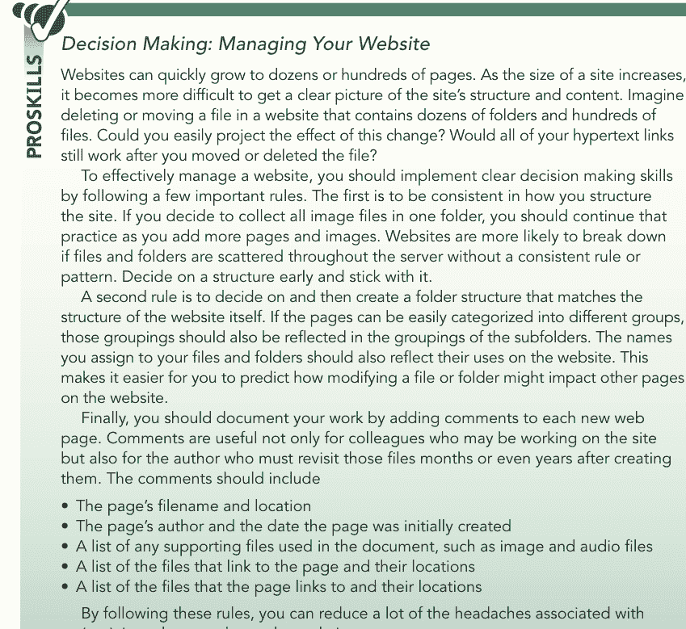

# 决策制定：管理你的网站

网站会迅速增长几十个或数百个页面。随着网站规模的增大，很难清晰地了解网站结构和内容。想象在一个包含几十个文件夹和数百个文件的网站中删除或移动一个文件。在你删除文件后，你所有的超链接还能正常工作吗？

为了有效管理网站，你应该通过遵循一些重要的规则来实施清晰的决策技巧。第一点是在网站结构上保持一致。如果你将所有图像收集在一个文件夹中，那么在添加更多页面和图像时也应该继续这样做。如果文件夹散布在服务器各处而没有一致的规则或模式，网站就容易崩溃。尽早决定一个结构并坚持下去。

第二规则是决定并创建一个与网站本身结构匹配的文件夹结构。如果页面可以很容易地分类为不同的组，那么这些组也应该反映在文件夹的分组中。你为文件和文件夹指定的名称会影响它们，并让你更容易预测修改文件或文件夹可能会对网站上的其他页面产生什么。

最后，你应该通过为每个新页面添加注释来记录你的工作。注释不仅对可能处理该网站的同事有用，对你在创建几个月或几年后重新访问它们的自己也有用。注释应该包括：

- 页面的文件名和位置
- 页面的作者和初始创建日期
- 文档中使用的支持文件列表，例如图像和音频文件
- 链接到该页的文件列表及其位置
- 指向该页的文件列表及其位置

通过遵循这些规则，你可以减少维护大型复杂网站相关的许多头疼问题。

# 链接到文档内部的位置

超文本可以指向文档内部的位置。例如，长词表中的某个特定定义，以避免滚动文档的麻烦。包含小说或剧本文本的网站可以包含指向其内部章节或短语的链接。当建立指向文档内某个位置的链接时，浏览器将跳转到该位置并滚动页面到链接的位置。

> **提示**
>
> 通常情况下，网页不应跨越一个或两个屏幕。研究显示，用户经常会跳过内容超出屏幕的长页面。

## 使用 `id` 属性标记位置

为了让用户能够跳转到文档内的特定位置，你需要通过在该位置的元素标签上添加 `id` 属性来标识该位置：

`id="text"`

其中 `text` 是分配给 ID 的名称。想象 Sajja 写了一个页面，描述 Curside 提供的完整菜单。他可以通过在开始午餐菜单部分的 `h2` 标题上添加 `id` 属性，标记页面中显示午餐菜单的位置。

```html
<h2 id="lunch">Lunch Menu</h2>
```

注意，ID 必须是唯一的。如果你为多个元素分配相同的 `id`，浏览器将跳转到该 `id` 值第一次出现的地方。

### 链接到 `id`

一旦你用 `id` 标记了位置，你就可以使用链接跳转到其后的元素：

```html
<a href="#id">内容</a>
```

其中 `file` 指向链接文档的位置和文件名，`id` 是该文档中的一个属性。例如，下面的超链接链接到 `ct_fullmenu.html` 文件中 `id` 为 "lunch" 的点。

```html
<a href="ct_fullmenu.html#lunch">查看我们的午餐菜单</a>
```

要链接到当前页面内部，仅包含 `#` 及其 `id` 值。因此，下面的超链接链接到当前页面内的 `lunch` id：

```html
<a href="#lunch">查看我们的午餐菜单</a>
```

在两种情况下，点击或触碰链接都会导致浏览器滚动到页面内的位置。

### 锚点和 `name` 属性

早期的网页不支持使用 `id` 属性作为标记文档内位置的方法。相反，它们使用 `<a>` 标签作为锚点来标记页面位置（因此 `<a>` 标签中是 "a"）。锚点的一般形式是：

```html
<a name="anchor">内容</a>
```

其中 `anchor` 是赋予给锚点的名称。在标签内插入内容是可选的，因为该标签的主要目的是标记文档位置，而不是编写内容。例如，下面的代码将在 Curside 的章节开头建立一个锚点：

```html
<h2 name="lunch">Lunch Menu</h2>
```

一旦设置了锚点，你就可以使用与 `id` 属性相同的语法链接到锚点。锚点使用是 HTML 的一个弃用功能，在严格应用程序中不受支持，但你仍会在旧代码中看到它们。

## 链接到文档内部位置总结

- 要标记位置，请使用以下 `id="text"` 为文档位置的元素添加唯一的 ID。
  - 其中 `text` 是 ID 的值。
- 要从不同的文档链接到某个位置，使用超文本引用：
  `<a href="file#text">内容</a>`
  - 其中 `file` 是外部文件的名称和路径（如有必要），`text` 是 ID 的值。
- 要从同一文档内部链接到某个位置，使用超文本引用：
  `<a href="#text">内容</a>`

# 链接到互联网和其他资源

超链接指向的资源类型由链接的 URL 指明。所有链接具有通用结构：`scheme:location`，其中 `scheme` 指明资源类型，`location` 提供资源。`scheme` 的名称取自访问资源时使用的网络协议，协议是定义信息在两个设备之间传递的一组规则。在 Web 页面上，使用超文本传输协议 (HTTP) 协议，许多 Web 页面以 `http` 方案开头。包含在 URL 中的其他方案见图 1-41。

**图 1-41 常用方案**

| 方案 | 说明 |
| --- | --- |
| `fax` | 传真号码 |
| `file` | 存储在计算机本地的 |
| `ftp` | 存储在 FTP 服务器上的文档 |
| `geo` | 地理坐标 |
| `http` | World Web 上的资源 |
| `https` | 通过安全连接访问的 World Web 上的资源 |
| `mailto` | 电子邮件地址 |
| `tel` | 电话号码 |
| `sms` | 通过短信服务发送的移动短信 |

## 链接到网络资源

如果你访问过网页，你应该熟悉网站的 URL，它们具有如下结构：

```
https://server/path/filename#id
```

其中 `server` 是托管该资源的 Web 服务器名称，`path` 是该服务器上文件的路径，`filename` 是文件名，如果需要，`id` 是文件内部某个 `id` 或锚点的名称。例如，使用 HTTP 协议访问位于 `www.cursidethai.com` 的 Web 服务器，链接到位于 `menus.html` 文件中 `#thai/anchor` 锚点处的 `menus.html` 文档：

```
http://www.cursidethai.com/thai/docs/menus.html#anchor
```

URL 通常以更简短的形式输入，不包含路径或文件名。这些 URL 指向位于服务器根目录的默认页面。许多服务器使用 `index.html` 作为默认页的文件名，因此 URL `http://www.cursidethai.com` 等于 `http://www.cursidethai.com/index.html`。

## 理解域名


URL 的服务器名称也称为域名。通过学习域名，你会学到域名包含由点（.）分隔的层级化名称，顶层出现在最右侧。顶层称为扩展名，它表示 Web 服务器支持的通用受众。例如，`.edu` 留给教育机构，`.gov` 用于美国机构，而 `.com` 用于商业或通用站点。

紧邻扩展名左侧的下一级显示站点名。域名 `cursidethai.com` 表示一个由 Cursidethai 拥有的机构或通用站点。为了避免域名重名，域名的顶层在使用之前已在互联网名称分配机构 (IANA) 注册。你可以通过你的 Web 托管公司注册你的域名。你必须支付年费来保留域名。

域名的最低层级（出现在域名中最左侧的部分）由托管该网站的个人或组织分配。包含数百页面的大型网站会将域名分为几个层级。例如，像微软这样的公司可能有一个域名 `downloads.microsoft.com`，另一个用于客户服务的域名 `service.microsoft.com`。最后，域名的第一部分显示存储网站文件的硬盘或目录名称。许多公司已将某些部分作为域名的开头。

## 链接到电子邮件地址

许多网站使用电子邮件与网站所有者、代表或技术支持进行通信。你可以使用 URL 将电子邮件地址转换为超链接：

`mailto:address`

电子邮件地址在哪里？激活自动插入到新发邮件“收件人”栏的电子邮件地址。要创建一个指向电子邮件 `s.adulet@example.com` 的超链接，可以使用以下 URL：

`mailto:s.adulet@example.com`

`mailto` 还允许你使用以下 URL 在邮件中插入额外的地址：

`mailto:address?field1=value1&field2=value2...`

`field1`、`field2` 等是不同的字段，`value1`、`value2` 等是值。字段包括用于邮件主题行的 `subject` 和用于正文的 `body`。要创建一个如下内容的邮件：

```
TO: s.adulet@example.com
SUBJECT: Test Message
```

你将使用 URL：

`mailto:s.adulet@example.com?subject=Test&body=Test%20Message`

请注意，正文使用 `%20` 字符来表示空格，因为 URL 不能包含空格。

在联系页面上，Sajja 插入了 Curdb Thai 的电子邮件地址。将此电子邮件转换为超链接。

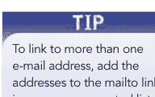

要链接到多个电子邮件地址，请在逗号分隔的列表中添加要链接的地址。

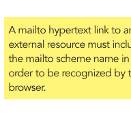

### 实操：链接到电子邮件地址

1. 在你的 HTML 编辑器中打开 `ct_contact.html` 文件。
2. 将 Curdb Thai 电子邮件地址更改为以下 `mailto` 超链接：
   ```html
   <a href="mailto:curdbai.thai@example.com">curdbai.thai@example.com</a>
   ```
   请注意，这是一个虚构的电子邮件地址。如果你想测试此链接，请将 URL 修改为你自己的电子邮件地址。图 1-42 高亮了指向链接邮件地址的超文本。
   
3. 点击电子邮件地址，验证你的设备是否打开了 `mailto` 程序而没有发送。
4. 保存链接的更改并重新打开浏览器。

### 邮件链接与垃圾邮件

在你的网站上添加电子邮件链接时要小心。虽然这可能让用户更方便地与你联系，但也可能让你更容易受到垃圾邮件的影响。垃圾邮件是发送给许多人的非自愿邮件，用于推广产品、服务，在某些情况下是不恰当的。垃圾邮件发送者通过扫描讨论组、窃取邮件列表以及使用名为“邮件采集器”的程序扫描 HTML 中的 `mailto` URL 来创建他们的邮件列表。解决这个问题没有快速简单的办法。与垃圾邮件发送者的斗争是一场持续的战斗，他们已被证明克服人们创建的某些防御方面非常有资源。在开发网站时，你应该仔细考虑如何处理电子邮件地址，并审查保护它们的当前方法。

## 链接到电话号码

随着手机访问网页的使用增加，许多开发者现在为他们的客户服务或帮助热线包含了电话链接。激活链接将打开你的电话应用并自动输入号码，使得拨打企业或组织的电话更加方便。电话链接的 URL 是：

`tel:phone`

其中 `phone` 是链接号码的数字。例如，以下代码创建了一个指向 Curide Thai 号的电话链接：

```html
<a href="tel:17045551151">Call us</a>
```

由于我们面向国际，任何电话链接都应包含国家代码和区号。空格或连字符是可选的，但国际区代码的 `+` 号除外。然而，你可以在以下电话链接中在电话号码中（国际访问时）插入 `+` 号：

```html
<a href="tel:+17045551151">Call: 555-1151</a>
```

Sja 允许你将“联系我们”页面上的电话转换为电话链接。

> **提示**
>
> 目前，桌面版 Skype 在电话链接中使用 `callto:` 而不是 `tel:`。网上有很多程序供你使用，以处理这两种协议。

### 实操：链接到电话号码

1. 回到 HTML 编辑器中的 `ct_contact.html` 文件。
2. 将 Curbside Thai 的号码更改为以下超链接：
   ```html
   <a href="tel:+17045551151">(704) 555-1151</a>
   ```
   一旦这个号码是虚构的，如果你想在移动设备上测试链接，可以将 URL 更改为指向你自己号码的链接。
   图 1-43 显示了电话链接的超文本代码。
   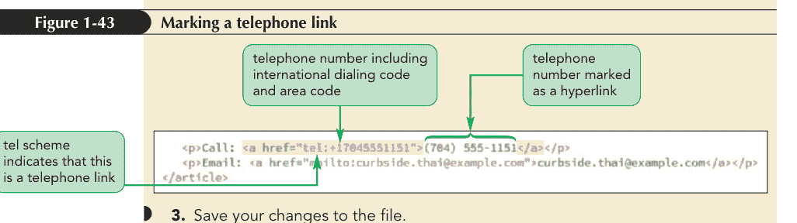

| 包含国际拨号和区号的电话号码 | 标记为超链接的电话号码 |
|---|---|
| `tel` 方案表示这是一条线路 | `<p>致电: <a href="tel:+17045551151">(704) 555-1151</a></p><br><p>邮件: <a href="mailto:curbside@example.com">curbside@example.com</a></p>` |

3. 保存你对文件的更改。

HTML 支持指向其他类型设备的链接。例如，你可以使用 `fax:` 方案创建指向传真机的链接，并使用 `sms:` 方案创建指向文本短信应用的链接。

## 使用超文本属性

HTML 为元素提供了若干属性，用于控制超文本链接的行为和外观。图 1-44 描述了这些属性。

**图 1-44 元素的属性**

| 属性 | 说明 |
|---|---|
| `href="url"` | 提供超文本链接的 url |
| `target="_blank\|_parent\|_self\|_top"` | 指定在何处打开文档 |
| `download="filename"` | 表示链接应作为文件下载，其中 `filename` 是下载文件的名称 [HTML5] |
| `rel="type"` | 提供被链接文档与当前页面之间的关系 |
| `hreflang="lang"` | 指定被链接文档的语言 |
| `type="mime-type"` | 指定被链接文档的媒体类型 |

### `target` 属性

使用 `target` 属性，你可以控制页面打开的方式。默认情况下，链接的 `target` 会替换浏览器窗口中的当前页面。在某些网站中，你希望在新浏览器窗口或标签页中打开链接，以便保留当前页面和链接视图。要强制文档在新窗口或标签页中打开，请为 `<a>` 标签添加以下 `target` 属性：

```html
<a href="url" target="_blank">content</a>
```

其中 `target` 是分配给链接页面视图中浏览器窗口或标签页的名称。你可以为浏览器窗口选择任何你喜欢的名称，或使用以下 `target` 名称：

- `_self` 在当前窗口或标签页中打开页面（默认值）
- `_blank` 根据浏览器的配置，在新窗口或标签页中打开页面
- `_parent` 在当前框架中打开页面（用于框架型网站）
- `_top` 在顶层框架中打开页面（用于框架型网站）

你应该在网站中谨慎地使用 `target` 属性。创建许多窗口会让用户的桌面变得混乱。此外，由于页面被放置在新窗口中，用户无法使用后退按钮来返回到该窗口中的上一个页面；他们必须点击浏览器的程序按钮或原始网站的标签页。这会让用户和其他人感到困惑。许多设计者并不反对使用 `target` 属性，而是为用户提供在新窗口或标签页中打开链接的选项。

## 书面沟通：创建超文本链接

为了让你的网站导航更易用，你的超文本链接类型应该准确告诉读者链接指向的是什么种类型的文档。例如，链接文本：

> 点击此处获取更多信息。

这并没有告诉用户点击此处会显示什么种类型的文档。对于“点击此处”之类的短语，你应该使用具有描述性的链接文本，如：

> 有关更多信息，请查看我们的[常见问题解答](#)


如果链接指向非 HTML 文件（如 PDF 文档），且文件较大、需要一些时间下载到用户计算机，请在链接文本中包含相关信息，以便用户决定是否启动传输。例如，以下链接文本在用户启动链接之前就告知了他们文档类型及其大小：

[下载我们的手册 (PDF 2 MB)](#)

最后，在设计网站样式时，让你的链接易于识别。用户不应该对链接感到困惑。此外，如果你为文本应用了颜色，请不要选择让超链接在网页背景上更难识别的颜色。

你完成了 Curbside Today 的工作。Sajja 将研究你的工作，并就他餐厅未来的项目与你联系。现在，你可以关闭打开的文件或应用程序了。

## 快速检查

- 1. 提供标记无序列表的代码：Packers, Bears, Lions。
- 2. 提供根据 IMDB 排名的前五名电影列表代码：Pulp Fiction, The Dark Knight, The Godfather, The Godfather Part II, The Shawshank Redemption。
- 3. 描述使用的 HTML 元素。
- 4. 提供创建导航列表的代码：Home, FAQ, Contact Us。
- 5. 提供以下文件的相对路径：`index.html`, `menu.html`, `events.html`, `catering.html`。
- 6. 提供指向 `about.html`, `glossary.html` 的链接。
- 7. 提供指向 `glossary.html` 的链接。
- 8. 提供 `sajia@example.com` 的邮箱。
- 9. 提供标记 `704-555` 的代码。

## 复习作业

- 1. 使用 HTML 编辑器打开 `html1` 文件夹中的 `mp_index.txt`, `mp_menu.txt`, `mp_events.txt` 和 `mp_catering.txt`。在每个文件的公共部分输入你的名字和日期，并将它们保存为 `mp_index.html`, `mp_menu.html`, `mp_events.html` 和 `mp_catering.html`。
- 2. 进入 HTML 编辑器中的 `mp_index.html` 文件。在文档中执行：
  a. 使用锚点元素将页面头部设置为 utf-8。
  b. 为文档添加关键词：Italian, Mobile, food 和 Charlotte。
  c. 设置文档标题为 Mobile Panini。
  d. 将文档链接到 `mp_base.css` 和 `layout-style.css`。

Curbside Thai 与另一个食品餐车供应商合作了。Saj 还想为公司创建一个网站。该网站将包含首页、在线菜单、机会描述和活动活动日历。首页的预览如图 1-45 所示。

图 1-45 Mobile Panini 首页

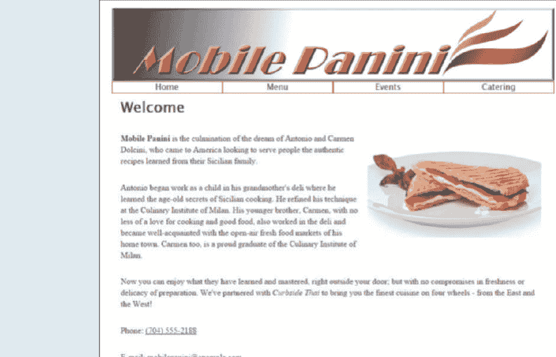

Mobile Panini 是 Antonio 和 Carmen Delano 梦想的结晶，他们来到美国是为了向人们提供他们从西西里中学到的正宗味道。Antonio 从小就成长在一个学习老传烹饪秘密的家庭中。他在米兰烹饪学院精炼了技艺。凭借对烹饪和美食的热爱，他非常熟悉家乡的露市。Carmen 也是米兰烹饪学院的毕业生。现在你可以在家门口享受到他们学到并精通的味道，而在新鲜度或制作上不作任何妥协。

Mobile Panini 31 West Avenue, Charlotte NC 28204 704-555-2188

邮件: mock-mobilepanini@example.com

# HTML 72

HTML 和 CSS | 教程 1 开始学习 HTML5

- 3. 转到文档主体（body）并插入包含以下内容的头部元素：
    * 插入一张来自 `mp_logo.png` 文件的内联图像，替代文本为 Mobile Panini。将图像标记为链接到 `mp_index.html` 文件的超链接。
    * 插入一个导航列表，其中包含一个带有以下项目的无序列表：首页（Home）、菜单（Menu）、活动和餐饮。分别将这些项目链接到 `mp_index.html`、`mp_menu.html`、`mp_events.html` 和 `mp_catering.html`。
- 4. 在头部元素下方插入一个 `article` 元素，插入一个包含以下文本的 `footer` 元素：
    Mobile Panini 31 West Avenue, Charleston NC 28204 704-555-2218
    使用 98332 字符代码插入 `&`，并使用 `nbsp` 字符在 NC 和 28204 之间添加一个额外的空格。
- 5. 在你的文本编辑器中打开 `mp_pages.txt` 文件。该文件包含 Mobile Panini 网站四个页的内容。复制“欢迎（Welcome）”部分的文本，它位于网站的首页。返回 HTML 编辑器中的 `mp_index.html`，并将复制的文本粘贴到 `article` 元素中。
- 6. 在 `article` 元素中，执行以下操作：
    * 将 Welcome 设为 `h1` 标题。
    * 在 `h1` 下方，插入一张包含 `mp_photo1.png` 文件的内联图像，替代文本为空字符串。
    * 使用 `p` 元素将五个段落设为段落。在第一段中，将文本 Mobile Panini 标记为**粗体文本**。在第三段中，将文本 Curside Thai 标记为*斜体文本*。
    * 第四段包含 Mobile Panini 的电话号码。将电话号码标记为电话链接，并确保 URL 中包含国际代码。注意，此号码是虚构的，如果你可以使用移动浏览器并想测试该链接，你可能将其替换为你的电话号码。
    第五段包含 Mobile Panini 的电子地址。将该电子地址标记为超链接。再次强调，此电子地址是虚构的，如果你想测试此链接，你需要将 Mobile Panini 的地址替换为你的电子地址。
- 7. 保存文件更改并在浏览器中打开 `mp_index.html`。按照图 1-4 所示验证页面的布局和外观。如果可能，测试电话号码和链接以验证它们是否打开了正确的应用程序。
- 8. 在文本编辑器中打开 `mp_index.html` 文件并复制头部和页脚元素。然后回到 HTML 编辑器中的 `mp_menu.html` 文件，并将头部和页脚元素粘贴到 `body` 元素中，使页面具有与首页相同的图标、导航列表和页脚。在头部和页脚之间插入一个 `article` 元素。
- 9. 返回文本编辑器中的 `mp_pages.txt` 文件并复制 Mobile Panini 菜单的内容。然后回到 HTML 编辑器中的 `mp_menu.html` 文件，并将复制的文本粘贴到 `article` 元素中。
- 10. 在 `mp_menu.html` 文件的 `article` 元素中，执行以下操作：
    * 将文本 Our Menu 标记为 `h1` 标题。
    * 将菜单项在一个描述列表中，每个菜单项名称标记为 `dt` 元素，每个菜单描述标记为 `dd` 元素。

WOW! eBook

www.wovebook.org

# 教程 1 开始学习 HTML5 | HTML 和 CSS HTML 73

- 11. 保存对 `mp_menu.html` 文件的更改。在浏览器中打开页面并验证菜单项目名称是否以**粗体**字体显示，并由水平线与缩进的项目隔开。
- 12. 在 HTML 编辑器中打开 `mp_index.html` 文件并复制头部和页脚元素。然后回到 HTML 编辑器中的 `mp_events.html` 文件，并将头部和页脚元素粘贴到 `body` 元素中。在头部和页脚之间插入一个 `article` 元素。
- 13. 回到 HTML 编辑器中的 `mp_index.html` 文件并复制日历（Calendar）标题下的活动列表。然后回到 HTML 编辑器中的 `mp_events.html` 文件，并将复制的文本粘贴到 `article` 元素中。
- 14. 在 `article` 中，执行以下操作：
    a. 将文本 Are We This? 标记为 `h1` 标题。
    b. 将每一天的活动封装在一个 `div`（或 division）元素中。
    c. 在每天的每个部分内，将日期和星期封装为 `h1` 标题。在每个时间段显示的时间之前插入一个换行符 `&br/`，使每个时间间隔在段落中换行显示。
- 15. 保存对 `mp_events.html` 文件的更改。在浏览器中打开页面并验证日历活动显示在自己的框内，日期和星期渲染为 `h1`。
- 16. 在 HTML 编辑器中打开 `mp_index.html` 文件并复制头部和页脚元素。然后回到 HTML 编辑器中的 `mp_catering.html` 文件，并将头部和页脚元素粘贴到 `body` 元素中。在 `article` 内部插入一个 `article` 元素。
- 17. 直接在 `aside` 标签开启之后，插入一个包含 Catering 文本的 `h1` 元素（包括标题）。然后回到 HTML 编辑器中的 `mp_catering.html` 文件，并将复制的文本粘贴到 `aside` 元素中。
- 18. 在 `aside` 元素中，执行以下操作：
    a. 将 About the Kitchen 文本标记为 `h1` 标题。
    b. 将两个段落设为段落。
- 20. 回到文本编辑器中的 `mp_index.html` 文件并复制描述 Mobile Panini 餐饮的文本。然后回到 HTML 编辑器中的 `mp_catering.html` 文件，并将复制的文本粘贴到 `aside` 元素之后。
- 21. 对 `mp_catering.html` 文件进行以下编辑：
    a. 将两个段落设为段落。
    b. 将餐饮机会在一个无序列表中，每个项目标记为列表项。
    c. 将结论段落设为段落。
- 22. 保存 `mp_catering.html` 文件的更改。在浏览器中打开页面并验证关于厨房的信息显示在页面的右侧。
- 23. 回到浏览器中的 `mp_index.html` 文件并验证可以通过点击页面顶部的导航列表跳转到其他页面。


## 案例问题 1

案例所需文件：`jtc_index.txt`, `jtc_services.txt`，2 个 PNG 文件，1 个 TXT 文件

Jedds Tree Care Carol Jedds 是密歇根 Jedds Tree Care 景观公司的所有兼运营者。她请求你帮助开发她的网站。她已经写了一些文本，并希望你编写 HTML 代码。图 1-4 显示了你将创建的页面预览。

图 1-4 Jedds Tree Care 首页


Jedds Tree Care 提供全面的服务，包括修枝、修剪、树桩移除和树木移除。我们提供 24/7 全天候服务，总部位于密歇根，但也服务周边地区。我们为商业和住宅客户提供优质的服务。客户满意度是我们的首要目标。

我们的业务有保险。安全是我们的首要任务。我们有经验丰富的员工处理您的特殊需求，并能处理任何大小的任务。

Jedds Tree Care

261 Edward Ave.

Lansing, MI 48909

邮箱：jedds@treeexample.com

电话：317-555-4881

© 2016 Cengage Learning; Shutterstock.

样式和图形文件已经为你创建。你的工作是编写 HTML 标记。

完成以下操作：

- 1. 使用编辑器将 `jtc_index.txt` 和 `jtc_services.txt` 文件复制到 `html01` 文件夹。在每个文件的注释部分输入你的姓名和日期，并将它们分别保存为 `jtc_index.html` 和 `jtc_serviceshtml`。
- 2. 在 HTML 编辑器中打开 `jtc_index.html`。执行：
    a. 使用 `meta` 元素设置文件字符编码为 utf-8。
    b. 将文档标题设置为 Jedds Tree Care。
    c. 将文档链接到 `jtc_base.css` 样式表文件。
- 3. 在文档主体中插入一个 `header` 元素、一个 `aside` 元素和一个 `article` 元素。

# 教程 1 HTML5 入门 | HTML 和 CSS HTML 75

- 4. 使用 `<header>` 元素，插入一个包含指向 `jtc_index.html` 和 `jtc_services.html` 文件链接的导航列表。链接文本应分别为 home（首页）和 services（服务）。
- 5. 在编辑器中打开 `jtc_pages.txt` 文件。文件的第一部分包含 Jedds Tree Care 客户的评论。复制三条评论的文本，包括评论者的姓名。然后，在 HTML 编辑器打开 `jtc_index.html` 文件并将复制的粘贴到 `<aside>` 元素中。
    - 将三条评论封装在 `<blockquote>` 元素中，包括引用文本和评论者的姓名。
    - 对于三个 `<blockquote>` 元素中的每一个：
      - i. 将评价标记为段落（paragraph）；
      - ii. 将包含评论者姓名的行标记为 `<cite>` 元素；
      - iii. 使用字符实体名称 `ndash` 将 " " 替换为破折号（—）。
- 7. 转到 `<h1>` 元素，插入一个包含内联图像 `jtc_photo1.png` 的头部元素，alt 为 Jedds Tree。
- 8. 在编辑器中打开 `jtc_pages.txt` 文件，复制包含公司描述及其信息的第二部分文本。然后，在 HTML 编辑器打开 `jtc_index.html` 文件并将代码粘贴到 `<article>` 元素中，紧接在 article 之后。
- 9. 如下所示更新页面 article 内容：
    - 使用 `<span>` 标签标记两个段落。
    - 将五行内容封装在 `<address>` 元素中。在前四行的末尾插入换行符，以便每个地址在渲染的页面中显示在的一行。
    - 将地址第一行中的文本 Jedds Tree Care 标记为 `<strong>` 元素。
    - 将电子邮件地址定义为超链接。将电话号码设置为电话链接，包括区号。
- 10. 在浏览器中打开 `jtc_index.html` 文件，验证页面布局和内容是否与图 1–46 显示的结果匹配。请注意，在切换到移动设备的小屏幕下，客户评论将不会显示。
- 11. 在 HTML 编辑器中打开 `jtc_pages.txt` 文件并复制主体头部。然后，打开 `jtc_services.html` 文件并将复制的文本粘贴到文档主体，使两个列表共享公共头部。
- 12. 回到编辑器中的 `jtc_pages.txt` 文件，复制第三部分的内容，该部分包含 Jedds Tree Care 提供的服务信息。务必也复制头部。然后，在 HTML 编辑器打开 `jtc_services.html` 文件并将复制的文本粘贴在头部之后。
- 13. 如下标记内容 Jedds Tree Care services：
    - 将标题 Jedds Tree Care services 设置为 `<h1>` 标题。
    - 紧接 `<h1>` 元素之后插入内联图像 `jtc_photo2.png`，alt 文本留空。
    - 将每个带有单独服务的标题标记为 `<h2>` 标题。
    - 将每个服务描述定义为段落。
- 14. 在最后一个列表之后，插入一个 `<footer>` 元素，包含以下内容：Jedds Tree © 201 East Ave., Lansing, MI 48930
- 15. 使用符号保存文件更改，并在浏览器中打开 `jtc_services.html` 文件。验证页面标题是否显示为主标题，每个层级的服务是否显示为级标题。

WOW! eBook

www.wowebook.com

## 案例题 2

此案例题所需的数据文件：`ms_euler_txt.html`、CSS 文件、2 个 PNG 文件、1 个 TXT 文件

位于南卡罗来纳州安德森海岸大学数学系的 Lauren Co 教授是 Math Strings 的创始人之一，Math Strings 是一个包含高中和大学教师的文章和课程材料的网站。她为该网站编写了一系列著名数学家的传记，并希望在网页中使用这些内容。你将在本次练习中创建第一个。图 1-47 显示你将创建的页面预览，带有数学家莱昂哈德·欧拉（Leonhard Euler）的个人简介。

图 1-47 Math Strings Leonhard Euler 页面

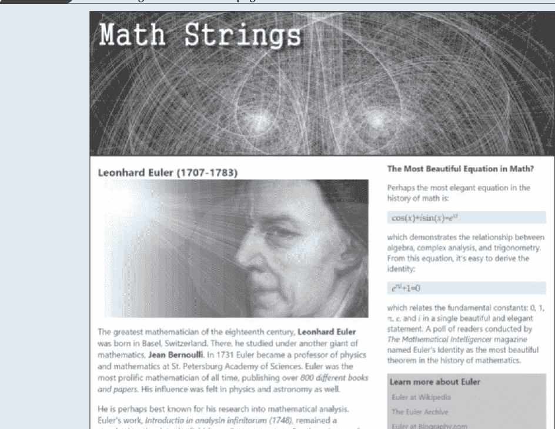

Math Strings: 面教育者和研究者的网站

© 2016 Cengage Learning

# WOW! eBook

www.webook.org

Copyright 2018 Cengage Learning. 版权所有。未经许可，不得复制、扫描或复制。WCN-92-200-203

# 教程 1 HTML 入门 | HTML 和 CSS HTML 77

样式和图表已为你提供。你可以自由编写 HTML 标记。

完成以下操作：

1. 使用你的编辑器，打开 `html01 ▷ case 2` 文件夹下的 `ms_euler.txt` 文件。在文件的 `<article>` 元素中**输入你的姓名和评语**，并将其另存为 `ms_euler.html`。
2. 在文档中添加以下内容：
   a. 将文件的字符编码设置为 **utf-8**。
   b. 添加以下关键词：**math**、**Euler** 和 **geometry**。
   c. 将文档标题设置为 **Leonhard Euler (1707-1783)**。
   d. 将文档链接到 **ms_base.css** 和 **ms_layout.css**。
   e. 在 body 中添加 `<header>`、`<article>` 和 `<footer>` 元素。


# HTML 和 CSS | 教程 1 开始使用 HTML

## 任务步骤

### 1. 处理 ms_euler.html 文件

1. 在 `header` 中，插入一个 `alt="Math Strings"` 的 `ms_logo.png` 内联图像。

2. 在编辑器中打开 `ms_pages.txt` 文件并复制包含标题的正文内容。然后，打开 `ms_euler.html` 文件将其粘贴到内容中。

3. 在 `article` 中，进行以下更改：
   a. 将文本 **Leonhard Euler (1707-1783)** 标记为 `<h1>` 标题。
   b. 使用 `<p>` 元素标记文章的三个段落。
   c. 在第一段中，将姓名 **Leonhard Euler** 和 **Jean Bernoulli** 标记为强粗（`strong`）。将书名标记为强调斜体文本（`*italic/emphasized*`）。
   d. 在第二段中，将 *Introductio analysisorum* (1748) 和 *Lettres à une princesse d'Allemagne* (1772) 标记为引用。使用字符引用 `&pi;` 插入 π 字符。
   e. 在第三段中，将数学符号和 π 标记为变量（`variable`）元素。将 pi 替换为 `&pi;`。

4. 回到编辑器中的 `ms_pages.txt` 文件，复制关于欧拉文章的最美公式的第二部分文本。然后，打开 `ms_euler.html` 文件并将内容粘贴到 `<aside>` 元素中。

5. 在 `<aside>` 元素中，添加以下标记：
   a. 将标题 **Most Beautiful Equation in Math?** 标记为 `<h1>` 标题。
   b. 使用 `<code>` 元素标记文本中的两个公式。将其他文本标记为组（`groups`）。

6. 在 `<aside>` 元素的文本中，将 x、i、v、e 和 π 标记为 `<var>` 元素，将 pi 替换为 π。

7. 在以下公式中使用 `<code>` 元素将 xi 和 π 标记为上标：
   ```
   e^(ix) = -1
   ```
   a. 将文本 **The Mathematical Intelligence** 标记为引用（`citation`）。

8. 回到编辑器中的 `ms_pages.txt` 文件，复制学习欧拉工作的第三部分文本。然后，打开 `ms_euler.html` 文件并将内容粘贴到第十个元素中。

9. 在第十个元素中，添加以下标记：
   a. 将标题 **Learn more about Euler** 标记为 `<h1>` 标题。
   b. 将四个欧拉网站标记为无序列表。
   c. 将欧拉网站的文本更改指向以下 URL 的超文本链接：
      - [Euler at Wikipedia](https://wikipedia.org/wiki/Leonhard_Euler)
      - [The Archive](http://archive.org/)
      - [Euler at Biography](https://www.bi.com/people/leonhard-euler-21342391)
      - [Euler at Famous Scientists](http://www.famousscientists.org/leonhard-euler)

10. 在 `footer` 元素中，插入文本“Math Strings: A Site for Educators and Researchers”。

11. 将更改保存到文件并在浏览器中打开 `ms_euler.html` 文件。验证侧边栏中的方程与图 1-47 显示的匹配，并确保所有 `[pi]` 字符都已替换为 π。点击导航列表中的四个链接，验证浏览器是否打开了它们。

---

### 2. 案例问题 3：Diane's Run

**所需数据文件**：`index_txt.html`、`dir_info_txt.html`、`dir_faq_txt.html`，4 个文件，2 个 PNG 文件，3 个 TXT 文件。

> “Diane's Run” 是一项为提高乳腺癌意识和研究资金筹资金的慈善活动。Peter Wheaton 是该慈善机构的经理，他请你帮助修改网站。他修改了想要添加到当前网站的文本。你将创建页面预览如图 1-48 所示。
> 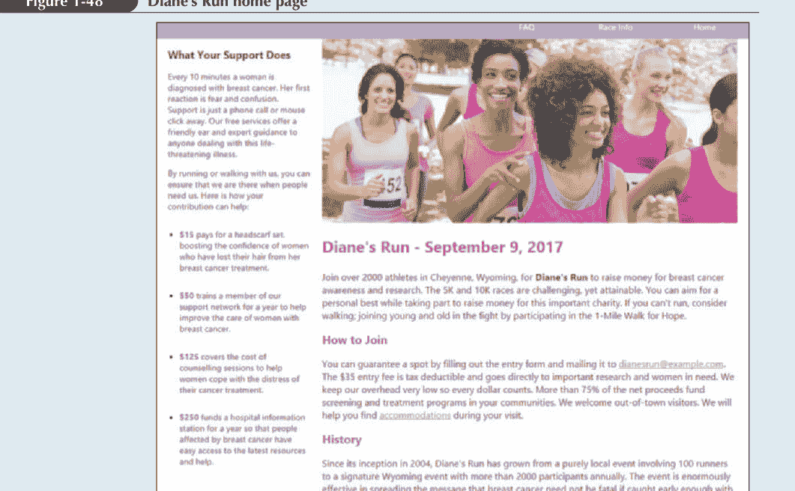
> 图 1-48 Diane's run home

#### 你的支持作用

每 10 名女性中有一人被确诊为乳腺癌。对研究和支持的需求只需一个电话。我们的免费办公室为任何经历这段艰难旅程的人提供帮助。通过与我们一起跑步，你确保了有需要帮助的人。你的贡献可以：

- 15 美元可以购买头巾，为因乳腺癌掉头发的女性提供舒适；
- 50 美元支持我们团队的一名成员帮助他们应对疾病；
- 125 美元涵盖应对失去痛苦女性的咨询费用；
- 250 美元资助医院信息中心，让受乳腺癌影响的人能够轻松获得最新的资源和帮助。

#### Diane's Run - 2019 年 9 月

怀俄米州有 2000 多名女性受影响。为了让 Diane's Run 为乳腺癌意识和研究筹，5 公里和 10 公里赛非常有挑战性。你可以参加这项活动。你的参与对我们非常重要。如果你不能跑步，可以步行，加入我们并参加 1 英里步行以帮助他人。

#### 如何加入

你可以通过填写报名表并捐款来帮助我们所需的调研和工作。我们保持低成本的运营，因此每一钱都至关重要。净资金的 75% 用于我们社区的支持和治疗计划。我们走访患者的次数超过了需求。你的反馈帮助我们改进工作。

> 自成立以来
>
> Diane's Run 自 2004 年成立以来，已从一个小型地方活动发展到 3000 多名参与者。这项活动每年都在传播一个信息：乳腺癌并不一定需要通过乳腺摄影检查和乳腺自检来早期发现。作为一项顶级活动，Diane's Run 是一段连接不同背景人群的情感旅程。我们所有人都有机会为家庭和社区分享关于乳腺癌的希望信息。

#### Diane's Run

Diane 以纪念 Diane Wheeler 而命名，她是两个孩子的母亲，也是 Peter 的妻子，她已于 2004 年 5 月去世。Diane 是身体体能和健康生活的倡导者。我们发起这项活动是为了纪念她的生命，希望它能继续激励怀俄米州参加过此活动的居民。

我们希望你今年加入我们，成为 Diane's Run 家庭的一员。

© wavebreakmedia/Shutterstock.com

---

### 3. 教程 1 开始使用 HTML5 | HTML 和 CSS

Peter 为你提供了项目所需的文本内容、图形图像和样式表。你的工作将为三个页面编写 HTML 代码：网站首页、一个包含比赛信息的页面，最后是一个包含常见问题解答（FAQs）列表的页面。

完成以下操作：

1. 使用你的顺序，从 html01 案例文件夹获取 `dr_index.txt`、`dr_info.txt` 和 `dr_faq.txt` 文件。在每个文件的注释中输入**你的姓名**和**日期**，并将它们分别保存为 `dr_index.html`、`dr_info.html` 和 `dr_faq.html`。

2. 在文档编辑器中打开 `dr_index.html` 文件。在文档头部（`head`）中，添加以下元数据：
   a. 将文件的字符编码设置为 utf-8。
   b. 插入搜索关键词：**breast cancer, run, race, and charity.**。
   c. 将文档标题设置为 Diane's Run。
   d. 将文档链接到 `base.css` 和 `layout.css` 样式表。

3. 在文档主体（`body`）中，插入一个头部（`header`）元素、两个部分（`section`）元素和一个页脚（`footer`）元素。

4. 在 `header` 元素中，插入一个带有项目顺序的有序列表（`ordered list`），项目为：**Home, Race, and FAQ**。分别将这些项目链接到 `dr_index.html`、`dr_info.html` 和 `dr_faq.html` 文件。

5. `dr_index.txt` 文件包含要插入 Diane 首页的文本。在文本编辑器中进入 `dr_index.txt` 并复制第一部分的文本。然后进入 `dr_index.html` 文件将其粘贴到 `section` 元素中。

6. 在第一个部分的内容中添加以下标记：
   - 将行 *What Your Support Does* 标记为 h1 标题。
   - 使用 `p` 元素标记接下来的两段。
   - 将贡献的四种方式标记为无序列表（`unordered list`）。使用 `span` 元素标记每个项目的美元金额。

7. 返回文本编辑器中的 `dr_info.txt` 文件，复制第二部分的文本。在编辑器中打开 `dr_info.html` 并将其粘贴到第二个 `section` 元素中。

8. 在 `dr_index.html` 的第二个元素中，添加以下内容：
   a. 将开头的 *Diane's Run - September 2017* 封装在 `header` 元素中并标记为 h1 标题。在该标题正上方插入图像 `dr_photo.png`，并将 **Diane** 作为备用文本（`alternate text`）。
   b. 将标题后的第一段标记为段落（`p`）。使用 `section` 元素标记文本 Diane's Run。
   c. 将次级标题 *How to Join, History,* 和 *Fundraising* 标记。

9. 返回文本编辑器中的 `dr_info.txt` 文件（注：原文此处为 How to Join, History, 和 Fundraising，但前文描述有出入，按逻辑翻译），此处应对应原文中的 *How to Join, History,* 和 *Fundraising*（请根据实际文本文本为准）。

10. 在 `footer` 元素中插入以下内容：Diane, WY。

11. 在文档编辑器中打开 `dr_index.html` 文件。验证侧边栏中的方程与图 1-47 显示的匹配，并确保所有 `[pi]` 字符都已替换为 π。

12. 点击导航列表中的四个链接，验证浏览器是否打开了它们。

---

### 4. 教程 1 HTML 入门 | HTML 和 CSS

#### HTML 81

**探索 23.** 回到你 HTML 编辑器中的 `dr_index.html` 文件。在 `<a>` 元素部分中的“How to join”段落中添加以下两个超链接。

- a. 将电子邮件地址 `dianesun@example.com` 添加到主题为 `Entry Form` 的邮件中。


# 教程 1 HTML 入门 | HTML 和 CSS

## HTML 81

探索 23. 回到你 HTML 编辑器中的 `dr_index.html` 文件。在 `<a>` 元素部分中的“How to join”段落中添加以下两个超链接。

- a. 将电子邮件地址 `dianesun@example.com` 添加到主题为 `Entry Form` 的邮件中。

- b. 将单词 `accommodations` 更改为链接，指向 `dr_faq.html` 中 id 为 `faq3` 的元素。

- 24. 保存对文件的更改，并在浏览器中重新加载 `dr_index.html`。验证点击邮件链接是否会调起你的邮件程序并自动填入电子邮件地址和主题。

- 25. 点击 `accommodations` 超链接，并验证浏览器是否跳转到了 FAQ 页面的最后一个答案。

- 26. 验证通过点击页面顶部的导航链接是否可以在所有页面之间跳转。


## 案例问题 4

此案例所需数据：`h_index_txt.html`、`h_towers_txt.html`、`h_alliance_txt.html`、3 个 PNG 文件、1 个 TXT 文件。

Harpe Gaming: Sean Greer 被邀请与西弗吉亚州摩根敦一家小型游戏店 Harpe Gaming 的所有者合作。Sean 想查看商店主页的 HTML 代码。Sean 为本地客户提供游戏评论作为服务。你还希望他为 Sean 写的针对 Towers and Temples 页面和 Alliance 游戏写的两篇新评论编写 HTML 代码。Sean 已经写好了这三个页面的所有内容，需要帮助将它们转换为 HTML 文档。

完成以下任务：

- 1. 使用你的编辑器打开 `html1` 文件夹下的 `h_index_txt.html`、`h_towers_txt.html` 和 `h_alliance_txt.html` 文件。将它们保存为 `h_index.html`、`h_towers.html` 和 `h_alliance.html`。

- 2. 三个页面的每个内容都包含在 `h_text.txt` 文件中。花时间阅读每个页的内容。Harpe Gaming 主页有关于商店及其理念的简短介绍，并包含了给感兴趣客户的信息。Towers and Temples 页面和 Alliance 页面包含了每个游戏的概述，Sean 已经提供了 `h_logo.png`、`h_games.png` 和 `h_alliance.png` 图像供文件使用。你可以根据自己的适当材料补充 Sean 的素材。

- 3. 熟悉内容后，将其插入网页中，从每个页面的 HTML 代码开始。对于每个文件，插入 HTML 文档的结构，包括起始标签、`<head>` 元素、文档元素和 `<body>` 元素。

- 4. 针对每个文件的文档头，执行以下操作（此项目没有样式表，因此你不需要包含指向样式表的链接）：

    - a. 插入一个包含你的姓名、日期和页面目的页头。

    - b. 插入指定文件中使用的字符编码的元数据。

    - c. 插入指定页面标题的元数据。

    - d. 插入一组与每个文件内容相关的搜索关键词列表。

- 5. 在文档主体内，在主体头中插入一个导航列表，其中包含指向此示例网站所有三个页面的超链接。

## HTML 82 | HTML 和 CSS | 教程 1 HTML5 入门

- 6. 使用 `hg_text.txt` 文件的内容填充三个页面的内容。三个页面中使用的标记由你决定。在你的网站中应至少包含以下项之一的示例：

    - a. 分段元素，包括页头：`<header>`、`<aside>`、`<section>` 和 `<footer>` 元素

    - b. 分组元素，包括段落 `<p>`、块引用 `<blockquote>` 和列表

    - c. 用于标记分组元素内部的单个单词或短语的文本级元素：

        至少包含一个 `<a>` 标签元素和 `<em>` 元素的示例。

    - d. 内联图像，包括图像适当的备用文本（alt text）

    - e. 使用字符名称或编码数字插入的字符符号

    - f. 指向个人电子邮件地址的超文本链接

    - g. 指向电话号码的超文本链接

    - h. 指向网站 URL 的超文本链接

- 7. 保存文件更改，然后在浏览器中打开它们。验证在网站页面间移动、访问你的邮件程序以及访问 Web 外部链接时，链接是否按预期工作。如果你的电脑上安装了电话应用程序，测试点击电话链接是否会打开该程序。

## 教程

## HTML


# CSS 入门

## 目标

### 章节 2.1

- 探索 CSS 的历史
- 研究不同类型的样式表
- 探索样式优先级和继承
- 在 CSS 中应用颜色

### 章节 2.2

- 使用上下文选择器
- 使用属性选择器
- 应用文本和字体样式
- 使用网络字体

### 章节 2.3

- 详细列出列表样式
- 处理外边距（`margins`）和内边距（`padding`）
- 使用伪类和伪元素
- 使用 CSS 插入页面内容

## 为健身俱乐部设计网站

### 案例 | Tri and Succeed Sports

Alison Palmer 经营着 Tri and Sports，这是位于德克萨斯州奥斯汀的一家体育俱乐部，专门为向往参加铁人和耐力运动的男女提供教练。Sean 想查看商店主页的 HTML 代码。Sean 为本地客户提供游戏评论作为服务。你还希望他为 Sean 写的针对 Towers and Temples 页面和 Alliance 游戏写的两篇新评论编写 HTML 代码。Sean 已经写好了这三个页面的所有内容，需要帮助将它们转换为 HTML 文档。

（此处省略重复的 CSS 章节翻译...）

# HTML 86 HTML 和 CSS | 教程 2 CSS 入门

## 介绍 CSS

在上一个教程中讨论的一个重要原则是，HTML 并不定义文档应该如何显示；它只定义文档的结构和内容。页面的外观由一个或多个使用层叠样式表（CSS）语言编写的样式决定。从本教程开始，你将学习如何编写自己的 CSS 样式表。

CSS 规范由万维网联盟（W3C）维护，它定义了标准 HTML。CSS 语言经历了几个版本，最新的是 CSS 版本 3，通常被称为 CSS3。CSS 并不是基于单一规范，而是构建在多个模块之上，每个模块关注一个独立的设计策略。在本教程的阶段，浏览器的支持程度各异。W3C 扩大了该语言的范围，这意味着许多新功能仍处于支持阶段（如果支持的话，取决于浏览器的实现情况）。

> **提示**
>
> 你可以在 `www.caniuse.com` 查询不同浏览器版本的 CSS 支持情况。

在本教程中，你将主要关注在当前浏览器中具有几乎通用支持的 CSS 特性。你还将研究支持旧版浏览器的替代方案，并学习理解浏览器在实现 CSS 设计方面差异的方法。

## 样式表的类型

网站的设计通常不是单个样式表的产物；而是多个样式表的组合，从浏览器样式开始，然后被用户定义的样式表、外部样式表、嵌入式样式表取代，最后以内联样式结束（参见图 2-1）。让我们更详细地检查这些样式源。

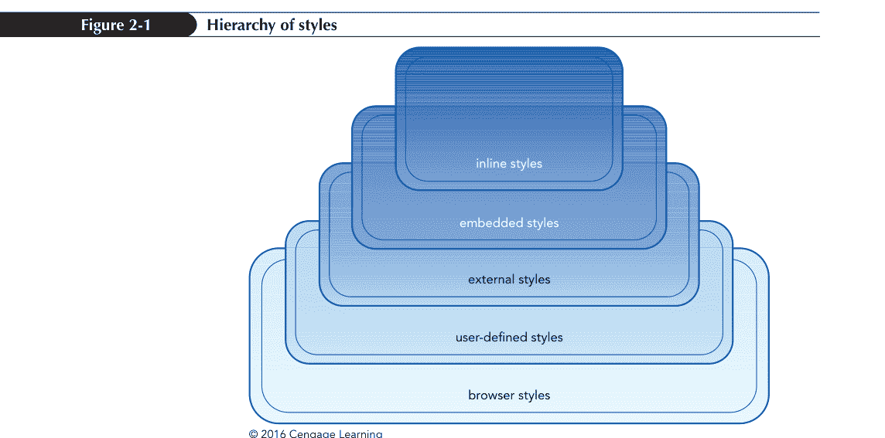

版权所有 2018 Cengage Learning。保留所有权利。未经许可，不得全部或部分复制、扫描或复制。WCN 02-200-203

WOW! 电子书

www.wowowebook.org

# 教程 2 CSS 入门 | HTML 和 CSS

首先被处理的样式是浏览器样式或用户代理样式，即内置在浏览器内部的样式。在没有其他样式表竞争样式的情况下，浏览器样式是应用于网页的样式。

下一个被处理的样式是用户定义的样式，由用户根据其配置浏览器的设置来定义。例如，视力受损的用户可以更改浏览器的默认设置，使用高对比度的颜色和大字体显示文本，以提高可读性。任何用户定义的样式优先级都高于浏览器样式。

用户定义的样式可以被外部样式取代，外部样式是网页作者在单独的 CSS 文件中创建并链接到页面的样式。当你将 Tri and Succeed 网站链接为样式集合时，使用外部样式表是最后一步。正如你在教程中看到的，多个文档可以访问同一个样式表，这使得对整个网站应用共同设计变得简单。

除了外部样式，还有嵌入式样式，它们被添加到 HTML 文档的 `<head>` 部分。嵌入式样式仅适用于创建它们的 HTML 文档，无法被网站中的其他文档访问，但它们会覆盖外部样式表中的任何样式。

## 使用不同的样式表查看页面

你将开始在 Tri and Succeed 网站的工作，查看主页在浏览器内置样式表的默认样式渲染时显示什么样。

> **要查看 Tri and Succeed 首页：**
>
> 1. 使用编辑器打开 `html02` 教程文件夹中的 `tss_home.txt.html` 文件。在文件的注释部分使用你的名字和日期，并将文档保存为 `tss_home.html`。
> 2. 花些时间滚动查看文档，熟悉其内容和结构。
> 3. 在浏览器中打开 `tss_home.html` 页面。页面的外观显示在图 2-2 中。

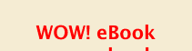

# HTML 和 CSS | 教程 2 CSS 入门

图 2-2 仅使用浏览器样式表渲染的 TSS 首页

以较大的粗字体显示的标题

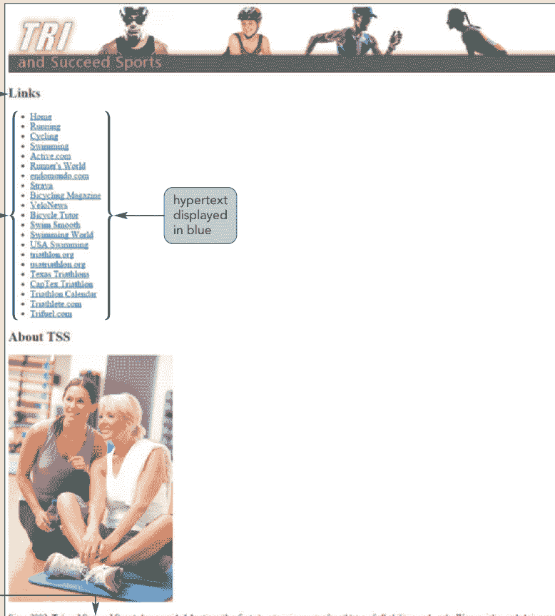

- *链接*
- 首页
- 跑步
- 骑行
- 活跃运动
- 世界田径
- endamondo.com
- 新闻
- 自行车杂志
- 三项全能
- 运动画报
- 美国经济
- triathlon.org
- 时代报
- 三项全能赛日历
- 三项全能
- Triat.com

显示为蓝色的超文本

实心圆点显示的列表项

关于 TSS

自 2001 年以来，Tri and Succeed Sports 为所有能力水平和目标的运动员提供了一流的训练中心。我们擅长帮助你发掘潜力。告诉我们你想做什么，我们会努力满足你的需求。

> © 2016 Cengage Learning; Yvason/Shutterstock.com; Charles T. Bennett/Shutterstock.com;
> @Shutterstock.com; Monkey Business Images/Shutterstock.com

遇到问题？根据你浏览器的样式表，你的页面可能与图 2-2 显示的不完全相同。

浏览器样式表对页面应用了一些特定的样式，包括在导航列表项中添加实心圆，并将超文本显示为蓝色，标题以大粗字体显示，并将强文本显示为粗字体。

布局很难阅读。Alison 拥有一个外部样式，其中的样式将以更美观的三列布局呈现此页面。将此页面链接到她的样式表并在浏览器中重新加载文档以查看页面外观。

WOW! 电子书

www.webook.com

# 教程 2 CSS 入门 | HTML 和 CSS HTML 89

## 要更改 TSS 页面的布局：

1. 返回 HTML 编辑器中的 `tss_home.html` 文件，并在 `<head>` 部分直接 `<title>` 元素之后添加以下链接元素：

```html
<link href="tss_layout.css" rel="stylesheet" />
```

图 2-3 显示了文档中新添加的代码。

| 图 2-3 | 链接到 tss_layout.css 文件 |
| :--- | :--- |
| rel 属性表示该文件是样式表 | ```html
<meta charset="utf-8">
<meta name="keywords" content="triathlon, running, cycling" />
<title>TSS Layout</title>
<link href="tss_layout.css" rel="stylesheet" />
</head>
``` |

2. 保存文件更改，然后刷新 `tss_home.html` 文件。图 2-4 显示了使用 `tss_layout.css` 后的页面外观。

| 图 2-4 | 使用 tss_layout.css 样式的 TSS 首页 |
| :--- | :--- |
| 链接 | 关于 TSS | 评论 |
| :--- | :--- | :--- |
| 首页 | 自 2001 年以来，Tri and Succeed Sports 为所有能力水平和目标的运动员提供了一流的训练中心。我们擅长帮助你发掘潜力。无论你想做什么，我们会努力。 | 感谢你为我的计划所做的一切！我喜欢它并对你非常满意。 |
| 注册 | 你对提高骑行水平感兴趣吗？我们帮助你成为更好的运动员并健身！客户们感谢我们。 | 一切都有帮助，因为你的计划重新燃起了我的梦想。感谢支持支持。 |
| 关于 | | 你得对！我几年前在 Pro Trial 认识你，很荣幸你成为我的教练和导师。 |
| 文章 | | |
| Blog.com | 水陆交汇。去跑步、游泳或骑行。 | |
| 视频 | **课程** 我们在课程中提供个人和小组指导。 | |
| 会员制 | **训练：** 我们使用最好的方法帮助你专注于并比以前更快的速度进行训练。TSS 的精英训练师包含了你掌握运动所需的一切。 | |
| Instagram | **游泳：** 开放水游泳是最有效的训练技术之一。我们使用创新的技术帮助你变得更加敏捷自信。 | |
| 三项全能 | | |
| 三项全能俱乐部 | | |

`tss_layout.css` 文件控制页面元素的位置，但颜色、字体和其他设计样式仍然基于行样式。

## 探索样式规则

如果说元素是 HTML 文件的构建块，那么样式规则（定义了应用于单个元素或一组元素的样式）就是 CSS 样式表的构建块。样式规则具有通用形式：

```css
selector {
  property1: value1;
  property2: value2;
}
```

其中，`selector` 识别文档中的单个元素或一组元素，而 `property: value` 对指定了应用于该元素或元素的样式及其值。例如，下面的样式规则具有 `h1` 选择器，用于匹配文档中所有的 `h1` 元素，并具有 `color: red` 和 `text-align: center` 属性值对，告诉浏览器在页面上以红色居中显示所有的 `h1` 标题：

```css
h1 {
  color: red;
  text-align: center;
}
```

选择器也可以以逗号分隔列表的形式输入，如下所示规则所示，它可以同时将 `h1` 和 `h2` 标题显示为红色：

```css
h1, h2 {
  color: red;
}
```

与 HTML 一样，CSS 会忽略空白符，因此你可以按照如下更紧凑的方式输入：

```css
h2 { color: red; }
```

在单行上编写样式规则可以节省空间，但将每个样式属性单独写在一行会让你的代码更易于阅读和编辑。你在网络上遇到的 CSS 文件中会同时看到这两种方法。

## 浏览器扩展

除了 W3C 支持的属性外，大多数浏览器还提供它们自己的扩展样式属性库，被称为浏览器扩展。许多成为 W3C 规范一部分的样式最初都是作为浏览器扩展开始的；对于旧版本的浏览器，有时支持特定 CSS 特性的唯一方法就是通过针对特定浏览器定制的浏览器扩展。

浏览器扩展通过使用厂商前缀（vendor prefix）来识别，该前缀表示创建并支持该属性的浏览器厂商。图 2-5 列出了你在网页设计工作中会遇到的浏览器扩展。

## 浏览器扩展的厂商前缀

| 厂商前缀 | 渲染引擎 | 浏览器 |
|---|---|---|
| `-khtml-` | KHTML | Konqueror |
| `-moz-` | Mozilla | Firefox |
| `-ms-` | Trident | Internet Explorer |
| `-o-` | Presto | Opera, Nintendo Wii |
| `-webkit-` | WebKit | Android browser, Chrome, Safari |

例如，CSS3 中使用的最新特性之一是用于将内容显示在独立列中的布局样式。列数使用 `column-count` 属性指定。为了以同时支持旧版和当前浏览器的方式应用此样式，你需要先包含浏览器扩展，然后是最新的 CSS 规范：

```css
article {
  -webkit-column-count: 3;
  -moz-column-count: 3;
  column-count: 3;
}
```

通常情况下，浏览器按照列出的顺序处理样式属性，忽略它们不识别或不支持的属性，因此你始终应该将最新的规范列在最后。

## 嵌入式样式表

样式规则也用于嵌入式样式表和内联样式。嵌入样式通过向文档头部（head）添加以下 `<style>` 元素作为元数据直接插入 HTML 文件中：

```html
<style>
  /* style rules */
</style>
```

其中 `style rules` 是你想嵌入到 HTML 页面中的不同规则。例如，下面的嵌入式样式将之前描述的相同样式规则应用于当前文档中的所有 `h1` 标题，使其以红色居中显示：

```html
<style>
h1 {
  color: red;
  text-align: center;
}
</style>
```

记住，在所有条件相等的情况下，最后加载的样式优于定义的样式。在以下代码中，浏览器将加载嵌入式样式表，其优先级高于 `tss_styles.css` 文件中的规则。

```html
<link href="tss_styles.css" rel="stylesheet" />
<style>
  /* style rules */
</style>
```

WOW! eBook

www.wowebook.org

# HTML 与 CSS | 教程 2 开始使用 CSS

如果 `link` 和 `style` 元素的顺序反过来，则来自 `tss_styles.css` 文件的样式将最后加载并获得优先权。

> **提示**
>
> 为避免混淆，请将嵌入式样式放在任何外部样式表链接之后，这样声明的样式将始终具有优先级。

## 内联样式

浏览器最后解释的是内联样式，它们是使用 `style` 属性直接应用于特定元素的样式：

```html
<element style="property1: value; property2: value; ...">
content
</element>

<h1 style="color: red; text-align: center;">
Title and Success Students
</h1>
```

其中属性值对是样式，直接应用于元素。因此，内联样式将 `h1` 标题的外观设置为页面上的红色内容中：

此样式仅适用于此特定的 `h1` 标题，而不适用于页面或网站上的任何其他 `h1` 标题。优点显而易见：然而，在大多数情况下不建议使用内联样式，因为它们会让修改设计变得困难且低效。如果你对所有标题都使用内联样式，你必须为每个标题添加从 `h1` 到 `h6` 的所有属性。对于一个包含数百个分布在各个页面上的标题的大型网站来说，这不是一项小任务。如果你在以后需要修改这些标题的设计，那将是一场噩梦。因此，推荐的做法是使用可以跨页面和元素的外部样式表。

## 样式权重与优先级

当有许多样式时，浏览器必须决定应用哪一个。这由权重（specificity）和优先级（precedence）决定。当多个样式指向同一个元素时，浏览器使用这些规则来决定哪种样式胜出。

# HTML 94 HTML 和 CSS | 教程 2 开始使用 CSS

## 图 2-6

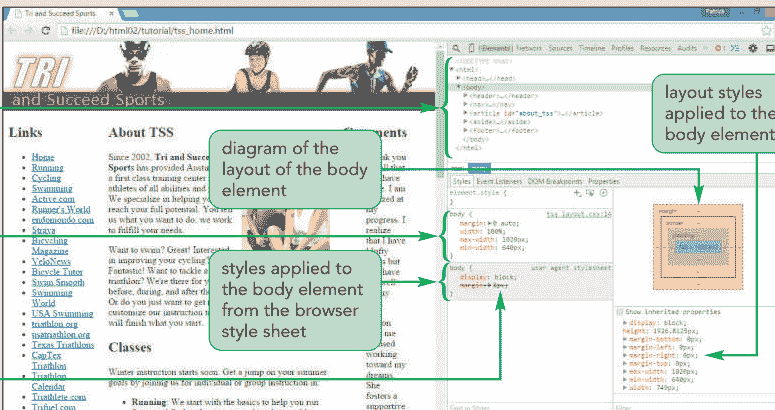

> © 2016 Cengage Learning: Y. Cangel/Shutterstock.com; Charles T. Bennett/Shutterstock.com; costil/Shutterstock.com; Monkey Business Images/Shutterstock.com.

如图 2-6 所示，样式面板列出了应用于 body 元素的样式。注意来自浏览器样式的属性被划掉了，这表示该 body 样式已被外部样式表中定义的样式所取代。

**遇到问题？** 每个浏览器都有不同的开发者工具集和配置。你的工具可能与图 2-6 所示的不相似。

4. 花些时间从元素的层次列表中选择元素，探索其他页面元素使用的内容和样式。
5. 按 `F12` 关闭开发者工具窗口。

**遇到问题？** 在 Safari 中，你可以通过按 `ctrl+shift+I` 或 `command+I` 来关闭开发者工具。

在未来，你会发现开发者工具是处理网站设计的极佳助手。大多数开发者工具允许用户插入新规则，以查看其对页面外观的即时影响；然而，这些修改在当前会话期间有效，不会永久保存。因此，一旦你发现一个想要使用的设置，必须将其整合到相应的样式表中才能永久生效。

# WOW! 电子书

nowwowebook.org

## 教程 2 开始使用 CSS | HTML 和 CSS HTML 95

## 定义 !important 样式

你可以通过在特定属性上标记以下 `!important` 关键字来覆盖样式级联：

```css
property: value !important;
```

以下样式规则将所有 h1 标题的颜色设置为橙色；由于此属性被标记为重要，因此它的优先级高于在其他样式中发现的任何冲突样式。

```css
h1 { color: orange !important; }
```

`!important` 关键字通常用于用户定义的样式表，在这些样式表中，用户需要用自己的样式来替换设计师的样式。例如，视力障碍用户可能需要以大字体和高对比度颜色显示文本。通常，设计师不应该使用 `!important` 关键字，因为它干扰了 CSS 语言内置的级联顺序。

## 创建样式表

现在你已经回顾了样式表背的一些历史和概念，你将开始创建自己的样式表。理想情况下，你的样式表应该从注释开始，记录样式表的用途，并提供关于创建文档的人和时间的信息。

## 编写样式注释

样式表注释的输入格式为

```css
/*
注释内容
*/
```

其中是注释的文本。由于 CSS 会忽略空格的存在，你可以将单行插入注释以节省空间：

```css
/* 注释 */
```

现在创建一个样式文件，在文件顶部放置一个包含你的名字和当前日期的注释。

### 编写样式注释：

使用你的编辑器打开源自于 `html02` 教程文件夹的 `tss_styles.txt` 文件。


- 在文件顶部的注释部分，在 `Author:` 处输入你的名字，并在 `Date:` 后输入日期。
- 将文件保存为 `tss_styles.css`。
- 回到 HTML 编辑器中的 `tss_home.html` 文件，在关闭 `<head>` 标签之前直接添加链接元素。

```html
<link href="tss_styles.css" rel="stylesheet" />
```

- 关闭 `tss_home.html` 文件并保存你的更改。

# WOW! 电子书

www.wowebook.org

Copyright 2018 Cengage Learning. 版权所有。部分或全部不得复制或扫描。WCN 02-200-253

## 定义字符编码

对于 HTML 文件，在每个 CSS 文档定义文件中使用的字符编码是一个好主意。在 CSS 中，你使用 `@charset` 规则来实现这一点：

```css
@charset encoding;
```

其中 `encoding` 定义了文件中使用的字符编码。现在向 `tss.css` 样式表添加 `@charset` 规则，指定 CSS 代码中使用 UTF-8 字符集。

## 指明字符编码：

1. 返回编辑器中的 `tss.styles.css` 文件。
2. 在初始注释部分的正上方插入行：`@charset "utf-8";`

图 2-7 高出了样式表中的新代码。

## 图 2-7 添加 @charset 规则和样式注释

```css
/*
@charset "utf-8";

New Perspectives on HTML5 and CSS3, 7th Edition
Tutorial 2
Tutorial Case

TSS Typographic Style Sheet
Author: Alison Palmer
Date: 2017-03-01

Filename: tss.styles.css
*/
```

注意，样式表中应出现一个 `@charset` 规则，它应该始终位于任何其他字符（包括注释）之前。

3. 保存文件的更改。

## 导入样式

`@import` 是 CSS 规则（at-rule）的一个示例，该规则用于向浏览器发送指令，指示如何解释和解析 CSS 文件的内容。另一个规则是 `@import` 规则，用于导入样式文件的内容：

```css
@import url(url);
```

其中 `url` 是外部样式文件的 URL。`@import` 用于将样式表合并到一个文件中。`@import` 用于通过决定包含或排除哪些样式表来简化 HTML 代码。以下代码用于商品相关页面的 `sales.css`：

```css
@import url(company.css);
@import url(support.css);
```

## 在 CSS 中处理颜色

网站的第一部分将关注颜色。在 CSS 中选择颜色。如果你处理过图形软件，你可能使用图形界面选择颜色。在 CSS 中选择颜色并不那么直观，因为 CSS 是一种基于文本的语言，需要用术语定义颜色。这是通过颜色名称或值来实现的。

## 颜色名称

你从之前的示例已经看到可以使用 `color` 属性通过颜色名称设置页面颜色，例如红色、蓝色、黑色。CSS 支持如红色、绿色和黄色等名称，以及更奇特的颜色，如象牙白、橙色、深红色和棕色。

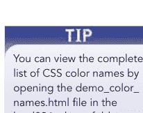


## 书面交流：通过颜色交流

人类生色彩。研究发现两个月大的婴儿偏好对比鲜明的亮色，而不是低对比度的颜色。服装市场研究关注哪些颜色是“流行的”，哪些颜色是过时的。

你的选择会影响网站被接收的方式，因此你希望根据目标受众的性格和兴趣选择配色方案。颜色可以引起情感反应，并与特定的感受或概念相关联，例如：

- 红色——果断、强大、性感
- 粉色——纯真、浪漫、女性
- 黑色——经典、时尚
- 灰色——商务、疏离
- 黄色——温暖、快乐、乐观
- 蓝色——冷静、平静、安静
- 橙色——友好、活力、吸引
- 白色——洁净、纯洁、直接、无邪

如果你的网站将在范围内，你需要意识到文化差异如何影响受众对颜色的反应。例如，白色在西方文化中与纯真相关，在中国是丧事的颜色；黄色在西方被认为是明亮快乐的颜色，在佛教文化中则代表精神。

# RGB 颜色值

由于 147 个颜色名称的调色板对于图形设计来说极其有限，而且颜色名称具有局限性（你如何命名一种略偏红且带蓝色调的象牙色！），CSS 还支持颜色值，通过精确的表示来给出颜色。CSS3 支持两种类型的颜色值：RGB 值和 HSL 值。

RGB 颜色值基于颜色理论——红、绿、蓝——在不同强度水平上。例如，将三种原色都以最大强度混合会产生白色，而将三种原色中的任意两种以最大强度混合，则会产生三色互补色——黄色、洋红色和青色（见图 2-8）。

图 2-8 RGB 颜色模型中的颜色加法

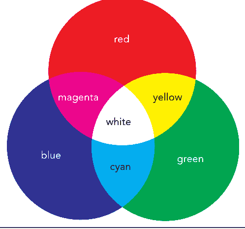

其中红、绿、蓝是颜色红色、绿色和蓝色分量的强度，范围从 0（无颜色）到 255（最大强度）；白色的值为 `rgb(255, 255, 255)`，表示红、绿、蓝以最高强度等量混合，橙色由 `rgb(255, 165, 0)` 表示。RGB 三元组描述了 256³（1670 万）种可能的颜色，这一数量多于人眼能够区分的颜色。

# 教程 2 CSS 入门 | HTML 和 CSS

RGB 值有时表示为十六进制数，十六进制数使用 16 进制计数系统表示，而不是常用的 10 进制。在 10 进制计数中，数值使用 10 个字符（0 到 9）的组合来表示。十六进制计数包括这十个字符和六个字母（A 代表 10，B 代表 11，C 代表 12，D 代表 13，E 代表 14，F 代表 15）。对于值 15，你使用这十六个字符的组合。例如，数字 16 的十六进制表示为 10，而 255 的十六进制表示为 FF。十六进制数的样式值为：

```css
#greenBlue
```

其中红、绿、蓝是红色、绿色和蓝色分量的十六进制值。因此，黄色可以用 RGB 三元组表示：

```css
rgb(255, 255, 0)
```

或者更紧凑地用十六进制表示：

```css
#FFF00
```

大多数编辑器和图形程序都提供了颜色选择工具，允许用户选择颜色并复制粘贴 RGB 或十六进制颜色值。十六进制颜色值的优势是可以创建更小的样式表，加载速度更快——对于移动设备来说这是一个重要的考虑因素。然而，对于其他查看和学习你的样式代码的人来说，RGB 值更难解释。

最后，你可以以百分比的形式输入每个分量值，其中 100% 代表最高强度。在这种形式下，你通过以下方式指定橙色：

```css
rgb(100%, 65%, 0)
```

等同于描述的 `rgb(255, 165, 0)` 值。

# HSL 颜色值

HSL 颜色用于 CSS3，并基于一种颜色模型，该模型通过其色相（hue）、饱和度（saturation）和亮度（lightness）来定义颜色。色相是颜色的色调，通常用色轮上的方向表示。色相值范围从 0° 到 360°，0° 匹配色轮上的红色位置，120° 匹配绿色，240° 匹配蓝色。饱和度衡量所选颜色的强度，范围从 0% 到 100% 全色。亮度衡量颜色的明亮度，范围从 0%（黑色）到 100%（白色）。图 2-9 显示了将色相设置为 38°、饱和度设置为 90%、亮度设置为 60% 如何产生中亮度的橙色。

# 在 HSL 颜色模型下定义橙色

**图 2-9**

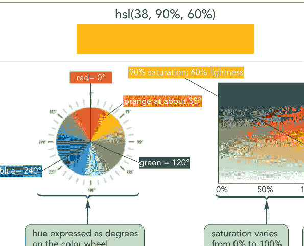

`hsl(38, 90%, 60%)`

CSS3 使用以下格式描述使用 HSL 模型的颜色值：

```css
hsl(hue, saturation, lightness)
```

其中 `hue` 是以度为单位的颜色色调，`saturation` 是以百分比为单位的强度，`lightness` 是颜色的亮度。因此，中橙色表示为：

```css
hsl(38, 90%, 60%)
```

图形设计师认为 HSL 更容易使用，因为它允许他们通过色相设置初始颜色，并微调饱和度和亮度值。在 RGB 模型中则较困难，因为你必须平衡三种不同的颜色才能获得正确的混合。图 2-9 中颜色的 RGB 等效值为 `rgb(245, 177, 61)`；然而，无法一眼看出红、绿、蓝的什么混合会导致那种特定深色的橙色。

# 定义半透明颜色

CSS3 将透明度（opacity）引入了 CSS 颜色模型，以定义颜色的外观。颜色的透明度可以使用以下任一指定：

```css
rgba(red, green, blue, opacity)
hsla(hue, saturation, lightness, opacity)
```

其中 `opacity` 设置颜色的水平，范围从 0（完全透明）到 1（不透明）。使用 HSL 模型的颜色值如下：

```css
hsla(38, 90%, 60%, 0.7)
```

其中 `opacity` 设置颜色的水平，范围从 0（完全透明）到 1（不透明）。例如，通过以下方式指定橙色：

```css
hsla(38, 90%, 60%, 0.7)
```

等同于描述的 `rgba(255, 165, 0, 0.7)`。

# 教程 2 CSS 入门 | HTML 和 CSS HTML 103

3. 将你的更改保存到文件，并在浏览器中重新加载 `css_home.html` 文件。图 2-11 显示了在新样式下的页面外观。

图 2-11

## 网页中的文字颜色和背景颜色

深橙色背景上的白色 h1 标题文字

浏览器窗口背景为中橙色

浅橙色背景上的白色 h2 标题文字

| 链接 | 关于我们 | 评论 |
| --- | --- | --- |
| - 首页 | 自 2002 年以来，Web and Success Sports 一直为运动员提供在线营销的一流培训。我们为你们的进步感到自豪。你可以做你想做的事，或者…… | 感谢所有的赞美！我很高兴看到我的工作帮助你达成了目标。我们正处在正确的道路上。 |
| - 拳击 | 你是否曾经梦想过互联网能改善我们的交流方式？我们曾在那，未来也将再次在那。我们正在努力。我们致力于你的成长。如果你想…… | 希望这能帮助你迈向梦想。对于运动员和个人来说，未来都是光明的。谢谢。 |
| - 自行车 | | |
| - 篮球 | 课程：在小组会议中，为你个人或小组会议设定一些目标 | | | |
| - 足球 | | |
| - 足球运动 | | |
| - 棒球.com | | |
| - 高尔夫.com | | |
| - 排球 | | |
| - 摔跤 | | |
| - 冰球 | | |
| - 赛马 | | |
| - 网球.com | | |
| - 提示与技巧 | | |
| - 体操 | | |

© 2019 学习（Cengage Learning）。

Yubard Corp/Shutterstock.com;
Charles I. Bennett/Shutterstock.com;
ostill/Shutterstock.com;
Monkey Business Images/Shutterstock.com

页面主体样式显示了象牙色背景上的灰色文字。

遇到问题？左侧列超文本链接的颜色是蓝色，使用了应用于超文本链接的默认浏览器样式。你将在后的教程中修改这些颜色。

# WOW! 电子书

nowwowebook.org

版权 2019 学习（Cengage Learning）。所有权利保留。部分或全部不得复制、扫描或复制。WCN 02-200-203

# 解决问题：选择配色方案

对你的网站可以做的坏事情之一是将有趣实用的内容与刺眼且不愉悦的颜色联系起来。许多设计师更喜欢 HSL 颜色系统，因为它更容易选择愉悦的配色方案。以下是你可以应用于网站的一些基础配色方案：此种颜色

- 单色调——单一色调，饱和度和亮度具有不同的值；这种配色方案易于管理，但没有其他设计那样活力。
- 互补色——色轮上相隔 180° 的两种色；这种配色方案最有活力且对比度最高，但可能会被误用，并可能分散观众对页面内容的注意力。
- 三色调——色轮上相隔 120° 的三种色；这种配色方案作为互补设计提供了令人愉悦对比的机会，但在视觉冲击上可能没有那么显著。
- 四色调——色轮上相隔 90° 的四种色；可能是所有配色方案中最丰富的；它也是实现颜色平衡的方案。
- 类比色——色轮上相互靠近的两种色调，其中一种为主色调，另一种是用于高亮和细微差别的辅助色；这种方案缺乏对比，且没有其他配色方案那样活力。

一旦你选定了设计和主色调，就可以通过改变饱和度和亮度来改变这些颜色。样式表最大的优势之一是你可以快速修改你的设计选择，并查看这些更改对页面内容的影响。

# 采用渐进式增强

html 选择器的 HSL 颜色是随 CSS3 引入的，因此在旧版浏览器中不受支持。如果这是一个问题，你可以先插入 `order` 属性，然后是新的标准。例如，样式规则首先使用 RGB 值将元素的背景颜色设置为较浅橙色，然后是等效的 HSL 值。

```css
background-color: rgb(235, 177, 131);
background-color: hsl(27, 72, 72);
```

不识别 HSL 值的旧浏览器将忽略它并使用 RGB 值；而识别这两个值的浏览器将使用最后定义的那个，即 HSL 值。这是一个被称为“渐进式增强”的技巧示例，它将符合标准置于新属性之前，为旧浏览器提供支持，但允许支持新标准的浏览器使用新的标准和技术。

你也会欣赏你在颜色上做的工作。她对使用 CSS 修改 Tri and Succeed 网站元素的设计和外观的便利感到满意。在下一节中，你将继续探索 CSS 表格，专注于文本样式。

# 教程 2 CSS 入门 | HTML 和 CSS

## 章节 2.1 快速检查

1. 什么是内联样式、嵌入样式和外部样式表？你会用哪种来定义整个网站的设计？
2. 你在样式属性上添加哪个关键字来覆盖样式优先级和继承？
3. 请提供代码以输入样式注释“Tri and Succeed Sports Color Styles..”；
4. 提供使用 RGB 三元组显示块引用文本的样式规则。
5. 提供颜色，黄绿色（chartreuse）位于色轮上 90° 处，饱和度为 100%。
6. 什么是渐进式增强？
7. 支持新标准的浏览器会使用支持它们的……技术。
8. 遇到问题？左列超文本链接的颜色是蓝色，使用了应用于超文本链接的默认浏览器样式。你将在后的教程中修改这些颜色。

# WOW! 电子书

nowwowebook.org

## 章节 2.2 概述

h1 标题以 Quicksand 字体显示。

`font-face` 规则导入了字体。

```css
@font-face {
  font-family: Quicksand;
  src: url('Quicksand.woff') format('woff'),
  url('Quicksand-Regular.woff2') format('woff2'),
  url('Quicksand-Regular.ttf') format('truetype');
}
```

`em` 单位是相对长度。块引用设置了行高。字间距为 `0.1em`。


# 链接

- 首页
- 拳击
- 自行车
- 游泳
- Active.com
- Runner's World
- endomondo.com
- Strava
- Cycling Magazine
- Velows
- Bicycle Travel
- USA Swimming
- triathlon.com
- usathlon.org
- Texas Titans
- CapTitle
- Triathlon Calendar
- Triathlon.com

# 评论

自 2002 年以来，Tri and Succeed Sports 一直为各种能力和目标的运动员提供在线营销的一流培训。帮助你实现全部潜力。告诉我们你想做什么，我们将引导你。

想游泳吗？想提高自行车水平？太棒了！想挑战铁三吗？我们曾在那，未来也将再次在那。我们正在努力。或者你只是想要更多！我们正在努力。

感谢所有的赞美！我很高兴看到我的工作帮助你达成了目标。我们正处在正确的道路上。

正文以 Verdana 字体显示。

你做得很好。它证明了这一点。老实说，拥有这样的教练和员工我很荣幸。

## 关于我们

# 课程

冬季即将开始。通过加入我们的个人或小组，迎接你的夏季目标：

- 跑步：我们通过基础知识帮助你跑得更快并避免疼痛。
- 自行车：TSS 的室内训练器提供你精炼技术、耐力和速度所需的一切。
- 游泳：你的水上运动可以成为最有趣的运动。我们的课程从技巧开始。

联系我们以获得个人指导和评估。

# 我们的哲学

运动员是每个成功项目的基。教练是丰富的引导，了解每个运动员的目标、梦想和愿望，并训练他们一种持久的生活方式。

# 探索选择器模式

以下样式规则匹配 HTML 文档中的每个 `h1` 元素，无论 `h1` 标题位于何位置：

```css
h1 {
  color: red;
}
```

此样式规则匹配页面文章中 `h1` 标题的方式，与匹配嵌套在 `aside` 元素或主体页脚（body footer）中的 `h1` 标题的方式是相同的。通常，你可能希望样式规则应用于特定的元素，例如仅应用于文章内的 `h1` 标题，而不是其他任何地方。为了将样式规则指向特定元素，你将使用选择器模式来仅匹配符合指定模式的元素。

# 上下文选择器

你将检查第一个选择器是上下文选择器，它指定了匹配特定元素的上下文。上下文基于文档的层级结构，涉及包含一个或多个子元素的父元素之间的关系，以及这些子元素内部后代元素之间的关系。关联父元素与其后代元素的上下文选择器具有如下模式：

```css
parent descendant { styles }
```


其中，`parent` 是一个元素，`descendant` 是 `parent` 的后代，而 `styles` 是应用到该后代元素上的样式。例如，该样式规则将 `h1` 标题的颜色设置为红色，但仅当它们嵌套在 `header` 元素内部时：

```css
header h1 {
  color: red;
}
```

代码所示，后代元素不需要是父元素的直接元素；事实上，它可以出现在层级结构中父元素的下方几层。这意味着上述样式规则匹配以下代码中的 `h1` 元素：

```html
<header>
  <div>
    <h1>Tri and Succeed Sports/</h1>
  </div>
</header>
```

在此示例中，`h1` 是 `div` 元素的子元素；因为它仍然是 `header` 的后代，所以样式规则仍然有效。

上下文选择器遵循上一节讨论的通用规则：越具体的样式越优于通用的规则。例如，以下样式规则将导致 `section` 元素内的所有 `h1` 标题显示为红色，而其他 `h1` 标题将显示为蓝色：

```css
section h1 {
  color: blue;
}
```

图 2-12 显示了 CSS 支持的一些其他上下文选择器。

## 上下文选择器

图 2-12

| 选择器 | 描述 |
| --- | --- |
| `*` | 匹配任何元素 |
| `elem` | 匹配文档中任意位置的元素 `elem` |
| `elem1, elem2, ...` | 匹配 `elem1`, `elem2` 等元素中的任何一个 |
| `parent descendant` | 匹配嵌套在父元素内任意一个层级的后代元素 |
| `parent > child` | 匹配作为父元素直接子元素的元素 |
| `elem1 + elem2` | 匹配紧跟在兄弟元素 `elem1` 之后的 `elem2` |
| `elem1 ~ elem2` | 匹配位于兄弟元素 `elem1` 之后的 `elem2` |

要匹配任何元素，请使用带有 `*` 通配符选择器。例如，以下样式规则匹配 `article` 元素的所有子元素，将文本颜色设置为蓝色：

```css
article > * { color: blue; }
```

兄弟元素选择器用于根据文档层级结构中相邻的元素来选择元素。以下样式规则使用 `+` 来选择 `h2` 元素，但前提是它紧跟在一个 `h1` 元素之后：

```css
h1 + h2 { color: blue; }
```

另一方面，以下样式规则使用 `~` 符号来选择任何位于 `h1` 元素之后（但不一定是紧随）的元素：

```css
h1 ~ h2 { color: blue; }
```

图 2-13 提供了选择器的额外示例，并用红色标出了会被指定选择器选中的元素。

图 2-13

## 上下文选择器模式

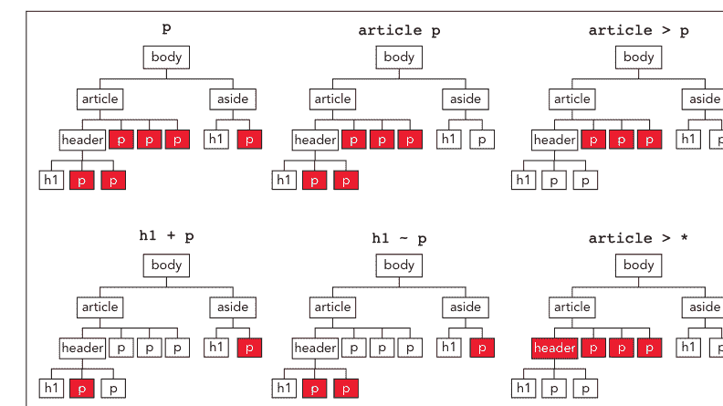

Copyright 2016 Cengage Learning. All Rights Reserved. 不可部分或全部扫描或复制。WCN 02-200-253

WOW! eBook

www.wowebook.com

# HTML 110 HTML 和 CSS | 教程 2 CSS 入

请记住，由于样式继承，应用到元素上的任何样式都会传递到 DOM 树；应用到 `header` 元素的样式会自动传递到该 `header` 内部的元素，除非与更具体的样式冲突。

## 使用上下文选择器

- 要选择所有元素，使用 `*` 选择器。
- 要选择单个元素，使用 `elem` 选择器，其中 `elem` 是元素的名称。
- 要选择后代元素，使用 `parent descendant` 选择器，其中 `parent` 是父元素，`descendant` 是嵌套在该其中较低层级的某个元素。
- 要选择子元素，使用 `parent > child` 选择器。
- 要选择直接跟随 `elem1` 之后的兄弟元素 `elem2`，使用 `elem1 + elem2`。
- 要选择位于 `elem1` 之后但不一定直接跟随其后的兄弟元素 `elem2`，使用 `elem1 ~ elem2`。

现在，你将创建一个样式规则，将 Tri and Success Sports 页面上的客户证言颜色改为深橙色，使用 RGB 颜色值 `rgb(232, 65, 116)`。你将使用上下文选择器将样式规则应用于 `aside` 元素的后代块引用（block quotes）。

### 使用上下文选择器创建样式规则：

1. 如果你在上一节课后休息了，请确保 `tss_styles.css` 文件在编辑器中打开。
2. 在 Aside 和 Blockquote 部分，插入以下样式规则：

```css
aside blockquote {
  color: rgb(232, 65, 116);
}
```

图 2-14 高亮了 `blockquote` 元素的新样式规则。

图 2-14 设置块引用的文本颜色

| Aside 和 Blockquote 样式 | 将文本颜色设置为深橙色 |
| --- | --- |
| 应用于嵌套在 aside 元素内的块引用 | `aside blockquote { color: rgb(232, 65, 116); }` |

3. 保存更改并在浏览器中重新加载 `tss_home.html` 文件。验证客户引用文本是否显示为橙色。

WOW! eBook

www.wowebook.org

# 属性选择器

选择器可以根据属性和属性值定义。`id` 和 `class` 两个属性通常是针对特定元素的样式关键。

- 通过 ID 选择元素，使用 `elem#id` 或 `#id` 选择器，其中 `elem` 是元素的名称，`id` 是属性值。
- 通过类值选择元素，使用 `.class` 或 `elem.class` 选择器，其中 `class` 是类属性的值。
- 选择包含 `att` 属性的元素，使用 `elem[att]`。
- 根据属性值是否包含指定值选择元素，使用 `elem[attr*="val"]`。

# 教程 2 CSS 入门 | HTML 和 CSS HTML 113

在 Tri and Succeed Sports 的主页中，主要内容封装在一个 ID 为 `about_tss` 的 `article` 元素中。Alison 希望她在课程中输入的 `h1` 和 `h2` 标题样式仅应用到具有此特定 ID 的 `h1` 和 `h2` 元素。现在修改样式表。

## 如何应用 id 选择器：

1. 回到编辑器中的 `tss_styles.css` 文件。
2. 将“Heading Styles（标题样式）”部分中 `h1` 和 `h2` 元素的选择器分别更改为 `article#about_tss h1` 和 `article#about_tss h2`。

图 2-16 显示了样式表中经过修订的选择器。

| 选择具有 about_tss_id 的 article 元素内的 h1 标题 | `/* Heading Styles */ article#about_tss h1 { color: white; background-color: rgb(222, 128, 60); }` |
| --- | --- |
| 选择具有 about_tss_id 的 article 元素内的 h2 标题 | `article#about_tss h2 { color: white; background-color: rgb(235, 177, 131); }` |

3. 保存更改并刷新浏览器中的 `tss_home.html` 文件。验证 `h1` 和 `h2` 标题的设计仅应用于 article（文章）区域的标题，而不应用于页面上的其他标题。

该 `article` 元素将用于用于 Tri and Succeed Sports 网站的其他页面。Alison 已经为你提供了三个额外的 HTML 文件，其中包含了针对跑步者、自行车运动员和游泳者的教学课程描述。在这些页面上，`article` 元素具有值为 `syllabus` 的 class 属性。为页面上 `article` 内的 `h1` 和 `h2` 元素创建样式规则。

## 如何应用 class 选择器：

```html
<link href="tss_layout.css" rel="stylesheet" />
<link href="tss_styles.css" rel="stylesheet" />
```

WOW! eBook

www.wowebook.com

# HTML 114 HTML 和 CSS | 教程 2 CSS 入门

3. 花些时间研究文件的内容和结构。注意 `article` 元素具有值为 `syllabus` 的 class 属性。保存文件的更改。
4. 回到编辑器中的 `tss_style.css` 文件。
5. 在“Heading Styles”部分，添加以下样式规则，以便在中灰色在浅紫色背景上显示 `h1` 和 `h2` 标题的文本：

```css
article.syllabus h1, article.syllabus h2 {
  background-color: rgb(255, 185, 255);
  color: rgb(101, 101, 101);
}
```

图 2-17 显示了文件中新的样式规则。

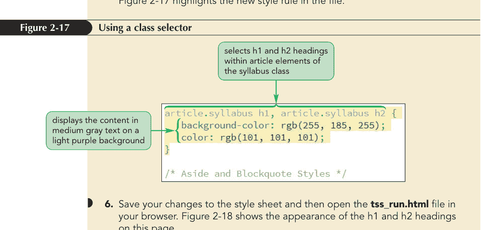
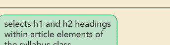
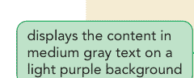
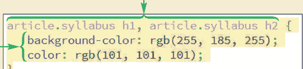
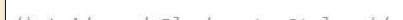

6. 保存样式表的更改并在浏览器中打开 `tss_run.html` 文件。图 2-18 显示了该页面 `h1` 和 `h2` 标题的样式。

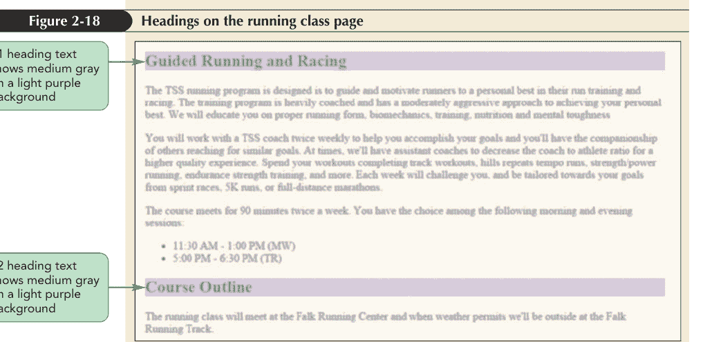d9080_6.png)

# 引导性跑步与竞赛

TSS 计划旨在引导并激励跑步者在跑步训练和竞赛中取得个人最好。我们将有关跑步姿势、生物力学、营养和心理韧性。你将每周与 TSS 教练合作，帮助增加每周里程程以获得更好的体验。周末完成径道训练、坡道重复、力量跑步和耐力计划，针对冲刺赛、5 公里或长距离的目标。

课程每周上两次，每次 90 分钟。你可以在以下时段中选择：

- 上午 11:30 - 下午 1:00（周一周三）
- 下午 5:00 - 6:30（周四周五）

# 课程大纲

课程将在 Falk 中心进行，天气允许时我们将前往 Falk 径道。

WOW! eBook

www.wowebook.com

# 教程 2 CSS 入门 | HTML 和 CSS HTML 115

7. 使用页面上的导航链接查看自行车和游泳页的内容和设计，然后确认这些页面上的 `h1` 和 `h2` 标题具有类似的格式。

# 计算权重

CSS 的通用规则是更具体的选择器优于更通用的选择器，但该规则的应用并不总是清晰。例如，以下选择器中哪一个更具体？

```css
header h1
#main h1
```

为了回答这个问题，CSS 使用公式为选择器的权重分配一个数值：

`(内联, 类, 元素)`

其中，`inline` 对于内联样式为 1，否则为 0；`id` 对于选择器中的每个 id 为 1；`class` 对于选择器中的每个类或属性为 1；`elements` 对于选择器中的每个元素为 1。例如，选择器 `#links` 的权重为 `(0, 1, 2)`，因为它引用了一个 id (`#links`)、一个类 (`.first`) 和两个元素 (`u` 和 `li`)。权重值从左到右读取，左侧数值较大的数字被认为比右侧较小的数字更具体。

为了回答我们早些的问题：选择器 `header h1` 的权重为 `(0, 0, 2)`，而 `#main h1` 的权重为 `(1, 0, 1)`。由于 1 大于 0，`#main h1` 更具体。

# 字体字体

排版是文本外观设计的艺术。

# 选择字体

`font-family` 属性允许你为元素指定字体列表。浏览器将使用列表中可用的第一个字体。

# 教程 2 CSS 入门 | HTML 和 CSS HTML 11 由于

由于此样式规则的作用，浏览器将首先尝试加载 Verdana 字体，然后是 Geneva 字体。如果这两个字体都不可用，浏览器将加载它所选的通用无衬线字体（sans-serif）。将此字体添加到页面主体（`body`）的样式规则中。

# 为页面 `body` 指定字体族：

1. 回到编辑器中的 `tss_styles.css` 文件。
2. 在 `body` 元素的样式规则中添加以下样式：

```css
font-family: Verdana, Geneva, sans-serif;
```

图 2-20 高亮了 `body` 元素的新样式。

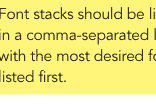

# 图 2-20 指定字体栈

| body { |
| :--- |
| color: rgb(91, 91, 91); |
| background-color: ivory; |
| font-family: Verdana, Geneva, sans-serif; |
| } |

浏览器首先尝试使用 Verdana 字体，其次是 Geneva 字体，最后是任何通用无衬线字体。

3. 保存对文件的更改并在浏览器中重新加载 `tss_home.html` 文件。图 2-21 显示了使用无衬线字体后 `body` 文本修改后的外观。

# 图 2-21 应用于主面的无衬线字体

| 关于 TSS | 评论 |
| :--- | :--- |
| 跑步 | 自 2002 年以来，TSS 为所有运动员提供了一个一流的培训中心。我们专注于帮助你实现目标，无论你想做什么；我们努力履行我们的使命。 | 感谢你的信息！我在我的程序中完全按照了你所说的做了。我的体验非常棒，你对我帮助很大了！ |
| 骑行 | 想游泳吗？对提高你的速度感兴趣吗？我们将在赛后帮助你变得更快。或者如果你只是想健身，我们会定制教学课程以匹配你的目标。你最终将获得…… | 我喜欢在这样一个充满支持性的环境中工作，无论是作为运动员还是作为教练。谢谢！ |
| 游泳 | | |
| 活跃 | | |
| 文复兴 | | |
| 世界 | | |
| endomorph.com | | |
| 自行车杂志 | | |
| 自行车之旅 | | |
| 游泳世界 | | |
| triathletes.org | | |
| 运动员 | | |
| Casper Fitness | | |
| 三项全锦 | | |
| Triplet.com | | |
| 课程 | | |
| 冬季教学课程即将开始。通过加入我们的个人或小组指导，为你的夏季抢占先机： | | |

© 2016 Cengage; Monkey Business Images/Shutterstock.com

4. 查看网站中的其他页面，以验证无衬线字体也应用于这些页面的 `body` 文本。

WOW! eBook

www.wowebook.com

# 探索网络字体

由于安全字体（safe fonts）将你的选择限制在具有通用支持的少数字体，另一种方法是提供网络字体，并将字体定义通过外部文件提供给浏览器。图 2-22 描述了不同的字体文件格式及其目前的浏览器支持程度。在所有当前浏览器和几乎所有设备上最广泛接受的格式是网络字体格式（WOFF）。

# 图 2-22 网络字体格式

| 格式 | 描述 | 浏览器 |
| --- | --- | --- |
| 嵌入式 OpenType (EOT) | OpenType 字体的一种紧凑形式，设计用于作为样式中的嵌入字体 | IE |
| 真字体 (TTF) | 在 Mac OS 和 Windows 操作系统上使用的字体标准 | IE, Firefox, Safari, Opera |
| OpenType (OTF) | 基于微软开发的 TrueType 格式构建的字体格式 | IE, Chrome, Safari, Opera |
| 可缩放矢量图形 (SVG) | 基于 XML 词汇的字体，设计用于描述可缩放图形和矢量图像 | Chrome |
| 网络开放格式 (WOFF) | 基于 OpenType 和 TrueType 的 W3C 推荐格式，带有压缩和额外的元数据 | IE, Chrome, Safari, Opera |

网络字体可以从互联网上的多个服务器下载。在许多情况下，你必须为使用它们付费；在某些情况下，字体是免费的，但仅限用于非商业用途。在下载和使用网络字体之前，你应该始终检查 EULA（最终用户许可协议）以确保你符合许可规定。最后，许多网络字体可以通过网络字体服务机构获取，它们在其服务器上提供字体，页面设计师可以免费链接。

使用网络字体的巨大优势是能够更好地控制文档中使用的字体；缺点是它变成了浏览器下载的另一个文件，增加了渲染页面所需的时间。这对于限制字体数量和大小移动设备可能是一个巨大的问题。

# @font-face 规则

要访问并加载网络字体，你需要在样式表中添加 `@font-face` 规则

```css
@font-face {
  font-family: name;
  src: url('url1') format('woff1'),
       url('url2') format('woff2');
  
  descriptor1: value;
  descriptor2: value;
}
```

WOW! eBook

www.wowebook.org

# 教程 2 CSS 入门 | HTML 和 CSS

> 提示 包含一个值来提醒浏览器被认为是最佳实践。

要访问并加载网络字体，你需要在样式表中添加 `@font-face` 规则


# 教程 2 CSS 入门 | HTML 和 CSS

## 为页面 `body` 指定字体族

由于此样式规则的作用，浏览器将首先尝试加载 Verdana 字体，然后是 Geneva 字体。如果这两个字体都不可用，浏览器将加载它所选的通用无衬线字体（sans-serif）。将此字体添加到页面主体（`body`）的样式规则中。

1. 回到编辑器中的 `tss_styles.css` 文件。
2. 在 `body` 元素的样式规则中添加以下样式：

```css
font-family: Verdana, Geneva, sans-serif;
```

图 2-20 高亮了 `body` 元素的新样式。


### 图 2-20 指定字体栈

| body { |
| :--- |
| color: rgb(91, 91, 91); |
| background-color: ivory; |
| font-family: Verdana, Geneva, sans-serif; |
| } |

浏览器首先尝试使用 Verdana 字体，其次是 Geneva 字体，最后是任何通用无衬线字体。

3. 保存对文件的更改并在浏览器中重新加载 `tss_home.html` 文件。图 2-21 显示了使用无衬线字体后 `body` 文本修改后的外观。

### 图 2-21 应用于主面的无衬线字体

| 关于 TSS | 评论 |
| :--- | :--- |
| 跑步 | 自 2002 年以来，TSS 为所有运动员提供了一个一流的培训中心。我们专注于帮助你实现目标，无论你想做什么；我们努力履行我们的使命。 | 感谢你的信息！我在我的程序中完全按照你所说的做了。我的体验非常棒，你对我帮助很大了！ |
| 骑行 | 想游泳吗？对提高你的速度感兴趣吗？我们将在赛后帮助你变得更快。或者如果你只是想健身，我们会定制教学课程以匹配你的目标。你最终将获得…… | 我喜欢在这样一个充满支持性的环境中工作，无论是作为运动员还是作为教练。谢谢！ |
| 游泳 | | |
| 活跃 | | |
| 文复兴 | | |
| 世界 | | |
| endomorph.com | | |
| 自行车杂志 | | |
| 自行车之旅 | | |
| 游泳世界 | | |
| triathletes.org | | |
| 运动员 | | |
| Casper Fitness | | |
| 三项全锦 | | |
| Triplet.com | | |
| 课程 | | |
| 冬季教学课程即将开始。通过加入我们的个人或小组指导，为你的夏季抢占先机： | | |

© 2016 Cengage; Monkey Business Images/Shutterstock.com

4. 查看网站中的其他页面，以验证无衬线字体也应用于这些页面的 `body` 文本。

## 探索网络字体

由于安全字体将你的选择限制在具有通用支持的少数字体，另一种方法是提供网络字体，并将字体定义通过外部文件提供给浏览器。图 2-22 描述了不同的字体文件格式及其目前的浏览器支持程度。在所有当前浏览器和几乎所有设备上最广泛接受的格式是网络字体格式（WOFF）。

### 图 2-22 网络字体格式

| 格式 | 描述 | 浏览器 |
| --- | --- | --- |
| 嵌入式 OpenType (EOT) | OpenType 字体的一种紧凑形式，设计用于作为样式中的嵌入字体 | IE |
| 真字体 (TTF) | 在 Mac OS 和 Windows 操作系统上使用的字体标准 | IE, Firefox, Safari, Opera |
| OpenType (OTF) | 基于微软开发的 TrueType 格式构建的字体格式 | IE, Chrome, Safari, Opera |
| 可缩放矢量图形 (SVG) | 基于 XML 词汇的字体，设计用于描述可缩放图形和矢量图像 | Chrome |
| 网络开放格式 (WOFF) | 基于 OpenType 和 TrueType 的 W3C 推荐格式，带有压缩和额外的元数据 | IE, Chrome, Safari, Opera |

网络字体可以从互联网上的多个服务器下载。在许多情况下，你必须为使用它们付费；在某些情况下，字体是免费的，但仅限用于非商业用途。在下载和使用网络字体之前，你应该始终检查 EULA（最终用户许可协议）以确保你符合许可规定。最后，许多网络字体可以通过网络字体服务机构获取，它们在其服务器上提供字体，页面设计师可以免费链接。

使用网络字体的巨大优势是它能够更好地控制文档中使用的字体；缺点是它变成了浏览器下载的另一个文件，增加了渲染页面所需的时间。这对于限制字体数量和大小移动设备可能是一个巨大的问题。

## @font-face 规则

要访问并加载网络字体，你需要在样式表中添加 `@font-face` 规则：

```css
@font-face {
  font-family: name;
  src: url('url1') format('woff1'),
       url('url2') format('woff2');
  
  descriptor1: value;
  descriptor2: value;
}
```

> **TIP** 包含一个值来提醒浏览器被认为是最佳实践。

## 使用 Google 字体

Google Fonts（`https://fonts.google.com/`）提供了免费字体库。一旦你从字体目录中选择了字体，将通过链接元素来访问它。例如，下面的链接元素访问了名为 Roboto 的字体：

```html
<link href="https://fonts.googleapis.com/css?family=Roboto" rel="stylesheet">
```

要使用该字体，在 CSS 表中包含 `font-family` 属性：

```css
font-family: 'Roboto', sans-serif;
```

所有的 Google 字体都需要谨慎使用，因为它们会极大增加网站的加载时间。为了帮助你了解，当你已经了字体时，可以使用 `href` 参数来限制字体的大小。例如，下面的链接元素将字体限制为特定的字符：

```html
<link href="https://fonts.googleapis.com/css?family=Roboto:wght@400" rel="stylesheet">
```

注意空格表示的是 em。如果你有更长的文本，可以通过 `href` 属性来节省字体的大小，避免重复下载。

## 设置字体大小

排版中的另一个考虑因素是字体大小，由 `font-size` 属性定义：

```css
font-size: size;
```

其中 `size` 是 CSS 的单位。CSS 中的长度（和宽度）可以是绝对单位或相对单位。这些字体大小的值可以是数字（1, 2...）或小数（0.5, 1.6...）。

## 绝对单位


**绝对单位**是无论输出设备如何都是固定的，通常用于打印媒体。标准单位包括：`mm`（毫米）、`cm`（厘米）、`in`（英寸）、`pt`（磅）和 `pc`（派卡）。将你的正文大小设置为 `12pt`，可以应用下面的规则：

```css
body {
  font-size: 12pt;
}
```

注意不要在大小值和单位之间插入空格。

## 相对单位

绝对单位的使用有限，因为在许多情况下，设计师并不知道设备的属性。相反，设计师使用相对单位，其是相对于网页内其他对象的大小或相对于设备本身的属性。

# HTML 和 CSS 入门教程12

大多数设备的基本单位是像素（`px`），它代表输出设备上的一个点。像素是一个相对单位，其大小取决于输出设备的分辨率和密度。桌面显示器的像素密度约为 `96dpi`，笔记本电脑约为 `100` 到 `135dpi`，而手机的密度为 `200dpi` 到 `300dpi` 或更高。通常，浏览器会对正文、`h1` 和 `h2` 应用 `16px` 的基础字体大小。下面的样式规则将字体大小设置为 `10px`，将所有 `h1` 标题设置为 `14px`：

```css
body {
  font-size: 10px;
}
h1 {
  font-size: 14px;
}
```

文本的精确外观很大取决于设备的像素密度。`10px` 的行在桌面显示器上可能还可以，同样的尺寸在移动设备上可能不可用。

## 使用 em 和 rem 缩放字体

由于页面设计师不知道设备的精确属性，通常的做法是相对于默认字体大小使字体可缩放。有三种相对测量方法提供扩展性：百分比（`%`）、`em` 和 `rem`。

百分比将字体大小设置为元素所字体大小的百分比。例如，下面的样式规则将 `h1` 标题的字体设置为 `200%`，即 `h1` 父元素大小的两倍：

```css
h1 {
  font-size: 200%;
}
```

`em` 相当于百分比，表示相对于父元素大小的字体大小。因此，要将 `h1` 标题的字体设置为其父元素的大小，你也可以使用规则：

```css
h1 {
  font-size: 2em;
}
```

`em` 是网页文本的样式单位，因为它在任何设备下保持字体字体大小。内容对相对元素非常有响应。例如，如果此 `h1` 元素放在字体大小为 `16px` 的 `body` 元素中，`h1` 标题的字体大小将为 `32px`。另一方面，如果 `h1` 标题嵌套在字体大小为 `9px` 的 `article` 元素中，你可以根据 `em` 和相对于相邻文本大小的单位来考虑字体大小。

`rem` 单位样式可以带来一致的结果。例如，考虑以下嵌套在 `body` 中的 `article` 元素中的 `h1` 元素的样式规则：

```css
body {
  font-size: 16px;
}
article {
  font-size: 0.75rem;
}
h1 {
  font-size: 1rem;
}
```

随着浏览器支持的增长，`rem` 单位在设计师中变得越来越流行，它的用法在未来几年可能会取代 `em` 单位。

## 使用视口单位

另一种结果是视口单位，长度表示为浏览器窗口的宽度或高度。当浏览器调整大小时，基于视口单位的字体大小会改变。CSS 引入了四种视口单位：`vw`、`vh`、`vmin` 和 `vmax`

- `vw` = 浏览器宽度的 `1%`
- `vh` = 浏览器高度的 `1%`
- `vmin` = `1vw` 或 `1vh`（较小者）
- `vmax` = `1vw` 或 `1vh`（较大者）

例如，如果浏览器窗口为 `1366` 像素，`1vw` 的长度等于 `13.66px`。如果宽度缩小到 `780` 像素，`1vw` 会重新计算为 `7.8` 像素。

# 教程 2 CSS 入门 | HTML 和 CSS HTML 125

# 图 2-26

# 关于 TSS 页面中调整字体大小

| 字体大小设置为 2.2em | 关于 TSS | 字体大小设置为 2.2em | 注释 |
|---|---|---|---|
| 链接 | 自2002年以来，TII 和 Success 建立了第一家针对运动员的培训中心。我们专注于帮助你做你想做的事，但我们也努力满足你的需求。 | 这就是为什么无论在什么年龄、哪个行业你都能感到惊讶。我们引导你走向更好的生活。 | |
| 跑步 | 想成功吗？太棒了！建立在动力。想应对摔跤吗？我们追逐比赛。如果你只想获胜，我们的指导将教你如何完成你开始的工作。 | 字体大小设置为 0.8em | |
| 播种 | 冬季课程开始。通过我们的指导帮助你实现夏季目标，抢占先机。 | | |
| 游泳 | 跑步：我们从基础开始 | Monkey Business Images/istock | | |
| 田径运动 | | | | |
| endekwondo.com | | | | |
| 骑行 | | | | |
| 健身学校 | | | | |
| southwest.org | | | | |
| 德州健身 | | | | |
| athloncom | | | | |
| 团队合作 | | | | |
| 训练 | | | | |
| © 2016 Cengage Learning; Monkey Business Images/istock.com | | | | |

注意，页面中 `h1` 标题的文本比导航列表和 `aside` 元素中的 `h1` 标题大，尽管所有的字体大小都是 `2.2em`。这是因为导航列表和 `aside` 元素中的默认字体大小缩小了 `80%`，因此这些元素中的 `h1` 标题也按相同比例缩小了。

# 控制间距和缩进

CSS 样式用于控制某些排版属性，例如字间距（kerning）、词间距（tracking）和行高（leading）。行高衡量字符之间的空间大小，词间距衡量单词之间的空间大小。控制字间距和词间距的属性是

```css
letter-spacing: value;
word-spacing: value;
```

其中 `value` 是单个字母或单词之间空间的大小。你使用与字体大小相同的单位来指定这些值。词间距和字间距的默认值为 `0px`。正值增加字母和单词的间距，而负值则减小字母和单词之间的空间。如果你选择让文本在各种设备和分辨率下可缩放，可以将字间距和词间距值表示为百分比或单位。

行高衡量文本行之间的空间大小，通过设置以下 `line-height` 属性来实现：

```css
line-height: size;
```

其中 `size` 是行上文本字体大小的值或百分比。如果没有指定单位，则该值代表行高与字体大小的比例。默认值值为 `1.2` 或 `1.2em`，因此行高比字体大小大 `20%`。相比之下，以下样式将高度固定为字体大小，使文本看起来是双倍行距的。

> **提示**
>
> 你可以通过使用大字体配合较小的行高来收紧行间距，从而使卡片更具冲击力。

```css
line-height: 2em;
```

# WOW! eBook

www.wowebook.com

Copyright 2018 Cengage Learning. 版权所有。不得部分或全部复制、扫描或复制。WCN 022-200-033

# HTML 126 HTML 和 CSS | 教程 2 CSS 入门

控制间距的另一种方法是使用 `text-indent` 属性为文本块的第一行设置缩进：

```css
text-indent: size;
```

其中 `size` 用绝对单位或相对单位表示，或者作为文本块宽度的百分比。缩进值为 `5%` 的缩进值会将该行缩进为宽度的 `5%`。缩进值也可以是负值，将第一行向左延伸以创建悬挂缩进。

Allison 建议你将 `h1` 和 `h2` 标题使用的字间距增加 `0.1em`，这样字母在页面上就不会互相拥挤。她还要求你将文本的行高增加 `2em`，以便主页上的链接列表呈现双倍行距。

# 设置页面元素的最佳效果：

1. 返回编辑器中的 `ts_styles.css` 文件。
2. 在标题样式（Heading Styles）部分，将以下样式插入到 `h1`、`h2` 选择器的样式规则中。

```css
letter-spacing: 0.1em;
```

3. 滚动到文件底部附近的导航样式（Navigation Styles），为嵌套在 `nav` 元素内部的 `ul` 元素的文本插入以下样式规则。

```css
nav ul {
  line-height: 2em;
}
```

图 2-27 显示了网站的字间距和行高样式。

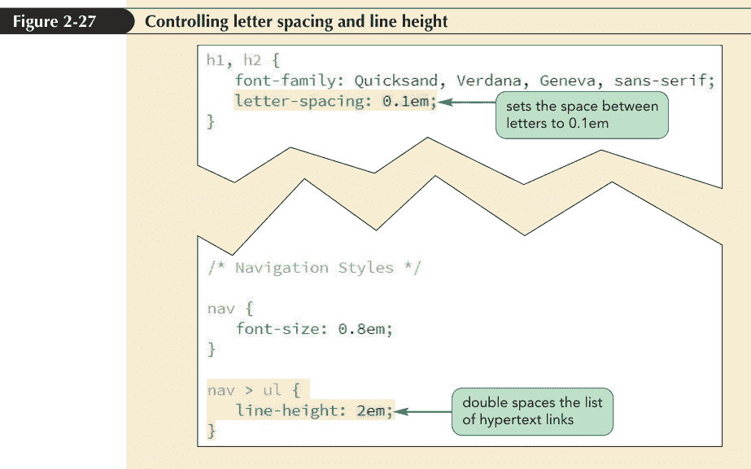

# 控制字间距和行高

```css
h1, h2 {
  font-family: Quickand, Verdana, Geneva, sans-serif;
  letter-spacing: 0.1em; /* 设置字符之间的空间 */
}
```

```css
/* 导航样式 */
nav {
  font-size: 0.8em;
}
nav ul {
  line-height: 2em; /* 使链接列表为双倍行距 */
}
```

# WOW! eBook

www.webook.org

# 教程 2 CSS 入门 | HTML 和 CSS 127

4. 保存对文件的更改，然后在浏览器中加载 `ts_home.html`。验证 `h1` 和 `h2` 标题中字母之间的间距已经增加，且列表现在是双倍行距的。

通过增加标题的字间距，你让文本不再那么拥挤，使其更容易阅读。

# 使用字体样式

浏览器内置的样式表应用于关键页面元素；例如，`address` 元素通常以斜体显示，标题通常以粗体显示。你可以使用 `font-style` 属性指定不同的字体样式：

```css
font-style: type;
```

其中 `type` 为 `normal`、`italic` 或 `oblique`。`italic` 和 `oblique` 在视觉上相似，但取决于使用的字体可能会有所不同。

更改文本的粗细，使用 `font-weight` 属性：

```css
font-weight: weight;
```

其中 `weight` 为 `normal`、`bold` 或 `bolder`。

更改文本的装饰，使用 `text-decoration` 属性：

```css
text-decoration: type;
```

其中 `type` 为 `none`、`underline`、`overline` 或 `line-through`。

更改文本的大小写，使用 `text-transform` 属性：

```css
text-transform: type;
```

其中 `type` 为 `uppercase`、`lowercase` 或 `none`。

更改文本的变体，使用 `font-variant` 属性：

```css
font-variant: variant;
```

其中 `variant` 为 `normal` 或 `small-caps`。

更改文本的透明度，使用 `opacity` 属性：

```css
opacity: value;
```

其中 `value` 是 `0.0` 到 `1.0` 之间的数字。

# 教程 2 CSS 入门 | HTML 和 CSS HTML 129

你不需要在 `font` 简写属性中包含所有值；唯一必须的值是大小（`size`）和字体族（`family`）。浏览器会使用省略的默认属性；但是你必须按照上述顺序放置你包含的任何属性。

在 Tri and Succeed Sports 网站每个页面的底部，Alison 在页脚（`footer`）中包含了一个 `address` 元素。默认样式表建议你以*斜体*显示文本。Alison 建议在深橙色背景上使用半透明的**粗体白色字体**，并在页面居中显示。她建议使用小型大写字母（`small-caps`）字体变体来增加视觉趣味，并希望将地址行的高度增加到 `3em`。为了使你的 CSS 代码紧凑，你将使用 `font` 简写属性设置所有字体值。

## 应用字体属性：

1. 回到编辑器中的 `tss_styles.css` 文件。
2. 进入 Footer Styles（页脚样式）部分并添加以下样式规则：

```css
body > footer {
  background-color: rgb(222,128,60);
  color: white;
  color: rgba(255,255,255,0.7);
  font: normal small-caps bold 0.9em/3em Quicksand, Verdana, Geneva, sans-serif;
  text-align: center;
}
```

注意，此样式规则使用了渐进式增强，将每种颜色放在单独的一行，这样不支持半透明颜色的浏览器将以白色显示地址文本。图 2-29 突出了页脚的样式。

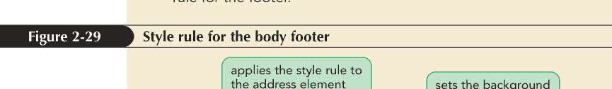

| 将样式规则应用于页脚内的地址元素 | 将背景色设置为橙色 |
| :--- | :--- |
| 以半透明白色显示文本颜色，或在不支持时不 | 将字体大小设置为 0.9em |
| 以普通粗体带小型大写字母显示文本 | |
| 文本水平居中 | 以 Quicksand, Geneva 或默认的 sans-serif 显示文本 | 将行高设置为 3em |

```css
/* Footer Styles */
body > footer {
  background-color: rgb(222,128,60);
  color: white;
  color: rgba(255,255,255,0.7);
  font: normal small-caps bold 0.9em/3em Quicksand, Verdana, Geneva, sans-serif;
  text-align: center;
}
```

3. 保存对文件的更改，然后在浏览器中重新加载 `tss_home.html` 文件。浏览器 2-30 显示了 `body` 页脚的修改后外观。

# WOW! eBook

www.semanticweb.org

Copyright 2018 Cengage Learning. 保留所有权利。未经全部或部分复制、扫描或复制。WCN 02-200-233

# HTML 130 HTML 和 CSS | 教程 2 CSS 入门

图 2-30 格式化的 body 页脚

# 我们的理念

运动员是每一个成功的训练计划的石。最好的教练是经验丰富的引导者，他们以道德、梦想和纪律为领导，并根据运动员当前的身体状况和能力遵循训练计划。自2002年以来，我们已帮助数百名运动员在许多健身领域取得成功。获胜者不是战斗最激烈的人，而是坚持下去的人。加入我们，开始探索潜力。

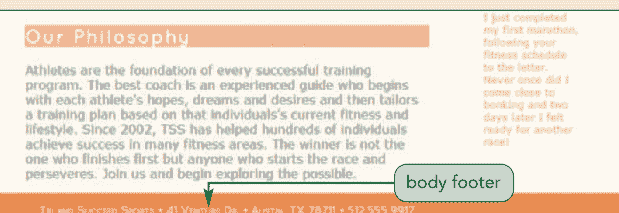

> 没有计划的目标就像没有开始日期的健身计划，注定会失败。 — Jim R

body footer

© 2018 Cengage Learning. 保留所有权利。Austin, TX 78738-9255555-999

# 决策：选择字体

HTML 和 CSS 提供了很多排版设计选项。然而，你的目标始终是让文本易于阅读。请记住以下原则：

- 保持简洁——避免大块的*斜体*文本和**粗体**文本。这些样式是为了强调，而不是为了可读性。
- 无衬线字体——无衬线字体在电脑显示器上更易读，应用于正文。将衬线字体、草书字体和装饰字体留给页面标题和装饰元素。
- 相对与绝对——字体可以用相对单位或绝对单位表示。相对单位（如 `em`）比绝对单位让用户的设备对你的页面外观具有更多控制权。通常情况下，在你知道查看页面的设备配置之前，你应该使用相对单位。
- 大小至关重要——所有字体在 `14` 像素或更大的尺寸下都是可读的；对于较小尺寸，选择为屏幕显示设计的字体，例如 `Verdana` 和 `Georgia`。如果你必须使用非常小的字体（几像素大小），你应该使用专门为之设计的字体，或者用内联图像替换文本。
- 避免长行——通常情况下，尝试将每行的长度保持在 `60` 个字符或以内。任何更长的都是一种风险。

在选择任何字体和字体样式时，关键是在各种浏览器、设备、屏幕分辨率和密度上测试你的选择。不要假设在你的电脑屏幕上易读且美观的内容在另一个设备上也能良好工作。

Alison 喜欢你对她的网站所做的排版更改。在下一节中，你将探索如何为超链接和列表设计样式，并学习如何使用 CSS 为你的网页添加视觉效果。

# WOW! eBook

www.wowebook.org

# 2.2 节快速检查

1. 提供一个选择器来匹配作为 `footer` 元素直接孩子的 `address` 元素。
2. 文档中的初始 `h1` 标题 ID 为 `top`。提供一条样式规则，用 `Century Gothic`、`Helvetica` 或 `sans-serif` 字体显示此 `h1` 标题文本。
3. 对于以下样式规则，`h1` 标题的字体大小是多少像素？

```css
body {font-size: 16px};
body > article {font-size: 0.75em};
body > article > h1 {font-size: 1.5em};
```

4. 提供一条样式规则，将正文大小设置为 `16px`。

（注：原文中包含大量重复的 OCR 错误，以上翻译已根据逻辑内容进行清理。）

# 列表格式化

在本节中，你将探索如何使用 CSS 为教程 1 中学到的不同类型的列表创建样式。你将从研究如何为列表标记（marker）创建样式开始。

# 选择列表类型

无序列表和有序列表的默认浏览器样式是在每个列表项目旁边显示一个称为列表标记的符号。默认情况下，无序列表以实心圆显示，而有序列表以数字显示。要更改列表标记的类型或防止显示标记，请应用以下 `list-style-type` 属性

```css
list-style-type: type;
```

其中 `type` 是图 2-31 中显示的标记之一。

图 2-31 list-style-type 属性的值

| list-style-type | 标记(s) |
| --- | --- |
| disc | ● |
| circle | ○ |
| square | ■ |
| decimal | 1, 2, 3, 4, ... |
| decimal-leading-zero | 01, 02, 03, 04, ... |


| lower-roman | i, ii, iii, iv, ... |
| upper-roman | I, II, IV, ... |
| lower-alpha | a, b, c, d, ... |
| upper-alpha | A, B, C, D, ... |
| lower-greek | α, β, γ, ε, ... |
| upper-greek | A, B, Γ, Δ, ... |
| none | 不显示标记 |


例如，以下样式规则使用大写罗马数字标记有序列表中的每个项目：

```css
ol {list-style-type: upper-roman;}
```

# 创建大纲样式

通过使用无数选择器，嵌套列表可以大纲样式显示。例如，以下样式规则为嵌套列表创建了大纲样式：

```css
ol {list-style-type: upper-roman;}
ol ol {list-style-type: upper-alpha;}
ol ol ol {list-style-type: decimal;}
```

在此样式中，`ol` 选择器选择列表的顶层，用罗马数字显示项目。`ol ol` 选择器选择第二层，用大写字母标记项目。由 `ol ol ol` 选择器指示的第三层用数字值标记。

# 教程 2：开始使用 CSS | HTML 和 CSS

为了查看这些样式规则如何在页面上渲染，你将把它们应用到 Alison 设置的三个页面上，这些页面描述了 Tri 和 Success 体育提供的跑步、单车和游泳课程。每个页面都包含一个大纲，概述了未来几周的课程学习。

## 要应用大纲样式：

1. 如果你在上一节课后休息了，请确保在编辑器中打开了 `tss_styles.css` 文件。
2. 滚动到列表样式部分，并插入以下样式规则来格式化 `syllabus` 文章中的有序列表：

```css
article.syllabus ol {
  list-style-type: upper-roman;
}
article.syllabus ol ol {
  list-style-type: upper-alpha;
}
article.syllabus ol ol ol {
  list-style-type: decimal;
}
```

图 2-32 突出了嵌套列表的样式规则。

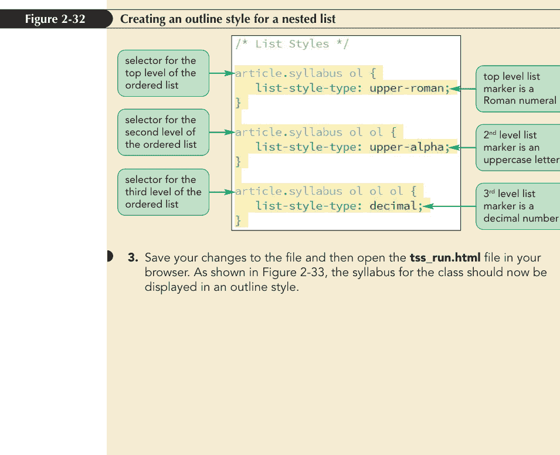

| 说明 | 选择器 | 效果 |
| --- | --- | --- |
| 有序列表顶层的选择器 | `article.syllabus ol { list-style-type: upper-roman; }` | 顶层列表标记是罗马数字 |
| 有序列表第二层的选择器 | `article.syllabus ol ol { list-style-type: upper-alpha; }` | 第二层列表标记是大写字母 |
| 有序列表第三层的选择器 | `article.syllabus ol ol ol { list-style-type: decimal; }` | 第三层列表标记是十进制数字 |

3. 保存对文件的更改，然后在浏览器中打开 `tss_run.html`。如图 2-33 所示，课程大纲应该以大纲样式显示。

> **WOW！电子书**
> www.wowebook.org

# HTML 136 HTML 和 CSS | 教程 2 开始使用 CSS

## 图 2-23 课程大纲

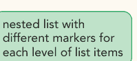

Allison 指出，导航列表中的超链接以实心圆显示。

## 要移除导航中的标记：

1. 返回 `tss_styles.css` 文件。
2. 在导航部分，添加以下样式：

```css
ul {
  list-style: none;
}
```

图 2-34 显示了结果。

# 使用图像作为标记

你可以使用 `list-style-image` 属性为列表标记自定义图像：

```css
list-style-image: url(url);
```

其中 `url` 是图像的 URL。

`list-style-type` 属性可以是：

- `disc`（实心圆）
- `circle`（空心圆）
- `square`（正方形）
- `decimal`（十进制）
- `decimal-leading-zero`（前导零十进制 01, 02...）
- `lower-roman`（罗马数字 i, ii, iii...）
- `upper-roman`（大罗马数字 I, II, III...）
- `lower-alpha`（小写字母 a, b, c...）
- `upper-alpha`（大写字母 A, B, C...）
- `lower-greek`（小写希腊字母 α, β, γ...）
- `upper-greek`（大写希腊字母 A, B, Γ...）
- `none`（无）

# 列表标记的位置

CSS 将每个列表项目视为块级元素，放置在一个虚拟框中，列表标记被放置在列表文本之外。你可以使用 `list-style-position` 属性更改这种默认行为：

```css
list-style-position: position;
```

其中 `position` 为 `outside`（外部，默认）或 `inside`（内部）。将标记放在虚拟框内部会导致列表文本环绕标记流动。图 2-37 显示了 `list-style-position` 属性如何影响标记周围文本的效果。

# 教程 2 CSS 入门 | HTML 和 CSS

## 图 2-37 list-style 属性的值

| 每个项目周围的虚拟框 | `list-style-position: outside;` | `list-style-position: inside;` |
| --- | --- | --- |
| 示例内容 | * 晨练：我们从基础开始，帮助你跑得比你想象中更快、更远，且没有疼痛。<br>* 游泳：我们涵盖了精炼技术、体力和耐力所需的所有内容。我们的教练会使用训练法。<br>* 公域水：越野游泳是最具挑战性的运动之一。通过技巧，你的游泳可以变得非常愉快且没有压力。 | * 晨练：我们从基础开始，帮助你跑得比你想象中更快！且更远，且没有疼痛。<br>* 游泳：我们涵盖了精炼技术、体力和耐力所需的所有内容。我们的教练会使用训练法。<br>* 公域水：越野游泳是最具挑战性的运动之一。通过技巧，你的游泳可以变得非常愉快且没有压力。 |

所有使用的三种列表都可以与以下 `list-style` 属性结合使用：

```css
list-style: type image position;
```

**type** 是标记类型，**image** 是代替标记显示的图像，**position** 是标记的位置。例如，以下样式规则使用放置在容器框内的项目符号图像标记来显示无序列表：

```css
ul {list-style: circle url(bullet.png) inside;}
```

如果浏览器无法显示 `bullet.png` 图像，它将使用默认的圆圈标记代替。你不需要在列表样式中包含所有三个属性。浏览器...

Allison 注意到，在移除标记后，导航列表项目左侧有大量的未使用的空间。她想将导航列表移动到该空隙中。为了实现这一点，你将处理外边距和内边距的 CSS 样式。

# 使用外边距和内边距

段落或标题等块级元素遵循盒模型结构，内容被包含在以下系列嵌套框中：

- 元素本身的内容
- **内边距空间**，从元素延伸到边框
- 包围内边距的**边框**
- 由边框之外到下一个页面元素之间的空间组成的**外边距空间**

图 2-18 显示了讨论 Tri 和 Success Sports 运动员的示例段落的盒模型示意图。

> **WOW! 电子**
> www.wowebook.com

# HTML 140 HTML 和 CSS | 教程 2 CSS 入门

## CSS 盒模型

图 2-38

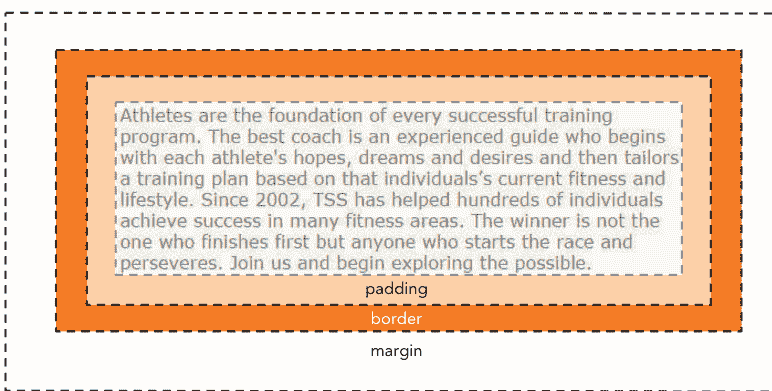

浏览器内部样式设置了内边距、边框和外边距空间的大小，但你可以在样式表中指定不同的尺寸。

> **提示** 浏览器开发者工具将显示元素的盒模型示意图，以便你确定内边距、边框和外边距的大小。

# 设置内边距空间

要设置内边距空间的宽度，请使用以下 `padding` 属性：

```css
padding: size;
```

其中 `size` 使用 CSS 长度单位之一或关键字 `auto`（让浏览器自动选择内边距）。例如，以下规则将每个段落周围的内边距空间设置为 20 像素。

```css
p {padding: 20px;}
```

也可以通过如下方式编写 `padding` 属性，为虚拟框的四个边分别定义内边距：

```css
padding: top right bottom left;
```

`top` 是内容顶部边缘内边距空间的大小，`right` 是右边缘的内边距，`bottom` 是底部内边距大小，`left` 是左边缘的内边距大小。因此，以下规则创建了一个顶部 10 像素、右侧 9 像素、底部 15 像素和左侧 5 像素的内边距空间：

```css
p {padding: 10px 9px 15px 5px;}
```

为了记住这个顺序，想象顺时针绕框移动，从顶部边缘开始。当你不需要指定所有边缘时，提供的值将根据你使用的值数量进行解释。因此，如果你指定单个值，它将平均应用于四个边。同样，两个值分别设置顶部/底部和右/左边缘的内边距。例如，以下样式规则将顶部和底部内边距设置为 10 像素，右侧和左侧内边距设置为 5 像素：

```css
p {padding: 10px 5px;}
```

如果你插入三个值，则会设置顶部、右/左和底部边缘的内边距。因此，以下规则将内边距空间的大小设置为顶部 10 像素，左/右侧空间设置为 5 像素，底部空间设置为 0 像素：

```css
p {padding: 10px 5px 0;}
```

如果你想定义某一条边的内边距而不定义其他边，可以应用以下样式属性：

```css
padding-top: size;
padding-right: size;
padding-bottom: size;
padding-left: size;
```

以下样式规则将每个段落的顶部内边距设置为 10 像素：

```css
p {padding-top: 10px;}
```

以下样式规则将每个段落的右侧内边距设置为 10 像素：

```css
p {padding-right: 10px;}
```

以下样式规则将每个段落的底部内边距设置为 10 像素：

```css
p {padding-bottom: 10px;}
```

以下样式规则将每个段落的左侧内边距设置为 10 像素：

```css
p {padding-left: 10px;}
```

以下样式规则将每个段落的内边距设置为 10 像素：

```css
p {padding: 10px;}
```

以下样式规则将每个段落的内边距设置为顶部 10 像素、右侧 5 像素：

```css
p {padding: 10px 5px;}
```

以下样式规则将每个段落的内边距设置为顶部 10 像素、右侧 5 像素、底部 0 像素：

```css
p {padding: 10px 5px 0;}
```

# 增加上边距

1. 回到编辑器中的 `tss_styles.css` 文件。
2. 在“导航样式”部分，直接在 `nav > ul` 选择器的样式规则下方插入以下规则：

```css
nav > ul > li.newgroup {
  margin-top: 20px;
}
```

图 2-40 重点显示了设置上边距值的样式规则。

## 设置上边距的大小

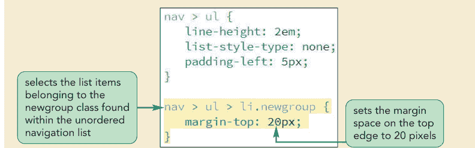

3. 保存对文件的更改，然后在浏览器中重新加载 `tss_home.html` 文件。验证导航列表中的项目是否已拆分为三组：第一组包含来自 Tri 和 Success 网站的链接；第二组包含指向跑步、自行车和游泳网站的链接；第三组包含指向铁人三项装备的链接。

Alison 注意到主页右栏的引用块左侧有未使用的空间，导致客户引言留下的空间较少。浏览器的默认引用块设置通过设置左右边距为 40 像素来将区块与周围隔离开。为了调整此间距并使区块更具可读性，你将左右边距缩小到 5 像素。你还将上下边距增加到 20 像素，以区分不同的客户引言。

## 修改引用块周围的边距空间：

1. 回到编辑器中的 `tss_styles.css` 文件。
2. 在“侧边栏和引用块样式”部分找到 `aside blockquote` 选择器的样式规则，并在样式规则中插入 `margin: 20px 5px;`。

图 2-41 显示了更改引用块元素周围边距空间的样式。

> **WOW! eBook**
> www.wowebook.org

# HTML 144 HTML 和 CSS | 教程 2 CSS 入门

## 设置引用块的边距大小


3. 保存对文件的更改，然后在浏览器中重新加载 `tss_home.html` 文件。图 2-42 显示了对导航列表和区块应用新的内边距和边距大小后的页面修订外观。

## 图 2-42 应用了新边距和内边距的主页


© Monkey Business Images/Stockphoto.com Patrick Casey

Alison 认为导航列表修订后的外观是一个巨大的改进。但她不喜欢当用户将鼠标悬停在链接上时导航列表中出现的下划线。她希望下划线仅在……时出现。她还希望在类部分的每个列表项目旁边出现不同的列表标记。你可以使用伪类和伪元素来实现这些更改。

> **WOW! eBook**
> www.wowebook.org
> Copyright 2018 Cengage Learning. 保留所有权利。部分或全部复制、扫描或分发。WCN-200-203

# 使用伪类和伪元素

渲染页面中出现的所有内容并不都是在 HTML 文件中标记的。例如，一个段落的首字母或首行并没有被标记为独立的元素。同样，一个元素可以通过特定属性进行分类，而无需 `class` 属性。有序列表的初始项目具有作为第一个项目的属性，但 HTML 文件中没有 `class` 属性来标识它。仅存在于渲染页面而不存在于 HTML 文档的元素和属性被称为伪元素和伪类。尽管它们不是 HTML 文档的一部分，你仍然可以为它们编写样式规则。

# 伪类

伪类是根据元素在文档中的当前状态、位置或用途对元素进行的分类。伪类的样式规则使用以下选择器标识：

`element:pseudo-class`

其中 `element` 是文档中的一个元素，`pseudo-class` 是 CSS 伪类的名称。伪类分为结构伪类和动态类。结构伪类根据元素在 HTML 文档结构中的位置对其进行分类。图 2-43 列出了支持的结构伪类。

## 图 2-43 结构伪类

| 伪类 | 匹配 |
| --- | --- |
| `:root` | 文档层级中的顶层元素（`html` 元素） |
| `:empty` | 无内容的元素 |
| `:only-child` | 无兄弟元素的元素 |
| `:first-child` | 父元素的第一个子元素 |
| `:last-child` | 父元素的最后一个子元素 |
| `:first-of-type` | 匹配指定类型的父第一个后代 |
| `:last-of-type` | 匹配指定类型的父最后一个后代 |
| `:nth-of-type(n)` | 指定类型的第 $n$ 个元素 |
| `:nth-last-of-type(n)` | 指定类型中倒数第 $n$ 个元素 |
| `:only-of-type` | 没有兄弟元素的元素 |
| `:lang(lang)` | 指定语言的元素 |
| `:not(selector)` | 不匹配选择器的元素 |


# 使用伪类和伪元素

渲染页面中出现的内容并不都是在 HTML 文件中标记的。例如，一个段落的首字母或首行并没有被标记为独立的元素。同样，一个元素可以通过特定属性进行分类，而无需 `class` 属性。有序列表的初始项目具有作为第一个项目的属性，但 HTML 文件中没有 `class` 属性来标识它。仅存在于渲染页面而不存在于 HTML 文档的元素和属性被称为伪元素和伪类。尽管它们不是 HTML 文档的一部分，你仍然可以为它们编写样式规则。

# 伪类

伪类是根据元素在文档中的当前状态、位置或用途对元素进行的分类。伪类的样式规则使用以下选择器标识：

`element:pseudo-class`

其中 `element` 是文档中的一个元素，`pseudo-class` 是 CSS 伪类的名称。伪类分为结构伪类和动态类。结构伪类根据元素在 HTML 文档结构中的位置对其进行分类。图 2-43 列出了支持的结构伪类。

| 图 2-43 | 结构伪类 |
|---|---|
| 伪类 | 匹配 |
| :root | 文档层级中的顶层元素（`html` 元素） |
| :empty | 无内容的元素 |
| :only-child | 无兄弟元素的元素 |
| :first-child | 父元素的第一个子元素 |
| :last-child | 父元素的最后一个子元素 |
| :first-of-type | 匹配指定类型的父第一个后代 |
| :last-of-type | 匹配指定类型的父最后一个后代 |
| :nth-of-type(n) | 指定类型的第 $n$ 个元素 |
| :nth-last-of-type(n) | 指定类型中倒数第 $n$ 个元素 |
| :only-of-type | 没有兄弟元素的元素 |
| :lang(lang) | 指定语言的元素 |
| :not(selector) | 不匹配选择器的元素 |

## 探索 `nth-of-type` 伪类

`nth-of-type` 伪类是一个用于按循环顺序格式化元素组的强大工具。可以使用选择器创建循环：

```
nth-of-type(an+b)
```

其中 `a` 是循环的长度，`b` 是从循环开始的偏移量，`n` 是计数器，它从 0 开始并在每次循环迭代中增加 1。例如，以下样式规则创建了一个周期为 3 的循环，第一个列表项显示为红色，第二个显示为蓝色，第三个显示为绿色，之后循环按红-蓝-绿的顺序重复，直到最后一个项目为止：

```css
li:nth-of-type(3n+1) {color: red;}
li:nth-of-type(3n+2) {color: blue;}
li:nth-of-type(3n+3) {color: green;}
```

当循环长度为 1 时，`nth-of-type` 选择器会在指定的偏移量之后选择元素。以下样式规则将从第 5 个开始的所有列表项的文本颜色设置为蓝色：

```css
li:nth-of-type(n+5) {color: blue;}
```

CSS 还支持关键字 `even`（偶数）和 `odd`（奇数），使得长度为 2 的循环可以更简洁地输入为：

```css
li:nth-of-type(even) {color: red;}
li:nth-of-type(odd) {color: blue;}
```

对偶数列表项应用红色字体，对奇数项应用蓝色字体。上述方法同样适用于 `nth-child` 选择器，其重要区别在于：`nth-child` 选择器选择父元素的任何子元素，而 `nth-of-type` 选择器只选择特定类型的元素。

## 超文本的伪类

另一种类型的伪类是动态伪类，该类可以根据用户的操作更改状态。动态伪类用于超文本链接，例如 `visited`（已访问）类，它指示链接的目标是否已被用户访问。图 2-46 描述了动态伪类。

### 图 2-46 动态伪类

| 伪类 | 描述 |
| :--- | :--- |
| :link | 链接尚未被用户访问。 |
| :visited | 链接已被用户访问。 |
| :active | 元素正处于用户激活或点击的过程中。 |
| :hover | 鼠标指针悬停在元素上。 |
| :focus | 元素正在接收键盘或鼠标指针的焦点。 |

例如，为了让所有之前访问过的链接显示为红色字体，你可以对元素应用以下样式规则：

```css
a:visited { color: red; }
```

要在鼠标指针悬停在链接上时将颜色改为蓝色，请应用以下规则：

```css
a:hover { color: blue; }
```

在某些情况下，两个或多个伪类可以应用于同一个元素。例如，一个超文本链接可以既是已访问又处于悬停状态。在这种情况下，适用标准的级联规则，按照顺序列表中最后列出的伪类为准——`:link`、`:visited`、`:hover` 和 `:active`。`:link` 伪类最先，因为它代表尚未访问的超文本链接。`:visited` 伪类紧随其后，用于之前访问过的链接。当用户在点击之前将鼠标指针移动到超文本上时，跟随 `:hover` 类。`:active` 伪类最后，代表链接处于激活的精确瞬间。

残障用户通过键盘而非鼠标与超文本交互。这允许用户按 `Tab` 键在超文本链接列表中导航，并通过按 `Enter` 键激活它们。通过键盘到达的链接具有页面焦点，大多数浏览器将通过在链接文本周围显示轮廓来指示这一点。你可以像使用 `:hover` 伪类一样使用 `:focus` 伪类替换你自己的样式。

要为超文本链接创建样式，请使用伪类：

```css
a:link
a:visited
a:hover
a:active
```

其中 `:link` 伪类匹配未访问的链接，`:visited` 匹配已访问的链接，`:hover` 匹配鼠标指针悬停在其上的链接，`:active` 匹配正在被点击的链接。

浏览器的默认样式是对所有超链接添加下划线；链接以蓝色字体显示，之前访问过的链接显示为紫色。Alison 希望导航列表以中灰色字体显示，不区分未访问和之前访问过的链接。她不希望导航列表中的超文本有下划线，除非链接被悬停或激活。她还希望激活的链接显示为紫色。将这些样式规则添加到样式表中。

## 将伪类应用于超文本链接

1. 返回编辑器中的 `tss_styles.css` 文件。
2. 转到“导航样式”部分，为已访问或未访问的链接插入以下样式规则：

```css
nav > ul > li:link, nav > ul > li:visited {
  color: rgb(151, 151, 151);
  text-decoration: none;
}
```

3. 为悬停或激活的链接添加新的样式规则：

```css
nav > ul > li:hover, nav > ul > li:active {
  color: rgb(255, 0, 255);
  text-decoration: underline;
}
```

4. 添加焦点样式规则：

```css
nav > ul > li:focus {
  outline: 2px solid blue;
}
```

# 伪元素

例如，以下样式规则将 `::before` 和 `::after` 伪元素与 `:hover` 伪类结合使用，在超链接列表中的每个超文本周围插入了 `<` 和 `>` 字符：

```css
nav a:hover::before { content: "<"; }
nav a:hover::after { content: ">"; }
```

注意，这些规则同时使用了 `:hover` 伪类和 `::before`/`::after` 伪元素，以便内容在响应悬停时被插入。

如果你想使用其他字符，你必须使用字符串文本 `\code`（其中 `code` 是代码数字）插入该字符的编码。例如，如果如下文所示，使用单角括号 `‹` 和 `›`，你需要使用这些字符的 Unicode 编码，分别为 `00ab` 和 `00bb`。要在超链接列表中插入这些字符的之前和之后，你只需应用以下样式规则：

```css
nav a:hover::before { content: "\00ab"; }
nav a:hover::after { content: "\00bb"; }
```

除了向元素添加内容外，你还可以使用以下属性向媒体文件（如图像或视频剪辑）插入内容：

```
content: url(url);
```

其中 `url` 是媒体文件的位置。例如，以下样式规则会在悬停文档中的任何超链接时，在其后添加 `uparrow.png` 图像文件：

```css
a::after { content: url(uparrow.png); }
```

图像或由样式表生成的任何内容都不应包含对理解你的页面至关重要的材料。相反，生成的内容应该只包含为了艺术或设计相关关系补充页面的材料。如果生成的内容对于解释页面至关重要，那么它最初应该放在 HTML 文件中。

## 显示属性值

可以通过以下 `attr()` 函数将 `content` 用于向渲染后的 Web 页面插入属性值：

```
content: attr(attribute);
```

其中 `attribute` 是所选元素的属性。这种应用之一是向文本添加任何超链接的 URL。在下文中，`href` 属性的值将附加到每个带有元素标记的链接的出现处：

```css
a::after {
  content: " " attr(href);
}
```

注意 URL 被包含在括号内。因此，HTML 文档中的超链接，例如：

```html
<a href="http://www.triathlon.org">Triathlons</a>
```

将在渲染后的 Web 页面上显示为：

Triathlons (http://www.triathlon.org)

这种技术对于打印输出特别有用，作者希望在打印页面上显示所有链接的 URL 以供用户阅读和参考。你将在教程 5 中探索这一点。

## CSS 插入内容

- 要在页面元素之前直接插入内容，使用样式规则 `element::before {content: text};`
  - 其中 `element` 是页面元素，`text` 是要插入元素的内容。
- 要直接在页面元素之后插入内容，使用样式规则 `element::after {content: text};`

## 插入引号

`blockquote` 和 `q` 元素用于引用材料。这些元素的内容通常放置在引号中，虽然你可以在 HTML 文件中插入这些引号，但你也可以使用 `content` 属性配合以下值插入装饰性引号和结束引号：

```
content: open-quote;
content: close-quote;
```

```css
quotes: "\201C" "\201D" "\2018" "\2019";
```


其中字符 `201C` 返回起始双引号 “ ”，代码 `201D` 返回结束双引号 ” ”，代码 `2018` 返回单引号 ‘ ’ ，并建议你对 Trie 和 Support Homes 页面上的客户评论使用装饰性引号。你以字号为 16px 的加粗 `Times New Roman` 字体显示弯引号（这比引用块文本的字号稍大）。

> 提示：由 CSS 生成的引号通常用于不同语言需要不同引号符号的页面中。

## 在引用块中插入引号

- 回到编辑器中的 `tss_styles.css` 文件。
- 转到 `aside` 和 `Blockquote` 部分，并在 `aside blockquote` 选择器的样式规则内，插入 `quotes` 属性以使用弯引号作为引号：
  - `quotes: "201C" "201D";`
- 添加以下样式规则，在 `aside` 元素中的每个引用块之前和之后插入引号：

```css
aside blockquote::before {
  content: open-quote;
  font-family: 'Times New Roman', Times, serif;
  font-size: 1.6em;
  font-weight: bold;
}
```

```css
aside blockquote::after {
  content: close-quote;
  font-family: 'Times New Roman', Times, serif;
  font-size: 1.6em;
  font-weight: bold;
}
```

图 2-51 突出了在引用块之前之后添加弯引号的样式。

## 图 2-51 为引用块添加引号

| 字符代码 | 在引用块中添加引号 |
| :--- | :--- |
| 之前和之后 | `aside blockquote::before { content: open-quote; font-family: 'Times New Roman', Times, serif; font-size: 1.6em; font-weight: bold; }` |
| 伪元素 | `aside blockquote::after { content: close-quote; font-family: 'Times New Roman', Times, serif; font-size: 1.6em; font-weight: bold; }` |
| 伪元素 | `aside blockquote::before { content: open-quote; font-family: 'Times New Roman', Times, serif; font-size: 1.6em; font-weight: bold; }` |
| 结束引号 | `aside blockquote::after { content: close-quote; font-family: 'Times New Roman', Times, serif; font-size: 1.6em; font-weight: bold; }` |
| 引用块引号 | `aside blockquote::before { content: open-quote; font-family: 'Times New Roman', Times, serif; font-size: 1.6em; font-weight: bold; }` |
| 起始引号 | `aside blockquote::after { content: close-quote; font-family: 'Times New Roman', Times, serif; font-size: 1.6em; font-weight: bold; }` |

- 4. 回到编辑器中的 `tss_styles.css` 文件。
- 转到 `aside` 和 `Blockquote` 部分，并在 `aside blockquote` 选择器的样式规则内，插入 `quotes` 属性以使用弯引号作为引号：
  - `quotes: "201C" "201D";`
- 添加以下样式规则，在 `aside` 元素中的每个引用块之前和之后插入引号：

## 教程 2 CSS 入门 | HTML 和 CSS HTML 156

## 团队：管理样式表

你的样式表通常会像网站内容一样长。随着样式表增大，你可能会对大量的规则和定义感到无所措。在多个人需要解释和编辑同一样式的情况下，这可能是一个关键问题。当你创建自己的样式表时，有一些技术可以帮助你管理：

- 在文件中到处使用注释。清晰描述样式表的用途、使用位置、创建者以及创建时间。
- 因为颜色值显而易见，请包含注释描述你的颜色。例如，对某个颜色值注释“正文文本是褐色”。
- 将样式表分为若干部分，并用注释标记标题。你可能希望按照规则出现在页面顺序来组织，或者按字母顺序排列。无论你选择哪种，都要保持一致并在样式表中设计好组织方案。
- 保持样式表尽可能小，必要时拆分为单独的文件。使用一个样式表用于布局，另一个用于文本设计，可能还有一个用于颜色图形。使用 `@import` 规则合并样式表，或者在每个页面中使用 `<link>` 元素合并。此外，考虑为网站的基础页面创建一个样式表，为处理特殊内容的创建一个另一个。

Alison 对你在 Tri and Succeed Sports 网站设计上的工作非常满意。Alison 将继续开发网站的新版本，并就未来的更改和设计想法与你联系。

## 节 2.3 快速检查

1. 提供一种样式规则，用小写字母作为列表标记显示所有无序列表。
2. 提供一种样式规则，使用 `star.png` 图像文件显示所有无序列表，并放在虚拟内部。
3. 提供一种样式规则，将所有访问过的超链接文本显示为灰色。
4. 提供一种样式规则，将 `section` 元素中每个 `h1` 标题的内边距（padding）设置为：顶部 1em，左右 0.5em，底部 2em。
5. 提供一种样式规则，将 `figure` 元素的左外边距设置为 20 像素。
6. 描述以下选择器选中的项目：

```css
#top > :first-of-type:first-line
```

7. 描述以下选择器选中的项目：

```css
div.links[imagem]
```

8. 提供一种样式规则，在每个属于 `Review` 类的段落之前插入文本字符串 `*`。
9. 提供一种样式属性，将起始引号和结束引号设置为 Unicode 值为 2018 和 2019 的弯曲引号。

## 复习作业

复习作业所需的数据文件：`coach_styles_txt.css`、`tss_coach_txt.html`、1 个 CSS 文件、5 个 PNG 文件、1 个 TTF 文件、1 个 WOFF 文件

Alison 为 Tri and Success Sports 网站创建了另一个页面，提供俱乐部教练的简介。她已经写好了页面内容，获取了图像文件，并为页面布局创建了样式。她希望通过开发用于页面颜色主题和排版的样式表来完成页面设计。你将设计的页面预览如图 2-53 所示。

## 图 2-53 教练简介页


# 认识我们的教练

TSS 的使命是帮助你实现健身和教育目标。我们拥有多年与各水平运动员合作的丰富经验，并乐意帮助任何追求成功的运动员。

我们提供一对一教练、评估和指导以及其他实践。我们的课程永远不会太大，我们可以帮助运动员在生活中取得最佳结果。

欢迎来并与我们的教练和运动员团队合作工作。

# Alison Palmer

- 硕士，USAT 二级教练
- Tri and Success Sports 所有者

Alison 在心理学和运动方面拥有深背景。她毕业于德克萨斯大学，获得健康与健身学位。她是一位 USAT 二级教练，在游泳、自行车和跑步方面拥有卓越表现。

Alison 曾是德克萨斯大学的校队排球运动员并并了四年。从那时起，铁三就一直是她的热情。她参加过许多比赛，包括在德克萨斯州、爱荷华州、巴西和芝加哥的多场比赛。

Alison 是一位对健身和运动充满热情的运动员。在她的指导下，你不仅将学会做什么，还将学会为什么要这样做以实现目标。

# Kevin Hug

- USAT 一级教练
- 运动机专家

Kevin 是人体力学的学生。除了运动学学士学位外，Kevin 还拥有力量与体能认证。他指导过各种休闲和精英运动员，包括游泳运动员和跑步运动员。

除了指导个人运动员外，Kevin 还指导过各种团队和小组。他的团队在 11 个赛季中赢得了 9 个，越野跑队在小型学校州锦标赛中一直名名前三。Kevin 目前正在指导

© 2016 Cengage Learning; YSbrand Course/Stockutterstock.com; Charles T. Bennett/Stockutterstock.com; ostill/Stockutterstock.com; eurobank/Stockutterstock.com; wavebreakmedia/utterstock

（注：后续文本包含碎片的版权/页脚信息，已根据提示要求予以保留。）

## WOEI! ebook

# www.woebook.org

版权 2018 Cengage Learning. 版权所有。未经许可，不得全部或部分扫描或复制。WCN 02-200-022

## 教程 2 开始使用 CSS | HTML 和 CSS

- 使用你的编辑器打开 `html02` 复习者文件夹中的 `tss_coach.txt` 和 `coach_styles_txt.css` 文件。在每个文件的注释部分输入你的姓名和日期，并将它们分别另存为 `tss_coach.html` 和 `coach_styles.css`。
- 在编辑器中打开 `tss_coach.html` 文件，然后在文档头部内创建指向 `coach_layout.css` 和 `coach_styles.css` 样式表的链接。
- 花些时间研究文件的内容和结构，然后关闭文档并保存更改。
- 在编辑器中打开 `coach_styles.css` 文件。在文件顶部、注释部分之前：
  - 插入一条 `charset` 规则，将文件的字符编码设置为 `utf-8`。
  - 使用 `@font-face` 规则定义网络字体 `Noble`，该字体基于 `noble-webfont.ttf` 文件。
  - 进入 `Main Styles` 部分并执行以下操作：
    - 通过为 `html` 元素创建一个样式规则来更改浏览器窗口的背景颜色，将其设置为 `hsl(27, 72%, 72%)`。
    - 对于 `body`，创建一个样式规则将字体颜色设置为 `rgb(99, 91, 91)`，背景颜色设置为橙色，字体族设置为 `Verdana, Geneva, sans-serif`。

（注：OCR 源文件中的剩余文本包含严重损坏和重复的页脚片段，已过滤以维护文档内容的完整性。）

# 教程 2 CSS 入门 | HTML 和 CSS HTML 161

# 图 2-54 Philip Henslope 经典剧院（PHCT）页面列表

| 首页 | 剧目 | 票务 | 日历 | 关于 PHCT | 支持 |
|---|---|---|---|---|---|
| | | Philip Henslope 经典剧院 | | | | |
| 即到来的季节将是我们迄以来最好的。请检查下方所示剧目的票务。 | | | | | | |
| 票务 | 演职表 | 演员与工作人员 | 新闻评论 | 公司备注 | | |
| 《温莎的顽贤妇》 | | | | | | | |
| 这是一部喜剧奇作，被约翰·莎士比亚誉为揭示了无与伦比的幽默感。他策划通过色欲之爱来捕捉温莎的两个位确定的女士，并让那些傻子为了仙女般的利益在快乐、恶作剧和运动中追随其后。结果是对温莎世界里人性与愚蠢的精彩研究。 | | | | | | |
| 票务 | 演职表 | 演员与工作人员 | 新闻评论 | 公司备注 | | |
| 《欲望街街》 | | | | | | | |
| 痛苦的美丽遇见“欲望”，以火光、烟雾和快速节奏的百老汇强度开启演出。布兰奇脆弱而不稳定的性格与斯坦利的悲剧性脾气在激情与战斗的难忘碰撞中相遇。一个令人难忘且持久的印象。 | | | | | | |
| 票务 | 演职表 | 演员与工作人员 | 新闻评论 | 公司备注 | | |
| 《奥赛罗》 | | | | | | | |
| 奥赛罗的史诗级悲剧，这个处于文明边缘的男人没有在幸福中找到经验。当伊阿戈的诡计最激发了奥赛罗的嫉妒和骄傲时，也通过嫉妒之爱的黑暗力量导致了奥赛罗的毁灭。在希腊悲剧中，爱与光抵抗着这种黑暗。 | | | | | | |
| 票务 | 演职表 | 演员与工作人员 | 新闻评论 | 公司备注 | | |
| 《上心的易事》 | | | | | | | |
| 沃西辛，一位年轻绅士处境困境。他发明了一个名叫“易”的朋友去伦敦，杰克在伦敦找到了爱情，但格诺芬被格温多林拒绝了。布拉克内尔夫人拒绝批准这项提议，因为格温多林的艺术是某种在尔德的世界中并不完美的自然——尽管所有的爱情和礼仪都是幽默且俏皮的。 | | | | | | |

Philip Henslope 经典剧院 2803 Mission Street Cedar Rapids, ID 83101 • 208-555-1087

© 2016 Cengage Learning; Christian Bertrand/Shutterstock.com

页面的内容和布局是为您创建的。您将能够为页面排版创建一个表格。

完成以下操作：

- 1. 使用编辑器打开 `html02 -> case 1` 文件夹下的 `ph_plays.txt` 和 `ph_styles.txt` 文件。在文件的每个单元格中输入你的名字和注释，并保存为 `ph_plays.html` 和 `ph_styles.css`。

WOW! 电子书

www.webebook.com

版权 2018 Cengage Learning。保留所有权利。未经全部或部分复制、扫描或分发。WCN-022-200-233

# HTML 16 HTML 和 CSS | 教程 2 CSS 入门

- 2. 进入你的 HTML 编辑器中的 `ph_layout.css` 文件，在文档 `head` 部分中创建指向 `ph_layout.css` 和 `ph_styles.css` 样式表的链接。花时间考虑文档的内容和结构，然后关闭文件并保存更改。
- 3. 进入编辑器中的 `ph_styles.css` 文件，在文件顶部注释部分之前，将文档字符编码定义为 `utf-8`。
- 4. Randall 有几种他想要的网页字体，用于公司生成的页面标题。在注释部分之前，使用 `@font-face` 规则向样式表中添加以下网页字体：
    - a. 使用 `cac_champagne.woff` 和 `cac_champagne.ttf` 文件的 Champagne 字体
    - b. 使用 `1942.woff` 和 `1942.ttf` 文件的 Grunge 字体
    - c. 使用 `Dobkin.woff` 和 `Dobkin.ttf` 文件的 Dobkin 字体
- 5. 进入 Structural（结构）部分，创建一个规则，将 `h1` 元素的背景颜色设置为值 `right(56%)`。
- 6. 为 `body` 元素添加样式规则，将背景颜色设置为值 `hsl(58, 31, 84%)`，并将正文字体设置为：`'Palatino Linotype', 'Book Antiqua', Palatino, serif`。
- 7. 为 `header` 元素创建一个样式规则，将背景颜色设置为黑色。
- 8. 为每个段落（paragraph）创建一个样式规则，将外边距（margin）设置为 0，并将内边距（padding）上、右、底、左设置为 25 像素。
- 9. 对于 `h1` 元素的直接子段落，创建一个样式规则，将字体大小设置为 `1.1em` 并使文本水平居中。
- 10. 为 `address` 元素创建一个样式规则，将文本样式设置为 `normal`，字体大小为 `0.9em`，并在页面居中。设置顶部和内边距为 10 像素。
- 11. 接下来，将格式化页面上导航列表的外。进入 Navigation Lists（导航列表）部分，创建一个规则突出显示 `'Trebuchet MS', sans-serif`，并将顶部和内边距设置为 10 像素。
- 12. 对于 `a` 元素中的每个下划线链接，将文本颜色设置为白色，取消下划线，并将背景设置为半透明。
- 13. 此外，当鼠标指针悬停在列表项上时，链接背景颜色看起来更不透明。
- 14. 进入样式表的 Styles（样式）部分。在此部分，你将定义 `h1` 标题的外观设置为 30px。
- 15. 每个剧报（playbill）部分由 ID 1 到 4 定义。创建一个规则，为每个剧报设置不同的背景颜色，使用以下颜色：
    - ID-1: `hsl(240, 100%, 100%)`
    - ID-2: `hsl(252, 88%, 72%)`
    - ID-3: `hsl(0, 100%, 75%)`
    - ID-4: `hsl(296, 86%, 86%)`
- 16. 每个剧报标题也将有不同的字体。对于剧报内部的 `h1` 标题，创建样式规则应用以下字体：
    - ID-1: `Champagne`
    - ID-2: `Grunge`
    - ID-3: `Impact, sans-serif`


- ID-4: Dobkin, cursive

- 17. Randall 在定义列表中有剧目的作者和导演。现在进入 Definition List（定义列表）部分格式化这些定义列表，为该元素将字体大小设置为 `1.3em`，字重设置为加粗，字体颜色设置为半透明值 `hsl(0, 0%, .4)`。

- 18. 为每个 `dd` 元素创建一个样式规则，将字体大小设置为 `1.3em`，左外边距设置为 0，下外边距设置为 10 像素。

- 19. 保存更改到文件，然后在浏览器中打开文件。验证文档中使用的字体和颜色与图 2-54 匹配。

# 案例 2

此案例所需的数据文件：`mx_styles.txt`、`mx_tour.html`、1 个 css 文件、1 个 png 文件

**Mountain Wheels** Adriana 和 Ivan Turchenko 是 Mountain Wheels 的所有者，这是科罗拉多州利特顿的自行车店和旅游公司。他们最受欢迎的旅游之一是自行车之旅，这是一场在科罗拉多州最高道路上进行的六天远足。Adriana 想更新公司网站以提供有关该路线的信息。她已经让一位同事设计了三列布局，第一列是链接列表，第二、三列是描述性文本。她请求你帮助通过格式化文本和颜色来完成设计。图 2-55 显示了最终页面设计的预览。

图 2-55 自行车之旅描述


# HTML 164 HTML 与 CSS | 教程 2 开始使用 CSS

完成以下操作：

- 1. 使用你的编辑器打开 html2 case 文件夹中的 `mw_tour.html` 和 `mw_styles.css` 文件。在每个文件的注释部分使用你的*姓名*和*日期*，并分别保存为 `mw_tour.html` 和 `mw_styles.css`。

- 2. 在你的 HTML 编辑器中打开 `mw_layout.html` 文件。为 `mw_layout` 和 `mw_styles.css` 样式创建链接。学习文档的内容和结构，然后关闭它们。保存所有更改。

- 3. 在你的编辑器中打开 `mw_styles.css` 文件。在文件顶部插入 `@charset` 规则，将此样式表的编码设置为 utf-8。

- 4. 进入 Structural（结构化）部分，创建一个规则，将浏览器窗口的背景颜色设置为 `rgb(173, 189, 227)`。

- 5. 为 `body` 元素创建一个规则，将背景颜色设置为 `rgb(227,210,173)`，并将正文字体设置为：`'Century Gothic', sans-serif`。

- 6. 为 `body footer`（页脚）创建一个规则，背景颜色为 `rgb(208, 144, 109)`，并将上下内边距（padding）设置为 5 像素。

- 7. 为 `address` 元素创建一个规则，以普通字体显示文本，字体大小为 `0.9em`，文本居中齐，并将上下内边距设置为 10 像素。

- 8. 进入 Heading（标题）部分，创建一个规则，将所有 `h1` 和 `h2` 标题的大小设置为 `normal`（普通）。

- 9. 进入 Navigation（导航）部分，为 `nav > ul` 选择器创建一个规则，移除所有列表标记，并将行高（line-height）设置为 `2em`。

- 10. 对于导航列表中的已访问（visited）或未设置（unset）的超链接，创建一个规则去除下划线并将文本颜色设置为 `rgb(43, 59, 125)`。

- 11. 对于导航列表中的每个悬停（hovered）或激活（active）链接，创建一个规则将文本颜色设置为 `rgb(212, 5, 35)`。

- 12. Adriana 在 ID 为 "tour_summary" 的文章中放置了标题。从标题开始格式化文章。进入 Article（文章）部分，创建一个规则将字体大小设置为 `2.2em`，字母间距（letter spacing）设置为 `0.2em`。

- 13. 为 `tour_summary` 文章创建一个规则，将字体大小设置为 `1.1em`。

- 14. Adriana 使用 `first-of-type` 伪类和 `first-line` 伪元素创建文章的第一行，创建一个规则将 `tour_summary` 文章中第一个段落的第一行字体大小设置为 `1.2em` 并全大写（caps）。

- 15. 行程位于一个 ID 为 `tourinerary` 的 `aside` 元素内部。进入 Aside（侧边）部分，为 `tourinerary` aside 元素中的每个元素创建一个规则，将字体大小设置为 `1.2em`。

- 16. 对于 `tourinerary` aside 元素中的每个 `h2` 元素，将字体大小设置为 `0.9em`。

- 17. 设置标题和段落的字体大小，字体颜色设置为 `rgb(79, 91, 40)`。

- 18. Adriana 希望每天日程的颜色在灰色和蓝色之间交替。创建以下规则：

    - 对于奇数 `h2` 标题和段落，将字体颜色设置为 `rgb(79, 91, 40)`。使用 `nth-of-type(odd)` 伪类。

    - 对于偶数 `h2` 标题和段落，将字体颜色设置为 `rgb(81, 95, 175)`。使用 `nth-of-type(even)` 伪类。

- 19. 页面包含一个 blockquote 规则。进入 Blockquote 部分，为 `blockquote` 元素创建一个规则，将背景设置为 `rgb(173, 189, 227)`，文本颜色设置为 `rgb(255, 225, 250)`，不透明度（opacity）为 `0.65`。

- 20. 为内部每个段落创建一个规则，将上下内边距设置为 2.5 像素，左侧内边距设置为 10 像素。

- 21. 保存文件更改，然后在浏览器中打开 `mw_tour.html` 文件。验证你的设计与图 2-55 Match，包括应用于 tour_itinerary 文章第一部分的格式以及行程列表中使用的交替颜色。

# 案例 3

此案例所需的数据文件：`cw_class_txt.html`、`cw_styles_txt.css`，1 个 CSS 文件，2 个 PNG 文件

内战与重建 Peter Craft 是 Mountain Crossing 大学的军事史教授。该大学提供系列在线课程，其中一个是由 Craft 教授的“内战与重建”。他开发了在线内容，同事协助完成了页面布局。你被要求创建文本和颜色样式来完成该项目。示例页预览如图 2-56 所示。


©2016 Cengage Learning. 版权所有。未经复制、存储、复制或全部部分使用。

# HTML 164 HTML 与 CSS | 教程 2 开始使用 CSS

完成以下操作：

- 1. 使用你的编辑器打开 html2 case 文件夹中的 `mw_tour.html` 和 `mw_styles.css` 文件。在每个文件的注释部分使用你的*姓名*和*日期*，并分别保存为 `mw_tour.html` 和 `mw_styles.css`。

- 2. 在你的 HTML 编辑器中打开 `mw_layout.html` 文件。为 `mw_layout` 和 `mw_styles.css` 样式创建链接。学习文档的内容和结构，然后关闭它们。保存所有更改。

- 3. 在你的编辑器中打开 `mw_styles.css` 文件。在文件顶部插入 `@charset` 规则，将此样式表的编码设置为 utf-8。

- 4. 进入 Structural（结构化）部分，创建一个规则，将浏览器窗口的背景颜色设置为 `rgb(173, 189, 227)`。

- 5. 为 `body` 元素创建一个规则，将背景颜色设置为 `rgb(227,210,173)`，并将正文字体设置为：`'Century Gothic', sans-serif`。

- 6. 为 `body footer`（页脚）创建一个规则，背景颜色为 `rgb(208, 144, 109)`，并将上下内边距（padding）设置为 5 像素。

- 7. 为 `address` 元素创建一个规则，以普通字体显示文本，字体大小为 `0.9em`，文本居中齐，并将上下内边距设置为 10 像素。

- 8. 进入 Heading（标题）部分，创建一个规则，将所有 `h1` 和 `h2` 标题的大小设置为 `normal`（普通）。

- 9. 进入 Navigation（导航）部分，为 `nav > ul` 选择器创建一个规则，移除所有列表标记，并将行高（line-height）设置为 `2em`。

- 10. 对于导航列表中的已访问（visited）或未设置（unset）的超链接，创建一个规则去除下划线并将文本颜色设置为 `rgb(43, 59, 125)`。

- 11. 对于导航列表中的每个悬停（hovered）或激活（active）链接，创建一个规则将文本颜色设置为 `rgb(212, 5, 35)`。

- 12. Adriana 在 ID 为 "tour_summary" 的文章中放置了标题。从标题开始格式化文章。进入 Article（文章）部分，创建一个规则将字体大小设置为 `2.2em`，字母间距（letter spacing）设置为 `0.2em`。

- 13. 为 `tour_summary` 文章创建一个规则，将字体大小设置为 `1.1em`。

- 14. Adriana 使用 `first-of-type` 伪类和 `first-line` 伪元素创建文章的第一行，创建一个规则将 `tour_summary` 文章中第一个段落的第一行字体大小设置为 `1.2em` 并全大写（caps）。

- 15. 行程位于一个 ID 为 `tourinerary` 的 `aside` 元素内部。进入 Aside（侧边）部分，为 `tourinerary` aside 元素中的每个元素创建一个规则，将字体大小设置为 `1.2em`。

- 16. 对于 `tourinerary` aside 元素中的每个 `h2` 元素，将字体大小设置为 `0.9em`。

- 17. 设置标题和段落的字体大小，字体颜色设置为 `rgb(79, 91, 40)`。

- 18. Adriana 希望每天日程的颜色在灰色和蓝色之间交替。创建以下规则：

    - 对于奇数 `h2` 标题和段落，将字体颜色设置为 `rgb(79, 91, 40)`。使用 `nth-of-type(odd)` 伪类。

    - 对于偶数 `h2` 标题和段落，将字体颜色设置为 `rgb(81, 95, 175)`。使用 `nth-of-type(even)` 伪类。

- 19. 页面包含一个 blockquote 规则。进入 Blockquote 部分，为 `blockquote` 元素创建一个规则，将背景设置为 `rgb(173, 189, 227)`，文本颜色设置为 `rgb(255, 225, 250)`，不透明度（opacity）为 `0.65`。

- 20. 为内部每个段落创建一个规则，将上下内边距设置为 2.5 像素，左侧内边距设置为 10 像素。

# 教程 2 CSS 入门 | HTML 和 CSS

24. 进入“样式（Style）”部分。在此部分，格式化课程的设计。创建一个样式规则，将 `section` 元素的背景设置为 `rgb(220, 220, 220)`。

25. 通过为 `section header h1` 选择器创建样式规则来格式化本节的标题，将字体大小设置为 `2.2em`，并将左侧内边距（padding）设置为 `10 pixels`（像素像素）。

26. 进入“文章（Article）”部分，为 `article` 元素内的 `h2` 标题创建一个样式规则，将字体大小设置为 `1em`。

27. 显示 `article` 元素内第一个段落的第一个字母，字体大小为 `2em`，并与周围文本的基线（baseline）垂直对齐。（提示：使用 `:first-of-type` 伪类和 `:first-letter` 伪元素。）

28. 关于 Peter Craft 的信息已放置在 `aside` 元素中。进入“侧边栏样式（Aside Styles）”部分，创建一个样式规则，将 `aside` 中文本的字体大小设置为 `0.9em`。

29. 对于 `aside` 元素所需的 `h1` 标题，创建一个样式规则，将字体大小设置为 `1.4em` 并使其水平居中。

30. 保存对文件的更改，然后在浏览器中打开 `cw_class.html` 文件。验证页面外观是否反映了图 2-56 所示的大小。确认当你更改浏览器窗口宽度，由于使用了 `vw` 单位设置页面标题文本的大小会随之变化。

## 案例分析 4

此案例分析所需的数据文件：`lake_home_txt.html`、`lake_styles_txt.css`、1 个 CSS 文件、2 个 PNG 文件、2 个 TTF 文件、2 个 WOFF 文件

伟大的景观 Ron Nelson 是威斯康星州巴利斯港（Bailies Harbor）大湖湖小屋（The Great Lakes Lodge）的所有者。他聘请你负责小屋网站的重新设计。你将从网站首页开始工作。Ron 已经写好了页面文本，收集了所有的图形文件，并由同事设计了页面布局。他希望你负责页面的配色方案和排版。图 2-57 显示了一个可能的解决方案。

## WOW! 电子书

www.wowebook.org

Copyright 2018 Cengage Learning. 版权所有。未经许可不得全部或部分扫描或复制。WCN 02-200-203

## HTML 和 CSS | 教程 2 CSS 入门

图 2-57 大湖岸小屋首页


让大湖岸小屋成为你在美丽多尔县（Door County）之旅的目的地。我们的小屋位于密歇根湖湖岸的 Batchor's，紧邻迷人的北部森林，是家庭聚会的绝佳场所。

我们是一家由家庭所有并经营的机构，几十年来一直是北方社区的一员。该小屋是浪漫逃离或家庭聚会的理想之选。我们还提供各种色彩绘画活动，并提供你入住所需的所有设施。

我们的目标是让每一刻变得完美，从早餐和晚餐到你喜欢的活动。我们有各种活动，也有为只想进行周末避世的人提供安静偏僻的角落。

快来看看为什么人们年年光临这里并流连忘返。我们是北方多尔县屡获殊荣的景点，让我们引导你开启迎接着你的精彩活动吧。

## 欢迎

## 小屋

房间

- 套房 (Suite)

- 客房 (Guest Room)

- 间小屋 (Cabin)

信息

- 费率

- 位置

- 路线

- 设施

- 预订

- 联系我们

门票租赁

- 自行车租赁

- 船只租赁

- 游览

## 即将举办的活动

详情咨询

加入我们，在湖边享受期 20 天的乐趣，包括音乐、美食以及更多！

广场舞，13

欢迎在每周六晚上 7 点在小屋大堂参加我们的广场舞。

-   我们提供船只租赁

-   我们今天在 Groupon 上有有专题介绍

© 2016 Learning; Great Lakeshore Lodge; Courtesy Patrol Care; Dmitry Kinovovsky/Shutterstock.com.

完成以下操作：

1. 使用编辑器，打开 `html02=case4` 文件夹中的 `lake_home.html` 和 `lake_styles.txt` 文件。

2. 在编辑器中打开 `lake_home.html` 文件并链接到 `lake_layout.css` 样式文件。使用此样式表对文档的内容和结构进行样式设计并保存更改。

3. 在编辑器中打开 `lake_styles.css` 文件，开始为小屋首页创建配色方案和排版样式：

- 样式表文件中使用的编码定义

- 应用字体（`html02=case4` 文件夹中提供了两种字体）

- 同时使用数值和颜色名称设置背景色和文本颜色

- 应用半透明颜色

- 选择应用于嵌套元素、子元素和普通元素的样式规则

- 修改列表和列表标记外观的样式

- 使用伪元素和伪类作为选择器

- 修改元素周围内边距（padding）和外边距（margin）空间的样式

- 一个在渲染页面中生成内容的样式规则

4. 在整个样式表中包含适当的注释

5. 保存你完整的样式表。

WOW! 电子书

www.ebookbook.org

## 教程 3

## 设计页面布局

创建页面布局

设计页面布局

Anne 是位于埃塞克斯（Essex）的 Chocolates 店铺的所有者兼首席巧克力师。你被要求协助她重新设计网站。她提供了三个页面、图像和图形，需要你使用 CSS 完成布局。

目标

3.1 创建重置样式

3.2 探索网格布局

3.3 

开始数据

| case3 | case2 | case1 |
| --- | --- | --- |
| about_txt.html | specials_txt.html | demo_txt.html |
| front_txt.html | styles_txt.css | layout.css |
| positioning.html | grids_txt.html | view_txt.html |
| reset_txt.css | info_txt.css | home_txt.html |
| about_txt.css | reset_txt.css | info_txt.html |
| info_txt.html | layout_txt.html | view_txt.html |
| layout_txt.html | about_txt.html | paper_txt.html |
| front_txt.html | front_txt.html | specials_txt.html |
| paper_txt.html | view_txt.html | grids_txt.css |
| front_txt.html | front_txt.html |

3.1 视觉概览：

为了水平居中一个块级元素，将左右边距设置为自动。


`width` 属性定义元素的宽度，`max-width` 属性设置最大宽度，`min-width` 属性设置最小宽度。

```css
/* Page Body */
body {
  margin-left: auto;
  margin-right: auto;
  max-width: 960px;
  min-width: 640px;
}
```

所有水平列表项都向左浮动以创建列。

`display` 属性定义元素如何显示。

```css
/* 浮动样式 */
.list-item {
  clear: none;
  float: left;
}
```

`float` 属性将对象从普通文档流中取出，并在容器的左侧或右侧浮动。

`clear` 属性仅当左侧、右侧或两侧的浮动对象已被清除后才显示元素。

```css
.vertical {
  float: left;
  width: 33%;
}
```

# 浮动元素的页面布局

页面主体在浏览器窗口内水平居中。


水平列表项被浮动到独立的列中。

Pondaisia 巧克力店自 1983 年以来一直为各种场合制作美味巧克力和甜点。我们的手工滴落松露和温暖且诱人的巧克力威化饼，由最精良的天然原料制成，并添加了来自当地乳奶场的新鲜蜂蜜和奶油。每一块巧克力都将巡游我们的画廊。

左部分和右部分被浮动到独立的列中。

| 商店 | 产品 | 服务 | 地点与营业时间 |
| --- | --- | --- | --- |
| 关于我们 | 在线商店 | 我的账户 | 414 Third Lane |
| Facebook | 礼盒 | 订单历史 | Edmonton, VT 05452 |
| Twitter | | 订单跟踪 | (802) 555-9414 |
| 评价 | 收藏 | 隐私政策 | 周一至周四: 上午 8 a.m. - 下午 8 p.m. |
| 信息图 | 婚礼 | 联系我们 | 周六至周日: 上午 9 a.m. - 下午 5 p.m. |
| | 特色 | | 热线：1-800-555-9414 |

页脚的内容被浮动到独立的列中。

# WOW! eBook

www.wowebook.org

版权 2018 Cengage Learning。保留所有权利。全部或部分复制、扫描或复制。WCN 02-200-203

# 介绍 display 样式

页面布局的学习从定义单个元素如何在页面上呈现开始。在第一个教程中，你学习了 HTML 元素分为块元素（如段落或标题）或内联元素（如强调文本或图像）。然而，元素是以块形式还是内联形式显示取决于样式表。你可以通过以下 `display` 属性为任何页面元素定义显示样式：

```
display: type;
```

其中 `type` 定义了显示样式。图 3-1 显示了许多 `type` 值中的几个。


| 显示值 | 外观 |
| --- | --- |
| block | 显示为块级 |
| table | 显示为网页表格 |
| inline | 在块内内联显示 |
| inline-block | 视为一个内联放置在另一个块中的块 |
| run-in | 显示为块级，除非其兄弟元素是块级，如果是如此，它将显示为内联形式，本质上将两者合并为一 |
| inherit | 继承父元素的 `display` 属性 |
| list-item | 显示为带有项目符号的列表项目 |
| none | 防止显示，将其从渲染后的页面中移除 |

© 2016 Cengage Learning

例如，使用显示图像的常规浏览器样式，你可以应用以下样式规则将所有图像显示为：

```
img { display: block; }
```

如果你想将所有块显示为带有列表标记的列表项目，可以向你的样式表应用以下样式规则：

```
blockquote { display: list-item; }
```

你可以通过将元素的 `display` 属性设置为 `none` 来防止浏览器显示该元素。在这种情况下，元素是文档结构的一部分，但不会显示给用户，且不占据显示页面中的空间。这对于包含用户看到或需要看到的内容的元素有用。你将在创建重置样式表时使用 `display` 属性。


# 创建重置样式表

你已经了解到，除非页面元素是“干净”的且没有任何样式表，否则浏览器会对其应用它自己的样式。设计师更倾向于在“空白画布”上工作，避免样式渗透到网站的精细设计中。这可以通过重置样式表来实现，它可以覆盖浏览器的默认样式，并为页面设计提供一个一致的起点。

WOW! eBook

www.wowebook.com

# 教程 3 设计页面布局 | HTML 和 CSS HTML 173

你将为 Pandasia Chocolates 网站创建一个重置样式表。样式表中的第一个样式规则将使用 `display` 属性将网页中的所有 HTML5 结构元素显示为块级。虽然当前的浏览器会这样做，但某些旧版浏览器不识别 `header`、`article` 或 `footer` 等元素，或者对它们没有预定义的样式。通过在重置样式表中包含 `display` 属性，你增加了一份保险，确保这些结构元素被正确渲染。

# 创建重置样式表：

1. 使用你选择的文本编辑器或 HTML 编辑器编辑 HTML5+ 文件夹中的 `pc_reset.txt` 文件。在文件的注释部分输入你的名字和日期，并将文档保存为 `pc_reset.css`。

2. 在 `Structural Styles`（结构样式）部分中，插入以下样式规则以定义多个 HTML5 元素的 `display` 属性。

```css
/* Structural Styles */
article, aside, blockquote, div, footer, header, main, section {
  display: block;
}
```

图 3-2 高亮显示了文档中的新样式规则。


将 HTML5 元素显示为块级

通过添加其他规则完成样式表。

# 完成样式表：

1. 在 `Typographic`（字体样式）部分，插入以下样式规则以定义多个元素的属性：

```css
/* Typographic Styles */
address, aside, blockquote, div, footer, header, main, section {
  background: transparent;
  font-size: 100%;
  margin: 0;
  padding: 0;
}
```

2. 添加以下样式规则移除列表标记：

```css
ul {
  list-style: none;
}
```

3. 通过应用以下样式规则将默认高度设置为 1：

```css
body {
  line-height: 1;
}
```

4. 保存更改。

WOW! eBook

www.wowebook.org

# 教程 3 设计页面布局 | HTML 和 CSS 174

这是一个基础的重置表。网络上有许多比你实际需要的更多的重置表。在使用任何这些重置表之前，你应该研究代码并确保它符合你网站的需求。注意，某些重置表可能包含比你需要的更多。

# 开始制作 Pandasia Chocolates 首页：

1. 使用编辑器打开 html03 教程中的 `pc_home.txt` 文件。在文件的注释部分输入你的名字和日期，并保存为 `pc_home.css`。

2. 使用编辑器打开相同文件夹中的 `pc_home.html` 文件。在注释部分输入你的名字和日期，并将文件保存为 `pc_home.html`。

3. 在文档 `head` 中，直接在 `title` 元素之后插入以下 `link` 元素，将首页链接到 `pc_reset.css`、`pc_styles.css` 和 `pc_home.css` 样式。

4. 花时间研究 `pc_home.html` 文档的内容和结构。特别注意整个文档 ID 和类名的使用。

5. 保存更改。在处理 `pc_home.css` 样式表时，你可能希望保持此文件打开，以便参考。

```html
<link href="pc_reset.css" rel="stylesheet" />
<link href="pc_styles.css" rel="stylesheet" />
<link href="pc_home.css" rel="stylesheet" />
```

> TIP 重置样式表应该是任何其他样式表之前的第一个样式表，以确保你的默认样式首先被应用。

Anne 为首页草拟了她想要的概括布局，如图 3-4 所示。将 `pc_home.html` 文件内容与 3-4 中的草图进行比较，以更好地理解页面内容与 Anne 建议布局的关系。


# HTML 176 HTML 和 CSS | 教程 3 设计页面布局

图 3-4 建议的首页布局


在创建 Anne 为你勾勒的页面布局之前，你将检查不同类型的布局设计。

# 探索页面布局设计

挑战之一在于，你的文档将在许多具有不同屏幕分辨率的设备上显示。在设计网页时，你通常更关注可用的屏幕宽度而不是屏幕高度，因为用户可以垂直滚动页面；而让他们水平滚动则被认为是糟糕的设计。

页面设计人员需要应对各种可能的屏幕宽度，从宽度为 1680 像素或以上的宽屏显示器，到屏幕宽度为 320 像素或更少的移动设备。这种压缩尤为重要，因为对于用户可用空间最小的屏幕，空间总是会被工具栏、侧边栏面板和其他浏览器功能占用。此外，用户可能没有将浏览器窗口最大化以填充整个屏幕。因此，你需要一个能够适应无数屏幕分辨率和浏览器配置的布局计划。

# 固定、流式和弹性布局

网页分为三类：固定、流式和弹性。**固定布局**（Fixed layout）是指页面尺寸和页面元素尺寸固定的布局，通常使用像素作为测量单位。页面宽度将设置为 960 像素，其中公司 Logo 的宽度设置为 780 像素。这些宽度不受用户设备屏幕分辨率的影响，如果设计者的屏幕不够宽，可能会导致页面无法适应浏览器。

相比之下，**流式布局**（fluid layout）将页面元素的宽度设置为可用屏幕的百分比。例如，页面主体的宽度可能设置为占据屏幕的 90%，公司 Logo 的宽度可能设置为占据页面主体的 80%。在流式布局下，页面会自动调整大小以匹配用户设备的屏幕分辨率。图 3-5 显示了三列布局在固定和流式设计中可能呈现的样子。


| 1280px | | | | |
| --- | --- | --- | --- | --- |
| 固定 | | | | |
| 256px | 512px | 512px | 20% | 40% | 40% |

固定布局无论屏幕分辨率如何都保持相同的大小

流式布局随屏幕分辨率而变化

由于各种设备都会访问你的网站，通常最好使用更适应各种分辨率的流式布局。固定布局应该在你对显示页面的设备有更多控制权时才使用，例如专门为会议上的数字亭台创建的网页。

另一种布局是**弹性布局**（elastic layout），其中所有测量值都以单位表示，并基于页面使用的默认字体大小。如果用户或设计者增加了字体大小，所有其他页面元素（包括图像和文本）的宽度、高度和位置也将按比例调整大小，布局永远不会随字体大小而改变。这种方法的缺点是，由于其尺寸方式，存在一种风险：如果用户将默认字体设置得太大，页面可能会超出浏览器窗口的边界。

最后，网页正向响应式设计（responsive design）原则发展，即页面的布局和设计会根据渲染它的设备进行响应式变化。页面将为移动设备拥有一套样式，为平板电脑拥有一套，并在教程 3 中为响应式设计准备另一套。

由于宽度是布局不可或的一部分，你将通过定义页面主体和页面内元素的宽度开始设计 Pandasia Chocolates 页面。

## 使用宽度和高度

元素的宽度和高度使用以下 `width` 和 `height` 属性设置：

```
width: value;
height: value;
```

其中 value 使用一个 CSS 测量单位或作为父元素宽度或高度的百分比。例如，该样式规则将页面主体的宽度设置为其父元素（浏览器窗口）宽度的 95%：

```
body { width: 95%; }
```

通常，你不需要设置高度值，因为浏览器会自动增加元素的高度以匹配其内容。注意，所有块元素（如 `body` 元素）的默认宽度均为 100%。因此，此样式规则使 `body` 元素比默认略小。

## 设置最大和最小尺寸

你可以通过应用以下属性对块元素的宽度或高度设置限制：

```
min-width: value;
min-height: value;
max-width: value;
max-height: value;
```

其中 value 是以一种 CSS 测量单位表示的长度（通常是像素，以匹配显示设备的测量单位）。例如，该样式规则将页面主体的宽度设置为窗口宽度的 95%，但限制在 640 到 1680 像素之间：

```css
body {
  width: 95%;
  min-width: 640px;
  max-width: 1680px;
}
```

最大和最小宽度通常用于使文本更易读。


# 教程 3 设计页面布局 | HTML 和 CSS

# 教程 3 设计页面布局 | HTML 和 CSS

## 设置宽度和高度

最大和最小宽度

要设置页面的初始尺寸：

1. 回到编辑器中的 `pc_home.css` 文件，并在 `Body Styles` 中添加以下样式规则：

```css
body {
  max-width: 960px;
  min-width: 640px;
  width: 95%;
}
```

2. 在 `Header Styles` 部分插入以下样式规则，以设置 logo 的显示类型和宽度：

```css
body > header > img {
  display: block;
  width: 100%;
}
```

图 3-6 高亮了新添加的样式规则。

# HTML 176 HTML 和 CSS | 教程 3 设计页面布局

## 图 3-6 设置页面主体的宽度

```css
/* Body Styles */
body {
  max-width: 960px;
  min-width: 640px;
  width: 95%;
}
```

# 图 3-7 页面主体的初始视图

页面主体宽度为浏览器窗口的 95%

浏览器窗口

背景

logo 占据主体宽度的 100%

主体背景

4. 更改你的浏览器窗口宽度，并验证页面主体的大小和 logo 的大小是否在 640 到 960 像素范围内根据需要调整大小。

页面主体目前位于浏览器窗口的左侧边距。Anne 希望它在浏览器窗口内水平居中。

## 块级元素的居中

块级元素可以通过将左右外边距均设置为 `auto` 来在其父元素内实现水平居中。因此，你可以使用样式规则在浏览器窗口内居中页面主体：

```css
body {
  margin-left: auto;
  margin-right: auto;
}
```

修改页面体的样式规则，通过将左、右边距设置为 `auto` 来使 Pandasia Chocolates 的主页水平居中。

## 水平居中页面主体：

1. 返回编辑器中的 `pc_home.css` 文件，在 `body` 选择器的样式规则内插入以下属性：

```css
margin-left: auto;
margin-right: auto;
```

图 3-8 显示了新添加的样式。


```css
body {
  margin-left: auto;
  margin-right: auto;
  max-width: 960px;
  min-width: 640px;
}
```

> 将左右外边距设置为 `auto` 允许元素在其父元素内水平居中

2. 保存更改到 `pc_home.html` 文件，然后重新加载浏览器。验证页面主体现在已在浏览器窗口内居中。

## HTML 和 CSS | 教程 3 设计页面布局

## 处理元素高度

元素的高度取决于其内容这一事实可能会导致一些困惑。例如，以下样式规则似乎将页眉（header）的高度设置为页面主体高度的 50%。

```css
body > header { height: 50%; }
```

然而，由于页面主体的高度取决于各个元素（包括 `body header`）的高度，该样式规则中存在循环逻辑。你无法在不知道 `body header` 高的情况下设置页面主体，也无法在不知道页面主体高的情况下设置 `body header`。大多数浏览器通过留空 `body header` 的定义来处理这种循环关系，导致布局没有发生变化。

高度需要基于已知值，如下所示规则所示，其中 `body` 的高度设置为 1200 像素，然后将 `body` 设置为该值的一半（即 600 像素）。

```css
body { height: 1200px; }
body > header { height: 50%; }
```


# 页面布局设计

在页面布局设计中，将页面主体延伸到浏览器窗口的高度是常见的。为了实现这一点，你将 `html` 元素的高度设置为 100%，使其匹配浏览器窗口高度（由屏幕属性定义的已知值），然后按照如下规则将 `body` 的最小高度设置为 100%：

```css
html { height: 100%; }
body { min-height: 100%; }
```

结果是，页面主体的高度始终等于浏览器窗口的高度，但如果需要容纳额外内容，它会进一步延伸。

## 垂直居中

在父元素内实现元素的垂直居中并不容易，因为父元素的高度通常由内容决定而内容可能不是一个定义值。一种解决方案是将父元素显示为具有定义高度的表格单元，然后将 `vertical-align` 属性设置为 `middle`。例如，要在 `div` 元素内居中以下内容：

```html
<div>
  <h1>Pandaia Chocolates...</h1>
</div>
```

你需要应用以下样式规则：

```css
div {
  height: 40px;
  display: table-cell;
  vertical-align: middle;
}
```

使用此规则，`h1` 标题将实现垂直居中。

要在父元素内使单行文本垂直居中，请将元素的高度设置为大于文本的字体大小。以下样式规则将产生一个标题文本垂直居中的 `h1` 标题。

```css
h1 {
  font-size: 1.4em;
  line-height: 2em;
}
```

请注意，这只对单行文本有效。如果文本换行到第二行，它将不再垂直居中。垂直居中是一个常见的设计挑战，多年来已经开发出了其他几种替代方案。接下来，你将在导航列表中布局元素。Anne 希望链接能够水平显示而不是垂直显示。你可以使用 CSS 浮动（Floats）来实现这一点。

## 浮动页面内容

默认情况下，内容按照其在 HTML 文件中出现的顺序作为标准文档流的一部分在页面上显示。浮动元素会脱离原有位置，并放置在其父元素的左边缘或右边缘。随后的内容将占据之前被浮动元素占据的空间。图 3-9 显示了一个沿容器右边距浮动的元素，以及它对后续内容位置的影响。


原始布局元素在右边距浮动，随后的页面内容绕过它

©2016 Cengage Learning

要浮动元素，请应用以下 `float` 属性：

```css
float: left;
```

其中 `position` 为 `none`（默认值），`left` 将对象左侧浮动，或 `right` 将对象右侧浮动。

## 浮动元素

请注意，要让元素限制在单行内，元素的总宽度不能超过容器的宽度。

图 3-10 在行内浮动的元素


原始布局元素在右边距浮动，随后的页面内容绕过它

©2016 Cengage Learning

Anne 不喜欢导航列表中超链接的显示效果。因为链接是内联元素，背景颜色仅延伸到链接文本的范围。她建议你将链接更改为块级元素，并在每个块中居中链接文本。

### 更改超链接的样式

1. 回到编辑器中的 `pc_home.css` 文件。
2. 在“水平导航样式”部分中，插入以下样式规则，以格式化水平导航列表中的超链接。

```css
nav.horizontalNavigation a {
  display: block;
  text-align: center;
}
```

3. 图 3-13 亮显示了超链接的样式规则。

| 图号 | 描述 |
|--- |--- |
| 图 3-13 | 格式化水平导航列表中的超链接 |

```css
/* Horizontal Navigation Styles */
nav.horizontalNavigation li {
  display: block;
  float: left;
  /* 将链接显示为块级 */
}
nav.horizontalNavigation a {
  display: block;
  text-align: center;
}
```

4. 保存对链接的更改，然后在浏览器中重新加载 `pc_home.html` 文件。
5. 将鼠标指针悬停在导航列表中的链接上。注意，链接在其所在的块中是居中的，且背景颜色完全覆盖了整个块，而不是局限于文本。请参考图 3-14。

| 图号 | 描述 |
|--- |--- |
| 图 3-14 | 正文头部中的链接 |


Poudaisia 巧克力自 1993 年以来一直为快乐的客户制作精制巧克力和甜点。我们的手工浸泡松松巧克力、糖果和熔化威化由最优质的有机原料制成。我们只使用不含保存剂的天然原料，保留了来自当地奶场的浓郁风味。巧克力是一门艺术，欢迎来到我们的之旅。© 2016 版权 Learning

**有问题了吗？** 不要担心正文头部之后显示的元素丛。你接下来会整理这些对象。

你已经完成了正文头部的设计。接下来你将布局首页的中间部分。

## 清除浮动

在某些布局中，你希望某个元素显示在新的一行中，并清除之前的浮动对象。为了确保元素始终显示在浮动对象下方，请应用以下 `clear` 属性：

```css
clear: position;
```

其中 position 为 `left`、`right`、`both` 或 `none`。值为 `left` 表示仅当左侧没有浮动对象时才显示元素。值为 `right` 表示仅当右侧边距没有浮动对象时才显示元素。默认值为 `none`，允许元素与任何浮动对象并排显示。

图 3-15 显示了如何使用 `clear` 属性防止元素在右侧边距没有浮动对象之前显示。对页面布局的影响是，元素向下移动，并且由于不再与浮动对象并排，因此可以使用整个页面宽度。

### 图 3-15 清除浮动


© 2016 Cengage Learning

### 清除浮动

- 如果要在有浮动元素的页面上显示非浮动元素，请使用以下样式使非浮动元素清除浮动元素：

```css
clear: position;
```

其中 position 为 `none`（默认值）、`left`、`right` 或 `both`。

Pandacia 巧克力首页的下部分包含两个名为“leftColumn”和“rightColumn”的 `section` 元素。将左列的宽度设置为主体宽度的 33%，将右列的宽度设置为 67%。只有当左侧边距没有所有之前的浮动对象时，这些部分才在左边距处并排显示。

### 浮动左列和右列部分

1. 回到编辑器中的 `pc_home.css` 文件。进入“左列样式”部分并插入样式规则：

```css
section#leftColumn {
  clear: left;
  float: left;
  width: 33%;
}
```

2. 在“右列样式”部分中插入：

```css
section#rightColumn {
  float: left;
  width: 67%;
}
```

注意不要对右列应用 `clear` 属性，因为你希望它与左列在同一行内显示。图 3-16 亮显示了左右列的样式规则。


右列包含一个水平导航列表，其中四个项目，每个项目由一个图像和一个上方的标签组成。Anne 希望它们并排显示，且宽度设置为导航列表宽度的 25%。Anne 希望右列中的图像显示为块级元素，其宽度设置为父元素宽度的 100%。

### 完成右列部分

1. 在“右列样式”部分中，插入以下样式规则来格式化图像和项：

```css
section#rightColumn {
  display: block;
  width: 100%;
}

section#rightColumn > nav.horizontalNavigation li {
  width: 25%;
}
```

注意不需要为水平列表中的项添加样式规则，因为你已经在图 3-17 中创建了该规则。样式表中的以下规则用于格式化右列：

```css
/* Right Column Styles */
section#rightColumn {
  float: left;
  width: 67%;
}
section#rightColumn img {
  display: block;
  width: 100%;
}
```


2. 保存对链接的更改，然后在浏览器中重新加载 `pc_home.html` 文件。图 3-18 显示了样式表中的新规则。

### 图 3-18 左右列的布局


左列占据主体宽度的 33%，右列占据 67%。只有当左边距没有所有之前的浮动对象时，这些部分才在左边距处并排显示。

## 盒模型与 box-sizing

图 3-21 区域盒与边框盒模型的比较


样式属性

```css
width: 200px;
padding: 10px;
border: 5px;
```

你可以使用 `box-sizing` 属性来选择布局模型：

```css
box-sizing: type;
```

其中 type 为 `content-box`（默认值）、`border-box` 或 `inherit`（继承元素容器定义的属性）。CSS3 `box-sizing` 最初作为浏览器扩展引入的，因此为了支持旧版浏览器，通常使用以下扩展进行渐进式增强：

- `-webkit-box-sizing: type;`
- `-moz-box-sizing: type;`
- `box-sizing: type;`

其中 type 的值与之前相同。许多设计师在页面布局中倾向于使用 `border-box`，这样就不会对每个元素的总宽度产生混义。

> **定义宽度的解释方式**
>
> - 要定义宽度的测量范围，请使用样式：
>
> ```css
> box-sizing: type;
> ```
>
> 其中 type 为 `content-box`（默认值）、`border-box` 或 `inherit`（继承元素容器定义的属性）。

添加 `box-sizing` 属性以重置样式表并应用到所有块级元素。

### 设置块级布局模型

1. 回到编辑器中的 `pc_reset.css` 文件。
2. 在块元素列表的样式规则中添加以下样式属性：
   - `-webkit-box-sizing: border-box;`
   - `-moz-box-sizing: border-box;`
   - `box-sizing: border-box;`

图 3-22 高亮了修改后的样式规则。


```css
address, article, aside, blockquote, body, cite,
div, dl, dt, dd, em, figcaption, figure, footer,
h1, h2, h3, h4, h5, header, img,
li, main, nav, ol, y, span, ul {
  background: transparent;
  font-size: 100%;
  margin: 0;
  padding: 0;
  vertical-align: baseline;
  -webkit-box-sizing: border-box;
  -moz-box-sizing: border-box;
  box-sizing: border-box;
}
```

3. 保存对样式表的更改，并在浏览器中重新加载 `pc_home.html` 文件。验证左右两列的布局已恢复，并且左侧列内部增加了额外的内边距。

Pandasia 首页的最后部分是页脚，它包含三个垂直导航列表和一个包含商店联系信息的 `section` 元素。左侧边距已清除了之前的浮动对象；将这些元素浮动左侧边距，并将三个导航列表的宽度设置为主体宽度的 22%，`section` 元素占据剩余的 34%。

### 布局页面页脚

1. 回到编辑器中的 `pc_home.css` 文件并滚动到页脚部分。
2. 插入以下样式规则：

```css
footer {
  clear: left;
}
footer > nav.verticalNavigation {
  float: left;
  width: 22%;
}
footer > section#contactInfo {
  float: left;
  width: 34%;
}
```

图 3-23 高亮了页面页脚的布局样式规则。

#### 图 3-23 设置页面页脚的布局

```css
/* 页脚样式 */
footer {
  clear: left;
}
/* 当左侧边距清除浮动对象后显示页脚 */
footer > nav.verticalNavigation {
  float: left;
  width: 22%;
}
footer > section#contactInfo {
  float: left;
  width: 34%;
}
```

3. 保存对样式表的更改，并在浏览器中重新加载 `pc_home.html`。图 3-24 显示了页脚的新布局。

#### 图 3-24 页脚布局


每个垂直导航列表均设置为页脚宽度的 22%，并浮动在左侧

> Brent Holacker@Sherstock.com; Jim Bower@Sherstock.com; wacomika@Sherstock.com; Shelveko@Sherstock.com; source: Facebook 2015; Twitter

contactinfo 部分的宽度设置为页脚宽度的 34%，并浮动在左侧

Anne 要求你将页脚的背景颜色改为深褐色以显示文本内容。

### 设置页脚颜色

1. 回到编辑器中的 `pc_home.css` 文件并进入页脚部分。
2. 为页脚插入以下样式：

```css
footer {
  background-color: rgb(71, 52, 29);
}
```

图 3-25 高亮了背景颜色。

3. 保存对样式表的更改，并在浏览器中重新加载 `pc_home.html`。图 3-26 显示了页脚的新布局。

## 容器的使用

在布局中，你通常希望容器能够包含其内容。页面中页脚的问题在于它是主体中的最后一个元素。解决此问题的方法之一是使用 `after` 元素。

```css
footer::after {
  clear: both;
  content: "";
  display: table;
}
```

其中 `container` 是容器的选择器。`clear` 属性使该元素离开文档。对于浏览器而言，该元素不再是文档的“部分”。记住，当元素浮动时，容器不会扩展以包含它。占位元素的存在足以防止容器塌陷。

图 3-26 展示了容器塌陷。

| 图 3-26 | 容器塌陷 |
| :--- | :--- |
| |  |

### 防止页脚塌陷

1. 回到 `pc_home.css` 文件中的页脚样式，在 `footer` 元素的样式规则之后插入以下规则：

```css
footer::after {
  clear: both;
  content: "";
  display: table;
}
```

图 3-27 显示了样式指南中的新规则。


| footer { |
|--- |
| background-color: rgb(71, 52, 29); |
| clear: left; |
| | 在页脚后创建一个元素 |
| footer::after { |
| clear: both; |
| | 在页脚边距清除后放置该元素 |
| content: ""; |
| display: table; |
| | 元素由一个空的 Web 表格组成 |
| } |


## 保存对样式表的更改，然后在浏览器中重新加载 `pc_home.html`

图 3-28 显示了 Pandasia Chocolates 首页完成后的布局。

# 教程 3 设计页面布局 | HTML 和 CSS HTML 197

## 图 3-28 Pandasia Chocolates 首页的最终布局


自1985年以来，Pandasia Chocolates一直在为快乐的顾客制作精美的巧克力和甜点。我们的什装巧克力、咸味巧克力和慕斯均采用最优质的有机可可制。我们只使用玉米糖浆和蜂蜜等天然甜味剂，取代了当地乳牛场的糖。巧克力是一门艺术——欢迎了解我们的故事。

| 产品 | 服务 | 位置与营业时间 |
| :--- | :--- | :--- |
| 关于我们 | 在线更多 | 我的账户 | 414 Tree Lane |
| Facebook | 礼品盒 | 订单历史 | Esmero, Vermont 05452 |
| Twitter | 系列 | 订单追踪 | (802) 555-3414 |
| | 每周 | 隐私政策 | 周一至周五：上午 9 a.m. - 下午 6 p.m. |
| | 特色 | 联系我们 | 周六至周日：上午 9 a.m. - 下午 5 p.m. |
| | | 免费热线：888-555-3414 |

© 2016 Cengage Learning; Brandon Carlson/Shutterstock.com; Brent Hacker/Shutterstock.com; Jim Bowie/Shutterstock.com; weacomakShutterstock.com; Shebeko/Shutterstock.com; source Facebook © 2015; 2015 Twitter

注意页脚现在是深棕色背景，因为它已经扩展以包含所有内容。

3. 关闭本次会话打开的任何文档。

## 防止容器塌陷

为了防止容器围绕其浮动内容塌陷，请为容器添加以下样式规则：

```css
container::after {
  clear: both;
  content: "";
  display: table;
}
```

其中 `container` 是包含浮动元素的选择器。

## 问题解决：负空间的价值

将布局考虑为放置内容是寻常的，但良好的布局还必须考虑如何以优雅的方式放置内容。在艺术和页面设计中，这被称为正空间和负空间。正空间是页面上被文本、图形、边框、图标和其他页面元素占据的部分。负空间（或留白）是未被占据的区域，它为正空间包含的元素提供了平衡和对比。

一个挤满内容的页面会让眼睛无处停息；这也意味着眼睛没有焦点，甚至可能没有清晰的指示该从哪里开始阅读。负空间用于引导用户在移动到下一页内容之前进行停顿。这可以通过在页面元素之间提供宽裕的外边距（`margin`）以及增加元素内部的内边距（`padding`）来实现。增加文章标题内部的空间可以缓解视觉压力，并使文本更易读。

留白具有情感属性。在印刷广告的早期，留白被视为浪费的空间，因此，小型杂志和直邮广告倾向于拥挤在一起以减少浪费。相比之下，高端杂志和页面通过过量的空白区域与那些出版物区分开来。这种差异延续到了网页，一个内容较少、留白更多的页面感觉更高级、更精致，而一个挤满大量内容的页面则感觉更具商业味。两者都可以是有效的，你应该根据你的客户画像来决定使用哪种方法。

你已经完成了 Pandasia Chocolates 首页的工作。在下一次会话中，你将使用网格技术进行页面布局设计。

# 教程 3 设计页面布局 | HTML 和 CSS HTML 199

## 会话 3.1 快速检查

1. 提供样式规则，将导航列表中的所有超文本链接显示为具有灰色背景的块级元素。
2. 简述三种类型的页面布局。
3. 提供样式规则，将页面主体（`body`）的宽度设置为浏览器窗口的 90%，范围限制在 320 到 960 像素之间。
4. 提供样式规则，在 `body` 元素内将 `header` 元素水平居中。假设 `header` 是页面 `body` 的直接子元素。
5. 提供样式规则，将 `aside` 元素的宽度设置为 240 像素，并浮动在其容器的右边距。
6. 提供样式规则，仅在所有浮动元素清除（`clear`）后显示 `footer` 元素。
7. 你的布局有一行四个浮动元素，但遗憾的是最后一个元素换行到了新行。布局错误的根源是什么？
8. 提供样式规则更改 `header` 元素的宽度属性，使其测量值为 `header` 内容、内边距和边框空间的总宽度。包含针对旧浏览器的 Web 扩展。
9. 提供一条规则防止 `header` 元素围绕其浮动内容塌陷。

## 会话 3.2 视觉概览

`col-2-3` 类表示宽度为其行 2/3 的列。`col-1-2` 类表示宽度为其行一半的列。

```html
<div class="col-2-3">
  <h2>我们公司</h2>
  
  <p>我们只使用最优质的原料，创造最棒的口味。</p>
</div>
```

```html
<div class="col-1-2">
  <h2>巧克力</h2>
  <p>它们应该在 18°C 的温度下储存。</p>
</div>
```

```html
<div class="col-2-3">
  <h3>健康</h3>
  <p>我们提供最棒的巧克力。</p>
</div>
```

```css
.col-1-2 { width: 50%; }
.col-1-3 { width: 33.33%; }
.col-2-3 { width: 66.67%; }

div {
  outline: 1px solid red;
}
```

# 教程 3 设计页面布局 | HTML 和 CSS HTML 201

网格列是浮动的。

红色轮框表示网格行的位置。


Pandasia Chocolates © 2017 保留所有权利

# HTML 202 HTML 和 CSS | 教程 3 设计页面布局

## 介绍网格布局

在上一节中，你使用了 `float` 属性将页面分成若干部分，并与其他类似的列浮动。在本节中，你将探索如何通过创建基于网格的页面布局来使这种技术通用化。

## 基于网格的布局概述

网格是一种在出版领域已使用数百年的经典技术，许多其他出版技术也可以应用于设计。其基本方法是想象页面由一组交叉的行和列组成的系统，形成一个网格。行基于页面内容。一个包含几篇文章的长页面可能会跨越几行，也可以是一个适合单行内介绍性内容的页面。列的数为布局页面内容提供了最大的灵活性。许多网格系统都基于 12 列，因为 12 可以被 2、3、4 和 6 整除，但也会使用其他尺寸。图 3-29 显示了一个 12 列网格布局。

### 图 3-29


设计者在所选网格内安排页面元素。图 3-30 显示了一种可能的布局，由一个主标题元素（棕色区域）、三个主要区域（紫色、浅绿色和蓝色区域）以及导航栏和页脚（深绿色区域）组成。某些部分（如深绿色和蓝色区域）被进一步分为小的子部分。

### 图 3-30 基于网格的布局


必须强调的是，网格并不是网页内容的一部分。相反，它是一种可视化如何将内容最佳地拟到页面上的系统化方法。基于网格工作具有几个审美和实用优势，包括：

- 网格为页面内容的呈现添加了条理，增加了视觉节奏，令人赏悦目。
- 一致的逻辑设计让读者有信心找到他们寻找的信息。
- 新内容可以很容易地放置在网格中，并与之前输入的信息保持一致。
- 设计良好的网格对于残障和有特殊需求的用户来说更容易访问。网格通过为布局过程建立系统性的框架，加速了开发过程。

布局有两种基本类型：固定网格和流式网格。

## 固定网格与流式网格

在固定网格中，列宽和边距以像素为指定，每一列都有固定的位置。许多固定网格布局基于此类页面：大多数桌面屏幕宽度为 1024 像素（或更高），而 960 像素的宽度为滚动条和其他功能留出了空间。960 像素也容易被分为二分之一、三分、四分之一，从而更容易创建均匀的列。

固定网格布局的问题在于它没有考虑到屏幕尺寸，因此，流式网格（以百分比而非像素表示列）通常被用于更好地支持不同设备。在接下来的示例中，你将基于流式网格创建布局。

网格通常与响应式设计配合，其中一种布局用于移动设备，另一种用于平板电脑，还有一种用于桌面计算机。适用于移动端、平板或桌面端的布局。

## 设置网格

在网格布局中，根据宽度命名列是常见的。例如，使用 `col-1-4` 类名表示宽度为 1/4 或 25% 的列，或使用 `col-2-3` 类名表示宽度为 2/3 或 67% 的列。使用此类系统，以下 HTML：

```html
<div class="row">
  <div class="col-2-3">
    <div class="row">
      <div class="col-1-4"></div>
      <div class="col-1-4"></div>
      <div class="col-1-2"></div>
    </div>
    <div class="row">
      <div class="col-1-1"></div>
    </div>
  </div>
  <div class="col-1-3"></div>
</div>
```

结果产生了如图 3-31 所示的网格布局。注意，此布局由单行两列组成，其中第一列包含跨两行的三列。记住，实际的列宽不是由类名设置的，而是在样式表中定义的。类名只是我们解释 HTML 文件中网格布局的辅助。

### 图 3-31 示例网格布局

| 67% | 33% |
| 25% | 25% | 50% |
| | 100% |

现在你已经了解网格布局中 HTML 代码的通用结构，你将为 Pandasia Chocolates 网站的新页面创建一个布局，该页面提供有关巧克力和公司的信息。Anne 如图 3-32 所示为页面内容布局了网格。

# HTML 206 HTML 和 CSS | 教程 3 设计页面布局

### 图 3-32 关于 Pandaisia Chocolates 页面的建议网格布局

| 关于 Pandaisia Chocolates | 常见问题解答 (FAQ) |
|---|---|
| 关于我们公司 | 第二行第一列内嵌套的 2 x 2 网格 |
| 关于巧克力 | |
| 享受巧克力 | 健康农产品 |
| 单一产地与混合口味 | 伦理农产品 |
| Pandaisia Chocolates © 2017 版权所有 |

Anne 的布局由三行组成。第一行包含页面标题，第三行包含页面页脚。第二行由两列组成：第一列显示有关公司的信息，第二列显示常见问题解答列表。在第一行内，有一个 2 x 2 的网格，其中包含关于巧克力的短文章。

## 为 About Pandaisia Chocolates 页面添加此网格布局的 `div` 元素

### 要创建 About Pandaisia Chocolates 页面：

1. 使用你的编辑器打开 `html03 > tutorial` 文件夹下的 `pc_about.txt` 文件。在注释中输入你的姓名和日期，并将文件保存为 `pc_about.html`。

   Anne 为此页面添加了与 Pandaisia Chocolates 主页相同的页头。使用相同的页头标签可以保持每个页面页头的一致性，从而使整个网站的页面视觉效果和感受保持统一。

2. 在 `</header>` 标签下方，插入以下 `div` 元素，用于创建第一行中包含两列的第二行。

   ```html
   <div class="row">
   </div>
   ```

3. 接下来，在第一列嵌套的 2 x 2 网格中，插入以下 `div` 元素，用于创建包含两列的第二行。

   ```html
   <div class="row">
     <div class="col-2-3">
       <div class="row">
         <div class="col-1-2">
         </div>
         <div class="col-1-2">
         </div>
       </div>
       <div class="row">
         <div class="col-1-2">
         </div>
         <div class="col-1-2">
         </div>
       </div>
     </div>
     <div class="col-1-3">
     </div>
   </div>
   ```

4. 最后，为网格的第三行插入以下 `div` 元素：

   ```html
   <div class="row">
   </div>
   ```

   图 3-33 重点显示了你创建的网格的完整代码。

### 图 3-33 About Pandasia Chocolates 页面中的 `div` 元素

```html
</header>
<div class="row">
</div>
<div class="row">
  <div class="col-2-3">
    <div class="row">
      <div class="col-1-2">
      </div>
      <div class="col-1-2">
      </div>
    </div>
    <div class="row">
      <div class="col-1-2">
      </div>
      <div class="col-1-2">
      </div>
    </div>
  </div>
  <div class="row">
    <div class="col-1-3">
    </div>
  </div>
</div>
```

5. 花时间检查你的代码，确保它与图 3-33 显示的结构和类名一致。
6. 将更改保存到文件，但不要关闭。

# HTML 208 HTML 和 CSS | 教程 3 设计页面布局

现在你已经为页面内容建立了网格，你将为网格设置样式，从网格行开始。

## 设计网格行

网格行包含浮动列。由于网格行会在页面内开启新行，因此它只有在左右边距都清除之前的浮动列时才应该显示。由于它包含一组浮动列，因此它必须能够扩展高度以覆盖这些对象（否则浮动列会有溢出到网格行的风险）。与上一节的页面页脚一样，你可以使用以下样式规则启用这些行规则：

```css
div.row:after {
  clear: both;
  content: "";
}
```


将此样式规则添加到样式表 `pc_grid_rows.css` 中，你将使用它来格式化 `pc_about.html` 文件中使用的网格布局。

> **提示**
>
> 网格行的类名不是强制性的；你可以为自己的网格行选择不同的类名。

# 为网格行创建样式

1. 使用你的编辑器打开 `html03 > tutorial` 文件夹下的 `pc_grids_rows.txt` 文件。在注释部分输入你的姓名和日期，并将文件保存为 `pc_grid.css`。
2. 在 Grid Rows（网格行）部分，插入以下样式规则，以确保在边距清除之前的浮动列后，行始终从新行开始。

```css
div.row:after {
  clear: both;
  content: "";
}
```

3. 添加以下样式规则以确保网格行扩展以覆盖所有的浮动列：

```css
div.row:after {
  clear: both;
  content: "";
}
```

图 3-34 重点显示了网格行的样式规则。


# 教程 3 设计页面布局 | HTML 和 CSS

图 3-34 行 `div` 元素的样式

```css
/* Grid Rows */
div.row {
  clear: both;
}

div.row:after {
  clear: both;
  content: "";
  display: table;
}
```

当左右边距清除之前的浮动列时，行会自动扩展以覆盖浮动列。

接下来，你将为网格列创建样式。

## 设计网格列

每一列都会在其行内浮动。在为 Chocolates 页面设置的网格中，网格列放置在类名为 `col-number-denominator` 的 `div` 元素中，其中 `col-number-denominator` 提供列的比例。例如，`col-1-3` 表示该列占三分之一。要浮动所有网格列，你可以使用以下属性选择器，它匹配所有以 "col-" 开头的 `div` 元素：

> **提示**
>
> 关于属性选择器的回顾，请参见教程 2 中的图 2-15。

```css
div[class^="col"] {
  float: left;
}
```

将此样式规则添加到下方的 `pc_grids.css` 文件中。

## 要浮动网格列

1. 在 Grid Columns（网格列）部分，插入

```css
div[class^="col"] {
  float: left;
}
```

图 3-35 重点显示了网格列的样式规则。

图 3-35 `div` 元素的样式

```css
/* Grid Columns */
div[class^="col"] {
  float: left;
}
```

匹配所有以 "col-" 开头的 `div` 元素，使每一列向左浮动。

2. 将更改保存到文件。

# HTML 210 | HTML 和 CSS | 教程 3 设计页面布局

最后，你必须为每个 `col-1-3` 设置宽度，使用以下样式规则将其设置为父元素——网格行宽度的 1/3 或 33.33%。

```css
div.col-1-3 { width: 33.33%; }
```

添加从 25% 到 100% 的网格列样式规则。

## 设置网格列的宽度

1. 在 Grid Columns 部分，添加以下样式规则：

```css
div.col-1-1 { width: 100%; }
div.col-1-2 { width: 50%; }
div.col-1-3 { width: 33.33%; }
div.col-2-3 { width: 66.67%; }
div.col-1-4 { width: 25%; }
div.col-3-4 { width: 75%; }
```

图 3-36 显示了分配给不同类的宽度值。


图 3-36 列

2. 将更改保存到文件。

按照这种方式，你可以根据百分比拥有其他列宽。例如，六分之一列的宽度为 16.66%，十二分之一的宽度为 8.33%，以此类推。

## 添加页面内容

现在你已经建立了网格的基本框架，可以为它的每一行和每一列添加内容。为了节省打字时间，Anne 准备了一个文件，包含要在 About Pandaisia Chocolates 页面显示的文章文本。现在插入这些内容，从网格第一行的文本开始。


# 教程 3 设计页面布局 | HTML 和 CSS

将页面内容插入网格：

1. 回到编辑器中的 `pc_about.html` 文件。
2. 在起始 `<div class="row">` 标签之后，直接插入以下 h1 标题：

```html
<h1>About Pandaisia Chocolates</h1>
```

图 3-37 显示了 h1 标题在第一行网格中的位置。


在网格的第一行中添加标题

接下来，为网格第二行的左列插入文本。

3. 使用编辑器打开 `pc_text.txt` 文件，并从 About 部分复制 HTML 代码，其中包括 `h2` 标题、`img` 元素和两个段落。
4. 将复制的代码直接粘贴在网格顶部的 `<div class="col-2-3">` 标签之后。

图 3-38 显示了左列文本的位置。

```html
</header>
<div class="row">
<h1>About Pandaisia Chocolates</h1>
</div>
```


```html
<div class="row">
<h1>About Pandaisia Chocolates</h1>
</div>
<div class="col-2-3">
<h2>About Company</h2>

<p>我们位于佛蒙特州 Essex 的公司，致力于制作美味巧克力和其他甜点。我们的创始人 Anne 只使用优质的有机原料，创造出口味与甜点的和谐融合。</p>
<p>Anne 在瑞士的一个为期三年的学徒计划中学了她的工艺。进入甜点世界是她与领域领导者合作的跳板。1993年初，她将这些专业知识带回佛蒙特州，Pandaisia Chocolates 诞生了。</p>
<div class="row"></div>
```

在左列内有两个嵌套的行，包含关于巧克力的短文章。你现在将这些内容添加到网格中。

5. 在嵌套的 `<div class="row">` 标签之后，插入标题

```html
<h2>About Chocolate</h2>
```

## HTML 212 HTML 和 CSS | 教程 3 设计页面布局

6. 回到编辑器中的 `pc_text.txt` 文件，从四个“享受巧克力”（Enjoying Chocolates）部分中的第一个部分复制 HTML 代码，其中包含一个 `h3` 标题和一个段落。将复制的代码粘贴到四个嵌套半宽列中的第一个，如图 3-39 所示。

图 3-39

添加关于巧克力的内容

| 行标题 | <div class="row">\n  <h2>About Chocolate</h2>\n  <div class="col-1-2">\n    <h3>Enjoying Chocolates:</h3>\n    <p>我们认为最好的巧克力是新鲜。防腐剂会改变巧克力的味道和质地；为了获得最佳效果，我们的巧克力应该在购买后几天内食用。请将其储存在温度为 68deg 的阴凉处，例如冰箱或酒窖。</p>\n  </div>\n  <div class="col-1-2">\n  </div>\n</div>\n<div class="row">\n  <div class="col-1-2">\n  </div>\n  <div class="col-1-2">\n  </div>\n</div> |

粘贴到嵌套列中的巧克力内容

7. 回到编辑器中的 `pc_text.txt` 文件，为剩余三个半宽嵌套列添加内容，从最后三个“享受巧克力”部分复制 HTML 代码：健康巧克力（Healthy Chocolate）、单源与混合（Single-Origin and Blends）以及伦理农产品（Ethical Produce）。每个部分都包含一个 `h3` 标题和一个段落。将每个部分复制的代码粘贴到剩余三个半宽嵌套列之一。图 3-40 显示了最后三个半宽嵌套列的复制 HTML 代码的位置。


Copyright 2019 Cengage Learning. 版权所有。未经许可全部或部分复制、扫描或复制。WCN 02-200-203

## 图 3-40

### 向剩余的嵌套列添加内容

```html
<div class="col-1-2">
  <h3>Healthy Chocolate</h3>
  <p>巧克力之所以声誉不好，是因为大量生产的巧克力质量差，含有大量的牛奶、糖和黄油；这些虽然很好吃但不健康。使用有机配料可以将加工糖减少到最低，并生产可可含量为 73% 的黑巧克力。在这个水平上，你可以获得巧克力饮食的益处</p>
</div>

<div class="row">
  <div class="col-1-2">
    <h3>Single-origin and Blends</h3>
    <p>我们相信由来自单一地区收获的品种可可豆制成的单源巧克力。单源巧克力具有每个地区独特的风味。其他巧克力制造师使用结合了多个地区风味的混合口味。让我们知道您的偏好。</p>
  </div>
  <div class="col-1-2">
    <h3>Ethical Produce</h3>
    <p>我们直接与秘鲁、厄瓜多尔和洪都拉斯的农民合作，我们亲手了解他们支持的经济效益，支付高于市场的价格以维持我们的关系和公平贸易惯例。我们始终致力于为优质巧克力营造一个可持续的市场，并支持生产巧克力的辛勤男女。</p>
  </div>
</div>
```

第二个嵌套列的内容

第三个嵌套列的内容

第四个嵌套列的内容

8. 第二行的内容包含一个常见问题列表。回到编辑器中的 `pc_text.txt` 文件，并从“常见问题解答”（Frequently Asked Questions）部分复制 `aside` 元素及其内容。
9. 回到编辑器中的 `pc_about.html` 文件，将复制的代码粘贴到右侧列中，如图 3-41 所示。


## HTML 214 HTML 和 CSS | 教程 3 设计页面布局

**图 3-41** 添加常见问题的内容

```html
<div class="col-1-3">
  <aside>
    <h2>FAQ</h2>
    <dl>
      <dt>你们提供婚礼服务吗？</dt>
      <dd>是的！那是我们最喜欢做的事情。我们为婚礼或其他特殊场合提供各种设计的巧克力盒。</dd>
      <dt>Pandaisia 在哪里？</dt>
      <dd>感谢你的提问。Pandaisia 不是一个地方；它是希腊宴会女神的名字，没有巧克力哪算宴会呢？</dd>
    </dl>
  </aside>
</div>
```

粘贴到 `aside` 元素中的 FAQ 内容

10. 转到最后一行，在 `div` 的开始标签和结束标签之间插入以下 HTML 代码：

```html
<footer>Pandaisia Chocolates &copy; 2017 All Rights Reserved</footer>
```

```html
<footer>Pandaisia Chocolates &copy; 2017 All Rights Reserved</footer>
```

该行内容显示了最终的页脚。

**图 3-42** 在最后一行添加页脚

```html
<div class="row">
  <footer>Pandaisia Chocolates &copy; 2017 All Rights Reserved</footer>
</div>
```

# 教程 3 设计页面布局 | HTML 和 CSS HTML 217

> **提示**
>
> 轮廓（Outline）也可以应用于内联元素，如行内图像、引用、引文和斜体文本。

注意，对象的左、右、顶部或底部边缘没有单独轮廓样式。轮廓始终包围整个元素。

## 添加轮廓

若要为元素周围添加轮廓，请使用属性

`outline: width style color;`

其中 `width`、`style` 和 `color` 分别是轮廓宽度、轮廓样式和轮廓颜色。这些属性可以任何顺序列出。

使用 `outline` 属性为网格中的每个 `div` 元素添加轮廓，这样你就可以看到页面内容与你创建的网格之间的关系。

## 为网格添加轮廓

1. 返回编辑器中的 `pc_grids.css` 文件。
2. 进入“网格轮廓样式”（Grid Outline Styles）部分并插入以下样式规则：

```css
outline: 1px solid red;
```

图 3-44 描述了 `outline` 简写属性的使用。

图 3-44 为行和列添加网格


3. 保存对样式表的更改。
4. 在浏览器中重新加载 `pc_about.html` 文件。图 3-45 显示了网格线叠加在页面布局上的页面部分外观。

WOW! eBook

www.wowebook.org

# HTML 218 HTML 和 CSS | 教程 3 设计页面布局

图 3-45

## 为每个 div 添加的轮廓


5. 现在关闭你任何打开的文件。

Anne 非常感谢你为 About Pandaisia 页面所做的工作。她认为网格行列周围的轮廓将有助于查看布局样式，从而在未来的页面中更容易进行修改。目前，你将保留这些轮廓，以协助她的页面设计工作。

## 使用 CSS 创建首字字母（Drop Caps）

一种流行的元素是首字字母（drop cap），它由正文中一个放大并向下延伸文本的字母组成。要创建首字字母，你可以增大元素第一个字母的大小并将其向左浮动。如果增加第一个字母的高度，首字字母通常看起来会更好，使周围的内容能够绕着字母环绕。找到尺寸和高度的最佳组合需要不断试错，遗憾的是，在某个页面中看起来最好的，在另一个页面中可能没那么好。以下样式规则非常适合将首字字母应用于第一个段落元素：

```css
p:first-of-type:first-letter {
  font-size: 4em;
  float: left;
  line-height: 0.8;
}
```

为了额外的设计效果，你可以将首字字母的字体更改为草体或装饰性字体。

# WOW! eBook

www.wookebook.org

# 教程 3 设计页面布局 | HTML 和 CSS

## 引入 CSS 网格

网格是创建布局的一种快速且灵活的方法，但它们并非没有问题。最明显的问题是，设置网格通过添加另一层标记增加了 HTML 代码的大小和复杂性。另一个严重的问题是，网格破坏了 HTML 文件的基本规则，即 HTML 文件应仅包含信息性内容，所有演示指令都应放在外部样式表中。然而，使用 HTML 网格系统，`div` 元素除了定义布局外没有其他用途，HTML 文件和样式表都将被修改，为网站设计增加了另一层复杂性。

## 定义 CSS 网格

由于网格是一种重要实用的工具，W3C 正在向 CSS 中添加网格样式。为了在不使用 `div` 元素的情况下创建网格显示，CSS 现在正在添加以下基于网格的属性：

```css
selector {
  display: grid;
  grid-template-rows: track-list;
  grid-template-columns: track-list;
}
```

`display` 属性的关键字规定所选元素将以网格的形式显示。网格中的行和列数由 `grid-template-rows` 和 `grid-template-columns` 属性设置，其中 `track-list` 是一个由空格分隔的行或列宽列表。高度和宽度可以使用 CSS 的任何测量单位表示，包括关键字 `auto`（该行或列将根据其内容自动调整大小）。

例如，以下样式为 `section` 元素建立了规则。网格由三行组成，第一行和最后一行的高度为 100 像素，中间行自动调整大小以匹配其内容。网格由三列组成，第一列和最后一列的宽度为 25%，中间列占据每个网格行的一半。

```css
section {
  display: grid;
  grid-template-rows: 100px auto 100px;
  grid-template-columns: 25% 50% 25%;
}
```

CSS 样式还允许 `fr` 单位，它代表所有其他行或列达到最大允许尺寸后，网格上剩余可用空间的份额。例如，以下样式创建了四列：两个宽度分别为 200 和 250 像素，另外两个分别为 `1fr` 和 `2fr`：

```css
grid-template-columns: 200px 250px 1fr 2fr;
```

`fr` 单位可以被视为可用空间的“份额”，因此，在示例中，450 像素已分配给前两列，而剩余空间在最后两列之间分配，第三列占 `1fr`（三分之一），第四列占 `2fr`（三分之二）。

# WOW! eBook

# www.webook.org

## 将内容分配到网格单元格


一旦你建立了 CSS 网格，可以将特定元素放置在行和列交处的网格单元格内。默认情况下，所有指定的元素都放置在第一行和第一列交处的网格单元格中。要将元素放在不同的单元格中，请使用以下属性：

- `grid-row-start: integer;`
- `grid-row-end: integer;`
- `grid-column-start: integer;`
- `grid-column-end: integer;`

其中 `integer` 定义了起始和结束的行或列。例如，以下样式规则将 `aside` 元素放置在第三行和第一列。

```css
aside {
  grid-row-start: 2;
  grid-row-end: 3;
  grid-column-start: 1;
  grid-column-end: 2;
}
```

这些坐标也可以用更紧凑的形式写成：

```css
grid-row: start/end;
grid-column: start/end;
```

其中 `start` 和 `end` 是行和列的起始和结束坐标。因此，你可以使用等样式规则将 `aside` 元素放在相同的位置：

```css
aside {
  grid-row: 2/3;
  grid-column: 1/2;
}
```

如果你指定单个数字，内容将放置在单个网格单元格中。以下样式规则将 `aside` 元素放置在第二行第一列：

```css
aside {
  grid-row: 2;
  grid-column: 1;
}
```

## 书面沟通：通过布局直击重点

页面布局是 Web 设计中最重要的方面之一。结构良好的页面布局能够自然地引导读者的视线关注页面上最重要的信息。您应该使用以下原则来确保读者能够直击重点：

- **引导视线**。可用性研究表明，读者的视线首先落在页面的顶部中央，然后向左扫描，再向右扫描。安排您的页面内容，让最重要的条目成为用户首先看到的内容。
- **避免杂乱**。如果一个图形或图标不能传达信息或不能让内容更易读，请将其删掉。
- **避免过度拥挤**。专注于几个让读者在扫描页面时容易定位的关键项，并使用足够的留白将这些区域隔开。如果将某个主题移动到另一个页面可以让当前页面更容易扫描，请不要犹豫。
- **让信息易于管理**。当信息以较小的块形式呈现时，大脑处理起来更容易。将长段落拆分为较小的段落或项目列表。
- **使用网格**。当元素在垂直和水平方向上对齐时，用户发现更容易扫描内容。使用网格帮助您以清晰且一致的方式对齐元素。
- **减少噪音**。如果你正在考虑使用闪烁文字或可爱的动画图标，请不要这样做。此类功能的新奇感会很快消失，并分散用户对页面中有价值内容的的注意力。

> 始终记住，你的目标是向读者传达信息，而实现这一目标的重要工具就是让读者尽可能容易地找到这些信息。构建完善的布局是有效沟通的巨大助力。

在下一节课程中，你将探索如何创建不基于网格但允许将对象放置在渲染页面中的页面布局。

## 教程 3 设计页面布局 | HTML 和 CSS

### 节 3.2 快速检查

1. 固定网格（fixed grid）和流体网格（fluid grid）有什么区别？
2. 什么是 CSS 框架？
3. 在建议的网格中，所有行都有类名 `container`。创建一个样式规则，使这些网格行围绕其浮动列进行扩展。
4. 在建议的网格中，所有列都具有类名 `span-integer`，其中 `integer` 表示列的大小。创建一个样式规则，使每个网格列在左边距上浮动。
5. 创建样式规则，将属于 `span-4` 类的列宽设置为行宽的 25%。
6. 什么是 lorem ipsum？
7. 为上述问题 3 中描述的网格行创建一个样式规则，使其尺寸使用 `Border Box` 模型（边盒模型）进行测量。
8. 创建样式规则，在文档中所有的块引用（block quotes）周围添加一个 2 像素的绿色虚线轮廓。
9. 使用建议的基于 CSS 的网格规范，为 `body` 元素创建一个网格，该网格具有三个高度由页面内容自动定义的行，以及五列宽度分别为 25%、2.5%、50%、2.5% 和 20% 的列。将 `nav` 元素放置在第一列，`article` 元素放置在第三列，`aside` 元素放置在第五列。

### 节 3.3 视觉概览

当 `overflow` 设置为 `auto` 时，浏览器会自动为溢出的内容显示滚动条。

`overflow` 属性决定浏览器应如何处理超出元素分配空间的内容。

```css
main {
  overflow: auto;
  position: relative;
  height: 550px;
  width: 100%;
}
```

相对定位（Relative positioning）用于将元素从其在文档流中的默认位置移动。

```css
div#info1 {
  position: absolute;
  top: 28px;
  left: 5%;
}
```

`top` 属性为使用 `relative`、`absolute` 或 `fixed` 定位的元素提供坐标。

```css
div#info2 {
  position: absolute;
  top: 185px;
  left: 42%;
}
```

绝对定位（Absolute positioning）用于将元素放置在容器内的指定坐标上。`left` 属性为定位元素提供左侧坐标。

```css
div#info3 {
  position: absolute;
  top: 135px;
  left: 75%;
}
```

`top` 和 `left` 值可以使用任何 CSS 单位，包括像素和百分比，其中百分比代表包含元素宽度或高度的百分比。

## 使用定位样式的布局

> info1 距离 `main` 元素顶部 20 像素处，距离左边缘 5%。

> info2 距离 `main` 元素顶部 155 像素处，距离左边缘 42%。


414 Tree Lane #01, Essex, VT 05452

首页 在线商店 我的账户 特惠 联系我们

关于巧克力

20px

185px

135px


20px

185px

135px


> info1 距离 `main` 元素顶部 20 像素处，距离左边缘 5%。

> info2 距离 `main` 元素顶部 155 像素处，距离左边缘 42%。

# HTML 22B HTML 和 CSS | 教程 3 设计页面布局

图 3-47 使用绝对定位移动对象


2016 Cengage Learning

要使用绝对定位放置对象，你可以使用顶部/左侧坐标，或者底部/右侧坐标，但你不会同时使用所有四个坐标，因为这会让浏览器产生困惑。例如，一个对象不能同时沿其左边缘和右边缘进行定位。

作为一种浮动元素，绝对定位会将元素移出标准流，随后的元素会移动到容器原先占据的空间。这可能会导致绝对定位的对象与页面元素重叠。

绝对定位对象的坐标解释完全基于其容器的边缘。因此，浏览器在容器内进行绝对定位之前，需要“知道”对象容器的位置。如果容器是使用设置为 `relative` 或 `absolute` 的定位属性放置的，那么容器的位置和坐标值将基于该容器的边缘。对于以下样式规则，将 `article` 元素放置在距离容器顶部边缘 50 像素、距离左侧边缘 20 像素的位置。

> 提示：你可以使用 demo 文件夹中的 `demo_positioning.html` 文件查看定位样式的交互式演示。

```css
section {
  position: relative;
}
article {
  position: absolute;
  top: 50px;
  left: 20px;
}
```

注意，只要你将 `section` 元素的元素设置为 `relative`，就不必为该 `section` 元素定义坐标。

当容器没有使用 `relative` 或 `absolute` 定位设置时，难度就开始了。在这种情况下，浏览器没有在其内部放置对象的上下文。因此，浏览器必须在页面元素的层级中向上移动一级，即容器的容器。如果该容器是使用绝对定位放置的，那么嵌套其中的任何对象都可以使用绝对定位放置。例如，在以下样式规则中，`article` 元素的位置是相对于 `body` 元素的边缘测量的，而不是 `section` 元素：

```css
body {
  position: absolute;
}

body > section (position: static); {}

body > section article {
  position: absolute;
  top: 50px;
  left: 20px;
}
```

> **提示** 如果容器内的对象使用绝对定位放置，容器会在……时塌陷。

按照这种方式，浏览器将继续在元素层级中向上，直到找到具有 `absolute` 或 `relative` 定位的容器，或者到达根元素 `html`。如果到达了 `html` 元素，任何定位对象的坐标都是从浏览器窗口的边缘测量的。图 3-48 显示了对象的放置如何根据为 `top` 和 `left` 提供的上下文而不同。

# 图 3-48

# 顶部和左侧坐标的上下文


由于内部容器没有使用 `relative` 或 `absolute` 定位，上下文层级切换到了外部容器。

- 来自内部容器的绝对定位
- 来自外部容器的绝对定位

© 2016 Cengage Learning

坐标可以用百分比也可以用像素表示。百分比用于灵活布局，在其中对象应相对于其容器的宽度或高度进行定位。因此，以下样式规则将 `article` 元素放置在距离容器左上角下方一半、向右 30% 的位置。

```css
article {
  position: absolute;
  top: 50%;
  left: 30%;
}
```

# HTML 230 HTML 和 CSS | 教程 3 设计页面布局

当 `article` 的容器宽度或高度发生变化时，`article` 的位置会自动更改以匹配。

## 固定和继承定位

当你在浏览器窗口中滚动文档时，页面内容随之滚动。如果你想在浏览器窗口内固定一个对象使其不滚动，将其 `position` 属性设置为 `fixed`。例如，以下样式规则将 `footer` 元素保持在固定位置，距离浏览器底部 10 像素：

```css
footer {
  position: fixed;
  bottom: 10px;
}
```

注意，固定对象可能会覆盖其他页面内容，因此在设计中应谨慎地使用它。

最后，你可以将 `position` 属性设置为 `inherit`，以便元素继承其父元素的定位值。


- 要将对象从其默认位置偏移，使用以下属性：
  - `position: relative;`
  - `top: value;`
  - `left: value;`
  - `bottom: value;`
  - `right: value;`

  其中 `value` 是对象相对于其容器相应边缘的某种 CSS 单位之一的偏移距离。

- 要在其容器内的指定坐标处放置对象，使用以下属性：
  - `position: absolute;`
  - `top: value;`
  - `left: value;`
  - `bottom: value;`
  - `right: value;`

  其中 `value` 是某种 CSS 单位的距离或百分比。

- 要在一个浏览器窗口内固定一个对象使其不滚动，使用以下属性：
  - `position: fixed;`
  - `top: value;`
  - `left: value;`
  - `bottom: value;`
  - `right: value;`

  其中 `value` 是某种 CSS 单位的距离。

- 要继承其父元素的定位值，使用以下属性：
  - `position: inherit;`

# 教程 3 设计页面布局 | HTML 和 CSS HTML 233

图 3-50

## 设置主元素的样式

```css
/* 隐藏 infobox 类的 div 元素 */
div.infobox {
  display: none;
}
/* 主样式 */
```

将主元素的高度设置为 1400 像素；使其宽度与页面正文相同。

```css
main {
  position: relative;
  height: 1400px;
  width: 100%;
}
```

使用相对定位放置主元素。

4. 将你的更改保存到文件并在浏览器中打开 `pc_info.html` 文件。验证浏览器是否显示了一个高约 1400 像素的空框，这将是信息图将放置的位置。

接下来，你将为所有信息框添加一个样式规则，以便它们使用绝对定位放置在主元素**之内**。

## 为信息框定位

1. 回到编辑器中的 `pc_info.css` 文件，并滚动到信息图样式（Infographic Styles）部分。

2. 添加以下样式规则以设置所有信息框的定位类型。

```css
div.infobox {
  position: absolute;
}
```

3. 将第一个信息框放置在距离容器顶边缘 20 像素、距离左边缘 5% 的位置。

```css
div.infobox {
  display: block;
  top: 20px;
  left: 5%;
}
```

注意我们将 `display` 属性设置为 `block`，这样第一个信息框就不会再在页面上隐藏了。图 3-51 高亮显示了所有信息框的样式规则以及第一个信息框的放置。

WOW! eBook

www.wowebook.org

# HTML 234 HTML 和 CSS | 教程 3 设计页面布局

图 3-51 放置第一个信息框

```css
/* 信息图样式 */
div.infobox {
  position: absolute;
}

/* 第一个信息图 */
div#info1 {
  display: block;
  top: 28px;
  left: 5%;
}
```

4. 将你的更改保存到文件并在浏览器中刷新 `pc_info.html` 文件。图 3-52 显示了第一个信息框的放置。

图 3-52 第一个信息框的显示


现在放置第二个和第三个信息框。

放置接下来两个框：

1. 回到编辑器中的 `pc_info.css` 文件，并进入第二个信息图（Second Infographic）部分。

2. 添加以下样式规则，将第二个框放置在距离容器顶部 185 像素、距离左边缘 42% 的位置。

```css
div#info2 {
  display: block;
  top: 185px;
  left: 42%;
}
```

WOW! eBook

www.wowebook.org

# 教程 3 设计页面布局 | HTML 和 CSS HTML 235

3. 在第三个信息图（Third Infographic）部分内插入以下样式规则，将第三个框放置在距离顶边缘 135 像素、距离左边缘容器宽度 75% 的位置。

```css
div#info3 {
  display: block;
  top: 135px;
  left: 75%;
}
```

图 3-53 高亮显示了定位第二个和第三个信息框的样式规则。

图 3-53


4. 将你的更改保存到文件并在浏览器中刷新 `pc_info.html`。图 3-54 显示了前三个信息框的放置。

图 3-54

前三个框的放置


WOW! eBook

www.woveebook.org

Copyright 2018 Cengage Learning. 版权所有。未经许可，复制、扫描或复制全部或部分。WCN 02-200-203

放置接下来三个信息框。

## 为放置接下来三个框

1. 回到编辑器中的 `pc-info.css` 文件，进入第四个信息图（Fourth Infographic）部分，并将第四个框放置在距离顶边缘 510 像素、左边缘 8% 的位置。

```css
div#info4 {
  display: block;
  top: 510px;
  left: 8%;
}
```

2. 在第五个信息图（Fifth Infographic）部分添加以下样式规则以定位第五个框：

```css
div#info5 {
  display: block;
  top: 800px;
  left: 3%;
}
```

3. 在第六个信息图（Sixth Infographic）部分添加以下样式规则以定位第六个框：

```css
div#info6 {
  display: block;
  top: 600px;
  left: 48%;
}
```

图 3-55 高亮了第四、五、六个框的定位样式。

WOW! eBook

www.wowebook.org

# 教程 3 设计页面布局 | HTML 和 CSS HTML 237

## 图 3-55 第四、五、六个框的位置


```css
/* 第四个信息图 */
div#info4 {
  display: block;
  top: 510px;
  left: 8%;
}
```


```css
/* 第五个信息图 */
div#info5 {
  display: block;
  top: 800px;
  left: 3%;
}
```


```css
/* 第六个信息图 */
div#info6 {
  display: block;
  top: 600px;
  left: 48%;
}
```


- 4. 将你的更改保存到文件并在浏览器中刷新 `pc_info.html`。图 3-56 显示了修改后的信息图布局。

## 图 3-56 接下来三个框的放置


# HTML 238 | HTML 和 CSS | 教程 3 设计页面布局

通过在页面上放置最后两个框来完成信息图的布局。

## 放置最后两个框：

- 1. 回到编辑器中的 `pc_info.css` 文件，进入第七个信息图（Seventh Infographic）部分并插入：

```css
div#info7 {
  display: block;
  top: 1000px;
  left: 68%;
}
```

- 2. 在第八个信息图（Eighth Infographic）部分添加以下样式规则：

```css
div#info {
  display: block;
  top: 1100px;
  left: 12%;
}
```

图 3-57 高亮了第七和第八个信息框的样式规则。

**图 3-57** 定位第七、八框

```css
/* 第七信息图 */
div#info7 {
  display: block;
  top: 1000px;
  left: 68%;
}
/* 第八信息图 */
div#info {
  display: block;
  top: 1100px;
  left: 12%;
}
```

- 3. 滚动到主样式（Main Styles）部分并删除样式规则 `div.infbox {display: none};`，因为你不再需要隐藏任何信息框。

- 4. 将你的更改保存到文件并在浏览器中刷新 `pc_info.html`。图 3-58 显示了信息图中八个框的完整布局。

## 图 3-58 信息图的最终布局


第一盒情人巧克力是由 Samuel Smith Cadbury 于 1868 年创造的。

象牙海岸占了世界 40% 的巧克力产量。

单棵可可树每年产量足够制作 30 杯巧克力或 400 块黑巧克力。

“巧克力”一词源于阿兹特克语 `xocolatl`，意为苦水。

最喜爱巧克力国家（人均）

最喜欢的巧克力盒

第七个信息框

第八个信息框

巧克力是最受欢迎的食物之一，其抗氧化剂含量比牛奶高出 5 倍，并被标记为“超级水果”。

每天吃 20 克优质有机黑巧克力可以改善功能、减轻压力水平并改善整体健康。

12% 的巧克力消耗发生在比利时和瑞士之间。

# 教程 3 设计页面布局 | HTML 和 CSS

Anne 喜欢信息图的外观，但她对长度表示担心。她希望你减小信息图的高度，使其出现在浏览器窗口边界内。此更改将产生溢出（overflow），因为内容比新高度长。你将阅读更多关于溢出以及如何处理它的。

## 创建不规则的换行

许多桌面出版和文字处理程序允许设计师创建不规则的换行，即文本环绕图像流动。这在网页布局中并不容易，因为所有图像显示为矩形而不是形状对象。然而，在图形软件包的帮助下，你可以模拟不规则的图像。

技巧是将图像水平切割成几块，然后修剪单个块以匹配图像边缘。一旦你编辑了所有切片，就可以使用 CSS 通过浮动左侧或右侧来分离切片，仅在上一个切片清除后显示切片。例如，以下样式规则将具有 `slice` 类的图像堆叠在右侧：

```css
.slice {
  clear: right;
  float: right;
  margin-top: 0px;
  margin-bottom: 0px;
}
```

现在图像周围的文本将紧密匹配图像边界，产生不规则换行的幻觉。注意你应该始终将上下边距设置为 0 像素，以便切片连接在一起。

## 处理溢出

信息图之所以长是因为它显示了多个信息框。如果你减小信息图的高度，就会面临裁剪掉不再适应缩小后的信息图框的风险。然而，你可以使用 `overflow` 属性来控制浏览器如何处理这些内容，值为 `visible`（默认值）、`hidden`、`scroll` 或 `auto`。`visible` 值指示浏览器增加元素的高度以适应溢出内容。`hidden` 值保持元素指定的高度和宽度，但裁剪多余内容。`scroll` 值保持元素指定的尺寸，但添加水平和垂直滚动条允许用户滚动查看重叠的内容。最后，`auto` 值保持元素指定的尺寸，仅在需要时添加滚动条。图 3-59 显示了每种对于空间过大的溢出内容的效果示例。


## 图 3-59 overflow 属性的值

| overflow: visible; | overflow: hidden; | overflow: scroll; | overflow: auto; |
| :--- | :--- | :--- | :--- |
| 我们是一家位于佛蒙特州埃塞克斯的公司，致力于制作椅子和家具。从那时起，我们一直致力于生产丰富纹理的和谐融合。 | We are a company located in Essex, Vermont, dedicated to making chairs and furniture. Since then, we have been producing a harmonious blend of rich textures. | | We are a company located in Essex, Vermont, dedicated to making chairs and furniture. Since then, we have been producing a harmonious blend of rich textures. |
| Anne learned her trade as part of a five-year apprenticeship in Sweden. Her introduction into the world of woodworking led her to become a leader in the field. In early 1983 she returned to Vermont and founded Chairworks Inc. | Anne learned her trade as part of a five-year apprenticeship in Sweden. Her introduction into the world of woodworking led her to become a leader in the field. In early 1983 she returned to Vermont and founded Chairworks Inc. | | Anne learned her trade as part of a five-year apprenticeship in Sweden. Her introduction into the world of woodworking led her to become a leader in the field. In early 1983 she returned to Vermont and founded Chairworks Inc. |
| 框延伸到所有可见内容 | 溢出内容对读者隐藏 | 框中添加水平和垂直滚动条 | 仅在需要的地方添加滚动条 |

CSS3 还提供了 `overflow-x` 和 `overflow-y` 属性，用于专门处理水平和垂直方向的溢出。

## 使用 Overflow

> 要指定浏览器如何处理超出元素边界的内容，请使用属性
>
> `overflow: type;`
>
> 其中 type 为 `visible`（默认值）、`hidden`、`scroll` 或 `auto`。

你决定将信息图的高度限制为 450 像素，并将 `overflow` 属性设置为 `auto`，这样浏览器就会根据超出内容显示滚动条。

- 应用 `overflow` 属性：

1. 回到编辑器中的 `pc.css` 文件并进入 Main Styles（主样式）。

2. 在主选择器的样式规则内，插入属性 `overflow: auto;`。

3. 将该元素的高度从 1400px 减到 450px。

图 3-60 高亮了样式规则中修改后的代码。


## 图 3-60 设置 overflow 属性

```css
/* Main Styles */
main {
  position: relative;
  height: 450px;
  width: 100%;
  overflow: auto; /* 将信息图的高度设置为 450 像素 */
}
```

- 4. 关闭文件并保存更改。

5. 在浏览器中重新加载 `pc_info.html` 文件。如图 3-61 所示，信息图的高度已减到 450 像素，你可以用它查看整个信息图。

## 图 3-61 信息图页的最终布局


信息图的高度设置为 450 像素

- 6. 现在关闭所有已打开的文件。

## 使用 CSS 管理留白

溢出内容的滚动条通常垂直放置，这样你就可以向下滚动来查看额外内容。然而，在某些页面布局中，你可能希望以水平方向而不是垂直方向查看内容。你可以通过向元素添加以下样式属性来实现这一点：

```css
overflow: auto;
white-space: nowrap;
```

`white-space` 属性定义了浏览器如何处理渲染文档中连续出现的空白字符。默认值是将它们合并为一个空白格，并在文本超出容器宽度时进行换行。然而，你可以将元素的 `white-space` 属性设置为 `nowrap` 以保持内联内容在单行，防止换行。由于内容限制在单行内，浏览器将只对溢出内容显示水平滚动条。`white-space` 属性的其他值还有 `normal`（默认空白处理方式）、`pre`（保留 HTML 文件中的所有空白）和 `pre-wrap`（保留空白但将超出部分换到新行）。

## 裁剪元素

与 `overflow` 属性密切相关的是 `clip` 属性，它定义了一个可以通过查看元素的矩形区域。矩形边界之外任何内容都会被隐藏。`clip` 属性的语法为：

```
clip: rect(top, right, bottom, left);
```

其中 `top`、`right`、`bottom` 和 `left` 定义了裁剪矩形的坐标。例如，`rect(100px, 270px, 260px, 65px)` 定义了一个裁剪区域，其顶部底部边界距离顶边缘 100 和 260 像素，右侧左边界距离元素左边缘 65 像素。见图 3-62。

## 图 3-62


`rect(100px, 270px, 260px, 65px)` 裁剪区域


# HTML 24 HTML 和 CSS | 教程 3 设计页面布局

Anne 对信息图页面的最终设计以及你所过的其他页面感到非常满意。她将继续开发网站，并在不同的浏览器和屏幕分辨率下测试她的页面布局。随着她继续对 Pandaisia Chocolates 网站进行重新设计，她会在未来的项目联系你。

## 会话 3.3 快速检查

- 1. 相对定位（relative positioning）和绝对定位（absolute positioning）之间的区别是什么？

- 2. 提供一个样式规则，使 `a` 元素相对于文档流中的默认位置向右移动 5%，向下移动 10%。

- 3. 提供一个样式规则，将 id 为 `graph1` 的 `div` 元素放置在其元素左上角向右 50 像素、向下 15 像素的位置。

- 4. 若要在容器元素内绝对定位对象，该容器元素必须满足什么条件？

- 5. 提供一个样式规则，将 id 为 `nav` 的导航列表高度设置为 300 像素，但如果条目过多无法放入导航列表边界内，则显示滚动条。

- 6. 一个 id 为 `logo_img` 的内联图像，宽 400 像素，高 300 像素。提供一个样式规则，将该图像每个边缘裁剪 10 像素。

- 7. 一个元素的 `z-index` 值为 1；第二个元素的 `z-index` 值为 5。第二个元素会始终显示在第一个元素上方吗？解释原因原因。

## 复习作业

复习作业数据文件：`pc_specials_txt.html`, `pc_specials_txt.css`

2 个 CSS 文件，8 个 PNG 文件，1 个 TTF 文件，1 个 WOFF 文件

Anne 希望你为 Pandasia Chocolates 网站再制作一个页面。该页面将包含公司 3 月份提供的某些优惠信息；还将显示公司获得的一些奖项列表。在制作页面时，你将使用剪贴画作为占位符，直到奖项的照片可用。图 3-65 显示了完成后的页面预览。


Anne 创建了页面内容以及一些要在页面使用的设计样式。你的工作将是创建 CSS 样式来设置页面布局。

完成以下任务：

- 1. 使用编辑器打开 `html01` 文件夹下的 `pc_specials.txt` 和 `pc_specials_txt.css` 文件。在每个文件的注释部分输入你的名字和日期，并将它们分别保存为 `pc_specials.html` 和 `pc_specials.css`。

- 2. 在编辑器中打开 `pc_specials.html` 文件。在文档头部中，创建指向 `pc-reset2.css`、`pc-layouts4.css` 和 `pc-specials.css` 样式的链接。

- 3. 花时间研究文档的内容和结构，仔细注意文件中 id 和类名的使用。将你的更改保存到文件中。

- 4. 打开 `pc_classes.css` 文件。在“Page Body Styles”（页面主体样式）部分，为该元素添加一个样式规则，将页面宽度设置为 640 像素范围内浏览器窗口宽的 95%。通过将左右边边距设置为 `auto`，使页面在窗口内水平居中。

- 5. 进入“Images Styles”（图像样式）部分，创建一个样式规则，使所有 `img` 元素的宽度显示为 100%。

- 6. Anne 希望导航列表在页面上水平显示。进入“Horizontal Navigation”（水平导航）部分，为水平列表中的每个列表项创建一个样式规则，将列表项作为块级（block）显示在左边距，宽度为 16.66%。

- 7. 将嵌套在导航列表项中的每个超链接显示为块级元素。

- 8. 接下来，你将为主页面（Main Pages）的网格创建样式规则。进入“Row Styles”（行样式）部分。对于每个类为 `newRow` 的 `div`，创建一个样式规则，使元素宽度为 100%，并且当所有元素都已清除时显示。利用此技术，添加另一个样式规则，使用 `:after` 伪元素来清除每个 `newRow` 类的浮动列。

- 9. 接下来你将进入“Columns”（列）部分。创建一个样式规则，将所有类值为 `col` 的 `div` 元素浮动到左边距，并将它们的所有内边距（padding）设置为 2%。最后，对这些内容应用 Border Box Sizing 模型。（注意：记得使用扩展提供对旧浏览器的支持）

- 10. 在同一部分，为类名为 `col-1-1`、`col-1-2`、`col-1-3`、`col-2-3` 和 `col-3-4` 的 `div` 元素创建样式规则，将它们的宽度分别设置为 100%、50%、33.33%、66.67% 和 75%。


- 11. 进入“Specials Styles”（优惠样式）部分。在此部分，你将为公司创建的特别奖励创建样式。为所有类名为 `specials` 的 `div` 元素创建一个样式规则，将高度设置为 400 像素，并在值为 `rgb(71, 52, 29)` 的元素周围添加 1px 的虚线轮廓（outline）。

- 12. 进入“Awards Styles”（奖项样式）部分。在此部分，你将为 Pandora Chocolate 创建奖项列表。为 id 为 `awardList` 的 `div` 元素信息框创建一个样式规则，使用相对定位（relative positioning），将其高度设置为 650 像素，并为任何内容自动显示滚动条。

- 13. `awardsList` 中的每个信息框都是属于 `awards` 类的 `div` 元素。为所有元素创建绝对定位（absolute positioning）的样式规则，并将宽度设置为 30%。

- 14. 通过为 `award1` 到 `award5` 的 `div` 元素创建样式规则在 `awardsList` 内定位：award1(80px, 5%)、award2(280px, 60%)、award3(400px, 20%)、award4(630px, 45%) 和 award5(730px)。（提示：在 `pc_specials.html` 文件中，奖项放置在属于 awards div 元素中）。

- 15. 进入“Footer Styles”（页脚样式）部分，为 `footer body` 创建一个样式规则，在浮动元素都清除后显示页脚。

- 16. 将更改保存到样式表，然后在浏览器中打开 `pc_specials.html` 文件。验证布局和设计与图 3-65 相似。


## 案例问题 (Case Problem)

案例问题所需数据：`sp_home_txt.html`, `sp_layout_txt.css`，2 个 CSS 文件，PNG 文件

Slate Pencil Tutoring 为高中生和大学生提供辅导服务的网站。Karen 正在监督网站的重新设计，并聘佣你负责主页的布局。图 3-66 显示了你为 Karen 创建的预览（注：此处原文描述略有误，对应图 266）。


Karen 提供了 HTML 文件和图形文件。她还给了你一个包含布局类型的基础样式表。你的工作是根据 Karen 的规范编写布局表。

完成以下任务：

- 1. 使用编辑器打开 `html03` 文件夹下的 `sp_home_txt.html` 和 `sp_layout_txt.css` 文件。分别保存为 `sp_home.html` 和 `sp_layout.css`。

- 2. 在编辑器中打开 `sp_home.html` 文件。在文档头部，创建指向 `sp-base.css` 和 `sp-styles.css` 样式文件的链接。研究文件的内容和结构，然后将更改保存到文档。

- 3. 在编辑器中打开 `sp_layout.css` 文件。进入“Body Styles”（主体样式）部分。为 `html` 元素创建一个样式规则，显示浏览器窗口的 100%。

- 4. 为 `page body` 创建一个样式规则，将宽度设置为 640 像素到 960 像素之间浏览器窗口的 95%。在窗口内使页面主体水平居中。最后，Karen 希望页面主体高度至少与浏览器本身一样。将浏览器窗口最小高度设置为文档的 100%。

- 5. 为 `header`、`h1`、`nav`、`li` 以及项目中的所有元素创建一个样式规则，应用 Border Box 模型。

- 6. 进入“Rows”（行）部分。Karen 已将所有元素视为行项目（grid items）。对于行的每个元素，创建一个样式规则以扩展元素适应其中的任何内容。使用教程所示的浮动（floats）技术。

- 7. 进入“Header Styles”（头部样式）部分。在此部分，你将为 header body 的内容创建样式。为头部内部的 logo 图像创建一个样式规则，将其显示为头部宽度的 70%，浮动在左侧。

- 8. 头部还包含一个导航列表，Karen 希望其垂直浮动。为 header body 内的 `nav` 元素创建一个样式规则，使其浮动在左侧，设置左右内边距为 2%，并将导航列表宽度设置为头部宽度的 30%。

- 9. 导航列表中的超链接应显示为块级。为导航列表中的每个元素创建一个样式规则，将元素显示为宽度 100% 的块。

- 10. 进入“Navigation List Styles”（导航列表样式）部分。Karen 放置了第二个水平显示项目的导航列表。对于水平导航列表，创建一个样式规则，将项目宽度设置为 12.5% 并浮动在左侧。

- 11. 进入“Items Styles”（项目样式）部分。在此部分，你将为描述公司的四项内容创建样式。Karen 希望 id 元素内的列表项创建一个样式规则以：将项目显示为宽度为 20% 的块，设置左边距，并将右边距空间设置为 15。

- 12. Karen 希望列表项远离页面主体的左右边缘。在同一部分，创建一个样式规则，将列表中的每个项目显示为宽度为列表项 100% 的块（提示：将左右外边距设为 `auto`）。

- 13. 进入“HR Styles”（水平线样式）部分。`hr` 元素用于显示部分之间的水平分割线。添加一个样式规则，将 `hr` 的宽度设置为 50%。

- 14. 进入“Customer Styles”（客户样式）部分。在此部分，你将为页面底部的客户创建样式。为 id 为 `customers` 的 `ul` 元素创建一个样式规则，将其宽度设置为 75%，并通过设置上/下边距为 40 像素和左边距为 `auto` 来使元素居中。

- 15. Karen 希望列表项分两列显示。在同一部分，为列表中的每个项目创建一个样式规则，将项目显示为宽度 50% 浮动在左侧的块，并将底部设置为 30 像素。

- 16. 每个客户项都配有一个学生的图像。Karen 希望这些图像显示在客户左侧。创建一个样式规则，将图像显示为宽度 200%、浮动在左侧，且左右边距为 5%。

- 17. 为嵌套在客户项内的每个段落（paragraph）创建一个样式规则，使其浮动在左边距处，宽度为 70%。

- 18. 进入“Footer”（页脚）部分，创建一个样式规则，仅在边距清除了浮动元素后显示页脚。

- 19. 将你的更改保存到样式表，然后在浏览器中打开 `sp_home.html` 文件。验证示例 3 所示所有元素的布局和外观与

## 案例问题 2

此案例问题所需的数据文件：`ce_front_txt.html`, `ce_grids_txt.css`, `ce_styles_txt.css`, 21 个 PNG 文件

“服装服饰店”（Costume Expressions）：Richard Private 是 Costume Expressions 的所有者，这是一家位于马里兰州罗克维尔的小型但不断增长的服装和派对业务。他请你为公司的网站进行工作。Richard 增强了一个首页，这个首页让他想起了他年少漫画书封末常见的那些杂乱广告页面。图 3-67 显示了他构思的基于网格的布局预览。

图 3-67 Costume Expressions 首页


© 2016 Cengage Learning; Oleg Gek/Shutterstock.com;

© Pavel L Photo and Video/Shutterstock.com; 感谢 Patrice Carey 提供;

© Roblies Designer/Shutterstock.com

WOW! 电子书

www.weebook.org

版权 2019 Cengage Learning。保留所有权利。不可全部或部分复制、扫描或复制。WCN 02-200-2013

## HTML 252 HTML 和 CSS | 教程 3 设计页面布局

Richard 为你提供了此项目所需的 HTML 代码和所有图像文件。你将为他提供基于网格布局的样式表，他可以使用它们来渲染他的页面内容。

完成以下任务：

- 1. 使用你的编辑器，打开 HTML03 文件夹中的 `ce_front_txt.html`、`ce_styles.css` 和 `ce_grids_txt.css` 文件。在每个文件的注释部分输入你的名字和日期，并将它们保存为 `ce_front.html`、`ce_styles.css` 和 `ce_grids.css`。

- 2. 在编辑器中打开 `ce_front.html` 文件。在文档头部（`<head>`）中，创建指向 `ce_styles.css` 和 `ce_grids_txt.css` 文件的链接。花时间研究文档的结构。注意，Richard 将大部分文档内容放置在一个类名为 `grid` 的 `div` 元素中，带有 `row` 属性和 `grid` 列的行被标记了列的大小，其中 `size` 表示列的宽度。该页面几乎完全由图像组成，Richard 后会将这些图像链接到“服装服饰店”的页面。

- 3. 保存对文件的更改，然后在编辑器中进入 `ce_grids.css` 文件。

- 4. 在“网格行”（Grid Rows）部分，创建一个样式规则，将每个类名为 `row` 的 `div` 元素的宽度设置为其容器的 100%，并且仅当它在页边距上清除浮动（`floated clear`）时才显示该行。

- 5. 创建一个样式规则，允许网格行围绕你所有的浮动内容进行扩展。

- 6. 进入“网格列”（Grid Columns）部分。创建一个样式规则，将每个类名为 `column` 的 `div` 元素向左浮动。

- 7. 为属于以下类的 `div` 元素创建样式规则：`column100`、`column50`、`column33`、`column6`、`column25`、`column75`、`column20`、`column40`、`column80`，使得每列的宽度等于其大小的百分比。属于 `column100` 类的 `div` 元素宽度应为 100%，`column50` 为 50%，依此类推。

- 8. 进入“网格间距”（Grid Spacing）部分。创建一个样式规则，将边界框模型（Border Box model）应用于属于以下类的 `div` 元素：`row`、以 `column` 开头的行、`cell`，以及嵌套在属于 `cell` 类的元素内部的元素。

- 9. 保存对 `ce_grids.css` 的更改，然后在编辑器中进入 `ce_styles.css` 文件。

- 10. 进入“窗口与主体”（Window and Body）部分。创建一个样式规则，将浏览器窗口的背景颜色设置为 `rgb(101, 101, 101)`。

- 11. 为 `body` 元素创建一个样式规则，即：将背景颜色设置为白色，默认字体设置为 `Verdana, Geneva, Arial, sans-serif`；通过设置顶部页边距为 20 像素，左页边距为 `auto`，并将页面宽度从 320 像素设置到 960 像素来创建页面。

- 12. 插入样式规则，将文档中的所有图像以宽度 100% 的块级（`blocks`）形式显示。

- 13. 插入样式规则，移除导航列表中超链接的所有缩进。

- 14. 进入“主体头部”（Body Headers）部分。Richard 希望你格式化显示在网页头部的链接。格式化这些链接，创建一个样式规则，将 `body` 的背景颜色设置为 `rgb(91,68, 70)` 并高度设置为 40 像素。

- 15. 为主体头部的导航列表创建一个样式规则，将其设置为块级（`blocks`）、向左浮动，右边距为 20 像素，上/底部内边距为 10 像素，左/右内边距为 0 像素。

- 16. 创建样式规则，将主体头部导航列表中超链接的字体大小设置为 `0.9em`，访问过的和未访问过的链接颜色值均设置为 `rgb(255, 51, 51)`。当用户悬停或激活这些链接时，将文本颜色改为 `rgb(255, 211, 211)`。

WOW! 电子书

www.wowebook.org

## 教程 3 设计页面布局 | HTML 和 CSS HTML 23

- 17. 进入“DIV 样式”（DIV Styles）部分。Richard 希望在图像和页面主体之间添加额外的间距。为了添加此间距，创建一个样式规则，将 id 为 `container` 的 `div` 元素的右和底内边距设置为 8 像素。

- 18. 对于属于 `cell` 类 `div` 元素内的每个元素，创建一个样式规则以：a) 将超链接显示为宽度 100% 且高度 8 像素的块级元素；b) 将左、右内边距设置为 8 像素。

- 19. Richard 希望页脚位于页面的右下角。为了将页脚放置在此位置，进入“页脚样式”（Footer Styles），并设置 `body` 元素的属性相对于它。然后为页脚元素创建一个样式规则以执行以下操作：a) 将页脚的定位属性设置为 `absolute`，右侧和底部坐标设置为 8 像素；b) 将页脚高度设置为 30px；c) 设置字体大小，使文本随浏览器窗口的宽度高度自动调整大小。

- 20. 保存对 `ce_styles.css` 文件的更改，然后在浏览器中打开 `ce_intro.html` 文件进行验证。

# 教程 3 设计页面布局 | HTML 和 CSS

255

- 4. 转到“Article”（文章）部分。在此部分中，你将布局描述诺曼底登陆的文章。创建一个样式，使 `article` 元素在左边距浮动（float），并将其宽度设置为 384 像素。

- 5. Jakob 希望文章的第一行以小型大写字母（small capital letters）显示。转到“First Line and Drop”（首页与悬停）部分，为 `article` 元素的第一个段以及该段落的第一行创建一个样式规则，将字体大小设置为 1.25em，并将变体设置为 `small-caps`。（提示：对段落使用 `:first-of-type` 伪类，对该段落的第一行使用 `:first-line` 伪类。）

- 6. Jakob 还希望文章开头段落中第一个字母的首行以字母花（drop cap）的形式显示。为第一个段落和第一个字母创建一个样式规则，应用以下设置：字母大小设置为 4em 并使用衬线字体（serif），向左侧浮动（float），将行高设置为 0.8em，并将右边距和下边距设置为 5 像素。（提示：对该段落的第一个字母使用 `:first-letter` 伪元素。）

- 7. 交互式地图放置在一个 `aside` 元素中，Jakob 将其显示在诺曼底登陆旁边。转到“Aside”部分，创建一个样式规则，将 `aside` 的宽度设置为 768 像素并向右浮动。

- 8. 接下来，你将布局交互式地图。该地图放置在一个 ID 为 `battlemap` 的 `div` 元素中。转到“Maps”（地图）部分，为该元素创建一个样式规则，将其宽度设置为 688 像素。通过将上下边距设置为 20 像素、左右边距设置为 `auto` 来使地图居中显示。使用相对定位（relative positioning）对地图进行定位。

- 9. 实际地图图像放置在 ID 为 `itemap` 的 `div` 中。为该元素创建一个样式规则，使其宽度为 100% 的块级（block）。

- 10. 转到“Article Maps”（文章地图）部分。在此部分中，你将创建样式规则来定位战斗地图上的六个标记（markers）中的每一个。这些标记放置在超链接中。为 `battle-marker` 类的每个元素创建一个样式规则，使用绝对定位（absolute positioning）来放置标记。

- 11. 为 ID 从 `marker1` 到 `marker6` 的元素创建样式规则，将它们放置在以下（上，左）坐标处：

| 标记 | 坐标 |
| :--- | :--- |
| marker1 | (220, 340) |
| marker2 | (194, 358) |
| marker3 | (202, 408) |
| marker4 | (217, 452) |
| marker5 | (229, 498) |
| marker6 | (246, 546) |

- 12. 与每个地图标记相关的信息已放置在 `mapinfo` 类的 `div` 元素中。转到“Map Information”（地图信息）部分，创建一个样式规则，隐藏那些在页面上初始不可的元素类。

- 13. 为了显示与每个地图标记相关的信息，你需要创建一个样式规则，在鼠标指针悬停（hover）时显示地图信息。要跟踪 HTML 文件中的地图标记，请使用以下选择器（见图 2-12）：`.battlemarkers:hover + div.mapinfo` 来显示与地图标记对应的信息。为此选择器编写样式规则，将其 `display` 属性设置为 `block`。

- 14. 保存对文本的更改，然后在浏览器中打开 `dd.html`。第一篇文章介绍处出现了字母花，该段落的第一行以小型大写字母显示。测试交互式地图，验证当鼠标指针悬停在战斗地图上时，没有出现关于六个战斗位置的信息。进一步验证当你不悬停在战斗标记上时，信息会再次出现在页面上。

WOW! eBook

www.wowebook.org

Copyright 2018 Jenkins Caleb. All Rights Reserved. 不可复制、存储或复制（无论全部或部分）。WCN 022-250-033

# 案例问题 4

此案例问题所需的数据文件：`pkg_front_txt.html`, `pkg_paper_txt.css`, 2 个 JPG 文件, 7 个 TXT 文件


科罗拉多州埃斯帕克的《公园市公报》是落基山国家公园旁的一个山区社区。Kevin Webber 是周刊《公园市公报》的编辑。报纸重新设计了布局，Kevin 希望你对在线版本执行同样的操作。他准备了几个文件，包含近期文章的文本以及几个出现在报纸网站首页的列表。他还为你提供了图像文件，可用于报纸的 Logo 和背景。你的工作是使用所有这些部分为他创建一个示例网页。

完成以下任务：

1. 使用你的编辑器打开 `html03case4` 文件夹下的 `pkg_front_txt.html` 和 `pkg_paper_txt.css` 文件。将它们分别保存为 `pkg_front.html` 和 `pkg_paper.css`。

2. 使用地址、链接和四个故事文件的内容创建 `pkg_front.html` 文件的内容和结构。如果合适，你可以自由地在文本文件中补充你自己的额外内容。在超链接的 `href` 值中使用 `#` 符号，因为你将链接到实际上并不存在的页面。

3. 在编辑器中链接 `pkg_paper.css` 样式表，并为 `pkg_front.html` 文件创建一个布局。页面的规范基于 640 像素到 960 像素的流式设计，但必须包含以下：

    - `display` 属性的使用
    - `width` 和 `height` 的使用
    - 浮动元素
    - 包裹内容的容器
    - 定义的内边距和外边距
    - 相对定位或绝对定位的示例

4. 在各种设备、浏览器和屏幕分辨率下测试你的布局和设计，以确保示例页面在不同条件下都是可读的。

## 第 4.1 节 视觉概述

`background-image` 属性将图像文件应用到元素的背景。

```css
/* Background Styles */
html {
  background-image: url(tb_back1.png);
}
```

`content-box` 关键字指定背景仅延伸到元素的内容区域。

`background` 属性定义了所有的背景选项，包括多个背景的使用。

```css
article {
  background-image: url(tb_back2.png) bottom right / 15% no-repeat content-box,
                   url(tb_back3.png) bottom left / 15% no-repeat content-box,
                   url(tb_back4.png) 100%/cover no-repeat padding-box;
}
```

`cover` 关键字指定背景图像立即覆盖背景。

`no-repeat` 关键字指定背景图像不进行平铺。

`border-left` 和 `border-right` 属性在元素的左侧和右侧添加边框。

```css
/* Border Styles */
body {
  border-left: 1px solid rgb(51, 51, 51);
  border-right: 1px solid rgb(51, 51, 51);
}
```

每个边框由其宽度、样式和颜色定义。

```css
aside {
  border: 4px double rgb(45, 93, 62);
  border-radius: 30px;
}
```

`border` 属性为元素的所有边添加边框。

```css
body article {
  border-width: 25px;
  border-style: solid;
  border-image: url(tb_border.png) 50px repeat;
}
```

`border-radius` 创建具有指定半径的角。

`padding-box` 关键字指定背景延伸通过内边距空间。

`border-image` 属性定义了用于创建图形边框的图像文件。

边框图像基于图像文件、切片大小以及切片沿元素边缘显示的方式。

© 2016 Cengage Learning; Logo Design Studio Pro; Source: wiki Media.

© imrtphoto/Shutterstock.com

WOW! eBook

www.webookbook.org

## 教程 4 CSS 图形设计 | HTML 和 CSS HTML 259

## 背景与边框

- `tb_back1.png` 图像平铺以填充元素背景。
- 背景图像 `tb_back4.png` 覆盖了整个 `article` 的内边距区域。


- 背景图像 `tb_back3.png` 放置在 `article` 的左下角。
- 边框图像基于 `tb_border.png` 文件。
- `aside.left` 元素具有半径为 30 像素的圆角。
- `aside` 元素具有 4 像素的双线边框。
- 背景图像 `tb_back2.png` 放置在 `article` 的右角。


WOW! eBook

www.wouebook.org

Copyright 2019 Cengage Learning. 版权所有。部分或全部不得复制、扫描或复制。WCN 200-230

WOW! eBook

www.wowebook.org

## 教程 4 CSS 图形设计 | HTML 和 CSS

2. 在文档的 `<head>` 中，插入以下 `<link>` 元素以将页面链接到 `tb_reset.css`、`tb_styles1.css` 和 `tb_visual1.css` 样式表。

```html
<link href="tb_reset.css" rel="stylesheet" />
<link href="tb_styles1.css" rel="stylesheet" />
<link href="tb_visual1.css" rel="stylesheet" />
```

3. 到 `<article>` 元素，在 `<h1>` 元素之后直接插入以下代码，用于显示小松家庭肖像的图形框。

```html
<figure>
  
  <figcaption>(L-R): Ikko, Mika, Hiroshi, Genta, Suruko</figcaption>
</figure>
```

图 4 重点展示了家庭肖像框的代码。

| 图 4 | 插入图形框 |
|---|---|
| 与图像关联的说明 | <article>\n  <header>\n    <h1>The Komatsu Fruit!</h1>\n    <figure>\n      \n      <figcaption>(L-R): Ikko, Mika, Hiroshi, Genta, Suruko</figcaption>\n    </figure>\n  </header>\n</article> |

4. 留花一些时间审阅文档的内容和结构，并将更改保存到文件中。

通过向 `tb_visual1.css` 样式文件添加新的样式规则来格式化图形框的外观。

### 如何格式化并查看图形框：

1. 使用您的编辑器编辑 `html04` 教程文件夹中的 `tb_visual1.css` 文件。在文件的注释部分输入您的姓名和日期，并将其保存为 `tb_visual1.css`。

2. 滚动到文档底部的“Figure Styles”部分，为 `figure` 元素插入样式规则：

```css
figure {
  margin: 20px auto 0px;
  width: 100%;
}
```

3. 添加以下样式来格式化图形框中的图像：

```css
figure img {
  display: block;
  width: 100%;
}
```

WOW! eBook

www.wo.org

## HTML 262 HTML 和 CSS | 教程 4 CSS 图形设计

4. 最后，为图形框说明插入以下规则：

```css
figure caption {
  background-color: white;
  font-family: 'Palatino Linotype', Palatino, 'Times New Roman', serif;
  font-style: italic;
  padding: 10px;
  text-align: center;
}
```

图 4-2 重点展示了图形框、图像和说明的样式。

### 图 4-2

- 图形框为头部宽度的 80%
- 图形图像以块级方式显示
- 图形说明居中

```css
/* Figure Styles */
figure {
  margin: 20px auto 0px;
  width: 100%;
}

figure img {
  display: block;
  width: 100%;
}

figure caption {
  background-color: white;
  font-family: 'Palatino Linotype', Palatino, 'Times New Roman', serif;
  font-style: italic;
  padding: 10px;
  text-align: center;
}
```

5. 将更改保存到文件中，然后在浏览器中打开它。

## 平铺背景图像

浏览器的默认行为是将背景图像放置在元素的左上角，并在垂直和水平方向上重复图像，直到填充背景。这个过程被称为“平铺”，因为它类似于用瓷砖铺地板或其他表面的过程。

你可以通过应用以下 `background-repeat` 样式来指定应用于背景图像的平铺类型，甚至可以关闭平铺：

`background-repeat: type;`

**图 4-4** background-repeat 类型的示例

| background-repeat: repeat; | background-repeat: repeat-x; | background-repeat: repeat-y; |
|---|---|---|
| 图像在水平和垂直方向上平铺 | 图像在水平方向平铺 | 图像在垂直方向平铺 |

| background-repeat: no-repeat; | background-repeat: round; | background-repeat: space; |
|---|---|---|
| 图像未平铺 | 背景图像平铺并调整大小以整数倍适应容器 | 背景图像平铺并添加间距以整数倍适应容器 |

# 添加背景图像

- 要向背景添加图像，使用 CSS 样式：
  `background-image: url(url);`
- `url` 指定背景图像的名称和位置。
- 要指定图像如何平铺，使用：
  `background-repeat: type;`
  其中 `type` 为 `repeat`（默认值）、`repeat-x`、`repeat-y`、`no-repeat` 或 `space`。

Kevin 为你提供了一个图像文件 `tb_back1.png` 用于填充浏览器窗口的背景。请使用默认的平铺选项，使图像从窗口的左上角开始显示，并重复直到填充整个窗口。

### 为浏览器窗口添加背景图像：

1. 回到编辑器中的 `tb_visual1.css` 文件。
2. 进入 HTML 样式 部分，并添加以下样式规则以更改浏览器窗口的背景：

```css
background-image: url(tb_back1.png);
```

注意，你正在使用平铺背景图像的默认设置，不需要包含 `background-repeat` 样式规则。图 4-5 突出了新的样式规则。

图 4-5

### 定义背景图像

```css
/* HTML Styles */
html {
  background-image: url(tb_back1.png);
}
```

3. 保存文件更改，然后在浏览器窗口中重新加载 `tb_komatsu.html`。图 4-6 显示了浏览器窗口中平铺的背景。

图 4-6

浏览器窗口中的平铺背景图像


注意，页面主体覆盖了浏览器窗口中的部分图像。然而，尽管背景图像被隐藏，平铺仍然会在页面主体后面继续。

## 附加背景图像

背景图像附加到其元素上，这样当你滚动元素内容时，背景会随之滚动。你可以使用以下 `background-attachment` 属性来更改附加方式：

```css
background-attachment: type;
```

其中 `type` 为 `scroll`、`fixed` 或 `local`。`scroll` 类型设置背景随元素内容一起滚动。`fixed` 类型创建一个即使在水平或垂直滚动也保持在原位置的背景。固定背景有时用于创建水印，即显示在内容后方的透明图形，并告知读者内容材料受版权保护、是草稿或其他传递给读者的其他信息。`local` 类型与 `scroll` 类似，但它用于作为滚动框的元素，允许元素在框内进行滚动。

## 设置背景图像位置

默认情况下，浏览器将背景图像放置在元素的左上角。你可以使用以下 `background-position` 属性将背景图像放置在不同的位置：

```css
background-position: horizontal, vertical;
```

其中 `horizontal` 和 `vertical` 定义了图像在元素内的坐标，使用 CSS 长度单位之一或百分比宽度和高度表示。例如，以下样式将背景设置为距离背景左边缘元素宽度 10% 处，距离背景顶边缘元素高度 20% 处。

```css
background-position: 10% 20%;
```

> 提示
> 背景坐标是从背景的左上角到图像的左上角的测量值。

如果你指定单个值，浏览器将将其同时应用于水平和垂直位置。因此，以下样式将背景图像放置在距离元素左边缘 30 像素、距离元素顶部 30 像素的地方。

```css
background-position: 30px;
```

你还可以使用关键字 `left`、`center` 和 `right` 用于水平位置，使用 `top`、`center` 和 `bottom` 用于垂直位置来放置背景。以下样式将背景图像放置在底部。

```css
background-position: right bottom;
```

通常，`background-position` 对于非平铺图像很有用。

## 定义背景的范围

背景的大小等于图像的大小。要指定不同的大小，应用以下 `background-clip` 属性：

```css
background-clip: type;
```

其中 `type` 为 `content-box`、`padding-box` 或 `border-box`。例如，以下样式将背景设置为内容区域。

```css
background-clip: content-box;
```

`background-clip` 的默认值为 `padding-box`。以下样式将背景设置为内边距区域。

```css
background-clip: padding-box;
```

你也可以使用以下样式将背景设置为边框区域：

```css
background-clip: border-box;
```

图 4-8 所示。

## 图像的尺寸与裁剪

背景的大小等于图像的大小。要指定不同的大小，应用以下 `background-size` 属性：

```css
background-size: width height;
```

其中 `width` 和 `height` 是图像的宽度和高度，使用 CSS 长度单位或元素的百分比表示。以下样式将图像设置为 300 像素乘 200 像素。

```css
background-size: 300px 200px;
```

CSS 还支持 `auto`、`cover` 和 `contain`。`auto` 关键字告诉浏览器根据图像尺寸自动设置宽度或高度值。以下样式将高度设置为 200 像素并自动缩放宽度。

```css
background-size: auto 200px;
```

`cover` 关键字告诉浏览器调整图像以覆盖整个元素，同时保持比例。根据元素的大小，这可能导致背景图像被裁剪。

```css
background-size: cover;
```

`contain` 关键字缩放图像使其完全包含在元素内，即使没有覆盖所有背景。图 4-7 显示了设置为特定大小、以及调整为覆盖背景或使图像完全包含在背景内的示例。


# background-size 类型的示例

| background-size: 200px 300px | background-size: cover; | background-size: contain; |
|---|---|---|
| 图像按指定的尺寸缩放 | 图像调整大小以填充背景，但部分图像被裁剪 | 图像缩放使其包含在元素内，但部分背景未被覆盖 |

# 设置背景图像选项


- 要指定图像如何附加到背景，请使用 `background-attachment: type;`，其中 `type` 为 `scroll`（默认值）、`fixed`（固定）或 `local`（本地）。

- 要设置背景图像的位置，使用 `background-position: horizontal vertical;`，其中 `horizontal` 和 `vertical` 提供图像在元素背景中的坐标。

- 要定义背景的范围，使用 `background-clip: type;`，其中 `type` 为 `content-box`、`padding-box`（默认值）或 `border`。

- 要定义位置坐标的度量基准，使用 `background-origin: type;`，其中 `type` 为 `content-box`、`padding-box`（默认值）或 `border`。

## background 属性

“所有这些不同的背景选项都可以组织在以下 `background` 属性中：

`background: color url() / size repeat attachment origin clip;`

其中 `color` 是颜色，`url` 是背景图像源，`position` 是图像的位置，`size` 设置图像大小，`repeat` 设置图像的平铺，`attachment` 指定图像是随内容滚动还是固定，`origin` 定义在背景上度量位置的方式，而 `clip` 指定背景扩展的范围。例如，以下样式规则将背景颜色设置为象牙色（ivory），然后使用 `draft.png` 作为背景图像，固定在页面正体的水平和垂直中心，并将尺寸设置为正文宽度和高度的 10%：

```css
{
  background: ivory url(draft.png)
  center center / 10% 10%
  no-repeat fixed content-box content-box;
}
```

该属性的其余设置使图像不重复，并使用内容框来定义背景起点和裁剪。注意，在未显示 `draft.png` 图像的任何位置，页面主体都具有象牙色背景。如果你没有指定所有的选项值，浏览器将假设缺失选项的默认值。因此，以下样式规则将 `draft.png` 放置在页面正体的水平和垂直中心，且不平铺：

```css
{
  background: ivory url(draft.png)
  center center no-repeat;
}
```

# 提示

由于未指定 `size`、`attachment`、`origin` 和 `clip` 值，图像的大小将基于图像文件的尺寸，图像将随正文内容滚动，背景起点和裁剪将扩展到页面正体的内空间。

`background` 属性仅在需要将图像位置值与图像大小值分离时包含 `/` 字符。

Kevin 想包含一张族长小松源（Genta Komatsu）的半透明图像。将背景图像放置在小松家族文章的右下角。为 `t_visual1.css` 文件添加样式以显示不平铺的 `t_back2.png` 图像；

### 如何向页面文章添加背景图像：

1. 返回编辑器中的 `t_visual1.css` 文件并向下滚动到文章样式（Article Styles）。

2. 添加以下样式规则：

```css
article {
  background: url(bb_back2.png) bottom right / 15%
  no-repeat content-box;
}
```

图 4-8 强调了应用于页面文章的样式规则。


| 图像文件 | 将图像宽度设置为文章宽度的 15% | 相对于文章内容放置图像 |
| :--- | :--- | :--- |

3. 保存更改并在浏览器中重新 `t_komatsu.html`。图 4-9 显示了背景图像的放置位置。


Kevin 喜欢添加小松源的图像，并希望你再添加另一个背景图像加入族长小松美香（Mika Komatsu），以及第三张图像为文章提供纸张纹理背景。

## 添加多个背景

要在同一元素上添加多个背景，请按以下逗号分隔的列表列出背景：

`background: background1, background2, --;`

其中 `background1`、`background2` 等是每个背景的属性。例如，以下样式规则为页眉（header）元素应用了三个不同的背景：

```css
header {
  background: url(back2.png) top left no-repeat,
  url(back1.png) bottom right no-repeat,
  rgb(191, 191, 191);
}
```

背景的应用顺序与在样式规则中列出的顺序相反。在这种样式中，首先应用背景颜色，将 `back1.png` 图像放置在其上方，最后将 `back2.png` 背景图像放置在它们之上。

单个属性也可以包含放在逗号分隔列表中的多个选项。以下样式在不使用 `background` 属性的情况下为页眉元素创建多个背景：

```css
header {
  background: url(back2.png), url(back1.png);
  background-position: top left, bottom right;
  background-repeat: no-repeat;
  background-color: rgb(191, 191, 191);
}
```

注意，如果列出一次背景颜色，它将应用于整个区域。

# 设置边框宽度和颜色

CSS 支持多种用于格式化元素周围边框的样式属性。配合外边距（margin）和内边距（padding）样式，可以将样式应用于顶部、右、底部、左或同时应用于所有边框。要定义特定元素的厚度，请使用属性

```
border-width: width;
```

其中 `side` 为 `top`、`right`、`bottom`、`left` 之一，而 `width` 为以 CSS 测量单位之一表示的边框宽度。例如，以下样式样式将底部的宽度设置为 10 像素。

```
border-width: 10px;
```

边框宽度也可以使用关键字 `thin`（细）、`medium`（中等）或 `thick`（粗）来表示；这些关键字的具体应用取决于浏览器。你可以使用 `border-width` 属性一次性定义所有边的边框宽度：

```
border-width: top right bottom left;
```

其中 `top`、`right`、`bottom` 和 `left` 是对应边框的宽度。与 `margin` 和 `padding` 属性一样，如果你输入一个值，它将应用于四个边框；两个值设置顶部/底部和左侧/右侧边框；三个值按顺序应用于顶部、右和底部边框。因此，以下属性将顶部边框宽度设置为 10 像素，左侧边框设置为 20 像素：

```
border-width: 10px 20px;
```

每个单独边框的颜色通过属性设置：

```
border-color: color;
```

其中 `side` 指定边框侧边，`color` 是颜色名称、值或关键字 `transparent`（透明），用以创建不可见的边框。四个边框的颜色可以使用 `border-color` 属性指定：

```
border-color: top right bottom left;
```

其中 `top right bottom left` 指定了应用颜色的侧边。然后，以下样式顶部和左侧边框使用灰色，右侧和底部边框使用黑色：

```
border-color: gray black gray;
```

如果没有指定边框，边框将使用分配给元素的颜色。

# 设置边框设计

CSS 允许你使用 `border-style` 定义边框的外观：

```
border-style: style;
```

其中 `side` 再次指示边框侧边，`style` 指定图 4-12 所示的九种边框样式之一。

图 4-12 边框样式示例


为所有四个边框指定样式，请使用属性：

```
border-style: top right bottom left;
```

与其他边框规则一样，你可以修改所有边框样式或边框组合的样式。例如，以下样式对顶部/底部边框使用双实线，对左侧边框使用单实线。

```
border-style: double solid;
```

上述讨论的所有边框都可以组合成以下属性，用于格式化所有边框的宽度、样式和颜色：

```
border: width style color;
```

其中 `width` 是边框的厚度，`style` 是边框样式，`color` 是边框颜色。以下样式在文档的每个 `h1` 标题周围都插入了一个 2 像素宽的实线边框：

```
h1 {border: 2px solid blue;}
```

要修改单个边框的宽度、样式和颜色，请使用属性

```
border-side: width style color;
```

其中 `side` 为 `top`、`right`、`bottom` 或 `left` 之一。

# 添加边框

- 为元素的每个侧边添加边框，使用 CSS 属性

```
border: width style color;
```

其中 `width` 是边框宽度，`style` 是设计样式，`color` 是边框颜色。

- 为特定侧边添加边框，使用

```
border-side: width style color;
```

其中 `side` 为 `top`、`right`、`bottom` 或 `left` 分别对应顶部、右侧、底部和左侧边框。

- 设置特定侧边的宽度、样式或颜色，使用属性

```
border-side-width: width;
border-side-style: style;
border-side-color: color;
```

Kevin 希望页面主体（body）相对于窗口背景使用的平铺图片能更加突出。他建议你在页面主体的左边缘和右边缘添加实线边框，并在包含 Komatsu 家族页面等项目的 `aside` 元素周围添加双边框。

为页面元素添加边框：

1. 回到编辑器中的 `tb.visual.css` 文件并进入 Page Body 部分。

2. 为页面主体添加以下样式：

```css
body {
  border-left: 1px solid rgb(51, 51, 51);
  border-right: 1px solid rgb(51, 51, 51);
}
```

3. 进入 Aside Styles 并为 `aside` 元素添加以下样式：

```css
aside {
  border: 4px double rgb(45, 93, 62);
}
```

图 4-13 突出了为页面主体和 `aside` 元素创建边框的样式规则。

图 4-13 为页面主体和 aside 元素添加边框


```css
/* Page Body Styles */
body {
  border-left: 1px solid rgb(51, 51, 51);
  border-right: 1px solid rgb(51, 51, 51);
}

/* Aside Styles */
aside {
  border: 4px double rgb(45, 93, 62);
}
```

4. 保存更改到 `tb.html`，然后刷新页面。图 4-14 显示了添加了边框的页面。注意与 `aside` 相关的样式位于 `tb_styles.css`。

图 4-14 带边框的页面


# 家族链接

Genta Komatsu 出生于 1938 年日本。战后，Genta 成为美国公民，并在 1952 年获得电气工程硕士学位后来到旧金山。Genta Komatsu 是一位平面设计师，于 2011 年去世，留下了妻子 Mika 和孙辈。

Kevin 担心页面设计太生硬，他希望通过给页面元素添加圆角来柔化设计。

# 创建圆角

要圆化边框的四个角的任意一个，应用以下 `border-radius`：

```
border-radius: top-left top-right bottom-right bottom-left;
```

其中 `top-left`、`top-right`、`bottom-right` 和 `bottom-left` 是各个角的半径。这些半径等于放置在角的假设圆的半径（见图 4-15）。

图 4-15 根据半径设置圆角


如果你输入一个半径值，它将应用于四个角；如果你输入两个值，第一个值应用于左上和右下角，第二个值应用于右上和左下角。如果你指定了三个半径，它们将按顺序应用于左上、右上/左下和右下角。例如，以下样式规则为 `aside` 元素创建了圆角，其中左上和右下角的半径为 50 像素，右上和左下角的半径为 20 像素。

```css
aside {
  border-radius: 50px 20px;
}
```

要仅设置一个角的圆率，使用属性：

```
border-corner-radius: radius;
```

其中 `corner` 为 `top-left`、`top-right`、`bottom-right` 或 `bottom-left` 之一。

- 为元素的边框创建圆角，

```
border-radius: top-left top-right bottom-right bottom-left;
```

其中 `radius` 是以 CSS 测量单位之一表示的圆角半径。

# 教程 4 使用 CSS 进行图形设计 | HTML 279

角不需要是圆形的。通过使用样式指定水平半径与垂直半径的比率，可以创建长角或椭圆角：
`border-radius: horizontal/vertical;`

其中 `horizontal` 是该角的水平半径，`vertical` 是同一个角的垂直半径（请见图 4-16）：

# 图 4-16 创建长圆角


© 2016 Cengage Learning

因此，以下样式规则创建了长圆角，其水平半径与垂直半径的比例为 50 像素对 20 像素。
`border-radius: 50px/20px;`

> 提示：要创建圆形边框，请使用宽高相等的正方形元素，并将角半径设置为 50%。

请注意，如果半径值使用百分比，当元素不是完美的正方形时可能会导致长圆角。以下样式规则将半径设置为元素宽度的 15% 以及元素高度的 15%。例如，如果元素的宽度是高度的两倍，那么角将不再是圆的，而是被拉长的。
`border-radius: 15%;`

当应用于单个角时，创建长圆角的格式略有不同。移除水平和垂直值之间的斜杠，并使用以下语法：
`border-radius: horizontal vertical;`

例如，以下样式创建了一个水平半径为 50 像素、垂直半径为 20 像素的左下长圆角。
`border-bottom-left-radius: 50px 20px;`

圆角和长圆角不会裁剪内容。元素的内容会延伸到角部，它仍将作为背景的一部分显示。由于这通常不太看，除非你能确定它们不会遮挡或分散元素内容的注意力，否则应避免过度圆角或长圆角。为 `aside` 元素添加半径为 30 像素的圆角。

# WOW! eBook
www.wowebook.org

# 为元素添加圆角：

1. 返回编辑器中的 `tb_visual1.css` 文件并进入 Aside Styles 章节。
2. 为 `aside` 元素的样式规则添加以下样式：
   `border-radius: 30px;`

图 4-17 突出显示了为 `aside` 边框创建圆角的样式。

```css
aside {
  border: 4px double rgb(45, 93, 62);
  border-radius: 30px;
}
```


# 教程 4 使用 CSS 进行图形设计

## 应用边图

边图是基于图形图像的边框。该图像被切分为九部分，形成四个角、四边和内部部分。内部部分会被丢弃，因为那是对象内容出现的地方；四个角变成边框的角，四边被拉伸或平铺到边框的顶部、底部和左侧。图 4-19 显示了一个图像文件 `frame.png` 被切分为九部分以创建边框的示例。

要应用边图，使用以下属性：
`border-image: url() slice;`
其中 `url` 是边图的源，`slice` 是边框的大小，`repeat` 指明应该是拉伸还是平铺。`border-image` 属性支持以下值：

- `stretch`: 拉伸。
- `repeat`: 平铺。
- `round`: 圆角化。
- `space`: 分布。

例如，以下样式创建了边图：
`border-image: url(frame.png) 50 stretch;`

## 创建图形边框

`border-image` 属性用于基于图像创建边框。图像被分为九部分：四个角、四边和内部部分。内部部分会被丢弃，因为那是对象内容出现的地方；四个角变成边框的角，四边被拉伸或平铺到边框的顶部、底部和左侧。图 4-19 显示了一个图像文件 `frame.png` 被切分为九部分以创建边框的示例。

### 为元素添加圆角

1. 返回编辑器中的 `tb_visual1.css` 文件并进入 Aside Styles 章节。
2. 为 `aside` 元素的样式规则添加以下样式：
   `border-radius: 30px;`
   图 4-17 突出显示了为 `aside` 边框创建圆角的样式。

```css
aside {
  border: 4px double rgb(45, 93, 62);
  border-radius: 30px;
}
```

3. 在浏览器中保存更改到 `tb_komatsu.html`。
   图 4-18 显示了 `aside` 元素的圆角。

Kevin 喜欢 `aside` 元素边框的修改。他还想为 Komatsu 家庭页面上的合照添加边框。然而，Kevin 希望你不要使用图 4-12 所示的样式之一，而是使用一种图形边框，让图形框看起来像是从撕碎的纸上。你可以使用边图创建这种效果。

## 应用边图

边图是基于图形图像的边框。该图像被切分为九部分形成四个角、四边和内部部分。内部部分会被丢弃，因为那是对象内容出现的地方；四个角变成边框的角，四边被拉伸或平铺到边框的顶部、底部和左侧。图 4-19 显示了一个图像文件 `frame.png` 被切分为九部分以创建边框的示例。

`border-image` 属性使用以下语法：
`border-image: url() [slice] [repeat] [width] [height];`

- `url()`：边图的源。
- `slice`: 用于边框的图像部分。
- `repeat`: 切片如何放置（`stretch`, `repeat`, `round`, `space`）。
- `width`: 边框的宽度（如果使用 repeat 时）。
- `height`: 边框的高度（如果使用 repeat 时）。

例如，以下样式创建了边图：
`border-image: url(frame.png) 50 stretch;`

## 解决问题：图形设计与旧版浏览器

在页面上添加图形可能很有趣，但你必须记住，设计的核心测试标准不是它看起来有多酷，而是它有多好用。如果你想触及最广泛的用户群，你的任何设计都需要兼容多个浏览器。为了支持旧版浏览器，你的样式表应该首先按照浏览器扩展名列出旧属性属性，然后列出最新的 CSS 属性。由于每个属性都会取代之前的属性，浏览器最终将保留其支持的最新属性。

例如，第一条规则从基础的 5 像素蓝色边框开始，每个浏览器都能识别。随后是针对 Opera、Mozilla 和 Webkit 的浏览器扩展，以支持旧版浏览器采用 CSS3 `border-image` 属性。最后，样式列表以每个浏览器都能识别的 CSS3 `border-image` 属性结束。通过这样，页面上的每个边框都会显示某种类型的边框。

```css
border: 5px solid blue;
-moz-border-image: url(paper.png) 30 repeat;
-webkit-border-image: url(paper.png) 30 repeat;
```

请注意，扩展的语法可能与 CSS3 规范的语法不匹配。例如，以下类列表创建了一个兼容广泛浏览器的圆角右上角：

```css
-moz-border-top-radius: 15px;
-webkit-border-top-right-radius: 15px;
border-top-right-radius: 15px;
```

注意，Mozilla 扩展的语法与 WebKit 扩展或最终的 CSS3 规范语法不匹配。一如既往，你将学习不同浏览器如何处理这些 CSS3 设计样式。

在下节课程中，你将继续使用 CSS 样式，通过使用阴影和颜色渐变创建三维效果。如果你想休息一下，现在可以关闭已打开的文件和文档。

### 第 4.1 节 快速检查

1. 提供代码创建一个包含 `logo.png` 图像文件的图形框，不包含替代文本（alt text），以及一个内容为“Tree and Book”的说明。
2. 矢量图像和位图图像之间的区别是什么？
3. 提供代码使用 `sidebar.png` 文件作为页面正文背景。将图像放置在页面的左上角，且仅在水平方向平铺。
4. 为 `header` 元素创建一个样式规则，用 `back.png` 的平铺图像填充头部背景，但仅针对 `over` 元素。
5. 提供样式规则，在页面正文背景的左上角显示 `logo.png` 和 `side.png` 图像文件。不要平铺 `logo.png` 图像，但垂直方向平铺 `side.png`。设计一个样式规则，使 `logo.png` 显示在 `side.png` 之上。对于正文其余部分，将背景颜色设置为象牙色（ivory）。
6. 提供样式规则在 `aside` 元素周围添加一个 5 像素的棕色虚线边框。
7. 提供样式规则在 `header` 元素周围添加一个 3 像素的蓝色实线边框，带有 15 像素的圆角。
8. 提供样式规则在 `aside` 元素周围添加一个 5 像素的灰色内嵌边框，水平半径为 10 像素，垂直半径为 5 像素。
9. 提供样式规则使用图形文件 `border.png` 作为 `article` 元素的实线边框。设置图像切片的大小为 30 像素，并拉伸边缘以匹配元素的边缘。假设边框宽度为 10 像素。

## 阴影与渐变

在本节课程中，你将检查一些创建 3D 效果的样式，使内容显示在背景之上。你将探索的样式用于在文本和元素框周围创建投影投影。

### 创建文本阴影

为了给文本视觉冲击，你可以使用 CSS 使用以下属性添加阴影：

```css
text-shadow: color offsetX offsetY;
```

其中 `color` 是颜色，`offsetX` 和 `offsetY` 是阴影距离文本的距离，而 `blur` 定义了阴影的扩散程度。阴影值：正值将阴影向右和下方移动，负值将阴影向左和上方移动。默认模糊值为 0，创建一个具有硬边缘的阴影；随着模糊值的增加，阴影边缘会变得不明显并与背景更加融合。

以下样式创建一个向右 10 像素向下 5 像素且模糊为 8 像素的红色文本阴影：

```css
text-shadow: red 10px 5px 8px;
```

可以通过在逗号分隔的列表中添加每个阴影定义为文本添加多个阴影：

```css
text-shadow: shadow1, shadow2, shadow3;
```

其中 `shadow1`、`shadow2`、`shadow3` 等是应用于文本的阴影，当它们重叠时，第一个阴影显示在后续阴影之上。以下样式创建两个阴影，第一个位于左侧 10 像素 5 像素处，第二个位于右侧 3 像素 4 像素处。两个阴影的模糊均为 6 像素：

```css
text-shadow: red -10px -5px 6px, gray 3px 4px 6px;
```

`radial-gradient` 从中心创建径渐变。

```css
header {
  background-image: radial-gradient(circle, #ccc, #fff);
}
```

`linear-gradient` 以角度创建渐变。

```css
footer {
  background-image: linear-gradient(45deg, #ccc, #fff);
}
```

`opacity` 属性使对象半透明。

```css
/* opacity Styles */
body {
  opacity: 0.5;
}
```

图 42-2 展示了如何使用 `text-shadow` 样式来实现各种文本设计（单个和多个阴影）。

### 创建文本阴影

要为文本字符串添加阴影，使用属性 `text-shadow: color offsetX offsetY blur;`；其中 `color` 是阴影颜色，`offsetX` 和 `offsetY` 是阴影在文本水平和垂直方向上的距离，`blur` 定义了阴影拉伸的程度。

Kevin 想为 h1 标题 The Komatsu Family 添加两个文本阴影。第一个文本阴影将是硬边缘的浅绿色高亮，第二个阴影将是半透明灰色且模糊。

#### 要添加文本阴影：

1. 如果你在上一节课后休息过，请重新打开或返回编辑器中的 `tb_visual1.css` 文件，并滚动到 Article Styles（文章样式）部分。
2. 为文章头部的 h1 标题添加以下样式：
   `article header h1 { text-shadow: rgb(181, 211, 211) 2px 2px 1px; rgba(21, 21, 21, 0.66) 5px 5px 25px; }`

图 4-23 突出了为 h1 标题添加文本阴影的样式。

```css
article {
  background: url(back2.png) bottom right / 15% no-repeat content-box,
              url(back3.png) bottom left / 15% no-repeat content-box,
              url(back4.png) 100% / cover no-repeat,
              rgb(211, 211, 211);
}

header h1 {
  text-shadow: rgb(181, 211, 181) 2px 2px 1px,
               rgba(21, 21, 26, 0.5) 5px 5px 25px;
}
```


- 3. 保存更改并在浏览器中重新加载 `tb_komatsu.html`。图 4-24 显示了添加到 h1 标题上的阴影效果。

图 4-24 带有文本阴影的文章标题


软性背景阴影

Kevin 喜欢这种阴影效果以及浅绿色阴影的使用，它似乎为后续文本提供了高亮。接下来，他希望你为页面的其他对象添加阴影。

## 创建框阴影

可以使用 `box-shadow` 属性为网页中的任何块级元素添加阴影

> `box-shadow: color offsetX offsetY blur;`

> 其中 `color`、`offsetX`、`offsetY` 和 `blur` 在框阴影中的含义与文本阴影相同。对于文本阴影，你可以通过在以下逗号分隔的列表中包含它们来添加多个阴影：`box-shadow: shadow1, shadow2 ...;`；再次，第一个阴影显示在上方。

提示：如果未提供阴影，浏览器将使用黑色作为默认。

## WOW! eBook
www.wowebook.com

## 教程 4 使用 CSS 进行视觉设计 | HTML 和 CSS HTML 291

在上一节中，你使用了左右边框将正文与背景隔开。Kevin 希望你通过在页面正文左右两侧添加阴影来增强这种视觉区分。

## 要添加框阴影：

- 1. 返回编辑器中的 `tb_visual1.css` 文件并进入 Body 部分。
- 2. 在 `body` 元素的样式规则内插入以下样式：`box-shadow: rgb(51, 51, 51) 15px 0px 25px, rgb(51, 51, 51) -15px 0px 25px;`

图 4-25 突出了如何为页面正文添加阴影。


- 3. 保存更改并在浏览器中重新加载 `tb_komatsu.html`。图 4-26 显示了添加到页面正文的投影阴影。


框阴影也可以放在元素内部：通过添加内部阴影，可以创建一个对象似乎是凸出的边缘效果。要创建内部阴影，请向 `box-shadow` 属性添加 `inset`：`box-shadow: inset color offsetX offsetY blur`

## WOW! eBook
www.wowebook.org

## HTML 和 CSS | 309

提示：你可以通过 demo 文件夹中的 `box_shadows.html` 学习更多关于框阴影的知识。当应用于内部阴影时，`offsetX` 和 `offsetY` 的含义发生了反转，`offsetX` 将阴影向左移动，而新添加的 `offsetY` 将阴影向右移动。一个对象可以包含外部和内部阴影的混合。图 4-27 显示了框阴影示例，包括一个混合了内外部阴影的示例。


`box-shadow: 15px 15px;`


`box-shadow: rgb(127, 90, 0) -10px -10px 15px;`


`background-color: rgb(90, 141, 191); box-shadow: inset rgb(0, 51, 101) -10px -15px 15px, inset white 5px 5px 5px;`


`background-color: rgb(101, 191, 101); box-shadow: inset rgb(0, 51, 101) 10px 15px 15px, inset white -5px -5px 25px, rgb(51, 51, 51) 10px -10px 20px;`

© 2016 Cengage Learning

Kevin 建议你为 article 元素添加阴影，在 article 内部放置灰色阴影，使其从周围页面内容中凸起。

## 添加内阴影：

- 1. 返回编辑器中的 `tb_visual1.css` 文件并进入 Article 部分。
- 2. 在 article 元素的样式规则内插入以下 `box-shadow` 样式：

```
box-shadow: inset rgb(71, 71, 71) -10px -10px 25px,
            rgb(71, 71, 71) 10px 10px 25px;
```

图 4-28 突出了新添加的内框阴影代码。

## WoW! Ebook
www.wowebook.com

内部阴影的正、负偏移值与外部阴影的正、负偏移值含义相反。

## 图 4-28

## 添加内阴影

在右下内角放置一个中灰色的阴影

```css
article {
  background: url(back2.png) bottom right / 15% no-repeat content-box,
             url(back3.png) bottom left / 15% no-repeat content-box,
             url(back4.png) 100% / cover no-repeat,
             rgb(211, 211, 211);
  box-shadow: inset rgb(71, 71, 71) -10px -10px 25px,
             rgb(71, 71, 71) 10px 10px 25px;
}
```

- 3. 保存更改并在浏览器中重新加载 `tb_komatsu.html`。图 4-29 显示了页面正文的阴影。

## 带有内阴影的页面

内部阴影
位于左侧
基于正值


## 图 4-29

## 页面阴影

内部阴影
位于右侧
基于负值

## HTML 294 HTML 和 CSS | 教程 4 使用 CSS 进行视觉设计 311

在垂直和水平方向上均相对于页面对象偏移了 5 像素。另一方面，以下样式创建了一个比对象小 15 像素的阴影：

```
box-shadow: gray 5px 5px 0px -15px;
```

扩散参数（spread parameter）的一种应用是创建一个使对象看起来被光环包围的视觉效果。这是通过将阴影偏移设置为 0 像素同时使阴影大于对象本身来实现。Kevin 建议你使用这种技术为 aside 元素添加绿色光环。

> 要增加阴影大小：
- 1. 返回编辑器中的 `tb_visual1.css` 文件并进入 Asides 部分。
- 2. 在 aside 元素的尺寸规则内插入以下样式：`box-shadow: rgba(51, 91, 51, 0.4) 0px 0px 20px 20px;`

图 4-30 突出了为 aside 元素添加光环的样式。


## 教程 4 使用 CSS 进行设计 | HTML 和 CSS HTML 295

## 图 4-30

创建一个扩散阴影

```css
aside {
  border: 4px double rgb(45, 93, 62);
  border-radius: 30px;
  box-shadow: rgba(51, 91, 51, 0.4) 0px 0px 20px 20px;
}
```

- 3. 保存您的更改并在浏览器中重新加载 `tb_komatsu.html`。图 4-31 显示了带有发光绿色阴影的 aside 元素的修改外观。

## 图 4-31

带有发光效果的 aside 元素


Copyright 2018 Cengage Learning. 保留所有权利。部分或全部复制、扫描或复制。WCN 220-203

## WOW! 电子书
www.wowebook.org

## HTML 296 HTML 和 CSS | 教程 4 使用 CSS 进行设计

## 创建反射

WebKit 是 Safari 和 Google Chrome 的渲染引擎，它支持通过以下属性为页面对象添加反射：

```css
-webkit-box-reflect: direction offset mask-image;
```

其中，direction 是使用上述关键词 above（上方）、below（下方）、left（左侧）或 right（右侧）来指定的反射放置位置；offset 是反射距离元素边界框边缘的位移；而 mask-box-image 是一个可以用于叠加反射的图像。例如，该样式规则创建了一个图像下方 10 像素的反射：

```css
img {
  -webkit-box-reflect: below 10px;
}
```

W3C CSS3 规范中没有等效的 reflect 属性。在使用 reflect 属性之前，您应该在 caniuse.com 上查看 `-webkit-box-reflect` 属性的当前浏览器支持情况。

## 应用颜色渐变

目前为止，您一直在处理由单色组成的背景，尽管该颜色可以通过投影阴影进行增强。修改背景的另一种方法是通过渐变，其中一种颜色融合到另一种颜色中，或者如果是透明颜色则会消失。CSS3 支持线性渐变和径向渐变

## 创建线性渐变

线性渐变是一种颜色渐变，其中背景颜色沿直线从起始颜色过渡到结束颜色。线性渐变使用 `linear-gradient` 函数创建：

```css
linear-gradient(color1, color2, ...)
```

其中 color1、color2 等是从 color1、color2 开始相互融合的颜色，直到最后一种颜色。线性渐变的默认方向是垂直的，从对象的顶部移动到底部。

渐变被视为图像，因此可以用于任何接受图像作为背景的 CSS 属性，如 `background`、`background-image` 和 `list-style-image`。例如，要为页面 body 的背景创建线性渐变，可以应用以下样式规则：

```css
body {
  background: linear-gradient(red, yellow, blue);
}
```

- 提示
当有多个背景时，渐变可以与纯色和图像结合以创建视觉效果；一个渐变也可以叠加在另一个渐变之上。

## WOW! 电子书
www.wowebook.org

## 教程 4 使用 CSS 进行设计 | HTML 和 CSS HTML 297

图 4-32 显示了这种垂直渐变的外观，背景颜色逐渐从红色过渡到黄色，然后从黄色过渡到蓝色。

## 图 4-32 三颜色的线性渐变


© 2016 Cengage Learning

要更改默认的垂直方向，您需要在 `linear-gradient` 函数中添加一个方向值：

```css
linear-gradient(direction, color1, color2, ...)
```

其中 direction 是使用关键词或角度指定的渐变方向。方向关键词的写法形式为 `to position`，其中 position 是对象的某侧边或某一个角。例如，以下线性渐变沿直线移动到对象的左边缘，颜色从红色融合到黄色再到蓝色：

- `background: linear-gradient(to left, red, yellow, blue);`

要向中心移动，请同时包含两个边缘。以下样式将渐变向对象的右下角移动：

- `background: linear-gradient(to bottom right, red, yellow, blue);`

要在侧边或角以外的方向移动，您可以使用角度值表示方向。角度以度为单位，0deg 等于顶部，90deg 等于右侧，180deg 等于底部，270deg 等于左侧（参见图 4-33）。

> 提示
对于正方形对象，45deg 方向等同于右上角。

## HTML 298 HTML 和 CSS | 教程 4 使用 CSS 进行设计

## 图 4-33 线性渐变方向


© 2016 Cengage Learning

例如，以下渐变以 60 度角指向：
`background: linear-gradient(60deg, red, yellow, blue);`

图 4-14 显示了使用两种语法在不同方向移动的线性渐变的其他示例。

> 透明与渐变

使用透明颜色可以实现有趣的渐变效果，使背景颜色随着渐变方向移动而逐渐消失。例如，以下代码创建了一个从其初始红色逐渐消失的线性渐变：

```css
linear-gradient(rgba(255, 0, 0, 1), rgba(255, 0, 0, 0))
```

注意，由于最终颜色是完全透明的，它将采用元素的背景颜色。
您也可以使用渐变来创建看起来在淡出的背景图像，方法是使用多个背景，其中渐变显示在图像之上。例如，以下背景样式使用 `background` 创建了淡出背景：

```css
background: linear-gradient(rgba(255, 0, 0, 1), rgba(255, 0, 0, 0)), url(image.png);
```

## HTML 300 HTML 和 CSS | 教程 4 使用 CSS 进行设计

## 图 4-34 渐变方向


© 2016 Cengage Learning

注意，角度值可以是负值，如图 4-33 所示。负45deg 等于正315deg，负200deg 等于160deg，依此类推。

## 渐变与颜色停止点

要更改颜色的分布，请使用颜色停止点（color stops），它们表示指定颜色向颜色颜色过渡的位置。使用颜色停止点的 `linear-gradient` 函数具有通用形式：

```css
linear-gradient(direction, color-stop1, color-stop2, ...)
```

其中 color1、color2 等是渐变中的颜色及其停止位置。停止位置可以使用任何 CSS 单位。例如，以下渐变从起点 50 像素处开始为实红色，在起点 60 像素处融合为实绿色，然后在 80 像素处融合为实蓝色：

```css
linear-gradient(red 50px, green 60px, blue 80px)
```

同样，以下样式使用百分比设置颜色，在前 25% 的背景处为实红色，从 25% 到 75% 的背景处过渡为实绿色，从 75% 到 95% 的背景处过渡为实蓝色。从该点开始，背景保持实蓝色。

```css
linear-gradient(red 25%, green 75%, blue 95%)
```

图 4-35 显示了一个线性渐变的示例，其中浅色用于在红色背景中创建一个狭窄的黄色带。

## 图 4-35

## 线性渐变颜色


© 2016 Cengage Learning

Kevin 建议使用从浅绿色到深绿色的线性渐变作为页面页脚的背景。

## 应用线性渐变：

- 1. 返回编辑器中的 `tb_visual1.css` 文件并进入样式部分。
- 2. 为 footer 元素插入样式规则：

```css
footer {
  background: linear-gradient(345deg, rgb(172, 232, 172), rgb(21, 35, 21) 80%);
}
```

图 4-36 亮显了创建线性渐变的样式。

## 教程 4 使用 CSS 进行图形设计 | HTML 和 CSS | HTML 301

## 应用线性渐变

## 图 4-36

```css
/* 页脚样式 */ 渐变指向 345° 角
footer {
  background: linear-gradient(345deg, rgb(172, 232, 172), rgb(21, 35, 21) 80%);
}

/* 最终颜色是深绿色 背景是深绿色从 80% 到结束 */
```


+ 3. 保存你的更改并在浏览器中重新加载 `komatsu.html`。图 4-37 显示了带有线性渐变的页面修订外观。

图 4-37

# 带有线性渐变背景的页脚

渐变结束

| 家族网站 | 画廊开始 | 关于树与书 | 树与书 © 2017 英语（美国） |
|---|---|---|---|
| 家族树 | 葛底斯堡常见问题 | | |
| 画廊 | 研究网站 | 隐私 | |
| 颜色 | 互联网服务 | 条款 | |
| 活动 | | 帮助 | |
| 论坛 | 政府技能 | 渐变开始 | |

CSS3 支持的另一种颜色渐变是径向渐变。现在你将探索如何创建径向渐变。

## 创建径向渐变

径向渐变是一种从中心点开始并按一系列同心圆或椭圆向外延伸的颜色渐变。图 4-38 显示了一个径向渐变的示例，由一系列从中心红色向结束蓝色发射的同心椭圆组成。

图 4-38


© 2016 Cengage Learning
WOW! eBook
www.wowebook.org

# HTML 302 HTML 和 CSS | 教程 4 使用 CSS 进行图形设计

径向渐变使用以下 `radial-gradient` 函数创建。

```
radial-gradient(shape size at position, color-stop1, color-stop2, ...)
```

`shape` 值定义了渐变的形状，可以是 `ellipse`（椭圆）或 `circle`（圆形）。`size` 值定义了渐变向外辐射的范围，可以使用 CSS 测量单位、背景宽度和高度的百分比，以及以下关键词之一：

- `farthest-corner`（渐变延伸到距离渐变中心最远的背景角）
- `farthest-side`（渐变延伸到距离渐变中心最远的背景边）
- `closest-corner`（渐变延伸到最近的背景角）
- `closest-side`（渐变延伸到距离渐变中心最近的背景边）

`position` 定义了渐变从哪里辐射，可以使用像素、元素宽度和高度的百分比坐标，或者使用关键词：`left`、`center`、`right`、`top` 和 `bottom`。默认值是将渐变放置在背景的中心。

最后，`color-stop1`、`color-stop2`... 是渐变中的颜色及其停止位置，其解释方式与线性渐变相同，只是它们标记了渐变向外辐射时的停止点。注意，颜色停止点是可选的，就像线性渐变中一样。例如，以下函数定义了一个从背景水平和垂直中心向外辐射通过红色、黄色和蓝色的圆形渐变：

```css
radial-gradient(circle closest-corner at center, red, yellow, blue)
```

渐变在到达最近的背景角时结束。渐变之外的任何部分将是实蓝色。
图 3-49 显示了使用 `radial-gradient` 函数可以实现的其他效果示例。注意，当省略 `radial-gradient` 函数的参数时，它们将采用默认值。


WOW! eBook
www.wowebook.org

# 图 4-39 径向渐变示例


© 2016 Cengage Learning

Kevin 希望你为 `aside` 元素的背景应用径向渐变。该渐变将从白色中心开始过渡到中绿色，然后过渡到深绿色。

## 应用径向渐变：

+ 1. 返回编辑器中的 `tb.visual1.css` 文件并进入 `Aside Styles` 部分。

+ 2. 为该规则添加以下样式：

```css
aside {
  background: radial-gradient(white, mediumgreen, darkgreen);
}
```

+ 3. 保存你的更改并在浏览器中重新加载 `komatsu.html`。图 4-37 显示了带有线性渐变的页面修订外观。

# HTML 304 HTML 和 CSS | 教程 4 使用 CSS 进行图形设计

注意这种样式取代了 `tb_styles.css` 表格中的。图 4-40 高亮了创建径向渐变的代码。

## 应用径向渐变

```css
aside {
  background: radial-gradient(white, mediumgreen, darkgreen);
}
```

Kevin 喜欢它在 `aside` 元素上的效果。

# 渐变和浏览器扩展

对于 Mozilla、Internet Explorer 和 Opera 等旧渐变函数具有不同的语法。例如，在 WebKit 中：

```css
aside {
  background: -webkit-linear-gradient(to right, red, blue);
  background: -moz-linear-gradient(to right, red, blue);
  background: linear-gradient(to right, red, blue);
}
```

注意现代浏览器都支持这种语法。

## 重复渐变

随着颜色停止点的增加，渐变函数可能会变得臃肿复杂。替代方案是重复渐变。

```css
repeating-linear-gradient(params)
repeating-radial-gradient(params)
```

其中 `params` 是 `linear-gradient` 或 `radial-gradient` 函数的参数。重复渐变的要求是一个停止位置小于尺寸。例如，以下函数重复了一个从白色开始、在对象高度的 10% 处变回白色的垂直渐变：

```css
repeating-linear-gradient(white, black 10%)
```

图 4-42 显示了一些重复线性渐变和径向渐变的示例。


# HTML 306 HTML 和 CSS | 教程 4 使用 CSS 进行图形设计

图 4-42 重复渐变


© 2016 Cengage Learning

## 创建渐变

- 创建线性渐变，使用函数 `linear-gradient(direction, color-stop1, color-stop2, ...)`，其中 `direction` 是渐变的方向，`color-stop1`、`color-stop2` 等是渐变中的颜色及其停止位置。
- 创建径向渐变，使用函数 `radial-gradient(shape size at position, color-stop1, color-stop2, ...)`，其中 `shape` 定义了渐变的形状，`size` 设置渐变大小，`position` 放置渐变中心，`color-stop1`、`color-stop2` 等是渐变中的颜色及其停止位置。
- 创建重复渐变，使用函数 `repeating-linear-gradient(params)` 和 `repeating-radial-gradient(params)`，其中 `params` 是 `linear-gradient` 或 `radial-gradient` 函数的参数。

Kevin 想为 Komatsu 家族添加的最后一个视觉效果是让框变为半透明，以便其更好地与背景融合。

WOW! eBook
www.wowebook.com

## 创建半透明对象

在教程 2 中，你学习了如何创建与背景颜色混合的半透明颜色。你也可以使用下面的 `opacity` 属性创建半透明的全页面对象：

```
opacity: value;
```

其中 `value` 的范围从 0（完全透明）到 1（完全不透明）。
例如，以下样式规则使 `page-body` 的透明度变为 70%，允许浏览器窗口背景部分透出来。

```css
body {
  opacity: 0.7;
}
```

## 制作半透明对象

- 要使页面对象变为半透明，请使用属性 `opacity: value;`，其中 `value` 的范围从 0（完全透明）到 1（完全不透明）。

Kevin 建议你将图框的透明度设置为 55%，以便图框与你添加到 `article` 元素的纸张纹理背景混合。

> 要创建一个半透明对象：
> 1. 回到编辑器中的 `tb.visual1.css` 文件并向上滚动到 Figure Box（图框）部分。
> 2. 在 `figure` 元素的样式规则内，插入以下样式：
> `opacity: 0.55;`
> Figure-43 高亮了使图框变为半透明的代码。

图 4-43

```css
figure {
  border-style: solid;
  border-width: 25px;
  border-image: url(tb_border.png) repeat;
  margin: 20px auto 0;
  opacity: 0.55;
  width: 80%;
}
```

将图框的透明度设置为 55%

- 3. 保存更改并在浏览器中重新加载 `tb_komatsu.html`。图 4-44 显示了半透明的图框，可以看到部分背景纸张纹理。

## 创建半透明对象

WOW！电子书
www.weebook.org

# HTML 308 HTML 和 CSS | 教程 4 使用 CSS 进行图形设计

图 4-44 修改图框的透明度


图框中透出了部分背景页面纹理

## 书面交流：如何使用视觉效果

CSS 视觉效果可以为你的网站添加引目的特效，但旧版浏览器可能不支持它们。这让你面临如何以及如何使用这些样式的困境。在为你的网站应用视觉效果时，有一些技巧需要注意。

- 因为并非每个用户都能看到视觉效果，因此设计页面时，请确保用户无论是否开启该效果，页面都是可读的。
- 注意，某些闪烁或产生类似笔触的效果可能会导致敏感人群感到不适，甚至引发光敏性发作。避免可能导致这些情况的颜色组合和光学幻觉。
- 如果你需要创建一个跨浏览器解决方案，请使用浏览器扩展，并注意浏览器扩展的语法要符合 CSS3 标准。
- 考虑使用图形来创建你的视觉效果。例如，与其使用 CSS 渐变函数，不如创建一个包含你所选渐变效果的背景图像文件。

无论你如何在网站上使用视觉效果，请记住网站最重要的部分是内容。不要让视觉效果干扰了你的内容和信息。

到此，你已经完成了小松家族页面的设计工作。在下一节中，你将学习如何使用 CSS 应用变换和滤镜。你还将学习如何使用图像映射来创建可链接的图像。任何人都可以打开新文件。

WOW！电子书
www.wowebook.org

## 第 4.2 节快速检查

1. 提供代码为所有 `h1` 标题添加红色文本投影；阴影应向左偏移 5 像素，向下偏移 10 像素，模糊为 7 像素。
2. 为所有元素添加灰色阴影；阴影应位于元素左侧 2 像素、上方 5 像素处，模糊为 10 像素。
3. 为所有页脚（`footer`）添加内嵌灰色阴影；阴影应向左偏移 10 像素，向下偏移 15 像素，模糊为 5 像素。
4. 为元素创建一个红色光晕效果，无投影偏移，模糊为 15 像素，投影大小比元素大 10 像素。
5. 提供线性渐变代码，从元素的左下角移动并经过颜色：橙色、黄色和绿色。
6. 创建一个以 15 度角移动的线性渐变，橙色在背景的 10% 处停止，黄色在 55% 处停止。
7. 创建一个径向渐变，延伸到最远的背景角，经过橙色、黄色和绿色。
8. 创建一个重复的圆形渐变，由橙色、黄色和绿色条带组成，位于元素的右边缘，颜色分别在 10%、20% 和 30% 处停止。
9. 创建一个样式规则将所有内联图片的透明度设置为 75%。

Copyright 2018 Cengage Learning. 版权所有。可能复制、扫描、复制或全部或部分复制。WCN-02-200-233

## 变换与滤镜


图片使用了深色调。
图片显示了饱和度和对比度。
图片显示了灰度。

## 变换对象

在本节中，你将检查一些可以通过旋转、缩放和平移来变换对象的 CSS 样式。为了完成这些变换，你将使用：

```
transform: effect(params);
```

其中 `effect` 是变换函数，`params` 是函数所需的参数。

| 函数 | 描述 |
| --- | --- |
| `translate(offx, offy)` | 移动 `offx` 和 `offy` |
| `translateX(offx)` | 移动 `offx` |
| `translateY(offy)` | 移动 `offy` |
| `scale(x, y)` | 按比例 `x` 和 `y` 缩放 |
| `scale(x)` | 按比例 `x` 缩放 |
| `scale(y)` | 按比例 `y` 缩放 |
| `skew(angleX, angleY)` | 按 `angleX` 和 `angleY` 角度倾斜 |
| `skew(angleX)` | 按 `angleX` 角度倾斜 |
| `skew(angleY)` | 按 `angleY` 角度倾斜 |
| `rotate(angle)` | 按角度旋转 |
| `matrix(n, n, n, n, n)` | 根据矩阵应用二维变换 |

图 4-45 显示了 CSS 变换的效果。

变换对象对页面布局没有影响。所有其他对象将保持其原始位置。
你可以通过空格分隔的列表来应用多个变换。在这种情况下，变换是按列表顺序应用的。例如，第一个样式首先旋转 30 度，然后向右移动 20 像素。

```css
transform: rotate(30deg) translateX(20px);
```

要反时针旋转对象，你需要对旋转使用负值。因此，以下样式反时针旋转对象：

提示
你可以使用文件夹中的 `demo_transformations.html` 文件探索其他变换。

## 图 4-46 CSS 变换示例


`transform: translate(40px, -35px);`


`transform: scale(0.8, 0.5);`


`transform: skew(30deg, 20deg);`


`transform: rotate(-90deg);`

© intmphoto/Shutterstock.com

## 应用 CSS 变换

- 要对页面对象应用变换，请使用属性 `transform: effect(params);`，其中 `effect` 是变换函数，`params` 是函数所需的任何参数。

# HTML 314 HTML 与 CSS | 教程 4 使用 CSS 进行图形设计

该网站的页面展示了小松（Komatsu）家族每个成员的照片：Kevin 希望你来处理 Genta Komatsu 页面上的照片。Kevin 已经创建了页面内容、布局以及一个排版样式表，但希望你来处理包含视觉效果的样式表。现在打开 Genta Komatsu 页面。

## 要打开 Genta Komatsu 页面：

1. 使用你的编辑器打开 `html04/` 文件夹下的 `tb_genta.txt.html` 和 `tb_visual2_txt.css` 文件。在两个文件的注释部分输入你的名字和日期，并将它们分别保存为 `tb_genta.html` 和 `tb_visual2.css`。
2. 回到编辑器中的 `tb_genta.html` 文件。在文档头部（`<head>`）中，插入以下 3 个 `link` 元素，将页面与 `tb_reset.css`、`tb_style2.css` 和 `tb_css` 样式表链接。
3. 花些时间浏览文件内容。注意，文档内容主要由三个框组成，每个框包含一张 Genta Komatsu 的不同照片。
4. 关闭文件并保存你的更改。
5. 在浏览器中打开 `tb_genta.html` 文件。图 4-47 显示了页面内容的初始布局和设计。


## 教程 4 使用 CSS 进行图形设计 | HTML 与 CSS 115

页面缺乏视觉趣味。他建议你通过旋转并向上移动底部的照片来转换它们，使其部分遮住主图，从而营造一种拼贴风格的布局。应用 `transform` 属性来实现这些更改。

## 要应用 transform 样式：

1. 在编辑器中进入 `tb.visual2.css` 文件并滚动到所需的 `Transformation Styles`（变换样式）部分。
2. 插入以下 `transform` 样式，使 `figure2` 框逆时针旋转 40°，将其缩小到原有尺寸的 80%，并向右移动 20 像素，向上移动 100 像素。此外，添加一个样式使用代码创建投影投影：

```css
figure2 {
  transform: rotate(-40deg) scale(0.8, 0.8) translate(20px, -100px);
}
```


# CSS 变换与过滤器教程

## 2D 变换示例

添加以下样式规则，使 `figure3` 框顺时针旋转 10°，调整大小为当前尺寸的 90%，并向上移动 12 像素。同样使用以下样式规则为 figure 框添加投影：

```css
figure3 {
  transform: rotate(10deg) scale(0.9, 0.9);
  translate(-120px);
  box-shadow: rgb(101, 101, 101) -10px 25px;
}
```

图 48 描述了这些新样式的规则。


| 变换描述 | 样式规则 | 效果说明 |
| :--- | :--- | :--- |
| 逆时针旋转 40°<br>将框的大小缩小到原始尺寸的 80% | `figure2 {`<br>`  transform: rotate(-40deg) scale(0.8, 0.8) translate(20px, -100px);`<br>`  box-shadow: rgb(101, 101, 101) 10px 25px;`<br>`}` | 将框向右移动 20 像素并向上移动 100 像素 |
| 顺时针旋转框 10°<br>将框的大小缩小到原始尺寸的 90% | `figure3 {`<br>`  transform: rotate(10deg) scale(0.9, 0.9) translateY(-120px);`<br>`  box-shadow: rgb(101, 101, 101) -10px 25px;`<br>`}` | 将框向上移动 120 像素 |

4. 保存文件中的更改，然后在浏览器中重新加载 `tb_genta.html`。图 49 显示了页面内容修订后的设计。

## 三维空间中的变换

3D 变换是涉及三个空间轴的变化：水平横跨页面的 x 轴、垂直运行的 y 轴，以及从页面延伸并远离读者的 z 轴。沿轴线的正值指向右侧、下方和面向读者的方向；负值指向左侧、上方和远离读者的方向（见图 4-50）。

### 图 50 以 3D 视角查看页面


通过增加第三空间轴，你可以在对象中创建向用户靠近或远离的效果，或者在三维空间中旋转。图 4-51 描述了 CSS 支持的 3D 变换。

### 图 51 CSS 3D 变换函数

| 函数 | 说明 |
| :--- | :--- |
| `translate(offX, offY, offZ)` | 垂直方向移动 offY 像素，沿 z 轴移动 offZ 像素 |
| `translateX(offX)` | 沿指定的轴移动对象 offX、offY 或 offZ 像素 |
| `translateY(offY)` | |
| `translateZ(offZ)` | |
| `rotate3D(x, y, z, angle)` | 按照 angle 方向绕三维向量 (x, y, z) 旋转对象 |
| `rotateX(angle)` | 绕指定的轴以 angle 方向旋转对象 |
| `rotateY(angle)` | |
| `rotateZ(angle)` | |
| `scale3D(x, y, z)` | 按照 x, y, z 比例缩放对象 |
| `scaleX(x)` | 沿 x 轴缩放对象 |
| `scaleY(y)` | |
| `scaleZ(z)` | |
| `perspective(p)` | 设置透视效果为 p |
| `matrix3D(n, n, n, n)` | 根据矩阵应用 3D 变换 |

## 应用 3D 变换

3. 接下来，插入以下样式规则，使 `figure1` 框绕 x 轴旋转 30°，沿 z 轴偏移 50 像素，并添加投影：

```css
figure1 {
  transform: rotate(30deg) translate(50px);
  box-shadow: rgb(51, 51, 51) 0px 25px;
}
```

4. 为 `figure2` 框的 `transform` 属性添加以下函数，使框绕 z 轴旋转 30° 并绕 y 轴旋转 60°：
`rotateZ(30deg) rotateY(60deg);`

5. 为 `figure3` 框的 `transform` 属性添加以下函数，使框绕 y 轴逆时针旋转 70° 并沿 z 轴向用户远离 20 像素：
`rotateY(-70deg) translateZ(-20px);`

图 4-53 展示了样式表中的 3D 变换样式。

### 图 4-53 应用 3D 变换


6. 保存文件中的更改，然后在浏览器中重新加载 `tb_gent.html`。图 4-54 显示了对页面每个 figure 框应用 3D 变换后的结果。

### 图 4-54 3D 空间中的 figure 框


你对变换所能实现的功能仅触及皮毛。例如，你可以通过绕 y 轴旋转 180° 来创建对象的镜像。你可以创建虚拟的 3D 对象（如立方体），它们可以从任何角度查看或旋转。你的限制仅是想象力。

## 探索 CSS 过滤器

改变对象的一种方法是通过 CSS 过滤器。过滤器通过修改对象的颜色、亮度、对比度或整体外观，来调整浏览器渲染图像、背景或边框的方式。例如，可以使用过滤器将颜色转换为灰度、增加对象的饱和度或添加模糊效果。过滤器通过使用 `filter` 属性来应用：

```css
filter: effect(params);
```

其中 `effect` 是过滤器函数，`params` 是函数的参数。过滤器最初是作为 WebKit 浏览器扩展引入的；目前，每当使用过滤器时，包含以下浏览器扩展仍然是最佳实践：

```css
-webkit-filter: effect(params);
filter: effect(params);
```

图 4-55 描述了 WebKit 和大多数当前浏览器支持的不同过滤器。

### 图 4-55 CSS3 过滤器函数

| 函数 | 说明 |
| :--- | :--- |
| `blur(length)` | 对图像应用模糊，`length` 定义模糊大小（像素） |
| `brightness(value)` | 调整亮度，0 到 1 之间的值降低亮度，大于 1 则增加 |
| `contrast(value)` | 调整对比度，0 到 1 之间的值降低对比度，大于 1 则增加 |
| `drop-shadow(offsetX offsetY color)` | 为图像添加投影，`offsetX` 和 `offsetY` 是投影的水平和垂直距离，`color` 是投影颜色 |
| `grayscale(value)` | 以灰度显示图像，0 保持不变，1 显示为灰度 |
| `hue-rotate(angle)` | 调整色调，0deg 保持不变，180deg 显示互补色，360deg 保持不变 |
| `invert(value)` | 反转颜色，0 到 1 完全反转颜色 |
| `opacity(value)` | 为图像应用透明度，0 使图像透明，1 保持不透明 |
| `saturate(value)` | 调整饱和度，0 到 1 之间的值降低饱和度，大于 1 则增加 |
| `sepia(value)` | 以棕色调显示，0 保持不变，1 完全棕色 |
| `url(url)` | 从 url 加载 SVG 过滤器 |

图 4-56 显示了示例图像上的一些过滤器示例。

### CSS 过滤器示例
  
`filter: none;` `filter: sepia(0.8);` `filter: saturate(2.5);`

  
`filter: blur(3px);` `filter: hue-rotate(60deg);` `filter: invert(0.9);`

过滤器函数可以通过空格分隔的列表组合创建新效果。例如，以下样式减少了颜色对比度并应用了棕色调：

```css
filter: contrast(75%) sepia(100%);
```

使用多个过滤器时，效果按照列出的顺序应用。因此，先应用棕色效果再应用对比度效果的结果与顺序相反的结果不同。

> **提示** 你可以使用 demo 文件夹中的 `demo_filters.html` 文件查看其他 CSS 过滤器。

## 应用 CSS 过滤器

要页面应用 CSS 过滤器，使用属性 `effect(params)`；其中 `effect` 是过滤器函数，`params` 是函数的参数。


Kevin 希望你对 Genta Komatsu 页面上的照片应用过滤器。对第一张照片应用棕色调，对第二张照片应用灰度过滤器，对第三张照片应用色彩增强。

### 应用 CSS 过滤器步骤：

1. 返回编辑器中的 `tb_visual2.css` 文件并移动到 Filter Styles（过滤器样式）部分。
2. 添加以下样式规则将 `figure1` 框改为棕色调：
```css
figure1 {
  -webkit-filter: sepia(0.8);
  filter: sepia(0.8);
}
```
3. 添加以下样式规则将 `figure2` 框改为灰度：
```css
figure2 {
  -webkit-filter: grayscale(1);
  filter: grayscale(1);
}
```
4. 使用样式规则增加 `figure3` 框的对比度和饱和度：
```css
figure3 {
  -webkit-filter: saturate(1.5) contrast(1.2);
  filter: saturate(1.5) contrast(1.2);
}
```

图 4-57 突出了添加到样式表中的 CSS 过滤器。

> 为了提供最好的跨浏览器支持，请使用带有渐进增强的浏览器扩展。

### 图 4-57 应用 filter 属性

| 说明 | 代码 | 效果 |
| :--- | :--- | :--- |
| 通过添加 WebKit 浏览器扩展提供更多跨浏览器支持 | ```css<br>#figure1 {<br>  -webkit-filter: sepia(0.8);<br>  filter: sepia(0.8);<br>}``` | 显示 figure1 figure 框的棕色调 |
| 显示 figure2 框为灰度 | ```css<br>#figure2 {<br>  -webkit-filter: grayscale(1);<br>  filter: grayscale(1);<br>}``` | |
| 增加 figure3 框的对比度和饱和度 | ```css<br>#figure3 {<br>  -webkit-filter: saturate(1.5) contrast(1.2);<br>  filter: saturate(1.5) contrast(1.2);<br>}``` | |

5. 保存文件中的更改，然后在浏览器中重新加载 `gent.html`。图 4-58 显示了 Genta Komatsu 页面的最终设计。

### 图 4-58 应用到网页照片上的过滤器


> **遇到问题？** CSS 过滤器并不是所有浏览器都支持，你可能看不到过滤器的任何效果。特别是在本文写作期间，Internet Explorer 不支持这些过滤器。

## 创建图像映射

> **提示** 不要让热区（hotspots）重叠，以免让用户混淆关联的是哪一个。

热区可以分别使用 `rect`、`circle` 和 `poly` 形状值创建为矩形、圆形或多边形（多边图形）。第四种形状值 `default` 代表内联图像中未被任何热区覆盖的剩余区域。图像映射中可以添加的热区数量没有限制。

### 矩形热区

对于矩形热区，`shape` 和 `coords` 具有通用形式：

```
shape="rect" coords="left,top,right,bottom"
```

其中 `left` 和 `top` 是矩形左上角的坐标，`right` 和 `bottom` 是右下角的坐标。以下属性定义了一个左上角位于坐标 (100, 20)、右下角位于 (230, 220) 的矩形热区：

```
shape="rect" coords="100,20,230,220"
```

要确定热区的坐标，你可以使用像 Photoshop 这样的图形程序，或者使用自动为你定义的热区生成 HTML 代码的图像映射软件。注意，无论图像在页面上的位置如何，坐标始终相对于图像的左上角表示。例如，在图 4-59 中，该矩形热区的左上角位于图像左边界 100 像素处，距离顶边界向下 20 像素。

#### 图 4-59 定义矩形热区

```
shape="rect" coords="100,20,230,220"
```

### 圆形热区

圆形热区使用以下属性定义：

```
shape="circle" coords="x,y,radius"
```

其中 `x` 和 `y` 是圆心的坐标，`radius` 是圆的半径。图 4-60 显示了一个圆形热区的坐标，其圆心位于坐标 (160, 130)，半径为 15 像素。

#### 图 4-60 定义圆形热区


### 多边形热区

多边形热区具有属性：

```
shape="poly" coords="x1,y1,x2,y2,..."
```

其中 (x1, y1), (x2, y2), ... 设置了形状中每个顶点的坐标。图 4-61 显示了一个 5 多边形的坐标。

#### 图 4-61 定义多边形热区

```
shape="poly" coords="73,14,230,14,230,194,160,233,73,194"
```

> **提示** 默认热区应该始终列出。

要为图像定义默认热区，请创建以下内容：

```
shape="default" coords="0,0,width,height"
```

其中 `width` 是图像的像素宽度，`height` 是图像的高度。图像中任何未被其他热区覆盖的区域都会激活默认热区链接。

### 创建图像映射语法

- 要创建图像映射，使用：

```html
<map name="text">
  <hotspots>
</map>
```

其中 `text` 是图像映射的名称，`hotspots` 是图像中的热区。

- 要定义每个热区，使用：

```html
<area shape="shape" coords="coordinates" href="url" alt="text" />
```

其中 `shape` 是热区区域的形状，`coordinates` 列出了定义区域的各个点，`url` 是超链接文本的 URL，`alt` 是为非图形化浏览器显示的文本。


- 要定义矩形热区，使用形状和属性值：
```
<shape="rect" coords="left,top,right,bottom">
```
其中 `left`、`top` 是矩形左上角的坐标，`right`、`bottom` 是右下角的坐标。

- 要定义圆形热区，使用
```
<shape="circle" coords="x,y,radius">
```
其中 `x` 和 `y` 是圆心的坐标，`radius` 是圆的半径。

- 要定义多边形热区，使用
```
<shape="poly" coords="x1,y1,x2,y2,...">
```
其中 `(x1,y1)`、`(x2,y2)` 等提供了多边形形状中每个顶点的坐标。

- 要定义默认热区链接，使用
```
<shape="default" coords="0,0,width,height">
```
其中 `width` 和 `height` 是宽度和高度。

# HTML 330 HTML 和 CSS | 教程 4 使用 CSS 进行图形设计

你已经完成了 Tree 和 Book 网站上小松家族页面的工作。Kevin 在继续进行现场开发时，会将你的工作和想法与其他家族页面结合。未来他会再次联系你并提供更多项目。现在，你可以关闭任何打开的文件或应用程序了。

# 会话 4.3 快速检查

1. 提供一个变换，将页面对象向右移动 5 像素和 10 像素。
2. 提供一个变换，将对象的水平和垂直尺寸缩小 50%。
3. 提供一个变换，将对象绕 x 轴逆时针旋转 30°。
4. 使用 `perspective` 属性和使用 `perspective` 函数之间有什么区别？
5. 提供一个过滤器，将对象的亮度提高 20%。
6. 提供一个过滤器，将对象的对比度降低到其默认值的 70%，并将色相改变 180°。
7. 提供代码，在坐标 (150, 220) 处创建一个半径为 60 像素的圆形热点，并链接到 `help.html` 文件。
8. 提供代码，创建一个顶点位于 (200, 5)、(300, 125) 和 (100, 125) 的三角形热点，并链接到 `info.html` 文件。
9. 使用以下 `img` 元素将其附加到 mapsites 地图图像上：
```html

```

# 教程 4 使用 CSS 进行图形设计 | HTML 和 CSS HTML 331

## 复习作业

复习作业所需的数据文件：`tb_ferris_txt.html`、`tb_kathleen_txt.html`、`tb_visual3_txt.css`、`tb_visual4_txt.css`，3 个 CSS 文件，1 个 HTML 文件，10 个 PNG 文件，1 个 TTF 文件，1 个 WOFF 文件。

Kevin 希望你为 Ferris 和 Book 网站制作另一个家族页面。该页面为 Ferris 家族创建的，内容由 Linda Ferris-White 提供。Kevin 正在为该页面研究新的配色方案和设计风格。你将创建的设计预览见图 4-64。

图 4-64 Ferris 家族页面


# HTML 和 CSS | 教程 4 使用 CSS 进行图形设计

所有的 HTML 内容以及排版和布局样式都已为你创建完毕。你的任务将是编写视觉样式以匹配 Kevin 的建议。

完成以下操作：

1. 使用你的编辑器打开 `html04/` 文件夹中的 `th_visual3_txt.html`、`th_visual4_txt.html`、`th_ferritt_txt.html` 和 `th_katetheen_txt.html`。在每个文件的注释部分输入你的名字和日期，并分别添加 `th_visual3.css`、`th_visual4.css`、`th_ferritt.css` 和 `th_katetheen.css`。
2. 在编辑器中打开 `ferris.html`。按照列出的顺序添加 `th_base.css`、`th_styles3.css` 和 `th_visual3.css` 样式表。
3. 向滚动，并在 `th_main` 元素头部内插入一个插图框：
   a) 名为 `portrait_map` 备用文本为 "Ferris" 的 `th_ferritt.png` 图像；
   b) 一个文本为 "Kathleen Ferris and Linda Linda (1957)" 的说明。
4. 在紧接插图框下方创建一个包含以下内容的 `portrait_main` 图像：
   a) 一个指向 `th_katetheen.html` 文件的矩形热点，左上坐标为 (10, 50)，右下坐标为 (192, 223)，备用文本为 "Kathleen Ferris"；
   b) 一个指向 `th_Linda.html` 文件的圆形热点，中心位于 (264, 108)，半径为 80 像素，备用文本为 Linda Ferris-White。
5. 花些时间研究页面的其余内容，然后将更改保存到文件中。
6. 在编辑器中打开 `th_visual3.css` 文件。在此文件中，你将为 `th_back.png` 创建图形设计样式。
7. 转到页面主体（Page Body）部分，为 `th_body` 元素创建一个样式规则以添加：
   a) 左右 3 像素的边框，颜色值为 `rgb(169, 130, 88)`；
   b) 在右侧添加一个水平偏移 25 像素的框；
   c) 一个 5 像素的边框和颜色值为 `rgb(27, 21, 0)`；
   d) 将所有图像对齐到左头部。
8. 转到主体（Main）部分。为 `th_main` 元素创建一个样式规则以添加：
   a) 应用 `th_back7.png` 文件作为大小为 100% 的图像覆盖整个背景且不平铺，定位内边距框和两个内阴影（每个偏移为 -10 像素，位于 5 像素边框内，颜色值为 `rgb(71, 71, 71)`；另一个水平和垂直方向偏移均为 -10 像素，且水平和垂直偏移均为 10 像素）。
9. 为 `main` 内的 `h1` 标题创建一个样式规则，添加以下阴影：
   a) 颜色值为 `rgb(222, 221, 221)` 偏移 11 像素的阴影；
   b) 颜色值为 `rgb(41, 41, 41)` 偏移 5 像素且半径为 20 像素的阴影。
10. 接下来，调整图像的内边距。为图框创建一个样式规则：
    a) 设置边宽为 25 像素；
    b) 设置样式为实线；
    c) 应用 `th_ferritt.png` 文件作为跨越 60 像素的图像；
    d) 设置高度为 100%；
    e) 应用缩放 80%（在样式中包含 Webkit 浏览器扩展）。
11. 为图说明创建一个样式规则：
    a) 使用 `Lato, Times New Roman, serif` 字体显示文本；
    b) 将文本设置为斜体；
    c) 设置上下内边距为 10 像素，左右内边距为 10 像素，并将文本居中。
12. 转到文章（Article）部分。为 Linda Ferris-White 写的文章创建边界和背景：
    a) 在元素的右下角应用大小为 15% 的无填充背景；
    b) 在文章的右侧和底部添加颜色值为 `rgb(147, 116, 68)` 的 8 像素双线框，创建一个半径为 80 像素的圆右下角，并添加水平和垂直偏移均为 -10 像素、模糊为 25 像素且颜色值为 `rgba(184, 154, 112, 0.7)` 的内部阴影。
13. Kevin 希望为页脚设置一个渐变背景。转到页脚部分，为页脚创建一个角度为 35° 的线性渐变背景，从颜色值 `rgb(180, 160, 80)` 到渐变长度 20% 处的颜色值 `rgba(40, 30, 23)`。
14. 保存样式表，并在浏览器中打开 `tb_ferris.html`。验证颜色和设计与图 4-64 所示。接下来你将创建关于 Kathleen Ferris 和 Linda Ferris-White 的个人页面设计样式。Kathleen Ferris 页面的内容预览见图 4-65。


15. 在编辑器中打开 `tb_kathleen.html` 文件，并为 `tb_base.css`、`tb_styles-4.css` 和 `tb_visual-4.css` 创建链接。研究文件内容并关闭保存更改。
16. 在编辑器中打开 `tb_visual-4.css` 文件。滚动到变换（Transformation）部分，为文章元素添加样式规则，将透视空间设置为 800 像素。
17. 为 `figure1` 框创建一个样式规则，沿 x 轴平移 -120 像素。
18. 为 `figure2` 框创建一个样式规则，沿 y 轴平移 -20 像素并绕 y 轴旋转 50°。
19. 为 `figure3` 框创建一个样式规则，沿 y 轴平移 -30 像素并绕 y 轴旋转 -50°。

# HTML 334 HTML 和 CSS | 教程 4 使用 CSS 进行图形设计

20. 转到过滤器样式（Filter Styles）为页面应用 CSS 过滤器。确保在样式中包含 WebKit 浏览器扩展。为 `figure1` 图框创建一个样式规则，应用值为 1.3 的饱和度过滤器。
21. 为 `figure2` 框创建一个样式规则，将亮度设置为 0.8，对比度设置为 1.5。
22. 为 `figure3` 框创建一个样式规则，将色相旋转设置为 170deg，饱和度设置为 3，亮度设置为 1.2。
23. 将更改保存到文件并返回浏览器中的 `tb_ferris.html` 文件。验证可以通过点击家族照中的脸显示 Kathleen Ferris 和 Linda Ferris-White 的个人信息。进一步验证 Kathleen Ferris 页面的外观出现在图 4-65。（注意：使用图片下方的链接返回首页）。

## 案例问题 1

该案例问题的数据文件：`sd_message.txt`、`sd_effects.txt.css`，2 个 CSS 文件，9 个 PNG 文件。

星空故事（Sky Dust Stories） Thomson & Lee College 的 Andrew Weiss 博士为他的学生维护着名为 Sky Dust Stories 的天文网站。他讨论了天文学和观星的许多方面，并分享了观星历史中的有趣故事。他希望你协助一个涉及梅西星表（Messier catalog）的页面，该目录记录了业余爱好者感兴趣的深空体。Weiss 博士已经创建了页面内容和布局，但希望你添加一些 CSS 图形设计来完成页面。你创建的页面预览见图 4-66。

图 4-66 梅西天体页面


# 教程 4 使用 CSS 进行图形设计 | HTML 和 CSS

完成以下操作：

1. 使用你从 `html04 > case1` 文件夹中获得的 `sd_messier.txt` 和 `sd_effects.txt` 文件，将它们分别保存为 `sd_messier.html` 和 `sd_effects.css`。在每个文件的注释部分输入你的姓名和**日期**。
2. 在你的文本编辑器中打开 `sd_messier.html` 文件。在文档头部，按照列出的顺序为创建指向 `sd_base.css`、`layout.css` 和 `effects.css` 样式表的链接。学习网页的内容和结构，然后将更改保存到文档。
3. 在编辑器中打开 `sd_effects.css` 文件。你想为浏览器窗口创建一个固定背景。在 HTML 部分，为 `html` 元素插入一个样式规则，宽度为 100% 以覆盖整个浏览器窗口。让背景保持固定，使其不随浏览器窗口滚动。
4. Andrew 希望页面背景结合多种图像和效果。进入 Body 部分并创建一个 `body` 元素，按以下顺序添加以下内容：
    - a. 带有夜空的背景，使用 `sd_back2.png`
    - b. 一个大小延伸到最近角的径向渐变，放置在坐标 (40%, 79%)，包含在渐变 15% 处的白色停止点以及颜色 `rgb(251, 151, 55)` 在 50% 处停止
    - c. 另一个同样延伸到最近角的径向渐变，放置在 (80%, 40%)，包含在 15% 处的白色停止点以及颜色 `rgb(0, 0, 0)` 在 30% 处停止
    - d. 一个延伸到最近侧边的径向渐变，放置在 (10%, 20%)，包含在 20% 处的白色停止点以及颜色 `rgb(0, 0, 0)` 在 50% 处停止
    - e. 一个大小在垂直方向延伸的径向渐变，放置在 (90%, 10%)，带有 15% 处的白色停止点以及颜色 `rgb(0, 0, 0)` 在 40% 处停止，作为背景图像和径向渐变的基础。
5. 使用页面主体的样式规则，添加样式在左右边框上放置阴影。将第一个阴影的颜色设置为灰色，宽度为 30 像素，边框为 45 像素。第二个阴影应延伸到第一个，水平偏移应为 -30 像素。
6. 进入导航列表（Navigation List）部分。通过为 `header` 添加样式规则来格式化主体部的超链接，添加一个 5 像素的外凸边框（outset border），颜色值为 `rgb(211, 211, 211)`。
7. 接下来，格式化文章标题的外观。进入左样式（Style Left）部分，为左部分的 `h1` 标题创建一个样式规则，将颜色更改为 `rgb(211, 211, 211)`，并添加一个具有 0 像素对象和 5 像素模糊的黑色阴影。
8. Andrew 包含了查尔斯·梅西埃（Charles Messier，梅西埃星表的创建者的图像。将图像放置在左部分。在左样式部分，创建一个样式规则通过应用以下内容修改此图像的外观：
    - a) 投影阴影滤，水平偏移为 -15 像素，模糊为 5 像素，颜色为 `rgb(151, 5, 51)`
    - b) 值为 0.7 的灰度滤
    - c) 值为 0.6 的不透明度滤
9. Andrew 希望查尔斯·梅西埃图像水平翻转。添加一条样式规则使其绕 y 轴旋转 180 度。
10. 进入页脚（Footer）部分，为 `footer` 元素创建一个样式规则，在页脚顶部添加一个 2 像素的实边框，颜色值为 `rgb(171, 171, 171)`。
11. 将更改保存到样式文件并在浏览器中打开 `sd_messier.html`。验证图 4-66 所示的页面设计。（注意：某些版本的 Internet Explorer 不支持滤，这意味着你将看不到对梅西埃图像的修改）。

## 案例问题 3

此案例所需的数据文件：`cf_home_txt.html`, `cf_effects_txt.css`, 2 个 CSS 文件，7 个 PNG 文件

Debra 是 Chupacabra 音乐节网站的负责人，该音乐节每年夏季在德克萨斯州的圣安尼奥举行。第 15 届音乐节的网站设计工作已经开始，Debra 邀请你负责首页的设计。

Debra 构思了一个使用半透明颜色和 3D 变换的页面，以使其具有吸引力注目。她完成的提案评审如图 4-68 所示。


Debra 为你提供了 HTML 代码、布局和重置样式。你的工作是通过插入图形设计来完成她的工作。

完成以下任务：

1. 使用你的编辑器打开 `html2` 文件夹中的 `cf_home.txt` 和 `cf_effects_txt.css` 文件。在每个文件的注释部分输入你的姓名和日期，并将它们分别保存为 `cf_home.html` 和 `cf_effects.css`。
2. 在 HTML 编辑器中打开 `cf_home.html` 文件。链接到 `cf_reset.css` 和 `cf_layout.css` 表格。花时间研究文档的内容和结构。注意页面中心部的嵌套 `div` 元素；你将使用它们来创建一个 3D 立方设计。关闭文件并保存你的更改。
3. 返回编辑器中的 `cf_effects.css` 文件并进入 HTML Styles（HTML 样式）部分。Debra 希望背景显示去年音乐节的画面。为 `html` 元素添加样式，将 `cf_back1` 显示为固定背景，并在浏览器窗口中水平和垂直居中。
4. 进入 Body Styles（正体样式）部分，将 `body` 的背景颜色设置为 `rgba(255, 255, 255, 0.3)`。
5. 进入 Body Headers（正体头部）部分，将 `body header` 的背景颜色更改为 `rgba(51, 51, 51, 0.5)`。
6. Debra 在左部分和右部分的 `aside` 元素中提供了音乐节的有用信息。为 Ai Styles（AI 样式）部分创建另一个样式，并为 `section aside` 选择器创建一个规则，添加 10 像素颜色为 `rgba(92, 42, 8, 0.3)` 的边框和 30 像素的圆角。
7. Debra 希望每个 `aside` 元素内的 `h1` 标题都具有圆角边框。对于 `section aside` 选择器，创建一个规则，将左上角和右上角的圆角设置为 30 像素。
8. 通过创建一个规则为左、右部分定义 3D 空间，将其值设置为 450 像素。
9. 创建一个规则，使左部分内的 `aside` 元素绕 x 轴旋转 25°。创建另一个样式，使右部分内的 `aside` 元素绕 y 轴旋转 -25°。
10. 进入 Cube Styles（立方体样式）。在这里你将创建出现在页面中心的立方体效果。立方体是通过创建一个 id 为 `cube` 的 `div` 元素构建的，该元素包含五个类为 `cube_face` 的元素，id 分别为 `cube_bottom`、`cube_top`、`cube_left`、`cube_right` 和 `cube_front`（此立方体没有背面）。目前这五个面是叠在一起的。要创建立方体，你必须在 3D 空间中移动并旋转每个面，使其形成立方体。
    首先，通过为 `div#cube` 选择器创建一个包含以下内容的样式来定位立方体：
    - a. 使用相对定位放置元素。
    - b. 将上外边距设置为 180 像素，下外边距设置为 150 像素，左右外边距设为 `auto`。
    - c. 将宽度和高度设置为 400 像素。
    - d. 将空间的透视距离设置为 450 像素。
11. 为 `cube_face` 类的每个元素创建一个规则，使用绝对定位放置面，并将它们的宽度和高度设置为 400 像素。
    - 将 `cube_back` div 元素沿 z 轴移动 -50 像素。
    - 将 `cube_left` div 元素沿 x 轴移动 -200 像素并绕 y 轴旋转 90°。
    - 将 `cube_right` div 元素沿 x 轴移动 200 像素并绕 y 轴旋转 90°。
    - 将 `cube_top` div 元素沿 y 轴移动 -200 像素并绕 x 轴旋转 90°。
    - 将 `cube_bottom` div 元素沿 y 轴移动 200 像素并绕 x 轴旋转 90°。
12. 将你的更改保存到样式表中，并在浏览器中打开 `cf_home.html`。验证你的页面布局是否与图 4-68 匹配，包括带有五个照片和文本面的中心立方体。

## 案例问题 4

此案例问题所需的数据文件：`br_listing2048_txt.html`, `br_styles_txt.css`, 1 个 CSS 文件，11 个 PNG 文件

买家 Linda 是 Brower Realty 的所有者，这是一家经营于明尼苏达州奥瓦托纳（Owatonna）的房地产公司。由于许多客户通过手机访问网站，Linda 关注网站在移动设备上的外观，你需要为描述房源列表的页面创建一个适用于打印媒体的设计。

完成以下任务：

1. 使用你的编辑器打开 `html2` 文件夹中的 `br_listing2048_txt.html` 和 `br_styles_txt.css` 文件。在每个文件的注释部分输入你的姓名和日期，并将它们分别保存为 `br_listing2048.html` 和 `br_styles.css`。
2. 在 HTML 编辑器中打开 `br_listing2048.html` 文件。链接到 `br_reset.css` 和 `br_layout.css` 表格。花时间研究文档的内容和结构。关闭文件并保存你的更改。
3. 返回编辑器中的 `br_styles.css` 文件并进入 HTML Styles（HTML 样式）部分。为 `html` 元素添加样式，将背景图像设置为固定并在浏览器窗口中水平和垂直居中。
4. 进入 Body Styles（正体样式）部分，将 `body` 的背景颜色设置为 `rgba(255, 255, 255, 0.3)`。
5. 进入 Body Headers（正体头部）部分，将 `body header` 的背景颜色更改为 `rgba(51, 51, 51, 0.5)`。
6. 为 `section aside` 选择器创建一个规则，添加 10 像素颜色为 `rgba(92, 42, 8, 0.3)` 的边框和 30 像素的圆角。
7. 对于 `section aside` 选择器，创建一个规则，将左上角和右上角的圆角设置为 30 像素。
8. 通过创建一个规则为左、右部分定义 3D 空间，将其值设置为 450 像素。
9. 创建一个规则，使左部分内的 `aside` 元素绕 x 轴旋转 25°。创建另一个样式，使右部分内的 `aside` 元素绕 y 轴旋转 -25°。
10. 进入 Cube Styles（立方体样式）。在这里你将创建出现在页面中心的立方体效果。立方体是通过创建一个 id 为 `cube` 的 `div` 元素构建的，该元素包含五个类为 `cube_face` 的元素，id 分别为 `cube_bottom`、`cube_top`、`cube_left`、`cube_right` 和 `cube_front`（此立方体没有背面）。目前这五个面是叠在一起的。要创建立方体，你必须在 3D 空间中移动并旋转每个面，使其形成立方体。
    首先，通过为 `div#cube` 选择器创建一个包含以下内容的样式来定位立方体：
    - a. 使用相对定位放置元素。
    - b. 将上外边距设置为 180 像素，下外边距设置为 150 像素，左右外边距设为 `auto`。
    - c. 将宽度和高度设置为 400 像素。
    - d. 将空间的透视距离设置为 450 像素。
11. 为 `cube_face` 类的每个元素创建一个规则，使用绝对定位放置面，并将它们的宽度和高度设置为 400 像素。
    - 将 `cube_back` div 元素沿 z 轴移动 -50 像素。
    - 将 `cube_left` div 元素沿 x 轴移动 -200 像素并绕 y 轴旋转 90°。
    - 将 `cube_right` div 元素沿 x 轴移动 200 像素并绕 y 轴旋转 90°。
    - 将 `cube_top` div 元素沿 y 轴移动 -200 像素并绕 x 轴旋转 90°。
    - 将 `cube_bottom` div 元素沿 y 轴移动 200 像素并绕 x 轴旋转 90°。
12. 将你的更改保存到样式表中，并在浏览器中打开 `br_listing2048.html`。验证你的页面布局是否匹配，包括带有五个照片和文本面的中心立方体。

# HTML 342 HTML 和 CSS | 教程 5 为移动 Web 设计

## 第 5.1 节 视觉概述

viewport meta 标签用于设置布局视口（layout viewport）的属性。

这会将布局视口的宽度设置为与视觉视口的宽度相等。

会将视觉视口的初始缩放比例设置为 1.0。

```html
<meta name="viewport" content="width=device-width, initial-scale=1" />
```

响应式设计应该从适用于所有设备的基础样式开始，随后是移动端样式、平板样式，然后是桌面端样式。

```css
/*
=========================
基础样式
=========================
*/
/* 样式规则 */
```

媒体查询（media query）用于根据设备类型和特性为设备应用特定规则。

```css
/*
=========================
移动样式：0 到 480 像素
=========================
*/
@media only screen and (max-width: 480px) {
  /* 在媒体查询内部 */
  /* 仅应用于匹配查询设备的样式规则 */
}
```

此媒体查询匹配最大宽度为 480 像素的屏幕。

```css
/*
=========================
平板样式：481px 及以上
=========================
*/
@media only screen and (min-width: 481px) {
  /* 样式规则 */
}
```

此媒体查询匹配最小宽度为 481 像素的屏幕。

```css
/*
=========================
桌面样式：769px 及以上
=========================
*/
@media only screen and (min-width: 769px) {
  /* 样式规则 */
}
```


此媒体查询匹配最小宽度为 769 像素的屏幕。

© 2016 Cengage Learning; Robert Keneschke/Shutterstock.com; @ dotstock/Shutterstock.com; BenBois/openencart; JMelick/openencart; Molumen/openencart

WOW! eBook
www.wowebook.com

# 媒体查询


当屏幕宽度为 0 到 480 像素时，应用移动端样式。

当屏幕宽度超过 480 像素时，应用平板样式。

当屏幕宽度为 769 像素及以上时，应用桌面端样式。

# HTML 344 HTML 和 CSS | 教程 5 为移动 Web 设计

## 介绍响应式设计

在前四个教程中，你为网站创建了单套布局和设计样式，而没有考虑渲染网站的设备类型是什么。然而，这并不总是一种实用的方法，随着越来越多的用户通过移动设备访问，设计师必须考虑这些设备的需求。图 5-1 展示了移动体验设计与桌面体验设计之间的一些重要区别。

图 5-1 为移动和桌面设备设计

| 用户体验 | 移动端 | 桌面端 |
|---|---|---|
| 页面内容 | 内容应该短小直接。 | 内容可以很丰富，给读者提供探索主题各个方面的机会。 |
| 页面布局 | 内容应该在单列中布局，且没有水平滚动。 | 凭借更大的屏幕尺寸，内容可以轻松地以多列形式布局。 |
| 超文本链接 | 链接需要通过触摸界面轻松访问 | 链接可以使用光标或鼠标更精确地激活。 |
| 网络带宽 | 网站在蜂窝网络上加载时间较长，因此文件大小应保持较小。 | 网站在高速网络上访问很快，这些网络可以轻松处理大文件。 |
| 光线 | 页面需要通过使用对比色在室外光线下保持可见。 | 页面通常在办公环境中查看，允许使用更广泛的色板。 |
| 设备工具 | 移动网站可能需要访问手机、消息、地图以及内置摄像头和视频等设备。 | 网站很少需要访问桌面级设备。 |

©2016 Cengage Learning

在移动设备上查看网页与在桌面电脑上查看相同的网页在根本上是不同的体验。因此，在设计网站时需要考虑这些差异。图 5-2 显示了 Trusted Friends 当前的主页在移动设备上的显示情况。

# WOW! eBook
www.wowebook.org

# 教程 5 为移动 Web 设计 | HTML 和 CSS

## 图 5-2 在移动设备上显示的 Trusted Friends 主页


- 小的文章文本难以阅读
- 链接中的小字体难以通过触摸激活
- 空白区域表示对可用屏幕的利用不当
- 双栏布局缩小了列内页面文本的大小

> © 2016 Cengage Learning; Robert Kraskecke/Shutterstock.com; BenBois/opensipart

注意，移动设备自动缩小了以显示完整宽度，导致文本难以阅读，且在触摸界面上由于太小而几乎无法使用。虽然设计可能是为了横屏模式下的桌面端，但显然它不适合移动设备。

该网站需要一种不仅专门针对……的需求定制的设计。响应式设计领域的领军人物是 Ethan Marcotte，他识别了响应式的三个主要组成部分：

- **灵活的布局**：能够自动适应屏幕
- **响应式图像**：根据大小进行重新缩放
- **媒体查询**：用于确定……的属性

在之前的教程中，你已经学习了如何创建流式布局和图像。现在你将学习如何使用媒体查询来创建真正的响应式设计。

# 介绍媒体查询

媒体查询通过 HTML 中的以下 `media` 属性将样式表与特定设备关联，其中 `devices` 是逗号分隔的媒体类型列表。例如，当设备是打印机或投影仪时：

```html
<link rel="stylesheet" href="output.css" media="print, projection" />
```

如果任何其他设备访问此页面，将不会加载 `output.css` 样式表。

5-3 列出了可能的媒体类型值。

| 类型 | 用途 |
|---|---|
| all | 所有设备（默认） |
| braille | 盲文反馈设备 |
| embossed | 凸打印 |
| handheld | 屏幕有限的手持设备 |
| print | 打印 |
| projection | 投影仪 |
| screen | 屏幕 |
| speech | 语音合成器以及浏览器 |
| tty | 固定宽度设备，如打字机和终端 |
| tv | 分辨率、色彩有限的电视类设备 |

©2016 Cengage Learning

如果不使用 `media` 属性，则假设样式适用于所有设备。

# @media 规则

媒体查询还可以通过 CSS 样式文件中以下 `@media` 规则将特定样式规则与特定设备关联：

```css
@media devices {
  样式规则
}
```

其中 `devices` 是支持的媒体类型，`style rules` 是与这些设备相关的样式规则。例如，无论设备如何都设置 `h1` 标题的颜色，样式表分为三个部分：一个设置屏幕或电视上所有 `h1` 标题颜色的初始规则，第二个部分设置 `h1` 标题的大小，第三部分设置打印时 `h1` 标题的大小：

```css
h1 {
  color: red;
}
```

```css
@media screen, tv {
  h1 {
    font-size: 2em;
  }
}
```

```css
@media print {
  h1 {
    font-size: 16pt;
  }
}
```

注意，在此样式中，屏幕和电视设备的字体大小使用的是相对 `em`，而打印设备的单位使用的是磅 `pt`，这是该介质更合适的单位。

WOW! eBook
www.wowebook.com

Copyright 2018 Cengage Learning. All Rights Reserved. 不得复制、扫描或复制，无论全部还是部分。WCN 02-200-203

# 教程 5 针对移动 Web 设计 | HTML 和 CSS HTML 347

最后，你可以通过在 `@import` 规则中添加媒体类型，在将一个样式表导入另一个样式表时指定媒体设备。因此，以下 CSS 仅在使用屏幕或投影设备时才导入 `screen.css` 文件：

```css
@import url("screen.css") screen, projection;
```

最初的希望是媒体查询可以通过手持设备类型来针对移动设备；随着分辨率的提高，移动设备、平板电脑、笔记本电脑和桌面式电脑之间的界限不再清晰，媒体查询开始基于设备支持的特性，而不是基于设备的称呼。

## 媒体查询与设备特性

要根据特性定位设备，请使用以下语法在媒体 属性中添加特性及其取值：

```
media="device:value and (feature:value)"
```

其中 `feature` 是媒体特性的名称，`value` 是该特性的值。`and` 和 `or` 关键字用于创建涉及不同设备、不同特性或两者组合的媒体查询。

`@media` 和 `@import` 规则采用以下语法：

```css
@media devices and (feature:value) {
  style rules
}

@import url(device) devices and (feature:value);
```

例如，以下媒体查询仅对宽度为 320 像素的屏幕设备应用样式规则。

```css
@media screen and (device-width: 320px) {
  style rules
}
```

图 5 提供了 HTML 和 CSS 支持的设备特性列表。

## 图 5 媒体特性

| 特性 | 描述 |
|---|---|
| aspect-ratio | 显示区域宽度与其高度的比例 |
| color | 输出设备每个颜色分量的比特数；如果设备不支持颜色，则值为 0 |
| color-index | 输出设备支持的颜色数量 |
| device-aspect-ratio | 设备宽度值与设备高度值之间的比例 |
| device-height | 输出设备渲染表面的高度 |
| device-width | 输出设备渲染表面的宽度 |
| height | 输出设备显示区域的高度 |
| monochrome | 设备单色帧缓冲区中每个像素的比特数 |
| orientation | 宽高比的通用描述：当显示区域大于宽度时，等于 portrait（横屏）；否则等于 landscape（竖屏） |
| resolution | 输出设备的像素分辨率，以 dpi（每英寸点数）或 dpc（每厘米点数）表示 |
| width | 输出设备显示区域的宽度 |

# HTML 34B HTML 和 CSS | 教程 5 针对移动 Web 设计

图 5-4 中的所有媒体特性（除 `orientation` 除外）也接受 `min-` 和 `max-` 前缀，其中 `min-` 为指定特性提供最小值，而 `max-` 提供该特性的最大值。因此，以下媒体查询仅对宽度最多为 700 像素的屏幕设备应用样式规则。

```css
@media screen and (max-width: 700px) {
  style rules
}
```

同样，以下媒体查询仅对宽度至少为 400 像素的屏幕应用样式规则：

```css
@media screen and (min-width: 400px) {
  style rules
}
```

你可以使用逻辑运算符如 `and`、`not`、`or` 来组合多个媒体特性。以下媒体查询对所有媒体类型应用样式，但仅当设备宽度在 320px 到 480px 之间时：

```css
@media all and (min-width: 320px and max-width: 480px) {
  style rules
}
```

某些媒体特性针对不具备特定属性或特征的设备。这是通过不应用运算符实现的，运算符会否定表达式中找到的任何特性。例如，以下媒体查询仅适用于不是屏幕或最大宽度为 480 像素的媒体设备：

```css
@media not screen and (max-width: 480px) {
  style rules
}
```

对于某些特性，你不需要指定值，只需指示该特性的存在即可。以下媒体查询匹配任何支持颜色的屏幕设备：

```css
@media screen and (color) {
  style rules
}
```

最后，对于不支持媒体查询的旧浏览器，CSS3 提供了唯一的 `only` 关键字来向这些浏览器隐藏样式规则。在以下代码中，浏览器将仅解释为不支持的设备名称，因此不会应用包含的样式规则，而新的浏览器将识别该关键字并继续应用样式规则。

```css
@media only screen and (color) {
  style rules
}
```

所有当前浏览器都支持媒体查询，但你仍会在许多网站样式表中看到 `only` 关键字。


# 教程 5 针对移动网页的设计 | HTML 和 CSS

- 3. 滚动到文档底部，在 New Styles Added Below（下方添加的新样式）注释之后添加以下代码和注释。

```css
/*
移动端样式：0px 到 480px
*/

@media only screen and (max-width: 480px) {
}

/*
平板电脑样式：481px 及以上
*/

@media only screen and (min-width: 481px) {
}

/*
桌面端样式：769px 及以上
*/

@media only screen and (min-width: 769px) {
}
```

图 5-6 突出了样式表文件中的媒体查询。

图 5-6
为不同的屏幕宽度创建媒体查询


- 4. 保存你对文件的更改。

# HTML 352 HTML 和 CSS | 教程 5 针对移动网页的设计

你编写的媒体查询是基于屏幕宽度的。然而，在开始为每个媒体查询编写样式之前，你必须理解浏览器是如何解释这些宽度值的。

# 探索视口和设备宽度

网页是在名为“视口”（`viewport`）的窗口中查看的。对于台式电脑，视口被视为浏览器窗口；但移动设备并非如此。移动设备有两种类型的视口：一种是适应移动屏幕的视觉视口（`visual viewport`），另一种是包含页面所有内容的布局视口（`layout viewport`），其中部分内容可能对用户不可见。

这两种视图的存在是为了适应网站。移动设备会自动缩小页面，以便使用户能够查看完整的页面内容，但正如之前的图 5-2 所示，这通常会导致视图太小而无法使用。虽然用户可以手动放大页面以在视口内使其可读，但这种操作是在内容隐藏的最后完成的，正如图 5-7 所示。


注意图中，Trusted Friends 网站的主页在移动设备上被放大，使得页面只有部分显示在视觉视口内，并延伸到页面的其他部分，而这部分内容对用户是隐藏的。

媒体查询中的宽度是基于布局视口的宽度，而不是视觉视口。因此，取决于页缩放方式，980 像素的宽度可能匹配设备的物理宽度（如图 5-2 所示），也可能超出物理宽度（如图 5-7 所示）。为了根据设备的物理宽度正确设置媒体查询，你必须通过向 HTML 文件中添加以下 `meta` 元素，告诉浏览器你想让布局视口的宽度匹配设备宽度：

```html
<meta name="viewport" content="properties" />
```

其中 `properties` 是视口属性及其值的逗号分隔列表，如示例所示：

```html
<meta name="viewport" content="width=device-width, initial-scale=1" />
```

在这一 `meta` 元素中，使用 `device-width` 关键字将布局视口的宽度设置为设备的物理宽度。对于移动设备，此命令将布局视口的宽度设置为设备宽度。添加 `initial-scale=1` 这一行是为了让浏览器不会自动缩小网页以将页面内容适应到屏幕宽度。我们希望视口匹配设备宽度，这正是上述 `meta` 元素告诉浏览器的指令。

# 配置布局视口

- 为媒体查询配置布局视口的属性，请向 HTML 文件中添加以下 `meta` 元素：
  `<meta name="viewport" content="properties" />`
- 其中 `properties` 是视口属性及其值的逗号分隔列表。
- 若要调整视口以匹配设备宽度而不进行重新缩放，请使用以下视口 `meta` 元素：
  `<meta name="viewport" content="width=device-width, initial-scale=1" />`

现在将视口 `meta` 元素添加到 `tf_home.html` 文件中，设置布局视口的宽度匹配设备宽度，并将初始比例设置为 1。

# 定义视觉视口：

- 1. 回到编辑器中的 `tf_home.html` 文件。
- 2. 在定义字符集的 `meta` 元素下方，插入以下 HTML 标签：
  `<meta name="viewport" content="width=device-width, initial-scale=1" />`
  图 5-8 显示了视口 `meta` 元素的代码。


# 图 5-8 设置视口属性
当页面被浏览器加载时，不会自动缩小


将布局视口的宽度设置为设备宽度

```html
<title>friends</title>

<meta name="viewport" content="width=device-width, initial-scale=1" />

<link href="tf_reset.css" rel="stylesheet" />

<link href="tf_styles.css" rel="stylesheet" />

</head>
```

- 3. 保存你的文件更改。
- 4. 在浏览器中打开 `tf_home.html` 文件。图 5-9 显示了视口。


图 5-9
Trusted Friends 网站的主页在移动设备上被放大，使得页面只有部分显示在视觉视口内，并延伸到页面的其他部分，而这部分内容对用户是隐藏的。布局视口。

# 并不是所有像素都相等

虽然像素是测量单位，但在设计网站时，实际上有两种类型的像素需要考虑。一种是设备像素（`device pixel`），指的是屏幕上的实际像素；另一种是 CSS 像素（`css pixel`），它是 CSS 设计中的基本单位。当你放大缩小网页时，理解设备像素与 CSS 像素之间的差异最为容易。例如，以下代码创建一个 300 像素的元素：

```css
width: 300px;
```


然而，该元素并不一定是 300 设备像素。如果用户放大页面以使其在视口内可读，设备像素的数量会增加，但 CSS 像素保持为 300。设备像素与 CSS 像素比例被称为设备像素比例（device-pixel ratio）。当像素以 2x 倍数放大时，设备像素比例为 2，一个 CSS 像素代表 2x2 的设备像素。

当设备像素与 CSS 像素比例的差异变得重要时，是在为高分辨率显示器开发网站时。某些设备能够显示比例为 3 的图像，从而带来更清晰的设计。设计师可以通过为低分辨率设备创建一套样式表，为高分辨率显示器创建另一套。高分辨率样式表将加载极其精细的图像，而低分辨率样式表将加载更适合较小像素设备的图像。例如，以下媒体查询：

```html
<link href="retina.css" rel="stylesheet" media="only screen and (-webkit-device-pixel-ratio: 2)" />
```

为比例至少为 2 的高分辨率屏幕加载 `retina.css` 样式表。目前 `device-pixel-ratio` 属性是 WebKit 支持的浏览器扩展。

# 创建移动设计

移动网站的设计应该反映用户与其移动设备交互的方式。你的用户将使用手持触摸屏设备，因此你设计的一个组件是将最重要的信息放在前面并易于访问。杂乱非常重要；你的移动设备主页不需要杂乱。你应该限制给用户的选择。理想情况下，屏幕上任何时候都只有几个导航链接。

考虑到这些原则，考虑图 9 所示的法语主页的当前布局。内容排列在单列中，为文本和图像提供了最大宽度，但 Marjorie 关注的一个区域是长链接列表，这迫使用户向下滚动页面以查看有关中心的信息。大多数此类问题的移动网站在下拉菜单中拥有大量的链接列表，仅在响应导航中的主要标题时出现。你将把这种技术应用于法语主页。

## 使用 CSS 创建下拉菜单

Marjorie 已经在她的 HTML 代码中为创建下拉菜单奠定了基础。图 5-10 显示了用于标记主体头部（`header`）中导航列表内容的代码。

### 图 5-10 导航列表中的子菜单

```html
<nav class="horizontal">
  <ul class="submenu">
    <li><a href="tf.home.html">Home</a></li>
    <li><a href="#" class="subtitle">Submenu&#9654;</a></li>
      <ul class="submenu">
        <li><a href="#Infants"></a></li>
        <li><a href="#Toddlers"></a></li>
        <li><a href="#After_School"></a></li>
      </ul>
    </li>
    <li><a href="#" class="subtitle">Parents&#9654;</a></li>
      <ul class="submenu">
        <li><a href="#articles.html">Articles</a></li>
        <li><a href="#Blog"></a></li>
        <li><a href="#Games"></a></li>
        <li><a href="#Legal"></a></li>
      </ul>
    </li>
    <li><a href="#" class="subtitle">About Us&#9654;</a></li>
      <ul class="submenu">
        <li><a href="#History"></a></li>
        <li><a href="#Accreditation"></a></li>
        <li><a href="#Testimonials"></a></li>
      </ul>
    </li>
    <li><a href="#">Contact Us</a></li>
  </ul>
</nav>
```

Marjorie 创建了一个包含 Areas（区域）、Parents（家长）和 About Us（关于我们）主题的导航栏。在这些区域内部，都包含了嵌套列表，其中包含指向 Trusted 网站特定页面的链接。Marjorie 将这些嵌套列表都放在了类名为 `submenu` 的类中。因此，首先你需要隐藏这些菜单，以缩短在用户浏览器中渲染时导航列表的长度。你将把此样式规则放在 Base Styles（基础样式）中，因为它会被移动和平板设备使用（但正如你之后看到的，桌面设备不会使用）。

### 要隐藏子菜单：

1. 返回编辑器中的 `tf.styles1.css` 文件。
2. 滚动到 Pullown Menu（下拉菜单）部分并添加以下样式规则：

```css
ul.submenu {
  display: none;
}
```

图 5-11 高亮了隐藏导航列表子菜单的样式。

### 隐藏导航列表子菜单

```css
/* Pulldown Menu Styles */
ul.submenu {
  display: none;
}
```

防止子菜单的无序列表显示。

3. 保存对文件的更改并在浏览器中重新加载 `tf.home.html` 文件。验证导航列表不再显示子菜单的内容，只显示 Home、Classes、Parents、About Us 和 Contact Us 链接。见图 5-12。

### 图 5-12 带有隐藏子菜单的导航列表


Trusted Friends Daycare 提供优质的教育和托儿服务，为你和孩子提供了便利的位置。我们根据每个孩子自己的情况来对待他们。
Robert Kresch/Shutterstock.com

接下来，你希望在用户悬停在其相关的子菜单标题上时显示嵌套子菜单，此页面标题为 Classes、Parents 和 About Us。因为子菜单在 HTML 文件中紧随子菜单标题后（见图 5-10），你可以使用以下选择器选择紧跟在悬停子菜单标题后面的子菜单：

```css
a.submenuTitle:hover + ul.submenu
```

然而，这还不够，因为当指针离开标题并悬停在不可见的子菜单上时，你需要子菜单保持可见。因此，你需要添加 `ul.submenu:hover`。

```css
a.submenuTitle:hover + ul.submenu, ul.submenu:hover
```

### 重绘导航子菜单：

1. 返回编辑器中的 `tf_style1.css` 文件。
2. 在 Pullown Menu 部分添加以下样式规则：

```css
a.submenuTitle:hover > ul.submenu, ul.submenu:hover {
  display: block;
}
```

图 5-13 高亮了显示导航列表子菜单的样式。


3. 保存对文件的更改并在浏览器中重新加载 `tf.home.html` 文件。验证导航列表不再显示子菜单的内容，只显示 Home、Classes、Parents、About Us 和 Contact Us 链接。

## 使用 Chrome 设备模拟器

### 图 5-16


8. 继续探索 Chrome 的设备模拟器，尝试不同的设备和屏幕方向的组合。按 `F12` 切换开发者窗口。

设计的一个重要方面是优化你的网站在不同网络条件下的性能。因此，除了移动设备的属性外，Google 的设备模拟器还可以模拟网络连接。你可以测试在各种模拟网络连接（包括 WiFi、DSL、2G、3G 和 4G 移动连接，以及离线连接）下移动端网站的性能。

Marianie 想要增加导航列表中链接的字体，以便在使用触控时更容易访问。她还想隐藏位于 `aside` 元素中的客户评论（她认为这些内容对移动用户没有吸引）。由于这些更改仅适用于页面的移动设备版本，你将在针对移动设备的媒体查询中添加样式规则。

### 为了保留客户评论：

1. 返回编辑器中的 `tf_styles.css` 文件并进入移动端样式（Mobile Styles）部分。
2. 在针对最大宽度为 480 像素的屏幕媒体查询中，添加以下样式规则以增加导航列表中超链接的字体大小。缩进该样式规则使其与媒体查询周围的大括号隔开。

```css
nav.horizontal a {
  font-size: 1.5em;
  line-height: 2.2em;
}
```

媒体查询的样式规则必须始终放置在大括号内，以定义查询的范围。

3. 在 `aside` 元素中添加以下样式规则（相对于周围的媒体查询进行缩进）：

```css
aside {
  display: none;
}
```

### 图 5-17 为移动设备隐藏 aside 元素


4. 保存对文件的更改，然后在浏览器中重新加载 `tf_home.html` 文件。将浏览器窗口缩小到 480 像素或以下（或在移动模拟器中查看页面）。验证客户评论不再显示在网页上，且导航链接的尺寸已经增大。

### 图 5-18 首页移动版本的最终设计


导航列表中的字体大小已增大

Trusted Friends Daycare 为你和你的孩子提供儿童教育和日托。我们根据每个孩子的自身需求进行对待。Trusted Friends 提供了一支在早期儿童发展具有专业知识且经验丰富的教育团队。

我们每天的结构都是围绕具有刺激性和教育性的活动设计的，有助于孩子的身体、智力和情感发育。我们可以根据你的时间安排提供往返学校的接送。

拨打 (313) 555-7414 安排参观或了解更多关于我们的设施和讲师的信息。

移动版本中未显示客户评论

Trusted Friends • 3450 Rogers Lane, Carmel IN

现在你已经完成了页面的移动端设计，将开始编写平板设备的设计。

# 创建平板电脑设计

在你设置的媒体查询下，平板设备的设计将针对宽度大于 480 像素的屏幕。你创建的下拉菜单是基础样式的一部分，因此它已经是平板设计的一部分；然而，由于屏幕更宽，Marjorie 希望子菜单水平显示而不是垂直显示。你可以通过向媒体查询中添加样式规则，让子菜单并排浮动来实现这一点。

### 开始编写平板电脑设计：

1. 返回编辑器中的 `tf_styles.css` 文件并滚动到平板电脑样式的媒体查询处。
2. 在媒体查询中添加以下样式，使主菜单的直接子元素列表项并排浮动。将每个列表项的宽度设置为主菜单总宽度的 20%。

```css
ul.mainmenu > li {
  float: left;
  width: 20%;
}
```

3. 通过添加以下样式将子菜单宽度加倍，使其从主菜单中脱出来：

```css
ul.submenu {
  width: 200%;
}
```

### 图 5-19 为平板设备格式化子菜单


4. 保存对样式表的更改并重新加载 `tf_home.html` 文件。
5. 将浏览器宽度增加到 480 像素以上以从移动设备切换到平板设计。验证子菜单现在是水平布局的，并且当指针悬停在标题上时内容可见的。参见图 5-20。

### 图 5-20 下拉菜单布局


菜单项并排浮动

打开子菜单会将内容向下推

子菜单宽度

6. 根据需要滚动，注意评论现在出现在页面底部，因为它们只在移动版本中隐藏了。

### 定位导航菜单：

1. 返回编辑器中的 `tf_styles.css` 样式表。
2. 在平板样式部分找到 `li.mainmenu > li` 选择器的样式规则，并添加以下样式：

```css
position: relative;
```

3. 在平板样式部分为 `ul.submenu` 选择器添加以下样式：

```css
box-shadow: rgb(51, 51, 51) 5px 15px;
position: absolute;
```

### 图 5-21 使用绝对定位放置下拉菜单


4. 保存对样式表的更改，然后在网页浏览器中重新加载 `tf_home.html` 文件。
5. 验证当你打开下拉菜单时，后续的页面内容不会向下移动。图 5-22 突出了首页平板版本的最终设计。

### 图 5-22 修订后的下拉菜单设计


你将通过创建页面的桌面端设计来完成对首页的工作。

# 创建桌面端设计

页面桌面版本使用的某些设计已经放置在 `tf_styles.css` 样式的基础样式（Base Styles）中。例如，网页的最大宽度将设置为 1024 像素。对于宽度超过该宽度的浏览器窗口，网页将显示在孩子们玩耍的固定背景上。其他样式是通过一个让导航子菜单在内部相互浮动的样式规则插入的。这说明了在多设备上进行设计时的一个重要原则：**不要重复轮子**。在移动到越来越宽的屏幕时，尽可能利用已有的样式来构建每一个。

然而，有些样式是你必须仅为桌面设备实现的。在更宽的屏幕设计中，你不需要隐藏子菜单。相反，你可以让导航列表中的所有链接都浮动。你把子菜单的背景颜色改为透明，使其与导航列表融合，并移除为桌面端创建的投影效果。子菜单将变为可见，因此你会将它的 `display` 属性从 `none` 改为 `block`。最后，你将其位置设置为 `relative`，因为你不再希望将子菜单移出文档流，并将其宽度设置为 100%。应用桌面端的样式以保持子菜单的外观。

### 开始桌面端设计：

1. 回到编辑器中的 `tf_styles.css` 样式表，并在宽度大于或等于 766 像素设备的媒体查询中，插入以下样式规则来格式化导航的外观。

```css
ul.submenu {
  background: transparent;
  box-shadow: none;
  display: block;
  position: relative;
  width: 100%;
}
```

2. 导航列表本身需要扩展以包含其所有的浮动内容。在桌面端设备的媒体查询中添加以下样式规则：

```css
nav.horizontal::after {
  clear: both;
  content: "";
  display: table;
}
```

3. 最后，既然没有子菜单，就没有理由保留子菜单标题。添加以下样式规则来移除子菜单标题：

```css
nav.horizontal a.submenuTitle {
  display: none;
}
```


图 23 突出了桌面端媒体查询中的新样式规则。


# HTML 368 HTML 和 CSS | 教程 5 为移动 Web 设计设计

图 5-23 为浏览器背景和页面主体添加设计样式


有了更宽的屏幕，你可能希望避免长文本行，因为它们难以阅读。修改桌面端设计的布局，使主文章和客户评论在同一行内并排浮动。

## 修改文章和辅助（aside）元素的布局：

1. 在桌面端设备的媒体查询中，使用以下样式规则让文章和辅助元素浮动：

```css
article {
  float: left;
  margin-right: 5%;
  width: 55%;
}

aside {
  float: left;
  width: 40%;
}
```

图 5-24 突出了桌面端媒体查询中的最终样式规则。

WOW! 电子书
www.wowebook.org

# 教程 5 为移动 Web 设计 | HTML 和 CSS HTML 369

图 5-24

## 文章和辅助元素的样式

```css
nav_horizontal a.submenu {
  display: none;
}

article {
  float: left;
  margin-right: 5%;
  width: 50%;
}

aside {
  float: left;
  width: 40%;
}
```

浮动主文章，宽度为 55%，且右边距为 5%

浮动辅助元素，宽度为 40%

2. 保存对样式表的更改并重新加载 `tf_home.html` 以查看内容的最终外观。

图 5-25 显示了桌面端设计的最终方案。

图 5-25

# Trusted Friends 主页的最终设计

导航列表扩展以包含浮动内容

子菜单水平布局并且始终可见


文章和辅助元素排列成两列

> 角落互动环境鼓励社交互动和托育，只需五到十名受教良好的成人即可。Trusted Friends 提供了一个合格的环境，让孩子们可以在那里学习、探索和成长。

> 我的孩子喜欢每天来这里工作，因为他们感到安全和快乐。这里提供了具有挑战性的小班、各种个人活动以及充足的空闲时间。

> 我们围绕具有刺激性和教育意义的活动安排每一天，鼓励孩子们探索他们的环境。我们可以通过往返接送来配合繁忙的日程。

> 我很欣赏该项目中的文化和社会多样性。它们让每个家庭都感到受到欢迎和照顾。

http://www.example.com/schedule 预约参观以了解更多关于我们

© 2016 Cengage Learning; Robert Kneschacker/Shutterstock.com; dotshock

3. 调整浏览器宽度，在宽度大于屏幕的设备的媒体查询中插入以下样式规则来格式化导航。

你显示桌面端设计的最终方案。

她对你所做的更改感到满意，页面内容和布局将自适应。

WOW! 电子书
www.wowebook.org

版权所有 2016 Cengage Learning. 保留权利。不可复制、扫描或复制。WCN 020-203

# 问题解决：为你的网站优化

移动浏览器市场是一个快速发展的领域，每月都有新设备和应用推出。为移动端适配网站并非奢侈，而是必须。移动用户需要快速获取信息。在创建移动设计时需要注意以下事项。

- 保持简单。为了适应较小的尺寸和较慢的连接速度，缩小网页项目和文章。用户正在寻找快速
- 调整图片大小。下载多个图片会让移动设备运行缓慢。使用图形包调整图片大小以优化质量并适应小屏幕。
- 垂直滚动。当读者只需垂直滚动时，他们更容易阅读你的页面。在竖屏模式下限制为单列。
- 让链接易用。在具有触摸界面的移动设备上点击小型链接极其困难。创建易于定位和激活的链接。

最重要的是，在各种设备和条件下测试你的网站。移动设备的尺寸、形状和能力各异。在一种设备上有效的，在其他设备上可能完全失效。在桌面计算机上测试你的代码只是第一步，你可能还需要实际设备。即使模拟器也无法捕捉真实移动设备性能的微妙之处。

你已经完成了 Trusted 主页的设计，其样式表可以在移动、平板和桌面设备之间无缝切换。在下一节中，你将探索如何使用弹性框来实现响应式设计。

## 5.1 节检查

1. 什么是响应式设计？
2. 响应式设计理论的三个主要部分是什么？
3. 提供代码创建一个 `link` 元素，为听力浏览器加载 `talk.css` 样式表。
4. 提供适用于盲文设备的样式规则通用语法。
5. 提供适用于最大宽度为 780 像素的屏幕设备的样式规则通用语法。
6. 提供 `link` 元素代码，为宽度至 480 像素（包含）的屏幕设备加载 `tablet.css` 样式表。
7. 如果要支持移动、平板和桌面设备，你应该如何安排样式表中的媒体查询？
8. 视觉视口（`visual viewport`）和布局视口（`layout viewport`）有什么区别？
9. 提供将布局视口宽度设置为设备宽度且初始缩放比例为 1 的代码。

HTML 372 HTML 和 CSS | 教程 5 移动 Web 设计

## 第 5.2 节 视觉概述：flexbox（弹性布局）

flexbox（弹性布局）包含项目，其尺寸会自动扩展或收缩以匹配容器的尺寸。

```css
body {
  display: -webkit-flex;
  display: flex;
  -webkit-flex-flow: row wrap;
  flex-flow: row wrap;
}
```

要创建一个 flexbox，将 `display` 属性设置为 `flex`（对于旧版浏览器使用 `-webkit-flex`）。

要定义 flexbox 的方向以及项目是否可以换到新行，请应用 `flex-flow` 属性。

使用 `flex` 属性定义 flex 项目的大小，以及它们如何响应 flexbox 尺寸的变化而增长或收缩。

```css
header, footer {
  width: 100%;
}
```

```css
aside {
  -webkit-flex: 1 1 120px;
  flex: 1 1 120px;
}
```

`flex-basis` 值提供了项目在伸缩之前的基础或初始尺寸。

`flex-grow` 值指定了项目相对于 flexbox 中的其他项目，其在其基础尺寸之上增长的速度。

```css
section#main {
  -webkit-flex: 3 1 361px;
  flex: 3 1 361px;
}
```

`flex-shrink` 值指定了项目相对于 flexbox 中的其他项目，其在其基础尺寸以下收缩的速度。

```css
section#topics {
  display: -webkit-flex;
  display: flex;
  -webkit-flex-flow: row wrap;
  flex-flow: row wrap;
}
```

```css
section#topics article {
  -webkit-flex: 1 1 200px;
  flex: 1 1 200px;
}
```

© 2016 Cengage Learning; dotoshutterstock/Shutterstock.com; BenBois/openclipart; JMLevick/openclipart

WOW! eBook
www.wowebook.org

## Flexbox 布局

教程 5 移动 Web 设计 | HTML 和 CSS HTML 373


在较窄的屏幕上，flexbox 布局会自动将项目放在单列中。

在宽屏幕上，项目可以自由扩展，自动将它们放置于多列。


## 幼儿园班级

当孩子们互相学习时，他们首先尝试接触世界。我们的幼儿园环境增强了他们的自信、独立性和好奇心。通过结构化的游戏和学习，我们的孩子们培养了社交技能、结构化学习能力和情感智能。

我们对自己的课程感到自豪。我们由教育专家支持的早期学习计划在语言、数学、科学和艺术等领域提供了各种技能和知识。我们的创意环境旨在激发好奇心，帮助每个孩子成长并发挥他们的潜力。

| 语言技能 | 数学探索 | 科学研究 |
|---|---|---|
| 鼓励早期沟通技能 | 通过数学探索 | 在儿童发育中，孩子们要 |
| 家 | 婴儿 | 幼儿园 | 课后 | |
| 上午 8:00 到达和早餐 | | | | |
| 上午 9:00 上午时间 | | | | |
| 上午 10:30 点心 | | | | |
| 上午 11:00 组活动时间 | | | | |
| 下午 12:00 午餐 | | | | |
| 下午 12:30 休息时间 | | | | |
| 下午 2:00 课程 | | | | |
| 下午 3:15 点心 | | | | |
| 下午 4:15 学习中心 | | | | |

WOW! eBook
www.wowebook.org

Copyright 2018 Creative Learning. 保留所有权利。全部或部分复制、扫描或复制。WCN 020-200-383

## 引入弹性框

目前为止，我们的布局局限于网格系统，该系统涉及包含在流体或固定行列网格中的浮动元素。在响应式设计下，这种方法的挑战之一是需要为每种屏幕尺寸类别建立不同的网格布局。如果有一个单一的规范可以自动适应屏幕宽度，而不需要新的布局设计，将要简单得多。实现这一目标的方法之一就是使用弹性框。

## 定义弹性框

弹性框或 flexbox 是一个包含项目的框，这些项目的尺寸可以收缩或增长以匹配框的边界。因此，它与网格系统不同（在系统中每个项目会自动适应其容器的大小）。这使得 flexbox 成为设计能够适应不同页面大小布局的有用工具。

flexbox 内部的项目沿主轴布局，主轴可以指向水平或垂直方向。垂直于主轴的是交叉轴，它用于定义每个项目的高度或宽度。图 5-26 显示了两个 flexbox 的图解，其项目沿主轴水平或垂直排列。

图 5-26 水平和垂直 flexbox


要定义一个 flexbox，请应用以下显示样式之一：

```css
display: flex;
```

或

```css
display: inline-flex;
```

其中 `flex` 值让 flexbox 在行开始（就像块元素在新行开始一样），而 `inline-flex` 值让 flexbox 与周围内容内联。

## 跨浏览器 flexbox

flexbox 的语法从早期草案到最新规范经历了重大修订。许多旧版浏览器采用不同的语法，在某些情况下将 flex 替换为 box 或 flexes。定义 flexbox 的完整浏览器扩展输入如下：

```css
display: -webkit-box;
display: -moz-box;
display: -ms-flex;
display: -webkit-flex;
display: flex;
```

为了简化后续代码，我们将代码限制在最新的 WebKit 浏览器和 W3C 规范。

## 设置 Flex Flow

默认情况下，项目从左侧排列。要更改 flexbox 的方向，请应用 `flex-direction` 属性：

```css
flex-direction: direction;
```

其中 `direction` 是 `row`（默认值）、`column`、`row-reverse` 或 `column-reverse`。要定义项目是否换到新行，请应用 `flex-wrap` 属性：

```css
flex-wrap: type;
```

其中 `type` 是 `nowrap`（默认值）、`wrap`（将项目换到新行）或 `wrap-reverse`（反向换到新行）。要定义 flexbox 内部项目的流，请应用 `flex-flow` 属性：

```css
flex-flow: direction wrap;
```

其中 `direction` 是项目的方向，`wrap` 定义了需要时项目是否换到新行。

HTML 376 HTML 和 CSS | 教程 5 移动 Web 设计

图 5-27 flexbox 布局


# 教程 5 为移动端 Web 设计 | HTML 和 CSS HTML 377

3. 花些时间浏览文档内容，熟悉其内容和结构，然后将你的更改保存到文件中并保持打开状态。

4. 在编辑器中打开 `tf_flex.css` 文件。

5. 进入 Base Flex Styles 并插入以下样式规则，将整个页面主体显示为水平方向的 flexbox 布局，溢出的 flex 项目将根据需要换到新行：

```css
body {
  display: -webkit-flex;
  display: flex;
  -webkit-flex-flow: row wrap;
  flex-flow: row wrap;
}
```

至少包含 flexbox 样式的 WebKit 浏览器扩展，以确保跨浏览器的兼容性。

图 5-28 显示了样式表中新的 flexbox 样式。

图 5-28

## 设置 flex 显示样式


6. 将你的更改保存到文件中。

当允许项目将页面主体定义为 flexbox 时，你将通过它来定义项目在 flexbox 内如何扩展和收缩以容器。

## 使用 flex 项目（Flex Items）

Flex 项目的行为类似于浮动对象，具有多个优点，包括你可以让它们水平或垂直方向浮动，并且可以改变它们的显示顺序。虽然 flex 项目的大小可以使用 CSS `width` 和 `height` 属性固定，但并不一定如此。它们可以“伸缩”—自动调整大小以适应 flexbox。flex 布局从根本上与分组布局不同，要求你以新的方式思考尺寸和布局。

## 设置 flex 基础（Flex Base）

当允许项目“伸缩”时，其大小由三个属性决定：基础大小、增长值和收缩值。flex base 定义了项目在浏览器尝试将其放入 flexbox 之前的初始大小，并使用 `flex-basis` 属性设置：

```css
flex-basis: size;
```

提示：flexbox 可以水平或垂直对齐，`flex-basis` 属性根据 flexbox 的方向设置 flex 项目的宽度或初始高度。

其中 `size` 是 CSS 测量单位、flexbox 尺寸的百分比、关键字 `auto`（默认值），它根据项目的内容或其 `width` 或 `height` 属性的值设置 flex 项目的初始大小。例如，以下样式将 `aside` 元素的初始大小设置为 200 像素：

```css
aside {
  flex-basis: 200px;
}
```

`flex-basis` 属性不等同于网格布局中的 `width` 和 `height` 属性；相反仅仅作为一个起点。此示例中 `aside` 元素的实际渲染大小不一定是 200 像素，而是取决于 flexbox 的大小以及 flexbox 中其他项目的大小。

## 定义 flex 增长（Flex Growth）

一旦定义了项目的大小，浏览器将尝试将项目扩展到 flexbox 中。flex 项目从基础大小增长的速率由 `flex-grow` 属性决定：

```css
flex-grow: value;
```


其中 `value` 是一个非负值，表示 flex 项目相对于 flexbox 中其他项目增长的比例。默认的 `flex-grow` 值为 0，等同于不允许项目增长而保持其基础大小。flexbox 内的不同项目可以有不同的增长率，增长率决定了每个项目最终占据 flexbox 多少。

图 5-29 显示了更改 flexbox 大小如何改变单个 flex 项目大小的示例。

### 图 5-29 项目超出基础大小的增长

| 100px | 100px |
| --- | --- |
| flex-basis: 100px; flex-grow: 1; | flex-basis: 100px; flex-grow: 3; |

两个 flex 项目具有相同的基础大小


随着 flexbox 扩展，第二个项目的增长速率是第一个项的 3 倍

在图中，两个项目的基础大小均为 100 像素，第一个项目的增长率设置为 1，第二个项目的增长率设置为 3。增长值表示 flex 项目将扩展以填满盒子，item1 每增加 1 像素，item2 增加 3 像素。为了填满 400 像素宽盒子的剩余 200 像素，第一个项目将分配 50 像素，第二个项目将分配 150 像素，分别达到 150 和 250 像素的大小。如果盒子宽度增长到 600 像素，item1 和 item2 将再次按 1:3 的比例扩展额外的 400 像素。它们的总大小为 400 像素 (100px+300px)，item2 将扩展到 400 像素的大小 (100px+300px)。

请注意，与网格布局不同，flex 布局下的项目属性不需要是恒定的。对于图 5-29 所示的布局，当 flexbox 宽为 200 像素时，两个项目共享空间；但在 400 像素时，第一个项目占据的空间比第二个项目多。

为了保持 flex 项目之间的恒定比例，请将其基础大小设置为 0 像素。例如，以下样式规则将产生一个 flexbox，无论 flexbox 变得多大，第一个项目始终与第二个项目相同。

> 提示：如果所有项目的 `flex-grow` 设为 1 且 `flex-basis` 设为 0px，它们将始终具有相同的比例。

```css
item1 {
  flex-basis: 0px;
  flex-grow: 1;
}

item2 {
  flex-basis: 0px;
  flex-grow: 1;
}
```

flexbox 的巨大优势之一是，你不需要知道列表中多少个项目就能保持它们大小相等。

### 教程 5 为移动端网页设计 | HTML 和 CSS

```css
div #item1 {
  flex-basis: 200px;
  flex-grow: 1;
  flex-shrink: 3;
}

div #item2 {
  flex-basis: 200px;
  flex-grow: 1;
  flex-shrink: 1;
}
```

然而，一旦 flexbox 宽度降至 400 像素，两个项目就会开始收缩，item2 每减少 1 像素，item1 就会收缩 3 像素。注意，如果将 `flex-shrink` 值设置为 0，则 flex 将不会收缩到其基值以下，这使得该基值成为该项目的最小宽度或高度。

### flex 属性

上述描述的所有尺寸通常组合成以下 flex 属性：

```css
flex: grow shrink basis;
```

其中 `grow` 定义了 flex 项目的增长，`shrink` 提供了其收缩率，`basis` 设置了项目的初始尺寸。默认 flex 值为：

```css
flex: 0 auto;
```

这会自动设置 flex 项目的尺寸以匹配其内容或宽度和高度属性的值。flex 项目不会增长超过该尺寸，但如果有必要，它将随着 flex 的收缩而收缩。
flex 属性支持以下关键字：

- `auto` 用于从其默认尺寸自动调整项目大小（等于 `flex: 1 auto`）
- `initial` 默认值（等于 `flex: 0 auto`）
- `none` 用于创建一个既不增长也不收缩的无限项目（等于 `flex: 0 0 auto`）
- `inherit` 用于继承其父元素的 flex 值

与其他 flex 布局模型的其他属性一起，`flex` 属性在通往最终规范的过程中经历了多次变化。为了支持旧浏览器，请按以下顺序使用浏览器扩展：`-webkit-box`、`-moz-box`、`-ms-flexbox`、`-webkit-flex` 和 `flex`。

### 设置 flex 项目尺寸

- 要设置 flex 项目的初始尺寸，应用样式：
```css
flex-basis: size;
```
`size` 使用 CSS 测量单位之一，或作为 flexbox 尺寸的百分比，或者是关键字 `auto`（默认值）。
- 要定义 flex 项目从其基尺寸增长的速率，应用样式：
```css
flex-grow: value;
```
`value` 是一个非负值，表示 flex 项目相对于 flexbox 中其他项目的增长率（默认值为 0）。
- 要定义 flex 项目收缩到其基尺寸范围的速率，应用样式：
```css
flex-shrink: value;
```
`value` 是一个非负值，表示 flex 项目相对于 flexbox 中其他项目的收缩率（默认值为 0）。
- 要定义 flex 项目的整体调整大小，请应用：
```css
flex: grow shrink basis;
```
其中 `grow` 定义了 flex 项目的增长，`shrink` 提供了其收缩率，`basis` 设置了项目的初始尺寸。

### 应用 flexbox 布局

现在你已经看到了如何在 flexbox 内部设置项目尺寸，你可以回到 Trusted Friends 托儿所的 Pre-K 班页面的布局。`body` 元素已经设置了 flexbox，它有四个子元素：页眉（header）、一个描述每日日程的 `aside` 元素、一个描述课程的 `section` 元素和页脚（footer）。Marjorie 希望页眉和页脚占据页面主体 100% 宽度的单行。对于宽屏，她希望 `aside` 和 `section` 元素并排显示，并将四分之一的宽度分配给 `aside`，四之三分配给 `section`。对于窄屏，她希望 `aside` 和 `section` 元素在单列显示。图 5-31 显示 Marjorie 希望你应用的布局。

### 图 5-31 为 Pre-K 页面建议的 flex 布局


使用第一节的技巧，这将需要媒体查询，为窄屏使用网格布局，为宽屏使用另一个网格布局。然而，你可以通过单个 flex 布局实现相同的效果。首先，你将 `body` 页眉和页脚的宽度设置为 100%，因为它们将始终占据自己的行：

```css
header {
  width: 100%;
}
```

然后，你将 `aside` 和 `section` 元素的基尺寸分别设置为 120 和 361 像素。只要屏幕宽度为 481 像素或更大，元素就会并排显示；然而，一旦屏幕宽度降至 481 像素，元素将换行到单独的行，如图 5-3 中的窄屏图所示。由于你希望主部分的增长速率是 `aside` 元素的三倍（为了保持 3:1 的比例），你将 `flex-grow` 属性设置为 1 和 3。flex 规则如下：

```css
aside {
  flex: 1 1 120px;
}

section {
  flex: 3 361px;
}
```

注意，你选择 481 像素作为两个元素的总初始尺寸，以匹配移动设备和桌面设备之间媒体查询的断点。通常，你希望 flex 项目尽可能遵循媒体查询。将这些样式规则添加到 `flex.css` 样式表中。

### 定义 flex 布局：

1. 在编辑器的 `flex.css` 文件中，向 Base Flex 部分添加以下样式规则：
```css
header, footer {
  width: 100%;
}

aside {
  -webkit-flex: 1 1 120px;
  flex: 1 1 120px;
}

section#main {
  -webkit-flex: 3 1 361px;
  flex: 3 361px;
}
```

图 5-32 突出了用于定义 flex 项目尺寸的新添加样式规则。在页面主体中设置 flex 项目的属性：


2. 保存更改并在浏览器中打开 `the_prek.html` 文件。
3. 更改浏览器窗口的大小或使用设备模拟器在不同宽度下查看页面。如图 5-33 所示，随着屏幕变窄，页面布局发生了发生变化。

### 不同屏幕宽度下的 flex 布局


Flexbox 可以嵌套，其自身也是一个 flex 项目。在主题部分（section）中，Marjorie 创建了课程。她希望这些项目在行 Flex布局中共享空间，每个项目具有 200 像素的基尺寸。样式规则如下：

```css
section#topics {
  -webkit-flex;
  display: flex;
  -webkit-flex-flow: row;
  flex-flow: row;
}

section#topics article {
  -webkit-flex: 1 1 200px;
  flex: 1 1 200px;
}
```

Marjorie 还希望导航列表在行内显示，通过为屏幕宽度超过 480 像素的媒体查询添加以下样式规则来实现：

```css
nav.horizontal ul {
  -webkit-flex;
  display: flex;
  -webkit-flex-flow: row nowrap;
  flex-flow: row nowrap;
}

nav.horizontal li {
  -webkit-flex: 1 1 auto;
  flex: 1 1 auto;
}
```

导航列表项在行 Flex布局中不换行，通过将增长和收缩值设置为 1，布局在不同宽度下保持一致。添加这些样式规则：

### 布局主题文章和导航列表：

1. 回到编辑器的 `flex.css` 文件并进入 Base Flex 部分。
2. 添加以下样式规则为页面文章创建 flex 布局。
```css
section#topics {
  -webkit-flex;
  display: flex;
  -webkit-flex-flow: row;
  flex-flow: row;
}

section#topics article {
  -webkit-flex: 1 1 200px;
  flex: 1 1 200px;
}
```

图 5-34 突出了主题文章的样式规则。

### 图 5-34 为主题部分创建 flex 布局


```css
section#main {
  -webkit-flex: 3 1 361px;
  flex: 3 1 361px;
}
```

3. 滚动到平板和桌面设备的媒体查询，并添加以下样式规则为导航列表创建 flex 布局。（缩进你的代码以与媒体查询大括号分开。）
```css
nav.horizontal ul {
  -webkit-flex;
  display: flex;
  -webkit-flex-flow: row nowrap;
  flex-flow: row nowrap;
}

nav.horizontal li {
  -webkit-flex: 1 1 auto;
  flex: 1 1 auto;
}
```

图 5-35 突出了导航列表和列表项的样式规则。

### 图 5-35 为导航列表创建 flex 布局

```css
/*
===========================
平板和平桌面端样式：481px 及以上
==========================*/
@media (min-width: 481px) {
  nav-horizontal ul {
    display: -webkit-flex;
    display: flex;
    -webkit-flex-flow: row nowrap;
    flex-flow: row nowrap;
  }

  nav-horizontal li {
    -webkit-flex: 1 auto;
    flex: 1 auto;
  }
}
```


使 flex 项目在行方向上排列且不换行
根据其内容确定每个项目的大小，并且它们以相同的速率增长和收缩

4. 将更改保存到文件，并在网页浏览器中重新加载 `tf_prek.html` 文件。
5. 在不同的屏幕宽度下查看页面，并验证对于平板和桌面级屏幕宽度，导航列表项以单行形式显示。同时，验证主题部分的文章是否从单列布局切换为两行或多行内容。见图 5-36.

### 图 5-36 桌面屏幕宽度下的 flex 布局


导航列表在平板和桌面设备上以单行显示

文章的 flex 布局从单列切换到 2x3 网格，取决于屏幕宽度

Marjorie 喜欢使用 flexbox，这让她能够轻松地创建匹配各种屏幕尺寸的布局。然而，她担心用于移动设备的单列布局会导致每日安排排现在任何课程描述之前。虽然每日安排应该出现在页面底部，但她询问你是否可以修改布局来实现这一点。

### 使用 Flexboxes 重新排列页面内容

网页设计的设计原则之一是尽可能地将页面内容与页面设计分离。任何设计的基本特性都是内容显示的顺序。在不编辑 HTML 文件内容的情况下，没有简单的方法可以改变该顺序。

在 flexbox 出现之前至少是这样 true。在 flex 模型下，你可以通过 `order` 属性按你选择的任何顺序放置 flex 项目：

```css
order: value;
```

其中 value 是一个整数，较小的 order 值被放置在较大 order 值的项目之前。例如，以下样式从 `item2` 开始对齐元素，接着是 `item3`，最后是 `item1`。无论 div 元素在 HTML 文档中如何放置，结果都是如此。

```css
div#item1 { order: 100; }
div#item2 { order: -1; }
div#item3 { order: 5 };
```

> 提示：注意 order 值可以为负数。默认 order 值为 0。
> 为了跨浏览器支持，你可以应用以下浏览器扩展：
> - `-webkit-box-ordinal-group: value;`
> - `-moz-box-ordinal-group: value;`
> - `-ms-flex-order: value;`
> - `-webkit-order: value;`
> - `order: value;`

大多数当前浏览器都支持 CSS 规范或最新的 WebKit 浏览器扩展，因此你将代码限制在这些属性上。

### 重新排列 flex 项目

- 要重新排列 flex 项目，请应用样式 `order: value;`，其中 value 是一个整数，较小 order 值的项目放置在较大 order 值项目之前。

对于移动设备，Marjorie 希望页面头部首先显示，然后是主部分、`aside` 元素，最后是页面页脚。因此，在 `tf_flex.css` 样式表中添加样式规则以重新排列项目。

### 布局主题文章和导航列表：

1. 返回编辑器中的 `tf_flex.css` 文件，并进入移动设备（Mobile Devices）查询部分。
2. 添加以下样式规则，并缩进以相对于媒体查询中的括号偏移：
```css
aside {
  -webkit-order: 99;
  order: 99;
}

footer {
  -webkit-order: 100;
  order: 100;
}
```

注意，其他 flex 项目具有默认 order 值 0，因此它们按文档顺序显示在 `aside` 和 `footer` 元素之前。图 5-37 亮出了重新排列 `aside` 和 `footer` 元素的样式规则。

### 图 5-37 设置 flex 项目的顺序

```css
/*
移动端样式：0 到 480px
*/
@media only screen and (max-width: 480px) {
  aside {
```


# 使用 Flexboxes 重新排列页面内容

网页设计的设计原则之一是尽可能地将页面内容与页面设计分离。任何设计的基本特性都是内容显示的顺序。在不编辑 HTML 文件内容的情况下，没有简单的方法可以改变该顺序。

在 flexbox 出现之前至少是这样 true。在 flex 模型下，你可以通过 `order` 属性按你选择的任何顺序放置 flex 项目：

```css
order: value;
```

其中 `value` 是一个整数，较小的 order 值被放置在较大 order 值的项目之前。例如，以下样式从 `item2` 开始对齐元素，接着是 `item3`，最后是 `item1`。无论 div 元素在 HTML 文档中如何放置，结果都是如此。

```css
div#item1 { order: 100; }
div#item2 { order: -1; }
div#item3 { order: 5; }
```

> **提示**
> 注意 order 值可以为负数。默认 order 值为 0。
> 为了跨浏览器支持，你可以应用以下浏览器扩展：
> - `-webkit-box-ordinal-group: value;`
> - `-moz-box-ordinal-group: value;`
> - `-ms-flex-order: value;`
> - `-webkit-order: value;`
> - `order: value;`
>
> 大多数当前浏览器都支持 CSS 规范或最新的 WebKit 浏览器扩展，因此你将代码限制在这些属性上。

## 重新排列 flex 项目

要重新排列 flex 项目，请应用样式 `order: value;`，其中 `value` 是一个整数，较小 order 值的项目放置在较大 order 值项目之前。

对于移动设备，Marjorie 希望页面头部首先显示，然后是主部分、`aside` 元素，最后是页面页脚。因此，在 `tf_flex.css` 样式表中添加样式规则以重新排列项目。

### 布局主题文章和导航列表

1. 返回编辑器中的 `tf_flex.css` 文件，并进入移动设备（Mobile Devices）查询部分。
2. 添加以下样式规则，并缩进以相对于媒体查询中的括号偏移：

```css
aside {
  -webkit-order: 99;
  order: 99;
}

footer {
  -webkit-order: 100;
  order: 100;
}
```

注意，其他 flex 项目具有默认 order 值 0，因此它们按文档顺序显示在 `aside` 和 `footer` 元素之前。图 5-37 亮出了重新排列 `aside` 和 `footer` 元素的样式规则。

### 图 5-37 设置 flex 项目的顺序

```css
/*
移动端样式：0 到 480px
*/

@media only screen and (max-width: 480px) {
  aside {
    -webkit-order: 99;
    order: 99;
  }

  footer {
    -webkit-order: 100;
    order: 100;
  }
}
```

3. 将更改保存到文件，并在网页浏览器中重新加载 `tf_prek.html` 文件。
4. 将窗口宽度缩小到 480px。验证每日安排现在出现在页面底部。

# 探索 flex 布局

回顾 5-26，flexbox 有两个轴：主轴和交叉轴，后者与主轴垂直。

## 在交叉轴上对齐行

`align-content` 属性类似于 `justify-content`，它在 flexbox 中排列多行内容。`align-content` 的语法为：

```css
align-content: value;
```

其中 `value` 是以下关键字之一：
- `flex-start`：行位于交叉轴的起始处。
- `flex-end`：行位于交叉轴的末端。
- `stretch`：行填充交叉轴（默认值）。
- `center`：行在交叉轴上居对齐。
- `space-between`：行均匀分布，第一行和最后一行与交叉轴的开始和结束对齐。
- `space-around`：行在交叉轴上均匀分布，它们之间与两端之间的空间相等。

## 在交叉轴上对齐项目

最后，`align-items` 属性在交叉轴上对齐每个 flex 项目，语法为：

```css
align-items: value;
```

其中 `value` 是以下关键字之一：
- `flex-start`：项目位于交叉轴的起始处。
- `flex-end`：项目位于交叉轴的末端。
- `center`：项目在交叉轴上居对齐。
- `stretch`：项目填充整个交叉轴（默认值）。
- `baseline`：项目的位置使其内容的基线对齐。

### 图 5-40 align-items 属性的值


注意，`align-items` 属性仅在存在单行 flex 项目时才起作用。对于多行项目，你使用 `align-content` 属性来布局 flexbox 内容。要对某行 flex 项目中的单个项目进行对齐，你使用 `align-self` 属性：

```css
align-self: value;
```

其中它是 `align-items` 属性支持的选项之一。例如，以下样式规则将页脚放置在 flexbox 轴的末端，无论其他 flex 项目的位置如何。

```css
footer {
  align-self: flex-end;
}
```

`align-content` 和 `align-items` 属性的默认值均为 `stretch`，因此 flex 项目会被拉伸以填充沿交叉轴方向的空间。其效果是同一行中的所有 flex 项目具有相同的高度。这在之前的图 5-36 中可以观察，其中无论内容如何，所有文章框的高度都相同。在网格布局中，除非显式定义每个项目的高度，否则很难实现这种效果，但 flexbox 可以自动完成。

## 使用 Flexboxes 解决居中问题

网页设计中的挑战之一是在容器内垂直居中元素。虽然有许多不同的 flex 方法和“黑科技”来实现垂直居中，但在 flexbox 出现之前很难实现。通过使用 `justify-content` 和 `align-items` 属性，你可以在 flexbox 容器内居中对象或一组对象。例如，以下样式规则使 div 的子元素水平和垂直方向都居中：

```css
div {
  display: flex;
  justify-content: center;
  align-items: center;
}
```

对于容器内单行的单个对象或一组对象，按如下方式使用 `align-items` 属性：

```css
div {
  display: flex;
  justify-content: center;
  align-items: center;
}
```

你还可以使用 `align-self` 属性来居中 flexbox 中的一个项目，而让其他项目放置在你想要的地方。

## 创建导航图标菜单 (Navicon)

移动网站的一种常用技术是隐藏导航菜单，但通过导航图标（navicon）来指示其存在，导航图标是一个代表三条水平线的符号。当用户悬停或触摸图标时，导航菜单就会显示。Marjorie 为你提供了一个想要用于 Pre-K Classes 网页移动布局的导航图标图像。将此图像添加到 Pre-K Classes 页面 body 头部的列表中。

### 要插入导航图标图像

1. 返回编辑器中的 `tf_pre.html` 文件。
2. 在 body 头部 `<nav>` 标签之后直接插入超文本链接和内联图像。

```html
<a id="navicon" href="#">
  
</a>
```

### 图 5-41 插入导航图标

```html
<nav class="navicon" horizontal>
  <a id="navicon" href="#"></a>
  <ul>
    <li><a href="tf_home.html">Home</a></li>
    <li><a href="#">Infants</a></li> <!-- 导航图标图像 -->
    <li><a href="#">Toddlers</a></li>
    <li><a href="#">currentPage=Pre-K</a></li>
    <li><a href="#">After School</a></li>
  </ul>
</nav>
```


接下来，你将在一个名为 `tf_navicon.css` 的样式表中插入用于隐藏和显示导航列表内容的样式。如果你为导航图标应用了与上节课中用于在 Trussed Friends 主页中隐藏和显示导航子菜单的相同样式（注：此处原文逻辑不完整）。对于这些菜单，你将使用 `:hover` 伪类，每当用户悬停在导航图标上时（或者在移动设备上触摸导航图标时），都会显示导航列表。现在添加这些样式。

### 为导航图标添加样式

1. 在 `tf_pre.html` 文件的文档头部，在 `tf_flex.css` 链接之后添加指向 `tf_navicon.css` 样式表文件的链接。保存你的更改。
2. 使用编辑器打开 `html05` 教程文件夹中的 `tf_navicon_tct.css` 文件。在文件的注释部分使用你的名字和日期，并将其保存为 `tf_navicon.css`。
3. 默认情况下，导航图标将对用户隐藏。进入基础样式（Base Styles）部分并添加以下样式规则：

```css
.navicon {
  display: none;
}
```

4. 导航图标将仅对移动设备显示。进入媒体查询（media query）部分并添加以下样式规则：

```css
.navicon {
  display: block;
}
```

5. 为了每当用户悬停在导航图标上时（或者在移动设备上触摸导航图标时）显示导航列表，添加以下样式：

```css
.navicon:hover {
  display: block;
}
```

# 第 5.2 节快速自检

1. 提供代码将 body 头部显示为 flexbox（弹性盒子）。包含针对 WebKit 的浏览器扩展属性。
2. 提供一种样式，使 flex 项目在单行中显示，并从底部开始向上垂直对齐。
3. 提供一种样式，将 flex 项目的初始大小设置为 250 像素。
4. 提供一种样式，将 flex 项目的增长率设置为 4。
5. 当 flex 项目缩小到其基准大小（basis size）时，会发生哪两种情况？
6. 提供一种样式，使 page body 所有直接子元素的 flex 大小均相等，无论 flex-box 的大小如何。
7. 重新排列 flex 项目的放置位置应该应用什么属性？
8. 提供一种样式，使 flex 项目沿 flexbox 的主轴居中对齐。

# 第 5.3 节视觉概览

```css
nav.horizontal, aside, footer {
  display: none;
}
```

对于你不想打印的对象，将 `display` 属性设置为 `none`。

`@page` 规则定义了打印页的尺寸和边距。

```css
@page {
  size: 8.5in 11in;
  margin: 0.5in;
}
```

对于打印布局，字体大小应以磅（points）为单位，宽度和高度应以英寸（inches）或厘米（centimeters）表示。

```css
h1 {
  font-size: 28pt;
  line-height: 30pt;
  margin: 0.3in 0in 0.2in;
}
```

配合 `content` 属性使用 `::after` 伪元素显示所有链接 URL 的文本。

```css
a::after {
  content: " (attr(href)) ";
  font-weight: bold;
  word-wrap: break-word;
}
```

使用 `page-break-before` 属性在元素之前插入分页。

使用 `page-break-inside` 属性禁止在元素内部分页。

```css
article:nth-of-type(n+2) {
  page-break-before: always;
}
```

使用 `orphans` 属性限制页面底部孤行的数量。

```css
img, ol, ul {
  page-break-inside: avoid;
  orphans: 3;
  widows: 3;
}
```


# 打印样式

页面尺寸设置为 8.5 比 11 英寸，纵向方向，边距为 0.5 英寸。


# 经认证的中心

“信赖朋友”相信每个孩子都值得拥有一个快乐的童年。我们致力于保护和支持我们经过认证的日托中心内的每一个孩子。通过提供安全且育人的环境，我们确保每个孩子在生活中都有最好的起点。

# 什么是认证？

认证是日托中心符合一系列国家标准的过程。

- 课程开发
- 健康与安全
- 员工培训
- 社区参与
- 财务稳定

无序列表内部不允许分页。


第 1 页

第 2 页

认证确保孩子们能够获得积极的教育体验

# 认证是如何工作的？

我们每年都会通过强制性和国家认证机构的现场审查。这些审查确保我们符合高标准，并让家长们放心将孩子交给我们进行照顾和以儿童为基础的教育。

一旦我们获得认证，我们就会被列在国家早期教育中心数据库中。认证每两年进行一次。我们每三年接受一次审查。

# 谁提供认证？

国家级认证机构由政府设立。中心必须选择其中一个机构来执行认证。以下是部分国家早期教育认证机构的列表：

- 国家认证：`http://www.accreditation.com/`
- 幼儿保健：`http://www.childcenter.org/education/`

欢迎随时与我们联系，讨论认证并了解更多关于我们的成本和流程。

在 `article` 元素之前插入分页，从新页面开始。


# 我们的社区

“信赖朋友”致力于改善我们社区儿童的生活。我们是为各年龄段儿童提供最佳照顾和教育的专家，并与其他照顾幼儿及青少年家庭的组织合作。

# 提高读写能力

我们的计划侧重于读写能力，这是教育和充实生活的关键。我们的目标是在极早期培养对阅读和写作的热爱。我们还为家长提供资源，帮助他们在家里享受阅读。

# 促进伙伴关系

我们相信，与家庭建立强大的伙伴关系对于孩子的成长至关重要。我们与家长定期开会，为他们提供交流的空间和机会。我们还鼓励家长分享对孩子的可能任何反馈或担忧。

该页面的打印版本包含了我们的社区。我们与其他组织合作，为家庭提供额外的计划。

如果您想讨论有关改善儿童生活的潜在伙伴关系，请联系我们。

第 3 页

# WOW! 电子书
www.webook.org

# 为打印媒体设计

所以，媒体查询一直局限于屏幕。在本节中，你将探索如何将媒体查询应用于打印。Marjorie 已经创建了打印版本的样式表。

# 打印版本的预览

Marjorie 已经为屏幕、平板和桌面设备编写了样式。现在打开文档。

1. 使用编辑器打开 `tf_articles.txt`。
2. 在文档中，创建 `tf_reset.css` 和 `tf_styles.css` 样式文件。
3. 滚动文档熟悉其内容。
4. 在浏览器中打开 `tf_articles.html`。
5. 在不同的屏幕分辨率下查看 Marjorie 如何使用媒体查询创建不同的页面布局。
6. 使用浏览器中的打印预览命令查看此页面将如何显示。图 44 显示了黑白打印机的预览。


> 导航链接不被打印
> 分页在尴尬的位置

# 将媒体查询应用于打印输出

要应用打印样式表，请使用 `link` 元素中的 `media` 属性将样式表指向屏幕设备或打印设备。现在修改 `tf_attributes.html` 文件以访问名为 `tf_print.css` 的新样式表，并在其中包含你的打印样式。

# 教程 5 为移动 Web 进行设计 | HTML 和 CSS

# 图 5-44 兴趣文章的打印版本


> 导航链接不被打印
> 分页在尴尬的位置

浏览器支持它们自己的内部样式表来打印它们遇到的网页。然而，它们的默认样式并不总是能产生最好的打印效果。Marjorie 指出她的页面打印版本存在严重问题：

* 打印版本包含了两个导航列表，它们在打印中都没有用途。
* 分页被放置在尴尬的位置，分割了段落和图像。
* 背景颜色在屏幕上很好看，自定义打印样式表可能打印效果不佳。

Marjorie 希望你设计一个自定义的打印样式表，通过移除不必要的页面元素和智能选择分页来解决这些问题。

# HTML 404

HTML 和 CSS | 教程 5 针对移动网页的设计

## 要访问打印样式表：

1. 使用你的编辑器打开 `html5 > tutorial` 文件夹下的 `tf_print.css` 文件。在注释部分输入你的名字和日期，并将其另存为 `tf_print.css`。
2. 返回编辑器中的 `tf_articles.html` 文件。为 `tf_reset.css` 样式表的 `link` 元素添加属性 `media="all"`，以将其应用于所有设备。
3. 为 `tf_styles3.css` 样式表的 `link` 元素添加属性 `media="screen"`，以使其仅应用于屏幕设备。
4. 为打印添加以下 `link` 元素：

```html
<link href="tf_print.css" rel="stylesheet" media="print" />
```

图 5-45 突出显示了文档中链接的元素。


图 5-45 不同设备的样式表

```html
<title>Trusted Friends: Articles of Interest</title>

<meta charset="utf-8" />

<meta name="viewport" content="width=device-width,initial-scale=1" />

<link href="tf_reset.css" rel="stylesheet" media="all" />

<link href="tf_styles3.css" rel="stylesheet" media="screen" />

<link href="tf_print.css" rel="stylesheet" media="print" />

</head>
```

所有设备的样式 打印设备的样式 屏幕设备的样式

5. 保存文件的更改并关闭它。

你将通过隐藏那些不应该打印的页面元素开始设计此页的打印版本，包括导航列表、侧边栏（`aside`）元素和正页脚。

## 在打印版本中隐藏元素：

1. 返回编辑器中的 `tf_print.css` 文件。
2. 进入 Hidden Objects（隐藏对象）部分并添加以下样式规则：

```css
nav.horizontal, aside, footer {
  display: none;
}
```

图 5-46 突出显示了隐藏页面元素的样式规则。

WOW! eBook
www.wowebook.org

Copyright 2019 Cengage Learning. 版权所有。未经许可不得复制、扫描或复制。WCN 02-200-233

# 教程 5 针对移动网页的设计 | HTML 和 CSS HTML 405

## 图 5-46

### 为打印隐藏页面元素

```css
/* Hidden Objects */

将导航列表、侧边栏和正
页脚的显示属性设为不显示

nav.horizontal, aside, footer {
  display: none;
}
```

3. 保存文件的更改，在浏览器中重新加载 `tf_articles.html` 文件并预览打印输出。验证导航、侧边栏和正页脚在打印版本中没有显示。

接下来，你将定义此文档打印版本的页面尺寸。

## 使用 @page 规则

每一个打印页面都定义为一个页面框，它由两个区域组成：页面区域，包含文档内容，以及页边距区域，包含打印内容与页面边缘之间的空间。使用以下 `@page` 规则将样式应用于页面框：

```css
@page {
  style rules
}
```

其中 `style rules` 是应用于页面的样式。样式仅限于定义页面尺寸和页边距。例如，以下 `@page` 规则将页边距尺寸设为 0.5 英寸：

```css
@page {
  margin: 0.5in;
}
```

页面框不支持你在其他元素中使用的所有测量单位。例如，页面不支持 `em` 或 `ex` 测量单位。通常情况下，你应该使用与你的页面尺寸适当的测量单位，如英寸或厘米。

## 设置页面尺寸

由于打印媒体的尺寸和方向可能有所不同，以下 `size` 属性允许 Web 作者定义打印页的尺寸：

```css
width height;
```

```css
@page {
  size: 8.5in;
  margin: 1in;
}
```

你可以将 `width` 和 `height` 值替换为关键字 `auto`（让浏览器决定页面尺寸）或 `inherit`（从父元素继承页面尺寸）。如果页面不符合 `@page` 规则中指定的尺寸，浏览器将通过旋转或重新缩放它来适应定义的页面尺寸。

## 使用页面伪类

默认情况下，`@page` 规则应用于打印输出的每一页。然而，如果输出包含多个页面，你可以通过向 `@page` 规则添加以下伪类来为不同的页面定义不同的样式：

```css
@page:pseudo-class {
  style rules
}
```

其中 `:pseudo-class` 处，`:first` 用于打印的第一页，`:left` 用于双面打印中出现在左侧的页面，或者 `:right` 用于双面打印中出现在右侧的页面。如果你在双面进行打印，你可能想为打印的左右边创建页边距的镜像。以下是内侧页边距设为 5 厘米、外侧页边距设为 2 厘米的页面样式：

```css
@page:left { margin: 5cm; }
@page:right { margin: 2cm; }
```

## 创建并应用样式

| | |
|---|---|
| Page Box | 将页面设置为 8.5 英寸宽、11 英寸长 |
| | `@page { size: 8.5in 11in; margin: 0.5in; }` 将页边距设置为 0.5 英寸 |

## 页面名称和属性

要定义第一页、左页或右页以外的样式，必须使用 `page` 属性：

```css
@page name {
  style rules;
}
```

其中 `name` 是分配给页面的标签。要定义页边距，使用以下：

```css
@page name {
  margin: 10cm;
}
```

打印输出的宽度高度不是像素，而是英寸或厘米。字体大小不是像素，而是磅。以此创建格式化页面文本和图形的样式。

## 定义页面尺寸：

1. 返回编辑器中的 `tf_print.css` 文件。
2. 进入 Page Box 部分添加以下规则：

```css
@page {
  size: 8.5in 11in;
  margin: 0.5in;
}
```

图 5-47 突出显示了设置页面尺寸的规则。

3. 保存文件的更改。

## 格式化打印文本：

1. 进入 Typography Styles 部分，插入以下样式来格式化 `h1`、`h2` 标题和段落：

```css
h1 {
  font-size: 28pt;
  line-height: 30pt;
  margin: 0.3in 0in 0.2in;
}

h2 {
  font-size: 20pt;
  margin: 0.1in 0in 0.1in 0.5in;
}

p {
  font-size: 12pt;
  margin: 0.1in 0in 0.1in 0.3in;
}
```

## 要格式化打印的图像：

1. 在“图像样式”部分，使用以下样式规则来格式化每个 `article` 元素内内联图像的外观：

```css
article img {
  border: 2px solid rgb(191, 191, 191);
  display: block;
  margin: 0.25in auto;
  width: 65%;
}
```

图 5-49 显示了打印页面上内联图片的样式规则。

图 5-49

图像格式


2. 将更改保存到样式表中，并在浏览器中重新加载 `tf_articles.html` 文件，预览打印页的外观。图 5-50 显示了使用黑白打印机打印的第一页外观。

WOW! eBook
www.wowebook.org

E_C8904_tc05_plg01_hr_341_432.indd 410 Copyright 2018 Cengage Learning. 版权所有。未经许可，不得全部或部分扫描或复制。WCN 02-200-203

# 教程 5 为移动网页设计 | HTML 和 CSS

# 图 5-50 第一页打印页的预览


在 Trusted Friends，我们相信每个孩子都具备卓越的可能。这就是为什么我们致力于追求并维持我们作为经认证托儿中心的地位。通过寻求国家认证，您知道 Trusted Friends 正在为您的家庭提供最好的托儿体验。

# 什么是认证？

- 课程管理
- 课程开发
- 健康与安全
- 家长支持
- 社区参与
- 教师认证
- 行政监督
- 财务报表

每个托儿中心必须符合州的最低许可要求。当托儿中心获得国家认证时，我们超出了这些要求，这意味着它们满足了更高的标准，证明了其在以下方面的专业知识：

Marjorie 注意，文档中的所有链接在默认浏览器样式下显示为蓝色并带有下划线。这会将文本识别为链接，但没有为读者提供关于该链接的任何信息。她要求你修改样式表来解决这个问题。

# WOW! eBook
www.wowwebook.com

# HTML 和 CSS | 教程 5 为移动网页设计

# 为打印格式化超文本链接

由于打印文档不是交互式的，因此看到超文本链接的 URL 会更有用得多，这样他们可以在其他时间访问该 URL。要将链接 URL 的文本附加到链接文本之后，请使用以下样式：

```css
a:after {
  content: " " attr(href);
}
```

该样式使用了 `after` 伪元素，配合 `content` 属性和 `attr()` 函数来获取 `href` 属性的文本，并将其添加到元素的内容中。

在使用此技术时应当小心。附加复杂 URL 的长度会使文本变得难以阅读，如果文本超出了容器的边界，将会破坏你的页面布局。解决此问题的一种方法是向 URL 应用 `word-wrap` 属性：

```css
word-wrap: type;
```

其中 `type` 为 `normal`（默认）或 `break-word`。`normal` 值在常见的断开点（如单词之间的空格）断开文本字符串。`break-word` 值允许长文本在任意点断开（例如在单词内部），如果没有常见的断开点可以使文本置于容器内的话。由于 URL 没有像空格之类的断开点，应用 `break-word` 选项可以确保 URL 文本通过断开以适应页面布局，从而保持在可控的长度内。

提示
务必在 `href` 值周围包含空格，这样 URL 就不会与周围文本挤在一起。

# 为打印格式化超文本链接

- 要向超文本链接添加 URL，请应用以下样式：
  ```css
  a:after {
    content: " " attr(href);
  }
  ```
- 要根据需要自动换行长 URL 文本，为链接文本添加以下样式：
  `word-wrap: break-word;`

格式化文档中超文本链接的外观，以显示每个链接的 URL，并以黑色粗体且无下划线的字体显示超文本链接，然后使用 `word-wrap` 属性防止长 URL 超出容器的边界。

WOW! eBook
www.wowebook.org

# 教程 5 为移动网页设计 | HTML 和 CSS HTML 413

# 为了格式化超文本链接：

1. 返回编辑器中的 `tf_print.css` 文件并进入“超文本样式”部分，插入以下样式来格式化所有超文本链接的外观，附加每个链接的 URL：

```css
a {
  color: black;
  text-decoration: none;
}

a::after {
  content: " (attr(href))";
  font-weight: bold;
  word-wrap: break-word;
}
```


# 为打印格式化超文本链接

由于人们不是交互式的，因此看到超文本链接的 URL 会更有用得多，这样他们可以在其他时间访问该 URL。要将链接 URL 的文本附加到链接文本之后，使用以下样式：

```css
a:after {
  content: " " attr(href);
}
```

该样式使用了 `after` 伪元素，配合 `content` 属性和 `attr()` 函数来获取 `href` 属性的文本，并将其添加到元素的内容中。

在使用此技术时应要小心。附加复杂 URL 的长度会使文本变得难以阅读，如果文本超出了容器的边界，将会破坏你的页面布局。解决此问题的一种方法是向 URL 应用 `word-wrap` 属性：

```css
word-wrap: type;
```

其中 `type` 为 `normal`（默认）或 `break-word`。`normal` 值在常见的断开点（如单词之间的空格）断开文本字符串。`break-word` 值允许长文本在任意点断开（例如在单词内部），如果没有常见的断开点可以使文本置于容器内。由于 URL 没有像空格之类的断开点，应用 `break-word` 选项可以确保 URL 文本通过断开以适应页面布局，从而保持在可控的长度内。

> **提示**
> 务必在 `href` 值周围包含空格，这样 URL 就不会与周围文本挤在一起。

## 为打印格式化超文本链接（操作步骤）

- 要向超文本链接添加 URL，应用以下样式：
  ```css
  a:after {
    content: " " attr(href);
  }
  ```
- 要根据需要自动换行长 URL 文本，为链接文本添加以下样式：
  `word-wrap: break-word;`

格式化文档中超文本链接的外观，以显示每个链接的 URL，并以黑色粗体且无下划线的字体显示超文本链接，然后使用 `word-wrap` 属性防止长 URL 超出容器的边界。

## 为了格式化超文本链接

1. 返回编辑器中的 `tf_print.css` 文件并进入“超文本样式”部分，插入以下样式来格式化所有超文本链接的外观，附加每个链接的 URL：

```css
a {
  color: black;
  text-decoration: none;
}

a::after {
  content: " (attr(href))";
  font-weight: bold;
  word-wrap: break-word;
}
```

图 5-51 描述了用于格式化打印超文本链接的样式规则。

### 图 5-51 格式化超文本链接

| 选择器 | 样式规则 | 说明 |
| :--- | :--- | :--- |
| `/* 超文本样式 */` | | 注释 |
| `a` | `{ color: black; text-decoration: none; }` | 以黑色且无下划线显示超文本链接 |
| `a::after` | `{ content: " (attr(href))"; font-weight: bold; word-wrap: break-word; }` | 以粗体字体添加超文本链接的 URL，允许 URL 换行以保持页面布局 |

2. 将更改保存到样式表并在浏览器中重新加载 `tf_articles.html` 文件，预览打印结果。图 5-52 显示 Marjorie 输出第二页上打印超文本链接的外观。

---

# 将每篇文章打印在新页上

1. 转到“分页样式”部分并插入以下样式规则：

```css
article:nth-of-type(n+2) {
  page-break-before: always;
}
```

图 5-53 显示了插入文章分页的样式规则。

### 图 5-53 在文档文章之前插入分页符

| 选择器 | 样式规则 | 说明 |
| :--- | :--- | :--- |
| `/* 分页样式 */` | | 注释 |
| `article:nth-of-type(n+2)` | `{ page-break-before: always; }` | 选择第一个之后的所有文章，在文章之前插入分页符 |

2. 保存文件的更改，并在浏览器中重新加载 `tf_articles.html` 文件并预览打印页面。验证“社区参与”中的第二个文章是否在新的一页开始。

---

## 浏览器如何设置自动分页

除非你手动用打印样式表指定分页符，否则浏览器会自动建立分页符。默认情况下，浏览器按照以下指南插入分页符：

- 使用 `page-break-before`、`page-break-after` 和 `page-break-inside` 属性指示插入的所有手动分页符
- 尽可能减少分页次数
- 让所有没有强制分页的页面看起来具有相同的高度
- 避免在带有边框的元素内部分页
- 避免在网页表格内部分页
- 避免在浮动元素内部分页

打印样式表中的其他样式仅在尝试满足这些限制条件后才会应用。请注意，不同浏览器应用分页的方式，因此虽然你可以对打印布局应用通用规则，但目前还无法让打印版本在不同浏览器之间保持完全一致。

---

## 防止分页

你可以通过在 `page-break-after` 或 `page-break-before` 属性中使用 `avoid` 关键字来防止分页。例如，以下样式可以防止在任何标题之后添加分页符。

```css
h1, h2, h3, h4, h5, h6 {
  page-break-after: avoid;
}
```

遗憾的是，在实际操作中，大多数当前浏览器并不可靠地支持这种方式的分页。要防止在元素之后分页，你必须手动在元素之前插入分页符，以便将元素移动到下一页的顶部。

对于其他布局，你可能希望防止在元素内部分页。当你有一段长文本不希望被断成两页时，这非常有用。你可以使用以下 `page-break-inside` 属性来防止打印机插入分页：

```css
page-break-inside: type;
```

其中 `type` 为 `auto`、`inherit` 或 `avoid`。要防止在任何图像内部分页，你可以应用以下样式规则：

```css
img {
  page-break-inside: avoid;
}
```

与 `page-break-before` 和 `page-break-after` 属性不同，几乎所有当前浏览器都支持在内部分页中使用 `avoid` 关键字。

### 避免在图像和列表内部分页（操作步骤）

Marjorie 要求你修改打印样式表，以防止在图像、有序列表和无序列表内部分页。

1. 返回编辑器中的 `tf_print.css` 文件，转到“分页样式”部分并插入以下样式规则：

```css
img, ol, ul {
  page-break-inside: avoid;
}
```

图 5-54 突出了用于避免列表和图像中分页的样式。

> **注意**
> `avoid` 类型并不保证元素内部不会分页。如果元素的内容超过了打印时的纸张尺寸，浏览器将强制插入分页符。

---

## 处理孤行和孤节

块元素（如段落）内部的分页经常留下孤行和孤节。孤行是悬留在页面顶部的文本片段，而孤节是留在页面底部的文本片段。这使得文档变得难以阅读。为了控制孤行和孤节的大小，CSS 支持以下属性：

```css
widows: value;
orphans: value;
```

`value` 是在打印机插入分页符之前，元素内必须呈现的行数。默认值为 2，这意味着孤行或孤节在前面或后面出现分页符之前，必须至少有两行文本。

如果你想将文档中段落的孤行和孤节数增加到三行，可以使用以下样式规则：

```css
p {
  widows: 3;
  orphans: 3;
}
```

---

# 书面沟通：有效打印技巧

打印网页的一个挑战是，在屏幕上效果很好的内容在传输到打印页面时往往会失效。例如，某些浏览器会抑制背景图像，因此深色背景上的白色文字在显示器上看起来正常，打印时无法阅读。在设计网页的打印版本时，你应该记住一些技巧和指南。


# 教程 5 针对移动 Web 进行设计 | HTML 和 CSS

## 会话 5.3 快速检查

1. 创建一个链接元素（`link` element），用于加载 `myprint.css` 样式表文件，但仅用于打印输出。
2. 创建一个样式规则，将页面框（page box）的大小设置为 8.5 英寸乘以 11 英寸，边距为 1 英寸。
3. 为右侧页面创建一个样式规则，设置上/下边距为 3 厘米，左/右边距为 5 厘米。
4. 创建一个名为 `smallMargins` 的页面样式，四周边距均为 2 厘米。
5. 将 `smallMargins` 页面样式应用于 id 为 `reviews` 的 `section` 元素。
6. 创建一个样式规则，在文档中的每个 `section` 元素之前插入分页符。
7. 创建一个样式规则，防止在任何页眉（`header`）或页脚（`footer`）内出现分页符。
8. 你会应用什么样式来允许浏览器在需要将长文本字符串换到新行？
9. 创建一种样式，限制孤行（widows）以及所有 `article` 元素的高度为 3 行。

## 复习作业

复习作业所需数据：`tf_print2_txt.css`、`tf_styles4_txt.css`、`tf_tips_txt.html`，2 个 CSS 文件，4 个 PNG 文件。

Marjorie 与你面讨论显示育儿建议的博客页重新设计。与你处理过的其他页面一样，她希望此页面兼容移动设备、平板电脑、桌面设备以及打印机。Marjorie 已经写好了页面内容并完成了大部分初始设计。她需要通过为不同的显示选项编写媒体查询来完成项目。图 5-57 显示了移动端设计和桌面设计的预览。

### 图 5-57


你将使用浏览器为这两个页面创建布局，使页面内容能够随着屏幕宽的变化而自动缩放。

完成以下操作：

1. 使用你的 HTML 编辑器编辑 `html05 > review` 文件夹下的 `tf_tips.txt.html`、`tf_styles4.css` 和 `tf_print2_txt.css` 文件。在每个文件的注释部分输入你的名字和日期，并将它们分别保存为 `tf_tips.html`、`tf_styles4.css` 和 `tf_print2.css`。

在编辑器中打开 `tf_tips.html` 文件。在文档头部（`head`）中添加一个 `viewport` 元数据标签，将布局视口（viewport）的宽度设置为设备宽度，并将视口的初始缩放比例设置为 1.0。

创建指向以下样式表的链接：
- a. 一个适用于所有设备的 `tf_base.css` 文件，
- b. 一个适用于屏幕设备的 `tf_styles.css` 文件，
- c. 一个用于打印的 `tf_print2.css` 文件。

花些时间研究文档的内容和结构，特别注意元素的 ID 和类名（class names），以及它们是如何变化的。

在编辑器中打开 `tf_css4.css` 文件。Jordan 可能已经将她所有的样式粘贴到了 `tf_designs.css` 文件中并将它们导入到此样式表中。你不需要编辑该样式文件，但你可能想熟悉她的样式规则。

进入 Flexbox（弹性盒子）部分。你将创建一个能够随屏幕宽度变化而变化的 flexbox 布局。当你使用 WebKit 浏览器扩展并遵循 W3C 规范时。

在 Flexbox 部分，为 `body` 创建一个样式规则，将 flexbox 显示为行（row），并在需要时将内容换到新行。

页面内容分为 id 分别为 `left` 和 `right` 的两个部分。`left` 部分不需要那么多屏幕空间。为 `left` 部分创建一个样式规则，将其 `flex-shrink` 速率设置为 1，并将大小设置为 300 像素。

`right` 部分需要更多的宽度。为 `right` 部分创建一个样式规则，将其 `flex-shrink` 速率设置为 0，并将大小设置为 330 像素。

接下来，为带有类 ID 的 `news-element` 创建一个 flexbox，它包含一个 `article` 和一个传记性的 `aside`，将根据屏幕宽度显示为两列或单列。添加一个样式规则，将 `tips` 元素的类定义为在换行方向（wrapping direction）上的 `flexitems`。

每个部分中的文章需要占据更少的屏幕空间。为 `aside` 元素创建一个样式规则，将其布局为 `grow` 值为 2、`shrink` 值为 1 且大小为 250 像素的 flex 项目。

最后，页面顶部的水平导航列表也将视为一个 flexbox。为 `ul` 元素创建一个样式规则，将水平导航显示为列向（column orientation）并换行（wrapping）的 flexbox。你不需要定义元素的大小，因为宽度和高度已经在 `tf_designs.css` 样式表中设置了。

进入移动设备（Mobile Devices）部分，为宽度为 400 像素的屏幕设备创建一个媒体查询。

对于移动设备，育儿建议的链接列表应该在页面顶部以多列显示。使用本教程所示的技术，在媒体查询中添加以下样式规则以设置行为：
- a. 将 `ul` 元素显示为列向并换行的 flexbox。
- b. 给 `aside` 元素设置一个 240 像素的值。

17. 进入表格和桌面设备（Tables and Desktop Devices）。为宽度至少为 481 像素的屏幕设备创建一个媒体查询。在下方，将导航列表的内容以多列显示。为了将列表项排列到新菜单，在媒体查询中添加样式规则，将 `ul` 元素的高度设置为 160 像素。

18. 保存表表的更改并在浏览器中打开 `tf.tips` 文件。当页面布局自动更改时验证这些更改。接下来，你将为打印页面创建打印样式。图 5-58 显示在黑白打印机上的输出预览。

### 图 5-58 育儿建议版本


19. 在编辑器中打开 `tf.css` 文件。进入隐藏对象（Hidden Objects）部分并隐藏以下任何内容：所有导航列表、`body` header 中的 `h1` 标题、`left` 部分元素以及 `body` 页脚。
20. 进入页面框样式（Page Box Styles）部分，将页面尺寸设置为 8.5 英寸乘以 11 英寸，宽度为 0.5 英寸。
21. 进入页眉样式（Header Styles）部分，添加一个样式规则，将标志图像显示为宽度为 100% 的块。
22. 进入排版（Typography）部分，为打印页面文本添加以下样式规则：
    - 对于 `article` 元素内部标题，设置底部边距为 0.2 英寸。
    - 对于 `article` 元素内部的 `h1` 标题，设置字体大小为 24 磅，行高为 26 磅。
    - 对于 `aside` 元素，将背景颜色设置为 `rgb(211, 211, 211)` 并添加一个 0.3 英寸的上部边距。
    - d. 对于元素内部的 `h1` 标题，将字体大小设置为 18 磅，行高设置为 20 磅。
    - e. 对于元素内部的图像，将宽度设置为 0.8 英寸。
    - f. 对于段落，将字体大小设置为 12 磅，顶部和底部边距设置为 0.1 英寸。
23. 进入超文本部分（HyperText Section），添加样式规则，使所有超链接显示为黑色且无下划线。还要插入一条样式规则，使用 `word-wrap` 属性 `break-word` 来处理超链接 URL 的换行。
24. 进入分页部分（Page Break Section），添加以下样式规则：
    - a. 在 `ol` 或 `li` 元素内部插入分页符。
    - b. 永远不允许在 `ol` 出现分页符。
    - c. 将段落内孤行（widows）和孤守（orphans）的大小各设置为 3 行。
25. 将更改保存到文件中。
26. 在浏览器中重新加载 `tf_tips.html` 文件并预览其打印版本。验证你的页面与图 5-58 所示（你的浏览器和打印机可能会有差异）。

## 案例问题 1

此案例需要的数据文件：`gp_cover_txt.html`、`gp_page1_txt.html`、`gp_page2_txt.html`、`gp_page3_txt.html`、`gp_layout_txt.html`、`gp_print_txt.css`，2 个 CSS 文件，21 个 PNG 文件。

Golden Pages Devin Ryan 管理着“Golden Pages”网站，他在那里分享关于“漫画黄金时代”的收集技巧和故事——这一时期涵盖了 1938 年到 20 世纪 50 年初。Devin 希望提供经典漫画的在线版本，这些现在已进入公共领域。

他扫描了黄金时代漫画《美国伟大漫画 001》（America's Great Comics 001）的图像，由 Fawcett Comics 于 1941 年 3 月出版，主角是惊奇队长（Captain Marvel）。他已经写好了 HTML 文件的代码，希望你帮助他开发一种兼容移动设备和桌面设备的布局设计。图 5-59 显示了你将创建的页面移动端和桌面版本的预览。

### 图 5-59 Golden Pulps 示例页面


完成以下操作：

1. 使用你的编辑器研究 `html105` 文件夹中的 `gp_course_txt.html`、`gp_page1_txt.html`、`gp_page2_txt.html`、`gp_page3_txt.html`、`gp_layout.txt`、`css` 和 `gp_print_txt.css` 文件。在每个文件的注释部分使用你的名字和日期，并将分别保存为 `gp_course.html`、`gp_page1.html`、`gp_page2.html`、`gp_page3.html`、`gp_layout.out` 和 `gp_print.css`。
2. 在编辑器中打开 `gp_course.html` 文件。在文档头部 `<head>` 中添加一个 `viewport` 元数据标签，将视口宽度设置为设备宽度，并将视口初始缩放设置为 1.0。
3. 创建指向以下样式表的链接：
    - a. 用于所有设备的 `gp_reset.css` 文件；
    - b. 用于屏幕设备的 `gp_layout.css` 文件；
    - c. 用于打印输出的 `gp_print.css` 文件。
4. 花些时间研究文件的内容和结构。漫画中的每个面板（panel）都存储为类名为 `panel` 的内联图像，并配合 `size1` 到 `size4` 的类名来调整面板尺寸。尺寸从 `size1` 到 `size4`，其中 `size4` 是最小的面板。关闭文件并保存更改。
5. 对 `gp_page1.html`、`gp_page2.html` 和 `gp_page3.html` 文件重复步骤 2 到 4。
6. 在编辑器中打开 `gp_layout.css` 文件。在此样式中，你将为移动设备和桌面设备创建布局样式。注意 Devin 使用 `@import` 规则导入了 `gp_designs.css` 文件，该文件包含了多个图形和排版样式规则。
7. 进入布局集（Layout Sets）并插入样式规则，将页面正文（`body`）设计为按行排列且允许换行的弹性框（flexbox）。在所有样式中，始终包含最新的 WebKit 浏览器扩展。
8. 页面 `body` 包含两个主要元素。ID 为 `header` 的 `section` 元素包含漫画页面的面板。`article` 元素包含关于黄金时代漫画行业的信息。将页面 `body` 的更多空间分配给 3 和 1，并将其基础尺寸设置为 301 像素。
9. 将页面宽度分配给 `article` 元素。创建样式规则将其增长（growth）和收缩（shrink）值分别设置为 1 和 3，并将其设置为 180 像素。
10. 进入移动设备（Mobile Devices）部分，为最大宽度 480 像素的屏幕创建媒体查询。
11. 对于移动设备，让每张漫画图像占据一行。创建样式规则将 `panel` 类的边距设置为 100%。
12. 对于移动设备，让水平导航列表显示在页面底部。在媒体查询中设置水平导航列表的顺序（order）。
13. 创建样式规则将 `footer` 的顺序设置为 1（提示：文档中有两个元素，使用选择器选择该元素的直接子元素）。
14. 进入平板电脑和桌面设备（Tablet and Desktop Devices），为大于 480 像素的屏幕创建一个媒体查询。
15. 对于平板电脑和桌面设备，将你的水平导航布局为行。在媒体查询中，创建一个样式规则，将水平导航列表的 `ul` 元素定义为不换行的弹性框。将元素的高度设置为 400 像素。
16. 对于水平导航列表的 `ul` 元素中的每一项，将其增长和收缩值分别设置为 1 和 0，以便列表以相同的速度增长和收缩。
17. 对于读者，不要让它们占据一行。相反，在媒体查询中创建样式规则，定义不同面板图像的宽度：
    - 将 `size1 img` 的宽度设置为 100%
    - 将 `size2 img` 的宽度设置为 60%
    - 将 `size3 img` 的宽度设置为 40%
    - 将 `size4 img` 的宽度设置为 30%
18. 将更改保存到文件并在浏览器中打开它。点击导航链接查看所有漫画内容和前三页。验证在窄屏上面板占据一行，而在宽屏上水平导航列表放置在页面底部。
19. Devin 希望有一种样式能让每页漫画带链接单独显示。在编辑器中进入 `go_print.css` 样式表。添加样式规则隐藏 `header`、`footer` 和 `article` 元素，并将 ID 为 `article` 的元素宽度设置为 6 像素。将上下边距设置为 0，左右边距设置为 `auto` 以在打印页面内居中文本。
    - 将 `size1 img` 的宽度设置为 5 像素，`size2 img` 设置为 3 像素，`size3 img` 设置为 2 像素，`size4 img` 设置为 1.5 像素。
20. 将更改保存到文件并在浏览器中重新加载漫画页面内容。验证打印页面显示了网站 Logo、漫画名称和漫画面板。

## 案例问题 2

此案例需要的数据文件：`wc_styles_txt.css`，2 个 CSS 文件，18 个 HTML 文件，20 个 PNG 文件。

Willow Creek Michael Carpenter 是犹他州奥根 Willow Creek 度村的 IT 经理。你最近被聘负责公司网站。许多高尔夫球手询问 Willow Creek 高尔夫场页面的移动友好版本，以便他们在球场上可以方便地查看每个洞位的信息。Michael 希望你使用响应式设计创建一个用于描述球场洞位的移动友好样式。其中一个洞位的完成设计预览如图 5-60 所示。

### 图 5-60 Willow Creek 网站移动端


描述每个洞位的 18 页 HTML 代码已为你完成。你的工作是编写采用响应式设计技术的样式表。

完成以下操作：

1. 使用你的编辑器 `wc_styles_txt.css` 文件。在文件的内容部分输入你的名字和日期，将其保存为 `wc_styles.css`。
2. 在编辑器中打开 `wc_hole1.html` 文件。对于此案例问题，你不需要修改任何 HTML 文件，但要花时间研究文档的内容和结构（其他 17 个 HTML 文件具有类似的结构）。学习文件后，你可以复制它而不改变你无意创建的任何值。
3. 返回编辑器中的 `wc_styles.css` 文件。使用 `@import` 规则导入来自 `wc_designs.css` 文件的样式。编写规则使导入的样式表仅用于屏幕设备。
4. 你将使用 Flex 布局高尔夫页面。进入布局样式（Layout Styles）部分，为页面 `body` 创建样式规则，将 body 显示为行方向且允许换行的弹性框。如既往一样，在所有样式中包含 WebKit 浏览器内核。
5. 页面 `body` 的两个元素是 ID 为 `hole_list` 的导航列表和一个包含当前洞位信息的 `article` 元素。添加样式规则，将导航列表的弹性增长（growth）、收缩（shrink）和基础尺寸（basis size）值设置为 1、3 和 140 像素。
6. 添加样式规则，将 `article` 元素的弹性增长、收缩和基础尺寸值设置为 1、3 和 341 像素。
7. `article` 元素包含当前页头的统计数据和摘要。还希望此元素作为一个 flexbox 使用。为 `article` 元素添加样式规则，将其显示为行方向排列且允许换行的 flexbox。
8. `article` 元素中的项目包含一个 ID 为 `stats` 的 `section` 元素和一个 ID 为 `summary` 的 `section` 元素。为 `stats` 区域创建一个样式规则，将其增长（growth）、收缩（shrink）和基准（basis）值分别设置为 1、4 和 120 像素。
9. 为 `summary` 区域创建一个样式规则，将其弹性增长、收缩和基准值分别设置为 4、1 和 361 像素。
10. `ads` 元素包含一份由 Willet 度度假村提供的其他服务的广告。添加一个样式规则，将此元素显示为行方向排列且允许换行的 flexbox。Miles 想要这些 `div` 元素以相同的 flex 尺寸布局。为 `ads` 元素内的每个 `div` 创建一个样式规则，将其弹性增长、收缩和基准值设置为 1，基准值设置为 180 像素。
11. 关于个人服务的信息保存在 `ads` 元素内的 `div` 元素中。为 `ads` 元素内的每个 `div` 创建一个样式规则，将其弹性增长、收缩和基准值设置为 1，基准值为 180。
12. 接下来，你将设计移动版本的布局。进入样式部分，为最大宽度为 480 像素的屏幕设备添加媒体查询（media query）。
13. 在移动布局下，Miles 希望包含指向球场 18 个球洞链接的导航列表显示在页面顶部。创建一个样式规则，将 `hole_navigation` 列表的弹性顺序（flex order）设置为 99。创建一个样式规则，将页脚的弹性顺序设置为 100。
14. 为了减少杂乱，Miles 希望当用户使用导航图标（navicon）时，隐藏页面顶部的水平列表。通过添加以下样式来创建此隐藏菜单系统：
    - a. 隐藏水平导航列表中的 `ads` 元素。
    - b. 如果用户悬停在导航图标链接或水平导航列表内的无序列表上，更改 `ul` 元素的 `display` 属性。提示：回顾第 5.2 节的讨论。
15. Miles 还希望在移动设备上查看页面时显示 `ads` 元素。添加一个样式规则来实现此点：
16. 接下来，你将创建用于平板和桌面设备的样式。为所有宽度至少为 481 像素的屏幕创建一个媒体查询。
17. 对于更宽的屏幕，Miles 希望水平导航列表以单行方式布局。创建一个样式规则，将水平导航列表内 `ul` 元素的 `display` 更改为行方向且不换行的 flexbox。
18. 对于水平导航列表中 `ul` 元素中的每个项目，将增长和收缩值设置为 1，并将基准设置为 `auto`，以便列表项在同一行中共同增长和收缩。
19. 将你的样式保存到工作表中，然后在浏览器或模拟器中使用 `wc_hole1.html` 文件。验证当缩小宽度时，布局会自动更改为单列，且 `ads` 元素对用户隐藏。进一步验证对于移动尺寸的设备，当用户悬停或触摸导航图标时，页面顶部的导航链接会被隐藏。
20. 使用页面上的导航链接查看 Willet 球场 18 个球洞中每个的信息。验证在移动和桌面尺寸下，每个页面的布局都与图 5-60 所示。

## 案例分析 3

此案例需要的数据文件：`cw_home_txt.html`、`cw_styles_txt.css`，2 个 CSS 文件，10 个 PNG 文件。

Sofia 是 Cauli-Wood 画廊的经理，这是一家位于亚利斯纳州塞多纳的艺术画廊兼咖啡馆。她请求你帮助重新设计画廊的网站，以包含对移动设备和平板电脑的支持。你的第一个项目将根据响应式设计原则重新设计网站首页。网站首页移动版本的预览如图 5-61 所示。


Sofia 已经写了大部分 HTML 代码以及本项目将用到的一些样式。你的工作将完成重新设计并以最终版本的页面呈现出来。

完成以下任务：

1. 使用你的编辑器打开 `html05 -> cw_home_txt.html` 和 `html05 -> cw_styles_txt.css` 文件。
2. 在 `head` 中插入用于 `viewport` 的 `meta` 标签，并保存 `cw_home.html` 和 `cw_styles_txt.css`。
3. 为导航列表创建一个样式规则，将其项显示为不换行的 flexbox。
4. 使用最大宽度为 480 像素的移动设备媒体查询。
5. Sofia 还希望在移动设备上查看页面时显示 `ads` 元素。
6. `article` 元素包含当前页头的统计数据和摘要。
7. `article` 元素中的项目包含一个 ID 为 `stats` 的 `section` 元素和一个 ID 为 `summary` 的 `section` 元素。
8. 为 `summary` 区域创建一个样式规则，将其弹性增长、收缩和基准值分别设置为 4、1 和 361 像素。
9. `ads` 元素包含一份由 Willet 度度假村提供的其他服务的广告。
10. 关于个人服务的信息保存在 `ads` 元素内的 `div` 元素中。
11. 接下来，你将设计移动版本的布局。
12. 在移动布局下，Miles 希望包含指向球场 18 个球洞链接的导航列表显示在页面顶部。
13. 为了减少杂乱，Miles 希望当用户使用导航图标（navicon）时，隐藏页面顶部的水平列表。
14. Sofia 还希望在移动设备上查看页面时显示 `ads` 元素。
15. 为导航列表创建一个样式规则，将其项显示为不换行的 flexbox。
16. 使用 `cw_image01.png`、`cw_image02.png`、`cw_image03.png`。
17. 接下来，你将创建用于平板和桌面设备的样式。为所有宽度至少为 481 像素的屏幕创建一个媒体查询。
18. 对于更宽的屏幕，Miles 希望水平导航列表以单行方式布局。
19. 对于水平导航列表中 `ul` 元素中的每个项目，将增长和收缩值设置为 1，并将基准设置为 `auto`，以便列表项在同一行中共同增长和收缩。
20. 将你的样式保存到工作表中，然后在浏览器或模拟器中使用 `wc_hole1.html` 文件。
21. 使用页面上的导航链接查看 Willet 球场 18 个球洞中每个的信息。
22. Sofia 在段落中放置了画廊电话号码和电子地址的链接。她希望画廊和电子邮件链接在移动设备上显著显示。创建一个样式规则，使用 `link` 选择器：
    - a) 将链接文本颜色设置为白色 `rgb(220,22,27)`，
    - b) 为每个超链接设置 20 像素的圆角和 10 像素的内边距，
    - c) 移除超链接的任何下划线。
17. Sofia 不希望在平板和桌面设备上显示链接段落。请通过隐藏此段落，完成针对平板和桌面设备的媒体查询。
18. 保存样式表中的更改，然后在浏览器或模拟器中打开 `cw_home.html` 文件。验证当屏幕宽度增加和缩小时，页面布局和内容会在图 5-61 所示的移动版本与平板/桌面版本之间切换。


## 案例分析 4

此案例的数据文件：`j_home.txt`、`j_home.txt`、`j_styles.css`，10 个 PNG 文件。

**Jersey Boys** Tony Gallo 是 Jersey Boys 的所有者，这是新西州海洋市（Ocean City）的一所冲浪学校。Tony 聘请你加入团队来设计网站，并重点支持移动设备。Tony 希望你开始重新设计网站的首页。他需要你的图形素材，示例测试需要你编写 HTML 和 CSS 样式表。

完成以下任务：

1. 使用你的编辑器，来自 `html05-case4` 文件夹的 **j_home.txt** 和 **j_styles.txt** 文件。在每个文件的内容中输入你的名字和**日期**，并将它们保存为 **j_home.html** 和 **j_styles.css**。
2. 使用 `j_info.txt` 文件为这些文本文件补充来自你自己的额外文本内容。你可以自由取用。编辑器包含了你可以用于网站的公有领域图形，但你也可以自由使用你自己的、符合案例问题背景的非版权材料。在超链接的 `href` 属性值中使用 `#`，因为你将链接到实际上并不存在的页面。
3. 确保包含 `viewport` 元素，以便你的页面在移动设备上能够正确缩放。
4. 链接到 `j_styles.css` 样式表。如果你需要为项目创建其他样式表（例如样式链接），也链接到这些文件。在 `link` 元素中指定设备类型。
5. 在编辑器中打开 `j_styles.css` 文件，并为你的页面创建布局和设计样式。设计由你决定，但必须包含以下内容：
    - 匹配特定宽度设备的媒体查询，并针对移动设备设置屏幕宽度 480 像素的断点。
    - 根据设备宽度变化的布局样式。
    - 一个在移动设备上隐藏的导航列表，可以在响应或悬停在导航栏上时显示。
    - 电话和电子邮件链接，并经过格式化处理以便在移动设备上更容易使用。
    - Tony 不希望在该页面的移动版本上显示冲浪者信息；在你的设备媒体查询中排除这些元素。
    - 以行（row）或列（column）方向排列的 Flex 布局。确保在所有的 flex 样式中包含 WebKit 浏览器扩展。
    - 根据设备屏幕宽度从默认初始大小进行扩展和收缩的 flex 项目。
    - 使用 `justify-content`、`align-items`、`align-content` 或 `align-self` 属性对齐 flex 内容的 flex 布局。
6. 在样式表中包含注释项，以便他人理解。
7. 在各种设备、浏览器和屏幕分辨率下测试你的布局和设计，以确保示例页面在不同条件下是可读的。请验证页面是否位于移动设备或移动模拟器上。

# 目标

# 工作表格与列

## 章节 6.1

- 探索 Web 表格的结构
- 创建表头和数据单元格
- 为表格应用 CSS 样式
- 创建跨多行多列的单元格
- 为表格添加标题（caption）

为广播电台创建节目安排

## 章节 6.2

- 创建行组和列组
- 为行组和列组应用样式
- 以表格形式显示页面元素
- 创建多列布局

# 案例 | Dakota 广播电台

Kyle Mitchell 是 DLR（Dakota Listener Radio）的节目总监，这是一家位于北达科他州比斯麦（Bismark）的公共广播电台。Kyle 正在升级 DLR 网站，为收听者提供更多关于电台节目和政策的信息。

新网站将包含列出 DLR 上午、下午和晚上时间安排的页面。Kyle 认为这些信息通过表格传给收听者效果最好，其中每天按表格列排列，每天的时间放置在单独的行中。Kyle 从未创建过 Web 表格，因此他向你寻求帮助。他希望表格具有信息量且易于阅读，因此你用 CSS 样式增强网页外观。

## 数据文件

| html06 | tutorial | case1 |
| :--- | :--- | :--- |
| dlr_evenings.txt.html | dlr_mornings.txt.html | mi_pricing.txt.html |
| dlr_lw041.txt.html | dlr_columns2.txt.css | mi_tables.txt.css |
| dlr_columns.txt_css | dlr_tables2.txt.css | +8 |
| | +7 个文件 | +5 个文件 |

| case2 | case3 | case4 |
| :--- | :--- | :--- |
| jpf_sudoku.txt.html | lht_ieb.txt.html | hcc_schedule.txt.html |
| jpf_sudoku.txt_css | lht_columns.txt.css | hcc_styles.txt.css |
| +4 个文件 | +6 个文件 | +1 |

# 章节 6.1 视觉概览

`table` 元素封装 Web 表格。

`caption` 元素标识表格标题。


# 教程 6 表格与列的操作 | HTML 和 CSS

## Web 表格

在本教程中，你将探索如何使用 HTML 以 Web 表格的形式标记表格数据。**Web 表格**是由多行组成的 HTML 结构，每行包含一个或多个表格单元格。单元格本身可以包含额外的 HTML 元素，如表头、段落、内联图像和导航列表。因此，Web 表格是组织和分类网页内容的有效工具。

## 标记表格和表格行

每个 Web 表格由一个 `table` 元素组成，该元素包含一组用 `tr`（表格行）元素标记的表格行，结构如下：

```html
<table>
  <tr>
    <td>cells</td>
  </tr>
  <tr>
    <td>cells</td>
  </tr>
</table>
```

其中表格单元格是每行中的单元格。表格被视为块级元素，默认出现在网页中的新行中。表格的维度或大小由表格行的数量以及行内单元格的数量定义。

要查看如何使用 `table` 和 `tr` 元素创建表格内容，请在 DIR 的办公室与 Kyle 会面讨论 DLR 晚上时间安排的设计。你将时间安排放在表格中，类似于图 6-1 所示。

> 提前画好草图，以便直观地规划表格行和单元格的位置。

| Time | Monday | Tuesday | Wednesday | Thursday | Friday | Saturday | Sunday |
| :--- | :--- | :--- | :--- | :--- | :--- | :--- | :--- |
| 6:00 | National News | National News | National News | National News | National News | National News | National News |
| 6:30 | World News | World News | World News | World News | World News | World News | World News |
| 7:00 | Opera Fest | Radio U | Science Week | The Living World | Word Play | Agri-Week | Folk Fest |
| 7:30 | | | | | | | | |
| 8:00 | The Classical Music Connection | | | | | Old Time Radio | Saturday Jazz | The Indle Connection |
| 8:30 | | | | | The Inner Mind | | | |
| 9:00 | | | | | Open Mike N | | | |
| 9:30 | | | | | | | | |
| 10:00 | World News | World News | World News | World News | World News | World News | World News |

Kyle 提议的表格包含 10 行：第一行包含每个表格列的标题，其余行列出了从晚上 6:00 到晚上 10:30 每隔半小时一个间隔的 DLR 节目。请注意，某些节目的时间超过了半小时，将跨越多行。Kyle 已经创建了那个包含此表格的网页，并为该页面的布局、图形和字体排版编写了样式表。


你通过在 `<table>` 元素中添加他提议表格的前三行开始处理此页面。你还包含了一个 `class` 属性，将表格设置为 `schedule` 类，以与 DLR 网站上可能存在的其他表格区分开来。

### 开始处理晚间日程

1. 使用编辑器打开 `html06 > tutorial` 文件夹下的 `dlr_evenings.txt.html` 文件。在文件的该部分输入你的名字和注释，并将其保存为 `dlr_evenings.html`。
2. 滚动文档到 id 为 "main" 的 `section` 元素，并在该部分的初始段落之后添加以下表格和 `tr` 元素。

```html
<table class="schedule">
  <tr>
  </tr>
  <tr>
  </tr>
  <tr>
  </tr>
  <tr>
  </tr>
</table>
```

图 6-2 显示了表格和 `tr` 元素在文档中的位置。

### 图 6-2

```html
<section id="main">
  
  <h2>DLR 在北达科他州比姆斯斯麦克从早晨 5:00 到晚上 10:30 播送空气支持的公共广播电台</h2>
  <p>你可以点击 <a href="#">收听直播</a> 听我们的广播流媒体音频。请参考下文我们当前的晚间日程。</p>
</section>
```

| 元素 | 说明 |
| :--- | :--- |
| `table` | 元素标记网页表格 |
| `tr` | 元素标记每个表格行 |

3. 花些时间滚动浏览文档其余部分以熟悉其内容和结构，然后将更改保存到文件，但不要关闭。

此时，你有一个包含三行但没有内容的表格。你的下一个任务是为这些每行添加单元格。

## 标记表头和表格数据

网页表格支持两种类型的表格单元格：通常放在列顶部或行开头的包含内容的表头单元（header cells），以及包含这些列和行内内容的数据单元格（data cells）。表头单元使用 `th` 元素标记。浏览器对表头单元的默认设置是用**粗体**显示表头文本，并在单元格内水平居中对齐。

Kyle 希望将行的第一个单元格设为表头单元，因为这些单元格包含了描述每列内容的信息。他还希望剩余每行中的第一个单元格都被标记为表头单元，因为它们包含了每个节目运行当天的时间。你从为日程表格的前三行添加表头单元开始。

### 要标记表格表头单元

1. 在你于 `dlr_evenings.html` 文件中创建的表格第一行中，通过插入 `th` 元素创建表头单元。

```html
<th>Time</th>
<th>Mon</th>
<th>Tue</th>
<th>Wed</th>
<th>Thu</th>
<th>Fri</th>
```

### 标记表头单元和数据单元格

- 要标记表头单元，输入：
```html
<th>content</th>
```
其中 `content` 是表头单元的内容，例如文本或图像。

- 要标记数据单元格，输入：
```html
<td>content</td>
```

DLR 在每周的每天晚上，分别在 6:00 和 6:30 播送国家新闻和世界新闻。使用你的表格数据单元格来标记这些 DLR 节目的名称。

### 要标记表格数据单元格

1. 在表格第二行内，在初始 `th` 元素之后添加以下七个 `td` 元素：
```html
<td>National News</td>
<td>National News</td>
<td>National News</td>
<td>National News</td>
<td>National News</td>
<td>National News</td>
<td>National News</td>
```

2. 在第三行内，在初始 `th` 元素之后插入另外七个 `td` 元素，列出世界新闻节目：
```html
<td>World News</td>
<td>World News</td>
<td>World News</td>
<td>World News</td>
<td>World News</td>
<td>World News</td>
<td>World News</td>
```

图 6-4 高亮了表格第二、三行中新添加的数据单元格。

### 图 6-4 标记数据单元格

```html
<tr>
  <th>6:00 PM</th>
  <td>National News</td>
  <td>National News</td>
  <td>National News</td>
  <td>National News</td>
  <td>National News</td>
  <td>National News</td>
  <td>National News</td>
</tr>
<tr>
  <th>6:30 PM</th>
  <td>World News</td>
  <td>World News</td>
  <td>World News</td>
  <td>World News</td>
  <td>World News</td>
  <td>World News</td>
  <td>World News</td>
</tr>
</table>
```

3. 将更改保存到文件，然后在浏览器中打开 `dlr_evenings.html`。图 6-5 显示了表头单元的布局。

### 图 6-5 表头单元布局


| Time | Mon | Tue | Wed | Thu | Fri | Sat | Sun |
| :--- | :--- | :--- | :--- | :--- | :--- | :--- | :--- |
| 6:00 PM | National News | National News | National News | National News | National News | National News | National News |
| 6:30 PM | World News | World News | World News | World News | World News | World News | World News |

注意，表头单元以粗字体显示，而数据单元格没有。

> **有困难吗？** 如果你的表格与图 6-5 不同，可能是你插入了错误数量的单元格。检查你相对于图 6-4 的代码。

为你创建的表格有三行八列。如果一行有五个单元格，表格结尾将会有一个空格。

日程表格的结构很难看，因为行、单元格周围没有边框。你可以通过 CSS 样式表修改表格外观。

## 使用 CSS 添加表格边框

使用 CSS `border` 属性可以为表格的任何部分添加边框，包括表格本身、行和单个单元格。边框不需要相同，例如，你可以为行设置一组边框，为行内的单元格设置另一组。

Kyle 希望你为整个日程表格添加外部边框。他还希望更改表格背景颜色，将表格文字字体设置为 `0.75em`，并将宽度设置为 `100%`，使其延伸整个主页面的宽度。Kyle 希望你为每个表格单元格添加 1px 的灰色边框。将这些样式规则添加到你创建的 `dlr_tables.css` 样式表中。

### 为表格添加边框

1. 使用编辑器编辑 `html06` 文件夹下的 `dlr_tables.txt.css` 文件。在文件的注释部分输入你的名字和日期，并将其保存为 `dlr_tables.css`。
2. 在 `Table Styles` 部分，添加以下样式规则，为属于 `schedule` 类的表格添加边框：

```css
table.schedule {
  background: white;
  border: 10px outset rgb(153, 0, 153);
  font-size: 0.75em;
  width: 100%;
}
```

3. 在 `Table Cells` 部分，添加以下样式规则，为属于 `schedule` 类的每个表头单元和数据单元格添加边框：

```css
table.schedule th, table.schedule td {
  border: 1px solid gray;
}
```

## Web 表格的结构

第一行由表头单元格组成。

浏览器渲染带有粗体表头和跨列单元格的 Web 表格。

两个数据单元格跨七列。

| Time | Mon | Tue | Wed | Thu | Fri | Sat | Sun |
| :--- | :--- | :--- | :--- | :--- | :--- | :--- | :--- |
| 6:00 PM | National News | | | | | | |
| 6:30 PM | World News | | | | | | |
| 7:00 PM | Opera Fest | Radio U | Science Week | The Living World | Word Play | Agri-Week | |
| 7:30 PM | | | | | Brain Stew | Bismark Forum | Folk Fest |

All Times Central

这四个数据单元格跨两行。

表格标题放在表格的右下角。

```css
table.schedule {
  background: white;
  border: 10px outset rgb(153, 0, 153);
  border-collapse: collapse;
  font-size: 0.75em;
  width: 100%;
}

table.schedule th, table.schedule td {
  border: 1px solid gray;
}

table.schedule caption {
  caption-side: bottom;
  text-align: right;
}
```

`border-collapse` 属性决定表格框分开还是合并。

`caption-side` 属性将表格标题放在 Web 表格的顶部或底部。

### HTML 表格元素与属性说明

`th` 元素封装表头单元格。

`tr` 元素封装表格行。

`td` 元素封装数据。

`colspan` 属性表示跨多列的单元格。

`rowspan` 属性表示跨多行的单元格。


# 教程 6 表格与列的操作 | HTML 和 CSS

## 图 6-6 为表格和表格单元格添加样式

| 表格样式 | 将表格背景设置为白色 |
| --- | --- |
| 在整个表格周围添加 10 像素宽的紫色外凸边框 | `table.schedule { background: white; border: 18px rgb(153, 0, 153); font-size: 0.75em; width: 100%; }` |
| 将表格宽度设置为其元素的 100% | 将表格字体大小设置为 0.75em |
| 为每个表格单元格添加 1 像素的实线灰色边框 | 表格单元格样式 `table.schedule th, table.schedule td { border: 1px solid gray; }` |

4. 将更改保存到样式表中并重新加载订单中的 `dlr_evenings.html` 文件。
5. 在文档的 `<head>` 部分内，直接跟在 `</head>` 标签之前，添加以下 `<link>` 元素，将文档链接到 `dlr_tables.css` 样式表：

```html
<link href="dlr_tables.css" rel="stylesheet" />
```

6. 将更改保存到文件并在浏览器中重新加载 `dlr_evenings.html` 文件。

图 6-7 显示了添加新边框后表格修改后的外观。

### 图 6-7 带边框的节目安排

| DLR 夜间日程 |
| --- |
| DLR 在北达科他州比斯马克从早上 5:00 到晚上 10:30 播出由听众支持的公共广播。您可以在线收听我们广播的流媒体音频。请参考下文当前的夜间日程。 |
| 时间 | 周一 | 周二 | 周三 | 周四 | 周五 | 周六 | 周日 |
| --- | --- | --- | --- | --- | --- | --- | --- |
| 晚 6:00 | 国家新闻 | 国家新闻 | 国家新闻 | 国家新闻 | 国家新闻 | 国家新闻 | 国家新闻 |
| 晚 6:30 | 国际新闻 | 国际新闻 | 国际新闻 | 国际新闻 | 国际新闻 | 国际新闻 | 国际新闻 |

浏览器的默认样式是将整个表格周围的边框与单个表格单元格分开，从而在表格布局中创建额外的空间。另一种样式选择是将边框合并。图 6-8 显示了此类样式选择的影响。

## 图 6-8 分开的与合并的边框

| A | B | C | | A | B | C |
|---|---|---|---|---|---|---|
| D | E | F | | D | E | F |
| G | H | I | | G | H | I |

分开的边框 | 合并的边框

> **提示**
> HTML 代码中未包含 `doctype`，`border-collapse` 属性在 Explorer 8 或更早版本中可能会产生意外结果。

要在分开边框或合并边框模型之间进行选择，请对表格元素应用以下 `border-collapse` 属性：
`border-collapse: type;`
其中 `type` 是 `separate`（默认）或 `collapse`（合并）。如果使用分开模型，则边框之间的间距通过向表格元素添加以下 `border-spacing` 属性设置：
`border-spacing: value;`
其中 `value` 是以 CSS 测量单位的边框之间的距离。例如，以下样式规则指定表格内所有边框都应以 10 像素的距离隔开：

```css
table {
  border-collapse: separate;
  border-spacing: 10px;
}
```

在合并模型中，相邻元素的边框会合并为单个边框，但它们并没有移动在一起，而是以一种结合了两者特征的新样式连接在一起。如果两个相邻的 1 像素宽的边框合并，结果产生的边框不是 2 像素宽，而是 1 像素宽。
当相邻边框具有无法合并的不同宽度、样式或颜色时，情况会更加复杂。例如，你如何将一个红色外凸边框和一个蓝色实线边框合并为单一颜色和样式的边框？为了协调相邻边框之间的差异，CSS 采用了以下规则，按优先级从高到低排序：

1. 如果任何一个边框是隐藏的，则合并边框也是隐藏的。
2. 大小为 `none` 的边框会被任何其他边框大小覆盖。
3. 如果两个边框都没有隐藏，则边框的样式优先级优于较窄的边框。
4. 如果两个边框宽度相同但样式不同，则使用优先级更高的样式。双边框优先级较高，其次是实线、虚线、点线、凹槽线（groove），最后是内线（insert）。
5. 如果边框颜色相同，则表格中优先级更高的元素颜色优先。单个表格单元格周围的边框具有优先，其次是表格、行组和列组的边框；最后是表格周围的边框。你将在后面的教程中学习行、列和列组。

任何未被这些规则涵盖的情况由浏览器来决定在合并两个边框时哪个边框占据主导地位。图 6-9 提供了第一个规则生效的示例。在这个示例中，整个表格的边框被分配给单元格的 1 像素边框所隐藏。如右所示，当合并时，所有相邻表格的单元格都采用了隐藏属性。

### 图 6-9 协调隐藏的边框


图 6-10 显示了当边框宽度相同但样式不同时，合并框的情况。在这种情况下，由于规则 4，表格周围的边框优于单一颜色和样式的红色边框。

## 要创建一个跨列单元格：

1. 返回编辑器中的 `dlr_evenings.html` 文件。
2. 找到时间表，对于表格第二行和第三行的第二个表格单元格，在起始的 `<td>` 标签中添加属性 `colspan="7"`。
3. 删除第二行和第三行中剩余的六个单元格，以保持这些行的总宽度为八列。

图 6-13 显示了时间表修改后的代码。


### 使用单个单元格跨列

```html
<table class="schedule">
  <tr>
    <th>Time</th>
    <th>Mon</th>
    <th>Tue</th>
    <th>Wed</th>
    <th>Thu</th>
    <th>Fri</th>
    <th>Sat</th>
    <th>Sun</th>
  </tr>
  <tr>
    <td>6:00 PM</td>
    <td colspan="7">National News</td>
  </tr>
  <tr>
    <td>6:30 PM</td>
    <td colspan="7">World News</td>
  </tr>
</table>
```


将每个单元格在其行内跨越 7 列。

4. 保存文件更改，然后在浏览器中重新加载 `dlr_evenings.html` 文件。
图 6-14 显示了第二行和第三行跨列后的表格修改外观。

### 跨列单元格

DLR 夜间时间表
DLR 在北达科他州的俾斯麦克（Bismarck）每天早上 5:00 到晚上 10:30 播放由听众支持的公共广播。您可以在线收听我们广播的流音频。请参阅下方的当前时间表：


| Time | Mon | Tue | Wed | Thu | Fri | Sat | Sun |
|---|---|---|---|---|---|---|---|
| 6:00 PM | National News | | | | | | |
| 6:30 PM | World News | | | | | | |

## 跨行单元格

图 6-1 之前显示的晚上时间表包含了一些超过 30 分钟的节目，这些节目需要跨行。为了保持具有跨行单元格的布局，您需要从跨单元格下方的行中删除额外的单元格。考虑图 6-15 所示的表格，它跨越行四列。第一行的第一个单元格跨了三行。您在第一行需要四个表格单元格，但在第二行和第三行只需要两个。第一行的跨行单元格占据了第二行和第三行第一个单元格的位置。

### 图 6-15 跨行单元格

| | 2 | 3 | 4 |
|---|---|---|---|
| 1: 此单元格跨越了三行 | | | |
| 5 | 6 | 7 | |
| 8 | 9 | 10 | |

```html
<table>
  <tr>
    <td rowspan="3">this cell spans three rows</td>
    <td>2</td>
    <td>3</td>
    <td>4</td>
  </tr>
  <tr>
    <td>5</td>
    <td>6</td>
    <td>7</td>
  </tr>
  <tr>
    <td>8</td>
    <td>9</td>
    <td>10</td>
  </tr>
</table>
```

DLR 时间表中晚上 7:00 到晚上 8:00 的部分包含几个持续一小时的节目。为了插入这些节目，您需要在时间表中创建跨越两行的跨行单元格。为了保持列的对齐，您必须减少后续行中插入的单元格数量。即节目时间表的后两行。

## 要创建一个跨行单元格：

1. 返回编辑器中的 `dlr_evenings.html` 文件。
2. 在闭合的 `<table>` 标签上方插入以下行：

```html
<tr>
  <td>7:00 PM</td>
  <td rowspan="2">Opera Fest</td>
  <td rowspan="2">Radio U</td>
  <td rowspan="2">Science Week</td>
  <td rowspan="2">The Living World</td>
  <td>Word Play</td>
</tr>
<tr>
  <td>Agri-Week</td>
  <td rowspan="2">Fest</td>
</tr>
```

3. 为晚上 7:30 开始的节目添加以下行：

```html
<tr>
  <td>7:30 PM</td>
  <td>Brain Stew</td>
  <td>Bismarck Forum</td>
</tr>
```

图 6-16 修改后的时间表代码。

### 图 6-16 跨两行的单元格

```html
<table>
  <tr>
    <th>6:30 PM</th>
    <td colspan="2">World News</td>
  </tr>
  <tr>
    <th>7:00 PM</th>
    <td rowspan="2">Opera Fest</td>
    <td rowspan="2">Radio U</td>
    <td rowspan="2">Science Week</td>
    <td rowspan="2">The Living World</td>
    <td>Word Play</td>
    <td>Agri-Week</td>
    <td rowspan="2">Fest</td>
  </tr>
  <tr>
    <th>7:30 PM</th>
    <td>Brain Stew</td>
    <td>Bismarck Forum</td>
  </tr>
</table>
```

4. 保存文件更改，然后在浏览器中重新加载 `dlr_evenings.html` 文件。
图 6-17 显示了晚上 7:00 和 7:30 的节目安排。

### 图 6-17 到晚上 7:30 的节目安排

DLR 在北达科他州的俾斯麦克每天早上 5:00 到晚上 10:30 播放由听众支持的公共广播。您可以在线收听我们广播的流音频。请参阅下方的当前时间表。

| Time | Mon | Tue | Wed | Thu | Fri | Sat | Sun |
|---|---|---|---|---|---|---|---|
| 6:00 PM | National News | | | | | | |
| 6:30 PM | World News | | | | | | |
| 7:00 PM | Opera Fest | Radio U | Science Week | The Living World | Brain Stew | Bismarck Forum | Fest |

## 合并行和列


晚上时间表的最后部分包含了《Classical Musical Connection》，它从周一到周四跨越两个小时。您不想每天重复节目名称；就像您刚刚输入的五个节目一样，您不想在每个单元格中重复节目名称；使用 `rowspan` 和 `colspan` 属性创建一个跨四行四列的单元格。

8:00 到 10:00 时间段的其他节目（如《Saturday Night Jazz》和《The Indie Connection》）也跨四行，但仅跨一列。最后一个节目是《World News》，它每天晚上 10:00 到 10:30 播放。将这些深夜节目添加到时间表中。

## 合并范围：

1. 返回编辑器中的 `dlr_evenings.html` 文件，在闭合的 `<table>` 标签正上方添加晚上 8:00 开始的节目行：

```html
<tr>
  <td rowspan="4">The Classical Musical Connection</td>
  <th>8:00 PM</th>
  <td>Radio</td>
  <td rowspan="4">Saturday Night Jazz</td>
  <td rowspan="4">The Indie Connection</td>
</tr>
```

2. 晚上 8:30 开始的节目是《Inner Mind》。在时间表中将 8:30 的起始时间和节目列表作为新行添加：

```html
<tr>
  <th>8:30 PM</th>
  <td>The Inner Mind</td>
</tr>
```

3. 晚上 9:00 开始的节目是时长小时的《Open Mike Nate》。在表格中添加以下行以在表中显示此节目：

```html
<tr>
  <th>9:00 PM</th>
  <td rowspan="2">Open Mike Nate</td>
</tr>
```

4. 晚上 9:30 没有节目开始。但您仍然时间表中包含这个起始时间，因为夜间时间表是以半小时为单位划分的。添加以下行：

```html
<tr>
  <th>9:30 PM</th>
</tr>
```

5. 通过添加最后一行来完成表格，列出每晚晚上 10:00 开始的《World News Feed》节目。

```html
<tr>
  <th>10:00 PM</th>
  <td colspan="7">World News</td>
</tr>
```


# 教程 6 表格与列的操作

图 6-18 显示了时间表中新添加的行。

### 图 18 添加剩余的 DLR 节目

| | | | | | | | | |
|---|---|---|---|---|---|---|---|---|
| | | | | | | | | |
| 节目跨越连续四天 | | | | | | | |
| The Classical Music Connection | | | | | | | |
| Radio U | | | | | | | |
| Saturday Night Jazz | | | | | | | |
| The Indie Connection | | | | | | | |
| 节目跨四行仅在晚上 8:30 开始 | | | | | | | |
| The Inner Mind | | | | | | | |
| 节目跨两小时 | | | | | | | | |
| Open Mike Nate | | | | | | | | |
| 没有 9:30 开始的节目 | | | | | | | | |
| 9:30 | | | | | | | | |
| 每晚晚上 10:00 开始 | | | | | | | | |
| World News | | | | | | | | |

### 图 6-19 完整的 DLR 晚上时间表

| Time | Mon | Tue | Wed | Thu | Fri | Sat | Sun |
|---|---|---|---|---|---|---|---|
| 6:00 PM | National News | | | | | Word Map | | |
| 6:30 PM | World News | | | | | Brain Steam | | |
| 7:00 PM | Free Radio U | Science Week | The Living Word | Agri-Week | | | |
| 7:30 PM | Opera Fest | | | | | Romantic Forum | Folk Test |

## 教程 6 表格与列的操作 | HTML 和 CSS

你创建的网页表格与 DLR 晚间时间表的打印输出一致。Kyle 喜欢表格清晰的结构。他在州范围内有很多 DLR 的听众，他们通过互联网收听 DLR 的流媒体音频。由于这些听众可能位于不同的时区，Kyle 建议你为表格添加一个标题，说明时间表中的所有项目都处于中部时间（Central Time Zone）。

### 洞察

#### 在 HTML 中定义边框

如果你维护旧版网站，可能会遇到使用 HTML 属性格式化的网页表格。其中一个属性是下面的 `border` 属性：

```html
<table border="value"></table>
```

其中 `value` 是表格边框的宽度（像素）。通过这种方式添加表格边会在单个单元格周围添加边框。HTML 还支持两个属性：`frame` 和 `rules`，允许你精确指定哪些表格单元格接收边框以及哪些单元格显示边框。这些属性在 HTML5 中不再被支持，但大多数浏览器仍支持它们的旧版本。你应该尽可能使用 CSS 边框样式来格式化网页表格的外观。

### 创建表格标题

表格标题是基本结构的另一个部分，使用下面的 `<caption>` 元素标记：

```html
<caption></caption>
```

其中内容包含在 `<caption>` 元素中。标题可以包含额外的文本级元素。例如，下面的代码使用 `em` 元素标记了“节目安排”（Program Schedule），并对其进行了强调：

```html
<caption><em>Program Scheduler</em></caption>
```

每个网页表格只允许一个标题，且 `<caption>` 元素必须直接列在 `<table>` 标签之后。

#### 为节目安排添加一个标题

**要添加表格标题：**

1. 返回编辑器中的 `dl_evenings.html` 文件。
2. 紧跟 `<table>` 标签之后，插入下面的 `<caption>` 元素：
   `<caption>All Times Central</caption>`

图 6-20 突出了表格标题元素。

```html
<table class="schedule">
  <caption>All Times Central</caption>
  <tr>
    <th>Time</th>
    <th>Mon</th>
    <th>Tue</th>
    <th>Wed</th>
    <th>Thu</th>
    <th>Fri</th>
    <th>Sat</th>
    <th>Sun</th>
  </tr>
</table>
```

3. 保存更改到文件。

默认情况下，浏览器将标题置于表格上方，但你可以使用 `caption-side` 属性指定标题的位置：

`caption-side: position;`

其中 `position` 是 `top`（顶部）或 `bottom`（底部），将标题放在表格下方。要水平对齐标题，使用 `text-align`。因此，要将安排标题放在表格右下角，你需要输入以下 CSS 样式：

```css
caption-side: bottom;
text-align: right;
```

#### 创建表格标题（总结）

- 要创建表格标题，在 `<table>` 标签下方添加 `<caption>` 元素：
  `<caption>content</caption>`
  其中 `content` 是标题的内容。
- 要定位表格标题，应用 CSS `caption-side` 属性：
  `caption-side: position;`
  其中 `position` 是 `top` 或 `bottom`。
- 要水平对齐标题，应用 CSS `text-align` 属性：
  `text-align: position;`
  其中 `position` 是 `left`、`center` 或 `right`。

将样式添加到 `dl_tables.css` 表中，将节目安排标题放在表格的底部右侧。

#### 格式化表格标题

1. 返回编辑器中的 `dlr_tables.css` 文件。
2. 转到 Table Caption（表格标题）部分，插入以下样式规则：

```css
table.schedule caption {
  caption-side: bottom;
  text-align: right;
}
```

图 6-21 突出了标题的样式规则。


3. 保存更改并在浏览器中重新加载 html 文件。图 6-22 显示了标题位于安排下方右侧的位置。


表格标题继承表格的文本样式。例如，如果你为 `table` 元素设置了红色字体，标题文本也将以红色字体显示。

## 问题解决：提高表格可用性

对于依赖屏幕阅读器的用户来说，提高表格可用性是一项挑战。许多屏幕阅读器使用 `scope` 属性来识别表头。你可以使用该属性指定是列还是行。

你已经完成了节目安排的设置。在下一节中，你将进一步探索提高表格可用性的 CSS 样式。

### 第 6.1 节快速检查

1. 表格的列数是如何确定的？
2. 提供代码创建一个包含 Morning, Afternoon, and Evening 文字的表格行。
3. 提供代码创建一个包含 Monday, Tuesday, and Davis 文字的表格行。
4. 提供一条样式规则显示所有表格标题。
5. 两个单元格具有 5 像素宽的边框；另一个具有 6 像素宽的实线边框。
6. 提供跨两行的单元格的 HTML 代码。
7. 当单元格跨列时，表格需要做什么调整？
8. 当单元格跨行时，表格需要做什么调整？
9. 提供该单元格的 HTML 代码。

### 第 6.2 节视觉概览

```html
<table class="schedule">
  <caption>All Times Central</caption>
  <colgroup>
    <col id="firstCol" />
    <col class="dayCols" span="5" />
  </colgroup>
  <thead>
    <tr>
      <th>Time</th>
      <th>Mon</th>
      <th>Tue</th>
      <th>Wed</th>
      <th>Thu</th>
      <th>Fri</th>
    </tr>
  </thead>
  <tfoot>
    <tr>
      <td colspan="6">DLR 在晚上 10:30 结束当日的广播。</td>
    </tr>
  </tfoot>
  <tbody>
    <tr>
      <td>6:00 PM</td>
      <td colspan="5">National News</td>
    </tr>
    <tr>
      <td>6:30 PM</td>
      <td colspan="5">World News</td>
    </tr>
    <tr>
      <td>7:00 PM</td>
      <td rowspan="2">Opera Fest</td>
      <td rowspan="2">Radio U</td>
      <td rowspan="2">Science Week</td>
      <td rowspan="2">The Living World</td>
      <td>Word Play</td>
    </tr>
    <tr>
      <td>7:30 PM</td>
      <td>Brain Stew</td>
    </tr>
  </tbody>
</table>
```

- `<colgroup>` 元素识别网页表格中的列组。
- 使用 `<col>` 元素识别单个列。
- `<thead>` 元素识别表格表头中的行。
- `<tfoot>` 元素识别表格页脚中的行。
- `<tbody>` 元素识别表格主体中的行。

### 行与列组

`firstCol` 列列出了时间。`dayCols` 列列出了星期。表格表头由六列组成。

| 时间 | 周一 | 周二 | 周三 | 周四 | 周五 |
|---|---|---|---|---|---|
| 6:00 PM | 国家新闻 | | | | |
| 6:30 PM | 国际新闻 | | | | |
| 7:00 PM | 歌剧节 | 广播U | 科学周 | 活跃的世界 | 文字游戏 |
| 7:30 PM | | | | | 脑力大汤 |

DLR 在晚上 10:30 结束当日广播。

所有时间均为中部标准时间

表格页脚文本左对齐。表格主体包含行和列，其中某些行跨越了多个列或多个行。

```css
table.schedule thead {
  background: rgb(153, 0, 153); color: white;
}

table.schedule tfoot {
  background: black; color: white;
}

table.schedule thead tr {
  height: 30px;
}

table.schedule tbody tr {
  height: 40px;
}

col#firstCol {
  background: rgb(218, 210, 218); width: 20%;
}

col.dayCols {
  background: rgb(255, 220, 255); width: 16%;
}
```

- 此规则设置了表格表头的背景和文本颜色。
- 此规则设置了表格页脚的背景和文本颜色。
- 此规则设置了表格表头中行的高度。
- 此规则设置了 `tbody` 中行的高度。
- 此规则定义了表格第一列的背景颜色和宽度。
- 此规则定义了其余表格列的背景颜色和宽度。

## 创建行组

你在第一节课程中创建的表格没有区分包含列头的行和包含表格数据的行。为了将这些信息添加到表格结构中，你可以创建行组，每个行组包含特定的表格信息。HTML 支持三种行组，通过 `<thead>`、`<tfoot>` 和 `<tbody>` 元素分别按表头、页脚或表主体定义行。分为行组的表格具有以下通用结构：

```html
<table>
  <thead>
    rows
  </thead>
  <tfoot>
    rows
  </tfoot>
  <tbody>
    表格行 (table rows)
  </tbody>
</table>
```

其中 `rows` 是表格中的行。例如，以下代码将行标记为属于表头：

```html
<thead>
  <tr>
    <th colspan="2">DLR 节目</th>
  </tr>
  <tr>
    <th>时间</th>
  </tr>
  <tr>
    <th>节目</th>
  </tr>
</thead>
```

顺序至关重要。`<thead>` 元素必须首先出现，随后是 `<tfoot>` 元素（如果存在的话），最后是 `<tbody>` 元素。一个表格只能包含一个 `<thead>` 元素和一个页脚元素，但可以包含任意数量的 `<tbody>` 元素来标记包含多个主题部分的行组。表格主体组出现在页脚组之后，是为了允许浏览器在接收可能大量的表格主体行组之前渲染页脚。


### 标记行组

- 要标记表头中的行组，请使用：

```html
<thead>
  表格行 (table rows)
</thead>
```

- 要标记页脚中的行组，请使用：

```html
<tfoot>
  表格行 (table rows)
</tfoot>
```

- 要标记主体中的行组，请使用：

```html
<tbody>
  表格行 (table rows)
</tbody>
```

表格行在表格页脚中。

为了指示节目表格的结构，你决定使用 `<thead>` 元素标记节目表中的表头，使用 `<tfoot>` 元素添加表格页脚，并使用 `<tbody>` 元素标记每个节目的广播时间行。

#### 创建表格行组

1. 如果需要在最后一个节之后分隔，请确保在编辑器中打开了 `dlr_evenings.html` 文件。
2. 将第一个表格行封装在起始和结束的 `<thead>` 标签内，将其标记为表格表头。缩进该行的 HTML 代码以便于阅读。
3. 在 `</thead>` 标签正下方插入表格页脚，该页脚由单行组成，包含一个跨越八列的数据单元格：

```html
<tfoot>
  <tr>
    <td colspan="8">DLR 在晚上 10:30 结束当日广播</td>
  </tr>
</tfoot>
```

4. 将剩余表格行封装在起始和结束的 `<tbody>` 标签中，将它们标记为表格主体。缩进这些行的 HTML 代码以便阅读。图 23 显示了表格中新添加的代码。


### 图 23 标记行组

```html
<table class="schedule">
  <caption>所有时间</caption>
  <thead>
    <tr>
      <th>时间</th>
      <th>周一</th>
      <th>周二</th>
      <th>周三</th>
      <th>周四</th>
      <th>周五</th>
      <th>周六</th>
      <th>周日</th>
    </tr>
  </thead>
  <tfoot>
    <tr>
      <td colspan="8">DLR 在 10:30 结束当日广播</td>
    </tr>
  </tfoot>
  <tbody>
    <tr>
      <th>6:00 PM</th>
      <td colspan="7">国家新闻</td>
    </tr>
  </tbody>
  <tbody>
    <tr>
      <th>10:00 PM</th>
      <td colspan="7">国际新闻</td>
    </tr>
  </tbody>
</table>
```


`<thead>` 元素标记表头的行组。

`<tfoot>` 元素标记页脚的行组。

`<tbody>` 元素标记主体行组。

- 5. 保存更改到文件。

> 提示
> 行组也用于处理外部源（如数据库或 XML 文档）时重要的应用程序。

行组的一个用途是允许为表格中的行组创建不同的样式。应用于 `<thead>`、`<tbody>` 或 `<tfoot>` 元素的任何样式会被包含它们的行继承。Kyle 希望表头行在紫色背景上显示白色字体。他希望页脚行在黑色背景上显示白色字体。将这些规则添加到 `dlr_tables.css` 文件。

格式化行组：

- 1. 返回 `dlr_tables.css` 文件。
- 2. 进入行组部分并添加以下规则来格式化表头行组：

```css
table thead {
  background: rgb(153, 0, 153);
  color: white;
}
```

- 3. 为页脚行组添加以下规则：

```css
table.schedule tfoot {
  background: black;
  color: white;
}
```

图 24 显示了新添加的样式规则。

图 24 格式化行组


- 4. 保存更改到样式表，然后在浏览器中重新打开 `dlr_evenings.html` 文件。图 25 显示了带有格式化行组的网络表格新外观。

图 25 表格中的行组

| 时间 | 周一 | 周二 | 周三 | 周四 | 周五 | 周六 | 周日 |
|---|---|---|---|---|---|---|---|
| 6:00 PM | 国家新闻 | | | | | | |
| 6:30 PM | 国际新闻 | | | | | 活跃工作 | |
| 7:00 PM | 歌剧节 | 广播U | 科学 | 世界的世界 | 脑干 | 本纳里克论坛 | 节剧节 |
| 8:00 PM | | | | 老式广播 | 内心世界 | | |
| 9:00 PM | | | 经典连接 | | 周六夜爵士 | 连接 | |
| 10:00 PM | 国际新闻 | | | | 开放尼罗 | | |

接下来让 Kyle 格式化表格中某些列的外观。你可以通过使用列组来定义表格列的外观。

# 创建列组

没有 HTML 标记可以标记表格列——列根据表格行内单元格的数量隐式确定。但你仍然可以引用这些列来创建设计样式。

```html
<table>
<colgroup>
  列
</colgroup>
  表格行
</table>
```

其中 `columns` 是组内定义的单个列，表格行是真实的行。`<colgroup>` 元素内的列通过以下 `<col>` 元素识别：

```html
<col span="value" />
```

其中 `value` 是 `<col>` 元素跨越的列数。如果不包含 `span` 属性，`<col>` 元素代表单列。因此，列结构定义了一个三列组，其中前两列被为一组。

```html
<colgroup>
  <col span="2" />
  <col />
</colgroup>
```

一旦你使用 `<colgroup>` 和 `<col>` 元素定义了列，你就可以使用 `id` 和 `class` 属性来识别列，以便对其应用 CSS 样式。例如，以下代码定义了一个由三列组成的列组，前两列和第三列具有 ID `lastCol`。

> 提示 `span` 也可以添加到 `<colgroup>` 元素上，以创建跨多个列的列组。

```html
<colgroup>
  <col span="2" class="firstCols" />
  <col id="lastCol" />
</colgroup>
```

# 识别列组

- 要识别网络表格中的列组，使用 `<colgroup>` 元素
- 其中 `columns` 是组内定义的单个列
- 要识别列组内的列，请使用 `<col span="value" />` 元素

```html
<colgroup>
  列
</colgroup>
```

```html
<col span="value" />
```

为节目表创建一个列组，其中一个 `<col>` 元素用于包含广播时间的列表列，另一个 `<col>` 元素用于剩余的节目名称列。

## 教程 6 表格与列的操作 | HTML 和 CSS HTML 465

## 定义列组：

- 1. 返回编辑器中的 `dir_evenings.html` 文件。
- 2. 在表格标题（caption）之后直接插入以下代码，创建一个列组，该组包含一个 ID 为 `firstCol` 的第一列，以及七个属于 `dayCols` 类的列。

```html
<colgroup>
<col id="firstCol" />
<col class="dayCols" span="7" />
</colgroup>
```

图 6-26 显示了新添加的样式。


| col 元素 | <table class="schedule"> |
| | <caption>所有中部时间</caption> |
| | <col id="firstCol" /> |
| | <col class="dayCols" span="7" /> |
| | </colgroup> |
| | <thead> |
| col 元素引用第一列 | |
| col 元素引用接下来的七列 | |

- 3. 保存对文件的更改。

一旦定义了列组，就可以创建样式来格式化列的外观。以下样式规则使用了上一个示例中定义的类和 ID，将 ID 为 `firstCol` 的列背景颜色设置为红色，将属于 `dayCols` 类的列背景颜色设置为黄色。
注意，列和列组仅接受 CSS 样式属性来修改列的边框、高度、宽度和可见性。不支持其他样式。例如，你无法为特定列或组内的所有文本设置字体大小。
修改 `dir_tables.css` 表格，将第一列的背景颜色改为灰色，并将剩余列（属于 `dayCols` 类）的背景颜色改为粉色。

## 格式化列组：

- 1. 返回编辑器中的 `dir_tables.css` 文件。
- 2. 进入列组部分（Column Group Sections），并插入以下样式规则来格式化表格列的外观：

```css
#firstCol {
  background: rgb(218, 210, 218);
}

.dayCols {
  background: rgb(255, 220, 255);
}
```

> 哇！
> www.wowebook.com

## HTML 466 HTML 和 CSS | 教程 6 表格与列的操作

> 图 6-27 显示了两个列组的样式规则。

图 6-27 格式化表格列


- 3. 保存对文件的更改，然后在浏览器中重新加载 `dir_evenings.html` 文件。

图 6-28 显示了格式化列的外观。

图 6-28 计划表中的列组

| 时间 | 周一 | 周二 | 周三 | 周四 | 周五 | 周六 | 周日 |
|---|---|---|---|---|---|---|---|
| 下午 5:00 | 自然 | | | | | | | |
| 下午 6:30 | 世界新闻 | | | | | | Word May | | |
| 下午 7:00 | | 歌剧广播 | U 科学 | 周 | 活生的世界 | 农业周 | | | 民歌 |
| 下午 8:00 | | | | | 老式电台 | 地标论坛 | | |
| 下午 8:30 | | | | | 内部矿山 | | | |
| 下午 9:00 | 古典音乐连接 | | | | 周六之之爵士乐 | 闲置连接 | | |
| 下午 9:30 | | | | | 开放麦风 Nile | | | |
| 晚上 10:00 | 世界新闻源 | | | | | | | | |
| 晚上 10:30 | 晚上 10:30 黎明。 | | | | | | | | |

你可能已经注意到，新的背景颜色并没有应用到计划表的所有列上。例如，表头中的列显示在中紫色背景上。要理解为什么，你需要探索 CSS 如何处理表格结构不同部分的样式优先级。

WOW！ eBook
www.ebook.org

## 创建斑马行和列

一种流行的表格设计是创建背景颜色交替的表格行，以便使用户更容易定位表格数据。你可以使用 `:nth-of-type` 伪类来创建斑马行。例如，要创建一个背景色在奇数行黄色和偶数行灰色之间交替的表格，请应用以下样式规则：

```css
tr:nth-of-type(odd) {
  background: yellow;
}

tr:nth-of-type(even) {
  background: gray;
}
```

同样的技术可以用于创建具有不同背景色的斑马列。这些样式规则创建了具有黄色和灰色背景的奇数列和偶数列：

```css
col:nth-of-type(odd) {
  background: yellow;
}

col:nth-of-type(even) {
  background: gray;
}
```

注意，这种技术假设表格行或列元素跨越了一行或一列。

## 探索 CSS 样式和网页表格

表格对象在样式上具有不同的优先级，更具体的表格对象的优先级高于更通用的表格对象。图 6-29 显示了样式的优先级级别。

| table 单元格 | 最高优先级 |
|---|---|
| rows | |
| group | |
| columns | |
| table | 最低 |


## HTML 468 HTML 和 CSS | 教程 6 表格与列的操作

优先级最高的样式是应用于单元格的。其次是应用于行的。然后是应用于列的。最后，应用于表格的样式最低。

默认情况下，浏览器会设置宽度以适应内容。然而，行的高度是根据最高的单元格决定的。因为单元格会根据需要增加，因此结果在页面上是不统一的。你可以通过对组内的行应用样式来定义统一的高度。Kyle建议将表头行设置为 30 像素，并将表格中的每行设置为 40 像素。

## 设置表格行的高度：

- 1. 滚动到行组（Row Groups）部分。
- 2. 添加以下样式规则，将表头行设置为 30 像素：

```css
.schedule thead tr {
  height: 30px;
}
```

- 3. 添加以下样式规则，将表格体中的行设置为 40 像素：

```css
.schedule tbody tr {
  height: 40px;
}
```

注意，你没有将该属性应用于行组，因为这将设置整个组的高度，而不是组内的单独行。

## 创建窄表格

随着表格宽的缩小，分配给每列的空间也按比例减少。然而，列宽只能缩小到一定程度。因为浏览器默认不对单词进行连字符处理，最小列宽等于列中最长的单词。为了允许列宽缩小到此限制以下，你可以在表格元素应用以下样式：

```css
table { table-layout: fixed; }
```

`table-layout` 值为 `fixed` 告诉浏览器在缩小列宽时忽略单元格内容。随着列宽缩小，文本最终会超出单元格边界。为了防止这种情况发生，你可以通过应用以下样式规则，强制浏览器在单元格内的单个单词中插入换行：

```css
th, td { word-wrap: break-word; }
```

# HTML 470 HTML 和 CSS | 教程 6 表格与列的操作

图 6-31 设置行高

```css
table.schedule tfoot {
  background: black;
  color: white;
}

table.schedule thead tr {
  height: 30px;
}

table.schedule tbody tr {
  height: 40px;
}
```


- 4. 将更改保存文件，然后在浏览器中刷新 `dir_evenings.html` 文件。

图 6-32 显示了调整列和行大小后表格的新样式。

图 6-32 调整列和行大小后的日程表


| 时间 | 周一 | 周二 | 周三 | 周四 | 周五 | 周六 | 周日 |
|---|---|---|---|---|---|---|---|
| 下午 6:00 | 国家新闻 | | | | | | | |
| 下午 6:30 | 国际新闻 | | | | | | | |
| 下午 7:00 | 歌剧节 | 电台 U | 科学周 | 活生的世界 | 文字游戏 | 八周 | | |
| 下午 7:30 | | | | | 大脑风暴 | | | 民俗节 |
| 下午 8:00 | | | | | | | | |
| 下午 8:30 | | | | | 内心世界 | | | |
| 下午 9:00 | 古典音乐连接 | | | | | 周六尼罗 | 印度连接 | | |
| 下午 9:30 | | | | | 开放麦克尼罗 | | | |
| 晚上 10:00 | 国际新闻推送 | | | | | | | |

随着行高的增加，Kyle 希望日程表中的所有节目名称在垂直方向上与单元格边界的顶部对齐。你可以使用教程 2 中引入的 `vertical-align` 属性移动单元格文本。Kyle 还想增加每个单元格内的内边距（padding），以增加节目名称与单元格边界之间的空间。

Copyright 2013 Cengage Learning. 版权所有。未经许可不得复制、扫描或复制。WCN 022-200-03

# WOW! 电子书
www.wowebook.org

# 教程 6 表格与列的操作 | HTML 和 CSS HTML 471

# 要设置列的宽度：

- 1. 返回编辑器中的 `dlr_tables.css` 文件并进入“表格单元格样式”（Table Cell Styles）部分。

- 2. 在日程表中表头和数据单元格的样式规则中添加以下样式：

```css
padding: 5px;
vertical-align: top;
```

图 6-33 亮出了样式表中的新样式。


```css
/* 表格单元格样式 */
table.schedule th, table.schedule td {
  border: 1px solid gray;
  padding: 5px;
  vertical-align: top;
}
```

- 3. 关闭文件并保存更改。

- 4. 在浏览器中重新加载 `dlr_evenings.html` 文件。

图 6-34 显示了夜间日程表的完成设计。

# DLR 夜间日程页完成设计


Copyright 2018 Cengage Learning. 版权所有。部分或全部不得复制、扫描或分发。WCN 022-200-233

# WOW! 电子书
www.webookbook.org

# HTML 472 HTML 和 CSS | 教程 6 表格与列

你已经完成了 DLR 夜间日程页的工作。在本节的剩余部分中，你将继续探索在网页表格和表格设计中使用的其他问题。

# 将表格样式应用于其他页面元素

表格用于以行和列的组织化结构显示信息，但你并不局限于仅将表格设计应用于表格。使用 CSS `display` 属性，你可以将表格布局应用到其他 HTML 元素，例如段落、块引用或列表。图 6-35 列出了不同的 CSS 样式及其对应的 HTML 元素。

图 6-35 表格样式

| 显示样式 | 对应的 HTML 元素 |
| --- | --- |
| `display: table;` | `<table>` (作为块级元素) |
| `display: inline-table;` | `<table>` (作为内联元素) |
| `display: table-row;` | `<tr>` |
| `display: table-row-group;` | `<tbody>` |
| `display: table-header-group;` | `<thead>` |
| `display: table-footer-group;` | `<tfoot>` |
| `display: table-column;` | `<col>` |
| `display: table-column-group;` | `<colgroup>` |
| `display: table-cell;` | `<td>` or `<th>` |
| `display: table-caption;` | `<caption>` |

© 2016 Cengage Learning

例如，以下定义列表包含了网络术语的定义：

```html
<dl>
<dt>bandwidth</dt>
<dd>网络传输速度</dd>
<dt>HTTP</dt>
<dd>用于通信的协议</dd>
</dl>
```

与其接受浏览器的布局，你可能会遇到使用属性来设置表格外观的旧网页。例如，表格的宽度可以使用以下属性设置：

```html
<table width="value"> ... </table>
```

其中 `value` 是表格的像素宽度或父元素宽度的百分比。

表格行的高度可以使用以下属性设置：

```html
<tr height="value"> ... </tr>
```

其中 `value` 是行的高度的高度。

每个表格单元格内的内边距可以使用 `cellpadding` 属性设置：

```html
<table cellpadding="value"> ... </table>
```


# 表格属性与响应式设计

## 表格属性

你可能会遇到使用属性来设置表格外观的旧网页。

**表格宽度**
```html
<table width="value"> ... </table>
```
其中 `value` 是表格的像素宽度或父元素宽度的百分比。

**表格行高度**
```html
<tr height="value"> ... </tr>
```
其中 `value` 是行的高度。

**单元格内边距**
```html
<table cellpadding="value"> ... </table>
```
其中 `value` 是内边距的像素大小。

**单元格间隔**
```html
<table cellspacing="value"> ... </table>
```
其中 `value` 是间隔的像素大小。`cellspacing` 属性本质上设置了单个表格单元格周围的边界。

> 这些属性都已被 CSS 样式所取代；然而，你可能仍然会在旧网站中看到它们，如果你被要求升级这些网站，将需要理解这些属性的含义和目的。

## 将表格样式应用于其他页面元素

使用 CSS `display` 属性，你可以将表格布局应用到其他 HTML 元素，例如段落、块引用或列表。

例如，以下定义列表包含了网络术语的定义：
```html
<dt>bandwidth</dt>
<dd>网络传输速度</dd>
<dt>HTTP</dt>
<dd>用于通信的协议</dd>
```

## 表格与响应式设计

表格在移动设备上的适应性并不理想，将面临以下情况之一：
- a) 表格内容太小无法阅读
- b) 表格超出了视觉视口的边界
- c) 表格列太窄，导致单元格内容不可读

通常需要的是针对移动屏幕对数据表格进行新的布局，将若干列减少为两列：一列包含所有数据标签，另一列包含每个标签对应的数据。

### 创建响应式表格的步骤

1. 为 `td` 元素添加数据属性存储标签文本：
```html
<td data-label="Date">April 2, 2017</td>
<td data-label="Program Title">Memories and Music</td>
<td data-label="Featuring">Kelsey MacGray, Mandy Dee, Young Irish</td>
<td data-label="Venue">Pols City, Boise</td>
<td data-label="Description">It's all about new week on Folk Fest. Scott Dirkens brings new releases from Kelsey MacGray and Mandy Dee. And then you for a set from来自广受欢迎的组合 Young fresh 的巡演曲目。</td>
```
数据属性的通用格式为 `data-type="value"`，其中 `type` 是数据属性的名称，`value` 是它的值。

2. 通过媒体查询更改表格布局，使每个对象渲染为块级元素：
```css
table, tbody, tr, td {
  display: block;
}

thead {
  display: none;
}
```

3. 为单元格设置相对定位和左内边距：
```css
td {
  position: relative;
  padding-left: 40%;
}
```

4. 使用 `:before` 伪元素插入数据标签：
```css
td:before {
  content: attr(data-label);
  position: absolute;
  top: 0px;
  left: 0px;
  padding: 5px;
  width: 40%;
}
```
结果是一个对齐为块级元素的数据单元格列表，在每个块级元素内部，数据标签之后是数据单元格内容。

> 注意，这种方法对于具有跨多行多列单元格的复杂表格布局无效。

# 列布局

## 设置列数

列布局的大小通过 `column-count` 属性建立：
```css
column-count: value;
```
其中 `value` 是布局中的列数。

为确保跨浏览器兼容性，需包含浏览器扩展：
```css
article {
  -moz-column-count: 3;
  -webkit-column-count: 3;
  column-count: 3;
}
```

## 实战：应用双列布局

**场景**：文章行过长（约 140 字符/行），建议分为两列提升可读性。

**步骤**：
1. 创建 `dlr_columns.css` 并添加媒体查询：
```css
@media only screen and (min-width: 641px) {
  -moz-column-count: 2;
  -webkit-column-count: 2;
  column-count: 2;
}
```
2. 在 HTML 中链接样式表。

## 定义列宽

使用 `column-width` 属性设置列的最小宽度：
```css
column-width: size;
```
类似 flexbox 基础，宽度是初始大小，会扩展以填充可用空间。
```css
article {
  column-width: 250px;
}
```

## 设置列间距

使用 `column-gap` 属性：
```css
column-gap: size;
```
示例：
```css
article {
  column-gap: 20px;
  column-width: 250px;
}
```
**实战操作**：在 `article` 样式规则内添加：
```css
-moz-column-gap: 30px;
-webkit-column-gap: 30px;
column-gap: 30px;
```
完整媒体查询示例：
```css
@media only screen and (min-width: 641px) {
  article {
    -moz-column-count: 2;
    -webkit-column-count: 2;
    column-count: 2;

    -moz-column-gap: 30px;
    -webkit-column-gap: 30px;
    column-gap: 30px;
  }
}
```

## 列分隔线

使用 `column-rule` 属性创建图形线条分隔列，语法同 `border`：
```css
column-rule: 1px solid red;
```


像边框一样，你可以将 `column-rule` 属性拆分为单独的属性 `column-rule-width`、`column-rule-style` 和 `column-rule-color`，以设置线条的宽度、样式和颜色。Kyle 建议你向列布局中添加一条 2 像素宽的实灰色绘制线。

## 创建列规则

1. 回到编辑器中的 `dir_columns.css` 文件，并在 `article` 元素的样式规则内添加以下样式：

```css
-moz-column-rule: 2px solid gray;
-webkit-column-rule: 2px solid gray;
column-rule: 2px solid gray;
```

图 6-43 重点展示了在列之间创建灰色分割线的代码。

### 图 6-43

```css
@media only screen and (min-width: 641px) {
  article {
    -moz-column-count: 2;
    -webkit-column-count: 2;
    column-count: 2;

    -moz-column-gap: 30px;
    -webkit-column-gap: 30px;
    column-gap: 30px;

    -moz-column-rule: 2px solid gray;
    -webkit-column-rule: 2px solid gray;
    column-rule: 2px solid gray;
  }
}
```

在列中添加分割线


2. 保存对文件的更改，然后在浏览器中重新加载 `_lr_dw0414.in`。图 6-44 显示了列布局修改后的外观。

### 图 6-44

列布局中的分割线


## 自动驾驶汽车的崛起

### 它将如何影响你的世界

随着自动驾驶汽车的广泛采用，你的世界即将发生变化。自动驾驶汽车是感知周围环境、优先考虑安全和便利的自主车辆。信息被输入到系统中用于导航路径和响应事件，并根据变化的情况更新其状态。自动驾驶汽车即使在缺少地图的情况下也能运行。

在美国，国家高速公路交通安全管理局 (NHTSA) 已为受监控车辆提出了以下自动驾驶等级。

专家预计美国交通部将在一个意料之外的日期发布关于车对车 (V2V) 通信的裁定。

自动驾驶汽车的发展可能会减少驾驶员可以安全驾驶时的事故频率，尽管此类车辆数量的增加将对经济和气候目标产生影响。

福特、日产、特斯拉和谷歌等主要公司都期望销售至少部分时间可以自动的车辆。

Auar 预计发布自动驾驶汽车


列规则在布局中不占用空间；如果它们比指定的间距宽，它们将覆盖列内容。在 Google Chrome 中，它们出现在一个不方便的位置，导致新列的开头留下一行和一个单词，使文本读起来很尴尬。如果你想修改列……

## 管理换行

默认情况下，浏览器会自动处理换行。你可以通过以下属性来控制换行：`orphans`（孤行）和 `widows`（寡行）。`orphans` 是在分页时留在上一页底部的最小行数，而 `widows` 是在分页时留在新页顶部的最小行数。

你可以通过以下 CSS 属性设置这些值：

```css
p {
  orphans: 3;
  widows: 3;
}
```

这意味着如果发生分页，上一页底部至少保留 3 行，而新页顶部至少保留 3 行。

此外，你还可以使用 `break-before` 和 `break-after` 属性来手动在元素之前或之后换行：

```css
h2 {
  break-before: page;
}
```

这会在每个 `h2` 元素之前强制分页。

另一种在元素之前或之后换行的方法是使用 `break-inside` 属性：

```css
div {
  break-inside: avoid;
}
```

`break-inside` 可以是 `auto`（允许在元素内部分页）或 `avoid`（防止在元素内部分页）。如果你希望防止某个元素内部被分页，可以使用 `avoid`：

```css
table {
  break-inside: avoid;
}
```

这对于确保表格不会被分到两个页面非常有用。

你还可以使用 `column-span` 属性让元素跨列：

```css
blockquote {
  column-span: all;
}
```

这会让 `blockquote` 跨所有列显示。`column-span` 的值可以是 `none`（默认，不跨列）或 `all`（跨越所有列）。

## 创建列布局

- 若要指定布局中的列数，使用 `column-count: value;`，其中 `value` 是布局中的列数。
- 要指定列的宽度，使用 `column-width: size;`，其中 `size` 是以元素百分比的 CSS 单位表示的列最小宽度。
- 要设置列之间间距的大小，使用 `column-gap: size;`，其中 `size` 是间距的宽度。
- 在列之间添加分割线，使用 `column-rule: border;`，其中 `border` 是边框的格式。
- 要在单个样式属性中指定宽度和列数，使用 `columns: width count;`，其中 `width` 是每列的最小宽度，`count` 是布局中的总数。
- 要控制列断点周围的孤行（`orphans`）或寡行（`widows`）的大小，使用 `orphans: value; widows: value;`，其中 `value` 是列断处孤行或寡行的行数。

添加一条样式规则，使得当前出现在文章布局第一列的 `h1` 标题跨越所有列。

### 创建跨列标题

1. 返回编辑器中的 `dir.css` 文件，并针对桌面设备的媒体查询，为 `article` 元素中的 `h1` 标题添加以下样式规则：

```css
h1 {
  -moz-column-span: all;
  -webkit-column-span: all;
  column-span: all;
}
```

图 6-46 显示了创建跨列标题的新样式规则。

### 图 6-46

创建跨列标题

```css
widows: 3;
orphans: 3;
}
article h1 {
  -moz-column-span: all;
  -webkit-column-span: all;
  column-span: all;
}
```

设置标题使其跨越所有列

2. 保存对文件的更改，然后在浏览器中重新加载 `dlr_lw0414.html`。图 6-47 显示了页面的最终布局。

### 图 6-47

文章的最终布局


跨越布局中的两列

## 无人驾驶汽车的崛起及其将如何影响你

现在，随着自动驾驶汽车或在道路上与行人交互的自动驾驶车辆的广泛采用，世界即将发生变化。信息将流入一个中央系统，该系统将提醒行人并以安全为优先。例如，远程控制的汽车在进入各种交叉路口时可以自动导航。

自动驾驶车辆无疑将带着预期的益处进入市场：

美国交通部希望制定一项法规，以解决自动驾驶汽车的安全疑虑，并确保所有车辆能够相互通信。

在美国，国家高速公路交通安全管理局（NHTSA）提出了以下机动车辆等级列表：

- 1 级：车辆自动化时由驾驶员控制车辆。
- 2 级：驾驶员控制车辆，但系统提供稳定性控制或自动制动。
- 3 级：车辆在某些情况下控制车辆，但必须准备好根据请求接管。
- 4 级：车辆处理控制中的所有安全关键功能，并为驾驶员干预提供“足够舒适的过渡时间”。

通用、梅赛德斯、奥迪、日产、宝马、特斯拉以及所有制造商都预计在未来发布无人驾驶汽车。

捷豹和福特预计在市场上推出自动驾驶车辆。

电气电子工程师学会（IEEE）的专家估计，高达 95% 的车辆将是自动驾驶的。

> © 感谢 Patrick

有问题？在编写本文时，`column-span` 属性不支持 Firefox 浏览器。

Kyle 对无人驾驶汽车文章创建的布局感到满意。他将继续为 DLR 网站开发新布局，并在未来的项目中向你寻求帮助。

# 会话 6.2 快速检查

1. 三个行组元素是什么？它们在 HTML 代码中应该以什么顺序输入？
2. 提供代码创建一个列组，其中前两列属于 `introCol` 类，接下来的三列分别属于 `col1`、`col2` 和 `col3`。
3. 提供代码将属于 `introCol` 类的两列的背景颜色改为黄色。
4. 可以应用于列和列组的唯一 CSS 属性有哪些？
5. 在样式冲突的情况下，行组的样式还是列组的样式优先级更高？
6. 提供一种样式，将表头中每行的的高度设置为 25 像素。
7. 提供代码将无序列表显示为表格，列表项作为行，每个项中的超链接作为单元格。
8. 提供代码以列布局显示所有 4 个元素的内容，并将每列的最小宽度设置为 200 像素。在你的代码中使用扩展属性。
9. 在上一个问题中创建的样式规则中，当父元素宽度为 500 像素且列间距为 20 像素时，将显示多少列，它们的宽度是多少？

## 复习作业

作业所需数据文件：`dlr_mornings_txt.html`、`dlr_tables2.css`、`dlr_columns2.css`，共三个文件。

Kyle 审查了你在 DLR 页面上的工作。他希望你对布局进行一些更改，并应用于描述 DLR 早间计划。Kyle 已经输入了内容和样式。他希望你通过设计列出早间计划的表格来完成工作。图 6-48 显示了早间计划的预览。

### 图 6-48

自1975 年以来的收听计划


DLR 公共广播，从早上 5:00 到晚上 10:30 的北 Delta。你可以从我们的网站收听音频或下载节目。请参考下方的当前计划。

| 时间 | 周一 | 周二 | 周三 | 周四 | 周五 | 周六 | 周日 |
|---|---|---|---|---|---|---|---|
| 5:00 | 晨光广播 (Dawn Air) | | | | | | 杂志 (Magazine) |
| 6:00 | | | | | | | |
| 7:00 | | | | | | | 折射 (Refractions) |
| 7:30 | 当地新闻 (Local News) | | | | | | 周末回顾 (Weekend Wrap) |
| 8:00 | 世界新闻 (World News Feed) | | | | | | 广播 U (Radio U) |
| 8:30 | 经典摇滚 (Classical Rock) | | | | | | 你说什么？(What You Say?) 在广播中 |
| 9:00 | | | | | | | 动物谈话 (Animal Talk) |
| 9:30 | | | | | | | |
| 10:00 | 症状城市 (Symptom City) | | | | | | 词汇游戏 (Word Play) |
| 10:30 | | | | | | | 少年时代 (Teen Now) |
| 11:00 | | | | | | | 来自东部的开放直播 (Open Live from the East) |
| 12:00 | 鸭子俱乐部 (Duck Club) | | | | | | 周末回顾 (Weekend Wrap) |

完成以下操作：

1. 使用你的 HTML 编辑器编辑文件夹中的 `dlr_mornings_txt.html`、`dlr_tables2.css` 和 `dlr_columns2.css`。在每个部分输入你的名字和日期，并分别保存为 `dlr_mornings.html`、`dlr_tables2.css` 和 `dlr_columns2.css`。
2. 进入编辑器中的 `dlr_mornings.html` 文件。插入 `dlr_tables2.css` 和 `dlr_columns2.css` 样式表的链接。
3. 滚动文件，在段落元素正下方插入一个带有 `programs` 类的表格。
4. 添加包含“所有时间 (All Times)”文本的表格标题。
5. 在标题下方插入一个包含三列的 `<colgroup>` 元素。第一个 `<col>` 元素应具有 `timeColumn` 类。第二个 `<col>` 元素应具有 `wDayColumns` 类并跨越包含工作日节目的五列。最后一个 `<col>` 元素应具有 `wEndColumns` 类并跨越包含周末节目的最后两列。
6. 添加包含单行的 `<thead>` 元素，其 `<th>` 元素包含图 6-48 所示的文本。
7. 添加包含单行的 `<tfoot>` 元素，其 `<td>` 元素跨越 7 列并包含“支持你的公共电台 (support your Public Radio Station)”文本。
8. 添加 `<tbody>` 元素，包含从周一到周日凌晨 5:00 到凌晨 12:00 的 DLR 节目时间和名称，每半小时一个间隔。间隔应放在 `<td>` 元素中，节目名称放在其他元素中。创建跨行和跨列单元格以匹配图 6-48 所示的日期和时间。
9. 关闭 `dlr_mornings.html` 文件并保存更改。
10. 返回编辑器中的 `dlr_tables2.css` 文件并进入表格（Table）部分。为 `<table>` 元素创建一个样式，将表格宽度设置为 100%；添加一个颜色为 `rgb(157, 151, 151)` 的 5 像素外框，定义边框使其在表格周围折叠，并将字体族设置为 Arial、Verdana 和无衬线字体。
11. 为每个表格行创建一个样式，高度设置为 25 像素。
12. 为每个 `<th>` 和 `<td>` 元素创建一个样式规则：a) 添加 1 像素实线灰色边框，b) 将单元格内容对齐顶部并设置内边距为 5 像素。
13. 进入表格标题（Table Caption）部分，创建一个样式将标题置于表格底部并居中。
14. 进入表格（Table）部分。对于属于 `timeColumn` 类的元素，创建一个样式规则将列宽度设置为 100% 并背景颜色设置为 `rgb(215, 205, 151)`。
15. 对于 `wDayColumns` 类的元素，创建一个样式规则，将列宽度设置为 20% 并背景颜色设置为 `rgb(236, 255, 211)`。
16. 对于 `wDayColumns` 类的奇数元素，创建一个样式规则，将列宽度设置为 17% 并背景颜色设置为 `rgb(235, 255, 255)`。
17. Kyle 想要格式化表格行的标题单元格。进入头部（Headers）部分，为 `<th>` 元素中的文本颜色创建一个样式，颜色设为 `rgb(150, 177, 60)`。
18. 使用 `first-of-type` 伪类创建一个样式规则，将第一个 `<td>` 的背景颜色改为 `rgb(151, 86, 7)`。
19. 使用 `nth-of-type` 伪类创建一个样式规则，将 `<thead>` 元素中第 7 和第 8 个元素的背景颜色改为 `rgb(153, 0, 53)`。
20. Kyle 希望用浅背景格式化表格页脚。进入页脚（Footer）部分。为 `<tfoot>` 元素创建一个样式，将字体颜色设置为白色并将背景设置为黑色。
21. 保存对 `dlr_tables2.css` 的更改。
22. 返回编辑器中的 `dlr_columns2.css` 文件。Kyle 希望介绍段以三列布局显示。在列样式（Column Styles）部分，为最小宽度为 641 像素的屏幕设备创建一个媒体查询。
23. 在媒体查询内部，为 `<p>` 元素创建一个样式规则：a) 将 `column-count` 设置为 3，b) 将列间距设置为 20 像素，c) 添加 1 像素实黑色分割线。（注意：记得使用扩展属性为旧版浏览器提供支持）。
24. 保存 `dlr_columns2.css` 样式文件的更改，并在浏览器中打开 `dlr_mornings.html` 文件，验证图 6-48 所示的表格布局和设计。

## 案例问题 1

此案例所需的数据文件：`mi_pricing_txt.html`, `mi_tables_txt.css`, 2 个 CSS 文件，3 个 PNG 文件，1 个 TXT 文件，1 个 WOFF 文件。

Martin Internet 的 Lu Amador 负责 Marlin Internet 的网站管理，这是一家位于佛罗里达州水晶河市的互联网提供商。你最近被聘请协助公司网站的重新设计。Luis 要求你完成他已经开始的工作，描述 Marlin Internet 提供的不同定价方案的页面。页面的预览见图 6-49。

### 图 6-49 Marlin Internet 定价页面


| 选择计划 | 入门版 | 黄金版 | 极致版 | 旗舰版 |
| --- | --- | --- | --- | --- |
| 月费 | $19.99 | $29.99 | $49.99 | $59.99 |


# HTML 和 CSS 教程 6：使用表格和列

## 案例问题 1

Luis 已完成大部分设计。你的工作是添加一个描述不同服务计划的表格，并使用 CSS 代码格式化表格的外观。

### 任务清单

1. 使用编辑器打开 `html6` 案例文件中的 `mi_pricing_txt.html` 和 `mi_tables_txt.css`。在文件的每个部分的注释中输入你的名字，并将其分别保存为 `mi_pricing.html` 和 `mi_tables.css`。
2. 在编辑器中打开 `mi_pricing.html`。在文档头部中添加一个指向 `mi_tables.css` 样式表的链接。
3. 在 `article-1` 文章段落之后直接插入一个 ID 为 `pricing` 的表格。
4. 为表格添加一个包含两列的 `colgroup` 元素。第一个 `col` 元素应具有 ID `firstCol`。第二个 `col` 元素应属于类 `dataCols` 并跨 4 列。
5. 添加一个包含两行的 `thead` 组元素。在第一行中，插入包含图 6-49 中文本的五个 `th` 元素。第一个表头单元格应跨两行。在第二行中，添加四个包含图 6-49 所示计划价格的标题。使用 `b` 元素在两个表格中显示价格信息。
6. 添加一个包含单行的 `tfoot` 元素（原文为 `tgroup`，应为 `tfoot`），其中包含一个显示“Summary（摘要）”文本的 `th` 元素。添加四个 `td` 元素，每个元素都包含对每个服务计划的描述。（注：你可以从 `hint/folder` 文件夹中的 `mi-data.txt` 文件复制每个服务的摘要文本。）
7. 添加一个 `tbody` 行组。在每行内添加一个包含图 6-49 所示文本的 `th` 元素，以及包含每个数据值的 `td` 元素。
8. 进入样式表，为 `table` 元素添加一条规则（原文为 `table a`，应为 `table`）：为线性渐变添加一个从 `rgb(190, 215, 255)` 开始到表格底部的背景颜色，并设置 5px 宽灰色实线边框。
9. 对于每个 `th` 和 `td`，创建一个规则：添加 3 像素的灰色实线边框。
10. 对于每个 `th`，创建一个规则：将背景颜色设置为黑色，将字体颜色设置为 `rgb(130, 210, 255)`，并将内边距设置为 8 像素。
11. 对于每个 `td`，创建一个规则：将字体设置为白色，将字体大小设置为 12pt，并将左文本对齐到单元格顶部。
12. 进入样式表，为 ID 为 `firstCol` 的元素创建一个规则，将宽度设置为 24%。
13. 为属于 `dataCols` 的元素创建一个规则，将列宽设置为 19%。
14. 进入表格头部样式。为包括所有行的头部行组创建一个规则，将行高设置为 60 像素。
15. 对于表头行组第一行的每个 `th`，创建一个规则，将背景颜色设置为透明，并将字体颜色设置为黑色。（提示：使用 `first-of-type` 伪类来选择第一个表格行和第一个单元格。）
16. 保存你的样式表，然后在浏览器中打开 `mi_pricing.html` 文件，验证图 6-49 所示的表格布局和设计。

---

## 案例问题 2

此案例所需的数据文件：`puzzle_sudoku.txt`、`help_sudoku.txt`、2 个 CSS 文件，2 个 PNG 文件。

日本益智工厂的 Rebecca Perez 对谜语和谜题充满热情。她最喜欢的是近年来非常流行的日本谜题。Rebecca 和她的几个朋友建立了一个新网站来创建和发布日本数独风格。JPF 网站将包含交互程序让使用户解决谜题，但目前 Rebecca 只对页面的设计和布局感兴趣。你被要求创建一个数独页面描述的草案。图 6-50 显示了你想要的设计和布局。

Rebecca 为此页面创建了一些内容和设计。你的任务是通过输入 HTML 代码和 CSS 样式来完成该页面。为了创建此表格，请使用嵌套表格。

### 任务清单

1. 使用你的编辑器打开 `html6` 案例文件中的 `jpf_sudoku_txt.html` 和 `jpf_tables_txt.css`（根据上下文推断文件名，原文重复了案例 1 的文件名）。在文件的每个部分的注释中输入你的名字，并将其分别保存为 `jpf_sudoku.html` 和 `jpf_tables.css`。
2. 在编辑器中打开 `jpf_sudoku.html`。在文档头部中添加一个指向 `jpf_tables.css` 样式表的链接。
3. 在页面主体中插入一个用于数独网格的表格结构，使用嵌套表格实现九宫格布局。
4. 为数独单元格编写 CSS 样式，包括边框、内边距、字体大小及聚焦/高亮状态。
5. 保存文件并在浏览器中预览，验证布局是否符合图 6-50。

---

## 案例问题 3

此案例所需的数据文件：`lht_schedule.txt`。

Lewis Hall 剧院的 Lewis Kern 是乔治亚州布鲁克林市 Lewis Hall 的活动经理。乔治亚州正在更新其网站，Lewis 要求你负责未来一年活动页面的工作。他要求你创建一个列出 1 月、2 月和 3 月活动的日历。活动列表存储在 `lht_schedule.txt` 文件中。

Lewis 希望采用响应式设计，以便移动端和桌面端用户都能阅读。除了日历外，Lewis 还希望描述二月活动的文章以列布局显示。他建议你设置列宽，根据显示屏幕宽度决定列数。图 6-51 显示了你为移动和桌面设备为剧院创建的页面预览。

### Lyman Hall 剧院二月日历

| 日期 | 艺术家 | 价格 |
| :--- | :--- | :--- |
| 2018年1月28日，周日 | Carson Quartet | $12 |
| 2018年1月29日，周一 | Ream Choir | $18/$24/$32 |
| 2018年1月30日，周二 | | |
| 2018年1月31日，周三 | | |
| 2018年2月1日，周四 | Elena Clark | $24/$36/$48 |
| 2018年2月2日，周五 | Jane Galloway | $24/$36/$48 |
| 2018年2月3日，周六 | Accustomed | $15 |
| 2018年2月4日，周日 | Carson Quartet | $12 |
| 2018年2月5日，周一 | | |
| 2018年2月6日，周二 | Carlos Williams | $24/$36/$48 |

### 任务清单

1. 使用你的编辑器打开 `html6` 文件夹中的 `lht_feb_txt.html` 和 `lht_feb_txt.css`（原文提到保存为 `lht_feb.table.css` 和 `lht_cols.css`，此处推断为打开对应的源文件）。编辑每个文件注释部分中的**名称**和**日期**，并将它们分别保存为 `lht_feb.html`、`lht_feb.table.css` 和 `lht_cols.css`。
2. 在编辑器中打开 `lht_feb.html` 文件。使用 `ID` 标识符插入一个网页表格（如 `id="calendar"`）。
3. 直接添加内容为 **2018年二月日历** 的标题（`caption` 或 `h1`）。
4. 添加一个表头行（或 `thead`），其中包含两个单元格：给第一个 `th` 元素赋予类名 `weekdays` 并让其跨五列（`colspan="5"`）；给第二个 `th` 元素赋予类名 `numbers` 并让其跨 2 列（`colspan="2"`）。
5. 添加一个表头组（`thead`），其中包含单行七个表头单元（`th`），内容为三字母缩写 **Sun** 到 **Sat**。
6. 添加一个表体组（`tbody`），包含五行，每行内有七个数据单元格（`td`）。在每个表格单元格中，添加以下代码以创建一个 `h1` 和描述列表：

```html
<h1></h1>
<dl>
  <dt>event</dt>
  <dd>time</dd>
  <dd>price</dd>
</dl>
```

其中 `day` 是月份中的日期，`event` 是当天发生的活动名称，`time` 是活动时间，`price` 是入场价格，使用 `lht_schedule.txt` 文件中显示的日期、活动、时间和价格。如果某天没有安排活动，仅插入 `h1` 标题的代码。日历从 1 月 28 日开始，到 3 月 4 日结束。

7. **探索任务**：对于你在表体中创建的每个 `td` 单元格，添加一个名为 `data-date` 的属性，并将其值设置为相应的日期。例如，第一个单元格 `data-date="Sun, Jan 28, 2018"`，第二个单元格 `data-date="Mon, Jan 29, 2018"`，以此类推。（注意：此代码将用于在移动布局中显示日期信息。）
8. 保存你在编辑器中的更改。在样式部分（`lht_feb.table.css`），插入一个针对最大宽度为 640 像素的设备的媒体查询（`@media screen and (max-width: 640px)`）。
9. **探索任务**：创建移动端两列显示日历的样式规则：
   - 将 `table`、`tbody`、`tr`、`td`、`th` 和 `caption` 元素的 `display` 设为 `block`。
   - 隐藏 `thead` 元素（`display: none`）。
   - 在灰色背景上以水平方式显示表格，字体大小为 `1.5em`，高度为 `2em`。
10. 为偶数行（`tr:nth-of-type(even)`）创建一个样式规则：添加虚线灰色边框；将文本颜色更改为 `rgb(12, 12, 14)`；使用相对定位放置单元格，设置 `dt` 内边距为 40%，并设置最小高度为 40px。
11. 创建一个样式规则，使用 `nth-of-type` 伪类显示奇数行（`tr:nth-of-type(odd)`），背景颜色为 `rgb(255, 235, 235)` 并带有 2 像素实边框。
12. 创建一个样式规则，将 `data-date` 属性内容定位在 `(0, 0)` 位置（`position: absolute; top: 0; left: 0`），宽度为 40%，内边距为 5 像素。
13. 接下来，设计日历和日期布局。进入 Table 部分，为最小宽度为 641 像素的设备插入媒体查询（`@media screen and (min-width: 641px)`）。
14. 为 `table` 元素创建一个样式规则：
    - 在表格右上角无内边距显示（需结合定位），宽度为 40%（可能指特定子元素，表格本身通常为 100% 或 80%）。
    - 添加 2 像素 `rgb(54, 64, 3)` 双边框（`border: 2px double rgb(54, 64, 3)`）。
    - 通过设置左、右边距为 `auto` 来居中表格。
    - 使用表格布局（`table-layout: fixed`）并将宽度设置为 80%。
15. 为每个表头（`th`）创建一个样式规则：
    - 添加 1 像素灰色实边框。
    - 设置字体大小为 `0.85em`，字重 `normal`。
    - 添加 5 像素内边距。
    - 宽度设置为 14%（`width: 14%`，原文“文本居中为 14%”推测为宽度）。
    - 使用 `word-wrap: break-word` 允许浏览器在单元格内换行。


- 为每一天创建一个样式规则：a) 添加半透明灰色 `rgb(171, 171, 171)`，b) 将文本颜色设置为 `rgb(12, 12, 14)`。

- 探索。使用日期单元格的样式规则使其格式与一月和三月不同。为包含 "Feb" 的 `data-date` 属性创建一个样式规则：a) 将背景颜色改为透明灰 `rgb(232, 214, 148, 0.6)`，b) 添加垂直和水平偏移为0、模糊为像素的灰色阴影。

- 为 `table caption` 创建样式规则：a) 在表格顶部显示标题，b) 居中标题，c) 底部添加 10 像素内边距，d) 设置字体大小为 1.2em，间距为 3 像素。

- 为表头中的表头单元格创建一个样式规则，将背景颜色改为 `rgb(54, 64, 3)`，文本颜色设置为白色。

- 22. 保存更改，进入编辑器中的 `lht_columns.css` 文件，在 Columns 部分为 `article` 元素创建一个样式规则：a) 设置列宽为 260 像素，b) 设置列宽为 20 像素，c) 在所有列之间添加 1 像素实分割线，d) 设置孤行（orphans）和孤页（widows）的最小尺寸为 2 行。

- 23. 为 `article` 元素的 `h1` 标题创建一个样式规则，跨所有列。

- 24. 保存更改，然后在浏览器中打开 `lht_feb.html`。验证对于桌面视图，表格如图 6-51 右图所示，页面列数从 2 变为 3。将页面宽度缩小到 640 像素，验证日历信息以两列显示，如图 6-51 左图所示。（注意：此时 Firefox 浏览器不支持 `column-gap` 属性）。


# 案例问题 4

此案例所需数据：`hcc_schedule_txt.html`, `hcc_styles_txt.css`, `hcc_schedule.txt`（1 个 TXT 文件）

**Hamilton 会议中心。** Vance 是 Hamilton 中心的设施经理。该中心是社区的通用设施，举办了几个组织和俱乐部活动，以及当地供应商的特别活动和展览。中心最近升级了内网，Vance 希望创建一个网站，让员工和访客可以跟踪哪些会议室空闲，哪些正在被使用。这些信息将显示在一个表格中，列出七间房间和厅堂，从上午 8:00 到下午 5:00，以半小时为单位划分。最终，这个过程将由中心的 Web 服务器自动完成；但现在她寻求你的帮助设置示例页面和设计。

完成以下操作：

- 1. 使用编辑器打开 html case4 文件夹中的 `hcc_schedule_txt.html`, `hcc_styles_txt.css` 和 `hcc_txt`。在每个文件的注释部分**输入你的姓名**和**日期**，并将它们分别保存为 `hcc_schedule.html`, `hcc_styles.css` 和 `hcc_schedule`。

- 2. 使用 `hcc_rooms.txt` 文件的内容创建 `hcc_schedule.html` 页面的内容和结构。你可以自由使用自己的文本内容补充这些文件中的材料。对于链接到实际不存在的页面超链接属性使用 `#` 符号。

- 3. 创建一个包含预订信息的表格。表格结构应包含以下元素：

    * 表格标题
    * 表格行组和列组
    * 跨行和跨列单元格的示例
    * 表头和数据单元格的示例

- 4. 将通用页面布局的样式放在 `hcc_styles css` 表中。列数和外观由你决定。

- 5. 在你项目的一个部分添加列样式。将你的列样式包含在 `hcc_styles.css` 样式文件中。

- 6. 在 `hcc_schedule.css` 样式表中为您的表格创建一个样式。表格的布局和外观由您决定，但表格应包含以下内容：

    - 应用于一个或多个表格对象的边界样式
    - 定义表格边框是分离还是折叠的样式
    - 应用于单元格内容水平和垂直对齐的样式
    - 应用于不同表格列的各种宽度
    - 应用于表格标题（caption）的样式

- 7. 在 HTML 和 CSS 文件中用适当的注释对代码进行说明。

# 教程 7

# HTML

# 目标

## 课程 7.1

- 探索网页表单
- 处理服务器表单
- 创建表单和字段组（field sets）
- 创建标签（labels）和输入框
- 探索表单布局

## 课程 7.2

- 处理数据和时间字段
- 创建选择列表
- 创建单选按钮（option buttons）
- 创建选择框和日期区域框

## 课程 7.3

- 创建计数器（spinners）和范围滑块（range sliders）
- 使用数据列表（data lists）
- 创建表单按钮
- 验证表单
- 应用验证样式

# 初始数据文件


# 设计网页表单

创建一个调查表单

# 案例 | Red Ball Pizza

Alice Nichols 是 Red Ball Pizza 的经理，该餐厅是佛罗里达州果园滩（Orchard Beach）非常受欢迎的披萨店。她想通过一个放置在餐厅网站上的网页表单对 Red Ball 的客户进行在线调查。她请你帮助为其设计一个原型。该表单将记录客户信息，以及每个客户对上次在餐厅体验的感受。Alice 希望包含不同的工具，以确保每个用户都输入有效数据。一旦客户完成表单，信息将发送到 Red Ball 服务器进行处理和分析。

```
html07
rb_survey_txt.html
rb_forms_txt.css
+ 9 files
```

```
review
rb_build_txt.html
rb_customer.txt.html
rb_validate_txt.css
+ 15 files
```

```
case1
cg_register_txt.html
cg_validate_txt.css
+ 9 files
```

```
case2
sb_payment_txt.html
sb_validate_txt.css
+ 16 files
```

```
case3
wm_demo_txt.html
wm_forms_txt.css
+ 5 files
```

```
case4
4 files
```

HTML 499

WOW! eBook

www.wowebook.org

Copyright 2018 Century Learning. 版权所有。未经许可，不得复制、扫描或复制。WCN 02-200-233

# 课程 7.1 视觉概览

`form` 元素包含一个网页表单。

`action` 属性指示处理表单的服务器程序。

`input` 元素根据 `type` 属性创建用于输入数据的输入控件。

`fieldset` 元素将表单中的字段分组。

```html
<form id="survey" action="http://www.example.com/redball/survey" method="Post">
  <fieldset id="custinfo">
    <legend>Customer Information</legend>
    <label for="name">Name*</label>
    <input name="Customer" id="name" type="text" placeholder="enter your name" />
    <label for="street">Street address</label>
    <input name="custStreet" id="street" type="text" />
    <label for="city">City</label>
    <input name="custCity" id="city" type="text" value="Dormous Beach" />
    <label for="state">State*</label>
    <input name="custState" id="state" type="text" value="FL" />
    <label for="zip">Postal Code</label>
    <input name="custZip" id="zip" type="text" placeholder="nnn-(nnn)" />
  </fieldset>
</form>
```

`legend` 元素提供了字段组的标题。

`value` 属性提供了字段的默认值。

`label` 元素将字符串与输入控件关联。

`name` 属性提供了字段名称。

`for` 属性将标签与输入控件关联。

`placeholder` 属性在输入控件中插入描述性文本。


WOW! eBook

www.wowebook.org

# 网页表单的结构

创建一个调查

感谢参与我们的调查。表单包含控件，也称为小部件（widgets），如下：

| 名称* | 输入您的姓名 |
| :--- | :--- |
| 街道 | |
| 市 | Orchard Beach |
| 州 | FL |
| 邮编 | nnn-(nnn) |

`legend` 元素提供了字段组的标题。

`value` 属性提供了字段的默认值。

`label` 元素将字符串与输入控件关联。

`name` 属性提供了字段名称。

`for` 属性将标签与输入控件关联。

`placeholder` 属性在输入控件中插入描述性文本。


WOW! eBook

www.wowebook.org

# 引入网页表单

`form` 元素包含一个网页表单。

`action` 属性指示处理表单的服务器程序。

`input` 元素根据 `type` 属性创建用于输入数据的输入控件。

`fieldset` 元素将表单中的字段分组。

# 控件

- 用于输入文本的框
- 用于选择的单选按钮
- 用于选择的选择列表
- 用于选择两种可能性（如“是”或“否”）的选择框
- 用于输入多行的文本区域

# 小部件

- 用于输入整数值的计数器
- 用于选择范围数值的滑块
- 用于选择日期和时间的日历控件
- 用于选择颜色的选择器

图 7- Alice 的网页表单草图。


# 网页表单部分

`form` 元素包含一个网页表单。

`action` 属性指示处理表单的服务器程序。

`input` 元素根据 `type` 属性创建用于输入数据的输入控件。

`fieldset` 元素将表单中的字段分组。

# 表单与服务器程序

一旦用户输入了字段值，它们将由用户计算机或安全位置的服务器程序进行处理。例如，网页表单用于从客户处收集数据，服务器程序处理这些数据并处理订单和交付。见图 7-2。

图 7-2 网页表单与服务器之间的交互


Alice 已经在与一个存储和解释调查结果的服务器程序合作。你无法访问该程序，因此 Alice 希望你专注于网页表单的设计。你的同事将测试你的表单，以验证信息是否被服务器正确收集和处理。

# 限制对 Web 服务器程序的访问

由于 Web 表单设计人员可能没有权限创建或编辑运行在 Web 服务器上的程序，因此他们通常会收到有关如何与服务器程序交互的指令。这些指令通常包含服务器程序所要求的字段列表，以及这些字段中暴露的类型描述。


限制对这些程序的访问有几个原因。首要原因是，当你运行一个基于服务器的程序时，你正在直接与服务器环境交互。考虑到计算机黑客带来的安全风险以及大量程序运行对系统资源的消耗，系统管理员无疑会谨慎地维护对其服务器和系统访问的控制。

基于服务器的程序用多种语言编写。这些程序中最早且最常见的是通用网关接口 (CGI)，而今天广泛用于编写基于服务器的程序的脚本包括 ASP、ColdFusion、C、Java、PHP、Python 和 Ruby。你可以咨询你的互联网服务提供商（ISP）或系统管理员，以了解你的 Web 服务器上可用哪些程序，以及你在访问它们时拥有哪些权限和权利。

# 启动 Web 表单

所有 Web 表单都使用以下表单元素进行标记：

```html
<form id="text" attributes>
  content
</form>
```

其中 `id` 属性标识表单（当网页上使用多个表单时这很重要），`attributes` 属性指定浏览器应如何处理该表单，而 `content` 是表单的内容。表单通常包含之前列出的许多控件，但也可以包含表格、段落、内联图像和标题等元素。表单元素可以放在页面的任何位置。

# 插入 Web 表单

- 要插入 Web 表单，请添加：

```html
<form id="text" attributes>
  content
</form>
```

其中 `text` 标识表单，`attributes` 控制表单的处理方式，`content` 是表单的内容。

现在在 Alice 的页面上添加一个 ID 为 `served` 的表单。

# 教程 7 设计 Web 表单 | HTML 和 CSS HTML 505

要插入 Web 表单：

1. 使用你的编辑器打开 `html07` 教程文件夹下的 `rb_survey.txt.html` 文件。在文件的注释部分输入你的姓名和日期，并将其保存为 `rb_survey.html`。

2. 向下滚动，在 `section` 元素中的第三段之后直接插入表单元素：

```html
<form id="survey">
</form>
```

图 7-3 显示了 Web 表单的位置。

图 7-3 插入 Web 表单


接下来，你将包含属性来告诉浏览器表单应如何与 Web 服务器交互。

# 与 Web 服务器交互

要指定向何发送表单数据以及如何发送，包含以下 `action`、`method` 和 `enctype` 属性：

```html
<form action="url" method="type" enctype="type">
</form>
```

其中 `action` 属性提供处理表单的服务器位置，`method` 属性指定浏览器应如何将数据发送到服务器，而 `enctype` 属性指定表单数据在服务器中如何编码。

`method` 属性有两个可能的值：`get` 和 `post`。默认是 `get` 方法，它告诉浏览器将表单数据附加到 `action` 属性中指定的 URL 中。`post` 方法通过独立的数据流发送表单数据。每种方法都有其用途，但 `post` 方法被认为是一种更安全的数据传输形式。你的网站管理员可以在访问服务器上的脚本时提供关于应该使用这两种方法之一的必要信息。

`enctype` 属性有三个可能的值，总结在图 7-4 中。

# enctype 属性的值

| 值 | 说明 |
| :--- | :--- |
| application/x-www-form-urlencoded | 默认格式，数据编码为长文本，空格被替换为 +, 特字符（包括制表符和换行符）替换为十六进制代码值 |
| multipart/form-data | 上传文件时使用的格式，此时不对数据值进行任何编码 |
| text/plain | 数据传输的格式，空格被替换为 + 字符，但不对数据值进行任何其他编码 |

Alice 告诉你，你的调查表单将由 CGI 脚本处理，该脚本使用 `action` 访问位于虚拟 URL `http://www.example.com/redball/survey` 的服务器程序，并使用 `post` 方法。你不需要为 `enctype` 属性指定值，因为 `application/x-www-form-urlencoded` 的默认值已经足够。将此信息添加到你的 Web 表单中。

- 要指定表单如何与服务器交互：

1. 返回到 `<form>` 标签并添加以下属性：

   `action="http://www.example.com/redball/survey" method="post"`

   图 7-5 亮出了新添加的属性。

```html
<p>Required values are marked with an asterisk (*)</p>
<form id="survey" action="http://www.example.com/redball/survey" method="post">
</form>
```


由于 `http://www.example.com/redball/survey` 不对应于你在表单中创建的 fieldset，你将把 fieldsets 添加到表单中。`fieldset` 用于分组相关字段。`fieldset` 的目的是将表单中的相关元素分组，使用户更易于理解和导航表单。

`fieldset` 元素使用以下代码创建：

```html
<fieldset id="id">
  content
</fieldset>
```

其中 `id` 标识 fieldset，`content` 是 fieldset 内部的表单内容。`id` 不是必须的，但在区分不同的 fieldset 时很有用。

# 教程 7 设计 Web 表单 | HTML 和 CSS

Fieldset 用于分组表单中的相关元素，使用户更易于理解和导航表单。在浏览器中查看 fieldsets 之前，你将添加一个 `legend`。

# 标记字段集 (Field Set)

Alice 希望你将表单组织为两个 fieldset：`customer` fieldset 将包含 Red Ball 客户联系信息的字段，`expinfo` fieldset 将包含这些客户对餐厅的印象记录。

要添加字段集：

1. 回到 Web 表单，并在 `form` 元素内插入以下 `fieldset` 元素：

```html
<fieldset id="custInfo">
</fieldset>

<fieldset id="expInfo">
</fieldset>
```

图 7-6 亮出了 fieldset 的代码。


2. 保存文件更改。

浏览器的默认样式是在 fieldset 周围画一个框，将其与表单中的其他元素隔离开。`fieldset` 像块级元素一样容纳内容。

# 添加字段集图例 (Legend)

每个 fieldset 都可以使用以下元素描述其内容：

```html
<legend>text</legend>
```

其中 `text` 是图例的文本。`legend` 元素只包含文本，不包含嵌套元素。默认情况下，位于 fieldset 框的左上角，但可以使用 CSS 定位样式将其移动到不同位置。

# 创建字段集

- 要创建一个 fieldset，请添加：

```html
<fieldset id="id">
  content
</fieldset>
```

其中 `id` 标识 fieldset，`content` 是 fieldset 内部的表单内容。

要为 fieldset 添加图例，在 fieldset 内部放置以下元素：

```html
<legend>text</legend>
```

其中 `text` 是图例的文本。

# 创建字段集

- 为表单添加字段集：

1. 回到 Web 表单并插入以下 fieldset 元素：

```html
<form id="survey" action="http://www.example.com/redball/survey" method="post">
  <fieldset id="custInfo">
    id associated with each fieldset element
  </fieldset>
  <fieldset id="expInfo">
  </fieldset>
</form>
```

图 7-7 亮出了字段集的代码。

图 7-7 插入字段集

```html
<form id="survey" action="http://www.example.com/redball/survey" method="post">
  <fieldset id="custInfo">
    id associated with each fieldset element
  </fieldset>
  <fieldset id="expInfo">
  </fieldset>
</form>
```

2. 保存文件更改。

# 教程 7 设计 Web 表单 | HTML 和 CSS

根据图 7-1 中 Alice 的草图，将图例文本“Customer Information”和“Share Your Experience at Red Ball Pizza”添加到你创建的两个字段中。

## 为字段集添加图例：

1. 在 `custinfo` 字段集内，添加以下图例元素：

   `<legend>Customer Information</legend>`

2. 在 `expinfo` 字段集内，添加图例：

   `<legend>Share Your Experience at Red Ball Pizza</legend>`

图 7-8 突出显示了这两个图例的代码。


```html
<form id="survey" action="http://www.example.com/redball/survey" method="post">
  <fieldset id="custinfo">
    <legend>Customer Information</legend>
  </fieldset>
  <fieldset id="expinfo">
    <legend>Share Your Experience at Red Ball Pizza</legend>
  </fieldset>
</form>
```

3. 保存对文件的更改，并在浏览器中重命名 `rb_survey.html` 文件。图 7-9 显示了两个字段集的样式。


# 客户调查

感谢您参与我们的客户调查。您的反馈帮助 Red Ball Pizza 维持了让我们大大地区排名最高的传统。所有参与者都将自动进入抽奖，机会获得一份 Red Ball Pizza 刷新装，其中包含两个大号披萨、一个 2 升汽水和一份侧菜鸡翅。请检查您的电子邮件以获取活动详情。

调查是私有且机密的。Red Ball Pizza 绝不会与第三方共享您的联系信息。必填值用星号 (*) 标记。

| 字段集 | | |
| :--- | :--- | :--- |
| | Customer Information | |
| | Share Your Experience at Red Ball Pizza | |

# 教程 7 设计 Web 表单 | HTML 和 CSS HTML 510

你添加的字段集目前是空的，因此在页面上看起来很小很窄。接下来，你将用用于插入不同字段值的控件来填充字段集。

## 创建输入框

由于大多数控件都设计用于接收用户输入，因此它们使用以下 `input` 元素进行标记：

```html
<input name="name" id="id" type="type" />
```

其中，`name` 属性提供与控件关联的数据字段名称，`id` 属性标识用户输入字段值的控件，`type` 属性标识字段的数据类型。当表单提交到服务器时，字段名将与字段值配对；因此，如果你要将表单提交到服务器，始终需要一个 `name` 属性。只有在你需要引用控件时才需要 `id` 属性，例如在应用 CSS 样式来格式化控件的外观时。

# 输入类型

在编写时，HTML 支持 `type` 属性 22 种不同的值。每种输入类型都与不同的表单控件相关，通常是专门定制的，以便用户输入与输入类型匹配的数据。例如，`input type password` 显示为一个输入框，为了安全起见会隐藏文本。图 10 描述了 `Input` 元素的不同 `type` 值以及它们的控件在大多数浏览器中的典型显示方式。如果没有指定 `type` 值，浏览器将假设默认值为 `text` 并在 Web 表单中添加一个简单的文本输入框。

# 图 7-10 控件和 input type 属性

| 类型 值 | 浏览器显示的控件 |
| :--- | :--- |
| button | 一个可以点击以执行操作的按钮 |
| checkbox | 用于是/否/否回答的复选框 |
| color | 用户可以从中选择颜色的小部件 |
| date | 用户可以从中选择日历日期的小部件 |
| datetime-local | 用户可以从中选择日历日期和时间的小部件 |
| email | 用于电子邮件地址的输入框 |
| file | 用户可以从中选择本地文件的小部件 |
| hidden | 对用户隐藏的控件 |
| image | 一个可以点击以执行操作的图像 |
| month | 用户可以从中选择月份和年份的小部件 |
| number | 用户可以从中选择数值的数字调节器 |
| password | 输入值被符号隐藏的输入框 |
| radio | 用户可以在定义范围内点击的单选按钮或选项按钮 |
| range | 用户可以从中在定义范围内选择数值的滑块 |
| reset | 一个可以点击以重置 Web 表单的按钮 |
| search | 一个可用于搜索定义术语的小部件 |
| submit | 一个可以点击以提交表单处理的按钮 |
| tel | 用于电话号码的输入框 |
| text (默认值) | 用于文本输入的输入框 |
| time | 用户可以从中选择时间值的小部件 |
| url | 用于输入 URL 的输入框 |
| week | 用户可以从中选择周值的小部件 |

## 创建输入控件

- 要为数据输入创建输入控件，请添加元素 `<input name="name" id="id" type="type" />`，其中 `name` 属性提供与控件关联的数据字段名称，`id` 属性标识用户输入字段值的控件，`type` 属性标识字段的数据类型。当表单提交到服务器时，字段名将与字段值配对；因此，如果你要将表单提交到服务器，始终需要一个 `name` 属性。只有在你需要引用控件时才需要 `id` 属性，例如在应用 CSS 样式来格式化控件的外观时。

# 输入控件

- 要为数据输入创建输入控件，请添加元素 `<input name="name" id="id" type="type" />`，其中 `name` 属性提供与控件关联的数据字段名称，`id` 属性标识用户输入字段值的控件，`type` 属性标识字段的数据类型。当表单提交到服务器时，字段名将与字段值配对；因此，如果你要将表单提交到服务器，始终需要一个 `name` 属性。只有在你需要引用控件时才需要 `id` 属性，例如在应用 CSS 样式来格式化控件的外观时。


# 创建输入控件

要为数据输入创建输入控件，请添加元素 `<input name="name" id="id" type="type" />`，其中 `name` 属性提供与控件关联的数据字段名称，`id` 属性标识用户输入字段值的控件，`type` 属性标识字段的数据类型。当表单提交到服务器时，字段名将与字段值配对；因此，如果你要将表单提交到服务器，始终需要一个 `name` 属性。只有在你需要引用控件时才需要 `id` 属性，例如在应用 CSS 样式来格式化控件的外观时。

# 输入类型

在编写时，HTML 支持 `type` 属性 22 种不同的值。每种输入类型都与不同的表单控件相关，通常是专门定制的，以便用户输入与输入类型匹配的数据。例如，`input type password` 显示为一个输入框，为了安全起见会隐藏文本。图 7-10 描述了 `input` 元素的不同 `type` 值以及它们的控件在大多数浏览器中的典型显示方式。如果没有指定 `type` 值，浏览器将假设默认值为 `text` 并在 Web 表单中添加一个简单的文本输入框。

## 图 7-10 控件和 input type 属性

| 类型值 | 浏览器显示的控件 |
| :--- | :--- |
| `button` | 一个可以点击以执行操作的按钮 |
| `checkbox` | 用于是/否回答的复选框 |
| `color` | 用户可以从中选择颜色的小部件 |
| `date` | 用户可以从中选择日历日期的小部件 |
| `datetime-local` | 用户可以从中选择日历日期和时间的小部件 |
| `email` | 用于电子邮件地址的输入框 |
| `file` | 用户可以从中选择本地文件的小部件 |
| `hidden` | 对用户隐藏的控件 |
| `image` | 一个可以点击以执行操作的图像 |
| `month` | 用户可以从中选择月份和年份的小部件 |
| `number` | 用户可以从中选择数值的数字调节器 |
| `password` | 输入值被符号隐藏的输入框 |
| `radio` | 用户可以在定义范围内点击的单选按钮或选项按钮 |
| `range` | 用户可以从中在定义范围内选择数值的滑块 |
| `reset` | 一个可以点击以重置 Web 表单的按钮 |
| `search` | 一个可用于搜索定义术语的小部件 |
| `submit` | 一个可以点击以提交表单处理的按钮 |
| `tel` | 用于电话号码的输入框 |
| `text` (默认值) | 用于文本输入的输入框 |
| `time` | 用户可以从中选择时间值的小部件 |
| `url` | 用于输入 URL 的输入框 |
| `week` | 用户可以从中选择周值的小部件 |

# 输入类型与虚拟键盘

大多数移动设备和平板设备没有物理键盘；相反，它们使用作为物理设备软件表示的虚拟键盘。网页表单能够对移动和触摸设备的需求产生响应式的一种方法，是为每种输入类型显示不同的虚拟键盘。对于电话号码输入框，在键盘上显示数字（而不是字母）会更方便。图 7-13 显示了根据 `type` 属性值而显示的不同输入类型的虚拟键盘。

> **提示**
>
> 始终选择合适的输入属性，以便用户的设备可以选择最适用于控件的键盘。

请注意，对于电子邮件地址，`@` 符号会被显著显示，还有一个用于插入 `.com` 字符的按键。同样，对于 URL 数据，虚拟键盘包含一个用于插入 `www.` 字符串的按键。虚拟键盘的选择和布局由设备的操作系统决定。

# 添加字段标签

要将文本字符串与控件关联，你需要将文本封装在 `label` 元素中：

```html
<label for="id">label text</label>
```

其中 `id` 是你想要与之关联的控件的 `id`，`label text` 是标签的文本。例如，以下代码将标签文本“Street address”（街道地址）与街道控件的输入框关联：

```html
<label for="street">Street address</label>
<input name="custStreet" id="street" type="text" />
```

你也可以通过将控件（例如 `input` 元素）嵌套在 `label` 元素中来隐式地建立这种关联：

```html
<label>
  Street address
  <input name="custStreet" id="street" />
</label>
```

注意，当你嵌套控件时不需要包含 `for` 属性，因为关联已经建立了。

你使用哪种方法取决于你想要如何布局表单内容。当你使用 `for` 属性时，你可以将标签文本放在页面的任何位置，它将与控件关联。然而，通过将控件嵌套在标签内部，你可以将控件和标签视为单个对象，这可以使布局变得简单，因为你可以将标签文本和控件作为一个单元在页面上移动。根据表单的布局，你可能同时使用这两种方法。

# 创建字段标签

- 要显式地将文本标签与控件关联，请使用带有 `for` 属性的 `label` 元素：
  ```html
  <label for="id">label text</label>
  ```
  其中 `id` 标识与标签关联的控件。

- 要隐式地将文本标签与控件关联，请按照如下方式将控件嵌套在 `label` 元素中：
  ```html
  <label>
    label text
    control
  </label>
  ```

一旦将标签与控件关联，点击标签就会激活控件。对于输入框，标签会自动将光标移动到输入框内，使其准备好输入数据。对于日期或颜色类型，标签将显示日历或颜色选择器小组件。

# 插入表单

1. 回到项目中的 `rb_survey.html` 文件。
2. 进入 `custinfo` 字段集，并将文本字符串 `Name*` 封装在以下 `label` 元素中：
   ```html
   <label for="name">Name*</label>
   ```
3. 对 `custinfo` 字段中的剩余文本字符串重复步骤 2，并使用 `for` 属性将每个字符串与后续 `input` 元素的 `id` 关联。图 7-14 高亮了网页表单中新添加的代码。

> **图 7-14 添加表单标签**
> `for` 属性将标签与 name 输入框关联


| label 元素 | `<legend>Customer Information</legend>\n<label for="name">Name</label>\n<input name="custName" id="name" type="text" />\n<label for="street">Street address</label>\n<input name="custStreet" id="street" type="text" />\n<label for="city">City</label>\n<input name="custCity" id="city" type="text" />\n<label for="state">State</label>\n<input name="custState" id="state" type="text" />\n<label for="zip">Postal code</label>\n<input name="custZip" id="zip" type="text" />\n<label for="phone">Phone number</label>\n<input name="custPhone" id="phone" type="tel" />\n<label for="mail">E-mail</label>\n<input name="custEmail" id="mail" type="email" />` |

4. 保存对文件的更改并在浏览器中重新加载 `rb_survey.html` 文件。

5. 通过点击每个标签来测试标签，验证光标是否出现在相应的输入框中，使该控件在表单上激活。

在目前状态下，很难阅读。她希望你设计一种能够响应移动设备和桌面设备的布局。

## 设计布局

为了有效，表单的布局应该帮助用户解释表单并轻松地从一个控件导航到另一个。有两种通用布局：一种是标签直接放在输入控件上方的单列布局，另一种是标签和控件并列放置的双列布局。请参见图 7-15。

# 教程 7 设计网页表单 | HTML 和 CSS 517

图 7-15 表单布局

| Customer Information | |

| :--- |

| Name * | |

| Street address | |

| City | |

| State | |

| Customer Information | |

| :--- |

| Name * | |

| Street address | |

| City | |

| State (abbr.) | |

单列布局 双列布局

> 提示
>
> 在双列布局中，你可以通过右对齐标签文本将标签移动得离输入控件更近。

可用性研究表明，单列布局更容易访问，因为标签与其输入控件距离更近。然而，对于包含许多字段的长表单，单列布局由于大量的垂直空间而难以处理。

此外，单列布局对于移动设备更好，但她希望对于屏幕较大的设备使用双列布局。为了实现这一点，你将使用 flex 布局，允许标签和控件根据使用设备的可用屏幕宽度假设宽度。

首先，你把每个标签和输入嵌套在一个 div 元素中，作为 flexbox 容器。

## 为标签和输入元素创建 flexbox：

1. 回到编辑器中的 `rb_survey.html` 文件并滚动到 `custinfo` 字段集。

2. 将 `custName` 字段的标签框嵌套在以下 div 元素中，并缩进代码以便于阅读：

```html
<div class="formRow">
  <label for="name">Name*</label>
  <input name="cust" id="name" type="text" />
</div>
```

3. 对剩余的标签和输入框重复步骤 2，将每对嵌套在属于 `formRow` 类的 div 元素中。图 7-16 高亮了文件中的新代码。

# HTML 518 HTML 和 CSS | 教程 7 设计网页表单

图 7-16 在 div 元素中嵌套标签和输入控件

```html
<div class="formRow">
  <label for="name">姓名*</label>
  <input name="custName" id="name" type="text" />
</div>

<div class="formRow">
  <label for="street">街道地址</label>
  <input name="custStreet" id="street" type="text" />
</div>

<div class="formRow">
  <label for="city">城市</label>
  <input name="custCity" id="city" type="text" />
</div>

<div class="formRow">
  <label for="state">州</label>
  <input name="custState" id="state" type="text" />
</div>

<div class="formRow">
  <label for="zip">邮政编码</label>
  <input name="custZip" id="zip" type="text" />
</div>

<div class="formRow">
  <label for="phone">电话</label>
  <input name="custPhone" id="phone" type="tel" />
</div>

<div class="formRow">
  <label for="mail">电子邮箱*</label>
  <input name="custEmail" id="mail" type="email" />
</div>
```

接下来，你将创建一个样式规则，将 `formRow` 类的每个 div 元素显示为弹性布局（flexbox），并将这些 div 元素的直接子对象显示为弹性项目（flex items）。

## 为灵活表单布局添加样式：

- 滚动到 `rb_survey.html` 文件的顶部，然后在文档的 head 部分内并直接在 `script` 元素上方，添加指向 `rb.forms.css` 样式表的链接。

- 保存文件的更改，并使用你的编辑器打开 html7 教程文件夹中的 `rb_forms.css` 文件。在文件的注释部分输入你的姓名和日期，并将其保存为 `rb.forms.css`。

# 教程 7 设计网页表单 | HTML 和 CSS HTML 519

- 3. 在表单布局样式（Forms Layout Styles）部分中，添加以下样式，将 `formRow` 元素显示为行向排列的弹性布局，并设置 7 像素的上下外边距：

```css
div.formRow {
  display: -webkit-flex;
  display: flex;
  -webkit-flex-flow: row wrap;
  flex-flow: row wrap;
  margin: 7px 0px;
}
```

- 4. 添加以下样式规则，设置 `formRow` 元素直接子对象的增长比例、收缩比例和基准值：

```css
div.formRow > * {
  -webkit-flex: 1 1 150px;
  flex: 1 1 150px;
}
```

图 17 显示了样式表中的新样式规则。

## 图 17 添加样式以创建灵活布局


- 5. 保存样式表的更改，并在浏览器中重新加载 `rb_survey.html` 文件。

- 6. 调整屏幕宽度，验证表单布局随屏幕宽的变化在单列和双列之间切换。参见图 7-18。

# HTML 520 HTML 和 CSS | 教程 7 设计网页表单

标签和文本输入控件的弹性 布局

| 必填值用星号 (*) 标记 | |

|---|---|

| 客户信息 | |

| 姓名* [ ] |

| 街道地址 [ ] |

| 城市 [ ] |

| 州 [ ] |

| 邮政编码 [ ] |

| 电话 [ ] |

| 电子邮箱* [ ] |


设置输入框宽度的另一种方法是在 HTML 文件中的 `input` 元素添加以下 `size` 属性：

`size="chars"`

其中 `chars` 是输入框以字符为单位宽度。例如，输入元素将 `custState` 字段的输入框宽度设置为两个字符：

```html
<input id="state" size="2" type="text" />
```

注意，这不是精确的测量，因为单个字符的宽度取决于字体和字体样式。

Alice 建议你对两个并排显示且在窄屏幕上堆叠的字段组也使用灵活布局。创建样式规则现在将网页表单更改为弹性布局，并将字段组（`fieldset`）变为弹性布局中的项目。你还将添加样式来更改字段框的外观。

## 为表单创建灵活布局：

- 1. 回到编辑器中的 `rb.forms.css` 文件。

- 2. 在表单布局部分（Form Layout Sections）顶部，插入以下样式，将调查表单显示为弹性布局：

```css
#survey {
  display: -webkit-flex;
  display: flex;
  -webkit-flex-flow: row wrap;
  flex-flow: row wrap;
}
```

# 教程 7 设计网页表单 | HTML 和 CSS HTML 521

- 3. 添加以下样式规则，将调查表单内的字段组显示为弹性项目：

```css
form#survey > fieldset {
  background-color: rgb(241, 232, 181);
  border-radius: 20px;
  -webkit-flex: 1 1 300px;
  flex: 1 1 300px;
  font-size: 0.85em;
  padding: 10px;
  margin: 10px;
}
```

图 19 显示了样式表中的新规则。


| /* 布局样式 */ | 设置字段组背景为黄色 |

|---|---|

| #survey {  display: -webkit-flex;  display: flex;  -webkit-flex-flow: row wrap;  flex-flow: row wrap; } | 设置字段组的大小 |

| form#survey > fieldset {  background-color: rgb(241, 232, 181);  border-radius: 20px;  -webkit-flex: 1 1 300px;  flex: 1 1 300px;  font-size: 0.85em;  padding: 10px;  margin: 10px; } | |

- 4. 保存样式表的更改，并在浏览器中重新加载 `rb_survey.html`。

- 5. 调整屏幕宽度，验证表单布局从单列变为双列（当宽度较大时，两个字段组并排显示，如图 20 所示；当宽度减小时，字段组垂直堆叠）。


| 客户信息 | 在 Red Pizza 分享您的体验 |

|---|---|

| 姓名* | |

| 街道地址 | |

| 城市 | |

| 邮政编码 | |

| 电话 | |

| 电子邮箱* | |

# 最后，Alice 希望字段组从边框脱颖而出。她建议你更改 `legend` 的文本和背景颜色。

## 设置字段组 legend 的样式：

- 1. 回到编辑器中的 `rb.forms.css` 文件。

- 2. 进入 Legend Styles（图样式）部分，插入以下样式规则：

```css
legend {
  background-color: rgb(179, 20, 25);
  color: white;
  padding: 5px;
}
```

图 21 显示了字段组 legend 的样式规则。


- 3. 保存样式表的更改，并在浏览器中重绘 `rb_query.html` 文件。验证 `legend` 在红色背景上显示白色字体。

# 使用 autocomplete 属性

许多浏览器包含一种根据之前的输入自动完成输入控件的功能。例如，经常在许多网页表单中填写街道地址的用户可以启用浏览器记住这些信息并插入网页上的任何地址。自动完成功能在许多情况下是节省时间的，但在公共场所使用计算机时也存在安全风险。毕竟，你可能不希望信用卡号或密码被他人使用的浏览器自动填充。

解决此问题的方法是使用 `autocomplete` 属性，它可以启用或禁用浏览器的自动完成功能。例如，以下 `input` 元素防止浏览器自动填充信用卡。

```html
<input name="CreditCard" autocomplete="false" type="text" />
```

要启用浏览器的自动完成能力，将 `autocomplete` 属性的值设置为。

# 教程 7 设计网页表单 | HTML 和 CSS

使用新布局使用表单更加简单。然而，超过 90% 的 Ball Pizza 客户来自佛罗里达州的奥蒙德滩。与其强制他们输入数据，不如为他们输入这些值更为简单。你可以使用默认值。

## 定义默认值和占位符

要指定默认值，为控件的 HTML 元素添加以下 `value` 属性：

```html
value="value"
```

其中 `value` 是除非用户输入不同的值否则进入控件的值。例如，输入元素将 `custodyCity` 的设置为奥蒙德滩：

```html
<input name="city" id="city" type="text" value="Ormond Beach" />
```

将 `custody` 和 `custState` 的默认值设置为 Ormond Beach 和 FL。

> 提示
>
> 你可以通过为字段输入新值来替换默认字段值。

## 定义默认值：

- 1. 回到编辑器中的 `rb_survey.html` 文件并滚动到 `custody` 字段。

- 2. 为 `custodyCity` 输入控件的 `input` 元素添加属性 `value="Ormond Beach"`。

- 3. 为 `custState` 控件的 `input` 元素添加属性 `value="FL"`。

图 7-22 显示了为 `custody` 和 `custState` 字段添加默认值的属性。

| 图 7-22 | 定义默认值 | 设置 custodyCity 字段的默认值 |

```html
<div class="formRow">
  <label for="custody">custodyCity</label>
  <input name="custody" id="custody" type="text" value="Ormond Beach" />
</div>
<div class="formRow">
  <label for="custState">custState</label>
  <input name="custState" id="custState" type="text" value="FL" />
</div>
```

- 4. 保存文件的更改并在浏览器中重新加载 `rb_survey.html`。验证 `custody` 和 `custState` 框分别显示 Ormond Beach 和 FL 文本。

遇到问题？如果表单没有带有替换文本重新加载，请清除文件并在浏览器中重新打开它，这将清除所有字段并打开表单的新副本。

# HTML 524 HTML 和 CSS | 教程 7 设计网页表单

占位符（Placeholders）是出现在表单控件中的文本字符串，提供有关字段中应输入的数据类型的提示。然而，与默认字段值不同，占位符不会作为字段的值存储在控件中。占位符使用以下 `placeholder` 属性定义：

其中 `text` 是占位符的文本。例如，以下 `placeholder` 属性为用户在 `custName` 字段输入值时提供了引导信息：

```html
<input name="custPhone" id="phone" placeholder="nnn-nnn-nnn" />
```

当浏览器显示表单时，文本（nnn-nnn-nnn）会以灰色显示在输入框中，提示用户输入电话号码，包括区号和七位数字。一旦用户开始操作控件并输入值，占位符就会自动消失。

Alice 要求你为 `custName`、`custZip` 和 `custPhone` 字段的输入框添加占位符。

## 定义占位符：

- 返回编辑器中的 `ruby.html` 文件。

- 为 `custName` 字段的输入元素添加属性 `placeholder="first and last name"`。

- 为 `custZip` 字段的输入元素添加属性 `placeholder="nnnn (nnnn)"`。

- 为 `custPhone` 字段的输入元素添加属性 `placeholder="(nnn) nnn-nnnn"`。

| 图 7-23 | 添加到表单的占位符属性定义的占位符文本。 |


# 教程 7 设计网页表单 | HTML 和 CSS HTML 525

- 5. 保存对文件的更改并在浏览器中重新加载 `rb_survey.html`。如图 7-24 所示，姓名、邮政编码和输入占位符框已添加占位符文本。

图 7-24

查看默认值和占位符文本

| 格式化字段集图例 | 客户信息 | 姓名输入框的占位符文本 |

|---|---|---|

| | 姓名* |  own和姓氏 |


| custCity 字段的默认值 | 街道地址 | custState 字段的默认值 |
|---|---|---|
| | 城市 | Ormond Beach | |
| | 州 | FL | |
| | 邮政编码 | 邮政编码输入框的占位符文本 | |
| 电话的占位符文本 | 电话号码 | |
| | 电子邮件* | | |


占位符文本的样式由浏览器决定。没有 CSS 样式可以格式化占位符，除非使用特定的浏览器扩展。根据浏览器不同，占位符被处理为名为 `input-placeholder` 的伪类或伪元素（适用于 webkit ms 扩展或 moz 扩展）。

以下代码显示了跨浏览器的边界样式，该样式将每个输入框的占位符颜色改为浅红色。

```
input::-webkit-input-placeholder {
  color: rgb(255, 151, 151);
}

input:-ms-input-placeholder {
  color: rgb(255, 151, 151);
}

input:-moz-placeholder {
  color: rgb(255, 151, 151);
}
```

> **提示**
>
> Firefox 第 18 版本的 moz 扩展将占位符视为伪元素。

请注意，如果样式规则包含浏览器不识别的选择器，则不能在同一个样式规则中放置不同的浏览器扩展，整个规则将被忽略。

# HTML 526 HTML 和 CSS | 教程 7 设计兼容浏览器的表单

# 决策：创建跨浏览器兼容表单

某些表单属性（如 `placeholder` 属性）可能不受旧浏览器支持。这为必须决定是否使用此类属性的设计师带来了困难。观点认为，网页表单在所有浏览器和版本中的外观和功能应该是相同的。因此，不应该使用像占位符这样的特性。如果需要占位符，应该使用 JavaScript 程序创建，并可以统一应用于所有浏览器和版本。另一种方法是，最佳设计是充分利用每个浏览器的能力，只有开启了最多的功能，Web 从长远来看才会改进，因为它们的使用将促进市场更快速的采用。

要在这两种方法之间做出决定，你必须评估正在添加的特性对于理解和使用你的网页表单是否关键。如果是，你需要包含替代方案，以确保无论使用什么浏览器都能获得支持。另一方面，如果该特性增强了用户体验但对于操作网页表单并非必需，则可以安全地添加，而不会遗留旧浏览器。

你已经完成了调查表单开发的初始阶段。Alice 对外观表示满意。接下来，你将通过添加新字段（包括日历、列表、按钮）来扩展表单。

# 教程 7 设计网页表单 | HTML 和 CSS HTML 527

# 章节 7.2 视觉概述：`select` 元素创建一个下拉列表

`size` 属性设置可见选项的数量。

`multiple` 属性允许从下拉列表中进行多选。

列表中的每个选项都用 `option` 元素标记。

`checkbox` 类型创建一个复选框控件。

```
<label for="info">您从哪里知道我们的？</label>
<select name="infoSrc" id="info" size="5" multiple>
  <option value="internet">互联网</option>
  <option value="mag">杂志</option>
  <option value="new">报纸</option>
  <option value="mord">口碑</option>
  <option value="other">其他</option>
</select>
```

`selected` 属性标识列表中的默认选项。

```
<input name="mailMe" id="mailCB" value="yes" type="checkbox" />
<label for="mailCB">加入我们的邮件列表。</label>
```

```
<label for="order">订单类型</label>
<select name="orderType" id="order">
  <option value="1">外带</option>
  <option value="2">配送</option>
  <option value="3">选中</option>
  <option value="4">堂食</option>
</select>
```

选项组中的每个单选按钮都属于同一个数据字段。

```
<label>服务友好吗？</label>
<fieldset class="optGroup">
  <label for="Yes">是</label>
  <input type="radio" name="friend" id="Yes" value="yes" />
  <label for="No">否</label>
  <input type="radio" name="friend" id="No" value="no" />
</fieldset>
```

`textarea` 元素标记一个文本区域控件。

```
<label for="combbox">告诉我们更多您的体验！</label>
<textarea name="custExp" id="combbox"></textarea>
```

`radio` 数据类型创建一个单选按钮控件。

# Web 表单控件

# 客户调查

感谢参与我们的客户调查。您的反馈将帮助 Red Ball Pizza 维持让我们成为大区排名最高的披萨店的传统。所有参与者都将自动参加每月抽奖，有机会获得 Red Ball Express PizzaFest 套餐，其中包含两个大披萨、一个 2 升汽水和一份侧菜鸡翅。请检查您的电子邮件收件箱查看活动结果。

调查是私人且保密的。Red Ball Pizza 永远不会与第三方共享您的联系信息。

必填值用星号 (*) 标记。

| 姓名* | 姓和名 |
|---|---|
| 街道地址 | |
| 城市 | Ormond Beach |
| 州 | FL |
| 邮政编码 | nmmm (-nmmm) |
| 您从哪里知道我们的？ | 互联网 杂志 报纸 口传 其他 |
| 访问日期 | / /dd/yyyy |
|---|---|
| 订单类型 | 用 |
| 服务友好吗？ | 是 否 |
| 告诉我们更多关于您的体验！ | |

选择列表显示为下拉列表控件，并显示默认选项。

用户只能选择一个按钮控件。

- 将我加入您的邮件列表。

| 当用户点击复选框控件时，会出现一个勾选标记。 | 显示项目的选择列表框控件；用户可以选择多个一个选项。 | 用户可以在文本框控件中输入文本。 |

WOW! 电子书

www.wowebook.org

# 输入日期和时间值

为了确保用户以正确的格式输入数据，可以使用专门为该字段的数据类型设计的控件。例如，考虑以下代码为日期字段创建了一个输入框：

```
<label for="date">出生日期</label>
<input name="date" id="date">
```

没有什么可以阻止用户以多种不同的格式输入相同的日期，例如 1996年9月14日、9/14/96 或 1996-09-14。这些日期缺乏统一性使得 Web 服务器难以存储和分析这些数据。

在 HTML5 中，日期和时间字段可以使用 `date`、`time`、`datetime-local`、`month` 或 `week` 之一来指示。这些 `type` 属性的每一个都关联着一个默认控件，允许用户选择日期、时间、月份或周。框中的输入基于用户在控件小部件中的选择，确保每个用户都以相同的格式输入日期或时间。图 7-25 显示了 Chrome 浏览器使用的控件示例。

> 如果浏览器不支持日期和时间控件，它将显示一个输入框，让用户自由以任何所需的格式输入日期或时间值。

图 7-25

# 日期和时间控件


`fieldset` 字段将包含客户可以在其中描述他们在披萨店体验的字段。Alice 希望 `fieldset` 包含一个日历控件，用户可以使用它来输入访问 Red Ball Pizza 的日期。

WOW! 电子书

www.wowebook.com

# HTML 532 HTML 和 CSS | 教程 7 设计 Web 表单

选项文本。在大多数情况下，选项文本将是详尽且具有描述性的，而相应的字段值将是简洁简要的，以便用于分析数据的服务器程序。

选择列表中的第一个选项默认被选中，因此包含该字段的默认值。要使另一个选项成为默认值，如下所示为 `option` 元素添加 `selected` 属性：

```
<option value="value1" selected>text</option>
```

注意，XHTML 文档要求属性 `selected="selected"` 符合 XHTML 属性值标准。

# 创建选择列表

- 要创建一个选择列表，添加元素：

  ```
  <select name="name">
    <option value="value1">text1</option>
    <option value="value2">text2</option>
    ...
  </select>
  ```

- 其中 `name` 是数据字段的名称，`value1`、`value2` 等是可能的字段值；`text1`、`text2` 等是在 Web 表单选择列表中显示的条目。

- 要允许用户进行多项选择，向 `select` 元素中添加 `multiple` 属性。

- 要设置选择列表中显示的选项数量，向 `select` 元素中添加以下属性 `size="value"`。

- 其中 `value` 是选择列表中在任何时刻显示的选项数量。

- 要指定默认值，向您想要设置为默认值的 `option` 元素中添加 `selected` 属性。

在 Red Ball Pizza 调查表单添加一个列表以记录客户下达订单类型，并将值存储在 `orderType` 字段中。用订单 ID 标识选择列表。Alice 也知道许多受访者在餐厅用餐。她还希望 `orderType` 字段的选项按字母顺序排列，并且喜欢 `Dine in`（用餐）选项被默认选中。

# 要创建一个选择列表：

1. 返回编辑器中的 `rb_survey.html` 文件。

2. 在 `fieldset` 字段内，添加以下代码来创建标签和选择列表：

```
<div class="formrow">
  <label for="order">订单类型</label>
  <select name="order" id="order">
    <option value="order1">外带</option>
    <option value="order2">外卖</option>
    <option value="order3" selected>用餐</option>
    <option value="order4">拿取</option>
  </select>
</div>
```

WOW! 电子书

www.wowebook.com

选择框的宽度，除非设置，否则将由选项文本决定。

WOW! 电子书

www.wowebook.org


- 要设置选择列表中显示的选项数量，向 `select` 元素中添加以下属性 `size="value"`
- 其中 `value` 是选择列表中在任何时刻显示的选项数量。
- 要指定默认值，向您想要设置为默认值的 `option` 元素中添加 `selected` 属性。

在 Red Ball Pizza 调查表单添加一个列表以记录客户下达订单类型，并将值存储在 `orderType` 字段中。用订单 ID 标识选择列表。Alice 也知道许多受访者在餐厅用餐。她还希望 `orderType` 字段的选项按字母顺序排列，并且喜欢 `Dine in`（用餐）选项被默认选中。

# 要创建一个选择列表：

1. 返回编辑器中的 `rb_survey.html` 文件。
2. 在 `fieldset` 字段内，添加以下代码来创建标签和选择列表：

```html
<div class="formrow">
  <label for="order">订单类型</label>
  <select name="order" id="order">
    <option value="order1">外带</option>
    <option value="order2">外卖</option>
    <option value="order3">用餐</option>
    <option value="order4">拿取</option>
  </select>
</div>
```

选择框的宽度，除非设置，否则将由选项文本决定。

# HTML 534 HTML 和 CSS | 教程 7 设计 Web 表单

选择列表的默认行为是选中第一个选项，因此包含该字段的默认值。要使另一个选项成为默认值，如下所示为 `option` 元素添加 `selected` 属性：

```html
<option value="value1" selected>text</option>
```

注意，XHTML 文档要求属性 `selected="selected"` 符合 XHTML 属性值标准。

# 创建选择列表

- 要创建一个选择列表，添加元素

```html
<select name="name">
  <option value="value1">text1</option>
  <option value="value2">text2</option>
  ...
</select>
```

- 其中 `name` 是数据字段的名称，`value1`、`value2` 等是可能的字段值；`text1`、`text2` 等是在 Web 表单选择列表中显示的条目。
- 要允许用户进行多项选择，向 `select` 元素中添加 `multiple` 属性。
- 要设置选择列表中显示的选项数量，向 `select` 元素中添加以下属性 `size="value"`
- 其中 `value` 是选择列表中在任何时刻显示的选项数量。
- 要指定默认值，向您想要设置为默认值的 `option` 元素中添加 `selected` 属性。

在 Red Ball Pizza 调查表单添加一个列表以记录客户下达订单类型，并将值存储在 `orderType` 字段中。用订单 ID 标识选择列表。Alice 也知道许多受访者在餐厅用餐。她还希望 `orderType` 字段的选项按字母顺序排列，并且喜欢 `Dine in`（用餐）选项被默认选中。

# 要创建一个选择列表：

1. 返回编辑器中的 `rb_survey.html` 文件。
2. 在 `fieldset` 字段内，添加以下代码来创建标签和选择列表：

```html
<div class="formrow">
  <label for="order">订单类型</label>
  <select name="order" id="order">
    <option value="order1">外带</option>
    <option value="order2">外卖</option>
    <option value="order3">用餐</option>
    <option value="order4">拿取</option>
  </select>
</div>
```

选择框的宽度，除非设置，否则将由选项文本决定。

# HTML 534 HTML 和 CSS | 教程 7 设计 Web 表单

选项文本。在大多数情况下，选项文本将是详尽且描述性的，而相应的字段值将是简洁简要的，以便用于分析数据的服务器程序。

选择列表中的第一个选项默认被选中，因此包含该字段的默认值。要使另一个选项成为默认值，如下所示为 `option` 元素添加 `selected` 属性：

```html
<option value="value1" selected>text</option>
```

# HTML 536 HTML 和 CSS | 教程 7 设计网页表单

## 7-31 选择列表中的分组选项

```html
<label for="appetizers">开菜菜单</label>
<select name="meal">
  <optgroup label="开菜">
    <option value="sms">辣味马苏拉奶酪</option>
    <option value="pr">意大利腊肠卷</option>
    <option value="tr">烤意式饺</option>
  </optgroup>
  <optgroup label="沙拉">
    <option value="sms">意大利面沙拉</option>
    <option value="tbs">托斯卡尼面包沙拉</option>
    <option value="pr">凯撒沙拉</option>
  </optgroup>
</select>
```


选项组标签的外观由浏览器决定。你可以对整个选项组（包括其标签）应用样式，但没有 CSS 样式可以单独更改选项组标签的外观。

> 隐藏字段

某些字段具有预定义的值，不需要用户输入，并且通常不显示在网页表单中。你通过将 `type` 属性的值设置为 `hidden` 来创建一个隐藏字段：

```html
<input name="name" value="value" type="hidden" />
```

其中 `name` 是数据字段的名称，`value` 是存储在字段中的值。对于隐藏字段，字段值和输入控件对用户来说都是隐藏的。尽管隐藏字段是隐藏的，但可以通过查看源代码来读取字段值；出于这个原因，你不应该在隐藏字段中放置任何敏感信息。

# 教程 7 设计网页表单 | HTML 和 CSS

# HTML 537

## 创建单选按钮

选项按钮也称为单选按钮（radio buttons），与选择列表类似，它们将字段限制为一组可能的值；与选择列表不同，选项在网页表单中以单独控件的形式出现。单选按钮通过一组 `type` 属性为 "radio" 的 input 元素创建，并共享共同的数据名称，如下：

```html
<input name="name" value="value1" type="radio" />
<input name="name" value="value2" type="radio" />
<input name="name" value="value3" type="radio" />
```

其中 `name` 是数据字段的名称，`value1`、`value2` 等是与每个选项关联的字段值。虽然用户可以在选择列表中选择多个项目，但在单选按钮组中他们只能点击或选择一个选项。选择一个单选按钮会自动取消其他按钮，并将字段的值设置为被选单选按钮的值。

此示例为 `friend` 字段创建了一组单选按钮，使用 "yes" 或 "no"：

```html
您的服务友好吗？
<label for="friend">是</label> <input id="fyes" type="radio" />
<label for="friend">否</label> <input id="fno" type="radio" />
```

注意，两个按钮控件具有不同的 `id` 和字段值以将它们区分开，但它们共享相同的字段名 "friend"。

默认情况下，单选按钮是未选中的，但你可以通过向 input 元素添加以下 `checked` 属性将单选按钮设置为选中：

```html
<input name="name" type="radio" checked />
```

## 创建选项列表

- 创建与相同字段关联的单选按钮组，添加 input 元素

```html
<input name="name" value="value1" type="radio" />
<input name="name" value="value2" type="radio" />
<input name="name" value="value3" type="radio" />
```

- 其中 `name` 是数据字段的名称，`value1`、`value2` 等是与每个选项关联的字段值。
- 要指定默认选项，向 input 元素添加 `checked` 属性。

在表单的下部分，Alice 想要向客户询问有关他们在餐厅体验的一般性问题。她想知道服务是否友好、订单记录是否正确，以及食物是否送达。她建议你使用单选按钮展示这些问题，并将每组单选按钮放在属于 `OptGroup` 类的字段中。

# HTML 538 HTML 和 CSS | 教程 7 设计网页表单

## 创建一组单选按钮：

- 回到编辑器中的 `rb_survey.html` 文件并进入 `explinfo` 字段集。

组内所有单选按钮的 `name` 属性值必须相同。

- 在 `explinfo` 字段集的底部，添加以下代码为 `friend` 字段创建单选按钮：

```html
<div class="formRow">
  <label>您的服务友好吗？</label>
  <fieldset class="optGroup">
    <label for="f">是</label>
    <input name="friend" id="fyes" value="yes" type="radio" />
    <label for="f">否</label>
    <input name="friend" id="fno" value="no" type="radio" />
  </fieldset>
</div>
```

- 为 `order` 字段添加以下单选按钮组：

```html
<div class="formRow">
  <label>您的订单正确吗？</label>
  <fieldset class="optGroup">
    <label for="c">是</label>
    <input name="orderCorrect" id="cyes" value="yes" type="radio" />
    <label for="c">否</label>
    <input name="orderCorrect" id="cno" value="no" type="radio" />
  </fieldset>
</div>
```

- 最后，为 `food` 字段添加以下单选按钮组：


# 教程 7 设计网页表单 | HTML 和 CSS

```html
<div class="formRow">
  <label>您的食物热吗？</label>
  <fieldset class="optGroup">
    <label for="h">是</label>
    <input name="foodHot" id="hyes" value="yes" type="radio" />
    <label for="h">否</label>
    <input name="foodHot" id="hno" value="no" type="radio" />
  </fieldset>
</div>
```

图 7-32 突出了一组单选按钮的代码。


HTML 539 为 `friend`、`orderCorrect` 和 `foodHot` 字段创建单选按钮 图 7-32


```html
<div class="formRow">
  <label>您的服务友好吗？</label>
  <fieldset class="optGroup">
    <label for="f">是</label>
    <input name="friend" id="fyes" value="yes" type="radio" />
    <label for="f">否</label>
    <input name="friend" id="fno" value="no" type="radio" />
  </fieldset>
</div>
```

```html
<div class="formRow">
  <label>您的订单正确吗？</label>
  <fieldset class="optGroup">
    <label for="c">是</label>
    <input name="orderCorrect" id="cyes" value="yes" type="radio" />
    <label for="c">否</label>
    <input name="orderCorrect" id="cno" value="no" type="radio" />
  </fieldset>
</div>
```

```html
<div class="formRow">
  <label>您的食物热吗？</label>
  <fieldset class="optGroup">
    <label for="h">是</label>
    <input name="foodHot" id="hyes" value="yes" type="radio" />
    <label for="h">否</label>
    <input name="foodHot" id="hno" value="no" type="radio" />
  </fieldset>
</div>
```

- 5. 保存更改并在浏览器中重新加载 `rb_survey.html`。图 7-33 显示了调查中的单选按钮的外观。

图 7-33 用于 `serve` 字段的单选按钮


# HTML 和 CSS | 教程 7 设计网页表单

- 6. 点击单选按钮组并验证选择一个按钮会自动取消另一个。

## 创建复选框

复选框用于记录对象或事件存在的字段。复选框通过使用 `type` 属性设置为 "checkbox" 的 `input` 元素创建：

```html
<input name="name" value="value" type="checkbox" />
```

当复选框被选中时，`value` 属性包含字段的值，`type` 属性指示这是一个复选框。默认情况下，复选框未被选中，但你可以通过向 `input` 元素添加 `checked` 属性将复选框设置为选中。

例如，以下代码为订单是否完成的字段创建了一个复选框：

```html
<label for="orderCB">订单完成了吗？</label>
<input name="orderCB" id="orderCB" value="yes" type="checkbox" />
```

如果用户选了复选框，浏览器将运行在 Web 服务器上的脚本发送 `orderDone` 的名称/值对。如果控件未被选中，在提交表单时不会发送任何名称/值对。


## 创建复选框

- 创建复选框，添加元素

```html
<input name="name" value="value" type="checkbox" />
```

其中 `input` 控件的类型、`name` 是数据字段的名称，以及复选框被选中时的数据字段值。
- 要指定复选框默认选中，向 `input` 元素添加 `checked` 属性。

Alice 希望她的表单包含一个复选框，客户如果想加入披萨店的促销邮件列表可以选择它。为字段集中的 `mailMe` 添加一个复选框。

## 添加复选框控件：

- 回到编辑器中的 `rb_survey.html` 文件并进入字段集的末尾。
- 添加以下代码创建一个复选框，紧接着是该复选框控件的标签：

```html
<input name="mailMe" id="mailCB" value="yes" type="checkbox" />
<label for="mailCB">加入我的邮件列表以获取超值优惠和特惠！</label>
```

图 7-34 显示了复选框的代码。

# 教程 7 设计 Web 表单 | HTML 和 CSS HTML 541

图 7-34 创建复选框控件

| 用于复选框元素的 id | 复选框被选中时的字段值 | 显示复选框控件 |
|---|---|---|
| 字段名称 | `<input name="name" id="check1" value="checkbox" type="checkbox" /><br/><label for="mailinglist">加入我们的邮件列表，获取超值优惠券和特惠活动！</label>` | <fieldset>复选框标签</fieldset><fieldset id="expInfo"><legend>在 Red Ball Pizza 分享您的体验！</legend></fieldset> |

- 3. 保存更改并在浏览器中重新加载 `rb_survey.html` 文件。

图 7-35 显示了复选框在表单中的位置。

图 7-35 用于 `mailMe` 字段的复选框

| 电子邮件* | 互联网 |
|---|---|
| 您是从哪里获知我们的？（选择所有适用项） | 杂志<br>报纸<br>口碑传播<br>其他 |
| 复选框 | 加入我们的邮件列表，获取超值优惠券和特惠活动！ |


# Tab 索引 (Tab Indexing) 与自动聚焦 (Autofocus)

通常，用户使用 Tab 键遍历表单，光标会按照表单控件输入 HTML 文件的顺序在各个字段之间移动。

你可以通过向任何表单控件添加 `tabindex` 属性来指定另一种顺序。当每个控件都被分配了一个 tab 索引时，光标将从低索引数字向最高索引遍历字段移动。例如，通过向控件添加以下 `tabindex` 属性，为调查表单中的客户字段分配 tab 索引 1：

```html
<input name="custName" tabindex="1" />
```

此代码会在表单首次打开时将光标置在 `custName` 字段中（0 或负 tab 索引将完全从表单省略）。

另一种在表单初始打开时将光标置在字段中的方法是使用 `autofocus` 属性：

```html
<input name="custName" autofocus />
```

不支持 tab 索引或 `autofocus` 属性的旧版浏览器将忽略它们，并打开文件而不给任何控件焦点。当用户在旧浏览器中使用 Tab 键遍历表单时，Tab 顺序将反映 HTML 文件中元素的顺序。

WOW! 电子书
www.wowebook.com

版权 2018 Jennifer Chang。保留所有权利。部分或全部复制、扫描或复制。WCN 22-200-203

# 创建文本区域 (Text Area Box)

输入框仅限于单行文本，不适用于可能覆盖多行内容的长字符串。对于该类型的数据输入，你可以使用以下 `textarea` 元素创建一个文本区域：

```html
<textarea name="name">
text
</textarea>
```

其中 `text` 是数据字段的默认值。你不需要指定默认值；可以留文本框为空，或者使用在上版本引入的 `placeholder` 属性来提示用户在文本框中输入什么。浏览器的默认样式是创建一个宽度约 20 个字符、高度为两行的文本区域。你可以使用 CSS 样式更改文本区域的大小。HTML 还支持以下 `rows` 和 `cols` 属性来设置文本区域的大小：

```html
<textarea rows="value" cols="value">...</textarea>
```

其中 `rows` 属性指定文本区域的行数，`cols` 属性指定每行的字符数。虽然 `rows` 和 `cols` 属性代表标准顺序，但你可能仍然遇到其他顺序。

文本区域中的内容会根据需要自动换到新行。你可以通过添加以下 `wrap` 属性来确定这些行是否作为字段值的一部分：

```html
<textarea wrap="type">...</textarea>
```

其中 `type` 为 `hard` 或 `soft`。在硬换行（hard wrap）中，换行符包含在数据值字段中；而在软换行（soft wrap）中，不包含换行符。`wrap` 属性的默认值是 `soft`。


## 创建文本区域 (Text Area Box)

- 要为多行文本创建文本区域，使用 `<textarea name="name">text</textarea>`，其中 `name` 是与文本区域关联的字段名称，`text` 是在框中显示的默认内容。
- 要指定框的尺寸，使用 CSS 样式或应用以下属性 `rows="value"`，其中 `rows` 属性指定文本区域的行数，`cols` 属性指定每行的字符数。
- 要指定如何处理字段值的换行，使用属性 `wrap="type"`，其中 `type` 为 `hard`（包含换行位置）或 `soft`（忽略换行位置）。

爱莉丝 想要创建一个文本区域，让客户能够对点心进行扩展评论，并将他们的意见存储在 `custExp` 字段中。你将使用 CSS 设置文本区域的尺寸。

WOW! 电子书
www.wowebook.com

# 要添加文本区域框：

- 1. 返回编辑器中的 `rb_survey.html` 文件，并跳转到 `expInfo` 字段组（fieldset）的末尾。
- 2. 添加以下代码以在字段组底部创建一个文本区域框：

```html
<label for="commBox">告诉我们更多关于您的体验</label>
<textarea name="custExp" id="commBox"></textarea>
```

图 7-36 高亮了文本区域框的代码。


- 3. 保存更改并返回编辑器中的 `_forms.css` 文件。
- 4. 进入 Area 部分，插入以下样式规则以设置文本区域的大小和上边距：

```css
textarea {
  margin-top: 10px;
  height: 100px;
  width: 95%;
}
```

图 7-37 显示了文本区域的样式规则。


- 5. 保存更改并在浏览器中加载 `rb_survey.html`。
图 7-38 显示了文本区域的外观。

# HTML 544 HTML 和 CSS | 教程 7 设计 Web 表单

图 7-38 表单中的文本区域框

# 书面交流：创建有效的表单

WOW! 电子书
www.wowebook.com

# 教程 7 设计 Web 表单 | HTML 和 CSS

# HTML 545

通过使用日历控件、选择列表、选项按钮、复选框和文本区域，你极大地扩展了调查表的功能范围。在下一节中，你将通过设计一种在提交之前验证用户输入有效数据的表单来继续完善调查表。

## 7.2 节检查

- 1. 提供代码创建一个日历控件以存储 `expireDateField` 的数据值。
- 2. 提供代码创建一个时间控件，为 `orderDelivery` 字段存储数据和时间值。
- 3. 提供代码为 `shipState` 字段创建一个选择列表，限制为“CA”、“NV”、“OR”和“WA”，对应的文本分别为“加利福尼亚州”、“内华达州”、“俄勒冈州”和“华盛顿州”。将“OR”设为默认值，列表中每次显示两个值，并允许用户进行多选。
- 4. 提供代码创建一个名为 `orderDay` 的选择列表，包含位于 `Weekend` 选项组中的 SAT 和 SUN，以及位于 `Weekday` 选项组中的 MON、TUE、WED、THU 和 FRI。
- 5. 提供代码为 `compType` 字段创建两个单选按钮，值为 PC 和 Mac。将 PC 设置为默认值。
- 6. 凯莉编写了以下代码使用单选按钮创建一个数据字段。她的编码中犯了什么错误？
`<input name="French" type="radio" /> <input name="Italian" value="It" type="radio" /><input name="Chinese" value="Ch" type="radio" />`
- 7. 提供代码使用复选框输入名为 `compType` 的字段值。如果复选框被选中，则将计算机字段的值设置为“yes”。将复选框与标签“我使用 PC.”关联。
- 8. 提供代码为 `memoMsg` 字段创建一个文本区域。在文本区域中添加占位符“输入您的备忘消息”。

## 第 7.3 节视觉概览

HTML 546 HTML 和 CSS | 教程 7 设计网页表单

```html
<label for="name">姓名</label>
<input name="custName" id="name" type="text" required />
<label for="phone">电话</label>
<input name="custPhone" id="phone" type="tel"
pattern="(\(\d{3})\)?(\d{3})-(\d{4})$"
value="1" step="1" min="0" max="28" />
<label for="dineout">你每月外出吃饭几次？</label>
<input name="dineout" id="dineout" type="number"
value="1" step="1" min="0" max="31" />
<label for="dish">你最喜欢的菜是什么？</label>
<input name="dish" id="dish" type="list" list="dish">
<datalist id="dish">
  <option value="Big Kahuna Pizza">
  <option value="BBQ Chicken Pizza">
  <option value="Pasta Rolls">
  <option value="Pastoichoke Pizza">
</datalist>
<label for="range">为红牛的服务评分<br>
(0=差；10=优秀)</label>
<input name="serviceRate" id="range" type="range"
value="5" step="1" min="0" max="10" /> / 10
```


该属性指定了字段值中的字符必须遵循的通用模式。

`min` 和 `max` 属性定义了可能值的范围；以及值之间的步长。

`datalist` 元素定义了一组建议的字段值。

`submit` 数据类型创建一个用于提交表单进行处理的按钮。

`required` 属性表示字段值是必填的。

`number` 数据类型创建一个用于数据输入的数字调节器。

`range` 数据类型创建一个用于数据输入的滑动条。

## 数据验证

数字调节器控件用于通过点击调节箭头来按固定量增加或减少值来选择字段值。

| 姓名* | Alice Nichols |
| :--- | :--- |
| 电话 | 555-7499 |
| 你每月外出吃饭几次？ | 6 |
| 你最喜欢的菜是什么？ | Big Kahuna Pizza |
| 为红牛的服务评分 (0=差；10=优秀) | 0 | 10 |

`favish` 字段显示来自 `dishType` 数据列表的建议值。

范围滑动条控件用于通过在值范围内拖动滑动条来选择字段值。

使用内联验证来突出显示用户输入的无效数据。

| 姓名* | Alice Nichols |
| :--- | :--- |
| 电话 | 555-7497 |
| 你每月外出吃饭几次？ | |
| 你最喜欢的菜是什么？ | Big Kahuna Pizza |
| 为红牛的服务评分 (0=差；10=优秀) | 0 | 10 |

> 请匹配要求的格式。

当表单被浏览器提交处理时，包含无效数据的表单会生成错误消息。

提交我的调查  取消

`submit` 按钮用于将表单提交到服务器处理。`reset` 按钮用于将表单字段重置为默认值，删除任何用户输入。

## HTML 54B HTML 和 CSS | 教程 7 设计表单

## 输入数值

在上一节中，你使用了几个表单控件，将字段值限制为一组可能的值，确保用户将数据提交到服务器进行处理。HTML 也支持对数值进行限制，只需指定值必须落在定义的范围内。

## 创建数字调节器控件

限制数值的方法之一是通过数字调节器控件，它显示向上或向下箭头以按固定量增加或减少字段值。要创建数字调节器，请使用 `number` 数据类型应用以下 `input` 元素：

```html
<input name="name" id="id" type="number" value="value" min="min" max="max" />
```

其中 `value` 属性定义字段值，`step` 属性指示用户点击调节箭头时值的变化量，`min` 属性定义最小值，`max` 属性定义字段的最大值。例如，以下 `input` 元素为 ID 为 `attn` 的人数字段创建了一个数字调节器控件，其范围从 10 到 50，步长为 5，默认值为 20：

```html
<input name="attendance" id="attSpin" type="number" value="20" step="5" min="10" max="50" />
```

在调查表单中添加名为 `dineOut` 的新字段，询问客户每月外出吃饭的次数，设置默认值为 1，允许字段范围为 0 到 20，步长为 1。

## 要添加数字调节器控件：

1. 如果你需要暂停上一节的内容，请确保在编辑器中打开了 `rb_survey.html` 并向下滚动到 `custInfo` 字段组。
2. 在 `mailMe` 字段框上方，插入以下代码为 `dineOut` 创建数字调节器控件：
```html
<div class="row">
<label for="dineSpin">你每月外出吃饭几次？</label>
<input name="dineOut" id="dineSpin" type="number" value="1" step="1" min="0" max="20" />
</div>
```

该属性指定了字段值中的字符必须遵循的通用模式。

`min` 和 `max` 属性定义了可能值的范围；以及值之间的步长。

`datalist` 元素定义了一组建议的字段值。

`submit` 数据类型创建一个用于提交表单进行处理的按钮。

`required` 属性表示字段值是必填的。

`number` 数据类型创建一个用于数据输入的数字调节器。

`range` 数据类型创建一个用于数据输入的滑动条。

## HTML 54B HTML 和 CSS | 教程 7 设计表单

## 输入数值

在上一节中，你使用了几个表单控件，将字段值限制为一组可能的值，确保用户将数据提交到服务器进行处理。HTML 也支持对数值进行限制，只需指定值必须落在定义的范围内。

## 创建数字调节器控件

限制数值的方法之一是通过数字调节器控件，它显示向上或向下箭头以按固定量增加或减少字段值。要创建数字调节器，请使用 `number` 数据类型应用以下 `input` 元素：

```html
<input name="name" id="id" type="number" value="value" min="min" max="max" />
```

其中 `value` 属性定义字段值，`step` 属性指示用户点击调节箭头时值的变化量，`min` 属性定义最小值，`max` 属性定义字段的最大值。例如，以下 `input` 元素为 ID 为 `attn` 的人数字段创建了一个数字调节器控件，其范围从 10 到 50，步长为 5，默认值为 20：

```html
<input name="attendance" id="attSpin" type="number" value="20" step="5" min="10" max="50" />
```

在调查表单中添加名为 `dineOut` 的新字段，询问客户每月外出吃饭的次数，设置默认值为 1，允许字段范围为 0 到 20，步长为 1。

## 要添加数字调节器控件：

1. 如果你需要暂停上一节的内容，请确保在编辑器中打开了 `rb_survey.html` 并向下滚动到 `custInfo` 字段组。
2. 在 `mailMe` 字段框上方，插入以下代码为 `dineOut` 创建数字调节器控件：
```html
<div class="row">
<label for="dineSpin">你每月外出吃饭几次？</label>
<input name="dineOut" id="dineSpin" type="number" value="1" step="1" min="0" max="20" />
</div>
```

# HTML 552 HTML 和 CSS | 教程 7 设计网页表单

## 图 7-42 为 serviceRate 字段创建范围滑块控件


出现在范围滑块前后的文本字符串
serviceRate 字段的默认值

3. 保存对文件的更改，并在浏览器中重新加载 `rb_survey.html`。
图 7-43 显示了在 Google Chrome 中范围滑块控件的外观。

## 图 7-43 查看范围滑块控件


点击并拖动以更改字段值

遇到问题？其他浏览器会为范围滑块控件显示不同的样式。例如，Microsoft Edge 和 Internet Explorer 将显示一个带颜色的条，并弹出一个显示 `serviceRate` 字段当前值的弹出窗口。如果你的浏览器不支持范围滑块控件，它将显示一个文本框。

4. 验证你可以向左向右拖动范围滑块上的标记。

## 教程 7 设计网页表单 | HTML 和 CSS HTML 553

## 控件样式

洞察

表单控件的外观在很大程度上取决于浏览器，并且没有 CSS 样式可以更改它。然而，大多数浏览器提供了样式扩展，允许你修改其外观。一个实用的扩展是下面的外观扩展，它定义了与表单控件关联的控件：

```css
-moz-appearance: type;
-webkit-appearance: type;
```

其中 `type` 是控件的类型，包括 `none`（用于控件）、`button`、`checkbox`、`listbox`、`radio`、`range`、`spinner`、`textfield` 以及取决于浏览器的许多类型。例如，要将选择框显示为输入框，你可以应用以下样式：

```css
select {
  -moz-appearance: textfield;
  -webkit-appearance: textfield;
}
```

选择列表选项仍然将作为输入框的弹出列表出现。你应该谨慎使用这些浏览器扩展，因为它们不是 CSS 标准的一部分，且响应是不可预测的。

Alice 添加到表单的下一个数据字段是一个文本框，客户可以使用它来识别他们喜欢的红铃披萨。有很多可能的答案，Alice 不想将选项限制为选择列表，但她希望在客户输入内容时提供建议。你可以使用 `datalist` 添加这些建议。

## 使用数据列表提供选项

列表是表单字段可能拥有的值列表。当应用于输入框时，数据值将作为建议值的弹出列表出现。数据列表使用以下 `datalist` 元素进行定义：

```html
<datalist id="id">
  <option value="Value" />
  <option value="value" />
</datalist>
```

其中，分配给不同 `option` 元素的 `value` 属性为其关联的 `opt-list` 元素提供了列表中的建议输入条目。要应用 `datalist`，请在 `input` 元素中添加 `list` 属性：

```html
<input list="list" type="text" list="dis" />
```

其中 `id` 引用了 `datalist` 元素的 `id`。例如，要为 `favField` 创建一个可以提供一些建议的输入框，可以使用以下代码：

```html
<datalist id="dishes">
  <option value="Antipasto" />
  <option value="Big Kahuna Pizza" />
  <option value="BBQ Chicken Pizza" />
</datalist>
```

当应用于 `type` 时，`datalist` 将显示为滑块控件中的任务标记。

`dishes` 数据列表中的选项只是建议。客户没有义务接受任何选项，可以自己输入自己喜欢的菜肴。

## 创建和应用数据列表

- 要创建一个可能值的数据列表，请输入：
```html
<datalist id="">
  <option value="value" />
  <option value="value" />
</datalist>
```
- 其中每个 `value` 属性提供了数据列表中可能值的文本。
- 若要从输入控件引用数据列表，请添加 `list` 属性：
```html
<input name="name" list="id" />
```
- 其中 `id` 引用了数据列表结构的 ID。

现在为调查表单中的 `favDish` 添加一个输入框，并用建议的红球披萨数据列表对其进行增强。

## 要向输入控件添加数据列表：

1. 返回编辑器中的 `rb.survey.html` 文件并进入自定义字段集 `dineOutfield`。
2. 在 `dineOutfield` 的 `div` 元素正上方，输入以下代码，为带有建议值列表字段的 `favDish` 字段创建输入框：
```html
<div class="row">
  <label for="dish">你最喜欢的菜肴是什么？</label>
  <input name="favDish" id="dish" type="text" list="dishType">
  <datalist id="dishType">
    <option value="Antipasto" />
    <option value="Big Kahuna Pizza" />
    <option value="BBQ Chicken Pizza" />
    <option value="Mediterranean" />
    <option value="Rolls" />
    <option value="Artichoke" />
  </datalist>
</div>
```

图 7-44 显示了 `datalist` 的外观。

# HTML 558 HTML 与 CSS | 教程 7 设计网页表单

## 图 7-47 表单按钮样式

```css
/* 表单按钮样式 */
div#buttons {
  text-align: center;
  width: 100%;
}
input[type='submit'], input[type='reset'] {
  font-size: 1.2em;
  padding: 5px;
  margin: 15px;
}
```

7. 将更改保存到文件，然后在浏览器中重新加载 `rb_survey.html`。
图 7-48 显示完成后的网页表单的布局和内容。

## 图 7-48 调查表完成的设计与布局


客户调查
感谢参与我们的调查。您的反馈将帮助 Red Ball Pizza 维持让我们成为大区排名第一的传统。所有参与者将自动进入每月抽奖，赢取包含两份披萨、一个2升汽水和一份侧菜鸡翅的“Red Ball 体验”。详情请查看您的电子邮件。

调查是私人且保密的。Red Ball Pizza 绝不会与第三方共享您的联系信息。
必填值用星号 (*) 标记。

| 姓名* | | 分享你在 Red Ball Pizza 的体验 |
| :--- | :--- | :--- |
| 地址* | | 访问日期 |
| | | [ __/___/____ ] |
| 城市 | | 订单类型 |
| | | [ 堂食 ] [ 外带 ] |
| 州* | | 正确吗？[ 是 否 ] |
| 电话号码 | | [ 是 否 ] |
| 52175-4316 | | 菜是热的？[ 是 否 ] |
| 邮箱* | | 10 |
| 您从哪里知道我们的？ | 评价服务 |
| (可多选) | | 您愿意告诉我们更多关于您的体验吗？ |
| 您的反馈是什么？ | | |
| 您每月点几次外卖？ | | |

[ 提交 ] [ 提交我的调查 ] [ 取消 ] [ 重置按钮 ]

© Maxim Maksust/utterstock.com; @ Shebeko/utterstock.com

# 教程 7 设计网页表单 | HTML 与 CSS HTML 559

8. 在表单中输入一些示例数据，然后点击“取消”按钮以测试重置功能。验证表单是否已重置为初始状态，数据字段是否返回默认值。稍后我们将测试“提交”按钮的功能。

## 设计自定义按钮

命令、提交和重置按钮的外观由浏览器决定。虽然你可以修改一些基本属性如按钮边框、字体或背景颜色，但无法添加图形或功能。要更有效地控制按钮的外观，请使用以下 `button` 元素：

```html
<button type="text">
content
</button>
```

其中 `type` 属性指定类型（`submit` 提交、`reset` 重置或用于创建按钮的 `button`），`content` 是放置在按钮内部的 HTML 元素，包括格式化文本、内联图像以及 HTML 支持的其他设计元素。例如，以下代码演示了如何在提交按钮内嵌入一个内联图像和一个标记为段落的文本：

```html
<button type="submit">

<p>现在下单</p>
</button>
```

在调查表单中你不需要自定义按钮。

## 验证网页表单

表单设计最重要的部分是确保用户以正确的格式输入合理的值。这部分工作通过使用表单控件（如单选按钮和列表）来实现，这些控件将用户限制在预先批准的值范围内。然而，还有其他数据不符合这些类型的输入控件。例如，你如何确保用户输入了有效的信用卡号或格式正确的电子邮箱地址？

确保提供的数据具有有效验证的过程可以在服务器上进行（称为**服务器端验证**），也可以在用户的浏览器中进行（称为**客户端验证**）。尽可能使用客户端验证以减轻服务器的负载。在支付表单中，你应该在将数据发送到服务器之前验证客户是否已完整填写了所有字段，以便服务器不再需要处理填写不完全的表单。


## 识别必填值

你需要第一个验证是验证所有必填数据字段都提供了数据。要识别哪些字段是必填的（相对于可选字段），请在控件上添加 `required` 属性。例如，以下代码指定了姓名是必填的，但用户可以留空：

```html
<input name="custName" required />
```


同样，可以将 `required` 属性添加到 `select` 元素或 `textarea` 元素中，使这些字段变为必填。如果必填字段为空，则……

# 教程 7 设计网页表单 | HTML 与 CSS

## 图 7-51 拒绝无效的电子邮件地址

| 客户信息 | 分享您的体验 | |
|---|---|---|
| 姓名* | Alice Nichols | 访问顺序 |
| 街道地址 | | 订单类型 |
| 城市 | Ormond Beach | 您的服务是否友好 |
| 州 | FL | 您的订单正确吗？ |
| 邮编 | (nnnn-nnnnn) | 您的食物热乎吗 |
| 电话号码 | (nnn) nnn-nnnn | |
| 电子邮件* | Alice Nichols | |

当为电子邮件地址输入了不适当的文本字符串时，表单无法通过验证测试

您从哪里获知我们（选择所有适用项）

> 请在电子邮件地址中包含一个 `@` 符号。Alice Nichols 缺少一个 `@` 符号。

您最喜欢的菜是什么？

- 3. 将字段的值改为电子邮件地址并重新提交表单。验证它现在是否通过了验证测试。
- 4. 点击 `OK` 按钮关闭 JavaScript 对话框。

接受电子邮件地址并不意味着该电子邮件是真实的；它意味着测试值遵循电子邮件地址的正确模式，该模式是一串没有空格的字符字符串，后面跟着一个 `@` 符号，然后是另一串非空字符字符串。对于涉及更复杂文本的验证测试，您可以进行模式测试。

# 测试有效模式

要测试一个值是否遵循有效的字符模式，可以使用正则表达式对字符字符串进行测试。正则表达式（或 regex）是字符模式的简明描述。本教程的范围是讨论正则表达式的语法，但要根据正则表达式验证一个值，请向“输入元素”添加如下的 `pattern` 属性：

```
pattern="$regex";
```

其中 `regex` 是正则表达式。例如，使用正则表达式 `^\d{5}$` 测试邮政编码字段的值：

```html
<input pattern="^\d{5}$" />
```

其中正则表达式 `^\d{5}$` 代表任何 5 位数字字符字符串。因此，值 `85017` 匹配此正则表达式，但像 `85114` 这样的值不匹配。正则表达式基于丰富的语言，可以编写以匹配信用卡号、电话号码、电子邮件地址等。

# 验证字段值

- 要指示某个字段是必填的，请向表单控件添加 `required` 属性。
- 要验证电子邮件地址，将数据类型设置为 `email`。
- 要验证网络地址，将数据类型设置为 `url`。
- 要验证文本输入框遵循字符模式，添加属性 `pattern=regex`。

其中 `regex` 是定义字符模式的正则表达式。

Alice 已获取了电话号码和 5 位或 9 位邮编的正则表达式。为 `custZip` 和 `custPhone` 字段添加 `pattern` 属性以验证这些字段值。注意，某些正则表达式很长且复杂，你必须按照编写的内容精确输入。如果你犯了错误，可以从 `tutorial.07/tutorial` 文件夹下的 `rb_regex.txt` 文件复制正则表达式的文本。

# 使用正则表达式测试字段值：

- 1. 回到编辑器中的 `rb_servlet.html` 文件并滚动到 `custZip` 字段的 Input 元素。
- 2. 为输入元素添加以下属性，创建一个匹配 5 位和 9 位代码的正则表达式：
- 3. 转到 `custPhone` 字段的输入元素并添加以下属性，创建一个匹配带区号或不带区号的电话号码的正则表达式：

```
pattern="\d(5)(\d(4))*"
```

```
pattern="\d(10)|(\(\d(3)\)\)?\d(3)(\d(3)[\s-]?\d(4)$"
```

## 图 7-52 使用正则表达式进行匹配

匹配 5 位或 7 位邮编的正则表达式模式

```html
<div class="form">
  <label for="custZip">邮编：</label>
  <input name="custZip" id="custZip" type="text" placeholder="nnnnn (-nnnn)"
  pattern="\d(5)(\d(4))*" />
</div>
```

匹配不带区号电话号码的正则表达式模式

```html
<div class="form">
  <label for="custPhone">电话号码：</label>
  <input name="custPhone" id="custPhone" type="tel" placeholder="(nnn) nnn-nnnn"
  pattern="\d(10)|(\(\d(3)\)\)?\d(3)(\d(3)[\s-]?\d(4)$" />
</div>
```

- 4. 保存文件更改，然后在浏览器中重新加载 `rb_survey.html`。
- 5. 在 `custEmail` 字段的输入框中输入电子邮件地址，使两个必填字段都有值。
- 6. 在邮编输入框中输入 321 并提交表单。如图 7-53 所示，服务器拒绝该字段值，因为不符合 5 位或 9 位邮编的模式。


- 7. 修改邮编字段，使其符合 5 位或 9 位邮编的模式。
- 8. 在电话号码字段中输入带区号或不带区号的电话号码并提交表单。
- 9. 修改 5 位邮编，验证其通过验证测试。

# 教程 7 设计 Web 表单 | HTML 和 CSS

## 图 7-55 为 focus 伪类创建样式规则

```css
/* 验证样式 */
input:focus, select:focus, textarea:focus {
  background-color: rgb(220, 255, 220);
}
```

- 3. 将你的更改保存到文件，然后在浏览器中重新加载 `rb_survey.html`。
- 4. 点击客户姓名的输入框，验证背景颜色是否如图 7-56 所示变为浅绿色。

## 图 7-56 带有 focus 状态的文本输入框


- 5. 重复按 `Tab` 键将焦点切换到剩余的输入控件。当输入焦点具有背景色时，验证背景颜色是否变为了浅绿色。

## 有效和无效数据的伪类

`valid` 和 `invalid` 伪类用于根据控件的值是否通过了验证测试来格式化控件。例如，以下规则将所有包含无效数据的输入元素显示为浅红色背景：

```css
input:invalid {
  background-color: rgb(255, 232, 232);
}
```

而以下样式规则将所有包含有效数据的输入元素显示为浅绿色背景：

```css
input:valid {
  background-color: rgb(220, 255, 220);
}
```

这两个规则无论输入元素是否拥有焦点都会设置背景颜色。显示具有不同背景色的完整输入表单可能会让用户感到困惑和分心。因此，更好的做法是仅在输入控件获得焦点时隐藏无效的字段值，如下所示结合了 `focus` 和 `invalid` 伪类的样式所示：

```css
input:invalid {
  background-color: rgb(255, 232, 232);
}
```

# HTML 和 CSS | 教程 7 设计 Web 表单

Alice 建议对 ID 为 `"name"`、`"zip"`、`"phone"` 和 `"mail"` 的输入框执行内联验证。对于有效数据，她希望这些输入框显示为浅绿色背景，并配有一个绿色的勾选标记图像。对于无效数据，她希望背景为浅红色并配有一个红色的 X 图像。使用 `rb_valid.png` 和 `rb_invalid.png` 图像作为绿色勾选和红色 X 的实例。

## 执行内联验证：

- 1. 回到编辑器中的 `rb.forms.css` 文件并滚动到文件底部。
- 2. 添加以下样式规则，以便在 `custName`、`custZip`、`custPhone` 和 `custEmail` 中输入有效数据时，显示浅绿色背景和绿色的勾选图像：

```css
input#name:focus:valid,
input#zip:focus:valid,
input#phone:focus:valid,
input#mail:focus:valid {
  background: rgb(220, 255, 220) url(rb_valid.png) right / contain no-repeat;
}
```

- 3. 添加以下样式规则，以便在这些相同字段中输入无效数据时，显示浅红色背景和红色的 X 图像：

```css
input#name:focus:invalid,
input#zip:focus:invalid,
input#phone:focus:invalid,
input#mail:focus:invalid {
  background: rgb(255, 232, 232) url(rb_invalid.png) right / contain no-repeat;
}
```

## 图 7-57 高亮了用于验证数据和无效数据的样式规则

## 为有效和无效字段值创建样式

| 选择器 | 说明 |
|---|---|
| `input:focus, select:focus, textarea:focus { background-color: rgb(220, 255, 220); }` | 在输入框获得焦点时设置背景色 |
| `input#name:focus:valid, input#zip:focus:valid, input#phone:focus:valid, input#mail:focus:valid { background: rgb(220, 255, 220) url(rb_valid.png) right / contain no-repeat; }` | 在输入框背景中显示绿色的勾选标记图像 |
| `input#name:focus:invalid, input#zip:focus:invalid, input#phone:focus:invalid, input#mail:focus:invalid { background: rgb(255, 232, 232) url(rb_invalid.png) right / contain no-repeat; }` | 在输入框背景中显示红色的 X 图像 |

- 4. 将更改保存到样式表并在浏览器中重新加载 `rb_survey.html`。

# 教程 7 设计 Web 表单 | HTML 和 CSS

- 5. 通过在客户邮政编码输入框中输入邮政编码值 `32175-6136` 来测试内联验证。注意，输入框会根据当前字段是否通过验证测试提供即时视觉反馈。见图 7-58。

## 图 7-58 客户邮政编码的内联验证

| 邮政编码 | 状态 | |
|---|---|---|
| 32 | 初始字符串未通过验证测试 | |
| 32175 | 5 位邮政编码通过验证 | |
| 32175-6 | 输入更多数字导致字段值再次失败 | |
| 32175-6136 | 最终的 9 位邮政编码通过验证 | |

- 6. 继续通过向其他输入框中输入数据来测试网页，注意表单如何对你的数据值执行验证测试。

## 问题解决：使用表单工具

CSS 的局限性在于它除了文本和背景颜色的基本样式外，没有提供格式化表单控件的简单方法。为了获得对表的更多控制，你可能想要探索提供自定义组件和设计工具的第三方框架。一些框架包括：

- Google Forms (docs.google.com/forms): 一个在在线电子表格中汇总用户响应的免费服务
- Wufoo (wufoo.com): 一个提供强大的表单构建器和工具的付费服务
- Jotform (jotform.com): 一个带有工具并能够自动将完成的表单上传到你网站的付费服务
- FormStack (formstack.com): 一个提供工作流管理和数据分析工具的付费服务

表单构建工具可以加速你对 HTML 和 CSS 表单设计的流程。


# 教程 7 设计 Web 表单 | HTML 和 CSS

## 为有效和无效字段值创建样式

图 7-57 高亮了用于验证数据和无效数据的样式规则。

| CSS 规则 | 说明 |
| :--- | :--- |
| `input:focus, selectbox, textarea { background-color: rgb(220, 255, 220); }` | 在输入框背景中显示绿色的勾选标记图像 |
| `input#name:focus:valid, input#zip:focus:valid, input#phone:focus:valid, input#mail:focus:valid { background: rgb(220, 255, 220) url(rb_valid.png) right:contain-no-repeat; }` | 在输入框背景中显示红色的 X 图像 |
| `input#name:focus:invalid, input#zip:focus:invalid, input#phone:focus:invalid, input#mail:focus:invalid { background: rgb(255, 232, 232) url(rb_invalid.png) right:contain-no-repeat; }` | |

4. 将更改保存到样式表并在浏览器中重新加载 `rb_survey.html`。

5. 通过在客户邮政编码输入框中输入邮政编码值 `32175-6136` 来测试内联验证。注意，输入框会根据当前字段是否通过验证测试提供即时视觉反馈。见图 7-58。

### 图 7-58：客户邮政编码的内联验证

| 邮政编码 | 状态 |
| :--- | :--- |
| `32` | 初始字符串未通过验证测试 |
| `32175` | 5 位邮政编码通过验证 |
| `32175-6` | 输入更多数字导致字段值再次失败 |
| `32175-6136` | 最终的 9 位邮政编码通过验证 |

6. 继续通过向其他输入框中输入数据来测试网页，注意表单如何对你的数据值执行验证测试。

## 问题解决：使用表单工具

CSS 的局限性在于它除了文本和背景颜色的基本样式外，没有提供格式化表单控件的简单方法。为了获得对表单的更多控制，你可能想要探索提供自定义组件和设计工具的第三方框架。一些框架包括：

- **Google Forms** (`docs.google.com/forms`)：一个在在线电子表格中汇总用户响应的免费服务
- **Wufoo** (`wufoo.com`)：一个提供强大的表单构建器和工具的付费服务
- **Jotform** (`jotform.com`)：一个带有工具并能够自动将完成的表单上传到你网站的付费服务
- **FormStack** (`formstack.com`)：一个提供工作流管理和数据分析工具的付费服务

表单构建工具可以加速你对 HTML 和 CSS 表单设计的流程。

---

# HTML 和 CSS | 教程 7 设计 Web 表单

Alice 建议对 ID 为 `"name"`、`"zip"`、`"phone"` 和 `"mail"` 的输入框执行内联验证。对于有效数据，她希望这些输入框显示为浅绿色背景，并配有一个绿色的勾选标记。对于无效数据，她希望背景为浅红色并配有一个红色的 X 图像。使用 `rb_valid.png` 和 `rb_invalid.png` 图像作为绿色勾选和红色 X 的实例。

## 执行内联验证：

1. 回到编辑器中的 `rb.forms.css` 文件并滚动到文件底部。
2. 添加以下样式规则，以便在 `custName`、`custZip`、`custPhone` 和 `custEmail` 中输入有效数据时，显示浅绿色背景和绿色的勾选图像：

```css
input#name:focus:valid,
input#zip:focus:valid,
input#phone:focus:valid,
input#mail:focus:valid {
  background: rgb(220, 255, 220) url(rb_valid.png) right:contain-no-repeat;
}
```

3. 添加以下样式规则，以便在这些相同字段中输入无效数据时，显示浅红色背景和红色的 X 图像：

```css
input#name:focus:invalid,
input#zip:focus:invalid,
input#phone:focus:invalid,
input#mail:focus:invalid {
  background: rgb(255, 232, 232) url(rb_invalid.png) right:contain-no-repeat;
}
```

## 7.3 快速检查

1. 为 `size` 字段创建一个范围从 0 到 200 的选择器控件。
2. 为 `state` 字段创建一个范围从 0 到 255 的滑块。
3. 为 `state` 字段创建一个输入框，并创建一个 ID 为 `stateList` 的下拉列表，包含 Alabama、Alaska 和 Colorado 选项。
4. 创建显示 `"Send"` 的提交按钮。
5. 为 `secNum` 字段创建一个输入框，并将其设为必填。
6. `userAccount` 字段必须遵循正则表达式 `^\d+$`。
7. 提供一个样式规则将所有 `textarea` 元素显示为 `rgb(220, 255, 220)`，当它们拥有焦点时。
8. 提供一个样式规则将 ID 为 `userAccount` 的输入框背景色变为粉色，当它拥有焦点时。
9. 提供一个样式规则将 ID 为 `userAccount` 的输入框背景色变为 `rgb(220, 255, 220)`，当它拥有焦点且有效时。

---

## 任务

需要的文件：`rb_build.html`、`rb_customer.html`、`rb_validate.css`，3 个 CSS 文件，1 个 JavaScript 文件，10 个 PNG 文件。

Alice 希望在 Red Ball Pizza 网站上处理在线订单。表单将跨多个页面，让客户指定是自提还是送货。图 7-59 显示了用于指示送货的预览（包括地址和时间）。

### 图 7-59：Red Ball Pizza 客户表单

#### 客户信息

感谢使用我们的快速订购表单。请输入您的姓名和电话，必填值用星号（*）标记。如果您想通过电话下单，请拨打 `(386) 555-7499`。

Alice 已经编写了网页的部分 HTML 并设计了许多样式表。你的工作是编写元素和验证的代码。

完成以下操作：

1. 使用你的 HTML 编辑器打开 html 文件夹中的 `rb_customer.html`、`rb_build.html` 和 `rb_validate.css`。在每个部分的注释中输入你的名字和日期，并分别保存为 `rb_customer.html`、`rb_build.html` 和 `rb_validate.css`。
2. 回到 `rb_customer.html` 文件并编辑你的文档。在文档头部内，插入指向 `rb_forms2.css` 和 `rb_validate.css` 的链接。
3. 仍在文档中，使用 `script` 元素将表单链接到 `rb_formsubmit2.js`。插入一个表单元素，使其操作指向虚构地址 `http://www.example.com/redball/customer` 并使用 `post` 方法。
4. 在表单内，添加一个 ID 为 `custName`、字段名为 `customerName` 的输入元素，设为必填字段。
5. 添加一个 ID 为 `phone`、字段名为 `customerPhone` 的输入元素，设为必填字段，其文本输入需符合正则表达式 `^\d{10}$` 或 `^\(\d{3}\)\s?\d{3}-\d{4}$`。（注意：你可以从 `rb_regex2.txt` 文件中复制正则表达式代码）
6. 添加另一个输入元素来创建一个 ID 为 `order` 的订单字段：
   a. 插入一个输入元素来为订单类型创建一个选项。默认勾选该选项按钮。在选项按钮之后，插入一个与送货相关的标签，文本内容为 `Delivery`。
   b. 添加一个输入元素来为订单类型创建第二个选项，ID 为 `pickup`，后跟一个与 pickup 控件相关的标签，文本内容为 `Pickup`。
7. 接下来在表单内，创建一个 ID 为 `info` 的字段集。在该字段集内，添加：
   a. 一个标题为 `Delivery Options` 的图例。
   b. 一个 ID 为 `address`、字段名为 `delAddress` 的文本区域，包含占位符文本 `enter address`。
   c. 一个内容为 `Type`（留空以获取最早送货时间）的标签，关联 `delbox` 控件。
   d. 添加一个 ID 为 `delinfo`、字段名为 `time` 的输入元素用于存储时间值。控件使用数据类型 `"time"`。
8. 接下来在表单内，创建一个 ID 为 `pickup` 的字段集，包含以下关于自取订单的信息：
   a. 一个标题为 `Pickup Options` 的图例。
   b. 一个内容为 `Type`（留空以获取最早自取时间）的标签，关联 `pickupbox` 控件。
   c. 添加一个 ID 为 `pickupbox`、字段名为 `nametime` 的输入元素用于存储时间值。添加 `disabled` 属性以便表单初始打开时禁用此控件。控件使用数据类型 `"time"`。
9. 最后，在表单内添加一个 `div` 元素，包含一个显示 `Building Your Order` 文本的提交按钮。
10. 将更改保存到文件，并进入 `rb_validate.css` 以编辑网页表单的验证样式。
11. 在验证样式部分，选择具有焦点的 `textarea` 元素，并应用以下规则：
    a. 一个背景色为 `rgb(255, 255, 180)` 的高亮规则。
    b. 一个针对 `phonebox` 控件的规则，当且包含有效数据时，背景为 `rgb(220, 255, 220)`，右侧显示背景图像 `rb_ok.png` 且背景不进行平铺。
    c. 一个针对 `phone` 和 `phonebox` 控件的规则，当包含无效数据时，背景为 `rgb(255, 230, 230)`，右侧显示背景图像 `rb_warning.png` 且背景不进行平铺。
12. 将更改保存到样式表，并在浏览器中打开 `rb_customer.html` 文件。验证以下内容：
    a. 图 7-59 显示的表单内容和布局。
    b. 如果提交没有客户姓名或编号的 `Building Your own Order` 表单，浏览器会警告你缺少值。
    c. 当你输入 `customerName` 字段时，输入背景发生变化，显示该字段值有效。
    d. 当你在 `phone` 字段中输入数字时，输入背景提供内联验证，检查是否已输入电话号码。
    e. 当你点击完成表单的提交按钮时，浏览器显示提示消息，说明数据通过了内联测试。

> **注意**：此网页使用的文件仅交付送货或自取选项，但不完整。

---

# 教程 7 设计网页表单 | HTML 和 CSS

接下来，你将创建一个用于构建其定制披萨的客户表单。表单预览见图 7-60。

### 图 7-60：用于制作披萨的红球披萨表单

#### 制作你的披萨

每个人都有自己的披萨喜好。通过选择下方的配料制作你的特殊披萨。你可以将披萨分为两个区域，为你的朋友提供丰富的配料和口味选择。

13. 返回编辑器中的 `rb_build.html` 文件。插入指向 `rb_forms.css` 文件的链接，并添加一个 `script` 元素链接到 `rb_formsubmit.js` 文件。
14. 滚动到 `select` 元素，使用 `action: http://example.com/build` 和 `method: post` 方法插入一个 `form` 元素。添加一个 ID 为 `quantityBox`、字段名为 `Quantity` 的旋转控件，范围从 1 到 10，默认值为 1。
15. 添加一个显示披萨尺寸的 `div` 元素，包含以下：
    a. 关联 `sizeBox` 的 `Pizza Size` 标签。
    b. 一个从 10 到 16 步长为 2 的范围滑动条，默认值为 14。
16. 添加一个提供披萨饼底选择的 `div` 元素，包含：
    a. 关联 `pizzaCrust` 字段的 `Pizza Crust` 标签，包含以下选项：薄、厚、填充和盘。
17. 添加 ID 为 `cheesebox` 用于 `doubleCheese` 字段的复选框。添加 ID 为 `saucebox` 用于 `doubleSauce` 字段的第二个复选框。
18. 客户可以选择在披萨上放置什么。创建一个包含标题为 `Meat Toppings` 的字段集。将内容添加到字段 `Location` 中，该字段不关联到任何表单控件。在标签旁边，放置内联图像 `full.png`、`right.png` 和 `none.png`，用于指示肉类应放置在披萨上的位置（全饼、右侧或无）。
    b. 属于意大利腊肠的选项按钮，值为 `"left"`、`"right"` 和 `"none"`。默认勾选 `"none"`。
    c. 重复步骤 b，为火肉、香肠和鸡肉字段插入 `div` 元素。
19. 以图 7-60 为指南，重复步骤 18，创建一个标题为 `Vegetable Toppings` 的字段集，随后是关联步骤 18 中值的 `div` 元素，用于蘑菇、青椒、洋葱、番茄和辣椒字段。
20. 在表单底部添加一个 `div` 元素，包含一个文本为 `Add to your Order` 的提交按钮。
21. 将更改保存并在浏览器中打开 `rb_build.html`。验证表单的内容和布局是否符合图 7-60。验证所有表单控件均正常，即每个配料只能选择一个位置。

---

## 案例问题 1

此案例所需的数据文件：`cg_register_txt.html`、`cg_validate_txt.txt`，3 个 CSS 文件，1 个 JavaScript 文件，4 个 PNG 文件，1 个 TXT 文件。

IP 会议 Danish Banerjee 教授是计算机图形与图像处理协会（ACGIP）年度会议的项目协调员，该会议今年在新墨西哥州的圣塔菲举行。Darshan 要求你负责会议网站，从参会者注册表单开始。初始表单将收集参会者的联系信息。图 7-61 显示了你为 Darshan 创建的表单预览。

### 图 7-61：ACGIP 会议注册表

#### 会议注册表
必填 (*)

| 字段 | 示例值 |
| :--- | :--- |
| 标题 | |
| 名字* | Declan |
| 姓氏* | Banerjee |
| 地址* | 482 Liberty Bridge, Austin, TX 78701 |
| 公司或大学 | 德克萨斯大学-奥斯汀分校 |
| 电子邮件* | `dban@example.com` |
| 电话号码* | `(512) 555-7890` |
| ACGIP 成员编号 | |
| 注册类别 | ACGIP 成员 |

**注册类别详情：**
- **ACGIP 成员 ($65)**：有权参加所有会议和晚宴。
- **非成员 ($175)**：有权参加所有会议和晚宴。
- **学生 ($50)**：有权参加所有会议。需要学生证明。
- **海报 ($75)**：有权参加展厅和供应商展位。
- **访客 ($35)**：仅有权参加晚宴。


# 教程 7 设计网页表单

## 案例 1

此案例所需文件：`cg_register.txt`、`cg_validate.txt`、`cg_forms.css`、`cg_script.js`、`cg_regex.txt`、PNG 文件

**背景**
Banerjee 教授已经编写了表单 HTML 代码和元素的样式。你需要编写网页表单的 HTML 代码和 CSS 验证样式。

**步骤**

1. 使用你的编辑器打开 `HTML0-case 1` 文件夹中的 `cg_register.txt` 和 `cg_validate.txt` 文件。在每个文件的注释部分中输入你的姓名和日期，并将它们分别保存为 `cg_register.html` 和 `cg_validate.css`。
2. 返回编辑器中的 `cg_register.html` 文件。在文档头部添加指向 `cg_forms.css` 和 `cg_validate.css` 样式的链接。
3. 添加一个加载 `cg_script.js` 文件的 `<script>` 元素。
4. 滚动到 `<select>` 元素，插入一个通过 `post` 方法在 `http://www.example.com/cg/register` 执行操作的网页表单元素。
5. 添加图 7-61 所示和图 7-62 描述的标签和输入框。将输入框放在标签之后，并将每个标签与其输入控件相关联。你不需要将标签封装在 `<div>` 元素中。

### 图 7-62 注册表中的字段和控件

| 标签 | 数据字段 | 控件 ID | 类型 | 必填 | 占位符 |
| :--- | :--- | :--- | :--- | :--- | :--- |
| 标题 | title | titleBox | text | 否 | |
| 名字* | firstName | fnBox | text | 是 | |
| 姓氏* | lastName | lnBox | text | 是 | |
| 地址* | address | addBox | text | 是 | |
| 公司或大学 | group | groupBox | text | 否 | |
| 电子邮件* | email | mailBox | email | 是 | |
| 电话号码* | phoneNumber | phoneBox | tel | 是 | (nnn) nnn-nnnn |
| ACGIP 成员 | acgipID | idBox | text | 否 | acgip-nnnnnn |

6. 创建一个包含 `Mr.`、`Mrs.`、`Ms.`、`Prof.`、`Dr.`、`Assist. Prof.` 和 `Assoc.` 的选项列表。将其应用于标题控件。
7. 为 `phoneNumber` 字段应用正则表达式 `^(\d{1,3}(\(\d{3}\))?(\s?\d{3})?\d{4})$`。为 `acgipID` 字段应用正则表达式 `^acgip-\d{6}$`（注意：你可以使用文件 `cg_regex.txt` 中的电话正则表达式）。
8. 为 `registerType` 字段添加注册类别标签。添加一个 ID 为 `regList` 的选择列表，包含选项：“成员 ($65)”、“非成员 ($175)”、“学生 ($50)”、“海报 ($75)”和“访客 ($35)”。将选项值分别设为 `member`、`nonmember`、`student`、`poster` 和 `guest`。
9. 保存表单更改，并返回编辑器中的 `cg_validate.css` 文件以创建样式。
10. 在验证部分，添加以下样式：
    - 显示所有获得焦点的 `input`、`select` 和 `textarea` 元素，背景颜色为 `rgb(245, 245, 245)`；
    - 当 `fnBox`、`addBox`、`mailBox` 和 `idBox` 控件聚焦且有效时，将背景颜色改为 `rgb(255, 220, 232)`，并在右侧显示 `cg_valid.png` 图像。
    - 当 `fnBox`、`addBox`、`mailBox` 和 `idBox` 控件聚焦且无效时，将背景颜色改为 `rgb(255, 220, 232)`，并在右侧显示 `cg_invalid.png` 图像。
11. 保存更改并在浏览器中打开图 7-61 所示的表单。验证 `firstName`、`address`、`email`、`phoneNumber` 和 `acgipID` 是否以正确格式输入了所有值以提交表单。

---

## 案例 2

此案例所需文件：`sb_payment.html`、`sb_validate.css`、CSS 文件、JavaScript 文件、PNG 文件

**The Spice Bowl**
Rita 是 Spice Bowl 的网页开发团队经理，这是一家专门经营高级香料的在线商店。她让你为网站创建网页表单。你将从开发一个收集客户账单数据的表单开始。表单应包含信用卡验证以确保号码格式正确。页面还应包含一个供用户登录 Spice Bowl 账户的表单。图 7-63 显示了你为 Rita 创建的页面预览。

**步骤**

13. 在 `creditCard` 字段集之后，为文本控件插入一个包含“信用卡”文本的标签。为 `cardNumber` 字段创建一个 ID 为 `cardNumber` 的输入框。将该字段设置为必填，并使其遵循正则表达式模式（使用 `sb_regex.txt` 中的正则表达式）。
14. 为 `date` 字段创建一个带有标签的选择列表。填充选项文本：“月份-”、“一 (01)”、“二 (02)”直到“十二 (12)”。对于“月份-”，将字段值设为空字符串。对于月份选项，插入 1 到 12 的月份值。
15. 为 `year` 字段添加一个选择列表。将 `year` 字段设为必填。填充选项文本：“年份-”、“2017”、“2018”、“2019”、“2020”、“2021”。对于“年份-”，将字段值设为空字符串，对于年份选项，插入 4 位年份代码。
16. 为 `csc` 字段创建一个带有文本的标签。为 `csc` 字段创建一个 ID 为 `csBox` 的输入框。使其值遵循正则表达式 `\d{3}`。将字段值的最大长度设置为 3 个字符并显示占位符文本。
17. 在 `creditCard` 字段集之后，在单元内插入一个 `submit` 类型的按钮。插入带有备用文本的 `sb_submit.png` 图像（注意：按钮文本是图像的一部分，因此不需要 `value` 属性）。
18. 保存更改，然后进入编辑器中的 `sb_validate.css` 文件为网页表单设计验证。
19. 在验证样式部分，插入以下样式规则执行验证：
    - 对于每个不是单选类型且获得焦点的 `input`，将背景颜色改为 `rgb(255, 235, 165)`。使用属性选择器 `input:not([type="radio"])` 来选择不是单选类型的元素。
    - 对于每个不是单选类型且具有有效值的 `input`，将背景颜色改为 `rgb(255, 245, 225)`，并在输入框右侧显示 `sb_valid.png` 图像。
    - 对于每个不是单选类型且具有无效值的 `input`，将背景颜色改为 `rgb(255, 245, 215)`，并在输入框右侧显示 `sb_invalid.png` 图像。
20. 保存更改，然后在浏览器中打开 `sb_payment.html`。
21. 验证在未以正确格式输入所有必填字段的情况下无法提交表单。

---

## 案例 3

此案例所需文件：`wm_demo.txt`、`wm_forms_txt.css`、`script.js`

**步骤**

1. 使用你的编辑器，打开 `html07` 案例文件夹下的 `wm_demo.txt` 和 `wm_forms_txt.css`。在每个文件的注释部分输入你的姓名和日期，并将它们分别保存为 `wm_demo.html` 和 `wm_forms.css`。
2. 返回编辑器中的 `wm_demo.html` 文件。在文档头部（`<head>`）添加指向 `wm_forms.css` 样式表的链接。添加一个引用 `script.js` 文件的 `<script>` 元素。
3. 滚动到 `<h1>` 标题并插入一个 `<form>` 元素。你不需要指定 `action` 或 `method`。
4. 为字段 `sampleText` 插入一个 ID 为 `sampleBox` 的文本区域（`<textarea>`）。为该文本区域添加以下属性：
    - 添加占位符文本 `Enter sample text`。
    - 使用 `autofocus` 属性，以便用户打开页面时文本区域能够获得焦点。
    - 设置 `textarea` 的 `tabindex` 属性为 1。
    - 将 `wrap` 属性设置为 `hard`，以便换行符能作为字段值保留。
    - 注意：不要在起始 `<textarea>` 和结束 `</textarea>` 标签之间留空格，否则占位符文本将不会显示在文本框内。
5. 在文本框之后，插入一个段落（`<p>`），内容为“Select CSS style values from the form”，并在预览框中提供示例文本的预览。
6. 紧接段落之后，插入一个图例为 `Fonts` 的字段集（`<fieldset>`），该图例将用于控制用户可以选择的字体。
    - 注意：在随后的步骤中，请确保为每个选择列表同时添加 `name` 属性和 `id` 属性，并赋予它们相同的值。同时，确保你用小写字母输入 name 和 id。最后，确保每个选择列表都设置了 `option` 文本和 `option` 值。
7. 在字段集中，插入一个图例为 `Font Family` 的标签，后跟一个用于 `fontFamily` 的选择列表。通过向选择列表添加以下选项：`default`、`sans-serif`、`serif`、`monospace`、`cursive`、`fantasy`、`Arial`、`'Book Antiqua'`、`'Courier New'`、`Geneva`、`Helvetica`、`Palatino`、`Tahoma` 和 `'Times New Roman'`。将 `option` 值设置为与字体族所需的 CSS 值相等（对于包含空格的字体名，值需包含在单引号内）。
8. 对于选择列表中的选项，在名为 `generic` 的选项组（`<optgroup>`）中列出通用字体名称，并在名为 `specific` 的选项组中列出特定字体名称。
9. 插入图例为 `Font Size` 的标签，后跟一个用于 `fontSize` 的选择列表，其 `option` 文本和 `option` 值分别设置为 `xx-small`、`x-small`、`small`、`medium`、`large`、`x-large`、`xx-large`、`smaller` 和 `larger`。
10. 添加 `Font Style` 标签，后跟一个用于 `fontStyle` 的选择列表，其 `option` 文本和 `option` 值分别设置为 `normal`、`italic` 和 `oblique`。
11. 添加 `Font Weight` 标签，后跟用于 `fontWeight` 的选择列表，其中包含 `option` 值和文本 `normal`、`bold`、`bolder`、`lighter`、`100`、`200`、`300`、`400`、`500`、`600`、`700`、`800`、`900`。
12. 添加 `Text Decoration` 标签，后跟用于 `textDecoration` 的选择列表，其中包含 `option` 值和文本 `none`、`overline`、`line-through` 和 `underline`。
13. 添加 `Text Transform` 标签，后跟用于 `textTransform` 的选择列表，其中包含 `option` 值和文本 `none`、`capitalize`、`lowercase` 和 `uppercase`。
14. 添加 `Font Variant` 标签，后跟用于 `fontVariant` 字段的选择列表，其中包含 `option` 值和文本 `normal` 和 `small-caps`。

接下来，你创建用户可以用来选择应用于演示的文本颜色和背景颜色的控件。

15. 创建一个带有图例为 `Colors` 的字段集，其中包含以下标签和输入框：
    - `Font Color (hexadecimal)` 标签，后跟一个数据类型设置为 `color` 的输入框，字段名和 `id` 均设置为 `fontColor`，默认值设置为 `#000000`。
    - `Background Color (hexadecimal)` 标签，后跟一个数据类型设置为 `color` 的输入框，字段名和 `id` 均设置为 `backgroundColor`，占位符值为 `#rrggbb`，默认值设置为 `#FFFFFF`。

最后，你创建排版尺寸控件。

16. 创建一个带有图例为 `Sizes` 的 `sizes` 字段集。
17. 在 `sizes` 字段集中，插入 `Font Size (px)` 标签。在该字段中，插入一个属于尺寸控件的 `<div>` 元素。在 `<div>` 元素内部，插入一个具有字段名和 ID 为 `fontSize` 的范围滑动块（`<input type="range">`）。让 `fontSize` 的取值范围从 8 到 40，步长为 1。给出一个默认值 14。在 `input` 元素前后，分别插入文本 `8` 和 `40`，以便用户可以在范围滑动块中看到值范围。
18. 重复上一步，为其他排版尺寸创建范围滑动块，并在滑动块输入控件的前后包含文本以显示滑动块的范围。
    - `Letter Spacing (px)` 标签，后跟一个 `letterSpacing` 字段，范围从 0 到 10，步长为 1，默认值为 0。
    - `Word Spacing (px)` 标签，后跟一个 `wordSpacing` 字段，范围从 0 到 10，步长为 1，默认值为 0。
    - `Line Height (em)` 标签，后跟一个 `lineHeight` 字段，范围从 0 到 4，步长为 0.2，默认值为 1。
    - `Text Indent (px)` 标签，后跟一个 `textIndent` 字段，范围从 0 到 10，步长为 1，默认值为 0。
19. 将更改保存到 `wm_forms.css` 然后保存表单。
20. 在 `wm_forms.css` 中创建样式：
    - 移除字段集边框，将宽度设置为 60%。
    - 为每个字段集（`<fieldset>`）创建一个背景颜色设置为 `rgb(232, 232, 232)`、宽度设置为 100% 的样式。
    - 找到 `<div>` 元素，创建一个将其设置为 `block` 的样式。
    - 转到控件部分，并创建以下样式：
        - 为所有 `<label>` 创建样式，使其向左对齐，宽度设置为 40%。
        - 为所有 `<input>` 和 `<select>` 创建样式，宽度设置为 50%。
        - 为所有 `range` 类型的 `<input>` 创建样式，宽度设置为 80%。
        - 为所有文本区域创建样式，宽度设置为 95%。
21. 保存更改到 `wm_demo.html` 然后打开它。在浏览器中验证表单。

---

## 案例 4

你受雇于 Millennium Computers，一家专门销售计算机和计算机组件的邮购公司。你的主管 Sandy Walton 请求你创建一个表单页面，以便客户在线购买。你的表单仅用于购买计算机。客户有以下选项可以考虑：

- 速度：3.2 GHz, 4.0 GHz, 5.2 GHz
- 内存：1 GB, 2 GB, 4 GB, 8 GB
- 显示器尺寸：15", 17", 19", 21"
- 硬盘：240 GB, 500 GB, 750 GB, 1 TB
- DVD 播放器：是/否
- 调谐卡：是/否
- 媒体读取器：是/否

**步骤**

1. 使用你的编辑器创建一个名为 `mc_pc.html` 的 HTML 文件和两个名为 `mc_styles.css` 和 `mc_forms.css` 的样式表。在每个文件的注释部分输入你的姓名和日期。包含任何你认为可以有助于说明文件目的和内容的注释。将文件存在 `html07` 文件夹中。
2. 转到 `mc_pc.html` 文件并将你的页面链接到 `mc_styles.css` 和 `mc_forms.css`。添加一个引用 `script.js` 文件的 `<script>` 元素，这将用于完成表单成功提交。
3. 添加一个名为 `order_form` 的表单。为表单添加属性，使其使用 `post` 方法提交到 URL `http://www.millennium.com/orders/process.cgi`。
4. 为 Millennium Computers 设计页面。将你创建的任何样式插入 `mc_styles.css` 表中。你可以自由使用 `mc_logo.png` 文件以及任何想要的图像或文本来完成页面的外观和内容。
5. 确保表单包含以下内容：
    - 客户姓名、街道地址、城市、州、邮政编码和电话号码的输入框。字段名分别为 `fName`、`lName`、`street`、`city`、`state`、`zip`、`phone`。
    - 添加验证检查，标记所有客户联系字段为必填。
    - 使用正则表达式确保用户输入的电话号码或邮政编码格式正确。
    - 针对处理器速度、内存、显示器尺寸和硬盘大小的选择列表。字段名分别为 `pSpeed`、`mem`、`monitor` 和 `hd`。选项值应与选项文本匹配。
    - 针对 DVD 刻录机、调谐卡和媒体卡读器的单选按钮。字段名分别为 `dvd`、`tuner` 和 `mcard`。
    - 用于保修字段的复选框，询问客户是否想要 24 个月的保修。
    - 一个请求提供订单额外信息或备注的文本区域。
    - 三个表单按钮：一个文本为“Send Order”的提交按钮，一个文本为“Cancel Order”的重置按钮，以及一个文本为“Contact Me”的命令按钮（`<input type="button">`）。
6. 在 `mc_forms.css` 样式表中为表单创建样式。表单的布局和外观由你决定。它应该包含样式规则以突出显示获得焦点的输入框，并对缺失或输入错误的数据采用内联验证。
7. 在各种浏览器上测试您的网站，以确保您的设计在不同情况下都能工作。

---

# 教程 8 使用多媒体增强网站

## 章节 8.1
- 理解音频和视频格式
- 插入 HTML 音频片段
- 支持多种音频格式

## 章节 8.2
- 插入 HTML 视频片段
- 编写视频字幕轨道
- 视频字幕

## 章节 8.3
- 创建 CSS 过渡
- 探索过渡属性
- 创建 CSS 帧动画
- 应用 CSS 动画

## 案例 | 电影企鹅 Cinema Penguin

Maxine Michaels 经营着名为 Cinema Penguin 的电影俱乐部，其中包含了好莱坞黄金时代经典电影的评论、文章和故事。她想通过添加著名电影的音频和视频片段来增强网站的用户体验。

Maxine 请求帮助开发一个描述 1951 年经典电影《皇家婚礼》（Royal Wedding）的页面，由 Fred Astaire 和 Jane Powell 主演。Maxine 收集了电影中的音频和视频片段并将其添加到页面中。该页面还包含了一篇短文，描述了一个著名的电影技巧，其中 Astaire 似乎在天花板上跳舞。Maxine 想使用 CSS 动画样式来演示这种效果是如何实现的。

## 数据文件

| html08 | review | case1 |
| :--- | :--- | :--- |
| `cp_royal_txt.html` | `cp_astaire_txt.html` | `ws_jk_txt.html` |
| `cp_animate_txt.css` | `cp_animate2_txt.css` | `ws_media_txt.css` |
| `cp_media_txt.html` | `cp_media2_txt.css` | `ws_captions_txt.vtt` |
| `cp_captions_txt.vtt` | `cp_captions_2_txt.vtt` | |

| case2 | case3 | case4 |
| :--- | :--- | :--- |
| `ba_physics_txt.html` | `paa_game_txt.html` | `rnt_poetry_txt.html` |
| `ba_animate_txt.css` | `paa_animate_txt.css` | `rnt_audio_txt.css` |

## 章节 8.1 视觉概览

`audio` 元素在网页中嵌入音频文件。

```html
<audio src="audio_file.mp3" controls>
  <p>Your browser does not support the audio element.</p>
</audio>
```


# Listen Up

《Royal Wedding》的音乐由 Burton Lane 创作，他因在《Finian's Rainbow》(1947) 中的作品以及获得格莱美奖的《On a Clear Day You Can See》(1965) 而闻名世。

Lane 最大的音乐成就很可能是发现了一位 11 岁的歌唱天才 Frances Gumm，世界上更熟悉地称她为 Judy Garland。

点击播放按钮开始 Burton Lane 的《Royal Wedding》音乐剧序奏曲的播放。

```html
<audio controls>
  <source src="cp_overture.mp3" type="audio/mp3" />
  <source src="cp_overture.ogg" type="audio/ogg" />
  <em>*要播放此音频片段，您的浏览器需要支持 HTML5。</em>
</audio>
```

`controls` 属性为音频片段显示媒体播放器控件。


## 播放 Web Audio


`audio` 元素在网页中嵌入音频文件。

```html
<aside>
  <h1>Listen Up</h1>
  <p><cite>Royal Wedding</cite> 的音乐由 Burton Lane 创作，他因在 <cite>Finian's Rainbow</cite>(1947) 中的作品以及获得格莱美奖的 <cite>On a Clear Day You Can See</cite>(1965) 而闻名世。</p>
  <p>Lane 最大的音乐成就很可能是发现了一位 11 岁的歌唱天才 Frances Gumm，世界上更熟悉地称她为 Judy Garland。</p>
  <p>点击播放按钮开始 Burton Lane 的 <cite>Royal Wedding</cite> 音乐剧序奏曲的播放。</p>
  <audio controls>
    <source src="cp_overture.mp3" type="audio/mp3" />
    <source src="cp_overture.ogg" type="audio/ogg" />
    <em>*要播放此音频片段，您的浏览器需要支持 HTML5。</em>
  </audio>
</aside>
```

`controls` 属性为音频片段显示媒体播放器控件。


## 在 Web 上引入多媒体

`audio` 元素在网页中嵌入音频文件。

HTML 的原始目的是显示文本。多媒体并不是原始 HTML 规范的一部分，多年来使用插件，即由浏览器访问以提供浏览器原生功能的软件程序。从 HTML5 开始，HTML 语言增加了对音频和视频的支持，提供了一个无需插件的通用框架。HTML5 是一个广泛支持的标准，但如果你需要支持旧版浏览器或维护旧网站，你可能还会遇到使用插件的代码。在本教程中，查看这些插件的代码，但你的重点将放在 HTML5 音频和视频元素及其属性上。

在深入探索这些元素和属性之前，打开为你创建的 Cinema Penguin 页面。

## 理解插件

## 插件（企鹅的页面）

`controls` 属性为音频片段显示媒体播放器控件。

```html
<audio controls>
  <source src="cp_overture.mp3" type="audio/mp3" />
  <source src="cp_overture.ogg" type="audio/ogg" />
  <em>*要播放此音频片段，您的浏览器需要支持 HTML5。</em>
</audio>
```

## 要打开 Maxine 的网页：

1. 使用编辑器打开 html08 教程文件夹下的 `cp_royal.txt.html` 文件。在文件的注释部分输入你的名字和日期，并将其保存为 `cp_royal.html`。
2. 复习文档的其他部分以熟悉其内容和结构。
3. 在浏览器中打开 `cp_royal.html`。图 8-1 显示了描述《皇家婚礼》的初始页面。


# HTML 与 CSS | 教程 8 使用多媒体增强网站

## 图 8-1 《皇家婚礼》初始页面


## 皇家婚礼 (1951)

Tom Brown（Fred Adena 饰）和 Ellen Brown（Jane Fraser 饰）是一对在电影中跳舞的夫妇。故事讲述了他们在纽约的故事。《皇家婚礼》跟随了这对夫妇前往伦敦旅行。Ellen 在伦敦遇到了 Hugh（Arthur Asther 饰），而 Tom 则遇到并面临了各种复杂情况。

《皇家婚礼》因几个片段而闻名，例如她在酒店房间天花板上跳舞的场景。Jane Fraser 证明了她和 Asther 平平相当；尽管也许他在电影拍摄中表现得最好。这是 Asther 最优秀的作品之一，我强烈推荐。

## 听听

这对夫妇受邀请参加一位朋友的婚礼，但他们发现自己无法准时到达，因为婚礼延迟了。

Jane Fraser 是那个时代伟大的女演员之一，也是一位出色的舞者。世界就在你之间。

## 焦点关注

这对夫妇受邀请参加一位朋友的婚礼，但他们发现自己无法准时到达，因为婚礼延迟了。

Jane Fraser 是那个时代伟大的女演员之一，也是一位出色的舞者。世界就在你之间。

## 演员表

| Tom Brown | Fred Adena |
| --- | --- |
| Ellen Brown | Jane Fraser |
| Hugh | Arthur Howard |
| Brindale | Sarah Churchill |
| Irving/Edge | Kevin Wayne |
| Asernodel | Albert Sharma |

## 概述

- 标题
- 符号
- 注释
- 引用
- 评分

## 技术

- Fred Adena
- Jane Fraser
- Arthur Howard
- Sarah Churchill
- Kevin Wayne
- Albert Sharma
- 1951年
- DVD & 蓝光
- 字幕
- 电影声带
- Stanley Donen
- Alson 视频片段

## 你可能也喜欢

- Jane Fraser
- Tom Brown
- Arthur Howard
- Sarah Churchill
- Kevin Wayne
- Stanley Donen

在此处插入《皇家婚礼》的音频片段

在此处插入《皇家婚礼》中天花板跳舞的视频片段

来源：opencl.org；wiki | 皇家婚礼 © 2018 HTML UK | 开发者条款

《皇家婚礼》是 20 世纪 50 年代初米特-高尔温影像公司出品的作品之一，其原始版权从未续订，这使得电影进入了公有领域。Maxine 可以在她的网站上添加电影的剧照、声音和视频片段，而无需担心侵犯版权。她的音频片段之一包含了电影开场曲的前几秒。她想将该片段添加到网页左下角的“听听”框中。要实现这一点，请使用 `audio` 元素。

## 使用 audio 元素

音频片段使用以下 `audio` 元素嵌入到网页中：

```html
<audio src="url" attributes />
```

其中 `url` 定义音频文件的来源，`attributes` 定义浏览器如何处理该音频片段。图 2 描述了与 HTML 音频和视频元素相关的一些属性。


| 属性 | 描述 |
| --- | --- |
| `autoplay` | 浏览器一加载媒体片段就立即播放 |
| `controls` | 在网页中显示播放器控制控件 |
| `loop` | 媒体片段完成后时自动重启 |
| `muted` | 指定音频输出是否应该静音 |
| `preload="auto|metadata|none"` | 指定浏览器是否应该预加载媒体片段，其中 type 可为 `auto`（加载片段）、`metadata`（仅预加载关于片段的描述性数据）或 `none`（不预加载媒体片段） |
| `src="url"` | 指定媒体片段的来源，其中 url 是媒体文件的位置和名称 |

例如，以下标签从 `cp_overture.mp3` 文件加载音频并显示媒体播放器控制控件，这允许你在页面内与音频片段进行交互：

```html
<audio src="cp_overture.mp3" controls />
```

如果你不包含 `controls`，音频片段将嵌入网页中，但没有浏览器的原生媒体播放器。这可以用于创建一个自动启动并在背景中播放的声带。以下标签使用 `cp_overture.mp3` 文件作为背景音乐，在页面加载时自动启动，并在片段完成后循环：

```html
<audio src="cp_overture.mp3" autoplay loop />
```

通常不建议在网页中添加背景音，因为它们很快就会让人烦恼，而且无法关闭！

## 浏览器与音频格式

HTML 没有指定任何音频格式，因此开发者可以自由选择符合你客户和用户需求的格式。最流行的网页音频格式在图 8-3 中描述。

> **提示**
>
> XML 要求每个属性都有值，元素 `controls="controls"` 用于在编写为 XHTML 的页面上显示媒体播放器控制控件。

## 图 8-3 HTML 中的音频格式

| 格式 | 描述 | 编码器 | 文件扩展名 | MIME 类型 |
|---|---|---|---|---|
| MP3 | MPEG-1 Layer 3 是最常用的格式之一 | | .mp3 | audio/mpeg |
| AAC | 高级音频编码是 MP3 的继任者 | | .aac | audio/aac |
| OGG | Ogg 是一种开放格式 | Vorbis | .ogg | audio/ogg |
| WAV | Wave 是常用的未压缩格式 | PCM | .wav | audio/wav |

## 插入音频片段

3. 在闭合的 `</body>` 标签之前，插入以下内容：

```html
<p>点击下方的播放按钮收听 Burton Lane 的 <cite>Royal Wedding</cite> 的音乐序曲。</p>
<audio controls>
  <source src="cp_overture.mp3" type="audio/mp3" />
  <source src="cp_overture.ogg" type="audio/ogg" />
</audio>
```

图 8-5 突出显示了新添加的代码。

| 图 8-5 | 插入音频片段 |
|---|---|
| `<p>Lane 最伟大的音乐成就可能是他发现了一位年 11 岁的歌唱奇才 Frances Glyn，世界上现在更多地通过朱迪·加兰（Judy Garland）来认识她。</p><p>点击下方的播放按钮收听 Burton Lane 的 <cite>Royal Wedding</cite> 的音乐序曲。</p><audio controls><source src="cp_overture.mp3" type="audio/mp3" /><source src="cp_overture.ogg" type="audio/ogg" /></audio></aside>` | 显示了音频播放器的控制控件 | 音频文件的两种可能来源 |

4. 保存你对文件的更改。

在运行此音频片段之前，你将格式化运行音频的浏览器原生媒体播放器的外观。

## 为媒体播放器应用样式

媒体播放器的外观由浏览器本身决定。图 8-6 显示了几个浏览器的默认媒体播放器。

## 图 8-6 不同浏览器的原生音频播放器


你可以使用 CSS 设置媒体播放器的宽度、边框和投影，并对播放器的外观应用过滤器和变换。如果你想要一个完全自定义的播放器，你需要使用在最新教程中引入的表单自己构建它，并配合 JavaScript 程序来设置每个控件的行为和操作。目前有许多第三方 HTML5 播放器可用，让你能够创建一个适应公司组织需求的自定义媒体播放器。

对于 Cinema Penguin 网站，你将使用浏览器提供的原生媒体播放器，但你将使用 CSS 对播放器的外观进行一些细微更改。

## 为媒体播放器应用样式：

1. 滚动到编辑器中 `cp_royal.html` 文件的文档头部（`head`），在闭合的 `</head>` 标签之前直接添加指向 `cp_media.css` 样式表的链接。
2. 保存你对文件的更改，然后使用你的编辑器打开 html08 教程文件夹中的 `cp_media.txt` 文件。在文件的注释部分输入你的名字和日期，并将其保存为 `cp_media.css`。
3. 到“音频和视频播放器”部分并插入以下样式规则：

```css
audio {
  box-shadow: rgb(51, 51, 51) 8px 8px;
  display: block;
  margin: 18px auto;
  width: 90%;
}
```

图 8-7 突出显示了为音频元素新添加的样式。


## 图 8-7 原生媒体播放器的样式

```css
/* 音视频视频播放器样式 */
audio {
  box-shadow: rgb(51, 51, 51) 8px 8px;
  display: block;
  margin: 18px auto;
  width: 90%;
}
```

4. 保存你对样式表的更改。

测试你输入到 Cinema Penguin 网页中的音频片段。

## 播放音频片段：

1. 在浏览器中重新加载 `cp_royal.html` 文件。
2. 滚动到页面底部，点击媒体播放器上的播放按钮以播放嵌入的音频片段。

图 8 显示了 Google Chrome 浏览器中媒体播放器的外观。

## 图 8-8 Google Chrome 中原生媒体播放器的外观


3. 片段将运行约 32 秒。点击媒体器上的停止按钮停止播放。

真的吗？取决于你的浏览器和设备，你可能会在网页上看到不同的媒体播放器。

Maxine 喜欢这个音频片段，但询问如果用户在不支持 `audio` 元素的旧浏览器中打开它会怎样。在这种情况下，浏览器将不会显示任何媒体播放器，但你可以为用户提供替代内容。

## 为音频片段提供回退方案

在网页上添加某功能而不为无法利用该功能的用户提供某些回退选项，被认为是糟糕的设计。你已经通过指定两个音频源使用了一类回退选项，这样如果浏览器无法播放音频片段的 MP3 版本，它可以尝试播放 OGG 版本。如果浏览器既无法播放也完全不支持 `audio` 元素，你可以为用户提供替代内容。简单的回退方案是建议用户升级浏览器。在 `audio` 元素内添加段落，为无法播放的用户显示消息。

## 为片段提供替代文本：

1. 返回编辑器中的 `cp_royal.html` 文件。
2. 滚动到页面底部，在闭合的 `</body>` 标签之前插入以下代码：

```html
<audio controls>
  <source src="cp_overture.mp3" type="audio/mp3" />
  <source src="cp_overture.ogg" type="audio/ogg" />
  <p><em>要播放此音频，您的浏览器需要 HTML5。</em></p>
</audio>
```

3. 保存你对文件的更改。

你可以通过在旧浏览器中打开来测试此功能。图 8-9 显示了当不支持 `audio` 元素时页面可能的样子。


## 口头交流：有效音频技巧

使用音频片段增强网站是提供信息和娱乐的有效方法。但谨慎使用以避免骚扰用户。在使用音频时请记住以下几点：


# 教程 8 使用多媒体增强网站 | HTML 和 CSS

- 避免背景音乐：记住许多客户在浏览网页和听音频文件时会进行多任务处理。
- 给用户控制权：关闭播放器的自动播放。让每个用户选择是否播放音频片段。
- 保持简短：如果你在页面上使用音效，请保持片段简短。不要强迫用户听长片段。
- 兼顾听障人士：网页对于听力障碍人士来说的重要信息来源。始终为无法听见网站内容的用户提供替代方案。

其他插件可能会使用不同的属性或值来实现相同的效果。对于 Windows Media Player，等效的标签如下：

```html
<embed src="cp_outvere.mp3" width="250" height="50" controls="yes" autostart="no" />
```

通过在同一个标签中包含两组属性，可以同时支持这两个插件：

```html
<embed src="cp_outvere.mp3" width="250" height="50" controller="yes" autoplay="no" />
```

每个插件都将使用适用于它的属性并忽略其他属性，从而使单个标签适用于多个插件。

## 插件作为回退方案

插件可以通过将 `embed` 元素作为音频元素最后的最后一个选项，为不支持音频的浏览器提供回退方案。以下代码演示了如何将插件作为插入到 `cp_royal.html` 文件中的音频元素的回退方案：

```html
<audio src="cp_outvere.mp3" type="audio/mp3" />
<source src="cp_outvere.ogg" type="audio/ogg" />
<embed src="cp_outvere.mp3" width="250" height="50" controller="yes" autostart="no" />
```

> 提示：不支持音频和元素的浏览器将应用 `embed` 元素通过插件插入媒体播放器。

自从 HTML5 标准广泛采用以来，插件的使用已稳下降。Maximize 决定不包含对插件播放器的支持，她仍然依靠回退机制引导用户升级旧版浏览器。

你已经完成了为皇家婚礼（Royal Wedding）页面添加音频片段的工作。在下一节中，你将插入一段舞蹈的视频片段。

## 第 8 节 | 快速检查

1. 编解码器（codec）和容器（container）之间的区别是什么？
2. 有损压缩和无损压缩有什么区别？
3. 网络音频的四种格式是什么？
4. 提供代码将 `soundtrack.mp3` 音频片段作为背景音，并在浏览器打开页面时连续播放。
5. 提供代码插入 `cp_dance.mp3` 音频文件。浏览器将显示媒体控件。
6. 补充上一步的代码，允许浏览器在 `cp_dance.mp3` 和 `cp_dance.ogg` 音频文件之间选择。
7. 补充上一步的代码，如果浏览器不支持 HTML5 音频元素，则应用代码`<p>您的浏览器必须支持 HTML5 才能播放此音频。</p>`。
8. 提供 HTML 代码使用 `embed` 元素插入 `cp_dance.mp3` 文件。假设文件将由 Apple 的 QuickTime Player 播放，并在页面上显示控件。将播放器的宽度设置为 350 像素，高度设置为 40 像素。

## 第 8.2 节视觉概览

`video` 元素在网页中嵌入视频文件。

`poster` 属性显示视频文件的预览图像。

MP4 和 WebM 是网络上最常见的视频格式。


```html
<video controls poster="cp.photo2.png">
  <source src="cp_dance.mp4" type="video/mp4" />
  <source src="cp_dance.webm" type="video/webm" />
  <track kind="captions" label="Dance" src="cp.captions.vtt" />
</video>
```

`kind` 属性指定轨道类型。

轨道以 VTT 格式存储在文本文件中。

WebVTT 文件以 `WEBTT` 语句开头。

字幕时间范围指示字幕显示的时间。

`line` 属性设置字幕文本的位置。

`align` 属性在字幕内进行对齐。

`label` 标识字幕。

WEBTT

字幕是在视频窗口中显示的文本。

```vtt
Title
00:00.000 --> 00:04.000 line:5:align:middle
<c.Main>天花舞</c>
```

字幕文本可以使用 `<c>` 标签标记为类。

```vtt
Subtitle
01:04.500 --> 01:08.000 line:5:align:middle
皇家婚礼 (1951)
```

```vtt
Ending
01:38.000 --> 01:44.000 line:80:position:95 align:end
<i>电影企鹅</i>
```

`position` 属性设置字幕文本的水平位置。

每个字幕都通过标签、显示字幕的时间间隔以及字幕内容进行标识。

## 播放网络视频

`:cue` 伪元素选择媒体轨道中的字幕。

```css
:cue {
  background: rgba(0, 0, 0, 0.3);
  color: orange;
  font: 1.2em serif;
}
```

**聚焦**

《皇家婚礼》的高潮是斯泰尔德似乎在天花板上跳舞的场景。这种效果是通过在一个带有旋转摄像机的旋转盒内拍摄完成的，斯泰尔德与之无缝起舞，创造出无重感的幻觉。

```css
:cue(:Main) {
  text-shadow: black 3px 3px 0px;
  font: 2.5em serif;
}
```

字幕文本来自 `Main` 类。

点击播放按钮观看这段经典的舞蹈序列。


视频窗口中渲染的标题字幕文本。浏览器提供的原生媒体播放器用于播放视频文件。CC（封闭字幕）按钮用于在媒体播放器中显示字幕。

## HTML 604 HTML 与 CSS | 教程：使用多媒体增强网站

## 在网页中嵌入视频文件

1. 如果你从上一个节课后休息过，请确保在编辑器中打开了 `cp_royal.html` 文件。
2. 向下滚动到“In Focus”中标题为 `audio` 的元素，并在 `<audio>` 标签之前直接添加以下代码：

```html
<p>点击按钮查看这段经典的舞蹈片段。</p>
<video controls>
  <source src="cp.dance.mp4" type="video/mp4" />
  <source src="cp.dance.webm" type="video/webm" />
  <em>要播放此视频片段，您的浏览器需要支持 HTML5。</em>
</video>
```

图 8-14 显示了嵌入视频的代码。

## 图 8-14 在网页中添加视频片段

```
<audio>
<h1>In Focus</h1>
<p><cite>Royal Wedding</cite> 的高潮是 <cite>Ceiling Dance</cite>
在其中 Astaire 似乎在他的酒店房间天花板和墙上跳舞。这种效果是通过将整个场景
放在一个带有固定摄像机的镜子笼子内实现的。
随着笼子的旋转，Astaire 
会无缝地跨越盒子的四个面跳舞，创造出
多个 Astaire 的幻觉。
<p>点击按钮查看这段经典的舞蹈片段。</p>
<video controls>
<source src="cp.dance.mp4" type="video/mp4" />
<source src="cp.dance.webm" type="video/webm" />
<em>要播放此视频片段，您的浏览器需要支持 HTML5。</em>
</video></p>
</audio>
```


3. 保存对文件的更改。

接下来，你修改 `cp_media.css` 样式表，以格式化浏览器中媒体播放器的外观。

4. 转到编辑器中的 `mp_media.css` 文件。
5. 通过添加视频选择器来修改 `audio` 元素的样式规则。

图 8-15 显示了修改后的样式。

## 教程 8 使用多媒体增强网站 | HTML 与 CSS

## HTML 605

## 图 8-15

## 定义视频播放器样式


```css
video {
  box-shadow: rgb(51, 51, 51, 51) 8px 8px 15px;
  display: block;
  margin: 18px auto;
  width: 98%;
}
```

6. 保存对样式表的更改，然后在浏览器中重新打开 `cp_royal.html` 文件。
7. 点击浏览器媒体播放器上的播放按钮来播放视频片段。图 8-16 显示了视频片段的运行情况，它正在重放《Royal Wedding》中的天花板舞蹈片段。

## 图 8-16

## 嵌入网页的视频片段

In Focus

《Royal Wedding》的高潮是那段舞蹈，其中 Astaire 似乎在他的酒店房间的天花板和墙上跳舞。这种效果是通过将场景放在带有固定摄像机架的旋转笼子里实现的。随着笼子的旋转，Astaire 无缝地跨越盒子的四个面跳舞，创造出失重的幻觉。

点击播放按钮查看这段经典的舞蹈片段。


## HTML 606 HTML 与 CSS | 教程 8 使用多媒体增强网站

当媒体播放器最初加载视频文件时，播放器会显示视频视频帧作为视频内容的预览。Maxine 想要将预览图像替换为 Astaire 在其公寓房间墙上的图像。为了定义视频的预览，你对 `video` 元素应用以下 `poster` 属性：

```html
<video poster="url">
</video>
```

其中 `url` 指向包含视频帧的图像文件。`poster` 属性也用作占位图像，当视频仍在下载时显示，或者当浏览器无法下载视频文件时用它来代替视频。

Maxine 建议你使用 `cp_photo2.png` 文件作为视频片段的 poster 图像。

### 设置视频的 poster 图像

1. 返回编辑器中的 `cp_royal.html` 文件。
2. 为 `video` 元素添加以下属性：`poster="cp_photo2.png"`。

图 8-17 显示了 `poster` 属性。

## 图 8-17 为视频定义 poster 图像


```html
<video controls poster="cp_photo2.png">
  <source src="cp_dance.mp4" type="video/mp4">
  <source src="cp.dance.webm" type="video/webm">
  <p>要播放此视频片段，您的浏览器需要支持 HTML5。</p>
</video>
```

3. 保存对文件的更改，并在浏览器中加载 `cp_royal.html`。图 8-18 显示了 poster 图像。

## 图 8-18 视频 poster 图像


# HTML 606 HTML 与 CSS | 教程 8 使用多媒体增强网站

当媒体播放器最初加载视频文件时，播放器会显示第一帧视频帧作为视频内容的预览。Maxine 想要将预览图像替换为 Astaire 在其公寓房间墙上的图像。为了定义视频的预览，你对 `video` 元素应用以下 `poster` 属性：

```
<video poster="url">
</video>
```

其中 `url` 指向包含视频帧的图像文件。`poster` 属性也用作占位图像，当视频仍在下载时显示，或者当浏览器无法下载视频文件时用它来代替视频。

Maxine 建议你使用 `cp_photo2.png` 文件作为视频片段的 poster 图像。

## 设置视频的 poster 图像

1. 返回编辑器中的 `cp_royal.html` 文件。
2. 为 `video` 元素添加以下属性：`poster="cp_photo2.png"`。

图 8-17 显示了 `poster` 属性。

## 图 8-17 为视频定义 poster 图像


```
<video controls="cp_photo2.png">
  <source src="cp_dance.mp4" type="video/mp4">
  <source src="cp.dance.webm" type="video/webm">
  <p>要播放此视频片段，您的浏览器需要支持 HTML5。</p>
</video>
```

3. 保存对文件的更改，并在浏览器中加载 `cp_royal.html`。图 8-18 显示了 poster 图像。

## 图 8-18 视频 poster 图像


# 教程 8 使用多媒体增强网站 | HTML 和 CSS HTML 609

4. 在 4.5 秒到 8 秒之间，插入一个空行，随后插入字幕（Subtitle）提示符：

```
Subtitle
00:04.500 --> 00:08.000
from Royal Wedding (1951)
```

5. 在 1 分 38 秒到 1 分 44 秒之间，插入一个空行，随后插入结束（Ending）提示符：

```
Ending
01:38.000 --> 01:44.000
See more videos at Cinema Penguin
```

图 8-20 描述了 `cp_captions.vtt` 文件的内容。

## 图 8-20 定义文件轨的 WebVTT


6. 将更改保存到文件。

接下来，将 `cp_captions.vtt` 文件应用到舞蹈序列视频。如果你在 Google Chrome 或 Opera 上测试页面，请注意你必须将文件上传到 Web 服务器。这两个浏览器都不会在本地直接打开轨道文件（track files）。

## 为视频片段添加字幕

1. 返回编辑器中的 `cp_royal.html` 文件并向下滚动到视频元素（video element）。
2. 直接在第二个 `source` 元素之后，插入以下 `track`：

```
<track kind="captions" label="Dance Captions" src="cp_captions.vtt" default />
```

图 8-1 高亮了该轨道的 HTML 代码。

WOW! eBook

www.wowebook.com

# HTML 610 HTML 和 CSS | 教程 8 使用多媒体增强网站

## 图 8-21 为视频片段应用轨道

| 字幕标签 | 字幕文本 | 启用轨道在媒体播放器中显示 | 将文本作为字幕显示 |
| :--- | :--- | :--- | :--- |
| `<video controls poster="cp_photo.jpg">\n<source src="cp_dance.mp4" type="video/mp4" />\n<source src="cp_dance.webm" type="video/webm" />\n<track kind="captions" src="cp_captions.vtt" default />\n<p>要播放此视频片段，您的浏览器需要支持 HTML5。</p>\n</video>` | 字幕文本 | | |

3. 保存更改到文件并在浏览器中刷新 `cp_video.html`。如果你使用的是 Google Chrome 或 Opera，请将文件上传到 Web 服务器进行测试。
4. 点击浏览器媒体播放器上的播放按钮，必要时点击闭字幕（Closed Caption）按钮显示视频字幕。验证字幕是否在视频的半秒、4.5 秒和 1 分 38 秒处出现。

## 图 8-22 显示视频片段的最终字幕

## 图 8-22 天舞电影中的字幕


| 结束字幕 | 在 Cinema Penguin 查看更多视频 |
| :--- | :--- |
| 在媒体播放器中显示字幕 | 1:39 |

遇到问题？如果你没有看到任何字幕，请检查 WebVTT 文件中的代码与图 8-20 所示的代码是否一致。确保你的文本与该图匹配，因为必须严格遵守 WebVTT 语法。

默认情况下，字幕提示符位于视频窗口底部居中。要更改提示符的位置，你可以像接下来讨论那样编辑 WebVTT 文件中的设置。

WOW! eBook

www.wowebook.org

# 教程 8 使用多媒体增强网站 | HTML 和 CSS HTML 611

# 放置提示符文本

提示符文本的大小和位置可以通过在提示符的时间范围内直接添加以下提示符设置来设置：

```
setting1:value1 setting2:value2
```

其中 `setting1`、`setting2` 等定义提示符文本的大小和位置，而 `value1`、`value2` 等是设置值。注意，设置名称和值之间没有空格。图 8-23 描述了 WebVTT 语言支持的不同设置。

## 图 8-23 WebVTT 中的提示符属性

| 设置 | 说明 |
| :--- | :--- |
| `align:value` | 设置提示符内文本的水平对齐方式，value 为 left（左对齐）、middle（居中对齐）或 right（右对齐） |
| `line:value` | 设置提示符在视频窗口内的垂直位置，value 范围从 0%（顶部）到 100%（底部） |
| `position:value` | 设置提示符在视频窗口内的水平位置，value 范围从 0%（左侧）到 100%（右侧） |
| `size:value` | 设置提示符宽度视频窗口宽度的百分比 |
| `vertical:type` | 垂直显示提示符而非水平显示，type 为 c1（书写方向从左到右）或 l（书写方向从右到左） |


通过 `line` 和 `align` 设置，后续轨道中的 Intro（开头）位于视频窗口顶部并居中。通过 `line`、`position` 和 `align` 设置，Conclusion（结束）位于视频窗口的左下角并左对齐。注意提示符的位置是视频窗口的底部中央。

```
Intro --> 00:09.00 line:0 align:middle
Conclusion --> 14:20 line:100
```

建议将 Title（标题）和 Subtle（辅助）放在视频窗口顶部，并将 Ending 放在右下角并右对齐。

> 要定位提示符：

1. 返回 `cp_captions.vtt` 文件。
2. 在 Title 和 Subtle 的间隔之后插入属性：`line:5% align:middle`
3. 在 Ending 提示符的时间之后插入属性：`line:80% position:95% align:end`

图 8-24 高亮了轨道中每个提示符的属性。

WOW! eBook

www.wowebook.com

# HTML 612 HTML 和 CSS | 教程 8 使用多媒体增强网站

## 图 8-24 放置提示符文本


| Title | 00:00:08.50 --> 00:04.00 line:5% align:middle |
| :--- | :--- |
| The Ceiling Dance | Subtitle | 00:00:04.50 --> 00:00:08.00 line:5% align:middle |
| From Wedding (1951) | Ending | 01:38:00 --> 01:44:00 line:80% position:95% align:right |
| | | 在 Cinema Penguin 查看更多视频 |

4. 将更改保存到文件并在浏览器中刷新 `cp_right.html`。如果你使用的是 Google Chrome 或 Opera，请将文件上传到 Web 服务器进行测试。
5. 播放提示符并验证 Title 和 Subtitle 出现在视频窗口顶部，Ending 提示符出现在窗口右下。

> 吗？如果提示符位置没有变化，请检查图 8-24 中的代码。确保你没有在属性名和属性值之间输入空格，或者将值放在新行。在编写时，Microsoft Edge 和 Internet Explorer 不支持轨道定位。VTT 设置不包含格式化文本的样式，但你可以使用 CSS 创建此类样式。注意浏览器对此类样式的支持不一；因此它们对用户理解视频提示符并不关键。

# 应用轨道应用样式

CSS 支持 `cue` 伪元素来格式化媒体片段中出现的提示符：

```
:cue {
}
```

`cue` 伪元素的样式受限于 background、color、font、opacity、text-decoration、text-shadow、visibility 和 white-space 属性。例如，以下样式在红色背景上以 2em 黄字体显示所有提示符：

```
:cue {
  background: red;
  color: yellow;
  font: 2em serif;
}
```

WOW! eBook

www.wowebook.org

# 教程 8 使用多媒体增强网站 | HTML 和 CSS

使用 `cue` 伪元素将舞蹈视频中字幕的格式更改为半透明背景上的橙色。将字幕文本的大小和类型设置为 1.2em serif 字体。

## 格式化提示符文本

1. 返回编辑器中的 `cp_media.css` 文件向下滚动到 Track Styles（轨道样式）。
2. 添加以下样式规则：

```css
:cue {
  background: rgba(0, 0, 0, 0.3);
  color: orange;
  font: 1.2em serif;
}
```

图 8-25 高亮了提示符文本的样式规则。


## 将样式应用到提示符文本


3. 将更改保存到样式表，然后在浏览器中刷新 `cp_royal.html` 文件。如果你使用的是 Google Chrome 或 Opera，请将文件上传到 Web 服务器进行测试。
4. 播放视频片段并验证字幕是否以半透明背景上的橙色字体出现。

> 吗？在编写时，只有 Google Chrome 和 Opera 支持修改提示符颜色和字体的样式。Safari 支持更改字体大小的样式。Internet Explorer 和 Firefox 不支持此类。

伪元素选择媒体中所有的提示符文本。要格式化提示符内的特定提示符或字符串，你可以使用以下方式识别提示符文本：

- `<i>` 用于斜体文本
- `<b>` 用于粗体文本
- `<u>` 用于下划线文本
- `<span>` 用于标记文本跨度
- `<ruby>` 用于标记注音符号（ruby text）

# HTML 614 HTML 和 CSS | 教程 8 使用多媒体增强网站

WebVTT 还支持并非 HTML 库的标签，例如以下 `c` 标签，用于将文本字符串标记为特定的类：

```html
<c.className>
```

其中 `className` 定义了类名。为了在字幕中区分不同的声音，WebVTT 支持以下内容：

```html
<v name=""></v>
```

其中 `name` 是 `<c>` 和 `<v>` 标签的名称，用于标记场景和声音。以下轨道展示了如何应用《哈姆雷特》开场中伯纳纳德和弗朗西斯科的声音。

```
Cue1
00:00.000 --> 00:05.000
<c.scene>埃尔西诺。城堡前的一个平台</c>
```

```
Cue2
00:05.000 --> 00:12.000
<v Bernardo>谁在那儿？</v>
<v Francisco>不，回答我：站住，表明你的身份</v>
```

```
Cue3
00:12.000 --> 00:18.000
<v Bernardo>国王万岁！</v>
<v Francisco>伯纳纳德？</v>
```

对于基于类名的轨道，按照如下方式将该类添加到轨道伪元素中：

```css
::c.className {
  style rules
}
```

其中 `className` 是 `<c>` 内部标记的类。要格式化文本，可以使用样式规则：

```css
::v(v="name") {
  style rules
}
```

其中 `name` 是分配给 `<v>` 标签的名称。因此，该样式规则为《哈姆雷特》开场场景的说明文本定义了场景和声音样式：

```css
::c.scene { color: red; }
::v(v="Bernardo") { color: blue; }
::v(v="Francisco") { color: green; }
```

Maxine 建议标题字幕使用较大的字体并带有投影阴影，且结尾轨道中的网站名称使用斜体。使用属于 `Main` 类的 `<c>` 标签标记字幕文本，并将网站名称设置为斜体。然后，在你的样式表中应用适当的样式规则。

## 为字幕应用样式

1. 返回编辑器中的 `cp.vtt` 文件。
2. 在类名为 `Main` 的 `<c>` 标签内包含标题轨道。
3. 转到结尾轨道，并使用起始和结束的 `<i>` 标签将 **Cinema Penguin** 包围起来。

图 8-26 高亮了文件中修改后的代码。


## 为轨道文本应用类

| | | |
|---|---|---|
| Main 类的标记标签 | 00:08.500 --> 00:04.000 line:5% align:middle `<c.Main>天花板之舞</c>` ↑ |
| 字幕 | 00:04.500 --> 00:08.000 line:5% align:middle 来自《皇室婚礼》(1951) |
| 结尾 | 01:38.000 --> 01:44.000 line:20% position:95%align:end 在 `<i>Cinema Penguin</i>` 查看更多视频 ↓ |


4. 查看文件的更改部分，然后返回编辑器中的 **cp_media.css**。
5. 滚动到文件底部并添加以下样式：

```css
:cue(:Main) {
  text-shadow: black 3px 3px 0px;
  font: 2.5em serif;
}
```

图 8-27 高亮了针对 `Main` 类轨道的样式规则。


## 按类名样式化轨道

```css
:cue {
  background: rgba(0, 0, 0, 0.3);
  color: orange;
  font: 1.2em serif;
}
:cue(:Main) {
  text-shadow: black 3px 3px 0px;
  font: 2.5em serif;
}
```

6. 保存对文件的更改，然后在浏览器中重新加载 **cp_royal.html** 文件。如果你使用的是 Google Chrome 或 Opera，请将文件上传到 Web 服务器进行测试。
7. 播放更改后的视频并注意第一个字幕以大字体并带有黑色投影阴影显示。见图 8-28。

# HTML 616 HTML 和 CSS | 教程 8 使用多媒体增强网站

标题字幕以较大的字体带有投影阴影显示。图 8-28。


# HTML 618 HTML 和 CSS | 教程 8 使用多媒体增强网站

通过在 `audio` 或 `video` 元素中嵌套 `object` 元素，Flash播放器可以作为不支持 HTML5 的旧浏览器的备选。以下代码演示了如何将 `cp_dance.swf` Flash 视频设置为无法使用原生播放器播放 `cp_dance.mp4` 或 `cp_dance.webm` 文件的浏览器的备份：


```html
<object>
  <source src="cp_dance.mp4" type="video/mp4" />
  <source src="cp_dance.swf" type="video/webm" />
  <embed type="application/x-shockwave-flash" width="320" height="240">
    <param name="movie" value="cp_dance.swf" />
    <param name="quality" value="high" />
    <p>您需要 Flash Player 来播放此视频片段</p>
  </embed>
</object>
```


请注意，`object` 元素对于无法以任何格式播放视频片段的浏览器用户是最后的备用消息。

Maxine 决定不提供天花舞视频的 Flash 版本，因为她觉得浏览器对 HTML5 视频的支持已足够满足需求。

# 从 YouTube 嵌入视频

在线视频最大的供应商是 YouTube，每天播放量超过 10 亿次和 40 亿次。使用 YouTube 的 HTML5 视频播放器可以将 YouTube 视频轻松嵌入网页，它支持多种视频格式和编码器，包括 H.264、WebVP8 和 WebM。

要共享 YouTube 视频，请在 YouTube 网站上打开视频并点击播放器下方的“分享”按钮。YouTube 提供了选项，向多个社交媒体网站发布视频链接，或通过电子邮件共享链接。要在你的网站中嵌入视频，点击“嵌入”，这将显示嵌入播放器的预览以及你需要添加到网页中的 HTML 代码。图 8-30 显示了 YouTube 网站上用于《皇室婚礼》完整版电影的嵌入选项。

WOW! 电子书

www.woveebook.com

# 教程 B 使用多媒体增强网站 | HTML 和 CSS

# 图 8-30 分享 YouTube 视频


点击查看 YouTube 分享

点击查看 YouTube 视频代码

嵌入 YouTube 视频的 HTML 代码

YouTube 播放器中的视频预览

YouTube 播放器选项


嵌入播放器的通用代码为：

```html
<iframe width="560" height="315" src="url"
frameborder="0" allowfullscreen>
</iframe>
```

其中 `uri` 提供 YouTube 视频的链接，而 `width` 和 `height` 属性定义了嵌入播放器在网页上的尺寸。`frameborder` 属性设置播放器周围框的宽度（单位为像素）。`allowfullscreen` 属性允许用户全全屏模式播放视频。最后，`iframe` 元素用于标记内联框架，即嵌入在网页中的窗口，用于显示另一个页面或网络资源的内容。请注意，任何提交到 YouTube 的视频仍受版权限制，如果违反这些限制，视频可能会被删除。

# HTML5 视频播放器

与其使用浏览器的原生视频播放器，您可以使用市场上的许多商业和免费 HTML5 视频播放器。与来自浏览器的应用程序插件不同，HTML5 视频播放器通过 CSS 和 JavaScript 文件在浏览器内运行，提供一个适应您业务或组织需求的定制化播放器。YouTube 播放器是 HTML5 播放器的一个示例，YouTube 同时提供了播放器和视频内容宿托管服务。其他一些流行的 HTML5 视频播放器包括：

-   **JWPlayer** (www.jwplayer.com) 一种支持 HTML5 和 Flash 的流行商业播放器。提供免费的非商业版本。

-   **Video.js** (www.videojs.com) 一个与流行的 WordPress HTML5 框架兼容的免费播放器。Video.js 具有极高的定制性，并支持说明和字幕。

-   **MediaElement** (mediaelement.com) 一个支持 Flash 和 Microsoftlight 的 HTML5 音频视频播放器。

-   **Projector** (www.projector.com) 一个免费开源的视频（及音频）播放器。Projector 支持嵌入式播放器。

-   **Flowplayer** (flowplayer.org) 最初标记为 Flash 播放器，Flowplayer 是一种一次性付费的商业音视频播放器。


# 解决问题：有效视频的技巧

网络视频是传递信息最重要的媒介之一。通过视频编辑软件，任何人都可以成为制作者。创建视频时请记住以下几点：

-   **保持短小。** 研究显示，用户的注意力跨度约为 4 秒。如果他们在此时间内没有获得价值，就会去看其他视频。

-   **保持图像清晰。** 避免复杂的背景和分散注意的颜色。

-   **保留人物元素。** 眼睛研究显示，人们会被脸吸引。

-   **使用有效的光线。** 光应该投射在主体上。避免依赖头顶光，这会导致细节丢失。

-   **遵循三分法。** 通过将视频划分 $3 \times 3$ 网格来避免静态布局。将兴趣点平衡在交线处，而不是画面中心。采访主体时，在顶部留出足够的空间。

-   **避免平移和缩放。** 过度的平移和缩放会让视频看起来卡顿且失真，不必要的移动会减慢视频节奏。

最后，投资专业的视频服务来构思创意，并制作出吸引用户注意的最终产品。

# 教程 8 使用多媒体增强网站 | HTML 和 CSS 621

Maxine 对你在《皇室婚礼》页面中嵌入舞蹈视频的工作感到非常满意。在下一节中，你将探索如何通过过渡和交互动画让你的网站活跃起来。

# 章节 8.2 快速检查

1. 提供将 `chapter1.mp4` 或 `chapter1.webm` 视频嵌入网页的代码。在页面上显示原生媒体播放器。

2. 提供将 `dickens.png` 文件作为视频片段预览图像的代码。

3. 提供插入名为“Spanish Version”的字幕轨道的代码，使用 `spanish.vt` 文件中的文本和西班牙语源语言。设置为视频片段的活动轨道。

4. 提供一个 WebVTT 语言的轨道代码，名称为“Intro”，时间跨度从 1 秒到 8.3 秒。内容为“It was the best of times”。

5. 使用 `line`、`position` 和 `align` 属性修改上一个问题的代码，使 Intro 显示在视频窗口的左上角且文本左对齐。

6. 提供一条样式规则，在灰色背景上用红色 1.3cm 字体显示轨道文本。

7. 提供代码将“It was the best of times...”标记为属于旁白旁。

8. 提供用白色字体显示旁白旁文本的代码。

## 章节 8.3 视觉概述

初始状态定义了对象在过渡之前的样式。

过渡样式定义了正在改变的属性、变化的持续时间以及用于变化速率的计时函数。

```css
nav#topLinks {
  color: rgb(255, 255, 255);
  font-size: 1em;
  text-shadow: rgba(0, 0, 0, 1) 1px -1px 1px;
  transition: color 0.5s ease-in 0.5s,
    font-size 2s,
    text-shadow 2s cubic-bezier(0.6, 0, 0.8, 0.5);
}
```

> 过渡样式在初始状态和结束状态之间创建一个过渡。

```css
nav#topLinks:hover {
  font-size: 3em;
  color: rgb(255, 183, 25);
  text-shadow: rgba(0, 0, 0, 0.5) 15px -3px 8px;
}
```

在悬停（hover）事件发生之前，浏览器显示初始状态样式。

在悬停事件期间，浏览器在初始状态和结束状态样式之间进行过渡。

过渡结束后，浏览器显示结束状态样式。


结束状态定义了对象在过渡之后的外观。

样式的过渡在悬停事件期间持续了 2 秒。


# 过渡与动画

每个关键帧都有一个进度值和一个样式规则。

`keyframes` 规则定义了动画中使用的关键帧。

动画分配了一个名为 "spin" 的名称。

spin 动画旋转视频播放器。

```css
@keyframes spin {
  0% {transform: rotate(0deg);}
  23% {transform: rotate(0deg);}
  28% {transform: rotate(90deg);}
  39% {transform: rotate(90deg);}
  42% {transform: rotate(180deg);}
  68% {transform: rotate(180deg);}
  72% {transform: rotate(278deg);}
  90% {transform: rotate(278deg);}
  94% {transform: rotate(360deg);}
  100% {transform: rotate(360deg);}
}
```

spin 动画被应用到视频元素上。

线性计时以恒定的速率应用过渡。

```css
animation: spin 104.04s linear infinite;
```

动画持续 104.04 秒。

```css
input#rotateVideo:checked-video {
  animation-play-state: running;
}
```

```css
input#rotateVideo:not(:checked)-video {
  animation-play-state: paused;
}
```

`animation` 样式对对象应用关键帧动画。

`animation-play-state` 样式定义了动画是运行中还是已暂停。

值 "infinite" 会让动画持续运行。


# 使用 CSS 创建过渡

在本章节中，你将探索如何使用 CSS 过渡和动画为你的网站添加动作和交互，而无需依赖视频文件或外部插件。你将从研究如何创建一个 CSS 过渡开始。

# 引入过渡

过渡是对象样式从初始状态到结束状态的变化，通常是响应用户或浏览器触发的事件。你已经在教程 2 中处理过这种效果，当时你使用伪类来响应鼠标移动并改变超链接的样式。然而，那种效果是瞬时的，没有中间步骤。如果链接的颜色从白色变为黑色，中间并不存在一个背景为灰色的瞬间。相比之下，过渡会减慢速度并提供中间状态，使得背景逐渐变为黑色，并经过不同的深浅灰色（见图 8-31）。

图 8-31 从初始状态到结束状态的过渡


初始状态和结束状态之间没有颜色过渡


要创建过渡，请使用以下语法：

```css
transition: property duration;
```

# 教程 8 使用多媒体增强网站 | HTML 和 CSS

- **ease**: （默认值）过渡在开始时发生较快，在接近结束时减慢

- **ease-in**: 过渡缓慢开始，并保持恒定速率直到结束

- **ease-out**: 过渡以恒定速率开始，然后向结束方向减慢

- **ease-in-out**: 过渡缓慢开始，达到恒定速率，然后向结束方向减慢

- **linear**: 过渡在整个持续期间以恒定速率应用

图 8-35 比较了应用于背景颜色 4 秒过渡的 linear、ease-in 和 ease-out 计时。`linear` 计时以恒定速率改变颜色，`ease-in` 计时在开始初改变背景，在结束时快速变化，而 `ease-out` 计时则相反，最快的变化发生在前几秒钟。

## 图 8-35 比较过渡计时函数


可视化计时函数的另一种方法是使用图表，它可以显示过渡进度与持续时间的关系。图 8-36 显示了五种计时函数，其中纵轴测量过渡向完成的进度，横轴测量持续时间。例如，`linear` 计时表示为直线，因为过渡是以恒定速率发生的，而其他计时则包含变化率减慢或加速的间隔。

## 图 8-36 过渡计时函数图表


计时函数的图形表示是另一种过渡计时的基础，该计时使用了以下三次贝塞尔函数：

```
cubic-bezier(n, n, n, n)
```

其中 n 参数值定义了计时曲线的形状。在不涉及三次贝塞尔曲线背后的数学细节的情况下，这种方法的优势是你可以定义各种计时方式，包括过渡可以停止、反转然后再次向前移动到结束状态的计时。图 8-37 显示了使用过渡属性

`transition: background 4s cubic-bezier(0, 2, 1, -1)`

的此类计时，其中对象的背景从向绿色变化，然后回到白色，最后达到深绿的最终状态。

## 图 8-37 三次贝塞尔计时


```
transition: background 4s cubic-bezier(0, 2, 1, -1);
```

你可以使用 cubic-bezier.com 上的绘图工具生成自己的三次贝塞尔曲线。

## 延迟过渡

过渡不需要在触发它的事件后立即开始。通过在过渡样式中添加以下延迟值，你可以推迟过渡的开始：

```
transition: property duration timing-function delay;
```

其中 delay 以秒或毫秒为单位。以下样式为背景样式创建了 4 秒的过渡，为文本颜色创建了 2 秒的过渡，该过渡在 2 秒延迟后开始（见图 8-38）：

```
transition: background #4 linear;
color 2s ease-out 2s;
```


## 延迟过渡

| 初始状态 | 1 秒 | 2 秒 | 4 秒 |

|---|---|---|---|

| 移动 | 移动 | 移动 | 结束状态 |

| background: white; color: black; transition: background #4 linear; color 2s ease-out 2s; | | background: green; color: white; |

通过使用过渡，你可以在不同的时间创建有趣的效果。

## 创建悬停过渡

现在你已经查看了创建过渡的  ，Maxine 想为导航列表应用一种效果。当用户悬停在导航列表的项目上时，她希望链接在“向”读者时跳出页面。在编写过渡样式之前，必须先定义这些列表的初始和结束状态：

> 定义导航链接的初始和结束状态：

- 1. 如果你在之前的课程后休息了，请确保编辑器中打开了 cp_royal.html 文件。

- 2. 在 `<head>` 标签正上方插入 cp_animate.css 链接。

- 3. 将更改保存到工作区，并使用编辑器打开文件夹中的 cp_animate.css 文件。在文件的注释部分输入你的名字和日期并保存为 cp_animate.css。

- 4. 转到 Transition Styles 部分，插入定义导航列表初始状态的样式规则：

```css
nav#topLinks a {
  color: rgb(255, 255, 255);
  font-size: 1em;
  letter-spacing: 0px;
  text-shadow: rgba(0, 0, 1) 1px -1px;
}
```

- 5. 接下来，添加定义悬停事件结束状态的样式规则：

```css
nav#topLinks a:hover {
  color: rgb(255, 183, 25);
  font-size: 1em;
  letter-spacing: 0.1em;
  text-shadow: rgba(0, 0, 0.5) 1px -3px;
}
```

图 8-39 显示了初始和结束状态的样式规则。


```css
/* Transition Styles */
nav#topLinks a {
  color: rgb(255, 255, 255);
  font-size: 1em;
  letter-spacing: 0em;
  text-shadow: rgba(0, 0, 1) 1px -1px;
}
nav#topLinks a:hover {
  color: rgb(255, 183, 25);
  font-size: 3em;
  letter-spacing: 0.1em;
  text-shadow: rgba(0, 0, 0.5) 5px -8px;
}
```

- 6. 将更改保存到样式表并刷新 `cp_royal.html` 文件。
- 7. 将指针悬停在页面顶部的链接上，验证悬停事件导致链接样式变化。见图 8-40。

## 图 8-40 悬停事件对页面顶部链接的影响


链接从初始状态瞬间变化到结束状态，Maxine 想要实现的跳出效果消失了。添加 `transition` 属性来减缓 `color`、`font-size`、`letter-spacing` 和 `text-shadow` 属性从初始到结束状态的过渡。

## 定义导航链接样式：

- 1. 返回 `cp_animate.css` 文件，在 `nav#topLinks` 选择器的样式规则内添加一个包含 `transition:` 的新行：Maxine 希望为变化的四个属性中的每一个添加不同的过渡方法。
- 2. 在过渡样式中，添加 `color 1.5s ease-in 0.5s`，在延迟 0.5 秒后对属性变化应用 `ease-in` 过渡。
- 3. 在过渡样式中添加 `font-size 2s`，对字体大小的变化应用 2 秒的过渡。
- 4. 添加 `letter-spacing 2s ease-out`，对字间距的变化应用 2 秒的 `ease-out` 过渡。
- 5. 通过添加 `text-shadow 2s cubic-bezier(0.6, 0.0, 0.8, 0.5)` 完成过渡样式，使用三次贝塞尔函数对 `text-shadow` 属性应用 2 秒过渡。

图 8-41 高亮了过渡样式。

## 图 8-41

```css
/* Transition Styles */
nav#topLinks a {
    color: rgb(255, 255, 255);
    font-size: 1em;
    letter-spacing: 0em;
    text-shadow: rgba(0, 0, 1) 1px -1px;
    transition: color 1.3s ease-in 0.5s,
                font-size 2s ease,
                letter-spacing 2s ease-out,
                text-shadow 2s cubic-bezier(0.6, 0, 0.8, 0.5);
}
```

带有 `ease` 时的 2 秒过渡

带有 `ease-out` 时的 2 秒过渡

- 6. 将更改保存到样式表并在浏览器中重新加载 `cp_royal.html`。
- 7. 将鼠标指针悬停在导航列表的链接上，验证每个链接在 2 秒内改变状态。注意过渡是双向的，当你将鼠标指针移开链接时，它会反向重复过渡。

图 8-42 显示了超链接在 2 秒持续时间内的变化。

# 教程 8 使用多媒体增强网站 | HTML 和 CSS

图 8-42 运行过渡


## HTML 和 CSS | 教程 8 使用多媒体增强网站

虽然过渡（transitions）为网站添加视觉效果非常有用，但它们也有几个局限性：

- 过渡只有在 CSS 属性改变时才会运行，例如在悬停（hover）事件期间。你无法设计在页面加载时自动运行的过渡。
- 过渡运行一次。你无法让过渡循环进行。
- 你可以定义过渡的初始和结束状态，但无法定义中间状态的样式。

为了克服这些局限性，你可以创建一个动画。

## 创建非对称过渡

默认情况下，CSS 过渡是对称的，因为从初始状态到结束状态的过渡与从结束状态回到初始状态的过渡是反的。因此，当鼠标在悬停事件期间移动到对象上时，文本颜色从红色变为蓝色；当鼠标移开时，它会从蓝色变回红色。

为了在两者之间创建非对称差异，你必须为初始状态和结束状态都定义过渡。例如：

```css
transition: properties
hover { transition: properties }
```

当鼠标移开页面对象时，应用选择器的样式规则；当鼠标移向页面对象上方时，应用悬停选择器的样式规则。请注意，这两个过渡可以具有完全不同的效果和持续时间。一个过渡可能会更改字体和大小，而另一个可能只修改背景颜色。一个过渡可能持续 2 秒，而另一个可能持续 4 秒。

## 使用 CSS 制作动画

动画是一种通过快速顺序显示一系列变化的帧（称为关键帧，key frames）来创造运动幻象的技术。大脑会将快速变化的关键帧解释为单一的运动图像，而不是离散的图像。CSS 用关键样式（key styles）替换了关键帧的概念，这些样式按快速顺序应用于页面对象。过渡仅限于在初始和结束状态定义的两个规则，而动画可以为每个关键帧包含多个样式。

## @keyframes 规则

```css
@keyframes name {
  keyframes1 { styles; }
  keyframes2 { styles; }
}
```

其中 `name` 提供动画序列的名称或标题，`keyframes1`、`keyframes2` 等定义了单个关键帧的进度，而 `styles` 是每帧应用的样式。`keyframes1`、`keyframes2` 等值以百分比表示，其中 `0%` 表示序列开始处的关键帧，`100%` 表示序列的最后一帧。`0%` 和 `100%` 值可以用关键字 `from` 和 `to` 替换。在编写时，某些浏览器需要扩展插件来定义关键帧。例如，如果你在使用 Safari，可能需要向代码添加以下 WebKit 扩展：

```css
@-webkit-keyframes name {
  keyframes { styles; }
  keyframes { styles; }
}
```

检查你的浏览器对 CSS3 关键帧的支持情况。关键帧可以用于跨页面移动对象，如下 `keyframes` 规则描述了对象的飞行路径（见图 8-43）：

```css
@keyframes flight {
  from { left: 0px; top: 0px; }
  5% { left: 50%; top: 80px; }
  10% { left: 70%; top: 80px; }
  20% { left: 90px; top: 25px; }
  to { left: 60px; top: 10px; }
}
```


对象通过此路径的速度由分配给每个关键帧的百分比决定；通过更改序列的总持续时间允许相同的动画运行。按照图 8-43 所示的 10 秒持续时间，对象需要 2 秒到达 (90, 25) 坐标，再需要 8 秒完成 (60, 10)。如果总持续时间为 20 秒，将在 4 秒后到达 (90, 25)，还需要 16 秒到达终点。每对关键帧都可以被视为浏览器添加样式的过渡，如下所示：

```css
@keyframes rainbow {
  0% { background: red; }
  50% { background: green; }
  100% { background: violet; }
}
```

图 8-44 显示了动画序列的帧，其中关键帧定义了 0%、50% 和 100% 处的背景颜色，浏览器添加颜色以创建从一个关键帧到下一个流畅过渡。

## 图 8-44 关键帧之间的过渡

| 关键帧 | 过渡颜色 | 关键帧 | 过渡颜色 |
| :--- | :--- | :--- | :--- |
| 0% (background: red) | 50% (background: green) | 100% (background: violet) |  |

要指定一个关键帧到下一个之间的计时，添加以下 `animation-timing-function` 规则：`animation-timing-function: ease (默认); ease-in, ease-out, linear, or cubic-bezier.` 注意，关键帧外的任何值都会被忽略。现在你已经学会了如何编写动画代码，将为页面创建一个动画序列。Aston 在天花板上跳舞的幻象是通过将他放在固定摄像头的旋转组中实现的。为了通过旋转播放器让 Aston 始终出现在视频底部以恢复这一幻象，首先定义一个名为 "spin" 的动画，让对象旋转：

1. 回到编辑器中的 css 文件。
2. 滚动到 Key Frames 并插入 `@keyframes` 规则来定义 spin 动画：

```css
/* 关键帧样式 */
@keyframes spin {
  0% { transform: rotate(0deg); }
  100% { transform: rotate(360deg); }
}
```

图 8-45 高亮了 spin 动画的初始代码。

3. 保存更改。

现在你已经定义了动画序列，将其应用于视频播放器。

## 应用动画

使用以下 `animation-name` 和 `animation-duration` 属性将关键帧应用于对象：

```css
animation-name: keyframes;
animation-duration: times;
```

其中 `keyframes` 是使用 keyframes 规则名称应用于对象的逗号分隔列表，`times` 是以秒或毫秒表示的每个动画的长度。接下来的样式规则将之前定义的动画应用于网页 body，创建一个页面背景在 5 秒间隔内从红色变为紫色的效果。

```css
body {
  animation-name: rainbow;
  animation-duration: 5s;
}
```

图 8-46 描述了用于控制动画行为和样式的其他 CSS 属性。

## 图 8-46 动画属性

| 属性 | 说明 |
| :--- | :--- |
| `animation-name` | 将 keyframes 动画分配给对象 |
| `animation-duration` | 以秒或毫秒设置动画长度（默认 = 0） |
| `animation-timing-function` | 定义动画中关键帧之间的默认计时（默认 = ease） |
| `animation-delay` | 设置动画开始前的秒和毫秒延迟时间（默认 = 0） |
| `animation-iteration-count` | 指定动画播放的次数，值为整数，且不停止地重复动画（默认 = 1） |
| `animation-direction` | 定义动画的方向，`normal` 播放 keyframes 规则定义的动画，`reverse` 反转顺序，`alternate` 交替以正常方向和反向方向播放（用于多次迭代），`alternate-reverse` 先以反向方向后以正常方向播放（默认=normal） |
| `animation-fill-mode` | 定义在动画运行时间之外应用于对象的样式，`none` 不应用样式，`backwards` 应用第一个关键帧的样式，`forwards` 应用最后一个关键帧的样式（默认=none） |
| `animation-play-state` | 定义动画是运行还是暂停（默认 = running） |

以下样式规则允许 `img` 元素应用两个动画：

```css
animation-name: rainbow, spin;
animation-duration: 6s, 2s;
animation-timing-function: ease-in, linear;
animation-iteration-count: 1;
```

`rainbow` 动画以 `ease-in` 计时在关键帧之间运行 6 秒。`spin` 动画以线性计时运行 2 秒并重复三次。所有动画都可以组合到以下简写形式中：

```css
animation: name duration timing-function delay iteration-count direction fill-mode play-state
```

其中 `name`、`duration`、`timing-function` 等值与图 8-46 中列出的对应属性值匹配。动画名称必须第一个列出，然后其他属性可以任何顺序列出；除非，如果同时提供了持续时间和延迟时间时，第一个时间值被认为代表持续时间，第二个值代表延迟。省略的值假设具有默认值。例如，以下样式使用线性计时方式播放耗时 4 秒的彩虹动画，并重复该动画：

```css
animation: rainbow 4s linear 2;
```

与过渡（transitions）一样，你可以使用浏览器扩展支持旧版浏览器。因此，前面的样式应输入为：

```css
-ms-animation: rainbow 4s linear 2;
-o-animation: rainbow 4s linear 2;
-moz-animation: rainbow 4s linear 2;
-webkit-animation: rainbow 4s linear 2;
animation: rainbow 4s linear 2;
```

在本节中，将使用没有浏览器扩展的动画样式。一旦定义动画并应用到对象上，它将在页面加载时自动运行。为视频播放器应用持续时间 4 秒的旋转动画，使用线性计时，并将迭代次数设置为无限，以便视频播放器持续旋转。

## 应用旋转动画：

- 1. 滚动到 `cp_animate.css` 文件中的“Animation Styles”部分，并插入以下样式规则：

```css
video {
  animation: spin 4s linear infinite;
}
```

图 8-47 突出了用于旋转视频播放器的代码。


> `/* 动画样式 */` 的持续时间将动画应用到视频播放器 `video { animation: spin 4s linear infinite; }` 关键帧之间的计时函数 持续

- 2. 将你的更改保存到样式表中。
- 3. 在浏览器中重新加载 `cp_royal.html` 文件。验证当页面加载时，旋转视频播放器的动画是否自动开始。参见图 8-48。


# HTML 和 CSS | 教程 8 使用多媒体增强网站

## 图 8-48 旋转视频播放器


**遇到问题？** 在某些移动设备上播放的视频将全屏模式，你无法看到视频播放器上的任何动画效果。

与其让视频播放器在页面加载时持续旋转，Maxine 希望由用户来启动和暂停旋转动画。你可以使用 Web 表单来实现此。

## 在关键帧之间切换

为了在状态或关键帧之间创建平滑过渡，浏览器将自动生成一组中间帧。你可以使用以下 `steps()` 函数来指定中间帧的数量：

`steps(number)`

其中 `number` 是每个关键帧之间的帧数。当你想要应用特定数量的离散帧时，`steps` 函数非常有用。以下样式应用了持续时间为 60 秒的动画，并被分为 60 帧，其中每帧将占据 1 秒时间。

```css
animation: clock 6s 60;
```

`steps` 函数的一个应用是创建动画图像（称为“精灵图”/sprites），这些多个帧会按时间步长快速连续显示。你可以在本教程末尾的问题 3 中探索精灵图。

## 控制动画

在许多情况下，你并不希望动画在页面加载时自动启动，而是响应用户点击按钮。你可以使用 JavaScript 控制动画，但对于此项目，你将限制在 CSS 解决方案上。

由于动画可以有两种运行状态——播放或暂停，你可以使用复选框来控制动画。如果选中了复选框，动画将播放；如果没有勾选框，则动画将暂停。首先，你将在空标签旁边创建一个复选框。注意，你稍后将编写标签的内容。

WOW! eBook

www.wowebook.org

# 教程 8 使用多媒体增强网站 | HTML 和 CSS

## 创建动画复选框：

- 1. 返回编辑器中的 `cp_royal.html` 文件。
- 2. 滚动到 `video` 元素，在 `<video>` 标签直接之前，插入以下复选框和标签元素：

```html
<input type="checkbox" id="rotateVideo" />
<label for="rotateVideo"></label>
```

图 8-49 突出了 HTML 代码。


```html
<input type="checkbox" id="rotateVideo" />
<label for="rotateVideo"></label>
<video controls poster="cp_photo2.jpg">
  <source src="cp_dance.mp4" type="video/mp4">
  <source src="cp_dance.webm" type="video/webm">
  <track kind="captions" label="Dance Captions" src="cp_captions.vtt" default>
  <p>你的浏览器不支持 HTML5。</p>
</video>
```

- 3. 将你的更改保存到文件。

接下来，为复选框定义两种样式：一种在被选中时，另一种在未选中时。如果选中了复选框，动画将播放；如果没有勾选框，则动画将暂停。使用以下样式运行动画：

```css
input#rotateVideo:checked {
  animation: spin 4s linear infinite;
}
```

（注：后续 OCR 文本在第 658-659 页存在重复和乱码，已根据语义逻辑进行处理。）

# HTML 644 HTML 和 CSS | 教程 8 使用多媒体增强网站

图 8-52 显示播放图标

```css
/* Animation Icon Styles */
input#rotateVideo {
  display: none;
}

input#rotateVideo:not(:checked)+label::after {
  content: "\21b";
}

input#rotateVideo:checked+label::after {
  content: "\278b";
}
```

- 5. 将您的图标保存到文件中，并在浏览器中重新加载 `cp_royal.html` 文件。

6. 验证视频播放器左上角出现了 ↻ 符号。点击图标，验证视频播放器开始旋转，且图标更改为 ⏸。确认在您继续点击 ↻ 和 ⏸ 时，动画会在播放和暂停之间切换。

Maxine 想要修改图标的格式，让它们更大且更具吸引力。她还希望图标出现在旋转视频播放器的上方，而不是覆盖在旋转的视频播放器上。您可以通过将 `label` 的 `z-index` 值设置为 2 来确保这一点。

## 若要格式化播放和暂停图标：

- 1. 返回编辑器中的 `animate.css` 文件。

2. 在文件底部添加以下样式规则：

```css
label {
  background: rgb(56, 87, 119);
  border-radius: 6px;
  color: rgba(255, 255, 255, 0.7);
  display: block;
  font-size: 35px;
  font-weight: bold;
  line-height: 10px;
  margin: 10px;
  position: relative;
  text-align: center;
  width: 10px;
  z-index: 2;
}
```

图 8-53 显示了复选框标签的样式规则。

# 教程 8 使用多媒体增强网站 | HTML 和 CSS HTML 645

## 图 8-53 播放和暂停图标的 CSS 样式规则

```css
input#rotateVideo:checked+label::after {
  content: "\270b";
}

label {
  background: rgb(56, 87, 119);
  border-radius: 60px;
  color: rgba(255, 255, 255, 0.7);
  display: block;
  font-size: 35px;
  font-weight: bold;
  line-height: 50px;
  margin: 10px auto;
  position: relative;
  text-align: center;
  width: 56px;
  z-index: 2;
}
```


> 将 `z-index` 设置为 2，以便标签内容始终显示在视频播放器上方

> 设置标签周围的外边距

> 使用相对定位放置标签

> 在容器内使标签文本居中对齐

- 3. 将您的更改保存到文件中，然后在浏览器中重新加载 `cp_royal.html`。

4. 点击 ↻ 和 ⏸ 图标来播放和暂停动画。图 8-54 显示了两个图标的修订后格式。

## 图 8-54 修改后的播放和暂停图标


来源：wiki

# HTML 646 HTML 和 CSS | 教程 使用多媒体增强网站

现在您已经创建了可以播放和暂停旋转动画的控件，您的下个任务是修订旋转动画，使视频播放器的旋转与 Fred Astaire 舞蹈中笼的旋转相匹配。舞蹈过程中，笼并不是持续旋转的；当 Astaire 穿过四个侧面的每一个面时，它会开始和停止。在研究视频后，Maxine 确定了笼旋转的间隔和停留的间隔。现在使用这些数字来修订旋转动画序列：

## 若要修订旋转序列：

- 1. 返回编辑器中的 `cp_animate.css` 文件并滚动到关键帧（Key Frames）部分。

2. 直接在 0% 关键帧之后插入关键帧：

```css
23% { transform: rotate(0deg); }
28% { transform: rotate(90deg); }
```

使视频播放器的旋转在序列的 23% 之前保持在 0°，然后在 23% 到 28% 的间隔内将播放器从 0° 旋转到 90°。

- 3. 舞台在舞蹈序列的 39% 之前保持 90° 旋转，然后在 39% 到 42% 旋转到 180°。插入关键帧：

```css
39% { transform: rotate(90deg); }
42% { transform: rotate(180deg); }
```

- 4. 舞台在序列的 68% 之前保持 180° 旋转，并在 68% 到 72% 的间隔内旋转到 270°。插入关键帧：

```css
68% { transform: rotate(180deg); }
72% { transform: rotate(270deg); }
```

- 5. 最后，舞台在序列的 90% 之前保持 270° 旋转，然后在 94% 处旋转到 360°。插入关键帧：

```css
90% { transform: rotate(270deg); }
94% { transform: rotate(360deg); }
```

动画的长度需要匹配视频的长度，以确保视频播放器的旋转与视频中笼的旋转匹配。

- 6. 将动画时长从 4s 改为 4.0s，即视频长度。图 8-55 高亮了样式中的新代码。


# 教程 8 使用多媒体增强网站 | HTML 和 CSS 647

## 图 8-55 匹配视频的关键帧


```css
@keyframes spin {
  0% { transform: rotate(0deg); }
  23% { transform: rotate(0deg); }
  28% { transform: rotate(90deg); }
  39% { transform: rotate(90deg); }
  42% { transform: rotate(180deg); }
  68% { transform: rotate(180deg); }
  72% { transform: rotate(270deg); }
  90% { transform: rotate(270deg); }
  100% { transform: rotate(360deg); }
}
```


```css
/* Animation Styles */
video {
  animation: spin 4.0s linear infinite;
}
```

- 7. 将更改保存到文件中。

您的任务是保持动画和视频播放器同步，当动画开始时，视频播放器开始；当动画暂停时，视频播放器暂停。由于没有 CSS 样式控制视频播放，此任务需要一个外部 JavaScript 程序。Maxine 提供了 `cp_spin.js` 文件，该程序包含会在动画运行或暂停时播放和暂停视频。

## 若要链接 cp_spin.js 文件：

- 1. 返回编辑器中的 `cp_royal.html` 文件。

- 2. 在 `<head>` 标签之前插入以下脚本：

```html
<script src="cp_spin.js"></script>
```

图 8-56 高亮了文档头中的 script 元素。

# HTML 648 HTML 和 CSS | 教程 8 使用多媒体增强网站

## 图 8-56 使用脚本保持动画和视频同步

```html
<link href="cp_animate.css" rel="stylesheet" />

<head>
<script src="cp_spin.js"></script>
</head>
```


您需要向用户提供关于如何使用您创建的动画说明。

- 3. 滚动到 `rotateVideo` 复选框之前的段落，并在段落添加以下文本：

想看舞蹈在电影拍摄现场的样子，请跳转到片段开头并点击 ↻ 旋转播放视频。点击 ⏸ 暂停旋转和播放。

图 8-57 高亮了新添加的文本。

## 图 8-57 运行动画的说明

```html
<p>点击按钮查看这段经典的舞蹈序列，想看舞蹈在电影拍摄现场的样子，请跳转到片段开头并点击 ↻ 旋转播放视频。点击 ⏸ 暂停旋转和播放。</p>
<input type="checkbox" id="rotateVideo" />
<label for="rotateVideo">Label</label>
```

| character code | character code |
| --- | --- |
| 用于符号的 | 用于符号的 |

- 4. 将您的更改保存到文件中，并在浏览器中重新加载 `cp_royal.html`。

5. 点击图标启动动画和视频播放器。验证播放器的旋转与舞蹈同步，使 Astaire 始终出现在视频窗口内。

6. 点击图标并验证它同时暂停动画和视频播放。

图 8-58 显示旋转视频播放器与视频场景的旋转同步。

# 教程 8 使用多媒体增强网站 | HTML 和 CSS

## 图 8-58 天花板舞（Ceiling Dance）动画最终版本

点击按钮查看这段经典的舞蹈序列。想看舞蹈在电影拍摄现场的样子，请跳转到片段开头并点击 ↻ 旋转播放视频。点击 ⏸ 暂停旋转和播放。

点击启动动画和视频播放


视频播放与动画旋转播放器同步

Cinema Penguin - 18 English (US) Al

> 问题？不要使用视频播放器的控件来暂停或播放视频；动画将无法与舞蹈同步。

您已完成 Cinema Penguin 网站皇家婚礼页的工作。Maxine 对您对页面做的改进非常满意，她认为有了您添加的音频、视频和动画，该页面真正生动了，并提供了关于如何实现天花板舞幻的有用见解。Maxine 将继续开发她网站感兴趣的新页面，并在未来的项目中联系您寻求帮助。

# HTML 650 HTML 和 CSS | 教程 8 使用多媒体增强网站

## 解决问题：安全动画与运动敏感性

Web 无障碍访问的一个经常被忽视的领域是闪烁的动画效果对大部分人群健康的影响。对于患有偏头痛、癫痫或前庭功能障碍（如眩晕症）的人来说，大范围且快速使用的动画可能会引起恶心、头痛和头晕。最不利的反应发生在跨越整个屏幕的大幅运动中，这可能在页面内容全屏切换时发生。其他动画区域还涉及明显的快速运动、3D 扭曲或运动方向的意料之外移动——这些都可能让观众感到不安。

在为你的所有用户设计一种安全的动画时，请记住以下原则：

- 保持动画克制。不要让你的动画主导用户体验。它应该是增强你的设计，而不是淹没它。

- 赋予用户控制权。尽可能给用户提供忽略或关闭动画序列的能力。

- 测试你的页面无动画状态。某些用户可能需要关闭你的动画序列。确保你的网站对他们来说仍然有用且信息丰富。

这并不是说要在网站设计中消除动画。设计良好的动画可以为观众提供有用信息并增强用户体验。良好的设计是对所有人都有吸引力的。

# 教程 8 使用多媒体增强网站 | HTML 和 CSS

## 节 8.3 快速检查

1. 提供代码，在响应悬停（hover）事件时，将超链接的背景颜色在 3 秒间隔内从黄色变为蓝色。

2. 提供一种样式，使其在 2 秒间隔内更改字体大小，并在 3 秒间隔内更改字体颜色。

3. 你应该使用哪种计时函数以恒定速率开始过渡，然后在结束状态时减速？

4. 提供一种样式，使用线性计时函数和 0.5 秒的延迟，在 5 秒间隔内对所有属性创建过渡。

5. 列出在 `biggerText` 动画中将字体大小设置为 1em, 1.2em 的三种方法。

6. 提供一个名为 `biggerText` 的动画，在位于动画持续时间 0%、10%、20% 和 100% 的关键帧处将字体大小设置为 1.5em, 2em。

7. 提供代码，在 `header` 元素中以 4.5 秒的间隔运行 `biggerText` 动画。

8. 提供用于反向运行动画的样式。

9. 提供代码将 `flip` 动画应用于页面页眉中的 `img` 元素。让动画在 4 秒间隔内以交替方向反复运行，并使用 ease-out 计时函数。

## 复习作业

复习作业所需的数据文件：`cp_astaire_txt.html`, `cp_animate2_txt.css`, `cp_media2_txt.txt`, `cp_captions2_txt.txt`, 2 个 CSS 文件，3 个 PNG 文件，1 个 MP3 文件，1 个 MP4 文件，1 个 OGG 文件，1 个 WebM 文件。

Maxine 一直在为 Cinema Penguin 网站上开发新页面。她回来寻求帮助，以制作一个包含弗德·阿斯泰尔（Fred Astaire）个人简介的页面。Maxine 从阿斯泰尔在《皇家婚礼》中创建了一个音频剪辑，以及一段电影中阿斯泰尔带着帽架跳舞的视频片段。她希望这两个剪辑能够无缝编辑。Maxine 让你为页面顶部的链接尝试新的过渡效果。最后，她想创建一个显示弗德·阿斯泰尔电影作品滚动灯的动画。图 8-59 显示了最终页面的预览。

图 8-59


# 弗德·阿斯泰尔 (1899 – 1987)

弗德·阿斯泰尔于 1899 年出生于爱尔兰都柏林。他与兄弟姐妹一起在舞台上表演，并成为好莱坞世界著名的歌手和舞者。他因与金格·罗杰斯（Ginger Rogers）合作电影而广为人知。

阿斯泰尔与露丝（Rosemary）分手后，与金格·罗杰斯合作了一系列成功的电影。他们的电影以优雅的舞蹈片段而闻名，这些片段通常以流畅、自信和快速的动作为特征。他们经常通过舞蹈来增强剧情。在晚年，阿斯泰尔回归，并带来了定义 20 世纪流派的大师表演。

# 焦点

弗德·阿斯泰尔于 1899 年出生于爱尔兰都柏林。他与兄弟姐妹一起在舞台上表演，并成为好莱坞世界著名的歌手和舞者。他因与金格·罗杰斯合作电影而广为人知。

阿斯泰尔与露丝分手后，与金格·罗杰斯合作了一系列成功的电影。他们的电影以优雅的舞蹈片段而闻名，这些片段通常以流畅、自信和快速的动作为特征。他们经常通过舞蹈来增强剧情。如果你想了解更多关于音频和视频的信息，请点击这里，但记住水果可能会离开得太久。

# 电影作品

- 弗德·阿斯泰尔

- 传记

- 音频剪辑

- 奖励

- 音乐的艺术

- 技术

- 电影的历史

- 弗德·阿斯泰尔

- 宾·克罗西

- 吉·凯利

- 霍华德

- 爵士之地

- 帽子架

- 1951

- 1952

- 1953

- 1954

- 热门节目

- 未来

- Cinema Penguin

- 英语 (美国)

- 资源

# 教程 4 使用多媒体增强网站 | HTML 和 CSS

完成以下内容：

1. 使用 HTML 编辑器 `cp_astaire.html`, `cp_media2.css` 和 `cp_animate2.css`。在注释部分中添加你的名字和*日期*，并将 `cp_captions2_txt.txt` 文件夹中的文件保存。在文本文件中添加一个初始行，说明该文件为 WebVTT 格式。

2. 针对 `cp_captions2_txt.txt` 文件提供一种样式。打开 `cp_astaire.html`, `cp_media2.css` 和 `cp_animate2.css`。花时间研究其内容和结构。

3. 在标题为 "List" 的编辑器中，在介绍段落之后插入一个带有控件的音频元素。添加两个可能的源文件：`cp_mp3` 和 `cp_song.ogg`。如果浏览器不支持 HTML5。


# 教程 8 使用多媒体增强网站

## 4. 在 "In Focus" 编辑器中插入视频元素
滚动到标题为 "In Focus" 的编辑器中，在介绍段落之后插入一个启用控件的视频元素。显示图像 `cp_poster.png`。添加两个可能的源文件：`cp_mp4` 和 `cp_webm`。为每个视频源包含 MIME 类型。

## 5. 添加字幕轨道
在上一步创建的 `video` 元素上方直接使用字幕轨道 `cp_captions.vtt`。使用字幕标签并设置为视频片段的默认设置。

## 6. 保存更改
在文件中保存你的更改。

## 7. 创建字幕内容
在 0.5 秒到 5 秒间隔内添加以下字幕，创建文本 **The Hat Dance** 并使用名为 `Title` 的类。设置字幕的行和对齐属性，使其位于视频窗口顶部 10% 相对位置。

a. 在 5 秒到 9 秒处创建一个字幕，将 "Royal Wedding (1951)" 包裹在 `<i>` 标签中以斜体显示。在文本 10% 处更改字幕。

c. 从 1 分 5 秒到 1 分 11 秒的结束字幕，创建文本 **了解更多关于 Cinema Penguin**。将 "Cinema Penguin" 包裹在 `<i>` 标签中，并将位置设置为 80% 和 90%，字幕文本对齐在末尾。

## 8. 样式设置：音频和视频元素
在文件中保存你的更改，然后进入编辑器中的 `cp_media2.css` 文件。在 Media 部分，为所有音频和 `video` 元素插入一种样式，将其显示为块级元素并设置边距为 95%。通过设置上下边距为 20 像素、左右边距为自动，使音频和视频元素居中。

## 9. 样式设置：字幕轨道
进入 Tracks 部分并为字幕创建一个样式规则：

a) 将背景颜色设置为透明，

b) 添加文本阴影，水平和垂直偏移均为 1 像素，模糊为 2 像素，将文本颜色设置为 `rgb(255, 177, 66)`，

d) 使用无衬线字体族将字体大小设置为 1.2em。

## 10. 样式设置：Title 类后的字幕
为紧随 `Title` 类的字幕创建一个样式规则，将字体大小设置为 2em，字体族设置为衬线字体。

## 11. 验证页面
将你的更改保存到样式表中，然后在浏览器中打开 `cp_astaire.html` 文件。验证你是否可以播放音频和视频片段，并且布局与图 8-59 所示一致。验证视频片段是否添加了字幕，提供片段在阴影处的标题和副标题，并在结尾处添加“Comment Penguin”消息。（注意：如果你使用 Chrome 或 Opera，你需要将文件上传到服务器以验证字幕和样式是否正常工作。）

## 12. 创建导航链接过渡效果
Maxine 想为页面顶部的链接创建一个过渡效果，这些链接连接文本并将其移动到视野下方。回到编辑器中的 `cp_animate2.css` 文件，进入样式（Styles）部分，并为 `topNav` 选择器创建一个样式规则：将文本颜色设置为 `rgb(255)`，并添加一个颜色为 `rgba(0, 0, 0)` 的阴影，水平偏移为 1 像素，垂直偏移为 -1 像素，并使用 `transform` 应用 `scale(1,1)` 和 `translate(0px)` 函数。

## 13. 添加过渡动画
在你上一步创建的样式规则中，添加一个过渡（`transition`），使其在 12 秒的时间间隔内以线性计时（linear timing）应用到所选元素的所有属性。

## 14. 创建悬停状态样式
为 `topNav` 选择器创建一个样式规则，将文本颜色设置为 `rgb(255, 183)`，添加一个颜色为 `rgba(0, 0, 0, 0.5)` 的阴影，水平偏移为 0 像素，垂直偏移为 15 像素，边框为 4 像素，并使用 `transform scale(2,2)` 和 `translate(-15px)` 将对象放大两倍并在垂直方向上移动 -15 像素。

## 15. 测试悬停效果
将更改保存到样式，然后在浏览器中重新加载 `cp_astaire.html`。将鼠标悬停在页面顶部的链接上，验证浏览器是否执行了 1.2 秒的过渡，每个链接在响应悬停事件时增大尺寸并向上、向外移动。

## 16. 设置 Marquee 滚动容器
弗德·阿斯特尔（Fred Astaire）电影列表已存储在一个 ID 为 `Marques` 的 `div` 元素的表格中。该表格很长，一次只能显示部分内容，允许内容在每次增加时自动滚动。更改指定时间间隔内 marquee 顶部样式位置，以创建这种效果，让表格通过 marquee 向上移动。

回到编辑器中的 `cp_animate2.css` 文件，进入 `Marques` 部分并为 marquee `div` 插入一个具有相对定位（relative positioning）的样式规则。为名为 marquee 的 `div` 表格添加样式规则，使用绝对定位（absolute positioning）放置表格。不要为编辑器使用任何坐标。

## 17. 创建关键帧动画
进入关键帧（Keyframes）部分，创建一个名为 `scroll` 的动画，包含以下两个帧：在 0% 时，将 `top` 属性的值设置为 250px；在 100% 时，将 `top` 属性的值设置为 -130px。

## 18. 配置悬停暂停动画
Maxine 希望每当用户悬停在 marquee 上时，它都会滚动。在无限循环（infinite looping）中使用线性计时添加一个 50 秒的持续时间（duration）。为 `div:marquee:hover` 选择器添加一个样式规则，在悬停事件期间暂停动画。

## 19. 保存并测试
将更改保存到文件并在浏览器中重新加载 `cp_astaire.html` 文件。列出弗德·阿斯特尔电影的 marquee 在页面加载时自动滚动，在最后一个电影列出后回到开头，并在用户将鼠标指针悬停在 marquee 上时停止。（注意：在触摸屏设备上，点击 marquee 以启动悬停事件并暂停滚动，点击页面其他位置以移除悬停并重启 marquee。）

---

# 案例分析 1

此案例分析所需的数据文件：`ws_jkj_txt.html`, `ws_media_txt.csv`, `ws_captions_txt.txt`, 2 个 CSS 文件，1 个 MP4 文件，4 个 PNG 文件，1 个 WebM 文件

美国修辞：Annie Cho 教授在白沙学院（White Sands College）教授修辞和历史。她请求你帮助她设计一个网站。你将处理的页面是 1961 年约翰·F·肯尼迪总统就职演说的一部分。她获得了一段演讲的视频，并想配合字幕使用。你创建的页面预览如图 8-60 所示。

## 完成以下操作：

1. 使用你的编辑器打开 `ws_jkj.html`, `ws_media.css` 和 `ws_captions.txt` 文件。

2. 进入 `ws_jkj.html`。插入一个标题（heading）。

3. 滚动到文章部分插入一个带有控件（controls）的视频：显示图片 `image_poster.png`。

4. 为视频添加一个源（source）。

5. 在 `ws_captions.txt` 中添加以下（括号内为时间）：

- 00:01 - 00:04: 我们今天观察
- 00:04 - 00:06: 不是失败的胜利，
- 00:06 - 00:10: 而是自由的开始
- 00:10 - 00:15: 同样，
- 00:15 - 00:17: 签署新的，
- 00:17 - 00:22: 我在全能上帝
- 00:22 - 00:24: 面前宣誓
- 00:27 - 00:30: 我们的先辈曾过的
- 00:30 - 00:33: 三个世纪前的新时代。

6. 将更改保存到文件并进入 `ws_media.css`。在视频播放器（Video Player）部分，插入一个样式规则，将 `video.elements` 设置为块级（blocks），宽度为 90%，并通过设置上边距为 5 像素以及左右边距为自动来使其水平居中。

7. 为最小宽度为 521 像素的屏幕设备创建一个媒体查询（查看教程 5 以复习媒体查询）。在媒体查询中，为 `video.element` 创建一个样式，将视频宽度设置为 360 像素，并右边距对齐，边距为 10 像素。

8. 在样式（Style）部分，为字幕提示（caption cues）创建一个样式规则，使用 1.3cm 的无衬线字体（sans-serif font）显示文本，颜色为 `rgb(222, 128, 160)`，背景颜色为 `rgba(255, 255, 255, 0.8)`。

9. 将更改保存到文件并在浏览器中加载 `index.html`。

10. 通过播放 demo 中的视频片段来测试页面。验证视频是否添加了字幕，即总统说的话。（注意：如果你使用 Chrome 或 Opera，如果你想看到为视频片段创建的字幕样式，将不得不文件上传到服务器。如果你的字幕在灰色背景上显示白色，请将鼠标指针移开视频。）

---

# 案例问题 2

此案例所需的数据文件：`ba_physics_txt.html`, `ba_animate_txt.css`，2 个 CSS 文件，4 个 PNG 文件

Big Apple Physics 的 Jason Tompkins 运营着物理网站 Big Apple Physics，为在家工作的独立学习者提供物理教学。为了更好地教授运动和力学等概念，他希望通过动画演示来补充他的文字材料。他寻求你的帮助，创建一个教学动量守恒定律概念的动画演示。你将创建的页面预览见图 8-61。

## 完成以下操作：

1. 使用你的编辑器，打开来自 `html08~case2` 文件夹的 `ba_physics.txt` 和 `ba_animate.txt` 文件。请在每个文件的注释部分输入你的名字和日期，并将其分别保存为 `ba_physics.html` 和 `ba_animate.css`。

2. 在编辑器中打开 `ba_physics.html` 文件。在文档头部（head）添加一个指向 `ba_animate.css` 样式文件的链接。花时间研究该文件的内容。注意，一个名为 "animation" 的 `div` 元素将用于包含你创建的动画。动画框包含两个填充运动的图像和五个包含描述运动物体速度和运动文本的 `div` 元素。

3. 在编辑器中保存 `ba_animate.css` 文件的更改。James 希望你为列表项目创建一个过渡效果，当悬停在每个项目上时，半圆会在每个项目后面生长。在 Transitions（过渡）部分中，为 `nav` 选择器添加一个样式规则：
   a. 以水平和垂直方向显示图像且不平铺；
   b. 将背景图像的大小设置为 0%；
   c. 将字体颜色设置为 `rgb(252, 240, 130)`；
   d. 添加一个过渡效果，在 0.3 秒内改变背景大小，在 0.8 秒内改变颜色。

4. 为 `nav` 选择器创建一个样式规则，将背景大小设置为 100%，并将颜色设置为 `rgb(244, 130, 130)`。

5. 接下来，你将制作两个球相互碰撞的动画。你将从红球开始，它横跨动画框从左移动到右。在 Styles（样式）部分，创建一个包含以下关键帧的动画：
   a. 在 0% 时，将移动动画的左位置设置为 0 像素，并添加一个水平偏移为 -40 像素、垂直偏移为 20 像素、模糊半径为 25 像素且颜色为 `rgb(51, 51, 51)` 的投影投影（使用 `filter` 属性配合 `drop-shadow`）。
   b. James 希望球在碰撞时看起来像被挤压。在 49% 处，使用 `transform` 属性配合 `scale` 将红球的水平尺寸设置为 1。
   c. 在 50% 处，将红球的左位置设置为 380 像素。将投影偏移设置为垂直方向 0 像素，模糊为 0 像素，颜色为 `rgb(51, 51, 51)`。使用配合 `transform` 属性的 `scale` 函数设置为 0.4。
   c. 在 51% 处，将 `scale` 函数的大小设置为 1.0。
   d. 在 100% 处，将红球的左位置设置为 0 像素。将投影设置为水平方向 -40 像素，垂直方向 20 像素，模糊为 25 像素，颜色为 `rgb(51, 51, 51)`。

6. 创建一个让蓝球横跨动画框的动画。添加以下：
   a. 复制移动动画从 0% 到 51% 的关键帧，将 `left` 属性改为 `right`，以便投影的所有水平偏移从 -40 像素变为 40 像素，从而使投影看起来在蓝球的右侧。
   b. 在 100% 处，将右位置设置为 -700 像素，并将投影的水平和垂直偏移分别设置为 120 像素和 20 像素。

7. 在动画中，Jason 希望交替隐藏和显示运动球速度的信息。创建一个名为 `showText` 的动画，在 0% 和 49% 时间处将透明度设置为 0，在 51% 和 100% 时间处将透明度设置为 1。

8. 创建一个名为 `hideText` 的动画，在 0% 和 49% 时间处将透明度设置为 0%，在 51% 和 100% 时间处将透明度设置为 0。

9. 将移动动画应用到 `redBall` 图像，间隔 5 秒，使用线性计时和无限循环。将 `blueBall` 动画应用到 `blueBall` 图像，间隔 5 秒，使用线性计时和无限循环。将 `hideText` 动画应用到 `redSpeed1` 和 `blueSpeed1`。最后，将 `showText` 动画应用到 `redSpeed2` 和 `blueSpeed2`。

10. 保存你的更改。

11. 通过将指针移过链接来测试动画。

12. 验证每个链接后面是否生长了半圆。

---

# 案例问题 3

13. 为 `div` 元素创建一个简单的样式规则，宽度和高度均设为 35 像素，左上坐标设为 60 像素和 -50 像素，并使用 `paa_billy.png` 作为背景图像。为 ID 为 `fox` 的 `div` 元素创建另一个样式规则，将宽度和高度设为 280 像素，底部和右坐标设为 10 像素，并将 `paa.png` 文件作为背景图像。在所有动画中，应将图像置于中央且不平铺并设置为覆盖（cover）。

14. 精灵通过在对象的背景上移动背景图像来实现动画。进入“动画样式”部分，创建一个名为 `playSprite` 的动画，将背景图像的位置设置为右侧 100%。

15. 当蝙蝠和狐狸穿过背景时，进行悬停效果。创建一个名为 `playRight` 的动画，包含以下帧：
    a) 在 25% 时，将顶部坐标设为 150；
    b) 在 50% 时，将顶部坐标设为 55 像素；
    c) 在 65% 时，将顶部坐标设为 120 像素；
    d) 在 90% 时，将顶部坐标设为 50；
    以及 e) 在 100% 时，将顶部和左坐标设为 80 像素和 100%。

16. 精灵通过在 n-1 个离散步骤中更改背景图像来实现动画，其中 n 是精灵的数量。在延迟 4 秒后、间隔 3.5 秒且步数值为 27 的情况下，将 `playSprite` 动画应用到 `fox` `div` 元素。将动画设置为无限循环。

17. 将 `playRight` 动画应用到 `bat` `div` 上，间隔为 2 秒，分 39 步。在 8 秒间隔内应用，并使用线性时间计时。设置两个动画。

18. 在延迟 3 秒后将 `playRight` 动画应用到蝴蝶上，播放时间为 1 秒，并分 33 步间隔。使用三次贝塞尔曲线对 `playRight` 计时进行处理，函数 `easing-bezier(1,2,7,3)`，使蝴蝶看起来像在悬停。将两个动画设置为无限循环。

19. 将你的更改保存到浏览器中名为 `_game.html` 的文件中。

20. 将你的鼠标指针悬停在“沮丧的狐狸”下方的四个链接上，并验证渐变填充的长条是否响应该事件并在链接下方增长。

21. 验证动画框显示了一只动画蝙蝠，然后是一只蝴蝶穿过天空，并且在短时间延迟后，一只动画狐狸跳向蝙蝠和蝴蝶并试图抓捕它们。

---

# 案例题 4

此案例题所需的数据文件：`rnt_poetry_txt.html`, `rnt_audio_txt.css`, 2 个 CSS 文件，2 个 PNG 文件，2 个 MP3 文件，2 个 OGG 文件。

未选择的路：Debra Li 正在经营一首名为《未选择的路》（Roads Not Taken）的诗。她请求你帮助创建一个关于罗伯特·弗罗斯特（Robert Frost）诗歌的页面。她想为页面增加《未选择的路》的视频片段，以及诗《火与冰》（Fire and Ice）和《奉献》（Devotion）的音频片段。你将创建的页面预览如图 8-63 所示。


| 图 8-63 | 未选择的路 | 维基百科上的罗伯特·弗罗斯特 | 朗读的罗伯特·弗罗斯特 | 罗伯特·弗罗斯特：美国诗人 |
| :--- | :--- | :--- | :--- | :--- |
| |  | | | |

罗伯特·弗罗斯特于 1874 年 3 月 26 日出生于旧金山。在马萨诸塞州还是个孩子时，弗罗斯特在达特茅斯学院读了不到一个学期就搬到了加利福尼亚州，在那里担任当地报纸的记者。弗罗斯特于 1899 年回到英国教学并出版诗歌。他被认为是一位受过良好教育的诗人。

# 未选择的路

弗罗斯的作品曾立即获得赞誉。随着销售的进行，他将家人搬到了英国，在那里写了一些他最成功的作品。他的第一部作品于 1913 年由一家伦敦出版商出版。

弗罗斯的作品曾立即获得广泛赞誉。他的诗集如《北地诗集》（North Poetry, 1916）取得了巨大成功。他在他的所有观点方面都是一位受欢迎的人物和一位有影响力的诗人。罗伯特·弗罗斯特是最伟大、最受喜爱的美国诗人之一，他于 1 月 29 日在波士顿逝世。

# 火与冰

有人说世界将毁于火，

有人说将毁于冰。

我曾品尝过欲望的味道，

我倾向于支持火。

但如果我了解仇恨，

说毁灭是冰，

在贪婪中，

就足够了。

# 奉献

内心无法想象有比热爱大海

更伟大的奉献——

掌握着激情的审视，

计算着无尽的重复。

来源：wiki: YouTube/aweblackough

# WOW! 电子书

www.wobebook.com

Copyright 2018 Cengage Learning. 版权所有。未经许可不得全部或部分复制、扫描或复制 WCN-022-200-233

# HTML 664 | 教程 8 使用多媒体增强网站

完成以下内容：

1. Debra Li 正在经营一首名为《未选择的路》的诗。她请求你帮助创建一个关于罗伯特·弗罗斯特诗歌的页面。她想为页面增加《未选择的路》的视频片段，以及诗《火与冰》和《奉献》的音频片段。你将创建的页面预览如图 8-63 所示。
2. 使用你的编辑器打开 `rnt_poetry.html` 和 `rnt_audio.css`。
3. 进入“动画样式”部分，创建一个名为 `playSprite` 的动画，将背景图像的位置设置为右侧 100%。
4. 探索 16。精灵通过在 n-1 个离散步骤中更改背景图像来实现动画，其中 n 是精灵的数量。在延迟 4 秒后、间隔 3.5 秒且步数值为 27 的情况下，将 `playSprite` 动画应用到 `fox` `div` 元素。将动画设置为无限循环。
5. 当蝙蝠和狐狸穿过背景时，进行悬停效果。创建一个名为 `playRight` 的动画，包含以下帧：a) 在 25% 时，将顶部坐标设为 150；b) 在 50% 时，将顶部坐标设为 55 像素；c) 在 65% 时，将顶部坐标设为 120 像素；d) 在 90% 时，将顶部坐标设为 50；以及 e) 在 100% 时，将顶部和左坐标设为 80 像素和 100%。
6. 将 `playRight` 动画应用到 `bat` `div` 上，间隔为 2 秒，分 39 步。在 8 秒间隔内应用，并使用线性时间计时。设置两个动画。
7. 在延迟 3 秒后将 `playRight` 动画应用到蝴蝶上，播放时间为 1 秒，并分 33 步间隔。使用三次贝塞尔曲线对 `playRight` 计时进行处理，函数 `easing-bezier(1,2,7,3)`，使蝴蝶看起来像在悬停。将两个动画设置为无限循环。
8. 将你的更改保存到浏览器中名为 `_game.html` 的文件中。
9. 将你的鼠标指针悬停在“沮丧的狐狸”下方的四个链接上，并验证渐变填充的长条是否响应该事件并在链接下方增长。
10. 验证动画框显示了一只动画蝙蝠，然后是一只蝴蝶穿过天空，并且在短时间延迟后，一只动画狐狸跳向蝙蝠和蝴蝶并试图抓捕它们。
11. 为 `div` 元素创建一个简单的样式规则，宽度和高度均设为 35 像素，左上坐标设为 60 像素和 -50 像素，并使用 `paa_billy.png` 作为背景图像。为 ID 为 `fox` 的 `div` 元素创建另一个样式规则，将宽度和高度设为 280 像素，底部和右坐标设为 10 像素，并将 `paa.png` 文件作为背景图像。在所有动画中，应将图像置于中央且不平铺并设置为覆盖（cover）。
12. 精灵通过在对象的背景上移动背景图像来实现动画。进入“动画样式”部分，创建一个名为 `playSprite` 的动画，将背景图像的位置设置为右侧 100%。
13. 当蝙蝠和狐狸穿过背景时，进行悬停效果。创建一个名为 `playRight` 的动画，包含以下帧：a) 在 25% 时，将顶部坐标设为 150；b) 在 50% 时，将顶部坐标设为 55 像素；c) 在 65% 时，将顶部坐标设为 120 像素；d) 在 90% 时，将顶部坐标设为 50；以及 e) 在 100% 时，将顶部和左坐标设为 80 像素和 100%。
14. 探索 16。精灵通过在 n-1 个离散步骤中更改背景图像来实现动画，其中 n 是精灵的数量。在延迟 4 秒后、间隔 3.5 秒且步数值为 27 的情况下，将 `playSprite` 动画应用到 `fox` `div` 元素。将动画设置为无限循环。
15. 将 `playRight` 动画应用到 `bat` `div` 上，间隔为 2 秒，分 39 步。在 8 秒间隔内应用，并使用线性时间计时。设置两个动画。
16. 在延迟 3 秒后将 `playRight` 动画应用到蝴蝶上，播放时间为 1 秒，并分 33 步间隔。使用三次贝塞尔曲线对 `playRight` 计时进行处理，函数 `easing-bezier(1,2,7,3)`，使蝴蝶看起来像在悬停。将两个动画设置为无限循环。
17. 将你的更改保存到浏览器中名为 `_game.html` 的文件中。
18. 将你的鼠标指针悬停在“沮丧的狐狸”下方的四个链接上，并验证渐变填充的长条是否响应该事件并在链接下方增长。
19. 验证动画框显示了一只动画蝙蝠，然后是一只蝴蝶穿过天空，并且在短时间延迟后，一只动画狐狸跳向蝙蝠和蝴蝶并试图抓捕它们。

# HTML 665

# 教程 9 开始使用 JavaScript

# 目标

## 章节 9.1

- 插入 `script` 元素
- 编写 JavaScript 注释
- 显示警告框
- 使用调试工具
- 创建计时器

# 案例 | 塔尔萨跨年夜

## 章节 9.2

- 引用浏览器和页面对象
- 使用 JavaScript 属性和方法
- 向页面写入 HTML 代码
- 使用 `Date`

每年 12 月 31 日，俄克拉荷马州的塔尔萨市通过一整天的庆祝迎接新年，包括比赛、马戏表演、展位、现场乐队和舞蹈。庆祝活动以午夜烟花结束。这项活动非常受欢迎，数以千计的人抵达，策划工作也早已开始。

## 章节 9.3

- 使用 JavaScript 运算符
- 创建 JavaScript 函数
- 创建定时命令

Hector Sadler 负责跨年夜的推广。他的职责之一是维护一个宣传该活动并营造期待的网站。Hector 希望在网站首页包含一个倒计时器，显示当前时间以及距离烟花燃放剩余的天数、小时、分钟和秒。你将为他编写创建代码。

# 初始数据文件

| html09 | 教程 | 复习 | 案例1 |
| :--- | :--- | :--- | :--- |
| tny_clock_txt.html | tny_july_txt.html | tny_timer_txt.js | sd_map_txt.html |
| tny_script_txt.js | | | sd_mapper_txt.js |
| + 5 个文件 | | + 5 个文件 | + 30 个文件 |

| 案例2 | 案例3 | 案例4 |
| :--- | :--- | :--- |
| bc_union_txt.html | ja_vynes_txt.html | ph_pay_txt.html |
| bc_bday_txt.js | ja_quote_txt.js | ph_clock_txt.js |
| + 6 个文件 | + 8 个文件 | + 12 个文件 |

# HTML 666 HTML 和 CSS | 教程 9 JavaScript 入门

## 节 9.1 视觉概述


塔尔萨的年夜派对再次回归，开启第 25 年的欢乐与刺激。请务必早到参加所有活动和最后的倒计时。派对于 12 月 31 日中午开始，届有 FrostRun 5 公里和 10 公里赛。现在即可报名或在比赛当天上午报名。

儿童角（Kid's Corner）提供家庭乐趣，设有摊位和适合全家的免费活动，包括小丑、杂技演员和 Dominic J. 的平衡钢轮表演。

乐趣随着来自塔尔萨最佳美食的“塔尔萨味道”（A Taste of Tulsa）持续，艺术感兴趣的人计划参加在塔尔萨市中心广场举行的冬季艺术展。

Lester's 蓝调乐队和爵士快车乐队的音乐带你进入新年。舞星从晚上 7 点开始一直持续到午夜。晚上 10 点到 11 点，我们将通过著名的年夜派对烟花盛宴告别旧年（迎接新年）。

@altafa/Shutterstock.com; JP Shutterstock.com

WOW! eBook

www.ebook.org

Copyright 2018 Cengage Learning. 版权所有。未经许可不得全部或部分复制、扫描或复制。WCN 02-200-203

# 创建 JavaScript 文件

> `use strict` 语句强制 JavaScript 严格应用语法规则。

```
"use strict";

// New Perspectives on HTML5 and CSS3
```

封装在 `/*` 和 `*/` 字符之间的多行 JavaScript 注释。

`window.alert` 命令在浏览器窗口内显示对话框。

resultResults(not available)

  :: undefined (not available)

浏览器开发者面板可用于定位和修复编程错误。

WOW! eBook

www.wowebook.org

# 介绍 JavaScript

在过去的两个教程中，你学习了 JavaScript 作为创建交互式 Web 表单和动画图形的编程工具。从本教程开始，你将学习 JavaScript 语言的特性和语法，并探索如何创建并将 JavaScript 程序应用到你的网站中。

## 服务端编程与客户端编程

基于 Web 的编程分为两种类型：服务端编程和客户端编程。在服务端编程中，程序代码从托管网站的服务器运行。在某些应用程序中，用户可以与程序交互，向服务器请求特定信息，但这种交互是从用户到服务器的远程完成的。见图 9-1。

图 9-1 服务端编程


这种方法有优点也有缺点。运行在服务器上的程序可以连接到包含终端用户无法直接访问信息的数据库，使网站能够支持在线银行、信用卡交易和讨论论坛等功能。然而，服务端程序使用资源并需要访问互联网。如果系统过载，终端用户将面临长时间延迟以等待请求执行；或者用户必须等待系统重新上线才能处理请求。

在客户端编程中，程序在用户的计算机上运行，使用通过 HTML 和 CSS 文件下载的脚本。见图 9-2。

# 教程 9 JavaScript 入门 | HTML 和 CSS

## 图 9-2 客户端编程


© 2016 Cengage Learning

客户端编程分担了负载，使得一个服务器不会被程序相关的请求过载；它对用户来说通常响应更快，因为用户不需要等待远程服务器的响应。然而，客户端程序不能完全取代服务端编程。例如，运行搜索或购买订单等任务必须从中央服务器运行，因为完成复杂类型的操作只需要服务器。

在许多情况下，数据输入表单使用客户端编程来验证数据输入（如联系信息），并使用服务端程序提交表单进行处理（这种处理只能在中央服务器完成）。在本教程中，你将只接触客户端编程。然而，重要的是，在许多情况下，完整的 Web 编程环境包含了客户端和服务端的元素。

## JavaScript 的发展

客户端程序的编程语言是 JavaScript。JavaScript 是一种解释型语言，意味着程序直接执行，而不需要名为编译器的应用程序将代码翻译成机器码。使用 JavaScript 只需要两个工具：一个编写 JavaScript 代码的文本编辑器（可以直接插入 HTML 文件中，也可以存放在链接到 HTML 文件的独立文本文件中）。

多年来，JavaScript 经过了多次修订，包含了可能不再被旧浏览器支持的新组件和特性。因此，你需要在各种浏览器上测试 JavaScript。

WOW! eBook

www.ebook.org

Copyright 2018 Cengage Learning. 版权所有。未经许可不得全部或部分复制、扫描或复制。

# 使用 JavaScript

```
"use strict";

// New Perspectives on HTML5 and CSS3
```

`window.alert` 命令在浏览器窗口内显示对话框。

resultResults(not available)

  :: undefined (not available)

浏览器开发者面板可用于定位和修复编程错误。

# 加载脚本

```
"use strict";

// New Perspectives on HTML5 and CSS3
```

封装在 `/*` 和 `*/` 字符之间的多行 JavaScript 注释。

`window.alert` 命令在浏览器窗口内显示对话框。

resultResults(not available)

  :: undefined (not available)

浏览器开发者面板可用于定位和修复编程错误。

# 插入 `<script>` 元素

- 使用编辑器打开 html09 教程文件夹中的 `tiny_clock.html` 文件。在文件的注释部分输入**你的姓名**和**日期**，并将其保存为 `tiny_clock.html`。
- 浏览文档的其余部分以熟悉其内容和结构。
- 在 `<head>` 标签结束之前直接输入：

```
<script src="tiny_script.js" defer></script>
```

```
<title>Tulsa's New Year's Bash</title>
<link href="tiny_reset.css" rel="stylesheet" />
<link href="tiny_styles.css" rel="stylesheet" />
<script src="tiny_script.js" defer></script>
</head>
```

图 9-4 显示了插入 `<script>` 元素的代码。


- 在浏览器中打开 `tiny_clock.html`。初始页面如图 9-5 所示。


# 教程 9 入门 JavaScript | HTML 和 CSS

在页面顶部，Hector 插入了占位文本，显示当前日期以及距离 2018 年 1 月 1 日的天数、小时、分钟和秒。然而，这些文本是静态的，不会反映当前的日期时间。Hector 希望创建一个脚本，每秒更新一次日期时间值，并持续计算到除夕午夜的剩余时间。你将在名为 `try.js` 的 JavaScript 文件中编写创建此倒计时钟的命令。

# 使用其他脚本语言

`<script>` 元素可以用于 JavaScript 以外的其他编程语言。其他客户端语言通过包含语言的 MIME 类型来识别。例如，微软的脚本语言 VBScript 的 MIME 类型为 `text/vb`，可以使用以下代码执行：

```
<script src="url" type="text/javascript"></script>
```

你不需要为 JavaScript 文件包含 `type` 属性，因为浏览器默认假设 JavaScript 的 MIME 类型为 `text/javascript`。

# 创建一个 JavaScript 程序

由于 JavaScript 文件是简单的文本文件，你可以使用标准文本编辑器创建和编辑它们。你将开启 JavaScript 之旅的第一步是学习如何插入描述脚本内容和目标的注释。

# 在你的 JavaScript 代码中添加注释

在代码中添加注释是一项重要的编程实践。它可以帮助其他检查你代码的人理解你的程序设计目的以及它们如何工作。当你在将来回来编辑程序并回忆你所做的编程选择时，它对你有帮助。JavaScript 注释可以单行或多行输入。单行注释的语法是：

```
// comment
```

其中 `comment` 是 JavaScript 代码。单行注释可以放在与 JavaScript 命令相同的同一行中，通用格式如下：

```
command; // comment
```

多行注释包含几条注释，每个注释占一行，并使用以下格式插入：

```
/*
comment text
several lines
*/
```

# WOW! eBook

www.wowebook.org

# 添加 JavaScript 注释

- 要在单行或与任何其他 JavaScript 命令内添加注释，请输入：

```javascript
// comment text
```

其中 `comment text` 是 JavaScript 注释。

- 要创建一个跨越多行的注释，请输入：


```javascript
/*
comment text spanning several lines
*/
```

Hector 已经开始了一个 JavaScript 文件，并包含一个描述文件及其作者的多行注释。打开此文件并进行初始注释更改。

- 要编辑 JavaScript 注释：
  1. 使用编辑器打开 `html09` 文件夹中的 `tny_script.txt` 文件。
  2. 在文件的注释部分输入你的姓名和日期，如图 9-6 所示。

图 9-6 添加 JavaScript 注释

| | New Perspectives on HTML5 and CSS3, 7th Edition |
|---|---|
| Tutorial 9 Tutorial Case | |
| Countdown Clock | |
| Author: Hector Sadler | |
| Date: 2017-03-01 | |

3. 将文件保存为 `tny_script.js`。

接下来，你插入你的第一个 JavaScript 命令。

# 编写 JavaScript 命令

每个 JavaScript 程序都由一系列命令或语句组成。每个命令都是单行，指示浏览器要执行的动作。命令应该以分号结束，采用以下语法：

```
JavaScript command;
```

为了测试你对 JavaScript 的理解，你将在以下步骤在 `tny_script.js` 文件中添加以下命令：

`window.alert("Welcome to Tulsa");`

WOW! eBook

www.wowebook.com

# 教程 9 入门 JavaScript | HTML 和 CSS HTML 675

此命令向用户显示一个包含消息 "Welcome to Tulsa" 的对话框。请注意，消息文本被包含在双引号中。

# 向脚本添加命令：

1. 直接在注释下方和 `/*` 行之后，输入：`window.alert("Welcome to Tulsa");`

图 9-7 高亮了该命令。

2. 保存文件的更改，并在浏览器中重新加载 `tny_clock.html` 文件。如图 9-8 所示，浏览器显示了一个带有你所指定消息的对话框。


# 显示对话框

注意消息文本被包含在双引号中。图 9-8 显示了该命令。


3. 点击 **OK** 按钮关闭对话框。

你刚刚编写的 JavaScript 命令是非常简单的一个：

# 理解 JavaScript 语法

除了在每个命令末尾包含分号外，在编写 JavaScript 时，你还需要记住一些其他规则。JavaScript 是区分大小写的，所以你必须注意字母是否大写。例如，下面的命令将对话框错误地大写为 `Window.Alert`，结果是当运行脚本时会发生错误。

错误的大小写示例：

```
Window.Alert("Welcome to Tulsa");
```

正确的大小写示例：

```
window.alert("Welcome to Tulsa");
```

像 HTML 一样，JavaScript 忽略命令之间出现的额外空格，因此你可以对代码进行缩进以便更易于阅读。然而，与 HTML 不同，你必须小心命令内部的换行。在 JavaScript 命令名称或引号文本字符串内放置换行会在运行脚本时导致错误。因此，以下代码将导致程序失败。

错误的换行示例：

```
window.alert("Welcome
to Tulsa");
```

如果你想将字符串拆分为几行，可以使用以下反斜杠字符指示该文本字符串在下一行继续。

正确的换行示例：

```
window.alert("Welcome \
to Tulsa");
```

为了查看你的浏览器如何处理 JavaScript 代码中的错误，请修改你刚刚编写的 `window.alert` 命令，通过错误的大小写添加一个故意错误。

要插入故意错误：

1. 返回编辑器中的 `try_script.js`，将显示警报对话框的命令更改为以下语法：

`Window.Alert("Welcome to Tulsa");`

2. 保存文件的更改，然后在浏览器中重新加载 `try_clock.html` 文件。验证浏览器没有显示对话框。

WOW! eBook

www.wowebook.org

教程 9 JavaScript 入门 | HTML 和 CSS HTML 677

## 调试你的代码

在使用 JavaScript 过程中，你不可避免地会遇到因代码错误而无法运行的脚本。要解决这些问题，你需要对程序进行调试。调试是定位和修复编程错误的过程。要调试程序，你必须首先确定代码中存在的错误类型。

错误有三种类型：首次加载错误、运行时错误和逻辑错误。当页面加载时，浏览器会运行代码并遇到语法错误。如果发现了语法错误，浏览器会在执行脚本之前停止运行。

当一个脚本在加载时没有语法错误并在由浏览器执行时，就会发生运行时错误。在运行时错误中，当浏览器无法完成某行代码时就会发生错误。例如，如果一个命令包含涉及除以零的数学表达式（这是不允许的），尽管使用了正确的语法，程序也会因运行时错误而失败。

逻辑错误没有语法错误或可执行性错误，但导致了错误的结果，例如从数据库返回了错误的名称或从计算返回了错误的值。逻辑错误通常最难修复，需要手动追踪代码的每一步来检测错误。

## 打开调试器

每个浏览器都包含了调试工具，用于定位和修复 JavaScript 代码中的错误。对于大多数浏览器，你可以通过按下键盘上的 `F12` 键或从浏览器中选择“开发工具”来使用调试工具。要查看浏览器调试器，你需要打开 Google Chrome 的开发者工具。如果你无法使用 Google Chrome，请使用你浏览器的开发者工具，并阅读浏览器的在线文档学习如何使用你的浏览器。

> 要打开 Google Chrome 开发者工具：
> 1. 在浏览器窗口保持打开的状态，按下 `F12` 键查看 Google Chrome 开发者工具。
> 2. 重新加载 `try_click.html` 文件。
> 3. 从开发者工具面板顶部的菜单列表中，点击“源”(Sources) 以显示当前页面使用的文件列表。
> 4. 从“源”文件列表中点击 `tny_script.js` 以显示文件中的程序代码。见图 9-9。


### 9-9 Google Chrome 开发者工具


遇到问题？根据你的浏览器设置，Google Chrome 开发者工具面板的位置和大小可能与图 9-9 显示的不符。如果你在页面底部没有看到图 9-9 显示的“控制台”(Console)，请点击“控制台”显示错误。

你在脚本文件中引入的语法错误会被高亮，窗口的控制台面板提供了错误消息：“Uncaught TypeError: window.alert is not a function”——该消息表示浏览器由于语法不正确而无法处理此命令。此时，你通过重写代码来修正语法错误。

修复语法错误：

1. 回到编辑器中的 `script.js` 文件，并将显示 alert 对话框的命令改回为：

```javascript
window.alert('Welcome to Tulsa');
```

2. 保存更改，然后在开发者工具仍然可见的情况下在浏览器中重新加载 `retry_clock.html` 文件。验证没有报告语法错误，并且 alert 对话框再次显示给用户看。

3. 点击 OK 按钮关闭对话框。

## 插入断点

调试器包含了丰富的工具，帮助你创建更复杂的程序。脚本可能运行得完美无缺，除了有一行后续命令执行失败。定位错误源的一种有效技术是设置断点，断点是浏览器将暂停程序的位置，允许编程人员确定错误在脚本执行的该点是否已经发生。要在 Google Chrome 浏览器中设置断点，请点击你想暂停脚本执行的所在行旁边的行号。现在尝试一下，在显示 alert 对话框的行上设置断点。

### 放置断点：

1. 在显示 `retry_script.js` 文件源码的面板中，点击包含 `window.alert` 命令的行的行号。注意，一个蓝色箭头高亮了该行，表示在该脚本在此处已建立断点。

2. 在浏览器中重新加载 `retry_clock.html` 文件。验证浏览器在显示 alert 对话框之前执行了脚本，并且显示了带有允许用户恢复执行脚本控制控制的消息。见图 9-10。

图 9-10

### 在 Google Chrome 中设置断点


3. 点击 OK 按钮关闭对话框。

4. 在可读性最高的点断开该行。

## 书面交流：编写更好的代码

在工作环境中，程序的维护通常由个人共同完成。你今天编写的程序可能是下个月某人的负责工作。因此，编写代码的一个重要目标是让其他人能够易于理解。以下是一些帮助你编写 JavaScript 的提示：

- **使用一致的名称：** 错误的常见来源之一是变量和函数命名错误。你可以通过在大小写上保持一致来避免这个问题。
- **使代码易于阅读：** 拥挤的注释和语句很难阅读。使用空白区域和缩进文本使你的代码更具可读性。
- **保持行紧凑：** 长的代码行在编辑器中很难换行，导致文本难以阅读。坚持每行保持在 80 个字符或以内。当语句无法单行显示时，将其折行到新行。
- **注释你的工作：** 始终为你的工作添加注释，记录每个命令和表达式的作用。

随着你的脚本变得越来越长、越来越复杂，你可以通过将代码拆分为专门负责特定任务的多个 JavaScript 文件来简化代码。此类文件可以在多个网页之间共享，免去你重复编写代码的麻烦。

## 9.2 节 视觉概述

`var` 关键字声明一个 JavaScript 变量；`currentDay`、`dateStr` 和 `timeStr` 变量由脚本声明。

`Date` 对象存储日期值和一个时间值。

`toLocaleString()` 方法返回一个包含使用本地习惯日期的文本字符串。

```javascript
/* 存储日期和时间 */
var currentDay = new Date("May 23, 2018 14:35:05");
var dateStr = currentDay.toLocaleDateString();
var timeStr = currentDay.toLocaleTimeString();
```

```javascript
/* 显示日期和时间 */
document.getElementById("dateNow").innerHTML = dateStr + "<br/>" + timeStr;
```

`getElementById()` 方法选择 ID 为 "dateNow" 的元素。

```javascript
/* 显示到除夕夜的剩余时间 */
document.getElementById("Days").textContent = "dd";
document.getElementById("hrs").textContent = "hh";
document.getElementById("mins").textContent = "mm";
document.getElementById("secs").textContent = "ss";
```

`textContent` 属性定义了引用元素内的文本。

`innerHTML` 属性定义了引用元素内的 HTML 代码。

© altafull/utterstock.com,

© jbodphotography/utterstock.com

# WOW! eBook

www.webook.org

# JavaScript 变量与日期

使用 `toLocaleDateString()` 和 `toLocaleTimeString()` 方法生成的日期和时间值。


当前时间

5/23/2018

下午 2:35:55

除夕

Bash

新闻

除夕夜

东京时报

00 天

00 小时

55 分

55 秒

日历

城市链接

使用 `textContent` 属性生成的倒计时器文本。

WOW! ebook

www.webook.org

# 介绍对象

在上一节中，你将对 JavaScript 的使用限制在创建警报对话框，但你没有改变网页的内容。在本节中，你将使用 JavaScript 写入网页本身。要做到这一点，你必须处理对象。对象是浏览器或网页中的一个实体，它具有定义它的属性和可以被执行的方法。例如，嵌入网页的视频就是一个对象，它具有诸如视频文件源或视频的宽度和高度等属性；它还有播放或暂停视频的方法。

JavaScript 是一种基于对象的语言，通过更改其一个或多个属性，或通过应用影响对象在网页或浏览器中行为的方法来操作对象。JavaScript 有四种对象：作为浏览器一部分的内置对象，作为网页文档一部分的文档对象，以及程序员为自己的应用程序创建的自定义对象。

浏览器对象和文档对象分别组织在分级结构中，分别称为浏览器对象模型 (BOM) 和文档对象模型 (DOM)。图 9-12 显示了这种层次结构的一部分，其中代表浏览器的 `window` 对象是层次结构中的顶层对象。

# 图 9-12


WOW! eBook

www.wowebook.org

# 教程 9 JavaScript 入门 | HTML 和 CSS-HTML 685

以下包含在 `window` 对象中：

- `document` 对象，包含在网页文档中的对象
- `history` 对象，包含浏览器的历史列表
- `screen` 对象，包含有关计算机屏幕的信息
- `navigator` 对象，包含浏览器应用程序的信息
- `location` 对象，包含当前 URL 的信息

这些对象本身可能包含其他对象。例如，`document` 对象包含的 `forms` 对象为每个元素包含一个 Web 表单。

需要注意的是，只有在浏览器完成页面内容的解析后才能引用 `document` 对象。在浏览器解析 HTML 代码之前任何引用 `document` 对象的命令都会导致错误，因为这些对象不在内存中。为了确保可以在 JavaScript 程序中引用某个对象，请对 `script` 元素应用 `defer` 属性，以便 JavaScript 只在页面完全加载后运行。

# 对象引用

层次结构中的每个对象都通过其对象名称（如 `window`、`document` 或 `navigator`）被引用。由于 `window` 对象的每个对象都嵌套在其他对象中，你可以使用符号引用层次结构中的对象：

```
object1.object2.object2
```

其中 `object1` 是层次结构的顶端，`object2` 是 `object1` 的子级，依此类推。因此，要引用嵌套在 `window` 和 `document` 对象中的 `images` 对象，你需要使用 JavaScript 表达式

```javascript
window.document.images
```

你不需要使用详细整个对象层次结构的完整引用。默认情况下，JavaScript 将假设对象引用指向当前浏览器窗口。因此，你也可以使用表达式引用当前窗口中的 `images` 对象：

```javascript
document.images
```

# 引用对象集合

对象被组织成称为对象集合的组。因此，以下对象引用：

```
document.images
```

引用文档中所有带有 `` 标记的内联图像。图 9-13 显示了文档模型中找到的一些对象集合。


# 教程 9 JavaScript 入门 | HTML 和 CSS-HTML 686

| 对象集合 | 引用 |
| :--- | :--- |
| `document.anchors` | 所有带有 `<a>` 标签的元素 |
| `document.applets` | 所有 applet 元素 |
| `document.embeds` | 所有嵌入元素 |
| `document.frames` | 所有框架 |
| `document.forms` | 所有 Web 表单 |
| `document.images` | 所有图像 |
| `document.images` | 所有图像 |
| `document.links` | 所有链接 |
| `document.objects` | 所有对象 |
| `document.plugins` | 所有插件 |
| `document.scripts` | 所有脚本元素 |
| `document.styleSheets` | 所有样式表 |

要引用集合中的成员，你可以使用 `collection[index]` 或 `collection.item`，其中 `index` 是一个表示对象在集合中位置的索引数字，或者是分配给该元素的 `id` 属性值。

对象集合的问题之一是，JavaScript 必须搜索整个集合来定位项目。如果对象集合很大，这将是一项耗时的任务，并减慢程序。另一种更有效的方法是使用其 `id` 属性引用元素，使用表达式

```javascript
document.getElementById(id)
```

其中 `id` 是 `id` 属性的值，表达式

```javascript
document.getElementById("dateNow")
```


引用 `document` 中 id 为 `dateNow` 的元素。注意返回的是一个对象，而不是集合，因为在 HTML 文档中每个 `id` 值都是唯一的。

WOW! eBook

www.webook.org

# 修改属性和应用方法

对象可以通过两种方式进行修改：通过更改对象的属性或通过应用一个方法。首先，我们来学习如何修改对象的属性。

## 对象属性

使用以下表达式访问属性：

```
object.property
```

其中 `object` 是对象的引用，`property` 是与该对象关联的属性。例如，你在教程 8 中学习过，输入控件具有 `value` 属性，该属性设置了显示在输入框中的值。要返回输入控件的值，你需要应用以下表达式：

```
document.getElementById("firstName").value
```

因此，如果输入框显示的值为 "Hector"，该表达式将返回字符串 "Hector"。

要更改对象属性的值，请运行命令：

```
object.property = value;
```

其中 `value` 是被引用对象属性的新值。例如，要将输入框中的值更改为 "Diane"，你将运行以下命令：

```
document.getElementById("firstName").value = "Diane";
```

并不是每个属性都是可以修改的。某些属性是只读属性，无法修改。例如，代表浏览器的 `navigator` 对象支持 `appversion` 属性，你可以使用 `navigator.appversion` 查看浏览器的版本，但你显然无法使用 JavaScript 来更改你的浏览器。

## 应用方法

修改对象的另一种方法是向它应用一个方法。这可以被视为对对象的一种操作，以产生结果。使用以下表达式应用方法：

```
object.method(values)
```

其中 `object` 是对象的引用，`method` 是可以应用到对象的方法名称，`values` 是与该方法关联的由逗号分隔的值列表。你在上一节课程中应用过对象方法，当时你运行了以下命令：

```
window.alert("Welcome to Tulsa");
```

在这条命令中，`window` 对象代表浏览器窗口，而 `alert()` 是一个在浏览器窗口内显示对话框的方法。文本 "Welcome to Tulsa" 是与 `alert()` 方法关联的值，用于设置对话框的文本。

同样，`getElementById()` 表达式是应用到 `document` 的一个方法，用于根据其 ID 值从文档中检索特定的对象。

现在你已经掌握了对象、属性和方法的节点语法，你可以使用 JavaScript 向网页上写入内容了。

## 编写 HTML 代码

存储在页面元素内的 HTML 代码可以使用以下 `innerHTML` 元素进行引用：`element.innerHTML`

其中 `element` 是文档内某个元素的对象引用。例如，如果文档包含 `div` 元素 `<div id="daysLeft"><span id="Days"></span></div>`，

那么表达式 `document.getElementById("daysLeft").innerHTML =` 将返回字符串 "58-br/<span>Days</span>"。为了更改 `innerHTML` 属性返回的 HTML 标签和文本内容，使其包含 HTML 代码 "45-br/<span>Days</span>"，你可以更改以下代码中 `innerHTML` 属性的值：

```
document.getElementById("daysLeft").innerHTML = "45-br/<span>Days</span>";
```

更改 `innerHTML` 属性的值会覆盖所选对象中当前包含任何内容，因此在使用重写文档中已存在的元素内容时要小心。Hector 为他的页面设置了以下包含日期和时间值的 `div` 元素：

```html
<div id="date">11/3/2016-br/>24:15:12 p.m.</div>
```

使用 `innerHTML` 属性将此 `div` 元素的内容更改为文本字符串 "m/d/y-br/h:m:s"。注意，你将用代表当前日期和计算计算值替换此字符串。


> 使用 JavaScript 编写 HTML 代码：
>
> 1. 如果你在上一节课之前输入了 break，显示编辑器中打开了 `tiny_script.js` 文件。
>
> 2. 在注释区的 `+ /` 行正下方插入以下代码：
>
> ```javascript
> /* 显示当前日期和时间 +
> document.getElementById("dateNow").innerHTML = "m/d/y-br/>h:m:s";*/
> ```
>
> 确保 id 值的文本与 HTML 文件中的 Id 值匹配，包括大写和小写字母。


## HTML 690 HTML 和 CSS | 教程 9 JavaScript 入门

图 9-14 强调了新添加的代码。

图 9-14 更改元素内 HTML 代码的值

| 引用 ID 属性为 "dateNow" 的元素 | innerHTML 属性引用元素内的 HTML 代码 |
|---|---|

```javascript
/* / 显示当前日期和时间 **/
document.getElementById("dateNow").innerHTML = "m/d/y<br>h:m:s";


*/
/* 设置元素内
HTML 代码的
新值 */
```

3. 保存你对文件的更改，然后在浏览器中重新加载 `tny.clock.html` 文件。

图 9-15 显示了通过修改 `innerHTML` 属性值而编写的内容。

图 9-15 修改后的日期和时间 

图 9-16 列出了用于修改页面内容的 JavaScript 属性。

| 属性或方法 | 描述 |
|---|---|
| `element.innerHTML` | 返回元素内的 HTML 代码 |
| `element.outerHTML` | 返回元素内的 HTML 代码以及元素本身 |
| `element.textContent` | 返回忽略任何 HTML 的文本 |
| `element.insertAdjacentHTML(position, text)` | 将 `text` 定义的 HTML 代码插入元素中，其中 `position` 可以是 'beforebegin'（元素开始标签之前）、'afterbegin'（元素开始标签之后）、'beforeend'（元素结束标签之前）或 'afterend'（元素结束标签之后） |

例如，如果元素只包含文本而没有 HTML，你可以使用 `textContent` 属性高效地修改其内容。在 `day_clock.html` 文件中，Hector 将倒计时值放在了以下位置：

```html
<div id="days">5</div>
<div id="hours">22</div>
<div id="mins">14</div>
<div id="secs">48</div>
```

使用 `textContent` 属性将天、小时、分钟和值更改为字符串 "dd"、"hh"、"mm" 和 "ss"。

## 使用 JavaScript 写入内容

1. 返回剩余时间

2. 在文件底部显示以下内容：

```javascript
// 显示到跨年的剩余时间
document.getElementById("days").textContent = "dd";
document.getElementById("hours").textContent = "hh";
document.getElementById("mins").textContent = "mm";
document.getElementById("secs").textContent = "ss";
```

图 9-17 强调了新添加的代码。

图 9-17 修改后的文本内容

```javascript
/* 显示当前日期和时间 */
document.getElementById("nowDate").innerHTML = "m/d/y <br />:mm:s";

// 显示到跨年的剩余时间
document.getElementById("days").textContent = "dd";
document.getElementById("hours").textContent = "hh";
document.getElementById("mins").textContent = "mm";
document.getElementById("secs").textContent = "ss";
```

| 引用的元素 | 元素内文本内容的属性 | 每个元素内的新文本 |
|---|---|---|
| ID 为 "days", "hours", "mins" 和 "secs" 的元素 | 每个元素 | |

[第 709 页]

# HTML 692 HTML 和 CSS | 教程 9 JavaScript 入门

3. 将更改保存到文件并在浏览器中重新加载 `tny_clock.html` 文件。

图 9-18 显示了用于倒计时器数值的占位符文本。

图 9-18 修改后的文本内容


请注意，如果你想在文本内容中插入 HTML 代码，必须使用 `innerHTML` 属性。当不涉及任何标记标签时，应仅使用 `textContent` 属性。

# 使用 document.write() 编写内容

向网页文档写入 HTML 内容的另一种方法是使用以下方法：

`document.write(text)`

其中 `text` 是内容的文本。`document.write()` 方法通常与嵌入脚本一起使用，在浏览器加载文档时将内容直接写入文档。例如，以下代码使用嵌入脚本直接在页眉中写入一个 H1 标题。

```
<header>
<script>
  document.write("<h1>Welcome to Tulsa!</h1>");
</script>
</header>
```

请注意，这将覆盖文档中的所有 HTML 内容，用 `document.write()` 中指定的文本替换 HTML 代码。如果你想在页面被浏览器加载后对其进行修改，应该只使用 `innerHTML` 或 `textContent` 属性。

接下来，我们将开始将当前日期、时间以及倒计时占位符替换为计算出的值。要做到这一点，你必须学习如何操作 JavaScript 变量。

WOW! 电子书

www.wowebook.org

[第 710 页]

# 使用变量

由于你在 `innerHTML` 属性中使用了特定的文本字符串，你的脚本所做的与你直接在网页文档中输入 HTML 代码所完成的并无区别。当 JavaScript 与变量结合使用时，它变得强大得多且通用。变量是程序中命名的项，用于存储数据值（如数字或文本）或对象，作为 浏览器或浏览器窗口的一部分。变量非常有用，因为它们可以存储脚本某部分创建的信息并在其他地方使用。

# 声明变量

通过使用以下关键字声明变量，将变量引入脚本：

```
var variable = value;
```

其中 `variable` 是分配给变量的名字，`value` 是变量的初始值。例如，以下语句声明了变量 `currentDay` 并为其分配了初始值“2018年5月3日”。

```
var currentDay = "May 3, 2018";
```

你不需要为变量提供初始值。在以下命令中，你可以让变量的值为空，该命令声明了 JavaScript 变量但未提供值：

```
var currentDay;
```

```
var currentMonth = "May", currentYear = 2018;
```

- 第一个字符可以是字母或下划线 (`_`)。
- 剩余字符可以是字母、数字或下划线。
- 变量名不能包含空格。
- 你不能使用 JavaScript 语言本身的字符；例如，你不能将变量命名为 "document" 或 "window"。

与 JavaScript 的其他部分一样，变量名对大小写敏感。变量名 `currentday` 和 `currentDay` 代表两个不同的变量。一个常见的错误是忘记这个重要事实，并在变量中不受控制地使用大写和小写字母。

变量声明后，可以使用以下命令通过分配新值来更改它的值：

```
variable = value;
```

```
currentDay = "May 4, 2018";
```

使用变量的优点之一是你可以在程序过程中多次更改它们的值，以便在网页内执行操作。

> 为了避免错误，请为变量名使用一致的模式，并为变量取易于理解的名字。


[第 711 页]

# 变量和数据类型

JavaScript 变量可以存储不同类型的信息，称为数据类型。JavaScript 支持以下数据类型：

- 数字 (numeric)
- 文本 (text)
- 布尔值 (Boolean)
- 对象 (object)
- 空 (null)

数值值可以是任何数字，例如 13、22.5 或 3.14159。数字也可以用科学计数法表示，例如 5.12 × 10^3 (或 510)。如果你想在当前变量中选择值 2018，你将运行：

```
currentYear = 2018;
```

文本字符串是任何由双引号或单引号括的字符组。以下语句将 `currentMonth` 变量中的文本设置为 "May"。

```
currentMonth = "May";
```

布尔值表示语句的真假。只有两种可能的布尔值：`true` (真) 或 `false` (假)。例如，以下语句将 `isMay` 的值设置为 `true`，将 `isApril` 的值设置为 `false`：

```
var isMay = true, isApril = false;
```

布尔值通常用于必须对条件做出不同响应的程序。上面的示例可以用于测试当前月份是否为 5 月。如果被设置为 `true`，程序的运行方式与设置为 `false` 时不同。注意，如果给布尔变量分配了一个值，程序的运行方式如下（此处原文有重复，已按要求完整翻译）。


[第 712 页]

# 教程 9 JavaScript 入门 | HTML 和 CSS

# JavaScript 和弱类型

像 JavaScript 这样变量不严格绑定到数据类型的语言被称为弱类型。某些其他编程语言（被称为强类型语言）会强制程序员显式标识变量。弱类型语言可能在程序意外将数字转换为文本时标记错误。

# 使用变量

在创建变量后，你可以通过将变量名插入语句来代替它包含的值。例如，该代码使用 `dateVar` 变量引用 ID 为 `dateNow` 的元素，然后对其应用 `innerHTML` 属性：

```
dateVar = document.getElementById("dateNow");
dateVar.innerHTML = "May 3, 2018";
```

效果与你在程序中插入命令相同：

```
document.getElementById("dateNow").innerHTML = "May 3, 2018";
```

使用变量的优点是定义日期变量后，你可以在程序中使用它，而无需每次重复输入复杂的对象引用，这提高了代码执行速度并使程序更易于阅读和管理。

# 操作日期对象

你可以存储在变量中的一种对象类型是日期对象，它是用于存储日期和时间的 JavaScript 内置对象。日期对象使用以下表达式定义：

```
new Date("month day, year, hrs:mins:secs");
```

其中月、日、年、分、秒提供了日期对象的日期和时间。例如，以下命令创建了一个包含 2018 年 5 月 23 日和 14:05:00 时间的日期对象：

```
var thisDate = new Date("May 23, 2018 14:05:00");
```

注意日期值基于 24 小时制，因此输入的是下午 2:35。如果你省略了小时、分和秒，JavaScript 会假设时间为 0 点 0 分 0 秒（即午夜）。如果你同时省略了日期和时间，日期对象将返回当前日期和时间。

```
var today = new Date();
```

要重置变量，你可以使用 `null` 关键字。最后，`null` 值表示没有给变量分配值。

```
var dateVar = null;
```

# HTML 696 HTML 与 CSS | 教程 9 JavaScript 入门

根据计算机系统时钟返回当前的日期和时间。因此，以下命令将一个包含当前日期和时间的日期对象存储在 `thisVariable` 中：

```javascript
var thisDate = new Date();
```

你也可以使用表达式来定义日期：

```
new Date(year, month, day, hrs, mins, secs);
```

其中 year, month, day, hrs, mins, 和 secs 是日期时间的数值值。月份值是一个从 0 到 11 的整数，其中 0 = 1 月，1 = 2 月，依此类推。时间以 24 小时制输入。因此，以下命令创建了一个变量，存储了 2018 年 5 月 23 日 23:05:00 的日期和时间：


```javascript
var thisDate = new Date(2018, 4, 23, 14, 35, 5);
```

# 创建和启动日期

- 要创建一个日期对象，使用 `new Date(year, month, day, hrs, mins, secs)`，其中 `year`、`month`、`day`、`hrs`、`mins` 和 `secs` 表示要存储在日期对象中的日期和时间。值以 24 小时制输入。

- 要在变量中创建一个日期对象，使用数值值 `new Date(year, month, day, hrs, mins, secs)`，其中 `year`、`month`、`day`、`hrs`、`mins` 和 `secs` 是日期时间的数值值，月份是一个从 0 到 11 的整数，其中 0 = 1 月，1 = 2 月，依此类推。时间值以 24 小时制输入。

- 要创建一个包含当前日期和时间的日期对象，使用：`new Date()`

# 创建日期对象

现在你已经知道了如何在变量中存储日期和时间信息，你将创建一个名为 `currentDay` 的变量，它将存储一个日期对象。你使用 2018 年 5 月 23 日作为初始日期，并将下午 23:05:00 作为初始延迟时间。在本教程中，你将把 `currentDay` 变量的值设置为当前日期和时间。目前，使用预设的日期和时间可以让你确保任何基于日期和时间的计算都是正确的。

- 创建 `currentDay` 变量：

1. 回到编辑器中的 `tiny_script.js` 文件。

2. 在文件顶部附近的 `/*` 结束正下方插入：

   ```javascript
   /* Store the current date and time */
   var currentDay = new Date("May 23, 2018 14:35:00");
   ```

图 9-19 显示了新添加的代码。


# 教程 9 JavaScript 入门 | HTML 与 CSS

图 9-19

# 创建日期对象

```javascript
/* Store the current date and time */
currentDate = new Date("May 23, 2018 14:35:05");
```


接下来，你应用 JavaScript 的 Date 方法来提取有关此日期对象的信息。

# 应用日期方法

JavaScript 日期存储为数值值，该值等于指定日期与 1970 年 1 月 1 日午夜之间的毫秒数。例如，2018 年 5 月 23 日下午 2:35:05 的 Date 对象有一个等同于 1,527,104,105,000 毫秒的隐藏值。幸运的是，你不需要直接处理这个值！图 9-20 描述了一些用于从 Date 对象中提取信息的 JavaScript 方法。

图 9-20

# Date 对象的方法

| Date | 方法 | 描述 | 结果 |
| --- | --- | --- | --- |
| `var thisDay = new Date("May 23, 2018 14:35:05")` | `thisDay.getSeconds()` | 秒 | 5 |
| | `thisDay.getMinutes()` | 分 | 35 |
| | `thisDay.getHours()` | 小时 | 14 |
| | `thisDay.getDate()` | 日期 | 23 |
| | `thisDay.getMonth()` | 月份数字，其中 1 月 = 0，2 月 = 1，依此类推 | 4 |
| | `thisDay.getFullYear()` | 年份 | 2018 |
| | `thisDay.getDay()` | 星期，其中星期日 = 0，星期一 = 1，依此类推 | 3 |
| | `thisDay.toLocaleString()` | 使用本地习惯的日期文本 | "5/23/2018" |
| | `thisDay.toLocaleTimeString()` | 使用本地习惯的日期文本 | "2:35:05 PM" |

为了实现这一点，你创建了两个变量。以下 `dateStr` 变量将存储基础对象日期部分的文本字符串，`timeStr` 变量将存储基础对象时间部分的文本字符串：

```javascript
var dateStr = currentDate.toLocaleDateString();
var timeStr = currentDate.toLocaleTimeString();
```

`toLocaleDateString()` 和 `toLocaleTimeString()` 方法都会根据本地设置返回字符串。在美国，日期和时间显示为 "5/23/2018" 和 "2:35:05 PM"。而在其他国家，显示方式可能不同。

# HTML 698 HTML 与 CSS | 教程 9 JavaScript

为了实现这一点，你创建了两个变量。以下 `dateStr` 变量将存储基础对象日期部分的文本字符串，`timeStr` 变量将存储基础对象时间部分的文本字符串：

```javascript
var dateStr = currentDate.toLocaleDateString();
var timeStr = currentDate.toLocaleTimeString();
```

`toLocaleDateString()` 和 `toLocaleTimeString()` 方法都会根据本地设置返回字符串。在美国，日期和时间显示为 "5/23/2018" 和 "2:35:05 PM"。而在其他国家，显示方式可能不同。

# HTML 699 HTML 与 CSS | 教程 9 JavaScript

为了实现这一点，你创建了两个变量。以下 `dateStr` 变量将存储基础对象日期部分的文本字符串，`timeStr` 变量将存储基础对象时间部分的文本字符串：

```javascript
var dateStr = currentDate.toLocaleDateString();
var timeStr = currentDate.toLocaleTimeString();
```

`toLocaleDateString()` 和 `toLocaleTimeString()` 方法都会根据本地设置返回字符串。在美国，日期和时间显示为 "5/23/2018" 和 "2:35:05 PM"。而在其他国家，显示方式可能不同。

# HTML 700 HTML 与 CSS | 教程 9 JavaScript

# 书面交流：全球日期和时间的编写

塔尔萨新年派对是一个纯本地活动；因此，你可以使用本地格式编写日期和时间。然而，美国的日期和时间习惯并不是通用的。如果你对日期和时间不小心，就会面临让读者困惑的风险。例如，文本字符串 10/3/2018 在某些国家被解释为 10 月 3 日，在另一些国家被解释为 3 月 10 日。某些国家使用 AM/PM 制，而另一些国家使用 24 小时制。

如果你希望国际读者阅读你的日期和时间，你需要确保文本符合标准。一种方法是写出日期的月份部分，将日期表示为“October 3, 2018”。其他设计师可能会使用年份在前的日期格式（例如 2018-10-3），这样较不容易产生误义。

使用 JavaScript，你可以通过以下方法以用户的本地格式编写日期和时间：

```javascript
date.toLocaleString()
```

将日期转换为字符串，根据用户计算机采用的习惯显示日期和时间。因此，一个 2018 年 10 月 2 日下午 2:45 的日期和时间将使用 `toLocaleString()` 方法显示为：

Tue, October 2, 2018 2:45 AM（来自位于美国的计算机）

以及 3 octobre 2018 17:14:05（来自位于法国的计算机）

# 设置 Date 对象取值的 JavaScript 方法

图 9-23

| Date 方法 | 说明 |
|---|---|
| `date.setDate(value)` | 设置日期的月份中的几几，`value` 是一个 1 到 31 之间的整数（取决于某些月份） |
| `date.setFullYear(value)` | 设置日期的四位年份，`value` 是一个整数 |
| `date.setHours(value)` | 设置日期的 24 小时值，`value` 是一个 0 到 23 之间的整数 |
| `date.setMilliseconds(value)` | 设置日期的毫秒值，`value` 是一个 0 到 999 之间的整数 |
| `date.setMinutes(value)` | 设置日期的分钟，`value` 是一个 0 到 59 之间的整数 |
| `date.setMonth(value)` | 设置日期的月份，`value` 是一个 0（1月）到 11（12月）之间的整数 |
| `date.setSeconds(value)` | 设置日期的秒值，`value` 是一个 0 到 59 之间的整数 |
| `date.setTime(value)` | 设置日期的时间，`value` 是表示自 1970 年 1 月 1 日午夜以来的毫秒数 |

例如，以下代码使用 `setFullYear()` 将 `thisVariable` 中的日期从 2017 年 5 月 23 日更改为 2018 年 5 月 23 日：

```javascript
var thisDate = new Date("May 23, 2017");
thisDate.setFullYear(2018);
```

在下一节中，你将在倒计时器中使用 `setFullYear()` 方法来更改距离新年派对的剩余天数、小时、分钟和秒。如果你想休息一下，现在可以关闭你的编辑器和浏览器。

# 第 9.2 节 快速检查

- 1. JavaScript 的引用对象有哪四类？
- 2. 提供引用文档中所有段落元素的表达式。
- 3. 提供引用 ID 为 `sidebar` 的元素的表达式。
- 4. 提供将 `sidebar` 元素内的 HTML 代码更改为 `<h1>More Stories</h1>` 的命令。
- 5. 提供将 `sidebar` 元素内的文本更改为 "Current News" 的命令。
- 6. 提供声明初始值为 12 的变量 `totalMonths` 的命令。
- 7. 什么是布尔值？
- 8. 提供创建一个名为 `expDate` 变量的命令，包含日期为 2018 年 4 月 4 日上午 8:38:14。
- 9. 提供从 `expDate` 变量中提取值的表达式。

# 第 9.3 节 视觉化概述

`setInterval()` 用于在指定的毫秒间隔后重复运行某个命令。

`runClock()` 语句运行 `runClock()` 函数中的命令。


每个函数都以关键字 `function` 开头，后面跟着函数名，可选包含在括号中。

```javascript
/* 执行函数以运行并显示倒计时器 */
runClock();
setInterval("runClock()", 1000);

/* 创建并运行倒计时器的函数 */
function runClock() {
  // 存储当前日期时间
  var currentDate = new Date();
  var dateStr = currentDate.toDateString();
  var timeStr = currentDate.toLocaleTimeString();

  // 显示当前日期和时间
  document.getElementById("now").innerHTML = dateStr + " - " + timeStr;

  // 计算到 1 月 1 日剩余的天数
  var nextYear = new Date("January 1, " + (currentDate.getFullYear() + 1));
  nextYear.setFullYear(nextYear.getYear());
  var daysleft = Math.floor((nextYear - currentDate) / (1000 * 60 * 60 * 24));

  // 计算当天剩余的小时
  var hours = (daysleft - Math.floor(daysleft)) * 24;

  // 计算当前小时剩余的分钟和秒
  var minutes = (hours - Math.floor(hours)) * 60;
  var seconds = (minutes - Math.floor(minutes)) * 60;

  // 计算到新年的剩余时间
  document.getElementById("days").textContent = Math.floor(daysleft);
  document.getElementById("hours").textContent = Math.floor(hours);
  document.getElementById("mins").textContent = Math.floor(minutes);
  document.getElementById("secs").textContent = Math.floor(seconds);
}
```

`setFullYear()` 方法设置 `Date` 对象中的年份。

`getFullYear()` 方法返回年份值。

此代码将日期之差（以秒为单位）转换为差值。

此代码将值的数值部分转换为分钟。

此代码将 `minutesLeft` 的小数部分转换为秒。

`Math.floor()` 方法将包含的值向下舍整到最近的整数。

# JavaScript 函数和表达式

由于使用了 `Math.floor()` 方法，天、小时、分钟和秒的值被显示为整数。

# 使用运算符和操作数

在上一节中，你通过操作对象在网页上显示日期和时间。在这一节中，你将学习如何对日期和变量进行计算。要执行计算，你需要插入一个控制语句的运算符。运算符是用于语句的符号。运算符是用于操作数的符号。二元运算符作用于两个操作数，如 `+`、`-`；一元运算符作用于一个操作数，如 `++`、`--`。你将学习赋值运算符、比较运算符。

# 使用运算符

图 9-25 列出了不同的赋值运算符。

| 运算符 | 示例 | 等于 |
|---|---|---|
| `=` | `x = y` | `x = y` |
| `+=` | `x += y` | `x + y` |
| `-=` | `x -= y` | `x - y` |
| `*=` | `x *= y` | `x * y` |
| `/=` | `x /= y` | `x / y` |
| `%=` | `x %= y` | `x % y` |

常用的赋值运算符是等号 (`=`)，它将表达式的值赋值给。JavaScript 还允许你在单个表达式中组合赋值和更改值。例如，以下命令比 `+` 运算符更有效地增加 x 的值：

- `x = x + 2;`
- `x += 2;`

在学习了语法后，你可以使用赋值运算符创建紧凑的表达式。

# 计算年份剩余的天数

为了计算这个值，你需要执行以下操作：

- 1. 创建 1 月 1 日的对象。
- 2. 计算日期对象、当前日期与 1 月 1 日之间的差。

为了创建 January 1 日的对象，首先声明以下 `newYear` 变量：

```javascript
var newYear = new Date("January 1, 2018");
```

使用年份 2018 只是一个临时步骤。最终目标是创建一个明年 1 月 1 日的 Date 对象。你可以通过从上一节创建的 `currentDay` 变量中提取年份值并加 1 来：

```javascript
var nextYear = currentDay.getFullYear() + 1;
```

然后，通过应用 `setFullYear()` 方法，将 `newYear` 对象的值更改：

```javascript
newYear.setFullYear(nextYear);
```

当 `newYear` 变量包含明年 1 月 1 日的日期时：

```javascript
var daysLeft = newYear - currentDate;
```

然而，因为 JavaScript 测量时间差是毫秒而不是天，所以 `daysLeft` 存储的是 1 月 1 日与当前日期之间的毫秒。要将此值转换为天，你需要将该数字除以一天的毫秒数。一天有 86400000 毫秒，一天有 86400 秒，每小时 60 分钟，每天 24 小时，组合命令是：

```javascript
var daysLeft = (newYear - currentDate) / (1000 * 60 * 60 * 24);
```

# HTML 706 HTML 和 CSS | 教程 9 开始学习 JavaScript

将所有这些命令添加到 `tny_script.js` 文件中，以计算当前日期与 1 月 1 日之间的天数。

# 计算距离明年的剩余天数

- 1. 如果你在上一个章节后休息了，请确保 `tny_script.js` 文件在你的目录中。
- 2. 在注释 `/* Display the time left until New Year's Eve */` 正上方插入以下代码：

```javascript
/* 计算到 1 月 1 日的天数 */
var newUser = new Date("January 1, 2018");
var nextYear = currentDay.getFullYear() + 1;
newUser.setFullYear(nextYear);
var daysLeft = (newUser - currentDay) / (1000 * 60 * 60 * 24);
```


# HTML 和 CSS | 9 开始学习 JavaScript

## 步骤 3：更新倒计时显示

将 "Display the time left until New Year's Eve" 注释中的字符串 "dd" 替换为变量 `daysLeft`。

图 9-26 显示新添加的代码。

### 图 9-26 计算距离下一个 1 月 1 日的剩余天数

```javascript
/* 显示当前日期和时间 */
document.getElementById("datenow").innerHTML = dateStr + "<br />" + timeStr;

/* 计算到 1 月 1 日的天数 */
var newUser = new Date("January 1, 2018");
var nextYear = currentDay.getFullYear() + 1;
newUser.setFullYear(nextYear);
var daysLeft = (newUser - currentDay) / (1000 * 60 * 60 * 24);

/* 显示到跨年夜的剩余时间 */
document.getElementById("daysLeft").textContent = daysLeft;
```

操作步骤：
- 设置 `newYear` 变量的初始值
- 修改新年的年份，使其包含当前之后的下一个 1 月 1 日
- 通过将时间差从毫秒转换为天数来计算剩余天数
- 将 `currentDay` 变量的年份值加 1
- 将字符串 "dd" 替换为变量 `daysLeft`

## 步骤 4：保存并测试

保存对文件的更改并在浏览器中重新加载 `tny_clock.html`。

图 9-27 显示了针对 2018 年 5 月 23 日示例日期计算出的到 1 月 1 日的天数。

## 图 9-28 Math 对象的方法

| 方法 | 说明 | 示例 | 返回 |
|---|---|---|---|
| `Math.abs(x)` | 返回 x 的绝对值 | `Math.abs(-5)` | 5 |
| `Math.ceil(x)` | 向上取整到下一个最大的整数 | `Math.ceil(3.58)` | 4 |
| `Math.exp(x)` | 计算 e 的 x 次方 | `Math.exp(2)` | e² (约 7.389) |
| `Math.floor(x)` | 向下取整到下一个最小整数 | `Math.floor(3.58)` | 3 |
| `Math.log(x)` | 返回 x 的自然对数 | `Math.log(2)` | 0.693 |
| `Math.max(x,y)` | 返回 x 和 y 中的较大值 | `Math.max(3,5)` | 5 |
| `Math.min(x,y)` | 返回 x 和 y 中的较小值 | `Math.min(3,5)` | 3 |
| `Math.pow(x,y)` | 计算 x 的 y 次方 | `Math.pow(2,3)` | 2³ (或 8) |
| `Math.random()` | 返回 0 到 1 之间的随机数 | `Math.random()` | 0 到 1 之间的随机数 |
| `Math.round(x)` | 四舍五入到最近的整数 | `Math.round(3.58)` | 4 |
| `Math.sqrt(x)` | 返回 x 的平方根 | `Math.sqrt(2)` | 1.414... |

> 因为倒计时只会显示剩余天数的整数，你需要对 `daysLeft` 变量应用 `Math.floor()` 方法，该方法将值向下取整到下一个最小整数。对于目前倒计时中 222.4339... 的值，此方法返回整数值 222。

## 应用 Math.floor()

1. 在编辑器中运行 `try_script.js` 文件。
2. 将 `Math.floor()` 应用于显示 `daysLeft` 变量值的命令，将其更改为：

```javascript
document.getElementById("days").textContent = Math.floor(daysLeft);
```

图 9-29 应用修改后的代码

```javascript
/* Display the time left until New Year's Eve */
document.getElementById("days").textContent = Math.floor(daysLeft);
```

3. 保存对文件的更改并重新加载 `_countdown.html` 文件。

---

# 教程 9 JavaScript 入门 | HTML 和 CSS

## 图 9-32 计算剩余的分钟和秒

```javascript
/* 计算当天剩余的小时 */
var hrsLeft = (daysLeft - Math.floor(daysLeft)) * 24;

/* 计算当前小时内剩余的分钟和秒 */
var minsLeft = (hrsLeft - Math.floor(hrsLeft)) * 60;
var secsLeft = (minsLeft - Math.floor(minsLeft)) * 60;
```

```javascript
/* 显示到除夕的剩余时间 */
document.getElementById("days").textContent = Math.floor(daysLeft);
document.getElementById("hrs").textContent = Math.floor(hrsLeft);
document.getElementById("mins").textContent = Math.floor(minsLeft);
document.getElementById("secs").textContent = Math.floor(secsLeft);
```

4. 将更改保存到文件，然后在浏览器中重新加载 `_clock.html`。指定日期的倒计时钟值如图 9-33 所示。

## 图 9-13 距离 1 月 1 日剩余的天、小时、分钟和秒

> ©altaful/Shutterstock.com; @bdphotography/Shutterstock.com;
> 来源：1001fonts.com

> 按天、小时、分钟和秒划分的剩余时间

时间计算中的另一个因素是秒不能平分成秒。每天都会剩下一小部分秒。随着时间的推移，这些微小的秒会累积。大多数计时设备（如原子钟）通过在每年的某些日期添加闰秒来考虑这种累积。JavaScript 在其时间计算中包含了闰秒，因此有时钟的值似乎会有偏差。

---

# 使用 Math 常数

许多函数需要使用数学常数，例如 π 和 e。与其直接在代码中输入这些常数的数值，不如引用存储在 JavaScript `Math` 对象中的内置常量。访问这些数学常数之一的语法为：

```javascript
Math.CONSTANT
```

其中 `CONSTANT` 是 `Math` 对象支持的数学常数之一的名称，如图 9-34 所示。

## 图 9-34 数学常数

| 常数 | 说明 |
|---|---|
| `Math.E` | 自然对数的底 (2.71828...) |
| `Math.LN10` | 10 的自然对数 (2.3026...) |
| `Math.LN2` | 2 的自然对数 (0.6931...) |
| `Math.LOG10E` | e 的以 10 为底的对数 (0.4343...) |
| `Math.LOG2E` | e 的以 2 为底的对数 (1.4427...) |
| `Math.PI` | π 的值 (3.14159...) |
| `Math.SQRT1_2` | 1 除以 2 的平方根的值 (0.7071...) |
| `Math.SQRT2` | 2 的平方根 (1.4142...) |

例如，计算球体体积的公式为 4πr³/3，其中 r 是球半径。在计算球体积时引用 π 的值，你会应用 `Math.PI` 常数。要计算 r 的立方，你会使用 `Math.pow(r, 3)` 方法。将这些结合起来，计算半径为 10 的球体体积的代码如下：

```javascript
var radius = 10;
var volume = 4 * Math.PI * Math.pow(radius, 3) / 3;
```

在新年 Bash 网站中，你不需要使用任何 `Math` 对象常量。

---

# 生成随机数

JavaScript 最实用的应用之一是创建可以随机方式变化的动态页面。商业网站可能会以不同的随机顺序显示横幅广告，以便客户每次访问页面时都能看到新内容。为了创建这类效果，你需要一个生成随机值的脚本。`Math.random()` 方法返回 0 到 1 之间的随机值。

生成指定范围内随机整数的通用公式为：

```javascript
Math.floor(Math.random() * size) + lowest
```

其中 `lowest` 是范围的下限，`size` 是范围的大小。例如，要生成 20 到 30 之间的随机数，你可以应用以下表达式：

```javascript
Math.floor(Math.random() * 11) + 20;
```

---

# 使用函数

当你想要在整个网页中使用相同的 JavaScript 命令时，你将命令存储在函数中。

## 创建 runClock() 函数

要插入 `runClock()` 函数：

1. 回到编辑器中的 `tny_script.js` 文件。
2. 在初始注释部分直接正下方，插入以下注释：
   `/* 创建并运行倒计时钟的函数 */`
3. 接下来，将以下代码作为 `runClock()` 函数的第一行：
   `function runClock() {`
4. 滚动到文件底部并插入一个 `}` 来关闭 `runClock()` 函数。对函数内部的代码进行缩进，以便于阅读。

图 9-36 展示了 `runClock()` 函数的代码和结构。

```javascript
/* 创建并运行倒计时钟的函数 */
function runClock() {
  /* 存储当前的日期和时间 */
  var currentDate = new Date();
  var dateStr = currentDate.toDateString();
  var timeStr = currentDate.toLocaleTimeString();
  /* 显示当前的日期和时间 */
  document.getElementById("dateNow").innerHTML = dateStr + "<br />" + timeStr;
  /* 计算到 1 月 1 日的天数 */
  var newYear = new Date("January 1, 2018");
  var nextYear = currentDate.getFullYear() + 1;
  newYear.setFullYear(nextYear);
  var daysLeft = (newYear - currentDate) / (1000 * 60 * 60 * 24);
  /* 计算当天剩余的小时数 */
  var hoursLeft = (daysLeft - Math.floor(daysLeft)) * 24;
  /* 计算当前小时内的分钟和秒数 */
  var minutesLeft = (hoursLeft - Math.floor(hoursLeft)) * 60;
  var secondsLeft = (minutesLeft - Math.floor(minutesLeft)) * 60;
  /* 显示距离除夕的剩余时间 */
  document.getElementById("days").textContent = Math.floor(daysLeft);
  document.getElementById("hrs").textContent = Math.floor(hoursLeft);
  document.getElementById("mins").textContent = Math.floor(minutesLeft);
  document.getElementById("secs").textContent = Math.floor(secondsLeft);
}
```

## 调用函数

要运行一个函数，你必须调用它。如果函数有任何参数，参数的初始值会在函数被调用时设置。调用函数并运行其包含的命令的表达式格式如下：

```javascript
functionName(parameterValues)
```

其中 `functionName` 是函数名，`parameterValues` 是一个与函数参数匹配的用逗号分隔的值列表。如果函数没有使用参数，请按如下所示留空参数值：

```javascript
functionName()
```

例如，调用 `showDay()` 函数，为 `dateStr` 参数传入文本字符串 "11/3/2017"，为 `timeStr` 参数传入 "2:45:12 p.m."：

```javascript
showDay("11/3/2017", "2:45:12 p.m.");
```

结果是将以下 HTML 代码写入 `dateNow`：

```
11/3/2017<br />2:45:12 p.m.
```

参数值可以使用变量赋值。以下代码使用存储在 `text1` 和 `text2` 中的值调用 `showDay()`：

```javascript
text1 = "11/3/2017";
text2 = "2:45:12 p.m.";
showDay(text1, text2);
```

结果是将相同的代码写入 `dateNow` 元素的 `innerHTML` 属性。其优点之一是可以使用不同的值反复调用它们以实现不同的结果。另一个优点是函数可以将长而复杂的脚本拆分为可管理的块。将不常用的函数包含在单独的 JavaScript 文件中也是良好的编程习惯，这样整个网站的多个脚本就可以访问并使用它们。

### 如何调用 runClock()

1. 在 `runClock()` 直接上方，插入以下命令：

```javascript
/* 执行函数以运行并显示倒计时钟 */
runClock();
```

2. 将你的代码与图 9-37 进行对比，该图高亮了运行 `runClock()` 函数的代码。

3. 保存对文件的更改并在浏览器中重新加载 `try_clock.html`。验证页面再次显示当前日期和时间，并计算出到元旦所需的时间。

## 创建返回值的函数

你创建了 `runClock()` 函数来执行向倒计时钟上的元素写入 HTML 代码的操作。函数的另一个用途是返回一个计算后的值。要让函数返回值，它必须以如下的 `return` 语句结束：

```javascript
function functionName(parameters) {
  // 计算逻辑
  return value;
}
```

---

# 运行定时命令

JavaScript 提供了两种方法来安排代码的未来执行：`setTimeout()` 和 `setInterval()`。

- **`setTimeout()`**：在指定延迟后执行一次命令。
  ```javascript
  var timeID = setTimeout("command", delay);
  // 或
  var timeID = setTimeout(functionRef, delay);
  ```

- **`setInterval()`**：每隔指定时间间隔重复执行命令。
  ```javascript
  var intervalID = setInterval("command", interval);
  // 或
  var intervalID = setInterval(functionRef, interval);
  ```

> **重要提示**：浏览器在处理完稍后执行命令的请求后，并不会停止。相反，浏览器会继续处理脚本中的后续命令。

例如，你可能尝试使用以下结构以 50 毫秒的间隔运行三个函数：

```javascript
setTimeout("function1", 50);
setTimeout("function2", 50);
setTimeout("function3", 50);
```

然而，浏览器会通过同时运行这三个函数来执行此代码。要让函数之间保持 50 毫秒的间隔运行，你需要使用三个不同的延迟时间：

```javascript
setTimeout("function1", 50);
setTimeout("function2", 100);
setTimeout("function3", 150);
```

在这种情况下，浏览器将在 50 毫秒后运行第一个函数，在 100 毫秒后运行第二个函数，在 150 毫秒后运行第三个函数。

要取消定时器，可使用 `clearTimeout(timeID)` 或 `clearInterval(intervalID)`。


其中 `command` 是要运行的命令，`delay` 是以毫秒为单位的延迟时间，`timeID` 是存储定时命令关联 ID 的变量。

- 要间隔重复运行命令，使用方法

```
var timeID = setInterval("command", interval);
```

其中 `interval` 是命令重复执行之间的时间（单位为毫秒）。

- 要取消特定的定时命令，使用方法

```
clearTimeout(timeID);
```

其中 `timeID` 是定时命令的 ID。

要清除所有定时命令，请使用以下方法：

```
clearInterval();
```

- 要取消重复命令，使用方法

```
clearInterval(timeID);
```

其中 `timeID` 是重复命令的 ID。

要清除所有重复命令，请使用以下方法：

```
clearInterval();
```

使用 `setInterval()` 方法反复运行 `runClock()` 函数。由于该函数应该每秒运行一次，请使用以下命令将间隔长度设置为 1000 毫秒：

```
setInterval("runClock()", 1000);
```

现在将此命令添加到 `tny_script.js` 文件中。

## 每秒运行一次 runClock() 函数

1. 返回编辑器中的 `tny_script.js` 文件，在 `runClock()` 命令下方插入以下内容：

```
setInterval("runClock()", 1000);
```

图 38 显示了运行定时间隔命令的代码。

| 图 9-38 | 描述 |
| :--- | :--- |
| 重复 runClock() 函数以运行并显示倒计时器 | / runClock(); setInterval("runClock()", 1000); 每秒重复运行 runClock 函数 |

2. 保存文件更改并在浏览器中重新加载 `tny_clock.html`。

3. 验证随着除夕晚派对日期的临近，时间和倒计时值是否每秒都会变化一次。

## 控制 JavaScript 如何处理数值

当你使用 JavaScript 进行数学计算时，你会遇到需要处理数值本身属性的情况。JavaScript 提供了几种方法，允许你检查数字的属性并指定它们在网页上的显示方式。

## 处理非法操作

某些数学运算可能会返回非数值的结果。例如，你不能将数字除以文本。像 `5/"A"` 这样的表达式将返回 `NaN`，它代表“Not a Number”（不是数字），这是 JavaScript 用于表示非法操作的方式（该操作本应只涉及数值，但并非如此）。你可以使用 `isNaN()` 函数来检查此类错误是否存在：

```
isNaN(value)
```

其中 `value` 是你想要测试是否为数值的变量。如果值不是数值，`isNaN()` 返回布尔 `true`，否则返回 `false`。使用 `isNaN` 函数是定位代码中将非数值视为数值的非法操作的一种方法。

另一种非法操作是将数字除以 0，这会返回 `Infinity`（无穷大）值，表示计算结果大于 JavaScript 支持的最大数值。对于结果小于最小数值的操作，也会生成 `Infinity` 值。JavaScript 的数值范围被限制在大约 $1.8 \times 10^{-308}$ 到 $1.8 \times 10^{308}$ 之间。任何超出这些边界的操作（例如尝试将数字除以 0）都会导致 JavaScript 分配一个 `Infinity` 值。你可以使用 `isFinite` 函数来检查此结果：

```
isFinite(value)
```

其中 `value` 是你想要测试是否为有限值的变量。`isFinite()` 函数如果值是 JavaScript 可接受范围内的数字，则返回布尔值 `true`；如果数值超出范围或该值根本就不是数字，则返回 `false`。

## 定义数字格式

有时你可能需要将数字转换为文本。将数字转换为文本的方法之一是使用 `toFixed()` 方法，它可以限制数字位数。

```
var testValue = 2.8533333333;
testValue.toFixed(0); // 返回 "3"
testValue.toFixed(1); // 返回 "2.9"
testValue.toFixed(2); // 返回 "2.85"
```

## 转换数字和文本

将文本转换为数值的另一种方法是使用 `parseInt()` 函数，它可以从字符串中提取前面的整数值。

```
parseInt("120 lbs"); // 返回 120
parseFloat("120 lbs"); // 返回 120
parseInt("weight equals 120 lbs"); // 返回 NaN
```

## 解决问题：修复常见的编程错误

教程 9 JavaScript 入门 | HTML 和 CSS

当你开始编写 JavaScript 程序时，你不可避免地会在代码中遇到错误。一些常见的编程错误来源包括：

- 变量名拼写错误：例如，如果你将一个变量命名为 `ListPrice`，那么拼写错误或大小写不正确（如 `listprice`、`ListPrice` 或 `list_price`）将导致程序无法正常运行。

- 括号或大括号不匹配：以下代码会导致错误，因为函数缺少右大括号：

```javascript
function Area(width, height) {
  var size = width+height;
}
```

- 引号不匹配：如果 JavaScript 将字符串视为对象或变量，就会导致错误。以下代码会导致错误，因为第一个变量缺少了双引号：

```javascript
var firstName = "Sean";
var lastName = "Lee";
```

- 缺少引号：当你使用 `+` 符号组合多个文本字符串时，可能会忘记给所有文本字符串加上引号。例如，以下代码因为 `<br />` 标签周围缺少引号而产生错误：

```javascript
document.write("MidWest Student Union" + <br />);
```


随着经验的增加，你将能够快速识别这些类型的错误，让你调试程序变得更加容易。

# 会话 9.3 快速检查

1. 使用递增运算符提供命令，将 `thisDay` 变量的值增加 1。
2. 使用赋值运算符重写以下代码：
   `income = taxes;`
3. 提供返回 `dailyIncome` 值并向上舍入到下一个整数的表达式。
4. 圆的面积为 $n^2$，其中 $n$ 是圆的半径。提供一个 JavaScript 表达式，返回存储在名为 `radius` 的变量中的半径的圆面积。
5. 提供代码创建一个名为 `calcCircArea()` 的函数，根据给定的半径返回圆面积。
6. 提供调用 `calcCircArea()` 的命令，使用半径值为 15，并将结果存储在名为 `finalArea` 的变量中。
7. 局部作用域和全局作用域变量之间的区别是什么？
8. 提供在 5 秒后运行 `init()` 函数的命令。该函数没有参数值。
9. 提供每 5 秒运行一次 `init()` 函数的命令。

## 复习作业

复习作业所需的数据文件：`tny_july_txt.html`、`tny_timer_txt.js`、2 个 CSS 文件、1 个 PNG 文件、1 个 TTF 文件、1 个 WOFF 文件。

Hector 想要为每年 7 月 4 日举办的塔尔尔萨夏季派对创建一个倒计时页面。他希望页面显示当前的日期和时间，并包含一个计时器，倒计时到 4 号晚上 9 点的烟花开始。Hector 已经完成了页面内容，你需要编写 JavaScript 代码。示例日期和时间的完成页面预览如图 9-40 所示。

# 塔尔尔萨夏季派对

欢迎来到塔尔尔萨
5/19/2018
9:31:27 AM

# 塔尔尔萨夏季派对


# 烟花倒计时

在塔尔尔萨夏季派对庆祝国庆日，这是一个在 7 月 4 日举行的庆祝活动。烟花在晚上 9 点开始，并持续一段时间。这是每个人、朋友团体或家庭成员的盛宴。

现场音乐从上午 11 点开始，持续到晚上 9 点，期间有喜爱的艺术家和当地乐队（如 Prairie Wind）的特别表演。

晚上 9 点，烟花在中西部上空绽放，由艺术家进行展示和呈现。早点到达以获得最佳座位！

演出结束后，与朋友和家人在 Consivities 享受夜晚。

7 4 号见！

# 派对链接

- SK 和 104 Kan
- 农市
- Wizard Works
- Crop Ops
- James Po
- 塔尔尔萨烟花
- Prairie Wind

农市也是当地特色，提供新鲜农食品和饮料，有适合每个人的口味。

> © Jdbphotography/Shutterstock.com; Aija Lehononen/Shutterstock.com; Source: www.1001fonts.com

完成以下操作：

1. 使用你的编辑器编辑 html09 复习文件中的 `tny_july_txt.html` 和 `tny_timer_txt.js` 文件。在每个文件的注释部分中输入你的名字和日期，并将它们保存为 `tny_july.html` 和 `tny_timer.js`。
2. 在编辑器中打开 `tny.html` 文件。在 `<head>` 标签正上方插入一个链接到 `tny_timer.js` 文件的 `<script>` 元素。延迟脚本加载，直到页面加载完成。

# 教程 9 JavaScript 入门 | HTML 和 CSS

3. 花些时间研究文件的内容和结构，特别注意应用于不同页面元素的 `.id` 属性。保存你的更改。
4. 在编辑器中打开 `timer.js` 文件。在文件顶部插入一条语句告知浏览器用途。
5. 在 `nextJuly()` 函数正上方插入一个名为 `showClock()` 且没有参数的语句。在 `showClock()` 函数内部完成步骤 a 到 g：
   a. 声明一个变量 `thisDay`，其包含 2018 年 5 月 19 日。
   b. 声明另一个变量 `localTime`，包含该日期。
   c. 在 ID 为 `CurrentTime` 的页面 HTML 中编写以下内容：
   `<span><time></time></span>`
   d. 创建一个函数 `nextJuly()`，返回 4 号的日期。使用 `thisDay` 作为参数调用该函数。
   e. 倒计时应该倒计时到晚上 9 点。参考代码指南。
   f. 为 7 月 4 日创建 `days`、`hrs` 和 `secs` 变量。
   g. 将带有 "left", "left", "left" 的元素改为下一个整数。
6. 在调用 `showClock()` 的注释之后，插入一条每秒运行一次的命令。
7. 在注释中记录你的工作。
8. 将更改保存到文件。
9. 在浏览器中打开 `timeruly.html` 文件。验证倒计时显示的是 2018 年 5 月 19 日上午 9:31:27。
10. 修改声明 `thisDay` 的语句，使其包含当前日期而不是固定日期。
11. 将更改保存到文件并重新加载 `timeruly.html` 文件。

# 案例题 1

案例题 1 所需的数据文件：`sd_map.html`、`sd_mapper.js`、2 个 CSS 文件、28 个 PNG 文件。

星空故事 Thomas & Lee 的 Andrew Weiss 博士维护着名为 Star Stories 的天文页面。天文爱好者的工具之一是星盘，这是一种由两个盘组成的手持设备：其中一个盘显示星座，另一个盘包含特定时间的天空某部分。Weiss 博士请求你帮助编写一个 JavaScript 程序，显示一个显示当前日期和时间的星盘。他创建了 24 张不同的星图图像，命名为 `sd_sky0.png` 到 `sd_sky23.png`，代表夜空的 24 种旋转。他还创建了一个包含透明窗口的图像，用户可以通过该窗口查看选定的星图。完成后的预览如图 9-41 所示。

图 9-41 星空星盘


星盘是天文学家和观星者的重要工具。它由两个盘组成：其中一个盘覆盖星座，另一个盘包含特定时间的天空某部分。在另一方面，星盘由两个层叠在另一个上的图像组成。顶部的图像包含星图。该星盘会自动旋转，以显示北纬 40 度观测者当前可见的星座。

## 案例问题

解决此案例问题所需的数据文件：`bc_union_txt.html`, `bc_today_txt.txt`，2 个 CSS 文件，4 个 PNG 文件

布里格学院（Bridger College）学生会的 Sean Barnes 管理着位于蒙大拉纳州波兹曼的布里格学院学生会网站。学生会为校园内的学生提供日常活动。作为网站经理，Sean 的工作之一是确保网站更新学生会赞助的最新活动。每周初，他会修订一组包含七个网页的文件，详细说明下周的活动。

Sean 希望网站在 `aside` 元素中显示当天的安排。为了做到这一点，他必须确定星期几并将相应的 HTML 代码加载到该元素中。他还希望“学生会今日”（Today at the Union）页面能显示当前的星期几和日期。图 9-42 显示了他想要创建的页面预览。

图 9-42 布里格学院学生会的每日活动


布里格学院学生会位于布里格校园学术和社交中心。在学生会，我们为学生和学术社区成员提供学习、社交、用餐、参加活动、参加会议以及参与校园生活的空间。

我们的设施拥有许多大学团体，提供关键服务并满足学生需求。学生会提供超过 21,000 平英的会议和活动空间，能够举办各种校园活动、研讨会、会议和各种功能。

在学生会，我们不断学习和成长，提供帮助你学学业的新服务。学生会一直渴望与你参与新项目以满足你的需求。

即将开启！加入你的同学，度过充满乐趣、美食和朋友的一周。学生会是结识每个部门或学院人士的最佳场所。请在下午 5:30 前签到，信息台位于一楼。

所有学生必须注册客座之夜。需要个人注册。我们允许最多 20 名非学生访客。由于座位需求巨大，问答之夜的注册将在活动开始时结束。

请将注册信息发送至

### 学生会今日

10/12/2015

### 交流与咖啡时光

在轻松的氛围中结识来自各地的人。享受免费的咖啡、小吃以及与同学、教师和其他人的非正式交流。

地点：A210
时间：上午 11:30 - 下午 1 点
费用：免费

### 击败节奏

欣赏 Uptown Blues Band 的表演，他们表演当代爵士和布鲁斯旋律。

地点：学生会 (Union)
时间：晚上 7 点 - 晚上 10 点
费用：免费

### 周五电影之

命运之夜

地点：Frederic White Play Cycle
时间：晚上 9:30 - 10 点 | 午夜
费用：$5.50

WOWB! 邮件 www.wwob-union.com

版权 2018 College Learning。保留所有权利。不可全部或部分复制、重用或复制。WCN-020-303

## 教程 9 JavaScript入门 | HTML 和 CSS

完成以下操作：

- 1. 使用你的编辑器打开 html09 case 2 文件夹中的 `bc_union.txt.html` 和 `bc_today_txt.js` 文件。在每个文件的注释部分使用你的*姓名*和*日期*，并将它们分别保存为 *bc_union.html* 和 *bc_today.js*。
- 2. 在编辑器中打开 *bc_union.html* 文件。在闭合 `</head>` 标签上方插入一个 `<script>` 元素，将页面链接到 *bc_today.js* 文件。使用 `defer` 延迟脚本加载，直到浏览器加载页面的其余部分。
- 3. 研究文件内容并保存你的更改。
- 4. 在编辑器中打开 *bc_today.js* 文件。在文件顶部插入一条语句，指示代码将使用严格模式由浏览器处理。注意，在文件中 `event()` 函数返回日期范围从 0（星期日）到 6（星期六）的每日活动 HTML 代码。
- 5. 声明变量 *thisDate*，其中包含代表 2018 年 10 月 12 日的 Date 对象。
- 6. 声明变量 *dateString*，其中使用本地惯例包含该日期的文本。
- 7. 声明变量 *dateHTML*，其中包含以下文本字符串 `<date>${date}</date>`，其中 *date* 是 *dateString* 的值。
- 8. 创建变量 *thisDay*，其中包含从 *thisDate* 变量获取的星期。（提示：使用 *getDay()* 方法）。
- 9. 使用 *insert* 变量作为参数值，调用 `getEvent()` 函数获取当天活动的 HTML 代码，并将其保存到名为 `eventHTML` 的变量中。
- 10. 对 ID 为 `unionToday` 的页面元素应用 `insertAdjacentHTML()` 方法，插入 `eventHTML` 的值。
- 11. 使用描述性注释记录工作。
- 12. 保存更改并重新加载 *bc_union.html*。验证侧边栏显示“10/12/2018”作为 h2 标题，并将每日活动为列表。
- 13. 返回到 *bc_today.js* 并更改 *thisDate* 的值，使其显示当前日期。
- 14. 重新加载 *bc_union.html* 以显示当前日期。

## 案例问题 3

解决此案例问题所需的数据文件：`ja_vynes_txt.html`, `quote_txt.js`，2 个 CSS 文件，4 个 PNG 文件，1 个 TTF 文件，1 WOFF

Austen Vynes Emma Davies 对珍恩·奥斯丁的作品充满热情，她正在重新设计网站的布局和样式，并希望你编写一个 JavaScript 程序，在每次页面加载时提供随机的奥斯丁名言。页面预览如图 9-43 所示。

图 9-43 Austen Vynes 随机名言


> 我讨厌听你们把我们女性当成淑女而不是理性的生物。我们中没有人想处于平静的水域中。

# 教程 9 JavaScript 入门 | HTML 和 CSS HTML 731

完成以下操作：

- 1. 使用你的编辑器编辑 `html09 ► case3` 文件夹下的 `ja_vynes_txt.html` 和 `ja_quote_js` 文件。在每个文件的内容部分输入你的*姓名*和*日期*，并将它们分别保存为 *ja_vynes.html* 和 *ja_quote.js*。
- 2. 在编辑器中打开 `ja_quote.js` 文件。在`<head>` 标签正上方插入一个 `<script>` 标签，将页面链接到 `ja_quote.js`。延迟脚本文件的加载，直到浏览器加载页面。
- 3. 学习该文件的注释，然后保存你的更改。
- 4. 在编辑器中打开 `ja_quote.js` 文件。在文件顶部插入一条语句，表明代码将使用严格模式（strict usage）由浏览器处理。
- 5. 在注释部分正下方，插入一个名为 *randomInt* 的函数，该函数将用于生成一个随机整数。为该函数指定两个参数，名为 *lowest* 和 *size*。*lowest* 参数将设置生成的随机整数的最小值值。使用这两个参数值以及 `Math.floor()` 和 `Math.random()` 方法返回一个指定范围内的随机整数。
- 6. 在 `randomInt()` 上方插入一个命令来调用该函数，生成一个 0 到 9 之间的随机整数。（提示：记住此间隔的大小为 10，因为它在范围内包含了 0）。
- 7. 创建一个名为 *quoteElem* 的变量，引用文档中具有 `quoteelem` 标签名的第一个元素。
- 8. 使用 `randomQ` 变量作为参数值调用 `getQuote()` 函数，生成一个随机的简·奥斯引言。将引言文本作为该变量的内部 HTML 代码显示。
- 9. 保存代码更改，然后在浏览器中打开 `ja_vynes.html` 文件。验证页面顶部是否出现随机的简·奥斯引言。
- 10. 多次刷新页面，并验证每次刷新时页面上都会出现不同的奥斯汀引言。

WOW! eBook
www.wowebook.org

Copyright 2018 Cengage Learning. All Rights Reserved. May not be copied, scanned, or duplicated, in whole or in part. WCN 02-200-203

# 案例问题 4

此案例所需数据：`ph_pay_txt.txt`, `ph_clock_txt.js`，2 个 CSS 文件，8 个 PNG 文件，1 个 TIF 文件，1 个 WOFF 文件。

Philip Henslow 经典剧院：位于科尔德阿尔莱尼的 Philip Henslow 经典剧院的媒体总监 Randall Chen 请求你重新设计剧院网站的票务页面。该页面将关注门票预订的倒计时钟。一旦客户预订了演出座位，他们就有 30 分钟的时间完成订单，否则将返回普通队列。Randall 希望你编写一个倒计时钟，显示在提交订单的时间结束且预订失效之前的剩余时间。你不需要被编写脚本来处理在规定时间内提交的订单。图 9-44 是该页面的预览。

图 9-44 票务订单页面


- Matusiac: Alexander/Shutterstock.com; Christian Bertrand/Shutterstock.com; Sources: American Express Company; Discover Financial Services, MasterCard Inc., Visa, Inc.; Tobi Casey

# 教程 9 JavaScript 入门 | HTML 和 CSS

# HTML 733

完成以下操作：

- 1. 使用编辑器打开 `html09 ► case4` 文件夹下的 `ph_pay.txt` 和 `ph_clock_txt.js` 文件。在每个文件的注释部分使用你的姓名和日期，并将它们分别保存为 `ph_pay.html` 和 `ph_clock.js`。
- 2. 在编辑器中打开 `ph_clock.html` 文件。在`<head>` 标签正下方插入一个 `<script>` 元素，将页面链接到 `ph_clock.js` 文件。延迟脚本加载，直到浏览器加载其余部分。
- 3. 学习该文件的内容，然后保存你的更改。
- 4. 在编辑器中打开 `ph_clock.js` 文件。在文件顶部插入一条语句，表明代码将通过异步脚本由浏览器加载。
- 5. 为了开始计时，你将使用一个时间变量 `minLeft`，并将其初始值设置为 0。该变量的作用是跟踪提交门票订单的剩余分钟数。
- 6. 声明全局变量 `minSeconds`，将其初始值设置为 15。该变量的作用是跟踪每分钟剩余的秒数。
- 7. 声明全局变量 `timeLeft`，它将存储提交门票订单的剩余秒数。将变量的初始值设置为剩余分钟乘以 60 加上剩余秒数。
- 8. 创建 `countdown()` 函数，该函数将每秒更新 `minLeft`、`secsLeft` 和 `timeLeft` 变量。该函数没有参数。在函数中添加步骤 a 到 g 中指定的命令：
    a. 通过将 `timeLeft` 除以 60 并使用 `Math.floor()` 计算 `minLeft` 变量的新值。
    b. 通过 `timeLeft` 等于 60 计算 `secsLeft` 的新值。
    c. 当 `minLeft` 为 0 时，使用 `countdown()` 函数。
    d. 创建一个名为 `minString` 的变量，并设置为 `countdown()` 函数的返回值。
    e. 在具有该 ID 的元素中，将其文本内容设置为 `minString`。
    f. 在具有该 ID 的元素中，将其文本内容设置为 `secsLeft`。
    g. 使用递减运算符将 `timeLeft` 减 1。
- 9. 在 `randomInt()` 上插入一个命令来调用该函数，生成一个 0 到 9 之间的随机整数。（提示：记住此间隔的大小为 10，因为它在范围内包含了 0）。
- 10. 创建变量 `quoteElem`，引用文档中具有 `quoteelem` 标签名的第一个元素。使用 `randomQ` 变量作为参数调用 `getQuote()` 函数，生成一个随机的简·奥斯引言。将引言文本作为该变量的内部 HTML 代码显示。
- 11. 多次刷新页面，并验证每次刷新时页面上都会出现不同的奥斯汀引言。

# 第 10.1 节视觉概述

```javascript
```


// 设置显示在日历中的日期

```javascript
var thisDay = new Date("August 24, 2018");
```

```javascript
// 将日历写入 id 为 'calendar' 的元素
document.getElementById("calendar").innerHTML = createCalendar(thisDay);
```

```javascript
// 生成日历表格的函数
function createCalendar(caldate) {
    var calendarHTML = "<table id=" + caldate + ">";
    calendarHTML += createHeader(caldate);
    calendarHTML += "</table>";
    return calendarHTML;
}
```

```javascript
// 日历标题的函数
function calCaption(caldate) {
```

```javascript
// var array 包含月份名称列表
var monthName = ["January", "February", "March", "April",
"May", "June", "July", "August", "September",
"October", "November", "December"];
```

```javascript
// Determine当前月份
var thisMonth = caldate.getMonth();
```

```javascript
// Determine当前年份
var thisYear = caldate.getFullYear();
```

```javascript
// 写入标题
return "<caption>" + monthName[thisMonth] + " " + thisYear + " </caption>";
```

`createCalendar()` 函数写入日历表格的 HTML 代码。

数组是组织在单一名称下的值集合。

`calCaption()` 函数写入日历标题。


数组中的值使用以下格式引用：
`array[i]`

其中 `array` 是数组名，`i` 是值在数组中的索引号。

可以使用对象构造函数创建数组：

```javascript
var arrayName = new Array(values);
```

或使用数组字面量：

```javascript
var arrayName = [values];
```

## 创建和使用数组


## Lyman Hall 剧院 8 月盛况

百老汇在 LHC 以七场由 Rene The Dawes 主演的《汉密尔顿》为精彩夏天画上句号。这些演出必将一票完，请立即预订座位。

基于乔治·奥威尔的作品呈现他的个人独秀《The Future Is Prolog》。

讲座系列，Mary Jones 通过《Hacking your Brain》介绍了认知研究的最新进展，David Wu 在《What Einstein Said》小组中讨论了引力。

年轻人会喜欢《Here Spaceship, Transit》——这是一部根据罗伯特·A·海因莱经典小说故事改编的舞台剧，使用了类似于图形小说的元素。

我们的百老汇之旅尚未结束，人气歌手 Toni Trindle 在《Standard Memories》中带来了一场精彩的爵士标准曲之夜，Ted Gilliam 也在场。

周日加入我们一起参加“经典午餐”，由 Carson 四重奏提供音乐。座位有限，请为这一热门系列预留桌位。

学校季节与我们的持续

| Lyman Hall 剧院 | 票务处 | 工作人员 |
|---|---|---|
| 414 Leonis Center | | | 就业信息 |
| Brookhaven, GA 30319 | | | 方向与停车 |
| Office: (470) 555-4140 | | | |

```html
<table id='calendar'>
  <caption>August 2018</caption>
</table>
```

WOW! eBook
www.wowebook.org

## HTML 738 HTML 和 CSS | 教程 探索数组、循环和条件语句

## 介绍每月日历

Hans 和 Lewis 见面讨论了关于每月日历的想法。Hans 希望日历以网页表格的形式出现，并在表格单元格内包含特定事件。日历的外观和位置将使用 CSS 样式表设置。图 10-1 显示了你将为 Lyman Hall 剧院网站创建的每月日历预览。

**图 10-1 每月活动日历**


使用 JavaScript 生成的每月活动

你创建的程序应该是易于调整的，以便用于创建其他每月日历。Lewis 希望将日历代码放在 `lht_events.js` 文件中。日历中列出的事件将放在 `lht_events.js` 文件中。日历的样式将放在 `lht-calendar.css` 样式表中。Lewis 已经为表格创建了所需的日历，但他那里有你需要的 JavaScript 代码。要开始为 `lht_calendar` 添加链接：

## WOW! eBook
www.wowebook.com

Copyright 2018 Learning Community. 版权所有。未经许可不得复制、扫描、复制或部分复制。WCN 022-200-3

## 教程 10 探索数组、循环和条件语句 | HTML 和 CSS HTML 739

并将 `lht_events.js` 和 `lht_calendar.css` 文件添加到描述 Lyman Hall 剧院 8 月活动的网页中。在本教程中，你将操作 `lht_events.js` 文件。

## 要访问 8 月活动网页：

1. 使用编辑器打开 lht10 教程文件夹中的 `lht_aug_txt.html` 和 `lht_calendar.txt` 文件。
2. 分别返回 `lht_aug.html` 和 `lht_calendar.js`。
3. 向下滚动文件并插入以下内容：
4. 保存对文件的更改。

## 回顾日历结构

你创建的日历将作为网页表格构建。在开始编写代码之前，你应该理解：
- 日历设置在 ID 为 `lht_table` 的网页表中。
- 包含当前日期的单元格 ID 为 `calendar`。

WOW! eBook
www.wowebook.com

# 教程 10 探索数组、循环、条件语句 | HTML 和 CSS HTML 741

图 10-4 描述了文件中的代码。

## 日历应用的初始代码

```javascript
/* 设置日历中显示的日期 */
var today = new Date("August 24, 2018");

/* 将日历写入 id 为 "calendar" 的元素中 */
document.getElementById("calendar").innerHTML = createCalendar(this);

/* 生成日历表格的函数 */
function createCalendar(date) {
  var calendarHTML = "<table id=\"calendar-table\">";
  calendarHTML += "</table>";
  return calendarHTML;
}

/* += 赋值运算符
   将文本字符串添加到 
   calendarHTML 变量的值 */
```


日历的示例日期

createCalendar 函数写入了日历表格的 HTML 代码

将表格写入网页

calendarHTML 变量的初始值

4. 将更改保存到文件。

接下来，你将开始创建日历表格的内容。完成日历表格三个主要任务如下：
- 创建一个显示月份和年份的标题
- 创建一个包含星期名称的表格行
- 为每个月份创建行，并包含每周中每一日的单元格

在本节中，你将学习如何创建一个日历表格。在下节节中，你将完成该表格。Lewis 希望日历表格的标题显示“月份 年份”，其中 Month 是月份名称，Year 是年份。在上一个教程中，你学习了可以使用 `Date` 对象的 `getMonth()` 方法提取数字，并使用 `getYear()` 方法提取四位年份。例如，一个用 2018 年 3 月 18 日创建的日期对象的其月份值为 2（因为月份从 1 月份的 0 开始），且年份值为 2018。Lewis 希望在表格中显示月份名称而不是月份数字，但没有日期方法可以返回月份名称。你必须编写代码将每个月份数字与其名称关联。实现此点的方法之一是使用数组。

## 介绍数组

数组是在单个名称下排列的值集合。每个单独的值都与一个数字索引（index）相关，将其与数组中的其他值区分开来。使用表达式引用数组：

```
array[i]
```

# HTML 和 CSS | 教程 10 探索数组、循环和条件语句

**提示**
一个常见的编程错误是使用括号 `()` 而不是方括号 `[]` 来创建和引用数组。记住，应仅使用方括号 `[]` 来引用数组中的单个值。

其中 `array` 是数组名称，`i` 是数组中特定值的索引。索引值从 0 开始，因此数组中的初始项目索引值为 0，第二个项目索引值为 1，依此类推。对于表达式

```javascript
monthName[4]
```

引用的是 `monthName` 数组中的第五个（即第四个项目）。

## 创建并填充数组

要创建一个数组，你可以应用对象构造函数：

```javascript
var array = new Array(length);
```

其中 `array` 是数组名称，`length` 是数组中项目的数量。`length` 是可选的：如果你提供了此参数，数组将随着更多项目的添加而自动扩展。然而，通过定义数组的长度，JavaScript 将仅分配生成数组所需的内存，以确保代码高效运行。因此，创建一个包含 12 个月份的 `monthName` 数组，你需要输入以下语句：

```javascript
var monthName = new Array(12);
```

或者，你可以省略长度并输入如下语句：

```javascript
var monthName = new Array();
```

一旦创建了数组，你就可以使用用于任何变量的命令来填充值。唯一的区别是你必须指定数组名称和数组的索引数字。设置数组中特定项值的命令是：

```javascript
array[i] = value;
```

其中 `value` 是分配给索引值为 `i` 的数组项的值。例如，要向 `monthName` 数组中插入月份（从 1 月开始），你可以输入以下语句：

```javascript
monthName[0] = "January";
monthName[1] = "February";
```

与其在单独的语句中编写每个值，你可以使用以下命令在单个语句中填充整个数组：

```javascript
var array = new Array(values);
```

其中 `values` 是数组中值的逗号分隔列表。以下代码在单个语句中将月份放在 `monthName` 数组内：

```javascript
var monthName = new Array("January", "February", "March", "April", "May", "June", "July", "August", "September", "October", "November", "December");
```

上述代码在单个语句中将月份放在 `monthName` 数组中：第一个项目（1 月）的索引值为 0，第二个项目（2 月）索引值为 1，依此类推。对于表达式

```javascript
var array = new Array(values);
```

其中 `values` 是值。

HTML and CSS | 教程 10 探索数组、循环

```javascript
var array = new Array("January", "February", "March", "April", "May", "June", "July", "August", "September", "October", "November", "December");
```

## 教程 10 探索数组、循环和条件语句 | HTML 和 CSS

6. 将更改保存到文件，然后在浏览器中打开 `iht_august.html`。验证网页是否显示了如图 10-6 所示的 2018 年 8 月日历标题。

## 图 10-6 网页中的日历表格标题


百老汇在伦敦西区开启了精彩的夏天，巨星 Harrison 和 Warming 的演出无疑将一票一罄，请立即预订席。

我们的百老汇之之旅尚未结束，人气明星 Jordan 在《星尘回忆》和《Ted Gillman 现场访谈》中带来了美妙的爵士标准曲。

他展示了他的独角戏《未来是有机的》，基于乔治·奥威尔的著作。

年轻的“太空人”（Heat Spaceman）通过超过 500 个场景创作了一个生动如生的电影科幻故事视觉史。

讲座系列。Mary 通过《破解你的梦想》展示了认知研究的最新进展，David Wu 则在《Elliot》中讨论了引力。

加入我们带有音乐表演的经典早午餐。名额有限，请为这一热门系列预留位置。

2018 年 8 月

日历表格标题
使用 JavaScript 编写

真的吗？如果页面上没有出现标题，你的代码可能存在错误。请检查你的代码与之前图中代码的对比。常见的错误来源包括：忘记关闭所有引号字符串、未匹配函数和变量名中的大小写、拼写错误的函数名和变量名，以及在需要时未关闭括号。

接下来，你将探索与数组相关的属性和方法。

## 操作数组长度

JavaScript 数组会随着更多项的添加自动扩展长度。要确定数组的当前大小，请使用 `length` 属性：

```
array.length
```

其中 `array` 是数组名称。`length` 属性返回的值等于数组中最高索引值加 1（数组索引从 0 开始而不是 1）。如果最高索引是 11，则返回的值将是 12。

JavaScript 允许创建稀疏数组（sparse arrays），其中某些数组值为 `undefined`。例如，`length` 属性的值并不总是等于值的个数。以下命令创建了一个稀疏数组，其中只有第一项和最后一项是有定义的：

```
var x = new Array();
x[0] = "Lewis";
x[99] = "80517";
```

WOW! 电子书
www.wovebook.org

## 教程 10 探索数组、循环和条件语句 | HTML 和 CSS

**提示**：你可以使用命令 `array.length = value;` 在任何数组的末尾添加新项。

- 尽管此数组只包含两个值，但其长度属性为 100。稀疏数组在涉及客户记录的数据库应用程序中常见，因为并不是每个人都输入手机号码或邮政编码等信息。

## 指定数组长度

- 要确定数组的大小，使用属性 `array.length`，其中 `array` 是数组名称，`length` 是数组中最高索引加 1。
- 要向数组末尾添加项，运行命令 `array[i] = value;`，其中 `i` 是大于数组当前最高索引的索引值。如果你不知道最高索引值，可以使用属性 `array.length` 代替 `i`。
- 要从数组中删除项，运行命令 `array.length = value;`，其中 `value` 是小于数组当前最高索引的整数。

注意，你不能在不删除数组末尾项的情况下减小 `length` 属性的值。例如，以下命令将 `monthName` 减少为三个三个（一月、二月和三月）：

```
monthName.length = 3;
```

增加 `length` 属性的值会向数组添加更多项，但在这些项被定义之前，它们的值为 `null`。

WOW! 电子书
www.webook.org

Copyright 2018 Cengage Learning. 版权所有。未经许可不得部分或全部扫描或复制。WCN 02-300-203

## 教程 10 探索数组、循环和条件语句 | HTML 和 CSS

## 问题解决：使用多维数组

许多数据库应用程序需要以名为矩阵（matrix）的矩形格式存储数据，其中值排列在矩形网格中。以下是一个三行四列网格矩阵示例：

| 4 | 15 | 8 | 2 |
| 1 | 13 | 18 | 6 |
| 3 | 7 | 10 | 4 |

矩阵中的行和列构成了索引的基础。例如，值 18 使用索引 `(2, 3)` 表示，它位于第二行和第三列的交叉点。

虽然矩阵常用于数据库（每一行和每一列代表该个体的特征），但 JavaScript 不支持矩阵。然而，你可以通过在一个数组中嵌套另一个数组（称为多维数组）在 JavaScript 中模拟矩阵的行为。例如，以下代码创建了数组 `mArray`，它包含一个嵌套数组集合：

```javascript
var mArray = [
  [4, 15, 8, 2],
  [1, 13, 18, 6],
  [3, 7, 10, 4]
];
```


矩阵中的行和列构成了索引的基础。例如，值 18 使用索引 `(2, 3)` 表示，它位于第二行和第三列的交叉点。

虽然矩阵常用于数据库（每一行和每一列代表该个体的特征），但 JavaScript 不支持矩阵。然而，你可以通过在一个数组中嵌套另一个数组（称为多维数组）在 JavaScript 中模拟矩阵的行为。例如，以下代码创建了数组 `mArray`，它包含一个嵌套数组集合：

```javascript
var mArray = [
  [4, 15, 8, 2],
  [1, 13, 18, 6],
  [3, 7, 10, 4]
];
```

# 教程 10 探索数组、循环和条件语句

> **提示**
> 你也可以通过先对数组进行升序排序，然后应用 `reverse()` 方法反转排序后的数组，来按降序排序数组。

其中 `fname` 是函数的名称。例如，要使用（升序的）比较函数对之前描述的 `x` 数组进行升序排序，可以运行以下命令：

```javascript
x.sort(ascending)
```

在应用升序的 `sort()` 方法后，`x` 中的值将按升序排列为：3, 24, 45，最后是 1234。

## 执行随机洗牌

对于某些应用程序，你可能想要随机重新排列数组的内容。例如，你可能正在编写一个程序来模拟一副洗过的扑克牌。你可以使用 `sort()` 方法来洗牌，将数组置于所需的顺序；然而，要将项目置于随机顺序，请使用返回正值、负值或 0 值的比较函数。以下示例采用了解决此问题的简单方法：

```javascript
function random() {
  return 0.5 - Math.random();
}
```

以下代码演示了如何使用此比较函数随机洗牌一个扑克牌数组：

```javascript
var pokerDeck = new Array(52);
pokerDeck[0] = "2 of Clubs";
pokerDeck[1] = "3 of Clubs";
// ...
pokerDeck[51] = "Ace of Spades";
pokerDeck.sort(random);
```

运行此命令后，`pokerDeck` 的内容将以随机顺序排列。要洗牌数组，你必须重新使用 `random()` 函数运行 `sort()` 方法。

## 提取和插入数组项

在某些脚本中，你可能想要提取数组的一个部分，即子数组。创建子数组的一种方法是使用以下 `slice()` 方法：

```javascript
array.slice(start, stop)
```

其中 `start` 是开始切割的数组项索引，`stop` 是切割结束的索引。注意 `stop` 值不包含在子数组中。`stop` 值是可选的；如果省略它，数组的原始内容不受影响，但提取的项目可以存储在另一个数组中。例如，以下代码切片了 `monthName` 数组，提取夏季月份——六月、七月、八月，并将它们存储在 `summerMonths` 数组中：

```javascript
summerMonths = monthName.slice(5, 8);
```

记住数组从索引 0 开始，年的第六个月（六月）索引为 5，年的第九个月（九月）索引为 8。

与 `slice()` 方法相关的是以下 `splice()` 方法：

```javascript
array.splice(start, size, values)
```

这是一个用于删除和插入数组的通用方法，其中 `start` 是数组中的起始索引，`size` 是要删除的项目数，`values` 是要插入数组的可选逗号分隔值列表。如果没有指定任何值，`splice` 方法将直接从数组中删除项。

以下语句使用 `splice()` 方法从 `monthName` 数组中删除夏季月份：

```javascript
summerMonths = monthName.splice(5, 3);
```

然而，要向 `monthName` 数组中插入新的月份缩写，你可以应用 `splice` 方法，它将 `'Jun'`、`'Jul'` 和 `'Aug'` 放入从第 5 个索引开始的数组。

`slice()` 和 `splice()` 方法之间的重要区别是，`splice()` 总是修改原始数组，因此如果你希望保持原始数组不变，则不应使用 `splice()`。

## 使用数组作为数据栈

数组可以用于在数据结构中作为栈来存储数据，其中新项被添加到栈的顶部——或数组的末尾——就像人向一堆脏盘子上添加盘子一样。数据结构采用后进先出（LIFO）原则，最后添加到栈的项是首先移除的项。JavaScript 支持几种方法允许你处理数组栈。`push()` 方法向数组末尾添加新项。它具有以下语法：

```javascript
array.push(values)
```

其中 `values` 是要附加到数组末尾的逗号分隔值列表。要移除（出栈）最后一个项，你使用 `pop()` 方法，如下：

```javascript
array.pop();
```

以下命令集演示了如何使用 `push()` 和 `pop()` 方法通过从数据栈中添加和移除项来利用 LIFO 原则。

```javascript
var x = ["a", "b", "c"];
x.push("d", "e"); // x = ["a", "b", "c", "d", "e"]
x.pop();          // x = ["a", "b", "c", "d"]
x.pop();          // x = ["a", "b", "c"]
```

# 第 10.1 节快速检查

1. 什么是数组？
2. 提供一个命令，使用对象构造函数形式创建一个名为 `dayNames` 的数组。
3. 提供一个命令，使用数组字面量形式创建并填充 `dayNames` 数组，包含一周七天的缩写（从 Sun 开始到 Sat）。
4. 提供一个命令，返回 `dayNames` 数组中的第三个值。
5. 提供一个命令，按字母顺序对 `dayNames` 数组排序。
6. 提供一个命令，从 `dayNames` 数组中提取中间五个值。
7. 提供一个命令为以下矩阵创建一个名为 `myArray` 的多维数组：

```javascript
[
  [3, 0, -2],
  [12, -8, 1],
  [4, 1, -3]
]
```

# 第 10.2 节视觉概述

起始表达式（start expression）提供了计数器变量 `i` 的初始值。

`for` 循环是一种编程结构，根据计数器变量值的改变重复一组命令。

```javascript
/* 创建星期几缩写表格行的函数 */
function createWeekdayRow() {
  // 星期几缩写数组
  var dayName = ["SUN", "MON", "TUE", "WED", "THU", "FRI", "SAT"];
  // 遍历 dayName 数组
  for (var i = 0; i < dayName.length; i++) {
    rowHTML += "<tr><td>" + calendar.weekdays[i] + "</td><td>" + dayName[i] + "</td></tr>";
  }
  return rowHTML;
}
```

继续表达式（continue expression）是一个布尔表达式，当它为真时循环才会继续。

更新表达式（update expression）在每次循环结束时更新计数器变量。

在 `for` 循环的每次迭代中，使用计数器变量的不同值执行相同的命令块。

## 应用程序循环

### Lyman Hall 剧院的八月

百老汇在 LHT 在 8 月通过七场《哈密尔顿》演出为完美的夏天画上句号。这些票将一而空，请立即预订您的座位。

呈现他的个人秀《未来》，基于乔治·奥威尔的作品。一部以 1984 为主题的经典喜剧。

系列演讲，Mary Rees 与 Helen Howell 和 Edward Fried 介绍了认知研究的最新进展，并在《爱因斯坦错过了什么》中讨论了引力波。

我们还没有制作百老汇版，受欢迎的民谣三重奏在 7 月和 8 月带来了一场盛事：星尘记忆（Stardust Memories）和 Ted Gill。

年轻人更喜欢《希望展望》，这是一部使用现代图形的舞台剧。

周日加入我们的经典分支（Classics Branch），由 Caron Quartet 提供音乐——为这个热门系列预订您的位置。

开学了，还有我们的持续课程。

### 2018年8月

| 周一 | 周二 | 周三 | 周四 | 周五 | 周六 |
|---|---|---|---|---|---|

使用程序循环编写星期，该循环会重复一组类似的命令，直到满足停止条件。

```html
<tr>
  <th class="calendar_weekdays">SUN</th>
  <th class="calendar_weekdays">MON</th>
  <th class="calendar_weekdays">TUE</th>
  <th class="calendar_weekdays">WED</th>
  <th class="calendar_weekdays">THU</th>
  <th class="calendar_weekdays">FRI</th>
  <th class="calendar_weekdays">SAT</th>
</tr>
```

## 使用程序循环

现在你已经熟悉了数组的属性和方法，你将回到日历应用的开发中。到目前为止，你只创建了显示日历月份和年份的表格。表格的第一行将包含星期七天的三字母缩写，从 SUN 开始一直到 SAT。每个缩写都需要使用以下代码放置在类名为 `calendar_weekdays` 的元素中：

```html
<tr>
  <th class="calendar_weekdays">SUN</th>
  <th class="calendar_weekdays">MON</th>
  <th class="calendar_weekdays">TUE</th>
  <th class="calendar_weekdays">WED</th>
  <th class="calendar_weekdays">THU</th>
  <th class="calendar_weekdays">FRI</th>
  <th class="calendar_weekdays">SAT</th>
</tr>
```

这段代码包含大量重复的文本，相同的元素和类名重复了多次。想象一下，如果你必须重复相同的代码字符串几十次、数百次或数千次——代码将变得长到难以忍受。程序员会通过创建程序循环来应对这种情况。程序循环是一组重复执行的命令，直到满足停止条件为止。JavaScript 中许多常用的循环是 `for` 循环和 `while` 循环。

## 探索 for 循环

在 `for` 循环中，使用计数器变量来跟踪代码块运行的次数。每次循环时，计数器的值都会增加或减少某个量。当计数器达到或超过指定值时，`for` 循环停止。`for` 循环的通用结构是：

```javascript
for (start; continue; update) {
  commands
}
```

其中 `start` 是一个设置计数器变量初始值的表达式，`continue` 是指示计数器变量值在循环过程中应如何变化的表达式，而 `commands` 是每次循环都运行的 JavaScript 语句。

假设你想设置一个范围从 1 到 4、增量为 1 的计数器变量。

```javascript
for (var i = 1; i <= 4; i++)
```

设置计数器变量初始值的表达式是，在 `for` 循环中：

```javascript
var i = 1;
```

在 `for` 循环中的条件是：

```javascript
i <= 4;
```

最后，更新表达式表示每次循环计数器的值增加：

```javascript
i++;
```

将这些表达式组合起来，你得到如下 `for` 循环：

```javascript
for (var i = 0; i < 4; i++) {
```

`condition` 是一个布尔表达式，当它为真时循环块执行；否则，循环被跳过且程序结束。

```javascript
while (condition) {
  commands
}
```

计数器变量的值每次循环都会改变。

```javascript
var htmlCode = "";
```

`for` 循环中计数器变量的值每次循环都会增加或减少。

在 `for` 循环的每次迭代中，使用计数器变量的不同值执行相同的命令块。

一个 `for` 循环可以嵌套另一个。`for` 循环中计数器变量的值每次循环都会改变。

```javascript
for (var rowNum = 1; rowNum <= 2; rowNum++) {
  htmlCode += "<tr>";
  for (var colNum = 1; colNum <= 3; colNum++) {
```

```html
<table>
  <tr>
    <td>1,1</td>
    <td>1,2</td>
    <td>1,3</td>
  </tr>
  <tr>
    <td>2,1</td>
    <td>2,2</td>
    <td>2,3</td>
  </tr>
</table>
```

这个例子使用了两个计数器变量 `rowNum` 和 `colNum`。`rowNum` 循环值 1 和 2，对于每个值，`colNum` 循环。当 `colNum` 的值改变时，表格中会添加一个新的单元格。当 `rowNum` 的值改变时，表格中会添加一个新的行。

更新表达式不仅限于计数器加 1。你可以使用教程介绍的其他运算符来创建各种模式。下表显示了在 `for` 循环中更新计数器值的许多方法。

### 循环计数器

| For 循环 | 计数值 |
|---|---|
| `for (var i = 1; i <= 5; i++)` | i = 1, 2, 3, 4, 5 |
| `for (var i = 5; i > 0; i--)` | i = 5, 4, 3, 2, 1 |
| `for (var i = 0; i <= 360; i+=60)` | i = 0, 60, 120, 180, 240, 360 |
| `for (var i = 1; i < 64; i*=2)` | i = 1, 2, 4, 8, 16, 32 |

以下代码展示了如何使用循环创建之前所示的表格：

```javascript
var htmlCode = "<tr>";
var i = 1;
while (i <= 4) {
  htmlCode += "<td>" + i + "</td>";
  i++;
}
```

只要 `i` 的值小于或等于 4，`while` 循环就会继续执行。每当执行命令块时，循环都会将 `i` 的值写入表格单元格并将计数器加 1。

就像 `for` 循环一样，`while` 循环也可以嵌套在另一个循环中。以下代码演示了如何使用嵌套循环创建所示的 2 x 3 表格：

```javascript
var htmlCode = "<table>";
var rowNum = 1;
while (rowNum <= 2) {
  var colNum = 1;
  while (colNum <= 3) {
    htmlCode += "<td>" + rowNum + "," + colNum + "</td>";
    colNum++;
  }
  htmlCode += "</tr>";
  rowNum++;
}
```


再次，计数器的值在 `while` 循环运行之前设置，并在命令块内部进行更新。

由于 `for` 循环和 `while` 循环具有许多相同特性，因此为特定应用选择哪一个通常取决于个人喜好。通常情况下，当你有一个计数器变量时，使用 `for` 循环；而 `while` 循环则用于那些不便于使用计数器的条件。例如，你可以构建一个 `while` 循环，只要当前时间在指定的时间范围内，它就会一直运行。


# 探索 do/while 循环

在 `for` 和 `while` 循环中，测试是在命令块运行之前进行的，决定是否执行循环。JavaScript 还支持一种名为 `do/while` 的程序，它在最后一个命令块运行后立即测试条件以决定是否继续循环。`do/while` 循环的结构如下：

```javascript
do {
  commands
} while (continue);
```

例如，以下代码用于使用 `while` 循环创建图 10-8 所示的表格：

```javascript
var htmlCode = "<tr>";
var i = 1;
do {
  htmlCode += "<td>" + i + "</td>";
  i++;
} while (i <= 4);
htmlCode += "</tr>";
```

# HTML 760 HTML 和 CSS | 教程 10 探索数组、循环和条件语句

`do/while` 循环通常用于程序在测试停止条件之前至少运行一次的情况。
这些循环中使用的 `<=` 符号是比较运算符的一个示例。
在继续进行日历应用的工作之前，你检查了 JavaScript 支持的不同类型的比较运算符。

# 比较运算符和逻辑运算符

比较运算符是比较一个表达式的值与另一个表达式值的运算符，返回一个布尔值，表示比较是否为真。因此，以下表达式使用 `<` 比较运算符来测试 `x` 的值是否小于 100：

```javascript
x < 100
```

如果此比较为真，表达式返回布尔值 `true`；否则返回 `false`。图 10-11 列出了 JavaScript 支持的比较运算符。

## 图 10-11 比较运算符

| 运算符 | 示例 | 描述 |
| --- | --- | --- |
| == | x == y | 测试 x 等于 y |
| === | x === y | 测试 x 等于 y 且数据类型相同 |
| != | x != y | 测试 x 不等于 y |
| > | x > y | 测试 x 大于 y |
| >= | x >= y | 测试 x 大于或等于 y |
| < | x < y | 测试 x 小于 y |
| <= | x <= y | 测试 x 小于或等于 y |

当你想要测试两个值是否相等时，你可以使用双等号 (`==`) 或三等号 (`===`)。双等号测试两个项目在值上是否相等，而三等号测试两个项目不仅在值上相等，在数据类型也相等。因此，以下表达式测试 `x` 在值上是否等于 100 且是一个数字：

```javascript
x === 100
```

将单等号 (`=`) 用于比较运算符是一个常见的编程错误；记住等号是赋值运算符，保留用于将一个值设置为另一个值，而不是用于测试两个值是否相等。
JavaScript 还支持逻辑运算符，允许你连接多个表达式。例如，逻辑运算符 `&&` 只有在两个表达式都为真时才返回 `true`。图 10-12 列出了 JavaScript 逻辑运算符。

## 图 10-12 逻辑运算符

| 运算符 | 定义 | 示例 | 描述 |
| --- | --- | --- | --- |
| && | 与 | (x == 5) && (y == 8) | 测试 x 等于 5 且 y 等于 8 |
| \|\| | 或 | (x == 5) \|\| (y == 8) | 测试 x 等于 5 或 y 等于 8 |
| ! | 非 | !(x < 5) | 测试 x 是否小于 5 |

# 程序循环和数组

程序循环可以用于遍历数组中包含的不同值。使用循环访问数组中每个值的通用结构是：

```javascript
for (var i = 0; i < array.length; i++) {
  // 访问 array[i]
}
```

其中 `array` 是数组，`i` 是循环的计数器，`length` 属性用于确定数组的大小。

# 创建循环

- 创建 `for` 循环：
  ```javascript
  for (start; continue; update) {
    commands
  }
  ```
  其中 `start` 是设置初始值的表达式，`continue` 是循环循环的布尔表达式，`update` 是指示计数如何变化的表达式。

- 创建 `while` 循环：
  ```javascript
  while (continue) {
    commands
  }
  ```

- 创建 `do/while` 循环：
  ```javascript
  do {
    commands
  } while (continue);
  ```

### 创建 calWeekdayRow() 函数

1. 在离开之前的会话之前，请确保 `calendar.js` 文件在文本编辑器中打开。

2. 在文件底部，插入以下命令开始创建函数，引入数组 `dayName`：
   ```javascript
   // 星期日的缩写
   var dayName = ["SUN", "MON", "TUE", "WED", "THU", "FRI", "SAT"];
   ```

3. 接下来，通过插入包含表格起始标签的命令创建 `rowHTML` 变量：
   ```javascript
   rowHTML = "<tr>";
   ```

4. 最后，通过向 `rowHTML` 的值添加 `</tr>` 标签来完成 `calWeekdayRow()` 函数。添加以下代码：
   ```javascript
   rowHTML += "</tr>";
   return rowHTML;
   ```

   返回表格行的完整 HTML 代码

图 10-13 显示了 `calWeekdayRow()` 函数的完整内容。


```javascript
/**
 * 生成星期缩写表格行的函数
 */
function calWeekdayRow() {
  // 星期缩写数组
  var dayName = ["SUN", "MON", "TUE", "WED", "THU", "FRI", "SAT"];
  var rowHTML = "<tr>";
  for (var i = 0; i < dayName.length; i++) {
    rowHTML += "<td>" + dayName[i] + "</td>";
  }
  rowHTML += "</tr>";
  return rowHTML;
}
```

6. 向上滚动到创建 `createCalendar()` 函数并插入图 10-14 所示的命令：
   ```javascript
   calendarHTML += calWeekdayRow();
   ```

7. 将更改保存到文件，并在浏览器中重新加载 `l_aug.html` 文件。

图 10-15 显示了页面更新后的外观，现在表格显示了星行的星期缩写。

# HTML 764 HTML 和 CSS | 教程 10 探索数组、循环和条件语句

# 周几缩写行

图 10-15

百老汇在 LITT 剧院通过来自 Manhattan 的演出度过了一个精彩的夏天，其中包括 Dawes 乐队。这些演出和其他演出都一票一罄，请大胆预留您的座位。

我们对百老汇的探索尚未结束，受欢迎的歌手在《标准回忆》中震撼了那场伟大的爵士标准曲之夜，而 Tess Gallian 表演了她的独角剧《未来》，该剧基于乔治·奥威尔的著作。

年轻人非常喜欢《太空船》，通过超过 500 张图片创造了奥威尔经典虚构小说故事的生动剧场。

我们的持续系列讲座已经开始了。Mary does 在《造就你的梦想》中展示了认知研究的最新进展，David Weates 在《大象如何成长》中严肃地挥动着。

欢迎在周六加入我们的经典早午餐，由 Sarah 四重奏演奏音乐。由于名额有限，请为这一热门系列预订桌位。

# 2018年8月

| 日 | 一 | 二 | 三 | 四 | 五 | 六 |
|---|---|---|---|---|---|---|
| | | | 已经向日历表中添加了周几缩写行 | | | |


# 返回数组的随机项

在程序中（例如游戏应用）中，你可能想从数组中返回一个随机值。你可以结合 `Math.random` 和 `Math.floor` 方法使用数组索引来实现。注意，数组不是稀疏的，数组项的数量取决于长度。要从数组返回一个随机索引，你使用以下表达式：

```javascript
Math.floor(Math.random() * array.length);
```

其中 `array` 是数组的名称。此表达式返回的值是一个从 0 到长度-1 的随机整数，对应于所有的数组索引。你可以如下将其放入函数中：

```javascript
function getRandom(arr) {
  return arr[Math.floor(Math.random() * arr.length)];
}
```

要从任何数组中选择随机项，你可以如下将 `getRandomItem()` 函数应用到任何数组：

```javascript
var color = ["red", "blue", "green", "yellow"];
var randColor = getRandomItem(color);
```

`randColor` 变量将包含从颜色数组中随机选取的四个项之一。

# 用于遍历数组的数组方法

Javascript 支持几种遍历数组内容的方法，而无需创建复杂的循环结构。这些方法是 JavaScript 语言内置的，它们比普通的循环更快；然而，旧版浏览器可能不支持它们，因此你应该谨慎地使用它们。

# 教程 10 探索数组、循环和条件语句 | HTML 和 CSS

这些方法每一个都基于调用一个函数，该函数将应用于数组中的项。通用语法为 `array.method(callback [, thisArg])`

其中 `array` 是数组，`method` 是方法，`callback` 是将应用于每个数组的函数名称。可以包含一个可选参数 `thisArg` 传递给回调函数。回调函数的通用语法为：

```javascript
function callback(value, index, array) {
  commands
}
```

其中 `value` 是在每次遍历数组时数组项的值，`index` 是当前数组的数值索引，`array` 是数组的名称。`value` 参数是必须的，其他是可选的。

# 为每个数组项运行函数

你将探索的第一种方法是 `forEach`，它用于为数组中的每个项运行函数。通用语法为 `array.forEach(callback [, thisArg])`

其中 `callback` 是应用于数组每个项的函数。例如，下面的 `forEach()` 方法将 `sum()` 函数应用于数组中的每个项：

```javascript
var sum = 0;
var x = [2, 5, 7, 12];
x.forEach(sumArray);
```

```javascript
function numArray(value) {
  sum += value;
}
```

注意 `sumArray()` 函数有一个单独参数 `value`，代表当前的项数组。使用 `sumArray()` 函数运行 `forEach()` 方法的结果是数组中每个项的值都加到了 `sum` 中，在例例中得到最终值 26。`forEach` 方法还可以用于修改单个数组项的值。
以下代码调用 `stepUp()` 函数将数组中每个项的值增加 1：

```javascript
var x = [4, 7, 11];
x.forEach(stepUp);
function stepUp(value, i, arr) {
  arr[i] = value + 1;
}
```

注意在此情况下，`stepUp()` 函数有三个参数，第二个参数代表数组索引，第三个参数 (`arr`) 代表数组本身。运行此操作后，数组 `x` 将包含值 [5, 8, 12]。

# 映射数组

`map()` 方法执行的操作与 `forEach()` 方法类似，不同之处在于该函数返回一个值，该值可以将数组的内容映射到一个新数组。以下代码演示了如何使用 `map()` 方法创建一个新数组，其中每个项都等于原数组中对应项的值的两倍：

```javascript
var x = [3, 8, 12];
var y = x.map(DoubleIt);
function DoubleIt(value) {
  return 2 * value;
}
```

执行此代码后，`y` 数组将包含原数组中随机选四个项之一（注：此处原文逻辑似乎有出入，应为映射后的结果）。`map()` 方法不会影响原数组。

# 过滤数组

在处理数组时，你可能希望筛选出满足特定条件的项。例如，`filter()` 方法筛选出从回调函数返回 `true` 的项：

```javascript
var scores = [92, 68, 83, 95];
var highScores = scores.filter(function););
function function(value) {
  return value > 90;
}
```

执行此代码后，`highScores` 数组将包含 [92, 95]。

# 向回调函数传递值

如果你需要向回调函数传递一个值，可以使用 `thisArg` 参数。`every()` 方法用于检查数组项：

```javascript
var scores = [92, 68, 83, 95];
var allPassing = scores.every(gradeA);
function gradeA(value) {
  return value >= 90;
}
```

在此例中，`allPassing` 变量将为 `false`，因为并非所有值都大于 70。同样，下面的 `some()` 方法

```javascript
array.some(callback [, thisArg])
```

如果数组中至少有一个项满足指定条件，则返回 `true`。将 `some()` 方法应用于上述数组将返回 `true`，因为某些分数大于 70。

图 10-16 展示了可以处理数组内容的各种 JavaScript 数组方法。


| 数组方法 | 说明 |
|---|---|
| every(callback [, thisArg]) | 测试回调函数返回的结果是否适用于数组的所有项；在所有数组方法中，可选的 `thisArg` 用于将值传递给回调函数 |
| filter(callback [, thisArg]) | 创建一个包含回调函数返回 `true` 的元素的新数组 |
| forEach(callback [, thisArg]) | 将回调函数应用于数组的每个项 |
| map(callback [, thisArg]) | 通过将项映射到回调函数创建一个新数组，返回数组项的映射值 |
| reduce(callback [, thisArg]) | 通过保留那些回调函数返回 `true` 的项来还原数组 |
| reduceRight(callback [, thisArg]) | 从最后一个开始通过保留那些回调函数返回 `true` 的项来还原数组 |
| some(callback [, thisArg]) | 测试回调函数返回的结果是否适用于数组中的至少一项 |
| find(callback [, thisArg]) | 返回数组中第一个通过回调测试的元素的值 |
| indexOf(callback [, thisArg]) | 返回数组中第一个通过回调测试的元素的索引 |

# 决策：高效循环

随着你所编写的程序规模和复杂性的增加，编写高效代码变得至关重要。臃肿、低效的代码在重复执行成百或数千次相同命令的程序中尤为明显。每次命令如果浪费一毫秒，在循环中就可能意味着总共损失几十秒。研究表明，用户等待程序结果的时间通常很少超过几秒，因此尽可能地节省许多毫秒是非常重要的。以下是加快循环的几种方法：

- **计算循环计算。** 没有理由在循环内部重复数百次完全相同的计算。例如，下面的代码在循环中不必要地多次重新计算相同的数学表达式：
  ```javascript
  for (i = 0; i < 100; i++) {
    x[i] = i * Math.log(cost);
  }
  ```
  相反，将计算放在循环之外，这样它会被计算一次：
  ```javascript
  var cost = Math.log(cost);
  for (i = 0; i < 100; i++) {
    x[i] = i * cost;
  }
  ```

- **与其强制 JavaScript 在循环中计算数组的长度，不如在循环开始前计算长度：**
  ```javascript
  var x = myArray.length;
  for (var i = 0; i < x; i++) {
    commands
  }
  ```

- **使用递减而非递增。** 在下面的循环中，与其递增到数组长度，不如从数组长度递减到 0：
  ```javascript
  var x = myArray.length;
  ```


# 教程 10 探索数组、循环和条件语句 | HTML 和 CSS

## 循环结构

```javascript
for (var i = x; i > 0; i--) {
  commands
}
```

- **展开循环。** 当循环中只迭代少数项目时，实际上不使用程序循环反而更快。相反，在单独的语句中显式地输入每个计数器。
- **管理规模。** 巨大的命令块是一个红旗，警告你可能正试图通过循环做过多的。寻找方法减少命令块中的任务和计算数量，将其降至最低。

在下一节中，你将探索如何使用 JavaScript 的条件语句，并整合你所学的内容来完成日历数组。

## 章节 10.2 快速检查

1. 什么是程序循环？列出 JavaScript 支持的三种程序循环。
2. 提供一个语句，使用名为 `i` 的计数器变量，该变量从值 0 开始，以 10 为步长增加到 100。
3. 提供一个语句，将包含五个表格单元格的表格行的 HTML 代码存储在名为 `tabCode` 的变量中。假设表格单元格显示文本 `j`，其中 `j` 是计数器变量的值，且计数器的值从 1 递增增加到 5。
4. 提供一段代码，使用数组方法将数组 `x = [2, 14, -3]` 中每个项的值增加 7。
5. 提供一段代码，使用数组方法将数组 `x = [2, 14, -3]` 中项的值映射到一个新数组 `y`，其中每个值都增加了 10。
6. 提供一段代码，使用数组方法返回一个布尔值，指示数组 `x = [2, 14, -3]` 中的每个值是否为正数。
7. 提供一段代码，使用数组方法将数组 `x = [2, 14, -3]` 中的正值仅存储在一个新数组 `y` 中。

## 章节 10.3 可视化概览

条件表达式是一个结果为真或假的表达式。

在 `if` 语句中，会对表达式是否为真或假进行测试；如果为真，则运行指定的命令。

在 `else` 语句中，如果语句为真，则运行一个命令块；如果假，则运行另一个命令块。

在简单的 `if` 语句中，如果条件为真，则运行命令。

在 `else` 语句中，如果条件为真，则运行第一个命令块。

```javascript
for (var i = 1; i <= totalDays; i++) {
  weekDay = day.getDay();
  if (weekDay === 0) htmlCode += "<tr>";
  if (i === highlight) {
    htmlCode += "<td class='calendar_today'>" + i + "</td>";
  } else {
    htmlCode += "<td class='calendar_days'>" + i + "</td>";
  }
  if (weekDay === 6) htmlCode += "</tr>";
}
```

等号运算符 (`==`) 测试两个项目是否具有相同的值和数据类型。

在 `else` 语句中，如果条件为假，则运行第二个命令块。

## 条件语句

```javascript
function daysInMonth(calDate) {
  var dayCount = [31,28,31,30,31,30,31,30,31,30,31];
  var thisYear = calDate.getFullYear();
  var thisMonth = calDate.getMonth();
  if (thisYear % 4 === 0) {
    if ((thisYear % 100 != 0) || (thisYear % 400 === 0)) {
      dayCount[thisMonth] = 29;
    }
  }
  return dayCount[thisMonth];
}
```

当两个条件中的任何一个可能为真时使用运算符 `!=`。

引入条件语句

在日历应用中，你需要创建一个条件语句来测试当前年份是否为闰年，并设置 `dayCount[1]` 的值。

## 使用模运算符判断闰年

恰当地地。通用规则是闰年能被 4 整除，因此你将首先查看判断年份是否能被 4 整除的运算符。其中一种方法是使用 `%` 运算符，它也被称为模运算符。模运算符返回一个整数除以另一个整数后的余数。例如，表达式 `15 % 4` 返回值 `3`，因为 3 是 15 除以 4 的余数。要测试一个年份是否能被 4 整除，请使用条件表达式：

```
thisYear % 4 == 0
```

其中 `thisYear` 变量包含四位年份值。以下是更改二月份 `dayCount` 完整语句：

```javascript
if (thisYear % 4 == 0) {
  dayCount[1] = 29;
}
```

将此语句添加到 `daysOfMonth()` 函数中：

### 修改 daysOfMonth() 函数

1. 在声明 `thisOfMonth` 变量的语句之后，插入 `if` 语句：

```javascript
// 修改闰年的二月天数
if (thisYear % 4 == 0) {
  dayCount[1] = 29;
}
```

> 在 `if` 语句中进行比较时，务必使用等号符号 (`==`) 而不是等号符号 (`=`)。

图 18 显示了函数中新添加的代码。

 插入 if 语句

```javascript
/* 计算每个月的天数 */
function daysOfMonth(date) {
  // 每个月的天数数组
  var dayCount = {31, 28, 31, 30, 31, 30, 31, 31, 30, 31, 30, 31};
  // 提取四位年份和月份
  var year = date.getFullYear();
  var month = date.getMonth();
  // 修改闰年的二月天数
  if (year % 4 == 0) {
    dayCount[1] = 29;
  }
  // 返回当前月份的天数
  return dayCount[month];
}
```

> 测试 `thisYear` 是否能被 4 直接整除
> 如果是，则将 `dayCount[1]`（二月）的值设置为 29

2. 将你的更改保存到文件中。

## 使用条件运算符赋值

当你只想简单地为变量赋值，而不是运行一个代码块时，可以使用条件运算符（或三元运算符）编写一个更紧凑的条件表达式，其语法如下：

```
condition ? value1 : value2;
```

其中 `condition` 是一个布尔表达式，`value1` 是表达式为真时的值，`value2` 是表达式为假时的值。例如，以下语句在小时小于 12 时为 `session` 赋值 "Morning"（上午），否则赋值为 "Afternoon"（下午）：

```javascript
var session = hour < 12 ? "Morning" : "Afternoon";
```

条件运算符可以通过在表达式的最后一项中添加第二个条件运算符来嵌套多个一个可能的条件，如下：

```
condition1 ? value1 : condition2 ? value2 : value3;
```

其中如果 `condition1` 为真，则赋值 `value1`；如果 `condition2` 为真（但 `condition1` 为假），则赋值 `value2`；如果两个都不为真，则赋值 `value3`。因此，以下语句根据小时的值为 `session` 变量赋值三个可能值之一：

```javascript
var session = hour < 12 ? "Morning" : hour < 16 ? "Afternoon" : "Evening";
```

如果 `hour` 小于 12，`session` 变量值为 "Morning"；如果 `hour` 小于 16（但大于 12），值为 "Afternoon"；否则，`session` 变量的值为 "Evening"（晚上）。

注意，条件运算符只能用于赋值。如果你需要响应条件表达式执行多个一个操作，请使用 `if` 语句。

## 嵌套 if 语句

如果你想为 `daysInMonth()` 函数编写一个简单的近似值，它是不完全准确的。在很多情况下，能被 4 整除的年份都是闰年。唯一的例外是世纪交替年份，这些年份能被 100 整除。这些年份除非也能被 400 整除，否则不是闰年。因此，1800、1900 和 2100 等年份虽然能被 4 整除但并不是闰年。2000 和 2400 等年份是闰年，因为它们能被 400 整除。图 10-19 显示了确定特定年份是否为闰年的完整过程。

**图 10-19** 计算闰年的过程


要将这些规则转化为我们的日历，你需要将一个语句嵌套另一个内部。嵌套 `if` 的通用结构如下：

```javascript
if (thisYear % 4 == 0) {
  // 进一步测试
}
```

嵌套 `if` 需要增加两个条件：(1) 年份能被 4 整除，(2) 年份能被 400 整除。这两个条件的表达式如下：

```
thisYear % 100 == 0
thisYear % 400 == 0
```

如果这两个条件中的任何一个对于能被 4 整除的年份为真，那么该年份就是闰年。注意，你将在第一个表达式中使用等号运算符来测试不相等性。我们将使用或运算符 (`||`) 将这两个表达式合并为一个表达式，如下：

```javascript
if ((thisYear % 100 == 0) || (thisYear % 400 == 0))
```

最后，你需要如下嵌套条件：

```javascript
if (thisYear % 4 == 0) {
  if ((thisYear % 100 == 0) || (thisYear % 400 == 0)) {
    dayCount[1] = 29;
  }
}
```

在该嵌套语句下，二月份的天数只有在 `thisYear` 能被 4 整除且能被 400 整除时才为 29。花点时间将这组嵌套语句与图 10-19 进行比较，以确认它满足闰年的所有条件。在结合这组嵌套语句后，`daysInMonth` 函数返回任何年份任何月的正确的天数。

### 完成 daysInMonth() 函数

1. 在最后一步进入的 `if` 语句中，删除 `dayCount[1] = 29`
2. 用以下嵌套语句替换你删除的语句：

```javascript
if ((thisYear % 100 == 0) || (thisYear % 400 == 0)) {
  dayCount[1] = 29;
}
```

图 10 显示了新插入的 `if` 语句。

 插入嵌套 if

```javascript
// 年份被 4 整除且不能被 100 或 400 整除，则是闰年
if (thisYear % 4 == 0) {
  if ((thisYear % 100 == 0) || (thisYear % 400 == 0)) {
    dayCount[1] = 29;
  }
}
```

3. 将你的更改保存到文件。

## 探索 else 语句

`if` 语句只有在条件表达式为真时运行命令或代码块；如果条件为假，它什么都不做。在某些情况下，你可能希望选择替代的代码块，以便条件表达式为真时运行一个代码块，表达式为假时运行另一个代码块。通用结构如下：

```
if (condition) {
  为真时的命令
} else {
  为假时的命令
}
```

如果 `if` 语句中只运行一个命令，你可以使用以下简写形式：

```javascript
if (condition) 真命令
else 假命令;
```

以下示例显示 `else` 语句根据变量值是否为 Friday 显示两个可能的警告框：

```javascript
if (day == "Friday") alert("Thank goodness's Friday")
else alert("Today is " + day);
```

就像 `if` 语句一样，`if else` 语句也可以嵌套如下代码中，在三个可能的警告框之间进行选择：

```javascript
if (day === "Friday") alert("Thank goodness's Friday")
else {
  if (day === "Monday") alert("Blue Monday")
  alert("Today is " + day);
}
```

一些程序员主张在代码块只包含一个命令时使用大括号。这在视觉上将一个 `else` 子句与其他分开。此外，在阅读嵌套语句时，记住 `else` 子句与之前的 `if` 语句成对是有用的。

## 使用多个 else if 语句

对于更复杂的情况，你可能需要从多个选项中选择。情况下，你可以指定多个 `else` 子句，每个都有自己的语句。这不是新的条件类型，而是利用 `if` 语句固有规则的方法。从多个选项中选择的通用结构是：

```javascript
if (condition) {
  命令1
} else if (condition2) {
  命令2
} else if (condition3) {
  命令3
} else {
  默认命令
}
```

其中 `condition 1`、`condition 2`、`condition 3` 等是要测试的不同条件。这种构造应该包含一个最后的 `else` 子句，如果前面的表达式都不为真，则默认运行它。当浏览器运行系列这样的语句时，它会停止执行剩余满足的 `else if` 条件。以下示例中的结构显示了多个 `else if`：

```javascript
if (day === "Friday") {
  alert("Thank goodness's Friday")
} else if (day === "Monday") {
  alert("Blue Monday")
} else if (day === "Saturday") {
  alert("Sleep in today")
} else {
  alert("Today is " + day);
}
```


## 使用条件语句

- 要测试单个条件，请使用以下结构：

```javascript
if (condition) {
  commands
}
```

其中 `condition` 是一个布尔表达式，`commands` 是条件表达式为真时执行的命令。

- 要测试两个条件之间的关系，请使用以下结构：

```javascript
if (condition) {
  // 条件为真时执行命令
} else {
  // 条件为假时执行命令
}
```

- 要测试多个条件，请使用以下结构：

```javascript
if (condition1) {
  commands1
} else if (condition2) {
  commands2
} else if (condition3) {
  commands3
} else {
  default commands
}
```

其中 `condition1`、`condition2`、`condition3` 等是待测试的不同条件。如果没有条件表达式返回真值，则执行默认代码块。

你现在拥有了完成日历应用所需工具。剩余的任务是编写包含日历日期的表格单元格，并将它们组织在独立的行中。你将在下一节中完成日历应用。

Copyright 2018 Cengage Learning. 版权所有。未经许可不得全部或部分扫描或复制。WCN 02-200-203

# 探索 switch 语句

处理多个条件的另一种方法是使用 `switch` 语句（也称为 case 语句），它根据指定变量的不同值执行不同的命令。`switch` 语句的语法如下：

```
switch (expression) {
    case label1: commands1; break;
    case label2: commands2; break;
    case label3: commands3; break;
    default: commands
}
```

其中 `expression` 是一个返回值的表达式，`label1`、`label2` 等是 `expression` 的可能值；`command1`、`command2` 等是每个 `label` 以及默认值对应的命令；`commands` 是当没有 `label` 匹配 `expression` 返回的值时要执行的命令集。接下来的 `switch` 语句演示了如何根据日期的值显示不同的警报框：

```javascript
switch (day) {
    case "Friday": alert("Thank goodness it's Friday!"); break;
    case "Monday": alert("Blue Monday"); break;
    case "Saturday": alert("Sleep in today"); break;
}
```


# 完成日历应用

创建日历的最后部分是为每月每一天编写表格单元格。完成后的日历应用必须执行以下操作：

- 计算该月份开始时的周几。
- 为月份第一天之前的日期编写空白的表格单元格。
- 遍历当前月的每一天，将每个日期写入表格单元格中，并在周日开始新的一行。

你将所有这些命令放在一个名为 `calDays()` 的函数中。该函数有一个名为 `calDate` 的单一参数，用于存储当前日期的 `Date` 对象。你将其添加到 `lt_calendar.js` 文件中。


## 启动 `calDays()` 函数

1. 在 `lt_calendar.js` 文件的底部插入以下函数：

```javascript
/* 为每月每一天写入表格行的函数 */
function calDays(calDate) {
  // 确定月份的开始日期
  // 写入开始日期之前的空白单元格
  // 为每月每一天写入单元格
}
```

图 10-21 高亮了函数的初始代码以及帮助解释所添加代码的注释。

2. 保存修改。

## 设置月份的第一天

为了遍历月份的所有日期，你需要在单元格写入表格时跟踪每一天。你将把此信息存储在名为 `day` 的 `Date` 对象中。该变量的初始值将使用以下表达式设置为月份的第一天：

```javascript
var day = new Date(calDate.getFullYear(), calDate.getMonth(), 1);
```

注意，`Date()` 构造函数使用来自 `calDate` 参数的四位年份来设置年份和月份，例如，如果日期是 2017 年 8 月 12 日，变量存储的日期将是 2017 年 8 月 1 日；也就是说无论日期是多少，变量存储的都是该月份的第一天。

接下来，要确定月份开始的周几，你使用以下代码：

```javascript
var day = new Date(calDate.getFullYear(), calDate.getMonth(), 1);
```

记住，`getDay()` 方法返回从 0（周日）到 6（周六）的整数。

## 遍历总天数

- 如果当天是星期日，则开始新的一行
- 为每一天创建一个表格，显示日期

接下来，在 `createCalendar()` 函数内部调用 `calDays()` 函数并查看结果。

2. 滚动到 `createCalendar()` 函数，在写入关闭 `</table>` 标签之后直接插入以下语句。

```javascript
calendarHTML += calDays(calDate);
```

图 10-25 高亮了函数中的代码。

```javascript
/* 用于生成日历表格 */
function createCalendar(calDate) {
  var calendarHTML = "<table id='calendar_table'>";
  calendarHTML += calCaption(calDate);
  calendarHTML += weekdayRow();
  calendarHTML += calDays(calDate);
  calendarHTML += "</table>";
  return calendarHTML;
}
```

调用 `calDays()` 函数，该函数添加表格行和单元格的 HTML 代码以显示月份的天数。

3. 保存文件的更改，然后在浏览器中重新加载 `lht_aug.html` 文件。如图 10-26 所示，页面现在应该显示 2018 年 8 月的月日历。


正确吗？如果你没有看到日历，可能是在代码中犯了错误。常见错误包括变量名拼写错误、忘记关闭引号字符串、变量名中大小写使用不一致，以及在块中省略结束大括号。将你的代码与图 10-23 和 10-24 所示的 `calDays()` 函数的完整代码进行对比。

## 高亮当前日期

Lewis 重新查看了日历的外观，注意到日历也应该高亮当天：2018 年 8 月 24 日。记得 Lewis 为当天创建了一个特殊的样式规则，使用了 HTML `id='calendar_today'`。为了高亮表格单元格，`calDays()` 函数应该在写入每一天时进行测试；如果匹配日期，函数应以以下方式写入表格单元格：

```html
<td class='calendar_date' id='calendar_today'></td>
```

其中 `day` 是日期。否则，函数应按如下 id 写入表格单元格：

```html
<td class='calendar_date'></td>
```

要确定日历某日的日期，你创建了 `highlightDay` 变量，使用 `getDate()` 方法从 `calDate` 参数中提取值。当 `for` 循环中的计数器匹配该变量的值时，循环将写入包含 `calendar_today` id 属性的表格单元格。

## 为了高亮日历中的当前日期

1. 返回编辑器中的 `iht_calendar.js` 文件，滚动到同一个 `calDays()` 函数。

2. 在“为每月每一天写入单元格”部分，并在该部分的 `for` 循环上方直接插入以下语句来计算当前日期的值：

```javascript
var highlightDay = calDate.getDate();
```

3. 将 `for` 循环中写入表格单元格的语句替换为以下代码：

```javascript
if (i === highlightDay) {
  htmlCode += "<td class='calendar_dates' id='calendar_today'>" + i + "</td>";
} else {
  htmlCode += "<td class='calendar_dates'>" + i + "</td>";
}
```

图 10-27 函数中新增的 `if` 语句。

```javascript
// 为每月每一天写入单元格
var totalDays = daysInMonth(calDate);
var highlightDay = calDate.getDate();
for (var i = 1; i <= totalDays; i++) {
  day = setDay(i);
  if (day === 0) { 
    htmlCode += "<tr>";
    if (i === highlightDay) {
      htmlCode += "<td class='calendar_dates' id='calendar_today'>" + i + "</td>";
    } else {
      htmlCode += "<td class='calendar_dates'>" + i + "</td>";
    }
    if (day === 0) htmlCode += "</tr>";
  }
}
return htmlCode;
```

- 将当天存储在 `highlightDay` 变量中
- 如果当天是高亮日，则写入带有 `calendar_today` 的表格单元格
- 否则写入没有 id 值的表格单元格

4. 保存表格的更改并重新加载 `iht_aug.html`。表格现在高亮了 2018 年 8 月 24 日，如图 10-28 所示。

## 显示事件


图 10-32 2018年8月日历最终版本

| 2018年8月 | | |
|---|---|---|
| 周日 | 周一 | 周二 | 周三 | 周四 | 周五 | 周六 |
| | | | 1 | 2 | 3 | 4 |
| | | 来自当天的活动文本 | 5 | 经典葡萄酒 | 未来一片光明 | 美式最爱 |
| | | | 6pm | 5pm | | $16:24:36 | 7:30 pm |
| 6 | 7 | 8 | 9 | 10 | 11 | |
| 经典早午茶 | UJ乐队爵士乐 | Cusp论坛 | 经典序曲 | 哈密尔顿 | 哈密尔顿 | |
| $11 | 7pm | | 7pm | $46:$54:58 | 7:30 pm | 7:30 pm | 7:30 pm |
| 12 | 13 | 14 | 15 | 16 | 17 | 18 | |
| 经典早午茶 | 杰克的生日 | 哈密尔顿 | 哈密尔顿 | 哈密尔顿 | 夏季音乐会 | |
| $11 | 7pm | | 7pm | $46:$54:58 | $46:$54:58 | $46:$54:58 | $16:$32 |
| 19 | 20 | 21 | 22 | 23 | 24 | 25 | |
| 经典早午茶 | 节升之时 | 州长宴 | 经典引用 | | | | |
| $11 | 7pm | | 6pm | 7pm | | $22:$36:48 | | |
| 26 | 27 | 28 | 29 | 30 | 31 | | |
| | 儿童莎士比亚 | | 半市 | | 新音乐剧 | | |
| | 免费 | | 免费 | 6pm | 7:30 pm | $22:$36:48 | |

你通过修改代码完成了应用程序的工作，使其显示当前月份的日历。

## 显示当前月份日历

1. 返回编辑器中的 `ht_calendar.js` 文件。

2. 将设置 `thisDay` 值的语句更改为：

```javascript
var thisDay = new Date();
```

图 10-13 显示文件中更改后的代码。

```javascript
// 设置日历中显示的日期
var thisDay = new Date();
```

将 `thisDay` 变量设置为当前日期和时间

3. 关闭文件并保存你的更改。

4. 在浏览器中重新加载 `ht_augment.html` 文件。验证页面是否显示当前月份的日历，以及日历是否高亮显示（日历中列出的事件仍将基于 `dayEvent` 中的条目）。

# 管理程序循环和条件语句

虽然你完成了日历应用程序，但你仍然应该熟悉程序循环和条件语句的一些特性，以便将来处理 JavaScript 结构。你将详细检查三个特性：`break`、`continue` 和标签语句。

## 探索 `break` 命令

虽然你在创建 `switch` 语句时简要地看到了如何使用 `break` 语句，但 `break` 语句可以用程序代码中的任何地方。它的目的是终止任何程序循环或条件语句。遇到 `break` 语句时，控制将传递到紧后的语句。它通常用于在满足停止条件之前退出程序循环。例如，考虑一个检查数组是否存在特定值（例如客户 ID 号）的循环。该循环的代码可能如下：

```javascript
for (var i = 0; i < ids.length; i++) {
  if (ids[i] == "C-14281") {
    alert("C-14281 is in the list");
  }
}
```

如果 `ids` 有数千个条目会怎样？继续检查剩余部分将耗时。为了解决这个问题，可以使用：

```javascript
for (var i = 0; i < ids.length; i++) {
  if (ids[i] == "C-14281") {
    alert("C-14281 is in the list");
    break;
  }
}
```

## 探索 `continue` 命令

`continue` 语句与 `break` 语句类似，但不是完全停止循环，而是继续下一次迭代。例如，你的程序可能会采用：

```javascript
for (var i = 0; i < ids.length; i++) {
  if (ids[i] == "C-14281") {
    continue;
  }
  total += data[i];
}
```

# 会话 10.3 快速自检

1. 什么是条件语句？最常用的条件语句是什么？

2. 编写代码，如果 `thisHour` 变量值小于 9，则显示消息为“Good Morning”的警报框。

3. 编写代码，如果 `thisHour` 变量值小于 9，则显示消息为“Good Morning”的警报框；否则显示消息为“Good Day”的警报框。


## 练习题

4. 编写代码，根据 `this.Hour` 变量值小于 9、小于 12、小于 16 或其他，显示包含四种可能消息的警报框：“Good Morning”、“Good Day”、“Good Afternoon”或“Good Evening”。

5. 编写一个表达式，从名为 `thisDate` 的日期对象中提取星期（day of the week）的值。

6. 使用条件运算符，如果 `thisDate` 等于 0 或 6，则给 `Week` 变量赋值为“Weekend”，否则赋值为“Weekday”。

7. 使用什么命令可以跳出循环中的当前迭代？

8. 使用什么命令强制脚本跳转到当前程序循环的下次迭代？

## 复习作业

复习作业需要的数据文件：`I_events_txt.html`、`I_table_txt.js`、3 个 CSS 文件、1 个 JS 文件、2 个 PNG 文件。

Lewis 想编写另一个脚本，显示从当前日期起未来两周内 Lyman Hall 剧院的活动表格。他已经创建了三个用于该脚本的数组：

- `eventDates` 数组，包含剧院活动安排的日期和时间列表
- `eventEvents` 数组，包含这些活动的描述
- `eventPrices` 数组，包含这些活动的入场票价

Lewis 已经写好了页面内容并提供了供使用的样式表。你的工作是编写一个脚本，选择从当前日期起两周内发生的活动，并将它们显示在网页上。你将创建的页面预览如图 10-34 所示。

**图 10-34 Lyman Hall 剧院即将举行的活动**


下周 Lyman Hall 剧院将迎来精彩演出。百汇歌表演剧团带来四场表演，由演员 Kayla Miles 主演。门票有限，请务必在线或在票处订购。

享受 Edward's List of Vision and London 带来的震撼音乐盛宴，涵盖电影和剧院最新创新的壮观且互动演示。

如果你喜欢音乐，LHT 欢迎热门的 Green Span Blues。想过一个欢笑的夜晚吗？现在购票，在 Stage Lift 享受表演吧！

想看令人深刻的热门剧，请一定要查看 LHT 的 Classic Chroma；如果想吃美味的早午，请加入我们的 Classic Brunch。

| 日期 | 活动 | 价格 |
|---|---|---|
| 2018年8月31日 晚上 7:30 | Have Space, NY Travel | $23/$35 |
| 2018年9月1日 晚上 7:00 | Cabaret | $24/$36 |
| 2018年9月2日 上午 11:00 | Classic Brunch | $12/$18 |
| 2018年9月4日 晚上 7:00 | Visions of Light and Dreams | $18/$28 |
| 2018年9月5日 周三 晚上 7:00 | San Diego Blues | $24/$36 |
| 2018年9月6日 周四 晚上 7:00 | Classic Chroma | $22 |
| 2018年9月7日 晚上 7:00 | Cabaret | $24/$36 |
| 2018年9月8日 周六 晚上 7:00 | Stage Lift | $24/$36 |
| 2018年9月9日 晚上 7:00 | Classic Brunch | $12/$18 |
| 2018年9月12日 凌晨 0:00 | Stage Lift | $22 |


完成以下操作：

1. 使用你的编辑器编辑每个文件内容部分中的 `I_events.txt.html` 和 `I_table_txt.js` 文件，并将它们保存为 `I_events.html` 和 `I_table.js`。

2. 在编辑器中打开 `I_events.html` 文件。在 `</body>` 结束标签之后直接插入 `<script>` 元素，按顺序将页面链接到 `I_list.js` 和 `I_table.js`。延迟两个脚本的加载和运行，直到页面加载完成后再执行。

3. 向下滚动文档，在 `</article>` 标签之后直接插入一个 ID 为 `list` 的 `<div>`。这是你编写 HTML 代码的地方。

4. 打开编辑器中的 `lht_table.js` 文件。在注释下方创建一个变量 `today`，日期为 2018 年 8 月 30 日。

5. 创建一个变量 `tableHTML`，包含以下 HTML：

```html
<table>
  <caption>Events</caption>
  <tr><th>Date</th><th>Price</th></tr>
</table>
```

6. Lewis 想列出当前日期起 14 天内的活动。创建一个日期对象 `today`（提示：使用 `new Date()` 构造函数）。

7. 创建一个 `for` 循环遍历 `events` 数组的长度。使用 `i` 作为计数器。

8. 在循环内部执行以下命令：

- 创建变量 `eventDay`，获取 `events` 数组中的日期。使用 `getDate()` 获取该日期的日。
- 创建变量 `eventTime`，使用 `getHours()` 获取小时。
- 插入一个 `if` 语句判断 `eventDay` 是否在 14 天内。如果是，向 `tableHTML` 变量添加以下 HTML：

```html
<tr>
  <td>eventDay</td>
  <td>description</td>
  <td>price</td>
</tr>
```

其中 `eventDay` 是 `eventDay` 变量的值，`eventTime` 是 `eventTime` 变量的值，`description` 是 `events` 数组中的项，`price` 是 `eventPrices` 数组中的项。

9. 循环结束后，向 `tableHTML` 变量添加 `</table>`。

10. 将 `tableHTML` 的值插入 ID 为 `list` 的元素的内部 HTML 中。

11. 在脚本中使用适当注释你的代码。

12. 保存更改，然后在浏览器中加载 `lht_events.html` 文件。验证页面显示从 2018 年 8 月 31 日（周五）到 2018 年 9 月 12 日（周三）的两周活动。

## 案例题 1

此案例题需要的数据文件：`tc_cart_txt.html`、`tc_cart_txt.js`、`tc_order_txt.js`、2 个 CSS 文件、8 个 PNG 文件。

Trophy Case Sports 的 Sarah Nordicheim 管理位于俄亥俄州 Beavercrek 的体育纪念品网站。她请你为购物车页面创建一个脚本。该脚本应获取客户购买的物品信息并以表格形式呈现，计算订单的总费用。你将创建的页面预览如图 10-35 所示。

**图 10-35 Trophy Case 购物车**


### 购物车

| 项目 | 描述 | 价格 | 数量 | 总计 |
|---|---|---|---|---|
| 1975 格林湾帕人足球（签名）， | | $149.93 | 1 | $149.93 |
| Tony 1955 足球卡（无签名），项目 23013 | | $89.98 | 1 | $89.98 |
| 1916 陆海军大战装框照片（签名），项目 41807 | | $334.93 | 1 | $334.93 |
| 护卡卡片，项目 10041 | | $22.67 | 4 | $90.68 |
| | | | **小计** | **$665.52** |

Sarah 已经设计了页面布局。你之后将使用 JavaScript 输入订单信息（这将由运行在网站上的脚本处理），并编写一个生成购物车表格 HTML 代码的脚本。

完成以下操作：

1. 使用你的编辑器从 `html10>` 文件夹创建 `tc_cart_txt.html`、`tc_cart_txt.js` 和 `tc_order_txt.js` 文件。在每个文件的注释部分**输入你的姓名和日期**，并分别使用 `tc_cart.js` 和 `tc_order.js` 将其保存为 `tc_cart.html`。

2. 在编辑器中打开 `tc_cart.html` 文件。在 `</head>` 标签直接上方插入 `<script>` 元素，顺序链接到 `tc_order.js` 和 `tc_cart.js` 文件。验证两个脚本文件的加载和运行，直到页面加载完成。

3. 向下滚动文件，在标题为“Shopping Cart”的 `h1` 标题之前插入一个带有该 ID 的 `<div>` 元素。

4. 保存文件更改，并在编辑器中打开 `tc_order.js` 文件。

5. 在 `tc_order.js` 中，你将创建一个包含示例订单信息的数组。创建一个名为 `item` 的数组，包含客户购买的商品 ID。向数组中添加以下四个项目：10582、23015、41807 和 10041。

6. 创建一个名为 `items` 的数组，包含以下商品描述：

- 1975 Green Bay Back 橄榄球（签名），Item 10592
- Tom Landry 1955 橄榄球卡（无），Item 23015
- 1916 陆陆军对抗赛，装框照片（签名），Item 41807
- 保护性购物车衬页，Item 10041

7. 创建一个名为 `itemPrice` 的数组，包含以下商品价格：149.93、89.98、334.93 和 22.67。

8. 创建一个名为 `itemQty` 的数组，包含客户订购的每种商品数量：1、1、1 和 4。

9. 保存文件更改，并在编辑器中打开 `tc_cart.js` 文件。

10. 在脚本中，你将计算订单的总费用。声明一个名为 `total` 的变量并将其初始值设置为 0。

11. 声明一个 `cartHTML` 变量，它将包含购物车内容的 HTML 代码，并以表格形式显示。将其初始值设置为文本字符串：

```html
<table>
<tr>
<th>Item</th><th>Description</th><th>Price</th><th>Qty</th><th>Total</th>
</tr>
```

12. 创建一个 `for` 循环来遍历 `item` 数组中的条目。每次循环时，执行步骤 a 到 e 中的命令：

a. 向 `cartHTML` 变量的值中添加以下 HTML 代码：

```html
<tr>
<td></td>
</tr>
```

其中 `item` 是来自 `item` 数组的当前值。

b. 向 `cartHTML` 变量添加以下 HTML 代码，以显示该商品的描述、价格和订购数量：

```html
<td>$description</td>
<td>$price</td>
<td>$quantity</td>
```

其中 `description` 是来自 `itemDescription` 数组的当前值，`price` 是来自 `itemPrice` 数组的当前值且前面带有 `$` 符号，`quantity` 是来自 `itemQuantity` 数组的当前值。

c. 声明一个名为 `itemCost` 的变量，其等于该商品的价格乘以数量。

d. 向 `cartHTML` 变量添加以下 HTML 代码，以显示所购商品的费用，完成表格行：

```html
<td>$cost</td></tr>
```

其中 `cost` 是 `itemCost` 变量的值，前面带有 `$` 符号。

e. 将 `itemTotal` 变量的值累加到 `orderTotal` 变量中，以保持客户订单费用的运行总额。

13. 在 `for` 循环完成后，向 `cartHTML` 变量的值添加以下 HTML 代码，完成购物车表格：

```html
<tr>
<td colspan='1'>Subtotal</td>
<td>$total</td>
</tr>
</table>
```

其中 `total` 是 `orderTotal` 变量的值，前面带有 `$` 符号。

14. 将 `cartHTML` 变量应用到 ID 为 `card` 的 `div` 元素的内部 HTML。

15. 使用适当的注释记录脚本文件，然后保存工作。

16. 在浏览器中打开 `tc_cart.html` 文件，验证页面现在显示了示例客户订单的购物车数据。


## 案例分析 2

此案例分析所需的数据文件：`hg_game.txt`、`hg_report.js`、2 个 CSS 文件、1 个 JS 文件、4 个 PNG 文件。

Sean Greer Harpe Gaming 网站的管理，Harpe Gaming 是一家专门经营数字游戏和娱乐的商店。他正在进行网站的重新设计，并要求你负责产品页的设计。每个产品页面都包含游戏的描述和一些客户评论。图 10-36 显示了你将工作的页面预览。

**图 10-36 Harpe Gaming 产品页面**


你为一个名为 Dance Off 的数字游戏创建一个页面。关于游戏的信息和客户评论存储在外部 JavaScript 文件中。你的工作是从文件中提取数据并将其写入网页的 HTML 中。

完成以下操作：

1. 使用编辑器打开文件夹中的 `hg_game.txt` 和 `hg_report.txt` 文件。在每个文件的注释中使用你的姓名和日期，并将它们保存为 `hg_game.html` 和 `report.html`。

2. 在编辑器中打开 `hg_game.html` 文件。在 `</head>` 标签直接上方插入 `<script>` 元素，按顺序链接 `product.js` 和 `report.js` 文件。延迟这两个文件的加载和运行，直到页面加载。

3. 向下滚动文档，在 `</section>` 标签上方创建一个 `<article>` 元素和一个空的 `<aside>` 元素。`<article>` 元素将包含游戏信息，`<aside>` 元素将包含列表。

4. 保存更改，然后在编辑器中打开 `product.js` 文件。花时间查看文件中存储的变量和值，不要对文件进行任何更改。

5. 进入 `report.js` 文件。首先编写将在页面显示的游戏信息。声明一个名为 `gameReport` 的变量。在 `gameReport` 变量中使用以下 HTML 代码：

```html
<h2 name="manufacturer"></h2>

<table>
<tr><th>Product ID</th><th>price</th></tr>
<tr><th>Platform</th></tr>
<tr><th>ESRB</th></tr>
<tr><th>Condition</th></tr>
<tr><th>Release</th></tr>
</table>
```

其中 `manufacturer`、`price`、`platform`、`condition` 和 `summary` 使用 `product.js` 文件中对应的值。

6. 在文档第一个（也是唯一的）`<article>` 元素的 HTML 中显示 `gameReport` 变量。提示：使用 `TagName()` 方法引用元素数组中的第一个项。

7. 接下来，写入客户评分信息。通过计算平均评分，声明一个名为 `ratingsSum` 的变量并将其初始值为 0。

8. 创建一个名为 `ratingsCount` 的变量，等于 `ratings` 数组的长度。

9. 创建一个 `for` 循环来遍历 `ratings` 数组的元素；将当前评分的值加到 `ratingsSum` 变量中。

10. 在 `for` 循环之后，声明 `ratingsAvg`，将其设置为 `ratingsSum` 的值除以 `ratingsCount` 的值。

11. 声明一个名为 `ratingReport` 的变量。将其初始值设置为文本字符串：

```html
<h1>Customer Reviews</h1>
<h2> average reviews)</h2>
```

其中 average 是 `ratingsAvg` 变量，count 是 `ratingsCount` 的值。

12. 接下来你显示前三个客户评论的内容。创建一个 `for` 循环，计数器从 0 到 2，步长为 1。在循环内部，插入步骤 a 和 c 中描述的命令：


a. 向 `ratingVariable` 变量的值添加以下 HTML 代码：

```html
<div class="review">
<table>
<tr><th>By</th><th>author</th></tr>
<tr><th>Date</th><th>date</th></tr>
<tr><th>Rating</th></tr></tr>
</table>
</div>
```

其中 `rate` 是 `ratings` 数组中当前评论的项的值，`author` 是 `currentRatingAuthor` 项的值，`date` 是 `currentRatingDate` 的值。每个客户根据 1 到 5 星的范围进行评分。

Sean 希望以图形化方式显示星级。添加一个嵌套的 `for` 循环，计数器从 1 到当前客户评分的值，每次增加 1。每次执行嵌套循环时，向 `ratingReport` 变量的值添加以下 HTML 代码：

```html

```

c. 在嵌套循环之后，但仍在外层 `for` 循环内，插入命令向 `ratingReport` 变量的值添加以下 HTML 代码：

```html
</td></tr></table>
summary
</div>
```

其中 `summary` 是来自当前客户评论的 `ratingSummary` 数组的值。

13. 将 `rating_Report` 变量的值写入文档中第一个且也是唯一的 `<aside>` 元素的内部 HTML。（提示：像你在第 6 步中对元素一样，使用 `getElementsByTagName()` 方法从元素数组中检索第一项。）

14. 在整个代码中使用信息丰富的注释记录，然后保存文件。

15. 在浏览器中打开 `hg_game.html` 文件。验证页面显示了游戏摘要和前三个客户评论的内容。页面还应该根据共 19 条评论为 Dance Off 游戏正确计算出 3.79 的平均客户评分。

# HTML 802 HTML 和 CSS | 教程 10 探索数组、循环和条件语句

## 案例问题 3

此案例问题的数据文件：`ah_report_txt.html`, `ah_report_txt.js`，2 个 CSS 文件， 1 个 JS 文件, 1 个 PNG 文件。

Appalachian House - Kendrick Throme 是位于肯塔基州中部的慈善机构 Appalachian House 的筹款协调员。他的职责之一是报告 Appalachian House 在募集捐款方面的进展。在一个仅供 Appalachian House 员工访问的后台管理页面上，Kendrick 希望使用 JavaScript 中的多维数组显示近期捐赠的信息列表。Kendrick 需要你帮助从该数组中提取数据，并编写脚本来生成汇总结果的 HTML 代码。图 10-37 显示你将创建的页面预览。

图 10-37 Appalachian House 的捐赠者页面


© 感谢 Patrick Casey

作为 Kendrick 脚本的一部分，使用一些 JavaScript 数组方法对数组内容进行过滤和循环。

## 教程 10 探索数组、循环和条件语句 | HTML 和 CSS

完成以下操作：

1. 使用你的编辑器打开 `html3` 文件夹中的 `ah_report.txt` 和 `ah_report.js` 文件。在每个文件的内容部分输入你的姓名和日期，并将它们分别保存为 `ah_report.html` 和 `ah_report.js`。

2. 在编辑器中打开 `ah_report.html` 文件。编辑 `<head>` 标签，插入 `<script>` 元素按顺序链接到 `donor.js` 和 `ah_report.js` 文件。在页面加载后推迟（`defer`）这两个脚本文件的加载和运行。

3. 滚动到标题为 "Donation Report"（捐赠报告）的 h1 标题。在该 h1 标题下方直接插入以下 `div` 元素，用于插入捐赠摘要：

```html
<div id="donationSummary"></div>
<div id="donationTotal"></div>
```

4. 保存对文件的更改，然后在编辑器中打开 `ah_donors.js` 文件。名为 `donors` 的多维数组的内容如下：数组的第一列（索引为 0）包含每个捐赠者的 ID，第二列（索引 1）包含捐赠者姓名，第三列（索引 2）包含捐赠者姓氏，每笔捐赠金额存储在第十列（索引 9）中。不要对该文件的内容进行任何更改。

5. 在编辑器中打开 `ah_report.js` 文件。该文件末尾包含你在生成捐赠报告时使用的回调函数。花时间研究这些函数的内容。

6. 创建名为 `donationTotal` 的变量，用于计算捐给 Appalachian 的捐赠总额。将其初始值设置为 0。

7. 对 `donors` 数组应用 `forEach` 方法，使用回调函数 `calcSum()`。此语句将计算捐赠总额。

8. 创建名为 `summaryTable` 的变量来存储以下 HTML 代码的文本：

```html
<table>
  <tr><th>Donors</th><td>Total</td></tr>
  <tr><th>Total Donations</th><td>$ +total</td></tr>
</table>
```

其中 `donors` 是 `donors.length` 的长度，`total` 是 `donationTotal` 变量的值，前面带有 `$`。使用 `toLocaleString` 方法格式化 `donationTotal` 变量，使捐赠总额在报告中带有千分位分隔符显示。

9. 将 ID 为 `donationSummary` 的 `div` 元素的 `innerHTML` 属性设置为摘要表的值。

10. Kendrick 希望显示一列表向 Appalachian Hospital 贡献了 $1000 或更多资金的捐赠者。使用 `filter()` 方法配合回调函数 `findMajorDonors()`，创建一个数组 `majorDonors`。

11. Kendrick 希望大额捐赠者列表按降序排序。使用回调函数 `donorSortDescending()` 对 `majorDonors` 变量应用 `sort()` 方法。

12. 创建名为 `donorTable` 的变量，存储大额捐赠者表格的 HTML 代码。将变量的初始值设置为以下 HTML 代码的文本：

```html
<table>
  <caption>Major Donors</caption>
  <tr>
    <th>Donation</th><th>Donor ID</th>
    <th>Date</th><th>Name</th><th>Address</th>
    <th>Phone</th><th>E-mail</th>
  </tr>
</table>
```

13. 通过对 `majorDonors` 变量应用 `forEach` 方法并使用 `writeDonorRow()` 作为回调函数，为每个捐赠行创建 HTML 代码。

14. 向 `donorTable` 变量的值中添加文本 `</table>`。

15. 将 ID 为 `donorTable` 的 `div` 元素的 `innerHTML` 属性设置为 `donorTable` 的值。

16. 为你的脚本添加注释，记录你的工作内容。

17. 保存文件更改，并在浏览器中打开 `ah_report.html`。验证页面是否显示总计 $12500 以及按降序排列的捐赠者列表。

## HTML 804 HTML 和 CSS | 教程 10 探索数组、循环和条件语句

## 案例问题 4

（注：此处后续内容与案例问题3重复，已略）

## 教程 10 探索数组、循环、条件语句 | HTML 和 CSS

接下来，创建 `candidateRows()` 函数。该函数的目的是为每个候选人编写单独的行。显示候选人政党所属、得票数和得票百分比的命令。`candidateRows()` 函数有两个参数：`raceNum` 和 `totalVotes`。步骤中的命令在该函数内部显示了 `c`。

a. 声明一个名为 `rowHTML` 的局部变量，其中包含表格行的 HTML 代码。

将此变量的初始值设置为从 0 到 2 步长为 1 的循环变量 `i`。

b. 遍历当前数组中的 `for` 循环以执行以下操作：

    i. 声明一个名为 `candidateName` 的变量，使用多维数组 `[raceNum][i]` 获取当前候选人的姓名和当前比赛。

    ii. 声明一个名为 `candidateParty` 的变量，从多维数组中获取当前比赛中当前候选人的政党所属。

    iii. 声明一个名为 `candidateVotes` 的变量，从多维数组中获取当前比赛中投给当前候选人的票。

    iv. 声明一个名为 `candidatePercent` 的变量，获取 `calcPercent()` 函数返回的值，用于循环中计算当前候选人获得的票数百分比。使用 `candidateVotes` 作为第一个参数值，`totalVotes` 作为第二个参数值。

    v. 将以下 HTML 代码添加到 `rowHTML` 变量的值中：

```html
<tr>
<td>name</td>
<td>party</td>
<td>percent</td>
</tr>
```

其中 `name` 是 `candidateName` 的值，`party` 是 `candidateParty` 的值，`votes` 是 `candidateVotes` 的值，`percent` 是 `candidatePercent` 的值。对 `votes` 应用 `toLocaleString()` 方法以便带千分位分隔符显示总票数。对 `percent` 应用 `toFixed(1)` 方法以便将百分比值保留一位小数。

c. 返回 `rowHTML` 变量的值。

## HTML 808 HTML 和 CSS | 教程 10 探索数组、循环和条件语句

9. 保存对文件的更改，然后在浏览器中加载 `vw_election.html`。验证八场国会选举每场都显示了三个候选人的姓名、政党所属、票数和得票百分比。

10. Pam 还希望报告以条形图显示得票百分比，条形的长度对应于政党值。回到编辑器中的 `vw_results.js` 文件。在文件底部，创建一个带参数 `partyType` 的函数 `createBar()`。将步骤 a b 中描述的命令添加到函数中：

a. 声明一个名为 `barHTML` 的变量并将其初始值设置为空字符串。

b. 创建一个 `switch/case` 语句测试 `partyType` 的值。如果 `partyType` 等于 "D"，将 `barHTML` 设置为：

```html
<td class="dem"></td>
```

如果 `partyType` 等于 "R"，将 `barHTML` 设置为：

```html
<td class="rep"></td>
```

最后，如果 `partyType` 等于 "I"，将 `barHTML` 设置为：

```html
<td class="ind"></td>
```

11. 返回 `barHTML` 的值。

接下来，向结果表中添加这些空数据单元格，为候选人的每一个百分比点添加一个单元格。

12. 滚动到 `rowHTML` 变量行，直接插入将 HTML 代码 ` />` 添加到 `rowPercent` 变量值的行，插入带有计数变量 `k` 的 `for` 循环，从 0 开始到小于 `candidatePercent` 的值，步长为 1。每次循环时，使用 `candidateParty` 和 `candidatePercent` 作为参数值调用 `createBar()` 函数。

13. 在整个文件中添加关于变量和函数的描述性注释。

14. 保存对文件的更改，然后在浏览器中重新加载 `vw_election.html`。验证每个选举表格都显示了一个条形图，条形的长度代表每个候选人的得票百分比。


## 附录 A 带有颜色值的颜色名称以及 HTML 字符实体

HTML 和 XHTML 都允许你使用颜色名称或颜色值来定义颜色。HTML 和 XHTML 支持 16 种基本颜色名称。大多数浏览器还支持扩展颜色名称列表，列在附录的表 A-1 中，并附有它们的 RGB 和十六进制值。

附录中的表 A-2 列出了 HTML 的扩展字符集，也称为 ISO Latin-1 字符集。你可以通过名称或数值来指定字符。例如，你可以使用 `&reg;` 或 `&#174;` 来指定注册商标符号 ©。

## 初始数据文件

本附录不需要初始数据文件。


## 表 A-1: 颜色名称及对应值

| 颜色名称 | RGB 值 | 十六进制值 |
|---|---|---|
| lightblue | (240,248,255) | #F0F8FF |
| antiquewhite | (250,235,215) | #FFF8DC |
| aqua | (0,255,255) | #00FFFF |
| aquamarine | (127,255,212) | #7FFFD4 |
| azure | (240,255,255) | #F0FFFF |
| beige | (245,255,220) | #F5FDC |
| bisque | (255,228,196) | #FFCEC4 |
| black | (0,0,0) | #000000 |
| blush | (255,235,205) | #FFEBBD |
| blue | (0,0,255) | #0000FF |
| blueviolet | (138,43,226) | #8A2BE2 |
| brown | (165,42,42) | #A52A2 |
| burlywood | (222,184,135) | #DEBB87 |
| cadetblue | (95,158,160) | #5F9EA0 |
| chartreuse | (127,255,0) | #7FFF00 |
| chocolate | (210,105,30) | #D2691E |
| coral | (255,127,80) | #FF7F50 |
| cornflowerblue | (100,249,237) | #64F3ED |
| cornsilk | (255,248,220) | #FFF8DC |
| crimson | (220,20,60) | #DC143C |
| cyan | (0,255,255) | #00FFFF |
| darkblue | (0,0,139) | #0008B |
| darkcyan | (0,139,139) | #008B8 |
| darkgoldenrod | (184,144,111) | #B860B |
| darkgray | (169,169,169) | #A99A9 |
| darkgreen | (0,100,0) | #00640 |
| darkkhaki | (188,181,107) | #DBDB6B |
| darkmagenta | (139,0,139) | #8B00B |
| darkolivegreen | (85,107,47) | #556B2 |
| darkorange | (255,140,0) | #FF8C00 |
| darkorchid | (153,50,204) | #9932C8 |
| darkred | (139,0,0) | #8B0000 |
| darksalmon | (233,150,122) | #E9697A |
| darkseagreen | (143,188,143) | #8FBC8F |
| darkslateblue | (72,61,139) | #483D8 |
| darkslategray | (47,79,79) | #2F4F4 |
| darkturquoise | (0,206,209) | #00CED1 |
| darkviolet | (148,0,211) | #9400D7 |
| deeppink | (255,210,245) | #FFD6F5 |
| deepskyblue | (0,191,255) | #00BFFF |
| ding让自己 | (105,105,105) | #696969 |
| dogslateblue | (30,144,255) | #1E90E1 |
| firebrick | (178,34,34) | #B2222 |
| floralwhite | (255,250,240) | #FFFFAF0 |
| forestgreen | (34,139,34) | #228B22 |
| fuchsia | (255,0,255) | #FF00FF |

## 附录 A 带有颜值的颜色名称以及 HTML 实体

| 颜色名称 | RGB 值 | 十六进制值 |
|---|---|---|
| gainsboro | (220,220,220) | #DCDCDC |
| ghostwhite | (248,248,255) | #F8FFFF |
| gold | (255,215,0) | #FFD700 |
| goldenrod | (218,165,32) | #DAA520 |
| gray | (128,128,128) | #808080 |
| green | (0,128,0) | #008000 |


# HTML 和 CSS | 附录 A 带颜色值的颜色名称以及 HTML 字符实体

## 表 A-1: 带颜色值的颜色名称

| 颜色名称 | RGB 值 | 十六进制值 |
| :--- | :--- | :--- |
| greenyellow | (172,255,0) | #ADFF00 |
| honeydew | (240,255,240) | #F0FFFF |
| hotpink | (255,105,180) | #FF69B4 |
| indianred | (205,92,45) | #CD5C5D |
| indigo | (75,0,139) | #4B008B |
| ivory | (255,255,240) | #FFFFF0 |
| khaki | (248,230,140) | #F8E6AC |
| lavender | (230,230,250) | #E6E6FA |
| lavenderblush | (255,240,245) | #FFF0F5 |
| lemonchiffon | (255,250,205) | #FFFACD |
| lime | (0,255,0) | #00FF00 |
| limegreen | (50,205,50) | #32CD32 |
| magenta | (255,0,255) | #FF00FF |
| maroon | (128,0,0) | #800000 |
| mediumaquamarine | (102,205,170) | #66CDAA |
| mediumblue | (0,0,205) | #0000CD |
| mediumorchid | (186,85,211) | #BA55D3 |
| mediumpurple | (147,112,219) | #9370DB |
| mediumseagreen | (60,179,113) | #3CB371 |
| mediumslateblue | (123,104,238) | #7B68EE |
| mediumspringgreen | (0,250,154) | #00FA9A |
| mediumturquoise | (72,209,204) | #48D1CC |
| mediumvioletred | (199,21,133) | #C71585 |
| midnightblue | (25,25,112) | #191970 |
| mintcream | (245,255,250) | #F5FFFA |
| mistyrose | (255,228,225) | #FFE4E1 |

| 颜色名称 | RGB 值 | 十六进制值 |
| :--- | :--- | :--- |
| moccasin | (255,228,181) | #FFE4B5 |
| navajowhite | (255,222,173) | #FFDEAD |
| navy | (0,0,128) | #000080 |
| oldlace | (253,245,230) | #FDF5E6 |
| olive | (128,128,0) | #808000 |
| olivedrab | (107,142,35) | #6B8E23 |
| orange | (255,165,0) | #FFA500 |
| orangered | (255,69,0) | #FF4500 |
| orchid | (218,112,214) | #DA70D6 |
| palegoldenrod | (238,232,170) | #EEE8AA |
| palegreen | (152,251,152) | #98FB98 |
| paleturquoise | (175,238,238) | #AFEEEE |
| palevioletred | (219,112,147) | #DB7093 |
| papayawhip | (255,239,213) | #FFEFD5 |
| peachpuff | (255,218,185) | #FFDAB9 |
| peru | (205,133,63) | #CD853F |
| pink | (255,192,203) | #FFC0CB |
| plum | (221,160,221) | #DDA0DD |
| powderblue | (176,224,230) | #B0E0E6 |
| purple | (128,0,128) | #800080 |
| red | (255,0,0) | #FF0000 |
| rosybrown | (188,143,143) | #BC8F8F |
| royalblue | (65,105,225) | #4169E1 |
| saddlebrown | (139,69,19) | #8B4513 |
| salmon | (250,128,114) | #FA8072 |
| sandybrown | (244,164,96) | #F4A460 |
| seagreen | (46,139,87) | #2E8B57 |
| seashell | (255,245,238) | #FFF5EE |
| sienna | (160,82,45) | #A0522D |
| silver | (192,192,192) | #C0C0C0 |
| skyblue | (135,206,235) | #87CEEB |
| slateblue | (106,90,205) | #6A5ACD |
| slategray | (112,128,144) | #708090 |
| snow | (255,250,250) | #FFFAFA |
| springgreen | (0,255,127) | #00FF7F |
| steelblue | (70,130,180) | #4682B4 |
| tan | (210,180,140) | #D2B48C |
| teal | (0,128,128) | #008080 |
| thistle | (216,191,216) | #D8BFD8 |
| tomato | (255,99,71) | #FF6347 |
| turquoise | (64,224,208) | #40E0D0 |
| violet | (238,130,238) | #EE82EE |
| wheat | (245,222,179) | #F5DEB3 |
| white | (255,255,255) | #FFFFFF |
| whitesmoke | (245,245,245) | #F5F5F5 |
| yellow | (255,255,0) | #FFFF00 |
| yellowgreen | (154,205,50) | #9ACD32 |

## 表 A-2: HTML 字符实体

| 字符 | 代码 | 编码名称 | 描述 |
| :--- | :--- | :--- | :--- |
| (Tab) | `&#9;` | | 制表符 |
| (Line feed) | `&#10;` | | 换行 |
| ! | `&#33;` | | 感叹号 |
| " | `&#34;` | `&quot;` | 双引号 |
| # | `&#35;` | | 井号 |
| $ | `&#36;` | | 美元符号 |
| % | `&#37;` | | 百分号 |
| & | `&#38;` | `&amp;` | 和符号 |
| ' | `&#39;` | `&apos;` | 撇号 |
| ( | `&#40;` | | 左括号 |
| ) | `&#41;` | | 右括号 |
| * | `&#42;` | | 星号 |
| + | `&#43;` | | 加号 |
| , | `&#44;` | | 逗号 |
| - | `&#45;` | | 连字符 |
| . | `&#46;` | | 句号 |
| 0 - 9 | `&#48;-&#57;` | | 数字 0-9 |
| : | `&#58;` | | 冒号 |
| ; | `&#59;` | | 分号 |
| < | `&#60;` | `&lt;` | 小于号 |
| = | `&#61;` | | 等号 |
| > | `&#62;` | `&gt;` | 大于号 |
| ? | `&#63;` | | 问号 |
| @ | `&#64;` | | @ 符号 |
| A - Z | `&#65;-&#90;` | | 大写字母 A-Z |
| [ | `&#91;` | | 左中括号 |
| \ | `&#92;` | | 反斜杠 |
| ] | `&#93;` | | 右中括号 |
| ^ | `&#94;` | | 插入符号 |
| _ | `&#95;` | | 下划线 |
| ` | `&#96;` | | 重音符 |
| a - z | `&#97;-&#122;` | | 小写字母 a-z |
| { | `&#123;` | | 左大括号 |
| | | `&#124;` | | 竖线 |
| } | `&#125;` | | 右大括号 |
| ~ | `&#126;` | | 波浪号 |
| , | `&#130;` | | 单引号底部 |
| ƒ | `&#131;` | `&fnof;` | 弗罗林符号 |
| … | `&#133;` | `&hellip;` | 省略号 |
| † | `&#134;` | `&dagger;` | 剑号 |
| ‡ | `&#135;` | `&Dagger;` | 双剑号 |
| ˆ | `&#136;` | `&circ;` | 脱字符 |
| ‰ | `&#137;` | `&permil;` | 千分号 |
| Š | `&#138;` | `&Scaron;` | 大写 S 字母上加抑扬符 |
| ‹ | `&#139;` | `&lsaquo;` | 左单尖引号 |
| Œ | `&#140;` | `&OElig;` | 大写 OE 连字 |
| | `&#141;`-`&#144;` | | 未使用 |
| ‘ | `&#145;` | `&lsquo;` | 左单引号 |
| ’ | `&#146;` | `&rsquo;` | 右单引号 |
| “ | `&#147;` | `&ldquo;` | 左双引号 |
| ” | `&#148;` | `&rdquo;` | 右双引号 |
| • | `&#149;` | `&bull;` | 项目符号 |
| – | `&#150;` | `&ndash;` | 连接号 |
| — | `&#151;` | `&mdash;` | 破折号 |
| ˜ | `&#152;` | `&tilde;` | 小波浪号 |
| ™ | `&#153;` | `&trade;` | 商标符号 |
| š | `&#154;` | `&scaron;` | 小写 s 字母上加抑扬符 |
| › | `&#155;` | `&rsaquo;` | 右单尖引号 |
| œ | `&#156;` | `&oelig;` | 小写 oe 连字 |
| | `&#157;` | | 未使用 |
| Ÿ | `&#158;` | `&Yuml;` | 大写 Y 字母上加分音符 |
| | `&#160;` | `&nbsp;` | 不换行空格 |
| ¡ | `&#161;` | `&iexcl;` | 倒置感叹号 |
| ¢ | `&#162;` | `&cent;` | 分符号 |
| £ | `&#163;` | `&pound;` | 英镑符号 |
| ¤ | `&#164;` | `&curren;` | 货币符号 |
| ¥ | `&#165;` | `&yen;` | 日元/人民币符号 |
| ¦ | `&#166;` | `&brvbar;` | 断竖线 |
| § | `&#167;` | `&sect;` | 节符号 |
| ¨ | `&#168;` | `&uml;` | 分音符 |
| © | `&#169;` | `&copy;` | 版权符号 |
| ª | `&#170;` | `&ordf;` | 阴性序数标志 |
| « | `&#171;` | `&laquo;` | 左双尖引号 |
| ¬ | `&#172;` | `&not;` | 非符号 |
| | `&#173;` | `&shy;` | 软连字符 |
| ® | `&#174;` | `&reg;` | 注册商标符号 |
| ¯ | `&#175;` | `&macr;` | 长音符号 |
| ° | `&#176;` | `&deg;` | 度符号 |
| ± | `&#177;` | `&plusmn;` | 正负号 |
| ² | `&#178;` | `&sup2;` | 上标 2 |
| ³ | `&#179;` | `&sup3;` | 上标 3 |
| ´ | `&#180;` | `&acute;` | 锐音符 |
| µ | `&#181;` | `&micro;` | 微米符号 |
| ¶ | `&#182;` | `&para;` | 段落符号 |
| · | `&#183;` | `&middot;` | 中间点 |
| ¸ | `&#184;` | `&cedil;` | 软音符 |
| ¹ | `&#185;` | `&sup1;` | 上标 1 |
| º | `&#186;` | `&ordm;` | 阳性序数标志 |
| » | `&#187;` | `&raquo;` | 右双尖引号 |
| ¼ | `&#188;` | `&frac14;` | 四分之一 |
| ½ | `&#189;` | `&frac12;` | 二分之一 |
| ¾ | `&#190;` | `&frac34;` | 四分之三 |
| ¿ | `&#191;` | `&iquest;` | 倒置问号 |
| À | `&#192;` | `&Agrave;` | 大写 A 重音符 |
| Á | `&#193;` | `&Aacute;` | 大写 A 锐音符 |
| Â | `&#194;` | `&Acirc;` | 大写 A 抑扬符 |
| Ã | `&#195;` | `&Atilde;` | 大写 A 波浪号 |
| Ä | `&#196;` | `&Auml;` | 大写 A 分音符 |
| Å | `&#197;` | `&Aring;` | 大写 A 上圆圈 |
| Æ | `&#198;` | `&AElig;` | 大写 AE 连字 |
| Ç | `&#199;` | `&Ccedil;` | 大写 C 软音符 |
| È | `&#200;` | `&Egrave;` | 大写 E 重音符 |
| É | `&#201;` | `&Eacute;` | 大写 E 锐音符 |
| Ê | `&#202;` | `&Ecirc;` | 大写 E 抑扬符 |
| Ë | `&#203;` | `&Euml;` | 大写 E 分音符 |
| Ì | `&#204;` | `&Igrave;` | 大写 I 重音符 |
| Í | `&#205;` | `&Iacute;` | 大写 I 锐音符 |
| Î | `&#206;` | `&Icirc;` | 大写 I 抑扬符 |
| Ï | `&#207;` | `&Iuml;` | 大写 I 分音符 |
| Ð | `&#208;` | `&ETH;` | 大写 Eth (冰岛语) |
| Ñ | `&#209;` | `&Ntilde;` | 大写 N 波浪号 |
| Ò | `&#210;` | `&Ograve;` | 大写 O 重音符 |
| Ó | `&#211;` | `&Oacute;` | 大写 O 锐音符 |
| Ô | `&#212;` | `&Ocirc;` | 大写 O 抑扬符 |
| Õ | `&#213;` | `&Otilde;` | 大写 O 波浪号 |
| Ö | `&#214;` | `&Ouml;` | 大写 O 分音符 |
| × | `&#215;` | `&times;` | 乘号 |
| Ø | `&#216;` | `&Oslash;` | 大写 O 斜线 |
| Ù | `&#217;` | `&Ugrave;` | 大写 U 重音符 |
| Ú | `&#218;` | `&Uacute;` | 大写 U 锐音符 |
| Û | `&#219;` | `&Ucirc;` | 大写 U 抑扬符 |
| Ü | `&#220;` | `&Uuml;` | 大写 U 分音符 |
| Ý | `&#221;` | `&Yacute;` | 大写 Y 锐音符 |
| Þ | `&#222;` | `&THORN;` | 大写 Thorn (冰岛语) |
| ß | `&#223;` | `&szlig;` | 小写锐音符 (德语) |
| à | `&#224;` | `&agrave;` | 小写 a 重音符 |
| á | `&#225;` | `&aacute;` | 小写 a 锐音符 |
| â | `&#226;` | `&acirc;` | 小写 a 抑扬符 |
| ã | `&#227;` | `&atilde;` | 小写 a 波浪号 |
| ä | `&#228;` | `&auml;` | 小写 a 分音符 |
| å | `&#229;` | `&aring;` | 小写 a 上圆圈 |
| æ | `&#230;` | `&aelig;` | 小写 ae 连字 |
| ç | `&#231;` | `&ccedil;` | 小写 c 软音符 |
| è | `&#232;` | `&egrave;` | 小写 e 重音符 |
| é | `&#233;` | `&eacute;` | 小写 e 锐音符 |
| ê | `&#234;` | `&ecirc;` | 小写 e 抑扬符 |
| ë | `&#235;` | `&euml;` | 小写 e 分音符 |
| ì | `&#236;` | `&igrave;` | 小写 i 重音符 |
| í | `&#237;` | `&iacute;` | 小写 i 锐音符 |
| î | `&#238;` | `&icirc;` | 小写 i 抑扬符 |
| ï | `&#239;` | `&iuml;` | 小写 i 分音符 |
| ð | `&#240;` | `&eth;` | 小写 eth (冰岛语) |
| ñ | `&#241;` | `&ntilde;` | 小写 n 波浪号 |
| ò | `&#242;` | `&ograve;` | 小写 o 重音符 |
| ó | `&#243;` | `&oacute;` | 小写 o 锐音符 |
| ô | `&#244;` | `&ocirc;` | 小写 o 抑扬符 |
| õ | `&#245;` | `&otilde;` | 小写 o 波浪号 |
| ö | `&#246;` | `&ouml;` | 小写 o 分音符 |
| ÷ | `&#247;` | `&divide;` | 除号 |
| ø | `&#248;` | `&oslash;` | 小写 o 斜线 |
| ù | `&#249;` | `&ugrave;` | 小写 u 重音符 |
| ú | `&#250;` | `&uacute;` | 小写 u 锐音符 |
| û | `&#251;` | `&ucirc;` | 小写 u 抑扬符 |
| ü | `&#252;` | `&uuml;` | 小写 u 分音符 |
| ý | `&#253;` | `&yacute;` | 小写 y 锐音符 |
| þ | `&#254;` | `&thorn;` | 小写 thorn (冰岛语) |
| ÿ | `&#255;` | `&yuml;` | 小写 y 分音符 |


# HTML 和 CSS | 附录 A 带颜色值的颜色名称以及 HTML 实体

| 字符 | 代码 | 编码名称 | 描述 |
|---|---|---|---|
| þ | `&#222` | `&thorn;` | 小写 thorn（冰岛语） |
| ß | `&#223` | `&lsz;` | 小写 sz |
| æ | `&#224` | `&agrave;` | 带有重音的小写 a |
| á | `&#225` | `&acute;` | 带有锐音的小写 a |
| â | `&#226` | | 带有抑扬符的小写 a |
| ã | `&#227` | | 带有波浪号的小写 a |
| ä | `&#228` | | 带有上音的小写 a |
| å | `&#229` | | 带有环形的小写 a |
| æ | `&#230` | `&aelig;` | 小写 ae 连字 |
| ç | `&#231` | `&cedill;` | 带有软音符的小写 c |
| è | `&#232` | `&grave;` | 带有重音的小写 e |
| é | `&#233` | `&acute;` | 带有锐音的小写 e |
| ê | `&#234` | `&ecirc;` | 带有抑扬符的小写 e |
| ë | `&#235` | `&uml;` | 带有上音的小写 e |
| ì | `&#236` | `&eth;` | 小写 eth（冰岛语） |
| í | `&#237` | `&tilde;` | 带有波浪号的小写 i |
| ò | `&#238` | `&grave;` | 带有重音的小写 o |
| ó | `&#239` | `&acute;` | 带有锐音的小写 o |
| ô | `&#240` | `&ocirc;` | 带有抑扬符的小写 o |
| õ | `&#241` | `&otilde;` | 带有波浪号的小写 o |
| ö | `&#242` | `&uml;` | 带有上音的小写 o |
| ÷ | `&#243` | `&divide;` | 除号 |
| ø | `&#244` | `&slash;` | 带有斜杠的小写 o |
| ù | `&#245` | `&grave;` | 带有重音的小写 u |
| ú | `&#246` | `&acute;` | 带有锐音的小写 u |
| û | `&#247` | `&icirc;` | 带有抑扬符的小写 u |
| ü | `&#248` | `&uml;` | 带有上音的小写 u |
| ý | `&#249` | `&acute;` | 带有锐音的小写 y |
| þ | `&#250` | `&thorn;` | 小写 thorn（冰岛语） |
| ÿ | `&#251` | `&lsz;` | 小写 sz |
| à | `&#252` | `&agrave;` | 带有重音的小写 a |
| á | `&#253` | `&acute;` | 带有锐音的小写 a |

# 附录 B HTML 元素与属性

本附录提供了 HTML 主要元素和属性的描述。这些元素和属性代表了 W3C 的规范；因此，主流浏览器可能不会支持所有内容。此外，在某些情况下，某个元素或属性并不属于 W3C 规范，而是特定浏览器提供的扩展。如果是这种情况，该元素或属性将列出，并在括号中注明了支持的浏览器。

许多元素和属性已被 W3C 废弃。废弃的元素和属性仍受大多数浏览器的支持，但不建议使用。此外，某些元素和属性被标记为过时。不建议使用已废弃和过时的项目。然而，虽然废弃项目面临着不再被浏览器市场支持的风险，但过时项目在可见的未来可能仍会被浏览器市场支持。

最后，HTML5 中引入的新元素在文中用 (HTML5) 标出。请注意，这些某些元素和属性并非所有的浏览器和浏览器版本都支持。

本附录使用了以下类型：

- `char`: 单个字符
- `char code`: 字符编码
- `color`: HTML 颜色名称或值
- `date`: 格式为 `yyyy-mm-ddThh:mm:ssMillis` 的日期
- `id`: id 值
- `lang`: 语言类型
- `media`: 等于 `all`, `audio`, `braille`, `handheld`, `projection`, `screen`, `ty` 或 `tv` 的媒体类型
- `integer`: 整数值
- `mime-type`: MIME 类型，例如 `"text/html"`
- `mime-type list`: 用逗号分隔的 MIME 类型列表
- `option[1]`: 取值限于指定的选项列表，默认值为**粗体**
- `script`: 脚本或对脚本的引用
- `styles`: 样式声明列表
- `text`: 文本字符串
- `text list`: 用逗号分隔的文本字符串列表
- `url`: 网页或文件的 URL
- `value`: 数值
- `value list`: 用逗号分隔的数值列表

## 起始数据文件

本附录没有起始数据文件。

## 通用属性

若干属性适用于许多页面元素。为了避免每次出现时重复描述，下表总结了这些属性。

### 核心属性

以下属性适用于所有页面元素，并被大多数浏览器版本支持。

| 属性 | 描述 |
|---|---|
| `class="text"` | 指定元素所属的类（class）或组 |
| `contenteditable` | 指定元素的内容是否可编辑 (HTML5) |
| `contextmenu="id"` | 指定与该元素关联为菜单的菜单的 id 值 |
| `draggable="true"` | 指定元素是否可以拖拽 (HTML5) |
| `dropzone` | 指定哪些类型的内容可以拖放到元素上，以及在内容落下时要执行的操作 (HTML5) |
| `hidden` | 指定元素不再相关，且不应被渲染 (HTML5) |
| `id="text"` | 指定一个与元素关联的唯一标识符 |
| `spellcheck="true"` | 指定元素所代表的内容是否接受拼写检查和语法检查 (HTML5) |
| `style="styles"` | 为元素定义内联样式 |
| `title="text"` | 为元素提供提示性标题 |

### 语言属性

网页的设计初衷是通用的，必须适应英语以外的语言。因此，另一组属性提供了语言支持。这组属性并没有作为核心属性被浏览器广泛支持。与核心属性一样，它们可以适配大多数页面元素。

| 属性 | 描述 |
|---|---|
| `dir="ltr"` | 指明相对于语言的文本方向；`ltr` 值表示从左到右；`rtl` 值表示文本从右到左 |
| `lang="lang"` | 标识页面中使用的语言，其中 `lang` 是语言代码名称 |

### 表单属性

以下属性适用于大多数表单元素或 Web 表单本身，但不适用于其他页面元素。

| 属性 | 描述 |
|---|---|
| `accesskey="char"` | 指明可以按下的键盘字符 |
| `disabled="disabled"` | 禁用表单 |
| `tabindex="integer"` | 指定表单的顺序 |

### 事件属性

为了使页面更具动态性，HTML 支持识别事件发生的事件属性。

#### 核心事件属性

以下属性适用于所有页面元素，并被大多数浏览器版本支持。

| 属性 | 描述 |
|---|---|
| `onabort` | 元素被中止。 |
| `onafterprint` | 文档已完成打印。 |
| `onbeforeprint` | 文档即将打印。 |
| `onclick` | 元素被点击。 |
| `oncontextmenu` | 用户请求上下文菜单。 |
| `onerror` | 元素加载失败。 |
| `onkeydown` | 键被按下。 |
| `onkeypress` | 键被按下。 |
| `onkeyup` | 键被释放。 |
| `onload` | 页面加载完成。 |
| `onmousedown` | 鼠标按钮被按下。 |
| `onmouseleave` | 用户的拖拽离开了元素。 |
| `onmouseover` | 鼠标指针悬停在元素上。 |
| `onmouseup` | 鼠标按钮被释放。 |
| `onmousewheel` | 用户旋转鼠标滚轮。 |
| `onreadystatechange` | 元素加载完成。 |
| `onscroll` | 页面正在滚动。 |
| `onshow` | 元素被显示。 |
| `onsuspend` | 浏览器挂起数据传输。 |

#### 文档事件

以下事件属性列表不适用于单个元素，而是适用于文档。

| 属性 | 描述 |
|---|---|
| `onload` | 页面加载完成。 |
| `onunload` | 页面正在卸载。 |

#### 表单事件

以下事件属性列表适用于 Web 表单或其内部字段。

| 属性 | 描述 |
|---|---|
| `onblur` | 表单字段失去焦点。 |
| `onchange` | 字段的值已更改。 |
| `onfocus` | 字段已获得焦点。 |
| `oninput` | 表单控件的值发生变化。 |
| `oninvalid` | 表单字段未满足约束。 |
| `onreset` | 表单已重置。 |
| `onselect` | 字段中已选择文本内容。 |
| `onsubmit` | 表单已提交。 |

#### 拖放事件

以下事件属性列表适用于所有页面元素，可用于响应用户在网页中拖放和放置对象的操作。

| 属性 | 描述 |
|---|---|
| `ondrag` | 用户继续拖拽元素。 |
| `ondragenter` | 用户结束拖拽元素，进入有效目标区域。 |
| `ondragleave` | 用户的拖拽离开了元素。 |
| `ondragover` | 用户在元素上继续拖拽操作。 |
| `ondragstart` | 用户开始拖拽元素。 |
| `ondrop` | 用户在元素上完成放置操作。 |

#### 多媒体事件

以下事件属性列表适用于嵌入的多媒体元素（如音频和视频剪辑），用于响应这些元素加载或播放期间的事件。

| 属性 | 描述 |
|---|---|
| `oncanplay` | 浏览器可以恢复播放视频或音频，但确定了何时会因缓冲而停止。 (HTML5) |
| `oncanplaythrough` | 浏览器可以恢复播放视频或音频，并确定播放无需缓冲即可通过全部。 (HTML5) |
| `onchange` | 视频或音频元素的 DOM 持续发生变化。 (HTML5) |
| `onemptied` | 视频或音频返回到初始化状态。 (HTML5) |
| `onended` | 视频或音频播放结束。 (HTML5) |
| `onloadeddata` | 视频或音频首次到达当前播放位置。 (HTML5) |
| `onloadedmetadata` | 确定视频或音频元素的持续时间和尺寸。 (HTML5) |
| `onloadstart` | 浏览器开始在视频或音频元素中查找多媒体数据。 (HTML5) |
| `onpause` | 视频或音频已暂停。 (HTML5) |
| `onplay` | 视频或音频播放已启动。 (HTML5) |
| `onplaying` | 视频或音频播放已开始。 (HTML5) |
| `onprogress` | 浏览器正在获取视频或音频的数据。 (HTML5) |
| `onratechange` | 视频或音频数据的播放速率发生变化。 (HTML5) |
| `onseeked` | 音频或视频元素的寻取操作结束。 (HTML5) |
| `onseeking` | 音频或视频正在开始寻取。 (HTML5) |
| `onstalled` | 尝试检索视频或音频数据未后续进行。 (HTML5) |
| `ontimeupdate` | 视频或音频元素的当前播放位置发生变化。 (HTML5) |
| `onvolumechange` | 视频或音频元素的音量发生变化。 (HTML5) |
| `onwaiting` | 视频或音频的播放停止，因为下一帧不可用。 (HTML5) |

## HTML 元素和属性

下表按字母顺序列出了 HTML 的各个元素和属性。某些属性未列在此表中，但它们在附录前一节介绍的通用属性中进行了描述。

| 元素/属性 | 描述 |
|---|---|
| `<!-- text -->` | 在文档中插入注释（注释在渲染的页面中不显示） |
| `<!doctype>` | 为文档指定文档类型定义 |
| `<a></a>` | 标记链接的开始和结束 |
| `charset="text"` | 指定客户端图像映射中主机的字符编码；其值取决于热点的形状：`shape="rect"` `left,right,top,bottom` `shape="circle"` `x_center,y_center,radius` `shape="polygon"` `x1,y1,x2,y2,x3,y3,x4,y4,...` |
| `href="url"` | 指定链接的 URL |
| `hreflang="text"` | 指定被链接文档的语言 |
| `name="text"` | 为所包含的文本指定名称，使其成为链接目标（已废弃） |
| `rel="text"` | 指定当前页面与该属性指定的链接之间的关系 |
| `rev="text"` | 指定当前页面与 `href` 属性指定的链接之间的关系（已废弃） |
| `shape="rect|circle|polygon"` | 指定热点的形状（已废弃） |
| `title="text"` | 指定链接的弹出文本 |
| `target="text"` | 指定链接的目标窗口或框架 |
| `type="mime-type"` | 指定被链接文档的数据类型 |
| `<br>` | 标记为已废弃的属性 |
| `<acronym></acronym>` | 标记缩写文本（已弃用） |
| `<address></address>` | 标记地址文本 |
| `<applet></applet>` | 将 applet 嵌入到周围文本中，`align` 属性可以是 `absmiddle`, `absbottom`, `bottom`, `center`, `left`, `middle`, `right`, `regexp`, 或 `top` 之一 |
| `align="align"` | 指定 applet 与周围文本的对齐方式 |
| `alt="text"` | 指定 applet 的替代文本（已弃用） |
| `archive="url"` | 指定包含供 applet 使用的类和其他资源的归档 URL（已弃用） |
| `code="url"` | 指定 applet 代码/类的 URL（已弃用） |
| `codebase="url"` | 指定 applet 所有类文件的 URL（已弃用） |
| `datafield="text"` | 指定用于数据源的数据边界数据源 |
| `datasrc="text"` | 指定 applet 数据源的 ID URL |
| `height="integer"` | 指定 applet 以像素为单位的高度 |
| `hspace="integer"` | 指定 applet 周围的水平间距 |
| `mayscript="mayscript"` | 允许嵌入文档的程序访问 applet |
| `name="text"` | 指定 applet 的名称（已弃用） |
| `object="text"` | 指定包含 applet 序列化表示的对象的名称（已弃用） |
| `src="url"` | 指定指向 applet 的外部 URL 引用 |
| `vspace="integer"` | 指定 applet 周围以像素为单位的垂直间距（已弃用） |
| `width="integer"` | 指定 applet 以像素为单位的宽度（已弃用） |
| `<area />` | 为热点映射图像映射 |
| `alt="text"` | 指定热点的替代文本 |
| `coords="value list"` | 指定热点的坐标；值列表取决于热点的形状：`shape="rect"` `left,right,top,bottom` `shape="circle"` `x,y,radius` `shape="poly"` `x1,y1,x2,y2,x3,...` |
| `href="url"` | 指定热点指向的文档 URL |
| `hreflang="lang"` | 超链接目的地的语言 |
| `media="media"` | 为超链接设计的媒体类型 |
| `rel="text"` | 指定当前页面与链接目的地之间的关系 |
| `noreferrer="noreferrer"` | 不引用的热点 |
| `shape="rect|circle|polygon"` | 指定热点的形状 |
| `target="text"` | 指定链接的目标窗口或框架 |
| `<article></article>` | 标记文章内容的元素 |
| `<aside></aside>` | 标记与主要内容相关的侧边栏元素 (HTML5) |
| `<audio></audio>` | 标记嵌入的音频内容 (HTML5) |
| `autoplay="autoplay"` | 自动开始播放 |
| `preload="none"` | 指定不预加载数据 |
| `controls="controls"` | 指定是否显示控件 |
| `loop="loop"` | 指定是否循环到开头 |
| `src="url"` | 提供音频的源 |
| `<b></b>` | 标记具有额外重要性的文本 |
| `<base />` | 为文档指定全局引用 |
| `<bdi></bdi>` | 指明包含的文本应进行双向渲染 (HTML5) |
| `<big></big>` | 相对于默认大小增大字体大小（已弃用） |
| `<blockquote></blockquote>` | 标记引自其他来源的内容 |
| `cite="url"` | 提供引用内容的来源 URL |
| `<body></body>` | 标记由浏览器渲染的页面内容 |
| `alink="color"` | 指定激活链接的颜色（已废弃） |


# HTML 与 CSS | 附录 8 元素属性

| 元素/属性 | 描述 |
| --- | --- |
| `background="url"` | 指定页面使用的背景图像（已废弃） |
| `bgcolor="color"` | 指定页面的颜色（已废弃） |
| `link="color"` | 指定未访问链接的颜色（已废弃） |
| `marginheight="integer"` | 指定页面上下的边距大小 |
| `marginwidth="integer"` | 指定页面左右的边距（已废弃） |
| `text="color"` | 指定页面的颜色（已废弃） |
| `vlink="color"` | 指定已访问链接的颜色（已废弃） |
| `<br />` | 在页面中插入换行 |
| `clear="none|left|right"` | 仅在指定的边距空闲时显示换行（已废弃） |
| `<button></button>` | 创建表单按钮 |
| `autofocus="autofocus"` | 在页面加载时获得焦点（HTML） |
| `disabled` | 禁用按钮 |
| `form="text"` | 指定按钮所属的表单（HTML） |
| `action` | 指定提交表单数据的的 URL（HTML） |
| `enctype="mime-type"` | 指定发送前表单数据的编码（HTML） |
| `method` | 指定提交表单数据的 HTTP 方法 |
| `formalidate` | 指定在提交时不对表单进行验证（HTML） |
| `formname="text"` | 为按钮提供名称（HTML） |
| `name="text"` | 提供分配给按钮的名称 |
| `type="submit|reset|button"` | 指定按钮的类型 |

| 元素/属性 | 描述 |
| --- | --- |
| `<canvas></canvas>` | 标记一个依赖分辨率的位图区域，用于图像、图表和游戏的动态渲染 (HTML5) |
| `height="integer"` | canvas 以像素为单位的高度 |
| `width="integer"` | canvas 以像素为单位的宽度 |
| `<caption></caption>` | 创建表格标题 |
| `align="align"` | 指定标题的对齐方式，align 为底、中、左、右或顶（已废弃） |
| `valign="top"` | 指定标题的垂直对齐方式（已废弃） |
| `<center></center>` | 在页面上水平居中内容（已废弃） |
| `<cite></cite>` | 标记引用文本 |
| `<code>code</code>` | 标记用于代码示例的文本 |
| `<col></col>` | 定义单列或一组列的设置（已废弃） |
| `align="align"` | 指定列的对齐方式，align 为左、右或居中 |
| `char="char"` | 指定列中用于对齐列值的特定字符（已废弃） |
| `charoff="integer"` | 指定相对于 char 属性指定的对齐字符的像素偏移量（已废弃） |
| `span="integer"` | 指定组中的列数 |
| `valign="align"` | 指定列中内容的垂直对齐方式，align 为顶、中、底或基线 |
| `width="integer"` | 指定列的像素为单位的宽度（已废弃） |
| `<colgroup></colgroup>` | 为一组列创建一个容器 |
| `align="align"` | 指定列组的对齐方式，align 为左、右或居中（已废弃） |
| `char="char"` | 指定列组中用于对齐列值的特定字符（已废弃） |
| `charoff="integer"` | 指定相对于 char 属性指定的对齐字符的像素偏移量（已废弃） |
| `span="integer"` | 指定组中的列数 |
| `valign="align"` | 指定列组中内容的垂直对齐方式，align 为顶、中、底或基线 |
| `width="integer"` | 指定组中列的像素为单位的宽度（已废弃） |
| `<command></command>` | 定义一个命令按钮（HTML5） |
| `checked="checked"` | 选择命令 |
| `disabled="disabled"` | 禁用命令 |
| `icon="url"` | 提供代表命令的图像 URL |
| `label="text"` | 指定命令按钮的文本 |
| `radio="text"` | 指定切换命令时所切换命令组的名称 |
| `type="command"` | 指定命令按钮的类型 |
| `radio|checkbox` | 指定命令按钮的类型 |
| `<datalist></datalist>` | 包含一组选项元素，这些元素可以作为下拉列表（HTML5） |
| `<dd></dd>` | 在定义列表中标记文本为定义 |

# 附录 B 元素与属性 | HTML 与 CSS HTML B

| 元素/属性 | 描述 |
|---|---|
| `<del></del>` | 标记为从文档中删除的文本 |
| `<cite></cite>` | `"url"` | 提供有关被删除文本额外信息的文档 URL（仅限 IE） |
| `datetime="date"` | 指定文本删除的日期和时间 |
| `<details></details>` | 代表用户可以从中获取额外信息或控制它的表单控件（HTML5） |
| `open="open"` | 指定 details 元素的内容是否应该显示给用户 |
| `<dfn></dfn>` | 标记术语的定义实例 |
| `<dir></dir>` | 包含目录列表（已废弃） |
| `compact="compact"` | 如果可用，则允许使用紧凑渲染（已废弃） |
| `<div></div>` | 创建一个通用的块级元素 |
| `align="left|center"` | 指定内容的水平对齐（已废弃） |
| `datafield="text"` | 指明来自数据源的为块提供绑定的列 |
| `dataformats="html|plaintext"` | 指定带有按钮的数据源中数据的格式（仅限 IE） |
| `src="url"` | 提供带有块的数据源 URL 或 ID（仅限 IE） |
| `<dl></dl>` | 使用 dd 和 dt 封装定义列表 |
| `compact="compact"` | 如果可用，则允许使用紧凑渲染（已废弃） |
| `<dt></dt>` | 标记定义列表中的术语 |
| `wrap="nowrap"` | 指定内容是否使用标准的 HTML 换行规则进行换行 |
| `<em>em</em>` | 标记强调的文本 |
| `<embed></embed>` | 定义外部多媒体内容或插件（HTML5） |
| `align="align"` | 指定对象与周围内容的对齐方式，align 为底、左、右或顶（已废弃） |
| `height="integer"` | 指定对象以像素为单位的高度 |
| `hspace` | 指定对象周围的水平空间（已废弃） |
| `name="url"` | 提供嵌入对象的名称（已废弃） |
| `src="url"` | 提供文件的位置 |
| `type="mime-type"` | 指定嵌入对象的 mime-type |
| `vspace` | 指定对象周围的垂直空间（已废弃） |
| `width="integer"` | 指定对象的像素为单位的宽度 |
| `<fieldset></fieldset>` | 为一组字段创建一个容器 |
| `disabled` | 禁用字段集 |
| `form="id"` | 与 fieldset 关联的表 |
| `name="text"` | 提供嵌入对象的名称 |
| `<figure></figure>` | 代表带有标题的插图 |
| `<figcaption></figcaption>` | 代表插图的标题（HTML5） |
| `<font></font>` | 格式化文本（已废弃） |
| `color="color"` | 指定文本的颜色（已废弃） |
| `face="text"` | 指定文本的字体（已废弃） |
| `size="integer"` | 以像素为单位的字体（已废弃） |

# HTML 与 CSS | 附录 元素属性

| 元素/属性 | 描述 |
| --- | --- |
| `<footer></footer>` | 代表页脚的偏移元素 |
| `<form></form>` | 在文档中创建一个嵌入表单 |
| `accept="mime-type"` | 指定服务器处理的 mime-types |
| `<h1></h1>` | 标记标题，范围从 1（最大）到 6（最小） |
| `align="align"` | 指定标题的水平对齐方式，align 为左、中或右（已废弃） |
| `<head></head>` | 包含文档信息的头部 |
| `profile="url"` | 提供文档的配置 |
| `<header></header>` | 代表章节的页眉（HTML5） |
| `<colgroup></colgroup>` | 对标题进行分组 |
| `<br />` | 绘制一条水平线（规则） |
| `align="align"` | 指定线的水平对齐，align 为左、中或右（已废弃） |
| `color="color"` | 指定线的颜色（已废弃） |
| `noshade="none"` | 移除 3D 阴影（已废弃） |
| `size="integer"` | 以像素为单位的线尺寸（已废弃） |
| `width="integer"` | 以像素为单位或相对于包含元素的百分比的宽度（已废弃） |
| `<html></html>` | 封装 HTML 文档的所有内容 |
| `manifest="url"` | 提供应用程序缓存清单的地址（HTML） |
| `name="text"` | 指定文档的命名空间前缀 |
| `<iframe>` | 代表没有额外重要或内容的帧 |
| `<iframe></iframe>` | 在文档中创建一个内帧 |
| `align="align"` | 指定帧与周围内容的水平对齐方式，align 为底、左、中、顶或右（已废弃） |
| `sandbox="allow-forms"` | 定义帧内容的限制（HTML） |
| `allow-scripts;` |  |
| `allow-top-navigation` |  |
| `allow-origin` |  |
| `seamless="seamless"` | 将内帧显示为文档的一部分（HTML） |
| `scrolling="auto"` | 决定浏览器是否在帧中显示滚动条（已废弃） |

# HTML B12 HTML 和 CSS | 附录 8 HTML元素属性

| 元素/属性 | 描述 |
| --- | --- |
| `src="url"` | 表示框架内显示的文档 |
| `srcdoc="text"` | 提供内联框架中显示的 HTML 代码 (HTML) |
| `width="integer"` | 指定框架以像素为单位的宽度 |
| `` | 在文档中插入图像 |
| `align="align"` | 指定图像与周围内容的对齐方式，align 取值为 left、right、top、text、middle、absmiddle、baseline、bottom、absbottom（已弃） |
| `alt="text"` | 指定在图像无法显示时显示的替代文本 |
| `border="integer"` | 指定图像边框的宽度（已弃） |
| `datafield="text"` | 命名为图像提供绑定数据的数据源中的列（仅限 IE） |
| `dataformats="html"` | 指定与图像关联的数据源中数据的格式（仅限 IE） |
| `text="url"` | 提供与图像绑定的数据源的 URL 或 ID（仅限 IE） |
| `dynamics="url"` | 提供视频或 VRML 文件的 URL（仅限 IE 和 Opera） |
| `height="integer"` | 指定图像以像素为单位的高度 |
| `hspace="integer"` | 指定图像周围以像素为单位的水平空间（已弃） |
| `ismap="image"` | 表示该图像可以用作服务器端映射 |
| `longdesc="url"` | 提供包含图像详细描述的文档的 URL（已弃） |
| `name="text"` | 指定图像名称（已弃） |
| `src="url"` | 指定源文件 |
| `usmap="url"` | 提供与图像关联的客户端映射的位置（当 URL 指向外部时不支持） |
| `vspace="image"` | 指定图像周围以像素为单位的垂直空间（已弃） |
| `width="integer"` | 指定图像以像素为单位的宽度 |
| `<input />` | 标记 Web 表单中的输入字段 |
| `align="align"` | 指定输入字段与周围内容的对齐方式，align 取值为 left、right、top、text、middle、absmiddle、baseline、bottom、absbottom（已弃） |
| `alt="text"` | 指定按钮和输入字段的替代文本 |
| `checked="checked"` | 指定复选框或单选按钮被选中 |
| `datafield="text"` | 表示为输入字段提供数据的数据源列（仅限 IE） |
| `dataformats="html"` | 指定与输入字段关联的数据源中数据的格式（仅限 IE） |
| `datasrc="url"` | 提供与输入字段绑定的数据源的 URL 或 ID（仅限 IE） |
| `disabled="disabled"` | 禁用控件 |
| `form="text"` | 指定按钮所属的表单（HTML） |
| `action="url"` | 指定表单数据发送到的 URL（HTML） |
| `enctype="mime-type"` | 指定发送前表单数据的编码格式（HTML） |
| `method="get"` | 指定提交表单数据的 HTTP 方法 |
| `formnovalidate` | 指定提交时不应对表单进行验证 |

# 附录 B HTML 元素和属性 | HTML 和 CSS B13

| 元素/属性 | 描述 |
| --- | --- |
| `formtarget="text"` | 为按钮的目标提供名称（HTML） |
| `height="integer"` | 指定输入字段以像素为单位的高度（HTML） |
| `list="id"` | 指定与输入字段关联的数据列表的 id（HTML） |
| `max="value"` | 指定字段的最大值（HTML） |
| `maxlength="integer"` | 指定在文本输入字段中可以插入的最大字符数 |
| `min="value"` | 指定字段的最小值（HTML） |
| `multiple="multiple"` | 指定允许用户指定多个值（HTML） |
| `name="text"` | 指定输入字段的名称 |
| `pattern="text"` | 指定输入字段值所需的正则表达式（HTML） |
| `placeholder="text"` | 指定输入字段的占位符文本（HTML） |
| `readonly="readonly"` | 防止输入字段的值被修改 |
| `size="integer"` | 指定输入字段中一次可以显示的字符字符数 |
| `src="url"` | 表示图像字段的源 |
| `step="any"` | 指定值的步粒度（HTML） |
| `type="text"` | 指定输入类型，可以是 button、checkbox、color、date、datetime-local、email、file、hidden、id、month、number、password、radio、range、reset、switch、text、time、url 或 week（HTML） |
| `value="text"` | 指定输入字段的默认值 |
| `width="integer"` | 指定图像输入字段以像素为单位的宽度（HTML） |
| `<ins>` | 标记插入 |
| `cite="url"` | 提供文档的 URL |
| `datetime="date"` | 指定日期和时间 |
| `<kbd>` | 标记键盘 |
| `<keygen>` | 定义按键 |
| `autofocus="autofocus"` | 赋予焦点 |
| `challenge="text"` | 为表单提供挑战 |
| `disabled="disabled"` | 禁用控件 |
| `for="id"` | 指定 id |
| `type="rsa"` | 指定类型 |
| `name="text"` | 指定名称 |
| `<label>` | 定义标签 |
| `datafield="text"` | 表示提供数据的数据源列（仅限 IE） |
| `dataformats="html"` | 指定数据源数据的格式（仅限 IE） |
| `text="url"` | 提供数据源的 URL 或 ID（仅限 IE） |
| `value="text"` | 指定字段的值 |

# HTML B14 HTML 和 CSS | 附录 8 HTML元素属性

| 元素/属性 | 描述 |
| --- | --- |
| `<legend>` | 定义字段组的标题 |
| `align="bottom"` | 指定对齐方式（已弃） |
| `<li>` | 标记列表 |
| `value="integer"` | 设置值 |
| `<link />` | 在文档头部创建一个建立连接关系的元素 |
| `charset="charset"` | 定义文档的字符编码 |
| `href="url"` | 提供 URL |
| `lang="lang"` | 指定语言 |
| `media="media"` | 指定媒体类型 |
| `rel="text"` | 指定关系 |
| `rev="rev"` | 指定反向关系（已弃） |
| `size="any"` | 指定大小 |
| `target="target"` | 指定目标 |


# 附录 B HTML 元素与属性 | HTML 和 CSS

| 元素/属性 | 描述 |
| --- | --- |
| `type="mime-type"` | 指定 `mime` 类型 |
| `<map />` | 创建包含客户端热点的映射 |
| `name="name"` | 指定映射的名称 |
| `<mark>` | 定义被标记文本 |
| `<menu>` | 表示命令列表 |
| `compact="compact"` | 缩小菜单项之间的间距 |
| `label="text"` | 定义可见的标签 |
| `type="list"` | 定义列表类型 |
| `<meta />` | 在文档的头部部分创建一个元素 |
| `charset="char"` | 定义字符编码 |
| `content="content"` | 提供信息 |
| `http-equiv="http"` | 向浏览器提供指令 |
| `name="name"` | 指定信息的类型 |
| `scheme="scheme"` | 提供有关方案的信息（已弃） |
| `<meter>` | 定义预定义范围内的测量值 |
| `high="high"` | 定义范围的高值 |
| `low="low"` | 定义范围的低值 |
| `max="max"` | 定义最大值 |
| `min="min"` | 定义最小值 |
| `optimum="value"` | 定义范围内的最优值 |
| `value="value"` | 定义度量元素的值 |
| `<nav>` | 定义导航列表的结构化元素 |

# 附录 B HTML元素与属性 | HTML 和 CSS

| 元素/属性 | 描述 |
| --- | --- |
| `<nobr>` | 禁用包含内容的换行（不属于 W3C 规范，但大多数浏览器均支持） |
| `<noembed></noembed>` | 为不支持 `embed` 元素的浏览器提供备用内容（不属于 W3C 规范，但大多数浏览器均支持） |
| `<noframes></noframes>` | 为不支持 `frame` 元素的浏览器提供备用内容（已废弃） |
| `<noscript></noscript>` | 为不支持客户端脚本的浏览器提供备用内容 |
| `<object></object>` | 将嵌入对象（图像、矢量图形、声音、视频、剪辑等）放入页面中 |
| `archive="url"` | 指定包含类和其他资源的存档 URL，这些资源是供 `object` 使用而预加载的（`object`） |
| `align="align"` | 在允许的情况下将对象与周围内容对齐（对齐方式：底部、左、中间、右侧、顶部或已废弃） |
| `border="integer"` | 指定对象周围框的宽度（`object`） |
| `classid="url"` | 提供对象的 URL（`object`） |
| `codebase="url"` | 指定用于解析嵌入对象内相对引用的基础路径（`object`） |
| `codetype="mime-type"` | 指明嵌入对象的代码类型（`object`） |
| `data="url"` | 提供数据文件的 URL |
| `datafld="text"` | 识别数据源中为嵌入对象提供数据的列（仅限 IE） |
| `dataformatas="html\|text"` | 指定与嵌入对象的数据源中的数据格式（仅限 IE） |
| `declare="declare"` | 声明对象而不在页面上嵌入它（`object`） |
| `form="id"` | 指定与对象关联的表单 id（HTML5） |
| `height="integer"` | 以像素为单位指定对象的高度 |
| `hspace="integer"` | 以像素为单位指定对象周围水平空间 |
| `name="text"` | 指定嵌入对象的名称 |
| `standby="text"` | 指定浏览器在加载嵌入对象时显示的消息（`object`） |
| `type="mime-type"` | 指明嵌入对象的类型 |
| `vspace="integer"` | 以像素为单位指定嵌入对象周围的垂直空间（`object`） |
| `width="integer"` | 以像素为单位指定对象的宽度 |
| `<ol></ol>` | 包含有序列表项 |
| `reversed="reversed"` | 指定列表标记按降序显示（HTML5） |
| `start="integer"` | 指定列表中的起始值 |
| `type="[a\|i\|1]"` | 指定与列表项相关的符号类型（已废弃） |
| `<optgroup></optgroup>` | 在选择字段中包含一组选项（`option`） |
| `disabled="disabled"` | 禁用选项控制 |
| `label="text"` | 指定选项组的标签 |
| `<option></option>` | 在选择字段内格式化选项 |
| `disabled="disabled"` | 禁用选项控制 |
| `label="text"` | 提供与选项相关的文本标签 |
| `selected="selected"` | 指定默认选项 |
| `value="text"` | 指定与选项相关的值 |

# HTML 和 CSS | 附录 B HTML元素属性

| 元素/属性 | 描述 |
| --- | --- |
| `<output></output>` | 表示计算结果的表单控件（HTML） |
| `name="text"` | 指定与字段关联的键值对名称 |
| `form="id"` | 指定与字段关联的表单 id |
| `for="text list"` | 列出与计算相关的包含 id 的引用 |
| `<p></p>` | 将包含的内容标记为段落 |
| `align="align"` | 当 align 为左、居中或右时，水平对齐段落内容（已废弃） |
| `<param></param>` | 为 `object` 元素或 `applet` 元素标记参数值 |
| `name="text"` | 指定参数名称 |
| `type="type"` | 指定 `value` 属性指示的资源的 `mime` 类型（已废弃） |
| `value="text"` | 指定参数值 |
| `valuetype="data"` | 指定 `value` 属性的数据类型（已废弃） |
| `<pre></pre>` | 将包含的文本标记为预格式文本，保留文档中的空白 |
| `<progress></progress>` | 表示任务的完成情况（HTML） |
| `value="value"` | 指定任务完成了多少 |
| `max="max"` | 指定任务总共需要的量 |
| `<q></q>` | 将包含的文本标记为引用 |
| `cite="url"` | 提供引用内容的源 URL |
| `<rp></rp>` | 为不支持 `ruby` 元素的浏览器定义 ruby 注释的括号内容（HTML） |
| `<rt></rt>` | 为 `ruby` 注释定义解释（HTML） |
| `<ruby></ruby>` | 定义 `ruby` 注释（HTML） |
| `<s></s>` | 将包含的文本标记为删除线文本 |
| `<samp></samp>` | 将包含的文本标记为字面量 |
| `<script></script>` | 包含客户端脚本；此元素可以放在 `head` 或 `body` 中 |
| `async="async"` | 指定脚本是否应异步执行 |
| `charset="char"` | 指定脚本的字符编码 |
| `defer="defer"` | 延迟执行脚本 |
| `language="text"` | 指定脚本的语言 |
| `src="url"` | 提供脚本的位置 |
| `type="mime-type"` | 指明脚本的类型 |
| `<section></section>` | 结构化元素 |
| `<select></select>` | 创建下拉列表 |
| `autofocus="autofocus"` | 页面加载时自动使元素获取焦点 |
| `<span></span>` | 通用内联元素 |
| `datafld="text"` | 识别数据源中为元素提供数据的列（仅限 IE） |
| `dataformatas="html\|text"` | 指定与元素的数据源中的数据格式（仅限 IE） |
| `datasrc="url"` | 提供数据源的 URL 或 ID（仅限 IE） |
| `<strong></strong>` | 将文本标记为强调 |
| `<style></style>` | 包含文档全局样式声明 |
| `media="media"` | 指明样式的媒体类型 |
| `scoped="scoped"` | 指定样式仅适用于元素的父元素（HTML） |
| `type="mime-type"` | 指定样式定义的 `mime` 类型 |
| `<sub></sub>` | 将包含的文本标记为下标 |
| `<details>` | 定义细节元素的边界（HTML） |
| `<summary></summary>` | 将文本标记为摘要 |
| `<sup></sup>` | 将包含的文本标记为上标 |
| `<table></table>` | 包含网页表格的内容 |
| `align="align"` | 当 align 为左、居中或右时，将表格与周围内容对齐（已废弃） |
| `bgcolor="color"` | 指定表格的背景颜色（已废弃） |
| `border="integer"` | 以像素为单位指定表格框的宽度（已废弃） |
| `cellpadding="integer"` | 以像素为单位指定表格与单元格边界之间的空间（已废弃） |
| `cellspacing="integer"` | 以像素为单位指定单元格之间的空间（已废弃） |
| `datafld="text"` | 识别数据源中为元素提供数据的列（仅限 IE） |
| `dataformatas="html\|text"` | 指定与表格的数据源中的数据格式（仅限 IE） |
| `datapagesize="integer"` | 设置表格内显示的记录数（仅限 IE） |
| `datasrc="url"` | 提供表格周围数据源的 URL 或 ID（仅限 IE） |
| `frame="frame"` | 指定表格周围框的格式，其中 frame 为 above, below, border, hsides, lhs, rhs, vsides, 或 void（已废弃） |
| `rules="rules"` | 指定表格内部网格线的格式，其中 rules 为 all, cols, groups, none 或 rows（已废弃） |
| `summary="text"` | 提供表格内容的摘要文本 |
| `width="integer"` | 指定表格的宽度，单位为像素（已废弃） |
| `<tbody></tbody>` | 包含网页表格主体的内容 |
| `align="align"` | 指定表格主体单元格内内容的对齐方式，align 为左、右、对齐或居中（已废弃） |
| `char="char"` | 当 align 设置为 "char" 时，指定用于对齐表格内容的字符（已废弃） |
| `charoff="integer"` | 指定属性中指定字符的像素偏移量（已废弃） |
| `valign="align"` | 指定表格主体单元格内内容的垂直对齐方式，align 为基线、底端或顶部（已废弃） |
| `<td></td>` | 包含表格单元格的数据 |
| `abbr="text"` | 提供表格单元格内容的缩写版本（已废弃） |
| `align="align"` | 指定表格单元格的水平对齐方式，其中 align 为左、居中或右（已废弃） |
| `bgcolor="color"` | 指定表格单元格的背景颜色（已废弃） |
| `char="char"` | 当 align 设置为 "char" 时，指定用于对齐表格单元格内容的字符（已废弃） |
| `charoff="integer"` | 指定属性中指定字符的像素偏移量（已废弃） |
| `colspan="integer"` | 指定表格单元格跨越的列数 |
| `headers="text"` | 提供与表格单元格关联的表头的空格分隔列表 |
| `height="integer"` | 指定单元格的高度，单位为像素（已废弃） |
| `nowrap="nowrap"` | 禁止表格单元格内的换行（已废弃） |
| `rowspan="integer"` | 指定表格单元格跨越的行数 |
| `scope="col\|colgroup\|row\|rowgroup"` | 指定单元格提供标题信息的范围（已废弃） |
| `valign="align"` | 指定表格单元格内内容的垂直对齐方式，align 为顶部、居中或底部（已废弃） |
| `width="integer"` | 指定单元格的宽度，单位为像素（已废弃） |
| `<textarea></textarea>` | 将包含的文本标记为网页表单中的文本区域输入框 |
| `autofocus="autofocus"` | 指定在页面加载时文本区域获取焦点（HTML5） |
| `datafld="text"` | 指定从数据源中为文本区域提供数据的列（仅限 IE） |
| `dataformatas="html\|text"` | 指定与文本框绑定的数据源格式（仅限 IE） |
| `datasrc="url"` | 提供带有文本框的数据源的 URL 或 ID（仅限 IE） |
| `cols="integer"` | 指定文本框的宽度，单位为字符 |
| `disabled="disabled"` | 禁用文本区域字段 |
| `form="id"` | 将文本区域与由 id 指定的表单关联（HTML） |
| `maxlength="integer"` | 指定文本区域允许的最大字符数 |
| `name="text"` | 指定文本框的名称 |
| `placeholder="text"` | 在用户输入数据时为其提供的简短提示（HTML5） |
| `readonly="readonly"` | 指定文本框的值不可修改 |
| `required="required"` | 表明文本区域是否需要用于验证（HTML） |
| `rows="integer"` | 指定文本框中可见的行数 |
| `wrap="soft\|hard"` | 指定文本框的换行方式以及如何将换行信息发送到服务器程序 |
| `<tfoot></tfoot>` | 包含网页表格脚的内容 |
| `align="align"` | 指定表格脚单元格内内容的对齐方式，align 为左、居中、右或两端对齐（已废弃） |
| `char="char"` | 当 align 设置为 "char" 时，指定用于对齐表格脚内容的字符（已废弃） |
| `charoff="integer"` | 指定相对于属性中指定对齐字符的像素偏移（已废弃） |
| `valign="align"` | 指定表格脚单元格内内容的垂直对齐方式，align 为基线、居中或顶部（已废弃） |
| `<th></th>` | 包含表头的数据 |
| `abbr="text"` | 提供表格单元格内容的缩写版本（已废弃） |
| `align="align"` | 指定表格单元格的水平对齐方式，其中 align 为左、居中或右（已废弃） |
| `bgcolor="color"` | 指定表格单元格的背景颜色（已废弃） |
| `char="char"` | 当 align 设置为 "char" 时，指定用于对齐表格单元格内容的字符（已废弃） |
| `charoff="integer"` | 指定属性中指定字符的像素偏移量（已废弃） |
| `colspan="integer"` | 指定表格单元格跨越的列数 |
| `headers="text"` | 提供与表格单元格关联的表头的空格分隔列表 |
| `height="integer"` | 指定单元格的高度，单位为像素（已废弃） |
| `nowrap="nowrap"` | 禁止表格单元格内的换行（已废弃） |
| `rowspan="integer"` | 指定表格单元格跨越的行数 |
| `scope="col\|colgroup\|row\|rowgroup"` | 指定单元格提供标题信息的范围（已废弃） |
| `valign="align"` | 指定表格单元格内内容的垂直对齐方式，align 为顶部、居中或底部（已废弃） |
| `width="integer"` | 指定单元格的宽度，单位为像素（已废弃） |

# HTML 和 CSS | 附录 B 元素与属性

| 元素/属性 | 描述 |
| --- | --- |
| `<thead></thead>` | 包含网页表格头部的内容 |
| `align="align"` | 指定表格头部单元格内内容的对齐方式，align 为左、居中、右或两端对齐（已废弃） |
| `char="char"` | 当 align 设置为 "char" 时，指定用于对齐表格头部内容的字符（已废弃） |
| `charoff="integer"` | 指定属性中指定字符的像素偏移量（已废弃） |
| `valign="align"` | 指定表格头部单元格内内容的垂直对齐方式，align 为基线、底端或顶部（已废弃） |
| `<tr></tr>` | 包含表格行的数据 |
| `align="align"` | 指定表格行单元格内内容的水平对齐方式，align 为左、居中或右（已废弃） |
| `bgcolor="color"` | 指定表格行的背景颜色（已废弃） |
| `char="char"` | 当 align 设置为 "char" 时，指定用于对齐表格行内容的字符（已废弃） |
| `charoff="integer"` | 指定属性中指定字符的像素偏移量（已废弃） |
| `valign="align"` | 指定表格行单元格内内容的垂直对齐方式，align 为基线、底端或顶部（已废弃） |


# 附录 B 元素与属性 | HTML 和 CSS

| 元素/属性 | 描述 |
|---|---|
| `colspan="integer"` | 指定表格单元格跨越的列数 |
| `headers="text"` | 提供与表格单元格关联的表头的空格分隔列表 |
| `height="integer"` | 指定单元格的高度，单位为像素（已废用） |
| `nowrap="nowrap"` | 禁止表格单元格内的换行（已废用） |
| `rowspan="integer"` | 指定表格单元格跨越的行数 |
| `scope="colgroup row"` | 指定提供数据的单元格范围（已废用） |
| `valign="align"` | 指定表格单元格内内容的垂直对齐方式，align 为顶部、居中或底部（已废用） |
| `width="integer"` | 指定单元格的宽度，单位为像素（已废用） |
| `<time>` | 代表日期或时间 |
| `<tr>` | 包含一行的内容 |
| `align="align"` | 指定行单元格内内容的对齐方式，align 为左、居中、右（已废用） |
| `char="char"` | 当 align 设置为 "char" 时，指定用于对齐表格内容的字符（已废用） |
| `charoff="integer"` | 指定属性中指定字符的像素偏移量（已废用） |
| `valign="align"` | 指定行单元格内内容的垂直对齐方式，align 为基线、底端或顶部（已废用） |
| `<track>` | 支持字幕和描述等辅助轨道（HTML） |
| `default="default"` | 如果用户偏好未指示有更合适的轨道，则启用此轨道 |
| `kind="kind"` | 指定轨道类型，其中 kind 为 subtitles, captions 或 metadata |
| `label="label"` | 为轨道提供用户可读的标题 |
| `src="url"` | 提供轨道的地址 |
| `lang="lang"` | 提供轨道的语言（已废用） |
| `<video>` | 定义嵌入视频片段（HTML） |
| `audio="text"` | 定义默认音频状态，目前支持 "muted" |
| `autoplay="autoplay"` | 指定视频在页面加载时自动播放 |
| `controls="controls"` | 指示浏览器显示视频控制控件 |
| `height="value"` | 提供视频片段的高度，单位为像素 |
| `loop="loop"` | 指示浏览器循环播放视频 |
| `preload="auto"` | 指示是否预加载视频片段 |
| `metadata="metadata"` | 指定图像文件的位置，作为视频片段的封面图 |
| `width="value"` | 提供视频片段的宽度，单位为像素 |
| `<wbr />` | 表示允许换行的地方（HTML5） |
| `<xml> </xml>` | 包裹 XML 内容（也称为数据岛）或引用外部 XML 文档（仅限 IE） |
| `ns="url"` | 提供 XML 数据岛的 URL（仅限 IE） |
| `prefix="text"` | 指定 XML 内容的命名空间缀（仅限 IE） |
| `src="url"` | 提供外部 XML 文档的 URL（仅限 IE） |
| `<xmp> </xmp>` | 将包含的文本标记为预格式化文本，保留源文档的空白区域，并被 `<pre>` 元素替换（已废弃） |

# 附录 C 级联样式表和选择器 | HTML 和 CSS

## 级联样式表和选择器

本附录描述了级联样式表（CSS）支持的选择器、单位和属性。CSS3 的功能通过 (CSS) 标出。请注意，并非所有 CSS3 功能都受到所有浏览器和所有浏览器版本的支持，因此您应该针对不同的浏览器和浏览器版本检查您的代码，以确保页面渲染正确。此外，许多 CSS3 样式仍处于草案阶段，并将不断进行修订和添加。有关 CSS 的更多信息可以在世界维网联盟网站 www.w3.org 上找到。

### 起始数据文件

本附录不需要起始数据文件。

## 选择器

样式定义的通用格式为：

```
selector(attribute1:value1; attribute2:value2; ...)
```

其中 `selector` 是文档内将被应用的元素选择；`attribute1`、`attribute2` 等是不同的样式属性；`value1`、`value2` 等与这些样式相关。下表显示了选择器可以采取的一些不同形式。

| 选择器 | 匹配项 |
|---|---|
| `*` | 文档中的所有元素 |
| `e` | 文档中的元素 e |
| `e1, e2, e3` | 文档中的一组元素 e1, e2, e3 |
| `e1 e2` | 嵌套在父元素 e1 内部的元素 e2 |
| `e1 > e2` | 位于父元素 e1 的子元素 e2 |
| `e1+e2` | 与元素 e1 相邻的元素 e2 |
| `e1.class` | 属于类 class 的元素 e1 |
| `.class` | 属于类 class 的任何元素 |
| `#id` | 具有 id 值的任何元素 |
| `[att]` | 包含属性的元素 |
| `[att="val"]` | 元素的属性等于 "val" |
| `[att~="val"]` | 元素的属性值为空格分隔的“单词”列表，其中一个恰好是 "val" |
| `[att|="val"]` | 元素的属性值是以连字符分隔的“单词”列表，以 "val" 开头 |
| `[att^="val"]` | 元素的属性以 "val" 开头（CSS3） |
| `[att$="val"]` | 元素的属性以 "val" 结尾（CSS3） |
| `[att*="val"]` | 元素的属性包含值 "val"（CSS3） |
| `ns|att` | 命名空间 ns 中的所有属性（CSS3） |

## 伪元素和伪类

HTML 代码中不存在伪元素，但可以通过 CSS 设置其属性。许多伪元素是在 CSS2 中引入的。

| 伪元素 | 匹配项 |
|---|---|
| `e::after(content: "text")` | 插入在元素 e 末尾的文本内容 text |
| `e::before(content: "text")` | 插入在元素 e 开头的文本内容 text |
| `e::first-letter` | 元素 e 中的第一个字母 |
| `e::first-line` | 元素 e 中的第一行 |
| `::selection` | 用户高亮的文档部分（CSS3） |

伪类是 HTML 元素的一种类，定义了元素在网页中的条件或状态。许多伪类是在 CSS2 中引入的。

| 伪类 | 匹配项 |
|---|---|
| `:canvas` | 文档的渲染画布 |
| `:first` | 文档的第一页（仅用于使用 `@print` 规则创建的打印样式） |
| `:last` | 文档的最后一页（仅用于使用 `@print` 规则创建的打印样式） |
| `:left` | 双面打印的左侧（仅用于使用 `@print` 规则创建的打印样式） |
| `:right` | 双面打印的右侧（仅用于使用 `@print` 规则创建的打印样式） |
| `:root` | 文档的根元素 |
| `:active` | 正在被激活的元素（通常适用于超链接） |
| `:checked` | 复选框或单选按钮 e 已勾选（CSS3） |
| `:disabled` | 文档中被禁用的元素（CSS3） |
| `:enabled` | 文档中已启用的元素（CSS3） |
| `:first-child` | 其父元素的第一个子元素 |
| `:first-node` | 文档中某种类型的第一次出现 |
| `:first-of-type` | 同一类型的第一个元素（CSS3） |
| `:focus` | 获得焦点的元素 |
| `:hover` | 鼠标悬停的元素 |
| `:lang(text)` | 设置语言 text |
| `:last-child` | 其父元素的最后一个子元素（CSS3） |
| `:last-of-type` | 同一类型的最后一个元素（CSS3） |
| `:link` | 未访问过的链接元素 |
| `:not` | 否定选择器 |
| `:nth-child(n)` | 元素的第 n 个子元素 |
| `:nth-last-child(n)` | 元素的倒数 n 个子元素 |
| `:nth-of-type(n)` | 同一类型的第 n 个元素 |
| `:nth-last-of-type(n)` | 同一类型的倒数 n 个元素 |
| `:only-child` | 其父元素的唯一子元素 |
| `:only-of-type` | 同一类型中的唯一元素 |
| `:target` | 文档中标识符指向的元素 e |
| `:visited` | 已访问过的元素 |

## @ 规则

CSS 支持不同的 `@` 规则，用于在样式表中执行命令。这些命令可以用于导入其他样式、下载字体或定义打印输出格式。

| 规则 | 描述 |
|---|---|
| `@charset "encoding"` | 定义样式表中使用的字符编码（必须是样式表的第一行） |
| `@font-face (font descriptors)` | 定义需要时下载的自定义字体（CSS3） |
| `@import url(media)` | 将外部样式表导入当前样式表，其中 url 是样式表的位置，media 是空格分隔的媒体类型列表（可选） |
| `@media (style declaration)` | 为样式声明块定义媒体，其中 media 是空格分隔的媒体类型列表 |
| `@namespace prefix url(url)` | 定义样式表中选择器使用的命名空间，其中 prefix 是本地命名空间缀（可选），url 是唯一的命名空间标识符。`@namespace` 规则必须在所有 CSS 选择器之前（CSS） |
| `@page` | 定义打印页的属性，其中 label 赋予页面（可选），pseudo-class 是为打印页面设计的 CSS 伪类，styles 是页面相关的样式 |

## 杂项语法

以下语法元素不属于之前的类别，但在构建 CSS 样式表时非常有用。

| 项目 | 描述 |
|---|---|
| `style !important` | 给前面的样式赋予高优先级，覆盖通常的继承和级联规则 |
| `/* comment */` | 为样式表附加注释 |

## 单位

许多状态属性值使用测量单位来指示颜色、长度、角度、时间和频率。下表描述了 CSS 中使用的测量单位。

### 颜色

| 单位 | 描述 |
|---|---|
| `currentColor` | 颜色属性的计算值 (CSS53) |
| `flavor` | 用户选择的强调色，用于自定义浏览器的用户界面 (CSS53) |
| `name` | 颜色名称；所有浏览器均识别 16 种基础颜色：青、黑、蓝、洋红、灰、绿、石灰、红、海军蓝、橄榄绿、紫、红、银、青色和白色 |
| `#rggbb` | 十进制颜色值，其中 r 是红色值，g 和 b 值翻倍，例如 `#AA22FF` |
| `hsl(hue, sat, light)` | 基于色相、饱和度和亮度的颜色值，其中 hue 是色轮上 0° 到 360° 的测量值，sat 是 0% 到 100% 的饱和度范围，light 是 0% 到 100% 的亮度范围 (CSS53) |
| `hsla(hue, sat, light, alpha)` | 基于 HSL 模型的半透明颜色，alpha 代表色轮从 0（透明）到 1（完全不透明）的透明度 (CSS53) |
| `rgb(red, green, blue)` | 十进制颜色值，其中 red 是红色值，green 是绿色值，blue 是蓝色值 |
| `rgba(red, green, blue, alpha)` | 颜色值，其中 red% 是最大绿色的百分比，green% 是最大绿色的百分比，blue% 是最大蓝色的百分比，alpha 最大为 1（完全不透明）（CSS53）。基于 RGB 模型的半透明颜色，alpha 代表颜色从 0（透明）到 1（完全不透明）的透明度 (CSS53) |

### 长度

| 单位 | 描述 |
|---|---|
| `auto` | 允许浏览器自动确定长度的关键字 |
| `ch` | 字体中字符 "0" 字的宽度 (CSS53) |
| `em` | 相对单位，表示浏览器默认字体字符 "M" 的宽度和高度 |
| `ex` | 相对单位，表示浏览器默认字体字符 "x" 的高度 |
| `px` | 像素，代表输出设备上的最小长度单位 |
| `in` | 英寸 |
| `cm` | 厘米 |
| `mm` | 毫米 |
| `pt` | 磅，约 1/72 英寸 |
| `pc` | 缇，约 1/12 英寸 |
| `%` | 父元素宽度或高度的百分比 |
| `rem` | 相对单位，其大小相对于根元素（html）的大小 |
| `xx-small` | 代表极小字体号的关键字 |
| `x-small` | 代表非常小字体号的关键字 |
| `small` | 代表小字体号的关键字 |
| `vw` | 视口宽的百分比 |
| `vh` | 视口高的的百分比 |
| `vmin` | vw 和 vh 之间的较小值 |
| `medium` | 代表中等字体大小的关键字 |
| `large` | 代表大字体的关键字 |
| `x-large` | 代表非常大字体的关键字 |
| `xx-large` | 代表极大字体的关键字 |

### 角度

| 单位 | 描述 |
|---|---|
| `deg` | 度数角度 |
| `grad` | 梯度角角度 |
| `rad` | 弧度角 |
| `turns` | 完整圈数 (CSS3) |

### 时间

| 单位 | 描述 |
|---|---|
| `ms` | 毫秒时间 |
| `s` | 秒级时间 |

### 频率

| 单位 | 描述 |
|---|---|
| `hz` | 赫兹频率 |
| `khz` | 千赫兹频率 |

## 属性和值

下表描述了不同类型元素的属性和值。属性按类别分组，帮助您定位与您的特定任务相关的功能。

### Aural（音频）

| 属性 | 描述 |
|---|---|
| `cue: url(url)` | 为元素添加声音：如果存在单个值，声音会在元素之前和之后播放；如果存在两个值，第一个在元素之前播放，第二个在元素之后播放 |
| `cue-after: url(url)` | 指定在元素之后立即播放 |
| `cue-before: url(url)` | 指定在元素之前立即播放 |
| `elevation: location` | 定义声音的垂直位置，其中 location 为较低、较高或任何单个值 |
| `mark-before: text` | 在音频流中添加标记 (CSS3) |
| `mark-after: text` | 在音频流之后用文本进行标记 (CSS3) |
| `pause: time1 time2` | 为元素添加暂停：如果存在单个值，暂停发生在元素之前和之后；如果存在两个值，第一个发生在元素之前，第二个发生在元素之后 |
| `pause-after: time` | 在元素之后添加暂停 |
| `pause-before: time` | 在元素之前添加暂停 |
| `phonemes: text` | 指定音频流的读音 (CSS3) |
| `pitch: value` | 定义语音的音高，其中 value 为低、中等、高或任何频率值 |
| `pitch-range: value` | 定义说话语音的音高范围，value 从 0 到 100；低音高范围会导致单调语音，而高音高范围产生动画 |
| `play-repeat: url(url)` | 定义在元素后播放的声音，其中 url 是文件的 URL；它与元素的背景叠加；重复声音；type 为播放一次或仅播放一次，或继承 |
| `rest-before: after` | 指定音频的 rest-before 和 rest-after 值 (CSS3) |
| `rest-before: type` | 指定内容之前的 rest-before，type 为 弱、中等、强或继承 (CSS3) |
| `rest-after: type` | 指定内容之后的 rest-after，type 为 弱、中等、强或继承 (CSS3) |
| `richness: value` | 定义说话语音的丰富度（力度），value 从 0 到 100；低丰富度表示较柔的语音，高丰富度表示明亮的语音 |
| `speak: type` | 定义元素的说话方式，type 为 normal（正常规则）、spell-out（逐字母拼读）、音频渲染或继承 |
| `voice-balance: type` | 指定语音的平衡，type 为左侧、居中、右侧、左右两侧、继承或数字 (CSS3) |
| `voice-duration: time` | 指定持续时间 (CSS3) |
| `voice-family: text` | 定义语音的字体名称，type 为女性、儿童或字符串 |
| `voice-rate: type` | 指定语音速率，type 为 慢、中等、快、继承或百分比 (CSS3) |
| `voice-pitch: type` | 指定语音的音高，type 为低、中等、高或继承或百分比 (CSS3) |
| `voice-pitch-range: type` | 指定语音的音高范围，type 为低、中等、高或继承或数字 (CSS3) |
| `voice-stress: type` | 指定语音压力，type 为 强、中等、减少或继承 (CSS3) |
| `voice-volume: type` | 指定语音音量，type 为 软、中等、大、继承或百分比 (CSS3) |

### 背景


# CSS 背景属性

| 属性 | 描述 |
| --- | --- |
| `background` | 定义元素的背景，其中 `color` 是 CSS 颜色名称或值；`url` 是图像位置；`repeat` 定义背景图像如何重复；`attachment` 定义背景图像如何附加，`position` 是背景图像的位置 |
| `background-attachment` | 指定背景如何附加，`type` 为图像、滚动（随页面内容移动）或固定（滚动时固定图像） |
| `background-clip` | 指定背景框的位置，`location` 为 `border-box`、`padding-box`、`content-box`、`no-clip`、长度单位或百分比 (CSS3) |
| `background-color` | 定义此背景的颜色，其中 `color` 是 CSS 颜色值，关键字 `inherit` 可以继承父元素的背景颜色，`transparent` 可以允许父元素图像显示 |
| `background-image` | 指定元素使用的图像，其中 `url` 是图像的 URL |
| `background-origin` | 指定图像的起始，`box` 为 `border-box`、`padding-box` 或 `content-box` (CSS3) |
| `background-position` | 设置图像的位置，其中 `x` 是水平像素位置或元素宽度的百分比或关键字 `left`、`center` 或 `right`；而 `y` 是垂直像素位置或高度的百分比或关键字 `top` 或 `bottom` |
| `background-repeat` | 定义背景重复的方法，`type` 为不重复、重复、双向重复（两个方向都重复）、`repeat-x`（水平方向）或 `repeat-y`（垂直方向） |
| `background-size` | 设置背景图像的大小，其中 `size` 为 `auto`、`cover`、长度或百分比 (CSS3) |

# 块级样式

应用于块元素。

## 边框

| 属性 | 描述 |
| --- | --- |
| `border` | 定义元素的边框样式，其中 `length` 是边框设计，`color` 是边框颜色 |
| `border-bottom` | 定义元素底部边框样式 |
| `border-left` | 定义元素左侧边框样式 |
| `border-right` | 定义元素右侧边框样式 |
| `border-top` | 定义元素顶部边框样式 |
| `border-color` | 使用 CSS 颜色单位定义应用于边框的颜色 |
| `border-bottom-color` | 定义应用于底部的颜色 |
| `border-left-color` | 定义应用于左侧的颜色 |
| `border-right-color` | 定义应用于右侧的颜色 |
| `border-top-color` | 定义应用于顶部的颜色 |
| `border-image` | 设置边框图像文件，其中 `url` 是图像文件的位置，`size` 是拉伸、重复、圆角、无或百分比 (CSS2) |
| `border-style` | 指定元素边框的设计，其中 `style` 是虚线、点线、双线、槽形、内凹、无、凸、硬线或实线 |
| `border-style-bottom` | 指定元素底部边缘的设计 |
| `border-style-left` | 指定元素左侧边缘的设计 |
| `border-style-right` | 指定元素右侧边缘的设计 |
| `border-style-top` | 指定元素顶部边缘的设计 |
| `border-radius` | 指定边框角的像素半径，其中 `tr` 是右上，`br` 是右下，`bl` 是左下，`tl` 是左上角 (CSS3) |
| `border-top-right` | 指定右上角的水平和垂直半径 (CSS3) |
| `border-bottom-right` | 指定右下角的水平和垂直半径 (CSS3) |
| `border-bottom-left` | 指定左下角的水平和垂直半径 (CSS3) |
| `border-top-left` | 指定左上角的水平和垂直半径 (CSS3) |
| `border-width` | 定义元素边框的宽度，使用测量单位或关键字 `thick`、`medium` 或 `thin` |
| `border-width-bottom` | 定义元素底部边缘的宽度 |
| `border-width-left` | 定义元素左侧边缘的宽度 |
| `border-width-right` | 定义元素右侧边缘的宽度 |
| `border-width-top` | 定义元素顶部边缘的宽度 |

## 盒模型

| 属性 | 描述 |
| --- | --- |
| `box-shadow` | 添加投影，其中 `top`、`right`、`bottom` 和 `left` 设置阴影宽度，`color` 设置阴影颜色 (CSS3) |
| `margin` | 定义元素顶、右、底、左边缘的外边距大小，使用 CSS 长度单位之一 |
| `margin-bottom` | 定义元素底部外边距的大小 |
| `margin-left` | 定义元素左侧外边距的大小 |
| `margin-right` | 定义元素右侧外边距的大小 |
| `margin-top` | 定义元素顶部外边距的大小 |
| `padding` | 定义元素顶、右、底、左边缘的内填充大小，使用 CSS 长度单位之一 |
| `padding-bottom` | 定义元素底部内填充的大小 |
| `padding-left` | 定义元素左侧内填充的大小 |
| `padding-right` | 定义元素右侧内填充的大小 |
| `padding-top` | 定义元素顶部内填充的大小 |

## 外观

| 属性 | 描述 |
| --- | --- |
| `appearance` | 指定元素应像标准浏览器对象一样显示，`type` 为普通、按钮、推按钮、超链接、单选按钮、复选框、弹出菜单、列表菜单、单选组、复选组、字段或密码 (CSS3) |

# 影响外观的样式

| 属性 | 描述 |
| --- | --- |
| `cursor` | 定义使用的光标图像，`type` 为 `n-resize`、`re-resize`、`e-resize`、`se-resize`、`s-resize`、`sw-resize`、`w-resize`、`nw-resize`、交叉准星、指针、移动、文本、等待、帮助、自动、默认、继承 或指向图像文件的 URL |
| `icon` | 指定元素应使用图标等效物进行样式处理，`value` 为 `auto`、`url` 或继承 (CSS3) |
| `nav-down` | 指定使用向下箭头和向上箭头导航键进行导航的位置，`position` 为 `auto`、目标名称 或元素 ID (CSS3) |
| `nav-index` | 指定制表选项顺序，`value` 为 `auto`、继承 或数字 (CSS3) |
| `nav-left` | 指定使用向左和向右箭头导航键进行导航的位置，`position` 为 `auto`、目标名称 或元素 ID (CSS3) |
| `nav-right` | 指定使用向左和向右箭头导航键进行导航的位置，`position` 为 `auto`、目标名称 或元素 ID (CSS3) |
| `nav-up` | 指定使用向下箭头和向上箭头导航键进行导航的位置，`position` 为 `auto`、目标名称 或元素 ID (CSS3) |
| `resize` | 指定元素是否可调整大小以及在哪个方向，`value` 为无、水平、垂直 或两者都有 (CSS3) |

# 多列布局的列样式

| 属性 | 描述 |
| --- | --- |
| `column-count` | 指定列数 |
| `column-fill` | 指定列的填充方式，`type` 为自动 或平衡 |
| `column-gap` | 设置列之间的间隙 |
| `column-rule` | 添加分割线 |
| `column-rule-color` | 设置分割线的颜色 |
| `column-rule-style` | 设置分割线的样式 |
| `column-rule-width` | 设置分割线的宽度 |
| `column-span` | 指定元素跨越的列数 |

# 生成内容的样式

| 属性 | 描述 |
| --- | --- |
| `bookmark-label` | 指定书签标签，`value` 为字符串 |
| `bookmark-level` | 指定书签的层级，`value` 为整数或无 |
| `bookmark-target` | 指定书签的目标，`value` 为自动 或属性 |
| `border-length` | 描述用于分隔内容的长度，`length` 为长度单位 |
| `content: attr(attr)` | 返回元素的属性值 |
| `content: counter(text)` | 使用计数器的字符串 |
| `content: counters(text)` | 使用计数器的字符串 |
| `content: no-close-quote` | 防止关闭引号 |
| `content: no-open-quote` | 防止开启引号 |
| `content: open-quote` | 使用字符作为开启引号 |
| `content: url(url)` | 使用外部文件的内容 |
| `counter-increment` | 定义自动增加的计数器，`integer` 为整数 |
| `counter-reset` | 定义要重置的计数器，`integer` 为整数 |
| `crop` | 允许元素为对象的矩形区域，`value` 为形状或正交 |
| `hyphenate-after` | 指定连字符后的字符数，`value` 为整数或自动 |
| `hyphenate-before` | 指定连字符前的字符数，`value` 为整数或自动 |
| `hyphenate-character` | 指定连字符字符 |
| `hyphenate-line` | 指定连字符行数，`value` 为整数或空 |
| `hyphenate-resource` | 提供连字符指向的外部资源 |
| `hyphenate` | 定义连字符属性，`type` 为无、手动 或自动 |
| `image-resolution` | 定义图像分辨率，`value` 为普通、自动 或图像的 dpi |
| `marks` | `type` |
| `quotes` | 定义开启引号 (`text1`) 和关闭引号 (`text2`) 的字符串 |
| `string-set` | 接受命名的字符串分隔列表，`values` 是文本字符串列表 |
| `text-replace` | 将 `string1` 替换为 `string2` |

# 控制元素内容的显示样式

| 属性 | 描述 |
| --- | --- |
| `box-sizing` | 指定如何解释块元素的宽度和高度属性，`type` 为 `content-box`、`border-box` 或初始 |
| `clip` | 定义显示内容的哪些部分，其中 `top`、`right`、`bottom` 和 `left` 是距离元素左上角的距离；使用 `auto` 允许浏览器确定裁剪区域 |

# HTML 与 CSS

## 尺寸与溢出

| 属性 | 描述 |
| --- | --- |
| `display` | 指定元素的显示类型，其中 `type` 为以下之一：`block`、`inline-block`、`inherit`、`flex`、`list-item`、`none`、`run-in`、`table`、`inline-table`、`table-caption`、`table-column`、`table-cell`、`table-group`、`table-header`、`table-footer`、`group`、`row`、或 `row-group` |
| `flex` | 设置 flexbox (CSS3) 内项目的增长率、收缩率和基准 |
| `flex-basis` | 设置 flexbox (CSS3) 内项目的基本大小 |
| `flex-direction` | 指定 flexbox 内项目的排列方向，其中 `direction` 为 `row`、`reverse`、`column`、`column-reverse` 或 `inherit` (CSS3) |
| `flex-flow` | 设置 flexbox 内项目的流向，其中 `direction` 指明方向，`wrap` 指明项目是否在空间时换行到新行 (CSS3) |
| `flex-grow` | 设置 flex 项目的增长率，其中 `value` 为数值 (CSS3) |
| `flex-shrink` | 设置 flex 项目的收缩率，其中 `value` 为数值 (CSS3) |
| `flex-wrap` | 指定 flex 项目是否换行到新行，其中 `type` 为 `wrap`、`wrap-reverse` 或 `inherit` (CSS3) |
| `height` | 使用 CSS 长度单位之一指定元素的高度 |
| `min-height` | 指定元素的最小高度 |
| `min-width` | 指定元素的最小宽度 |
| `max-height` | 指定元素的最大高度 |
| `max-width` | 指定元素的最大宽度 |
| `overflow` | 指浏览器如何处理超出元素尺寸的内容，其中 `type` 为 `auto`、`inherit`、`visible`、`hidden`、或 `scroll` |
| `overflow-style` | 指定溢出内容的首选滚动方法，其中 `type` 为 `auto`、`marquee-line`、或 `marquee-block` (CSS3) |
| `overflow-x` | 指示浏览器如何处理超出宽的内容，其中 `type` 为 `auto`、`inherit`、`visible`、`hidden`、或 `scroll`（仅限 IE） |
| `overflow-y` | 指示浏览器如何处理超出高度的内容，其中 `type` 为 `auto`、`inherit`、`visible`、`hidden`、或 `scroll`（仅限 IE） |
| `text-overflow` | 指示浏览器如何处理文本溢出，其中 `type` 为 `clip`（隐藏溢出部分）或 `ellipsis`（显示 `...` 文本字符串）（仅限 IE） |
| `visibility` | 定义元素的可见性，其中 `type` 为 `hidden`、`visible` 或 `inherit` |
| `width` | 使用 CSS 长度单位之一指定元素的宽度 |

## 字体和文本外观样式

| 属性 | 描述 |
| --- | --- |
| `color` | 指定元素前景的颜色（通常是字体颜色） |
| `direction` | 指定文本流的方向，其中 `type` 等于 `ltr`、`rtl` 或 `inherit` (CSS3) |


# HTML 和 CSS | 级样式与选择器

## 元素的布局样式

| 属性 | 描述 |
| --- | --- |
| `bottom: y` | 定义元素的垂直偏移，其中 `y` 为 CSS 长度单位或关键字 `"auto"` 或 `"inherit"` |
| `clear: type` | 将元素置于指定的浮动标记之后，其中 `type` 为 `inherit`, `none`, `left`, `right`, 或 `both` |
| `float: type` | 在指定的边距上浮动元素，使内容环绕元素，其中 `type` 为 `inherit`, `none`, `left`, `right`, 或 `both` |
| `float-offset: horiz vert` | 将浮动元素放置在相反的方向，其中 `horizontal` 是水平位移，`vert` 是垂直位移 (CSS3) |
| `left: x` | 定义元素左边缘的水平偏移，其中 `x` 为 CSS 长度单位或关键字 `"auto"` 或 `"inherit"` |
| `move-to: type` | 导致元素从页面流中移除并重新插入文档的后续位置，此处, `here` 或某个值 (CSS3) |
| `position: type` | 定义元素在页面上的定位方式，其中 `type` 为 `absolute`, `relative`, `static`, 和 `inherit` |
| `right: x` | 定义元素右边缘的水平偏移，其中 `x` 为 CSS 长度单位或关键字 `"auto"` 或 `"inherit"` |

## 附录 C 级样式与选择器 | HTML 和 CSS

| 属性 | 说明 |
| --- | --- |
| `top: y` | 定义元素顶部边缘的垂直偏移，其中 `y` 是 CSS 长度单位或关键字 `"auto"` 或 `"inherit"` |
| `z-index: value` | 定义重叠元素的堆叠方式，其中 `value` 是堆叠数字（堆叠数字较大的元素位于上方）或关键字 `"auto"`，允许浏览器决定堆叠顺序 |

### Lists

| 属性 | 说明 |
| --- | --- |
| `list-style: type image` | 定义列表项的外观，其中 `type` 是标记类型，`image` 是用于标记的图像 URL，`position` 是标记的位置 |
| `list-style-image: url(href)` | 定义用于标记的图像，其中 `href` 是图像的位置 |
| `list-style: type` | 定义列表使用的标记类型，其中 `type` 为 `disc`（实圆）、`circle`（空圆）、`square`（正方形）、`decimal-leading zero`（前导零数字）、`lower-roman`（小罗马数字）、`upper-lower`（大小写混合罗马数字）、`upper-alpha`（大写字母）或 `none`（无） |
| `list-style-position: type` | 定义标记的位置，其中 `type` 为 `inside`（内部）或 `outside`（外部） |
| `marker-offset: length` | 定义标记与包含列表框之间的距离，其中 `length` 是 CSS 长度单位或关键字 `"auto"` 或 `"inherit"` (CSS3) |

### 轮廓

| 属性 | 说明 |
| --- | --- |
| `outline: color width` | 在元素内容周围创建轮廓，其中 `color` 是轮廓的颜色，`style` 是样式，`width` 是轮廓的宽度 |
| `outline-color` | 定义轮廓的颜色 |
| `outline-offset: value` | 设置轮廓相对于元素边界的偏移，其中 `value` 是偏移的长度 (CSS3) |
| `outline-style: type` | 定义轮廓的样式，其中 `type` 为 `dashed`（虚线）、`dotted`（点线）、`double`（双线）、`groove`（凹槽）、`inset`（内凹）、`none`（无）、`outside`（外部）、`solid`（实线）或 `inherit`（继承） |
| `outline-width: length` | 定义轮廓的宽度，用 CSS 长度单位表示 |

### 打印

| 属性 | 说明 |
| --- | --- |
| `fit: type` | 指定如何缩放元素以适应页面，其中 `type` 为 `fill`（填充）、`hidden`（隐藏）、`meet`（适应）或 `slice`（裁剪） (CSS3) |
| `fit-position: vertical horizontal` | 设置元素在页面中的位置，其中 `vertical` 为 `top`（顶部）、`center`（中间），`horizontal` 为 `left`（左侧）、`right`（右侧）或两个位置均为 `auto` 或百分比 (CSS3) |
| `page: label` | 定义要应用的页面设计，其中 `label` 是用 `@page` 规则创建的页面设计 |
| `page-break-after: type` | 定义如何控制元素后的分页，其中 `type` 为 `avoided`（避免）、`page break`（分页）、`left`（除非显示页面，否则插入分页符）、`right`（直到显示页面为止插入分页符）、`auto`（自动） |
| `page-break-before: type` | 定义如何控制元素之前的分页，其中 `type` 为 `avoid`（避免）、`auto`（自动）或 `inherit`（继承） |
| `page-break-inside: type` | 定义如何控制元素内部分页，其中 `type` 为 `auto` 或 `inherit`（继承） |
| `marks: type` | 定义如何显示裁剪标记，其中 `type` 为 `cross`（交叉线）、`none`（无）或 `inherit`（继承） |

## HTML C16 HTML 和附录 C 级选择器

| 属性 | 说明 |
| --- | --- |
| `size: width height orientation` | 定义页面大小，其中 `width` 和 `height` 是页面的宽度和高度，`orientation` 是页面的方向（纵向或横向） |
| `orphans: value` | 定义如何处理孤行文本，其中 `value` 是在插入分页符前必须出现在元素内部的行数 |
| `widows: value` | 定义如何处理孤行文本，其中 `value` 是在插入分页符后必须出现在元素内部的行数 |

## 特殊特效

## 创建特殊视觉效果的样式

| 属性 | 说明 |
| --- | --- |
| `animation: name duration timing delay direction` | 应用具有指定持续时间、计时函数、延迟、迭代次数和方向的动画 (CSS3) |
| `animation-delay: time` `animation-direction: direction` | 指定以毫秒为单位的动画延迟 (CSS3)。指定动画方向，`direction` 为 `normal`（正常）或 `alternate`（交替） (CSS3) |
| `animation-duration: time` `animation-iteration-count: value` | 指定动画的迭代次数 (CSS3) |
| `animation-name: text` `animation-play-state: type` | 为动画提供名称 (CSS3)。指定动画的播放状态，`type` 为 `running`（运行）或 `paused`（暂停） |
| `animation-timing-function: function` | 提供动画的计时函数，其中 `function` 为 `linear`（线性）、`ease-in`（淡入）、`ease-out`（淡出）、`ease-in-out`（淡入淡出）、`cubic-bezier`（三次贝曲线）或数字 (CSS3) |
| `backface-visibility: visible` | 指定变换过程中元素的背面是否可见，`visible` 为 `hidden`（隐藏）或 `visible`（可见） (CSS3) |
| `filter: type parameters` | 对元素应用过渡和过滤效果，其中过滤器类型和参数特定于过滤器（仅限 IE） |
| `image-orientation: angle` `marquee-direction: direction` | 按指定的角度旋转 (CSS3)。指定走马灯的方向，`direction` 为 `forward`（向前）或 `reverse`（反向） (CSS3) |
| `marquee-count: value` `marquee-speed: speed` | 指定走马灯循环的频率 (CSS3)。指定走马灯的速度，`speed` 为 `slow`（慢）、`normal`（正常）或 `fast`（快） (CSS3) |
| `marquee-style: type` | 指定走马灯样式，`type` 为 `scroll`（滚动）、`slide`（滑动）或 `alternate`（交替） (CSS3) |
| `opacity: alpha` | 设置元素的透明度，范围从 0（透明）到 1（不透明） |
| `perspective: value` | 对元素应用透视变换，其中 `value` 是透视的长度 (CSS3) |
| `perspective-origin: origin` `rotate: angle` `rotate-point: position` `transform: function` | 建立变换的起点 (CSS3)。`position` 是元素内的位置，嵌套元素在 3D 空间中的渲染方式，`type` 为 `flat`（平）或 `preserve-3d`（保留 3D） |
| `transform-style: type` | 定义元素的定时变换，其中属性、持续时间和延迟定义过渡的外观和计时 (CSS3) |
| `transition-property: duration delay` | 设置以毫秒为单位的过渡延迟 (CSS3) |
| `transition-delay: time` | 设置以毫秒为单位的过渡持续时间 (CSS3) |
| `transition-property: type` | 定义过渡修改的 CSS 属性，`type` 为 `all`（所有）或 `none`（无） (CSS3) |
| `transition-timing-function: type` | 设置过渡的计时函数，其中 `type` 为 `ease`、`linear`、`ease-in`、`ease-out`、`cubic-bezier` 或数字 (CSS3) |

## 附录 C 级样式与选择器 | HTML 和 CSS

## HTML C17

### Tables

| 属性 | 说明 |
| --- | --- |
| `border-collapse: type` | Determine单元格框是分开还是合并为单个框，`type` 为 `separate`（分开）、`collapse`（合并）或 `inherit`（继承） |
| `border-spacing: length` | 如果单元格框是分开的，则框之间的距离，`length` 是 CSS 长度单位或 `inherit`（继承） |
| `caption-side: type` | 定义标题元素的位置，`type` 为 `bottom`（底部）、`left`（左侧）、`right`（右侧）、`top`（顶部）或 `inherit`（继承） |
| `empty-cells: type` | 如果单元格框是分开的，是否对空单元格显示框，`type` 为 `hide`（隐藏）、`show`（显示）或 `inherit`（继承） |
| `table-layout: type` | 定义用于表格布局的算法，`type` 为 `auto`（读取所有单元格后定义布局）、`fixed`（读取第一行后定义布局）或 `inherit`（继承） |

## 附录 D 提高网页的可访问性

研究表明，约 20% 的人口有某种类型的残疾。这些残疾中的许多不会影响个体与网页交互的能力。然而，其他残疾会严重影响个体参与网络社区的能力。例如，在一个新闻网站上，盲人用户无法看到最新的标题。聋人用户无法听到嵌入在网站主页的新闻片段。具有运动残疾的用户可能无法移动鼠标指针来激活网站主页上的重要链接。

阻碍个体使用网页能力的残疾主要分为四大大类：

- 视觉残疾：视觉残疾可能包括全盲、色盲或无法治疗的视力障碍。
- 听力残疾：听力残疾可能包括全聋或无法区分不同频率的声音。
- 运动残疾：运动残疾可能包括无法使用鼠标、无法进行精细运动控制，或无法对计算机提示和查询做出及时响应。
- 认知残疾：认知残疾可能包括学习障碍、注意力缺陷障碍或无法集中处理大量信息。

虽然网页对于残障人士的充分利用仍存在一些重大障碍，但它提供了接触大量信息的潜力，而这些信息在其他情况下无法廉价或轻松获取。例如，在网页出现之前，盲人受到盲文印刷品和磁带成本的限制，以及视力正常者朗读能力的限制。因此，盲人只能在新闻不再具有时效性后阅读报纸。网页以电子格式和实时提供新闻。盲人用户可以使用将电子文本转换为语音的浏览器（称为屏幕阅读器）来阅读新闻网站。结合网页，屏幕阅读器提供的信息范围比盲文出版物所提供的广得多。

> “网页的力量在于它的通用性。无论是否有残疾，让每个人都能访问是一个至关重要的方面。”
>
> — 蒂姆·伯纳斯-李（Tim Berners-Lee），W3C 主管及网页发明者

## 起数据文件

本附录没有起始数据文件（Data Files）。

## HTML D HTML 和 CSS | 附录 D 提高网页的可访问性

在屏幕阅读器中，其他程序和设备——统称为辅助技术或自适应技术——可以帮助不同残疾的人士使用网页。因此，网页设计者的挑战是创建对于所有人（可能特别是对于残障人士）都可以访问的网页。除了是一项设计挑战外，对于某些设计师来说，网页访问性是法律。

## 遵循第 508 条指南


# 附录 D 提高网页的可访问性

1973 年，国会通过了《康复法》，旨在促进残疾人士的经济独立。国会于 1998 年修订了该法案以反映信息技术的最新变化。该法案的一部分——第 508 条要求联邦政府制作、维护或使用的电子信息必须是残障人士可以访问的。由于网页是电子信息来源之一，第 508 条对网页的设计产生了深远影响。请注意，这些标准适用于网站，但不适用于私营部门：如果一个网站与联邦机构签合同，则该网站或合同涵盖的部分必须符合规定。无论如何，你都应该遵循第 508 条指南，不仅是为了让你的网站具有可访问性，还为了让你的 HTML 代码更加一致和可靠。这些指南不仅对在政府工作的网页设计师有利，对所有设计师都有意义。

第 508 条指南涵盖了广泛的话题，涉及多种类型的残疾。影响网页设计的第 508 条部分是第 1194.22 节，标题为：

### § 1194.22 基于 Web 的内网和互联网信息及应用程序

该节包含 15 个段落，编号从 (a) 到 (p)，描述了如何设计网站的每个方面以最大限度地提高可访问性。让我们详细检查这些段落的示例。

## 图形和图像

第 1194.22 节的第一段涉及图形图像。使用图形图像的标准是：

换句话说，任何包含页面文本的图形图像都需要包含一个替代方案，以便视力障碍人士访问该页面。实现这一点的最简单方法之一是在每个提供页面图像上使用 `alt` 属性。例如，在图 D-1 中，`alt` 属性为无法看到图形的用户提供了图形的文本。

### 图 D-1 使用 alt 属性


```html

```

并不是所有图形图像都需要文本替代。例如，像项目符号这样的装饰性图像不需要文本等效值。在这种情况下，你应该包含 `alt` 属性，并将其值设置为空字符串。你永远不要忽略包含 `alt` 属性。

## 颜色与色盲

### 图 D-4 色盲的类型


对于大多数人来说易于阅读的颜色组合，对于某些类型色盲的用户来说可能完全无法阅读。图 D-5 展示了包含红色背景上绿色文字的图形 Logo 可能会出现的可访问性问题。对于绿色色盲、红色盲或全色盲症的人士来说，该 Logo 辨读起来要困难得多。

### 图 D-5 色盲对图形内容的影响

| 视觉类型 | 显示效果 |
|---|---|
| 全色 | Jackson Electronics |
| 绿色色盲 | Jackson Electronics |
| 红色盲 | Jackson Electronics |
| 三色色盲 | Jackson Electronics |
| 全色盲症 | Jackson Electronics |

为了让你的页面对色盲人士更具可访问性，你可以采取以下措施：

- 提供文本颜色线索以访问你的页面内容。例如，某些表单通过用红色字体显示字段名来指示必填字段。你可以通过在必填字段处标记红色字体和星号或其他特殊符号来为色盲用户提供补充。
- 避免对颜色的显式引用。当 Web 表单中的某些按钮与其他颜色无法区分时，不要指示用户点击该按钮。
- 避免已知的颜色困难区域。由于大多数色盲涉及红色和绿色，你应该避免红色和绿色的文字组合。
- 使用亮色，这些颜色对于色盲用户来说最容易区分。
- 为你的色盲用户提供灰度或黑白替代方案，以便你指向页面的链接易于查看。

网络上的许多网站都包含了你可以用来测试网站颜色可访问性的工具。你还可以将调色板加载到你的图形软件中，以查看图像在不同类型色盲用户眼中将如何显示。

## 样式表

通过控制页面在浏览器中的渲染方式，样式表在使残障用户能够访问 Web 方面发挥着重要作用。许多浏览器（如 Internet Explorer）允许用户应用自己的自定义样式表，以代替网页设计师指定的样式。这对于需要显示大字体且文字与背景颜色之间具有高对比度的视障用户特别有用。黄色是用户常用的颜色方案。为了让你的页面对这些用户具有可访问性，第 508 指南要求提供关联的样式表。

**§1194.22 (d)** 文档的组织方式应使其在不要求关联样式的情况下可读。

要测试你的站点是否符合此条规定，你应该在不使用样式表的情况下查看站点。某些浏览器允许你关闭样式表；或者，你可以将页面重定向到空样式表。你应该修改任何在没有样式时无法阅读的页面，以符合指南。

## 图像映射

第 508 节提供了两个与图像映射相关的标准：

**§1194.22 (e)** 应为服务器端图像映射的每个活动区域提供冗余的文本链接。

**§1194.22 (f)** 在无法用可访问的几何形状定义区域时，应提供客户端图像映射代替服务器端图像映射。

换句话说，优选的图像映射是客户端图像映射。客户端图像映射允许多边形形状，这不应该是一个问题；然而，如果你必须使用服务器端图像映射，则需要为每个映射链接提供一个文本替代方案。因为服务器端图像映射只向服务器提供坐标，因此需要文本来提供盲人或视障用户可以访问的链接信息。图 D-6 显示了一个服务器端图像映射，它通过在图像下方放置文本来重复图像映射中的图形链接，从而符合第 508 指南。


客户端映射没有与服务器端映射相同的限制，因为它们允许你为映射中的每个热点指定备用文本。例如，如果图 D-6 所示的映射是一个客户端映射，你可以使用以下代码使其具有可访问性：

```html

<map name="links">
  <area shape="rect" href="home.html" alt="home" coords="21,69,122,117" />
  <area shape="rect" href="products.html" alt="products" coords="156,69,258,117" />
  <area shape="rect" href="stores.html" alt="stores" coords="302,69,406,117" />
  <area shape="rect" href="support.html" alt="support" coords="445,69,547,117" />
</map>
```

屏幕阅读器或其他非简单浏览器使用每个 `<area />` 标签内 `alt` 属性的值来让用户访问每个区域。然而，由于某些旧浏览器无法这样使用 `alt` 属性，你还应该为服务器端图像映射包含文本替代方案。

## 表格

表格对于残障用户带来挑战，特别是对于那些使用屏幕阅读器或非简单浏览器的人。为了渲染网页，这些浏览器使用一种名为**线性化**的技术，使用几条规则处理内容：

1. 将所有图像转换为其替代文本。
2. 从左到右展示每个单元格的内容，在移动到下一个单元格之前。
3. 如果一个单元格包含嵌套表格，在移动到下一个单元格前先处理嵌套表格。

图 D-7 显示了非简单浏览器如何线性化表格。

### 图 D-7 线性化表格

| 模型 | 内存 |
|---|---|
| 2.4 | 2.4GHz |
| 3.7 | 3.7GHz |
| 5.9 | 5.9GHz |

处理线性化挑战的一种方法是构建表格使其在线性化时易于理解。然而，这并不总是可能的，特别是对于具有多个行或列的表格。

**§1194.22 (g)** 数据单元格应识别行和列标题。

**§1194.22 (h)** 应使用 `scope` 属性来关联数据单元格。通过这种方式，使用 `<th>` 标签可以显著减少线性化问题。

### 图 D-8 使用 scope 属性

```html
<table border="1">
  <tr>
    <th scope="col">模型</th>
    <th scope="col">处理器</th>
    <th scope="col">内存</th>
  </tr>
  <tr>
    <th scope="row">2.4</th>
    <td>2.4GHz</td>
    <td>256MB</td>
  </tr>
  <tr>
    <th scope="row">3.7</th>
    <td>3.7GHz</td>
    <td>512MB</td>
  </tr>
</table>
```


遇到图 D-8 中表格的非简单浏览器可以向用户指示哪些行和列与数据单元格相关。例如，浏览器可以指示“512MB”与内存列以及“3.7”行相关。

为了更显式的引用，HTML 还支持 `headers` 属性，它指定包含特定单元格头部信息的单元格或单元格。`headers` 属性的语法为：

```html
<td headers="id">...</td>
```

其中 `id` 是与表格关联的 id 值列表。图 D-9 展示了如何使用 `headers` 属性。

### 图 D-9 使用 headers 属性

```html
<table>
  <tr>
    <th id="c1">模型</th>
    <th id="c2">处理器</th>
    <th id="c3">内存</th>
  </tr>
  <tr>
    <th id="r1" headers="c1">2.4</th>
    <td headers="r1 c2">2.4GHz</td>
    <td headers="r1 c3">256MB</td>
  </tr>
  <tr>
    <th id="r2" headers="c1">3.7</th>
    <td headers="r2 c2">3.7GHz</td>
    <td headers="r2 c3">512MB</td>
  </tr>
</table>
```

注意某些浏览器不支持 `scope` 和 `headers` 属性。因此，为表格补充 `caption` 和 `summary` 属性以为盲人和视障用户提供更多信息可能是很有用的。

## 框架站点

当非视觉浏览器打开框架站点时，它一次只能渲染一个框架的内容。用户可以选择打开哪一个框架。因此，为框架指定的名称能够指示该框架的内容至关重要。出于这个原因，针对框架点的第 508 条指南规定：

- **§1194.22 (i)** 框架应带有有助于识别和导航框架的文本标题。

可以使用 `title` 属性或 `name` 属性来标识框架，非视觉浏览器会使用不同的属性。例如，盲人浏览器使用 `name` 属性，而 IBM 主页阅读器则使用 `title`。您应该在框架中同时使用这两个属性。如果您没有在 `frame` 元素中包含 `title` 或 `name` 属性，某些非视觉浏览器会获取指定的框架源的文档，然后使用页面标题作为框架的名称。

以下代码演示了如何让框架站点对残障用户可访问：

```html
<frameset cols="25%, *">
  <frame src="title.html" title="banner" name="banner" />
</frameset>
<frameset rows="100%, *">
  <frame src="links.html" title="links" name="links" />
  <frame src="home.html" title="documents" name="documents" />
</frameset>
```

自然地，您应该确保显示在框架中的任何文档都符合第 508 条指南。

## 动画和滚动文本

动态 GIF、滚动跑码和特殊功能可能是任何网页用户的困扰之源；然而，它们可能会给某些用户带来严重问题。例如，光敏感性癫痫患者在屏幕或部分区域以每秒 2 到 25 次（2 到 25 Hz）的频率闪烁或闪烁时会发作。出于这个原因，第 508 条指南规定：

- **§1194.22 (j)** 页面设计应避免产生频率高于 2 Hz 且低于 55 Hz 的闪烁。

除了与光敏感性癫痫相关的问题，视觉障碍用户可能发现难以阅读移动文本，而且大多数屏幕阅读器无法读取移动文本。如果您决定使用动画元素，您必须确保每个闪烁或闪烁的元素都在禁止范围之外，并且不应将重要的页面内容放在这些元素中。

## 脚本、Applet 和插件

脚本、Applet 和插件被广泛用于使网页更加动态和有趣。针对脚本的第 508 条指南规定：

- **§1194.22 (l)** 当页面使用脚本语言显示内容或创建界面元素时，脚本提供的信息应通过自适应技术可以读取的功能性文本进行标识。

脚本用于各种产品。以下列表描述了脚本的一些较常用用途以及如何修改它们以提高可访问性：

- **下拉菜单**：许多设计师使用脚本通过插入包含站点内其他页面链接的下拉菜单来节省屏幕空间。下拉菜单通常通过鼠标访问。为了帮助无法操作鼠标的用户，请为所有下拉菜单提供键盘快捷键。此外，下拉菜单中的链接应通过以文本格式在网站上重新显示。
- **图片轮播器**：图片轮播器用于高亮链接元素。然而，图片轮播器仅依赖鼠标使用，设计页面时应确保滚动效果对于导航网站或理解页面内容并非必关重要。
- **动态内容**：脚本可生成新的文本和页面内容。由于某些为残障用户设计的脚本可能会出现脚本故障，您不应在动态文本中包含任何关键内容，或者应为残障用户提供访问该信息的替代方法。

Applet 和插件规定如下：

- **§1194.22 (m)** 当网页要求客户端存在某个应用、插件或其他应用程序以解释页面内容时，页面必须提供指向符合 §1194.21(a) 至 (i) 标准的插件或应用的链接。

此项指南意味着您的用户使用的任何应用或插件都必须具有兼容性，且要处理软件应用程序和操作系统的可访问性问题。如果符合第 508 条第 §1194.21(a) 至 (i) 的默认应用或插件不符合第 508 条，您需要提供该应用符合版本的链接。例如，包含 Real Audio 片段的网页应该有一个指向所需播放器来源的链接。这要求网页设计师在要求客户端与页面交互之前，必须知道有合规的可用。

## 网页表单

网页表单的第 508 条标准是：

- **§1194.22 (n)** 当电子表单设计为在线完成时，表单应允许使用辅助技术的人员访问完成和提交表单所需的信息、字段元素和功能，包括所有说明和提示。

这是一个通用陈述，指示设计人员使表单具有可访问性，但它提供了技术帮助您制作符合第 508 条的网页表单：

- **推入按钮** 应始终包含 `value` 属性。`value` 属性包含按钮上显示的文本，并由不同类型的辅助技术渲染。
- **图像按钮** 应始终包含可以被视觉浏览器渲染的交替文本。
- **标签** 应与任何输入框、文本区域、复选框或选择列表关联。标签应放置在字段附近。
- **输入框和文本区域**，在适当情况下应包含默认文本或提示用户输入内容的提示。
- **交互式元素**应能通过鼠标或键盘触发。

## 链接

网页设计师通常会在每个页面的顶部、底部和侧面放置链接。这是一个好主意，因为这些链接让用户能够快速地浏览网站。然而，这种技术会使用屏幕阅读器导航页面变得困难，因为屏幕阅读器从上到下读取每一行文本。屏幕阅读器用户可能需要等待几分钟才能到达正文，而且重复链接的使用会强制用户反复阅读页面上的链接。为了解决这个问题，第 508 条指南规定：

- **§1194.22 (o)** 应为用户提供一种跳过导航链接的方法。

遵循此规则的方法是在每个页面的顶部放置一个链接，允许用户跳转到页面主体内容。为了使链接不干扰用户，可以将其附加到 1 像素宽 1 像素高的透明图像上。例如，以下代码允许屏幕阅读器跳转到页面主体内容而不通过内容导航链接；但图像本身对其他用户是不可见的，且不会影响页面布局或外观：

```html
<a href="#main">
  
</a>
...
<a name="main"></a>
页面内容在此处
```

这种方法的一个优点是可以轻松编写模板来为网站的每个页面添加代码。

## 提供纯文本等效内容

如果您无法修改页面以符合之前的无障碍性指南，作为最后手段，您可以创建一个纯文本页面：

**§1194.22 (p)** 当无法通过任何其他方式实现合规时，应为符合本部分规定的网站提供一个具有等效信息或功能的纯文本页面。每当主页面发生变化时，应更新纯文本页的内容。

为了满足这一要求，您应该：

- 提供指向纯文本页面的易于访问的链接。
- 确保纯文本页面符合 Section 508 指南。
- 复制原始页面的核心内容。
- 在更新原始页面时更新备用页面。

通过使用 Section 508 指南，您可以努力让您的网站对所有人（无论存在何困难）都可访问。

## 理解 Web 无障碍性倡议 (WAI)

1999 年，万维网联盟（W3C）开发了自己的一套关于 Web 无障碍性的指南，称为 Web 无障碍性倡议（WAI）。WAI 涵盖了 Section 508 规则的许多相同点，并将其扩展到基础 Web 设计问题。WAI 的总体目标是促进创建对所有人都可访问的网站，并鼓励设计师以一致的方式实现 HTML。

WAI 设定了检查点，指明如何将指南应用于网站的特定功能。每个检查点都配有一个优先级评分，表示该指南对于良好的 Web 设计有多么重要：

- **优先级 1：** Web 内容开发者**必须**满足此检查点。否则，一个或多个群体将发现难以访问文档信息。满足此检查点是某些群体能够使用 Web 文档的基本要求。


- **优先级 2：** Web 内容开发者**应该**满足此检查点。否则，一个或多个群体将发现难以访问文档信息。满足此检查点将消除访问 Web 文档的重大障碍。

- **优先级 3：** Web 内容开发者**可以**满足此检查点。否则，一个或多个群体将发现访问文档信息有些困难。满足此检查点将改进对 Web 文档的访问。

下表列出了 WAI 指南以及每个检查点及其优先级值。您可以访问万维网联盟网站 `w.w3.org` 了解更多关于 WAI 指南以及如何实现它们。


Copyright 2018 Cengage Learning. 版权所有。未经许可不得全部或部分扫描或复制。WCN 02-200-303

## HTML D14 HTML 和 CSS | 附录 D 提高 Web 的无障碍性

## WAI 指南

- 1. 为每个非文本元素提供等效替代（例如 `alt`、`longdesc` 或元素内内容）

- 1.1 为每个非文本元素提供文本等效内容（例如 `alt`、`longdesc` 或元素内内容）

这包括图像、文本的图形化表示（包括符号）、图像映射区域、动画（例如动态 GIF）、applet 和程序化对象、ASCII 艺术、帧、脚本、作为列表符号的图像、间距符、图形按钮（已播放或无用户交互的）、独立音频文件、视频的音频轨道以及视频。

- 1.2 为服务器端图像映射的每个活动区域提供冗余链接。

- 1.3 当用户可以自动读取视觉轨道的文本等效内容时，为视觉轨道的重要信息提供音频描述或多媒体演示。

- 1.4 对于任何基于媒介的多媒体演示（例如电影或动画），将等效替代内容（例如视觉轨道的字幕或音频描述）与演示同步。

- 1.5 当用户渲染客户端图像映射的文本等效内容时，为客户端图像映射的每个活动区域提供冗余链接。

- 2. 不要依赖颜色

- 2.1 确保所有通过颜色传达的信息在没有颜色的情况下也可用，例如通过上下文或标记。

- 2.2 确保在色力缺陷的人士查看时或在黑白屏幕上查看时，前景色和背景色提供足够的对比度。[优先级 2，优先级 3]

- 3. 正当使用标记和样式

- 3.1 当存在适当的标记语言时，使用标记而非图像来传达信息。

- 3.2 创建符合正式语法验证的文档。

- 3.3 使用样式表控制布局和呈现。

- 3.4 在标记属性值和样式表属性中使用相对单位而非绝对单位。

- 3.5 使用标题元素传达文档结构，并根据情况使用它们。

- 3.6 正确标记列表项。

- 3.7 标记引用。不要使用引用块进行缩进等格式化效果。

- 4. 明确自然语言的使用

- 4.1 明确识别文档文本及任何文本等效内容（例如字幕）中自然语言的变化。

- 4.2 在文档出现每个缩写或术语的地方指定说明。

- 4.3 识别文档的主要自然语言。

- 5. 创建带有行头和列头的表格。

- 5.1 对于数据表格，使用适当的标记。

- 5.2 对于数据表格，使用适当的标记将表头单元格与数据单元关联。

- 5.3 如果表格用于布局，不要使用标记包裹单元格。

- 5.4 如果表格用于布局，不要使用标记包裹单元格。

- 5.5 为表格提供摘要。

- 5.6 为表头提供缩写。

## 附录 D 提高 Web 的无障碍性 | HTML 和 CSS HTML15

| WAI 指南 | 优先级 |
| :--- | :--- |
| 6.1 确保页面在没有样式表的情况下可用 | 1 |
| 6.2 确保动态内容已更新 | 1 |
| 6.3 确保 applet 或对象已关闭 | 2 |
| 6.4 对于脚本和 applet，确保事件是可访问的 | 2 |
| 6.5 确保动态内容可访问 | 2 |
| 7.1 用户代理允许用户关闭闪烁 | 1 |
| 7.2 用户代理允许用户控制闪烁 | 2 |
| 7.3 用户代理允许用户冻结移动 | 2 |
| 7.4 用户代理提供停止自动刷新的能力 | 2 |
| 7.5 用户代理提供停止自动重定向的能力 | 2 |
| 8.1 程序化元素直接可访问 | 1 或 2 |
| 9.1 使用服务器端图像映射代替客户端的 | 2 |
| 9.2 确保任何带有自身接口的元素都由设备无关管理器操作 | 2 |
| 9.3 对于脚本，使用事件监听器而非设备依赖的事件处理器 | 2 |
| 9.4 为重要链接创建逻辑顺序 | 3 |
| 10.1 用户代理允许用户关闭弹出的窗口 | 2 |
| 10.2 用户代理支持标签与控件之间的关联 | 2 |
| 10.3 为所有以文本形式布局的表格提供线性文本替代内容 | 3 |
| 10.4 用户代理正确处理空控件 | 3 |
| 10.5 用户代理（使用辅助技术）渲染相邻链接 | 3 |

# 书

www.wowebook.com

Copyright 2018 Cengage Learning. 版权所有。未经许可不得全部或部分扫描或复制。WCN 02-203-15

# HTML D16 HTML 和 CSS | 附录 提高 Web 的访问性

| WAI 指南 | 优先级 |
|---|---|
| 11. 使用 W3C 技术和准则 | 2 |
| 11.1 当 W3C 技术可用且适用于任务时使用它们，并在支持时使用最新版本。 | |
| 11.2 避免使用 W3C 技术的弃用特性。 | 2 |
| 11.3 提供信息，使用户根据其偏好（例如语言、内容类型等）接收文档。 | 3 |
| 11.4 在尽力的情况下，提供指向替代页面的链接，该页面使用 W3C 技术、可访问、具有等信息（或功能），并与不可访问（原始）页面同步更新。 | 1 |
| 12. 提供上下文和方向信息 | 1 |
| 12.1 每个标题都应便于框架识别和导航。 | |
| 12.2 如果从框架标题中不明显看出，则描述框架的用途以及框架之间的关系。 | 2 |
| 12.3 在自然且适当的情况下，将大块信息分为更易管理的组。 | 2 |
| 12.4 将标签与其控件相关联。 | 2 |
| 13. 提供清晰的导航 | |
| 13.1 明确识别每个链接的目标。 | 2 |
| 13.2 提供元数据以为页面和网站添加语义信息。 | 2 |
| 13.3 提供关于网站通用的布局的信息（例如网站地图或目录）。 | |
| 13.4 以一致的方式使用导航机制。 | 2 |
| 13.5 提供名称以突出并提供访问导航机制。 | 3 |
| 13.6 将相关链接分组，识别该组（对于用户代理），并使用用户代理，因此，提供一种跳过循环的方法。 | 3 |
| 13.7 如果提供了搜索功能，为不同的技能水平和偏好启用不同类型的搜索。 | 3 |
| 13.8 在标题、段落、列表等的开头提供区分标识。 | 3 |
| 13.9 提供关于文档集合的信息（即包含多个页面的文档）。 | 3 |
| 13.10 提供一种跳过多个 ASCII 的手段。 | 3 |
| 14. 确保文档清晰简单 | |
| 14.1 使用与网站内容适当的最清晰、最简单的语言。 | 1 |
| 14.2 使用图形或听觉演示来补充文本，如果这些演示将有助于对页面的理解。 | 3 |
| 14.3 创建一种跨页面保持一致的演示风格。 | 3 |

# 附录 D 提高 Web 的访问性 | HTML 和 CSS HTML D17

## 检查您的网站的访问性

在开发网站时，您应该定期检查其访问性。除了审查 508 和 WAI 指南外，您还可以做以下几件事来验证您的网站对所有人都是可访问的：

- 设置浏览器以抑制图像显示。每个页面是否仍然包含所有必要信息？
- 将浏览器设置为以特大字体和不同的颜色方案显示页面。在这些条件下，您的页面仍然可读吗？
- 尝试使用键盘导航您的页面。您可以访问所有链接和表单元素吗？
- 在屏幕阅读器或其他非视觉浏览器中打开您的页面（W3C 网站包含指向几种替代方案的链接，您可以作为免费软件下载或短期试用，以评估您的网站）。
- 使用测试网站访问性的工具（W3C 网站上的 WAI 页面包含各种工具的链接，这些工具可以报告您的网站符合 WAI 和第 508 标准的情况。）

遵循第 508 和 WAI 列出的访问性准则，将使网站不仅对更广泛的观众更易访问，而且其设计也更简洁、更易操作且更易维护。

# Web 设计

在开始创建网站页面之间的链接之前，使用一种被称为“叙事”的技术是值得的，用它精确描述规划您希望页面之间如何相互关联。故事板是您网站结构的图表，显示网站中的所有页面，并指示它们是如何链接在一起的。由于网站使用各种结构，在开始制作页面之前为您的网站制作故事板是非常重要的。这有助于您确定哪种结构最适合您的网站包含的信息类型。良好的结构可以确保用户导航网站时不会迷路或丢失重要信息。

每个网站都应该从一个作为焦点的首页开始。

正如您将检查其中一些结构那样。

## 线性结构

如果您想创建一个著名剧本（如莎士比亚的作品）的在线版本，方法是链接剧本中的各个场景。图 1 显示了这种结构的存储板，其中每个页面都随其后或在其之前。

## 起始数据文件

此附录不需要起始数据。

## HTML 与 CSS | 附录 E 为网页设计

### 图 E-4 混合结构


© 2016 Cengage Learning

正如这些示例所示，少量的远见可以让您的网站更加易用。请记住，来自 Google 或 Yahoo! 等网络搜索引擎的搜索结果可能会将用户引导至您网站的任何页面——而不仅仅是首页——用户需要能够快速理解您的网站的内容以及如何导航。至少，每个页面都应该包含一个指向网站首页或相关主页的链接。在某些情况下，您可能希望为用户提供站点索引，这是一个包含整个网站及其内容概述的页面。无结构化的网站使用起来可能困难且令人沮丧。考虑图 E-5 中显示的网站故事板。

WOW! eBook

www.wowebook.org

## 附录 E 为网页设计 | HTML 与 CSS

### 图 E-5 没有连贯结构的网站


© 2016 Cengage Learning

这种混乱的结构使用户难以掌握网站的内容和范围。用户可能甚至不知道某些页面的存在，因为没有连接链接，而且某些链接只是单向的。网络是一个竞争激烈的地方；研究表明，如果用户在几秒钟内看不到如何获取他们想要的东西就会离开网站。用户会在图 E-5 所示的网站上花费多久？

## 受保护结构

大多数商业网站的部分通常对订阅者和注册客户之外开放。为受保护结构制作故事板尤为重要，以确保网站设计中不允许对保护区域进行未经授权访问。如图 E-6 所示，这些网站具有密码保护的网页，用户必须通过它才能进入受限区域。

WOW! eBook

www.wowebook.org

### 图 E-6 受保护结构


相同的网站设计原则同样适用于保护区域和网站普通的开放区域。一如既往，您希望创建并维护详细的故事板，以提高网站对所有用户的性能和可用性。

© 2016 Cengage Learning

WOW! eBook

www.wowebook.org

## 使用 XHTML 进行页面验证

### 简介 XHTML

在这些教程中，您已经处理了对应 HTML5 规范的文档。然而，HTML 的其他版本在网络和世界上都有应用。其中一个版本就是 XHTML。为了理解什么是 XHTML，您将首先查看 XML 语言。

### XML

可扩展标记语言或 XML 是一种用于设计称为 XML 词汇的特殊标记语言的语言。

```xml
<work>
<work-number>K. 331</work-number>
<title>Piano Sonata in A Major</title>
</work>
<identification>
<creator type="Wolfgang Amadeus</creator>
<rights>Copyright 2018 Recordare LLC</rights>
</identification>
```

XHTML 是另一种 XML 词汇，其内容和结构用 XML 编写，但使用了与 HTML 相关的标签和属性。然而，XHTML 文档的结构与我们接下来探索的 HTML 文档有所不同。

## 开始数据文件

此附录不需要数据文件。

WOW! eBook

www.wowwowebook.org

### 创建 XHTML 文档

所有 XML 文档（以及所有 XHTML 文档）必须以序言开头，表明文档遵循 XML 的语法规则。XML 序言的格式为：

```xml
<?xml version="1.0" encoding="type" ?>
```

其中 `version` 属性指示文档的 XML 版本，`encoding` 属性指定其字符编码。对于 XHTML 文档，将编码设置为 "1.0"。编码取决于所使用的字符集。如果使用 UTF-8 字符集保存文档，您应该以下序言开始 XHTML 文档：

```xml
<?xml version="1.0" encoding="UTF-8" ?>
```

通过 XHTML，您可以在 XML 序言或添加到文档头部的 `meta` 元素中定义字符编码：

```xml
<meta http-equiv="Content-type" content="text/html;charset=UTF-8" />
```

`<meta http-equiv="Content-type" content="text/html;charset=UTF-8" />` 使用 UTF-8 字符集定义内容类型。

### 创建格式良好的文档

一旦创建了 XML 文档，程序 XML 解析器就会检查文件的错误和内容。使用正确语法的 XML 文档被称为格式良好的文档。浏览器通常接受违反 HTML 语法的 XHTML 文档，因为违规程度并不严重；然而，XML 解析器会拒绝任何格式不良好的 XML 文档。见图 F-1。


例如，在 HTML 中，以下代码不是格式良好的，因为它缺少值：

```html
<input checked
```

在 XHTML 中，这将重写为：

```xml
<input checked="checked" />
```

# 附录 F 使用 XHTML 进行页面验证 | HTML 和 CSS

图 F-4 有效性测试


2016 Cengage Learning

例如，为业务设计的 XML 词汇表可能包含命名库存中每种产品的元素。该文档的 DTD 要求每个产品元素都必须带有一个 ID 属性，并且没有产品共享相同的名称或 ID。XML 解析器将拒绝任何不符合这些规则的文档，即使该文档是格式良好的。XML 与 HTML 不同，HTML 不包含一种强制网页作者遵循语法和内容规则的机制。

## 过渡型（Transitional）、框架集（Frameset）和严格（Strict）DTD

与 HTML 和 XHTML 文档关联的有多种不同的 DTD。某些 DTD 代表 HTML 的旧版本。例如，如果您想创建一个仅符合 HTML5 标准的文档，则有一个专门为此目的提供的 DTD。

对于 XHTML 1.0，有三种 DTD 可用于测试 XHTML 文档的有效性：

- **过渡型 DTD (transitional DTD)**：过渡型 DTD 支持许多 HTML 表现，包括在 HTML5 中已废弃的元素和属性。它最适用于支持旧标准的网站。

- **框架集 DTD (frameset DTD)**：框架集 DTD 用于包含框架（frames）以及已废弃元素和属性的文档。它最适用于依赖框架的旧网站。

- **严格 DTD (strict DTD)**：严格 DTD 不允许任何废弃的 HTML 元素和属性，并且不支持框架或内联框架。它最适用于严格遵守最新标准的文档。

这三种 DTD 都要求每个有效的 XHTML 文档包含以下元素：`html`、`head`、`title` 和 `body`。如果省略了这些元素，XML 解析器将拒绝该文档。

某些元素在一个 DTD 中允许但在另一个 DTD 中不允许。例如，以下元素在过渡型 DTD 下是允许的，但在 XHTML 1.0 的严格 DTD 下是不允许的：

- `applet`
- `basefont`
- `center`
- `dir`
- `font`
- `isindex`
- `menu`
- `noframes`
- `s`
- `strike`
- `u`

除了在过渡型 DTD 中使用这些元素外，您经常会在旧网站中遇到它们。框架集 DTD 也支持这些元素，并支持 `frame`、`frameset` 和 `noframes` 元素。以下代码使用了废弃元素和颜色属性：

```html
<font color="red">Wizard Works</font>
```

该代码在过渡型和框架集 DTD 下会被视为有效代码，但在严格 DTD 下不是。

除了禁止使用某些元素外，严格 DTD 还要求特定的文档结构。例如，您不能将一个块级元素嵌套在内联元素中。图 5 列出了严格 DTD 下被禁止的元素。

## 图 5 在 XHTML DTD 下被禁止的子元素

| 元素 | 禁止项 |
|---|---|
| 内联元素 (inline elements) | 任何块级元素 (any-block-level element) |


# HTML5 和 CSS3，第 7 版，综合参考 1

# 术语表

- `!important` CSS 规则，用于强制特定的样式顺序以覆盖默认样式表级联。HTML 95
- `@charset` CSS 规则，定义样式表中所使用的字符编码。HTML 84
- `@font-face` CSS 规则，定义带有其他属性的字体。HTML 106
- `@import` CSS 规则，用于将一个样式表导入到当前样式表中。HTML 96
- `@keyframe` CSS 定义动画中使用的关键样式。HTML 623
- `@page` CSS 规则，定义打印页的尺寸和页边距。HTML 400
- `<a>` 具有指向外部资源超链接的 HTML 标签。HTML 46
- `<body>` 标记文档体的 HTML 标签。HTML 42
- `<li>` 标记引用的 HTML 标签。HTML 22
- `<h1>` 标记标题的 HTML 标签。HTML 22
- `<ul>` 标记文档内列表的 HTML 标签。HTML 52
- `<table>` 标记表格开始的 HTML 标签。HTML 52
- `` 使用 `src` 属性嵌入图像的 HTML 标签。HTML 222
- `<li>` 标记列表项的 HTML 标签。HTML 46
- `<meta>` 包含文档元数据的 HTML 标签。HTML 22
- `<a>` 使用标记标记超链接列表的 HTML 标签。HTML 46
- `<p>` 标记段落的 HTML 标签。HTML 224
- `<strong>` 标记具有重要性或意义文本的 HTML 标签。HTML 52


# 术语表

## 符号

- `<title>`：标记页面标题的 HTML 标签，标题出现在标题栏或浏览器标签页中。HTML 46
- `<ul>`：标记无序列表的 HTML 标签。HTML 2
- `30`：变换一种涉及三个空间轴的函数。HTML 316

## A

- **AAC**：参见 **高音频编码 (Advanced Audio Coding)**
- **绝对路径**：一种从根文件夹开始并处理整个内联的路径。HTML 444
- **绝对定位**：一种将元素放置在其父容器内指定坐标的布局技术。HTML 224
- **绝对单位**：一种相对于设备尺寸的单位。HTML 121
- **访问键**：键盘上可用于跳转到页面某个位置的键。HTML 518
- **可访问性富交互应用程序 (ARIA)**：允许屏幕阅读器解释网页内容的 HTML 标准。HTML 444
- **action**：定义处理 Web 表单的程序的属性。HTML 500
- **active**：CSS 伪类，在元素正被选中时激活。HTML 54
- **自适应技术**：一种让残障人士能够使用网络的技术。HTML 232
- **高音频编码 (Advanced Audio Coding)**：适用于 YouTube 和流媒体系统等所有应用的标准解码器。HTML 592
- **align-self**：允许元素在其容器内进行特定间距的 CSS 属性。HTML 132
- **align-items**：对齐轨道中项目的属性。HTML 600
- **美国信息交换标准**：参见 **ASII (American Standard for Interchange)**
- **animate-keyframes**：定义对象关键帧的 CSS 属性。HTML 621
- **animation-play-state**：定义动画是否正在播放或暂停的 CSS 属性。HTML 623
- **ARIA**：参见 **富交互可访问性 (Rich Internet Accessibility)**
- **数组字面量**：一种 JavaScript 语法，使用方括号内逗号分隔的值列表来定义数组。HTML 742

## B

- **background**：定义所有背景选项的 CSS 属性，包括多个背景的使用。HTML 258
- **background-size**：设置背景图像尺寸的 CSS 属性。HTML 258
- **background-image**：将图像应用到元素背景的 CSS 属性。HTML 258
- **before**：直接在元素正之前设置内容的 CSS 伪类。HTML 132
- **audio**：在网页中嵌入音频文件的 HTML 元素。HTML 332
- **增强 (augmented)**：HTML 中的一种线性结构，每个页面包含一个指向该章节起始页的链接。HTML 2
- **二进制**：对两个操作数执行操作的运算符。HTML 704
- **位图图像 (Bitmap)**：一种由可用不同颜色染色的像素组成的图像格式。HTML 644
- **BOM**：参见 **字节顺序标记 (byte order mark)**
- **布尔值**：一种为真或假的数据类型。
- **边框 (Border)**：盒模型中包围内边距内容的属性。HTML 139
- **border-radius**：将元素所有角变为圆角的 CSS 属性。HTML 258
- **边框盒模型 (border box model)**：一种定义元素内容、内边距和边框宽度及属性的 CSS 模型。HTML 191
- **border-collapse**：指定边框是合并还是相互折叠的 CSS 属性。HTML 435
- **border-image**：定义用于创建图形化边框的图像的 CSS 属性。HTML 258
- **border-left**：为元素左边缘添加边框的 CSS 属性。HTML 258
- **border-radius**：创建圆角的 CSS 属性。HTML 258
- **border-right**：为元素右边缘添加边框的 CSS 属性。HTML 258
- **盒模型 (Box model)**：一种内容被内边距、边框和外边距包围的布局。HTML 379
- **box-shadow**：在元素周围添加阴影效果的 CSS 属性。HTML 586
- **断点 (breakpoint)**：程序中浏览器将暂停的位置，以便程序判断是否发生了错误。
- **浏览器扩展 (Browser extension)**：特定版本 Internet Explorer 支持的扩展。HTML 90
- **浏览器对象 (Browser)**：定义浏览器属性的对象。
- **盒模型 (box-model)(BOM)**：一种属性仅显示元素宽度的布局。
- **内置 (built-in)**：浏览器固有的对象。
- **日历 (calendar)**：标记日期时间的 Web 元素。
- **case 语句**：参见 **相应的语句**
- **字符实体 (character entity)**：插入字符的 HTML 字符串。
- **字符集 (Character set)**：字符的集合。
- **复选框 (checkbox)**：标记框为选中的 HTML 元素。
- **客户端 (Client-side)**：从服务器下载的脚本。
- **客户端映射 (Client-side-map)**：在网页内映射的图像。
- **客户端/服务器 (Client-server)**：一种提供访问的网络。
- **客户端编程 (Client-side programming)**：一种在用户计算机上运行的程序。
- **客户端验证 (Client-side validation)**：验证用户输入值的脚本。
- **子元素 (Child)**：包含在父元素中的。
- **清除 (clear)**：仅当左侧、右侧或两者都被清除时显示元素的 CSS 属性。
- **客户端 (Client)**：接收信息的网络节点。
- **客户端样式 (Client-style)**：定义元素边框的属性。
- **级联样式表 (CSS)**：一种用于描述网页呈现的样式语言。
- **说明 (caption)**：指定元素位置的属性。
- **标题顶部 (caption-side-top)**：定义元素颜色的 CSS 属性。
- **颜色 (color)**：定义元素颜色的属性。

## HTML5 与 CSS3 综合指南

- **controls**：HTML 属性，用于显示多媒体片段的播放器控件，其值在循环运行时会发生变化。HTML 586
- **不再支持或开发**：HTML 6
- **Element attribute (元素属性)**：元素的一部分，为浏览器提供有关元素用途的信息或浏览器应如何处理该元素。HTML 11
- **counter (计数器变量)**：`for` 循环内部的变量，在循环运行时发生变化。HTML 754
- **Descendant element (后代元素)**：文档层级结构中继承自父元素的元素。HTML 108
- **Element tag (元素标签)**：HTML 的基本构建块，用于标记每个事件。HTML 9
- **color (关键字)**：指定背景图像应完全覆盖背景。HTML 258
- **Description list (描述列表)**：成对分组的术语和描述列表。HTML 51
- **Em unit**：一种长度单位，相对于内容元素的大小表示尺寸。HTML 106
- **Cross axis (交叉轴)**：与主轴垂直的弹性布局轴。HTML 574
- **Device pixel (设备像素)**：指屏幕上的视觉像素。HTML 355
- **E-marker (标记)**：一种为电子邮件地址创建网页的自动化程序。HTML 67

## CSS: 级联样式表 (CSS)

- **CSS 规则**：规定了浏览器应如何解释和解析 CSS 代码。HTML 966
- **Device-pixel ratio (设备像素比)**：衡量映射到单个屏幕的像素密度的标准。HTML 355
- **Embedded Content (嵌入内容)**：从其他资源导入的非文本内容。HTML 36
- **CSS pixel (CSS 像素)**：CSS 测量中的基本单位。HTML 355
- **display**：CSS 属性，定义元素应如何布局。HTML 170
- **Embedded element (嵌入元素)**：包含以图形、音频、视频或交互元素形式嵌入嵌入内容的元素。HTML 36
- **div 循环**：当满足停止条件时执行循环命令的循环。HTML 759
- **Curve (曲线)**：一种保持具有高度样式化元素和字体的绕线的曲线类型。HTML 116
- **Document body (文档主体)**：HTML 文件中包含网页可见内容的部分。HTML 2
- **Object (对象)**：一种可以被其他元素替换的图形或媒体地图对象。HTML 589
- **customized object (定制对象)**：程序员为应用程序创建的对象。HTML 64
- **Document header (文档头部)**：HTML 文件中包含文档信息的部分。HTML 2
- **Embedded program (嵌入程序)**：加载在文件中的脚本。HTML 670
- **object (对象)**：网页文档的一部分对象。HTML 684
- **Embedded style (嵌入样式)**：添加到 HTML 文件头部的样式。HTML 87
- **data**：HTML 属性，用于存储自定义数据的 HTML 属性。HTML 476
- **Empty element (空元素)**：既可以是文本的，也可以包含关于浏览器应如何处理页面的详细信息。HTML 99
- **Document model object (DOM) (文档模型对象)**：一种定义网页文档中元素之间关系的结构。HTML 684
- **Ending tag (结束标签)**：标记元素结束的标签。HTML 9
- **data field (数据字段)**：Web 表单中存储值的部分。HTML 503
- **Document type (文档类型)**：文档中所使用的标记语言的声明。HTML 56
- **data list (数据列表)**：构成可选字段的值的列表。HTML 553
- **Document definition (文档定义)**：XML 文档的规则集合，定义了文档中值的内容和结构。HTML 544
- **External Markup Language (外部标记语言)**：用于设计标记语言的框架。HTML F2
- **data type (类型)**：存储在变量中的信息类型，包括数值、字符串、布尔值、日期和对象。HTML 694
- **Extension top (扩展顶部)**：URL 的长度，表示 Web 支持的通用受众。HTML 45
- **data list elements (数据列表元素)**：建议值的一部分元素。HTML 546
- **DOM element object (DOM 元素对象)**：文档中的元素。HTML 688
- **object (对象)**：用于存储数据和方法的 JavaScript 对象。HTML 622
- **Domain name (域名)**：URL 的服务器名称。HTML 685
- **debugger (调试器)**：定位和修复编程错误的过程。HTML 677
- **Drop a (悬落)**：其中一行文本落入文本正文的元素。HTML 218
- **declaring (声明)**：引入并定义变量的过程。HTML 693
- **DTD**：存储 DTD 的文本文件。HTML F5
- **decrement (递减)**：减少操作数值的单一元运算符。HTML 81
- **Dynamic pseudo-class (动态伪类)**：基于用户元素操作伪类。HTML 148
- **default namespace (默认命名空间)**：假设应用于文档中任何元素或属性的命名空间。HTML 410
- **Deprecated features and code**：来自已淘汰旧元素的功能和代码
- **Elastic (弹性)**：一种所有元素都基于默认字体大小的单位表示的布局。HTML 177

## 杂项

- **WoW! 电子书**
- **REF 新视角**

## F

- **filter (Filter)**：CSS 属性，用于修改对象的颜色、亮度、对比度或通用用途。HTML 318
- **Font stack (字体栈)**：在 `family` 属性中定义的列表。HTML 115
- **Graphic format (图形格式)**：参见 **GIF（图形交换格式）**
- **first-in-first-out (FIFO) (先进先出)**：一种数据结构，第一个添加到数组的项是第一个移除的项。HTML 750
- **font-family**：CSS 属性，定义字体栈的 CSS 属性。HTML 106
- **Grid (网格)**：行和列单元交叉处的单元格。HTML 220
- **first-of-type**：CSS 伪类，选择特定类型的第一个元素的 CSS 伪类。HTML 130
- **font-size**：CSS 属性，定义字体大小的 CSS 属性。HTML 376
- **Grid column (网格列)**：网格中的列。HTML 210
- **Grid layout (网格布局)**：使用固定位置指定列的布局。HTML 303
- **Grid layout (网格布局)**：以像素为单位排列行的布局。HTML 201
- **Grid layout (网格布局)**：在网格中对齐。HTML 372
- **flex-basis**：CSS 属性，定义项目相对于其他项目收缩大小的 CSS 属性。HTML 312
- **Grid row (网格行)**：网格布局中的行。HTML
- **Group (分组)**：将相关内容分组的元素。HTML ??
- **font-weight**：CSS 属性，定义字符粗细的 CSS 属性。HTML 150
- **flex container (弹性容器)**：包含弹性元素的元素。HTML ??
- **Flex (弹性)**：一种可以根据项目自动扩展或收缩的框。HTML 372
- **Form (表单)**：用于收集数据、提交或重置的元素。HTML 555
- **float (浮动)**：将对象从流中取出并浮在其容器右侧的属性。HTML 170
- **floating (浮动)**：将元素放置在容器左侧或右侧的技术。HTML 183
- **Hierarchical (层级)**：将页面链接到更具体主题的结构。HTML ??
- **Host (主机)**：任何能够以电子方式发送数据的网络元素。HTML 4
- **Grid (网格)**：使用固定位置指定列宽的布局。HTML 203
- **Hotspot (热点)**：图像中链接到特定 URL 的区域。HTML 324
- **Grid layout (网格布局)**：使用像素设置元素尺寸的布局。HTML 177
- **hotover**：CSS 伪类，选择鼠标悬停的链接的 CSS 伪类。HTML 132
- **focus (焦点)**：用户点击的元素，使其在 Web 表单中激活。HTML 556
- **font Definition (字体定义)**：字体中每个字符的样式和外观。HTML 115
- **Function (函数)**：执行操作或返回值的 JavaScript 代码集合。HTML
- **Heading (标题)**：缩进到区块左侧的。HTML 126
- **Hexadecimal (十进制)**：以 16 为基的数字。HTML ??
- **flex-shrink**：CSS 属性，指定项目相对于其他项目收缩大小的 CSS 属性。HTML 312
- **hidden (隐藏)**：在 Web 表单中不可见的字段。HTML ??
- **float (浮动)**：将对象从流中取出并浮在其容器右侧的属性。HTML 170
- **HTML 注释**：添加到 HTML 文件中的描述性注释，不会被用户代理程序渲染。HTML 2
- **HTTP**：超文本传输协议 (HTTP)
- **色相 (Hue)**：由色轮上的方向呈现的颜色的色调。HTML 99
- **超链接 (Hyperlink)**：超文本文档内部可以通过数据源访问的链接。HTML
- **超文本 (Hypertext)**：一种数据组织方法，通过一系列超链接连接数据，允许用户从一个数据源跳转到另一个。HTML 4
- **超文本标记语言 (HTML) (标记语言)**
- **超文本传输协议 (HTTP)**：网上设备上使用的协议。HTML 64
- **IANA**：互联网时代数字分配机构 (IANA)
- **IDE**：集成开发环境
- **IDE (集成开发环境)**：一种提供涵盖开发过程中所有阶段覆盖的软件封装环境。HTML
- **if else 语句**：条件表达式语句，如果条件为真则执行该语句，如果为假则执行不同的语句。HTML 77
- **if 语句**：条件表达式语句，如果条件为真则执行该语句，如果为假则执行不同的语句。HTML 170
- **iframe**：用于在网页内插入特定内容的元素。HTML 619
- **图像映射 (Image map)**：指定图像内每个热点位置和 URL 的映射。HTML 324
- **递增 (increment)**：将变量值增加 1 的运算符。HTML 704
- **索引 (index)**：用于分配值或从数组中检索值的数字。HTML 741
- **内联元素 (Inline element)**：放置在周围文本对齐且不被包裹的元素。HTML 29
- **内联样式 (Inline style)**：作为属性添加到 HTML 元素中的样式。HTML 87
- **内联验证 (inline validation)**：一种技术，当用户识别表单数据时对其进行突出显示。HTML 547
- **内联 JavaScript (inlineJavaScript)**：一种检索或返回网页内定义数据的方法。HTML 682
- **输入 (input)**：为表单创建输入控件的元素。HTML 500
- **输入框 (input box)**：用于插入字符串和数值的表单控制控件。HTML 502
- **交互式 (interactive)**：提供选择性滚动框的元素。HTML 286
- **交互式元素 (Interactive element)**：允许用户与嵌入对象之间进行交互的元素。也称为嵌入。HTML 36
- **一个管理网络上无数数字和主机的网络组织**：HTML 4
- **互联网时代数字分配机构 (Internet Assigned Numbers Authority)**：管理 IP 地址池的注册机构。HTML 65
- **解释型 (interpreted)**：一种不需要编译器即可执行程序代码的计算机语言。HTML 669
- **OS 8859-1**：ASCII 字符集的扩展版本。HTML 33
- **JavaScript**：一种创建客户端程序的编程语言。HTML
- **联合摄影专家小组 (JPEG)**：(Joint Photographic Experts Group)
- **JPEG (联合摄影专家小组)**：一种支持超过 1600 万色图像及压缩的位图图像格式。HTML 264

## K

- **字间调整 (Kerning)**：一种调整字符间距的方法。HTML 106

## L

- **标签 (Label)**：将文本字符串与输入控件关联的 HTML 元素。HTML 500
- **LAN**：局域网 (LAN)


# 术语表

## 后进先出 (LIFO)
一种数据结构，最后添加到数组中的项最先被移除。HTML 750

## 类型最后一个（last-of-type）
选择父元素中某种类型的最后一个元素的伪类。HTML 132

## 拉丁-1 (Latin-1)
ASCII 字符集的扩展版本。HTML 33

## 布局变体（Layout variant）
包含整个页面的移动站点部分。HTML 352

## 行间距（Leading）
使用 `line-height` 属性衡量的文本行之间的间距。HTML 125

## 左侧（left）
一种定义元素相对于绝对或固定位置坐标的 CSS 属性。HTML 224

## 图例（legend）
为字段组（fieldset）提供说明的 HTML 元素。HTML 106

## 行宽（line）
一种设置文本字母之间间距的 CSS 属性。HTML 106

## 链接（link）
选择具有特定链接元素的伪类。HTML 112

## 列表（list）
显示在列表项旁边的标记框。HTML 138

## 列表样式类型（list-style-type）
一种为列表项插入图像的 CSS 属性。HTML 132

## 列表样式类型（list-style-type）
一种定义列表标记外观的 CSS 属性。HTML 132

## 加载错误（load-time-error）
浏览器加载和读取程序代码时发生的程序错误。HTML 677

## 亮度（Lightness）
所选颜色的亮度，范围从 0% 到 100%。HTML 99

## lineWEBT
一种设置文本行位置的属性。

## 线性（Linear）
一种结构变体，每个页面都与其后续和之前的页面相连。HTML

## 线性渐变（linear-gradient）
一种沿直线创建颜色渐变的 CSS 属性。HTML 106

## 行高（line-height）
一种设置单行高度的 CSS 属性。HTML 106

## 局域网 (LAN)
连接到较小地理区域（如建筑或部门）的网络。HTML 74

## 局部作用域（local scope）
变量的作用域，只能在定义变量的函数内部访问。HTML 717

## 局部变量（local variable）
具有局部作用域的变量。HTML 717

## 逻辑错误（logical error）
没有语法和可执行错误，但导致错误结果的程序。HTML 677

## 逻辑运算符（logical operator）
一种允许你连接布尔表达式的运算符。

## 洛伦·伊姆（Lorem Ipsum）
设计中使用的占位文本。HTML 714

## 无损压缩（lossless compression）
通过移除冗余数据来减小文件大小的压缩技术。HTML 558

## 有损压缩（lossy compression）
通过移除非必要数据来减小文件大小的压缩。HTML

## 邮件协议（mailto）
一种用于提供 URL 的通信方案。HTML 46

## 标记（Mark）
布局中对齐特征的中心轴。HTML

## 外边距区域（Margin area）
盒模型中内容与边缘之间的空间。HTML 405

## 上边距（margin-top）
一种定义元素宽度的 CSS 属性。HTML 170

## 最大宽度（max-width）
一种指定元素最大宽的 CSS 属性。

## 媒体播放器（media player）
一种解码并播放多媒体内容的软件。HTML 589

## 媒体查询（media Query）
一种用于为设备指定样式的 CSS 属性。HTML 342

## 元数据（Metadata）
提供关于内容的数据集合。HTML 668

## 方法（Method）
一种可以在对象上执行的 CSS 属性（注）。HTML 362

## MIME
多用途互联网邮件扩展，一种在电子邮件中附加内容的方式扩展。HTML 593

## 最小宽度（min-width）
一种指定范围最小值的 CSS 属性。HTML 546

## 最小宽度（min-width）
一种定义元素最小宽度的 CSS 属性。HTML 170

## 多选（multiple）
允许从下拉列表中选择多个的 HTML 属性。HTML 528

## 名称（name）
为数据字段控件提供名称的属性。HTML 500

## 命名空间（namespace）
文档的一个属性，包含多个定义文档部分属于词表的属性。HTML 53

## 导航图标（Navicon）
用于移动设备上隐藏菜单的三条横线符号。HTML 394

## 导航列表（Navigation list）
放置在元素内的有序链接列表。HTML 555

## 嵌套元素（Nested element）
位于另一个元素内的元素。HTML 9

## 嵌套列表（Nested list）
放置在另一个列表中的列表。HTML 55

## 网络（Network）
节点或主机之间共享信息和服务的结构。HTML 49

## 节点（Node）
网络中可以包含和共享信息的位置。HTML 74

## 不重复（no-repeat）
一种指定不对文档图像进行任何操作的 CSS 关键字。HTML 258

## 第 n 个类型（nth-type）
选择同类型元素第 n 个元素的 CSS 选择器。HTML 132

## 数字（number）
用于创建数字调节框的输入数据类型。HTML 756

## 对象（Object）
网络或网页内的实体。HTML 684

## 基于对象的（object-based）
一种通过更改其属性或方法来管理对象的编程语言。HTML 684

## 多维（multidimensional）
一种嵌套在数组中的 JavaScript 结构。HTML 747

## 饰符（modifier）
一种允许你找到一个整数除法后余数的运算符。HTML 774

## 等宽（Monospace）
每个字符宽度相同的字体，通常用于显示代码。HTML 11

# HTML5 和 CSS3，第7版，全面指南

## O

### Ogg (音频)
一种开源且免版税的音频格式，提供比 MP3 更好的音质。592

### Ogg (视频)
一种由 Xiph Foundation 开发的开源视频格式，作为 MPEG-4 编码器的替代方案。602

### One-item tag
一个用于列表元素的标签，不包含闭合标签。593

### Opacity（透明度）
一种颜色的衡量标准，范围从 0 到 1。100

### opacity
一种 CSS 属性，使对象变为半透明。286

### Open P
一个标记列表元素开始的标签。292

### operator（运算符）
JavaScript 中用于对项目进行操作或在项目内部进行操作的符号。HTML5

### optimum HTML
一个用于标记列表选择中选项的元素。528

### option
一种用于从小型预定义列表中选择数据的按钮。也称为单选按钮。592

### Ordered list（有序列表）
一种按顺序列出项目的列表。594

### orphans（孤行）
一种限制留在页面上孤立行数的属性。HTML 400

### outline
一种定义元素周围选择的 CSS 属性。HTML 200

### overflow（溢出）
一种 CSS 属性，定义边框如何处理与元素对齐的暴露空间。HTML 224

## P

### Padding（内边距）
盒模型内部将内容扩展到边界元素之间的空间。HTML 529

### padding-box
一种 CSS 属性，通过填充区域设置背景元素。HTML 532

### Page（页面）
页面中包含文档内容的区域。HTML 405

### Page box（页面框）
定义元素位置的布局。HTML 405

### page-break
一种在元素之前插入分页符的 CSS 属性。HTML 400

### page-inside
一种禁止在元素内分页的 CSS 属性。HTML 400

### parallel（并行数组）
一种数组，其中每个项目都与数组中的另一个条目匹配或与之并行。HTML 772

### parameter（参数）
与 JavaScript 函数关联的变量。HTML 714

### Parent element（父元素）
包含一个或多个其他元素的元素。HTML 108

### pattern
一种 HTML 属性，指定文本必须遵循的值中的通用字符。HTML 546

### Perl
一种用于服务器端编程的语言。HTML 504

### perspective（透视）
一种用于 3D 变换的 CSS 属性和函数，用于测量对象旋转或视图的速度的速度。HTML 310

### pixel（像素）
屏幕上没有内容的小点。

### p-id
一种在输入控件中插入描述性文本的 HTML 属性。HTML 500

### placeholder（占位符）
显示在表单控件中的文本，提供应输入什么数据的提示。HTML 512

### plugin（插件）
用于为非原生功能提供功能的软件程序。HTML 589

### PNG (便携网络图形)
一种使用调色板替换 GIF 的图像格式。HTML 264

### PNG Network Graphics (Portable Network Graphics)
一种用于无损压缩的图像格式。

### pos-left
设置文本元素水平位置的 CSS 属性。HTML 400

### post-image
应用于网页元素的 CSS 方法，根据其自己的数据流形成边框。HTML 505

### poster
一种显示视频文件预览图像的 HTML 属性。HTML 600

### presentation（演示）
一种定义浏览器如何渲染元素的属性。HTML 592

### presentation element（演示元素）
一种定义浏览器如何渲染演示内容的元素。HTML 386

### Print style（打印样式）
一种定义文档内容如何打印的样式表格式。HTML 402

### program（程序）
一种由一组重复命令组成的编程结构，直到满足停止条件为止。HTML 775

### Progressive enhancement（渐进式增强）
一种 CSS 技术，将符合旧标准的样式通过放置的新标准进行增强。HTML 104

### primary（主元素）
XML 文档的第一行，用于根据 XML 语法规则识别文档。HTML F2

### property（属性）
对象的属性，定义了规则在设备之间是如何放置的。HTML 684

### Pseudo-class（伪类）
根据元素在文档中的状态、位置或用对对元素进行分类。HTML 145

### Pseudo-element（伪元素）
仅存在于渲染后的页面上的元素。HTML 151

## Q

### queue（队列）
一种数据结构，其中第一个项目按照先出原则排列在数组中。HTML 750

### Quirks Mode（兼容模式）
浏览器根据 1990 年代 2000 年代初的旧标准和实践渲染网页的模式。HTML 9

### quotas（配额）
定义引号字符的 CSS 属性。HTML 132

## R

### radial gradient（径向渐变）
一种从同心圆或椭圆组中心点向外生长的颜色渐变。HTML 301

### radial-gradient
一种从中心点向外创建颜色渐变的 CSS 属性。HTML 284

### radio button（单选按钮）
用于从小型预定义选项列表中选择数据的表单控件。也称为按钮。HTML 502

### range
一种用于创建滑块控件的输入控件的 HTML 类型。HTML 546

### read-only（只读）
一种不能更改的对象属性值。HTML 688

### regular CSS 表达式

### regular expression（正则表达式）
一种用于数据验证的字符模式组合。HTML 562

### Relative path（相对路径）
相对于文档位置表示的路径。HTML 661

## New Web Perspectives

### **Relative positioning**（相对定位）
一种将元素从文档流中的默认位置偏移的布局。HTML 224

### **Scalable**（可缩放）
使用相对单位调整文本大小的原则。HTML 122

### **Site index**（站点索引）
包含整个网站结构的页面。

### **Relative unit**（相对单位）
一种相对于元素大小的单位。HTML 122

### **Scalable vector image**
可缩放矢量图像 (Scalable Vector Image)

### **b-size**
设置可见数量的属性。HTML 528

### scope（范围）
一种可以被引用的变量。HTML 297

### slider（滑块）
一种允许用户跨范围拖动的表单控件。

### source（源）
一种提供媒体文件的元素。HTML 586

### required（必填）
一种指示字段必须的属性。HTML 546

### reset（重置）
一种将所有字段重置为默认值的表单按钮。HTML 46

### Sectioning（分区）
一种定义文档主要区域的元素。HTML 244

### text（文本）
一种创建文本框的输入类型。HTML 172

### select（选择）
一种允许用户从下拉列表中选择一个或多个元素。HTML 512

### stylesheet（样式表）
一种覆盖浏览器默认设置的基础表，提供起点。HTML 172

### select（选择）
一种从列表中选择数据的表单控件。HTML 502

### CSS
一种描述响应设备页面布局和设计的语言。HTML 177

### Selector（选择器）
一种匹配受规则影响元素的选择器。HTML 584

### design（设计）
一种在响应设备页面布局中的设计的属性。HTML 177

### Semantic（语义化）
一种定义元素目的及其内容的元素。HTML 224

### RGB
一由红、绿、蓝定义的颜色值。HTML 98

### Serif（衬线字体）
一种元素末端带有小装饰的字体。HTML 666

### hover（悬停）
一种当鼠标悬在链接上时外观变化的效果。HTML 599

### server（服务器）
一种为网络上的设备提供信息或服务的。HTML 640

### root（根元素）
包含所有其他元素的元素。HTML 64

### image-map（图像映射）
一种依赖网络服务器插件来创建和管理地图的图像。HTML 324

### relative unit（相对单位）
一种相对于根元素大小的单位。HTML 122

### server-programming（服务器编程）
在网络服务器上运行代码的环境。HTML 758

### footer（页脚）
页面中位于头部之后的部分，包含其他元素。HTML 66

### validation（验证）
验证向网络服务器提交数据的过程。HTML 559

### rowspan（跨行）
一种指示单元格可以跨几行的属性。HTML 444

### setValue（设置值）
一种设置 JavaScript 对象中值的方法。HTML 702

### run-time（运行时）
一种在脚本加载后、代码执行期间发生的错误。HTML 677

### setInterval（定时器）
一种以毫秒为单位执行函数。HTML 702

### Sibling（兄弟元素）
一种匹配文档层级中目标元素后代的元素的选择器。HTML 169

### Sans-serif（无衬线字体）
一种没有衬线装饰的字体。HTML 116

### 网站结构的故事板图
显示了网站中的所有页面以及它们之间的链接方式。HTML E1

### HTML 使用的严格 DTD
不允许使用废弃的元素、属性或帧。HTML 93

### 编程中的严格模式
允许在语法不规范时在加载时或运行时产生错误。HTML 680

### 强类型语言
变量类型必须被显式定义。HTML 695

### 结构伪类
一种基于元素在文档中位置的 CSS 选择器。HTML 145

### 指定要修改选择器哪个方面的样式代码
HTML 106

### 样式类（Style class）
提供有关样式表的信息。HTML 84

### 样式继承
将属性从父元素传递给子元素的机制。HTML 93

### 样式规则
设置页面元素的显示属性。HTML 84

### 样式规则集
定义了元素如何显示。HTML 132

### 地铁线数组（subway array）
区域网格的一部分。HTML 749

### input
数据类型用于从表单收集数据的 HTML 元素。HTML 506

### submit
按钮将表单提交到服务器处理的 Web 按钮。HTML 556

### SVG（可缩矢量图形）
一种可用于创建矢量图像的 XML 语言。HTML 258

### SVG（可缩矢量图形）
一种根据指定属性的不同值运行命令的 JavaScript 脚本。HTML 780

### 对称过渡
从初始状态到相反状态的反向过渡，以便返回初始状态。HTML 634

### 语法规则
规定了语言如何被使用和解释。HTML 5

# T

### table 元素
一种标记 Web 表格的元素。HTML 434

### tbody
标记 Web 表格主体行的 HTML 元素。HTML 458

### td
包含表格数据单元格的 HTML 元素。HTML 434

### track
为媒体剪辑附加文本轨的 HTML 元素。HTML 600

### tel
用于为文本链接提供 URL 的 HTML 方案。HTML 46

### 三元运算符
一种接受三个操作数的条件运算符。

### text area
用于输入可包含多行内容文本的表单控件。HTML 507

### text 数据
用于存储包含在双引号或单引号中的字符的字符串类型。HTML 694

### text-align
定义元素对齐方式的 CSS 属性。HTML 106

### textarea 元素
一种标记文本区域内容的 HTML 元素。HTML 558

### textContent
返回元素内包含的节点文本的 JavaScript 方法。HTML 682

### text-element
组内包含其字符字符串的元素。HTML 462

### text-shadow
为元素添加阴影的 CSS 属性。HTML 286

### th
标记 Web 表格表头行的 HTML 元素。HTML 458

### thead
一种产生无需任何容器即可使用的视频流的免费视频解码器。HTML 602

### 平铺（Tiling）
一种关于背景图像如何重复以填充背景元素的属性。HTML 596

### time-delayed
在特定时间后运行的 JavaScript 方法。HTML 718

### textContent
使用本地设置返回所包含的节点字符串的 JavaScript 方法。HTML 682

### textContent
使用本地条件返回文本字符串的 JavaScript 方法。HTML 682

### top
定义元素相对于相对、绝对、固定位置位置的 CSS 属性。HTML 224


# 索引

## 符号

- `/` (斜杠), HTML 704
- `&` (amp), HTML 704
- `#` (井号), HTML 35
- `@` (at 符号), HTML 109
- `*` (星号), HTML 704
- `%` (百分比), HTML 704
- `=` (等号), HTML 705
- `[]` (方括号), HTML 742
- `<` (左角), HTML 760
- `!` (感叹号), HTML 761
- `|` (竖线), HTML 761
- `}` (花括号), HTML 770
- `<~>` text元素, HTML A5
- `&#88284;` (数字实体), HTML 72

## A

action 属性, HTML 500
active 伪类, HTML 132, HTML 149, HTML 749–750
自适应技术, HTML 22
after 伪类, HTML 132
after 伪类，元素, HTML 152
align 属性, HTML 600
align-content 属性, HTML 391–392
align-items 属性, HTML 392
数组布局, HTML 742–743
`<article>` 标签, HTML 24, B6
美国信息交换标准 (ASCII), HTML 33
AAC 格式：高级音频编码 (接口), HTML 596
字符实体, HTML 35
属性, HTML 68–69
- `<tag>`, HTML 29, HTML 85
- `<br>`, HTML 39
逻辑运算符, HTML 761
aside 块选择器, HTML 106
`<style>` 标签, HTML 24, B6
模拟方案, HTML 104
赋值运算符, HTML 704–705
绝对定位, HTML 224
无障碍技术, HTML D2
动画, HTML 630
绝对, HTML 637
控制, 640–649
关键元素, HTML 635
非对称属性, HTML 734
安全的, HTML 650
at-规则, CSS, HTML 96
内联元素, HTML D10
字体大小, HTML 121, HTML 130
无障碍性, HTML 513
向元素添加内容, HTML 121
动画与敏感性, HTML 650
极光元素, HTML C4–C7
检查, HTML D17
背景, HTML C7–C8
第 500 部分准则。参见第 508 部分
块级样式, C9–C10
表格, HTML 456
浏览器, C9–C10
HTML, D016
列, HTML 110
内容, HTML C10–C11
核心, HTML 82
色度, HTML D4, HTML 55
显示样式, HTML C11–C12
`<acronym>` 标签, HTML B6
显示值, 153
文档事件, HTML B3
拖放事件, HTML B4
元素, HTML T11-12
事件, HTML B8
块级样式, HTML F8
表单事件, HTML B4
格式化值，使用 HTML 474
热点, HTML 68-69
语言, HTML B2
布局, C14-C15
列表, HTML B5
meta 元素, HTML 56
媒体元素, HTML B4-B8
轮廓, HTML 51
演示, HTML 36
特殊特效, HTML C17
表格, HTML B6-C17
有效值, HTML F7-8
属性最小值, HTML 112
`<audio>` 元素, HTML 59
音频格式，支持, HTML 591-594
`<a>` 标签, HTML 36, B6
增强型线性结构, HTML E2
属性, HTML C7
自动聚焦, HTML 51
`<base>` 标签, HTML 15, HTML 62
`<font>` 标签, HTML B7
`<body>` 标签, HTML B7
`<do>` 标签, HTML B7
二进制运算符, HTML 074
位图图像, HTML 264
居中, HTML 181
块引用, HTML 39-41
块级样式，属性, HTML C6-C9
blur 模糊, HTML 321
body, HTML 2-31
分组元素, HTML 24-36
文本级元素, HTML 29-31
body > focus: 样式规则, HTML 106
`<body>`, HTML 10, B24
文档对象模型 (BOM), HTML 2
布尔值, HTML 694
使用 CSS 的 body, HTML 552-447
class, HTML 44-48
HTML 中的颜色, 453
设计, HTML 274
协调元素, HTML 475
圆角, HTML 277-280
样式化, HTML 446
宽度, HTML 272-273
边框模型, HTML 191
border属性, HTML 258
border-collapse 属性, HTML 435
border-color 属性, HTML 274, 276
border-image 属性, HTML 258
border-radius 属性, HTML 276, 280
border-right 属性, HTML 258
border-style 属性, HTML 274, 277
border-width 属性, HTML 274, 276
box 投影(s), HTML 290-295
box-shadow 属性, HTML 286, 324
`<br>` 标签, HTML 29, B7
break 语句, HTML 790
break-after 属性, HTML 484
break-before 属性, HTML 484
断点, HTML 679–680
亮度函数, HTML 321
浏览器开发者工具, HTML 93-94
浏览器扩展, HTML 305
浏览器对象模型 (BOM), HTML 684
浏览器样式, HTML 872
内置对象, HTML 684
命令, HTML 556
回调函数，传递值，定义, 766
字符编码, HTML 17, 34
character-class, HTML 67
实体引用, HTML 22
字符集, HTML 33
css 元素, HTML 434
下一个元素, HTML 17
charset 规则, HTML 84, 96
caption 属性, CSS, 332
复选框, HTML 502, 540-541
checked 伪类, HTML 556, C3
自定义数据类型, HTML 528
设置文本和背景, HTML 103
定位元素, HTML 230
关闭标签, HTML 212
颜色, HTML 458
分组元素, HTML 458
颜色样式, HTML 446
折叠边框, HTML 446
CSS 中的 CSS, 552
单位, HTML C6
空白符, HTML 244
第 500 部分准则, HTML D4–D6
case 语句, HTML 780
单元格
跨行跨列, HTML 447-453
类型, HTML 438
列宽, HTML 481-483
column 属性, HTML 478-483
column-rule 属性, HTML 482-483
column-count, HTML 481-483

## 参考

## 新特定命令

command(s)。 另见特定命令
JavaScript, 编写, HTML 674-675
时间延迟, HTML 718-720
- 命令块, HTML 757
- 命令按钮, HTML 556
- `<element>`, HTML 888
- 注释, HTML 18-20
- 添加到 JavaScript, 代码, HTML 20
- 类型样式, HTML 95
- 通用网接口 (CGI), HTML 504
- 通用函数, HTML 748-749
- 比较运算符, HTML 670
- 编译器, HTML 669
- 复杂架构, HTML 472
- 压缩，加速网站速度, HTML 398
- `concat(i)`, HTML 352
- 条件方法, HTML 220
- 条件表达式, HTML 770
- 条件运算符, HTML 775
- 常量, HTML 712-714
- 卷帘(s), HTML 558
- 容器, HTML 195-197
- 内容
- 分配到网格单元, HTML 220
- 属性, HTML-C12-C13
- 生成 CSS, HTML 152-153
- CSS 合并, HTML 154
- 浮动, HTML 183-199
- 使用列表项生成, HTML 216
- 网格布局, HTML 210-215
- 使用 flexbox 渲染, HTML 398-399
- 内容盒盒模型, HTML 451
- 内容属性, HTML 132, HTML 152-153
- 属性值, HTML 153
- `content-box` 关键字, HTML 258
- 上下文选择器, HTML-108-116
- 创建样式, HTML 110
- 继续表达式, HTML 754
- 继续语句, HTML 779-791
- 对比, HTML 245
- 对比函数, HTML 310, HTML 321
- 控制, HTML 502. 另见指示
- 控制属性, HTML 586
- 复制(带), HTML 372
- 核心属性, HTML B2
- 核心事件属性, HTML B3
- 计数变量, HTML 756, 757, HTML 758
- `cover` 关键字, HTML 258
- `createCalendar()`, HTML 736
- 交叉轴, flexboxes, HTML 374
- 项目对齐顺序, HTML 392-393
- 跨边 flexboxes, HTML 375
- CSS(s)。 另见样式表 (CSS)
- CSS @ 规则, HTML 694
- CSS 显示属性, HTML 472
- CSS 网格, HTML-219-222
- 分配内容, HTML 220
- 定义, HTML 219, HTML 221
- CSS 像素, HTML 350
- CSS 选择器, HTML-106-131
- 字体; 字号; 字体样式
- 选择器实践; 选择器模式
- 间距和缩进, HTML 125-127
- CSS B3, HTML 556
- cue-element, HTML 601, 613
- cue 括号 (), 命令, HTML 775
- 曲线点, HTML 116
- 自定义表单按钮, HTML 559
- 自定义对象, HTML 684
- 数据属性, HTML 476
- 数据单元, 表格, HTML 440
- 数据字段, HTML 503
- 数据列表, HTML 553-555
- 数据类型, HTML B1
- 验证中, HTML 561-562
- 变量, HTML 694
- 数据验证, HTML 546-570
- 表单按钮, HTML 533-555
- 数字数据; 参见数值数据
- datalist 元素, HTML 546
- `<datalist>`, HTML 88
- 日期(s), 为市场编写全局, HTML 700
- 日期对象, HTML 682, HTML 695-701
- 应用方法, HTML 697-699
- 创建 HTML, HTML 696-697
- 设置日期时间值, HTML 700-701
- 存储日期, HTML 696
- 计算剩余剩余天数, HTML 705–707
- `<tag>` 标签, HTML 27, HTML 88
- 调试, HTML 677
- 应用 JavaScript 严格模式, HTML 680-681
- 错误类型, HTML 677
- 插入断点, HTML 679-680
- 开启调试, HTML 617-679
- 声明变量, HTML 693
- 运算符 (—), HTML 740
- 默认默认值, HTML 523
- 默认命名空间, HTML 779
- 默认伪类, HTML 566
- `<del>` 标签, HTML 89
- 延迟过渡, HTML 629
- 废弃, HTML 681
- 后代元素, HTML 108
- 描述列表, HTML 51-54
- 设计原则, HTML 245
- 桌面级设计, HTML 367
- `<details>` 标签, HTML 89
- 偏离, HTML 504
- 设备像素, HTML 355
- 设备像素像素比例, HTML 350
- `<df>` 标签, HTML 29, HTML 89
- dir 属性, HTML 11
- `<dr>` 标签, HTML 89
- 禁用伪类, HTML 566, 633
- 显示属性, HTML 170, HTML 172, HTML 400
- 显示样式, HTML 112
- 显示, HTML-C11-12
- 属性值, HTML 153
- 另见


# HTML5 与 CSS3，详解，全面

## 参考文献 17

- 图形设计，旧版浏览器，HTML 284
- 十进制数字，HTML 99
- 使用 CSS 进行图形设计，HTML 257–340
- `<http>` 标签，HTML 81
- 背景。见 `background`
- `hidden` 属性，HTML 11
- 边框。见 `border()`
- 隐藏表格，滚动，协调 HTML 44
- 投影投影，HTML 288–296
- 隐藏字段，HTML 536
- 文件格式，HTML 264
- 层级分层结构，HTML E2–E3
- 过滤器，HTML 320–323
- `h1–h6` 元素，HTML 24
- 渐变色饱和度
- 主机，HTML 44
- 图像映射，HTML 324–329
- 热点，HTML 324
- 变换。见 `transformations`
- 悬停事件，触摸设备，HTML 150
- 图形。见 `also()`
- 悬停伪类，HTML 132, 149
- 图形接口格式：获取 GIF HTML 151, HTML 152
- (图形接口格式) 灰度颜色，HTML 310, HTML 321
- 超文本，HTML 629–634
- 网格单元格，HTML 220
- `<hr>` 标签，HTML 27, HTML 39
- 网格列，HTML 201
- `href` 属性，HTML 46
- 设计，HTML 209–210
- `i` 属性，HTML 11
- 网格布局，HTML 200–223
- `iframe` 值，HTML 64, 99
- 添加页面，HTML 210–215
- (超文本标记语言)
- CSS 框架，HTML 204
- 注释，HTML 22
- 网格单元格，CSS 293
- 定义，HTML 5
- 网格设计，HTML 209–210
- 文档。见 `HTML documents`
- 设计网格行，HTML 208–209
- 有效代码，HTML 151
- 悬字字母，HTML 216
- 流动性，HTML 220
- 对旧版浏览器的支持，
- 概述大纲，HTML 204–216
- 标题，HTML 39
- 概述，HTML 202–203
- 工具，HTML 6–7
- 设置网格，HTML 204–216
- HTML 4.001，HTML 5
- 网格行，HTML 201
- 使用 JavaScript 编写 HTML 代码，
- 设计，HTML 208–209
- HTML 689–692
- 分组，选择选项，HTML 535–536
- 分组元素，HTML 26–28
- HTML 文档，HTML 7–15
- 基础结构，HTML 170
- 创建，HTML 14
- `<h1>` 标签，HTML 22, HTML 23
- doctype 文档类型：HTML 8–9
- 元素属性，HTML 11–12
- H2 264, HTML 602
- 元素层级，HTML 120
- 悬挂缩进，HTML 126
- 元素标签，HTML 9–10
- 链接样式，HTML 32–33
- `<head>` 标签，HTML 221
- 空格，HTML 12–13
- 表头单元格，标记，HTML 438–442
- HTML5，HTML 5–6
- `<h2>` 标签，HTML 241
- 视频播放器，HTML 619–620
- 标题差异，HTML 21
- HTTP (超文本传输协议) HTML 64
- 元素，HTML 178–180
- 表格行，HTML 469–470

## 参考文献 18 新视角系列

- 图像行爱好者，HTML 311
- `` 标签，HTML 22, HTML 36, HTML 312
- `@import` 规则，HTML C4
- `!important` 关键字，HTML 95, HTML C4
- 导入样式，HTML 96-97
- 递增运算符(`+`)，HTML 704
- 缩进，HTML 126
- 不确定伪类，HTML 556
- 索引，HTML 741
- `indexof()` 方法，HTML 752
- 继承，样式，HTML 93
- 继承定位，HTML 230
- 内联元素，HTML 299
- 内联框架，HTML 619
- 内联图像，转换为链接，HTML 59-60
- 内联样式，HTML 92
- 内联验证，HTML 547-559
- 聚焦伪类 (`focus-class`)，HTML 565-567
- 无效和有效伪类，HTML 567-568
- `innerHTMLProperty`，HTML 482
- 输入框，HTML 502, HTML 510-514, HTML 397
- 输入类型，HTML 510-514
- 虚拟键盘，HTML 514
- 输入元素，HTML 500, HTML 540
- `<input>` 标签，HTML 512
- 范围伪类 (`in-range`)，HTML 566
- `<a>` 标签，HTML 46
- `innerText`，HTML 286
- 安装表单，HTML 119-120
- 集成开发环境 (IDE)
- 交互式元素，HTML 366
- `iframe` 元素，HTML 311
- 互联网，HTML 4
- 互联网地址分配 (IANA)，HTML 65
- Internet Explorer，方法，HTML 20
- 解释型语言，HTML 669
- 无效伪类，HTML 566, HTML 567-669
- 反转函数，HTML 321
- 不规则换行，HTML 240
- 操作系统 885-1, HTML 33

## J

- JavaScript，HTML 665-722
- 添加注释，HTML 673-674, 转换为文本，HTML 721-722
- 调试.`selection`，HTML 699
- 定义元素，HTML 721
- 修复常见错误，HTML 723
- JavaScript 函数，非法操作，HTML 720-722
- 数学计算，HTML 720-722, 语法，HTML 675-676
- 编写代码，HTML 714, 命令，HTML 674
- 返回值，创建，HTML 717, 范围，HTML 717
- JPEG (过程图形)。见 JPEG (Procedural Groups)
- `just-content` 属性，HTML 390-391

## K

- `<kbd>` 标签，HTML 29, HTML 13
- 间距调整 (kerning)，HTML 106
- 关键元素，HTML 634-637, 元素之间，HTML 640
- `@keyframes` 规则，HTML 623, HTML 634-637, `<kbd>` 标签，HTML 13
- 关键字，特定名称，HTML 123-125
- `--` 属性，HTML 600, HTML 607

## L

- `<a>` 标签，HTML 46
- `label` 元素，HTML 500
- `<label>` 标签，HTML 13
- `lang-class`，HTML 145
- 语言属性，HTML B32
- `last-child` 伪类，HTML 145, HTML C33
- `last-of-type` 伪类，HTML 145, HTML C33
- `last-in-first` 原则，HTML 750
- `lastof()` 方法，HTML 752
- 布局表单，设计，HTML 516-523
- 布局页面，HTML 352, 353
- 头部元素，HTML 125
- 左角括号 (`:`)，比较，HTML 760
- `left` 属性，HTML 224
- `left` 伪类，HTML 534
- 旧版浏览器图形设计，HTML 284, 支持，HTML 392
- `legend` 元素，字段，HTML 508
- `<legend>` 标签，HTML 814
- `<>` 标签，HTML 27, HTML 46, HTML 49
- 布局，HTML 619-620
- 表格行，HTML 469-470
- `line` 属性，HTML 600
- 换行，HTML 39
- 不规则换行，HTML 240
- 线性渐变，HTML 290-306, 线性结构，HTML E1-E2
- `linear-gradient` 函数，HTML 286, 299-300, HTML 316
- 线性化，HTML D7-D8


# HTML5 和 CSS3，第7版，综合教程

## 参考文献

### 列表
- 列表，HTML 48–57
- 描述，HTML 51–54
- 导航，HTML 55–57
- 格式
- 嵌套，HTML 550
- 有序，HTML 48–49
- 无序
- 列表标记，HTML 134

### 图像
- 图像，HTML 131–138
- 图像，HTML 138–139
- `list-style-type` 属性，HTML 132

### 加载与网络
- 加载错误，HTML 676
- 局域网 (LANs)，HTML 4

### 作用域与变量
- 局部作用域，HTML 717
- 列表变量，HTML 717

### 错误与运算符
- 逻辑错误，HTML 677
- 逻辑运算符，HTML 760–761

### 文本与压缩
- Lorem ipsum，HTML 216
- 无损压缩，HTML 588
- 有损压缩，HTML 58

### 样式属性
- `max-width` 属性，HTML 170
- 测量单位，CSS，C5–C6
- `media` 属性，HTML 345–346
- 媒体播放器，HTML 598
- 应用样式，HTML 594–596

### 媒体查询
- 媒体查询，HTML 342–372
- 应用于样式，HTML 349–351
- 创建全屏，HTML 717
- 范围，HTML 717
- 媒体规则，HTML 347–349
- 媒体设备，HTML 359–362
- 移动端优先，HTML 350
- 视口宽度，HTML 352–356
- 网站设计，HTML 355–363

### 其他
- 现代化，HTML 39
- 模块，HTML 666
- 模运算，HTML 774
- 单色方案，HTML 104
- 运动动画，HTML 650

## N
- `name` 属性，HTML 510
- `name` 元素，HTML 500
- 命名空间
  - 默认，HTML F9
  - XML设置，HTML F9–F10
- 命名空间规则，HTML C4
- `nav > u` 选择器，HTML 106

## M
- `media-width`，HTML 341–342

### 数学
- 数学方法，HTML 707–711
- 数学对象，HTML 702–713
- 常量，HTML 712–714
- `matrix3d` 函数，HTML 317
- `max-ref` 属性，HTML 576

## REF 20 全新视角系列

### 标签与元素
- `<optgroup>` 标签，HTML B115
- `<noembed>` 标签，HTML B115
- `<noframes>` 标签，HTML B115
- `<option>` 标签，HTML B115
- `<script>` 标签，HTML B115
- `<object>` 标签，HTML 36，HTML B15
- `<output>` 标签，HTML B616
- `<p>` 标签，HTML 22，HTML 23，HTML 27
- `<pre>` 标签，HTML 27，HTML 816
- `<progress>` 标签，HTML 816
- `<q>` 标签，HTML 29，HTML 30，HTML 816
- `<s>` 标签，HTML 29，HTML B16
- `<samp>` 标签，HTML 29，HTML B16
- `<section>` 标签，HTML 24，HTML B26
- `<small>` 标签，HTML 29，HTML B17
- `<source>` 标签，HTML 586
- `<span>` 标签，HTML 714
- `<html>` 标签，HTML 216
- `<body>` 标签，HTML 216

### 页面与打印
- 页面属性，HTML 406–411
- 节点，HTML 4
- `@page` 规则，HTML 400，HTML 405–414，HTML C4
- 打印的超文本链接格式化，HTML 412–414
- 页面伪类，HTML 406
- `order` 属性，HTML 388–390
- 设置尺寸，HTML 405
- `:nth-child` 类，HTML 22
- 有序列表，HTML 48–49
- 页面样式（创建与应用），HTML 407
- `:nth-last-child` 类，HTML 3
- 孤行，HTML 418–419
- 使用 XHTML 进行页面验证，HTML F1–F13
- Web 文件，HTML F10–F12
- `:nth-of-type` 类，HTML F53
- 框架数据集，HTML F5–F67
- HTML 148，HTML C33
- 插入 DOCTYPE 声明，HTML F7–F9
- 数据类型，HTML 546
- 设置 XHTML 命名空间，HTML F9–F10
- 数字字符，HTML 22
- 严格 doctype，HTML F5–F6
- 数值，HTML 548–553
- 过渡 doctype，HTML F7–F8
- 滑块范围，HTML 550–552
- 属性值，HTML 772
- 格式良好的文档，HTML F2–F4
- 旋转器控件，HTML 548–550
- 数值，HTML 694
- `page-break-before` 属性，HTML 400，HTML 415–416
- `page-break-inside` 属性，HTML 400

### 对象与属性
- 对象，HTML 684–687
- 段落，HTML 782
- 并行数组，HTML 772
- 应用方法，HTML 688
- 属性，HTML 688
- 通过 ID 引用，HTML 688
- 引用集合，HTML 685–687
- 父元素，HTML 108
- 对象集合，HTML 685–687
- `pattern` 属性，HTML 562–563
- 百分比 (`%`)，JavaScript 对象，HTML 704，HTML 705

### 表单与输入
- 选项按钮，HTML 502，HTML 537–540
- 选项元素，HTML 528
- 可选 `p-selected`，HTML 566
- 或 (`||`)，HTML 771
- 页面名称和名称属性，HTML 406–411
- 占位符，HTML 524–525
- `placeholder` 属性，HTML 500，HTML 524–525
- 电话号码，HTML 67–68
- `<a>` 标签，HTML 72，HTML 48–49
- `post` 方法，HTML 505
- `poster` 属性，HTML 600
- 范围数据类型，HTML 546
- 滑块控件，HTML 547，HTML 550–553
- 重置按钮，HTML 547
- 重置数据类型，HTML 546
- `push()` 方法，HTML 751，HTML 752
- `pop()` 方法，HTML 751，HTML 752

### 样式与布局
- 不重复关键字，HTML 258
- `padding-box` 关键字，HTML 258
- 页面区域，HTML 405
- 页面框，HTML 405
- 页面分页，HTML 415–421
  - 添加，HTML 415–416
  - 自动（由浏览器设置），HTML 416
  - 防止，HTML 418
- 页面组，HTML 27
- 页面布局，HTML 169–256
- 有效属性，HTML 222
- 弹性，HTML 777
- `flex`，HTML 382
- 图像映射，HTML 329
- 浮动元素，`set` 元素
- 网格布局，设置属性
- 响应式设计，HTML 171，HTML 344
- 伪类，HTML 145–148，HTML 83，HTML C3
  - 结构化，HTML 145
  - `:only-child` 类，HTML 145，HTML C3
  - `:only-of-type` 类，HTML 145，HTML C3
  - `:out-of-range` 伪类，HTML 566
- 透明度，HTML 100–101
- `opacity` 函数，HTML 286
- `opacity` 属性，HTML 286
- 开启标签，HTML 22
- 操作数，HTML 704
- 运算符，HTML 704
- `outline` 属性，HTML 400，HTML 615
- `outline` 样式，HTML 134–142
- `overflow`，HTML 240–242
- `overflow` 属性，HTML 524
- 网格项目，HTML 216–228
- 位置（列表标记），HTML 137，HTML 138–139
- 位置（设置背景），HTML 267–268
- 位置样式，HTML 224–226
  - 绝对定位，HTML 227–230
  - 固定定位，HTML 243–244
  - 继承定位，HTML 230
  - 相对定位，HTML 224–225
  - 静态定位，HTML 226
  - 使用，HTML 230–239
- 感知增强，HTML 104
- 引导，HTML 252
- 属性，HTML 684，HTML 688
- 保护，HTML D4，HTML D5
- 协议，HTML 644
- 正则表达式 (regex)，HTML 562
- 康复法（见章节 508）
- 相对路径，HTML 61–62
- 相对定位，HTML 224，HTML 226–227
- 伪类（属性特定，锚点链接），HTML 150–151
- 紧随有序列表，HTML 146–147
- 相对单位，HTML 121–122，HTML 130
- `rem` 单位，HTML 122–123
- 使用 flexbox 渲染内容，HTML 388–390
- 符号 (`$`)，字符编码引用，HTML 35
- 优先级，HTML 92
- 表现属性，HTML 36
- 表现元素，HTML 36
- 格式化出血，HTML 481
- 打印样式，HTML 402，HTML 412–414，HTML 492
- 打印输出的媒体查询，HTML 403–405
- 页面分页，HTML 411–415
- 页面名称，HTML 406
- 页面属性，HTML 406–411
- 伪类，HTML 406
- `@page` 规则，HTML 405–414
- 查看之前的版本，HTML 402–403
- 设置页面大小，HTML 405

### 方法与数组
- `reduce()` 方法，HTML 767
- `right()` 方法，HTML 767
- 反射，HTML 296
- `positionAttribute`，HTML 600
- 比较器，HTML 760
- 程序循环，HTML 754–769
- 数组，HTML 761–768
- 命令块，HTML 757
- 创建，HTML 767
- 逻辑运算符，HTML 760–761
- 可读性，HTML 130
- 只读属性，HTML 688
- `reverse()` 方法，HTML 751，HTML 752
- 反转数组，HTML 747–748
- RGB 颜色，HTML 84–99
- RGB 三元组，HTML 98
- 节奏，HTML 245
- 伪类，HTML 145
- 旋转，HTML 312，HTML 317
- `rotate3d()` 方法，HTML 710
- `rotate()` 方法，HTML 310，HTML 317
- 旋转函数，HTML 310，HTML 317
- 规则（列），HTML 482–483
- 运行时错误，HTML 677

### 插件与可访问性
- 插件，HTML 589–590
- 属性，HTML 598–599
- 备用选项，HTML 599
- 508 指南，HTML D10–D11
- 可用性
- 可用属性，HTML 56
- 可用伪类，HTML 556–559

### 其他
- 无衬线字体，HTML 116，HTML 130
- 饱和度函数，HTML 310
- 饱和度，HTML 999
- 可缩放表格，HTML 122
- 可缩放矢量图形 (SVG)
- 缩放，HTML 310，HTML 312
- 缩放函数，HTML 317
- `scaleX`，HTML 312，HTML 317
- `scaleY`，HTML 312，HTML 317
- `scale3d`，HTML 321
- 圆角，HTML 277–280
- 跨越，HTML 447，HTML 450
- 行组，HTML 460–463
- 行高，HTML 467–470
- `rowspan` 属性，HTML 447，HTML 449
- 颜色，HTML D4
- 框架，HTML D10
- 图形，HTML D7
- 多媒体，HTML D4
- 插件，HTML D10–D11
- 脚本，HTML D10
- 滚动，HTML D10
- 样式表，HTML D6
- 选项卡，HTML D7
- 站点索引，HTML E4
- 尺寸属性，HTML 528
- 尺寸元素
- 背景图像，HTML 269
- 倾斜函数，HTML 312，HTML 313
- `skew()` 函数，HTML 312
- 定时响应，HTML D12
- Web 表单，HTML D12
- 节元素，HTML 24–26
- 选中元素，HTML 528
- `slice()` 方法，HTML 751，HTML 752
- 滑块控件，HTML 502，HTML 547，HTML 550–553
- 短架构，HTML 664
- `some()` 方法，HTML 767
- `sort()` 方法，HTML 751，HTML 752
- 排序数组，HTML 748–749
- `<a>` 标签，HTML 216
- 径向渐变，HTML 301–304
- `radial-gradient` 属性，HTML 286
- 径向渐变，HTML 302，HTML 306
- 单选按钮，HTML 502，HTML 537–540
- 径向数据类型，HTML 306
- 随机，HTML 713
- 随机数组，HTML 749
- 重复渐变，HTML 305
- `rotate3d()` 方法，HTML 710
- `rotate()` 方法，HTML 310，HTML 317
- 旋转函数，HTML 310，HTML 317
- 打印样式，HTML 492
- 规则（列），HTML 482–483
- 运行时错误，HTML 677
- `<s>` 标签，HTML 29，HTML B16
- `<samp>` 标签，HTML 29，HTML B16
- 无衬线字体，HTML 116，HTML 130
- 饱和度函数，HTML 310
- 饱和度，HTML 999
- 可缩放表格，HTML 122
- 可缩放矢量图形 (SVG)
- 缩放，HTML 310，HTML 312
- 缩放函数，HTML 317
- `scaleX`，HTML 312，HTML 317
- `scaleY`，HTML 312，HTML 317
- `scale3d`，HTML 321

## Q
- `<q>` 标签，HTML 29，HTML 30，HTML 816
- 查询（见媒体查询）
- 队列，HTML 750
- 怪异模式，HTML 9
- 引号标记，HTML 154
- 引用块，HTML 35
- `cite` 属性，HTML 32

## R
- 径向渐变，HTML 301–304
- `radial-gradient` 属性，HTML 286
- 径向渐变，HTML 302，HTML 306
- 单选按钮，HTML 502，HTML 537–540
- 径向数据类型，HTML 306
- 随机，HTML 713
- 随机数组，HTML 749
- 重复渐变，HTML 305
- 可用性
- 可用属性，HTML 56
- 可用伪类，HTML 556–559
- 重置按钮，HTML 547
- 重置数据类型，HTML 546
- 响应式设计，HTML 171，HTML 344
- `reverse()` 方法，HTML 751，HTML 752
- 反转数组，HTML 747–748
- RGB 颜色，HTML 84–99
- RGB 三元组，HTML 98
- 节奏，HTML 245
- 比较器，HTML 760
- 伪类，HTML 145
- 旋转，HTML 312，HTML 317
- `rotate3d()` 方法，HTML 710
- `rotate()` 方法，HTML 310，HTML 317
- 旋转函数，HTML 310，HTML 317
- 打印样式，HTML 492
- 规则（列），HTML 482–483
- 运行时错误，HTML 677
- `<s>` 标签，HTML 29，HTML B16
- `<samp>` 标签，HTML 29，HTML B16
- 无衬线字体，HTML 116，HTML 130
- 饱和度函数，HTML 310
- 饱和度，HTML 999
- 可缩放表格，HTML 122
- 可缩放矢量图形 (SVG)
- 缩放，HTML 310，HTML 312
- 缩放函数，HTML 317
- `scaleX`，HTML 312，HTML 317
- `scaleY`，HTML 312，HTML 317
- `scale3d`，HTML 321

## S
- 圆角，HTML 277–280
- 跨越，HTML 447，HTML 450
- 行组，HTML 460–463
- 行高，HTML 467–470
- `rowspan` 属性，HTML 447，HTML 449
- 颜色，HTML D4
- 框架，HTML D10
- 图形，HTML D7
- 多媒体，HTML D4
- 插件，HTML D10–D11
- 脚本，HTML D10
- 滚动，HTML D10
- 样式表，HTML D6
- 选项卡，HTML D7
- 站点索引，HTML E4
- 尺寸属性，HTML 528
- 尺寸元素
- 背景图像，HTML 269
- flex 项目，HTML 382
- 倾斜函数，HTML 312，HTML 313
- `skew()` 函数，HTML 312
- 定时响应，HTML D12
- Web 表单，HTML D12
- `<section>` 标签，HTML 24，HTML B26
- 节元素，HTML 24–26
- 选中元素，HTML 528
- `slice()` 方法，HTML 751，HTML 752
- 滑块控件，HTML 502，HTML 547，HTML 550–553
- `<small>` 标签，HTML 29，HTML B17
- 短架构，HTML 664
- `some()` 方法，HTML 767
- `sort()` 方法，HTML 751，HTML 752
- 排序数组，HTML 748–749
- 源元素，HTML 586
- `<a>` 标签，HTML 216
- `<html>` 标签，HTML 216
- `<body>` 标签，HTML 216
- 规则（列），HTML 482–483
- 运行时错误，HTML 677
- `<s>` 标签，HTML 29，HTML B16
- `<samp>` 标签，HTML 29，HTML B16
- 无衬线字体，HTML 116，HTML 130
- 饱和度函数，HTML 310
- 饱和度，HTML 999
- 可缩放表格，HTML 122
- 可缩放矢量图形 (SVG)
- 缩放，HTML 310，HTML 312
- 缩放函数，HTML 317
- `scaleX`，HTML 312，HTML 317
- `scaleY`，HTML 312，HTML 317
- `scale3d`，HTML 321

## WOW! eBook
www.wowebook.com

# HTML5 和 CSS3，第7版，综合教程

# REF 23
- 严格模式，HTML 680–681


# 索引

## 符号

- `<style>` 标签, HTML 15, HTML 22, HTML 29, HTML 30, HTML B17
- `<summary>` 标签, HTML B17
- `<textarea>` 标签, HTML B198
- `<foo>` 标签, HTML B199
- `<head>` 标签, HTML B200
- `<sh>` 元素, HTML 458
- `<tag>` HTML B020
- `<time>` 标签, HTML 29, HTML 55, HTML B20
- `<table>` 标签, HTML B178
- `<td>` 标签, HTML B192, HTML B198
- `<video>` 标签, HTML 36, HTML B20
- `<wbr>`, HTML 29, 39-81, 821
- `<u>` 标签, HTML B220, 27, 46, 50, 80, B220
- `sub` 标签, HTML 29, HTML B17
- `tbody` 元素, HTML 458, HTML 460
- `td` 元素, HTML 434
- `sel` 元素, HTML 564
- `the` 元素, HTML 450, HTML 461
- `value` 元素, HTML 500
- `root` 元素, HTML 458, HTML 460
- `style` 元素, HTML 894
- `track` 元素, HTML 600, HTML 607
- `video` 元素, HTML 591, 600, 603-606
- `audio` 元素, HTML 591
- `smart` 元素, HTML 526
- `field` set, HTML 563
- `key-value`, HTML 682
- `url` 函数, HTML 321
- `translate` 函数, HTML 310, HTML 312, HTML 313, HTML 317
- `localdelete()` 方法, HTML 682
- `localgetTime()` 方法, HTML 682
- `unshift(1)` 方法, HTML 752
- `switch` 语句, HTML 7780
- `use` 语句, HTML 666
- `DOCTYPE` 声明, HTML F8-F9
- `VP8` 代码, HTML 602
- `VP9` 代码, HTML 602
- `WAI` (Web 可访问性), HTML D13-014
- `UTF-8`, HTML 17
- `SVG` (可缩放矢量图形), HTML 264
- `WebTT`, HTML 608-610
- `href`, 172-176
- `top` 属性, HTML 224
- `target` 属性, HTML 699
- `tabindex` 属性, HTML 11, HTML 541
- `type` 属性, HTML 510-513, HTML 586
- `value` 属性, HTML 523
- `textContent` 属性, HTML 682
- `text-shadow` 属性, HTML 286
- `text-align` 属性, HTML 106
- `style` 属性, HTML 111
- `valid` 属性, HTML F7-F8
- `vendor` 前缀, HTML 90-91
- `valid` 伪类, HTML 566, 567-569
- `visited` 伪类, HTML 132, 139, 140
- `structural` 伪类, HTML 145
- `terminal` 运算符, HTML 775
- `unary` 运算符, HTML 704
- `update` 表达式, HTML 754
- `subarrays`, HTML 749
- `stacking`, HTML 750
- `variables`, HTML 695
- `data` 类型, HTML 694
- `weakly` 类型, HTML 695
- `strongly` 类型语言, HTML 695
- `submit` 数据类型, HTML 546
- `text` 字符串, HTML 694
- `font-size-style`, HTML 118-120
- `font` 族, HTML 121-123, 130
- `font` 选择器模式
- `font` 集, 参见字体族
- `print` 样式, `style()`
- `background` 图像, 参见背景
- `off` 度量, CSS C5-06
- `Universal` 定位符
- `client-side`, HTML 559
- `server-side`, HTML 559
- `cross-browser` 分页, HTML 416
- `fallback` 到音频片段, HTML 596-597
- `plug-ins` 作为回退, HTML 599
- `embedded` 对象, HTML 598-599
- `codecs`, HTML 588
- `containers`, HTML 588
- `effective`, HTML 598
- `valid` 文档, HTML F49
- `valid` DTD, HTML F5-F6
- `transitional` HTML, HTML F5-F6
- `Section 508` 指南, HTML D6, HTML D7-D9, HTML D10
- `Web` 可访问性 (WAI), HTML D13-014
- `visual` 对话框, HTML D1
- `text-only` 元素, 可访问性, HTML D13
- `scrolling`, Section 508 指南, HTML D10
- `text` 区域框, HTML 502, HTML 542-544, HTML D11
- `beginning` 以术语开始, 属性, HTML C9-01
- `attributes`, HTML C12-C14
- `ports`, HTML 352, 553-354
- `vanishing` 点, HTML 317
- `watermarks`, HTML 267
- `wav` 格式, HTML 592
- `unity`, HTML 245
- `its` 免费, HTML 121-123, 130
- `Unicode`, HTML 337
- `tiling`, HTML 265-267
- `time` (s), 为全球市场编写, HTML 700
- `timed` 响应, Section 508 指南
- `time-delayed`, HTML 718-720
- `time-stamping`, HTML 555
- `timings`, `transitions`, HTML 626-629
- `title`, 设置, HTML 15-16
- `3D` 变换, HTML 316-317
- `transform`, HTML 310
- `transforms`, HTML 312-320
- `transition` (s), HTML 624-634
- `deliming`, HTML 626-634
- `properties` 元素, HTML 626
- `setting` 时间, HTML 626-629
- `symmetric` 和 `asymmetric`, HTML 624
- `transition` 属性, HTML 624
- `transition` 样式, HTML 624, HTML 626
- `tracking`, HTML 125
- `typography`, 参见 CSS; 字体大小
- `vector` 图像, HTML 264
- `vertical` 实体, HTML 182
- `vertical-alignment`, HTML 470
- `video` 格式, HTML 603
- `video` 第三方, HTML 616-620
- `viewing`, 参见在浏览器中显示 HTML 12-13
- `using` 不同样式, HTML 87-89
- `viewport` (s), HTML 352-355
- `viewport` meta, HTML 342
- `viewport` 单位, HTML 123
- `virtual` 键盘, HTML 514
- `visual` 效果, 效果, HTML 308
- `web` 音频, HTML 586-521
- `applying` 样式到媒体播放器, HTML 594-596
- `browsers` 和音频, HTML 591-594
- `audio` 格式支持, HTML 591-594
- `width`, HTML 553
- `width` 和 `height`, HTML 468-482
- `quotation` 标记, HTML 154
- `scalable`, HTML 122
- `setting` 颜色, HTML 101-103
- `spacing`, HTML 125-127
- `text` 编辑器, HTML 6-7
- `tab` 阴影, 288-290
- `text` 颜色, HTML 104
- `triad` 颜色, HTML 104
- `transparency`, `gradients`, HTML 298
- `table` (s)
- `table` 设计, HTML 363-366
- `table` 元素, HTML 434, HTML 436-438
- `tables`, HTML 467-474
- `applying` 到元素, HTML 472-473
- `row`, 创建, HTML 469
- `Section 508` 指南, HTML D7-D9
- `style` (s), HTML 84
- `applying` 到媒体播放器, HTML 594-596
- `applying` 到轨道, HTML 612-616
- `background`, 参见背景图像
- `browser`, HTML 87
- `aligning` 水平和垂直, HTML 128
- `textarea`, HTML 528, HTML 542-543
- `defining`, HTML 95
- `embedded`, HTML 87
- `external`, HTML 87
- `flexible` `flex` 布局, HTML 518-520
- `inline`, HTML 87
- `page`, 和创建, HTML 594
- `positioning` 位置
- `print`, HTML 972
- `block-level` 元素, HTML 29-31
- `specificity` 和 `precedence`, HTML 922
- `table` 样式, `Table` 单元格
- `user` 代理, HTML 87
- `user-defined`, HTML 87
- `style` 表, HTML 869
- `creating`, HTML 95
- `embedded` 样式, HTML 91-92
- `importing`, HTML 96
- `linking` 元素, HTML 32-33
- `managing`, HTML 156
- `The` 代码, HTML 602
- `browser` 开发者工具, HTML 93-94
- `browser` 扩展, HTML 930-931
- `inline` 样式, HTML 92
- `style` 优先级和优先, HTML 92
- `style` 继承, HTML 923
- `style` 规则, HTML 80-94
- `style` 优先级和优先, HTML 922
- `applying` 伪类, HTML 146
- `unordered` 列表, HTML 49
- `text` 轨道, HTML 607-616
- `applying` 样式, HTML 612-626
- `placing` 文本, HTML 611-612
- `WebBook`
- `www.semanticweb.com`
- `REF 24 New Perspectives`
- `REF 25`
- `HTML5` 和 `CSS3`， 第7版，综合教程

## T

- 标签索引 (tab indexing), HTML 541
- tabindex 属性, HTML 11, HTML 541
- 表格 (table(s))
- 属性 (attributes), HTML 617
- 行创建 (row, creating), HTML 469
- Section 508 指南, HTML D7-D9
- 表格元素 (table element), HTML 434, HTML 436-438
- 表格 (tables), HTML 467-474
- 应用于元素 (applying to elements), HTML 472-473
- 宽度和高度 (width and height), HTML 468-482
- `<table>` 标签, HTML B178
- 表格设计 (table designs), HTML 363-366
- target 属性 (target attribute), HTML 699
- tbody 元素, HTML 458, HTML 460
- `<td>` 标签, HTML B192
- td 元素, HTML 434
- `<td>` 标签, HTML B198
- sel 元素, HTML 564
- 终端运算符 (terminal operators), HTML 775
- 测试移动网站 (testing mobile websites), HTML 359-363
- 文本颜色颜色 (text color color), HTML 104
- 文本：参见 CSS 属性； 字体 (font(s))； 大小： 字体选择器模式
- 水平和垂直对齐 (aligning horizontally and vertically), HTML 128
- 属性 (attributes), HTML C12-C14
- 引号 (quotation marks), HTML 154
- 可缩放的 (scalable), HTML 122
- 滚动 (scrolling), Section 508 指南, HTML D10
- 设置颜色 (setting color), HTML 101-103
- 间距 (spacing), HTML 125-127
- 文本框 (text area boxes), HTML 502, HTML 542-544, HTML D11
- 文本编辑器 (text editors), HTML 6-7
- 标签阴影 (tab shadows), 288-290

## WebBook

## www.semanticweb.com

## REF 24 New Perspectives

- `<tag>` HTML B020
- 轨道提示 (track cues), HTML 600
- 轨道元素 (track element), HTML 600, HTML 607
- 跟踪 (tracking), HTML 125
- 变换 (transform), HTML 310
- 变换 (transforms), HTML 312-320
- 应用 (applying), HTML 313, HTML 315-316
- 3D, HTML 316-317
- 过渡 (transition(s)), HTML 624-634
- 分隔 (deliming), HTML 626-634
- 属性元素 (properties element), HTML 626
- 设置时间 (setting time), HTML 626-629
- 对称和非对称 (symmetric and asymmetric), HTML 624
- 过渡属性 (transition property), HTML 624
- 过渡样式 (transition style), HTML 624, HTML 626
- 过渡 HTML (transitional HTML), HTML F5-F6
- 翻译函数 (translate function), HTML 310, HTML 312, HTML 313, HTML 317
- 透明度 (transparency), 渐变 (gradients), HTML 298
- 三元色 (triad color), HTML 104
- `<tag>` HTML B020
- type 属性 (type attribute), HTML 510-513, HTML 586
- 字体学 (typography). 参见 CSS; 字体大小
- 无序列表 (unordered lists), HTML 49
- 应用伪类 (applying pseudo-classes), HTML 146
- 移位 (unshift(1)), 方法(), HTML 752
- 堆叠 (stacking), HTML 750
- 更新表达式 (update expression), HTML 754
- URL(b); 参见通用定位符 (Universal Locators)
- url 函数 (url function), HTML 321
- use 语句 (use statement), HTML 666
- 用户代理 (user agents), HTML 87
- 用户定义的样式 (user-defined styles), HTML 87
- UTF-8, HTML 17
- 有效文档 (valid documents), HTML F49
- 有效 DTD (valid DTD), HTML F5-F6
- DOCTYPE 声明 (DOCTYPE declaration), HTML F8-F9
- 过渡 HTML (transitional HTML), HTML F5-F6
- 有效属性 (valid attributes of), HTML F7-F8
- 有效伪类 (valid pseudo-class), HTML 566, 567-569
- 客户端 (client-side), HTML 559
- 数据 (data). 参见数字
- 字段集 (field set), HTML 563
- 内联验证 (inline validation)
- 服务器端 (server-side), HTML 559
- 验证器 (validators), value 属性 (value attribute), HTML 523
- value 元素 (value element), HTML 500
- 消失 (vanishing point), HTML 317
- 键值 (key-value), HTML 682
- 变量 (variables), HTML 695
- 数据类型 (data types), HTML 694
- 定义 (declaring), HTML 593
- 使用 (using), HTML 695
- 矢量图像 (vector images), HTML 264
- 厂商属性 (vendor prefix), HTML 90-91
- 垂直实体 (vertical entity), HTML 182
- 垂直对齐 (vertical-alignment), HTML 470
- 视频元素 (video element), HTML 591, 600, 603-606
- 视频格式 (video formats), HTML 603
- 第三方视频 (video third-party), HTML 616-620
- `<video>` 标签, HTML 36, HTML B20
- 查看 (viewing). 参见在浏览器中显示 HTML 12-13
- 使用不同样式 (using different styles), HTML 87-89
- 视口 (viewports(s)), HTML 352-355
- 视口 meta, HTML 342
- 视口单位 (viewport units), HTML 123
- 虚拟键盘 (virtual keyboards), HTML 514
- 已访问伪类 (visited pseudo-class), HTML 132, 139, 140
- 视觉对话框 (visual dialog), HTML D1
- 视觉效果 (visual effects), 效果, HTML 308
- 端口 (ports), HTML 352, 553-354
- VP8 代码 (VP8 code), HTML 602
- VP9 代码 (VP9 code), HTML 602
- Web 可访问性 (WAI)
- 水印 (watermarks), HTML 267
- wav 格式 (wav format), HTML 592
- `<wbr>`, HTML 29, 39-81, 821
- 弱类型 (weakly typed), HTML 695
- Web 可访问性 (WAI), HTML D13-014
- 网络音频 (web audio), HTML 586-521
- 应用样式于媒体播放器 (applying styles to media player), HTML 594-596
- 音频元素 (audio element), HTML 591
- 浏览器和音频 (browsers and audio), HTML 591-594
- 编码 (codecs), HTML 588
- 容器 (containers), HTML 588
- 有效 (effective), HTML 598
- 嵌入对象 (embedded objects), HTML 598-599
- 回备到音频片段 (fallback to audio clips), HTML 596-597
- 插件作为回备 (plug-ins as fallback), HTML 599
- 网页浏览器 (web browsers), HTML 577
- 以术语开始 (beginning with term), 属性, HTML C9-01
- 音频格式支持 (audio format support), HTML 591-594
- 跨浏览器分页 (cross-browser page breaks), HTML 416
- 智能元素 (smart element), HTML 526


- `<u>` 标签, HTML B220, 27, 46, 50, 80, B220
- 一元运算符 (unary operators), HTML 704
- Unicode, HTML 337
- 它是免费的 (its free), HTML 121-123, 130
- 离线量量 (off measure), CSS C5-06
- 统一性 (unity), HTML 245
- 通用定位符 (Universal Locators),
- 可被复制、共享、复制或全部或部分。020-200-323

# HTML5 和 CSS3， 第7版，综合教程

# REF 25


- 遗留，设计 HTML (legacy, design HTML), HTML 284
- 遗留，损害 HTML (legacy, hurting HTML), 39
- 视频格式支持 (video format support), HTML 603
- 查看文件 (viewing files), HTML 12-13
- 网页字体 (web fonts), HTML 118
- 网页表单 (web form(t)), HTML 499-570
- 跨浏览器兼容 (cross-browser compatible), HTML 526
- 默认值 (default values), HTML 523
- 有效，创建 HTML (effective, creating HTML), 344
- 字段标签 (field labels), HTML 514-561
- 字段集 (field sets). 参见字段
- 输入框 (input boxes). 参见输入框
- 与网页交互 (interacting with web), HTML 505-507
- 布局，设计 (layout, designing), HTML 516-523
- 部分 (parts), HTML 562-569
- 占位符 (placeholders), HTML 524-565
- 脚本，插入 (scripts, inserting), HTML 507
- Section 508 指南, HTML 111
- 基于服务器的 (server-based), HTML 503-504
- 开始 (starting), 今天
- 样式 (styles). 参见样式
- 使用不同样式 (using different styles), HTML 87-89
- 属性值值 (value attribute), HTML 523
- 键值 (key-value), HTML 682
- 变量 (variables), HTML 695
- 数据类型 (data types), HTML 694
- 定义 (declaring), HTML 593
- 使用 (using), HTML 695
- 矢量图像 (vector images), HTML 264
- 厂商属性 (vendor prefix), HTML 90-91
- 垂直实体 (vertical entity), HTML 182
- 垂直对齐 (vertical-alignment), HTML 470
- 视频元素 (video element), HTML 591, 600, 603-606
- 视频格式 (video formats), HTML 603
- 第三方视频 (video third-party), HTML 616-620
- `<video>` 标签, HTML 36, HTML B20
- 查看 (viewing). 参见在浏览器中显示 HTML 12-13

这是印刷版教材的电子版本。由于电子权利限制，某些第三方内容可能会被隐藏。编辑审查认为，任何被隐藏的内容都不会对整体学习体验产生实质性影响。如果后续的权利限制需要，出版商保留随时删除本书书中内容的权利。有关定价、旧版、当前版本的的变更以及其他格式的宝贵信息，请访问 `www.cengage.com`，或通过 ISBN、作者、标题或关键词搜索您感兴趣的材料。

重要提示：产品描述或产品正文中引用的媒体内容可能在电子书版本中不可。
