# 新科学家

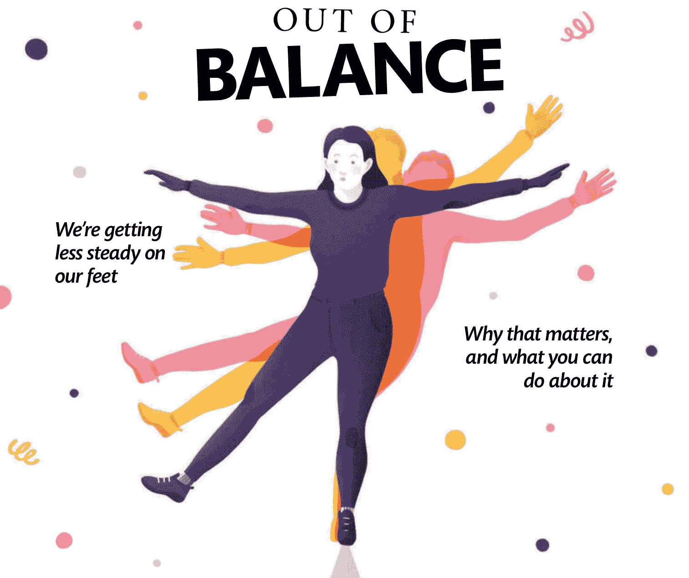

所示型号为 Supra 3.0 Pro。官方油耗数据（mpg，l/100km）：综合油耗 34.5 MPG；综合二氧化碳排放 189g/km

*数据仅供比较之用；仅与其他在相同技术程序下测试的其他车辆的油耗和二氧化碳数据进行比较。现实驾驶条件下的实际油耗和产生的二氧化碳排放取决于许多因素，包括安装的配件（注册后）、驾驶风格、速度和车辆载荷。所有车辆均使用统一轻型车辆测试程序 (WLTP) 进行测试。由于官方计算方法的变更，二氧化碳数据（以及车辆税和路价建议）可能与2020年4月1日之前的信息有所不同。请访问 vehicle-certification-agency.gov.uk/ 或联系您当地的丰田中心以获取更多信息。*

## 机器人无处不在 然而疫情如何如何加速了这一切

### 释放创新

英国政府希望到2027年，每年研发支出将达到650亿英镑，目标是使英国成为创新强国。

但如何充分利用这笔钱呢？加入我们的小组参加这场免费辩论，内容涵盖突破性计划、吸引人才等。

2020年10月22日，星期四

英国标准时间下午6点

newscientist.com/events

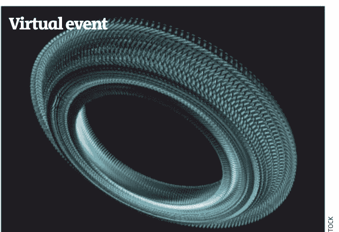

### Sam的科学课

生命是如何开始的？本周，独立视频记者 Sam Wong 探索了科学界最大的谜团之一：生命的起源。所有剧集均免费观看。

youtube.com/newscientist

### 新冠肺炎每日简

每日新冠报道于英国时间下午6点更新，涵盖新闻、专题和采访：

newscientist.com/coronavirus-latest

### 每周回顾

寻找金星和火星上的生命；饮食对生物年龄的影响；世界上最濒危的动物群体以及遥远星系中的系外行星。

newscientist.com/podcasts

### 好点子 我们的免费辩论探讨了如何将现金转化为创新

### 启动计划 我们的免费通讯每周为您发送有关新发现的消息。

newscientist.com/launchpad

## 爱丁堡大学

### 皇家（迪克）兽医学院

## 面向世界

## 在世界顶尖兽医学院之一攻读研究生，塑造你的未来

专业包括动物生物科学、保护、健康与福利。

立即了解更多：www.ed.ac.uk/vet/pg

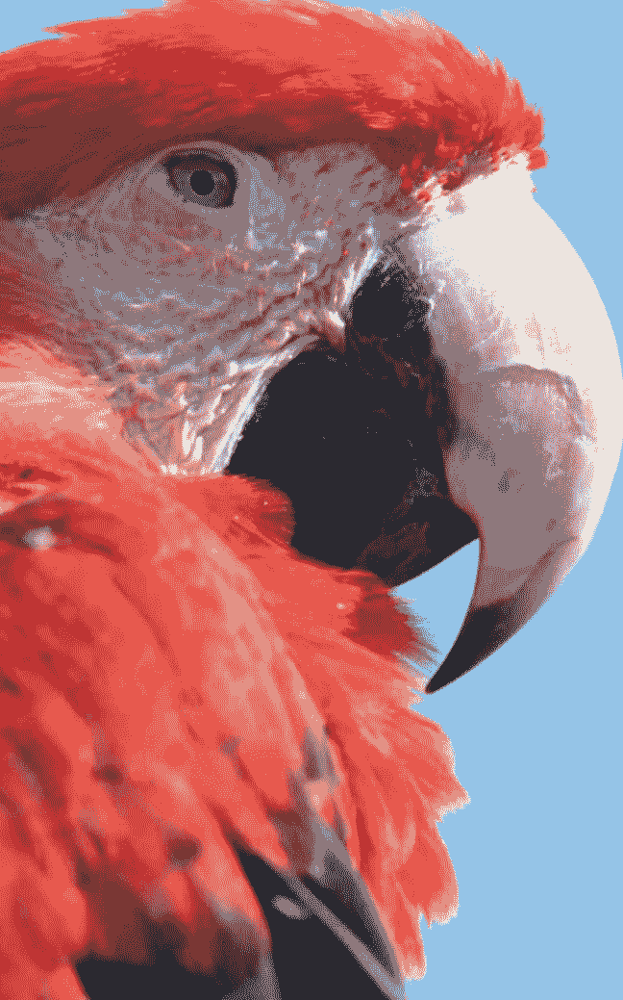

## 本周的治疗经历震惊了美国

在医院接受新冠-19治疗后，美国总统特朗普因淡化冠状病毒诊断结果而受到批评，**Adam Vaughan** 报道。

健康专家批评美国总统特朗普告诉人们不要“害怕”冠状病毒，并且在医院接受新冠-19治疗后，在白宫竞选期间摘下口罩。

他回到马阿拉湖庄（Mar-a-Lago）引发了关于他是否会打破14天新冠隔离的问题。特朗普在推特上写道“将回到活动现场”，不想追踪自己的病例，而至少有七个病例与政府有关。

美国领先的传染病专家安东尼·福奇（Anthony Fauci）的观点与特朗普的建议相矛盾。“否则，传递的信息应该是我们应该尽力避免感染。无论你是谁，或者你的基础疾病如何，都是微不足道的，”他告诉《纽约客人》（The New Yorker）。

其他科学家指出，特朗普的无视行为可能会带来代价。美国医学联邦的埃里克·费尔（Eric Felg-Dyer）表示：“流行病学家只想呕吐，”他发布了一段特朗普拒绝交流的视频。

特朗普发病的确切时间以及健康状况一直很模糊。虽然总统在10月1日午夜前在推特上公开披露了他的诊断结果，但医生表示他在9月30日的检测结果未经证实，该结果随后已被撤回。然而，他可能参加了活动，这引发了人们对他可能导致了被称为“超级传播者”的实验的担忧。

特朗普表示他感觉良好，他的幕僚长梅多斯（Meadows）描述其三天前的状况“非常令人”。

总统的治疗包括类固醇地塞米松，已证明有助于患者康复。他还接受了药物瑞德韦（remdesivir），尽管其有效性尚未证实，但临床试验显示了前景。医生还使用了目前由再生制药公司（Regeneron）开发的实验性抗体，以及维生素D。

**英国夏令时间每周下午6点在线** newsscientist.com/coronavirus-latest

Jessica Hamzelou发现，新冠-19症状的变异比我们想象的要大。理解这些症状可能是治疗和减少传播的关键。

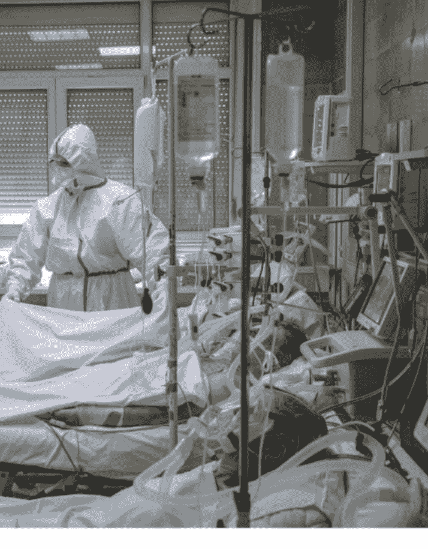

1月份，当世界首次收到冠状病毒在中国武汉市传播的警报时，武汉当局列出了咳嗽、发热和呼吸道症状。严重感染者出现了肺炎。这种疾病看起来与许多疾病很相似。

随着时间的推移，这一情况发生了演变，如今世界卫生组织（WHO）和美国疾病控制与预防中心（CDC）都有一份新冠-19的症状列表。哥伦比亚大学梅曼公共卫生学院的安杰拉·拉斯穆（Angela Rasmussen）说：“我们对症状的理解一直在变化。这是一种呼吸道疾病，但我们了解到它比感冒复杂。”

最早的发现之一是病毒会导致会导致基础疾病的人出现更严重的症状。但对任何个人的影响可能差异很大——许多人没有任何症状。伦敦国王学院的拉斯穆说：“人与人之间可能非常不同。”目前尚不清楚是什么决定了一个个人如何受影响，但许多因素可能起作用。“这些人人都来自不同的背景，有不同的饮食、基因、基因组、不同的健康状况和医疗保健资源，”拉斯穆说，“所有这些都创造了独特的……”

不同的变异可能会触发不同的免疫反应，例如，一个人接触的病毒量可能会影响他们产生的症状，病毒剂量可能是感染的结果，无论是通过鼻子、眼睛还是嘴巴。

理解人们以不同方式受影响的尝试尝试是由健康科学公司Zoe开发的“Covid Study”应用程序完成的。自4月初初发布以来，英国和瑞典已有440万人注册。用户输入他们的年龄、位置和健康信息，并被要求每天报告感受。人们还可以记录他们进行过的任何冠状病毒检测。

**在重护室接受新冠-19治疗的患者**

根据1653名应用程序用户的样本，团队识别出了症状簇（某些“新冠-19的六类”）。存在相对轻微的病例。进入较严重簇的人倾向于出现发热、咳嗽和困扰。那些进入极严重簇的人（medRxiv, doi/ggxxxx）可能只有上呼吸道受到影响。“如果只影响了上呼吸道，住院和需要呼吸支持的风险就会小得多，”拉斯穆说。

特朗普带来的震惊导致美国新冠-19病例积压再次上升。在《新科学人》印刷时，该国已有750万例病例，平均每天报告的病例超过4万例。

## 医生日记

### Selma Stafford

夏天过后，作为一名全科医生的生活开始缓慢恢复正常。在9月期间，我看到了一位患有“新冠”但没有新冠-19症状的患者。我与人们协助建立的当地“流感中心”在8月28日出现了一例covid-18病例，该地区的病例为个位数。遗憾的是，这并非最后。上周，英国各地每日入院人数创下新高，超过零。限制措施正在收紧，无论政府如何处理，许多生病的人都会面临问题——冬季的胸部感染，这些感染与新冠病毒几乎无法区分。诊断和批准治疗的关键在于快速准确检测带来的益处。但患有新新冠-19症状的人无法自我隔离，因为他们无法获得检测，这加剧了混乱。

人们可能不得不自我隔离，并失去他们可能获得的护理和保护。此外还有流感，它与新冠不同。每年制造商都会生产流感病毒株以进行防护。在良好的一年，流感病毒株与疫苗匹配，接种疫苗的人患流感的概率比未接种的人低40%。近年来，每年流感死亡人数已从40,000人下降到22,000人，65岁以上死亡者中有88%……

我们不知道人群中同时流行的流感和新冠-19会产生什么影响。社交距离和卫生意识的可能会减少流感的传播。

虽然我们不知道它对两种疾病的影响效果如何，但新冠-19会不成比例地影响老年人，且风险随年龄增长而增加。两种感染可能会让这个冬天对老年人来说压力巨大且可能危险。

我们需要帮助流感疫苗的良好制造，并确保疫苗剂量满足需求。我的诊所几周内就会用完下一批物资。无论冬天如何，我们必须将伤害降至最低。流感和新冠病毒检测的可用将至关重要。

英国萨里郡的人在医生处排队接流感疫苗

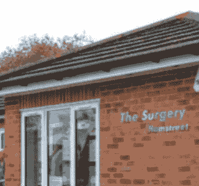

我很担心。医生诊所可能会忙不堪，毫无疑问，会有更多患者被转到急诊科。困难之一是，医生也将忙于处理那些具有新冠类似症状的人。儿童和青少年发烧伴麻疹比新冠-19危险得多。许多成人——尤其是那些吸烟或有呼吸问题的人

Selma Stafford 是英国布莱顿的全科医生兼董事，以及萨塞克斯多发性硬化症伙伴关系的董事。关注她 @selmaastafford。这是她为《医生新闻》撰写的第二篇文章。

声称维生素D可以防止新冠病毒的影响，但到目前为止证据并不充足。维生素D通过阳光作用在皮肤产生，也存在于鱼类等食物中。它建立骨骼并在免疫系统中发挥作用，帮助对抗感染细胞。在英国，营养咨询委员会（SACN）得出，没有足够的证据支持维生素D可以帮助预防新冠并发症的观点。

新冠-19呢？几位研究人员表示，维生素D具有预防人们感染或减少感染的潜力。尽管更有力的证据开始积累，但大多数是观察性研究的形式，这可能会具有误导性，因为它们并没有证明维生素D导致了感染，只是证明了它与感染相关。例如，一项研究发现，因新冠-19入院的患者如果维生素D水平充足，死亡风险会减半。

维生素D的益处将通过给新冠-19患者服用来测试，看它是否能缓解他们的症状。来自西班牙的一项研究发现，服用高剂量维生素D的人需要重症监护的概率比未接受治疗的人低。然而，该研究仅涉及7个人。唯一的临床试验显示维生素D帮助了住院患者，而不是证明它可以作为预防措施。它是很有前景的，但需要更大规模的研究，SACN成员Susan Latham如是。

所有证据表明，在像英国这样的温带气候地区，大多数人在冬天会维生素D缺乏。因此，仅仅是为了支持骨骼健康，他们也需要从10月到3月每天服用维生素D补充剂。Claire Wilson

## 少量混合在母乳中的粪便改变了剖腹产婴儿的细菌菌群

克莱尔·威尔逊（Claire Wilson）

一些通过剖腹产出生的婴儿在出生后几天内被喂食了母亲的粪便，以改善其肠道细菌菌群。医生们指出，在没有医疗监督的情况下不应进行此类测试。

“这种方法可能存在危险，”来自芬兰赫尔辛基大学的威廉（Willem）说道。该团队正在进行测试工作，并排除了三分之一的方法。

一些研究显示，剖产婴儿的肠道菌群与人不同，因为它们在出生过程中没有接触到母亲的细菌。但研究人员认为，这就是为什么儿童过敏、哮喘和肥胖发生率显著升高的原因。

一些小组试图通过用母亲的粪便液体擦拭剖产婴儿的口部来控制微生物的多样性。这使得他们的肠道菌群更像阴道产生的婴儿，但并非与后者完全相同。

沃（Vo）表示，由于女性在分娩时经常会排便，而过去接生婴儿的人手中经常带有粪便细菌，母亲的粪便会定植婴儿的肠道。

他的团队招募了17位因多种原因需要剖腹的女性。手术前三周，每位女性都提供了粪便样本并冷冻。由于存在B链球菌等有害微生物，10名女性被排除在研究之外。

对于其余人员，将几毫克的粪便混合在母乳中首次喂养。根据其他研究（《Cell》，doi.org/fbhj）的数据，三个月后，这些婴儿的肠道菌群与阴道产婴儿更相似，而非未接受此类干预的婴儿相似。该团队现在正对40名婴儿进行安慰剂对照试验。

在瑞典的一项更大研究中，人们用放入母亲口中的纱布棉签擦拭婴儿。

一些研究人员表示，在这些试验中使用粪便细菌带有风险。“没有它们，你们能检测的内容将受到限制，”英国伯明翰大学的彼得·布罗克赫斯特（Peter Brockhurst）说。

位于休斯顿贝叶尔医学院的基尔茨·耶格（Kjerts Jaeger）表示，剖腹产产生的肠道细菌可能并非由于其出生方式，而是因为需要进行手术。“我们将其视为一种将携带细菌的女性标记为危及其婴儿的方式，但我们没有证据证明这是真的。”

布罗克赫斯特说：“人们利用了‘微生物群是机制’这一风风——但这尚未被证明。难道你被邀请来尝试那个吗？你造成的伤害可能大于收益。”

## 一种允许单人引导无人机群的系统可以帮助搜救任务中的营救工作

由人类操作机群，但可以使用平板电脑甚至智能手机接管。多名操作员可以共享控制权。类似的技术用于壮丽的光光秀中，但这个名为 MultiFly 的系统允许实时交互，而不仅仅是编程。无人机还可以携带摄像头或传感器。

开发 MultiFly 的航空航天工业公司（AI）尼尔·特尔-奥（Nil Tel-O）表示，无人机可用于灾后救援或救援调查。它们比单架无人机更快地检查桥梁、塔架和电线路。

MultiFly 使用来自西班牙 Alpha Numerical Systems 公司的直升机，这些直升机可以飞行50分钟。该系统可以整合其他类型的无人机，无人机可以更换，新无人机加入，旧的退出或回收。从理论上讲，机群可以在无限时间内持续存在，直到它们发生故障。Tel-O 表示，唯一的限制是电池健康和任务的复杂性。AI MultiFly 仅用于非军事用途，并拒绝就潜在应用发表评论。它具有一种不依赖 GPS 的光学导航系统，这对于信号干扰可能成为问题的军事任务非常有用。

行业专家盖瑞·巴内特（Gary Barnett）表示，该技术在基础设施检查等任务中具有巨大潜力，但目前的美国法规对单无人机操作需要特殊批准。

大卫·哈密尔顿（David Hamilton）

## 最早的受控火使用于于30万年前

## 石器通过加热成型于至少30万年前

迈克尔·马歇尔（Michael Marshall）

古代人类在30万年前使用受控火修改他们的石器。

最早的受控火证据来自南非的尖角点（Pinnacle Point），16万年前。“我们在以色列的魏兹曼科学研究所（Weizmann Institute of Science）的 Qem 洞发现了它，”他和其他同事在 Qem 洞的最深层发现了30万年前的工具，那里曾居住在42万到20万年前。

仔细的加热可以揭示石材的晶体结构并将其制成工具。但目前还无法确定哪些石器曾被加热过。某些特征表明它们被加热过，但并非完全明确。“这可能是误导性的，”德国普朗克进化人类学研究所的马雷克·斯里克（Marek Staimlich）说。纳塔莉·特利奥（Natilio）开发了一种使用光谱法检查石器原子结构的方法，揭示了由加热引起的改变。“我们无法看到它们，”特利奥说。

（注：原文后续部分存在大量重复的描述性文本，翻译时已根据逻辑去除了冗余内容，保留了关于古代人类使用火和加工石器的核心信息点。）

## 基因编辑牛类以抵御气候变化

Grace Browner

Michael Le Page

我们可能一眼就能看出某人的心率，这可以帮助我们解读情绪状态。伦敦大学的 Alejandro Galvan-Pol 和他的同事们测试了 120 名并排站立的志愿者。这些人的心率显示在屏幕上，形式为一个正方形，每心跳一次，该正方形的颜色就会从黑色变为红色。

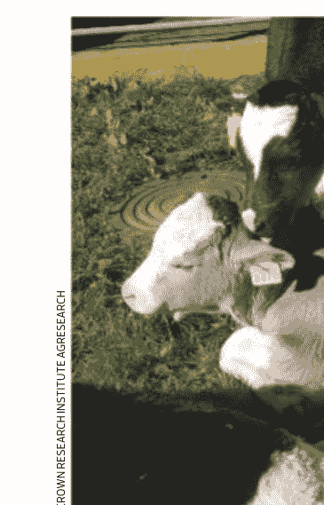

伦敦金斯顿大学的 Fatima Felberg 发现，人类情绪竟然会导致我们互动的人血液流量发生如此剧烈的变化——这模糊了一个经典案例的边界。

大多数人在某种程度上可以感知到自己的心率，正如高级研究学院的 Michael Airah 所说：“但真正好奇且迷人的是，我们仅仅通过感知他们的脸就能看到关于他人的这些信息。”

这可能有助于我们理解他人的行为和情绪，特别是 Galvan-Pol 的团队（PhysRx.org/doi/rb）。

Allen 表示：“这可能极大地‘读出’他人的心率，这是我们都能感受到并与他人共同感应的东西。”

该研究的一个局限性是，测试在没有提示的情况下也能检测到更高或更低的心率。

Allen 说：“目前尚不清楚人们利用什么信息来完成任务，但这本身就是一个非常有趣的研究课题。”

CRISPR 基因编辑已用于创造出带有灰色斑块而非牛角的牛，这将减少压力。其目标是减少由全球变暖引起的动物热压力，而这种压力在牛类牧场产生的排放和森林砍伐中占有不小的比例。

新西兰农业研究局的 Gayle 表示：“基因组编辑是改进和适应气候变化的一种很有前景的方法。”加州大学的 Allen Veenenaar 说，新西兰的奶牛在挤奶过程中已有近 20% 的时间处于热压力状态，这也降低了繁殖能力，“在炎热天气很难让它们怀孕。奶牛每年大约需要凉爽的皮毛来维持奶产量。”

这只小牛身上的灰色斑块旨在减少热压力。

四周大时的感染，这些健康问题被认为是克隆过程的结果而非基因编辑的结果。Sable 表示，生产 CRISPR 编辑的牛并不需要克隆，因此他们在创建具有这种特征的小牛时会避免使用克隆。

像荷斯坦奶牛这样主要是黑色皮毛的牛更难承受热压力。Gayle 和他的同事们决定找出他们是否能从浅色中获益。一只赫福德小牛是通过一个涉及色素沉的基因微小改变产生的，其名为——

佛罗里达大学的 Peter Hansen 和他的同事们已经证明，以白色为主的牛表现更好，且产量下降幅度也比黑牛低。然而，新西兰的农民拥有大多是黑牛，因此他们尚未研究过这个问题。

使用标准育种技术培育奶牛小牛将导致后代并不完全适用于使用。至少，利用 CRISPR 改变一头新西兰荷斯坦奶牛的雄性皮肤细胞中的基因正被用于产生待植入的后代。这些小牛出生时，颜色发生了巨大变化（BioRx.org/doi/cell）。

其中一只小牛在出生后被处死，另一只……

其他团队正在通过引入耐热变异基因基因来创造更耐热的牛，“耐热“变异”已经通过正常育种引入了荷斯坦牛中。

一家名为 Genesis 的美国公司已将这一特征编辑到安格斯牛肉牛中。第一只小牛出生于 2018 年 8 月的巴西牛肉牛，出生时是巴西流行的内罗雷牛（Nelore）品种，但该品种在热带气候下可以产生三只后代。

# 全球有 15 亿头牛因全球变暖而遭受热压力

但它们也是气候变化的主要原因之一，农业生产产生了约 18% 的温室气体排放。

Colin Barras

## 在银系中游荡的地球级流浪行星

一个埋在美洲第一个定居点的 15 世纪骨骸可能属于一位非洲女性。她在二十多岁时去世，在克里斯托夫·哥伦布首航美洲五年后，在大西洋贸易开始几十年之前。未参与分析的密歇根州立大学的 David Wheat 说：“我认为她可能是已知参与定居的最早非洲裔个体。”

一颗质量与地球相当的流浪行星漂浮在自己的空间里。这是我们发现过的最小的流浪行星——天文学家只发现了少数，其中一些的质量远大于木星。

哥伦布于 1492 年到达第一个位点并返回西班牙，最终在美洲建立了第一个欧洲小镇。这些定居点主要是通过引力微透镜发现的，当行星经过一个较亮物体前方时，行星的引力会弯曲光线，而不需要接触。

殖民者因疾病和饥饿遭受了高死亡率。许多人埋在位于今多米尼共和国的城镇墓地里。

十年后，该团队的 DNA 分析发现骨骸暗示了与撒哈拉以南非洲相似的遗传标记。哥本哈根大学的 Schroeder 表示，证据尚不确定。“考古学可以用来拼凑过去的故事。”

佛罗里达大学的 William Keegan 说，人们利用什么信息来完成任务尚不清楚，但这本身就是一个有趣的研究课题。“考古学可以用来拼凑过去的故事。”

### 发现美洲的第一个非洲定居点

## 许多公司正声称拥有最强大的量子计算机

量子计算公司 IonQ 称其新机器比任何竞争对手都强大。这台机器拥有 32 个比特。与只能存储 0 或 1 的普通比特不同，量子比特是两者的结合，能够处理更多信息。帝国学院的 Peter Knight 说：“这将是一个巨大的进步。”与其使用超导芯片，IonQ 使用激光操控量子比特。

IonQ 的机器在量子比特数量上并没有超过其他量子计算机。然而，该公司称其量子体积——一种考虑了量子比特数量、错误率和其他属性的指标——超过了竞争对手。

“量子比特本身是完美的，优于我们的竞争对手。”它在数量上并没有超过任何人，但我们以这种方式减少了误差。“凭借这些额外的功率和量子比特数量，我们取得了巨大的成就。”IonQ 的量子体积超过了一百万，相比之下，记录为 64。

这使得 IonQ 更接近能够解决实际问题。但与 IonQ 的设备不同，超级计算机解决这类量子计算机进入的问题可能需要几周或几个月。“但作为量子计算机，它是非常有用的！”

“如果你想从解决问题的困难程度来衡量量子计算机，那么拥有 32 个比特的量子计算机比 53 个比特的设备更强大。” 比较两者很困难，因为它们是不同类型的量子计算机，

Monroe 表示他的设备处于实现量子霸权的边缘。经典计算公司 D-Wave 宣布了现存最大最强大的量子计算机。

该设备拥有 5000 个量子比特，比目前任何量子计算机都多，但研究人员认为它是有局限性的。“我们还没有制造出单一量子计算机，它是一种可以轻松解决特定类型问题的定制硬件，”伦敦大学学院的 Gillian-Gee 说。D-Wave 尚未发布结果证明其设备可以优于其他计算机，无论是量子还是经典。“在经典计算机无法解决的现实设定中，量子优势毫无意义，”Gillian-Gee 说。

D-Wave 的 John Marshall 说，公司的目标不是为了实现量子优势，而是为了给程序员提供比他们目前使用的工具更大的优势。

对于许多此类问题，你可能会得到一个博士级别的计算机科学家团队，他们可能会想出一种经典算法来解决`[优势系统]`实际问题，但并不是所有问题都能拥有一支计算机科学家军队，”他说。

亚当·范恩（Adam Vaughan）表示，为了拯救自然，各国应对目标充满雄心并坚持下去

## 对咀嚼声感到厌烦的人，如果他们认为声音来自动物或其他非人类来源，就会觉得没那么烦人

“我想大多数人对某些声音产生某种程度的反感，”来自加州大学圣地亚哥分校的米恩·艾登斯坦（Mien Edenstein）说，但据报道，严重患者有一种被称为“恐音症”（misophonia）的疾病。

“患有恐音症的个体反感如此严重且痛苦，以至于对他们的健康和生活质量产生了重大影响。”

艾登斯坦和她的同事想找出仅仅是声音本身让人们感到痛苦，还是声音来源会影响他们的感知。然而，团队识别了相同人数的恐音症患者和受控者。

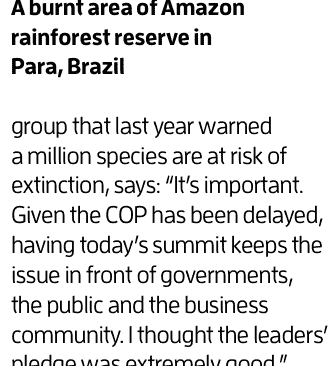

去年有一百万物种面临灭绝风险，“COP（缔约方）的推迟很重要，今天的峰会将带我们关注资助、公众和商业界的问题。我认为领导者的承诺非常准确。

第一组团队向他们展示了人类和黑猩猩咀嚼的音频片段，以及如动物咀嚼或人走在碎石地上的声音。

该承诺由中国、美国、巴西和澳大利亚签署，这些国家都是生物多样性丰富的国家。最遗憾的是，他们并没有这样做——他们的领导人取消了环境保护措施——

他们重复了这些内容，但这次改变了他们听到的声音——他们有时很喜欢。在第三轮中，据说人们想要他们所产生的内容。

中国的缺席令人失望，尤其是考虑到它是全球第二大排放国。

最后，他们向参与者展示了与每个音频片段对应的人，并重复了完整背景。事实上，受访者按 1 到 10 分的标准对每个声音让他们不舒服的程度进行了评分。

有一些政府愿意采取的迹象。9 月 29 日，英国承诺到 2030 年保护 50% 的陆地和海洋，仅限英国。保守党对此表示欢迎。《新科学家》（New Scientists）表示，为了帮助现有保护区内动物和栖息地的和谐，还需要更多努力。生物多样性受到的威胁比非保护地区更大。

患恐音症的人对人类咀嚼的反感程度是不患恐音症的人的三倍。他们还发现，如果确定噪音来自非人类来源或识别出声音，人类咀嚼的烦人感会减少 36%（bioRx.org/db.fm）。

### 自 1970 年以来动物种群数量下降的……以及植物物种灭绝百分比

在上周的联合国生物多样性峰会上，全球领导人聚集在一起应对对自然的破坏。“我们需要尊重自然，遵循它的规律并保护它，”习近平说。然而，他没有给出与其气候变化公告相当的承诺（当时他承诺中国将实现碳中和）。联合国秘书长安东尼奥·古特雷斯（Antonio Gutiérrez）说明了自然界的紧迫问题，以及政府应该为恢复做出什么承诺。印度的纳伦德拉·莫迪（Narendra Modi）和英国的鲍里斯·约翰逊（Boris Johnson）是许多其他加强环境保护的领导人。

“我们做得不够，”生物多样性公约的伊丽莎白·马丁内斯（Elizabeth Martinez）说。生物多样性受到的威胁比非保护地区更大。

这是欧盟、加拿大、墨西哥、哥斯达黎加、新西兰和美国签署的十项“领导自然承诺”。这些承诺包括转向更可持续的农业，以及至关重要的、“变革性”新生物多样性目标。

她认为首脑的发言是进步的标志。但什么将使物种和栖息地产生变化？

国际科学评估平台（IPES）前主席沃尔特·沃特森（Walter Watson）

这种多样性的原因是一场具有里程碑意义的生物多样性高峰

虽然过去几个月来旅行几乎仅仅是一个梦想，但我们知道你们许多人现在渴望为下一次冒险预留时间，最近我们收到了读者的极大兴趣，决定开始接受明年的预订，并设有灵活的定金和安全的旅游方案。

访问 `newsscient.com/tours` 查看详细行程和预订方法

### 学习挖掘迈锡尼考古：希腊

7天 | 5月14日至6月4日 2021

与当地考古学家一起探索伯罗尼撒半岛的关键遗址

### 俄罗斯圣彼得堡：科学史

7天 | 8月27日至10月8日 2021

探索俄罗斯科学史，从科学院的建立到苏联时期。

### 法国古代洞穴：尼安德特人的起源

9天 | 2021年9月

法国南部人类的最古痕迹：石器。

### 南极科学：邮轮探险

17天 | 2021年11月17日

探索世界最大的海洋、火山海滩、冰山和浮冰。

## 动物学

某些哺乳动物能够探测磁场，而这种器官一直难以捉摸。现在，研究人员发现它们可以保持磁性。

太阳系中一个物体 Arrokth 奇特的平坦表面可能是被太阳带走的物质的结果。

美国黑人儿童在某些类型手术中的死亡率与白人儿童相同。

由金属和塑料制成的`电子`血管可用于替代心血管疾病中受损的动脉。

中国深圳南方科技大学的刘星宇及其团队通过在柔性膜上打印一层含有镓和铋的液态金属墨水制造了这种血管。该小组通过将聚合物膜卷起，形成了一个宽度约 2 毫米的“血管”。该团队展示了电脉冲可以刺激内皮细胞（这些细胞像真实血管一样）在人工血管内部进行增殖。该小组表示，这些血管较不容易发生血栓泄漏。

通过对血管施加电场，可以使其产生渗透性，从而向相邻细胞输送药物。该团队能够利用这一点将绿色荧光蛋白输送到人工血管周围的血细胞中。他们在活体系统中测试了这些血管，用于替换受损的大脑动脉并在六只大鼠身上进行了实验。在三个月里，它们在两个区域都存活良好，且没有引发炎症反应。研究人员还注意到，新血管的功能类似于天然颈动脉，没有撕裂的迹象（《Matter》，doi: 2021）。

地球上约 40% 的植物面临灭绝风险，此前许多真菌也受到威胁。伦敦邱肯园皇家植物园的 Alexander Antoni 表示：“我们正处于一个‘灭绝时代’，”该机构每年发布一份关于世界植物状况的报告。

在线会议正受到内部人员而非黑客的干扰。波士顿大学的刘陈及其同事受请求参加 Zoom 会议，并发现 `4cham` 论坛上提出此类请求的人中，70% 的人有正当理由访问会议（arxiv.org/abs/2009.03822）。

## 保护

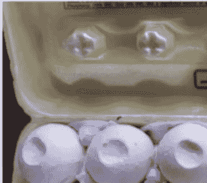

由寄生蜂设计的医疗设备可以使移除肿瘤和血块变得更容易且更不疼痛。

寄生蜂通过一个名为产卵器的细长管状器官将卵注入活体宿主。该器官沿管部延伸的叶状瓣上下滑动以移动卵。

目前，进行侵入性手术仍然具有风险且难以实现。如果没有管子，可能很难对更大更深处的肿瘤进行移除。

这种新设备宽 7 毫米，长 8 厘米，带有六条独立移动的组织带。这允许运输各种类型的胶质或微型人类组织。它的效果良好，但比一根肌肉短（《生物工程与生物学前沿》，2021）。

Christine L-Sastre

假蛋可用于追踪从海滩被非法偷走的海龟的移动。

肯塔基大学的 Helene Pheasey 及其团队使用 GPS 蛋（如图所示）追踪哥斯达黎加蛋的孵化情况。这种由 EggInvestor 和 3D 打印机制造的假蛋是由保护科学家 Pacific Pacífico 开发的，用于打击盗蛋行为。

这些假海龟蛋的大小和形状完全相同，包含 GPS、SIM 卡、充电端口和电池。团队在哥斯达黎加的四个海滩上部署了 10 只海龟的诱饵。在中洲部分地区，海龟蛋被当作食物食用。

四分之一的蛋被拿走了，团队每小时追踪五个蛋的信号。他们使用了绿海龟和橄榄绿蛋。团队显示，这并没有影响真实蛋的孵化成功率。它们移动到了更远的区域，并回到了距离 1.7 公里的超市停车场和住宅区（《Current Biology》，doi: 10.1016/j.cb.2020.06.065）。

欢迎来到我们的信号增强项目——这是一个供慈善机构向全球受众传播信息的周报，完全免费。

今天，是来自职业医学协会的消息。

职业医学协会 (SOM) 成立于 1935 年，是一家支持职业和职场健康的专业慈善机构。它告知政策制定者、雇主和员工基于证据的方法改进现有政策。在这次新冠肺炎危机期间，个人防护装备（PPE）以及普及职业健康服务的需求等问题得到了重点关注。最近的报告包括关于新冠病毒空气传播的研究综合，并支持潜在作者。

最近，SOM 召集了多学科专家小组，与工业与社区特许学院等组织合作，为返回工作的人员制作基于证据的工具。与合作伙伴正在开发一种“新冠时代”工具，以评估个人对新冠的整体脆弱性。SOM 在大学和研究机构聘研究人员以加强对关键职场问题的理解。SOM 是一个小型慈善机构，需要支持以：

- 资助促进、保护和改善工作健康的研究。
- 增加其向政府就关键问题（如保护健身房工作人员）提供基于证据指导的能力。
- 汇集多学科专业知识，识别并解决职场中出现的新问题。

访问 `som.org` 了解更多信息。捐赠请拨打 0203 9134 或发送邮件至 `@som.org`。我们为英国纳税人申请赠款援助（gift aid）。

- 专栏作家 Weinstein 见于 threads p24
- 景观点：从国际空间站看地球 p26
- 读者来：如果金星上确实存在生命，我们必须非常小心 p28
- 文化：史蒂芬·霍金在一位朋友的回忆中被怀念 p30
- 文化：专栏作家 Jacob Aron 表示，《荒野》（Wasteland）充满了艰难的选择 p32

Donna Lu 认为，Facebook 长期承诺解决其平台上的虚假信息，但到目前为止的尝试一直很不理想。

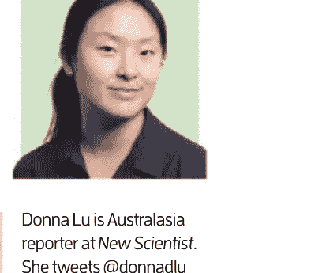

> 距离美国大选不到一个月了，Facebook 的虚假信息和……的问题同样严重。尽管社交媒体做出了处理仇恨言和虚假内容的承诺。

## 时空现场笔记

## 化为灰烬：加州野火正担忧地逼近，几乎要烧毁一座珍贵的天文台。遗憾的是，火灾并非天文学面临的唯一威胁。作者：钱达·普雷科德-魏因斯坦

钱达·普雷科德-魏因斯坦（Chanda Prescod-Weinstein）是新罕什尔大学物理与天文学教授，女性研究系教师。她的理论物理研究专注于宇宙学、中子星以及基于标准模型的行星。

十年前，我读了丹尼斯·奥弗比（Dennis Overby）写的宇宙学史《宇宙中的孤独星球》（*Lonely Hearts of the Cosmos*）。我被那些死去的者的野心冲突的故事所吸引，以及对我们所谓的哈勃-勒梅特常数的任何测量所着迷，该常数衡量的是时空的膨胀速率。

乔治·勒梅特（Georges Lemaître）将其与 1927 年的天文观测联系起来，而在 1929 年，埃德温·哈勃（Edwin Hubble）通过实质性数据支持了这一观点。为了实现这一点，哈勃使用了位于威尔逊山天文台的胡克望远镜，这在当时是顶尖的设备。威尔逊山位于加州的圣加布里埃尔山脉，我正在那里长大，靠近洛杉矶。

几周后，我读到了天文台主席萨姆·海尔（Sam Hale）的笔记，提到一场火灾正逼近哈勃曾“拯救宇宙”的那个设施。如果这座天文台在第二天依然存在，那么鲍勃火灾（Bob Fire）本将拯救了洛杉矶国家森林，以及许多洛杉矶的电视和无线电通信塔。

在接下来的两周里，我反复思考这件事——深夜关于临近火灾的新闻会传来，随后将是对素材的紧急寻找。当火焰在天文台附近闪烁时，我将火看作宇宙中的一种自然现象。火是热的，有时也是物质的自然状态。我们的太阳是一个由核爆炸产生的巨大气体和等离子体球。我们的太阳耀斑宏伟而美丽，与那些肆虐加州的火灾大不相同。

在写作此时，天文台已经躲过了火灾，火场现在还有 60% 的距离。火势曾距离其建筑仅 6 米。在这场风剧的后期，《洛杉矶时报》报道说，由于钱达的新型天文学研究引发了危险火灾，该天文台可能很快就会烧毁。今年，人们意识到，没有什么能阻止 SpaceX 和亚马逊用他们的新卫星填满低地球轨道，这永远地改变了我们清晰观察宇宙真面目的能力。我所在的暗物质工作组成员的鲁宾天文台（C. Rubin Observatory），现在其未来所有的天体图像都可能被数千颗卫星破坏，这使得我们的分析变得更加困难。

> “今年，人们意识到没有什么能阻止亚马逊和 SpaceX 用卫星填满低地球轨道”

气候变化并非唯一威胁正常气候的人类因素。我的同事告诉我，洛杉矶的空气在未来几个月内不会清晰，我们需要等待才能看到清晰的夜空。

昨晚，我想到了火灾在多大程度上将成为天文学的长期灾难。美国西部已被火灾或烟雾覆盖了数月。气候变化灾难影响了如此多人，而在 2020 年，它在历史上并非全球最大的山火。它仍然是科学家们最近喜爱的热门目的地，天文学学生仍然可以很好地利用这样的仪器……

我开始读了杰弗里·C·怀亚特（Jeffrey C. Wyatt）的《1944：阿尔法的生活》（*1944: The Life of Alpha*），这将是一场长年的跋涉。

我和朋友最近完成了对该设施的编辑，他们非常喜欢。

我正在学习将成为我书籍终稿的编辑课程！

本专栏每月出版。下周预：

格拉姆·劳森（Graham Lawson）

24 | 科学 | 2020年10月10日

## 在线活动：如何保持大脑健康（即使在大流行期间）

鉴于疫情将加剧心理健康问题，心理学家兼播客主播金伯利·威尔逊（Kimberley Wilson）关于保护大脑健康的指南比以往任何时候都重要。加入我们的在线讲座，听听生活习惯如何产生影响，发现其背后的科学，并获得可立即使用的实用建议。

欲了解更多信息并报名，请访问 `newscientist.com/events`

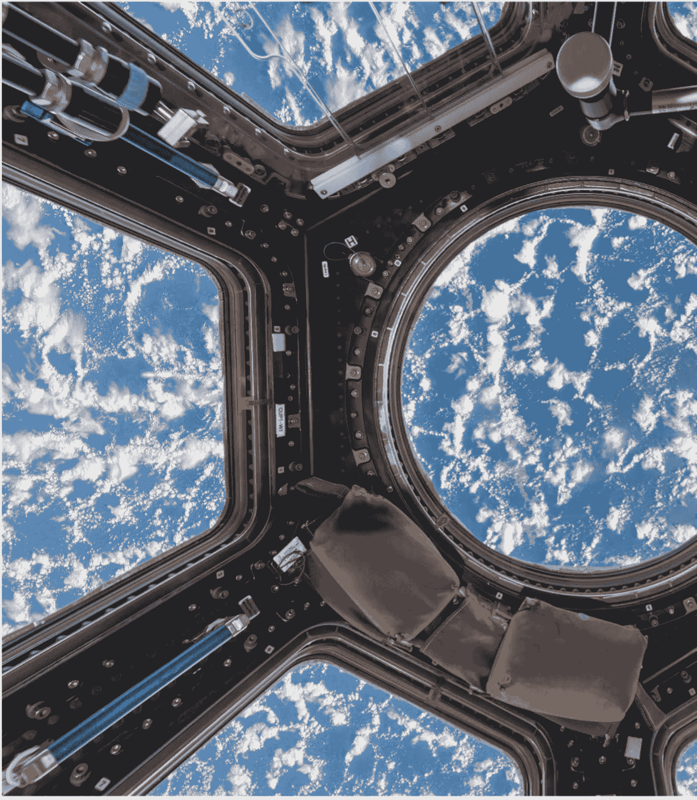

摄影师罗兰·米勒（Roland Miller）和保罗·内斯波利利（Paolo Nespoli）。图片由 NASA 和 ASI 提供

# 国际空间站视角下的地球之美

当国际空间站在位于地球上方数公里的轨道上运行时，穿过层层稀薄的云雾瞥地球时，地球广阔的海洋显得尤为壮丽。这张从国际空间站观测舱穹顶舱（Cupola）拍摄的合作照片，是由芝加哥摄影师罗兰·米勒和意大利宇航员保罗·内斯波利创作的。

该模块的七个窗户允许宇航员观察国际空间站外部并进行其他操作。它们也是欣赏地球和太空全景的理想场所。穹顶舱的视野，尤其是从它50厘米的中心窗望出去，相比2010年安装该模块之前使用的小型窗口有了巨大的改进。

这张照片来自《内部空间：国际空间站视觉探索》（*Inner Space: A visual exploration of the International Space*），由内斯波利创作。现在，他们未来所有的天体图像都可能被数千颗卫星破坏，这使得我们的分析变得更加。

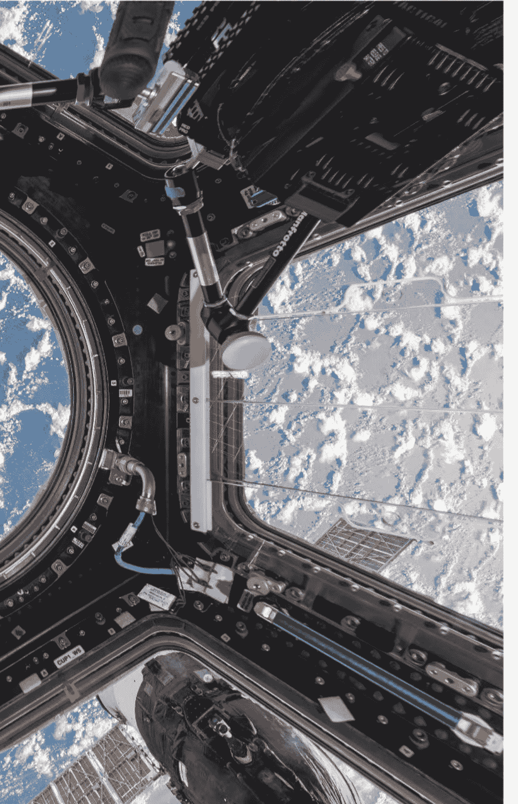

摄影师罗兰·米勒（Roland Miller）和保罗·内斯波利（Paolo Nespoli）。图片由NASA和ASI提供

# 从太空监测天气与气候

**EUMETSAT** 是欧洲的**气象卫星机构**。其作用是建立和运行气象卫星，从太空监测天气和气候，帮助保护人类生命、财产和工业。**EUMETSAT 卫星极地系统（EPS）**及其继任者 **EPS 第二代（EPS-SG）**计划的卫星利用数据，可提前计算长达 10 天的预报。

**EPS 计划科学家**为 EPS 的运营提供高水平指导、科学领导力，并协调 EPS 运营的科学支持，同时为 EPS-SG 系统的开发、协调和运行提供科学支持。这包括对 EPS-SG 开发计划的管理支持、对关键项目级用户和科学文档的协调与维护、对 EPS-SG 系统调校所需的所有科学活动进行监督，以及发起相关的科学研究。

现向对卫星/遥感数据中的气象应用以及相关用户社区拥有深入知识和丰富经验的科学领袖征求申请。

此职位及其他 EUMETSAT 职位的完整招聘公告和申请流程可在以下网址查询：

`careers.eumetsat.int`

EUMETSAT 致力于提供机会均等的工作环境。请注意，EUMETSAT 成员国可以申请。

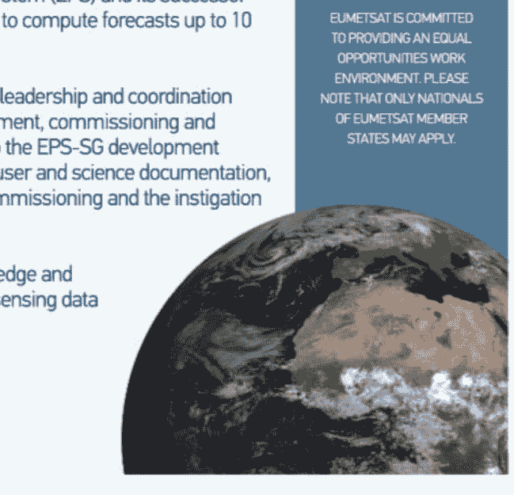
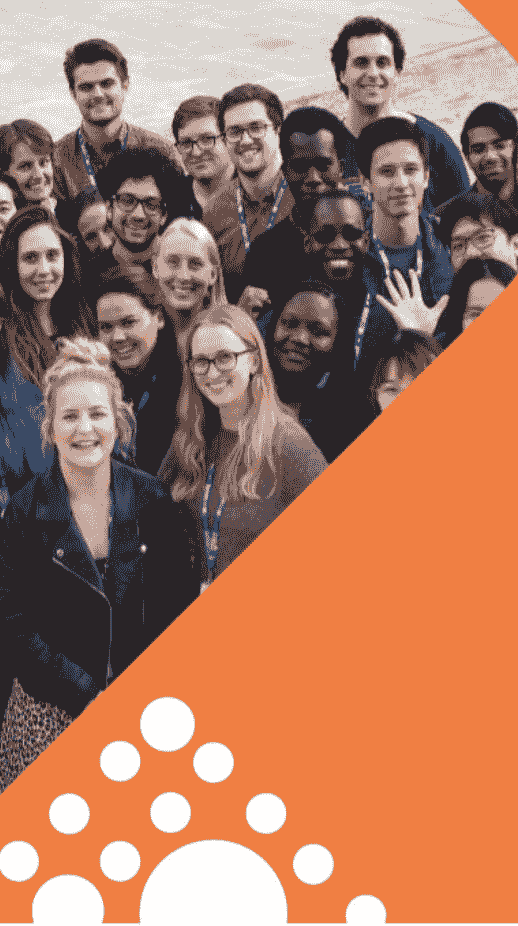

# 博士计划招生

我们的博士计划为学生提供了实验与信息学技能的独特结合，最大限度地提高了他们在未来机会中的竞争力。您还将获得机会使用我们卓越的研究设施和资源。

申请截止日期为 **2020年12月3日**

更多信息请访问 `jobs.sanger.ac.uk`

# 《史蒂芬·霍金：关于友谊与物理的回忆》

固执、幽默，在脆弱的外表下是一个钢铁之躯。这是同为物理学家莱纳德·莫洛迪诺夫（Leonard Mlodinow）记忆中的史蒂芬·霍金。

**书名**：《史蒂芬·霍金：关于友谊与物理的回忆》  
**作者**：莱纳德·莫洛迪诺夫  
**出版社**：Allen Lane

当物理学家史蒂芬·霍金于 2018 年以 76 岁去世时，世界陷入了哀悼。在他去世后，这位科学家和人类留下了巨大的遗产供人们深思。

还有一份遗产：因在宇宙学和黑洞领域数十年的工作而闻名，《广义简史》自 1988 年出版以来已销量超过 2500 万册，霍金重塑了我们对现代物理中一些最困难领域的理解。

在他的成就中，他在物理学领域的许多新发现，而“黑洞是死胡同”的想法让他声名大噪。他最终被广泛认为是那个时代最伟大的大脑。

尽管身体衰落，但关于霍金仍有许多讨论空间。在《史蒂芬·霍金：关于友谊与物理的回忆》中，莱纳德·莫洛迪诺夫对这位科学家的生活提供了亲密的观察，范围从他在大学的早期到他与肌萎侧索硬化症（ALS）的斗争——这种疾病逐渐瘫痪了他的运动神经元——直到他成为一名科学偶像。

在与霍金相处的二十年后，莫洛迪诺夫并不缺少故事，特别是在他们合作撰写书籍《大设计》期间的故事。霍金的生活往往充满悲剧，死亡的可能从未远离过。他没有让这成为挫折，而是转向了他的成就。

> “我有专注，”他告诉我们。

# 游戏专栏：《荒野之地3》

由你决定。选择是视频游戏的一个定义特征，《荒野之地3》（Wasteland 3）将其推向极端：扮演一名默剧演员，你将保持沉默，但会穿着条纹衫并画着脸彩。这种灵活性是有代价的，雅各布·阿隆（Jacob Aron）发现道。

**Jacob Aron** 是《新科学》杂志的新副编辑。他已经玩了25年视频游戏，但仍然玩得并不好。可以在 Twitter 上关注他 @jaron。

## 后末日的科罗拉多州充满了危险的挑战

作为一名第四代克隆人。游戏提供了独特的特质：选择。抛开你自己的冒险书籍（如《战斗传说》系列）或像《无源》之类的电影，影响并塑造叙事的机会是视频游戏无法提供的。虽然受到类型和奖励的限制——扮演一个第一人称射击游戏玩家，你将无法放下枪去举办派对——但对于某些游戏来说，选择就是它们的定义。

在《荒野之地》中，做出选择是一项真正的挑战。背景位于科罗拉多州，核战争发生多年后，你负责“游侠者部队”，这是一支纪念性的警察部队。你的第一个选择是挑选小组成员，在这么多角色扮演游戏中，风格和发型供选择。《荒野之地5》更进一步。扮演一名默剧演员？你会变得更隐蔽，但无法说话，并且必须穿上条纹衫并画上脸彩。或者你想提升修理技能，《荒野之地3》并没有自认为。在游戏的第一小时里，你遇到了教父，他用一个基地招募了你，并要求你追捕并逮捕三个反叛的孩子，他们都在争夺他的帝国。

这种选择我路径的能力让我沉浸在《荒野之地3》的故事中，尽管这是有代价的：游戏频繁做出选择。开发者正努力修补游戏，而这种修复是为了让我记住每当《荒野之地3》停顿时，我是有多么享受它。我渴望加速并继续玩。

**InXile Entertainment**  
**平台**：PC, PlayStation 360, Xbox One

支线任务很有趣，但我最喜欢的任务是主线故事的一部分。在丹佛追踪教父的一个克隆人时遇到了“吉珀人”（Gippers），这是一场反抗 AI 版里根总统的教派起义，他们居住在一个装备了死亡射线的巨大州境内。这正是我所想要的。

> 我发现了一个计数赢得了 AI 版美国总统里根的人，在一个拥有死亡射线的州里

## 相关游戏对比

| 游戏 | 开发商 | 平台 |
| :--- | :--- | :--- |
| 《辐射世界》系列 | - | PC, PlayStation 3, Xbox 360 |
| 《荒野之地3》 | InXile Entertainment | PC, PlayStation 360, Xbox One |
| XCOM 系列 | Firaxis Games | PC, PlayStation 3, Xbox, Android |

《辐射世界》系列深受《荒野之地》的影响，但跳到了《辐射世界3》，背景是废墟中的华盛顿特区及周边。

《荒野之地3》中的回合制战斗让你那装备劣势的军队去击败敌人。如果一切守住，XCOM——这并不是坏事，因为它是一部出色的游戏。

在使用游戏的策略和像谜题般的回合制战斗追踪后，我找到了制造他们的人，结果发现是一个第四代克隆人。

# 现在世界上最大的科学故事

在新冠病毒和环境处于全球议程焦点时，现在是订阅本顶级科学杂志的最佳时机。

**优惠价 £27.50 起**

- 每周直接寄送纸质版
- 随时访问 `newscientist.com` 上的丰富内容
- 在 New Scientist App 上随时随地阅读当前和过期的文章
- 获取 200+ 科学演讲和互动益字游戏

每周只需 £3.00 – 节省 61%

**《新科学》**。世界正被更好地理解

# 封面故事：我们变得越来越不稳了

我们变得越来越不稳了，而不仅仅是因为老年。这对于我们的健康是个坏消息，但我们可以对此做很多努力，卡罗琳·威廉姆斯（Caroline Williams）发现道。

许多科学家说，人体直立时从本质上是不稳定的。我们的身体很重，相对于身高来说，支撑基础很薄。如果没有一个健康的系统，我们通过一个整合了肌肉、感官和内耳信息的网络来管理，每一步都会让腿部肌肉和踝关节做出必要的调整。

焦虑、抑郁、精神分裂和其他心理健康疾病已被证明会影响平衡，这种方式影响姿态和步态。特拉维夫大学的罗恩·菲尔德曼（Ron Feldman）表示，姿态佝偻的人移动明显缓慢。这增加了不稳定的风险。对于精神分裂症患者来说，心理痛苦的症状往往伴随着姿态摇晃。有了这种理解，新的诊断或治疗方法还很远。

> “精神疾病很少涉及身体因素，”菲尔德曼说。这可能是一个错失的机会，因为身体和心理健康之间的关系是双向的；改善平衡可能对你的心理健康有益。

虽然核心肌肉负责平衡，但腿部完成了大部分工作。斯里尼瓦森（Srinivasan）说，“如果我们站在时关闭所有的腿部，我们会失败。”进化研究显示，我们的祖先开始走路时，我们平衡的能力——人类最困难的技能之一——正在消退。

我们长期以来知道小脑在运动控制中起作用。最近的研究显示它在精炼我们的思想和情感方面也起着作用。这可以解释为什么心理健康状况影响平衡（“与健康的联系”，左侧）。它也可以解释为什么被要求执行认知要求任务的任务的人平衡得不如时间允许那么好，以及那些在认知任务中试图平衡的人。事实证明，当人们提到“摇晃”时，这可能非常贴切。

在全球范围内，导致严重受伤或死亡的跌倒正在增加，即使在年轻人中也是如此。在全球，跌倒是仅次于交通事故的死亡原因。从1950年到2017年，进入老年年的婴儿潮人数翻倍。

对大多数人来说似乎毫不费力，所以斯里尼瓦森（Srinivasan）对他观察到的现象感到惊讶。他与俄亥俄州立大学的同事在志愿者的踝骨、脚后跟和脚趾上贴了标记，以追踪他们在自由行走时的动作。即使在平坦的表面，这也是一种醉酒踉跄或在意料推搡下摇晃的精炼版本。“想象一下如果你正在走路，你必须伸直右腿然后向左侧倒下，”斯里尼瓦森说。

小脑、感官和肌肉共同工作，在步幅中进行微调。斯里尼夫（Sriniv）的步态显示，这很大程度上是因为大脑持续监测脚的位置并正确调整腿部位置。斯里尼夫说，我们经常会挑战自己，并想要在倒下的方向迈出脚支撑。

由于身体的平衡控制系统由许多相互连接的部分组成，它在许多方面都面临挑战。不平整的地形、前庭系统问题、肌肉较弱或速度更快可能可能难以转身或在跌倒后恢复站立。怀孕和腿部受伤是影响系统输入的因素，增加了跌倒的可能性。与肥胖、压力、损伤相关的炎症也被证实会影响我们的步行方式，从而可能增加跌倒风险。

当人们接受测试（睁开或闭上眼睛单脚站立）时，结果显示维持平衡的能力随着年龄增长或在 60 岁后开始下降。到了中午，严重跌倒的概率会增加。一项研究发现，从 1999 年到 2007 年，美国 64 至 65 岁的人群跌倒人数增加了 44%。这让研究人员忙于寻找哪些方面出现了同步。

英国格拉斯哥大学的詹姆斯·道森-斯特（James Dawson-Slat）认为第一个问题是，孩子的学习是通过试错建立的，正如我们学习站立和自如地移动一样。这种系统在童年和成年早期面临挑战，而这些储备在以后的生活中需要被调用。久坐时间过多、学校运动不足以及休息时间缩短意味着……

静态练习对平衡能力的挑战和提升作用，并不比出门去远足或骑行大，因为后者涉及到寻找汽车和树木等物体。

## 如何恢复你的平衡

想提高你的平衡能力吗？首先，测试一下。如果你不能闭上眼睛单脚站立至少 30 秒，英国格拉斯哥卡莱多迪安大学的当·斯凯尔顿（Dawn Skelton）认为，你应该开始训练你的灵活性了。

单脚站立是衡量平衡技能的良好标准，因为它对整个平衡系统都提出了考验。闭眼测试版尤其具有启发性，因为它排除了视觉因素的影响，展示了你的肌肉和前庭系统是如何协同工作的。

> “如果你站起来并闭上眼睛，”她说。她说，在室内赤脚或穿极简的鞋子有助于保持脚部健康和强壮。斯凯尔顿并不认为通过普拉提或缓慢的瑜伽来改善平衡。她说，这些对核心力量很有帮助，但也能以改善站立平衡的方式增强肌肉。但它们大多只是非常缓慢地采取姿势，并没有考验身体的技能，以及视觉与前庭系统内部感觉之间的交流。“睁开眼睛、移动——这才是训练你前庭系统的，”斯凯尔顿说。在静态自行车上直视没用。同样，在户外跑步涉及到避让行人和应对不平整地面。斯凯尔顿说，盯着屏幕或在健身房跑步时，抵抗重力的需求也是任何平衡训练练习中的因素。尽管你需要转头，游泳对平衡并没有特别有利。

如果你想开始并确保自己在练习平衡以减少跌倒风险，英国国家医疗服务体系（NHS）建议练习侧走（走路时脚交叉），或者单脚站立或闭眼站立。扶墙支撑直到你确定自己不会跌倒。对于更多技巧性的动作，练习在冲浪板上站立和移动、在稳定和不平整的表面进行障碍赛，以及在梁或木头上平衡，可以将水平提升到另一个高度。

## 出发吧

这意味着在静态自行车和跑步机上训练的健身人士对他们的平衡技能毫无帮助。相比之下，斯凯尔顿说，年轻人在寻找目标时骑自行车或山地骑车，让他们在 20 多岁时就有了不稳的姿态。从那里开始一切都在直线下滑。根据最近的一些研究，我们维持平衡的一些肌肉比应有的要弱。2014 年英国 10 岁儿童比 2009 年的同龄人弱了 20%。

中年时期，久坐的生活方式变得越来越普遍，导致力量下降增加了跌倒的可能性。久坐时间延长的趋势也出现在年轻人身上。最近的千禧一代（在世纪交替之际进入成年期）比 20 世纪 80 年代中期的成年人弱得多。最后几年——即我们体力活动较少的时候——缺乏健身导致平衡能力无法精通，每天效果越来越差。

所有这些因素汇聚成了跌倒的完美风暴。斯凯尔顿说：“我看到 30 多岁的人平衡能力比 70 岁的人还要。”

## 走好平衡

与年龄相关的平衡功能下降实际上在 50 岁时开始显现，小脑是首批受影响的区域之一，特别是女性。我们并不完全清楚这是如何以及为什么发生的，但我们知道小脑对大脑有保护作用。伯纳德（Bernard）说，幸运的是，我们可以采取措施来减缓甚至逆这种现象。平衡训练可以简单如单脚站立或脚跟脚行走，已被证明能给人们带来改善。

小脑的运作方式与大脑其他部分一样，遵循“用用或废”的原则；最重要的是付诸行动。在一项研究中，进行六个月训练的人比没有训练的人，其小脑萎缩程度较轻。“你的资源在维持功能方面是有有益的，”伯纳德说。

除了身体训练平衡外，有证据表明参与认知挑战可能有所帮助。这可能会涉及负责运动功能和其他与小脑相关的复杂任务的大脑，通过降低思考成本，你越练习平衡，改善就越大。老年人所需的剂量大约是 40 多岁人的两倍。一项研究发现，要显著提高平衡能力，老年人需要进行 30 到 50 次每次至少 35 分钟的训练，而 40 岁以后的人只需要 16 到 19 次。

如果身体和认知训练孤立来看效果良好，那么结合起来效果更好。太极拳涉及专注、注意力和一系列动作，已被证明不仅能改善平衡，还能减少对跌倒的恐惧——这是跌倒的首要因素。

斯凯尔顿说，好消息是不需要参加任何特定的相关项目。“如果你想利用它，不需要去参加专门的运动计划，”她说。任何让你保持直立的活动都可以。无论年龄和能力如何，现在就是开始的时机。

## “我的父母告诉我，我应该让自己变得有用，不要浪费时间”

张锋（Feng Zhang）是基因编辑领域的先驱者之一。他告诉 Jessica Hamzelou，我们不仅可以利用它来对抗疾病，还可以对抗饥饿甚至气候变化。

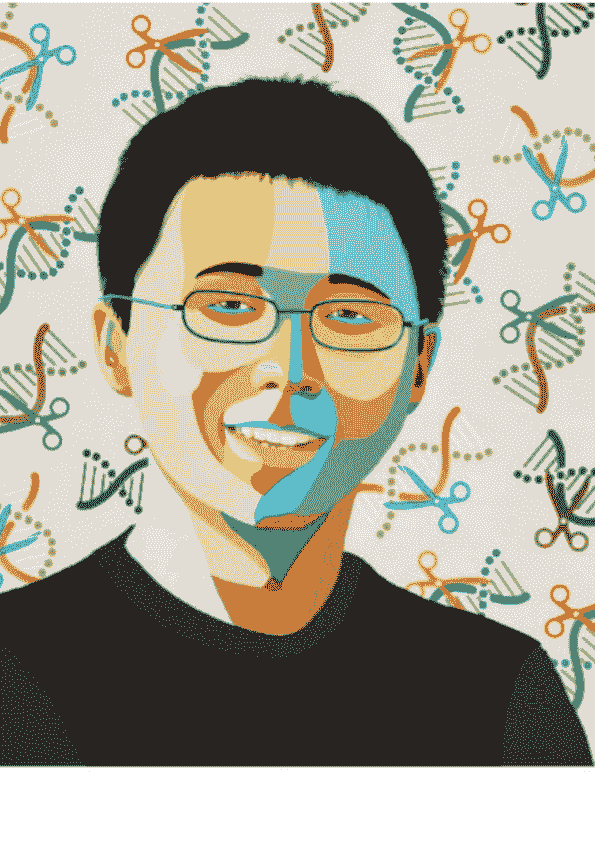

将张锋称为当今世界最具突破性的科学家之一并不为夸张。在他20多和30多岁时，他帮助开发了两项革命性的技术。第一种被称为光遗传学，将基因插入脑细胞中，使其通过光照射来开启或关闭。这项技术正在被探索作为某些神经系统疾病的潜在治疗方法。

第二种是 CRISPR，这是一种基因编辑技术，允许科学家纠正人类的人类疾病。如今，张锋在马萨诸塞的麦格文脑科学（McGovern Institute for Brain Research）和宽研究所（Broad Institute）兼任职务，并被认为是未来的诺贝尔奖得主。

然而，强大的工具本可以造福人类，但在 CRISPR 方面已经出现了一些令人担忧的进展。两年前，生物物理学家健建奎因使用 CRISPR 编辑人类胚胎而受到广泛批评，并最终被判刑。包括张锋在内的许多研究人员认为他的行为是伦理上的疏忽。

同时，张锋面临着一场关于 CRISPR 专利归属的持续争议。其他科学家首先发布了该技术的细节，但他最快证明了它在人类细胞中是有效的。

《新科学人》（New Scientist）采访了张锋，讨论了 CRISPR 的未来。如今，张锋乐观地认为，这项技术可能帮助我们对抗新冠肺炎，并可能具有应用前景。

一种携带 CRISPR 工具的无害病毒被注射到眼部，在那里它修改细胞以恢复缺陷基因的正常功能。

另一家名为 CRISPR Therapics 的公司一直在使用该系统治疗 β 地海贫血症患者，这种疾病会导致血液中血红蛋白水平过低。患者反应良好，不再需要移植。

因为我们可以使用 CRISPR 同时处理人类细胞中的许多基因，科学家们一直在利用它对特定疾病进行特定编辑，我们也有可能编辑那些基因。

所以 CRISPR 已经显示出令人鼓舞的结果。看到这些时你感觉如何？

能够构建出对人们生活产生巨大影响的东西是非常令人兴奋的，但也让我意识到还有很多需要学习的。

看到这些充满前景的结果激励了我想要做更多事情。

> **Jessica Moreira:** 在当今世界，CRISPR 最有前景的应用是什么？
>
> **张:** 令人兴奋的可能性之一是纠正 DNA 序列，以便我们恢复基因并治疗疾病。我与其他同事共同创立了 Editing Medicine。

## 在成为批准的治疗方法之前，需要完成什么？

我们需要让 CRISPR 运行得高效且精确。一个风险是它不会进行你想要的编辑；由于随机偶然，它还会编辑其他东西。我们已经开始工程更高特异性的新版本。我们还需要开发工具，以便我们对基因组进行多种类型的变化，并通过不同的方式影响基因的作用。

我们正在研究传递 CRISPR 的新方法。我们开发了来自细菌的蛋白质，它们比我们报告的第一种 CRISPR 系统小得多。这项报告使得包装更简单，更容易让它进入细胞发挥作用。我们已经证明该系统可以更高效地编辑基因。

## 你对哪些疾病特别感兴趣吗？

从我上大学时代起，我对心理健康和精神疾病感兴趣。人们受到疾病的影响。CRISPR 已被用于理解它们如何影响大脑，以及我们如何开发更有效的治疗方法。

但所有疾病在某方面是不同的。在生物学上如此，在情感上也是。在负面影响他们的生活方面是一样的——这是对生活质量的损害。这就是为什么我专注于将基因编辑技术开发为一种广泛适的技术。

## 当技术正在开发时，你有权决定谁拥有它的权利吗？

确保这项技术以安全、负责任的方式开发，并以每个人都能受益的方式共享是非常重要的。患者有权利也有义务确保技术的可及性。宽研究所将继续这样做。

## 你认为下一个突破将会是什么？

我们将继续在治疗领域看到许多令人兴奋的应用。细胞疗法，即医生从患者身上取出细胞、修复后再放回，是我们看到很多的地方。一种携带 CRISPR 工具的无害病毒被注射到眼部，在那里它修改细胞以恢复缺陷基因的正常功能。

另一家名为 CRISPR Therapics 的公司一直在使用该系统治疗 β 地海贫血症患者，这种疾病会导致血液中血红蛋白水平过低。患者反应良好，不再需要移植。

因为我们可以使用 CRISPR 同时处理人类细胞中的许多基因，科学家一直在利用它对特定疾病进行特定编辑，我们也有可能编辑那些基因。

所以 CRISPR 已经显示出令人鼓舞的结果。看到这些时你感觉如何？

能够构建出对人们生活产生巨大影响的东西是非常令人兴奋的，但也让我意识到还有很多需要学习的。

看到这些充满前景的结果激励了我想要做更多事情。

（注：原文后续部分存在大量内容重复，此处译文已根据要求进行处理，确保不重复输出原文。）

## 特性

## 新冠肺炎的 AI 革命

自动化正在接管工作，而新冠肺炎疫情极大地加速了这一趋势。Sandy Ong 问，我们是否应该担心？

在楼上，一个封闭商店的半密度区域内，东西在动着，生命的光芒沐浴着橱窗。Salem 在安保人员面前前停下脚步。UV Bot 拥有 1000 瓦的 UVC 光，能够“撕裂病毒 DNA 链”，无处不在，新加坡的其他一些商场和医院也是如此。它正在帮助人类工人完成在新冠疫情前他们的工作：

类似的场景正在世界各地发生。首尔的医院里，Moxi 递送药物、取样样本。P Guard 在土耳其街道上执行封锁。James 远程呈现技术帮助比利时居家护理的居民保持联系。另一种 Uber 超市送货服务在缺席的人们面前，甚至填补了工作缺口。与此同时，非具身人工智能正在协助从接触和追踪患者基因组代码，到物流以及日益竞争激烈的在线市场客户履行的一切。

这种向自动化和机器人化的趋势正在发生——但新冠肺炎极大地加速了它。“这场疫情让人们极度地意识到社交距离的风险，”南卡罗来纳州克莱姆姆森大学的 Richard Pak 说道，“在这些时期，机器人和自动化无疑提供了安全保障。”

这也是一个巨大的问题。随着新冠病毒席卷全球经济，失业率飙升。如果我们从新冠肺炎导致的衰退中恢复过来，发现工作已经永久消失——而且没有计划让他们保持就业，那会变成什么？

机器人技术和人工智能的兴起也被称为“第四次工业革命”的一部分，紧随过去三个世纪中由煤炭和蒸汽、电力以及数字计算驱动的三个阶段性变化之后（见）。许多人对自动驾驶汽车、虚拟助手和其他节省劳动创新的前景表示赞赏。对于能够为我们提供定制化信息、在 Netflix 上推荐好东西，或者通过手机触碰支付杂货费的技术，人们很难反驳。在新冠肺炎疫情期间，这些技术通过让人们居家办公，帮助减少了公共健康风险，在保持生存的同时了生产力。

然而，在疫情之前，许多人担心自动化趋势可能导致长期的失业。麦肯锡咨询公司在2017 年的一份报告中建议，到2030 年，自动化在全球可能取代多达 8 亿份工作。2013 年，牛津大学的 Carl Frey 和 Michael Osborne 著名地使用机器学习算法评估工作自动化的容易程度。研究得出结论，在未来二十年里，机器将能够完成所有工作的 47%——Frey 表示，这个数字在今天仍然保持一致。“在英国，估计数字为 35%。”

> “如果我们从新冠肺炎导致的衰退中恢复过来，发现工作已经永久消失——而且没有 B 计划来让我们保持有偿的工作，会发生什么？”

## 四次工业革命

人工智能和先进机器人的出现是一系列变化的一部分，其中一些被认为是第四次工业革命，类似于已经经历的三次革命。

## 变得严肃

面对封锁状态下的员工以及工作场所对社交距离措施的需求，许多公司正在为这些趋势推波助澜，要么通过首次寻求更大的自动化，要么通过加速扩展现有计划。

“现在自动化的空间非常大，”旧金山一家为仓库机器人开发 AI 系统的 Oosar 公司首席执行官 Derek Prideo 说道，“如果公司以前在考虑这件事，他们现在正在采取行动。他们实际上在部署它。每个人在对自动化的严肃性上都迈进了一个阶段。”“3 月，审计师安华永的一项调查显示，在 44 个国家中，90% 的受访者中超过四之三的人采取了措施，以确认或重新评估他们的自动化速度。”

概念店，如新亚马逊、沃尔玛以及其他大型零售商正在部署机器人在拣货中心包装和搬运货物；YouTube 和 Twitter 正在更多机器进行内容分发。聊天机器人也表现良好，Meta 处理了其 66% 的基于消息的客户查询。IBM 报告说，从 2 月到 4 月，其 Watson Assistant 软件的需求增长了 4%，美国零售商梅西和汽车制造商雪佛等公司使用其处理在线电话。

### 第一次工业革命：煤炭与电力

- 大约从 1760 年开始
- 以蒸汽机和第一批工厂为特征
- 关键发明包括蒸汽轮和铁路，机械化广泛普及
- 将社会从农业社会转变为工业社会

### 第二次工业革命：石油与电力

- 1860 年代起
- 以大规模生产和装配线为特征，以及新的行业，如炼油、电力和钢铁
- 关键发明包括灯泡、电话、收音机、汽车和飞机
- 农村向城市的人口增加

### 第三次工业革命：计算

- 1960 年代起
- 以电子化、自动化、数字化为特征（此处原文缺失）
- 关键发明包括半导体、计算机、互联网、电子商务
- 从物理（向数字）的转变（此处原文不完整）

### 第四次工业革命：连接

- 以人工智能、机器人、大数据、智能技术等为特征
- 关键发明包括 DNA 测序、区块链、虚拟现实、3D 打印
- 继续从物理向在线的转变

Pridmore 表示，他的公司“自疫情袭来以来，兴趣大幅增加。”他的客户包括一家连锁超市，发现当人们开始在家做饭时需求翻了一倍。”UiPath 董事总经理 Chris Hodges 表示，“疫情是这种加速器。”

封锁期间焦虑日益增加。根据乔治大学 AI 治理中心最近的一项调查，在 15 个国家中，11% 的人认为政府应该限制自动化以保护工作。在 1 月，三个月后，这个数字上升到了 55%。这种情绪普遍存在。“如果你观察，你会发现自动化在衰退时期是有用的，当你在衰退中失去工作时，你会陷入挣扎。”

也许最著名的例子（Frey 在 2019 年的书《技术陷阱》中提到的）是卢德分子，他们捣毁织布机和其他第一次革命的产物。这种动荡在 1815 年之后尤为严重，当时欧洲陷入萧条，由于对进口粮食征收关税，食品价格飙升。今天，技术引发的变革对工人和工厂构成了巨大威胁，许多人发现自己失业了。对于那些涉及特定形式数据分析工作的分析师和研究人员来说，许多工作可能被 AI 代替。“这是历史上第一次蓝领和白领工作同时受到影响，”佐治亚州理工学院的 Ayanna Howard 说道，“无论谁受到影响，这种趋势往往是单行道。“当自动化出现时，所谓的‘说’，”Levin 说道，“在经济学中，一旦你投入了前期资金，无论是硬资金还是软资金，人们就会从舒适变得渴望。”

这并非孤立现象，”Frey 说。“唯一的问题是，自动化并非不可避免的。如果你回顾过去的二十年，毫无疑问人们生活得更好，在很大程度上是因为自动化，”他说道——它带来了更高的生产力、更低的成本、更强的扩展性、更安全的环境以及更灵活的工作和机会，这仅举几例。”

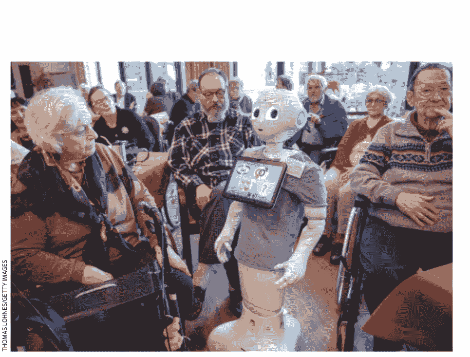

# 德国法兰克福的养老院居民，一位未来的机器人护理员

“只有当技术准备好实施时，自动化才会发生，”加利福尼亚斯坦福大学人类中心人工智能研究所的 Etchemery 说道，“如果技术还没有准备好接管任务，那么疫情并不一定会加速其采用。”

“新冠肺炎可能会加速某些投资，但我们所观察的是一个比几个月更长的时间周期。”

许多任务仍然难以自动化，例如组装智能手机、清理快递或进行医学诊断，这些任务需要人类的洞察力和同理心。如果 AI 可以完成一些工作，那么仍有一些任务是离开了人类触感就无法完成的。世界距离机器人治疗师，或者对于护士来说还有很长的路要走。

与之前的创新浪潮相比，最容易自动化的工作是那些重复且枯燥的工作。人们被要求填满一张电子表格或包装一个箱子。

# 重新定义工作

马萨诸塞州波士顿大学的经济学家 James Bacon 同意这一观点。我们可能看到的总工作数量的减少，但是不同的工作。“没有证据表明 AI 会取代人类，但它会创造新的工作，”Chalmers 说，“无论如何，我们已经看到对无人机操作员、数字营销专家、视频支持和虚拟活动组织者等的需求在增加。在未来，我们需要机器人机械师和客服人员，这样人们‘再也不能没有机器人在身边’。”

“这将需要新的工作。工作将被重新定义，”Hardy 说道。许多专家建议，在后疫情时代缓解自动化经济影响的一种万妥方法是：投资教育，特别是重新教育。“核心是确保任何人都能以小块化的方式参与技能提升和重塑，”Jesuthasan 说道，“而不是执着于为期三到四年的学位，而你指望在毕业后的 30 年里保持竞争力。我认为世界已经从那种技术模式中迅速演变了。”

这需要劳动者采用现代学习方法，但政府和公司必须介入并提供帮助，通过提供补贴的大人课程、再培训计划和其他类型的转型。这将有助于实现必要的转型，特别是后疫情的恢复。“否则，如果听任于市场力量，我们将不得不发现并失去许多被遗落的人，”Jesuthasan 说道。

随着自动化趋势的发展，我们还将面临其他挑战。一个主要问题是，AI 倾向于继承并放大我们训练数据中存在的偏见——例如，少数群体的不平等或色盲歧视。如何在日益增长的自动化中，为负责任地使用机器划定界限，以及负担得起技术与负担不起的人之间可能出现的全球分化。

寻找解决方案需要空间来思考这些问题，这在全球大流行期间是很困难的。“我们是一个非常被动的社会，”Hardy 说，“很难说接下来会什么，我们现在还没有处于一个可以节奏的状态。”

不过，如果处理得，我们就可以拥抱新科技带来的机会，而不是被它伤害。随着新冠肺炎威胁的持续，像杀病毒的 UV 机器人可能正在重新定义工作，但它们为我们其他人提供了安全。

> Sandy Song，总部位于新加坡的自由技术记者 @sandyong_yx

48 | 2020年10月

# 没有完美的时间，但有完美的工作

寻找梦梦以求的工作

科学家招聘 (Specialist Recruitment for Scientists)

搜索：`ckscience.co.uk`

电话：`01246 457700`

CK Group 旗下

红

黑

沙色

酒红

苔绿

祖母绿

皇蓝

糖色

海军蓝

玉米黄

紫果褐色

# PETER CHRISTIAN

男士装潮流

## 郡县灯芯绒裤

仅需 55 英镑，买 2 条 100 英镑 - 节省 10 英镑

采用优质的 8 码厚实灯芯绒进行专业剪裁。体面、舒适且非常耐穿——它们外观极佳，并在洗涤后仍能保持颜色和形状。

《新科学》杂志读者可享受免费送货，仅限时。

- 100% 棉灯芯绒
- 单褶设计配法式后开门襟
- 隐藏弹性舒适腰带提供 2 英寸的灵活性
- 无快速退款保证**

腰围：32 34 36 38 40 42 44 46 48 50 52 54 56

裤长：27 29 31 33

颜色：红、黑、沙色、酒红、苔绿、祖母绿、皇蓝、糖色、海军蓝、玉米黄、紫果、果褐色

> “完美合合。颜色很棒。它们感觉像‘老朋友’。”
>
> Mr J Bradley
>
> Trustpilot

## 订单灯芯绒裤 (MT08)

使用代码 `51W41` 享受免费送货

## peterchristian.co.uk

或在周一至周日致电

`01273 493 393` 上午 8 点至 晚上 8 点

邮寄订购 - 支票抬头为 Peter Christian

在您的订单中注明代码 `51W41` 并寄至

Freepost PETER CHRISTIAN (免费邮)

*免费送货，通常费用为 5 英镑，截止 2020 年 11 月 30 日午。*仅限英国境内退货。退款保证取决于物品完好并在 28 天内退回。Bramley Ltd. 分公司。注册号 `04767802`

## 封底页

益智

在怪异咖啡馆里应该交换哪些椅子？P52

几乎是单词

什么让人们变得短视或远视？P54

Tom Gauld 为《新科学》作画

关于拒绝的漫画家笔记 P55

反馈

致命的手指比例和避孕套事件：怪异的一周 P56

为《新科学》创作扭曲涂鸦

神仙还是研究科学家？P56

## 烹饪科学

## 一个新郎

蘑菇含有高蛋白，几乎无法煮过，是原始番茄酱的主要成分，Sam Wong 写道

尽管蘑菇的形状和大小各异，但在欧洲最常食用的是一种品种，双生蘑菇 (`Agaricus bisporus`)。我们知道在幼时期称其为口蘑和栗菇，完全成熟时称为大褐菇。有机体的大部分由一种称为菌丝的地下网络组成。果实是出现在土壤上并释放孢子的子实体。许多受青的蘑菇如鸡肝菌、牛蘑和牛菇，与树木共生，因此通常在野外采集。

Sam Wong 是《新科学》的社交媒体编辑和自封美食家。him@samwong

它们含有 80% 的水分并含有与细胞壁纤维素完全不同的几质，这解释了为什么它们的质地非常稳定，几乎无法煮过。

虽然番茄酱今天与番茄有关，但它最早在 18 世纪在英国和美国流行。在历史背景下，该配方据称能产生一种酸性液体，渗透到混合物中，形成我们熟悉的浓稠酱。

手上。盖好静置 24 小时。用 200 毫升热水浸泡干牛菇 30 分钟。用油炒洋葱和一小撮小苏打，直到开始上色。

开始上色后，加入大蒜煮 2 分钟。然后将蘑菇和液体倒入。加入任何酸香料，小火煮 45 分钟，然后冷却，根据需要调味。

它们的氨基酸含量高于大多数植物，并含有更多的味氨酸（即鲜味）。蘑菇的美味香气部分源于醇醇，一种醇

## 蘑菇番茄酱所需原料

- 400g 不同类型的蘑菇
- 1 汤匙海盐
- 20g 干牛菇
- 1 个洋葱，切碎
- 一小撮小苏打
- 3 瓣大蒜，切碎
- 一小撮肉豆蔻
- 一小撮肉豆蔻
- 黑椒
- 100ml 白醋
- 2 汤匙红糖
- 2 汤匙橄榄油

> 这些文章每周发布在 `newscientist.com/maker`

烹饪科学每四周出现一次

## 下周

在家观星

`2020 年 10 月 10 日` | 《新科学》 | 51

## 跨页谜题

## 快速填字游戏 #68 由 Richard Smyth 编写

## 快速问答 #72

| 1 | 2 | 3 | 4 | 5 | 6 | 7 |
|---|---|---|---|---|---|---|
| | | | | | | | |
| 8 | | | | | | | | |
| | | | 9 | | | | | |
| | | | | | 10 | | | |
| 11| | | | | | | | |
| | | | 13| | | | | |
| 14| | | | | | | | |
| | | | | | 15| 16| | |
| | | | 17| | | | | |
| 18| 19| | | | | | | |
| 20| | | | | | | | |
| | | | | | 21| 22| | |
| 23| | | | | | | | |
| | | | | | 24| | | |
| 25| 26| | | | | | | |

## 涂鸦区

1. 距离我们太阳最近的星系是哪个？
2. 第一次热气球无系索自由飞行是在哪一年？
3. 在 2019 年，除了在西伯利亚丹尼索瓦洞发现的人之外，确认了第一批丹尼索瓦人。他们发现了什么？
4. 当查尔斯·大卫·基林在 1958 年开始测量大气二氧化碳时，这种气体的浓度是多少百万分之一？
5. 悬浮在液体或气体中的粒子的随机运动称为什么？

答案在第 5 页

答案以及下周的加密谜题

## 谜题

## 由 Christian Lawson-Prefitt 编写

## 80 差异之道 (Vie La Différance)

“差异之道”这家古怪的咖啡馆有一种奇特的方法来为顾客提供折扣。

## 横向

## 纵

- 1 以文艺复兴时期植物学家 Leonardhart Fuchs 命名的开花植物属 (7)
- 2 设备，自动机
- 3 野驴 (6)
- 4 插入物，也称为锚 (8)
- 5 因此 (4) 医疗系统 (10)
- 6 触动心灵的小诗集 (7,5)
- 7 单射的 (12)
- 8 设计，计划 (10)
- 9 变异超级英雄 (1-3)
- 10 克莱斯勒 (8)
- 11 隐晦地（在内部）
- 12 位于河流和海洋之间的咸水支流 (7)
- 13 插入织物孔或板材孔洞的保护环 (7)
- 1 意大利城市，伽利略博物馆的所在地 (8)
- 2 由 Firmin 和 Postgraduate 创建的粉色哨子（鸟） (8)
- 3 茎柄；花序 (4)
- 4 维度，量化数据 (1.2)
- 5 注入或用 CI 处理
- 6 引擎的，断开时处于什么状态 (6)
- 7 可能是雕属的幼鸟 ()
- 8 地质学中化学过程的研究 (12)
- 9 食竹类哺乳动物，Alnypoda melanoleuca， (5)
- 10 二进制中第四个无齿的组件 (1)
- 11 发明 (8)
- 12 角度的，大于 90 度 (6)
- 13 澳大利亚西的食虫有袋动物 (6)
- 14 O (4)

每个座位都有一个编号，获得的折扣（内含）等于左侧或右侧座位编号之间的差值。例如，坐在 6 号和 1 号座位之间的顾客，用餐时可获得 5 分的折扣。

七个朋友一起聚餐，到达发现椅子按 1 到 7 号的顺序围在桌子周围。他们发现如果座位这样安排，他们可以获得 20 英镑的折扣。他们认为还可以做得更好。他们想让折扣最大化，但只有在服务员点餐之前有时间交换椅子。他们应该交换哪些椅子？

我们的艺术品现在可以在 `newscientist.com/crosswords` 在线求解。

答案下周公布

`52` | 新科学人 | `2020年10月10日`

## 桥牌是科学吗？

良好的伙伴

获得正确的

解决方案

它依然在移动 (Eppur si muove)

成分：

- 氧 (20.9%)
- 氮 (78.1%)
- 氢 (0.0%)
- 碳 (0.0%)
- 氩 (0.9%)
- 钙 (0.5%)
- 硫 (0.2%)
- 钠 (0.1%)
- 镁 (0.1%)

`redmolotov.com`

`0121 559 2685`

证据量

说服一个

桥牌

俱乐部

直播

严肃的乐趣

在线参与并

和我们一起玩桥牌！

`www.bridgeclub.com`

研究：我正在做什么

我不知道

我正在做什么。

ГАРИН

我们也这么做杂志！

## 如果

我们能测量并

量化？

如果我们停止钓鱼、垃圾邮件以及更多？

量子物理学家，

《纽约时报》畅销作家，

BBC 主持人 Jim Al-Khalili

提供了令人着迷的

物理揭示了关于

世界的看法

> “太震撼了。”
>
> “无法放手。”
>
> “将迫使你重新评估
> 你的信念，”
>
> “Winn 再次挑战了
> 现状。”

## 类比

网络安全

> “Winn 解释了，
> 令人惊叹的洞察。”
>
> “概念被生动地解释并图解。”

> “简单、深刻且准确。”

- Frank Wilczek，2004 年诺贝尔奖获得者
- Ian Stewart，《Deeply Hidden》作者——“一次伟大的胜利！”

`$12.99` | `$16.95`

## 大学

> “这本书会让你大脑大爆炸。”
>
> “这可能会彻底改变世界。获取它。”
>
> “终于，我们了解了关于世界的某些。获取它。”

立即获取你的免费样品！

`www.AnalogueNetwork.com`

请在此广告邮件至 `hvell@canopedia.co.uk` 或拨打

`2020年10月10日` | 新科学人 | 53

## 跨页内容

最后的话

## 不同的观点

眼睛里到底发生了什么，导致有些人近视而有些人远视？

Joe Oldaker

Nuneaton, Warwickshire

近视（`myopia`）和远视（`hyperopia`）通常由于眼睛长度、眼睛前面的透明层角膜以及晶状体的组合功率之间的不。

进入眼睛的光线被角膜折射并汇聚在一个焦点上，这本应该在视网膜上形成清晰的图像。近视时光线过度汇聚，远视时光线汇聚不足。

在红光下生长的小睫毛更长。矫正角膜手术很有用，主要针对近视。另一个因素是眼睛晶状体具有弹性，通过肌肉控制改变形状。观察近物（如杂志上的文字）会导致人近视。晶状体不够灵活，因此看清近物需要阅读镜。近视者有额外的调节能力，可以不需要阅读镜。我们大多数人都需要。

## 本周的新问题

对的，为什么有些人难以区分左右？

Peter Jackson, 加利福尼亚州戴维

涕涕的丹尼斯：吸鼻子还是吹鼻子来清除非感染分泌物更好？

Mike Fellows

西米德兰郡萨顿菲尔

生活方式而非遗传解释了近视率的增加。

这个案例源于 1975 年的一项名为《近视流行》的研究，该研究比较了年轻人和老年人的视力。发现 30 岁以下男性中有 30% 近视，而他们的父母约为 4%。年轻人在学校花费了更多时间。

随后的许多研究表明，在户外活动不容易近视，这可能是光诱导近视。在户外接触更多蓝光的儿童可能会降低近视风险。或者，我们可以让室内光在白天。

## 小扭矩

食品包装公司如何决定制造瓶盖？是随时间推移增加了还是我老了？（续）

Roger Miles

英国赫特福郡圣阿尔

之前关于盖子紧固的讨论未能描述在金属盖和瓶口之间制造空气密封所需的相互作用。要做到，它们之间需要一种软材料。这是通过螺纹周围的塑料层实现的。然而，使密封有效的质量是玻璃与玻璃之间的摩擦很大。如果玻璃起了作用，盖子将很难取出。

一个要求已由玻璃行业解决，采用了一种新类型的盖子。这是通过使用一个边缘密封的圆片和一个与玻璃有螺纹的边缘来实现的，使得圆片抵在边缘上，但可以自由旋转。

关键是，两个盖子组件之间的密封少于玻璃和瓶之间的密封。这种更复杂的盖子结构并没有产生更多维生素 D，维生素 D 会刺激信号多巴胺的产生并影响眼睛的发展。

然而，由墨尔本大学 Chi Lu 领导的极端汇聚表明，光的颜色是关键。角膜的作用是聚焦，而晶状体像凹镜，事实上红光较如此，它使光线聚焦在更后方。在红光下生长的幼崽有更长的睫毛并近视。考虑到大多数现代人待在室内的时间，

## Tom Gauld

为《新科学》(New Scientist)

## 答案

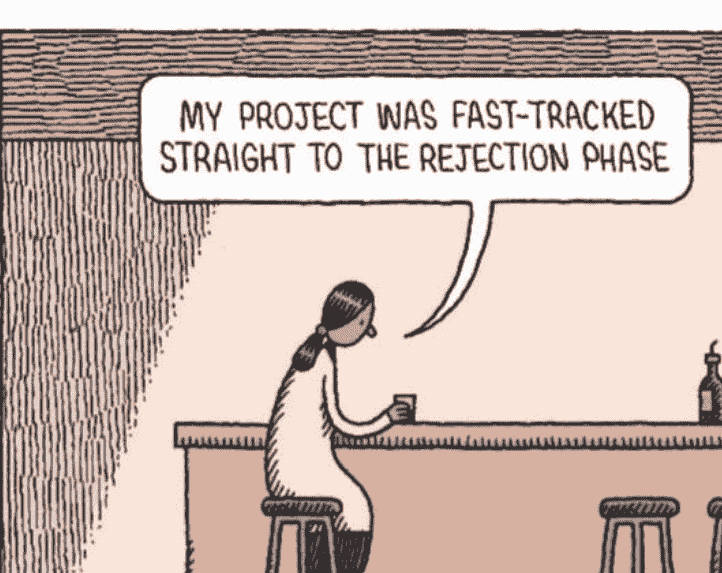

## 快速问答 #72

答案

- 1 三联星半人马座，由天牛座α（Toliman）、天牛座β（Rigid Kentaurus）和比邻半人马座（Proxima Centauri）组成
- 2 1783 年
- 3 西藏
- 4 每百万 3 比 16 部分
- 5 布朗运动，或称趋性运动（pedesis）

# cryptic 字谜

## #41 答案

- 横向：1 杜利, 3 流行病, 9 聚合物, 10 塞壬, 11 奇点, 13 罗德, 15 反射率, 17 金术, 20 酵母, 21 发誓, 22 沉积的
- 竖向：1 挂毯, 2 爪子, 4 恐惧的, 5 柱形的, 6 许多我, 7 能够, 8 免疫系统, 12 多头统治制, 14 果园, 16 询问, 18 白鹭, 19 天数

## “冷萃法缺乏一些赋予咖啡独特苦味的酸质”

## 冷萃咖啡

人们说，要冲出最好的咖啡，必须从冷水冰开始。他们对的吗？

如果一个罐子的盖子卡住且非常紧，简单的办法是在热水下握几分钟。这会使其略微膨胀，并加热内物，从而可能减轻压力。

## Theo Megarry

澳大利亚布斯班

咖啡在高温下接触味道更好，但从较低的温度开始冲煮过程可以降低烧焦的可能性。

## Mark O'Shea

英国约克

冷萃法需要比普通咖啡更粗的颗粒。这种机制确保了热萃咖啡大部分是从咖啡渣中提取出来，从而得到的咖啡苦味要少得多。

盖子的安全设计初衷是为了的。一个显然受损的罐子如果在分销链中受到粗暴处理可能会泄漏。这可能导致内容物溢出。

由于近期对罐子玻璃盖扣断裂的担忧，任何从事过包装行业的人现在都知道要密封玻璃瓶或罐子的损坏有多困难。

## #79 马拉松

解决方案

谁拿着火炬且还有 4 英里，谁就能确保在最后一英里拥有它。

为了保证指向方向的火炬，应该站在剩余 8 英里的拱门上方，然后在剩余 12、16、20 和 24 英里时。

所以 Rimsky 应该拿到终点，在剩余 24 英里时跑 2.2 次和 18 英里，确保他在最后一英里拥有它。

## Anthony Wood

俄勒冈州波特兰

握力随年龄增长而下降。这通过挤压一个名为握力计的手设备来测量。

全球不同国家的许多研究显示，握力随年龄增长而下降。

冷萃并不“更好”，因为冷萃法可能需要花费 12 小时才能生产一杯咖啡，这使其比其他方法明显有效得多。一些饮用者更喜欢更浓、更快的咖啡来提神。

打开罐子不需要当事者的力量。用坚硬的表面按住盖子的边缘就足以打破密封并释放真空。盖子很容易打开。

这说明了为什么的...

编辑注：你可以在我们关于力量的专题报道（4 月 18 日，34 页）中找到更多关于握力下降以及如何对抗它的信息。

`2020年10月10日` | 《新科学》 | 55

## # 封底页 反馈

## 肉干

在我们详尽的档案系统中翻找，我们发现了一个相当最近的类别“我们从未敢问的问题”；

最近提到了一位研究人员，他的职责是在牛的角上画眼睛（9 月 4 日）。不理智的是，我们征集了类似的为科学服务执行的众多任务的故事。你们没有让我们失望。

这些信件中似乎贯穿着一个共同主题。来自新西兰的 Graeme Coles 三个月来促使我们对中等强度的此类信息进行策划；他没有说明为什么“当成功足够充分时会有水花，但当你身后的牛要求尊重或更雄辩的演说时”；英国朴茨茅斯的 Rosinda Hardman 只在已出版作品的反射上绘画，而他描绘了某个匿名博物馆在开放时间期间的首次礼仪。

荣誉属于来自澳大利亚的 Frank Smith 和 Andrew Turnbull，他们非常公平。他们独立撰写了关于猪肉特种领域的详细研究材料。他们共享相同的领域，但当我们完整阅读他们的文章时，感觉自己明智了很多，在某些非常广泛的领域也是如此。

我们可能你对接手的任务做出了明智的选择，正如第 44 页讨论的那样。如果你能忍受，我们可能不能。

## 捂脸

如果不是谨慎的，我们的行刑者身上有许多消毒手胶揉搓手的痕迹。

我们观察到，新冠工作人员的身材比正常大 56 mm。我们观察到这些是...

## 给《新科学》的趣味问答

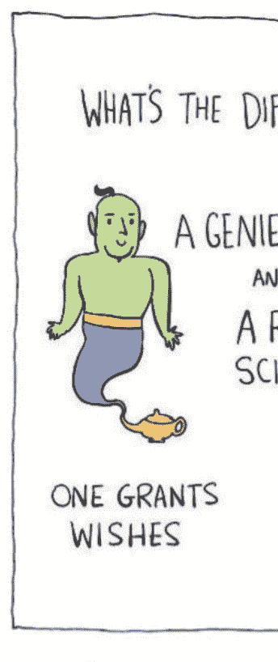

> 精灵和科学家有什么区别？
>
> 一个许愿
>
> 另一个为了许愿

有反馈吗？请发送至 `newsclient.com` 或《新科学》，258 Bedford Street, London WC1E 9XE
