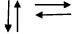

# 新标题 1

## 介绍

感谢你的下载并欢迎阅读《Java 速成 – 学习 Java 编程语言基础的入门课程》。

这本书包含了学习 Java 编程的基本步骤和策略，帮助你创建自己的程序。本书的核心目标是教你关于 Java 编程基础所需的所有知识。在读完每一章后，你将离理解并最终掌握这门编程语言更近。我使用了简单的术语，并辅以少量的编程术语，以使其更易理解。

你应该能够在一天内掌握每节课的精髓。有些课程可以在 5 小时内完全理解，但另一些可能需要你花一两天才能完全掌握。为了实现七天或更短时间内学会 Java 的目标，你每天需要投入一些时间，并且比平时更有耐心。

如果你是一个学习速度快的人，可以双倍你投入到学习 Java 中的时间。你可以选择一次学两节课，但不建议这样做。在学习语言的过程中，不要剥夺学习的乐趣。过度强迫自己可能会在你进入学习 Java 有趣的部分之前就精疲力竭。

本书将提供大量的示例程序以及附带的解释。通过示例学习总是更好的。你需要独立完成一些编程或编码练习，但我们会提供输出结果，这样你就能知道自己是否正确。

你的 Java 之旅从现在这里开始。

再次感谢下载本书，希望你读得愉快！

# 第 1 章：接触 Java

你现在这里是因为你对学习 Java 编程感兴趣。最好立即开始，但在开启你的 Java 之之旅之前，你需要了解几点。对于在线编码，建议访问此网站：`https://www.compilejava.net/`。

所提供的链接是一个在线 Java IDE（集成开发环境）。在编写自己的代码之前，你需要清除在线 Java IDE 上的已有代码。同时，建议直接在在线 Java IDE 上输入你的代码。

如果你对 Java 有所了解，那么你一定学过在计算机上安装这门编程语言时，需要使用文本编辑器。但如果你选择在在线 Java IDE 上编写代码，就不需要使用文本编辑器了。从文本编辑器将工作复制粘贴到在线 IDE 可能会引入在线 Java IDE 无法识别的字符或符号，例如引号。在线 IDE 仅接受这些符号作为引号：`'` 和 `"` 。

参考这个在文本编辑器中编写并复制粘贴到在线 Java IDE 的示例程序：

```java
| 1 | public class CompareData { |
| 2 |     public static void main(String []arqs) { |
| 3 |         char tChar='r’; |
| 4 |         int tDigit=3; |
| 5 |     system.out.println(tChar==tDigit); |
| 6 |     } |
| 7 | } |
```

示例程序输了此错误：

```
/tmp/CompareData.java:3: error: unmappable character for encoding
```

该错误意味着程序使用了不可接受的引号；你需要在在线 IDE 上直接修改。

|  | 连接器 | 你使用此符号来表示流程向下一页或例程序的延续。 |

|  | 流线 | 这些线显示了流程的方向。 |

学习一种编程语言就像学习一种口语。你需要熟悉你想要学习和使用的特定编程语言的语法。否则，你的程序将无法运行。

## 回顾过去

Java 是一种高级编程语言，可以创建强大且安全的应用程序。它运行在各种平台或操作系统（OS）上，例如 Linux、Windows、Mac OS X 以及许多版本的 UNIX。它是一种灵活、可扩展且易于维护的编程语言。学习 Java 并不困难，在你读完这本电子书的最后一页之前，你就能能够编写简单的代码了。

James Gosling 在 1991 年 6 月启动了 Java 编程语言项目。当时它被称为 Oak，稍后一段时间又被称为 Green。最后由于没有特定原因被命名为 Java。1995 年，太阳微系统（Sun Microsystems）开发并引入了名为 Java 1.0 的编程语言。今天程序员使用的 Java 最新版本已经到了版本 8。

## Java 的优势

如果你对 OOP（面向对象编程）有基础了解，Java 会变得简单得多且更容易学习。OOP 程序员可以创建或编写不同的模块，即使增加了新类型的对象，这些模块也不需要任何修改或更改。

与 C、C++ 和其他编程语言不同，Java 是平台无关的，在编译期间它不与你的计算机操作系统交互。你不是将 Java 源文件编译成平台无关的代码，而是将其编译成字节码（byte code）。你可以通过优存盘携带编译后的 Java 程序，而其他需要使用编译器的编程语言则不行。

Java 具有无病毒和防篡改系统的能力。Java 也具有可移植性。只要操作系统具有 Java 运行环境，你就可以在不同的操作系统上执行编译代码。

许多程序员认为 Java 比 C 语言及其其他变体更动态。它可以有效地、轻松地适应任何类型的环境。

第一天的内容就到这里，对于你的作业，请确保阅读更多关于面向对象编程的内容。更多信息有助于更好地理解 Java 是如何工作的。

# 第 2 章：一切总是从“Hello”开始

从一开始就可以看出，本书将尽可能地使用示例来教授 Java 基础。如果你在此之前尝试过学习编程语言，那么你可能遇到过“Hello”程序。大多数编程语言教程都以“Hello”程序作为示例程序开始。让我们从简单的“Hello Java”作为我们的示例程序开始。你现在可以点击提供的链接开始编写代码，或者以后再做——任何方式都可以，取决于你哪种更方便。

在教程的结束处，你将获得不同的链接，可以通过这些链接将 Java 安装到你自己的计算机中。你仍然可以选择使用在线 Java IDE，随你的喜好即可。

在线 Java 控制台有不同的字体颜色。为了简化起见，我们在所有示例中只使用一种字体颜色。

## Java 基础语法

我们将从下面的示例程序开始，分析每一行的含义。必须记住，Java 是区分大小大小的。当你使用标识符并用小写编写它时，请确保你使用的标识符在整个程序中以相同的方式编写。

如果你有一个以大字母 H 开头的标识符`Hello`，不要用小写 h 编写相同的标识符，如`hello`。尽管显而易见你指的是同一个标识符，但 Java 程序并不认为它是那样。它会将`Hello`视为与`hello`不同。

现在看下面的第一个示例程序：

```java
1 | public class FirstCoding {
2 |
3 |     /* 这是我们的第一个程序示例。
4 |     * 稍后这应该打印 'Hello Java'
5 |     */
6 |
7 |     public static void main(String []args) {
8 |         System.out.println("Hello Java"); // prints Hello Java
9 |     }
10 | }
```

再看第 7 行和第 9 行。第 7 行的左括号到第 9 行的右括号被称为代码块（block of codes）。一对大括号内的任何内容都是代码块。

### 剖析程序的第一行

第一行始终应该以小写的`public class`开头，紧接着是类名，在本例中我们使用`FirstCoding`作为类名。

编写类名时，确保该名称中的上一个单词和下一个单词之间没有空格。类名中每个单词的首字母必须大大写。

在类名的末尾是一个左括号（或起始大括号），它提示计算机随后的行或句子必须执行。

## 第二行和第六行的解释

第二行和第六行不包含任何代码。空行增加了可读性。对于分配的程序员或程序员团队来说，如果突然出现问题，维护系统或修改程序也会更容易。

## 分析第三、第四行和第五行

第三行有缩进，并以`/*`开头，这标记了多行注释的开始。如果你需要插入多行注释，请使用星号`*`。在`/*`之后，编写你想放置的注释。注释作为对程序的提醒。它可以用来告知程序员程序或需要完成的任务。

第四行也缩进了，并带有星号`*`，表示第 3 行注释的延续。

第五行有缩进，并带有此符号`*/`，表示多行注释的结束。计算机不将注释视为程序的一部分，并且在你运行程序时不会理会它。

### 第七行和第九行

第七行有缩进，它包含方法名。记住始终将方法名写为小写，如下：

`public static void main(String []args) {`

第九行有缩进，只包含右括号。第 7 行方法名末尾的大括号和第 9 行的右括号是指示计算机执行括号内代码的标记。

### 第八行告诉了我们

第八行应该有缩进，它包含了指令计算机在你的计算机屏幕上打印或写入“Hello Java”的命令。它看起来应该是这样：

`System.out.println("Hello Java");`

命令以大写字母开头，句子末尾的分号`;`表示代码块可能还需要其他需要需要执行的事情。在我们的示例中，下一行（第 9 行）带有右括号，这意味着程序已到达代码块的结束。

`//`符号意味着其后编写的代码是单行注释。

`.println`是当你想在屏幕上打印内容时使用的命令。它通常这样写：

`println("Hello Java")`

它告诉计算机打印括号内的字符。在打印字符串时，请确保像上面看到的那样将其包含在引号中。

第十行

第十行包含了标志整个程序结束的右括号。务必记住，每一个左大括号都必须有一个对应的右大括号。观察示例，第一行的大括号在第十行有一个对应的右大括号。第 7 行的左大括号在第 9 行有一个右大括号。

### 保存文件

如果你正在使用在线 Java IDE 编写程序，那么你不需要保存你的工作。但是，如果你想保留你的工作作为参考，你需要打开一个文本编辑器并将你的工作复制粘贴到编辑器中。

在保存文件时，编写你在程序中使用的类名，并在类名末尾添加`.java`。上述示例程序的文件名应该是：

`FirstCoding.java`

看这第二个示例程序：

```java
public class SamplePrint {
    public static void main(String []args) {
        System.out.println("I will now print this sentence.");
    }
}
```

示例程序输出结果如下：

```
I will now print this sentence.
```

缩进不会影响程序的运行，它只是为了让代码更易读。结构良好的程序更容易维护和修改。此外，你可能会忘记程序的作用，你可以在程序中添加注释来作为你的参考或提醒。

### 需要记住的重要注意事项

- Java 是大小写敏感的，因此请确保正确编写代码。大多数情况下，错误是由于大小写使用不当导致的。

- 确保每个左括号都有对应的右括号。如果你忘记写，请预料会发生错误。

- 在每个包含命令的行末尾必须有分号（`;`）。

### 是时候进行练习了

再次查看第二个示例程序。在本次练习中，你还需要打印下面这个句子：

`I will now print another sentence.`

你的输出应该像这样：

```
I will now print this sentence.
I will now print another sentence.
```

你将在下一章找到答案，并学习关于数据类型和变量。你应该多练习以磨练你的技能。

# 第 3 章：了解不同的数据类型、变量和保留字

在继续今天的课程之前，让我们先揭晓上一章练习题的答案。你的答案应该如下：

```java
public class SamplePrint {
    public static void main(String []args) {
        System.out.println("I will now print this sentence.");
        System.out.println("I will now print another sentence.");
    }
}
```

你注意到第 5 行末尾的分号了吗？如果你删掉它，将会得到一个错误信息。

现在让我们讨论今天的课程，是时候学习在编写 Java 程序时需要使用的不同数据类型了。本章还涵盖了关于给变量赋值的主题。

Java 中有一些保留字，你不应该将它们作为变量名。你需要了解并记忆这些保留字，并避免将它们用作变量名。

### 整数数据类型 (int)

整数可以是正数也可以是负数，甚至零也是整数。如果你需要包含一个包含整数的变量，你需要在变量名之前加上`int`以将其标识为整数。整数数据类型或`int`只能接受于`-2,147,483,648`和`2,147,483,647`之间的数字。注意：如果你想打印整数，不需要给它加上引号。看这个程序：

```java
class PrintingInteger {
    public static void main(String []args) {
        System.out.println(15);
        System.out.println(14);
        System.out.println(13);
    }
}
```

它将输出结果：

```
15
14
13
```

在允许的数字范围内，任何你想放入`System.out.println()`括号内的数字都会被打印出来。请确保遵循正确的语法，如给示例所示。

### 布尔数据类型 (true 或 false)

`boolean`数据类型有特定的值，它要么是`true`要是`false`；它不会给出其他答案。你不需要给任何内容加上引号，因为程序会自动（根据给定条件）将`true`或`false`赋值为布尔值的合法值。看这个示例程序：

```java
class PrintBoolean {
    public static void main(String []args) {
        System.out.println(false);
    }
}
```

它输出结果：

```
false
```

当你尝试将括号内的值替换为`jabberwocky`时，如下所示：

```java
class PrintBoolean {
    public static void main(String []args) {
        System.out.println(jabberwocky);
    }
}
```

产生如下结果：

```
/tmp/java_J0wki9/PrintBoolean.java:4: error: cannot find symbol
    System.out.println(jabberwocky);
                          ^
  symbol: variable jabberwocky
location: class PrintBoolean
1 error
Unable to execute program; could not compile!
```

Java 没有将`jabberwocky`视为`Boolean`，它也没有打印它，因为它是一个字符串。字符串的规则是你需要加上引号，以便程序将其识别为字符串并打印。

### 字符数据类型 (char)

字符数据类型或`char`表示单个字符。所有字符必须包含在单引号（' ') 中，否则你将得到错误信息。它终究是一个字符串，但你只需要使用单引号。看这个示例：

```java
class PrintCharacter {
    public static void main(String []args) {
        System.out.println('a');
    }
}
```

它输出结果：

```
a
```

## 变量

Java 和其他编程语言使用变量来存储数据。你可以将任何数据类型存储在变量中，你只需要确保在声明它们时遵循正确的语法来指定数据类型。

以下是你需要避免作为变量名的 Java 保留字列表：

| `abstract` | `assert` | `boolean` | `break` |

| `byte` | `case` | `catch` | `char` |

| `class` | `const` | `continue` | `default` |

| `do` | `double` | `else` | `enum` |

| `extends` | `final` | `finally` | `float` |

| `for` | `goto` | `if` | `implements` |

| `import` | `instanceof` | `int` | `interface` |

| `transient` | `protected` | `public` | `return` |

| `long` | `private` | `short` | `throws` |

| `switch` | `native` | `volatile` | `while` |

| `synchronized` | `new` | `package` | `super` |

| `try` | `this` | `static` | `strictfp` |

| `void` | `throw` | | |

当你将任何保留字作为变量名时，你的程序将会将其识别为其他内容。当你无意中将任何保留字用变量名时，预计会收到一条错误信息。

记住用小写字母写变量名。不要将变量名的首字母大写——这是 Java 编程规则之一。忽略这些规则只会给你带来麻烦。不过，你可以在变量名中使用大写字母，如下：

```java
int mostUsefulNum = 7;
```

如果你正在使用整数，那么你需要在变量名之前编写`int`，以标识你需要存储在变量`mostUsefulNum`中的数据类型。在上面的示例中，我们将`7`存储在变量中。

### 尝试这个练习题：

1. 创建一个你喜欢的类名。

2. 添加一个多行注释，内容为：这是我使用目前所学一切编写的第一个示例程序。

3. 确保你的程序具有可读性；不要忘记留空。


4. 为`myFirstSampleInt`分配`int`数据类型。

5. `myFirstSampleInt`必须等于`7`。

6. 为`myFirstSampleBool`分配`boolean`数据类型。

7. `myFirstSampleBoolean`必须等于`false`。

8. 为`myFirstSampleChar`分配`char`数据类型。

9. `myFirstSampleChar`必须等于`A`。

10. 打印`myFirstSampleInt`。

11. 打印`myFirstSampleBool`。

12. 打印`myFirstSampleChar`。

仔细阅读并分析指令，并完全按照指令要求执行操作。这个练习题是对我们目前涵盖的课程的一种回顾。完成之后，你可以尝试自己做一些事情。如果有错误信息，看看你是否能检测并修复问题。

这个练习题的答案在下一页，所以请不要作弊。先创建你自己的程序，只有在完成代码后才翻页。回答这个练习题可以帮助你评估自己。如果你需要澄清某些内容，可以随时回到之前的课程。

现在，你的程序应该是这样的：

```java
public class NameofYourChoice {
    public static void main(String []args) {
        /*This is my first sample program using
         *everything that I have learned so far
         */
        int myFirstSampleInt = 7;
        boolean myFirstSampleBool = false;
        char myFirstSampleChar = 'A';
        System.out.println(myFirstSampleInt);
        System.out.println(myFirSampleBool);
        System.out.println(myFirstSampleChar);
    }
}
```

你的输出应该像这样：

```
7
false
A
```

你得到的答案相同吗？有时不同的写法会产生相同的结果。看这个程序：

```java
public class NameOfChoice {
    public static void main(String []args) {
        /*This is my first sample program using
         *everything that I have learned so far
         */
        int myFirstSampleInt;
        myFirstSampleInt = 7;
        boolean myFirstSampleBool;
        myFirstSampleBoolean = false;
        char myFirstSampleChar;
        myFirstSampleChar = 'A';
        System.out.println(myFirstSampleInt);
        System.out.println(myFirstSampleBool);
        System.out.println(myFirstSampleChar);
    }
}
```

如果你没有按照第一个程序那样写程序，你仍然会得到相同的输出。你注意发现两个程序之间的区别了吗？第二个程序的代码多了两行，而且你需要重新编写变量名。记住，在编程中，编写代码时使用的行数越少越好。如果你可以在一个页面内完成代码，就尽管这样做。行数越少，越容易发现错误。维护系统也变得更容易。

## 是时候检测错误了

```java
public class NameofYourChoice {
    public static void main(String []args) {
        /*This is my first sample program using
         *everything that I have learned so far
         */
        myFirstSampleInt = 7;
        myFirstSampleBool = false;
        myFirstSampleChar = A;
        System.out.println(myFirstSampleInt);
        System.out.println(myFirstSampleBool);
        System.out.println(myFirstSampleChar);
    }
}
```

在不看之前的练习题的情况下，尝试检测上述给定程序中的错误。你可以尝试运行这个程序并查看错误信息。对于你的作业，尝试在空闲时间多练习，你会发现事情变得越来越容易。

# 第 4 章：实用的口袋表和不同的运算符

在用 Java 作为你的编程语言时，最好为 Java 数值运算符、比较运算符和逻辑运算符保留一个表格。还有不同的真值表。同样建议将这些不同的表格备在手边。现在听起来可能有点太多，但随着时间的推移，你将能够像了指掌一样熟悉所有内容。

不同的表格可以作为快速参考。如果你能立即记住它们会更好，但即使你背了，仍然需要将这些表格备在手边。

## 数值运算符

不同的编程语言在数值运算符上共享相同的符号。如果你已经熟悉一种编程语言，那么你会发现 Java 编程中使用的符号与你熟悉的编程语言中的符号大部分（如果不是全部）是相同的。与其他编程语言可能存在细微差异。

| 数值运算符 |

| 符号 | 操作数 | 示例 |

| :--- | :--- | :--- |

| `+` | 加法 | `5 + 9` |

| `-` | 减法 | `35 - 24` |

| `*` | 乘法 | `7*6` |

| `/` | 除法 | `168/3` |

| `%` | 余数 | `15%2` |

如果你能快速记住所有数值运算符以及如何正确使用它们会更好。当你开始编写更复杂的程序时，几乎总是需要它们。

关于使用数学运算符的 Java 程序示例，请参阅第 5 章。

### 比较运算符或关系运算符

如果你已经熟悉了任何一种编程语言，那么记忆下表会更容易。几乎所有的编程语言在用于比较运算符时都使用相同的符号。在编写更复杂的程序时，你绝对会需要它们。

| 比较运算符 |

| :--- | :--- |

| 小于 | `<` |

| 小于等于 | `<=` |

| 大于 | `>` |

| 大于等于 | `>=` |

| 等于 | `==` |

| 不等于 | `!=` |

使用运算符比思考另一种编写程序的方法要容易。记忆这些不同的表格应该是你的首要任务。

### 布尔逻辑运算符

布尔逻辑运算符与比较运算符不同。逻辑运算符通常用于查找条件语句的最终结果或测试参数。

| 布尔逻辑运算符 |

| :--- | :--- |

| 非 (NOT) | `!` |

| 与 (AND) | `&&` |

| 或 (OR) | `||` |

| 异或 (EXCLUSIVE OR) | `^` |

### 不同的真值表

本节专门介绍你可以作为快速参考的不同真值表。请随手保存，因为你永远不知道何时会再次需要它们。

在第 6 章，你将学习如何使用不同的 Java 控制语句，真值表就会大显用场。控制语句通常告诉程序，只要块上面的条件语句保持真，就执行该块的代码。如果语句返回假值，程序将停止执行该特定块的循环。程序将继续执行你代码的后续行，直到遇到告诉它停止的条件。

### AND（与）真值表

| 'AND' 的真值表 |

| :--- | :--- | :--- |

| `A` | `B` | `A && B` |

| FALSE | FALSE | FALSE |

| FALSE | TRUE | FALSE |

| TRUE | FALSE | FALSE |

| TRUE | TRUE | TRUE |

#### 关于如何使用 AND 表格的说明

`A` 和 `B` 行是语句中每个参数的条件，`A&&B` 行显示了当参数 `A` 为真/假且参数 `B` 为真/假时的最终答案。

如果 `A` 为假且 `B` 为假，则语句将返回假作为答案。如果 `A` 为假且 `B` 为真，则语句将返回假。其他参数的解释也相同。

### OR（或）真值表

| 'OR' 的真值表 |

| :--- | :--- | :--- |

| `C` | `D` | `C || D` |

| FALSE | FALSE | FALSE |

| FALSE | TRUE | TRUE |

| TRUE | FALSE | TRUE |

| TRUE | TRUE | TRUE |

#### 关于如何使用 OR 表格的说明

`C` 和 `D` 行是语句中每个参数的条件，`C||D` 行显示了当参数 `C` 为真/假或参数 `D` 为真/假时的最终答案。

如果 `C` 为假或 `D` 为假，则语句将返回假作为答案。如果 `C` 为假或 `D` 为真，则语句将返回真。其他参数的解释也相同。

### NOT（非）真值表

| 'NOT' 的真值表 |

| :--- | :--- |

| `A` | `!A` |

| FALSE | TRUE |

| TRUE | FALSE |

NOT 表将参数或表达式的反面作为其最终答案。如果 `A` 为假，则 `!A` 的最终答案为真。

### EXCLUSIVE OR（异或）真值表

| 'EXCLUSIVE OR' 的真值表 |

| :--- | :--- | :--- |

| `A` | `B` | `A ^ B` |

| FALSE | FALSE | FALSE |

| FALSE | TRUE | TRUE |

| TRUE | FALSE | TRUE |

| TRUE | TRUE | FALSE |

异或的原理与之前的 OR 表类似，但当两个参数都为真时，异或给出的最终答案为假。

立刻记住所有表格并不容易。你需要一个一个地记。如果你记住了第一张表，就可以继续下一个。

对于你的下一个作业，请找到一种更容易的方法来记忆不同的真值表。你应该能找到的。提示：记住答案大部分为真或大部分为假的实例。

# 第 5 章：关于数学

当你玩得开心时，时间过得真快，现在已经是你 Java 课程的第五天了。这次你需要纯粹处理数字，是时候学习数学了。在 Java 中，你可以进行加、减、乘、除法，还可以得到余数。这课并不难理解。事实上，它类似于在纸上做数学题。余数或模现在看起来可能没用，但等到了你会感激它的。

在继续本章的课程之前，确保你已经记住了第 4 章中的大多数表格。在进入下一节之前，确保你理解了上一节。

## 通过 Java 加法

在学习 Java 中每个数值运算符如何运行时，最好使用数值运算符显示示例程序。

参考这个示例程序：

```java
public class AddingProgSamp {
    public static void main(String []args) {
        System.out.println(11 + 12);
    }
}
```

你也可以这样写：

```java
class AddingProgSamp {
    public static void main(String []args) {
        int e = 11;
        int f = 12;
        System.out.println(e + f);
    }
}
```

### 通过 Java 减法

视觉效果比阅读解释更好。我们将使用示例程序解释其余数学操作。

参考这个示例程序：

```java
class MinusProgSamp {
    public static void main(String []args) {
        System.out.println(21 - 10);
    }
}
```

你也可以这样写：

```java
class MinusProgSamp {
    public static void main(String []args) {
        int c = 21;
        int d = 10;
        System.out.println(c - d);
    }
}
```

### 通过 Java 乘法

参考这个乘法的示例程序：

```java
class MultProgSamp {
    public static void main(String []args) {
        System.out.println(45 * 2);
    }
}
```

你也可以这样写：

```java
class MultProgSamp {
    public static void main(String []args) {
        int unoNum = 45;
        int secNum = 2;
        System.out.println(unoNum * secNum);
    }
}
```

### 通过 Java 除法

参考这个除法的示例程序：

```java
public class DivProgSamp {
    public static void main(String []args) {
        Era.out.println(21 / 3);
    }
}
```

你也可以这样写：

```java
class DivProgSamp {
    public static void main(String []args) {
        int m = 21;
        int n = 3;
        System.out.println(m / n);
    }
}
```

### 模或余数

这是使用 Java 编程获取余数的方法：

```java
public class ModuloProgSamp {
    public static void main(String []args) {
        System.out.println(27 % 5);
    }
}
```

你也可以这样编写代码：

```java
public class ModuloProgSamp {
    public static void main(String []args) {
        int q = 27;
        int d = 5;
        System.out.println(q % d);
    }
}
```

## 使用比较运算符

比较运算符，也称为关系运算符，用于比较数据类型，并始终产生布尔值（`true` 或 `false`）作为答案。此时，你应该已经熟悉不同的真值表了，因为从以后你将经常使用它们。确实，你可以随时回头查看表格，但频繁回回查看会花费大量时间，这会降低你的工作效率。

当两个数据（称为操作数）之间存在比较运算符时，你预期的答案始终是 `true` 或 `false`。看下方的示例语句：

```java
System.out.println(56<77);
```

当程序执行它时，预计它会在你的电脑屏幕上打印 `true`，而不是 `'56<77'`。为什么？因为该语句使用了比较运算符，它会自动提示系统只寻找 `true` 或 `false` 答案。Java 程序能快速识别出这是一个寻找布尔答案的操作，而打印命令的存在会提示它在屏幕上打印该布尔答案。

等等于 (`==`) 和不等于 (`!=`) 比较运算符也称为相等性运算符。Java 程序员使用相等运算符来检查数据的相等性。程序员可以选择测试 `int`、`boolean` 或 `char` 类型数据的相等性. 只有当在数据之间使用比较运算符时，你才能得到 `true` 或 `false` 答案。如果你想打印括号内的内容，你需要将它们放在引号中，程序将把它们视为字符串。为了进一步解释，请看下面的示例：

```java
public class CompareData {
    public static void main(String []args) {
        char testSampChar='r';
        int testSampDigit=3;
        System.out.println(testSampChar==testSampDigit);
    }
}
```

你认为屏幕上会打印什么？如果你的答案是这个：`false`，那么你是正确的。这只是一个简单的例子。当你开始编写自己的程序时，请预期会有更复杂的情况。有时，测试不同数据之间的相等性是唯一的方法。看这个程序：

```java
public class CompareData {
    public static void main(String []args) {
        char testSampChar='r';
        int testSampDigit=3;
        System.out.println(testSampChar!=testSampDigit);
    }
}
```

这一次，你是在要求程序测试 `testSampChar` 和 `testSampDigit` 之间的不相等性。由于我们已经知道它们不等，所以结果是：`true`。

## 尝试这个练习题

是时候测试你在这一章中学到的东西了。你可能没有意识到，但你已经编写了相当长时间简单代码了。这种意识（如果你还没有意识到的话）应该增强你进一步学习的动力。如果你什么都看不读懂，是不可能到达这一章的。毫无遗漏地完成练习题并完成作业对你的进步绝对有帮助。

你需要立即练习所学的内容，以防忘记。如果你能保持这个习惯，除了尝试寻找改进程序流程的方法外，你将不会遇到麻烦。编写代码时需要小心，并始终记住 Java 是区分大小写的。


如果你给变量`greatNum`赋值，请确保在整个程序中都正确声明并正确书写它。程序能识别声明的变量`greatNum`，但不能识别`greatnum`。微小的差别（包括书写方式）就会破坏你的程序。

现在尝试编写下面程序的代码，并确保遵守正确的大小写和语法。

1. 使用`want this program`作为程序的类名。
2. 在第三行，写一行单行注释：Let’s start here.。
3. 创建一个布尔变量`iWantThis`并将其设置为`true`。
4. 将`'450 + 60'`赋值给 int 变量`iAlsoWant`。
5. 将`iAlsoWant`的值除以 3 后赋值给 int 变量`isThatIt`。
6. 打印值`iWantThis`、`iAlsoWant`和`isThatIt`。

在看答案之前，尝试自己编写给示例。你也可以尝试更多练习。你得到的答案和示例的一样吗？

```java
public class WantThisProgram {
    // let’s start here.
    public static void main(String []args) {
        boolean iWantThis = true;
        int iAlsoWant = 450 + 60;
        int isThatIt = iAlsoWant / 3;
        System.out.println(iWantThis);
        System.out.println(iAlsoWant);
        System.out.println(isThatIt);
    }
}
```

你将得到这个输出：

```
true
510
170
```

对于你的下一个作业，你只需要更多练习。你准备好学习下一课了吗？

# 第 6 章：谈谈控制

Java 编程中的控制语句可以帮助调节程序的执行顺序。我们在本电子书中讨论的控制语句有：

1. `if`语句。
2. `if-else`语句。
3. `switch`语句。
4. `while`语句。
5. `do-while`语句。
6. `for`语句。

## 理解 if 语句

`if`语句告诉计算机，只要`if`语句中的表达式为真，就继续执行该代码块。如果在某些特定情况下该语句变为假，那么它应该提示计算机停止执行特定的代码块。如果程序其他地方还有其他`if`语句，只要代码块中的条件或表达式为真，计算机就会继续执行它们。

`if`语句遵循以下语法：

```java
if <conditional expression>

<statement action>
```

```java
public class SampleStatementIf {
    public static void main(String[] args) {
        int a = 40, b = 50;
        if (a > b) {
            System.out.println("a is greater than b");
        }
        if (a < b) {
            System.out.println("b is greater than a");
        }
    }
}
```

这将会输出：

`b is greater than a`

让我们来分析：

第 4 行，变量被声明为`int`并赋了相应的值。

第 5 行，有一个`if`语句判断为“a 大于 b”。由于该语句为假，程序提示计算机跳过下一条语句。因为条件不成立，程序停止执行该特定的`if`语句。因此，它没有打印任何内容。

第 7 行，有一个`if`语句判断为“b 大于 a”。由于该语句为真，程序允许执行下一条语句，告诉计算机打印“b is greater than a”。由于这次`if`语句中的条件为真，计算机最终输出了输出。

第 9 行的右括号告知计算机任务已完成，没有更多代码需要执行。

如果第一个`if`语句中的条件为真，计算机仍然会执行下一个`if`语句，只要语句为真，它就会按照代码指令操作。它只在最后遇到对应的右括号时才会停止。

## 处理 If-Else（或嵌套 If）语句

与`if`语句一样，`if-else`语句也告诉计算机只有在语句条件为真时才执行`if-else`代码块。如果语句为假，则只要`else`语句中的条件为真，就会执行`else`语句。

`if-else`语句遵循以下语法：

```java
if <conditional expression> {
    <statement action>
} else {
    <statement action>
} else {
    <statement action>
}
```

参考下面的示例程序：

```java
public class IfElseSample {
    public static void main(String[] args) {
        int g = 50, h = 20;
        if (g > h) {
            System.out.println("g is greater than h");
        } else if (g < h){
            System.out.println("h is greater than g");
        } else {
            System.out.println("g is equal to h");
        }
    }
}
```

这将会输出：

`g is greater than h`

让我们来分析：

第 4 行，变量被声明为`int`并赋了它们的值。

第 5 行，有一个`if`语句判断为“g 大于 h”。由于该语句为真，程序提示计算机停止执行剩余代码。一旦程序遇到一个证明为真的条件，嵌套的`if`或`if-else`语句就会停止执行剩余代码。在`if`语句中，如果程序已经遇到一个证明为真的条件，它仍然会执行其他行代码；下面有一个示例程序将更详细地解释这一点。如果第一个`if`语句为假，程序只有在第一个`else`语句为真时才会执行第一个`else`语句。否则，它将执行最后一个没有条件语句的`else`语句，那只是一个继续执行“g is equal to h”的指令。

但是，如果你有这个程序：

```java
public class IfElseSample {
    public static void main(String[] args) {
        int g = 50, h = 20;
        if (g > h) {
            System.out.println("g is greater than h");
            if (g > h){
                System.out.println("h is greater than g");
            } else {
                System.out.println("g is equal to h");
            }
        }
    }
}
```

它将会输出：

`g is greater than h`

`h is greater than g`

第二条语句为假，但只要条件语句为真，程序并不在乎打印什么。此外，即使第一个语句已经为真，程序也被强制执行下一个`if`语句。这是因为两个`if`语句是独立的，与嵌套的`if`不同。可以说，`if-else`语句让你对程序有更多的控制力，特别是当有许多可用选项时，但程序必须执行其中一个特定的选择。

### 尝试使用 if-else 语句这个练习题：

1. 你的程序类名为`MyOwnProg`。
2. 为了可读性，跳过第二行。
3. 声明以下布尔变量：`a = true, b = false, c = false`。
4. 如果`a`等于`b`，则打印：`a is equal to b`。
5. 如果`b`等于`c`，则打印：`b is equal to c`。
6. 如果`a`等于`c`，则打印：`a is equal to c`。

运行代码后，你应该得到这个结果：

`b is equal to c.`

如果你没有得到，那么这一次这里是答案：

```java
public class MyOwnProg {
    public static void main(String[] args) {
        boolean a = true, b = false, c = false;
        if (a == b) {
            System.out.println("a is equal to b");
        }
        if (b == c) {
            System.out.println("b is equal to c");
        }
        if (a == c) {
            System.out.println("a is equal to c");
        }
    }
}
```

如果你愿意，也可以尝试这个程序的`if-else`语句版本。

在进入下一个主题之前，你可以选择直接进行下一个，练习`if`和嵌套`if`语句，或者休息明天进行。

## Switch

`switch`语句也称为`case`语句。程序员提供了不同的选项供程序执行。你可以说`switch`语句类似于`if-else`语句，但比嵌套的`if`更有组织。程序只会执行证明为真的语句。你会喜欢`switch`语句的有序性，与嵌套的`if`语句相比，更容易更新和维护。如果你需要提供很多选择或选项，建议使用`switch`语句代替`if-else`语句。

下面是`switch`语句的语法：

```java
switch <non-long integral expression> {
    case 1:
        <statement 1>
        break;
    case 2:
        <statement 2>
        break;
    case 3:
        <statement 3>
        break;
    ...
    case n:
        <statement n>
        break;
    default:
        <statement>
} // end of switch or case statement
```

看下面的示例程序：

```java
public class SwitchStatementDemo {
    // 这是一个练习程序。
    public static void main(String[] args) {
    }
}
```

```java
5:    boolean a=false, b=false, c=true, d=false;
6:    int answer = 0;
7:    System.out.println("This is My Sample Output");
8:    if (a == c) {
9:    answer = 1;
10:    } else if (b == a) {
11:        answer = 2;
12:    } else if (c == b){
13:        answer = 3;
14:    } else if (d == b) {
15:        answer = 4;
16:    }
17:    switch (answer) {
18:        case 1:
19:            System.out.println("a is the same as c");
20:            break;
21:        case 2:
22:            System.out.println("b is the same as a");
23:            break;
24:        case 3:
25:            System.out.println("c is the same as b");
26:            break;
27:        case 4:
28:            System.out.println("d is the same as b");
29:            break;
30:        default:
31:            System.out.println("Error encountered, try again");
32:        }
33:  }
34: }
```

让我们分析一下这个程序。你需要声明需要使用的变量以及它们赋值的值。你还需要初始化整型变量`answer`。如你所见，你在`switch`语句中需要它。如果不初始化它，程序将无法运行。

第一个`if`语句包含一个`a`等于`c`的条件。由于该条件为假（false），程序将不再执行它。然而，如果条件为真（true），那么 1 将赋值给变量`answer`。

如果`b`等于`a`，那么 2 将赋值给变量`answer`。剩余的嵌套`if`语句也是同样的原理。

接下来是程序的`switch`部分。有不同的选项，每个选项对应变量`answer`的一个值。在这种情况下，明确的答案是 2，程序别选择选择执行下面的打印语句。如果你想查看结果，可以更改赋值的值。你也可以尝试每个`if-else`语句中的条件并观察会发生什么。你可以重写或修改你的代码，但要确保更改在整个程序中是一致的，即变量名和对应的数据类型。如果你未能更改所有需要更改的地方，你的程序可能会产生不同的结果，或者根本无法运行。

### While 语句

`while`循环强制程序只要`while`语句中的条件保持为真（true），就一直执行其下方的代码块。一旦`while`语句返回假（false），程序会自动停止执行指令。

下面是`while`语句或循环的语法格式：

```
while (<loop condition>)
<statement>
```

为了进一步说明，请看示例程序：

```java
1: public class WhileDemo {
2:   public static void main(String[] args) {
3:     int count = 10;
4:     System.out.println("Numbers 10 to 1");
5:     while (count != 0) {
6:         System.out.println(count--);
7:     }
8:   }
9: }
```

示例程序打印此输出：

```
Numbers 10 to 1
10
9
8
7
6
5
4
3
2
1
```

变量`count`必须声明为`int`且初始值为 10。在第 5 行，必须打印标题。在第 6 行，只要变量`count`不等于 0，程序就必须执行代码块。

它会在屏幕上打印初始数字 10，这个符号`--`意味着`count`必须减 1。当下一次回到循环时，变量`count`将等于 9 并被打印出来。变量`count`每次减少 1，下次回到循环时，其值变为 8，直到变量`count`的值变为 0。

一旦变量`count`获得值 0，它就会停止执行该代码块并退出程序。

尝试重写这个示例程序，但这次请按升序打印数字 1 到 10。

### Do-While 语句

`do-while`循环或语句与`while`语句相同，不同在于先执行动作，后检查实际条件。`while`的出现标志着程序循环的开始。`do-while`语句允许你获得更多控制权，因为它确保了动作至少发生一次。

下面是`do-while`语句的语法：

```
do
<loop body>
while <loop condition>;
```

看这个示例程序：

```java
1: public class SampleDoWhileStatement {
2:   public static void main(String[] args) {
3:     int rabbit = 10;
4:     System.out.println("Numerals 10 to 1");
5:     do {
6:         System.out.println(rabbit--);
7:     } while (rabbit >= 1);
8:   }
9: }
```

它将给出输出：

```
Numerals 10 to 1
10
9
8
7
6
5
4
3
2
1
```

变量`rabbit`必须声明为`int`且初始值为 10。在第 5 行，必须打印标题。在第 6 行，程序必须打印`rabbit`的值（10），然后将其减 1。再次，符号`--`告诉程序将变量的值减 1。

然后它检查`rabbit`的值是否大于或等于 1。此时`rabbit`的值为 9，仍然大于或等于 1。它将再次执行代码块并在屏幕上打印 9。程序将一直循环，直到变量`rabbit`的值变为 0。

当`rabbit`小于 1 时，循环停止，程序结束。

### For 循环

当你想要按固定次数重复执行代码块时，可以使用`for`循环。只要条件证明为真（true），程序就会继续执行该代码块。


与其编写重复的语句或代码，你只需要写一两行，程序就会在指定的次数内执行相同的操作。你也获得了更多控制权，因为程序在完成预期执行代码块的次数后就会停止。

下面是`for`循环的语法：

```
for <initialization>; <loop condition>; <increment/decrement expression>
<loop body>
```

这是示例程序：

```java
1: public class SampleForLoop {
```

```java
public static void main(String[] args) {
    System.out.println("Output Numbers 10 to 1");
    for (int number = 10; number >= 1; number--) {
        System.out.println(number);
    }
}
```

该程序输出以下内容：

```
Output Numbers 10 to 1
10
9
8
7
6
5
4
3
2
1
```

在第 5 行，你需要将计数器`number`初始化为`10`，设置数字必须大于或等于`1`的条件，并将`number`减去`1`。下一条语句打印计数器的数值，即为`10`。

在下一次循环中，计数器数值的值为`9`，这仍然证明条件为真，因此计数器数值必须再次递减`1`。下一条语句将在屏幕上打印数字`9`。

循环将继续执行该代码块，直到计数器数值等于`1`。当计数器数值小于`1`时，它将不再打印计数器的值，程序将结束运行。一旦达到目标，它将不再打印任何数字。`for`循环确保了程序在满足特定重复次数后能够终止。

你可以尝试编写不同的代码进行练习。你可以在输出结果中添加更多内容。释放你的想象力，尝试根据自己的努力和想法设计一些东西。

学习 Java 是件很有趣的事。不要停于此。继续提升自己，发现更多用 Java 可以做到的精彩且惊人的事情。

# 第 7 章：更多练习

你已经学习了需要的所有 Java 基础知识。你现在可以编写自己的简单代码了。

熟能生巧——记住这一点。每当你有空闲时，务必练习你所学的内容。

你可以从日常任务、家务或其他简单的事情中获取程序灵感。这里是一些你可以用来创建一个你可能想尝试的程序的灵感：

1. 绘制你的预算表。
2. 为你经常进行的计算创建一个统一的数学公式。
3. 创建一个简单的谜题，帮助在某些日子里解解闷。
4. 编写一个根据读者选择而有不同结局的故事。

如果你想进阶，可以在网上搜索更多示例程序。但请注意，你在网上找到的所有程序并不总是可以运行。尽管通过发现错误并纠正它们，这实际上可以提供很好的训练。没有什么比能够让某个程序运行（即使它不是你编写的）更有成就感了。

## 注释对程序员团队的重要性

程序中的注释实际上非常有帮助，特别是当你考虑在 IT 公司或有自己的 IT 专家来维护其系统的公司工作时。公司通常会有一个内部团队负责编写代码或开发系统的某部分，而另一个团队负责维护系统。

维护或升级系统的团队将从代码中关于特定代码块必须完成的任务的注释中获益匪浅。如果系统中存在 Bug（漏洞），维护团队能够在短时间内指出问题。

有时，测试几天的程序效率是不够的。在某些情况下，问题在程序运行几个月后才开始出现。如果你在代码中留下注释，将更容易追踪可能的问题并在其恶化之前对其进行纠正。

## 练习的最佳时机建议

你可以在任何空闲时间练习新学到的 Java 编程技能。最好为此安排一个计划，强迫自己在安排的时间内进行练习。练习非常重要，因为可以让你充分熟悉 Java 的不同命令，让编程变得更容易。你可以将你的技能应用到不同的事情中，当你更擅长 Java 时，甚至可以学习开发自己的游戏。

如果你感觉状态不好，但计划规定你应该练习编码，那么你应该休息，什么都不做。在编写程序时，你需要投入全部注意力。程序失败时，可能会非常沮丧。始终记住在处理 Java 时需要注意的重要事项。最重要的一点是 Java 对大小写极其敏感；你需要在声明变量时也需要小心。保持一致性非常重要，以免让程序产生混淆。对于 Java，你认为的细微差别实际上是一个巨大的问题。如果你无法在电脑上安装 Java，你仍然可以使用在线平台。当你感到挫败时，可能会失去学习的热情。在你所做的任何事情中都需要保持高水平的热情，让活动变得不那么轻松。

### 最后的尝试

你听过`Fibonacci`（斐波那契）数列吗？看看这组数字：`0, 1, 1, 2, 3, 5, 8, 13, 21, .....` 从`0`开始，后面跟着`1`。第三个数字是前两个数字之和——将`0`和`1`相加，得到`1`。第四个数字是前两个数字之和——将`1`和`1`相加，得到`2`。其余数字也是如此。

现在，让我们尝试创建一个打印不超过`90`的`Fibonacci`数列的程序。在看下一页之前，尝试自己完成。你的程序看起来应该是这样的：

```java
class FibonacciSeq {
    // 这个程序打印小于 90 的斐波那契数列
    public static void main(String[] args) {
        int loNum = 0;
        int hiNum = 1;
        while (hiNum < 90) {
            System.out.println(loNum);
            hiNum = loNum + hiNum; // 新 hiNum
            loNum = hiNum - loNum; // 新 loNum，之前的 hiNum
        }
    }
}
```

它应该打印以下内容：

```
0
1
1
2
3
5
8
13
21
34
55
89
```

现在，尝试使用`if`或嵌套`if`语句来实现相同的程序。你需要生成相同的输出。这很有挑战性，但也是一种很好的训练。

本电子书仅涵盖了 Java 编程的基础知识。你还有更多高级的命令可以学习，尽管大多数命令并不总是必要的。

你在本书中学习的命令是那些广泛使用的。即使你只使用目前学到的内容，仍然可以获得想要的结果。然而，更高级的命令可以让程序不那么复杂且更有组织。

# 第 8 章：在电脑上使用 Java

你可以在电脑上安装 Java，这样即使在离线状态下也可以无限访问。不过在安装 Java 之前，你的电脑必须满足几项基本要求。

## 系统要求

你的电脑运行`Pentium 200-MHz`或更高性能是至关重要的。此外，它至少需要`64 MB RAM`（随机存取存储器）。这些是 Java 最基本的系统要求，正如你所看到的，它们非常低，即使是今天最基础的计算机系统也绰绰有余。

你的电脑需要一个操作系统（OS），例如`Windows XP`、`Windows 7`、`Windows 8`或`Linux`。使用`Mac`也可以。本书包含了不同平台的设置路径。在电脑上安装 Java 时，请选择`Java JDK8`。

此外建议准备一个`Microsoft Notepad`（微软记事本）或其他文本编辑器。编写 Java 程序时，最好使用文本编辑器。

## 本地环境

如果你想为 Java 编程创建一个本地环境，你需要访问此链接：`http://www.oracle.com/technetwork/java/javase/downloads/jdk8-downloads-2133151.html`

你可以免费下载 Java 编程语言。只需选择与你的操作系统兼容的 Java 版本即可。

选择好与操作系统兼容的 Java 后，按照说明将 Java 下载到你的电脑系统中。运行`.exe`文件以实现 Java 的安装。一旦 Java 编程语言正确安装完成，你需要做的下一件事就是设置适用于你平台的路径。

### 设置 Windows 路径

如果你已成功在电脑上安装了 Java，查看目录时会看到类似下面的内容：

```
c:\Program Files\java\jdk
```

你需要将光标指向“我的电脑”并点击它。你需要打开它，打开后，右键点击鼠标并选择“属性”（Properties）（它位于可用选项的底部）。

在“高级”（Advance）选项卡下方，你会看到一个标记为“环境变量”（Environment variables）的按钮。点击该按钮。

接下来的步骤是修改`Path`变量。它应该包含`Java.exe`的路径。如果你看到的当前路径设置为：

```
C:\WINDOWS\SYSTEM32
```

那么你就需要将路径更改或修改为：

```
C:\WINDOWS\SYSTEM32;c:\Program Files\java\jdk\bin
```

一旦为 Windows 系统设置了正确的路径，你就可以开始编写 Java 程序了。

### 设置 Linux, UNIX, Solaris, FreeBSD 路径

对于`Linux`、`UNIX`、`Solaris`或`FreeBSD`，你需要正确设置环境变量`PATH`，以准确指向已安装 Java 二进制文件的位置。如果你在设置路径时遇到问题或困难，可以使用 Shell 文档作为参考。

如果你喜欢使用`bash`，你还需要添加`export PATH=/path/to/java: $PATH`。它看起来如下：

```bash
.bashrc: export PATH=/path/to/java:$PATH
```

## 流行的 Java 编辑器

与大多数现代编程语言不同，早期的语言并不使用文本编辑器。Java 要求程序员使用文本编辑器来编写或编写 Java 程序。有许多复杂的集成开发环境（IDE）可以用于你的 Java 编程。

IDE 是一种提供或展示软件开发或创建全面功能的应用程序，程序员从中受益匪浅。IDE 通常具有构建自动化工具、文本编辑器和调试器。

以下是 Java 程序员可以使用的一些常用文本编辑器列表：

1. **Notepad（记事本）** – 如果你的电脑上有 Windows 系统，你可以使用可以使用 Windows 自带的`Notepad`编辑器并编写程序。如果你更喜欢，也可以选择`TextPad`。`Notepad`的优点是，即使你需要复制粘贴带图片的内容，也不用担心。`Notepad`只允许文本，即使你尝试粘贴，它也不会接受图片。

2. **Netbeans** – 这实际上是你可以从此链接免费下载的 Java IDE 之一：`http://www.netbeans.org/index.html`

3. **Eclipse** – 另一个推荐的 Java IDE，由 eclipse 开源社区创建。你可以从此链接获取中获取它：`http://www.eclipse.org/`

你可以在网上寻找其他你可能想要尝试或留存的 IDE。一旦你已经在电脑上安装了 Java 编程语言，就再也没有理由推迟你的练习了。你的成功取决于你的勤奋以及对学习更多 Java 知识的渴望。

## 结语

感谢你下载这本书！

希望这本书能够帮助你开启 Java 编程之旅，并一直激励你读到书最后。Java 还能提供更多内容，如果你继续探索 Java 的许多奇妙之处，你可以进一步进阶。

当你觉得准备好学习时，可能想要参加一些进阶课程。你只需要了解额外命令的正确语法即可。解决特定问题的正确工作态度和观点已经灌输在你的心中，这应该帮助你以积极的心态应对问题。

我希望这本书很好地完成了它的目的，并让你理解了编写 Java 程序所需的 Java 基础知识，帮助你轻松编写代码。

下一步是继续练习你所学的知识，并在需要时将知识分享给你爱的人。如果你愿意，你还可以学习另一种编程语言，并发现你可以做的很多事情。

最后，如果你喜欢这本书，我想请你帮个忙，你是否愿意在亚马逊上为这本书留个评价？将不胜感激！

感谢你并祝你好运！
