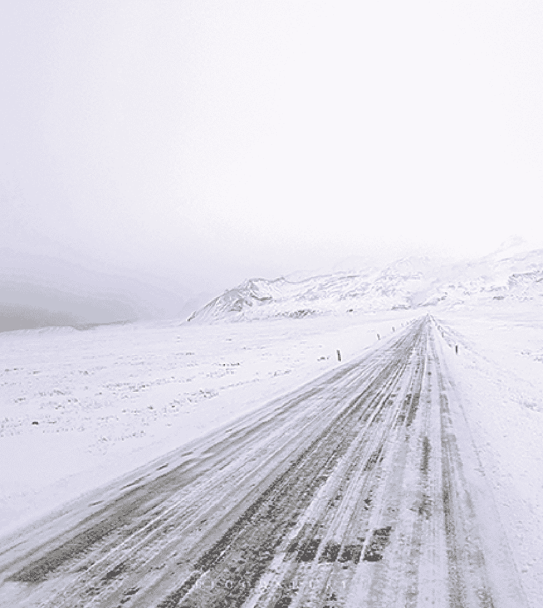
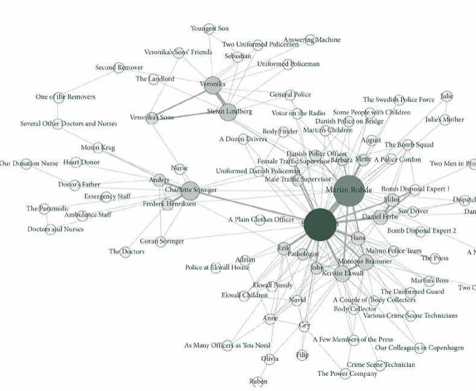
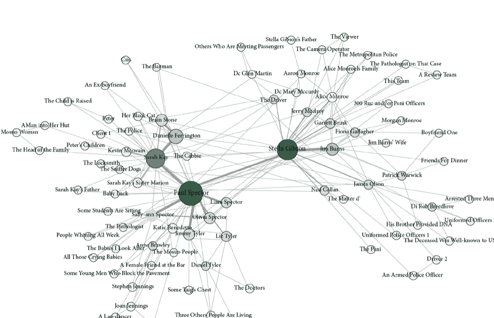
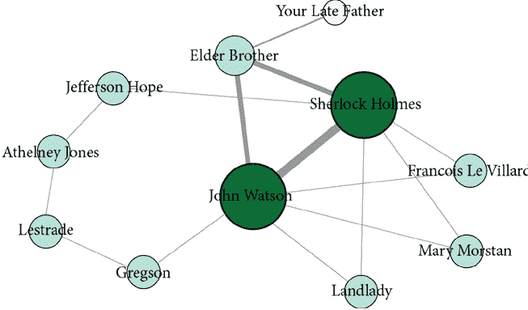
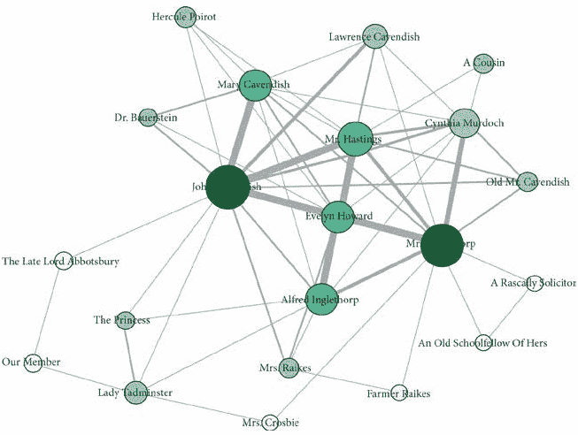
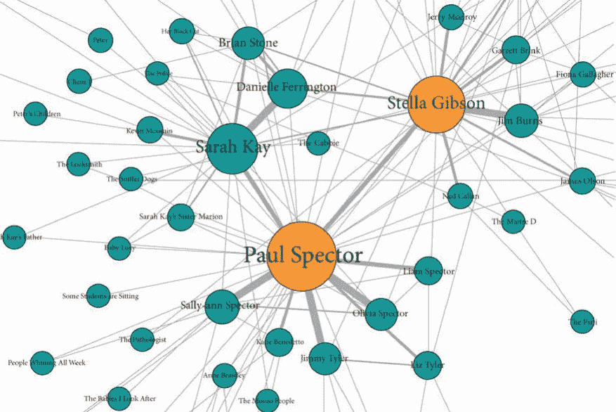
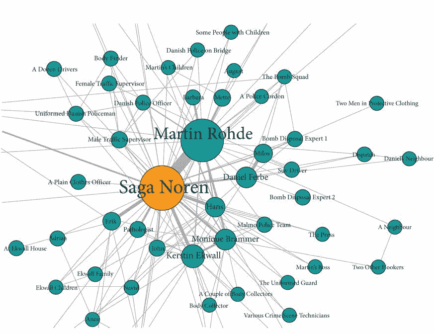
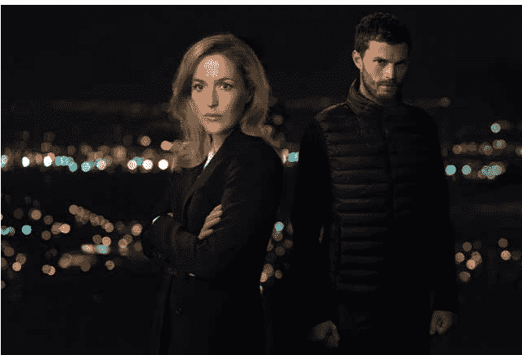

# 北方黑色电影：类型、政治与地域

编辑：Stacy Gillis 与 Gunnþórunn Guðmundsdóttir

Stacy Gillis 与 Gunnthorunn Guðmundsdóttir

- 致谢 xvi

Delphine Letort 41

Daisy Neijmann 85

# 作者

**Derek Greene** 是都柏林大学计算机科学学院助理教授，也是爱尔兰科学基金会（SFI）的研究员。他目前领导一个关于社交网络分析和文本挖掘的研究小组。

**Gunnthorn Gudmundottir** 是冰岛大学比较文学教授。她在当代文学和传记写作方面发表广泛。她最近的著作是《小说中遗忘的呈现》（2017）。

**Christinna Hazzard** 是利物浦约翰大学英语与文化历史副讲师。她目前正在准备关于“欧洲边缘的半边缘主义：国家与形式”的博士论文计划，并在《后殖民写作杂志》的特刊上发表了文章。

**Christopher James** 是美国弗吉尼亚桥学院语言与文化系的法语助理教授。他的研究重点是文学中的空间和电影研究。他最近编辑了关于作为文化记忆载体的虚构作品专名的《国际人文艺术与计算杂志》特刊。

**Giti Chandra** 是联合国附属学者。她的工作关注性别、文化与政治的交叉领域。

**Mary Evans** 是都柏林大学英语戏剧学院文化理论教授，文化分析中心主任。她是《性别、爱尔兰与文化变化》（2010）、《诺拉》（2004）、《不安主体：女性、理论、小说》（1993，2012），并与 Mary O'Dowd 和 Bernadette Whelan 合著了《阅读爱尔兰女性：文化遭遇与交流，1714–1960》（2013）。

**Graeme Gilloch** 是兰卡斯特大学社会学教授。他是《神话与大都市》（1995）的作者。

**Kerstin Bergman** 是一位苏格兰犯罪小说作家，以以 Hill 医生为主角的系列悬疑小说闻名。她的小说被翻译成四十种语言。她于1995年凭借《美人鱼之歌》获得犯罪作家协会年度最佳犯罪小说奖。

**Delphine Letort** 是曼芒大学学术研究教授。她最新的书籍是《斯派克·李品牌：纪录片制作》（2015）。她在黑色电影、电影改编、非裔电影和纪录片方面发表了大量文章。

**Stacy Gillis** 是纽卡斯尔大学现代当代文学讲师。她编辑过四本书，包括《女性主义与流行文化》（2009）。

**Gunnar Staalesen** 是一位挪威作家和评论家。

# 贡献者

Maria Mulvany 是都柏林大学学院文化分析中心的博士后研究员。她的研究兴趣包括性别与性倾向研究、历史小说、日记和犯罪小说。她与 Geraldine Meaney 和 Karen Wade 合编了乔伊斯《青年艺术家自传》的一个新版多媒体版本（www.joyceportrait100.com）。

Nina Muždeka 是塞尔维亚诺维维萨德大学英语文学系的副教授。她的研究兴趣包括英语当代文学，特别关注体裁理论、性别理论、身份构建、跨国研究和全球文学。她曾在澳大利亚、美国、芬兰、克罗地亚、匈牙利、罗马尼亚、黑山和塞尔维亚发表过关于当代英国和美国小说的著作，并出版过译作。Muzdeka 博士还撰写了关于朱利安·巴恩斯小说中体裁问题（2006）以及安吉拉·卡特作品中魔幻现实主义（2017）的专著。

Daisy Neijmann 在冰岛大学教授冰岛文学与文化。她是《加拿大文学中的冰岛之声》和《口语冰岛语》（2000, 2013）的作者，《冰岛文学史》（2006）的编辑，并并在冰岛-加拿大文学、现代冰岛小说、冰岛文学史学、记忆与创伤文本，以及冰岛语作为第二语言和遗产语言方面发表了大量著作。她也是犯罪小说的爱好者。

Andrew Nestingen 是华盛顿大学（美国西雅图）斯堪的纳维亚研究教授兼系主任。他关于斯堪的纳维亚电影和文学出版了大量书籍和文章，尤其是北欧犯罪，包括《斯堪的纳维亚的犯罪与幻想》（2008）和《斯堪的纳维亚犯罪小说》（与 Paula Arvas 合编，2011）。他教授北欧犯罪、斯堪的纳维亚电影以及斯堪的纳维亚儿童文化的课程。他正在写一本关于北欧犯罪的书。

Catherine Ross Nickerson 是美国埃默里大学（美国亚特兰大）的副教授。她的研究和教学侧重于犯罪叙事（小说、历史、电影和电视）以及哥特文学中的性别问题。她是《不洁之女：美国女性早期侦探小说》（1919）的作者，《剑桥美国犯罪小说导读》（2010）的编辑。

Björn Nordfjörd 是圣奥拉夫学院（美国明尼苏达州）英语系的副教授。他的研究兴趣侧重于犯罪小说、北欧电影以及更广泛的世界电影。他在冰岛电影和北欧电影方面发表了大量著作，包括关于犯罪电影的作品，并致力于一个关于世界电影的书籍项目。

Patrick Kent Russell 是康涅狄格大学大学英语系的博士候选生。他的研究重点是流行文化与国家之间的关系，特别是犯罪的流行文化表征及其对公众感知国家问题的影响。他的作品被广泛翻译，并就犯罪小说在社会政治评论方面的潜力进行过多次演讲。

Yrsa Sigurdardottir 是一位冰岛犯罪小说和儿童读物作家。她的作品被广泛翻译。她曾两次获得 Blóðropinn（血滴奖）奖，这是冰岛年度犯罪小说奖项。她分别于 2011 年因《蛋男猪（我记得你）》和 2015 年因《DNA》获得该奖。Yrsa 在创作书籍的同时还从事全职土木工程师的工作。

Gunnar Staalesen 是一位挪威作家，他因其关于贝尔根私家侦探 V Veum 的犯罪系列作品而闻名。V Veum 系列已被翻译成 12 种语言。Staalesen 凭借《堕落的天使》（Falne engler）获得了1989 年挪威书商奖。

Karen Wade 是都柏林大学学院文化分析中心的博士后研究员。她的研究兴趣包括19世纪小说的社交网络分析、文学信函、性别、博客以及医学与数字人文的交叉领域。她最近的论文专注于文学语料库中的词嵌入和语义分析。

## 前言

Yrsa Sigurdóttir

自 19 世纪犯罪小说出现以来，属于这一体裁的小说在世界大部分地区的读者中都极受欢迎。这种受欢迎程度背后的原因很难准确确定，尽管人们已经提出了许多理论。犯罪小说被认为提供了一种安全的刺激，也就是说只要合上书就能停止这种刺激。它们也被认为吸引了人类了解和理解一切的渴望。在读者面前，这就像是一个谜题，读者和作者之间有一个默契的协议，即最后一切都会得到阐明。这并不是让读者不断翻页的唯一方面，小说还必须写得好，人物必须吸引人且能引起共鸣。至少明显的是，如果谋杀和混乱是唯一的吸引力，读者可以通过看新闻来满足需求。

犯罪小说正如其创作者一样丰富多变。存在多种体裁：从所谓的“治愈系犯罪”（cozy crime）到心理惊悚片，甚至还有“猫黑帮”（cat noir），其中猫在调查中占据重要地位。这里对每个人都有适合自己的东西。犯罪小说和惊悚小说之间通常会有所区分，这种分类在很大程度上取决于小说的节奏。在犯罪小说中，故事通常始于可怕的事件（几乎都是谋杀），读者被引导通过页面，沿着发现之路直到一切尘埃落定，反派被揭穿并被捕。这条路可能布满了更多的尸体，但不要错，读者正走向正常生活的恢复。然而，在惊悚小说中，可怕的事件即将发生。它会发生吗，还是不会发生呢？通常会发生。

尽管事实如此，北欧国家以某种方式成功成为了犯罪小说市场的一个力量。瑞典、挪威、丹麦和芬兰通常在最和平国家和最幸福国家的名单上并列于首。然而，他们的犯罪作家经常出现在全球畅销书单的前列。尽管多年来一直预测这种受欢迎程度将终结，但北欧犯罪（Nordic noir）并未失去它的稳固地位，没有迹象表明它正在失去阵地。就像在惊悚小说中，预言的末日事件可能不会发生。

北欧犯罪的受欢迎是犯罪小说世界中一个流行的话题。北欧犯罪作家经常被要求对该主题发表看法，

## 前言

而且他们被问及从哪里获得灵感。这已经说明了许多问题。这个问题之所以经常被提出，是因为没有唯一的、确定的答案。品味，无论是在文学还是艺术领域，都很难确定。它因人而异，并且由于某些不易识别的原因而演变。可以说，影响北欧犯罪受欢迎程度的最常见的因素是：其稀疏的写作风格、对社会问题的关注、对完美社会的暗面描写、刻画生生的侦探主角以及“雪”的存在。是的，雪。但并非每部来自北欧国家的小说都有雪。然而，如果你从书架上随机拿起一本北欧犯罪小说，你比拿起其他国家的书籍更有可能在其中发现部分或全部这些因素。

关于上述特征，许多被要求向社会评论倾向的作品影响了北欧小说的受欢迎程度。这并非每部由北欧作者写的书中都有，但它经常存在，无论是以非常明显的方式还是更微妙的方式。它的起源并非奥秘。任何熟悉北欧犯罪的人都知道 Sjöwall 和 Wahlöö 被被誉为第一批利用犯罪小说作为社会批判载体的作者，他们在娱乐读者的同时，提高了他们对不公或危险社会趋势的意识。因此，难怪追随其后的北欧犯罪作家也渴望实现这一目标。有些作家做得非常好，另一些并非如此。如所述，创作犯罪小说的作者（无论是北欧犯罪或其他子体裁）是一个极其多样化的群体。他们来自不同的国家、年龄段、性别和社会阶层，并且背景往往比其他文学领域的作者丰富得多。这确保了该体裁呈现出极其广阔的视野，这可能就是它蓬勃发展的原因。

在犯罪小说方面，除了浪漫小说外，女性作家的规模远大于其他类型的文学。许多阅读最广的当代犯罪作家是女性，而阿格莎·克里斯蒂不仅是黄金时代犯罪小说最重要的作家，还是世界上最畅销的作者。随着心理惊悚和家庭惊悚片普及度的增加，现在一个用首字母命名的作者更有可能是男性，而直到最近，人们认为这种作者是希望通过隐藏自己的女性名来被视为男性的女性。希望在未来，作者的性别将不再是一个问题，这种缩写将仅用于掩盖一个非常“难以推销”、复杂或不具吸引力的名字，因为所有性别都同样能够创作高质量的犯罪小说，以及任何其他类型的虚构作品。

## 前言

在谈论性别问题时，我不禁提到冰兰社会中关于女性作者的一个异常现象。我的国家在性别不平等指数中位居全球首位已近十年，这意味着在影响该指数得分的因素方面，女性的地位被认为是世界上最好的。然而，在销量方面，当地女性小说作家的人气并不如其男性同伴。冰兰硬装小说的大部分销量发生在圣诞节前的几周，因为书籍是一种传统的礼物。这段期间的畅销榜最能反映当地的书籍销售情况，令我深感遗憾的是，尽管女性创作了约 40% 的小说作品，但在前十名书中，女性通常仅占 10% 到 20%。我不得出的结论：平均冰兰书籍购买者认为男人比女性写得更好。更悲哀的是，我诚挚地希望，我们作为一个读者国家能够纠正这一奇特现象，犯罪小说很可能会引导我们通往进一步平等的道路，在那条路上，每位作者都将根据其写作质量而非性别受到评价。

以上内容在各方面显然是非常概括性的。犯罪小说作为一个话题，其复杂性是前言所能涵盖的。坦率地说，接下来的章节将以更详尽的方式进行探讨。请继续阅读并享受。

## 致谢

感谢编辑所在机构——纽卡斯尔大学和冰兰大学为本书的编写工作提供的便利。特别感谢冰兰大学人文科学研究中心，特别是 Margrét Gudmundsdottir，还要感谢位于雷雅未克的英国大使馆和雷雅未克联合国教科文组织，它们在项目之初提供了协助。感谢都柏林大学学院（UCD）的研究访问教授计划，该计划于 2018 年接待了 Gudmundsdottir，且部分工作是在那里完成的。感谢 UCD 人文学院以及其来自冰兰大学 EDDA 卓越中心的资助，这对于确保本书工作的完成至关重要，特别感谢 Irma Erlingsdóttir 和 Valur Ingmundason。“冰兰黑色文学”（Iceland noir）被证明是非常丰硕的成果，感谢 Lilja Sigurðardóttir 慷慨地参与本项目；感谢 Val McDermid、Yrsa Sigurðardóttir 和 Gunnar Staalesen。我们的编辑助理 Vera Knúzóttir 提供了不可或缺的支持，她的工作提供了巨大的帮助。Geraldine Meaney 的宝贵贡献在最后阶段产生了决定性影响，我们对她深表感谢。Bloomsbury 的 Haris Naqvi 和 Amy Martin 在本书极具挑战性的开发过程中一直提供支持和鼓励。最后，感谢我们的家庭在此过程中提供的各种帮助。感谢你们 Dagur 和 Flóki。

## 第一章

### 引言：北方的黑色文学

Gunnthorunn Gudmundsdottir 与 Gerardine Meaney

### 跨国黑色文学

犯罪小说既是一种独特的体裁，也是一种全球性的跨媒介形式。正如本书收的贡献所显而易见的，这是一个动态且混合的体裁，与电影和小说的历史深度交织，并是电视制作的主流。作为一种跨国形式，它植根于国家文化和经典，通常被归为保守甚至是帝国主义倾向，并随着社会变化、当地、国家和跨国的关注而不断演变。相比之下，黑色的情感始终与反叛和动扰联系在一起。虽然黑色小说以 James M. Cain 和 Dashiel Hammett 等美国作家的形式出现早于其电影形式，但这个名称源于跨大西洋电影研究，特别是法国对美国电影的先锋派重建，这种重建凸显了其阴暗、不满和丑闻的边缘。在欧洲语境下，黑色文学不仅被重新定位为对美国梦阴暗面的质问，也是对人类生存的质问。然而在某些方面，欧洲的影响已经存在，正如 Delphine Letort 在第三章提到的“欧洲移民导演对好莱坞黑色文学的发展的影响……其中许多人采用了美国硬汉派小说和剧本。”Gallimard 出版社 *Série noire* 的编辑 Patrick Raynal 直到 1995 年还宣布：

> “如果我们能将黑色写作和黑色灵感视为一种观察世界的方式——即观察那个黑暗、不透明、充满犯罪色彩的世界，其中贯插着我们内心强烈的宿命感，这种宿命感源于我们唯一能确定的事情就是我们必将死亡——那么确实可以说，《俄狄浦斯王》是第一部黑色文学。”

Raynal 将文学黑色文学视为悲剧传统的一部分，这与对“北欧黑色文学”（Nordic noir）的一些早期接受是一致的，这种接受将其定位为对乐观社会民主未能从根本上缓解人类痛苦之必然失败的回应，这一点在本书的几个章节中得到了强调。然而在目前的用法中，这个术语并非没有自己的矛盾和复杂性，正如 Gunnar Staales 在本书的结语中所述，Björn Nordfjord 在第 11 章中详细提到的，后者指出“学术界对该术语的全方位采纳”令人惊讶。Staales 和 Nordfjord 都主要关注“黑色”一词的使用问题，因为将许多国家和文化的各种犯罪小说堆砌在一起本身也没有问题。

北欧国家内部在社会、文化和文学上的地区差异不应被低估，每个国家都有其特定的轨迹（正如 Kirsten Bergman 和 Nina Mužaka 分别在第 14 章关于瑞典小说和第 15 章关于挪威小说中明确的那样），并具有某些跨国标志，如 Maj Sjöwall 和 P Wahlööd 的全北欧影响，以及北欧电影和电视的发展。丹麦在高质量影视方面有着悠久的传统，这也影响了其他北欧国家，随后在《破案》（Forbryderelsen, 2007–12）打破跨国障碍后得到了进一步促进。从无法想象在英国电视黄金时段播放配音剧（如 20 世纪 90 年代后期 Lars von Trier 的《王国》（Rig, 1994-97）在 BBC2 周二晚上 11 点播出）不应被低估。随着 Netflix 等流媒体服务的出现，《纸屋》（la casa del papel, 2017-）和比利时《酒店》（Hotel Beau Sejour, 2016-）成功实现了全球分发。尽管这些作品并没有真正威胁盎格鲁霸权，但它们有力地敲响了门门，增加了新的语言、视角和传统。

北欧黑色文学的跨国和跨媒介传播可以分为不同的模式：

- 北欧电视剧的重拍版，例如 Kenneth Branagagh 的《华兰德》（Wallander, 2008–16）和美版《破案》；
- 在其他地方制作但在北方背景的剧，例如《堡垒》（Fortitude, 2015–18）；
- 合拍片，如法瑞合拍的《午夜》（Midnatt, 2016-）；
- 使用其美学和语调的剧，如英国剧《失败者》（The Fail, 2013–16）和《河流》（River, 2015）；
- 在北欧国家的小说，如英国作者 Quentin Bates 在冰岛的小说，以及 Will Dean 在瑞典背景的犯罪小说《暗松林》（Dark Pines, 2017）；
- 以及设定在苏格兰黑色文学（Tartan noir）和爱尔兰黑色文学中的犯罪小说，Catherine Nickerson 在第四章中分析了挪美合拍剧《莉莉锤》（Lilyhammer, 2012–14）这一深度自我指涉且可能不寻常的案例，强调了它与所谓的首部“高质量”剧集《黑道家族》（The Sopranos, 1999–2007）之间的联系。

在本书中，我们试图将“北方”的概念扩展到北欧国家的地理边界之外，以及主题和

## 1. 引言

在过去的十年里，北欧小说和电视中的形象得到了传播和流传，英国和美国尤为如此。北欧国家仍然是北方黑色电影（noir）美学和主题的核心，因此它们的形象对于我们的讨论至关重要，追溯北方的一些地理、历史和构想中的形象是很有价值的。

书中北方的章节分别关注性别、地点、政治和流派，并具有显著的主题重叠。在第一部分中，通过黑色电视剧的跨国影响和改编的棱镜来审视问题。本书以讨论电视改编和剧集作为开头是恰当的，因为它们一直是北欧黑色电影的一个显著特征，瑞典的《贝克》（Beck, 1997-）作为舍瓦尔和瓦尔勒厄（Sjöwall and Wahlöö）小说的改编，是其中的精英作品。通过对社交网络分析的创新使用，Meaney等人展示了《桥心》（Bron/Broen, 2011–18）与《坠落》（The Fall）中主要主角之间的差异；而尼克森（Nickerson）则在跨国合拍剧集《利姆哈马尔》（Lilhammer）中探讨了发挥作用的男性价值观。本节以Letort对《罪案》（Forbryelsen）美国版中性别差异的分析结束。

## 第二部分：地点、位置及其视觉特征的意义

第二部分关注北方黑色电影的另一个关键方面，即地点、位置及其视觉特征的意义。Graeme Gilloch 考察了《桥心》和美国版《桥心》（The Bridge, 2013–14）的视觉意象；而克里斯蒂娜·哈扎德（Christina Hazzard）考察了北方一个经常被忽视的特征：丹麦殖民主义案例及其如何在北欧黑色电影中体现。内伊曼（Neijmann）关注地点，她研究了该类型的核心特征之一，即阿诺尔德·因德里达森索森（Arnold Indriðasonason）和安·克里夫（Anne Cleeve）作品中北方的呈现。

## 第三部分：北欧黑色电影的政治

第三部分探讨了北欧黑色电影的政治，这通常被描述为该流的独特特征。帕特里克·罗塞尔（Patrick Russell）考察了舍瓦尔和瓦尔勒厄系列中所描述的福利国家所面临的新自由主义危险；而安德鲁·内斯廷根（Andrew Nestingen）调查了北欧黑色电影中儿童形象的政治维度，及其与“高质量”电视形象的联系。玛丽·埃文斯（Mary Evans）通过对伦理、道德和世界政治趋势处理的棱镜来审视北欧黑色电影。

## 第四部分：类型标记与跨流派关系

第四部分中，诺约尔德（Nordjördj）探讨了将“黑色”（noir）一词整体应用于北欧犯罪小说时涉及的困难和陷阱；克里斯托弗·詹姆斯（Christopher James）和西蒂·钱德拉（Siti Chandra）考察了犯罪小说与其他流派（法国式优雅和史诗）的关系。如上所述，伯格曼（Bergman）和穆日德卡（Muždeka）讨论了瑞典和挪威的类型标记和发展。

本书最初的构想是为了犯罪小说作家与研究人员之间活跃且富有成效的对话。西格多蒂尔（Sigurardóttir）的序言、斯塔伦（Staalens）的结语以及洛娜·希尔（Lorna Hill）对瓦尔·德米德（Val Dermid）的采访，是该类型从业者及时的干预和反思，恰当地为本书奠定了基调并使其完整。

# 北方的黑色电影

# 犯罪小说

尽管在 19 世纪和 20 世纪，小说在许多国家和背景下成为主导文学形式的轨迹存在显著差异，但在许多传统中，现代的起源与犯罪小说深度交织在一起，钱德拉（Chandra）在第 13 章中提到了这种联系，同时将该类型与古典史诗形式联系起来。与现代形式的联系在英语传统中最为显著，因为那里的《新纽盖特编年史》（Chronicles of Newgate）既塑造了叙事性小说的发展，又为新闻媒体提供了足够煽情的内容，以吸引新兴小说形式的广泛读者。这些通常臭名昭著的罪犯的著名成员，将对犯罪和犯罪性的痴迷置于英语小说发展的核心。它也标志着文学、报道和民谣传统隐藏影响之间的汇合点。这种谱系在其他语言传统中并没有被特定的复制，席勒（Schiller）的犯罪哲学和真实犯罪类型吸引了大量的批评关注。拉克洛斯（Laclos）中对欺骗和阴谋的关注，以及陀思妥耶夫斯基（Dostoevsky）和斯特林伯格（Strindberg）对神秘学的痴迷，表明越界与阴谋、犯罪与惩罚从 18 世纪起一直是欧洲小说演变和活力的核心。犯罪小说的调查框架使其坚定地植根于汉小说和“网络”小说。但本质上，所有的侦探小说都有英雄追求的元素，这是另一条将其与史诗联系的线索。这种追求是由对终极犯罪——谋杀的承诺引发，它打破了社会结构并需要社会救济。它的目标是真理、谜团的解答以及正义——理想情况下可以恢复社会平衡的正义，后者通常通过曲折的路径达到，且仅部分实现。这一轨迹与古典悲剧一致，并没有失去对成功的谋杀调查之必然结果的执行。然而，欧洲的当代犯罪小说运行在不同的司法和社会背景下，而北方黑色电影的特征是对暴力社会起源的质问，而不是对其否认。书中关于政治和道德的第三部分提供了这一例证。

传统上，犯罪小说被批评家描述为具有保守倾向和道德力量。罗兰·巴特（Roland Barthes）广誉的阿格莎·克里斯蒂小说《罗杰·阿克罗伊谋杀案》（The Murder of Roger Ackroyd, 1926）分析基于这样一个假设：即犯罪类型通常不会、事实上也无法进行如此复杂的叙事手法。在过去的十年里，蓬勃发展的犯罪小说批评领域挑战了这些假设，受到茨维特·托多洛夫（Tzvetan Todorov）对犯罪小说叙事特征结构主义分析的影响。某种程度上，这归因于文学批评对现代主义遗产的拒绝，这种遗产构建了天才创作的艺术与大众小说之间的对立关系。受雷蒙德·威廉姆斯（Raymond Williams）和皮埃尔·布迪厄（Pierre Bourdieu）等文化社会学家的影响，文学批评开始将这种对立转化为对所有文化形式之间动态关系的理解。例如，塔雅·诺曼（Tanya Norman）认为：

> 尽管[阿格莎·]克里斯蒂的作品在我们传统上被视为现代性范例的基调和风格，但她的文本被同样的焦虑所困扰，这些焦虑渗透了 T·S·艾略特（T. S. Eliot）、弗吉尼亚·伍尔夫（Virginia Woolf）、约瑟夫·康拉德（Joseph Conrad）和雷贝卡·韦斯特（Rebecca West）等作家的作品——包括但不限于技术科学创新、心理学、城市化和世界大战。⁵ 这种将犯罪小说和高级现代主义视为 20 世纪不同但相关的形式的历史理解，保留了旧方法的一些元素：“与伍尔夫、康拉德、艾略特或韦斯特不同，早期的波洛（Poirot）文本缓解了这些外在现实并提供了逃避。”⁶ 这种根据自身标准阅读犯罪小说的新潮流批评共识，日益强调该类型的特殊优势在于其能够在创造犯罪叙事的对立之间进行协商。对阿格莎·克里斯蒂作品的最新重新评估指出，“侦探小说位于一个二元性领域：结构与创新、稳定与流动、一个最终解决方案与开始的多种可能性。这些二元性表明这种类型……比通常认为的要稳定。”⁷ 对侦探小说作为一种类型的复杂性的重新评估，要求重新评价 20 世纪 60-70 年代具有政治参与的瑞典犯罪小说中北欧黑色电影的起源神话。

舍瓦尔（Sjöwall）和珀·瓦尔勒厄（Per Wahlöö）通常被认为是斯堪的纳维亚形式犯罪小说的作者，这种形式植根于瑞典政治和文化，并受到美国硬派（hardboiled）和黑色电影的影响。在 2009 年回顾对犯罪类型的贡献时，舍瓦尔明确了他们的目标：

> 我们想从左翼观点描述社会。原本是写政治书籍，但它们只卖了 300 本。我们意识到人们读犯罪小说，通过故事我们可以向读者展示，在瑞典福利国家的官方形象下还有另一层贫困、犯罪和残暴。我们想展示瑞典正走向何方：走向一个资本主义、冷酷且非人道的社会，富者越富，穷者越穷。⁸

导致北欧国家分离的实际上是舍瓦尔告诉我们的福利国家形象及相关社会状况，或所谓的“斯堪的纳维亚例外”。人们通常将这些国家视为模范社会，提到福利国家不可思议的崛起（现在的衰落），以及这些国家在性别平等方面取得的巨大进步，这在北欧黑色（Nordic noir）对女性的描写中可见一斑。当然，其中一些是浪漫化的愿景，是对其他世界的乌托邦式希望；而在对黑色文学的接受中，也能察觉到打破这种社会乐观主义的某种乐趣，作品探索了北欧理想的阴暗面。

然而，这种新的社会小说并非凭空产生。瑞典曾有其犯罪小说的黄金时代，斯蒂格利茨·特伦托（Stieglitz Trentor）和玛丽·兰（Maria Lang）等作者与西蒙（Simenon）的流行译本相竞争。兰笔下的女性侦探处理的是比马普尔小姐更黑暗、心理上更复杂的家庭和小镇秘密，她被誉为瑞典的阿加莎·克里斯蒂，曾公开与舍瓦尔（Sjöwall）和瓦尔勒厄（Wahlöö）对侦探小说规则的重构发生过争论。然而，她受心理分析影响的故事，是该地区犯罪叙事传统演变的一部分，与舍瓦尔和瓦尔勒厄对社会批判的优先考虑同样重要。这种对当今北欧黑色文学与二十世纪流行小说传统之间连续性的否定是如此极端，以至于对“北欧黑色”的描述经常流于表面。舍瓦尔和瓦尔勒厄之间争论的核心，是类型需求与社会及心理探索冲动之间的创作张力，这种冲动自该类型在 19 世纪确立地位以来，一直影响着犯罪小说的全球演变。

近年来，评论家需要不断反驳关于犯罪类型倾向于简化复杂的社会、伦理和叙事问题的假设。在北欧众多文本和多类黑色文学的跨媒体传播已成为该类型重要组成部分的时期，这种反驳需要被更新。皮尔森（Pearson）和辛格（Singer）在介绍一部近期关于后殖民和跨国框架下的犯罪小说集时，认为：

> “侦探小说在类型、结构和历史上，都适合创造现代与后现代、物质与形而上学、对真相的调查与调查本身之间的这种动态互动，正如后殖民和跨国世界中的本土理解所要求的那样。”

> “侦探小说存在于类型和话语的边界地带——文学与流行文化、叙事与元叙事、质询与认识论批判之间——凸显了即使我们在推断罪行时也要感知意识形态的必要性，尤其是当犯罪不存在或由跨越内部复杂性的机构所支持时。”¹⁰

这种认为小说不仅能激发社会批判还能动摇意识形态本身统治的能力，表明了对该类型新的批判性尊重。它不再是一个历史和社会学征兆，不是社会问题的根源。这种激发辩论的能力是第 10 章的焦点，玛丽·埃文斯（Mary Evans）认为，“北欧黑色所要求的也许是二十一世纪的基本问题之一，即如何定义可能构建社会团结的个人竞争。”

## 1. 引言

将犯罪黑色小说（无论是北欧的、地中海的还是凯尔特的）置于与旧式的、社会和形式上保守的侦探小说的对立面是还原性的，并掩盖了该类型内部的连续性及其混合性。北欧黑色文学的一些独特元素源于哥特传统元素的现代化。另一些元素指示了黑色电影的氛围和风格，荒凉的冬日景观复制了其单色调，腐败与暴力的网络复制了其道德光谱。然而，安·玛丽·瓦德（Anne Mari Waade）曾令人信服地指出，北欧忧郁的传统也体现在电视北欧黑色的色彩方案、视觉风格和场景构图中，以及其内容之中。¹¹

# 北方的图像

二十年来，北欧犯罪小说的国际接受反映并影响了古以来北方的图像历史。神秘、遥远、荒凉和幽灵般的景观，以缺失和死亡为特征，长期以来与北方联系在一起，但与繁荣、平等的社会形象在某些方面又是矛盾的。特定的视觉美学是北欧黑色的识别标志之一，主要通过景观和色彩来识别。景观通常是孤立的、乡村的、荒芜的、寒冷的，以蓝色、灰色和白色为特征，正如这本书的封面图像一样。这并非巧合，既有历史基础也有当代基础。天气、黄昏的色彩、某种隐藏的事物、谜团，甚至是幽灵——彼得·戴维森（Peter Davidson）大胆地声称这些是自然诞生的，“亡魂叙事本质上是北方的，是晦暗的天气和对死者命运的沉思的产物。”¹² 人们这本身非常符合现代犯罪小说，即使其色调有更古老的根源，正如北欧所描述的那样：“斯堪的纳维亚非常关注黄昏的色彩，关注冬初的黑暗，关注无限延伸夏天的色彩。…… 暮色灰是十八世纪瑞典彩漆屋顶、尼尔斯·克雷格尔（Nils Kreuger）的秋季景观以及维尔赫姆·哈默斯霍尔姆（Vilhelm Hammershøi）灵光闪烁的房屋反复出现的颜色。”¹³ 这种特定的光，北欧犯罪电视剧的观众非常熟悉。

从十九世纪的黄昏绘画，到宜家的“北欧”色彩，从二十世纪中叶开始，北欧国家一直与设计和建筑联系在一起；从战后伟大的创新者如芬兰建筑师阿尔瓦·阿尔托（Alvar Aalto，1898–1976），到宜家品牌在过去几十年里的全球扩张。在讨论我们

# 北方的黑色

2005 年左右出现的新北欧设计图像，斯库（Skou）和蒙奇（Munch）解释说，在某种程度上，北欧设计是为了向国际观众保证这仍然是北欧设计¹⁴。他们解释了其推广基于对北欧设计的“自我异域化”¹⁵，强调景观和祖先、挑战气候和现代性，传承¹⁵ 正如莱特（Le）在第 3 章中指出的，北欧剧集的美国翻拍和改编将典型的色调融入了其美学中。

“北方”长期以来作为一种文化空间，探索社会边缘以及人类与自然世界之间的边界，在内曼（Neijmann）、阿纳尔德·因里达森（Arnaldur Indriðason）和安·克莱夫（Anne Cleve）的作品中是显而易见的。地区与此类类型之间的认同具有有趣的二十世纪先驱，例如将拉丁美洲与魔幻现实主义联系起来。詹姆斯·巴扎德（James Buzard）描述了国内旅行在 18 世纪末和 19 世纪英国的兴起，苏格兰高地吸引了并想象了旅行，该地区荒凉、严酷且不祥的特征……（这成为了吸引力的一部分）这是一种新美学的一部分，从欧洲大陆游客偏好的“肥沃、温柔的景观”转向“山脉、瀑布和……”吸引了大洋朝圣者的景观。”¹⁶ 十九世纪英国对斯堪的纳维亚国家的关注汲足了这种新美学，并受到对粗犷、简单生活的追求的影响，例如威廉·莫里斯（William Morris）对冰岛的着迷。尽管这主要是一个十九世纪的现象，但这种兴趣持续到了二十世纪。彼得·戴维森（Peter Davidson）反思了文学和艺术中北方的许多表现形式和呈现，并讨论了 W·H·奥登（W. H. Auden）对它的吸引。在追溯奥登兴趣的各种影响来源时，戴维森将犯罪小说视为决定性因素：

> 惊悚片和间谍小说……至关重要。对奥登来说，最重要的惊悚片是约翰·布坎（John Buchan）的《三十九级台阶》，书中矿业工程师具有启示性的向北之旅，他在孤独之地追逐的叙事，以及对一个被渗透到人们无法相信其表面的社会的迷失感。¹⁷

从英国北部到斯堪的纳维亚最遥远的边缘，一切都是想象的素材，今天的犯罪小说继续利用这些想象，正如戴维森解释的：“格陵兰作为一个想法非常强大，是关于北方最大的想法之一。即使对于斯堪的纳维亚人来说，这也是终极的图勒——这种感知被《米拉小姐对雪的情感》有力地唤起，在书中，半因纽特血统的米拉回到格陵兰是一次进入终极奇异之旅。”¹⁸

## 1. 引言

这种对特定北方美学的痴迷随着时间的推移结晶为一种陈词滥调，强调了遥远、孤立、艰苦、恶劣的条件、雪地和寒冷，以及一种亲近自然、农村、以抑郁倾向、冷酷和忧郁为特征的人类形象。自 19 世纪以来，这些陈词滥调反复进入艺术、电影和小说。Neijmann 在一篇关于以冰岛为背景的外国作家小说的文章中探讨了这些陈词滥调如何渗透到当代写作中：

> 小说似乎并没有改变外国文学中冰岛的形象，而是将其吸纳。外国小说中的冰岛继续作为一种神秘的、自然的或北方的、边缘的、荒野的“他者”，对应着城市的、文化的、中心的自我（即“内在”），从而是有意识地延续了文学惯例、话语传统以及家乡冰岛的形象——创造了虚构的岛屿。¹⁹

需要注意的是，北方的形象在有着特定北方接收历史的国家或民族之间并不一定统一。媒体及其他地方也出现了许多关于北欧国家的矛盾观点，从自由平等主义社会的精英地位以及福利国家的发明者，到文明中黑暗、荒凉和野蛮的冰冷边缘。阿纳尔德·因里达森（Arnaldur Indriðason）首次翻译成德语——这标志着冰岛犯罪小说首次登上国际舞台——其封面上使用了极度过时的农村冰岛形象，尽管这些小说大部分程度上讨论的是发生在城市区域的杀人案。Gauti Kristmannsson 解释说，根据封面判断，Indriðason 的小说设定在 19 世纪的草皮屋中，尽管在德语语境中并非如此。根据 Sumarliði 的说法，该国的陈词滥调²⁰ 北方的刻板印象唤起了乌托邦式的北方或原始北方。Íleifsson 描述的、且在 21 世纪仍然常见的其他刻板印象包括：创造性的北方、进步的北方、无情的北方、富足的北方以及邪恶或永恒的北方。¹ Nickerson 在第四章中在剧集《猎锤》（Lilyhammer）中发现了这些回响，即美国角色对挪威作为“干净”和“纯净”之地的乌托邦愿景，以及“与奥运相关的高理想”。

界定这些形象和陈词滥调的方法之一是使用“北方主义”（borealism）一词。Schram 利用它来描述“涉及将北方居民异域化的文化实践”。该词源于拉丁语“borealis”（北方），是对爱德华·萨义德“东方主义”一词的借鉴。在旅游文学、小说、艺术和设计等许多类型的话语中，人们可以看到一种趋势是将北欧国家隔离开，与欧洲其他地区分离并遥远。这些关于北欧国家的观点也将它们在拓扑、政治和文化上归类为一个整体。Schram 阐述道：“个人族裔或地区背景的形象在跨国遭遇的权力谈判中起着重要作用。因此，对一般的北方形象的理解……在许多方面是对权力中心与边缘之间关系的研究。跨国权力关系揭示了来自地区权力中心边缘或‘北方边缘’的人们所经历的流动的能动性和挪用。”²² Hazzard 在本书中的章节也是对北欧国家内部权力关系的一次重要干预。

Munch 和 Skou 提到的自我异域化也可以在小说中找到。在斯堪的纳维亚犯罪小说的研究中，Jakob Stougaard-Nielsen 认为：“斯堪的纳维亚犯罪小说充满了‘过度决定’的怪异地点，这些地点不断通过更广泛的类型和不安全感的世界被折射。”²³ 同样的矛盾在对北欧剧集的接收中也可以看到，虽然农村和荒凉往往被强调，但这些剧集中最受欢迎的（如《谋杀》Forbrydelsen 和《桥》Broen/Bron）却设定在斯堪的纳维亚人口最稠密的地区：哥本哈根和马尔默。因此，北方的形象和陈词滥调揭示了接收，但也揭示了北方持续且不断自我异域化。

跨国描写也可能导致刻板印象和公式，当一个国家代表了 Öjerd（被困者/Trapped）时。Íleifsson 叙述的、在 21 世纪仍然常见的其他刻板印象是：创造性的北方、进步的北方、无情的北方、富足的北方以及邪恶或永恒的北方。Waade 和 Jensen 指出他们认为：

> 《被困者》对敌对景观的视觉呈现并非发生在剧集本身，而是源于旅游业对异化元素所渗透的媒介景观。
> 这种异化倾向的增加，是丹麦公共广播机构 DR 为了赢得奖项而在国际化导向的结果。²⁴

叙事形式与地区之间的身份识别几乎总是简单化的，但它们也揭示了全球市场在跨国背景下的影响。正如本书详尽证明的那样，犯罪类型处于全球跨媒体网络的中心，翻译、改编和发行网络在其中流动。在这种背景下，作者和国家或地区成为了出版商、平台和媒体供应商。Hedling、Hansen 和 Waade 认为，北方的黑色小说作家正在创作并质疑一种新的流行文化和欧洲身份。人们很容易声称在 Netflix 和亚马逊的世界里流行文化已经是全球性的（如上所述），但这忽略了影响全球供应商组织营销方式的国家和地区边界的存在。后殖民视角为理解欧洲黑色小说提供了有趣的见解：

> 跨国研究 [...] 与近期的后殖民理论共同需要，即要超越国家限制的中心/边缘发展模式，转向能够有效理解边缘状态、边缘国家形式的模型和世界观，并阐述或合法化多元的归属感和身份。

本书探讨的文本对边缘空间的关注，揭示了北方黑色小说与哥特传统接轨的特征之一。有时这些边缘空间挑战的不是现实主义的边界，而是现实本身。与其社会现实的起源相比，超自然元素无处不在。这在源自受哥特小说影响的国家犯罪叙事中尤为明显，例如冰岛作家 Yrsa Sigurðardóttir 对鬼故事元素的使用，以及 Ian Rankin 对苏格兰哥特传统元素的吸收，但在瑞典剧集《Jordskott》（2015）——对瑞典民俗的使用以及丹麦超自然剧《Heartless》（2014–）中也显而易见。

然而，边缘性仍然是遵循现实主义边界的叙事的关键特征。在《谋杀》（Forbrydelsen）中，Sarah Lund 处于丹麦和瑞典之间的一种悬浮状态，她计划在破案后搬到那里。在《桥》（Broen/Bron）中，犯罪现场位于

# 国际视野下的北欧黑色小说

国际上，受害者位于丹麦与瑞典之间大桥的中段。这些国家在这些叙事中的核心地位并非偶然。瑞典是北欧犯罪小说发展的核心，这种小说已成为一种国际现象；此后，亨宁·曼凯尔的出版社清楚地看到出版潮流是由丹麦作家彼特·霍格的《Broken Smillas fornemelse for sne》（1992年，《Miss Smilla's Feeling for Snow》，1993年）开启的——这是另一个线性叙事，设定在格陵兰与丹麦之间，正如 Hazard 在第 7 章讨论的那样，那里后殖民关注具有高度的相关性。丹麦电视制作同样处于核心地位，为标记为“北欧黑色”的亚类型打开了国际观众。在这两种情况下，迁移的影响同样巨大，但方式不同：萨拉·伦德计划搬到瑞典进入了一种更符合传统女性化的个人生活，拥有一个更熟悉的核心家庭结构。曼凯尔在英语世界的突破作是《Mördare utan ansikte》（1991年，《Faceless Killers》，1997年），它探讨了迁移对瑞典的影响。这两种叙事在驱动国际对“北欧黑色”的反应和刻画方面的程度，立即在国际流行文化中产生了巨大的影响。曼凯尔对巴尔干冲突跨越欧洲连锁效应的探索，在评论和批评中几乎被提及，相比他对迁移对瑞典文化和社会影响的描写。一方面，这表明了大型 iPhone 市场和读者对这种跨国类型接受的影响，但也反映了读者对迁移问题本身如何被理解的过度关注。犯罪叙事对当地、国家和地区条件的反应的特殊性，往往被轻易地归入看似“普世”或“全球性”的问题中。

从地点上来说，本卷探讨的文本往往比克里斯蒂和兰格的黄金时代小说更接近曼凯尔、瑟奥尔·瓦尔以及黑色电影中的阴暗街道。这种对地点的使用与欧洲传统紧密契合，其特征是一个理智且观察敏锐的侦探来解读谜团，这与典型的美国硬汉派侦探形成对比，后者通常干预且其行动是推动情节解决和揭露真凶的催化剂。这种强烈的感知是北欧黑色与法国颓废派小说共有的特征，我在第 12 章中探讨了这一点。乡村背景、乡村别墅和自给自足社区在创造可认知社区、缩短嫌疑人范围以及挑战推演练习方面的优势是显而易见的。北方黑色电影的一个独特特征是这些特征与城市黑色电影元素的融合，例如爱丁堡和马尔默等较小城市，以及冰岛和爱尔兰等国家，在这些地方，尽管他们之间存在明显的社会鸿沟，但主角之间的距离更近。经典犯罪小说对使用孤立地点或有限社区的通常理解是：这类小说依赖于对稳定社会的呈现，而这种稳定被谋杀打破，侦破过程起到恢复其原始稳定的作用。然而，从结构上说，经典侦探小说依赖于将来自广泛世界的人聚集在一起的事件或仪式，他们共同的过去、目标或隐藏的联系。黄金时代犯罪小说的一些关键文本是该类型如何利用重大事件与自给自足社区及设定之间的连接来创造理想犯罪现场的绝佳范例。阿格塔·克里斯蒂和玛丽亚·兰格都特别喜欢利用假期和节日将家人、老友或敌人聚集在一起，并为他们侦探对犯罪现场的接近性提供合理理由。（季节性背景从营销角度来看也很有意义，这一评论暗示了商业考量对该类型的影响。）然而，更黑暗、更广泛的力量一直在犯罪类型流派中发挥作用，将嫌疑者和受害者聚集在一起，这挑战了这些社区最初是稳定的观点。在克里斯蒂的《风格庄的神秘案件》（The Mysterious Affair at Styles, 1920年）中，第一次世界大战派系的运作与《Faceless Killers》中的巴尔干冲突类似，以士兵和难民的身份在欧洲移动，对小村庄和农村生活产生了影响。值得注意的是，克里斯蒂将她的侦探设定在难民中，而非凶手中。虽然犯罪小说的范围通常看起来是田园诗式的，但调查很快确定了这具有误导性。在表面之下，安全和稳定的破坏早已存在。谋杀并没有创造它，而是揭示了它。

现代小说的发展与现代国家的发展深度交织。共同的语言、共同的市场、共同的版权法都促进了小说正典的发展，这些正典在实际上仍然是为了国界范围内的出版和教学目的而组织的。翻译、传播和纯粹的力量始终确保某些文本跨越了这些边界。对于《基督山的伯爵》如此，对于《罪与惩罚》也是如此，但流行小说与国家文化有着不同的关系。犯罪小说从 19 世纪中期开始快速发展，以应对跨国现象：工业化、城市化、迁移和全球化。主要的正典范畴仍然是大陆性的而非国家性的：美国硬汉派、黄金时代以及现在的北欧黑色。种族和/或迁移、社会边界和流动是该类型的核心。在彼特·阿克罗伊德为亚瑟·柯南·道尔的《四签名》写的序言中，他生动地描述了叙事如何定义通往城市黑色的轨迹：

> 城市的雾气已成为霍尔姆斯冒险中谜团的一部分；它代表了城市的不可渗透性，其粘稠的物质性以及苍白的模糊……世界是可以被阅读和解读的；雾帘可以被揭开……这是一座由煤气和煤油产生闪烁灯光的城市，在闪烁的光芒中，面孔宛如一群迷失灵魂的游行般经过。这是一个奇异公民的世界，空想的或畸形的，以及奇特偏远的地方。

尽管阿克罗伊德没有提到，但在产物中揭示的奇异感和不可渗透性，是贸易、暴力和剥削的全球网络，服务于帝国中心。霍尔姆斯穿过伦敦迷宫般街道的火车追溯到印度独立战争，并跨越印度洋到达安达曼群岛。情节揭示了殖民者与被殖民者的网络，被战争、贪婪和迫害所驱逐。简而言之，它揭示了移民的存在、边缘化、代理性和剥削，北欧犯罪小说关注这些，正如 Muždeka 在第 15 章中所述。犯罪叙事关注任何给定社会的界限，即暴力爆发并管理或驱逐的节点。从 19 世纪以来，它最近将这些界限确定为新来者成为或成为我们的一员的这一点。国际对北欧叙事中社会快速变化和日益增长多样性的探索的痴迷，源于犯罪小说的原始功能。

设定的异域感为国际观众营造了一种安全的、甚至是异域的距离，去观察详尽描述和社会历史情况，并留下了解决的可能性。部分的一部分在于，显微镜下北欧社会的一个独特特征是其相对缺乏多样性，特别是在曼凯尔、安·克莱维夫、李·霍斯特等人的描写的乡村和小城镇背景中。在这方面，大城市的读者和观众最初将地点定位在城市化和迁移之前，但北方黑色电影有破坏这些假设的习惯。在这些文本中，理解这一点对于解决犯罪至关重要，这一点非常显著。

## 1. 引言

Nestingen 认为，北欧犯罪的一个特征是，其处理“儿童敏感性”的方式。这种形象利用了地区性的儿童文化建构，同时也试图通过将这些文本与其他犯罪小说形式区分开来，来吸引不断扩大的读者和观众。

在犯罪小说中，过去永远不是无辜的。“我喜欢好的侦探故事，”阿格莎·克里斯蒂的特维斯先生评论道，“但是，你知道，它们是从错误的地点开始的。”它们始于谋杀。谋杀是结束。故事在很久以前就开始——有时是很多年前，包含了导致某些人在某天、某时刻出现在某地的所有原因和事件。”他的评论导致了特维斯先生被杀，引起了我们对克里斯蒂小说中叙事技巧的关注，但也揭示了侦探小说在处理文化记忆方面的独特优势。正如托多多夫所证明的，探测的过程必然是追溯性的。它让过去变得以解释现在。北欧黑色电影独特的时间性与这一过程紧密相连。现场始终是事实。即使杀手来自东部或南方，雪地上的脚印总是追溯回很久以前就开始的、我们早已知道的事件。

## 性别、家庭与国家

如果说北欧黑色电影深受关注和社会地缘政治变化，它也是社会变化的重要传播者，是一个质问的空间，这不仅是因为在许多叙事中，对历史事件的持续探索是通过个人化中实现的。家庭是体验过去后果最直接、最有力量的地方。这在流行犯罪小说中显而易见，例如斯蒂格·拉尔松的《龙纹身女孩》三部曲和约瑟·内斯伯的《雪人》（2007年）、《红黑胸雀》（2006），其中谜题的解决要求同时与隐藏的秘密面对面。阿纳尔杜尔·因德里亚森的《独立于黑暗》（2000）和《冰之城》（2004，后被称为《血染之城》）被失踪案所困扰。塔纳·弗伦奇的《埃尔姆警官》（2018）延伸了自我得益的特权、忠诚与亲情之间的紧张关系，但后者提供了谋杀的动机和不在场证明。安·克里弗的《野火》（2016）中，设特兰群岛作为支持性社区的想法与一个看似成功但完全功能失调的家庭为邻。在这部小说中，谋杀的动机是爱，因为人们试图保护另一个人免受虐待。这些调查识别出家是暴力的源头而非避风港。如果说北欧黑色电影的特征是关注暴力造成的社会结构断裂，它经常将这些过程置于最基本的社会单元——家庭中。值得注意的是，小说和电影的起源都与“母性情感剧”密不可分。无论是独特的英雄还是对性别身份的致命焦虑，都是战后时代极渴望恢复女性进入劳动力市场的整合。苦难母亲的形象（这是在《背叛》中影响性地确立了“北欧黑色电影”的关键人物）、母女之间的冲突（母性情感剧的另一个主要元素），越来越成为《追风者》第三、第四季的核心，在那里，莎最具挑战性的对手是她那操纵善术的母亲。这两个剧中的侦探经常被认为是北欧黑色电影进步性别政治的体现，但他们都以不同的方式与母性功能的危机相关联。在侦探工作和母亲身份之间进行平衡的持续压力，几乎像传统电视剧中的酒精和破碎婚姻一样，成为北欧黑色电影侦探的特征。莎拉·伦德在许多方面都是原型，但这一主题已被广泛复制。女性侦探为探索社会对母亲的氛围提供了一个重要的文化渠道，但这些文本之所以吸引女性读者，原因在于，该类型的作者在整个体裁中，从一个致力于自己职业的女性视角出发，对这一极具辨识度的问题处理得是极其严谨的，这一主题也是流行剧《权力游戏》（Borgen, 2010–13）的核心。虽然美国评论家对北欧黑色电影中侦探所享有的产假和父母就业权感叹不已，但其中存在一个非常传统的传统主题，即继续对职场女性产生偏见。在芬兰电视剧《警探女孩》（Karppi, 2018–20）中，新丧夫的索菲亚·卡普基受到老板居高临下的建议，回家照顾孩子。在丹麦剧《迪特》（Dicte: Crime Reporter, 2013–15）和冰岛剧《新闻》（Pressa, 2007–）中，调查记者在复杂的重组家庭中努力平衡育儿和职业角色。这两部剧都直接涉及母性增加了女性的财务压力，并影响了他们的职业选择。在坦普关于苏格兰海岸的系列犯罪小说中，侦探玛格丽·弗莱明对自己优先考虑工作而非家庭的倾向。虽然她的丈夫和儿子尊重并支持她，但她的女儿完全拒绝了母亲和她的价值观。

难处理的女儿是该类型男性侦探的一个反复出现的特征，从逃跑变成琳达·瓦兰德，到莱纳系列小说中威斯廷那位敌对记者女儿，再到阿纳尔杜·因德里亚森小说中深受成瘾困扰的侦探埃伦德的女儿伊娃·林德。伊恩·兰金的对比与他没能花足够时间的女儿保持着温暖且互惠的关系，尽管他作为父亲的角色导致了严重的判断错误。这些父女关系中隐含着一种对父性角色的危机，这种危机像母性角色的矛盾情绪一样普遍。父权权威的崩溃体现在瓦兰德、埃伦德和威斯廷的女儿身上，以及瑞伯斯女儿的缺席中。然而，他们的女儿虽然通过放弃控制权、相互尊重和微小的善意行为得到了补偿，但正如女性侦探提供了一个探索结合母性养育与职业力量压力的机会一样，男性侦探为流行文化提供了一个批判性的空间，以探索母性意义的改变以及附属于旧男性责任模式的代价。侦探作为失败家庭成员的刻板印象依然存在，但这种失败的性质已变得更加复杂。

在区域与国家认同重新协商的同时，家庭结构和性别角色正在发生变化，而静态或萎缩的单一文化人口不断增长并变得日益多元化，在这种背景下，“北方黑色”作为一种跨媒体现象脱颖而出。与“北欧黑色”品牌相关的剧集中，其特征性的镜头在宁静的景观上平移，最后停留在不和谐的死亡与血腥画面上——这种暴力是一种中断，是景观上的污点，可以通过叙事性说明与解决的法医式应用来抹除。这正是其对国际、尤其是英语国家观众的吸引力所在，这些观众高估了自己家门前的犯罪与暴力的程度，而这些叙事作品最终坚持了这一点。暴力的源头近在身边。对临界空间——桥梁、海岸线、森林边缘或城镇——的关注，是对身份被重新绘制的边界地带的关注。这些是行动发生的场景。故事始于在此之前的很久，始于那些看似完美的家庭和稳定的国家，在那里一切似乎简单得多，而复杂的杀人动机也正源于此。

### 注释

- [8] Barry Forsyth (2013) 在进入《北欧黑色》第一章“开始”时，Mark Tapper 在 (2014) 年的《瑞典警察: From Sjöwall and Wahlahlö to Stieg Larson》中在国家层面展示了同样的这一点。
- [15] 同上，10。
- [16] James Buzard, 'The Grand Tour and after (1660–1840)', in *The Cambridge Companion to Travel Writing*, eds Peter Huime and Tim Youngs (Cambridge: Cambridge University Press, 2002), 37–52, 43.
- [24] Kristin Lotsdottir and Anna Linn, 'Trapped in clichés: Museums, films, and tourism in Iceland', *Gender, Place & Culture* 24, no. 9 (2017): 225–52, DOI:10.1080/096639X.2017.137283,1
- [25] 同上，123。
- [26] Anne Maite Waard and Pia Majbitt, 'No Production Values: The Killing and The Bridge', *Akademisk Kvarter* 7 (2013): 188–201, 197.
- [27] Olef Helding, Notes on Nordic North as European Culture, *Frames Cinema Journal* (2014), 21–14. Locating Nordic North: From Beck to Basing (Palgrave Macmillan, 2017).
- [28] Nils Pearce and Marc Singer, 'Detective Noir in a Postcolonial and Transnational World', New York: Routledge, 2016),
- [29] Stephanie Crighan, 'English Success Factors', *Publishing Research* (2013): 10.
- [30] Linda Williams, "Something Else be Mother": *Cinema Journal* 4 (1984): 2–27. www.jst.org/stable/1225306 (访问 21 February 2020).
- [35] Elsebeth Ekholm.
- [36] Christopher S. Browning, ‘Branding Nordicity: Models, Identity and the Decline of Exceptionalism’, *Cooperation and Conflict: Journal of the Nordic International Association* 42, no. 1 (2007): 27–54.

### 参考文献

- [12] Peter Davidson, *The Idea of North* (London: Reaktion Books, 2016), 156.
- [17] Peter Davidson, 93–4。
- [18] 同上，172。
- [33] Sigmund Freud, "The Uncanny" [1919], in *The Complete Psychological Works*, Vol. XVII (London: Hogarth Press, trans. Alix Strachey), 1955, 369–70.

# 第二章 之间的女性：《谋杀》与《桥》的社会网络分析

**Gerardine Meaney, Derek Greene, Karen Wade and Maria Mulvany**

本章关注两部跨国合作剧中的女性侦探形象：《谋杀》（The Fall，由 Acorn Productions 为英国 BBC 2 和爱尔兰 RTE 制作，2013年）中的斯特拉·吉布森以及《桥》（Bron/Broen/The Bridge，由瑞典电视台和丹麦广播公司制作，2011年）中的萨加·诺雷恩。这两部剧具有独特的黑色电影特征，并利用犯罪叙事探索边缘社会，这些社会的特征是当下身份的不确定性，以及长期具有破坏性的阴影。两位侦探都体现了一个身份正在被调查的中间空间。在这两位侦探的案例中，作为社会规范的局外人与其作为侦探小说社会网络的核心以及观众认同焦点之间，存在着富有成效的张力。通过绘制剧开头建立的社会网络，并识别斯特拉和萨加在其中的定位是具有启发性的。以往对这些剧的评论集中在《谋杀》对性暴力的表现中的女性厌视，以及女性侦探萨加·诺雷恩对性别刻板印象的挑战——她兼具分析智力和法医级的观察能力，却几乎缺乏情感、共情和社交技巧。本章将寻求改变焦点，探索斯特拉在叙事中与其他女性的联系，以及萨加如何在复杂且支持性的框架内运作。社会网络分析为分析长篇犯罪剧的运作提供了一个丰富的解释框架，特别是北欧类型与国家认同在交汇处和边界的模糊性。通过对描绘《桥》和《谋杀》社会网络的说明进行分析，犯罪叙事在多大程度上重新生产了这种由亲密联系和责任组成的社会观念变得显而易见。这种对说明的强调在第一少数剧集的出现不仅具有实用目的（如创建易读的可视化图），还识别了观众被引入的社会世界，并使我们能够以一种启发的方式将这些当代叙事映射到小说史的历史中。

我们对这两部剧开场剧集的社交网络分析采用了共线性方法。这种方法量化了文本中每个命名实体之间的接近性，而不是它们的互动。在这些实例中，命名实体包括所有具名角色、未具名角色（例如病理学家）、救护车人员、群体（例如詹宁斯家孩子）以及一些无生命物体（例如驾驶员未知但其出现对剧情可能意义重大的汽车）。此前虚构角色之间互动的尝试结果参差不齐。³ 对于电视剧，基于识别哪些角色出镜的社交网络分析具有巨大潜力，但在犯罪剧中具有局限性，因为为了悬念，命名实体之间的联系往往被隐藏，只有在叙事结束、谜题破解时才会变得显现。邻接性；当断开的实体出现在连接性的镜头或场景中时，它促使观众建立联系并参与谜题。因此，我们使用了剧本来构建社会网络分析。⁴

在这两个中，主线剧情与支线之间的连接都是谜团的重要部分。这种揭示看似断裂的社会背景之间联系的叙事驱动力，是长篇犯罪叙事将其想象成由连接、历史和后果构成的网络的核心。在这方面，它与19世纪社会现实主义的传统非常接近，与现代主义小说及其在节点或命名实体连通性（尤其是节点间中心性）方面的遗产有些格格不入。如果我们关注角色的中心性，这种社会现实主义的冲动是显而易见的。社交网络分析通过多种方式衡量角色的中心性，但衡量文本内社交连接密度的关键指标是中介中心性，这是一种衡量每个角色在整个网络中多大程度上扮演着枢纽或守门人的角色的方法，将不同的角色群体连接在一起。³在《冰冷之家》那个高度网络化的社会世界中（这是小说分析中经常被引用的例子），前十名角色之间的中介中心性差异为0.188，前二十名之间为0.214。在疏离的意识流第一人称叙事《少年艺术家自传》中，前十名角色之间的中介中心性差异大得多（0.727）。

社交网络分析有几种不同的形式，但我们研究的重点是生成一张文本中所有命名实体之间关系的地图。实体由节点表示，某些个体对通过称为“边”的关系连接在一起。根据网络的语义，这些边可以代表友谊、共同出现或个人之间的其他形式的关联（例如受害者与加害者）。在加权网络中，每条边都被分配了一个数值，该数值通常代表两个个人之间的关联强度。在此类网络中，每个节点代表小说中的一个独特角色，而一对角色之间的边表示该对在小说中至少共同过一次。边上的权重表示一对角色共同出现的次数。使用共同出现而不是一对角色之间的直接对话，使我们能够捕捉角色之间的关联以及互动。例如，`Stella Gibson`、连环杀手`Paul Spector`和受害者`Sarah Kay`是《坠落》第一集中网络中心的关键关系，尽管`Stella`与他们两人都未见过。为了识别共同出现的情况，我们在文本上应用了滑动窗口，并进行了手动标注。窗口大小（40个词）是根据每个标注剧本算法确定的。如果一对角色出现在同一个窗口内，则在该章节的角色网络中为这两个角色之间创建一条边。如果已经存在这样的边，则该边的权重会随着每次一致的情况递增。`Saga`和她的丹麦对手`Martin`之间的边在图2.1中用粗且加权的线表示，例如，他们频繁共同出现；而`Saga`与`Göran`（只有当他的财富让他成为真相恐怖组织的作家时他在叙事中才有意义）之间的边在图2.2中用细线表示，因为他们仅在该集的剧中密切相关，当时他乘坐救护车在厄勒松德大桥上路过她。按照这种方式处理剧本后，就生成了每集的角色网络。

## 2. 间间的女性

这两部剧的开场剧对于理解它们的社交网络至关重要，因为它们提供了叙事和社会的背景介绍。图2.1说明了《走廊/桥》（Bron/Broen）第一集的社交网络，与定义类型派的犯罪范例《四根红桩》和《斯泰尔斯的神秘案件》开篇章节的社交网络具有强相关。`Saga`和`Martin`占据了类似于`Holmes`和`Watson`的位置，连接了警察与嫌疑人以及主线剧情与支线剧情。正如《斯泰尔斯的神秘案件》一样，凶手最终会被发现是侦探现有社交网络的一部分，但这些信息被高度隐藏了。相比之下，《真相恐怖》不仅仅是一个值和一个隐含的机构；《坠落》第一集中两个最有影响力的节点是侦探`Gibson`和连环杀手`Paul Spector`。`Stella`与她的女性级同事`Danielle`以及受害者`Sarah`之间的高权重连接分别被标记以形成对比。`Saga`的网络绝大多数是专业的且主要是男性的。从`Martin`来说，她最稳固的职业关系是与她的老板`Hans`。`Stella`与`Danielle`建立的导师关系（`Danielle`在职业层级上低于她，她在在一个非常男性化的环境中为她提供榜样），

图2.1 社交网络地图，S1E1，走廊/Broen。

图2.2 社交网络地图，S1E1，*坠落*。

`Saga`联系最紧密的女性是受害者：权力的政治家`Kersten`和被忽视且边缘化的妓女`Monique`，以及在犯罪现场挑战`Saga`权威的、真相恐怖组织的勒索者`Charlotte`。`Charlotte`的无感反映了`Saga`，但她也代表了与`Saga`超理性的极端对比。要求她丈夫的救护车穿过大桥，并欺负一个伤心的父亲让其儿子的器官用于她丈夫失败的移植，`Charlotte`很快确立为一个充满爱恨的人，完全由情感和宁静驱动。`Martin`在厄勒松德大桥上对`Charlotte`的反应是其性格的一个重要指标，并建立了他与`Saga`执法风格之间的另一种对立，同时也建立了他以后与`Charlotte`关系的可能。`Charlotte`周围的连接星群在剧情后期具有功能，但它们丰富了主角的伦理、社会和性世界。

在《四根红桩》第一章社交网络分析的可视化中（图2.3），`Holmes`和`Watson`位于他们贝克街房间的中心，连接了剧情和警察。在这部小说中，凶手拥有完全不同的世界，他们与第一章主角的联系将逐渐揭示。图2-4可视化了《斯泰尔斯的神秘案件》第一章的网络，说明了`Christie`和`Doyle`在社会和叙事世界的相似之处，这些模式在《走廊/桥》和《坠落》中被不断重复。在《斯泰尔斯的神秘案件》中，`Poirot`和`Hastings`之间的关系的中介性比`Holmes`和`Watson`不同，但它置于侦探、受害者和潜在嫌疑人之间错综的关系之中。`Hastings`连接并让`Poirot`参与受害者：这与《四根红桩》最初建立的职业与个人之间的界限非常不同。在经典小说中，通过解决小说谜题提供的普通人视角是必要的，它在读者和伟大侦探最非人性的冷静之间起到调节作用。在`Peter Ackroyd`对`Doyle`《四根红桩》的生动引言中，他认为书中描绘的伦敦是“一个迷宫，只有著名的侦探持有线索”。小说的社交网络分析显示了侦探如何走向迷宫中心的凶手，而看似奇异异质的凶手之间的联系在《走廊/桥》中复制了这一经典模式，正如真相恐怖逐渐被发现他认识受害者并出于个人动机，而不是像他最初声称的那样代表社会“问题”。连环杀手小说被理解为对看似分散和孤立个体的社交网既有怀旧也有恐惧。

## 2. 间间的女性

图 2.3 社会网络图，第一章，《四朵玫瑰》。

图 2.4 社会网络图，第一章，《风格庄园的谜案》。

将它们整合进单一的叙事和单一的社区。在《墙》（Bron/Broen）和《坠落》（The Fall）中，侦探最初的关注在于受害者之间的联系，将其作为他们与凶手联系的指标以及破解凶手身份的线索。在这方面，他们延续了`Sherlock Holmes`的工作，梳理出连接城市迷宫居民的错综复杂的叙事线索。北欧黑色电影对犯罪社会背景的强调，源于并延伸了这种定义流的兴趣，即探索受害者与罪犯之间的联系，以及社会互动中错综且不可逃的复杂性。《墙》最终对这一点进行了最后一次反转，它认出罪犯是一个前警察，也是`Martin`亲密但未被背叛的朋友。在`Agatha Christie`的《风格庄园的谜案》中，`Hawkins`震惊地发现，一个他从小就认识的人竟然被怀疑杀人。

然而，传统犯罪叙事的核心是一种反映现代统计数据的理解：人往往被他们所认识的人杀害。`Hawkins`的小学朋友是无辜的，凶手正是那些与他共进过晚餐、且被受害者视为最亲近的人。

`Stella`和`Saga`都被视为局外人，但她们在叙事中的关键作用使她们处于复杂社会网络的中心。女性是边界地带（国家、文化、道德等之间）秩序与意义的代理人。`Stella`是一名驻伦敦侦探，被派去调查一起令当地警方束手无策的案件，但这种侦探类型的陈词滥调因以下事实而变得复杂：该地区是贝尔法斯特，属于英国管辖范围，但又是外部的，位于另一个岛上，并有着完全不同的历史。虽然`Stella`寻求与她的北爱尔兰警察局（PSNI）同事建立关系，但她很大程度上负责调查，尽管她的制度地位有时会受到损害。虽然`Martin`表面上是`Saga`的伙伴且在网络中地位对等，但`Saga`掌握了控制权：“受害者是瑞典人，运送她的车是从瑞典来的，所以应该是我来办。”`Saga`和`Martin`在第一集中被塑造成我们分别对`Holmes`和`Watson`认同感的变体。而这种逐渐削弱我们对`Martin`的认同并让`Saga`重新成为中心的过程，在第一集中几乎没有被暗示，在第一集中，`Saga`在网络中的中心地位仅略微领先。`Saga`和`Martin`占据的跨领土空间比`Stella`所协商的空间更为清晰。行动开始并结束于瑞典南部与丹麦之间的桥上。这种连接并划分领土的空间与`Stella`在贝尔法斯特的狩猎场有相似之处，后者以一种复杂的、异化的方式被低调地既是爱尔兰的又是英国的。

社会网络分析本质上创造了连接；节点或角色作为枢纽或桥梁连接其他节点。作为一种技术，它特别擅长识别中间空间，因为在分别围绕`Saga–Martin`、`Charlotte–Stefan–Veronica`的三个网络，以及紧密关联的`Stella–Sarah–Paul`和`Stella–Danielle–Sarah`三角形。犯罪小说中社会网络的一个关键方面是它们包含了死者也包含了生者，死者继续连接生者。在这方面，当代犯罪剧与哥特文学传统有很强的相似性，特别是其对局限空间的关注。`Emma Grey`对《墙》作为边界哥特文学的解读关注于叙事中局限性的使用：

> 局限性作为哥特文本的关键特征，通过跨越门槛并探索“在/之间”空间概念的叙事手段被泛化……该剧通过文字和寓言的桥梁探索了局限性：剧名的厄勒松大桥以及许多行动的背景；主角`Martin Rohde`与`Saga Norén`之间的关系，`Martin`试图在社交笨拙的`Saga`与世界之间充当桥梁；最后通过剧中的反派，桥上杀手/真相恐怖分子/`Jens Hansen`在`Martin Rohde`与他疏远的儿子`August`之间充当桥梁。

这种叙事在一个局限且复杂的领土展开，但在《坠落》中有所不同。北爱尔兰是一个奇异不定的领土：政治上是英国的一部分，地理上属于爱尔兰岛，与另一个爱尔兰之间存在着几乎不可见的开放秩序。这些外部边界在《坠落》中被模糊地提及，但内部边界和障碍的痕迹却清晰可见。我们跟随`Stella`的目光，她从车里观察色彩斑斓的街道壁画，这些壁画覆盖了一堵“和平墙”，将联盟主义者民族主义者隔离开。和平墙标记了一段隐藏在欢快表象背后的暴力历史。这种贝尔法斯特是当地高级警官`Jim Burns`在`Stella`拒绝让她去射击场拿枪时，给`Stella`的唯一解释。《墙》场景的局限性创造了空间，去探索社会责任、正义本质和真理重要性进行协商的边界。《坠落》通过视角镜头、镜像和交叉，使得区分捕猎者与被猎者、暴力与社会及其它之间的界限变得困难。

幽灵（`Spectre`）与`Stella`之间存在许多相似之处。剪辑中快速的切换反映在短促的场景中，在他们之间创造了分量很重的边缘。他们可能并不相遇，但在叙事中却离奇地接近（见图 2.5）。这两个捕食者观察世界的相似之处没有被这种网络分析捕捉到，但在剧情和视觉风格中显而易见。他们都需要观察细节、建立联系并预判。我们看到幽灵看着他的下一个受害者，而`Stella`在看他之前受害者的照片。他的犯罪将受害者变成了一个扭曲的死者网络：随着她的调查，她揭露了这个网络及其含义——“厌女症”——古老的男性针对女性的暴力。

图 2.5 斯特拉和幽灵主导了《坠落》中的社会网络。

## 2. 间间的女性

鉴于这是一个长得叙事，《墙》可以负担起更复杂且从容的设定。`Saga`最强的联系无疑是`Martin`，在他与凶手的亲密关系被揭露之前还要很长一段时间。虽然`Martin`最初在网络中充当`Saga`的伙伴和陪衬，但他也是连接到杀手的枢纽。`Saga`离那个恐怖分子只有一线之隔。`Monique`和`Kersten`身体的怪异物理融合既重演又改变了《剧》对女性的剥削。犯罪的性质引起了人们对她们相对失踪所附资源和社会价值的关注，`Saga`迅速将其归类为政策失败。最初，`Kersten`和`Monique`的尸体被恐怖分子赋予了意义。`Saga`位于网络中这两个女性之间，随着尸体在桥上解体（图 2.6），她在不同的叙事中重新刻画了她们（图 2.6 和 2.7）。

两个故事在性别问题上反复重复和反映。两个女性都占据并协商了性别角色之外的空间。“肉体、病理、女性以及个人与国家之间关系的联系，出现在更广泛的‘优质电视’对单身职业女性的描写中，”`Alex Bevan`。`Saga`缺乏情感、`Stella`表现专业以及这两个角色侵略性且缺乏感性的性使她们与传统的女性气质产生冲突，令其男性同事感到震惊。然而，她们都在一个高度结构且复杂的组织内运作：警察部队。在`Stella`的情况下，这股力量既是父权的又是厌女的，基于男性的权力和特权网络隐瞒信息，这种网络腐败了其运作，并对她与一个婚夫的一夜情采取了过分标准。在很大程度上，这些女性侦探在她们服务的国家、社会和社区中是陌生人。虽然`Saga`在刑事调查中代表瑞典警方，但当得知她是丹麦警察时，他们的反应是：“他知道她有点怪吗？”以一种更直接的方式，`Stella`的性受到了警察阶层的病理化和挑战：“贝尔法斯特父权法律执法机构对她通奸偷乱的关注超过了杀人案本身！”在开场集中，《坠落》的视觉风格确立了这种对`Stella`性的关注。`Steenberg`认为，开场序列展示了《坠落》如何连接它对`Stella Gibson`（及其职业权力）与`Paul Spector`的迷恋，后者是唯一一个通过手持摄影风格共享视角的角色，这种风格暗示了恐怖片类型中的‘杀手视角’。注意到`Stella`对幽灵暴力的忽视是拒绝接受该剧界定幽灵犯罪的许多方式；`Steenberg`认为，“视觉和叙事的简洁让

## 2. 35岁之间的女性

然而，电视剧与`Gibson`的政治理念格格不入.¹13`Stella`的装扮和呈现是一个致命女人（见图2.8）。然而，社会网络分析显示，她与女性同事以及受害者之间存在着权重极大的强大关系。简而言之，这揭示了女性团结在叙事中的核心地位，而这种核心地位与女性角色的视觉呈现是相矛盾的。相比之下，`Saga`通过无意识地在办公室脱掉上衣，完全削弱了她身体的“被看”状态——这就像是犯罪剧中的男侦探为了审讯嫌疑人而换上一件干净衬衫一样。矛盾的是，社会网络分析表明，这个角色深刻地挑战了对女性特质的刻板印象以及著名的女性团结（我们稍后会得知她哀念早已去世的姐姐，并被母亲所拒绝）。`Saga`最重的连接是她的男性同事，尽管她与第一集中的受害者`Kersten`和`Monique`的连接与`Stella`和`Sarah`之间的联系相当。`Saga`的呈现讽刺了对权威女性的社会焦虑：她在接受结扎术后的不适感，反过来在之前的对话中被与阉割联系在一起。尽管如此，这种权威、她对情感的漠视以及个人的诚实仍然将`Saga`与其他女性隔离开来。以`Saga`为中心的章节（见图2.6）几乎完全是职业性的，其活跃成员主要是男性。然而，整个网络代表了一个广泛的跨国、跨阶级、性别平衡的关系网，其中一些完全是无意识或偶然。

图2.8 `Stella`与`Spector`，图片感谢 Fables and Artists Studio（Endemol Shine 公司）。

那个完整的网络只有通过坚决的神经异质者`Saga`才能被理解，它之所以能够生存，是因为她——而非受复仇驱动的连环杀手——最终获得了叙事的控制权。网络通过其多样性发挥功能并维持凝聚。

二战后性别、国家和社会身份都正经历重新谈判的时期，黑色电影兴起的一项遗产是产生一种探索表征边界危机的类型化倾向。`Bevan`认为，“9/11之后、‘后’伊拉克战争的气候特征是国家表征能力的危机；无人机侵犯了国家边界的完整性；它们像个人而非国家一样被宣布；来自‘外部’的感知威胁（如9/11等恐怖袭击）与来自内部的威胁（2013年波士顿爆炸案、美国大规模枪击事件的升级）相融合，包括违背物理性和领土的暴力，如网络恐怖主义。”¹⁴ 社会网络分析为这些文本中滋养的暴力提供了一个全新的视角，以及他们的女性侦探似乎在全球想象中激发的共鸣。这两个节目在对国家和正义的信任上的巨大差异，最终在各自第一集的结局处变得非常清晰：`Saga`重建了恐怖分子曾挑战的社会秩序，利用有限的正当武力伤了`Martin`，从而维护了法治。然而，她未能阻止`Martin`的儿子`August`因窒息惨死。

## 2. 之间的女性

连环杀手可能被捕，但他实现了复仇，让`Martin`陷入了孤独与悲哀。`Saga`拯救了`Martin`作为警察的社会角色，但无法阻止他的情感痛苦。尽管如此，`Bruce Robbins`极具影响力地辩道，当她开枪阻止他实施自我复仇时，`Bron/Broen`维护了正义的社会基础以及对法律框架合法性的信念.¹¹ 在《坠落》（*The Fall*）中，第一集的结论提供了结束`Spector`杀戮活动的可能性，但仅此于此。`Stella`正在逼近，但`Spector`只是逃脱了正义，他抓住了他的家人。这种叙事不完全性的部分取决于电视制作的务实考虑。正如《坠落》那样，将凶手设定为侦探的后果是，他在第一集结束时无法被捕获并送往审判；第二集将部署同样的明星和动态。两部剧剧情中的长期模式在它们第一集中列出的社会网络结构中显而易见。驱动《坠落》全部三季对`Stella`的持续追捕，表明了原始厌女主义和暴力力量与理性和正义之间的原始斗争，而犯罪类型所赖以提供理性和正义的结构中，暴力和厌女主义的作用使其变得复杂。在2013年的一次采访中，犯罪作家`Jane French`表示：

> 我有这样一个理论，犯罪写作是所探索的国家身份的关键问题之一。我认为这是因为犯罪写作的风险极高——你处理的是人类对他人所能做的最坏的事，因为在犯罪小说中，你处理的几乎总是谋杀。但你处理的也具有非常强的文化特殊性，因为你遇到的谋杀类型取决于其发生的社会.¹⁸

# 犯罪小说通过关注一种标志着所有法律约束和社区规范崩溃的犯罪，特别擅长界定关于社会、法律、机构和个人如何运作的，以及它们在特定的国家和文化时刻应当如何运作的关键问题。

犯罪小说的社会功能在“北欧黑色”（Nordic noir）中表现得非常突出，斯拉沃伊·齐泽克（Slavoj Žižek）和安德鲁·内斯廷（Andrew Nestingen）都将其视为斯堪的纳维亚社会民主崩溃的症状¹⁷。罗宾斯对北欧黑色的起源和全球流行提供了更具说服力的诊断，这在情感上更接近法国，并得到了《布隆/布里恩》与《坠落》之间对比的支持：“北欧黑色在国内和出口的成功包含北欧进步主义的重要组成。为了看到这种进步主义，你必须观察文本本身，不要仅仅将其视为时代精神的症状，而是作为艺术作品进行激烈的对话。”⁸ 这种作品的复杂性对犯罪叙事中现实主义如何运作的许多假设也是一种挑战。令人惊讶的是弗伦奇作为一位影响力的犯罪作家，认为犯罪类型在探索国家身份和“大主题”的同时，捕捉了特定的文化和历史背景，远不止反映社会现实。和罗宾斯一样，她将其视为审视和参与多种现实，迫使我们重新评估对这些现实的假设以及我们的反应。犯罪叙事是一种与社会接触的艺术实践，而不仅仅是社会症状。

社会网络分析在《桥》（*The Bridge*）和《坠落》中的应用，阐明了黑色和受黑色影响剧对该类型历史的接触。它还阐明了占据当代文化中核心地位的犯罪小说，在社会方面具有不断变化的、复杂且微妙的功能。

## 2. 中间的女性

- 13. 同上, 6。
- 15. Bruce Robbins, 'The Detective Is Suspended: Nordic noir and the Welfare State' Post45, 18 May 2015. 可用：`http://post45.research.yale.edu/2015/05/the-detective-is-suspended-nordic-noir-and-the-welfare-state/` (访问 2018 年 12 月 17 日)。
- 16. Clare Coughlan, 'An Interview with Tana French', in Down These Green Streets: Irish Crime Writing in the Twenty First Century, ed. Declan Burke (Dublin: Liberties Press, 2013)。
- 17. Slavoj Žižek, 'Parallax', London Review of Books 25, no. 22 (20 November 2003); Andrew Nestingen, Crime and Fantasy in Scandinavia (Seattle: University of Washington Press, 2008)。
- 18. Bruce Robbins, 'The Detective is Suspended: Nordic noir and the Welfare State.'

# 第 3 章

# 改编北欧黑色：从《罪案》(FORBRYDELSEN)到《谋杀》(THE KILLING)

**Delphine Letort**

虽然黑色电影最初与 20 40 年代美国制作的电影相关，标志着一种以黑色美学和原型人物（包括致命女郎、私家侦探、失败者）为特征的犯罪小说趋势，但该类型已渗透到许多国家电影和电视屏幕上的谋杀视觉效果。根据 Jon Tuska 的说法，黑色电影的美学传达了一种“对世界的阴暗愿景，从底层的视角观察，或许源于根本性的幻灭，但也无论多么胆小，都是与虚无主义对抗的结果.¹¹” 这种对该类型的哲学阐释源于对渗透在黑色电影荒凉城市景观中的阴郁氛围及其丧失叙述的分析，并强调了角色的无力感。

## 3. 北欧黑色电影的本土化

克里斯蒂安·维坎德（Christian Wikander，瑞典 SVT 剧集主管）对这种国际影响力解释为：“海外观众特别被叙事的普遍相关性所吸引。”¹¹ 尽管维坎德认为，北欧风格的本土特征并没有削弱这一处理具有普遍共鸣问题的题的国际吸引力，但《背叛》（Forbrydelsen）的美国翻拍版似乎证明了相反的观点。该剧经过改编或“重拍”，以适应美国电视，而不是像欧洲国家那样以原始形式播映。这种改编过程暗示了北欧品牌在美国的最新吸引力。¹²

考虑到《背叛》美国翻拍版凸显了文化和政治细微差别在丹麦和美国银幕上作为“黑色”概念基础的显著转变，本章分析了跨国改编的创作方面和局限性，对比了丹麦剧集（Dmarks Radio, 2007–12）及其美国版本《谋杀》（The Killing, AMC, 2011–2014）。这种比较使我们能够观察到文化生产背景在多大程度上影响了剧作的创作自由和解释框架。丹麦广播公司（DR）制作的剧集对美国电视的影响超越了“地理位置迁移的改编或重制”，揭示了一系列影响所调查刑事案件叙事构建的文化差异.³ 从一个国家到另一个国家的性别文化和社会政治，以及决定角色行为准则的情节动态。丹麦版和美国版的对比指女性刻画的转变：女性调查员在美国版中更剧烈地体验到了性别定义的限制。¹⁴ 叙事的政治基础也通过通过重新定义侦探的任务，揭示了不同的意识形态背景——在那个国家，个人行动被视为集体进步的关键。

## 北欧黑色电影对《谋杀》（The Killing）的影响

《谋杀》第一季强调了对《背叛》的互文引用，将其作为角色言语和行为模仿丹麦对手的模式：莎拉·林登（Mireille Enos 饰）的穿着风格取代了莎拉·伦德（Sofie Gråbøl 饰），值得注意的是她的那件毛衣和牛仔裤；她的新同事斯蒂芬·霍勒（Joel Kinnaman 饰）表现出与扬·迈耶（Sarah Malling 饰）相同的冷幽默感；而美国太平洋西北地区作为翻拍的选址，创造出了一种让人联想起哥本哈根及其周边地区阴云环境的景观。一幅孩子画的林地景观为一宗未破案的谋杀案提供了线索，并在《谋杀》中作为林登调查失败的反复出现的标志出现；这幅画还作为互文链接，连接到《背叛》第一季中娜娜（Nanna）被凶杀手追捕的森林。这幅画是伦德在剧集前几分钟对望向远方地平线的主观且好奇目光的视觉化呈现，从而将丹麦的背景和犯罪故事（热拉尔·热内特的术语中的*元文本*）铭为翻拍版的叙事矩阵。当这幅画在第三季中提到的案件被重新打开时，它产生了情节，当时一名连环杀手被怀疑正遵循着这一未决悬案中揭示的相同杀人模式。

虽然《谋杀》的外景描绘了阴云的天际线，暗化了剧集的氛围，并回想起《背叛》中哥本哈根北欧城市的灰色调，但大多数变化发生在叙事层面，并影响了美国版的节奏感。丹麦的二十集剧集是一部缓慢的程序正剧，每集六十分钟；它涉及许多红鲱鱼和错误线索，让侦探能够揭发现表象之下隐藏或被压抑的动机。《背叛》还包括许多减慢叙事的场景，停留在伦德好奇的目光上，并突显了比克·拉尔森在应对女儿去世时所付出的努力。在丹麦剧中，沉默往往占据主导地位，镜头停留在伦德神秘的脸上，暗示她的理论通常是直觉的，而非基于事实。《背叛》的叙事结合了简报和讨论的场景，通过椭圆型叙事提供引导，补偿了这位不善交流的侦探。丹麦剧集的缓慢节奏凸显了侦探们付出的艰辛努力，而她通过避免挖掘过去而专注于职业活动，使她非凡的决心力脱颖而出。

作为对比，这部十三集的翻拍版每集四十五分钟，起到了加速剧集节奏的效果。《谋杀》通过限制情节线条，相对且比例地投入更多空间给情感剧，这使得导演们能够戏剧化罗西·拉尔森家庭的困境。由于角色在行动时不讨论他们的决定，调查进展得更快。《背叛》中不祥的沉默消失在音乐序列中，这些序列通过戏剧化其情感气候帮助加速叙事节奏。《谋杀》没有像《背叛》那样停留在同样的生存问题上：伦德探究杀手如何利用他们的社会地位采取行动，而林登则寻找个人犯罪行为的模式。

迈克·哈尔斯（Mike Hals）强调了丹麦式克制与美国式表现力之间的色调差异，指出《背叛》中对悲伤和愤怒的表达更为内敛：

> 表现过激的孩子表现得更有礼貌；策划阴谋的成年人这样做往往心怀愧疚。其中一些可能是民族性格，另一些，再次可能是短剧角色发展的紧迫需求。作为受害者的母亲，丹麦版的佩妮尔起初处于震惊状态并逐渐积累愤怒，而美国版的米奇起初处于陷阱中并被困在那里¹⁵

Creeber观察到，角色与环境之间的共生关系是北欧犯罪剧的特征。

> 哥本哈根阴暗忧郁的画面不仅反映了其恐怖传闻中阴郁荒凉的情绪，也反映了其核心侦探的性格和气质。事实上，莎拉·伦德（Sarah Lund）是一个特别神秘的人物，她的背景介绍极少，且在整个过程中始终保持沉默和不善交际.¹¹⁹

> 哥本哈根天际线的远景和夜景设定指出了侦探在那个每个角色都隐藏着关于自己和他人秘密的世界中的孤立地位。黑暗将这个女人包裹在迷团的网中，强化了她每一步行动背后的抽象决心。

美国翻拍版将林登（Linden）刻画为一个疑虑重重的角色，她的个人困境干扰了调查，而她的心理脆弱性被她的反对者所利用。Jonathan Bnell 详细描述道，这部美国剧集对对话和角色的关注倾向于强调表演，捕捉了“通过面部表情、手势和动作展现心理揭示的节奏，这是基于演员之法的美国演员训练的特征²⁰”。女演员米瑞尔·恩斯（Mireille Enos）面部特征的特写突显了忧虑情绪的深度，而索菲（Sofia）的表情无论发生什么都毫无波动。这种电影制作策略强调了《杀戮》（The Killing）的情剧化意图，而丹麦版通过强调伦德作为沉默侦探的形象规避了这一点，她在危险面前保持着对情绪的控制。虽然伦德的洞察力让她能够揭示政治世界的底层逻辑，但林登被感知的弱点似乎削弱了她的推理。她看起来也被困在自己的黑暗世界里，因此对误导调查负责。调查并没有揭示她周围腐败的程度，而是揭露了林登自身的脆弱——从而腐蚀了更新北欧犯罪剧的政治和社会分析。虽然西雅图的雨街道和灰色天空传达了丹麦社会所暴露的北欧犯罪价值观，但这些价值并未转移到美国屏幕²¹。伦德的意志对抗了林登的弱点；伦德的成功与失败指向了福利国家的失败，而林登对调查的处理失当似乎是个人失败和/或成就的结果。伦德的案件与体制权力有关（第一季的政治人物、第二季的军队、第三季的福利国家），而林登的案件则根植于个人缺陷。

北欧犯罪剧的主要影响在于其对女性的创新刻画，女性不再仅仅是被观察的对象，而是承担了主动的叙事角色。作为一个

## 3. 改编北欧犯罪剧

伦德是一个受职业良知和道德正义感驱动的侦探，她采取行动并引导调查的每一步以揭示真相。这是“北欧女性主义”的范例，她在私生活和职业生活之间保持距离，拒绝让她的情事或家庭干扰她的调查工作。

Gerard Gilbert 这位 2011 年的电视评论员赞誉备受推崇的伦德是一个“具有穿透力、半痴迷的女人”，他认为“正如《杀戮》彻底改变了最陈腐的类型类型之一——‘凶手是谁’所能做的尝试，莎拉·伦德也重新定义了女性女警——事实上重新定义了女性女性主角²²”。 伦德放弃了传统的女性道具和社会地位，其中包括对传统家庭生活的投入以及对追求正义的投入。伦德的动力并非来自在警察阶级晋升的野心，而是对那些凶手不放手的受害者的同情，承担了一种女性化的赋权和控制感。值得注意的是，她对抗的凶手通常占据社会权力位置，这使他们能够虐待较弱的受害者。伦德代表了力量，并通过对抗由男性捕食者（第一季和第三季）和在海外执行任务的军官（第二季）所体现的斗争和社会腐败，试图恢复秩序感。

《罪案》（Forbryelsen）通过让伦德成为该剧三季的主导人物，增强了她的吸引力。北欧犯罪剧挑战了侦探故事的惯例，根据 Gabeba Badoeron 的说法，这种故事利用性别角色来强化男性化和女性化：

> 侦探故事通过煽动女性身体作为男性无意识中过度和破坏的符号，排练了男性与女性、心智与身体的划分。……男性的主角执行了观察的权力，并通过观看进行控制……]。他在两种意义上寻求解决：作为解决方案，也作为一种视觉。²³

北欧犯罪剧的框架通过使形式和主题角色女性化，反转了性别角色。她在《罪案》中执行了观察的权力，许多主观镜头强调了她的观察姿态，这是帮助共同感知叙事的决策过程的关键（尽管有时会导致她迷失）。她通过邀请观众透过她的眼睛来看世界，提供了一个赋权的女性典范。镜头在第一季第一集的森林中通过停留在她身边，在她好奇的目光上流连，同时为伦德非凡的直觉增添了一些音符。男性的主题在角色和观众之间建立了一种复杂的联系，观众的注意力被她在叙事关键时刻的回归所唤起。从未见过伦德在哭泣，她的个人生活次于她的工作；例如，她离开家庭聚会去继续工作（第三季），并在来得及亲眼见到他之前就离开了她刚出生的孙子（第三季）。女演员索菲·格拉博（Sofie Gråbøl）将伦德对使命的奉献与哈里·卡拉汉（Harry Callahan）的责任感相比，后者是《铁血哈里》（1971）中的一个混淆了调查与个人追求的男人.24 伦德的性格行使了魅力，并让粉丝通过穿着类似的毛衣，这种风格在剧集播出后的几个月风靡一时。伦德的休闲装风格说明了她完全不为虚荣；她是一个比起外表更关注行动的女人。

《罪案》的国际成功将与其女性女主角的独特性有关，这个女性展现了成为电视女主角所需的所有特质。Turnbull 解释说，电视剧的长期成功取决于角色发展为：

- 这类剧集成功的因素之一显然是英雄，事实上是女主角的“吸引力”。这并不一定等同于身体上的吸引力（尽管那可能很重要），而是作为观众所熟悉的长期角色的“魅力”。²5

伦德神秘的性格赋予了她塑造自己生活和构建不同类型叙事的权力。当她放弃与瑞典男朋友共处的平静生活（第一季）时，她坚持了一种独立的精神，让她能够追求自己的命运。这为剧集的发展开启了更多叙事可能。斯堪的纳维亚电视创造了新的女性典范，Patrick Kingsley 认为，《桥堡》（Broen）和《罪案》塑造了一个“处于权威地位的强势女性——反映了斯堪的纳维亚对性别平等略为开明的态度。”26 《罪案》的第一季以一个说明丹麦社会性别平等意义的场景开始：伦德的同事在犯罪现场布置了一个充气男性模型，并在上面加了一个塑料阴茎。这一场景指向了一种超越性别边界的幽默感，表明伦德成功融入了男性的警察世界。丹麦版将伦德的职业投入呈现为一种策略，让她能够看透表象并有时挑战命令，而美国翻拍版通过让她成为与反复男性角色主角，削弱了林登的魅力。在《杀戮》中，开头序列（第一季）中的充气男性模型戴着金发，嘴里叼着一根烟，代表了对林登的讽刺。在这种情况下，女性侦探变成了一个笑话的素材，损害了她的权威。

虽然《凯格尼和莱西》（1982–88）和《金丝女侠》（1976–81）等剧集在男性调查员主导美国电视程序化剧裁的时代提供了女性侦探的原创刻画，但美国剧集中出现了新的女性角色类型，这可能说明了北欧犯罪剧的影响。凯格尼和莱西描绘了女性友谊和

## 3. 适配北欧犯罪剧

在警察部门中，他们在不牺牲家庭生活的情况下保持着工作的团结；尽管如此，由于两名女性经常讨论工作中的个人情况，该剧对这种肥皂剧式的氛围并不为之所动。然而，北欧女性代表了一种独特的女性模式，这可能在美国屏幕上催生了新的角色——其中包括《国土安全》（2011–16）中的卡莉·马修（Carrie Mathieu）。Steenberg 和 Tasker 将《国土安全》中的女调查员与黑色电影中的硬汉派英雄进行比较，认为她表现出一种“模糊性与不服羁的坚韧”，这使她成为中情局内部的局外人.27。然而，卡莉不稳定的精神状态对她揭开真相的能力造成了持续怀疑；当她的理论崩溃时，她反复处于理智的边缘，破碎了她精心构建的现实感。她试图通过抗精神病药物控制双相情感障碍，但经历了多次复发，这证明了她在面对欺骗时的脆弱性.28 即使当解放的性被描绘成病态状态的指标时，也被包裹在一个限制其行动能力的阴谋叙事中。

《国土安全》和《谋杀》（The Killing）展示了北欧电视剧重制版和化身中引入的女性叙事角色。伦德（Lund）回避工作中的个人亲密关系，将所有注意力集中在专业事务上，使剧以增强的批判力量结束；而《谋杀》则留恋故事中的苦情元素，通过将对罗西·拉森的调查延长到两个季节，稀释了《罪案》（Forbryden）中占据主流的政治批判。美国版中林登（Linden）因自己无法抚养儿子而哭泣（S2E9），以及她对未解决案件的痴迷投入导致她进入了精神病房（S2E10）。林登继续寻找她的儿子并破案，美剧将其描绘为“糟糕”的母亲。Kim Akands 指出，《谋杀》揭示了一种丹麦版中不存在的负面性，涉及那些在产后选择自我实现或重返工作的女性。《罪案》质疑了福利系统未能保护落入性捕食者陷手的年轻女性（S3），而《谋杀》则指出，生活在西雅图街头被指责的青少年是因为他们是功能失调家庭的受害者（S3）。这种关注点的转移具有重大的政治意义。

## 从北欧犯罪到美国黑色犯罪

《罪案》的三个季度传达了丹麦社会复杂的图景。伦德的刑事调查揭露了公职人员中的阴暗人物（S1），并揭露了丹麦士兵在伊拉克执行任务期间的犯罪和违规行为（S2）。第二季通过围绕旨在策划的小规模恐怖袭击，突破了外交关系问题，这些袭击旨在指控穆斯林极端分子策划反对军队。此类指控引发了对丹麦军队参与伊拉克和阿富汗事务的质疑，剧集随后考虑了极右翼活动分子实施这些袭击的可能性。第三季质疑了全球化对犯罪蔓延的影响，暗示该国家正面临外部威胁。全球化促进了货物的自由流通：从一个港口到另一个国家，集装箱船象征着各国无法控制的日益增长全球市场。海运运输服务的私有化使得路线、船员和货物难以控制，从而导致新犯罪形式的滋生。对被绑架者声称关在旅行集装箱内的女孩绑架案的调查，让伦德能够追踪国际贸易错综复杂的路线（S3）。《罪案》的刑事调查揭示了结构性问题而非个人缺陷，描绘了一个与移民、种族主义、恐怖主义和全球化问题作斗争的社会。

52

北欧黑色（Noir in the North）

……登上了要带她去圣亚哥的飞机。这种叙事上的改变通过在她行动决定与外部事件之间建立因果关系，影响了该剧集的性别话语。伦德（Lund）的力量源于她认为自己掌控的决策过程，而林登（Linden）的行为则是由外部力量决定的。正如示例所示，角色的行为并非出于同样的理由或处于。伦德通过调查政治人物的私生活干预公共领域，而林登则揭示了与政治没有直接相关的家庭和个人问题。

# 第三章 改编北欧黑色

《谋杀》（The Killing）第三季的氛围随着林登在重新打开未解案卷并离开男友后变得愈阴暗，她放弃了已经获得的平静生活。这一季通过展示逃家少年为了生存而出卖身体的命运，质疑了西雅图这类城市福利服务严重匮乏的问题。这些女孩是一个杀手的得手猎物，而这个杀手正是与陆德私情的警察局长。这个个人故事再次掩盖了《罪》（Forbrydelsen）所主张的政治批判：尽管他是个恋童癖，但他可以逃脱，因为他作为权力男性的特权让他能够规避指控；林登因为那个占有她的男人而愤怒杀杀了上司，她甚至成功从上级那里获得了揭开真相的光明。一个女人通过恢复正义边缘化了自己，而另一个则变成了英雄，展现了个人力量的胆。陆德是《罪》中的最终失败者，因为在一个侦探首先必须服从等级命令的社会背景下，没有个人冒险的生存。尽管她选择消失并逃避法律标志着这部丹麦剧集的结束，这也是她对倡维护受压群体的激进女性主义参与的标志。

比较《罪》和《谋杀》指出了两国之间的文化和社会学差异，表明改编超越了视觉层面，标志着政治意义的转变。背景和角色的变化经历了一套不同的价值观，叙事在展开过程中探索了这些价值观。丹麦剧中占主导的社会问题被个人关注点所取代，这些关注点证明了肥皂剧对美国电视剧的持久影响。当改编到美国屏幕时，角色内在的冲突变成了外部冲突，描绘了被过去创伤记忆所困扰的个人；而北欧剧中的危险则指向结构性缺陷——包括福利国家的失败（第二季）以及在军事内部发生的犯罪。比较方法还突显了性别差异；女性主角表现出不同的性格特征，影响了叙事的展开。陆德没有将她的个人与她的职业承诺分开来；她对工作的奉献源于她的伦理感并受其滋养。美国剧描绘了一个女性，其复杂的家庭生活往往会对她的专业判断产生负面影响。叙事见证了角色自身所体现的不同社会政治价值观。陆德受到福利国家理想的赋能，这些理想要求她关注受害者是弱势者的案件，而林登的权威反复被她的母亲职责或情感私事削弱。《谋杀》没有将其女性角色性化，其无人机视角消除了女性身体的情色；然而，她并没有通过拒绝后女性主义伦理获得赋能，这种伦理要求女性在优先家庭生活的同时拥抱职业竞争，在突出追求异性恋浪漫的同时展现性独立，并在对非市场价值忠诚的同时拥抱消费主义¹¹²。林登传递的女性形象与其个人和职业事务产生共鸣，将她局限于一个不值得效仿的社会榜样边缘。

## 参考文献

- 14 Kim Akass, 'The Show that Refused to Die: The Rise and Fall of AMC's Killing', Continuum 29, no. 5 (2015): 745.
- 15 Mike Hals, 'The Danes Differently', The New York Times, 28 March 2012.
- 16 Louise Spruce, 'Watching Soap Operas: The Power of' (Wesleyan University, 2005).
- 18 Glen Creeber, 'The Police Series', in Close-up 3, York: Wallflower Press, 2009), 6.
- 20 Gerag Gelbert, 'Ten People who Changed the World: Sofia Grabol, Star of The Killing', The Independent, 31 December 2011.
- 22 Sue Turnbull, 'The TV Drama Era (Edinburgh: University Press.
- 24 Lindsay Steenberg and Yvonne Tanner, 'Pledge Allegiance: Gendered Surveillance, Crime Television, and Homeland', in Cinema Journal. The Journal of the Society for Cinema and Media Studies, 40, no. 5 (2015): 136.

# 第四章 《莉勒锤》中的“第二次机会之地”：男气、暴力与腐败

Catherine Ross Nickerson

挪威剧集《莉勒锤》（*Lilyhammer*, 2012–14）提出了一个有趣且荒谬的实验：如果一个美国黑手党分子因证人保护计划被放到利勒锤，并被要求作为普通移民开始新生活会发生什么？该剧将挪威描述为一个规则社会，这些规则形成了一个基于国家归属感、和平公民参与理想、全民繁荣、平等主义以及包容性良好努力的社会契约。相比之下，剧中的黑手党则符合美国式的野心、竞争、机智以及对“家族”的忠诚。实验的结果起初是幽默的，后来变得阴暗。由斯蒂芬·范·赞特（Steven Van Zandt）饰演的弗兰克·塔格利亚诺（Frank Tagliano）带着一个拙劣的掩护身份和一个意想不到的新同伴乔瓦尼·亨尼里克森（Giovanni Henrikson）降落在利勒锤。故事起初展开的是一个典型的“鱼水不相融”故事的喜剧设定。弗兰克有很多不理解的事情：比如羊头可能是某人的晚餐，为什么他必须在医院里穿鞋，为什么没有人觉得男助产士很奇怪。

在弗兰克到达挪威的第一个早晨，他对严寒的温度准备不足，在租住的房子里到处乱找，找到了雪靴、一件印有跃鹿图案的厚毛衣，以及一顶写着“I NY-norsk”（我是挪威语者）的帽子。弗兰克穿着带有顶檐和绒边的纽约外套，内穿挪威滑雪衫的形象，捕捉到了弗兰克的美国黑手党风格与利勒锤文化之间的尴尬。

尽管被要求参加一个名为“新起点”的移民同化班，但显然弗兰克完全没有打算安分守己。他私带了一把手枪、一大笔现金以及许多关于办事的想法。他不接受那种支撑着挪威社会和制度关系的断言文化。他不喜欢听诸如“在这里，你只得接受”或“事情就是这样”之类的建议（1.4）。他无法接受没有人被允许射杀一只烦人的狼，或者当地的平民巡逻队对青少年破坏者彬彬有礼，而不是打断他们的膝盖。在剧终时，他告诉一个女友：“当我刚来这儿时，我了解到这里是第二次机会之地”（S3E7）。起初，“第二次机会”是指在新的土地上作为罪犯重新开始。在剧终时，弗兰克指的是某种更深层的东西，关于成为一个略有不同的男人。

到达利勒锤后，弗兰克开始无视挪威社会契约的所有规范。弗兰克的首要考虑是获得开夜店的执照，这对于一个新移民来说几乎是不可能的任务。他试图贿赂 NAV（挪威劳工与福利管理局）就业顾问詹（Jan）来帮他找工作；无果后，他找到了勒索这个人的办法。一旦建立了名为“火红雀”（The Flamingo）的夜店，弗兰克就建立了他在纽约当黑手党时经营的那种多元犯罪企业。他招募了一群年轻人，这些人在领取失业金或从事低薪工作时无聊透顶。他很快开始私自制酒销售、扑克游戏、洗钱——他还违反了挪威法律的几点，拒绝隐藏他认为不可见的证人，并在腐败周围的挪威人方面非常成功。在这一季中，他勒索或其他手段对待：两个移民官员、一名助产士、一名驾考员、一个机车帮、一个房地产开发商兼律师、一名老师以及警察局长。他腐蚀他人：他教女友儿子用武器反击，而不是遵循学校现行的和平协议，并将那个男孩关于多样性的国庆日演讲稿修改成一段关于民族主义的咆哮。他被孩子幼儿园里的一场木偶戏冒犯了，那场戏推广了非竞争、取消利润动机和国家仁慈的思想，于是他贿赂两个大孩子去毁掉木偶并放火。

剧中包含了一些痴迷美国流行文化的角色，比如兼任埃尔维斯模仿秀的当地警察。角色们拥有一套对美国影视的共同参考点，从《德克斯特》到《三傻大闹宝莱坞》。但到目前为止，他们喜欢的电影类型涉及黑手党和道子。弗兰克的笨手笨脚托盖尔（Torgeir）在看了《好家伙》并认出电影对话中弗兰克的硬汉决定后，终于意识到弗兰克以前是做什么职业的。剧中多次引用了《教父》，包括马头场景（一次是羊头（S1E1），一次是鸡头（S1E3）），以及模仿著名的婚礼当天向柯莱昂家族寻求救助的情节，在戏中一个当地人向弗兰克请求摆脱有麻烦的移民邻居（S2E1）。剧通过一个情节强调了观点：黑手党电影的词汇已渗透进挪威文化，一个自闭症男孩仅通过引用台词与他人交流。

更核心的是，该剧是美国文化的消费者。叛徒的威胁笼罩着《黑道家族》，而该剧对中世纪男性的长期感叹的一部分，是告密者的崛起。托尼·索普兰诺抱怨道：“你知道有多少黑手党在卖剧本并搞砸一切吗？”黑手党建立在人多力量感的基础上，即成员之间相互结盟并保护老大，在面对警察询问时遵循剧本。虽然黑手党故事中强调“沉默法则”（omerta）作为一种准则，但也是为了维持一系列掩护故事和幌子，以使犯罪企业免受监视。维持谎言网、确保每个人安全，在黑手党故事中到了荣誉的高度，一种定义男人一生的东西。

弗兰克，一个成功的线人，决定可以抛弃“诚实守信者”的身份并开始另一种生活。根据过去勒索的经验，他知道每个人都有秘密，并且有他们愿意付高价来保护的东西。他还赌了身份和效忠可以被轻易伪造，整个人生都可以被跨越和摧毁。毕竟，他在挪威土地上的第一桩犯罪行为，就是贿赂一名 NAV 就业顾问以获得他想要的工作机会——这是新来者在谈判新生活时必须运用的机智极端版本。弗兰克对挪威系统弱点的直觉，以及他利用这些弱点的绝对乐此不疲，这就是为什么托格克莱尔（Togeclair）宣布剧集结束：“你依然是我过的最像移民的人”。并不是所有人都能喜欢身边的陌生人。弗兰克引起了当地警察吉尔（Geir）的兴趣，吉尔是一个埃尔维斯歌曲的模仿者。起初，吉尔对弗兰克拒绝让他在俱乐部表演感到恼火，但他发现弗兰克并非他声称的身份，尽管他认错了犯罪类别。吉尔是一个反伊斯兰教者，他认为弗兰克是躲藏的基地组织恐怖分子。吉尔是电视节目《24小时》的粉丝，在试图模仿剧主角杰克·鲍尔（Jack Bauer）时显得相当失常，他搜索国际刑警的人员并对弗兰克进行监控。值得注意的是，吉尔对恐怖的恐惧完全基于 9/11 事件中流动的伊斯兰分子，而不是基于 2011 年挪威人安德斯·布雷维克引起的大规模枪击案。当吉尔在纽约市开始闹腾时，他无意中暴露了弗兰克的位置，并被弗兰克旧家族的成员杀害。

弗兰克的出现将危险的美国黑手党人物引到了利勒哈姆，他的两个前同伙追到了他家寻求报仇。他的团队（包括忠诚的吉尔）仍然不知道弗兰克的过去，他们正试图救回弗兰克女友的儿子，那个孩子正被杀手当作人质。事情在国庆节期间白热化，杀手们在一个挤满穿着传统服饰当地人的户外派对上对弗兰克下手。随后在挪威中心发生了一场漫长而幽默的追逐。当地警察局长莱拉（Laila）出现在现场，表明这个故事试图探讨挪威身份与现实的交汇点：纽约黑手党。当莱拉在一片白桦树林中发现枪战后的后果时，其中一名杀手已死亡。弗兰克说服那名杀手回到纽约，谎称弗兰克自己也死了。莱拉需要被说服杀死杀手一事，弗兰克成功地利用了她的情感，解释说死者是杀死吉尔的凶手，吉尔对她来说就像儿子一样。

莱拉是社区修复的正直的灵魂，法律的捍卫者，常识价值观的守护者，她穿着她的民族装（bunad）站在那里，出于复仇之情和对挪威司法系统的失望而同意掩盖一场谋杀，她被彻底腐败和士气低落了。

弗兰克。在这一刻，我们意识到《利勒哈姆》不仅仅是一个关于移民黑手党用组织犯罪病毒感染利勒哈姆的故事。该剧最出人意料的一点是，挪威文化中已经存在某种欢迎像弗兰克这样的人的东西。我们本应该预料到的。弗兰克在挪威土地上的第一桩犯罪是一个相对轻微的伤害案，微妙地暗示了弗兰克在利勒哈姆未来的角色。从奥斯陆出发的火车将弗兰克带入新生活，一对挪威青少年正在捣乱，抢了一个老人的帽子并在他们的音响上大声播放音乐。周围的每个人显然都很烦恼，没有人行动——直到弗兰克拒绝其中一个男孩进入厕所，将他的头撞在墙上，并要求他道歉和赔偿。他的“阿尔法男”行为赢得了老人的感激，以及坐在对面的美丽年轻母亲的钦佩目光。那位老人是一个镇长员，后来拒绝在另一个案件中对弗兰克作证。那位美丽的女性与弗兰克发生了浪漫关系，并与他生下了双胞胎。弗兰克那种在美国黑手党世界中发展出来的好斗风格，在挪威公民中找到了共鸣的听众。

在第二季和第三季中，弗兰克被拉回挪威黑手党的轨道，最终恢复了五大家委员会高层的青睐，并被正式授予整个斯堪的纳维亚作为他进行勒索和其他事业的领土。在某一点，他在挪威团队的帮助下回到纽约对他的宿敌进行刺杀。为了接近目标，弗兰克需要一个伪装，让他从旧同伙面前隐形。他在托格尔（Torgeir）等人的帮助下，遗憾地意识到，最好的办法是传统的挪威民族服装，配有格子背心、膝裤和宽边帽。这个选择既有效又恰当，因为此时弗兰克正深深地爱上了挪威；这个地方现在成了家。到了第三季，一个来自纽约的年轻黑手党试图通过宣布这句话来批评弗兰克：“你变得太挪威了。这种共产主义的鬼话让你变得软弱无力”（S3E7）。后来，他声称弗兰克的管理风格过度保护他的团队，导致他的利润没有预期的那么高。弗兰克无动于衷；他接受了自己国家身份和文化风格的转变。

## 暴力与挪威身份

剧中挪威特征的视觉符号不仅包括巨魔、传统服装和民服，还包括乡村建筑和为 1994 年冬奥会建造的场所。当弗兰克向 FBI 解释为什么选择利勒哈姆作为重新开始的地方，他用视觉化的语言宣称：“你们见过 94 年的奥运会吗？那里太美了。空气、雪、漂亮的姑娘”（S1E1）。对当地人来说，“我爱上了你们的奥运会”。对他来说，挪威是一片纯净的风景。很久以后，他告诉托格尔：“挪威是一个童话”（S2E8）。但如果弗兰克将挪威视为一片纯洁的土地，剧早就展示了奥运遗产也有黑暗的一面。在第二集里，弗兰克和托格尔折磨了一个竞争对手摩托车帮（那人最终加入了他们的团队），强迫他穿上滑雪板并将他推下滑雪跳台。正如剧中许多地方一样，这一幕既幽默又残忍。我们后来得知托格尔曾是滑雪跳台的希望之星，这种残暴是沉睡幻想与移民精神的结晶。

也许剧中最常见的挪威身份视觉标记是传统和现代斯堪的纳维亚针织品。我们看到了传统的黑白 lusemåster 毛衣，其带有复杂的图案设计；胸前有粗菱形图案的 Marius（Marius）毛衣；带有几何图案和条纹的 Fana 开衫；带有大花和小花图案组合的 Selbour 手套；带有星星、驯鹿或雪花的毛衣；花边。即使是带有条纹、色块或柔软羊线的现代设计也强调了针织在北欧衣橱中的重要性。婴儿、儿童和成人这些独特的服装标记为挪威人；甚至包括几个场景中的群众和小角色。针织和编织毛衣提醒着传统、国家归属感和勤奋工作的价值观。托格尔对弗兰克极其忠诚的标志，是他决定为弗兰克和西格丽德（Sigrid）的双胞胎织传统的裤子，他将担任他们的教父。尽管他被同龄人戏称为“托格尔大妈”，这似乎驱动了他迎接新宝宝的愿望，但再次，通过奥运会，剧找到了这种挪威庆典陈调的黑暗面。在一个关键场景中，托格尔不得不使用他的针织针——那种情感技术的标志性工具——来杀死一个人。

托格尔杀掉的那个人是剧中最残暴、最匮乏的人物。邓肯（Duncan）是一个英国黑帮，当他试图与弗兰克的团队变卖一辆法拉利时感到非常愤怒。他用当足球流氓时学会的简易武器——米尔沃尔砖（Millwall brick），冲进火红雀酒吧杀了尽可能多的人。这一幕通过“维京人！我操了他们”这句话将国家风格与挪威人对立；弗兰克称邓肯为“英国佬”，而邓肯提议庆祝“少了一个美国人”（S2E1）。团队中的一个人在吧台发现了弗兰克的美国手枪，并举起它阻止邓肯的疯狂肆虐，但他太不熟练，邓肯一点也不畏惧，轻易地从他手中夺走了。拯救弗兰克免受邓肯伤害的唯一武器是托格尔（Torgeir）使用的圆形编织针，被他做成了一个类似绞子，最终刺穿了邓肯（Duncan）的喉咙。有人可以说，托格尔用最具有挪威特色的方式杀了邓肯。

这场杀害发生在第二季第一集，对托格尔产生了深远影响，并为整部剧留下了长久的阴影。它为托格尔创造了一个典型的北欧黑色电影危机：他做了一件让他觉得自己无法救药的事。在杀人后与弗兰克（Frank）的对话中，托格尔显得非常绝望（“我总是搞砸事情”），并担心弗兰克会用团队的另一成员詹（Jan）取代他成为孩子的教父。他用受伤者的语言表达了经历的恐怖：“你看到他的眼睛了吗？”弗兰克务实地回答：“你看到你的枪了吗？你是怎么进去的？”（S2E1）。随着剧集的进行，我们得知，托格尔在杀了那个英国人后，在心理上崩溃了。

托格尔将詹视为弗兰克忠诚度的竞争对手，这说明了詹融入利勒哈姆犯罪企业崛起的程度有多深。詹是剧开始时被弗兰克勒索的就业顾问，他从来不是无辜的。他是一个长期且有害的女性侵害者，利用自己就业官的身份向她们索取性服务。但起初，詹看起来像是一个非常称职的老师，帮助适应挪威文化的新移民，为他们提供了一个“新的开始……一个了解这个我们称之为‘多头怪但本质上是巨魔’的挪威社会的机会”（S1E2）。詹本人似乎也“基本上很随和”且心怀善意，虽然开朗但略显狂躁。然而，在弗兰克发现詹有一个秘密之前——他与所监管的女性移民发生了六次性关系，而这些女性的意愿并不明确。弗兰克掌握了一个有用的信息，他强迫詹去获得开设夜乐部所需的许可。

在前两季中，我们得知，在詹温暖且亲切的欢迎背后，隐藏着一个严苛的接受条件：移民必须符合挪威的社会启蒙规范。他体现了对非洲和中东移民在挪威所面临的种族主义的一种有害无知。他推崇一种练习：他和移民们坐成一圈，一边扔“歧视球”，一边大喊种族蔑视词汇。“我们可以通过开玩笑来处理一切事情……那些坏词会失去意义。”这项练习进展正如我们预料的那样糟糕，当詹决定一个尼日利亚移民奥德拉（Odera）说了一些不可接受的话时，他给出了一个家长式的责备：“如果你想成为挪威人，你就需要学习规则”（S2E2）。

那个尼日利亚移民是剧中刻画最成功的有色角色之一。奥德拉在西西里作为难民的七年里被称为“巴洛特利”（Balotelli），是一位出色的厨师，拥有一份令人印象深刻的意大利菜菜谱。弗兰克极力施压移民官员，以便让巴洛特利留在利勒哈姆为弗兰克的俱乐部做饭。弗兰克非常在意食物和音乐，而巴洛特利烹饪时神采飞扬，像天使一样唱意大利歌剧。巴洛特利和弗兰克开“挪威人（Norskis）味觉低俗”的玩笑，而托格尔对他产生了一种痛苦的迷恋。他在俱乐部里很受欢迎，而且是安全的。但在挪威政府和詹领导的私有化难民中心下，他并非如此。引入他故事线的那集冷场开头，是他在给在尼日利亚的侄子读一封信：

> “希望你在挪威待了三年去当海盗了，我希望是如此。像拉各斯的那些白化人一样，我们与社会其他隔绝，他们通过羞辱我们来摧毁我们的精神，他们把这个过程称为‘整合’。他们说挪威是一个寒冷的国家。所以我感受过的最冷并非来自气候。”

否则，集体窒息了个人，而个人自由的代价就是排挤。托尔盖（Torgeir）试图理解——部分源于他对美国流行文化的消费，部分源于他内心埋藏的飞翔之愿——即与那个傲慢自大、窥视一切、破坏规则的弗兰克（Frank）合作，正是他摆脱窒息感所需要的人。但，在犯罪生活中寻找自我当然是一个非常糟糕的主意，因为那里所有的认可形式都浸透血腥。弗兰克的轨迹向我们展示了那条道路变得多么黑暗。

# 托尔盖的犯罪训练与心理崩塌

托尔盖从弗兰克的右手开始了他的犯罪训练。在纸面上，他是弗兰克夜俱乐部的主人；在典型的黑手党安排中，弗兰克在他与俱乐部进行的犯罪活动之间创造了某种法律距离。托尔盖太天真了（也许是故意天真），无法识破弗兰克的路径，他是一个年轻人，自愿且渴望地尝试各种犯罪人格，而这些大多由特隆德·福萨·阿尔沃格（Trond Fursa Aervåg）为了喜剧效果而表演。

托尔盖为弗兰克执行任务时带着许多紧张的虚张，比如当他面对一个向俱乐部过度收费的当地农民时。在一次黑手党式的现实勒索中，托尔盖接管了对方，包括他的鹿群。团伙的其他成员决定他们应该通过炸掉几头鹿并将动物埋在雪里来领取鹿群的保险金。托尔盖的温情不允许自己或帮派这样做，他驱赶着鹿群走向安全地带。这在其他场合也反复出现，当托尔盖觉得无辜的人需要保护时如此；他的自我怀疑让他变得富有同情心。与此同时，我们看到了他缺乏自信，也看到了在弗兰克的影响下他变得多么堕落：完美地让叶子在冰上结冰、为了榨取口供折磨其他犯罪分子、绑架并监禁任何被视为威胁的人、代表弗兰克参与暗杀。他将自己的哥哥罗尔（Roar）拉入了“着火的火烈鸟”酒吧的犯罪企业，想要分分财富，而两人在最后一季的帮派冲突中几乎陷入了致命的疏远。

## 邓肯的幽灵与托尔盖的幻觉

托尔盖对他人所有的暴力行为，以及杀死英国人邓肯（Duncan）的行为，都对他产生了影响。在第三季中，剧集变得不那么幽默而更加黑色，他开始产生幻觉，邓肯出现并与他交谈。邓肯第一次出现在托尔盖家的阁楼里，当时托尔盖得知他的女友比里特（Biritte）怀孕了，他去寻找童年的玩具来庆祝。邓肯是一个非常哥特式的幽灵，每当托尔盖点燃烛台时，他就从阁楼里浮现，而且是一个愤怒的幽灵。他抱怨道：“没有什么能让我准备好这种被几个骑士杀死的耻辱。还是被一个挪威人杀死的。”他指出了他们之间的相似之处，是他让比里特怀孕的，并在托尔盖的脑海中将自己化作了一个分身。他开始干涉托尔盖和比里特的性生活，煽动托尔盖殴打她并辱骂她。与邓肯戏的拍摄清楚地表明，只有托尔盖能看到他，尽管其他人似乎能听到邓肯的话从托尔盖的嘴里传出来。对其他人来说，邓肯就是托尔盖，而托尔盖也开始产生同样的感觉，发现越来越难以区分自己和那个被他杀死的男人的幽灵。在一个极其暴力的场景中，邓肯试图用比里特的织针杀死或强迫托尔盖自杀，导致了一场诡异的舞蹈，让比里特认为托尔盖疯了。在了一整晚的狂躁后，托尔盖住院并被诊断出有血栓。然而，对幻觉来源的医学诊断并没有解决托尔盖灵魂深处的巨大裂痕，因此这种状态并没有持续。邓肯再次出现，激起了（或更准确地说，具象化了）托尔盖与其哥哥罗尔之间令人心碎的竞争关系。在一个胜利的时刻，托尔盖拒绝了邓肯让他射杀罗尔的专横命令，并第二次杀死了邓肯。

## 圆满结局的幻象与新的诅咒

在剧集的最后一集中，托尔盖获得了一个圆满的结局。比里特为他们提供了一条通往新生活的道路：和姐姐一起经营驼羊场，她的姐姐已经获得了一个女性企业家网络的资金资助。当托尔盖去找弗兰克宣布他想要加入她的计划时，弗兰克教导了他传统的黑手党观点：“辞去这份工作只有一种办法。”（S3E8）。但一旦帮派战争结束，弗兰克软化了，并给了他祝福，托尔盖得以完成了大多数黑手党故事中是不可能的事——和平地离开。那天晚上他躺在床上，对他即将出生的孩子和比里特低语爱意，对远离利勒哈姆（Lillehammer）、霍林达湖（Horindal Lake）附近的田园生活充满希望。正如他对弗兰克说的那样，“我需要一个新的开始，就像你来到利勒哈姆一样”（S3E8），当他关掉灯时，剧似乎迎来了一个圆满的结局。但随后发生了一件事。

在他关掉灯后，一个新幽灵对他说话，坐在床边那把在煽唆托尔盖殴打比里特时邓肯最喜欢的旧椅子上。这不是邓肯（邓肯的幽灵显然已经被猎枪平息），而是另一个被托尔盖害死的男人，邓肯的叔叔特里（Terry），他继续大声读了《海德·嘉布勒》第二幕中海德的两段独白：“噢，勇气！噢，是。如果一个人有那种勇气就好了。那样生活或许是可以的。在万物的精神中吗？”当托尔盖听时，我们看到他脸上充满了恐惧，坚信好事等待着托尔盖的新生活。

# 第五章

## 桥上的视角：全景、街景与黑色电影的光学

**Graeme Gilloch**

> 空间运动是蝴蝶
>
> 阴影随火而散
>
> > “空洞的话语”，年轻信徒合唱团

以齐格弗里德·克劳豪尔（Siegfried Kracauer）1922年对流行侦探小说形式《侦探小说》（*Detektiv-Roman*）的开创性识别与分析，以及沃尔特·本雅明（Walter Benjamin）几乎同时对德国巴洛克诗歌“理念”的挖掘——将其定义为对17世纪忧郁的“世界观”（*Weltschauung–Ursprung des deutschen Trauerspiele*，1928）的决定性文化阐述为关键出发点；我认为，我们可以将21世纪的后新黑色电影空间设定理解为我们消逝时代中那种忧郁与沉思精神最敏锐的表现。正如克劳豪尔和本雅明指出特定的空间设定是这些截然不同的文学形式的典型场景——侦探故事中的现代酒店大堂；以及《悲剧》中的废墟和王室宫廷（尤其是异国风情的形式：苏丹宫），因此后新黑色电影叙事也占据了（并痴迷于）场所和地点（字面理解为“地点的描绘”）。我在这里关注的是，对特定大空间的利用和构想如何在《风不起之桥》（*Bron/Broen*，2011,2013,2015和2018年）的四部剧中启动、建立、浸润、灌输并强调特定形式的情感和影响。该剧名自连接哥本哈根和马尔默的跨国厄勒松桥，这部国际流行且广受好评的瑞典-丹麦-德国合拍剧，其特征是不断使用精心挑选镜头和地点，以培养定义后新黑色想象的情绪和感性：忧郁、焦虑、幽灵和诡谲。

当然，《风不起之桥》并非寻常的例子或偶然之选。正如其标题所示，该剧对空间、建筑与视觉呈现之间的相互作用有特殊的偏好。厄勒松桥作为屏幕频繁描绘和反复穿越的对象，并作为实际叙事本身的起点和终点，⁴ 它不仅是贯穿始终反复出现的视觉主旋（leitmotiv），而且是边缘和边界城市结构与场所的典型案例，它们极具吸引力——事实上，对本雅明（“门槛”、“通道”[*Passagen*]⁵）和克劳（“中间空间”[*Zwischenräume*]⁶）都是如此具有诱惑力——可以说，它们是双面性的。正如大多数观察者和随笔作家乔治·西西蒙（Georg Simeon）在一个世纪前评论的那样，它们构成了交流与和谐协作、合作与共存、邻里关系与互惠的普通符号⁷。与此同时，桥也暗示了更多令人不安的方面：非此即彼，它们是不确定性与诡谲的建筑，是处于两者之间的状态，是纯功能性的结构，永远等待着穿过，仅在路过（*passant*）和穿越中被短暂地体验。桥梁跨越空隙，悬挂在其上方，无疑是会合点、邻接与连接的场所；但它们也是间谍惊悚片中自杀者在政府下可以寻找的地方。作为中间人阴暗交易的中间地，作为绝望者的最后退路，桥是一个常见的无人带⁸。《风不起之桥》关注对空间、身体和物体最细致的安排——最明显体现在那些严谨构图和布置的犯罪现场，解剖学与建筑在尸体和物品的精确位置和细致刻述中交汇⁹。这些犯罪现场被仅仅构想为阴森，这激发了调查技术以及法医鉴定和画像分析的测试；它们被构筑成待解决的谜题、拼图游戏和待解读的痕迹；它们是克劳所指的“空间象形”中最相似的怪诞之物——为了破译而存在的空间.¹⁰

考虑到建筑环境、人类*物理学*与摄影技巧之间高度风格化且自觉意识的交织，或许《风不起之桥》的片头序列引入了一段无缝剪辑，通过对比空间构型的溶解图像，勾勒出现代欧洲城市作为一种扩张的、疏离的夜间景观。我们看到的是一种受速度启发的剪辑，包含不同的角度和几何线条（平行的、在透视中汇聚的、产生矩形形状和正交重复的图案）；曲线和扭矩（最明显体现在圣地亚哥·卡拉拉瓦的作品中）；以及光点和光流，光晕、金属反射和雨水折射。这些片头序列不仅仅是展示演职表（谁演谁）¹¹ 首先，在剧集开头，独特的音乐和图像的组成与重复通过一种小间歇将“旧”与“新”隔开——创造了强烈的连续感和节目认同，一种不可辨认的品牌。其次，这些短片段应被理解为交代镜头，是电影和电视叙事的简写，告诉观众即将发生的地点和时间——在这个社区，在这座特定的建筑中。它们提供了引导和重新定位；它们是意象路标。在《风不起之桥》中，我们看到了一系列交错的马尔默和哥本哈根场景，一组象征性图像的短暂剪辑，以丹麦首都最著名的纪念碑——美人鱼像结束。结束时，我们对所在地几乎没有疑问——斯堪的纳维亚观众更是如此。最后，也是重要的是，这些序列是另一个复杂场景的交代镜头：它们不仅是空间上的，也是有效的；也就是说，它们唤起了特定的情感、感性、倾向、爱好和情绪。简而言之：这些片头序列创造了雷蒙德·威廉姆斯对“文化”的名定义——一种独特的“情感结构”。²

### 两个桥的故事

为了探讨这些问题，我的起点不是《风不起之桥》，而是美国版的《桥》第一、二季（2013,2014年），剧中，跨越德克萨斯州与墨西哥边界、连接埃帕索和华雷斯市的、拥堵的美国大桥取代了更具美感的厄勒松桥。然后，我将按照歌词所说，把我的工作“带回”开头。我不想夸大这些差异——因为它们在任何情况下都是同一硬币的两面——我认为《风不起之桥》的片头序列都表现出对经典战后黑色电影中美国城市竞争愿景的某种忠诚和延续——无论是作为当代的重新创作、拼贴还是致敬。在追踪快速变化的战后美国城市和景观的复杂交汇，以及不断更新和发展的电影及摄影技术与实践时，爱德华·爱德堡（Edward Dimendberg，2004）提出了两种并存且矛盾的趋势和力量：一方面，集中和强化的形式产生了典型的美国都市中心摩天大楼和垂直感[

一方面是向心性城市；另一方面是离心式的分散与分布，这导致了无止境的低层城市蔓延、郊区化、汽车得来商店、购物场，以及乔尔·加勒乌（Joel Garreau）在约二十五年前所谓的“边缘城市”的产生.¹⁴ Dimendberg 写道：

> 向心空间倾向与离心空间倾向之间的紧张关系，是理解 20 世纪 40 和 50 年代黑色电影的关键。……[它们]达到了城市焦虑的不同模式。如果前者引发的是一种被空间淹没的广场恐惧症、对建筑的恐惧，或在大都市中迷失方向的恐惧，那么其基本合法性是可以得到保障的……相比之下，离心空间引发的焦虑取决于时间性，以及一个日益缺乏地标和中心、且往往显得处于永久运动中的空间环境所带来的不确定性.¹⁵

这些特质显然以两个特定的美国城市为代表：一方面是位于海岸的、具有纽约哥谭市式垂直感的城市；另一方面，是洛杉矶的郊区扩张和卫星城。无论它们的建筑轨迹是向上还是向外，这些城市仍然具有某些特征，使它们成为反乌托邦黑色电影想象的“家园”：巨大的规模将人类个体缩减为微不足道、异化、孤立的原子；一种迷宫般的感，这是一场贯穿小巷的战争，以及错综复杂、令人眼晕的纠结高速公路系统网络；财富的秘密与贫困的凄惨并存，叙事通常开始于谦卑的侦探站在大厅等电梯前往曼哈顿的顶层公寓，或者驶入长长的车道，穿过修剪整齐的后街、阴暗的酒吧、俱乐部和廉价的汽车旅馆；最终，他将疲惫地回到起点。如此，侦探将穿梭于权势者与弱势者的世界——通过桥梁揭示他们之间错综而亲密的联系，将不可见的、意料之外的因果之“桥梁”引入视野。¹⁶

在莱恩·宾格姆（Ryan Bingham）嘈杂、纠结的吉他声和沾满烟味的嗓音吟唱着“我与你合为一”时，《桥》（The Bridge）的片头字幕通过一段三十秒的奥德赛强调了“向心性城市”的概念，这是一场穿过荒凉分散的德墨墨西哥风（Tex-Mexicana）民俗建筑和场地的汽车之旅。这是阳光与黑色电影的结合.¹⁷ 画面从黎明时的沙漠景观开始，结束于天黑后交通拥堵的美洲大桥，这座混凝土结构本身被排队车辆的红色尾灯照亮，路线带我们穿过边境两侧交汇场景的蒙太奇，呈现出一系列破旧的建筑和简陋的环境，所有这些都带着显而易见的破败与贫困痕迹。

沿着道路延伸，并主要通过移动汽车的乘客窗进行掠过拍摄，图像越来越迅速地消融在一起，产生出了一种真正的“神话”——正如罗兰·巴特（Roland Barthes）可能称之为“德墨墨西哥性（Tex-Mexicity）”；低层住宅和工厂；破旧的、挂着英语和西班牙语标牌的店面（其中一个写着“欢迎”，另一个写着“人类禁止进入”）；电线杆和输电线的粗野功能主义，架空水箱和钢架桥；广告牌、交通标志和头顶车道标记；一个正在工作的临时擦鞋摊；铁丝网围栏后面只有坍塌的混凝土；一个停滞交通后方的受风竞技场；一个静止的大摩天轮；忙碌街头音乐人饱经的面孔；一个带有转角店的人口；带着狗踢球的小男孩；亮的装饰，某些被遗忘的街头节日留下的纹身残留；一辆接班车；一群无游无事的青少年；模糊的女性背影，面对夜晚的街道；声名不佳的深夜酒吧；最后：一处标记着失踪女孩名字的凄惨墓群.¹⁸ 随着其对荒废与衰败、贫困与妓卖的加速视觉，这是边境小镇向“废墟化（ruinification）”演进的肮脏景观。埃尔帕索（El Paso）和华雷斯市（Ciudad Juárez）：宾格姆哀婉歌曲中的囚徒，这两个城市的身份相互融合在一起，暗示了相互独立的身份和个可能性。

这是对数字怪异感、微芯片的忧郁以及赛博朋克城市的构想。

其次，这些从根本上说是去人口化的图像：在开头的四个片头序列中，我们没有发现任何人，即没有人类。这些似乎是空旷的城市，完全丧失了居民的栖息地；或者说，其公民被简化为——且仅表现为——微小的光点、像素，在他们的汽车里四处穿梭，被困在办公室和公寓楼里。在第一集中使用延时摄影图像既是常规手法，也是关键所在：交通和人群的加速运动传达出一种恐慌逃措的疏散氛围，一种对城市出口的狂热冲刺。这不仅仅是空城化，而是城市的空心化。此外，正是这种人的缺席导致了贯穿整个片头序列的宁静感。这些城市不仅无人居住，而且和我们一样诡异地沉默。镜头平滑、无缝地滑动，我们只听到空灵而魂牵梦绕的《空谈》（'Hollow Talk'伴随着其柔和、重复的弦音和低语。这些图像与音乐以有力而安静的方式存在着。

最后，在这些开场片头中，城市肌理与摄像机的工作存在着迷人的拟态关系。相机不断运动，不仅通过图像，还通过其运动在复制它所训练的对象。相机在复制、模仿并演绎它的对象。它在描绘时正如它本身一样不安。因此，我们跟随萨加（Saga）跨越厄勒松德大桥或在隧道中疾驰，尾随她；一辆横跨大桥的汽车从上方被追踪，镜头与其下方的物体保持完美的面对；戏剧性的是，在环绕旋转塔（Turning Torso）时时，镜头划出弧形，与摩天大楼一起旋转，模仿着它的轮廓和扭矩，几乎是在抚摸；最后，镜头垂直地悬停在厄勒松德桥上方，跃过它高耸的桥段。汽车、直升机和相机——这些是同步的、整合的、不可分割的；它们在对“概念城市”（Concept City）作为永恒流变与无限性的监控中，既是共犯又是碰撞的。

人们很容易得出结论认为，作为经典黑色电影城市愿景的继承者，《桥》（The Bridge）和《风不起之桥》（*Bron/Broen*）在片头序列中呈现了离心与向心两种城市的图像，但这显然是过于简单了。例如，《桥》第一集的开场镜头与《风不起之桥》中那些夜间的航拍影像非常相似。而且感知运动的概念对于斯堪的纳维亚版和美国版来说都是核心：一个在街道上奔跑，另一个在天空穿梭。与其就相机与城市景观之间的关系去追求这些对比和比较，我想要增加并探索第三个复杂的变量：汽车。《桥》和《风不起之桥》的区别在于观众定位的差异，这种差异不仅是相对于城市的，而且是相对于城市中汽车的。

正如我之前所暗示的那样，《桥》将汽车视为一种巡游的车辆避难所，我们这些观众从那里瞥向城市——实际上是看向两座城市，它们的形态和肌理本身就是对汽车出现的回应，即那种平凡而丑陋的加油站、旅馆、餐馆和商业街建筑，最早且最典型是由罗伯特·文特里（Robert Venturi）在近半个世纪前提出的.²⁴ 城市景观并非被研究或调查，而仅仅是匆匆一瞥。这是美国式快餐世界中汽车漫游者（automotive flaneur）的光学.²⁵

在《桥》中，存在一种完全不同且日益强调的车-车-机构型。我们不再是汽车里的乘客，而是从高处俯瞰车辆在城市中循环、处理复杂的弯道和交汇处、向后冲刺，并在延时摄影的冲刺镜头中穿过大桥本身。汽车不再是一个移动的视角点，而是我们目光的游离观察者。这不再是从车内看城市，而是从无人机看城市中的汽车。正如此，它似乎完全不安，处于永恒的运动中。它并不是在城市的街道上巡逻——或者说，是在检查社区、守望——它是在潜行。在这里我们看到的仅仅是驾驶，为了被禁在孤立和孤独之中而驾驶——不再是为了驾驶本身.^26 这是一种异化的驾驶愿景，是1940年代霍普式（Hopperian）的冬夜消极地坐在菲利斯酒吧的吧凳上，但现在是一个坐在驾驶位、握着方向盘、带着一只流浪信天的夜间游民。这是一个视野中的公路漫游者。相反，这是爱德加·爱伦·波那那神秘且完全不可捉摸的“群中人”的新化身和感染.^27 这个奇奇故事中具有演绎性的、怪异的形象试图在伦敦深夜的人群中继续寻求庇护，在他们之中并与他们迷失自我；而那个汽车司机——我们暂称她为萨加，因为我们已经认出了她的保时捷——似乎在寻找什么都没有，或者，其多只是在寻找前方道路的空虚。在这里，驾驶并非为了某个目的地，其本身就是为了停止。无论如何，这位“坐在方向盘上的女性”我想，是卢卡奇（Lukács）“超越性无归感”一个不容置疑的典范形象。

我讨论过的这些序列阐述并唤起了关于威胁与忧郁的不同概念：《桥》所激发的悲伤是伴随着那个被腐蚀且正在腐蚀城市的，它是作为建筑、肉体、生命解体与衰败的场所。这是一个世纪的废墟景观——建筑的、社会的、经济的、政治的、个人的。贫困的、匮乏的，这是一个哀悼过去和所失去之物的场所。它是被那些女孩所困扰，她们的名字被刻在最后的图像上，所有其他图像都莫名其妙地引向了那里，我们一直都在向那里开过去，尽管我们并不知道。《桥》（Bron/Broen）的情绪是一种完全不同的秩序。这里有其他的恐惧，其他的存在主义式的忧伤。哥本哈根和马尔麦——不是双胞胎或分身城市，而是双重或二进制城市——呈现为技术圈，在这里消失的不只是绑架和谋杀的受害者，人类本身被夺去、减去了。那些密集的灯群通过陆地光开关也可以自我关闭。因此，在我们缺席时，它们依然如此。灯会在没有我们的情况下继续燃烧。当人类成为多余时会发生什么；当人类已所无几时；当《桥》中只有如此少数没有人工智能的人类时。不再是旧式的南加州“阳光与黑色电影”，甚至不是斯堪的纳维亚式的清冷“雪景与黑色电影”，而是现在只有绝对无灵魂的“控制论与黑色电影”。

至于萨加呢？《桥》结束于它在厄勒松德大桥开始的地方。最后一次横跨大桥——也许是最后一次——萨加在路边停下并下车。她取出马尔麦警察证件并将其投入下方的水中，放弃了到今为止她的警察身份。然后，她重新回到驾驶位，第一次没有带任何头衔地说了自己的名字。萨加·诺伦。不多，如此。她挂上挡，向着未知的、不确定的未来驶去。萨加这样做与其说是躲在车里逃离，不如说是逃进车里。是的，她抛弃了一个压抑的身份，但另一个依然存在：作为一个忘命驱驰的司机，一个只在车内寻找避难所的人。她对保时捷的迷正如她曾经对工作那样密不可分.^29 在她最终找到宁静之前，这种机会究竟是什么？当汽车开始自动启动，当我们其他人变得越来越地像是一个乘客时，Saga 将会活下去吗？那种日子还遥无期。事实上，我有一个更迫切、更紧迫的问题：她今晚会在何处？黑暗是否会发现她仍在驾驶，在那些空旷的环路和高速公路上盘旋，仅仅是夜晚寂静城市中的两对大灯？如果是如此，那么开头的片尾序列不仅为屏幕上将要展开的命运性事件奠定了不安的基调，更提供了一种预见，对未来将成为 Saga 孤独车辆守望的伏笔。

犯罪现场的空间中点也有时间上的对应物：犯罪本身在侦探小说中占据了时间上的中心。调查随着情节推进进行，侦探们系统地向后追溯犯罪的前因事件和案件。事情是如何变成这样的？——变成这一行为、这一时刻、这个地点的？随着调查和叙事的向前推进，侦探们将揭发现什么？在传统上将犯罪设定为背景，侦探小说由此将读者/观众置于事件中心，使我们发现自己其妙地处于事件正之中（*in media res*），在桥的中中段。

- 28 参见 Georg Lukács, *The Theory of the Novel* (London: Merlin Press, 1971)。另见 Krauser’ *The Salaried Masses: Duty and Distraction in Weimar German literary form* (Kracauer, Verso, 1998), 88。这些术语试图表达在大都市主要的现代职业阶层（对于克拉考来说是白领）中体现的现代人类状况的深刻危机。

- 29 关于（病态的）汽车恋主题，见 Mimi Thrift 和 John Urry（编辑）*Automobiles*, 221–42.

## 第六章 复杂的怀旧：阿纳尔杜尔·因德里达松森的《奇异海岸》与安·克利夫斯的《蓝雷电》中的北方、过去与社区生存

戴西·内伊曼（Daisy Neijmann）

关于北方的概念不断变化；它们是多元且相对的。所有写过北方的人都认为这是一个不稳定的描述词；正如彼特·戴维森（Peter Davidson）所说，存在一个“更真实”的北方.^1 即使作为一个地理位置，北方也是可塑的：它总是指向别处，指向更远的北方，指向另一个地方，是一个方向而非地点。每个人都带着自己对北方的想法。正如戴维森指出的，还存在一种对北方和“北方性”概念的历史、文学和视觉思维的传统.^3 虽然关于北方的观念和刻板印象往往会以惊人的相似性出现并反复出现，但对北方的想象在很大程度上深受特定文化背景的塑造，并为了适应特定时期盛行的意识形态.^4 正如丹尼尔·查特（Daniel Charter）所言，这些多元且多样的经历相互影响着彼此.^5 在北方居住地的日常生活体验被这些关于北方的话语所渲染，塑造了想象力，因为当地个体采纳并吸收了“外来”思想，而读者和旅行者则通过文本呈现和当地互动获得体验。这些复合的想象构成了对北方的描写和呈现，这些反过来又被用于服务特定的需求、传达或说明特定的信息，或满足对另一种异域之地的渴望。

犯罪小说为这种考察带来了特定的关注，因为它受到独特的公式、传统和预期的影响。在本章中，我将对两部犯罪小说中北方和“北方性”的呈现与功能进行比较分析。这两部小说源于不同的国家和文化传统，但北方在其中都扮演着重要角色。涉及的小说是阿纳尔杜·因德里达松的《富斯特兰迪尔》（2010；《奇异海岸》，2013）——以探员埃尔伦杜·斯韦因森（Erlendur Sveinsson）为主角；安·克利夫斯的《蓝雷电》（2010），这是谢特兰系列中的第四部，由一位冰岛作者为冰岛读者创作，提供了关于北方和“北方性”的冰岛视角；而后者由一位英国作家创作，描写的是英国最北的边缘，这为北方的视角增加了复杂性。两位作者的处境不同：安·克利夫斯来自约克郡，尽管该地非常稳固地植根于英国语境，但从谢特兰的角度来看，它仍然是“双重”的南方，中间还隔着苏格兰。另一方面，因德里达松来自雷克雅未克：他拥有冰岛的标准，但仍然是冰岛。这对于这些作品中北方的呈现方式以及这些呈现的功能是否重要？如果是的话，如何？在这方面，特别引人入胜的事实是，两部小说都以探员回到其出生地为中心，而他们对那里有着复杂且模糊的情感。在两种情况下，出生地即便对于他们原本本已很偏远的北方工作地标准来说也是极其遥远的。我的分析将包括对这种“回到北方社区”这一主题的功能的考察。

谢特兰群岛是英国（UK）偏远的北方边缘，在地理和文化上都是模糊的：它们位于大不伦本土和挪威之间，拥有维京过去，这种过去在当地语言和文化中留下了痕迹。与赫布里底群岛及其盖尔语文化一样，它们过去被视为“异域情调”。冰岛在历史的大部分时间内一直是欧洲的边缘，是位于北大西洋深处欧洲西北端边缘的岛屿，正如苏马里·莱夫森（Summaríleifsson）所主张的，在欧洲想象中作为一个怪异、原始和异域的中心，拥有自己色彩丰富的历史。与谢特兰不同，冰岛自1944年以来一直是独立的共和国，首府雷克雅未克是权力、政府和文化的中心。虽然在国际上被认为是欧洲最北的首都，但在冰岛任何地方，只要你离开了雷克雅未克地区，雷克雅未克就是南方。去冰岛的雷克雅未克是“向南”，在很多情况下不是地理意义上的，而是文化上的：即中心方向。在两部小说中，两个探员都回到了他们的出生地。吉米·佩雷斯（Jimmy Perez）的情况是费尔群岛（Fair Isle），虽然该群屿实际上位于谢特兰本土的南方，但在英国它是最偏远的居住岛屿。埃尔伦杜的情况是埃斯峡峡尔（Eskifjörður），位于冰岛的最东海岸。再次，这在地理上远在雷克雅未克，而在中心高地、冰川和山脉的对面。这两个地点都可以被视为戴维森所说的“荣誉性的北方”，一个被认为体现了北方思想或本质的场所。在本章中，我将考虑什么构成了部小说中的北方，以及它是如何运作的。

## 6. 复杂的怀旧

### 北方与北方性的呈现

“北方”这个词在《奇异海岸》中并没有作为一个概念或思想出现。北方仅仅作为一种事实存在，远非北极圈：在天气、北方季节、景观和元素的力量中。埃尔伦杜在秋季抵达，经历了冬季的开始：加剧的寒冷、增长的黑暗、第一场雪。最终，天气是绝对的主导力量。对于埃尔伦杜在孤立的废弃农场露营多久？北方冬天也是埃尔伦杜所调查的案件的决定因素：二世界大战期间在山间暴风雪中被困的英国占领者。隐藏第一场谋杀的方式，海上风暴为第二场提供了契机。埃尔伦杜自己属于北方冬天：“冬天是埃尔伦杜的选择，他在黑暗和寒冷中感到自在，寒冷特征了他的大部分作品。”正如乌尔福德·达格索（Ulfjord Dagsótt）指出的，这种对埃尔伦杜的刻画与因德里达松整体著作紧密相关，并不是创造一种阴冷刺骨的氛围，而是揭示了冰岛社会更暗的一面。在埃尔伦杜的小说中，冰岛出现在它的名字中。

然而，埃尔伦杜与北方冬天之间的这种联系有着更深层的意义，它重要地塑造了作为探员以及人的埃尔伦杜。作为一个孩子，埃尔伦杜在山中的暴风雪中失去了弟弟。这场悲剧带来的内疚和悲伤从未离开过他，弟弟贝格尔（Bergur）命运那无法承受的不确定性是埃尔伦杜作为探员的动力：为失去爱的人提供慰藉。埃尔伦杜痴迷于那些在冰岛荒野发生事故或迷路的故事，这种文学类型在冰岛被称为“失踪故事”（hrakningasög），他也成为了寒冷影响的专家。这些知识帮助他破解了《奇异海岸》中的第二场谋杀。那部小说是埃尔伦杜系列的最后一部（至少在时间顺序上是，之后的小说出现了年轻的埃尔伦杜），以埃尔伦杜消失在北方景观和贝格尔所在的山中作为结束。这个结局呼应了贝格尔的命运，因为读者不知道埃尔伦杜的结局（尽管暗示他最终与弟弟汇合了）。它暗示了拉克内斯（Laxness）著名的写实史诗三部曲《流浪者》（Heimsvíking，1940；世界之光，2002）的结局：主角奥拉福尔·卡拉松（Ólafur Kárason）以类似的方式消失在北方景观中，走进山脉，走进新雪，并最终走进了冰川；“而且美将独自统治.”^10 这个图像强大但模糊性：虽然它可以被解释为浪漫，但实际上，在这两部冰岛小说中，对北方气候和景观的描写并无这种色彩。相反，它是对北方真实体验的描述，在那里大自然的破坏力和自然元素的力量是绝对的；它提醒着人类的脆弱与生命的终结。最终，它压倒了我们，我们消失在其中，所有痕迹均被抹除。

这种观点有着冰岛的历史和文化基础：那是几个世纪以来贫困、寒冷和黑暗的经历，人们试图在这片北方土地上生存并谋生。埃尔兰（Erland）交谈的当地人面对面对强大的力量时，依然表现出这种坚忍的顺命态度。正如一位渔民女儿所说：“渔民们经常在天气糟糕时出海。有些人再也没有回来。这就是渔村的生活。我不认为我父亲允许自己变得感性；而那个杀犯者的侄子则这样描述：‘她自然是悲极欲绝——但这种事——当你住在冰岛时，这是常态。人们接受了它.’^11 即使是小孩子也需要具备对抗元素的基本生存知识，正如埃兰杜斯（Erlandus）作为一个小男孩就知道如何在暴风雪中把自己挖进雪里并避免睡着，这证明了这一点。北方生活的严酷现实是居民们学会接受的事实。

在《蓝色闪电》（Blue Lightning）中，重点在于北方景观和元素，它们虽然只形成了故事的背景，但对故事至关重要。风暴袭击法佩雷斯（Perez）和他的未婚妻弗兰（Fran）制造出幽闭的环境，正是这种环境导致了第一场谋杀的发生，并营造了杀手调查发生的孤立状态，最终导致了进一步的杀戮和佩雷斯深重的悲剧。尽管在叙事重点和焦点上有这些相似之处，但两部小说在对“北方”和“北方性”的刻画上存在差异。最明显的是，北方岛屿的景观、气候和社区是为更偏南方、都市化的读者而重新创作的。这类读者的焦点人物是弗兰，她是英国人，来自伦敦。弗兰与一个谢尔兰人育有一个女儿，最近搬到了谢尔兰岛内陆；尽管她热爱这些岛屿，但她一贯被描述为局外人和南方人：她是波西米亚式的、时尚的，是一个习惯了温带气候、生活方式和英格兰南部舒适生活的艺术家。弗兰的首要任务是为更具城市和南方意识的人翻译法费岛。这是她第一次访问岛屿，去见佩雷斯的家人以及他成长的地方，在整部小说中，她都在挣结于底层的问题：她是否能在那里生活以及是否能离开：‘她喜欢这种想法，即在英国最偏远的地方生活的戏剧性；但现在——她不确定这在现实中是否可行.’^12

虽然在《奇异海岸》（Strange Shores）中，景观和气候是事实性的且独立的，但在《蓝色闪电》中，我们被不断提醒着这座岛屿位于偏远的北方边缘，重点更多地放在了元素的戏剧性极端：寒冷、由霜冻、狂野的风和波浪塑造的荒凉景观。这通过小说的标题和封面得到了强化.^13 当地条件得到了具体的解释，例如树木的匮乏，以及谢尔兰人称为“入暗时刻”的时间（313）。在谢尔兰，冰雹、雨夹和雨以一种可怕且具有破坏性的力量落下。持续几天的风暴如此猛烈，营造出一种极其紧张的氛围。岛上稀少的人口蜷缩在元素之间的小型农舍中，削弱了在这一极端之地人类对自然绝对力量控制的极限，戴维森（Davidson）称之为‘远离文明的极北之地’.^14 法佩岛即使在谢尔兰人看来也被认为是偏远且极端的，因为谢尔兰警察官桑迪·威尔逊（Sandy Wilson）到达后的反应是：“‘我受不了这个。过了一周我会疯的.’（210）。法佩岛在其边缘的北方性和偏远性上显然是“他者”；事实上，位于岛屿社区边缘的科学育种中心——田中心（Field Centre），通过为想要体验英国居住人口最多的岛屿的人提供住宿，利用了这种吸引力（9–10）。在多次场合，当地居民与外来者之间的差异被凸显，当地居民知道天气需要不断斗争，而外来者似乎既无法也不愿意理解自然主宰一切，而他们所知和预期的日常生活仅仅处于停滞状态。

然而，《蓝色闪电》中的视角并非完全属于南方局外人。内部人员与局外人的动态在小说中被重点突出，部分通过弗兰，她为了佩雷斯才留在这里，但也敏锐地意识到了自己的地位；部分通过岛民与田野中心访客之间偶尔紧张的关系；部分通过佩雷斯，他在南方当了警察后回来，提供了一个中介的视角。例如，苏格兰吹哨手（briddwoucher）道吉（Dougie）认为岛民们都是“古怪的混蛋”（55），而岛民则描述这些吹哨手是“痴迷的”，尽管他们为店带来了“生意”（20）。田野中心的英国厨师简恩（Jane）完全爱上了法佩岛，但与此同时，她又与岛民保持着距离（10），佩雷斯无法理解她对岛屿的热情依恋（70）：作为当地人，与这个地方的联系并非出于意愿。事实上，佩雷斯与其父母之间的关系构成了佩雷斯与岛屿的主要联系：作为唯一一个继承佩雷斯姓氏的人所承担的期望，延续船长和渡轮船的家族传统，以及“自从西班牙 Armada时期第一个佩雷斯被船只冲上岸以来，法佩岛就一直有一个佩雷斯”（10）。这些期望压抑着他，是他负罪感的重要来源，它们也提供了一种连续感和归属感。佩雷斯与法佩岛这种矛盾的关系，体现了他所处的不可能境地，这赋予了他的角色必要的深度。小说中强调的极端性、偏远和荒野自然是吸引那些逃离城市生活并寻求现代性解药的重要部分。克里斯汀·伯格曼（Kerstin Bergman）暗示，对于人口密集地区的观众来说，北方稀疏的景观、开放的空间和冬季都显得遥远而奇异。

## 北方社区：虚构与现实

社区在两部小说中显然扮演了重要角色。偏远的北方社区规模较小，受当地条件影响，并依靠合作生存，人们在接近令人敬畏、不可预测且危险的自然环境中谋生。这种相互依赖和生存的感塑造了北方社区。社区认同和文化基于不安全感和超越感，以及基于强大的地方关系和家庭纽带的支持结构。同时，它也源于与南方权力中心都市的距离。在北欧犯罪中，正如许多评论家指出的，对这些偏远社区的刻画完全依赖于与“北方作为他者”观念的联系。北方必须被赋予一种拥挤、匿名、多元文化的南方中心所失去的田园和文化真实性——一种相对于都市虚伪性的现实.^17 《奇异海岸》以及因德里森（Indriason）的其他作品，都深植于冰岛背景，并首要面对冰岛读者。其目标读者是北方读者，适应了北极圈岛屿生活的条件（过去和现在），对他们来说，这种设定并没有特殊性.^19 在这种情况下，南北方二元对立中的主要对立点是与冰岛背景下的权力中心和城市/乡村意识的关系。

## 6. 复杂的乡愁

一个几乎在夜之间被带入现代农村社会。这使他感到无根无源。在个人层面，失去兄弟的创伤意味着自事故以来，埃伦德尔（Erlendur）的时间并没有真正向前移动。他生活在那个时期，但并非为了现在。对于埃伦德尔来说，回到东部就是回到过去：那是记忆中的地方。他在旧农场的废墟上露营，他调查的焦点是过去的一起案件。他大多与那些记得那段时光的老人交谈。这正是埃伦德尔最感到自在的地点和时刻。

当下的东部峡湾社区仅存在于埃伦德尔感知的边缘。他不再认识任何人，没有与亲戚保持联系，他观察着正在发生的变化，表现为大型铝电厂和提供电力的水坝。对于当地的年轻人来说，他是一个陌生人、一个局外人——他所涉及的社区文化属于过去。社区本身在小说中显得支离破碎。人们处于不断的迁徙中，纽带被断裂。许多人搬离开并失去了与家人朋友的联系。外来者搬了进来。埃伦德尔调查的旧案中的主要参与者是铝厂和水坝，它们带来了许多冰岛和外国局外人。即使是留下的当地家庭彼此也没有怎么往来；每个人都忙于努力留住工作。结果是，没有凝聚力和集体记忆的社区。人们不再当地的事件或人物。故事随着老人的去世而消亡，包含当地知识的藏书丛被清理并消失在垃圾堆上。

这种对偏远北方社区的描绘，以及对小说中心侦探的描写，既反映了历史对自然的态度，也反映了现代冰岛的发展。玛丽恩·莱纳在她关于北方与自然关系的冰岛民族认同的研究中指出，这种自我认同在很大程度上基于一种开拓者心态：征服陆地和海洋。北方景观以及人类对令人敬畏的自然的掌控力，为冰岛人在19世纪末和20世纪的国家建设期间提供了积极的自我形象，同时在几个世纪的贫困与艰辛之后，提供了一种通向现代性的意识形态。埃伦德尔对“追逐小说”（hrakningagsög）的痴迷在这方面尤为值得注意。正如莱纳所说的，这种冰岛文学体裁的发展反映了民族认同的发展以及对荒野自然态度的转变——从一种原始、危险且可怕的力量变为一种挑战，而人类与北方荒野力量的相遇，证明了北方生活在民族性格中培养出的独特品质。²¹ 这些关于人们与景观力量和自然元素斗争的故事，表现出对自然的健康尊重，显然并不是赞美或美化它，其重点坚定地落在英雄式的人类奋斗之上。

## 北方的黑色

在整个20世纪直到21世纪，冰岛展现了拥抱现代性的坚定国家努力，包括为了开发北方自然资源的持续发展。几个世纪以来受制于自然生活，对许多冰岛人来说，声称不仅对自然拥有支配地位，而且将其转化为盈利资源，一直是巨大自豪感的来源。这种对北方景观的态度既不是新鲜，也不是冰岛人特有的。正如戴维森指出的，将北方作为寻宝的来源与其他关于北方的观点一样古老，这一事实近年来获得了更多的国际关注，暴露了北方在资源开发日益加剧面前的脆弱性，以及现代性的其他破坏性影响，特别是污染。² 认为北方需要免受人类开发保护的声音在冰岛通常听得越来越多，到目前为止，一种自然的工具主义态度仍然是冰岛霸权话语的一部分。安·布莱登认为，理性和理性继续被用作身份标记，标志着什么被视为对非感性、原始材料的理性管理，以对比被视为危险地天真、不理性、保护主义和感性的审美。³ 对其北方资源的开发成为主权的一部分，即冰岛控制其领土的权利，不受那些生活在城市环境中无需在其中维持生计的人以及严酷北方景观的干扰。

《奇异海岸》中偏远的埃斯基菲厄尔德社区展示了这种现代性持续推进的影响。大水坝和铝厂提供了急需的就业机会，以取代传统捕鱼和农业的流失，这对于遏制为了工作搬迁的人潮、保持社区活力至关重要，特别是随着来自冰岛其他地区和海外的新人的涌入 (41)。然而，这导致了社区纽带的瓦解以及当地记忆和传说的丧失，用布莱登的话说，这是“作为分离与失去的现代性体验”的象征。这种分离的体验在埃伦德尔和他交谈的老人身上表现得最为心酸。他们现在都与他们所认识或记得的事物相离了。这在小说中并不一定被批判。虽然它以一种带有怀旧的方式呈现，但最终被视为一个不可避免的过程。当地的捕狐者波在谈到搬走的人时说：“我们到达时这里无人居住，我们离开时为什么就不能被遗弃呢？……人来人去。我问你，还有比这更自然的吗？(10)。”偏远社区主要的关注的问题是如何在变化的时代生存。由一家外国跨国公司运营的新铝厂已成为这种关注的焦点。

埃伦德尔寻求的来自现代性和南方的文化异质性在过去，而当下的社区正通过加入欢迎现代性、工业和新人的国家努力，与中心结盟争取生存。因此，在这方面，埃伦德尔最终消失在山脉和北方荒野中，而不是他不再认同或与其产生联系的国家，是完全恰当的；通过这种方式，他重新与他的兄弟、家人，以及最初在其破坏性力量中培养他们的地方重聚。这种重聚不是人与自然的浪漫重逢，也不是恢复过去来治愈现代性的破坏性影响。这种回归是不可能的。相反，这是对消逝时光略微忧郁的告别（尽管它不应被遗忘），作为一个无法从过去那种时间分离出来的人的回家，只是那永恒的北方景观——正如小说暗示的，在人类定居及其通过统治和开发来生存的努力之后，它将继续留在那里。

在《蓝闪》中，内部人与局外人的动态贯穿整个小说。这种动态在几个不同层面运作，可以在英国宏大文化和政治背景下解读，英国由许多不同的国家和大量的当地文化组成，由一个位于英南部大都市的中央议会和政府统一，并加上殖民和帝国历史。在谢尔兰岛地区，出现了一幅谢尔兰岛作为英国偏远边缘的图像，岛民形成了一个当地社区。在这种背景下，“局外人”或“新来者”指的是任何来自谢尔兰岛以外的人。在某些情况下，指的是苏格兰的城市中心、高等教育机构所在地、高地和岛屿警察部队总部等。然而，小说中的主要对立点是谢尔兰岛与大都市英国（特别是伦敦）。同时，谢尔兰社区有他们自己的认同。虽然这个社区本身看起来很小且紧密，但谢尔兰人通过“一个费特尔女性”(221)、“一个威尔士岛男子”(238)来区分，而勒维克在谢尔兰语境下作为中心。语言构成了内外身份的另一个标记。在英国，文化身份不仅通过当地认同，还通过口音来构建和表现。口音是他们原本所在地的指示，以及社会阶层、教育程度，佩雷斯与局外人交流时需要调整他的谢尔兰说话方式 (57)，但在采访当地人时使用口音赢得他们的信任，而弗兰在他父母说话时也听不懂 (95)。这些身份标记和边界在处理谢尔兰群岛复杂的关系网中都起着作用。

并源于其极度的偏远。因此，“内部人-外部人”的二元对立变得更加显著。佩雷斯自己感到既处于家乡社区的内部，又处于外部。这个社区被描绘成极其紧密，由家族历史、传统和宗教维系着。像大多数人一样，带着“对农村和谐社区生活的浪漫构想”，弗兰作为现代城市生活的代表抵达了（240）。与此同时，她对自己作为一个与当地儿子订婚的局外人的身份感到焦虑：“这个地方，费尔群岛，是他身份的一部分。他在那里长大，他的家族在那里生活了世代人。”她很快开始探索这种浪漫的另一面。佩雷斯长大的房子狭小而拥挤，北方的天气恶劣，人们待在室内，岛屿生活是预设的、静态的，弗兰很快感到被困住了，担心自己会无聊到发疯：“噢，吉米，”她想，“我不确定自己是否真的住在这里，即使是为了有‘他的岛屿’。”（原文强调：17）。显然，打破内部人与局外人的二元对立不仅是克服社区边界的问题，更是自我内在边界的问题。

不属于岛屿社区的人强烈地感受到自己局外人的身份。实地中心的新来者并没有与当地人真正互动，而社区接受他们主要是因为他们带来了生意。人们根据出生地被界定：弗兰是“英国女人”(15)，一位珠宝制造者是“苏格兰妇女”(214)。当佩雷斯开始谋杀调查时，这些边界对他来说变得非常困惑。他感到非常是“他的岛屿”，他的家园土地，但在实地中心，他觉得自己像个“自己土地上的冒充者”(88)，他必须“转变权力平衡”(313)。值得注意的是，当他将中心比作“拉杰统治时期帝国的一个哨站”时，他的情感是用殖民主义术语表达的；“他觉得自己像一个桥接两种文化鸿沟的本土官员”(107)。这揭示了海迪·汉森在讨论北欧旅行写作时通过对两者的区分对设特兰群岛的看法：“殖民地更有可能被视为殖民中心的延伸，因此与中心相比显得文明程度不足。另一方面，边缘地区与欧洲中心不可比拟，它们拥有自己独特的背景和领土。”² 汉森认为，虽然北方在旅行写作中一直表现为一个可以逃避工业化和现代性肆虐的怀旧之地，这可能是可能的，但一些旅行作家将其描绘为一个乡村的阿卡迪亚，更像是一个社会和文化的反空间，在那里存在另一种版本的现代性。在这方面，值得注意的是，克里维斯在整个设特兰系列中大大淡化了设特兰群岛的北欧（维京）历史和遗产，这些岛屿被完全描绘成大英国的一部分，而不是一个拥有自己独立历史和文化的边缘地区。这呼应了……

## 6. 复杂的怀旧

詹姆斯·波斯威尔将苏格兰西群岛描述为一个如此遥远但又如此贴家的地方，正如斯图根·汤普森所说，“可以去那里遇到异质性，而不会对自我产生风险或困惑”。26 费尔群岛的局外人之所以在那里，是因为他们渴望逃离现代性，是对南方大都市生活的临时或永久替代，比如英国厨师珍妮。然而，这种替代方案仍然是可识别的且带有舒适的英伦风情，只是在一个更广阔、更自然的环境中，没有工业化和城市化的过度，在那里文化传统被保留下来，人们仍然从事小农经营、编织、烹饪、烘焙、拉小琴和跳舞。随着它的来临，它变成了一个怀旧之地，让城市化的读者仍然接触到一个更乡村的、更传统的英国。

作为一名英国作家，克里维斯对自己的“局外人”视角有着敏锐的意识，这种视角通常处理得并不理想化或评判，而她通过设特兰人的认可获得准确，同时也提供局外人的视角作为对比。然而，显而易见，小说吸引力的重要一部分在于读者对一个地方的渴望——这个地方因其独特性而显得奇异，与中心不同，费尔群岛这个遥远的北方岛屿社区被描绘为依靠其传统和与过去的紧密纽带来实现凝聚力和文化生存。正是这些元素构成了抵御局外人影响的屏障，从而保留了它的过去性、好奇心和怀旧吸引力。关于在没有改变和外部影响的情况下生存是否可能，这个问题从未被提出。

## 回归与终结

遥远北方社区之间的纽带使得“家”和“归家”的概念（至少对于那些在那里长大的人来说）变得特别强力。这两部小说共享了主侦探归家的中心主题。埃伦德尔和佩雷斯都是孤独者，安静、深沉、忧郁——许多评论家将其识别为北欧侦探的性格。27 他们也受到愧疚的驱动，尽管他们的愧疚来源不同。埃伦德尔遭受着幸存者愧疚，佩雷斯的愧疚源于其父亲严厉的教义以及对家庭和社区义务的失败感。在两部小说中，这种愧疚对他们的侦探工作产生了至关重要的影响：需要在许多方面发挥作用以找到答案、纠正错误。北方的侦探倾向于成为社会良心。28 他们揭开秘密和发现真相的冲动使埃伦德尔和佩雷斯都变得不可治愈的、有时甚至令人反感的好奇，正如他们自己所承认的那样。

埃伦德尔和佩雷斯与“家”的关系都很困难。他们曾“南下”并成为警察。他们的工作以及在十二岁时与父母分开的生活。在他的哥哥在暴雪中失踪后，一切都不再如从前，他的父母再无法忍受住在北方的荒野附近。

## 北方的黑色电影

家庭搬到了雷克雅未克，埃伦德尔在那里感到无足无措且格格不入。与此同时，他失去了与家里所有的联系。他既没有在那里扎根也不属于那里，在愧疚、丧失和缺乏终结感中生活。他一直渴望回到自己的村庄，但记忆太痛苦了，但在《奇异海岸》中，埃伦德尔被之前的案件所迫。对于佩雷斯来说，家庭构成了主要的联系和问题。佩雷斯是一个自豪的岛民的后裔，他们的起源可以追溯到来自西班牙舰队船的幸存者，他感受到了父母对他延续家族血脉的期望。他对家的依恋是强烈的，尽管他在人生中选择了不同的道路，但他感到无法切断这种联系。他为让父母失望感到愧疚，但同时与按照传统过自己选择的生活期望作斗争。它也一直在试图逃避家。

在跨国现代性体验和疏离的背景下，在日益全球化的世界中，“家”的意义被布莱登描述为一个物理场所，也是一种状态——培养、避难所和安逸之地……。正是在这种脱节和错位的背景下，对家的理念和理想在西方现代性中变得向往。29 附着在身上的怀旧也是回归的理想，事实证明是复杂的。在两部小说中，侦探们面临了他们没有预料到的危机，这可能暗示了一个更大的事实：作为场所的家不再对应他们对家的想象——也许从未如此。与其说是避难和安逸，埃伦德尔和佩雷斯不仅解决了谋杀案，还面对了自己的个人悲剧。对于埃伦德尔来说，这是对他过去和愧疚的最终面对——那些困扰他已久的阴影或幽灵——同时也意识到他的家不在现在，而在过去。对于佩雷斯来说，这是对他职业危险的意料之外的面对，以及他的社区并未免受现代社会的恶的影响，他的未婚妻受害于此。

戴维森将向北之旅描述为“通往某种真相的之旅”，一种与情感清洗和转变相关的内在之旅：“北方强化了去那里的人的体验。”30 费尔群岛和埃斯基峡德成为复杂且痛苦情感的焦点，这阐明了侦探及其方法，以及他们从事侦探工作的动力。在这些社区遥远的家背景中，我们看到他们独特的性格特征得到了固化和语境化——同时也代表了埃伦德尔最终面对的巨大个人悲剧，并彻底改变了佩雷斯。偏远、极端天气和个人悲剧塑造了《奇异海岸》和《蓝光》中两位侦探的角色和命运，他们最初都发自，并最终回到了这些由生存塑造的社区。

## 6. 复杂的怀旧

在《奇异之岸》中，北方。作为一个现代北方国家，其生存意味着边缘社区必须适应并变得越来越像中心地。相比之下，《蓝闪电》强调的是英国最北端的边缘，将其作为大都市的对立面，视为对文明局限性的逃离：偏远社区的认同感很强且具有吸引力，尽管这种情感是模糊的。费尔岛社区的主要关注点是通过基于在北方生存的亲缘和延续性来保护当地传统，同时形成一道屏障，将外部影响隔之在外。相反，《奇异之岸》中的偏远社区被描绘成支离破碎且面临解体的威胁。生存的答案表现为污染工业的形式，这种工业在填满外人钱包的同时，破坏了传统社区的结构。在《奇异之岸》中可以察觉到淡淡的忧郁怀旧情绪，现代性被描述为一种“奇异怪兽”，但最终过去已成过去。³³¹ 在这一发展最优秀的小说在于其对随之而来的记忆和传说流失的批判（这些东西提供了过去与未来之间的延续性），以及对为了确保生存而对自然采取工业态度的主导关注。因此，这在《奇异之岸》中表现为最终强大的、强迫性的力量，而基于传统的社区认同在《蓝闪电》中则表现为生存的力量。

《奇异之岸》中对北方社区和家园的怀旧，是理解当下与过去必要联系中的重要环节——这种联系面临着丢失的危险，但它并非构建未来的基础，特别是如果该社区是加入全球社区的大型国家努力的一部分的话。在《蓝闪电》中，文化保守主义虽然是模糊，但它是保护社区和真实性的方式，作为一种理想的避所（无论是暂时的还是永久的），用来逃避大都市主义的陷阱，那里是渴望回归过去和“自然”生活方式的都市人的乐场。当埃伦杜尔获得某种形式的归家时却显得极度痛苦：佩雷斯在书结束时离开了家乡社区，增强了他的疏离感和失落感。他以最痛苦的方式体验到，任何社区，无论多么偏远、地处北方且保守，都无法与现代世界的阴暗面完全隔绝。这种经历并没有提供逃离复杂和模糊的方法，因为尽管他告诉财政官“我永远无法回到那里了”，但他实际上在几天后就在回家的路上。³² 这种吸引力对于佩雷斯、外来以及读者来说依然存在。这种怀旧的吸引力尽管复杂，却影响了《蓝闪电》中对社区的呈现和功能。《奇异之岸》由冰岛人为冰岛人撰写，提供了一个独立北方国家的替代视角，这个国家对现代性仍然相对陌生，并继续将其视为进步的主路。在这部小说中，在北方作为一个现代国家生存的方式给怀旧留下的空间很少：“就这样，岁月流逝了，时间无情地爬向一个过时过去的人无法识别的未来(275)。”这种面向未来的导向和工具主义方法创造了确保生存所需的财富和外资流入，但也带来了记忆和社区凝聚力的丧失，这些都是现代性的伴生物。这两部小说传达了一个关于北方的共同信息：无论多偏远，它都无法逃避现代性的影响，无法提供传统上想象中与其相关的纯洁、过去感和避难。

## 注释

- 1. Peter Davidson, *The Idea of North* (London: Reaktion Books, 2005), 234.

- 2. Peter Davidson, 7; Samuliðið Íleifsson, ‘Introduction: Imaginings of National Identity and the North in *Iceland and Images of the North*’, eds Samuliðið Íleifsson with Daniel Chartier (Québec: Presses de l'Université du Québec, 2011), 33–22, 9; Daniel Chartier, “The North” and the Idea of ‘Iceland’: Contemporary-Cultural Construction of Representations of *Iceland* in *Iceland and Images of the North*, 515–30, Sherrill Grace, and the Idea of the North (Montreal: McGill-Queen’s Press, 2002), 16.

- 3. Peter Davidson, 7.

- 4. Samuliðið Íleifsson, 17–18.

- 5. Daniel Chartier, 528–9.

- 6. Sturgeon Thompson, ‘Writing the Fringe: Eighteenth-Century Accounts of the Western Islands of Scotland in *Following the Floating Islands*’, eds Stephanes Stephanides and Susan Barnett (Copenhagen: University of Bologna, 2002), 106–14.

- 7. Samuliðið Íleifsson, *Iceland, framland* (Reykjavík: Mál og menning, 2006).

- 8. Peter Davidson, 19. 直最近，冰岛峡湾社区尚未连接到环岛国家公路，且只有道路系统中未铺沥青的部分，这强调了“文明”在国家意识中的遥远。与此同时，冰岛“真正的”北方是其无人居住的内陆、中央高原，这种感觉认为那里是被赋予了“远北”属性的地区。见 Merion Lanner, *Images of the North*, Sublime Nature, and a Pioneering Icelandic North in *Iceland and Images of the North*, 229–53. 然而，冰岛地理北部的语言和文化也与关于北方的传统观念联系在一起，特别是相对于南方。见 Margrét Guðmundsdóttir, “Pað er drit.

- 9. Margrét Guðmundsdóttir, “Pað er drit. (注：此处原文文本破碎)

- 10. [原文文本破碎/缺失]

## 第7章

## 北欧黑色电影与“后殖民时代”北方：丹麦殖民主义在北欧地区的遗产

Christinna Hazzard

自从丹麦侦探剧《谋杀》（*Forbrydelsen*）于2011年在BBC4频道播出以来，北欧黑色电视剧在英国和国际上都日益受欢迎，并无疑塑造了人们对北欧地区以及21世纪“北欧性”内涵的认知。凭借20世纪60年代和70年代犯罪小说作家开启的对土地和城市景观的冷峻视觉呈现，以及关于谋杀、政治腐败和社会剥削的情节，北欧黑色近期强化了北欧地区作为阴冷、灰色且犯罪横生的形象。然而，这种对该地区的描写与北欧国家作为安全且具有社会凝聚力的形象形成了鲜明对比，这种形象是由联合国年度《世界幸福报告》等出版物所固定的，该报告自2012年出版以来一直将北欧国家位列前十名。该地区的两种截然不同的形象共同促进了英国记者所谓的“全方位北欧趋势”（All Nordic Everything trend）：即近期大量涌现探索北欧文化、景观、食物和语言的书籍、纪录片、旅游和美食。¹¹这一趋势的一个重大贡献是对“舒适感”（*hygge*）的发现。²尽管这个词在英语中似乎没有对应词汇，但自2015年以来，英国出版了大量关于*hygge*的文章和书籍，将其描述为“对生活中小事物的欣赏”、“一种健康趋势”以及“一种态度”。³2016年，*hygge*在柯林斯词典“年度单词”竞赛中获得第二名，仅险败于“脱欧”（Brexit），这说明了北欧文化对英国大众想象的影响。⁴然而，对*hygge*的痴迷及其频繁的误读，体现了英国对北欧文化很大程度上缺乏批判性的参与，这导致了将该地区及其人民理想化和同质化的广泛倾向。

“北欧”指的是一个既多语又是多民族的地区，其领土跨越欧洲大陆到北极，并横跨大西洋。它由宪政君主制国家——挪威、瑞典、丹麦（构成斯堪的纳维亚）、独立共和国冰岛和芬兰，以及格陵兰、奥兰群岛和法罗群岛的自治土组成。尽管政治、宗教和文化历史重叠，但北欧领土之间经济和政治权的分配在历史上是不平等的，且目前依然如此。⁵这在部分是因为斯堪的纳维亚国家参与了欧洲帝国主义计划，丹麦曾与挪威组成联盟，瑞典在北欧地区内部和海外都拥有殖民地。虽然在领土和人口规模上与英国、法国、西班牙和葡萄牙帝国相比有限，但在权力鼎盛时期，丹挪帝国在非洲、亚洲和加勒比海以及北大西洋（格陵兰、冰岛和法罗群岛）拥有殖民地，并在17世纪和18世纪充分参与了奴隶贸易。⁶尽管如此，本章的关注重点很少与殖民主义和帝国主义联系在一起，其殖民历史仍然被视为“国家故事的一部分”，即使关于独立和分离的问题继续主导着格陵兰和法罗群岛（丹麦帝国最后的遗迹）的政治。⁷

尽管殖民主义历史经常被排除在对该地区的流行呈现之外，但近期的一些出版物，如《北欧地区的白性与后殖民主义：例外主义、移民他者与国家身份》（2012）、《后殖民时代的北大西洋：冰岛、格陵兰和法罗群岛》（2014）以及《移动的世界》“后殖民时代的北极”特刊（2015），表明学术界对北欧殖民主义的政治、社会和文化遗产日益感兴趣，而这些以前很少受到批判性的关注。丹麦政治剧《权力》（*Borgen*，2010–13）和冰岛剧《被困》（*Óferð*，2015–）近期也通过强调丹麦主导地位对冰岛和格陵兰社会的持续影响，挑战了丹麦殖民主义是“无害且良性”的形象。⁹然而，到目前为止，很少有人关注北欧黑色如何与殖民主义互动。在本章中，我界定了北欧黑色电影的殖民参数和定义，并对《权力》和《被困》进行了深入解读，以探索这些电视剧如何表现该地区的后殖民政治。《权力》的第四集设定在哥本哈根和努克（格陵兰首都），直接涉及了当代丹麦格陵兰政策的问题以及丹麦共同体未来面临的挑战。《被困》第一季第一集说明了冰岛作为丹麦殖民地的历史继续影响两国之间的关系。这两集都涉及了丹麦与其前殖民地之间不平等的权力关系，我考虑了《被困》和《权力》如何共同应对承认历史殖民主义和该地区新帝国主义形式的共同问题。在此过程中，我探索了后殖民研究和传统黑色电影概念的文化、地理和语言参数。

## 北欧黑色电影与后殖民政治

借鉴从英美黑色电影到斯堪的纳维亚社会现实主义的影响，北欧黑色电影最好被理解为一种复合类型。这个名字揭示了两个不同的谱系：“北欧”指的是地理上的特定性，“黑色”（noir）则是一种国际性的美学传统。该词最初用于描述整个北欧地区近期命名的犯罪剧，但也涵盖了更久远的斯堪的纳维亚小说传统，如瑞典的莉莎·马拉克隆德（Lisa Marklund）、亨宁·曼克（Henning Mank）和斯蒂格·拉尔松（Steig Larson），挪威的安·霍尔特（Anne Holt）和卡尔·福索姆（Karl Fossom），丹麦的彼得·黑格（Peter Heeg）和莱夫·戴维斯（Leif Davies），他们在90年代通过连载小说和独立小说获得了国际成功，其中一些被改编为电影和电视。随着政治剧《权力》和家族传奇《遗产》（*Arvingene*，2014–17）等被归类为北欧黑色，该词已超出了侦探剧的限制。偏离犯罪小说的传统路径，北欧黑色保持了由舍沃尔和瓦尔厄（Sjöllwall and Wahlöö）在马丁·贝克系列（1965–75）中首次引入的社会批判元素，这已成为该类型的定义性特征。北欧黑色电影的社会和政治动力使得我们思考殖民过去和现在如何在流行文化中被呈现（或不被呈现）变得特别有趣，并引发了关于北大西洋丹麦统治遗产的问题。

很容易假设，北欧黑色以此为特征的国家自我批判文化会导致对该地区殖民历史的关注，然而事实并非如此。埃尔·布加德（Elle Blagaard）在她关于丹麦殖民历史和新闻实践的工作中指出，丹麦对殖民主义和奴隶贸易的参与被如此彻底地“隐藏在社会想象中”，以至于“丹麦人能够抹去对那些通过殖民主义积累财富的人的意识”；她还补充说，这些财富让丹麦构建了现代福利国家。犯罪小说参与后殖民主义方面的一个显著例外是彼得·黑格的《斯米拉小姐对雪的感觉》（*Froken Springens fornemmelse for sne*，1992，*Miss Smilla's Feeling for Snow*，1993），黑格在书中对丹麦国家参与殖民主义以及对居住在丹麦的格陵兰人口的糟糕待遇提出了持续的批判。然而，批评评论在小说出版同时期且几乎完全避开了黑格对丹麦殖民主义的批判，这一事实凸显了丹麦社会内部对其国家殖民历史的“奇特忽视”。¹⁰尽管近期关于北欧殖民主义的学术出版物有所增加（见上文），像《斯米拉小姐对雪的感觉》这样的文本在后殖民文学课程中仍然很少被教授，尽管这部小说在丹麦以外取得了批判和商业上的成功。¹¹

主流后殖民研究对北欧殖民主义缺乏关注有许多原因，其中一些与该领域自20世纪70年代后期以来的发展有关。后殖民研究作为一个整合的学科出现，正值结构主义批判分析模式在20世纪80年代占据主导地位，几位学者认为，这导致了知识能量从反殖民斗争和国家独立运动转向对解构主义文学和文化理论的关注。¹²结果是，该领域围绕一套狭窄的理论“假设和投入”固定下来，这些包括：“一种构成性的反马克思主义；对所有形式的民族主义不加区别的否认，以及对迁移、边缘性、混合性和多文化性的相应推崇。”¹³后殖民文学史优先考虑了萨尔曼·鲁西迪（Salman Rushdie）、J. M. 库切（J. M. Coetzee）和托尼·莫里森（Toni Morrison）等作家，奠定了他们在后殖民经典作品中的地位。¹⁴这可能在某种程度上解释了为什么哈尔德·莱内斯（Halldór Laxness）和威廉·海森（William Heinesen）等北欧作家很少出现在后殖民研究中。¹⁵这两位作家在整个20世纪出版的小说都涉及了丹麦殖民主义对冰岛和法罗群岛国家独立的影响，尽管他们都尝试了现代主义和超现实主义的表现，但他们因其社会现实主义作品而闻名。从后殖民视角研究莱内斯和海森等作者的进一步挑战是，种族和民族问题在北欧地区与其他殖民和后殖民背景相比大不同；至少在冰岛和法罗群岛的情况下，殖民者和被殖民者拥有共同的遗传，都是欧洲和西方的一部分，尽管相对于伦敦和巴黎等帝国中心，他们处于半边缘地位。

通过密切关注福利国家的问题，北欧黑色（Nordic noir）剧集理想上定位旨在凸显该地区的殖民历史，以及全球资本时代新形式的帝国构成。然而，北欧黑色、“舒适感”（*hygge*）很容易被转化和适应到不同的市场，政治利益以及该术语作为概念和类别的可塑性指向了其作为营销品牌的主要目的。¹⁶正如布鲁斯·罗宾斯（Bruce Robbins）在最近的文章中提到的，这种风险在于，北欧黑色的国家主义（特别是斯堪的纳维亚犯罪类型中的左派）也为当前新自由主义气候中“更广泛、反国家主义”提供了出口。¹⁷正由于后殖民理论和北欧黑色的政治模糊性，我们转向对《权力》和《被困》的细读。

## 历史责任与《权力》中的格陵兰政策

当亚当·普莱斯（Adam Price）的《权力》于2012年在BBC4开播时，它在英国立即走红，第一集观众人数超过60万。该剧很快与《杀戮》（*The Killing*）并列，并在丹麦广播公司（DR）获得国际成功的高峰后。¹⁸故事讲述了比尔吉特·尼博格（Birgitte Nyborg）的兴衰，她是一位批评派政治家，在第一季开始时意外成为了丹麦第一位女首相。第四集题为“100天”，于2010年10月17日在丹麦首次发布（名为“100 Dage”），那是比尔吉特上任的第一百天，并与新联合政府的首次国际外交危机重合。剧集开头是前军情报官奥斯汀·奥克莱斯（Austen Okles）与电视记者卡特琳·福斯森（Katrina Forssen）的一场庆祝性会议，福斯森拥有照片，证明了一个长期存在的传言：CIA正在利用格陵兰西北部的图勒空军基地转运非法囚犯。这座美国空军基地自1951年建成以来一直是丹麦政治中的一个争议问题，在基地的建设下，1953年导致了当地土著居民从乌马纳克（Uummannaq）村的首次搬迁；在对辛吉塔克（Hingitaq）进行诉讼后，2003年丹麦最高法院裁定该行为非法。⁵¹968年引发了进一步争议，当时一架携带氢弹的美国轰炸机坠毁导致该地区大范围污染，尽管丹麦领土内禁止核武器。¹²《权力》的情节汲取了这两个历史危机，还汲取了美军在丹麦领土持续存在所引发的焦虑，以及格陵兰自决和独立的持续问题。尽管格陵兰在1979年被正式授予自治权，并自2008年《自治法案》以来与丹麦的政治独立性增加，但格陵兰的外交和国防事务仍由丹麦政府管辖，这使得格陵兰在丹麦王国（rigsfællskabet）内部不断变化的角色成为丹麦政治中一个持续的问题。

在卡斯滕（Carsten）与卡特琳会面后，故事中断，比尔吉特和她的团队迅速行动缓解局势，邀请格陵兰首相延斯·埃诺克·贝特尔森（Jens Enok Bertelsen）来到丹麦，并安排安全委员会调查泄露照片的来源。在参加会议之前，比尔吉特向她的常务秘书（政府高级公务员）尼尔斯·埃里克·伦德（Niels Erik Lund）建议，首要行动必须向格陵兰首相道歉，他回答道：“在格陵兰问题上，我们在历史上是不予道歉的。这预设了责任，并且往往会导致意料之外的支出。”²¹这一表态奠定了剧中政府对格陵兰态度的基调，并体现了对殖民历史责任的拒绝——这是典型的丹麦国家特有的殖民主义态度。随着剧情的发展，尼尔斯继续在涉及格陵兰和自治政府时使用极化的语言，这说明了植根于丹麦政府的格陵兰政策。例如考虑尼尔斯对比尔吉特询问格陵兰在知情的情况下等待的回应：“是的，他们习惯了。格陵兰人管理自己的事务有很大困难。他们需要我们。我们刚刚把地下资源的权利给了他们。想象一下那里有石油怎么办？他们不能兼得，对吧？”尼尔斯指的是2008年的公投，该公投随着格陵兰相对于丹麦独立性的增加，包含了一项关于未来石油收益的新协议，他的回答揭示了从格陵兰自然资源中获利的长期殖民文化，这种文化仍然存在于丹麦政府中。

在会议期间，比尔吉特带着“既不道歉也不给钱”的模糊陈述，被延斯·埃诺克的拒绝完全削弱了：“你们不能道歉，因为你们违反了格陵兰。格陵兰相对于丹麦很小，正如丹麦相对于美国很小。卡拉拉特语（Kalaallit Nunaat）是因纽特人对格陵兰的称呼。意思是‘格陵兰之地’。这更多是希望而非现实。”她对格陵兰在全球秩序中命运的疲惫接受似乎与格陵兰进步的中间偏左政治产生了共鸣，但作为联合政府的首相，她必须与认为格陵兰自决是荒谬的右派势力进行谈判。与此同时，丹麦外交官已与华盛顿联系，试图寻找有关囚犯落在图勒的信息。他们被给了一个令人尴尬的声明，即在图勒发生的事情是“需要知道的，而你不需要知道”，这让丹麦政府陷入了延斯·埃诺克在会议中描述的那种境地。

随着事实证明美国飞机上的囚犯被人权组织列为“失踪”，因此很可能是非法的，国防部通过一份所谓的“清单”做出回应，该清单证明坠落实际上是由于技术问题引起的紧急情况。比尔吉特在与卡特琳的电视访谈中使用这些信息，否认政府对这些坠落是否经常发生知情。回家的路上，比尔吉特对自己上任的一百天标志着对丹麦公众的第一个谎言感到失望，她决定第二天飞往努克，以此作为与格陵兰自治政府未来合作的姿态。作为类似的外交姿态，美国大使宣布总统计划在夏天访问丹麦。

比尔吉特到达努克时，行程中排满了会议和宣传活动，并专门留了九十分钟与延斯讨论“图勒登陆事件”。然而，比尔吉特的预判再次被颠覆了，她希望通过九十分钟会议来共同解决这一问题的“姿态”被延斯嘲讽了：“这件‘事’始于300年前汉斯·埃格德（Hans Egede）殖民了我们，而你指望我们在一个半小时内解决它？”延斯·埃诺克在会议上的演讲重新引发了关于北极长期殖民历史的争议，这表明丹麦的殖民统治和美国帝国主义都是“一个更大的、强制性的历史动态的一部分，即资本在全球轨迹上的运行”。²²这段演讲为格陵兰对自决的诉求赋予了紧迫感，而在整个剧中，哥本哈根的政客们一直以傲慢的态度对待这种诉求。比尔吉特被感动了，接受了延斯让她留二十四小时的建议，以便与普通的格陵兰公民交谈并真正了解格陵兰社会。尽管她向尼尔斯承诺自己不会放松警惕并损害政党的格陵兰政策，但最终，比尔吉特意识到丹麦对格陵兰政策背后的逻辑缺陷——“我们用一只手给了他们统治权，但在关键时刻我们又推翻了他们”——并在以后关于涉及格陵兰的军事和外交政策会议上，同意了延斯的观点。

尽管这一集凸显了丹麦对北极的帝国主义焦虑，并对丹麦政府格陵兰政策中所谓的“仁慈”殖民主义采取批判立场，但它在许多方面仍然存在问题。首先，完全没有涉及卡斯滕拍摄照片的动机，而这些照片引发了剧集部分事件的发生。他的吹哨行为令人厌烦，并非为了支持格陵兰反对美国实施的非法活动，而是正如他向卡特琳解释的那样，他是为了“荣誉”，他热爱丹麦，而且在过去的十年里，丹麦政府在面对美国时“放弃了任何主权”。卡斯滕认为美国军队在图勒的活动是对丹麦人的侮辱，他最终认为这片土地属于丹麦人。他令人不安的民族主义在剧中没有受到挑战，被可疑情况带来的威胁性存在所掩盖。此外，丹麦国家在这些非法活动中的共谋被比尔吉特通过与延斯的互动所营造的积极形象掩盖了。剧集以卡特琳报道的一则新闻结束，宣布丹麦与美国政府之间正就图勒扩大雷达设施进行新谈判，而且这是首次在格陵兰土地上进行的谈判。

丹麦政府洗清了所有罪责，与美国军队秘密实施的非法活动相比，它显得是仁慈且无辜的。作为丹麦首相，比尔吉特是丹麦政府的直接代表，她提出的增加格陵兰自治政府包容性的妥协建议，恰恰阐明了丹麦帝国主义的仁慈假象，这种假象继续让格陵兰受其统治。

## 《被困》中的国家主权与全球资本主义

冰岛犯罪剧《被困》（*Trapped*，原名 *Óferð*）于2016年2月在英国BBC4频道首播。这部十集剧集由屡获殊荣的冰岛演员、导演兼制片人巴尔塔萨·科尔马库尔（Baltasar Kormákur）创作，是第一部被BBC购买的冰岛剧集。剧情围绕冰岛北部偏远小镇塞伊济斯菲厄泽（Seyðisfjörður）的一场谋杀案展开，由当地警长安德里（Andri）及其警官海里卡（Hinrika）和阿斯格尔（Asgeir）领导。剧集以港口发现一具残破躯体开始，这正值一艘丹麦客轮抵达以及一场将小镇困住数日的暴风雪。在调查期间，一系列相关的犯罪活动浮出水面，包括跨国走私、保险欺诈和当地官员的腐败。殖民统治的历史可以追溯到13世纪中期，并且仍然是冰岛国家认同中深根蒂固的特征。1944年，在经历了近七世纪的外来统治后，冰岛脱离丹麦王国成为一个独立的共和国。《被困》第一集借鉴了殖民主义和自决的国家历史，并直接处理了继续影响21世纪冰岛与丹麦关系的残留殖民紧张局势。

当暴风雪在第一集初困住塞伊济斯菲厄泽时，国家凶杀侦探小组被困在雷克雅未克，留下安德里和他的警官独自进行谋杀调查。在肢解躯体被运往当地鱼加工厂安全储存后，安德里试图在身份确认之前阻止乘客下船。他登上轮船与船长交谈，这位船长是一个名叫索伦·卡尔克森（Soren Kalksen）的丹麦人。在显而易见的外交尝试中，安德里首先用英语称呼船长，要求提供船员名单。当船长对延迟船只表示担忧时，他改用丹麦语回答：“你不会搜这艘船”。当两个角色在丹麦语和英语之间切换时，很明显切换语言的原因不是因为他们能力有限，而是作为一种维护权威和控制的手段。那个船长在维护权威时使用丹麦语，依赖于安德里会听懂他的假设，这可以被视为对丹麦作为帝国力量历史的隐含引用。然而，场景以对安德里作为冰岛国家代表权威的更明确的挑战结束。当安德里告诉船长船只必须留在港口以确保安全时，船长用丹麦语要求提供搜查令：“法院命令。这艘船是在丹麦注册的。”随着情节发展，船长不愿合作的态度升级，他甚至在剧中故意关掉暖气，引起了乘客的骚动并迫使安德里释放他们。船长的态度和行为不仅在后续集中将他标记为嫌疑人，而且旨在触动冰岛观众的神经，他们有着顺从权威的集体文化记忆。这段短戏说明了丹麦在北方的统治地位如何塑造并继续塑造着该语言景观。

符合北欧黑色电影的类型预期，这一集还引入了一个政治支线，随着剧的发展变得越来越重要。这一集描绘了小镇警长哈夫恩（Hafn）、当地企业主古德尼（Guðni）和莱夫（Leifur），以及当地政治家弗里德里克·维松（Friðrik Davísson）之间的会议，他们讨论了在塞义菲厄尔泽建立国际贸易港的计划。该镇被确定为该港口的潜在选址，作为中国和美国北极路线的中转站。当地政界和商业精英追求个人利润，但代价是许多当地居民不得不出售土地为开发腾出空间。该剧再次借鉴了冰岛观众能够清晰识别的主题。政治家和商人为了利益“出售”塞义菲厄尔泽的行为，不仅让人联想起二战后冰岛与美国政府就于凯夫拉维克（Keflavík）建立军事基地的谈判——这是哈尔多尔·拉克松（Halldór Laxness）著名的政治讽刺小说《原子站》（*Atómömin*）的主题——也引发了对2008年金融危机的更近期记忆，那场危机导致了三家主要银行的倒闭（相对于其经济规模，这是最大的）。²³在这两种情况下，冰岛精英阶层——即《被困》中塞义菲厄尔泽的商人和政治家——都因其行为受到批评，这些行为既被视为对冰岛人的背叛，也是对国家艰难争取的主权的威胁。在《被困》之前，科尔纳库库导演了拉克松小说《快乐战士》（*Gerpla*）的屡获殊荣的舞台剧，该剧通过采用冰岛萨歌重构了冰岛的过去。

## 北方的黑色电影

探讨并评论了“最终导致2008年冰岛金融崩溃的当代残暴与行为模式”。²⁴。在这里——正如在《被困》（Trapped）中一样——科马克（Kormák）成功地引用了过去对冰岛独立构成威胁的历史叙事、十七、十八世纪的贸易垄断、1940年代的凯法拉维克事件以及2008年金融危机，将丹麦殖民主义和美国帝国主义的历史与冰岛近期金融崩溃的当代危机联系起来。

随着《被困》第一季的进展，发现那具肢解的尸体是一个名叫 Geimundur 的当地人，他是鱼类工厂老板 Leifur 的儿子。谋杀并未发生在轮船上，而是在塞尔的约尔德（Seyðsjord）由当地妇女 María 实施的，她在七年前被 Geimundur 强奸。哈夫恩（Hrafn）及其同伙为了保护自己的利益掩盖了这起谋杀案，很显然，他们参与了一个犯罪活动网络，包括为了私利与国际开发商秘密出售该小镇。最终，他们的努力被证明完全是徒劳的，因为开发商选择了另一个地点建造港口。该剧说明了全球化的触角，即使是一个孤立的冰岛渔业小镇也卷入了跨国犯罪网络。《被困》并没有将当地精英非法行为的责任归咎于外部强制力量，而是将冰岛国家描绘为不平等帝国主义体系的共谋者。在受困于偏远地区且杀手在外逃窜的紧张感与幽闭恐惧中，该剧随后对小镇的当地精英以及将这个港口小镇与全球剥削体系联系起来的权力结构进行了深度批判。

## 在“舒适感”（hygge）与黑色电影之间

《权力的后盾》（Borgen）和《被困》以不同的方式激活了北欧地区“被禁用”的殖民历史，凸显了丹麦与其前殖民地之间不平衡且不平等的权力关系。⁵。通过直接应对丹麦的格陵兰政策（granlandspolitik），《权力后盾》处理了丹麦在该地区的霸权问题，包括格陵兰独立和自决等敏感问题。然而，作为这部四季剧集中唯一处理格陵兰在丹麦共同体地位问题的剧集，《权力后盾》体现了拉尔斯·詹森（Lars Jensen）所指出的那种“一个我们早已度过的阶段，或者一个我们已经失去的时刻”，缩减了其与当代的相关性。²⁶。相比之下，《被困》将殖民历史与当代帝国主义形式联系起来，它超越了仅仅对后殖民状态的诊断，转而批判冰岛在剥削性经济体系中的共谋，并因此对冰岛在2008年危机后复杂且不确定的地位提出了重要问题。

## 7. 北欧黑色电影与“后殖民”的北方

我最终还是想回到“舒适感”（hygge）与北欧黑色电影（Nordic noir）这对矛盾的图像，该地区之外对丹麦和丹麦文化的多数描述都是围绕这些图像构建的。在《北欧黑色电影中的白性与后殖民主义》（2012）中，Jensen 和 Lödhaftör 认为，殖民时残留观念和结构性不平等不断被“重造”或投影到当代北欧国家的不同群体中，导致了“白性”的物化，以及直接喂养了今日北欧认同构建的“北欧性”。近期，舒适感和北欧黑色电影作为一种消费趋势向英国和美国商品化并出口，两者都可以被视为这种对“北欧性”的物化的例子。我认为，“舒适感”与黑色电影美学表面上的不兼容，指向了殖民主义对丹麦国家形象持续代表的代表性困境，以及那种在很大程度上未被承认和挑战的、北欧殖民主义如何继续塑造着北欧认同和北欧性观念。在北欧背景下，后殖民批判的紧迫任务是挑战“北欧”这一类别的文化、族、语言和领土边界，以说明该地区殖民历史与当代帝国主义形式之间的联系。

## 注释

- 1 Filippa Jodelka, 'Fortitude: "not another chunk of nordic noir"', *The Guardian*, 2015年1月29日, Available online: www.theguardian.com/tv-and-radio/2015/01/29/fortitude-sky-atlantic (accessed 2019年3月13日).

- 2 瑞典语和芬兰语单词也是文章和自助书籍的主题。参见 Dunne (2017) 和 Nylund (2018)，由 Gaia Books 出版，这是 Octopus Publishing Group 专门从事健康与福祉的分：Linnea Dunne, *Lagom: The Swedish Art of Living Well* (Gaia: 2017)。 Joanna Nylund, *Tisu: The Finnish Art of Courage* (Gaia: 2018).

- 3 See Michael Booth, 'Hygge – why the craze for Danish cookies is based on a myth', *The Guardian*, 2016年9月4日. Available online: www.theguardian.com/world/shortcuts/2016/sep/04/hygge-denmark-danes-cookies-wealth-antidepressants-scandinavians (accessed 2019年3月13日); Justin Parkinson, 'Hygge: A heart-warming lesson from Denmark'. *BBC NewsMagazine*, 2015年10月2日. Available online: www.bbc.co.uk/news/magazine-34345791 (2019年3月13日).

- 4 Helen Flood, 'Get cosy: Why we should embrace the Danish', *The Telegraph*, 2015年11月3日. Available online: www.thelegraph.com/health/Danish-cosy

- 5 See Ajaz Ahmad, 'The Politics of Coloniality', *Race & Class* 36, no. 3 (1995).

- 6 See Lars Jensen, 'Postcolonial Denmark', *Postcolonial Studies* 18, no. 4 (2015).

- 7 See Bolette Blaagaard, 'Remembering Nordic', *KULT* (2010).

- 8 See Magdalena Nau and Jonas Nordin (eds), *Situating Scandinavian* (Aarhus University, 2013).

- 9 See Bolette Blaagaard, 'Nordic Colonialism', 2013.

- 10 See Peter Høeg's *Smiling for Snow*, in *Translating Nations* (Aarhus: 2000).

- 11 See Paula Arvas and Andrew Nestingen, 'Introduction: Scandinavian' (Cardiff: University of Wales Press, 2011).

- 12 See Joe Clegg, 'Realism after Modernism and the Literary World-System', *Modern Quarterly* 73, no. 2 (2012).

- 13 See Neil Lazar, 'What Postcolonial Theory Doesn't Say', *Race & Class* 53 (2011).

- 14 See John Plunkett, 'Borgen Begins with 629,000 Viewers', *The Guardian*, 2012年10月9日.

19 Pia Krü Johansen, 《图勒》，收于《后殖民文学历史指南》（A Historical Companion to Postcolonial Literatures），Prem Poddar, Rajeev D. Patke 和 Lars Jensen 编（爱丁堡：爱丁堡大学出版社，2008），97。

20 Thorsten Borring Olsenen, 《丹美关系中“不证实也不否认”原则的困境与局限，1957–1968》，《冷战研究杂志》第13卷，第2期（2011年）：117。

21 Adam Price, 《权力王国》（Borgen）第一季（DVD. DR1, 2010）。

22 Neil Lazarus, 《后殖民理论未言的话》，种族与阶级（Race & Class）第53卷，1期（2011）：6–7。

23 “冰岛：地壳的裂缝”，《经济学人》，2008年12月11日，引自 Steven Earnest，《与维京人的碰撞：冰岛的 Gerpla 与国家身份认同的斗争》，《戏剧研讨》第21卷，1期（2013年）：69。

24 Steven Earnest，《与维京人的碰撞》，70。

25 Laura Ann Stohler, 《殖民失语症：法国的种族与残障历史史》，《公共文化》（Public Culture）第23卷，1期（2011年）。

26 Lars Jensen, 《后殖民丹麦》，449。

27 Lars Jensen 和 Loftsdóttir，《白人主义》，2。

## 第8章

## 犯罪制图：利用舍约瓦尔与瓦尔陆的犯罪故事描绘瑞典在全球新自由主义不平衡扩张中的坐标

帕特里克·肯特·罗塞尔（Patrick Kent Russell）

将北欧黑色（Nordic noir）作为一种21世纪的全球性现象归于斯蒂格·拉尔松的《千年三部曲》（2005–07）已成为常态。拉尔松的小说在英国和美国都很流行，他对现代瑞典福利国家的悲观审视，恰恰契合了玛格丽特·撒切勒和罗纳德·里根选举后成为主流的新自由主义逻辑。特别是拉尔松认为福利国家是不完善的、负担过重且腐败的，这种观点遵循新自由主义的核心逻辑，即促进社会利益最有效的方法是自由市场中的个人交换，而非国家的资源分配。诚然，莉贝丝·萨兰德（Lisbeth Salander）在她接触的福利国家中并没有发现多少好处，因为她被迫为了获得本该属于她的资源而遭受非自愿的性侵害。可以说，这种关系中的“社会利益”体现在萨兰德通过暴力手段最大化了自身的福祉——她通过戏弄虐待她的社会工作者、在胸口纹上“我是一个强奸猪”的字，并为未来的分配设定条件。正如伊安·麦道加尔（Ian MacDougall）所说，某些以正义之名进行的行为展示了该类型进行社会政治批判的潜力，揭示了腐败以及“世界上最完善的福利系统的全面失败”。这种批判已成为北欧黑色电影定义性的批判标准。

北欧黑色的社会政治批判方法并非始于拉尔松；然而，这种潜力是由马雅·舍约瓦（Maj Sjöwall）和佩·瓦尔陆（Per Wahlöö）的《瑞典犯罪故事》（Swedish Story of a Crime）系列（1965–74）开启的。这对夫妇通常被认为从美国埃德·麦凯因（Ed McBain）的《87分局》（1956–2005）中借鉴了警察程序化的格式，而这种格式对北欧黑色的批判非常有用。舍约瓦和瓦尔陆希望他们对瑞典福利国家（所谓的“人民之家”，folkhemmet）的批判能尽尽可能多的观众；他们意识到读小说的人多于读政治手册的人，于是决定使用一个新国有化的瑞典警察虚构版本来引起人们对国家失败的关注。通过将小说设定在贝克（Beck）的小组周围——这是那支日益无能的部队中唯一胜任的小组——这对夫妇将警察官僚机构建立为福利国家的代名词。通过贝克小组，该系列探索了整个瑞典的社会和政治状况，揭示了“人民之家”内部的社会功能失调，并证明了它不再代表人民的意愿。

在明显的马克思主义视角下，该系列将福利国家的失败与其拥资本主义联系起来：根据舍约瓦的观点，资本主义让瑞典社会变得更加冷酷和不人道，并在福利国家的表面下创造了一层“贫困、犯罪和残暴”。学者们通常采纳这一观点，并将《犯罪故事》解读为对福利国家放弃其原则的惩戒。

本章认为，该系列不仅仅是将遗背人民意愿的责任完全归咎于国家。相反，我认为，通过将警察作为脱离了受影响的人民的福利国家的代名词，该系列还提供了一个在新自由主义形象下被重塑的福利国家视角。这一视角审视了瑞典如何变成一个新自由主义国家，它根据经济价值对人民进行分割，并随后通过为社会需求推销市场解决方案而非福利国家的普惠社会安全网，来误治公共事务；国家将资源减少为社会安全网，并将巩固措施整合到保护市场和基于市场的解决方案中。这不仅加剧了不平等——为普通公众做得更多——而且结果是金融机构而非参与公民生活的公民，被视为社会的基石。因此，富有的资本家和金融家对国家产生了不成比例的影响。

在经历过动荡的现实瑞典（尽管这种转变稍微没有像舍约瓦和瓦尔陆所描述的那样具有末日色彩），这种影响有助于其向全球扩张。

## 8. 犯罪制图

### 警察官僚机构作为代名词：瑞典的“受限新自由主义”

《犯罪故事》引入了马丁·贝克小组，他们正在调查一名美国游客罗娜（Roseanna）的死亡。就在《罗娜》（1965）出版的同年，瑞典将其警察部队国有化，由一个中央官僚机构管理所有的瑞典机构。这种国有化为舍约瓦和瓦尔陆提供了一个机会，让他们在系列中将虚构警察派往全国，而不是局限于斯哥尔摩。他们通过这十部小说调查的犯罪能够应对全国性的社会、经济和政治状况——至少证明了由变化引起的紧张局并非局部的。在这些小说涵盖的十年里，瑞典经历了对公民产生巨大影响的剧变。自1928年以来，瑞典一直由社会民主党统治，该党推行由阿尔宾·汉森（Albin Hanson）倡的“人民之家”计划，承诺改善受阶级划分困扰的社会。社会民主模式建立在这样一个基础上：国家是一个“良好的行动者”，为公民提供保障生活的充足资源，主要是通过住房、育儿、教育、退休、医疗和基础设施的普惠计划——让他们自由追求有意义的生活参与公民事务。战后时期，该计划在创造幸福繁荣国家方面的成功被用来证明福利国家是共产主义和资本主义的替代方案。

然而，这十年的变化也导致了大卫·哈维所说的瑞典式“受限新自由主义”。虽然普惠计划和日益增长的平等是二战前瑞典的特征，但战争期间配给导致了战后对个人消费的强调。一波劳工动工引发了一系列监管改革，其中包括雷恩-梅德纳计划，这是一个试图将公司利润转向集体所有权的失败尝试；与此同时，瑞典工业从制造业向更多服务业转型，加剧了劳工紧张。在此基础上，还有间歇性的能源危机、主流政党的激进化、1972年社会民主领导权的丧失以及随后的国家计划收缩。尽管瑞典人今天通常信任他们的机构，但证据表明这一时期不信任感正在增加，包括IB事件（IB Affair），记者揭露了政府资助的对异见观点的追踪和惩罚，以及这里的术语

## 北方的120种黑色

“斯德哥尔姆综合征”起源于——银行劫案的受害者站在了劫匪而非警察的一边.¹14 这些危机开始播下不信任，正如丹麦经济学家奥维·佩德森（Ove Pederson）所解释的，这些危机成为了福利国家新自由主义增长的种子.¹15

尽管没有直接调查这些问题，但贝克（Beck）小组的案件揭示了围绕日益严重的裂痕的无数社会和政治紧张局势。舍瓦（Sjöwall）和瓦尔陆（Wahlöö）转向犯罪小说是正确的，因为这有助于通过导致混乱的裂痕和缝隙来审视民主——这些裂痕通常通过犯罪表现出来——挑战读者去思考犯罪的原因和后果，以及惩罚罪犯或判定无需惩罚的意义。通过犯罪小说，社会本身正在接受审判。正如安德鲁·佩珀（Andrew Pepper）所说，犯罪小说是最具政治性的体裁，因为它将时间化并视觉化了构成法律体系的制度机构、实践的法律程序和司法规范；这种可见性不仅引起了人们对系统缺陷的关注，还展示了个人是如何受到更大的社会、政治和经济力量推拉而塑造的.¹16. 通过他们的调查，贝克小组遭遇了无数原因和后果，正如无数生活受到周围紧张局势影响的人一样。这些人——无论是罪犯还是受害者，年轻还是老年，富人还是贫民，土生还是移民，城市还是农村——除了与犯罪的联系外，几乎没有共同点，但他们共同构成了这种福利国家正在崩溃的感觉。

特别是警察办案剧（police procedural），对于揭示系统性的功能障碍非常有用，而不是将混乱归结于个人的功能障碍.¹17。 利用警察小组还允许通过轮替的警官提供多个视角，这些警官像他们遇到的公民一样——持有着不同的意见、观点和视角。通过左翼的伦纳特·科尔尔伯格（Lennart Kollberg）、左倾的贝克、弗雷德里克·梅兰德尔（Fredrik Melander）、右倾的埃纳尔·罗恩（Einar Rön）和右翼的古纳尔·拉森（Gunnar Larson）之间错综复杂的视角——这些角色合作在一起却处处不相来，他们对日益增长的问题有共感，但没有共同的解决方案——该剧集明确了一点：国家没有按照其预期运作。这组迥异的人格凸显了国家改变其观点时所产生的社会紧张局势.¹18. 通过这个小组，舍瓦和瓦尔陆要求读者思考不断变化的福利国家的本质，并思考其变化的原因和后果。

这些原因和后果通过将贝克小组与整个警队进行对比，得到了最好的探索。贝克小组是能干的；而警队的其他部分则不是。在《罗丝安娜》（*Roseanna*）中，小组的进展由于国有化他们必须应对的巨大官僚主义而受到阻碍——几乎没做成什么，因为没有人确定谁应该负责。然而，贝克的第一任局长是一位能干且敬业的警察，他被一个对实务警察工作或行政管理一无所知的男人取代了（《萨沃酒店杀案》，第57页）。他的升迁完全是政治性的，他感到压力必须解决政治精英阶认为重要的案件，要求贝克“立即完成”，却没有提供任何额外的资源或操作建议——这种方法在新自由主义中很常见，它要求工人用更少的资源做更多的事，坚持削减效率，并威胁对无法用更少资源完成任务的人进行问责或紧缩措施。贝克对自己的升迁存顾虑，担心被贴上“好警察”的标签可能会让他与那些缺乏道德准则的人为伍；他们可能是“好警察”，是因为他们遵循规程，但不是“好人”，他们看不到自己的工作与所服务的人们之间有任何联系.¹19. 该系列意味着警队沿着这些标准走向同质化，而贝克小组日益凸显，因为它包含了各种想象和道德准则，这些标准在如何保护人们方面也存在冲突，但通常都认为服务人民是国家最重要的功能.¹20.

事实上，他们对人的处理方式最清楚地展示了官僚主义的本色：尽管存在暴力和混乱，贝克小组保留了将人视为人的能力。例如，贝克将罗丝安娜视为一个人，而不是一个统计数字；正如科尔（Kohl）取消最初的受害者报告并将她描述为……一具尸体，但[也是]人类（29）。这样做让他理解了他的杀手，尽管发生了犯罪，小组仍将杀手视为一个人，因为杀手仍然是一个“普通”人，只是不幸且不适应环境的（38）。这种情感在整个剧中每个小组成员身上都得到了反映，他们往往对受害者和罪犯都感到怜悯，因为一切陷入地狱并不是他们的错，而且他们也不理解为什么²¹。尽管如此，贝克小组仍然判定违反社会契约的行为，特别是当这些行为者伤害其他公民时。例如，贝克告诉他的未遂杀害犯，他并没有这件事针对个人，但他无法原谅这种犯罪，因为这是“对基本规则和重要原则的破坏”²即使是那些为了提高自己的社会、政治或经济地位而违反基本规则的人，特别是当他们通过对地位较低的人进行说教来实现时³。贝克小组是该剧所认为福利国家应该有的样子，他们的性格发展模拟了这种在背离其福利目标之前可能再次发生的系统。

相比之下，警队的其他部分邀请读者思考福利国家已经变成了什么。无论是日益紧张局势的原因还是结果——也许二者兼有，因为对某次危机的反应往往会导致下一次危机——这种借喻显示了国家由一个与其影响的人隔绝的同质化群体所运作⁴。这种距离导致国家背离了它的原则；如果它不再将自己视为人民的一部分，那么提供公共利益的原则就会发生一种更有利权力而非个人的转变。当国家代表的人与舍瓦和瓦尔陆借喻中的人物本身发生冲突时，情况尤为如此。

## 8. 犯罪的制图学

## 北方的黑色

## 新自由主义重塑的瑞典：公共形象与公共利益管理

## 8. 犯罪制图

寻找罪犯或可能导致他们被捕的信息；他们所能做的只是“搅动毒品——那些无归者、酗酒鬼、毒瘾者、那些失去所有希望的人，以及那些在福利国家发生转变时甚至无法爬开的人”。²⁷

这种警察策略不仅无效，而且针对的是社会边缘群体，使他们的生活更加艰难，并加剧了社会紧张局势。随着剧集的进展，贝克小组注意到战术往往导致了结果：穷人因毒品或酒精等轻微违规行为成为目标——而贝克小组认为，这是唯一的解脱途径，让一些人从日常生活的苦闷中解脱出来。²⁸ 而那些有更多资源来隐藏自己的“脏衣服”的人来说.³⁹ 对富人来说，犯罪只是一种暂时的缺陷，而不是穷人所被认为的自然状态。因此，在贝克的世界里，富人很少因未发生在自己家中的犯罪而被考虑。事实上，富人往往被认为是需要保护的受害者，尤其是那些地位较高的人更有可能获得媒体关注，从而引发公众的愤怒、恐惧和对警察采取行动的压力.³简而言之，他们作为受害者的可见性增加了公众对国家行为的认可，而这种行为往往针对边缘群体。

警察做出了相应的反应，但也促进了新自由主义的分割。这在维克·帕尔格伦的案例中表现得最为清楚，他是一个富有的工业家，被一名员工杀害。贝克小组最终意识到帕尔格伦之死是一场机遇性犯罪：他的杀手偶然遇到了帕尔格伦，并决定因为在帕尔格伦的公司被降职以及从帕尔格伦拥有的公寓楼中被驱逐而报仇。贝克小组当然对帕尔格伦与其下属或居住在其物业的人之间显而易见的贫富差距感到愤怒，由于杀手的行为虽然是对社会契约不可原谅的违背，但在法律上是“点滴积累的结果”。³¹ 如果能减少资本主义剥削的机会，这场谋杀是可以避免的。官僚机构并没有解决导致犯罪的剥削，而是回应政治压力，将资源集中在为帕尔格伦之死报仇，因为他的财富让他对社会产生了影响力，包括财富和政府的高层.³² 尽管他们的调查揭示了帕尔格伦通过不正且有时非法的手段获得财富，但这一事实使他变得重要，既作为人们用来减少自身痛苦的商品的消费者，也是生产者。国家的目标并不一定是引导其资源去保护市场或市场参与者，但随着警察对需要保护对象的观念沿着新自由主义路线发生转变，国家保护公共利益的策略无论如何都集中在那里。

《犯罪故事》（Story of a Crime）不仅展示了消费者——以及生产者——如何取代公民成为黑色电影中特权的政治形象，它还模拟了新自由主义误管理公共利益的双重过程，这些过程导致并进一步加剧了分割：军事化的警察以应对公众的愤怒和恐惧，以及在国家将资源转向安全时，通过市场解决方案来满足公共利益的所有其他方面.³³ 该剧将军事化展示为一个复杂的过程：在警察破坏了边缘人群的生活后，边缘群体做出了反击。警察利用此证明增加武器和训练上的支出的合理性。在《密闭的房间》（1973）中，官僚机构通过阻止反对美国越南战争的抗议开启了这一过程。尽管抗议是和平的，但警察辩称他们的回应是合理的，因为抗议者通过没有立即离开而“反抗逮捕”（55）。这导致了更多的警察武器和训练、恐吓宣传以及对较少犯罪行为的严厉反应。到剧集结束，瑞典警察配备了直升机、催泪瓦、SWAT小组、自动武器、装甲盾牌、防弹衣和美国军事训练.³⁴ 这种措施通过抑制前一种措施造成的暴力来证明其合理性。在剧终，贝克揭示了连锁暴力浪潮可能实际上始于警察³⁵

同样重要的是军事化如何通过将资源引向安全而非社会安全网，从而促进了新自由主义逻辑。当要求国家实体承担角色似乎在新自由主义（要求削减国家））内部是一个悖论时，它实际上与这种削减是合为一的。即使公众要求增加安全以对抗那些讽刺地由国家安全手段所产生的新威胁，他们仍然支持总体上减少国家的作用。因此，安全预算的增加往往导致福利支出的减少；这只会加剧由于军事化而已经扩大的——如恐慌、恐惧和对保护的需求。贝克小组在整个剧中引起了人们的注意：不仅是普通公民看到自己的声音受到压制，权利被削弱，更多像他们这样的人被监禁³⁶ 此外，支持军事化的预算增加导致了养老金、住房和其他形式社会网的削减³⁷ 虽然公众并不一定支持财富和权力的分割，但正是支持这种结果的国家行为手段导致了它。

这种情况发生在国家依赖市场解决方案来弥补军事化耗尽资源（而这些资源本可以解决警察被军事化去解决的问题）留下的空白。剧通过多种方式探讨了这一点，但最能说明问题的例子源于绅士化（gentrification）。从表面上看，绅士化通过为公民提供舒适且充足的住房实现了国家的目标。然而，《犯罪故事》说明了当这些事情交给市场力量时可能造成的伤害。首先，城市将住房合同授予私人建筑商。然而，正如贝克和他的同事所看到的，新的住宅建筑是草率地建造的

## 8. 犯罪制图

而且没有得到良好的维护。随着房东逐渐提高租金，那些依赖安全网的人被迫在房租和维持基本生活之间做出艰难的选择³⁸ 这些人最终被驱逐，因为房东将物业出售用于豪华住房或办公大楼³⁹ 虽然警察官僚机构由于新自由主义的解释将此视为促进良好的手段，但贝克小组展示了他们的行为背离了福利国家的初衷。他们不仅注意到混乱的情况多于秩序恢复，而且哀叹这对社会凝聚力和统一的影响。充满活力的社区被连根，失去了彼此的联系。此外，人们失去了部分在自由市场中行动的能力，因为租金挤出了自营企业⁴⁰ 处于社会边缘的人的生活质量有所下降，财富和权力流向上方。当人们被挤出去时，顶层的人保留了最大的影响力。随后，公共利益往往根据他们的需求定义，国家政策向他们倾斜，尽管国家并不一定故意制造不平等。

## 金融机构作为社会基石：瑞典在新自由主义全球霸权中的坐标

虽然分裂的人与孤立国家之间日益增长的紧张是《犯罪故事》记录的最显著问题，但最有趣的后果可能是舍尔和瓦尔格暗示的必然下一步：国家对机构的重视胜过个人，并据此采取公共利益的方法。在后期的贝克系列中，显易看出国家对犯罪的对待比对个人的犯罪更严肃——特别是当受害者是金融机构时。舍尔和瓦尔格提供了一个评估这种转变逻辑的机会；除了认为由于福利削减导致了不平等法律剥削的许多社会弊端外，两人还认为将人视为低于金融机构代表了国家放弃了价值观，这创造了其表象下的苦难层。这在《密闭的房间》（1972）和《恐怖分子》（1974）中尤为明显，这两部剧对比了官僚机构对针对公民和针对金融机构犯罪的处理。在两个剧中，机构都被优先考虑，而分割和分离的后果是

## 126 北方的黑色电影

显而易见。通过这种邻近性，《犯罪故事》（Story of a Crime）追踪了国家如何背离其原则，同时也为瑞典在使新自由主义思想成为全球霸权方面提供了坐标。

《密室》（The Locked Room）涉及了两起案件：一起经典的密室杀人案和一起银行抢劫案。后者获得了官僚机构所有的关注和资源，而前者仅被作为贝克（Beck）的康复任务进行调查，他正病假回来。谋杀是由菲利普·马里青森（Filip Mauritzon）实施的，他击中了一个前同事，力度之大导致窗户关闭并自动锁定，使房间看起来是锁着的。抢劫案是由马里青森的前伴侣莫妮塔（Monita）实施，她需要钱来和女儿重新开始生活，但没有合法的积累手段。官僚机构集中在抢劫案上，他们错误地认为这是由职业抢劫犯实施的——为了保护他们的优先事项，有组织的银行抢劫犯成了“幽灵”；制造对这种幽灵的恐惧引发了公众压力，要求以与其实际存在无关的程度来停止这种幽灵。由于这一错误假设，调查变成了一场闹剧：警察逮捕了马里青森指控他没有犯的罪，尽管他与职业人士有联系并被引向错误的银行，导致那些真正的职业人士偷走了五十万。⁴² 然后，警察需要证明所做的一切都是有效的——以便银行能通过保险收回损失——警方起诉马里青森犯下他没有犯的抢劫罪，而不是起诉他死时的谋杀案。金融机构的稳定性似乎比个人生命、尊严或自由的损失更为重要。

如果这次拙劣的操作揭示了国家与公民之间的脱节，那么国家在捣毁银行时错失的，则揭示了从福利国家逐渐撤出的公民身上会发生什么。与其他作品中贝克的小组决定导致犯罪的背景不同，贝克的团队没有与莫妮塔产生任何有意义的接触。相反，困境是通过无辜的叙述时刻揭示的；通过这些时刻，读者见证了舍瓦尔（Sjöwall）和瓦尔陆（Wahlöö）所暗示的：在新自由主义推拉动态下的瑞典，人们的生活变得更加艰难。莫妮塔早婚，开始组建而不是完成教育。当她丈夫离开时，教育的缺失使得稳定就业的机会寥寥无几，国家削减儿童照护支出的决定加剧了这种苦难，使得没有正式学历的年轻单亲父母无法维持薪资工作。像那些经历士绅化的人一样，她必须在营养、居住安排和社区参与方面做出艰难选择——她从朋友中抽离，因为她负担不起离开房子。莫妮塔陷入了抑郁，决定离开瑞典，这样她的女儿就能在一个土地长大，在那里，“他们在新自由主义瑞典无法做到的两件事——‘购买’和‘拥有’——并不被视为等同于‘幸福”。⁴³ 得益于瑞典转变为依赖边缘劳动的服务经济以及国家服务的缩减，莫妮塔失去了获得福利国家保障的意义重生活计划的能力。

## 8. 犯罪制图学

莫妮塔与马里青森之间的平行关系引人深思，他们最终的结局也是如此：马里青森因为他未犯的罪而入狱，而莫妮塔逃到了瑞典境外过上幸福的生活。这种讽刺的结果之所以可能，仅仅是因为这个社会将银行置于保护人民之前，这一决定不仅让人们的生活变得更加艰难，同时也让他们的苦难变得隐形——在其他小说中，贝克和他的小组会同情莫妮塔这样的困境，但在本小说中，这甚至没有引起他们的注意。故事引发了问题：如果福利国家优先考虑财务安全，它还能以任何其他方式想象其公民所遭受的苦难吗？国家还能提供除了保护新自由主义机构以确保获得最大福祉“途径”之外的任何解决方案吗？尽管它没有明确放弃原则，但显而易见，这种向军事化保护消费者、生产者和金融机构的激进转变已进一步偏离了最初的设想。

这在系列的终篇《恐怖分子》（The Terrorists, 1974）中尤为明显，书中，在瑞典土地上刺杀美国政客的威胁与一个被诬指抢劫银行的年轻女性雷贝贝克·林（Rebeck Link）形成了对比。官僚机构专注于对新自由主义的威胁，并挫败了美国人的刺杀。然而，那些通过忽视而变得隐形的苦难产生了更剧的后果，因为雷贝克因无法应对这个系统感到沮丧——而且她的女儿也因此出生——导致她刺杀了瑞典首相。新自由主义的生活方式以国家形象人物为代价得到了保护。像莫妮塔一样，雷贝克是一个年轻、受过教育的单亲母亲，很难获得财富。而莫妮塔回到国家寻求帮助以获得更安全、更舒适的居住安排，以避免因新自由化的副产品——污染增加和营养不良而变得不安全的住所。当向朋友和家人寻求帮助得到的只是暂时的缓解时，雷贝克去一家金融机构寻求帮助，但因为无法提供足够的抵押而被拒绝了；当她要求一家“人民所有”的银行时，银行经理“半开玩笑地”让她去一家理论上人民所有的国立银行，至少在理论上是这样：在那里，出纳员错误地假设了抢劫案，将雷贝克携带的一件园艺工具误认为是武器。雷贝克由于偏见被捕。

尽管她被无罪，但雷贝克并没有获得任何更好的工具来应对系统——不仅她的苦难在增加，她的挫败感和恐惧也在增加。她请求律师写信给首相寻求帮助；她的信被忽略了，雷贝克正处于那种导致绝望暴力行为的绝望边缘。小说并没有纵容她的暴力——她自己的律师建议她应该入狱——但它们暗示这种暴力之所以发生是因为国家重新评估其原则时所造成的苦难。这在雷贝克解释她为何如此绝望时得到了晶化：“我不认为你可以信任这个国家的任何权威。他们不在乎那些不名或不富的普通人，他们所说的帮助不是我所所的帮助。他们在欺骗你。”⁴⁵ 她的律师的辩护同样让隐形的苦难变得肉可见，辩称她的行动是面对一个我们所有人都顺从的任意性体制的结果；⁴⁶

虽然舍瓦尔和瓦尔陆写作时瑞典的现实背景没有经历过这种灾难性的暴力——当今的瑞典记录了欧洲最后几起抢劫案，拥有极高的幸福感、对政府普遍满意，且缺乏像美国那种显著的大规模监禁现象——但它确实经历了这对夫妇所叙述的关于“公共利益”思维的许多转变。随着制造业重要性的下降和服务型经济的增加，金融部门因其较小的规模积累了过常的权力。通过资金充足的公共运动，银行业能够改变公众对20 世纪 70 年代中期混乱原因的看法，说服公众减少国家的作用将减轻人们的苦难。事实上，这只减轻了金融部门的苦难，实际上增加了其他人的苦难。为了实现这一点，金融业可能还利用其集体力量，确保新自由主义思想家的著作通过英国或美国的战后外交政策包括世界银行和国际货币基金组织（IMF）得到传播；这在某种程度上是因为支持这些过程的基础思想通过奖项得到了合法化。因此，瑞典的角色对于理解新自由主义的全球扩张至关重要，因为它是后来成为霸权的性理论。瑞典并没有开创新自由主义，但如果没有瑞典扮演的角色，新自由主义就不会是今天的样子。

# 8. 犯罪制图 129

如果一个人认同 Sjövall 和 Wahlöö 的马克思主义意识形态；但如果仅仅将责任归咎于经济体系，或归咎于其屈从的政治体系，就错过了该系统如何通过新自由主义视角对其发现进行剧烈重新解释，从而变得霸权的复杂性——这种重新解释使得它看起来与那些原则相去甚远，尽管它正努力以或其他方式维护这些原则。通过北欧黑色（Nordic noir），我们无法花时间思考普通人可能面临的对立力量，但我们也可以感知到导致他们痛苦的新自由主义逻辑。

## 注释

- 1 Ian MacDougall, “The Man Who Blew Up the Welfare State”, no. 1, 27 February 2010. 在线获取：https://nplusonemag.com/online-only/book-review/man-who-blew-up-welfare-state (访问日期 2018年6月1日)。

- 2 Mcain 的侦探小说《Cop H》于1956年出版。Sjövall 和 Wahlöö 将其翻译成瑞典语，还有其他几本 McCain 的小说。虽然大多数学者承认 McBain 对《犯罪故事》（Story of Crime）的影响，但 Sjövall 坚持认为直到一篇评论提到她们的作品之前，她听说过他。她说在那之后——当系列大纲已拟定第一部小说完成后——这对才被要求翻译 McCain 的作品。Charlotte Beyer, “Death of the Author: Maj Sjövall and Wahlöö’s Police Procedures,”见 *Cross-Cultural Connections in Crime Fiction*, eds V. Miller and H. Oakley (New York: Lagrange Macmillan, 2009), 141–59, 145.

- 3 Andrew Nestingen and Paula Arvas (编), *Scandinavian Crime Fiction*(Cardiff: University of Wales Press, 2011)。

- 4 Rohan Mait, “Martin Beck Has a Cold, Los Angeles Review of Books, 8 May 2011. 在线获取：https://lareviewofbooks.org/article/martin-beck-has-a-cold! (访问日期 2017年5月27日); Nestingen and Arvas, 3.

- 5 Louise France, “The Queen of Crime, The Guardian, 21 November 2009. 在线获取：www.theguardian.com/books/2009/nov/22/crime-thriller-maj-sjovall-sweden (访问日期 2017年5月27日)。

- 6 也许对新自由主义的某些反制可以从这一事实中读出：哈耶克1974年与瑞典经济学家 Gunnar Myrd 共同获得诺贝尔奖，而后者的工作与种族排斥以及个人所面临的其他社会、人口统计和制度条件有关。

- 7 David Harvey, *A Brief History of Neoliberalism* (Oxford: Oxford University Press, 2005); Lisa Dung, ‘Neoliberalism,’见 *Keywords for American Cultural Studies*, eds B Burnett and G. Henderson (New York: NYU Press, 2014), 181–4.

- 8 Sjövall and Wahlöö, *Roseanna*, trans. Lois Roth (New York: Vintage Crime/Black 1965); Arvas and Nestingen, 3.

- 9 这一期间发生的事情太多，无法详尽涵盖。更多内容请见 David Harvey, 112–19; Nestingen and Arvas, 2–9; Andrew Nestingen, *Crime and Fantasy in Scandinavia: Fiction, Film, and Social Change* (Seattle: University of Washington Press, 2008), 23–34; Kerstin Bergman, *Swedish Crime Fiction: The Making of nordic noir* (Mimes: Mimis International, 2014), 33–4; Steen Peacock, *Swedish Crime Fiction: Novel, Film, Television* (Manchester: Manchester University Press, 2014) 29–34; Jakob Stougaard-Nielsen, *Scandinavian Crime Fiction*, (London: Bloomsbury, 2017)... (此处后续重复内容已根据指令要求进行省略或处理)。

134

## 北方黑色

北欧黑色（Nordic noir）文本。虽然儿童的加入最初是出于政治考虑，但它日益发挥着文化和经济功能。

儿童在当代北欧黑色中的普遍存在，与这一形象在犯罪小说历史上的相对缺失形成了对比。古典侦探小说是一个成年人的都市世界，远离家，在那里没有儿童的身影。硬派犯罪小说和经典黑色电影是真正的深夜夜曲，因此不是儿童会去的地方。维维安·索伯查克（Vivian Sobchak）和西尔维亚·哈维（Sylvia Harvey）等黑色电影学者认为，儿童通过其缺失成为了黑色电影中决定性的形象。索伯查克写道：“儿童通常不会（或不常）进入这些空间[..]这些空间里的女性很少是母亲，男性很少是父亲。”哈维写道：“正常家庭关系的缺失（母亲-父亲-妻子-丈夫之间的关系网络）构成了黑色电影的独特特征之一。”索伯查克和哈维认为，黑色电影的一个特征是儿童的缺失，以及忧情剧。同样，间谍小说也缺乏儿童。它围绕官僚机构、监视行动和奔波的特工而构建。

儿童在犯罪小说中被划分到自己的子类型中，即面向青少年读者的“谁是凶手”系列：《哈迪兄弟》、《南西·德鲁》、《车厢儿童》、《百科全书布朗》等等。在这里，理性本身（其文笔展现了良好的判断力）与典型的对儿童倾向于非理性和轻信的描绘形成了对比。当儿童出现在犯罪小说中，这种非理性成为他们被纳入其中的基础并不稀奇。他们因为这种非理性而变得怪异和诡谲。例如，考虑斯蒂芬·柯恩的《它》（It, 1987），书中儿童的恐惧幻化成一个针对他们的变身怪物。或者在北欧地区，一个很好的例子是于尔萨·西古尔德斯蒂尔（Yrsa Sigurdardóttir）的作品，例如《Sé grefur gróf》（2006；译名 *My Soul to Take*, 2009）和《Égan þig》（2010；译名 *I Remember You*, 2012）；在这两部书中，儿童（或他们的幽灵）既是暴力的施加者也是受害者。恐怖小说恐吓读者的目标允许儿童的加入，而与理性理解联系的犯罪小说则倾向于将他们排除在外。

相比之下，警察或法律程序剧是犯罪小说的一个子类型，其中儿童有时会出现，大多是作为家庭生活的化身。家庭场景往往涉及警察侦探或辩护律师的家中。儿童通常作为衬托，用以刻画父母角色的性格，并补充父母在职业生活中的成长。儿童本身不是犯罪者或受害者，而是被塞进阴谋中的无辜旁观者。如果儿童出现在犯罪小说中，读者的期望通常关乎如何让他们与周围受污染的世界隔离开。美国犯罪小说评论家珍特·哈钦金斯（Janet Hutchings）观察到：“我不喜欢看到针对儿童的犯罪被娱乐性内容平庸化。”

## 9. 孩子气 135

这个主题在非常敏感的作家手中通常会变得易于接受。⁴ 哈钦金斯通过对儿童脆弱和纯真的假设来建立她的主张，她的观点取决于卢梭式的童年即纯真的观念。然而，她也暗示，将儿童纳入犯罪小说增加了以敏感和复杂的笔触写作的机会。在这种观点看来，一个描写儿童的作者增加了文本的文学价值，但这种价值的地位更多是相对的而非绝对的；它源于并产生于与其他犯罪小说中对儿童描绘的差异化。这种差异化是哈钦金斯观点的某种推论：犯罪小说也平庸化了针对儿童的犯罪。这可能发生，例如当儿童被当作衬托时，针对他们的犯罪主要被作为一种冲突或创伤，而这种冲突必须由更核心的成年人角色来克服。一个被敏感地描写的儿童会提高文本的戏剧质量，因为“敏感性”——无论是主要通过风格实现，还是通过主题发展融入——都是一个要求塑造丰满角色的标准，这些角色的可理解性并不取决于“可爱”、“漂亮”或“创伤的代表者”的陈词滥调。

哈钦金斯的论点中蕴含着类型与质量之间的张力。人们很容易假设哈钦金斯是在援用“高”文化与“低”文化文本之间的等级区分，文本越具有文学性，其类型化程度越低。这种区分在文学史以及斯堪的纳维亚犯罪小说的历史都是广为人知的³。这种认为将是一个错误，因为哈钦金斯本人就是致力于挑战此类区分的学者之一。相反，她的观点是相对的，暗示对儿童的描绘可以提供一种增加复杂性、丰富性和原创性的手段。这里的论证从她的观点转向，暗示随着过去十年儿童在北欧犯罪小说中变得越来越显著、越来越复杂，这些描绘的丰富性导致了一种风格主义，其中敏感和戏剧化的处理变成了目标，超过了作为北欧犯罪小说加入儿童基础的政治考量。这与遵循罗伯特·汤森（Robert Thompson）的电视研究中所谓的“质量”有联系。将质量理解不仅与电视写作有关，更广泛地与类型小说相关联：质量是一个相对术语，通过区分非质量的东西来找到其定义。它不是高低之分，而是为了类型分析的一组丰富的区分。儿童，更广泛地说是家庭，无论是在北欧黑色还是在风格主义阶段，都成为在文本中刻画丰富的手段。但随着文化生产者越来越多地这样做，儿童形象变得日益常规化，成为一种质量生产策略的一部分，这是一种利用地区特色的儿童构建方式，同时

136

## 北方黑色

## 儿童与福利国家

与警察程序剧中缺失儿童形成对比，儿童在斯堪的纳维亚犯罪小说中扮演着显著的政治角色。儿童通常是受害者或保护者。这种地位的背景是福利国家关于童年的话语。北欧国家政策的主要目标之一——始于20世纪30年代，但在50年代进展得最快——是建立一套支持和保护所有社会成员的国家制度。最脆弱的群体，如儿童，是关注重点。普惠福利如产前护理、学前托儿、教育和儿童津贴，是确保儿童健康和福祉的计划。这些计划暗示存在需要解决的问题，即存在健康问题、疾病、缺乏托儿和教育，以及没有能力抚养孩子的贫困父母。根据一位瑞典意见领袖的观点，“国家正被权力、不健康的居住空间所困扰，这些需要被良好的、卫生的空间所取代*”将为健康的儿童提供学习和为社会贡献所需的资源——这是福利国家的理想。这种为福利国家理想上色的二元对立广泛存在于瑞典流行文化中，例如公共服务活动，也存在于电影、流行文学和犯罪小说中。从20世纪60年代中期到2000年代中期，儿童在斯堪的纳维亚犯罪小说中作为政治隐喻；福利国家煤矿里的金丝雀。最初，儿童是福利国家的意识形态受害者，这为马克思列宁主义对其批判增添了燃料。相比之下，自90年代新自由主义出现以来，儿童越来越多地被推向前台，他们的痛苦不是国家造成的，而是由于另一组问题，这些问题的来源是全球化世界中国家机构的更新，而国家无法应对。将斯堪的纳维亚犯罪小说历史视为一种社会批判形式，凸显了它的政治维度。在这种观点下，儿童参与了犯罪，侦探与其孩子之间的关系也一团糟，因为

## 9. 孩子事儿 137

……关于福利功能及其产生的社会。国家功能的问题正是产生受害者身份的根源。这就是为什么孩子会出现场的原因；他们是症状性的角色。

在早期政治批判中，可以通过舍瓦尔和瓦尔勒德（Sjöwall and Wahlööd）的小说找到对儿童的详细描写。例如，《阳台上的男人》（*The Man on the Balcony，1967），书中儿童是受害者，因为他们没有得到国家的支持和关注。他们的受害者身份与福利国家谱系中儿童的地位形成对比。阿尔瓦·米达尔（Alva Myrdal）和古纳·米达尔（Gunnar Myrdal）是瑞典“人民之家”（瑞典福利国家的俗喻）真正的建筑师，他们的工作凸显了儿童的重要性。米达尔夫妇关于福利国家机构理论的一篇纲领性文章是《人口问题危机》（*Kris i befolkolningsfrågan*, 1934）。该书认为，国家对家庭和儿童的支持可以提高人口增长率以及人口健康状况，从而创造出更有活力的劳动力和经济。舍瓦尔和瓦尔勒德在《阳台上的男人》中通过斯德哥尔姆中央火站提供了一个与此类叙述直接矛盾的象征画面：一个十四岁的女孩试图调查马丁·贝克（Martin Beck）……

舍瓦尔和瓦尔勒德的《阳台上的男人》指出，国家的忽视让弱势儿童成为成人的受害者。在美国犯罪小说中，这种情况的责任会归咎于家庭，西尔维亚·哈维（Sylvia Harvey）在她关于黑色电影中家庭的论述中就是这一点。她认为，在现代美国社会的意识形态构建中，“家庭是社会神圣化的、用于人类繁衍和初步教育以及抚养儿童的场所”¹² 如果孩子遭受忽视并变得脆弱，那么根源问题在于儿童的家庭，即其范围内的社会化、安全、道德和伦理训练。在《阳台上的男人》中情况并非如此。瑞典以及更广泛的北欧儿童观念是在20世纪通过福利国家的话语和机构构建而的。主要的论点之一是，专业人士、医生、教师和神职人员——即专家——能够更好地为儿童自身的家庭确保健康的童年.¹³ 这一观点建立在现代性的理性和社会工程观念之上，它维持了理性、制度和专家提供了比传统和推延更优的指导¹⁴ 这种意识形态是北欧国家建立福利国家的基础。阿森（Aronson）和桑丁（Sandin）指出，在瑞典战后的福利国家：“可以说，孩子是孤立的，没有家庭，受到国家和通过其机构工作的专业人士的保护。童年（即美好的童年）是专业人士和国家的产物。他们建立了机构并通过了新法，以支持和控制家庭育儿。”¹⁵

社会学家格斯塔·埃斯平-安德森（Gosta Esping-Andersen）认为，这种福利国家的构建意味着去家庭化，因为国家开始接管许多父母功能——包括育儿、卫生和为儿童提供经济保障¹⁶ 这种话语在斯堪的纳维亚的殖民历史上也可见，体现在20世纪中期对当地萨米家庭的强制收养和入学中。儿童的显著性与战后人口增长的紧迫性以及培养胜任且健康的劳动力的重要性有关。童年经常被视为公共事务，通过立法和制度解决方案被认为是从早期加强健康和教育的方法。这些关注促成了阿尔瓦和古纳·米达尔的著作，他们将福利国家视为创造公平的工具，而他们认为其他（因素）是政治和经济繁荣社会的基础¹⁷ 芬兰方面则在1944年建立了产前诊所，并在1947年提供了财政激励措施，如 `äytipakkaus`（婴儿盒，或字面上的“母性礼包”）。这些福利国家的举措奏效了，但也与对需要纪律和规范指导的工人阶级的保守和家长式观点存在紧张关系。这种观点在整个1950年代的小小学仍然占主地位，直到1960年代的学校改革通过增加基础教育的普及，才开始拒绝早期的道德体制。例如，瑞典学校里的体罚已过时。这正是理解像“皮皮长袜”（Pippi Longstocking）或汤姆·杨森（Tom Jansson）《芬恩家庭》小说中“孩子们”这类角色的背景。

对于马克思主义列宁主义者舍瓦尔和瓦尔勒德来说，推动福利国家思想和机构的社会民主议程是购买工人阶级同意的手段，是社会民主党与资本的妥协。因此，福利国家阻碍了革命意识。舍瓦尔和瓦尔勒德致力于利用他们的犯罪小说来凸显福利国家的失败，而儿童可以作为一种有效的政治症状。对于舍瓦尔和瓦尔勒德来说，自由的孩子往往是初级消费主义的意识形态受害者，如果不是，就是潜在的虐待受害者。任由孩子不管，孩子很容易通过成为意识形态的傀儡而伤害自己。儿童具有政治性，因为他们是由决定更广泛社会的资本主义意识形态所构建的，而福利国家必然是其请求者。对于我的论点而言，比舍瓦尔和瓦尔勒德表现儿童时出现的具体政治冲突更重要的，是将儿童立为了一个政治风向标。在舍瓦尔和瓦尔勒德的作品中，儿童作为北欧犯罪小说中的语义单位，加入了反英雄侦探的角色。儿童的政治形象在2世纪90年代的复兴中继续占据地位。亨宁·曼凯尔（Henning Mankell）的《线索》（*Villospår*，1995）和《防火墙》（*Brandvägg*，1998）都密切关注儿童作为受害者加害者的情况。这一主题在阿纳尔杜·因德里森（Arnaldur Indriason）的小说中也很流行，例如《迷》（*Mýrin*，2000）和《冬季之城》（*Vetrarborgin*，2005），其中儿童既是受害者也是加害者。同样，尤西·阿尔德文（Jussi Alder-Olven）的《笼里的孩子》（*Kivid i bureet*，2007）和《P的钥匙》（*Flaskkept från P*，2009）涉及涉及儿童的犯罪。莉娜·凯伯特（Lena Kaeberolt）和阿格内特·弗里斯（Agnete Friis）的小说，例如《箱里的男孩》（*Drengen i kofferten*，2008）和《无法估量的杀戮》（Et umerligt drab*，2010），通过对犯罪来源的切割和投毒描绘了一个破碎的社会，并使父母与儿童的关系变得至关重要——例如《雪人》（*Snomanen*，2007）。挪威安妮·霍尔特（Anne Holt）的威尔姆森系列将父母身份作为核心焦点，首先是安妮与其伴侣西西尔（Cecil）之间的争论，后来通过她与第二个妻子所生的威尔姆森：艾伦·瑞斯（Ellen Rees）认为母性是霍尔特主题关注的一个方面²⁰ 霍尔特的此类小说如《恶魔之神》（*Demons gud*，1995）和《狮子口》（*Løvens gap*，1997）关注了忽视和虐待儿童的后果。加人和受害者在凯琳·福苏（Karin Fossum）的小书中也很常见。芬兰的例子是莉娜·莱托莱宁（Leena Lehtolainen）的玛里亚·卡里奥系列小说，其中包括针对儿童的犯罪、儿童犯罪，以及关于侦探卡里奥与其孩子之间关系的详尽叙述。

正如伊冯·莱夫勒（Yvonne Lefler）所展示的，以儿童文学为例，例如《长袜的皮妞》。兰德尔本人就是一个与国家“孤立”状态的孩子形象，而国家是唯一抛弃她的国家。在这个形象中，我们既看到了一个政治系统，也看到了将孩子重新发明为差异化形象和调查者的尝试。在兰德尔身上，我们看到了斯德哥尔姆中央车站与舍瓦沃尔（Sjöwall）和瓦尔厄（Wahlöö）有趣的呼响。舍瓦沃尔和瓦尔厄提供的意识形态教训受到了拉森（Larson）的感染，拉森无疑让兰德尔成为了国家官员打击的目标。虽然舍瓦沃尔和瓦尔厄追求成为一种社会现实主义美学，但拉森对兰德尔的描写是通剧式的，因为他将冲突归结为对错、善恶，这超出了对福利国家的批判性立场。他的国家官僚是邪恶的，并试图毁灭年轻的生命。这些孩子属于一个语境：福利国家话语的语境？在何种程度上，我们可能看到传统中的先前元素被重新调整以适应新的生产策略和趋势？

## 边缘性、童年与表现

儿童政治潜力的一部分在于该形象作为“品质”来源的可能性。这隐含在莱斯尼克-奥伯斯汀（Lesnik-Oberstein）对童年地位的放弃中。22 孩子由其过渡性身份定义，一种潜在的怀疑，但尚未成年，在类别之间移动。孩子在身体上能够胜许多成年行为，但很少能够承受成人的情感世界，如果可以的话。一方面，一种主流观点将孩子视为卢梭式的纯真：相对于语言、性性和国家而言的纯净起点；23 莱斯尼克-奥伯斯汀写道，孩子可以在不受语言和机构中介的情况下，接触“现实世界的物体”。24 另一方面，孩子已经由日常生活的互动——机构、学校、俱乐部、学徒制——塑造，是一个成长中的成人。无论是在舍瓦沃尔和瓦尔厄还是其他人那里，孩子都引入了政治与戏剧张力的对比。孩子受到国家的保护吗？孩子和父母如何解决他们的分歧？例如，兰德尔的发展是成长小说（bildungsroman）的弧线，从一个生理成熟但情感发育滞后的形象，转变为情感成熟与成年社会观的结合。童年的边缘性使这一类别具有政治性，但也将其与家庭化以及作为通剧张力来源的冲突联系起来。

作为一种门槛，我们试图通过对童年的表现来赋予童年内容、价值和戏剧内容。罗宾·伯恩斯坦（Robin Bernstein）认为，“童年本身……”最好被理解为对替代者的宣讲，一种无休止的尝试，试图寻找、塑造并填补由于半遗忘的原型缺失而造成的空白。25 伯恩斯坦的观点强调，因为童年是由变化定义的，因此通过图像和形象将其固定为“这个”或“那种”的童年表现是有政治风险的。在她的研究中

### 9. 儿童趣事 141

一个富有洞察力的北欧例子是曼凯尔（Mankell）的《踪迹》（Villospår），书中的调查集中在几个富裕男子的谋杀案，这些人被发现经常有青少年主角，是由比恩·弗雷德曼（Björn Fredman）为他们提供的，而弗雷德曼也被杀杀了。在调查中，库特·瓦兰德（Kurt Wallander）与弗雷德曼十三岁的儿子斯特尔芬（Stefan）交谈：

- 他们坐在咖啡桌的对面。沙发上的被子和枕头暗示有人曾睡过那里。在椅子下，瓦兰德看到一个空瓶的颈。男孩捕捉到了瓦兰德的目光。他的警觉性没有减少。瓦兰德停下思考。他能在没有监护人在场的情况下对一个未成年人询问其父亲的死吗？……他不能错过这次机会……

- 你在学校喜欢什么？

什么都没有。但数学最简单。我们建立了一个关于神秘数字、三因式、七年周期之类的俱乐部。

瓦兰德发现那个男孩坐在对面。成熟的男孩与稚气的脸形成了对比。^27

让瓦兰德觉得这个男孩有趣的，是他存在状态的连续性，他的警觉性、他的体力，以及他对局势的老练处理，这些与魔幻思维、男孩俱乐部和稚气的脸并存。层叠在其之上的是瓦兰德与孩子相遇的法律地位，这位警察在与年轻的弗雷德曼接触时考虑了这一点。斯特尔芬是双重编码的，既是一个创造普遍联想的空洞角色（孩子），同时又是一个政治人物，嵌入在文学和政治背景中。在后者的意义上，斯特尔芬失败于风格，就像在《阳台上的男人》（The Man on the Balcony）中一样；因为没有机构可以保护弗雷德曼或他的弟妹不受其虐待父亲。但对于曼凯尔来说，与舍瓦沃尔和瓦尔厄不同，问题在于国家通过收缩退出，而非其失败的意识形态。舍瓦沃尔和瓦尔厄试图传达大众意识形态与其公民生活现状之间的矛盾，而曼凯尔试图展示，通过逐渐收缩削弱国家机构，允许破坏性的、甚至是邪恶的动态扎根。这似乎是弗雷德曼在《轨道偏离》（Sidetracked）中连杀案的教训。曼凯尔作品中的暴力和虐待是属于通剧式处理的问题，我主张这是曼凯尔小说的一个重要维度。28 弗雷德曼没有寻求国家的帮助，而是寻求自己的正义，尽管作为一个暴力创伤的受害者，他的视角受到漫画、本土身份和神秘数字的驱动，他以此来代表自己作为一个孩子的世界观。正如伯恩斯坦在《十九和二十世纪的种族政治》中所言，他利用替代者来追求正义。当他承担另一种身份时，他杀死了小说中的受害者。通过让孩子成为作案者，曼凯尔达到了一个舍瓦沃尔和瓦尔厄在书中未达到的标准。与斯特尔芬的圆润描述相比，火车站是一个政治信息，斯特尔芬试图将自己构建为一个受创的受害者，试图创造一个可以实现正义的自我和世界，但事实上他变成了一个青少年杀手。在这个形象中，我们看到了孩子作为政治形象的共鸣，但也看到了向品质美学的移动。

## 品质

儿童的政治表现日益与品质美学交叉。品质美学利用儿童的崇高性进入一个表现系统，该系统关注以多样化的方式描述生活的广泛领域，产生道德和戏剧的复杂性。品质在这里是一个美学术语，也是一个文化经济术语，20世纪80年代以来的电视学者利用它来分析生产、文本形式和观众。罗伯特·汤普森（Robert Thompson）认为，品质电视最好的定义方式是它是什么。它不是“普通”电视。29 相对于常规节目的类型和节奏，品质电视提供了丰富的叙事、更精良的制作价值（类似于电影）、长剧化、对传统电视类型的修改以及更好的写作。珍·杰格（Jane Jaeger）在《品质电视对电视的否定》中指出，它借鉴了欧洲艺术电影的制作价值和写作实践，以及作者电影的反思性和互文本性。

品质与斯堪犯罪小说之间的联系已由伊娃·诺鲁普·雷瓦尔（Eva Novrup Redvall）、奥拉夫·赫尔丁（Olaf Helding）和安·马里特·瓦德（Anne Marit Waade）记录，特别是针对电影和电视作品。30 雷瓦尔详尽地追踪了品质的出现，以及这种品质如何驱动了《案》（Forbrydelsen）和《间阁》（Borgen，2011–18）等剧的构思和制作。31 她展示了助理、编剧室、剧本开发、多线叙事的发展、拍摄和剪辑实践如何影响制作实践，增强了组织性和。

## 9. 孩童之事

这种协调同时也促进了剧作（show runners）的愿景，例如 Søren Sveistrup，他在指导协作过程的同时确保了愿景的连续性。Hedling 和 Waade 分别展示了《瓦兰德探》（Wallander）小说是如何作为电视文本和电影改编被制作的，从而创造了一个区域性的系列（或品牌），这个品牌带有与犯罪小说相关的积极联想。在肯尼·布兰纳纳（Kenneth Branagh）执导的 BBC 版《瓦兰德探》（2008-16）中，实地拍摄、选角以及语言的呈现都是此类制作的实例。虽然这些例子涉及电视，但同样的问题也出现在犯罪小说中，即通过壮观的暴力、洛可可式的阴谋与调查，以及对侦探者家庭生活和孩子的刻画，为国际观众提供了一种差异化且品牌化的品质。

这些美学的一个有趣例子是瑞典剧集《犯罪心理》（Modus，2015–17），剧中约翰内斯·维克（Melinda Kinnaman 饰）是一位受过美国 FBI 训练的犯罪心理学家，她回到了瑞典并从事学术工作，试图保护她患有自闭症的女儿免受她在美国所了解的犯罪世界的影响。该剧改编自霍特（Holt）的小说深受类型惯俗的塑造。维克请出了一系列曾为“局”工作的女性犯罪心理学家和侧写师，仅举几个：《沉默的羔羊》（1991）中的克莱莉丝·斯塔林（Jodie Foster 饰）、《X 档案》（1993–2002）中的丹娜·斯库里（Gillian Anderson 饰）以及《无迹可寻者》（2008）中的詹妮弗·马什（Diane Lane 饰）。从这个意义上说，《犯罪心理》遵循了类型惯俗；但它试图通过追踪斯蒂娜·维克（Esmeralda Stuwe 饰）来产生品质，她是一个自闭症青少年，在第一季中是引发调查的母亲的主人。通过母亲的视角，对残疾和创伤的引入，使得维克与斯蒂娜之间的关系变得沉重而复杂，当维克选择她的前搭档去调查母亲目击的事件时，更是如此。调查揭示了母亲与一个美国宗教组织有关——那些古怪的美国人和他们疯狂的宗教政治。这一政治主题缺乏北欧犯罪小说那种局部性和特定性的焦点。然而，母女关系错综复杂且引人注目，具有强烈的戏剧维度。我们看到的是类型元素与孩子的联系，这种联系增强了品质，而政治主题被削弱了。这就是我所论证的实例：虽然文本建立在一个陈词调的角色——“侧写师”身上，但在其他领域选择了写作和人物发展来体现复杂性，这种复杂性源于与其他类型材料的差异化，而非政治或社会关怀。

人们从曼凯尔（Mankell）的库特·瓦兰德小说及其改编作品回溯，再追溯到 舍沃尔和瓦尔厄（Sjöwall and Wahlöö）以及他的女儿因加（Inga）。在舍沃尔和瓦尔厄的作品中，因加仍然是一个配角，一个代表家庭的陪衬，但并没有增加书籍的核心叙事维度。相比之下，《犯罪心理》中关系的发展是——焦点。这一维度是北欧黑色电影（Nordic noir）中叙述侦探个人关系追求品质的更广泛趋势的一部分。无论是萨拉·伦德、哈里·霍尔、玛丽亚·卡利奥、库特·瓦兰德、索拉·古德蒙德多蒂尔还是埃伦杜尔·斯文松，这些侦探的戏剧都得到了广泛叙述。我们在这些人物的刻画中注意到，是对他们与孩子关系的叙述，这种反复出现的特征是他们孩子生活的聚焦。回想起伯斯坦（Bernstein），父母成为童年的代理人，代表他们的孩子，但这样做也与福利国家讨论中提出的儿童自主性观念发生冲突。在某种意义上，对家庭的强调使得系列剧具有了美式的家庭忧剧色彩，对品质美学的优先考虑、市场认同以及观众需求，使得这些关系的设计和写作成为必要。西·维克的行动主义和她目睹谋杀事件进入了她的生活，同时也成为了调查叙事中的戏剧部分。品质在性质上是叙事产物，它与舍沃尔和瓦尔厄那些政治化的孩子相比差异巨大。

尽管如此，品质会带来与“品牌身份”相关的风险。过多的品质会让作品变得圆滑、光鲜且公式化，侵蚀了形式的特殊文章。在全球市场中，寻求通过追求品质美学来超越母语言读者和观众的文化文本面临着“出卖”和失去其吸引力特殊性的风险，斯拉沃·齐泽克（Slavoj Žižek）对曼凯尔小说的被误引用的评论强调了这一点，他在其中认为，地方性的呈现是我们时代全球性犯罪小说吸引力的关键方面.³齐泽克似乎认为曼凯尔和全球类犯罪小说是一种通用的异域风情，地点、人物和模式嵌套在熟悉的句法结构之中——犯罪、调查和解决。拉斯·冯·特律（Lars von Trier）曾认为，通过促进歌曲创作教育和制作实践的改进与专业化来提升丹麦电影品质的努力，与我所论证的追求犯罪小说品质具有相似的动态。冯·特律指出：

> 问题在于，一个转变为作家的导演带着或多或少的心脏。有一点是肯定的：经过这种非常快速的戏剧化处理，它就不有心脏了。它变得极其肤浅.³⁴

品质美学可以产生复杂性和修正主义发明，但当然，也会产生既定传统内对类型元素的过度生产，以追求市场差异化和观众吸引。试图通过品质美学增强这些语义面临着失去独特特征的风险，或者失去冯·特律所说的“心脏”。孩子的临限性（liminality）使其成为追求品质的丰富形象，当卢梭关联介入时，提供了高道德风险，但也进入了充满情感的情境。当以哈钦斯（Hutchings）所谓的“敏感性”进行处理时，儿童的呈现可以提供产生冲突的手段，将其与其他类型区分开来。尽管如此，这种对儿童的呈现并没有消除政治性。它强调了孩子的临限性也可以包含政治地位，是福利国家想象的一部分。然而，这种联系已经减弱。在近期的文本中，焦点更紧密地转向临限性，家庭地位与孩子代理之间的这种连续性是作家和编剧追求品质的来源。这种品质在屏幕上一直是犯罪小说的美学目标。品质作为工具，为北欧犯罪小说开启了一些值得关注的视角，并与其他文本区分开。品质有助于解释儿童的无处不在。

## 注释

+1 我将北欧犯罪小说和北欧黑色电影视为历史上不同的类别。北欧犯罪小说从舍沃尔和瓦尔厄的第一部小说《罗莎安娜》（1965）一直到2009 年，即《龙纹身的女孩》（2004）英文版出版的年份。从美学上说，北欧黑色电影属于北欧犯罪小说的后者。北欧犯罪小说的国际现象催生了更具体的类别“北欧黑色电影”，由英国评论家自2000年代末推广，并特别关注拉松的小说和丹麦剧集《执法》（Forbrydelsen，2007–11）。

+2 Vivian Schwab, “Though Time’: Postwar and the Chronotope of Film Noir, in Refiguring Film Genres: History and Theory, ed. Nick Brown (Berkeley): University of California Press, 1998), 157–8.

+3 Sylvia Harvey, “Woman’s Place’: The Absent Family of Film Noir’, in Film Noir, ed. E. Knapp (London: British Film Institute, 1998), 25.

+4 Janet Hutchings，“犯罪小说中的儿童角色，《Eleven》杂志，2013年8月28日。在线获取：http://somethingisointohappen.net/08/28/children-in-crime-fiction（访问日期：2018年4月13日）。

+5 关于文化差异之间层次划分意义的简述，可以在爱德华·赛义的《世界、文本与批评》的序言中找到（Cambridge, MA: Harvard University Press, 1984），特别是第9-16页。关于北欧犯罪小说中的高低区别，特别是其与性别差异的交织，参见 Sara Karrholm 的“瑞典女王

北方的黑色电影（Noir in the North）

犯罪：自我推的艺术与女性主体观念——莉莎·马克隆德与卡米拉·莱克斯伯，见《斯堪的纳维亚犯罪小说》，Andrew Nestingen 和 Paula Arvas 编（卡迪夫：威尔士大学出版社，2011年），131–47；以及 Magnus Pers 对当代斯堪的纳维亚文学的高感受：以斯米拉对雪的情感为例，见《斯堪的纳维亚犯罪小说》，Andrew Nestingen 和 Paula Arvas 编，48–58。

+ 6 Robert Thompson，“电视的第二个时代：从希尔街到《急诊室》”（纽约州塞拉拉斯：塞拉拉斯大学出版社，1997年）。

+ 7 Karin Aronson 和 Beng Bengt，“太阳赛与男孩沙子”，见《20世纪童年的全球形象》，见《全球童年史读本》，Heidi Morris 编（纽约：Routledge，2012年），63。

+ 8 电电节目主持人 Ludvig Nödström，由 Thomas Etzemüller 特别撰，《爱丽丝与冈纳尔万物：现代世界中的社会工程》，Alex Skinner 译（马里兰州兰哈姆：Lexington Books，2014年），76。

+ 9 Karin Aronson 和 Beng Bengt，63–64。

+ 10 Maj Sjöwall 和 Per Wahlöö，《阳台上的男人》（纽约：Pantheon Books，1967年），25–6。

+ 11 Karin Aronson 和 Beng Bengt，62。

+ 12 Sylvia Harvey，37。

+ 13 Karin Aronson 和 Beng Bengt，64。

+ 14 Thomas Etzemüller，11–12。

+ 15 同上，64。

+ 16 Gosta Esping-Andersen，《福利资本主义的三个世界》（普林斯顿：普林斯顿大学出版社，1993年），38。

+ 17 Thomas Etzemüller，11–12。

+ 18 Lauri Haataja，“Jälleenenkankata Suomi”，见《芬兰历史的小型巨头》，Seppo Vetterberg 编（赫尔辛基：WSOY，1987年），737–848，759。

+ 19 Lundqvist，98。

+ 20 Steen Rees，“安妮女王的热带国家同性恋犯罪小说”，见《斯堪的纳维亚犯罪小说》，Andrew Nestingen 和 Paula Arvas 编（卡迪夫：威尔士大学出版社，2011年），100–104，15。

+ 21 Yvonne Leffler，“莉丝贝斯·桑德饰演长皮青长袜”，见《Post45：北欧黑色电影：系列指南》，Bruce Robbins 编，2015年6月7日。在线获取：http://post45.research.yale.com/2015/06/lisbeth-sander-as-pippi-longstock（访问日期：2018年4月13日）。

+ 22 Karin Lesnik-Oberstein，“童年与性爱：文化、历史、文学”，见《儿童与文化：进入童年的方法》，Karin Lesnik-Oberstein 编（纽约：Palgrave Macmillan，1998年），6。

+ 23 Karin Lesnik-Oberstein，“童年与文本性”，6。

+ 24 同上，7。

+ 25 Robin Bernstein，《种族纯真：防止美国童年从奴隶制走向民权运动》（纽约：纽约大学出版社，2011年），23。

+ 26 同上，33。

+ 27 Henning Mankell，《Visse spår》（斯德哥尔摩：Noratena，1994年），242。

+ 28 Andrew Nestingen，《斯堪的纳维亚的犯罪与幻想：虚构与社会变革》（西雅图：华盛顿大学出版社，2008年），223–54。

+ 29 Robert Thompson，“电视的第二个时代”，13。

+ 30 Anne Marit Waage，“Mediet og skandinavisk krim”（媒体与斯堪的纳维亚犯罪），奥斯陆：Universets forfor，。

+ 31 Olof Jansson，“在瑞典的审美：区域性”，斯德哥尔摩：National，2010），263–90。

+ 32 Eva Norrup，“在丹麦的创作剧”，纽约：Palgrove Macmillan，2013。

+ 33 Slavoj Žižek，“视差”，伦敦：书评，2003。

+ 34 Anne Marit Waage，“在丹麦的创作剧”，74。

# 第10章：黑夜与道德：反思北欧黑色电影中的道德玛丽·埃万斯

本章关注的是，一直是虚构小说核心主题的道德，北欧黑色电影是如何构思道德的。同时，北欧黑色电影在其核心处关注的是21世纪的许多问题。

北欧黑色电影与其他虚构小说何何？如果认为北欧黑色电影是脱离的、独立的是错误的。事实上，北欧黑色电影与其他虚构小说有许多共同点，特别是它对个人心理的关注。北欧黑色电影在很大程度上加强了对道德的关注。

北欧黑色电影在虚构小说中，对道德的关注。

北欧黑色电影与其他虚构小说有何共同点？事实上，北欧黑色电影在许多方面都有其独特的特征。这种特征是增加了道德判断的可能范围。这并不是说虚构小说一直没有创造广泛的有罪个人或杀人犯；世界各地的虚构小说作家一直都在这样做，并且现在仍在这样做，但这种转变是从个人罪责向集体机构和霸权文化罪责的转变。后者现在被认为是杀杀意图的起源：动机并非仅仅来自个人和家庭环境的各种纠葛，而是来自一种日益具有强制性的价值观和假设。这可以被称为“规范正统”，或者用其他的社会学术语来说。这里的观点是，对犯罪（虚构小说中的谋杀案）起源的责任从个人心理转向集体。但在这里，集体再次干预了：这种心理变成了杀性的，并得到了少数社会规范的认可。任何读过塔纳·弗兰奇、斯蒂格·拉松或约瑟·内斯博的人可能都能理解这一论点：机构（无论是房地产市场还是福利国家的各个方面）本身在道德上是可疑的。所有这些作者都写过腐败，以及机构和思想的腐蚀作用。显而易见的是，并非某种七大罪恶告知并激发了犯罪（通常是贪婪或嫉妒），而是我们所生活的世界上本身在道德上是可疑的，甚至是不可辩的。这种观点影响了瑞典作家马雅·舍瓦尔和佩尔·瓦尔厄的作品，他们的作品发表于20世纪70年代，远早于北欧黑色电影概念的出现¹。区别在于，舍瓦尔和瓦尔厄小说中的核心侦探马丁·贝克并不是一个局外人，而且他所接触的一些公共机构仍然保持着积极意义。

## 10. 黑暗夜晚的道德多样性

# 黑暗夜晚与道德多样性

不同的运动都对当代国家和传统政治那完全不可接受的本质认同。在这里需要强调的是，历史——这种总是渴望重复自身的力量——是如何通过犯罪小说的篇幅呈现出这种特性的。

在20世纪30年代，美国作家如达希尔·哈梅特（Dashiell Hammett）和雷蒙德·钱德勒（Raymond Chandler）将追求犯罪以及任何形式正义的实现可能性，完全置于国家执法机构之外。哈梅特本人曾是`Pinkerton National Detective Agency`的员工，该机构由阿兰·平克尔顿（Alan Pinkerton）于19世纪中叶创立。许多公民在需要对犯罪进行有效调查时会转向这里，因为实际的侦探和警察力量不仅抓不到罪犯，而且对此几乎没有兴趣。⁵由于正式指派负责执法的人员缺乏情报能力或正直，不可避免地导致了大西洋两岸“业余者崇拜”的兴起。虚构人物——例如`Miss Marple`和`Philip Marlowe`——的任务变成了不是识别罪犯，而是去发现这种行为的社会合理性。世界上任何地方的警察力量要成为公共美德和道德的守护者都花费了长时间。在美国，关于这是否能实现一直存在某种模糊性，因为许多警察力量对非白人公民存在过虐待。记者吉尔·列维（Jill Levy）关于加利福尼亚年轻非洲裔美国人死亡案缺乏正式调查的报道，以及“黑人命关天”（Black Lives Matter）运动的主张表明，正义与正式执法结构之间的契合仍有很长一段路要走.³

在她最新的小说《蓝调鸟，蓝调鸟》（*Bluebird, Bluebird*, 2017）中，非洲裔作家阿蒂西卡·洛克（Attica Locke）写道：

> 在调查那些几十年来、主要是黑人和拉丁裔的男女女性的案件时（他们曾被无辜指控并往往被监禁数十年），这两名调查员发现了一个模式：每当有一个黑人母亲、姐姐或妻子为一个因无辜之事而被入狱的男人哭泣时，就一定有一个黑人母亲、姐姐、妻子、丈夫、父亲或兄弟为一个被杀害且无人入狱的亲人哭泣。对于黑人力量来说，不公源于法律的两端，是一把充满心碎与痛苦的双刃剑。⁷

这对美国刑事司法体系的运作构成了一个深刻且持久的评论。但在其他地方也发现了类似的模式，即种族和阶级对刑事起诉可能性的影响。

在探讨世界不同地区如何处理道德问题以及道德在这些最关注该问题的机构中存在或缺失的问题时，我们也看到了不同地区在构建关于邪恶起源和共同道德观念崩溃的问题时，存在的一些重大断裂。正如任何熟悉帕特里夏·康威尔（Patricia Cornwell）的读者都会看到的，对于“邪恶存在于个人”这一观点，仍然有一个非常强大的游说。在康威尔的作品中，被比作邪恶毒药的“罪犯”（perp）仅仅是如此：一个独自行动的人，且显然除了混乱的暴力心理之外没有受到任何其他灵感。但一旦我们开始观察其他国家，就会看到不同的模式。正如所暗示的，过去的十年里，英国出现了侦探小说的兴起，其中包括对公共和国家政策对个人生活影响的非常详尽且见地的描述。马修·弗兰克（Matthew Frank）的《如果我应该》（*If I Should Die*, 2014）、威廉·肖伊（William Shaw）以侦探布恩和托泽为主角的三部曲，以及艾德里安·麦金蒂（Adrian McGinty）关于当时“动乱”时期贝尔法斯特的小说，都说明了个人是如何被时代塑造或毁灭的。我们生活的并不是鲍勃·迪伦（Bob Dylan）所描述的“那个时代”——是时代塑造了我们。所有这些小说的主角都在警察部门工作，尽力维持执行的可行性，并恢复法律所赋予的正义。这通常是在一个同事腐败、无能或两者兼备的世界背景下完成的，这是全球犯罪写作的一个长期现象，并持续到今天。当代世界出版的作品几乎没有这类犯罪小说：即法律秩序力量中至少有一些人与这些机构本应对的目标一样糟糕。全球犯罪小说传达的信息之一（正如关于非虚构执法许多方面的实际证据一样）是：国家在这个方面存在着极其腐败的东西。

这种道德确定性的缺失在整个`Nordic noir`及其各种主题中显而易见。`Nordic noir`与`Tartan noir`之间的相似性始于20世纪90年代，当时这两个地理地区的侦探小说开始处理相同的问题。那十年在英国的特点是，当时约翰·梅杰尔（John Major）政府关于腐败、欺骗和无能的揭露不断。那十年的一部代表性作品是伊恩·兰基（Ian Rankin）的《血流不止》（*It Bleed*, 1995）。在他的小说中，兰基长期以来担任的核心人物里布斯督察（Inspector Rebus）所对抗的不是一个个人敌人，而是整个苏格兰权力结构。在小说结束时，里布斯开始意识到，他不太可能让一群权贵获得任何正义，兰基写下了对他一直追捕的那个男人的看法：

> 他们知道世界是如何运作的；他们知道是谁——或什么在掌权。是警察或政客；而不是任何愚蠢到把自己置于前线的人。是那些沉默、安静的人在世界之上工作，在必要时打破规则，但很安静，以“进步”之名，以“系统”之名¹

里布斯在这部小说中眼中大反派是一个名叫伊恩·亨特士（Sir Ian Hunter）的男人，里布斯想要他，是因为“他拥护公共利益，却用公款填满了自己的口袋”。在《血流不止》（*Let Bleed*, 1997）中，约·内斯博（Jo Nesbo）出版了他的第一本哈里·霍尔（Harry Hole）小说。内斯博的第一部侦探小说已于1993年出版。从那时起，内斯博和因德里森追求的是与里布斯相似的主题：因为在所有创造的世界中都存在深层不公的缝隙；对于里布斯来说是苏格兰，对于内斯博是挪威，对于因德里森来说是一个由瑞典、挪威构成的模糊国家。具有道德意识的人正以各种方式存在于传统文化之外。这并不是完全的背离，因为许多伟大的侦探经常将智慧和正直与那些远离正式权力的人联系起来。可以说，犯罪小说之所以如此吸引人的原因之一，在于它的道德指南针通常非常宽容模糊的人类行为。在这些页面中，一个人可以是一个酒鬼、不正规的海洛因成瘾者、非常快乐知足的罪人、不悔改的精英主义者或躁郁症患者，但仍然可以作为社会理想的作者（尽管是非自愿的）。在内斯博和因德里森等代表`Nordic noir`的角色中，例如冰岛作家阿纳尔杜·伊德里亚森（Arnaldur Indriason）和拉格纳尔·约纳松（Ragnar Jónasson），几乎感觉不到常规的吸引力或存在。在很大程度上写于1980年之后的`Nordic noir`中，我们可以看到英国和美国围绕郊区白人中产阶级生活问题开始的、对“正常”世界的类似批判。

这一主题，尽管不如埃文·康奈尔（Evan Connell）和理查德·耶茨（Richard Yates）的小说那样广为人知。¹² 所有人都在大声说，这个被创造的世界是通过强迫人类进入顺从的一代来维持的，这一代人在顺从的模式中重新验证了城市生活。“不适合我，”后来的一位在约翰·斯莱辛格（John Schlesinger）电影《亲爱》（*Darling*, 1965）中的女主角所说，她前往了所谓的大都市兴奋以及在城市中的社会和文化自由。在犯罪研究的背景下，这是一种逃离，逃离了小社区的监管，逃向了预期的匿名性和个人隐私。无论在英国还是美国，批判性的声音都将人们被邀请向往的郊区生活定义为不值得过的生活，并质疑为什么年轻一代必须顺从父母所期望的传统着装或行为形式。20世纪50年代和60年代初的标志性服装是男士皮夹克。它是马龙·白兰度（Marlon Brando）和詹姆斯·迪恩（James Dean）喜爱的，并从50年代一直到内斯博（Nesbo）和斯特格·拉夫松（Stieg Larsson）的《千年三部曲》时代，一直是反叛的典型“符号”。拉夫松小说中的女主角莉贝丝·萨拉兰德（Lisbeth Salamander）从未见过那件夹克。这里对侦探小说中的着装点进行了快速消化：注意到，尽管许多男性角色使用了两件套装，但他们对其也并不在意。兰金（Rankin）的里布斯督察（Inspector Rebus）穿着极其宽松的衣服睡觉；其他人则聚在一起，尽可能接近布兰度和迪恩的牛仔裤和皮夹克。探测侦探小说中服装的意义是侦探小说研究中丰富且尚未探索的一个方面。20世纪60年代和70年代，在麦密伦（Macmillan）、戴高乐（De Gaulle）和艾森豪威尔（Eisenhower）时期，新的着装和行为文化扭转了局势。

然而，尽管受到1968年的政治冲击，全球北方仍然维持着其政治和物质权威，即使为了这样做它削弱了对性行为的一些监管。对于赫尔伯特·马库斯（Herbert Marcus）来说，“压制性宽容”准确地描述了20世纪60年代西方的许多转变。¹³ 但仍有一点在这里很重要：媒体和对犯罪的现状仍然普遍地维持着罪犯与其他人之间的界限。只有非常缓慢，“犯罪”和“罪犯”这两个词才开始失去它们的确定性。如果我们然后快进到21世纪的第二个十年，我们会遇到许多国家，它们并没有花费大量时间在那些我们可能用于监禁同性恋者或羞辱女性的许多问题上，而是致力于治理公民的其他缺陷，最常见的情况——且在英国的情况下无疑——是个人作为经济独立主体的地位。随着性监视形式的显性减少，一种新犯罪的形式正在出现：在过去的十年里，英国和其他地方，堆加在贫穷弱势群体身上的耻辱和物质困境已变得相当。公民美德——即成为好人和一个被接受的公民——现在与经济独立状态密切相关，且通常是相对于他人和国家而言。成为“好人”的唯一方法就是能够照顾好自己。

## 黑暗夜晚与道德多样性

20世纪80年代初，欧洲和美国大部分地区出现了一种新资本主义形式，公民的私人生活受到的监视减少。国家对其公民性行为关注的转变并没有导致其整体活动的减少，而是将其能量重新转向人口的经济和物质生活。新自由主义和非保守理想开始占据国家的政治想象和政治机构。正是这种新现实让苏格兰和北欧国家面临着挑战。新的问题被提出来：不是我们该如何与那些曾经受推崇的、通常合法的福利国家对弱势群体造成的损害共处。因此，新一代反英雄诞生了：米凯尔·布洛姆奎斯特（Mikael Blomkvist，出自《千年三部曲》）和哈里·霍尔（Harry Hole），成为了21世纪道德上好的“坏男孩”。道德经历了一场地震般的转变：不再是那些代表被接受国家的人的存在，而是被交到了那些与传统世界有着脆弱联系的人手中。这些人，以及在某种程度上在`Nordic noir`框架内创造的女性，更进了一步——他们是真正幻灭并与世界其他地区的社会整合脱节的人，至关重要的是，他们作为边缘的化身，用“清教徒式的简朴和形而上学的强度”来形容再贴不过。但除此之外，像霍尔和布洛姆奎斯特这样的英雄或反英雄所做的是复兴了“天赋业余者”传统的方面。是的，这两个男人都有正式工作，但他们与正式就业的关系以及在其中的职业生涯始终是脆弱的（事实上并不极端），正如玛丽·马普尔小姐（Miss Jane Marple）和彼得·威西勋爵（Lord Peter Wissey）与制度生活的纽带一样，但仍然保持了这两个角色对正式权威的深度怀疑。

现在来讨论为什么会这样的问题：北欧所代表的伟大文化反叛的谜团。与世界许多地区相比，组成北欧世界的国家仍然、一直是启蒙和社会正义的闪光典范。在整个地理区域内，普惠的福利是许多生活在不慷慨国家的公民长期以来向往的：他们在医疗保健政策以及国家资助的育儿假和托儿服务方面仅仅是这些国家领先世界的两个领域。对于英国的许多人来说，看着所有形式的福利被侵蚀或转化为最微薄且日益吝啬的提供，问题在于，为什么这些人在他们的犯罪小说中表现出如此极端形式的异化、幻灭和怨恨。埃米尔·涂尔干（Emile Durkheim）和马克斯·韦伯（Max Weber）应该再次出现并聚集在这里，以解释为什么这些人在那些最不可能的地方，由于某些福利国家的慷慨产生了各种预测（注：此处原文逻辑混乱，此处意为为什么这些人在他们的犯罪小说中对这种极端的异化、幻灭和怨恨发声）。对于作家们来说，个人可以被他人支持的想法是深受怀疑的。在这种观点下，世界实际上应该是人们相互竞争的地方；而不是被排除、赖生存、以各种方式成为一个不受欢迎的公民。

然而，北欧现在提出的问题也许是21世纪最基本的问题之一：即如何定义个人竞争，以及如何建立社会团结。北欧国家的起源拥有丰富的资源，尤其是其居民的正式受教育程度。审视围绕最后一句话的某些假设是值得的，即正式教育被隐含认为是解决所有问题的灵丹妙药，或者至少是社会秩序的关键。教育经常被视为万能药，但它带有沉重的包袱。例如，在2014年出版的《艰难选择》（*Hard Choices*）中，希拉里·克林顿写道：“全球中产阶级是美国的自然选民基础。看到它涵盖更多人符合我们的利益。我们应该在国内外尽力扩大它。”⁵ 现在听起来这非常好且具有进步性，但少量的解构让我们批判性地考虑“中产阶级”一词的使用，以及该阶级显然是美国“自然”基础的假设，因为许多美国社会结构的观察者指出，中产阶级生存正变得日益脆弱，甚至想象。“⁶ “不稳定”（Precarious）已成为许多生活常用的描述。此外，特别是在2016年美国总统大选和英国脱欧的背景下，人们广泛认为，许多人投票给特朗普或支持脱欧的原因之一是他们将受过教育的中产阶级视为敌人，也是社会日益分裂的原因。米哈尔·霍尔表达了“我们不需要专家”，而特朗普表示他热爱“受过教育的人”，这从我们对普遍和共同的需求来看，都是荒谬的断言。但霍尔和特朗普都表达了那种无法接受21世纪西方大部分教育的含蓄情感：即不成功是个人失败、不成功的标志，无法在许多国家日益激烈的那些稀缺、高回报的“中产阶级”工作中竞争的表现。

因此，我们可以通过对希拉里·克林顿言论的解构意识到，她对“全球中产阶级”的认可是一个出于多种原因而存在观点。显然，它忽略了大多数在任何意义上都不属于“中产阶级”的人口，因为它同时也否定了国家认同。同样请注意，这个中产阶级被假设支持一切进步的事物，只要所有“进步”事物的定义与美国的标准相同。但`Nordic noir`文学指出，中产阶级教育可能会带你进入金融市场管理层、银行或国家或私人机构的高层，而这些机构的根本目的是维持特权和财富的结构。`Nordic noir`文学意识到，托尼·布莱尔在他所谓的救世主式时刻之一提到的“教育、教育、教育”，可能会让一个人完全支持某一个政治和经济体系，而这个系统的回报并不总是平等地分享的。几乎所有的欺骗性小说都包含了对高层管理以及地位和财务利益深表怀疑的角色；在这一长期传统中，北欧文学并非在开辟新径。但它呈现的，以及我们在哈里·霍尔（Harry Hole）和米卡尔·布隆姆斯特（Mikael Blomkvist）等角色身上看到的，是那些并不厌恶各种层级中更有权力的人，而是对他们持公开怀疑态度而非公开敌视。哈里·霍尔和米卡尔·布隆姆斯特都受过良好的正式教育；但他们感受到了那种被日益视为本世纪基础的“凭证力量”。但不仅如此，这两种技能在西方高等教育课程中通常是缺失的；在布隆姆斯特的身上，是一种进入任何计算机系统的能力，其中并非所有方法都是合法的。哈里对城市空间的文化和社会分层有相当的把握；他“读懂”越来越多的人所居住的空间的能力正是他们的竞争力。通过这些角色所传达的是“移动智能”的概念，这种智能不是基于办公室的，而是可以从字面上——通过在实际物理空间的移动，或通过与计算机世界相关的更抽象的形式——来应对现实的差异。

正是北欧文学遭遇了这些不同形式的现实，并意识到这种当代的幻灭部分是由这种社会政策、教育以及对“技能社会”理念的认可所形成的，而这些理念被一致地认为是必要的，并需要所有理智的进步人士背书，即使这些技能的获取和回报从根本上与社会不平等有关。但重要的问题仍然是，来自冰岛的阿纳杜尔·因德里森（Arnaldur Indriason）和雷格纳·约纳松（Ragnar Jónasson）缺失了什么，他们是对上述问题关注的症状。因德里森小说《坎诺克斯之战》（*Kamp Knox*，2014; *Oblivion*, 2015）英文版的封底引言赞誉他是约纳松的作家之一；特别是他的《雪盲》（*Snjöblinda*，2010; *Snowblind*, 2015）和《夜盲》（*Nättblinda*，2014; *Nightblind*, 2016）。

《夜盲》设定在前作《雪盲》的五年后，两本书的主角都是阿里·索尔·阿拉拉森（Ari Thór Arason），这个男人正如虚构警察的大致标准一样，陷入了个人关系的无尽冲突中。在小说的第六页，冰岛令人赞叹的儿童照料安排与医疗和警察预算的削减形成了对比；阿里被召到黑暗、寒冷的夜晚去救他重伤的同事，那是一个枪击受害者。小镇长介入了这一事件：约纳松将他描述为一个从根本上很好的人，但在介绍他的结尾处，他是一个对自己的道德边界并不完全清楚的人，并担心阿里这个“令人赞叹的角色”会为他搞定一切。到第18页，我们已经了解了两个他们不怎么喜欢的地方，两人都带着伴侣，而且其中一个人的对另一个持不那么热情的态度。到小说结束时，我们发现那个警察被他19岁的儿子击中了，那个男孩发现了父亲的一本日记，在日记中，父亲表达了自己的恐惧，担心自己正变得像他自己的父亲一样——一个令家庭恐惧和虐待他们的人。在过程中，涉及了隐藏和重复形式的家庭暴力的主题。但不仅如此，作者还希望我们思考暴力的起源以及它之所以没有消失的原因。在书的最后几页，当杀人凶手的身份确定后，叙事回到了阿里·阿拉拉森身上，他的妻子和孩子已因此离开了他。他谈到他们的关系时称那是“反复无常的”，并说他的愤怒和嫉妒对问题的产生有很大责任。在这里，我们遇到了一种男性针对女性的愤怒动态；这在阿里的情况下是已知并被认可的，并在很大程度上隐含地解释并几乎合理化了对那个虐待父亲的杀害。

类似的愤怒和对部分的关注也出现在因德里森主角督察的小说《遗忘》（*Oblivion*）中，这部小说有约纳松笔下的警察阿拉森（以及许多其他角色）埃伦杜尔（Elendur）的角色。与约纳松的警察阿拉森一样，他的个人生活并不愉快，孩子们也深受困扰。同样，与阿拉森相似，所有这些小说叙事的核心都是过去：过去对现在的影响，以及先前的恐怖、失去和创伤如何继续困扰和伤害我们。《遗忘》中，将一宗悬案和一宗谋杀案交织在一起，开启了对入侵冰岛以及冰岛社会中一种奇异存在的讨论——即美国。此外，这种存在不断试图隐藏、拒绝问题，并以最全面的方式拒绝“向权力发声”的理念。两部小说通过共同的主题联系在一起：人类关系的复杂性通过各种形式的社会权力得到解决，这些是男性的整体权力。

这涉及回到了一种幻想，让美国再次伟大；所有人都认可。在对犯罪的修辞性描述中，国家隐喻地进入“战争”，现实形式的暴力随着国家政策正常化而发生；国家对敌人拿起武器是常态。但正如侦探小说最近有力地指出的那样，国家拿起武器的人并不属于道德光谱上的单一位置。

## Nordic noir

在此刻，我们无法在预期的地点找到道德指南针；正是常规参数之外的世界吸引了支持，无论这种支持是来自政治光谱的右翼还是左翼。哈里·霍尔在许多方面都是传统世界眼中的噩梦式人物；在不那么戏剧性的方面，许多其他北欧黑色电影中的侦探也同样如此。但“极坏”这一位置已不再是常规犯罪分子的范例，而“极好”也无法在其典型的对手中找到。我们必须在其他地方寻找对于我们希望在21世纪背书和实践的行为及教条的新定义和新理解：我的观点是，北欧黑色电影勾勒了这些可能性的领土。

## Notes

1. 欲北欧黑色电影的长篇故事，请参阅 Kirsten Bergman, *Swedish Crime Fiction: The Making of Nordic noir* (Mimesis International, 2014); B. Forsshaw, *Death in a Cold Climate: Scandinavian Crime Fiction* (2012); M. Tapper, *Swedish Caps: From Sjöwall to Stieg Larsson*
2. 近期反对大英帝国记忆的抗议是针对剑桥大学凯撒·罗德雕像的抗议。2018年1月，该雕像留在原地。
3. 关于英国和美国日益不平等的材料非常广泛。例如 Stanley 和 Joanna Mack, *Headline Britain: The Rise of Mass Power* (Onworld, 2015); Tom Clark, *Hard Times*。
4. 夫妻档 Sjöwall 和 Wahlöö 在1965年至1971年出版了十部小说。在所有这些书中，核心人物都是马丁·贝克。
5. 关于平波尔顿侦探社及其与达尼尔·哈梅特的关系，请参阅 Diane Johnson, *The Life of Daniel Hammett* (1985)。
6. Jill Leroy, *Ghettoside: Investigating Homicide Epidemic* (House, 2015)。关于英国搜查政策的证据显示出对罪行假设存在类似的种族偏见。
7. Attica Locke, *Bluebird* (Serpent's Tail, 2017), 273。
8. Matthew Frank, *If I Should Die* (Michael Joseph, 2014); William Shaw, *The Birdwatcher* (Quercus, 2015), *A Song from Dead Lips; A House of Keys* (Quercus); Adrian McGinty 的 Sean Duffy 系列始于 *Orange Rhymes with Everything* (William Morrow, 1997)。
9. William McIlvanney 创作的 Laidlaw 三部曲（出版于1977年的 *The Pages of Tony Veitch* (Canogate, 1983), *Strange Loyalties* (Hodder and Stoughton, 1991)）。
10. Ian Rankin, *Let It Bleed* (Orion Publishing Group, 1995)。
11. 截至为止，Hakan Nesser 出版了十部小说，主角都是范维特总督警。第一部（*Borkmann’s Point*）出版于1994年，最新的一部是2003年出版的 *The File*。
12. Richard Yates, *Revolutionary Road* (Little, Brown and Company, 1962) 和 Evan S. Connell, *Mrs Bridge* (Viking, 1959)。
13. Herbert Marcuse, *One Dimensional Man* (Beacon Press, 1964)。
14. Richard Ruland 和 Malcolm Bradbury（编），*From Puritanism to Postmodernism: A History of American Literature* (Routledge, 2016), 3–30。
15. Hillary Clinton, *Hard Choices* (Simon and Schuster, 2014), 526。
16. Barbara Ehrenreich, *Fear of Falling* (Pantheon, 1989)。
17. William Shaw, *The Birdwatcher*, 2。
18. Matthew Frank, *If I Should Die*, 291。

## 第11章 名字意味着什么？北欧黑色电影的棘手线

Björn Nordfjörd

北欧黑色电影被迅速采纳，并被认为是一个描述和特征北欧犯罪小说、电影和电视的恰当术语。然而，仔细观察这一案例发现，支持该术语的证据缺乏说服力，甚至是完全缺失。在本章中，我将首先处理“北欧黑色电影”一词的采纳，然后追溯“黑色” 一词本身的起源和特殊性，最后考虑它对北欧背景的适用性。

### 犯罪现场

理解为什么北欧黑色电影为了营销目的而迅速流行并不困难：“黑色”长期以来非常适合广告，而“北欧黑色电影”听起来朗朗上口。在2010年出现后，它迅速被采用为营销、制作、大众报道和入门书籍标题的首选术语。然而更令人惊讶的是学术界对该术语的采纳：在很大程度上，我认为是因为这是一个实用的术语，因为它不区分犯罪小说和电影（不像“黑色”），并暗示了更广泛的范围（北欧）。然而，在急于采纳“黑色”的同时，我们问自己北欧犯罪小说、电影和电视从初真的是“黑色”的吗？然而，尚未对“黑色”概念及其在北欧地区的适用性进行词源学研究。在观察试图定义北欧黑色电影的学者和评论家的作品时，很快发现该概念几乎没有共识。例如，根据 Creeber 的说法，北欧黑色电影“最好被理解为一个广伞性术语，描述了一种特定的斯堪的纳维亚犯罪小说”，不仅这是一个混乱的杂烩，也反映了关于‘黑色’成分的信息。在他们最近的作品中，Tom Haften 和 Anne Marie Waade 指出，Creeber 的定义是一个矛盾，伞性术语被建议用来描述属于同一把伞下的特定品种。他们对这个问题的回答是援用说明，我们——在此阶段——并不符合北欧黑色电影的定义。相反，Nestingen 在对空间和时间的“黑色”进行广泛划分时，以非常有界限的方式使用了这一概念。这揭示了在使用该术语的许多问题。Nestingen 不仅由于区域划分区分北欧黑色电影与“经典黑色电影”，而且是因为它们存在显著差异。根据 Nestingen 的观点，北欧派与法国诗意现实有更强的联系，更具戏剧性，具有更强的道德基础，并且对人物更具综合性，人物被理解为社会环境的产物；这种观点与该时期社会民主党或工党的普世主义相合。许多区域特性进入了新黑色时期，因为 Nestingen 发现北欧黑色电影具有相对较强的批判倾向。Nestingen 的划分对任何对北欧黑色历史感兴趣的人都有帮助，而且术语既逻辑又清晰。然而，在更大的背景下，它会变得困惑或具有导性，因为他定义的“北欧新黑色”等同于我们通常理解的“北欧黑色”，而在 Nestingen 那那里，指的是早期“经典黑色”时期的电影。我在这章的主题仅仅是在北欧地区产生并以北欧黑色电影之名流传全球的作品。将其起源追溯到 Maj Sjöwall 和 Per Wahlöö 是合理的。其他有意识的作者包括瑞典的 Stieg Larsson、Camilla Läckberg、Henning Mankell、Hakan Nesser 和 G.W. Persson；挪威的 Karin Fossum 和 Jo Nesbo；冰岛的 Andriðriason、Yrsa Sigurdardóir 以及 Jane Dussi Adler。常见的悬疑系列包括《兰德尔探案案》(Wallander (SVI, 1994–2006; SF, 2005–13; BBC, 2008–16))、《千禧劫》(Millennium (2009，也有电影版)）、《致命的》(Forbrydelelsen (2007–12))、《桥心》(Bron/Broen (2011–)) 和《被困者》(Øfærd (2015–))。在电影方面，并没有大量的原创素材，但有许多对北欧小说的改编——几乎没有例外，这些文本都属于警匪剧，或者说，我的观点是，它们与黑色电影的既定元素和观点格格不入。我将在对黑色电影概念及其词源演变进行一次绕行后，再回到这些文本。

### 溯源证据

比起黑色电影，“犯罪小说”是一个更广泛的术语。尽管对于子流派/子类别的本质并没有共识，但大致的轮廓是公认的。John Scags 将该领域分为：悬疑/侦探小说、硬汉派电影、警匪剧（包括黑色惊悚片）和历史犯罪小说。更晚，Peter Messent 将其分为经典侦探小说、硬汉派侦探小说、警匪小说和犯罪者叙事（这与 Scags 所说的黑色电影或硬汉派小说大致相同）。间谍小说和黑帮小说通常是独立的；随着爱德加·爱伦·坡的出现，它们在英语中作为侦探小说的一种成型，随后在战间时期受到硬汉派小说的挑战或对立，警匪剧在《裸露》（1948）和《警网》（1950）期间后期出现。众所周知，“黑色电影”本身在法国被引入来描述硬汉派美国小说的译本，并被称为“黑色电影”。正如法国影迷和影评人所意识到的，这些电影为传统的好莱坞娱乐提供了一种反叙事，关注于冷硬的（有时是非法的）私家侦探、危险的女性命运、黑暗的城市背景等。正如我最终总结的，北欧犯罪小说、电影和电视并不具备这些属性。

在 1946 年的论文《一种新型警匪剧：犯罪冒险》中，Nino Frank 指出了四部自那时一直是黑色电影正典的核心电影：《马尔他之鹰》（1941）、《双重赔偿》（1944）、《谋杀，宝贝》（1944）和《小姐》（1944）。Frank 认为这些电影偏离了传统的犯罪电影或经典侦探小说。事实上，他说这些电影“属于我们所说的犯罪电影，但最好被描述为犯罪冒险，或者说是犯罪心理”。

这种差异源于硬汉派小说达希尔·哈梅特、雷蒙德·钱德勒和詹姆斯·凯恩，他们提供了三部电影的原著小说（Frank 不仅忽略了维拉·卡斯帕里《小姐》（1943）的作者，还认为其与其他三部相比有些过时）。Frank 没有表述得更清楚：“黑色”电影与平庸的警匪剧没有共同点。然而，构成黑色电影新颖性的不仅是那些阴暗的叙事元素、对犯罪心理和危险女性的关注，还有它的形式元素：“还有另一种纯粹形式上的风格改变，叙述者或评论者的介入允许了叙事的碎片化。”因此，在描绘黑色电影特性的最早作品中，作者强调了叙事（关注）和叙述两个方面。

在第一部黑色电影的长篇研究《黑色电影全景1941–1953》中，雷蒙德·博德和埃蒂安·沙梅进一步阐述了 Frank 的见解。在书中，他们用“系列”来描述黑色电影，使用了一个介于类型和周期之间的概念；对于我们的目的来说，他们将其与另一个称为“警匪片”系列区分开来是非常相关的，译者保罗·汉默德现在称之为“警匪剧”。第二个系列是完全不同的，包括《回旋镖！》（1947）、《北区777号》（1948）和《裸露》。Borde 和 Chaumeton 定义了黑色电影与警匪片的区别：

> 首先是视角的不同。纪录片从内部、从官方视角考虑谋杀案；而黑色电影则从内部，从犯罪者的角度考虑……第二种差异是道德上的，也许也是更本质的。警匪片的传统之一是将调查者呈现为正直、廉洁且勇敢的汉士……作为一部教化电影，美国警匪片实际上是一部歌颂警察的纪录片……在黑色电影系列中这些都不存在。如果有警察，他们的品质也是可疑的……有时甚至会杀人

因此，在警匪片/警匪剧中，犯罪是从警察的官方视角来看的，即使是许多北欧犯罪小说、电影和电视也不神化警察，它们通常关注执法人员，以仁慈的光辉展现他们，并从他们的视角叙述事件。相反，在黑色电影中，视角留在犯罪分子或非官方的外来人手中，如果警察出现在黑色电影中也是从外部观察的，并可能被负面方式描述。

Borde 和 Chaumeton 最初定义为独立系列的警匪片，后来被并入黑色电影家族，并留在了那里。然而，警匪片几乎没有例外地被视为该类型中的害群之马（或者应该说是乖羊），且并非完全黑色——这是对黑色真实特性的廉耻反例。例如，福斯特·希尔奇写道：

> 因此，半纪录片式的惊悚片与更具风格化和幽闭的电影语调不同。写实的侦探故事在观点上基本上是保守的，而制片厂电影倾向于颠覆，通过它们对消失的中产阶级的描绘，巧妙地动摇了现状。警匪剧中的好坏人界限分明，而在风格化的黑色电影中，无辜与有罪、美德与邪恶是以复杂得的方式呈现的

在公众眼中，这往往是出于自私的调查，而非服务于整个社会的大规模警务。……通过一种现实主义项目，将警察描绘为“反犯罪的、可靠行动者”，警匪剧模式成为主流社会秩序军库中一种强有力的安慰武器。

因此，研究犯罪小说的文学学者得出了与分析电影的影评人和学者完全相同的结论。这种从私家侦探（更不用说罪犯）向警察的转变，等同于一种政治保守的转变。来自社会边缘的批判视角被一种中心视角所取代——这种视角与虚构作品曾系统性地反对的国家机构保持了一致。正如马根特所说：“警察小说的结构必然围绕对现有社会秩序的保护和重建展开。”正如我很快将阐明的，这对于考虑定义和讨论北欧犯罪小说、电影和电视剧中“黑色”概念的有效性至关重要。此外，我们发现它们在以下方面存在差异：关注团队而非个人、客观与主观叙述，以及第三人称与第一人称叙述。语言本身通常也更加平实直白。

黑色概念的所有元素在历史的这一阶段已经确立。尽管希尔什和特洛特在20世纪80年代的作品增加了黑色电影研究范围，但我概述的基础依然完好无损。我想探讨黑色电影研究如何变得日益包容——从两个非常重要的方面扩大了概念的范围。首先，黑色不再局限于私家侦探和边缘逐者的故事。相反，黑色很大程度上被视为更广泛的术语，描述反社会或不安的人物，并与整体的社会悲观主义氛围相结合。例如，李·霍斯利认为：

> [私家侦探发挥了作用，但越界者和受害者、陌生人和边缘逐者、强悍女性和社会精神病态者也是如此。有些角色被污名且恐惧，他们发现很难或无法逃脱与现代主义文化危机相关的“冷酷、黑暗、疏离、瓦解”，以及那种“迷失感和噩梦感”。]

值得注意的是，霍斯利在她宽广且包容的方法中，既没有包含警察官员，也没有包含警匪剧。

其次，黑色不再局限于美国电影和少数欧洲电影，而是被理解为一种国际现象——通常与新兴的现代性和城市化有特殊的联系。在全球化范围内，我们看到了对东亚黑色电影以及当然还有北欧黑色电影的关注。前者比后者要复杂得多。在黑泽明明之后，以及铃木深勋和今厅正平，显然在当时的社会动荡时期，从形式和批判角度来看，都在黑色领域内创作。同样，在香港的大规模现代化期间，吴宇翰、杜小刚以及某种程度上的王家卫，有意识地转向黑色电影来描写那个时代的动荡。大卫·德瑟认为，池武和北野武等导演的新黑色电影“非常契合日本经济所谓的‘失落的十年’”。将台湾和韩国纳入其中，马克·加利尔对东亚黑色电影总结如下：

> [在现代性下创作的黑色电影]利用阴暗的素材记录矛盾或直接警示现代化危及社会契约的能力。……黑色电影可以记录战争、殖民、占领和独裁的社会经历和后果。[...]东亚黑色电影占据了分享现代性和经济增长果实的空间。然而，正如我们该书的大多数贡献者所说的，东亚黑色电影代表了现代性的牺牲品，讲述了被剥夺权利和边缘化的故事。

然而，在北欧黑色电影中，我们既没有发现类似的黑色自我反思转向，也没有发现詹妮弗·法和尤斯斯·尼兰德认为黑色出现的必要社会条件（注意这与加利尔对东亚黑色电影的总结具有相似性）。他们认为黑色的国际性与

> 更广泛的全球不安状况，以及现代性本身流动和流离的社会文化关系；不安和流浪的欲望；偶然、意外和阶级不稳定；受到全球文化和资本流动威胁或为其注入活力的局部传统和空间；以及全球范围内变得动荡、怪异或成为新异乡的家园有关。

这种描述与福利时期北欧地区的社会稳定和监管相矛盾——相比该时期的政策选择，甚至后期引入更大的自由放任经济，都是微不足道的。事实上，我们不会对警匪剧而非黑色电影成为该地区的标志性犯罪叙事——或者说是警察叙事——感到惊讶。

我对北欧地区挪用黑色概念的怀疑与国家地位本身无关，因为我绝不认为黑色仅仅或首要是一个美国现象。事实上，我最终将探讨某些归功于我在此概述的黑色传统的北欧电影和小说，但让我们先仔细观察一下已成为北欧黑色电影正典的作品。

### 要是黑色还是不是黑色

在犯罪小说更广泛的全球背景下，毫无疑问，斯堪的纳维亚国家的主要贡献在于警匪剧领域。事实上，这种形式的出现通常被认为源于舍瓦尔和瓦尔陆创作的

《犯罪》（1965–74）系列——即使是以牺牲麦贝恩（McBain）的《第87分局》（1956–2005）系列为代价（瑞典人以此系列为蓝本）。事实上，即使是限于英美犯罪小说的调查，也发现有对瑞典系列进行例外处理的必要。此外，《犯罪的故事》还为亨宁·曼凯尔（Henning Mankell）的《沃尔克》系列提供了模型和基础，该系列可以说（比任何其他系列程度都要）制定了我们现在所谓的北欧黑色的当代现象。我们可以在最近的作品中清楚地看到他们的影响力，如因德里森（Indriason）的埃伦德（Erlendur）和内斯博（Nesbø）的哈里·霍尔（Harry Hole）。事实上，该领域的任何爱好者和学者对黑色在北欧背景下的适用性持有意见。

然而，人们提出了一个问题，即硬派小说与警匪剧是否互斥。例如，梅森特（Messent）指出，某些警察小说受到了硬派传统中“冷酷现实主义”的影响，在那里暴力和腐败是整个社会的一部分，警察本身往往受到这些力量的影响。³ 虽然我在某种程度上同意梅森特的观点，我不认为这适用于北欧警匪剧，即使是《犯罪的故事》。当然，如果小说本身表现得不够清楚，作者们也公开表达了他们的意图以及对麦贝恩范式的采纳：在现代和非人格社会中，黑色电影是普通读者感知那个被迫成为一部分计算机控制和封闭系统的少数方式之一。简单来说，黑色电影可以解释人们生活中的各种情况³¹ 各种

## 11. 名字意味着什么？

钱德勒洛杉矶的警察力量显然太忙于毒打菲利普·马洛和破案案件，而无暇从事真正的警察工作；凯恩笔下的弗兰克·钱伯斯即将因一项他未犯的罪行被州处决，尽管在早期的《邮员总会响两次》（1934）中他逃脱了谋杀。在典型的硬派世界中，社会本身并没有回归正常，其机构已一片狼藉，包括警察力量，他们往往与犯罪世界有直接联系，并遵循类似的规则（或根本没有规则）。我们在詹姆斯·埃尔罗伊（James Ellroy）和戴维·和平（David Peace）等当代作家的作品中发现这种传统依然活跃。他们的警察小说与北欧的视角形成了有趣的对比。前者谴责并拒绝社会，而后者则旨在通过社会批判来实现改进。黑色电影（noir）与警察探案剧（police procedurals）之间存在关键区别。这似乎是因为社会的愿景如此暗淡，以至于硬派作家看不到任何改进的空间；这几乎是一个堕落的世界。相反，当今斯堪纳维亚犯罪小说的社会批判通常比 Sjöö 和 Wahlöö 的全面批判更温和、更乐观。事实上，斯陶加德-尼尔森（Stougaard-Nielsen）认为，北欧犯罪小说的统一在于“对好家以及公正平等福利社会的舒适的怀念”。换句话说，布鲁斯·罗宾（Bruce Robbins）称北欧黑色“包含了对福利制度的某种”。在今天，北欧犯罪小说不仅是福利制度的守护者，在某些情况下甚至怀念那个被认为缺失的时代。他们的批判针对国家，并关注更广泛的社会问题，如针对女性或移民的暴力。Sjöö 和 Wahlöö 的主角马丁·贝克（Martin Beck）在许多方面也是北欧犯罪小说中少数易于识别的警察的原型。（而且他通常）已成为身份中不可或缺的一部分，具有特定的北欧特色，与更具英雄色彩的警察形象不同。贝克在生活中面临许多困难。当我们第一次介绍他时，他的婚姻不幸，并在系列后期离婚（这是他继任者的典型状态），最后找到了一个新伴侣。他具有批判性思维，能够对自己所在的社会和警察力量提出问题。瓦兰德（Wallander）显然是以他为蓝本，具有自己独特的性格特征。埃伦德（Erlund）是这个瑞典模型的冰岛版本，卡尔（Carl M）是丹麦人，哈里·霍尔（Harry Hole）是挪威人。他们的私生活中都有困难，无法与伴侣维持关系，过度饮酒（或吸毒），在工作中很固执，导致经常与上级冲突。无论是否不合常规，这位文学化的北欧警察身上没有任何黑色电影色彩。他精神健康、体贴、敬业、勤奋、道德正直、具有社会意识，总体上是一个坚实的公民。最重要的是，他是一名警察，而且是一个尽职的好警察。然而，黑色电影的主角更有可能是罪犯而不是警察，如果后者在一个本身就腐败和妥协的警察力量中只是个局外人的话。

### 北方的黑色电影

就形式而言，《犯罪故事》（The Story of Crime）采用第三人全知叙述。叙述通常平稳地从一个警察转到另一个，而且经常在罪犯和其他公民之间切换。甚至比警察力量本身，叙述才是完美的监控机器：它看到一切并知道一切。语言流流畅无阻——隐藏在它所呈现的动作之后——避免了任何文学修饰（等同于 Telotte 所分析的经典电影叙述及其隐形剪辑）。³³⁴ 从这个意义上说，该系列也是真正的北欧黑色电影之，因为所有主要系列都以第三人称（通常是全知）叙述，除了警察的侦查工作外，关注活动的章节已成为该领域的主流。这些关于罪犯的章节很少像黑色电影文本那样对他们的心理和精神状态感兴趣。相反，他们的作用主要是营造悬念和兴奋感。这种宽泛、全方位的第三人称视角与硬派小说的主观第一人称叙述完全对立，而且后者还以一种风格化或形式上具有趣味的方式进行传述。黑色电影当然不是以第一人称叙述的，但它在广义上投入了主观性和视角，而这恰恰是北欧警察探案剧显然不具备的。

北欧黑色电影最成功的案例是斯蒂格·拉夫松（Stieg Larsson）的《与龙纹身的女孩》（Män som hatar kvinnor）及其两部续集，它们与上述系列不同在于，其主角是一个记者和一名计算机黑客，而不是警察。特别是在莉贝丝·萨兰德（Lisbeth Salander）这个人物身上，她在小说中被显著描述为国家的受害者，并在社会边缘自辟道路，这三部曲可以被视为盛行的北欧警察探案剧的一个反例。然而，这些差异是微小且表面的。米卡·布隆维斯特（Mika Blomvist）和《千禧》（Millennium）新闻杂志的同事运作方式与探案剧中的警察团队非常相似，许多方都参与了他们的工作（在小说中尤其如此），杂志本身提供了一个与执法并不无关的制度框架。莉贝丝不是团队的正式成员，但她与他们合作，并在米卡试图破案时提供帮助，并提供她的专业领域。她的方法确实不合常规且有时是违法的，但她显然站在道德的正确的一方。尽管电影改编版如 Nestingen 指出的那样，将她与致命女（femme fatal）的形象联系在一起，她最终还是救了布隆维斯特，并在整个三部曲中保持着忠诚的伙伴关系。⁵⁵ 那些可怕罪行的受害者并被认为罪有应得——而是诱人且危险的致命女的半无辜受害者。最后，被呈现为国家的受害者，其罪行显然是无能或疏忽，而非彻底的邪恶或犯罪。像 Sjöö Wahlöö 一样，拉夫松并不反对国家，而是旨在改进它以便更好地服务公民——如果可以的话，国家需要加强反对外部掠食者，无论他们是强奸犯、连环杀手还是不道德的商人（或三者兼有）。因此，三部曲的批判与普通的探案剧完全具有可比性，在形式上它以相同的标准的第三人称全知叙述呈现.³⁶ 总的来说，三部曲比硬派小说更接近探案剧。

主要的文学系列《犯罪故事》、《瓦兰德》（Wallander）和《千禧》（Millennium）都已开发成许多电视剧（最后一个已知以电影形式存在）。我将在下文中不再具体讨论它们，但广义上，同样的分析也适用于它们，正如原作小说。相反，我想关注开始与瑞典小说争夺北欧黑色电影桂冠的丹麦电视剧。虽然不是第一个，但《背罪》（Forbrydelsen）引起了世界的关注，这部与瑞典联合制作的作品不仅在全球范围内引发了重拍，还进一步巩固了《背罪》中设定的多条交织剧情的公式。它在北欧国家被广泛追踪，包括冰岛剧《启程》（Öferð），在国外也是如此，包括英国的《守望》（Broadchurch2013–17），更不用说许多重拍了。然而，如果说《背罪》和《火》（Bron）对北欧黑色电影的重要性毫无置疑，我们必须再次提出问题：它们到底有多“黑色”？

这两个系列遵循了北欧作为警察探案的既有传统，并在更大程度上强调了团队——事实上，《背罪》的新奇之处在于丹麦和瑞典警察力量之间复杂的伙伴关系。两个剧中都展示了团队共同工作、处理新案件、在成员之间分配工作并面临力量内部上级的挑战。两个标志性的女性主角分别是莎拉·伦德（Sarah Lund）和萨加·诺伦（Saga Norén），正如系列反复强调的那样，她们可能不是传统的警察，但在任何警察剧中，很难找到更真诚、敬业、勤奋和诚实的警察了。如果说不是典型的，也并非如此。剧中对日常生活、家庭剧和孩子的强烈关注也与黑色电影完全格格不入。⁷ 他们回避批判，但针对的是警察力量和其他国家机构内部的坏分子，但总体视角仍然留在警察内部并完全处于警察之后，两者都赞扬他们日益先进的监控技术。就叙述而言，它与其文学原作的全知第三人称叙述惊地相似；知道一切并看到一切。呈现方式非常直接，具有通常与黑色电影的精良摄影。虽然将莎拉和萨加换成了男性形象，《启程》通过其不合常规的小镇警察局长安德里（Andri）建立了这一模式，没有缺陷（或存在缺陷）。³⁹

将《背罪》与美国剧《双峰》（Twin Peaks1990-91）进行比较是有启发性的，后者部分模仿了前者。两者都始于一起青少年少女的谋杀，然后不再局限于警察调查，

# 176

### 北方的黑色电影

按照传统犯罪叙事的方式，重点关注对家庭、朋友和更广泛社区的影响，并发展某些叙事线，而这些线与谋杀之谜的关系非常疏远。⁴⁰ 虽然在许多方面与 Sarah 完全不同，但 FBI 探员戴尔·库珀（Dale Cooper）无疑同样古怪，尽管他格格不入，但他能够与尽业——尽管并不总是称职——的当地警方合作。因此，在情节和主角方面，这两个系列之间存在共同点。但在叙事、风格和世界观方面，这两个系列是截然对立的，而这也是传统警察程序剧与黑色电影之间的根本区别所在。在《背叛》（Forbryelsen）中，谋杀发生在角色之间，他们所构成的社会从根本上是善良的、显然是好的。相比之下，《双峰》（Twin Peaks）中，劳拉·帕尔默（Laura Palmer）之死反映了一个腐败且犯罪——甚至是完全邪恶的社会，危险潜伏在每一个角落。这个世界充满了无情的商人、黑帮党、杀手、家暴者、女囚犯、妓女、各种精神病态者，而且谢天地，其中还有少数灵魂。每个人都在互相算计，暴力的威胁笼罩在大多数人类互动之上⁴¹ 有时，《双峰》直接借鉴了黑色电影的主题，如梦境和其他主观谜题，而且大部分场景发生在深夜和黑暗中。同样重要的是风格化的灯光、彩色画框、主观摄影手法、富有表现力的色彩以及催眠般的诡异声景的使用。《双峰》腐败邪恶的世界通过扭曲的镜头得到了恰当的呈现。相反，《背叛》中对哥本哈根相对温和的描写是以一种更直接的方式呈现的（尽管没有深夜设定）——这种做法已被所有主要的北欧犯罪剧所遵循。

黑色电影/*《双峰》与斯堪的纳维亚警察程序/*《背叛》以根本不同的方式看待社会和个人。前者，犯罪是因为贪婪、欲望、悲伤和纯粹的邪恶而犯下的。错误在于犯罪者的内在本质，而非社会。这与斯堪的纳维亚传统相反，该传统通常从社会学角度对待犯罪分子。正如 Nesting 指出的，“北欧黑色电影试图为产生犯罪的社会力量提供背景并使其合理化，而不是将犯罪分子描绘成病态的、不可解释的或虚无主义的² 硬币的另一面是对社会本身的看法，在黑色电影世界中，社会要么不存在，要么缺乏帮助成员的一些特质。人们最终是孤独的，不能依靠同胞，更不用依靠社会制度——尤其是所有的警察。再次，我们在斯堪的纳维亚传统中发现了完全相反的东西。正如 Creeber 论证的，“北欧黑色电影[在另一个荒凉和绝望的世界中创造出了一种压倒性的希望感——确保生活具有某种基本的意义，有一种奇异而神秘的力量连接着我们所有人，而且善良终将战胜⁴³ 相反，在黑色电影中，很少希望善良能战胜邪恶，人们在没有大社会支持下孤立存在。他们可能都处理犯罪，但警察程序剧和黑色电影是两个不同的世界。

# 11. 名字意味着什么？177

## 判决

尽管有以上所有，有些人仍然可能倾向于问，我们将斯堪的纳维亚警察程序剧称为“北欧黑色电影”（Nordic noir）有什么重要呢？换句话之：名字意味着什么？首先，这最不符合逻辑：作为一种练习，想象一下我们决定不将其限于北欧地区，而是将所有的程序剧都称为黑色电影——那将毫无意义。人们可能只会把一切都称为黑色电影警察程序剧。批评家和学者发明并开发“黑色”概念是有原因的——事实上主要是为了将相关文本与此类警察叙事区分开。因此，“北欧黑色电影”这一术语具有高度误导性，在政治上也有问题。将程序剧称为北欧黑色电影，是赋予文本一种反社会的色彩和风格感，这与它们广泛的社会审美规范完全格格不入。北欧黑色电影的主要罪在于挪用了一个本不仅为了区分外部黑色电影和内部政策而发展的概念，

命名还犯了其他几个小错。它让一个真正的黑色电影传统（而且这种传统偏好目前的北欧黑色电影现象）陷入了概念的荒野中。我们不必感到意外，黑色电影主要起源于加州的大城市；洛杉矶和旧金山，那是两次大战期间剧烈动荡和混乱时期，那里社会制度相对薄弱，犯罪横行；而它主要在全球范围内出现，是在那些经历类似社会动荡和变革的地方。⁴ 反之，我们也不应该感到意外，瑞典警察起源于福利制度的巅峰，当时拥有强大的社会制度和法规，以及普遍认为国家是公民福祉的保障。然而，黑色电影和“北方”并不互为排斥。事实上，当程序剧成为斯堪的纳维亚犯罪小说的常态时，也有更接近黑色电影和硬汉派小说（hardboiled fiction）的反对声音。我在其他地方提到过，这些丹麦的、瑞典的或冰兰的（可能是这些）可能与他们在北欧地区的边缘化有关。⁵ 随着《犯罪故事》（The Story of Crime）的结束，挪威作家冈纳·斯塔莱森（Gunnar Staalesen）开始了他的私家探 V·维姆（V Veum）系列，明确地借鉴了硬汉派传统，包括钱德勒闻名的第一人称叙述和幽默的侦探。⁶ 许多维姆小说与其广为人知的斯堪的纳维亚同类作品不同，保持了主角与警察分离。更具黑色电影色彩的是芬兰的 Vares 系列（2004–12），其是一个落魄的私家探员和他风格化的旁白。同样令人震惊的是，北欧电影对这一传统的贡献比其电视和文学对应作品要多得多。芬兰导演阿基·考斯麦基（Aki Kuosmäki）的镜头在处理犯罪与否时都有强烈的转折，而丹麦导演拉斯·冯·特里尔（Lars von Trier）已多次闯入黑色电影领域。需要注意的是，许多相关电影，包括北方最自自觉且原创的黑色电影——挪威电影《不眠》（Insomnia, 1997），不仅早于北欧黑色电影作为一种国际现象的出现，而且很少在其旗帜下被讨论。将所有这些作品归类为警察传统是误导性的，在概念上也是没有帮助的，但既然我们已经将后者命名为“北欧黑色电影”，我们将如何称呼这一北欧犯罪传统：北欧黑色电影？这个术语无疑将以其目前的形式存在。但我建议我们不要忘记它的误导性。

## 11. 名字意味着什么？

我假设读者对这些作品有一定的了解，正如文中提到的硬汉派小说（hardboiled fiction）和黑色电影的经典案例。是否将美国及其他非北欧的改编和重拍版视为北欧黑色（Nordic noir）的一部分，则是另一个争议的问题。

10 John Scags, *Crime Fiction* (London and New York: Routledge, 2005).

11 Peter Messent, *The Crime Fiction Handbook* (Chichester: Wiley-Blackley, 2013).

12 Naremore, *Name No Movie: Film Noir in its Context* (Berkeley: University of California Press, 1998)，Naremore指出，在20世纪30年代使用黑色电影这一概念来讨论电影之前，存在某些先例 (15)。

13 Nino Frank, *A New Kind of Police: The Criminal Adventure in Film Noir Reader 2*, eds Alain Silver and James Ursuni (New York: Limelight Editions, 1999), 15.

14 同上, 18。Frank 没有给出任何关于他所谓的“平庸剧集”（run-of-the-mill dramas）的例子，但他显然关注的是道德正直的侦探（无论他们是否为警察）。

15 同上。

16 Raymond Boyle and Etienne Chaumeton, *A Panorama of American Film Noir* (San Francisco: City Lights Books, 2002), 2.

17 同上, 13.

18 同上, 6-7.

19 Foster Hirsch, *Film Noir: The Dark Side of the Screen* (Philadelphia: De Capo Press, 1981), 17.

20 J. P. Telotte, *Voices in the Dark: The Narrative Patterns of Film Noir* (Urbana and Chicago: University of Illinois Press, 1989), 16.

21 同上, 145.

22 John Scags, *Crime Fiction* 89, and 998。Scags 引用了 Stephen Knight 的 *Crime Fiction 1800–2000: Detection, Depth, Diversity* (Bstoke: Palgrave Macmillan, 2004), 16。

23 Peter Messent, *The Crime Fiction Handbook*, 26.

## 24

Lee Hurley, *The Noir Thriller* (Bstoke: Palgrave Macmillan, 2009), 3。Hurley 引用了 Malcolm Bradley 以及《The Name and Nature of Modernism》，在 *Modernism 1890–1930*, eds Malcolm Bradley and James McFarlane (Hammersmith: Penguin, 1976), 26。Hurley 对黑色的四部分定义强调了主观视角、转变的主角、他/她与社会的过时关系以及社会政治批判，8。除了比比外，Chesters 的哈莱姆长期以来一直被归类为硬汉派小说而非警察探案剧（police procedures）。原因无疑与两名黑人警察侦探的外人身份、他们暴力且违法的手段、街头语言以及对社会全面崩溃的描写有关。然而，该系列有助于建立许多探案剧的标准元素，而这正是它在关于早期历史的研究中经常被忽视的原因。我并不是声称黑色/硬汉派小说不能包含警察，但他们的处理方式与探案剧相比要不同且“黑暗”得多。例如，尽管身处警察队伍，Peace 的《红风区》或《东京零年》（2007）与硬汉派小说有更多共同点，不仅是因为它们对警方的批判和整体的悲观主义，还因为它们的叙事形式：第一人称叙述、粗俗的语言和形式上的实验。

## 北方的黑色

26 David Desser, “The Gunman and the Gun: Japanese Film Noir since the Late 1950s”在 *International Noir*, eds Homer B. Petty and R. Barton Palmer (Edinburgh: Edinburgh University Press, 2014), 125.

27 Mark Gallagher, “Introduction: A Very Rough Guide to East Asian Film Noir,”收于 *East Asian Film Noir: Transnational Editors and Intercultural Dialogue*, eds Chi-Yun Sun and Mark Gallagher (London and New York: I.Bauris, 2015), 6.

28 Jennifer Fay and Justin Neeland, *Film Noir: Hard-boiled Modernity and the cultures of Globalization* (London and New York: Routledge, 2010), xiii.

29 参见例如，*The Crime Fiction Handbook*, 43。值得注意的是，在他十四部关键犯罪小说作品中，只有两部非英语小说在专门的小章节中被讨论：Sjöwall 和 Wahlöö 的 *De skrattande polisen* (1968);《大笑的警察》，而 Larson 的 *Män har aldrig hittat* (2005);《龙纹女孩》（2008）以及《烦扰的人》（2009）也被列为此类涵盖范围的另一个竞争者。这说明了瑞典警察探案剧在国际犯罪小说经典中的地位。

30 同上。

31 引用自 Michael Tapper, *Swedish Cops: From Sjöwall and Wahlöö to Steig Larson* (Brist: Intellect, 2014), 70.

32 Stougaard-Nielsen, *Scandinavian Crime Fiction*, 11.

33 Robbins, “The Detective Is Suspended: Nordic Noir and the Welfare State,”收于 *Crime Fiction as World Literature*, eds Louise Noilin, David Damrosch and Theo D'haen (London: Bloomsbury, 2017), 49.

34 我读了大部分小说。虽然我不会声称《权力王国》（Borgen）是黑色电影，但我毫不犹豫认为它比它的探案剧姐妹更不“黑色”（Hansen and Wade, *Locating Nordic Noir*, 5–7）。

35 Nestengen, 'Nordic Noir and Neo-Noir', 155–6.

37 另见 Nestengen, 'Kids' Stuff: Nordic Noir, Politics and Quality', 收于本卷。

39 相反，尽管以黑色电影的名义进行营销，剧集《权力王国》（2010–13）被视为一部探案剧。

## 第12章

## 苍凉与韧：北欧黑色与世纪末法国颓废文学

Christopher James

本章将探讨北欧黑色电影的谱系，其中包含了19世纪晚期的法国小说，特别是那些被识别为*世纪末*（fin-de-siècle）颓废文学的作品，旨在通过空间性来凸显个人斗争与文化批判。通过“空间性”，我所指的不仅仅是叙事物理环境特征的呈现——换句话说，更多是一种设定。空间性是指对叙事世界中空间与场所重要性的坚持；空间或场所被赋予了首要解释角色，并被承载了巨大的隐喻负担。虽然北欧黑色与颓废初看似乎是一对不可能的组合，但两者的共同点在于它们都抵制严格的界定。它们是类型，还是更准确地说是情绪或现象？如果我们观察北欧黑色电影和电视，我们会看到一系列特征：注定失败的英雄、冷酷愤世嫉俗的探员、低调灯光、平衡的构图、与罪犯本身一样腐败的系统与制度、无力感和精疲力竭感、受害者与犯罪者往往可以互换——无从区分。当我们回望法国颓废文学时，这一列表与其中的主角契合得很好。北欧黑色可能包含一种社会良知，而其他区域的黑色电影并不一定如此。社会良知并非经常与法国颓废联系在一起的连接类型的原则。选择“谱系”这一概念是有特意的；尽管在直接影响这一想法上尚待商榷，但颓废文学可能填补了波的影响与那些影响并为北欧黑色创作者提供空间的20世纪作家之间的空白。通过对这两种类型空间性的考察，它们的相似之处可能会变得更加明显，这将对于理解北欧黑色在今日所处何位置具有启发意义。

让我们通过两个代表性的文学段落探索文本空间性。在墨西哥城，托马斯·品钦的《49号字母的呼唤》（1966）主角奥德迪帕·马斯（Oedipa Maas）正在墨西哥城看一场艺术展，她被一幅左右对称的三联画所吸引，但其中心图像对她产生了深远的影响。画中描绘了一个满屋的女孩，她们正在编织世界的挂毯，挂毯中包含了万物，她们正试图以此填充世界。马斯流泪了。“她低头看着自己的脚，那时，因为一幅画，她意识到她所处的土地只是几千英外的自己的塔里编织而成的，只是偶然被称为‘墨西哥’¹”这段文字让人想起了伊塔洛·卡尔维诺（Italo Calvino）《隐形城市》中的意象：

> 在马里留亚（Maurilia），旅行者被邀请访问这座城市，同时检查旧明信片就像过去这样做那样：公交站的地方变成了带有长椅的相同广场，天桥的地方变成了乐队台，军工厂的地方变成了两个撑着白色遮阳伞的年轻女士……“旧明信片描绘的不是原来的马里留亚，而是偶然另一个不同的城市，叫作马里留亚，就像这一个一样。”

这两个段落对于文学如何处理和理解其创造的世界空间都有重要的见解。这种视觉的空间化将证明对于那些通过拥抱叙事来更好地定位虚构世界的文学和电影作者具有重要意义。此外，品钦和卡尔维诺本质上都是在为读者视觉化空间。最后，两个文本的描述都进入了关于空间呈现与生活空间的更广泛的对话，以及爱德华·索亚（Edward Soja）的术语“第三空间”：

> “第三化”的产物，是另一种思考空间的模式，它利用了传统二元论的物质和精神空间，但在范围、实质和意义上超越了它们。既是真实的又是想象的（既又……），第三空间的探索可以被描述并记录在前往‘真实-想象’（或可能是真实与想象？）的旅程中。

在这种“既又……”的意义上，北欧黑色的读者/观众面对的是火车上虚构北部的复杂性，既是真实且经历过的，同时也为存在的东西增了新的层次。对文本正确理解“第三空间”意味着不断参考和更新对空间的文化理解。这就是伯纳德·韦斯特法尔（Bernard Westphal）所说的“地层学”视角：即所有空间都有其时间和经验的层次，而深度是赋予空间文化意义的关键¹。回到伊塔洛·卡尔维诺，当我们转向考虑北欧黑色视觉媒体对空间的使用时，考虑他对巴黎的空间排序可能很有用：

> 一个地方必须成为内心的景观，想象力才能开始居住那个地方，将其变成它的剧场。现在巴黎已经是世界文学中如此大部分内心景观的一部分，出现在我们都读过的、在我们生命中具有意义的许多书中。在成为现实世界的城市之前，对我来说，对于每个国家的其他数百万来说，它一直是我通过书籍想象的城市，一个你在阅读时感到合适的城市。⁵

换句话之，存在一种巴黎的感觉，正如电影电视导演依靠北欧空间的视觉语言来定位他们的故事，并将他们的侦破放在确认现代世界和人类处境的位置上⁶

关于法国颓废的几句话会有帮助，以展示类型、情绪或现象定义之间的联系。它产生于19世纪后半叶，一些人将其追溯到波德莱尔（Baudelaire），另一些则追溯到之后的作家⁷它在理论上特赋予表面化、石化和审美地位，却与自然主义进行着良好的辩证关系，受到许多相同能量的驱动，尽管在颓废作品中，对主观叙事的强调多于同期的自然主义作品。安妮特·胡斯韦特（Annette Husvedt）指出，世纪末作家痴迷于“怪物”、罪犯、野蛮人、妓女、神经质者、歇酒者、毒瘾者、白痴⁸。作为形式，多米尼克（Dominique Incirc）强调颓废文学的特点是高度依赖内心独白的风格化，以内化冒险与斗争；角色被推入可怕的境地，接受考验，直到崩溃。叙事为了适应快速进化和发展而重塑自身。个体在暴力世界中承受压力，痛苦和恶习是即时的。这一切都是为了考察衰落、犯罪、神经症、忧郁、悲观以及在现代世界中迷失足迹⁹

为什么会有这些黑暗和痛苦？再次引用胡斯韦特，资本主义的兴起，“一切与金钱等价”——甚至是人，甚至是物质和抽象的东西（如思想），都被成功且毫不困难地商品化了⁰我简要提到，乔治·卡尔·胡斯曼（Joris-Karl Huysmans）的《反古》（À rebours）将世纪末法国的疾病描述为当代实用主义理想的核心，也是那个时代逐钱的耻辱¹。从这个角度看，颓废以及它对犯罪、暴力和地下世界所有的痴迷被重塑为一种文化批判，而不仅仅是为了震惊而产生的感官刺激。相反，胡斯曼——其他颓废作家寻求反映对周围以及他们所处时代更深层、更个人化的理解。马泰·卡林内斯库（Matei Calinescu）指出，这仅仅是对现代性的意识和接受。它也将坚决且勇敢地表达一种进步的信条¹²颓废作品总是病态的，但它对死亡的吸引是通过艺术实现的，选择以大胆且不耻的方式呈现死亡，而不是谴责它。

正如黑色电影中英雄们支破碎的生活一样，这些生活是由于他们和我们——所目睹的犯罪所造成的。“自然在反击并获胜了，而颓废主义文学依然是对这种失败的卓越记录；正如于斯曼再次所言的那样.¹³ 法国颓废主义运动对死亡的痴迷与北欧黑色的区别在于它们各自所依赖的词汇：在十九世纪，说出这种“自然”意味着赋予了人性和神性力量决定性的角色，而下文将讨论的北欧黑色文本则更多地依靠制度力量以及个人向贪婪投降的决定。然而，在表现形式上，这两个流派都倾向于对暴力犯罪的典型描绘以及对失去生命躯体的（文学或电影式的）露骨描写。

在面对腐败的人性、激烈的暴力和犯罪时，最引人注目的关于“失败”的描述可能出现在乔斯·卡尔·于斯曼的作品中，他认为自己1884年的小说《反已经》（*À rebours*）是颓废主义的缩影。”¹⁴ 许多评论关注点在其原型主角德斯·塞曼身上，他表现出对生活的深层不满、一种用以弥补这种不满的瘫痪性倦怠，以及一种悲剧性的自我毁灭和遗弃——他试图逃离这个世界。正是通过这一点，小说提出了其本质上空间性的观察：即德斯·塞曼所处的孤立状态与他正在挣扎的心理恶化是相关的。在他对他居住的即时世界以及将占据他脑海的事物进行策展时，德斯·塞曼完全体现了颓废的理想本身。

在经历存在主义危机后，德斯·塞曼获得了一个顿悟：“当他再次清醒时，他发现自己完全孤独、幻灭、被厌恶；他渴望结束这一切，却被肉体的懦弱所阻碍。”¹⁵ 因此，他选择了巴黎郊区的丰纳内罗斯作为隐居地，而不是尝试自杀，这种不愿采取极端手段的做法是北欧黑色叙事中侦探们常见的主题。极端手段并不一定涉及自杀；像索尔延那样的北欧黑色侦探不断威胁并渴望离开警察调查工作，但他们从未离开。索尔延的抗议，正如德斯·塞曼无法结束自己的生命一样，最终永远无法被认真对待。德斯·塞曼试图创造一个新的开始，一个远离腐败和堕落的人工世界，远离他在巴黎周遭看到的种种不协调。丰纳内罗斯的房子子及其房间，以及小说在章节中反映的他的研究和痴迷的对象，包含了世界上所需的一切；当他认为自己完全控制了这里的内容和和谐时，他可以对每一个细节进行选择。他成为了终极创造者，向读者展示每一个细节，设定每一个基调，并“建立”了一座对抗现代性的乌托邦堡垒。然而，这一切努力他的健康付出了代价，最终，德斯·塞曼被判定回到巴黎，或者通过离开他在丰纳内罗斯为自己打造的孤独生活来康复。根据医嘱，他“要尝试像别人一样享受快乐”，德斯·塞曼回答道：“但我并不享受别人享受的快乐”，以及“所以我必须在死亡和流放之间做选择”¹⁶ 书结束于收拾并将他的行李从丰纳内房子搬出，送回巴黎，作者安排这对德斯·塞曼来说是有害的，他的任务在许多方面都失败了。诚然，德斯·塞曼的健康在恶化，他被处方鱼肝油而非其他药物来治疗他的神经系统，但这仅仅是一种社会诊断，小说的最后几页大部分涉及逃离社会的不可能与无效。故事拒绝任何单一的解释，但总的来说，于斯曼的作品反映了学习理解我们对他人陪伴的需求，同时将世界看作一个腐朽的地方。

## 12. 阴郁与坚韧

比起这部名著《反已经》，这部更著名的作品《避风港》（*En rade* / The Haven）更有效地体现了他笔下人物所处的这种紧张关系。¹⁷ 法语中的“rade”是一座房子、避难所、临时的家，但在书中它被证明绝非如此。它的特点是其自身的渗透性，这种渗透性是由自然元素造成的恶化所致。类似于爱波的《厄瑟洋庄》，卢普村的这座城堡无法维持其完整性。它是暴露的、被遗忘的、被抛弃在当下之中，因为人们必须寻找一个新的地方。尽管存在这种空间危机，主角们发现自己正处于典型的于斯曼式的、高度心理化的内心独白中，这种独白将继续影响黑色电影本身等多种现代叙事规范，并面对他们的世界：在《避风港》中，是城堡；对于德斯·塞曼在《反已经》中，是他所认同的乡村；在《彼岸》中——是在圣苏尔卑钟楼人的家；在《路线》中，是一座修道院；在《大教堂》中，是沙特大教堂。这些地方被过去标记着；它们是文本的、活的空间，内心独白在那里被外化并处理。

尽管于斯曼被认为是颓废主义运动的标杆，但在他的作品中也存在类似的对空间的强调。让我们简要描述其他作者的几个代表性例子。奥斯卡·米博的小说《女仆的日记》（*Le d'une femme de chambre*, 1900）开头道：

> 今天，9月14日下午三点，在柔和、灰暗、雨水中，我进入了我的新住所。这当然是年来第十二年，我没有看到前几年所居住的地方。对我来说，这是不可能的。

尽管于斯曼通常被视为颓废主义运动的领军人物，但在他的作品中也存在类似的对空间的强调。

女仆塞莱斯汀提供了对她所服务的家庭的错误、财富和弱点的观点，正是通过观察关门后发生的一切，一个令人不安的资产阶级生活形象出现了。由于社会地位被迫观察“内心和面孔”，塞莱斯汀记录了神秘失窃家族银器的后果，这些银器价值高达25,000法郎，而她正爱上了约夫，一个仆人。在约夫透露自己获得了一笔小钱后，他的计划是建立一个利用水手和士兵的海滨空间；一个充满国主义德鲁孚的酒吧；在法普战争后，约夫愿意在阿尔萨斯地区开一家酒吧，塞莱斯汀穿着阿尔萨斯的装束，假装当地口音，用着“能让男人疯狂”的眼睛¹⁹ 从小说的空间来看，可以被描述为一件资本主义艺术，塞莱斯汀和约夫在故事的前半部分服务于新富贵族。书结束于酒吧生意兴隆，塞莱斯汀揭露约夫偷了银器以将他们安置在新的生活中，而书中最初试图攻击的就是法国末期的虚伪和社会习俗。

芭比·德于斯曼的短篇小说集《魔鬼》（*Les Diaboliques*, 1874）包含了故事《犯罪的快乐》，讲述了奥特克莱尔和塞尔龙的故事，后者选择在爱人的水里下毒，而前者伪装成女仆。于斯曼的美学可以在该集的其他两个故事中得到总结，这些故事的人物对以下内容沉思：“文学并没有讲述社会每天秘密地、不受惩罚地以欢快的频率和便利所犯的罪行；难道不是通过某些窥见的地狱……”

对建筑结构的暗示和犯罪的无处不在渗透了芭比·德于斯曼的故事。在《犯罪的快乐》中，位于偏僻木屋里的情人们被描述为“处于犯罪的剧场，他们在心底的深渊中忘记了记忆”。建筑是犯罪的见证者，而情人们无法获得所需的隔绝来维持他们的关系，或远离社会舒适地生活。

简而言之，最后一个例子是让·洛兰的《布格隆先生》（*Monsieur Bougrelon*, 1897），在书中访问荷兰的游客被带游“真正的”阿姆斯特丹。主角人物通过进入一家法国侨民和游客聚集的咖啡馆来介绍自己：

> 你穿过了这座城市，参观了博物馆、教堂和女孩。阿姆斯特丹是一座神秘的城市，上帝；他的房子看起来是透明的，向所有角落开放；但至少有窗户，人们是这样想的，

## 12. 荒凉与坚韧

而我们凡人（在法国我们都是凡人）认为，仅仅通过步行旅行就已经拥有了荷兰、鹿特丹、海牙、斯苏尔德泽海和北海。这是一个误区，引起了动动²

游客访问的城市是不够的。波登（Bouden）提供了淫秽酒吧和妓院的游，以及世纪末阿姆斯特丹其他阴暗的景象。当他向小组揭示城市的真相时，他们穿过了小镇。

在所有这些文学案例中，作者都利用空间性来向读者展示一个可能的场所，以便进入其最深处的秘密，了解并揭示日常生活，从而忠实地揭示那里的人的腐败。城市、乡村庄、教堂——所有这些地点都被召唤见证，并向读者敞开；读者发现，这些地方通常被隐藏在视线之外，要么是因为角色的意愿如此（如在伊斯曼的《食欲幻想》*Des Desseintes* 中），要么是因为某些犯罪将被暴露（如巴贝·达奥夫雷利作品中的杀人犯）。上述讨论的所有作者以及当时的其他作家，都有效地利用空间和场所，以强调地下世界中颓废主义的真实理想——肤浅且颓废的，最重要的是当时第三共和国政府支持的辞令。

# 北方黑色

当我转向北欧黑色电影，不是为了检查颓废原则在该类型中持续存在的方式，而是将强调空间如何成为导演创新的有益惯例，他们通过创新的场所进行创新，同时将自己的领地编码为一个独立的区域。北欧黑色剧集和电影中突出空间性的例子。鉴于本章的局限性，本书将考察三部剧集：《堡垒局》（*Fortitude*，2015）、《陷没》（*Trapped*，2015–）和《边境警察》（*Sorjonen: Bordertown*，2016）。²³ 这些剧集都参与了新颖惯例，以一种强调北欧特征的方式融入空间，并涉及了与颓废主义主题的联系，这些主题可以先于并影响随后世纪的黑色电影主题。颓废派文学叙事将家庭和偏离的场所空间化，以凸显社会规范和犯罪过失；而这里研究的三部北欧黑色剧集则强调孤立和崎岖的场所，以突出生存和共同纽带，作为贪婪和犯罪的震惊对比。

七个方面将我们所考虑的三部剧集联系在一起。首先，在所有三种情况下，城镇都被描绘为正在消亡且经济模型走向死亡。三种情况的解决方案都是土地开发。《堡垒局》从一场可怕的谋杀开始，但第一个场景之一是一个会议，讨论了对冰川酒店对环境影响的研究。《陷没》将调查目光聚焦在一群重要的当地商业领袖身上，他们正试图开发他们的纽带——作为国际贸易和旅游业的港口小镇，这一事实强调了他们的纽带，最初这与第一季的核心谋杀案无关；最后，《边境警察》在剧集开始关注的是一个靠近俄罗斯边界的赌场，那是拉普恩兰塔（Lappeenranta）统治阶级的焦点。它与这三个建筑项目相关，这些项目至少影响了整个剧集的决策制定，最坏的情况下导致了为了掩盖非法交易而发生的更多谋杀和犯罪。在这三部剧的世界里，土地开发无非对肆虐资本主义的完全投降，是贪婪和腐败成为参与者更多诱惑的手段。三部剧之间的第二个联系是警察力量处境的不稳定性。如果我们承认侦探的角色是揭露真相以惩罚错误和恶行，那么没有一个侦探拥有稳定的工作环境。《堡垒局》中，由于最初调查中的腐败，必须派遣一名岛外侦探；在《陷没》中，雷克雅未克的警察不信任警察力量能妥善工作；在《边境警察》中，一个新的犯罪小组不断面临被关闭的风险。最后，相关的侦探都对工作投入了痴迷的关注；他们愿意为了工作让家庭、小镇和社会结构在周围崩溃。这些制度性问题以及侦探和权势双方的核心动机都与故事发生的空间紧密相连，与颓废派作家的空间化动机形成了引人入胜的对比。毕竟，在法国文本和北欧黑色电影案例中，我们讲述的故事如果没有它们所处的特定空间就不存在，因为它们依赖于社会规范中所描绘的空间和场所。

在《堡垒局》中，挪威北极岛斯瓦尔巴群（Svalbard），随着一起谋杀案的发生，城镇变得腐败，似乎是在顺从资本主义和旅游业的未来。与此同时，城镇的一些工人阶级正计划通过保护从多年冻土中浮出的世纪前猛犸尸体来获利，而尸体感染了致命疾病。当我们终于看到另外一个人遭遇了什么时——佩蒂格鲁（Pettigrew），他的谋杀案引发了英国方面的调查——我们被强调的是佩蒂格鲁死亡时的声音：他在被埃琳娜（Elena，她的强奸受害者）刺伤后的呕吐声和咕噜声；他被拖向海岸时的抗议声；最后是他被北极熊活活吃掉的声音。镇警长丹·安德森森（Dan Andersen）在佩蒂格鲁被谋杀时被困在车里尖叫，他的尖叫与受苦的佩蒂格鲁突然的沉默形成鲜明对比（S1E11）。在这部剧中，尸体被销毁了，我们听到堡垒局居民的尖叫和绝望的哀嚎。

在整个剧中，导演们持续使用气候的残酷性，以构建一个生活艰难但犯罪罕见的框架。在剧集早期，一位科学家描述了小镇生活的和谐与居民中可能潜藏的黑暗本质之间的并存。在镇上，即使是警长的品格也是未知的，这为研究定居点的腐败提供了一个有趣的案例，科学家指出从未对其好品格进行过测试：“每个人都有工作，没有人贫穷。所以没有偷窃，没有犯罪。每个人都很快乐（S1E1）。”关于侦探性格深度的问题的答案在第一季中展开。在许多方面，小镇对抗疾病的斗争退居背景，警长在背景中既失败了性格测试（目睹佩蒂格鲁死亡），又战斗着自我救（试图营救莫顿并不让他死在野外）。以这种方式，第一季的高潮场景发生在最严酷的情况下，没有地平线也没有希望。

在冰川上死去，由于雪地车没有燃料，莫顿和那个老人意识到他们共同、不可避免的命运。第一季第10集提醒了亨利（Henry）的死亡，第10集结束于他自杀旁的血迹，第11集则随着警长（以及观众）靠近尸体而展开。

这在剧集的世界中被视为职业生涯的一次巨大退步。两个角色在系列开篇时离开了小镇前往乡村；风景的美景本该庇护他们，因为他们相信这个秘密处所将成为一个理想的浪漫避风港。他们渴望独处，并认为荒野是安全且易于接近的。但几分钟内，观众和角色都意识到事实并非如此，他们的隐居之地发生了火灾并付之一于炬。第一季的戏剧很大程度上在于确定那场火的真正源头，火灾中一名女子去世；纵火（人为调查的事件）与恐怖事故（恶劣自然环境之过）之间的紧张关系构成了该剧的框架。

在这个偏远的村庄，时刻提醒着人们危险无处不在。小镇的位置具有战略意义，因为它拥有港口且方便从丹麦乘轮到达，但天气条件凸显了它与冰岛其他地区的隔绝。村庄的空间驱动着剧情：当持续的降雪将居民与岛屿其他地区隔离开时，当雪崩发生切断电力与外界的通信时。剧集背景空间与其内容之间的联系在开场片中得到了强调，冰岛景观的荒凉之美与尸体如风景般的镜头交替出现。值得注意的是，尸体并未出现在剧中（因为核心传闻涉及一个被发现的、头部和四肢分离的躯干，而前述女子的尸体本会有严重的火烧伤）；在剧内部，通过将开场片头中的特定身体与视觉效果解耦，并配以可以被描述为优美而非幽灵的音乐，它引发了人们对空间性与身体之间联系的反思。开场片的摄影处理通过在十二幅图像中身体与景观的交错置换，提供了对这种联系的洞察。从不平整、雪雪的地形俯瞰开始，转变为与第一处景观相呼应的皮肤褶皱，让观众从地形学的角度将身体视为一个“场域”。反之，接下来的冰岛冰川镜头也让观众将其视为一个身体来研究，如果片头镜头的仅由风景组成，这种印象可能就不会产生。冰岛变成了一个身体，而身体变成了一个地方。针对这个身体发生的犯罪将其标记为一张地图，而拟人化的冰岛在看到自己的遭遇时突然感到悲哀。需要注意的是，开场片头序列中的身体没有受到任何可见的伤害，这为她死亡的谜团和景观的神秘感增添了层次。正如尸体拥有一段有待挖掘的故事一样，土地本身也是如此。

《边境镇》（Bordertown）的第一集以赫尔辛基夜的航拍拍摄开场，那里灯火通明、充满活力，穿插在一个被杀女孩尸体的长镜头中（观众最初可能认为她是这三集剧标题《娃娃的屋》中的“娃娃”）。在这些几镜头关于赫尔辛基的镜头中，万物都在运动，生活十分忙碌。这与静止的尸体形成了鲜明对比，使得探员索延（Sorjonen）对犯罪现场长时间而专注的注视格外明显。在整个第一季，索延的同事总是匆匆忙忙，要么在犯罪现场，要么在审讯室。这样，细节被遗漏了，索延与世界其他（包括他自己）的分歧变得如此显著。在处于谷底时，索延似乎在思考这种对比——他继续这项对他造成如此伤害的工作的必要性。他一次次盯着手电筒开启和熄灭的光芒陷入沉思。“这些时刻是剧中他身负重任的时刻，而试图照亮他所处的物理的、生活的空间，对他而言似乎是在思考构成他世界的隐喻之光与黑暗的二元性。”

在《被困者》（If Trapped）以及《边境镇》中，该剧集的开场片头序列赋予了空间性某种角色，它描述了主角采纳新生活的历程，港口那田园诗般的周围环境得到了强调。当阳光在晴朗的日子明媚照射时，蓝色和绿色占据主导地位。值得注意的是，随着片头序列持续，情况发生了变化。血迹染了山谷的墙壁，但就在道路上方。之前的镜头跟随这一家人的汽车，从那里血迹的蔓延是“可见”的，这是拉珀恩兰塔（Lappeenranta）未能提供渴望和理想逃离地的第一个迹象。相反，血迹暗示要么是对原本纯净景观的侵犯，要么是城市之外痛苦与犯罪的泛滥。剧集质问：主角是否能逃脱折磨他的坟墓，还是他是否永远无法离开。

当观众跟随索延一家到达拉珀恩兰塔时，太阳正在下山，索延搜寻的目光注视着周围的观众。观众面临着和他一样的问题：即，他的生活能在大城市之外有什么不同吗？他的家人将居住在他妻子长大的同一个城市，但周围环境将显现现代生活的压力和状态。这里没有他渴望的、以家庭为中心的平静逃离。他新周围环境的空间引起了注意。室内镜头的柔和蓝色和绿色色调与最初在赫尔辛基医院时完全相同；拉珀恩兰塔受害者的雨水和阴影，与赫尔辛基那间房子的阴影相似，那个小女孩住在那里，她的遇杀直接促使索延和家人搬到拉珀恩兰塔；而拉珀恩兰塔的犯罪发生在一组度假小屋中，游客们在那里从现代城市生活中获得休息。这一切都指向一个事实：索延无法逃脱，田园诗般的乡村孕育着他在首都过去的所有黑暗可能，如果他想要平静，就必须找到另一种方法。

## 荒凉与坚韧

通过将北欧背景置于严酷的气候中，使其处于孤独且远离所谓文明的境，它们呈现出了最赤裸、最原始的状态。

归结底，关于颓废主义，在1906年，在他自杀不久前，英国诗人约翰·戴维森（John Davidson）写道：“任何艺术中的颓废，始终是该艺术更高层次表现的肥料和根基。”²⁵ 肥料和根基将腐朽转化为对未来充满希望的事物。在《龙纹身女孩》（2009年——瑞典改编版，由尼尔斯·阿尔登·奥普莱夫导演）的结尾，我们看到布洛姆奎斯特在白色屏幕上输入的第一个词是“Wernerström”，标志着一种新的意义；随后莉丝贝斯发现的发现不再“衔接”，仅仅是“瞬间”；他很好，不再孤独，走向一个未来——在那个未来，库特不再需要调查犯罪，环境所表达的生命荒凉已无法触及他，他的家族后代将代他记住。同样，胡伊斯曼（Huysmans）的小说，尤其是早期作品，可以以非常悲观的方式结束。在《彼岸》（*La-bas*）中，主角要求回答一个过度商业、腐败且无目标的世纪末世代将走向何方。他们将掏出肠子并排泄。²⁶ 与此同时，他的朋友重复道：“黎明是明亮的。”北欧犯罪小说和颓废文学充满了对世界腐朽感和生活艰难的感知。在北欧犯罪剧中，有一种对侦探根除腐朽并揭露真相职责的执着；在颓废文学中，尤其是胡伊斯曼的世界，角色是平民，但他们也试图理解——甚至是侦测——她所提供的东西。在这两种情况下，角色都意识到有诊断并治疗自身的必要。然而，同样将他们联系在一起的是，在面对今天这两种运动时，为了共同点和巨大的承诺所付出的不懈、顽强的努力，对于读者和观众都是如此。

## 注释

- 1 Thomas Pynchon, *The Crying of 49* (New York: Perennial Classics, 1999), 11.

- 2 Italo Calvino, *Invisible Cities*, William Weaver (New York: Harcourt Brace Jovanovich, 1978), 30–1.

- 3 Edward W. Soja, *Thirdspace: Journeys to Los Angeles and Other Real-and-Imagined places* (Malden: Blackwell, 1996), 11.

- 4 Bertrand Westphal, *Geocriticism: Real and Fictional Spaces*, Robert T. Tally Jr. (New York: Palgrave Macmillan, 2011), 140–2.

- 5 Italo Calvino, *Herbert in Paris: Autobiographical Writings*, trans Jonathan Cape (New York: Vintage, 2004), 167. This work was cited in Robert T. Tally Jr's excellent volume, *Spirituality* (New York: Routledge, 2013), 80.

- 6 进一步的研究将欢迎对北欧空间的简要探讨，特别是考虑到随着北欧作品在全球范围内日益流行而泛滥的陈词滥调和接受印象。

- 7 莫里斯·巴莱（Maurice Barrés）将颓废者称为受波德莱尔影响的人，而雷米·德·古拉斯（Remy de Gourras）也使用了泰奥菲尔·高提尔（Théophile Gautier），将波德莱尔本人视为创始群体。有些人指向后期的作品既是荣誉也是宣言，候选包括保罗·布尔盖特的《Essay de psychologie contemporaine》（1883）、保罗·魏尔伦的《les poètes maudits》（1884）或卡尔·胡伊斯曼的当年的《À rebours》。

- 8 Asti Huvert, *The Decadent Reader: Fiction, Fantasy, and Perversion from fin-de-siècle France*, de Asti Huvert (New York: Books, 1998), 10.

- 9 Henri Ritter, Dominique Ricci and Bernard Lecheronnier, *Littérature XIXème siècle. Textes et Documents* (Paris: Nathan, 1991), 54–7.

- 10 Asti Huvert, *The Decadent Reader*, 15.

- 11 Karl-Huysmans, *Against Nature (À rebours)*, trans. Robert Baldick (New York: Penguin, 2003), 179.

- 12 Matei Calescu, *Faces of Modernity: Avant-Garde, Decence, Kitsch* (Blooming, IN: Indiana University Press, 1977), 176–7.

- 13 Asti Huvert, *The Decadent Movement in Literature* (London: Constable, 1899), 39.

- 14 Arthur Myers, Joris-Huysmans, *Against Nature*, 9.

- 15 Ibid., 196.

- 17 比较文学研究中的一个常见问题是何时确定一个定居者作品的标题。*En-rade* 就是如此，在1993年以来的新译本中被译为*Becalmed*、*A Haven and Stranded*。我选择了胡伊斯曼1999年译本的标题，不仅是因为我更喜欢这个版本，是因为作为标题，胡伊斯曼的版本考虑了查尔斯·德·卢科普（Charles de Loucorps）在叙事中所扮演的关键作用，故事的大部分就发生在那里。

- 18 Octave Mirbeau, *A Chambermaid's Diary*, trans. Benjamin R. Tucker (New York: Benjamin R. Tucker, 1900), 9.

- 19 Ibid., 210–11.

- 20 Jules Barre d'Auvey, 'Beneath the cards of a game of which,' (134) and 'A Woman's Revenge,' in *Les Diaboliques*, trans. Ernest Boyd, *The Decadent Reader*, ed Asti Huvert (New York: Books, 1998).

- 21 Jean Lorrain, *Monsieur de Bourgeois* (Paris: Libraire Borel, 1897), 26 (译译)。法语原文：“Vous avez déjà parcouru la ville, visité les musées, les églises et les fleuves. Amsterdam est, paisible, une cité mystérieuse; les maisons semblent transparentes, au tout vent; il y a que des fêtes (nous le croy en nous et nous le sommes tous et nous croyons posséder en tout tour de la ville des Hollandais et les Hollandes, Rotterdam et La Hay, la Yser lui-même, toute la mer de l'Erreur. Messieurs !”

- 23 《Fortitude》，最初在Sky Atlantic（英国）播出，2015年。有趣的是，尽管设定在挪威，但该剧在冰岛和英国拍摄。

- 24 拉克希德的《Monsieur Vénus》和维尔·亚的《Le plus beau du monde》也令人联想到。

- 26 Joris-Karl Huysmans, *The Damned (Là-bas)*, trans. Terry Hale (New York: Penguin, 2001), 209.

# 北方的黑色

他买了大大军靴、两条长内裤、几件法兰绒衬、一件合体的及膝外套、一顶暖帽和衬里手套。在电子商店，他找到了一台带兔天线的小型便携式电视……他在图书馆办了张卡，借了两本伊丽莎白·乔治（Elizabeth George）的悬疑小说。他买了笔和笔记本，还买了一个背包来装他的新东西。最后，他买了一包烟。

“史诗清单”（Epic List）是文学中几乎完整幸存的一种体裁类别，它延续了赋予古代史诗的关注点：其中，文化清单是定义集体认同的核心。如果说史诗是一种将价值体系与其“他者”对立的基础性作品，那么史诗清单则承认并保留了这种价值的细节。换句话说，对于希腊人的集体认同而言，他们在价值体系上与特洛伊人区分开来至关重要，正如他们的习俗礼仪、歌曲和英雄、游戏和晨间洗漱、盔甲和武器，都要与过去的特洛伊人区分开来。长期承担这种集体认同保护与传播任务的作家，深知史诗清单的重要性。惠特曼（Whitman）的《草叶集》定义了美国的新国家和人民，它是围绕这种传统组织的，而鲍勃·迪伦（Bob Dylan）称为《每天都有一个孩子出发》的诗开头这样写：

> 每天都有一个孩子出发，
>
> 他所看到的第一个物体，那个物体就成了，
>
> 那个物体成了这一天的一部分，或一天中的某一部分，
>
> 或者是多年，或是跨越了年份的循环。
>
> 早期的紫丁草成为了这个孩子的一部分，
>
> 有草、白红色的牵牛花、白红三叶草，还有凤凰鸟的歌，
>
> 有三月的羔羊和母猪粉色的幼崽，马的驹子和牛的犊，

> 农场旁喧闹的小溪，或是池塘边的泥沼，还有在那儿奇特地悬浮在下方的鱼，以及那美丽而奇异的液体，
>
> 以及那些长着优雅扁平头部的水生植物，这一切都成为了他的一部分。

这首诗是一份长长的名单，记录了孩子每天看到的人、地方、土地和物体，它们成为了他的一部分。这里是迪伦在诺贝尔奖颁奖会上演唱的《大雨将落》的第一节：

> 噢，你去过哪里了，我蓝眼睛的儿子？
>
> 噢，你去过哪里了，我亲爱的孩子？
>
> 在十二座迷雾缭绕的山腰踉跄
>
> 我在六条弯曲的公路上走过也曾爬行

## 13. 当代史诗

我步入了七片悲伤森林的中间

我曾站在十二片死海的前面

我在墓地的路口走过了一万里

那是场艰难的，那是艰难的，是艰难且是艰难的

那是场艰难的大雨将落。⁵

列举的行为也是命名、宣称、存档和记录的行为，是将构成整体的许多且迥异的局部聚集在一起，其总和是比部分更伟大、更不同的东西。乔治·艾莱奥特（George Eliot）在《磨坊与羊毛毯》（*The Mill and Fleece*）中对植物花卉、风景和亚布、书籍和食物充满爱的清单，具有类似的冲动。我的主张是，斯蒂格·拉森（Stieg Larson）的清单是这一史诗传统的一部分，虽然他的情节可能是犯罪，但他的主题是集体认同；情节引导我们走向如谜团般的问题：“我们是谁？”以及“在2005年的瑞典生活意味着什么？”这些正是那些暗示了史诗意义的问题。

当19世纪的欧洲现实主义者接手史诗对国家建设的关注时，他们与社会现实主义结盟，小说这一体裁完美地契合了赋予其活力的丰富情节和主题。许多作品保留了古代史诗的体裁情节特征：从《堂吉诃德》到《战争与和平》，再到《罪与罚》中的莫比（Mobi）、《月石》和《双城记》，这些重要小说中都体现了长途旅程、战争和暴力。我相信，斯蒂格·拉森的《千禧劫三部曲》和阿纳尔德松·恩德卢（Arnaldurasson Endlund）系列是这一小说分支的文学继承者：它们是我们时代的当代史诗。

在这种分类中，某些体裁特征比其他特征更为明显。如果说乔伊斯的《尤利西斯》是特定历史时刻柏尔林生活细节和特质的汇编，那么书中包含的斯德哥尔姆某公寓的尺寸、位置和价值、亚文化着装的趋势和规范、21世纪初咖啡机的内容和种类，也同样分量。当一个人读到《尤利西斯》时，应该能够画出一幅由乔伊斯带我们走过的柏尔林地图。拉森对斯德哥尔姆的道路街道、各个区域和部分的细致且准确的刻画，以及他在书中指出的各种开车、步行或乘坐公共交通工具穿过城市的人所采取的路线，构建了一张让访问者可以在其中穿行的地图。从夏洛特·布朗特（Charlotte Bronte）的《紫罗兰》、陀思妥福斯基的作品、T. S.艾利特的《J·阿尔弗雷德·普鲁洛克》，以及伍尔夫的《达洛夫人》，拉森的布姆奎斯特（Blomqvist）和恩德卢松（Indridasonsson）是这一长长主角名单中的最新成员，他们通过白天和夜间在主街巷弄中的游荡，勾勒出城市的轮廓。

“漫游者”（flaneur）这一形象是一个城市出生的人，与犯罪小说有着特定的、唤起联想的类夏福尔斯式的联系。当然，漫游者做的事情之一是将读者的注意力从空闲的旁观者转移到城市本身，用莫雷蒂（Moretti）的话说，产生了一种“地理”，让读者能够“看到”地理如何解释历史。城市作为主角的出现，无疑对社会现实尤为有利。“我没有详细描述过斯德哥尔姆，但它存在于我所有的书里，”拉森（Icelandic）特别对斯德哥尔姆感兴趣，因为它代表了历史上的那个时刻。主角恩德尔（Elendur）“出生于1946年，他经历了变革，见证了瑞典从一个非常贫困的社会变成一个非常现代的社会，”拉森告诉佩特纳尔（Petndal）：正如在社会动荡时期通常出现的情况，会有人被遗留，恩德尔就是其中之一。他并不是这种演变的一部分，他讨厌现状，讨厌斯德哥尔姆。他生活在过去，生活在童年的足迹中。他经常沉浸在苦难的故事中：冰岛人有一整系列关于这些的书——滑坡和雪崩、高地公路上的苦难、关于冻死的人的叙事，以及整整一个世纪未被发现群体。“这让他担心，”拉森在接受杰克·凯里奇（Jake Kerridge）采访时说，“人们只顾着向前看，考虑正在做的伟事，而不回看自己来自哪里，根源在哪里。我想也许是因为我们演变成这个现代社会的速度太快，现在很少有人回首，除了老一一代，他们经历了这些变化并渴望回到更简单、更容易的时代。”10

## 13. 当代史诗

《亚瑟之死》（1485）创作于此时，玫瑰玫瑰战争正在马洛里监狱的围墙外激烈进行。更近期，阿切贝的《非洲三部曲》（1958–66），特别是《散落的世界》（1958），对过去以及它与尼日利亚集体和国家认同的相关性提供了一种更具修正主义的视角。

在因德里德森（Indriðason）的书中，犯罪是一个连接过去与现在的有效情节手段。在他典型的埃兰德（Erlend）系列小说的情节设计中，犯罪案件几乎总是与过去的某桩罪行相伴出现，并随着当下案件的解决而逐渐揭开真相。有些案件起初就位于过去——例如，在建设中的城市那无情且持续的扩张中被发现的尸体——并与其相关的现实问题和争议结合在一起。这种结合让因德里德森能够追踪社会问题的深度及其随时间推移的持续性，这定义了冰岛的文化历史以及其集体认同感。

个人对他来说也很重要，因为他们为读者提供了某种程度的可信度，一种通过既有趣又熟悉的心理学所处理的对现实的把握。“我总是在寻找现实主义，”他说，“特别是在人物刻画上。你必须有令人信服的角色，读者才会在意。”¹¹ 推动情节发展的因素在如今也同样是令人信服的。

“我并不想说教，但我想写一些这样的话题，比如家庭暴力，因为我认为它是卑劣的。我的大部分书籍都是关于家庭的，以及家庭内部的关系；包括正面和负面方面。我认为家庭是一个非常重要的机构。冰岛并没有多少犯罪（实际上我们所有的罪行都在发生，也许规模较小一些），这一事实给我带来了挑战。我的故事倾向于心理描写，建立在内在的紧张感之上，而不是展示重大的暴行、爆炸和烟花。如果我的书里有任何信息，而我并非刻意传达信息的话，那就是：照顾好你的孩子。”¹¹²

对儿童的关怀构成了整个埃兰德系列中反复出现的主线基础，体现在埃兰德在风暴中失去弟弟后内心携带的创伤中。那个男孩被认为已经死亡，因为从未找到过他的尸体，在多本书书中，埃兰德都会回到风暴发生的现场寻找弟弟的尸体。

事实上，正如多次提到的那样，埃兰德对失踪者的故事有一种奇特的痴迷。他的晚间阅读内容是关于几个世纪前就失踪的人的书籍。也许这种痴迷与冰岛独特且触发的地理环境有关，那些景观在美感上令人胆畏，且对人类生命漠然不关心。有人说，这些景观是“北欧黑色文学”（Nordic noir）概念中独特“北欧”特征的很大一部分。埃兰德对事件所承担的个人责任，从他对每一个交办案件或他自揽解决的案件的投入中显而易见。

如果说拉尔松（Larsson）和因德里德森的作品有一种独特的特质，使其脱离犯罪小说的范畴跃到现代史诗的高度，那就是遭受暴力的身体状态（无论是现存还是缺席的），以及布隆奎维斯特（Blomkvist）和埃兰德识别并理解这种状态的自发性责任。要能够思考这一观点，必须记住古代史诗（在此类别中，如印度的《摩诃婆罗多》、希腊的《伊利亚特史》、英国马洛里的《亚瑟之死》、《旧约》以及冰岛萨迦等）以非常重要的方式运用了战争和暴力。战争作为文明分水岭的功能已被注意到。在字面和象征功能之外，我想增加“被刺穿之躯”这一密码。

正如我在其他地方解释得更充分的那样，“侵犯”（violated）一词试图避免“残害”、“受伤”、“残废”等词语中许多诗意的内涵，这些词并没有携带那种为了实现残害、受伤或其他类型的致残或对身体完整性破坏而施加的暴力之类的内涵.¹³ 例如，一个身体可能受伤了、残害了，但并没有经过任何形式的暴力。同样，该词试图剥离“侵犯”的意识形态色彩，这种色彩将一个带有某种神圣性或神圣意义的身体视为被亵渎。“侵犯”一词针对的是遭受了蓄意暴力的身体。

被马拖拽的赫克托身体，或者杜瑜沙德纳（Duryadhan）被撕裂肢体以供德拉乌帕迪（Draupadi）用血洗头的身体，亚瑟被运过山丘到达湖泊并安置在阿瓦隆岛船上的身体，尼雅尔（Njjal）处于准备焚烧的象征状态的身体，以及渗透在萨迦和其他史诗中的众多身体，对于集体认同的形成至关重要。这种中心性不仅仅是象征性的（尽管它力量强大）；它在对叙事的物理需求上是核心的。它是一个创伤的场所，其位置不仅在于它的沉默，更在于它对自身执拗的见证。暴力的身体见证了降临在其身上的恐怖，命令着观众保持沉默并对其进行理解的叙事。那种能够理解这一身体并包含其恐怖从而“理解”了它的叙事——可以被看作史诗本身，史诗既包含了身体，也被身体所包容。

暴力的身体拒绝被禁锢，或拒绝允许其恐怖被捕捉在一个创伤中并随后通过暴力施加者的理解而得到缓解，这是其本质属性的一部分。施加在身体上的暴力在许多方面都是施加在我们力量之上的暴力，也许特别是在北欧黑色文学中，受其社会现实主义最后遗迹的驱动，犯罪是一种诊断工具：犯罪的性质允许我们确定任何给定社会、社区、国家或集体所面临的病态。对于因德里德森来说，犯罪与惩罚的问题确实是社会和社会公正观念的核心：

“我认为没有犯罪就没有惩罚。但暴力以各种形式和形状出现，可能是典型的变态杀人，也可能是一个因为家庭暴力杀死父亲的12岁男孩。那么我们有什么正义，他应该得到什么样的正义？什么是正义，是法官给你的惩罚，还是你给自己的东西，就像埃兰德的情况那样？”¹⁶

犯罪带着其人类心理学、社会评论和哲学理念错综交织的网络，因此为当代社会的定义和诊断提供了条件——就像十九世纪欧洲小说中的婚姻一样。正如因德里德森对尼古拉斯·罗伊（Nicholas Wroe）所说，“犯罪小说是

“不仅仅是犯罪”，因德里达森（Indriðason）本人非常清楚这种暴力叙事是何种虚构作品，尤其是它与社会现实主义、心理真实性以及集体身份构建之间的联系。¹¹⁷。他认为这些关注是将犯罪小说提升到“文学小说”范畴的因素：

“我相信，如果你让犯罪小说变得可信，它们就可以变得像文学小说一样具有挑战性。我的灵感来自马雅·舍尔（Maj Sjöll）和佩尔·瓦尔勒（Per Wahlöö）作品中描绘的社会现实主义；来自他们塑造人物以及描述警察日常生活的方式，这些警察不是超级英雄，而是普通人。像许多人一样，我被这迷住了。冰岛的一些犯罪小说作家是记者，也许处理社会问题的犯罪写作是一种新闻报道。犯罪小说提供了一个审视社会各个方面的绝佳方式，我认为斯堪的纳维亚作家做得非常好。读者也捕捉到了这一点。我将犯罪小说视为关于人类状况的文学，关于我们为了改善自己和周围人的生活所做或未做的事情。我想我所有的书都是关于这些。”¹¹⁸

因德里达森的职业早期是在当地报纸担任记者（电影评论员）。斯蒂格·拉尔松（Stieg Larsson）作为调查记者的职业已有详尽记载，他作为记者对他记录和调查的犯罪和问题投入了自己的精力，这些构成了他的《千年三部曲》的主要情节。从这个意义上说，因德里达森一样，他履行了史诗的传统任务：将一个民族和一个社会的性格本质反映给他们。

因德里达森的主体以及他的读者——冰岛人，对他来说是非常清晰的。“我总是为我的冰岛人写书，”他说，“因为我不知道如何为其他人写，而且我的书在海外的成功并没有改变。我认为这就是为什么它们在其他地方也受欢迎¹¹⁹。这种针对冰岛人或瑞典人的视角——通常情况下是由一个‘局内人/局外人’提供的最好——这个人的角色既是创造犯罪，又让读者通过她的眼睛看到犯罪世界。埃兰德（Erlander）和萨兰德（Salander）的功能是这样的人物，他们与社会的联系处于边缘状态，处于塑造社会的结构和力量之中。对正义和意义的追求，对弱势和被剥夺权利者的保护，一个通过智慧和独特技能生存并获胜的战士，萨兰德和埃兰德是那些意料之外的代表，尽管他们体现了他们社会最核心的价值观。尽管他们不完美，并以自己的方式具有越界性，但从他们身上可以看到现实主义小说所改编的史诗英雄的典型特征。

因德里达森本人口口悬河地谈到了冰岛文学传统的重要性，它们在创造民族认同和文化方面的地位，以及他对这种传统的某些风格和主题特征的模仿。

## 13. 当代史诗 207

集体身份的构建从一开始就开始，从创造的瞬间开始。在一种几乎是圣经式的命名和新世界的唤起中，他说：

“我们从这个国家的定居开始，因为我们是这片万物无名之土地的新来者。我们立即开始命名命名：为我们的山脉、河流、瀑布和冰川命名，诸如 Gláafeykir（余烬鸣哨者）和 Gullfoss（黄金瀑布）这样的名字。然后我们开始编写我们的历史，很大是因为我们记得它；我们知道它的起源，这使我们与许多国家区别开来。”²⁰

与冰岛史诗《萨格》（Sags）的联系并非偶然。正如《尼雅尔萨格》中典型的冰岛英雄尼雅尔（Njal）：“我们的土地将通过法律建立，也将通过无法律而毁灭！”²¹。将土地及其人民与维护法律等同起来，在国家和史诗的历史上是独特的，或许犯罪小说遵循史诗在这一理念之中的地理位置传统也并非巧合。

这种一个国家变成一个集体，并拥有已经存在的、可以记录的历史和身份的观点是强有力的。它指向一个在民族纪事书中铭刻得更清晰的‘过去’，那是大多数人都可以声称拥有的；一种独特的、几乎是神秘的构建，然后可以被视为一项基础性事业。命名和记录的行为，是集体身份叙事如此紧密的一部分，对于因德里达森自己对冰岛文学功能的构述具有重大意义。他深地投入于一种物质和意识形态的历史中，其中“用冰岛语写就且在许多方面都是独特的作品诞生了。这些作品，”他说，“不仅经受了时间的考验；它们在我们心中也是活着且活跃的。一根至今未断的线索穿过世纪，将它们与我们相连。用过去世纪的话说，我们遇见了自己。”²²

我像他的非冰岛读者一样，用英语阅读因德里达森的作品和《萨格》。尽管如此，人们也能看出他断言的真实性，即他试图‘节约文字’，因为《萨格》用少数词汇来讲述一个宏大的故事，而这正是[他在]写作中一直尝试实现的。”²³“它们以非常直接的方式进入故事，不纠结于小细节。我也试着这样做，我尝试尽可能使用少的词汇。”²⁴ 格兰特·尼尔（Grant Nicol）在他关于犯罪小说的博客中撰写因德里达森最近的英文译本《遗忘》（Oblivion, 2015）时写道：“好的小说需要直率的思想和短句。”²⁵不仅是因为这是补充了他对现实主义追求的风格特征，还因为这与该国及其过去建立了语言和文学上的联系：‘冰岛萨格在我们的文学中占据着巨大的地位，我不认为任何冰岛作家能逃脱它们的影响’。⁶

因德里达森承认由于这一因素他是为冰岛读者写作，并创造了一个独特的主角。“当我创造他时，我的第一个想法，”他说，“是他应该是非常冰岛化的，也就是说，我希望他被国际

所欣赏

## 208 北方的黑色

读者，这并不是他的时代。他的长期目标，他说，是‘真正理解埃兰德’，而理解埃兰德本身努力是为了理解他的父亲所代表的历史时刻：我的父亲是那一代进入城市的人，他也写过像这样的人。埃兰德来自农村，在城市里感到不自在。他的家庭生活要么是困难的，要么是荒凉的。一个三十多岁、生活幸福且工作良好的男人是一个故事的圆满结局，而不是开始。对家庭生活的研究留下了各种

## 13. 当代史诗

这些小说最初在杂志上发表。章节会在小镇广场读给不识字的公众听，即使是贵族年轻女性从借书图书馆租借它们也是如此。人们给狄更斯写信，对他的情节和人物发表评论，并要求他在章节中描写或删除他们喜爱或仇恨的角色，而他经常满足这些要求。哈罗德确保每一续作（大约两章）都以悬念结束，以保持读者的兴趣。因德里达森（Indriðason）确实选择犯罪小说作为研究对象，因为“犯罪小说是批判和剖析不满意事物的理想设定，这尤其是因为它比许多其他类型传播得更广、更受欢迎²⁹”。这里的重点不在于流行与文学价值之间简单的相关性，而是基于关于人、为人而写的书籍；一种民主的文学冲动，它蔑视不是某些书籍的不当流行，而是我们那种想要将书籍与其读者分离并将其供上神坛的欲望。拉松和因德里达森都对这种冲动提出了挑战；一部属于我们时代的史诗。

## 注释

- 1 斯蒂格·拉松，《龙纹女刺客》，Reg Keeland 译（加拿大：企鹅出版社，2010年），97。

- 2 同上，16。

- 3 同上，13。

- 4 沃尔特·惠特曼，《草叶集》（费城：大卫·马克 出版社，[c.1900]）；Bartleby.com, 1999. www.bartleby.com/142/（访问日期：2019年5月8日）。

- 5 鲍勃·迪伦，《大雨将至》（1962），在线获取：https://bobdylan.com/songs/（访问日期：2019年5月8日）。

- 6 弗兰哥·莫尔，《1800–1900欧洲小说地图》（伦敦：Verso，1998年），

- 9. 引用自克里斯托弗·彭德尔顿，《街道之宽》，载于《伦敦书评》，第20卷，第21期（1998年）：26–7。

- 7 杰克·凯里奇，《阿尔纳尔杜·因德里达森采访》，载于《电报》，2013年9月3日。在线获取：https://www.telegraph.co.uk/culture/books/1028304/Arnaldur-Indriðason-interview.html（访问日期：2019年5月8日）。

- 8 P 佩特尔·布隆达尔，《阿尔纳尔杜·因德里达森：梦幻冰岛的创作之声：现代作家快写》（雷雅未克：冰岛，2011年），在线获取：islit.is/promotion-and-translations/icelandic-literature/interviews-with-icelandic-authors/nr3175（访问日期：2019年5月8日）。

- 10 杰克·凯里奇，阿尔纳尔杜·因德里达森采访

- 11 阿尔纳尔杜·因德里达森，2011年10月在法兰克福书展给国际出版商的演讲（宣传材料，Forlagið Rights Agency，2016年）。

- 12 同上。

- 13 吉蒂·钱德拉，《叙述暴力，构建集体身份：见证这些不可言说的世界》（伦敦：Palgrave Macmillan，2009年）。

- 14 亚历山大·施瓦茨，《采访阿尔纳尔杜·因德里达森》，reykjavik.is，2012年11月16日（宣传材料，Forlagið Rights Agency，2016年）。

- 15 吉蒂·钱德拉，《叙述暴力》。

- 16 杰克·凯里奇，《阿尔纳尔杜·因德里达森采访》。

- 17 尼古拉斯·罗伊，“北方之光”，载于《卫卫报》，2006年6月17日。在线获取：http://theguardian.com/books/2006/jun/17/featuresreviews.guardianreview11（访问日期：2019年5月8日）。

- 18 阿尔纳尔杜·因德里达森，在法兰克福书展的演讲。

- 19 佩特尔·布隆达尔，“阿尔纳尔杜·因德里达森：创作之声”。

- 20 阿尔纳尔杜·因德里达森，在法兰克福书展的演讲。

- 21 《尼雅尔萨迦》（赫特福德郡，Wordsworth Classics：1998年），138。

- 22 杰克·凯里奇，“阿尔纳尔杜·因德里达森，在法兰克福书展的演讲”。

- 23 阿尔纳尔杜·因德里达森，“阿尔纳尔杜·因德里达森采访”。

- 24 同上。

- 25 格兰特·尼科尔，评论：阿尔纳尔杜·因德里达森的《遗忘》，Crime Watch，2015年7月31日，在线获取：`http://kiwicrime.blogspot.is/2015/07/review-oblivion-by-arnald-indriðason.html`（访问日期：2019年5月8日）。

- 26 阿尔纳尔杜·因德里达森，在法兰克福书展的演讲。

- 27 琳西，为《Dead Good Books》撰采访阿尔纳尔杜·因德里达森》，2013年8月11日（宣传材料，Forlagði Rights Agency，2016年）。

- 28 尼古拉斯·罗伊，“北方之光”。

- 29 朱莉亚·霍姆斯，“访谈阿尔纳尔杜·因德里达森”，载于《男士杂志》，美国，2017年7月。

## 第14章：新瑞典警察惊悚小说

### 演变的版图

自20世纪60年代以来，犯罪小说一直是瑞典社会进行批判和讨论的文学类型，并紧密反映了社会发展，该类型也不断增长。在一个只有一千万人口的国家，这种增长如今已使犯罪小说市场变得非常拥挤，这导致了在拉松之后，许多作者都致力于创作

### 14. 2010年代的瑞典警探惊疑小说

为了在竞争中脱颖而出并区分自我，作者们尝试类型融合。当然，保持原创性比听起来要困难，而且出版的作品大部分在情节、人物刻画和风格等方面似乎仍然非常相似。尽管如此，这种脱颖出的雄心促进了瑞典犯罪小说类型的进一步多元化，并打破了警察程序类（`police procedural`）子类型的主导地位。

然而，警察小说仍然是读者和作者共同喜爱的类型。许多作者试图创作不同类型的警察小说混合体，大部分通过其他犯罪小说子类型的元素来增加警察故事性，同时也通过将其他流行小说类型引入其中。例如，丹尼丝·鲁德伯格（Denise Rudberg）的警察–文学混合、加布里埃拉·尔伯格·韦斯特（Gabriella Ullberg West）的警察–色情混合、克里斯蒂娜·阿佩尔奎斯特（Kristina Appelqvist）的警察–推理悬案混合、卡塔琳娜·文内达姆（Katarina Wennendam）的警察–法庭剧混合，以及拉尔斯·凯普勒（Lars Kepler）的警察–心理惊悚等。

### 新型警探惊疑小说的起源

近期在瑞典犯罪作家中流行的一种类型融合，以至于现在几乎可以被视为瑞典的一种特定的“子类型”：警探惊疑小说。这类小说在2010年代已成为瑞典警察小说的第三大主要类型，从而补充了受舍瓦尔和瓦尔勒（Sjöwall and Wahlöö）启发的城市警察小说和乡村警察小说。新型警探惊疑小说源于延斯·拉皮杜斯（Jens Lapidus）所谓的“斯德哥尔姆黑色”系列，该系列从《快钱》（`Snabba cash`，2006；`Easy Money`，2011）开始，描绘了瑞典首都的新侧面，并为国家犯罪小说界引入了全新的视角。拉皮杜斯展示了一个多民族、多文化的斯德哥尔姆，故事大部分发生在市郊区，大多数主角是来自郊区的年轻犯罪分子、二代移民。主角和他们的社会背景随后与富有的上层阶级斯德哥尔姆的残酷形成对比，拉皮杜斯展示了这两个领域如何通过犯罪活动联系起来⁸

拉皮杜斯的小说是硬汉派的（`hardboiled`）——他声称主要受到詹姆斯·埃尔罗（James Ellroy）的影响——以节奏快、动作戏多为特点，但也包含了一丝社会批判。这种批判并非核心元素（正如在许多遵循舍瓦尔和瓦尔勒足迹的小说那样），它仍然是拉皮杜斯故事不可或缺的一部分¹⁰。然而，他的主要重点在于娱乐和悬疑因素。此外，拉皮杜斯的小说接触了新的犯罪小说读者群体，尤其是年轻男性，据报道，这些小说也是瑞典监狱图书馆借阅率最高的书籍之一¹¹。拉皮杜斯的背景是一名刑事律师，他的书籍和故事通常被认为呈现了当代斯德哥尔姆的真实形象¹²

### 北方的黑色电影

尽管拉皮杜斯小说中的警察出现得相对有限——在他的“斯德哥尔姆黑色”三部曲（2006–11）中，读者主要面对的是犯罪分子和一个腐败的警察，而在他的第二个三部曲（2014–17）中，主角是一名律师和一名前罪犯——但这些小说对其他瑞典犯罪作家产生了极大的影响，他们以类似的风格创作了警察存在感更强的小说。新型警探惊疑小说作家的一些优秀例子包括安德森（Andersson）、德·拉莫特（de la Motte）、安·卡罗琳娜（Anna Karolina）、珍妮·罗格尼（Jenny Rogney）以及马格努斯·卡伦托夫（Magnus Kallentoff）和马库斯·卢特曼（Markus Lutteman）组合。接下来将使用他们各自的系列来描述这种新型犯罪小说子类型的特征，因为过去十十五年来，瑞典犯罪小说许多有趣的进展都发生在这里。

### 线条两侧的复杂主角

前警察官安德斯·德·拉莫特以一部犯罪惊悚三部曲系列出道的，该系列与拉皮杜斯的“斯德哥尔姆黑色”小说有很多共同点。然而，让德·拉莫特成为新型警探惊疑小说最重要名字之一的是他的第二个系列，目前包括小说《MemoRandum》（2014，`MemoRandom`，2015）和《UltiMatum》（2015，`Ultimatum/The Silenced`）。后者在2015年获得了瑞典犯罪小说学院颁发的瑞典年度犯罪小说奖，而前者被提名了同一奖项——这说明了这一新型子类型在瑞典的重要性和地位。

在德·拉莫特的《MemoRandum》和《UltiMatum》中，我们遇到了大卫·萨拉克（David Sarac），他是斯德哥尔姆警察局情报部门的一名探员。他的工作是招募和支持帮助警察打击组织犯罪的线人。但当萨拉克在《MemoRandom》开头开车撞上墙上时，他在医院醒来，对过去几年的生活没有记忆，更令人不安的是，他不记得他最有价值的线人詹姆斯（Janus），而现在迫切需要识别并重新建立联系。他不知道可以信任谁，而且周围几乎每个人——可能包括自己——在某种程度上都是腐败的。第二部小说《UltiMatum》始于萨拉克从精神诊逃脱，第一部小说事件发生后他被关在那里。不久，他的老同事开始调查一具尸被切成碎片的无身份男子的复杂谋杀案。故事包含了许多意想不到的转折，跨越了从斯德哥尔姆犯罪地下到国家最高政治圈的一切。

萨拉克是这类警探惊疑小说的典型主角。他为警察工作，但经常越越法律。安·卡罗琳娜警探小说的主角同样具有代表性。在她的第一部小说《狒狒劫》（`Stöld av babian`，2014；`Savage Congress`，2016）中，她的主角阿曼达·帕勒（Amanda Paller）刚刚完成警察训练开始担任警察探员。然而，她最初加入警察是因为她计划查明姐姐的遭遇——姐姐被强奸并自杀。在不向任何人透露家庭背景的情况下，帕勒遇到了阿德南（Adnan），事实证明他是一个与组织犯罪有联系的犯罪分子。帕勒爱上了他，他们秘密且不可能的关系成为了贯穿整个系列的驱动力。这种关系的复杂性导致她不断越界，尤其是当她正式调查的案件涉及阿德南所属的犯罪团伙时。这种双重忠诚给她带来了麻烦，在第一部小说的事件后，她逃亡到了国外。在第二部小说《你无路》（`Står dig igen`，`No Left for You`，2015）回归后，警察和阿德南的前同事都在追捕她，情况变得更加复杂。

独行者，他们实际上与美国传统的硬汉派侦探（`PIs`）有更多共同点，而不是著名的瑞典警察探员，如舍瓦尔和瓦尔勒笔下的海宁·曼克的瓦兰德（Henning Mankell Wallander）。新型警探惊疑小说打破了呈现引人入目的警察团队的经典程序传统，也打破了瑞典男性“侦探型”警察探员的传统，呈现了新自由主义时代的个人主义英雄¹⁵。像他们的美国侦探先驱一样，瑞典警察主角有自己的道德准则，他们对准则的重视超过了法律，这导致他们反复违反法律¹⁶。在瑞典警察书中，由道德准则驱动的警察主角此前并不常见，多·巴盖纳（Dore Bargainer）指出，英国和美国警察小说中的警察“被剥夺了拥有私人道德准则的奢侈，而这种准则允许私探根据自己的解释和忠诚违反社会标准”⁷。同样让人想起经典硬汉侦探频繁使用暴力的，新型瑞典警探惊疑小说的主角擅长格斗和用枪，这显然不仅受到美国硬汉派小说的影响，也受到该类型好莱坞电影形式的影响⁸

除了努力维护法律、破破案件和抓捕犯罪分子之外（这是他们的职业目标），这些新型警探惊疑英雄往往也将个人目标置于他们的执法职责之上。这让他们不断处于

### 216 北方的黑色电影（Noir）

他们被迫向周围的所有人撒谎，尤其是对他们共事的同事。此外，他们往往以一种不将罪犯交给司法体系的方式来终结犯罪和罪犯。多夫（Dove）和巴格纳（Bargainer）指出，在英国和美国警察中，警员“亲力亲为，往往在不逮捕的情况下解决案件，并秘密发放奖赏和惩罚”是很常见的，但这主要是由于来自“警察阶层”和公众的压力，而不仅仅是因为他们有与雇主冲突的个人意图.¹ 大多数这类瑞典警察惊悚小说的另一个共同点是，除了他们正在调查的“主要”犯罪外，还有另一类与警察主角有更深个人联系的犯罪，这种犯罪贯穿于不同的系列。新一代警察惊悚小说的主角通常比他们的美国前辈少那么理想，而且更加务实。经济利益往往不在他们的考虑范围之外。例如，犯罪学家詹纳·罗布尼（Jenner Robney）警察惊悚小说系列的主角警察莉奥娜·林德伯格（Leona Lindberg），最初在*`Leona: Tningen är kast`*（2014年）和*`Leona: The Die is Cast`*（2015年）中开启了她的犯罪之路，目的是积累财富并过上新生活。钱对她来说仍然是一个重要因素，尽管随着系列的发展，她继续走上歧路的原因变得更加复杂。莉奥娜的独特之处在于，例如在*`Leona: Tningen är alla medlåna`*（不不择手段，2019年）中，她教一群罪犯如何躲避警察的搜捕，同时指导他们进行一系列复杂的抢劫并从中获得经济利益。警察主角受困于同事和他们本应对付的罪犯之间，这增强了这些小说的紧张感和惊悚色彩。这种双重“忠诚”结合其他经典的惊悚影响，导致主角反复受到威胁和危险，在某些情况下，他们甚至在系列中被暴露或被杀。在迈尔斯·卡尔洛夫（Miles Kallof）和马库斯·卢特曼（Markus Lutteman）的《赫拉克勒斯》（Hercules）系列中，从*`Zack`*（2014年，2018年版）开始，主角斯德哥尔摩警探扎克·赫瑞（Zack Herry）有严重的成瘾，这影响了他的优先事项.¹⁰ 在该系列新小说*`Leon`*（2015年）的开场中，扎克在俄罗斯轮盘游戏中用枪指头并扣动扳机。主角不断处于危险之中，让读者好奇他是否能存活，这可能是所有惊悚小说最基本的元素之一.¹¹

如所示，新瑞典警察惊悚小说主角背后的一个重要影响是美国传统的硬派（主要是男性）私家侦探。约翰·斯坎格斯（John Scaggs）将硬派私探描述为“一个孤独者，一个存在于家庭、朋友、工作和家社会经济秩序之外或之外的异化个体”，除了自己不服任何人，而且聪明，诉诸身体暴力和胁迫来实现目标。他有意识地对法律秩序力量持有敌意，但名义上，至少，他共享他们恢复和维护社会秩序的目标。²² 对一个现代侦探角色来说，这是一个恰当的描述，新警察惊悚英雄（尤其是女主角）对他受益匪浅，而莉贝丝·莎兰德（Lisbeth Salander）是过去十年许多不同犯罪小说子类型瑞典犯罪小说女主角的伟大灵感，特别是在新的警察惊悚小说中。像珍妮·罗格比（Jenny Rogneby）的莉奥娜·林德伯格、安娜·卡罗琳娜（Anna Karolina）的阿曼达·帕勒（Amanda Paller）以及许多其他人都是聪明的失败者，他们工作专长但在社交上局促，过去有创伤，并有优先于法律的个人意图。他们在法律的两边游走，能够战斗并毫不犹豫使用所需的暴力——特别是当他们知道可以脱身时。没有莎兰德，这些女性角色在瑞典犯罪小说中是不可能的，但许多警察惊悚小说的男性英雄也明显带有拉夫松（Larsson）原作的痕迹

### 城市与组织化犯罪

许多新的警察惊悚故事（其中一些在上面叙述过）可能看起来有些夸张——虽然角色有时看起来像超级英雄，在最不可能的情况下幸存——但这些小说中描述的背景、犯罪和主题通常构成了对当代瑞典的写实描写。描绘的总是城市瑞典，主要是斯德哥尔摩和马尔摩等城市，这是警察惊悚小说与舍瓦尔和瓦尔陆夫（Sjöwall and Wahlööf）典型的警察程序的共同点²³ 警察惊悚小说中的犯罪也更类似于城市传统，新警察惊悚小说的主角主要处理不同类型的组织犯罪，而不是那些与个人相关且像警察在乡村地区那样私人的犯罪。²⁴

在他的犯罪小说中，延斯·拉皮杜斯（Jens Lapidus）描绘了组织犯罪隐形权力结构如何潜伏在斯德哥尔摩官方表面之下，他展示了所有的权力（无论是政治还是经济）如何掌握在社会的这一底层手中。在拉皮杜斯的小说中，官方上掌权的人——政治家、金融和商业界人士以及法律系统的工作人员——似乎只是傀儡，而罪犯才是幕后操控者。² 拉皮杜斯的小说中，官方世界与犯罪世界之间的联系很多且复杂，社会的大部分被显示为腐败的，官员受贪婪和恐惧的驱动。在许多方面，这种对当代瑞典的描写使人想起大石尔·哈梅特（Dashiell Hammett）和雷蒙德·钱德勒（Raymond Chandler）等作者的经典美国硬派小说中的美国，尽管在日益新自由主义的资本主义社会表面有一些瑞典福利国家的痕迹，阶级差异正在扩大，真正的权力由犯罪网络掌握。⁶

警察惊悚小说主角所对的反派倾向于来自组织犯罪的世界，一个与腐败阶层有关的世界，这在硬派小说中常见⁷此外，腐败的警察同事和上级被证明参与了主角正在战斗的犯罪，而且对高层警察以及上层阶级的不信任，也继承自舍瓦尔和瓦尔陆夫的警察传统。⁸

关于新的警察惊悚小说还可以写很多。然而，通过检查这些著名的当代警察惊悚小说的主角和犯罪，可以确定这些小说的相似性足以被定义为今天瑞典犯罪领域的一个独立子类型——特点是大量的动作和暴力，以及非常复杂的剧情。新的警察惊悚小说是一个迷人的子类型，同时也呈现了人类和现代瑞典社会令人沮丧的形象。尽管如此，它也是2010年代瑞典犯罪小说许多新发展中的繁荣流派。上述作者通常被认为是今天瑞典犯罪领域最有趣、最有前景的新作家，他们现在正在被翻译，尽管他们不是从90年代或21世纪初开始写作的作家。

### 参考文献

+1 Kerstin Bergman, *Swedish Crime Fiction: The Making of Nordic Noir* (Milan: Mimesis, 2014), 21–2.

+2 Kerstin Bergman, *Swedish Crime Fiction*, 105–7; Kerstin Bergman, ‘The Well-Adjusted Cots of the New Millennium: Neo-Romantic Tendencies in Swedish Police Procedurals,’ in *Scandinavian Crime Fiction*, ed Andrew Nestingen and Paula Arvas (Cardiff: University of Wales Press, 2011), 44.

+3 Cf. Leroy Polak, *The American Police Novel: A History* (Jefferson, NC, and London: McFarland, 2003), and George N. Dove and Earl F. Bargier, ‘Introduction’, in *Cops and Constables: American and British Fictional Policemen*, eds Earl F. Bargier and George N. Dove (Bowling, OH: Popular Press, 1986), 6.

+6 Kerstin Bergman, *Swedish Crime Fiction*, 112.

+7 Kerstin Bergman, *Swedish Crime Fiction*, 115.

+8 Kerstin Bergman, *Swedish Crime Fiction*, 118.

## 14. 2010年代的瑞典警匪探小说

### 参考文献

- 4 参见 George N. Dove 和 Earl F. Bargainnier“序言”，6–8。

- 5 Kerstin Bergman，《瑞典犯罪小说》，111–16。

- 6 Kerstin Bergman，《瑞典犯罪小说》，157；Karsten Wien Meyhoff，《Forbrydsens element: Kriminalitteraturens historie fra Poe till Ellroy》 (哥本哈根: Informations Forlag, 2009), 373–5。

- 7 “Deckarkatalog”，Svenska Deckkarakadem，无日期. 在线获取：`http://deckkarakadem.org/hem/dekkakatalog-3/` (2020年6月15日访问)。

- 8 Kerstin Bergman，“从国家权威到城市底层：斯德哥尔摩小说中的权力博弈”，载于《资本：城市中的犯罪小说》，Lucy Andrew 和 Catherine Phelps (卡迪夫: 威尔士大学出版社, 2013), 65–84, 76。

- 9 Ingrid Carlberg，“我的新书更黑暗”，载于《Dagens Nyheter》，2008年4月27日。

- 10 参见 Joel Åhlén-Nystström“每个人都有权捍卫自己”，载于《The Scholar》，2015年11月30日。

- 11 同上。

- 12 同上。

- 13 参见 John Scaggs，《犯罪小说》(伦敦/纽约: Routledge, 2005), 59–64。

- 14 George N. Dove，《警匪程序》(俄亥俄州鲍林斯格林: Bowling Green University Popular Press, 1982), 15。

- 15 Kerstin Bergman，《瑞典犯罪小说》，62–3。

- 16 参见 John Scaggs，62–3。

- 17 George N. Dove 和 Earl F. Bargainnier，“序言”，4。

- 18 John Scaggs，64。

- 19 George N. Dove 和 Earl F. Bargainnier，“序言”，4。

- 20 从该系列的第五部小说《法尔科》(2018) 开始，Kallentoft 改变了写作伙伴，现在由 Anna Karolina 作为合著者继续该系列，而非之前的 Markus Lutteman。
- 21 Martin Priestman，《犯罪小说：从爱伦到现在》(普利茅斯: Northcote House, 1998), 43。
- 22 John Scaggs，59–61。
- 23 Kerstin Bergman，“从国家权威”，71。
- 24 Kerstin Bergman，《瑞典犯罪小说》，115–16。
- 25 Kerstin Bergman，“从国家权威”，76。
- 26 John Scaggs，57。
- 27 同上。
- 28 参见 Kerstin Bergman，《瑞典犯罪小说》，44–6。

## 第15章

“安全的小挪威”：挪威式黑色电影与颠覆性社会政治评论的根源

Nina Mużdeka

### 引言：北欧式与挪威式黑色电影的类型疑虑

尽管观众、出版者和学者普遍认为“北欧式黑色电影”（Nordic noir）是一个独立的类型群体，但要定义其类型特征要困难得多。Agnes Broomé 认为北欧式黑色电影的作品集“文本上的多样性以至于无法被视为传统意义上的类型”，但坚持认为它构成了一个“功能且独特的单元”。在讨论电视斯堪纳维亚黑色电影时，Glen Creeber 关注了类似的类型定义元素，强调“荒凉的自然主义、孤独的场所和忧郁的侦探”，同时也排除其与冷峻现实主义传统的联系²。

根据 Tzvetan Todorov 对侦探小说的分类法（该分类法不仅基于形式，还基于其探索的内容、主题、风格以及感知的叙事类型差异），北欧式黑色电影跨越了侦探小说的分类界限。它与更传统的类型版本——推理小说（roman à énig，谁是凶手）、黑色小说（roman noir，惊）和悬疑小说（roman à suspense，受害者）的区别在于，它更真实、更严谨地探索了特定的、地理受限的历史和文化氛围³。这种氛围特别是受到斯堪纳维亚福利国家共同前提的特征的，即它们对种族、社会和文化同质性的假设⁴。因此，在这种同质性假设下，北欧式黑色电影质疑了异质性和身份认同，并试图揭露社会不公的形式——即持续的排斥行为。类型分类的尝试在某种程度上得到了 Todorov 在70 年代对其最初分类进行补充的支持。这一补充即新侦探或新黑色小说子类型，“对社会腐败提供了更有力的批判”，并引入了符合当时社会、犯罪和司法环境的新角色⁵。

### “挪威的安全生活”

关于什么是可接受的生活选择的标准。她富裕的家庭、上阶层的背景以及在瑞士和英国寄读学校接受的卓越（且昂贵）教育，使她成为公共部门中的一个局外人。对于她的家庭来说——尤其是对她的母亲来说——在公共部门工作就意味着她放弃了自己的未来。西尔耶（Silje）在两个世界中脱颖而出，被赋予了一种边缘地位，并最终获得了不受预设社会习俗的自由。

“他者”（The Other）的位置经常在物理层面被具体化，并通过一个或多个具有区分性的身体特征表现出来。虽然在十九世纪的侦探小说中，这种特征是反派特有的，用作其犯罪的身体标签；但在当代挪威黑色小说中，这种机制适用于调查员，并将他们设定为“他者”。一场可怕的火灾让海宁·朱尔（Henning Juel）的公寓生活留下了烧伤——在心理和情感层面也留下了终身伤痕。然而，在事故之前，朱尔已经是一个离弃者了：他没有被警察学院录取，是因为他患有人类已知的所有过敏症，而且从小就患有哮喘。² 哈恩·威尔海姆森（Hahn Wilhelmsen）同样在内在和外表都被标记。例如在《1222》（2007，《1222》，2010），汉妮（Hanne）发现自己处在一个山间酒店里，和其他从奥斯陆-伯尔根列车事故中获救的乘客在一起，主角鲜明的性格此时被标记出来，但这并不是让她脱颖而出的唯一特征。小说中的枪击让汉妮现在坐在轮椅，下半身瘫痪。她认为这是一个复杂的状况：虽然这是一种困禁，并且通过在物理上标志她的“他者性”显然加剧了她的边缘化，但也通过为她提供一个现成的——尽管并非真实的借口，促进了她与他人完全自愿的疏远：

> 轮椅最重要的是它创造了距离。当然，不是物理意义上的；正如我所说，我不断处于帮助提出的包围之中。我努力追求更多纯粹的心理距离。椅子让我变得与众不同。它将我定义为与他人完全不同的东西，而且人们认为我是愚蠢或聋哑并不罕见。人们越过我的头顶说话（字面意义上的如此），如果我只是向后靠并闭上眼睛，就像我不存在一样。²⁴

此外，她的残疾为生活开启了新的视角，无论从字面意义还是象征意义上来说。通过不同的高度观察世界，汉妮看到了“别人错过的东西”，但同时也错过了“别人看到的某些元素”——暗示性的是，她的观点在许多方面与孩子相似。²⁵ 然而，这种视角的转变是双向的，因为它包含了汉妮既是主动参与者又是被动参与者：改变的不只是她看待世界的方式，还有世界看待她的方式。汉妮深切地意识到了这种转变：

> “就好像我独自停留在一个其他人只是进进出出的房间里，这种经历让我变得如此不同，以至于被赋予了神谕的地位；一个全能的权威，一个我从未请求过被提升到的位置。”²⁶

卡琳·福苏姆（Karin Fossum）通过背景和外表表达了塞耶（Sejer）总督察的身份。塞耶非常明智且敏锐，尽管他耐心、可靠且执着，对小孩子和老人特别心软²⁷ 塞耶的外表引人注目——他拥有一种似乎源自内在的天然权威，在近两米的身高下用令人印象深刻的深嗓音说话……⁸ 出生于丹麦，他还通过一场个人悲剧被标记为“他者”，这场悲剧在他的私人宇宙中引入了一个“弱点”：“他从未从失去埃莉斯（Elise）的悲痛中恢复过来；变得越来越大，然后向内坍塌形成一个黑洞，偶尔将他吞噬。”²⁹ 塞耶私密的心理斗争在他的皮肤病——银屑病中得到了具体化：这些潜伏在他“新熨平的衬衫下”的皮肤斑块可以被看作象征着内在与外、隐藏与显露、角色的私面与公众面之间的战斗。然而，塞耶并不是一个功能失调的角色，福斯特（Forst）小说中的总督察威廉·威斯廷（William Wisting）也是如此，他是一个生活在小镇的寡夫，工作有条不紊。这些角色——以及上述霍特（Holt）维克和斯小说中的英格·约翰妮（Inger Johanne）——证明了一个事实：在挪威，“他者性”并不一定与功能失调和边缘化并存。

除了挪威黑色小说的主角，其他角色——嫌疑人、受害者、证人、警察助手——作为多样性的场所出现，挑战着假设和偏见。例如在恩格（Enger）的小说中，朱莉·托雷（Julie Tourette）的妹妹成功经营了一个新闻部并拥有社交生活。哈里·霍尔（Harry Hole）妹妹的例子也具有意义，因为她拥有一种近乎超能力的能力来锁定简单的真相，而这种真相在主角混乱的生活中往往难以捉摸。在福苏姆的《谁害怕狼》（*Den som frykter elven*, 1997, *Who Fears the Wolf*, 2003）中，塞耶身份的焦点一度集中在一群生活在少年中心的男孩身上，每个男孩都在这个微小的局外人社会中为自己可怜的地位挣扎³⁰ 这类角色在社区中的包容程度差异很大，取决于作者所选择的批判目标。对于某些人来说，角色（例如恩格的《亲爱的》Kære）某种程度的精神功能失调并不一定意味着社会功能缺失，仅仅是为了根据他们偏离感知的“神经常态”标准的偏差来强调他们的“他者性”³¹ 另一方面，他们在社会包容方面所面临的挑战，将在下一节中进行讨论。

## 挪威国家认同与社会政治问题

> 也许卖掉咖啡馆搬走。
>
> 然后它就会变成一家中餐外卖
>
> —— 卡琳·福苏姆，《印度新娘》（The Indian Bride）

个体层面的身份构建和“他者性”参数在集体层面得到镜像，为“他者”处理他们选择的一系列社会政治话题开启了空间……正如下一节中将讨论的。（注：此处重复了前文的“将在下一节中讨论”）。乔·内斯伯（Jo Nesbø）的《红胸雀》（*Redstru*, 2000, *The Redbreast*, 2006）探讨了挪威过去与纳粹之间引起争议的参与，也探讨了当代挪威社会中民族社会主义思想的觉醒³⁵ 同样，霍斯特（Horst）描写了挪威作为逃亡者的避风港——那些“犯过种族灭和战争罪的人”³⁶ 通过一种描绘，以及“倾向于保持低调”的³⁷ 挪威呈现出的并不是一个开放透明的社会，恰恰相反——一个秘密社会，其中透明度的缺乏创造了生活在系统及其诱惑之外的底层阶级。霍斯特反对了那种既对移民和多样性开放，但在涉及其维京历史和当今解读时又带有偏见的社会意识：

> 曾几何时，你们挪威人也很穷。我想你们忘记了这一点，但你们对自己的维京人如此自豪，以至于为他们建立了博物馆。他们比立陶宛人糟糕一百倍。他们掠夺、强奸和杀戮，但现在大家都认为他们是英雄³⁸

财务因素在国家认同的构建中占据重要地位——特别是提到该国的石油财富——但它们解释了挪威不断的人口结构。财富的承诺吸引了移民，挪威被视为遵循了西方呈现出成为日益多元化和多国国家的趋势。挪威的民族认同与移民的身份并列，并沿着“我们”与“他们”的界限被构建。同样，挪威与移民的祖籍国进行对比，以强调其安全与民主，但也为了凸显第一世界与第三世界、或西方与全球南方之间感知到的差异：“如果说有什么件事是我难以理解的，那就是在像挪威这样的社会里对群体产生仇恨的想法。在加沙，是的。在喀布尔，是的。但那里安全吗？在民主的挪威安全吗？”39 移民涌入挪威是因为“挪威的生活很好；‘挪威比他们离开的国家要好得多。’”40 挪威的吸引力超越了仅仅维持生存的基本水平，超越了获得“食物和工作”；它是一个由其赋予公民的感知到的自由所定义的国家，这些公民“可以在大街上行走而无需担心身份证”，并且可以“想说什么就说什么，想写什么就写什么”。41 对某些来说，这种梦想可能会适得其反。福索姆的*Den onde vijen*（2008年，*Bad Intentions*，2010年）和*Elskede Poona*（2000年，*The Indian Bridge*）描写了两个离开家园（越南和印度）寻求这种更美好的挪威生活的女性。她们并没有找到这种生活，而是其中一人变成了另一个男人土地上的少数民族，被边缘化，并最终遭受了失去最大珍宝——儿子的痛苦。42 在她的经历中，挪威证明了这样一个国家：一个越南孩子被分配了派对上的吉祥物角色，在挪威年轻人中，他看起来像“一个快乐的小地精”。43 在*The Indian Bridge*中，福索姆 描绘了“挪威政府未能保护女性的权利以及普纳的权利，普纳最终找到的是死亡而非幸福婚姻的安全。”44 这种信任让“那拥有金色田野的挪威风景，一定让这个居住在两千万人口大城市里的居民感到具有欺骗性。”45 她的被谋杀不仅被视为一个表面上多元、宽容且富裕的社会中性别虐待的例子，而且在越南男孩的案例中，是一个种族化暴力的典型。同样的暴力在内斯博的《红胸鸟》（*The Redbreast*）开头同样令人担忧，一个新纳粹分子兼挪威爱国者因严重毒打了一名越南店主而受到审判。

挪威人的认同也通过这些主角的情感图谱来构建。虽然恩格（Enger）认为自己是环境的产物，但这适用于他那个“被灼伤的”挪威人朱尔（Juel）。46 将朱尔定义为一个内向的人、一个思考者、具有强烈的责任感和正义感”，尼格（Niger）也将这些特征定义为“典型的挪威特色”。47 卡琳·福索姆认为挪威人“有点害羞，也许，而且非常自豪，但很友好！”48 霍斯特（Horst）汇集了挪威人的沉默，他们“关着门，拉着窗帘。他们隐藏自己的情感，保守自己的秘密。”49 霍尔特（Holt）批评他的同胞是“一群忘恩的人”，却仍然“保留为所有女性、儿童、胎儿以及其他构成‘挪威价值观’部分的事物的站出来的权利”。50 然而，当面临被大雪困住与世隔绝的自然灾害时，他们变成了“一群典型的挪威人，一个几乎全白色的个体集合”，社会的微缩模型：

> 但除此之外，我们拥有了大多数元素。穿着极其昂贵衣服的自信的年轻人，没有和艾德里安（Adrian）和他那可怜的女友之类的平庸之辈交流过一句话。压力巨大的商人，带着顶级的笔记本电脑，拼命地尝试连接网络。尖叫的孩子和中年妇女。一支由十四岁女孩组成的手球球队完全无法理解表现出体谅这一点。51

挪威社会中的移民和外国身份被揭露为建立在刻板印象和偏见之上。例如，在霍斯特的*Winterstedt*（2011年，*Closed for Winter*，2013年）中，立陶宛人被视为流动的罪犯，而进口劳动力的角色则在霍尔特的《1222》和《Det som er mitt》（2001年，*What is Mine*，2006年）中留给了波兰人。52 在《1222》中，另一个被放弃的角色——斯特兰博士（Dr Strang）解释了为什么挪威人会对移民感到威胁，例如为什么“不同”的群体（包括他自己）表现得那样。矮小的人只吸引沉默的好奇，有时甚至是厌恶，他们永远不会遇到恐惧或敌意，“因为他们不是我们的人。”53 然而，拥有“一点肤色、戴着头巾并对上帝有不同名字”的移民在挪威社会中越来越多，在这个社会里，恐惧“是一个数量问题”。54 此外，由于他们如此多，例如，库尔德人被视为一个“下阶级”。55 这种情绪也出现在恩格尔的《Burned》中：“你认为奥斯陆在三十四年后会变成什么样？我们可能会变成穆斯林，受过教化且表现良好。”56 尽管挪威传统上被认为是一个民主宽容的社会，但对移民的不宽容趋势正在增长，范围从完全缺乏政治正确和缺乏同情心（“我们这里有一些移民，或者难民，随他们怎么称呼。对我来说很难区分他们。”）57 到公开宣露偏见和敌意（“挪威的一块石头？”他摇了摇头，“我敢打赌是该死的移民。……他们太多了。”）58 人口统计的波动让人们感到脆弱，因为既有的国家认同和公民定义已不再适用。社会秩序变得不稳定，同质性的缺失被视为对挪威认同的威胁。

在民族认同之外，更普遍的人类身份也受到了威胁。上述的财务安全感并不等同于内心的平静，挪威文学的一个线索。恩格笔下的亨宁·朱尔（Henning Juul）生活在“世界上最富的国家之一，内心并不平静。”59 霍斯特的角色同样问道：“如果我们不再关心他人，拥有世界上所有的财富有什么用？我们在这个精神上已经落后了。”60 与充斥着异化和疏离感的现代世界的联系在这里显而易见。在霍斯特的《Hulemann》（2013年，*The Caveman*，2015年）中，由于偶然，四个月才发现一个邻居去世了，这被视为人们被遗忘的典型例子。霍尔特还注意到现代生活正侵蚀着那些不再关心同人的心。普通的人性正明显被消费价值观取代，在危机时刻，购买不必要的物品成了一种慰藉：“亭子里……挤满了并不真正想要什么的人。我们都直视死亡，然后立即在寻找某些东西中寻求慰藉。”61

## “安全的小挪威”

在以警察程序形式呈现的基础犯罪调查情节之外，它还融入了政治参与和强有力的社会评论。这对于北欧黑色（Nordic noir）的其他地区变体同样如此。在挪威黑色文学中，对社会政治主题的调查始于犯罪行为，即对既有秩序的破坏。在泛论黑色虚小说时，Cowart 发现，每一个侦探故事都涉及与恶（无论是内在的还是其他的）的遭遇。然而，对于北欧黑色——以及随后的挪威黑色而言，更内在的恶在于：恶存在于社会和国家最高层的阴谋与策划中，也存在于谋杀和暴力等形式的实际表现中，而描述这种恶的叙事成为了作者社会政治评论的载体。这种策略允许对两个层面的恶进行同时调查：当专业和业余侦探发现相关杀案的细节时，他们也揭示了更高、更全面且更具影响力的层面的非法和不道德行为。通过在调查的微观层面解决初始犯罪的难题，侦探还揭露了对整个社会和国家产生重大后果的犯罪分子。破案的过程与纠正社会叙事和重新建立社会秩序的过程相一致，至少暂时是这样。作者的社会（通常是政治的）考量具象化，使得文本世界清晰而有力地对应了文本之外的世界。Sjwall 和 Wallh 谴责他们的瑞典福利政府过于资本主义，未能为其公民提供充分的国家支持环境。挪威黑色文学显示，一个组织良好且可靠的社会福利国家及其平等民主正面临崩溃威胁，这种崩溃处于社会主义与资本主义最有利特征的交叉点，进一步破坏了社会的安全与安逸。以保护边缘群体和穷人为目标，斯堪的纳维亚福利国家模式标志着社会保障系统的全面性、制度化的普遍社会权利、高水平的民众支持以及高水平平等。随着当代社会全球化的到来，这一模式面临着考验。

Anne Holt 将她的警察程序置于高度全球化的社会中，关注广泛的跨国背景。她笔下的挪威揭示了可怕的杀戮（尤其是针对儿童的杀戮）是不可想象的，而杀人大多是过失杀人。犯罪者的再犯比例极低。大多数杀戮是持续家庭冲突、极度嫉妒或——纯属意外的结果。一场醉酒斗殴。虽然她其中的一个角色开玩笑地表示，挪威人所犯的最常见错误不是向当局通知地址变更；但由于财务和管理措施导致人员减少和资源匮乏，打击犯罪斗争仍然发生了变化。随着警察失去信誉和信赖感，人们感到安全感越来越低。

报纸上越来越多地出现关于暴力犯罪受害者的报道，他们之所以无法举报犯罪，是因为当地警察派出所无人值守，农村派出所在在周末关闭，或者犯罪受害者必须等上几天，警察才会出现并寻找任何线索。如果他们出现了，也仅此而已。⁷⁰

此外，人口结构的变化导致了犯罪类型的新特征，在 Holt 的《钱奴》（Pengemenn, 2009）、《不要恐惧》（Fear Not, 2011）中描绘的针对少数群体的仇恨犯罪正在上升。

Holst 对挪威犯罪暴露的分析反映了 Anne Holt 的观点，强调了低风险以及受害者与犯罪者之间的关系。然而，Horst 也注意到了福利国家与犯罪上升之间的相关性，以及与国际地缘政治事件的联系以及申根协定后犯罪的流入：

> 当 Wisting 开启警察职业时，挪威经济已经巨大的增长。随着福利国家的发展，挪威的穷人减少了，但与此同时犯罪剧增。犯罪案件变得复杂得多，包含了除了贫困和需求以外的元素。然而，如果东欧经济得到改善，挪威的犯罪统计将会大不相同。⁷¹

Holst 批评了限制调查的复杂法律框架，以及对警察力量更严格的正式要求，加上人员数量减少和预算削减。与 Holt 类似，他调查了社会对警察的态度，关注公众不愿与其合作的心理。根源再次发现于社会因素，主要是公众对卷入其中的恐惧，以及同胞之间日益疏远的距离。Horst 和 Fossum 都通过他们的侦探强调了国家警察形象的重要性，这通过警察部队与媒体的合作以及对媒体承担的责任得到了最好的证明：“首先是新闻发布会。它剥夺了他们宝贵的时间，但他们想直视挪威人的眼睛说：‘我们会照顾你们’”

然而，挪威黑色文学作家对“恶”这一现象的兴趣，即使在确定了触发它的社会因素后依然存在。他们的方法许可了他们所选流派的边界，并类似于非虚构犯罪作家——以威廉·戈定的传统写作的作家——他们调查了作为人性内在组成部分的恶的现象学，并探索了恶与用于控制恶的强加社会结构及制度机制之间的联系。尽管 Karin Fossum 识别了围绕在她小说中所描绘的犯罪的社会环境，但她对犯罪调查的核心是无法与人性分离的恶。即使在她笔下的挪威乡村，“这个稀薄的地点，世界上一个偏远的角落，居住满了农民和冷心的青少年；恶以‘每家每户都带着傲慢的（生活）’的形式潜伏着。”⁷3

Horst 笔下奥斯陆周边的乡村也是如此，那里的犯罪正在演进，比以前更复杂且持续。Nesbo 也自称对“恶”的问题非常痴迷，利用犯罪体裁来质问恶是否存在，并质疑恶和道德的本质。在内在道德和强加的道德之间摇摆，他承认没有答案。⁷4 尽管如此，在处理警察力量内部的权力斗争和腐败问题时，Nesbo 依然在坚持。

恶劣的工作条件、人员不足和预算削减反映了福利国家崩溃的另一个方面，而这些是从外部影响警察力量的；正如 Eng 所示，崩溃是源于内部的。这对于那些最初满怀热情、怀着“通过一个一个地解决反派来改变社会”的愿景的人来说，最终却“被拉回了现实”。⁷⁵ 这种幻灭也延伸到了警察力量的内部。在 Karin Fossum 的《我们恐惧的》（Who We Fears）中，一位精神科医生的话是：“‘狼’可以是一个清醒的、参与社会的人类，但同时也处于绝望中。这太不可怜了！”⁷6 除了世界忧郁（Weltschmerz）之外，这种态度显示了应当维护制度的人心中对福利国家信任的削弱，正是因为他们是直接接触这种人性的人。然而，这也标志着他们下意识里意识到需要寻找新方法来维持社会秩序，并保持与恶的斗争。

在当代分析中，犯罪小说日益被视为多元文化社会中探索和应对“全球化生活的某些紧张关系”的合适领域。⁷7 作为一种文化表达，犯罪小说是“通过更广泛的社会现实的微观世界，读者可以加强对社会的理解”。⁷8 挪威黑色文学展示了另一个维度，在那里，万物皆有关联，个人行为（无论是犯罪还是其他）对整个社区都有不可挽回的后果。⁷9 Wisting 的信念证明了这一点：“当他觉得自己在做重要的事情，当他能够遵循思想与行动的相互作用，当他的努力将产生影响时，生活是最好的。这喂了他的他的工作可以帮助创造更好世界的信念。”⁸⁰ 这种方法解释了挪威黑色侦探在解决犯罪时采取的类似哲学的方法，他们正确地看到了个人犯罪行为背后更广泛的社会后果。

## 结论

“整合、多元文化主义之类的怎么说？”

“把这些留到演讲时说吧。”

Jørn Lier Horst，《冬季关闭》（Closed for Winter）

在论述黑色文学（noir）的社会政治严肃性时，Wanner 认为它与“与其疏离传统社会的主角创作紧密相关——这些主角是遭受无力感、瘫痪的不确定性的受害者；孤立者；以及反抗压迫、从俗社会的违规者。”⁸¹ 挪威黑色文学并非所有主角都是功能失调的，但他们都痛苦地意识到影响他们私人和职业生活的时代精神以及经济和地缘政治因素。个人与集体身份的构建作为一种类型标记，揭示了与挪威作为一个混合社会高度相关的一系列话题。在每一步中，同质化都被差异化和不平等所取代——财务状况、母语、宗教和文化习俗以及肤色——这使得作者能够探索排外主义和种族主义问题。谋杀作为秩序的破坏，象征着社区中更广泛、更深刻的动荡，这一点通过“秩序”（the Order）的引入也得到了体现。本应保护社区并破解犯罪的警察力量，似乎受到了国家对其粗暴对待的阻碍，资金削减便体现了这一点……法律体系也存在缺陷。在经常具有颠覆性的潜台词中，社会政治评论揭露了各种形式的社会和政治不公，通过重新找回那些被官方叙事选择忽略的条款过程，使挪威作家能够“与国家理性（raison détat）及其叙事进行清算”。⁸² 正正如《新极地小说》（neo-polar）“为黑色小说被视为重要的文化现象铺平了道路”一样，挪威黑色文学向具有知识洞察力且政治活跃的读者群体呈现⁸³

## 注释

- 1 Agnes Broomée, 'The Exotic North, or How Marketing Created the Genre of Scandinavian Crime Fiction in True North: Literary Translation in the Nordic Countries, by B.J. Epstein (Newcastle: Cambridge Scholars Publishing, 2014), 272.

- 2 Glen Creeber, 'Killing so Soft: Investigating the Aesthetics, Philosophy and Influence of Nordic Noir Television, Journal of Popular Television 3, no. 1 (2015), 22.

- 3 Tzvetan Todorov, The Politics of Snow (Ithaca: Cornell University Press, 1997), 42–52.

- 4 Andrew Nestle and Paola Avila, 'Others Knowing Stories: Sieg Larsson’s Millennium Trilogy and Peter Hoeg’s Sense of Snow, in the Foreign in International Crime Fiction: Transcultural Representations, ed. J. Anderson, C. Miranda and B. Pezzotti (London: Continuum, 2012), 125. 尽管黑色文学似乎是侦探小说的一个地理子类，但界定地理边界更为困难。“北欧黑色文学”（Nordic noir）的概念延伸到其他欧洲——可能是非欧洲的——“北欧”区域（例如苏格兰，该地区在历史和文化上与英国——或苏格兰——高地的联系更为紧密）。这表明，除了严格的地理因素之外的参数定义了北欧黑色文学的范围。

- 5 Jason Herbeck, ‘Detective Narrative Typology: Going Underground in the French Caribbean’ from Detective Fiction in a Postcolonial and Transitional World, ed. Nels Pearson and Marc Singer (Farnham: August, 2009), 66.

- 6 Barry Forshow, ‘New Stars of Noir: Authors Discuss their Crime Wave. The Independent, 8 July 2011. Available online at: www.independent.co.uk/arts-entitlement/books/features/new-stars-of-noir-norwegian-norways-authors-discuss-their-crime-wave-2308559.html (accessed 21 April 2020).

- 7 Jordan Foster, ‘Norwegian Noir’, Publishers Weekly 257, no. 4 (25 January 2010), 94.

- 8 尽管 Holt 司法部长的任期很短暂（1996年到1997年），但她作为作家、政治家和公众人物，一直极极影响力的公众发声。她在奥斯陆警察局工作过两年。

- 9 ‘Crime writer Nesbo Faces up in new Nordic Chiller’, The Sun Daily, 16 November 2017. Available online: www.thesaily.com/archive/crime-writer-nesbo-faces-evil-new-nordic-chiller-CUARCH1503623 (accessed 22 February 2020).

- 10 Agnes Broomée, ‘The Exotic North, 7; Jean-Pierre Deloux, Le Noir’, Giulio Einaudi, 4 November 2009.

- 11 ‘Crime writer Nesbo Faces up in new Nordic Chiller’,

- 12 Thomas Enger, Burned (London: Faber and Faber, 2012), 36.

- 13 Anne Holt, Fear, Burned (London: Corvus, 2011), 143.

- 14 Ibid., 15.

- 15 Heather Worthington, Key Concepts in Crime (Basingstoke: Palgrave Macmillan, 2011), 86.

- 16 Ibid., 74.

- 17 Ibid., 86.

- 18 Barry Forshow, ‘New Stars of Noir’.

- 19 Anne Holt, What is Mine (New York: Warner Books, 2006), 24.

- 20 Jo Nesbo, The Snowman (London: Harvey Secker, 2010), 36.

- 21 Anne Holt, Mine (New York: Scribner, 2012), 146.

- 22 Thomas Enger, Burned, 35.

- 23 Anne Holt, 122 (New York: Scribner, 2012), 23.

- 24 Ibid., 157.

- 25 Ibid., 76.

- 26 Karin Fossum, He Fears the World (London: Vintage, 2004), 67.

- 27 Ibid., 30.

- 28 Ibid., 34.

- 29 我借用了 Jacob Stgaard-Nielsen 的“神经异常”一词，他在讨论违规女性侦探时使用了该词。见 Jacob Stgaard-Nielsen, Deviant Detectives in the Scandinavian State: The Girl with the Dragon Tattoo and The Bridge’ in Crime, Deviant and Popular Culture: International and Multidisciplinary Perspectives, eds Dimitris Alexandros and Antoniou (London: Palgrave Macmillan, 2019), 13–40.

## 15. “安全的小挪威”

43 卡琳·福索姆（Karin Fossum），《恶意》（Bad Intentions），139页。

44 米齐·布伦斯代尔（Mitzi Brunsdale），《北欧犯罪小说全书：1967年以来丹麦、芬兰、冰岛、挪威和瑞典的作品与作者》（杰斐逊：McFarland & Company, 2016），267页。

45 卡琳·福索姆，《印度新娘》（The Indian Bride）（奥兰多：Harcourt, 2007），136页。

46 巴里·福肖（Barry Forshaw），〈新星〉（'New Stars'）。

47 同上。

48 卡琳·福索姆，《印度新娘》，32页。

49 约恩·利尔·霍尔斯特（Jørn Lier Horst），《穴人》（The Caveman），117页。

50 安妮·霍尔特（Anne Holt），《1222》，29页。

51 同上，42页。

52 安妮·霍尔特2001年的小说 *Det som er mit* 在2016年被翻译成英文，名为《惩罚》（Punishment）。

53 安妮·霍尔特，《1222》，128页。

54 同上，129页。

55 同上，117页。

56 托马斯·恩格（Thomas Enger），《焚烧》（Burned），262页。

57 卡琳·福索姆，《印度新娘》，114页。

58 托马斯·恩格，《焚烧》，171页。

59 巴里·福肖，〈新星〉。

60 约恩·利尔·霍尔斯特，《穴人》，177页。

61 安妮·霍尔特，《1222》，122页。

62 同上，230页。

63 安妮·霍尔特2004年的小说 *Det som ald skjer* 在2011年被翻译成英文，名为《最后的谋杀》（The Final Murder）。

64 茨维维坦·托多多洛夫（Tsvetan Todorov），《散文诗学》（Poetics of Prose），48页。

65 大卫·考沃特（David Cowart），《托马斯·品钦与历史的黑暗页面》（雅典：乔治亚大学出版社，2012），124页。

66 米齐·布伦斯代尔，《全书》，4页。

67 弗朗斯·塞格德特（Frans Seisgerdt），引自斯蒂芬·皮考克（Steven Peacock），《瑞典犯罪小说：小说、电影、电视》（曼彻斯特：曼彻斯特大学出版社，2014），29页。

68 安妮·霍尔特，《我的所有》（What is Mine），15页。

69 同上，24页。

70 安妮·霍尔特，《冬季结束》（Closed for Winter），27页。

71 约恩·利尔·霍尔斯特，《冬季结束》，207页。

72 卡琳·福索姆，《印度新娘》，37页。

73 同上，30页。

74 “犯罪作家内斯伯（Nesbo）”。

75 托马斯·恩格，《焚烧》，75页。

76 卡琳·福索姆，《畏惧狼的人》（He Who Fears the Wolf），118页。

77 简·安德森（Jean Anderson）等，“〈引言〉收于《国际犯罪小说中的异国情调：跨文化表征》，J. Anderson, C. Miranda, 和 B. Pezzotti 编（伦敦：Continuum, 2012），5页。

78 雅各布·雅各布斯多蒂特（Jakob Jakobsdótter），〈无意义：冰岛犯罪小说与国身份〉收于《斯堪的纳维亚犯罪小说》，A. Nestingen 和 P. Arvas 编（卡迪夫：Wales of Press，2011），47页。

79 E.N. 瑞德沃尔尔（E.N. Redwall）将其引用为“相互依赖理论”。更多详请参见：伊娃·诺夫鲁普·瑞德沃尔尔（Eva Norvrup Redwall），《在丹麦编写与制作电视戏剧》（贝辛斯托克：Palgrave Macmillan, 2013），166页。

80 约恩·利尔·霍尔斯特，《冬季结束》，105页。

81 伦·瓦纳（Len Wanner），《犯罪访谈》（The Crime Interviews），第二卷（格拉斯哥：Blasted Heath, 2012），126页。

82 乔西昂·帕尔蒂埃（Josiane Peltier），〈迪迪埃·达德尼克与米歇尔·德·塞托：一种情感的历史学〉收于《1945年以来欧洲文化中的侦探叙事》，安妮·穆尔登（Anne Mullen）和 Emer O'Beirne 编（阿姆斯特丹：Rodopi, 2000），269页。

83 克莱尔·戈尔拉拉（Claire Gorlara），《战后法国文化中的罗马式黑色：黑暗小说》（牛津：牛津大学出版社，2003），77页。

## 麦克德米德论北方的黑色电影

采访者：洛纳·希尔（Lorna Hill）

苏格兰犯罪作家瓦尔·麦克德米德（Val McDermid）对黑色电影（noir）与国身份的概念，以及北欧黑色（Nordic noir）与苏格兰格子黑色（Tartan noir）之间的关系进行了反思。她巩固了对这一流的理解，将黑色电影与传统历史以及集体与文化记忆联系起来。

### 黑色电影与国身份对你意味着什么？

所谓的“苏格兰黑色”与北欧国家产生的作品之间存在着明确的纽带。我认为这部分源于文化。从历史上看，北欧国家，尤其是挪威，一直存在着很强的联系。苏格兰的部分地区曾属于挪威，因此文化上的联系一直都在。北欧国家和苏格兰人都有着漫长的夜晚和古老的传统，以及围火讲述的故事，这些在我们将它们写下来并成书之前就已经传承。这些是我们的共同点，因此我想多年来，随着跨越北海的贸易和商业往来，这些故事得到了交流。人们对黑暗的兴趣是存在的，苏格兰长期以来也是如此，尽管它并不像人们想的那样始终坚守平等主义，我认为这也是为什么许多作品中存在历史联系和色调上的相似性的原因。

### 黑色电影与景观之间的联系如何？

苏格兰和北欧国家都拥有人口稀疏的景观。我们有几个大城市和城镇，但我们的大部分景观像他们一样，是空旷而美得令人震惊，并随着季节发生剧烈变化。可以说景观在人们脑海中占据着特殊的地位。它是背景。

44 米齐·布伦斯代尔（Mitzi Brunsdale），《北欧犯罪小说全书：1967年以来丹麦、芬兰、冰岛、挪威和瑞典的作品与作者》（杰斐逊：McFarland & Company, 2016），267页。

45 卡琳·福索姆，《印度新娘》（奥兰多的：Harcourt, 2007），136页。

46 巴里·福肖（Barry Forshaw），〈新星〉。

47 同上。

48 卡琳·福索姆，《印度新娘》，32页。

49 约恩·利尔·霍尔斯特（Jørn Lier Horst），《穴人》，117页。

50 安妮·霍尔特（Anne Holt），《1222》，29页。

51 同上，42页。

52 安妮·霍尔特2001年的小说 *Det som er mit* 在2016年被翻译成英文，名为《惩罚》（Punishment）。

53 安妮·霍尔特，《1222》，128页。

54 同上，129页。

55 同上，117页。

56 托马斯·恩格（Thomas Enger），《焚烧》，262页。

57 卡琳·福索姆，《印度新娘》，114页。

58 托马斯·恩格，《焚烧》，171页。

59 巴里·福肖，〈新星〉。

60 约恩·利尔·霍尔斯特，《穴人》，177页。

61 安妮·霍尔特，《1222》，122页。

62 同上，230页。

63 安妮·霍尔特2004年的小说 *Det som ald skjer* 在2011年被翻译成英文，名为《最后的谋杀》（The Final Murder）。

64 茨维维坦·托多多洛夫（Tsvetan Todorov），《散文诗学》，48页。

65 大卫·考沃特（David Cowart），《托马斯·品钦与历史的黑暗页面》（雅典：乔治亚大学出版社，2012），124页。

66 米齐·布伦斯代尔（Mitzi Brunsdale），《全书》，4页。

67 弗朗斯·塞格德特（Frans Seisgerdt），引自斯蒂芬·皮考克（Steven Peacock），《瑞典犯罪小说：小说、电影、电视》（曼彻斯特：曼彻斯特大学出版社，2014），29页。

68 安妮·霍尔特，《我的所有》，15页。

69 同上，24页。

70 安妮·霍尔特，《冬季结束》，27页。

71 约恩·利尔·霍尔斯特，《冬季结束》，207页。

72 卡琳·福索姆，《印度新娘》，37页。

73 同上，30页。

74 “犯罪作家内斯伯（Nesbo）”。

75 托马斯·恩格，《焚烧》，75页。

76 卡琳·福索姆，《畏惧狼的人》，118页。

77 简·安德森（Jean Anderson）等，“〈引言〉收于《国际犯罪小说中的异国情调：跨文化表征》，J. Anderson, C. Miranda, 和 B. Pezzotti 编（伦敦：Continuum, 2012），5页。

78 雅各布·雅各布斯多蒂特（Jakob Jakobsdótter），〈无意义：冰岛犯罪小说与国身份〉收于《斯堪的纳维亚犯罪小说》，A. Nestingen 和 P. Arvas 编（卡迪夫：Wales of Press，2011），47页。

79 E.N. 瑞德沃尔尔（E.N. Redwall）将其引用为“相互依赖理论”。更多详请参见：伊娃·诺夫鲁普·瑞德沃尔尔（Eva Norvrup Redwall），《在丹麦编写与制作电视戏剧》（贝辛斯托克：Palgrave Macmillan, 2013），166页。

80 约恩·利尔·霍尔斯特，《冬季结束》，105页。

81 伦·瓦纳（Len Wanner），《犯罪访谈》，第二卷（格拉斯哥：Blasted Heath, 2012），126页。

82 乔西昂·帕尔蒂埃（Josiane Peltier），〈迪迪埃·达德尼克与米歇尔·德·塞托：一种情感的历史学〉收于《1945年以来欧洲文化中的侦探叙事》，安妮·穆尔登（Anne Mullen）和 Emer O'Beirne 编（阿姆斯特丹：Rodopi, 2000），269页。

83 克莱尔·戈尔拉拉（Claire Gorlara），《战后法国文化中的罗马式黑色：黑暗小说》（牛津：牛津大学出版社，2003），77页。

## 麦克德米德论北方的黑色电影

采访者：洛纳·希尔（Lorna Hill）

苏格兰犯罪作家瓦尔·麦克德米德（Val McDermid）对黑色电影（noir）与国身份的概念，以及北欧黑色（Nordic noir）与苏格兰格子黑色（Tartan noir）之间的关系进行了反思。她巩固了对这一流派的理解，将黑色电影与传统历史以及集体与文化记忆联系起来。

### 黑色电影与国身份对你意味着什么？

所谓的“苏格兰黑色”与北欧国家产生的作品之间存在着明确的纽带。我认为这部分源于文化。从历史上看，北欧国家，尤其是挪威，一直存在着很强的联系。苏格兰的部分地区曾属于挪威，因此文化上的联系一直都在。北欧国家和苏格兰人都有着漫长的夜晚和古老的传统，以及围火讲述的故事，这些在我们将它们写下来并成书之前就已经传承。这些是我们的共同点，因此我想多年来，随着跨越北海的贸易和商业往来，这些故事得到了交流。人们对黑暗的兴趣是存在的，苏格兰长期以来也是如此，尽管它并不像人们想的那样始终坚守平等主义，我认为这也是为什么许多作品中存在历史联系和色调上的相似性的原因。

### 黑色电影与景观之间的联系如何？

苏格兰和北欧国家都拥有人口稀疏的景观。我们有几个大城市和城镇，但我们的大部分景观像他们一样，是空旷而美得令人震惊，并随着季节发生剧烈变化。可以说景观在人们脑海中占据着特殊的地位。它是背景。

### 你认为黑色电影的定义特征是什么？

（注：原文后续部分出现大量重复，此处已按要求去重复处理。）

# 北方的黑色文学

北方正经历着一个新的繁荣期，不断有新的苏格兰作家涌现。在这个领域工作是一个非常令人兴奋的时代。

犯罪小说通常被用来探讨社会中的道德问题。你认为这是北欧作家和苏格兰作家比其他作家更关注的吗？

我确实认为，广义上的社会道德是一个关注点，无论是在广义的北欧黑色（Nordic noir），还是在很大程度的塔坦黑色（Tartan noir）中都是如此。我并没有在圈子之外的许多作家身上感受到这种想法。虽然有一些显著的例外，例如伊娃·多兰（Eva Dolan）和尼西·弗伦奇（Nicci French）的弗里达·克莱因（Frieda Klein）系列小说，但总体来说，我认为这不再是一个迫切的关注焦点。而且我认为在某种程度上，苏格兰作家和北欧作家并没有坐下来去想“我们要进行一场道德运动”这种念头。我认为这存在于我们社区的基因中，以及我们成长过程中所面临的问题中。这不是撒切尔时代的英国。

# 这些书在什么程度上受到了这些国家政治背景的塑造？

从历史上看，确实存在差异，特别是在过去的四十年里，就苏格兰的政治实体与边界以南的情况而言。这不是撒切尔时代的英国。我们仍然有社会关怀，我们可以从苏格兰政府为缓解紧缩政策而采取的措施中看到这一点：免费处方、不实施“卧室税”、资助社会护理、不让人们支付大学学费。这些表明了这里盛行的社会道德，它并非完全是自私以及为了在爬上那根油腻的杆子顶端而将穷人踩入尘土。我们野心勃勃，这里也有极度自私和极度资本主义的人，但我认为这里仍潜藏着一种试图创造更公平社会的底层价值观。

在离开约三十年后，我于2013年回到了苏格兰，并注意到了巨大的变化。我们普遍欢迎移民。最近有一份报告说，苏格兰被认为是欧洲最适合同性恋的地方。在我成长的时候你绝对说不出这种话！我认为它已经变成了一个多元化的社会，其核心是一种关怀意识。我们的人口占英国总数的10%，却接纳了居住在此的超过30%的叙利亚难民，社区都欢迎了他们。我并不是说英国的某些地区没有发生这些事情，但更多的是一种感觉：这就是我们的样子，这也是我们向往的国家。

苏格兰议会一直是我们关注的事项的焦点。我知道并非每个人都同意苏格兰议会所做的事情。采访：瓦尔·麦克德米德（Val McDermid）

我认为总的来说他们的直觉是对的，我只是希望他们能解决教育问题。我有一种老式的观念：你教他们阅读，教他们时间表，然后在此基础上建立。如果没有基石，你将无能为力。我知道这很老派，但它造福了世代苏格兰人，并据称带我们拥有世界上最好的教育系统。解决方案似乎就在基层。首席部长的阅读挑战是一项促进培养阅读兴趣的良好举措。她自己也是一位热衷读者，她希望传播这种氛围。

# 与北欧国家之间有什么相似之处？

嗯，当冰岛的经济陷入马桶时，是一个女同恋者带他们脱困的，这确实了不起。我个人觉得相当过瘾。不过，我不关注北欧政治，因此无法评论。我最近去哥德堡参加书展，令惊讶又震惊地发现，书展因为周六的一场新纳粹游行而陷入停滞。令人欣慰的是，有500名纳粹分子出现，而万名反纳粹人士参加反抗示威，但尽管如此，有大约三个小时的时间，书展被武装警察包围，人们无法进出。我意识到现在北欧国家有强大的新纳粹右翼——如果你读过约·内斯斯伯（Jo Nesbo）或其他作家的作品当然会知道——但看到它在当地如此明显地存在仍然非常震惊。警察表现得很好，控制了整个局面。之所以发生这一切，是因为书展为瑞典的一份极右翼出版物提供了平台，有一些关于抵制它的言论。有些人没去，有些人留下了。在与出版商商量后，我决定去，因为人们应该总是直面这些观点并公开地反对它们，但这确实很令人震惊。

> 你经常谈到犯罪小说如何反映社会历史。考虑到英国脱欧和特朗普，你认为犯罪作家现在将反映哪些挑战？

目前有太多事情占据着我们意识的中心。我的意思是，随着美国右翼的兴起、特朗普的民粹主义以及英国脱欧在等待我们的恐怖，民主正面临威胁。我看不到除了英国经济彻底的惨祸之外的任何其他结果，还有所有其他事情——那些被此粉碎的文化转变和实际问题。这让我感到深的忧郁。有右翼的兴起，我们这个国家也有自己极度不愉快的新纳粹运动，当然还有恐怖主义的兴起。我们必须更直接地面对的问题之一，是我们自身对殖民主义和奴隶制的参与。

北方的黑色文学

路易丝·威尔尔士（Louise Welsh）等人在过去几年里一直在关注，通过“帝国咖啡馆”（Empire Café）系列系列活动，探索了苏格兰对奴隶贸易的负债。这些是我们将不得不处理的问题，我们必须承认许多问题发生在中东，并追溯到这个国家在20世纪20年代参与做出的决定——那些人为划定的边界和人为的划分，正实实在在地地回来反噬我们。这些事情都会影响我们写作的内容。

# 结语

冈纳·斯塔莱森 (Gunnar Staalesen)

在读完这些有趣的章节后，如果你们心中还留有一个问题，我不会意外：北欧黑色（Nordic noir）真的存在吗？是否有简单的方法来定义它？还是它只是对同一地理区域书籍的一种营销手段？首先，我将尝试回答两个问题，第一个是：哪里是北欧？“北欧”一词源自何处？

通常，人们会将斯堪的纳维亚国家视为一个整体：丹麦、挪威和瑞典。这三个国家的语言彼此接近，以至于我们可以在不经学习的情况下，读懂这三种语言的书籍（尽管这些书籍经常被翻译并出版成这些所有国家的官方语言）。当我们说话时，只要语速不快，我们就能轻松互相理解。

然而，这三个国家有着不同的历史：挪威曾被丹麦统治了400年，并与瑞典维持了近100年的联合。在1397年至1905年间，挪威并不是一个自由的国家（我确定，这就是为什么在两次公投中，大多数人口决定挪威不应成为欧盟成员）。瑞典和丹麦曾爆发过几场战争，这两个国家的代表之间现在仍能察觉到某些敌意。

另外两个国家通常被称为芬兰和冰岛。它们的语言在斯堪的纳维亚国家是无法理解的，尽管冰岛语比其他北欧语言更接近原始诺斯语。冰岛拥有长期的被（挪威）和丹麦统治的历史。冰岛人现在在学校里仍学习丹麦语，并可以直接与他们的北欧兄弟姐妹进行交谈。芬兰人中有一少数人说瑞典语，但我们通常必须使用英语，至少在与这些国家的年轻人交流时是如此。

挪威丹麦的历史可以与苏格兰和英格兰的历史相比。在我看来，我可以很容易地将苏格兰定义为一个北欧国家。我记得伊恩·兰金（Ian Rankin）曾说过，他觉得自己更像是一个“北海作家”而不是“英国作家”。看着安·克莱（（Ann Clee）的《谢特兰群岛》系列、伊恩·兰金以及其他苏格兰作家，可以说，在“北欧”的定义中，北方至少应该包含苏格兰，即使它缺乏斯堪的纳维亚国家、冰岛和芬兰那样的地理特色：短促的北欧夏夜和冬季漫长而黑暗的冬夜。而在法语中，“黑暗”一词正是“noir”。

这引出了我们的第二个问题：什么是“noir（黑色）”？在我看来，原最初的“北欧黑色”是主要写于13和14世纪的冰岛萨歌，其中最著名的《尼雅尔萨歌》（Njál’s Saga）。如果遵循文学上的脉络，有一条路径几乎直接地从这些萨歌通向美国硬汉派作家达塞尔尔·哈梅特（Dashiell Hammett）和雷蒙德·钱德勒（Raymond Chandler）的创作。他们拥有最完美的金句。众众所周知，与犯罪小说挂钩的“noir”一词是授予了像哈梅特、钱德勒和霍拉斯·麦科伊（Horace McCoy）这样的作家的，由法国出版社加里马德（Gallimard）从1945年起出版的“黑色系列”（la Série noire）所引入。同一表达也被用于描述基于相同素材的美国电影（如《大眠》、《马耳他隼》、《双重赔偿》等），即黑色电影（film noir）。最初，这个词的意思是“硬汉派（hardboiled）”。阿格莎·克里斯蒂、柯南·道尔从未被视为“黑色”作家，西尔尔·乔治·西蒙东（Georges Simenon）所写的犯罪故事也是如此。哈梅特、钱德勒、罗斯·麦克纳德（Ross Macdonald）、米基·斯皮兰（Mickey Spillane，他的作品读起来很糟糕）以及其他几个人的“黑色”作家全都是美国人。

那么，为什么“noir”与北欧作家联系在一起呢？现代犯罪小说的一个重大分水岭发生在瑞典夫妇舍瓦尔（Sjöwall）和瓦尔勒（Wahlöö）的小说于1965年至1975年间出版期间，书中以警察督员马丁·贝克（Martin Beck）为核心人物。他们所做的是将优秀的犯罪小说与对现代瑞典福利社会的批判以及该时期警察部队的作用结合在一起。他们描写了警察暴行、偏见和腐败，而且是这样做到的。

...

现代犯罪小说的一个重大分水岭发生在瑞典夫妇舍瓦尔和瓦尔勒的小说于1965年至1975年间出版期间，书中以警察督员马丁·贝克为核心人物。他们所做的是将优秀的犯罪小说与对现代瑞典福利社会的批判以及该时期警察部队的作用结合在一起。他们描写了警察暴行、偏见和腐败，而且是这样做到的。

最后一个问题： “北欧黑色电影”浪潮会持续吗？为什么不呢？如果北欧作家们继续创作出足够优秀的作品以维持普通读者的兴趣，我们所谓的“北欧黑色电影”可能会永远延续下去，就像开启这一切的《冰岛萨歌》一样。

# 目录

- 《24》（电视剧）60

- 阿尔托，阿尔瓦尔（Aalto, Alvar）7

- 艾克罗伊德，彼得（Peter Ackroyd）13, 14, 20, 39

- 演技 45, 59, 61, 68, 109, 119, 120, 152, 174

- 影视改编 3, 10, 43, 69

- 阿德勒-奥尔森，尤西（Jussy-Olsen）136

- 《来自P.的信件/信仰阴谋》（Flaskepost fra P./Conspiracy of Faith）139

- 《笼中困女人/迷失种姓的守护者》（Kvinden i buret/Keeper of Lost Castes）139

- 冒险 167, 179, 185

- 审美/美学 2, 3, 7, 8, 19, 18, 41, 52, 103, 111, 140, 142–5, 147, 177, 185, 188, 235

- 国际审美传统 103

- 黑色电影美学 41

- 北方审美 9

- 视觉美学 7

- 非洲 19, 63

- 非裔美国人151

- 婴儿箱（Äityysopaka）138

- 奥兰群岛 102

- 酒酒徒 123

- 异化 80, 155, 170, 234

- 美国 8, 41, 156, 169, 200, 243

- 拉美 8

- 盎格-撒克逊霸权 2

- 安娜·卡琳娜（Anna Karolina）214, 214, 219

- 阿普奎斯特，克里斯蒂娜（Appqvist, Kristina）213

- 建筑 7, 42, 61, 74, 76, 80

- 民俗建筑 61, 76

- 北极 87, 90, 101, 102, 107, 139, 190

- 北极圈 87, 90

- 阿隆森，卡琳（Aronson, Karin）137, 138, 146

- 阿尔瓦斯，帕拉（Arvas, Paula）99, 112, 130, 146, 218, 235, 237

- 《遗产》（Arvingner/The Legacy (TV series））103

- 亚洲 102, 171

- 奥登，W. H.（Auden, W. H.）8

- 奥尔尔沃格，特隆德·福萨（Aurvåg, Trond Fausa）66

- 巴尔塔萨·科尔马库尔（Baltasar Kormåkur）108

- 银行 109, 126–7, 157

- 巴巴贝·奥鲁维耶，朱尔（Barbey d’Auvreilly, Jules）118–9, 194, 196

- 《魔女峰》（Les Diaboliques）188, 196

- 讨价者，埃尔·F.（Bargainer, Earl F.）216

- 罗兰·巴特（Barthes, Roland）77

- 贝提斯，昆汀（Bates, Quentin）xvi, 2

- 鲍德莱尔，夏尔（Baudelaire, Charles）185, 196

- 《美好的假期》（Beau Sejour (TV series））2

- 《贝克探案》（Beck (TV series））3

- 归属感 11, 57, 62, 89, 117

- 国家审美 57, 62

- 本雅明，沃尔特（Benjamin, Walter）73, 74, 82, 192

- 伯恩斯坦 140–1, 142, 144, 146

- 布拉尔加德，布莱特（Blaagaard, Bolette）102, 113

- 黑人命关天（Black Lives Matter）151

- 勒索 54

- 泄露性 170, 183, 195

- 身体/法典 26, 33–39, 40, 47, 74, 78, 80, 82, 108, 120, 141, 186, 190–2, 214, 242

- 《回力！》（Boomerang! (film））168

- 北极主义（Borealism）9

# 索引

- 《国会女王》（`Borgen (TV series)`）16, 12–5, 110, 112, 142, 180, 181
- 布尔迪厄，皮埃尔（`Bourdieu, Pierre`）5
- 布雷维克，《桥》（美国电视剧）（`Breivik, Anders The Bridge (US TV series)`）3, 42, 73, 75, 76, 79, 80
- 《桥》（北欧电视剧）（`Bronen/The Bridge (Nordic TV series)`）3, 10, 11, 14, 16, 23, 25, 28, 30, 31, 33, 34, 37–8, 39, 73–5, 77–81, 83, 105, 112, 133, 167, 175, 178, 194, 236
- 布鲁克（`Brook`）250
- 凯恩，詹姆斯·M.（`Cain, James M.`）41, 167, 168
- 《邮差总是两次》（`Cain Northside The Postman Always Twice`）73
- 卡尔维诺，伊塔洛（`Calvino, Italo`）184, 195
- 《隐形城市》184
- 倾斜的框架 75, 82, 102, 104, 138, 171, 119
- 资本主义 41, 107, 108, 110, 128, 146, 155, 185, 190, 194, 231
- 加勒比地区 235
- 地图学 118
- 凯尔 7, 82
- 钱德勒，雷蒙德（`Chandler, Raymond`）54, 151, 168, 177, 217, 246
- 孩子/儿童 3, 14–16, 26, 27, 32, 34, 44, 52, 63–67, 87, 88, 122, 133–45, 146, 158, 175, 181, 200, 203, 216–5, 228, 230
- 困扰的孩子 158
- 克里斯蒂，阿加莎（`Christie, Agatha`）xv, 6, 12, 13, 18, 149, 246
- 赫尔赫·波洛（`Hercule Poirot`）5, 18, 28, 29
- 女侦玛普（`Miss Marple`）6, 151, 153
- 《罗杰·阿克罗德之死》（`Murder of Roger Ackroyd`）4
- 风格庄园神秘案（`The Mysterious Affair at Styles`）15–28–30
- 丹麦殖民主义 3, 101, 104, 110, 111, 242
- 北欧殖民主义（见 Scandinavian Vision）104
- 后殖民主义 112
- 殖民地 94, 102
- 柯南·道尔，亚瑟（`Conan Doyle, Arthur`）13, 20, 25, 28, 39
- 夏洛克·福尔斯 29, 30, 153, 241, 247
- 《四骑士签名》（`The Sign of Four`）13, 20, 25, 28, 39
- 宪法君主 102
- 哥本哈根 10, 26–43, 4, 73, 75, 81, 82, 102, 176, 191–3
- 尸体/尸群 74, 42–47, 50, 101, 108, 117, 150, 152, 172, 186, 190, 194, 221, 237, 236
- 政治腐败 101
- 克里伯，格伦（`Creeber, Glen`）10, 42, 46, 53, 166, 176, 178, 181, 223
- 英美犯罪小说 172
- 经典犯罪小说 12
- 临时犯罪小说 4, 42, 53, 205
- 犯罪惊悚片 18, 167
- 丹麦犯罪小说 212
- 国内惊悚片
- 英语侦探惊悚片 74
- 欧洲犯罪小说 12
- 《新闻纪史》（`Chronicles of News`）4
- 时空体 225
- CIA（见 电影）1, 9, 19, 20, 39, 41, 53, 54, 55, 136, 142, 144, 166, 177, 170
- 美国电影 1, 170
- 市 9, 13, 15, 52, 58–60, 74–75, 83–94, 124, 139, 154, 167–183–5, 188–93, 199, 201–3, 208, 211, 219, 222, 240, 77, 79
- 达尔，《桥》（犯罪系列）（`Are The Bridge (crime series)`）211
- 丹麦联邦 102, 105
- 丹麦电视 10, 12, 53, 145, 175
- 黑暗 46, 53, 54, 66, 78, 80, 82, 84, 87, 90, 178, 185, 193, 194, 223, 239
- 戴维森，彼特（`Davidson, Peter`）7, 8, 19, 85
- 迪恩，威尔，《暗松》（`Will Dark Pines`）2
- 死亡 7, 18, 30, 60, 66, 81, 99, 129, 130, 141, 160, 179, 185–190–1, 202, 228, 230
- 堕落 3, 12, 185, 186, 194–96
- 腐朽 77, 80, 186
- 塞尔托，米歇尔（`de Certeau, Michel`）74
- 德·莫特，安德斯（`de Motte, Anders`）211, 214
- 德马克维克（`demarkvik`）2, 10, 22, 30, 54, 102–112, 113, 134, 147, 192, 226, 237, 245
- 抑郁 126
- 狄更斯，查尔斯（`Dickens, Charles`）208, 209
- 迪克》（电视剧）16
- 导演 1, 41, 44, 53, 108, 141, 178, 185, 189, 190
- 失踪 77, 130, 205
- 解体 82, 92, 170
- 纪录片 168–9
- 警察纪录片 169–9
- 国内惊悚片 8, 14, 18, 52, 53, 133–5, 143, 153, 158, 181, 203, 205
- 家庭生活 53, 143, 208
- 家庭剧 175
- 政治剧 102–3
- 毒瘾者 123, 185
- 杜根 118, 129
- 德伦米特，弗里德希（`Dürrenmitt, Friedrich`）6
- 迪兰，鲍勃（`Dylan, Bob`）152, 200, 209
- 功能障碍 226, 230
- 经济 33, 41–2, 60, 109, 127–8, 171, 232, 243
- 教育 93, 119, 146, 156–7, 225, 243
- 爱德华森，奥克（`Edwardson, Åke`）（在爱沙尼亚/去爱沙尼亚）（`Mót i Estpona/Meet me in Estponia`）212
- 平等主义 57, 229
- 埃利奥特，乔治（`Elliot, George`）（在磨坊上）205
- 埃尔罗伊（`Ellroy`）173, 213
- 帝国 43–4, 102, 149, 160, 241, 244
- 大英帝国 149, 160
- 丹麦 102
- 恩格，托马斯（`Enger, Thomas`）222, 223–4, 226, 228, 233, 235–8
- 被烧过的 229
- 亨宁·朱尔（`Henning Juel`）223–6, 228–9
- 娱乐 135, 217
- 好莱坞 167
- 史诗 3, 48, 97–199
- 古史诗 200
- 当代史诗 199, 201
- 里克森，卡罗琳（`Errikson, Caroline`）212
- 伦理 6, 28, 137, 172
- 伦理与 9, 103, 174
- 异常主义 6, 20, 102
- 异域 14, 74, 85–6, 90
- 表现主义 41
- 失败 2, 17, 46, 54, 55, 59, 107, 119, 122, 137, 139, 156, 175–6, 180, 181, 185, 189, 194, 237
- 《坠落》（电视剧）（`The Fall (TV series)`）2, 23, 25, 27, 28, 30–1, 32, 33, 37–8
- 家庭 12, 14–17, 26, 27, 34, 37, 44–5, 49–51, 53, 55, 60, 87, 88, 94–6, 103, 125–7, 133–4, 137–8, 143–5, 150, 175–6, 180, 181, 190, 194, 203, 208, 215–6, 224–5, 231
- 法罗群岛 104, 102, 112
- 福克纳，威廉（`Faulkner, William`）41
- FBI 59, 61, 146
- 角色刻画 43
- 女性化的 12, 38, 46
- 女权主义 47
- 女性（`femme`）16, 35, 41, 167, 174
- 电影（见 电影）1, 2, 7, 12, 19, 36–4, 49–53, 54–58, 66–7, 83, 84, 129, 130, 134, 142–3, 145, 146, 174–75, 178, 180, 181, 185, 189, 194, 237
- 欧洲电影 170
- 金融机构 118, 127
- 芬的 183, 185, 188–9
- 芬兰 14, 102, 138, 165, 181, 237, 245, 246
- 地图学 82, 84
- 闪回结构 169
- 弗林，吉莉安（`Flynn, Gillian (Gone Girl)`）22
- 漫画 61
- 《谋杀》（丹麦剧）（`Forbrydelsen/The Killing (Danish series)`）2, 3, 10, 14, 16, 41, 42, 43–5, 47–52, 101, 133, 139, 142, 145, 166, 175–6, 180, 181, 194
- 莎拉·伦德（`Sarah Lund`）1, 6, 45–17
- 《坚韧》（电视剧）（`Fortitude (TV series)`）2, 111, 189–96
- 莫顿（`Morton`）191
- 福斯库，卡尔（`Fosskum, Karl`）103, 166, 226–8, 232, 236, 240
- 康拉德·塞耶（`Konrad Sejer`）226
- 没锁！！（`Seg deg ikke!!`）230
- 弗兰克，马修（如果我该死）（`Frank, Matthew (If I Should Die)`）152, 159, 160, 161
- 法，塔娜（`French, Tana`）15, 20, 37, 40, 150
- 《女巫》（`The Witch Elm`）15
- 友谊 25, 48
- 《无心》（电视剧）（`Heartless (TV series)`）11
- 赫德，奥洛夫（`Hedling, Olof`）11, 19, 54–142, 13
- 赫尔辛基 192–3
- 黑手党 186
- 性别 xvi, 3, 6, 16, 18, 19, 21, 33, 35, 36, 38, 39, 43, 48–51–2, 145, 223
- 英雄 8, 16, 49, 52, 60, 158, 205, 207, 223
- 女主角 48, 153, 154
- 异性恋 53
- 高地 8, 260
- 通用特质 206, 221
- 基因 1, 3–10, 13, 26, 33, 35, 37–38, 39, 41–43, 50, 53, 84, 85, 87, 90–91, 103–104, 136, 139, 143, 145, 151–158, 166, 170, 179, 202–3, 207–218, 227, 237, 243
- 历史 1, 19, 24, 30, 35, 36, 88, 90, 94, 98, 102–4, 107–110, 119, 129–134, 138, 145, 149, 151–158, 161, 166, 170, 179, 202–3, 207–218, 227, 237, 243
- 丹麦殖民主义 101
- 犯罪小说（见 丹麦犯罪小说）212
- 绅士化 118, 127
- 芬的 183, 185, 188–9
- 芬兰 14, 102, 138, 165, 181, 237, 245, 246
- 地图学 82, 84
- 闪回结构 169
- 弗林，吉莉安（消失的女孩）（`Flynn, Gillian (Gone Girl)`）22
- 漫画 61
- 《谋杀》（丹麦剧）2, 3, 10, 14, 16, 41, 42, 43–5, 47–52, 101, 133, 139, 142, 145, 166, 175–6, 180, 181, 194
- 莎拉·伦德 1, 6, 45–17
- 《坚韧》（电视剧）2, 111, 189–96
- 莫顿 191
- 福斯库，卡尔 103, 166, 226–8, 232, 236, 240
- 康拉德·塞耶 226
- 没锁！！ 230
- 弗兰克，马修（如果我该死）152, 159, 160, 161
- 法，塔娜 15, 20, 37, 40, 150
- 《女巫》15
- 友谊 25, 48
- 《无心》（电视剧）11
- 赫德，奥洛夫 11, 19, 54–142, 13
- 赫尔辛基 192–3
- 黑手党 186
- 性别 xvi, 3, 6, 16, 18, 19, 21, 33, 35, 36, 38, 39, 43, 48–51–2, 145, 223
- 英雄 8, 16, 49, 52, 60, 158, 205, 207, 223
- 女主角 48, 153, 154
- 异性恋 53
- 高地 8, 260
- 通用特质 206, 221
- 基因 1, 3–10, 13, 26, 35, 33, 37–38, 39, 41–43, 50, 53, 84, 85, 87, 90–91, 103–104, 136, 139, 143, 145, 151–158, 166, 170, 179, 202–3, 207–218, 227, 237, 243
- 历史 1, 19, 24, 30, 35, 36, 88, 90, 94, 98, 102–4, 107–110, 119, 129–134, 138, 145, 149, 151–158, 161, 166, 170, 179, 202–3, 207–218, 227, 237, 243
- 丹麦殖民主义 101
- 犯罪小说（见 丹麦犯罪小说）212
- 绅士化 118, 127
- 芬的 183, 185, 188–9
- 芬兰 14, 102, 138, 165, 181, 237, 245, 246
- 地图学 82, 84
- 闪回结构 169
- 弗林，吉莉安（消失的女孩）22
- 漫画 61
- 《谋杀》（丹麦剧）2, 3, 10, 14, 16, 41, 42, 43–5, 47–52, 101, 133, 139, 142, 145, 166, 175–6, 180, 181, 194
- 莎拉·伦德 1, 6, 45–17
- 《坚韧》（电视剧）2, 111, 189–96
- 莫顿 191
- 福斯库，卡尔 103, 166, 226–8, 232, 236, 240
- 康拉德·塞耶 226
- 没锁！！ 230
- 弗兰克，马修（如果我该死）152, 159, 160, 161
- 法，塔娜 15, 20, 37, 40, 150
- 《女巫》15
- 友谊 25, 48
- 《无心》（电视剧）11
- 赫德，奥洛夫 11, 19, 54–142, 13
- 赫尔辛基 192–3
- 黑手党 186
- 性别 xvi, 3, 6, 16, 18, 19, 21, 33, 35, 36, 38, 39, 43, 48–51–2, 145, 223
- 英雄 8, 16, 49, 52, 60, 158, 205, 207, 223
- 女主角 48, 153, 154
- 异性恋 53
- 高地 8, 260
- 通用特质 206, 221

## 胡斯曼，乔尔斯-卡尔（`Huysmans, Joris-Karl`） 185–7, 194–5, 196, 197

- 《反转》（`À renverse`） 185–7, 199
- 《香精水》（`Des Essentees`） 186–7, 189
- 舒适感（`hygge`） 101, 104, 110–11
- IB 门事件（`IB Affair`） 119
- 易生，亨里克（`Ibsen, Henrik`） 67–8, 69
- 《玩室人》（`A Doll House`） 68, 69
- 《海德达·高布勒》（`Hedda Gabler`） 67
- 冰岛/冰岛语（`Iceland/Icelandic`） xiv, xvi, 8–12, 14, 19, 86–8, 92, 102, 104, 110, 112, 113, 153, 157–8, 165, 173, 175, 177, 178, 181, 191, 192, 196, 202–6, 209, 237, 239, 240, 245
- 身份/身份身份（`identity/identities`） 10–16, 17–18, 20, 23, 36–37, 38, 39, 54, 60–61, 75, 77, 81, 82, 86–90, 97, 98, 102, 111, 112, 113, 137, 142, 144, 150, 173, 207–9, 222–4, 226–9,
- 集体身份（`collective identity`） 201, 200–3, 7, 224, 234
- 欧洲身份（`European identity`） 11
- 个人身份（`individual identity`） 150
- 民族身份（`national identity`） 17, 19, 38, 61, 98, 112, 113, 157–2, 206–3, 227–9, 3
- 《伊利亚史》（`Iliad`） 204
- 想象（`imagination`） 8, 76, 85, 86, 98, 121, 155, 184

# 索引

## A
**阿玛，下之辉（Amara, Shimofei）** 170

**移民（immigrants）** 57, 6–4, 173, 227–9

**帝国主义（imperialism）** 102, 104–11
- **美国帝国主义（American imperialism）** 107, 110
- **文化帝国主义（cultural imperialism）** 1
- **丹麦帝国主义（Danish imperialism）** 108–9
- **欧洲帝国主义计划（European imperialism project）** 102

**独立（independence）** 14, 48, 53, 102–4, 110, 112, 155
- **独立共和国（independent republics）** 102

**伊德里森，阿纳尔杜（Idriason, Arnaldur）** 3, 6, 90, 99, 153, 157, 166, 181, 202–9, 210
- **埃尔隆德（Erlundur）** 15, 17, 85, 90–3, 95–97, 144, 158, 172–3, 201–6, 208
- **福尔尔斯特兰德/奇异海岸（Furdurstrand/Strange Shores）** 85, 87, 88, 90, 92, 96–7, 99
- **坎诺克斯/遗忘（Kamp Knox/Oblivion）** 157, 158, 207, 210
- **米林/雅罐/染血（Myrin/Jar Car/Tainted Blood）** 15
- **维特拉格恩/北极寒冷（Vertragorn/Arctic Chill）** 133

**纯真（innocence）** 133, 145, 169
- **卢梭式的真（rousseauan innocence）** 133

**失眠（Insomnia）** (178)

**整合（integration）** 16, 51–6, 54–7, 80, 83, 92, 97, 155, 170, 234

**内心独白（internal monologue）** 185

**互文本性（intertextuality）** 142

**erwa-er** 167, 177

**不容忍（intolerance）** 188, 229

**直觉（uitition）** 4

**尤特（Eunit）** 8, 105

**入侵（invasion）** xiv, 4, 6, 13, 16, 30, 31, 33, 42–50, 59, 83, 88, 91, 94, 108, 123, 126, 141, 143–4, 170, 175, 190, 215, 222–3, 231–2, 234

**伊拉克战争（Iraq War）** 36

**伊斯兰（islamophe）** 60

**伊里夫森，萨尔（Íleifsson, Sumarlði）** 9, 19, 86

**隔离（isolation）** 9, 30, 88, 122, 186, 188, 189, 192

**詹森，拉尔（Jensen, Lars）** 10, 110, 111, 112

**约纳森，雷格纳（Jónasson, Ragnar）** xvi, 157, 158
- **雪盲症（Snjöblinda/Snowblind）** 157, 158
- **夜盲症（Nättblinda/Nightblind）** 157, 158

**新闻业/新闻（journalism/journal's）** 16, 17, 53, 101, 119, 105, 181, 206, 222, 223, 244

**乔伊斯，詹姆斯（Joyce, James）**（《尤西弗》）201

**正义（justice）** 4, 31–36, 47, 54, 62, 60, 117, 120, 142, 151–3, 185, 194, 205–6, 216, 222, 238

## K
**凯伯伦，贝内和阿格内（Kaaber, Bene and Agnete）**
- **《行李箱里的女孩》（Easy Money/The Girl in the Suitcase, Dragon Tattoo/Invisible Murder）** 139

**凯尔特，马库斯（Kaellt, Markus）** 211, 214, 219, 236

**卡皮/死亡风（Karppi/Deadwind）**（TV series）16

**凯普勒，拉尔（Kepler, Lars）** 213

**《致命的》（The Killing）**（US series）2, 19, 41, 43–54

**北野，武（Kitano, Takeshi）** 171

**努斯加德，卡尔奥（Knusgard, Karl Ove）** 65, 69

**编织（knitting）** 45, 62–3, 66–7（注：此处可能原文可能有误）

**克拉考尔，西格弗里德（Kracauer, Sigfried）** 73–4, 78, 80, 84

**克里斯蒂曼森，戈蒂（Kristmannsson, Gauti）**

**黑泽，阿昭（Kurosawa, Akira）** 170

## L
**兰贝格，卡米拉（Läckberg, Camilla）** 146, 166, 214

**拉皮杜斯（Lapidus）** 130, 178, 218, 213

**《快钱》（Easy Money）** 214

**《斯德哥尔摩黑色帮》（Stockholm Noir）** 255

**朗，玛丽亚（Lang, Maria）** 6, 19, 190

**拉尔森，斯汀（Larsson, Steen）** 15, 18, 103, 117, 150, 166, 174, 180, 201, 209, 212, 235, 246

**丽贝丝·桑德（Lisbeth Sander）** 117, 140, 154, 174, 199, 206, 212

**《龙纹女孩》（The Girl with Dragon Tattoo）** 14, 15, 145, 174, 180, 195, 209, 236

**米卡尔·布姆奎斯特（Mika Blomkvist）** 155, 157, 174, 195, 199, 201, 204

**《千世纪传奇》（Millennium trilogy）** 117, 128, 154, 155, 174–5, 199, 201, 206, 211, 218, 235

**拉克内斯，哈尔德（Laxness, Haldór）** 87, 98, 104, 112
- **《原子站》（The Atom Station/Atstömdin）** 109
- **海姆斯约/世界之（Heimsjö/World Light）** 87, 98, 101, 102

**文化遗产（cultural legacies）** 102

**莱尼克-奥伯斯坦，凯伦（Lesnik-Oberstein, Karen）** 146

**《利勒哈姆》（Lillehammer）**（TV series）21–2, 65, 2, 3, 9, 57, 59, 61, 68
- **弗兰克·塔格利亚诺（Frank Tagliano）** 57
- **乔瓦尼·亨里克森（Giovanni Henrickson）** 57
- **斯蒂文·范·扎（Steven Van Zad）** 57, 59, 68

**限性（liminality）** 11, 31, 53, 104, 140–24, 222–23

**文学（literature）** xiii, xv, 4, 5, 8, 9, 32, 55, 83, 104, 112, 136, 146, 161, 167, 180, 183–5, 198, 196, 200, 206–8, 209
- **颓废文学（decadent literature）** 183, 185, 195
- **高级文学（high literature）** 208

**旅行之旅（travel journey）** 9

**地点（locations）** 2, 10, 11, 24, 75, 83, 153, 221

**洛克，阿蒂卡（Locke, Attica）**（蓝鸟/Bluebird）151, 160

**洛夫斯多特，克里斯汀（Lofsdotter, Kristin）** 10, 19, 111, 113

**孤独感（lonelessness）** 42

**隆纳乌斯，埃尔（Lönnaeus, Elle）** 211

**洛兰（Lorrain）** 194, 196

**布伊贡先生（Monsieur Bouygon）** 187

**损失（loss）** 15, 41, 51–2, 96–19, 126, 140, 144, 194, 201, 226, 228, 229

## M
**麦贝恩，埃德（McBaine, Ed）** 117, 129, 172
- **第87系列系列（87th Precnit series）** 117, 172

**麦布莱德，斯图特（MacBride, Stuart）** 241

**麦德弥德，瓦（McDermid, Val）** xvi, 33, 249, 243

**麦金蒂，艾德里（McGinty, Adrian）** 152, 160

**麦克兰，威廉（Mcllaney, William）** 160, 241

**莱德索（Laidlaw）** 152, 160

**黑手党（mafia）** 5–9, 61, 64, 66–8

**摩诃婆罗（Mahabarat）** 204

**马洛里，托马斯（Mallory, Thomas）** 202, 203

**玛蒂·亚瑟（Martie Arthur）** 203, 204

**马尔摩（Malmo）** 10, 22, 36, 73–5, 81, 82

**《马耳他之隼》（The Maltese Falcon）**（film）167

**汉凯尔，海明（ankell, Heming）** 12, 14, 19, 103, 139, 141–4, 146, 172, 180, 211, 215, 246
- **布德格/防火墙（Brandvägg/Firewall）** 139
- **无脸杀手（Mördare utan ansikte/Faceless）** 12, 13
- **斯德德（Spospår/Sidet）** 139, 142–26

**旺德（Wander）** 2, 17, 42, 141, 143–4, 166, 172–3, 195, 215

**马库塞，赫伯特（Marcuse, Herbert）** 154

**市场解决方案（market solutions）** 118, 122, 124

**男性化的（masculine）** 17, 25, 28, 33, 47, 53, 62

**男性气质（masculinity）** 19, 57, 59

**大规模枪击（mass shooting）** 36, 60

**媒体（media）** 9, 10, 11, 39, 54, 83, 112, 123, 147, 153

**忧郁（melancholy/melancholia）** 98

**通俗剧（melodrama, melodramatic）** 16, 20, 45, 50, 133–4, 141

**记忆（memory）** 14, 45, 91–2, 97, 109, 112, 188, 214

**博物馆（museum）** 150, 209, 223

**转喻（metonym）** 121, 133

**236**

**《午夜阳光》（Mid/Midnight Sun）**（TV series）2

**移民者（migrant）** 14, 150, 202

**军事化（militarization）** 124, 172

**米娜，丹妮丝（Mina, Denise）** 241

**米博，奥古夫（Mirbeau, Octave）** 187, 194, 196
- **《卧室日记》（aime de chambre/Chambaird's Diary）** 187, 196

**失踪人员（missing persons）** 45, 203

**现代主义/现代主义（modernist/modernism）** 4, 5, 18, 170, 179, 204, 212

**现代性（modernity）** 78, 83, 90–98, 99, 112, 138–1, 180, 185–6, 194, 196

**《莫德》（Modus）**（TV series）143

**洗钱（money laundering）** 58

**怪物（monsters）** 185

**蒙太（montage）** 64, 74–7

**道德（morality）** 3, 4, 50, 115, 149, 151, 155, 204, 232, 242

**莫里斯，威廉（Morris, William）** 8

**母性（motherhood）** 16, 35, 138

**哀悼（mourning/also grief）** 73, 65, 234

**蒙克，安德斯（Munch, Anders）** 8, 10, 19

**《我的甜蜜》（Murder, My Sweet）**（film）167

**音乐（music）** 18, 59, 61, 64, 75, 79, 83, 192, 241

**谜团（mystery）** xv, 4, 7, 12, 13, 20, 24, 126, 147, 176, 192

**米达尔，阿尔瓦和古纳尔（Myrdal, Alva and Gunnar）** 129, 137, 138, 146

**《裸城》（The Naked City）**（film）167, 168

## N
**国家（nation）** xiv, 38, 39, 50, 65, 91, 97, 102, 119, 152, 200–1, 205, 207, 223, 241
- **民族国家（nation state）** 102, 152, 154

**民族的（national）** 237, 239

**自然主义（naturalism）** 185, 221

**新保守主义（neo-conservative）** 155

**新自由主义（neoliberalism）** 51, 117–22, 124, 125, 127, 128, 136

**内斯博，乔（Nesbo, Jo）** 159, 140, 150, 153, 166, 172, 181, 222–4, 227–8, 233, 235, 236, 237, 243, 246, 257
- **哈里·霍利（Harry Holy）** 144, 155, 157, 172–3, 222
- **鲁德斯特普/红胸（Rudstrup/The Redbreast）** 15, 227, 228
- **雪人/那个雪人（Snowman/The Snowman）** 139, 236

**赫塞尔，哈肯（Hesser, Håkan）** 153, 161, 166, 247

**《老兵》（V Vetereen）** 211

**Netflix** 2, 11, 54, 68

**纽约（New York City）** 58, 59, 60

**噩梦（nightmare）** 14, 160, 170

**虚无主义（nihilism）** 41

**《尼尔斯传奇》（Njals Saga）** 207, 210, 246

**诺贝尔奖（Nobel prize）** 112, 128, 200

## 黑色电影（Noir）
- **英美黑色电影（Anglo-American noir）** 103
- **作者黑色（uteur-noir）** 166
- **经典黑色电影（classical film noir）** 196
- **本土黑色（domestic noir）** 212
- **黑色电影（film noir）** 7, 12, 16, 36, 41, 49, 53, 54, 75–7, 83, 84, 137, 145, 176, 180, 192, 211, 241
- **黑色电影（noir）** 103, 166, 196, 212, 7, 12, 16, 36, 41, 49, 53, 54, 75–7, 83, 84, 137, 145, 176, 180, 192, 211, 241

# 黑色电影（noir）索引

黑色电影（noir） 103, 166, 196, 212, 7, 12, 16, 36, 41, 49, 53, 54, 75–7, 83, 84, 137, 145, 176, 180, 192, 211, 241

# Pressa/Cover Story（电视剧）

# 索引

- 价格，亚当 105, 113
- 监狱 81, 203, 213
- 囚犯 105, 106, 233
- 私家侦探 167, 170, 181
- 妓女 141, 176, 185
- 性买卖 77
- 抗议 172, 190
- 精神变态者 170, 176
- 《低俗小说》 207
- 惩罚 4, 13, 18, 81, 119, 120, 138, 194, 201, 205, 234
- 钦钦森，托马斯 184, 195, 237
- 《49号的呼声》 183, 195
- 质量 xv, 2–3, 14, 33, 75, 125, 133, 135, 140–142, 180, 204, 223
- 优质团队 3
- 种族主义 17, 0, 63, 66, 234
- 比例 65, 62, 64, 158
- 男性化/男性率 62, 64, 158
- 兰金，伊恩 11, 17, 152, 160, 241, 245–6
- 约翰·鲁本 17, 152–4, 246
- 《让血流出来》 152, 163
- 强奸者 175
- 瑞纳尔，帕特里克 1
- 读者/读者-xvi, 5, 14, 26, 28, 85, 90, 95, 97, 99, 118, 120, 121, 126, 134, 136, 152, 177, 179, 180, 184, 189, 195, 196, 202–3, 205–6, 208–9, 213–14, 216, 233, 234, 243, 247–8
- 里根，罗纳德 117
- 难民 13, 64, 229, 242
- 重制 2, 42–4, 55, 75
- 压性宽忍 154
- 责任 1, 31, 46, 105, 110, 120, 150, 204, 228, 230
- 复古 19, 212
- 雷雅未克 86, 96, 99, 108, 190, 191, 202, 240
- 权利 16, 106, 124, 146, 155, 209, 210, 228, 231
- 人权 106
- 《河流》（电视剧） 2
- 罗宾斯，布鲁斯 37–38, 40, 51, 55, 104, 112, 146, 173, 180

## 索引

- 罗格比，珍妮 211, 214, 216, 217
- 鲁德格，丹妮 213
- 农村 213, 232, 234, 7, 9, 10–12, 42, 73, 90–1, 94–97, 120, 190, 194, 211–12
- 史诗 202, 204–208, 246
- 桑德莫塞，阿塞尔 65
- 桑丁，本特 136–8, 146
- 斯卡格斯，约翰 167, 169, 179, 216
- 斯堪的纳维亚 5, 6, 10, 19, 37, 48, 49, 53, 54, 62, 65, 67, 75, 79, 81, 82, 99, 102–14, 112, 129, 130, 135–6, 141–3, 145, 146, 160, 165–7, 171–8, 180, 181, 206, 218, 221–4, 231, 236, 237, 240, 245–6
  - 设计 62
- 席勒，弗里德里希 4, 18
- 施拉姆，罗马斯坦 9, 19
- 苏格兰 86, 93, 158, 239–242, 245–7
- 西雅图 44, 46, 59, 65, 66, 95, 223
- 自信心 45, 66, 67, 74, 142, 169, 178
- 自含 12, 13
- 自批判 103
- 自决决 106, 107, 108, 110
- 自兴奋 8, 10
- 自满足 49
- 自我认同 91
- 自利 51
- 连环杀手 19, 25, 28, 36–8, 52, 175
- 黑色系列 1, 167, 246
- 性骚扰 64
- 性别 33, 49, 133, 140, 152, 159, 160
- 鸟类观察者 159, 160, 161
- 谢尔兰 86, 88–9, 93–4, 215
- 希古提尔，雅尔萨 xvi, 11, 14, 134, 166, 247
- 沉默 44, 59, 82, 190, 204
- 《沉默的羔羊》 143
- 西蒙恩，乔治 6, 247
- 斯约马克，罗伯特 41
- 斯瓦尔，梅和和佩尔 2, 3, 5–6, 12, 42, 103, 117–22, 125–6, 128–9, 130, 131, 137–44, 145, 146, 150, 160, 166, 174, 180, 211...
- 动荡的《密室》 124–6
- 《阳台上的男人》 120, 137–8, 141, 146
- 马丁·贝克 3, 19, 42, 103, 112, 118–124, 125–7, 129, 137, 143, 150, 160, 173, 178, 215, 230, 240
- 《萨沃伊之死/波利斯》 121
- 《犯罪故事》系列 171–172, 174–5, 177
- 《恐怖主义/恐怖》 125, 127, 131
- 《线人》 59
- 斯库，尼尔斯·彼特 8, 10, 19
- 雪 xv, 8, 9, 12, 15, 20, 57, 61, 62, 64, 66, 81, 87–90, 103–104, 113, 146, 191–2
- 被雪覆盖 225–9
- 通皂剧 44, 49, 52, 54, 208
- 索奇马克，维维安 134, 145
- 社交精神变态者 170
- 社会变革 1, 14, 15, 129, 146, 222
- 社会分层 156
- 社会剥削 101
- 社会正义 42, 221
- 社会网络分析 3, 24–28, 30, 35–6
- 社会规范 150
- 社会现实主义 24, 103, 104, 201, 206, 221
- 社会稳定性 171
- 社会价值观 223
- 社会政治评论 221, 222, 234
- 声景 176
- 主权 92, 107, 108, 109
- 空间 8, 11, 14, 17, 18, 23, 30, 31, 33, 44, 71–73, 76, 81, 82, 83, 90, 94, 109, 133, 134, 136, 157, 166, 171, 178–185–187–94, 195, 196, 197, 209, 194, 222
  - 临界空间 18
  - 大都市空间 177, 247
- 特性 22, 55, 103–4, 165, 168, 169
  - 地理特殊性 103
- 布鲁斯·斯普林汀 59
- 斯塔林，古纳尔 2, 3, 177, 245
- 刻板印象 9, 10, 17, 23, 35, 85, 90, 223, 229
- 斯德哥尔摩 119, 120, 140, 146, 217
- 节 64, 175, 180
- 叙事 194, 239
- 故事讲述 斯陶加德-尼尔森，雅各布 10, 19, 173, 180
- 陌生人 33, 38, 170
- 斯特林德格，奥古斯特 4
- 结构主义分析 16, 37, 45, 59, 91, 96, 104, 113, 183, 191, 226, 233
- 风格 5, 7, 28, 31, 33, 43, 48, 57, 61, 66, 81, 135, 144, 168–9, 176, 213–14, 246
  - 视觉风格 7, 31, 26, 247
  - 风格化灯光 176
- 主观镜头 169
- 客观镜头 169, 174, 175
- 郊区化 76
- 镇压 159, 172
- 监控 14, 54, 60, 79, 84, 134, 154–5, 172–74, 178
  - 性监控 154
- 幸存 85, 88, 90, 92–95, 189, 194
- 幸存者 5
- 铃木，世宜 170
- 斯瓦尔巴 2, 3, 5, 6, 7, 11, 12, 30, 51, 102–3, 118–192, 122, 126–138, 143, 147, 153, 175, 201, 211–14, 217–18, 237, 245
- 瑞典科学院 118
- 瑞典福利国家 117–138, 211, 231
- 同情 229
- 系统 49, 50, 60, 68, 78, 98, 110, 112, 120–1, 125, 127–9, 142, 151–2, 175–3, 177, 183, 185, 189, 194, 200, 216–17, 227, 234, 243
  - 法律体系 217
- 纹身 14, 15, 147, 148, 180, 195, 209
- 电视 1–3, 8, 10–12, 11, 16, 18, 20, 35, 39, 42–5, 46, 48, 51, 52, 53, 54, 57, 74, 102, 145, 175, 177, 178
  - 丹麦电视剧 10, 43, 51, 53, 145
  - 冰兰电视剧 10
  - 芬兰电视剧 16
  - 黑色电视剧 3, 42
  - 北欧电视剧 2, 8, 10
  - 挪威电视剧 57
  - 优质剧集 1
  - 美国电视剧 2, 45, 46, 48, 52, 31, 36, 85, 61, 88, 92, 102, 105, 170, 178
- 丹麦世纪 105
- 恐怖 67, 158
- 恐怖主义 50, 60, 243
- 撒切勒，玛格丽特 117, 242
- 第三世界 137
- 陵岛 8, 106–7, 113
- 陵岛空军 105
- much，约翰尼 171
- 气味，泽万 230, 235
- 地形 73
- 坚强的女性 170
- 旅游 10, 19, 189, 190
- 图尔内克，雅克 41
- 传统 1, 2, 4, 6–8, 62–5, 34–31, 32, 47, 60, 67, 77, 85, 89, 92–4, 104–3, 133, 138, 140, 144, 149, 153, 155, 168, 171–3, 175–8, 184, 194, 200–206–7, 212–15, 221–4, 227–30, 232, 239, 241
  - 乡村传统 211
  - 文学传统 42, 194, 241
  - 城市传统 211, 212
- 违反者 170, 234
- 跨越 1–3, 6, 10–13, 16, 18, 19, 21, 53, 82, 96, 108, 110, 146, 181, 211, 235
- 创伤 15, 115, 132–4, 158, 203–4, 217
- 特特，斯蒂茨 6
- 《真实侦探》（电视剧） 42
- 尔伯格·韦斯特，加布里埃拉 213
- 乌尔默，埃德加 41
- 诡异 20, 73–5, 79–80, 171, 226
- 失业率 58, 150, 159
- 美国 36–3, 59, 117, 141, 143, 151, 217
- 不可追溯的（电影） 143
- 城市 1, 5, 9, 12–14, 30, 42, 73–4, 76–9, 83, 84, 90, 92–3, 95, 120, 134, 153–4, 157, 170, 179, 191, 193–4, 202, 209, 210, 215–18, 228, 231
- 军事 105
- 福利国家 3, 5–6, 90, 42, 46, 51, 55, 68, 103–4, 117–23, 126–8, 136–40, 144–5, 150, 172–3, 176, 185–6, 194, 201, 203–6, 209, 210, 215–18, 228, 231
- 美-丹麦协议 105
- 恶行 119, 122, 127–8, 136, 139, 185, 190, 230
- 受害者学 121
- 威尔士，路易丝 244
- 韦斯塔姆，卡塔琳娜 213
- 白色 7, 20, 61, 82, 90, 99, 141, 153, 184, 191, 195, 200
- 非白色 64, 151
- 西父制社会 224
- 受害者/们 12–15, 25, 28, 30–1, 35, 47, 49, 50, 53, 81, 96, 120–1, 123, 125, 134, 136–7, 172–3, 176, 185–6, 194, 201, 203–6, 209, 210, 215–18, 228, 231
- 观众 24, 48, 77, 79, 83, 184, 191–3
- 声音 4, 7–14, 18, 23, 31, 33, 36–7, 57–6, 62, 68, 121, 124, 127–8, 133–142–3, 158–9, 172–3, 176, 185–6, 194, 201, 203–6, 209, 210, 215–18, 228, 231
  - 国内声音 158, 159, 203, 205
- 声音 25, 26, 76, 92, 155, 169, 188, 226, 235
  - 叙事声音 169
  - 旁白 169
- 火山 240
- 冯·提尔尔，拉斯拉斯 2, 144, 178
- 《里格/王国》（电视剧） 2
- 见证 144, 204
- 女性 xvi, 6–17, 23, 30–1, 33, 35, 39, 40, 46, 49, 51, 53, 63, 67, 134, 145, 151, 154, 155, 168, 170, 173, 180, 217, 228–9
  - 女性调查员 43, 46
- 伍，约翰 170
- 伍尔夫，弗吉尼亚 5, 203
- 盖洛威夫人 201
- 伍里奇，康奈尔 41
- 瓦德，安妮·马里特 7, 10–11, 18, 19, 42, 53, 54, 112, 142–3, 147, 166, 178
- 《瓦兰德》（电视剧） 2, 42, 143, 166, 195
- 库特·瓦兰德 17, 42, 141, 143–4, 172–3, 175, 215
- 惠特曼，布鲁斯（《草叶》） 200, 209
- 瀑布 8, 207, 240
- 《X档案》（电视剧） 143
- 斯卡莉 143
- 异族心理 65, 234
