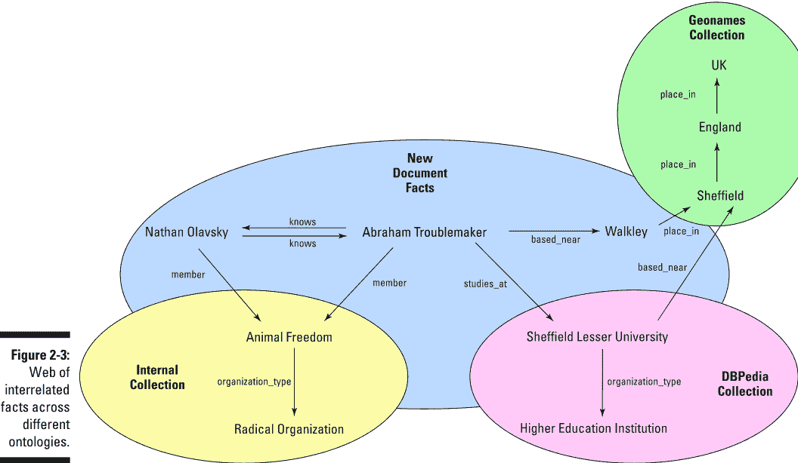
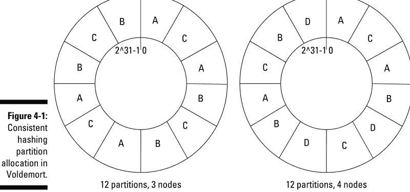
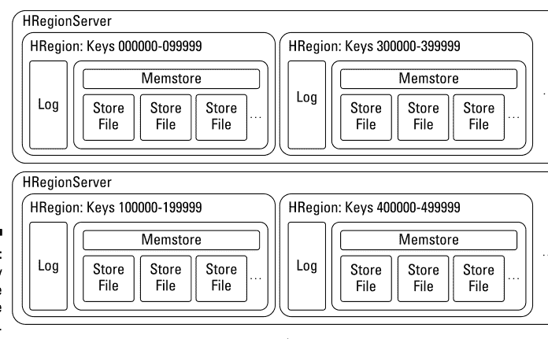
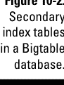
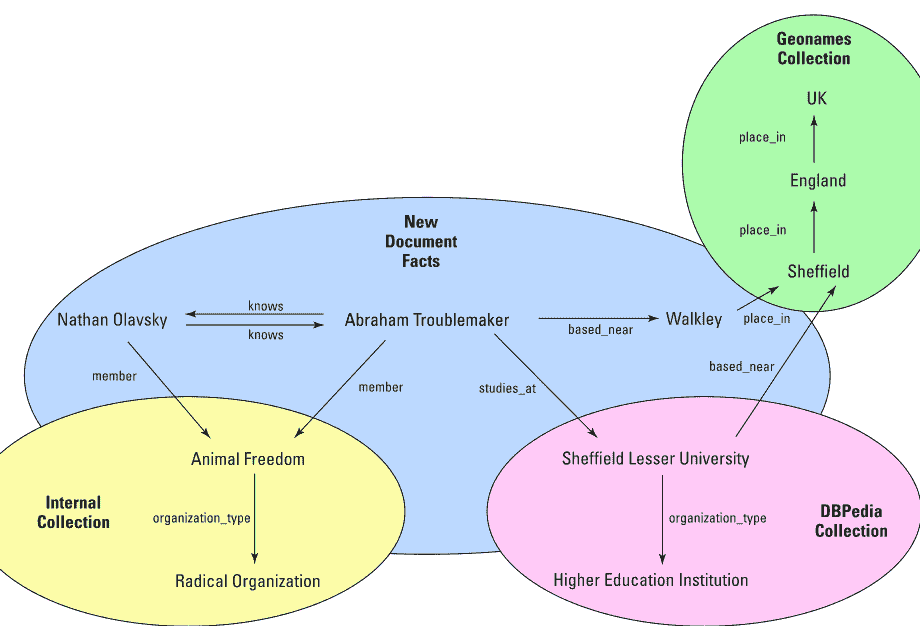
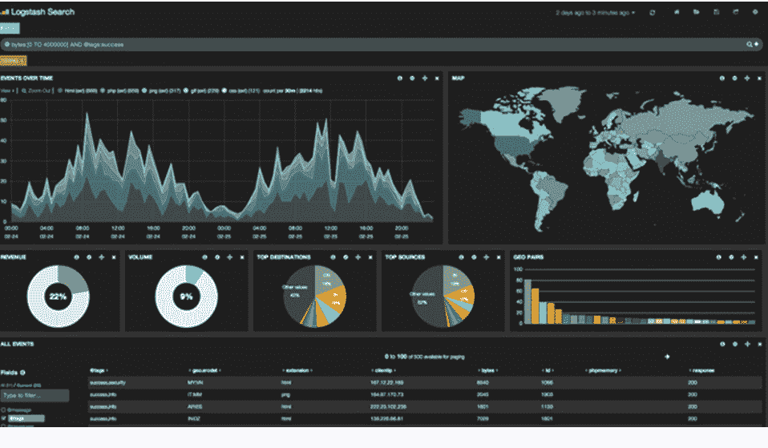
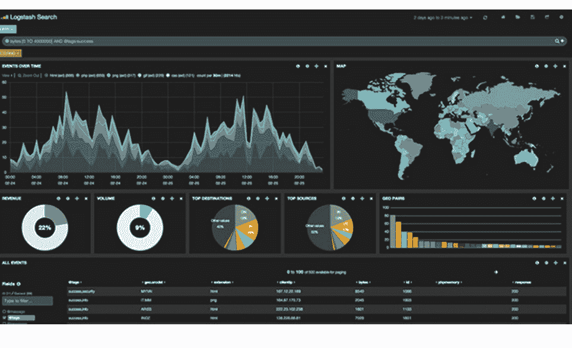

# NoSQL 入门指南

## 学习目标

- 使用不同类型的 NoSQL 数据库
- 使用 NoSQL 创建数据库管理系统
- 访问和分析海量非结构化数据

**Adam Fowler**


作者：Adam Fowler


# 索引

- 愚蠢的假设
- 本书使用的图标
- 超出本书范围
- 从何开始

## 第 1 章：介绍 NoSQL：概览

- NoSQL 简史
- Amazon 和 Google 的论文
- NoSQL 的特性
- 常见特性
- 不太常见的特性
- 企业级 NoSQL
- 为什么你应该关注 NoSQL
- IT 领域的最新趋势
- 传统方法的问题
- NoSQL 的优势与注意事项
- 管理不同的数据类型
- 列式
- 键值存储
- 三元组与图存储
- 文档
- 搜索引擎
- 混合型 NoSQL 数据库
- 可用的 NoSQL 产品
- 描述 NoSQL
- 应用一致性方法
- ACID
- BASE
- 选择 ACID 还是 BASE？
- 可用方法
- 在 NoSQL 上开发应用
- 多语言持久化 (Polyglot persistence)
- 多语言持久化详解
- 关系型数据库 (RDBMS) 的死亡？
- 集成相关技术
- 搜索引擎技术
- 商业智能、仪表板和报告
- 使用 Hadoop Map/Reduce 进行批处理
- Hadoop HDFS
- 语义
- 公有云
- 技术评估
- 哪种类型的 NoSQL 适合你？
- 搜索特性
- NoSQL 扩展
- 确保数据安全
- NoSQL 可视化
- 扩展你的数据层
- 业务评估
- 开发技能
- 快速获取价值
- 寻找帮助
- 决定开源还是商业软件
- 构建供应商购买策略
- 评估供应商能力
- 全球寻找支持
- 向云端扩展
- 获取支持
- 业务或关键任务特性
- 供应商声明
- 企业级系统问题
- 安全性
- 为故障做准备
- 垂直扩展
- 验收测试
- 监控
- 管理可用性
- 一致性权衡
- 实现 ACID 支持
- 管理键 (Keys)
- 分区
- 在分区上访问数据
- 管理数据
- 键值存储中的数据类型
- 数据复制
- 数据版本控制
- 扩展
- 简单数据模型——快速检索


# NoSQL 入门教程

## 内存缓存

## 缩短价值实现时间

## 使用简单结构

## 复杂结构处理

## 用户信息管理

## 投放网络广告

## 处理会话

## 支持个性化

## 高速数据缓存

## 高速键访问

## 在内存中缓存数据

## 将数据复制到从机

## 键值存储中的数据建模

## 对数据进行操作

## 评估 Redis

## 利用闪存优势

## 为速度付费

## 上文计算

## 评估 Aerospike

## 使用插件式存储

## 更改存储引擎

## 在内存中缓存数据

## 评估 Voldemort

## 分离数据存储与分布

## 使用 Berkeley DB 作为单节点存储

## 分布数据

## 评估 Oracle NoSQL

## 处理分区

## 容忍分区

## 二级索引

## 评估 Riak

## 选择键值存储

## 确保技能可用性

## 与 Hadoop Map/Reduce 集成

## 使用 JSON

## 寻找 Riak 支持 (Basho)

## 启用云服务

## 处理灾难

## 评估 Basho

## 在 Bigtable 中存储数据

## 使用行键 (row keys)

## 创建列族 (column families)

## 使用时间戳

## 处理二进制值

## 数据处理

## 分区你的数据库

## 集类

## 数据去规范化

## 管理数据

## 锁定数据

## 使用平板 (tablets)

## 配置复制

## 提升性能

## 压缩数据

## 缓存数据

## 过滤数据

## 管理多个数据中心

## 主主集群 (Active-active clustering)

## 管理时间

## 可靠性

## 像 Google 一样

## 确保可用性

## 可扩展性

## 并行摄入数据

## 内存缓存

## 索引

## 数据聚合

## 配置动态集群

## 处理稀疏数据


### 第13 章：Bigtable 的使用与设计

- 使用关系型数据库 (RDBMS) 存储稀疏数据
- 使用 Bigtable
- 分析日志文件
- 分析飞行中数据
- 构建数据摘要
- 管理表格化大数据
- 设计行键 (`row key`)
- 使用 HDFS 分发数据
- 批量处理 Bigtable 数据
- 评估 HBase
- 保护你的数据
- 单元级安全
- 评估 Accumulo
- 高性能 Bigtable
- 使用原生 Bigtable
- 数据索引
- 确保数据一致性
- 评估 Hypertable
- 全球数据分布
- 替换键值存储
- 快速插入数据
- 全球数据复制
- 评估 Cassandra
- 设计现代 Bigtable
- 集类
- 调优一致性
- 分析数据
- 搜索数据
- 安全 Cassandra
- 寻找 Cassandra 支持
- 管理和监控 Cassandra
- 主主集群 (Active-active clustering)

### 第14 章：文档数据库的常见特性

- 使用树形数据模型
- 处理文章文档
- 金融服务中的交易管理
- 发现文档结构
- 支持非结构化文档
- 作为键值存储的文档数据库
- 将值建模为文档
- 使用值信息
- 文档补丁
- 支持部分更新
- 流式处理变更
- 实时提供替代方案
- 分片
- 基于键的分片
- 自动分片
- 防止数据丢失
- 本地数据复制
- 使用多个数据中心
- 选择性复制数据
- 管理一致性
- 使用最终一致性
- 使用 ACID 一致性
- 内容发布
- 管理内容生命周期
- 将内容分发到销售渠道
- 管理非结构化数据馈
- 实体提取与富化
- 管理变化的数据结构
- 处理多样性
- 管理随时间产生的变化
- 数据整合
- 处理入站流
- 合并相关数据
- 以文档形式提供答案
- 提供 Memcache 替代方案
- 确保高速读取
- 使用内存文档缓存
- 支持移动同步
- 评估 Couchbase
- 提供熟悉的开发者体验
- 为您的数据建立索引
- 使用 SQL
- 链接到您的编程语言
- 评估 Microsoft DocumentDB
- 提供端到端的文档平台
- 确保一致的快速读写
- 支持 XML 和 JSON
- 使用高级内容搜索


## 目录

- 文档安全
- 评估 MarkLogic Server
- 提供 Web 应用后端
- 用一致性换取速度
- 坚持使用 JavaScript 和 JSON
- 寻找网络社区
- 评估 MongoDB
- 使用开源文档数据库
- 处理 JSON 文档
- 寻找语言绑定
- 有效索引
- 寻找 MongoDB 的支持
- 云端 MongoDB
- 高级功能授权
- 确保可持续的合作伙伴

### 第19 章：三元组与图谱存储的常见特性

- 决定使用图谱还是三元组存储
- 三元组查询
- 图谱查询
- 描述关系
- 做出决策
- 决定三元组（Triples）或四元组（Quads）
- 存储 RDF
- 使用 SPARQL 查询
- 使用 SPARQL 1.1
- 修改命名图
- 管理三元组存储结构
- 描述你的本体
- 使用 SKOS 增强你的词表
- 描述数据溯源
- 确保数据完整性
- 实现 ACID 兼容性
- 用于高可用性的分片和复制
- 用于灾难恢复的复制
- 使用三元组存储文档
- 描述文档
- 合并查询
- 提取语义函数
- 使用主体提取上下文
- 前向推理
- 追踪溯源
- 构建事实网
- 利用开放数据
- 整合来自 GeoNames 的数据
- 整合来自 DBpedia 的数据
- 链接开放数据发布
- 迁移 RDBMS 数据
- 管理社交图谱
- 存储社交信息
- 执行社交图谱查询
- 管理文档和三元组
- 存储文档和关系
- 实时合并文档
- 组合搜索
- 评估 ArangoDB
- 评估 OrientDB
- 评估 MarkLogic Server
- 图脚本化
- 自动索引
- 使用 SPIN API
- JavaScript 脚本
- 三元组级安全
- 与 Solr 和 MongoDB 集成
- 评估 AllegroGraph
- 使用分布式图存储
- 为关系添加元数据
- 优化查询速度
- 使用自定义图语言
- 评估 Neo4j
- 利用 Neo4j
- 高级路径查找算法
- 纵向扩展与横向扩展
- 遵循开放标准
- 寻找 Neo4j 的支持
- 集群
- 高性能缓存
- 基于缓存的分片
- 寻找本地支持
- 寻找技能
- 解析搜索引擎
- 搜索与查询
- 网络爬虫
- 索引


# 目录

- [搜索](#搜索)
- [数据存储的索引](#数据存储的索引)
- [使用常用连接器](#使用常用连接器)
- [定期索引](#定期索引)
- [告警](#告警)
- [使用反向查询](#使用反向查询)
- [匹配查询](#匹配查询)
- [企业搜索](#企业搜索)
- [连接系统](#连接系统)
- [确保数据安全](#确保数据安全)
- [创建搜索应用程序](#创建搜索应用程序)
- [配置用户界面](#配置用户界面)
- [良好的搜索 API 能为你提供什么](#良好的搜索-api-能为你提供什么)
- [通过分析超越基础搜索](#通过分析超越基础搜索)
- [搜索电子商务产品](#搜索电子商务产品)

## 搜索电子商务产品

### Amazon 类型的目录编制

### 地理空间距离评分

## 企业数据搜索

### 存储 Web 数据

### 搜索企业数据

### 搜索应用程序数据

## 警报

### 实现主动工作

### 寻找坏人

## 使用常见的开源工具

### 文本索引

### 使用 Lucene

### 分发 Lucene

### 评估 Lucene/SolrCloud

### 结合文档存储与搜索引擎

### 通用索引

### 使用范围索引

### 在内存数据上进行操作

### 检索细粒度结果

### 评估 MarkLogic

### 评估企业级搜索

### 使用 SharePoint 搜索

### 集成 NoSQL 和 HP Autonomy

### 使用 IBM OmniFind

### 评估 Google 搜索设备

## 存储和搜索 JSON

### JSON 通用索引

### 可脚本查询

### 评估 Elasticsearch

## 使用 Elasticsearch 产品

### ELK 栈

### 使用 Elasticsearch

### 使用 Logstash

### 使用 Kibana

### 寻找 Elasticsearch 支持

### 评估 Elasticsearch BV

## 多语言持久化的终结

### 一个产品，多种功能

### 最佳方案对比单一产品

### 混合方法的优势

### 单一产品意味着更成本

### 搜索技术如何提供更好的列存储

### 语义技术如何协助内容发现

## 按功能选择数据库

### 确保功能的深度和广度

### 遵循单一产品的路线图

### 构建任务关键型应用程序

### 确保数据安全

### 确保数据可访问

### 在高安全性环境中运行

## 数字语义出版

### 记者与网络出版

### 随时间变化的法律

### 元数据目录

### 创建单一视图

### 替换旧系统

### 探索数据

## 管理三元组和聚合

### 从文档生成三元组

### 读取时强制模式

### 评估 OrientDB

### 结合具备企业能力的文档与三元组

### 组合数据库、搜索和应用服务

### 无模式与模式无关

### 提供 Bigtable 特性

### 保护信息访问

### 评估 MarkLogic


# 目录

- 第 33 章：MarkLogic ................................................................................................ 389
  - 理解 MarkLogic Server .................................................................................................. 389
  - 通用索引 .................................................................................................................................. 390
  - 范围索引和聚合查询 ................................................................................................. 391
  - 结合内容与语义技术 .................................................................................. 392
  - 添加 Hadoop 支持 ....................................................................................................... 393
  - 间歇性网络上的复制 ................................................................................................. 394
  - 确保数据完整性 ........................................................................................................................ 394
  - 信息分段 .................................................................................................... 395
  - MarkLogic 公司 .................................................................................................................... 396
  - 寻找经过培训的开发者 ................................................................................................. 396
  - 寻找 24/7 技术支持 ................................................................................................................. 397
  - 在云中使用 MarkLogic ............................................................................................. 397

- 第 34 章：NoSQL 优于 RDBMS 的十个优势 ......................................................... 401
- 第 35 章：关于 NoSQL 的十个误解 ................................................................................. 407
- 第 36 章：开发者喜爱 NoSQL 的十个原因 ......................................................... 413

# 引言

作为一种运动，也作为一项技术而热爱 NoSQL。这是一个节奏快速、不断变化的领域。几乎每隔一个星期，就会有一个新的 NoSQL 数据库诞生，用以解决特定的现实世界问题。

作为一种运动，NoSQL 的有趣之处在于它独立于任何商业组织。事实上，它是对领域感兴趣的个人聚集在一起并分享想法的智力结晶。一些核心思想来自大型商业组织，包括 Google 的 Bigtable 论文和 Amazon 的键值存储论文，但 NoSQL 是以开源的形式普及开的。

软件开发的正常流程是：几家商业公司成立并相互竞争，领域逐渐缩小。然后，一旦剩余的公司证明了其价值，它们就会被 Oracle、IBM 和微软等巨头吞噬。开源替代方案只在这一周期的后期阶段出现。

NoSQL 的情况并非如此。诚然，早期有少数几个参与者（在 MarkLogic 的情况下是非常早——追溯到 2001 年）。然而，大多数公开的 NoSQL 产品在公司将其整合到商业产品之前，是在开源社区创建的。

本书鼓励采用实用的方法将 NoSQL 视为一组技术和产品进行评估。本书将告诉你如何确定哪些产品可能满足你的需求，以及如何选择最合适的产品。信息让你能够发现 NoSQL 数据库可以解决的业务和技术问题。

读完本书后，你不仅能够识别应该使用哪种 NoSQL 数据库，更重要的是，你将知道在购买之前，针对他们的软件和服务，应该向供应商询问哪些问题。

本书从现实生活中、复杂的任务关键型应用的角度讨论 NoSQL。理解复杂的企业级应用可以让你在类似于工作场所的背景下，看到每个 NoSQL 数据库的缺陷和优点。

本书将引导你进入这一令人兴奋的技术领域，并重点介绍你和你的组织如何获得与描述相似的益处。我希望你的旅程愉快！

# 愚蠢的假设

我写这本书的主要目标是介绍许多 NoSQL 数据库，并指出它们的共同特征和特定用例。

我的另一个目标是指出 NoSQL 数据库已经准备好大显身手了！我尽力指出在何处可以配置以支持这一点，或者在产品提供中仍然存在哪些空白。

我希望尚未采用 NoSQL 的大型企业能从书中获得安慰。我也希望它能成为对 NoSQL 数据库供应商的行动号召，促使他们完善产品，以支持每个业务部门和此类系统中用例的各项需求。

由于本书考虑的是企业级的问题，我必须意识到长期开发计划、韧性系统、支持以及服务的可用性等问题。

- Riak：一种键值存储
- MongoDB：一种聚合（文档）数据库，主要存储 JSON
- Apache Cassandra：一种列存储（Bigtable 的克隆）
- Neo4j：一种三元组和图存储器
- MarkLogic：主要存储 XML 文档，也支持 JSON、二进制文件、文本。还提供内存列索引、三元组存储和搜索引擎
- Redis：一种仅限内存的键值存储
- Elasticsearch：与许多 NoSQL 数据库配合使用的开源搜索引擎

我非常希望在本书中为广泛的数据库提供背景。我还需要确保没有多次涵盖同一个主题。我决定每涵盖一种主要管理一种数据类型（文档、键值、列/表、三元组/图）的数据库。

我非常确保不会让你产生每种数据类型领域的每个数据库都是同等的这种印象。尽管我只专注于每种类型中的一个数据库，我也会提到其他数据库在某些情况下更强或更弱的地方。

我加入了一些“变数”。我想涵盖 Redis，将其作为一种内存数据库。虽然内存数据库已经存在多年，但 Redis 提供了一个适用于不同问题的版本。

我还涵盖了一个 NoSQL 解决方案：MarkLogic Server。我包含这个数据库有两个原因：首先，也是最重要的，MarkLogic Server 可以处理多种数据类型，而其他只专注于一个领域。

其次，我非常喜欢 MarkLogic Server——以至于我加入了高级销售工程师。MarkLogic 在 NoSQL 数据库软件销售方面也是领导者。（大多数开源 NoSQL 公司只销售扩展和服务，所以这可能是！）

虽然 Elasticsearch 严格来说不是数据库，但它使用了 NoSQL 方法作为搜索引擎。NoSQL 数据库用于存储结构化和非结构化数据。这意味着搜索引擎是适合涵盖的领域。事实上，Elasticsearch（以及 Solr/Lucene）经常与开源 NoSQL 数据库集成，以提供更高级的信息检索和索引服务。

在整书中，你会看到这些小图形图标来识别有用段落。


**提示（Tip）**：图标标记了让特定任务变得简单的提示和快捷方法。


**记住（Remember）**：图标标记了特别重要的信息。


**技术细节（Technical Stuff）**：图标标记了具有高度技术性质的信息，你可以安全地跳过。


**警告（Warning）**：图标告诉你需要留心的事情！它标记了可能会让你少很多痛苦的重要信息。警告：不要跳过这些图标！

通过这本书，你将获得开启旅程所需的所有信息。你可以从第 1 章开始，也可以查看目录从你最感兴趣的话题开始。

# 第一部分

访问 `www.dummies.com` 获取优质 Dummies 在线内容。

## 在这一部分中……

- 准确发现 NoSQL 到底是什么。
- 识别术语。
- 技术进行分类。
- 访问 `www.dummies.com` 获取优质 Dummies 在线内容。

# 第 1 章

## 介绍 NoSQL：概览

### 本章内容

- 回顾过去
- 识别变化
- 应用能力

数据格局已经发生了变化。在过去的 15 年里，万维网的爆炸式增长、社交媒体、你必须填充的表单以及与互联网连接的增强，意味着比以往任何时候都有更大量的数据正在被使用。

新的且关键的信息每小时都在产生，从人们晚餐吃什么的简单推文，到医疗保健提供者关键的医疗记录。因此，系统设计人员不再有奢侈去把自己关在房间里几年来设计处理新数据的系统。相反，他们必须快速创建系统来存储数据，并使信息易于搜索、整合和分析。这一切意味着需要一种特定的系统技术。

好消息是，已经以 NoSQL 数据库的形式存在着大量种类的系统。不太好的消息是，许多人并不理解 NoSQL 数据库是做什么的，或者不知道为什么要以及如何使用它们。不过不用担心，这就是我写这本书的原因。在本章中，我将向你介绍 NoSQL，并帮助你理解为什么现在需要进一步考虑这项技术。

## NoSQL 简史

NoSQL 这一术语的含义自 1998 年推出以来一直在演变。因此，在这一节中，我想解释目前如何定义 NoSQL，并为它提议一个更合适的定义。我甚至在侧边栏中介绍了 NoSQL 的历史背景。

NoSQL 并不是由几个车库里的小子发明的单一技术，也不是数学家对数据结构的理论化假设。NoSQL 背后的概念在几年中缓慢发展。随后，独立小组采取了这些想法并将其应用于自己的数据问题中，从而创建了今天存在的各种 NoSQL 数据库。

### 2006年

初看之下，与 RDBMS 模型相似，Bigtable 使用单个键存储行并将数据存储在相关的列族（`column families`）中。因此，访问所有相关数据就像在关系数据库 SQL 中使用 ID 检索记录一样简单，而无需进行复杂的连接（`join`）。

这种模型还表明，分布式数据比关系型数据库更简单直观。通过使用简单的键，相关数据——例如同一网站上的所有页面（在 Google 的论文中给出的例子）——可以被分组在一起，这加快了分析速度。你可以将 Bigtable 视为许多具有关系的表格的替代方案。也就是说，在 Bigtable 中，列族允许相关数据存储在单个记录中。

Bigtable 设计为分布在通用服务器上，这是在万维网被采用导致信息爆炸后创建的所有 NoSQL 数据库的共同主题。通用服务器是指没有复杂花哨功能的服务器——例如带有可能 2 个 CPU、8 到 16 个核心以及 32 到 96GB 内存的戴尔或惠普服务器。它们并不华丽，但数量多，而且比买一个大服务器要便宜（这就像把你所有的鸡蛋都放在一个昂贵的篮子里）。

### 第一次 NoSQL “聚会”

首次记录在案的 NoSQL 术语是由 Carlo Strozzi 在 1998 年使用的。他当时正在访问旧金山，想聚一些人在一起谈谈他的轻量级关系型数据库。

开发者不需要过于担心底层数据库的结构——开发者只需要在对象上调用函数。

关系型数据库管理系统 (`RDBMS`) 是当今的主流数据库。如果你问在过去 20 年内毕业的计算机学生数据库是什么，他们很可能会描述为关系型数据库。

使用 SQL 是有成本的。复杂的查询很难调试，要很好地执行它们甚至更难，这增加了开发、管理和测试的成本。寻找一种替代机制来至少隐藏这些复杂性，看起来是降低成本并更容易采用最佳实践的好方法。

Carlo 使用 NoSQL 术语是因为数据是通过 shell 脚本访问的，而不是使用标准的结构化查询语言 (`SQL`)。原始含义是“没有 SQL (No SQL)”。也就是说，它没有使用 SQL，而是使用接近开发者源环境的机制——在 Carlo 的情况下，是 Unix 世界。

然而，抽象是有限的。最终，将会需要完全不同的思考方式的数据问题。现有的关系技术无法很好地处理此类问题，而互联网和万维网的爆炸式增长将引发这些问题。

这个术语的使用显示了开发者社区对使用 SQL 的挫丧。在当时流行的数据库具有巨大共性的开放标准中，NoSQL 这一术语显示了对更好方式的渴望。或者至少，对于穿梭于复杂冗长 SQL 的老开发者来说，这是一种更好的方式。


#### Amazon Dynamo 论文

Amazon 在 2007 年发表了自己的论文描述了其应用。根据 Amazon 的话：“Dynamo 用于管理具有高可靠性要求且对权衡有严格控制的服务。”论文随后描述了如何通过主键存储大量数据、如何使用一致性哈希（`consistent hashing`）对数据进行分区和分布，以及如何使用对象版本控制来维护跨数据中心的一致性。论文基本上描述了第一个全球分布式键值存储。在这里，键是逻辑 ID，而值可以是开发者感兴趣的任何二进制值。一个非常简单的模型。

> 许多开源 NoSQL 数据库在 2009 年出现。Riak, MongoDB, HBase, Accumulo, Hypertable, Redis, Cassandra 和 Neo4j 都在 2007 年到 2009 年之间创建。这些只是期间创建的少量 NoSQL 数据库……创新以惊人的速度移动。

> 你遇到过这些新式的关系数据库吗？不介意用查询语言换取扩展性吗？或者你只是喜欢尝试新奇的事物？无论如何，这次聚会都适合你。加入我们，了解这些新发现的 Dynamo 云和 BigTables 最近是如何受欢迎的。

> 这次聚会包括来自 LinkedIn、Facebook、Powerset、Tumblestone、ZEvents 和 couch.io 的演讲者，分别讨论了 Voldemort、Cassandra、HBase、Hypertable 和 CouchDB。这次会议代表了人们首次聚集在一起讨论这些非关系数据库的不同方法，并将其标记为 NoSQL。

> “这次聚会关于开源、分布式、非关系数据库”。

这两篇论文启发了许多不同的机构创建它们自己的 NoSQL 数据库。由于变体之多，一些人认为有必要会面并讨论正在采用的各种方法（参见“NoSQL 会面”侧边栏）。

NoSQL 运动包含了数百种 NoSQL 数据库产品，这导致了该术语的多种定义——一些具有非常常见的原则，另一些则并不常见。我将在第 2 章详细介绍这些原则。

数据库的爆炸式增长是因为非关系方法被应用于广泛的问题，而在这些领域，关系型数据库管理系统（`RDBMS`）传统上较弱（本书将涵盖这些细节）。NoSQL 数据库的创建还为了那些在 `RDBMS` 中需要大量管理，或者需要通过复杂的管道代码中进行数据粉碎和重组的数据结构和模型。

每个问题都导致了自己的解决方案——以及自己的 NoSQL 数据库，这就是为什么会出现这么多新数据库。同样，提供 NoSQL 功能的现有产品也发现并采纳了 NoSQL 标签，这使得架构师、首席信息官（`CIO`）和 IT 采购者的工作变得困难，因为一个 NoSQL 数据库不太可能解决特定业务领域的所有问题。

那么，你如何知道 NoSQL 将帮助你，或者应该选择哪种 NoSQL 数据库？这些问题的答案将在第一部分的剩余内容中通过讨论各种 NoSQL 数据库及其能解决的问题给出，从以下涵盖 NoSQL 特性的节开始讨论。

NoSQL 的书籍和博客对什么是 NoSQL 数据库有不同的看法。本节重点介绍一些常见的误区和炒作。

### 常见特性

下列表所示的 NoSQL 四个核心特性适用于大多数 NoSQL 数据库。该列表将 NoSQL 与传统 DBMS 进行了比较：

- **模式无关 (`Schema agnostic`)**：数据库模式是所有可能的数据结构的描述。在 NoSQL 数据库中，不需要模式，这让你拥有在不进行预先设计的情况下存储信息的自由。
- **非关系 (`Nonrelational`)**：关系建立了表与表之间的连接。例如，事务详情可以连接到单独的表中。在 NoSQL 数据库中，这些信息作为聚合记录存储。
- **通用硬件 (`Commodity hardware`)**：某些数据库的设计初衷是在专门的存储和处理硬件上运行良好。在 NoSQL 数据库中，可以使用廉价的现架服务器。增加更多服务器允许 NoSQL 数据库扩展以处理更多数据。
- **高度可分布性 (`Highly distributable`)**：分布式数据库可以在多个设备上存储和处理信息。在 NoSQL 数据库中，可以使用服务器集群来存放大型数据库。

接下来，我将带你回顾前面的术语，并描述为什么 NoSQL 数据库很有帮助以及它们何时有用。

## 模式无关


# NoSQL 数据库概览

## 模式无关性

NoSQL 数据库是模式无关的。在 NoSQL 数据库中存储数据之前，你不需要进行大量的预先设计。你可以开始编写代码并检索数据，而无需知道数据库内部是如何存储和运行的。如果你需要高级功能，可以手动添加索引或微调数据结构。模式无关是 NoSQL 和关系型数据库之间最显著的区别。

模式无关的另一种解释是“读时模式”。你仅在构建查询（从数据库中检索信息的问题）时才需要知道数据是如何存储的。从实际目的而言，这个特性正如其字所示：你需要知道读时模式。

模式无关数据库的巨大优势是缩短了开发时间。当你通过多次开发发布并需要更改数据库中的内部数据结构时，这种优势会随之增加。


例如，在传统的 RDBMS 中，你会经历一个模式重新设计的过程。模式指示数据库应该期望什么样的数据。要更改存储的数据或结构，你必须使用修改后的模式来指示数据库。如果你要进行更改，将不得不花费大量时间重构现有数据。在 NoSQL 数据库中，你只需要存储不同的数据结构。不需要提前告诉数据库。

你可能需要相应地修改你的查询，也许偶尔需要某个特定索引（如允许小于和大于查询的整数范围索引），但整个过程比在 RDBMS 中要不痛苦得多。

> 开发者被允许对数据库做随心所欲！这让 CIO 和数据库管理员（DBA）背脊发凉。缺乏控制被认为是一种固有风险。但只有当你允许开发者在没有经过开发、功能测试和用户验收测试流程的情况下更改生产系统时，才存在缺乏控制的问题。我没有发现这个过程被跳过了，所以只需将其视为一种理论风险即可。


RDBMS 的流行是因为它的灵活性，并且通过使用 SQL 加速了查询。NoSQL 数据库为更改模式和查询提供了这种灵活性，这是它们随着时间推移被越来越多采用的原因之一。

> 即使在查询上，你可能不需要太担心模式变化——考虑对字段编号建立索引，其中账户可以在 NoSQL 数据库存储的文档任何位置找到。你可以更改结构并移动数字存储的位置，如果该元素在数据库的其他地方有相同的名称，它仍然可以用于查询更改。


有时，你还会看到提到“无模式”这个术语，这有些是牵强的，因为并没有很多机会让你可以在不知道特定字段存在的情况下进行通用查询——例如，纯全文本搜索查询并不局限于特定字段。


注意，并非所有 NoSQL 数据库都是完全模式无关的。某些数据库（如 `HBase`）要求停止数据库以更改列定义。它们仍然被认为是 NoSQL 数据库，因为不需要为每个记录预先知道所有定义的字段（在这种情况下为列）。

RDBMS 允许记录中的单个字段标识为空值（无定义值）。RDBMS 的问题是，当为了未来可能在某列中有值而预留存储时，存储的大小和性能会受到负面影响。在 `Cassandra` 中，你只需不提供该列的数据，这解决了问题。

## 非关系型与反规范化

关系型数据库的设计基础是一个表中的行可以与另一个表中的一个或多行建立关系。因此，可以构建出相互关联的结构。这种基础描述了表与表之间的关系。一个订单可能关联到多个交付行，但每个交付地址也关联到多个订单行。这是一个多对多的关系。

| 关系型数据库的设计基础是，一个表中的行可以与另一个表中的一个或多行建立关系。因此，可以构建出相互关联的结构。 | 必须使用一种机制在运行时根据需要将表连接在一起，以适应到单一的结果结构中。 |
|---|---|
| 此，查询是作为单行集返回的。这意味着一个查询 | 这种连接机制是易理解的，并且从性能角度来看是可预测的。 |

与其在关系型数据库的各种表中插入行，你不如将所有的订单信息存储在一个单一结构中——例如存储为 `JSON` 或 `XML` 文档。

这引发了一个问题：“如果所有数据都存储在单个记录中，你真的需要关联关系吗？”对于许多应用程序，特别是那些需要存储特定时间点额外状态的应用（例如金融交易），答案是“不需要”。然而，如果你习惯了关系型数据库，你可能会多次存储相同的信息，以这种方式存储信息有一个明显的缺点。

在关系型数据库理论中，目标是使数据**规范**（即，通过组织字段和表来消除重复数据）。在 NoSQL 数据库——文档型或聚合型数据库中——你通常会刻意对数据进行反规范化，即多次存储某些数据。

例如，你可以在客户随时间创建的多个订单中多次存储“客户送货地址”，而不是存储一次并在多个订单中引用它。这样做可能需要数据库额外的存储空间，并在你的应用程序管理中进行一些预先考虑。为什么要这样做呢？

多次存储数据有两个优势：

- **易于存储和检索**：只需保存和获取单个记录即可。
- **查询速度**：在关系型数据库中，你需要在查询时跨表连接信息并添加约束。这可能需要数据库引擎评估许多表。跨不同表的查询约束越多，你的查询速度就减慢得越快。（这就是为什么 RDBMS 使用预计算视图的原因。）在 NoSQL 数据库中，你评估查询所需的所有信息都在单个文档中。因此，你可以快速生成匹配文档的列表。

关系型视图和 NoSQL 反规范化是处理跨记录数据问题的两种不同方法。在 NoSQL 中，你可能需要维护多个代表相同数据不同视图的反规范化数据。这种方法增加了存储成本，但能带给你远更好的查询时间。

鉴于存储成本的不断降低以及开发和查询速度的提高，反规范化数据（又称物化视图）并不是排除 NoSQL 解决方案的致命理由。它只是解决同一个问题的不同方式，各有优缺点。


再次，这条规则也有例外！三元组存储和图数据库具有关系的基本概念。区别在于，每一个记录（由三个部分组成的三元组——主语、谓语和对象，例如“Adam 喜欢奶士”）都包含一种关系。

NoSQL 是处理相关数据的一种根本上不同的方法，与 RDBMS 有很大不同。因此，“非关系”一词是非关系数学理论的缩写。

## 高可分布性和使用廉价硬件

在许多 NoSQL 数据库中，一个关键的设计决策是使用多台计算机来存储单个数据库的数据，而不是将整个数据库放在单台服务器上。

跨机器存储数据并允许对其进行查询是困难的。你必须将查询发送到所有服务器并等待回复。希望你设置机器时，它们足够快可以相互通信以处理分布式查询！

这种方法的主要优势在于处理非常大的数据集，因为对于存储需求来说，即使是最大的单服务器也无法存储或处理你需要的所有数据。考虑 Twitter 和 Facebook 上的所有信息。你需要一种分布式机制来有效管理所有数据，即使它们大部分是人们早餐吃了什么或剪辑的视频。

分布数据库的一个优势是你可以使用廉价的服务器（称为商品级服务器），它们比单台极其强大的服务器便宜得多。（不过，一台不错的服务器仍需花费你 10,000 美元！）对于较小的数据集，购买三台商品级服务器可能比购买一台高功率服务器更便宜。

另一个关键优势是增加高可用性更容易；通过分布数据已经完成了一半。如果你在集群的服务器上复制一次或两次你的数据，即使其中一台服务器崩溃、烧毁或死亡，你的数据也是可用的。

并不是所有开源数据库都支持高可用性，除非你从开发它的公司购买受支持的付费版数据库。

仔细考虑你需要的是三元组存储还是图存储。三元组存储通常是分布式的，而图存储不是。你需要哪一个取决于你必须支持的查询。你可以在第 2 章找到更多关于三元组和图存储的知识。


## 不那么常见的特性

虽然某些特性对于 NoSQL 数据库来说相当常见（例如，模式无关性和非关系结构），但数据库缺少以下一个或多个功能并仍然符合现代 NoSQL 数据库的定义，这并不罕见。

### 开源

NoSQL 软件是独特的，因为开源运动驱动了开发，而不是遵循某个特定的商业公司。你可以在那里找到许多适应各种需求的开源 NoSQL 产品。当开发者无法找到满足需求的 NoSQL 数据库时，他们就创建了一个，并将其作为开源发布。

我没有在常用特性中包含 ACID 支持，因为大多数 NoSQL 是由商业公司驱动的。开源和商业公司的区别在于，开源供应商提供支持和实施服务。

结果看起来很棒，所有者也跃跃投入。问题在于，精美的外表可能掩盖了真实的引擎。


购买需谨慎！在选择 NoSQL 数据库时，请记住“总拥有成本”。许多组织获取开源产品后发现他们需要企业特性。

在 2014 年之前，大多数 NoSQL 不将 ACID 作为其定义特征。现在情况不再如此。

符合 ACID 标准的事务意味着数据库的设计确保不会丢失数据：


- 每次操作都使数据库从一个有效状态移动到另一个状态（原子性）。
- 在任何时间，每个人看到的视图相同（一致性）。
- 数据库操作互不干扰（隔离性）。
- 当数据库说它已保存数据时，你就知道数据是安全的（持久性）。

并不是所有的 NoSQL 数据库都有 ACID 事务。例外是 `FoundationDB`、`Neo4j` 和 `MarkLogic Server`，它们提供序列化的 ACID 事务。

先说明一下，我销售企业级软件九年了，实施经验更长，所以你可能猜得到，我对这个主题充满热情。随着时间的推移，我见证了它对开发和支持的高度关注，这些都让许多公司在关键任务软件上做出巨大投资时感到放心。

# 第 1 章：介绍 NoSQL：概览

## 本书对 NoSQL 的定义

我对我 NoSQL 的定义应用了高度科学的“鸭子测试”：如果它看起来像鸭子，叫起来也像鸭子……那么它可能是一只鸭子！这种方法对于鸭子类型语言的开发者来说非常熟悉，他们可能反对严格的科学思维类型系统。

在当今的 NoSQL 生态系统中，数据库设计和理论的不同方法随处可见，作为本书的作者，我觉得我有责任涵盖这些内容。

本书介绍了主流案例和边缘案例，以便你理解 NoSQL 案例的边界。因此，我涵盖了许多数据库，其中一些你可能会决定使用，而另一些可能根本不适合你。在我拙看来，这正是这本书与其他书籍脱颖而出的原因（当然，不会提到任何名字和头衔，否则我的律师会把我吃掉——而且我们没有人应该承受那可能带来的后果）。

如果一个软件遵循以下条件，它就是一个 NoSQL 数据库：

- 不需要为创建的每个记录都需要严格的模式。
- 可以在廉价硬件上进行分布式部署。
- 不使用关系型数据库数学理论。

我仿佛能看到由于这个广泛的定义而目瞪口呆的人！然而，许多软件也是如此。某些软件很容易启动，但在大规模部署中将是不可靠的。这只是我在书中包含的一个需要关注的方面的示例。

以下列表列出了大型企业在投资运行其系统核心的软件产品时寻找（或应该寻找）的必要特性：

- 高可用性：当单个服务器宕机时的容错能力。
- 灾难恢复：当数据中心宕机，或者更有可能是某人在数据中心外挖断了网线时的准备。
- 支持：当产品出现问题（或被使用不当！）时，有人在背后提供支持。
- 服务：产品专家，可以就最佳实践提供建议，并帮助确定如何使用产品来解决新的或异常的业务需求。
- 生态系统：合作伙伴、经验丰富的开发者和产品信息的可用性——避免被锁定在单一供应商昂贵的支持和服务的合同中。

## 为什么你应该关注 NoSQL

如果你在想 NoSQL 仅仅是一个小众解决方案还是一个日益主流的解决方案，答案就在下面的讨论中。所以，是时候谈谈近期趋势，以及你如何在传统的 RDBMS 方法之外使用 NoSQL 数据库了。

### IT 领域的近期趋势

自从万维网诞生和连接互联网设备的爆炸以来，信息共享急剧增加。我们生活的细节大幅增加。我们的数据是非结构化的，这难以量化。许多数据是非结构化的，而且结构不断演变。

### 模式重构开销

考虑一个零售网站。如果零售商现在需要将产品打包成可能变化的交付物怎么办？

在关系系统中，你现在必须花大量时间决定如何最好处理这种重构。你是创建一个订单组概念，每个组关联到一个不同的交付计划？还是创建一个包含交付信息的交付计划，并关联到订单项？

开发者还必须重构他们的每一个查询。数据库管理员必须重做所有的视图。简而言之，这是一项巨大且昂贵的工程。

如果你改为使用 NoSQL 数据库，你可以立即开始你的新结构。对索引查询仍然有效，因为相同的数据存储在单个文档中，只是在它的其他位置。你有两套查看历史订单的逻辑，但将新视图插入应用程序比重构整个应用程序的数据模型要容易得多。（技术栈由数据库、业务应用层和用户界面组成）。

管理你无法控制的外部数据源是一个类似的问题。考虑许多多样的 Twitter 应用创建推文。难以置信，一条简单的推文涉及大量数据，其中一些是特定的，另一些是对所有推文通用的。

或者可能你正在存储和管理跨版本的相同 XML 文档。这仍然是一个差异问题。你可能需要同时支持两种结构。这种情况在金融服务、保险和公共部门（包括联邦政府的图书馆元数据目录）以及信息共享存储库中很常见。

关系本身也可以包含自己的元数据。上述的每个场景都有一种 NoSQL 数据库类型可以克服 RDBMS 的局限性：分别是键值、列式和三元组存储。请参阅第 2 章以了解更多类型。

在金融服务中，`FpML` 是一种广泛用于管理交易的 XML 格式。某些交易，特别是衍生品市场中的，持续数周或数月，涉及许多机构。每家银行都使用其特定的 `FpML` 版本，并带有自己的自定义标签。

零售保险也是如此。每家保险公司都有自己的字段和术语（或其子集），即使它们遵循相同的标准，例如来自 `ACORD` 保险标准组织的标准。

这正是 NoSQL 数据库的模式无关或读时模式特性展现价值的地方——它能够处理任何形式的数据。如果前面的话听起来很熟悉，我强烈建议你评估一种 NoSQL 解决方案来管理你的数据。

### 非结构化数据的爆炸

我开始在 `FileNet` 的销售工程工作，这是一家企业内容管理公司，现在是 `IBM` 的一部分。当时我被一项调查震惊了，显示组织 80% 的数据本质上是非结构化的，而且这个比例正在增加。在九年后的今天，这项统计数据仍然适用，尽管比例可能更高。从那以后我遇到的许多组织都没有以连贯的方式组织数据，以便回答跨越整个组织的复杂问题。

机构日益关注的重点是利用可用数据结合自己的数据来获得更深刻的见解——例如，使用政府发布的开放数据来发现疾病模式、研究疾病爆发，或挖掘推特以发现特定产品的受欢程度。

无论动机是什么，都有需要将各种数据（其中许多是非结构化的）汇聚，并利用它们来回答业务问题。大量数据存储在纯文本字段中。从推文到医疗笔记，计算机要评估文本中什么是重要的真的非常、非常困难。


# 存储数据和发现相关信息面临着问题

数据库通过索引也做着同样的事情。在 NoSQL 中，数据库端和搜索引擎之间的界限变得越来越模糊。这使得非结构化信息可以以与更规则（尽管变化非常快）的信息相同的方式进行管理。甚至可以构建存储内搜索，用于触发非结构化数据中的实体提取和实体富化活动。

考虑一个发布关于产品推文的人。你可能有一个产品列表、医疗问题列表以及正面和负面短语列表。能够写下“如果新来一条提到 `Ibuprofen` 的推文，将其标记为药物”，将让你能够看到特定药物的使用频率，或者指定你只想看到提到 `Ibuprofen` 药物的记录。这一过程被称为**实体提取**。

同样，如果提到了“真的很酷”这种观点，你将其标记为带有正面或负面属性的观点。标记数据并添加额外信息被称为**实体富化**。

当 NoSQL 数据库和更改搜索的技术相结合时，实体富化是一种常用模式（有关此主题，请参考第 3 章和第 16 章）。

## 稀疏数据问题

如提到的，关系型数据库可能会受到稀疏数据问题的影响——这就是为什么列可能有特定值，但列通常是空的。

考虑一个联系管理系统，它可能有家庭电话、手机、推特 ID 和其他联系字段。如果你的手机像我的一样，通常你只有这些字段中的一个或两个是存在的。

使用 RDBMS 需要在未使用的列中放置空值（`null value`）。可能有 200 个不同的字段，其中 99% 是空白的空值。

RDBMS 仍然会为这些列分配磁盘空间，因为在未来编辑联系数据后，它们可能会有值。这造成了资源的浪费。在结果集中通过 SQL 检索 198 个空值也是低效的。

NoSQL 数据库的设计旨在规避这个问题。它们只存储和索引客户端应用程序提供的内容。不存储空值，存储空间被恰当分配但未被使用。你只需要存储你需要使用的内容。

## 动态变化的关系

你可能会随着时间的推发现事实和关系。考虑 LinkedIn，某人可能是你的二度联系（朋友的朋友）。你认识了这个人，因此通过在应用程序中插入单个事实或关系，将她添加为一级关系。

你可以更进一步，定义这些关系的子类，例如“合作过”、“是...朋友”或“已婚”。你甚至可以为这些关系添加元数据，例如“自某日起起相识”。

关系型数据库并不擅长动态管理这些内容。当然，你可以对上述关系建模，但如果在实体或主体之间发现或推断出一种新的关系，而这种关系在原始系统设计期间没有被考虑过怎么办？

使用 RDBMS 处理这些将需要不断增多的多对多关系和链接表，每个关系类对应一个表模式。这种方法很难跟进和维护。

复杂关系的另一个方面在查询端。如果你想知道与某人隔了三度关系的所有呢？这是 LinkedIn 上一个常见的统计数据。

光是写 SQL 就会让你头疼。“返回所有与 Person1 相关的人，或者与 Person2 有关系且 Person2 与 Person1 相关的人，或者与 Person3 相关且 Person3 与 Person4 相关且 Person4 与 Person1 相关的人。噢，请确保没有重复项？”

这些自引用查询（`self-referencing queries`）在 RDBMS 中很难构建查询，而且运行性能很差。

三图存储（`Triple graph store`）NoSQL 数据库的设计考虑了动态变化的关系。它们专门使用更简单的数据模型，但在极大的规模上确保这些问题可以被快速回答。

## 全球分布与访问

我们生活在一个互连的世界里，但互连并没有无限的带宽，甚至没有保证连接性。要在跨大陆范围内提供全球高性能的服务需要一定的数据复制。例如，来自威斯康星州某人的推文会在爱尔兰或新西兰写入一个缓存副本。这是为了提高性能。

许多 NoSQL 数据库提供了智能将信息复制到分布式服务器的能力，因此这通常内置在数据库层面，并包含了根据你的需求进行调整的设置和 API。很多时候，这要求全局副本具有稍旧的数据视图。

对于推文来说，延迟是可以接受的。对于数十亿美元的金融交易，则不然。需要谨慎管理这一点（有关关键任务问题，请参阅第 3 章）。

# 第 2 章：NoSQL 数据库设计与术语

## 本章

- 识别和处理不同类型的数据
- 描述 NoSQL 及其术语
- 完全涵盖一致性选项范围
- 集成相关技术

新的数据管理挑战引发了一种新的数据库技术——NoSQL。NoSQL 的思维和技术标志着对传统数据管理技术的转变。面对所有新术语、新技术以及各种选择，要对 NoSQL 给出简洁的描述并非易事。

NoSQL 数据库仅仅是现有技术之上的一个层，用于解决略有不同的用例。它们是完全不同的物。每种类型的 NoSQL 数据库设计用于管理不同类型的数据。理解你想要管理的数据将帮助你应用正确的 NoSQL 解决方案。

NoSQL 数据库的流行很大程度上是因为它们为开发者提供的速度。与关系型前身相比，NoSQL 解决方案的构建、更新和部署更快。它们的设计经过调整，以确保查询的快速响应时间以及数据添加到它们的方式。

这种速度是以其他领域的权衡为代价的，包括数据一致性——也就是说，刚刚添加或更新的数据可能无法立即对所有用户可用。在决定部署 NoSQL 解决方案时，理解一致性何时保持以及何时不应应用是非常重要的。

现代计算机系统不存在于真空之中；它们始终与某些人或某些物通信。NoSQL 数据库通常与特定的软件配对，从搜索引擎到语义网技术以及 Hadoop。利用这些技术可以使 NoSQL 的部署更高效、更有用。

## 管理不同数据类型

我喜欢用列表来思考。在描述某物时，我会列出它的属性以及这些属性的值。在描述一组对象时，我使用表格，每行一个对象，每列代表一个属性。你可能也在做类似的事情，例如当你使用 Microsoft Excel 或类似的程序存储一组对象的重要信息时。

这些属性的某些项与其他对象有关。也许你可以在个人财务报表中拥有一组下拉列表，例如“支出类型”（`Expense Type`）。这个“支出类型”下拉列表定义在名为“引用”（`Reference`）的另一个表中。因此，这种链接代表了两个工作表或表之间的关系。

关系型数据库管理系统 (RDBMS) 于 20 世纪 70 年代引入此类数据。RDBMS 是大多数组织应用程序的基础。此类系统的示例包括客户关系管理 (CRM) 系统，它存储了潜在客户、客户、产品和销售的详细信息；以及包含你银行账户交易列表的银行系统。

NoSQL 数据库并不限于“行和列”的方法。它们被设计用于处理各种类型的数据，包括那些随时间变化且相互关系尚不明确的数据。

NoSQL 数据库有四种核心类型——每种类型对应数据库预期的一种数据类型：

- **列式 (Columnar)**：对传统表结构的扩展。支持可变列集（列族），并针对列操作（如求和、计数和平均值）进行了优化。
- **键值对 (Key-value)**：非常简单的结构。命名键的集合及其对应的值，通常是一个未经解释的数据块。有时，这个简单的值实际上是一个 JSON 或二进制文档。
- **三元组 (Triple)**：由三个元素表示的单一事实：
    * 你正在描述的主体（`subject`）
    * 它的属性名称或与其他主体的关系
    * 值（`value`）——内在值（如整数）或另一个主体的唯一 ID（如果是关系）
    例如，Adam 喜欢奶士（`Cheese`）。Adam 是主体，`likes` 是谓语，Cheese 是宾语。
- **文档 (Document)**：XML、JSON 或二进制大对象（`blob`）。任何树形结构都可以表示为 XML 或 JSON 文档，包括包含送货地址、账单详情以及产品数量列表的订单。

某些文档型 NoSQL 数据库也支持存储关于文档的属性列表（或文档）。

大多数数据问题可以用上述的数据结构来描述。事实上，几乎所有的计算机程序都属于这些类别。因此，理解如何最好存储和检索数据是非常重要的——尽管我父亲是一个水管工！

好消息是，现在有一组数据库可以恰善管理每种不同类型的数据，所以你不需要将数据粉碎。除了上述的 NoSQL 类型外，还有两种：

- **搜索引擎 (Search engines)**：如果你存储的是非结构化信息，你需要一种通用的方法找到它。
- **混合数据库 (Hybrid databases)**：它们在同一个产品中提供了 NoSQL 特性的混合——例如键值、文档和三元组。

## 我未涵盖的内容

由于 NoSQL 世界充斥着各种产品，我必须仔细选择包含哪些产品以及排除哪些产品。相反，我想提供比你可能其他 NoSQL 书中发现更多的内容。

我在每种 NoSQL 数据库类型和补充技术中提到了几种观点。尽管，我必须在某处划界限，以下是我未涵盖的内容：

- **内存和闪存数据库 (In-memory and flash databases)**：使用内存数据库在实时在线事务处理 (OLTP) 和分析方面已取得了巨大进展。内存数据库非常专业化，并针对特定领域。不过，我确实提到了利用闪存或内存缓存来实现实时分析的 NoSQL 数据库。
- **复杂专有系统 (Complex proprietary)**：我包含了一些大型跨国供应商，因为他们认为自己有适合此书的解决方案。通常，这种解决方案涉及多个产品的集成。我想涵盖的是提供平台的 NoSQL 数据库，而不是你必须组合在一起的技术拼图。我确实提到了单产品、商用性质的 NoSQL 软件，如 `Oracle NoSQL`、`MarkLogic`、Microsoft 的 `Document DB` 和 `IBM Cloudant`。
- **NoSQL（此处指将 NoSQL 理念应用于 RDBMS 的模式）**：这是一种新的数据库访问范式。它将 NoSQL 的软件设计经验应用于 RDBMS，创建了一类新产品，虽然这很棒，但由于这些产品仍然使用传统的关系型数学和结构，因此它们未被包含在内。希望有人为这些新事物写一本《傻瓜指南》！
- **市面上所有的 NoSQL 数据库**：最后，这类实在太多了。我挑选了你最可能遇到的，或者我认为具有解决关键任务企业问题承诺的数据库。

## 列式存储

聚合函数是数据组合或分析函数。它们可以简单到统计结果数量、求和或计算平均值。不过，它们也可能更复杂——例如，返回一个描述整体时间范围的复杂值。

列式存储有时被称为 Big Tables 或 Big Table，这反映了它们的共同祖先 Google 的 Bigtable。

列式存储与传统 RDBMS（关系型数据库）之间的关键区别可能在于：在列式存储中，每条记录（相当于 RDBMS 中的行）不需要每列都有一个单一值。相反，可以建模列族（`column families`）。单条记录可能由一个 ID 字段、一个用于“客户”信息的列族以及另一个用于“订单项”信息的列族组成。

每个这些列族都包含多个字段。其中一个列族本身可能包含多条“行”。例如，订单项信息包含多行——每个行项目有一行。这些行将包含项目 ID、数量和单价数据。

列式存储相比 RDBMS 的一个主要优势是，列式存储不需要字段必须存在，也不像 RDBMS 那样需要空白填充值。这一特性防止了第 1 章中提到的稀疏数据问题，从而节省了磁盘空间。图 2-1 展示了一个变量和稀疏数据集示例。

### 订单表

| 族：客户 | 族：项目 | 族：交付 |
|---|---|---|
| RowKey 127698 | 名字 Adam 姓 Fowler | 项目-4 2 项目-9 1 | 备注 留在邻居处 |
| | 会员ID 831642 状态 Premier | 项目-43 6 | ETA 2014-12-23 09:00 |
| 族：客户 | 族：项目 | 族：交付 |
|---|---|---|
| RowKey 895482 | 名字 Joe 姓 Bloggs | 项目-72 2 | ETA 2015-01-03 14:00 |
| | | 项目-32 1 |


列式存储的棒之处在于，你可以使用单个记录 ID 获取所有相关信息，而不是像在 RDBMS 中那样使用复杂的结构化查询语言（SQL）连接。不过，这需要一些前期的建模和数据分析。

在示例 2-1 中，你可以通过选择单个列式存储行来检索所有订单信息，开发者不需要感知列式存储查询中复杂的连接语法，而这在 RDBMS 中是必须使用复杂的 SQL 连接。

因此，对于复杂和关联的数据结构，列式存储在存储上可能比其 RDBMS 祖先更高效，在开发中也更不容易出错。

注意，在你的项目列族中，每个项目的 ID 都表示在键中，值是订购数量。这种设置允许快速查找包含此项目 ID 的所有订单。你可以在第 9 和第 10 章中找到更多关于构建数据以进行快速查找的内容。

如果你提前知道涉及的字段并需要将相关数据作为单条记录快速检索，请考虑列式存储。

## 键值存储

键值存储也具有带有 ID 字段的记录——键值存储中的“键”）以及一组数据。这些数据可以是以下内容之一：

- 由应用程序开发者解释的任意数据（与数据库而言）
- 任何键值对的集合（称为箱桶 `bins`）


把它想象成公寓楼里的共享信箱。从外面看，只有一组编号的孔。使用键，你可以获得信箱里的任何东西。在查看邮件后，你决定如何处理它（如果它像我的大多数邮件一样，可能只是把它扔掉）。


通过这种方式，键值存储与列式存储相似。



## 三元组存储与图存储

图数学既复杂又专业，在所有需要存储三元组（`triples`）的情况下并不一定需要它。在本书中，我会指出这些差异产生影响的地方。支持的查询类型也会影响图存储的设计，我将在第 19 章中讨论这一点。

如果你需要存储事实、动态变化的关系或溯源信息，请考虑三元组存储（`triple store`）。如果你需要了解关于图的统计数据（例如两个主题之间有多少度分之隔，或者一个人拥有多少三级社交关系），那么你应该考虑图存储（`graph store`）。

## 文档

文档数据库有时被称为聚合数据库，因为它们倾向于持有将信息组合在单个逻辑单元——聚合（`aggregate`）中的文档。你可能有一个包含电视剧集、系列、品牌以及排期和可用性信息的文档，这就是你在搜索在线电视回放服务时预期看到的完整结果数据集。

从单个文档中检索所有信息在数据库中更容易（没有像 RDBMS 那样复杂的连接操作），而且对于应用程序来说更符合逻辑（代码复杂度更低）。

世界上充斥着文档。文档之所以如此重要，是因为它们通常是出于高价值目的创建的。遗憾的是，其中许多是税务文件和账单，但这完全不受我的控制。我只负责帮助组织和管理！

广义地说，文档是一段非结构化或树结构的信息。它可以是一份食谱（显然是芝士蛋糕的）、金融服务交易、PowerPoint 文件、PDF、纯文本，或 JSON 或 XML 文档。

与另一种存储器以及相关的交付和支付地址、订单项一起，它可以被视为一种树结构。对于这些内容，你可能想要使用列存储（`column store`）。这是因为数据结构是预先已知的，且它们很可能不会变化，并且你可能希望对它们进行列操作。大多数情况下，列存储更适合此类数据。

某些 NoSQL 数据库兼具两者的优势——多结构文档存储和快速的字段（列）操作（详见本章中的“混合 NoSQL 数据库”部分，了解有关异构数据管理的细节）。

这使得文档数据库变成了一种万能工具。有趣的是，由于其树形特性，有效的文档存储也能够存储更简单的数据结构。

例如，表可以被建模为一个非常扁平的 XML 文档——即只有一组元素且没有子元素层级结构。一组三元组（又称子图）可以存储在单个文档中，也可以跨文档存储。当然，这样做的用处取决于支持的索引和查询机制。如果你无法对三元组进行查询，那么在文档中存储三元组就没有意义了。

## 搜索引擎

在将搜索引擎包含在本章中似乎看起来很奇怪，但今天许多搜索引擎使用了与 NoSQL 数据库非常相似的架构。它们的索引和查询处理是高度分布的。许多搜索引擎甚至能够独立地充当键值存储或文档存储。

NoSQL 数据库通常用于存储非结构化数据、文档或可能存储在各种结构中的数据，例如媒体帖子或网页。这些索引数据的结构差异很大。

此外，在系统管理员或开发者经常无法控制结构的情况下，文档数据库是恰用的。这种情况在出版行业很常见，一个书店会收到来自许多出版商的新书书页和元数据。

尽管出版商对文档使用 PDF 和 ePub 等相似的标准，对元数据使用 ONIX XML 文件，但所有文档都略有不同。因此，对数据进行一致处理是困难的，出版是文档数据库的一个极佳用例。

类似的问题也出现在国防和情报领域。一个机构可能会收到来自盟友或恐怖分子硬盘的各种格式的数据。等待几个月来开发修订的关系型数据库架构以处理新类型的目标是不可行的！这正是 NoSQL 数据库大显身场的地方。

在一个数据库中存储许多结构需要一种方法为所有内容提供标准的查询机制。搜索引擎非常适合这一目的。搜索被视为非结构化数据管理的一项需求。

搜索技术与传统的查询数据库接口技术不同。SQL 不是搜索技术；它是一种查询语言。搜索处理的是不完全匹配和相关性评分。


## NoSQL 数据库

鉴于 NoSQL 类型的范围，我想强调一些事实标准：键值存储、文档存储、列存储，以及搜索引擎。


## 可用的 NoSQL

以下是各类型领导者和产品的精简列表：

- **列式**：DataStax, Apache Cassandra, HBase, Apache Accumulo, Hypertable
- **键值**：Riak, Redis, Voldemort, Aerospike
- **三元组/图**：Neo4j, Ontotext GraphDB（原 OWLIM），OrientDB, AllegroGraph
- **文档**：MongoDB, CouchDB, FoundationDB, IBM Cloudant, Couchbase
- **搜索引擎**：Apache Solr, Elasticsearch


- 混合：`OrientDB`, `ArangoDB`

# Describe NoSQL

如果你在学校学习过数据库，可能接受了关系型思维的训练。对大多数人说数据库，就会的是关系数据库系统。考虑到过去的 30 年，这是很自然的。

理解 NoSQL 可能有点困难，但这本书的编写是为了让它尽可能简单。

为了帮助你的这段之旅，我想介绍一些在后续章节中常见的关键术语，以及它们应用于 NoSQL 数据库时的含义：

## 数据库构建

- **数据库**：单个逻辑单元，可能跨越多个机器，可以向其中添加数据并查询其内容。关系型术语表空间（`tablespace`）也可以应用于 NoSQL 数据库或集合。
- **数据农**：来自 RDBMS 的术语，指存储在托管机器集群上的只读副本集。在 RDBMS 中，通常可以在不宕机的情况下添加机器。在 NoSQL 集群中，理想情况是快速扩展。
- **分区**：为了处理效率而存储在单个节点上的数据集，或者为了进行复制。也可以用于查询。在这种情况下，它可以被视为一个集合。

## 数据库结构

- **集合**：一组分组的记录（通常是文档）。这是基于记录集中的某个属性，但属于其元数据的一部分。将记录分配到集合通常在创建或更新时完成。

# 第一部分：NoSQL 入门

## Schema（模式）

- **Schema**：在关系型数据库（RDBMS）以及某些列存储中。在加载任何数据之前，必须在数据库中配置数据结构。

在文档数据库中，虽然存储任何结构，但有时通过强制执行模式来限制结构更好，例如使用 XML Schema 定义。不过，NoSQL 通常被认为是无模式（`schema-free`）或支持可变模式。

### 记录（Records）

- **记录**：所描述特定数据库中单一原子数据表示单元。

在 RDBMS 中，这对应于行，列存储中也是如此。这也可以是键值存储中的一个值、文档存储中的一个文档，或者三元组存储中的一个主体（`subject`，而非三元组）。

- **行（Row）**：RDBMS 或列存储中记录的原子单元。

可以被建模为文档存储中的一个元素，或者键值存储中的一个映射（`map`）。

- **字段（Field）**：记录中的单个字段。RDBMS 中的一列。

可能不在所有记录中都存在，但当存在时应具有相同的类型或结构。

- **表（Table）**：单类记录。在 `Bigtable` 中，它们都被称为表。在三元组存储中，根据上下文，它们可能被称为主体 RDF 类型或命名图。在文档存储中，它们可能是集合（`collections`）。我泛指使用“记录类型”来指代这一概念。

### 记录关联（Record associations）

- **主键（Primary key）**：特定表中保证唯一的数值，可用于始终引用某条记录。键值存储中的键、文档存储中的文档，或三元组或图存储中的 `IRI`。

- **外键（Foreign key）**：一个指示记录与不同表或记录集中的记录相关的值。该值与相关表中的主键值相同。

- **关系（Relationship）**：图论中的链接或边（`edge`），表示两个记录之间存在语义链接。关系可以存在于相同表或不同表的记录之间。

在 RDBMS 中，它通常是其他表，而在三元组存储中，关联相同类型的主体是常见的（例如，社交图中的人）。某些数据库（主要是图存储）在关系上添加了元数据。

# 第二章：NoSQL 数据库设计与术语

## 存储组织

- **服务器（Server）**：集群内的单个计算机节点。通常运行数据库服务器代码的单实例。
- **集群（Cluster）**：在同一数据中心内共同管理的服务器物理分组，以提供单一服务。可能会将其数据库复制到其他数据中心的集群。
- **范式（Normal form）**：一种在 RDBMS 中进行数据归一化或最小化重复的方法。

NoSQL 数据库通常导致去规范化的数据结构，以便提供更快的查询或数据访问。

## 复制技术

- **磁盘复制（Disk replication）**：单集群节点之间的数据透明复制，以便在单节点故障时提供高可用性。
- **数据库复制（Database replication）**：不同集群数据库之间的复制。按更新顺序将一个集群的所有数据复制到另一个。始终是单向的。
- **灵活复制（Flexible replication）**：提供应用程序控制的不同集群数据库之间的数据复制。更新的到达顺序可能与其在第一个数据库中的应用顺序一致。通常涉及某些自定义处理，例如对下一个要发送的数据更新进行排序。在有适当更新冲突解决的情况下，可以是双向的。

## 搜索工具

- **索引（Index）**：特定记录中值的有序列表。
- **反向索引（Reverse index）**：值的有序列表（词项），以及使用这些词的记录的主键列表。

在内存中缓存时，可提供高效的非结构化文本搜索以及快速聚合函数和排序。

- **查询（Query）**：一组准则，产生精确匹配查询的记录列表，按特定字段值的顺序返回。
- **搜索（Search）**：一组准则，产生按相关性排序的匹配查询列表。

搜索标准可能不需要精确匹配，而是返回根据匹配项与标准之间接近程度加权的相关性计算。这就是 `Google` 在你执行搜索时所做的。

# 第一部分：NoSQL 入门（续）

## 应用一致性方法

数据库的一致性（`Consistency`）属性意味着一旦数据成功写入数据库，随后的查询能够访问该数据并获得数据的一致视图。在实践中，这意味着如果你向数据库写入一条记录并立即请求该记录，你保证能看到它。这对于像亚马逊订单和银行转账之类的事务特别有用。

尽管，一致性是一个滑动比例，而且是一个在这里需要深入探讨的话题。然而，在 NoSQL 世界中，一致性通常分为两大阵营：

- **ACID 一致性**（`ACID` 代表原子性、一致性、隔离性和持久性）：`ACID` 意味着一旦数据被写入，你就拥有记录的完全一致性。
- **最终一致性**（`Eventual Consistency`，`BASE`）：`BASE` 意味着一旦数据写入，它最终会出现并供读取。

在认为数据库不需要强一致性的人与认为这绝对需要的人之间，一场战斗一直在激烈进行中（将“人”翻译为 NoSQL 公司的营销部门！）。

现实介于两者之间。一个人的 `Facebook` 帖子在五分钟内没有被他所有的朋友看到重要吗？不，可能不。不过，把“`Facebook` 帖子”改为“十亿美元的金融交易”，你的态度就会发生迅速变化！选择哪种一致性方法取决于情况。根据我的经验，在任务关键型企业系统情况下，强一致性始终是选择。


当你读完这本书时，我希望你带走的收获之一是最终一致性（`BASE`）和强一致性（`ACID`）之间的区别，我将在下文中介绍。

## ACID

`ACID` 是四个字母的缩写，解释如下：

- **原子性（Atomicity）**：每个操作影响指定的数据。

`ACID` 事务一致性可以通过多种方式提供：

- 在锁定模式下，你在事务完成之前阻止对所访问数据的读取或写入，这意味着在事务完成之前数据是不可用的。
- 另一种机制是多版本并发控制（`MVCC`），它与数据库版本无关；相反，它是在不锁定读取的情况下添加新数据。

在 `MVCC` 中，每个记录都有创建一个和删除时间戳。当记录被创建时，会被赋予创建一个时间戳。当新事务在该记录之后启动时，会创建一个具有不同信息的记录——原始数据没有被修改。

这种行为意味着即使在长时间事务期间，原始数据仍然可以读取。只有当事务完成时，旧记录才赋予删除时间戳。

数据库只显示你查询时的最新删除记录。因此，事务之间不会干扰。`MVCC` 提供了完全序列化的事务，这在实现上非常困难！

缺点是你的数据库定期需要执行合并操作来删除删除记录，虽然这通常是自动的，因此通常只需较小的存储代价即可换取快速的更新。这种方法，然而，要求数据库管理员在扩展特定 NoSQL 数据库所需的硬件时，对这种偶尔的读写负载进行计划。

## BASE

`BASE` 意味着数据库不再提供 `ACID` 保证，而是在一致性（`Consistency`）和数据可用性（`Availability`）之间取得平衡。这通常发生在给定数据库集群中的节点作为部分数据库的主管理器，而其他节点持有只读副本的情况下。

为了确保每个客户端都能看到所有更新（即它们拥有数据的一致视图），对持有数据的主节点的写入操作需要锁定，直到所有副本都更新。这被称为两阶段提交 —— 更改在本地执行，但只有当其他节点也更新后，才会应用并向客户端确认。

`BASE` 放宽了一致性，仅要求对持有相同数据的子集节点进行更新，事务即可成功。有时在事务提交后，只读副本才会被更新。

这种方法的优势是事务提交速度更快。拥有只读副本还意味着你可以分散数据读取负载，从而实现更快的读取。

缺点是，连接到某些读副本的客户端可能会在一段不确定的时间内看到过期信息。在某些场景下，这种状态是可以接受的。如果你在 `Facebook` 上发布了一条消息，你的某些朋友在几分钟内没看到，这并不是什么大问题。但如果你向银行发送一个付款订单，你可能希望是即时的。


只读副本的替代方案是使用无共享（`shared-nothing`）集群，其中集群中只有一个节点始终负责数据库的特定部分。

不过，无共享并不意味着你失去了复制。采用这种方法的数据库通常会将数据复制到备用区域或另一个主节点或多个节点 —— 但任何时候都只有一个节点是读写主。

无共享集群的优势是一致性模型更简单，但需要两阶段提交。这意味着在更新所有副本期间，事务会被锁定。（一个针对其他节点锁定的内部锁为你提供了两个阶段。）

尽管如此，这种方式通常比带有只读副本的共享数据集群影响小，因为共享副本数据区域不接收该部分数据库的读取请求。因此，无共享集群的两阶段提交比具有可读副本的集群更快。

# 第 2 章：NoSQL 数据库设计与术语（续）

## 选择 ACID 还是 BASE？

正如你所预期的，很多争论是因为 NoSQL 供应商可以通过声称一种不同、独特的方法来与竞争对手区分开来。然而，有趣的是，在路线图中包含 `ACID` 合规性的 NoSQL 供应商数量并不多。

某些 NoSQL 数据库的路线图中包含 `ACID` 合规性，尽管这些是 `BASE` 的属性，这表明相关的 `ACID` 保证对于企业级、任务关键型系统至关重要。


许多公司在测试想法时使用 `BASE` 一致性产品，因为它们是免费的，当他们想要在任务关键系统上上线时，就会迁移到符合 `ACID` 规范的付费数据库。

决定是否需要 `ACID` 的简单方法是考虑人和其他系统与你数据的交互。如果你添加或更新了数据，确保下一次查询就能看到变化是否重要？换句话说，重要的决策是否取决于数据库的当前状态？看到稍旧的数据会意味着这些决策可能出现致命缺陷吗？

在金融服务中，对一致性的需求是显而易见的。想想购买股票的交易员。他们需要在交易前检查现金余额，以确保有资金支付交易。如果他们看不到正确的余额，就会决定把钱花在另一笔交易上。如果他们查询的数据库只是最终一致的，他们可能看不到资金不足，从而使其组织面临财务风险。

在医疗保健、国防、情报和其他领域，也可以建立类似的在 `BASE` 之上实现 `ACID` 的案例。尽管如此，这归结底取决于数据，以及及时性和数据安全重要性。

## 可用性方法

一致性是一个滑动的范围，而不是绝对的。许多 NoSQL 数据库允许在一致性和可用性水平之间进行调优，这与 `CAP` 定理有关。

`CAP` 定理是一个计算机科学猜想（现已证明），它展示了在 `BASE` 数据库系统中，维护一致性、可用性和分区性之间平衡的选项列表。

# 第一部分：NoSQL 入门（续）

`Eric Brewer` 有很多账要解释了！他在 2000 年提出了 `CAP` 猜想。该理论在 2002 年被证明，因此现在是一个定理。计算机科学中的 `CAP` 定理是许多 NoSQL 数据库管理数据的基础。

`CAP` 代表一致性（`Consistency`）、可用性（`Availability`）和分区性（`Partitioning`），这些是数据库数据管理的方面。在考虑 `BASE` 从而考虑 `CAP` 方法时，需要考虑以下问题：

- **一致性**：数据库是完全（`ACID`）一致的，还是最终一致的，或者没有任何一致性保证？
- **可用性**：在分区期间，数据是否仍然可用（即被分区的节点是否仍能响应请求）？
- **分区性**：如果同一个数据库集群的某些部分相互通信，当通信恢复时，数据库是否能独立运行并自我修复？

`CAP` 定理指出，你不能同时拥有这三个特特性。大多数时候，这被认为意味着你只能拥有三中的两个。现实情况是它是一个滑动的范围。你可能可以通过牺牲一点一个来换取更多的另一个。

传统的 `RDBMS` 通常提供强一致性。某些集群式 `RDBMS` 也提供良好的可用性，但它们不提供分区性支持。

`CAP` 定理中的可用性与高可用性是不同的概念。此外，请记住 `ACID` 中一致性的定义与 `CAP` 中的定义并不相同：

- 在 `ACID` 中，意味着数据库始终处于一致状态。
- 在 `CAP` 中，意味着单份数据已更新。

因此，在 `CAP` 中，系统可以是一致的。另一方面，某些 NoSQL 产品（如 `Cassandra`）是分区容忍的。这通常由于网络故障而非系统故障引起。

当你允许数据库的一部分被更新时，意味着你总是会丢失某些一致性。

通常，在讨论跨中心数据库复制时，权衡是在一致性和分区性之间。某种特定的 NoSQL 数据库提供：

- `CA`（一致性和可用性）
- `AP`（可用性和分区容忍性）


一种解决此问题的实用方法是允许一个数据中心以完全一致性运行，并将其他数据中心的副本作为主存储。

在单个数据中心内部，你可以权衡一致性和可用性。某些 NoSQL 数据库允许通过在节点节点使用只读副本来调优一致性。副本在事务边界之外更新，因此是最终一致的。这种方法的优点是改进了性能并提高了可用性（至少对于读取而言，写入不是）。

某些 NoSQL 数据库在节点间执行本地磁盘复制时不会放松一致性模型。例如，`MarkLogic` NoSQL 数据库在事务边界内使用两阶段提交更新其数据中心内的副本。这意味着副本始终一致，因此如果数据主节点发生故障，备用节点将接管并为读写操作提供 `ACID` 一致性和可用性。

`MarkLogic` 的这些副本位于管理自己的数据的节点上。其他 NoSQL 数据库相同的数据中心副本存储在仅用于故障转移的节点上 —— 只是只读副本。因此，为了防止故障，这些产品需要更多的硬件。

值得考虑 NoSQL 数据库如何提供本地数据副本，以及它们是否具有数据管理或目录节点，特别是在支持高可用性和成本方面。在这种情况下，你可以有三个主节点，每个节点有两个副本，总共九个系统。这样一来，你基本上让计算成本翻了三倍！

## 在 NoSQL 上开发应用

关于 NoSQL 数据库出现的最常见结论之一就是异构持久化（`polyglot persistence`）。异构持久化意味着，为了编写单个应用程序，应用程序开发者必须使用多种类型的数据库，每种数据库用于其最合适的数据类型。

我是异构持久化的怀疑者，因为我认为之所以需要多个数据库，是因为混合 NoSQL 数据库还处于起步阶段，我不深信它们能够持续下去；然而，人们现在正在实践实现异构持久化，而且关于 NoSQL 相关性的讨论，如果没有这个话题将是不完整的。此外，这一讨论可能会影响你对未来 5 到 25 年内购买什么软件的决策。

`Martin Fowler`（跟我没关系，真的！）在他与 `Pramod Sadalage` 合著的书中名为《异构持久化时代的 NoSQL 精粹》（`NoSQL Distilled Over the Era of Polyglot Persistence`）。在书中，他描述了他认为异构持久化将是企业系统的长期需求。无论事实如何，你都需要意识到当前 NoSQL 数据库在数据处理方面的局限性。


### 异构持久化

数据库世界在过去的 40 年里经历了稳定的演进。当关系型数据库首次流行时，开发者疑惑他们是否将需要大型机系统，并且是否需要使用来自这两种类型系统的数据编写应用程序，或者完全取代它们。

当然，大型机运行的金融交易仍然比关系型数据库多。这些大型机通常隐藏在企业系统之下，远离应用程序开发者的窥视。关系型数据库管理系统（`RDBMS`）和大型机系统都被用于在线银行等现代系统中。大型机系统管理银行账户余额，而 `RDBMS` 则管理在线银行的用户偏好和应用程序表单填写数据。

在同一个应用程序中同时使用大型机和 `RDBMS` 数据库，就是我们所说的异构持久化。

另一方面，你很少看到同一个应用程序使用四个或五个不同的数据库。即使在使用，它们通常也隐藏在数据访问层之下，因此应用程序开发者学习的是如何与（例如两个 `SOAP`（简单对象访问协议）`Web` 服务建立通信，而不是两个不同的数据库系统。

# 第二章：NoSQL 数据库设计与术语（续）

### 异构持久化解释

如果你需要存储一个事实网、一组文档和购物购物车数据集，你无法在一个 NoSQL 数据库中完成这些。或者当你可以存储它们时，也很难通过单一查询检索所有数据。相反，你必须使用单一数据访问层来处理各种数据存储需求，而这正是异构持久化发挥作用的地方。

异构持久化的理念是：单个应用程序使用不同类型的数据，在那个应用程序背后使用多个数据库。还没有人坐下来决定异构持久化是未来的发展方向。目前的情况是，没有单一数据库能提供列存储、键值存储、文档存储或三元组存储的所有功能。

与关系型数据库世界不同，后者的结构支持多年来没有太大变化（除了对 `XML` 字段的支持外），NoSQL 数据库正在逐渐增长并覆盖多种数据类型。例如，`Elasticsearch` 引擎正将自己定位为 `JSON` 文档存储。`MongoDB`、`CouchDB` 和 `MarkLogic` 具有主键或 `URI` 的概念。通过这种方式，它们充当键值存储——值仅仅是一个文档。

如果你仔细观察文档型 NoSQL 数据库，你可以看到它们提供了部分或大部分列存储或键值存储预期的功能。

- 如果你正在考虑键值存储，但缺少某些处理数据特定方面的功能，那么请考虑列存储。
- 如果列存储无法处理你应用程序中非常复杂的结构，请考虑文档存储。
- 如果你需要管理数据中的关系或事实，那么你还需要三元组存储的功能。

`MarkLogic` 和 `OrientDB` 很有趣，因为它们既作为列存储，也作为三元组存储。


# 第一部分：NoSQL 入门

## RDBMS 的终结？

它们满足了所有的需求，而不是将三个产品拼凑在一起。例如，某些当前的产品可能提供基础的文本搜索功能，但无法提供所有功能，例如词干提取（word stemming），这是完整的搜索引擎才能提供的功能。了解你自己的需求可以让你选择正确的产品或产品集，来解决你的业务需求。

任何东西都无法脱离真空存在。披萨需要奶酪。硬件需要软件。NoSQL 数据库也不例外。因此，在本节中，我将介绍一些可以在 NoSQL 项目中考虑使用的互补技术。我在这里提到它们，是因为它们对于书中讨论的某些 NoSQL 数据库至关重要。

## 搜索引擎技术

NoSQL 数据库用于管理大量的非结构化内容。它们存储长字符串、推文内容（全部 140 个字符）、XML 医疗记录，或者纯文本和 PDF 文件。因此，搜索功能非常重要。该功能是内置的（例如，通过嵌入 `Lucene`）、通过优化的搜索引擎开发的，还是通过链接到搜索平台（如 `Solr` 或 `Elasticsearch`）提供的，这取决于 NoSQL 厂商的策略。

人们通常将搜索引擎与全文搜索联系起来。然而，搜索引擎还有许多其他用途。

例如，`MarkLogic` 自带了一个内置搜索引擎，该引擎专门为它设计用于存储的数据——文档而开发。数据库索引与全文搜索使用的索引相同。`MarkLogic` 包含一个通用索引。除了索引文本内容外，它还索引字段值、XML 和 JSON 对象、属性和属性名称，并维护文档 ID（`MarkLogic` 的术语为 URIs）和集合词汇。

在加载和导出数据时，可以添加范围索引。范围索引允许你利用对整数和时间进行“小于”和“大于”风格查询，以及如地理空间搜索等更复杂的数学运算。

范围索引使 `MarkLogic` 能够通过一种索引来简化文档元数据查询、全文内容查询或复杂的搜索查询（包括地理空间或双时序查询）。

然而，其他 NoSQL 数据库通常与搜索引擎链接。最常见的原因是为了全文搜索，因此搜索引擎经常集成到文档类 NoSQL 数据库中并不令人意外。

## 商业智能、仪表板与报表

存储数据本身很好，但如果能将其重用于战略性工作以及操作负载就太好了。在 RDBMS（关系型数据库）的世界中，有一整层数据库来允许这种历史分析和报告。

我当然指的是数据仓库。这些仓库存储了与业务系统相同的信息，但其结构更利于报告工具进行查询。

这种方法的问题在于，源系统和仓库永远不会保持最新。通常，这种报告需要隔夜批更新，但有时更新每周只发生一次。你可能认为这没什么大碍。然而，在当今快速节奏下，机构发现即使是 24 小时的延迟也太慢了。特别是金融服务，必须在当天回答监管机构的问题，有时在被提问时就要回答！

因此，需要对操作数据存储中持有的数据执行商业智能风格的查询，显示数据库的当前实时状态（例如，“我对 Dodging Banking, Incorporated 的当前风险敞口是多少？”）。

在 NoSQL 列式存储中，数据仍然存储在表、行和列族中，其结构适用于操作系统，而不是仓库。然而，列式数据库通常提供即时更新聚合的能力。

日志数据库是一个很好的例子。`Cassandra` 已被用于在事件发生时存储系统日志文件。这些实时事件会自动聚合，以提供每小时、每天、每周和每月的统计。

文档类 NoSQL 数据库采取了不同的方法。它们存储数据的主副本，但允许在查询时进行数据转换，并允许在即时计算反范式化（第 14 章提供了文档类 NoSQL 数据库中存储数据的替代性原生结构）。

无论采取何种方法，NoSQL 数据库都可以同时使用，因为它们既适用于操作数据存储也适用于仓库负载。

自然地，你不会希望商业智能（BI）报表用户从操作系统中检索数据副本。这种用例可以通过使用理解内部 NoSQL 数据库的 BI 工具来实现。例如，`Tableau` 拥有多个 NoSQL 数据库的原生连接器。

或者，你可以为 NoSQL 数据库创建只读副本。你可以让报表用户查询副本，而不是实时数据库。

在某些情况下，报表需求比人们想象的要复杂。许多人想要当前状态的坚实视图，即仪表板。

你可以通过对列存储使用聚合函数来创建仪表板。例如，获取销售额。

## 使用 Hadoop 进行批处理

Hadoop 技术设计用于大规模数据管理和批分析。批处理部分被称为 map/reduce。其理念是任何操作（或链式操作）由两部分组成：

- map 阶段获取匹配请求记录的数据。
- reduce 阶段将数据汇总为单个答案，这是通过将查询分发到节点实现的。

Map/reduce 是一种将工作负载分散到节点、汇总并在传递给客户端之前合并数据的方法。

在数据库上下文中，这意味着向持有数据库数据的所有节点投放查询并在数据到达时进行合并和去重。

很多时候，这些查询只提取数据的子集返回给调用者，或者对数据执行聚合。典型的示例是每个记录内值的计数、总和和平均值（无论是 Bigtable 列还是文档元素）。

许多 NoSQL 数据库供应商提供内置的 map/reduce 能力，用于跨集群投放查询并进行类似的分析。通过这种方式，它们可以利用分布式查询的优势，而无需在服务器上处理所有数据；相反，内存索引驱动的 NoSQL 数据库比 map/reduce 过程驱动的 `HBase` 更快。

尽管 HDFS 方案在查询处理方面速度较慢，但对于长尾历史数据，存储成本与检索时间之间的权衡是可以接受的。

支持基于值进行自动数据分层的 NoSQL 数据库可以帮助组织管理信息在其整个生命周期内的管理——从添加、在使用期间更新（例如，同一季度的财务数据），到移动到低成本存储以进行历史低频报告，以及最后的删除。

NoSQL 厂商正在转向支持 HDFS，以便提供能够替代 `HBase` 的运维数据库。`Accumulo`、`MongoDB` 和 `MarkLogic` 仅仅是这些产品的三个例子。

因此，趋势是 NoSQL 数据库支持 Hadoop HDFS 作为多种存储类型之一，同时提供它们自身优化的查询处理。只要查询返回了你请求的数据，你就不需要担心它使用的是 Hadoop map/reduce 还是数据库的内部查询引擎——只要它够快！

## 语义化

语义技术是我的心头好。奇怪的是，它比 NoSQL 早了多年！蒂姆·伯纳斯-李爵士（Sir Tim Berners-Lee）在 1998 年就提出了语义网的原则。

该概念以这种方式对分布式数据进行建模，计算机遍历网络上数据集之间的链接，就像用户遍历网页之间的超链接一样。

`RDF` 和 `SPARQL` 等技术分别被用于建模和查询共享数据。资源描述框架（`RDF`）是建模断言（称为三元组）的常用机制。`SPARQL` 语言的设计对于三元组的作用就像结构化查询语言（`SQL`）对于关系型数据库。这些三元组存储在三元组存储（triple store）或图存储中。

这些技术对 NoSQL 有特殊的相关性。在关系型数据库（RDBMS）中，人们习惯使用关系进行跨表查询。NoSQL 数据库不提供这种结构。

然而，三元组存储提供的关系可以是动态的、子类的、并且可以独立描述的，而且记录之间可能的关系在数据库设计时可能是未知的。

因此，三元组存储提供了存储关系的灵活性，这就像其他 NoSQL 数据库为数据本身提供的灵活性——即模式无关性以及在不预先定义模式的情况下存储不同数据和关系的能力。

所以，图和三元组存储有望为其他 NoSQL 数据库目前缺乏的跨记录连接提供答案。一个特别好的、尽管未被广泛使用的例子是 `OrientDB`。

`OrientDB` 允许你定义属性，其值可能与另一个文档相关。这类似于关系型数据库世界中的主键/外键关系。`OrientDB` 所做的是，当它识别出文档中的数据时，自动映射三元组来描述这种关系。

此外，`OrientDB` 允许你查询这些数据，并根据其三元组存储中持有一组关系的结果动态生成合并文档。这是一个非常酷的方法，其他 NoSQL 厂商无疑将开始将其应用于它们自己的数据库。

语义技术还有望为搜索提供更多上下文。与其返回提到过“Thatcher（撒切尔）”的文档，你可能想说“职位角色：Thatcher”或“政治家（人的子类）：Thatcher”。这为搜索术语提供了消歧功能。

目前存在多个产品，包括 `Temis`、`Smartlogic` 和 `Open Calais`，它们使用文本分析提取实体（人、地点等）并生成语义断言，以便它们可以存储在三元组存储中，并与 NoSQL 数据库中描述其的源文本链接。

## 公有云

采用 NoSQL 意味着你将拥有自然适合云环境的数据库。许多 NoSQL 数据库产品可以动态地从集群添加或移除节点而无需停机，这意味着在用量高峰期间，你可以例如使用 Amazon Web Services 动态部署硬件，并根据需要添加额外的数据库存储或查询能力。

尽管许多 NoSQL 数据库源于开源，但企业级功能——包括云管理工具——这些数据库功能通常仅作为商业插件提供。

某些数据库可能能够扩展到任意数量的节点，但提供额外的能力可能需要关闭数据库，或至少对短期性能产生负面影响。

这些以及其他问题在本书的第二部分至第七部分中随产品一起进行了详细介绍。

# 第 3 章：评估 NoSQL

## 本章内容

- 平衡技术需求
- 评估成本
- 维护数据库系统

你已经决定需要一个 NoSQL 解决方案，但外有如此多的选择。如何决定呢？

嗯，你首先编写一份信息征询（RFI）并发送给潜在供应商。你不是 NoSQL 专家，但你知道自己喜欢什么！遗憾的是，你也知道供应商对你所有问题的回答将是：“是的，我们可以做到！”

所以，你的工作是去芜存菁，这正是本章的目的。我的意图是帮助你识别许多选项之间的差异，并让你的 RFI 后分析变得容易得多。

## 技术评估

在对产品进行技术评估时，人们倾向于创建一个通用的特征和功能矩阵，并据此评估所有产品。

然而，在评估 NoSQL 选项时，这种方法会迅速失效。NoSQL 是一个过于宽泛的类别。在传统的关系型数据库管理系统中，你可以请求诸如“支持 SQL”或“允许在不重启系统的情况下修改模式”等。

NoSQL 数据库的范围意味着一个数据库可能在管理文档方面很强，而另一个可能在查询性能方面很强。在创建矩阵之前，本节将缩小你的关注范围。

## 表 3-1 NoSQL 用例

| 要管理的数据 | NoSQL 数据库 |
| :--- | :--- |
| 贸易文档 (FPML)、零售、保险消息 | 带有 XML 的文档数据库 |
| 文本分隔数据导出 (CSV, TSV)、文件 | 列式数据库 |
| Office 文档、电子邮件 | 带有 JSON 的文档数据库 |
| Web 应用数据 (JavaScript 对象表示法) | 键值存储 |
| 按唯一 ID检索的图像和文档 | 带有二进制文本提取的存储 |
| RDF、N-Triples、N3 或其他（开放）数据 | 查询断言的三元组存储 |
| 本表中的混合数据类型 | 混合 NoSQL 数据库 |

## 哪种 NoSQL 适合你？

第一个问题是你的数据是什么样子的？不像关系型数据库的数据模型包含表、行、列和关系，NoSQL 数据库可以包含多种数据类型。

表 3-1 将数据类型与你可能考虑的 NoSQL 数据库相匹配。

## 搜索功能

如果你考虑数据如何管理以及如何向用户和其他系统展示，就可以缩小数据库的范围。

## 查询与搜索

关于查询与搜索的讨论可以进一步展开。然而，需求往往处于从简单到复杂的性能滑尺上。

- 任何 NoSQL 数据库都应该能够处理基础查询。通过精确属性、值或 ID 检索记录是数据库的最基本功能。这是键值存储提供的。这些基础查询匹配精确值，例如：
  - 通过数据库中的记录唯一 ID
  - 通过与记录相关的元数据属性
  - 通过记录中的字段
- 比较查询（也常称为范围查询）在所需的取值范围内查找存储的值。这可以包括日期、数字，甚至是二维地理坐标，例如搜索：
  - 通过多个匹配字段，或在取值范围内的字段
  - 通过记录是否包含特定字段（基于结构的查询）

比较查询通常需要一个反向索引，其中目标值按顺序存储，并在其后列出记录 ID。这被称为词列表（Term List）。

- 对自由文本的处理，包括更高级的处理，如语言选择、词干提取和同义查询，这些通常由搜索引擎完成。在 NoSQL 世界中（特别是文档型 NoSQL 数据库），处理非结构化或多结构数据是常态，这种功能对于此类用例非常理想化，包括对搜索的支持：
  - 通过自由文本查询
  - 通过带词干的自由文本查询（cat 和 cats 的词干均为 cat）或通过同义词库
  - 通过跨记录中多个字段的复杂查询（例如，地理空间查询）
  - 通过计算查询值与记录数据中值之间的比较来实现（例如，计算记录内某一点到城市中心之间五英里的计算距离——在伦敦寻找酒店。）

某些数据库内置了这些搜索功能，而另一些则集成了基于 Apache `Lucene` 的搜索或像 `Solr` 这样的引擎。

在分析领域，你根据匹配记录中的数据计算摘要，并且可能与搜索标准进行比较。根据与点的距离计算相关性是常见的，而不是简单地返回点和半径地理查询内的所有记录。同样，返回数据的热力图而不是匹配的数据也是常见的。这些工具对于复杂的搜索非常有用，例如：
  - 通过上述计算返回所有结果的摘要（例如，热力图、分面搜索导航、记录中字段未出现）
  - 通过任意复杂的 AND / OR / NOT 查询组合之前提到的任何查询术语
  - 在巨大的查询中包含上述术语，根据匹配数量和查询术语的变化返回更高的相关性计算

分面搜索导航也非常有用，其中你可以显示 Department（部门）字段中值为 Sales（销售额）的记录总数。这在用户界面的链接中可能显示为“Department — Sales (17)”。当你的结果列表有 10,000 个项目，且你需要提供一种在视觉上缩小结果范围的方法，而不是强迫用户翻页 10,000 条记录时，分面处理特别有用。

### 及时性

搜索引擎最初的开发是为了覆盖搜索引擎无法控制的数据源的时间索引变化。像 Google 这样的引擎在每个网页更新时不会获得通知，因此它们根据计划对网站进行索引，例如：

- 像 BBC News 和 CNN 等快速变化且流行的网站可能每几分钟索引一次。

索引更新的及时性对某些组织非常重要。例如，金融监管机构现在需要银行信贷风险敞口的近实时视图——对这一重要信息进行隔夜更新是不够的。

如果你的信息检索结果更接近光谱的搜索端，那么你需要认真考虑及时性。如果这符合你的情况，我建议考虑两个产品：

- 一个用于数据的 NoSQL 数据库
- 一个针对你的搜索需求的独立搜索引擎，如 `Solr` 或 `Elasticsearch`

单独安装这些产品可能不足以保证及时访问新数据。即使你使用了集成了 `Solr` 的 NoSQL 数据库版本，索引的更新频率可能无法满足你的需求。在与供应商交流时，务必检查此功能。

当需要更新搜索索引时，考虑包含高级搜索功能的混合 NoSQL 解决方案，并且在单个产品中绝对符合 ACID 合规性。有时可以使用基于 `Lucene` 的 `Solar` 产品作为文档存储，但许多组织需要像 `MarkLogic` 这样内置高级数据管理和搜索能力的全功能商业系统。

ACID 合规性提供了数据的一致视图——因此数据保存的时间与其可访问的时间之间没有延迟。如果没有符合 ACID 合规的完全一致视图，搜索索引可以是实时的。

带有数据库和搜索功能共同使用的索引的 NoSQL 数据库意味着当保存文档时，搜索索引已经是更新的、实时的。

## RFI 问题

以下示例问题识别了关于信息检索的关键需求功能，范围从简单到高级查询和搜索功能。

在本章中，我针对供应商规范问题使用了一些常用约定：

- 我使用这些常用缩写：
  - TSSS = The System Should Support（系统应该支持）
  - TSSP = The System Should Provide（系统应该提供）
  - TSSE = The System Should Ensure（系统应该确保）
- 我使用“record”（记录）一词，但在适当的情况下将其改为“document”（文档）、“row”（行）、“subgraph”（子图）或“subject”（主体）。

通用数据存储查询示例：

- TSSS 通过唯一键存储和检索记录
- TSSS 对记录字段建立索引，以便快速单键检索匹配的记录
- TSSS 不需要额外的复合索引即可多键检索记录

强制创建额外的复合索引会对存储产生不利影响，并意味着你需要提前考虑所有可能的字段组合。

- TSSS 对内生字段类型的记录（如布尔值、文本和日期）进行索引
- TSSS 跨记录进行单词、词干和短语的全文搜索
- TSSS 限制在记录中一组字段内的单词、词干和短语全文搜索（对于完整的、长记录）
- TSSS 范围查询，例如特定范围内的日期或整数
- TSSS 返回记录的一部分作为匹配项（作为返回完整长记录的替代方案）
- TSSS 包含多个术语的查询
- TSSS 将查询（或查询术语）限制为记录的特定子集（通常用于复杂的文档 NoSQL 存储——例如，仅“患者摘要”部分）
- TSSS 在匹配查询的同时返回可配置的文本片段


- TSSS 自定义片段以返回匹配的数据段，不限于文本匹配（例如，返回一个三分钟的部分）


描述五小时视频的元数据匹配查询，而不是返回整个五小时视频并强迫用户手动查找

- TSSS 可配置的类 Google 语法，用于超出简单的单词查询（例如，`NoSQL author:Adam Fowler AND (publication GT 2013)`）

- TSSS 复合术语查询（包含多个术语的术语）

- TSSS 地理空间查询，匹配边界框、点半径和任意复杂多边形定义的区域的点

对于及时性，包含以下问题：

- TSSE 搜索索引在记录更新后保证在 `.x` 分钟窗口内完成更新

- TS 搜索索引与记录更新事务报告为完成的时间保持同步（即实时索引）

- TSSS 在单个 ACID 事务边界内更新多个记录

> 让供应商保证，所有报价的规模和性能都是针对确保 ACID 事务和实时索引的系统。许多供应商在关闭这些功能的情况下进行报价，这导致 Web NoSQL 数据库的性能估算不准确。


## NoSQL 扩展

NoSQL 系统的一个共同特性是可以在许多廉价服务器上扩展。这些相对便宜的平台意味着你可以通过添加新服务器来扩展数据库，而不是一次性用更强大的硬件替换旧硬件。

某些高量用例会迫使你向外扩展。这包括：

- 你跨 IT 景观接收状态报告和日志消息。这种场景需要最快速度，但可能不需要高级分析支持。

- 你为复杂查询提供高速缓存。也许你想要为网站获取最新的新闻故事。在这里，读缓存优于查询或摄取速度。

# 第一部分：NoSQL 入门

所有 NoSQL 数据库的一个共同点是，你不能依赖已发布的数据——无论是哪一个——来判断其在你的数据和特定用例上的性能可能如何。

你绝不能依赖特定数据库厂商对性能的承诺！许多厂商会针对某种非真实的用例给出极高的摄入速度，而该用例并不是其数据库的真实使用场景，以此作为其数据库优越地位的证明。

然而，问题在于，某些研究完全忽略了速度。如果你从不使用数据，存储数据的意义何在？

这些研究可能在禁用了某些功能的系统上进行。安全索引可能未启用，或者在研究期间关闭了 ACID 事务支持，以便数据能够快速存储，但无法保证数据是安全的。

这意味着你必须进行自己的测试，这并不难，但务必确保测试与你的最终系统尽可能接近。例如，如果你计划扩展到 20 台服务器，那么测试单台服务器是没有意义的。特别是，请确保在数据摄入、修改和查询之间有准确的比例。

考虑向你的 NoSQL 供应商询问这些问题：

- 你能否确保所有引用的签名和性能功能都是针对在摄入期间确保 ACID 事务并支持实时索引的系统，并且这些系统包含了摄入与读/查询请求的真实比例混合？

- 你的产品是否提供了可以轻松增加服务器容量的功能？

- 你的产品是否提供了可以轻松移除未使用服务器容量的功能？

- 你的产品数据查询速度是否受限于必须在 RAM 中缓存的信息量？

- 你的产品是否使用内存映射策略，要求所有索引都位于 RAM 中才能获得足够的性能（内存映射意味着存储的最大数据量等于所安装的 RAM 数量）？

- 你的数据库在接收高频更新时，能否保持子查询响应时间？

- 系统是否确保在添加或删除服务器容量时不需要停机？

- 系统是否确保信息在添加到数据库后可以立即用于查询？

## 第 3 章：评估 NoSQL

- 系统是否确保在不不利于查询速度的前提下维持数据安全的性的？

- 系统是否确保数据库的横向扩展和横向收缩能力是脚本化的，并且它们能够集成到你选择的服务器配置软件中（例如 VMware 和 Amazon Cloud Foundation）？

## 确保数据安全

作为一个对数据库感兴趣的人，我确定你一直在处理关系型数据库管理系统。因此，一旦数据库告诉你数据已保存，你就信任数据是安全的。你了解日志记录、冗余硬盘、灾难恢复日志以及备份和恢复功能。

然而，实际上，并不是所有数据库在它们的基础版本（开箱即用）中都具有此类功能。很少有 NoSQL 数据库的基础版本中具备这些功能。这些功能往往只保留给企业版或商业版。

因此，这里有一些可以帮助你决定使用哪种 NoSQL 数据库的指南：

- 如果你选择开源软件，你购买的是企业版，它包含了上述功能，因此你大将其与仅商业的 NoSQL 数据库进行比较。

- 这些系统的总成本可能与它们的日常管理性有关（与传统关系型数据库管理系统相比）——例如，你需要多少数据库管理员？构建你的[系统]需要多少开发人员？

- 你需要意识到这些数据库是如何保持数据安全的，并对所有厂商的主张提出质疑，以确保实施过程中不会出现意外。

互联网上充斥着这样的故事：人们假设 NoSQL 数据库内置了所有这些安全功能，结果却以惨痛的方式发现并没有。

有时，问题仅仅是由于不熟悉特定 NoSQL 数据库的人产生的误解或配置错误。但在情况下，数据库确实没有处理工作负载及其运行系统所需的功能。

## 执行更细粒度的搜索结果

执行更细粒度的搜索结果。它还允许分面导航（faceted navigation）。如果你去 Amazon 搜索“哈利波特”，你会看到书籍、电影、游戏等分类。产品类别就是分面的一个示例，它向你展示搜索结果中数据的某个维度——即搜索结果中每个维度的最常见值，即使这些值不在当前页面上。

用户界面可以支持对数据进行丰富的探索（以及类似 Google 式的搜索）。用户还可以利用它们来保存和加载预设搜索。

你可以设置保存的搜索条件，当新添加的记录符合这些标准时，就会激活告报。因此，当一个符合你搜索条件的新记录到达时，就会触发某个操作。也许是“普京变成了普京-普京/人物”，或者是一封邮件通知你有一篇新的科学文章已经发布。

并不是所有的引擎都能将每个查询都设置为告报。某些引擎仅限于文本字段；另一些则无法进行地理过滤。请确保你能够处理需要配置的告报。


## 聚合函数

一旦你找到了相关信息，你可能想要深入挖掘。根据来源的不同，你可能会询问有多少国家的 GDP 超过 4000 亿美元，或者你家族树中所有成员的平均年龄，或者澳大利亚哪里蛇咬得最频繁。这些示例说明了如何对一组搜索结果进行分析。这些分别是计数、算术平均值和地理地图计算。

在数据旁边进行计算有几个优势。第一个优势是你可以利用索引来加速处理。其次，这些索引可能会被缓存在内存中，使它们运行更快。第三，内存索引对于使用 Hadoop 文件系统 (HDFS) 存储的 NoSQL 数据库特别有用。HDFS 不支持原生索引或内存列式存储以进行快速聚合计算——它需要在此上层构建一个 NoSQL 数据库。

分面导航是用户界面中显示搜索结果的基于计数的聚合的一个示例。显示提及特定时间点的记录数量的时间轴也是如此。例如，你想显示今年、本月或本小时的结果吗？

如果你需要此功能，请确保你的数据库具有在数据旁边高效计算聚合结果的能力。大多数 NoSQL 数据库都具备，但有些没有。

## 图表化与商业智能

下一个明显的用户界面扩展涉及图表和查看表格摘要，用于实时管理信息和历史商业智能分析。

NoSQL 数据库在其数据库中提供了易于集成的 REST API。这意味着你可以接入一系列应用程序层，或者将 JavaScript 应用程序直接连接这些数据库。JavaScript 有许多优秀的图表库可用。在安装适当数据库连接器后，你甚至可以基于数据库中的数据创建图表。

某些 NoSQL 数据库提供 ODBC 或 JDBC 关系数据库插件。在网格中创建索引并将其显示为关系视图，是将 NoSQL 文档中的非结构化数据转换为可以使用商业智能工具分析的数据巧妙方法。

检查你的 NoSQL 数据库是否提供可视化工具，或是否有可以连接到这些数据库的合作伙伴。流行的工具包括 Tableau Server，它是一种现代的共享商业智能服务器，支持在包括 NoSQL 数据库在内的各种数据库数据上发布交互式报告。


## 扩展你的数据层

数据库擅长一件事：存储数据。然而，由于所有应用程序都需要额外的软件才能完成，因此值得确保你选择的 NoSQL 数据库具备提供你所需的扩展功能的工具和伙伴软件。

如果不确保支持扩展功能，意味着你最终将在你的组织内安装多个 NoSQL 数据库。这在支持、培训和基础设施方面意味着额外的成本。最好确保你选择的是一个能够满足你目标范围的 NoSQL 数据库，无论是通过其功能还是通过有限数量的软件产品。

扩展 NoSQL 数据库的能力差异很大。事实上，你可能认为开源软件很容易扩展；然而，仅仅因为它的 API 是公开的，并不意味着它的文档写得足够便于扩展。

无论你选择开源还是商业版，请确保你——

## 业务评估

## 技能培养

NoSQL 是一个增长如此快速的领域，以使用它所需的技能跟不上发展，而且由于许多不同的系统，不存在等同于关系世界中 SQL 的开放标准。

因此，寻找并雇佣或承包具有该数据库专业知识的人才是一个好主意。这样做时，不要接受那些异常值，即那些在 LinkedIn 简介中列出 MongoDB 经验的人——列出仅仅是因为它是一个非常流行的数据库，而且那个人正在找工作而实际上他们并没有。所以，你想要确保他们确实熟悉你正在使用的数据库。

## 快速获取价值

NoSQL 数据库使得加载数据变得简单，并且可以产生立即价值。例如，如果你在早期解决了高价值的业务案例，你可能会获得更大项目的资金和管理支持。有了这些背景，你将能够部署新的应用程序——可能比竞争对手抢占先机并在过程中享受很棒的新数据库带来的乐趣。

所以，开始为几个困难、范围明确的业务问题识别高价值的解决方案并在它们上执行一些短期项目。在项目初期使用多种 NoSQL 数据库，并检查供应商特定的扩展是否能帮助你实现目标。在 NoSQL 中，供应商锁定是肯定的，因为每个产品都是如此不同——你可能完全接受适合你需求的数据库。

## 寻找帮助

对于任何软件产品，总会有需要寻求帮助的时刻。在 Stackoverflow.com 上找到答案是一回事，但在现实项目中，你可能会遇到一个业务独特的棘手问题。

在这种情况下，网络搜索可能对你毫无帮助。你需要一位了解你正在使用的数据库的专家。在选择数据库之前，确保你在需要时能够获得帮助。这些帮助可能来自自由职业顾问或 NoSQL 软件供应商本身。

不过，在选择数据库之前，请检查价格标签——某些供应商收取的上门顾问费用是其他人的两倍。他们免费或非常廉价地提供软件，就必须在其他地方赚钱！

对于任务关键型业务，提供 24 小时、7 天、全年 365 天的专用支持也是非常好的主意。“遵循太阳”的问题解决模型也有助于修复问题。某些供应商的支持是技术性较低的 IT 支持人员，而其他供应商则使用真正的工程师来亲自解决你的问题。这比等待合适时区的三级支持工程师在第二天早上上班工作要快得多。


## 决定使用开源还是商业软件

许多人因为价格和在线专家社区的存在而被开源软件吸引。我在工作中每天都使用开源软件——对我来说它是必不可少的，可能对你也是有用的。

好消息是，你可以找到许多开源 NoSQL 供应商，以及销售支持、服务和软件企业版的商业公司。

以下是最初开始使用开源软件的几个原因：

- **免费获取的软件**：这种软件已被其他人下载和尝试过，因此某些开发者至少熟悉它；而且人们只投入时间贡献他们认为有价值或充满热爱的软件。

- **像 StackOverflow.com 这样的网站**：像 StackOverflow 这样的网站充满了解决方案，可能有人带着你不太可能遇到的问题访问过这些网站。

- **先试后买**：对于开源软件，你可以在将年度预算投入购买全方位支持的企业版之前，先熟悉该软件的免费版本。

相反，购买和使用商业 NoSQL 数据库也有几个很好的理由：

- **文档**：产品文档通常比开源软件更完整、更深入。

- **支持**：这些公司可能提供全球 24/7 支持，并拥有培训师、顾问和销售工程师，他们可以前往你的办公室展示他们的软件如何帮助你——这对于获取内部概念验证和业务案例的支持非常有帮助。

- **理由**：这些公司通过销售软件赚钱，而不是通过咨询服务——他们的日费率可能比开源数据库的附加功能和支持更低，这可以降低实施成本。

- **产品**：产品通常具有比开源软件更多的内置企业级功能，这意味着你需要更少的附加模块和服务。

- **赠品**：由于开源选项的数量极其庞大，商业公司现在提供免费或折扣的培训，以及可以下载的其产品免费版本，供你使用和评估。

## 构建优于购买

正如我早早提到的，许多开源 NoSQL 供应商通过提供商业支持和服务来盈利，而不是通过销售软件。

开源 NoSQL 产品也非常新，因此你可能需要的某些功能在软件中并不立即可可用。结果是，你可能需要花钱购买服务来添加这些功能。

许多组织拥有内部技术团队，特别是在金融服务公司以及一些国防和媒体组织中。因为金融服务公司会利用任何获得的优势来获利，所以他们会雇佣有能力的员工。

你的组织可能也有一支熟练的员工。如果是这样，那么“恭喜你”，因为你是例外而非常态！如果你处于这种情况下，你可能自己添加额外功能，而不是购买昂贵的服务。

然而，大多数组织并不处于这种境地，所以查看商业软件中的“附加”功能是值得的，即使它们没有开箱即用你想要的每一个功能，但也能让你更快地构建功能。

花钱让构建软件来修复开源软件的缺陷是非常烧钱的。请考虑任何未来 NoSQL 数据库的总拥有成本。

## 评估供应商能力

信任谁？像福克斯·穆德德（Fox Mulder，记得《X 档案》吗）那样谁都不信只能让你走得远。最终，你必须放一掷，选择一家公司来帮助你的事业。

小型公司可能是当地的、独立的咨询公司，或者是规模较小的 NoSQL 供应商。他们提供一些优势：

- 他们在大型商业公司不经常涉足的小国或行业中特别有用。

- 小型供应商通常比较灵活——因为你可能占了他们年度收入的很大比例，同时也是他们投资组合中有益的补充。


小型供应商可能面临财务困难和低迷。此外，他们可能没有足够的人员来服务和支持你组织对 NoSQL 数据库扩展的使用。

大型（通常是商业）软件公司通常有自己的长处：

- 大公司拥有更广泛的影响和更多资源——人力物力——可以调用。

- 如果你有需要解决的问题，这些公司可能比小公司更能帮助你。

大公司比小公司有丰富的经验，这意味着大公司可能处理过独特的边缘情况。所以，如果你有独特的需求，这些公司可能有处理过类似问题的人。


## 全球寻找支持

找出是否有本地支持，无论是服务顾问还是工程和产品支持人员。确保你可以在时区内联系他们，并且他们精通你的语言。

也许你可以在签约前与支持负责人会面。

在政府组织中，安全至关重要。在某些国家，审查日志文件和处理公共部门系统支持电话的支持人员必须获得适当的安全许可，即使对于未分类的民系统也是如此。通常，这些严格的要求是因为政府组织遭受过数据丢失或盗窃。如果你在公共部门工作，请确保这些人可用。

## 扩展到云端

许多组织将 IT 交付和支持外包给第三方。在配置硬件或应用程序时，这个过程通常是持续的。这可能也是昂贵的。

NoSQL 数据库通常用于快速解决问题。敏捷开发是交付这些解决方案的常态。当系统需要在六个月内上线时尤其如此。

许多组织现在向云端迁移其配置和服务需求，以便使新系统的交付更便宜、更敏捷。确保你的 NoSQL 数据库可以在这些环境中使用。

> NoSQL 产品在云环境中具有管理功能。它们管理 API 可以被编写并与现有的系统管理工具集成。询问你的供应商对你选择的云环境提供什么支持。


## 获取支持

所有复杂的 IT 系统在被用于业务或任务关键型作业时，都有某些变得异常重要的功能。本节详细介绍了如果你在运行业务关键型负载时，可能想要考虑的许多企业级功能。

## 业务或任务关键型特性

如果你的系统故障会导致组织的声誉或财务状况遭受损失，那么从定义上来说，你的系统就是企业级系统。

在金融服务领域，此类系统的一个例子是交易管理系统。银行每天的交易额高达数十亿美元。在这种情况下，

政府系统故障的后果可能对高管人员和系统实施人员双方都造成政治上的尴尬。然而，一个可能且更严重的副作用可能是对生命和肢体安全的威胁。例如，考虑一个监控进进部队的军事系统。如果它运行故障一天，部队可能会处于危险之中。

在民用领域，特别是在英国和欧盟，初级医疗系统管理着关键信息。在英国，有一种被称为“摘要护理记录”（Summary Care Records）的系统，在其中存储并共享患者信息——例如关于过敏和药物治疗的信息。如果某人被紧急送往医院，就会查阅这些记录。如果没有手头有这些记录，可能会导致治疗不当。

## 供应商声称

通常，人们会将大型企业客户与大型企业系统混淆。例如，亚马逊无疑是一个大型企业组织。每个人对这个组织都很熟悉，因此如果供应商向亚马逊销售软件，他们自然会在营销材料中提到亚马逊。如果该软件是用于在 HR 文件夹上打印标签的，那么它就不是任务关键型企业系统。除非你确切知道组织是如何使用你考虑的 NoSQL 数据库的，否则对供应商的声称要保持怀疑。

阅读这些供应商客户成功案例中的细节是有值的：

- 如果数据库用于存储客户订单和交易，那么它就是任务关键型企业系统。

- 如果数据库被用于内部员工共享的 wiki 页面后端，那么它绝对不是任务关键型应用。


某些系统介于上述企业级和非企业级系统的定义之间。例如，考虑一个缓存电子商务网站产品缩略图的数据库。从技术上讲，电子商务应用是任务关键型的。如果图片无法显示一整天，该公司可能会遇到大问题。在这种情况下，想象出零售商的声誉可能会受到损害这并不困难。

但回到亚马逊。如果你是从亚马逊购买这本书（请务必购买），你可能并不在乎缩略图。如果只存储缩略图的数据库故障了，你仍然可以下单；因此，系统的这方面并不是任务关键的，这与之前电子商务零售商系统的情况不同。

在同一句话中提到次要系统和企业级客户的供应商并不是试图欺骗你。软件供应商想要向全世界大宣他们某个大型企业客户是完全自然的事情……尽管你没这么做过！这更多是英语语言的问题。

所以，在选择 NoSQL 数据库时，请注意企业客户和企业系统之间的区别。准确询问供应商他们的客户是如何使用他们的数据库软件的，以及系统的该部分对大型企业的底线有多重要。

## 企业级系统问题

当你试图弄清楚数据库是否可以在任务关键型系统中工作时，某些问题是显而易见的——例如，在运行大型集群时，当一台服务器故障时，整个服务仍然可用。

在本节中，我将涵盖这些类型的系统维护问题，以及灾难恢复和备份。

可能没那么明显的企业问题是关于系统特定部分是如何工作的。企业系统中的两个主要因素是持久性和安全性：

- 持久性涉及到数据库避免数据丢失的能力。（你可能认为，如果一个数据库不保证你不会丢失数据，那么它就不应该被称为数据库，但在 NoSQL 世界，持久性并不是理所当然的。）

- 安全对于许多客户来说至关重要。在这里，想想我在本章前面提到的健康记录或军事情报系统。

本节将这些问题视为与高可用性和灾难恢复同样重要，因为它们对于需要这些功能的组织来说是重要的，甚至是至关重要的。我包含了支持这些功能的数据库。

# 第一部分：开始使用 NoSQL

## 安全

虽然安全性对许多应用都很重要，但它对某些类型的应用具有特殊性。正如我在章前面提到的，系统故障可能会损害金融服务和政府实体；对于安全性，这一点同样适用。在本节中，我介绍了如何保护数据。

在涉及到安全性问题时，你可以选择多种方法。然而，如果你可以使用更好的方法，为什么要用落后的方法呢？在本节中，我介绍了如何保护数据。

## 基于角色的访问控制

保护数据的常用方法之一是分配角色。这就是基于角色的访问控制，简称 `RBAC`。考虑保险公司的审核人员，其中可能有培训生、初级和高级人员，他们对信息的访问权限不同。

你可以将初级权限分配给培训生，再加上一些。然后你可以将所有初级权限分配给高级人员，再加上一些。如果你想给这些角色添加额外的权限，你必须进行相同的更改。如果你有五级的角色，那就有五份拷贝。此外，每个系统都有许多这样的角色。我个人太懒了，反复执行相同的任务。此外，这浪费了员工的时间和组织的资金。

有一种更好的方法：角色继承。

某些系统包含角色继承。在这种情况下，初级审核人员角色继承自培训生，而高级审核人员继承初级审核人员角色。现在，如果你想为所有角色添加权限，只需添加到高级审核人员角色（继承的最低层次），所有角色都会继承该权限。角色继承要更容易理解和维护。

角色权限通常用 `OR` 逻辑实现。也就是说，如果你向具有权限的记录分配了三个角色——`RoleA`、`RoleB` 和 `RoleC`，如果用户是 `RoleA` 或 `RoleB` 或 `RoleC`，他就拥有该权限。如果你没有向记录分配读取权限，那么没有用户拥有该记录的读取权限（当然，继承除外）。

## 分安全

对于大多数系统，`OR` 逻辑就足够了。但在某些特殊情况下，你想使用 `AND` 逻辑。换句话说，用户必须同时拥有机密、购买 NoSQL 数据库行动和英国管理角色才能读取特定的文档。

这种能力被各种称为分区安全（`MarkLogic Server`）或单元级安全（`Apache Accumulo`）。

# 82 第一部分：开始上手 NoSQL

每个隔离都有多个角色。例如，分类可能包含与该隔离关联的未分类、机密、秘密和顶级机密角色。

如果一条记录需要某个隔离中的某一个或多个角色对该记录拥有权限，则该记录就实施了隔离化。一条记录可以被分配 `TopSecret:Read` 权限。另一个记录可能只分配了 `British:Read`。然而，第三条记录可能同时需要 `TopSecret:Read` 和 `British:Read`。

隔离安全与普通的 `RBAC` 权限不同之处在于，你必须同时拥有 `TopSecret` 和 `British` 角色才能获得读取权限（与逻辑 `AND`）。普通的 `RBAC` 只需要这些角色中的一个（或逻辑 `OR`）。

虽然隔离安全听起来是一个非常实用的功能，它对于军事系统来说可能至关重要，但许多系统在实现时并不要求此功能。

## 基于属性的访问控制 (ABAC)

安全领域的一种实用模式是根据记录内的数据来应用权限，而不是单独为记录分配权限。这可以基于元数据、单个列（`Bigtable` 克隆）或元素（聚合 NoSQL 数据库）的值。

一个很好的例子是文档中提到的客户名称。你可能希望限制所有提及该客户的文档，仅允许拥有该客户信息的人访问。你可以通过处理文档内部的数据，并根据该数据的值应用相关的安全权限来限制对这些文档的访问。

NoSQL 数据库开箱提供了这种能力。这是因为权限必须在应用程序保存数据之后、其他应用程序或用户检索之前分配给记录。因此，权限分配必须在事务边界内进行。

此外，极少数 NoSQL 数据库支持符合 `ACID` 标准的事务（例如 `MarkLogic` 和 `FoundationDB`）。你可以在第 4 章和第 21 章中找到 `ACID` NoSQL 数据库的示例，我在那里对 `ACID` 合规性进行了更广泛的讨论。

如果数据库不支持基于文档内数据的开箱权限分配，但支持 `ACID` 事务和提交前触发器（`pre-commit triggers`），那么可以实现简单的变通方案。

# 第 3 章：评估 NoSQL

编写一个触发器来检查记录中是否存在某个值并根据其值修改权限通常是容易的。只要数据库支持在提交（`commit`）过程中而不是提交之后执行操作，你就知道通过简单的提交前触发器就可以确保数据是安全的。

例如，`MarkLogic Server` 支持完全可序列化的 `ACID` 事务和提交前触发器。以下是一个简单的 `XML` 文档，我想对其进行基于属性的访问控制解析：

```xml
<MeetingReport>
<SalesPerson>Jblogs</SalesPerson>
<Customer>ACME</Customer>
<Notes>Lorem Ipsum Dollar Sit Amet...</Notes>
</MeetingReport>
```

`MarkLogic Server` 的触发器使用 `W3C Xquery` 语言。下面的 `Xquery` 示例是一个简单的触发器，安装在 `MarkLogic` 中，用于分配和写入权限：

```xquery
xquery version "1.0-ml";
import module namespace tgr = 'http://marklogic.com/triggers/'
at '/MarkLogic/triggers.xqy';
declare variable $trgr:uri as xs:external;
declare variable $trgr:trigger as node() as external;
if ("ACME" = fn:doc($trgr:uri)/MeetingReport/Customer)
then
xdmp:document-set-permissions($trgr:uri,
xdmp:permission("seniorales","update")),
xdmp:permission("sales","read")
else ()
```

一旦触发器安装在 `MarkLogic Server` 模块数据库的 `setperms.xqy` 文件中，请在 `MarkLogic Web` 编码 - Query Console 中执行以下代码以启用触发器。在默认的 `MarkLogic Server` 安装中，你可以在 URL：`http://localhost:8000/qconsole` 找到 Query Console。

以下显示了如何使用 Query Console 安装触发器：

```xquery
xquery version "1.0-ml";
import module namespace tgr='http://marklogic.com/triggers/'
at '/MarkLogic/triggers.xqy';
trgr:create-trigger("setperms")
```

```xquery
"Set Sales Doc Permissions"
trgr:trigger-data-event(
  trgr:collection-scope("meetingreports"),
  trgr:document-content("modify"),
  trgr:pre-commit()
)trgr:trigger-module(
  xdmp:database("Modules"), "triggers/",setperms.xqy),
  fn:true(),
  xdmp:default-permissions(),
  fn:false()
)
```

## 身份与访问管理 (IDAM)

授权用户访问信息或数据库功能是一回事，但在你这样做之前，你必须确保系统“知道”该用户是她所称的人。认证可以在特定的数据库内发生，也可以委托给外部服务——这就是身份与访问管理 (`IDAM`)。

当关系型数据库引入时，围绕身份验证的标准只有几个——这导致大多数关系型数据库仍然使用内部数据库用户名和密码。大多数 NoSQL 数据库也采用这种方法，只有少数支持外部身份验证标准。

最常用的标准是轻量目录访问协议 (`LDAP`)。有趣的是，大多数 `LDAP` 系统都是构建在持有系统信息的关系型数据库之上的！

NoSQL 数据库是现代发明。它们出现于现有身份验证和授权机制已于标准化的时代，因此有许多方法可以与它们集成。

但是，从哪里开始呢？是将你的 NoSQL 数据库与单一 `IDAM` 集成，还是尝试编写你自己的？期望 NoSQL 数据库领先潮流是很诱人的，但让我们面对现实吧。相反，每个 NoSQL 数据库都有自己的内部认证方案，并通常支持接入自己的提供者。

虽然从打分的角度来看，缺乏安全集成是一个弱点，但提供插件机制实际上允许这些数据库灵活地与你需要的任何安全系统集成。幸运的是，`LDAP` 是 NoSQL 供应商集成的选项之一。这是一种插件架构，其常用插件之一是 `LDAP` 目录支持。

在选择 NoSQL 数据库时，不要因为某些数据库不支持特定服务而纠结。只要可以通过数据库的插件机制快速适配，就没有问题。产品的功能更重要，只要它们支持插件。

这就是利用商业公司的资源来支持你的 NoSQL 数据库非常有用的地方——编写这些集成会消耗你软件工程师更多的时间，并且可能引入安全漏洞。商业公司拥有为客户提供这些集成的资源和经验。

## 外部认证与单点登录

支持插件架构的 NoSQL 数据库（而不是有限的预制身份验证和授权插件）有时是有益的。

这在单点登录 (`SSO`) 世界中尤为如此。`SSO` 允许你输入单一用户名和密码来访问公司网络上的任何服务。这意味着你的计算机或应用程序会话会被识别，无需再次输入密码。可以将其理解为“为记不住密码的人提供的方案”。

你可能对这类系统熟悉。例如，当你登录 `Gmail` 后，访问 `YouTube` 时会奇怪为什么自己也登录了？这是因为这两个服务都使用同一个独立的登录服务——你的 `Google` 账号。没错，这就是 `SSO` 的作用。

`SSO` 在公司网络上是绝对的享受。我们大多数人在日常工作中都要访问许多系统——对我来说遗憾的是有几十个。

# 86 第一部分：开始上手 NoSQL

令牌（`Token`）允许应用程序向创建该令牌的安全系统提问，问题通常是这样的：“这个令牌有效吗？这个人是否有权限使用此服务？如果是的话，他是谁？他拥有哪些角色？”基本上，这是针对日志的后台服务，而不是针对用户。

企业网络中常见的 `SSO`（单点登录）是其中一种由 `Microsoft Windows` 机器和服务器端的 `Microsoft Active Directory`（活动目录）提供的，它是开箱即用且自动工作的。当你工作日开始登录时，`Active Directory` 可以使用 `Kerberos` 令牌。当你访问企业网络上任何支持 `Kerberos SSO` 的服务时，系统不会提示输入用户名和密码。

缺点是，并不是所有的软件服务都支持每种 `SSO` 软件，而且它们显然不是开箱即用自动工作的。如果你计划构建一组单用户可能通过 NoSQL 数据库访问的应用程序，那么请考虑使用 `SSO` 产品（谁知道呢，你可能会防止某人的崩溃）。

尽管如此，通常令牌验证是由应用程序栈处理的，而不是由底层数据库。如果你正在为 NoSQL 数据库存储的记录分配角色和权限，可以通过让数据库也使用相同的令牌来减少麻烦。

需要 `SSO` 支持在涉及文档（聚合）NoSQL 数据库的情况下尤为如此。这些类型的记录（文档）通常是具有多种权限的。大多数关系型或基于表的（例如，`Big`）系统对表中的所有行提供相同的基于角色的访问。文档往往更具流动性，在实例之间发生变化，甚至在子版本之间发生变化。

在数据库中支持 `SSO` 或允许添加外部身份验证安全插件，对于文档数据库来说是一个好主意。

# 安全认证

对任何产品（从数据库到快递公司）进行评估最困难的问题是：“谁以前做过这个？”在某些情况下，这些信息在商业或安全上是敏感的。其次最好的衡量标准是：“是否有人对你的产品进行过尽职调查？”

涉及到安全时，特别是对于政府系统，组织非常不愿意分享精确的技术知识。即使在同一个政府内部也是！在这种情况下，独立评估是与之前实现过该产品的人交流之后更好的选择。

# 第 3 章：评估 NoSQL

如果软件供应商在政府机构中有深远的足迹，他们的产品最终将被用于需要以下任一独立验证的系统：

- 特定的实现——例如，联邦高安全系统的信息保证（`IA`）测试
- 产品的参考实现、其文档、代码审查和安全测试

政府机构有自己的认证标准以及用于此类操作的各种测试标签。在美国，用于认证的常用标准是共同准则（`Common Criteria, CC`）。产品根据其用途针对特定级别进行测试。衡量最新 `CC` 标准的良好标尺是 `EAL2` 认证。这意味着该软件已根据公认的最佳实践进行了测试。

你可以在 `CESG` 网站（英国信息保证 `IA` 局）上找到关于共同准则保证级别及其等效等级的良良好介绍，网址为：`www.csg.gov.uk/servicecatalogue/Common-Criteria/Pages/Common-Criteria-Levels-Assurance.aspx`。

通常，企业系统在上线之前会进行自己的安全测试。如今，在处理分级相对较低的材料（例如存储许多机密文档的数据库）时，他们这样做已不常见了，即使对于民用政府部门也是如此。

如果发布你的系统时包含的代码可能对声誉、财务稳定或生命肢体造成巨大风险，请在系统上线之前让你的系统通过独立认证——无论你使用哪种数据库。


# 持久性

假设一个数据库——即一个系统——是持久的是很诱人的。持久性是指通过一种能够在系统崩溃时保持数据完整的方式。持久性对于任务关键型系统至关重要，取决于以下因素：

- 多个副本
- 存储的持久性。


你可以在 CESG 网站（英国信息保证 IA 局）上找到关于共同准则保证级别及其等效等级的良好介绍，网址为：`www.csg.gov.uk/servicecatalogue/Common-Criteria/Pages/Common-Criteria-Levels-Assurance.aspx`。

通常，企业系统在上线之前会进行自己的安全测试。如今，在处理分级相对较低的材料（例如存储许多机密文档的数据库）时，他们这样做已不常见了，即使对于民用政府部门也是如此。

如果发布你的系统时包含的代码可能对声誉、财务稳定或生命肢体造成巨大风险，请在系统上线之前让你的系统通过独立认证——无论你使用哪种数据库。


# 持久性

假设一个数据库——即一个系统——是持久的是很诱人的。持久性是指通过一种能够在系统崩溃时保持数据完整的方式。持久性对于任务关键型系统至关重要，取决于以下因素：

- 多个副本
- 存储的持久性。

# 第一部分：开始使用 NoSQL

像“为我找到这个图中最符合这些主题的子图”这样非常复杂的图查询，需要比较许多存储数据实体（或图数据库术语中的“主题”）之间的链接。由于查询需要关于项目之间链接的数据，将这些数据存储在许多节点上会导致产生大量的网络流量。

因此，许多图数据库将整个图谱存储在单个节点上。这使得查询非常快，但也意味着你获得的多服务器扩展性只是数据的多个只读副本，用以协助多个查询系统。

相反，像 `MongoDB` 或 `MarkLogic` 这样的文档数据库可以将文档存储在不同的服务器（或数据库节点）上。由于查询返回一组文档，且每个文档只存在于单个节点上（当然不包括副本），因此很容易将查询传递给 20 个数据库节点中的每一个，并在之后以最小通信将结果关联起来。

每个文档都是自包含的，并由其存储的数据库节点进行查询评估。这与 `Hadoop MapReduce` 使用的 `MapReduce` 分布式查询模式相同。

将信息存储在正确的层意味着可以快速评估查询。在单个文档中存储调度、类型、频道、系列和品牌比在查询时进行复杂的连接（`joins`）更容易查询。

这是 NoSQL 世界中关系型数据库理论中“物化视图与连接”的旧争论。


在文档数据库中，你可以围绕系列、节目、频道和类型将单个文档去规范化，为每种组合创建一个文档。例如，“博士博士第 5 季第 1 集将于 2015 年 3 月 3 日 20:00 在 BBC 1 播出”，而不是一个在查询时必须评估的带有链接的关系型记录网。

对于互联网捕获查询，查询去规范化的文档集等于说“返回所有提到‘博士’和‘第 5 季’且当前时间在播出时间之后的文档”。无需提到连接，也不需要来回跨越多个记录（在本例中为文档）边界。

去规范化确实会产生重复。这是存储和更新速度与查询速度之间的简单权衡。这是你在关系型数据库中创建视图时习惯的同样的权衡，应该以同样的方式来理解——即作为提高查询性能的方法，而不是数据库软件本身的限制。

# 第 3 章：评估 NoSQL

## 集群扩展性

如果你的数据增长超出预期怎么办？如果你在某个特定日期发布了新产品，订单量激增怎么办？你如何快速应对这种不可预见的情况，而不会过度浪费资源？

某些 NoSQL 数据库支持向外扩展（`scale-out`）和向后收缩（`scale-back`）。这对于 `Amazon` 或 `Microsoft Azure` 等公云上的软件即服务（`SaaS`）解决方案特别有用。

外扩展是指在达到某些指标时启动新的数据库实例并将其原子地加入集群的能力。例如，查询节点上的 `CPU` 使用率持续十分分钟保持在 80% 以上。

集群水平支持应包含自动化功能（而不仅仅是给系统管理员的警报）以及与 `AWS` 等云管理软件的集成。数据库还应该能够在活动集群上进行扩展而无需任何停机时间。

水平扩展中最困难的部分可能是新节点启动后的数据重新平衡。除非你跨所有节点均匀地共享数据，否则启动新节点对解决处理问题没有多大帮助。如果你不重新平衡数据，那么数据很少或没有数据的服务器将运行极快，而其他服务器将很慢。系统对透明自动重新平衡数据的支持可以快速解决此问题，且无需管理员干预。

自动重新平衡只有在符合 `ACID` 标准的 NoSQL 数据库上才能可靠地实现。如果你在不符合 `ACID` 标准的数据库上实现它，可能会面临在重新平衡期间，查询检测到重复记录或完全遗漏记录的风险。

现在，你解决了高使用问题，运行的硬件数量是之前的两倍。你的销售结束了，热度消失了，系统使用量减少——但你仍在为所有硬件付费！

支持向后收缩很有帮助。例如，当集群节点 `CPU` 使用率为 20% 时，它可以减少节点数量。这意味着需要重新平衡支持（将数据从要关闭的节点移动到将在线的节点）。拥有此功能可以大幅降低公云成本。

收缩是一个复杂的实现功能，目前仍然非常罕见。在写作期间，`MarkLogic Server` 可以在 `Amazon` 上执行自动收缩。`MarkLogic Server` 还拥有一个 `API`，你可以用它与其他公有和私有云管理软件接入外扩展/收缩功能。

## 验收测试

新闻网站经常提到有关大型系统的故事，“更新”导致了重大混乱。这些情况发生在政府和银行系统中。当它们发生时，会非常公开地发生，并对过错组织的声誉造成巨大损失。

这些问题可以通过上线前对测试的大量投入，特别是用户验收测试（`UAT`）来避免。即使是你认为是微小的更新，也可能让客户感到反感和疏远。

不要受到为了赶截止日期而减少测试的诱惑。相反，要增加你的测试。错过开发期限意味着工作可能比你最初想象的要复杂。这意味着你应该测试更多，而不是更少。

`Y2K`（千年虫）期限是一个绝对不能移动的期限。尽管如此，大多数系统甚至是重要的国家系统，都被赋予了人们希望系统运行的人工时间表，而不是 IT 专业人员确定系统何时工作的时间。

对于测试，有一句老话是正确的——你只有一次机会留下印象。

## 监控

你的系统已经构建并上线了。现在，我们都可以退休了对吧？错了！这听起来可能违反直觉，但就像旧身体一样，软件会随着时间的推移而崩溃。

也许某个升级使得运行良好的子系统变得不可靠。也许你修复了一个漏洞，但在上线后发现了性能问题。或者某些系统运行了支持，需要完全更换。

这一切都意味着额外的工作。你可以通过两种方式之一发现问题：

- 用户或客户因为关键故障而打来愤怒的电话。
- 你的系统监控软件在问题变成严重问题之前发现了它。

监控大致分为两种形式：

- 系统监控观察数据库、存储和网络连接等组件。这是你可以通过任何数据库或应用程序工作开启的第一种形式。
- 应用程序监控在系统崩溃之前发现性能问题。

例如，一个“简单的漏洞修复”测试时可能很好，但当你上线后，它可能会导致性能问题。

要发现导致数据库部分出现性能问题的唯一方法是监控应用程序。也许漏洞修复更改了特定查询的执行方式。可能以前一个查询产生一个数据库查询，现在同一个操作会生成五个查询。

这个问题会导致性能下降，但如果你不知道故障在应用程序中的精确位置，就无法将性能与漏洞修复联系起来。没有某些应用程序监控，诊断问题是不可能的。


许多 NoSQL 数据库在具有高级应用程序监控方面仍在追赶。开源 NoSQL 数据库通常没有此类问题的功能。要获得这些功能，你必须从开发软件的商业供应商购买昂贵的支持。


- 至少有一种方法确定哪些查询或内部过程完成时间最长
- 哪个应用程序或用户请求执行这些查询或过程

理想情况下，允许你深入特定数据库节点上特定应用程序查询的监控仪表板非常有帮助。通过这种方式，你可能列出高度分布式数据库中单个节点上正在运行的查询。在那个节点查看过程详情（例如正在执行的完整查询或触发器模块）可以极大地缩短实时系统的调试时间。

快速的调试可以使你的应用程序团队在用户向你投诉之前，发现潜在问题并回滚错误的更新，例如。在极端情况下，有效的监控可以防止一个运行良好的系统在高峰期间陷入停滞。

一旦你发现问题，为了防止问题再次发生，建议你的测试团队在下一次修复测试周期中加入该问题的测试，是非常重要的。


随着时间的推移，详细的监控带来的回报将远超其投入，尽管要为节省的资金给出一个准确数字是非常困难的，而且你确实无法预先量化这个数字。

我曾为各种软件供应商工作过，也见过许多客户在发生重大（有时是公开的）故障之前，从未为监控或支持付费。然而，从那刻起，他们都确保了会付费。

# 第二部分：键值存储


访问 `www.dummies.com/extras/nosql` 获取优质的 Dummies 在线内容。

> **在本部分...**
>
> - 对你的客户进行细分以便更好地定位。
> - 通过用户画像更好地了解你的客户群体。
> - 发现不同客户为你的公司带来了什么价值。
> - 访问 `www.dummies.com/extras/nosql` 获取优质的 Dummies 在线内容。

# 第 4 章：键值存储的特性

**本章**

- 确保你的数据始终可用
- 决定如何向数据添加键
- 在键值存储中管理你的数据

键值存储是不加装饰的存储，通常将所有值的处理工作委托给应用程序代码本身。与其他类型的 NoSQL 数据库一样，它们在廉价服务器集群上高度可扩展。

键值存储的一个特别优势是其简单性。例如，`Redis` 只有 20,000 行代码！它可以轻松、快速地嵌入到应用程序中。

吞吐量是核心。许多使用键值存储的人会牺牲数据库功能以获得更好的性能。键值存储缺乏二级索引，并且许多存储为了最大化吞吐量，放弃了对副本的同步更新（因此也放弃了对副本事务一致性的保证）。

在本章中，我将介绍如何配置键值存储，以确保无论你的集群中的数据库服务器发生什么，你的数据始终可用。

键值存储还对你如何为存储对数据建模进行了一些限制。我将介绍这方面的最佳策略，包括关于为数据记录设置适当键的信息以及索引策略。

## 管理可用性

与其他 NoSQL 数据库类型一样，在键值存储中，你可以牺牲一些一致性来换取一些可用性。键值存储通常提供广泛的一致性和持久性模型——也就是说，在可用性和分区容错之间、在一致性与分区容错之间进行权衡。

某些键值存储在一致性方面走得远得多，放弃了 `BASE`，以支持所有的 `ACID` 事务一致性。了解在哪里划线可以帮助你缩短考虑用例的候选数据库列表。

## 权衡一致性

键值存储通常通过牺牲数据一致性（即在更新后立即读取到该值的最新副本的能力）来提高写入速度。

`Voldemort`、`Riak` 和 `Oracle NoSQL` 都是最终一致的键值存储。它们使用一种称为“读取修复”（`read repair`）的方法。以下是读取修复涉及的两个步骤。

1. 在读取记录时，确定某个键的多个可用值中的哪一个是最新且最有效的。
2. 如果无法确定最新值，则向数据库客户端呈现所有值选项，并由其自行决定。


最终一致性键值存储的良好例子包括社交媒体。`Twitter` 的情况也是如此。

## 实现 ACID 支持

键值存储是高度分布的，没有单点故障。这意味着不需要主协调节点来跟踪集群内的服务器。集群管理通过节点之间的协议自动完成。

为了确保一致性，大多数键值存储使用以下两种方法之一：

| 方法 | 一致性 | 持久性 |
| :--- | :--- | :--- |
| `Redis` | 可变 | 高 |
| `Voldemort` | 最终一致 | 高 |
| `Riak` | 最终一致 | 高 |
| `Oracle NoSQL` | 最终一致 | 高 |

- 主节点：仅主节点处理写入，然后传播到副本。
- 多节点：任何节点都可以处理写入，这需要冲突解决。

某些技术如 `F keys` 允许你在单个键下存储多个值，然后对其进行去桶化或拆分。

- 当节点被添加到集群时，集群会通知客户端驱动，驱动程序在向正确节点重新发送请求之前下载最新的元数据。这种最大吞吐量在开发过程中通过最小开销来维护。另一个益处是不需要负载均衡器。
- 通过这种方式，客户端驱动可以联系正确的服务器，从而使操作更快。

## 管理键

你可以在客户端驱动程序中使用技巧，以在检索和存储键时榨出最大的性能——客户端驱动程序跟踪哪些服务器持有哪些键。客户端驱动程序始终知道与谁通信。

大多数数据库（包括 NoSQL）会把请求传递给集群的所有成员。集群在底层接受或将请求传递给正确的节点。这种设置会导致节点之间产生额外的网络传输，从而增加延迟。

为了发现延迟，大多数键值存储的客户端驱动程序维护集群中当前节点的元数据列表以及每个节点管理的分区键范围。通过这种方式，客户端驱动可以联系正确的服务器，从而使操作更快。

如果你没有设计好你的键，最终可能会导致一个服务器负载不均，从而导致性能低下的。

## 分区

分区设计非常重要，因为某些键值存储（如 `Oracle`）在集群创建后不允许修改分区数量。分区的一个例子是 `Voldemort` 的一致性哈希，如图 4-1 所示。在这里，你最初看到的是三个服务器，后来变为四个服务器。分区数量保持不变，但分配有所不同。副本的情况也是如此。



图 4-1：Voldemort 中的一致分区分配。

## 管理数据

一旦你妥善管理了键，就可以准备好设计如何存储数据，并确保数据对于你需要完成的工作安全且始终可用，我将在本节中解释这些。

## 键值存储中的数据类型

键值存储通常充当二进制数据的“桶”。某些数据库提供强类型的内部数据类型，甚至支持模式（`schema`）。其他数据库则简单地在其客户端驱动程序中提供方便的辅助函数，用于将常见的应用程序数据结构序列化到键值存储中。例如映射（`maps`）、列表和排序集合。`Oracle NoSQL` 可以以两种模式运行：

- 简单二进制存储
- 高结构化 `Avro schema` 支持

`Avro schema` 类似于关系型数据库模式——对于存储在数据库中的 `JavaScript` 对象表示法 (`JSON`) 数据，它强制执行一套非常严格的格式规则，如下所示：

```
name: "afowler", sessionid: 13452673, since: 1408318745, theme: "bluesky"
```

你使用 `JSON` 文档定义 `Avro schema`。这是之前显示的数据的 `Avro schema` 示例：

```json
{
  "type": "record",
  "namespace": "com.example",
  "name": "UserSession",
  "fields": [
    {"name": "username", "type": ["string", "null"]},
    {"name": "sessionid", "type": "int"},
    {"name": "since", "type": "long"},
    {"name": "theme", "type": ["string", "null"]}
  ]
}
```

当模式非常重要时，`Avro schema` 为数据库提供了非常强类型检查。在前面的示例中，你看到了数据、数值型 `session id`、一个日期（毫秒，作为 `Unix` 纪元戳）以及用于网站上使用的类型个性化设置。

还要注意，`username` 的类型有两个选项——`string` 和 `null`，这就是你指示 `Oracle NoSQL` 允许空值的方法。你可以将其留为 `string` 并提供一个额外的配置参数 `"default=bluesky"`。

其他 NoSQL 数据库对任何具有 `JSON` 内容的任意属性提供二级索引。例如，`Riak` 提供了基于文档分区的二级索引——基本上，`JSON` 文档中的一个已知属性会根据其类型进行索引。这允许在简单的等值和不相等比较之外，还允许进行范围查询（小于或大于）。`Riak` 成功地在没有严格模式的情况下提供了范围查询——只需简单的索引定义。只要数据存在，它就会被添加到索引中。

## 复制数据

在其他服务器（甚至是服务器机架）上存储相同数据的多个副本，有助于在某个服务器故障时确保数据的可用性。服务器故障主要发生在同一个集群内部。

你可以通过两种方式操作副本：

- 主从模式（`Master-slave`）：所有的读写操作都发生在主节点上。只有当主节点故障时，从节点才会接管并接收请求。

主从复制通常用于符合 `ACID` 标准的键值存储。为了实现一致性，主存储会被写入数据，并在事务完成之前更新所有副本。这种机制被称为两阶段提交，会在副本上产生额外的网络和处理时间。

- 主主模式（`Master-master`）：读写操作发生在所有管理该键的节点上。这里没有“主”分区所有者的概念。

主主副本通常是最终一致的，集群会执行自动操作来确定键的最新值，并移除旧的过时值。

在大多数键值存储中，这种情况发生非常缓慢——在读取时发生。`Riak` 在这里是例外，因为它有一个反熵服务，在正常运行期间检查一致性。

## 数据版本化

为了实现自动冲突解决，你需要一种机制来指示数据的最新版本。最终一致的键值存储以不同的方式实现冲突解决。

`Riak` 使用向量钟（`vector-clock`）机制来预测哪个副本是最新的。其他键值存储使用简单的时间戳来指示过期情况。当冲突无法自动解决时，数据的两个副本都会发送给客户端。发送给客户端的冲突数据可能发生在以下情况：

1. 客户端 1 向副本 A 写入 `'Adam: (likes: Cheese)'`
2. 副本 A 将数据复制到副本 B。


- 3. 客户端 1 更新副本 A 的数据为 `Adam: [likes: Cheese, hates: sunlight]`。

此时，副本 A 没有足够的时间将最新数据复制到副本 B。

- 4. 客户端 2 更新副本 B 的数据为 `Adam: [likes: Dogs, hates: kangaroos]`。

此时，副本 A 和副本 B 之间存在冲突，数据库集群无法自动解决差异。

另一种机制是使用时间戳并信任它们来指示最新数据。在这种情况下，应用程序的常识做法是在更新值之前，检查所读取的时间戳是否为最新值。它们正在检查的是“检查并设置”（check and set）机制，这基本上意味着“如果最新版本仍然是版本 2，则保存我的版本 3”。这种机制有时被称为读取匹配更新（RMU）或读取匹配写入（RMW）。这种机制是 Oracle NoSQL、Redis、Riak 和 Voldemort 采用的默认机制。

## 第 5 章：企业中的键值存储

### 本章内容

- 确保你有足够的空间存储数据
- 实现更快的价值变现时间

键值存储的核心在于快速的存储和检索。如果你需要键值存储，那么根据定义，你需要进行横向扩展——大规模地扩展并确保数据库的最高性能。这种高速性是以更高级的数据库功能为代价的——这些功能会增加每个请求的处理时间。

为高速度而设计意味着键值存储具有直观的架构，允许你快速创建。在本章中，我将介绍如何确保键值存储不仅快速，而且你能够在节约资源的同时实现生产力（并节省成本）。

### 扩展

扩展对于确保随着应用程序的增长你能够处理新用户至关重要。扩展的某些方面很难同时实现——例如，最大化读取速度。

键值存储非常适合高速摄入。如果你有一个已知的、预测的主键，你就可以轻松地存储和检索数据。如果键的设计能确保新数据在所有服务器之间均匀分布会更好。

避免传统的递增数字方法。相反，使用通用标识符（UUID）。UUID 是一种长字母字符串，在统计学上不太重复。

使用 UUID 意味着你创建的分区将接收相等的新数据。这种方法平衡了集群的负载。一个分区将拥有从 `0000` 到 `1999` 的键。

遗憾的是，记录越多，使用 UUID 时发生冲突的概率越大。这时你需要使用时间戳——连接到 UUID 以确保唯一性。

完成存储所需的数据库相对简单，但你需要考虑如下硬件：

- **内存**：许多数据库首先写入内存存储区域，每隔一段时间才将数据检查到磁盘。
- **SSD**：高速闪存存储非常适合存储同步写入——例如，将大型内存数据块卸载到磁盘，以便内存重用于新数据。使用高质量的 SSD 可以利用这种速度优势。某些数据库（如 Aerospike）原生支持 SSD 存储以提供最大的吞吐量。
- **磁盘阵列**：与其使用大硬盘，不如使用多个较小容量的盘片（即磁盘）。使用 10K 转的旋转磁盘作为你的底层存储，并考虑使用支持 RAID 10 的高性能 RAID 卡。RAID 10 允许将新写入的数据分散到许多磁盘上，从而最大化吞吐量。它还有一个方便的优点，即在硬盘故障时保留数据的额外副本。

### 数据建模

将针对单个键的操作所需的所有数据都存储在一个键中，意味着如果你需要这些数据，只需要对数据库进行一次读取。通过减少执行特定任务所需的读取次数，可以减轻你数据库集群的负载，并加快应用程序的运行速度。

如果你需要根据内容检索数据，请使用索引桶（index bucket）。假设你想检索所有从“13 号仓库”发出的订单。（当然，假设你并不担心包裹内有任何超自然的内容！）

键值存储并不以其二级索引能力而闻名。对于这些查询，有时为这些查找操作创建一个专门的“词项列表”（term list）存储器会更好。使用仓库 ID 作为键，并将包含订单 ID 的列表作为值，可以让你快速查出特定仓库的所有订单。

### 内存缓存

如果你向所有网站访问者提供当前销售额排名前十的歌曲，那么你的许多查询将看起来是相似的。此外，选择一个具有内存值缓存的数据库将提高对前十歌曲信息的重复读取效率。

Aerospike 的特点在于，它允许你根据是处于高摄入负载还是高查询负载，动态重新调整其内存的使用优先级。如果你的负载在一天中变化很大，你可能希望考虑 Aerospike。

你也可以使用 Redis 或类似的键值存储作为缓存的辅助层。Redis 经常与不提供自身高速读取功能的 NoSQL 数据库结合使用。

在主数据库前面放置缓存通常是良好的做法。如果你遭受了分布式拒绝服务（DDoS）攻击，缓存会受到严重冲击，而底层数据库仍能正常运行。

### 缩短价值时间（Time to Value）

价值时间（Time to value）是指从启动 IT 项目到能够实现业务收益所需的时间。这可能包括降低成本的有形收益，或者能够进行新业务交易的能力，也可能是提供更好的客户服务或产品的无形收益。

### 使用简单结构

在数据模型方面，键值存储是最简单的 NoSQL 数据库。因此，你可以快速构建应用程序，特别是当你应用了几种关键原则时，包括审查你如何管理数据结构（我将在下文中介绍）。

在数据格式方面，键值存储比关系型数据库更灵活。利用这种灵活性来最大限度地提高应用程序的吞吐量。例如，如果你正在存储地图瓦片（map tiles），请以十六进制格式存储它们，以便它们能够在浏览器中立即渲染。

在你的应用程序中，易于使用的结构不需要大量的处理时间。这些结构可以是简单的内置类型，如整数、字符串和日期，也可以是复杂的结构，如列表、排序集合甚至是存储为字符串的 JSON 文档。


由于 JSON 可以被 JavaScript Web 应用直接解析，因此 JSON 适用于简单的 Web 应用状态或偏好存储。如果你正在记录数据，请以最适合检索和分析的格式存储它。

为你的应用程序选择合适的结构，而不是为了你的数据库管理员。还要考虑时间对你数据库的影响。你将来是否需要修改数据结构以支持新功能？


数据结构会随时间改变。灵活的 JSON 文档比 CSV 文件或固定宽度数据文件更好，因为 JSON 结构可以随时间轻松变化，而无需考虑或删除属性。如果更改存储在键值存储中的 CSV 文件列，你必须更新应用程序的所有代码！而 JSON 文档则不会如此，旧代码会简单忽略新属性。

### 复杂结构处理

如果你有复杂的关联数据集，最好的建议是按照易于检索的方式在你的结构中存储数据集。与其单独存储八个项目（这需要八次读取），不如对数据进行反范式化处理——在摄入时将数据写入同一条记录中——这样只需要一次读取。这意味着某些数据将被存储多次。例如，在订单文档中存储客户姓名。虽然这在许多订单中存储了客户姓名，但这意味着当显示订单摘要时，你不需要发现值 `customer_number=12` 代表 Mr A Fowler——从而避免了额外的读取请求。

反范式化（Denormalization）消耗的磁盘空间比关系型数据库的标准式更多，但极大提高了查询吞吐量。它是关系型数据库中物化视图的 NoSQL 等价物。你正在用空间换取速度——这是计算机科学中经典的权衡。

对于我这一代的计算机科学家来说，保留多份相同的数据被认为是异端。这简直是低效的。我们的关系型数据库老师会把我们吃掉的！

然而，考虑到目前存储的低成本以及现代应用程序日益增长的需求，牺牲存储空间要好得多。为了速度牺牲空间是更好的选择。

## 第 6 章：键值存储用例

### 本章内容

- 如何使用键值存储的各种方式
- 处理用户信息
- 高速缓存
- 这种键值存储可以很好地扩展

### 管理用户信息

这些关键数据因此，为了数据数据，键值存储是关键的

- 这种数据
- 为了满足查询的各种数据

### 投放广告

虽然广告对于在网上营销商品或服务的公司至关重要，但对许多用户来说并非如此。然而，网页的加载时间对他们非常重要，一旦加载缓慢的广告增加了加载时间，用户就会转向更快的网站。

因此，快速投放广告是一个核心问题。不过，这并不是简单的业务。向用户展示广告取决于许多因素，通常由用户的跟踪活动、语言和位置决定。

向正确的客户投放广告的公司会获得更多点击，从而获得更多利润。然而，投放广告的业务日益科学化。

键值存储主要由网页广告公司使用。（你可以在键值 NoSQL 供应商的网站上找到此类案例。）利用它们的专利软件，这些公司使用因素组合来确定用户想要或感兴趣的内容，以便向该用户投放广告。你可以将这些因素的组合视为键，正是这个复合键指向最有吸引力的广告。投放广告所需的一切都作为值存储在键值存储中。

如果你需要根据一组已知因素提供服务，那么键值存储是一个极佳的匹配。你只需要设置它。

要设置键，请对哪些广告适用于每种组合配置进行离线分析。如果你拥有的访问用户信息是国家、语言和在亚马逊上的喜好类别，那么一个合适的键可能是 `UK-english-guitars`。

这避免了在服务时进行任何复杂的查询——只需将这些字段拼接成一个键，并请求该键的值。

### 处理会话

通常，问题并不是由于主处理系统宕机；而是因为用户身份或会话（sessions）处理不当。也许是用户名没有被缓存，或者每次请求都需要从应用程序服务器开启新会话，而不是在这些请求之间缓存这些信息。

用户会话可能会跟踪用户如何遍历应用程序，并在每个页面上添加数据。这些数据可以在这段旅程结束时通过单次访问保存，而不是在跨多个页面请求中通过一系列小请求来保存。用户通常不介意在点击保存按钮后等待几秒。在低延迟的网站上提供有效的用户会话有几个好处：

- 用户（很快就会客户！）获得了良好的服务。
- 部分完成的数据不会保存到你的主后端事务数据库中。

网站使用 cookie 来跟踪用户与网站的交互。cookie 是与唯一 ID 关联的小文件，就像键值存储中的记录一样。服务器使用这些 cookie 来识别它在用户的第二次或后续请求中已经认识该用户，服务器需要使用这些数据快速获取会话。通过这样，当用户登录时，网站就能识别出他们是谁、访问过的页面以及他们正在寻找的信息。

这个唯一 ID 通常是一个随机数，也许是我们的老朋友——通用唯一标识符（UUID）。网站可能需要存储各种类型的数据。这些数据是短寿命的——持续用户会话的时间，可能只有几分钟。

因此，键值存储是高速存储和检索会话数据的理想选择。一旦达到时间戳就执行“墓碑”（tombstone，即删除）数据的策略也非常有用。这样，应用程序就不需要每条请求都检查会话的时间戳——如果会话不在数据库中，它就被标记为墓碑。因此会话不再有效，这减轻了应用程序程序员的一些管理负担。

### 支持个性化

与用户会话的要求类似，但生命周期更长，这是用户服务个性化的概念。这是用户根据自己的特定需求配置应用程序的地方。

再次，这是一种前端次级类型的数据，而不是系统中的主事务数据。例如，假设你有一个主数据库，显示了你团队所有成员的工作水平、他们正在处理的文件以及所有相关数据。这是应用程序的主数据。它可能存储在 Oracle 关系型数据库或 MarkLogic NoSQL 文档数据库中。

使用数据可能有所不同。例如，一个用户只想查看他团队工作负载的摘要，而经理可能想跟踪他们团队中的所有员工。

这些用户接收的是相同数据的不同个性化视图。这些视图偏好需要保存在某个地方。你可能不想用这些个性化数据让你的案例数据库过载；它是特定于前端应用程序的，而不是核心管理系统。

使用包含用户 ID（会话 ID）和服务名称的复合键的键值存储，允许你将个性化设置作为值存储，这使得查找非常快，并防止了你的主系统性能受到负面影响。

### 高速数据缓存

想象你是一个银行柜员，还有另外三位同事在工作。你们每个人都有一队正在等待服务的客户。其中一个客户不断排队询问他的支票是否已经缓存，以及金额是否已存入账户。当你回答他时，他并没有离开，而是重新排到了队伍的末尾。

这种微小查询的重复增加了你的工作量，导致队伍变得越来越长，直到所有客户都对等待查询的时间感到不满意。

同样的类比对 NoSQL 数据库也适用。想象每个银行柜员实际上是 NoSQL 数据库集群中的一个分区。反复提问——无论数据是否存在——会给系统带来压力，就像那个不断排队的客户一样。相反，让他可以在手机上查看网上银行。应用程序缓存客户最近的银行余额和处理过的交易，减轻了柜员和核心银行系统的负载。

高速内存缓存提供了这种缓存能力，而不需要单独的应用程序级缓存层。这降低了总拥有成本，并让开发性能良好的应用程序变得更快、更简单。

### 降低金融服务中的延迟

许多复杂的金融交易处理系统构建在大型机或关系型数据库之上。运行私有主机的银行通常根据其处理量收费，因此他们必须监控总处理量，特别是当他们使用主机系统时。通过缓存对常见查询的所有响应，可以最大限度地减少使用主机的影响和成本。

考虑一份由银行为银行间贷款计算的最新利率列表。使用一分钟的无状态超时——或墓碑——缓存这些利率，意味着它们在过期时会被删除。如果一个系统每分钟有数千次交易，这种方法可以减少主系统 99% 的处理量。这意味着处理的主机指令减少，或者需要的更昂贵的 Oracle 服务器许可证。

使用与结构化查询语言（SQL）“where”子句相同的信息作为键可以实现快速访问。如果信息不存在，则查询后端数据库并缓存结果一分钟。

所以，在关系型数据库应用程序中，如果你有你可以可以用键值模型对其进行建模：

```
Bucket: ExchangeRateTable
Key: GBP:EUR, Value: 1.8
```

在这种情况下，不需要次级索引和复杂的“where”子句；你只需要从单个桶（bucket）中获取单个唯一的键值。

### 键值存储供应商概述

在本章中，我将通过描述它们各自的独特用例来介绍键值领域的主要供应商。这与上一节中所有键值存储都可以解决的通用用例形成了对比。

#### Amazon Dynamo 论文

Amazon 在创建 Dynamo DB 时提出了 NoSQL 键值存储的概念。这个数据库及其配套的论文，向世界引入了高可扩展的分布式键值存储。

Dynamo 整合了通过单一主键存储所有信息、使用一致性哈希将数据分布到集群以及使用对象版本管理一致性的思想。

Dynamo 引入了键值服务器之间的 gossip 通信协议以及服务器之间的复制技术，所有这些通过简单的数据访问 API 实现。Dynamo 设计是为了权衡数据存储的一致性、可用性和成本效益。

这些在此后都成为了键值存储的特性。

### 高速键访问

键值存储的核心在于速度。你可以使用各种技术来最大化速度，从缓存数据到拥有数据的副本，或者使用最合适的存储结构。

#### 内存缓存数据

由于数据存储在随机访问内存（RAM）中时易于访问，选择在内存中缓存数据的键值存储可以显著加快数据访问速度，尽管代价是更高的服务器成本。

通常，这种权衡是值得的。你可以轻松计算出存储数据中有多少比例被频繁请求。如果你知道百分之五每分钟被请求一次，那么取数据大小的百分之五，作为内存空间分配给你的数据库服务器。

请记住，操作系统、其他应用程序以及数据库本身也有内存需求。

#### 复制数据到从机

因此，速度将比你的平均请求速度慢，可能会影响对用户的服务质量。

为了避免这种情况，某些键值存储支持添加只读副本，也称为从节点（slaves）。Redis、Riak 和 Aerospike 都是很好的例子。复制允许键在多个服务器上存储多次，这以增加更多硬件成本为代价提高了响应速度。

某些键值存储保证键的副本将始终与主节点（master）具有相同的值。这种保证被称为**强一致性**（fully consistent）。如果持有键的主服务器上发生更新，则所有副本都保证保证是最新的。并不是所有键值存储都保证这种状态（例如，Riak），因此如果在毫秒级保持更新至关重要，请选择一个副本具有强一致性的数据库（例如，Aerospike）。


### 键值存储中的数据建模

许多键值存储对其值类型仅支持基本结构，将数据解释的任务留给应用程序程序员。简单数据类型支持通常包括字符串、整数和二进制值。

对于许多用例，这种工作效果良好，但有时对数据进行更细粒度的访问非常有用。例如，Redis 支持以下数据值类型：

- String（字符串）
- List（列表）
- Set（集合）
- Sorted set（有序集合）
- Hash maps（哈希映射）
- Bit arrays（位数组）
- Hyperlog logs（HyperLogLog）

有序集合可以对匹配的值范围进行查询——就像查询按日期排序的值索引，这对于搜索类型数据的子集非常有用。

### 数据操作

Redis 包含了直接增加和减少键值的操作，而无需在单个事务中执行“读取-修改-更新”（RMU）步骤，以确保其他应用程序在更新期间更改该值。这些特定数据类型的操作还包括向列表和集合添加和删除项。

你甚至可以使用 Redis `ZRANGEBY` 命令在应用程序的用户界面上提供自动补全功能。该命令检索部分匹配字符串的键集。因此，如果你在基于 Redis 构建的应用程序搜索栏中输入“NoSQL for”，你将看到建议“NoSQL For Dummies”。

### 评估 Redis

Redis 以其是一个非常轻量且极速的键值存储而自豪。它最初被设计为内存键值存储，但现在拥有基于磁盘的数据存储功能。

你可以通过启用 AOF（仅追加文件）模式并指示 Redis 在每次查询时强制将数据写入磁盘（称为强制 fsync 刷新）来保护数据。当然，AOF 会减慢写入速度，但它为数据提供了更高级别的持久性。不过要注意，仍然可能丢失多一条命令。

此外，Redis 最近才增加了对集群的支持。在本文编写期间，Redis 的集群支持处于 Beta 测试阶段。幸运的是，Redis 使用无共享集群模型，针对特定键有主节点和从从客户端直接写入的从节点；对于 Redis 来说，实现可靠集群比允许向所有副本写入的数据库要容易得多。


提示：如果你在另一个数据库前面需要一个极高速的内存缓存层——MongoDB 或 Riak 通常与 Redis 一起使用——那么请评估 Redis 作为一个选项。随着对集群和数据持久性支持的发展，也许 Redis 可以超越其他后端数据库。

# 第 7 章：键值存储产品

## 闪存的优势

当你需要极快的写入速度时，就需要闪存存储（而不是调用 Gordon）：当然，这是以使用 RAM 空间为代价的。写入 RAM 将让你……嗯，受限于你 RAM 的大小。在服务器 RAM 之后放置一个极高速存储选项是一个好主意。当执行检查点操作将数据刷新到磁盘时，它可以尽可能快地清除 RAM 中的空间。

## 为速度花钱

闪存很昂贵——比传统的旋转硬盘和 RAM 贵。可以使用 RAID 10 旋转硬盘阵列来实现无需闪存，但这些也是有限的。

### 存储分层与缓存

这种方法与通常的独立数据库方法形成对比——例如，将一个放在 Oracle 中用于事务数据，而另一个放在你的键值存储中（例如 Riak）。使用这种双层方法，你必须开发代码将数据从一个层级移动到另一层以进行缓存。而在 Voldemort 中，只有一个合并的层级——即你的数据层——因此额外的代码是多余的。

### 在内存中缓存数据

Voldemort 内置了内存缓存，这减轻了存储引擎的负载并提高了查询性能。无需在顶层使用 Redis 或 Oracle 的 Coherence Java 应用数据产品等独立缓存层。

提供带缓存的高速存储分层能力，正是 LinkedIn 在某些高性能用例中使用 Voldemort 的原因。

通过 Voldemort，你兼顾了这两者的优点：一个满足你确切数据需求的存储引擎，以及一个用于减少该引擎负载的高速内存缓存。你还可以在存储引擎之上获得简单的键值存储/检索语义化操作。

## 评估 Voldemort

在《哈利·波特》书中，伏地·伏魔特（Lord Voldemort）身上拥有大量的魔力，有良也有恶，尽管他用它来恐吓麻瓜（muggles）。事实证明，Voldemort 数据库也可以存储大量数据，并可以为世界各地的优秀数据魔术师们服务！

Voldemort 仍处于开发阶段。许多功能仍然缺失，因此它不支持你预期的各种存储引擎。这种对 Voldemort 开发社区的关注可能是因为 Voldemort 是用 Java 编程语言构建的，这集成到大多数 C 或 C++ 数据库需要构建 Java 原生接口（JNI）连接器。

不过，Voldemort 与序列化框架有良好的集成。支持的框架包括 Java 序列化、Avro、Thrift 和 Protocol Buffers。这意味着 API 包装器匹配每种编程语言熟悉的序列化方法，使得应用程序的开发非常直观。

Voldemort 处理一致性的能力不如其他系统。Voldemort 使用“读取修补”（read repair）方法，即在读取时修复同一记录的不一致版本号，而不是在写入时保持一致。

它也没有次级索引或查询支持；Voldemort 期望你利用底层存储引擎的功能来处理此类用例。此外，Voldemort 没有原生的数据库触发器、告警或事件处理框架供你构建这些功能。

如果你确实需要一个高可用、分区容错、运行在 Java 中并使用不同存储后端的键值存储，那么 Voldemort 可能适合你。

## 分离数据存储与分发

Oracle 公司是关系型数据库领域的主导者。它至少在 SQL 领域涉足尝试，这并不意外。

Oracle 的方法是填补其现有产品的的空白。它拥有一个备受信赖的、级关系型数据库产品，这也是它闻名的原因。然而，这并不适用于所有数据问题。对于某些类的数据问题，你需要不同的存储方式——这正是我写这本书的原因！

Oracle 在 Coherence 中有一种数据缓存方法。它还继承了 Berkeley DB 的代码。Oracle 选择使用 Berkeley DB 生成一个分布式键值 NoSQL 数据库。

## 使用 Berkeley DB 进行单节点存储

Berkeley DB 如其名，是一个于 1986 年至 1994 年间起始于加州大学伯克利分校的开源项目。它由 Sleepy Software 维护，后来被 Oracle 收购。

Berkeley DB 背后的想法是创建一个性能最好的哈希表。Berkeley DB 存储一组键（keys），每个键指向磁盘上的一个值，可以通过简单的键值 API 进行读取和更新。

Berkeley DB 最初被 Netscape 浏览器使用，但现在可以在各种嵌入式系统中找到。现在你可以将它用于几乎所有的编码平台和语言。Berkeley DB 也也提供一个 SQL 查询层，为它开启了另一个用例。

Berkeley DB 有三个版本：

- 用 C 语言编写的 Berkeley DB 版本通常嵌入在 UNIX 系统中。
- Java 版也经常被嵌入，包括 Voldemort 键值存储器。
- 提供 C++ 版本来处理 XML 数据的存储。

Berkeley DB 通常作为单节点数据库工作。

## 分布数据

Oracle 在 Berkeley DB 之上构建了一套数据分发和高可用代码设计思想。这种方法使 Oracle NoSQL 成为一个高度分布式的键值存储，它使用许多副本的 Berkeley DB 作为主存储系统。

Oracle NoSQL 最常与 Oracle 关系型数据库管理系统（RDBMS）和 Oracle Coherence 一起使用。

Oracle Coherence 是一个中间缓存层，这意味着它与应用程序业务代码一起位于应用程序服务器中。应用程序将数据存储任务卸载给 Coherence，而 Coherence 将数据分布到应用程序服务器集群中。Coherence 纯粹作为缓存工作。

Oracle Coherence 可以使用 Oracle NoSQL 作为缓存存储引擎，在 Oracle Coherence 下提供持久化，并在需要将部分数据从 RAM 卸载到磁盘。

Oracle Coherence 通常用于存储可能来自 Oracle RDBMS 的数据，以减少 RDBMS 的运行负载。通过在 Coherence 或直接在你的应用程序中间层使用 Oracle NoSQL，你可以实现类似的缓存能力。

## 评估 Oracle NoSQL

尽管有人声称 Oracle NoSQL 是 ACID 数据库产品，但默认情况下，它是最终一致的（非 ACID）数据库。这意味着从只读副本节点读取的数据可能是过时的。

客户端驱动可以通过请求绝对最新数据来缓解这种情况，这并不奇怪地被称为绝对一致模式（absolute consistency mode）。这种设置从主节点读取。这意味着读取副本实际上不被读取，它们只是为了高可用，在主节点崩溃时接管。

值得注意的是，在默认模式（最终一致）下，由于缺乏一致性保证，应用程序开发者必须执行“检查并设置”（CAS）或“读取-修改-更新”（RMU）的一系列步骤来确保数据正确更新。

此外，相比 RDBMS 产品，Oracle NoSQL 没有写入日志。大多数数据库将数据写入 RAM，但会将更改描述写入磁盘上的日志文件。日志写入比写入数据项小得多，从而允许更高的吞吐量；而且由于日志已写入磁盘，即使系统崩溃，数据也不会丢失。

Oracle NoSQL 没有此功能，这意味着你面临数据丢失的风险，或者通过在每次更新时强制刷到磁盘来减慢写入速度。虽然开销很小，但在购买许可证之前测试是有必要的。

Oracle 正将 NoSQL 引入其其他产品中。Oracle NoSQL 为 Coherence 提供了一个高可扩展的层。然而，许多金融服务公司正在寻找 NoSQL 方案来替代 Coherence。

未来另一个可能有用的产品是 Oracle NoSQL RDF Graph。该产品将在之上提供 RDF（资源描述格式——第 19 章中讨论的三元组数据）持久化和查询层，并使用开源 Apache Jena APIs 进行图形和持久化操作。

主键（major keys）和从键（minor keys）的概念是我喜欢的 Oracle NoSQL 功能之一。这些键提供了比单层键值模型更像双层树形模型。例如，我可以存储 `age:33` 和 `adam:nationality=uk`，我可以通过 `adam` 键获取 Adam 的所有信息，也可以通过 age 键仅获取年龄。这非常有用，并避免了在应用需求简单时进行反规范化或迁移到 NoSQL 文档数据库。

Oracle NoSQL 还是书中唯一允许执行模式的键值存储。你可以提供一个 Avro Schema 文档（这是一个带有特定元素的 JSON 文档）来限制 Oracle NoSQL 数据库中允许的键、值和类型。

如果你需要一个可以与 Oracle Coherence 配合使用或者可以精细调整可用性和一致性保证的键值存储器，那么 Oracle NoSQL 可能适合你。Oracle 的营销信息有些难以读懂——因为许多产品可以组合使用。因此，更好的做法是直接与销售代表交流，获取有关 Oracle NoSQL 如何适用于你的详细信息。一个值得关注的商业说明是，Oracle 为社区版（Community Edition）提供支持——也就是说，你不需要购买企业版（Enterprise Edition）即可获得 Oracle 的支持。如果成本是一个问题，你可能想要考虑社区版。

## 处理分区

在 NoSQL 领域，“分区”（partition）一词被用于两个不同的概念。数据分区（data partition）是一种确保数据均匀分布在整个集群中的机制。另一方面，网络分区（network partition）是指发生在同一个数据库集群的两个部分无法通信时。在这里我讨论的是网络分区。

在大型集群系统中，某件设备发生故障的可能性越来越大。如果集群中服务器之间的网络交换机发生故障，就会发生一种（用计算机术语中）“脑裂”（split brain）的现象。在这种情况下，单个服务器仍在接收请求，但它们无法相互通信。这种场景可能导致数据不一致，或者简单地导致数据存储容量减少，因为拥有最少服务器的网络分区将以真正的“老大哥”风格从集群中移除（或被“投票出去”）。

### 容忍分区

当网络分区发生时，你有两个选择：

- 在某种程度上继续提供读和写操作的服务。
- “投票掉”分区的一个部分，并决定在两个部分都可以通信时稍后修复数据。这通常涉及集群将某个数据副本选为每个缺失的分区节点的新主（master）。

Riak 允许你确定数据复制的次数（默认为三份——即 `n=3`）以及必须查询多少台服务器才能使读取成功。这意味着，如果一个键的主节点（primary master）位于网络分区的另一侧，只要另外两台服务器可用，读取操作仍然可以成功（即 `r=2` 读可用性）。

当主分区服务器宕机时，Riak 使用一种名为“提示性交接”（hinted handoff）的系统来处理写操作。在最初复制数据时，特定分区的第一个节点会被写入，同时（默认情况下）还会写入以下两个邻居节点中的两个。

如果无法写入主节点，则将写入环中的下一个节点。这些写操作实际上被交给了下一个节点。当主服务器恢复后，在它重新接管写操作之前，这些写操作会被重放到该节点。

在这两种操作中，都可能发生版本不一致的情况，因为副本可能处于不同的版本状态，即使只持续几毫秒。

Riak 采用了另一种名为“主动反熵”（active anti-entropy）的系统来缓解这一问题。该系统爬取更新的值，并确保副本在某个点得到更新，最好越快越好。这有助于在保持高摄取速度的同时避免读取时的冲突，从而避免了其他具有主从架构、无共享分层集群支持的 NoSQL 数据库所使用的两阶段提交。

如果确实发生了冲突，Riak 使用“读取对”（read pair）来尝试只返回最新数据。然而，根据一致性和可用性的设置，客户端应用程序可能会看到多个版本，并被要求由自己做决定。

在某些情况下，这种权衡是理想的，许多应用程序根据呈现的数据，直观地知道应该使用哪个版本以及丢弃哪个版本。

### 二级索引

二级索引是对值内部特定数据的索引。大多数键值存储器将这种索引留给应用程序。然而，Riak 则不同，它采用名为“基于文档的分区”（document-based partitioning）的方案，允许二级索引。

基于文档的分区假设你正在向 Riak 数据库写入 JSON 结构。你可以对此 JSON 结构中的特定命名属性设置索引，如列表 7-1 所示。

#### 列表 7-1：JSON 订单结构

```json
{
  "order-id": 5001,
  "customer-id": 1429857,
  "order-date": "2014-09-24",
  "total": 134.24
}
```

如果你有一个显示客户上个月订单的应用程序，那么你想查询所有记录，如列表 7-1 所示，其中客户 id 是固定值 (1429857)，且 order-date 在特定范围内（月份的开始和结束）。

在大多数键值存储器中，你会创建另一个桶，其键是客户编号和月份的组合，或者你在 customer-id（整数）和 order-date（日期）上都添加二级索引。然而，在 Riak 中，你只需要添加二级索引，这会占用额外的存储空间，但它的优点是对应用程序开发者透明的。

这些索引也是实时更新的——这意味着在 Riak 中更新文档与索引保持最新之间没有延迟。这种对数据的实时访问比看起来的要困难得多。毕竟，如果索引是不一致的，你永远找不到那些保持一致状态的数据！

## 评估 Riak

Riak 背后的实体 Basho 表示，其即将推出的 2.0 版本 NoSQL 数据库具有强一致性，这是其他 NoSQL 供应商也提出的声称。NoSQL 供应商声称始终具有强一致性，就像声称自己是素食者一样……除了在周日烤牛肉的时候。

Riak 不是一个符合 ACID 的数据库。这种配置无法更改以便在 ACID 兼容模式下运行。客户端在正常操作或网络分区期间可能会获取不一致的数据。Riak 通过牺牲一致性来换取更高的可用性和分区容错。

Riak Search（一个重命的 Apache 引擎使用最终一致性模型）可能会产生不一致的结果。希望 Basho 会在后续版本中修复这个问题。

Riak 还使用一个独立的哨兵进程来在故障转移情况下确定哪个节点成为主。然而，该过程并不是高可用的，这意味着在新的哨兵进程上线期间，无法添加新节点或选举新主。

Riak Control 集群监控工具因其延迟问题而广受好评。Riak 很有潜力，我希望 Basho 在未来的版本中增加更多企业级的集群管理功能。如果这样做，它将成为顶级产品。

# 第 8 章：Riak 与 Basho

- 为你的需求选择键值存储器
- 寻找提供 Riak 支持的公司

Riak 是最受誉、最常用的 NoSQL 键值存储器。它的客户从欧洲的公共健康部门到全球广告机构都有。Riak 的制造商 Basho Technologies 在全球设有办公室，并提供 24/7 的支持。

在本章中，我讨论了在选择键值存储器时需要考虑的问题。这些包括为你的键值存储器开发工作寻找支持。

## 确保技能可用性

技能可用性是使用键值存储的主要原因之一。能够有效地构建键并使用特殊的桶（buckets）来模拟索引是一项非常特定的技能。找到那些在领域中证明了这些技能，而不仅仅是下载并运行了数据库教程的人，才是一个好主意！

每个键值存储系统都有不同的客户端库，每个库在功能支持上都有差异。许多库非常直观并使用通用语义。例如，它为键提供了存储（store）、获取（get）和删除（delete）操作。确保你的开发人员不仅熟悉数据库，而且精通为项目选择的编程语言 API。

键值存储的应用程序编程模型非常直观。应用程序开发者仍然需要对键值存储返回的值在索引和反序列化上做一些工作，特别是当 NoSQL 数据库原生不支持二级索引时。

熟悉某个组织编程语言的人应该迅速理解这些语义。学习键值语义比学习关系型数据库系统的结构化查询语言（SQL）要容易得多。

## 与 Hadoop Map/Reduce 集成

通常在 Hadoop Map/Reduce 任务中，Hadoop 分布式文件系统（HDFS）是操作数据的输入源和输出目标。尽管如此，可以使用 Riak 作为输入、输出或两者兼顾。

将 Riak 作为输入意味着你可以指定一组键、一个二级索引查询或一次 Riak 搜索来执行，返回 Hadoop 需要处理的记录键列表。当 Hadoop 按键请求这些记录时，Riak 会抓取每个项目，并遍历所有匹配的记录。

当 Riak 用作 map/reduce 任务的输出目标时，Riak 的客户端库使用注解（annotations）来确定如何存储生成的输出。当然，你需要指定输出存到哪个桶中。这种 Hadoop 输出机制支持二级索引标签、链接和元数据。

当你实现情境计算（我在第 7 章中描述了这种计算）时，将 Riak 作为输出可能特别有用。例如，假设你编写输出为：“如果你看到具有这些属性的客户，则显示此广告。” Web 随后使用快速的 Riak 键值存储来快速确定显示哪个广告。

同时，map/reduce 可以在夜间批量处理客户信息，以确定显示的最佳广告，并将 Riak 作为输出数据存储地，每次都更新最新的分析结果。

## 使用 JSON

JSON 是 JavaScript 对象表示（JavaScript Object Notation）的缩写。JavaScript 程序员“发现”了这种格式。他们意识到 JavaScript 对象定义的子集可以用于存储和传递数据。现在，它广泛用于 Web 应用的数据序列化。

以下代码显示建模为 JSON 文档的订单：


```json
{
  "order-id": 5001,
  "customer": {
    "customer-id": 1429857,
    "name": "Adam Fowler",
    "address": {
      "line1": "some house",
      "line2": "some place",
      "city": "some city"
    }
  },
  "order-date": "2014-09-24",
  "total": 134.24,
  "items": [
    {"item-id": 567, "quantity": 5, "unit-price": 3.60},
    {"item-id": 643, "quantity": 1, "unit-price": 116.23}
  ]
}
```

键值存储并不在复杂值上操作（毕竟，文档型 NoSQL 数据库的核心是处理文档）。一个像上面的 JSON 订单文档是一个复杂的树形结构。你可以看到 JSON 对象包含一个客户对象，该客户对象又包含一个地址对象。

然而，`Riak` 可以原生地处理 JSON 文档。例如，在前面的代码中，你可以为 `customer-id`、`item-id` 和 `order-date` 添加二级索引。这样做可以对各种订单记录进行快速查询。一个很好的例子是提供特定月份客户订单的摘要。

`Riak` 支持自己的内部 map/reduce 引擎，它与 `Hadoop Map/Reduce` 不同。区别在于 `Riak` 使用 `JavaScript` 作为处理语言，并允许在跨 `Riak` 节点之间处理数据，而无需安装完整的 `Hadoop/Reduce`。

`Riak Search` 是一个基于 `Solr`（见第 27 章）的插件，允许全文搜索。请注意，尽管它与 `Riak` 紧密集成，但与 `Riak` 内置的二级索引不同，`Riak Search` 的索引不是实时更新的。如果你对 `Riak` 持有的数据进行免费搜索（如果你存储包含大量自由文本的 JSON 文档，这特别有用），`Riak Search` 可能是一个很好的选择。

`Riak` 还支持多数据中心复制，你可以从 `Basho` 购买。这允许从主集群到一个或多个从用（只读）集群的异步更新。这些更新通常配置为尽快地发生，但其频率又不会至于影响主数据中心的操作速度。

# 寻找 Riak 支持

选择为关键任务应用背书的供应商，一个关键方面是确保在需要时有专家支持。也许你需要针对重大运行系统故障的支持，或者可能只是在开发应用程序或确定集群规模时需要最佳实践指导。

`Basho` 创立于 2008 年，正如我之前提到的，它是 `Riak` 的制造者。这家全球性公司是 `Riak` 的主要顾问，对 `Riak` 的贡献主要来自 `Basho` 的员工。

# 启用云服务

`Basho` 提供基于永久许可云服务的租赁选项，即 `Riak CS` —— 即支付一笔预付款后，加上较少的年度维护和支持费用。该费用价格需向 `Basho` 销售团队查询。

这种云服务支持 `Amazon S3` 存储，这是一种简单的存储 API。`Riak CS` 还支持 `OpenStack` 和 `Keystone` 认证服务。在 `Amazon` 上使用 `Riak` 对于你需要快速扩容或收缩集群非常有帮助。这些服务通常具有季节性，在圣诞和报税季节达到峰值。

# 处理灾难

为了确保在整个数据中心宕机（通常是由工人挖断网络电缆引起的！）时你的数据仍然可用，你需要另一个拥有最新信息的数据中心。

你可以通过购买 `Basho` 的 `Riak Enterprise` 实现这一点。该版本支持从主站点到一个或多个从点的异步或定时复制。如果主站点宕机，你可以将客户和应用程序切换到任何一个副本站点。由于是异步复制，仍然可能丢失数据，但这是所有类型数据库在数据中心之间常用的典型复制方法。

## 第三部分：Bigtable 产品

访问 `www.dummies.com/extras/nosql` 获取优质的 `Dummies` 在线内容。

## 在这一部分中……

- 管理数据。
- 构建可靠性。
- 以列的形式存储数据。
- 检查 Bigtable 产品。
- 访问 `www.dummies.com/extras/nosql` 获取优质的 `Dummies` 在线内容。

# 第 9 章：Bigtable 的常见特性

**本章内容**

- 结构化你的数据
- 操作数据
- 管理大型应用程序
- 确保最佳性能

在之前的章节中，我重点关注 `RDBMS` 的功能。现在，我想谈谈 `Bigtable` 提供的有用功能，以及如何提高你的 `Bigtable` 应用程序性能。

`Bigtable` 产品是一种 `NoSQL` 数据库，源于 `Google` 创新的 `Bigtable` 论文。`Bigtable` 是一种管理表格数据的高度分布式方式。这些数据表之间并不像传统的关系型数据库管理系统（`RDBMS`）那样相互关联。

`Bigtable` 鼓励使用反归一化——在多个记录中复制摘要数据——以实现快速读取速度，而不是使用在查询时需要进行耗费 `CPU` 数据重组工作的关系。

在第 11 章中，我将介绍 `Bigtable` 的用法；然而，为了充分利用它们，你首先需要理解它们如何组织数据，以及如何结构化数据以实现最佳用途。这就是本章的目的。

在本章中，我描述了基于 `Google` 原始 `Bigtable` 的 `Bigtable` 产品与 `RDBMS` 技术有何不同。我还讨论了理解和最佳使用 `Bigtable` `NoSQL` 数据库所需的思维方式。

## 在 Bigtable 中存储数据

`Bigtable` 像 `RDBMS` 一样拥有表，但与 `RDBMS` 不同，`Bigtable` 通常不与其他表建立关系。相反，复杂数据被分组在单个表中。

`Bigtable` 中的表由列组组成，其中列族（`column families`）和行键（`row key`）。这些元素共同能够快速查找 `Bigtable` 中存储的单条记录。我将在接下来的章节中讨论这些元素以及它们允许存储的数据。

## 使用行键

每一行都需要被唯一标识。这就是行键大显用场。行键是用于引用 `Bigtable` 中单条记录的唯一字符串。你可以将其认为类似于 `Bigtable` 的主键或社会安全号码。

许多 `Bigtable` 不提供良好的二级索引（针对列值本身的索引），因此设计一个能够快速查找记录的行键对于确保良好的性能至关重要。

设计良好的行键允许定位记录，而无需让你的应用程序自己去读取并检查每条记录的适用性。由数据库这样做会更快。

行键还被大多数 `Bigtable` 用于在服务器之间均匀地分布记录。设计不当的行键会导致你的数据库集群中的一个服务器接收到比其他服务器更多的负载（请求），从而减慢你整个数据库服务的用户可见的性能。

## 创建列族

列族是列的逻辑分组。虽然 `Bigtable` 允许你在运行时更改任何表定义中支持的列数，但你必须预先指定允许的列族。这些列族通常在不让服务器离线的情况下无法修改。例如，地址通讯录应用程序可以使用一个列族来存储“家庭地址”。这可能包含地址行 1、地址行 2、区域、城市、县、州、国家和邮政编码等列。

并不是所有地址在所有字段都有数据。例如，地址行 2、区域和县通常可能是空的。相反，你可能在地址行 1 和邮政编码中有数据。这两个示例在同一个“家庭地址”列族中都是可以。

拥有不同数量的列也有其缺点。例如，如果你想让 `HBase` 列出特定族中的所有列，你必须遍历所有行以获取完整的列列表！因此，你需要在你的带有 `Bigtable` 产品的应用程序中跟踪你的数据模型，以避免这种性能损失。


## 使用时间戳

列中的每个值通常可以存储不同的版本。这些版本通过使用时间戳值来引用。

值永远不会被修改——添加带有不同时间戳的不同值。要删除一个值，你向该值添加一个墓碑标记（`tombstone marker`），这基本上是标记该值在特定时间点删除。

同一行和同一列族的所有值存储在一起，这意味着所有的查找或版本决策都在相关数据所在的单一位置做出。

## 处理二进制值

在 `Bigtable` 中，值简单来说就是字节数组。例如，它们可以是文本、数字甚至图像。你存储在其中的内容取决于你。

只有少数 `Bigtable` 产品支持值类型化。例如，`Hypertable` 允许你设置类型并为值添加二级索引。`Cassandra` 也允许你为值定义类型，但它的范围查询索引（每种数据类型的小于和大于操作）仅限于加速键查找操作，而不是值比较操作。

## 与数据工作

`NoSQL` 数据库设计用于存储 `TB` 和 `PB` 级的信息。你可以使用几种技术来处理：

- 在服务器之间有效地拆分数据以确保接入
- 处理单个服务器的故障
- 确保在没有传统 `RDBMS` 连接的情况下实现快速检索

`NoSQL` 数据库设计用于存储 `TB` 和 `PB` 级的信息。本节将详细研究这些问题。

## 分区数据库

`Bigtable` 中的每张表被划分为有序的连续集，这些集合由不同的服务器处理。为了在服务器之间分布数据，你需要选择一种能够确保良好分布的行键策略。

这种做法的一个良好例子是使用随机数作为分区键的开头。这种做法的反面可以在财务交易或日志文件数据库中找到。使用时间戳作为行键意味着新行被添加到集群中的最后一个表中——在单台机器上。这意味着当你的大多数客户端应用程序查询近期数据时，一个服务器将成为读写的瓶颈。

使用其他机制来确保数据在读写方面都均匀分布。一种良好的随机数机制是使用通用唯一标识符（`UUID`）。许多编程语言都带有 `UUID` 类来协助此。例如，在带有 `HBase` 的 `Java` 应用中意味着你可以访问 `Java UUID` 类为你的行创建唯一 ID。


## 聚类

`NoSQL` 数据库非常适合极大数据集。像 `HBase` 这样的 `Bigtable` 产品也不例外。你可能希望在单个集群中使用廉价的商品服务器，而不是一台非常强大的机器。这是因为通过使用许多商品服务器可以获得整体性价比的性能，而不是使用极其昂贵的单台强大服务器。

除了能够快速扩展外，廉价的商品服务器还可以让你的数据库服务更具韧性，从而帮助避免硬件故障。这是因为当单个服务器故障时，你有其他服务器来接管服务。在单台大型服务器上并非如此。

图 9-1 显示了高可用的 `HBase` 配置以及在服务器之间拆分数据的示例。

图 9-1 显示了高可用设置下的两个节点（`HRegionServer`，我将在后面的“使用 tablet”章节中讨论它们），每个作为彼此的备份。

图 9-1：高可用 `HBase` 设置。



在许多生产环境中，你可能至少需要三个节点来实现高可用性，以确保能够处理短时间内连续发生的两次服务器故障。这种情况并没有你想象的那么常见！针对不同的 `Bigtable`，建议各异；例如，`HBase` 建议集群至少配置五个节点：

- 每个区域（`region`）管理其自身的一套键。设计行键分配策略非常重要，因为它决定了负载如何在集群中分布。
- 每个区域维护其自己的写日志和内存存储器。

在 `HBase` 中，所有数据都会写入内存存储器，随后该存储器会被刷新到磁盘。在磁盘上，这些存储器被称为存储文件（`store files`）。

`HBase` 将存储文件解释为单文件，但实际上，它们以块的形式分布在 `Hadoop` 分布式文件系统（`HDFS`）中。这提供了极高的写入和检索速度，因为所有的 `I/O` 操作分散在许多机器上。

为了最大化数据可用性，`Hadoop` 默认对每个数据文件维护三个副本。大型安装具有：

- 一个主副本
- 同一机架内的副本
- 另一个不同机架的副本

在 `Hadoop 2.0` 之前，`NameNode` 无法实现高可用。它们维护集群中所有活动服务器的列表。因此，它们是单点故障。自从 `Hadoop 2.0` 起，这一限制已不再存在。

## 反规范化

特定表中的行由多个列族（`column families`）组成。每个列族可以包含许多列。`Bigtable` 无法在同一列中以列表形式存储值，这意味着你必须选择以下方式之一：

- 在值内部存储列表（并由你自己进行序列化和加载）。
- 使用复合值作为列名，例如 `email|work` 和 `email|home`。

与其通过多个需要连接（`join`）的表来规范化数据以获取人的信息，你可能希望使用单个记录，并将多个值合并（`coalesced`）到单个记录中。这种能力被称为：


反规范化。应用程序开发者发现这种方法更容易处理，因为他们可以将整个对象存储为一行。

一个很好的例子是电子商务订单。你可能有一个用于账单信息的列族、一个用于交付信息的列族以及一个用于订单内物品的列族。许多订单项位于同一个订单中。应用反规范化意味着你可以对单个实体的所有数据进行操作。

在 `NoSQL` 数据库中，这种方法有几个优点：

- 应用程序开发者可以将实体订单视为单个实体或对象来进行工作。
- 读取操作不需要像 `SQL` 或关系型数据库中那样进行复杂的连接（`joins`）。
- 写入操作不需要对数据进行粉碎（将聚合结构分解并分散到许多表中），只需将聚合结构写入单个记录即可。

`Bigtable` 也有类似于 `HBase` 的反规范化替代机制：

- 使用值的版本（`version`）来存储每个实际值。
- 保留的版本数在创建列族时设置，这意味着每个订单的项目数量是有限的。
- 将订单项（`Order Items`）对象作为聚合体存储，可能使用 `JSON` 或 `XML` 格式。
- 扁平化模型键并使用复合行键。

这类似于你在关系型数据库中使用连接来存储数据，这能够快速扫描订单中的所有数据。

关于这种建模场景的讨论，请参阅 `HBase` 文档，地址为：`http://hbase.apache.org/book.html#schema.casestudies.custorder`。

如果你发现自己将许多值存储为 `JSON` 或 `XML` 的“愚笨”二进制列，请考虑支持二级索引的文档数据库。这些文档 `NoSQL` 数据库更适合树形数据模型。


## 数据管理

一旦写入数据，我们需要确保它是可用且一致的。这是通过复制（`replication`）实现的。在 `Bigtable` 中，数据跨节点进行复制，以确保即使一个节点故障，数据仍然可以访问。

在 `Bigtable` 中管理数据有几种方法：

### 数据锁定

行锁（`Row locking`）确保只有一个客户端可以修改某行。这对于维护数据一致性至关重要。在 `Bigtable` 中，锁定是在行级别处理，允许高并发。

### 使用单元

单元（`Tablets`）是 `Bigtable` 中存储的基本单元。每个单元代表行键的一个范围。单元由单元服务器管理，如果某个服务器故障，另一台服务器可以接管它的单元。

### 配置复制

在 `NoSQL` 领域，“复制”是一个多义术语。它可能意味着几种含义之一：

- 为了防止磁盘故障，在多个服务器之间复制数据。
- 确保读取副本具有最新数据。
- 保持灾难恢复集群与主集群的同步。

这个定义是大多数人所认可的“复制”的定义。我称之为灾难恢复（`DR`）复制，以避免混淆……（后文略）


## 提高性能

根据使用方式，你必须调整数据库的配置以确保其性能符合需求。在本节中，我将介绍在调优 `Bigtable` 产品时需要注意的一些常用选项。

### 压缩数据

我在本书中查看的所有 `Bigtable` 产品——`HBase`、`Hypertable`、`Accumulo` 和 `Cassandra`——都支持块压缩，这可以将数据值保持在压缩状态，以减少磁盘空间占用。因为通常情况下，`Bigtable` 存储的是简单的二进制压缩。

通常支持多种算法，至少包括 `gzip` 和 `LZO` 压缩。`HBase` 和 `Cassandra` 特别支持多种算法。

`Cassandra` 以 `SSTable` 格式存储数据，这与 `Google` 原始的 `Bigtable` 格式相同。该格式的优势是使用了只写模型（`append-only model`）。因此，与其原地更新数据（这需要解压当前数据、修改它并重新压缩），只需将数据追加到 `SSTable` 中。这种单一的压缩活动使其运行非常快。

### 缓存数据

`NoSQL` 数据库通常使用只写模型来提高写入操作的性能。新数据被添加到存储结构中，并标记为稍后删除。随着时间的推移，通过合并来移除旧数据。这个过程被称为称为压缩（`Compaction`）。

对于写密集型系统，这种模型会导致大量的合并，增加 `CPU` 负载并降低数据写入速度。某些 `Bigtable` 系统（如 `Hypertable`）提供了内存缓存，允许部分合并在 `RAM` 中进行，从而减少磁盘负载并确保写入操作具有更好的性能。

对于读密集型系统，反复从磁盘读取相同数据在磁盘访问（寻道）时间上是昂贵的。`Hypertable` 提供了读缓存来缓解这个问题。在重度负载下，`Hypertable` 会自动扩展此缓存以使用更多的系统内存。

### 过滤数据

检索值在特定范围内的所有记录会以数据读取带宽为代价。通常使用行键（`row key`）上的哈希机制来避免为了过滤而读取大量数据；你只需要搜索数据库的较小部分。随着数据量增加到数十亿级记录，搜索这个值空间是 `I/O` 密集型的。


由于“数十亿级记录”在 NoSQL 中并不罕见，因此需要不同的方法。最常用的技术之一被称为布隆过滤器，它以 1970 年首次提出这种技术的 Burton Howard Bloom 命名。

布隆过滤器使用一个可预测且较小的索引空间，同时极大减少了对磁盘访问的需求。这种状态之所以实现是因为布隆过滤器是概率性的；也就是说，它返回“值可能在集合中”或“值不在集合中”，而不是传统的“值一定在集合中”。

根据布隆过滤器的结果计算精确的值匹配——这是一个大大减少的搜索键空间。与扫描整个表的传统简单哈希机制相比，磁盘 I/O 仍然被大大减少。

`HBase`、`Accumulo`、`Cassandra` 和 `Hypertable` 都支持布隆过滤器。

# 第 10 章：企业中的 Bigtable

## 本章内容

- 当服务器崩溃时保护你的数据
- 预测你的数据库服务组件的可靠性
- 随着业务增长扩展你的数据库服务

业务运营是规避风险的，任务关键系统依赖于层层叠加的保护措施，以及 B 计划和 C 计划，以防灾难发生。

分布式类 Bigtable 数据库也不例外，这要求 Bigtable 爱好者证明这种新奇的数据管理方式对于高速和任务关键型工作负载是可靠的。

幸的是，开发 Bigtable 类的人也对关系型数据库管理系统（RDBMS）如何提供任务关键数据存储非常熟悉。他们一直在忙于将这些教训应用于 Bigtable。

在本章中，我将讨论大型企业在安装、配置和维护任务关键 Bigtable 数据库服务时会遇到的问题。

## 管理多个数据中心

如果一切都变得极其糟糕——或者有人不小心关掉了某个城市的灯——你需要一个整个备份数据中心，这被称为灾难容备站点。

在本节中，我将介绍 Bigtable 类中常用的功能，这些功能有助于在灾难发生时保证第二个数据中心的备份。

### 主主集群

可能你的组织在世界许多地方开展“实时”业务。如果是这样，你需要对最近的数据中心进行高速本地写入，因此所有数据中心必须是可写的。在这种情况下，所有数据中心都是其信息的主活动数据中心。

主主集群可以发生在任何位置。所有数据中心始终在线。数据在活动站点之间进行复制，以提供传统的灾难容备。

然而，如果同一条数据记录在多个位置被覆盖，你可能面临在两个选项之间做出选择：

- 等待站点将此数据写入所有数据中心，这将减慢你的事务时间。该选项在图 10-1 的 A 部分。
- 异步复制此数据，如果它在某站点发生故障之前没有复制，可能会丢失一些最新数据。该选项在图 10-1 的 B 部分。


根据我的经验，同一记录必须从多个数据中心更新的情况是不常见的。通常，在本地写入新记录并将其异步推送到其他站点就足够了。在这种模型中，每个站点接受写入，但仅针对固定数量的分区（主键）。这仍然允许生成全局视图，但远程复制的数据存在少量不一致的可能性。该选项在图 10-1 的 C 部分。

当你绝对需要在全球范围内快速数据中心写入时，需要一个支持全活动集群的全球分布式数据库。`Cassandra` 是一种在尽可能保持写入速度的同时支持全局活动集群的 Bigtable 数据库。

### 管理时间

许多分布式数据库依赖时间戳来识别最新记录。当然，世界各地的时间是不同的，要建立可靠的全球同步时钟是极其困难的。大多数计算机系统单机精确到毫秒，同步延迟为几毫秒。对于大多数系统来说这是可以接受的，但对于非常大的系统需要更精确的时间戳机制。

## 复制机制详解

### A. 通过远程两阶段提交实现跨数据中心一致性

1. 写入到达。
2. 在本地和远程副本更新之前不确认。


### B. 本地两阶段提交，远程异步复制

1. 写入到达。
2. 数据本地副本确认后复制。


### C. 本地和远程副本异步更新，始终最终一致

1. 写入到达。
2. 立即确认。副本在稍后时间更新。


## 可靠性

可靠性是指服务是可用并能够响应你的请求。这意味着无论集群内部发生什么情况，你都能访问该服务和你的数据。

相反，如果你无法与集群中的服务器通信，也无法访问服务器中的数据，你的数据库就需要处理通信中断的问题。

数据库还需要处理故障。如果磁盘驱动器坏了怎么办？单台服务器的主板故障怎么办？如果覆盖了你数据库集群四分之一的网络交换机出现故障怎么办？这些都是让数据库管理员彻夜难眠的问题（而且说实话，这也是他们能有事可做的原因）。

在本节中，我将讨论 Bigtable 数据库如何提供功能来缓解数据库集群的可靠性问题。

### Google 的经验

在我在第 1 章中介绍的 Google Bigtable 论文中，作者讨论了他们在运行大型分布式数据库方面的观察结果。Bigtable 支撑着 `Google Analytics`、`Google Earth`、`Google Finance`、`Orkut` 和个性化搜索。这些都是大型系统，Google 对此类系统的观察非常有意义。特别是，他们发现了系统问题的各种原因，如下所示：

- 内存损坏：系统状态变得无效。
- 网络损坏：数据在传输过程中被修改。
- 大时钟偏移：服务器对“当前”时间的意见不一致。
- 挂起的机器：某些服务器没有响应，而其他服务器正常响应。
- 扩展和不对称的网络分区：发生长时间网络延迟，以及“脑裂”现象，即一个节点集群被不均匀地分为两个（或多个）集群，每个集群接收请求的情况就好像整个集群仍在运行和通信状态一样。
- Google 使用的其他系统中的 Bug：例如，依赖的服务，如分布式 `Chubby` 文件锁机制。
- `GFS` 配额溢出：实际上耗尽了磁盘空间。
- 计划和非计划的硬件维护：集群中的工作负载受到影响。

这些问题影响许多不同的分布式数据库。在评估特定数据库在企业应用中的可靠性时，你需要了解它们如何处理上述情况。

通过这些信息，你可以识别出系统中的高风险区域，包括是否需要解决单点故障。单点故障是灾难性服务不可用的主要原因，因此我在书中花费了大量时间来识别它们。我建议你针对我提到的每一个单点故障都在在线生产环境中进行处理。

### 确保可用性

Bigtable 数据库中的表并不是物理对象。相反，数据存储在 `tablet` 中。这些数据都被标记为与某个表名关联。表分布在许多服务器上。

如果管理数据的服务器发生故障，就需要进行管理。通常，在 Bigtable 副本中，会选举另一个数据服务器来接管故障服务器上数据的主节点。这些数据在剩余的服务器之间共享，以防止单台服务器过载。

如何选择这些备份服务器以及它们接管这些数据的操作需要多久，是重要的问题，因为它们会影响数据和服务的可用性，如下所示：

- 某些 Bigtable 副本拥有主进程，用于监控数据服务器，并在数据发生故障或无响应时重新分配它们。这些主进程还负责添加或删除表等数据更改，因此这些主节点会响应客户端请求。
- 在某些数据库（例如 `Hypertable`）中，这些主进程不是高可用的，这意味着如果主节点崩溃，你可能会遇到问题。通常，你可以在几秒内启动另一个主节点，但理解执行这些操作以保证可用性至关重要。
- 其他 Bigtable 副本（`HBase`、`Accumulo`）将运行备用主进程，故障切换立即发生且客户端无感知。`Accumulo` 甚至还有一个功能——称为 `FATE`——如果主节点在修改过程中故障，它能保证并重放任何数据库结构请求。它防止了数据库的模式损坏。
- 其他数据库（`Cassandra`）在集群所有成员之间使用协调协议，完全避免了主进程。这使得 `Cassandra` 拥有最少量的组件，并允许集群中的每台服务器看起来都一样，所有这一切使得管理和设置变得更容易，同时也有助于保证可用性。

## 可扩展性

任何人都可以创建一个在单机上在加载和查询少量记录时看起来很快的数据库。然而，扩展到 PB 级规模需要大量工作。因此，在本节中，我重点介绍了可以帮助你扩展和写入工作负载的功能。


本章涵盖的功能专门针对书中提到的 Bigtable 副本。实现可扩展性还有许多其他策略，包括：

- 使用分布式文件存储：将负载分摊到物理磁盘/服务器上，可以通过以下方式之一实现：
    - 本地 `RAID`（磁盘冗余阵列）阵列
    - 共享存储系统，如 `HDFS`（Hadoop 分布式文件系统）
- 使用原生语言：在操作系统旁使用像 `C++` 的编译型语言总是比 `Java` 等字节码或解释型语言快。
    - 大多数 Bigtable 副本都是在 `Java` 之上实现的，`Hypertable` 并不是 `C++` 的例外（注：原文逻辑可能指 Hypertable 是 C++ 实现的例外）。
- 利用快速网络：使用至少 `10-Gbps` 的交换机进行高速操作，特别是当你使用共享网络存储时。
- 设置独立网络：有时，将客户端到数据库的网络负载与数据库到存储的负载分开是有用的。在较大的集群中，如果网络是共享的，节点内部的通信也可能拥塞网络。在非常大的集群中，最好为节点间通信准备备用网络以避免此问题。
- **写入内存并记录日志**：某些数据库可以在内存中接收写入，速度非常快，同时向磁盘写入更改的小型记录（日志），以确保在系统故障时数据是持久的。

### 并行摄取数据

在向数据库写入大量数据时，请分摊负载。如果一个 `2 PB` 的数据库分布在 `100` 台服务器上，但 `99%` 的新数据都落在其中一台上，那么这样做毫无意义，并且很容易导致性能下降。

Bigtable 通过在行键（有时称为分区键）上分散数据来解决这个问题。相邻的行值保留在同一个 `tablet` 中。

为了确保新数据分布在服务器上，请选择行键，确保新记录不会位于单台服务器的 `tablet` 上，而是存储在跨越许多 `tablet` 中。

- `Accumulo` 允许你接入基础数据库实现，这让你能够根据需要确保行聚集在一起或分散到集群中。
- `Accumulo` 和 `HBase` 还支持局部性组，它们将同一行的特定列保留在一起。这对于快速读取特别有用。`Hypertable` 也支持局部性组，其功能称为访问组。

最好拥有一个能够原生且自动管理高速写入和读取缓存的系统。`Hypertable` 就是这样的数据库之一，它主动缓存数据，监控系统使用情况并自动更改内存优先级。

## 索引

与键值存储一样，Bigtable 变体非常擅长在许多（甚至是数百个）数据库服务器上跟踪大量的键。这些数据库的客户端驱动程序会缓存这些范围分配，以尽可能减少查找键存储位置与从表服务器请求其值之间的延迟。

Bigtable 不是单值存储器，而是存储多个值，每个值存储在列中，并将列分组为列族。这种安排使得 Bigtable 变体更像传统的数据库，由数据库管理存储。

然而，与键值存储一样，它们通常不会查找或使用值的数据类型。书中的任何 Bigtable 数据库都不支持值的数据类型（而 `Cassandra` 允许对值使用二级索引）。然而，这些二级索引仅允许列值用于“where”子句中的比较；它们并不像传统索引那样加速查询时间。

你可以将键值存储中使用的相同变通索引方法应用于 Bigtable。图 10-2 显示了简单索引和复合索引。

然而，所示的索引方法是有限的，因为你需要知道为了每个查询项组合构建索引表需要哪些字段组合。只有当 Bigtable 数据库支持事务在写入操作期间对索引进行实时更新时，索引才是一致的。

如果数据库不支持在事务内自动更新索引，数据库将持有数据但对其没有索引。支持事务的数据库可以在单个原子事务中同时更新数据表和索引表，从而确保数据库索引的一致性。如果你写入的服务器在写入值之后、写入索引之前崩溃，这一点尤为关键——行值可能永远无法搜索！在这种情况下，你必须在故障转移时手动检查数据不一致性。

### 索引示例

#### A. 链接到所有订单的单产品索引

| 行键 | 列族:name | 列族:name | 列族:name |
| :--- | :--- | :--- | :--- |
| Product-1234 | "":Order-34 value: "-" | | |
| Product-435 | "":Order-34 value: "-" | | "":Order-93 value: "-" |
| Product-9342 | | "":Order-78 value: "-" | | |

#### B. 关于产品和购买者居住县的复合索引

| 行键 | 列族:name | 列族:name | 列族:name |
| :--- | :--- | :--- | :--- |
| Product-1234_County:Devshire | "":Order-34 value: "-" | | | |
| Product-435_County:Devshire | "":Order-34 value: "-" | | | "":Order-93 value: "-" |
| Product-435_County:Norfolk | | | | |
| Product-9342_County:Suffolk | | | "":Order-78 value: "-" | | |



`Hypertable` 是一个值得注意的例外，因为它提供了有限的限定符索引（用于检查给定行是否存在某列）和值索引（用于等于、开头匹配和正则表达式匹配）。尽管如此，这些索引不支持范围查询或大于查询。

其他通用的索引方案也可用于 Bigtable 变体。一个项目是 `Culvert` (https://github.com/booz-allen-hamton/culvert)。该项目旨在为基于 `HDFS`、`HBase` 和 `Accumulo` 的多种 Bigtable 实现提供通用的二级索引方法。

该项目自 2012 年 1 月以来一直处于边缘，但代码仍然有效。在未来，它可能不再适用于最新的数据库，这可能需要组织构建自己的版本。这意味着了解 `Culvert` 的方法可能帮助你设计自己的索引策略。

商业支持供应商（如针对 `Accumulo` 的 `Sqrl Enterprise`）提供他们自己的专有二级索引实现。如果你需要这种类型的索引，请考虑这些产品。同样，`Solr` 引擎也被用在 Bigtable 变体之上。

使用额外的搜索引擎层会占用更多的存储空间（字段值存储了两次），并且如果在数据库事务之外更新，可能无法保持事务一致。`Cassandra` 确保了 `Solr` 索引更新性，是 `DataStax Enterprise` 版本中显著的例外。

`Solr` 是对存储为值的 `JSON` 文档进行全文索引的有用选择。但如果你正在存储文档，最好考虑文档存储器。


## 数据聚合

在事务型数据库系统中，单行是被创建和更新的；而在分析系统中，它们被批量查询，并对其应用计算。

如果你需要为大量数据提供高速分析，那么你需要不同的方法。理想情况下，你希望能够在靠近数据本身的地方运行聚合，而不是将大量信息通过网络发送到客户端应用程序进行处理。

书中的所有 Bigtable 变体都支持 `HDFS` 和 `Hadoop`。

- 分片数据
- 排序数据
- 过滤数据
- 聚合数据

## 使用 RDBMS 存储稀疏数据

关系型数据库中的空值（与空字符串不同）通常占用几个字节，这通常是可以接受的，因为该字段没有填充——而如果填充了，例如存储一张上传的图片，可能更像是一个 `20` 字节的字符串。`2` 字节比 `20` 字节好。

然而，在某些情况下，每个空白字段的这两个字节可能会导致大量的空间浪费。考虑一个联系人应用程序，它为每种类型的网络（手机、家庭电话、办公室电话）以及 `Twitter`、`Facebook` 和 `百度` 等社交网络支持用户名和电话号码，并为数百个选项和地址中的每一个设置一个列。这意味着每条记录都会浪费数百个字节。

如果你像我一样，每个联系人至少消耗三个字段（见图 11-1）。如果你提供联系人管理服务，你可能在你支持的 `300` 个字段中存储了 `297` 个空字段。将其扩展到全球应用，你面临的是数 `TB` 级的空间浪费。

作者：所以你无法从全球扩展到范围内，因为它们的意思一样——规模是一样的。

这甚至还没有考虑对单个联系人进行查询并拉取 `300` 列，其中许多列是空的。这些空列的 `2` 字节标记在通过网络发送并在客户端处理时，在结果空间上是非常昂贵的。

使用 Bigtable 管理稀疏数据而不是关系型数据库可以缓解这个存储问题。

### 图 11-1：RDBMS 中的稀疏联系人表

| Contact ID | Email1 | Email2 | CellPhone | HomePhone | Twitter |
|---|---|---|---|---|---|
| 1234 | a@a.org | NULL | NULL | 555-4567 | NULL |
| 5428 | NULL | NULL | NULL | NULL | @somedude |
| 2353 | b@c.com | u@v.net | NULL | NULL | NULL |
| 9724 | NULL | NULL | NULL | NULL | NULL |

# 第 11 章：Bigtable 的用例

## 使用 Bigtable


# Bigtable 数据建模与产品分析

## Bigtable 中的联系人建模

在 Bigtable 中，你可以为每种类型的网络（电话、社交媒体、电子邮件、挂信）建立一个列族，并为每个定义的类型（家庭、电话、手机、电话）建立一个列，以此建模相同的联系人应用程序。

Bigtable 仅存储你在每个记录实例中指定的列。如果你指定了三个列——电子邮件、家庭电话和手机，那么 Bigtable 就会恰好存储这三个值。没有空值，也没有浪费空间，如图 11-2 所示。

如果你需要找到所有带有电话号码的联系人——例如，列族中的至少一列——那么你需要考虑这个因素。这种场景可能会发生在你按电话顺序查看所有联系人以拨打电话时；显示没有电话号码的联系人是没有意义的！

在这种情况下，数据库必须支持对列族和列名的*列*查询。某些数据库（如 Hypertable）允许你设置特殊的*索引*，以确保这些类型的存在性查询在大数据集上运行快速。

此外，请记住，Bigtable 克隆不提供值的高级匹配函数，而是将它们存储为“愚笨”的二进制数据，这些数据无法与特定数据类型的操作进行比较——例如，搜索所有以“Adam F” 开头的联系人名称（字符串字段）。这是一个处理字符串值的“开头”查询。大多数 Bigtable 克隆提供精确匹配功能，但不原生支持部分匹配或特定数据的范围查询（小于和大于）。

| Row Key | Column Values |
|---|---|
| 1234 | email:1 = a@a.org \| phone:home = 555-4567 |
| 5428 | social:twitter = @somedude |
| 2353 | email:1 = b@c.com \| email:2 = u@v.net |
| 9724 | |

图 11-2：Bigtable 克隆中的稀疏数据。

Hypertable 的值索引确实支持精确匹配、开头匹配和正则表达式匹配。如果你经常需要这种功能，Hypertable 可能适合你。

Bigtable 克隆也不支持关系，而是倾向于存储数据的多个副本以最小化读取时间时的处理。这种过程被称为反范式化。尽管在某些情况下这种方法会消耗更多的磁盘空间，但它能够实现比大多数关系型数据库更高效的读取和更高的吞吐量。

## 分析日志文件

日志文件在各种系统和应用程序中非常常见。能够记录这些文件以供以后分析是一项非常有价值的功能。

日志文件的记录和分析是一项非常复杂的业务。在关键任务的企业级应用程序中，每个系统之间的调用都包含跟踪代码并不罕见。这使得应用程序能够检查错误、无效值和安全漏洞，以及每个操作的持续时间。

这些海量信息是从数百台服务器中收集的。然后实时进行分析，以确保系统的跟踪能力是最新的。通过这种方式，可以在对用户服务中断之前发现问题。

## 分析流式数据

分析数据的传统关系型数据库方法是在白天存储数据，并在定期间隔（通常是午夜）在数据仓库中创建该数据的不同结构以供第二天使用。

对于你公司目前的企业级软件销售，每日数据摘要可能足够了。另一方面，在高度监管的行业中，数据需要少于几分钟。

Bigtable 克隆非常适合收集这些数据。它们具有灵活的列，所以如果你处理的是大数据，总有一个 Bigtable 适合你。

# 第 12 章：Bigtable 产品

## 基础架构与技术

今天这种设计被应用于开源 Hadoop 分布式文件系统 (HDFS)。存储数据也使用了 SSTable 文件格式。如今许多 Bigtable 产品都共享这种能力。

布隆过滤器（Bloom filters）是一种特殊的“空间高效型”索引，它可以告诉你数据库中“此键不存在”或“此键可能存在”。当你查找可能不存在的键时，使用它们可以减少磁盘 I/O 操作。

多种架构和数学技术被应用于 Bigtable，以实现：

- 数据压缩
- 将表的部分（分片）分发到多个服务器之间
- 布隆过滤器

Bigtable 启发了（有时在键值世界中与 Dynamo 一起）许多开源开发者实现高度可扩展的宽列存储。这些列存储对碎片化数据具有很高的容忍性，并在极端规模下运行。

## 管理表格化大数据

在处理大数据和 Bigtable 时，有很多最佳实践、技巧和提示可用。我只强调了其中少数几个，但论坛中充满了其他选项。

大数据被过度炒作。它指的是对快速、大规模、可变或复杂数据集的管理，通常涉及分布在许多机器上的数十亿条记录（数据），并为了存储它们而改变数据结构。


### 设计行键（row key）

HBase 和 Cassandra 通过行键分发数据。每个区域服务器（region server）管理不同的键空间。这意味着数据分布——因此摄取和查询性能——取决于你选择的键。

考虑一个管理日志文件的应用程序。你可能想使用消息的日期和时间作为行键的开头。然而，这样做意味着最新信息将存储在管理最高行键值的单个服务器上。

你所有新摄取的数据都会击中这台单一服务器，减慢摄取性能。如果一组监控仪表板都在查询过去五分钟的数据，情况会更糟，因为这台单一服务器还将承受最高的查询负载。性能会受到影响——可能还会对着你大吼！

相反，将行设计成某种可以在机器间良好分布的内容。一个在所有可能值范围内具有随机值的唯一键是一个很好的开始。Java 包含一个通用唯一标识符 (UUID) 类来生成此类 ID。某些 Bigtable 也内置了这种功能。

相反，对你的键值进行建模，将其作为列名的查找，而不是行键（你可以在后续章节中找到更多相关内容）。

不过，你必须小心，因为不同的键策略会在性能上产生不同的读写权衡。键越随机，存储在一起的相邻行就越少。

使用非常随机的键意味着你会获得更快的写入速度，但读取更慢——因为数据库需要扫描许多分区来获取应用程序中的相关数据。这取决于行与行之间的关联程度，可能是问题，也可能不是。


通过使用二级索引，你可以缓解这个问题，因为索引字段存储在键之外，这让你兼得其利。

### 键与值的反转（Key and value inversion）

在关系型数据库中，如果你想对表值进行快速查找，可以添加列索引。该索引保留了具有哪些值的记录列表，并按值本身进行排序。这种方法使得范围查询（小于和大于）比扫描整个数据库快得多。

大多数 Bigtable（Hypertable 除外）不具有此类值索引。所有索引都是针对键执行的——无论是行键还是列键（列名）。这意味着你必须习惯以不同的方式建模数据。你也可以创建自己的索引表用于快速查找。考虑图 12-1 所示的传统关系型数据库架构。

| 员工 ID | 名字 | 姓氏 | SSN | 税率 | 部门 |
|---|---|---|---|---|---|
| 1234 | Adam | Fowler | 123-44422 | 80 | 销售 |
| 5428 | Junior | Banker | 146-235653 | 20 | 投资 |
| 2355 | Kelly | Homeworker | 834-152323 | 0 | 工程 |

图 12-1：关系型员工部门架构。

在此架构中，在部门列中添加索引允许你进行快速查找。在 Bigtable 产品上，这通常是不行的。某些 Bigtable 产品提供的二级索引并不能加速查询，它们反而是将列标记为可查询。Apache Cassandra 拥有此类索引。其他 Bigtable（如 Hypertable）具有加速查询的二级索引，类似于它们的 RDBMS 关系。

相反，你需要员工索引表，将部门值作为行键存储，并使用两种方法之一存储员工编号：

- 带有空值的列名：这是你使用列名作为记录上的“标记”。
- 在名称和 ID 中包含摘要详情的列族：允许在无需进一步查找的情况下显示摘要。图 12-2 显示了反范式化的示例。

| 行键 | 列值 |
|---|---|
| 销售 | person:name:Adam;surname:Fowler;SSN:123-44422 |
| 投资 | person:name:Junior;surname:Banker;SSN:146-235653 |
| 工程 | person:name:Kelly;surname:Homeworker;SSN:834-152323 |

图 12-2：反范式化的部门-员工索引表。

这种方法之所以有效是因为键是自动索引的，并且特定族下某个行键下的所有数据都保持在本地，使得查找非常快。

作为额外的好处，如果一个员工属于多个部门，那么这种模型就是有效的。图 12-1 中的默认关系模型则无法如此。

### Bigtable 中的反范式化（Denormalization）

基础的键值反转示例留下了两个不支持连接的表。因此你必须执行两次数据库请求来获取员工信息。

如果你以这种方式进行查找，你可能想考虑另一种方法。例如，你通过部门显示员工的摘要。在这种情况下，从员工表中复制一些摘要数据到部门表中。这被称为反范式化，如图 12-2 所示。

在图 12-2 中，我将员工的完整姓名放在列名中，这意味着我不需要对结果数据进行排序。（以防公司里有多个 John Smith！）在应用程序中，当在向用户界面显示姓名时，我通过分号拆分列名。

在我的应用程序中，现在可以按部门快速查找员工，并显示带有摘要信息的列表，而无需大量的处理或应用程序排序。这只是以这种方式存储信息的略微增加（一个用磁盘空间换取更高读取速度的示例）。

### 扫描大型键集——布隆过滤器

Bigtable 产品像键值数据库一样，通过管理一组键来存储数据。这些键通常经过哈希处理以平衡到整个集群中。

当你查询键为特定值的记录列表时，你必须将查询传递给所有节点。如果每个节点管理数百万条记录，那么可能需要一些时间。

这就是布隆过滤器的用武之地。你可以在 Bigtable 产品的列名上添加布隆过滤器。与其通过穷尽扫描整个数据库来回答“哪些行的键等于此名称”的问题，布隆过滤器可以告诉你“此行可能在结果中”或“此行绝对不在结果中。”这最小化了需要彻底搜索的键空间，减少了磁盘 I/O 操作和查询时间。

布隆过滤器（Bloom filters）使用内存存储空间，但它们是可以调节的。你可以调整行匹配的概率。错误的匹配被称为“误报匹配”（false-positive match）。将权重从 `0.01` 更改到 `0.1` 可以节省过滤器一半的内存 —— 因此这样做是值得考虑的。在 HBase 中，该设置为 `hfile.bloom.error.rate`，默认值为 `0.1`。你也可以通过将 `bloom_filter_fp` 参数调整为所需的十进制值来优化 Cassandra。

## 使用 HDFS 分布数据

现在，你拥有了一个非常出色的 HBase 安装，它将数据均匀地分布在整个集群中。做得好！

现在，请关注数据持久性。如果磁盘发生故障会发生什么？你如何持续管理副本？你如何对内部表结构执行追加操作？

这就是 HDFS 发挥作用的地方。HDFS（Hadoop 分布式文件系统）基于原始的 Google 文件系统（GFS）。HDFS 非常适合导入非常大的文件并将数据扩展到服务器集群中。

此外，默认情况下，HDFS 会为你的数据维护三个副本，在数据中心的机器甚至机架（rack）之间提供冗余。

HDFS 不做的是维护指向这些非常大文件内存储数据的索引或指针。HDFS 不允许修改存储在它上的文件的特定部分。为了提供索引并支持数据更新，你将需要在 HDFS 之上运行一个 NoSQL 数据库。图 12-3 显示了 HBase 如何在跨越 Hadoop 集群的多个 Hadoop 分区上存储信息。

HBase 每行并不是存储许多小表文件，而是存储少量的大文件。新数据被追加到这些文件中。更改也是追加的，因此你不需要修改现有表文件的早期部分。这个过程与 HDFS 的存储机制非常契合。

HBase 为 HDFS 提供了一种在大型数据集中查找和索引小型记录的方法。Hadoop 通过 HDFS 为 HBase 提供了一个经过验证的、高度并行的分布式文件系统，以及通过 MapReduce 进行批处理的能力。

| HRegionServer | HRegionServer |
|---|---|
| Log | Log |
| Region 1 | Region 2 |
| Region 7 | Region 8 |
| File A | File Q |
| File B | File R |
| File B | File S |

图 12-3：HBase 和 HDFS 如何协同工作 HDFS 服务器

## 批处理 Bigtable 数据

数据库查询有两种类型：

- 结果需要尽快获知。
  这些是数据分析用例，例如用户搜索或列出数据库中的记录。
- 结果需要时间来计算。
  这些是长时间运行的聚合、分析和报告作业。
  这些运行时间较长的作业通常涉及用户坐在屏幕前等待答案。

结果集可能也需要处理以生成结果，这个过程需要不同的作业调度和管理方法。坦率地说，Hadoop MapReduce 提供了这种功能。

一个简单的 Map/Reduce 作业通常包含两个操作：

1. `map` 任务扫描数据集并按所需的格式汇集匹配的数据。
2. `reduce` 任务获取这些数据并为查询生成答案。`reduce` 任务的输出也可以作为 `map` 任务的输入，允许进行链式分析。

一个简单的 MapReduce 作业示例是分析 HBase 数据库中的公民详细记录，按年龄分组生成公民的平均身高。

在例子中，`map` 函数返回一组带有身高和年龄信息的记录集。`reduce` 函数按年龄对这些记录进行计数，并使用总和计数计算平均聚合值。

你可以运行更复杂的 MapReduce 作业，将一个操作的结果传递给另一个操作。通过这种方式，可以构建复杂的分析链。

HBase 提供了特殊的面向表的 `map` 和 `reduce` 操作。猜猜它们叫什么？当然是 `TableMapper` 和 `TableReducer`！`TableMapper` 提供了一个行对象，使得在 MapReduce 中对表格化数据进行操作变得简单。

对于计数、求和和平均值等简单操作，MapReduce 的缺点是大量数据被转移到查询 MapReduce 代码中。理想情况下，你希望这些结果在数据所在的地方（即 HBase 运行时）直接被计算。

## 协处理器 (Coprocessors)

HBase 0.92 引入了协处理器功能，这将允许 HBase 最终包含访问控制等内置功能。

端点可以被看作关系型数据库中的存储过程。它们类似于实际运行在服务器上的客户端代码。将它们看作是触发器：各种观察者（Observers）可以在 HBase 内执行任何操作，因此在部署之前务必确定你的代码在做什么！协处理器应该为未来提供扩展 HBase 内部工作机制的方法。

- `preDelete`, `postDelete`：在客户端删除操作之前和之后调用。
- `preGet`, `postGet`：在 `Get` 请求之前和之后调用。
- `preExists`, `postExists`：在存在性检查之前和之后调用。
- `prePut`, `postPut`：在保存之前和之后调用。

一旦计算出聚合结果，HBase 需要一种方法允许客户端访问。可以创建自定义端点（endpoints）来提供这种功能。不过，可以使用协处理器实现例程。与其在某个时间执行，设计这种架构并获取它是需要时间的；让数据适应表存储模型迫使你自己在读写数据库时编写“水工程”代码。

## 评估 HBase

HBase 是目前 NoSQL 领域原始且最著名的 Bigtable 克隆，它与 Hadoop 紧密相关，这使其成为任何使用 Hadoop 的组织明显的 NoSQL 数据库选择。然而，如果你正在考虑使用 HBase，需要考虑以下几点。例如，HBase 是用 Java 编写的，因此不像用 C++ 实现的数据库那么快。

HBase 不是事务一致的，因此它可能不适合作为关键负载的主存储。此外，HBase 需要 HDFS 存储这一事实对于不使用 Hadoop 的组织是一个障碍，因为它增加了应用程序架构的复杂性，并需要额外的知识来部署。

并不是所有的关系数据库问题在 Bigtable 中都解决。在 Bigtable 中，数据仍然处于表结构中，提前设计这种架构并获取它是需要时间的；让数据适应表存储模型迫使你自己在读写数据库时编写“水工程”代码。

例如，为了创建新的列族或新表，必须完全离线 HBase。这对于持续的敏捷开发是一个主要障碍。

没有特定的商业实体支持 HBase。Cloudera 是唯一可以提供广泛 HBase 支持的商业公司，但它目前正在支持 Hadoop 发行版的三个 NoSQL 数据库。这三个是 Accumulo、MongoDB 和 HBase。在其网站上，Cloudera 将 HBase 定位为 Hadoop 的入门数据库。

确保 HBase 拥有你所需的所有功能，并且你能够为部署找到合适的支持和开发专业知识。你可能希望在内部拥有更多关于 HBase 的支持，并确保在原型测试期间提前确认你的设计。

# 安全你的数据

一旦将数据输入和输出系统的兴奋感消失 —— 这种感觉消失很快 —— 你就会想要关注保护你的数据了。

保护数据的一种方法是根据特定的用户角色或权限对其访问进行保护——例如医疗记录、员工地址和账单详情等数据。

某些行业标准要求你必须保护记录。例如，信用卡处理要求在输入整个卡号后，在随后的屏幕上仅显示最后四个数字（完整卡号在应用程序中被隐藏）。

## 单元级安全


# 传统的安全方法

传统的安全方法要求应用程序代码处理安全性，包括验证用户身份、发现他们的角色并确保他们只访问其应该访问的记录。多年来，关系型数据库管理系统一直如此。Bigtable 克隆系统也是如此。

这种模型的局限性在于数据库本身（通过美国国防部 `DOD` 等监管机构）的认证上，以及由于缺乏内置的权限模型。

针对国防和敏感政府机构等公共团体的认证和认证，可以为这些机构和公众提供保证，证明其遵循了编写安全代码的最佳实践。如果安全性是在应用程序层级实现的，那么应用程序和数据库将作为一个单一系统进行联合认证。对于某些人来说这可能不是问题，但如果你试图为创建一个构建在安全数据库上的新应用程序提供合理理由，那么拥有经过认证的数据库对于向业务提供信息安全保证是有用的。

在代码中构建安全模型并不是一项轻松的任务。你将不得不构建一组安全插件，允许你验证用户身份并在一个或多个企业系统中查找他们的角色。然后，你需要一种方法为用户的特定记录分配权限。这些内容都不易于构建、维护或防御入侵。

以以下具有个人用户访问权限的摘要记录示例为例，我假设数据在记录级上是安全的。这是一种反模式——你不应该在真实系统中应用的模式。它之所以是反模式是因为它不完整，我将在下文中为健康数据构建完整的安全模型时讨论。

```
Patient: Leo Fowler
Permissions: Dr Dye: read+write
```

# 第 12 章：Bigtable 产品

摘要护理记录是为患者提供急诊室护理所需的最少个人健康信息。在英国国家医疗服务体系（`NHS`）中，这种摘要护理记录可以通过姓、出生日期和地址第一行的组合来访问。任何急医工作人员都可以访问。

## 基于角色的访问控制

使用带有内置认证、授权和支持基于角色的访问控制（`RBAC`）的系统具有明显的优势。`RBAC` 允许将权限分配给角色而非用户，以便对特定记录执行操作。

使用角色比管理单个用户的访问更容易——例如，当某人从一个部门移动到另一个部门时。你只需要在你的企业安全系统中更新单个角色列表，而不是更新附加到单个用户上的所有权限。你的基于 `RBAC` 的数据库会在用户访问它时反映出新角色。列表 12-1 显示了附带角色的摘要护理记录。

### 表 12-1：带有角色和 RBAC/写入权限的摘要护理记录 (SCR) 信息

| 患者：姓名：Leo Fowler, 地址：12 Swansea, 出生日期：06/March/2014 |
| :--- |
| 权限：医生：读+写, 护士：读 |
| 外部目录系统 |
| 角色 护士：Nurse Rathette |
| 角色医生：Dr Dye, Dr A Trainee |

这显示拥有医生或角色中至少之一的用户可以读取摘要护理记录。这是角色之间的 `OR` 布尔逻辑，也是大多数安全系统所使用的默认 `RBAC` 机制。

这种方法的问题在于任何医生都能看到这些信息。角色的范围太大了。你可以进一步对其进行精炼使其更具体。如你在列表 12-2 所示，现在只有普通外科医生可以看到这些信息。

### 表 12-2：为两个急诊室医生提供 RBAC 权限的 SCR

| 患者：姓名：Leo Fowler, 地址：12 Swansea, 出生日期：06/March/2014 |
| :--- |
| 权限：BrimingtonSurgeryDoctor：读+写 |
| 外部目录系统 |
| 角色医生：BrimingtonDoctor：Dr Dye, Dr A Trainee |

# 182 第三部分：Bigtable 克隆

现在你面临着相反的问题——过于具体了。现在只有本地医生可以访问。你希望急诊室医生也能访问。你需要一种方法来精确定义谁有权访问记录。

## 隔离安全

理想情况下，你希望使用列表 12-3 所示的布尔逻辑。

这种对角使用 `AND` 逻辑通常通过命名隔间来管理。在列表 12-3 中，你有一个角色隔间和一个部门隔间。

### 表 12-3：医生 AND 急诊室：读

```
Patient: Leo Fowler, Address: 12 Swansea, DOB: 06/March/2014
Permissions: EmergencyRoom AND Doctor: read
BirmingtonSurgery AND Doctor: read-write
```

```
External Directory System
Role EmergencyRoom: Dr Kerse, Dr Shelby, Dr Death
Role Doctor: Dr Dye, A Trainee, Dr Kerse, Dr Shelby, Dr Death
Role BirminghamSurgery: Dr Dye, A Trainee
```

强制所有角色分配都使用 `AND` 逻辑是非常严苛的，因此系统改用这种逻辑：如果分配的任何角色在某个隔间内，则确保用户拥有所有的隔间角色；否则，确保用户拥有分配的角色中的任何一个。

### 表 12-1 使用隔间安全所需的角色

| 记录 | 通用角色 | 部门隔间 | 工作角色隔间 | 结果 |
| :--- | :--- | :--- | :--- | :--- |
| HR 政策 | 员工 | | | 允许读取 |
| Charlie 的病房笔记 | 员工 | | | 允许读取 |
| 儿童病房流程 | 员工 | 儿童病房 | | 允许读取 |
| John Doe 的 SCR | 员工 | 急诊室 | 医生 | 拒绝读取 |

# 第 12 章：Bigtable 产品

这种角色分配效果良好。当任何角色包含一个隔间时，会要求角色——限制谁可以读取记录。当提到多个隔间时，强制执行 `AND` 逻辑——用户必须拥有所有角色才能访问摘要记录。

## Accumulo 中的单元级安全

在某些情况下，你没有摘要记录——只有主记录。在这种情况下，你希望提供摘要记录过滤器。该过滤器防止未经授权的用户查看某些字段而不是整个记录。

`Accumulo` 在其键中包含了一个额外字段。除了行键、列族和列名外，`Accumulo` 还包含一个可见性键（`visibility key`）。这是一个布尔表达式，你可以用它限制系统中定义的可见性。

这仅用于读取安全。除非安全配置正确，否则无法查看特定值的用户可能会覆盖它。缺乏可见性并不能防止覆盖值。为了确保这种情况不会发生，请务必正确定义表可见性设置以及单元可见性。

# 184 第三部分：Bigtable 变体

与 `HBase` 类似，没有更大型的公司提供专门的支持。`Cloudera` 再次为 `Accumulo` 提供支持，作为 `HBase` 的高级替代方案。

`Cloudera` 为其 `Hadoop` 产品提供了 `HBase`、`Accumulo` 和 `MongoDB`。请确保你所在的 `Cloudera` 团队在过去类似的组织中已经理解并实现了 `Accumulo`，并明确了在何时应该使用它，而不是 `MongoDB` 和 `HBase`。每种数据库都有其优缺点。

## 高性能 Bigtable

在许多需要高性能的情况下，迁移到 `Bigtable` 解决方案可以获得预期的结果。然而，总是存在极端情况。有时，你需要从潜在的实现中榨出每一分性能。

也许这是为了减少所需的硬件，也许你正在对宇宙中的恒星进行索引，也许你只是想让每一分钱花得值。无论原因何，都有选项供评估。

## 使用原生 Bigtable

`Java` 是一门很棒的语言，但确实没有 `C++` 快。`HBase`、`Accumulo` 和 `Cassandra` 都是用 `Java` 构建的应用程序。`Java` 是企业系统的事实标准，因此它的地位并不令人意外。

直接使用 `C++` 和操作系统提供的 `API` 允许你访问比 `Java` 层更底层、性能更高的服务。`Hypertable` 是一个从零开始用 `C++` 编写的 `Bigtable` 数据库，它提供了高性能的 `Bigtable` 实现。

## 数据索引

你已经看到 `Bigtable` 变体像键值存储一样对键进行索引，并将值视为二进制数据。但在某些情况下，你确实必须对值本身进行索引。或者，你只是太熟悉关系型数据库了，想要回你的类型列！

# 第 12 章：Bigtable 产品

拥有一个对列值提供强类型的数据库可以让你能够对值进行索引并执行其他类型操作，例如求和和平均值。

`Hypertable` 为值和列名限定符提供了二级索引。这些索引允许精确匹配或“开头为”的匹配。这些索引由 `Hypertable` 内部实现，它会自动创建一个同名的表，但在名字前加上脱字符符号 `^`。

这种方法比自己手动更新索引值更方便，并能确保更新与与其关联的数据索引在事务上一致，但这种方法也有局限性。你被限制三种操作：

- 检查列是否存在
- 检查精确值匹配
- 检查前缀（开头为）匹配

你无法进行特定数据的范围查询，例如查找所有数量大于五的订单。如果你需要对数据进行大量的分析，这个局限性可能是巨大的。尽管如此，有索引总比没有索引好！

## 确保数据一致性

对于任务关键型应用程序，确保数据一旦写入就能保持持久性是至关重要的。如果你将 `Bigtable` 作为任务关键型和高价值业务信息的主存储，那么你需要一个符合 `ACID` 标准的数据库。

确保数据的持久性、写入按正确的顺序应用，以及信息按照在源数据库集群中更新的顺序进行复制，只是此类系统中的少数理想特征。此外，此类系统还需要确保你的数据库支持强一致性或符合 `ACID` 标准。因此，请务必询问供应商其数据库如何确保数据安全。具体来说，询问它是否完全符合 `ACID` 标准。

某些供应商使用“强一致性”术语，是因为他们的产品无法提供 `ACID` 合规性。然而，两者之间存在巨大差异。


# 186 第三部分：Bigtable 变体

`Hypertable` 是一个支持原子操作的 `ACID` 数据库。它唯一缺少的是将多个原子操作分组在单个事务中的能力。在这种情况下，如果你需要修改几行（可能一个在一个数据表中，另一个在索引表中），你的更新将不符合 `ACID` 标准——每个更新都发生在自己的窗口中。

## 评估 Hypertable

开箱即用，`Hypertable` 比其他 `Bigtable` 变体提供了丰富的值索引。`Hypertable` 还支持 `HDFS` 以及其他文件系统，包括本地存储。当你需要 `Bigtable NoSQL` 数据库但不想管理大型 `Hadoop` 集群时，本地磁盘存储非常有吸引力。

根据经验，许多 `NoSQL` 实现实际上由两台服务器组成。在这种环境下，大型 `HDFS` 阵列过度了。并不是每个人都使用 `NoSQL` 来管理数十字节的信息。通常，他们想要的是商品硬件带来的模式灵活性、部署速度和成本节省，而不是 `Oracle` 和 `Microsoft SQL Server` 等传统的关系型数据库管理系统。

`Hypertable` 允许定义访问组（`Access groups`）。访问组告诉数据库将同一行的列族分组在同一台服务器上。考虑一个需要来自两三个列族信息的摘要页面。在这些列族上配置访问组允许它们从数据库中快速检索。

`Hypertable` 中的列族是可选的，所以你可以像在 `Cassandra` 中那样忽略族名。或者，当需要它们时，你可以像 `HBase` 那样使用它们。更好的是，你可以在同一张表中混合使用这些方法！

我非常喜欢 `Hypertable` 采取的方法。它提供了一组程序员在数据库中需要的实用功能，而没有固守“值仅仅是二进制对象”的教条。

我最喜爱的功能之一是自适应内存分配：

- 当 `Hypertable` 检测到密集的写负载时，会使用更多的 `RAM` 作为内存区域。这会加快读取速度，因为许多数据在内存而非磁盘中。
- 当检测到大量读取时，`Hypertable` 会自动切换到使用 `RAM`，以便更多的 `RAM` 作为缓存，这再次减少了磁盘访问。

不过，`Hypertable` 没有像 `HBase`、`Accumulo` 或 `Cassandra` 那样被广泛使用。如果你想要 `Hypertable` 的功能，请确保你能找到丰富的 `Hypertable` 专家支持和开发者。

我对 `Hypertable` 有一些担心：

- `Hypertable` 的区域服务器是高用的，当一个发生故障时，`Hypertable` 主会重新分配区域。然而，主服务不是高用的；它有一个备用。这类似于灾难恢复方法，这意味着主可能会宕机，随后在几秒钟被替换。这个时间窗口很短，但人们需要注意到，并在应用程序上线之前需要测试故障转移。如果主和区域服务器位于数据中心的同一个机架上，且网络故障，数据将无法访问。
- `Hypertable` 使用更具限制性的 `GPL 3` 许可。虽然是开源许可，但 `GPL` 防止 `Hypertable` 嵌入到商业产品中。如果你想创建一个嵌入 `Hypertable` 并销售的“黑盒”软件，必须从 `Hypertable, Inc.` 获取商业许可。
- `GPL` 潜在具有限制性。如果你是一家拥有 `Hypertable` 专家的软件开发公司，你可能不想或不需要购买商业支持。
- `GPL` 许可可能只影响少数用例，主要是 `OEM` 合作伙伴。这种许可并不阻止构建和销售使用 `Hypertable` 的服务。

## 全球数据分布

如果你像我一样在全球范围内拥有海量数据，你会希望数据库具备能够为你执行这种数据分布的功能，而不是在应用程序中自己编写代码。为多个数据库集群编写此类代码会产生大量手动工作。

在我的情况下，我使用复制来处理我海量的食谱集合，但复制的需求也出现在许多其他场景中：

- 在多个国家同时进行的金融交易——例如伦敦、纽约和新加坡
- 在更多本地仓库中下达国际订单
- 一种全球分布的社交网络或电子邮件服务，拥有本地服务器，但具有全球共享的联系人

# 188 第三部分：Bigtable 的克隆

## 替代键值存储

`Bigtable` 的克隆可以被视为键值存储的一个特定子类。你完全可以在 `Bigtable` 克隆版上运行键值工作负载。如果你已经有了一个 `Bigtable`，你完全可能想考虑这样做。

如果你需要极快的写入速度——每秒 `100,000` 次或更多的写入——那么键值存储的执行速度会更快。在大多数情况下，你可能需要的负载更轻量级，如果是如此，那么 `Bigtable` 的功能可能适合你。`Cassandra` 以其兼具 `Bigtable` 和键值存储的特性而自豪，其灵感源于 `Amazon` 的 `Dynamo` 和 `Google` 的 `Bigtable` 分页器。图 12-4 显示了这两种模型之间的差异。

在键值存储中，你必须设计键（`key`），以确保集群中的数据分布均匀且查询快速。而 `Bigtable` 通过其列族（`column families`）和列名（`column names`）的概念内置了这些键的分级结构。

假设你正在使用键值存储来保存从网站抓取用于搜索索引的数据。你可能想根据网站域名、`URL` 以及你存储它时的时间戳来存储和检索数据。

在键值存储中，你可以设计这样一个键：

```
AB28C4F2-com.wiley.com/~/index.html
```

图 12-4：键值存储

| 使用 Bigtable 作为键值存储的传统键值存储。 | 键 (Key) | 时间戳 | 值 |
| :--- | :--- | :--- | :--- |
| Bigtable 克隆 | 行键 | 列名 | 时间戳 | 值 |

# 第 12 章：Bigtable 产品

这使用 `GUID` 或类似的随机字符串作为键的第一部分，以确保在摄取期间，数据分布在整个集群中。该键还使用时间戳限定符作为页面索引的时间。

相比之下，在 `Bigtable` 中，你也可以使用列族和名称字段：

```
Key: AB28C4F2 Column Family: com.wiley.Name: /index.html
```

这允许你在查询时更具活性，你可以轻松地提取出某个域名的所有页面或该域名下的特定页面，你可以快速地完成这一点，因为查询仅基于键的精确值。这种方法避免了为了进行字典序（部分）匹配而必须遍历所有键。

`Cassandra` 不支持列名。相反，你必须合并前一个列族和页面名称，或者使用两个列（带有空值的域名）。然而，`Cassandra` 允许你跨越值对键进行索引。因此，在前面的示例中，你可以对键、域名和页面名称设置索引。

我可以确保整个域名的内容查询是快速的，因为第一个键是 `Cassandra` 中的分区键（`partition key`），它将相同域名下所有页面的数据保留。

## 快速插入数据

`Cassandra` 管理自己的存储，而不是像 `HBase` 那样将其委托给 `HDFS`。因此，`Cassandra` 具有一些优势，第一点是它可以管理和限制压缩（`compactions`）。压缩（也称为合并）发生频繁，因为 `Cassandra` 将数据追加到其数据库文件中并标记数据为删除。这些被删除的数据随着时间的推移而积累，因此需要压缩。好处处是更高的摄取率。另一个优势是 `Cassandra` 不需要通过网络来访问数据存储。

使用 `Cassandra`，你还拥有使用本地 `SSD` 的优势，通过将日志写入 `SSD`，将数据写入 `RAM` 并将其刷新到旋转磁盘中。这同样提升了摄取速度。

你可以为同一个数据库同时使用旋转机械硬盘（`HDD`）和 `SSD` 磁盘运行 `Cassandra`。可能某些数据读取的频率更高，而其他数据读取频率更低。这些被访问的数据可能是同一记录上的列。将这些频繁访问的列放在 `SSD` 上，其余部分放在旋转磁盘上可以提高速度，而无需将所有磁盘更换 `SSD`。

# 190 第三部分：Bigtable 的克隆

## 全球数据复制

`Cassandra` 的独特之处在于允许跨地理边界定义集群，并提供对网络分区的容错，以确保在全球范围内可用。

`Cassandra` 是一个跨机架和数据中心的服务器列表。你可以配置 `Cassandra`，使得副本位于同一个机架上，另一个位于不同的机架上（防止该机架网络故障），甚至在其他数据中心还有两个副本。

这实现了最大复制并确保数据可以被访问。但请注意，所有这些副本（无论是在同一个数据中心还是另一个数据中心）都是同步复制的。这意味着副本之间可能会对数据的当前值产生分歧。

一致性通过配置访问 `Cassandra` 的客户端驱动来保证。使用 `ONE` 设置表示你不在乎一致性；你对任何情况都满意。

使用 `LOCAL_QUORUM` 设置表示你希望值在本地集群内（例如三台服务器）达成一致并返回。指定 `ALL` 则要求集群中包含该值的所有服务器都达成一致。

还有许多其他设置需要考虑。一致性设置完整列表可以在 `Apache Cassandra` 网站找到：http://cassandra.apache.org

## 评估 Cassandra


Cassandra 在主节点不可用时允许分区和写入数据。因此，它不是一个符合 ACID 的数据库，因此在某些情况下，数据是不一致的。

# 第三部分：Bigtable 聚隆

## 聚类

Cassandra 服务器单环形（一个 Cassandra 集群）能够跨节点、服务器机架以及地理分散的数据中心，这是 Cassandra 的独特特性。Cassandra 会自动在这些类型的边界之间管理最终一致的、异步的数据副本。不同的数据中心每个数据集的副本数量甚至可以不同，这对于每个站点的不同规模非常有用。

将每个持有相同数据的服务器视为一个单一的分布式集群，而不是独立但连接的集群集，这种处理方式需要一点时间适应。这是书中这些数据库所特有的。

扩展集群以增加三分之一的容量可能需要一些思考，因为你需要考虑它在环形中的位置，以及增加容量将如何影响自动管理的副本。

你通过使用 `Gossiping Property File Snitch`（闲谈属性文件检测器）来配置物理 Cassandra 架构，遗憾的是，这与《哈利·波特》中的奇奇球没有关系。这是一个定义了哪些服务器位于哪些机架和数据中心的配置文件。推荐这种配置机制是因为它允许 Cassandra 尽可能度地利用可用的物理基础设施。

## 调整一致性

Cassandra 中的数据一致性是可调的；也就是说，它不需要始终在所有副本上保持最终一致。这些设置取决于客户端 API，而不是服务器。

通过使用 `ALL` 设置写入数据，你可以确保所有副本都具有保存数据的相同值。例如，对于任务关键型金融系统，这是应该采取的方法。

如果你在写入一致性上使用 `ALL` 设置，请注意，全局集群中任何位置的网络分区都会导致整个系统无法写入！

写入的其他设置还有——实际上有 11 种。这些设置从 `ALL` 到 `ANY`。`ANY` 表示数据将尝试写入任何一个副本。如果该键没有副本在线，Cassandra 将使用 `hinted-handoff`（提示交接），也就是说它会将写入操作保存在当前不可用的副本节点的相邻节点上。这为最低的一致性保证提供了最高的服务可用性。

# 第 13 章：Cassandra 与 DataStax

如果你需要一个单一的 Bigtable 实现为不同的应用程序提供一系列一致性和可用性保证，这种灵活性将非常棒。你可以为所有这些应用使用相同的技术，而不需要仅为了少数用例就诉助于不同的数据库。

同样，客户端 API 中提供了十种不同的读取一致性设置。这些设置镜像了写入级别，只是缺少了 `ANY` 设置，因为对于读取操作，`ONE` 与 `ANY` 的意义相同。

## 分析数据

Cassandra 为基于近实时数据的高速分析提供了极佳的基础。这就是 DataStax 如何作为 Cassandra 的扩展产生整个分析平台的方式。

DataStax 的分析扩展允许在几种情况下进行快速分析，包括欺诈检测、社交媒体和通信服务的监控，以及广告活动的分析，针对数据实时运行。

通过集成 Hadoop Map/Reduce 与 Cassandra，也支持批处理。Cassandra 使用自己的文件系统。DataStax 提供了 CFS 作为 HDFS，以解决 Hadoop 生态系统中传统的单点故障。该文件系统与 Hadoop 兼容，并且可以直接被其他 Hadoop 应用访问。

CFS 是 `HadoopFileSystem` 类的 Java 子类，提供了相同的底层接口，使其在 Hadoop 应用中可以与 HDFS 交换。

## 搜索数据

在 Cassandra 中，你可以为值创建索引，这些索引被实现为 Cassandra 内部的表。这样，你就不需要维护手动创建的索引表了。

默认的 Cassandra 索引在某些情况下对你没有帮助：

- **类型范围查询或部分匹配**：索引仅用于精确匹配。
- **唯一值**：当每个唯一值被使用多次时——会导致对索引进行大量的读取扫描，影响查询性能。
- **频繁更新的列**：Cassandra 对每个记录有 100,000 个时间戳版本的限制，因此超过此数量的更新会导致索引失效。
- **跨整个分区的查询**：这需要与托管数据的每台服务器通信。最好使用另一个字段限制查询的数据（例如，记录所有者 ID）。

对于更复杂的情况，DataStax 提供了基于 Apache Solr 的增强搜索能力。与其他 NoSQL 供应商的 Solr 实现不同，DataStax 克服了几个通用问题：

- **索引是实时更新的**，而不是像大多数 Solr 集成那样是异步的。
- **数据是持久化的**。Lucene 索引（Solr 的底层索引层）可能会损坏。DataStax 在 Solr 之下使用 Cassandra 存储信息，确保这种情况不会发生。
- **内置可用性和可扩展性**。添加一个新的 Cassandra 节点，你就拥有了一个新的 Solr 节点。不需要具有不同存储要求的独立搜索引擎集群。


Solr 提供命中高亮、分面搜索、范围查询和地理空间支持。第六部分涵盖了这些功能。

## 安全 Cassandra

DataStax Enterprise 为 Cassandra 提供了一系列安全功能。所有数据通信都通过 SSL 加密，无论是内部闲持数据还是跨服务器的国际复制。

支持客户端到节点的加密，以及 Kerberos 身份验证和内部存储的认证信息。

特别是内置对静态数据加密的支持。尽管此功能有局限性，例如提交日志（commit logs）没有加密；这需要操作系统级别的加密。

更严重，用于 SSTable 结构内数据加密的证书存储在相同的文件系统中，而不是安全设备上。从实践上说，这意味着仍然需要保护文件系统。在极端情况下，操作系统级管理可能是静态加密的更好选择。

# 第 13 章：Cassandra 与 DataStax

## 寻找 Cassandra 支持

DataStax 是提供 Cassandra 和大数据支持、服务及扩展的商业实体。它是一家全球性公司，拥有 350 名员工（比年前增加了一倍），遍布 50 个国家。

DataStax 的领先产品是 DataStax Enterprise (DSE)。DSE 将 Hadoop 分发与 Cassandra 以及其他工具相结合，提供分析、搜索、监控和备份。

## 管理和监控 Cassandra

DataStax OpsCenter 是一个 Cassandra 监控工具。它有商业版本，也有有限的免费版本。它不仅为 Cassandra 的健康和状态提供可视化仪表板，还提供了分析和搜索扩展。

如果你向集群添加新节点，DataStax OpsCenter 赋予你设置自动处理集群重平衡的能力。这种能力大大减轻了数据库管理员的负担。

此外，还可以针对集群中的各种活动发送可配置的警报和通知。OpsCenter 允许根据情况触发警报，例如当特定节点的 CPU 使用率或数据存储超过定义的性能目标时。这种警报有助于主动避免可能影响整体服务的集群问题。

OpsCenter 还支持通过历史分析进行容量规划。历史统计有助于预测何时需要添加新节点。这种分析同样是可视配置的，并在集群激活后对处理状态进行实时更新。

OpsCenter 还有自己的 API，允许将监控信息接入其他工具。一个很好的例子是私有（内部）云管理环境。

## 主主集群

书中的大多数 NoSQL 数据库要么是完全商业化的，要么仅在付费的企业版中提供企业级功能。Cassandra 不同。在 Cassandra 中，基础版本就可以实现跨数据中心的主主集群。

实际上，这与其说是主-主集群，不如说是全局数据复制，它使得数据能够异步地复制到遍布全球各地的数据中心。

单集群全球分布的另一面性是，当网络发生故障时，可能会产生“脑裂现象”（也称为网络分区）。这种情况要求在网络恢复后修复副本服务器的数据。Cassandra 支持“读取修复”机制来缓解这一问题，但如果“脑裂现象”持续时间过长，数据就可能会变得不一致。

# 第四部分：文档数据库

访问 www.dummies.com/extras/nosql 获取优质的 Dummies 在线内容。

## 本部分内容

- 创建树形结构。
- 分发信息。
- 与世界共享信息。
- 检查文档数据库产品。
- 访问 www.dummies.com/extras/nosql 获取优质的 Dummies 在线内容。

## 第 14 章：文档数据库的常见特性

**本章内容**

- 扩展树形结构
- 模拟键值对存储
- 创建部分更新

在谈论文档数据库时，“文档”一词指的是可以包含子结构的层次化数据结构。这比例如像 Microsoft Word 文档或网页是一个更通用的术语，尽管它们确实是可以在面向文档的 NoSQL 数据库中管理的两种类别的文档。

文档可以仅由二进制数据或纯文本组成。它们可以使用自描述性数据格式（如 JavaScript 对象表示（JSON）或可扩展标记语言（XML））进行半结构化处理。它们甚至可以是结构良好的文档，并且始终符合特定的数据模型，例如 XML 架构定义（XSD）。

文档型 NoSQL 数据库具有灵活性且与模式无关，这意味着你可以加载任何类型的文档，而不需要数据库预先知道文档的结构。

文档数据库有很多用途并具有共同特性，我在章解释了这些特性。当你阅读本章时，可能会惊讶地发现，文档 NoSQL 数据库将满足你书中提到的其他类型 NoSQL 数据库的需求。

| 族：客户 | 族：项目 | 族：交付 |
| --- | --- | --- |
| RowKey 895482 | Item-72 2 | ETA 2015-01-03 14:00 |
| FirstName Joe Surname Bloggs | | |
| | Item-32 1 | |

如果你想再深入一个层级呢？或者更深一层？这就是文档数据库大显身场的地方因为它提供了你所需的灵活性。列表 14-1 是一个具有增强信息和充足灵活性的订单文档示例。

### 列表 14-1：订单 XML 文档

```xml
<order id="1234">
  <customer id="52">Adam Fowler</customer>
  <items>
    <item qty="2" id="456" price="4.00">Hammer</item>
    <item qty="1" id="111" price="0.79">Hammer Time</item>
  </items>
  <delivery_address lon="43.24" lat="54.12">
    <street>Some Place</street>
    <town>My City</town>
    ...
  </delivery_address>
</order>
```

当然，你可以自由使用层次性较低、更扁平的结构。列表 14-2 展示了作为树形结构的日志文件管理。

### 列表 14-2：JSON 树形结构中的模拟日志文件

```json
{
  "host": "192.168.1.3",
  "process": "tomcat",
  "format": "tomcat-error-log",
  "entry": {
    "timestamp": "2014-09-04T10:00",
    "level": "error",
    "summary": "Null Pointer Exception at com.package.MyClass:10:2",
    "trace": [
      "com.package.MyClass:10:2",
      "com.package.OtherClass:45:7",
      "com.sun.util.HashtableImpl"
    ]
  }
}
```

在这种情况下，堆栈跟踪可以是一个树形结构。你可以将错误报告导出到文件中，而不是仅仅导出到代码某个部分。这种方法特别有用。

在 Bigtable 中，你的应用程序必须将先前的层次化结构转换为树形结构，而文档数据库可以原生进行处理。

不进行“拆碎”到集合中的数据，如果你想查询错误计数以查看哪些应用程序导致了最多的错误，是可能是用的。


## 处理文档

与其将它们存储为长字符串。列表 14-3 显示相同订单文档的 XML 表示。

### 列表 14-3：一个 XML 文档

```xml
<order id="1234">
  <customer id="52">Adam Fowler</customer>
  <items>
    <item qty="2" id="456" unit_price="2.00" price="4.00">Hammer</item>
    <item qty="1" id="111" unit_price="0.79" price="0.79">Hammer Time</item>
  </items>
  <delivery_address>
    <street>Some Place</street>
    <town>My City</town>
  </delivery_address>
</order>
```

由于存在起始和结束标签，对于 XML 节省空间比 JSON 更重要，正如你在上面的 XML 文档的 `delivery_address` 中所示。

MarkLogic Server 并不是简单地在磁盘上压缩数据，而是在其搜索索引中使用这些术语，当文档写入 MarkLogic Server 的通用索引时，这些索引会自动构建所有结构：元素和属性、父子元素关系，以及精确的元素值。

Microsoft 的 DocumentDB 是一个 JSON 文档 NoSQL 数据库，它也包含通用索引，但仅针对 JSON 文档。

## 支持非结构化文档

完全非结构化的信息实际上很少见。更常见的是使用 JSON 或 XML 等容器格式，并在特定的属性和元素中存储大量纯文本。

然而，在某些情况下，你会收到大量的文本或二进制数据（考虑一下常见的“我的文档”文件夹）。以下是管理从此类层次存储中收集的文档组的方法：

- 文件集合可能包含以下组合：
  - 结构化文件（如 CSV 费用信息）
  - 半结构化文件（如 XML 和保存的 HTML 网页）
  - 非结构化文件（如 JPEG 图像、电影、MP3、Word 文档、PDF 和纯文本文件）

- 实际上，非结构化格式本身实际上是半结构化的；只是你通常没有指示数据库去理解它们。然而，你可能会错过一些你可能想要提取和搜索的有用信息。例如，JPEG 图像可能包含元数据：
  - 相机
  - 拍摄图像时的环境状况
  - 拍摄时的 GPS 坐标和海拔

某些数据库内置了从二进制文件中提取此类元数据和纯文本的支持。这对于对纯文本进行索引或为文件的元数据提供更结构化的管理非常有帮助。

例如，MarkLogic Server 通过使用二进制数据提取库支持了 200 多种二进制格式。这提供了 XHTML 输出，使用 meta 标签存储元数据，使用主体存储文本内容。你可以与其他解决方案与其他数据库集成，以便在导入时自动提取信息。

许多文档数据库支持将 URI 作为主键或唯一文档 ID。将此路径视为具有固有层次结构的文件系统。某些数据库允许你列出存储在特定部分 URI 下的文档。通过这种方式，可以在文档数据库中表示文件系统。某些 NoSQL 数据库将唯一 ID 视为文档外部（MarkLogic），而另一些（MongoDB 和 Microsoft DocumentDB）则在文档内部使用特殊的 id 属性。

## 作为键值存储的文档数据库

文档数据库是极佳的键值存储。你可以使用文档 URI 路径来表示类似于键值存储中的复合键。你可以使用文档属性/元素或元数据字段来控制数据库如何分区数据。

文档数据库还提供了更深层的数据管理功能。这是以处理时间为代价的，这就是为什么键值存储用于某些 JSON 文档存储用例——在这些情况下，快速写入和检索比高级管理功能更重要。

## 将值建模为文档

值可以是存储为文档的二进制信息。然而，在键值存储的许多用途中，值是 JSON 或 XML 结构。如果你对 JSON 或 XML 文档中的值进行高级处理或索引，那么文档数据库可能是更好的选择。

文档数据库提供内存缓存，MongoDB 甚至提供了只读副本以允许对相同数据进行更大量的并行读取。如果你有经常读取的数据，那么文档数据库是更好的选择。

许多文档数据库支持将 URI 作为主键或唯一文档 ID。将此路径视为具有固有层次结构的文件系统。某些数据库允许你列出存储在特定部分 URI 下的文档。通过这种方式，可以在文档数据库中表示文件系统。某些 NoSQL 数据库将唯一 ID 视为文档外部（MarkLogic），而另一些（MongoDB 和 Microsoft DocumentDB）则在文档内部使用特殊的 id 属性。


# 文档数据库概述

值可以是存储为文档的二进制信息。然而，在键值存储的许多用途中，值是 JSON 或 XML 结构。如果你对 JSON 或 XML 文档中的值进行高级处理或索引，那么文档数据库可能是更好的选择。

文档数据库提供内存缓存，MongoDB 甚至提供了只读副本以允许对相同数据进行更大量的并行读取。如果你有经常读取的数据，那么文档数据库是更好的选择。

## 非结构化文档

完全非结构化的信息实际上很少见。更常见的是使用 JSON 或 XML 等容器格式，并在特定的属性和元素中存储大量纯文本。

## 补丁文档

在应用程序中，而不是替换整个文档，你可能想要更改它的部分。对文档进行读取、修改-更新（RMU）操作是非常昂贵的。

### 支持更新

部分更新是指更新一个字段，而不是替换整个文档。部分更新的示例可能如下：

```
UPDATE view_count = view_count + 1 WHERE id = "Page"
```

如果记录被建模为文档，那么 MarkLogic 中类似的补丁可能如下：

```xml
<patch xmlns="http://marklogic.com/rest-api">
  <replace select="/view_count" apply="ml.add"/>
</patch>
```

或者 JSON 中的等效形式可能如下：

```json
{
  "patch": {
    "replace": {
      "select": "view_count",
      "apply": "$ml.add",
      "content": 1
    }
  }
}
```

### 流式更改

追加操作允许你高效地处理一系列流式情况。该操作将识别文档中何时需要添加数据，并插入数据。这防止了由替代读取-修改-更新方法引起的性能影响。

对于需要应用程序或人类专家进行近实时分析的流式信息应用程序，支持追加操作是一个可能改变游戏规则的功能。

# 第14章：文档数据库的常见特性

与其使用极其消耗内存的“读取-修改-更新”循环，你可以使用追加操作将更改流式传输到文档中。此外，文档在流式传输期间对系统中的查询是可见的，而无需等待整个流传输完成后才能用于查询。

## 实时提供替代结构

NoSQL 数据库不像关系型数据库那样进行跨文档连接，尽管某些数据库（如 `MarkLogic Server`、`OrientDB`）允许在读取文档时构建合并视图。

相反，通常采用的是反规范化（denormalization）方法。反规范化在数据摄取时复制部分信息，以提供高速读取和查询。数据冗余是为了让数据库在查询时无需处理连接（joins）。

当新数据到达数据库时，你可能希望快速生成替代视图或合并视图。这需要你使用数据库触发器来发布新文档，并生成你所需的一个或多个结构。

关系型数据库管理系统提供了一个类似的概念，称为物化视图（materialized views）。这些视图通过牺牲额外的磁盘空间来换取即时或预计算的性能。预构建的视图能够在查询时节省内存和处理能力。在实践中，它们等同于在 NoSQL 文档数据库中额外的反规范化文档。

使用反规范化的示例包括：

- 当新项目到达时，更新显示最新五条新闻的摘要文档。
- 当新的调度文档到达时，更新回看电视服务上的多个可搜索的节目可用性文档。这会将来自剧集、流派、品牌和调度文档的数据合并到多个节目可用性文档中。
- 获取一个订单文档并将其拆分为多个订单项文档，以便关系型业务智能工具以更细的粒度进行查询。


这些用例需要以下数据库特性：

- 如果易于更新，你可以在提交前触发器（pre-commit trigger）中生成这些替代结构。这意味着反规范化数据在新文档到达时生成。当添加文档的事务结束时，反规范化数据将在同一时间可见。
- 如果发生以下任一情况，可以使用提交后触发器（post-commit trigger）：
  - 这些视图不需要即时一致性。
  - 摄取速度比一致性更重要。
- 提交后触发器允许事务完成，并保证从该点开始生成反规范化数据。这以几秒钟的不一致性为代价，提高了写入速度。

# 第15章：企业级文档数据库

## 本章内容

- 跨存储器分发你的数据
- 确保你的数据安全存储
- 使你的数据库集群中的记录版本保持一致

数据库会确保你数据已保存，然后你可能会依赖这种保证。对于关键任务的用例，这种依赖是至关重要的。此外，许多行业不仅希望数据更改在更新后立即变为可访问；他们还希望用于查找数据的索引也能保持更新——反映数据库的当前状态。

另一个问题是数据在数据库集群中的分布。通过分发数据，你可以提高写入速度。然而，分发数据也意味着你可能会牺牲读取操作和查询的速度。这是因为查询需要由许多服务器处理。理解每种情况的权衡是非常重要的。

NoSQL 数据库在提供上述特性方面各不相同。对于希望将业务押注在新技术以获得竞争优势的企业来说，这些特性至关重要。

在本章中，我将讨论面向文档的 NoSQL 数据库中数据一致性和分布的各种方法的优势和风险。

记住，做事情没有对错之分，“正确”的方法取决于情况。

通过自动分片（automatic sharding），数据库会将新文档随机分配给服务器，这意味着数据库开发人员不必仔细选择键（key）来确保良好的写入吞吐量。

## 自动分片与重平衡

自动分片对于活动集群有效，但如果你在高峰期需要扩展或缩小规模，则需要重新平衡你的分区（partitions）。例如，一个数据量较少的新服务器响应速度会比拥有大量数据的现有服务器更快。使用自动分片会在新的（空）和现有（拥挤）服务器之间进行重新平衡，从而增加响应时间。

自动重平衡而不是基于每个服务器的键范围进行重平衡是一个更简单的操作——你只需要移动为了平衡而需要的单个文档，而不是为了在每个服务器上维护固定范围桶而移动它们。这意味着需要移动的文档更少，而且你将它们移动到了不那么忙的服务器上。

然而，没有任何分配文档的方法是真正平衡的。由于某些我们凡人无法理解的原因，某些服务器的性能会略逊于其他服务器，导致分区随时间推移变得倾斜。重平衡解决了这个问题。

在某些数据库中，这种重平衡（或固定范围重分区）必须手动启动（Couchbase）。这会对整个集群产生性能影响。某些文档数据库（如 `MarkLogic Server`）会在需要时实时执行这种重平衡。这随着时间的推移均衡了重平衡负载，而不是在短时间窗口内手动强制执行时影响集群性能。

## 防止数据丢失

持久性（Durability）与在数据保存后保持其完整有关。符合 ACID 标准的完全一致性系统和非 ACID 的最终一致性系统都具备持久性。

持久性通常通过以下方式实现：

- 只要文档到达时始终将其写入磁盘。这会影响写入操作的性能。
- 写入内存，但向磁盘写入更改的日志（journal）。日志记录是更改的简要描述。它在确保持久性的同时提供了良好的性能。

如果服务器在事务期间仅写入内存且没有日志，那么在数据保存之前发生服务器故障是可能的。这意味着内存中的数据将丢失。

并非所有数据库在设计上都保证持久性。例如，`Couchbase` 在写入操作期间仅写入内存。随后，异步过程会将数据写入磁盘。

你可以使用 `Couchbase` 中的 `PersistTo` 选项来在写入操作内强制写入磁盘。

在写作期间，`Couchbase 3.0` 正处于测试阶段并即将发布。该版本采用了不同的持久性方法。它仍然写入内存，但使用了一种新方法——`Couchbase` 数据协议（DCP），将更改从内存流到其他副本。这可以在原始服务器保存数据到磁盘之前发生。

根据 `Couchbase` 自身的承认，如果发生服务器故障，仍有一个短暂的时间窗口可能会丢失数据。发生时无法预测或修复这个问题，因为没有日志——数据不可逆地丢失了。

大多数数据库使用日志作为写入操作性能和持久性之间的良好权衡。`MarkLogic Server` 和 `MongoDB` 都使用日志文件来确保数据的持久性。微软 `DocumentDB` 则在事务期间应用完整更改，因此不需要日志文件。

## 本地复制数据

一旦数据在单个服务器的磁盘上持久地保存，如果服务器故障会怎样？数据是安全的，但无法访问。在这种情况下，集群内部的数据复制是有用的。

复制可以发生在：

- 事务内（称为两阶段提交）：如果在事务内，则所有副本都具有更新文档的相同视图。
- 事务完成后：在这种情况下，副本将在未来的某点进行更新。通常，这种不一致性持续几秒而不是几分钟。这被称为最终一致性复制。

无论你使用哪种方法，一旦完成，你就能保证数据的另一个副本在同一集群的别处可用。如果源服务器宕机，仍然可以在查询中返回该数据。

## 使用多数据中心

如果你的运气真的非常糟糕，有人挖断了连接你整个数据中心的网络或电源电缆该怎么办？这就是数据库复制派上用场的地方。

在数据库复制中，跨集群的整个数据中心的变化会在发生时，作为流式传输到远程数据中心的一个或多个备份集群。由于涉及网络延迟，此过程通常以异步方式运行，以便在写操作速度和远程数据一致性之间取得权衡。

由于这种复制是异步的，如果第一个站点在数据复制之前就变得不可用，那么某些数据在第二个站点可能无法可用。如果备份站点接管服务时发生了新的写入或更新，那么当你切换回原始站点时，这些更改需要与已保存但未在原始站点复制的数据进行合并。有时，这个过程可能会在同一份数据的两个“当前”视图之间产生冲突，一旦集群间通信恢复，你必须手动修复这些冲突。

## 选择性复制数据

有时，你对自己的数据中心集群有不同的需求。也许你只希望将部分信息复制到其他活动集群以供参考。

这的一个很好的例子是元数据目录，其中它所持有的数据集群的描述被复制到其他站点，而不是数据本身。这种目录对于不需要复制到所有站点的非常大的文件非常有用。单副本文件存储器持有内容，而你的 NoSQL 文档数据库则处理元数据目录。

如果你有一个小型集群或一个并不总是连接状态的单个节点（简疏集群），从长远来看，数据库复制并不是一个好选择，更新堆积可能会不断积累，并在简疏集群连接时一次性发送到集群。这种情况会导致从继集群难以追赶。例如船只、石油钻井平台或特种兵的笔记本电脑。


也可能你想复制所有数据，但你必须优先考虑先复制哪些数据。也许你在设备上创建的所有笔记列表首先复制，而笔记本身在稍后复制。这在某些场景中很常见：

- 移动同步：笔记保存在手机上供离线使用，稍后同步。你可以在手机上运行 `Couchbase Mobile` 以应对此类情况。
- 简疏站点：这些地方包括石油钻井平台、具有间歇性卫星通信的军事基地，或在偏远地区使用笔记本电脑的行踪人员。`MarkLogic Server` 支持此类安装。

这种类型的复制有时被称为移动同步、灵活复制或基于查询的灵活复制 (QBFR)。“基于查询”一词反映了使用搜索查询来限制要复制的数据，允许按优先级排序的多个数据集以推送或拉取的方式进行复制。

## 管理一致性

在某些应用程序中，数据变得可见的时间轻微延迟是完全可以接受的。`Facebook` 帖子不会立即显示给所有用户。你也可以在 `Twitter` 上看到，在粉丝总数更新之前，有人关注了你。这通常只需要几秒钟，对于社交媒体来说这并不是问题。然而，在以下情况下，情况并非如此：

- 用于十亿美元级交易的主交易系统
- 急诊室的紧急医疗信息
- 战斗群总指挥部的目标跟踪信息

在为你的应用程序选择数据库时，理解不同方法之间的差异很重要。与关系型数据库管理系统不同，并不是所有的 NoSQL 数据库都支持完全 ACID 保证。

这不是一致或不一致的问题。相反，存在一系列一致性水平。某些产品仅支持一个水平；另一些允许你为每个数据库操作从一系列水平中选择。在这里，我们只涵盖两个最极端的一致性模型。有关支持的一致性完整列表，请参考特定的数据库产品。


### 使用最终一致性

使用最终一致性，写操作在接收它的服务器上成功，但该数据的所有副本不会同时更新。它们稍后通过系统复制设置进行更新。

某些数据库仅提供最终一致性（`Couchbase`），而其他数据库允许根据源客户端请求的设置，按操作基准调优一致性（`MongoDB`、`Microsoft DocumentDB`）。

大多数社交网络对新帖子使用这种一致性模型。这种模型为你提供了非常快的写操作，因为你不需要等待所有副本更新即可完成写操作。不一致性通常只在副本追赶期间持续几秒钟。

### 使用 ACID 一致性

ACID 一致性是一致性保证的金标准。有关 ACID 一致性的完整定义，请参阅第 2 章。符合 ACID 的数据库确保：

- 所有数据在有效故障时都是安全的。
- 数据库更新始终保持数据库有效状态（无冲突）。
- 一组操作不会干扰另一组。
- 一旦保存完成，从任何副本读取数据将始终得到新的当前结果。

某些 ACID 数据库更进一步，允许在同一个事务中执行更改。这些更改以一组的形式应用，确保所有受影响文档的一致性。如果任何操作失败，所有副本上的整个事务将回滚。事务回滚确保数据保持在一致状态。

`MarkLogic Server` 在服务器端（在单次操作中应用一组更改）以及应用程序中的多个客户端请求之间（在单独应用每个更改时）都提供 ACID 事务。微软的 `DocumentDB` 仅在服务器端（执行 JavaScript 过程时）提供 ACID 事务。

# 第16章：文档数据库用例

## 本章内容

- 分发电子文章
- 控制非结构化数据馈
- 修改数据结构
- 合并数据流

文档在我们无处不在。从购物订单到患者笔记，再到像这本书这样的书。文档存在一个无限可能的世界。

了解哪些用例可以由文档 NoSQL 数据库处理是一项日益增长的挑战。与书中其他类型的 NoSQL 数据库不同，文档数据库提供商不断添加新功能，使能够将纯数据存储转换为更具功能的信息。

我在本章中描述的用例不限于行业，也不限于解决方案，这是合理的，因为应用文档数据库的方法有很多。将每个示例视为建议的“配方”，并将其应用于你特定的数据管理需求中。

## 发布内容

在线书籍销售是一个巨大的行业。例如，人们下载整本书以便空闲时离线阅读或作为工作参考。

然而，其他类型的数字出版物略有不同。例如，你可以通过订阅期刊本身、购买单期或下载单篇文章来访问科学期刊中的文章。

某些科学出版商提供不同程度的版权选项，允许你购买其出版物中使用图像访问权限。假设你想为 30 名学生专门制作一张幻灯片。在这种情况下，许可要求就不会像你编写并计划销售一本基于既有出版材料的书籍时那样严格。

这种对内容的细粒度访问以及相关的用途许可，标志了如今数字出版的现状。

### 管理内容生命周期

我曾工作于企业内容管理 (ECM) 和业务流程管理 (BPM) 行业。一个不可避免的体悟是流程和内容是密不可分的。在生命周期中——从创建、修改、传播到销毁——通常需要发生不同的业务操作。

当你在线填写银行账户申请时，开户流程就开始了。这个过程使用该表单文档中的信息以及一系列已知操作，推动文档和业务流程通过生命周期。

一个开户文档在其生命周期中可能包含以下步骤：

1. **验证**：检查表单是否存在语义或业务规则错误。例如，“不要涵盖英国的特定地区，例如海峡群岛。”
2. **身份检查**：根据其他系统对用户身份进行检查（例如，检查官方身份证明和信用报告）。
3. **风险评估**：如果信用报告较差或在不可接受，将决定由合适的银行员工进行人工评估。如果信用状况良好，流程将进入第 4 步。
4. **开户流程**：这是一个等待期，期间相应的系统会创建银行账户。
5. **等待客户激活卡片和账户**：开户期间会发送信息，然后账户激活将暂停，直到客户激活卡片。
6. **开户完成**：流程成功。

同样的流程也适用于出版：

1. 书籍构思提交给出版商进行审批。
2. 如果提案获得批准，作者生成目录。
3. 如果作者是新手的，将接受初始培训。
4. 书籍被编写、制作成各种格式，并发布给数字和印刷供应商。

在这些过程发生时，使用文档生命周期状态作为查询字段是有帮助的。这意味着状态元数据存在于文档本身中，或者由过程写入文档的元数据中。例如，`MarkLogic Server` 允许内容文档旁边存储一个独立的元数据文档，这意味着你不需要在文档本身中存储状态信息。

当源文档的格式设计用于持有内部过程信息时，这种方法非常有用。许多出版商使用内部 XML 架构来描述其出版物的内容，这不允许持有有关书籍状态和流程的信息。文档数据库需要一种外部元数据关联能力。

与 ECM 供应商不同，极少数文档 NoSQL 数据库供应商支持如前所述的以内容为中心的工作流。没有一家在其产品原生基础上构建了完整的端到端业务流程管理功能。

`MarkLogic Server` 有一个名为内容处理框架 (CPF) 的功能，它提供了以内容为中心的工作流。你为该功能提供生命周期内状态的定义（称为流水）以及该流水应该应用的文档列表（文档集合或 URI 前缀）。

通过此功能，可以构建复杂的基于工作流的应用程序，无需安装、集成和维护一个独立且复杂的业务流程管理系统。

### 将内容分发到销售渠道

出版商是首批采用可扩展标记语言 (XML) 作为通用语言的群体，这种语言可以描述文档，并根据需要重新调整为不同的格式。

可以使用 XML 样式转换 (XSLT) 将 XML 转换为各种格式（包括用于网页的 HTML 和便携文档格式 PDF），这是使用 XML 而非 JSON 等其他格式的关键优势之一。使用 XML 架构定义 (XSD) 来描述信息交换的通用格式也是很有用的。


在出版过程中，你需要将文档重新调整为目标格式。出版商可能会在校对阶段执行此操作，以确保输出看起来正确，这通常意味着这些文档被生成并与原始文件一起存储在文档集合（`MarkLogic Server`）或附件（`Microsoft DocumentDB`）中。

对于其他人来说，为了偶尔使用而即时生成不同格式的能力，超过了创建并存储它们以备不时之需的需求。这种概念被称为`读取时模式 (schema on read)`，因为你会在请求文档时才将数据转换为你的目标格式——模式。

你可以在 `MarkLogic Server` 中使用针对单个文档的 `XSLT` 实现读取时模式，使用 `Xinclude` 合并文档，或者使用自定义的 `XQuery` 存储过程来执行你喜欢的任何转换。`Xinclude` 是在查询时合并其他文档的方法。它与关系型数据库世界的查询连接（`joins`）方法类似，但范围有限。

微软通过结构化查询语言（`SQL`）语法为 `JSON` 文档提供了类似的机制，以便查询时查询或描述你想要接收的内容结构。

这种查询语法与关系型数据库管理系统（`RDBMS`）的 `SQL` 语法非常相似。它允许对多个相关的文档部分进行重新调整，限制返回的信息，并指定固定值和聚合函数的结果（平均值、标准差等）。

尽管微软将 `DocumentDB` 查询中的信息汇聚描述为“连接（`join`）”，但应该指出，与关系型数据库不同，连接仅在同一个文档内部是可能的。

## 第 16 章：文档数据库用例

### 管理非结构化数据

管理非结构化数据非常有挑战性。与设计良好的 `JSON` 和 `XML` 文档不同，非结构化数据不会为它所描述的对象提供提示。结构差异也很大，因为人类语言不受限于单一方式。你需要弄清楚提到的“物”是什么。这些可能是，例如，人、地点和组织。考虑文本“Adam Fowler 被观察到进入 Medford Main Street 的 Common Ground。”

### 第四部分：文档数据库

从这段文本中，你获得了一个人的名字、一个业务名称和一个地址。你还获得了 `Adam Fowler` 访问了位于 `Medford Main Street` 的商店这一事实。（等一下，文本说是“Common Ground”）——你还获得了 `Adam Fowler` 访问了位于 `WI` 州 `Medford Main Street` 的 `Common Ground` 这一事实。

你可以使用如 `OpenCais` 这样的开源工具来执行这种类型的实体和语义提取。你可以将这些结果与文档分开存储，或使用它们来标记文档中指示的地点。

也有更高级的商业产品。我在采用 `NoSQL` 的组织中看到最频繁的两个是 `SmartLogic` 的 `Semaphore` 和 `TEMIS` 的 `Luxid` 产品。

这些工具更进了一步，提供了有关实体的信息。回到 `Adam Fowler` 的例子，假设邮政编码和经纬度包含在地址中。

你可以将这些增强后的信息存储在文档中。而不是存储：

```xml
<place>Uncommon Ground, Main Street, WI</place>
```

```xml
<place loc="-34.567" lat="54.321" zipcode="54451" type="business" subtype="coffee">Common Ground, Main Street, WI</place>
```

在这种情况下，如果你的文档数据库或与其集成的搜索引擎支持地理空间搜索，你就可以使用经纬度数据。你也可以通过经纬度和邮政编码提供完整的地址摘要或链接到 `Google` 地图。

在原始内容基础上添加比标记更多信息被称为`实体增强 (entity enrichment)`。它对于增强普通文本数据以及允许对该数据进行搜索非常有用。

### 管理变化的数据结构

每个组织都有许多系统，每个系统都有自己的数据。这些信息孤岛按组织区域划分。示例包括人力资源、客户销售、产品可用数量和投诉。这些系统都是独立的，由其应用程序管理数据。

然而，某些应用程序会整合组织内多个系统的数据，以及第三方或公共数据，以便提供更灵活的应用程序。这为获取有用的业务答案提供了丰富的信息支持。

组织对外部数据源的格式没有控制权，且这些格式可以在任何时候发生变化而无需预先通知。更糟糕的是，目前使用的许多结构取决于创建它们的应用程序，而不是存储它们的系统。

一个很好的例子就是推文（`tweet`）。一条推文不仅仅是一条 140 个字符的消息 —— 它背后有成百上千的元数据，而且这些信息根据创建推文的应用程序而异。

在本节中，我将讨论如何在文档 `NoSQL` 数据库中处理这些多样且变化的数据。

#### 处理多样性

存储和检索变量信息是所有 `NoSQL` 文档数据库的核心优势。然而，对它们的结构进行索引和搜索是非常关键的。

许多文档数据库并不原生执行这些操作；它们使用外部搜索引擎，如 `Solr`（`MongoDB`）或 `Elasticsearch`（`Couchbase`）来完成。这些搜索引擎通常对文档中的文本或文档内特定配置的元素进行索引。

微软的 `DocumentDB` 和 `MarkLogic Server` 采取了不同的方法。它们拥有通用索引，在文档摄取时对其检查。它们不仅对结构进行索引，还对值进行索引。这让你能够在文档存储后执行元素-值查询（精确匹配查询）。

微软的实现允许你在这个通用索引上进行范围查询（小于、大于等），而在 `MarkLogic Server` 中，范围索引需要单独配置。

当然，这种额外的索引是有代价的。如果你想让你的索引与数据保持一致，就需要花费额外的时间。此外，索引还会消耗存储空间。这两种方式都可能增加服务器和存储成本。

微软的 `DocumentDB` 和 `MarkLogic Server` 都允许你为每个数据库（`MarkLogic`）或集合（`Collection`，微软 `DocumentDB` 中的概念，类似于数据库内部用于管理一组文档的“桶”）将你的索引配置到细粒度级别。


#### 管理随时间的变化

如果你更改了文档的格式，就需要重新编写搜索索引配置。在许多搜索引擎中，这将迫使你重新生成所有内容的索引！这确实是一个非常昂贵的过程。

`MarkLogic Server` 通过支持索引来规避重做索引操作。通过这种方式，你可以查询单个索引，该索引配置为在一个文档中查找元素 `A`，在另一个文档中查找元素 `B` —— 结构不同，但你使用同一个查询来引用该字段。

例如，在产品文档中为 `"id"` 设置单独索引，在其他文档中为 `"prod_id"` 设置单独索引，你可以有一个名为 `"product_id"` 的字段，它将包含这两个元素的结果。如果你正在搜索网站上的页面以及关于页面的评论，这样做将非常有用，因为你可以为 `"page_name"` 设置索引。

必须手动配置索引会延迟对新类型内容的处理。你必须在利用数据之前进行索引更改。这正是像微软 `DocumentDB` 和 `MarkLogic Server` 那样的通用索引很少能产生丰厚报酬的地方。

拥有通用结构索引允许你搜索和探索已摄取的数据，然后决定对其执行不同的查询。你不需要在加载内容之前手动配置结构以便立即进行搜索。

微软实现的优势在于自动范围查询，因为你可以对数字和日期执行小于和大于的数据操作。

而 `MarkLogic` 实现的优势在于除了结构和值之外，还能对所有内容提供全文搜索。这支持将 `"cat"` 和 `"cats"` 词干化为 `"cat"` 的搜索，以及单词搜索，并对字母上带有有趣点和破折线的语言提供可配置的变音符号支持。

`MarkLogic Server` 还包括对特殊语言的支持，这些语言的字母上带有有趣的点和破折线。

## 第 16 章：文档数据库用例

为了确保人员正确，请存储你所发现内容的溯源信息，以及它是如何被修改或生成的。你为什么要向记录中添加 `Twitter ID`？你有什么证据（推文列表）？你的确信程度有多大（匹配相关性百分比）？

你将能够看到最近几个月中的任何识别信息是否汇聚在一个新地址上。也许是邻镇的一处租赁房产。通过这种方式，你可以找到债务人的新地址。

### 以文档形式提供答案

一旦你汇集了所有信息，你需要以用户友好的方式将其提供给使用你应用程序的人。

例如，对于回看电视服务，显示剧集摘要或列出过去两周以及未来六个月播放的所有频道和时间是没有意义的。相反，显示一组用户现在就可以观看的剧集更好，无论他们的开始和结束日期何时。

获取这些源信息并在不同粒度级别上创建不同的合并视图被称为**反归一化**。这是面向文档的 `NoSQL` 数据库中非常常见的用例。与其在查询时进行连接（如你在关系型数据库中可以的那样），不如预计算连接并将结果作为文档存储，可能在不同的集合中。

你需要从剧集和可用性文档中提取信息，可能还包括系列、品牌和平台（例如 `Wii`、`Web`、机顶盒、`Apple Store`），以便组合出反归一化的*剧集-可用性文档*。

考虑这些反归一化文档的最佳方法是将其视为**答案文档**。根据用户可以提出的问题，你预期答案长什么样？根据这些信息，你可以创建一组对你的应用程序有意义的反归一化操作。

如果你很好地创建了反归一化，答案文档将包含用户进行查询以找到它们所需的所有信息。这些文档随后可以建立索引以供查询。或者，你可以使用搜索引擎来为剧集-可用性搜索提供全文索引。

尽管它占用了更多空间，但创建反归一化减少了查询和处理时间，因为只需要读取一个文档，而且查询不需要处理和连接许多记录来提供用户正在寻找的单一答案。

生成反归一化是文档 `NoSQL` 数据库等同于关系型数据库世界中的物化视图（`materialized views`）。物化视图是跨表的预计算连接，用于避免在查询时的连接。你正在用存储空间换取查询速度和 `I/O` 负载。取决于你的应用程序和连接的复杂性，这种权衡可能是值得的。

## 第 17 章：文档数据库产品

### 本章内容

- 替换 `memcache`
- 提供熟悉的开发者体验
- 提供端到端的文档平台
- 创建 `Web` 后端

> 如果你决定面向文档的、无模式（`schema-free`）、树结构的方法适合你，那么你会有多种选择，因为市场上有许多优秀且多样的文档 `NoSQL` 数据库可用。但问题当然是，使用哪一个呢？

也许你的组织需要能够扩展（`scale out`）以实现高速写入。也许，你只有少数具有高价值数据的文档。也许，你正在寻找你的开发者所熟悉的关系型数据库。

由于数据库的基础设计不同，因此没有通用的方法。这些设计既不是错也不对；它们只是不同，因为每个数据库都是为不同的用途而设计的。只有当它们被应用于错误类型的问题时，它们才会变成“错误”。

在本章中，我将解释如何做出适合你需求的选择。

### 提供 Memcache 替代方案

`Memcache` 是一种内存缓存层，经常用于通过降低数据库查询负载来加速动态 `Web` 应用程序。

在某些 `Web` 应用程序中，你必须提供内存存储层——以减轻从后端运营数据库服务器的重复读取，或者为了存储仅在用户访问网站时存在的瞬态用户会话数据。

`Memcached` 是最初为此目的设计的开源内存键值存储器。它提供在单个 `Web` 应用程序内存空间内的内存存储，或者提供为多个应用程序服务器提供内存缓存的中央服务。

其他类似的开源和商业选项。`Oracle Coherence` 是一项复杂的产品，此外还有 `Software AG` 的 `Terracotta`。`Hazelcast` 是一个流行的开源内存 `NoSQL` 选项。`Redis` 也可以用于内存缓存（请参阅第二部分了解更多键值存储）。


#### 确保高速读取

`memcache` 层的首要目的是实现高速读取。通过 `memcache`，你不需要通过网络与必须从磁盘中读取数据的数据库层进行通信。

`Memcache` 提供了一种非常轻量级的二进制协议，允许应用程序对高速读写操作发布命令和响应。

该协议也受到其他 `NoSQL` 数据库支持。例如，`Couchbase` 原生支持此协议，允许 `Couchbase` 作为 `memcache` 的共享服务热插拔替换。

#### 使用内存文档缓存

`Couchbase` 作为 `memcache` 的替代方案确保了缓存数据能够快速在多个数据中心之间复制，这是非常有用的，例如，当一条新闻引发了大量查看和推文时。

`Couchbase` 像键值存储一样对高速写入提供良好支持，同时最终将数据存储在磁盘上。它的主要用途是始终连接集群和设备。

然而，`Couchbase` 并不是一个符合 `ACID` 的数据库。在某些时间窗口内，数据存储在机器的内存中但尚未保存到磁盘或其他机器上。这意味着如果服务器故障，可能会丢失几秒的数据。

`Couchbase` 视图是索引的基础。如果你需要二级索引，你必须创建一个设计文档和多个视图。这些视图在数据写入磁盘后异步更新。

> **提示** 如果数据丢失和索引不一致对你来说是大问题，我建议等待即将推出的 `3.0` 版本，它将在内存之间提供流式复制，无需等待磁盘检查。它允许直接从内存更新。将这些功能与保存时使用 `PersistTo` 标志以及读取时使用 `stale-false` 标志结合起来将以速度为代价。这些设置在 `Couchbase` 文档网站（`http://www.couchbase.com/documentation/`）上很容易找到，因此你必须阅读 `API` 文档获取详情。

`Couchbase` 对于 `Web` 应用程序从内存获取缓存数据非常有用。

#### 支持移动同步

越来越多，像 `Evernote`、`SugarSync` 和 `Dropbox` 等服务需要将数据存储在设备（如手机）本地，以便以后同步到云服务。当手机和笔记本电脑等设备断开网络时，这些服务对于油井、环境调查或战场来说至关重要。

此类服务的创建者不设计自己的通信和同步协议，可能是因为这样做成本高、速度慢且容易出错。好消息是，`Couchbase` 通过 `Couchbase Mobile` 提供了支持，其内部的主主复制协议允许许多不同设备之间以及与中央服务进行同步。

#### 评估 Couchbase

`Couchbase` 对于 `Web` 应用程序从内存获取缓存数据非常有用。


在速度方面，`Couchbase` 可能很难被超越（文档 `NoSQL` 数据库领域）。这种速度是以一致性和持久性为代价的，并且缺乏自动索引和数据查询功能。范围查询（小于、大于）完全不支持。

`Couchbase` 限制你只能拥有三个数据副本。在实践中，这可能已经足够你需要的副本数量了，但无论如何，这仍然是一个限制。

如果速度在你的情况下就是一切——如果你正在使用 `JSON` 文档，如果你想要 `memcache` 的替代品，或者你可能需要你的下一个价值数百万美元的移动应用一个持久化层——那么 `Couchbase` 非常适合你。


### 提供熟悉的开发者体验

开发者是一群挑剔的人。我们固守成规，想要使用熟悉的技术，而不是在某些方面肮脏或奇怪，尽管对某些人来说，晦涩的代码可能正是他们所爱，这也许是因为有这么多不同的数据库了！

为了让开发者加入，你需要提供按照他们预期工作的东西。数据库需要易于启动，并且需要提供不需要大量费力工作的强大工具——而且它们可以在大约五分钟内被投入使用。

#### 索引你的所有数据

拥有一个无模式（`schema-free`）的数据库是一回事，但在 `NoSQL` 数据库中，为了拥有查询功能，你必须在特定字段上设置索引。因此你实际上是在“教”数据库关于你数据的模式。

然而，微软的 `DocumentDB`（针对 `JSON`）和 `MarkLogic Server`（针对 `JSON` 和 `XML`）都提供了通用索引，该索引索引文档的结构以及该文档元素的内容。

`DocumentDB` 提供 `JSON` 文档的结构化索引，并且在基础的相等/不相等操作之外，还提供了范围查询（小于、大于操作）。`DocumentDB` 自动完成这一切，而不需要“教”数据库关于你的文档结构的预先存在。

### 第 17 章：文档数据库产品

#### 使用 SQL

过去 30 年里的几乎每个计算机科学毕业生都知道如何查询和存储关系型数据库管理系统（`RDBMS`）中的信息，这意味着有很多人精通 `SQL` 这种用于查询这些系统的语言。

使用这种熟悉的语言进行查询、连接、排序、过滤和投影（产生一个与源文档结构不同的输出）可以显著降低采用的门槛。

微软提供了一个 `RESTful`（表述状态转换）`API`，接受 `SQL` 作为主查询语言。这种 `SQL` 语言符合 `ANSI SQL` 标准，允许使用针对关系型数据库时完全相同的语法对 `DocumentDB` 进行复杂查询，所示：

##### 列表 17-1：使用 SQL 将 JSON 文档投影到不同的结构

```sql
SELECT
family.id AS family,
child.firstName AS childName,
pet.givenName AS petName
FROM family
JOIN child IN family.children
JOIN pet IN child.pets
```

例如，列表 17-1 中的 `SQL` 查询产生了列表 17-2 所示的 `JSON` 输出。

##### 列表 17-2：生成的 JSON 投影

```json
{
  "familyName": "Fowler",
  "childName": "Reginald",
  "petName": "Leo"
}
{
  "familyName": "Atkinson",
  "childName": "Reece",
  "petName": "Deferer"
}
```

熟悉 `RDBMS` 的程序员应该觉得这个查询是直观的。

#### 链接到你的编程语言

当然，高级程序员不会对数据库内部结构（如 `SQL` 的查询结构）感兴趣。他们更倾向于处理对象、列表以及其他高级概念，如保存（`save`）、获取（`get`）和删除（`delete`）。他们是一群高雅的人，坐在超级昂贵的办公椅上喝着马丁尼咖啡编写代码。

应用对象可以是订单对象、订单中的项目列表或地址引用。这些对象必须映射到相关的结构中，或者存储在文档数据库中并从中进行查询。列表 17-3 显示了用于存储家庭信息的 `.NET` 对象类的示例。


+ 列表 17-3：序列化 JSON 对象的 .NET 代码

```csharp
public class Family
{
    [JsonProperty(PropertyName="id")]
    public string Id;
    public Parent[] parents;
    public Child[] children;
}
public struct Parent
{
    public string factoryName;
    public string firstName;
}
public class Child
{
    public string factoryName;
    public string firstName;
    public string gender;
    public List<Pet> pets;
}
public class Pet
{
    public string givenName;
}
// create a Family object
Parent mother = new Parent(familyName="Fowler", firstName="Adam");
Parent father = new Parent(familyName="Fowler", firstName="Wendy");
Child child = new Child(familyName="Fowler", firstName="Reginald",
gender="male");
Pet pet = new Pet(givenName="Leo");
Family family = new Family(Id="Fowler", parents = new Parent[] { 
father}, children = new Child[] { child } );
```

# 第 17 章：文档数据库产品

你可以直接从 `DocumentDB` 使用并序列化普通的 .NET 对象。这些对象类可以带有可选注解，有助于将 JSON 表示中的 "id" 字段迁移到 .NET 对象的 "id" 字段（大写 D），正如你在列表 17-3 的 `Family` 类中所示。

# 评估 DocumentDB

存储 JSON 并允许以强一致性进行检索和查询是一个很好的开始。然而，大多数企业数据存储在 XML 而非 JSON 中。XML 是系统集成的通用语言 (*lingua franca*）。它是 Web 服务作为自描述文档的基础。

- 除 XML 之外，纯文本文档、分隔值文件（如 CSV）和二进制文档仍然需要管理。如果你想存储这些格式、从它们提取信息并针对结果存储元数据，那么你需要一个更全面的端到端解决方案。

- 在管理数据后，你可能还需要提供非常先进的全文本、地理空间和语义搜索能力。也许你还希望返回带有匹配片段的分面和分页的搜索结果，就像搜索引擎一样。

- 也许你可能想更进一步，对所有文档的索引进行共现分析。这是你查看查询中所有文档的两个值何时一起出现的情况——例如示例中的产品和疾病字段。

- 这种分析能力需要进行数学分析，并且最好在内存排序范围索引上快速完成。

- 假设你还想描述你是如何提取这些信息的、从哪些来源、谁上传的以及使用了什么软件。然后你可以用资源描述框架 (RDF) 三元组对这些信息进行编码，我在本书的第五部分将讨论这些。

## 第 17 章：文档数据库产品

### 确保一致的快速读写

冒着重复的——以免让你听得厌烦的风险——我再次强调，在保持 ACID 保证（持久性和一致性）的同时提供极快的事务处理速度，并非易事。

我在本书这部分、乃至整本书介绍的许多 NoSQL 数据库为了实现更高的吞吐量，并没有提供这些保证。许多关键任务系统都需要这些功能，因此，值得提到一些在确保吞吐量的同时实现这些保证的方法。

`Logic Server` 将所有数据写入内存，并仅向磁盘写入一小部分更改日志，这确保了数据不会丢失。如果服务器宕机，可以通过重放日志来恢复数据。通过写入很小的日志而非所有内容，可以最大限度地减少写入数据时的磁盘 I/O 要求，从而提高整体吞吐量。

许多数据库在写操作更新特定文档时，会锁定信息以进行读取。`MongoDB` 目前锁定了给定 `MongoDB` 实例内的数据（尽管这将随着 `MongoDB` 后续版本的发布而发生变化）。

为了避免这种情况，`Logic Server` 使用了久经考验的多版本并发控制（MVCC）方法。如果你有一个内部时间戳版本为 12 的文档，发生的情况如下：

1. 当事务开始并修改数据时，写入的是一个全新的文档，而不是原始数据。

因此，数据库不需要为了读取而将用户排除在外。在事务开始但结束之前发生的所有读取，使用的都是版本 12 的文档。

2. 一旦文档事务完成，新版本将被赋予时间戳版本 13：

    - 在此之后发生的所有读取都保证只能看到版本 13。

    - 副本在事务内部也会更新，因此即使主服务器故障，所有副本也会对文档的当前状态达成共识。

3. 所有更改都作为新文档的形式附加到数据库文件的末尾，包括内存和磁盘中。

在 `MarkLogic` 中，这被称为一个 `stand`（分片）。一个 `forest`（森林）中包含许多个 `stand`，森林是 `MarkLogic Server` 的分区单元。单个服务器管理多个森林。它们可以在服务运行期间进行合并或迁移，从而保持数据恒定且一致的视图。

当然，随着新记录的添加以及旧记录在 `stand` 文件中某些地方变得可见，偶尔需要进行清理操作以删除旧数据。这一过程通常被称为压缩（compaction），在 `MarkLogic` 中，它被称为合并（merge）操作。这是因为许多 `stand` 在删除数据时通常会同时合并。

始终追加数据意味着读取不需要阻塞其他请求，从而在保持写入能力的同时确保了快速的读取速度。这种机制也是实现数据保护以及查询和检索一致性的 ACID 保证的基础。

`MarkLogic Server` 还在事务边界内更新所有索引。因此，在文档更新或删除上不可能出现假阳性（false positives），而且一旦创建这些文档的事务完成，所有文档均可被发现。无需等待传统搜索引擎的重新索引运行周期。

### 支持 XML 和 JSON

`MarkLogic Server` 构建在 XML、XQuery、XPath 和 XSLT 等开放标准之上。`XQuery` 是用于存储过程、可重用代码模块、触发器、搜索告警以及内容处理框架（CPF）操作的语言。

`MarkLogic` 可以原生存储和索引 XML 及纯文本文档，在 `stand` 内部存储小文件，并在磁盘上透明地管理大型二进制文件（但在受管文件夹内）。

你通过将 JSON 文档转换为具有特殊 XML 命名空间的 XML 表示及其反过来来处理 JSON 文档，在实践中，这由 REST API 透明处理。你像使用 `MongoDB` 或微软的 `DocumentDB` 那样传入 JSON 并检索 JSON，如下所示：

```xml
<person id="1234">Adam Fowler</person>
```

磁盘上的 XML 表示是高度压缩的。每个 XML 元素名称都包含大量文本，并且如前一个示例所示有起始标记和结束标记。`MarkLogic Server` 没有存储这个长字符串，而是使用了专有的二进制格式。

`MarkLogic` 将标记替换为术语 ID（term id），并从上处理 XML 文档内部的父子关系，这节省了大量的磁盘空间——多到在平均安装，搜索索引加上压缩后的文档内容的大小就等于原始 XML 文档的大小。


这个技巧也可以应用于 JSON，`MarkLogic` 正在 `MarkLogic Server` 版本 8 中添加原生 JSON 支持。此外，`MarkLogic` 正在添加全服务器 JavaScript 支持。你将能够使用 JavaScript 编写触发器、自定义函数、搜索告警操作和 CPF 工作流操作。

此外，目前 `XQuery` 中可用的确切函数和参数也将对 JavaScript 开发者可用。`XQuery` 模块也将能够被 `XQuery` 引用和调用，无需特殊处理。这将提供两者的优势：用于处理 `XQuery` 最强大、表达力丰富且高效的语言；以及在 JavaScript 中处理 JSON 最自然的语言。你将根据自己的开发者技能进行混合使用。

### 使用高级内容搜索

既有文档类 NoSQL 数据库，也有搜索引擎。通常将两者整合意味着搜索索引与你的数据库文档不一致，或者信息重复——数据库中的某些索引具有相同信息，或者搜索引擎中存在额外的索引。

`MarkLogic Server` 的构建目的是将搜索引擎的经验应用到无模式的文档管理中。这意味着你从 `FAST`、`HP Autonomy`、`IBM OmniFind` 或 `Google Search Appliance` 期待某些功能可以在 `MarkLogic Server` 中找到。

除了通用的文档结构和值（精确匹配）索引外，`MarkLogic Server` 还允许范围索引（小于、大于）操作。这种范围查询支持已扩展到边界框、圆半径和多形搜索，并在搜索结果中返回服务器端的热力图计算和“距离搜索中心距离”的分析。

`MarkLogic Server` 的搜索功能不包括专用搜索引擎供应商提供的某些功能（你可以在搜索引擎上找到更多）：

- 一个你可以可以使用代码配置的用户界面应用程序。

- 与其他系统的连接器。这是因为 `MarkLogic Server` 的目标是让数据流入内部，而不是通过连接器按时间流出。

范围索引距离计算允许复杂的关联性评分。一个很好的例子是搜索伦敦的酒店。假设你想找一家靠近市中心但评分很高的酒店。这两个指标都对酒店文档的相关性计算做了贡献，为酒店提供了平衡的推荐评分。

这只是 `MarkLogic Server` 内置的无数搜索能力中的一个例子。其中许多能力（如告警）在纯粹的企业级搜索引擎中功能并不丰富，更不用说在 NoSQL 数据库中了。

### 文档安全

`MarkLogic` 的许多客户是美国国防部的公共部门机构。在这些领域，确保访问安全至关重要。`MarkLogic Server` 内置了先进的安全功能。这些功能对商业公司同样可用。

`MarkLogic` 的部门安全（compartment security）功能由于政府许可协议，对位于美国的商业客户不可。在美国以外，该功能可供商业使用。

`MarkLogic` 支持通过存储在数据库自身的加密密码进行用户身份验证，或通过外部系统进行。这些外部系统包括通用的 LDAP（轻量级目录访问协议）身份验证支持和 Kerberos 活动目录令牌支持，允许从 Windows 或 Internet Explorer 访问 `MarkLogic` 时实现单点功能。数字证书也支持用于访问安全。

授权通过规则和权限实现。用户在系统中被分配角色。这些角色可能来自内部设置，或者再次通过 LDAP 来自外部目录。然后针对特定角色对文档设置权限。这被称为基于角色的访问控制（RBAC）。

# 第 17 章：文档型数据库产品

如果你向系统添加了两个角色，且它们都对同一份文档具有读取权限，那么拥有其中任一角色的用户都可以访问该文档。

但在某些情况下，你希望确保只有拥有一组角色中所有角色的用户才能访问文档。这被称为“隔间安全”（compartment security），全球的防御组织都在使用。

考虑以下隔间：

- **国籍 (Nationality)**：英国、美国、俄罗斯

- **组织 (Organization)**：CIA、NSA、DoD、UK SIS、UK NCA、FSB

- **密级 (Classification)**：不密、官方、秘密、绝密

- **隔间 (Compartment)**：松鼠行动、Chistase 行动、ULTRA

如果一份文档对 Secret（秘密）和 Operation Chistase 角色具有读取权限，那么只有同时拥有这三个角色的用户才能访问该文档。

隔间安全实际上对角色执行了 AND（与）逻辑，而不是普通的 OR（或）逻辑。不过，角色必须位于命名的隔间中才能启用隔间安全。

这些权限由 `MarkLogic` 在隐藏索引中进行索引。因此，任何搜索或文档检索操作都会被这些权限标记，由于索引被缓存在内存中，这使得文档加密变得非常快速。

执行搜索的用户永远看不到他们没有权限访问的文档，包括分页搜索摘要和总匹配计数等。

这些安全保障与许多其他系统形成对比，在那些系统中，文档数据库、应用程序和搜索引擎之间安全权限之间的不匹配会导致“幽灵”假阳性结果。你看到结果在那里，可能它是一个唯一 ID，但你看不到来自数据库的描述该结果的数据，这表明存在你本不该看到的内容。

`MarkLogic` 中的安全权限也应用于系统中的每个函数。可以使用执行权限集来锁定功能。可以在这些函数的代码中添加并检查自定义权限。由于某些特定的应用程序原因，甚至可以使用 `amps` 临时绕过执行权限——`amps` 是 `MarkLogic` 应用服务器的配置设置，允许在非常特定的情况下执行特权代码。

`MarkLogic` 的接线协议，例如 XML 数据库连接（XDBC，Windows 上 ODBC 的 XML 等价物）、HTTP REST 和管理 Web 应用程序均使用 SSL/TLS 进行安全保护。

`MarkLogic Server` 还拥有美国国防部的通用标准（Common Criteria）认证，达到 EAL2（评估保证水位 2）标准。它是唯一获得通用标准认证的 NoSQL 数据库。这意味着它的安全性经过了测试和验证，其开发和测试程序符合安全领域的行业最佳实践。

所有这些功能的结合提供了 `MarkLogic` 所说的“政府级安全保障”。

## 评估 MarkLogic Server

`MarkLogic Server` 拥有许多功能，包括 NoSQL 数据库、搜索引擎和应用程序服务（REST API）。它的企业级功能列表（包括完全符合 ACID 标准、备份和恢复功能、跨数据中心复制和安全性）在 NoSQL 领域是无可比拟的。这使得 `MarkLogic Server` 对于关键任务型应用程序非常有吸引力。

由于使用了 `XQuery`，`MarkLogic` 目前较难上手。尽管 `XQuery` 是一项非常强大的语言，也是处理 XML 的最佳语言，但并非所有人都熟悉。`MarkLogic Server` 8 的服务器端 JavaScript 支持将缓解这一问题。

`MarkLogic Server` 与微软的 `DocumentDB` 一样，是一种商业产品。下载许可提供六个月的免费使用用于开发目的，之后你必须与 `MarkLogic` 销售代表洽谈以延长或购买许可。这通过一种低配置的 Essential Enterprise（基础企业版）许可得到了缓解。与许多开源 NoSQL 数据库不同（后者在跨数据中心复制、备份和恢复功能、集成分析和其他企业级功能方面始终需要昂贵的商业版本），这个低版本的 `MarkLogic` 版本作为标准功能提供了这些特性。这种新的许可方案于 2013 年推出，以应对人们对 `MarkLogic Server` 昂贵的普遍认知。


`MarkLogic Server` 同样位于美国和英国政府的采购名单，分别为 GSA 和 GCloud。

# 第 17 章：文档型数据库产品

`MarkLogic Server` 只有有限的官方编程语言驱动支持。目前，提供了 JDBC Java 和 .NET API，以及基于 REST 的 Java API 作为官方驱动。随着 8 版本的发布，还将提供一个基础的 JavaScript Node.js 驱动。不过，这些基于 REST API 的驱动正在开源，这应该改进开发发布体验。

非官方驱动也以开源项目的形式提供，适用于 JavaScript (MLIS —— 同时用于 Node.js 和浏览器应用程序)、Ruby (ActiveDocument)、C# .NET (MLDotNet) 和 C++ (mlcplus)。

`MLJS`、`MLDotNet` 和 `mlcplus` 都是我在 GitHub 账户（https://github.com/adamfluk）上管理的项目。

将 `MarkLogic Server` 的能力与其他搜索供应商相比，缺乏开箱即用的配置搜索界面也是一个问题。不过，这个问题是有限的，许多客户选择将封装搜索功能作为其基于 NoSQL 应用程序中的众多功能之一。

对于具有非结构化搜索的端到端文档型应用程序，可能需要混合文档格式（XML、JSON、二进制和文本）以及复杂的信息管理需求，`MarkLogic Server` 是一个很好的选择。

## 提供 Web 应用程序后端

这是一个非常令人兴奋的时代，初创公司和网络移动应用随处可见。如果这描述了你的状况，那么你需要一个足够灵活的 NoSQL 数据库来处理文档架构的变化，以便你应用程序的新旧版本能够相同的数据后端共存。

你还需要一个简单的数据模型。如果你支持多个平台，你需要这个模型在跨平台间无缝工作，而无需任何复杂的文档解析器，这可能意味着使用 JSON。

如果你支持多个平台，你需要这个模型在跨平台间无缝工作，而无需任何复杂的文档解析器，这可能意味着使用 JSON。

如果你正在构建一个直接通过数据服务进行通信的 Web 应用，并且希望这种功能是简单的，那么使用 JSON 数据结构会让开发变得更容易。由于许多初创公司和应用程序开发者不想在软件上花钱，但作为托管云服务的 `MongoDB` 适用于这些应用程序。该软件没有提供微软 `DocumentDB` 或 `MarkLogic Server` 那种高级查询和分析功能，但这并不是问题，因为其主要受众是 Web 应用程序开发者。


## 用一致性换取速度

在许多移动和社交应用中，查询并不总是返回最新数据；但这种损失并不很大，例如当你在 Twitter 上获得新粉丝时，粉丝数量在几秒内不会更新。这种不一致意味着数据库在写入操作期间不需要更新主节点和副本（通常为两个）。

在 `MongoDB` 这类文档型数据库中交易一致性意味着数据库在写入操作期间不需要更新主节点和副本。`MongoDB` 还支持写入内存并将日志写入磁盘，如果你希望在最终一致性的情况下获得数据的持久性，可以使用 `MongoDB`。这允许 `MongoDB` 提供极的速度。


# MongoDB

MongoDB 目前在执行写入时锁定每个实例的数据库文件。这意味着一次只能写入一次（尽管这个问题将在 2.8 版本中解决）。更糟糕的是在写入完成之前所有读取都会锁定。为了解决这个问题，在每个服务器上运行多个实例（可能每个核心一个）。这种方法被称为微分片。


通常我们在每个服务器上运行一个 NoSQL 数据库实例并在服务器上管理多个分片（如第 15 章所述）——对于 MongoDB 微分片，你需要在每个服务器上运行单个分片的多个副本。这对服务器的 CPU 和 I/O 负载更高。

一致性级别不是由 MongoDB 服务器强制的；它们是由客户端 API 驱动程序选择的，允许客户端为读写选择性一致性。

为了确保在操作完成之前所有副本都已更新且数据完全刷入磁盘，你可以在写入操作中选择 `ALL`（所有）副本选项。

同样，你可以设置读取一致性选项。例如，你可以要求大多数副本或所有副本在读取操作之前对记录的“当前”状态达成一致，然后将记录副本返回给客户端。

## 第 17 章：文档数据库产品

### 坚持使用 JavaScript 和 JSON

如果你正在编写 Web 应用程序，你可能雇用了几名开发人员，他们可能对巧妙的 JavaScript 技巧以及如何在 JSON 中有效地为建模非常熟悉。

理想情况下，你希望这些开发者在操作数据库时使用他们现有的技能。你希望保存和检索 JSON。当你进行查询时，你希望查询定义是 JSON 格式的。你可能不是一个拥有多年结构化查询语言（SQL）经验的关系型数据库专家；然而，你希望以一种你的 JavaScript 和 JSON 流式开发者熟悉的方式来暴露相同的功能。

MongoDB 的查询机制使用 JSON 结构。你得到的响应是一个 JSON 结果，其中包含一个 JSON 文档列表；从 Web 开发者的角度来看，这一切都非常容易理解和使用，这就是为什么 MongoDB 如此流行的原因。

### 寻找网络社区

MongoDB 的简单性和以 JavaScript 为中心的特性使其成为开发者的自然起点。这一点在 MongoDB 在线社区的实力中得到了体现。

部分原因是因为 MongoDB, Inc.（前身为 10gen）拥有卓越的以开发者为中心的本地线下聚会策略以及强大的营销支持。在全球各地的 MongoDB 办公室里，每周都有人们出现，并与他们的分享和顾问人员一起开发应用。

MongoDB 在网络论坛上也很流行。如果你遇到了一个问题，很有可能在 StackOverflow 上找到解决方案。不过，这是一把双刃剑——这可能意味着遇到了很多问题！

### 评估 MongoDB

MongoDB 是一款可靠的数据库，用作 Web 应用程序的后端。它以 JavaScript 和 JSON 为中心的特性使其易于理解和直接使用。

## 第四部分：文档数据库

能够选择所需的一致性和持久性水平也是很有用的。不过，作为开发者，你需要理解这种权衡，以及每种选择带你的收益和成本。

目前，限制 MongoDB 在任务关键型企业安装中使用的（与将 MongoDB 用于缓存或非关键操作的大型企业相比）的主要因素是它缺乏企业级功能。

最近的 2.6 版本确实引入了滚动备份、数据持久性设置和基础索引交集。基本的 `RBAC`（基于角色的访问控制，本章前面提到）也已添加，但不是在文档级别。你只能通过对集合和数据库使用角色来确保安全访问，而不能针对单个文档。

此外，MongoDB 的架构发生了根本性变化，以实现更好的扩展性。支持不需要你启动多个实例的多核处理器是其中一个变化。

另一个是定义复合索引的需求。假设你有一个包含三个查询术语和一个排序的查询。为了方便此查询，而不是为每个术语创建一个索引并在查询中定义排序，你必须为你所使用的每个查询术语组合及其排序顺序定义一个复合索引。这种方法需要大量的索引和索引空间。MongoDB 已开始解决这个问题，但尚未完全消除对复合索引的需求。

数据库范围的写锁在需要大量并行写入的系统中也是一个问题。这种根本性的设计是因为 MongoDB 使用了内存映射文件。解决这个问题需要一种全新的持久化机制，这将在未来几年内进行调试并证明设计挑战，而 MongoDB 正在通过 2.6 和 2.8 版本中的新功能实现这一目标。

底线是，MongoDB 易于掌握，许多公司用它构建非常有用的应用程序。如果你有 Web 应用程序，或者在内置查询的 NoSQL 数据库中需要 JSON 数据模型，请考虑采用 MongoDB，特别是如果你需要免费数据库或私有安装。目前，微软的 DocumentDB 不支持这两种场景。

## 第 18 章

### MongoDB

- 本章内容
- 与开源软件一起
- 支持 MongoDB

MongoDB 是 NoSQL 数据库运动的标志性人物。如果被要求列出一个 NoSQL 数据库，大多数人会说 MongoDB，而且许多人在研究 NoSQL 技术时都会从 MongoDB 开始。这种流行既是祝福也是诅咒。这对 MongoDB, Inc.（前身为 10gen）来说显然是件好事。另一方面，人们尝试将 MongoDB 用于它并非为了设计的目的，或者尝试将关系型数据库的方法应用于这种根本上不同的数据库模型。

MongoDB 是一个很好的 NoSQL 数据库，其系列功能在开源 NoSQL 世界中是比拟的。从 MongoDB 开始开启你的 NoSQL 之旅是一个很好的方法。

在本章中，我将描述如何使用 MongoDB，以及在哪里可以找到支持你自己的实现的支持。

### 使用开源文档数据库

有些公司在初期负担不起购买商业软件、支持或咨询费用。如果这描述了你的公司，你可能希望从免费的开源版本 MongoDB 开始，你可以在 `https://www.mongodb.org/downloads` 找到它。

MongoDB 使用 GNU Affero 通用许可许可证 (AGPL) v3.0，这意味着任何人都可以下载软件源代码、编译它并使用它来提供数据库服务，无论是为了他们自己的应用程序还是作为共享的公共云计算服务。

这样做降低了采用 MongoDB 的成本和复杂性。Amazon 和 Azure 上的几个云供应商托管了 MongoDB 数据库服务。

MongoDB 的核心代码在 GNU AGPL v3.0 下可用。MongoDB 使用这种特定许可证是独特的。这与标准 GPL 的区别在于，它确保了如果在公共云上创建并运行 MongoDB 的修改版本，则源代码将公开。（注：此处 OCR 文本存在重复和错误，已根据上下文进行了清理）。

### 处理文档

MongoDB 的查询使用 JSON 结构。你得到的响应是一个 JSON 结果，其中包含一个 JSON 文档列表；从 Web 开发者的角度来看，这一切都非常容易理解和使用，这就是为什么 MongoDB 如此流行的原因。

### 寻找绑定

MongoDB 的主要优势之一是语言范围，如下所示：

## 第 18 章：MongoDB

- 官方：`C`, `C++`, `Java`, `Node.js`, `Perl`, `PHP`, `Python`, `Scala`
- 非官方：`ActionScript 3`, `Cloure`, `ColdFusion`, `D`, `Dart`, `Delphi`, `Entity`, `Erlang`, `Factor`, `Fantom`, `F#`, `Go`, `JavaScript`, `Lisp`, `Lua`, `MATLAB`, `Node.js`, `Objective C`, `OCaml`, `Open`, `Perl`, `PowerShell`, `Prolog`, `Python`, `R`, `Ruby`, `Smalltalk`

### 有效索引

存储数据是一回事，再次找到它是另一回事！每个 NoSQL 数据库都支持使用 ID 或（主）键检索文档。但在许多情况下，你可能想要一个网页上所有评论的列表或所有布丁配谱（我最喜欢的！）。这需要根据其他信息而非键来检索文档列表——例如，`page_id` 属性。这些被索引字段通常被称为二级索引。在这些字段上添加索引允许你在对 MongoDB 进行查询中使用它们。

在某些情况下，你可能想同时通过这些字段进行搜索，例如搜索含有巧克力但不含麸质的布丁配谱。MongoDB 通过允许你创建复合索引解决了这个问题，这基本上是所有三个字段（食谱类型、配料、无麸质）的索引，可能根据食谱名称排序。

你可以为你需要的每个查询字段和排序顺序组合创建一个复合索引。缺点是，你需要为每一个组合创建一个索引。如果你只想为五星食谱添加查询术语，那么你还需要另一个复合索引，可能还有针对不同排序顺序的几个。

其他 NoSQL 数据库如 DocumentDB 和搜索引擎通过取每个独立索引结果的交集来解决这个问题。在这种情况下，不需要复合索引，只需每个字段一个索引，并使用部分机制对每个索引查找的文档 ID 列表执行交集。这种方法减少了数据库所需的管理工作，以及磁盘和内存上索引所需的空间。


你还需要考虑如何构建你的文档，以便为查询创建有效的索引。MongoDB，以真正的 NoSQL 风格，它不支持跨文档连接，这意味着你的文档结构必须包含解析查询所需的所有信息。从本质上，你构建文档是为了使其看起来像你正在寻找的“答案”。这种合并信息以提供有效答案的过程被称为“反归式化”（denormalization），它是处理 NoSQL 数据库的关键技能。

MongoDB 不支持通用索引——你需要手动配置每个条目。在 2.6 版本中，MongoDB 通过采用 GeoJSON 标准引入了基础的地理空间支持。

同样，MongoDB 也不支持高级全文搜索。常见的模式是将 Solar 搜索引擎与 MongoDB 集成（有关 Solar 的详情请参阅本书的第六部分）。这为你的文档提供了最终一致的全文搜索。然而，在这种情况下，你必须使用 MongoDB 的编程 API 编写应用程序的一部分，另一部分根据 Solar 的 API 编写。但是，如果你需要在 MongoDB 中进行全文索引，这就是你应该采取的方法。

### 寻找 MongoDB 的支持

MongoDB, Inc. 是 MongoDB NoSQL 数据库开发和创新的背后的商业公司，它也是投资规模最大的 NoSQL 公司之一，截至 2013 年 10 月已筹集了 1.5 亿美元。

这笔资金完全用于改进 MongoDB 并帮助它成为准备好应对高端关键任务工作负载的企业级产品。MongoDB 增加了地理空间搜索，并开始改进对索引交集和安全性的支持。MongoDB 还添加了数据库写入，以确保在系统故障时的数据持久化性。

在接下来的二到三年里，我们应该开始看到更好的数据库锁定、完全可组合的搜索索引以及文档级的安全权限。目前 MongoDB 尚缺乏这些功能。


### 云端上的 MongoDB

MongoDB, Inc. 提供了在各种云平台上运行 MongoDB 的建议，这并不意外，因为 MongoDB 是源于 10gen 公司的云应用需求。

# 第 18 章：MongoDB 255

MongoDB 支持以下公共云平台：

- Amazon EC2
- dotCloud
- Google Compute Engine
- Joyent Cloud
- Rackspace Cloud
- Red Hat OpenShift
- VMware Cloud Foundry
- Windows Azure

当然，没有什么可以阻止你下载 MongoDB 并将其安装在私有云上。这这也是支持的。

### 高级功能的许可

并不是所有功能在 MongoDB 的免费下载版本可用。如果你需要以下任何功能，必须从 MongoDB, Inc. 购买 MongoDB Enterprise。

- MongoDB 管理服务 (MMS)：启用到第二个集群的灾备复制，并是一个系统监控工具。
- 安全集成：包括 Kerberos、LDAP 身份验证和审计。
- 企业软件集成：通过 SNMP（简单网络协议）将 MongoDB 与组织的监控工具集成。
- 认证操作系统支持：包括对操作系统的完整测试和错误修复。
- 按需培训：提供访问在线培训门户的权限。
- 24/7 支持：包括软件支持和错误修复。
- 商业许可：允许你在商业产品或服务中将 MongoDB 作为嵌入式数据库。

在实践中，企业级应用软件需要到第二个或后续站点进行灾备复制。如果你是一个考虑将业务的一部分押注在 NoSQL 数据库上的大型企业，你需要灾备复制，这意味着需要支付企业许可协议的费用。


# 256 第四部分：文档数据库

### 确保可持续的伙伴

MongoDB, Inc. 现在拥有所需的资金来改进其产品并向全球组织进行推广。在全球范围内设有办公室，在使用 MongoDB 时，你可以找到针对你需求的官方支持，包括定期的健康检查、售前架构和部署建议以及专家咨询服务，当然，这些都是不菲的。如果你正在处理你的第一个大项目，这些建议将是无价的。例如，它可以帮助你发现应用最佳实践的方法并避免常见的陷阱。

作为首席销售工程师，我知道早期咨询建议有多有价值。你可能在一年的时间内只需要 20 天的咨询，但它确保了项目的成功。此外，在上线几个月后进行一次健康检查通常也是一个好主意，因为对系统规模要求的估算从没有完全匹配预测的使用规模或增长情况。因此，最好在部署后的早期阶段对几个设置进行微调，以适当调整你的数据库。对于这一点，专家建议是最好的——所以买几天这样的咨询服务吧。


NoSQL 数据库版图现在正处于黄金时代。随着 IBM 构建 Cloud 和微软从零开始 DocumentDB——显而易见，这类数据库是 NoSQL 技术最有价值的应用。

随着 IBM、微软等巨头的加入，以及 Oracle 及其 NoSQL 键值存储的加入，竞争将变得激烈。市场不再是那个充满初创公司竞争尖端客户的非成熟市场了。

有助于开发和管理成本的企业级能力和丰富功能将变得越来越重要，安全性、数据持久性、一致性和系统监控也是如此。

MongoDB 必须满足为其提供资金的投资集团的期望。看到 MongoDB 如何应对来自 IBM Cloud 特别是微软 DocumentDB 的竞争是非常有趣的。DocumentDB 似乎旨在比 MongoDB 实现的功能稍多一点，但当然，是商业软件的价格。

然而，目前 MongoDB 作为领先的文档 NoSQL 数据库供应商的地位，以及我在本书这部分讨论的其他供应商，其地位是稳固的。凭借庞大的安装基础、安装在私有云中的能力以及市场上许多经验丰富的开发者，MongoDB 在一段时间内很难被微软超越。

# 第五部分

# 图谱和三元组存储

# 在这一部分...

- 应用标准。
- 管理元数据。
- 访问非结构化信息。
- 检查三元组和图产品。
- 访问 `www.dummies.com/extras/nosql` 获取优质 Dummies 在线内容。

# 第 19 章

## 三元组和图存储的共同特征

**本章内容**

- 三元组和四元组架构
- 应用标准
- 管理本体论

我想通过提问来开始本章：“你为什么需要三元组存储或图存储？”如果你有一组复杂的互联数据，那么你需要哪些功能来支持你的应用程序。你是在查询数据，还是在尝试进行数学分析？

为了获得所需的事实（或断言），你是手动添加它们、还是从另一个系统导入，还是通过逻辑规则（称为*推理*）确定它们？通过推理，我的如果 Luke 是 Anakin 的儿子，而 Anakin 的母亲是 Shmi，那么你就可以推断 Luke 的奶奶是 Shmi。

你选择工具——无论是带有元数据的简单存储、三元组存储还是图存储——取决于对上述问题的回答。

在本章中，我将讨论图存储和三元组存储的基础模型、它们的区别以及你为什么可能考虑它们。

# 第五部分：图谱和三元组存储

### 选择图存储还是三元组存储

我刻意在书中区分了图存储和三元组存储这两个术语。原因非常简单。尽管底层结构相同，但对它们进行的分析大不相同。

这种差异意味着图存储和三元组存储在架构上是不同的。在未来，它们可能会共享共同的基础，但目前尚未解决多机器的所有架构问题。

#### 三元组查询

三元组存储管理单个断言。对于大多数情况，你可以简单地将断言视为“事实”。这些断言描述了主体的属性以及主体之间的关系。

## 第 19 章：三元组存储与图存储的共同特征

图 19-2：

显示跨四个不同本体的断言的简单图。



# 第五部分：图与三元组存储

每个图存储都是三元组存储，因为它们共享相同的概念。然而，由于处理的查询类型不同，并不是每个三元组存储都是图存储。

三元组存储通常回答关于事实的。列表 19-1 显示了一个简单的查询（基于图 19-2 中的图），用于返回类型为 person 的前十个主体的所有事实。

# 列表 19-1：简单 SPARQL 查询

```
SELECT ?s ?p ?o WHERE {
  ?s rdf:type :person
  ?s ?p ?o
} LIMIT 10
```

在更复杂的示例中，你可能在寻找通过图中多个关系与其他主体相关的主体，如列表 19-2 所示。

# 列表 19-2：复杂 SPARQL 查询

```
SELECT ?s WHERE {
  ?s rdf:type :person
  ?s :knows ?s2
  ?s2 rdf:type :person
  ?s2 :likes :cheese
} LIMIT 10
```

在 19-2 中，你寻找的不是直接相关的主体，而是通过图中另一个顶点或关系经过单次跳跃（即对与另一个对象相关的对象进行查询）隔开的主体。在列表 19-2 中，你请求获取前十个“认识喜欢奶酪的人”的列表。

这些 SPARQL 查询有一个共同点：将三元组列表作为操作的结果返回。它们是对数据本身进行查询，而不是关于主体之间关系状态、图的大小或图中主体之间分离程度的的查询。

#### 图查询

图存储提供了发现关于关系或关系网络信息的能力。图存储也可以响应对数据的查询，并且关注顶点之间的数学关系。


通常情况下，你不会在三元组存储中找到这些图操作：

- **最短路径**：找到两个顶点之间的最小跳数和所经过的路线。
- **所有路径**：找到两个顶点之间的所有路线。
- **紧密性**：给定一组顶点，返回它们在图中的匹配程度。
- **中介性**：给定一组顶点，返回它们在图中的距离有多远。
- **子图**：找到满足给定约束的图的一部分，或者判断一个命名图是否包含指定的特定部分图。

这些算法在数学上是比简单返回一组事实要难得多的满足的查询。这是因为这些算法可以从数据库中的第一个对象开始，对图进行不可预测深度的遍历搜索。

另一方面，三元组查询总是受到其查询内部定义的深度限制，并且在查询本身中指定的已知顶点集上操作。

## 描述关系

图存储还允许使用属性来描述其关系（或边）。这种惯例在三元组存储的 RDF 中是不被支持的。相反，你创建一个特殊主体来表示关系本身，并向这个中间主体添加属性。

这个过程确实会导致更复杂的查询，但可以使用列表 19-2 所示的查询样式进行处理。

## 做出决策

图和三元组存储数据模型之间的差异导致了架构上的巨大差异。由于图查询中可能存在多次跳跃，图存储通常要求将其所有数据保留在单个服务器上，以便最快查询。

另一方面，三元组存储可以像其他 NoSQL 数据库一样分布其数据，并带有专门的三元组索引，允许分布式查询分布在集群的服务器之间。

在未来，可能可以在保持速度的同时分布图存储——通过检测与其它图一起存储的广泛独立图并将它们分离到服务器之间。或者，你可以使用图分析来找到最近的顶点并将它们存储在同一服务器上，从而最大限度地减少跨服务器关系的数量，从而减少所需的查询。

选择三元组存储还是图存储并不是你倾向于哪种架构的问题；相反，问题在于你倾向于哪种类型的查询。

大多数数据模型使用三元组来提供关系建模的灵活性，这与你在无模式 NoSQL 文档模型中获得的灵活性相同。它们基本上是无模式的关系：你可以自由地添加、删除和编辑它们，而无需提前通知数据库你将添加的特定类型的关系。

三元组存储关注数据的存储和检索，而不是返回关于主体本身互连性的复杂指标或统计。

三元组存储还构建在开放的 RDF 标准集和 SPARQL 查询语言之上。图存储各有自己的术语、略有不同的数据模型和查询操作。

如果你需要查询关于图结构的信息，请选择图存储。如果你只需要查询该图中主体的信息，那么请选择三元组存储。

从现在起，除非另有说明，我使用“三元组存储”一词同时指代三元组存储和图存储。

## 决定使用三元组还是四元组

主体-谓语-对象模型非常灵活。它允许描述单个断言。然而，在某些情况下，主体-对象模型太简单了，因为它在特定的上下文中才有意义。例如，在描述某次试验中的患者，或者你可能在描述一个人在两个社会群体中的状态。

三元组存储具有命名图的概念。你不是简单地全局添加所有断言，而是将它们添加到特定的某个部分。

你可以使用此图名称将查询限制在信息的子集中。通过这种方式，你不需要为了支持上下文更改本体或数据模型。在之前的示例中，你可以为每个试验或每个社会群体创建一个不同的命名图。如果你在查询中指定图名称，你就限制了上下文。如果不指定，你会获得跨所有数据的查询。

注意，每个三元组只能存储在一个命名图中。你必须仔细选择你作为上下文和图名称。如果不指定，你可能会发现自己需要为一组三元组使用两个上下文。

在某些 NoSQL 数据库上实现的图名称意味着三元组存储在文档内部，该文档可以链接到多个集合。这些系统的集合名称与图名称同义。这提供了更多的灵活性，尽管与 W3C 规范相比有些。MarkLogic Server 在你需要时提供此功能。

通过为特定应用程序的所有三元组创建一个数据库，并在跨它们查询时，你实际上是在说它们都有价值。因此，在大多数情况下，你需要上下文。在这种情况下，你可以忽略数据的上下文，仅保持三元组形式，而不是四元组。

如果你需要上下文并且可以在主体上添加属性而不使查询变得复杂或更改本体，那么就这样做，因为这种方法更灵活。

如果你绝对要在不添加本体之外属性的情况下使用上下文，那么使用图名称作为上下文将给你所需的四元组。

## 存储 RDF

在处理三元组时，你需要熟悉的第一个标准是资源描述框架 (RDF)。该标准描述了 RDF 数据模型的组件，包括主体、谓语、对象以及它们是如何被描述的。

该标准非常庞大复杂，在书中无法详细介绍。我找到最好的参考是《Semantic Web for the Working Ontologist, Second Edition》，作者是 Dean Allemang 和 James Hendler，由 Morgan Kaufmann 出版。这本书讨论了应用和建模 RDF 解决方案的实用方法。

## 第 19 章：三元组存储与图存储的共同特性

## 应用标准

| 专有/开放软件与专有/开放标准之间存在差异： |
| :--- |
| --专有（商业）软件可以支持开放标准。 |
| - 开源软件可以发明自己的数据模型和查询语言，并且不支持标准。 |

在决定软件的总体拥有成本时，务必不要混淆这两者。

以下是在*工作本体论*中详细解释的几个 RDF 概念：

- **URI**：主体或谓语的唯一标识符。
- **命名空间**：命名空间允许对本体论中的对象进行封装。命名空间允许将内部 RDF 构建与第三方本体论混合。
- **RDF 类型**：用于断言主体是特定类型的实例化。不等同于类（class）。RDF 支持 RDF 类型之间的继承，包括跨本体论的继承。
- **主体**：你正在描述的实体——*例如物理的（人、地点）*或概念的（会议、事件）。其形式为 URI。
- **谓语**：主体与对象之间的边或关系。其形式为 URI。
- **对象**：在描述主体之间的关系时是另一个主体 URI，或者是一个固有属性值（如整数或字符串名称）。

RDF 与其他规范的一个主要区别在于，RDF 数据有多种表达格式，而不仅仅是单一语言。常见的语言有 N-Triples、Turtle 和 RDF/XML。

你选择哪种格式取决于你正在使用的工具。理解一种格式 RDF 的人应该能够轻松地掌握另一种格式，而无需重新培训。

除了 RDF 之外，生态系统中还有其他相关标准。以下是你需要熟悉的标准：

- **SPARQL**：语义查询语言。三元组存储等同于 SQL。能够构建新的三元组并作为结果集返回（投影的一个示例）。
- **RDF Schema（称为 RDFS）**：RDFS 帮助定义特定架构允许的有效语句。
- **OWL（网络本体论语言）**：有时被称为 RDF+。OWL 的子集常用于补充 RDF Schema。
- **SKOS（简单知识组织系统）**：W3C 标准建议，描述了使用 RDF 管理受控词表、同义词表、分类和民间分类（folkonomies）。

这些规范允许你不仅定义数据库中的数据，还可以定义数据内部的结构及其组织方式。

你可以利用简单的 RDF 序列化格式（如 N-Triples）使用三元组存储，并使用 SPARQL 查询包含的信息。然而，当你设计与外部世界共享的本体时，了解这些其他标准是有好处的。

## 使用 SPARQL 查询

SPARQL 是一个递归缩写，代表 SPARQL 协议和 RDF 查询语言。SPARQL 使用 Turtle 语言的变体为存储 RDF 信息的数据库提供查询机制。

SPARQL 提供了几种操作模式：

- **Select（选择）**：从三元组存储中返回匹配的三元组集。
- **Ask（询问）**：返回查询是否匹配一组三元组。
- **Construct（构建）**：基于三元组存储中的数据创建新的三元组（类似于投影）。

这些操作可以使用 `WHERE` 子句限制在数据库的部分。

如列表 19-1 所示，`SELECT` 语句可以非常简单。列表 19-1 中的示例返回数据库中所有匹配给定表达式的三元组。

你可以构建更复杂的查询，以找到跨越图中关系匹配查询的特定主体，如列表 19-2 所示。

## 使用 SPARQL 1.1

SPARQL 标准的更新现在非常常见，通常想要实现三元组存储的人会请求 1.1 版本的 SPARQL 标准。

1.1 版本提供了一种“group by（分组）”结构化机制，并允许在三元组上执行聚合函数。

列表 19-3 显示了聚合函数（用于平均平均值的 `AVG`）和 `GROUP BY`。该查询返回从网站订购的每个产品的购买者平均年龄。

### 列表 19-3：购买者平均年龄查询及结果

```sparql
SELECT (AVG(?age) AS ?averageage) WHERE {
  ?product :title ?title
  ?product :owner ?owner
  ?owner :age ?age
} GROUP BY ?title
```

SPARQL 1.1 标准还提供了 `HAVING` 子句，它作为组的过滤器。

SPARQL 1.1 标准还提供了 `UNION` 子句，允许你合并多个子查询的结果。

SPARQL 1.1 标准还提供了 `OPTIONAL` 子句，允许你返回可能没有匹配的结果。

SPARQL 1.1 标准还提供了 `LIMIT` 子句，允许你限制返回结果的数量。

SPARQL 1.1 标准还提供了 `OFFSET` 子句，允许你跳过返回的指定结果。

SPARQL 1.1 标准还提供了 `ORDER BY` 子句，允许你对结果进行排序。

SPARQL 1.1 标准还提供了 `VALUES` 子句，允许你提供用于查询的值。

SPARQL 1.1 标准还提供了 `WHERE` 子句，允许你定义要匹配的图模式。

SPARQL 1.1 标准还提供了 `SELECT` 子句，允许你指定要返回的变量。

SPARQL 1.1 标准还提供了 `CONSTRUCT` 子句，允许你返回一个图作为结果。

SPARQL 1.1 标准还提供了 `ASK` 子句，允许你返回一个指示结果存在的布尔值。

SPARQL 1.1 标准还提供了 `DELETE` 子句，允许你从图中删除三元组。

SPARQL 1.1 标准还提供了 `INSERT` 子句，允许你向图中添加三元组。

SPARQL 1.1 标准还提供了 `MERGE` 子句，允许你更新图中的三元组。

SPARQL 1.1 标准还提供了 `PROPERTY` 子句，允许你描述图的属性。

SPARQL 1.1 标准还提供了 `PATH` 子句，允许你定义通过图的路径。

SPARQL 1.1 标准还提供了 `PREFIX` 子句，允许你为 URI 定义前缀。

SPARQL 1.1 标准还提供了 `BASE` 子句，允许你为前缀定义基础 URI。

SPARQL 1.1 标准还提供了 `GRAPH` 子句，允许你指定要查询的图。

SPARQL 1.1 标准还提供了 `OPTIONAL` 子句，允许你省略查询的部分。

SPARQL 1.1 标准还提供了 `COMMENT` 子句，允许你为查询添加注释。

SPARQL 1.1 标准还提供了 `NAMESPACE` 子句，允许你定义命名空间。

## 管理三元组存储

SPARQL 1.1 标准还提供了 `FILTER` 子句，允许你过滤结果。

```turtle
:Camembert :expiry "2014-12-24"^^date
```

## 使用 RDF Schema 描述

列表 19-5 显示了 RDF Schema 的实际用法。

### 列表 19-5：内部三元组

```turtle
:SoftwareSupport :type :service
:SoftwareSupport :period "12 months"
:SoftwareSupport :title "Software Support"
:Camembert :type :foodstuff
:Camembert :title "Camembert Cheese"
```

上述架构意味着：

- 软件支持是一种类型。
- 曼奶士是一种产品类型。
- 它们都在产品领域，而不是服务或食品分类领域。

三元组内部的关系是有方向的，因此语义网经常引用有向图。关系从一个主体指向对象。在许多情况下，存在相反的情况，例如：

- `fatherOf`（或 `motherOf`）和 `sonOf`
- `purchased` 和 `customer`

OWL 语言为 RDF Schema 提供了扩展，帮助建模更复杂的场景，如列表 19-6 所示。

### 列表 19-6：OWL inverseOf 属性的简单使用

```turtle
:person rdf:type owl:Class .
:fatherOf rdf:type owl:ObjectProperty;
rdfs:domain : :person;
rdfs:range : :person;
owl:inverseOf : :sonOf
:sonOf rdf:type owl:ObjectProperty;
rdfs:domain : :person;
rdfs:range : :person;
owl:inverseOf : :fatherOf
```

### 使用 SKOS 增强您的词汇

在使用三元组存储时的一个常见需求是定义概念以及对象如何符合这些概念。示例包括：

- 图书馆中的分类
- 英语中的等术语
- 使用相关术语扩大或缩小概念的范围

SKOS 用于定义词表，以描述上述场景的数据需求。

概念（Concept）是 SKOS 的核心类型。概念可以拥有优先标签（preferred labels）和备选标签（alternative labels）。标签提供了人类可读的描述。概念还可以具有许多其他属性，包括关于概念范围的注释（note）。这为本体论用户提供了关于如何使用该概念的说明。

概念还可以与更细的（narrower）或更宽（broader）的概念建立关系。概念还可以描述为近似匹配（close matches）或精确匹配（exact matches）的关系。

列表 19-7 是一个示例 SKOS 本体论，用于描述客户以及他们在公司所属的客户类型。

### 列表 19-7：描述客户关系的 SKOS 词表

```turtle
amazon:primecustomer a skos:concept;
skos:prefLabel "Amazon Prime Customer"@en ;
skos:broader amazon:customer
amazon:customer a skos:concept;
skos:prefLabel "Amazon Customer"@en ;
skos:broader :customer;
skos:narrower amazon:primecustomer
```

SKOS 提供了一种广泛的可链接机制，用于描述词表（thesauri）、分类法（taxonomies）、标签分类（folksonomies）和受控词表（controlled vocabularies）。这可以提供一种价值的数据建模技术。

特别是 SKOS 为下拉列表和层级导航用户界面组件赋予了巨大的力量。因此，当你需要一种通用的跨平台方法来定义共享词汇时，请考虑 SKOS，特别是如果结果最终存储在三元组存储中。

### 描述数据血缘

在日常使用的数据库中，你可能会随意创建、更新和删除数据。在书中，你将了解到如何从不同的来源收集信息并将它们全部存储在一起，使用文档或语义机制创建新内容或推断事实。

在较大的系统或随时间推移使用的系统中，你可能会得到非常复杂的互连信息片段。你可能会收到一条无意的推文，显示某人可能令警方感兴趣。然后在几个月后，在检查了大量其他数据后，决定应该对这个人的房屋进行搜查。

你如何证明你收到的信息和事件链、你做的评估以及采取的决策对于该行动的是合理且正当的？

同样，记录（特别是存储在文档型 NoSQL 数据库中的文档）通常由同一组织的人员更改。当你处理像 Wiki 这样的分布式系统时，情况更是如此。你如何描述随时间变化的内容、什么时候改变的以及为什么？这种文档被称为*数据血缘*。

你可以发明许多方法来描述这些活动。然而，一种基于 RDF 的极佳标准已经出现，用于描述此类数据随时间的变化。

W3C（是的，又是他们！）PROV 本体论（PROV-O）提供了一种描述文档、这些文档的版本、更改、负责的人员，甚至是用于进行更改的软件或机制的方法！

PROV-O 描述实体（Entity）：被创建、更改或用作输入的主体

- **prov:Activity（活动）**：修改实体的过程
- **prov:Agent（代理）**：在实体上执行活动的人或过程

这三个核心类可以用于描述内容的一系列操作和变化。它们可以作为系统的基础，帮助证明在数据更新或行动链中遵循了治理原则。

PROV-O 包含许多属性和关系。书中没有空间描述它们的所有内容，我这疲惫的老手也打不完！但这里有一些我喜欢的简要提到的选择：

- `wasGeneratedBy`：指示哪个代理生成了特定实体
- `wasDerivedFrom`：显示版本链或数据合并的地方
- `startedAtTime` , `endedAtTime`：提供有关如何执行活动的信息
- `actedOnBehalfOf`：允许过程代理指示（例如）它是为哪个人类代理运行的；也用于确定确定某人在另一人的请求下何时执行操作

无论你对跟踪记录修改或描述操作有何要求，你都可以将 PROV-O 作为符合标准的依据，管理组织内数据更改的记录。

PROV-O 是一组标准，包括可以使用 PROV-O 数据针对三元组存储创建并运行的验证服务。如果你需要存储存储在 NoSQL 数据库中的更改信息数据，这是一个非常值得熟悉的标准。

## 第 20 章

### 企业中的三元组存储

- 本章内容
- 维护你的数据
- 与源数据本身一起管理关于数据的实


# 第 20 章：企业中的三元组存储

与任何其他数据库系统一样，在组织和设置三元组存储方面有最佳实践，以确保一致且可靠的服务。然而，三元组存储和图存储之间存在差异。也就是说，在设计三元组存储和图存储时采取了两种不同的架构方法。这两种方法源于不同的查询类型——图范围分析函数和列出记录（主体）以及它们符合某些标准的属性。这些差异导致了在确保持久性、支持高可用性和提供灾难恢复方面的权衡。

在本章中，我将讨论围绕关于在三元组存储和图存储之间保持一致视图的问题。

## 确保数据完整性

大多数企业期望数据库能够保留其数据，并在正常操作期间保护其免受损坏。这可以通过服务器端功能实现。无论采用何种方法，最终目标都是存储最新数据的多个副本，确保即使一个副本丢失，数据也是安全且可用的。

## 启用 ACID 合规性

书中介绍的许多三元组和图数据库都是符合 ACID 的。我在第 2 章讨论过这一点。作为提醒，ACID 合规性意味着数据库必须保证：

- **原子性（Atomicity）**：每次更改或一组更改都作为一个单元发生。在事务中，要么应用所有更改，要么全部放弃（即发生回滚时数据库恢复到之前的状态）。
- **一致性（Consistency）**：数据库从一个一致状态移动到另一个状态。一旦添加数据，后续请求将接收数据。
- **隔离性（Isolation）**：每个事务与同时运行的其他事务相互独立，理想情况下每个事务可以顺序执行并获得相同的结果。这种安排被称为完全序列化。
- **持久性（Durability）**：一旦数据确认保存，你就可以保证它不会丢失。

这些属性对于需要绝对数据安全和一致性的关键任务系统非常重要。在某些情况下，放宽这些规则是完全可以的。一个例子是推文对某些人立即出现，但对其他人则延迟几秒。

对于数据依赖于其他数据或形成复杂关系的高度互连系统，ACID 合规性是必要的。这是因为三元组存储中存储的所有主体之间存在不可预测的相互依赖关系。

图存储通常仅在其主服务器上保证 ACID 属性。由于涉及复杂的数学计算，图存储往往不进行分片（sharding）——也就是说它们的数据部分不在不同的服务器上。我在第 15 章讨论了其他 NoSQL 数据库的分片，但在下文中我将从一致性的角度讨论分片。

对于数学计算来说，让所有数据在一个服务器上更快。坦率地说，这意味着你有两个或多个大型服务器，如下所示：

- 所有客户端只与第一个服务器通信，我将其称为主。因此，该数据库可以轻松提供 ACID 保证。


- 但对于服务器的副本而言，复制可能会异步传输数据更改，而不是在同一个事务边界内完成。这在 NoSQL 数据库和关系型数据库中是正常的，但通常只发生在不同数据中心的两个独立集群之间，而不是同一集群内的两个服务器之间。

图存储对同一数据中心内的主节点和副本进行异步更改。因此，尽管 `Neo4j` 和 `AllegroGraph` 等图形在技术上符合 ACID 标准，但它们无法保证像书中介绍的其他 NoSQL 数据库那样的同站点一致性。这是由于构建三元组存储或图存储的两种方法导致的。

更好的选项是根据你需要的功能质量，选择图存储或三元组存储方法。

- 整个数据库使用单一服务器：服务器成本高。其他服务器作为灾难备或读取副本。尽管如此，你可以获得非常快的图分析算法。
- 多服务器分片数据库：服务器成本较低。其他服务器是部分数据的主节点，以及集群中其他部分数据的高可用副本。这种方案会产生较慢且更复杂的图函数，但你仍然可以针对单个服务器持有的记录进行 SPARQL 风格的三元组查询。


在异步且最终一致的副本中，可能在故障后，某些保存的数据无法在副本上可用。

## 高可用性的分片与复制

提供高可用性的简单方法是将存储在一个服务器上的数据复制到另一个服务器。在事务边界内执行此操作意味着，如果主节点在保存数据的下一个 CPU 周期后崩溃，则保证数据在其副本上也是可用的。

这是符合 ACID 的 NoSQL 数据库通常采用的方法。与其让这些副本空闲，不如让每个副本都是整个三元组存储不同部分的主节点。

因此，如果一台服务器宕机，另一台服务器可以接管第一台服务器的分片（分区），服务可以不中断地继续。这被称为高可用服务，也是 `MarkLogic Server` 和 `OrientDB` 采用的方法。

另一种更简单的实现方法是让每个副本相对于其对主节点的数据视图保持最终一致。如果主节点宕机，你可能会丢失一小部分数据，但整个服务仍保持高可用。

如果你能处理这种程度的不一致性，那么 `ArangoDB`（来自 Franz, Inc. 公司）可能是 `MarkLogic Server` 和 `OrientDB` 良好的开源替代方案。`ArangoDB` 正在致力于提供完全一致的副本，但他们尚未完全实现这一目标。

## 灾难恢复的复制

图存储在同一数据中心内提供的复制方法，以及之前提到的三类存储在数据中心之间提供的复制方法，是数据的最终一致完整拷贝。

`MarkLogic Server`、`OrientDB` 和 `ArangoDB` 的二级集群与其主集群保持最终一致性。这种权衡在所有全球分布的数据库类型中都是常见的。

`Neo4j` 和 `AllegroGraph` 的主集群在同一站点的服务器之间也采用这种方法。它们的主服务器持有整个数据库，而同一站点的副本服务器定期以异步方式更新更改。

除了将主节点复制到本地副本外，还要考虑将数据复制到远程副本，以防主数据中心因网络或断电中断而离线。

## 使用三元组存储文档

一种新兴模式是让文档 NoSQL 数据库集成三元组存储功能。这是合理的。文档 NoSQL 数据库通常提供：

- 在单个文档中存储许多元素/属性的能力
- 针对一组文档的集合概念
- 对其内容中的结构创建专门索引的能力
- 合并不同查询以满足匹配文档请求

你可以将这些属性映射到它们等效的三元组存储功能上。使用专门索引来确保三元组存储特定的查询功能是快速的。这些数据库随后简单地采用 RDF 和 SPARQL 的开放标准，作为外部世界的三元组存储器工作。

此外，文档 NoSQL 数据库不支持文档之间的关系。通过在这些数据库中应用三元组技术，你可以显式或隐式地将文档表示为主体（subject），并使用三元组来描述它们、元数据、关系和来源。

其中一些数据库（如 `OrientDB`）还能够使用三元组来描述文档内部的关系。因此，你可以请求一个在查询时从许多相关文档（章节、图像等）创建的合并文档（例如一本书）。

这种功能通过两种方式提供，取决于你采用三元组存储的方法：

- 使用文档作为主体/顶点和关系/边的表示（`ArangoDB`）。
- 使用文档作为许多三元组的容器（`OrientDB`、`MarkLogic Server`）。

`Neo4j` 和 `AllegroGraph` 不提供此功能，因为它们完全专注于提供图存储。

你可以在本书的第七部分找到更多关于这种混合方法的详细信息，包括额外功能。

### 描述文档

本部分（第五部分）中提到的某些数据库（如 `OrientDB` 和 `ArangoDB`）不支持在文档之外存储文档的元数据。

通过为文档创建一个主体类型，你可以为这些数据库赋予文档元数据功能。这种主体类型可以持有文档的 ID 字段，并为每条元数据提供一个谓词（predicate）和一个对象（object）。

### 组合查询

一旦开始在文档和语义世界之间采用这种连接方法，你可能会遇到需要执行组合查询的时刻。

在组合查询中，你同时查询文档和三元组存储，以回答与数据库中所有相关相关。

组合查询可以是文档溯源查询，你想返回特定集合中具有特定值（例如“类型”字段）且由语义描述的组织（Big Data Records, Inc.）添加的所有文档。

另一种可能性是你存储的文档是经过语义提取和富化的文本。（有关此过程请参阅第四部分。）这意味着文档中的文本经过了分析，并从文中提取了例如人物、地点和组织以及它们之间的关系。

如果该文档发生变化，语义数据也会变化。在这种情况下，你希望替换从文档提取并存储在三元组存储中的这组信息。有两种机制：

- 使用命名图（named graph）。使用文档 ID 或其变体作为图名称，并将所有提取的三元组存储在该图中，这使得整体更新提取的元数据变得简单。适用于所有三元组存储。

命名图的优势是它可以跨三元组存储实现。缺点是你必须手动创建服务器端代码分别针对三元组存储和文档存储执行查询，以解析你复杂的溯源查询。

- 将三元组存储在提取它们的文档中。如果你的文档结构支持嵌入命名空间（如 `MarkLogic Server`），你可以将三元组的 XML 表示存储在文档的元素中。

这种方法带来的优势是将所有所需的索引链接到同一个文档 ID（`MarkLogic Server` 将其称为 URI）。`MarkLogic Server` 具有内置搜索引擎，支持全文、范围（小于、大于）查询以及语义（SPARQL）查询。

这意味着你可以构建一个 `MarkLogic Server Search API` 查询，该查询通过单次索引命中（称为搜索索引解析）即可回答整个查询。无论需要的本体论查询还是文档搜索查询，这种方法都有效。它只是同一份文档内部另一种不同类型的索引。

`AllegroGraph` 图数据库存储产品在将文档 NoSQL 数据库连接到图存储方面采用了不同的方法。它提供了一个 API 来集成 `MongoDB` 文档存储库。这允许你使用 SPARQL 来寻找匹配 SPARQL 查询的主体，并将其与匹配 `MongoDB` 查询的文档相关联，这是通过标准 SPARQL 查询和 `AllegroGraph` 的自定义 `MongoDB` 链接函数实现的。

# 第 21 章：三元组存储用例

## 本章内容

- 处理非结构化信息
- 重构流程
- 应用归纳逻辑
- 建立社交关系

语义化、三元组和图谱提供了一个对于许多数据库背景的人来说完全陌生的新世界。这非常令人兴奋！

你首先需要获取构建图谱所需的数据，或者你可以在发布链接开放数据（LOD）的网站上找到它们，也可以从你自己的内容中提取。LOD 网站的示例包括 `dbpedia` (`dbpedia.org`)，它提供了经过语义建模的 Wikipedia 数据扩展；以及 `geonames` (`geonames.org`)，它提供了地点、国家和地理坐标的目录。

然后，你可能需要跟踪你在发现这些信息的地方、如何获取它，以及随着时间的推移信息发生的变化。这些来源信息（Provenance information）在法律和国防行业可能是关键的。

也许你需要将从自己组织数据中添加的所有三元组与其他系统和来源的参考信息合并。有几种技术可以帮助你完成这项任务。例如，你可以为 `Geonames` 数据中的“地点”（Place）添加额外属性，或者创建一个“地点”的子类（例如主题公园），并描述该位置。

你需要通过你存储的信息来支持回答可能困难的问题。由于社交图是复杂图模型最广泛的例子，在本章中，我将花一些时间讨论三元组存储中人与其他主体之间的链接，以及持有此类数据的三元组存储可以解决的查询类型。

在本章中，我还从现有数据中提取事实，使用来自第三方的额外事实，并使用语义数据来存储记录随时间变化的审计轨迹。

## 提取语义事实

语义事实被准确地称为断言（assertions）。对于大多数情况，所有数据库软件都能轻松处理此类事实的结构化信息。正如我在第 19 章讨论的，这些数据实际上是字段及其值的列表。然而，非结构化文本对于计算机、甚至是人类来说都很难处理。

自由索引和邻近搜索可以在一定程度上帮助你。例如，邻近搜索显示出现匹配术语的文档，你可以通过邻近搜索限制（如 `NEAR` 查询）推断文档内文本之间的关系（例如，“Adam NEAR/3 age”意味着搜索在“age”的三个单词内提到“Adam”的地方）。但是，要进行任何有用的操作，你需要更全面的方法。

在本节中，我将描述如何分析非结构化内容中的文本以提取语义事实，这样你就可以使用语义技术对从文档中提取的信息提供丰富的查询。

## 使用主体提取上下文

自然语言处理（NLP）是查看单词、短语并不仅识别事物（人、地点、组织等）而且识别它们关系的过程。

你可以像在三元组存储中那样，将这些信息存储为主体、属性和关系。有几种软件可以帮助你做到这一点。以下是最流行的工具：

- `OpenCalais`：一个开源语义提取工具
- `Smartlogic Semaphore Server`：一种商业实体提取和增强工具，也可以生成三元组
- `TEMIS Luxid`：另一种常见的商业实体提取和增强工具

所有这些工具都提供了实体提取（识别事物）和实体增强（添加关于这些事物的额外信息）。它们具有生成输出报告的能力。该报告可以是 RDF 或 XML 格式的语义断言列表（`OpenCalais`）。你也可以将这些事实放置在单独的 RDF 文档中，或者在原始文档中对文本进行内联标记。所有这些工具都会生成 XML 和/或 RDF 输出。

然后，你可以将此输出存储在文档数据库或三元组存储中，或者利用两者的混合。这样做有助于准确的语义搜索。它还允许来自非结构化文本的信息与在其他地方摄入的其他语义事实相结合（例如，`DBpedia`，Wikipedia 的 RDF 版本；或 `GeoNames`，一个 RDF 格式的公共地理数据库）。

## 前向推理

推理是获取一组断言并将其推导出其他断言的能力。你可以执行后向推理和前向推理。

这里有一个后向推理的例子：如果 `Leo` 是 `Adam` 的儿子，而 `Adam` 是 `Cliff` 的儿子，你可以推导出 `Leo` 是 `Cliff` 的孙子。你可以通过引用数据库中的其他断言来“证明”一个新事实。也就是说，为了推导出新的三元组，你使用了文本中较早之前可用的信息。

相反，前向推理是在分析了所有现有信息和所有可推出的事实后，推断未来会发生（或在未来为真）的过程。

前向推理通常在摄取时完成，这会导致性能变慢，但也意味着你不需要在查询时完成这项工作。在这方面，前向推理的效果类似于 NoSQL 的反范式化方法。

前向推理允许你构建相当复杂的存储和推断事实网，用户可以将其作为快捷径。一个很好的例子是产品推荐——例如，“你可能喜欢 x，因为喜欢 y 的其他人也喜欢 x。”

如果你不仔细地创建推理规则，你可能会陷入这样局面：推理失控，产生了大量实际上并不准确的三元组。这会导致摄取中止、性能低下或存储的巨大浪费。


扩散可能由于推理规则冲突而发生。一个例子是，如果你推理所有名字的对象都是人，但事实上发现许多汽车和宠物也有名字。你将产生大量的错误三元组！

## 追踪来源（Provenance）

能够根据某些事实证明做出决策或遵循了流程是一项困难的业务。通常需要几周或几个月的时间遍历内容来发现谁在何时发生了什么事情。

然而，三元组存储存储断言以便以后进行查询。图更进一步，允许你提取一个子图并请求存储的匹配图。

来源查询的一个例子是发现金融市场中的勾结。如果你看到两家投资银行的交易员在公司市场活动之前交流，那么你可能会看到欺诈模式。

这些模式可以建模为相互连接的人、组织、活动和其他语义关系的图，例如“欺诈者 Adam Freddie”。

## 随时间审计数据变更

世界维网联盟（W3C）在 PROV 本体论（PROV-O）框架下创建了一系列标准来跟踪数据变更。该本体论支持各种主体类型，包括人、组织、计算机程序、活动和实体（通常作为输入或输出的内容）。

例如，随着警方部门随时间接收到报告，分析可以更新。每次更改都会被描述，并且来源列表报告的增加以反映报告所基于的数据。这些信息反过来可以用来创建行动计划。在搜查之前，可以基于这些信息制定警方风险评估和威胁分析作为逮捕计划。通过使用警方报告分析的输出以及对来源信息的语义查询，你可以证明支持对“实体”实体场所进行搜查遵循了适当的流程。

## 构建事实网

你可以创建一个三元组存储，通过他人的数据而非自己的数据来回答问题。资源描述框架（RDF）标准的创建正是为了构建这种互连的数据网。这种方法通常被称为语义网（Semantic Web）。

此外还有一种日益增长的开放数据发布运动。这一运动促使政府、公共部门机构、研究机构以及一些商业机构开放其信息并许可他人重用。

将开放数据发布、RDF 和 SPARQL 的概念相结合，允许创建链接开放数据（Linked Open Data, LOD），这些数据在一个许可证下发布，并引用其他网站上的其他链接开放数据源。

来自 BBC 的新闻文章可能会提到一个与 `GeoNames` 地理数据集关联的地方。它也可能提到 `DBpedia` 上的某个人——Wikipedia 的 RDF 版本。

随着时间的推移，这些链接不断发展和变化，形成全球性的语义信息网。这是蒂姆·伯纳斯-李爵士（Sir Tim Berners-Lee）愿景的成果，即一个可以由计算机导航的互连数据网，就像人类使用浏览器导航世界维网一样。

## 利用开放数据

你可以找到许多优秀的数据集，范围从美国地质调查局（USGS）关于美国境内的数据，到每个患者的医疗保健支出信息，甚至是自 2007 年以来美国新生婴儿的名字。

并非所有开放数据都是按照 RDF 规范发布的；因此，它们尚未准备好部署到三元组存储中。例如：

- 在美国政府开放数据网站（`https://www.data.gov`）的 108,606 个数据集中，只有 143 个提供 RDF 格式，而 13,087 个提供 XML 格式，6,149 个提供 JSON 格式，6,606 个提供 CSV 格式。
- 在 `http://data.gov.uk`（英国版的 data.gov）发布的 15,287 个数据集中，167 个提供 RDF 格式，265 个提供 XML 格式，3,186 个提供 CSV 格式，22 个提供 JSON 格式。


这些数据集中的许多很容易转换为 RDF 格式，但问题在于，你必须为遇到的每一个数据集手动弄清楚如何进行这种转换。

目前，这些发布机制仅以静态数据文件的形式发布，而不是可以在其他 RDF 数据存储中进行查询和组合的 SPARQL 端点。你可以搜索一个数据集，但无法搜索数据集本身。希望随着开放数据发布的发展，这种情况在未来会改变。

## 整合来自 GeoNames 的数据

GeoNames 是一个地理信息数据库，涵盖了广泛的信息，包括：

- 大洲、国家、县、城镇和行政边界
- 山脉、森林和河流
- 公园
- 道路
- 农场
- 邮政编码
- 海下位置

所有这些信息都根据知识共享署名 3.0 许可证（Creative Commons Attribution version 3.0）许可。这意味着只要你注明创建者，就可以自由使用这些信息。

GeoNames 中的所有信息都链接到地球上的经纬度点，允许进行地理空间搜索和索引。

考虑一个提到某个城镇的文本文档。你可以将此文档与 GeoNames 中的该城镇关联，这使得即使该文档没有显式包含国家名称，你也可以搜索该国家的所有文档！

GeoNames 中的地点也链接到相应的 DBpedia 条目（如果存在的话）。这是链接开放数据应用的实际示例。

## 整合来自 DBpedia 的数据

DBpedia 包含了 Wikipedia 中可用信息的语义提取。这是一项由志愿者创建的社区努力，并根据知识共享署名-共享 3.0 许可证（Creative Commons Attribution-ShareAlike 3.0）和自由文档许可（Free Documentation License）提供。

截至编写时，DBpedia 提供了 458 万个实体的数据，包含 12 种语言的 58 亿条事实！这是一个巨大的资源，它允许你提供上下文信息帮助用户导航信息。

这些信息可以通过 N-Triples 和 N-Quad 格式下载。DBpedia 本体论的描述可以在其网站（www.w3.org/2004/OWL）上的网络本体语言获取。

## 链接开放数据发布

一旦你将自己的数据链接到其他链接开放数据源，你可能想要发布自己的信息。你可以使用三元组存储来实现，如果你有受保护的内部图需要提取，或者你可能想从你的服务器复制特定的命名图到托管“已发布”信息的公共访问服务器。

你可以使用此发布服务器托管用于静态下载的平面文件 N-Triples。你还可以用它为网络提供实时的 SPARQL 端点，以便交互式查询并根据需要下载数据子集。

SPARQL 作为一种查询语言，允许你在查询时连接存储在所有 SPARQL 端点的远程信息。这是跨多个数据集执行查询的极佳方法。以下示例是对两个不同端点的 SPARQL 1.1 联邦查询：

```sparql
PREFIX foaf: <http://xmlns.com/foaf/0.1/>
SELECT ?person ?interest ?known
{
  SERVICE <http://people.example.org> {
    ?person foaf:interest .
    OPTIONAL{
      SERVICE <http://people.example.org> {
        ?person foaf:knows ?known .
      }
    }
  }
}
```

## 将 RDBMS 迁移到 RDF

这些数据集很容易转换为 RDF 格式，但问题在于，你必须为遇到的每一个数据集手动弄清楚如何进行这种转换。

目前，这些发布机制仅以静态数据文件的形式发布，而不是可以在其他 RDF 数据存储中进行查询和组合的 SPARQL 端点。你可以搜索一个数据集，但无法搜索数据集本身。希望随着开放数据发布的发展，这种情况在未来会改变。

## 执行社交图查询

三元组存储和图存储可以用多种方法对社交图执行查询。例如，为了

- 根据他人购买的相似物品向用户推荐产品。
- 根据用户现有朋友的关系，建议用户添加新朋友。
- 根据现有的小组成员关系、具有相似小组成员关系的朋友或不在其网络中具有相似喜好的其他人，推荐用户加入的小组。

你可以通过构建 SPARQL 实现上述操作，使用户执行以下操作：

1. 查找所有购买相同或相似产品的的客户。
2. 按匹配数量降序对客户进行排序。
3. 查找用户尚未订购的所有产品。
4. 根据所有客户对每个物品的订单总数降序对产品列表进行排序。

这是一个使用 SPARQL 在社交网络中寻找潜在新朋友的示例（列出我的朋友的朋友但不是我的人）：

```sparql
SELECT ?friend WHERE {
  ?me ex:username "adamfowler"
  ?me ex:friend ?friend
  ?friend ex:friend ?newfriend
  FILTER NOT EXISTS (?me ex:friend ?newfriend)
  FILTER NOT EXISTS (?me = ?friend)
  limit 10
}
```

基于二级匹配选择朋友非常简单。为了使用户能够找到前十个潜在朋友，你可以像上一个示例那样使用 SPARQL。

上一个示例展示了如何使用 SPARQL 遍历关系图。小组成员建议使用类似的查询，不同于遍历朋友的朋友，而是遍历小组的成员关系。

## 第 22 章

## 三元组存储产品

本章内容

- 记录关系
- 创建脚本
- 运行快速图遍历算法

有了管理语义事实的两种关键方法——带有 RDF 的三元组存储和图存储——你有许多功能可以考虑。这种功能的丰富性使得选择使用哪种数据库变得困难。

我的建议是遵循查询语句。图和三元组在数据模型方面都能够描述事物（主体或顶点）及其属性和关系。因此，决定性因素不是功能列表，而是你想用查询做什么。

也许你想要在相关概念上存储一组事实，也许为了驱动产品推荐引擎，或者链接不同的数据源或报告，或者仅仅为查询提供一个非常灵活的数据模型，与其他 NoSQL 数据库不同，该模型包含了关系。在这种情况下，三元组存储可能非常适合你。

在其他情况下，你可能需要图存储。你可能需要识别不同网络之间的相似性（或不相似）。也许你正在寻找数据中符合已知欺诈模式的部分。也许你正在运行一个导航应用程序，需要两点之间的最短路径。

一旦你决定了采取哪条路线——三元组存储还是图存储——你就需要选择使用哪个产品。关键区别是它的开源许可还是商业许可吗？也许你还需要整合混合功能，例如文档 NoSQL 数据库。或者你可能需要一种丰富且表达力强的查询语言。

## 管理文档与三元组

文档 NoSQL 数据库提供了一种存储和管理变结构结构数据的丰富方式。虽然文档 NoSQL 数据库允许通过集合或二级索引对数据进行分组，但它们没有提供所存储记录之间的关系概念。

文档 NoSQL 数据库也不允许你详细描述文档内提到的实体之间的复杂关系——例如，人、地点、组织或你找到关于它们的任何信息。

ArangoDB、MarkLogic Server 和 OrientDB 允许你在同一个数据库中与三元组一起管理文档。它们都是分布式三元组存储的示例——而不是图存储。不过，它们在对文档和三元组的操作上存在显著差异。

## 存储文档与关系

在理清需求时，一个明显的起点是映射文档之间的关系。可以通过以下方法实现：

- 数据存储的溯源（Provenance）：这包括随时间推移的更改以及与之前的版本或源文档的链接，可能使用了世界维网联盟（W3C）的 PROV 方式（PROV-O）。
- 实体提取：这涉及从自由文本中提取关于人、地点和组织等事物的事实，以及它们在特定文档中被提到的事实。
- 复合文档管理：这包括包含其他独立文档的复杂文档——例如，可以在工作簿、在线帮助或教科书中合并的模块化文档。

每种情况都需要管理记录（文档）之间的数据关系。每种情况还需要将描述的主体链接到数据库中的一个或多个源文档。例如，一份警察报告可能会提到一个帮派名称和 10 月 23 日三人的会议。这些事实可以被提取为个人、组织和事件类型。

另一个单独文档可能包含该组织将从特定的军火商购买武器的事实。这种链接提供了另一个实例和另一个事件（可能与之前提到的事件不同）。

这些文档之间没有直接的联系。相反，它们通过文中提到的提取的事实相关联。你需要维护提取的主体与源文档之间的链接，因为你可能需要为随后的法庭案件或调查证明事实的出处。

例如，假设警察部门创建了一份请求拦截犯罪活动的文档，它是基于前述内容的。一旦你决定采取哪条路线——三元组存储还是图存储——你就需要选择使用哪个产品。关键区别是它的开源许可还是商业许可吗？也许你还需要整合混合功能，例如文档 NoSQL 数据库。或者你可能需要一种丰富且表达力强的查询语言。一旦操作完成，每个三元组需要写入数据。这些文件是提交检察官的证据。这些文件构成了其他源文档的格式。

在检查证据时，检察官需要知道谁、何时、何时以及为什么。这些文件作为证据被创建。这些文件包含了概述信息、源文档、证人陈述以及犯罪现场的照片。

书中讨论的所有三个数据库都允许你存储与文档相关的三元组。毕竟，这些事实的使用取决于你的应用程序。

OrientDB 还允许你根据属性值创建关联文档的三元组。假设你有一个 JSON 订单文档，包含项目列表。这些项目可能有一个 `product-id` 字段，关联文档内的 `id` 字段。你可以配置 OrientDB 自动使用这些信息。

MarkLogic Server 提供不同的文档和三元组功能。你可以在文档中嵌入语义事实。这些事实在任何标准的语义（SPARQL）查询中可用。然后，如果文档被更新，事实也会更新。

MarkLogic Server 事实的内部 XML 表示不使用 RDF/XML。这意味着你必须将它们作为简单元素存储在文档事实中。当你使用 W3C 图存储和 SPARQL 协议时，这种实现细节是隐藏的。

ArangoDB 允许你存储文档和三元组。它使用文档来存储三元组，就像 MarkLogic Server 一样。不过，这些是 ArangoDB 中的特定文档类。ArangoDB 不像 MarkLogic Server 那样支持在文档中嵌入三元组，也不像 OrientDB 那样自动推断文档关系。

## 实时合并文档

OrientDB 根据属性值持有文档之间关系非常有用。它允许你更新单个文档，根据需要请求完整的复合文档。OrientDB 提供延迟加载方法来获取这些文档并用数据填充 Java 对象。这使得处理主事实变得很快，同时为程序员提供了整个对象关系图。

OrientDB 还允许指定获取计划。这允许你在遵循这些文档关系时自定义数据加载方式。例如，如果你知道相关内容列表只需要前几个链接文档，那么你可以这样指定。你可以将每个对象的返回限制在字段级别。

### 组合搜索

MarkLogic Server 在本书中的独特之处在于，它将功能丰富的搜索引擎和三元组存储作为单一产品内置在数据库引擎中。

这使得你能够在 MarkLogic 中执行一些有趣的内容搜索。考虑像前面的示例那样的，文档内部嵌入了三元组。

你可以执行如下查询：“找到我所有提到 Doggy Company, Inc. 成员、包含‘fraud（欺骗）’一词、在新英格兰地区报告且在 2014 年 3 月至 7 月之间报告的警察报告。”新英格兰并不是一个定义的区域，因此它是以地理多边形（一个有序点列表——类似于连线游戏）的形式提供的。

这种搜索包含几种类型的查询：

- **地理空间**：指文档中位于新英格兰指定多边形范围内的经纬度位置。
- **范围**：必须匹配一个日期范围。
- **单词/短语**：必须提到“fraud”一词。这需要全文索引和词干提取支持。（因此“frauds”也会匹配）。
- **语义**：你正在寻找提到 Doggy Company, Inc. 成员的人的文档。

MarkLogic 使用术语来提供上述类型的查询。每个单独查询返回一组文档 ID。对这些 ID 进行交集处理，只有匹配所有术语的文档会被返回。

我假设术语之间是 AND 逻辑，但并没有什么阻止你定义非常复杂的树状标准，即查询嵌套查询，以及 NOT 和 OR 逻辑。

这种对术语列表的检查非常快，因为它们缓存在内存中，并为每个索引值存储了匹配的文档 ID 列表。支持多种组合的索引查询允许语义 (SPARQL) 查询也与之前所有的查询类型结合。

### 评估 ArangoDB

ArangoDB 是目前最流行的 NoSQL 数据库，具有开源许可证并同时提供文档存储和三元组存储功能。这两个功能之间没有深度关联，但如果需要，可以结合使用。

ArangoDB 声称是符合 ACID 的数据库。这仅对主节点（master）有效。ArangoDB 写入主节点，但副本以异步方式接收更改。结果是客户端代码获得的是数据库的最终一致、非 ACID 视图，除非它访问主节点。

ArangoDB 像书中的许多 NoSQL 数据库一样，也支持三元组存储的分片（sharding）。这允许将巨大的数据库分布在（相对）廉价的商品化服务器上。

与三元组存储不同，ArangoDB 支持图查询函数，例如最短路径和距离计算。需要细致管理分片，以确保分布式图查询的高效性能，并避免为了完成简单的图查询而到其他服务器进行（相对较慢）的网络往返。

ArangoDB 还提供了自己的注解查询语言 (AQL)，摒弃了对 RDF 和 SPARQL 等 W3C 标准的支持。

如果你想要一个单一的最终一致集群，在同一产品中提供 JSON 文档存储和三元组存储功能，并且你需要开源许可证，那么 ArangoDB 是一个合适的选择。

### 评估 OrientDB

OrientDB 是一个非常有趣的 NoSQL 数据库。它完全符合 ACID 标准，可以在完全串行化或读取提交模式下运行。它的高可用副本都以 ACID 一致性更新，确保所有数据已保存且所有副本都拥有数据的当前视图。

更有趣的是，OrientDB 使用开源的 Hazelcast 内存 NoSQL 数据库来提供高可用复制。我没有在书中包含 Hazelcast，因为它仅限内存——它不将数据存储到磁盘上，因此不是完全持久的。然而，它是一项非常有前景的符合 ACID 的 NoSQL 技术，其在 OrientDB 中的应用证明了这一点。

OrientDB 拥有一系列令人深刻的功能。支持 JSON、二进制和 RDF 存储。它还允许（可选地）对内部文档强制 schema 约束。

OrientDB 还拥有一系列用于数据摄入和查询的连接器。提供了多个提取、转换和加载 (ETL) 连接器来从其他地方导入数据（JDBC、row 和 JSON）。此外，提供了 Java 数据库连接 (JDBC) 驱动用于查询；它允许像查询任何关系型数据库一样或通过 Java 语言的持久化 API (JPA) 来查询 OrientDB。

你必须通过手动配置多个分区（称为 clusters，在 OrientDB 中这个词很困惑）来手动管理分片，并显式指定希望将每个记录保存到哪个分区。这强制应用开发者进行手动检查，以确保整个集群范围内的一致性。

OrientDB 通过其交织语义（interleaved semantics）和文档能力，对复合 JSON 文档有极佳的支持。

Apache 2 许可证下提供社区许可证，但大多数功能仅在商业版中可用。对于初创公司或小型组织还提供优惠的商业许可条款。

OrientDB 不支持开放标准的集成，例如 RDF 数据导入/导出或 SPARQL 查询语言支持。相反，它提供了自定义的基于 HTTP 和 JSON 的 API。

如果你需要一个支持三元组的 JSON 数据库，那么 OrientDB 可能是你的之选。

### 评估 MarkLogic Server

MarkLogic Server 是一家老牌 NoSQL 供应商；它在 2001 年作为内置搜索技术的 XML 数据库出现。MarkLogic Server 的三元组存储构建在文档基础之上。三元组以 XML 形式存储在文档中。特殊的三元索引（实际上是多个索引）确保了跨文档的语义 (SPARQL) 查询能够高速。

此功能于 2013 年 7 版本引入，是 MarkLogic Server 语义支持改进周期的一部分。8 版本将包含更广泛的 SPARQL 功能，包括 SPARQL 1.1 更新和 SPARQL 1.1 聚合。9 版本将考虑交付完整语义能力的路线图。

仅商业模式可能无法吸引那些拥有专门开发团队学习和增强开源的人。它有一个免费、全功能的企业开发者版本，期限为六个月，到期后必须向 MarkLogic 购买许可证。

2013 年 7 版本对许可条款的更改导致了“基础版”（Essential Edition），其购买价格比之前的版本低得多。这个入门版本限制为九个生产服务器实例，但在其他方面功能完备，包括对安全、高可用、灾难恢复和备份/恢复的标准支持。

MarkLogic Server 同时提供文档数据库和三元组存储，以及跨内容和语义查询的文档复合搜索，这两种类型的集成比 OrientDB 弱。它的语义能力不支持复合文档。

如果你需要一个经过通用安全标准认证、具备文档管理、三元组存储和高级搜索功能的 NoSQL 数据库，那么 MarkLogic Server 是一个不错的选择。

### 图脚本化

存储和检索三元组很棒，但通过以新颖方式应用开放标准，你可以实现更多。

Franz 的 AllegGraph 是一个支持开放标准并允许使用它们编写数据库脚本的三元组存储。这为索引、推理、定义可重用函数以及与第三方集成提供了高级的三元组和四元组功能。


## 自动索引

AllegroGraph 为数据库中的每个三元组（triple）存储七种索引。这些索引由主体（subject）、谓语（predicate）、对象（object）、图（graph）和标识符（identifier——每个存储三元组的唯一 ID）组成。这七种索引是：

- `SPOG`：当主体已知时使用，用于查找三元组列表。
- `POSG`：用于查找包含已知谓语和对象的未知主体的三元组。
- `OSPG`：当仅已知对象时使用。
- `GSOPLGPOSGI`：当指定了子图时使用，适用于上述三种场景的每一种。
- `I`：通过标识符对所有三元组的全索引。适用于快速的多组操作，例如删除。

AllegroGraph 中的所有三元组都有这七种索引，这有助于快速加速三元组（延迟返回）查询以及需要图遍历的子图查询。

## 使用 SPIN API

SPARQL 推理表示法（SPIN）API 为三元组存储中的对象提供了行为支持。

SPIN 允许你定义一段命名的 SPARQL，该代码可以在未来的 SPARQL 查询中作为函数引用。例如一个 SPARQL `CONSTRUCT` 查询，它可以返回一个 `?area` 变量以计算矩形存储实例的面积。

你通过将类与 SPIN 规则关联来创建一个函数，而该规则反过来是 SPARQL 查询的 RDF 表示。SPIN API 由来自纽约伦斯勒勒理工学院的语义网研究人员、TopQuadrant 和 OpenLinksW 提交。Franz 已经在其 AllegroGraph 三元组存储产品中实现了 SPIN API。

SPIN 在 AllegroGraph 中用于：

- 将 SPARQL 查询编码为 RDF 三元组。
- 定义规则和约束。
- 定义新的 SPARQL 函数，这些函数可以用于过滤器（filters）或用于返回额外的绑定变量（在 AllegroGraph 中称为*魔法属性*）。
- 将 SPARQL 函数存储为模板。

这些存储的 SPARQL 查询有它们自己的 URI，使得引用变得简单。

AllegroGraph 使用 SPIN 提供自由文本搜索、时间和地理空间搜索以及社交网络分析（SNA）库。你可以使用 SNA 定义可重用的函数，从而减轻查询开发人员的工作。

## JavaScript 脚本

AllegroGraph 还允许你通过 HTTP 服务传递 Lisp（或 LISP）和 JavaScript 函数，这使得你能够在三元组存储中执行任意的服务端 JavaScript 代码。

提供的 JavaScript API 允许开发者添加三元组、查询三元组、执行 SPARQL 并使用游标机制（cursor mechanism）遍历结果。这允许你一次一页地步进结果。

使用这种机制，你甚至可以定义一个新的 HTTP 端点服务。你向 API 提供服务名称、HTTP 方法（`GET`、`PUT`、`POST`、`DELETE`）和一个回调函数。该函数会在每次接收到请求时执行。可以使用相同的 API 来实现你所需的任何功能的服务。

## 三元组级安全

AllegroGraph 提供三元组级别的安全保护。因此，管理员可以为角色针对特定的主体、谓语、对象或图 URL 设置允许/拒绝（allow/deny）规则。

多个过滤器组合在一起，无论定义的顺序如何，它们始终产生相同的结果。过滤器有两种类型：

- **允许（Allow）**：仅允许匹配模式的三元组；移除所有其他三元组。
- **拒绝（Deny）**：允许三元组，但过滤器指定的那些除外。

安全过滤器仅适用于远程 HTTP 客户端。本地 Lisp 客户端无论设置了什么过滤器，对数据库中的所有三元组都有完全访问权限。


## 与 Solr 和 MongoDB 集成

AllegroGraph 提供了自己的全文搜索 API。如果你需要超越基本功能，还可以集成 Solr 搜索引擎。使用 Solr 进行全文搜索会返回一组匹配的 AllegroGraph 三元组。

Solr 支持多种语言；提供可自定义的分词器（tokenizers）和词干器（stemmers）来处理语言规则；并允许排名、词汇加权、分面搜索（faceted search）、文本聚类和命中词高亮。


与原生的全文索引器不同，Solr 搜索索引是异步更新的。

```sparql
PREFIX ex: <http://example.org/>
SELECT ?other ?distance
WHERE {
  ?town ex:connectedTo ?other .
  ?other ex:distance ?distance .
}
```

```sparql
PREFIX ex: <http://example.org/>
SELECT ?other (COUNT(?distance))
WHERE {
  ?town ex:connectedTo ?other .
  ?other ex:distance ?distance .
  FILTER(?distance < 10)
}
```

```sparql
PREFIX ex: <http://example.org/>
SELECT ?other ?distance
WHERE {
  ?town ex:connectedTo ?other .
  ?other ex:distance ?distance .
}
```

## 第五部分：图与三元组存储

如果你熟悉关系数据库管理系统（RDBMS）的结构化查询语言（SQL），那么 Cypher 查询语言会让你感到熟悉。列表 22-1 显示了一个 Cypher 查询示例，其中找到了所有标题为《壮志凌》（Top Gun）电影中出演过的演员。

### 列表 22-1 示例 Cypher 查询

```
MATCH (a:Movie {title: 'Top Gun'})
OPTIONAL MATCH (a)-[r:ACTS_IN]->()
RETURN r
```

该查询展示了一个可选匹配查询。查询返回了《壮志凌》电影节点以及电影中的所有演员。

Neo4j 支持非常复杂的编程，包括对每个循环、创建、合并和删除操作的编程。


Neo4j 是一个关于在图存储中建模（拆分）不同数据结构的有趣网页。你可以在这里找到：`http://neo4j.com/docs/2.1.5/tutorial-comparing-models.html`

## 评估 Neo4j

Neo4j 是一个开源图存储。它在主主节点上提供符合 ACID 标准的事务。写操作安排在高可用集群的任何节点上，通过两阶段提交确保主节点始终拥有集群中最新的数据副本。

默认的隔离级别是读取提交（read committed）。这意味着长运行事务将看到与长运行事务处于同一时期的其他事务中的信息。对于执行两次相同查询的长运行事务——一次在事务开始时，一次在结束时——同一事务中的两次查询可能会看到同一查询的不同数据视图。


尽管如此，并非所有副本在所有情况下都与主节点保持同步，但它具有“乐观事务一致性”。也就是说，如果副本无法更新，事务仍提交到主节点。副本稍后更新。因此，副本是最终一致的。

Neo4j 提供了一系列图操作，包括最短路径、Dijkstra 算法和 A* 算法。Neo4j 还提供了图遍历 API 用于管理复杂的图操作。

## 第22 章：三元组存储产品

许多企业功能仅在 Neo Technology, Inc. 提供的付费 Neo4j 版本中可用。企业版也根据 AGPL 许可证提供。然而，该许可证要求你为企业版付费，或者对你基于其构建的 Neo4j 应用使用开源许可。

Neo4j 还有一个有折扣的启动许可。社区版免费供商业应用程序使用，但其限制非常严格。社区版不提供针对备份、高可用集群或系统管理的支持。

值得注意的是，由于 Neo4j 是为解决复杂的图遍历问题而设计的，图的所有数据必须能够存储在集群中的每一个节点中。这意味着对于大型图，你必须投入大量的硬件。Neo4j 的文档建议在生产环境中使用高质量、快速的 SSD。

Neo4j 2.1 包含了一个仅在企业版中提供的修复，用于在具有六个或更多处理器核心的系统上提高性能。你购买的任何服务器都将更多核心，因此值得注意。在应用程序投入生产之前，在真实的规模下进行大量的性能测试。

Neo4j 不支持 RDF 或 SPARQL 的开放标准，因为它是为图问题而非三元组存储和查询设计的，尽管它也可以用于这些任务。

如果你有一组复杂的困难图遍历问题，或者需要在基于 Java 的应用程序中嵌入图存储，那么考虑到 Neo4j 专注于解决困难图问题，Neo4j 可能是一个非常好的选择。

## 第23 章

## Neo4j 与 Neo Technologies

## 本章内容

- 利用 Neo4j
- 获取 Neo4j 的支持

Neo4j 是目前最流行的开源图存储。Neo4j 允许存储节点、关系，并使用属性来标注这些类型。

Neo4j 并不原生支持任何这些标准；然而，你可以找到多种第三方插件和方法，让你可以将 Neo4j 用作符合标准的三元组存储（triple store）。

这些插件可能不会直接将 RDF 概念映射到 Neo4j 上，因此在采用之前，请务必深入阅读每一个。由于这些插件没有 Neo4j 的官方支持，它们并不是全功能性的，而且性能也不如其他三元组存储内置的基于开放标准的支持。你需要在实现这些插件之前对它们进行测试。然而，作为现有 Neo4j 图数据库的扩展，它们是非常有用的。

关于将 Neo4j 用于链接数据（Linked Data）应用程序的文档，可以在 Neo4j 网站 `www.neo4j.org/develop/linked_data` 查看。

## 寻找 Neo4j 的支持

Neo Technologies 是 Neo4j 开发背后的主要公司。除了提供服务和支持外，它还提供企业版（Enterprise Edition）。

Neo4j 企业版提供了以下增强功能：

- Windows 和 Linux 认证
- 紧急补丁
- 防止死锁的企业级管理器缓存
- 针对堆内存大于 8GB 的高性能缓存
- 高可用集群
- 全量和增量热备备份
- 高级系统监控
- 商业邮箱和 24/7 电话支持
- 将企业版嵌入到商业、闭源应用程序中的能力

如果你在任务关键型系统中使用 Neo4j 进行生产，那么这些功能可能是至关重要的，因此评估企业版是值得的。

## 集群

Neo4j 企业版提供了高可用集群的支持。Neo4j 主服务器管理所有写操作的主数据存储。

你可以向集群中添加其他服务器，以便在主服务器故障时提供故障转移，并分散查询负载。这些副本在写事务期间会使用乐观提交（optimistic commit）进行更新。乐观提交是指你假设写操作已经成功，而不进行专门检查的提交。这通常发生在二级副本上。


如果其中一个副本不可用，它将在稍后更新。因此，Neo4j 不保证整个集群的 ACID 一致性。这种不一致性可能持续很短的时间，但在主服务器在副本更新之前失效的情况下，计时非常重要。

## 高性能缓存

当作为集群运行时，客户端 API 操作可能会落在任何 Neo4j 实例上，这在很多情况下是可以接受的。如果你收到许多针对相同数据的查询，你想将它们缓存在内存中——这样做比始终从磁盘获取数据快。

Neo4j 提供了两种缓存：

- **缓冲区缓存（Buffer cache）**：以相同的、高效压缩格式缓存磁盘上的数据。当你向 Neo4j 输入新数据并将其写入磁盘时，它也充当写穿（write-through cache）。
- **对象缓存（Object cache）**：以用于内存图遍历的格式存储节点、关系及其属性。它支持多种技术，默认使用高性能缓存（hpc）。

通过提供这些缓存，Neo4j 帮助提高高摄取率和常见读查询的速度。

## 基于缓存的分片

如果你的数据集非常大，你需要仔细管理加载到 Neo4j 内存中的数据，以确保你不会不断从缓存中添加和删除数据。

此的一种良好方法是向同一服务器发送特定的 API 调用。例如，你知道用户 A 在同一组节点上执行大量操作。通过始终将此用户引导到同一服务器，你可以确保用户的数据只位于单个服务器的缓存中。这种方法在 Neo4j 中被称为基于缓存的分片（cache-based sharding）。记住，分片的是缓存，而不是 Neo4j 数据库本身。

## 寻找本地支持

Neo Technologies 在美国、欧洲和远东设有办公室。在美国，总部位于加利福尼亚州的圣马特奥。该公司在瑞典的马尔默、英国的伦敦、德国的慕尼黑和德斯顿以及法国设有欧洲办公室。它在马来西亚也有办公室。

Neo Technologies 为企业客户提供 24/7 高级支持。还为教育机构提供服务，并为部署项目的设计、实施、推广和生产阶段提供帮助。

## 寻找技能

正如我之前提到的，Neo4j 是 NoSQL 数据库中主导的图数据库。它被广泛应用于开源社区版以及大型企业的生产环境中。

许多对图论感兴趣的计算机科学家在理论和实践上都熟悉 Neo4j。因此，你可以找到广泛的开发者群体。

对于现有组织来说，学习 Cypher 的要求是一个障碍，尽管它与关系型数据库 SQL 的相似性将有助于满足这一需求。提供了第三方扩展可将 Neo4j 与 RDF、SPARQL 和 OWL 等更常见的开放标准连接。

## 第六部分

## 搜索引擎

访问 `www.dummies.com/extras/nosql` 获取优质的 Dummies 在线内容。

## 在这一部分中...

- 组织数据存储。
- 构建用户界面。
- 交付给客户。
- 研究搜索引擎。
- 访问 `www.dummies.com/extras/nosql` 获取优质的 Dummies 在线内容。

## 第 24 章

## 搜索引擎的常见功能

- 在本章中
- 深入系统
- 引用文本
- 创建告警

搜索引擎最可见的部分是搜索框。Google 将简单的文本框普及为允许人们搜索海量内容的标准。

词汇是不精确的。你是指的是 Smith 还是 John？你是指的是性别还是确定猪的性别？错误可能会浪费时间，但也带来意想不到的惊喜！

真正理解搜索引擎如何工作可以让你创建一个实际所需的功能列表，而不是仅仅进行“美妙竞赛”。

你可能只需要完整实现少数功能而不是实现许多功能，而且识别正确的功能可以节省大量时间。

在本章中，我将讨论你在搜索中常见的各种功能，以及如何将它们应用于趣味和利润。

## 解析搜索引擎

尽管搜索引擎最可见的部分是网页上的小文本框，但有许多幕后功能使文本框能够工作。

在本节中，我将讨论搜索引擎如何超越普通的数据库查询，以及为什么在选择 NoSQL 数据库时应该考虑搜索。

## 搜索与查询

搜索与查询不同。查询根据是否匹配查询来检索信息。查询包含特定项目或特定价格范围的订单是很好的例子。

另一方面，搜索是不精确的，并且不需要严格遵守共同的数据模型。术语可以是要求的或可选的，并带有复杂的布尔逻辑。相关性评分通常是计算出来的，而不是像查询那样简单的“匹配”或“不匹配”。这些相关性计算是可以调的，并极提高了典型用户的搜索体验。

搜索引擎还提供缩小范围的提示。除了提供结果页和每个结果的相关性评分外，你可能还会看到有关整个结果集的信息，这些被称为面（facets）。面允许，例如按类别、价格范围或产品添加日期来缩小产品搜索。

面增强了用户的体验，因为它允许他们发现改进原始搜索标准的方法，而无需预先了解数据结构。

## 网络爬虫

当你尝试搜索时，首要任务是找到一些内容！这些内容可以是高度结构化的关系型数据库记录，例如电子商务网站上的内容。它也可能是完全的文本，或者介于两者之间的内容，例如 Microsoft Word 文档或具有某些结构的网页。

你首先从权威源系统开始爬取。某些数据库具有内置索引功能，允许实时索引。然而，绝大多数搜索引擎会对远程内容进行索引并定期更新其索引。这些索引可能会过时，但很多内容保持不变，因此你不需要在内容发布后的几分钟内就找到它。

Web 搜索引擎从一个 URL（统一资源定位符）列表开始。在爬取这些 URL 时，它们会读取网页上的文本并进行索引；它们会将新发现的链接添加到已索引页面的队列中。某些类型的爬虫可以发现互联网上所有链接的网页。

你的组织可能需要爬取各种系统。如果是这样，请注意许多搜索引擎（如 IBM OmniFind、HP Autonomy 和 Microsoft FAST）拥有针对各种不同来源的连接器。

这些爬虫通常由独立的搜索引擎提供。某些搜索引擎被嵌入在数据库中，例如 MarkLogic 的 NoSQL 文档数据库。这些嵌入式搜索引擎会索引自身的内容，因此它们不包含针对其他系统的爬虫，这意味着你必须将内容移动或复制到 NoSQL 数据库中才能索引。

虽然这需要更多的存储，但对于存储在 NoSQL 数据库中的内容，实时索引的优势可能大于搜索引擎的缺点。搜索引擎的主要缺点是爬取是按定期计划进行的，这会导致数据结果不一致和假阳性——即文档已不再或与查询查询。

## 索引

在找到内容后，你需要决定你想要索引什么。你可以简单地存储文档标题、链接和内容最后更新的日期。或者，你可以从内容中提取文本，这样你就可以列出文档中提到的词汇。

你可以更进一步，存储被索引时的页面副本。这是 Google 搜索结果中一个特别受欢迎的功能——特别是当某个页面最近被作者删除时，而你仍然想访问其索引时的状态。


# 标准索引与倒排索引

标准索引存储一个文档 ID，后面紧跟一个在该文中提到的词汇列表。然而，当你执行查询时，这种方法并不是特别有用。将文档 ID 作为列表存储在每个提到的唯一词汇下要好得多。这样做可以使搜索引擎能够快速确定匹配查询的文档集。


这被称为**倒排索引**，是获得良好性能的关键。你索引的内容越多，存储倒排索引就越重要，以确保查询速度快。务必询问你的供应商关于你产品的索引结构以及其能够良好扩展的规模。

当然，你可能想要索引不仅仅是词汇。你可以索引日期字段（更新、创建、索引）、数字（页数、版本）、短语，甚至是内容中提到的地点的地理坐标。这些被统称为**术语**，它们的匹配文档列表被称为**倒排列表**。

如果一个查询的执行要求所有日期和数字术语都匹配，搜索引擎将仅对包含所有三个术语列表的文档返回结果。这被称为 **AND 布尔逻辑**。

更有可能的是 **OR 布尔逻辑**，这意味着包含更多匹配术语的文档将获得更高的相关性评分。相关性的计算取决于给定的情况。

例如，你可能认为最近的新闻比旧新闻更具相关性。此外，你可能还想为那些你输入的术语在同一份文档中出现频率更高的文档赋予更高的相关性。但这里的问题是，一个文档比另一个也提到一次相同词的 20 页文档更有相关性。20 页中出现一个词在文档中是高频。

解决相关性问题的一种常用方法是计算 **TF-IDF**（词频-逆文档频率）：

- **词频** 是某个术语在给定文档中出现的频率。
- **逆文档频率** 是文档总数除以提到该术语的文档数。

计算术语频率和逆文档频率有多种方法。我提到这一点是为了说明索引和相关性评分是非常复杂的功能，而大多数数据库中的简单查询无法独立处理这些功能。

# 搜索

一旦你有了良好的索引，你就需要一种不会让应用程序用户困惑的查询方法。Google 之所以受欢迎是因为一个简单的文本框既可以用于单词搜索，也可以用于复杂标准的搜索，例如限制匹配网页的国家，或返回网页的年龄范围。

## 使用搜索语法

让搜索变得简单的关键是使用易于理解的文本格式，这涉及到所谓的**搜索语法**。大多数搜索引擎都提供类似 Google 的自由文本语法。

在这里你可以看到一个搜索语法使用的示例：

```
"grazing land" AND rent site:uk -arable -scotland 2013..2014
```

这个 Google 搜索示例包含了几个术语：

- **短语：** 一组必须相邻的单词短语，如 `"grazing land"`。
- **布尔：** `AND`；`AND` 连接短语和后面的单词搜索，并要求两者都匹配。
- **单词：** 通常，单词包含词根，因此在这种情况下，`rent` 也包括 `renting`、`rents` 和 `rendered`。
- **域：** 在这里，域名是英国网站域名 (`site:uk`)。
- **否定：** 在这里，排除了包含单词 `arable`（可耕地）和 `scotland` 的页面。
- **范围：** 在这里包含了 2013 年到 2014 年的日期范围。

这种查询对于未来的搜索来说很容易理解和记忆。这些规则结合括号可以允许你执行复杂的搜索。

专业出版商通常提供增强的搜索服务，允许用户在单次搜索中跨数百个术语进行查询。这种能力对于小众数据集非常有用，例如新闻报告和申报数据。

> 许多引擎提供默认语法，并允许你自定义语法及其解析方式，如果你考虑从一个搜索引擎迁移到另一个可扩展的搜索引擎，这是一个加项，但这样做时，你不希望让你的应用程序用户负担学习如何使用新搜索语法的负担。


## 分页

早期的搜索查询产生了 54,000 多个结果。向用户显示如此庞大的列表没有意义！按相关性排序并显示十最相关的匹配项通常足够了。所有搜索引擎都提供此功能。

你可能希望你创建的用户界面提供跳转到下一页和上一页的快速导航，可能跳转到第一页。

## 排序

按相关性排序通常是最佳选择，但在某些情况下，用户可能想要覆盖结果顺序。这在发布场景中最为常见（用户按“最新”排序），在电子商务网站上（用户选择显示最便宜的产品）。

大多数搜索引擎界面提供一个带有有用排序选项的下拉菜单。

## 分面

分面是搜索结果的一个方面，用户可能决定用它进一步缩小搜索范围。分面提供了友好的方法来遍历搜索结果以找到所需内容。一个分面有一个名称并显示许多值，每个值都带有匹配该值的记录数量（例如，在 Amazon 上搜索 Harry Potter 会显示产品类型分面，值为 `图书 (55)` 和 `DVD (8)`）。

高级分面可以包括分级分面值、计算出的桶（如 `Jun 2013` 和 `Jul 2013`，而不是具体的日期），甚至可以作为叠加在网页地图上的热力图区域。

## 摘要

对于查询，你可能希望显示匹配给定文本术语的一个或多个文本段，而不是简单地声明大文档匹配查询。这个过程被称为**摘要**。

搜索引擎通常为每个结果包含三个摘要，尽管你可以配置此以及每个摘要返回的字符数或单词数。

在 Google 上，这些摘要用省略号 (`...`) 隔开。匹配的单词在摘要中以粗体显示。

# 第 24 章：搜索引擎的常见功能

## 使用词典和同义词库

作为**词干**的扩展，你可能希望支持词典和同义词库。这些对于寻找同义词特别有用。

特别是执法机构充斥着同义词。毒贩可能将麻醉品称为“产品”，每种产品不仅有俚语称呼，还有其化学或科学名称。使用第三方同义词库（例如，OpenOffice 格式）或你内部管理的同义词库，可以为搜索词增加广度。

## 索引数据存储

企业系统存储了大量的组织数据。这些系统在不同部门之间以及不同业务类别之间也存在差异。

如果你需要保持这些系统运行，但又要为所有系统提供单一的搜索功能，你就需要一个能够连接到这些企业系统的搜索引擎。

或者，你可以将各种 IT 应用整合到一个公共数据平台中。该平台可能在数据库中内置了搜索功能。这样做可以让你即时更新索引，从而在新内容到达时产生主动告警。

## 使用通用连接器

你可能希望索引各种企业系统，每个系统都包含对你组织员工有用的信息。

这些系统包括：

- **关系型数据库：** 用于对网站上销售的产品进行索引。
- **网络文件共享：** 共享网络驱动器，涵盖常见格式的文件文档，如 Microsoft Word 和 Excel。这些存储的内容与任何办公电脑上发现的内容非常相似。
- **Microsoft SharePoint：** 此系统和其他企业内容管理（ECM）系统（如 IBM FileNet 和 EMC Documentum）控制对已管理和版本文档的访问。
- **电子邮件：** 用于电子邮件发现和记录管理，存储和搜索电子邮件文本及其附件，以及社交关系（谁给谁发邮件，频率有多高）是有用的。
- **表单和图像：** 客户发送的纸质表单被扫描成图像；使用光学字符识别（OCR）技术从页面中提取文字。
- **元数据：** 关于数据的数据。通常是文档或文件的属性。包括创建日期、创建者、最后访问或更新时间、标题、关键词等。可能也包括从文件本身提取的信息，例如拍摄照片时使用的相机。

如果你需要索引这些外部内容源，那么一个独立的搜索引擎可能会很有用。

## 定期索引

这些连接器通常是基于拉取的。也就是说，它们针对每个数据源按时间间隔运行。因此，它们始终是过时的。对于许多内容来说这并不是问题，例如很少更新的产品，关于其可用性的信息也是如此。然而，对于组织的内部流程数据，特别是对于金融服务或实时防御数据馈，过时内容可能会导致财务损失，在后者的情况下，则会对人员造成伤害的风险。

在某些情况下，你可能希望将数据推送到公共数据平台。NoSQL 数据库非常适合此目的，特别是在存储了大量类型数据的情况下。

如果 NoSQL 数据库内置了搜索引擎，你可以在更新数据的同时更新其索引。

许多 NoSQL 数据库嵌入了像 Solr 这样的第三方搜索引擎，但不提供实时更新的索引。如果你需要绝对实时的索引集，你需要一个内置搜索引擎的 NoSQL 数据库。


## 告警

实时索引的一个优势是它们让告警变得触手可及。告警是指保存一个查询，当匹配保存查询的新文档到达时，用户会收到一个告警框。

这在以下情况下特别有用：

- 用户完成手动搜索，并希望在有新的匹配内容到达时收到通知。
- 它对于人类专家信息分析用例特别有用，无论是商业性的还是其他的。想象一下一笔业务交易正处于暂停状态，等待某些匹配内容的到达，以便流程继续（例如，新客户的证明文件）。


在某些情况下，你可能希望将数据推送到公共数据平台。在大多数搜索引擎中，这种搜索功能是可用的。


## 使用反向查询

**反向查询**是指“给我所有匹配此搜索的文档”，而不是“给我所有包含此搜索的文档”。搜索引擎支持反向查询以确保可扩展性。**反向索引**是指搜索被保存为文档。这种方法在搜索内容到达时产生有效的匹配。

## 匹配查询

你还可以将反向查询与正向查询相结合。这样做对于包含搜索标准的记录是有用的。这种行为在**匹配查询**中很常见。

以下是匹配查询的例子：

- 寻找工作的人有标准，雇主对职位也有标准。
- 一个约会网站包含个人信息以及标准。

这些查询无法仅通过查询或告警来满足；它们需要正向的结合。

这里是搜索引擎处理这种匹配的示例：

1. 新通知添加到网站。
2. 因为匹配搜索，向用户发送告警。
3. 在发送告警之前，告警处理代码检查该人是否符合标准。
4. 如果匹配，则向用户发送告警。

匹配查询可以使用隔夜处理，但会导致匹配延迟，这在某些情况下是不理想的（例如网上的短期拍卖列表）。

# 第 25 章：企业搜索引擎

本章内容：

- 寻找非结构化数据
- 提供友好的搜索体验

为你的本地计算机文件提供搜索功能是很容易的，为网络前端添加基础文本搜索也是如此。

当你试图为多个信息源提供单一的搜索应用程序时，情况会变得非常复杂。

不仅数据格式不同，各个系统也存在差异。

某些数据在搜索结果中有文本片段，而另一些则需要图像预览。每个数据源显示其数据的一组特征。这些特征（或搜索字段）在不同系统中可能是相似的。安全访问规则在每个系统内部也不同，需要一个中央的身份和权限概念来有效映射。

这就是为什么企业搜索——即跨大型企业信息存储的搜索——是一个困难的问题。

## 企业搜索

搜索引擎一直以来索引网页、图像、PDF 文件、Word 文档和其他格式。因此，企业搜索解决方案的主要问题源于源系统之间的架构（内容所在的系统）以及可用数据的多样性。例如，从一系列源中轻松收集不同数据所需的功能，以及如何提供一种一致的方式来管理这些数据的索引，之间存在着巨大的差异。

在本节中，我将讨论通常包含需要搜索的有用数据的各种系统，以及如何识别由于这些系统之间的差异而带来的挑战。

## 连接到系统

正如我在第 24 章中讨论的，许多企业级搜索引擎为源系统提供了开箱即用的连接器；IBM OmniFind、HP Autonomy 和 Microsoft FAST 都拥有常用系统和数据库的连接器。

这些连接器提供了一种从许多源拉取数据到单一存储的简单方法——你无需编写集成代码。缺点是，连接器不可避免是定时的；它们不会显示你企业所有数据的实时状态，这与网络搜索引擎的工作原理非常相似。

在某些情况下，你可能将所有非结构化数据整合到一个公共数据库平台更好。NoSQL 文档数据库是这种情况的理想选择，因为它们提供了一种无模式的方式来存储来自各种系统的数据。

这种整合也意味着你通过用单一数据平台替代用于自定义应用程序的多个数据源来降低了成本。另一个益处是，你没有重复存储数据，不像传统的搜索引擎，后者的主数据存储自身的索引与搜索引擎是分开的。

最后，由于具有搜索能力的数据库知道新数据何时到达，因此数据与搜索索引之间存在实时或至少是改进了延迟的可能性。

## 确保数据安全

一个经常被忽略的问题是将不同存储器的安全模型映射到用于在搜索应用程序中锁定信息的通用模型上。

关系型数据库的安全模型与企业级内容管理系统非常不同，而后者又与网络文件共享有所不同。

将一个系统中的角色和用户与其他系统中的用户进行匹配，对于确保数据安全至关重要。如果这不正确，那么最好的结果也只是在搜索结果中显示文档的存在（例如，其标题或源 ID）。这被称为**假阳性**，即当用户尝试访问源文档时，他们会被告诉没有权限访问。对于高安全性的系统，你甚至不希望用户知道文档的存在！

现在来看最坏的情况。如果有人在查询中使用“正确”的安全词汇，本应受保护的文档的段落就会出现在搜索结果的片段中！显示匹配查询内容的文本的“片段”可能包含 30 个单词。用户可以不断输入每个片段中的最后三个单词来显示接下来的 30 个单词——直到文档被读完为止！

在企业搜索应用程序中，创建并执行标准的安全模型和审计检查至关重要，以防止数据泄露。在某种程度上，一个整合的单一数据库比通过角色映射链接到单一搜索引擎的多个系统更容易保护安全（如果记录的安全性是由数据库本身提供的）。

## 创建搜索应用程序

搜索已成为我们查找网站上所有信息的默认方式。你不再需要点击你想要访问的网站上的部门和分类；相反，你只需在搜索栏中输入你正在寻找的内容描述。

因此，提供用户友好的搜索体验对于确保客户快速找到你的产品并确保产品适合他们至关重要，这会在销售额上为你带来回报。

在本节中，我将讨论用户如何访问系统，既从界面易用性的角度，也从帮助用户定位最相关结果的常用搜索引擎功能。

## 配置用户界面

许多企业级搜索引擎提供自己的 Web 应用程序来搜索其目录。你可以配置你的应用程序进行品牌化，并根据你网站的用户界面样式和布局设计你的导航系统。

某些搜索引擎提供了**小部件**——小型 JavaScript 应用程序代码——你可以将其嵌入网站中。如果你想对网站的外观进行精细控制，但不想完全从零开始编写 Web 应用程序，这是一个很好的方法。

其他搜索引擎（特别是嵌入数据库中的搜索引擎）提供了 **API**，这为你提供了一种访问高级搜索功能的简单方法，而无需创建整个用户界面。

然而，对于复杂的自定义应用程序，你可能不得不忍受 API 方法并编写自己的应用程序；否则，你的网站最终看起来可能会像竞争对手的。

## 一个良好的搜索 API 能给你提供什么

用户不仅仅想要一个可以输入搜索文本的空白文本框。他们需要关于使用哪些术语或短语的指导，以及如何深入分析搜索结果。一个良好的搜索 API 提供以下部分或全部功能：

- **建议：** 用户在输入时出现的短语或标准。建议可以是来自搜索索引的短语，也可以基于之前或常用的术语。
- **面/聚合：** 从匹配搜索结果中列出的字段及其最常见的值。它们显示了整个搜索结果（而不只是第一页的结果）中特定字段的值以及该值的常见程度。面聚合对于缩小结果集非常有用。
- **语法：** 一种丰富的默认或可配置的搜索语法，在用户在使用时对搜索体验的控制上是易用的且具有表现力的。这里是一些例子：
  - 使用双引号指定短语
  - 使用带有括号的 `AND` 或 `OR` 关键字来表示复杂的布尔逻辑
  - 使用否定字符 (`-`) 排除搜索术语
- **片段：** 用于文本搜索。片段是匹配文本的一个或多个短节，并高亮显示匹配的搜索术语。
- **相似结果：** 对于显示的每个搜索结果，也列出最相似的三个记录。相似匹配对于识别结果中内容相关的文档集很有用。
- **预览：** 用于图像或文档。这些是搜索结果中匹配图像、文档封面或 PDF 首页的预览。


## 通过分析超越基础搜索

与其仅仅提供最相关的搜索结果，有时向用户显示关于结果的统计数据更为合适。使用面聚合是返回结果集信息的典型示例。图 25-1 显示了亚马逊如何使用片段来辅助导航。

如图 25-1 所示，“书籍”分类有很多值（显示了十个，更多可用），且每个值都有匹配的结果计数。例如，“书籍科学与奇幻”值有 419 个匹配的搜索结果。可点击的面聚合允许用户深入分析数据集。

然而，在某些搜索引擎中，你可以配置上述机制为文档值提供其他聚合统计数据。以下是可以从面聚合或其他索引计算得的一些统计数据：

- 匹配特定面值的结果计数。
- 儿童阅读年龄段的分桶（参考图 25-1 中的书籍年龄范围）。
- 跨医疗记录搜索，按疾病名称分组的患病人员的平均年龄。
- 搜索结果在国家内的地理分布，通常以热力图或国家/县着色显示。
- 搜索结果中不同字段的共现。通常在搜索结果的每种类型中都会显示特定的演员。这就是双向共现的一个例子。


```
Adam Adam 今日特惠 礼品卡 销售 帮助
按部门购物 - 搜索 儿童书籍 哈利·波特 Go 你好, Adam 您的账户 - Prime 购物车 列表
书籍 高级搜索 畅销榜 新书及未来发布 平装本 特别优惠 教科书 有声书 销售您的书籍
书籍：儿童书籍：“harry potter”共找到 1,274 条结果中的第 1-16 条 按相关性排序
相关搜索：哈利·波特与魔法石、哈利·波特精装盒套装、哈利·波特套装。
显示儿童书籍 年段的搜索
所有类别
+ - 儿童书籍 (1274)
- 奇幻与魔法 (318)
- 校园小说 (36)
- 动作与冒险 (120)
- 新奇与活动书籍 (89)
- 家庭、朋友与社交 (56)
- 童话与民间故事 (14)
- 儿童幽默 (30)
```


# 第 25 章：企业中的搜索引擎

某些搜索引擎支持多路共现，这对于发现你并不知道其存在的模式特别有用。例如，在 Twitter 上提到与其他产品或与医疗状况一同提及的产品。

所有这些计算都是通过访问搜索索引以高速完成的。这些可以计算为以下内容之一：

- 搜索结果的一部分（如面面或热力图）
- 在相同索引上进行单独的统计操作（如共现）

提供数据集分析的典型方法是将责任委托给如 `Cognos`、`Business Objects` 或 `Tableau` 等商业智能工具。这些工具的问题在于，它们通常从数据存储器中提取信息，并对存储的数据副本进行分析。这被称为数据仓库。问题在于信息不是实时的；通常每 24 小时仅更新一次。

如果 BI 工具不提取数据副本，那么执行广泛的分析将影响底层数据库或搜索引擎的性能，这对于提供分析功能的硬件和软件许可成本具有显而易见的影响。商业智能 (BI) 工具通常按用户收费，使得对于终端用户应用程序的成本高得难以接受。

使用数据库或搜索引擎内置的分析功能可能是更好的解决方案。与其将海量数据转移到 BI 工具，不如在搜索索引的内存副本上进行快速计算。

这样做可以支持许多用户同时进行搜索和分析工作负载。金融服务和政府领域的许多机构正在研究带有搜索功能的 NoSQL 数据库，以便为他们的数据提供近实时的分析，而无需复杂的、独立的 BI 或数据仓库基础设施。

# 第 26 章：搜索引擎用例

## 搜索引擎用例

本章内容

- 允许客户在网上找到您的产品
- 充分利用您企业的所有数据
- 支持主动的用户工作流程

搜索应用程序在信息类型以及用户与搜索引擎的交互方式上存在很大差异。例如，酒店预订网站与 eBay 网站有很大不同，而 eBay 又与 Amazon 网站不同。每个用例都有其特定的特征和方法。

在本章中，我将讨论在您的应用程序中提供用户友好型搜索能力以及提供您希望应用程序具有的行为的某些方面。

## 搜索电子商务产品

销售领域中有一句老谚言——“客户不仅需要你的产品，他们还需要知道他们需要你的产品。”然而，技巧在于不仅引导客户找到与他们的搜索词最相关的产品，还要引导他们找到真正需要的。

搜索最简单的形式是针对单产品目录的搜索；例如，在 Amazon 上搜索打印机墨盒。

在本章中，我将讨论如何使用搜索引擎为电子商务网站提供产品搜索功能。

## Amazon 类型目录编制

许多人（包括在内）将 Amazon.com 视为在线购物的首选地方。一些关键特征使其成为首选之地，这些特征包括：

某些引擎更进一步，允许你利用这种地理距离并用它影响相关性评分。我更倾向于更近的酒店，但希望将此因素与评分良好的酒店进行权衡。因此，网站的搜索引擎推荐了较远的酒店。

## 企业数据搜索

将不同类型的数据整合在一起，统一搜索界面是主要挑战。在本节中，我将讨论提供一致搜索的挑战。

### 存储网页数据

网页数据包括网页上的文本、图像。从二进制文件中提取文本和元数据对于搜索也有用。

### 搜索企业数据

大多数企业数据仍存储在笔记本电脑、网络共享以及越来越多的电子邮件中。理解数据类型之间的相似性和差异对于创建用户友好搜索体验是关键。一个很好的例子是按人员搜索。也许是电子邮件中的电子邮件地址，或者文档中的人员姓名。将这些不同的来源识别为同一个人是一个实用的功能。正如我在第 25 章中提到的，将不同数据源的安全模型统一到单一安全模型中并强制审计对于防止未经授权的访问至关重要。

许多应用程序拥有自己的搜索功能。你可以通过两种方法为这些信息提供统一的搜索界面。你可以：

- 将信息合并或提取到中央搜索引擎中。
- 联邦查询，实际上在一组源上执行查询并解释结果，向用户显示一个搜索结果。

由于应用程序版本和功能随时间变化，设置和维护联邦搜索引擎是复杂的。例如，每个应用程序提供自己的搜索功能子集，可能无法很好地映射到中央搜索。在实现联邦搜索时，你通常获得最低标准的功能。

合并确实需要更多存储，但它允许对索引内容进行精细控制，并向终端用户暴露搜索功能。此外，你可以将多个数据库合并到单一数据和搜索平台，这与搜索联邦方法相比降低了成本。

## 第六部分：搜索引擎

其目标是在所有这些内容中，搜索查询中包含特定的相关术语，例如：感兴趣的组织和个人名称、他工作的地理区域、如毒品名称之类的犯罪术语，或人们的昵号。

通过将精确的信息查询需求保存为告警，调查人员可以在新的相关信息到达时收到通知，从而缩短对新信息做出反应的时间。

### 寻找坏人

通过上述的情报收集场景，长期从事调查的官员可能会获得可以防止犯罪的关键且具操作性的情报。同样的机制可以应用于各种公共数据源。这种从公共来源收集信息的方法被称为开源情报（OSINT）。这里的“开源”是指这些信息发布在网络上，不需要特殊的设备或法律授权即可获取，并包括对 Twitter、Facebook、`data.gov` 以及其他公共可用数据源的挖掘。

当新数据到达时，NoSQL 数据库可以在将数据添加到搜索引擎索引并提供给情报人员之前，执行一些分析和富化功能。这样一来，人员就不需要手动进行富化——即在大量文本段中搜索、高亮并标记关键术语和短语——而是获得一组丰富的搜索字段，以便以最小的人力工作保存搜索告警。

另一个例子是军事背景。假设特工通过告警发现，某个目标人物并未如预期那样位于当前行动的目标区域，而是在完全不同的位置。这一信息可以防止任务失败，甚至可能避免平民伤亡。此外，这些数据可以导致资源的更优利用。

在防御和情报搜索用例中，结合多种功能非常重要，特别是地理空间搜索。了解事件发生的时间和地点是规划行动的关键。同样重要的还有物理对象（如人和地点）之间的链接（关系），以及无形对象（如会议、组织层级和影响力社交网络）之间的关系。这种新兴的方法被称为基于对象的情报，包含了全文、地理空间和语义（事实与关系的网）搜索。

# 第 27 章：搜索引擎的类型

## 搜索引擎的类型

**本章内容**

- 文本的索引与搜索
- 创建二级索引
- 应用遗留产品
- 实现 JSON 搜索

搜索引擎的多样性与其索引的内容类型相同。五到十年前，大型软件公司收购了针对企业数据的企业级搜索引擎。这些搜索引擎在很大程度上已经过时，或者被嵌入在购买者使用的应用程序中。

在同一时期，Google 成为网络爬虫和搜索领域的领先者。通过 Google 搜索设备 (GSA)，其专利算法和简单的搜索界面在公共网络和运行环境上提供了充足的服务。

开源项目相继开发，汲取了网络搜索技术中的经验，并填补了停滞的企业搜索引擎留下的空白。这些开源产品目前正处于快速发展，为了实现规模化，它们正在整合 NoSQL 数据库的许多架构设计特性。事实上，许多搜索引擎被集成到 NoSQL 数据库中以提供非结构化搜索。

在本章中，我将讨论这些搜索引擎的用途，以及如何配合 NoSQL 数据库使用它们，或者替代它们。

## 使用常用的开源文本索引

Apache 的 `Lucene` 是最流行的开源索引和搜索引擎技术，自 1999 年以来一直存在。它用 Java 编写，是一个轻量级库，专门对字段内的文本进行索引并在这些索引上提供搜索功能。

在本节中，我将讨论围绕文本索引的挑战以及通常用于解决这些挑战的软件。

### 使用 Lucene

`Lucene` 执行文本索引和搜索；它不是一个端到端的搜索引擎。这意味着它的开发者专注于构建一种非常灵活的索引机制，支持索引文档中的多个字段。

`Lucene` 不包含网络爬虫、二进制文本或分面搜索（`faceting`）等高级搜索功能。它纯粹用于全文索引和搜索，而在这方面做得非常好。

`Lucene` 的关键创新在于它是一个嵌入式库，允许你对广泛的源数据进行索引以进行全文搜索。它通过嵌入到这些产品中，驱动了许多引擎和网站。

### 分发 Lucene

`Lucene` 不是一个分布式搜索服务器环境。相反，你向 `Lucene` 提供要索引到文档字段中的文本，它允许针对索引运行搜索。这种灵活性使其适用于广泛的用途。

为了为 TB 级的数据提供索引，你需要选择一个使用类似 `Lucene` 库进行全索引的开源搜索引擎，幸运的是，有几个可以选择。最流行的是 Apache `Solr` 和 `Elasticsearch`。

这些搜索引擎处理集群和分布式查询的方式与我在书中其他地方提到的 NoSQL 数据库相同。然而，`Solr` 和 `Elasticsearch` 等产品并不是数据库，它们持有文档提取和索引，并分发这些数据片段。

## 评估 Lucene/SolrCloud

`SolrCloud` 为 `Lucene` 提供了一个高可用、容错的分布式索引和搜索层。你可以使用 `SolrCloud` 让 `Solr` 集群实现以下操作：

- 创建多个副本分片（`replica shard`）搜索，这些可以分布在托管相同信息的不同服务器上，提供更快的查询响应时间。
- 创建多个主分片（`master shards`），以便数据可以跨多台机器划分，减少每台机器的索引数量并优化写入操作。它还增加了可以放入内存的索引量，提高了查询速度。

`SolrCloud`（4 及以上版本）运行主从复制机制。这意味着写入发生在本地，并最终推送到所有副本。因此，`Lucene/Solr` 集群本质上是一致的——客户端可能一段时间内看不到新或更新的文档，尽管通常只有几毫秒。如果你绝对需要数据的最新视图，这种延迟可能会成为问题。一个很好的例子是在查看你完成的十亿美元交易时。

`Solr` 还充当 NoSQL 数据库，允许写入并提交文档。也可以像文档 NoSQL 数据库那样进行修复而无需完全替换。

手动提交以确保文档写入事务日志，从而在发生服务器故障时得以保留。

`SolrCloud` 使用 Apache `ZooKeeper` 来跟踪集群状态，并在发生服务器故障时选举主分片。这防止了集群两个部分独立运行的“脑裂”。

Apache 还建议你在一组服务器上以高可用的方式设置 `ZooKeeper`。这被称为 `ZooKeeper` 集群（ensemble）。Apache 还建议在专用硬件上进行设置，否则你将不得不重启 `ZooKeeper` 来进行修改和更新。如果它也位于 `Solr` 机器上，将发生强制故障。

所有新的数据库客户端都需要连接到 `ZooKeeper` 以确定集群状态并执行查询。为了确保你的 `SolrCloud` 实例高可用，你必须在多台机器上设置 `ZooKeeper` 集群。否则，你将拥有非常稳定但无人可查询的 `SolrCloud` 集群！

`Solr` 不处理灾难恢复集群。目前的建议是建立两个互完全不相交的 `SolrCloud` 集群。在添加文档（更新索引）时，你必须将更改提交到这两个集群中。因此，应用程序开发人员需要承担建立数据一致性的重担。

`SolrCloud` 是一个稳健的分布式搜索平台，尽管它超越了 `Lucene` 提供的功能——它不仅仅是一个分布式的索引集。这些特性使得 `Solr` 成为领先的开源搜索引擎，吸引许多企业级 Java 应用开发者的关注。`SolrCloud` 提供：

- 分面导航和过滤
- 地理搜索，包括点和多边形
- 结构化搜索格式以及自由文本搜索语法
- 文本分析
- 动态字段，允许在不重新配置整个系统的情况下将新字段纳入现有索引
- 同一个字段的多个搜索索引配置
- 可配置的缓存
- XML、JSON、CSV 和二进制文档的存储
- 使用 Apache `Tika` 从二进制文档中提取文本，使用 Apache `UIMA` 提取元数据

`Solr` 可以通过基于 HTTP 的 API 访问，允许任何编程语言使用该搜索平台的服务。

## 结合文档存储与搜索引擎

要确保具有实时高级搜索引擎的数据库具有最高写入性能的方法，是使用一个本身就是搜索引擎的数据库。`MarkLogic` 服务器在 NoSQL 数据库领域是独一无二的，因为它从一开始就使用搜索引擎索引技术构建，而不仅仅是为了存储和检索数据并在后期添加搜索索引和查询执行功能。

`MarkLogic Server` 在设计上优先考虑数据完整性和一致性，同时也支持在高度可用集群中提供包含数百台服务器的集群。

在本节中，我将讨论 `MarkLogic Server` 处理搜索索引和查询的方法。

### 通用索引

一个让搜索在 `MarkLogic Server` 中即时生效的有用特性是通用索引。当文档被添加到 `MarkLogic` 时，某些信息会自动建立索引，无需任何特殊配置。这些被索引的信息包括：

- 文档中的所有元素和属性
- 元素内部元素之间的父子关系
- 每个元素和属性的精确值
- 词汇、术语搜索和短语
- 文档的安全性权限
- 所有关联属性，包括集合以及创建和更新时间，这些属性存储在 XML 文档中

通用索引还允许将 (XML 或 JSON) 内容添加到数据库并使其立即可以搜索。这在加载一组未知内容并在添加专门索引之前需要进行浏览的情况下特别有用。

`MarkLogic Server` 还包括对超过 200 种二进制文件类型的文本和元数据提取的支持，包括常见的办公文档格式、电子邮件、图像和视频的元数据。

### 通用范围索引

在你加载数据并通过通用索引对其进行浏览后，你可以开始添加数据感知索引，这些索引在 NoSQL 中通常被称为次级索引。

通常，范围索引建立在数值和数据类型上，以为范围查询提供支持。范围查询包含一个或多个“小于”和“大于”操作。

你通过存储一个有序的值集合及其相关的文档列表来建立范围索引——例如，通过获取两个日期值之间的文档 ID 块来确定 9 月份的所有新闻文章。

### 在内存数据上操作

`MarkLogic Server` 中的索引缓存在服务器内存中，利用任何空闲内存容量。这使得对该数据的操作非常快。除了范围查询外，你还可以使用范围索引进行排序和分面导航。

你还可以使用范围索引对一组结果中的值执行数学函数。最常见的计算是提及特定值的文档计数，用于计算分面。

还支持其他操作，包括和、平均值（均值、众数和位数）、标准差、方差。你还可以在 C++ 中编写用户定义函数并在运行时将其插件 `MarkLogic Server` 中，以提供自定义的复杂的范围数学计算。这种方法类似于 Hadoop 的数据库内 MapReduce 操作，但它要快得多，而且没有大型 Hadoop 安装的负担。

对范围索引的其他操作包括计算搜索结果的热力图密度，这些热力图可以叠加在地图上。你还可以执行共现计算，这允许你获取每个搜索结果中的两个或多个字段，并查看它们的值同时出现的频率。这对于发现模式非常有用，例如医疗产品与 Twitter 上提及之间的联系。

### 获取细粒度结果

大多数搜索引擎提供针对整个文档的搜索查询。然而，`MarkLogic Server` 允许你指定文档子集并对其进行搜索。当你想要将搜索限制在特定章节而不是整个文档或某个字段时，这特别有用。示例包括书籍摘要、文章评论，或仅仅是推文文本（推文实际上有几十个字段；它们不仅仅是一段短文本）。

## 评估 MarkLogic

`MarkLogic Server` 是一个企业级 NoSQL 数据库，提供企业级关键任务应用所需的功能。`MarkLogic Server` 对数据一致性、持久性以及在数据上运行丰富功能的重视超过了对添加新数据和查询这些数据的速度。

如果你有复杂的搜索需求，包括全文、自由模式、二进制内容、XML 和 JSON、实时告警，以及跨越数百 TB 关键任务数据的文本、语义和地理搜索支持，我建议你查看一下 `MarkLogic Server`。

这种兼具搜索功能的数据库的缺点是，与 HP Autonomy、IBM OmniFind 和 Microsoft FAST 等传统搜索平台相比，其前端用户界面的功能有所欠缺。

`MarkLogic` 提供基于 HTTP 的 API，允许任何编程语言使用该平台的服务。`MarkLogic` 包含一个应用程序构建器界面，你可以通过它配置基础搜索。通过该界面生成的应用程序可以通过代码进行自定义。

`MarkLogic` 提供了一系列开源语言绑定，包括 Java、JavaScript、C#、Ruby on Rails、C++ 和 PHP。这意味着你可以将 `MarkLogic` 插件到你的应用栈中。尽管它是一个闭源项目，但 `MarkLogic` 提供详细的文档和在线课程。在美国、欧洲和日本也有 `MarkLogic` 的聚会活动。

`MarkLogic Server` 是各种分析师报告中唯一的 NoSQL 数据库产品，这些报告涵盖了数据管理和搜索。

## 评估企业搜索

今天企业部署了许多遗留搜索引擎。了解这些工具对于决定采用它们，或使用现代替代方案配合 NoSQL 数据库非常有帮助。

以下是最常用的遗留搜索引擎：

- HP Autonomy，它包含了 Verity K2 搜索引擎业务
- IBM OmniFind
- Oracle Endeca
- Microsoft FAST

近年来，这些搜索引擎作为独立产品没有重大进展，但它们已被嵌入到其赞助公司的其他产品中。


# 使用 SharePoint 搜索

FAST 公司在微软收购之前是企业搜索领域的新秀。FAST 现在已集成到微软的 SharePoint 平台，不再作为独立的搜索平台提供。

# 集成 NoSQL 和 HP Autonomy

HP 收购了英国公司 Autonomy，并将其整合到许多产品中。Autonomy 现在是 HP 内部的一个品牌。HP Autonomy IDOL 搜索平台包含了这些搜索产品。

IDOL 拥有超过 400 个系统连接器，支持超过 1000 种不同文件类型的文本和元数据提取，以及图像、文档和视频处理能力。

## 第 27 章：搜索引擎的类型

HP Autonomy 是目前唯一以综合搜索产品套件形式提供的企业搜索平台，是企业搜索平台领域的领先供应商。

## 使用 IBM OmniFind

IBM OmniFind 曾是 IBM 客户中非常受欢迎的搜索引擎。许多人可能对 Yahoo! Desktop Search 应用很熟悉，它实际上是为桌面用户提供的 IBM OmniFind 削减版。

我在 2006 年到 2008 年间工作于 IBM，在那段时间，我们经常在笔记本电脑上使用 OmniFind 来管理客户文档和邮件的搜索索引。这是向潜在客户演示软件的一种极佳方式——当然，我们对搜索内容要保持谨慎。现在，OmniFind 的功能已包含在 IBM Watson Content 产品中。该产品提供了强大的数据分析和仪表板创建功能，尽管从终端用户的角度来看，搜索功能在这些几年里并没有显著进展。


## 评估 Google 搜索设备

Google 提供了一种名为 Google Search Appliance（通常称为 GSA）的搜索引擎。该设备为企业数据源和互联网网站提供了熟悉的 Google 搜索体验。

由于 GSA 易于安装且许多用户对其功能非常熟悉，GSA 非常受欢迎。它支持常见的 Google 功能，包括分面导航（`faceted navigation`）和一组有限的企业系统搜索爬虫。

它的价格基于你为搜索索引的文档数量，且 GSA 需要一笔巨大的初始投资。但是，如果你有大量的（但不是过量的）员工搜索的内网站点，或者外部用户访问的应用程序，那么 Google Search Appliance 可能非常适合你。

## 存储和搜索 JSON

Solr 和 MarkLogic 支持 XML、JSON、文本、CSV 和二进制文档，并为它们提供可搜索索引。然而，JSON 存储和搜索领域的领导者是 Elasticsearch。Elasticsearch 提供了一个带有通用 JSON 索引的纯 JSON 文档存储。整个套件被称为 ELK 栈，它是 Elasticsearch、Logstash 和 Kibana 的缩写。它们都是 Elasticsearch 产品。

Logstash 进程处理日志文件并对其索引以供搜索。如图 27-1 所示，Kibana 提供了一个非常酷的小组件仪表板，允许你仅通过网络浏览器即可设计搜索界面。

在本节中，我将讨论 Elasticsearch 的关键特性，以及为什么你可能选择将其部署到你的搜索平台。

## JSON 通用索引

Elasticsearch 将你存储在它的通用索引中的任何 JSON 文档的每个属性和值进行索引。除了将值存储为文本外，Elasticsearch 尝试猜测所存储属性的数据类型。

这为存储和搜索 JSON 文档提供了快速上手。Elasticsearch 像 Solr 一样，构建在 Lucene 索引器和搜索引擎之上。Elasticsearch 提供了一种分布式架构，用于使用 Lucene 索引大量数据。

Elasticsearch 在提供已保存数据的完全一致主从复制方面尝试得更好。这意味着一旦事务完成，所有副本将立即与应用于主节点的任何更改保持一致。Elasticsearch 中的事务日志也会提交到磁盘，最大限度地减少了服务器在文档保存后立即失效时数据丢失的可能性。

## 可脚本查询

Elasticsearch 不提供免费的 Google 风格查询语法。相反，你使用 Elasticsearch 特有的 JSON 格式创建结构化查询。

这种格式提供了返回相关性排名结果的查询，以及返回匹配过滤项的过滤器。它支持许多类型的查询和过滤项。过滤还允许在过滤器中使用查询。

脚本过滤器（`script filter`）允许将 JavaScript 布尔项作为文本提交并执行以过滤文档。这些项还可以被参数化和缓存，从而类似于关系数据库世界中存储过程中绑定变量的功能。




图 27-1：来自 Elasticsearch.com 的 Kibana 仪表板应用。

# 第 28 章：Elasticsearch

## 使用 Marvel

Marvel 允许你监控和管理 Elasticsearch 集群。因此，组织可以在服务上线之前发现潜在的性能问题。

Marvel 赋予你查看历史数据的能力，使你可以追踪使用率峰值以及随时间断断续续出现的问题。Marvel 还包含一个开发者控制台，允许测试由 Elasticsearch 处理的 REST 请求。

Marvel 适用于所有从 Elasticsearch BV 购买开发或生产支持计划的人员，它并不作为开源软件提供。

## 使用 Logstash

在 Logstash 中，自定义格式通过配置文件进行处理。这些文件指定了 Logstash 如何处理每行日志，以及如何对日志文件中的数据进行转换和存储。

然而，你可以配置 Logstash 应用程序来处理广泛的常见日志格式，包括 Linux syslog 和 Apache 组合日志（`CLF`）格式。因此，你可以获取许多日志文件并以一致的方式将其存储在 Elasticsearch 中，为后续的搜索和分析做好就绪。

默认情况下，Logstash 每天会在 Elasticsearch 中创建一个新的索引文件。这些日志会在午夜时重启（也称为轮转），这为你提供了一种方便的方法，可以将搜索的日志条目限制在索引所引用的特定时间段内。

## 使用 Kibana

当你以一致的方式存储并索引了所有日志信息后，你需要一种方法对信息进行切片处理并展示给终端用户。这就是 Kibana 的用武之地。

Kibana 是一个 Web 应用程序，有一组可配置的组件或面板。你无需编写任何代码即可在 Kibana 中创建搜索或仪表板页面！只需将组件放在页面上你需要它们的地方。

如图 28-1 所示，你可以轻松在 Kibana 中创建一些引人注目的仪表板页面。你甚至可以创建并共享仪表板页面，并从其他系统导入仪表板配置。



图 28-1：Kibana 面板页面。

## 寻找 Elasticsearch 的支持

Elasticsearch 由商业实体 Elasticsearch BV 支持。正如我在本章前面讨论过的那样，该公司提供支持、服务和附加产品。

除了 Elasticsearch BV 之外，Elasticsearch 还有多种云服务提供商可用，包括 Bonsai.io、Indexisto、Qbox.io 和 IndexDepot。

Elasticsearch 拥有广泛且专业的社区基础，支持开发和扩展的创建。社区网站 — www.elasticsearch.org 包含了大量关于安装和使用 Elasticsearch 的信息。

StackOverflow.com 等在线社区包含了数以千计关于使用 Elasticsearch 的消息，这些对 Elasticsearch 技术感兴趣并希望将其用于特定需求的人来说非常有帮助。

## 评估 Elasticsearch BV

Elasticsearch 是 Elasticsearch BV 的商标，该公司总部位于荷兰，在旧金山湾设有主要枢纽，并在全球设有分支机构。

Elasticsearch BV 的许多成员还向 Apache Lucene 开源项目提交代码。因此，他们擅长支持具有复杂搜索索引需求的客户。

Elasticsearch BV 提供开发和生产支持订阅。开发者订阅旨在帮助客户在自己的环境中实现 Elasticsearch，以增强其应用程序的强大性。这种支持包括网页和电子邮件支持通道、对 Kibana 和 Logstash 的支持，以及对 Marvel 管理应用的访问权限。

生产支持分为银级、金级和铂金级包，每个包都针对事件响应时间有其自己的服务水平协议（`SLA`）。例如，铂金级支持提供 24/7 支持，并保证关键问题在一小时内做出响应。它还包括用于紧急修复的应急补丁访问权限。

Elasticsearch BV 是 Elasticsearch 部署最全面的合作伙伴，也是大多数 Elasticsearch 专家工作的地方。如果你正在考虑将 Elasticsearch 作为一项技术，那么你需要评估专为大型企业部署设计的商业版本的成本，以及 Elasticsearch BV 提供的支持。这种支持可能会根据公司所在地而有所不同——因此在投入 Elasticsearch 之前，务必检查这些问题。

# 第 VII 部分：混合数据库

在该部分中，我们将探讨……

- 合并来自多个类别的功能
- 创建应用程序
- 检查多种 NoSQL 产品
- 减少成本

## 第 29 章：常见的混合 NoSQL 特性

### 在本章中

在一个产品中结合功能

- 降低成本
- 节省空间
- 加速搜索

NoSQL 数据库正在演进。正如关系数据库增加了新的类型——如文本对象、大字符对象（`CLOB`）、二进制对象（`BLOB`）——NoSQL 数据库正在支持这些类型。如果你阅读了其他章节，你可能已经理解了为什么这种类型的支持是必要的。

NoSQL 数据库正在快速演进。例如，OrientDB 拥有一个结合了三元组和文档数据库的数据库。如果一个产品就能完成相同的工作，为什么还要买两个呢？

当关系数据库系统首次成为主流时，它们倾向于提供不同的优势。例如，某些支持触发器，而另一些具有级联删除功能。随着时间的推移，这些功能变成了所有关系数据库系统的标准。NoSQL 数据库也将如此，随着供应商添加新功能。

### 最佳方案对比单一产品

单一产品方法的主要风险在于，该产品在每个领域的性能可能都很薄弱，而不是在某一个方面做到极致。有时，你确实需要高级功能，在这种情况下，你会希望使用多个产品。

作为被视为客户“信赖顾问”的 IT 专业人员，你的工作是弄清楚在何时多个产品和使用单一产品之间划定界限。

很少有应用程序需要每种类型数据存储的十种常用功能。（尽管这确实不能阻止业务分析师在编写需求时要求应用程序具备所有可能的功能！）

### 混合方法的优势

混合数据库除了能够减少应用程序 IT 基础设施中组件的数量外，还能提供许多额外的益处。在本节中，我将讨论这些额外的益处。

混合方法提供了重要的优势，包括：

- **单一战略技术栈：** 实现一个单一的数据层来为你的所有应用程序提供支持。作为 IT 专业人员，你可能在不经意间一直在使用关系型数据库管理系统来实现这一点，但 NoSQL 意味着没有预先的设计模式，这让你能够灵活地创建运营数据库并实现快速的应用程序构建。
- **通用索引 / 无重复：** 存储单个索引而不是在多个产品中拥有相同数据的索引是有益的。在企业内容管理（`ECM`）平台中存储文档意味着索引保留在 RDBMS 中。搜索引擎中也会存在一个独立的索引，用于对该存储库中的内容进行索引。支持搜索的混合 NoSQL 系统使用单组索引，这导致了更低的存储成本和更快的重新索引速度。
- **通过堆栈获取更多实时数据（更少的活动部件）：** 因为在向混合 NoSQL 数据库和搜索引擎添加信息时，索引会随之更新，因此产生的索引更少且几乎近乎实时，或者至少它们在事务上是一致的。这种实时索引驱动了告警和消息应用程序，它是 HealthCare.gov 的骨干。
- **易于管理（更少的活动部件）：** 数据库管理员需要成为他们管理系统的绝对专家。所有产品的复杂度都很大，并且随着时间的推移而增加。因此，拥有多个产品通常意味着需要多个管理员，且每个人都拥有不同的技能组合。

### 单一产品意味着更低成本

单一产品提供了许多优势。如果将它们加起来，以下节约成本的措施是巨大的。它们可以很容易意味着实现新数据库成本的一半：

- 应用程序与其持久层之间的索引代码更少
- 转换产品之间数据格式的 ETL 代码更少
- 较低的软件许可、维护和咨询成本
- 开发人员和管理员的培训成本较低（以及一个用于访问所有数据的单一 API）
- 较低的薪资成本，因为每个系统需要的专家更少
- 备份和维护的活动部件更少，例如补丁和安全更新

通过采用任何类型的 NoSQL 技术，你都可以获得其中一些益处。例如，将数据“原样”加载到模式文档存储器中意味着较低的 ETL（提取、转换和加载）成本。然而，一旦你引入两个 NoSQL 存储，在它们之间移动数据或合并来自每个存储的数据意味着比采用单一 NoSQL 数据库更高的 ETL 成本。

ETL 非常昂贵。整个行业都是为 ETL 工具而开发的。还存在数据仓库的问题。数据仓库的存在是因为单一的关系型结构很难同时用于运营和业务智能。数据仓库以一种能够实现快速聚合报告和统计的结构存储完全相同的信息。尽管在某些情况下，相同的数据可能不需要两个独立的结构，NoSQL 数据库也是如此。

### 搜索技术如何提供更好的列存储

将搜索技术应用于文档存储以进行分析操作，是混合方法比简单的 IT 简化提供额外益处的一个示例。

列存储器数据库执行快速的聚合计算，并返回整行（记录）的原子数据集（列族）。使用列存储器需要将数据转换为行和列结构，并在某些列族中支持多个数据实例（避免像 RDBMS 那样的跨表连接）。

你必须执行一些 ETL（提取、转换和加载数据），以便存储数据使其更适用于你所执行的查询和分析类型。

当 Google 处理网页索引问题时，他们没有做的是让每个网站的管理员知道他们必须采用单一结构。相反，Google 存储了现有内容，并对其进行索引以通过搜索检索。

通过将相同的搜索技术应用于文档，混合 NoSQL 数据库提供了一组内存缓存的有序列值，这不仅适用于快速搜索、范围查询和排序，还适用于高速分析操作。

由于带有搜索功能的文档 NoSQL 数据库在更新文档的事务期间更新其索引，这些索引也是实时更新的，这对于任何分析平台都是极佳的。

在寻找用于分析操作的列存储器时，不要忽视混合文档和搜索 NoSQL 数据库，特别是当源数据已经是 XML、JSON 或其他文档结构时。

同样支持全面搜索功能的文档存储倾向于提供一组分析功能。客户毕竟是客户，总是要求在相同的功能上做更多事情！

所有常见的聚合算法都存在：平均值、众数、中位数、标准差等——外加支持用快速 C++ 编写的用户定义聚合函数，这些函数在数据旁边运行，在整个集群中处理数据。

### 语义技术如何协助内容发现

当大多数人考虑访问大量文档数据时，他们会立即想到搜索。我们太习惯使用搜索了，以至于甚至应用自己的技术变通方案。

当你在 Google 上搜索有关健康问题的信息时，你输入一个认为会返回正确结果的短语。

如果我担心家庭成员的饮食可能让他们面临患心脏病的风险，我会访问英国国家医疗服务网站 www.nhs.uk。它有一系列优秀的问题解答。

在搜索框中，我输入“心脏病”。当我得到结果页时，我看到第一个结果是一个描述心脏病的页面。点击进入页面会显示子类型，包括一个关于风险因素的。

等一下。但是我为什么没有输入“心脏病风险因素”？因为我像你一样，直觉上知道搜索引擎并不擅长上下文。

出于同样的原因，人们搜索“NFL 排名”而不是“绿湾 NFL 记录”——他们知道简单的搜索得到的噪音更少，而且人类是从通用信息图（所有 NFL 排名）筛选到他们需要的内容（绿湾队的排名）。

因此，理解上下文对于直接导航到最相关的数据非常重要。描述这些上下文的方法是使用本体，本体是应用程序用于描述唯一信息领域的一组术语和定义集合。

这项技术与语义网和三元组存储相关。它不是图存储，因为你并不对分析链接或主题之间的最小距离感兴趣；你只是在使用这些链接。

通常，在发布数据时，你对其上下文有深入了解。将这些信息添加到数据库对于以后查询数据非常有帮助。了解人们以前搜索过什么并将这些查询作为三元组与主题关联也是有益的。

现在，回到我之前的场景。如果我想搜索“心脏病”，最重要的关键词是“风险因素”和“我如何防止面临心脏病的风险？”。通过将这些语义信息与上下文结合显示，这种

对于内容搜索结果，我可以跳过阅读结果的步骤，直接手动过滤内容。

这正是 Google 目前正在做的事情。搜索一个普通人物、地点或组织，你会在搜索结果旁边看到一个信息框（`Info Box`）。这些是 Google 从网络信息中提取的语义化建模事实。

这种理念是为人们提供一组答案，而不是一组搜索结果。想象一下，丰富且实时的语义信息将为研究人员或学生让 Web 变得多么高效！

如果你对快速发现内容或上下文感知搜索有类似的需求，请研究具有搜索能力的混合文档存储或三元组存储（`triple store`）NoSQL 数据库。

## 第 30 章：企业中的混合数据库

### 本章内容

- 选择合适的产品
- 保持数据的完整性与可用性

在企业中，与在应用程序中使用多个数据库相比，混合数据库的优势在于移动的部分更少。因为它们由单一系统组成，而不是需要手动集成的独立实体。

尽管如此，仍然有很多困难需要解决。在本章中，我确定了在企业中部署混合 NoSQL 数据库时需要考虑的关键问题。

### 按功能选择数据库

大多数人喜欢使用勾选列表。例如，勾选标记非常适合列出多个产品及其价格和功能的对比表。你可能使用大绿色的勾选标记或红色叉号来帮助识别功能最少的选项；采购者可以在价格和功能之间选择最佳折中方案。


这种像“选美比赛”的比较可能会分散注意力。它会诱使你优先考虑可用功能的数量，而不是这些功能对你组织的价值（或是否有价值）。你需要的是对组织的整体数据需求进行评估。这应该包括对功能重要性的加权（关键的、可选的、可有的）。这种分析更加平衡，能够提供关于技术和业务与你组织需求契合程度的良好图景。

在选择混合 NoSQL 数据库时，这种比较机制尤为重要。这是因为单一产品可能涵盖更广泛的功能，但与仅涵盖单一类型数据管理的产品相比，其在细节深度上可能较低。

在本节中，我描述了选择混合 NoSQL 数据库面临的关键挑战，以及你如何准确分析产品现在及未来软件发布中与你组织的契合度。

## 确保功能的深度和广度

产品支持的功能数量可以让你对功能的广度有一个直观认识，尽管这可能不是判断该功能有多实用的可靠方法。一个很好的例子是全文搜索，它是混合数据库对比中的一个典型项目。它不仅包括词汇搜索，还包括多语言支持、词干提取、同义词支持、复杂的布尔逻辑以及一系列其他主题。

在选择混合 NoSQL 数据库时，广度与深度（breadth-versus-depth）的权衡很重要，因为正如名称所示，这些数据库比其他 NoSQL 数据库支持更广泛的功能。因此，确保所提供的特性真正具有你所需的功能，而不仅仅是为了避免对产品功能进行彻底分析而设计的“勾选框”特性很重要。

我建议将比较分为几个章节，并详细说明你想要的每项特征的重要功能。这种方法迫使供应商回答你真正的问题，而这个问题最终落实于：这个数据库对我真的用吗？

## 遵循单一产品的路线图

我所说的路线图，是指数据库软件未来版本即将推出的功能和主题的长期展望。通常，产品对未来 2 到 3 个版本（即 2 到 5 年内）有大致的规划。

跟踪单个产品的生命周期很困难，但跟踪你可能使用的替代混合数据库的多个产品则更加困难。我已经提到过，如果你有多个需要集成的产品，复杂性意味着更高的成本。当你考虑到你集成的每个产品都有自己的即将推出的功能路线图，以及当前版本支持到期的日期时，情况会更加糟糕。

### 第 30 章：企业中的混合数据库

你必须监控每个产品的路线图，以获取你想要利用的新功能。你还需要考虑升级一个组件将如何影响另一个组件的集成。通常情况下，集成代码的更新落后于主产品的更新，因此你并不一定需要在新版本发布时立即升级。

然而，如果你不立即升级，几年后，你当前的版本可能不再被支持，这导致你无法从供应商处获得对所用版本的支持。（供应商总是建议升级到最新版本，或至少是受支持的版本，以解决问题。）

混合 NoSQL 数据库的一个优势是只需要考虑单一产品的路线图，这意味着产品的每个部分都经过了充分测试，以确保它们与数据库的所有其他功能协同工作。通过这种方式，你不必担心不同产品之间的集成代码在升级周期后是否还能工作。

## 构建任务关键型应用程序

将新解决方案投入生产涉及多个问题。企业不会为此押上所有，执行人员也不会为了实施可能丢失数据的技术而押上职业生涯。在当今世界，对于保持服务在线，宕机一天意味着死亡。

在本节中，我将讨论混合 NoSQL 数据库如何通过减少故障点数量和简化数据管理任务，使整体系统架构更加健壮。

## 确保数据安全

首要任务是确保数据安全。当数据库指示数据已保存时，你需要确保它实际上是安全的。这种保证需要 ACID 兼容的持久性。数据需要写入磁盘，或者至少写入某种形式的故障转移，你可以通过单机上的冗余独立磁盘阵列（RAID）来实现。

有多种 RAID 级别，最常见的包括：

- `RAID 0`：没有数据复制的单个硬盘，或者显示为单个逻辑磁盘的硬盘阵列。这比单个硬盘具有更高的吞吐量，但不提供持久性保证。
- `RAID 1`：每块磁盘都有完全相同的副本。
- `RAID 10`：由多个 `RAID 0` 阵列组成的 `RAID 1` 阵列。这提供了更高的吞吐量，同时每个文件都有一个精确的副本。
- `RAID 5` 和 `RAID 6`：允许多个磁盘连接并进行两次或三次存储的技术，但不会将可用空间减少一半或三分之二。你通过使用位而不是存储数据的完整副本来实现这种程度的空间节省。它的缺点是故障后重建新磁盘的时间更长。
- `RAID 50` 和 `RAID 60`：将多个 `RAID 0` 阵列配置为单个 `RAID 5` 或 `RAID 6` 阵列。这在确保更高数据密度的同时提供了更高的吞吐量。

这些配置在存储空间、存储时间、访问时间以及磁盘重建失败时间之间进行权衡。对于高性能环境，通常会使用 `RAID 10`。`RAID 50` 通常用于高密度环境。`RAID 60` 重建时间更长且需要更多磁盘，因此其使用频率低于 `RAID 50`。

当单个硬盘发生故障时，仍然可以通过阵列中的其他磁盘访问文件。如果系统有热备，系统可以管理故障转移而无需管理员干预。

## 确保数据可访问

有时会出现整个系统故障或整个集群在网络中消失的情况。人和挖掘机是这类故障最大的罪魁祸首！它们挖断网络电缆或切断整个站点的电源。

为了解决这个问题，你可以将数据分布到同一集群中的其他节点（服务器）以及其他站点。通过在集群内使用多个节点并存储数据的多个副本，你确保了集群的高可用性。

### 第 30 章：企业中的混合数据库

许多 NoSQL 系统并不能立即确保其所有数据都存储在集群的第二个节点上。相反，它们在数据保存后进行分发。这种方法被称为最终一致性（`eventually consistent`），这可能会导致数据丢失。

每天都有越来越多的 NoSQL 数据库支持确保其副本在数据库更新的范围内保持更新。这需要两阶段提交，基本上是先本地提交更改，然后提交到第二个节点（或更多），最后向客户端确认更新事务已完成。`MarkLogic Server` 是一个支持集群内两阶段提交的混合 NoSQL 数据库示例。

集群之间在地理上是分散的，尽管通常的做法是提供最终一致的副本。集群之间的最终一致性可以平衡集群间数据的延迟或延迟时间。如果你不消除通过互联网向另一个集群进行复制，将会减慢本地站点的数据库操作。这是多数据中心复制中常见的一致性与延迟时间之间的权衡。

使用一个仅在第一个集群不可用时可使用的独立集群被称为灾难恢复（`DR`）。可以向一个或多个灾难恢复站点进行复制，确保即使副本落后几秒钟，也能提供最大的服务可用性。

在集群内部具有 ACID 兼容的副本可以在硬件故障时提供韧性。具有跨站灾难恢复数据库复制意味着你不需要担心单个站点不可用。确保你选择的混合 NoSQL 数据库支持这两种机制可以确保最大的服务可用性。

## 在高安全环境中运行

当使用不同的技术组件并将它们胶合在一起时，你会遇到的比较微妙（但令人恼火！）的问题之一是阻抗不匹配（`impedance mismatch`），即不同系统对相同数据或概念有不同的视图。

在安全方面，这种不匹配在文档数据库和搜索引擎之间最为明显。许多 NoSQL 数据库支持记录级（文档级）安全。某些数据库还可用于在文档内部实施基于标签的访问控制（`LBAC`）。这意味着文档的部分内容可能需要更高级的安全权限或角色才能访问，而其他部分不需要。

独立的搜索引擎通常在集合级（一组文档）或文档级提供安全防护。因此，这两种机制以不同的粒度支持访问相同信息。大多数搜索引擎的更新都滞后于其关联数据库的更新，这意味着索引也是过时的。

在这种情况下，你所能期待的最结果指向文档的假阳性指针（`false positive pointer`）。有了假阳性指针，结果集中会返回文档 ID 或名称，向你显示一个你没有权限的文档，或者一个尚未应用安全标签（因此对所有人可见）的文档。

最糟糕的情况是：一个文档被标记为“机密”，但内部的某个章节被标记为“绝密”，而该绝密部分泄露了。也许是输入一个单词，让具有机密级访问权限的用户在搜索摘要中显示了该段落的完整内容。绝密章节之所以出现，是因为用户拥有该文档的相应访问级别，但搜索引擎并不“理解”文档中的某些章节可能需要更高级的安全级别。

执行相同安全策略、角色和权限的混合 NoSQL 数据库意味着这种不匹配是不可能发生的。无论你是通过 ID 获取文档（数据库操作的示例），还是它恰好匹配某个文本短语（搜索操作的示例），都是无关的。混合 NoSQL 数据库将始终对该文档执行相同的安全策略。

如果你需要在高安全环境中运行，那么使用混合 NoSQL 数据库将比集成多种技术更简单。某些混合 NoSQL 数据库（如 `MarkLogic Server`）被用于在针对分类信息独立认证的安全环境系统中。这些数据库可能为各种商业和政府客户提供了适当的安全控制。

### 第 31 章

### 混合 NoSQL 数据库用例

## 本章内容

- 向读者引导相关文章
- 对所有可用信息进行分类

任何用例都跨越文档 NoSQL 数据库、三元组（`triple stores`）和搜索的世界。因此，这些功能的组合成了最常见的混合 NoSQL 数据库的基础。

在本章中，我将解释这些用例以及它们如何结合每个世界的特征，以便你将它们应用到组织中的类似用例中。

## 数字语义出版

发布和管理每天变化的新闻网站是非常困难的。准确决定每条故事应该出现在网站的哪个位置更加困难。关于足球的故事在某个区域可能相关，但关于足球之星时尚品牌的故事又呢？这类故事可能属于网站的多个区域。

传统上，记者和他们的高级编辑决定新闻故事发布在哪里。然而，在节奏快且瞬息万变的新闻世界中，编辑和记者很难及时对信息进行分类。

因此，需要一种更具响应性的新闻发布方式。编辑和记者需要对新闻故事中提到的各种实体做出反应，让这些实体之间的关系驱动信息在出版物中的放置位置。

在本节中，我将讨论数字语义出版面临的挑战和解决方案。

## 记者与网页出版

在网页出版中，传统上要求记者写一个故事并为其加上元数据标签，包括：

- 故事与什么相关
- 故事中提到了谁
- 相关组织或主题的名称
- 该新闻故事在网站最合适的位置

显然，这些任务需要大量精力。数字语义出版为新闻出版者提供了一种存储事实以及它们之间关系的方法。这样，用户就可以跨人员、组织和他们所属的主题进行搜索。

例如，`BBC体育` 和奥运会网站结合了文档存储和三元组存储，是数字语义出版的绝佳示例。这种能力让记者能够花费更多时间在新闻报道本身。（详情请参阅第 36 章。）

## 随时间变化的法律

许多文档随时间变化，涵盖整个国家的法律也不例外。法律由立法机构进行修订，由法院进行澄清。法律的某些元素由大臣（在英国被称为法定文件，类似于美国的行政命令）针对特定部门激活。激活时间由现任政府决定。

确定在任何给定时刻哪些法律和条款适用是一项非常复杂的任务。许多法律文件会影响法律体系中的其他条款。当你的法律体系可以追溯到千年时（如英国的情况），这尤为困难。

`www.legislation.gov.uk` 网站使用 NoSQL 数据库和三元组存储存储法律，以及条款与未来、过去修订之间的关系。该网站让你了解正在通过议会的法律以及将在未来日期激活的条款。

这些复杂的相互关系可能由于任何原因发生，这意味着在设计时并不知道可能的关系组合。因此，对内容采用无模式（`schema-less`）的方法更有优势。

## 元数据目录

在许多系统中，用新系统替换多个系统是不可行也不理想的。当需要所有信息的单一视图时，你需要从每个源系统提取相关数据点并将它们结合。

这在媒体和情报世界尤为重要。视频和音频文件在各自的专业系统中进行制作。用户通常希望跨搜索特定公司的所有节目，以查看对他们有利的内容。

### 创建单一视图

可能有一部关于《哈利·波特》的电影，一次对 `J.K. 罗林` 的电视访谈，以及一个采访《哈利·波特》电影演员的节目。搜索“哈利·波特”应该显示所有节目，无论源存储在哪里。

这种单一视图方法旨在提供一个用户友好的界面。消费者不需要知道存在哪些源系统，或者内容系统之间是否存在解耦。这使得内容搜索成为一个无缝且一致的过程，增加了内容被发现和播放的概率，这对于增加公共和商业广播服务的使用至关重要。

情报机构也严密保护着自己的信息；他们必须向其他机构提供情报报告目录以供搜索。每份情报的高级元数据可用，以帮助其他机构发现特定主题上有哪些情报。一旦发现了报告，分析师就可以请求访问他们所需的原始材料以执行其任务。

### 替换旧系统

在创建了现有数据的单一视图后，您可能会有机会查看旧的遗留系统并关闭它们，转而使用新的目录。在源系统关闭之前，元数据目录扩展并包含遗留系统的完整记录并不罕见。对于昂贵的主机系统来说情况尤为如此，这些系统曾用于管理文档，使得很难从这些系统迁移到关系型数据库管理系统（`RDBMS`）。这些迁移最好随着时间的推移进行，并以对服务用户透明的方式进行。一种常见的模式是为同一份数据配置多个 `RDBMS` 模式（`schema`），根据访问它们的应用程序以不同的方式组织。通常，这涉及到在不同粒度级别上表示数据。

将这些多个 `RDBMS` 系统替换为单一混合 NoSQL 数据库可能是理想的。这样做可以提供以下一或多个优势：

- 通过仅存储一次数据来降低成本
- 更简单的数据管理，通过自动反规范化或在查询时（称为“读取时模式化”，即 `schema on read`）来更改视图
- 为数据组织提供更易理解的心理模型
- 当一个模式需要更改时，复杂性降低
- 下游系统和用户界面的集成点更少

我之前参与的一家近期媒体公司的元数据目录实现将三个 `MySQL` 数据库（及其庞大的环境）以及构建在这些数据库之上的大量 `API`，替换为单一的 NoSQL 混合数据库集群和一个 `API`。新系统提供了以下优势：

- 对所有元数据记录进行高精度搜索
- 在程序可用性级别上对元数据记录进行反规范化，符合用户预期
- 缩短新程序信息上线并实现可用的时间
- 硬件支出更少
- 更容易维护 `API` 代码库

当用例正确时，与传统方法相比，混合 NoSQL 数据库方法在维护代码和硬件方面可以节省大量资金。

## 探索数据

在本书涉及的许多用例中，我假设在设计访问该信息的应用程序之前，数据的格式是已知的。在大多数情况下，这是一个合理的假设；在某些情况下，结构在应用程序设计之前可能是未知的，例如：

- 警察在对房屋执行搜查令时从计算机硬盘中获取的数字数据转储
- 被捕嫌疑人手机中的数据和联系信息（在法律允许这些国家）
- 社交媒体上的消息，其底层数据格式根据创建它的应用程序而变化
- 来自外部组织的数据馈送，其格式不受您控制且变化迅速（例如 `http://data.gov.uk` 上每月无警告更改的 CSV 格式文件）
- 大量的自由文本信息，如电子邮件和邮件通信中的信息
- 允许非结构化信息的二进制文档（`PDF`、`Word` 和 `XML` 文档是典型示例）

上述内容类型广泛，但它们必须具备这两个特征才能被访问：

- 必须理解文本和元数据结构，并将其转换为原生理解和索引的格式（例如 `JSON`、`XML` 或纯文本）。
- 搜索引擎至少要理解自由文本内容，还能理解从文档固有结构中提取的元数据（例如推文的 `JSON` 或 `XHTML` 页面中的 `XML` 节点）。

能够执行上述两个过程使使用户能够立即访问存储数据中的价值，即使固有结构尚未知且无法构建到系统设计中。这是一个使用探索应用程序的示例。

在更好地理解数据格式后，可以在应用程序中添加特定的索引和用户界面组件，以利用新兴结构，包括元数据字段，如创建日期、作者或拍摄图像时的 `GPS` 坐标。

从第一天起，探索应用程序使用户利用捕获的数据。这些数据可以立即搜索，稍后分析以确定存在的字段。这些字段可以在应用程序层中配置，以便更容易对数据进行分类或搜索。这避免了复杂的测试和发布过程，确保系统在发布之前能够处理所有数据。

像 `MarkLogic Server` 这样支持文档存储和搜索以及二进制文件提取功能的混合 NoSQL 数据库，为构建探索应用程序提供了良好的基础。

### 第 32 章

## 混合 NoSQL 数据库产品

本章内容

- 与语义信息并肩管理文档
- 管理文档、搜索、语义和分析

混合 NoSQL 数据库分为两类：

- 使用非关系数据库存储文档和元数据的数据库
- 与关系数据库集成以管理结构化数据的数据库

使用混合方法可以具有面向文档的存储的灵活性，同时具有关系系统的一致性。这对于模式尚未完全定义的情况特别有用。

## 管理三元组和聚合

我很少谈论 NoSQL 数据库，但我喜欢 `OrientDB` 在文档和三元组方面的简单性存储。许多 NoSQL 数据库被批评为过于复杂或晦涩，因此发现一个以简洁且易用的方式解决问题的数据库令人耳一新。

例如，文档 NoSQL 数据库经常被用于实现反规范化，这意味着不再遵循关系模型将数据拆分成部分，而是将所有数据放在单个文档中。

产品订单是典型的示例。订单可能包括产品 ID、名称、价格、数量、客户交付详情和支付信息。将信息放在单个容器（文档）中是合理的，这样就可以同时访问所有信息。

但在某些情况下，将信息视为离散文档是合理的。你会怎么做？是管理反规范化（实实的回答是可能），还是保持原子结构（如关系表）并在查询时将它们组合？

在查询时合并并不容易，任何在关系数据库中编写过复杂系统的人都可以告诉你：复杂的内连接和外连接在查询时很难正确实现，运行它们更是困难。

## 从文档生成三元组

`OrientDB` 是管理这些文档用例问题的一个很好的解决方案。作为一个功能齐全的 NoSQL 数据库，`OrientDB` 还让你能够配置它，使其在添加文档时生成文档之间的三元组（关系），并根据这些关系在查询时自动实例化视图。

`OrientDB` 实际上通过延迟加载子文档来实现，这对调用代码是透明的。这意味着 `OrientDB` 客户端 `API` 将接收复合文档的定义，并且在主机应用程序访问它们时，才从服务器获取所需的补丁。

### 第 32 章：混合 NoSQL 数据库产品

（关系），从而将文档与与其相关的产品文档关联起来。

## 读取时强制模式（Schema on read）

读取时强制模式意味着，作为应用程序开发人员，你可以设计一个应用程序，使得在显示客户最新订单的详情时，应用程序会请求订单文档，并指示产品详情应嵌入在订单文档中。这一过程将合并活动放在了它们所属的数据库中，减轻了应用程序开发人员处理所有客户端数据聚合的复杂代码和建模的负担。

如果你有许多需要单独维护但在检索时进行组合的 `JSON` 文档，或者你希望自动生成三元组（`triples`），那么可以考虑 `OrientDB`。

## 评估 OrientDB

`OrientDB` 既提供开源版本，也提供商业支持版本。制造它的公司位于英国，规模相对较小，尽管它被列入 2013 年 Gartner 运营数据库管理系统魔力象。


我对 OrientDB 只有一个批评的意见：它仅提供了其专有的 API 来访问三元组。我希望看到一种更开放标准的方法，例如在核心平台中支持资源描述格式 (RDF) 和 SPARQL 语义查询需求。


如果你需要一个超越 JSON 文档存储并需要复杂关系建模的数据库，我绝对建议你看一眼 OrientDB。

## 结合企业能力组合文档与三元组

MarkLogic Server 是书中包含的最古老的 NoSQL 数据库之一。事实上，MarkLogic 的出现时间比“NoSQL”这个术语还要早得多。

MarkLogic 最初是一个符合 ACID 标准的 XML 数据库，内置了搜索引擎。它是为美国政府客户开发的，这些客户希望在其用于关系型 DBMS 系统的 XML 文档中获得企业级功能。

MarkLogic 采用了许多你可以在独立搜索引擎中可见的索引和搜索方法。

公开说明：我是 MarkLogic 的首席销售工程师，因此显而我有偏见；然而，我涵盖了 MarkLogic 的优点和缺点。（出版者不让我这么做！）这些优点和缺点中的一些在第 17 章中提到，例如 MarkLogic 历史上对 XQuery 语言的依赖，这对许多开发者来说并不熟悉（MarkLogic Server 的第 8 版本发布支持 JavaScript）。

## 组合数据库、搜索和应用服务

MarkLogic 丰富的独特性这就是我将其包含在书中的原因。首先，它是仅限商业的软件，这在 NoSQL 世界中是稀罕的，因为大多数 NoSQL 数据库被认为是开源的，意味着它们拥有开发者许可协议。

MarkLogic Server 是一个单一产品，结合了面向文档的 NoSQL 数据库、复杂的搜索引擎以及一组用于暴露服务器功能的应用程序服务。

MarkLogic 目前支持 XML、二进制和文本文档。在编写本文时，MarkLogic 8 早期访问版本还包含了对原生 JSON 存储的支持——尽管自动翻译为 JSON 和 XML 的功能已可用两年了。

我将 MarkLogic 包含在混合部分的原因是因为它内置了三元组存储器，支持 W3C 图形存储和 SPARQL 协议，并能以各种格式摄取和生成 RDF 数据。这意味着 MarkLogic Server 既是一个面向文档的 NoSQL 数据库，也是三元组存储器，外加搜索引擎——所有功能集成在一个产品中。你可以自由地只使用文档操作或只使用语义操作。你可以同时使用两者，并将这种数据格式支持与自由文本、范围查询操作（小于和大于）以及地理搜索结合。

这些是 MarkLogic Server 中的两个层：

- 数据库层在事务期间提供 ACID 合规性、压缩存储和索引。
- 评估层是一个查询层，支持多种查询语言。

存在一个高级的、Google 风格的语法 API（搜索 API）和一个更低级的结构化查询（CTS API——CTS 是 MarkLogic 前身 Coquent Text Search 的缩写）。该层还提供对语义查询的 W3C SPARQL 1.0 和 1.1 API 以及 W3C 图形存储协议的支持。

在评估层使用的编程语言方面，服务器用 C++ 编写，并使用原生语言（以及 XPath）XSLT。MarkLogic Server 8 在此组合中添加了服务端 JavaScript 支持。你目前在 XQuery 中可以做的任何操作，将来都可以在 JavaScript 中完成。

## 无模式（Schema free）与模式无关（Schema agnostic）

绝大多数文档型 NoSQL 数据库都是模式无关的——也就是说，它们不强制执行模式。MarkLogic 是一个无模式数据库。你通常不需要强制 XML 模式，但如果你愿意，也可以这样做。

MarkLogic 源自 XML 标准世界，所以正如你预期的，它有很多 XML 标准支持。如果你需要将数据输入数据库并验证 (a) 文档符合模式并生成合规报告，你可以使用 Schematron 方法。虽然这不是 MarkLogic 的标准功能之一，但它作为可插的扩展模块在评估层为多个客户实现。

## 提供 Bigtable 功能

执行聚合函数、排序和搜索的最快方法是使用内存数据。列式存储通过在 RAM 中存储有序的列或列族来实现这一点。搜索引擎通过在 RAM 中存储一个或多个列表（包括正向、反向和文本索引）来实现这一点。相比之下，内存数据库将所有数据存储在 RAM 中，以便你可以快速处理它。

内存数据库的问题是，如果你的数据超过了集群中的内存容量，就会出现稳定性或一致性问题。

MarkLogic 的索引既用于普通的数据库查询（例如 ID 为 `MyDocument` 或 `owner=afowler` 的文档），也用于搜索操作（“给我所有关于这个多边形、提到‘行人’且与车牌 ABC 的活动报告文档”）。

相同的索引也用于范围查询、排序和聚合函数。将这些存储在内存中可以快速访问，而 ACID 合规性确保在发生系统故障时它们会被保留在磁盘上。

考虑一种常见的存储操作，如统计特定系统某天日志文件中内核面板的数量。你执行精确值匹配查询来设置系统名称，并执行范围查询来设置日志记录的时间上下限。然后你对结果执行聚合函数——在本例中是简单的计数（求和）操作。

聚合函数可以复杂得多——例如计算一组匹配索引值的标准差，甚至可以是用 C++ 编写并安装在集群中的定义函数。

一旦你拥有了范围索引（从而有了内存列）并与文档关联，你就可以做另一件趣事。将文档 ID 作为记录 ID，并将一组范围索引作为列。通过这种方法，你可以为特定文档集的这些字段的共现建立关系视图。

MarkLogic Server 使用这种方法提供开放数据库连接（ODBC）驱动程序访问。这允许业务智能工具像查询关系型数据库一样查询 MarkLogic 的文档。

MarkLogic Server 以极速处理内存数据聚合，类似于列式存储。因此，你可以将 MarkLogic Server 同时用运营数据库管理系统（OpDBMS，Gartner 用此术语泛指用于运营工作负载的关系型数据库和 NoSQL 数据库）和分析/数据仓库数据库。

## 保护信息访问

MarkLogic 的许多早期客户来自国防部门。该部门很早就意识到，他们在非结构化和半结构化文档上需要与它们在关系型数据库系统中相同的业务能力。

国防领域的一项关键需求是数据安全。我在第 17 章中详细介绍了这一功能，但为了方便起见，在这里包含了摘要。

MarkLogic 通过支持以下文档级功能提供了对信息的细粒度访问：

- **身份验证 (Authentication)**：检查用户以确保其身份真实。这可以在数据库中完成，也可以通过 LDAP 或 Kerberos 等外部机制完成。
- **权限 (Permissions)**：角色列表，列明其对文档、URL（目录）和代码模块的读取或更新权限。
- **基于角色的访问控制授权 (Authorization)**：用户被分配角色，这些角色与文档级别的权限关联。用户角色可以在 MarkLogic Server 中设置，也可以通过 LDAP 从外部目录服务器读取。
- **隔间安全 (Compartment security)**：对角色执行“与”（AND）逻辑而非“或”（OR）逻辑。基本上，用户必须拥有附加到命名隔间的所有角色，才能对文档拥有权限，而不仅仅是拥有具有权限的角色。这种角色逻辑对于结合任何用户访问信息所需的国籍、职能、组织和任务标准非常有用。

这些权限像 MarkLogic Server 搜索引擎内部的其他任何术语列表一样对文档进行索引。这使得权限检查与任何其他搜索查找一样快，并且具有相同的扩展性。

MarkLogic Server 也被用于国防领域极高水平的安全认证系统。它是唯一通过 NIAP 通用标准（Common Criteria）EAL 2 级并获得独立认证的 NoSQL 数据库。这是一项行业标准，受整个北约国家认可，它表明产品及其开发过程已通过检查，符合在安全环境中生产系统的行业最佳实践。

## 评估 MarkLogic

MarkLogic 的一个主要优势是你可以对同一个数据库集群进行这两种类型的操作。在关系型世界中，你有两个独立的数据库，具有不同的结构（模式）——每个都需要定时推送到替代数据库仓库结构中，而后者通常每 24 小时更新一次。

MarkLogic Server 提供了涵盖文档摄入、转换、告警、搜索、探索、反规范化、聚合和分析函数的广泛功能。它通过一个商业产品实现这些功能，并对文档、搜索和语义领域的开放 W3C 标准提供了强有支持。

作为一种混合型 NoSQL 数据库，MarkLogic Server 横跨了多个 NoSQL 领域——文档管理、搜索和三元组存储。MarkLogic Server 还支持快速的内存数据聚合操作，并允许从旧的关系型、基于 SQL 查询的商业智能（BI）工具访问其数据。

如果你需要跨越文档、搜索和三元组存储能力的单一或组合区域的各种功能，那么你应该考虑 MarkLogic Server。

# 第 33 章：MarkLogic

## 本章内容

- 将 MarkLogic Server 作为技术进行评估
- 从 MarkLogic 公司获取支持

MarkLogic Server 的功能范围从简单的文档存储到搜索、语义三元组存储能力。文档生命周期通过创建、转换、实体提取、告警、搜索、内容处理、存储对和归档得到支持。

通常，完全理解 MarkLogic Server 的困难在于哪些功能区域与哪些业务解决方案相关。人们很容易被科学原理和功能列表搞得无所措。你需要关注那些可能在短期和长期为你提供最大价值的领域，随着你的 NoSQL 安装（不可避免地）扩展。

在本章中，我讨论了 MarkLogic Server 内部的关键技术领域，以及它如何提供一个全面的混合型 NoSQL 数据库。

## 理解 MarkLogic Server

MarkLogic Server 是一个服务三个主要领域的单一产品：

- 文档 NoSQL 数据库：持久化数据并提供数据的一致性视图，该数据库存储并提供对 JSON、XML、文本或二进制文档的访问。
- 搜索：提供内容和语义搜索，包括全文、范围（大于、小于）和地理空间搜索。
- 应用服务：通过 REST API 和编程语言封装提供功能访问，并为最终用户提供高级 API（例如，类似于 Google 的文本字符串搜索语法）。

MarkLogic Server 是在企业级搜索、运营数据库管理系统和数据仓库系统的每个 Gartner 幻象象限图中提到的唯一产品。MarkLogic Server 在 Forrester NoSQL 波浪报告中也被列为 NoSQL 数据库的领导者。

## 通用索引 (Universal Indexing)

MarkLogic Server 包含一个所有内容的通用索引。所有文本、XML 和 JSON 文档内容都根据其结构、存在的元素和属性及其值进行索引。通用索引还包括全文索引，并有许多选项用于包含特定情况的索引，例如 2 (Ad*) 和 3 (Ada*) 通配符。

通用索引是 MarkLogic 的“秘诀”。它允许你将内容加载到数据库，而不需要在加载之前告诉 MarkLogic 数据是如何结构的。

你“按原”加载数据，结构、值和文本查询可以立即用于搜索和探索你的数据。稍后，你可以根据应用程序需求添加特定的范围索引。

MarkLogic Server 可以高效地存储二进制文档，但通用索引不会自动对它们进行文本搜索处理。要做到这一点，你需要启用内容处理框架（CPF）的一个或多个内容过滤流水线。

CPF 让文档在定义的状态之间移动。它基本上是一个有限状态自动机。有多种流水线可供，包括将 Word 文档转换为 Docbook XML 以及从 PDF 文件中提取文本。

支持超过 200 种二进制文件格式的文本提取，范围从办公格式到元数据不等。

通用索引允许非常快速术语解析。每个词都存储在反向索引中。与其说“遍历所有文档”，不如说“存储每个文档中的所有词，并保留一份文档 ID 列表”。

这个术语列表使得搜索引擎的查找非常快。假设你有一个复杂的术语“与”（and）查询。“与”查询要求所有术语都匹配一个文档才能将其包含在结果中。

与其费力遍历文档，不如获取术语列表并执行简单的交集。结果集包含了所有匹配你查询的文档。

MarkLogic 使用其索引进行文档检索、搜索和排序操作。与其拥有一个带有自己索引的文档数据库和一个拥有自己索引的搜索引擎——其中某些索引将重复——你拥有的是一组单一索引。

## 范围索引和聚合查询

通常，你不需要对元素、属性或词汇和短语的精确值进行索引。相反，你需要执行类似这些范围的操作：

- 查找所有在上周更新的文档。
- 列出所有 2009 年 8 月发表的所有文章。
- 列出所有身高在 5 到 6 英尺之间的员工。
- 列出评分大于三星的所有类型的奶士。

这些这些都是落在一个单个值之前或之后，或者位于两个值之间的查询——即值范围。

MarkLogic 存储范围索引的方式与通用索引类似，不同之处值是顺序存储的，这使得查找匹配文档列表变得更快。

MarkLogic 并不是扫描整个索引中的所有值并检查它们是否在你范围查询的两个限制之间，而是找到下限值、上限值，并聚合其间每个术语列表的文档 ID，这导致了更快的解析速度。

这些索引也缓存在内存中。它们可以在单次索引解析中与结构和术语查询结合起来——也就是说，对索引只需命中一次。

每个范围索引显然都有其自己的类型。支持所有基础的 XML 类型——整数、正整数、W3C 日期和时间、浮点数等。

还有两种特殊的范围索引。第一种是地理空间索引。这些索引不是索引一组单值，而是索引两个值——一个用于经度，另一个用于纬度。实际上，你正在索引一个二维平面，这使得地理空间搜索非常快。

MarkLogic Server 支持 1984 年世界地理坐标系（WGS84）经纬度标准，并考虑了地球不均匀的曲率。它支持多种操作，包括基础点、半径、边界框以及复杂的多边形搜索。MarkLogic 还提供可选的许可，用于多边形相交和其他高级地理空间操作，国防行业之外的大多数客户很少使用它。

范围索引不仅用于搜索。它们是执行快速聚合函数的关键。MarkLogic Server 支持以下多种操作：

- 计数（文档或片段频率）
- 求和
- 最大值和最小值
- 相关性
- 平均值和中位数平均值
- 标准差、方差和协方差（包括总体函数）
- 通过在 C++ 中创建自定义定义函数（UDF）来实现自定义聚合函数

## 结合内容与语义技术

结合内容与语义搜索的一个关键示例是围绕文档溯源（provenance）。假设你是一个出版商，在已发表的文章中发现了一个错误。这个错误涉及某个特定科学术语的错误实验结果，导致某项科学理论的证明变得疑。

该科学理论声称，如果作者的肚子变大，它将开始产生自己的微气候，被称为“阿大气层”（Adamosphere）。正如你猜的那样，文章的结果是可的。（我很瘦，老实说！）

你可以通过内容搜索来提取所有包含 Adosphere 术的文档，但你会花费大量时间检查文章是否引用了该错误。同样，你可以找到所有引用该文章的文档，但你必须手动找到提到特定术语的文档。

万维网联盟（W3C）的溯源本体（Provenance Ontology）可以在此大上用。假设对于每一份新发布的文档，你都会创建一个三元组（triples），指示新文档是派生作品或指向其他文档列表。

使用 SPARQL 查询语言搜索所有引用可以为你节省大量时间；然后你可以使用生成的文档列表和内容搜索来找到需要修正的精确文档。

也可以通过 MarkLogic 的 XQuery API 在单调用中完成这种组合搜索，从而执行包含 SPARQL 术语的搜索。不过，这假设三元组嵌入在文档中，因为此类查询使用了文档层面的索引解析。

## 添加 Hadoop 支持

MarkLogic 支持多种存储技术，包括本地磁盘（SSD 和机械硬盘）、共享磁盘（NAS、SAN）和云（HDFS、Amazon S3）。

MarkLogic 还支持在运行时自动进行数据分层，而无需任何停机或产生事务不一致问题。你可以在规则中使用任何范围索引来定义数据在层级之间移动的时机。

这样做允许你例如：为过去 90 天的交易使用快速本地磁盘，一年内的交易使用共享且较慢的磁盘（NAS），并使用 HDFS 作为旧信息的廉价但较慢的存储层。

将 MarkLogic 与 HDFS 结合，相比使用 HBase NoSQL 数据库有一些优势。首先，存储在 HDFS 上的索引也会缓存到内存中，因此在查询 HDFS 上的数据时，你可能避免远程 HDFS 获取的代价。

MarkLogic Server 还一个 map/reduce 连接器。这使得 map reduce 任务可以调用存储在 MarkLogic Server 中的数据（无论存储机制是什么）。此选项将当前的流中数据暴露给你的 map reduce 分析。

这些 map/reduce 任务也很快，因为你可以使用 MarkLogic Search 来减少 map/reduce 任务中处理的数据量，而不是为了防万某些数据相关而处理所有存储的数据。

MarkLogic HDFS 森林（forests，一种存储目录，类似于分片——许多森林组成一个数据库）也可以作为存档格式。你可以将这些森林离线并将它们移动到磁带层，或者让它们保留在 HDFS 中且不被 MarkLogic 更新。这减少了 MarkLogic 层管理的森林数量。

MarkLogic 为其专有存储格式提供了一个 JAR 文件，以便 MarkLogic 之外的 map/reduce 任务可以访问在这些离线森林中的数据。访问其中的数据时无需重新连接到 MarkLogic，也不需要索引值！

## 间歇性网络上的复制


并非所有系统都能依赖与网络的持续连接。这在国防行业的工作环境中尤为如此——例如，卫星通信有限的前线基地、海军舰只，甚至是身处荒野、带着笔记本电脑的特种兵。在这些操作员离开之前，他们希望搜索并复制有用配置到他们的笔记本电脑或便携式服务器上。

这种类型的复制不像传统复制那样是整个数据中心的副本。相反，它是由查询指定的数据子集或一个信息目录。你可以为这些数据集设置复制优先级。如果你随着时间的推移添加了信息，这样做特别有用。

然而，回到军事场景，操作员可能只有很短的时间窗口连接到上级指挥部。在此期间，操作员需要首先复制高优先级项目，然后是低优先级项目。

这就是基于查询的灵活复制大显身场，因为它允许用户指定并优先考虑多个复制数据集。

# 确保数据完整性

MarkLogic Server 构建为符合 ACID 标准的、完全一致且具有数据持久性的数据库。在 MarkLogic 中进行更改更新事务边界内的所有可用副本，包括所有索引，从而提供完全准确的搜索结果。

MarkLogic Server 将这种 ACID 合规性又推了一步，保证了完全序列化的事务。我将在下文中详细讨论。完全序列化意味着长时间运行的事务看到的是数据库在启动时的状态。即使短事务更新或删除了信息，长时间运行的事务仍然能看到该点的数据库状态。这种方法允许在同一个事务内进行重复读。

MarkLogic Server 支持多版本并发控制（MVCC）。我将在第 2 章中讨论 MVCC。MVCC 是一种内部数据库版本控制机制，提供了极高的写入和更新率，同时保持对现有信息的读取访问（即阻塞信息直到写入完成）。

MarkLogic Server 还使用内存备用件（stand）。备件是森林内部的存储区域，这是 MarkLogic 对分片的术语。森林内部有许多方式，森林是 MarkLogic Server 分区的单元。这意味着所有写入操作都在内存中进行，只有事务日志会在系统故障时写入磁盘。这提供了 ACID 一致性保证，确保了快速的摄取和查询速度。

# 信息的隔离

MarkLogic Server 的通用索引有一个用于文档安全权限的隐藏索引。这个索引权限列表会被 MarkLogic Server 在所有数据库读取和搜索操作中查询，确保数据在没有权限的情况下不会泄露。

MarkLogic Server 同时提供经典的基于角色的访问控制（RBAC）和隔离——即限制一组具有非常特定角色的人员访问。

使用标准 RBAC 的典型文档列出了具有读取文档权限的角色。拥有这些角色中任何一个角的用户都可以访问文档。

然而，如果一个或多个文档权限属于命名的隔离区（compartment），用户必须拥有所有这些角色才能读取文档——这种角色检查使用了 AND 逻辑。例如，如果你只想将访问权限授予具有特定角的用户遵循以下所有规则：Citizenship 部分中的 UK 角色、Job Title 部分中的 Senior Analyst 角色，以及 Operation 部分中的 Chastise 角色。

MarkLogic 的文本文转换功能（使用 XSLT、XQuery 或 JavaScript 模块）也提供了一种根据请求或搜索主动脱敏文档部分内容的方法。这种方法在您希望提供摘要而非原始信息的情况下非常有用。您还可以在灵活复制期间使用此功能，在将数据发送到另一个 MarkLogic 集群或从其接收数据之前进行转换。因此，在灵活复制上使用转换是将某些信息从高安全性系统移动到低安全性系统的好方法（在国防行业中，信息移动系统被称为“守卫”Guard）。

要了解 MarkLogic 的内部运作，请访问 developer.marklogic.com 并查看 Jason Hunter 编写的名为“Inside MarkLogic Server”的解析器，你可以免费下载。

# MarkLogic 公司

MarkLogic 公司是 MarkLogic Server 背后的商业公司 —— 也是我的雇主！MarkLogic 总位于加利福尼亚州旧金山南部的圣卡洛斯，在全球设有办事处，并拥有支持、销售、咨询和工程人员。

根据 Wikibon 对 Hadoop 和 NoSQL 数据库市场的最新分析，MarkLogic 公司按收入计算最大的 NoSQL 公司。

# 寻找接受过训练的开发者

MarkLogic 的一个历史性的讽刺之处在于，尽管它被认为是最符合开放标准的 NoSQL 数据库 —— 它是构建在包括 XML、XPath、XQuery 和 XSLT 在内的已发布开放标准之上 —— 但寻找这些语言的经过培训开发者（特别是查询专家）一直是一个难题。

然而，MarkLogic Server 版本 8 将在 MarkLogic Server 中嵌入 JavaScript 引擎。JavaScript 支持将为服务端 JavaScript 开发者提供核心的所有现有功能。因此，JavaScript 开发者将能够在数据库中创建触发器、内容处理脚本、搜索告警处理程序和可重用库。

JavaScript 是目前最常用的脚本语言。尽管它在处理 XML方面存在局限性，但它非常擅长为通用脚本和 JSON 文档管理功能提供易于理解的语言。

对服务端 JavaScript 的支持将极大缓解 MarkLogic Server 专家开发者短缺的问题，并降低整个市场的采用门槛。

# 寻找 24/7 支持

MarkLogic 公司在客户现场提供 24/7 全球支持。所有 MarkLogic 支持工程师的一个有趣点是，他们都是完善的产品工程师，并且可以访问支持代码 —— 他们恰好在支持团队工作。这意味着他们通常可以找到并支持系统问题的变通方案和修复，而无需等待在地球另一端的产品开发人员醒来。

MarkLogic 还为其产品提供在线培训。其自己的开发者可以设计自定义课程。售前人员可以提供期一天的 MarkLogic 基础课程，指导员工如何安装和使用 MarkLogic Server。MarkLogic 还引入了开发者认证计划，配有培训路径和认证测试。

MarkLogic 咨询服务为客户提供专家服务、项目管理和业务分析师。在部署部署的早期，许多客户特别看重这种专业知识，特别是在对定价和系统设计的决策进行“合理性检查”。

# 在云端使用 MarkLogic

MarkLogic Server 提供传统的基于核心的许可包，用于开发（非生产环境），以及用于集群生产系统的永久许可。

MarkLogic Server 版本 7 还引入了基于年度的许可，以及在 Amazon Web Services 上的每 vCPU（虚拟 CPU，类似于半个 CPU 处理器核心）每小时 99 美分的订阅选项。

你还可以在公共云和私有云安装中使用 MarkLogic 的永久许可和年度许可，这是非常有用的，因为 99 美元的 Amazon 选项不包含支持或高级选项。

MarkLogic 的年度和永久许可有两种模型：

- **基础企业级（Essential Enterprise）**：该模型通常为应用程序设计。它需要最多 9 台每个 8 CPU 核心的服务器。

- **全球企业级（Global Enterprise）**：该模型支持任意数量的服务器，包括地理空间功能（在国防行业中主要用于空间交叉）。

要比较可用的许可选项，请访问 marklogic.com/pricing。

# 第八部分

# 十项功能


访问 dummies.com 了解更多详细信息。

> **在本部分中...**

- 超越 RDBMS
- 增加灵活性
- 降低成本

访问 dummies.com 了解更多详细信息。

# 第 34 章

# NoSQL 相比 RDBMS 的十项优势

## 本章内容

* 节省开发时间
* 增加灵活性
* 降低成本

我在书中提到，NoSQL 数据库并不是关系型数据库管理系统（RDBMS）的直接替代品。但对于许多数据点，NoSQL 是更好的选择。我在本章介绍了这些这些优势。

## 对 ETL 的需求减少

NoSQL 数据库支持“原生存储”。键值存储让你能够存储简单结构，而文档存储 NoSQL 数据库让你能够处理扁平或嵌套结构。

大多数系统之间的数据以消息形式传输。通常数据采用以下格式之一：

- 传递的二进制对象
- XML 文档
- JSON 文档

原生处理这些格式减少了你将源数据转换为存储格式的代码。这被称为提取、转换和加载（ETL）。

使用这种方法，你大大减少了使用 NoSQL 数据库所需的代码。此外，由于你不需要为这些“管道”代码更新付费，持续维护成本显著降低。

## 支持非结构化文本

企业系统中绝大多数数据是非结构化的。许多 NoSQL 数据库可以对非结构化文本进行索引，既作为原生功能（MarkLogic Server），也可以作为集成服务（包括 Solr 或 Elasticsearch）。

管理非结构化文本极大增加了信息量，并帮助组织做出更好的决策。例如，高级用例包括多语言支持的分面搜索、摘要功能和词干支持。高级功能还包括对词典和同义词的支持。

此外，通过对数据注入进行告警操作，你可以从列出人物、地点组织的目录中提取命名实体，使得文本数据可以被更好地分类、标记和搜索。

实体增强服务如 SmartLogic、OpenCalais、NetOwl 和 TEMIS Luxid 通过将提取的信息与其他信息相结合，提供了丰富的交织信息网并增强了高效分析。

## 处理随时间变化的能力

由于 NoSQL 数据库的模式无关性，它们非常能够处理变化 —— 如果系统之间的 XML 消息结构发生变化，你不需要重写 ETL 方案。

某些 NoSQL 数据库更进一步，为信息中的结构、值和文本提供通用索引。Microsoft DocumentDB 和 MarkLogic Server 都提供了这种能力。

如果文档结构发生变化，这些索引允许组织立即使用信息，而无需等待几个月才能测试并重写系统。

## 不依赖 SQL 魔法

结构化查询语言（SQL）是查询关系型数据库管理系统最主要的语言。能够构建查询以使其在多年后仍保持高性能，是一门棘手的艺术。复杂的跨表连接（joins）并不容易通过记忆就能写出来。

尽管 NoSQL 数据库支持 SQL 访问，但那是为了与现有应用程序（如业务智能（BI）工具）保持兼容。NoSQL 数据库支持它们自己的访问语言，这些语言可以解释所存储的数据，而不是在底层数据库上使用关系型模型。

这种以开发者为中心的数据库设计理念及其访问编程接口（API）设计，是 NoSQL 数据库在应用程序开发者中变得非常流行的原因。

## 在廉价硬件上进行水平扩展的能力

NoSQL 数据库处理跨越多个服务器的数据库分片（sharding）。如果你的数据存储需求增长过快，你可以继续添加廉价的服务器并将它们连接到你的数据库集群（水平扩展），使其像单一数据服务一样工作。

与之形成对比的是关系数据库的世界，在那个世界里，你需要购买新的、更强大且更昂贵的硬件来进行纵向扩展（垂直扩展）。如果你将存储的数据量翻倍，你所需的硬件成本将轻易翻四。

通过使用廉价硬件和存储提供 NoSQL 数据库的持久性和高可用性，是 NoSQL 的主要资产之一。在为许多用途提供慷慨扩展性的同时做到这一点也无不利！

## 功能的广度

大多数关系型数据库支持相同的功能，但方式略有不同，因此它们都很相似。

相比之下，NoSQL 数据库分为四种核心类型：键值、列式、文档型和三元组存储（triple stores）。在这些类型中，你可以找到适合你特定（甚至是独特！）需求的数据库。有了如此多的选择，你一定能找到解决你困扰的 NoSQL 数据库。

## 对多种数据结构的支持

许多应用程序需要简单的对象存储，而另一些则需要高度复杂且相互关联的存储。NoSQL 数据库提供了多种数据结构的支持。

- 简单的二进制值、列表、映射和字符串可以在键值存储中以高速速度处理。
- 相关的信息值可以在 Bigtable 的列族（column families）中进行分组。
- 高度复杂的父子层级结构可以在文档数据库中管理。
- 相互关联的信息网可以在三元组存储和图存储中灵活地描述和关联。

## 厂商选择

NoSQL 行业充斥着数据库，尽管许多数据库出现的时间还不到十年。例如，IBM、微软和 Oracle 最近才刚刚开始涉足这一市场。同时，许多供应商正在根据其自己的创新方案针对特定的受众。

大多数 NoSQL 数据库都有开源版本，这使得公司能够以最小的风险探索并开始使用 NoSQL 数据库。这些公司随后可以使用企业级产品将这些新方法应用到生产环境平台。

## 无遗留代码

由于 NoSQL 数据库非常新，它们没有遗留代码，这意味着它们不需要为旧的硬件平台提供支持，也不需要维护奇特且很少使用的功能。

NoSQL 数据库在开发和成熟度方面保持着快速节奏。新功能不断发布，现有的新功能也频繁更新（因此 NoSQL 供应商不需要维护非常庞大的代码库）。事实上，新的重大版本每年发布一次，而不是三到五年一次。

## 在数据旁边执行代码

NoSQL 数据库诞生于 Hadoop 时代。Hadoop 的高度分布式文件系统（HDFS）和批处理环境（Map/Reduce）标志着数据存储、查询和处理方式的变化。

查询和处理现在传递给多个服务器，这为摄取和查询工作负载提供了高水平的并行化。在数据旁边计算聚合（aggregations）也已成为常态。

你不再需要一个在夜间更新的独立数据仓库系统。通过快速的聚合和查询处理，分析被传递到数据库在数据旁边执行，这意味着你不再需要在网络中传输传输大量数据来实现本地组合分析。

# 第 35 章

## 关于 NoSQL 的十个常见误解

**本章内容**

- 消除误导性信息
- 带来清晰的事实

正如我在前面的章节中提到的，NoSQL 是一个快速演变的市场，其产品正经历不断的变化。有这么多可用的 NoSQL 数据库是一把双刃剑。由于存在这么多差异，常见的误解会形成并成为口谈。我在本章中重点介绍了最常见的误解。

## NoSQL 是一种单一类型的数据库

NoSQL 是一个统称，指代多种具有共同架构方法的数据库类型。这些数据库并非为相关的表、行和列数据设计。它们是高度分布的，这意味着数据分布在多个服务器上，并且对数据结构的变化具有容忍性（也就是说，它们是模式无关的）。

在 NoSQL 旗下，你可以找到几种类型的数据库：

- 键值存储通过使用键提供简单数据的易快速存储。
- 列存储支持极宽表，但不支持表与表之间的关系。
- 文档存储支持 JSON 和/或 XML 层级结构。
- 三元组（以及图）存储提供了与文档 NoSQL 数据库提供记录相同的关系灵活性。

## NoSQL 数据库不符合 ACID 标准

ACID 是安全性的金标准。人们经常认为 NoSQL 数据库不提供 ACID 遵循。许多 NoSQL 数据库都提供了 ACID 遵循。MarkLogic Server、OrientDB、Aerospike 和 Hypertable 都符合 ACID 标准。这些数据库还包括 Riak、MongoDB 和 Microsoft DocumentDB。

## NoSQL 数据库丢失数据

这种误解发生在 NoSQL 数据库被不当使用或使用不成熟的产品时。某些 NoSQL 产品尚不成熟，出现时间不到五年，因此尚未开发出数据丢失功能。

ACID 标准中的持久性保证对于企业系统至关重要，符合 ACID 的 NoSQL 数据库提供了这种保证。因此，一旦数据库确认数据已保存，你就有了数据安全的保障。

此外，最终一致性数据库也可以通过仔细使用预写日志（WAL）提供数据持久性。

## NoSQL 数据库尚未准备好用于关键任务应用

相反，许多组织将 NoSQL 数据库用于关键任务负载，包括：

- 国防和情报机构存储和共享信息
- 媒体公司在 NoSQL 数据库中存储用于出版和购买数字资产
- 媒体公司为视频和音频媒体提供可元数据目录
- 银行将 NoSQL 数据库作为主要交易存储或后台风险评估系统
- 政府机构将 NoSQL 数据库作为其医疗系统的主要后端

这些并不是小型系统或关系系统的简单缓存。它们是非常适合 NoSQL 的案例。当然，某些 NoSQL 数据库已经准备好用于企业系统，这就是我写这本书的原因！

## NoSQL 数据库不安全

目前还没有多少 NoSQL 数据库提供记录级甚至数据项级（单元）安全。Microsoft DocumentDB、MarkLogic Server、OrientDB、AllegroGraph 和 Accumulo 提供了细粒基于角色的访问（RBAC），以访问这些 NoSQL 数据库存储的记录。

许多 NoSQL 数据库提供了对轻量级目录访问协议（LDAP）、Kerberos 和基于证书的安全系统的集成。这些数据库还提供客户端到服务器通信以及集群内部节点间通信的加密支持。

并不是所有的 NoSQL 数据库都提供此功能，但我预计未来大多数都会提供。目前，你拥有许多可以保护信息选择。

## 所有的 NoSQL 数据库都是开源的

NoSQL 世界中有许多开源数据库。许多商业公司试图通过提供其产品功能的子集并在开源许可下免费使用，复制红帽（Red Hat）的成功。

然而，这些公司的许多平台并不支持开放标准。此外，大部分代码是由这些公司贡献的。这些“开源”公司提供的基础版本中功能非常有限。

NoSQL 领域也有许多完全商业化的公司。Microsoft、MarkLogic、Franz (Allegrograph)、Hypertable 和 Aerospike 都是提供 NoSQL 数据库的优秀商业公司，并且它们目前非常成功。

## NoSQL 数据库仅用于 Web 2.0 应用程序

它们在新的 Web 和移动应用栈中的使用使得 NoSQL 数据库变得流行。它们从一开始就非常易于使用，而且许多在免费许可协议下运行，这对初创公司非常有吸引力。

社交媒体应用通常使用 NoSQL 数据库。社交媒体应用引入网络发布的数据并将其聚合在一起以便发现有价值的信息。


# 绝大多数用例并非 Web 2.0 类型的应用程序

绝大多数用例并非 Web 2.0 类型的应用程序。它们是那些存在很久的应用程序，但关系型数据库已无法提供充分解决方案的场景。这包括存储的数据非常稀疏、具有许多空白（null）值的情况，或者存储的信息结构随时间频繁变化的情况。

# 第 35 章：十个关于 NoSQL 的误区

## NoSQL 仅仅是炒作

Microsoft、Oracle 和 IBM 目前在市场上都有自己的 NoSQL 数据库。尽管容易受到吹嘘壮语的影响，但这些公司只有在看到利润时才会投资技术。

像 MarkLogic 这样在市场上经营多年的资深者也证明了 NoSQL 技术不仅仅是炒作，它对于跨行业任务关键系统中的一系列现实世界客户具有价值。

## NoSQL 开发者不理解如何使用 RDBMS

有一个常见的误区（由那些邪恶的关系型数据库应用开发者所产生，你们知道指的是谁），认为使用 NoSQL 是因为开发者没有掌握配置关系型数据库所需的基础知识，以便使其运行良好。

这完全是错误的。NoSQL 包含了多种方法，这些方法的共同目的是解决与关系型数据库管理系统（RDBMS）解决的问题本质不同的数据问题。

如果你在将 RDBMS 与 NoSQL 数据库进行比较，那么你是在拿苹果比摩托车！NoSQL 数据库不会取代 RDBMS。它们旨在处理结构上根本不同的数据，以及解决不同的数据问题。

## 更新的 RDBMS 技术将消除对 NoSQL 的需求

NoSQL 的许多分布式方法正在与 RDBMS 技术融合，这导致了许多 NewSQL 数据库的出现。

尽管 NewSQL 帮助应对 NoSQL 开发者对 RDBMS 技术的批评，但 NewSQL 是围绕与 RDFS 相同的数据结构组织的。NoSQL 数据库适用于不同的数据问题，具有不同的数据结构和用例。

# 第 36 章：开发者喜爱 NoSQL 的十个理由

本章

- 节省时间
- 节省资金
- 减少头疼问题

NoSQL 数据库的流行源于大量兴奋于使用它们的开发者。开发者将 NoSQL 视为一种赋能和解放的技术。与传统的关系型方法不同，NoSQL 为你提供了一种比关系型数据模型更接近应用程序的数据处理方式。

开发者采用 NoSQL 技术有许多原因，其中一些在本章中得到了重点介绍。

## 不需要编写 SQL

编写结构化查询语言（SQL）——并且写好它——是许多企业开发者存在的痛苦之源。这种痛苦是因为跨多个相关表上进行多个连接（join）来编写非常复杂的查询并不容易。此外，考虑到数据库随时间的经常发生的变化，维护复杂的查询代码本身就是一项工作。

企业开发者发明了许多避免编写 SQL 的方法。最流行的方法之一是通过使用对象关系映射（ORM）库 `Hibernate`。`Hibernate` 获取一个配置文件和一个或多个对象，并抽象掉那些糟糕的 SQL，让开发者不再需要使用它们。当然，这在性能上是出了代价的，并且没有解决所有的查询用例。有时你必须回退到 SQL。

NoSQL 数据库提供了自己的查询语言，这些语言针对数据库管理数据的方式以及开发者最经常执行的操作了优化。这种方法提供了比嵌套 SQL 语句更简单的查询机制。

某些 NoSQL 数据库还提供一个 SQL 接口来查询 NoSQL 数据库，以防开发者无法改掉使用 SQL 的习惯！

## 不需要花费数月设计模式（Schema）

NoSQL 数据库的模式无关性（Schema agnostic）允许你快速加载数据，而不需要花费几个月创建一个关系型模式。你不需要像在 RDBMS 中那样预先分析需要存储在 NoSQL 中的每一个条目。

## 较少的数据转换代码 (ETL)

关系型数据库的一个常见问题是由于存在预先模式设计，你必须将关系型数据强制转换为行和列。这种粉碎机制，以及其他为存储预处理信息和为检索后处理信息的代码方法被称为提取、转换和加载（ETL）。

这些代码迫使开发者将他们精美的对象和文档模型，并编写代码来存储每一个元素。这样做非常糟糕，而且导致高技能开发者编写性能低效且无趣的“水水工程”代码。

NoSQL 数据库允许你让存储的数据保持接近其原始的形式。系统之间流转的数据通常是 XML 格式，当涉及 Web 应用时，数据被格式化为 JSON。能够原生地存储、管理和搜索 JSON 对应用程序开发者来说是一个巨大的优势。

## 更易维护的代码

你编写的所有代码都必须维护。通过保持数据库结构与应用程序代码中的数据接近，你最小化了代码量，从而最小化了你需要进行的代码维护和回归测试。

当 RDBMS 中的数据结构发生变化时，你必须检查可能使用已更改表的 SQL 代码。在 NoSQL 中，你只需要为新元素添加支持，或者直接忽略它们！得益于 NoSQL 数据库的模式无关性，维护要容易得多。

## 为了最佳性能，在数据附近执行代码

RDBMS 提供了存储过程来在数据库服务器上执行代码。代码在一个地方执行。这种有用的方法是许多分析和复杂数据管理应用的基础。

许多 NoSQL 数据库允许此类代码分布在所有服务器上，从而允许工作负载的大并行化。这种方法对于需要在查询时进行处理和复杂聚合分析的大量数据摄入尤为重要。

各种 NoSQL 数据库中的用户定义函数（UDF）和服务端脚本提供了这种分布式能力。UDF 类似于 `Hadoop` 的 `MapReduce` 能力，区别在于 UDF 可以实时发生，而不是批处理模式，并且不需要像 `Hadoop` 加上数据库那样投入相同的基础设施。

## 许多开源选项

在企业软件领域，可靠的开源解决方案仍然匮乏。可能只有一两个广泛采用的选项。技能的可用性和本地国家支持是更大的问题。

然而，有大量的开源 NoSQL 数据库。这些许多数据库都有完善的商业公司提供支持，并在全球范围内设有办事。因此，如果你确实需要支持或更多功能，最终可以迁移到这些版本。

这降低了采用 NoSQL 技术的成本，并允许你“先尝试后购买”。开源替代方案的可用性使得 NoSQL 领域的商业公司提供免费但功能强大的软件版本，或为小型组织提供特殊的创业启动许可。

## 易于扩展

你不需要请一个昂贵的 DBA 花费几天时间重构 SQL 并创建物化视图，来榨取 NoSQL 系统的每一分性能。

键值存储每台服务器可以处理数十万次操作。所有类型的 NoSQL 都可以可以在相对廉价的商品化集群上进行水平扩展。因此，使用 NoSQL 扩展数据库集群比传统的关系型数据库容易得多。

此外，由于其扩展能力，NoSQL 数据库也适用于公共云和私有云。NoSQL 数据库的设计具有很强的活性，可以根据应用程序需求的变化进行扩展和收缩。这种能力通常被称为`弹性`。

## 最终极一致性数据模型

尽管我认为任务关键型场景需要 ACID 合性，但并非所有应用程序都需要这样做。在非常大的集群中放宽一致性对某些应用程序可能有用。

NoSQL 数据库允许你放宽这些约束，或者在同一个数据库中针对不同的记录类型混合使用强一致性和弱一致性。

## 冷门语言支持

几乎所有的数据库都支持 Java 和 C# .NET 等主流编程语言。许多数据库支持 PHP、Python 和 Ruby on Rails。

NoSQL 拥有一套繁荣的语言驱动程序，支持更广泛的编程语言。我数了超过 34 种不同的编程语言和平台。如果你的组织有一种领域特定语言，你完全可以在 NoSQL 数据库中找到对它的支持。

## JavaScript 端到端

JavaScript 的使用在近年来爆炸式增长。它既是一种方便的 Web 脚本语言，得益于 `Node.js` 也适用于服务端。

许多 NoSQL 数据库现在支持全端到端的 JavaScript 开发。这意味着你的组织现在可以使用同一组编程语言技能来构建 Web 应用程序、中间层数据 API 和业务逻辑，同时在数据附近处理后端数据库触发器和基于 `MapReduce` 的分析处理。

因此，与其他数据库技术相比，NoSQL 的总拥有成本（TCO）更低。

# 索引

- ABAC（基于属性的访问控制），82–84
- 抽象（abstraction），99
- 验收测试（acceptance testing），92
- 访问控制（access control）
  - 基于属性的，82–84
  - 隔离安全，81–82
  - 外部认证，85–86
  - 身份与访问管理，34–85
  - MarkLogic，386–387
  - 基于角色的，80–81, 181
  - 单点登录，85–86
- 访问组，159
- Accumulo
  - 聚合数据，162
  - 块压缩支持，150
  - 布隆过滤器支持（Bloom filter），151
  - 单元级安全，182–183
  - NoSQL 历史，109
  - 局部性组，159
  - 概述，183–184
  - 支持，161
- ACID（原子性、一致性、隔离性、持久性）
  - Aerospike 支持，122
  - ArangoDB 支持，298
  - BASE 视图，45
  - Bigtables，185–186
  - 文档存储，219
  - 用于键值存储，99
  - Neo4j 支持，306
  - NoSQL 支持，17–18, 408
  - Oracle NoSQL 和，126
  - OrientDB 支持，298
  - 概述，42–43
  - 索引更新及时性，63
  - 三元组存储（triple stores），276–277
- ACORD（保险策略），60
- 主动反熵（active anti-entropy），129
- Active Directory，86
- 双活集群（active-active clustering），197–198
- 广告，112
- ACID 支持，99
- Aerospike
  - 上下文感知计算，121–122
  - 内存使用优先级，107
  - 概述，122–123
  - 从节点支持，119
- Afero 通用公共许可证 (AGPL)，251
- 聚合数据库，336
- 聚合函数，31, 50, 70
- 聚合数据，162
- AGPL（通用公共许可证），251
- 告警能力，70, 324–326, 339–340
- Allegraph
  - 自动索引，301
  - 将存储与文档存储集成，281
  - 与 Solr 和 MongoDB 集成，302–304
  - JavaScript 脚本，302
  - 概述，304
  - 安全性，302–303
- API 支持，301
- Amazon
  - 类似于编目录，335–336
  - 来自的云环境，57–58
  - Dynamo 论文，10
  - 发现，9
  - 键值存储和，118
  - MongoDB 支持，252, 255
  - NoSQL 历史，1
  - Riak 支持，137
- 分析（analytics）
  - 聚合数据，162
  - 与 Cassandra，195
  - 企业级搜索，331–333
- AND
  - 布尔逻辑，320, 321
  - 注释查询语言 (AQL)，298
- 反模式（anti-patterns），180
- Apache Cassandra，见 Cassandra
- Apache Lucene，见 Lucene
- Apacheencil，69
- Apache Zookeeper，443
- 企业级搜索 API，330
- 仅追加文件 (AOF)，120
- AQL（注释查询语言），298
- ArangoDB，278, 296
- 文章文档，204
- 断言（assertions），240
- 原子性、一致性、隔离性、持久性。
- 属性访问控制 (ABAC)，82–84
- 属性集群，217
- 认证，85–86, 387
- 自治 (Autonomy)，347–348
- 可用性，见 HA
- 一致性与，45–47
- 大数据，172
- Bigtable。见 Bigtable；名称
- Bigtable 副本，143
- 双活集群，154
- 批处理，177–178
- 在 NoSQL 中添加功能
- 二值制值，143
- 布隆过滤器，175–176
- Cassandra，190–191
- 单元级安全，182–183
- 集群，145
- 列族，142–143
- 列数据类型，31
- 隔离安全，81–82
- 一致性，185–186
- 数据分区，146–175
- 文档存储对比，202–204
- 快速插入，189
- 通用讨论，141
- Google 论文，1, 156–157
- HBase，179
- DFS，与，176–177
- 高可用性，157–158
- 历史，171–172
- hypertable，186–187
- 锁定数据，148
- map/reduce，177–178
- 分区，144
- 关系与，152
- 复制，149, 190
- 基于角色的访问控制，181
- 行键，142–175
- 安全性，180–181
- 用键值存储替换，188–189
- 同步时钟，154–155
- 表服务器，148–149
- 时间戳，143
- 用例，167–170
- C++ 对 Java，184
- 缓存数据，150
- 反向推导，285–286
- BASE（基本可用、软状态、最终一致性），定义，42，概述，44
- ACID 顶点，45
- Basho Technologies，136–137
- Bigtable，177–178
- map/reduce，54–55
- Berkeley DB，125–126
- BI（商业智能）
  - 评估 NoSQL 选项，31
  - 集成技术，53–54
- 压缩，150
- 过滤数据，151
- 索引，184–185
- Bigtables 可扩展，160
- 聚合数据，162
- 动态集群，163
- 索引，160–162
- 并行摄入数据，159
- 内存缓存，159–160
- 二值数据，143
- Bigtable JSON (BSON)，252
- Bins，32
- 块压缩，150
- 布隆过滤器，151, 172, 175–176
- Bonsai.io，357
- 布尔逻辑，318, 320
- BPM（业务过程管理），222
- Brewer, Eric，46
- BSON（二进制 JSON），252
- NoSQL 业务评估
  - 添加所需功能，75–76
  - 云环境，177
  - 国际考量，76–77
  - 获取价值，73
  - 开源对比商业，74–75
  - 技能需求，73–74
  - 供应商能力，76
- 商业智能。见 BI
- 业务过程管理 (BPM)，222
- CAS（检查并设置），43, 127
- Cassandra
  - 双活集群，197–198
  - 优势，188
  - 使用分析分析，195
  - 块压缩支持，150
  - 布隆过滤器支持，151
  - 集群，194
  - 列排序，175
  - 一致性，194–195
  - 定义，2
  - 快速插入，189
  - 全局复制，190
  - NoSQL 历史，110
  - 索引，195–196
  - 作为日志数据库，54
  - 监控，197
  - 概述，190–191
  - 分区与，46
  - 安全性，196
- Cassandra 查询语言 (CQL)，193
- CC（通用标准），87
- 检查并设置 (CAS)，43, 127
- 单元级安全，182–183
- Clubby，171
- CLF（配置日志），355
- 同步，154–155
- 云环境
  - 集群扩展性，91
  - 评估 NoSQL 选项，77
  - MarkLogic 在，37–398
  - MongoDB db，254–255
  - NoSQL 的支持，57–58
  - 风险在，136–137
- Cloudera，179, 184
- 集群
  - 双活集群，154–198
  - 避免发现延迟，101
  - Bigtables，145–146
  - Cassandra，194
  - 定义，41
  - 灾难恢复，89
  - 动态，163
  - HDFS，176–177
  - Neo4j，313
  - C++,158, 184, 253
  - 基于缓存的分片，314
- 缓存
  - Bigtables 性能，150
  - 内存中，178
  - 键值存储的，114
  - Neo4j，313
  - Oracle Coherence，126
  - 扩展 Bigtables，159–160
- 集群（续）
  - 在 OrientDB 中，299
  - 分区和, 100
  - Redis 支持, 120
  - 可扩展性, 91–92
  - 共享记录, 44
  - 代码维护, 415
  - 一致性, 126, 234
  - 集合, 39
  - 列族, 142–143
  - 列排序, 175.
  - 列数据类型。*另见* Bigtables
  - 定义, 28
  - 概述, 30–32
  - 产品列表用于, 38
  - 合并日志文件 (CLF), 355
  - 合并查询, 280–281
  - 逗号分隔值 (CSV), 240
  - 通用硬件
    - 优势, 45
    - 定义, 8
    - 对 NoSQL 支持, 403–404
    - 对 NoSQL 支持, 12, 16
    - 跨节点扩展, 65–67
  - 共同标准 (CC): 87
  - 压缩, 150, 242
  - 隔间安全
    - 对于 Bigtables, 181–182
    - 对于文档存储, 244–245
    - 对于混合 NoSQL 数据库, 387
    - 对于 MapLogic, 395–396
    - 概述, 81–82
  - 编译型编程语言, 158, 184
  - 组件文档模式, 295
  - 复合索引, 250, 253
  - 压缩, 150
  - 冲突解决
    - 在键值存储器中, 103–104
    - 读修复方法, 129
  - 连接器, 328
  - 一致性
    - ACID 概述, 42–43
    - 可用性, 45–47
    - BASE 概述, 44
  - Bigtables, 185–186
  - Cassandra, 194–195
  - 选择方法, 45
  - 文档存储器, 218–219, 241–242
  - Dynamo 论文, 10
  - 最终一致性模型, 25, 416
  - 键值存储器, 98
  - Oracle NoSQL, 127
    - 概述, 42
    - 分区和, 129
    - 性能权衡, 26
  - Riak, 130–131
    - 速度对比, 248
  - 脑裂现象和, 128
  - Voldermort, 124–125
  - 一致性、可用性、分区 (CAP) 理论, 45–47
  - 处理框架 (CPF), 223,
  - 上下文感知, 121–122
  - 共现, 331, 333
  - Cookie, 113
  - 协处理器, 178
  - 混合 NoSQL 产品成本, 364


# 索引

## A

- **Couchbase**
    - 更改数据结构, 227
    - 持久性, 在, 26
    - 作为 `RAMCloud` 的替代, 24
    - 移动同步, 235
    - 概述, 235–236

- **CouchDB**, 10
- **couch.io**, 10
- **CPF (内容处理框架)**, 223
- **CPF**, 242, 390
- **CQL (Cassandra 查询语言)**, 193
- **CRM (客户关系管理)**, 28
- **CSV (逗号分隔值)**, 240
- **Culvert**, 161
- **Cypher 语言**, 305

## D

- **DAML (DARPA 标记语言)**, 291
- **DARPA (美国高级研究计划署)**, 291
- **仪表板**, 54
- **数据中心**
    - 双主动活动集群, 154
    - 灾难恢复备地, 153
    - 高可用性, 157–158
    - 可靠性, 156–158
    - 之间的复制, 217
    - 时钟同步, 154–155
- **数据爆炸**, 7, 8
- **数据农场**, 39
- **数据溯源**, 272–273
- **数据安全**, 68
- **数据存储类型** *另见* 数据存储类型
    - Colar, 30–32
    - 文档存储器, 36–37
    - 图形存储器, 33–36
    - 键值存储器, 22–33
    - 概述, 28–29
    - 搜索引擎和, 37
    - 三元组存储器, 33–36
- **数据类型**
    - 在航空航天领域, 123
    - Bigtable 列, 184–185
    - JSON, 135–136
    - 键值存储器, 102, 119
- **数据仓库**, 53, 333
- **数据库变更协议 (DCP)**, 216
- **数据库管理系统 (DBMS)**, 362
- **数据库**, 定义, 39
- **DataStax**, 163
- **DBMS (数据库管理系统)**, 362
- **DBpedia**, 283, 289
- **DCP (数据库变更协议)**, 216
- **DoS (拒绝服务攻击)**, 107
- **调试**, 33–94
- **高级研究计划署 (DARPA)**, 291
- **分隔符文件**, 60
- **反范式化数据**
    - 对于 Bigtables, 146–147
    - 定义, 15, 141
    - 对于文档存储器, 211–212, 231–232
    - 查询可扩展性以及, 90
- **美国国防部 (DoD)**, 409
- **字典**, 323
- **摘要算法**, 310
- **有向图**, 34, 270
- **灾难恢复** *另见* DR
    - 灾难恢复备地, 153
- **磁盘复制**, 41
- **分布式**
    - HDFS, 176–177
    - Lucene, 342
    - NoSQL, 12, 16
    - RDBMS, 25
- **分布式拒绝服务 (DDoS)**, 107
- **文档分区**, 102
- **文档存储器** *另见* 特定的文档存储器
    - 聚合函数, 50
    - 文章文档, 204
    - Bigtable, 202–204
    - 合并搜索引擎, 344–347
    - 磁盘上的压缩表示, 205–206
    - 一致性, 218–219, 241–242
    - 一致性对比速度, 248
    - Couchbase, 235–236
    - 定义, 29
    - 反范式化数据, 211–212, 231–232
    - DocumentDB, 339
    - 持久性, 215–216
    - FML, 204–205
    - 从文档获取三元组, 382–383
    - 入站流, 229–330
    - 索引, 253–254
    - 内存缓存, 234
    - 作为键值存储器, 208–209
    - 老旧数据结构, 226–228
    - MarkLogic, 246–247, 347
    - Memcached 层, 234
    - 移动同步, 235
    - MongoDB, 249–250
    - 文档的部分更新, 209–210
    - 发布内容, 221–224
    - 相关数据, 230–231
    - 复制, 216–218
    - EAL2 (2 级评估), 246
    - ECM (企业内容管理), 222, 323, 363
    - 电子商务产品, 335–337
    - Elasticsearch, 352, 355–356
    - FOAF, 39
    - HP Autonomy, 348–349
    - IBM OmniFind, 349–356
    - Kibana, 355
    - Logstash, 355
    - 安全性, 328–329
    - SharePoint, 348
    - 用户界面, 229–330
- **NoSQL 选项**, 69
- **非结构化文档**, 225–226
- **ETL (提取、转换和加载)**, 72, 299, 364–402, 414
- **2 级评估 (EAL2)**, 246
- **事件驱动模型**, 定义, 25
- **对于文档存储器**, 219
- **Oracle NoSQL**, 127
- **读取方法**, 98
- **Evernote**, 235
- **精确匹配支持**, 167–168
- **数据库**, 71–72
- **超文本标记语言 (HTML)**, 204
- **可扩展标记语言** *另见* XML
- **可扩展样式表语言 (XSLT)**, 9, 224
- **外部认证**, 85–86
- **提取、转换和加载 (ETL)**, 72, 299, 364–402, 414
- **定义**, 62, 318, 322, 330
- **云支持**, 344
- **故障处理**, 165–158
- **误报**, 374, 329
- **FAST (Microsoft)**, 347, 348
- **获取补丁**, 296
- **文件缓冲区**, 313
- **过滤数据**, 151
- **金融服务**, 115
- **闪存数据库**, 30
- **闪存存储**, 121–123
- **灵活性**, 14
- **灵活复制**, 41, 218
- **FOAF (朋友之友)**, 291
- **强制 fsync 刷新**, 120
- **外键**, 40
- **森林 (MarkLogic)**, 242
- **前向推理**, 285–286
- **FPML (金融产品标记语言)**
    - 定义, 23
    - 在文档存储器中, 204–205
    - 用例, 60
- **朋友之友 (FOAF)**, 291
- **fsync 刷新**, 120
- **完全序列化**, 395, 408
- **GEDCOM (家谱数据通信)**, 291
- **GeoNames**, 283, 288
- **地理空间搜索**, 336–337, 344
- **GFS (Google 文件系统)**, 171, 176
- **全局复制**, 190

## G

- **Google**
    - Bigtable 论文, 8, 15–157
    - Bigtables 历史, 171–172
    - ETL 和, 365
    - 创立, 9
    - MongoDB 支持, 255
    - NoSQL 历史, 1
    - Facebook, 10
    - 分面搜索
    - 聚合函数和, 356
    - Amazon 示例, 69–70
    - 搜索引擎概述, 321–322
    - 语义技术, 367
    - TrueTime API
    - Google 文件系统 (GFS), 171, 176
    - Google Search Appliance (GSA), 341, 349
    - 图形搜索, 321, 330
- **图形存储器** *另见* 特定的存储器；三元组存储器
    - 添加元数据关系, 305
    - 自定义语言, 305–306
    - 分布式, 16
    - 动态更改关系, 25
    - 命名图, 268–269
    - Neo4j, 306–307
    - 优化速度, 305
    - 概述, 33–36
    - 产品列表用于, 38
    - 查询在, 262–263
    - 关系在, 15, 263
    - 扩展性, 310–311
    - 部署方法, 277
    - 分片和, 270
    - 三元组存储器, 263–264
- **Google Search Appliance (GSA)**, 341, 349
- **gzip 压缩**, 150
- **Hazelcast**, 234, 298
- **HBase**
    - 修改定义, 162
    - 块压缩, 150
    - 布隆过滤器支持, 151
    - 集群示例, 145
    - 协处理器, 178
    - 反范式化数据, 144
    - NoSQL 历史, 10
    - 局部性组, 159
    - 概述, 55–56
    - 表服务器, 148
    - 使用 Bigtables, 176–177
- **Hibernate 库**, 9
- **高可用性** *另见* HA
- **高性能缓存 (HPC)**, 313
- **安全环境**, 373–374
- **预写日志**, 129, 149
- **Amazon 论文**, 10
- **Bigtables**, 171–172
- **商业组织影响**, 1
- **第一次 NoSQL**, 9
- **Google Bigtable**, 8
- **最近的 NoSQL**, 11
- **第二次 NoSQL**, 10
- **水平扩展**, 91, 403–404
- **HP Autonomy**, 347, 349
- **HPC (高性能缓存)**, 313
- **混合 NoSQL 数据库**
    - 优势, 363–367
- **Bigtables 特性**, 385–386
- **合并服务**, 384–385
- **数据安全**, 371–372
- **定义**, 29
- **企业级应用**, 369–371
- **HA (高可用性)**
    - Bigtables, 146, 157–158
    - Elasticsearch, 354
    - 企业应用需求, 19, 372–373
    - 评估 NoSQL 选项, 88–89
    - 支持, 16
- **非结构化文档**, 225–226
- **ETL (提取、转换和加载)**, 72, 299, 364–402, 414
- **2 级评估 (EAL2)**, 246
- **事件驱动模型**, 定义, 25
- **对于文档存储器**, 219
- **Oracle NoSQL**, 127
- **读取方法**, 98
- **Evernote**, 235
- **精确匹配支持**, 167–168
- **数据库**, 71–72
- **超文本标记语言 (HTML)**, 204
- **可扩展标记语言** *另见* XML
- **可扩展样式表语言 (XSLT)**, 9, 224
- **外部认证**, 85–86
- **提取、转换和加载 (ETL)**, 72, 299, 364–402, 414
- **定义**, 62, 318, 322, 330
- **云支持**, 344
- **故障处理**, 165–158
- **误报**, 374, 329
- **FAST (Microsoft)**, 347, 348
- **获取补丁**, 296
- **文件缓冲区**, 313
- **过滤数据**, 151
- **金融服务**, 115
- **闪存数据库**, 30
- **闪存存储**, 121–123
- **灵活性**, 14
- **灵活复制**, 41, 218
- **FOAF (朋友之友)**, 291
- **强制 fsync 刷新**, 120
- **外键**, 40
- **森林 (MarkLogic)**, 242
- **前向推理**, 285–286
- **FPML (金融产品标记语言)**
    - 定义, 23
    - 在文档存储器中, 204–205
    - 用例, 60
- **朋友之友 (FOAF)**, 291
- **fsync 刷新**, 120
- **完全序列化**, 395, 408
- **GEDCOM (家谱数据通信)**, 291
- **GeoNames**, 283, 288
- **地理空间搜索**, 336–337, 344
- **GFS (Google 文件系统)**, 171, 176
- **全局复制**, 190

## 索引

- 通用讨论, 361
- 从文档生成三元组, 382–383
- MarkLogic, 378–388, 389–390
- OrientDB, 362, 381–382, 383
- 概述, 38
- 多语言持久化和, 362–363
- 产品列表用于, 39
- 读时模式 (schema on read), 383
- 安全性, 386–387
- 用例, 375–380
- 术语, 41
- 更新的及时性, 62–63
- 通用, 52, 345, 350–391
- Indexisto, 357
- 推理, 285–286
- 信息保证 (IA), 87
- 信息爆炸, 8


- 摄取连接器, 72
- 继承, 81
- 内存缓存
    - 针对文档存储, 234
    - 对数据进行操作, 346
    - 概述, 107
    - Bigtables 的扩展性, 159–160
    - 在 Voldemort 中, 124
- 内存数据库, 30, 106
- 集成技术
    - 使用 map/reduce 进行批处理, 54–55
    - 用于商业智能, 53–54
    - 云计算环境, 57–58
    - 扩展数据库功能, 71–72
- HDFS, 55–56

## Hypertable

- ACID 支持, 186
- 块压缩支持, 150
- 布隆过滤器支持, 151
- 数据类型和, 143
- 精确匹配支持, 168
- NoSQL 历史, 10
- 概述, 186–187
- IA (信息保证), 87
- IBM OmniFind, 347, 349
- IDAM (身份与访问管理), 84–85
- 图像存储作为用例, 60
- 阻抗不匹配 (impedance mismatch), 357
- IndexDep, 357

## 索引

- 航空天二级索引, 123
- AllegroGraph 自动索引, 301
- Bigdatatables 性能, 184–185
- Cassandra, 195–196
- 复合, 250
- 用于数据存储, 323–324
- 文档存储, 236
- 基于键的, 173
- Lucene, 342
- MongoDB, 253–254
- 限定符 (qualifier), 167
- 范围, 52, 391–392
- Bigtables 的扩展性, 160–162
- 搜索引擎, 319–320
- 二级索引, 129–130, 253
- JAAS (Java 认证与授权标准), 85
- Java, 184, 253
- Java 数据库连接 (JDBC), 71, 299
- Java 原生接口 (JNI), 124
- Java 持久化 API (JPA), 299
- JavaScript, 302, 417
- JavaScript 对象表示. 参见 JSON
- JDBC (Java 数据库连接), 71, 299
- JNI (Java 原生接口), 124
- 日志 (Journal), 159
- Joyent Cloud, 255

## JPA (Java 持久化 API), 299

## JSON (JavaScript 对象表示)

- Avro schema, 102
- 文档存储上的, 29, 201
- Fpm 格式和, 205
- MongoDB 支持, 252
- 作为简单结构, 108
- SQL 语法, 224
- 在文档存储中支持, 242–243
- 通用索引, 350
- 用例, 60
- 使用 Riak, 135–136
- Web 应用程序和, 249
- 扩展, 105–107
- 二级索引, 129–130
- 选择, 133
- 简单结构, 108
- 技能栈要求, 134
- 用 Bigables 替换, 188–189
- 用例, 112–114
- 在...中的版本控制, 103–104 (versioning in)
- Voldemort, 124–125
- Kibana, 355–356
- 基于标签的访问控制 (LBAC), 373
- Last.fm., 10
- 延迟, 101, 115
- 懒加载, 382
- LBAC (基于标签的访问控制), 373
- LDAP (轻量级目录访问协议), 84, 244, 255, 409
- 遗留应用, 72
- 链接数据 (LOD), 60, 283, 287, 289–290
- Kerberos 认证, 194, 244, 255
- 基于键的分片, 214
- 键值存储, 参见特定
    - ACID 支持, 99
    - Aerospike, 122
    - 可用性在, 98–99
    - Berkeley DB, 125–126
    - 复杂结构, 108–109
    - 上文感知计算, 121–122
    - 数据建模在, 119
    - 数据类型在, 102
    - 文档存储作为, 208–209
    - 通用讨论, 97
    - 分片, 128–129
    - 内存缓存, 118
    - JSON 数据在, 135–136
    - 键管理, 100
    - 关系数据库之上, 123–125
    - map/reduce 集成, 134–135
    - 数据操作, 120
    - Oracle NoSQL, 126–128
    - 概述, 32–33
    - 分片, 100–101
    - 产品列表用于, 38
    - Redis, 120
    - 复制, 103, 118–119
    - Riak, 130–131
    - NoSQL 历史, 10
    - 关系在, 24–25
    - Voldemort 使用, 124
    - 本地组, 159
    - 锁数据, 148
    - LOD (链接数据), 60, 283, 287, 289–290
    - 文件分析, 168–170
    - 日志数据库, 54, 60
    - Logstash, 355
    - 分布性, 342
    - 集成技术, 53
    - 视图, 342
    - 谓谓词, 303
    - 属性, 302
    - 主键, 127
    - 多对多关系, 146

## map/reduce

- Aerospike, 支持
- 批处理, 54–55
- 用于 Bigtables, 177–178
- 集成键值存储, 134–135
- 在 Riak 中, 136
- 映射 (maps), 定义, 33

## 逻辑 (Logic)

- ACID 支持, 219
- 云环境, 297–398
- 合并搜索, 297
- 合并服务, 384–385
- 隔间安全, 395–396
- 磁盘压缩表示, 205–206
- 一致性在, 241–242
- 数据类型, 49
- 文档和元组, 296
- 持久性, 394–395
- 细粒度结果, 346
- Hadoop 支持, 393–394
- 内存数据操作, 346
- 概述, 246–274, 299–300, 347, 389–390
- 查询扩展性, 90
- 范围索引, 391–392
- 复制, 47, 394
- 基于角色的访问控制, 395–396
- 模式和, 385
- 搜索在, 52, 243–244
- 安全性在, 244–246, 386–387
- 支持, 396
- 通用索引, 227, 236, 345, 390–391

## 主 (Master)

- 主进程, 157–158
- 主主复制, 103
- 主从复制, 103
- 组对查询, 325–326
- 物化视图, 15, 211, 232
- memcached, 233–234
- 内存中缓存, 118
- 键值存储中缓存, 114
- 在 Voldemort 中缓存, 124
- 内存写入, 106
- 内存 (RAM), 118
- 使用 Journal 写入, 159

## 合并 (merge)

- Cassandra, 189
- MarkLogic, 242

## 元数据 (metadata)

- 添加到关系, 305
- 目录, 377–380
- 用例, 60
- 微分片, 248

## 微软 (Microsoft)

- DocumentDB, 224, 227, 239
- FAST, 347, 348
- REST API, 237
- 次要键, 127
- milplus, 247
- ML.Net, 247
- ML.JS, 247
- MMS (MongoDB 管理服务), 255
- 移动同步, 218, 235

## MongoDB

- Avro 模式, 102
- 文档存储上的, 29, 201
- Fpm 格式和, 205
- MongoDB 支持, 252
- 作为简单结构, 108
- SQL 语法, 224
- 在文档存储中支持, 242–243
- 通用索引, 350
- 用例, 60
- 使用 Riak, 135–136
- Web 应用程序和, 249
- 扩展, 105–107
- 二级索引, 129–130
- 选择, 133
- 简单结构, 108
- 技能栈要求, 134
- 用 Bigables 替换, 188–189
- 用例, 112–114
- 在...中的版本控制, 103–104
- Voldemort, 124–125
- Kibana, 355–356

# 431

- 支持, 73–74
- 时效性, 62–63
- 非结构化文本支持, 402
- 用例, 60
- 厂商能力, 76
- 厂商声明, 78–79
- 可视化工具, 71
- N-Quad 格式, 289
- NSA (国家安全局), 409
- N-Triples 格式, 266, 289
- 空值
    - 列数据类型和, 31
    - 在 Bigtables 中的处理, 167–168
    - 在 RDBMS 中的处理, 13–14, 166
    - sp 数据问题, 24
- OpsCenter, 197
- 光字符识别 (OCR), 324
- OR 布尔逻辑, 320
- Oracle
    - Berkeley DB, 125–126
    - Coherence 层, 126
    - 通用讨论, 125
    - Oracle NoSQL, 126–128
- OrientDB
    - 实时合并文档, 296
    - 灾难恢复复制, 277
    - 文档与三元组, 296
    - 从文档生成三元组, 382–383
    - 概述, 298–299, 362, 381–382, 383
    - 查询中的关系, 77
    - 读时模式, 383
- 对象缓存, 313
- 对象, 33
- 基于对象的智能, 340
- 对象关系映射 (ORM), 413
- HBase 观察者, 172
- OCR (光字符识别), 324
- ODBC (开放数据库连接), 71, 386
- Office 文档, 60
- OLTP (在线事务处理), 30
- OmniFind (IBM), 347, 349
- 本体论
    - 定义, 360
    - 描述, 269–270
    - PROV-O, 393
- OpDBMS (运营数据库管理系统), 386
- 开放数据库连接 (ODBC), 318
- 开放标准, 266
- OpenCalais, 69, 226
- 开源智能, 340
- 开源软件
    - 商业性对比, 74–75
    - MongoDB AS, 251–252
    - NoSQL 属性, 415–416
- NoSQL 误解, 410
- 概述, 17
- ORM (对象关系映射), 413
- Oskarsson, Johan, 10
- OWL (网络本体论语言), 267, 269, 270, 279, 311
- 分页, 322
- 文档存储中的部分更新, 209–210
- 分区
    - Bigtables, 144
    - Cassandra 和, 46
    - 数据与网络, 128
    - 定义, 39
    - 处理, 128–129
    - 键值存储, 100–101, 118–119
- PDF (便携文档格式), 224
- 性能
    - bigtable 论文, 8
    - Bigtables, 150, 151, 184–185
    - 数据去化, 109
    - Dynamo 论文, 10
    - 最终一致性模型和, 25
    - 键管理, 99–100
    - 键值存储, 97, 106
    - NoSQL 优势, 415
    - 行键和, 172–173
    - 权衡, 26
- 运营数据库系统 (OpDBMS), 386
- PB 级, 8
- 流水线, 223
- 多语言持久化
    - 未来, 51
    - 通用讨论, 48–50
    - 混合 NoSQL 数据库, 362–363
- 便携文档格式 (PDF), 224
- Powers, 10
- 谓词, 33
- 主键, 40
- 过程, 157–158
- 编程语言
    - 编译语言, 158, 184
    - MongoDB 数据库, 252–253
    - 专有标准, 266
    - Protocol Buffers, 124
- 溯源记录, 286
- PROV (溯源本体), 272–273, 286, 294, 393
- 发布内容
    - 生命周期, 222–223
    - 销售渠道, 223–224
- R2ML (关系 到 RDF 的映射), 290
- RAID (冗余磁盘阵列)
    - 退格, 10
    - 数据安全, 371–372
    - HDFS 和, 55
    - 性能, 106
    - RAM (随机存内存), 118, 121, 123, 385
    - 范围索引, 52, 244, 391–392
    - 扩展性, 158
- RBAC (基于角色的访问控制)
    - Bigtables, 181
    - 文档存储, 244–255
    - 混合 NoSQL 数据库, 387
    - MarkLogic, 395–396
    - NoSQL 支持, 409
- 概述, 80–81
- RDBMS (关系型数据库管理系统)
- QBFR (查询基础复制), 218
    - box.io, 357
    - 限定符索引, 167
- 查询
    - 组合, 280–281
    - 定义, 12, 41
    - 图存储中, 262–263
    - 匹配, 325–326
    - 为 Neo4j 优化, 305
    - 范围, 61
    - 反转, 325
    - 扩展性, 89–90
    - 可脚本查询, 350
    - 搜索视图, 61–312
    - 空间图, 291–292
    - 三元组存储中, 260–262
- 采用, 13
- Bigtables 和, 8
- 列类型和, 30–31
- 数据类型和, 28
- 可分布性, 25
- 动态关系, 24–25
- ETL 和, 401–402
- 初始会议关于, 10
- 层键值存储, 123–125
- 局限性, 21–22
- 数据迁移到 NoSQL, 290
- NoSQL, 和, 411
- 空值在, 13–14
- 概述, 14
- 模式重设计, 13, 22–23
- 稀疏数据问题, 24, 166
- 与 NoSQL 需要, 50–51
- RDF (资源描述框架)
    - 定义, 56
    - Oracle NoSQL 图, 127
    - 标准概述, 265–267
    - 三元组存储对比图存储, 264
- RDFS (RDF 模式), 269
- 读匹配更新 (RMU), 104, 120, 127, 148
- 读匹配写入 (RMU), 104
- 读并行化, 214
- 读修复方法, 98, 124, 269
- 记录, 40
- Red Hat, 175, 269
- 优势, 97
- 定义, 2
- NoSQL 历史, 10
- 数据操作, 120
- Leave 支持, 119
- Reduce 阶段, 255. 定义, 54. 参见 map/reduce
- 关系
    - 添加元数据, 305
    - bigtables 和, 142
    - 动态变化, 24–25
    - 图存储中, 260, 263
    - 在 OrientDB 中, 57
    - 概述, 14
    - 社交图, 290–292
    - 在三元组存储中存储文档, 294–296
    - 三元组存储中, 263
- 可靠性
    - dynamo 论文, 10
    - 概述, 156
- 复制
    - 主主集群, 154
    - 一致性与可用性, 47
    - bigtables, 149
    - 定义, 41
    - 文档存储, 216
    - 全局, 190
    - Hadoop, 146
    - 键值存储, 103, 118
    - MarkLogic, 394
    - MongoDB, 255
    - 分区和, 128
    - Riak, 136
    - 选择, 217–218
    - 术语, 41
    - 三元组存储, 277–278
- 报告, 53–54
- 请求信息 (RFI), 59, 64
- REST (表现层转移)
    - 定义, 54
    - NoSQL 支持, 71
    - 使用 SQL, 237
- 反向索引, 41
- 反向查询, 325


# 索引

## 非结构化数据爆炸
23–24

## 视图
211

## 描述本体论
260

## 安全
- 加速, 86–87
- 基于角色的访问控制, 82–84
- Bigtables, 180–181
- Cassandra, 196
- 单元, 81
- 部门, 81–82
- 数据, 67–68
- 文档存储, 244–246
- 持久性, 87–88
- 企业级应用, 79
- 企业级搜索, 328–329
- 外部认证, 85–86

## 二级索引
- 定义, 253
- 在 Riak 中, 129–130

## 行键
173

## 搜索引擎
- 能力, 70, 324–326
- 电子商务产品, 335–337
- 企业数据搜索, 338–339
- 分面导航, 69–70, 322
- 联邦, 336
- 网络爬虫, 318–319

## 搜索索引解析
281

## 高安全性环境
373–374

## 混合 NoSQL 数据库
386–387

## 身份识别与访问管理
84–85

## 概述
409

## 基于角色的访问控制
80–81

## 持续深度防御方法
80

## 单点登录
85–86

## 三元组存储
302–303

## 语义事实
284–286

## 语义技术
56–67, 366–367

## 语义网
287–290

## 半结构化文档
207

## 哨兵进程
131

## 序列化
124

## Servers
### Cassandra
194
- 定义，41

### HDFS
176–177
- 高可用性，157–158
- 可靠性，156–158
- 时钟同步，154–155
- 表格，148–149

## 三元组存储方法
276

## 服务等级协议 (SLAs)
357

## 会话存储
112–113

## Sharding
- 自动，214–215
- 定义，214
- 图存储与，276
- 基于键的，214
- Neo4j, 314
- NoSQL 优势，403
- 三元组存储，277–278
- 共享主机集群，44, 99, 120–122
- ShardPoint，348

## 数据粉碎化
147

## 相似列表
333

## 简单知识组织系统 (SKOS)
267, 269, 271

## 简单网络管理协议 (SNMP)
255

## 简单对象访问协议 (SOAP)
48

## 单点故障 (SPoF)
157

## 单点登录 (SSO)
85–86

## 技能要求
73, 75–76, 134

## SLAs (服务等级协议)
357

## 从机
复制到，118–119

## Smartlogic Semaphore Server
284

## SNA (社交网络分析)
302

## 代码段
322, 330

## 社交图
290–292

## 社交网络分析 (SNA)
302

## 软件即服务 (SaaS)
91

## 固态硬盘 (SSDs)

## Solr
- 与 AllegGraph 使用，303–304
- 在 Cassandra 中，196
- 集成技术，53
- SolCloud，303–344
- 有排序集合，119

## SPARQL (SPARQL 协议和 RDF 查询语言)
- 定义，56, 276
- 使用查询，267–268
- 使用 LOD，289
- 版本 1.1，266

## 稀疏数据问题
- 在 Bigtables 中的处理，167–168
- 在 RDBMS 中的处理，166

## SPIN (SPARQL 推理符号)
API，301–302

## 脑裂现象
128, 198

## SPoF (故障点)
157

## SQL (结构化查询语言)
- 列数据类型和，32
- 或 JSON 文档，224
- NoSQL 优势，403, 413–414
- NoSQL 术语和，9
- 搜索引擎和，37

## Sqri Entry
261

## SSDs (固态硬盘)
- Aerospike 支持，121–123
- 成本，99
- 企业级应用需求，106
- 与 Neo4j 和，311
- 性能，189

## SSO (单点登录)
85–86

## 表格式
150, 172

# 436 NoSQL 傻瓜书

## StackOverflow.com
74, 249, 357

## 栈
22

## Stanbol
69

## Stands (MarkLogic)
242

## 词干文本查询
62

## 存储文件
146

## 向文档存储流式更改
210–211

## 强类型
102, 184–185

## Strozzi, Carlo
9

## 结构化查询语言
参见 SQL

## Stumbleupon
10

## 子图
37

## 三元组主体
33

## SugarSync
235

## 支持
- Accumulo，161–358
- Elasticsearch，企业级需求，19
- MarkLogic，396–398
- MongoDB，254
- Neo4j，314
- 业务的 NoSQL，73–74
- 开源与商业，75
- Riak，136–79, 154–155

## 磁盘复制
41

## 字段
40

## 灵活复制
41

## 外键
40

## 索引
41

## 范式
41

## 分区
39

## 主键
40

## 查询
41

## 记录
40

## 数据库关系
40

## 复制
41

## 反向索引
41

## 行
40

## 架构
40

## 服务器
41

## 表格
40

## 表空间
39

## Terracotta
234

## 测试
92

## TF-IDF (词频-逆文档频率)
320

## Taurus 查询
61, 323

## Thrift
124

## 无时性
62–63

## 关于
65

## Bigtables 中的时间戳
143

## 冲突解决
103–104

## 时钟同步
154–155

## 墓碑标记数据
113

## 总拥有成本 (TCO)
26, 41

## ACID 保证
42–43

## 用于 NoSQL
17–18

## 期间复制
216

## 二阶段提交
149

## 趋势
20–21

## 触发器
83

## 三元组存储
- ACID 支持，266–77
- ArangoDB，298
- 自动索引，301

## TCO (总拥有成本)
266

## 术语
41

## 集合
39

## 数据农场
39

## 数据库复制
41

## 数据库
39

# 437

## 合并查询
280–281

## 合并搜索
297

## 数据溯源
272–273

## 描述本体论
269–270

## 有向图
270

## 灾难恢复
278

## 可分布性
16

## 文档存储
278–289

## 动态关系
25

## 提取语义函数
284–286

## 前向推理
285–290

## 图存储
263–264

## 高可用性
277–278

## 与 Solr 和 MongoDB 集成
303–304

## JavaScript 脚本
302

## 迁移 RDBMS
299–300

## 命名图
268–290

## OrientDB
298–299

## 概述
33–36, 264–265

## 产品列表
38

## 查询
260–262

## RDF 标准
265–267

## 关系
15, 263

## 安全
302–303

## 语义技术
56–57

## 服务器设置
277

## SKOS
271

## 社交图
290–292

## SPARQL 查询
267–268

## SPIN API
301–302

## 存储文档和关系
294–296

## 数据溯源
286

## Turtle
266

## 二阶段提交
44, 103, 149, 216, 373

## 双向共现
331

## 美国地质调查 (USGS)
287

## 通用索引
52, 345, 350, 390–391

## 通用标识符 (UUID)
106, 113, 144

## 非结构化数据爆炸
23–24

## 非结构化文档
206–207, 225–226, 402

## URLs (统一资源定位符)
39

## 用例：日志分析
168–170

## 稀疏数据
167–168

## 文档存储的用例
221–224

## 混合 NoSQL 数据库的用例：数字语义构建
375–377

## 元数据目录
377–380

## 键值存储的用例：缓存
114

## 会话存储
112–113

## 用户服务个性化
113–114

## 广告
112

## 搜索引擎用例：修改
339–340

## 电子商务产品
335–337

## 企业数据搜索
338–339

## 三元组存储的用例：构建语义
287–290

## 提取语义函数
284–286

## 前向推理
285–286

## 社交图
290–292

## 数据溯源
286

## 用户验收测试 (UAT)
92

## 用户定义函数 (UDFs)
50, 122, 209, 392, 415

## USGS (美国地质调查)
298–299

## UUID (通用标识符)
106, 113, 144

## UAT (用户验收测试)
92

## UDFs (用户定义函数)
50, 120, 209, 392, 415

## 统一资源定位符 (URLs)
319

## 版本控制
103–104

## 垂直扩展
311, 403–404

## 顶点

# 456

## 关于作者

Adam Fowler 是位于英国的 NoSQL 数据库公司的首席销售工程师。他之前曾在 IPK（现为 demos group 部分）等小型网络公司工作，并在 IBM FileNet 等企业内容管理 (ECM) 和业务流程管理 (BPM) 领域的供应商工作。

在 IBM FileNet 工作期间，他合著了《IBM FileNet P8 平台与架构》红书，并在书中撰写了大量关于内容、用例和安全的内容。

他是过的企业 Java 软件工程师，曾为英国的几家公司和大学开发内容管理和学生管理系统。

他热衷为客户解决非常困难的企业级软件解决方案。他主要服务于民用和国防领域的公共部门，但之前在媒体、零售银行、零售保险和再保险等领域也有经验。

在空闲时间，他是 Trent 空军训练团 (ATC) 的教官，在英国和国外指导青少年进行队列、着、纪律和冒险训练。

Adam 住在英国德比郡的切斯特菲尔德，并在英国范围内工作。他尽可能多地和妻子 Wendy 以及他们的狗 Leo 待在一起，那是一只拉布拉犬和英国史宾格犬的杂交种。

# 出版致谢

项目编辑：Pat O'Brien

项目协调员：Patrick Redmond

文字编辑：Melba Hopper

封面图片：©iStock.com/cosmin4000

技术编辑：Allen G. Taylor

编辑助理：Claire Brock

高级编辑助理：Cherie Case

# WILEY 用户许可协议

访问 `www.wiley.com/go/eula` 访问 Wiley 电子书用户许可协议 (EULA)。
