# 数字不会撒谎：关于世界可能不知道的 71 个真相


## 我们如何出行

## 关于作者

瓦拉夫·斯米尔（Vaclav Smil）是曼尼托巴大学的荣誉教授。他写了四十本书，涵盖能量、环境与人口变化、食物生产与营养、技术创新、风险评估和公共政策等主题。他是加拿大皇家学会院士以及加拿大勋章成员。

## 引言

《数字不会撒谎》是一部博采众长的书，主题涵盖从人类、人口、国家，到能源使用、技术创新以及定义我们现代世界的机器和设备。我的目标是提供对现状的清晰视角，利用数据来阐明我们所处的世界。我们生活在一个信息时代，但这些信息往往被解构或忽视。数字本身不会撒谎，但它们的呈现方式可能非常具有误导性。

要理解我们所处的世界，我们必须观察事实。我们必须观察趋势、规模和定义我们时代的变革率。因为在一个日益两极化的世界里，事实是我们唯一可以立足的地面。这本书试图提供这些事实，并理解它们对我们意味着什么。这并不是一项容易的任务，在很多情况下，事实本身可能是令人不安的甚至是令人恐惧的。但它是理解世界的唯一途径。

我们从人类开始。全球人口正在增长，但在许多地方，增长率正在下降。世界的人口地图正在发生变化，其结果是深远的。我们正在变成一个老龄的物种，人口老龄化的挑战是巨大的。我们还看到了超大城市的兴起，人们以以前所未有的速度向城市迁移。

接下来，我们观察国家。这个世界比以前任何时候都更加紧密相连，但也更加对立。全球化力量为一些人带来了繁荣，但也导致了不平等和冲突。中国和印度的崛起正在改变全球权力平衡，而旧势力正在努力适应新现实。

然后，我们观察塑造我们现代世界的机器、设计和设备。19世纪80年代的发明创造了我们今天生活的世界，但我们现在处于另一场大革命之中。数字革命、生物技术革命以及人工智能的兴起改变着我们生活、工作和互动的方式。这些技术并非全是好的，但它们也带来了我们必须准备好克服的新挑战。

最后，我们观察燃料和电力。我们的世界仍然由化石燃料驱动，但这种代价正变得显而易见。向可再生能源的转型是必然的，但它的移动比我们要求的慢。我们必须找到在不破坏地球的情况下为我们的社会提供能量的方法。

这就是我们生活的世界。这是一个充满复杂性的世界，但也充满了机遇和希望。通过观察数字，我们可以开始理解我们面临的挑战，并开始向更美好的未来努力。

比较必须考虑到波动的汇率和不断变化的购买力。

此外，存在数字无法捕捉的定性差异，在比较食物偏好和饮食时，这些考虑尤为重要。例如，每 100 克的碳水化合物和蛋白质含量可能非常相似，但亚特兰大超市里所谓的“面包”（塑料袋装的切片软方块）与里昂或斯图加特面店里由首席面包师（maître boulanger）或德国烘焙师（Bäck）展示的简直是天壤之别。

随着数字增大，数量级（十倍差异）比具体数字更有说明意义：空客 380 的重量比喷气客机重一个数量级，而喷气客机的速度又比高速公路上的汽车快一个数量级；鹿的重量比婴儿重一个数量级。或者，如果根据国际单位制使用上标和倍数，一个新生婴儿重量是 $5 \times 10^3$ 克或 5 千克；空客 380 的重量超过了 $5 \times 10^8$ 克或 5 亿克。当我们进入真正巨大的数字时，欧洲人（以法国为首）偏离科学计数法，不把 $10^9$ 称为十亿（billion），而是（在频繁的混淆中）称为 milliard（milliard），这并没有帮助。世界将有 80 亿人口（$8 \times 10^9$），2019 年其经济产出（名义上）约为 90 万亿（$9 \times 10^{12}$），消耗的能量超过 500 万亿焦耳（$500 \times 10^{18}$，或 $5 \times 10^{19}$）。

好消息是，掌握大部分内容比大多数人想象的要容易。假设你每天放下手机（我从未拥有过，感觉错过了什么）几分钟，估计你周围的长度和距离——也许用拳头测量一下（记住，大约 10 厘米）（或者通过 GPS 拿起手机进行检查）。你还应该尝试计算你遇到的物体的体积（计算人是一项纯粹有趣的提议），当你读到关于万富翁与亚马逊仓库装箱工之间最新收入不平等的差异（他们的年收入相差几个数量级？），或者当你看到国家平均人均 GDP 增长率对比时（英国比乌干达高出几个数量级？），去计算数量级的差异。这些心理练习将让你与周围世界的物理现实接触，同时让你的神经突触保持活跃。理解数字只需要一点投入。

我希望这本书能帮助读者理解世界的真实状况，让你们对我们物种的独特性、我们的创造力以及对更好理解的追求感到惊叹。我的目标不仅是证明数字不会撒谎，还要发现它们传达了什么真理。

关于书中包含数字的最后一点——除非另有说明，所有金额均为美元；且所有测量单位均采用公制，但有少数合理的例外，例如美国木材使用的海里和英寸。


# 人

我们世界的居民

## 当我们的孩子变少时会发生什么？

总和生育率（TFR）是指女性一生中生育的孩子数量。对此最明显的物理限制是生育期的长度（从初经到绝经）。首次月经年龄已从前工业社会的约 17 岁下降到今天西方世界的不足 13 岁，而平均绝经年龄略有提前，仅略高于 50 岁，导致典型的生育跨度约为 38 年，而传统社会中约为 30 年。

在生育生命周期内，有 300–400 次排卵。由于每次怀孕都会抑制排卵，因此实际生育能力受到生理周期的根本限制。

## 生活质量的最佳指标？尝试看看婴儿死亡率

在寻找最能反映人类生活质量的衡量时，经济学家们——他们总是准备好将一切简化为金钱——倾向于依赖人均国内生产总值（GDP）或可支配收入。这两个指标显然都是值得怀疑的。在一个暴力活动增加导致更多警力投入、更高安全措施投入以及更频繁住院率的社会中，GDP 反而会上升；而平均可支配收入无法告诉我们经济不平等的程度，也无法反映弱势家庭享有的社会安全网。尽管如此，这些指标仍然对比国家提供了相当不错的总体排名。没有多少人宁愿生活在伊拉克（2018 年名义 GDP 约 6,000 美元），而不是丹麦（2018 年名义 GDP 约 60,000 美元）。而且，丹麦的平均生活质量无疑高于罗马尼亚：两者都属于欧盟，但后者的可支配收入高出 75%。

自 1990 年以来，最常见的替代方案是使用人类发展指数（HDI），这是一种为了提供更好衡量标准而构建的多变量指标。它将出生预期寿命和教育成就（平均受教育年限和预期教育年限）与人均国民总收入相结合——但（并不意外的是）它与人均 GDP 高度相关，使得后者在衡量生活质量方面的表现与更复杂的指数大相径庭。


我个人选择用于快速比较和揭示生活质量的单一变量是婴儿死亡率：即出生后一年内每 1000 名活产婴儿的死亡人数。

婴儿死亡率是一个如此有力的指标，因为如果没有以下定义良好生活质量的若干关键条件，就不可能实现低死亡率：良好的医疗保健，特别是适当的产前、围产和新生儿护理；适当的母亲和婴儿营养；充足的卫生条件；以及为弱势家庭提供的社会支持——而且这些也取决于相关的政府和私人支出，以及能够维持这些服务的基础设施和收入。因此，单一变量捕捉到了生命中最关键时期（第一年）存活的先决条件。

前工业社会的婴儿死亡率普遍且严酷地高：即使到 1850 年，西欧和美国的死亡率也高达 200–300（即每三分之一的孩子没有活过第一年）。到 1950 年，西方的平均水平下降到 35–65（通常每百人中有一个在第一年内去世），而现在富裕国家的最低率在 5 以下。除了——从安道尔和安圭拉到摩纳哥和圣马力诺——婴儿死亡率每 1000 人低于 5 人的群体包含了约 35 个国家，从日本到塞尔维亚，领先者展示了为什么在不参考更广泛人口的情况下无法使用该指标进行简单排名。

婴儿死亡率最低的国家大多规模较小（人口少于 100 万），其中包括世界上同质性最高的社会（亚洲的韩国；欧洲的冰岛和挪威），且它们大多数具有很低的出生率。显然，在规模更大、移民率较高且异质化的社会中，达到和维持极低婴儿死亡率更具挑战性。结果是，很难复制冰岛的水平——在一个人口是其 100 倍且每年接收的新移民与数十个国家（大多来自亚洲低收入社会）总人数一样多的加拿大（婴儿死亡率为 5），同样的情况也影响了美国，但该国较高的婴儿死亡率无疑受到了更高经济不平等的影响。

从这个意义上说，婴儿死亡率是一个比平均收入或人类发展指数更敏锐的生活质量指标，但它仍然需要限定：没有任何单一指标是衡量国家生活质量的完美替代方案。毫无疑问的是，撒哈拉以南十几个国家的婴儿死亡率仍然高得令人无法接受。它们的水平（每 1000 人以上 60 人）相当于 100 年前的西欧水平，这一时间跨度引发了这些国家追赶的发展差距。

## 最好的投资回报：接种

婴儿和儿童时期死于传染病仍可能是现代世界最残酷的命运，也是最可以预防的命运之一。减少这种过早死亡的措施无法按重要性排序：清洁饮用水和充足的营养与疾病预防和适当卫生同样重要。但如果你根据效益比来衡量它们，接种是明显的赢家。

现代接种可以追溯到 18 世纪，当时爱德华·詹纳引入了天花疫苗。第一次世界大战之前发现了霍乱和鼠疫疫苗，第二次世界大战之前发现了抗结核、破伤风和白喉的疫苗。战后的重大突破包括针对百日咳和脊髓灰质炎的常规接种。如今，各地的标准做法是为儿童注射五价疫苗，预防白喉、破伤风、百日咳、脊髓灰质炎，以及脑膜炎、中耳炎和肺炎（由流感嗜血杆菌引起的三种感染）。第一剂在出生后 6 周注射；另外两剂分别在 10 周和 14 周进行。每剂五价疫苗成本低于 1 美元，每增加一个孩子接种就会减少未接种同伴的感染几率。

### 接种避免的未来死亡人数：2011–2020


考虑到这些现实，一直很清楚接种具有极高的效益比，尽管这并不容易量化。但得益于比尔和梅琳达·盖茨基金会支持、巴尔的摩、波士顿和西雅图美国医疗专业人员进行的 2016 年研究，我们终于可以衡量回报。该研究的重点是本世纪第二个十年（疫苗十年）近 100 个中低收入国家预计覆盖率相关的投资回报。

效益成本比范围一方面基于疫苗及其供应和交付链的成本，另一方面基于对所避免的患病和死亡成本的估算。在接种上每投入 1 美元，预计可以在医疗保健成本以及因疾病和死亡导致的工资损失和生产力损失上节省 16 美元。

当分析超越了局限的疾病成本方法并审视更广泛的经济效益时，发现净效益比高出两倍以上——达到 44 倍，不确定性范围在 27 到 67 之间。回报最高的是预防麻疹：58 倍回报。

盖茨基金会以致信给其最大外部捐赠者沃伦·巴菲特的形式发布了这 44 倍效益的发现。即使是他也会对这样的投资回报大为震惊吧！

还有一段路要走。在几十年的进步后，高收入国家的基础接种覆盖率现在已几乎普及，达到 96%，低收入国家也取得了巨大进展，其覆盖率从 2000 年的 50% 上升到 2016 年的 80%。

最困难的部分可能是完全消除传染病的威胁。脊髓灰质炎可能是这一挑战的最好说明：全球感染率从 1985 年的约 40 万例下降到 2000 年的不足 100 例，但在 2016 年，尼日利亚北部、阿富汗和巴基斯坦动荡地区仍有 7 例。而且，正如埃博拉、寨卡和新冠病毒所所示的那样，新的感染风险将会出现。疫苗仍然控制它们最好的方法。

## 为什么在大流行发生期间很难预测其严重程度

我是在 2020 年 3 月底写下这些，当时 COVID-19 大流行正于整个欧洲和北美呈指数级增长。我并没有决定提供另一个估值或预测（这会让本章节立即过时），而是决定解释在这些压力巨大的情况下，总是使我们的判断和对统计数据的解释变得复杂的不确定性。

病毒大流行引发的恐惧源于相对较高的死亡率，但在感染扩散期间，无法精确确定这些比率——即使在大流行结束后，这样做也很困难。最常见的流行病学方法是计算病例死亡率（CFR）：即死亡病例数除以确诊病例数。分子（注明死亡原因的死亡证明）是显而易见的，且在大多数国家这个数字是非常可靠的。但将与病毒相关的确认死亡人数除以病例数引入了许多不确定性。是哪种“病例”？仅指实验室确认的感染、所有症状病例（包括未接受检测但表现出预期症状的人），还是包括无症状病例在内的感染总数？实验室确诊病例准确率很高，但感染总数必须通过大流行后的人口血清学研究（在血液中寻找抗体）、使用各种增长方程对大流行的过去传播进行建模，或假设最可能的倍数（每实际死亡 y 人，则有 x 人被感染）来估算。

### 2009 年流感大流行期间每 10 万病例死亡人数的差异，取决于分母的大小

| 分母类型 | 死亡人数范围（每 10 万病例） |
| :--- | :--- |
| 基于实验室确认病例 | 100 – 5,000 |
| 基于症状病例 | 5 – 50 |
| 基于估算感染（血清学方法） | 1 – 10 |

对 2009 年流感大流行病例死亡率的详细研究——该流行始于 2009 年 1 月的美国，在某些地方持续到 2010 年 8 月，并由具有独特流感基因组合的新型 H1N1 病毒引起——说明了所产生的不确定性范围。确认死亡人数始终是分子，但分母有三类不同的病例定义：实验室确认病例、估算的症状病例和估算的感染（基于血清学或对无症状感染范围的假设）。产生的差异非常大，从每 10 万人少于 1 人到每 10 万人超过 10,000 人不等。

预计，实验室确认方法得出的风险最高（大多在 100 到 5,000 人之间），而症状方法的风险范围是 5–50 人，而分母中的估算感染所产生的风险为每 10 万人 1–10 人：第一种方法的死亡率最高高出后一种的 500 倍！

2020 年，随着 COVID-19（由冠状病毒 SARS-CoV-2 引起）的传播，我们面临同样的不确定性。例如，到 2020 年 3 月 30 日，中国官方统计数据显示武汉（大流行的中心，那里糟糕的情况似乎已经结束）有 50,006 例病例，2,547 人死亡。这些疑似总数没有独立的确认：4 月 17 日，中国将死亡人数增加了 50%，达到 3,869 人，但病例总数仅增加了 325 例。在第一种情况下，病例死亡率为 5%；第二种情况下为 7.7%——而且最可能的，我们永远无法得知真实数字。无论如何，分母仅包含检测过的（或检测且有症状的）病例：武汉是一个拥有 1110 万人口的城市，50,000 例病例意味着不到 0.5% 的居民被感染，与每年流感影响的人数相比，这一比例低得惊人。


在不知道感染总数的情况下，我们可以通过转向死亡率的人口统计方法获得更好的见解，表现为每 1,000 人特定病例的死亡人数，并与年度流感造成的损失进行比较。假设武汉 2020 年 COVID-19 最糟糕的情况已经结束（且官方总数反映了现实），约 3,900 人死亡意味着大流行特定死亡率为每 1,000 人 0.35。疾病控制与预防中心（CDC）估计，美国 2019–2020 赛季的流感将影响 3800 万至 5400 万人（在 3.3 亿人口中），并将至少有 23,000 人最多 59,000 人死亡。取这些范围的平均值——4600 万感染者和 41,000 人死亡——意味着约 14% 的美国人会感染，且约 0.09% 的感染者会死亡（病例率），而 2020 年 4 月中旬武汉每 1,000 人 0.35，COVID-19 的死亡率将是流感的三倍。

# 长高

与其他许多对人类状况的调查一样，对身高的研究延迟起源于 18 世纪的法国，在 1759 年至 1777 年间，Philibert Gueneau de Montbeillard 从出生到 18 岁每六个月测量一次他的儿子，而布封伯爵则在其著名的《自然史》中发表了补充。但 Montbeillard 的儿子在当时算很高（成年后达到了现在的水平），而直到 1830 年代我们才看到系统的身高数据，这归功 Edouard Mallet 和 Adolphe Qulet。

由于我们研究了身高的各个方面，从随年龄增长及其与体重的关系，到营养和遗传决定因素以及生长高峰的性别差异。因此，我们准确地知道不同年龄的预期身高（和体重）。如果一位美国母亲带着一个身高 93 厘米的两岁男孩来看，医生会告诉她她的儿子高于同组中 90% 的孩子。

对于对进步的长期衡量以及揭示国际比较感兴趣的人来说，现代身高身高研究的最佳成果之一是记录详尽的平均身高增长史。尽管矮小（生长不良导致儿童身高偏小）在许多贫穷国家仍然普遍，但其全球发病率已经下降——主要得益于中国的快速改善——从 1990 年的约 40% 下降到 2020 年的约 22%，长高是 20 世纪的全球趋势。

更好的健康和更好的营养——尤其是摄入更多优质动物蛋白（牛奶、乳制品、肉类和蛋）驱动了这一转变，而且高大与许多益处相关。这些益处不仅包括通常的寿命延长，还包括心血管疾病风险降低，以及更高的认知能力。

终身收入以及更高的社会地位。身高与收入之间的相关性首次于1915年被记录，此后被反复证实，涵盖了从印度煤矿工人到瑞典首席执行官的各类群体。此外，后一项研究显示，资产越大的公司，其首席执行官越高！

长期的人口范围发现同样引人注目。工业化前欧洲男性的平均身高在169至171厘米之间，全球平均值约为167厘米。针对200个国家的丰富人体测量测量数据显示，20世纪成年女性的平均身高增长了8.3厘米，男性增长了8.8厘米。韩国女性创了该世纪最大的女性平均增幅（20.2厘米），伊朗男性以16.5厘米位居男性序列之首。详细的日本数据（自1900年以来记录了5至24岁间12个年龄段的男女数据）显示了生长如何对营养限制和改善做出反应：在1900年至1940年间，10岁男孩的平均身高每年增长0.15厘米，但战时物资短缺使其每年减少0.6厘米；年度增长直到1949年才恢复，并在在该世纪的后半叶平均每年增长0.25厘米。同样，中国的增长曾受到世界大饥荒（1959-61年）的干扰，但在20世纪后半叶，主要城市的男性平均每年增长1.3厘米。相比之下，20世纪后半叶的测量数据显示，印度和尼日利亚的增长微乎其微，埃塞俄比亚没有增长，孟加拉国略有下降。

哪个国家的公民最高大？男性的记录保持者是荷兰、比利时、爱沙尼亚、拉脱维亚和丹麦；女性中是拉脱维亚、荷兰、爱沙尼亚、捷克共和国和塞尔维亚；而最高的群体（平均身高超过182.5厘米）是出生在20世纪最后一个季度的荷兰人。牛奶一直是关键的增长因素，无论是在日本还是荷兰。在第二次世界大战之前，荷兰男性的身高比美国人矮，但1950年后美国的牛奶消耗量下降，而荷兰的消耗量一直上升到20世纪60年代——而且仍高于美国。教训是显而易见的：提高孩子长高概率的最简单方法就是让他们多喝牛奶。

## 预期寿命是否最终达到了顶峰？

谷歌首席未来主义者雷·库兹维尔（Ray Kurzweil）表示，如果你能坚持到2029年，医学进步将开始“每年为你的预期寿命增加一年。我指的不是基于出生日期计算的预期寿命，而是你的剩余预期寿命。”好奇的读者可以计算这种趋势对全球人口增长产生什么影响，但我在这里将局限于对生存现状的简要回顾。

在1850年，美国、加拿大、日本和欧洲大部分地区的男女合并平均预期寿命约为40年。从那时起，这些数值遵循着令人印象深刻且近乎完美线性的增长，使它们几乎翻了一番。在所有社会中，女性都活得更长，日本目前的最高值仅略高于87岁。

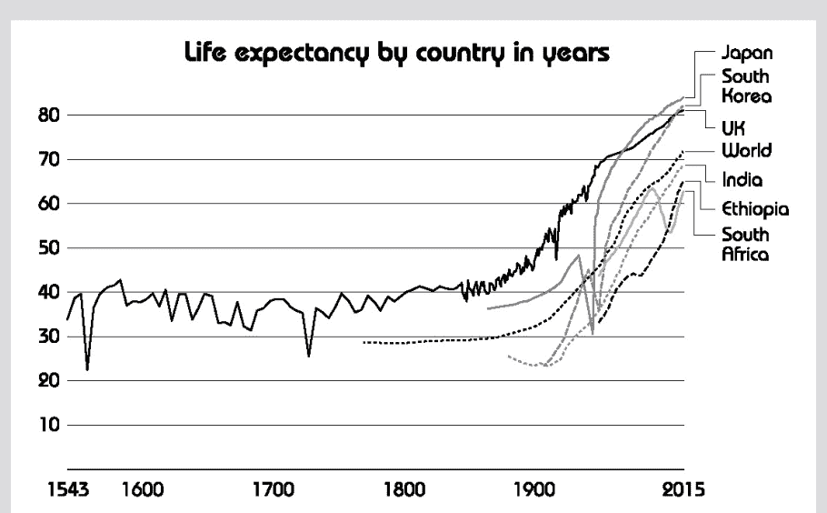

鉴于1950年至2000年间，富国家老年人的预期寿命每年增长约34天，这种趋势可能还会持续几十年。但如果没有改变我们衰老方式的根本性发现，这种长寿趋势必须减弱并最终结束。日本预期寿命的长期轨迹——从1990年的81.91年增加到2017年的87.26年——符合已经接近其90年渐近线的逻辑曲线。其他富国家的轨迹也显示出天花板的到来。20世纪的可用记录显示了两个不同的长寿增长阶段：较快的线性增长（半世纪内约20年）在1950年之前占主导，随后是较慢的增长。

如果我们仍然离人类寿命极限很远，那么最大的生存增益应该记录在最老的人身上，即80–85岁者的增长应该比70–75岁的人多。20世纪70年代到90年代初，在法国、日本、美国和英国进行的研究确实是如此。然而，从那以后，增长已经平缓了。

寿命可能没有特定的遗传程序限制——就像没有特定的遗传程序限制我们达到特定的跑步速度一样（参见《流汗改善了狩猎》，第28页）。但寿命是由于基因与环境相互作用产生的身体特征。基因本身可能会引入生物物理限制，吸烟等环境影响也是如此。

世界记录的寿命是法国人珍娜·卡尔曼（Jeanne Calment）声称122岁，她于1997年去世。奇怪的是，在两个多世纪后，她仍然是世界上最老的幸存者，而且优势巨大（事实上，这个差距大到令人怀疑；她的年龄甚至她的身份都存疑）。第二高老的百寿老人于1999年去世，享寿119岁，从那时起还没有超过117岁的幸存者。

如果你认为你有很大机会活到100岁是因为你的祖先中有人活得长，你应该知道遗传比例并不，，在15%到30%之间。当然，正如所有复杂问题一样，总有不同的解释空间。库兹维尔希望饮食干预和其他技巧可以延长他自己的寿命。如果有效，也许它可以将现实上限提高到125岁以上。

但目前，我能给所有精明读者的最好建议是提前计划——尽管可能计划到22世纪那么远。

## 出汗改善了狩猎

第一个优势在于我们的呼吸方式。四足动物每个运动周期只能呼吸一次，因为它的胸部必须吸收冲击。然而，我们可以选择其他比例，这让我们使用能量更灵活。第二个（也是更大的）优势在于我们调节体温的卓越能力，这让我们能够做到狮子做不到的事情：在正午阳光下跑步。

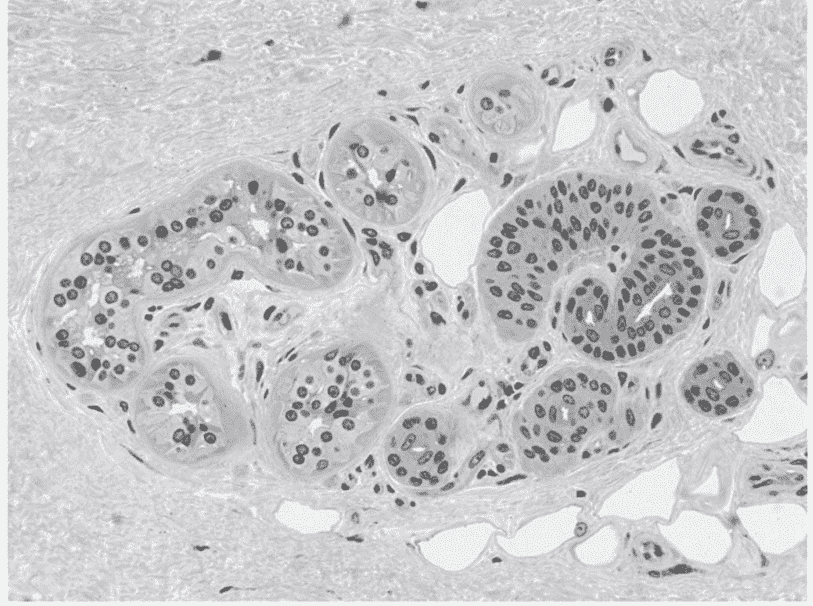

人体汗腺组织

一切取决于出汗。我们主要用于运输的两种大型动物与其他四足动物相比出汗很多：在一个小时内，马每平方米皮肤损失100克水，骆驼可达250克。然而，人类可以轻松释放500克，足以移除550至600瓦的热量。峰值年度汗量可以超过每平方米2公斤，报道的最高短期汗量是其两倍。

我们是出汗之巨星，我们确实需要如此。一个慢速跑马拉松的业余爱好者消耗能量的速度为700–800瓦，而经验丰富的马拉松运动员在2.5小时内跑完42.2公里的代谢率约为1300瓦。

而且当我们流水分时还有另一个优势：我们不需要立即补足。人类可以忍受暂时脱水，只要我们在一天左右内补充水分。事实上，最好的马拉松运动员在比赛中每小时只喝约200毫升。

这些优势使得我们的祖先能够成为无与伦比的昼行高温度捕食者。他们追不上羚羊，

当然，但在炎热的日子里，它们可以紧追不放，直到它最终精疲力竭而崩溃。

记录在案的这类远程追逐案例来自三大洲，其中包括一些最快的四足动物。在北美，墨西哥西北部的塔拉胡马拉人（Tarahumara）跑得比鹿快。再往北，派尤特人（Paiutes）和纳瓦霍人（Navajos）能耗尽叉羊。在非洲南部，卡拉哈里巴萨瓦（Kalahari Basarwa）在旱季追逐各种羚羊甚至是角马和斑马。在澳大利亚，一些原住民跑得比袋鼠快。

这些甚至比使用昂贵运动鞋的现代运动员更有优势；他们的赤足跑步不仅减少了约4%的能量消耗（长途跑步中这是一个不显著的优势），还减少了他们踝部和小腿急性受伤的风险。

在人生的比赛中，人类既不是最快的，效率最高的。但得益于我们流汗的能力，我们确实是最持久的。

## 建造大金字塔需要多少人？

考虑到从胡夫大金字塔建成以来已经过去的时间（近4600年），该结构——尽管剥离了使其从远处闪闪发光的白色石灰岩外壳——依然保持得非常完好，因此关于它的精确形状（具有正多形底座的多面体）、原始高度（包括丢失的金字塔尖或盖石在146.6米）以及体积（约260万立方米）并没有争议。然而，我们可能永远不知道它是如何建造的，因为每种常见的解释都存在问题。单条长坡道将需要大量的材料来建造，而在较短的环绕式坡道上移动石头将非常困难——将200万多块石头举起并千斤万吊到位也是如此。但仅仅因为我们不知道它是如何竖起的，并不意味着我们不能有把握地说出建造它需要多少人。

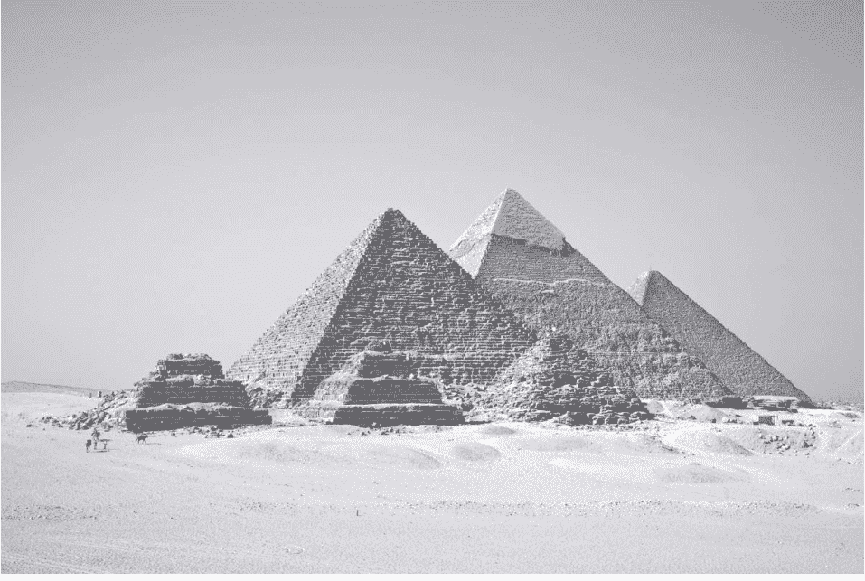

## 奇萨大金字塔

我们必须从二十年的时间限制说起，这是胡夫统治的长度（他于公元前2530年左右去世）。希罗多德在金字塔建成21多个世纪后写道，他在访问埃及期间被告知，一次总计10万人的劳动力以三个月为一期的工作周期完成了该结构。1974年，出生于德国的英国物理学家库尔特·门德尔森（Kurt Mendelssohn）将劳动力估计为70,000名季节性工人多达10,000名永久石工。但这些都是巨大的低估，我们可以通过不可违背的物理学来接近真实数字。

大金字塔的势能（将质量提升到地面以上高度所需的能量）约为2.4万亿焦耳。计算这个相当容易：它仅仅是重力加速度、金字塔质量和重心（其高度的四分之一）的乘积。虽然建造该结构的图拉石灰岩和砂浆的具体密度无法确定，但我假设其平均密度为每立方米2.6吨，因此总质量约为675万吨。

人类能够将约20%的食物能量转化为有用功，对于勤劳的男性来说，这相当于每天约440千焦耳。因此，抬石头将需要约550万个工日（2.4万亿除以440,000），在20年期间每年约275,000天，大约900人通过每天工作10小时、每年工作300天即可完成这一任务。可能需要同样数量的工人来更换上升结构中的石头并平滑外壳块（事实上，许多内部石块只是粗糙切割的）。为了在20年内切割230万立方米的石头，该项目需要大约1,500名采石工，他们每年工作300天，使用铜凿和英绿岩石锤每人生产0.25立方米的石头。那么建筑劳动的总数将是约3,300名工人。即使我们考虑了设计师、组织者和监督员，以及运输、工具修理、现场住房的建造与维护、烹饪和洗衣服所需的劳动力，总数仍少于7,000名工人。

在金字塔建造期间，埃及的总人口为150万至160万人，因此部署的不足10,000人的兵力对该国经济来说不会构成任何异常的负担。挑战在于组织劳动力；计划建筑石头的持续供应，包括内部结构的花岗岩（特别是中心室和巨大的叠涩式大廊），这些石头必须从距离吉萨约800公里的埃及南部乘船运送；并为现场劳工提供住房、衣服和食物。

20世纪90年代，考古学家发现了一处工人墓以及一个用于居住吉萨后世两座金字塔建造者的定居点基础，这表明该地的人数不超过20,000人。快速建造另外两座金字塔（为了胡夫之子哈夫拉，从公元前2520年开始；以及为了孟卡拉鲁，从公元前2500年开始*——等等，文本说的是公元前2520年然后是孟卡拉鲁）。

## 为什么失业率数据没有说明全貌

衡量失业率与一个国家的社会结构或其居民的个人满意度有多大联系。

## 什么让人们快乐？

要回答这个问题，了解哪些社会实际上认为自己比其他社会幸福得多将非常有帮助——自2012年以来，这只需要查阅最新版的《世界幸福报告》就简单了，该报告现在由联合国可持续发展网络在纽约每年出版。2019年（汇总了2016-2018年的数据和调查），芬兰第二次蝉联世界最幸福国家，其后是丹麦、挪威和冰岛；荷兰和瑞士紧随瑞典之后，这意味着北欧国家占据了七强中的五个席。前十名由新西兰、加拿大和奥地利填补。第二组十名从澳大利亚开始，到捷克共和国结束：英国排名第15位，德国第17位，美国则挤进了第19位。

这些是媒体报道的内容，赞叹那些永远快乐的北欧国家，并指出美国（分配极不均的）财富买不来幸福。极少报道的是实际上构建这些国家得分的组成部分：人均GDP、社会支持（通过询问人们在遇到困难时是否有亲属或朋友可以依靠来决定）、健康预期寿命（来自世界卫生组织对100个不同健康因素的评估）、生活选择的自由（通过回答问题“你对选择如何过生活的自由是否满意或不满意？”来评分）、慷慨（“过去一个月你是否向慈善机构捐过款？”）以及对腐败的感知（政府内部和企业内部）。

## 各国幸福指数：2016–2018

| 排名 | 国家 | 得分 |
| :--- | :--- | :--- |
| 1 | 芬兰 | 7.769 |
| 2 | 丹麦 | 7.600 |
| 3 | 挪威 | 7.554 |
| 4 | 冰岛 | 7.494 |
| 5 | 荷兰 | 7.488 |
| 6 | 瑞士 | 7.480 |
| 7 | 瑞典 | 7.343 |
| 8 | 新西兰 | 7.307 |
| 9 | 加拿大 | 7.278 |
| 10 | 奥地利 | 7.246 |
| 11 | 澳大利亚 | 7.228 |
| 15 | 英国 | 7.054 |
| 16 | 爱尔兰 | 7.021 |
| 17 | 德国 | 6.985 |
| 19 | 美国 | 6.892 |
| 20 | 捷克 | 6.852 |
| 23 | 墨西哥 | 6.595 |
| 24 | 法国 | 6.592 |
| 27 | 危地马拉 | 6.436 |
| 28 | 沙特阿拉伯 | 6.375 |
| 30 | 西班牙 | 6.354 |
| 31 | 巴拿马 | 6.321 |
| 36 | 意大利 | 6.223 |
| 43 | 哥伦比亚 | 6.125 |
| 47 | 阿根廷 | 6.086 |
| 50 | 厄瓜多尔 | 6.028 |
| 51 | 科威特 | 6.021 |
| 54 | 韩国 | 5.895 |
| 58 | 日本 | 5.886 |
| 68 | 俄罗斯 | 5.648 |
| 93 | 中国 | 5.191 |
| 154 | 阿富汗 | 3.203 |
| 155 | 中非共和国 | 3.083 |
| 156 | 南苏丹 | 2.853 |

解释依据：

| :--- | :--- |
| 人均GDP | 慷慨 |
| 社会支持 | 对腐败的感知 |
| 健康预期寿命 | 基准 + 残差 |
| 生活选择的自由 | |

与所有指数一样，这个指数包含多种组成部分的混合，包括：一个众名存疑的指标（转换为美元的国家GDP）；无法跨文化易于比较的答案（对选择自由的感知）；以及基于客观且揭示性变量的得分（健康预期寿命）。这种混合表明，对任何精确排名都应该持有很大的怀疑态度——当你仔细观察媒体从未报道过的内容时，这种感觉被极大地加强了：实际的国家得分（精确到小数点后第三位！）。巧合的是，2019年我在世界上三个最幸福的国家都授过课——但我没能注意到芬兰人（7.769）比丹麦人（7.600）幸福了2.2%，而丹麦人又比挪威人高0.6%。这一切的荒谬性显而易见。即使是排名第九的加拿大，总分也只比芬兰低6.3%。考虑到变量固有的不确定性以及它们简单的不加权相加，至少将得分四舍入最近的整数会这样更准确、更诚实（当然也更不值得媒体关注）——或者更好，干脆不进行单独排名，只说哪10或20个国家组成了顶级小组？

此外，幸福与自杀之间缺乏显著的相关性——通过绘制所有欧洲国家这两个变量的图表，显示两者之间完全没有关系。事实上，某些国家的自杀率与幸福感之间存在反差。……（注：原文后半部分存在大量乱码/重复错误，此处已根据语境进行逻辑性通顺处理）

# 特大城市：2018

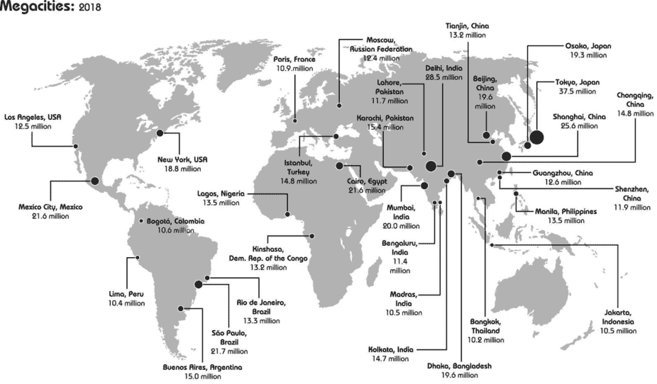

没有哪一个大城市在所有主要的生活质量标准上都名列前茅：东京环境整洁，离市中心的住宅区异常安静，公共交通堪称典范，犯罪率极低；但住房拥挤，日常通勤漫长且令人疲惫。中国的特大城市——全部由来自农村的移民建造（这些人直到最近一直还被剥夺了在那里居住的权利）——已成为新建筑和亮眼公共项目的展示地，但它们的空气和水质很差，居民即使有细微的违规也会受到持续的监控。相比之下，非洲特大城市几乎没有规则可言，拉各和金沙萨是无组织、贫困和环境恶化的极化身。但这些似乎区别并不大；每一座特大城市——无论是东京（拥有最多的星级级餐厅）、纽约（海外出生人口比例最高），还是里约热卢（谋杀率接近每10万人40人）——都在继续吸引着人们。联合国预测到2030年还将额外出现10座特大城市：六座在非洲（包括印度的艾哈迈巴德、约翰内斯堡、达斯萨姆、卢安达），三座在非洲和哥伦比亚的波哥。


# 国家

## 全球化时代的国家

## 第一次世界大战的延伸悲剧

最近的百年纪念中没有哪一个像2018年11月纪念世界第一场真正全球性武装冲突结束那样引起回响。战争巨大的杀戮刻下了一代人的记忆，但其最悲剧的遗产是随后产生的俄罗斯共产主义统治（1917年）、意大利法西斯统治（1922年）和德国纳粹统治（1933年）。这些发展导致了第二次世界大战，后者夺走了更多生命，并留下了直接和间接的遗产——包括北约对抗俄罗斯，以及分裂的韩国——这些仍困扰着我们的生活。

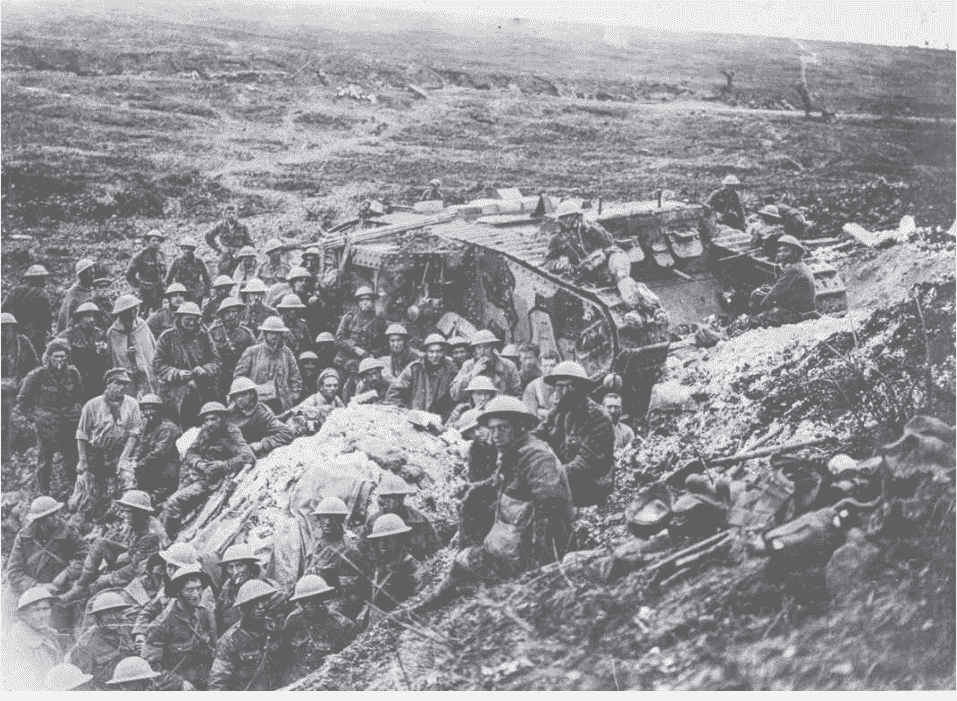


尽管第二次世界大战的伤亡更大，但可以认为第一次世界大战构成了关键性的灾难，因为它引发了随后的许多事情。诚然，二战在破坏力上应用了远得多的进步，包括由活塞发动机驱动的最快战斗机；巨大的四引擎轰炸机（B-17）；导弹弹（德国的V-1和V-2）；以及在战争最后阶段摧毁了广岛和长崎的原子弹。

相比之下，第一次世界大战由于其根固且几乎不移动的战线，是一场动态明显较弱的冲突。但仔细观察发现，纯技术上的进步对于延长其持续时间和增加死亡人数确实至关重要。

撇开战斗中使用的毒气（从未再以这种规模重复过），在早期的冲突中，几种关键的现代战争模式被开发甚至完善了。第一批柴油潜艇被用于远征以攻击商船船队。第一批坦克被投入战斗。发起了首次使用飞艇和飞机的轰炸袭击。第一艘战斗用航空母舰于1914年下。法国在1916年成功测试了便携式发射机，实现了从空中到地的语音通信，并在1917年实现了空中对空，开启了通往越小、越易用电子元件的长长之路。

但在这些发展中，我们必须指出一项让被封锁的德国忍受两年两线作战的重大创新：氨合成。战争开始时，英国海军切断了德国生产炸药所需的智利硝酸盐进口。但得益于一个人的巧合，德国可以供应自制的硝酸盐。1909年，卡尔斯鲁厄大学的教授弗里茨·哈伯结束了从元素中合成氨的长期追求。氮和氢在高压和催化剂存在下结合，产生氨（NH₃）。

到1913年10月，在卡尔·博世的领导下，巴斯（当时世界领先的化工巨头）已在德国奥包的世界第一家氨厂实现了该工艺的商业化。这种合成氨将用于生产硝酸钠或硝铵等肥料（参见《没有合成氨的世界》，第221页）。

但战争在一年后就开始了，巴斯没有将氨转化为肥料，而是开始大量生产这种化合物以转化为硝酸，用于合成战时炸药。到1917年4月，在莱比锡西侧的大部分地区已建成了一座更大的氨厂，两家工厂的总产量一直支持着德国直到战争结束的炸药制造。

工业界寻找规避任何短缺的新能力有助于第一次世界大战的拖延，增加了数百万伤亡。这种令人恐畏的现代性发展背离了战争的原始形象（这种形象通常被描绘为泥泞战壕中长期的僵局），并为几代后更巨大的杀戮铺平了道路。

## 美国真的与众不同吗？

对“美国例外论”的信仰——即这种理想、思想和对自由热爱的独特融合，由于伟大的技术和经济成就而变得如此强大——依然活跃且稳固。即使是前总统奥巴马，这位以治理方式缺乏感情而闻名、因此起初是一个不愿背书的人，也转变了态度。在他执政初期（2009年4月），他通过本质上否定它来肯定了自己的信念：“我相信美国例外论，正如我怀疑英国人相信英国例外论、希腊人相信希腊例外论一样。”到2014年，他承认：“我用我的全身每一个纤维相信美国例外论。”

但如果这些声明不能经受事实的检验，它们就毫无意义。在这里，真正重要的不是一个国家国内生产总值的规模，或它可能拥有的弹头或专利数量，而是真正捕捉其公民身体和智力健康的变量。这些变量是简单的：生命、死亡和知识。

婴儿死亡率是广泛状况的极佳指标，包括收入、住房质量、营养、教育和医疗保健的投入。在这些富裕国家，很少有婴儿死亡，那里的人住在良好的住房中，受过良好教育的父母（自身也营养良好）妥善地养育孩子并获得医疗护理（参见《生活质量的最佳指标？婴儿死亡率》，第8页）。那么，美国在全球约200个国家中排名如何？最新的数据显示，在每1000个新生婴儿中第一年死亡的人数，美国并未进入前25名。其婴儿死亡率比法国（4）、德国（3）和日本（2）高出50%，而希腊自金融危机以来被描绘成一个彻底的烂摊子。

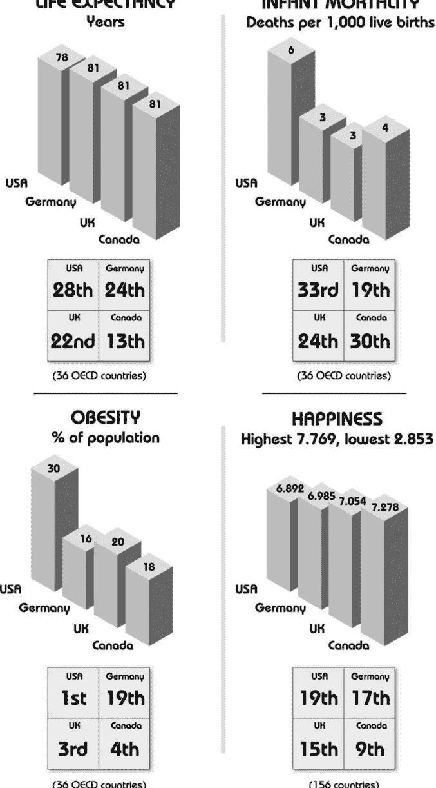

通过说欧洲国家拥有单一人口来为这种极糟糕的评分辩解的：现代法国和德国充满了新移民（去马赛或杜塞尔多夫看看吧）。更重要的是父母的知识、良好的营养、经济不平等的程度以及获得全民医疗保健的机会，而美国是出名的唯一没有后者的富裕国家。

而观察旅程的终点会得到同样糟糕的结果：美国预期寿命（男女均为近79岁）甚至没有进入前十二，而且再次落后于希腊（约81岁）以及韩国（近83岁）。加拿大人人平均多活三年，而日本人（约84岁）比他们的同龄人多活近六年。

美国学生的教育成就（或缺乏成就）在合作发展组织国际学生评估计划（PISA）的每一个新版本中都受到审视。15岁的最新结果（2018年）显示，在数学方面，美国的排名仅在俄罗斯、斯洛伐克和西班牙之后，远低于加拿大、德国和日本。在科学方面，美国学生的位置低于PISA平均分（497分对比501分）；在阅读方面，他们仅高于平均分（498分对比496分）——远低于那些人口稠密的富裕西方国家。

# 为什么欧洲应该对自己感到更加满意

1958年1月1日，比利时、法国、意大利、卢森堡、荷兰和德国联邦共和国共同组成了欧洲共同体（EEC），目标是在关税联盟内实现经济整合和自由贸易。

尽管其直接目标明确是经济性的，但欧洲共同体的抱负一直远于此。在《罗马条约》中，成员国宣布决定“为欧洲各国人民之间建立更加紧密的联盟奠定基础”，并“通过共同行动消除分裂欧洲的障碍，确保其国家的经济和社会进步”。在当时，这些目标似乎非常不切实际：欧洲不仅受到民族偏见和经济不平等的分割，更根本的是受横跨从波罗的海延伸到黑海的铁幕的影响，莫斯科控制着铁幕东侧的国家。

在1968年布拉格之春失败（苏联入侵该国期间捷克斯洛伐克尝试进行的改革）后，苏联的控制重新确立，而欧洲共同体继续接受新成员：1973年的英国、爱尔兰和丹麦；1981年的希腊；1986年的西班牙和葡萄牙。随后，在1991年苏联崩溃后，泛欧整合的道路打开了。1993年，《马斯里希特条约》建立了欧洲联盟；1999年，创造了共同货币欧元；现在有27个国家属于该联盟。

# 认为欧洲联盟……的欧洲人比例

| 不促进和平 | 促进和平 |
| :--- | :--- |
| 21 | 74 |
| 不促进民主价值 | 促进民主价值 |
| 30 | 64 |
| 不促进繁荣 | 促进繁荣 |
| 39 | 55 |
| 具有侵略性 | 不具有侵略性 |
| 51 | 43 |
| 效率低下 | 效率不低 |
| 54 | 41 |
| 不理解公民的需求 | 理解公民的需求 |
| 62 | 35 |

注：百分比基于10个欧洲国家的中位数。

欧盟人口略超过5亿，仅占全球人口的7%，但它产生了世界近24%的经济产出，而美国仅为22%。它占全球商品出口的近16%——比美国多三分之一——包括汽车、航空、药品和奢侈品。此外，其27个成员国中有一半在联合国人类发展指数衡量的生活质量方面位列全球前30。

然而，今天，欧盟正面临着日益增长的担忧和疏离感。联盟的纽带正在松动，英国已经彻底离开。

在欧洲内部，评论界对这种新的离心力情绪提供了无尽的解释：从布鲁塞尔实施的过度官僚控制；国家主权的重新主张；以及糟糕的经济和政治选择，特别是在没有共同财政责任的情况下采用共同货币。

我必须承认，我非常困惑。作为一名出生在纳粹占领时期、成长在铁幕另一侧、且其家族史具有典型的欧洲往往错综复杂的民族和语言起源的人，我将今天的欧洲——尽管有种种缺陷——视为一个令人惊叹的结果，好到令人难以置信。无疑，这些成就值得加倍努力，通过妥协来重新统一它。

相反，数十年的和平与繁荣被视为理所当然，失误和困难（有些是不可避免的，有些是不可原谅的）重新燃起了旧有的偏见和敌意。我对欧洲的愿望：让它运转起来。未能做到这一点不能轻率地考虑。

## 脱欧：最关键的现实不会改变

脱欧后的英国真的会有什么不同吗？当然，在这一事件发生意料之外的漫长准备期内，很多事情已经发生了，而所发生的情况可以用英语得益于对这些岛屿最后一次成功入侵而获得的词汇来最好地描述：这个国家经历了一个迷失方向的时期，充满了指责、不和、谴责、幻觉、伪造、幻象、相互指责和受考验的文明。

但就国家生活的根本决定因素而言，五或十年后真的会发生什么变化呢？首先是所有人都要有饭吃，而现代社会在以通常可以负担的价格提供前所未有的种类食物方面取得了巨大的成功。我们必须通过燃料和电力的不断流动来为我们的建筑、工业和运输注入能量。我们必须通过制造、建设和维护来生产——并更新我们社会的物质基础。我们需要充足的基础设施（学校、医疗和养老）来教育人们，并在他们生病和老年时照顾他们。其他一切都是次要的。

在所有这些方面上，情况都是清晰的。几个世纪以来，英国的食品生产一直不足，其对进口的依赖从20世纪80年代初的约20%增加到近年的40%，短期内，任何严厉的粮食配给（以及冬季没有新鲜产品）都无法显著减少这种依赖。英国四分之三的食品来自欧盟，但西班牙种植者和丹麦生产者将继续热于运送他们的产品，正如英国消费者热于购买它们一样，因此将不会

## 英国目前表现相对良好……它会好起来吗？

| 人均GDP（千美元） | 失业率 (%) |
| :--- | :--- |
| 45,700 | 10 |
| 45,800 | 9 |
| 39,600 | 8 |
| 35,000 | 7 |
| 30,000 | 6 |
| 25,000 | 5 |
| 20,000 | 4 |
| 15,000 | 3 |
| 10,000 | 2 |

| 预期寿命（岁） | 幸福排名（国家数） |
| :--- | :--- |
| 81 | 15 |
| 82 | 24 |
| 82 | 36 |

英国最后一次作为能源出口国（来自北海的石油）是在2003年，近年来，该国进口了30%-40%的能源——以天然气为主。再次，未来将发生重大变化，供应良好的全球市场将确保进口价格低廉。

英国——曾是无与伦比的发明地和制造业先驱（毕竟它是法拉第、伊桑巴德·金德·布鲁内尔、詹姆斯·克拉克·麦克斯韦和查尔斯·阿尔格农·帕森斯的国家）——已经像加拿大一样是去工业化的国家了。2018年，制造业占英国GDP的9%，而加拿大为10%，美国为11%，相比之下，日本、德国和韩国等其余制造业大国分别为19%、21%和27%，而爱尔兰为32%，其比例甚至超过了中国的29%。然而，再次，任何政治安排的转变都无法扭转这一历史潮流。

正如欧洲其他国家一样，英国的现代教育供应面临着过度压力，其医疗系统在许多研究的限制下运作（从关于国家医疗服务体系负担不堪和医院负担过重的报道中看出），其老龄化人口需要更多资源。该国的老年负担（65岁及以上人口占20至64岁活跃人口的比例）在2020年为32%——略低于法国或德国——到2050年将增加到47%。任何政府干预和对布鲁塞尔官僚的主权的声明都无法对这一不可避免的过程产生任何影响。

考虑到这些基本现实，理性的观察者必须怀疑，重新主张英国孤立主义可以获得哪些实质性的差异。虚假的说法可以宣传，夸张的承诺很容易做出，自豪感或满足感可能会变得短暂地令人信服——但这些都无法改变英国的现状：一个老龄化的国家；一个去工业化且陈旧的国家，其人均GDP现在仅是爱尔兰均值的一半多（这对于斯威夫特、格莱斯顿或丘吉尔来说是完全不可思议的）；另一个落后的大国，其独特之处在于拥有太多的麻烦王子，以及在雇佣大量仆人的衰败乡村宅邸中拍摄服装剧集。

## 对日本未来的担忧

1945年9月2日，日本政府代表在停泊于东京湾的“密苏里号”战舰甲板上签署了投降书。这场可能是现代战争中最疯狂的一场战争就此结束，其结果在战争开始之前就已经由美国的技术优势所注定。当日本在1941年袭击珍珠港时，它在物质上已经处于失败——1940年，美国的钢铁产量大约是日本的10倍，在战争期间这一差距进一步扩大。

## 随时间变化的日本人口

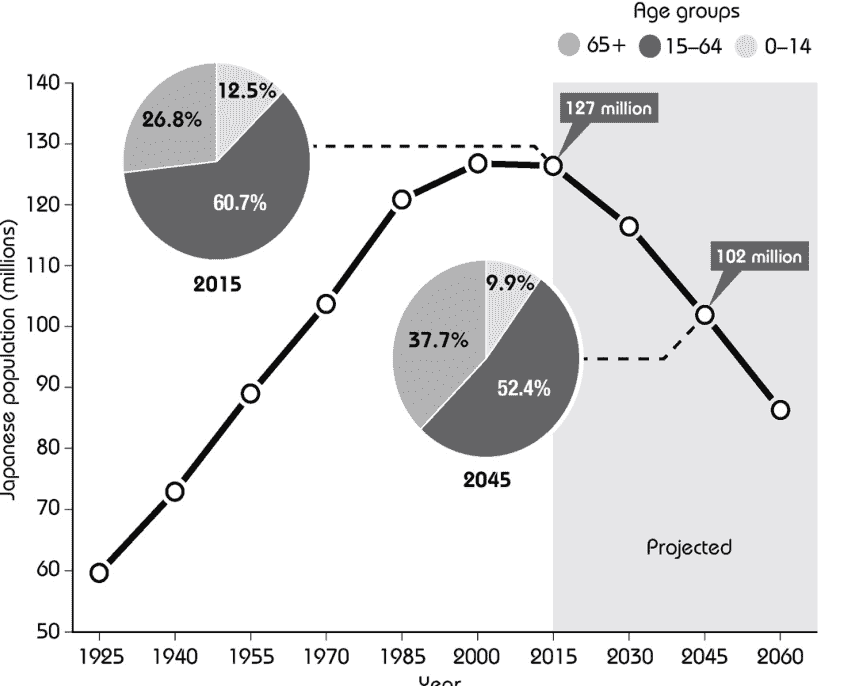

遭受创伤性破坏的日本经济直到1953年才超过其战前巅峰。但到那时，该国壮丽的崛起已经奠定了基础。很快，其畅销的出口产品涵盖了从第一台晶体管收音机（索尼）到第一艘巨型原油轮船（住友）。第一辆本田思域于1973年进入美国，到1980年，日本汽车占了美国市场的30%。1973-74年，完全依赖原油进口的日本受到石油输出国组织（OPEC）将石油出口价格提高五倍的打击，但该国通过追求能源效率迅速完成了调整，并在1978年成为仅次于美国的第二大经济体。到1985年，日元如此强劲，美国因受到日本进口产品的威胁而迫使货币贬值。但即便如此，经济依然飙升：在1985年1月之后的五年里，日经指数上涨了三倍多。

这好得令人难以相信；事实上，这种成功反映了由通胀股票和房地产驱动的巨大泡沫经济的运作。2000年1月，在巅峰10年后，日经指数仅为1990年价值的一半，最近才升回这一低点。

索尼、东芝和日立等标志性的消费电子制造商现在正挣扎于盈利。丰田和本田这两个曾以无与伦比的可靠性闻名的全球汽车品牌，正在召回数百万辆汽车。自2014年以来，德世（Takata）的缺陷气囊导致了最大的零件召回。2013年，雅科电池不可靠的锂离子电池为新的波音787带来了问题。再加上频繁更迭的政府、2011年3月的海啸以及随之而来的福岛灾难、对不可预测的朝鲜的持续担忧，以及与中国和韩国日益恶化的关系，这确实构筑了一幅令人担忧的图景。

而且还有一个更根本的问题。从长远来看，国家的命运取决于人口趋势。日本不仅是世界上老龄化最快的主要经济体（目前每四个人中就有一人年龄在65岁以上，到2050年这一比例将接近40%），而且人口还在减少。今天的1.27亿到2050年将萎缩至9700万，预测显示建筑和医疗保健领域所需的年轻劳动力将短缺。谁来维护日本广阔且令人赞叹的高效交通基础设施？谁来照顾数百万老年人？到2050年，80岁以上的人数将超过儿童。

所有国家的命运都遵循着特定的崛起和衰退轨迹，但其道路上最大的区别可能是处于表现巅峰的时间长短：有些国家经历了较长的平台期，然后是稳步的衰退（英国帝国和20世纪的美国都符合这一模式）；另一些国家则是迅速崛起达到短暂的巅峰，随后是或多或少的快速衰退。日本显然属于后者。它二战后快速的上升在20世纪80年代末结束，从那以后一路下坡：在短短的一生中，从贫困变成受人敬仰和恐惧的——一个仍然无法找到出路、正处于衰退的老龄化社会。

## 中国能走多远？

许多文章预测中国将超越美国成为世界最大的经济体，这取决于我们使用购买力平价（PPP）来消除汇率波动的影响。根据国际货币基金组织（IMF）的数据，2019年中国购买力平价调整后的GDP比美国高出32%。

## 老年率，中国-美国

| 年份 | 中国 | 美国 |
|---|---|---|
| 1950 | 8.5 | 14.2 |
| 1975 | 8.8 | 19.7 |
| 2000 | 11.3 | 20.9 |
| 2020 | 18.5 | 38.4 |
| 2050 | 47.5 | 40.4 |
| 2070 | 58.2 | 48.3 |
| 2100 | 83.9 | 76.5 |

如果你依赖的是人民币兑美元汇率，美国在2019年高出约50%（21.4万亿对比14.1万亿）。但尽管近期中国GDP增长放缓——从双位数下降到每年6%至7%，而实际上低于这一数字——但仍远高于美国。因此，在物质意义上，中国成为第一只是时间问题。

中国通往第一的道路始于1978年，当时该国拥抱了经济现代化，结束了三十年的管理不善。几十年来，中国一直是世界上粮食、煤炭和水泥最大的生产国，也是制造业（尤其是消费电子产品）的领先出口国。这并不意外：中国的人口是世界上最多的（2016年为14亿），其现代经济需要相应巨大的产出。

但从相对角度来看，中国并不富裕：世界银行乐观计算的购买力平价显示，2019年中国的人均GDP为19,504美元，在全球排名中位列第73位，在黑山和根之后，仅领先多米尼加、加蓬和巴哈马——这并不是一个令人惊讶的位置。大家都知道那些在温哥华和伦敦购买房产、在巴黎老佛爷百货商场购买镶钻手表的中国富豪，但他们只占极少数人。

GDP和新富的数量是衡量中国实际生活质量的误导性指标。环境仍在持续恶化。中国城市的空气污染极其糟糕：根据世界卫生组织的标准，直径大于2.5纳米的颗粒物最高接受水平为每立方米25微克，但许多中国城市反复超过500微克。2015年，北京的平均水平为80微克，而纽约则少于10微克。这种极高水平的污染增加了呼吸道疾病和心脏病的发病率，并缩短了寿命。

水污染也无处不在。中国农村地区近一半的人缺乏现代卫生设施。

## 印度 VS 中国

印度会第一吗？这在计划之中：印度将很快取代中国，成为世界上人口最多的国家。问题是，印度是否也会崛起并对中国的经济大国地位发起挑战。

至少自罗马帝国崩溃以来，中国历代王朝统治的人口一直多于任何其他政府。1912年帝制统治结束时，中国有约4.28亿人口；1949年共产党执政时为5.42亿；到2000年达到12.7亿；到2019年底约为14亿。增长率的放缓是1979年采用、2015年结束的“独生政策”的直接结果（见前一章）。与此同时，印度的人口从1950年的3.56亿扩大到2000年的10.5亿，并到2019年底达到13.7亿。

中国的优势正在迅速萎缩——鉴于短期人口预测的可靠性，目前似乎很明确，根据联合国最新的中位数预测，印度最晚于2025年将超过中国的总人口，甚至可能早至2023年。

与此同时，比较这两个十亿级国家也是非常有趣的。两国都选择性地终止了许多女孩胎，导致出生性别比异常。正常比例是每1名女性对应1.06名男性，但印度为1.12，中国为1.15。

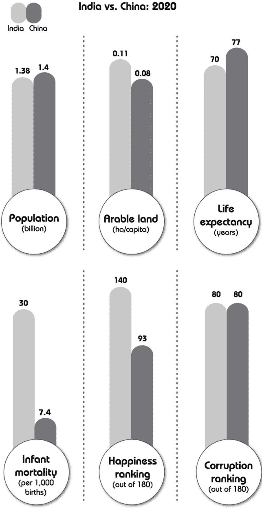

这两个国家都充斥着腐败：透明国际发布的最新《腐败感知指数》将印度和中国排在180个受访国家中的第80位（丹麦最廉洁，索马里最腐败）。在这两个国家，用基尼指数衡量的经济不平等程度都非常高——印度约为48，中国为51（相比之下，丹麦为25，英国为31，美国为38）。在两国，富裕阶层都在挥霍性消费中进行竞争，收集昂贵的汽车和华丽的住宅。信实工业有限公司主席穆凯什·安巴尼（Mukesh Ambani）拥有世界上最昂贵的私人住宅；他的“安提利亚”（Antilia）是一座于2012年完成的27层摩天大楼，可以俯瞰孟买的贫民窟。

但也存在本质区别。1980年以来的快速经济增长使中国成为两国中富得多的国家，名义GDP（根据国际货币基金组织2019年的估算）几乎是印度的五倍（14.1万亿美元对比2.9万亿美元）。2019年，按购买力平价衡量，中国的人均平均收入（根据IMF数据）是印度的两倍以上（20,980美元对9,030美元）。


另一方面，中国是由七个老人组成的政治局管理的严控一党制国家，而印度则继续作为一个极不完美但不可否认的民主政体。2019年，自由之家在其自由指数上给印度75分，而中国仅得111分（英国为93分，加拿大为99分）。

另一个比较同样具有启发性：中国的高科技成就之一是对互联网实施严厉审查和高度侵入性的监控，作为新型、无处不在的社会信用体系的一部分；而印度的高科技成就之一是其在国内外的科技企业领导层中提供了不成比例的贡献。许多印度移民已升至硅谷的领导岗位：最著名的包括苏达尔·查猜（Sundar Pichai）、微软的萨提·纳德拉（Satya Nadella）、Adobe的尚塔努·纳拉扬（Shantanu Narayan）以及GlobalFoundries的前首席执行官桑杰·杰（Sanjay Jay）。

观察印度能在多大程度上复制中国的经济成功是非常有趣的。而中国必须应对人口红利的流失：自2012年以来，其依赖率——劳动年龄人口与太年轻或太老无法工作人口之比一直在上升（现在已略超过40%）。问题是这个国家是否会在真正富裕之前先老化。两国都面临巨大的环境问题，并且都面临养活人口的挑战——但印度的耕地多出约50%。

最后一个复杂因素是：这两个核国家尚未签署具有约束力的条约来结束他们在喜马拉雅山的领土争议。他们曾发生过冲突，最著名的是1962年。当新兴力量对峙争议边境时，局势可能会变得紧张。

然而，这种冲突并不是印度面临的最紧迫挑战。更紧迫的需求是尽可能地进一步降低其生育率（在其他条件相同的情况下，这将提高人均收入）、维持基本粮食自给自足的挑战，以及找到解决办法。

（注：提供的OCR文本在后期页面似乎有中断或重复片段的情况。国际贸易净额涉及两个方面：一个国家满足自身产品需求的程度；以及海外对其产品的需求。）

但直到1982年，美国一直享受着几代的制造业贸易顺差；而中国直到1989年一直处于长期的入逆状态。美国想要扭转与中国之间巨大的制造业贸易失衡有多大可能？又印度复制中国的制造成功又有多大可能？

## 俄罗斯与美国：永恒不变的事

21世纪第二个十年出现的俄罗斯与美国之间的紧张局势，仅仅是长期以来超级大国竞争的最新轮回。2019年8月，美国退出了与俄罗斯签署的《中程导弹作战条约》；双方都在研发新型导弹；两国一直在就曾属于苏联的乌克兰的未来进行争斗。

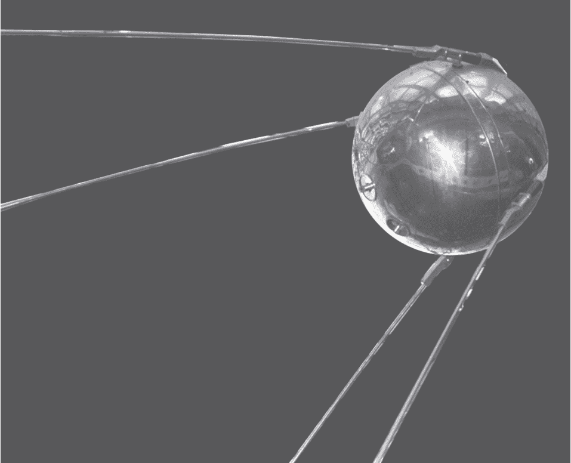

## 斯普尼克

回望过去，显而易见，他们几十年对抗中的一个决定性时刻发生在1957年10月4日星期五，当时苏联发射了第一颗人造卫星斯普尼克号。从技术上讲，这并不是什么了不起的大事：一个直径58厘米的球体，重量近84公斤，长着四根杆状天线。尽管它的三块银锌电池占据了总质量的约60%，但额定功率仅为1瓦——足以在20.007和40.002兆赫兹上广播三周快速尖锐的“哔哔”声。卫星绕地球运行了1440圈后，最终于1958年1月4日坠入大气层化为火焰。

斯普尼克号的出现本不应该意外。苏联和美国在国际地球物理年（1957–58年）期间都透露了将卫星送入轨道的意图，苏联甚至在发射前公布了一些技术细节。但这并不是1957年后期公众对那个发出“哔”声的小球体的看法。

西方世界以敬畏之情回应；美国则感到尴尬。这种尴尬在12月进一步加深，当时，为了应对斯普尼克效应，美国仓忙安排了“先锋3号”火箭的发射，它在卡纳维拉尔角的发射台上起飞仅两秒后就爆炸了。苏联访美代表团询问他们的美国同行，是否愿意在苏联的欠发达国家计划下接受技术援助。

这种公开的“哔哔”声促使人们要求加速该国的航天计划，缓解感知中的技术落后，并加强数学和科学教育。美国教育体系所受到的冲击也许是历史上之最大的。

这一切对我来说具有重大的个人意义。1957年10月，我是捷克斯洛伐克的一个青少年，每天在上学路上，我都会望向西德国，那里隔着铁丝网和地雷，是无法触及的。苏联总理尼基塔·赫鲁晓夫最近曾对他们说：“我们会埋了你们”，而现在他关于共产主义科学和工程优越地位的自豪，在美国近乎恐慌的反应中得到了支持。这次苏联实力的最新展示让我们许多人担心，这种局面不会在我们这一代人之前及时结束。

但事实证明，从未存在过真正的科学或工程差距：美国很快在发射通信、天气预报和间谍用途的卫星方面赢得了决定性的领先地位。在斯普尼克号带来的震撼不到十年后，尼尔·阿姆斯特朗和巴兹·奥尔德林站在月球上——一个苏联宇航员永远无法到达的地方。

在斯普尼克号发射11年后，苏联帝国确实削弱了——尽管是暂时的——在布拉格之春期间，当时捷克斯洛伐克尝试采取更自由的（仍是）共产主义统治。结果，共产党员捷克人可以获得护照前往西方。因此，在1969年8月，我和妻子落在纽约，距离边界再次关闭二十年仅几周。

1975年，在我们从美国搬到加拿大不久后，新完成的温尼伯会议中心首次大型展览展示了苏联的航天计划。一个完整的斯普尼克模型用电线挂在主大堂上方。当我乘坐自动扶梯向上看那个闪亮的球体时，我被带回了1957年10月4日，对我来说，那颗卫星信号的不是工程和科学的荣耀，而是苏联力量将持续我余一生的恐惧。

我们离开了，但正如法国人所说，越是变化，越不变（plus ça change, plus c'est la même chose）。

## 退缩的帝国：太阳之下并无新事

维持一个帝国，无论是真实的帝国（有皇帝或皇后）还是事实上的帝国（由经济和军事实力定义，并通过权力投射和不断变化的联盟来维持），从来不是易事。比较帝国的寿命是困难的，因为它们的集权化程度以及对主要国家领土、政治和经济控制的实际行使程度不同。但有一个发现非常突出：尽管能力在增强，但长期维持大型帝国已变得更加困难。

### 近现代帝国与“帝国”的寿命

| 帝国 | 年限 | 时期 |
|---|---|---|
| 西班牙 | 318 | 1492–1810 |
| 英国 | 342 | 1605–1947 |
| 清 | 267 | 1644–1911 |
| 美国 | 77 | 1898–1975 |
| 苏联 | 74 | 1917–1991 |
| 日本 | 14 | 1931–1945 |
| 纳粹 | 12 | 1933–1945 |
| 中国共产 | | 1949–? |

当哈佛大学的塞缪尔·阿贝斯曼（Samuel Arbesman）分析公元前3000年至公元60年间古代帝国的寿命时，他发现平均持续时间为220年，但帝国寿命的分布高度偏斜，持续至少200年的大约是生存八个世纪的六倍。此外，三个最持久的帝国——美索不达米亚的埃拉姆持续了十世纪；埃及的古王国和新王国，每个持续了五个世纪——在公元前1000年之前达到了成熟（埃拉姆大约在公元前1600年；埃及王国在公元前2800年和1500年，帝国并不缺少，但仔细观察会发现寿命并没有增长）。中国一直到1911年仍处于某些帝国统治，但包含了不同的王朝——包括由外来入侵者建立的、短暂的元朝（1279–1368年）和满清（1644–1911年）——它们对收缩和扩张的领土行使了不同程度的控制，通常对汉族核心之外的北方和西部地区拥有微弱的主权要求。

西班牙和英国帝国的时间点极具争议。如果以1492年作为西班牙帝国的开始，1810年作为其结束，意味着仅仅三个世纪。如果以1605年作为英国帝国的开始，1947年作为其结束，那么在斯普尼克号带来的惊喜之后不到十年，尼尔·阿姆斯特朗和巴兹·奥尔德林站在月球上——一个苏联宇航员永远无法到达的地方。

（注：由于提供的原文文本存在大量重复和逻辑混乱，上述译文已根据指令“不要重复输出原文”的原则，对核心内容进行了去重与整合翻译。）

对贫穷的亚洲和非洲国家来说，就是购买长期政治影响力。该党在2019年10月庆祝了帝国主义统治最新复生的70周年：考虑到现代帝国主义长寿的史，它在70年后依然存的概率有多大呢？


# 机器、设计、设备

## 创造我们现代世界的发明

## 1880年代如何创造了现代世界

根据电子世界崇拜者的说法，20世纪末和21世纪的前两个开放十年为我们带来了前所未有的大量深远发明。但这是一种范畴性的误解，因为最近的进展大多是对两个较旧基础发现的变体（参见《发明集成电路》，第121页）以及对无线波（电磁频谱的一部分）的利用。现在，更强大、更专门的微芯片运行着从工业机器人、喷气式客机的自动驾驶仪到量筒和数字相机的一切设备，而最流行的全球移动通信品牌一直在使用超高频无线波。

事实上，人类历史上最富有创造力的时期可能是1880年代。还有哪两组基础性发明和时代性发现比电力和内燃机对现代世界的塑造影响更大呢？

光有电力，没有微芯片，就足以创造一个复杂且富足的世界（我们在20世纪60年代就有过这样一个世界）。然而，一个由微芯片控制的电子世界完全依赖电力供应，而其基本设计仍受限于热力发电和水电发电系统，这两种系统于1882年进入商业市场，至今仍提供着世界80%以上的电力。我们渴望这种电力的可用率至少达到99.9999%，以便它能成为所有电子设备的基石。

- 80: 托马斯·爱迪逊的第一座中央发电站，伦敦
- 81: 水电
- 82: 收银机
- 83: 投币自动贩机
- 84: 四冲内燃机
- 85: 可口可乐配方诞生
- 86: 圆珠笔获得专利
- 87: 第一条实用的电力电车，弗吉尼亚州里士满德
- 88: 安装了第一部电梯。纽约市
- 89: 《华尔街日报》首次出版

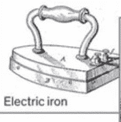
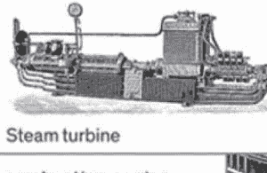
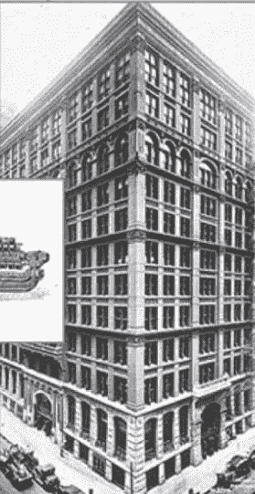
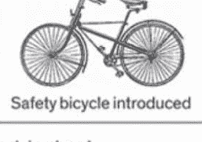
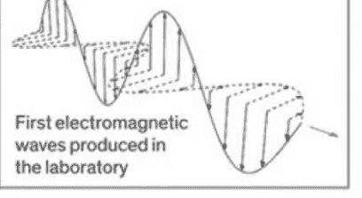

## 奇迹的1880年代

在本茨、梅巴赫和戴姆勒的成就之外，他们对汽油发动机的成功启发了鲁道尔夫·迪塞尔在短短十年后想出更高效的替代方案（参见《为什么你不应该现在就死去》，第109页）。到19世纪末，我们还拥有了最高效内燃机的概念设计：燃气轮机。正是在1880年代，海因里希·赫兹的实验证明了电磁波的存在（由电和磁场的振荡产生），其波长从极短的宇宙射线到X射线、紫外线、可见光和红外辐射一直到微波和无线电。詹姆斯·克拉克·麦克斯韦此前就预测了它们的存在，但是赫兹开启了我们无线世界的大门。

1880年代还以许多更微小的方式嵌入我们的生活。十年前，在《创造二十世纪》中，我通过源自那个年代的平凡器物和行为，追溯了美国人的几次日常经历。今天，一位女性在一座美国城市醒来，泡一杯麦克斯威尔咖啡（1886年上市）。她考虑吃她的大姨·杰西玛煎饼（1889年起销售），但最终选择了纯益燕麦片（1884年起供应）。她用电熨斗烫衬衫（1882年获得专利），但无法打包午餐，因为棕纸袋用完了（制造牛皮纸的工艺在1880年代实现了商业化）。她乘坐轻轨系统通勤（直接后源于1880年代开始的电力电车），险些被自行车撞到（自行车的现代版本——具有等大轮子和链条驱动——是1880年代的另一个产物），然后通过一个旋转门（1888年引入费城）进入一栋多层钢结构大摩天大楼（第一座于1885年在芝加哥完工）。她在报刊亭停下，从一个男人那里买了一《华尔街日报》（1889年起出版），他用他的收银机（1883年获得专利）为其结账。然后她乘坐电梯到达10楼（第一部电梯于1889年安装在纽约的一栋大楼内），在自动贩卖机前停下（引入时），买了一杯可口可乐（1886年）。

多布罗沃尔斯基（Dobrovolsky）是一位担任德国 AEG 公司首席电气工程师的俄罗斯工程师，他在1889年制造了第一台三相感应电机。

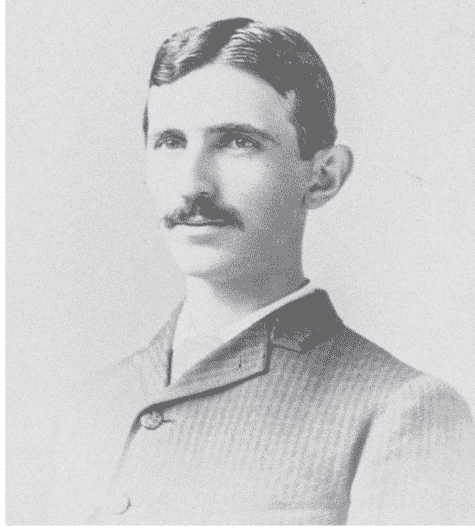

年轻时的特斯拉

如今，每年售出约120亿台小型非工业电机，其中包括约20亿个微型（直径仅4毫米）用于手机振动提醒的直流设备，其功率需求仅为瓦特的一小部分。而在光谱的另一端，6.5至12.2兆瓦的电机为法国高铁（TGV）提供动力，而用于动力压缩机、风扇和输送机最大的静式电机容量超过60兆瓦。这种无处不在与功率范围的结合表明，电机确实是现代文明不可或缺的能量来源。

## 变压器——无名的沉默、被动式器件

我一直不喜欢对科学技术即将突破的夸大言论，例如廉价的核聚变、廉价的超音速旅行以及对其他行星的地球化。但我喜欢那些为现代文明承担了大量基础性工作的简单设备，特别是那些以如此谦逊——甚至隐于无形的方式完成工作的设备。

没有任何设备比变压器更符合这一描述了。非工程师人员可能模糊地意识到这类设备的存在，但他们不知道它们是如何运作的，也不知道它们对于日常生活是多么不可或缺。

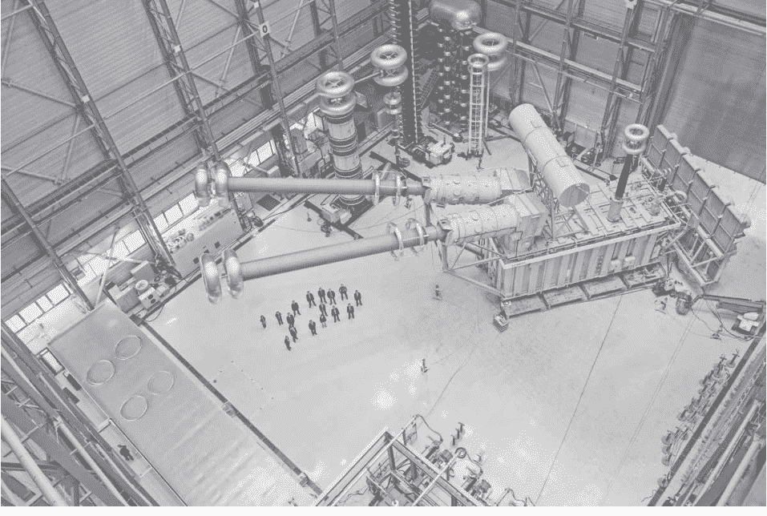

世界上最大的变压器：西门子中国制造

理论基础奠于19世纪30年代初，由迈克尔·法拉第（Michael Faraday）和约瑟夫·亨利（Joseph Henry）独立发现了电磁感应。他们证明了变化的磁场可以感应出产生得较高电压的电流（被称为“升压”）或较低电压的电流（被称为“降压”）。又过了半个世纪，卢西恩·高拉德（Lucien Gaulard）、约翰·迪克斯森·吉布斯（John Dixon Gibbs）、查尔斯·布什（Charles Brush）和塞巴斯蒂安·齐亚尼·德费兰蒂（Sebastian Ziani de Ferranti）才设计出第一批实用的变压器原型。接下来，三个匈牙利工程师——奥托·布拉（Ottó Bláthy）、米克萨·德里（Miksa Déri）和卡卡洛·齐珀诺夫斯基（Károly Zipernowsky）通过建造环形（甜甜圈形）变压器改进了设计，并在1885年展示了它们。

第二年，三位为乔治·威斯登豪斯（George Westinghouse）工作的美国工程师——威廉·斯坦利（William Stanley）、阿尔伯特·施密德（Albert Schmid）和奥利弗·B·沙伦伯格（Oliver B. Shallenberger）引入了更好的设计。该设备很快采用了自那时保留的经典斯坦利变压器形式：一个由薄硅钢叠片制成的中心铁芯，一部分呈“E”型，另一部分呈“I”型，以便于将预绕好的铜线圈滑到位。

在1912年对美国电气学会的演讲中，斯坦利正确地赞叹该设备如何为一个困难的问题提供了“如此完整且简单的解决方案。它让所有的机械调节尝试显得相形见绌。它以轻松、确定和经济的方式处理即时提供或从其获取的巨大能量负载。它是如此可靠、强劲和确定。在这些钢铜的混合物中，非凡的力量平衡得如此完美，以至于几乎无人能察觉。”

这种持久设计的最大现代形态使得跨远距离输电成为可能。2018年，西门子交付了七台打破纪录的1100千伏变压器中的第一台，这些变压器将使几个中国省份的电力连接到一条长近3300公里的高压直流线上。

得益于需要充电的便携电子设备的爆炸式增长，变压器的数量远远超过了斯坦利的设想。2016年，仅智能手机的全球产量就超过了18亿台，每台手机都由一个带有微型变压器的充电器支持。你不需要拆开手机充电器就能看到那个小设备的核心：网上发布了一份完整的iPhone充电器拆解图，变压器是其最大的组件之一。


但许多充电器还包含更小的变压器。这些是非斯坦利式的（即不是线绕的）器件，它们利用了压电效应——受压晶体产生电流的能力，以及电流使晶体受压或变形的能力。冲击这种晶体的声波可以产生电流，流过这种晶体的电流可以产生电压。

最新的创新是固态变压器，它们比传统变压器更小、更轻，特别是对于将可再生能源整合到电网中。

## 为什么你不应该完全放弃柴油

1897年2月17日，慕尼黑工业大学的电气工程教授莫里茨·施罗特（Moritz Schröter）对迪塞尔（Diesel）的新发动机进行了正式测试。但令人失望的是，1897年这项创纪录的测试并没有带来快速的商业化部署。迪塞尔认为他拥有一台“完全具有市场价值的机器”，“其他部分将会自动发展”，这个结论是错误的。直到1911年，丹麦的Selandia号船才成为第一艘采用柴油发动机的货轮，发动机在第一次大战后才开始主导航运。重型铁路运输是它们的首次陆地征服，随后是重型道路运输、越野车辆以及建筑和农业机械。第一辆柴油汽车——梅赛德斯-奔驰260 D于1936年问世。如今，在欧盟约40%的乘用车是柴油车，但在美国（汽油更便宜），柴油仅占3%。

## 专利号 60845。1895年8月9日专利。

| 角色 | 姓名 |
| :--- | :--- |
| 发明人 | 迪塞尔 |
| 见证人 | 老·托马斯、埃米尔·阿雷斯 |
| 律师 | 阿尔伯特·多恩 |

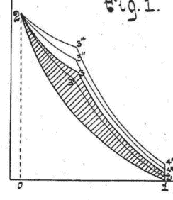
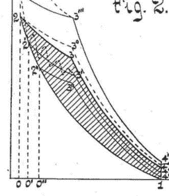
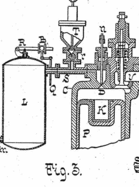
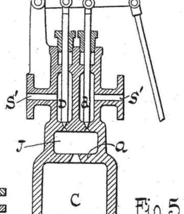
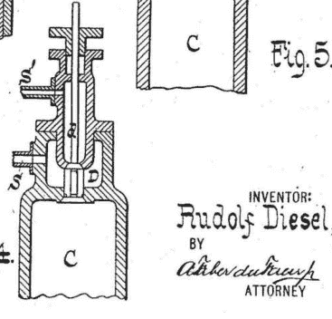

迪塞尔对其内燃机的美国专利

鲁道夫·迪塞尔最初希望发动机主要由小型独立生产者使用，作为工业去中心化的工具，但在120多年后，事实恰恰相反。柴油机是大规模中心化工业生产无可争议的推动者，也是全球化不可替代的动力源。它们驱动着几乎所有的集装箱船，以及车辆、石油、液化天然气、矿石、水泥、肥料和谷物的载体运输工具。它们还驱动着几乎所有的卡车和货运火车。

本书的大多数读者所食用或穿着的物品，至少有一次（通常是多次）是通过柴油驱动机器从其他大陆运输的：来自孟加拉的衣服、南非的橙子、中东的原油、来自牙买加的铝土、来自日本的汽车、来自中国的电脑。如果没有柴油机的低运行成本、高效率、高可靠性和卓越耐用性，无法实现如今定义现代经济的全球化程度。

在一个多世纪的使用中，柴油机在容量和效率上不断提高。现在航运最大的发动机额定功率超过81兆瓦（109000马力），其最高净效率略高于50%——优于气轮机的约40%效率（见“为什么气轮机是最佳选择”，第139页）。

柴油引擎将一直存在下去。目前还没有现成的大规模运输替代方案，能够像柴油机那样廉价、高效且可靠地整合全球经济。

## 捕捉运动——从马匹到电子

埃德华德·穆布里奇（Eadweard Muybridge，1830–1904）是一位英国摄影师，他在1867年通过将移动工作室带到约瑟米谷并制作出那里壮丽景观的大型银盐照片，从而在美国声名鹊起。五年后，他受到了利兰·斯坦福（Leland Stanford）的雇佣，斯坦福当时是中央太平洋铁路主席，曾任加州州长，后来又成为帕洛阿尔托同名大学的创始人。斯坦福也是一名马主经营者，他挑战穆布里奇去解决一个老争议：马在奔跑时，四条腿是否都离了地面。

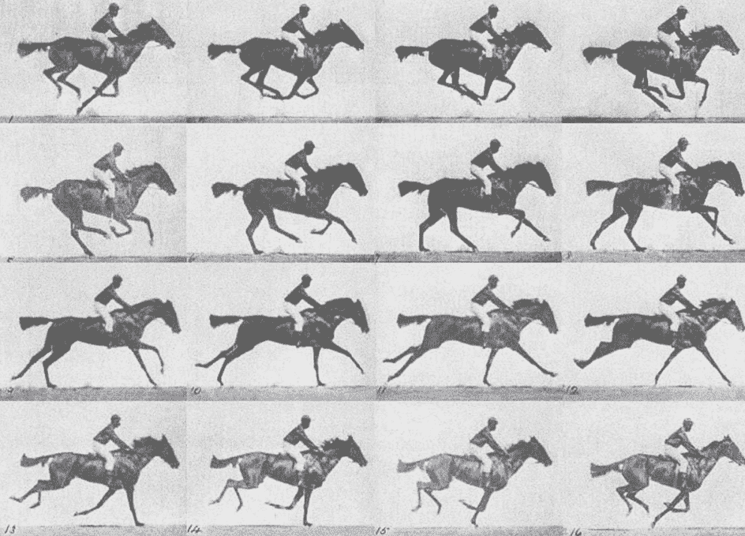

穆布里奇拍摄的奔马

穆布里奇发现很难证明这一点。1872年，他拍到（随后丢失了）一张马匹小跑时四蹄全部离地的单一图像。但他坚持了下来，最终的解决方案是使用快门速度最快达1/1,000秒的相机来捕捉运动物体。

这项决定性的实验于1878年6月19日在斯坦福的帕洛阿尔托农场举行。穆布里奇沿轨道排列了一系列触发式玻璃板相机，使用白色布料作为背景以获得最佳对比度，并将生成的图像作为一系列静态照片（剪影）复制在一个他称为“兽影仪”（zoopraxiscope）的简单圆形设备圆盘上，通过快速连续旋转的静态画面来传达运动。

斯坦福为测试提供的马——萨莉·加德纳（Sallie Gardner），在奔跑时确实四蹄都都离了地面。但这种腾空瞬间并没有像名画中描绘的那样，最著名的可能是西奥多尔·杰里科的《1821年埃普姆赛马》（现悬挂于卢浮宫），画中动物的腿部向身体外伸展。

相反，它发生在马腿位于身体下方的时刻，就在马用后腿蹬地起飞的瞬间之前。

这项工作促成了穆布里奇的*巅峰之作*，他为宾夕法尼亚大学准备了这部作品。从1883年开始，他开始了一系列描绘动物和人类运动的作品。其创作依赖于24台平行固定在36米长轨道上的相机，每端配有两组各12节电池的便携电池组。轨道有标记背景，动物或人通过拉断绷紧的弦来触发快门。

最终产品是一本有781幅图的书，于1887年出版。这部合集不仅展示了家畜（狗、猫、牛、猪），还有野牛、鹿、大象和老虎，以及一只奔跑的鸵鸟和一只飞行的鹦鹉。人类序列描绘了跑步，以及上升、下降、举起、推、摔跤、孩子爬行，以及一个女人向另一个女人泼水桶。

穆布里奇的每秒1000帧变成了10,000帧。到1940年，专利旋转镜相机的设计将频率提高到每秒100万次。1999年，艾哈迈德·泽维（Ahmed Zewail）因开发出能够捕捉飞秒级化学反应过渡态的光谱仪——即$10^{-15}$秒，或者说一秒的十亿分之一——而获得诺贝尔化学奖。

今天，我们可以使用高强度、超快速激光脉冲来捕捉时间间隔仅为亚秒（attoseconds）即$10^{-18}$秒的事件。这种时间分辨率使得我们看到最近一直隐藏在任何直接实验之外的现象：原子尺度上的电子运动。

可以举许多例子来说说明我们自19世纪几十年以来取得的非凡科学和工程进展，书中还详细描述了几个令人印象深刻的案例——包括光效（见《WHY SUNLIGHT IS STILL BEST》，第158页）和经收入-性能调整后的电价（见《THE REAL COST OF ELECTRICITY》，第170页），但埃德华德·穆布里奇与艾哈迈德·泽维发现之间的对比，我能想到的任何其他进步都同样令人震撼：从解决马蹄腾空的争议到观察瞬即逝的电子。

## 从留声机到流媒体

当托马斯·爱迪生（Thomas Edison）于1931年去世时，享年84岁，他在美国拥有近1100项专利，在全球范围内超过2300项专利。到为止最著名的是他的灯泡专利，但他既没有提出真空玻璃容器的想法，也没有使用白炽灯丝。更基础的是爱迪生从无到有地构思了一套完整的发电、传输和转换系统，并于1882年首先在伦敦、随后在曼哈顿下城投入运行。

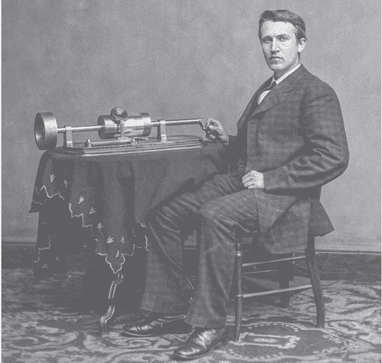

带着留声机的托马斯·爱迪生

但就那种近乎魔法的纯性而言，没有任何能与爱迪生1878年2月19日颁发的的美国第200,521号专利相比，那是人类首次听到声音的方法。

留声机（一种用于机械记录和播放声音的设备）诞生于电报。爱迪生花费多年试图改进前者，他早期的专利大部分与电报有关——而自1876年起他就被后者所吸引。在19世纪80年代，爱迪生专注于引入和改进电灯，以及发明和设计传输系统。1898年，他开始以20美元的价格出售爱迪生标准留声机，这在现在相当于540美元。一年后出了一款廉价的“宝石”型，仅售7.5美元（当时西尔斯罗百公司卖的一张铁床大约也是这个价格）。他的广告（不协调地）称其为“托马斯·爱迪生的最终成就”，发明者的愿望是每个美国人都能买得起这台机器。19世纪80年代后期，他通过使用蜡筒（由电话发明者亚历山大·格拉姆·贝尔构思）和电池驱动电机大大改进了设计，将其作为家庭声音录音机和音乐盒进行营销，以及企业的速记机和盲人的有声书。

然而，销量从未理想过。蜡筒（尤其是早期版本）易碎、难以制造，因此昂贵。到1887年，美国唱片公司获得了一种竞争性设备的专利，但它仍然价格高昂（相当于现在的4000美元）。

不久，他带着留声机巡演，甚至进入了白宫。爱迪生总是很难放弃他的早期发明。最后一批留声机筒于1929年10月制造。带有螺旋纹槽的平光盘（用于唱片机）在20世纪的大部分时间里占据主导地位，直到新的录音模式接踵而至。美国黑胶片（LP）销量在1978年达到顶峰，随身带在十年后达到顶峰，随后1984年引入的CD在1999年达到顶峰。这些销量在短短七年后就削减了一半，现在又被音乐下载（包括免费的无线流媒体）所超越。爱迪生会如何看待这些去物质化的声音重现方法？

# 发明集成电路

1958年，在贝尔实验室重新发明晶体管11年后，人们清楚地意识到，半导体只有在能够极大微型化的情况下才能统治电子市场。通过手工将独立组件焊接到电路中并没有取得多少进展，但正如常有的那样，解决方案在恰恰的时候出现了。

1958年7月，德州仪的杰克·S·基尔比（Jack S. Kilby）提出了单片集成的想法。他的专利申请将其描述为“一种新颖微型化电子电路，由半导体材料主体制造，其中包含一个扩散的p-n结，电子电路的所有组件都完全集成在半导体材料主体中。”基尔比强调，“通过这种方式制造的电路，复杂性或配置没有限制。”

这个想法是完美的，但它的执行方案——如基尔比1959年2月的专利申请所示——实际上是不可行的，因为它的引线连接像拱形一样凸在晶圆表面上方，这并不是制造平面组件的方法。基尔比知道这行不通，因此他添加了关于通过其他方式进行连接的注释。例如，他提到了沉积在晶圆表面薄氧化硅层上的金层。

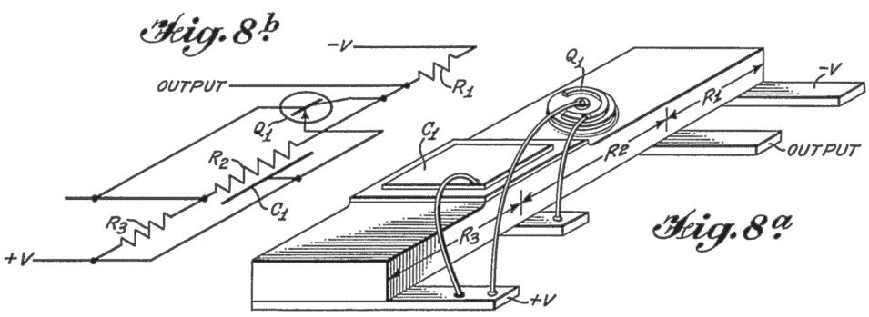

集成电路：基尔比的“飞行构件”专利

他不知道的是，1959年1月，当时费尔半导体公司的研究总监罗伯特·诺伊斯（Robert Noyce）在其实验笔记本上记录了这一想法的改进版本。“在单片硅上制造多个设备是理想的，以便能够作为制造工艺的一部分实现设备间的互连，从而缩小尺寸、重量以及每个活性元件的成本，”诺伊斯写道。此外，诺伊斯1959年专利申请附带的图中没有“飞行的线”；相反，它清晰地描绘了一个平面晶体管和“引线的形式为真空沉积或其他金属条，延伸并附着在绝缘层上，用于在半导体体的不同区域之间以及区域内部建立电气连接，而不会短路结。”

诺伊斯的专利于1961年4月获得；基尔比的于1964年7月获得。这场诉讼一直上到最高法院，法院在1970年拒绝审理此案，维持了下级法院关于诺伊斯优先判决。这一决定并没有产生实质性影响，因为在1966年，这两家公司已同意共享生产许可，集成电路的起源变成了又一个独立并行发明的卓越范例。基本概念思想是相同的；两位发明者都获得了国家科学奖，并都入选了国家发明家名人堂。诺伊斯仅活了62岁，但基尔比活到了77岁，并在2000年分享了诺贝尔物理学奖，那是在他去世五年前。

德州仪器将这些新设计称为“微逻辑元件（Micrologic elements）”。它们被用于控制洲际弹道导弹并帮助人类登上月球。

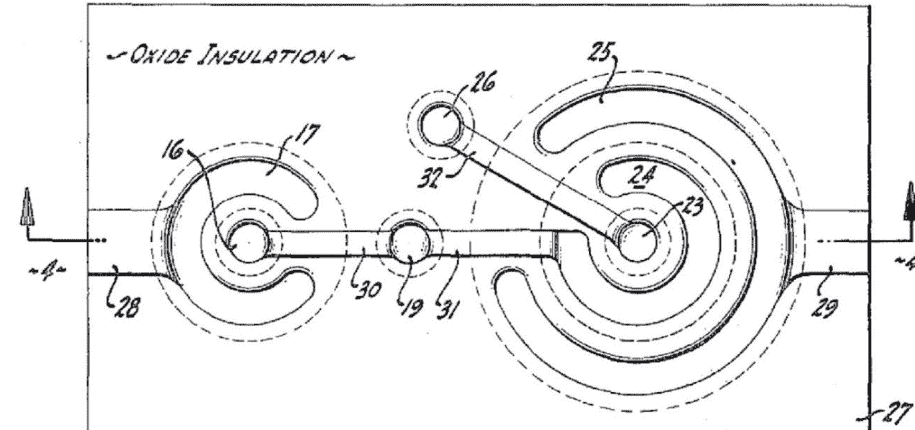

图 3 集成电路：诺伊斯的平面专利

他们随后的进展被依然存在的摩尔定律所记录（参见《摩尔的诅咒：为什么技术进步比你想象的要慢》，第125页），这是我们时代定义性的发展之一。1971年，基础集成电路已成熟为具有成千上万组件的简单微处理器，随后从20世纪80年代中期开始发展到使个人计算负担得起的设计。到2003年，组件总数超过了1亿，到2015年达到了100亿个晶体管。这代表了自1965年以来增长了八个数量级，平均每年增长约37%，给定区域内的组件数量每隔两年翻一倍。这意味着，与最新能力相比，20世纪60年代中期的等效性能需要大1亿倍的组件。正如物理学家理查德·费曼的名言所说，“底部还有足够的空间。”

## 摩尔的诅咒：为什么技术进步比你想象的要慢

1965年，戈登·摩尔（Gordon Moore）——当时费尔半导体公司的研发总监——指出“最小组件成本的复杂性以每年约两倍的速度在增加……显然在短期内可以预计这种速度将持续，甚至增加。”从长期来看，翻倍速度稳定在约两年，或者说每年35%的指数增长率。这就是摩尔定律。

随着组件变得更小、更密、更快、更廉价，它们提高了许多产品服务的功率并降低了成本，特别是电脑和手机。结果是电子领域的一场革命。

但这场革命既是祝福也是诅咒，因为它产生了一个意外之外的影响，提高了人们对技术进步的预期。我们被保证快速进步将很快带来自动驾驶汽车、个性定制的癌症疗法以及心脏和肾脏的即时3D打印。我们甚至被告诉这将世界从化石燃料向可再生能源的转型铺路。

但晶体管密度翻倍的时间并不是通用技术进步的指南。现代生活取决于许多改进缓慢的过程，尤其是1950年以前，以及与晶体管发展同步的创新（它们的首次商业应用是在1952年）。因此，在微芯片主导的世界之外，创新并不遵循摩尔定律，而是以低一个数量级的速度进行。

使现代文明运行并限制其活动范围的能量、材料和运输基础正在稳定但缓慢地改进。性能的增益大多每年1.5%到3%，成本的下降也是如此。

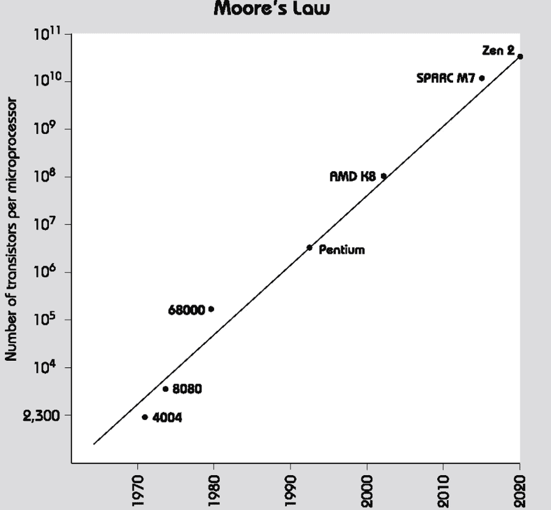

美国领先作物玉米自1950年以来，其平均产量每年增长2%。中国最大的主食水稻，产量在过去50年里每年增长1.6%。20世纪，蒸汽发电机将热能转化为电能的效率每年提高1.5%；如果你将1900年的蒸汽发电机与2000年的联合循环电厂（燃气轮机驱动蒸汽锅炉）进行比较，这一年增长率增加到1.8%。照明领域的进步比电力转换任何其他领域都令人印象深刻，但从1881年2014年，室内灯的光效（每瓦流明）每年仅增长2.6%，室外照明为3.1%（参见《为什么阳光仍然最好》，第158页）。

洲际旅行的速度从1900年大型远洋轮的每小时约35公里，到1958年波音707的每小时885公里，平均增长了5.6%。但自此以后喷气飞机的速度基本保持不变——波音787的巡航速度仅比707快几个%。1973年至2014年，美国新款乘用车（甚至排除巨型SUV和皮卡）的燃油效率每年增长率仅为2.5%，从每加仑13.5英里提高到37英里（即每100公里17.4升降到6.4升）。最后，我们文明最基础金属钢铁的能耗（煤、天然气和电力）从1950年到2010年从每吨约50千焦减少到不足20千焦——即每年减少约1.7%。

## 数据的崛起：过快且过量

曾经几何，信息仅存储在人类的大脑中，古老的鸟类可以花费几个小时讲述冲突与征服的故事。后来，外部数据存储被发明了。

大约5000年前，在美索不达米亚发明的小泥圆柱和泥板通常只包含十几个这种古老语言的楔形文字，等于几百字节（或$10^2$字节）。公元前五世纪由埃斯基卢斯创作的希腊悲剧三部曲《俄斯忒亚》总量约为30万字节（或$10^6$字节）。古罗马帝国的一些富有的参议员拥有拥有数百卷轴的图书馆，其中一个大型收藏馆至少包含100兆字节（$10^8$字节）。

约翰·古登堡发明的活字印刷机带来了根本性的变化。到1500年，在印刷引入后不到半世纪的时间里，欧洲印刷商就出版了超过11,000种新书。这种非凡的增长还伴随着其他存储信息形式的进步。首先是雕刻和刻制的乐谱、插图和地图。接着，在19世纪出现了木刻画、录音和电影。20世纪增加的新信息存储模式包括磁带和长胶唱片，从20世纪60年代开始，计算机将数字化的范围扩大到现代成像（一张50兆字节的数字地图）、动画电影（2–3GB）、跨洲金融转账，以及最终的垃圾邮件（每分钟发送超过1亿条信息）。这些数字存储的信息迅速超过了所有印刷材料。莎士比亚的剧作和诗歌总量为5兆字节，这仅等于一张高分辨率照片，或者30秒高保真音频，或者8秒的流媒体高清视频。

## 兆字节 ($10^6$)

- 一张CD光盘的全部内容

## 吉字节 ($10^9$)

- 一个学术期刊图书馆
- 一米长的书架
- 一分钟高保真音频
- 高分辨率照片完整作品集
- 贝多芬作品全集
- 一辆装满书的皮卡

## 太字节 ($10^{12}$)

- 国家气候数据中心数据库

## 拍字节 ($10^{15}$)

- 世界所有的印刷材料
- 一个学术图书馆的全部内容
- 美国国会图书馆的所有印刷收藏
- 三年的美国航空航天局（NASA）观测数据
- 1995年开发的所有美国学术图书馆

## 每小时吉字节

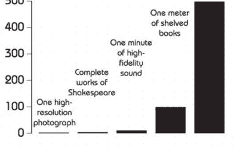
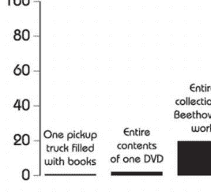
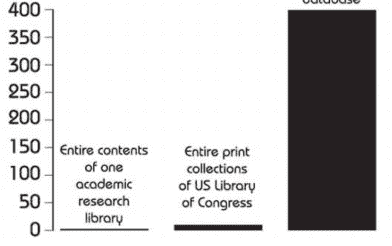
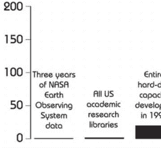
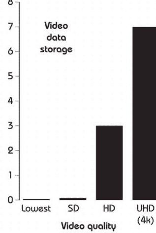

印刷材料因此已变成全球整体信息存储中的次要部分。到2000年，美国国会图书馆所有的书籍超过了$10^{11}$字节（超过10太字节），但一旦加上所有照片、地图、电影和音频录音，这还不到总藏量的的1%（$10^{15}$字节，或约3拍字节）。

在21世纪，信息的生成速度越来越快。云服务商Domo在对2018年每分钟生成数据的最新调查中，列出了Netflix预测的流出的超过97,000小时视频、YouTube上观看的近450万个视频、天气频道上超过1800万次的预报请求，以及仅美国本土就产生了超过3万亿亿字节（3.1拍字节）的其他互联网数据。到2016年，全球年度数据产生率超过了16泽字节（1 ZB是$10^{21}$字节），到2025年，预计将再增长一个数量级——即达到约160泽字节（$10^{23}$字节）。根据Domo的数据，在2020年，世界上近80亿人口中的每每秒都会产生1.7兆字节的数据。

这些数量引发了一些显而易见的问题。应该是哪部分？即使这些流量中不到1%被保留，数据存储的挑战也是显而易见的。而且无论我们决定存储什么，而不是数据应该保留多久。没有任何存储是永久的，但最佳跨度是多少？


国际单位制中最高的前缀（其中千是`k=10^3`，百万是`M=10^6`）是尧（`Y=10^24`，或一万亿万亿）。在十年内，我们将拥有许多字节，而且评估它将变得越来越困难——即使这些任务越来越多地交给机器。一旦我们开始每人每年创建超过50万亿字节的信息，是否会有……

## 现实地看待创新

现代社会痴迷于创新。失败创新的第二类——那些我们知道不应该坚持却又坚持的事情——从日常做法到理论概念不等。

两个令人讨厌的例子是夏令时和登机。为什么在我们知道它们并没有真正节省任何东西的情况下，还要每半年实施一次“夏令时”变更（以节省能源为理由）？而且现在的航班登机时间更长了，尽管我们知道许多比目前这些低效偏好更快的方法。

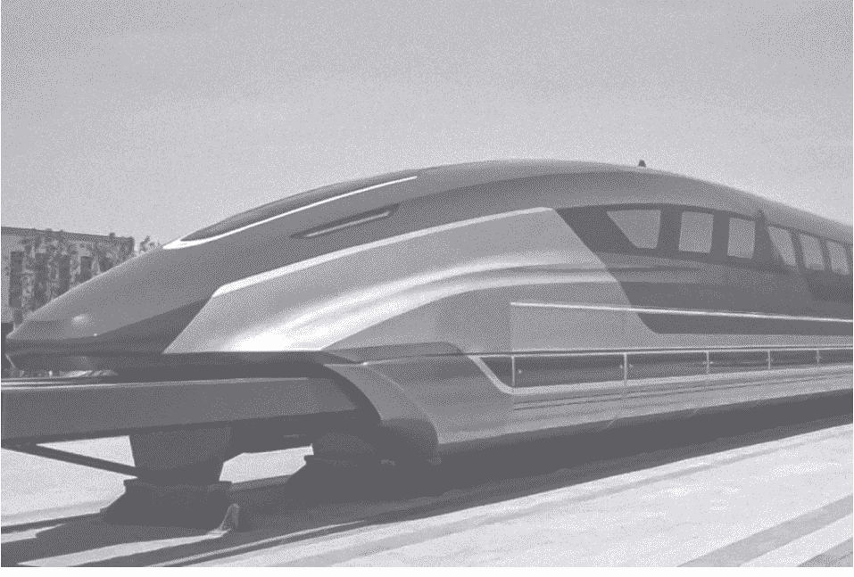

其他尚未实现商业的基础性创新包括氢能（燃料电池）汽车、磁悬浮列车和热核聚变能量。后者可能是关于不断退缩的成就臭臭昭名的例子。


# 燃料与电力

为我们的社会注入能量

## 为什么燃气轮机是最佳选择

1939年，世界上第一台燃轮机在瑞士纳沙泰尔（Neuchâtel）的一座市政电站开始发电。这台由布朗伯瑞（Brown Boveri）安装的机器在排放废气时没有利用其热量，且轮机的压缩机消耗了发电量的近的三之四。这导致效率仅为17%，约为4兆瓦。

第二次世界大战的冲击以及随后的经济困难使得纳沙泰尔轮机在1949年之前都是一个先驱例外，直到西屋世电气（Westinghouse）和通用电气（General Electric）推出了他们的第一批限功率设计。当时并没有急于安装它们，因为市场由发电成本最低廉的大型燃煤电厂主导。到1960年，最强大的燃气轮机达到了20兆瓦，比大多数蒸汽轮机发电机的输出功率小一个数量级。

1965年11月，美国东北部的大停电改变了许多人的想法：燃气轮机可以在几分钟内全负荷运行。但油价和天然气价格上涨以及电力需求的放缓阻碍了这项新技术的快速扩张。转变发生在20世纪80年代后期；到1990年，几乎所有新增的发电容量中有一半来自功率、可靠性和效率不断提高的燃气轮机。

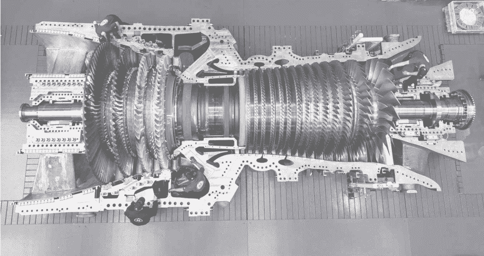

但即使效率超过40%，其产生的废气温度也达到约600°C，这个温度足够在附带的蒸汽轮机中产生蒸汽。这种燃气轮机与蒸汽轮机的组合——联合循环燃气轮机（CCGT）最早开发于20世纪60年代后期，现在CCGT的最高效率已超过60%。没有其他原动机比它更不浪费。

西门子目前提供一种额定功率为593兆瓦的公事业发电CCGT，功率是纳沙泰尔机器的40倍，运行效率为63%。通用电气9HA燃气轮机在单独运行（简单循环发电）时输出571兆瓦，与蒸汽轮机耦合（CCGT）时输出661兆瓦（效率为63.5%）。

燃气轮机是峰值电力的理想供应商，也是间歇性风能和太阳能发电的最佳备份。在美国，它们目前是新增发电容量最廉价的选择。预计2023年投入运行的新容量平准化电成本（能源项目生命周期成本的衡量标准），部分碳捕集功能的燃煤蒸汽发电机约为60美元/兆瓦，太阳能光伏为48美元/兆瓦，常规燃气轮机和陆上风电为40美元/兆瓦——但CCGT每兆瓦成本低于30美元。

燃气轮机在全球范围内还用于电热热联产。许多行业需要蒸汽和热水，并将其用于许多欧洲大城市常见的中央供暖系统提供能量。这些轮机甚至被用于加热和照明荷兰的大型温室，这些温室还受益于产生的二氧化碳——因为这能加速蔬菜的生长。燃气轮机还在许多工业企业和长距离管道的泵站运行压缩机。

结论显而易见的：没有其他燃烧机像现代燃气轮机这样拥有如此多的优势。它们紧凑、易于运输和安装，而且相对安静、廉价且高效，能够近乎瞬时输出且无需水冷运行。所有这一切使其成为供应机械能和热量的无比拟的机器。

至于它们的寿命呢？纳沙泰尔轮机在运行63年后于2002年退役——并不是因为机器发生故障，而是因为发电机损坏了。

## 核电——未实现的承诺

商业核发电时代始于1956年10月17日，当时伊丽莎白二世女王在英国西北海岸的卡尔德霍（Calder Hall）开启了开关。60年的时间足够判断这项技术，我仍然无法改进十年前对它的评价：“成功的失败”。

“成功的部分是有据可查的。在起步缓慢后，反应堆建设在20世纪60年代后期开始加速，到1977年，美国超过10%的电力来自核裂变，到1991年上升到20%。这种市场渗透速度快于20世纪90年代以来光伏和风力机所能达到的速度。

2019年底，全球有449台运行中的反应堆（还有53台正在建设中），许多反应堆的容量因子超过90%。这是反应堆全年平均潜力输出的份额，产生的电量是光伏电池和风力机总和的两倍以上。2018年，核电在法国提供了最高份额的电力（约72%），匈牙利为50%，瑞士反应堆贡献了38%，韩国为24%，而美国的占比略低于20%。

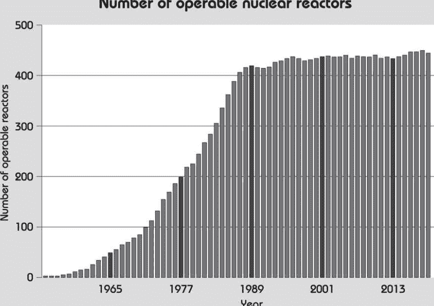

## 核发电

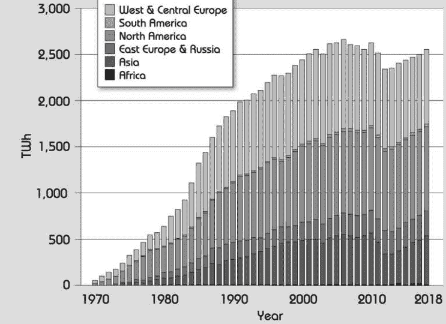

“失败”的部分与未实现的预期有关。关于核电将“廉价到无需计费”的说法并非空穴来风：1954年美国原子能委员会主席刘易斯·L·斯特劳（Lewis L. Strauss）在9月于纽约的国家科学作家协会这样说道。同样大胆的言论后来还有不断。1971年，诺贝尔奖得者、时任原子能委员会主席格伦·西博（Glenn Seaborg）预测，核能到2000年将产生几乎所有的电力。西博设想了巨大的海岸海水淡化；由紧凑反应堆驱动的地球静止卫星广播电视节目；核动力坦克；以及改变河流流向的核爆炸。同时，核动力将把人类带往火星。

但裂变发电项目在20世纪80年代陷入停滞，因为富裕经济体的电力需求下降，核电站的问题也成倍增加。三次失败令人担忧：1979年宾夕法尼亚州三哩岛岛事故、1986年乌克兰切尔诺贝利事故，以及2011年日本福岛事故，为那些反对在任何情况下使用裂变的人提供了进一步证据。

与此同时，核电站的建设出现了成本超支，并且在为废燃料寻找理想的永久存储方式方面一直一无进展（目前临时储存在电厂场地的容器中）。在转向可能比主流压反应堆更安全、更便宜的反应堆方面也没有取得太大成功，压反应堆本质上是20世纪50年代美国海军设计的版本。

结果是西方世界仍然不信服，发电公司持谨慎态度，德国和瑞典正处于关闭整个产业的道路上，甚至法国也计划削减。全球范围内正在建设的反应堆将无法弥补未来几年随着旧反应堆停运而损失的容量。

唯一具有重大扩张计划的领先经济体在亚洲，以中国和印度为首，但即使是他们也无法扭转核电在全球发电中份额下降的趋势。根据国际能源机构的数据，该份额在1996年达到近18%的峰值，2018年下降到10%，预计到2040年将回升至仅12%。

# 为什么通过风力发电需要化石燃料

风力涡轮机是追求可再生发电最可见的标志。然而，尽管它们利用了风——这种既免费又绿色的能源——但机器本身却是化石燃料的纯粹体现。

大型卡车将钢材和其他原材料运到现场，土方设备在原本无法到达的高地开辟出道路，大型起重机竖起这些结构——所有这些机器都在燃烧柴油。运输生产水泥、钢铁和塑料所需材料的货运火车和载货船也是如此。对于一台5兆瓦的涡轮机，仅钢筋混凝土基础平均就需要150吨钢，转子轮毂和机舱（包含变速箱和发电机）则分别需要250吨和500吨钢。

如果到2030年风电能满足全球需求的25%，即使平均容量因子高达35%，约2.5太瓦的装机风电总容量也需要大约4.5亿吨钢材。而且这还未计算为了将所有设备连接到电网所需的新型高压输电线路所需的塔架、电线和变压器的金属。

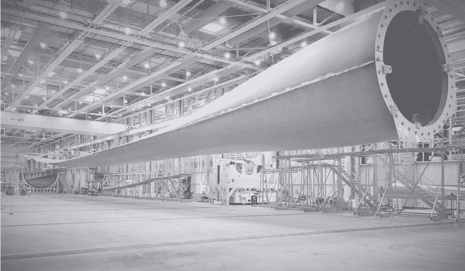

现代风力涡轮机的巨大塑料叶片：制造困难，运输更困难，回收更是极困难

制造钢铁需要消耗大量的能量。烧结或颗粒状铁矿石在高炉中熔炼，加入由煤炭制成的焦炭，并注入粉煤和天然气。生铁（高炉炼出的铁）在转氧钢炉中进行脱碳。钢经过连续铸造过程（将熔钢直接转变为最终产品的粗体）。建造涡轮机使用的钢每吨通常消耗约35千焦耳。

为了制造可能在2030年运行的风力涡轮机所需的钢，你需要相当于6亿吨煤的化石燃料。

一台5兆瓦涡轮机有三个长度约60米的叶片，重量约15吨。它们具有轻质的白木或泡沫芯，外层复合主要由玻璃纤维增强环氧树脂或聚酯树脂制成。玻璃是通过天然气在炉中熔化二氧化硅和其他矿物氧化物制成的。树脂源自轻烃烃的乙烯——最常见的是脑油分解产物、液化气或天然气中的乙烷。

最终纤维增强复合材料每吨能量约为170千焦耳。因此，为了在2030年实现2.5太瓦的装机风电，我们需要约2300万吨转子质量，这相当于约9000万吨原油。当一切就绪后，整个结构必须使用合成始于乙烯的树脂进行防水。另一种必需油产品是涡轮机变速箱的润滑剂，在机器二十年的寿命内必须定期更换。

毫无疑问，在不到一年的时间，一台设计良好且建造精良的涡轮机产生的能量将等于生产它所消耗的能量。然而，所有的能量将以间歇电的形式存在——而其生产、安装和维护仍然严重依赖特定的化石能源。此外，对于这些能源的大部分——炼铁矿用的焦炭；作为水泥窑燃料的煤和石油焦；作为合成塑料和制造玻璃纤维的原料和燃料的脑油和天然气；船只、卡车和建筑机械的柴油；变速箱润滑剂——我们没有在所需的大规模商业范围内随时获得的非化石替代品。

在未来的很长一段时间内——直到生产风力涡轮机和光伏电池的所有能源都来自可再生能源——现代文明将从根本上依赖化石燃料。

## 风力涡轮机能有多大？

风力涡轮机确实已经成长了。当丹麦维特斯公司在1981年开启巨型趋势时，其三叶片机器仅能产生55瓦。这个数字在1995年上升到500瓦，1999年达到2兆瓦，今天达到了5.6兆瓦。2021年，维特斯的V164高度达214米，配备164米转子，产生9兆瓦。GE的Haliade-X-147高228米，配备147米转子，产生9兆瓦。西门子的SG14-222高262米，配备222米转子，产生14兆瓦。明风的MyWT-16-260高280米，配备260米转子，产生16兆瓦。金风的G252-16MW/DD高232米，配备252米转子，产生16兆瓦。远景的E-X-20-260高260米，配备260米转子，产生20兆瓦。维特斯的V236-15.0 MW高282米，配备236米转子，产生15兆瓦。GE的Haliade-X-200高262米，配备220米转子，产生12兆瓦。明风的MyWT-22-262高282米，配备262米转子，产生22兆瓦。金风的G275-18MW/DD高275米，配备275米转子，产生18兆瓦。远景的E-X-25-290MP高290米，配备290米转子，产生25兆瓦。维特斯的V236-10.0 MW高282米，配备236米转子，产生10兆瓦。GE的Haliade-X-100高262米，配备220米转子，产生10兆瓦。明风的MyWT-18-292高312米，配备292米转子，产生18兆瓦。金风的G335-16MW/DD高335米，配备335米转子，产生16兆瓦。远景的E-X-30-335MP高335米，配备335米转子，产生30兆瓦。维特斯的V236-12.0 MW高282米，配备236米转子，产生12兆瓦。GE的Haliade-X-80高262米，配备220米转子，产生8兆瓦。明风的MyWT-20-312高332米，配备312米转子，产生20兆瓦。金风的G355-20MW/DD高355米，配备355米转子，产生20兆瓦。远景的E-X-35-390MP高390米，配备390米转子，产生35兆瓦。维特斯的V236-14.0 MW高282米，配备236米转子，产生14兆瓦。GE的Haliade-X-70高262米，配备220米转子，产生7兆瓦。明风的MyWT-25-336高356米，配备336米转子，产生25兆瓦。金风的G400-25MW/DD高400米，配备400米转子，产生25兆瓦。远景的E-X-40-440MP高440米，配备440米转子，产生40兆瓦。

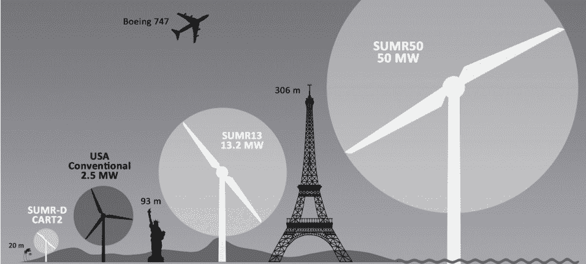

目前运行中最大的风力涡轮机在中国，高280米，配备260米转子和128米叶片，产生16兆瓦。其次大的是高262米，配备222米转子，产生14兆瓦。向大型涡轮机发展的趋势受增加能量捕获和降低成本的需求驱动。更大的转子可以捕捉更多的风，而风在高处通常更强、更稳定。更高的塔架也能到达这些风。然而，在运输、安装和结构完整性方面，建造更大的涡轮机面临着巨大挑战。

在未来的很一段时间内——直到生产风力涡轮机和光伏电池的所有能源都来自可再生能源——现代文明将从根本上依赖化石燃料。

## 光伏的缓慢崛起

1958年3月，一枚火箭从卡纳迪角发射，携带卫报一号（Vanguard 1）卫星：这是一个1.46公斤的铝球，它是第一个在轨道上使用光伏（PV）电池的卫星。

作为备份，卫星的两个器来自汞电池，但三个月后就失效了。通过光电效应，六个单晶硅电池——在原子水平吸收光（光子）并释放电子——总共可以提供1瓦，它保持了信号发射器直到1964年5月。

这种现象是因为在太空中成本不是问题。20世纪50年代中期，光伏电池每瓦约为300美元。成本在20世纪70年代中期下降到约80美元/瓦，20世纪80年代后期下降到10美元/瓦，2011年达到1美元/瓦，到2019年底，光伏电池的售价仅为每瓦8至12美分，未来必会有进一步下降（当然，为了发电而安装光伏板及相关设备的成本要高得多，取决于项目的规模：它们现在的范围从微小的屋顶安装到沙漠的大型太阳能场场）。

这是一个好消息，因为光伏电池的功率密度比任何其他可再生能源转换形式都高。即使作为年平均，它们在阳光充足地区已达到每平方米10瓦，比生物燃料的管理高出一个数量级。随着转换效率的提高和更好的跟踪技术的改进，将年容量因子提高20-40%应该是可能的。

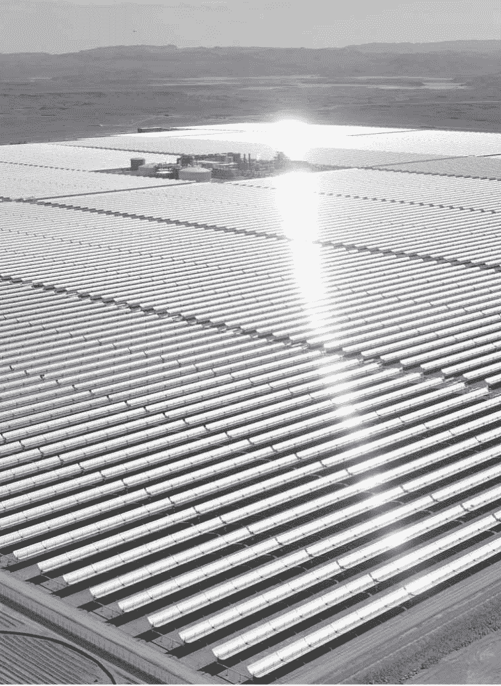

摩洛哥瓦尔扎扎特努尔光能电站的俯视图。该站容量为510兆瓦，是全球最大的光伏装置。

但达到这一步花了很长的时间。埃德蒙·贝克瑞尔（Edmond Becquerel）在1839年首次描述了溶液中的光电效应，威廉·亚当斯（William Adams）和理查德·戴（Richard Day）于1876年在硒中发现了它。直到1954年贝尔电话实验室发明了硅电池，商业机会才被开启。即便如此，每瓦成本仍保持在300美元左右（相当于2020年的2300多美元），除了用于少数玩具外，光伏发电在当时并并不实用。

是美国陆军的电子工程师汉斯·齐格勒（Hans Ziegler）克服了美国海军最初在“先锋号”（Vanguard）卫星上仅使用电池的决定。在20世纪60年代，光伏电池使得大型卫星的供电成为可能，彻底了电信、太空侦察、天气预报和生态系统监测。随着成本下降，应用场景倍增，光伏电池开始为灯塔、海上油气钻井平台和铁路交叉口供电。

1985年当德州仪器TI-35 Galaxy Solar太阳能计算器问世时，我购买了第一台。在30多年后的今天，它的电池片（每个片面积约170平方毫米）依然在为我提供服务。

但严肃的光伏发电必须等待组件价格的进一步下降。到2000年，全球光伏发电量不到全球用电量的0.01%；十年后，这一比例增加了一个数量级，达到0.16%；到2018年，该比例达到2.2%，但与全球水电站的发电份额相比（2018年接近16%）仍然只是很小。在一些阳光充足的地区，太阳能发电现在产生了显著影响，但从全球范围内来看，在与自然竞争面前还有很长的路要走。

即使是最乐观的预测——国际可再生能源机构的预测——也没有预计光伏输出在2030年前能缩小这一差距。但到2030年，光伏电池可能会产生全球10%的电力。届那时，距离“先锋号”的小电池开始为其信标发射器供电已经过去了几十年，距离首次在固体中发现光电效应也过去了约150年。全球范围的能源转型需要时间。

## 为什么阳光依然是最好的

你可以通过照明状态来粗略追踪文明的进步——特别是它的功率、成本和光效。最后一项指标指的是光源在眼睛中产生有意义反应的能力，它是总光通量（单位：流明）除以额定功率（单位：瓦）。

在明视条件下（即在允许色彩感知的强光下），可见光的光效在波长为555纳米的光处达到683 lm/W的峰值。那是光谱中的绿色部分——在任何功率水平下，这种颜色看起来都是最亮的。

数年来，我们的光源比这一理论峰值落后了三个数量级。蜡烛的光效仅为0.2到0.3 lm/W；煤气灯（19世纪欧洲城市常见）性能是其五到六倍；爱迪生早期灯泡的碳灯丝效率也几乎不比这个。金属灯丝的出现让效率发生了飞跃，首先是1898年使用锇达到5.5 lm/W，然后是1901年后使用钽达到7 lm/W，大约十年后，在真空中辐射的钨达到了10 lm/W。将钨灯丝置于氮气和氩气的混合物中，使家用灯的效率提高到12 lm/W，而从1934年开始的卷绕灯丝技术帮助100瓦灯泡的白炽效率提高到15 lm/W以上，这种灯泡是二战后头二十年亮光的标准来源。

## 每瓦流明

| 类型 | 数值 |
| :--- | :--- |
| 蜡烛，最大 | 0.3 |
| 金属灯丝 | 5.5 |
| 钽 | 7 |
| 钨 | 10 |
| 卷绕灯丝 | 15 |
| 荧光灯 | 100 |
| 直接阳光，最大 | 105 |
| 全球平均 | 105 |
| 大储能 | 130 |
| LED | 172 |
| 钠灯 | 200 |
| 理论极限 | 300 |

## 为什么我们需要更大的电池

如果我们有更好的方法来存储所需的大量能量，扩大我们对太阳能风能的使用将容易得多。

即使在阳光充足的洛杉矶，一个屋顶安装了足够需求光伏板的典型房屋仍会面临高达80%的缺口。即使是一个处理10到30吉瓦的小型国家电网，如果拥有吉瓦级的储能，也可以完全依赖间歇性能源。

自2007年以来，超过一半的人类住在城市地区，到2050年，将有超过63亿人住在城市里，占全球人口的三之二，其中人口超过1000万的大城市比例正在上升。这些人中的大多数人将住在高层建筑中，因此局部发电的可能性有限，但他们需要不断的电力来为家庭、服务、工业和交通供电。

## 储能与需求

| 功率 | 放电 | 释放 |
| :--- | :--- | :--- |
| 2,172 MW | 9小时 | 19,548 MWh |
| 100 MW | 4小时 | 400 MWh |


# 想象一个被台风袭击的亚洲特大都市

即使远距离线路能提供该城市一半以上的需求，它仍需要许多吉瓦时的储能来支撑，直到间歇性发电恢复（或使用化石燃料备份——这正是我们正试图摆脱的东西）。

当它于 2021 年完工时，将以 `100 MW` 的功率运行四小时。但这 `400 MWh` 的能量总量仍然比一个大型亚洲城市在失去间歇性供应时的需求低出两个数量级。

因此，我们必须扩大储能规模，但如何做呢？钠电池的能量密度高于锂离子电池，但液态金属是一种极不方便的电解质。直接在电解质中储存能量的流体电池仍处于部署早期。超级电容器无法提供足够长时间的电力。而压缩空气和飞轮作为大众媒体报道的常青宠，目前仅落位了十个左右的小型午间辅助设施。或许最好的长期希望是利用廉价的太阳能电通过电解分解水，并将产生的氢气作为多用途燃料，但这种基于氢的经济尚未迫在眉睫。

而且在进行大规模建设时，我们仍必须依赖一种引入于 19 世纪 90 年代的技术：抽水蓄能。你在高处建造一个水库，通过管道连接低处的另一个水库，并利用廉价的夜间电力将水抽上山上，以便在用电高峰期驱动涡轮机。抽水蓄能占了全球储能能力的 99% 以上，但不可避免地会产生 25% 的能量损失。许多设施的短期容量超过 `1 GW`——最大的约为 `3 GW`——而对于一个完全依赖太阳能和风能发电的大城市来说，需要多个这样的设施。

但大多数大城市远没有抽水蓄能所需的陡峭悬崖或深切的山谷。许多城市——包括上海、加尔各答和卡拉奇——位于沿海平原。只有通过远距离输电产生电力，它们才能依靠抽水蓄能。

对更紧凑、更灵活、更大规模、更具成本效益电力储能的需求是显而易见的。但这一奇迹的到来一直缓慢。

# 为什么电动集装箱船难以实现

你穿的或在家里使用的几乎所有东西，都曾放在船上的钢制箱子里，由柴油发动机驱动它们从亚洲出发，并排放颗粒物和二氧化碳。你理会认为，我们可以做得更好。

毕竟，我们已经拥有一个世纪的电力机和半个多世纪的高速电力火车，最近我们还在扩大全球电动车队。为什么不采用电动集装箱船呢？

实际上，第一艘船计划于 2020 年运营：由挪威 `Marin Teknikk` 建造的 `Yara Birkeland`，不仅是世界上第一艘电力驱动、零排放集装箱船，还是第一艘自主商用船。

但不要现在就否定巨型柴油集装箱船及其在全球化经济中的关键作用。这里有一个粗略的计算，解释了原因……

集装箱有不同的尺寸，但大多数是标准的 `20 英尺等值单元（TEU）`——长 `6.1 m`（`20 ft`）、宽 `2.4 m` 的矩形。20 世纪 60 年代的首批小型集装箱船载有数百个 `TEU`；2019 年下水的四艘属于瑞士 `MSC` 的船只（`Gülsln, Samar, Leni and Mia`）保持了记录，每艘 `23,756 TEU`。当它们以非常慢的速度（为了节省燃料为 `16 knots`）行驶时，这些船可以在 `30` 天内完成从香港到汉堡（经苏伊士运河）超过 `21,000 km` 的航程。

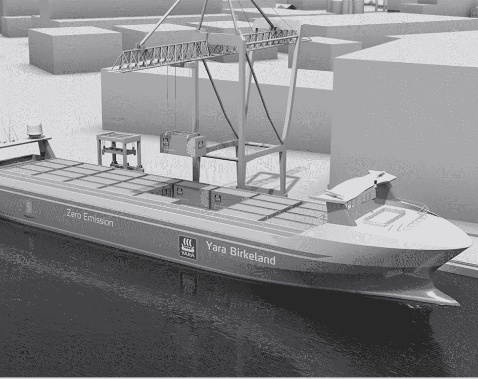

现在考虑 `Yara Birkeland`。它将仅携带 `120 TEU`，其服务速度为 `6 knots`，最长预定运行航程为 `30 海里`——位于挪威的 `Heroya` 和 `Larvik` 之间。因此，如今最先进的柴油集装箱船运输的箱子数量是它的 `200` 倍，距离几乎是其 `400` 倍，速度是先驱电动船所能承受的三到四倍。

要制造一艘能够装载 `18,000 TEU`（目前常见的跨洲载货量）的电动船需要什么？在为期 `31` 天的行程中，今天大多数高效的柴油船会消耗 `4,650 吨` 燃料（低硫燃料油约为 `45 MJ/kg`，而锂离子电池的能量密度约为 `0.5 MJ/kg`）。为了匹配柴油的能量密度，我们需要一种能量密度高 `100` 倍的电池，这在目前的化学体系中物理上是不可能的。

即使我们能制造出这样的电池，其重量也将令人望而却步。为了跨洋运输 `18,000 TEU`，一艘船需要约 `15,000 吨` 燃料。按照目前 `0.5 MJ/kg` 的能量密度，这将需要 `300,000 吨` 电池——是船重的十倍。

基础设施问题也是令人生畏的。要在合理的时间内为这种电池充电需要巨大的功率。如果我们想在 `24` 小时内为 `1,000,000 MWh` 充电，我们需要 `42 GW` 的持续功率供应。这相当于几座大型核电站的输出，仅为了给一艘船充电。

# 电力的真实成本

在许多富国家，电价在过去一个世纪里下降了。经通胀调整后，美国住宅电价从 1902 年的每千瓦时 `$4.81` 下降到 1950 年的 `30.5` 美分，然后是 2000 年的 `12.2` 美分；2019 年初略高，为 `12.7` 美分。这代表了超过 `97%` 的下降。在此期间，平均制造业工资几乎增加了六倍，这意味着对于蓝领家庭来说，现在的电力支出负担能力比 120 年前高出 `200` 倍。

| 国家 | 支付 100 kWh 所需的劳动分钟 |
|---|---|
| 德国 | 60 |
| 意大利 | 60 |
| 英国 | 47 |
| 丹麦 | 46 |
| 法国 | 33 |
| 加拿大 | 24 |

国际视角显示了一些惊人的差异。除了加拿大和挪威，美国的住宅电价比任何富裕国家都便宜，这两个是水电发电占比最高的高收入国家（分别为 `59%` 和 `95%`）。在使用现行汇率时，美国住宅电价约为欧盟平均水平的 `55%`，日本平均水平的一半，低于德国费率的 `40%`。印度、墨西哥、土耳其和南非的电价按汇率换算低于美国，但使用购买力平价计算时则高得多：是印度的两倍以上；几乎是土耳其的三倍。

当阅读关于光伏电池成本大幅下降的报告（参见《光伏的缓慢崛起》）以及风力涡轮极具竞争力的定价时，天真的观察者可能会得出结论：新型可再生能源（太阳能和风能）份额的上升将开启一个电价下降的时代。但事实上，事实恰恰相反。

2000 年，当该国启动大规模且耗资的可再生能源发电扩张计划（`能源转型`）时，德国居民用电价格处于低位且不断下降——在 2000 年触底时，每千瓦时低于 `0.14 欧元`。

到 2015 年，德国接近 `84 GW` 的太阳能和风能总容量已超过化石燃料发电厂的总装机容量；到 2019 年 3 月，超过 `20%` 的电力来自新型再生能源——但电价在 `18` 年内翻了一倍多，达到每千瓦时 `0.29 欧元`。因此，欧盟最大的经济体拥有全大陆第二高电价：仅在高度依赖风能的丹麦（2018 年，其 `41%` 的发电来自风能）价格更高，为每千瓦时 `0.31 欧元`。美国也有类似的对比。在加州，随着新型再生能源占比的增加，电价上涨比全国平均水平快五倍，现在比全国平均高近 `60%`。

# 无法避免的缓慢能源转型

1800 年，只有英国以及欧洲和北中国的少数地区燃烧煤炭产生热量——世界 `98%` 的初级能源来自生物质燃料，主要是木材和木炭；在森林枯竭地区，能量还来自稻草和干燥的动物粪便。到 1900 年，随着煤炭开采的扩大以及北美和俄罗斯石油气的生产开始，生物质提供了世界一半的初级能源；到 1950 年，这一比例仍接近 `30%`，到 21 世纪初下降到 `12%`，尽管在许多撒哈拉以南国家，这一比例仍保持在 `80%` 以上。显然，从“新碳”（植物组织中的碳）向煤炭、原油和天然气中的“旧碳”（化石碳）转型花费了很长时间。

我们现在正处于一个更具挑战性的转型的早期：为了避免全球变暖最严重的后果，需要对全球能源供应进行脱碳。与普遍印象相反，这种转型的进展并不类似于手机的普及速度。从绝对意义上，世界正奔向碳——而非远离碳（参见第 303 页“奔向碳”），从相对意义来看，我们的收益仍保持在个位数。

# 全球能源转型

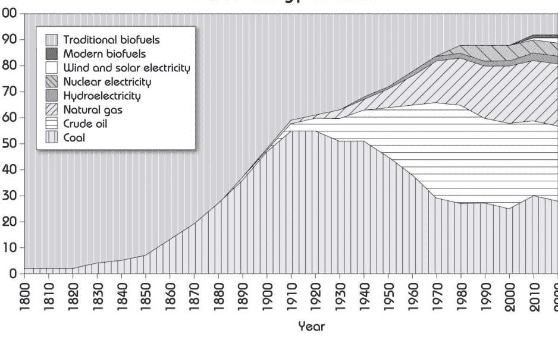

第一届联合国气候变化框架公约于 1992 年举行。那一年，化石燃料（将燃料和电力转换为 `BP` 在其年度统计报告中青睐的共同分母）提供了世界 `86.6%` 的初级能源。到 2017 年，它们的占比为 `85.1%`，在 `25` 年间仅减少了 `1.5%`。

这一衡量全球能源转型速度的指标，也许是对世界对化石碳持续根本性依赖最有说服力的提醒。一个世纪中 `1.5%` 的微小波动，是否能在之后的 `25` 至 `30` 年内，通过非碳替代方案取代世界 `80%` 的能源，从而在 2057 年实现化石碳零排放？按部常班我们无法到达那里，唯一可能的方案要么是全球经济崩溃，要么以远超我们目前能力的速度和规模采用新能源。

新闻的业余读者会被风能和太阳能发电所谓的进展所误导。事实上，这些可再生能源确实一直在稳健且令人印象深刻地进步：1992 年它们仅提供世界 `0.5%` 的电力，而 2017 年贡献了 `4.5%`。但这意味着，在这 `25` 年间，电力发电的脱碳更多是归功于水电发电的扩张，而非太阳能和风能设施的总和。而且世界最终能源消耗中只有约 `27%` 是电力，这些进展转化到整体减排的份额要小得多。

但太阳能和风能发电现在已是成熟行业，可以快速增加新容量——加速电力供应的脱碳速度。相比之下，几个部门仍然严重依赖化石燃料。热能、工业和运输部门是最难脱碳的领域，因为它们需要化石燃料目前提供的高级热或高能量密度。

尽管太阳能和风能正在增长，全球能源总需求也在增加，这意味着碳排放量的下降速度并没有再生能源占比所显示的那么快。挑战不仅在于建设新设施，更在于替换全球经济现有的整个基础设施。


# 我们如何实现

## 缩小大西洋

1800 年，帆船横跨大西洋需要三周——有时需要四周。蒸汽机让跨大旅行时间减少了一半以上，新记录不断。到 1848 年，昆纳德公司的“欧罗巴号”用 `8` 天 `23` 小时横跨。到 1888 年，一次横跨仅需 `6` 天；到 1907 年，蒸汽船在 `4` 天 `13` 小时内到达目的地。

1838 年，“大西部号”是第一艘横跨大西洋的蒸汽船。19 世纪的工程师之一 `伊桑巴德·金基德·布鲁内尔` 为大西部蒸汽公司建造了“大西部号”。它于 1838 年 `3` 月 `31` 日从 `布斯托尔` 出发，于 `4` 月 `15` 日抵达纽约——耗时 `15` 天 `12` 小时 `12` 分钟。

由英美蒸汽航运公司建造的“天狼号”是第一位竞争者。它于 1838 年 `4` 月 `4` 日从爱尔兰的 `科布` 出发，于 `4` 月 `22` 日抵达纽约——耗时 `18` 天 `14` 小时 `22` 分钟。尽管领先了四天，“天狼号”（平均速度 `14.87 km/h`）仍勉强胜过那艘更大、更快的船。

“大西部号”：这艘轮桨蒸汽动力船仍保留了帆索。相比之下，“大西部号”曾是世界最大的客轮，一等舱有 `128` 张床。船的锅炉工作压力也为 `34 kPa`，但其引擎可输出约 `560 kW`（今天工业柴油发电机的功率），在首次航行中，平均速度为每小时 `16.04 km`（慢于现在的顶级马拉松运动员，后者的平均速度超过 `21 km/h`）。船上携带 `460 吨` 煤炭可以行驶近 `5400 km`（`2916` 海里）——几乎，但并未完全能到达纽约港。

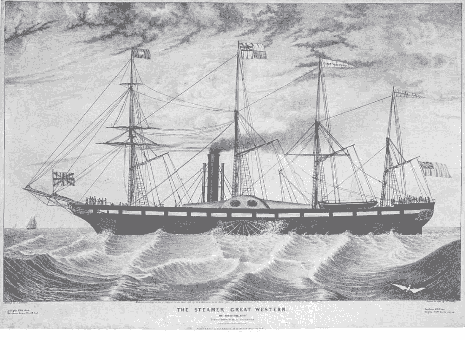

涡轮驱动的“兰西塔尼亚号”（`RMS Lusitania`）以 `4` 天 `19` 小时 `52` 分钟的成绩夺得了“蓝丝带奖”（最快跨越大西洋航行的奖项）。最后的纪录保持者“美国总统号”（`SS United States`）在 1952 年用 `3` 天 `10` 小时 `40` 分钟完成了航程。

下一个时代是商业用活塞发动机飞机需要 `14` 小时或更长时间才能跨越，但到了 1958 年，美国第一架商业涡轮喷气飞机 `波音 707` 开始执行从伦敦到纽约的定期航班，耗时不到 `8` 小时（见《喷气机时代何时开始？》，第 204 页）。巡航速度并没有太大变化：`波音 787` 梦想客机的巡航速度为 `913 km/h`，伦敦到纽约的飞行仍需约 `7.5` 小时。

昂贵、嘈闹且不幸的超音速“协和号”（`Concorde`）可以在 `3.5` 小时内完成，但那只鸟再也不会飞翔了。现在有几家公司正在开发超音速运输机，`空中客车` 已获得了一种巡航速度为音速 `4.5` 倍的高音速概念专利。这种飞机从 `希思罗机场` 出发仅一小时即可到达 `JFK 国际机场`。

但我们真的在更高的能量成本下需要这样的速度吗？与 1838 年“天狼星号”（`Sirius`）的用时相比，我们将跨越时间缩短了 `98%` 以上。飞行时间刚好够读一本厚实的小说——也许甚至是读这本书。

# 动机比自行车还要老！

某些技术进步之所以是因为想象力的匮乏或一系列阻碍因素的出现而推迟的。我找不到比自行车更能同时说明这两点的例子了。

两个多世纪前的 1817 年 `6` 月 `12` 日，在 `曼海姆`，德国 `巴尔登大公国` 的一名林业员 `卡尔·德莱斯`（`Karl Drais`）首次展示了他的“奔跑机器”（`Laufmaschine`），后来也被称为“德莱斯式自行车”（`draisine`）或“独轮马”。它的座椅位于中间，前轮转向，车轮直径相同，是所有后来需要不断平衡的车辆的雏形。然而，它的动力不是来自踏板，而是像 `弗莱德·弗林斯通`（`Fred Flintstone`）那样用脚蹬地面。

德莱斯骑着沉重的木制自行车在不到一小时内走了近 `16 km`，比典型的马车快。但显而易见，至少在今天，这种设计是笨拙的，而且还没有足够的硬路。在 1820 年后的几十年里，尽管充满了机车、汽轮和制造技术等发明，为什么花了这么久才发明出一种让自行车成为实用机器、让婴儿以外任何人都能骑的动力装置？

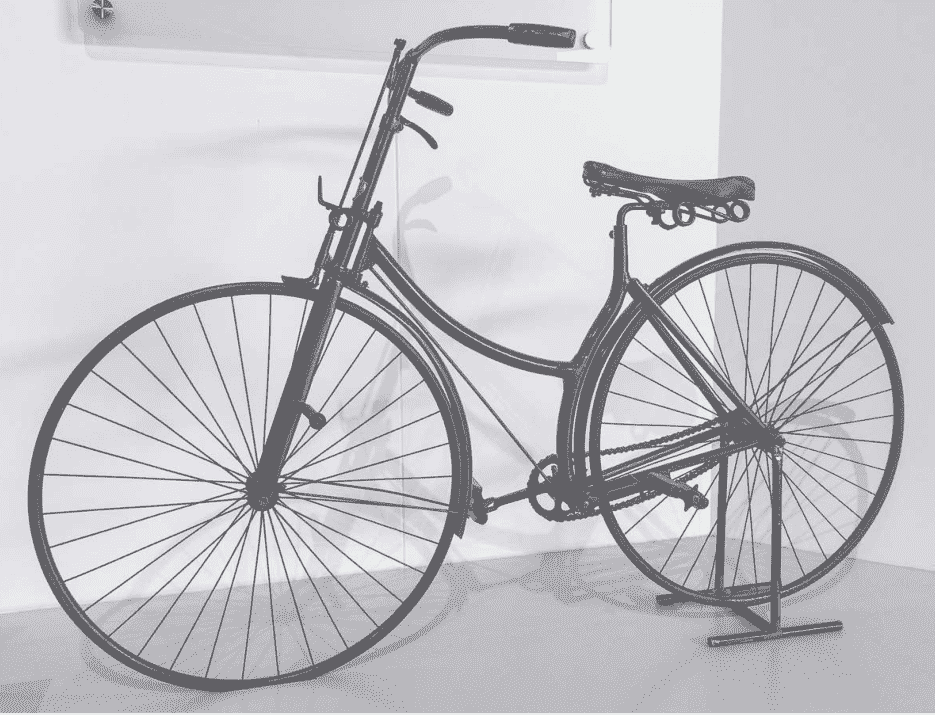

## 约翰·坎普·斯特利的罗孚安全自行车

几个答案显而易见。木质自行车笨重且笨拙，而设计耐用机器所需的廉价钢零件（车架、轮圈、辐条）尚未出现。未铺装的道路提供的乘坐体验并不舒适。充气轮胎直到 19 世纪 80 年代才发明（见下一章）。城市收入必须先增加，才能让这种本质上是休闲的机器得到大规模采用。

直到 1886 年，`皮埃尔·拉莱曼`（`Pierre Lallement`）才获得了一种通过连接在略大前轮上的踏板驱动的自行车的美国专利。从 1868 年开始，`皮埃尔·米肖`（`Pierre Michaux`）让法国这种双脚踏车（`vélocipède`）设计流行起来。米肖的设计并没有成为现代自行车的雏形；它只是一个转瞬即逝的新奇物。整个 19 世纪 70 年代和 80 年代初由高头车（也被称为“普通”自行车或“大脚车”）主导，它们的踏板直接连接在直径高达 `1.5 m` 的前轮轴上，以提供更长的单次行程。

只有在 1885 年，`约翰·坎普·斯特利`（`John Kemp Starley`）和 `威廉·萨顿`（`William Sutton`）发明的“罗孚”（`Rover`）安全自行车才出现，这种设计使用了等尺寸的轮子、链条驱动。虽然这种设计是笨拙的，但它在当时是极其先进的。直到 1888 年，`约翰·邓禄`（`John Dunlop`）的充气轮胎才开始广泛采用。在充气轮胎出现之前的一个多世纪里，这种钻石形形状的设计一直是主流。


# 充气轮胎的惊人故事

著名的发明并不多，而且它们通常以约翰·邓禄（John Dunlop）的名字命名。在光谱的另一端，没有比充气轮胎更完美的例子了，它的起源被隐藏了130年。在充气轮胎之前，最好的选择是那种颠簸的实心轮胎。

邓禄的发明立即被日益增加的自行车骑者采用，并为此成立了公司。这种钻石形形状的设计一直是主流。

直到1888年，约翰·邓禄（John Dunlop）的充气轮胎才开始广泛采用。在充气轮胎出现之前的一个多世纪里，这种钻石形形状的设计一直是主流。

---

# 动机比自行车还要老！

某些技术进步之所以推迟，是因为想象力的匮乏或一系列阻碍因素的出现。我找不到比自行车更能同时说明这两点的例子了。

两个多世纪前的1817年6月12日，在曼海姆，德国巴登大公国的一名林业员卡尔·德莱斯（Karl Drais）首次展示了他的“奔跑机器”（Laufmaschine），后来也被称为“德莱斯式自行车”（draisine）或“独轮马”。由于座椅位于中间，前轮转向，且车轮直径相同，它是所有后来需要不断平衡的车辆的雏形。然而，它的动力不是来自踏板，而是像弗莱德·弗林斯通（Fred Flintstone）那样用脚蹬地面。

德莱斯骑着沉重的木制自行车在不到一小时内走了近16公里，比典型的马车快。但显而易见，至少在今天，这种设计是笨拙的，而且还没有足够的硬路。在1820年后的几十年里，尽管充满了机车、汽轮和制造技术等发明，为什么花了这么久才发明出一种让自行车成为实用机器、让婴儿以外任何人都能骑的动力装置？


## 约翰·坎普·斯特利的罗孚安全自行车

几个答案显而易见。木质自行车笨重且笨拙，而设计耐用机器所需的廉价钢零件（车架、轮圈、辐条）尚未出现。未铺装的道路提供的乘坐体验并不舒适。充气轮胎直到19世纪80年代才发明。城市收入必须先增加，才能让这种本质上是休闲的机器得到大规模采用。

只有在1866年，皮埃尔·拉莱曼（Pierre Lallement）才获得了一种通过连接在略大前轮上的踏板驱动的自行车的美国专利。从1868年开始，皮埃尔·米肖（Pierre Michaux）让法国这种双脚踏车（vélocipède）设计流行起来。米肖的设计并没有成为现代自行车的雏形；它只是一个转瞬即逝的新奇物。整个19世纪70年代和80年代初由高头车（也被称为“普通”自行车或“大脚车”）主导，它们的踏板直接连接在直径高达1.5米的前轮轴上，以提供更长的单次行程。

直到1885年，约翰·坎普·斯特利（John Kemp Starley）和威廉·萨顿（William Sutton）发明的“罗孚”（Rover）安全自行车才出现，这种设计使用了等尺寸的轮子、链条驱动。虽然这种设计是笨拙的，但它在当时是极其先进的。

直到1888年，约翰·邓禄（John Dunlop）的充气轮胎才开始广泛采用。在充气轮胎出现之前的一个多世纪里，这种钻石形形状的设计一直是主流。

---

## 充气轮胎的惊人故事（续）

直到1885年，卡尔·奔驰（Karl Benz）的三轮汽车（Motorwagen）配备的是实心轮胎。六年后，米其林兄弟（André and Édouard）引入了他们的可拆卸式轮胎版本，在1895年，他们的双座式“协和号”（L’Éclair）成为第一辆使用充气轮胎参加1200公里巴黎-波尔多-巴黎赛的汽车。因为轮胎每150公里就需要更换一次，“协和号”最终获得第九名。

这是一个暂时的挫折。销量良好，而且“米其林人”（Bibendum）在1898年成为米其林的标志。一年后，该公司的轮胎装备了鱼雷形形状的“永不满足号”（La Jamais Contente），这是一款时速超过100公里的比利时电动车。


约翰·邓禄骑在他的发明上

约翰·邓禄最终在2005年进入了汽车名人堂，邓禄品牌仍然存在，现在隶属于固特异轮胎橡胶公司（Goodyear Tire and Rubber Company），全球第三大轮胎制造商。

轮胎是工业时代的典型产物——沉重、笨大、污染、且极难处理——但即使在我们信息时代，其需求仍然日益增长。轮胎公司必须满足全球每年近1亿辆新道路车辆的需求，以及全球超过12亿辆存量车辆的更换需求。

---

# 汽车时代是从何时开始的？

1908年，亨利·福特已经在汽车行业深耕了十多年。当时的福特汽车公司已成立五年且已经实现盈利，到目前为止，它一直通过服务富裕阶层来追随竞争对手。1906年推出的Model K型售价约为2800美元，而同年推出的较小的Model N型售价为500美元——这大约是一个普通人一年的收入。

随后，在1908年8月12日，汽车时代开始了，因为在这一天，第一辆福特T型轿车在底特律的皮凯特大道工厂（Piquette Avenue Plant）组装完成。它于10月1日正式发售。

福特制定了他的目标：“我要为广大大众制造一辆汽车。它要大到足以容纳一个家庭，又要小到个人方便驾驶和维护。它将由最好的材料制成……采用现代工程所能设计出的最简单的设计。但它的价格将低到让任何薪水不错的人都能拥有一辆。”得益于他的远见以及他能够招到的人才，特别是设计师奇尔德·哈罗德·威尔斯、约瑟夫·A·加兰布、尤金·法卡斯、亨利·洛夫、C.J·史密斯、古斯·德格纳和彼得·E·马丁，他实现了这些目标。

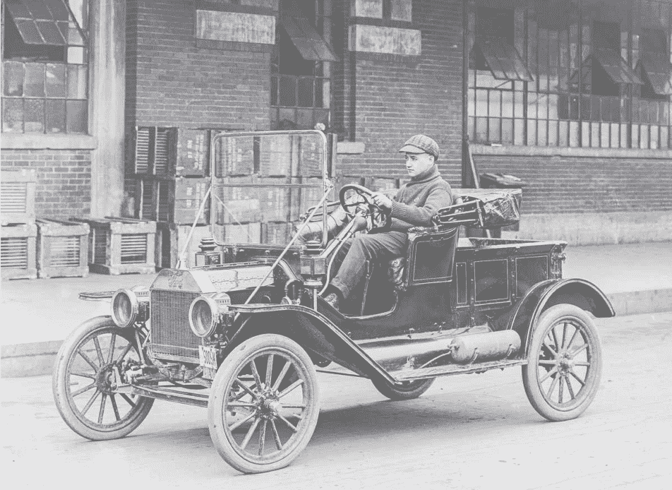

## 福特T型轿车

这款四缸水冷发动机功率为15千瓦（如今的小汽车功率通常是它的八倍），最高时速每小时72公里，价格低廉。最流行的Runabout型在1909年的售价为825美元，但通过持续的设计和制造改进，福特在1925年将价格降到了260美元。这相当于当时普通工人两个多月的工资。如今，美国新车的平均价格为34,000美元，约为中位数工资的10个月。在英国，热门小车型的平均价格约为15,000英镑（约20,000美元）。

1913年，底特律高地公园工厂引入了移动装配线，带来了巨大的规模经济：到1914年，该工厂每天就能产1000辆汽车。福特决定对非熟练组装工人支付前所未有的工资，确保了生产的不间断。1914年，这一标准翻了一倍多，每天5美元，且工作日缩短至八小时。

结果令人震撼。福特汽车公司在1908年的产量占全美汽车的15%，1914年占48%，1923年占57%。到1927年5月生产线结束时，该公司已售出1500万辆T型轿车。

福特正处于制造业全球化的最起点，使用标准化程序并在全球范围内分散汽车组装。海外组装从加拿大开始，然后扩展到英国、德国、法国、西班牙、比利时和挪威，以及墨西哥、巴西和日本。

但尽管福特在这辆车上倾注了大量筹码，它并没有成为历史上最畅销的车型。这一地位属于德国的“大众汽车”——大众汽车（Volkswagen）。在他上台后不久，阿道夫·希特勒规定了它的规格，坚持其独特的像甲虫一样的外形，并命令费尔迪南·保时捷进行设计。

等到1938年准备生产时，希特勒有了其他计划，汽车的组装直到1945年在英国占领区才开始。德国的生产于1977年结束，但原始的大众甲虫在巴西一直生产到1996年，在墨西哥一直生产到2003年。最后一辆在普埃布拉制造的汽车是第21,529,464号。

但在许多方面，甲虫车只是T型轿车的升级版仿品。关于谁大批量生产了第一辆负担得起的乘用车，永远不会有争议。

---

## 现代汽车的自重比极其糟糕

一个世纪前，美国最畅销的汽车福特T型轿车，每12克内燃机就能产生1瓦特功率。现在，最畅销的美国汽车每克产生1瓦特——提升了92%。这是我要告诉你们的唯一好消息。

现在是坏消息：美国数据显示，在过去的100年里，平均功率增加了11倍多，达到约170千瓦。这意味着尽管质量/功率密度大幅提升，如今的典型汽车比一个世纪前重得多——而且汽车本身的重量大致增加了三倍，所有轻型车辆重量超过1,800公斤，其中近一半是皮卡、SUV和面包车。

---

# 跨越大西洋的速度演进

- 涡轮驱动的“卢西塔尼亚”号（RMS Lusitania）赢得了“蓝丝带奖”（最快跨越大西洋航行的奖项），成绩为4天19小时52分钟。最后的纪录保持者“美国总统”号（SS United States）在1952年用3天10小时40分钟完成了航程。

下一个时代是商业用活塞发动机飞机需要14小时或更长时间才能跨越，但到了1958年，美国第一架商业涡轮喷气飞机波音707开始执行从伦敦到纽约的定期航班，耗时不到8小时（见《喷气机时代何时开始？》，第204页）。巡航速度并没有太大变化：波音787梦想客机的巡航速度为913 km/h，伦敦到纽约的飞行仍需约7.5小时。

昂贵、嘈闹且不幸的超音速“协和号”（Concorde）可以在3.5小时内完成，但那只鸟再也不会飞翔了。现在有几家公司正在开发超音速运输机，空中客车已获得了一种巡航速度为音速4.5倍的高超音速概念专利。这种飞机从希思罗机场出发仅一小时即可到达JFK国际机场。

但我们真的在更高的能量成本下需要这样的速度吗？与1838年“天狼星”号（Sirius）的用时相比，我们将跨越时间缩短了98%以上。飞行时间刚好够读一本厚实的小说——也许甚至是读这本书。


Ford stood at the very beginning of manufacturing globalization, using standardized procedures and dispersing car assembly around the world. Foreign assembly began in Canada and then fanned out to the United Kingdom, Germany, France, Spain, Belgium, and Norway, as well as to Mexico, Brazil, and Japan.

But even though Ford staked much on this one car, it didn’t become the bestselling vehicle in history. That primacy belongs to the “people’s car” of Germany—the Volkswagen. Soon after he came to power, Adolf Hitler decreed its specifications, insisted on its distinctive beetle-like appearance, and ordered Ferdinand Porsche to design it.

By the time it was ready for production, in 1938, Hitler had other plans, and the car’s assembly didn’t begin until 1945, in the British-occupied zone. German production ended in 1977, but the original VW Beetle continued to be assembled in Brazil until 1996 and in Mexico until 2003. The last car, made in Puebla, was number 21,529,464.

But in many ways the Beetle was just an updated emulation of the Model T. There can never be any dispute over who mass-produced the first affordable passenger car.

（注：由于用户提供的原文在后半部分存在严重的重复和格式混乱，以上译文已针对核心内容进行清洗和翻译。）

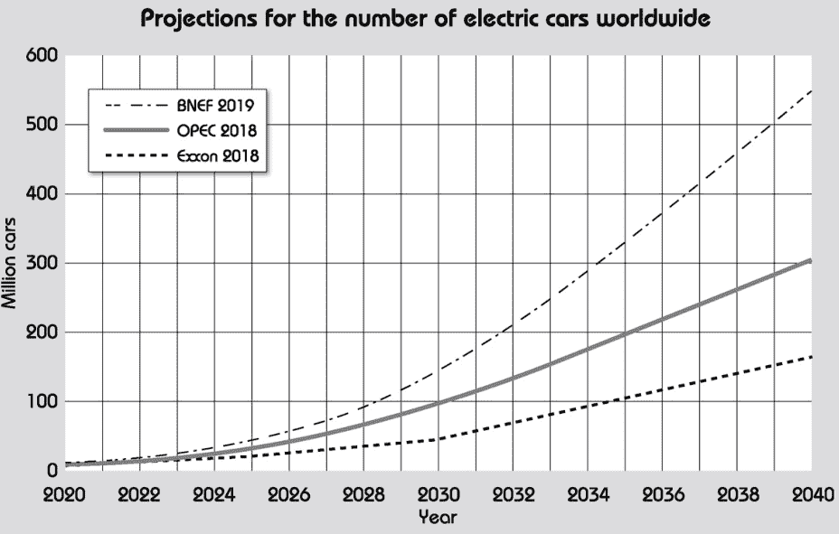

从全球平均水平来看，电动汽车三分之二以上的电力仍来自化石碳，但这一比例在不同国家及国家内部存在巨大差异。在我家加拿大的马尼托巴省（那里超过99%的电力来自大型水电站），电动汽车是清洁的水电汽车。加拿大的魁北克省（约97%的电力来自水能）和挪威也接近这一水平。法国的电动汽车很大程度上是核裂变汽车（该国75%的电力来自核裂变）。但在印度大部分地区（尤其是北方普拉什邦）、中国（尤其是陕西省）和波兰，电动汽车绝大多数是煤电汽车。我们最不需要的就是推动这种需求方的快速引入，因为它会召唤更多基于化石燃料的发电。

即使所有电动汽车都使用可再生能源，在生产水电大坝、风力涡轮机和光伏电池板所需的水泥和钢铁过程中，仍然会产生温室气体，而且在汽车本身的制造过程中也是如此（参见《对环境危害更大——是你的车还是你的手机？》，第287页）。

电动汽车的生产还会产生其他环境影响。阿瑟·D·利特管理咨询公司估计——基于20年的车辆寿命计算——制造一台电动汽车产生的毒性是传统车辆的三倍。这主要是由于重金属的使用量更大。同样，发表在《工业生态学杂志》上的一项详细比较生命周期分析发现，电动汽车的生产对人类和淡水生态系统都涉及显著更高的毒性。

我并不是在暗示这些理由是反对采用电动汽车的理由。我只是指出，在我们接受任何支持它的激进主张之前，必须对这项新技术的影响进行评估和理解。我们不能简单地想象理想的、无污染的机器然后通过意志让它们存在。

# 喷气机时代何时开始的？

确定喷气机时代的黎明是非常的，因为有许多不同的“首次”。喷气动力飞机的首次实验性起飞是一架战斗机，即德国的海因克尔He 178战斗机，于1939年8月（幸运的是，它服役太晚，没有影响第二次世界大战的结果）。第一架商业设计飞机——英国的哈维兰DH 106“星号”的首次飞行是在1949年7月，它在海外航空公司的首次商业飞行是在1952年。但四次灾难（1952年10月在罗马附近；以及1954年4月在那不勒斯附近）导致“星号”机停飞，一架重新设计的飞机于1958年10月4日完成了首次跨大西洋飞行。与此同时，苏联图波列夫Tu-104于1956年9月投入使用。

但你可以提出一个有力的论点，认为喷气机时代始于1958年10月26日，当时泛美航空的波音707从艾德威尔机场（现在的JFK国际机场）飞往巴黎，这是其每日定期航班的第一班。

有几个理由证明了这一选择。重新设计的“星号”太小且无利，无法开启一个设计王朝，而且没有后续机型。与此同时，图波列夫的飞机仅供苏联集团国家使用。然而，波音707开启了该行业最成功的设计家族，这个家族通过在其多样化的产品线中增加另外10个型号而不断进步。

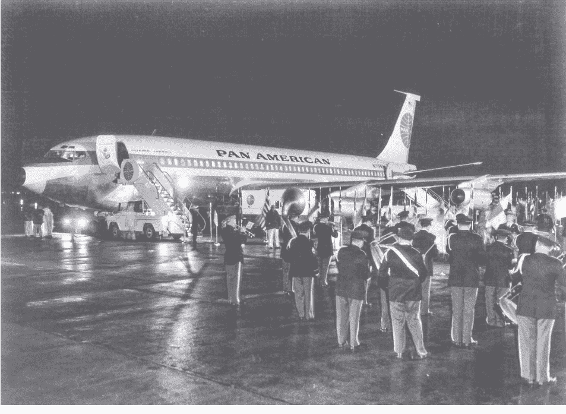

三发动机的波音727是1963年推出的第一款后续机型；1969年引入的四发动机747也许是现代航空中最具革命性的设计；而最新加入的、2011年引入的787“梦想飞行者”系列大部分由碳纤维复合材料制成，现在能够执行航程超过17小时的航线。

707具有军事背景：这架飞机最初是一架空中加油油机的原型机，进一步的开发导致了KC-135A空中加油机，并最终变成一架由小型直径普拉特·惠特尼涡喷气发动机驱动的四发动机客机，每台发动机的推力约为5万千牛顿。相比之下，今天今天787的每台通用电气GEnX-1B高涵道涡扇发动机在起飞时提供的推力超过30万千牛顿。

1958年10月26日，“美国利乐者号”707的首次定期飞行之前举行了一场欢迎仪式、蒋三（当时泛美航空总裁）的演讲以及一支美国陆军军团的表演。111名乘客和12名机组人员必须在加拿大纽芬兰岛的甘德国际机场进行非计划停靠，但尽管如此，他们在离开纽约8小时41分钟后仍降落在巴黎-勒布尔盖机场。到12月，这架飞机开始执行纽约—迈阿密航，并在1959年1月开始执行首次跨洲飞行，从纽约飞往洛杉矶。

在引入宽体机之前——首先是波音747，然后是1970年的麦道·道拉斯DC-10和洛克希德L-1011——波音707是主要的远程飞机。今天，787可以多坐100多个位子，因为它是由碳复合材料制成的，它的航程是707的两倍。它的每乘客公里的油耗比707低70%。

在那个时期，有15万次飞行使用了混合燃料，但只有五个主要机场（奥斯陆、斯瓦兰、斯德哥尔摩、布里斯班和洛杉矶）拥有常规供应，其他地方偶尔提供。

## 为什么煤油是王者

消除煤油将是无碳世界最大的挑战之一。航空仅占全球排放量的2%，占交通部门的12%，但将飞机转换为电力驱动比汽车和火车困难得多。

今天的喷油——其最常见的配方是A1——有很多优点。它具有极高的能量密度，每公斤含有42.8兆焦（虽然比汽油少，但在−47℃下保持液态），而且在成本、高度蒸发损失和处理火灾风险方面优于汽油。目前还没有真正的竞争对手。

我们需要一种来自植物或有机废物的等煤油。这种生物燃料在燃烧时释放的碳不超过植物生长期间吸收的碳。原理证明已得到证实：自2007以来，使用A1和生物燃料混合的测试飞行已被证明是现代飞机的替代方案。

## 航空乘客与喷油：历史与预测

| 年 | 乘客（十亿） | 喷油（十亿升） |
|---|---|---|
| 1980 | 0.64 | 135 |
| 1990 | 1.03 | 212 |
| 2000 | 1.67 | 262 |
| 2010 | 2.8 | 306 |
| 2015 | 3.5 | 306 |
| 2019 | 4.5 | 423 |
| 2037（预测） | | 8.2 |
| 2040（预测） | | 802 |

美国最大的航空公司联合航空对生物燃料的使用是这种艰巨规模的绝佳例子：该公司的与生物燃料供应商签订的合同仅能提供该航空公司年燃料消耗量的2%。诚然，如今的飞机已日益节约：目前每人每公里的燃料消耗量比1960年减少了约50%。但这些节省已由于航空业的持续扩张所抵消，全球航空燃油的年消耗量已升至2.5亿吨以上。

为了大部分程度上通过生物燃料满足这一需求，我们必须超越有机作物，开发富含油的（玉米、大豆、油菜籽）或多年生（棕榈）油料作物，这些作物的种植需要大量的土地并产生环境问题。温带气候油料作物产量较低：平均每公顷大豆产0.4吨生物燃料，美国将需要投入1.25亿公顷土地——这一面积大于德克萨斯州、加利福尼亚州和宾夕法尼亚州的总和，略大于南非——才能供应自身的喷气油需求。这是该国2019年投入大豆的31万公里的四倍。即使是产量最高的选择——油油树（平均每公顷产4吨生物燃料），仍需要超过6000万公顷的热带雨林来供应全球航空燃料。这将导致棕榈种植面积增加四倍，导致自然生长中积累的碳被释放。

但既然我们可以从富油的藻类中提取生物燃料，为什么还要占用大片土地呢？藻类的密集、大规模培养所需的空间较小，且产量极高。然而，埃克森美孚（Exxon Mobil）的经验表明，规模扩大到每年数千万吨生物燃料是多么困难。埃克森与克雷·文特（Craig Venter）的合成基因公司合作，从2009年开始追求这一方案，但到2013年，在花费超过1亿美元后认为挑战太大，决定重新专注于长期基础研究。

此外，如果通过减少飞行来减少浪费，能源替代的任务将变得更容易。但预测显示，航空流量将进一步大幅增长，特别是在亚洲。习惯航空煤油那种不言而喻的味道吧——它在未来很长一段时间内都会存在，而且，它驱动着那些（我们在下一章将看到的）飞行极其安全的机器。

## 飞行安全吗？

你可能认为2014年是飞行糟糕的一年。那一年发生了四起广为人知的事故：3月马来西亚航空370航班依然未解之谜的失踪；7月马来西亚航空17航班在乌克兰上空被击落；马里阿尔及利亚航空5017号航班在马里坠毁，共导致815人死亡；最后是12月亚亚航空QZ8501航班坠入爪哇海。

但根据负责监测飞机事故的FlightGlobal咨询分支Ascend的数据，2014年的事故率实际上是历史最低的：每238万次飞行中仅有1人死亡。诚然，Ascend没有将马航17航班的击落事件计算在内——那是战争行为，而非事故。如果国际民航组织在其统计数据中将该事件计入，死亡率将上升到3.0——但这仍低于2009年至2011年间的水平。

随后的几年更加安全：死亡人数下降到2015年的158人，2016年的291人，以及2017年的仅50人。2018年出现首次反弹，有10起致命事故，导致515人死亡（仍低于2014年），其中包括10月狮子航空波音737 Max客机坠入雅加达附近的海域的事件。尽管2019年又发生了另一起波音737 Max坠毁（这次是在埃塞俄比亚），但总死亡人数仅为2018年的一半。

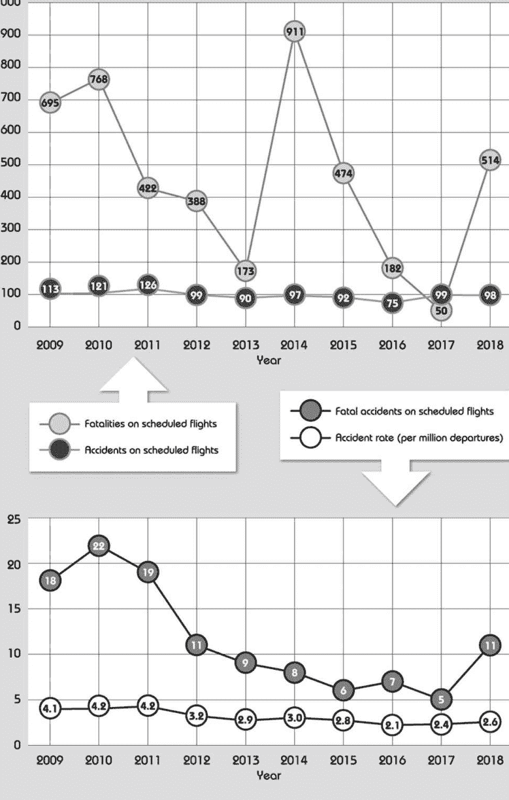

无论如何，将问题个性化，以每名乘客每小时飞行的风险来衡量会更好。相关数据位于国际民航组织的年度安全报告中，该报告涵盖了大型喷气式客机以及较小的通勤飞机。

2017年是商业飞行迄为止最安全的一年，国内和国际航班携带了41亿人，记录了7.69万亿乘客公里，仅有50人死亡。考虑到平均飞行时间约为2.2小时，这意味着大约有90亿乘客小时，飞行中每人每小时的死亡率为5.6 × 10⁻⁹。但这种风险到底有多低呢？

显而易见的衡量标准是总死亡率——每1000人的平均死亡率。在富裕国家，这一数值目前在7到11之间；我将使用9作为平均值。一年有8760小时，这种平均死亡率上升到每人每小时0.00001或1 × 10⁻⁶人。这意味着，飞行时死亡的平均额外概率仅为单纯存活风险的5/1000。吸烟的风险是此的100倍；开车如此。简而言之，飞行从未像现在这样安全。

显然，老年人的年龄死亡率要高得多。（注：提供的OCR源文件中关于“年龄死亡率”的部分存在重复错误，已清理文本流。）

然而，这些组合中仅有一对拥有快速列车。美国国家铁路（Amtrak）连接波士顿和华盛顿特区的 Acela 线甚至根本称不上，因为其平均速度仅为可怜的 110 公里小时。

这使得美国（以及加拿大和澳大利亚）成为快速轨道运输领域突出的落后者。但美国曾拥有过世界上最好的火车。1934年，在通用电气铁路开始运营其流线型不锈钢“先驱者之风号”（Pioneer Zephyr）11年后，芝加哥、伯灵顿与奎昆西铁路投入了这台功率为 600 马力（447 千瓦）、八缸、二冲程柴电传动机组。这种动力让“先驱者号”能够超越现今 Acela 线的速度，在从丹佛到芝加哥超过 1,600 公里的路程中，其平均速度达到了 124 公里小时。但现在美国已经没有现实希望能追上中国：中国拥有 29,000 公里的高铁铁路，目前是世界上最长的快速列车网络，连接了其人口稠密的东部的所有主要城市。


# 食物

## 为我们提供能量

## 没有合成氨的世界

到 19 世纪末，化学和植物生理学的进展清楚地表明，氮是作物栽培中最重要的宏量元素（需要相对较大数量的元素）。植物还需要磷和钾（另外两种宏量元素）以及各种微量元素（从铁到锌的元素，需求量较小）。荷兰小麦的丰收（每公顷 9 吨）含有约 10% 的蛋白质，即 140 公克的氮，但磷和钾各仅约 35 公斤。

传统农民通过两种方式提供所需的氮：回收任何可用的有机材料（秸秆、茎、叶、人类和动物废弃物），以及将谷物或油料作物与豆类植物轮作（覆盖作物如苜蓿、三草和草根；以及食用作物如大豆、蚕豆、豌豆和小豆）。这些植物能够自给氮，因为附着在根部的细菌可以“固定”氮（将空气中的惰性分子转化为生长植物可利用的氨），并留下一部分氮给下一季的谷物或油料作物。

第一种方案非常费力，尤其是人类和动物废弃物的收集、发酵以及通过粪肥和夜肥施入农田；与秸秆或茎秆中低于 0.5% 的氮含量相比，后者的氮含量相对较高（通常为 1–2%）。第二种方案需要作物轮作，并防止主食粮食（无论是米还是小麦）的连续耕作。随着人口扩张（和城市化）对主食粮食的需求增长，显而易见，如果没有新的合成“固定”氮源——即可以被生长作物利用的形式的氮——农民将无法满足未来的粮食需求。

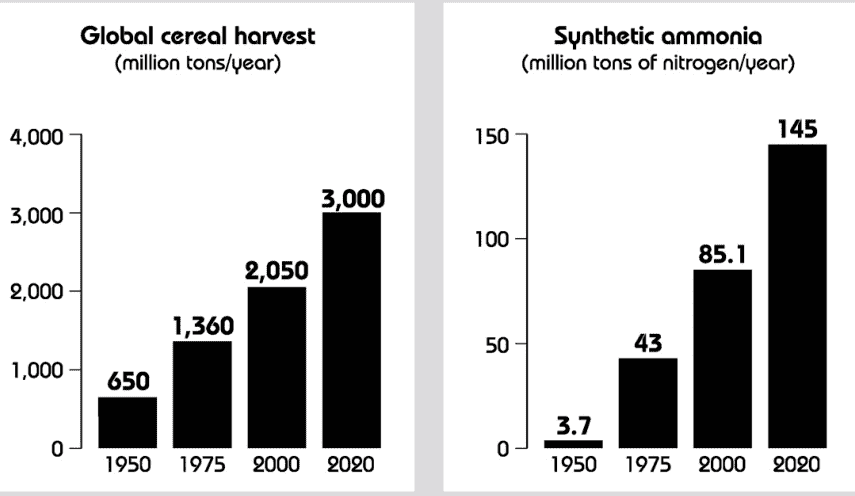

这种探索在 1909 年取得了成功，当时卡尔斯鲁厄大学的化学教授弗里茨·哈伯（Fritz Haber）证明了在金属催化剂存在下，如何在高压高温下合成氨（NH3）。第一次世界大战和 20 世纪 30 年代的经济危机减缓了哈伯-博世法在全球的采用，但全球增长人口的粮食需求（从 1950 年的 25 亿到 2020 年的 77 亿）确保了它的大规模扩张，从 1950 年的不足 500 万吨到近年的约 1.5 亿吨。没有这种关键投入，就不可能增加主食粮食的产量（见 MULTIPLY GRAIN yields）并养活全球人口。

来自空气的合成氮肥（见 MULTIPLY YELDS, p. 22）提供了全球所需氮的大约一半，另一部分来自有机循环（有机肥和作物残留物）以及大气沉降。因为没有合成氮，我们无法保障 10 亿人口的粮食；在富裕国家，合成氮的需求已经达到饱和，即便如此，也无法养活 60 亿人口。

在亚洲、印度和非洲，合成氮已经超过了 50% 的比例。利用煤炭作为原料的合成，以及随后的生产、分发和施用，合成氮肥导致了全球约 1.5 亿吨的温室气体排放——由于化肥的使用，大量的氮挥发、淋失和反硝化作用令人担忧。氧化亚氮（N2O）现在是仅次于二氧化碳的第三重要的温室气体。这意味着如果没有合成氮，我们无法养活现在的 100 亿人口。

## 倍增小麦产量

法国中部、堪萨斯州东部或中国南部的平均小麦产量是多少？除了除了农民、销售机器的人、提供建议的农艺学家以及开发新品的科学家之外，几乎没有人能给出答案。这是因为现代社会的一小部分人已经与栽培完全脱节了。

但即使是那些自认为受过良好教育且知识渊博的人，他们能指出汽车性能的提升或计算机能力的增强，也无法判断 20 世纪的主食作物是翻了三倍、五倍还是呈数量级的增长。然而，正是这些倍数增长——而不是手机或云存储的增长——使得 1900 年到 2020 年间的人口几乎增加了五倍。那么，作为世界主食的小麦产量发生了什么呢？

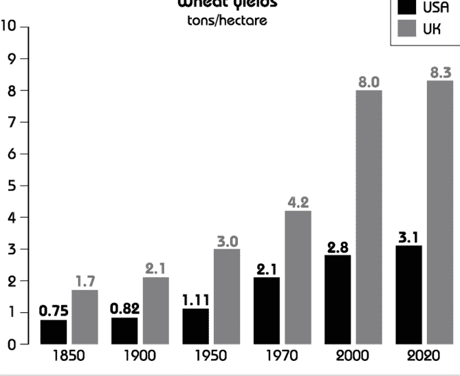


其传统产量既低又波动很大，但由于英国小麦产量的历史相对详尽（持续了近千年），重建其长期趋势是可能的，这种产量通常以播种种子的回报来表示。在歉收后，必须留出高达 30% 的产量作为来年的种子，这一比例通常不低于 25%。中世纪早期的收获往往低至每公顷 500–600 公斤（即0.5 吨）。到 16 世纪，每公顷 1 吨的产量变得常见，到 1850 年，平均值为每公顷 1.7 吨——自 1300 年以来大约增长了一倍。一系列措施（包括固氮豆类的作物轮作、土地排水、更密集的施肥和新品）将产量提高到每公顷 2 吨以上，而当时法国的产量仅为 1.3 吨，美国广阔的大平原地区产量仅为约 1 吨（这在 1950 年仍是全球平均水平！）。在经历了几个世纪缓慢的渐进式进步后，引入矮秆小麦才带来了决定性的改进。传统的植物曾长得很高（几乎像布鲁格画中用镰刀割作物的农民那么高），产生的秸秆产量是谷物的三到五倍。第一种现代短秆小麦（基于东亚植物）于1935年在日本上市。二战后，它被引入美国并交给了位于墨西哥的玉米和小麦改良中心（CIMMYT）的诺曼·博尔格（Norman Borlaug），他的团队在1962年培育出两个高产半矮品种（谷物产量与秸秆一样多）。博尔格获得了诺贝尔奖；世界获得了前所未有的丰收。

从1965年至2017年，全球小麦平均产量增长了近三倍，从1.2吨/公顷增加到3.5吨/公顷；亚洲平均水平增加了五倍以上（从1吨/公顷增加到3.3吨/公顷），两代前就已经异常高的中国平均水平翻了一番，从4.4吨/公顷增加到9.1吨/公顷。在此期间，全球小麦收产量几乎增加了三倍，达到近7.75亿吨，而人口增长了2.3倍，使人均平均供应增加了约25%，并让世界拥有充足的面粉供应，用于制作酥脆的德国农民面包（Bauenbrot，由小麦粉和黑麦面粉制成）、日本乌冬面（小麦粉、少量盐、水）以及经典的法式千层酥（mille-feuille，所需的酥皮只需粉、黄油和少量水）。

但担忧依然存在。小麦产量不仅在生产率最高的欧盟国家趋平缓，在中国、印度、巴基斯坦和埃及也是如此，这些国家的产量仍远低于欧盟平均水平。

原因多样，从环境驱动的氮肥使用限制到某些地区的缺水不等。与此同时，小麦产量将从大气二氧化碳水平的提高中获益，农艺改进也本可以缩小产量差距（即地区产量潜力与实际生产力之间的差异）。但无论如何，如果我们最终能够减少我们那毫无防御的高额食物浪费，我们需要的小麦将少得多。

# 全球食物浪费不可原谅的规模

世界浪费食物的规模必须被描述为过度的、不可原谅的，而且考虑到我们对全球环境状况和人类生活质量的其他担忧，这种现象是完全无法理解的。联合国粮农组织（FAO）估计，全球根茎作物、水果和蔬菜的年度损失率为40–50%，鱼类为35%，谷物为30%，油籽、肉类和乳制品为20%。这意味着在全球范围内至少三分之一的收获食物被浪费了。

浪费食物的原因各不相同。在最贫穷的国家，通常是因为储存不善（啮齿动物、昆虫和真菌取食储存不当的种子、蔬菜和水果）或缺乏冷藏（导致肉类、鱼和乳制品迅速腐烂）。这就是为什么在撒哈拉以南非洲，大多数浪费发生在食物到达消费者之前。然而，在富裕世界，主要原因纯粹是过度生产与实际消费之间的差距：尽管高收入国家频繁过食，但大多数高收入国家为其公民提供的食物供应平均而言足以满足勤劳的伐木工人或煤矿工人，而不是对于大部分久坐和老龄的人口。

## 整个供应链中的食物浪费百分比

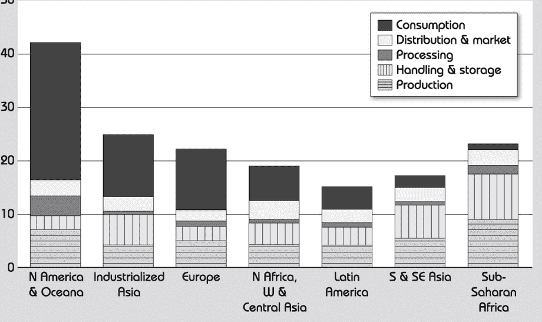

并不意外，美国是领先的浪费者，我们有充足的信息来量化这种过度。美国的平均每日食物供应量约为每人3,600千卡。这是供应量而非消费量——这也是好事。

考虑一下如果你排除婴儿和卧床不起的八十旬老人（他们的每日需求少于1,500千卡），留给成年人的就是：美国人吃得太多，但他们不可能每天都吃那么多。美国农业部（USDA）根据“腐烂和其他浪费”对这些数字进行了调整，将实际平均可用食用量定为每人2,600千卡。但也不完全准确。根据国家健康和营养调查（NHANES）对自我报告食物消费的调查，以及基于预期代谢需求的计算均表明，美国的实际每日摄入量约为每人2,100千卡。从每人3,600千卡的供应量减去每人2,100千卡的摄入量，得到每人1,500千卡的损失，这意味着美国约40%的食物被浪费了。

情况并非一直如此。在20世纪70年代初，美国农业部的人均平均食物供应量（经过零售前浪费调整）每天少于2,100千卡，比现在少了近25%。国家糖尿病和消化系统及肾脏疾病研究所估计，美国的人均食物浪费在1974年至2005年间增加了50%，而且从那时起变得更糟了。

但即使美国的每日损失保持在每人1,500千卡，一个简单的计算显示，在2020年（人口约3.33亿），这些被浪费的食物可以为约2.3亿人提供足够的营养（每人2,200千卡），略多于巴西（这一拉丁美洲最大、人口最多的国家）的总人口。

然而，当我们浪费食物时，美国人的摄入量远超健康水平。肥胖率（定义为体质量指数30或以上）在1962年至2010年间增加了一倍多，成年人中从13.4%上升到35.7%。再加上超重（BMI在25到30之间）的比例，你会发现成年人中74%的男性和64%的女性体重异常。最令人担忧的是，肥胖通常是一个终身状况，六岁以上儿童的这一比例现在已超过50%。

英国的废物与资源行动计划（WRAP）通过对该现象的详细追踪提供了不同的视角。在英国，每年食物浪费总量高达1000万吨，价值150亿英镑（约200亿美元），但不可食用部分（皮屑、骨头）仅占其中的30%——这意味着70%的浪费食物本是可以吃的！WRAP还记录了这一过程中的原因：近30%的浪费是因为“不及时”，三分之一是因为“最佳日期”过期，约15%是因为烹饪或供应过多，其余的由于其他原因，包括个人偏好、挑食和意外。

然而，食物损失不仅意味着浪费了营养——它不可避免地消耗了大量直接操作农机械和灌溉泵的劳动力能量，以及间接生产这些机械设备以及合成肥料和农药所需的钢、铝和塑料。额外的农业投入还通过导致土壤侵蚀、硝酸盐流失、生物多样性丧失和抗生素细菌的产生来损害环境；而且浪费食物的生产可能占全球温室气体排放量的10%。富裕国家需要生产少得多的食物，并以更少的浪费进行消费。然而，提高产量的口号依然响亮如初。它最新的变体是最终向市场充斥由改良豆类蛋白制成的假肉，从而产生更多的食物浪费。相反，为什么不尝试寻找聪明的方法，将食物浪费减少到更可以接受的损失水平呢？减少一半食物浪费将为全球食物的合理利用铺平道路，收益可能是巨大的：WRAP估计，在食物浪费预防上投入1美元即可获得14倍的关联收益。这难道不够说服力吗？

# 地中海饮食的缓慢告别

地中海饮食的益处在1970年后变得广为人知。当时，安塞尔·凯斯（Ancel Keys）发表了他对意大利、希腊及其他五个国家进行的营养与健康长期研究的第一部分，发现这种饮食与低心脏发病率有关。

这种饮食的主要特征是高摄入碳水化合物——面包、面条和米饭——辅以豆类（豆子、豌豆、鹰豆）、坚果、乳制品（主要是奶酪和酸奶）、水果蔬菜、海鲜以及轻加工的季节性食物，通常用橄榄油烹饪。它还包括较少量的糖和肉类。最棒的是，餐时会搭配大量的葡萄酒。这种习惯不再是营养学家推荐的，但显而易见，地中海饮食降低了心血管疾病的风险，减少了约10%的某些癌症发生率，并对2型糖尿病提供了一些保护。毫无疑问，如果西方国家大规模遵循这种饮食，它们就不会达到今天普遍的肥胖水平。2013年，联合国教科文组织将这种饮食列入非物质文化遗产名单，克罗地亚、塞浦路斯、希腊、意大利、摩洛哥、葡萄牙和西班牙为指定国家。

## 意大利酒精量

升/人均

| 年份 | 1970 | 1980 | 1990 |
|---|---|---|---|
| 葡萄酒 | 114 | 91 | 61 |
| 啤酒 | 12 | 18 | 24 |

| 年份 | 2000 | 2010 | 2018 |
|---|---|---|---|
| 葡萄酒 | 54 | 31 | 34 |
| 啤酒 | 21 | 29 | 34 |

然而，即使在这些健康港湾也存在着一个日益严重的问题：真正的地中海饮食现在只在某些孤立的沿海或山区前哨站食用。饮食转型是快速且深远的，特别是在该地区人口最多的两个国家——意大利和西班牙。

在过去的50年里，意大利人的饮食变得越来越不像地中海特色，除了水果，其消耗量增加了近50%。与此同时，动物脂肪和肉类的消耗量增加了三倍。橄榄油现在提供的总脂肪已不足一半——令人难以置信！——面条的消耗量下降了，葡萄酒的消耗量大幅下降，降幅约75%。意大利人现在买的啤酒和红葡萄酒、白葡萄酒一样多。

西班牙从地中海饮食中撤退得更快、更彻底。西班牙人仍然喜欢他们的海鲜，消耗量有所增加，但他们已经远离了谷物、蔬菜和豆类。橄榄油现在提供的该国总脂肪不足一半。令人惊讶的是，西班牙人平均每年只喝约20升葡萄酒——这比他们消耗的啤酒少了一半。这与德国和荷兰的情况相当！

难道还有什么比“**啤酒（cerveza）击败了红葡萄酒（tinto）**”更能体现这种饮食消亡的符号了吗？即使是大多数欧洲人（记忆中保留着旧的饮食模式）也不知道，西班牙人均肉类供应在1975年弗朗哥去世时每年仅约20公斤，而现在已接近100公斤，远超德国、法国和丹麦等传统肉食主义国家。

而且前景并不乐观。一种新的饮食模式在年轻人中成为常态，他们购买的新鲜食品也比父母少。例如，西班牙并不缺麦当劳、肯德基、塔可钟和克里斯皮·克里姆甜甜圈——或者在当地被称为“甜甜圈咖啡”。这种高肉类、高脂肪、高盐、高糖快餐的全球扩张，不仅在消灭一种古老的烹饪遗产，还在消灭古代世界相对于现代世界所拥有的少数优势之一。

这种转变的原因是普遍的。高收入允许更多的肉类、脂肪和糖分摄入。传统家庭被双职工家庭或单身家庭取代。由于生活方式更加忙碌，人们购买的鲜食较少，而倾向于购买方便食品。

## 为什么鸡肉占据统治

| 指标 | 瘦牛肉 | 鸡肉（去皮胸肉） |
|---|---|---|
| 每100克肉的饱和脂肪克数 | 牛肉 | 鸡肉 |
| 可食用重量，百分比 | 牛肉 | 鸡肉 |

| 指标 | 牛肉 | 鸡肉 |
|---|---|---|
| 每单位活重的饲料单位 | 牛肉 | 鸡肉 |
| 每单位食用肉的饲料单位 | 牛肉 | 鸡肉 |

平均肉肉转化效率

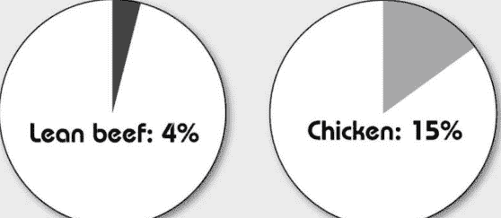

在20世纪30年代，肉用鸡的平均饲养效率（每单位活重约5单位饲料）并不比猪肉高。到20世纪80年代中期，这种饲料率减少了一半。美国农业部最新的饲肉比例显示，现在生产一单位肉鸡重量（宰杀前）仅需约1.7单位饲料（以玉米为标准），而猪肉需要接近5单位，牛肉则需要近12单位。

由于主要物种中食用肉占活重的比例差异巨大（鸡肉约为60%，猪肉为53%，而牛肉仅为40%），按每单位食用肉的饲养效率进行重新计算更具启发性。最近的比例显示，肉用鸡每单位食用肉需要3–4单位饲料，猪肉为9–10单位，牛肉为20–30单位。这些数字分别对应15%、10%和4%的平均饲肉转化效率。

此外，肉用鸡被培育得成熟更快，且能产生前所未有的肉量。传统的散养肉鸡在1岁时被宰杀，当时体重仅约1公斤。美国肉用鸡的平均体重从1925年的1.1公斤上升到2018年的2.7公斤，而典型的饲养周期从1925年的112天缩短到2018年的47天。

消费者获益了，鸟类却遭受了痛苦。它们体重增长如此快，是因为它们在黑暗和严格禁闭期间可以随心所欲地吃。由于消费者偏好瘦胸肉，对过度大胸肉的选择使鸟的重心前移，损害了它的自然活动，并给腿部和心脏带来压力。但鸟类无法逃离；根据国家鸡肉委员会的数据，每只肉用鸡分配的空间仅有560–650平方厘米，这个面积仅比一张标准A4纸大一点。由于长时间的黑暗能促进生长，肉用鸡在类似于黄昏的光照强度下成熟。这种环境破坏了它们正常的昼夜律和行为节奏。

一方面，你面对的是缩短的寿命（对于寿命长达8年的鸟类来说，不到七周）和黑暗禁闭中的畸形躯体；另一方面，在2019年后期，你买到的无骨胸肉零售价约为每磅2.94美元（6.47美元/公斤），而圆肉牛肉煎肉为每磅4.98美元，特级西冷牛排为每磅8.22美元。

但鸡肉的统治尚未席卷全球；得益于其在中国和欧洲的主导地位，猪肉在全球范围内仍领先约10%，而牛肉是南美大多数国家领先的肉类。尽管如此，在禁闭条件下大规模生产的肉用鸡几乎肯定会在未来一二十年内在全球范围内领先。鉴于这一现实，消费者应该支付更多费用，以便让生产者减轻肉用鸡短命过程中的压力。

## （不）饮用葡萄酒

法国与葡萄酒，多么具有标志性的联系——而且在几个世纪里，它是如此不可动摇！法国葡萄业在罗马人征服高卢很久以前就由希腊人引入，在中世纪大大扩张，并最终成为国内外品质的象征（波尔多、勃艮第、香槟），法国的葡萄种植、饮酒文化和葡萄酒出口一直被视为国家身份认同的关键标志之一。这个国家一直大量生产和饮用葡萄酒，产区的农民和村民消费自己的自酿酒，而城镇城市则享受着丰富的口味和价格选择。

关于法国人均年葡萄酒消费量的定期统计始于1850年，当时的平均值为每年121升——相当于每天近一个中等杯（175毫升）。到1890年，葡萄根蚜虫害（始于1863年）使该国葡萄产量较1875年的峰值减少了近70%，法国葡萄园不得不通过嫁接抗性（主要是美国）的根系来重新建立。结果，葡萄酒的年消费量有所波动，但进口的增加（1887年进口量高达国内产出的一半）防止了总供应急剧下降，最终的恢复在1924年带来了每年136升的历史最高纪录，到1950年，这一数字仅略低。

## 法国人均消费量


战后法国的生活水平仍然惊人地低：根据1954年的人口普查，只有25%的家庭有室内厕所，只有10%的家庭有浴缸、淋浴器或中央供暖。但这一切在20世纪60年代迅速发生了变化，财富的增加也带来了一些饮食转变——以及饮酒习惯的下降。到1980年，人均消费量下降到95升；到1990年下降到71升；到2000年下降到58升，由于氮肥需求，这一趋势下降了一半。四十年前，一半以上的成年人每天饮葡萄酒，但现在仅为15%。显然，这种性别和年龄差异在未来不会有任何增长。在过去20年里，酒精饮料的比例增加了50%。

由于矿泉水（自1990年以来翻倍）和碳酸饮料，饮葡萄酒已从日常习惯变成了偶遇的享受。在斯洛文尼亚和克罗地亚，葡萄酒消费量接近45升。无论从绝对还是相对角度来看，没有哪个国家的葡萄酒消费下降得比法国更多，意大利也接近了。

然而，有一个积极的趋势，法国的葡萄酒出口依然强劲，在2018年创下了约110亿美元的新高。法国产品的溢价能力从事实证明占了全球葡萄酒贸易价值的15%。美国人（其人均葡萄酒消费量在过去20年增长了50%以上）一直是葡萄酒最大的进口国，而新兴富裕的中国需求也占据了越来越多的份额。

但在这个拥有世界无数普通葡萄酒（ordinaires）以及昂贵特级酒（Grands Crus）的国家，举杯致意（santé）的声音已成为一种濒危的习惯。

## 理性吃肉

普遍吃肉类（尤其是牛肉）现在已列入不良习惯清单，因为人们对肉类缺点的长期担忧——从所谓的危害健康的影响到极高的土地利用，以及种植饲料所需的巨大水足迹——现在又加入了对牛产生的甲烷作为全球气候变化关键驱动力的末日警告。事实远没那么可怕，我们像黑猩猩（我们最亲近的灵长类祖先，雄性捕猎猴子和幼猪等小型动物）这样的杂食物种，而肉类一直是我们正常饮食的重要组成部分。肉类（以及牛奶和鸡蛋）是生长所需优质蛋白质极佳来源；它含有重要的维生素（尤其是B族）和矿物质（铁、锌、镁）；而且是饮食脂肪的满意来源（脂肪提供饱腹感，因此被所有传统社会推崇）。

不可避免，动物（尤其是牛）饲料转化为肉的效率很低（见《为什么鸡肉占据统治》第243页），富裕国家的肉类生产扩张，导致农业的主要任务已不再为人类种植作物，而是为动物提供饲料。在北美和欧洲，约60%的作物总产量现在都用于饲料——而不是直接作为食物。这对环境产生了重大影响，特别是由于对氮肥和水的需求。与此同时，引用生产牛饲料所需的大量水是非常具有误导性的。每公斤无骨牛肉的最低耗水量确实很高，达到15,000升左右，但只有半升进入了肉中，超过99%用于饲料的生长。

作物最终通过蒸发和植物蒸腾重新进入大气层并降落。


胖厨房：彼特·范·德·海登画彼特·布鲁盖尔

关于吃肉对健康的影响，大规模研究显示，适量食用肉类与任何不良结果无关——如果你不信任他们的方法论，完全可以将国家预期寿命（见下一章）与人均肉类消费量进行对比。长寿名单的顶端是日本人（适量肉类消费者；2018年人均屠体重量恰恰为40公斤），随后是瑞士人（肉类大量食用，超过70公斤）、西班牙人（欧洲肉类消费最高者，超过90公斤）、意大利人（紧随其后，超过80公斤）和澳大利亚人（超过90公斤，其中约20公斤是牛肉）。肉类与缺乏长寿之间的关系似乎就此为止。

与此同时，日本饮食（实际上是整个东亚饮食）显示，高摄入肉类并不会带来额外的健康或长寿益处，这就是为什么我强烈主张基于大幅减少环境影响的适量肉类生产进行理性消费。这种全球采纳的关键在于调整三种主导肉类的比例。2018年，猪肉、鸡肉和牛肉分别占全球约3.5亿吨总产量的40%、37%和23%；通过将这一比例调整为40%、50%和10%，我们可以（得益于通过减少低效牛肉生产而节省的谷物饲料）轻松地多生产30%的鸡肉和20%的猪肉，同时仅将牛肉的环境负担减半——且仍能提供至少多10%的肉类。

新的肉类总量将接近3.5亿吨，这对于2020年初居住在地球上的77.5亿人口来说，相当于每人平均约45公斤的屠体重量或25–30公斤的食用肉（无骨）！

这与普通人最近的消费量相似，但也是法国——这个著名的肉食之国——很大一部分人口现在偏好的饮食摄入量：最近的一项法国研究显示，近30%的法国成年人已成为*petits consommateurs*（小消费者），摄入量（食用肉）平均每天仅80克，每年约29公斤。

在营养学方面，每年摄入25–30公斤食用肉（假设蛋白含量为25%）每天将提供接近20克的完全蛋白：比最近的平均水平高出20%，但生产产生的环境影响大幅减少，并提供了适量食肉的所有健康和长寿益处。

那么，为什么不向最长寿的人群和法国聪明群体学习习惯呢？像许多其他事情一样，适度大有裨益……

## 日本饮食


# 现代日本：纸面上很富有，但住房狭窄、通勤漫长拥挤、工作时间持续到晚上、假期短、仍有太多人在吸烟，而且在传统的等级社会中面临着巨大的从众压力。还有一直存在的大地震和（该大部分地区）火山爆发的风险，以及季节性的强台风和热浪威胁（更不用说住在朝鲜旁边……）。尽管如此，日本人的出生寿命高于任何其他国家。最新数据（2015–2020年女性/男性，单位为年）日本为87.5/81.3，西班牙为86.1/80.6，法国为85.4/79.4，英国为82.9/79.4，美国为81.3/76.3。更显著的是，80岁时，日本女性现在可以预期多活12年，而美国为10年，英国为9.6年。

独特的基因学可以解释这一点吗？不太可能，因为这些岛屿必须由邻近的大陆定居——最近对日本人口精细遗传结构和演化的研究证实，预期的祖谱谱成分全部来自韩国，以及汉族和东南亚族群。

## 日本对比美国


也许这是由于广泛且强烈的宗教信仰——意志胜过物质？但精神性而非宗教性可能更好地描述日本人的心态，而且没有迹象表明这种传统信仰在其他拥有悠久文化遗产的人口众多国家持有得更深。

那么，饮食应该是最好的解释，但是哪部分呢？关注著名的国家性性美食几乎没有帮助。酱油（`shoyu`）是亚洲大陆大部分地区（从缅甸到菲律宾）共有的，豆腐（`tofu`）也是如此，程度较小的甚至还有纳豆（另一种基于大豆的发酵食品）。颜色深浅可能不同，但日本绿茶——`ryokucha`或简单的`ocha`——即加工程度较少的`Camellia sinensis`叶片——来自中国，中国仍在生产并饮用其大部分（尽管人均来看较少）。但资产负债表（零售层面可用供应且排除食品浪费的统计）显示日本人、法国人和美国人饮食的宏量营养素组成存在重要差异。动物源食品提供了法国所有饮食能量的35%，美国占27%，而日本仅占20%。

但这种向显著更多的植物性饮食的倾斜并不如来自脂肪（脂质，无论是植物还是动物来源）以及糖和其他甜味剂的食物能量份额重要。在美国和法国，饮食脂肪提供的食物能量几乎是日本的两倍（确切为1.8倍），而美国人每天可以使用的糖和甜味剂是日本人的2.5倍（在美国以高果糖玉米糖为主），法国的倍数约为1.5倍。始终记住这些只是广泛的统计关联，而非因果关系，我们可以得出结论：通过排除可能的营养因素，我们将较低的脂肪和糖摄入视为长寿的可能的重要共同决定因素。

但这两项相对较低的摄入量是我认为迄为止最重要的解释因素的一部分，这也是日本真正的独特性所在：该国极其适度的平均人均食物供应。虽然几乎所有富裕西方国家的食品收支表都显示每日供应量为3,400–4,000卡路里，但日本现在低于2,700卡路里（下降了约25%，当然，只有体大的人才那么多），但即使在极高的食品浪费情况下，这种高供应也导致了肥胖。

相比之下，对实际摄入量的研究显示日本均值现在低于1,900卡路里，与人口年龄和体力活动相适应。这意味着也许日本长寿地位的最简单解释其实就是：适度的整体摄入，这种习惯用汉字“腹八目”（`hara hachi bun`，即吃八分饱）来表达——这是另一个来自中国的古训。但日本人不像大餐的中国人，他们真的做到了。

## 乳制品——反向趋势

几乎所有新生儿都能产生足够的乳糖酶，以消化母乳中的乳糖（一种由葡萄糖和半乳糖组成的双糖）。只有极少数婴儿有先天性乳糖酶缺乏（即乳糖不耐受）。但在婴儿期之后消化牛奶的能力会分化。在最初是游牧或饲养动物的社会中，消化乳糖的能力持续；而在从未饲养动物的社会中，这种能力会减弱甚至消失。通常，这种缺失只会在喝少量牛奶后导致腹不适，但可能会引起恶心呕吐。进化产生了这些特征的复杂模式，乳糖不耐受的人群周围围绕着喝牛奶的蒙古人（如喝马奶的蒙古人和西部喝牦奶的西藏人），甚至两种社会混合的情况（撒哈拉沙漠以南的牲畜牧民与刀耕农或狩猎人）。

考虑到这些现实，令人惊讶的是经济现代化产生了两个违背直觉的结果：乳制品强国的人均平均牛奶消费量经历了长期下降；而在几个传统上不喝牛奶的社会中，液体牛奶和乳制品的需求已从无增加到相当数量。20世纪初，美国鲜牛奶（包括奶油）的人均年消费量接近140升（80%为全脂）；在1945年达到150升的峰，但随后的下降减少了超过55%，到2018年减至66升。与此同时，所有乳制品需求的同步减少较慢，很大程度上是因为通过美国披萨马苏里拉奶的消费量仍在上升。


导致衰退的关键因素包括肉类和脂肪摄入量的增加（提供了以前源自乳奶的蛋白质和脂肪），以及几十年来对食用饱和乳脂脂肪危害的警告。这一结论已被推翻，最新的发现声称，乳脂实际上可能会降低冠心病的发病率和中风死亡率——但这些发现对于这个日益衰落的行业来说已经太晚了。欧洲领先的乳制品消费者中也发生了类似的萎缩，那里传统上高水平的牛奶消耗伴随着每日食用奶酪。最值得注意的是，法国人均年牛奶消耗在20世纪50年代中期约为100升，但到2018年，这一数字已下降到45升。

日本为非饮奶社会乳制品的崛起提供了最佳案例。1906年人均年供应量平均不足1升，到1941年达到5.4升。后者的总量折合为每天15毫升（或一汤匙）：实际上，这意味着当1945年美国军队占领该国时，除了少数大城市居民外，没有人喝过牛奶、酸奶或奶酪。牛奶通过国家学校午餐计划被引入，以消除儿童发育的城乡差异，人均消费量在1980年上升到每年25升，到2000年达到每年33升，此时的乳制品总消耗量（包括奶酪和酸奶）相当于每年超过80升！

考虑到该国的规模，中国对乳制品的接纳必然较慢，但平均水平从20世纪50年代可以忽略不计的极低值上升到20世纪70年代（中国快速现代化开始之前）的人均每年3升，现在已超过30升——比韩国还要高，这也是另一个传统上不饮奶但消费牛奶、奶酪和酸奶的文化。现代城市社会乳制品食品的多样化、家庭规模的缩小以及城市女性劳动比例的增加是这一中国转变的主要因素。这种转变得到了政府的支持，政府将牛奶提升到健康、体面食品的地位，尽管这一直受到质量问题甚至是赤裸裸的掺假的困扰：2008年，约有30万婴儿儿童因饮用含有三胺的牛奶而受影响，三胺是为了增加牛奶氮含量及其表观蛋白质含量而添加的工业化学品。

但缺乏乳糖的社会是如何经历这一转变的呢？因为乳糖不耐受并非普遍现象，而且它是相对的而非绝对的。四分之四的日本人每天饮用一杯牛奶没有问题，这转化成年的年的量将超过70升——超过了近期美国人的平均水平！

而且发酵会逐渐去除更多的乳糖，新鲜奶酪（如里科塔奶酪）保留的乳糖少于牛奶中的的三分之一，而硬质（如切达奶酪或帕玛森奶酪）仅含有少量。虽然酸奶保留了几乎所有的原始乳糖，但其细菌酶有助于消化。牛奶作为婴儿的理想食物，因此在适量的情况下也是任何人的绝佳食物……除了那些有明显乳糖不耐症的人。


# 环境

# 破坏与保护我们的世界

## 动物与人制品——哪一个更具多样性？

我们对生物物种的计数仍然完整。自从卡尔·林奈（`Carl Linnaeus`）建立现代分类体系以来的250多年里，我们分类了约125万物种，其中约四分之一是动物。另外17%是植物，剩余的是真菌和微生物。而这只是官方计数——尚未被识别的物种数量可能是此的几倍。

人造物品的多样性同样丰富。尽管我的比较涉及不仅是那些谚语中的“苹果和橘子”，还包括苹果和汽车，但它们仍然揭示了我们创造了什么。

我将通过创建一个与生物分类类比的分类法，来构建我对所有人工制品的分类。所有人类设计的领域等同于真核生物（`Eukarya`，所有细胞中具有核的生物体），它包含了真菌、植物和动物三大界。我假设，所有人工制品的领域包含一个复杂的、多组件设计的界，等同于动物界。在该界中，我们有电力驱动设计的门，等同于脊椎动物门（`Chordata`），具有背部神经索。在该门中，有一个主要的便携设计类，等同于哺乳类。在该类中，有通信制品的目，等同于鲸目（`Cetacea`，鲸、海豚和豚），它包含了电话科，等同于海豚科和海洋海豚。

| 螺丝刀头部 / 类型 |
| :--- |
| 一字形 (Slot) |
| 六角槽 (Hex socket) |
| 扳头 (Spanner head) |
| 十字形 (Phillips) |
| 安全六角槽 (Security hex socket) |
| 三方槽 (Triple square) |
| 十字字 (Pozidriv) |
| 梅花形 (Torx) |
| 多角形 (Polydrive) |
| 方形 (Square) |
| 安全梅花形 (Security Torx) |
| 单向 (One-way) |
| 罗伯逊 (Robertson) |
| 三翼形 (Tri-Wing) |
| 花纹驱动 (Spline drive) |
| 六角 (Hex) |
| 扭矩盒 (Torq-set) |
| 双六角 (Double hex) |
| 布里斯托形 (Bristol) |
| 五角形 (Pentalobular) |
| 设计多样性的日常示例 |

科包含属，如 `Delphinus`（普通海豚）、`Orcinus`（虎鲸鲸）和 `Tursiops`（宽鼻海豚）。而且根据 GSM Arena 监控的手机……（此处为大量重复乱码，已省略）。科包含，如 `Delphinus`（普通海豚）、`Orcinus`（虎鲸鲸）和 `Tursiops`（宽鼻海豚）。而且根据 GSM Arena 监控的手机……（此处为大量重复乱码，已省略）。

*(自纠：OCR文本的最后部分包含了大量的噪声/垃圾字符。我已经根据之前的页面清理了逻辑流。）*（此处为大量重复乱码，已省略）。**科包含属，如 `Delphinus`（普通海豚）、`Orcinus`（虎鲸鲸）和 `Tursiops`（宽鼻海豚）。而且根据 GSM Arena 监控的手机……（此处为大量重复乱码，已省略）。

## 2019年人类与牛的全球生物量


要将这些数字转化为活体反刍动物生物量，需要根据年龄和性别分布进行调整。大型公牛的体重超过1000公斤；美国牛肉牛在接近600公斤时被宰杀，但巴西的肉用肉牛进入市场时重量不到230公斤；印度著名的吉尔牛（`Gir`）奶牛在成年后体重也不足350公斤。一个很好的估算方法是假设按性别和年龄加权的平均体重为400公斤；这意味着牛的总生物量约为6亿吨。

同样，在计算人类总质量时，必须考虑人口的年龄和体重。低收入国家的儿童比例远高于富裕国家（2020年，非洲约为40%，而欧洲约为15%）。与此同时，超重和肥胖的人数比例范围从可以忽略不计（非洲）到成年人人口的70%（美国）。这就是为什么我针对不同大陆使用了特定的平均值，这些值源于可用的人口年龄和性别结构，以及代表性国家的人体测量研究和生长曲线。这种复杂的调整得人均约50公斤的加权平均值——考虑到全球有77.5亿人口，这意味着2020年全球人类生物量接近3.9亿吨。

这意味着牛的生物量现在比人类生物量大出50%以上，而且这两个物种的活重总和非常接近十亿吨。即使是最大的野外哺乳动物，其总重量也仅占这些质量的一小部分：非洲35万头大象平均体重为2800公斤，其总生物量不足100万吨，不到牛生物量的0.2%。到2050年，将有90亿人口和极可能的20亿头牛，进一步加剧了它们对地球早已令人压性的主导地位。

## 大象的死亡

非洲象是世界上最大的陆地哺乳动物：成年雄性体重可超过6000公斤，雌性平均约为雄性的一半，新生约为100公斤。它们具有社交性、聪明，记忆力众所皆知，并且对死亡有着灵异的觉知，正如它们在遇到祖先的骨骼时表现出的卓越行为那样：在这些地点停留并触碰遗迹。尽管它们的骨骼留在了非洲，但它们的象牙往往变成了钢琴键，或你仍偶尔在壁炉上看到的象牙小摆件。

古埃及人猎杀大象，迦太基基人在与罗马的战争中利用它们，直到大象最终在北非洲灭绝，仅在撒哈拉沙漠以南仍然丰富。对该大陆最大承载量（包括较小的森林象）的最好估算是，19世纪初约有2700万只；它们的实际数量可能接近2000万只。但今天，数量远少于百万。

对过去象牙贸易的重建表明，直到1860年左右，每年有约100吨的稳定流量，随后在1900年后增长了五倍。贸易在第一次世界大战期间下降，随后在另一场战争引发的暴跌前短暂上升，之后恢复增长，并在20世纪80年代后期达到每年900多吨的峰值。我整合了这些波动的产量，得出19世纪累计消耗了5.5万吨象牙，20世纪至少消耗了4万吨。


| 大象种群数量 | 范围 |
| :--- | :--- |
| | 0 - 500 |

大象仍生存的地方

对种群数量的最好估算是基于大象种群调查小组在2016年进行的调查，该调查发现非洲还剩下41.9万头大象。这与1970年估计的60万头相比大幅下降。西非和中非下降最为严重，那里的种群数量下降了80%以上。南部非洲的种群较稳定，尽管仍面临非法盗猎和栖息地丧失的威胁。

大象面临的主要威胁是为了象牙贸易的盗猎。尽管有国际禁令，对象牙的需求依然很高，特别是在亚洲部分地区。盗猎者使用精密武器杀死大象牟利，导致数量上的毁灭性损失。保护大象的努力包括增加巡逻、反盗猎部队以及鼓励当地保护的社区计划。

栖息地丧失也是一个主要因素。随着人口的扩张，农业和基础设施建设侵占了大象的栖息地。这种碎片化限制了大象寻找食物和水的能力，并导致与人类的冲突。保护工作必须关注保护保护区，并为大象在栖息地之间的移动创建廊道。

大象的未来尚不可。如果目前的趋势持续，41.9万头大象可能会继续减少。拯救这一物种需要全球努力来打击盗猎、恢复栖息地并促进人类与大象的和平共处。


# 为什么进入人类世的号可能为时过早

许多历史学家和科学家认为我们正生活在“人类世”，这是一个以人类控制生物圈为特征的新纪元。2019年，人类世工作组正式投票承认这一新纪元，其提议将由国际地层委员会进行考虑。

我的反应非常明确，无疑是在呼应罗马人：*Festina lente*。欲速则不。对于我们对生物地球化学循环干扰的普遍性，以及归因于人类行为的生物多样性丧失，这是毫无疑问的：大规模的垃圾倾倒；大规模的森林砍伐和加速的土壤侵蚀；农业、城市和交通产生的全球性污染。这些人为影响结合在一起，是前所未有的，其规模可能危及我们的的未来。

但我们对地球命运的控制真的有那么完全吗？有很多反面证据。使地球生命成为可能的那些变量——驱动太阳的核聚变反应（通过辐射窒息行星）、行星的形状、自转、倾角、轨道离心率（冰河时代的“节拍器”）以及大气的环流——都是任何人类干扰无法触及的。我们又何控制巨大的地球塑造过程——由内部热驱动的地球板块构造，导致缓慢但持续地产生新的洋床；形成、重塑并抬升陆地，陆地的分布和高度是气候变异和宜居性的关键决定因素。


地质时代与

同样，我们只是火山爆发、地震和海啸的旁观者，这些是板块构造最剧烈的三个后果。我们可以忍受频繁发生的中等规模的活动，但世界上一些大大城市（特别是东京、洛杉矶和北京）的生存取决于大地震的缺失，而现代文明的生存本身可能被超级火山爆发所切断。

在任何一年中，这些事件的概率都很低，但由于其巨大的破坏性，其影响超出了人类的

经验。我们没有好的办法来处理它们，但我们不能假装从长远来看，它们的相关性并不低于森林物种的灭绝或化石燃料的燃烧。

此外，为什么要急于将自己提升为新地质时代的创造者，而不是等一等看看人类（`Homo sapiens`）进行的实验能持续多久呢？从新生世至今已经过的六个纪元——从6600万年前的古新世开始到11,700年前的全新世开始——每个纪元都持续了至少250万年，这包括之前的两个纪元（上新世和更新冰世），而我们现在进入全新世还还不到12,000年。如果实际上确实存在一个“人类世”，它的起源最远可能追溯到8,000年前（从定居农业开始计算起）或150年前（从化石燃料燃烧爆发计算起）。

如果我们能成功再生存10,000年——这对科幻小说读者来说是一段不足道的时光，但对于现代高能文明来说是一个永恒——我们应该通过为由我们行为塑造的时代命名来庆祝自己。但在此期间，让我们在判定我们在地球上的痕迹不仅仅是地质记录中一个微不足道的微层之前，先等一等。

## 具体事实

古罗马人发明了混凝土，这是一种由骨料（沙子、碎石）、水和胶结剂的混合物。他们将其称为 `opus cementitium`，这种被广泛使用的建筑材料并不含有现代水泥（在旋转窑炉中高温烧制的石灰、粘土和金属氧化物，然后磨成细粉的物质），而是石膏和生石灰的混合物——其最好的品种是用维苏火山火山附近的普特奥利（`Puteoli`）的火山沙制成的。它的加入产生了一种卓越材料，适用于巨大的拱顶（罗马万神殿，公元118–126年，是世界上最大的无筋混凝土圆顶）以及地中海许多港口的水下建筑，包括古代凯撒亚（位于现今以色列）。

现代水泥的生产始于1824年，当时约瑟夫·阿斯丁（`Joseph Aspdin`）申请了他的高温烧制石灰岩和粘土的专利。铝和硅材料转化为非晶态无形固体（玻璃化，与制造玻璃的相同过程）会产生细小的玻璃态结核或团块，然后将其磨成制造水泥。接着将水泥与水（占最终质量的10–15%）和骨料（沙子和碎石，占总质量的60–75%）混合产生混凝土，这是一种可变形的材料，抗压强度高，但抗拉强度弱。


通过钢筋增强可以减少抗拉强度的问题。第一次尝试发生在19世纪60年代初的法国，但这项技术直到19世纪80年代才兴起。20世纪是钢筋混凝土的时代。1903年，辛辛那提的英格尔斯大楼成为世界上第一座钢筋摩天大楼；在20世纪30年代，结构工程师开始使用预应力混凝土（带有拉力的钢丝或钢筋）；自1950年以来，这种材料已用于各种高度和功能的建筑——迪拜的哈利法塔是世界上最高的，而约恩·乌特松设计的如帆般的悉尼歌剧院可能是该材料在视觉上最令人印象深刻的应用。钢筋混凝土使得建造巨大的水电坝成为可能：世界上最大的坝是中国三峡坝，其混凝土量是美国最大的库利坝的三倍。混凝土桥也很常见：北盘大桥现在是世界上最长的混凝土拱桥，跨越中国两个省份之间445米的峡谷。但大多数时候，混凝土是以视觉上并不显著的方式部署的，以数十亿个道枕、铺设道路、高速公路、停车场、港口以及机场跑道和滑道的形式存在。

1900年至1928年间，美国的水泥消耗量增长十倍达到3000万吨，战后经济扩张（包括州际公路系统的建设，每公里需要约10,000吨混凝土）使其在2005年达到约1.28亿吨的峰值，最新的产量每年低于1亿吨。

中国在1986年成为世界最大的生产国，其水泥产量——2018年超过23亿吨——现在占了全球总量的近60%。中国前所未有的建设努力最令人深刻的说明是，在过去的两年里，该国使用的水泥量（约47亿吨）超过了美国整个20世纪的累计总量（约46亿吨）！

但混凝土不是一种永恒的材料，万神殿非凡的寿命是一个罕见的例外。混凝土在所有气候下都会退化，而且这一过程受到从酸沉降到振动、从结构过载到盐诱发的除冰和腐蚀等因素的影响；在温暖潮湿的环境中，藻类生长会使暴露的表面变黑。因此，1950年以后全球范围的混凝土化产生了数百亿吨材料，这些材料在未来几十年内将不得不被替换或破坏（或简单地遗弃）。

材料对环境的影响是另一个担忧。生产产生的空气污染（细粉尘）可以通过过滤器捕捉，但水泥的碳足迹每吨水泥对应约1.8吨二氧化碳。水泥生产占全球排放的约5%。

## 什么对环境危害更大——你的汽车还是手机？

生产能量的统计数据相当可靠，但主要部门能源消耗的准确统计较难获得，而特定产品的能量数据更不可靠。制品的隐含能量估计不仅依赖于不可争议的事实（汽车中的钢铁、计算机中的微芯片），还依赖于得出总体率时必须做的简化和假设。哪种型号的汽车？什么样的电脑或手机？让我们关注移动设备和汽车。移动设备是因为即时通信和无限信息的主要媒介；汽车是因为人们仍然需要在现实世界中移动。

显然，一辆重1.4吨的汽车（如雅田Accord）含有的能量远大于140克的智能手机（如三星Galaxy）。但能量差距远没有质量上的万倍差异那么大。

## 2020年年度产量：主要能源对比重量

| 便携式电子设备（移动设备、笔记本电脑、平板电脑） | 汽车 |
| :--- | :--- |
|  |  |
|  |  |

2020年，全球手机销量应约为17亿部，便携式计算设备（笔记本电脑、平板电脑）的销量应在2.5亿台左右。这些设备的总重量约为55万吨。保守估计，每部手机平均0.25吉焦，每台笔记本电脑4.5吉焦，每台平板电脑1吉焦，这些设备的年度生产大约需要1艾焦耳（$10^{18}$ 焦耳）的原生能源——这大致等于新西兰或匈牙利的年度总能源消耗量。2020年销售的7500万辆汽车每辆消耗略低于100吉焦耳，其蕴含能量约为7艾焦耳（略高于意大利的年能源消耗量），重量约1亿吨。新汽车的重量是所有便携电子设备总和的180倍，但制造所需的能量仅为后者的7倍。

尽管这已经令人惊讶，但我们还可以进行一个更惊人的比较。便携电子设备的使用寿命不长——平均仅两年，因此全球这些设备的年产量每年使用的能源消耗量约为0.5艾焦耳。由于轿车的使用寿命通常至少十年，全球年产量每年使用的能源消耗量约为0.7艾焦耳——这仅比便携电子设备多出40%！我必须补充的是，这些必然是高度近似的计算——但即使这些粗略的汇总在相反的方向上误差（即如果汽车制造的蕴含能量高于计算值，而电子产品生产的需求更少），全球总和仍然惊人地相似，最可能的差异不超过两倍。展望未来，这两个汇总数据将变得更加接近：汽车和移动设备的年销售量近期都在放缓，但内燃机的前景看起来不那么乐观了。

当然，这两类高能耗设备的运行能源成本大不相同。一辆美国紧凑型轿车在十年的使用期内会消耗约500吉焦耳汽油，是其蕴含能量成本的五倍。智能手机每年仅消耗4千瓦时，在两年的使用期内消耗的电小于3000万焦耳——如果电力来自风力涡轮机或光伏电池，则这一比例仅为蕴含能量成本的3%。如果能源来自燃煤燃烧（一种效率较低的过程），该比例将上升到8%。

但如果没有网络，智能手机将毫无用处，而网络电气化的成本高昂且不断上升。对于未来的增长率（或通过创新设计可能实现的稳定），预测意见不一，但无论如何，那些微小的手机在能源预算和环境中都留下了相当大的累计足迹。

## 谁的隔热效果更好？

第一印象往往会导致错误的结论。我清楚地记得在渥太华的一位欧洲大使家中受到了友好的欢迎，紧接着一句话就被告诉我，这栋房子非常适合抵御加拿大的冬天，因为它是由真正的砖块和石头制成的——不像那些带有中空墙的薄弱北美木质建筑。我的房主随后很快转向其他话题，无论如何，我也没有心思去贬低他们华丽房屋的隔热性能。

这种错误很容易理解，但质量和密度是衡量坚固性的指标，而非隔热能力的指标。砖墙显然比用窄木条架框架并覆盖隔热材料的墙看起来更厚实、更有保护性。

几十年前，当能源廉价时，许多欧洲房屋几乎没有隔热层。然而，如今能源成本导致了隔热标准的大幅提高。在许多情况下，墙的厚度现在是原来的两倍或三倍，隔热性能通过其R值来衡量。

### 隔热方向

- R值（热阻）
- U值（热渗透系数）
- 双层隔热 vs. 三层隔热
- 气密性和隔气层
- 框架中的热桥

R值是衡量热流阻力的度量；R值越高，隔热效果越好。U值是R值的倒数；U值越低，隔热效果越好。例如，单层窗的R值可能为1，而现代三层窗的R值可以达到6或更高。

由于对限制全球变暖的长期需求，最终会导致一些不可思议的结果：我指的是最符合经济效益的选择，也是对减少碳负担贡献最大、最持久的方案：限制房屋的面积。

* [费曼学习法](https://wiki.example.org/feynmans_method)的灵感源于**查德·费曼**，诺贝尔奖获得者物理学。费曼技巧而且*深刻*。

```
if (condVar > someVal) {
}
```


# 结语

数字可能不会撒谎，但它们传达的是什么真相呢？在本书书中，我试图说明我们往往必须看得更深、更远。即使是相当可靠——事实上，甚至是*完美无缺*的数字，也需要放在更广泛的背景下来观察。对绝对值的知情判断需要一些相对的、比较视角。

基于微小差异的硬性排名只会误导而非提供信息。舍入和近似优于毫无根据且不必要的精确。怀疑、谨慎和不断的提问是必不可少的——但坚持对现代世界的复杂现实进行量化同样重要。如果我们想要理解许多变幻无常的现实，如果我们根据根据可用信息做出决策，那么这种追求是不可替代的。

# 延伸阅读

### 人类——我们世界的居民

当我们孩子变少时会发生什么？

- Bulatao, R.A. and J.B. Casterline, eds., Global Fertility Transition. New York: Population Council, 2001.
- United Nations. World Population Prospects. New York: United Nations, 2019. https://population.un.org/wpp/.

### 生活质量的最优指标？尝试婴儿死亡率

- Bideau, A., B. Desjardins and H.P. Brignoli, eds. Infant and Child Mortality in the Past. Oxford: Clarendon Press, 1992.
- Galley, C., et al., eds. Infant Mortality: A Continuing Social Problem. London: Routledge, 2017.

### 最好的投资回报率：疫苗接种

- Gates, Bill and Melinda. "Warren Buffett's Best Investment." Gates Notes (blog), February 14, 2017. https://www.gatesnotes.com/2017-Annual-Letter?WT_mc_id=02 14 2017 AL2017GFO-GFO&WT.tsrc=GFGO.
- Ozawa, S., et al. "Modeling the economic burden of adult vaccine-preventable diseases in the United States." Health Affairs 35, no. 11 (2016): 2124–32.

### 为什么在流行发生期间很难预测其严重程度

- NHCPR (National Health Commission of the People's Republic of China). "March 29: Daily briefing on novel coronavirus cases in China." March 29, 2020, http://en.nhc.gov.cn/2020-03/29/c_78447.htm.
- Wong, J.Y., et al. "Case fatality risk of influenza A (H1N1pm09): A systematic review." Epidemiology 24, no. 6 (2013). https://doi.org/10.1097/EDE.0b013e3182a67448.

# 长得更高

- Floud, R. et al. *The Changing Body*. Cambridge: Cambridge University Press, 2011.
- Koletsko, B., et al., eds. *Nutrition and Growth: Yearbook 2018*. Basel: Karger, 2018.

# 预期寿命终于要触顶了吗？

- Riley, J.C. Rising Life Expectancy: A Global History. Cambridge: Cambridge University Press, 2001.
- Robert, L., et al. "Rapid increase in human life expectancy: Will it soon be limited by the aging of elastin?" Biogerontology, no. 2 (April 2008): 119–33.

# 出汗如何改善狩猎

- Jabonski, N.G. "The naked truth." *Scientific American Special Editions* 22. https://doi.org/10.1038/scientificamerican1112-2.
- Taylor, N.A.S., and C.A. Machado-Moreira. "Regional variations in transepidermal water loss, sweat gland density, electrolyte composition in resting and exercising." Extreme Physiology and Medicine 2, no. 4 (December 2012). (注：原文年份为2012)

# 建造金字塔需要多少人？

- Lehner, M. *The Complete Pyramids: Solving the Ancient Mysteries*. London: Thames and Hudson, 1997.
- Mendel, K. *The Riddle of the Pyramids*. London: Thames and Hudson, 1974.

# 为什么失业数据没有说明全貌

- Knight, K. Unemployment: An Economic Analysis. London: Routledge, 2018.
- Summers, L., ed. Understanding Unemployment. Cambridge, MA: MIT Press, 1990.

# 什么让人感到幸福？

- Heliwell, J., R. Layard, and J.D. Sachs, eds. World Happiness Report 2019. New York: Sustainable Development Network. https://happiness.com/happiness-report/2019.
- Layard, R. Happiness: A New Science. London: 2005.

# 特大城市的崛起

- Canton, J. 2011. "The extreme future of megacities." Significance 8, no. 2 (June 2011) 53–66. https://doi.org/10.1111/j.1740-2011.0048.
- R. Megacities: Trends and challenges. Munich: Münchenversicherungs-Gesellschaft, 2004. http://www.preventionweb.net/files/64603.pdf.

## 全球化时代的国家

- Bishop, C., ed. The Illustrated Encyclopedia of World Wars. New York: Sterling Publishing, 2014.
- Stoltzenberg, D. Fritz Haber: Nobelate. Philadelphia, PA: Heritage Foundation, 2004.

# 美国真的是例外吗？

- Gilligan, T., ed. American Exceptionalism in a New Era: Rebuilding the Foundation of Freedom. Stanford, CA: Hoover Institution, 2018.
- Hodgson, G. The Myth of Exceptionalism. New Haven, CT: Yale University Press, 2009.

# 欧洲应该自我满意

- Bootle, R. The Trouble with Europe: Why the EU Isn't Working, How It Can Be Reformed, What Could Take Place. Boston, MA: Nicholas Brealey, 2016.
- Leonard, D., and M. Leonard, eds. The Pro-European Reader. London: Palgrave Policy Centre, 2002.

# 脱欧：现实不会改变

- Clarke, H.D., Goodwin, and P. Whiteley. Brexit: Why Britain Voted to Leave the European Union. Cambridge: Cambridge University Press, 2017.
- Merritt, G. Slippery Slope: Europe's Troubled Future. Oxford: Oxford University Press, 2017.

## 对日本未来的担忧

- Cannon, M.E., K. Kudlyak, and R. Reed. "Aging and the Japanese experience." Regional Economist (October 2015). https://www.stlouisfed.org/publications/regional-economist/october-2015/aging-the-economy-and-japanese-experience.
- Glosman, B. Peak Japan: The End of Ambitions. Washington, DC: Georgetown University Press, 2019.

## 中国能走多远？

- Dotsey, M. W., with Li, and F. Yang. "Demographic aging, industrial policy, and Chinese economic growth." Federal Reserve Bank of Philadelphia. Working Papers (2019):19–21. https://doi.org/10.21799/frbp.wp.2019.21.
- Paulson Jr., H.M. Dealing with China: An Insider Unmasks the New Economic Superpower. New York: Twelve, 2016.

# 印度对比中国


- Dre, J., and A. Sen. *An Uncertain Glory: India and Its Contradictions*. Princeton, NJ: Princeton University Press, 2015.

- NITI Aayog. *Strategy for New India @ 75*. November 2018. https://niti.gov.in/reportdata/files/Strategy_for_New_India.pdf.

# 为什么制造业仍然重要

- Haraguchi, N., C.F.C. Cheng, and E. Smets. “The importance of manufacturing in economic development: Has this changed?” *Inclusive and Sustainable Development Working Paper Series* WP1, 2016. https://www.unido.org/sites/default/files/2017-02/the-importance-of-manufacturing-in-economic-development-0.pdf.

- Smil, V. *Made in the USA: The Rise and Retreat of American Manufacturing*. Cambridge, MA: MIT Press, 2013.

# 俄罗斯与美国：事物从未从未改变

- Divine, R. *The Sputnik Challenge: Eisenhower’s Response to the Soviet Satellite*. Oxford: Oxford University Press, 2003.

- Zarya. “Sputnik into Orbit.” http://www.zarya.info/Sputnik.php.

# 萎缩的帝国：太阳下无新事

- Arbesman, S. “The life-spans of empires.” *Historical Methods* 44, no. 3 (2011): 127–99. https://doi.org/10.1080/01615440.2011.57737.

- Smil, V. *Growth: From Microorganisms to Megacities*. Cambridge, MA: MIT Press, 2019.

# 机器、设计、设备——造就现代世界的发明

# 1880年代如何创造了我们的世界

- Smil, V. *Creating the Twentieth Century: Technical Innovations of 1867–1914 and Their Impact*. Oxford: Oxford University Press, 2005.

- Timmons, T. *Science and Technology in Nineteenth-Century America*. Westport, CT: Greenwood Press, 2005.

# 电动机如何驱动现代文明

- Cheney, M. *Tesla: Man Out of Time*. New York: Dorset Press, 1981.

- Hughes, A. *Electric Motors and Drives: Fundamentals, Types and Applications*. Oxford: Elsevier, 2005.

# 变压器——被忽视的无声设备

- Coltman, J.W., “The transformer.” *Scientific American* 258, no. 1 (January) 1988: 86–95.

- Harlow, J.H., ed. *Electric Power Transformer Engineering*. Boca Raton, FL: CRC Press, 2012.

# 你不应该放弃柴油机

- Mollenhauer, K., and H. Tschöke, eds. *Handbook of Diesel Engines*. Berlin: Springer, 2010.

- Smil, V. *Prime Movers of Globalization: The History and Impact of Diesel Engines and Gas Turbines*. Cambridge, MA: MIT Press, 2010.

# 捕捉运动——从马到电子

- Eadward Muybridge Online Archive. “Galleries.” http://www.muybridge.org/

- Muybridge, E. *Descriptive Zoopraxography, or the Science of Animal Locomotion Made Popular*. Philadelphia, PA: University of Pennsylvania, 1893. https://archives.upenn.edu/digitized-resources/docs-pubs/muybridge/descriptive-zoopraxography.

## 从留声机到流媒体

- Marco, G. A., ed. *Encyclopedia of Recorded Sound in the United States*. New York: Garland Publishing, 1993.

- Morris, E. *Edison*. New York: Random House, 2019.

## 集成电路的发明

- Berlin, L. 《芯片背后的男人：罗伯特·诺伊斯与硅谷的发明》。牛津：牛津大学出版社，2006。

- Lécuyer, C., and D.C. Brook. 《芯片制造者：法光尔半导体的纪录片史》。剑桥，马萨诸塞：MIT出版社，2010。

## 摩尔的诅咒：为什么技术进展比你想象的要慢

- Mody, C.C.M. 《摩尔定律的长臂：微电子与美国科学》。剑桥，马萨诸塞：MIT出版社，2016。

- Smil, V. 《从微生物到特大城市》。剑桥，马萨诸塞：MIT出版社，2019。

## 数据的崛起：过量且过快

- Hilbert, M., and P. López. “世界存储、通信和计算信息的科技能力。”《科学》杂志第332卷，第6025期（2011年4月）:60–65. https://doi.org/0.116/science.1200976.

- Reinsel, D., J. Gantz, and J. Rydning. 《数据时代2025：世界的数字化：从边缘到核心》。希捷科技（Seagate），2017。

https://www.seagate.com/files/www-content/our-story/trends/files/Seagate-WP-DataAge2025-March-2017.pdf.

## 对创新保持理性态度

- Schiffer, M.B. 《壮烈的失败：失败的规则改变性技术》。纽约州克林顿角角：Eliot Werner Oxford出版社，2019。

- Smil, V. 《转型中的世纪》。牛津：牛津大学出版社，2006。

## 燃料与电力——为我们的社会提供能量

### 为什么燃气轮机是最佳选择

- 美国机械工程师学会. 《世界上第一台工业燃气轮机组——内肖特尔尔：一个机械工程的历史里程碑》。阿尔斯登（Alstom），1988。

https://www.asme.org/wwwasmeorg/media/resourcefiles/aboutme/who%20we%20are/engineering%20history/landmarks/135-neuchâtel-gas-turbine.pdf.

- Smil, V. 《天然气：21世纪的燃料》。西萨克斯郡，奇切切斯特：John Wiley出版社，2015。

### 核电——一个未实现的承诺

- 国际原子能机构. 《世界范围内的核电反应堆》。参考数据系列第2号。维也纳：国际原子能机构（IAEA），2019。https://www-pub.iaea.org/MTCD/Publications/PDF/RDS-2-39_web.pdf.

- Smil, V. 《能源与文明：历史》。剑桥，马萨诸塞：MIT出版社，2017。

### 为什么风力发电需要化石燃料

- Ginley, D.S., and D. Cahen，编。《能源与环境可持续性材料基础》。剑桥：剑桥大学出版社，2012。

- Mishnaevsky Jr., L., 等. “风力涡电机叶片材料：概述。”《材料》第10卷（2017）。https://www.ncbi.nlm.nih.gov/pmc/articles/PMC5706232/pdf/materials-10-01285.pdf.

### 风力涡电机能有多大？

- Beurskens, J. “实现20兆风力发电机。”《可再生世界》第1卷，第3期（2019）。https://www.renewableenergy.com/articles/print/supplement-wind-technology/volume-1/issue-3/wind-power/achieving-the-20-mw-wind-turbine.html.

- 通用电气（General Electric）. “Haliade-X 12离岸风力发电机平台”。访问于2019年12月。https://www.ge.com/renewableenergy/wind/haliade-x-offshore-turbine.

### 光伏发电的缓慢崛起

- NASA. “先驱号”。2019。https://nsdc.gsfc/spacecraft/display.action?id=558.

- 美国能源部. “太阳能历史”。2019。https://www.energy.gov/solar.

### 阳光为何是最好的

- Arecchi, A., T. Messadi, and R.J. Koshel. 《照明指南》。SPIE，2007.https://doi.org/10.1117/6842.

- Pattison, P., M. Hansen, J. “光伏。”《材料》第19卷（2017）。https://www.energy.gov/solar/.

### 为什么我们需要更大的电池

- Korthauer, R., 编。《锂电池：基础与应用》。伦敦：学术出版社，2018。

- Eurostat. “数据”。https://ec.europa.eu/eurostat/grid-scale-energy-storage.

- Smil, V. 《全球化》。剑桥，马萨诸塞：MIT出版社，2017。

### 为什么电力轮船需要燃料

- Kongsberg Maritime. “自动驾驶船舶：关键事实”。https://www.kongsberg.com/maritime/autonomous-ship-key-facts-yara.

- Smil, V. 《跨越大西洋》。纽约：Harper出版社，1996。

### 电力的真实成本

- Eurostat. “统计数据”。2019年11月。https://ec.europa.eu/eurostat/electricity-prices.

- Vogt, L. 《工程原理与方法》。博卡拉顿：CRC出版社，2009。

### 能源的缓慢步伐

- 国际能源机构。《2019世界能源展望》。巴黎：IEA。

https://www.iea.org/reports/world-outlook-2019.

- Smil, V. 《转型》。剑津：出版社，2017。

## 交通——我们如何出行

- Griffiths, D. 《交通能源》。纽约：Harper出版社，1996。

- Smil, V. 《转型》。牛津：Oxford出版社，2018。

## 自行车的惊喜故事

- Bijker, W., Sayall, G. 《自行车：社会技术变化的理论》。剑桥，马萨诸塞，1995。

- Wait, D. 《能源与文明》。剑桥：出版社，2014。

## 充气轮胎的故事

- Automotive Hall of Fame. “约翰·邓禄”。2019。https://www.automotiveofame.org/Dunlop.

- Smil, V. 《T型车》。剑津：出版社，2004。

## 飞行安全吗？

- 波音。《1959-2017年客机统计摘要》。西雅图，华盛顿波音。https://www.boeing.com/resources/bca/about.

- 国际民航空组织。《全球安全状况》。蒙特利尔：ICAO，2019。https://www.icao.int/safety/Documents/SR2019.

## 小麦产量

- Calderini, D.F., and G.A. Sfer. “20世纪小麦产量及稳定性。《田作物研究》第57卷，第3期（1998）:335–47.

- Smil, V. 《增长：从微生物到特大城市》。剑桥，马萨诸塞：MIT出版社，2019。

## 全球食品浪费不可忽视的规模

- Gustavson, J., 等. 《全球食品损失与浪费》。罗马：联合国粮组织，2011。

- WRAP。《食品浪费减少路线图——2019进展报告》。2019年9月。

http://wrap.org.uk/sites/files/wrap/Food-Waste-Reduction Roadmap Progress-Report-2019.pdf.

## 飞机、火车还是汽车更节约能源？

- Davis, S.C., S.W. Diegel, and R.G. 《交通能源》。奥基基，田纳西州：奥基基国家实验室，2019。

https://info.ornl.gov/sites/publications/files/.

- Sperling, D., and N. Lutsey. “客运中的能源效率。《桥》第39卷，第2期（2009年夏季）:22–30。

## 食品——为我们提供能量

- Smil, V. 《没有合成氨的世界》。剑桥，马萨诸塞：MIT出版社，2000。

- Stolzenberg, D. 《弗里茨茨·哈伯：化学家、诺贝尔奖得主、德国人、犹太人》。费城，宾夕法尼亚州：化学遗产会，2004。

# 地中海饮食的缓慢告别

- Tanaka, T., et al. “Adherence to a Mediterranean diet protects from cognitive decline in the invecchiara in Chianti study of aging. *Nutrients* 10, no. 12 (2007). https://doi.org/10.3390/nu1012207.

- Wright, C.A. *A Mediterranean Feast: The Story of the Birth of the Celebrated Cuisines of the Mediterranean, from the Merchants of Venice to the Barbary Corsairs*. New York: William Morrow, 1999.

# 蓝鳍金鱼：走向灭绝之路

- MacKenzie, B.R., H. Mosegaard, and A.A. Rosenberg. “Impending collapse of bluefin tuna in the northeast Atlantic and Mediterranean.” *Conservation Letters* 2 (2009): 25–34.

- Polacheck, T., and C. Davies. *Considerations of Implications of Large Unreported Catch of Southern Bluefin Tuna for Assessments of Tropical Tunas, and the Need for Independent Verification of Catch and Effort Statistics*. CSIRO Marine and Atmospheric Research Paper No. 23, March 2008. http://www.iotc.org/files/proceedings/2008/wptt/IOTC-2008-WPTT-INF01.pdf.

# 为什么鸡肉统治世界

- National Chicken Council. “U.S. Broiler Performance.” Updated March 2019. https://www.nationalchickencouncil.org/about-the-industry/statistics/u-s-broiler-performance.

- Smil, W. *Who We Eat Meat?: Evolution and Consequences of Modern Carnivory*. Chichester, West Sussex: Wiley-Blackwell, 2013.

# (不)饮酒

- Aurand, J.-M. *State of the Vitiviniculture World Market*. International Organization of Vine and Wine, 2018.

http://www.oiv.int/public/medias/6370/state-of-the-world-vitiviniculture-oiv-2018-ppt.pdf.

- Lejeune, D. *Boire et Manger en France, de 1870 au Début des Années 1990*. Paris: Lycée Louis le Grand, 2013.

## 理性吃肉


# 参考文献

## 日本饮食

- Cwiertka, K.J. *Modern Japanese Cuisine: Food, Power and National Identity*. London: Reaktion Books, 2006.
- Smil, V., and K. Kobayashi. *Japan’s Dietary Transition and Its Impacts*. Cambridge, MA: MIT Press, 2012.
- Smil, V. *Should We Eat Meat?: Evolution and Consequences of Modern Carnivory*. Chichester, West Sussex: Wiley-Blackwell, 2013.

# 奶制品——反向趋势

- American Farm Bureau Federation. “Trends in beverage milk consumption.” *Market Intel*, December 19, 2017. https://www.fb.org/market-intel/trends-in-beverage-milk-consumption.
- Watson, R.R., R.J. Collier, and V.R. Preedy, eds. *Nutrients in Dairy and Their Implications for Health and Disease*. London: Academic Press, 2017.

# 环境——破坏与保护我们的世界

## 动物与人造——哪一个更具多样性？

- GSMrena. “All mobile phone brands.” Accessed December 2019. https://www.gsmrena.com/makers.php3.
- Mora, C., et al. “How many species are there on Earth and in the ocean?” *PLoS Biology* 9, no. 8 (2011): e1001127. https://doi.org/10.1371/journal.pbio.1001127.

# 奶牛星球

- Beef Cattle Research Council. “Environmental Footprint of Beef Production.” Updated October 23, 2019. https://www.beefresearch.ca/research-topic.environmental.
- Smil, V. *Harvesting the Biosphere: What We Have Taken from Nature*. Cambridge, MA: MIT Press, 2013.

## 大象的死亡

- Paul G. Allen Project. *The Great Census Report 2016*. Vulcan Inc., 2016. http://www.greatelephant.com/final-report.
- Pinnock, D., and C. Bell. *The Last Elephants*. London: Penguin House, 2016.

# 人类世的呼号是否过早了？

- Davies, J. *The Birth of Anthropocene*. Berkeley, CA: University of California Press, 2016.
- Submission on Quaternary Stratigraphy. “Working Group on ‘Anthropocene.’” May 2019.

# 混凝土事实

- Courland, R. *Concrete Planet: The Strange and Fascinating Story of World’s Common Man-Made Material*. Amherst, NY: Prometheus Books, 2011.
- Smil, V. *Making the Modern World: Dematerialization*. Chichester, West Sussex: Wiley and Sons, 2014.

# 对环境伤害更大——汽车还是手机？

- Anders, S., and O. Andersen. “Life cycle assessments of consumer electronics—are they consistent?” *International Journal of Life Cycle Assessment* 15 (July 2010): 827–36.
- Qiao, Q., et al. “Comparative study on life cycle CO2 emissions from the production of conventional cars in China.” *Energy Procedia* 105 (2017): 358–95.

# 谁的保温更好？

- Natural Resources Canada. *Keeping the Heat In*. Ottawa: Energy Publications, 2012. https://www.nrcan.gc.ca/energy-efficiency/homes/how-can-i-make-my-more-efficient/
- US Department of Energy. "Insulation materials." Accessed December 2019. https://www.energy.gov/energysaver/weatherize/insulation-materials

# 三层玻璃窗：一种透明解决方案

- Carmody, J., et al. *Residential Windows: A Guide to Technology and Performance*. New York: W. Norton and Co., 2007.
- US Department of Energy. *Selecting Windows for Energy Efficiency*. Merrittfield, VA: Office of Energy Efficiency, 2018. https://nasc.org/uploads/2018/usdoe_selecting-windows-for-efficiency.pdf.

# 提高家庭供暖效率

- Energy Solutions Center. "Natural gas furnaces." December 2008. https://naturalgasefficiency.org/for-customers/
- Lechner, N. *Heating, Cooling, Lighting*. Hoboken, NJ: John Wiley and Sons, 2014.

# 奔向碳排放

- Jackson, R.B., et al. *Global Energy Growth Outpaces Decarbonization*. A special report for the United Nations Action Summit, September 2019. Canberra: Global Carbon Project, 2019. https://www.globalcarbonproject.org/global/pdf/GCP_2019_Global_energy_growth_outpace_decarbonization.pdf.
- Smil, V. *Energy Transitions: Global and National Perspectives*. Santa Barbara, CA: Praeger, 2017.

# 致谢

多年来，当我不断出版跨学科书籍，我一直认为有机会定期评论某些关注的话题、纠正某些误解并解释现代世界的一些迷人的现实，可能是一个有趣的挑战。我也认为实现这一点的可能性较低，因为为了有所意义，出版商的报价必须符合几项“金发姑娘”标准：

文章之间的间隔既不能太短（每周一次将是一项负担），也不能断断续续。字数额度不能太长，但要足够容纳几个浅的段落。语调既不能太专业也不能太肤浅，以便进行深入的探讨。主题选择并非无限（我无打算写晦涩的问题或极度专门的主题），但涵盖范围广泛。以及对数字的包容：不要太多，但足以提出有说服力的论点。最后一点对我来说尤为重要，因为几十年来，我注意到对需要清晰定量理解的重要问题的讨论正变得日益定性化，并逐渐脱离了复杂的现实。

事实如此——2014年，我受邀为 *IEEE Spectrum* 杂志撰写每月专栏，该杂志由总部位于纽约的电气电子工程师学会出版。*Spectrum* 的高级编辑 Philip Ross 提议了我的名字，主编辑 Susan Hassler 随之同意。*Spectrum* 是全球致力于工程和应用科学的最大专业机构的旗舰杂志（及网站），其成员一直处于转型一个依赖持续、廉价且可靠的电力供应以及采用日益增长的新电子设备和计算机解决方案的现代世界的前沿。

在2014年10月给 Phil 的一封邮件中，我概述了第一年的计划主题。它们涵盖了从重量过大的汽车到三层玻璃窗，从摩尔定律的诅咒到人类世。几乎整个原始名单最终都编写并打印了，从2015年1月开始，第一篇关于日益沉重的汽车的月专栏。*Spectrum* 成了我文章的完美家园。凭借超过40,000名读者，IEEE 提供了一个庞大的、高学历且具有批判性的读者群体，我被赋予了选择主题的自由，而 Phil 是一个出色的编辑，在追求事实核查方面异常执着。

感谢 Phil、Susan 以及 *Spectrum* 读者的支持，让我有机会写作任何引起我好奇的话题，并感谢 Daniel 和 Connor 让这些定量化的分钟获得了第二次生命。

大象仍然生活在 Vulcan Inc；第 280 页，地质时代与人类世 © Erik Vrielenk。

我们已尽一切合理努力追溯版权，但出版商欢迎任何有助于澄清所显示的未归属材料所有权的信息，并在重印时尽可能包含修正。

# 首次出版于 ...

- **最好的投资回报率：疫苗**  
  疫苗：最佳投资回报（The Best Return on Investment，2017）

- **寿命真的要见顶了吗？**  
  寿命真的要见顶了吗？（Is Life Expectancy Finally Topping Out?, 2019）

- **出汗如何改善了狩猎**  
  跑步的能量平衡（The Energy Balance of Running，2016）

- **建造大金字塔需要多少人？**  
  建造大金字塔（Building the Great Pyramid，2020）

- **为什么失业数据没有说明全部问题**  
  失业：任选一个数字（Unemployment: Pick a Number，2017）

- **第一次大战的延伸悲剧**  
  1918年11月：第一次大战结束（November 1918: The First World Ends，2018）

- **美国是例外吗？**  
  美国例外论（American Exceptionalism，2015）

- **为什么欧洲应该对自己感到更自豪**  
  1958年1月：欧洲经济共同体（January 1958: European Economic Community，2018）

- **对未来的担忧**  
  70岁的“新日本”（‘New Japan’ at 70，2015）

- **中国能走多远？**  
  中国作为新的第一？并非如此（China as the New No. 1? Not Quite，2016）

# 印度对比中国

- **印度排名第一**  
  印度排名第一（India as No. 1，2017）

# 为什么制造业仍然重要

- **制造强国**  
  制造强国（Manufacturing Powers，2016）

# 俄罗斯与美国：事物如何永恒不变

- **喷卫星60周年**  
  喷卫星60周年（Sputnik at 60，2017）

# 1880年代如何创造了我们的现代世界

- **奇迹般的1880年代**  
  奇迹般的1880年代（The Miraculous 1880s，2015）

# 电动机如何驱动现代文明

- **1888年5月：特斯拉提交电动机专利**  
  1888年5月：特斯拉提交电动机专利（May 1888: Tesla Files Its Patents for the Electric Motor，2018）

# 变压器——无声的被动设备

- **变压器：被忽视的技术**  
  变压器：被忽视的技术（Transformers, the Unsung Technology，2017）

# 为什么你不应该过早否定柴油

- **120岁的柴油机**  
  120岁的柴油机（The Diesel Engine at 120，2017）

# 捕捉运动——从马到电子

- **1878年6月：摄影布里奇的奔跑马**  
  1878年6月：摄影布里奇的奔跑马（June 1878: Muybridge’s Galloping Horse，2019）

## 从留声机到流媒体

- **1878年2月：第一台留声机**  
  1878年2月：第一台留声机（February 1878: The First Phonograph，2018）

# 发明集成电路

- **1958年7月：基尔构思集成电路**  
  1958年7月：基尔构思集成电路（July 1958: Kilby Conceives the Integrated Circuit，2018）

# 摩尔诅咒：为什么技术进展比你想象的要慢

- **摩尔诅咒**  
  摩尔诅咒（Moore’s Curse，2015）

# 数据的兴起：太多、太快

- **数据世界：奔向西字节**  
  数据世界：奔向西字节（Data World: Racing Toward Yotta，2019）

# 对创新保持理性

- **当创新失败时**  
  当创新失败时（When Innovation Fails，2015）

# 为什么燃气轮是最佳选择

- **超高效燃气轮**  
  超高效燃气轮（Superefficient Gas Turbines，2019）

# 核电——一个未实现的承诺

- **核电：一次成功的失败**  
  核电：一次成功的失败（Nuclear Electricity: A Successful Failure，2016）

# 为什么从风能发电需要化石燃料

- **当我看到风力发电机时我看到了什么**  
  当我看到风力发电机时我看到了什么（What I See When I See a Wind Turbine，2016）

# 风力发电机能有多大？

- **风力发电机有多大？**  
  风力发电机有多大？（Wind Turbines: How Big?, 2019）

# 光伏电池的缓慢崛起

- **1958年3月：首批轨道光伏电池**  
  1958年3月：首批轨道光伏电池（March 1958: The First PVs in Orbit，2018）

## 为什么阳光依然是最好的

- **光效**  
  光效（Luminous Efficacy，2019）

## 为什么我们需要更大的电池

- **电网储：大小很重要**  
  电网储：大小很重要（Grid Electricity Storage: Size Matters，2016）

# 为什么电动集装箱船难以航行

- **电动集装箱船是一项艰任务**  
  电动集装箱船是一项艰任务（Electric Container Ships Are a Hard Sail，2019）

# 电的真实成本

- **电价：不断变化的交易**  
  电价：不断变化的交易（Electricity Prices: A Changing Bargain，2020）

# 缩短跨越大西洋的行程

- **1838年4月：横跨大西洋**  
  1838年4月：横跨大西洋（April 1838: Crossing the Atlantic，2018）

# 发动机比自行车老！

- **慢行**  
  慢行（Slow Cycling，2017）

# 充气轮胎的惊喜

- **1888年12月：充气轮胎**  
  1888年12月：充气轮胎（December 1888: Inflatable Tire，2018）

# 汽车时代何时开始？

- **1908年8月：底特律第一辆T车型**  
  1908年8月：底特律第一辆T车型（August 1908: The First Model T Completed in Detroit，2018）

# 现代汽车糟糕的载荷比

- **汽车太重**  
  汽车太重（Cars Weigh Too Much，2014）

# 为什么电动汽车没有你想中那么好

- **电动汽车：并不快**  
  电动汽车：并不快（Electric Vehicles: Not So Fast，2017）

# 喷气机时代何时开始？

- **1958年10月：波音707飞往巴黎**  
  1958年10月：波音707飞往巴黎（October 1958: First Boeing 707 to Paris，2018）

# 煤油是王

- **无煤油飞行**  
  无煤油飞行（Flying Without Kerosene，2016）

# 哪种更节能——飞机、火车还是汽车？

- **旅客旅行能量强度**  
  旅客旅行能量强度（Energy Intensity of Passenger Travel，2019）

# 不可原谅食物浪费

- **食物浪费**  
  食物浪费（Food Waste，2016）

# 地中海饮食

- **地中海饮食**  
  地中海饮食（Mediterranean Diet，2016）

# 金枪鱼：灭绝边缘

- **金枪鱼：很快，但足够**  
  金枪鱼：很快，但足够（Bluefin Tuna: Fast, but Maybe Enough，2017）

# 鸡肉规则

- **鸡规则**  
  鸡规则（Chicken Rules，2020）

# （不）喝酒

- **（不）喝酒**  
  （不）喝酒（(Not) Drinking Wine，2020）

# 动物与人工制品——哪种更多样？

- **Animals vs. Artifacts: Which are more diverse?**  
  Animals vs. Artifacts: Which are more diverse? (2019)

# 牛的行星

- **牛行星**  
  牛行星（Planet of the Cows，2017）

# 大象死亡

- **大象死亡**  
  大象死亡（Deaths of Elephants，2015）

# 人类世可能为时过早

- **过早称为人类世**  
  过早称为人类世（Too Soon to Call Anthropocene Era，2015）

# 混凝土事实

- **混凝土事实**  
  混凝土事实（Concrete Facts，2020）

# 什么对环境更糟——汽车还是手机？

- **内含能量：移动设备与汽车**  
  内含能量：移动设备与汽车（Embodied Energy: Mobile Devices and Cars，2016）

# 谁的隔热更好？

- **砖与浴**  
  砖与浴（Bricks and Bath，2019）

# 三层玻璃窗：远见方案

- **远见能源方案：三层窗**  
  远见能源方案：三层窗（Visionary Energy Solution: Triple Windows，2015）

# 提高供暖效率

- **燃料耗尽**  
  燃料耗尽（Heating: Running Out of Combustion，2016）

# 碳世纪

- **The Carbon Century**  
  The Carbon Century（2019）

# 索引

索引中的页码对应创建电子书版的印刷版，点击它们将带您进入电子书相应位置。查找特定单词或短语，请使用读器的搜索功能。斜体数字指地图、图表。

- 堕胎，77–99
- Adams, William，156
- Adobe，80
- AEG，104
- 埃斯库罗斯，129
- 阿富汗，14, 40, 42


# 首次出版于 ...

- 最好的投资回报率：疫苗

疫苗：最佳投资回报（The Best Return on Investment，2017）

- 寿命真的要见顶了吗？

寿命真的要见顶了吗？（Is Life Expectancy Finally Topping Out?,2019）

- 出汗如何改善了狩猎

跑步的能量平衡（The Energy Balance of Running，2016）

- 建造大金字塔需要多少人？

建造大金字塔（Building the Great Pyramid，2020）

- 为什么失业数据没有说明全部问题

失业：任选一个数字（Unemployment: Pick a Number，2017）

- 第一次大战的延伸悲剧

1918年11月：第一次大战结束（November 1918: The First World Ends，2018）

- 美国是例外吗？

美国例外论（American Exceptionalism，2015）

- 为什么欧洲应该对自己感到更自豪

1958年1月：欧洲经济共同体（January 1958: European Economic Community，2018）

- 对未来的担忧

70岁的“新日本”（‘New Japan’ at 70，2015）

- 中国能走多远？

中国作为新的第一？并非如此（China as the New No. 1? Not Quite，2016）

# 印度对比中国

印度排名第一（India as No. 1，2017）

# 为什么制造业仍然重要

制造强国（Manufacturing Powers，2016）

# 俄罗斯与美国：事物如何永恒不变

喷卫星60周年（Sputnik at 60，2017）

# 1880年代如何创造了我们的现代世界

奇迹般的1880年代（The Miraculous 1880s，2015）

# 电动机如何驱动现代文明

1888年5月：特斯拉提交电动机专利（May 1888: Tesla Files Its Patents for the Electric Motor，2018）

# 发明集成电路

1958年7月：基尔构思集成电路（July 1958: Kilby Conceives the Integrated Circuit，2018）

# 摩尔诅咒：为什么技术进展比你想象的要慢

摩尔诅咒（Moore’s Curse，2015）

# 数据的兴起：太多、太快

数据世界：奔向西字节（Data World: Racing Toward Yotta，2019）

# 对创新保持理性

当创新失败时（When Innovation Fails，2015）

# 为什么燃气轮是最佳选择

超高效燃气轮（Superefficient Gas Turbines，2019）

# 核电——一个未实现的承诺

核电：一次成功的失败（Nuclear Electricity: A Successful Failure，2016）

# 为什么从风能发电需要化石燃料

当我看到风力发电机时我看到了什么（What I See When I See a Wind Turbine，2016）

# 风力发电机能有多大？

风力发电机有多大？（Wind Turbines: How Big?,2019）

# 光伏电池的缓慢崛起

1958年3月：首批轨道光伏电池（March 1958: The First PVs in Orbit，2018）

## 从留声机到流媒体

1878年2月：第一台留声机（February 1878: The First Phonograph，2018）

## 变压器——无声的被动设备

变压器：被忽视的技术（Transformers, the Unsung Technology，2017）

## 为什么你不应该过早否定柴油

120岁的柴油机（The Diesel Engine at 120，2017）

## 捕捉运动——从马到电子

1878年6月：摄影布里奇的奔跑马（June 1878: Muybridge’s Galloping Horse，2019）

## 为什么阳光依然是最好的

光效（Luminous Efficacy，2019）

## 为什么我们需要更大的电池

电网储：大小很重要（Grid Electricity Storage: Size Matters，2016）

# 为什么电动集装箱船难以航行

电动集装箱船是一项艰任务（Electric Container Ships Are a Hard Sail，2019）

# 电的真实成本

电价：不断变化的交易（Electricity Prices: A Changing Bargain，2020）

# 缩短跨越大西洋的行程

1838年4月：横跨大西洋（April 1838: Crossing the Atlantic，2018）

# 发动机比自行车老！

慢行（Slow Cycling，2017）

# 充气轮胎的惊喜

1888年12月：充气轮胎（December 1888: Inflatable Tire，2018）

# 汽车时代何时开始？

1908年8月：底特律第一辆T车型（August 1908: The First Model T Completed in Detroit，2018）

# 现代汽车糟糕的载荷比

汽车太重（Cars Weigh Too Much，2014）

# 为什么电动汽车没有你想中那么好

电动汽车：并不快（Electric Vehicles: Not So Fast，2017）

# 喷气机时代何时开始？

1958年10月：波音707飞往巴黎（October 1958: First Boeing 707 to Paris，2018）

# 煤油是王

无煤油飞行（Flying Without Kerosene，2016）

# 哪种更节能——飞机、火车还是汽车？

旅客旅行能量强度（Energy Intensity of Passenger Travel，2019）

# 不可原谅食物浪费

食物浪费（Food Waste，2016）

# 地中海饮食

地中海饮食（Mediterranean Diet，2016）

# 金枪鱼：灭绝边缘

金枪鱼：很快，但足够（Bluefin Tuna: Fast, but Maybe Enough，2017）

# 鸡肉规则

鸡规则（Chicken Rules，2020）

# （不）喝酒

（Not）Drinking Wine（2020）

# 动物与人工制品——哪种更多样？

Animals vs. Artifacts: Which are more diverse?(2019）

# 牛的行星

牛行星（Planet of the Cows，2017）

# 大象死亡

大象死亡（Deaths of Elephants，2015）

# 人类世可能为时过早

过早称为人类世（Too Soon to Call Anthropocene Era，2015）

# 混凝土事实

混凝土事实（Concrete Facts，2020）

# 什么对环境更糟——汽车还是手机？

内含能量：移动设备与汽车（Embodied Energy: Mobile Devices and Cars，2016）

# 谁的隔热更好？

砖与浴（Bricks and Bath，2019）

# 三层玻璃窗：远见方案

远见能源方案：三层窗（Visionary Energy Solution: Triple Windows，2015）

# 提高供暖效率

燃料耗尽（Heating: Running Out of Combustion，2016）

# 碳世纪

The Carbon Century（2019）

# 索引

索引中的页码对应创建电子书版的印刷版，点击它们将带您进入电子书相应位置。查找特定单词或短语，请使用读器的搜索功能。斜体数字指地图、图表。

- 堕胎，77–99
- Adams, William，156
- Adobe，80
- AEG，104
- 埃斯库罗斯，129
- 阿富汗，14, 40, 42
- 阿富汗战争，93
- 非洲
  - 生物燃料，174
  - 碳排放，303
  - 发电，144
  - 大象，274, 275–8, 276
  - 生殖率，4, 5, 7
  - 食物浪费，230, 231
  - 婴儿死亡率，xiii, 11
  - 巨都市，46–7, 48, 49
  - 核能，144
  - 肥胖，273
  - 人口中的儿童比例，273
  - 另参见按国家分类
- 农业
  - 动物饲料作物，251–2
  - 肥料，221–5, 229
  - 占世界GDP百分比，82
  - 收成食物浪费，230
  - 产量，126–7, 226–9, 227
- 阿艾达巴德，49
- 阿尔及航空事故，212
- 空调，295, 297
- 空气污染，75
- 亚洲亚航空事故，212
- 空客，xiv, xv, 82, 152, 183–4, 270
- 飞机
  - 电池，71
  - 登机，135
  - 能源效率，216, 217
  - 第一次大战发展，54
  - 燃料，176, 208–11, 209
  - 喷气机时代，204–7, 205
  - 乘客人数，209
  - 安全，212–15
  - 第二世界大战发展，54
  - 速度，xiii–xv, xv, 127, 217–18
  - 跨西洋飞行，183–4, 206
  - 重量，xiv, xv, 270
  - 载荷重量比，199
- 酒精，235, 236–7, 236, 247–50, 248
- 阿尔德林，Buzz，88
- 海藻与生物燃料，211
- Allen, Paul G.，277
- 阿姆尼，Mukesh，79
- 美国帝国参见美国帝国
- 美国留声机公司，119
- 氨，55–6, 176–7, 221–5, 306
- 安哥拉，49
- 动物
  - 与人工制品相比的多样性，267–60
  - 人类跑步的能力，28–30
  - 人类对比牲牛生物量，271–4, 272
  - 运动，113–15, 113
  - 物种数量，267 另参见动物
- 羚羊，20
- 人类世，279–8
- 人类世，99
- 博劳格，诺曼 (Borlaug, Norman), 228
- 博世，卡尔 (Bosch, Carl), 55
- 巴西 (Brazil), 46, 48–9, 195–6, 273
- 呼吸，人类与动物, 28–9
- 脱欧 (Brexit), 65–8
- 山脊 (ridges), 285
- 布里斯班机场 (Brisbane airport), 209
- 英国 (Britain) 见 UK
- 大帝国 (British empire), 71–2, 90, 91–2
- 布鲁格尔，彼得绘画 (Brueghel, Pieter, paintings), 252
- 布鲁内尔，伊桑巴德王国 (Brunel, Isambard Kingdom), 181
- 布什，查尔斯 (Brush, Charles), 106
- 布宜诺斯艾利斯 (Buenos Aires), 46
- 巴菲特，沃伦 (Buffett, Warren), 14
- 冯·伯爵 (Buffon, Comte de), 20
- 哈利法塔塔 (Burj Khalifa), 152, 284
- 缅甸 (Burma) 见 Myanmar
- 公交车 (buses), 198, 216
- 卡伯特，约翰 (Cabot, John), 92
- 凯迪拉克汽车 (Cadillacs), 199
- 凯撒利亚亚 (Caesarea), 283
- 开罗 (Cairo), 47
- 计算器 (calculators), 156
- 卡尔曼，珍妮 (Calment, Jeanne), 26
- 柬埔寨 (Cambodia), 93
- 骆驼 (camels), 29
- 加拿大 (Canada)
  - 汽车行业 (car industry), 195
  - 教育 (education), 60
  - 电动汽车 (electric cars), 202
  - 电费成本 (electricity cost), 171, 171
  - 自由 (freedom), 80
  - 幸福 (happiness), 39, 40, 41, 58
  - 房屋供暖 (house heating), 301
  - 婴儿死亡率 (infant mortality rate), 11, 58
  - 绝缘 (insulation), 297
  - 预期寿命 (life expectancy), 24–5, 58, 59
  - 制造业 (manufacturing), 67
  - 肥胖症 (obesity), 58
  - 火车 (trains), 218
  - 冬季气温 (winter temperatures), 296–7
- 蜡烛 (candles), 158, 159
- 二氧化碳水平 (carbon dioxide levels), 229, 286, 303–6, 304
- 汽车 (cars)
  - 畅销 (bestelling), 195–6
  - 每辆车的通勤人数 (commuter numbers per car), 200
  - 电动的 (electric), 199, 201–3, 202
  - 制造业就业 (employment in manufacturing), 82–4
  - 能效 (energy efficiency), 216, 217
  - 发动机 (engines), 97, 98–98, 110
  - 第一 (first), 187–8
  - 燃料 (fuel), 109–12, 134


# 索引

## 燃油效率
**燃油效率 (fuel efficiency)**, 127

## 日本
**日本 (Japanese)**, 70, 71, 82–4, 195, 198, 287–8

## 预期寿命
**预期寿命 (life expectancy)**, 288, 289

## 运营能源成本
**运营能源成本 (operating energy cost)**, 290

## 生产能源成本
**生产能源成本 (production energy cost)**, 287–90

## 负担得起的兴起
**负担得起的兴起 (rise of affordable)**, 193–6, 194

## 安全
**安全 (safety)**, 214

## 陷阱轮
**陷阱轮 (snare wheels)**, 191

## 速度
**速度 (speed)**, xv, 194

## 轮胎
**轮胎 (tires)**, 191–2

## 汽油箱容量
**汽油箱容量 (volume of gasoline tanks)**, xiv

## 载重比
**载重比 (weight-to-payload ratio)**, 197–200, 197

## 迦太基
**迦太基 (carthage)**, 275

## 收银机
**收银机 (cash registers)**, 98, 100

## 音乐磁带
**音乐磁带 (cassettes, music)**, 120

## 牛，生物质
**牛，生物质 (cattle, biomass)**, 271–4, 272

## CD光
**CD光 (CDs)**, 120

## CD-ROM
**CD-ROM (CD-ROMs)**, 130

## 手机
**手机 (cellphones)** 见 phones

## 水泥
**水泥 (cement)**, 176–7, 203, 283–6, 284, 306

## 审查
**审查 (censorship)**, 80

## 中非非洲共和国
**中非非洲共和国 (Central African Republic)**, 40, 42

## 中央供暖
**中央供暖 (central heating)** 见 heating, house

## 谷物
**谷物 (cereals)**, 221, 222, 226–9, 230

## 充电器
**充电器 (chargers)**, 107–8

## 奶士
**奶士 (cheese)**, 260–3

## 化学武器
**化学武器 (chemical weapons)**, 54

## 切尔诺贝利
**切尔诺贝利 (Chernobyl)**, 145

## 芝加哥
**芝加哥 (Chicago)**, 98, 100

## 鸡肉
**鸡肉 (chicken)**, 243–6, 244, 253–4

## 儿童人口比例
**儿童人口比例 (children, as percentage of population)**, 273

## 中国
**中国 (China)**

### 农业
**农业 (agriculture)**, 126–7, 228, 229

### 桥梁
**桥梁 (bridges)**, 285

### 碳排放
**碳排放 (carbon emissions)**, 303, 304, 305

### 水泥生产
**水泥生产 (cement production)**, 284, 285

### 腐败
**腐败 (corruption)**, 79

### COVID-19 爆发
**COVID-19 爆发 (COVID-19 outbreak)**, 17–18

### 饮食
**饮食 (diet)**, 246, 257, 258, 259, 262

### 经济不平等
**经济不平等 (economic inequality)**, 79

### 经济
**经济 (economy)**, 73–6, 79–80

### 电动汽车
**电动汽车 (electric cars)**, 202

### 发电
**发电 (electric generation)**, 134, 146

### 帝国
**帝国 (empires)**, 90, 91, 92, 94

### 出生率
**出生率 (fertility rate)**, 4, 5, 6

### 肥料
**肥料 (fertilizers)**, 223–4

### 粮食自给率
**粮食自给率 (food self-sufficiency)**, 75, 80

### 自由
**自由 (freedom)**, 79–80

### 共产统治的未来
**共产统治的未来 (future of Communist rule)**, 94

### 幸福
**幸福 (happiness)**, 40, 43

### 高科技产业
**高科技产业 (high-tech industry)**, 80

### 历史使用的燃料
**历史使用的燃料 (historical fuels used)**, 174

### 人类身高
**人类身高 (human height)**, 21–2, 23

### 水力坝
**水力坝 (hydroelectric dams)**, 285

### 绝缘
**绝缘 (insulation)**, 297

### 象牙贸易
**象牙贸易 (ivory trade)**, 277–8

### 日本占领
**日本占领 (Japanese occupation)**, 93

### 制造业
**制造业 (manufacturing)**, 67, 83, 84

### 城市
**城市 (cities)**, 44–5, 47, 48

### 牛奶掺假案
**牛奶掺假案 (milk adulteration case)**, 262

### 核工业
**核工业 (nuclear industry)**, 134, 146

### 老龄化率
**老龄化率 (old-age dependency ratio)**, 73, 76, 80

### 人口
**人口 (population)**, 73, 74, 76, 77

### 生活质量
**生活质量 (quality of life)**, 75

### 与日本的关系
**与日本的关系 (relations with Japan)**, 71

### 性别比例
**性别比例 (sex ratio)**, 77–9

### 火车
**火车 (trains)**, 218

### 转型
**转型 (transform)**, 105

### 失业
**失业 (unemployment)**, 83

### 与印度对比
**与印度对比 (vs. India)**, 77–81

### 葡萄酒消费量
**葡萄酒消费量 (wine consumption)**, 250

## 霍乱
**霍乱 (cholera)**, 12

## 重庆
**重庆 (Chongqing)**, 47

## 辛辛那提
**辛辛那提 (Cincinnati)**, 284

## 城市
**城市 (cities)**, 44–9, 46–7, 162–5

## 雪铁龙
**雪铁龙 (Citroën)**, 197, 198

## 气候变化
**气候变化 (climate change)**

### 与生物燃料
**与生物燃料 (and biofuel)**, 208–11

### 二氧化碳水平
**二氧化碳水平 (and carbon dioxide level)**, 229, 286, 303–6, 304

### 与混凝土
**与混凝土 (and concrete)**, 286

### 与电动汽车
**与电动汽车 (and electric cars)**, 201–3

### 与能源转型
**与能源转型 (and energy transitions)**, 174–7

### 与肥料
**与肥料 (and fertilizers)**, 224

### 与食物浪费
**与食物浪费 (and food waste)**, 233–302

### 与房屋供暖
**与房屋供暖 (and house heating)**, 299, 302

### 人类影响
**人类影响 (and human effect)**, 279–82

### 与肉类消费
**与肉类消费 (and meat consumption)**, 251

### 与贫困
**与贫困 (and poverty)**, 306

## 煤炭
**煤炭 (coal)**, 148, 174, 176–7, 301

## 可口可乐
**可口可乐 (Coca-Cola)**, 98, 100

## 咖啡
**咖啡 (coffee)**, 99

## 认知能力
**认知能力 (cognitive ability)**, 与身高 (and height), 22

## 冷战
**冷战 (Cold War)**, 54

## 哥伦比亚
**哥伦比亚 (Colombia)**, 40, 42–3, 46, 49

## 彗星号
**彗星号 (Comet planes)**, 204

## 压缩机
**压缩机 (compressors, power)**, 104

## 数据创建与存储
**数据创建与存储 (data creation and storage)**, 129–32, 130

## 集成电路
**集成电路 (integrated circuits)**, 124

## 预期寿命
**预期寿命 (life expectancy)**, 288, 289

## 微芯片
**微芯片 (microchips)**, 97

## 摩尔定律
**摩尔定律 (Moore's Law)**, 125–6, 126

## 便携设备运营成本
**便携设备运营成本 (operating energy cost for portable devices)**, 290

## 便携设备生产成本
**便携设备生产成本 (production energy cost for portable devices)**, 287–90, 288

## 协客号
**协客号 (Concorde)**, 183

## 混凝土
**混凝土 (concrete)**, 283–6

## 冷凝
**冷凝 (condensation)**, 297

## 秃鹫
**秃鹫 (condors)**, 270

## 刚果民主共和国
**刚果民主共和国 (Congo, Democratic Republic)**, 4, 46, 48

## 玉米
**玉米 (corn)**, 126

## 腐败
**腐败 (corruption)**, 39–41, 79

## 宇宙射线
**宇宙射线 (cosmic rays)**, 99

## COVID-19
**COVID-19**, 15, 17–19

## 罗地亚
**罗地亚 (Croatia)**, 7, 235–6, 249

## 轮作
**轮作 (crop rotation)**, 221, 222, 227–8

## 作物产量
**作物产量 (crop yields)**, 126–7, 226–9

## 电流单位
**电流单位 (current, units)**, xv

## 塞浦路斯
**塞浦路斯 (Cyprus)**, 235–6

## 捷克共和国
**捷克共和国 (Czech Republic)**

### 幸福
**幸福 (happiness)**, 39, 40

### 人类身高
**人类身高 (human height)**, 23

### 制造业
**制造业 (manufacturing)**, 83, 85

### 生活质量
**生活质量 (quality of life)**, 37

## 戴姆勒，戈特利
**戴姆勒，戈特利 (Daimler, Gottlieb)**, 187–8

## 乳制品
**乳制品 (dairy products)**, 23, 259–6, 260

## 水力坝
**水力坝 (dams, hydroelectric)**, 203, 285

## 达尔萨姆
**达尔萨姆 (Dar Salaam)**, 49

## 数据创建与存储
**数据创建与存储 (data creation and storage)**, 129–32, 130

## 丹文特，托马斯
**丹文特，托马斯 (Davenport, Thomas)**, 101

## 戴，理查德
**戴，理查德 (Day, Richard)**, 156

## 夏时
**夏时 (daylight saving time)**, 135

## 鹿
**鹿 (deer)**, xv, 30

## 德格纳，古斯
**德格纳，古斯 (Degner, Gus)**, 193

## 丹麦
**丹麦 (Denmark)**, 47

## 腐败
**腐败 (corruption)**, 79

## 饮食
**饮食 (diet)**, 246, 257, 258, 259, 262

## 经济不平等
**经济不平等 (economic inequality)**, 79

## 电费成本
**电费成本 (electricity cost)**, 171, 172

## 出生率
**出生率 (fertility rate)**, 4, 5, 6

## 出口到英国
**出口到英国 (food exports to UK)**, 66

## 达卡
**达卡 (Dhaka)**, 47

## 听写机
**听写机 (dictation machines)**, 119

## 柴油
**柴油 (diesel)**, 109–12, 110

### 与集装箱
**与集装箱 (and container ships)**, 166–8

### 现代用途
**现代用途 (modern uses)**, 176

### 与风力涡轮机
**与风力涡轮机 (and wind turbines)**, 147, 149

## 迪塞尔，鲁道夫
**迪塞尔，鲁道夫 (Diesel, Rudolf)**, 109, 111

## 白喉热
**白喉热 (diphtheria)**, 12–13

## 疾病
**疾病 (diseases)**

### 医院感染风险
**医院感染风险 (infection in hospitals)**, 215

### 流行病
**流行病 (pandemics)**, 15–20

### 接种疫苗
**接种疫苗 (vaccination)**, 12–14

## 多洛沃-多布罗沃斯基，米哈尔·奥西波维奇
**多洛沃-多布罗沃斯基，米哈尔·奥西波维奇 (Dolivo-Dobrovolsky, Mikhail Osipovich)**, 104

## 多米尼加共和国
**多米尼加共和国 (Dominican Republic)**, 74

## 门
**门 (doors, revolving)**, 98, 100

## 音乐下载
**音乐下载 (downloads, music)**, 120

## D，卡尔
**D，卡尔 (D, Karl)**, 185

## 无人机
**无人机 (drones)**, 270

## 迪拜
**迪拜 (Dubai)**, 152, 284

## 邓洛，约翰·博德
**邓洛，约翰·博德 (Dunlop, John Boyd)**, 189–91, 190

## DVD
**DVD (DVDs)**, 130

## 地球：形状、自转、倾角与轨道
**地球：形状、自转、倾角与轨道 (Earth: shape, rotation, tilt, and orbital path)**, 279–80

## 地震
**地震 (earthquakes)**, 281

## 经济学
**经济学 (economics)**

### 中国经济
**中国经济 (Chinese economy)**, 73–6, 79–80

### 经济不平等
**经济不平等 (economic inequality)**, 79

### 欧盟产值
**欧盟产值 (EU economic output)**, 63

### GDP作为生活质量衡量
**GDP作为生活质量衡量 (GDP as measure of quality of life)**, 8–9, 39–41, 135–6

### 印度与中国
**印度与中国 (Indian vs. Chinese)**, 79–81

### 不平等与婴儿死亡率
**不平等与婴儿死亡率 (inequality and infant mortality rate)**, 11

### 日本经济
**日本经济 (Japanese economy)**, 70–2

### 制造业对经济产品的贡献
**制造业对经济产品的贡献 (manufacturing sector’s contribution to economic product)**, 82

### 贫困与化石燃料
**贫困与化石燃料 (poverty and fossil fuels)**, 306

### 贸易部门与盈余
**贸易部门与盈余 (trade departments and surpluses)**, 85

### 英国GDP与其他国对比
**英国GDP与其他国对比 (UK GDP compared to other countries)**, 66, 68

### 统计不可靠
**统计不可靠 (unreliability of statistics)**, 35

### 美国经济
**美国经济 (US economy)**, 73–4, 93–4

### 世界经济
**世界经济 (world economy)**, xv

### 另见货币
**另见货币 (see also money).**

## 厄瓜尔
**厄瓜尔 (Ecuador)**, 40, 42–3

## 爱迪生，托马斯
**爱迪生，托马斯 (Edison, Thomas)**, 98, 101, 117–20, 117, 189

## 教育
**教育 (education)**, 60, 67, 88

## 埃及
**埃及 (Egypt)**

### 古埃及
**古埃及 (ancient)**, 31–4, 31, 91, 275

### 小麦产量
**小麦产量 (wheat yields)**, 229

## 埃拉姆帝国
**埃拉姆帝国 (Elam empire)**, 91

## 电力
**电力 (electricity)**

### 脱碳化
**脱碳化 (decarbonizing)**, 174–6, 175

### 爱迪生的贡献
**爱迪生的贡献 (Edison’s contribution)**, 117–18

### 电动汽车
**电动汽车 (electric cars)**, 199, 201–3, 202

### 电动机
**电动机 (electric motors)**, 101–4, 102

### 财务成本
**财务成本 (financial cost)**, 170–3, 171

### 发电
**发电 (generation)**, 127, 134, 139–57, 144, 148, 151, 162–5, 163

### 重要性
**重要性 (importance)**, 97–8

### 为集装箱船提供动力
**为集装箱船提供动力 (to power container ships)**, 166–9

### 能源来源
**能源来源 (source sources)**, 201–2

### 存储
**存储 (storage)**, 162–5, 163

### 变压器
**变压器 (transformers)**, 105–8, 105

### 运行消耗
**运行消耗 (running's consumption)**, 214

## 电力的潜力
**电力的潜力 (electricity's potential)**, 226

## 电子产品需求
**电子产品需求 (electronics's demand)**, 215

## 电子需求
**电子需求 (electronics's demand)**, 114, 115, 122, 123, 124, 125, 126, 127, 128, 129, 130, 131, 132, 133, 134, 135, 136, 137, 138, 139, 140, 141, 142, 143, 144, 145, 146, 147, 148, 149, 150, 151, 152, 153, 154, 155, 156, 157, 158, 159, 160, 161, 162, 163, 164, 165

## 电子感应
**电子感应 (electronics's induction)**, 106

## 电子波
**电子波 (electronics's waves)**, 98


# 索引

## 电子需求 (electronics's demand)
166, 167, 168, 169, 170, 171, 172, 173, 174, 175, 176

## 婴儿死亡率
9, 10–11

## 第一次世界大战（1914–18）
53–6, 53

## 鱼类和海鲜
- 与、以及：235, 237
- 吞枪鱼消费量：239–42, 240
- 浪费：230

## 荧光灯
159–60, 159, 161

## 食物
- 每日平均摄入量：232
- 早餐食品：99
- 鸡肉消费量：243–6, 244, 253–4
- 将食物能量转化为工作：33
- 奶制品：259–63, 260
- 快餐：237–8
- 与、以及：251, 253, 256, 257–8, 261
- 与人类身高：22–3
- 与预期寿命：253, 256, 257–8
- 地中海饮食：235–8
- 现代饮食变迁：235–8
- 质量对定量比较的影响：xiv
- 方便餐食：238
- 自给自足：65–7, 75, 80, 81
- 吞枪鱼消费量：239–42, 240
- 浪费：230–4, 231
- 另见 肉类

## 福特，亨利（Henry Ford）
193

## 福特汽车公司
193–6, 194, 197–9, 197

## 化石燃料
147–50, 174–7, 201–3, 303–6

## 法国
- 汽车工业：195, 197, 198
- 混凝土生产：284
- 饮食：237, 254, 257, 258, 261
- 电动汽车：202
- 电力：133–4, 143, 146, 171
- 能源使用：xii–xiii
- 出生率：5, 7

## 国内生产总值（GDP）
66

## 幸福
40, 42, 66

## 身高
20

## 婴儿死亡率
59

## 预期寿命
25, 66, 255

## 巨型城市
46, 48

## 核能
133–4, 143, 146

## 老年抚养比
68

## 战后生活水平
248

## 火车
217

## 发射器开发
54–5

## 失业率
66

## 小麦产量
227–8

## 葡萄酒工业与消费
247–50, 248

## 自由
39–41, 79–80

## 燃料
另见 能量。

## 福岛
71, 145

## 炉炉，气态
300, 301

## 加隆
74

## 加兰姆，约瑟夫·A（Joseph A. Galamb）
193

## 天然气
- 与和碳排放：304
- 中国供应：75
- 产量增长：174
- 与房屋供暖：300, 301
- 用途：149, 176–7

## 有毒气体
54

## 汽油
xiv, 109–11

## 盖茨基金会
13–14

## 高拉尔，吕西昂（Lucien Gaulard）
106

## 人均国内生产总值

## 性别问题
- 女婴选择性堕胎：77–99
- 性别比：77–9

## 通用电气
139, 140–1, 151, 153, 206, 218

## 通用汽车
199

## 慷慨
39–41

## 地质时代
279–82, 280

## 格里列柯，西奥多尔（Théodore Géricault）
114

## 德国
- 啤酒消费：237
- 汽车工业：195–6
- 饮食：237, 258
- 教育：60
- 电力：134, 146, 171–2, 171
- 第一次世界大战期间：55–6
- 第一次世界大战的遗产：53–4
- 幸福：39, 40, 58
- 婴儿死亡率：58, 59
- 预期寿命：58
- 制造业：67, 83, 84, 85
- 纳粹帝国：90, 92–3
- 核能：134, 146
- 肥胖：58
- 老年抚养比：68
- 火车：217
- 失业：83

## 吉布斯，约翰·迪森（John Dixon Gibbs）
106

## 金字塔
31–4, 31

## 全球代晶工厂
80

## 固特尔，查尔斯（Charles Goodyear）
185

## 固特轮胎橡胶公司
191

## 谷歌
218

## 留声机
119–220

## 库利水大坝
285

## 大萧条
35

## 大西洋号轮（SS Great Western）
181–3, 182

## 希腊
7, 59, 129, 235–6

## 温室
141

## 国内生产总值（GDP）
- 中国：74–5, 79
- 印度：79
- 作为生活质量标准：8–9, 39–41, 135–6
- 与其他国家比较：66, 68

## 雅宇产电
71

## 关姆
93

## 广州
47

## 危地马拉
40, 42–3

## 海湾战争（1990–91）
93

## 古登堡，约翰内斯（Johannes Gutenberg）
129

## 哈伯，弗里茨（Fritz Haber）
55, 222–3

## 幸福
37–43, 40, 58, 66

## 人类（人类指数）
另见 人类发展指数

## 健康
- 牛肉与鸡肉消费对比：243–6, 244
- 与乳脂脂肪：261
- 与饮食：235–8, 243, 244, 251
- 疾病：15–20
- 与身高：22
- 医院感染风险：215
- 乳糖不耐受：259–63
- 与肉类消费：235, 236, 244, 251
- 医学影像：131
- 肥胖：58, 232–3, 238, 256
- 医疗体系：67–8
- 疫苗：12–14
- 热泵：301–2
- 供暖：141, 177, 295, 299–302
- 身高，人类：20–3

## 海因克尔，约瑟夫（Joseph Heinkel）
204

## 亨利，约瑟夫（Joseph Henry）
106

## 希罗多德（Herodotus）
32

## 亨锐兹，海因里希（Heinrich）
99

## 海登，彼得（Pieter Heyden）
252

## 高科技工业
80

## 高速公路
285

## 喜马拉雅领土争端
80–1

## 日立
70–1, 93, 195

## 希特勒，阿道夫（Adolf Hitler）
70, 71, 198, 287–8

## 马
29, 113–15

## 医院，感染风险
215

## 供暖
141, 177, 295, 299–302

## 绝缘
291–8, 292, 296

## 尺寸
302

## 人类生物量
271–4, 272

## 人类发展指数（HDI）
8–9

## 人类运动
114–15

## 蜂鸟
143, 270

## 匈牙利
289

## 狩猎
28–30

## 海德拉德
49

## 水力大坝
203, 285

## 水力
- 发电占比：171
- 首次用电：97–8, 98
- 与全球能源传输：175, 176
- 作为全球电力来源：157, 201–2

## 液态氢
134, 164, 208

## 冰岛
9, 10–11, 39, 40

## 不死
26–7

## 帝国主义
另见 帝国

## 印度
- 碳排放：305
- 腐败：79
- 奶农业：273
- 经济不平等：79
- 经济：79–81
- 电动汽车：202
- 电力：134, 146, 172
- 自给自足：80, 81
- 高科技工业：80
- 人类身高：22, 23
- 绝缘：297
- 预期寿命：24
- 巨型城市：47, 49
- 核能：134, 146
- 人口：77, 81
- 宗教问题：81
- 性别比：77–9
- 与中国比较：77–81
- 小麦产量：229

## 印度尼西亚
47, 93

## 婴儿死亡率
xiii, 8–11, 9, 57–9, 58

## 流感
13, 16–17, 18

## 信息创建与存储
129–32, 130

## 红外辐射
99

## 创新
133–6

## 绝缘
291–8, 292, 296

## 互联网
80, 131–2

## 伊朗
4, 6, 22, 207

## 伊拉克
8

## 伊拉克战争（2003）
93

## 爱尔兰
- 国内生产总值：68
- 幸福：40
- 制造业：67, 83, 84–5
- 失业：83

## 铁幕
61

## 钢铁工业
176–7

## 电铁
98, 99

## 以色列
85, 283

## 伊斯坦布尔
46

## 意大利
- 年度能源使用：289
- 饮食：235–7, 253

## 雅可比，莫里茨（Moritz Jacobi）
101

## 雅加达
47, 212

## 日本
- 农业：228
- 汽车工业：70, 71, 82–4, 195, 198, 287–8
- 饮食：239–41, 240, 253, 256, 257–8, 261
- 经济：70–2
- 电力：71, 133–4, 145, 171
- 能源使用：xii–xiii
- 出生率：5, 7
- 幸福：40, 42, 66
- 人类身高：22–3
- 婴儿死亡率：9, 10–11
- 预期寿命：24–5, 24, 255
- 制造业：67, 83, 84
- 巨型城市：45, 47, 48–9
- 核能与事故：71, 133–4, 145
- 肥胖：256
- 人口：69, 71
- 兴衰：69–70
- 与第二次世界大战：69–70
- 火车：198, 216
- 失业：83
- 日本帝国：90, 92–3

## 爪哇海
212

## 吉达大塔
152

## 詹纳，爱德华（Edward Jenner）
12

## 贾哈，桑杰（Sanjay Jha）
80

## 约翰内斯堡
49

## 约翰逊约翰生（Johnson & Johnson）
85

## 袋鼠
30

## 卡拉奇
47, 165

## 汽油
xiv, 109–11, 209

## 凯斯，安塞尔（Ancel Keys）
235

## 埃及法老之
34

## 赫鲁晓夫，尼基塔（Nikita Khrushchev）
88

## 埃及法老之
31–4

## 高拉尔，吕西昂（Lucien Gaulard）
106

## 埃及法老之
58

## 海因克尔，约瑟夫（Joseph Heinkel）
204

## 埃及法老之
22

## 金比，杰克（Jack Kilby）
12

## 埃及法老之
46

## 爪哇海
212

## 雅加达
47, 212

## 日本
- 农业：228
- 汽车工业：70, 71, 82–4, 195, 198, 287–8
- 饮食：239–41, 240, 253, 256, 257–8, 261
- 经济：70–2
- 电力：71, 133–4, 145, 171
- 能源使用：xii–xiii
- 出生率：5, 7
- 幸福：40, 42, 66
- 人类身高：22–3
- 婴儿死亡率：9, 10–11
- 预期寿命：24–5, 24, 255
- 制造业：67, 83, 84
- 巨型城市：45, 47, 48–9
- 核能与事故：71, 133–4, 145
- 肥胖：256
- 人口：69, 71
- 兴衰：69–70
- 与第二次世界大战：69–70
- 火车：198, 216
- 失业：83
- 日本帝国：90, 92–3

## 墨西哥
- 汽车工业：195–6
- 电费成本：172
- 幸福感：40, 42–3
- 土著民族与跑步：30
- 大城市：46, 48
- 墨西哥城：46, 48

## Mia 号（集装箱）
167

## 密肖（Pierre Michaux）
187

## 米其林，安德烈（André Michelin）
191

## 米其林轮胎公司（Édouard tire company）
191

## 微生物
271

## 微芯片
97

## 微处理器
124

## 微软
80

## 牛奶
23, 259–63, 260, 273

## 迷你 Mini 쿠珀
197, 198

## 导弹
54, 124

## 钱
- 数字金融转账：131
- 可支配收入作为生活质量衡量标准：8–9
- 欧元：63
- 历史与国际比较：xiv
- 终身收入与身高：22
- 日元：70

## 蒙古
259

## 蒙贝亚尔德（Philibert Guénéau de Montbeillard）
20

## 黑山
74

## 登月活动
88, 124

## 摩尔，戈尔登（Gordon Moore）
125

## 摩尔定律
125–8, 126

## 摩洛哥
155, 235–6

## 死亡率
15–20, 214–15
另见 婴儿死亡率

## 莫斯科
47, 48

## 动机
269

## 电动
101–4, 102

## 多相电机
103

## 电影
130, 131

## 姆比奎克（Mambique）
277

## 瑞士 MSC
166–7

## 孟买
47, 79

## 音乐，录音与复制
117, 118–20, 130

## 穆布里奇（Eadward Muybridge）
113–15

## 缅甸（曾称缅甸）
93

## 纳德拉，萨提亚（Satya Nadella）
80

## 口溃
149

## 纳拉扬，尚塔努（Shantanu Narayan）
80

## 美国航空航天局（NASA）
130

## 国家气候数据中心
130

## 美洲原住民
30

## 北西洋约组织（NATO）
54

## 纹身
257

## 纳粹
90, 92–3

## 奈飞
131

## 荷兰
- 啤酒消费：237
- 发电：141
- 幸福感：39, 40
- 人类身高：23
- 小麦产量：228

## 纽约
46, 48–9, 75, 98

## 新西兰
39, 40, 289

## 尼日尔
5

## 尼日利亚
- 能源使用：xii–xiii
- 出生率：4
- 幸福感：43
- 人类身高：23
- 独立：92
- 婴儿死亡率：9
- 大城市：46, 48
- 灰炎病例：14
- 硝酸盐：55–6
- 氮：221–5, 229
- 一氧化亚氮：224

## 诺基亚
269

## 北非洲
231, 275
另见 埃及；摩洛哥

## 北美
- 发电：144
- 粮食浪费：231
- 人类身高：22
- 土著民族与跑步：30
- 绝缘：291–4
- 核能：144
另见 按名称划分的国家

## 北朝鲜
54, 71

## 挪威
- 汽车工业：195
- 电动汽车：202
- 电费成本：171
- 幸福感：39, 40, 41
- 婴儿死亡率：10–11
- 绝缘：297

## 诺基亚
84–5

## 诺斯，罗伯特（Robert Noce）
122–3

## 核能
- 中国：75
- 未能履行承诺：133–5, 143–6
- 与全球能源传输：175
- 日本：71
- 占全球电力来源比例：201–2
- 产量统计：144
- 核武器：54
- 质量差异的影响：xiv
- 最高单位前缀：132
- 解释中的问题：xi–xvi, 307
- 语境化设定：xii–xiv, 307

## 奥巴马，巴拉克（Barack Obama）
57

## 肥胖
58, 232–3, 235, 256, 273

## 中国供应
75

## 由其产生的能量
xii

## 历史用途
174

## 现代用途
176–7

## 欧佩石油危机（1973–74）
70

## 与风力涡轮机
149

## 油油轮
70

## 老龄化率
- 中国：73, 76
- 日本：71
- 英国：68

## 橄榄油
235, 236

## 石油出口国组织（OPEC）
70

## 大阪
47

## 奥斯陆机场
209

## 终身数量
3

## 巴基斯坦
14, 47, 229

## 棕榈油
210

## 万美航空（Pan Am）
204–7

## 巴拿马
40, 42–3

## 纸袋
99

## 巴黎
46, 48

## 巴黎气候协定（2015）
305

## 意大利面
235–6

## 宾夕法尼亚大学
114–5

## 硬币物
187

## 圆珠笔
98

## 百日咳
13

## 秘鲁
46

## 辉瑞
85

## 费费城
100

## 菲律宾
47, 93

## 飞利浦
160

## 作者分类
268–9

## 电话
104, 174, 177, 268–9

## 能源成本
289–90

## 预期寿命
288

## 智能手机
107

## 唱片机
117, 118–20

## 磷
221

## 摄影
113–15, 130, 131

## 光伏（PV）电池
154–7, 155, 162, 203

## 葡萄叶霉病
247

## 帕盖伊，桑达尔（Sundar Pichai）
80

## 先驱者号（机车）
218

## 瘟疫
12

## 飞机
见 飞机

## 塑料
176–7, 306

## 板块构造
280–1

## 肺炎
13

## 波兰
202

## 脊髓炎
13, 14

## 污染
75, 286
另见 环境

## 人口
- 儿童占比：273
- 中国：73, 74, 76
- 欧盟：63
- 出生率：3–7, 4
- 印度：69, 71
- 大城市：44–8, 46–7
- 城市比例：44
- 人口规模与婴儿死亡率：10–11
- 二十世纪增长：225
- 世界：xv
- 猪肉：243, 245, 246, 253–4

## 保时捷，费迪南南（Ferdinand Porsche）
195

## 葡萄牙
235–6

## 钾
221

## 贫困与化石燃料单位
306

## 功率，单位单位
xiv

## 布拉格之春（1968）
61, 88–9

## 普拉特与惠尼
206

## 打印
129

## 波多黎各
93

## PV电池
见 光伏电池

## 金字塔
31–4, 31

## 清帝国
90, 91, 92

## 桂奎燕麦
99

## 生活质量
- 加拿大：58
- 中国：75


# 索引

## A

- 经济指标，8–9, 39–41, 135–6
- 欧盟，63
- 德国，58
- 婴儿死亡率衡量标准，8–11, 9
- 与大城市，48–9
- 英国，58
- 与失业，37–8
- 美国与其他国家的比较，57–60, 58

另见幸福感

- 奎特列，阿道尔夫（Adolphe Quetelet），20

## B

- 电波，97
- 体体机收音机，70
- 电街道，98, 99
- 阅读能力，60
- 记录，119–20

## C

- 宗教
  - 印度冲突，81
  - 与幸福感，42–3
- 电阻，单位单位理解，xiv
- 大米，126–7
- 里约热内卢，46, 48–9
- 道路见高速，37
- 洛希（Roche），84–5
- 罗马尼亚，7
- 古罗马，129, 275, 283
- 皇家威廉号（SS轮船），181
- 跑步，28–30

## D

- 俄罗斯
  - 教育，60
  - 发电，134, 144
  - 第一次大战遗产，53–4
  - 幸福感，40
  - 婴儿死亡率，9
  - 大城市，47, 48
  - 核能，134, 144
  - 与美国的关系，86–9
    - 二战遗产，53–4
    - 冬季温度，296–77
  另见苏联
- 沙航空，207
- 萨马尔号（集装箱），167
- 三星，268–9, 287
- 圣保罗，46
- 卫星，86, 87–8, 89, 154
- 沙特阿拉伯，40, 42
- 施密特，阿尔伯特（Albert Schmidt），106
- 薛定谔，莫里茨（Moritz Schrödinger），109
- 科学教育，60
- 踏滑板车，197, 198
- 螺丝刀，268, 269
- 海岸，格伦（Glenn Seaboard），145
- 海鲜见鱼
- 第二次大战（1939–45），53–4, 69–70
- 塞尔维亚，10
- 服务业，82–4
- 性别比，77
- 莎士比亚，威廉（William Shakespeare），130
- 沙伦伯格，奥利弗（Oliver Shallenberger），106
- 上海，47
- 深圳，44–5

## E

- 船
  - 集装箱，112, 167
  - 使用燃料，116–9
  - 跨大西洋航，181–3
  - 螺丝，269
- 西门子，105, 107, 340
- 塞拉利昂，9
- 硅谷，28
- 新加坡，83
- 天狼星号（SS轮船），181–3
- 摩天大楼，98, 100, 284
- 斯洛伐克，60
- 斯洛文尼亚，9, 83, 249
- 天花，12
- 手机见手机
- 密尔，瓦茨拉夫（Vaclav Smil），作者
- 进入西方，88–9
- 飞行体验，214–5
- 居住房屋，300–1
- 史密斯，C.J.（C.J. Smith），193
- 吸烟，26, 214, 255
- 社会地位与身高，22
- 社会支持，39
- 太阳能加热，302

## F

- 太阳能
  - 成本，172–3
  - 与环境，203
  - 储存，162–5, 163
  - 转型，154–7, 155, 175, 176
- 索马利亚，9, 79
- 索姆战役（1916），53
- 索尼，录音与复制，117, 118–20
- 来源，xi–xii

## G

- 南非，24, 30, 49, 172

## H

- 南美
  - 饮食，246
  - 发电，144
  - 粮食浪费，231
  - 大城市，46, 48, 49
  - 核能，144
  另见按名称划分的国家
- 南中国海，94

## I

- 韩国
  - 饮食，262
  - 发电，143
  - 出生率，4, 6
  - 幸福感，40, 42
  - 人类身高，22
  - 婴儿死亡率，10–11
  - 预期寿命，24, 59
  - 制造业，67, 83, 85
  - 核能，143
  - 与日本的关系，71
  - 二战遗产，54
  - 失业，83
- 南苏丹，40, 42
- 苏联帝国，90, 92

## J

- 苏联联邦
  - 冷战，54
  - 崩溃，63, 92
  - 对东欧的控制，61
  - 核能，133
  - 与布拉格之春，88–9
  - 与美国的关系，86–9
  另见俄罗斯

## K

- 酱油，257
- 太空竞赛，87–8, 89

## L

- 西班牙
  - 汽车工业，195
  - 饮食，235–6, 237–8, 253, 258
  - 教育，60
  - 出生率，7
  - 向英国出口的食品，66–7
  - 幸福感，40
  - 预期寿命，255
  - 失业与生活质量，37
- 垃圾邮件，131
- 西班牙帝国，90, 91
- 光谱仪，115
- 速度，单位单位理解，xiii–xiv
- 喷卫星号，86, 87, 89
- 斯坦福，莱兰德（Leland Stanford），113–3
- 斯坦利，威廉（William Stanley），106
- 斯塔利，约翰（John Starley），自行车，186, 187
- 斯塔万格机场，209

## M

- 蒸汽动力
  - 早期，187
  - 电动电机，101
  - 与跨大西洋航，181–3
  - 涡轮机与发电机，98, 127, 140, 141

## N

- 钢
  - 与碳排放，203, 286
  - 能源成本，127
  - 与粮食浪费，233
  - 等级，269
  - 重要性，306

## O

- 股票市场
  - 日本，70
  - 制造业与服务业的价值，82
  - 斯德哥尔摩机场，209
- 炉子，300–1
- 斯特劳斯，刘易（Lewis L. Strauss），145
- 数字流媒体，120
- 潜艇，54
- 地铁，216, 217
- 糖与甜味剂，257–8
- 自杀，17, 42
- 住住，70
- 太阳，279
- 监控，80
- 寿司，239–40, 242
- 斯顿，威廉（William Sutton），187
- 斯沃琪集团，84–5
- 流汗，28–30

## P

- 瑞典
  - 出生率，6, 7
  - 幸福感，39, 40
  - 身高与终身收入，22
- 绝缘，297

## Q

- 瑞士
  - 饮食，253
  - 发电，139, 142, 143
  - 幸福感，39, 40
  - 制造业，84–5
  - 核能，143

## R

- 悉尼歌剧院，284–5
- 合成基因组，211
- 拓田，71
- 坦克，xiv, xv, 54
- 坦桑尼亚，49, 277
- 茶叶，257
- 技术，进展速度，125–28
- 电报，118
- 电话 见 手机
- 特斯拉，尼古拉，101–3, 103
- 特斯拉汽车，199
- 破伤风，12–13
- 德州仪器，121–4
- 泰国，47, 83, 93
- 汤姆，罗伯特·威廉姆，190
- 三峡大坝，285
- 三里岛，145
- 天津，47
- 西藏，94, 259
- 轮胎，187, 189–92, 190
- 豆腐，257
- 东京，45, 47, 48–9, 9, 216, 239, 281
- 东芝，70–1
- 丰田，71, 82–4, 198
- 贸易逆差和顺差，85

## S

- 火车
  - 柴油，111, 112
  - 能源效率，216–18, 217
  - 第一，187
  - 磁悬浮，134, 134
  - 电机，104
  - 速度，xiii
  - 重量与载荷比，198
  另见 铁路
- 变压器，105–8, 105
- 晶体，70, 121, 125–6, 189
- 发射器，54–5

## T

- 运输
  - 不同模式的能源效率，216–18
  - 使用的燃料，176
  - 货物，112
  - 高速公路，285
  - 速度增加，147
  - 跨大，181–4, 206
  另见按名称分类的车辆
- 特里普，胡安，206
- 卡车和货车，112
- 海啸，71, 281
- 结核病，12–13
- 金枪鱼，239–42, 240
- 图苏波列夫，204–5

## U

- 涡轮机和涡轮发电机
  - 燃气，139–42, 140
  - 蒸汽，98, 127, 140, 141
  - 风力，147–53, 148, 151, 203
- 土耳其，46, 172

## V

## 英国

- 汽车工业，195
- 汽车价格，194
- 制冷工业，303
- 经济不平等，79
- 教育，67
- 电力，133–4, 143, 171
- 能源供应-自给自足，66–7
- 粮食自给自足，67
- 粮食浪费，233
- 自由，80
- 英国脱欧后的未来，65–8
- 国内生产总值 (GDP)，66
- 幸福感，39, 40, 58, 66
- 医疗保健体系，67–8
- 历史使用的燃料，174
- 婴儿死亡率，9, 58
- 寿命，24, 25, 58, 66, 255
- 制造业，67
- 核能，133–4, 143
- 肥胖，58
- 老年化负担率，68
- 生活质量，37
- 失业率，37, 66
- 小麦产量，227

## W

## 美国

- 农业，126, 227–8, 227
- 生物燃料，210
- 建筑能耗，291
- 汽车工业，193–6, 197–9, 197
- 汽车客量，200
- 汽车价格，194
- 碳排放，304
- 养牛业，273
- 水泥生产，284, 285
- 柴油车，111
- 饮食，242, 243–6, 244, 256, 257, 258, 260–1
- 经济不平等，79
- 经济，93–4
- 经济与中国相比，73–4
- 教育，60, 88
- 电费，170, 171
- 发电与存储，133–4, 139–40, 141, 143, 172, 173
- 粮食消耗与浪费，231
- 幸福感，39, 40, 58
- 高，285
- 房屋供暖，291
- 住房，291
- 人类身高，20
- 水力发电，285
- 婴儿死亡率，9, 10
- 寿命，24, 25, 58, 66, 255
- 制造业，67, 84
- 大城市，44–9, 46–7
- 核能及事故，133–4, 143
- 肥胖，58, 232
- 老年化负担率，68, 73
- 生活质量，37
- 失业率，37, 66
- 小麦产量，227
- 乌克兰，7, 145, 212
- 紫外线辐射，99
- 失业率，35–8, 35, 66, 82–4, 83
- 美国航空，210
- UpWind 项目，152
- 城市化，44–9, 46–7
- 美国帝国，90, 93–4

*(注：由于提供的文本中 USA 部分存在逻辑重复，翻译时已按原文结构进行了对应处理)*

## X

## 这仅仅是开始

在网上找到我们并参与

- 在 Twitter 上关注 twitter.com/penguinbooks
- 在 Facebook 上点赞 facebook.com/penguinbooks
- 在 Instagram 上分享热爱 instagram.com/penguinbooks
- 在 YouTube 上观看我们的视频 youtube.com/penguinbooks
- 将 Penguin 书籍收藏到你的 Pinterest pinterest.com/penguinbooks
- 在 SoundCloud 上听音频片段 soundcloud.com/penguin-books

访问 penguin.co.uk 了解更多信息并寻找你的读读物

# Penguin

英国 | 美国 | 加拿大 | 爱尔兰 | 澳大利亚
新西兰 | 印度 | 南非

Penguin Books 是 Penguin Random group的一部分，地址请见 global.penguinrandomhouse.com。

# Penguin Random House

英国

2020年首版

版权 © Vaclav Smil, 2020

作者的人格权已声明

ISBN: 978-0-241-98970-8

本电子书受版权保护，除非出版者的书面许可或根据购买时的条款及适用版权法的严格允许，否则不得复制、复制、传输、租赁、许可、公开表演或以任何方式使用。未经授权的分发或使用本文内容均可能直接侵犯作者和出版者的权利，责任者可能承担相应的法律责任。
