# Java 面向对象数据结构 第四版

德克萨斯州大学，奥斯汀

维拉诺瓦大学

马萨诸塞大学，阿姆赫斯特

# 制作人员名单

副执行编辑：David D. Cella

采买编辑：Laura Paiga

编辑助理：Taylor Francis

供应商管理总监：Amy Rose

营销经理：Any Langlais

制造与库存控制：Terry Connelly

排版与项目管理：54Carolina Publishing Services

封面设计：Kristin E.Parker

文字设计：Scott Moore

版权与特殊媒体：Meridith Tumaz

媒体开发编辑：Shannon Shoesh

封面图片：Ake130bk/Shutterstock

印刷与装订：Edwards Brothers Malloy

封面印刷：Edwards Brothers Malloy

感谢 ND 感谢, Tom, Julie

DJ 感谢 Alfred, Charlie

CW 感谢 Lisa, Abby

感谢 感谢 Kathy

感谢 感谢的...

# 前言

欢迎阅读《Java 语言的面向对象数据结构》第四版。本书的主要目标是通过 Java 语言作为载体，介绍传统和现代数据结构主题，重点关注问题解决和软件设计。通过使用 Java 语言解决问题，为学生提供了一个扩展功能的机会，我们介绍了许多 Java 特性，如类、对象、多态、包、接口、继承、异常。我们还使用通用建模语言 (UML) 类图来帮助建模对象、类、接口。

# 特性

数据抽象：在书中，我们从三个视角观察结构：规范、应用和实现。规范描述逻辑或抽象层面——数据元素之间的关系以及对结构执行的操作。应用层（有时称为客户端层）关注数据结构如何解决问题——为什么执行这些操作。实现层涉及编码细节——我们将结构视为抽象数据类型（ADT）。

效率分析：在第 1 章中，我们通过一种涉及两个学生玩游戏的独特方法引入增长效率分析。时间和空间分析贯穿全文，使我们能够比较数据结构的实现及其应用。

递归处理：递归在早期（第 3 章）引入并贯穿始终。我们提出了一种基于回答三个简单问题的递归设计和分析方法。回答基于形式归纳推理的问题引导程序员进行递归设计和编程。

有趣的应用：八种主要数据结构（栈、队列、集合、索引列表、树、映射、优先级队列和图）在单独的章节中讨论，包括定义、多种实现（例如平衡表达式、后缀表达式、图像生成（新）、分形（新）、队列模拟、纸牌和游戏（新）、测试分析（新）、树图遍历以及大整数）。

健壮的练习：我们每章平均有 40 道练习。练习按章节部分组织，方便您管理。练习难度各不相同，包括短、长编程题（标记有“需要编程”图标表示短练习和两个项目题）、算法分析以及测试学生对抽象概念理解的题目。在本版中，我们简化了之前的练习，以便为您提供更多选择。特别是我们在许多章节中增加了更大的编程练习。

输入/输出选项：很难确定使用我们数据结构的学生在 Java I/O 方面的背景。为了让所有使用我们书籍的学生都能集中于数据结构的主要主题，我们尽可能使用最简单的 I/O 方式，即命令行界面。然而，为了支持那些倾向于使用图形用户界面（GUI）的教师和学生，我们为许多应用程序提供了 GUI。我们的模块化程序设计方法是——我们的应用程序将用户界面代码、问题解决方案代码和 ADT（抽象数据类型）实现代码分为独立的类。

并发：我们荣幸能成为少数讨论并发和同步的数据结构教材之一，随着计算机系统转向使用更多核心和线程以在每一代中获取额外的性能，这些主题的重要性日益增加。我们在第 4.9 节“并发、干扰与同步”中介绍了这一主题，从 Java 线程的基础知识开始，继续介绍线程干扰和同步的示例，最后以对效率问题的讨论结束。

# 第四版的新变化

这一版代表了教材内容的重大修订，尽管我们忠实读者所青睐的哲学和风格保持不变。我们删除了认为冗余或对数据结构核心内容重要性较小/过时的材料，添加了新的关键内容，并重新处理了保留的大部分内容。虽然教材的长度缩短了 10%，但对数据结构的覆盖范围却扩大了。我们相信这一版比之前的版本有了巨大的改进，你也是如此。主要变化包括：

- 简化的架构：我们继续使用 Java 接口结构来定义 ADT 的抽象视图，但我们减少了继承层级，简化了架构，使其更容易理解和使用。
- 新章节：第 5 章“集合（Collection）ADT”和第 8 章“映射（Map）ADT”是完全全新的。Collection ADT 内容介绍了将数据结构视为仓库的思想，并侧重于基于属性的数据存储和检索。随着内置关联数组的脚本语言的兴起，Map ADT 变得越来越重要。
- 新章节：第 1.6 节“算法比较：增长阶数分析”已完全重写，其特点是一个由两个学生之间玩的游戏驱动的效率分析介绍，此外还有对顺序搜索、二分查找和顺序排序算法的分析。
- 新小节：响应读者的建议，第 3 章“递归”包含两个新节：第 3.3 节“数组的递归处理”和第 3.4 节“链表的递归处理”。这些章节提供了递归使用的实际示例，在读者进入第 3.5 节“汉诺塔”中涵盖的实用实用但流行的汉诺塔之前。
- 新小节：分形！一个与递归生成分形图像相关的有趣章节总结了第 3 章“递归”的示例。
- 新章节：我们在栈（Stack）、队列（Queue）、集合（Collection）、列表（List）、树（Tree）和映射（Map）章节增加了“变体（Variations）”章节。在这些 ADT 的主要阐述中，我们记录了设计决策和 ADT 设计的操作。我们还开发或至少讨论了各种实现方法，在大多数情况下突出了一种基于数组的方法和一种基于引用/链表的方法。“变体”章节讨论了设计/实现 ADT 的替代方法，并在大多数情况下回顾了标准 Java 库中提供的 ADT 对应项。这些章节部分还引入了 ADT，例如，在 Collection 的“变体”章节中，我们定义并讨论了 Set（集合）和 Bag（包）ADT。
- 术语表：术语表一直存在。在这一版中，我们将其作为附录 E 提供。在全文中，对于学生可能陌生的重要术语，在首次出现时用绿色标亮，以指示其定义可以在术语表中找到。

# 前提假设

在本书中，我们假设读者熟悉以下 Java 结构：

- 内置简单数据类型和数组类型
- 控制结构 `while`、`do`、`if` 和 `switch`
- 对象的创建和初始化
- 基础用户自定义类：
  - 变量和方法
  - 构造函数、方法参数和返回语句

# 章节内容

第 1 章是关于组织的。我们介绍了数据结构的基础，并介绍了 Java 接口作为用于组织对象的机制。我们讨论了实现方法，概述了数组和引用。章节以对效率的评估结束。

第 2 章介绍了栈（Stack）ADT。我们从抽象视角考虑了它，然后是基于数组和引用的实现。我们还研究了泛型（generics）以支持通用性。栈 ADT 使用数组和链表进行了实现。

第 3 章讨论了递归，展示了递归如何解决问题。我们引入了简单的递归技术。示例应用程序包括递归处理、汉诺塔以及对后缀表达式的评估。

第 4 章介绍了队列（Queue）ADT。我们从抽象视角考虑了它，然后是形式化规范，最后使用基于数组的方法进行实现。最后，我们查看了 Java 的并发和同步机制。

第 5 章定义了集合（Collection）ADT。我们介绍了基础集合 ADT 以组织信息。回顾了比较对象的相等性和顺序的方法。使用了数组、排序数组和链表的集合实现方法。“变体”章节介绍了两个更熟悉的 ADT：Bag 和 Set。

第 6 章紧接着是列表（List）ADT。事实上，接下来的两个章节也开发了集合 ADT。在这里介绍了迭代，并展示了使用匿名内部类提供迭代器。“变体”章节包含一个在数组中“实现”链表的示例。

第 7 章开发了二叉搜索树（Binary Search Tree）ADT。这需要更多章节来设计和创建这种相对复杂结构的引用实现。章节还讨论了通用树（包括广度优先和深度优先搜索）以及二叉搜索树平衡的问题。“变体”章节介绍了各种特殊用途和自平衡树。

第 8 章介绍了映射（Map）ADT，也称为符号表、字典或关联数组。开发了两种实现，一种使用 `ArrayList`，另一种使用哈希表。章节的一部分专门用于后期实现和哈希概念，哈希提供了一个非常高效的 Map 实现。“变体”章节讨论了基于映射的混合数据结构以及 Java 对哈希的支持。

第 9 章介绍了优先级队列（Priority Queue）ADT，它与队列密切相关，但访问协议不同。这个短章节介绍了一种排序数组的实现，但大部分内容关注一种聪明、有趣且非常高效的实现——堆（Heap）。

第 10 章涵盖了图（Graph）ADT，包括实现方法和几种重要的图算法（深度优先搜索、广度优先搜索、路径存在、最短路径和连通分量）。图算法使用了栈、队列和优先级队列，从而既巩固了早期的材料，又展示了这些结构的通用能力。

第 11 章介绍/回顾了多种排序和搜索算法。书中阐述、实现并比较的排序算法包括：直接选择排序、两种版本的冒泡排序、插入排序、快速排序、堆排序和合并排序。书中通过效率分析对这些排序算法进行了比较。算法分析的讨论在搜索的背景下继续。回顾了之前介绍的搜索算法并描述了新的算法。

# 组织

章节目标：每章开头都会给出一组知识和技能目标，帮助学生评估自己的所学情况。

示例程序：全文通过大量的示例程序和程序段落说明了抽象概念。

特色章节：在全文中，这些简短的章节突出了并非直接属于教材内容、但与之相关且重要的主题。

框注注释：散布在文中的这些小信息框强调、补充并强化了教材内容，或许可能从略微不同的视角。

章节总结：每章末尾都有总结部分，回顾了该章最重要的主题并将相关主题联系起来。某些章节总结包含了章内开发的主要接口和类的 UML 图。

附录：附录总结了 Java 关键字集、运算符优先级、基本数据类型、Unicode 的 ASCII 子集，并提供了文中使用的重要术语表。

网站：http://go.jblearning.com/oods4e

该网站提供了书中每章源代码文件的访问权限。此外，注册教师可以访问书中练习题的部分答案、测试题库文件和演示幻灯片。如果您有与书中相关的材料并希望与其他分享，请联系作者。

# 致谢

我们感谢以下花时间审阅本书的人士：佛罗里达中州大学的 Mark Llewelly、卡罗尔学院的 Chenglie Hu、宾夕法尼亚大学的 Val Tannen、明尼苏达大学的 Chris Dovolis、高级中中的 Mike Co、阿拉巴马大学亨斯维尔分校的 Mike Petty、乔治亚边界学院的 Gene Sheppard、南卡罗来纳大学-兰斯特分校的 Noni Bonahon、路易斯安那大学-蒙罗分校的 Jose Cordova、丹佛都会州立学院的 Judy Gurka、萨勒姆州立大学的 Mikhail Brikman、什里夫特威斯康星大学的 Amitava Karmaker、北弗吉尼亚社区学院的 Philip C. Dougherty Jr、西南浸信会大学的 Jeff Kimball、新东南亚大学的 Jeremy T. Lanman、南卡罗来纳大学艾肯分校的 Rao Li、托莱多大学的 Larry Thomas 以及威斯特菲尔德州立大学的 Karen Works。特别感谢中心学院的 Christine Shannon、费尔菲尔德大学的 Phil LaMastra、纽约大学的 Allan Gottlieb 以及印第安纳卫斯理大学的 J. William Cupp 提供了改进文本的具体建议。个人感谢 Kristen Obermyer、Tara Sriharara、Sean Wilson、Christopher Lezny 和 Naga Lakshmi（均来自维拉诺大学），感谢 Kathy、Tom 和 Julie Joyce 的所有帮助、支持和校对专业知识。

向贡献如此巨大的编辑和制作团队献上虚拟玫瑰，尤其是 Laura Pagluica、Taylor Ferracane、Amy Rose 和 Palaniapan Meyyappan。

# 目录

## 第 1 章 组织

1.1 统一方法

1.2 应用

1.3 继承

1.4 异常情况

异常与类：示例

依赖于实现的结构

什么是数据结构？

内存

数组

衡量算法的时间效率

输入规模

增长阶

+ 选择排序

练习题

## 第 2 章 栈 ADT

2.1 抽象

数据抽象

Java 接口

栈的操作

通用集合

2.4 栈

接口

`ArrayBoundedStack` 类

`ArrayListStack` 类

`Balanced` 类

应用

数组对链表

链表的操作

2.8 基于链接的栈

push 操作

其他栈操作

讨论

后缀表达式评估器

2.10 栈变体

总结

练习题

## 第 3 章 递归

3.1 递归定义、算法与程序

递归定义

递归算法

递归程序

3.2 递归问题

递归定义

递归算法

递归方法

3.3 递归处理数组

递归搜索

递归方法

3.4 递归处理链表

递归处理链表

递归方法

3.5 递归塔

递归塔

递归方法

3.6 递归分形

分形

分形

3.7 何时使用递归

递归开销

低效算法

3.8 消除递归

递归的使用

递归

总结

练习题

## 第 4 章 队列 ADT

4.1 队列

队列操作

使用队列

4.2 队列接口

示例用法

4.3 基于数组的队列实现

`ArrayBoundedQueue` 类

`ArrayUnboundedQueue` 类

4.4 测试驱动

通用方法

`ArrayBoundedQueue` 类

4.5 基于链接的队列实现

入队操作

出队操作

循环链队列

比较队列实现

4.6 应用：回文

`Palindrome` 类

应用

4.7 队列变体

异常情况

双队列

双向链表

Java 库/Deque

4.8 应用：平均等待时间

问题讨论

`Customer` 类

模拟

4.9 并发、干扰与同步

`Counter` 类

Java 线程

干扰

同步

同步队列

并发与 Java 集合类

总结

练习题

## 第 5 章 集合 ADT

5.1 集合接口

假设

接口

5.2 基于数组的集合实现

5.3 应用：词汇密度

5.4 重新比较对象

`equals` 方法

`Comparable` 接口

5.5 排序数组集合实现

可比较元素

实现类

通过“拷贝”或“引用”实现 ADT

示例应用

5.6 基于链接的集合实现

内部表示

操作

比较集合实现

5.7 集合变体

Java 集合框架

包 ADT

集合 ADT

总结

练习题

## 第 6 章 列表 ADT

6.1 列表接口

迭代

假设

接口

6.2 列表实现

基于数组的实现

基于链接的实现

6.3 应用：纸牌与游戏

`Card` 类

`CardDeck` 类

应用：整理手牌

应用：大还是小？

应用：一对子的概率有多大？

6.4 基于数组的列表实现

插入排序

不支持的操作

`Comparator` 接口

构造函数

示例

6.5 列表变体

Java 库列表

链表变体

作为节点数组的链表

6.6 应用：大整数

大整数

内部表示

`LargeInt` 类

`LargeInt` 类

加法与减法

`LargeIntCLI` 程序

总结

练习

## 第 7 章 二叉搜索树 ADT

7.1 树

树的遍历

7.2 二叉搜索树

二叉树

二叉搜索树

二叉树遍历

7.3 二叉搜索树接口

接口

7.4 实现层次：基础

7.5 迭代与递归方法的实现

size 方法的递归实现

size 方法的迭代实现

递归还是迭代？

7.6 实现层次：剩余观察者

contains 和 get 操作

遍历

7.7 实现层次：转换器


# 目录

## 第 7 章 树

### 7.8 二叉搜索树性能

- 重新回顾文本分析实验
- 插入顺序与树的形状
- 平衡二叉搜索树

### 7.9 应用：单词频率计数器

- WordFreq 类
- 该应用

### 7.10 树的变体

- 特定于应用的变体
- 平衡树
- 总结
- 练习

## 第 8 章 Map ADT

### 8.1 Map 接口

### 8.2 Map 的实现

- 无序数组
- 排序数组
- 无序链表
- 排序链表
- 二叉搜索树
- 基于 ArrayList 的实现

### 8.3 应用：字符串到字符串的 Map

### 8.4 哈希化

- 冲突

### 8.5 哈希函数

- 数组大小
- 哈希函数
- Java 对哈希的支持
- 复杂度

### 8.6 基于哈希的 Map

- 实现
- 使用 HashMap 类

### 8.7 Map 变体

- 混合结构
- Java 对 Map 的支持
- 总结
- 练习

## 第 9 章 优先级队列 ADT

### 9.1 优先级队列接口

- 使用优先级队列
- 接口

### 9.2 优先级队列的实现

- 无序数组
- 排序数组
- 排序链表
- 二叉搜索树

### 9.3 堆

### 9.4 堆的实现

- 二叉树的非链表示
- 实现堆
- enqueue 方法
- dequeue 方法
- 示例用法

### 堆与其他优先级队列表示的对比

### 总结

### 练习

## 第 10 章 图 ADT

### 10.1 图引论

### 10.2 图接口

### 10.3 图的实现

- 基于数组的实现
- 链实现

### 10.4 应用：图的遍历

- 深度优先搜索
- 广度优先搜索

### 10.5 应用：单源最短路径问题

### 总结

### 练习

## 第 11 章 排序与搜索算法

### 11.1 排序

- 测试框架

### 11.2 简单排序

- 选择排序
- 冒泡排序
- 插入排序

### 11.3 O(N log N) 排序

- 合并排序
- 快速排序
- 堆排序

### 11.4 更多排序考虑

- 测试
- 效率
- 对象与引用
- 比较对象
- 稳定性

### 11.5 搜索

- 顺序搜索
- 二分查找
- 无序集合
- 排序集合

## 附录

- 附录 A: 关键字
- 附录 B: 运算符
- 附录 C: 基本数据类型
- 附录 D: 子集
- 附录 E: Unicode

## 术语表

## 索引

---

# 第 1 章 组织工作

## 知识目标

你应该能够：

- 描述面向对象编程的某些优势
- 描述类、对象和应用之间的关系
- 解释 Java
- 在抽象层次描述数组、链表、栈、队列、树、映射和图
- 识别哪些结构依赖于实现，哪些不依赖
- 描述引用的微妙之处
- 解释引用的微妙之处

## 技能目标

你应该能够：

- 解释 UML 图
- 设计并实现类
- 使用 Java 创建应用
- 使用包组织
- 给定算法，确定其增长性

## 1.1 类、对象与应用

在开始任何新项目之前，“组织工作”是一个好主意。在本章中，这正是我们要做的。软件设计是一项有趣、具有挑战性且有回报的任务。作为计算机科学的初学者，你编写了解决简单问题的程序。你的大部分精力花在学习语言语法，如 Java：数据类型、选择和循环构造以及输入输出机制。随着你的程序和要解决的问题变得复杂，遵循软件设计方法至关重要。软件设计最初是由函数驱动的。程序执行计算并向调用程序返回信息，但它并不“记住”任何东西。在 20 世纪 60 年代，研究人员认为这种方法太局限，无法成功地构建复杂的系统。两个挪威人克里斯滕·尼加德和奥莱·约翰·达尔在 1967 年创建了 Simula，这是第一个面向对象编程的语言。面向对象的语言将对象作为主要的模块化机制。对象代表信息和行为，并在它们之间保留信息。这种关键的区别使得它们能够以多种灵活的方式使用。2001 年，尼加德和达尔获得了图灵奖，这被称为“计算界的诺贝尔奖”。

### 类

类定义了对象或一组对象的结构。类定义包含了变量（数据）和决定对象行为的方法。以下 Java 代码定义了一个 `Date` 类，可以用于创建和操作 `Date` 对象——例如在学校课程表应用程序中。`Date` 类可以用于创建 `Date` 对象并了解年份、月份或任何特定的 `Date` 对象。¹ 该类还提供了返回日期的利里安天数的方法（代码细节已省略——更多信息请参见“利里安天数”特性章节）以及返回日期的字符串表示形式。

> ¹ Java 库包含一个 `Date` 类，即 `java.util.Date`。然而，日期熟悉的属性使其成为解释面向对象概念的天然示例。在这里我们忽略了库类的存在，就好像我们设计自己的 `Date` 类一样。

> ² `@Override` 的作用在第 1.2 节“组织类”中进行了讨论。

```java
// Date.java by Date/Joyce/Weems Chapter 1
// 定义具有年、月、日属性的对象。
package ch01.dates;

public class Date {
    protected int year, month, day;
    public static final int MINYEAR = 1583;

    // 构造函数
    public Date(int newMonth, int newDay, int newYear) {
        month = newMonth;
        day = newDay;
        year = newYear;
    }

    // 观察者
    public int getY() { return year; }
    public int getMonth() { return month; }
    public int getDay() { return day; }

    public int lilian() {
        // 返回此日期的利里安天数。
        // 算法位于此处。代码包含在程序文件中。
        // 详情参见“利里安天数”特性章节。
    }

    @Override
    public String toString() {
        // 将此日期作为字符串返回。
        return (month + "/" + day + "/" + year);
    }
}
```

`Date` 类展示了两种变量：实例变量和类变量。该类的实例变量是声明为 `protected int year, month, day;` 的 `year`、`month` 和 `day`。它们的值对应于该类对象的每个“实例”。实例变量提供了对象属性的内部表示。

变量 `MINYEAR` 被声明为 `public static final int MINYEAR = 1583;`。`MINYEAR` 被定义为静态（`static`），因此它是一个类变量。它与 `Date` 类直接关联，而不是与类的对象关联。类的所有对象维护类变量的一个副本。

记住 `final` 修饰符表示变量处于最终状态且不能被修改；因此 `MINYEAR` 是一个常量。按照习惯，我们在命名常量时使用大写字母。将常量声明为类变量是标准做法。因为变量的值不能改变，所以没有必要强制类的每个对象都携带该值的自己的版本。除了持有共享常量外，类变量还可以用于维护属于整个类的信息。例如，`Bank` 类可能有一个持有当前账户数量的类变量。

> **作者约定**
> 我们在第一次提到可能对学生陌生的术语时用绿色高亮，以指示可以在附录 E 的词表中找到它们的定义。

在 `Date` 类示例中，`MINYEAR` 常量代表广泛使用的格里历的第一年。该想法是程序员不应该使用该类来表示年份之前的日期。我们在第 1.3 节“异常”中查看如何强制这一规则，在该节中我们讨论了异常处理。

该类的方法有 `Date`、`getY`、`getMonth`、`getDay` 和 `toString`。注意 `Date` 方法与类名相同。回想这是一种特殊的方法，称为构造函数。构造函数用于创建类的新实例——即实例化类的对象。其他方法被归类为观察者方法，因为它们“观察”并根据实例变量的值返回信息。观察者方法的其他名称是“访问器”方法和“getter 方法”，正如访问或获取信息一样。简单地返回实例变量值的方法（例如我们 `Date` 类中的 `getY()`）非常常见，并且始终遵循由单个 `return` 语句组成的代码模式。由于这个原因，我们将此类方法格式化为单行代码。除了构造函数和观察者之外，方法的另一大类称为转换器。正如你可能记得的，转换器以某种方式改变对象；例如，一个改变 `Date` 对象年份的方法将被归类为转换器。

你一定注意到了 `Date` 类中使用了 `protected` 和 `public` 访问修饰符。让我们回顾一下访问修饰符的作用和用法。继承支持一个类（称为父类）被另一个类（称为子类）的扩展。子类可以使用 `public` 使它们变为“公开”可用；子类从父类“继承”属性（数据和动作）。我们说子类派生自父类。包允许我们将类分组为单个单元。继承和包将在下一节中进行更广泛的讨论。

Java 允许宽泛的访问控制，如表 1.1 所示。

**表 1.1 Java 访问控制修饰符**

| 访问权限 | 类内部 | 包内部 | 子类内部 | 处处可见 |
| :--- | :---: | :---: | :---: | :---: |
| `public` | X | X | X | X |
| `protected` | X | X | X | |
| `package` | | X | | |
| `private` | X | | | |

`public` 访问权限允许任何代码看到。`public` 访问权限位于访问光谱的一端。另一端是 `private` 访问权限。当你将类声明为 `private` 时，它们仅在类内部可见。`protected` 访问修饰符在 `Date` 中提供了类似于 `private` 访问权限的可见性，但稍不严格。`protected` 保护其数据免受外部访问，但也允许子类继承。如果你计划使用继承扩展类，你可能希望使用 `protected` 访问。`protected` 访问允许子类访问其内部数据。

> **编码约定**
> 我们在文中对类内的实例变量广泛使用 `protected` 访问。因此，`Date` 类中的方法可以访问 `year`、`month` 和 `day`，正如我们在第 1.2 节“组织类”中所示，如果 `Date` 类被扩展，扩展类的方法也可以访问这些内容。

剩余的访问类型是 `package` 访问。如果不使用其他修饰符，变量或类默认为 `package` 访问。`package` 访问意味着对相同包内的任何其他类可见。

### 利里安天数

各种计数方法被提出来。大多数选择历史上的某一天作为第 1 天，然后从该天开始实际序列使用数字 2，以此类推。利里安天数（LDN）系统使用 1582 年 10 月 15 日作为第 1 天，或 LDN 1。

我们现在的历法称为格里历。它由格里利三世于 1582 年建立。当时从 10 月删除了 10 天，以补偿多年积累的微小误差。因此，格里历中的 1582 年 10 月 4 日之后是 1582 年 10 月 15 日，利里安计数方案中称为 LDN 1。该方案以阿洛修斯·利留命名，他是格里利三世的顾问，历法改革的主要推动者之一。

最初，天主教欧洲国家采用了格里历。大多数新教国家（如英国及其殖民地）直到 1752 年才采用格里历，当时它们也“丢失”了 11 天。今天，大多数国家使用格列哥日历，至少在官方国际业务中如此。在比较日期时，必须注意使用的是哪种历法。

在我们的 `Date` 实现中，`MINYEAR` 是 1583，代表格列哥日历开始运行的第一年。我们假设程序员不会使用 `Date` 类来表示那之前的日期，尽管该类并没有强制执行这一规则。这一假设简化了天数的计算，因为我们不需要担心 1582 年 10 月那 10 天。

要计算 LDN，必须理解格列哥历的年。凡能被 4 整除的年份都是闰年，长度为 366 天。这使得日历更接近天文现实。为了进行精细的调整，如果一个年份能被 100 整除，它不是闰年，但如果它也能被 400 整除，它就是闰年。2000 年是闰年，但 1900 年不是。

给定一个日期，`Date` 类的 `lilian` 方法计算该日期与假设日期 1/0 之间的天数——即 0 年的 1 月 1 日。这是在假设在该期间格列哥改革已经实施的基础上得出的。换句话说，它使用了上一段描述的规则。我们将其称为相对日期数 (RDN)。要将 RDN 转换为对应的 LDN，我们只需减去 1582 年 10 月 14 日的 RDN。例如，为了计算 1776 年 7 月 4 日的 LDN，该方法首先计算其 RDN (648,856)，然后减去 1582 年 10 月 14 日的 RDN (578,100)，得到 70,756 的结果。

`lilian` 方法的代码包含在程序代码文件中。

### 统一方法

面向对象的编程方法基于实现现实的模型。但如何做到这一点呢？如何进行？计划是遵循一种组织的方法论。

在 20 世纪 80 年代后期，许多人提出了面向对象的方法论。到 20 世纪 90 年代中期，三个提案脱颖而出：对象建模技术、对象过程和布奇方法。在 1994 年到 1997 年之间，这些提案的主要作者聚集在一起整合了他们的想法。产生的方法论被称为统一方法。它现在是创建面向对象系统最流行的组织方法。

统一方法具有三个关键元素：

1. **它是用例驱动的**。用例是对用户在系统内为了完成某些任务而执行的一系列动作的描述。这里的“用户”应该广泛解释，可以代表另一个系统。
2. **它是以架构为中心的**。“架构”一词指的是目标系统的整体结构，组件交互的方式。
3. **它是迭代且增量的**。统一方法调用了一系列开发周期，每个周期都建立在前一个周期建立的基础之上。

统一方法的主要益处之一是改进了项目参与人员之间的通信。统一方法为了这一目的包含了一组图，称为统一建模语言 (UML)。³ UML 图已成为软件建模的事实行业标准。它们被用于指定、可视化、构建和软件系统的组件。在本文中，我们使用 UML 类图来为我们的类及其相互关系建立模型。

> ³ UML 的官方定义由对象管理组维护。详细可以在 http://www.uml.org/ 找到。

图 1.1 显示了表示 `Date` 类的图。该图遵循标准的 UML 类符号。类名出现在图的顶部部分，变量（属性）出现在下一部分，而方法（操作）出现在最后部分。该图包含了关于变量性质和方法参数的信息；我们可以一眼看出 `year`、`month` 和 `day` 都是 `int` 类型。注意变量 `MINYEAR` 带有下划线，这表明它是一个类变量而不是实例变量。图还指示了与类的每个部分相关的可见性或保护性（`+` public 公有，`#` protected 保护）。

```text
Date
#year:int
#month:int
#day:int
#MINYEAR:int = 1583

+Date(newMonth:int,newDay:int,newYear:int)
+getY():int
+getMonth():int
+getDay():int
+getYear():int
+toString():String
```

**图 1.1 `Date` 类 UML 类图**

### 对象

对象在运行时从类创建。它们可以包含并操纵数据。从同一个类定义可以创建多个对象。一旦定义了如 `Date` 的类，程序就可以创建并使用该类的对象。其效果类似于扩展语言的标准类型集以包含 `Date` 类型。在 Java 中创建对象，我们使用 `new` 运算符；配合构造函数，如下所示：

```java
Date myDate = new Date(6, 24, 1951);
Date yourDate = new Date(10, 11, 1953);
Date ourDate = new Date(6, 15, 1985);
```


| myDate | Date | ourDate |
| --- | --- | --- |
| year: 1951 month: 6 day: 24 | #year:int<br>#month:int<br>#day:int<br>#MINYEAR:int = 1583<br>+Date(newMonth:int,newDay:int,newYear:int)<br>+Year():int<br>+getMonth():int<br>+getDay():int<br>+getYear():int<br>+toString():String | year: 1985 month: 6 day: 15 |
| yourDate | year: 1953 month: 10 day: 11 |

图 1.2 显示 `Date` 对象的类图。

我们说 `myDate`、`yourDate`、`ourDate` 引用“Date 类对象”或简单称为“Date 类型的对象”。我们也可以称它们为“Date 对象”。

图 1.2 扩展了我们之前的图（如图 1.1 所示），以显示实例化的 `Date` 对象与 `Date` 类之间的关系。由于 `myDate`、`yourDate`、`ourDate` 引用“Date 类对象”或简单称为“Date 类型的对象”。我们也可以称它们为“Date 对象”。

（注：原文此处存在大量重复段落，已按要求仅翻译核心内容并保持格式一致）

## 1.1 类、对象与应用程序

```java
//-
// DaysBetween.java 由 Dale/Joyce/Weems
//
// 要求用户输入两个“现代”日期，然后报告
// 日期之间的天数。
//-
package ch01.apps;

import java.util.Scanner; import ch01.dates.*;

public class DaysBetween
{
    public static void main(String[] args)
    {
        Scanner scan = new Scanner(System.in);
        int day
```

# 第 1 章 组织工作

这里是应用程序示例运行的结果。用户输入显示为这种颜色。

输入两个“现代”日期：月 日 年

例如，1939年1月21日，应为：1 21 1939

现代日期不早于 1583 年。

输入第一个日期：

```
1 1900
```

输入第二个日期：

```
1 2000
```

1900/1/1 和 2000/1/1 之间的天数是 36524

## 1.2 类的组织

在面向对象的开发过程中，可能会生成或重用几十甚至数百个类来构建系统。如果没有某种类型的组织结构，跟踪所有这些类是不可能的。在本节中，我们将回顾组织 Java 类的两种最重要的方法：继承和包。正如你将将看到的，对于大多数项目来说，这两种方法是“同时”使用的。

### 继承

继承不仅仅是一种组织机制。事实上，它是一种强大的重用机制。继承允许程序员创建一个作为现有类特化版本的新类。新类是现有类的子类，而现有类反过来又是新类的父类。

子类从其父类中“继承”特征。它根据需要添加与与其特化相关的新特征。它还可以根据需要通过重写（overriding）来重新定义继承的特征。“超（Super）”和“子（sub）”指的是类在层级结构中的相对相对位置。子类位于父类之下，父类位于子类之上。

假设我们有一个如定义的 `Date` 类，并且正在创建一个新的应用程序来处理 `Date` 对象。通常需要“递增”一个 `Date` 对象——即更改 `Date` 对象使其代表第二天。例如，如果 `Date` 对象代表 7/31/2001，在递增后它将代表 8/1/2001。递增日期的算法并不简单，特别是当你考虑到闰年时。但在开发算法时，另一个必须解决的问题是实现该算法的代码存放在哪里。有几种选择：

- 在应用程序内部实现算法。应用程序代码需要使用观察者方法（observer methods）从 `Date` 对象中获取月、日、年；计算新的月、日、年；实例化一个新的 `Date` 对象来保存更新后的月、日、年；如果需要，将所有之前引用原始 `Date` 的变量分配给新对象。这可能是一项复杂的任务，因此这可能不是最好的方法。此外，如果未来的应用程序需要此功能，程序员将不得不重新实现解决方案。这种方法不能促进重用性，并且可能需要复杂的对象跟踪。

- 在 `Date` 类中添加一个名为 `increment` 的新方法。该方法将更新当前对象的值。这种方法允许未来的程序使用新功能。然而，在某些情况下，程序员可能希望 `Date` 类防止对其对象进行任何更改。这种对象被称为不可变对象（immutable）。在 `Date` 类中添加 `increment` 会破坏这种保护。

- 在 `Date` 类中添加一个名为 `nextDay` 的新方法。`nextDay` 不是更新“当前”对象的值，而是返回一个代表被调用时 `Date` 对象之后一日的新 `Date` 对象。应用程序随后可以将一个 `Date` 变量重新赋值给它，可能如下：

```
d1 = d1.nextDay();
```

这种方法消了前一种方法的缺点，因为 `Date` 对象保持不可变性，尽管如果人们希望引用原始对象的变量也反映更新后的信息，它就缺少了这一点。`d1` 对象的别名将不会更新。

- 使用继承。创建一个名为 `IncDate` 的新类，它继承了当前 `Date` 类的所有特征，但也提供了 `increment` 方法。这种方法允许 `Date` 对象保持不可变，但同时为新应用程序提供了一个可变的（mutable）的类似 `Date` 的类。

现在来看如何实现使用继承来解决我们的问题的选项。继承关系通常被称为“是一个...（is-a）”的关系。`IncDate` 类的对象也是一个 `Date` 对象，因为它可以做 `Date` 对象能做的任何事情——而且更多。记住继承通常意味着特化，就可以明确这一观点。`IncDate` 是 `Date` 的一个特例，但反之则不然。以下是 `IncDate` 的代码：

> **重要**
>
> 继承是一种强大的机制，允许我们将一个新类定义为当前类的扩展。新类是当前类的特化版本。可以添加新特征，并可以重新定义继承的特征。

```java
package ch1.dates;
public class IncDate extends Date
{
    public IncDate(int newMonth, int newDay, int newYear
    {
      super(newMonth, newDay, newYear);
    }
```

# 第 1 章 组织工作

```java
public void increment()
{
  // 将 Date 递增到第二天。
  // 例如，如果这 是 6/30/2005，则变为 7/1/2005。
  // 递增算法在这里。
}
```

## 作者的约定

注意，有时我们在列表中强调与讨论相关的代码。继承由 `extends` 关键字表示，这显示 `IncDate` 继承自 `Date`。Java 不允许构造函数，函数 `IncDate` 必须提供自己的。在这种情况下，`IncDate` 构造函数将月、日、年传递给其父类（即 `Date`），使用 `super` 单词。

`IncDate` 的另一个部分是 `increment` 方法，它被分类为转换器（transformer），因为它改变了对象的内部状态。`increment` 方法改变了月份年份的值。因此，在 `Date` 类内部对这些变量使用 `protected` 而不是 `private`，对于我们的方法可行至关重要。

具有每个日期类的程序可以声明并使用 `Date` 和 `IncDate` 对象。考虑以下程序：

```java
myData = new Date(6, 24, 1951);
IncDate aDate = new IncDate(1, 11, 2001);
```

```java
System.out.println("myData day is: " + myDate.getDay());
System.out.println("aDate day is: " + aDate.getDay());
```

```java
aDate.increment();
System.out.println("the day after is: " + aDate.getDay());
```

## 1.2 类的组织

此程序段实例化并初始化 `myData` 和 `aDate`，输出它们的日期值，递增 `aDate`，最后输出 `aDate` 的新日期值。你可能会问：“当 `getDate` 定义在 `Date` 类中时，系统如何解析 `IncDate` 对象对 `getDate` 的调用？”继承提供了这个问题的答案。图 1.3 中的扩展类图显示了继承关系并捕获了 `aDate` 对象递增后的系统状态，帮助我们调查这种情况。编译器对可以访问扩展类图中捕获的所有声明。考虑语句中的 `getDate` 方法调用：

图 1.3 显示继承的扩展类图

显示了继承关系并捕获了 `aDate` 对象递增后的系统状态，帮助我们调查这种情况。

按照 UML 类图的标准，继承由一个带有空心头（三角形）的实线箭头表示。注意箭头从子类指向父类。

# 第一章 组织结构

类，它遵循了指向父类 `Date` 的继承链接。在那里，它找到了并使用了 `getDay` 方法。在这种情况下，`getDay` 方法返回一个 `int` 值，代表 `ADate` 对象的天数值。在执行过程中，系统将该 `int` 值转换为 `String`，将其与字符串 "the day after is: " 拼接，并打印到 `System`。

### 继承树

Java 只支持单继承。这意味着一个类只能继承另一个类。因此，在 Java 中，继承关系定义了一棵继承树。

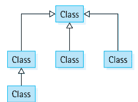

1.3 显示了整个系统继承树的一个分支。请注意，由于方法调用的解析方式（即通过向上搜索继承树），只有 `InDate` 类的对象会使用 `increment` 方法——如果你想对某个类的对象（例如 `MyObject`）使用 `increment`，在 `Date` 类或继承树中 `Date` 之上的任何类中都没有该定义。编译器会在该系统中报告语法错误。

> **重要提示**
>
> 方法名与方法代码的关联是通过向上移动继承树来实现的。如果在指定的类中没有找到匹配的方法，则会搜索其子类。如果在那里也没有找到，则搜索其上子类，依此类推。

请注意图 1.3 中的 `Object` 类。它是从哪里来的？在 Java 中，任何没有显式继承 `Date` 的类都会隐式地继承预定义的 `Object` 类。由于 `Date` 没有继承其他任何类，它直接继承自 `Object`。`Date` 类是 `Object` 的直接子类。

所有类都可以追溯到 `Object` 类。我们称 `Object` 类是继承树的根。`Object` 类定义了几个基本方法：相等比较（`equals`）、转换为字符串（`toString`）以及

> **Java 注意**
>
> 在 Java 中，`Object` 类是继承树的根——所有类都继承自 `Object`。因此，例如，所有对象都支持 `equals` 和 `toString`，除非它们的类覆盖了 `Object` 类对这些方法的定义，否则它们可能无法很好地支持这些操作。

等等。因此，对于任何示例，任何 Java 程序都支持 `toString`，因为它继承自 `Object` 类。让我们仔细考虑一下 `toString` 示例。

正如之前讨论的样，当 Java 在语句中自动将整数值转换为字符串时

```
System.out.println("aDate day is: " + aDate.getDay());
```

## 1.2 类的组织

所以在在语句中，它会自动将一个对象打印为字符串：

```
System.out.println("tomorrow: " + aDate);
```

为了实现这一点，Java 编译器会为该对象查找一个 `toString` 方法。在这种情况下，在 `IncDate` 类中没有找到 `toString` 方法，但在它的父类 `Date` 类中找到了。然而，如果它是在 `Date` 类中定义的，编译器将继续向上查找继承层次结构，并在 `Object` 类中找到 `toString` 方法。鉴于所有类的根都可以追溯到 `Object`，编译器始终保证最终找到 `toString` 方法。

等一下，“将对象转换为字符串”意味着什么？嗯，这取决于与对象相关的 `toString` 方法的定义。`Object` 类的 `toString` 方法返回一个表示对象某些实现细节的字符串。这些信息有些晦涩，通常对我们来说没有用处。这种情况是一个通过重写（overriding）重新定义继承的方法非常有用处的例子。我们通常在创建自己的类时重写默认方法，以返回更相关的字符串，就像我们对 `Date` 类那样。这就是为什么我们在第 3 页所示的 `toString` 方法中使用 `@Override` 注解。通过为我们的 `toString` 方法添加注解，我们允许编译器进行双检。如果它找不到具有相同签名的祖先方法，它将生成错误。此外，某些开发环境将显示输出以告知它们如何显示代码。

表 1.2 来自以下程序段的输出：

```
Date myDate = new Date(6, 24, 1951);
IncDate currDate = new IncDate(1, 11, 2001);
System.out.println("myDate: " + myDate);
System.out.println("today: " + currDate);

currDate.increment();
System.out.println("tomorrow: " + currDate);
```

左侧的结果显示了默认使用 `Object` 类的 `toString` 方法时生成的输出示例；右侧的结果显示了使用我们的 `Date` 类 `toString` 方法时的结果。

表 1.2 程序段的输出

| Object 类 toString | Date 类 toString |
|---|---|
| myDate: Date256a7c | myDate: 6/24/1951 |
| today: IncDate@720eeb | today: 1/11/2001 |
| tomorrow: IncDate@720eeb | tomorrow: 1/12/2001 |

### 基于继承的多态性

这是一个引入一个重要的面向对象概念的好地方。“多态性（polymorphism）”一词源自希腊语，字面意思是“许多形式”。支持多态的面向对象语言允许对象变量在程序执行期间的不同时间点引用不同类的对象——我们可以拥有“许多类型”，这被称为多态或多态引用。

在 Java 中创建多态引用的方法有两种方法。在这里我们查看基于继承的多态。在第 2.1 节“抽象”中，我们将查看基于接口的多态。

在我们的程序中，当通过方法调用方法时，我们可以确切地知道将执行哪个方法。我们可以拥有“许多类型”，并这被称为多态或多态引用。

在我们的程序中，我们可以确切地知道当通过方法调用方法时将执行哪个方法。例如，在代码段中，String 和 Date 类调用了 toString。

```
String s = new String("Hello");
Date d = new Date(1, 11, 2015);
System.out.println(s.toString());
System.out.println(d.toString());
```

我们可以看到这些代码会打印 "Hello" 后面跟着 "1/11/2015"。在 Java 中，任何没有显式继承 `Date` 的类都会隐式地继承预定义的 `Object` 类。由于 `Date` 没有继承任何其他类，它直接继承自 `Object`。`Date` 类是 `Object` 的直接子类。

所有类都可以追溯到 `Object` 类。我们称 `Object` 类是继承树的根。`Object` 类定义了几个基本方法：相等比较（`equals`）、转换为字符串（`toString`）以及

等等。因此，对于任何示例，任何 Java 程序都支持 `toString`，因为它继承自 `Object` 类。让我们仔细考虑一下 `toString` 示例。

正如之前讨论的，当 Java 在语句中自动将整数值转换为字符串时

```
System.out.println("aDate day is: " + aDate.getDay());
```

## 1.2 类的组织

所以在在语句中，它会自动将一个对象打印为字符串：

```
System.out.println("tomorrow: " + aDate);
```

为了实现这一点，Java 编译器会为该对象查找一个 `toString` 方法。在这种情况下，在 `IncDate` 类中没有找到 `toString` 方法，但在它的父类 `Date` 类中找到了。然而，如果它是在 `Date` 类中定义的，编译器将继续向上查找继承层次结构，并在 `Object` 类中找到 `toString` 方法。鉴于所有类的根都可以追溯到 `Object`，编译器始终保证最终找到 `toString` 方法。


等一下，“将对象转换为字符串”意味着什么？嗯，这取决于与对象相关的 `toString` 方法的定义。`Object` 类的 `toString` 方法返回一个表示对象某些实现细节的字符串。这些信息有些晦涩，通常对我们来说没有用处。这种情况是一个通过重写（overriding）重新定义继承的方法非常有用处的例子。我们通常在创建自己的类时重写默认方法，以返回更相关的字符串，就像我们对 `Date` 类那样。这就是为什么我们在第 3 页所示的 `toString` 方法中使用 `@Override` 注解。通过为我们的 `toString` 方法添加注解，我们允许编译器进行双检。如果它找不到具有相同签名的祖先方法，它将生成错误。此外，某些开发环境将显示输出以告知它们如何显示代码。

表 1.2 来自以下程序段的输出：

```
Date myDate = new Date(6, 24, 1951);
IncDate currDate = new IncDate(1, 11, 2001);
System.out.println("myDate: " + myDate);
System.out.println("today: " + currDate);

currDate.increment();
System.out.println("tomorrow: " + currDate);
```

左侧的结果显示了默认使用 `Object` 类的 `toString` 方法时生成的输出示例；右侧的结果显示了使用我们的 `Date` 类 `toString` 方法时的结果。

表 1.2 程序段的输出

| Object 类 toString | Date 类 toString |
|---|---|
| myDate: Date256a7c | myDate: 6/24/1951 |
| today: IncDate@720eeb | today: 1/11/2001 |
| tomorrow: IncDate@720eeb | tomorrow: 1/12/2001 |

## 基于继承的多态性

这是一个引入一个重要的面向对象概念的好地方。“多态性（polymorphism）”一词源自希腊语，字面意思是“许多形式”。支持多态的面向对象语言允许对象变量在程序执行期间的不同时间点引用不同类的对象——我们可以拥有“许多类型”，这被称为多态或多态引用。

在 Java 中创建多态引用的方法有两种。在这里我们查看基于继承的多态。在第 2.1 节“抽象”中，我们将查看基于接口的多态。

在我们的程序中，我们可以确切地知道当通过方法调用方法时将执行哪个方法。例如，在代码段中，`String` 和 `Date` 类调用了 `toString`。

```
String s = new String("Hello");
Date d = new Date(1, 11, 2015);
System.out.println(s.toString());
System.out.println(d.toString());
```

我们可以看到这些代码会打印 "Hello" 后面跟着 "1/11/2015"。在 Java 中，任何没有显式继承 `Date` 的类都会隐式地继承预定义的 `Object` 类。由于 `Date` 没有继承任何其他类，它直接继承自 `Object`。`Date` 类是 `Object` 的直接子类。

所有类都可以追溯到 `Object` 类。我们称 `Object` 类是继承树的根。`Object` 类定义了几个基本方法：相等比较（`equals`）、转换为字符串（`toString`）以及

等等。因此，对于任何示例，任何 Java 程序都支持 `toString`，因为它继承自 `Object` 类。让我们仔细考虑一下 `toString` 示例。

正如之前讨论的，当 Java 在语句中自动将整数值转换为字符串时

```
System.out.println("aDate day is: " + aDate.getDay());
```

## 1.2 类的组织

但是在语句中，它会自动将一个对象打印为字符串：

```
System.out.println("tomorrow: " + aDate);
```

为了实现这一点，Java 编译器会为该对象查找一个 `toString` 方法。在这种情况下，在 `IncDate` 类中没有找到 `toString` 方法，但在它的父类 `Date` 类中找到了。然而，如果它是在 `Date` 类中定义的，编译器将继续向上查找继承层次结构，并在 `Object` 类中找到 `toString` 方法。鉴于所有类的根都可以追溯到 `Object`，编译器始终保证最终找到 `toString` 方法。


# 第1章 组织工作

遵循文件中的包名规范，程序员可以编写导入声明（`import declarations`），以便让定义包内的类可以使用其他包的内容，然后是一个或多个类声明。Java 将此称为编译单元（`compilation unit`）。在文件中定义的类是包的成员。被导入的类不是该包的成员。

包含编译单元的文件名必须与该单元内公类的名称相匹配。因此，尽管程序员可以在一个编译单元中声明多个类，但其中只有一个类可以声明为公有（`public`）。文件中所有非公有的类对包的外部世界都是隐藏的。如果一个编译单元只能包含一个公类，那么我们该如何创建包含多个公类的包呢？我们必须像接下来描述的那样，使用多个编译单元。

## 具有多个编译单元的包

每个 Java 编译单元都存储在自己的单独文件中。Java 系统通过包名和编译单元中公类的名称组合来识别文件。Java 限制每个文件只能有一个类，以便它可以使用文件名来定位公类。因此，包含多个类的包是通过多个编译单元实现的，每个编译单元都位于一个单独的文件中。

## 1.2 类的组织

```
System.out.println("tomorrow: " + aDate);
```

为了实现这一点，Java 编译器会为该对象查找一个 `toString` 方法。在这种情况下，在 `IncDate` 类中没有找到 `toString` 方法，但在它的父类 `Date` 类中找到了。然而，如果它是在 `Date` 类中定义的，编译器将继续向上查找继承层次结构，并在 `Object` 类中找到 `toString` 方法。鉴于所有类的根都可以追溯到 `Object`，编译器始终保证最终找到 `toString` 方法。

等一下，“将对象转换为字符串”意味着什么？嗯，这取决于与对象相关的 `toString` 方法的定义。`Object` 类的 `toString` 方法返回一个表示对象某些实现细节的字符串。这些信息有些晦涩，通常对我们来说没有用处。这种情况是一个通过重写（overriding）重新定义继承的方法非常有用处的例子。我们通常在创建自己的类时重写默认方法，以返回更相关的字符串，就像我们对 `Date` 类那样。这就是为什么我们在第 3 页所示的 `toString` 方法中使用 `@Override` 注解。通过为我们的 `toString` 方法添加注解，我们允许编译器进行双检。如果它找不到具有相同签名的祖先方法，它将生成错误。此外，某些开发环境将显示输出以告知它们如何显示代码。

表 1.2 来自以下程序段的输出：

```
Date myDate = new Date(6, 24, 1951);
IncDate currDate = new IncDate(1, 11, 2001);
System.out.println("myDate: " + myDate);
System.out.println("today: " + currDate);

currDate.increment();
System.out.println("tomorrow: " + currDate);
```

左侧的结果显示了默认使用 `Object` 类的 `toString` 方法时生成的输出示例；右侧的结果显示了使用我们的 `Date` 类 `toString` 方法时的结果。

**表 1.2 程序段的输出**

| Object 类 toString | Date 类 toString |
|---|---|
| myDate: Date256a7c | myDate: 6/24/1951 |
| today: IncDate@720eeb | today: 1/11/2001 |
| tomorrow: IncDate@720eeb | tomorrow: 1/12/2001 |

## 基于继承的多态性

这是一个引入一个重要的面向对象概念的好地方。“多态性（polymorphism）”一词源自希腊语，字面意思是“许多形式”。支持多态的面向对象语言允许对象变量在程序执行期间的不同时间点引用不同类的对象——我们可以拥有“许多类型”，这被称为多态或多态引用。

在 Java 中创建多态引用的方法有两种。在这里我们查看基于继承的多态。在第 2.1 节“抽象”中，我们将查看基于接口的多态。

在我们的程序中，我们可以确切地知道当通过方法调用方法时将执行哪个方法。例如，在代码段中，`String` 和 `Date` 类调用了 `toString`。

```
String s = new String("Hello");
Date d = new Date(1, 11, 2015);
System.out.println(s.toString());
System.out.println(d.toString());
```

我们可以看到这些代码会打印 "Hello" 后面跟着 "1/11/2015"。在 Java 中，任何没有显式继承 `Date` 的类都会隐式地继承预定义的 `Object` 类。由于 `Date` 没有继承任何其他类，它直接继承自 `Object`。`Date` 类是 `Object` 的直接子类。

所有类都可以追溯到 `Object` 类。我们称 `Object` 类是继承树的根。`Object` 类定义了几个基本方法：相等比较（`equals`）、转换为字符串（`toString`）以及……

等等。因此，对于任何示例，任何 Java 程序都支持 `toString`，因为它继承自 `Object` 类。让我们仔细考虑一下 `toString` 示例。

正如之前讨论的，当 Java 在语句中自动将整数值转换为字符串时：

```
System.out.println("aDate day is: " + aDate.getDay());
```

但是在语句中，它会自动将一个对象打印为字符串：

```
System.out.println("tomorrow: " + aDate);
```

为了实现这一点，Java 编译器会为该对象查找一个 `toString` 方法。在这种情况下，在 `IncDate` 类中没有找到 `toString` 方法，但在它的父类 `Date` 类中找到了。然而，如果它是在 `Date` 类中定义的，编译器将继续向上查找继承层次结构，并在 `Object` 类中找到 `toString` 方法。鉴于所有类的根都可以追溯到 `Object`，编译器始终保证最终找到 `toString` 方法。

等一下，“将对象转换为字符串”意味着什么？嗯，这取决于与对象相关的 `toString` 方法的定义。`Object` 类的 `toString` 方法返回一个表示对象某些实现细节的字符串。这些信息有些晦涩，通常对我们来说没有用处。这种情况是一个通过重写（overriding）重新定义继承的方法非常有用处的例子。我们通常在创建自己的类时重写默认方法，以返回更相关的字符串，就像我们对 `Date` 类那样。这就是为什么我们在第 3 页所示的 `toString` 方法中使用 `@Override` 注解。通过为我们的 `toString` 方法添加注解，我们允许编译器进行双检。如果它找不到具有相同签名的祖先方法，它将生成错误。此外，某些开发环境将显示输出以告知它们如何显示代码。

表 1.2 来自以下程序段的输出：

```
Date myDate = new Date(6, 24, 1951);
IncDate currDate = new IncDate(1, 11, 2001);
System.out.println("myDate: " + myDate);
System.out.println("today: " + currDate);

currDate.increment();
System.out.println("tomorrow: " + currDate);
```

左侧的结果显示了默认使用 `Object` 类的 `toString` 方法时生成的输出示例；右侧的结果显示了使用我们的 `Date` 类 `toString` 方法时的结果。

**表 1.2 程序段的输出**

| Object 类 toString | Date 类 toString |
|---|---|
| myDate: Date256a7c | myDate: 6/24/1951 |
| today: IncDate@720eeb | today: 1/11/2001 |
| tomorrow: IncDate@720eeb | tomorrow: 1/12/2001 |

## 继承的多态性

Java 只支持单继承。这意味着一个类只能继承另一个类。因此，在 Java 中，继承关系定义了一棵继承树。


图 1.3 显示了整个系统继承树的一个分支。请注意，由于方法调用的解析方式（即通过向上搜索继承树），只有 `IncDate` 类的对象会使用 `increment` 方法——如果你想对某个类的对象（例如 `MyObject`）使用 `increment`，在 `Date` 类或继承树中 `Date` 之上的任何类中都没有该定义。编译器会在该系统中报告语法错误。

> **重要**
>
> 方法名与方法代码的关联是通过向上移动继承树来实现的。如果在指定的类中没有找到匹配的方法，则会搜索其父类。如果在那里也没有找到，则搜索其上层父类，依此类推。

请注意图 1.3 中的 `Object` 类。它是从哪里来的？在 Java 中，任何没有显式继承 `Date` 的类都会隐式地继承预定义的 `Object` 类。由于 `Date` 没有继承任何其他类，它直接继承自 `Object`。`Date` 类是 `Object` 的直接子类。

所有类都可以追溯到 `Object` 类。我们称 `Object` 类是继承树的根。`Object` 类定义了几个基本方法：相等比较（`equals`）、转换为字符串（`toString`）以及……

> **Java 注意**
>
> 在 Java 中，`Object` 类是继承树的根——所有类都继承自 `Object`。因此，例如，所有对象都支持 `equals` 和 `toString`，除非他们的类覆盖了 `Object` 类对这些方法的定义，它们可能无法很好地支持这些操作。

等等。因此，对于任何示例，任何 Java 程序都支持 `toString`，因为它继承自 `Object` 类。让我们仔细考虑一下 `toString` 示例。

正如之前讨论的，当 Java 在语句中自动将整数值转换为字符串时：

```
System.out.println("aDate day is: " + aDate.getDay());
```


使用多个编译单元的进一步优势在于为我们开发包的类提供了更大的灵活性。如果 Java 让多个程序员共享同一个包文件，那么团队编程项目将变得繁琐。

我们通过将包的成员放在具有相同包名的不同编译单元中，将一个包拆分到多个文件中。例如，我们可以创建一个包含以下代码的文件（大括号之间的 `...` 表示每个类的代码）：

```java
package gamma;
public class One{ ... }
class Two {
  ... 
 }
```

第二个文件可以包含这段代码：

```java
package gamma;
class Three{ ... }
public class Four{ ... }
```

结果：包 `gamma` 包含了四个类。其中两个类（`One` 和 `Four`）是公有的，因此它们可以被应用程序代码导入。这两个文件名必须与两个公类名匹配；也就是说，文件必须分别命名为 `One.java` 和 `Four.java`。

Java 编译器是如何找到这些片段并将它们组合在一起的？答案是，它要求一个包的所有编译单元都必须保存在一个与包名匹配的单一目录或文件夹中。对于我们之前的示例，程序员会将源代码存储在名为 `One.java` 和 `Four.java` 的文件中，这两个文件都位于名为 `gamma` 的目录中。

## 导入语句

为了从程序内部访问包的内容，你必须将其导入到程序中。你可以使用以下两种形式的导入语句：

```java
import packagename.*;
import packagename.ClassName;
```

导入声明以关键字 `import` 开头，后面跟着包名和一个点（period）。在接下来的点之后，你可以写包中某个类的名称，也可以写星号（`*`）。声明以分号结束。如果你想访问特定包中的恰好一个类，那么你可以在导入声明中使用它的名称。如果你想使用包中的多个类，星号是给编译器的一种简写符号，表示“无论此程序使用了此包中的哪些类（都包含在）”。

## 包与子目录

许多计算机平台使用分级文件系统。Java 包的规则定义旨在与这些系统无缝工作。Java 包名也可以是分级的；它们可能包含用“点”分隔的名称各个部分——例如，`ch01.dates`。在这种情况下，包文件必须放置在一组与包名部分匹配的子目录下。继续上例的例子，包文件应该放在名为 `dates` 的目录中，该目录是名为 `ch01` 目录的子目录。你可以使用以下语句将整个包导入你的程序：

```java
import ch01.dates.*;
```

> Java 注意事项
>
> Java 包的结构设计用于与常用的分级文件系统无缝工作。

只要包含 `ch01` 目录的目录位于你系统的 `ClassPath` 上，编译器就能找到你请求的包。编译器会查找 `ClassPath` 中列出的所有目录。大多数编程环境提供了一个命令来指定包含在 `ClassPath` 中的目录。你需要咨询你特定环境的文档来查看如何操作。在我们的示例中，编译器将在所有 `ClassPath` 目录中搜索名为 `ch01` 的子目录，该目录下包含一个名为 `dates` 的子目录；找到这样的子目录后，它将导入它找到的所有 `ch01.dates` 包成员。

## 程序文件

为支持此测试创建的文件被组织在包中。它们完全按照我们描述的方式进行组织，可以在书籍网站 `go.blearning.com/odds4ecatalog/9781449613549/` 访问。所有文件都在 `book-Files` 目录下找到。它包含了书中每个章节的各个独立子目录：`ch01`、`ch02` 等。你将在章节子目录下找到相应的子目录。

例如，`ch01` 子目录确实包含一个名为 `dates` 的子目录，该子目录包含了定义与日期相关的 Java 类的文件。每个类文件都以以下语句开头：

```java
package ch01.dates;
```

因此，它们都在 `ch01.dates` 包中。如果你编写了一个需要使用这些文件的程序，可以简单地将该包导入你的程序中，并确保 `ch01` 目录的父目录（即 `bookFiles` 目录）包含在计算机的 `ClassPath` 中。

我们建议你将整个 `bookFiles` 目录复制到计算机的硬盘上，以确保方便地访问书籍的所有文件，并维护包所需的关键子目录。此外，请确保扩展你计算机的 `ClassPath` 以包含你的新 `bookFiles` 目录。

# 第 1 章 组织工作

## 1.3 异常情况

在本节中，我们将查看运行程序时可能出现的各种处理异常情况的方法。

### 处理异常情况

程序运行时可能会发生许多不同类型的异常情况。异常情况会改变程序的控制流，有时会导致崩溃。以下是一些示例：

- 用户输入了类型错误的输入值。
- 从文件读取信息时到达了文件末尾。
- 用户按下了组合键组合。
- 程序尝试对空对象（`null object`）调用方法。
- 向方法传递了越界值，例如，将 `25` 作为月份值传递给 `Date` 构造函数。

Java（以及其他一些语言）提供了管理异常情况的内置机制。在 Java 中，异常情况被简单地称为异常（`exception`）。Java 异常机制有三个主要部分：

- 定义异常。通常作为 Java `Exception` 类的子类
- 生成（抛出）异常。通过识别异常情况并使用 Java 的 `throw` 语句来“宣布”异常的发生
- 处理异常。使用 Java 的 `try-catch` 语句发现已抛出的异常并采取适当行动

Java 还包含许多在特定情况下自动提出的内置异常。

从现在起，我们用“异常”一词代替泛泛的“异常情况”。以下是使用异常的一些通用指南：

- 异常可以在软件层次结构中的任何地方处理——从最初检测到异常的程序模块到程序的顶层。
- 未处理的内置异常将以程序终止为代价。
- 在应用程序何处处理异常是一个设计决策；然而，异常应该在了解其含义的地方被处理。
- 异常不必是致命的。
- 对于非致命异常，执行线程应该从能够恢复的底层继续。

> Java 注意事项
>
> 在 Java 中，异常是对象。它们可以被定义、实例化、抛出、捕获和处理。它们允许我们控制程序的执行流。

### 异常与类：示例

当我们创建自己的类时，我们会识别需要特殊处理的异常。如果特殊处理依赖于应用程序，我们使用 Java 异常机制将问题抛出类，强制应用程序程序员处理它。相反，如果异常可以隐藏在类内部，那么就没有需要让应用程序程序员承担这项任务。

关于支持程序员定义类的异常示例，我们回到 `Date` 类示例。按照目前的定义，应用程序可以使用无效的月份调用 `Date` 构造函数——例如 `25/15/2000`。我们可以通过检查传递给构造函数的月份参数的合法性来避免创建此类日期。但如果我们的构造函数发现了非法参数，它应该做什么？这里有一些选项：

- 向输出流写入警告消息。这不是一个好的选项，因为在 `Date` 类内部，我们并不确定应用程序使用的输出流（如果有）。
- 实例化新的 `Date` 对象以设置默认日期，可能是 `0/0/0`。这种方法的问题是，如果没有问题，应用程序程序可能会继续处理并产生错误结果。通常情况下，让程序“崩溃”比产生可能被用于做出错误决策的错误结果要好。
- 抛出一个异常。这样，正常处理会被中断，构造函数不会返回新对象；应用程序被强制承认问题（捕获异常）并处理它或将其抛给下一层。

一旦我们决定通过异常来处理某种情况，就必须决定使用 Java 库中预定义的异常之一，还是创建一个自定义异常。在这种情况下，通过对库的研究，可以发现一个名为 `DataFormatException` 的候选异常，用于指示数据格式错误。我们可以使用该异常，但认为它并不真正适用；在这种情况下，问题不在于数据的格式，而是数据的值。

我们决定创建自己的异常 `DateOutOfBounds`。它也可以命名为 `MonthOutOfBounds`，但我们希望使用该异常来指示日期的其他潜在问题，而不仅仅是月份值。我们的异常被放置在一个名为 `DateOutOfBounds.java` 的文件中。

我们的 `DateOutOfBoundsException` 继承了库中的 `Exception` 类。在创建自定义异常时，定义两个构造函数以镜像 `Exception` 类的两个构造函数是不常见的。事实上，最简单的方法是定义构造函数，让它们直接调用父类的构造函数：

```java
package ch01.dates;
public class DateOutOfBoundsException extends Exception
{
    public DateOutOfBoundsException()
    {
        super();
    }
    public DateOutOfBoundsException(String message)
    {
        super(message);
    }
}
```

第一个构造函数创建了一个不带消息的异常。第二个构造函数创建了一个异常，其消息等于传递构造函数的字符串参数。

让我们创建一个新类 `SafeDate`。我们可以简单地升级之前的类，但不想让之前的示例失效。因此，我们将使用新类 `SafeDate` 来演示异常的使用。在我们的 `SafeDate` 类内部，我们应该在哪里抛出异常呢？类中所有创建或更改日期值的地方都应该经过检查，查看结果值是否可能是非法日期。如果是，我们应该创建一个带有适当消息的异常类对象并抛出异常。

以下是一个检查月份和年份法的 `SafeDate` 构造函数：

```java
public SafeDate(int newMonth, int newYear)
{
    if ((newMonth <= 0) || (newMonth > 12))
        throw new DateOutOfBoundsException("Month " + newMonth + " illegal.");
    else 
        month = newMonth;

    day = newDay;
    if (newYear < MINEAR)
        throw new DateOutOfBoundsException(" " + newYear + " too early.");
    else
        year = newYear;
}
```

注意，为每个 `throw` 语句定义的消息与代码该处涵盖的问题有关。这应该有助于处理异常的应用程序，或者如果异常一直传播到用户级，则至少能为程序用户提供相关信息。

最后，我们看到应用程序如何使用 `SafeDate` 类。考虑一个提示用户输入月份、日期，并根据用户的响应创建 `SafeDate` 对象的程序。在下面，我们通过将这些语句替换为注释来隐藏提示和响应的处理细节。这样我们就可以强调与当前讨论相关的代码：

```java
// UseSafeDate.java by Dale/Joyce/Weems    Chapter 1
// SafeDate 类抛出异常的重新抛出示例
```

```java
package ch01.apps;
public class UseSafeDate
{
    public static void main(String[] args) throws DateOutOfBoundsException
    {
        SafeDate theDate;

        // 程序提示用户输入日期；
        // M 设置为用户的月份。
        // D 设置为用户的日期。
        // Y 设置为用户的年份。

        theDate = new SafeDate(M, D, Y);

        // 程序继续 ...
    }
}
```

当此程序运行时，如果用户响应了一个非法值——例如年份 `1051`——`SafeDate` 构造函数将抛出 `DateOutOfBoundsException`；因为它在程序内部没有被捕获和处理，它将根据强调 `throws` 子句被抛给解释器。解释器停止程序并显示如下所示的消息：

```text
Exception in thread "main" DateOutOfBoundsException: Year 1051 too early.
at SafeDate.<init>(SafeDate.java:18)
at SafeDate.main(SafeDate.java:57)
```

解释器的消息包含了异常的名称和消息字符串，以及通向异常的调用堆栈。

或者，`SafeDate` 类可以自己捕获并处理异常，而不是将其抛给解释器。当发生异常时，应用程序可以请求新日期。以下是 `SafeDate` 针对这种情况的写法：

```java
// SafeDate.java by Dale/Joyce/Weems Chapter 1
// SafeDate 类抛出异常的捕获示例
```

```java
package ch01.apps;
import java.util.Scanner; 
import ch01.dates.*;

public class SafeDate {
    public static void main(String[] args) {
        int month, day, year;
        SafeDate theDate;
        boolean dateOK = false;
        Scanner scan = new Scanner(System.in);

        while (!dateOK) {
            System.out.println("Enter a date (month day and year): ");
            month = scan.nextInt(); day = scan.nextInt(); year = scan.nextInt();
            try {
                theDate = new SafeDate(month, day, year);
                dateOK = true;
                System.out.println(theDate + " is a safe date.");
            } catch (DateOutOfBoundsException DateOutOfBoundsException) {
                System.out.println(DateOutOfBoundsException.getMessage() + "\n");
            }
        }
    }
}
```

如果 `new` 语句执行顺利，意味着 `SafeDate` 构造函数没有抛出异常，`dateOK` 变量被设置为 `true`，输出日期，并且 `while` 循环终止。如果抛出 `DateOutOfBoundsException`，则 `try` 中的最后两个语句被跳过，异常被 `catch` 语句捕获。反过来，它提示消息并再次执行 `while` 循环。

关于异常的一个注意事项。`RuntimeException` 类在 Java 环境中被特殊处理。发生运行时错误时会抛出此类异常。运行时错误的示例包括 `NullPointerException` 和 `ArrayOutOfBoundsException`。由于运行时异常可能发生在任何方法或代码段中，我们不需要显式处理这些异常。否则，我们的程序将充满大量的 `catch` 和 `throw` 语句。这些错误被分类为未检查异常。

> Java 注意
>
> Java 运行时异常不需要显式处理。如果我们不处理它们且它们被抛出，它们最终将抛出 Java 虚拟机。

## 1.4 数据结构

你已经熟悉各种组织数据的方法。当你在目录或字典中查找课程描述时，你正在使用有序单词列表。当你在熟食或理发店取号时，你成为了等待服务的队列的一部分。当你研究体育赛事的对阵并尝试预测哪个团队或选手将晋级所有轮成为冠军时，你创建了一个预测结果树。

正如我们在解决日常问题时使用许多方法组织数据一样，程序员在利用计算机解决问题时也使用多种方法来组织数据。在编程时，你看待和构建程序处理的数据的方式极大影响你的成功。语言的原始类型集合（Java 的有 `byte`、`char`、`short`、`int`、`long`、`float`、`double` 和 `boolean`）在我们需要计数器、总和或索引时非常有用。通常，我们还必须处理具有复杂相互关系的大量数据。

计算机科学家已经设计了许多组织结构来表示数据关系。这些结构构成了本书的统一主题。在本节中，我们将以非正式的方式介绍这一主题，简要描述一些经典方法。

### 依赖于实现的结构

前两种结构的内部表示是其定义中固有的组成部分。这些结构是许多其他结构的构建构建块。

#### 数组

| 索引 | 值 |
|---|---|
| [0] | x |
| [1] | x |
| [2] | x |
| [3] | x |
| [4] | x |
| [5] | x |

你在之前的工作中已经学习并使用过数组。数组的组件通过它们在结构中的位置来访问。数组是最重要的组织结构之一。它们作为基础语言构造结构在高级编程语言中可用。此外，它们是实现其他结构的基础构建块之一。我们将在 1.5 节“基础结构机制”中更深入地研究数组。

#### 链表

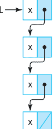

链表是独立元素的集合，每个元素都链接到列表中紧随其后的元素。我们可以将链表想象成一链元素的链。链表是一种多功能、强大的基础实现结构，和数组一样，它是构建更复杂结构的主要构建块之一。教你如何使用链接和链表是本书的重要目标之一。我们将在 1.5 节“基础结构机制”中查看 Java 的链接机制——引用。此外，在正书的其余部分中，我们将学习如何使用链接和链表来实现其他结构。

### 独立于实现的结构

与数组和链表不同，本小节介绍的组织结构并不依赖于特定的实现方法。它们更加抽象。


这里介绍的结构代表了组成元素之间不同类别的关系。对于栈和队列，组织方式基于元素被放入结构的时间顺序；对于排序列表和优先级队列，它与元素的值有关；对于树和图，它反映了通过元素相对位置所捕捉的问题领域中的某些特征。

这些结构（以及其他结构）将在书的后部分单独讨论，届时我们将详细地描述它们，研究使用它们的方法，并查看几种可能的实现方式。

## 栈

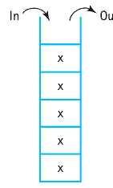

栈的定义特征是，每当你访问或删除一个元素时，你操作的是最近插入的元素。栈是“后进先出”（LIFO）结构。为了理解它的原理，请想象一叠盘子或托盘。栈的概念完全由其访问操作、插入元素的操作以及从其中移除元素的操作之间的关系定义。无论内部表示是什么，只要保持 LIFO 关系，它就是栈。

## 队列

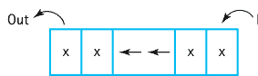

队列在某种意义上是栈的相反面。它们是“先进先出”（FIFO）结构。队列的定义特征是，每当你从队列中访问或删除一个元素时，你操作的是在队列中存放时间最长的元素。想象一队等候上公交车的人，或者一组在熟食店拿着服务号的人。在这两种情况下，人们将按照他们到达的顺序接受服务。事实上，这是抽象组织构造“队列”如何有多种实现方法（有序的队伍或服务号）的良好例子。

## 排序列表

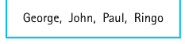

排序列表的元素显示出线性关系。每个元素（除第一个之外）都有一个前驱，每个元素（除最后一个之外）都有一个后继者。在排序列表中，这种关系还反映了元素的顺序，从“最小”到“最大”，或反之。

你可能认为元素经过排序的数组就是排序列表——你是对的！正如我们之前所说，数组是构建其他结构的基础构建块之一。但这不是实现排序列表的唯一方法。我们将涵盖其他几种方法。

## 映射

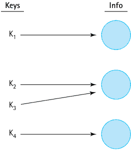

映射，也称为字典、表或关联数组，用于存储“键”-“信息”有序值对。当你提供适当的键时，映射可以快速访问所需信息。例如，当你进入银行并向柜员提供账号时——（希望）在几秒钟内，柜员就能访问你的账户信息。你的账号就是键——它“映射”到你的账户信息。虽然实现映射结构有许多方法，但它们必须遵循相同的简单规则：键是唯一的，且一个键映射到单个信息节点。

## 树

树和图是非线性的。树的每个元素都可以有多个后继者，称为它的`孩子`。一个子元素只能有一个`父节点`。因此，树是一种分支结构。每棵树都有一个特殊的起始元素，称为`根`。根是唯一没有父节点的元素。

树可用于表示数据元素之间的层次关系。例如，它们可以用于对动物界的成员进行分类，或将一组任务组织为子任务。树甚至可以用于反映 Java 继承机制定义的 Java 类之间的`is-a`（是）关系。

## 图

图由一组元素（通常称为`节点`或`顶点`）和一组连接顶点的`边`组成。与树不同，元素之间的连接没有限制。通常情况下，连接（或边）描述了顶点之间的关系。在某些情况下，值（也称为权重）与边相关，以表示关系的某些特征。例如，顶点可以代表城市，边可以代表由飞机路线连接的城市对。边的值可以代表城市之间的距离或旅行时间。

## 什么是数据结构？

我们将示例分为依赖于实现和独立于实现的类别。在计算机的婴儿时代，并没有这种区分。当时对结构的大部分研究都涉及实现。随着我们解决问题方法的演进，我们意识到将结构分为抽象和实现层的重要性。

正如计算领域的许多术语一样，你可以在文献中发现“数据结构”的各种用法。一种观点认为数据结构是组织数据的实现。在这种观点下，只有依赖实现的结构（数组和链表）被视为数据结构。另一种观点是将任何组织形式视为数据结构。在另一种观点下，本节介绍的结构都被视为数据结构。

无论你如何标记它们，这里描述的所有结构都是解决问题的重要工具。在本书中，我们将从多个视角探索这些数据结构，以及许多其他的。当你面对问题并设计计算解决方案时，在设计过程早期决定如何存储、访问和处理与问题相关的信息是非常重要的。数据结构知识让你成功地做出这一决策并执行。

## 1.5 基础结构机制

1.4 节“数据结构”中描述的所有结构都可以通过两种基础机制——引用和数组的某种组合来实现。通用高级语言提供了这两种机制。在本节中，我们将回顾 Java 中的版本。在第 2 章中，我们将开始使用引用和数组构建结构。

## 内存

所有的程序和数据都存储在内存中。虽然内存隐藏在多层系统软件之下，它们为我们隐藏并为我们管理，但大多数基础内存由连续的可寻字序列组成：

| 地址 | 字 |
|---|---|
| 0 | |
| 1 | |
| 2 | |
| 3 | |
| ... | |

程序中的变量对应于内存位置。编译器处理翻译，使得当代码每次引用同一个变量时，系统都会使用同一个内存位置。

## 引用

为了帮助演示本节概念，我们假设可以访问 `Circle` 类。`Circle` 类定义了不同直径的圆形对象。它提供了一个构造函数，接受一个代表圆直径的整数。`Circle` 类提供了一个方便的示例，允许我们在图中图形化表示对象——我们只需使用不同直径的实际圆来表示 `Circle` 对象。

对象类的变量持有对象——它们使用间接寻址。考虑以下 Java 语句的影响：

```java
Circle circleA;
Circle circleB = new Circle(8);
```

第一条语句为 `Circle` 类变量预留了内存空间。第二条语句做了相同的事情，但也创建了一个 `Circle` 对象并将该引用放在 `circleB` 变量中。

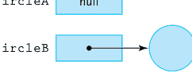

引用由箭头指示，但正如上一小节讨论的，引用实际上是一个内存地址。引用有时被称为链接、地址或指针。`Circle` 对象的内存地址存储在分配给 `circleB` 变量的内存位置。注意我们是如何用实际圆来表示 `Circle` 对象的。在现实中，它将由分配给它的部分内存组成。

由于没有实例化对象或赋值给 `circleA` 变量，它的内存位置持有一个空引用（null reference）。Java 使用 `null` 字来表示“引用的缺失”。如果声明引用变量时没有分配实例化的对象，它将自动初始化为系统用于表示空值的任何对应值。你也可以显式地为变量赋值 `null`：

```java
circleB = null;
```

此外，你可以在比较中使用 `null`：

```java
if (circleA == null)
    System.out.println("The Circle does not exist");
```

## 引用类型与基本类型

理解 Java 中处理基本类型和非基本类型的区别至关重要。基本类型（如 `int` 类型）是“按值”（by value）处理的。

非基本类型（如数组和类）通过“引用”（reference）处理。基本类型变量持有变量的值，而非基本类型变量持有指向变量值的`引用`。也就是说，变量持有系统可以找到与变量关联值的地址。

## Java 注意事项

在 Java 中，如 `int` 或 `char` 等基本类型的变量使用直接寻址存储。我们说它们是“按值”存储的。引用类型变量（如 `Circle` 类型）使用间接寻址存储。我们说它们是“按引用”存储的。

“按值”变量和“按引用”变量的区别可以通过简单赋值语句的结果直观看出。图 1.4 显示了一个 `int` 变量赋值给另一个 `int` 变量的结果，以及一个 `Circle` 变量赋值给另一个 `Circle` 变量的结果。

## 别名

当我们将基本类型变量赋值给另一个相同类型的变量时，后者成为前者的拷贝。在图 1.4 的整数赋值语句后，`intA` 和 `intB` 包含相同的值。当我们把引用类型变量赋值给另一个相同类型的变量时，后者成为前者的拷贝。

## 参数传递

如果参数是基本类型，则实际值（如 `int`、`double` 等）将被传递给方法。然而，如果参数是引用类型、对象或数组，那么传递给方法的值是引用的值——即该对象或数组的地址。

### Java 事项

所有的 Java 参数都是“按值传递”的。如果参数是基本类型，它代表该基本类型的值。如果参数是引用类型，那么它代表对象的地址。

因此，将对象作为参数传递会导致接收方法创建该对象的别名。如果该方法使用该别名对对象进行修改，当方法执行完毕时，通过原始变量进行访问将发现该对象处于被修改后的状态。

## 数组

第二个基本结构构造是数组。数组允许程序员使用索引方法来访问一组位置。我们假设你已经通过之前的工作熟悉了数组的用法。在这个小节中，我们回顾了在 Java 中使用数组的一些细微方面。

Java 中的数组是非基本类型，因此它们像对象一样，通过引用进行处理。在别名、比较以及作为参数的使用方面，它们需要像对象一样被谨慎对待。而且除了声明之外，数组还必须被实例化。在实例化时，你指定数组的形式如下：

```java
numbers = new int[10];
```

对于对象，你可以用一条命令同时声明并实例化数组：

```java
int[] numbers = new int[10];
```

让我们讨论一下你可能对 Java 数组有的几个问题：

- 使用 `new` 实例化的数组中，初始值是什么？如果数组组件是基本类型，它们被设置为它们的默认值。如果数组组件是引用类型（如数组或类），则组件被设置为 `null`。
- 你可以为数组提供初始值吗？可以。创建数组的另一种方法是使用初始化列表。例如，下面这行代码声明并初始化了数组：
```java
int[] numbers = {5, 32, -23, 57, 1, 0, 27, 13, 32};
```
- 如果我们尝试执行语句 `numbers[n] = value;` 当 `n` 小于 0 或 `n` 大于 9 时会发生什么？将索引数组边界之外的内存位置，这会导致越界异常。某些语言——如 C++——并不检查这一点，但 Java 会。如果你的程序尝试使用不在数组范围内的索引，则会抛出 `ArrayIndexOutOfBoundsException`。

除了组件选择，我们的数组还有另外一种“操作”可用。在 Java 中，每个数组在实例化时都带有一个 `int` 类型的公共实例变量，称为 `length`，它包含数组中组件的数量。你可以使用与调用方法相同的语法来访问此变量——你使用对象名后跟一个点，然后是实例名。对于 `numbers` 示例，表达式 `numbers.length` 的值将是 10。

## 对象数组

虽然带有基本类型组件的数组非常常见，但许多应用需要对象集合。在这种情况下，我们可以简单地定义一个组件为对象的数组。

在这里我们定义了一个 `Circle` 对象的数组。声明和创建对象数组与声明和创建一个组件为基本类型的数组完全相同：

```java
Circle[] allCircles = new Circle[10];
```

这意味着 `allCircles` 是一个可以容纳 10 个 `Circle` 对象引用的数组。这些圆的直径是多少？我们还不知道。数组已经实例化，但圆本身还没有实例化。这种另一种说法是，`allCircles` 是一个指向 `Circle` 对象引用的数组，在数组实例化时这些引用被设置为 `null`。对象必须单独实例化。我们初始化了第一个和第二个圆。我们假设 `Circle` 对象 `myCircle` 已经实例化并初始化为直径为 8。

```java
Circle[] allCircles = new Circle[10];
allCircles[0] = myCircle;
allCircles[1] = new Circle(4);
```

图 1.7 提供了数组的视觉表示。

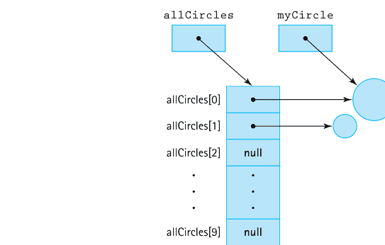

## 生成图像

Java 库 `BufferedImage` 类允许我们使用二维模型来创建和操作图像。它支持大多数流行的图像类型。在这个特性中，我们看到如何使用该类生成 JPEG 图像。考虑以下程序：

```java
/* *****************************************************************
// ImageGen01.java               By Dale/Joyce/Weems               Chapter 1
// 演示图像生成
****************************************************************/

package ch01.apps;

import java.awt.image.*;
import java.awt.Color;
import java.io.*;
import javax.imageio.*;

public class ImageGen01 {
    public static void main(String[] args) throws IOException {
        String fileout = args[0]; // 目标文件

        // 创建 SIZE 和 TYPE 的 BufferedImage
        final int SIDE = 1024;
        final int TYPE = BufferedImage.TYPE_INT_RGB;
        BufferedImage image = new BufferedImage(SIDE, SIDE, TYPE);

        final int LIMIT = 255; // RGB 值的限制
        int c; // R G B 的特定值
        Color color;

        for (int i = 0; i < SIDE; i++) {
            for (int j = 0; j < SIDE; j++) {
                c = (i + j) % LIMIT;
                color = new Color(c, c, c); // 创建灰度值
            }
        }

        File outputfile = new File(fileout);
        ImageIO.write(image, "jpg", outputfile);
    }
}
```


这意味着 `allCircles` 是一个可以容纳 10 个 `Circle` 对象引用的数组。这些圆的直径是多少？我们还不知道。数组已经实例化，但圆本身还没有实例化。这种另一种说法是，`allCircles` 是一个指向 `Circle` 对象引用的数组，在数组实例化时这些引用被设置为 `null`。对象必须单独实例化。我们初始化了第一个和第二个圆。我们假设 `Circle` 对象 `myCircle` 已经实例化并初始化为直径为 8。

```
Circle[] allCircles = new Circle[10];
allCircles[0] = myCircle;
allCircles[1] = new Circle(4);
```

图 1.7 提供了数组的视觉表示。


图 1.7 allCircles 数组

# 生成图像

Java 库 `BufferedImage` 类允许我们使用二维模型来创建和操作图像。它支持大多数流行的图像类型。在这个特性中，我们看到如何使用该类生成 JPEG 图像。考虑以下程序：

```
/* *****************************************************************
// ImageGen01.java               By Dale/Joyce/Weems               Chapter 1
// 演示图像生成
****************************************************************/

package ch01.apps;

import java.awt.image.*;
import java.awt.Color;
import java.io.*;
import javax.imageio.*;

public class ImageGen01 {
    public static void main(String[] args) throws IOException {
        String fileout = args[0]; // 目标文件

        // 创建 SIZE 和 TYPE 的 BufferedImage
        final int SIDE = 1024;
        final int TYPE = BufferedImage.TYPE_INT_RGB;
        BufferedImage image = new BufferedImage(SIDE, SIDE, TYPE);

        final int LIMIT = 255; // RGB 值的限制
        int c; // R G B 的特定值
        Color color;

        for (int i = 0; i < SIDE; i++) {
            for (int j = 0; j < SIDE; j++) {
                c = (i + j) % LIMIT;
                color = new Color(c, c, c); // 创建灰度值
            }
        }

        File outputfile = new File(fileout);
        ImageIO.write(image, "jpg", outputfile);
    }
}
```

## 1.5 基础结构机制

`ImageGen01` 程序位于 `ch01.apps` 包中。它使用运行时参数作为输出文件名。它实例化了一个大小为 $1024 \times 1024$ 类型为 RGB 的 `BufferedImage` 对象。对于红、绿、蓝，范围从 0 到 255。单个像素可以使用 `setRGB` 方法设置，例如上述代码片段：

```
color = new Color(200, 20, 125);
image.setRGB(10, 20, color.getRGB());
```

将第 10 行第 20 列的像素设置为粉紫色。在上面的代码片段中，我们首先创建了一个红色值为 200、绿色值为 20、蓝色值为 125 的 `Color` 对象。该 `Color` 对象的 `RGB` 方法返回一个表示颜色的单一整数值。该值被 `setRGB` 方法用于设置像素。

为了为教科书创建“黑白”图像，我们利用这样一个事实：在 RGB 模型中，红、绿、蓝值相同的颜色是“灰色”。例如 (0, 0, 0) 代表黑色，(255, 255, 255) 代表白色，而 (127, 127, 127) 代表中灰色。`ImageGen01` 程序中的双 `for` 循环遍历整个图像，从上到左根据表达式 `(i + j) % LIMIT` 生成一个整数值。对应的 `Color` 对象（其设置为 `(c, c, c)`）将循环遍历黑色到白色的灰色值。生成的图像如图 1.8(a) 所示。通过改变用于 `c` 值的表达式，可以生成不同的图像。使用这种方法生成有趣的图像并不困难。例如图 1.8 (b) 显示了表达式 `(i * j) % LIMIT` 产生的图像。


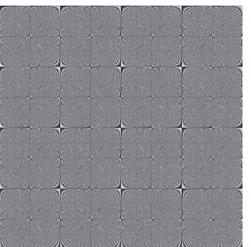

(a) 使用 (i + j) % LIMIT

(b) 使用 (i * j) % LIMIT

图 1.8 生成的图像

## 二维数组

一维数组用于表示列表或值序列中的元素。二维数组则用于表示具有行和列的表格中的元素。当我们需要存储关于多个元素的多个部分部分信息时，二维数组就非常有用。它们也可以被用于表示图像（参见“特性：生成图像”）。

图 1.9 显示了一个具有 100 行 9 列的二维数组。行通过 0 到 99 的整数访问；列通过“行—列”对来访问，例如 [0][5]。

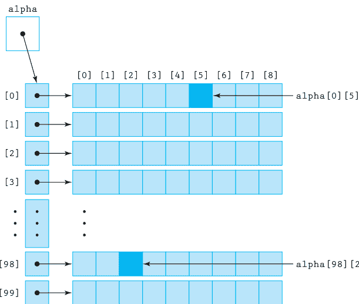

图 1.9 alpha 数组的 Java 实现

二维数组变量的声明方式与一维数组变量完全相同，区别在于有两对括号。二维数组对象的实例化方式也完全相同，但必须指定两个维度的大小。

以下代码段将创建图 1.8 所示的数组，其中表格中的数据类型为 double。

```
double[][] alpha;
alpha = new double[100][9];
```

第一个维度指定行数，第二个维度指定列数。

要访问 alpha 数组的单个组件，使用两个表达式（每个维度一个）来指定其位置。我们将每个表达式放在单独的一对括号中，并紧邻数组名：

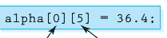

| 行号 | 列号 |
| :--- | :--- |

注意，`alpha.length` 将给出数组的行数。要获取数组中某行的列数，我们需要访问特定行的 length 字段。例如，语句

```
rowLength = alpha[30].length;
```

这会将 alpha 数组的第 30 行（结果为 9）存入变量 rowLength 中。想象一下二维数组可以使用的许多种方法并不困难——行可以代表学生，列可以代表测试；行可以代表员工，列可以代表他们每天的工作小时，以此此类推。

请记住，在 Java 中，二维数组的每一行本身都是一个一维数组。许多编程语言直接支持二维数组，但 Java 不支持。在 Java 中，二维数组是引用数组的数组。如果需要更高维的数组，我们只需要扩展所使用的数组层级，例如，一个三维数组可以被创建一个元素为数组的二维数组。

## 1.6 比较算法：增长阶数分析

Alice：“我正在想一个 1 到 1000 之间的数字。”

Bob：“是 7 吗？”

Alice：“不是……比大了。”

Bob：“是 2 吗？”

Alice：“不是……比大了。”

Bob：“是 3 吗？”

Alice 翻了翻白眼……

最终，Bob 将会通过每次将其猜想的数字加 1 来猜出那个秘密数字。尽管 Alice 显然对他感到非常沮丧，但他遵循的是一种有效的算法：顺序搜索。

算法分析是理论科学的一个重要领域。在本节中，我们介绍这一主题，其深度将使你能够判断两个算法中哪一个完成特定任务所需的资源更少。算法及其实现算法的代码的效率可以从时间（运行速度快慢）和空间（所需的内存量）两个方面进行研究。在适当的时候，我们会指出空间方面的考虑，但通常我们关注时间方面——即算法有多快，而不是它占用了多少空间。

在继续讨论算法的时间效率和空间效率之前，我们应该指出，时间效率和空间效率往往是相互关联的，可以在时间与空间之间进行权衡。例如，对一副编号为 1–300 的牌牌进行排序的问题。假设你坐在公交上拿着牌，必须在手里拿着时对它们进行排序。你将花费大量时间翻找这些牌，你很可能需要多次查看每张牌。或者，想象一下如果你站在一张足够放下所有 300 张牌的桌子前尝试对同一组牌排序。在这种情况下，你可以看一次每张牌，并将其放在桌子上正确的位置。桌子提供的额外空间允许使用更高效的时间型排序算法。

### 衡量算法的时间效率

程序员是如何比较两个算法的时间效率的？首先想到的方法是编写算法的代码，然后在运行两个程序后比较它们的执行时间。执行时间较短的显然是更好的算法。真的是如此吗？使用这种技术，我们只能确定在特定的计算机上、特定的时间、使用特定的输入数据集，程序 A 比程序 B 更高效。执行时间特定于特定的计算机，因为不同的计算机运行速度不同。有时，它们取决于计算机在后台正在做什么。例如， Java 运行时引擎正在执行垃圾回收，这可能会影响程序的执行时间。编码风格和输入条件也会影响运行中程序的时间。我们需要一种更好的方法。

一种标准技术，也是我们在书中使用的方法，是分离出算法基础的特定操作，并统计该操作执行的次数。在选择要计数的运算时，我们希望选择一个在算法执行过程中执行次数尽可能多的的操作。

考虑例如，使用顺序搜索算法猜 Amy 的秘密数字的情况。

| HiLo 顺序搜索 |
| :--- |
| 将猜想设为 0 |
| 猜想加 1 |
| 公布数字 |
| 当（数字不正确） |

显然，“公布数字”是 HiLo 算法的一项基础操作。它位于循环内部，因此反复执行，并与发现数字的目标直接相关。那么，“公布数字”执行了多少次？Bob 猜了多少？

### 复杂度情况

如果 Bob 运气好，Alice 想的是一个较小的数字，他不需要猜很多次。相反，如果他运气不好，他会猜很久，例如，Alice 想的是数字 998。

显然，HiLo 搜索算法所需的“猜”次数取决于输入条件。这并不罕见。为了处理这种情况，分析师定义了三种复杂度情况：

- **最好情况复杂度（Best case）**：告诉我们在运气非常好时的复杂度。它代表算法可以采取的最少步骤数。对于 Alice 的猜数字，最好情况发生在她想的是数字 1，Bob 只需要猜一次。通常情况下，最好复杂度作为复杂度衡量标准并不有用，我们不会因为最好复杂度优势就选择某种算法，并希望在输入条件上获得运气。

- **平均复杂度（Average case）**：代表考虑到所有可能的输入所需的平均步骤数。在猜数字游戏中，这很容易确定：如果 1 到 1000 之间的所有数字出现的概率相等，那么猜出一个数字平均需要 (1 + 1000) / 2 = 500.5 次。平均复杂度分析可能很有用，但对于特定算法通常很难定义。

- **最坏情况复杂度（Worst case）**：代表算法可能需要的最高步骤数。如果 Alice 想的是数字 1000，那么 Bob 将需要猜 1000 次。用他的方法，他永远不需要超过 1,000 次猜测。对于我们的目的，通常会使用最坏情况分析。它通常比平均情况更容易定义和计算，并且能为我们提供有用信息。如果我们知道可以负担最坏情况所需的工作量，那么就可以放心地使用正在研究的算法。

我们得出结论：在最坏情况下，高低顺序搜索算法（Hi-Lo Sequential Search）需要 1,000 次猜测。但等一下——如果游戏稍微发生变化呢？

### 输入的大小

鲍：“是 366 吗？”

爱丽耐心地回答：“不是……更大了。”

鲍：“是 367 吗？”

爱丽：“是的！”

鲍：“哈——太简单了，”

爱丽：“想再玩一次吗？”

鲍：“好啊。”

爱丽：“好。我正在想一个 1 到 1,000,000 之间的数字，”

鲍眨了眨眼睛

如果我们对这个新版本的游戏进行高低顺序搜索算法的最坏情况分析，我们将得到一个不同的答案——1,000,000 步。显然，算法所需的步数取决于可能数字的范围。与其说算法在某种情况下需要 1,000 步，而在另一种情况下需要 1,000,000 步，不如将算法的复杂度描述为输入大小的函数。如果游戏是猜一个 1 到 $N$ 之间的数字，输入的大小就是 $N$，对于顺序搜索算法，最坏情况下的猜测次数也是 $N$。

大多数算法解决更大的问题时需要更多工作。例如，显然排序包含 500 个数字的列表比排序包含 10 个数字的列表更困难。因此，从输入大小的角度讨论算法的效率是有意义的，并将其作为描述算法效率的参数。对于本文解决的问题，识别所需的尺寸参数是显而易见的，尽管对于某些有趣的算法并非如此。书中的大多数问题涉及数据结构——栈、队列、列表、映射、树和图。每个结构都由元素组成。我们开发算法来向结构中添加元素，或修改或删除结构中的元素。我们可以根据 $N$ 来描述这些操作完成的工作，其中 $N$ 是结构中元素的数量。

### 比较算法

卡洛斯：“怎么了？”

鲍：“爱丽让我猜一个 1 到 1,000,000 之间的数字。”

卡洛斯：“嗯。我试试。是 500,000 吗？”

爱丽：“不是，更小了。”

卡洛斯：“是 250,000 吗？”

爱丽：“不是，更大了。”

卡洛斯：“是 375,000 吗？”

...

如你所见，卡洛斯使用的算法与鲍不同。这被称为二分搜索（binary search），它利用了这样一个事实：卡洛斯每次都可以巧妙地选择范围中间的数字来排除剩余的数字。在最坏情况下，卡洛斯只需要 20 次猜测就能猜出一个 1 到 1,000,000 之间的数字！

```
Hi-Lo Binary Search(N) {
  Set range to 1 .. N
  do
  Set guess to middle of range
  Announce guess
  if (guess was too high)
    Set range to first half of range
  if (guess was too low)
    Set range to second half of range
while (guess is not correct)
}
```

高低二分搜索的最坏情况复杂度是多少？让我们再次计算在最坏情况下，“Announce guess”语句执行了多少次。每当进行一次错误的猜测，剩余的可能数字范围就会减半。因此，这个问题的另一种问法是：“在减到 1 之前，你可以将 N 半半几次？”答案是 $\log_2N$。在 $\log_2N$ 次猜测后，除了一个数字外所有的数字都将被排除了，所以最后一次猜测你就正确了。

> 实现此算法的代码可以在 `ch01.app` 包的 `SortAndBinarySearch.java` 文件找到。

> 回想一下，$\log_2N$ 是为了得到 N 而对 2 升幂。例如，$\log_28=3$，因为 $2^3=8$。但从另一个角度来看，$\log_2N$ 是你在到达 1 之前可以将 N 之一半的次数。我们可以将 8 之一半 3 次：8→4→2→1。

### 聪明的算法

设计能够高效解决问题的聪明算法是计算机科学中一个令人兴奋的部分。证明此类算法的正确性、分析空间/时间权衡、为特殊情况设计启发式算法以及确定最优边界，是我们理解计算演进的关键步骤。这类工作也具有实际效益，基因组测序、建模、信号处理、加密、数据压缩和网络分析等领域的进展证明了这一点。

在最坏情况下，高低二分搜索需要 $\log_2N+1$ 次猜测，而高低顺序搜索需要 $N$ 次猜测。当然，$\log_2$ 并不总是整数——在结果非整数的情况下我们“向下取整”。对于 1,000,000 的输入，这相当于于二分搜索需要 20 次猜测，而顺序搜索需要 1,000,000 次。

显然，随着问题的增长，二分搜索比顺序搜索更快。下表比较了不同 $N$ 值所需的猜测次数。

| 大小 | 顺序搜索 | 二分搜索 |
|---|---|---|
| $N$ | $N$ | $\log_2N+1$ |
| 2 | 2 | 2 |
| 4 | 4 | 3 |
| 8 | 8 | 4 |
| 16 | 16 | 5 |
| 32 | 32 | 6 |
| 1,024 | 1,024 | 11 |
| 1,000,000 | 1,000,000 | 21 |
| 1,000,000,000 | 1,000,000,000 | 31 |

### 增长阶

我们必须指出，上一节的数数练习虽然很有启发，但要准确计算算法所需的步数是徒劳的。你应该在哪个层次计数？伪代码描述、高级语言编码还是机器语言翻译？以及如何处理所有步骤并不等同的问题，例如，“增加数字”和“除法两个数字”所需的时间不同。

此外，详细的计数在比较算法方面并没有给我们提供额外信息。考虑下表，它与上表相同，但没有使用任何详细的步数信息。在这里，我们估计基本操作发生的次数：顺序搜索使用 $N$ 步，二分搜索使用 $\log_2N$ 步（取最接近的整数）。

| 大小 | 顺序搜索 | 二分搜索 |
|---|---|---|
| $N$ | $N$ 步 | $\log_2N$ 步 |
| 2 | 2 | 1 |
| 4 | 4 | 2 |
| 8 | 8 | 3 |
| 16 | 16 | 4 |
| 32 | 32 | 5 |
| 1,024 | 1,024 | 10 |
| 1,000,000 | 1,000,000 | 20 |
| 1,000,000,000 | 1,000,000,000 | 30 |

# 第1章 组织工作


从表中我们仍然得出结论：随着问题规模的增大，二分搜索的性能远优于顺序搜索。我们分析的重点在于确定哪种算法适用于大规模问题。

计算机科学家利用了这样一个事实：在比较算法时，真正重要的是表示所需步数的项式的最高阶数。我们只需报告该阶数来描述效率。也许顺序搜索所需的步数为 `O(N) = 2N + 1`，但我们称它是 `O(Order of Growth)` 或 `O(N)`，即“N 阶” ⁶。二分搜索所需的步数为 `f(N) = 5 log₂N + 3`，这里是一些示例：

```
2N² + N + 37 is O(N²)
2N²logN + 3N is O(N²logN)
1 + N² + N³ + N⁴ is O(N⁴)
```

通过关注增长阶提供的关键信息，我们的分析被简化。我们能够简单地查看像 Hi-Lo 顺序搜索这样的算法，意识到在最坏情况下范围内的每个数字都会失败，并确信地得出该算法的效率为 `O(N)`。同样，对于 Hi-Lo 二分搜索算法，我们意识到每次循环中考虑的元素都减少了一半，因此该算法是 `O(logN)`。不需要详细计算操作次数。

## 选择排序

让我们使用本节中开发的技巧来分析一个示例。将一组无序的数据元素按顺序排列——排序是一种非常常见且实用的操作。关于排序算法有整本书的著作。我们来看一种相对简单的暴力算法，它与许多人在桥牌或扑克牌游戏中使用对随机发的牌进行排序的方法相似。

给定一个无序元素列表，算法扫描列表并找到最小元素。它选择该元素并与第一个元素交换。然后再次扫描列表找到第二个最小元素，再次选择并与第二个元素交换。随着算法不断选择元素并交换到其“正确”位置，列表的排序部分不断增大，未排序部分越来越小，直到整个列表排序完成。原因显而易见，这种算法被称为选择排序。

在分析选择排序算法之前，我们需要确定输入的大小。显而看出，列表越大，排序它所需的工作就越多。列表中的元素数量是排序问题输入大小的自然选择。我们将使用 `N` 来表示该大小。以下是对该算法更正式的描述：

> ⁶ 许多人将符号读作“Big Oh of N”。“Big Oh”这个概念有一个特定的数学定义，它与增长阶有关，并用于算法分析；然而，我们在书中使用的方式被恰切地称为“增长阶”（order of growth），我们将使用该术语。

# 1.6 比较算法：增长阶分析

算法，我们的目标是排序大小为 `N` 的数组值（数组索引从 0 到 `N-1`）：

## Selection Sort(values[0 ... N - 1])

```
for current index going from 0 to N-2
    Set minindex to index of smallest unsorted element
    Swap the elements at indices current and minIndex
```

图 1.10 显示了算法对五元素数组进行排序时采取的步骤。图中的每个部分代表 `for` 循环的一次迭代。每个部分的第一部分代表“找到最小的未排序元素”步骤。为了做到这一点，它反复检查未排序的元素，询问每个元素是否是目前为止最小的。该部分的第二部分是

| | | | | | | |
|---|---|---|---|---|---|---|
| (a) [0] | 126 | | [0] | 126 | [0] | 1 |
| [1] | 43 | <126? | | [1] | 43 | [1] | 43 |
| [2] | 26 | <43? | YES | [2] | 26 | [2] | 26 |
| [3] | 1 | <26? | YES | [3] | 1 | [3] | 126 |
| [4] | 113 | <17? | NO | [4] | 113 | [4] | 113 |
| | | | | | | | |
|---|---|---|---|---|---|---|
| | [0] | 1 | | [0] | 1 | [0] | 1 |
| [1] | 43 | | [1] | 43 | [1] | 26 |
| [2] | 26 | <43? | YES | [2] | 26 | [2] | 43 |
| [3] | 126 | <26? | NO | [3] | 126 | [3] | 126 |
| [4] | 113 | <27? | NO | [4] | 113 | [4] | 113 |
| | | | | | | | |
|---|---|---|---|---|---|---|
| (c) [0] | 1 | | [0] | 1 | [0] | 1 |
| [1] | 26 | | [1] | 26 | [1] | 26 |
| [2] | 26 | <43? | YES | [2] | 26 | [2] | 43 |
| [3] | 126 | <26? | NO | [3] | 126 | [3] | 126 |
| [4] | 113 | <27? | NO | [4] | 113 | [4] | 113 |
| | | | | | | | |
|---|---|---|---|---|---|---|---|
| (d) [0] | 1 | | [0] | 1 | [0] | 1 |
| [1] | 26 | | [1] | 26 | [1] | 26 |
| [2] | 26 | <43? | YES | [2] | 26 | [2] | 43 |
| [3] | 126 | <26? | YES | [3] | 126 | [3] | 126 |
| [4] | 113 | <27? | NO | [4] | 113 | [4] | 113 |

图 1.10 选择排序示例（已排序部分已阴影）。实现此算法的代码位于 `apps` 包中的 `SortAndBinarySearch.java`。

## 比较算法：增长

数组特定特定特定影响工作工作。即使在使用选择排序之前，算法仍然需要 `N(N-1)/2` 次比较。最佳情况、平均情况和最坏情况都需要 `N(N-1)/2` 次比较。我们如何用增长阶来描述这一点？如果将 `N(N-1)/2` 扩展为 `N²/2`，就很清楚。在增长阶中，我们只考虑 `N²` 项，因为它相对于 `N` 增长很快。此外，我们忽略常系数 `1/2`，使得该算法变为 `O(N²)`。这意味着对于较大的 `N` 值，计算时间正比于 `N²`。研究和分析许多算法的计算机科学家能够快速确定算法的增长阶。例如，他们看到上面的选择排序，因为他们之前已经见过这种模式了。本节的练习希望能帮助你达到该水平！

## 增长阶

在本节中，我们讨论从最高效到最低的一些增长阶：

- `O(1)` 被称为“有界时间”。工作受常数限制，不取决于问题的大小。将和初始化为 0 是 `O(1)`。虽然有界时间通常被称为常数时间，但工作量并不一定是常数。然而，它受常数限制。

- `O(log₂ N)` 被称为“对数时间”。工作量取决于以2为底的对数。每次将处理的数据量减少一半的算法（如二分搜索算法）通常属于此类。注意，在计算领域，当我们说 `log N` 时指的是 `log₂ N`，底数为 2。

- `O(N)` 被称为“线性时间”。工作量是问题大小的若干倍。处理一次数据以得出结论的算法（如顺序搜索算法）通常属于此类。

- `O(N log N)`（缺乏更好的术语）称为 "`N log N` 时间”。这类算法通常应用 `N` 次对数算法。更好的排序算法（如第11章介绍的快速排序）具有 `N log N` 的复杂度。

- `O(N²)` 被称为“二次时间”。这类算法通常应用 `N` 次线性算法。大多数简单的排序算法（如选择排序算法）都是 `O(N²)`。

这种复杂度增加的模式继续到 `O(N² log N)`、`O(N² log₂ N)` 等。

- `O(2^N)` 被称为“指数时间”。这些算法极其昂贵，对于大规模问题，所需的时间比之前列出的任何多项式时间算法都要长。一个已知解为指数级的问题示例是旅行商问题——给定一组城市和连接其中一些城市的道路，加上道路长度，寻找一条访问每个城市一次且使总行程最短的路线。

表 1.3 增长率比较

| `N` | `log₂ N` | `N log₂ N` | `N²` | `N³` | `2^N` |
|---|---|---|---|---|---|
| 1 | 0 | 1 | 1 | 1 | 2 |
| 2 | 1 | 2 | 4 | 8 | 4 |
| 4 | 2 | 8 | 16 | 64 | 16 |
| 8 | 3 | 24 | 64 | 512 | 256 |
| 16 | 4 | 64 | 256 | 4,096 | 65,536 |
| 32 | 5 | 160 | 1,024 | 32,768 | 4,294,967,296 |
| 64 | 6 | 384 | 4,096 | 262,144 | 约 200亿 |
| 128 | 7 | 896 | 16,384 | 2,097,152 | 快速计算机执行这万万年需要数万条指令 |
| 256 | | 8 | 2,048 | 65,536 | 16,777,216 | 不要问！ |

## 总结

本章完全关于组织。面向对象允许开发者围绕现实模型组织他们的解决方案，从而获得可理解性、可重用性和可维护性的优点。使用这种方法创建系统的主要构造是类。类用于创建协作工作提供解决方案的对象。Java 的继承机制和包结构有助于我们组织类。

Java 的异常处理机制为组织系统对特殊情况的响应提供了一种强大的方式。我们可以选择在首次遇到异常时进行处理，或者将责任交给另一个层级。良好理解这种机制是创建安全、可靠系统的关键要素。

## 练习

结构——即数组和引用机制。增长阶概念是一种用于分类我们在实现和使用数据结构时将采用的算法效率的方法。

程序员是问题的解决者。面向对象的方法允许问题分析与设计的无缝整合，从而产生可维护和可重用的解决方案。数据结构提供了组织问题领域数据的方法，以确保解决方案是正确且高效的。保持条理是解决困难问题的关键！

## 练习

## 1.1 类、对象与应用

- 1. 研究问题：图灵奖自 1966 年以来一直颁给对计算机领域做出持久且具有重大技术意义贡献的个人或集体。在 Web 上查找关于该奖项的信息。研究获奖者名单及其贡献。识别出那些贡献直接与编程相关的。识别出那些贡献直接与面向对象相关的。

- 2. 研究问题：列出并简要描述 UML 的 14 种主要图表类型。

- 3. 对象和类之间有什么区别？给出一些例子。

- 4. 描述 Java 访问修饰符提供的四个可见性级别。

- 5. 根据 DaysBetween 应用，1990/1/1 到 2000/1/1 之间有多少天？这些日期之间有多少年？2000/1/1 到 2100/1/1 之间又又是怎样的？解释这些答案之间的差异。

- 6. 使用 DaysBetween 应用回答以下问题：

    - a. 你几大了（以天计算）？

    - b. 自 1776 年7 月 4 日 美国通过《独立宣言》以来已经过了多少天？

    - c. Jean-François Pilâtre de Rozier 和 François Laurent 在 1783 年 11 月 21 日在巴黎附近乘坐热气球飞行 10 公里成为首批人类飞行员那天，与尼尔·阿姆斯特朗于 1969 年 7 月 20 日踏上月球那天之间有多少天？

- 7. 思考你对 DaysBetween 应用进行了多少测试。什么类型的输入应该产生为 0 的结果？是 17？是 365？还是 366？尝试你识别的测试用例。

- 8. 修改 Date 类，使其包含一个签名如下的 `compareTo` 方法：

```
int compareTo(Date anotherDate)
```

如果此日期（调用方法的对象的日期）与参数日期相等，该方法应返回值 0；如果此日期早于参数日期，返回小于 0 的值；如果此日期晚于参数日期，返回大于 0 的值。创建一个测试驱动程序，证明你的方法执行正确。

- 9. 对象的常用用途是“跟踪”某些事物。对象通过转换方法接收数据，并通过观察者方法返回信息。为每个类定义一组合理的实例变量、类变量和方法。指定每个构造的访问级别。注意，这些类描述都是“模糊”的，允许有多个“正确”的答案。

    - a. 时间计数器——它将跟踪时间；它将接收离散量（分钟和秒，或仅为秒）；它应该提供关于总时间的“格式化”、离散单位数量以及每个单位平均时间的信息。将此类类视为一种工具，用于跟踪一组音乐（已知每个时长）的总时长。

    - b. 篮球统计跟踪器——它将跟踪篮球队的得分和投篮统计数据（不是针对每个球员，而是针对团队作为一个整体）；它在每次投篮时接收数据；它应该提供请求的百分比和总分信息。

    - c. 井字游戏跟踪器——它将跟踪一局井字棋；它应该接收移动并返回该移动是否合法的；它应该提供关于游戏状态的信息（何时结束？）。

- 10. 对于上一个练习中描述的一个或多个类：

    - a. 实现该类。

    - b. 设计并实现一个使用该类的应用。

    - c. 使用你的应用验证你的类实现的正确性。

- 11. 你将创建一个模拟标准双骰子的类。

    - a. 创建一个名为 `PairOfDice` 的类。该类的对象代表一对六面骰子。此类对象的唯一属性是骰子的面值。提供一个构造函数。提供一个 `roll` 方法来模拟掷骰子。提供一个 `value` 方法，返回一个格式良好的字符串来代表这对骰子，例如“5 : 3 – 8”。最后，创建一个“测试驱动程序”来证明你的 `PairOfDice` 类执行正确。

    - b. 骰子游戏在世界各地的赌场都在进行。游戏中“掷骰者”做的基本投注是线注投注。要开始一个线注回合，掷骰者进行“开局”。掷出 2、3 或 12 被称为“craps”或“大输”，掷骰者输。开局掷出 7 或 11 是“天生点”，掷骰者胜。其他可能的数字是点数：4, 5, 6, 8, 9 和 10。如果掷骰者在开局中掷出这些数字之一，则建立点数。然后掷骰者继续掷，直到再次掷出点数（赢）或 7（输）。

- 12. 你将跟踪物品、总成本和平均成本的类。

    - 创建名为 `ShoppingBag` 的类。该类的对象代表购物袋。此类对象的属性包括袋中的物品。提供一个初始化空袋的构造函数。提供一个向袋中添加物品的方法，以及一个返回袋中物品数量的方法。提供一个返回物品总成本的方法，以及一个计算物品平均成本的方法。最后，创建一个“测试驱动程序”，证明你的 `ShoppingBag` 类执行正确。

- 13. 你将创建一个表示多项式的类；例如，它可以代表 `5x⁴ + 2x - 3`。

    - 创建一个 `Polynomial` 类。此类类的对象代表一个多项式。此类对象的属性包括它的次数和项系数。提供一个接受 `int` 参数的构造函数。提供一个名为 `setCoefficient` 的转换方法，接收要设置的次数作为参数。例如，多项式 `5x³ + 2x - 3` 可以通过以下语句创建：

```
myPoly = new Polynomial(3);
myPoly.setCoefficient(3,5);
myPoly.setCoefficient(1,2);
myPoly.setCoefficient(0,-3);
```

提供一个 `evaluate` 方法，接受一个 `double` 参数并返回多项式在该参数值处的值（`double`）。例如，之前的代码将打印：

```
System.out.println(myPoly.evaluate(0.0));
System.out.println(myPoly.evaluate(1.0));
System.out.println(myPoly.evaluate(0.5));
```

最后，提供一个程序，一个“测试驱动程序”，证明你的 `Polynomial` 类执行正确。

- 创建一个应用，通过命令行接受多项式的次数和多项式的系数（从高到低），然后创建相应的 `Polynomial` 对象。例如，多项式 `5x²+2x-3` 将由命令行参数 `2 5 2 -3` 表示。程序随后应反复提示用户输入一个 `double` 值来评估该多项式，并报告评估结果。运行情况（假设上述命令行参数）可能如下：

```
输入一个值> 0.0
结果是 -3.0
继续? 是
输入一个值> 1.0
结果是 4.0
继续? 是
输入一个值> 0.5
结果是 -1.25
继续? 
```

- 创建一个应用，通过命令行接受多项式的次数和多项式的系数（如 b 部分所示）。该程序随后应提示用户输入 `double` 值，表示多项式定义的区间端点。你的程序随后应计算并输出多项式在指定区间上的定积分近似值，使用 1000 个边界矩形。

## 1.2 类的组织

14. 描述继承的概念，并解释在面向对象的系统中如何通过遍历继承树来将方法调用与方法实现绑定。

15. **研究：** 查找 Java 库中 `ArrayList` 类的描述并回答以下问题：

-   a. 它直接继承自哪个类？

-   b. 它有多少个直接子类？

-   c. 它实现了多少个方法？

-   e. 如果我们对 `ArrayList` 类的对象调用 `toString` 方法，将使用哪个类的 `toString` 方法？

16. 给本章中 Date 和 IncDate 类的定义，以及以下声明：

```
int temp;
Date date1 = new Date(10,2,1989);
IncDate date2 = new Date(12,25,2001);
```

指出以下哪些语句是非法的，哪些是合法的。解释你的答案。

-   a. `temp = date1.getDate();`

-   b. `temp = date2.getY();`

-   c. `date1.increment();`

-   d. `date2.increment();`

17. 设计一组至少三个相互具有继承关系的类，源自以下领域：

-   a. 银行——例如，账户、支票账户、储蓄账户

-   b. 游戏——例如，创建者、英雄、反派、宠物


- c. 旅行——例如，车辆、飞机、船只
- d. 任意——发挥你的想象

18. 编写一个演示多态的程序，使用第 18 页提供的示例。

19. 解释如何使用包来组织 Java 文件。

20. **研究：** 将程序文件拷贝到你的系统并回答以下问题：
- a. `support` 包中有多少个类？
- b. `ch01.apps` 包中有多少个类？
- c. `CSInfo` 类位于 `ch05.apps` 包中：
    - i. 它导入了哪四个包？
    - ii. 导入语句之间有何不同？
- d. `Dates` 类位于 `ch01.dates` 包中：
    - i. 如果你将包声明语句从 `package ch01.dates` 改为 `package ch01.date` 并编译，会发生什么？解释。
    - ii. 如果你删除包声明并编译，会发生什么？解释。
    - iii. 如果你删除包声明并编译位于 `ch01.apps` 包中的 `DaysBetween` 应用，会发生什么？解释。

21. 假设 1 个文件包含 2 个文件：
```
package media.records;
package media.records;
public class Labels{ . . } public class Length{ . }
class Check { . . } class Review { . . }
```
- a. `Check` 类和 `Review` 类在同一个包中吗？
- b. 文件 1 的名称是什么？
- c. 文件 2 的名称是什么？
- d. 包含这两个文件的目录名称是什么？
- e. 该目录是哪个的子目录？

## 1.3 异常情况

22. 解释扩展 Java `Exception` 类的程序员自定义异常与扩展 Java `Runtime` 类的异常之间的区别。

23. 创建一个程序，要求用户输入一个整数然后感谢他们。如果他们没有输入整数，程序应该再次询问，直到他们输入为止。运行程序可能会产生如下控制台轨迹：
```
Please enter an integer.
OK
That is not an integer. Please enter an integer.
Twenty-seven
That is not an integer. Please enter an integer.
64
Thank you.
```

24. 创建一个 `BankAccount` 类来模拟典型的银行账户，可以在其中存款和取款。为了简单起见，假设此账户仅处理整数金额。
- a. 你应该提供一个构造函数、一个 `toString` 方法、一个返回 `int` 的 `getTotal` 方法，以及两个接受 `int` 参数并返回 `void` 的存款和取款方法。此外，创建一个应用程序 `UseBankAccount` 来演示 `BankAccount` 类正常工作。
- b. 创建一个 `BankAccountException` 类。修改你的 `deposit` 方法，使得尝试存款负数金额时抛出适当的异常。对 `withdraw` 方法也这样做，但如果尝试取款金额超过可用金额，也要抛出异常。在每种情况下包含适当的异常消息。创建三个短应用程序来演示这三种异常情况——应用程序崩溃没有关系，只要它能证明异常已成功抛出即可。
- 创建一个新应用程序 `Banker`，它创建一个 `BankAccount` 对象并与用户交互，允许他们存款或取款，或请求账户总额。此应用程序在任何异常情况下都不应崩溃——它应该捕获异常，将消息传递给用户并继续处理。
- 此练习有三个部分：
- 创建一个“标准”异常类 `ThirteenException`。编写一个程序，提示用户输入一个字符串。在每次输入字符串后，程序输出字符串的长度，除非字符串长度为 13，此时将抛出带有消息“Use thirteen words and stainless steel to protect yourself!”的 `ThirteenException`。你的方法应该将 `ThirteenException` 抛出运行时环境。程序的示例运行可能如下：
```
Input a string > Villanova University
That string has length 20.
Input a string > Triscadecapobia
That string has length 16.
Input a string > misprogrammed
```
此时程序崩溃，系统提供一些信息，包括“Use thirteen words and stainless steel!”。
- 创建另一个与 b 部分类似的程序，这次使用 `try-catch` 句，以便在抛出异常时捕获它。捕获后，打印其消息并“正常”结束程序。

## 数据结构

- 研究问题：在网上找到“数据结构”的两个定义。对比它们。
- 识别故事中让你联想到各种数据结构的内容。你能找到多少个？

28. 描述三种树作为一种组织信息的方式。

29. 以下每个项目的某些方面都可以用图结构进行建模。描述在这种情况下节点代表什么，边代表什么：
- a. 使用特定航空公司的可用航班
- b. 国家及其边境
- c. 关于数据结构的研究论文合集
- d. 演员（代表“凯文·贝肯六度角”）
- e. 大学的计算机
- f. 迷宫
- g. 网页

## 1.5 基础结构机制

30. 画出与 1.5 节“基础结构机制”内存部分所示类似的图像，表示以下代码段结果的内存内容。假设 `i` 与内存位置 123 相关，`j` 与 124，`str1` 变量与 135 及其关联对象与 100，`str2` 变量与 136。
- a.
```
int i = 10;
int j = 20;
String str1 = "cat";
```
- b.
```
int i = 10;
int j = i;
String str1 = "cat";
String str2 = str1;
```

31. 什么是别名（alias）？展示一个通过 Java 程序创建别名的示例。解释别名的危险。

32. 假设 `date1` 和 `date2` 是第 1.2 节“组织类”中定义的 `IncDate` 类的对象。以下代码的输出是什么？
```
date1 = new IncDate(5, 2, 2000);
date2 = date;
System.out.println(date1);
System.out.println(date2);
date1.increment();
System.out.println(date1);
System.out.println(date2);
```

33. 什么是垃圾对象（garbage）？展示一个通过 Java 程序产生垃圾垃圾的示例。

34. 假设 `date1` 和 `date2` 是第 1.2 节“组织类”中定义的 `IncDate` 类的对象。以下代码的输出是什么？
```
date1 = new IncDate(5, 2, 2000);
date2 = new IncDate(5, 2, 2000);
if (date1 == date2)
System.out.println("equal")
else
System.out.println("not equal");
date1 = date2;
if (date1 == date2)
System.out.println("equal")
else
System.out.println("not equal");
date1.increment();
if (date1 == date2)
System.out.println("equal")
else
System.out.println("not equal");
```

35. 编写一个程序，声明一个 10 个元素的 `int` 数组，使用循环将每个元素初始化为其索引的平方，然后使用另一个循环打印数组内容，每行一个。

36. 编写一个程序，声明一个 10 个元素的 `Date` 数组，使用循环将元素初始化为 2005 年 12 月 1 日至 10 日，然后使用另一个循环打印数组内容，每行一个。

37. 创建一个应用程序，实例化一个 20 × 20 的整数二维数组，用 1 到 100 之间的随机整数填充，然后输出所有行中总和最大的行索引，以及所有列中总和最大的列索引。


# 第1章 组织

38. 编译并运行 `ImageGen01` 程序。尝试不同的 c 值公式。添加两个 `int` 变量，以便分别设置颜色的 RGB 值并进行更多实验。与同学分享你最有趣的结果。

## 1.6 比较算法：增长阶数分析

39. 我们研究了猜数字游戏（Hi-Lo Guessing Game）中猜测秘密数字的两种方法：高低顺序搜索和高低二分查找。当最高数字别为 (a) 10、(b) 1,000、(c) 1,000,000 和 (d) 1,000,000 时，每种方法所需的猜测次数的最优和最坏情况分别是？

40. 针对以下每个问题，简要描述一个用于计算算法效率的良好“算法基本操作”，充分描述问题规模，并说明基本操作在最好情况和最坏情况下作为问题规模的函数发生的次数。例如，如果问题是“在高低猜数字游戏中猜秘密数字”，你的答案可能是“从 1 开始作为第一次猜测，不断增加数字直到猜中；宣布我的猜测；最大数字——称为 N；最好情况为 1，最坏情况为 N”。
- a. 在未售书籍的书架上寻找《计算机程序设计》。
- b. 对整数数组进行排序。
- c. 在鞋类目录中寻找最便宜的一双鞋子。
- d. 计算储钱罐里有多少钱。
- e. 为给定的 N 计算 N!。
- f. 为给定的 N 计算 1 到 N 的数字和。
- g. 乘两个 $N \times N$ 矩阵。

41. 通过在非负数集上绘制图形（是的，就像代数课上一样），比较以下每对函数 $f(x)$ 和 $g(x)$。注意在每种情况下，高阶函数 $g$ 都会变得比低阶函数 $f$ 大。识别出发生这种情况的 x 值。
```
f(x) = 3 \log_2 x\quad\quad g(x) = x
f(x) = 5 \log_2 x + 3\quad\quad g(x) = 2x + 1
f(x) = 4^x\quad\quad g(x) = x^3
f(x) = 8^x\quad\quad g(x) = 2^x
```

42. 使用 O 符号法描述以下每个函数的增长阶数。
- a. $N^2 + 3N$
- b. $3N^2 + N$
- c. $N^5 + 100N^3 + 245$
- d. $3Log_2N + N^2$
- e. $1 + N + N^2 + N^3 + N^4$
- f. $(N * (N - 1)) / 2$

43. 使用 O 符号法描述以下代码段的增长阶数：
- a. count = 0;
  for (i = 1; i <= N; i++)
    count++;
- b. count = 0;
  for (i = 1; i <= N; i++)
    for (j = 1; j <= N; j++)
      count++;
- c. value = N;
  count = 0;
  while (value > 1) {
    value = value / 2;
    count++;
  }
- d. count = 0;
  value = N;
  value = N * (N - 1);
  count = count + value;
- e. count = 0;
  for (i = 1; i <= N; i++)
    count++;
  for (i = N; i >= 0; i--)
    count++;
- f. count = 0;
  for (i = 1; i <= N; i++)
    count++;
  for (j = 1; j <= 5; j++)
    count

44. 以下方法返回 1 到 n 之间的整数和。它的增长阶数是多少？
```java
public int Sum (int n) // 前提条件：n > 0
{
  int total = 0;
  for (int i = 1; i <= n; i++)
    total = i;
  return total;
}
```

# 第1章 组织

45. 假设 `numbers` 是一个大数组，包含 0 到 N-1 的整数。描述以下每个操作的增长阶数（最坏情况）：
- a. 使用 0 到 N-1 的值。
- b. 将数组中的值移动到 L，直到1。
- c. 随机选择 0 到 N-1 的位置。

46. 展示使用选择排序时数组的变化。

47. 对于此练习，你必须实现选择排序。
- a. 创建一个程序，实例化大小为 100 的数组，用 1 到 1000 之间的随机数填充。最后以列的形式打印数组。
- b. 扩展你的程序，使其能够计数选择排序期间的比较次数和交换次数。在打印数组后报告这些数字。报告的值与理论值相比如何？
- c. 扩展你的 b 程序，使其处理大小为 10、100、10000 直到 100000 的数组。对于每个数组大小，程序应以漂亮的表格格式显示这些数字。

# 第2章 栈抽象数据类型 (ADT)

## 知识目标

你应该能够：
- 解释以下术语及其关系：抽象、信息隐藏、数据抽象、数据封装和抽象数据类型
- 描述使用抽象数据类型的用处
- 定义 Java 编程语言中抽象方法和接口的含义
- 描述使用 Java 接口指定 ADT 的用处
- 列出使集合 ADT 通用的三种方案
- 解释在定义 ADT 时处理异常情况的三方法
- 从三个视角：抽象层、应用层和实现层描述栈 ADT
- 将给定的栈操作分类为构造、观察或转换
- 使用栈描述判断字符串内分组符号（如括号）是否平衡的算法
- 使用栈描述求后缀表达式的算法

## 技能目标

你应该能够：
- 使用 Java 接口构造正式指定 ADT
- 指定公共方法的前提条件和后置条件（影响）
- 在设计/实现或使用 ADT 时使用 Java 泛型机制
- 定义并使用自引用类来构建链表
- 绘制表示链表一系列操作的图形
- 使用数组实现栈 ADT
- 使用 Java 库的 `ArrayList` 类实现栈 ADT
- 使用链表实现栈 ADT
- 画出显示特定栈实现的影响的影响图
- 确定栈操作增长阶数的效率
- 在 ADT 内部抛出 Java 异常，并在使用 ADT 的应用程序中捕获它们
- “手动”求后缀表达式
- 将栈 ADT 作为应用程序的组件使用

## 2 章：栈抽象数据类型 (ADT)

本章介绍了栈（Stack），一种重要的数据结构。栈是一个“后进先出”的结构。我们通过对抽象的讨论开始本章，回顾了抽象和信息隐藏的相关概念，以及这些技术如何使我们能够在不同的“层次”上查看数据。在抽象层上，我们使用接口正式定义栈。我们讨论了许多的应用，特别是如何使用栈来确定一组数据是否正确。栈然后通过两种方式实现：数组和链表。为了支持基于链表的方法，我们引入了 Java 的 `ArrayList` 类。

## 2.1 抽象

宇宙充满了复杂的系统。我们通过模型来学习系统。模型可以是数学的，例如描述卫星绕地球运动的方程。物理对象（例如在风洞测试中使用模型）也是模型的另一种形式。通常，我们会忽略所研究系统的相关特征；例如，当省略无关细节时，我们得到了对系统的抽象视图。

抽象是系统的模型，它只包含系统的本质内容。抽象与软件开发有什么关系？编写软件是困难的，因为我们使用的模型和开发过程是复杂的。抽象是我们管理复杂性的基本方式。在本文的每一个章节中，我们使用抽象来简化我们的工作。

**重要**

抽象是构建大型复杂系统的关键工具。我们将系统划分为各个模块，每个模块都有自己的职责。每个模块的细节隐藏在模块内部——模块只向功能呈现一个受控的接口。

## 信息隐藏

许多软件设计方法基于将解决方案分解为模块。“模块”是一个执行部分工作的内聚单元。在 Java 中，主要的模块机制是类。使用类以及类生成的对象分解系统有助于我们处理复杂性。类/对象是抽象工具。其内部表示的复杂性可以对系统隐藏。因此，实现类的细节与系统的细节隔离开。隐藏细节是有要求的吗？程序员不应该知道一切吗？隐藏模块内部的实现细节可以管理系统的复杂性，因为程序员可以在不同的时间专注于不同的部分。信息隐藏是在模块内部隐藏细节，目的是简化系统的其他视图。

当然，程序的类/对象是相互相关的；也就是说，它们协作解决问题。它们通过精心定义的接口相互提供服务。Java 中的接口通常由类的 `public` 或 `protected` 方法提供。一个类的程序员不需要知道与其交互的类的内部细节，但他们确实需要知道接口。考虑一个驾驶的类比：你可以在不知道发动机中有多少个气缸的情况下启动汽车。你只需要理解接口；也就是说，只需要知道如何转钥匙。

## 数据抽象

计算机处理的任何数据（例如 `int` 类型的值）都仅仅是一组可以开启或关闭的位。计算机以更抽象的单位（如数字和列表）来操作这些数据，因此我们倾向于以符合我们逻辑的方式思考数据。为了将计算机对数据的无关细节从我们自己的视图中隐藏起来，我们创建了另一个视图。数据抽象是数据类型的逻辑属性与其实现之间的表示。

在这里，我们仔细观察自你最早的程序以来我们一直在使用的非常具体——非常抽象的整数。什么是整数？整数在不同的计算机上以不同的方式物理表示。然而，确切知道整数在我们的计算机上是如何表示的并不是在高级语言中使用整数的前提。在高级语言中，我们使用整数的抽象。这就是它被称为“高级”语言的原因之一。

Java 语言通过强制信息隐藏的编程语言特征来封装整数。信息隐藏是隐藏模块内部细节，以简化系统其他视图。在抽象层我们使用接口定义变量。

```java
int a, b;
```

然后你可以通过运算符给这些变量赋值，并对它们执行算术运算。

| 你知道吗 |
| :--- |
| 栈的许多应用： |

```java
a = 3;
b = 5;
c = a + b;
```

## 2.1 抽象


# 71 这些问题：什么是 ADT？它模拟了什么？它的职责是什么？它的接口是什么？

在这一层级，ADT 设计者（有时会与目标程序员协商）提供一份 ADT 属性的规范。应用程序/客户端程序员通过使用该规范来决定何时以及如何使用 ADT。实现程序员也需要使用该规范，他们需要创建符合规范的代码。

## 3. 实现（或具体内部）层级

实现程序员设计并开发一种用于存储数据的特定结构表示，以及这些操作的实现（编码）。在这里我们处理的问题是：我们如何表示和操作数据？我们如何履行 ADT 的职责？这些问题可以有很多答案，从而导致多种实现方法。

当你编写程序时，通常会处理这三个层级中的每一个。在本节中，由于涉及抽象，重点是抽象层面。从某种意义上说，ADT 方法的核心集中在抽象层面。抽象层面为应用层提供了实现层面的模型。它的描述相当于由 ADT 设计者创建的一份合同，使用 ADT 的应用程序程序员对此依赖，并由实现 ADT 的程序员所履行。

在大多数情况下，抽象层面提供了应用层和实现层之间的独立性。然而，请记住；实现细节有一种方式会影响使用 ADT 的应用程序——即效率方面。我们对数据结构方式所做的决策会影响我们实现该数据各种操作的效率。操作的效率对于数据的用户可能非常重要。

> **重要** 理解此地描述的三种查看数据方式之间的区别至关重要。有时你会在应用层工作并使用 ADT；在其他时候，你会为应用程序实现 ADT；在任何情况下，抽象视图都将作为你的指南。

## 前提条件和后条件

假设我们要设计一个 ADT 来提供服务。访问 ADT 通过其导出方法提供。为了确保 ADT 在应用层是可用的，我们必须澄清如何使用这些方法。为了能够调用方法，程序员必须知道其精确的接口：名称、预期参数的类型以及返回类型。但这些信息是不够的：程序员需要知道方法正确工作所需满足的任何假设，以及调用方法产生的影响。

前提条件是在调用方法时为了方法正确工作必须满足的条件。例如，第 1 章描述的 `IncDate` 类的 `increment()` 方法可能具有与合法日期值和格里哥日法开始相关的前提条件。这些前提条件应该作为注释列在方法声明的开头：

```
public void increment()
// 前提条件：日、月、份的值代表有效日期。
// 年份的值不小于 MINYEAR。
```

为方法建立前提条件是在实现方法的程序员和使用该方法的程序员之间创建了一份合同。合同规定，如果满足了前提条件，则方法就符合其规范。使用该方法的程序员有责任在每次调用方法时确保前提条件是真实的。这种方法被称为“编程契约”。

我们必须指定在方法结束时哪些条件是真实的。方法的后条件（影响）是方法退出时的结果，前提是前提条件已经满足。后条件没有告诉我们这些结果是如何实现的；仅仅告诉我们结果应该是什么。我们使用惯例，在方法的起始注释中列出主要影响——即后条件——紧跟在任何列出的前提条件之后。例如：

```
public void increment()
// 前提条件：日、月、份的值代表有效日期。
// 年份的值不小于 MINYEAR。
// 递增此 IncDate 以表示下一天。
```

## Java 接口

Java 提供了一种结构。

“接口（interface）”一词意味着两个交互系统之间共享的共同边界。我们在计算机科学中以许多方式使用这个术语。例如，程序的用户界面是程序与用户交互的部分，而方法的接口是它所需的参数集以及它提供的返回值。

在 Java 中，“接口”一词有非常具体的含义。事实上，`interface` 与 Java 类非常相似。它代表了一种特定类型的程序单元。Java 接口可以包含变量声明和方法。然而，在接口中声明的所有变量必须是常量，且所有方法必须是抽象的.¹ 抽象方法只包含对其参数的描述；不允许有方法体或实现。换句话说，只包含了方法的接口。

与类不同，Java 接口不能被实例化。如果接口只能包含抽象方法而不能实例化，它能起到什么作用呢？它提供了

> ¹ 截至 2014 年 3 月和 Java SE 8 的发布，Java 接口也可以包含默认方法和静态方法。我们没有在本文定义的接口中使用其中任何一种。

一个供类以以适应的模板。为了使接口有用，必须由一个单独的类来“实现”它。也就是说，必须创建一个类，为接口指定的方法头提供方法体。本质上，Java 接口用于描述对类的要求。

这里是一个包含一个常量（`PI`）和两个抽象方法（`perimeter()` 和 `area()`）的接口示例：

```
package ch02.figures;
public interface FigureInterface {
    final double PI = 3.14;

    double perimeter();
    // 返回此图形的周长。

    double area();
    // 返回此图形的面积。
}
```

Java 提供了我们在声明抽象方法时使用的 `abstract` 关键字，但在定义接口时不需要使用它。同样，我们可以在方法签名中省略 `public` 关键字。

接口像类和应用程序一样编译。我们的每个接口都保持在单独的文件。文件名必须与接口名称匹配。例如，上面的接口必须位于名为 `FigureInterface.java` 的文件中。编译器检查接口代码是否有错误；如果没有，它会生成接口的 Java 字节码。在我们的示例中，该文件将是 `Interface.class`。

为了使用此接口，程序员可以例如创建一个实现接口的 `Circle` 类。当一个类实现接口时，它获取了接口中定义的所有常量，并必须为接口声明的所有抽象方法提供实现——即提供方法体。因此，`Circle` 类以及任何实现 `FigureInterface` 接口的类都需要重复方法 `perimeter()` 和 `area()` 的声明，并如下所示提供方法体：

> **Java 注意**
>
> 接口不能被实例化。它们只能被类实现或被其他接口扩展。

```
package ch02.figures;
public class Circle implements FigureInterface
{
    protected double radius;

    public Circle(double radius) {
        this.radius = radius;
    }

    public double perimeter() {
        return(2 * PI * radius);
    }

    public double area() {
        return(PI * radius);
    }
}
```

注意，许多不同的类可以实现同一个接口。例如，接下来的 `Rectangle` 类也实现了 `FigureInterface`。

```
package ch02.figures;
public class Rectangle implements FigureInterface
{
    protected double length, width;

    public Rectangle(double length, double width) {
        this.length = length;
        this.width = width;
    }

    public double perimeter() {
        return(2 * (length + width));
    }

    public double area() {
        return(length * width);
    }
}
```

## 2.1 抽象 75

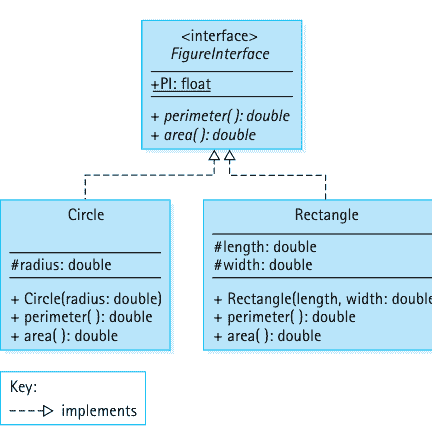

## 2.1 图形 ADT 的 UML

你可以想象其他类，如 `Square` 和 `Parallelogram`，它们都实现了 `FigureInterface` 接口。了解这些类实现了该接口的程序员可以确保每个类都为 `perimeter()` 和 `area()` 方法提供了实现。

图 2.1 中的统一建模语言（UML）类图显示了 `FigureInterface` 与 `Circle`、`Rectangle` 类之间的关系。带有空心箭头的虚线表示类实现了一个接口。实现接口的类并不像示例中那样必须实现接口的所有抽象方法；它们还可以添加自己的数据字段和方法。

接口是一种多功能且强大的编程结构。除其他外，它们可以用于指定 ADT 的抽象视图。在接口内部，我们定义了抽象方法，这些方法对应于 ADT 实现的导出方法。我们使用注释定义每个抽象方法的前置条件和后置条件。意图创建一个实现 ADT 类的实现程序员知道，他或她必须履行接口所规定的合约。想要使用 ADT 的应用程序程序员可以使用任何实现该接口的类。

> **作者约定**
>
> 在全文中，我们将使用接口来定义所考虑的数据结构（ADTs）的逻辑视图。

以这种方式将 Java 接口结构用于我们的 ADT 规范具有以下几个益处：

1. 我们可以正式地检查规范的语法。当接口被编译时，编译器会发现方法接口定义中的任何语法错误。
2. 我们可以正式地验证实现是否满足了接口“合约”的语法部分。当实现被编译时，编译器会确保方法名、参数和返回类型与接口中定义的匹配。
3. 我们可以从 ADT 的许多备选实现为应用程序提供一致的接口。某些实现可能会优化内存空间的使用；另一些则可能强调速度。某个实现还可以提供接口定义之外的额外功能。然而，所有实现都共同具有指定的接口。

注意，可以将一个变量声明为接口类型。在拥有 `FigureInterface`、`Circle` 和 `Rectangle` 的情况下，以下代码是完全“合法”的。

```
FigureInterface myFigure;
myFigure = new Circle(5);
myFigure = new Rectangle(2.4);
```

只要一个类实现了 `FigureInterface`，我们就可以实例化该类并将其赋值给 `myFigure`。这是多态的一个示例。

## 基于接口的多态

在 1.2 节“组织类”中，我们引入了多态的概念。你可能想在继续之前回顾一下材料。在该节中，我们讨论了基于继承的多态。在这里我们讨论 Java 支持的另一种多态方法：基于接口的多态。

回顾第一章中的讨论，“多态”一词具有希腊语词根，字面意思是“多种形式”或“多种形状”。因此，我们在这次讨论中使用 `FigureInterface` 接口是是幸运的。我们实际上将定义引用“多种形状”的对象引用。

多态对象变量能够在程序执行期间引用不同类的对象。它们不能引用任何单一类，但它们可以引用一组相关的类。在基于继承的多态中，类之间的关系是由继承树定义的。相关的类是某个共同类的后代。在基于接口的多态中，关系甚至更简单。相关的类实现同一个接口。

考虑以下应用程序。你能预测它的输出是什么吗？

```
// RandomFigs.java by Dale/Joyce/Weems     Chapter 2
//
// 展示多态。
//
package ch02.apps;
```

```
import ch02.figures.*;
import java.util.Random;
import java.text.DecimalFormat;
```

```
public class RandomFigs
{
    public static void main(String[] args)
    {
        DecimalFormat df = new DecimalFormat("#.###");
        Random rand = new Random();
        final int COUNT = 5;
        double totalArea = 0;

        FigureInterface[] figures = new FigureInterface[COUNT];

        // generate图形
        for (int i = 0; i < COUNT; i++)
        {
            switch (rand.nextInt(2))
            {
                case 0:
                    figures[i] = new Circle(1.0);
                    System.out.print("circle area\n");
                    break;
                case 1:
                    figures[i] = new Rectangle(1.0, 2.0);
                    System.out.print("rectangle area 2.00\n");
                    break;
            }
        }

        // 求和面积
        for (int i = 0; i < COUNT; i++)
        {
            totalArea = totalArea + figures[i].area();
            System.out.println("\nTotal: " + df.format(totalArea));
        }
    }
}
```

正如我们所看到的，`FigureInterface` 对象数组允许任何实现 `FigureInterface` 的类存储在此数组中。第一个循环将五个图形插入数组中；然而，由于这段代码的随机性，我们无法仅通过阅读代码来判断插入了什么类型的图形。数组槽位到对象的绑定是在运行时动态执行的。因此我们可以看到运行程序时发生了什么，第一个循环还打印了插入到数组中的每个对象的描述。第二个循环遍历数组并累加对象的面积。在该循环中，执行哪个方法（`Circle` 类还是 `Rectangle` 类）必须在运行时决定。数组的每个槽位都是多态引用。以下是三次运行示例：

| circle area 3.14 | rectangle area 2.00 | rectangle area 2.00 |
| :--- | :--- | :--- |
| rectangle area 2.00 | rectangle area 2.00 | rectangle area 2.00 |
| rectangle area 2.00 | circle area 3.14 | circle area 3.14 |
| rectangle area 2.00 | circle area 3.14 | circle area 3.14 |
| rectangle area 2.00 | rectangle area 2.00 | circle area 3.14 |
| Total: 11.14 | Total: 12.28 | Total: 13.42 |

并不难想象基于接口的多态的许多用途。例如，“Interface` 对象数组可以构成几何教程的基础，或者 `CreateInterface` 对象数组可以用于冒险游戏。并不需要使用数组来从这种多态中受益。在本章的后面，我们将创建多个实现此接口的类。我们可以创建一个声明 `StackInterface` 变量的程序，并在实例化变量时动态选择使用的实现，可能基于用户对查询的响应或系统的状态。这种方法可以动态地适应当前情况。

## 2.2 栈 (Stack) 79

栈可以被认为是“有序”的，因为元素出现的顺序取决于它们在栈中存储的时间长短。在栈中存储最长的元素位于底部；最近存储的元素位于顶部。在任何时候，给定栈中的任意两个元素，总有一个元素比另一个高。（例如，红色衬衫在栈中的位置比蓝色衬衫高。）

由于元素是从栈的顶部添加和移除的，因此最后一个添加的元素是第一个被移除的元素。有一个简便的口诀可以帮助你记住这一行为规则：栈是一个 LIFO（后进先出）结构。总而言之，栈是一种访问控制结构，元素仅能从一端添加或移除，这是一种 LIFO 结构。

## 栈的操作

该结构的字面描述仅是抽象数据类型定义的一半。另一半是一组操作，允许用户访问和操纵存储在结构中的元素。使用栈时我们需要用到哪些操作呢？

当我们使用栈时，它应该是空的。我们我们假设栈至少有一个类构造函数可以向栈的顶部添加元素，这通常被称为 `push()`（入栈），

移除栈顶元素的操作被称为 `pop()`（出栈）。在经典情况下，`pop()` 操作移除了栈顶部的元素，并将该顶端元素返回给调用 `pop()` 的客户端。最近，程序员们定义了两个独立的操作来执行这些动作，将观察和转换相结合可能会导致混淆的程序。

我们遵循现代惯例，定义了一个从栈中移除顶端元素的 `pop()` 操作，以及一个返回栈顶元素的 `top()`（查看）操作。² 我们的 `push()` 和 `pop()` 操作是严格的执行者，而我们的 `top()` 操作是严格的观察者。

图 2.3 展示了想象成积木栈的栈是如何通过 `push()` 和 `pop()` 操作修改的。

## 使用栈

假设你正坐在厨房桌子旁休息看报纸，电话响了。当你站起来去接电话时，你在心里记下了读到了哪里。当你和朋友通电话聊天时，门铃响了。你说“等一下，先别想那个”，然后放下电话去开门。你正要签收正在送达的包裹，狗 Molly 冲出了门。你会怎么办？你找回 Molly，签收包裹，结束电话，最后回到看报纸：无论你是否意识到，你一直在将推迟的义务存储在一个心理栈中！每当你被中断时

> ² 另一种常见方法是按照经典方式定义 `pop()` 操作——即它移除并返回顶端元素——并定义另一个名为 `peek()`（窥视）的操作，它只返回顶端元素。

80 第 2 章 ADT

| push block2 | 2 top = block2 |
| :--- | :--- |
| push block3 | 3 top = block3 |
| push block5 | 3 top = block5 |
| pop | 2 top = block3 |
| push block4 | 3 top = block4 |

图 2.3 push 和 pop 操作的影响

将当前的义务推入此栈中，然后当你有空时，将其从栈中 pop 出来并恢复处理。


# 栈 ADT

栈是非常有用的 ADT，特别是在计算系统软件领域。它们最常用于类似上面示例的情况，即我们必须处理推迟的义务。例如，编程语言系统通常使用栈来跟踪操作调用。主程序调用操作 A，A 又调用操作 C。当 C 完成时，控制返回给 B（推迟的义务）；当 B 完成时，控制返回给 A（之前的义务）；以此类推。调用和返回序列本质上是一系列推迟义务的 LIFO 序列。

你可能遇到过这种情况：Java 异常产生的错误消息，其中提到了“系统栈”。

编译器通常使用栈来分析。例如，当处理嵌套语句时，编译器使用栈来跟踪作用域。当作用域结束时，作用域从栈中弹出。这种基于栈的算法是深度优先搜索。

## 2.3 集合元素

同样，由于系统会存储信息，它会将信息推入栈。当它完成时，它从栈中弹出并继续处理。当它被中断时，你可能遇到过一个 Java 异常产生了一个错误消息，其中提到了“系统栈”。栈是非常有用的 ADT，特别是在计算系统软件中。

```java
collection.push("E. E. Cummings");
String poet = (String) collection.top();
System.out.println(poet.toLowerCase());
```

```java
// 将字符串推入栈中
// 转换为 String
// 使用该字符串
```

如果不进行强制转换，你将得到编译错误，因为 Java 是一种强类型语言，它不允许你将类型为 `Object` 的变量赋值给类型变量。强制转换操作告诉编译器，你（程序员）保证了该 `Object` 确实是。

`Object` 的工作原理是在将其存储在集合时，将每个元素转换为 `Object` 类。集合的用户必须记住集合中存储了什么种类型的对象，并在从集合中移除这些对象时，显式地将这些对象转换回它们的原始类。

如图 2.4(b) 中的第三个 `ObjectStack` 所示，这种方法允许我们在单个集合中混合元素的类型。集合可以有一个 `Integer`、一个 `String` 和一个 `BankAccount`。通常情况下，除非在仔细控制的情况下使用，否则混合不被认为是一个好主意。它的用法很容易导致程序获取一种类型的对象——例如，一个 `Integer`——并尝试将其转换为另一种类型的对象——例如，一个 `String`，而这是一个错误。

### 实现特定接口的类的集合

有时，我们可能希望确保集合中的所有对象都支持特定的操作或一组操作。例如，该对象代表视频游戏的元素。存在许多不同类型的元素，如怪物、英雄和宝藏。当元素从集合中移除时，它会使用 `draw` 操作被绘制在屏幕上。在这种情况下，我们希望确保只有支持 `draw` 操作的对象被放置在集合中。

回想第 2.1 节“抽象”，Java 接口可以包含抽象方法，即没有方法体的方法。一旦定义了接口，我们就可以通过提供缺失的方法体来创建实现该接口的类。对于视频游戏示例，一个好的名称是我们可以创建一个一个包含抽象 `draw` 方法的接口。所有可以在屏幕上绘制的各种类型视频游戏元素都应该被定义为实现 `Drawable` 接口。

现在，我们可以通过将示例集合设计为 `Drawable` 对象的集合（换句话说，实现 `Drawable` 接口的对象）来确保示例集合中的元素都是“合法”的。通过这种方式，我们确保只有支持 `draw` 操作的对象才允许进入集合。（见图 2.4c）这种方法在第 2.1 节“抽象”的“基于接口的多态”子节中进行了更详细的讨论。

### 泛型集合

从 5.0 版本开始，Java 语言支持泛型。泛型允许我们定义一组一组操作特定类对象的集合，而不需要在稍后才指定被操作对象的类。泛型代表了 Java 5.0 版本中该语言最重大的变化之一。

简而言之，泛型是参数化类型。你已经熟悉参数的概念。例如，在我们的 `Circle` 类构造函数中，有一个名为 `radius` 的 `double` 参数。在调用该方法时，我们必须传递它一个 `double` 类型参数，如 "10.2"：

```java
Circle myCircle = new Circle(10.2);
```

泛型允许我们将 `Integer`、`String` 或 `BankAccount` 等类型名称作为参数传递。注意这种细微的区别：使用泛型，我们传递的是一个类型（例如），而不是特定类型的值（例如，“Elvis"）。

有了这种能力，我们可以定义一个集合类（如 `Stack`），包含类型为 `T` 的元素，其中 `T` 是类型名称的占位符。占位符的名称（约定我们使用 `T`）在类头的大括号内表示；即 `<T>`。

```java
public class Stack<T> {
    protected T[] elements; // 存储 T 类对象的数组
    protected int topIndex = -1; // 栈顶元素的索引
}
```

在随后的应用中，当实例化集合时，我们可以使用实际类型，如 `Stack`、`Integer` 或 `BankAccount`（见图 2.4d）。

```java
Stack<String> answers;
Stack<Integer> numbers;
Stack<BankAccount> investments;
```

将 `BankAccount` 作为参数，获取 `BankAccount` 栈；传递 `String`，获取 `String` 栈；依此类推。

泛型提供了设计可用集合的灵活性，同时保留了 Java 强类型检查的优势。它们是一个极好的解决方案，我们将在本文的大部分范围内使用这种方法。

## 2.4 Stack 接口

### 定义 ADT

我们使用 Java 接口结构来定义我们的 ADT（抽象数据类型）。在指定 ADT 时，你必须指示它将包含什么种类型的元素、支持哪些操作以及如何处理异常情况。

在本节中，我们使用 Java 接口结构来创建 Stack ADT 的正式规范；即，我们正式地指定了栈的抽象视图。要指定任何 ADT，我们必须确定它将包含什么种类型的元素、它将导出哪些操作以及如何处理异常情况。这些决策中的一些已经记录在。

回想第 2.2 节“栈”，栈是一个 LIFO（后进先出）结构，具有三个主要操作：

- `push` 向栈中添加一个元素。
- `pop` 从栈中移除一个元素。
- `top` 返回栈的顶元素。

正如 2.3 节“集合元素”中所提到的，当调用不适当的操作时（例如从空栈中进行 `pop`），我们会抛出异常。但我们也为应用程序提供了避免犯错误的工具。

我们决定使用这种方法。也就是说，我们定义了 `StackflowException`，以便在调用时抛出。

### 异常情况

是否存在需要处理的异常情况？假设在代码中存在大量的栈调用。如果我们定义一个异常——例如 `StackflowException`——在调用 `pop` 和 `top` 时抛出，那么代码应该被单个的 `try-catch` 括起来，而不是使用多个 `catch` 块。

如果我们的前提是我们在调用 `top` 之前栈不能为空，那么我们不期望每个应用程序都跟踪栈是否为空；这应该是 ADT 的职责。为了满足这一需求，我们定义了一个在栈空时返回 `true` 的观察器 `isEmpty`。这种方法看起来很好，但可能会给应用程序带来负担。如果应用程序在每个栈操作之前都进行检查，其代码可能会变得低效且难以阅读。因此，为访问空栈提供异常是一个好主意。

#### 我们的方法

对于我们的栈，当调用不适当的操作时（例如从空栈中进行 `pop`），我们会抛出异常。但我们也为应用程序提供了避免犯错误的工具。

考虑代码中存在大量的栈调用的情况。如果我们定义一个异常——例如 `StackflowException`——在调用 `pop` 和 `top` 时抛出，那么代码应该被单个的 `try-catch` 括起来，而不是使用多个 `catch` 块。

如果我们的前提是我们在调用 `top` 之前栈不能为空，那么我们不期望每个应用程序都跟踪栈是否为空；这应该是 ADT 的职责。为了满足这一需求，我们定义了一个在栈空时返回 `true` 的观察器 `isEmpty`。这种方法看起来很好，但可能会给应用程序带来负担。如果应用程序在每个栈操作之前都进行检查，其代码可能会变得低效且难以阅读。因此，为访问空栈提供异常是一个好主意。

```java
try {
  myObject = stack.top();
  stack.pop();
  myObject = stack.top();
  stack.pop();
} catch (StackflowException underflow) {
  System.out.println("ABC 例程中出现问题。");
  System.out.println("请通知系统控制。");
  System.out.println("Exception: " + underflow.getMessage());
  System.exit(1);
}
```

我们定义 `StackflowException` 来扩展 Java 的 `RuntimeException`，因为它代表了正确使用栈可以避免的情况。`RuntimeException` 类通常用于此类情况。回想此类异常是非检查的；换句话说，它们不需要被程序显式地捕获。这是我们 `StackflowException` 类的代码：

```java
package ch02.stacks;
public class StackflowException extends RuntimeException
{}
```

```java
public StackUnderflowException()
{
  super();
}
```

```java
public StackUnderflowException(String message)
{
  super(message);
}
```

由于 `StackUnderflowException` 是一个未检查异常，如果它抛出且未被捕获，它最终会被抛给运行时环境，从而显示错误消息并停止。

以下是此类消息示例：

```
Exception in thread "main" ch02.stacks.StackUnderflowException: Top attempted on an empty stack.
at ch02.stacks.ArrayStack.top(ArrayStack.java:78)
at MyTestStack.main(MyTestStack.java:25)
```

另一方面，如果程序员显式地捕获了该异常（正如我们在 try-catch 示例所示），则可以更紧地针对特定问题定制错误消息：

```
ABC 例程出现了一个问题。
请通知系统控制。
异常：在空栈上尝试执行 top 操作。
```

对 `push` 操作的考虑揭示了另一个潜在问题：如果我们尝试向栈中推入某个元素但没有空间怎么办？从抽象意义上说，栈在概念上永远不会“满”的。然而，在系统中，为栈的大小指定一个上限是有用的。我们知道内存短缺，或者与问题相关的约束可能会限制在没有相应 `pop` 操作的情况下可以发生的 `push` 操作次数。

我们可以用类似于栈下溢问题的方法来解决这个问题。首先，我们提供了一个名为 `isFull` 的额外观察者操作，如果栈满了，它返回 `true`。应用程序程序员可以使用此操作来防止对 `push` 操作误用。其次，我们定义了 `StackOverflowException`，当在栈满时调用 `push` 操作，会抛出该异常。以下是 `StackOverflowException` 类的代码：

```java
package ch02.stacks;
public class StackOverflowException extends RuntimeException
{
  public StackOverflowException()
  {
    super();
  }
  public StackOverflowException(String message)
  {
    super(message);
  }
}
```

与下溢情况一样，应用程序程序员可以决定通过使用 `isFull` 操作来防止向满栈推入信息，或者在栈上“尝试”该操作并“捕获并处理”任何抛出的异常。`StackOverflowException` 也是一个未检查异常。

### 接口

我们现在准备好正式规范我们的栈 ADT。按照计划，我们使用 Java 接口。在接口内部，我们包含了三个基本栈操作 `push`、`pop` 和 `top` 的方法签名，加上讨论过的两个观察者 `isEmpty` 和 `isFull`。

```java
// StackInterface.java 由 Dale/Joyce/Weems 第二章编写
// 用于实现 T 类型栈的类。
// 栈是一个后进先出的结构。
//
package ch02.stacks;

public interface StackInterface<T> {

  void push(T element) throws StackOverflow;
  // 如果此栈满了，抛出 StackOverflow；
  // 否则返回此栈顶部的元素。

  void pop() throws StackUnderflow;
  // 如果此栈为空，抛出 StackUnderflow；
  // 否则从此栈中移除顶部元素。

  T top() throws StackUnderflow;
  // 如果此栈为空，抛出 StackUnderflow；
  // 否则返回此栈的顶部元素。

  boolean isFull();
  // 如果此栈满了，返回 true，否则返回 false。

  boolean isEmpty();
  // 如果此栈为空，返回 true，否则返回 false。
}
```

> 因为我们的栈是未检查异常，将它们包含在接口中实际上从语法或运行时错误检查的角度来看没有任何任何影响。它们是不被检查的。然而，我们仍然列出它们是被抛出的，因为我们正试图向实现类程序员传达我们的需求。

#### Java 备注

类似情况下，Java 接口可以以泛型方式定义。当在使用应用程序声明变量时，会提供一个类型参数并替换该变量的泛型类型。例如：

```java
StackInterface<String> s;
// 将 s 声明为字符串栈。
```

#### 使用示例

下面的 `ReverseStrings` 示例展示了如何使用栈来存储用户提供的字符串，然后按照它们输入的顺序输出这些字符串。我们使用了 2.5 节“基于数组的栈实现”中开发的数组栈实现，并强调了与栈的创建和使用直接相关的代码部分。我们声明栈类型为 `StackInterface<String>`，然后将其实例化 `ArrayBoundedStack<String>`。在循环内部，用户提供的三个字符串被推入栈中。`while` 循环反复移除并打印栈。

```java
// ReverseStrings.java 由 Dale/Joyce/Weems 编写
// 用于实现 T 类型栈的类。
// 栈是一个后进先出的结构。
//
package ch02.apps;

import ch02.stacks.*;
import java.util.Scanner;

public class ReverseStrings {
    public static void main(String[] args) {
        Scanner scan = new Scanner(System.in);

        StackInterface<String> stringStack;
        stringStack = new ArrayBoundedStack<String>(3);

        String line;

        for (int i = 1; i <= 3; i++) {
            System.out.print("Enter a line of text: ");
            line = scan.nextLine();
            stringStack.push(line);
        }

        System.out.println("\nreverse:");
        while (!stringStack.isEmpty()) {
            line = stringStack.top();
            stringStack.pop();
            System.out.println(line);
        }
    }
}
```

以下是示例运行的输出：

```
Enter a line of text: the beginning of a story
Enter a line of text: is often than
Enter a line of text: the end of a story

reverse:
end of a story
is often than
the beginning of a story
```

## 2.5 基于数组的栈实现

本节介绍了栈 ADT 的数组实现。此外，我们查看了另一种使用 `ArrayList` 类的实现。注意第 146 页总结中的图 2.16 显示了支持本节开发内容的类和接口之间的关系。

### ArrayBoundedStack 类


# 栈 ADT 实现

## 基于数组的栈实现

在这里我们开发一个实现 `StackInterface` 的类。我们将其命名为 `ArrayBoundedStack`，因为它使用了数组且栈的大小有限。数组是存储栈元素的合理结构。我们可以将元素放入数组的顺序槽中，将推入栈的第一个元素放在数组第一个位置，第二个元素放在第二个位置，以此类推。“高水位”标记是栈的顶部元素。

我们的实现需要哪些实例变量？它需要栈元素和一个指示栈顶的。我们声明了一个受保护数组 `elements` 来存储栈元素，并声明了一个受保护整数变量 `topIndex` 来指示存储顶部元素的数组索引。`topIndex` 初始化为 -1，因为在首次创建栈时没有存储（为了描述栈如何从一端增长和缩小，我们画出了我们的数组）：

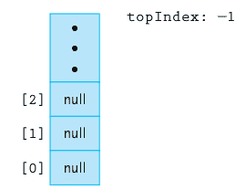

随着元素的推入和弹出，我们增加和减小 `topIndex` 的值。例如，从空栈开始推入“A”、“B”和“C”，结果如下：

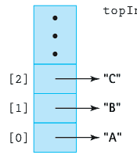

我们为 `ArrayBoundedStack` 类的客户端提供了两个构造函数：一个允许客户端指定栈的最大预期大小，另一个假设默认最大大小为 10 个元素。为了方便后构造函数，我们定义了一个设置为 100 的常量 `DEFCAP`（默认容量）。

这里是 `ArrayBoundedStack.java` 文件的开头：

```java
//
// ArrayBoundedStack.java                 作者 Dale/Joyce/Weems

// 使用数组存储栈元素以实现 StackInterface。

// 提供了两个构造函数：一个创建一个默认大小的数组
// 另一个允许调用程序指定大小。
//----------------
package ch02.stacks;

public class ArrayBoundedStack<T> implements StackInterface<T> {
    protected int DEFCAP = 100;                // 默认容量
    protected T[] elements;                     // 存储栈元素
    protected int topIndex = -1;               // 栈顶端元素的索引

    public ArrayBoundedStack() {
        elements = (T) new Object[DEFCAP];
    }

    public ArrayBoundedStack(int maxSize) {
        elements = (T) new Object[maxSize];
    }
}
```

注意，该类使用了类标头中所列的泛型参数 `<T>`。变量 `elements` 被声明为类型 `T[]`，即类 `T` 的数组。该类实现了一个 `T` 栈——`T` 的类尚未确定。它将由使用该边界栈的客户端类指定。由于 Java 翻译器不会生成对泛型的引用，因此在我们的构造函数中，必须在 `new` 语句中指定 `Object`。因此，尽管我们声明数组为类 `T` 的数组，但必须将其实例化为类 `Object` 的数组。为了确保进行预期的类型检查，我们将数组元素强制转换为类 `T`，如下：

```java
elements = (T) new Object[DEFCAP];
```

尽管这种方法有些笨拙并且通常会产生编译器警告，但这就是我们在 Java 中使用数组创建泛型集合的方法。我们可以使用 Java 库中符合泛型的 `ArrayList` 来解决此问题，但出于教学考虑，我们更倾向于使用更基础的数组结构。编译器警告可以安全忽略。

> **Java 注意事项**
>
> 对于基于数组的 ADT 使用泛型时，我们必须声明数组为类型 `Object` 并将其强制转换为类型 `T`。某些编译器在这种情况下会生成警告——该警告可以安全忽略。

### 栈操作定义

对于基于数组的方法，`isFull` 及其对应的 `isEmpty` 实现非常简单。如果顶端索引等于 -1，则栈是空的；而栈的大小比数组的大小少 1。

```java
public boolean isEmpty()
// 如果此栈为空，则返回 true，否则返回 false。
{
    return (topIndex == -1);
}
```

```java
public boolean isFull()
// 如果此栈满了，则返回 true，否则返回 false。
{
    return (topIndex == (elements.length - 1));
}
```

现在让我们写一个将类型为 `T` 的元素推入栈顶的方法。如果在调用 `push` 时栈已经满，则没有地方放置该元素。记住这种状态被称为栈溢出。我们的正式规范规定，在这种情况下 `push` 方法应该抛出 `StackOverflowException`。我们在抛出异常时包含了一条条相关的错误消息。如果栈未满，`push` 必须增加 `topIndex` 并将新元素存储在 `elements[topIndex]` 中。`push` 的实现非常直观：

```java
public void push(T element)
// 如果此栈满了，则抛出 StackOverflowException。
// 否则将元素置于此栈的顶部。
{
    if (isFull())
        throw new StackOverflowException("尝试在满栈上进行 push.");
    else {
        topIndex++;
        elements[topIndex] = element;
    }
}
```

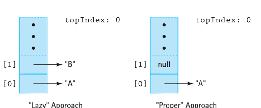

**图 2.5** 基于数组的栈在 `push ("A")`、`push ("B")` 和 `pop ()` 之后的懒惰与正确 pop 方法

`pop` 方法本质上是 `push` 的反向操作：我们不是将元素放入栈顶，而是通过减减 `Index` 从栈中移除顶端元素。将数组值设置为 `null` 是一个良好的习惯，也可以“清空”与当前栈顶相关的数组位置。图 2.5 显示了编码 `pop` 的“懒惰”方法与“正确”方法之间的区别。

如果在调用 `pop` 时栈是空的，则没有顶端元素可以移除，我们遇到了栈下溢。与 `push` 方法一样，规范说要抛出异常。

```java
public void pop()
// 如果此栈为空，则抛出 StackUnderflowException。
// 否则从此栈中移除顶端元素。
{
    if (isEmpty())
        throw new StackUnderflowException("尝试在空栈上进行 pop.");
    elements[topIndex] = null;
    topIndex--;
}
```

最后，`top` 操作简单地返回栈的顶端元素，即由 `topIndex` 索引的元素。与我们的泛型方法一致，`top` 方法显示类型 `T` 作为其返回类型。与 `pop` 操作一样，如果在空栈上调用 `top` 操作，就会发生栈下溢。

```java
public T top()
// 如果此栈为空，则抛出 StackUnderflowException。
// 否则返回此栈的顶端元素。
{
    T topStack = null;
    if (isEmpty())
        throw new StackUnderflowException("在空栈上尝试 top.");

    topStack = elements[topIndex];
    return topStack;
}
```

这足够了。我们刚刚完成了栈的创建。当然，我们仍然需要测试它；事实上我们在附近的“测试”章节中更详细地讨论 ADT。在继续之前，我们再次强调应用、实现和抽象。假设应用程序执行以下代码：

```java
StackInterface<String> myStack;
myStack = new ArrayBoundedStack(3);
myStack.push("A");
myStack.push("B");
```

图 2.6 显示了从左到右执行上述代码的应用、实现和抽象视图。

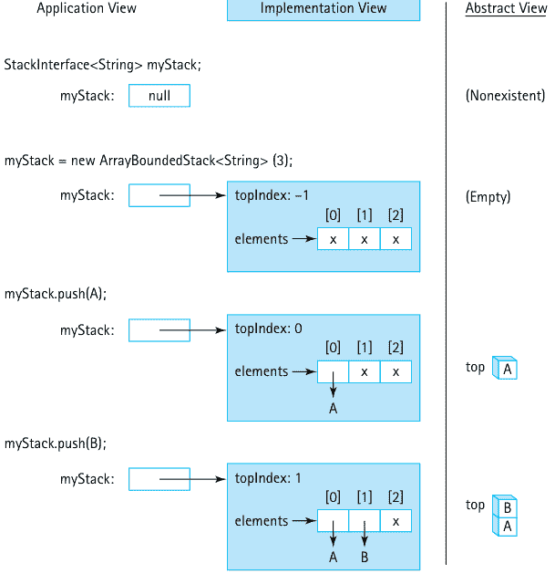

变量 `myStack` 指向 `ArrayBoundedStack` 对象。在这个 `ArrayBoundedStack` 内部隐藏了指向数组的引用变量 `elements` 以及指示顶部的 `int top`。

### 其他视图

创建基于数组实现的程序员将栈视为一个数组和一个指示顶部的索引。编写应用程序的程序员抽象地使用栈作为一个 LIFO 列表，并在上面调用 `push` 和 `pop` 操作。

从应用程序的角度来看，栈是一个盒子——细节是隐藏的。在图中我们可以窥视内部。作为 ADT 实现，我们创建了这个盒子。对于你来说，看到变量栈以及栈对象内部变量 `element` 和 `topIndex` 是重要的。

最后一点：我们实现的栈是有边界的，因为它使用数组作为数据容器。我们也可以使用数组来实现无边界栈。一种方法是在处理过程中根据需要实例化更大的数组，并将当前数组复制到更大的数组中。我们在第 4 章实现队列 ADT 时研究这种方法。


## 集成测试

软件测试通常被认为是在编码完成后完成的过程。实际上，对于学生和专业人员来说，在开发阶段进行测试是非常重要的。在正文中，我们通常将 ADT 呈现为一组构思清晰且完成的类。然而，我们没有描述开发和测试此过程遵循的整个流程。书中没有足够的空间涵盖所有这些！人们在描述某事时使用这种方法并不罕见：汽车广告展示其工程的最终产品，而不描述创造这台漂亮机器所经历的所有中间失败设计；艺术家展示雕塑，而不展示所有的在创作过程中使用的模型；数学家在给出一个定理的精妙证明时，并没有揭示为了得出完善的逻辑而经历过的所有错误尝试和回溯过程。

```java
package ch02.stacks;
public class ArrayBoundedStack<T> implements StackInterface<T>
{
    public ArrayBoundedStack()
    {
    }
    public void push(T element)
    {
    }
    public void pop()
    {
    }
    public T top()
    {
        return null;
    }
    public boolean isEmpty()
    {
        return true;
    }
    public boolean isFull()
    {
        return false;
    }
}
```

接下来，我们创建一个应用程序，即我们的“使用”该类的测试驱动程序：

```java
package ch02.apps;
import ch02.stacks.*;
public class StackDriver
{
    public static void main(String[] args)
    {
        StackInterface<String> test;
        test = new ArrayBoundedStack<String>();
    }
}
```

你可能会抗议道：“但这个应用程序什么都没做！”尽管如此，如果这两个文件可以正确编译，就说明我们将文件存放在系统中正确的文件夹中，包正在被正确使用，并且栈类包含了接口所需的方法名、参数类型和返回类型。它可能什么都没做，但它完成了很多工作！

现在，我们可以一点一点添加功能，随着我们的成长，同时扩展我们的实现（`ArrayBoundedStack`）和测试驱动程序（`StackDriver`）。添加 `isEmpty` 的代码。为 `isEmpty` 添加一个测试用例并运行它。它返回 `true` 吗？添加 `push` 的代码，以及一个先调用 `push` 后调用 `isEmpty` 的测试用例。它返回 `false` 吗？反复地对代码的微小增量进行设计、编码和测试，可能是开发软件的最佳方法。

注意，在实现类中导出一个测试期间使用的“辅助”方法可能会有所帮助，该方法返回一个表示隐藏数据结构和内容的字符串。此方法可以在测试期间使用，以确保代码运行符合预期。在许多情况下，一个典型的 `toString` 方法就足够了。例如，为了测试你的 `push` 代码是否正常，查看 `elements` 数组的内容和 `topIndex` 变量是有帮助的。在练习中，你被要求为各种情况实现创建这样的方法。

### 重要：演进你的代码！

学习演进你的代码。从整体设计开始，但在编码时按增量进行。设计、编码、测试——设计、编码、测试，编码。这种方法允许你一次只关注一个功能，而且当你犯错时，它会限制错误的范围，从而使其更容易被识别和修复。

当我们向实现中添加功能并测试我们的方法时，我们应该特别注意边界条件。程序员正确处理一般情况是经常的，但却没有考虑或对特殊情况设计了不当的设计。例如，在测试栈的 `push` 方法时，正确设计的情况是，尽管我们需要测试向部分填充的栈推入元素，但许多其他情况也应该被测试。例如：

- 向新栈推入元素
- 向空栈推入元素
- 向包含单个元素的栈推入元素
- 向满栈推入元素
- 向几乎满的栈推入元素（`isFull` 在此之前返回 `false`，之后返回 `true`）
- 向曾经是满但现在有一个空槽的栈推入元素

### 专业测试

在每天需要执行数百或数千个测试用例的环境中，创建了批模式运行的自动化测试驱动程序。例如，软件工程师构建一个向部分填充的栈推入元素的测试用例，可能会创建以下程序。（假设这是第 34 号测试用例。）

```java
import ch02.stacks.*;
public class Test034 {
    public static void main(String[] args) {
        StackInterface<String> test = new ArrayBoundedStack<String>();
        test.push("trouble in the fields");
        test.push("love at the five and dime");
        test.push("once in a very blue moon");
        String s = test.top();
        if (s.equals("once in a very blue moon"))
            System.out.println("Test 34 passed");
        else
            System.out.println("Test 34 failed");
    }
}
```

该程序可以在无干预的情况下运行并报告测试用例是否通过。通过开发整套程序，软件工程师可以实现测试过程的自动化。这种方法的一个主要优点是，在软件过程开发和维护阶段可以反复使用同一组测试程序。存在一些框架可以简化批测试套件的创建、管理和使用。例如，你可以在 www.junit.org 找到有关 JUnit 的信息，这是一个流行的基于 Java 的测试框架。

## ArrayList 类实现

实现 ADT 有许多方法。本小节介绍了基于 `ArrayList` 类的栈 ADT 的另一种实现方式。`ArrayList` 是 Java 类库提供的一个有用 ADT。

`ArrayList` 类对象的定义性特征是它们可以根据程序需要进行增长和收缩。因此，使用 `ArrayList` 方法，我们不需要担心栈受边界限制。我们的构造函数不再需要声明栈的大小。`isFull` 操作简单地返回 `false`，因为栈永远不会是满。我们不需要处理栈溢出。

有人可能会认为，如果程序耗尽内存，栈可以被认为是满的。然而，在这种情况下内存是一个严重的问题（而且理想是罕见事件）并且无法以相同的方式处理 `StackOverflowException`。如果这个栈是空的。将此实现与之前的实现进行比较。它们相似但又不同。一个是基于数组的，而其他的使用数组。使用 `ArrayList` 的一个优点是 Java 中的一等对象并且完全支持泛型。尽管使用 `ArrayList` 有明显的优势


```java
// ArrayStack.java                               by Dale/Joyce/Weems                2
// 使用 ArrayList 实现无界栈。
//------------------------------------
package ch02.stacks;
import java.util.*;

public class ArrayStack<T> implements StackInterface<T>
{
    protected ArrayList<T> elements; // 存放元素的 ArrayList

    public ArrayStack()
    {
        elements = new ArrayList<T>();
    }

    public void push(T element)
    // 将元素放在栈的顶部。
    {
        elements.add(element);
    }

    public void pop()
    // 如果栈为空，抛出 StackflowException，
    // 否则从栈中移除顶部元素。
    {
      if (isEmpty())
        throw new StackflowException("Pop attempted on empty stack.");
      else
        elements.remove(elements.size() - 1);
    }

    public T top() {
      // 如果栈为空，抛出 StackflowException。
      // 否则返回栈的顶部元素。
      T topOfStack = null;
      if (isEmpty())
        throw new StackflowException("Top attempted on empty stack.");
      else
        topOfStack = elements.get(elements.size() - 1);
      return topOfStack;
    }

    public boolean isEmpty() {
      // 如果栈为空，返回 true，否则返回 false。
      return elements.size() == 0;
    }

    public boolean isFull() {
      // 返回 false - 一个 ArrayListStack 永远是满的。
      return false;
    }
}
```

## 第2章 栈

### 2.6 应用：平衡表达式

栈非常适合“记住”那些以后需要处理的事情；换句话说，处理推迟的义务。在这个示例应用程序中，我们解决了一个困扰许多初学者的问题：编写代码时的匹配括号、中括号和大括号。匹配分组符号在计算世界中是一个重要问题。它与算术等式的合法性、计算机程序的语法正确性以及定义 Web 页面的 XHTML 标签的有效性。这是使用栈的一个经典场景，因为我们必须“记住”一个开启符号（例如 `(`、`[` 或 `{`），直到它以后被相应的关闭符号（例如 `)`、`]` 或 `}`）分别“处理”。当分组符号在

#### 良好的表达式

#### 错误的表达式

```
( XX XX ( ) XX )
[] ()
[] ()
 [ ] xxx XX ( XX )
[[([([x]x)]x]]x]]
xxxxxxxxxxxxxxxxxxxxx
```

```
( XX ( ) ) XX xxx )
[
 [ XX [(([x])x]]
[[([([x]x)]x]]x]] (
```

图 2.7 良好的与错误的表达式

如果一个表达式的匹配正确，计算机科学家会说该表达式是**良好的**（well-formed），并且我们问题的分组符号是**平衡的**（balanced）。

给定一组分组符号，我们的问题是确定每个符号的开启和闭合版本是否匹配正确。让我们关注常见的符号对：`()`、`[]` 和 `{}`。在理论上，我们可以定义任何一对符号（例如 `<>` 或 `/`）为分组符号。在输入表达式中，成对符号之前、之间可以出现任意数量的字符，并且表达式可以包含嵌套组。每个闭合符号必须与未匹配的开启符号匹配，每个开启符号都必须有一个匹配的符号。因此，表达式可能不正确的理由有两个：存在不匹配的符号（例如 `({])`）或者缺少闭合符号（例如 `(}}`）。

图 2.7 显示了良好的与错误的表达式示例。

#### 平衡类 (`Balanced` Class)

- 0 表示符号是平衡的，例如 `([])xx`
- 1 表示表达式有一个不匹配的闭合符号，例如 `([[])xx )`
- 2 表示表达式缺少一个闭合符号，例如 `([[xxx]])xx`

> **提醒：契约编程 (Programming by Contract)**
>
> 前置条件是一个契约。在 `Balanced` 类中，我们不需要检查前置条件是否——我们假设它们已经满足。

我们为平衡器（Balancer）包含了一个符号。为了使类更具易用性，我们需要应用程序指定开启和闭合符号。我们为构造函数定义了两个字符串类型的参数 `openSet` 和 `closeSet`，应用程序通过这些参数可以指定符号。两个集合中的符号通过位置进行匹配。对于我们的特定问题，这两个参数可以是 `"(["` 和 `"))"`。

确保合并后的开启和闭合集合中的每个符号都是唯一的，且两个集合的大小相同，这是重要的。我们使用契约编程并在构造函数的前置条件中说明这些标准。

```java
public Balanced(String openSet, String closeSet)
    // 前置条件：没有任何字符在合并后的
    // openSet 和 closeSet 字符串中出现超过一次。
    // openSet 的大小 == closeSet 的大小。
    {
        this.openSet = openSet;
        this.closeSet = closeSet;
    }
```

现在我们将注意力转向测试方法。它通过表达式参数传递一个 `String` 参数，并必须根据 `openSet` 和 `closeSet` 中的字符，判断 `expression` 中的符号是否平衡。该方法一次处理一次 `expression` 中的字符。对于每个字符，它会执行以下任务之一：

- 如果字符是开启符号，则将其推入栈中。
- 如果字符是闭合符号，则与从栈顶获取的最后一个开启符号进行检查。如果它们匹配，则继续处理下一个字符。如果闭合符号与栈顶不匹配或栈为空，则该表达式是错误的。
- 如果字符不是特殊符号，则跳过它。

栈是保存开启符号的合适数据结构，因为我们总是需要检查最近的一个。当所有字符都处理完毕后，栈应该是空的；否则表达式缺少一个闭合符号。

现在我们准备好编写 `test` 的算法了。我们假设一个定义为 `StackInterface` 的 `Stack` ADT 实例。我们还声明了一个布尔变量 `stillBalanced`，初始化为 `true`，用于记录目前处理的表达式是否平衡。

#### 良好表达式测试算法 (`String expression`)

```
创建一个与 expression 长度相等的新栈
将 stillBalanced 设置为 true
从 expression 中获取第一个字符
while (表达式仍然平衡 AND 还有更多字符需要处理)
    处理当前字符
    从 expression 中获取下一个字符
    if (isBalanced)
        return 1
    else if (栈不为空)
        return 2
    else
        return 0
```

该算法中在进入编码阶段之前需要扩展的部分是“处理当前字符”命令。我们之前描述了如何处理每种类型的字符。以下是这些步骤的算法形式。

```
if (字符是开启符号)
    将该开启符号字符推入栈中
else if (字符是闭合符号)
    if (栈为空)
        将 stillBalanced 设置为 false
    else
        将开启符号字符设置为栈顶的值
        弹出栈
    if 闭合符号字符与开启符号字符不“匹配”
        将 stillBalanced 设置为 false
else
    跳过该字符
```

`Balanced` 类的代码列在下面。由于本章的重点是栈，我们在代码列表中强调了与栈相关的代码。该类的 `test` 方法有几点有趣的值得注意：

1. 在测试方法内部，我们声明栈类型为 `StackInterface`，并将其实例化为类 `ArrayBoundedStack`。对于客户端程序来说，尽可能在抽象级别声明 ADT 是一个良好的做法。这种方法使得以后更改实现的选择更加容易。
2. 表达式的长度限制了需要入栈符号的数量。因此，我们根据长度初始化栈。
3. 我们通过位置判断闭合符号是否匹配开启符号。根据我们的规则，如果它们在各自的集合中共享相同的位置，则它们匹配。
4. 我们实例化栈以存储 `Integer` 元素，利用了自动装箱 (`Autoboxing`)。当程序员使用原始类型时，它会自动转换为相应的包装类对象。当测试方法说

```java
stack.push(openIndex);
```

`openIndex` 的整数值会自动转换为 `Integer` 存储在栈中。对应的自动拆箱 (`Unboxing`) 反消了自动装箱的效果。当通过语句访问栈时

```java
openIndex = stack.pop();
```

栈顶的 `Integer` 对象会自动转换为整数值。

5. 在处理闭合符号时，我们访问栈查看其持有开启符号。如果栈为空，表示表达式不平衡。检查栈是否为空有两种方法：使用 `isEmpty` 方法或捕获 `StackUnderflowException`。我们选择后者。这似乎符合算法的精神，因为我们期望找到符号，而栈为空是“异常”情况。
6. 作为对比，我们在处理表达式结束后使用 `isEmpty` 来检查栈是否为空。在这里我们不需要从栈提取元素——只需要知道它是否为空。

这里是整个类的代码：

```java
// -
// Balanced.java               by Dale/Joyce/Weems               Chapter 2
// 使用标准规则检查平衡表达式。
// 匹配的开启和闭合符号通过两个字符串参数
// 给构造函数。
// -
package ch02.balanced;

import ch02.stacks.*;

public class Balanced {
    protected String openSet;
    protected String closeSet;

    public Balanced(String openSet, String closeSet) {
        // 前置条件：没有任何字符在合并后的
        // openSet 和 closeSet 字符串中出现超过一次。
        // openSet 的大小 == closeSet 的大小。
        this.openSet = openSet;
        this.closeSet = closeSet;
    }

    public int test(String expression)
    // 如果表达式平衡，则返回 0。
    // 如果表达式包含不平衡符号，则返回 1。
    // 如果表达式提前结束，则返回 2。
    {
        char currChar; // 当前研究的字符
        int currCharIndex; // 当前字符的索引
        int lastCharIndex; // 表达式中最后一个字符的索引

        int openIndex; // 当前字符在 openSet 中的索引
        int closeIndex; // 当前字符在 closeSet 中的索引

        boolean stillBalanced = true; // 当表达式保持平衡时

        StackInterface<Integer> stack; // 存储未匹配的左括号符号
        stack = new ArrayBoundedStack<Integer>(expression.length());

        int currCharIndex = 0;
        int lastCharIndex = expression.length() - 1;

        while (stillBalanced && currCharIndex <= lastCharIndex) {
            // 当表达式仍然平衡且未到结尾
            currChar = expression.charAt(currCharIndex);
            openIndex = openSet.indexOf(currChar);

            if (openIndex != -1) // 如果当前字符在 openSet 中
            {
                // 将索引入栈。
                stack.push(openIndex);
            } else {
                closeIndex = closeSet.indexOf(currChar);
                if (closeIndex != -1) // 如果当前字符在 closeSet 中
                {
                    try {
                        // 尝试从栈中弹出一个索引
                        openIndex = stack.top();
                        stack.pop();
                        if (openIndex != closeIndex) // 如果不匹配
                            stillBalanced = false; // 则不平衡
                    }
                    catch(StackUnderflowException e) // 如果栈为空
                    {
                        stillBalanced = false; // 则不平衡
                    }
                }
            }
            currCharIndex++; // 设置下一个字符的处理
        }

        if(!stillBalanced)
            return 1; // 符号不平衡
        else
        if (!stack.isEmpty())
            return 2; // 表达式提前结束
        else
            return 0; // 表达式平衡
    }
}
```

#### 应用

现在我们已经有了 `Balanced` 类，完成我们的应用并不困难。我们在书中的程序设计方法是将用户界面代码与程序的其余部分分离。我们设计了诸如 `Balanced` 等类，并使用 ADT 来解决某些类型的问题。然后，我们设计了一个与用户交互的应用程序类，利用之前定义的类。我们的扩展示例提供了一个命令行界面（CLI）应用程序 gui。然而，在幕后，我们有时也会创建图形化用户界面（GUI）应用程序，并将这些程序的代码与程序代码文件一起提供。基于 GUI 的应用程序将在 CLI 叙述结束时简要介绍，以供感兴趣的人参考。在这里，我们将详细描述 CLI 应用。通过将设计中的解决问题方面与用户界面方面分离，我们可以轻松地在不同的用户界面上复用解决问题的类。

由于 `Balanced` 类负责判断分组符号是否平衡，剩下的工作就是实现用户的输入输出。用户不仅可以输入一个表达式，还可以输入一系列表达式，通过输入表达式“X.”表示结束。我们将程序命名为 `BalancedCLI`。请注意，当实例化 `Balanced` 类时，构造函数传递了字符串 `"([{}])"`，以便其对应于我们的特定问题。

> **提醒：类的演进**
>
> 当作者们设计并编写 `Balanced` 类时，我们也对其进行了测试。如前所述，我们演进了这些类，它们并不是凭空产生的。在书中我们没有空间详细描述演进过程，因此经常将我们的类作为成品呈现。

```java
//
// BalancedCLI.java 由 Dale/Joyce/Weems 编写，第 2 章
//
// 检查是否平衡。
// 输入是一系列行的表达式。
// 特殊符号类型为 [], 和 <>。
//
```


```java
package ch02.apps;

import java.util.Scanner;
import ch02.balanced.*;

public class BalancedCLI {
    public static void main(String[] args) {
        Scanner scan = new Scanner(System.in);

        // 实例化分组符号。
        Balanced bal = new Balanced("{<

        int result;
        String expression = null;
        final String STOP = "X";

        while (true) {
            System.out.print("Expression " + STOP + ": ");
            expression = scan.nextLine();
            if (expression.equals(STOP)) {
                result = bal.test(expression);
                if (result == 1) {
                    System.out.println("Unbalanced");
                } else if (result == 2) {
                    System.out.println("Premature end of expression");
                } else {
                    System.out.println("Balanced");
                }
                break;
            }
        }
    }
}
```

# 2.6 应用：平衡表达式

```java
System.out.println("Balanced");
}
```

这里是状态面板显示的评估结果：

| 表达式 | 结果 |
| :--- | :--- |
| `([{}])` | 平衡 |
| `([)]` | 不平衡 |
| `(())` | 表达式提前结束 |

GUI 应用包含在 `ch02.apps` 包中。我们没有列出该类的代码，但你可以在书中找到它。查看该代码发现：

- 它定义了一个对点击做出响应的内部类。它在全局范围内声明了输入字段和状态标签，以便主方法和按钮监听器访问。
- 在主方法中，一个接一个地实例化周围框架、文本和按钮。
- 主要处理发生在按钮监听器中。与评估按钮关联的代码实例化 `Balanced` 对象，用它确定当前表达式的结果，并设置状态标签显示相应的响应。与清除按钮关联的代码将状态标签设置为“已清除”，并将输入字段置为空。
- 若要评估另一个表达式，用户只需点击清除按钮。我们在书中通过类似的方法提供了示例应用程序的 GUI 版本。

# 2.7 链表简介

## 软件架构

图 2.8 显示了用于平衡表达式应用程序的接口和类之间关系的 UML 图。

## 数组与链表

该图描述了字符串数组和字符串链表的抽象视图。这两种方法的重要区别在于数据在内存中的内部表示以及访问单个元素的方式。对于数组，将所有元素视为聚集在一起，位于一个内存块中。对于链表，每个元素都单独存储在它自己的内存块中。我们将这个单独的内存块称为“节点”。

数组是 Java 中的一种内置结构，相比之下，虽然少数语言提供了内置的链表（例如 List 和 Scheme），但大多数语言并没有提供。Java 通过其类库支持常见的链表类型。尽管库中的链表对于许多应用已经足够了，但软件工程师需要理解它们的工作原理，这既是为了理解它们的局限性，也是为了在需要时能够构建自定义的链式结构。

如你所知，数组允许我们通过索引直接访问任何元素。相比之下，列表结构似乎非常局限，因为它的节点只能以顺序方式访问；从列表开始并顺着链接进行。我们最初为什么要费劲使用链表呢？有几个潜在的原因：

- 数组的大小是固定的。在实例化数组时，它是作为 `new` 命令的参数提供的。链表的大小是变化的。链表的节点可以根据“需要”分配。当不再需要时，节点可以返回给内存管理器。
- 对于某些操作，链表是数组更高效的实现方法。例如，要将一个元素放入数组集合的前端，必须将所有元素向数组末尾移动一位。这项任务需要很多步骤，特别是当数组包含许多元素时。使用链表，你只需要分配一个新节点并将其链接到列表开头。这项任务只需要三个步骤：创建新节点并更新两个链接。下面的图描述了向数组开头和等效链表开头添加元素的步骤：

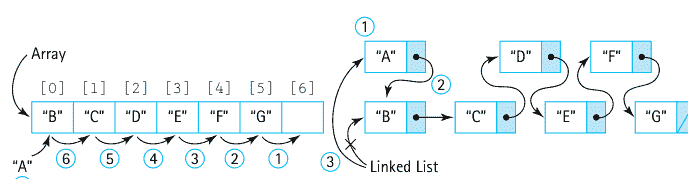

- 对于某些应用，你永远不需要在先访问列表中之前的节点的情况下直接访问列表深处的节点。在这些情况下，链表节点必须顺序访问的事实并对性能产生不利影响。

支持链表管理的基本方法也允许我们创建并构建更复杂的结构，例如后续章节中开发的树和图。

## 作者约定

请注意，在我们的图中，我们指示某些如“B”之类的对象是位于数组槽或列表节点内部的，而不是显示数组槽/节点指向它。我们这样做是为了简化图表——让读者更容易集中在所阐述的概念上。请记住，除非槽位和节点存储的是原始值，否则它们包含的是对象的引用，而不是对象本身。

## LLNode 类

要创建链表，我们需要知道如何做两件事：动态为节点分配空间，以及允许节点链接到或引用另一个节点。Java 提供了一种动态分配空间的操作，这是我们一直对所有对象都使用的操作——`new` 操作。显然，那部分很容易。但我们如何能允许一个节点引用另一个节点呢？本质上，链表是一个持有重要信息（如字符串或其他对象）以及指向另一个节点链接的对象。那个另一个节点是完全相同类型的对象——它也是链表中的一个节点。

在定义节点类时，我们必须允许从它创建的对象引用节点类对象。这种类型的类是自引用类。我们的节点类定义包含两个变量：一个用于维护数据，另一个是指向其类对象的引用。为了让我们的链表能够通用使用泛型，泛型占位符 `<T>` 用于表示链表节点持有的信息。这种方法允许我们创建字符串、银行账户、学生记录以及几乎任何内容的链表。

我们将我们的自引用类称为 `LLNode`。该类的对象就是链表节点。因为我们在文中使用了该类来支持几种 ADT 的基于链接的实现，我们将包含包含支持包中。它的声明包含了自引用代码，在此予以强调：

```java
package support;
class LLNode<T> {
    protected T info; // 存储在列表中的信息
    protected LLNode<T> link; // 对节点的引用
}
```

`LLNode` 类定义了一个实例变量 `info` 来持有节点对 T 类对象的引用，并定义了一个实例变量 `link` 来引用另一个 `LLNode` 对象。该 `LLNode` 可以持有对 T 类对象的引用，以及对另一个 `LLNode` 对象的引用，反之，它又持有对 T 类对象的引用，以及对另一个 `LLNode` 对象的引用，依此类推。当 `LLNode` 在其 `link` 中持有 `null` 值时，链结束，表示链表的结束。例如，这里有一个具有三个节点的链表，由 `Node<String>` 变量 `letters` 引用。既然我们知道链表节点是如何实现的，我们现在图中展示一个更详细的视图。

## 114 第 2 章 栈 ADT

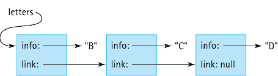

我们为 `LLNode` 类定义了一个构造函数：

```java
public LLNode(T info)
{
    this.info = info;
    link = null;
}
```

该构造函数接受一个 T 类对象作为参数并将 `info` 变量设置为该对象。例如：

```java
LLNode<String> sNode = new LLNode<String>
```

结果产生了结构


## 2.7 链表介绍 117

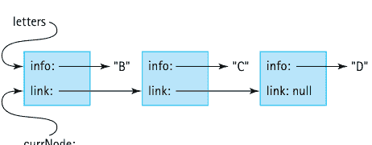

我们希望将 `currNode` 指向下一个节点，即 `info` 变量指向字符串 "C" 的那个节点。在前面的图中，注意哪里指向该节点——`currNode` 当前引用的节点的 `link` 变量。因此，我们使用 `LLNode` 类的 `getLink` 方法返回该值并设置 `currNode` 的新值：

```java
currNode = currNode.getLink();
```

将所有这些整合在一起，我们得到了以下伪代码。

```
LLNode<String> currNode = letters;
while (currNode is not pointing off the end of the list)
{
    System.out.println(currNode.getInfo());
    currNode = currNode.getLink();
}
```

剩下的工作是确定 `currNode` 何时指向列表末尾。`currNode` 的值被设置为下一个节点 `link` 变量中的值。当我们到达列表末尾时，该变量中的值为 `null`。所以，只要 `currNode` 的值不为 `null`，它就“没有指向末尾”。我们的最终代码段是：

```java
LLNode<String> currNode = letters;
while (currNode != null)
{
    System.out.println(currNode.getInfo());
    currNode = currNode.getLink();
}
```

> **重要算法**
>
> 你可以在编程中使用此处描述的算法模式反复遍历链表。创建一个引用来“走下”列表。将其设置为列表的起点。只要你还没有到达列表末尾，就将其设置为下一个节点。在移动过程中适当地访问每个节点。

在离开此示例之前，我们应该看看我们的代码如何处理以下情况：

## 118 第 2 章 栈 ADT

### 实现视图

输出

| letters | info: | info: | info: | |
| --- | --- | --- | --- | --- |
| | "B" | | "C" | | "D" |
| | link: | | link: | link: null |

在执行 `LLNode<String> currNode = letters;` 之后

| | info: | info: | info: | |
| --- | --- | --- | --- | --- |
| letters | "B" | | "C" | | "D" |
| | link: | | link: | link: null |
| currNode |

第一次通过 while 循环之后：

| | info: | info: | info: | |
| --- | --- | --- | --- | --- |
| letters | "B" | | "C" | | "D" |
| | link: | | link: | link: null |
| currNode |

第二次通过 while 循环之后：

| | info: | info: | info: | |
| --- | --- | --- | --- | --- |
| letters | "B" | | "C" | | "D" |
| | link: | | link: | link: null |
| currNode |

第三次通过 while 循环之后：

| | info: | info: | info: | |
| --- | --- | --- | --- | --- |
| letters | "B" | | "C" | | "D" |
| | link: | | link: | link: null |
| currNode: null |

现在 while 条件现在为假。


#### 空链表

空链表是一个重要的边界条件。每当你处理链表时，都应该双重检查你的方法是否适用于这种经常遇到的特殊情况。

回想空链表是指变量中代表列表值为 `null` 的列表：

```
letters: null
```

在这种情况下，我们的遍历代码会做什么？`currNode` 变量最初被设置为 `letters` 变量持有的值，即 `null`。因此，`currNode` 初始为 `null`，while 循环条件

```java
(currNode != null)
```

立即为假，不会进入 while 循环体。本质上，什么都没有发生——这正是我们在遍历空列表时希望发生的情况！我们的代码通过了此逻辑检查。我们还应该记得用测试程序检查这种情况。

## 插入

必须考虑向链表插入节点的三种一般情况：在列表开头插入、在列表中间插入以及在列表末尾插入。

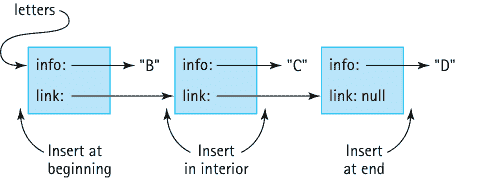

让我们考虑想要在列表开头插入一个节点的情况。假设我们有一个 `newNode` 要插入到 `letters` 链表的开头：

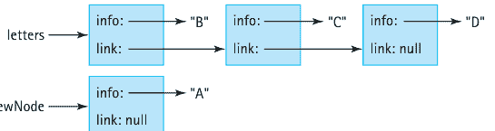

我们的第一步是设置 `newNode` 节点的 `link` 变量指向列表开头：

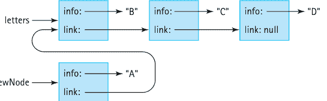

## 140 第 2 章 栈 ADT

为了完成插入，我们设置 `newNode` 节点的 `link` 变量指向列表开头：

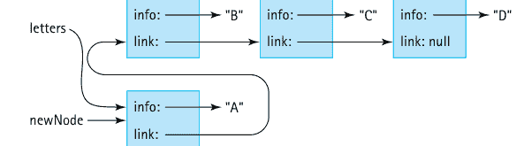

这些语句的顺序至关重要。

```java
newNode.setLink(letters);
letters = newNode;
```

> **设计提示**
>
> 当你处理链表时，画图可以帮助你理解。

本节提出的实现方式因此被称为基于引用的（link-based）。

## 2.8 基于引用的栈

在上一节中，我们引入了链表并解释了它们如何作为数组的替代方案。回想“link”与“引用”是相同的东西。

## LinkedStack 类

我们将新类命名为 `LinkedStack` 以与我们的数组栈实现区分开。`LinkedStack` 实现了 `StackInterface`。为我们的类命名很重要且并不总是容易。关于此主题的更多讨论，请参见附近的特性“命名构造”。

`LinkedStack` 类只需要一个实例，它持有指向栈顶的引用，即最近入栈的元素。该节点又持有下一个最近元素的引用。这种模式一直持续，直到某个节点的 `link` 属性为 `null`，这意味着栈的底部。我们将原始引用变量命名为 `top`，因为它始终引用栈顶。它是对 `LLNode` 的引用。在实例化 `LinkedStack` 对象时，我们通过将 `top` 设置为 `null` 来创建一个空栈。类的定义如所示。注意 import 语句允许我们使用 `LLNode` 类。

## 剩余操作

到目前为止，本节的发展是为了之后使用。我们将推迟剩余列表操作（包括删除）的开发，直到需要。目前，我们只需说从链表中删除有三种一般情况：在列表开头删除、在列表中间删除以及在末尾删除。

在这种情况下，我们的遍历代码会做什么？`currNode` 变量最初被设置为 `letters` 变量持有的值，即 `null`。因此，`currNode` 初始为 `null`，while 循环条件立即为假，不会进入 while 循环体。本质上，什么都没有发生——这正是我们在遍历空列表时希望发生的情况！我们的代码通过了此逻辑检查。我们还应该记得用测试程序检查这种情况。

接下来，我们将看到如何实现基于引用的栈操作。

## 命名构造体

为程序员定义的构造体选择合适的名称是一项重要任务。在这个特别专题中，我们将讨论这项任务，并解释本文中所用的一些命名规范。

Java 对程序员定义的名称的规则较为宽松。在为本文创建的构造体命名时，我们遵循了标准规范。我们的类名和接口名均以大写字母开头，例如 `ArrayBoundedStack` 和 `StackInterface`。我们的方法和变量名均以小写字母开头，例如 `insert` 和 `elements`。如果一个名称包含多个单词，我们将每个单词的首字母大写，例如 `topIndex`。最后，在为常量命名（如 `MINYEAR`）时，我们使用全大写字母。

分配给构造体的名称应该为使用该构造体的人提供有用信息。例如，如果你在方法中声明了一个变量用于存储一组数字的最大值，那么你应该根据它的用途对其命名：应使用 `maximum` 而不是 `X`。类名、接口名和方法名也是如此。

由于类代表对象，我们通常使用名词来命名，例如 `Date` 和 `Rectangle`。由于方法倾向于表示动作，我们通常使用动词来命名，例如 `insert` 和 `contains`。

在创建支持 ADT（抽象数据类型）的接口时，我们在接口名称中使用 ADT 的名称加上 "interface"，例如 `StackInterface`。虽然这种命名法有点显冗余，但它是 Java 库创建者所青睐的方法。注意，接口的名称并不意味着任何实现细节。实现 `StackInterface` 接口的类可以使用数组、向量、数组列表或引用——接口本身并不限制实现选项和细节。名称有助于我们识别构造体的目的；`StackInterface` 定义了 Stack ADT 所需的接口。


我们必须承认，我们曾犹豫是否使用 `ArrayBoundedStack` 和 `LinkedStack` 这样的名称。你能猜到为什么吗？回想我们的信息隐藏目标：我们想要隐藏支持我们 ADT 的实现。在 ADT 的名称中使用“Array”和“Linked”等术语会揭示关于我们正试图隐藏的信息的线索。然而，我们最终决定在类名中使用依赖于实现的术语。这种方法有几个原因：

1. 这与 Java 库使用的方法相同，例如 `ArrayList` 类。
2. 尽管信息隐藏很重要，但关于实现的某些信息对客户端程序员来说是有价值的，因为它影响了类对象的占用空间以及类方法的执行效率。在类名中使用“array”和“linked”确实有助于传递这些信息。
3. 我们已经有一个与 ADT 关联的构造体，其名称与实现无关。
4. 在本文中我们为许多不同的 ADT 创建了多个实现；这种多重性是数据结构研究的基础。使用依赖于实现的名称更容易区分这些不同的实现。

# 第 2 章 Stack ADT

## push 操作

将元素推入（push）栈意味着创建一个新节点并将其链接到当前的节点链。图 2.11 显示了此处列出的操作序列的结果。与图 2.6 一样，它展示了栈的应用视图、实现和抽象视图。它图形化地演示了栈元素引用的动态空间分配。假设 A、B 和 C 代表 `String` 类的对象。

```
StackInterface<String> myStack;
myStack = new LinkedStack<String>();
myStack.push(A);
myStack.push(C);
```

在执行 push 操作时，我们必须动态地为每个新节点分配空间。这里是通用算法：

| push(element) |
| :--- |
| 为下一个栈节点分配空间 |
| 并将节点信息设为 element |
| 将节点链接设置为栈的上一个栈顶 |
| 将栈顶设置为新的栈节点 |

图 2.12 图形化地显示了算法每一步的效果，从一个已经包含 A 和 B 的栈开始，展示了当 C 推入栈时会发生什么。这是我们在第 2.7 节“链表介绍”中学习的用于插入到链表开头的算法。我们安排了节点框以强调栈的后进先出（LIFO）特性。

让我们逐行查看算法，边写边代码。在讨论过程中，请跟随算法和图 2.12 我们的进度。我们首先分配一个新的栈节点，并将它的 `info` 属性设置为：

```
LLNode<T> newNode = new LLNode<T>(element);
```

### 应用视图

### 实现视图

### 抽象视图

StackInterface<String> myStack;

myStack: null

(不存在)

myStack = new LinkedStack<String>();

myStack: top: null

(空)

myStack.push(A);

myStack: top:

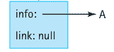

top A

myStack.push(B);

myStack: top:

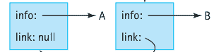

top B

A

myStack.push(C);

myStack: top:

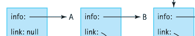

top C

B

A

图 2.11 使用 LLNode<String> 的栈操作结果

因此，`newNode` 是指向一个对象的引用，该对象包含两个属性：T 类的 `info` 和 LLNode 类的 `link`。构造函数已按照要求将 `info` 属性设置为引用元素（我们示例中的参数 C）。接下来，我们需要设置 `link` 属性的值：

```
newNode.setLink(top);
```

现在 `info` 指向推入栈的元素，而元素的 `link` 属性指向栈的上一个栈顶。

最后，我们需要重置栈顶指向新节点：

```
top = newNode;
```

为下一个栈节点分配空间并将节点信息设为 element

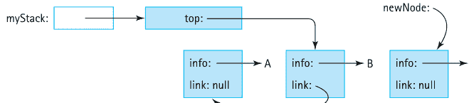

将节点链接设置为栈的上一个栈顶


将栈顶设置为新的栈节点

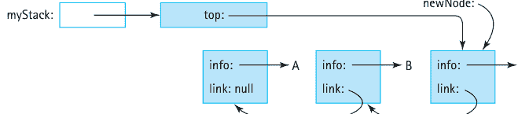

图 2.12 推入 (C) 的结果

将这一切整合，push 方法的代码为：

```java
public void push(T element) {
    // 将元素放在栈顶。
    LLNode<T> newNode = new LLNode<T>(element);
    newNode.setLink(top);
    top = newNode;
}
```

注意这些任务的顺序至关重要。如果在设置节点链接之前重置栈顶，我们将失去对栈的访问。这种情况在处理链接式结构时通常适用：不要犹豫画这样的图，以确保你的代码正确。

为下一个栈节点分配空间并将节点信息设为 element

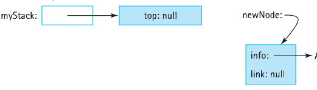

将节点链接设置为栈的上一个栈顶

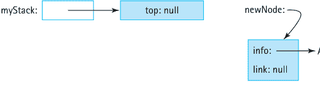

将栈顶设置为新的栈节点

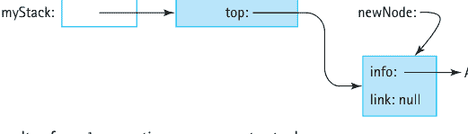

图 2.13 在空栈上执行操作的结果

> **编码提示**
> 针对边界情况检查代码（例如空栈或仅包含元素的栈）是一个好习惯。我们通常在这些情况下出错。

为新节点分配了空间，现在我们需要正确地设置链接。新节点的 `link` 被赋予 `top` 的值。当栈为空时这个值是多少？它是 `null`，这正是我们想要放入链接栈最后一个（底部）节点中的值。然后将 `top` 重置指向新节点。结果正是我们要求的——新节点是链表上的唯一节点，它是当前的栈顶。

## pop 操作

pop 操作等同于删除链表的第一个节点。它本质上是 push 操作的反逆过程。

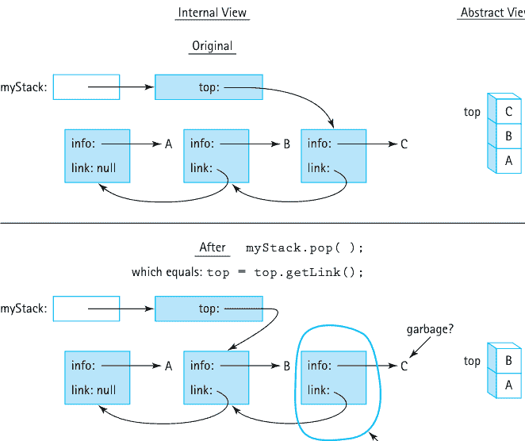

图 2.14 pop 操作的结果

只需将栈的 `top` 变量重置为指向下一个元素的节点。将 `top` 重置为下一个栈节点可以有效地从栈中移除栈顶元素。见图 2.14。这只需要一行代码：

```
top = top.getLink();
```

该赋值语句从变量 `top` 内部栈节点的 `link` 属性中复制引用。执行后，`top` 指向原先栈顶元素下方的 `LLNode` 对象。我们无法再引用之前的对象了，因为我们覆盖了对它的唯一引用。如图 2.14 所示，栈原先的顶部变成了垃圾；系统垃圾回收器最终会回收该空间。该对象的 `info` 属性是图中数据对象 `C` 的唯一引用，它也会变成垃圾，其空间将被回收。

是否有任何需要考虑的特殊情况？鉴于元素是从栈中移除的，我们应该关注栈为空。如果尝试对空栈进行 pop 会发生什么？在这种情况下，`top` 变量包含 `null`，赋值语句 `top = top.getLink();` 会导致运行时错误：`NullPointerException`。

因此，我们用栈 ADT 的 `isEmpty` 操作来保护该赋值语句。下面是我们的 `pop` 方法的代码：

```java
public void pop() {
    // 如果此栈为空，则抛出 StackUnderflowException，
    // 否则从此栈中移除栈顶元素。
    if (isEmpty())
        throw new StackUnderflowException("Pop attempted on an empty stack");
    else
        top = top.getLink();
}
```

我们使用了与数组实现方法中相同的 `StackUnderflowException`。有一个特殊情况：从只有一个元素的栈中弹出元素。我们需要确保此操作会导致栈变空。让我们看看是否确实如此。当栈被实例化时，它被设置为 `null`。当一个元素被推入栈中时，节点的 `link` 指向当前 `top` 变量所代表的元素；因此，当第一个元素被推入栈中时，其节点的 `link` 被设置为 `null`。当然，第一个从栈中弹出的元素关联的链接值为 `null`。因为最后一个从栈中弹出的元素具有 `null`，`pop` 方法会将 `top` 设置为该 `link` 属性的值，在最后一个值弹出后，`top` 再次设置为 `null` 值，就像第一次实例化时一样。我们得出结论：`pop` 方法适用于只有一个元素的栈。

空栈：


在 `myStack.push(A)` 后：

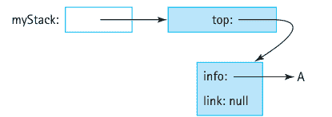

然后执行 `myStack.pop()`：

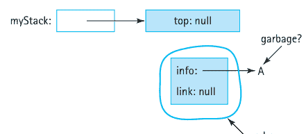

图 2.15 在空栈上先 push 后再 pop 的结果

## 其他栈操作

回想 `top` 操作简单地返回栈顶元素的引用。乍一看，这似乎非常直接。简单的代码：

```
return top;
```

因为 `top` 引用栈顶的元素。然而，记住 `top` 引用的是 `LLNode` 对象。而使用栈 ADT 的 `pop` 并不关心 `LLNode` 对象。客户端程序只对 `LLNode` 对象中 `info` 变量所引用的对象感兴趣。

让我们尝试返回顶部 `LLNode` 对象的 `info`，我们写成 `return top.getInfo();`。

这样好一点，但我们仍需做一点。栈为空的特殊情况怎么办？在这种情况下，我们抛出一个异常而不是返回对象。`top` 方法的最终代码如下：

```java
public T top() {
    // 如果此栈为空，则抛出 StackUnderflowException，
    // 否则返回此栈的栈顶元素。
    if (isEmpty())
        throw new StackUnderflowException("Top attempted on an empty stack.");
    else
        return top.getInfo();
}
```

这还不错，但 `isEmpty` 更加简单。如果我们通过将 `top` 变量设置为 `null` 来初始化一个空栈，就可以通过检查是否为 `null` 来检测空栈。

```java
public boolean isEmpty() {
    // 如果此栈为空，返回 true，否则返回 false。
    return (top == null);
}
```

由于链接栈永远不会满（我们可以总是分配另一个节点），因此 `isFull` 方法返回 `false`：

```java
public boolean isFull() {
    // 返回 false - 链接栈永远不会满的。
    return false;
}
```

栈 ADT 的链接实现可以使用与数组版本类似的测试计划进行测试。

# 比较栈的实现

在这里，我们比较栈 ADT 的两种经典实现。

| 栈操作的效率 | 数组实现 | 链接实现 |
| :--- | :--- | :--- |
| isEmpty, pop, top | O(1) | O(1) |

总的来说，如果 push 操作频繁，数组实现的执行速度比链接实现更快，因为它没有产生反复调用 `new` 的运行时开销。当最大尺寸较小且我们能确定确定最大大同时，数组实现是一个很好的选择。

# 2.9 应用：后缀表达式求值器

后缀表达式法（Postfix notation）是一种编写算术表达式的方法，其中运算符出现在操作数之后。例如，不是

`(2 + 4) × 3`

我们写成：

`2 4 + 3 *`

使用后缀表达式法，不需要学习优先级规则，也永远不需要括号。由于这种简单性，80 年代的一些流行手持计算器使用了后缀表达式法，以避免传统代数符号中多个括号的复杂性。编译器也使用后缀表达式法来生成无歧的表达式。

## 讨论

在小学，你学习了评估涉及二元运算符的简单表达式：加法、减法、乘法和除法。这些被称为二元运算符，因为它们作用于两个操作数。很容易看到一个孩子如何解决以下问题：

`2 + 5 = ?`

随着表达式变得复杂，纸笔计算需要更多工作。解决以下问题需要执行多个任务：

`((3 - 1) / 2) × (3 + 5) = ?`

这些表达式使用称为中缀符号（infix notation）的格式，这与 Java 表达式格式相同。中缀表达式中的运算符写在操作数之间。当一个表达式包含多个运算符时，例如

`3 + 5 × 2`

我们需要一组规则来确定先执行哪个操作。你在数学课中学过乘法先于加法。你在 Java 编程课程中学过 Java 的运算符优先级规则。我们可以使用括号来明确操作顺序。

为了覆盖常规的排序规则。尽管如此，在编写或解释包含多个操作符的中缀表达式时，很容易出错。

## 评估后缀表达式

后缀符号（Postfix notation）是编写算术表达式的另一种格式。在这种表示法中，运算符写在两个操作数之后。例如，要表示 3 和 5 的加法：

`5 3 +`

评估包含多个运算符的后缀表达式的规则比中缀表达式简单得多；只需从左到右执行操作即可。考虑以下包含两个运算符的后缀表达式：

`6 2 5 +`

我们通过从左到右扫描来评估该表达式。第一个项目 6 是操作数，我们继续。第二个项目 2 也是一个操作数，再次如此。第三个项目是除法运算符。我们现在将此运算符应用于之前的两个操作数。在两个保存的操作数中哪一个是除数？最近处理的那个。我们将 6 除以 2，并将 3 代回表达式，替换掉 `6 2 /`。我们的表达式现在看起来如下：

`3 5 +`

我们继续扫描。下一个项目是操作数 5，所以我们继续。下一个（也是最后一个）项目是运算符 `+`。我们将此运算符应用于之前的两个操作数，得到结果 8。

以下是一些包含多个运算符的后缀表达式示例、其等效的中缀表达式以及它们的求值结果。看看你在评估这些后缀表达式时是否也得到了相同的结果。

| 后缀表达式 | 中缀等效式 | 结果 |
| --- | --- | --- |
| 4 5 2 + - * | 4 - (5 + 2) | -16 |
| 3 4 2 * / | ((3 + 4) * 2)/2 | 2 |
| 5 7 6 - - * | (5 + 7) * (6 - 2) | 48 |
| 4 2 3 1 - + * x + | ? (4 + (2 * (3 - (5 - 1)))) | 操作数不足 |
| 4 2 + 3 5 - 1 + * | (4 + 2) + (3 * (5 - 1)) | 18 |
| 5 3 + 7 9 + + | (3 + (7 + 9)) ??? | 操作数过多 |

我们的任务是编写一个程序，用于评估用户交互式输入的后缀表达式。除了计算和显示表达式的值外，我们的程序还必须在适当的情况下显示错误信息（“操作数不足”、“操作数过多”和“非法符号”）。

## 后缀表达式评估算法

正如经常发生的那样，我们的手工算法可以作为计算机算法的指南。从之前的讨论可以清楚看出，后缀表达式中包含两个基本项目：操作数（数字）和运算符。我们从左到右逐个访问项目（操作数或运算符）。当该项目是运算符时，我们将其应用于之前的两个操作数。

我们之前必须在某种集合对象中扫描了操作数。栈（Stack）是存储之前操作数的理想位置，因为栈顶项目始终是最近的操作数，而栈中的下一个项目始终是次最近的操作数——恰好就是找到运算符时所需的两个操作数。以下算法使用栈来评估后缀表达式。

### 评估表达式

```
while more items exist
    Get an item
    if item is an operand
        stack.push(item)
    else
        operand2 = stack.top()
        stack.pop()
        operand1 = stack.top()
        stack.pop()
        Set result to (apply operation corresponding to item to operand1 and operand2)
        stack.push(result)

result = stack.top()
stack.pop()
return result
```

while 循环的每次迭代处理表达式中的一个运算符或一个操作数。当项目是操作数时，我们将其处理；当项目是运算符时，我们将其应用于之前的两个操作数。当我们发现操作数时，目前还没有对它做什么，因此将其保存在栈中。当我们遇到运算符时，从栈中取出两个操作数进行计算，并将结果存入栈中。

```java
int operand1, operand2;
int result = 0;
```


`Scanner tokenizer = new Scanner(expression);`

`while (tokenizer.hasNextNext()) {`

`  if (tokenizer.hasNextInt()) {`

`    // 处理操作数。`

`    value = tokenizer.nextInt();`

`    if (stack.isFull()) {`

`      throw new PostFixException("Too many operands-stack overflow");`

`    }`

`    stack.push(value);`

`  } else {`

`    // 处理运算符。`

`    operator = tokenizer.next();`

`    // 检查非法符号`

`    if (!operator.equals("/") || operator.equals("*") ||`

`        operator.equals("+")) {`

`      throw new PostFixException("Illegal symbol: " + operator);`

`    }`

`    // 从栈获取第二个操作数。`

`    if (stack.isEmpty()) {`

`      throw new PostFixException("Not enough operands-stack underflow");`

`    }`

`    operand2 = stack.top();`

`    stack.pop();`

`    // 从栈获取第一个操作数。`

`    if (stack.isEmpty()) {`

`      throw new PostFixException("Not enough operands-stack underflow");`

`    }`

`    operand1 = stack.top();`

`    stack.pop();`

`    // 执行操作。`

`    if (operator.equals("/")) {`

`      result = operand1 / operand2;`

`    } else if (operator.equals("*")) {`

`      result = operand1 * operand2;`

`    } else if (operator.equals("+")) {`

`      result = operand1 + operand2;`

`    }`

`  }`

`}`

## 2.9 应用：后缀表达式求值器

```java
// 从栈中获取最终结果。
if (stack.isEmpty())
    throw new PostfixException("Not enough operands-stack underflow");
result = stack.top();
stack.pop();

// 栈现在应该是为空的。
if (!stack.isEmpty())
    throw new PostfixException("Too many operands-operands left over");
```

```java
// 返回最终。
return result;
```

## FixCLI 类

该类是我们基于 CLI 的应用程序的主驱动程序。通过使用 `PostfixEvaluator` 和 `PostfixException` 类，设计我们的程序变得简单。我们遵循了本章之前用于 `BalancedCLI` 的相同方法：反复提示用户输入表达式，允许其输入 "X" 来表示是否完成，如果用户未完成，则求值表达式并返回结果。注意，主程序没有直接使用栈；它使用了内部使用了栈的 `PostfixEvaluator` 类。

```java
// FixCLI.java                               by Dale/Joyce/Weems                第2章
// 求值用户输入的后缀表达式。
// 使用命令行界面。
//--------------------------------------------------------------------------------
```

```java
package ch02.apps;

import java.util.Scanner;

import ch02.postfix.*;
```

```java
public class PFIXCLI
{
    public static void main(String[] args)
    {
        Scanner scan = new Scanner(System.in);
        String expression = null; // 待求值的表达式
        final String STOP = "X"; // 表示输入结束
        int result; // 求值结果
        while (!STOP.equals(expression))
        {
            // 获取下一个要处理的表达式。
            System.out.print("\n" + "Postfix Expression (" + STOP + " to stop): ");
            // ...
```

这是我们基于控制台的应用程序运行示例：
`Postfix expression (X to stop): 5 7 + 6 2 - *`
`Result = 48`
`Postfix expression (X to stop): 4 2 3 5 1 - + * + *`
`Error in expression: Not enough operands-stack underflow`
`Postfix expression (X to stop): X`

## GUI 方法

基于 GUI 的后缀求值应用程序的实现看起来与本章之前用于 Balanced 应用的 GUI 方法类似。与 Balanced 的情况一样，由于我们将用户界面代码与执行“工作”的代码分离开，因此很容易使用不同的界面方法创建新应用程序。以下是该应用程序的几个截图。代码位于 `ch02.apps` 包中名为 `PFixGUI.java` 的文件中。

启动屏幕：
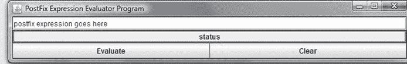

这是成功求值的运行：
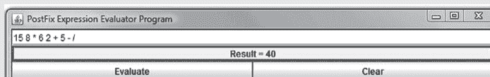

如果对非法表达式求值的情况：
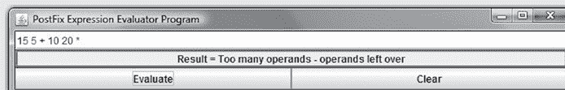

## 2.10 栈变体

在本文对 ADT 的主要介绍中，我们记录了设计决策并指定了 ADT 支持的操作。我们还开发或至少讨论了各种实现方法，在大多数情况下强调了一种基于数组的方法和一种基于引用/链表的方法。

定义/实现任何数据结构都有替代方法。因此，对于每种主要数据结构，

## 集合框架 (Collections Framework)

正如第 2.2 节“栈”中所讨论的，数据结构的另一个术语是“集合”。Java 开发者将支持数据结构的库类集合（如 `Stack`）称为集合框架。该框架包含了接口和类。它还包含了解释开发者意图如何使用以及如何使用这些类的文档。从 Java 5.0 开始，集合框架中的所有结构都支持泛型。

Java 库的集合框架包含了一系列广泛的工具。它不仅仅是数据结构的实现；它为处理集合提供了一个统一的体系。`Stack` 类从一开始就是 Java 库的一部分。最近，该库包含了一组 `Deque` 类，可以用来替代旧的 `Stack` 类。我们将在第 4 章的“变体”部分讨论 `Deque` 类。

在本文中，我们没有详细介绍集合框架。本文旨在教你数据结构的基本本质，并演示如何定义、实现和使用它们。它不是对如何使用 Java 库架构中类似结构的探索。至于 Java 库中是否有相应的对应，我们将简要描述我们的方法与库方法之间的相似之处和区别，正如我们处理栈那样。

在你成为专业的 Java 程序员之前，要仔细学习集合框架并学会如何高效地使用它。本文不仅让你准备好 Java，还让你准备好其他语言和库。如果你对学习更多关于集合框架的内容，可以学习 Oracle 网站上的详尽文档。

# 总结

可以从多个角度来看 Java。Java 封装了其预定义类型的实现，并允许我们封装自己的类实现。在本章中，我们使用 Java 接口构造结构指定了一个栈 ADT，并创建了几个实现：一个基于数组的，一个基于库的 `ArrayList` 类，以及一个基于链表的。链表的概念对许多读者来说是新概念，将在专门的章节中介绍。栈 ADT 允许我们创建应用程序，用于检查字符串中的分组符号是否平衡，并评估后序算术表达式。

在使用数据抽象来处理像栈这样的数据结构时，有三个层次或视角来考虑我们的结构。**抽象层**描述了 ADT 为我们提供了什么。这个视角包含了 ADT 所代表的领域以及它能做什么，这些都是由其接口规范的。在**应用层**上，我们使用 ADT 来解决问题。最后，**实现层**提供了如何表示我们的结构的具体细节以及支持这些操作的代码。抽象层充当了“上方”的应用层与“下方”的实现层之间的契约。

通过分离这些数据的视角，我们获得了什么？首先，我们减少了设计高层次的复杂性，使得客户端程序更易理解。其次，我们使程序更易于修改：实现可以被更改


# 第2章 ADT

| ch02.stacks |
| :--- |
| <<interface>> StackInterface<T> |
| + push(T element):void |
| pop(): void |
| top(): T |
| isFull(): boolean |
| isEmpty(): boolean |

| ch02.stacks |
| :--- |
| StackOverflowException |
| + StackOverflow() |
| + StackOverflow(String message) |

| ch02.stacks |
| :--- |
| StackUnderflowException |
| + StackUnderflow() |
| StackUnderflow(String message) |

| ch02.stacks |
| :--- |
| ArrayBoundedStack<T> |
| + ArrayBoundedStack() |
| + ArrayBoundedStack(int maxsize) |

| ch02.stacks |
| :--- |
| ArrayList<T> |
| + ArrayList() |

| java.util |
| :--- |
| ArrayList<E> |
| + ArrayList<E> |
| + add(E e): boolean |
| remove(int index): E |
| + get(int index): E |
| size(): int |

| ch02.stacks |
| :--- |
| LinkedStack<T> |
| + LinkedStack() |

| support |
| :--- |
| LLNode<T> |
| + LLNode(T) |
| + setInfo(T): void |
| + getInfo(): T |
| + setLink(LLNode<T>): void |
| + getLink(): LLNode<T> |

**图 2.16** 是一个类 UML 图，显示了本章开发的栈相关接口和类，以及一些支持类的关系。我们的图与传统的 UML 图有所不同：

* 我们在类/接口矩形的左上角显示包名。
* 我们省略了私有保护信息。
* 如果类实现了接口，我们*没有*在类矩形内列出接口定义的方法。当某些方法未列出时，我们在方法列表底部添加“...”。

包含在图中的库类使用了阴影。我们只在它们与 ADT 的实现直接相关时才包含它们。

## 练习

### 2.1 抽象

- 1. 描述日常生活中使用的抽象四种方式。
- 2. 列出观察数据的三个不同视角。以“学生成绩列表”为例，描述我们如何从每个视角查看数据。
- 3. 描述尽管使用了抽象，实现细节如何影响使用 ADT 的应用程序。
- 4. 什么是抽象方法？
- 5. 如果 Java 接口指定了一个特定的方法签名，而实现接口的类为该方法提供了不同的签名会发生什么？例如，假设 `SampleInterface` 定义如下：

```java
public interface SampleInterface
{
    public int sampleMethod();
}
```

```java
而类 `SampleClass`
public class SampleClass implements SampleInterface
{
    public boolean sampleMethod()
    {
        return true;
    }
}
```

- 6. 正还是错？解释你的答案。
    - a. Java 接口可以定义构造函数。
    - b. 类实现接口。
    - c. 类扩展接口。
    - d. 实现接口的类可以包含接口未要求的方法。
    - e. 实现接口的类可以省略接口要求的方法。
    - f. 你可以实例化接口的对象。

- 7. 根据我们处理错误情况的约定，以下方法的哪里有错？

```java
public void method10(int number)
// 前提条件：number > 0。
// 如果 number 不大于 0，则抛出 NotPositiveException。
// 否则 ...
```

- 8. 你的朋友在实例化一个类型为 `FigureInterface` 的对象时遇到了困难。他的代码包含以下语句：

```java
FigureInterface myFig = new FigureInterface(27.5);
```


# 练习题

## 9. 创建实现 `FigureInterface` 的 Java 类

- **a. Square（正方形）** —— 构造函数接受一个 `double` 类型的参数，表示正方形的边长
- **b. RightTriangle（直角三角形）** —— 构造函数接受两个 `double` 类型的参数，表示两条直角边的长度
- **c. IsoscelesTriangle（等腰三角形）** —— 构造函数接受两个 `double` 类型的参数，表示高和底
- **d. Parallelogram（平行四边形）** —— 构造函数接受三个 `double` 类型的参数，表示高、底以及边与底之间的角度

## 10. 更新 `RandomFigs` 应用

使其使用你在上一个问题中实现的新的 `FigureInterface` 类。

## 11. 定义 `NumTrackerInterface` 及其实现

对于这个问题，你必须定义一个简单的接口 `NumTrackerInterface` 以及该接口的两个实现：`Tracker1` 和 `Tracker2`。

### a. 定义接口 `NumTrackerInterface`

实现此接口的类必须跟踪通过 `add` 方法提交给它的数字的总和和计数，并提供所有数字的总和、计数和平均值的 getter 方法。

- `add` 方法应该接受一个 `int` 类型的参数
- `getSum` 和 `getCount` 方法都应该返回 `int` 类型的值
- `getAverage` 方法应该返回 `double` 类型的值

假设一个名为 `Tracker1` 的类实现了 `NumTrackerInterface`。这里显示了一个使用 `Tracker1` 的简单应用程序。它的输出将是 "3 29 9.67"。


```java
public class Sample {
    public static void main(String[] args) {
        NumTrackerInterface nt = new Tracker1();
        nt.add(5); nt.add(9);
        System.out.print(nt.getCount() + " ");
        System.out.print(nt.getSum() + " ");
        System.out.println(nt.getAverage());
    }
}
```

### b. 创建 `Tracker1` 类

实现 `NumTrackerInterface`。该类应该使用三个实例变量 `count`、`sum` 和 `average` 来存储信息。getter 方法在被请求时只需返回这些信息。创建一个测试驱动程序，证明 `Tracker1` 类工作正常。

### c. 创建 `Tracker2` 类

实现 `NumTrackerInterface`。该类应该使用两个实例变量 `count` 和 `sum` 来存储信息。在这种方法下，平均值只在需要时计算。创建一个测试驱动程序，证明 `Tracker2` 类工作正常。

### d. 讨论设计哲学区别

讨论 `Tracker1` 和 `Tracker2` 展现的设计哲学上的区别。

---

## 栈

### 判断正误

1. 栈是一个先入先出（FIFO）结构。
2. 在栈中停留最长的元素位于栈的“底部”。
3. 如果向空栈中推入五个元素，然后弹出五次栈（`pop`），栈将再次为空。
4. 如果向空栈中推入五个元素，然后执行五次顶端操作（`top`），栈将再次为空。
5. `push` 操作应该被分类为“转换器”（transformer）。
6. `top` 操作应该被分类为“转换器”。
7. `pop` 操作应该被分类为“观察者”（observer）。
8. `top` 操作总是返回最后推入的元素。
9. 如果我们先向栈中推入 `itemA` 然后推入 `itemB`，那么栈顶就是 `itemB`。
10. 在栈 `push` 操作后紧跟 `pop` 操作对栈的状态没有影响。
11. 在栈 `pop` 操作后紧跟 `push` 操作对栈的状态没有影响。

---

## 第2章 ADT

### 13. 描述经典的栈 `pop` 操作与本文定义的 `pop` 操作之间的区别。

### 14. 栈操作模拟

在以下带有编号的命令块中，方块被推入和弹出栈。假设每当弹出一个方块时：

- **a.** `push block5; push block7; pop; push block2; push block1; pop; push block8;`
- **b.** `push block5; push block4; push block3; push block2; pop; push block1; pop; pop;`
- **c.** `push block1; pop; push block1; pop; push block1; pop; push block1;`

### 15. 栈的应用场景

描述你可能如何在每个场景中使用栈：

- **a.** 帮助一位热心的朋友发现他在夜间闲逛时把伞遗在了哪里。
- **b.** 跟踪一场拍卖，允许当前最高出价者撤回她的报价。

---

## 2.3 集合元素

### 16. 四种定义元素类型的方法

在 2.3 节“集合元素”中，我们查看了四种定义集合 ADT 中可以存储的元素类型的方法。简要描述这四种方法。

### 17. 重复定义 `NumTrackerInterface` 及实现

（内容同第 11 题，此处省略重复内容，请参考上文）

---

## 2.4 形式规范

### 19. 检查空栈的两种方法

根据我们的栈 ADT，程序员有两种检查空的方法。描述并讨论哪种方法可能更好。

### 20. 代码序列执行结果

显示以下序列的内容，假设 `item1, item2, item3` 是 `int` 类型，且 `s` 是栈：

#### a.
```java
item1 = 1; item2 = 0; item3 = 4;
s.push(item2); s.push(item1);
s.push(item3);
item2 = s.top();
s.pop();
while (!s.isEmpty()) {
    item3 = s.top();
    s.pop();
    System.out.println(item3);
}
System.out.println(item1 + " " + item2 + " " + item3);
```

#### b.
```java
item1 = 4; item3 = 0; item2 = 1;
s.push(item2); s.push(item1);
s.push(item3);
item2 = s.top();
s.pop();
```

### 21. 关于 push 和 pop 的讨论

你的朋友 Bill 说：“push 和 pop 操作是相反的。因此，执行一次 push 后执行一次 pop 等同于什么操作。”你会如何回答？你同意吗？

### 22. Pez 糖容器算法

在每个 Pez 糖容器中，颜色是随机存储的。你的弟弟只喜欢黄色的，所以他费力地一个一个取出糖，吃掉黄色的，并将其他的按顺序保留，以便能以之前完全相同的顺序返回容器（除去黄色的）。编写算法来模拟这个过程。（可以使用栈 ADT 中定义的任何栈操作，但不能假设栈是如何实现的）。

### 23. 代码文件设置与运行

使用文本代码文件并在你的笔记本电脑/桌面正确设置它们。

- **a.** 运行 `ReverseStrings` 应用。
- **b.** 创建一个使用栈的简单程序。你的新程序应该要求用户输入一行文本，然后反向打印该文本。为了实现这一点，你的应用程序应该使用一个字符栈。

### 24. Century Stack 接口

Century Stack 是固定大小为 100 的栈。如果 Century Stack 满了，则移除栈中最旧的元素为新元素腾出空间。创建一个 `CenturyStackInterface` 来捕捉这种栈规范。

---

## 2.5 基于数组的栈实现

### 25. 显示实现表示

在以下代码序列的每一步中显示实现表示（实例变量 `elements` 和 `indexOf` 的值）：

```java
StackInterface<String> s = new ArrayBoundedStack<String>(5);
s.push("Elizabeth");
s.push("Anna Jane");
s.pop();
s.push("Joseph");
s.pop();
```

---

## 练习

### 26. 显示实现表示 (ArrayBoundedStack)

在代码序列的每一步中显示实现表示（实例元素的值和 `topIndex` 的值）：

```java
StackInterface<String> s = new ArrayBoundedStack<String>(5);
s.push("Adele");
s.push("Heidi");
s.push("Sylvia");
s.pop(); s.pop();
```

### 27. 描述更改影响

描述你对 `ArrayBoundedStack` 类所做的每项更改的影响。

### 28. 添加方法到 `ArrayBoundedStack`

在 `ArrayBoundedStack` 类中添加以下方法，并为每个方法创建一个测试驱动程序，以证明它们工作正常。为了练习你的数组编码技能，请通过访问 `ArrayBoundedStack` 的内部变量来编写这些方法，而不是调用类现有的公共方法。

- **a.** `String toString()` —— 创建一个正确表示当前堆栈的字符串。这种方法对于测试和调试该类可能有用，并且对于每个堆栈元素都提供自己的 `toString` 方法的应用。
- **b.** `int size()` —— 返回当前堆栈中的项目数量。为了实现此方法，不要向 `ArrayBoundedStack` 类中添加任何变量。
- **c.** `void popSome(int count)` —— 从堆栈中移除顶部 `count` 个元素；如果堆栈中的元素少于 `count`，则抛出 `UnderflowException`。
- **d.** `boolean swapStart()` —— 如果堆栈中的元素少于两个，则返回 `false`；否则反转堆栈顶部两个元素的顺序并返回 `true`。
- **e.** `T pop()` —— “经典的”弹出操作，如果堆栈为空则抛出 `UnderflowException`；否则移除并返回堆栈的元素。

### 29. 更新 `ArrayList`

执行练习 28 中列出的任务，但更新 `ArrayList`。

---

# 第 2 章 栈 ADT

### 30. `EditString` 应用程序

使用 `ArrayBoundedStack` 类，创建一个应用程序 `EditString`，它提示用户输入一个字符串，然后反复提示用户对字符串进行更改，直到用户输入 `X`（表示更改结束）。合法的更改操作包括：

- **U** —— 将所有字母转为大写
- **L** —— 将所有字母转为小写
- **R** —— 反转字符串
- **C ch1 ch2** —— 将所有的 `ch1` 替换为 `ch2`
- **Z** —— 撤销最近一次更改

你可以假设用户是“友好的”；即用户不会输入任何非法内容。当用户完成后，将打印结果字符串。

**示例：**
如果用户输入：
```
All dogs go to heaven
U
R
Z
C O A
A t
Z
```
程序的输出将是 `ALL DAGS GA TA HEAVEN`。

### 31. 测试时机

在软件开发过程中，开始测试的合适时是什么？

### 32. `ArrayBoundedStack` 健壮测试

创建一个非交互测试驱动程序（类似于 `Test034`），对 `ArrayBoundedStack` 类列出的方法进行健壮测试：

- **a.** `isEmpty`
- **b.** `top`
- **c.** `push`
- **d.** `pop`

### 33. `ArrayListStack` 测试

执行练习 32 中列出的任务，但测试 `ArrayListStack`。注意：如果你已经完成了练习 32，那么这应该是一个轻而易见的练习。

### 34. 实现世纪栈

实现一个世纪栈（Century Stack，请参见练习 24）。

- **a.** 使用数组（你能设计出一个让 `push` 操作保持 $O(1)$ 效率的解决方案吗？）。
- **b.** 使用 `ArrayList`。

---

## 2.6 应用：平衡表达式

### 35. 良好表达式的栈内容

假设将以下每个良好表达式（使用标准的圆括号、中括号和大括号）传递给我们 `Balanced` 类的 `test` 方法。对于每个表达式，显示堆栈持有元素最多时从堆栈底部到顶部的堆栈内容。

- **a.** `xx (( )) xx [`
- **b.** `[] [] () {{}}}`
- **c.** `(())) [[{}]]`
- **d.** `{{{((()))}}]]()`

### 36. 非法表达式的栈内容

假设将以下每个非法表达式（使用标准的圆括号、中括号和大括号）传递给我们 `Balanced` 类的 `test` 方法。在发现表达式为非法的时刻，显示从堆栈底部到顶部的堆栈内容。

- **a.** `xx (( )) xx [`
- **b.** `[] ([]) {`
- **c.** `()] [[{{{{}}}}}`
- **d.** `{{{((()))}}]]()`

### 37. `Balanced` 类问题

回答关于 `Balanced` 类的以下问题：

- **a.** 以以下两种方式实例化类，在功能上是否有任何区别？
  `Balanced bal = new Balanced("abc", "xyz");`
  `Balanced bal = new Balanced("cab", "xyz");`

- **b.** 以以下两种方式实例化类，在功能上是否有任何区别？
  `Balanced bal = new Balanced("abc", "xyz");`
  `Balanced bal = new Balanced("abc", "zxy");`

- **c.** 以以下两种方式实例化类，在功能上是否有任何区别？
  `Balanced bal = new Balanced("abc", "xyz");`
  `Balanced bal = new Balanced("xyz", "abc");`

- **d.** 什么类型被推入堆栈中？`char`？`int`？`Integer`？请解释。

- **e.** 在什么情况下，在堆栈上执行的第一个操作（不是 `new` 操作）是 `top` 操作？

- **f.** 如果传递给 `test` 方法的字符串表达式为空字符串，会发生什么？

---

# 第 2 章 ADT

## 2.7 链表引言

### 38. 自引用类

什么是自引用类？

### 39. 链表结构图示

绘制表示以下每个代码序列创建的结构的抽象视图图形。假设每个用例之前都有这三行代码：

```java
LLNode<String> node1 = new LLNode<String>("alpha");
LLNode<String> node2 = new LLNode<String>("beta");
LLNode<String> node3 = new LLNode<String>("gamma");
```

- **a.** `node1.setLink(node3)`
- **b.** `node1.setLink(node2); node2.setLink(node3)`
- **c.** `node3.setLink(node2)`

### 40. 遍历链表代码评价

你开发了用于遍历链表的代码。这里有几种用于打印链表内容的替代但可能是错误的方法。请评价它们：

#### a.
```java
LLNode<String> currNode = letters;
while (currNode != null) {
    System.out.println(currNode.getInfo());
    currNode = currNode.getLink();
}
```

#### b.
```java
LLNode<String> currNode = letters;
while (currNode != null) {
    currNode = currNode.getLink();
    System.out.println(currNode.getInfo());
}
```

#### c.
```java
LLNode<String> currNode = letters;
while (currNode != null) {
    System.out.println(currNode.getInfo());
    if (currNode.getLink() != null)
        currNode = currNode.getLink();
    else
        currNode = null;
}
```


# 练习

41. 在什么情况下，在堆栈上执行的第一个操作（不是 `new` 操作）是 `top` 操作？假设有一个指向 `LLNode<Integer>` 的链表。编写代码打印以下内容。不要忘记 `LLNode` 的 setter 和 getter 方法。

- a. 堆中元素的总和
- b. 堆中元素的数量
- c. 堆中正整数的数量
- d. 堆的倒序内容；例如，如果堆包含 5, 7, -9，将打印
    1. -9
    2. 7
    3. 5
- e. 堆的倒序内容（提示：使用堆）；例如，如果堆包含至少两个元素。

# 2.8 基于链的堆

43. 使用数组的堆和基于链的堆在内存分配方面有什么主要区别？

44. 考虑 `LinkedList` 类的 `push` 方法。以下更改会产生什么影响？

- a. 交换第一行和第二行。
- b. 交换第二行和第三行。

45. 在以下代码序列的每一步中显示链表的实现表示（从 `top` 开始）：

```
StackInterface<String> s = new LinkedList<String>();

s.push("Elizabeth");

s.push("Anna Jane");

s.pop();

s.push("Joseph");

s.pop();
```

# 第 2 章 ADT

46. 在以下代码序列的每一步中显示链表的实现表示（从 `startIndex` 开始）：

```
StackInterface<String> s = new LinkedStack<String>();

s.push("Adele");

s.push("Heidi");

s.push("Sylvia");

s.pop();s.pop();
```

47. 重复练习 28，将方法添加到 `LinkedStack` 类中。

48. 使用 `LinkedStack` 类支持一个跟踪在线拍卖状态的应用程序。拍卖从 1（美元、英镑、欧元等）开始，每次至少增加 1。如果出价低于当前价格，则出价将被丢弃。如果出价高于当前价格，但低于当前出价者的最高价，则将当前出价者的最高价提高以匹配该出价，并将新出价丢弃。如果出价高于当前出价者的最高价，则新出价者成为当前出价者，其价格为前一个出价者的最高价加 1。当拍卖结束（到达输入结束）时，应从高到低显示实际出价（未丢弃的）的历史。

| 新价格 | 结果 | 高出价者 | 高价 | 最高价 |
| --- | --- | --- | --- | --- |
| 7 John | 新出价者 | John | 1 | 7 |
| 5 Hank | 高价已增加 | John | 5 | 7 |
| 10 Jill | 新出价者 | Jill | 8 | 10 |
| 8 Thad | 无变化 | Jill | 8 | 10 |
| 15 Joey | 新出价者 | Joey | 11 | 15 |

该拍卖的竞价历史将是：
Joey 11
Jill 8
John 5
John 1

49. 使用链表实现世纪栈（使用练习 24）。

## 2.9 应用：后缀表达式求值

50. 计算以下后缀表达式的值。

- `+ - 5 7 8*`
- `+ - 5 7 8*`
- `+ - 5 7+8*`
- `+ - 1 2+3 4+5 6 * 2 **`

51. 计算以下后缀表达式的值。其中某些可能是格式不规范的表达式——在这种情况下，请识别相应的错误信息（例如：操作数过多、操作数过少）。

- `+ - 1 2 3 4 5 +++`
- `+ - 12++5`
- `+ - 1 2* 5*`
- `+ - 2 / 38*`
- `+ - 4567 24 / 45372 231 * + 34526 342 / 0*`

52. 修改并测试后缀表达式求值程序，使用 `ArrayListStack` 代替 `ArrayBoundedStack` 类：

- 不要担心溢出问题。
- 捕获并处理假设不会发生的除以零的情况。例如，如果输入表达式为 `5 3 - /`，结果应为消息“illegal by zero”。
- 支持由“^”指示的新操作，该操作返回操作数中的较大值。例如，`5 7 ^ = 7`。
- 跟踪在表达式评估过程中推入栈的数字的统计信息。程序应该输出最大和最小的数字、入栈总数以及入栈数字的平均值。

## 2.10 栈违反

53. 在对我们抽象数据类型（AD）的讨论中，与栈经典的定义相比，我们认为 `top` 方法是多余的。假设 `MyStack` 是一个存储字符串的栈，它使用了经典的 `pop` 方法。创建一个功能上与以下代码行等效但不使用 `top` 方法的代码段：

```
System.out.println(myStack.top());
```

54. 正如本文所述，与其让栈方法在出现“错误”调用时抛出异常，我们可以让栈方法自行处理这种情况。我们定义了以下三个“安全”方法：

- `boolean safePush (T element)`——将元素推入栈；如果元素成功入栈则返回 true，否则返回 false
- `boolean safePop ( )`——移除栈顶元素；如果元素成功出栈则返回 true，否则返回 false
- `T safeTop ( )`——如果栈不为空则返回栈顶元素，否则返回 null

- a. 将这些操作添加到 `ArrayBoundedStack` 类中。创建一个测试驱动程序以证明添加的代码可以正常工作。
- b. 将这些操作添加到 `ArrayListStack` 类中。创建一个测试驱动程序以证明添加的代码可以正常工作。
- c. 将这些操作添加到 `LinkedStack` 类中。创建一个测试驱动程序以证明添加的代码可以正常工作。

练习题 55 到 58 需要进行“外部”研究。

- 55. 描述 Java 库中 `Vector` 类和 `ArrayList` 类之间的主要差异。
- 56. Java 集合框架（Collections Framework）中的迭代器是如何使用的。
- 57. Java 库中 `Set` 类的定义特征是什么？
- 58. Java 库中哪些类实现了 `Collection` 接口？

# 第3章 递归

## 知识目标

你应该能够

- 定义递归
- 讨论递归作为一种解决问题的技术
- 描述用于分析递归方法的三个问题
- 在给定递归问题描述的情况下，执行以下操作：
    - 确定边界情况（base cases）
    - 确定一般情况（general cases）
    - 使用递归设计解决方案
- 比较和对比动态存储分配和静态存储分配
- 通过展示运行时栈的内容来解释递归的内部原理
- 解释为什么递归可能或不是实现问题问题的良好选择

## 技能目标

你应该能够

- 在给定递归方法的情况下，执行以下操作：
    - 确定方法在什么条件下停止
    - 确定边界情况
    - 确定一般情况
- 确定该方法的作用
- 确定该方法是否正确，如果正确，则纠正它
- 使用“三问法”验证递归方法
- 判断递归解决方案对于该问题是否合适
- 如果合适，为问题实现递归解决方案
- 使用递归方法处理数组
- 使用递归方法处理链表
- 递归地解决汉诺塔问题
- 使用递归生成分形图像
- 创建使用递归的程序的迭代版本
- 用基于栈的解决方案替换递归解决方案

## 3.1 递归定义、算法与程序

### 递归定义

你已经熟悉了递归定义。例如，递归定义是定义调用自身的定义。递归算法是定义调用自身的算法。递归程序是定义调用自身的程序。

递归的本质是定义一个包含对自身引用的结构。递归数据结构是包含自身定义的数据结构。递归函数是定义调用自身的函数。递归过程是定义调用自身的过程。递归逻辑是定义调用自身的逻辑。

我们可以更优雅地定义 n!，使用省略点来表示递归：

```
n! = \begin{cases} 1 & n=0 \\ n \times (n-1)! & n>0 \end{cases}
```

### 递归算法

让我们通过递归定义来演示 4! 的计算。递归定义不仅展示了如何使用递归定义，还模拟了计算机执行动作。我们使用一组索引卡来帮助工作。

正如之前，我们无法完成第三行，因为我们不知道 2! 的值。我们取出另一张索引卡并写下新问题。通过这种方式，我们最终有五张卡堆在桌子上：

| Calculate 4! |
| :--- |
| 4! = 4 × (4-1)! |
| 4! = 4 × 3! |
| Calculate 3! |
| 3! = 3 × (3-1)! |
| 3! = 3 × 2! |
| Calculate 2! |
| 2! = 2 × (2-1)! |
| 2! = 2 × 1! |
| Calculate 1! |
| 1! = 1 × (1-1)! |
| 1! = 1 × 0! |
| Calculate 0! |
| 0! = 1 |

在此时，当我们转向递归定义来计算 0! 时，我们发现可以使用定义的第一部分：0! 等于 1。我们可以像所示完成顶部的卡：

| Calculate 4! |
| :--- |
| 4! = 4 × (4-1)! |
| 4! = 4 × 3! |
| Calculate 3! |
| 3! = 3 × (3-1)! |
| 3! = 3 × 2! |
| Calculate 2! |
| 2! = 2 × (2-1)! |
| 2! = 2 × 1! |
| Calculate 1! |
| 1! = 1 × (1-1)! |
| 1! = 1 × 0! |
| Calculate 0! |
| 0! = 1 |
| 1! = 1 × 1 |
| 1! = 1 | 来自丢弃的 Calculate 0! 卡 |

这完成了我们卡栈顶端的问题。它的结果是 1。记住这个结果，我们扔掉顶部的卡，在现在顶部的卡（*Calculate 1!* 卡）的空白处写上“1”，并继续处理那个问题。由于我们知道如何计算 *1 × 1*，我们可以快速完成那个问题并输入它的结果：

| Calculate 4! |
| :--- |
| 4! = 4 × (4-1)! |
| 4! = 4 × 3! |
| Calculate 3! |
| 3! = 3 × (3-1)! |
| 3! = 3 × 2! |
| Calculate 2! |
| 2! = 2 × (2-1)! |
| 2! = 2 × 1! |
| Calculate 1! |
| 1! = 1 × (1-1)! |
| 1! = 1 × 0! |
| Calculate 0! |
| 0! = 1 |
| 1! = 1 × 1 |
| 1! = 1 | 来自丢弃的 Calculate 0! 卡 |
| 2! = 2 × 1 |
| 2! = 2 | 来自丢弃的 Calculate 1! 卡 |
| 3! = 3 × 2 |
| 3! = 6 | 来自丢弃的 Calculate 2! 卡 |
| 4! = 4 × 6 |
| 4! = 24 | 来自已丢弃的 Calculate 3! 卡片 |

注意，当我们达到一个不需要借助定义的递归部分就能知道答案的情况时，我们就停止了创建新卡片。在这个例子中，这一点出现在我们到达“计算 0!”时。我们直接根据定义就知道该值为 1，而不需要诉诸递归。

当某个情况的答案可以直接知道而不需要进一步递归时，它被称为**基础情况**（base case）。一个递归定义可能有多个基础情况。将解决方案表示为自身较小版本（或多个版本）的情况被称为**递归情况**或**一般情况**（recursive or general case）。一个递归定义也可能有多个递归情况。递归算法是一种以自身的较小版本表示解决方案的算法。递归算法必须终止；也就是说，它有一个基础情况，并且递归情况最终会导致一个基础情况。

这里是我们直接基于递归定义计算 n! 的递归算法。它假设 n 是非负整数：

```
Factorial (int n)
// Precondition: n >= 0
if (n == 0)
    return (1)
else
    return (n * Factorial (n - 1))
```

### 递归程序

在 Java 中，方法可以调用其他方法。方法甚至可以调用自己。当一个方法调用自己时，它正在进行递归调用。使用递归方法来实现递归问题的解决方案是自然而然的。

这是一个与我们的递归算法对应的方法。它使用递归调用来计算整数参数的阶乘。

```
public static int factorial(int n)
// Precondition: n is nonnegative
//
// Returns the value of "n!"
{
    if (n == 0) // Base case
        return 1;
    return (n * factorial(n - 1)); // General case
}
```

### 编码风格

通常情况下，我们不在程序中使用单字母标识符。然而，本章的几个示例在数学家和计算机科学家那里传统都是使用单字母名称描述的——我们在讨论和程序中也遵循了这一点。

递归调用中的参数 `n - 1` 与原始调用 `n` 不同。这是一个重要且必要的条件；否则，该方法将无限地调用自己。

假设，一个访问上述方法的应用程序调用了以下语句：

```
System.out.println(factorial(4));
```

正如我们上面使用的索引卡片示例一样，当系统执行 `factorial(4)` 时，它会调用 `factorial(3)`，接着调用 `factorial(2)`，接着调用 `factorial(1)`，接着调用 `factorial(0)`，即基础情况。如你所见，递归调用导致了基础情况，调用链在此时结束；否则它将永远递归下去。此时，返回语句链开始，`factorial(0)` 返回 1，`factorial(1)` 返回 1，`factorial(2)` 返回 2，`factorial(3)` 返回 6，`factorial(4)` 返回 24，最后应用程序打印该结果。

阶乘方法是**直接递归**的一个示例。直接递归是指方法直接调用自己的递归。本章中的所有示例都涉及直接递归。**间接递归**是指由两个或多个方法的链调用了该链源方法的递归。例如，方法 A 调用方法 B，方法 B 调用方法 A；方法调用链可能更长，但如果它最终回到方法 A，那么就是间接递归。

### 阶乘的迭代解决方案

递归是一种强大的编程技术，但我们在使用时必须小心。对于同一个问题，递归解决方案的效率可能低于迭代解决方案。事实上，本章介绍的一些示例（包括阶乘）更适合迭代方法。这个主题在第 3.8 节“何时使用递归解决方案”中进行了讨论。

我们使用阶乘算法来演示递归，是因为它熟悉且易于可视化。在实践中，我们永远不会想用递归来解决这个问题，因为存在一个简单且更高效的迭代解决方案。在这里我们来看该问题的迭代解决方案：

```
public static int factorial2(int n)
// Precondition: n is nonnegative
//
// Returns the value of retValue: n!
{
    int retValue = 1;
    while (n != 0) {
        retValue = retValue * n;
        n = n - 1;
    }
    return(retValue);
}
```


# 迭代与递归解决方案对比

迭代解决方案倾向于使用循环，而递归解决方案倾向于使用语句——`if` 语句或 `switch` 语句。分支结构通常是递归方法中主要的控制结构。循环结构是迭代方法中对应的控制结构。阶乘的迭代版本有两个局部变量（`retValue` 和 `n`），而递归版本没有。递归方法的局部变量比迭代方法少。迭代解决方案更高效，因为它不需要启动（多个方法）。

## 3.2 三个问题

本节介绍了针对任何递归算法的三个问题。使用这些问题有助于我们验证、设计和调试递归解决方案。

### 验证递归算法

3.1 节“递归定义、算法与程序”中通过索引卡片演示对于理解递归过程很有用，但对于验证递归算法的正确性来说还不够。毕竟，模拟执行 `factorial(4)` 只能告诉我们当参数等于 4 时方法有效，但不能告诉我们其他参数。

我们使用“三问法”来验证递归算法。为了验证一个递归解决方案有效，我们必须回答所有三个问题：

- **基础情况问题**：是否存在算法是非递归情况？该算法在该情况下是否正确？
- **较小情况问题**：算法的每次递归调用是否涉及原始问题的较小情况，并不可避免地指向基础情况？
- **一般情况问题**：假设对较小情况的递归调用是正确的，该算法在一般情况下是否正确？

让我们将这三个问题应用于阶乘算法：

```
Factorial (Int n)
// Precondition: n >= 0
if (n == 0)
    return (1)
else
    return (n * Factorial (n - 1))
```

- **基础情况问题**：基础情况发生在 `n` 为 0 时。Factorial 算法返回值为 1，根据定义这是 0! 的正确值。答案是肯定的。
- **较小情况问题**：参数是 `n`，递归调用传递了参数 `n-1`。因此每次递归调用都传递一个更小的值，直到传递 0，即到达基础情况。答案是肯定的。
- **一般情况问题**：假设递归调用 `Factorial(n-1)` 给出了 `(n-1)` 的正确值，返回语句计算 `n*(n-1)!`。这是阶乘的定义，所以我们知道在较小情况有效的情况下，算法在一般情况下也是有效的。答案是肯定的。

由于三个问题的答案都是肯定的，我们可以得出该算法有效的结论。如果你熟悉归纳证明，应该能识别我们所做的。在假设算法在较小情况下有效的情况下，我们证明了它在一般情况下也是有效的。由于我们还证明了该算法对于基础情况 0 是有效的，我们已经归纳证明了它适用于任何大于或等于 0 的整数参数。

### 确定输入约束

对于阶乘问题，我们假设 $n$ 的原始值大于或等于 0。请注意，如果没有这个假设，我们无法对较小的调用者给出肯定的回答。例如，从 $n = -5$ 开始，递归调用将传递一个 $-6$ 的参数，这距离基础情况更远，不符合要求。

这类约束通常存在递归算法的输入参数中。我们可以使用三查询分析法来确定这些约束。只需检查是否存在任何起始参数值，使得较小的调用没有产生更接近基础情况的新参数。这些值是无效的。限制你的输入参数，使得这些值不被允许。

### 编写递归方法

用于验证递归算法的问题也可以作为编写递归方法的指南。设计递归方法的一种良好方法是：

1. 获取要解决的问题的精确定义。
2. 确定要解决的问题规模。在对方法的初始调用中，整个问题的大小由参数的值表示。
3. 识别并解决可以用非递归方式表示的基础情况。这确保了对基础情况问题的肯定的回答。
4. 就相同问题的较小情况（即递归调用）正确地识别并解决一般情况。这确保了对较小调用者问题和一般情况问题的肯定的回答。

在阶乘问题中，问题的定义总结在阶乘函数的定义中。问题的规模是需要相乘的个数：$n$。基础情况发生在 $n$ 等于 0 时，在这种情况下我们采取非递归路径。一般情况发生在 $n > 0$ 时，导致对较小情况的 factorial 进行递归：`factorial(n - 1)`。将这些信息总结成表：

#### 递归 `factorial(int n)` 方法：返回 int

| 定义 | 计算并返回 n! |
| :--- | :--- |
| 前提条件: | $n$ 非负 |
| 规模: | $n$ 的值 |
| 基础情况: | 如果 $n$ 等于 0，返回 1 |
| 一般情况: | 如果 $n > 0$，返回 $n * factorial(n - 1)$ |

### 调试递归方法

由于递归方法会对自身进行嵌套调用，调试它们可能会令人混乱。最严重的问题是方法可能会无限递归。这种情况的一个典型症状是错误消息，告诉我们由于递归调用的深度，系统运行栈空间已耗尽。（第 3.7 节“移除递归”查看了递归对运行栈的使用）。使用三问题法来验证递归方法并确定参数约束应该帮助我们避免这个问题。

然而，成功使用这三个问题并不能保证程序不会因为缺少空间而失败。第 3.8 节“何时使用递归解决方案”讨论了支持递归方法调用所需的空间开销。由于对递归方法的调用可能会产生许多层对自身的调用，消耗的空间可能会超过系统所能处理范围。

程序员在首次编写递归方法时犯的一个错误是使用循环结构而不是分支结构。因为他们从重复操作的角度考虑问题，他们无意中使用了 `while` 语句而不是 `if` 语句。递归方法的体应该始终分解为基础调用和递归调用。因此，我们使用分支语句。双重检查我们的递归方法是一个好主意，以确保我们使用了 `if` 或 `switch` 语句。

## 3.3 数组的递归处理

许多与数组相关的问题都适用于递归解决方案。毕竟，数组的子部分（“子数组”）也可以被视为一个数组。如果我们通过组合对子数组的递归问题的解决方案来解决数组相关问题，我们就可以使用递归方法。

### 二分查找

本节解决的通用问题是在排序数组中找到目标元素。我们的方法是检查数组的中点，并将元素与该元素进行比较——如果我们“相等”，即使我们不幸运，也可以根据我们的目标元素大于还是小于所检查的元素，排除数组的一半不再进一步考虑。

#### 识别该算法？

你可能认出本节中使用的算法——它是二分查找算法，是第 1.6 节“比较数组：增长阶分析”中用于玩高低猜游戏的方法之一。我们在第 1.6 节的分析显示，这是一种高效的搜索方法，$O(\log N)$，其中 $N$ 代表原始搜索区域的大小。

检查数组剩余部分的元素，排除掉一半的剩余元素，直到我们找到目标或确定它不在数组中。

这种方法是“减治法”算法设计技术的示例——我们通过在解决方案过程阶段减少搜索数组子部分的规模来解决问题。这里使用的具体减治算法被称为二分查找算法。

二分查找非常适合递归实现。在任何未找到目标的阶段结束时，我们继续搜索原始数组的一部分——我们可以使用二分查找来搜索该子数组。

假设我们有一个排序好的 int 值数组，并且可以在递归方法 `binarySearch` 内部访问。我们的特定问题是确定给定的 int 是否在数组中。以下是方法的签名：

```java
boolean binarySearch(int target, int first, int last)
```

以下是方法的实现：

```java
boolean binarySearch(int target, int first, int last) {
    if (first <= last) {
        int midpoint = (first + last) / 2;
        if (target == array[midpoint]) {
            return true;
        } else if (target < array[midpoint]) {
            return binarySearch(target, first, midpoint - 1);
        } else {
            return binarySearch(target, midpoint + 1, last);
        }
    } else {
        return false;
    }
}
```

这里是该算法的总结表：

| 二分查找(target, first, last): 返回布尔值 | |
| --- | --- |
| **定义：** | 如果 target 在排序数组中从索引 first 到 last（包含 last）的值之间，则返回 true，否则返回 false |
| **前置条件：** | first 和 last 是有效的数组索引 |
| **大小：** | last - first + 1 |
| **注意：** | 中点的计算为 (first + last)/2 |
| **基础情况：** | 如果 first > last 返回 false<br>如果 values[midpoint] == target 返回 true |
| **一般情况：** | 如果 values[midpoint] < target，执行 BinarySearch(target, midpoint + 1, last)<br>如果 values[midpoint] > target，执行 BinarySearch(target, first, midpoint-1) |

让我们使用“三问法”来验证二分查找算法：

1. **基础情况问题** 共有两个基础情况。
    a. **如果 first > last**，算法返回 false。这是正确的，因为在这种情况下没有数组元素需要搜索。
    b. **如果 values[midpoint] == target**，算法返回 true。这是正确的，因为已经找到了 target。
    答案是肯定的。

2. **较小调用者问题** 在一般情况下，调用 binarySearch 传入的参数 first 和 last 表示要搜索的子数组的开始和结束，且 first <= last。由于中点的计算方式为 (first + last) /2，它必须大于等于 first 且小于 last。因此，范围 (midpoint+1, last) 和 (midpoint-1) 的大小必须小于范围 (first, last)。答案是肯定的。

3. **一般情况问题** 假设递归调用 `binarySearch(target, midpoint+1, last)` 和 `binarySearch(target, first, midpoint-1)` 均得出了正确的结果，那么返回语句给出了正确的结果，因为已经确定 target 不可能在数组的其他部分——它是否完全在数组中，完全取决于它是否在当前子数组中。答案是肯定的。

> **防止溢出**
> 如果搜索一个大数组且搜索范围已经缩小到数组的高端，first 和 last 都可能是很大的数字。两个大数相加会导致算术溢出。在这种情况下，使用 `(last-first)/2` 来计算中点。尽管如此，为了清晰起见，我们将在文本代码中使用 `(first+last)/2`。在大多数实际情况下，这是安全的，而且更容易阅读和理解。

```java
boolean binarySearch(int target, int first, int last) {
    // 前置条件：first 和 last 是 values 的合法索引
    //
    // 如果 target 在 values[first,last] 中，则返回 true
    // 否则返回 false;
    int midpoint = (first + last) / 2;
    if (first > last)
        return false;
    else
        if (target == values[midpoint])
            return true;
        else
            if (target > values[midpoint]) // target 太高
                return binarySearch(target, midpoint + 1, last);
            else // target 太低
                return binarySearch(target, first, midpoint - 1);
}
```

这段代码可以在 `ch03.apps` 包下的 `BinarySearch.java` 文件中找到。该代码还包含该算法的迭代版本，与递归版本没有太大区别。注意，该算法已经对效率进行了分析。它是 O(log₂N)——参见第1.6节“算法比较：增长阶数分析”的后半部分。

## 3.4 链表的递归处理

数组和链表是我们创建数据结构的两个基本单元。前一节讨论了数组递归处理的某些示例。本节将对链表进行类似的操作。为了简化本节中的链表图形，我们有时使用大写字母代表节点的信息，使用箭头表示指向下一个节点的链接（一如既往），并使用斜杠表示空引用。


### 链表的递归性质

递归方法在处理链表时通常效果良好。这是因为链表本身就是一种递归结构，甚至如此。第2.7节“链表介绍”引入了 `LLNode` 类，这是我们构建链表的基石。该节指出 `LLNode` 是一个自引用类，这意味着 `LLNode` 对象包含一个指向 `LLNode` 对象的引用，这一点在下面的代码段中得到了强调：

```java
public class LLNode<T> {
    protected T info;
    protected LLNode<T> link; // 指向节点的引用
}
```

自引用类与递归密切相关。在某种意义上，它们是递归的。
一个列表要么为空，要么由包含两个东西列表组成：信息和一个链表。例如，list1 是空的，而 list2（包含 A、B 和 C 的列表）包含一个指向 `LLNode` 对象的引用，该对象包含信息 (A) 和一个链表（包含 B 和 C 的列表）。

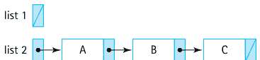

注意，链表中“最后一个”节点上的 link 值始终为 null。当我们递归地处理链表时，处理这个 null 值通常是一个基础情况。

### 遍历链表

递归遍历链表以访问每个元素并执行某种处理是一种常见操作。假设我们想要打印列表的内容。递归算法是直观的——如果列表为空则什么都不做；否则打印当前节点的信息，打印列表的剩余部分（见图3.1）。


图3.1 递归打印列表

将此算法转换为代码也是直观的：

```java
void recPrintList(LLNode<String> listRef)
// 将 listRef 列表打印到标准输出
{
    if (listRef != null) {
        System.out.println(listRef.getInfo());
        recPrintList(listRef.getLink());
    }
}
```

在 if 语句内部打印 `listRef` 指向的第一个节点，然后通过递归调用打印列表的剩余部分。当我们到达列表末尾且 `listRef` 为 null 时，跳过 if 语句并停止处理。我们使用三问法来验证 `recPrintList`：

1. **基础情况问题** 当 `listRef` 等于 null 时，我们跳过 if 主体并返回。对于空列表来说，返回什么都是合适的。答案是肯定的。
2. **较小调用者问题** 递归调用传递了 `listRef.getLink()`，它比 `listRef` 指向的列表小。它将传递空列表；如果是的话，它将传递原始列表最后一个节点上的空引用。这是一个基础情况。答案是肯定的。
3. **一般情况问题** 我们假设语句 `recPrintList(listRef.getLink())` 正确地打印了剩余部分；打印第一个元素，接着正确地打印剩余部分，就得到了整个列表。答案是肯定的。

注意，使用迭代（非递归）方法遍历链表也是容易的。当我们在第2节“链表介绍”中首次查看列表时，我们开发了打印链表内容的迭代方法。对比比较这两种方法很有启发性。

#### 迭代

```java
while (listRef != null) {
    System.out.println(listRef.getInfo());
    listRef = listRef.getLink();
}
```

#### 递归

```java
if (listRef != null) {
    System.out.println(listRef.getInfo());
    recPrintList(listRef.getLink());
}
```

迭代版本使用 `while` 循环遍历列表，循环直到遇到列表末尾。同样，递归版本也遍历列表直到到达末尾，但重复是通过递归调用实现的。
我们看到的相同编码模式可以解决许多与遍历链表相关的其他问题。例如，考虑以下方法返回作为参数传递的链表中的元素个数，并使用上述建立的相同模式。第一种使用迭代法，第二种使用递归法。

```java
int iterListSize(ListNode<String> listRef)
// 返回 listRef 链表的长度
{
  int size = 0;
  while (listRef != null) {
    size = size + 1;
    listRef = listRef.getLink();
  }
  return size;
}
```

```java
int recListSize(ListNode<String> listRef)
// 返回 listRef 链表的长度
{
  if (listRef == null)
    return 0;
  else
    return 1 + recListSize(listRef.getLink());
}
```


注意，迭代版本声明了一个变量（`size`）来保存计算的中间值。这对于递归版本来说是不必需的，因为中间值是由递归返回语句生成的。

列表问题的一个有趣的变体更清楚地展示了递归的用处，因为它用递归解决比迭代更简单。假设我们想要反序打印列表——先打印最后一个节点的信息，然后打印倒数第二个节点的信息，以此类推。在打印正向方向时，递归算法是直观的（至少如果你熟悉递归的话是）——如果列表为空，则什么都不做；反转从第二个到倒数节点的信息，然后打印第一个节点的信息（见图 3.2）。

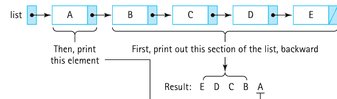

图 3.2 递归反序打印列表

相应的代码与 `recPrintList` 几乎相同——我们只需要交换 `if` 语句中两个语句的顺序，当然，我们还更改了方法的名称：

```java
void recPrintList(LLNode<String> listRef)
    // 以反序将 listRef 链表的内容打印到标准输出
{
    if (listRef != null) {
        recPrintList(listRef.getLink());
        System.out.println(listRef.getInfo());
    }
}
```

如果你使用迭代法，尝试解决这个列表打印问题并没有那么容易。一种方法是遍历列表并统计元素，反复遍历列表到下一个要打印的元素，仔细地一个一个地计数。这是一个 O(N²) 方法。一种更高效的方法是只遍历列表一次，将每个元素推入栈中。当你到达列表末尾时，反复从栈中弹出元素并打印它们。使用栈来“替换”递归并不不寻常——我们将在第 3.7 节“消除递归”中回到这一想法上。

## 转换链表

本小节考虑了转换链表的操作，例如添加或删除元素。使用递归方法对链表进行此类更改比仅仅遍历列表要复杂得多。我们将在示例中使用字符串列表。

假设我们想要创建一个递归方法 `recInsertEnd`，它接受一个 `String` 类型参数和一个列表（类型为 `LLNode<String>` 的变量），并将字符串插入列表的末尾。我们推理认为，如果列表的 `link` 不为空，则我们需要将字符串插入到 `link` 指向的节点中——这就是我们的递归调用。我们的基本情况是 `link` 为空，这表示插入发生在列表的末尾。根据这一推理，我们设计了以下代码：

```java
void recInsertEnd(String newInfo, LLNode<String> listRef)
    // 将 newInfo 添加到 listRef 链表的末尾
{
    if (listRef.getLink() != null) {
        recInsertEnd(newInfo, listRef.getLink());
    } else
        listRef.setLink(new LLNode<String>(newInfo));
}
```

但是，这种方法存在问题。你看到了吗？

通常情况下代码是有效的。假设我们有一个包含 "Ant" 和 "Bat" 的字符串列表 `myList`。

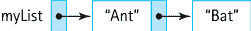

我们想要将 "Cat" 插入列表末尾，我们调用 `recInsertEnd("Cat", myList)`；在方法内部，我们得到了如下安排：

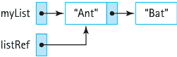

追踪代码并不困难，你可以看到因为 "Ant" 节点（`listRef` 指向的节点）`link` 不为空，将执行 `if` 语句。因此，再次调用 `recInsertEnd`，这次指向 "Bat" 节点：

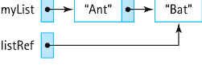

在这种情况下，执行 `recInsertEnd` 的 `else` 语句，因为 "Bat" 节点的 `link` 为空，并创建了一个包含 "Cat" 的新节点并添加到列表中。

最后，第一次实例返回了包含 "Ant" 的节点引用，而 `myList` 被设置为该值（再次，它已经引用了该节点，所以这里并没有进行任何更改）。


在本节中开发的所有代码都包含在 `cho3.apps` 包的 `LinkedListRecursive.java` 文件中。应用程序包含了 `test` 方法，用于测试在大小为 0、1 和 5 的列表上的每个方法。

## 3.5 汉诺塔

汉诺塔是一个展示递归表现力的流行问题。我们只需要几行代码就能解决一个看似复杂的问题。

你最早的玩具之一可能是一个带有柱子的塑料底座，柱上有不同直径的彩色环。如果我们对移动方式设置一些限制，就可以将环从一个柱移动到另一个柱。这是一个经典的益智游戏，被称为汉诺塔。游戏开始时，所有的环按大小放在第一根柱上，最小的在顶部。目标是逐次将环移动到第三根柱。关键在于，环不能放在直径比它小的环之上。中间的柱可以作为辅助柱，但它必须在游戏开始和结束时使用。环一次只能移动一个。我们的任务是创建一个方法，打印出解决此谜题所需的移动序列。

### 算法

为了深入理解我们如何解决汉诺塔问题，请考虑一个从四根柱开始的谜题，如图 3.3a 所示。我们的任务是在辅助柱 2 的帮助下，将四个环从起始柱（1 号）移动到目标柱（3 号）。

事实证明，问题的限制以及我们无法重建配置（这可能导致我们陷入无限循环）使得每一次移动都显而易见。对于第一次移动，我们移动最小的环，因此在图 3.3b 所示的配置中将其移动到柱 2。接下来，因为不需要再次移动最小的环，我们将最小的环从柱 1 移动到柱 3，如图 3.3c 所示的配置。你可以遵循图 3.3 中的所有 15 步所需的移动。图中的小箭头指向最近的目标柱。

注意图 3.3h 中谜题的中间配置，在进行了七次移动后，这些移动由为为

### 汉诺塔传说

汉诺塔谜题由 Edouard Lucas 于 1883 年发明。谜题背后的传说说，汉诺存在一座寺庙，僧们在那里日夜工作以解决该问题的版本。僧们每秒移动一次。当他们完成任务时，世界将会结束！不过担心，他们的塔由 64 个环组成，需要很多移动才能解决。多少次移动，需要长时间？答案请见练习 22。

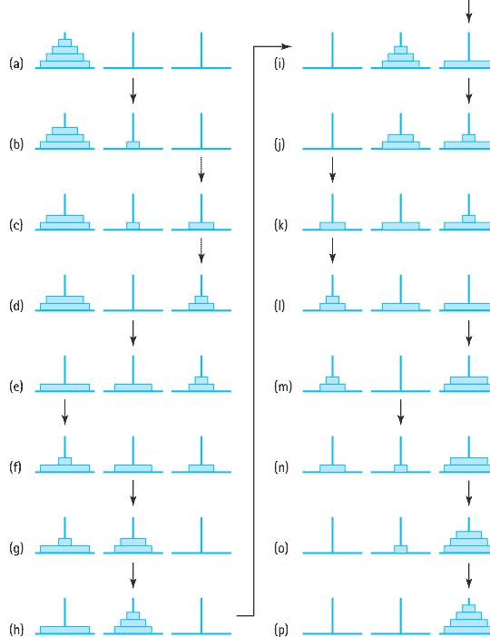

图 3.3 四个环的汉诺塔解决方案

图 3.3a 到 3.3h。此时，我们已经成功地使用柱 3 作为辅助柱，将三个最小的环从柱 1 移动到柱 2，总结如下。


这允许我们将最大的环从柱 1 移动到柱 3。


你能看到为什么在此时我们已经完成了完整解决方案的一半吗？剩下的的是使用柱 1 作为辅助柱，将三个最小的环从柱 2 移动到柱 3。这项任务通过图 3.3i 到 3.3p 所示的七次移动完成。

## 第3章 递归

这七次移动本质上与前七步中进行的移动相同，尽管起始、结束和辅助柱有所不同（比较小箭头的模式以验证这一陈述）。最后七次移动在这里总结如下。


我们通过以下步骤解决四个环的谜题：首先将三个环从柱 1 移动到柱 2，将最大的环从柱 1 移动到柱 3，最后将三个环（再次）从柱 2 移动到柱 3。哈！我们通过解决三个环的谜题来解决四个环的谜题——实际上是通过两次解决三个环的谜题。

### 将 n 个环从起始柱移动到目标柱

- 将 n–1 个环从起始柱移动到辅助柱
- 将第 n 个环从起始柱移动到目标柱
- 将 n–1 个环从辅助柱移动到目标柱

### 方法

让我们写一个实现该算法的递归方法。我们看到递归运行良好，算法的第一步和第三步基本上复制了整体算法，尽管环的数量减少了。

```java
public static void doTowers(int n, int startPeg, int endPeg, int auxPeg) {
    if (n == 1) {
        System.out.println("Move ring 1 from peg " + startPeg + " to peg " + endPeg);
    } else {
        doTowers(n - 1, startPeg, auxPeg, endPeg);
        System.out.println("Move ring " + n + " from peg " + startPeg + " to peg " + endPeg);
        doTowers(n - 1, auxPeg, endPeg, startPeg);
    }
}
```

## 程序

我们将 `doTowers` 方法封装在一个名为 `Towers` 的驱动类中。它提示用户输入环的数量，并使用 `doTowers` 输出解决方案。我们的程序确保调用 `doTowers` 时传入的是正整数。`Towers` 应用位于 `ch03.apps` 包中。以下是使用四个环运行时的输出：

```
Input the number of rings: 4
Towers of Hanoi with 4 rings
Move 1 from peg 1 to peg 2
Move 2 from peg 1 to peg 3
Move 1 from peg 2 to peg 3
Move 3 from peg 1 to peg 1
Move 1 from peg 3 to peg 2
Move 2 from peg 3 to peg 2
Move 1 from peg 1 to peg 3
Move 4 from peg 1 to peg 3
Move 1 from peg 2 to peg 3
Move 2 from peg 2 to peg 1
Move 1 from peg 3 to peg 1
Move 3 from peg 2 to peg 3
Move 1 from peg 1 to peg 2
Move 2 from peg 1 to peg 3
Move 1 from peg 2 to peg 3
```

尝试自己运行一下程序。但要小心——由于 `doTowers` 方法内部有两个递归调用，程序生成的输出量会迅速增长。事实上，每当你在起始柱上增加一个环时，输出量就会增加倍倍。在作者的系统上运行 `Towers`，输入参数为 16 个环，生成了一个 10 兆的输出文件。

## 3.6 分形

正如第 1 章中“生成图像”框中所讨论的，数字化图像可以被视为元素像素的二维数组。在本节中，我们将研究一种使用简单递归程序来生成有趣、美丽图像的方法。

### 实用分形

分形不仅有趣且悦眼，还有实际的用途。计算机图形利用它们来帮助生成真实的场景，工程师利用它们来建造坚固的天线，科学家利用它们对天气、流体动力学和海岸线等进行建模。

人们定义“分形”术语的方法有很多种。数学家研究连续但不可微的函数，科学家注意到自然界中重复某些统计测量值的模式，而工程师则创建分级的自相似结构。为了我们的目的，我们将分形定义为一个由自身的较小版本组成的图像。使用递归可以很容易生成有趣且悦眼的分形。

### T 正形分形

在正方形画布的中心，我们画一个白色正方形，大小为画布的四分之一（见图 3.4a）。然后我们再画四个正方形，每个中心都位于原始白色正方形的一个角，每个大小为原始白色正方形的四分之一，即画布的八分之一（见图 3.4b）。对于这些新正方形中的每一个，我们执行相同的操作，在它们的每个角上画更小的正方形（见图 3.4c）。再次如此（见图 3.4d）。我们继续这种递归方案，画越来越小的正方形，直到我们无法再画任何正方形，直到我们的整数除法结果为零（见图 3.4e 和图 3.5a 中的较大版本）。理论上，使用实数除法我们可以继续将正方形的大小除以四。这就是为什么人们有时将分形看作无限递归的。

我们得到的图像被称为 T 正形分形，因为在其中我们可以看到让我们联想到该名称对应的制图工具的形状。创建 T 正形的方法与创建一些更为人知的分形的方法相似，特别是科赫雪花和谢尔宾斯基三角形，它们都基于递归绘制等边三角形；谢尔宾斯基地毯也基于递归绘制正方形，但它的特征是每个正方形都沿着原始正方形的边界绘制。

以下程序创建一个 1000 × 1000 像素的文件，包含一个 T 正形分形图像。存储生成图像的文件名作为命令行参数提供。程序“涂满”整个图像为黑色，然后调用递归的 `drawSquare` 方法，传入“第一个”正方形的坐标和边长。`drawSquare` 方法计算正方形的顶点，“涂满”白色正方形，然后递归地调用自己，将其四个角的坐标和所需的较小边长作为参数传递。这种调用模式不断重复，直到达到基本情况。当要绘制的正方形边长大小为 0 时，发生基本情况。运行程序的视觉结果见图 3.5a。


图 3.4 绘制 T 正形的阶段 (a) (b) (c) (d) (e)

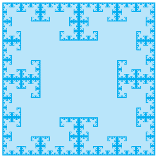

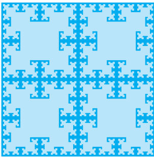

(a) 输出来自 TSSquare

(b) 输出来自 TSSquareThreshold 10 500

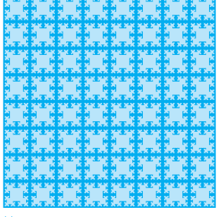

(c) 输出来自 TSSquare

(d) 输出来自 TSSquare

(e) 输出来自 TSSquare

(f) 输出来自 TSSquare

### 变体

通过稍微修改我们的 `tquare.java` 程序，我们可以生成下面描述的变体。图 3.5 显示了生成的某些示例。图的 (a) 部分显示了原始 `tquare` 程序的输出。`TsquareThreshold.java` 应用允许用户提供两个参数，都是 `int` 类型，指示何时开始何时停止。第一个参数指示内部阈值——如果小于或等于此值则什么都不做。第二个参数提供了一个外部阈值。大于或等于此值的正方形也不绘制——尽管在其角上的递归调用 `drawSquare` 仍然会执行。抑制较大的正方形允许更多细层次的分形细节出现。图 3.5(d) 显示了 `TsquareGray` 使用命令行参数 10, 500 的输出。相同的参数被用于生成正上方图中 (b) 部分的完全黑白的图像。你能看到这两个图之间的联系吗？

## 3.7 消除递归

某些语言并不支持递归。有时，即使语言支持递归，由于递归解决方案在空间或时间上的成本过高，我们也不希望使用它。本节将介绍两种经常用于替换递归的通用技术：消除尾递归和直接使用栈。我们首先查看递归是如何实现的。理解递归的实现机制有助于我们理解如何开发非递归解决方案。

## Java 编程模型

Java 通常被用作一种解释型语言。当你编译一个 Java 程序时，它会被翻译成一种称为 Java 字节码的语言；程序的代码版本会被解释。当你运行一个 Java 程序时，解释器会根据字节码生成机器码并在你的计算机上执行该机器码。你也可以使用 Java 编译器将你的字节码文件直接翻译成机器码。在这种情况下，你可以直接在计算机上运行程序，而无需使用解释器。无论哪种情况，你的程序都必须在某个时刻转换为你计算机的机器语言。

在本节中，我们将讨论程序的机器表示。使用大多数其他高层语言的程序员通常使用编译器，将程序直接翻译成机器语言。

## 递归的工作原理

将高层程序翻译成机器语言是一个复杂的过程。为了方便我们对递归的研究，我们对这一过程做出了一些简化假设。此外，我们使用了一个名为 `Kids` 的简单程序，它是面向对象的；但它并不是一个良好的程序设计示例。然而，它为当前的讨论提供了一个实用的例子。

## 静态存储分配

将高层语言程序翻译成可在计算机执行的机器码的编译器必须执行两个功能：

1. 为程序变量留出空间。
2. 将高层可执行语句翻译成等效的机器语言语句。

通常，编译器为不同的程序子单元模块化地执行这些任务。考虑以下程序。

```java
package ch03.apps;

public class Kids {
    private static int countKids(int girlCount, int boyCount) {
        int totalKids;
        totalKids = girlCount + boyCount;
        return (totalKids);
    }

    public static void main(String[] args) {
        int numGirls;
        int numBoys;
        int numChildren;
        numGirls = 12;
        numBoys = 13;
        numChildren = countKids(numGirls, numBoys);
        System.out.println("Number of children is " + numChildren);
    }
}
```


# 编译器与存储分配

编译器可以为此程序创建两个独立的机器码单元：一个用于 `countKids` 方法，另一个用于 `main` 方法。每个单元都将包含变量的空间，以及实现其高层代码的机器语言语句序列。

在我们简单的 Kids 程序中，`countKids` 方法的唯一调用来自主程序。程序的控制流如下：

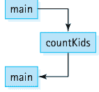

编译器可能会在内存中这样安排与 Kids 程序对应的机器码，存储如下：

- `main` 方法变量的空间
- 初始化变量的 `main` 方法代码
- 跳转到 `countKids` 方法
- 打印信息的 `main` 方法代码
- 退出
- `countKids` 方法参数和局部变量的空间
- `countKids` 方法代码
- 返回到主程序

这种静态分配是最简单的方法。但它不支持递归。你看出为什么了吗？

`countKids` 方法的空间是在编译时分配的。当该方法被调用一次，并在下一次再次被调用之前总是返回时，这种策略是有效的。递归方法在返回之前可能会被反复调用。第二次及随后的调用从哪里为它们的参数和局部变量找到空间呢？每次调用都需要空间来持有它们自己的值。这些空间不能被静态分配，因为调用次数在编译时是未知的。仅使用静态分配的语言无法支持递归。

## 动态存储分配

动态分配在方法调用时为其提供内存空间。局部变量在运行之前不会与实际内存地址关联。

让我们看看在 Java 中这如何工作的简化版本。（实际实现取决于特定系统。）当一个方法被调用时，它需要保留其参数、局部变量和返回地址（方法完成执行后计算机返回到调用代码中的地址）。这个空间被称为激活记录或栈帧。考虑我们的递归阶乘方法：

```java
public static int factorial(int n) {
    if (n == 0)
        return 1;                       // 基础情况
    else
        return (n * factorial(n - 1));   // 通用情况
}
```

方法 `factorial` 的简化版激活记录可能具有以下“声明”：

```java
class ActivationRecordType {
    ReturnType returnAddr;           // 返回地址
    int result;                      // 返回值
    int n;                           // 参数
}
```

每次对方法的调用（包括递归调用）都会导致 Java 运行时系统为新的激活记录分配额外的内存空间。在方法内部，对参数和局部变量的引用使用激活记录中的值。当方法结束，激活记录空间会被释放。

当调用第二个方法时，第一个方法的激活记录会发生什么？考虑一个主方法调用 `proc1`，然后 `proc1` 调用 `proc2` 的程序。当程序开始执行时，会生成“main”激活记录。

## 尾调用消除

当递归调用是递归方法中最后执行的操作时，会发生有趣的情况。递归调用会导致一个激活记录被放入运行时栈；该栈将包含被调用方法的参数和局部变量。当递归调用执行完毕，运行时栈被弹出，之前变量的值被恢复。执行从调用递归调用的地方继续。由于没有更多要执行的内容，方法在恢复局部变量后结束。这些局部变量并不需要保存。只有调用本身及其返回值是重要的。

在这种情况下，我们并不需要递归。递归调用序列可以用循环结构替换。例如，对于 3.1 节“递归定义、算法和程序”介绍的阶乘方法，递归调用是方法中的最后一个语句：

```java
public static int factorial(int n) {
    if (n == 0)
        return 1; // 基础情况
    else
        return (n * factorial(n - 1)); // 通用情况
}
```

现在我们研究如何将递归版本转换为迭代版本。

对于迭代解决方案，我们需要声明一个变量来持有计算的中间值。我们将其称为 `retValue`，因为它最终持有要返回的最终值。

查看递归解决方案的基础情况，可以看到赋值给 `retValue` 的初始值。我们必须将其初始化为 1，即基础情况下的返回的值。这种迭代方法在循环体未进入的情况下工作是正确的。

现在我们将注意力转向循环体。循环的每次都应该对应一次递归调用所执行的计算。因此，我们将我们的中间值 `retValue` 与变量 `n` 的当前值相乘。同时，在每次循环中，我们将 `n` 的值减 1——此操作对应于每次调用中较小的调用者顺序。

最后，我们需要确定循环的终止条件。由于递归解决方案有一个基础情况——如果参数 `n` 为 0——因此我们只有一个终止条件。只要没有满足基础情况，我们就继续处理循环：

```java
while (n != 0)
```

```java
private static int factorial(int n) {
    int retValue = 1; // 返回值
    while (n != 0) {
        retValue = n * retValue; // 修正：原文为 n * n，逻辑应为 n * retValue
        n--;
    }
    return retValue;
}
```

将所有内容整合在一起，我们得到了该方法的迭代版本：

递归调用作为最后执行的语句的情况被称为尾递归。尾递归可以通过上述概述的方法用迭代来替换。事实上，某些优化编译器在生成低级代码时会自动移除尾递归。

# 直接使用栈

当递归调用不是递归方法中最后一个执行的操作时，我们不能简单地用循环替换递归。例如，考虑我们在 3.4 节“链表的递归处理”中开发的 `recPrintList` 方法，该方法用于反序链接链表：

```java
void recPrintList(LLNode<String> listRef) {
    // 将 listRef 链表的内容按反序
    // 输出到标准输出
    if (listRef != null) {
        recPrintList(listRef.getLink());
        System.out.println(listRef.getInfo());
    }
}
```

在这里，我们进行递归调用，然后打印当前节点的值。在这样的情况下，为了消除递归，我们可以将系统执行激活记录堆栈替换为程序执行中间值的堆栈。

## 3.8 何时使用递归解决方案

对于反向打印示例，我们必须正向遍历列表，将每个节点的信息保存到栈中，直到到达列表的末尾（当我们的当前引用等于 `null` 时）。到达列表末尾后，我们打印最后一个节点的信息。然后，使用保存在栈上的信息，回溯（弹出）并再次打印，再次回溯，以此类推，直到我们打印完列表中第一个元素的信息。

以下是代码：

```java
static void iterReverseList(LLNode<String> listRef)
    // 将 listRef 链表的内容按反序
    // 输出到标准输出
{
    Interface<String> stack = new LinkedStack<String>();
    while (listRef != null) // 将信息放入栈中
    {
        stack.push(listRef.getInfo());
        listRef = listRef.getLink();
    }

    // 反序获取引用并打印元素
    while (!stack.isEmpty())
    {
        System.out.println(stack.top());
        stack.pop();
    }
}
```

注意，程序员编写的栈版本的反向打印操作比其递归版本要长得多，特别是当我们添加栈方法 `push`、`pop`、`top` 和 `isEmpty` 的代码时。这种额外的长度是因为需要显式地对信息进行堆栈和解包。知道递归使用了系统栈，我们可以看到反向打印的递归算法也在使用栈——一个由系统自动提供的不可见栈。这就是递归问题解决方案之所以优雅的秘密。

本节提出的反向方法包含在 `cho3.apps` 包的 `LinkedListReverse.java` 文件中。该应用程序包含了递归和迭代反向打印方法，以及用于在大小为 0、1 和 5 的列表上测试每个方法的测试代码。

在决定是否使用递归解决方案解决问题时，我们可能会考虑几个因素。主要问题是解决方案的效率和清晰度。

### 递归开销

在计算机时间和空间方面，递归解决方案通常比非递归解决方案成本更高。（这并不总是如此；这实际上取决于问题、计算机以及编译器。）由于嵌套的递归方法调用，递归解决方案通常需要“开销”，涉及时间（每次调用涉及处理以释放激活记录和管理运行时栈）和空间（必须存储激活记录）。调用递归方法可能会产生许多层递归调用。例如，调用阶乘的迭代解决方案涉及单次方法调用，导致一个激活记录被放入运行时栈中。调用递归版本的阶乘 $n+1$ 方法会调用 $n+1$ 次，并在运行时栈中推入 $n+1$ 个激活记录。这意味着递归深度为 $O(n)$。除了可以避免创建和移除激活记录的开销外，对于某些问题，系统运行时栈可能没有足够的空间来运行递归解决方案。

### 低效算法

另一个问题是，递归解决方案可能本质上就是低效的。这种低效并不是反映我们如何选择实现算法；相反，它是对算法本身的指控。

#### 组合

考虑从一组物品中可以组成多少个特定大小的组合的问题。例如，如果我们有一组 20 名学生，并想形成一个由五名成员组成小组（子小组），会有多少种不同的小组组合？

可以使用递归数学公式来解决这个问题。假设 $C$ 是组合的总数，$group$ 是总大小，

$$
C(group, members) = \begin{cases} 1, & \text{如果 } members = 1 \\ C(group-1, members) + C(group-1, members-1), & \text{如果 group > members} \end{cases}
$$

该公式的原理是：

- 从 $group$ 个物品中选择 $members$ 个物品的数量，等于从 $group-1$ 个物品中选择 $members$ 个物品（不包括某个特定物品）的数量，加上从 $group-1$ 个物品中选择 $members-1$ 个物品（包括该特定物品）的数量。

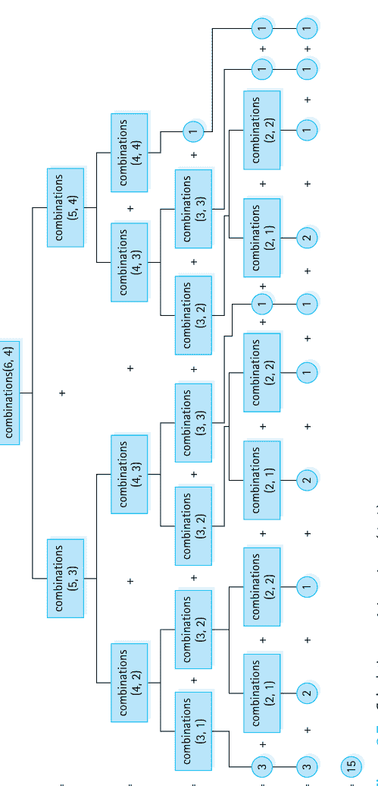

## 总结

递归是一种强大的解决问题技术。如果使用得当，递归可以简化问题的解决，通常会产生更短、更易理解的代码。像计算机中通常一样，权衡是必须的：由于多层方法调用的开销，递归方法在时间和空间上的效率通常较低。这种成本的程度取决于问题本身、计算机系统以及编译器。

问题的递归解决方案必须至少有一个基础基例——即非递归方式定义解决方案的情况。如果没有基础基例，方法将无限递归下去（或至少会耗尽内存）。递归解决方案还包含一个或多个通用情况，其中包含对方法的递归调用。这些递归调用必须涉及“更小的调用者”。在每次递归调用中，必须有一个或多个参数值发生变化，以便将问题重新定义为比上一次调用更小。因此，每次递归调用都会引导解决方案走向基础基例。

许多数据结构，甚至是树，以及数组和链表等简单的结构，都可以被递归处理。递归定义、算法和程序是数据结构学习的关键部分。

## 练习

### 基础（第 3.1 和 3.2 节）

练习 1 到 3 使用以下数学函数（假设 $N \ge 0$）：

- Sum(N) = $1 + 2 + 3 + \dots + N$
- BiPower(N) = $2^N$
- TimesFive(N) = 5N

1. 递归定义
   a. Sum(N)
   b. BiPower(N)
   c. TimesFive(N)

2. 创建一个递归程序，提示用户输入一个非负整数 $N$ 并输出。
   a. Sum(N)
   b. BiPower(N)
   c. TimesFive(N)

在你的递归方法的开头注释中描述任何输入约束。

3. 使用“三段提问法”验证你为练习 2 创建的程序。

练习 4 到 5 使用以下方法：

```java
int puzzle(int base, int limit) {
  if (base > limit)
    return -1;
  else
    if (base == limit)
```


# 递归练习题

## 递归基础练习

### 4. 识别
a. `puzzle` 方法的基础基例  
b. `puzzle` 方法的通用情况  
c. 传递给 `puzzle` 方法的参数约束

### 5. 显示以下对递归 `puzzle` 调用将输出的内容。
a. `System.out.println(puzzle(14, 10));`  
b. `System.out.println(puzzle(4, 7));`  
c. `System.out.println(puzzle(0, 0));`

### 6. 给定以下方法：
```java
int exer(int num) {
  if (num == 0)
    return 0;
  else
    return num + exer(num + 1);
}
```
a. 该方法在作为参数传递的值是否有约束，以通过“更小的调用者”测试？  
b. `exer(7)` 是有效调用吗？如果是，方法返回什么？  
c. `exer(0)` 是有效调用吗？如果是，方法返回什么？  
d. `exer(-5)` 是有效调用吗？如果是，方法返回什么？

### 7. 对于以下每个递归方法，识别其基础基例、通用情况以及参数值的约束，并解释该方法的作用。

a. `int power(int base, int exponent)`
```java
{
  if (exponent == 0)
    return 1;
  else
    return (base * power(base, exponent-1));
}
```

b. `int factorial (int n)`
```java
{
    if (n > 0)
        return (n * factorial (n - 1));
    else
        if (n == 0)
            return 1;
}
```

c. `int recur(int n)`
```java
{
    if (n < 0)
        return -1;
    else if (n < 10)
        return 1;
    else
        return (1 + recur(n / 10));
}
```

d. `int recur2(int n)`
```java
{
    if (n < 0)
        return -1;
    else if (n < 10)
        return n;
    else
        return ((n % 10) + recur2(n / 10));
}
```

### 8. 第 a 和 b 部分描述的方法。提示：使用递归来遍历星号行，但使用 `for` 循环生成行内的星号。

a. 编写递归方法 `printTriangleUp(int n)`，向 `System.out` 打印 n 行星号，第一行一个星号，第二行两个星号，依此类推。例如，如果 n 为 4，最终结果为：
```
*
**
***
****
```

b. 编写递归方法 `printDn(int n)`，向 `System.out` 打印 n 行星号，第一行一个星号，第二行两个，依此类推。例如，如果 n 为 4，最终结果为：
```
****
***
**
*
```

### 9. 两个整数的最大公约数（gcd）基于以下递归算法，即欧里得斯算法：
```java
int gcd(int m, int n) {
  if (n == 0)
    return m;
  else
    return gcd(n, m % n);
}
```
使用递归方法 `gcd(m, n)` 来计算两个正整数的最大公约数。测试以下调用：
- `gcd(54, 24)`
- `gcd(48, 18)`
- `gcd(101, 10)`
- `gcd(120, 15)`
- `gcd(13, 7)`

---

# 第3章 递归

## 3.4 链表的递归处理

### 14. 此练习题使用了第 3.4 节中定义的 `recPrintList`、`recListSize` 和 `recRevPrintList` 方法。假设 `list` 类型为 `LinkedList<String>`，并指向包含以下字符串的链表开头，顺序如下：alpha beta delta comma。对于以下每一项，请列出由初始调用产生的递归调用序列。在答案中注明作为调用参数的 `LLNode` 中包含的信息，例如：“`recPrintList(指向包含 delta 的节点)`”。

a. 初始调用为 `recPrintList(list)`（换言之 `recPrintList(指向包含 alpha 的节点)`）。  
b. 初始调用为 `recListSize(list)`（换言之 `recListSize(指向包含 alpha 的节点)`）。  
c. 初始调用为 `recRevPrintList(list)`（换言之 `recRevPrintList(指向包含 alpha 的节点)`）。

### 15. 你必须为一个编程课程评分。目前课程正在进行，学生们被分配了这项任务：编写一个递归的 `sumSquares` 方法，通过一个 `Integer` 元素链表的引用，并返回这些元素的平方和。列表节点均为 `LLNode<Integer>` 类。链表中的对象均为 `Integer` 类。示例：

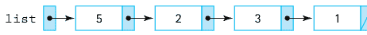

`sumSquares(list)` 产生 (5 × 5) + (2 × 2) + (3 × 3) + (1 × 1) = 39

假设列表不为空。你收到了多种解决方案。对以下方法进行评分，并在发现错误的地方标记出来。

a. 
```java
int sumSquares(LLNode<Integer> list) {
    return 0;
    if (list != null)
        return (list.getInfo() * list.getInfo()) + sumSquares(list.getLink());
}
```

b. 
```java
int sumSquares(LLNode<Integer> list) {
    int sum = 0;
    while (list != null) {
        sum = list.getInfo() + sum;
        list = list.getLink();
    }
    return sum;
}
```

c. 
```java
int sumSquares(LLNode<Integer> list) {
  if (list == null)
    return 0;
  else
    return list.getInfo() * list.getInfo() +
    sumSquares(list.getLink());
}
```

d. 
```java
int sumSquares(LLNode<Integer> list) {
  if (list.getLink() == null)
    return list.getInfo() * list.getInfo();
  else
    return list.getInfo() * list.getInfo() +
    sumSquares(list.getLink());
}
```

e. 
```java
int sumSquares(LLNode<Integer> list) {
  if (list == null)
    return 0;
  else
    return (sumSquares(list.getLink())) *
    sumSquares(list.getLink());
}
```

对于练习 16 到 19，假设我们有一个按顺序排序的 `Integer` 列表。链表通过值进行引用，其类型自然为 `LLNode<Integer>`。例如，假设 `values` 指向一个包含 3, 6, 6, 9, 12, 15, 18, 19 和 20 的列表。你可以并假设该列表是非递减序排列的。对于每个练习，你还应该创建一个驱动程序，以证明你的新方法运行正确。

### 16. 编写一个递归方法 `numEvens(LLNode<Integer> list)`，统计列表中包含多少个偶数。对于我们的示例列表 `numEvens(values)` 将返回 5（偶数是 6, 6, 12, 18 和 20）。

### 17. 编写一个递归方法 `contains(int target, LLNode<Integer> list)`，如果列表包含 `target` 则返回 true，否则返回 false。对于我们的示例列表 `contains(15, values)` 将返回 true，而 `contains(10, values)` 将返回 false。

### 18. 编写一个递归方法 `remove(int target, LLNode<Integer> list)`，从列表中删除所有 `target` 出现，并返回新列表的引用。对于我们的示例列表，语句
```java
values = remove(6, values);
```
将导致 `values` 指向列表 3 9 12 15 18 19 和 20。如果 `target` 不在列表中，则列表保持不变。

### 19. 编写一个递归方法 `insertOrdered(int target, LLNode<Integer> list)`，将 `target` 添加到 `list` 所指的有序列表中，使链表保持排序，并返回新列表的引用。对于我们的示例列表，语句
```java
values = insertOrdered(16, values);
```
将导致 `values` 指向列表 3 6 6 9 12 16 18 19 和 20。

## 3.5 汉诺塔

### 20. `doTowers` 方法的参数 `n` 参数的约束条件是什么？如果不满足约束会发生什么？

### 21. 修改汉诺塔程序以执行以下操作：
a. 统计环的数量并打印移动序列。使用一个静态 `int` 变量 `count` 来保存移动次数。反复提示用户输入环的数量并报告结果，直到用户输入小于 0 的数字。

### 22. 使用你的第 21 题程序回答以下问题：
a. 根据给定的环数填充求解所需的移动次数表格。

| 环数 (Rings) | 移动次数 (Moves) |
|---|---|
| 1 | |
| 2 | |
| 3 | |
| 4 | |
| 5 | |
| 6 | |

b. 描述你在表中看到的移动次数规律。  
c. 假设 n > 0，使用公式定义移动 n 个环所需的移动次数。  
d. 假设你有一个 11 个环的物理汉诺塔问题。如果移动一个环从一个盘到另一个盘需要一秒钟，完成它需要多久？  
e. 在 Java 中，`int` 类型使用 32 位表示从 -2,147,483,648 到 2,147,483,647 的整数。通过实验你的程序，找出在“溢出”之前程序能处理的最大环数。  
f. 对于给定的环数，报告的移动次数是多少？距离 `int` 最大值有多远？  
g. 如果求解 64 个环，需要多少次移动？按照每秒移动一次的速度，完成需要多久（世界末日！）？

### 23. 变体汉诺塔：在这个新版本的汉诺塔问题中，我们增加了一个额外约束：每次移动必须使用中间盘。例如，如果盘标记为 1, 2 和 3（从左到右），且从两个环 1 和 2（较小的在盘 1 上）开始将它们移动到盘 3 将执行以下移动：从 1 到 2 移动环 1，从 2 到 3 移动环 1，从 1 到 2 移动环 2，从 3 到 2 移动环 1，从 1 到 2 移动环 1，从 1 到 3 移动环 2，从 2 到 3 移动环 1，从 3 到 2 移动环 1，从 2 到 3 移动环 2，从 3 到 2 移动环 1，从 2 到 3 移动环 1。注意！每次移动都使用盘 2。

a. 编写一个名为 `TowersVariation` 的程序，类似于汉诺塔程序，提示用户输入环的数量并打印求解变体问题的移动序列。  
b. 修改你的程序，使其统计移动次数而不是移动序列。使用静态 `int` 变量保存移动次数。你的程序提示用户输入环的数量并报告结果，直到用户输入小于 0 的数字。  
c. 创建一个表格，比较求解标准问题和变体问题所需的移动次数（1 到 10 个环）。

## 3.6 分形

### 24. 创建一个应用程序 `DiminishingSquares`，接受命令行参数 `n` 并输出一个大小为 `n × n` 的星号“正方形”，随后是 `(n-1)×(n-1)`，以此类推，直到绘制 1 × 1 的正方形。你的应用程序应该包含一个递归方法 `drawSquares(int side)`，该方法由 `main` 方法调用一次并处理所有输出。例如，如果程序的参数是 3，输出将是：
```
***
***
**
**
*
```

### 25. 本节介绍了三个分形绘制应用程序。这里要求你对这些程序进行一些修改。某些修改需要对 Java `Color` 类的知识（你可以在 Oracle 网站找到它）。

a. 修改 `TSquare` 创建 `Square01`，使其每隔一个层只绘制正方形，因此在第一层绘制最大的正方形，跳过第二层的四个较小正方形，在第三层绘制八个较小正方形，以此类推。  
b. 修改 `TSquare` 创建 `Square02`，使其背景和正方形使用有趣的颜色（而不是黑色白色）。  
c. 修改 `TSquare` 创建 `Square03`，使其背景黑色，奇数层正方形使用红色，偶数层使用黄色。可以尝试不同的颜色组合，直到找到你喜欢的。  
d. 修改 `TSquareGray` 创建 `SquareGray01`，使其在每一层使用随机颜色。  
e. 修改 `TSquareGray` 创建 `SquareGray02`，使其为每个正方形使用随机颜色。  
f. 修改 `TSquareGray` 创建 `SquareGray03`，使其使用一致的模式。通过数学模式找出如何变化每层使用的颜色。

### 26. 谢尔宾斯基地毯是一个基于递归正方形的平面分形。

a. 以 `TSquare.java` 为指南，创建一个名为 `SierpinskiCarpet.java` 的应用程序。这种分形将原始正方形划分为九个全正方形，本质上是在中心正方形中创建一个 3 × 3 的小正方形网格。递归地在每个外部正方形上重复划分和填充。  
b. 按照上一个问题的描述，尝试灰色调和颜色。

### 27. 设计你自己的图像生成程序，使用某种类型的递归。也许你的班可以举办一次艺术展。

## 3.7 消除递归

### 28. 解释以下术语的含义：
a. 运行时栈 (Run-time stack)  
b. 静态存储分配 (Static storage allocation)  
c. 动态存储分配 (Dynamic storage allocation)  
d. 激活记录 (Activation record)  
e. 尾递归 (Tail recursion)

### 29. 解释动态存储分配与递归之间的关系。

### 30. 为练习 9 中的欧几里得程序创建一个迭代版本。利用你在科学课中学到的消除尾递归的知识来设计你的迭代方法。

### 31. 实现一个程序，反复要求用户输入一个正整数，并输出该输入的阶乘。你的程序应该基于我们对事实问题的递归解决方案，但不要使用递归，而应该使用栈。

## 3.8 何时使用递归解决方案

### 32. 使用 3.8 节中的组合方法：
a. 创建一个程序，反复提示用户输入两个整数 N 和 M，并输出从 N 个元素中选取 M 个元素的组合数。  
b. 增强你的程序，使其在确定每个结果时输出组合方法被调用的次数。  
c. 使用不同的输入值变体对你的增强程序进行实验。就你的实验结果写一份简短报告。

### 33. 斐波纳契数列是一系列整数：
0, 1, 2, 3, 5, 8, 13, 21, 34, 55, 89, ...

看到这个模式了吗？序列中的每个元素都是前两个元素的和。

这是一个用于计算序列中第 n 个数的递归函数：
```
Fib(N) = { N, 如果 N=0 或 1; Fib(N-2) + Fib(N-1), 如果 N>1 }
```

a. 编写一个递归方法 `fibonacci`，在传入参数 `n` 时返回第 n 个斐波纳契数。  
b. 编写 `fibonacci` 方法的非递归版本。  
c. 编写一个驱动程序来测试你两个版本的 `fibonacci` 方法。  
d. 比较递归版本和迭代版本的效率。（使用文字，不要使用 O() 符号。）

---

# 第 3 章 递归

## 附加问题

### 34. 以下定义了一个函数，用于计算数字平方根的近似值，从近似答案 (approx) 开始，在指定的容差 (tol) 内。
```
sqrRoot(number, approx, tol) {
    if |approx² - number| ≤ tol
        return approx;
    else
        return sqrRoot(number, (approx² + number) / (2 * approx), tol);
}
```
a. 如果该函数要正常工作，对参数的值施加什么限制？  
b. 编写一个递归方法 `sqrRoot` 实现该函数。  
c. 编写 `sqrRoot` 方法的非递归版本。  
d. 编写一个驱动程序来测试该方法的递归和迭代版本。

### 35. 回文是一个正反读读都相同的字符串。例如，“otto”和“never odd or even”都是回文。在判断一个字符串是否为回文时，我们忽略不是字母的字符。

a. 编写回文的递归定义。（提示：考虑如果你移除回文的首字母和最后一个字母会得到什么。）  
b. 你的定义的基准情况是什么？


- c. 根据你的定义编写一个递归程序，反复要求用户输入一个字符串并报告其是否为回文。
- d. 编写一个执行相同功能的迭代程序。
- e. 在时间及空间效率上比较你的两个程序。
- 36. 创建一个程序，使用 Java 类库提供的方法来探索文件夹和文件。（提示：`File` 类是一个很好的起点）特定文件的路径将作为命令行参数提供给你的程序。你的程序应执行以下每项任务：
  - a. 向标准输出“打印”参数文件夹中所有文件的列表以及它们的大小，以及所有文件夹的列表。对于每个文件夹，包含其所有文件（包括大小），只要有子文件夹需要列出，就“递归地”执行此。你的输出应该以一种具有视觉美的方式显示文件夹和文件的层级结构。
  - b. 向标准输出“打印”部分生成的列表中最大的文件名称、路径名和大小。
  - c. 创建一份关于你程序的报告，包括程序列表、示例输出以及对创建该程序的体验描述。

## 练习

- 37. 上下文文法 (CFG) 是四元组 `<V, T, P, S>`，其中：
  - `V` 是变量（非终结符）的有限集
  - `T` 是终结符的有限集
  - `P` 是产生式的有限集：
    产生式是如下形式的重写规则：
    ```
    V → α
    ```
    其中 `V` 是非终结符，`α` 是任何字符串

（注：原文后续部分似乎存在截断或重复乱码，上述翻译已根据提供的文本内容进行处理。）

# 4.1 队列


图 4.1 FIFO 先进先出队列

不可访问的。将队列想象成一个线性结构，头部在左端，尾部在右端是非常方便的。然而，我们必须强调队列的“端”是抽象的；它们的“左侧”和“右侧”可能对应也可能不对应队列实现的任何特征。队列的基本属性是其 FIFO 访问。

## 队列操作

书店的示例暗示了适用于队列的两种操作。首先，可以将新元素添加到队列的尾部，这种操作被称为**入队**（`enqueue`）。其次，可以从队列头部移除元素，这种操作被称为**出队**（`dequeue`）。图 4.2 显示了一系列此类操作如何影响被想象为一系列块的队列。

与栈的操作 `push` 和 `pop` 不同，队列的添加和删除操作没有标准名称。`enqueue` 操作有时被称为 `enq`、`enque`、`add` 或 `insert`；`dequeue` 操作也称为 `deq`、`deque`、`remove` 或 `serve`。

## 使用队列

第 2 章讨论了操作系统和编译器如何使用栈。同样，队列也经常用于系统编程目的。例如，操作系统通常会维护一个就绪或正在等待特定事件发生的进程队列。

另一个例子是，计算机系统通常必须为在两个进程、两个程序甚至两个系统之间传输的消息提供一个“持有区域”。

这个持有区域通常被称为“缓冲区”（`buffer`），并通常实现为队列。例如，大量的邮件消息同时到达邮件服务器，这些消息被保存在缓冲区中，直到服务器有时间处理它们。如果它按照它们到达的顺序（即 FIFO）处理消息，那么该缓冲区就是一个队列。

许多应用程序在处理之前需要存储请求。考虑为客户提供服务的应用程序——例如，销售机票或剧院门票。此类应用程序通常使用队列来管理请求。

如书店示例所示，我们的软件队列在现实世界的队列中有对应物。我们排队买比萨、进入电影院、在收费公路上行驶以及乘坐过山车都需要排队。该数据结构的另一个重要应用是帮助模拟和分析现实世界的队列，正如我们将在 4.8 节的示例程序“应用程序：平均等待时间”中看到的那样。

# 4.2 队列接口

本节正式规范了我们的队列 ADT。除了我们支持 `enqueue` 和 `dequeue` 操作而不是 `push`、`pop` 和 `top` 之外，我们还使用了与处理栈 ADT 相同的基本方法：

- 我们的队列是泛型的——特定队列所持有的对象类型由客户端在实例化队列时指定。
- 用于支持我们队列的类被分组在 `ch04.queues` 包中。
- 我们提供了一个观察者操作 `size`，以便应用程序可以确定队列的大小。队列的大小对应用程序可能很重要，因为它可以指示一个元素将在队列中留存多久。
- 我们提供了观察者操作 `isEmpty` 和 `isFull`，以便客户端在适当的情况下，防止自己尝试从空队列中移除元素或向满队列中添加元素。
- 我们创建了 `QueueUnderflowException` 和 `QueueOverflowException` 类。我们创建了一个定义队列方法签名的 `QueueInterface`。队列的实现类应该实现此接口。

这两个异常的代码与第 2 章中两个栈异常的代码完全相同，因此我们在此不再显示它们。与栈一样，应用程序编程人员可以决定在访问队列之前使用 `isFull` 和 `isEmpty` 观察者来防止问题，或者应用程序可以“尝试”访问操作并“捕获并处理”任何异常。

这里是 `QueueInterface`。如你所见，五个队列方法——`enqueue`、`dequeue`、`isEmpty`、`isFull` 和 `size` 的签名。

```java
//
// QueueInterface.java                by Dale/Joyce/Weems                Chapter 4
//
// 实现 T 队列的类的接口。
// 队列是一个“先进先出”的结构。
//
package ch04.queues;

public interface QueueInterface<T> {
    void enqueue(T element) throws QueueOverflowException;
        // 如果此队列满了，抛出 QueueOverflowException；
        // 否则，将元素添加到此队列的尾部。

    T dequeue() throws QueueUnderflowException;
        // 如果此队列为空，抛出 QueueUnderflowException；
        // 否则，从此队列移除头部元素并返回它。

    boolean isFull();
        // 如果此队列满了，返回 true；
        // 否则，返回 false;

    boolean isEmpty();
        // 如果此队列为空，返回 true；
        // 否则，返回 false;

    int size();
        // 返回队列中的元素数量。
}
```

> 这些异常是未检查异常；因此，从语法或运行时错误检查的角度来看，将它们包含在接口中并非必须。我们在接口中显示它们是为了描述我们的预期。

## 队列 ADT

| 方法 | 说明 |
| :--- | :--- |
| `isFull()` | 如果此队列满了，返回 true；否则，返回 false； |
| `isEmpty()` | 如果此队列为空，返回 true；否则，返回 false； |
| `size()` | 返回队列中的元素数量。 |

## 使用示例

正如对栈那样，我们提供了一个简单的队列示例来结束本节。使用 `QueueInterface<String>` 然后实例化为 `ArrayBoundedQueue<String>`。重点强调与创建和相关的代码。此示例与第 8 页的示例相似。

```java
//
// RepeatStrings.java                by Dale/Joyce/Weems                Chapter 4
//
// 队列的示例用法。按进入顺序输出字符串。
//
package ch04.queues;

import ch04.queues.*;
import java.util.Scanner;

public class RepeatStrings {
    public static void main(String[] args) {
        Scanner scan = new Scanner(System.in);

        QueueInterface<String> stringQueue;
        stringQueue = new ArrayBoundedQueue<String>(3);

        String line;

        for (int i = 1; i <= 3; i++) {
            System.out.print("Enter a line of text > ");
            line = scan.nextLine();
            stringQueue.enqueue(line);
        }

        System.out.println("\norder is:\n");
        while (!stringQueue.isEmpty()) {
            line = stringQueue.dequeue();
            System.out.println(line);
        }
    }
}
```

这里是示例运行的输出：

```text
Enter a line of text > the beginning of a story
Enter a line of text > is often different than
Enter a line of text > the end of a story

order is:
the beginning of a story
is often different than
the end of a story
```

# 4.3 基于数组的队列实现

本节介绍了队列 ADT 的两种数组实现：一个实现边界队列，另一个实现无界队列。我们继续通过大写字母表示元素信息来简化我们的某些图表。

注意，章节总结中的图 4.16 显示了支持我们队列 ADT 的所有类和接口之间的关系。

## ArrayBoundedQueue 类

首先我们开发了一个实现固定大小队列的 Java 类。这种队列通常被称为“边界缓冲区”，因为它有限的大小（它是边界的），并且可以用来临时存放信息直到需要为止（它是缓冲区）。我们称之为 `ArrayBoundedQueue`，以承认它使用数组作为内部实现。`Bounded` 是类名的一部分，以将此类与本节后面开发的数组实现无界队列区分开来。

我们的第一个任务是决定如何在数组中存储队列：我们需要一种方法来确定队列的头部和尾部元素。目前有几种可能的替代方案。

### 固定头部设计方法

在栈 ADT 的数组实现中，我们首先将元素插入到数组的第一个位置，将 `topIndex` 设置为 0，然后在随后的 `push` 和 `pop` 操作中调整 `topIndex` 的位置。然而，栈的底部始终是数组中的第一个槽。我们是否可以为队列使用类似的解决方案，将队列头部固定在数组第一个槽中，并让尾部随着新元素的添加而移动呢？

让我们看看如果将第一个元素添加到数组第一个位置，第二个元素添加到第二个位置，依此类推，在执行几次 `enqueue` 和 `dequeue` 操作后发生什么。为了简化本章的图表，我们显示元素位于对应的数组槽内——请记住，实际上，数组槽持有的是元素的引用。在调用四次 `enqueue` 并传入参数 A、B、C 和 D 后，队列看起来如下：

| A | B | C | D | |
|---|---|---|---|---|
| [0] | [1] | [2] | [3] | [4] |

记住，队列的头部固定在数组的第一个槽，队列的尾部随每次 `enqueue` 移动。现在我们从队列取出头部元素：

| | B | C | D | |
|---|---|---|---|---|
| [0] | [1] | [2] | [3] | [4] |

此操作移除了数组第一个槽中的元素并留下了一个空隙。为了保持队列头部固定在数组的顶部，我们需要将队列中的每个元素向前移动一个槽：

| B | C | D | | |
|---|---|---|---|---|
| [0] | [1] | [2] | [3] | [4] |

在这种设计中，`enqueue` 操作与数组栈的 `push` 相同，只需将元素添加到下一个可用的数组槽中。`dequeue` 操作比栈的 `pop` 更复杂，因为队列的剩余元素必须向数组的前部移动。

让我们评估一下这种设计。它的优点是简单且易于编码；它几乎和栈的实现一样简单。虽然队列是从两端访问的而不是像栈那样只有一端，但我们只需要跟踪尾部，因为头部是固定的。只有 `dequeue` 操作更复杂。这种设计的缺点是什么？是 `dequeue` 操作的复杂性和低效。每当我们执行 `dequeue` 时，所有元素都向前移动一个槽，这增加了工作量。

> **实现效率**
>
> 通常情况下，我们尝试从增长分析的角度为 ADT 设计尽可能高效的实现，但并不总是清楚如何衡量效率。有时，效率取决于应用程序如何使用该实现。

这种缺点有多严重？为了做出这种判断，我们必须了解一些队列将如何被使用。如果它将包含大量元素，那么 `dequeue` 时移动元素所需的处理将使这种解决方案变得很糟糕。相反，如果队列只包含少数元素，移动的成本可能并不高。虽然这种设计可以运行并在某些情况下具有可接受的性能，但总体来说，它不是最高效的选择。让我们开发一种可以避免每次 `dequeue` 操作都移动所有队列元素的设计。

### 浮动头部设计方法

在数组中移动元素的需要是因为我们决定将队列头部固定在第一个数组槽中并只移动尾部。如果我们让头部和尾部都移动会怎样？和之前一样，`enqueue` 操作向队列尾部添加元素并调整尾部的位置。但现在 `dequeue` 操作从头部移除元素并只需调整头部的位置。不需要移动元素。然而，我们现在必须跟踪队列头部和尾部的数组索引。

图 4.3 显示了几次 `enqueue` 和 `dequeue` 操作如何影响使用这种方法的队列。

让队列在数组中浮动会在尾部满时产生一个新问题。在我们的第一个设计中，这种情况告诉我们队列满了。现在，当队列未满时，尾部可能会到达数组的末尾（图 4.4a）。

由于数组开头可能有可用空间，解决方案是让元素在数组末尾“环绕”。换句话说，数组可以被视为循环结构，最后一个槽后面是第一个槽（图 4.4b）。例如，为了获取尾部指示器的下一个位置，我们可以使用一个 `if` 语句。假设 `capacity` 代表数组的大小：

```java
if (rear == (capacity - 1))
    rear = 0;
else
    rear = rear + 1;
```

另一种重置 `rear` 的方法是使用取模 (`%`) 运算符：

```java
rear = (rear + 1) % capacity;
```

#### 图 4.3 入队和出队操作的影响（浮动头部/循环数组）

(a) `queue.enqueue('A')`

| | A | | | | front: 0, rear: 0 |
|---|---|---|---|---|---|
| [0] | [1] | [2] | [3] | [4] |

(b) `queue.enqueue('B')`

| | A | B | | | front: 0, rear: 1 |
|---|---|---|---|---|---|
| [0] | [1] | [2] | [3] | [4] |

(c) `queue.enqueue('C')`

| | A | B | C | | front: 0, rear: 2 |
|---|---|---|---|---|---|
| [0] | [1] | [2] | [3] | [4] |

(d) `queue.dequeue()` 返回 'A'

| | | B | C | | front: 1, rear: 2 |
|---|---|---|---|---|---|
| [0] | [1] | [2] | [3] | [4] |

*(注：原文中的 OCR 表格高度破碎；我根据文中描述的队列操作逻辑流重构了结构)。*

### 比较设计方法

循环数组（浮动头部）解决方案没有固定头部那么简单。通过向设计中增加这种复杂性我们获得了什么？通过使用更高效的操作，我们实现了更好的性能。固定头部的 `dequeue` 版本是一个 O(N) 操作。浮动头部设计只需要一些常数时间操作。

我们的实现包含哪些实例变量？我们需要队列元素本身；它们被存储在数组中。根据我们之前的分析，我们必须向类中添加两个实例变量：`front` 和 `rear`。而且对于数组，我们知道其容量是有用的——即队列可以容纳的最大元素数量。容量是由数组的长度提供的。

```java
//
// ArrayBoundedQueue.java                by Dale/Joyce/Weems                Chapter 4
//
// 使用存储队列元素的数组实现 QueueInterface。
// 提供了两个构造函数：一个创建默认容量的队列，另一个允许
// 调用程序指定容量。
//
package ch04.queues;

public class ArrayBoundedQueue<T> implements QueueInterface<T> {
    protected final int DEFCAP = 100; // 默认容量
    protected T[] elements;           // 存储队列元素的数组
    protected int numElements = 0;    // 队列中的元素数量
    protected int front = 0;          // 队列头部索引
    protected int rear;               // 队列尾部索引

    public ArrayBoundedQueue() {
        elements = (T[]) new Object[DEFCAP];
        rear = DEFCAP - 1;
    }
}
```


> 生成了未检查的转换警告，是因为编译器无法确保数组包含 `T` 类的对象——该警告可以安全地忽略。

## 简单性与效率

通常当我们设计更高效的实现时，它也是一种更复杂的方法——从代码复杂性的角度考虑。在某些情况下，效率较低的方法可能更好。简单的设计更容易想象、编码、测试和维护，节省了人类的时间和成本。有时这些节省超过了更高效代码带来的收益。

# 第 4 章 队列 ADT

```java
public ArrayBoundedQueue(int maxSize)
{
    elements = (T[]) new Object[maxSize];
    rear = maxSize - 1;
}
```

如你所见，我们的类包含了用于有界结构的两个标准构造函数：一个由客户端程序指定最大大小，另一个默认设置最大大小为 `DEFCAP`（默认容量为 100）。请记住，由于 Java 转换器不会生成对泛型类型的引用，我们的代码必须在构造函数中的 `new` 语句中指定 `Object`。因此，我们将数组声明为 `T` 类数组，但将它们实例化为 `Object` 类数组。然后，为了确保进行预期的类型检查，我们将数组元素强制转换为 `T` 类。尽管这种方法有些笨拙且通常会产生编译器警告，但这就是我们在 Java 中使用数组创建泛型集合的方法。

`rear` 变量初始化为最后一个索引。由于封装方法（wrapper approach），当第一次入队元素时，该值被设置为 0，表示应该持有该第一个元素的数组槽位。`front` 变量初始化为 0，即第一个出队元素的数组索引。注意，当队列包含一个元素时，`front` 和 `rear` 将具有相同的值。

# 队列操作定义

根据前面的讨论，我们队列操作的实现是非常直观的。请记住，对于有界队列，如果队列满了，`enqueue` 方法应该抛出一个异常。如果队列未满，该方法仅需增加 `rear` 变量（必要时进行*回绕处理*），将元素放入 `rear` 位置，并增加 `numElements`。

```java
public void enqueue(T element)
// 如果此队列已满则抛出 OverflowException；
// 否则，将元素添加到此队列的末尾。
{
    if (isFull())
        throw new QueueOverflowException("Enqueue attempted on a full queue.");
    else
    {
        rear = (rear + 1) % elements.length;
        elements[rear] = element;
        numElements = numElements + 1;
    }
}
```

> 会生成一个未检查转换警告，因为编译器无法确保数组包含 `T` 类对象——该警告可以安全地忽略。

# 4-3 基于数组的队列实现 229

`dequeue` 方法本质上是 `enqueue` 的反向。如果队列为空，它会抛出一个异常。否则，它增加 `front`（必要时也进行回绕），减少 `numElements`，并返回之前由 `front` 变量指示的元素。方法首先复制指向对象的引用。它在下一次移动中执行此操作，即返回数组中对象的引用。

```java
public T dequeue()
// 如果此队列为空则抛出 QueueUnderflowException；
// 否则，从此队列中移除头部元素并返回它；
{
  if (isEmpty())
    throw new QueueUnderflowException("Dequeue attempted on empty queue.");
  else {
    T toReturn = elements[front];
    elements[front] = null;
    front = (front + 1) % elements.length;
    numElements = numElements - 1;
    return toReturn;
  }
}
```

注意，`dequeue` 像栈的 `pop` 操作一样，将与移除的元素相关的数组位置值设置为 `null`。这使得 Java 垃圾回收过程能够使用最新的信息。得益于我们在 `numElements` 变量中跟踪了队列的大小，观察方法非常简单：

```java
public boolean isEmpty()
// 如果此队列为空则返回 true；否则返回 false
{
  return (numElements == 0);
}
```

```java
public boolean isFull()
// 如果此队列已满则返回 true；否则返回 false
{
  return (numElements == elements.length);
}
```

```java
public int size()
// 返回此队列中的元素数量。
{
  return numElements;
}
```

这就完成了我们基于数组的有界队列实现的开发。

# ArrayUnboundedQueue 类

接下来，我们开发一个使用数组并实现无界队列的 Java 类。鉴于数组在创建后其容量就无法更改，使用数组实现无界结构似乎很令人惊讶。技巧是在需要时创建一个新的、更大的数组，并将结构复制到新数组中。

为了创建 `ArrayUnboundedQueue` 类，我们可以重用之前工作中的一些设计和代码。有几种选择：

- 我们可以扩展 `ArrayBoundedQueue` 类，重写任何受 `enqueue` 和 `isFull` 方法影响的方法。这是一种有效的方法。然而，作为一般原则，我们不倾向于扩展具体类。如果基类被修改，这样做在日后会产生问题。

- 我们可以在我们的无界实现内部“封装”一个有界队列。换句话说，不是直接使用数组来存放我们的无界队列，而是使用一个有界队列来存放它。当需要时，实例化一个新的有界队列，通过一系列 `dequeue`/`enqueue` 操作将上一个有界队列的内容复制过来。这种方法也可行，但增加了一个额外的抽象层。

- 我们可以使用有界队列设计的基础部分，根据需要重新设计以使队列无界。换句话说，就是 `ArrayBoundedQueue.java` 文件的副本，将文件重命名为 `ArrayUnboundedQueue`，然后对该文件进行必要的更改。对于这第三种方法。

从 `ArrayBoundedQueue` 开始，需要哪些更改才能让队列永远不会满？或者，我们将类名重命名为 `ArrayUnboundedQueue`。这些都是“容易”的更改。现在我们处理使结构无界的问题。我们必须修改 `enqueue` 方法，在空间耗尽时增加数组的容量。因为扩大数组在概念上与出队是不同的操作，所以我们将其实现为一个单独的方法。因此 `enqueue` 方法开头如下：

```java
if (numElements == elements.length)
    enlarge();
```

接下来我们需要实现 `enlarge` 方法。我们应该增加数组大小多少？再次，有几种可能：

- 在类内部设置固定的增量值或倍因子。

- 在实例化队列时允许应用程序指定增量或倍因子。

- 使用原始容量作为增量。

由于 `enlarge` 必须复制整个数组的内容，它是一个 O(n) 操作——因此我们不希望频繁调用它。使用原始容量值。我们的 `enlarge` 方法实例化一个大小为当前容量加上原始容量的数组。我们的构造函数代码使用实例变量 `origCap` 存储当前容量的值。

在 `enlarge` 中，从旧数组复制内容到新数组时，我们必须小心遍历队列元素，从 `front` 开始，并正确地从数组末尾回绕到 `rear`。在新数组中，元素被放在数组开头。复制操作完成后，我们更新相应的实例变量。这里是 `ArrayUnboundedQueue` 类的声明和受影响的方法，并强调了与有界版本的更改。

## 232 第 4 章 队列 ADT

```java
public ArrayUnboundedQueue()
{
    elements = (T[]) new Object[DEFCAP];
    rear = DEFCAP - 1;
    origCap = DEFCAP;
}
```

```java
public ArrayUnboundedQueue(int origCap)
{
    elements = (T[]) new Object[origCap];
    rear = origCap - 1;
    this.origCap = origCap;
}
```

```java
private void enlarge()
    // 增加队列的容量，增加量
    // 等原始容量
    {
        // 创建更大的数组
        T[] larger = (T[]) new Object[elements.length + origCap];

        // 将内容从较小的数组拷贝到较大的数组
        int currSmaller = 0;
        for (int currLarger = 0; currLarger < numElements; currLarger++)
        {
            larger[currLarger] = elements[currSmaller];
            currSmaller = (currSmaller + 1) % elements.length;
        }

        // 更新实例变量
        elements = larger;
        front = 0;
        rear = numElements - 1;
    }
```

```java
public void enqueue(T element)
    // 将元素添加到此队列的尾部。
    {
        if (numElements == elements.length)
            enlarge();

        rear = (rear + 1) % elements.length;
        elements[rear] = element;
        numElements = numElements + 1;
    }
```

// dequeue, isEmpty 和 size 代码未打印 - 它们保持不变

```java
public boolean isFull(){
    // 返回 false - 无界队列永远不会满的
    {
        return false;
    }
}
```

在我们的有界队列实现中，`enqueue` 方法表现出 O(1) 的复杂度。对于我们的无界队列来说并非如此，至少在最坏情况下。你知道为什么吗？如果 `enqueue` 的调用次数超过 `dequeue` 的调用次数，`elements` 数组最终会满，`enqueue` 方法将调用 `enlarge` 方法。因为 `enlarge` 方法是 O(N)，所以调用 `enqueue` 也同样需要 O(N) 个步骤。在最坏情况下，`enqueue` 是 O(N)。

注意，在调用 `enlarge` 方法之前，可能会执行很长的 `enqueue` 和 `dequeue` 操作序列；事实上，某些使用我们无界队列的应用程序可能永远不会数组变满。至少在大小为 N 的数组上调用 `enlarge` 方法之前，必须有 N + 1 次 `enqueue` 方法调用。如果我们将 `enlarge` 方法的成本分摊到 N + 1 次调用，那么 `enqueue` 方法的成本仍然是 O(1)。通过这种平均成本方法，我们可以认为 `enqueue` 方法的执行效率是 O(1)。本段采用的分析方法是**摊销分析**（amortized analysis）——摊销是一个财务术语，与将债务的支付分摊到多次付款有关，而不是一次性付清。

| 摊销成本 |

| :--- |

| 如果某个方法偶尔需要额外的处理处理，我们可能考虑将额外处理的成本分摊到该方法的所有调用中，从而减轻额外处理带来的感知缺陷。使用这种平均成本分析代替最坏情况分析来分摊异常额外处理的成本，有时被称为摊销分析。 |

注意，如果你在一个对一致效率至关重要的环境中工作（对于某些实时系统），那么平均效率可能不是考虑的适当衡量标准。在这样的环境中，你必须对你的 ADT 实现选择保持审慎。

“基于数组的栈实现”包含了关于如何使用 Java 库 `ArrayList` 实现无界栈的描述。`ArrayList` 也可以用于实现无界队列——事实上，它是实现的良好选择，因为它提供了一个随需要增长大小的结构，并且支持使用泛型而不会产生任何编译器警告。练习题 14 要求你探索这种实现方法。

## 4.4 基于数组的实现

2.5 节讨论了 ADT 的测试。它讨论了在开发 ADT 实现类的同时并行开发一个测试驱动器程序的重要性。它还讨论了在专业环境中批量测试工具的重要性。我们采用了略有不同的方法。我们为自己的 `ArrayBoundedQueue` 类创建一个交互式测试驱动程序。这不仅可以作为 `ArrayBoundedQueue` 类的示例，还可以供学生用来实验和学习队列 ADT 及其导出方法之间的关系。本节概述的方法可以用于文中介绍的（或实际上在其他地方）任何 ADT 实现类创建类似的测试驱动程序。我们的交互式测试驱动程序将使用 `String` 元素从 ADT 中存储和检索。

## 通用方法

我们实现的每个 ADT 都支持一组操作。因此，对于每个 ADT，我们创建一个交互式测试驱动程序，允许我们在各种序列中测试这些操作。我们可以编写一个测试驱动程序来测试许多操作序列吗？解决方案是创建一个测试驱动程序，它反复向用户（即测试者）提供一组代表 ADT 导出方法的操作选择。这样，测试者就可以测试他或她选择的任何序列。当测试者选择需要一个或多个参数的操作时，测试驱动程序会提示测试者提供该信息。

交互式测试驱动程序都可以遵循相同的基本算法。以下是伪代码描述：

| 用于 ADT 实现的交互式测试驱动程序 |

| :--- |

| 提示、读取并显示测试名称 |

| 确定使用哪种构造函数，获取参数 |

| 显示操作菜单（测试中） |

| 获取用户的选择，实例化新实例 |

| 执行选定的操作 |

| 如果抛出异常，捕获并报告它

| 如果返回了值，报告它 |

交互式测试驱动程序获取类的方法并报告到输出流。这种方法为我们测试 ADT 提供了最大的灵活性。

## 4.4 一个交互式驱动器

## 方案 II

## ArrayQueue 类的测试驱动程序

`ITBoundedQueue` 应用位于 `ch04.queues` 包中与其他程序文件在一起。前缀 "IT" 代表 Interactive Test。研究这个驱动程序。你应该能够遵循控制逻辑并识别出它是上述伪代码的细化。你应该理解每条语句的含义。程序非常直观，只有几点需要解释。程序开始使用 `new` 实例化 `test`，这是一个 `ArrayBoundedQueue` 变量。然后要求用户选择两个构造函数之一，并在第一个 `switch` 语句的控制下实例化 `test`。在 `main` 方法开头第一次使用 `new` 命令似乎并不是必要的。看起来是冗余的。然而，某些 Java 编译器要求该语句。如果没有它，它们会报告类似“变量 test 可能未初始化”的错误，因为新命令嵌入在一个没有新命令的决策结构中。在开头处包含新命令解决了这个问题。

测试驱动程序进行了一些错误检查以确保测试输入有效，但它没有验证第二个构造函数的尺寸是否为正数，也没有阻止用户向 `ArrayBoundedQueue` 插入大量元素。这两种情况根据 `ArrayBoundedQueue` 的合同都是不允许的，根据规定的先决条件，它们不应该被我们的测试驱动程序阻止。`ArrayBoundedQueue` 测试驱动程序的用户可能希望确定在不满足先决条件会发生什么，因此具有在测试运行期间违反先决条件的能力。

## 使用测试驱动器

图 4.5 显示了测试驱动程序的一个示例运行结果。用户输入显示为蓝色。重复的操作菜单在大部分地方被 "..." 替换。正如你所见，在此测试中，用户选择了第一个构造函数

# 第 4 章 队列 ADT

| 这个测试的名称是什么？ | 1 |

|---|---|

| 样例测试 | 输入字符串以入队： |

| 这是样例测试 Sample Test | 测试 Line 2 |

| | enqueue("Test Line 2") |

| 选择构造函数: | 选择操作: |

| 1: ArrayBoundedQueue() | ... |

| 2: ArrayBoundedQueue(int maxSize) | 3 isFull() |

| 1 | 结果: false |

| 选择操作: | 选择操作: |

| 1: enqueue(element) | ... |

| 2: String dequeue() | 2 dequeue() |

| 3: boolean isFull() | 结果: 返回了 Test Line 1。 |

| 4: boolean isEmpty() | 选择操作: |

| 5: int size() | ... |

| 6: stop Testing | 2 dequeue() |

| | 结果: 返回了 Test Line 2。 |

| 4 | 选择操作: |

| isEmpty() | ... |

| 结果: true | 输入字符串以入队: |

| 选择操作: | 2 dequeue() |

| Test Line 1 | 上溢异常：尝试在空队列上出队。 |

| enqueue("Test Line 1") | 选择操作: |

| 选择操作: | ... |

| 4 | 6 |

| isEmpty() | ... |

| 结果: false | 交互式测试驱动程序结束 |

| 选择操作: | ... |

图 4.5 交互式测试驱动程序的输出

## 4-5 基于链表的队列实现


创建队列并请求以下序列操作：`isEmpty()`, `enqueue("Test Line 1")`, `isEmpty()`, `enqueue("Test Line 2")`, `isFull()`, `dequeue()`, `dequeue()`, 和 `dequeue()`。我们的 `ArrayBoundedQueue` 通过了测试。鼓励读者自己也尝试运行一下这个驱动程序。

## 4.5 基于链表的队列实现

在本节中，我们使用链表实现一个无界队列。我们将该类命名为 `LinkedQueue`。正如我们在第 2 章中栈的链表实现中所做的那样，我们使用支持包中的 `LLNode` 类来为内部表示提供节点。

在基于数组的队列实现中，我们维护两个索引，指示队列中数据的头部和尾部边界。在链表表示中，我们可以使用两个引用 `front` 和 `rear` 分别标记队列的头部和尾部。当队列为空时，这两个引用都应该为 `null`。构造函数相应地初始化它们。我们的类定义开头如下：

```java
//
// LinkedQueue.java                作者 Dale/Joyce/Weems                第4 章
// 使用链表实现 QueueInterface。
//-
package ch04.queues;
import support.LLNode;

public class LinkedQueue<T> implements QueueInterface<T>
{
    protected LLNode<T> front; // 指向此队列头的引用
    protected LLNode<T> rear;  // 指向此队列尾部的引用
    protected int numElements = 0; // 队列中的元素数量

    public LinkedQueue() {
        front = null; rear = null;
    }
}
```

图 4.6 形象地描绘了我们的队列表示。我们经常通过在图的不同区域显示实例变量（`front` 和 `rear`）来描述队列。请记住，这些变量实际上聚集在一个队列对象中。同样请记住，链式结构中动态分配的节点存在于“系统内存的某处”，尽管为了清晰，我们将节点显示为线性排列。我们在本节的图中不会包含 `numElements` 变量。

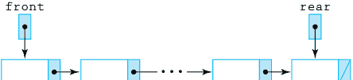

**图 4.6** 链表队列表示

### 设计提示

在设计基于链表的解决方案时，确保画很多图，类似于本节中的图示。还要记住考虑边界情况，特别是空结构的情况，以避免空指针异常。

### 入队操作

在栈 ADT 的链表实现中，我们学习了如何在链表的头部添加和删除节点。我们通过向结构的尾部插入新元素来向队列添加元素——我们之前尚未设置该操作。算法中的步骤需要一个算法来实现**入队操作**。算法中编号为 1、2 和 3 的步骤与图 4.7 中标记的部分对应。

#### enqueue(element)

- 1. 为新元素创建一个节点
- 2. 将新节点添加到队列尾部
- 3. 更新指向队列尾部的引用
- 4. 元素计数

我们逐一查看这四个步骤：

1. 第一步是熟悉的。我们通过实例化一个新的 `LLNode` 对象并传递 *element* 作为参数为该元素创建一个新节点：
   `LLNode<T> newNode = new LLNode<T>(element);`

2. 我们将新节点添加到队列尾部。我们使用 `LLNode` 的 `setLink` 方法将当前节点的链接指向新节点：
   `rear.setLink(newNode);`

```java
if (rear == null)
    front = newNode;
else
    rear.setLink(newNode);
```


**图 4.7** 入队操作

3. 入队算法的下一个任务是更新尾部，仅涉及赋值：
   ```java
   rear = newNode;
   ```

4. 增加元素数量：
   ```java
   numElements++;
   ```

将这些内容结合起来，我们得到了 `enqueue` 的代码：

```java
public void enqueue(T element)
{
    LLNode<T> newNode = new LLNode<T>(element);
    if (rear == null) {
        front = newNode;
    } else {
        rear.setLink(newNode);
    }
    rear = newNode;
    numElements++;
}
```

### 出队操作

出队操作类似于 `pop`，但我们需要返回元素。链表的实现逐行如下：

- 1. 声明局部变量 element
- 2. 从队列移除头部节点
- 3. 如果队列为空，将 rear 设置为 null
- 4. 减少元素数量
- 5. 返回 element

让我们来看 `dequeue` 方法的实现：

```java
T element;
element = front.getInfo();
front = front.getLink();
if (front == null) {
    rear = null;
}
numElements--;
return element;
```

最后，我们必须记住在对空队列进行尝试出队操作时抛出 `QueueUnderflowException`。将这些内容结合起来，代码如下所示：

```java
// 如果此队列为空，则抛出 QueueUnderflowException
// 否则，从此队列移除头部元素并返回
public T dequeue() {
    if (isEmpty()) {
        throw new QueueUnderflowException("尝试在空队列上出队。");
    } else {
        T element;
        element = front.getInfo();
        front = front.getLink();
        if (front == null) {
            rear = null;
        }
        numElements--;
        return element;
    }
}
```

剩余的操作 `isEmpty`、`isFull` 和 `size` 都非常直观。整个类的代码可以在 `ch04.queues` 包中找到。

## 圆形队列设计

我们的 `LinkedQueue` 有两个实例变量，分别引用队列的两个端点。这种设计基于链式队列的线性结构。我们可以只使用一个变量来实现类吗？如果只有头部的引用，可以通过链接访问尾部，但这种方法使得访问尾部（入队元素）变成了 O(n) 操作。如果我们把唯一的引用设置为队列的尾部，则无法访问头部——链接只从头部流向尾部，因此这种方法效果并不理想。

变量，引用队列的尾部而不是两个。这种队列实现方式与将队列视为具有两个端点的线性结构的抽象图不同。相反，它是一个没有端点的循环结构。队列之所以被称为队列，是因为它支持 FIFO（先进先出）访问模式。

要入队一个元素，我们直接通过引用 `rear` 访问“尾部”。要出队一个元素，我们必须访问队列的“头部”节点。我们没有该节点的引用，但我们有它所替换的节点——`rear`——的引用。指向队列“头部”节点的引用是 `rear.getLink()`。使用循环链表实现设计和编码队列 ADT 操作留给你们作为一项练习。

## 比较队列的实现方式

我们现在已经看了队列 ADT 的不同实现方式。我们该如何进行比较呢？我们考虑两个不同的因素：存储该结构所需的内存量，以及解决方案所需的“工作量”（用增长阶表示法表示）。让我们先比较 `ArrayBoundedQueue` 和 `LinkedQueue` 的实现。

`ArrayBoundedQueue` 内部的数组无论实际使用了多少槽位，消耗的内存量都是相同的；我们为最大元素数量预留了空间。使用动态分配存储空间的链式实现仅需要队列中元素数量的空间；然而，节点元素的大小是原来的两倍，因为我们必须存储链接（指向下一个节点的引用）以及指向元素的引用。

图 4.10 展示了每种队列实现方式，假设当前队列大小为 5，最大队列大小（基于数组的实现）为 100。请注意，无论队列大小如何，基于数组的实现都需要用于容量的空间，以及用于数组引用、元素的空间和 101 个引用（一个用于数组，每个槽位一个）。链式实现只需要 12 个引用的空间（一个用于 `front`，一个用于 `rear`，以及当前队列中的每个元素）。然而，对于链式实现，所需的空间会随着队列大小的增加而增加，遵循以下公式：

```
所需的引用数量 = 2 + ( 2 * 队列大小)
```

简单的分析揭示了在空间使用方面，两种方法的折点是当实际队列大小约为最大队列大小的一半时。对于较小的队列，链式表示所需的空间比基于数组的表示更少；超过该大小后，链式表示所需的空间更多。在任何情况下，最大队列大小远大于平均队列大小，两种实现方式在空间上的差异可能是很重要的。

我们还可以根据增长阶表示法比较两种实现方式的相对执行“效率”。在两种实现中，观察方法（`isEmpty`、`isFull` 和 `size`）的复杂度显然都是 $O(1)$。无论队列中有多少元素，这些方法总是花费相同的工作量。与栈的情况一样，队列构造函数对于数组表示需要 $O(N)$ 步，但对于链式表示是 $O(1)$。

### 基于数组的实现

| | |
|---|---|
| front: | 2 |
| rear: | 6 |
| elements: | 0 1 2 3 4 5 6 7 ... 98 99 |
| | X | | | | | | | X ... X X |

### 链式实现


**图 4.10** 比较队列的实现方式

入队和出队呢？队列中的元素会影响这些操作产生的工作量吗？不，在两种实现中，我们都可以直接访问队列的头部和尾部。这些操作完成的工作量与队列大小无关，因此这些操作也具有 $O(1)$ 复杂度。与基于数组和链式实现的栈一样，两种队列实现方式在工作量上大致等效。

现在我们简要考虑我们的 `UnboundedQueue`（无界队列）方法。边界方法的分析适用于无界方法。然而，对于无界方法，我们可以从能够处理平均大小队列的数组大小开始；只有当队列变得更大时，才会扩展数组。因此，我们不需要在额外空间上付出太大的代价。缺点是调整数组所需的额外时间 $O(N)$。对于大多数应用程序来说，这种操作并不频繁，而且正如之前讨论的那样，我们认为该操作的 $O(N)$ 成本被分散到了多次入队调用中。

## 4.6 应用：回文

在本节中，我们开发一个同时使用队列和栈处理回文的短应用程序。这是一个简单、有趣的应用程序，旨在提醒我们，在解决问题时我们通常可以使用一种以上的 ADT。

回文是一个正读和反读都相同的字符串。虽然我们不确定它的通用用处，但识别回文为我们使用队列和栈提供了一个很好的例子。此外，回文可以是很有趣的。考虑一下这些著名的回文：

- 对特迪·罗斯福的致敬（他策划了巴拿马运河）：“A man, a plan, a canal—Panama!”
- 据说是拿破仑·波拿巴在由于被流放到埃尔巴岛时喃喃自语的（尽管这很难让人信，拿破仑大部分时间说的是法语！）：“Able was I, I saw Elba.”
- 在一家繁忙的中餐馆听到的：“Won? Not?”（赢？没？）
- 可能是世界上第一个回文：“Madam, I'm Adam.”
- 紧随其后的是最短的回文之一：“Eve.”

### 回文类

正如之前的应用程序一样，我们将用户界面与程序中主处理的部分分开。我们专注于主处理部分——识别回文。回文类导出一个单一静态方法，接收一个字符串并返回指示该字符串是否为回文的布尔值。由于方法是静态的，我们不需要为类定义构造函数。相反，我们使用类名调用测试方法。

测试方法在调用时会创建一个字符栈和一个字符队列。它反复将输入行的每个字母推入栈，并放入队列。它丢弃任何非字母，因为它们不属于回文。为了方便以后比较，我们将字符转换为小写。当字符串的所有字符处理完毕后，程序反复从栈中弹出一个字母并从队列中出一个字母。只要这些字母相互匹配（直到结构为空），我们就得到了回文。你能看出为什么吗？因为队列是 FIFO 结构，字母按照在字符串中顺序返回。但从栈（LIFO 结构）中取的字母顺序相反。因此，我们正在比较字符串的正视图和反视图。

这里是 `Palindrome` 类的代码：

```java
/////////////////
// Palindrome.java 由 Dale/Joyce/Weems 第四编写
// 提供一个测试字符串是否为回文的方法。
// 跳过非字母。
--------------------------------/
package ch04.palindromes;

import ch02.stacks.*;
import ch04.queues.*;

public class Palindrome {
    public static boolean test(String candidate)
    // 如果 candidate 是回文则返回 true，否则返回 false。
    {
        char ch; // 当前处理的候选字符
        int length; // 字符串的长度
        char fromStack; // 从栈弹出的当前字符
        char fromQueue; // 从队列出的当前字符
        boolean stillPalindrome; // 如果字符串可能仍是回文

        StackInterface<Character> stack; // 存储非空字符
        QueueInterface<Character> queue; // 同样存储非空字符

        // 初始化变量和结构
        length = candidate.length();
        stack = new ArrayBoundedStack<Character>(length);
        queue = new ArrayBoundedQueue<Character>(length);

        // 获取并处理字符
        for (int i = 0; i < length; i++)
        {
            ch = candidate.charAt(i);
            if (Character.isLetter(ch))
            {
                ch = Character.toLowerCase(ch);
                stack.push(ch);
                queue.enqueue(ch);
            }
        }

        // 判断回文
        stillPalindrome = true;
        while (stillPalindrome && !stack.isEmpty())
        {
            fromStack = stack.top();
            stack.pop();
            fromQueue = queue.dequeue();
            if (fromStack != fromQueue)
                stillPalindrome = false;
        }

        // 返回结果
        return stillPalindrome;
    }
}
```

注意，我们同时使用了有界栈和有界队列的实现。使用有界结构是合适的，因为这些结构的大小不需要大于候选字符串的长度。此外请注意，我们在结构中添加和移除基本类型 `char` 变量时，利用了 Java 的装箱和拆箱功能。系统在添加之前会自动将 `char` 值封装成 `Character` 对象，然后在移除后将返回的 `Character` 对象解箱回 `char` 值。

## 4.6 应用：回文串

`Palindrome` 类为我们完成了大部分工作。现在剩下的工作只需实现 I/O。在 `ch04.apps` 包中找到 `PalindromeCLI` 程序与之前章节介绍的命令行界面程序类似。它的基本流程是：提示用户输入字符串，使用 `Palindrome` 类的 `test` 方法判断该字符串是否为回文，输出结果，然后要求用户输入另一个字符串，直到用户输入特殊的“停止”字符串（在本例中为字符串 "X"）。以下是程序的运行示例：

```
String (X to stop): racecar is a palindrome.
String (X to stop): aaaaaaaaabaaaaaaa is NOT a palindrome.
String (X to stop): fred is NOT a palindrome.
String (X to stop): Are we not drawn onward, we few? Drawn onward to new era! is a palindrome.
String (X to stop): X
```

同样在 `ch04.apps` 中找到 `PalindromeGUI` 程序实现了一个基于图形用户界面（GUI）的界面，提供了与 `PalindromeCLI` 相同的功能。

还有——可能是更好的方法来判断字符串是否为回文。事实上，在第 3 章的练习题 35 中，我们要求你考虑一些其他方法。这个示例应用出于几个原因：它有趣但并不复杂，很有趣，它清晰地展示了栈和队列之间的关联，并提醒我们我们在解决问题时可以使用多一个 ADT（抽象数据类型）。图 4.11 是一个简化的统一建模语言（UML）图，显示了回文应用中栈和队列接口之间的关系。


**图 4.11** 回文程序架构

## 4.7 队列的变体


正如我们对待许多结构一样，我们现在来看队列的一些变体。理解定义和实现数据结构有许多方法是非常重要的。我们首先考虑定义经典队列操作的替代方法。接下来，我们查看可以包含在队列 ADT 中的额外操作，这些操作允许我们“查看”队列，以及其他扩展访问规则的操作，本质上是创建了一个更通用的结构，既可以当作队列，也可以作为栈使用。最后，我们回顾了 Java 标准库中的队列。

在继续之前，我们应该提到一种与队列密切相关的 ADT。优先级队列 ADT 通常与队列一起考虑。优先级队列的元素是任意顺序的，但当元素被出队时，它返回优先级最高的元素。与传统队列不同，进入队列的顺序与移除顺序没有关系。优先级队列是一个重要的 ADT；我们在第 9 章回到它。

### 特殊情况

我们的队列在上溢或下溢时会抛出异常。另一种方法是在方法实现内部测试异常情况，通过使操作无效防止上溢/下溢，并返回一个指示失败的值。对于后一种方法，我们重新定义了 `enqueue` 和 `dequeue`：

```java
boolean enqueue(T element) 将元素添加到此队列的尾部；如果元素添加成功则返回 true，否则返回 false
```

```java
T dequeue() 如果此队列为空则返回 null，否则从此队列移除头部元素并返回它
```

在 `enqueue` 的情况下，操作未完成的最常见原因是尝试向一个已满的有界队列添加元素。我们也可以定义队列的替代版本，这些版本拥有关于元素会被或不会被接受进入的规则——例如，不允许重复元素的队列，或者只接受具有特定特征元素的队列（只有吃蔬菜的学生才能排队买冰激凌）。在 `dequeue` 的情况下，失败的主要原因是队列为空。

与其重新定义上述描述的操作，我们只需添加一些具有唯一名称的新操作（如 `safeEnqueue` 和 `safeDequeue`），以将它们与普通队列操作区分开。

### 玻璃队列 (GlassQueue)

一个使用我们在第 2 章定义的栈 ADT 的应用可以选择获取栈的顶端元素（`top` 方法）或从栈中移除顶端元素（`pop` 方法）。这意味着应用程序可以“查看”栈的顶端元素而不将其移除。

## 双端队列

栈（Stacks）是一种允许从一端（称为栈顶 top）添加和删除元素的线性结构。队列（Queues）是一种允许从一端（称为尾部 rear）添加、从另一端（称为头部 front）删除元素的线性结构。为什么我们不能定义一种允许从两端同时添加和删除的结构呢？嗯——没有理由这样做。事实上，我们可以这样做，而且很多人已经这样做了！这种结构经典上被称为双端队列（Double-Ended Queue）。Deque 有时缩称为 "Deque"，因为该术语与标准队列操作之一相同，用于这种抽象数据类型（ADT）更常用的术语是 Deque，发音为 "Deck"。


在定义 Deque ADT 时，我们必须区分两种添加方法（头部和尾部）和两种删除方法（头部和尾部）。对我们的 Queue 类进行一些更改和添加后，就得到了如下 QueueInterface 类：

```java
// DequeInterface.java                by Dale/Joyce/Weems                Chapter 4
// 实现 T 类型双端队列的接口。
// deque 是一个允许在两端进行添加/删除的线性结构。
//----------------------------------------------------------------
package ch04.queues;

public interface DequeInterface<T>
{
  void enqueueFront(T element) throws QueueOverflow;
  // 如果此队列已满则抛出 QueueOverflow：
  // 否则，将元素添加到此队列的头部。

  void enqueueRear(T element) throws QueueOverflow;
  // 如果此队列已满则抛出 QueueOverflow：
  // 否则，将元素添加到此队列的尾部。

  T dequeueFront() throws QueueUnderflowException;
  // 如果此队列为空，则抛出 QueueUnderflowException；
  // 否则，从此队列移除头部元素并返回它。

  T dequeueRear() throws QueueUnderflowException;
  // 如果此队列为空，则抛出 QueueUnderflowException；
  // 否则，从此队列移除尾部元素并返回它。

  boolean isFull();
  // 如果此队列已满则返回 true；否则返回 false。

  boolean isEmpty();
  // 如果此队列为空则返回 true；否则返回 false。

  int size();
  // 返回此队列中的元素数量。
}
```

我们不需要为 Deque ADT 定义一个全新的接口，而是可以将 `DequeInterface` 类定义为 `QueueInterface` 类的扩展，正如我们在处理玻璃队列时所做的那样。通过这种方法，我们只需要在接口中包含 `enqueueFront` 和 `dequeueRear` 两个方法，因为所有其他方法声明将被继承。事实上，考虑到 Stack、Queue 和 Deque ADT 之间的关系，许多涉及泛化和/或特化的接口和实现类的结构化变体都是可能的。在这里，我们决定采用最简单的方法——定义一个完全全新的接口。

基于数组和基于链表的双端队列实现被留作练习题。

## 双向链表

如果你尝试使用链表创建 Deque，你会发现实现 `dequeueRear` 操作非常困难。为了移除链表中的最后一个节点，你需要访问它的前一个节点，而在标准链表中获取这种访问权限的唯一方法是遍历整个列表。在类此类我们需要访问给定节点的前驱节点的情况下，双向链表非常有用。在双向链表中，节点是在两个方向上链接的。双向链表的每个节点包含以下部分：

- `info`：存储在节点中的元素
- `link`：指向后一个节点的引用
- `back`：指向前一个节点的引用

### 4.7 队列的变体

使用线性双向链表的 Deque 看起来像这样：


第一个节点的 `back` 引用和最后一个节点的 `link` 引用包含 `null`。此类列表的节点可以通过以下 `DLLNode` 类提供，它与我们之前定义的 `LLNode` 类相似。

```java
/// DLLNode.java by Dale/Joyce/Weems Chapter 4
// 实现双向链表中持有类 <T> info 信息的节点。
package support;

public class DLLNode<T> {
    private T info;
    private DLLNode<T> forward;
    private DLLNode<T> back;

    public DLLNode(T info) {
        this.info = info; 
        this.forward = null; 
        this.back = null;
    }

    public void setInfo(T info) { this.info = info; }
    public T getInfo() { return info; }

    public void setForward(DLLNode<T> forward) { this.forward = forward; }
    public void setBack(DLLNode<T> back) { this.back = back; }

    public DLLNode<T> getForward() { return forward; }
    public DLLNode<T> getBack() { return back; }
}
```

注意，存在另一种替代方法称为“循环双向链表”，其中第一个节点的 `back` 引用指向最后一个节点，最后一个节点的 `link` 引用指向第一个节点——参见练习 33。

### dequeueRear 操作

当我们对双向链表进行更改（添加/删除）时，我们必须小心地正确管理所有的引用并处理特殊情况。让我们来看一个例子。想象使用使用双向链表实现 Deque ADT。

当对对双向链表进行更改（添加/删除）时，我们必须小心地正确管理所有的引用并处理特殊情况。


带有 `setRear` 方法我们有：


将这一切与处理特殊情况（空和单元素）的代码结合，我们得到了 `dequeueRear` 的如下实现：

```java
public T dequeueRear() {
    // 如果此队列为空，则抛出 QueueUnderflowException；
    // 否则，从此队列移除尾部元素并返回它。
    if (isEmpty()) {
        throw new QueueUnderflowException("空队列上尝试删除尾部元素");
    } else {
        T element;
        element = rear.getInfo();
        if (rear.getBack() == null) {
            front = null; rear = null;
        } else {
            rear.getBack().setLink(null);
            rear = rear.getBack();
        }
        numElements--;
        return element;
    }
}
```

| 空间/时间权衡 |
| :--- |
| 在数据结构和算法的设计中，我们经常必须用空间换取时间效率，或者反之。使用双向链表允许 `dequeueRear` 操作的 O(1) 实现是一个允许每个节点使用少量额外空间以换取更快速操作的例子。|

## Java 框架中的 Queue/Deque

Queue 接口是在 2004 年添加到 Java 5 框架中的。正如预期的，库对队列的方法与我们的方法相似，元素总是从队列的“头部”移除。然而，它们的方法也存在几个重要的区别：

- 它不要求只在队列的“尾部”添加元素。例如，添加的元素根据优先级值进行排序。也就是说，它允许优先级队列 ADT（第 9 章）的实现。
- 它提供了两个入队操作：`add`，在队列满时调用会抛出异常；以及 `offer`，在队列满时调用会返回布尔值 `false`。
- 它提供了两种出队操作：`remove` 会在空队列上调用时抛出异常，而 `poll` 在空队列上调用时返回 `null`。
- 包含了检查操作，用于在不移除元素的情况下获取第一个元素。

与库 `Stack` 类似，库 `Queue` 在 2006 年 Java 6.0 发布后被 `Deque` 代替。库 `Deque` 接口与之前使用的 `DequeInterface` 类似——它允许了双端进行添加、删除和检查的操作。通过仔细限制方法的使用，实现该接口的类可以用作栈（只允许在头部入队和出队）或队列（只允许尾部入队和从头部出队）。共有四个实现 `Deque` 接口的库类：`ArrayDeque`、`ConcurrentLinkedDeque`、`LinkedBlockingDeque` 和 `LinkedList`。

以下是如何使用 Java 库中的 `ArrayDeque` 类来实现字符串重复（参见 4.2 节，“队列接口”）。文中强调了该应用程序与使用我们 Queue ADT 的应用程序之间的细微差异。

```java
//
// RepeatStrings2.java by Dale/Joyce/Weems Chapter 4
// 库 ArrayDeque 的示例用法。
// 按照输入顺序输出字符串。
//
package ch04.apps;

import java.util.ArrayDeque;
import java.util.Scanner;

public class RepeatStrings
{
    public static void main(String[] args)
    {
        Scanner scan = new Scanner(System.in);

        ArrayDeque<String> stringQueue;
        stringQueue = new ArrayDeque<String>(3);

        String line;

        for (int i = 1; i <= 3; i++)
        {
            System.out.print("Enter a line of text > ");
            line = scan.nextLine();
            stringQueue.addLast(line);
        }

        System.out.println("\norder is:\n");
        while (!stringQueue.isEmpty()) {
            line = stringQueue.removeFirst();
            System.out.println(line);
        }
    }
}
```

如果你感兴趣了解更多关于 Java 集合框架，可以学习 Oracle 网站上丰富的文档。

## 4.8 应用：平均等待时间

队列是计算机系统中的数据结构：例如，存在进程队列、打印作业队列和服务队列。队列在现实世界中也很常见：收费站、票务柜台队列和快餐队列。

队列的主要功能是为“客户”在接收“服务”之前提供一个等待的地方。进程在等待处理器，打印作业在等待打印机，饥饿的人在等待他们的汉堡。有时，管理层对有多少客户在队列中花费时间感兴趣。例如，计算机系统管理员希望系统响应时间快，而快餐店经理希望让客户感到满意。这些目标通过最小化在队列中的时间来实现。

减少等待时间的一种方法是在系统中添加更多服务器，从而增加更多的队列。如果有 10 台打印机来处理，打印作业在打印队列中的时间会比只有一台打印机时短。同样，一个拥有六个收银台的快餐店处理客户的速度比只有两条线的餐厅更快。然而，额外的服务器不是免费的——它们通常是管理相关的成本。管理层在决定提供多少服务器时，必须在增加服务器的收益与成本之间取得平衡。

在本节中，我们创建一个模拟队列系统的程序。该目标是帮助管理层分析队列系统。计算机模拟是分析复杂现实问题的一种强大且广泛使用的技术。我们的程序模拟了一系列客户到达接受服务、进入队列、等待、接受服务并最终离开队列。它跟踪客户在队列中等待的时间并输出平均等待时间。

> 有些系统有多个队列进入一个服务器。在本节中，我们假设每个队列都有自己专用的服务器。

### 问题讨论与示例

我们如何计算客户的等待时间？为了简化问题，我们假设时间以整数为单位，并且我们的模拟从时间 0 开始。假设客户在时间 X 和时间 Y 到。该客户的等待时间等于 Y - X 吗？不，部分时间客户是在接受服务。Y - X 被称为周转时间（turnaround time）；它是客户在系统中花费的总时间，包括服务时间。等待时间等于周转时间减去服务时间。

### 模拟

像本节介绍的模拟程序被许多学科使用，如天文学、生物学、社会科学、机械工程、政治、经济、金融、化学和医学。模拟用于廉价地调查多种场景，以理解变量之间的相互作用。

要计算等待时间，我们需要知道到达时间、完成时间和服务时间。到达时间和服务时间取决于单个客户——他们何时出现以及他们需要多少服务。完成时间取决于队列的数量、队列中其他客户的性质以及其他客户的服务需求。

每个模拟应该按照客户到达的顺序接收客户并将他们放入队列。我们假设客户总是选择最小的可用队列。如果平局，客户选择编号最小的队列。程序只需要模拟两种情况：客户到达接受服务和客户在接受服务后离开。当客户到达时，程序必须记住客户的等待时间，以便它可以计算整体平均等待时间。

作为一个示例，考虑一个有四位客户的情况：

| 客户 | 到达时间 | 服务时间 | 完成时间 | 等待时间 |
|---|---|---|---|---|
| 1 | 3 | 10 | 13 | 0 |
| 2 | 4 | 3 | 7 | 0 |
| 3 | 5 | 10 | 23 | 8 |
| 4 | 25 | 7 | 32 | 0 |


## 第 4 章 队列 ADT

- 它提供了两种出队操作：`remove` 会在空队列上调用时抛出异常，而 `poll` 在空队列上调用时返回 false。
- 包含了检查操作，用于在不移除元素的情况下获取第一个元素。

与库 `Stack` 类似，库 `Queue` 在 2006 年 Java 6.0 发布后被 `Deque` 代替。库 `Deque` 接口与之前使用的 `DequeInterface` 类似——它允许了双端进行添加、删除和检查的操作。通过仔细限制方法的使用，实现该接口的类可以用作栈（只允许在头部入队和出队）或队列（只允许尾部入队和从头部出队）。共有四个实现 `Deque` 接口的库类：`ArrayDeque`、`ConcurrentLinkedDeque`、`LinkedBlockingDeque` 和 `LinkedList`。

以下是如何使用 Java 库中的 `ArrayDeque` 类来实现字符串重复（参见 4.2 节，“队列接口”）。文中强调了该应用程序与使用我们 Queue ADT 的应用程序之间的细微差异。

```java
//
// RepeatStrings2.java by Dale/Joyce/Weems Chapter 4
// 库 ArrayDeque 的示例用法。
// 按照输入顺序输出字符串。
//
package ch04.apps;

import java.util.ArrayDeque;
import java.util.Scanner;

public class RepeatStrings
{
    public static void main(String[] args)
    {
        Scanner scan = new Scanner(System.in);

        ArrayDeque<String> stringQueue;
        stringQueue = new ArrayDeque<String>(3);

        String line;

        for (int i = 1; i <= 3; i++)
        {
            System.out.print("Enter a line of text > ");
            line = scan.nextLine();
            stringQueue.addLast(line);
        }

        System.out.println("\norder is:\n");
        while (!stringQueue.isEmpty()) {
            line = stringQueue.removeFirst();
            System.out.println(line);
        }
    }
}
```

如果你感兴趣了解更多关于 Java 集合框架，可以学习 Oracle 网站上丰富的文档。

## 4.8 应用：平均等待时间

队列是计算机系统中的数据结构：例如，存在进程队列、打印作业队列和服务队列。队列在现实世界中也很常见：收费站、票务柜台队列和快餐队列。

队列的主要功能是为“客户”在接收“服务”之前提供一个等待的地方。进程在等待处理器，打印作业在等待打印机，饥饿的人在等待他们的汉堡。有时，管理层对有多少客户在队列中花费时间感兴趣。例如，计算机系统管理员希望系统响应时间快，而快餐店经理希望让客户感到满意。这些目标通过最小化在队列中的时间来实现。

减少等待时间的一种方法是在系统中添加更多服务器，从而增加更多的队列。如果有 10 台打印机来处理，打印作业在打印队列中的时间会比只有一台打印机时短。同样，一个拥有六个收银台的快餐店处理客户的速度比只有两条线的餐厅更快。然而，额外的服务器不是免费的——它们通常是管理相关的成本。管理层在决定提供多少服务器时，必须在增加服务器的收益与成本之间取得平衡。

在本节中，我们创建一个模拟队列系统的程序。该目标是帮助管理层分析队列系统。计算机模拟是分析复杂现实问题的一种强大且广泛使用的技术。我们的程序模拟了一系列客户到达接受服务、进入队列、等待、接受服务并最终离开队列。它跟踪客户在队列中等待的时间并输出平均等待时间。

> 有些系统有多个队列进入一个服务器。在本节中，我们假设每个队列都有自己专用的服务器。

### 问题讨论与示例

我们如何计算客户的等待时间？为了简化问题，我们假设时间以整数为单位，并且我们的模拟从时间 0 开始。假设客户在时间 X 和时间 Y 到。该客户的等待时间等于 Y - X 吗？不，部分时间客户是在接受服务。Y - X 被称为周转时间（turnaround time）；它是客户在系统中花费的总时间，包括服务时间。等待时间等于周转时间减去服务时间。

### 模拟

像本节介绍的模拟程序被许多学科使用，如天文学、生物学、社会科学、机械工程、政治、经济、金融、化学和医学。模拟用于廉价地调查多种场景，以理解变量之间的相互作用。

要计算等待时间，我们需要知道到达时间、完成时间和服务时间。到达时间和服务时间取决于单个客户——他们何时出现以及他们需要多少服务。完成时间取决于队列的数量、队列中其他客户的性质以及其他客户的服务需求。

每个模拟应该按照客户到达的顺序接收客户并将他们放入队列。我们假设客户总是选择最小的可用队列。如果平局，客户选择编号最小的队列。程序只需要模拟两种情况：客户到达接受服务和客户在接受服务后离开。当客户到达时，程序必须记住客户的等待时间，以便它可以计算整体平均等待时间。

作为一个示例，考虑一个有四位客户的情况：

| 客户 | 到达时间 | 服务时间 | 完成时间 | 等待时间 |
|---|---|---|---|---|
| 1 | 3 | 10 | 13 | 0 |
| 2 | 4 | 3 | 7 | 0 |
| 3 | 5 | 10 | 23 | 8 |
| 4 | 25 | 7 | 32 | 0 |

### 客户类

正如我们看到的，客户有四个关联值：到达时间、服务时间、完成时间和等待时间。我们创建一个 `Customer` 类来模拟这些值。该类的对象将从我们的队列对象入队和出队，模拟客户进入和离开现实队列。

`Customer` 类的属性是什么？客户的到达时间和服务时间可以在实例化 `Customer` 对象时作为参数传递给构造函数。`Customer` 必须为这些属性提供观察方法，还应该提供设置和观察完成时间的方法。鉴于客户知道自己的到达、服务时间和完成时间，它可以负责计算并返回自己的等待时间。

由于我们想在正文的其他应用程序中使用客户，我们将 `Customer` 类放在 `support` 包中。该类非常直接：

```java
//-----------------
// Customer.java               by Dale/Joyce/Weems      Chapter 4
//
// 支持具有到达时间、服务时间和完成时间属性的客户对象。
// 负责计算并返回等待时间。
//
// 除非看到了完成时间，否则客户端不会请求等待时间。
//-----------------
package support;

public class Customer {

    protected int arrivalTime;
    protected int serviceTime;
    protected int finishTime;

    public Customer(int arrivalTime, int serviceTime) {
        this.arrivalTime = arrivalTime;
        this.serviceTime = serviceTime;
    }

    public int getArrivalTime() {return arrivalTime;}
    public int getServiceTime() {return serviceTime;}
    public void setFinishTime(int finishTime) {this.finishTime = finishTime;}
    public int getFinishTime() {return finishTime;}

    public int getWaitTime() {
        return (finishTime - arrivalTime - serviceTime);
    }
}
```

在我们的模拟中，客户从哪里来？为了创建一个客户对象序列，我们需要知道他们的到达时间和服务需求。这些值可以通过多种方式获得。一种方法是从文件中读取值。这种策略对于测试非常有用，因为它允许程序员完全控制输入值。然而，如果你想模拟大量的客户，这种方法就会很笨拙。

另一种方法是生成随机服务时间：用户只需输入预期的最小和最大时间，使用 Java 的 `Random` 类在这两个值之间生成服务时间。

对于到达时间，我们遵循略有不同的算法。服务时间衡量的是时间长度，但到达时间指定的是客户到达的时刻。例如，

客户 1 在上午 10:00 到达，客户 2 在 10:05，客户 3 在 10:07，依此类推。在我们的模拟中，我们简单地让时钟从 0 开始，并将到达时间保持为整数。我们无法直接通过随机数生成器创建一个递增的时间序列。相反，我们随机生成客户到达之间的时间（到达间隔时间），并对这些值进行累加。

例如，我们可能会生成一组为 5, 7, 4, 10 和 7 的到达间隔序列。鉴于我们的模拟从时间 0 开始，那么到达时间就是 5, 12, 16, 26 和 33。为了限制到达间隔时间的范围，我们可以让用户指定一个最小值和一个最大值。注意，我们假设到达间隔时间和服务时间在它们的最小值和最大值之间都是均匀分布的。当然，模拟也可以基于其他分布。

对于每个客户，我们的程序都会生成一个到达时间和服务时间。通过模拟，它确定了完成时间，并根据这些时间计算出等待时间。我们创建了一个 `CustomerGenerator` 类。该类的对象在实例化时会被传入客户的最小和最大到达间隔时间和服务时间。它的主要责任是生成并返回请求的“下一个”客户。

`CustomerGenerator` 类使用了 Java 库中的 `Random` 类。回想一下 `rand.nextInt()` 返回一个 0 到 N-1 之间的随机整数。注意，`CustomerGenerator` 对象会跟踪当前时间，因此它可以计算下一次到达时间。我们还将此类放置在 `support` 包中。

```java
// CustomerGenerator.java               by Dale/Joyce/Weems               Chapter 4
// 根据最小和最大到达间隔时间和服务的构造函数参数，
// 生成随机 Customer 对象序列。
// 假设到达间隔时间和服务时间均为均匀分布。
// 假设时间从 0 开始。
//
package support;

import java.util.Random;

public class CustomerGenerator
{
    protected int minIAT;    // 最小到达间隔时间
    protected int maxIAT;    // 最大到达间隔时间
    protected int minST;     // 最小服务时间
    protected int maxST;     // 最大服务时间

    protected int currTime = 0; // 当前时间

    Random rand = new Random();  // 用于生成随机数

    public CustomerGenerator (int minIAT, int maxIAT, int minST, int maxST)
    // 前置条件：所有参数 >= 0
    //  minIAT <= maxIAT
    //  minST <= maxST
    {
        this.minIAT = minIAT;
        this.maxIAT = maxIAT;
        this.minST = minST;
        this.maxST = maxST;
    }

    public void reset() {
        currTime = 0;
    }

    public Customer nextCustomer() {
        // 创建并返回下一个随机客户。
        int IAT; // 下一次到达间隔时间
        int ST;  // 下一次服务时间
        IAT = minIAT + rand.nextInt(maxIAT - minIAT + 1);
        ST = minST + rand.nextInt(maxST - minST + 1);

        currTime = currTime + IAT; // 更新当前时间为下一个客户的到达时间
        Customer next = new Customer(currTime, ST);
        return next;
    }
}
```

### 模拟

我们的应用程序将生成客户序列，并模拟他们进入队列、等待和接受服务。它将输出客户的平均等待时间。我们的应用程序输入应该是什么？用户想要控制哪些变量？

我们允许应用程序的用户改变到达间隔时间和服务时间。为了执行模拟，程序还能够确定“下一个”客户何时准备离开队列，并移除该客户。它是如何判断客户何时准备离开队列的呢？因为队列中的客户知道自己的完成时间，程序只需要比较每个队列头部客户的完成时间，并确定哪一个最早。程序必须能够查看队列的头部（peek）。我们的列表中还需要添加一个操作。

所以，除了标准队列外，我们还需要能够查看队列中的头部和尾部元素。在 4.7 节“队列变体”中开发的 `GlassQueue` 类提供了这些功能。

### 离散事件模拟

在本节开发的应用程序是离散事件模拟的一个示例。在离散事件系统中，系统被建模为一系列事件（客户的到达或离开）。应用程序确定下一个发生的事件，并模拟该事件的影响，更新系统状态并产生更多事件。

`MAXTIME` 用于简化代码；`MAXTIME` 的到达/离开时间值表示没有到达或离开。

```java
// Simulation.java                               by Dale/Joyce/Weems Chapter 4
// 模拟一组由多个队列服务的
// 客户序列。
//------------------------------------------------------------
package ch04.simulation;

import support.*; // Customer, CustomerGenerator
```


# 第 4 章 队列 ADT

## 4.8 应用：平均等待时间

```java
import ch04.queues.*;   // LinkedGlassQueue

public class Simulation
{
    final int MAXTIME = Integer.MAX_VALUE;

    CustomerGenerator custGen; // 一个客户生成器

    float avgWaitTime = 0.0f; // 最近一次的平均等待时间

    public Simulation(int minIAT, int maxIAT, int minST, int maxST)
    {
        custGen = new CustomerGenerator(minIAT, maxIAT, minST, maxST);
    }

    public float getAvgWaitTime()
    {
        return avgWaitTime;
    }

    public void simulate(int numQueues, int numCustomers)
    // 前置条件：numQueues > 0
    // numCustomers > 0
    // 模拟期间生成的时间不大于 MAXTIME
    // 模拟 numCustomers 个客户进入和离开
    // 一个拥有 numQueues 个队列的队列系统
    {
        // 队列
        LinkedGlassQueue<Customer> queues = new LinkedGlassQueue[numQueues];

        Customer nextCust;      // 从生成器获取下一个客户
        Customer cust;               // 临时使用的客户
        int totWaitTime = 0;        // 总等待时间
        int custCount = 0;          // 迄为止开始的客户数
        int custOutCount = 0;       // 迄为止完成的客户数
        int nextArrTime;            // 下一次到达时间
        int nextDepTime;            // 下一次离开时间
        int nextQueue;              // 下一次离开的队列索引
        int shortest;               // 最短队列的索引
        int shortestSize;           // 最短队列的大小
        Customer rearCust;          // 最短队列末尾客户
        int finishTime;             // 为入队客户计算的完成时间

        // 实例化队列
        for (int i = 0; i < numQueues; i++)
            queues[i] = new LinkedGlassQueue<Customer>();

        // 设置客户生成器并获取第一个客户
        custGen.reset();
        nextCust = custGen.nextCustomer();

        while (custOutCount < numCustomers) // 当还有更多客户时
        {
            // 获取下一次到达！
            if (custCount < numCustomers)
                nextArrTime = nextCust.getArrivalTime();
            else
                nextArrTime = MAXTIME;

            // 获取离开时间并设置 nextQueue
            nextDepTime = MAXTIME;
            nextQueue = -1;

            for (int i = 0; i < numQueues; i++)
                if (queues[i].size() != 0)
                {
                    cust = queues[i].peekFront();
                    if (cust.getFinishTime() < nextDepTime)
                    {
                        nextDepTime = cust.getFinishTime();
                        nextQueue = i;
                    }
                }

            if (nextArrTime < nextDepTime)
            // 处理客户到达
            {
                // 确定最短队列
                shortest = 0;
                shortestSize = queues[0].size();
                for (int i = 1; i < numQueues; i++)
                {
                    if (queues[i].size() < shortestSize)
                    {
                        shortest = i;
                        shortestSize = queues[i].size();
                    }
                }

                // 确定完成时间
                if (shortestSize == 0)
                    finishTime = nextCust.getArrivalTime() + nextCust.getServiceTime();
                else
                {
                    rearCust = queues[shortest].peekRear();
                    finishTime = rearCust.getFinishTime() + nextCust.getServiceTime();
                }

                // 设置完成时间并入队客户
                nextCust.setFinishTime(finishTime);
                queues[shortest].enqueue(nextCust);

                custCount = custCount + 1;

                // 如果需要，获取要入队的下一个客户
                if (custCount < numCustomers)
                    nextCust = custGen.nextCustomer();
            }
            else
            // 处理客户离开
            {
                cust = queues[nextQueue].dequeue();
                totWaitTime = totWaitTime + cust.getWaitTime();
                custOutCount = custOutCount + 1;
            }
        } // 结束 while

        avgWaitTime = totWaitTime / (float) numCustomers;
    }
}
```

> ^2 生成了未检查的转换警告，因为编译器无法确保数组确实包含 `GlassQueue<Customer>` 类的对象。

## 应用

该应用程序的结构与文中之前介绍的应用程序相似。应用程序的主要职责是与用户交互。我们做了简化假设用户是良好的——换句话说，用户提供了输入数据。例如，用户提供的最小服务时间不大于最大服务时间。

我们在 `ch04.apps` 包中提供了两个版本的应用程序。`SimulationCLI` 使用命令行界面。以下是示例运行的输出：

```text
输入最小到达间隔时间: 0
输入最大到达时间: 10
输入最小服务时间: 5
输入最大服务时间: 20
输入队列数量: 2
输入客户数量: 2000
平均等待时间: 5.724
```

队列本身是一个共享数据结构，因此对它的访问必须经过仔细的协调。我们必须确保生产者在调度任务时不会不当地交替对共享队列的访问。我们还必须协调消费者从队列中移除任务，以确保特定任务不会被多次消费。协调这样的共享资源是并发编程研究的核心。

并发的正式研究通常在计算课程中的操作系统、数据库或算法课程中提供，这超出了本书的范围。然而，在本节中，我们通过以下方式介绍该主题：

- 定义与并发相关的术语。
- 显示如何指示 Java 程序的某些应该并发执行。
- 解释并发代码序列如何相互干扰。
- 演示如何同步代码序列的执行，以防止此类干扰发生。

## Counter 类

为了支持对本节主题的调查，我们使用以下简单的 `Counter` 类。它提供了一个初始为 0 的整数属性，可以通过调用 `increment()` 方法来递增。为本文部分创建的所有辅助类都存放在 `ch04.threads` 包中。

```java
// Counter.java                        by Dale/Joyce/Weems                Chapter 4
// 跟踪计数器的当前值。
// ...

package ch04.threads;

public class Counter
{
    private int count;

    public Counter()
    {
        count = 0;
    }

    public void increment()
    {
        count++;
    }

    public int getCount() { return count; }
}
```

示例程序 `Demo01` 实例化了一个 `Counter` 对象 `c`，将其递增了三次，然后打印它的值。示例输出如预期所示，显示计数为 3。为本文部分创建的所有应用程序都存放在 `ch04-concurrency` 文件夹中。

```java
package ch04.concurrency;

import ch04.threads.*;

public class Demo01
{
    public static void main(String[] args) {
        Counter c = new Counter();
        c.increment();
        c.increment();
        c.increment();
        System.out.println("Count is: " + c.getCount());
    }
}
```

程序的输出是：`Count is: 3`

## Java 线程

Java 提供的并发机制是线程。每个执行线程的 Java 程序都有一个 `main` 线程。主线程具有生成额外线程的能力。程序的各种线程并发运行。当所有线程都终止时，程序终止。

`java.lang` 包会自动导入到所有程序，它提供了一个 `Thread` 类。我们通过定义实现 Java 库 `Runnable` 接口的类来创建线程对象。此类类必须提供一个 `run()` 方法。例如，参考 `Increase` 类，它通过构造函数接受一个 `Counter` 对象和一个整数值，并提供一个 `run()` 方法，按 `amount` 值指示的次数递增 `Counter` 对象。

```java
package ch04.threads;

public class Increase implements Runnable
{
    private Counter c;
    private int amount;

    public Increase(Counter c, int amount)
    {
        this.c = c;
        this.amount = amount;
    }

    public void run()
    {
        for (int i = 1; i <= amount; i++)
            c.increment();
    }
}
```

我们现在可以通过向其构造函数传递一个 `Increase` 对象（或任何 `Runnable` 对象）来实例化 `Thread` 对象。实例化的 `Thread` 对象可以用于在主程序线程之外的单独线程中执行 `Increase` 对象的 `run()` 方法。要做到这一点，我们调用线程对象的 `start()` 方法。考虑 `Demo02` 示例：

```java
package ch04.concurrency;

import ch04.threads.*;

public class Demo02
{
    public static void main(String[] args) throws InterruptedException {
        Counter c = new Counter();
        Runnable r = new Increase(c, 10000);
        Thread t = new Thread(r);
        t.start();
        System.out.println("Expected: 10000*");
        System.out.println("Count is: " + c.getCount());
    }
}
```

`Demo02` 程序实例化了一个 `Counter` 对象，使用 `c` 加上整数字面量 `10000` 实例化了一个 `Runnable r`，并使用 `r` 实例化了一个 `Thread t`。在单独的线程中，调用其 `start()` 方法后，程序在终止前显示计数器对象的值。它将显示什么值？考虑到 `Increase` 对象将递增计数器 10000 次，我们预计程序的输出如下：

```text
Expected: 10000
Count is: 10000
```

> `Thread` 对象可能会抛出运行时 `InterruptedException` 异常。因此，我们必须捕获并处理该异常，或者将其抛给执行环境。

## 4.9 并发、干扰与同步


**图 4.14** 执行 `Demo02` 程序

但计数器的递增和值的显示发生在不同的线程中。如图 4.14 所示，无法保证递增线程会在主线程显示值之前完成。事实上，输出很可能小于 10000。

计数器的递增和值的显示发生在不同的线程中。可能的输出是：

```text
Expected: 10000
Count is: 7432
```

计数器的递增和值的显示发生在不同的线程中。可能的输出是：

```text
Expected: 10000
Count is: 8105
```

计数器的递增和值的显示发生在不同的线程中。可能的输出是：

```text
Expected: 10000
Count is: 9217
```

计数器的递增和值的显示发生在不同的线程中。可能的输出是：

```text
Expected: 10000
Count is: 9544
```

计数器的递增和值的显示发生在不同的线程中。可能的输出是：

```text
Expected: 10000
Count is: 9861
```

计数器的递增和值的显示发生在不同的线程中。可能的输出是：

```text
Expected: 10000
Count is: 9478
```

计数器的递增和值的显示发生在不同的线程中。可能的输出是：

```text
Expected: 10000
Count is: 9203
```

## 干扰

当两个或多个线程对共享变量进行更改时，它们会相互干扰。考虑 `Demo04` 程序，它使用两个线程来增加同一个计数器对象。

```java
package ch04.concurrency;

import ch04.threads.*;

public class Demo04
{
    public static void main(String[] args) throws InterruptedException {
        Counter c = new Counter();
        Runnable r1 = new Increase(c, 5000);
        Runnable r2 = new Increase(c, 5000);
        Thread t1 = new Thread(r1);
        Thread t2 = new Thread(r2);
        t1.start();
        t2.start();
        t1.join();
        t2.join();
        System.out.println("Count is: " + c.getCount());
    }
}
```

程序的预期输出是 `Count is 10000`。然而，我们是错的。这个例子展示了处理并发的危险。

这些意外结果的原因是递增线程相互干扰。考虑在 Java 中递增计数器需要三个步骤：获取计数器的值、对其加 1，然后存储结果。如果两个线程同时交替执行这些步骤，计数器的结果值将小于预期值。例如，考虑以下步骤序列，计数器从值 12 开始，两个线程都递增计数器。虽然我们期望结果为 14，但由于“干扰”，最终值只有 13：

| 线程 | 步骤 | 操作 |
|---|---|---|
| t1 | 步骤 1 | 获取值 12 |
| t2 | 步骤 2 | 获取值 12 |
| t1 | 步骤 3 | 将值增加到 13 |
| t1 | 步骤 4 | 存储值 13 |
| t2 | 步骤 5 | 将值增加到 13 |
| t2 | 步骤 6 | 存储值 13 |

## 同步

在 Java 中，我们可以在语句级别或方法级别强制同步。我们使用方法级同步。在 `Demo04` 示例中，需要同步的方法是 `Counter` 类中的 `increment()` 方法。为了演示同步方法的使用，我们创建了一个单独的计数器类 `SyncCounter`。

使一个方法同步化仅需要使用 `synchronized` 关键字即可，它是方法声明行中的一个修饰符，如下面的代码所示。

```java
// SyncCounter.java                               by Dale/Joyce/Weems Chapter 4
// 跟踪计数器的当前值。
// 为 increment 方法提供同步访问。
//-----------------
```


# 并发、干扰与同步

## SyncCounter 类

```java
package ch04.threads;

public class SyncCounter {
    private int count;

    public SyncCounter() {
        count = 0;
    }

    public synchronized void increment() {
        count++;
    }

    public int getCount() {
        return count;
    }
}
```

对 `SyncCounter` 类 `increment()` 方法的访问将以安全的方式执行。如果一个线程正在执行该方法内部的代码，则其他线程将无法获得该方法的访问权限。该方法的 Java 字节码语句不会发生交错。这防止了导致 Demo4 程序出现意外结果的干扰。

每当执行下方的 `Demo5` 程序时，它都能正确地报告计数器为 10,000 的预期值。程序中使用的 `IncreaseSync` 类与 `Increase` 类相同，不同在于它的第一个参数接受的是 `SyncCounter` 而不是 `Counter`。

```java
package ch04.concurrency;

import ch04.threads.*;

public class Demo5 {
    public static void main(String[] args) throws InterruptedException {
        SyncCounter sc = new SyncCounter();
        Runnable r1 = new IncreaseSync(sc, 5000);
        Runnable r2 = new IncreaseSync(sc, 5000);
        Thread t1 = new Thread(r1);
        Thread t2 = new Thread(r2);

        t1.start();
        t1.join();
        t2.join();

        System.out.println("Count is: " + sc.getCount());
    }
}
```

## 同步队列

数据集合有时是并发程序的核心。特别是队列 ADT 经常被并发使用，例如，用于存储“生产者”线程生成的任务，以便稍后由单独的“消费者”线程处理，作为未完成工作的仓库。当一个集合被多个线程使用时，必须对其访问进行同步。否则，某些元素可能会被错误地跳过，或被错误地访问，因为线程在操作集合的底层数据结构时会相互干扰。

在本小节中，我们将研究如上段所述的队列用法。我们使用一个简单的示例，以便集中关注同步问题。我们首先查看程序的非同步版本并讨论其潜在问题，然后看如何解决这些产生的问题。以下是程序的第一个版本：

```java
package ch04.concurrency;
import ch04.threads.*;
import ch04.queues.*;

public class Demo06 {
    public static void main(String[] args) throws InterruptedException {
        int LIMIT = 100;
        SyncCounter c = new SyncCounter();
        QueueInterface<Integer> q;
        q = new ArrayBoundedQueue<Integer>(LIMIT);

        for (int i = 1; i <= LIMIT; i++)
            q.enqueue(i);

        Runnable r1 = new IncreaseUseArray(c, q);
        Runnable r2 = new IncreaseUseArray(c, q);
        Thread t1 = new Thread(r1);
        Thread t2 = new Thread(r2);

        t1.start();
        t2.start();
        t1.join();
        t2.join();

        System.out.println("Count is: " + c);
    }
}
```

上面的 `Demo06` 程序创建了一个整数队列，并将从 1 到 100 的整数插入队列中。它生成并运行两个线程：`t1` 和 `t2`。这些线程各包含一个 `IncreaseUseArray` 对象的副本（见随后的代码）。因此，每个线程都会检查队列是否为空，如果不为空，线程将从队列中移除下一个数字，并根据该数字增加共享计数器对象的值。因此，也许 `t1` 线程增加了一次计数器，而 `t2` 线程增加了两次计数器；然后，`t2` 线程可能在 `t1` 线程正在增加四次计数器时增加了三次计数器，依此类推。请记住，对计数器的访问是同步执行的。在两个线程都完成后，将输出计数器的值。

```java
package ch04.threads;
import ch04.queues.*;

public class IncreaseUseArray implements Runnable {
    private SyncCounter c;
    private QueueInterface<Integer> q;

    public IncreaseUseArray(SyncCounter c, QueueInterface<Integer> q) {
        this.c = c;
        this.q = q;
    }

    public void run() {
        int hold;
        while (!q.isEmpty()) {
            hold = q.dequeue();
            for (int i = 0; i < hold; i++) {
                c.increment();
            }
        }
    }
}
```


并发系统的程序员经常会遇到此类情况。为了确保正确性，他们必须包含同步机制，以确保线程执行的大部分工作是顺序执行的而不是并发执行。为了获得更高的并发性，可能需要重新思考问题的解决方案。

例如，如果我们的每个线程都有自己的私有计数器，它们就可以从同步队列中获取值，并在它们自己的计数器上并发地执行递增操作。完成后，每个线程将返回其计数器值，由主线程将这两个值相加以得到最终结果。线程只在访问队列发生冲突时才需要等待，而在访问计数器时不再需要等待：在两个处理器上执行这一独特操作可能会使性能提高一倍。

我们之所以说“可能”，是因为在通过并发处理实现良好性能方面还涉及其他因素。例如，创建每个新线程都需要运行时执行一些工作。如果每个线程执行的工作少于创建该线程所需的工作，那么创建线程和并发执行工作所需的时间实际上会比以通常方式执行工作更长。正如你所见，并发给编程引入了许多额外的考量。

在每一代新的计算机芯片中，制造商都制造了更多的核心（处理器），每个核心都能够同时运行多个线程。利用这些能力需要程序将其工作分配到多个线程之间。并发编程是计算领域的一个重要趋势。

## 并发与 Java 集合类

在第 4.7 节“队列变体”中，一个小节讨论了 Java 库集合框架队列，并解释了该库包含 `Queue` 接口和 `Deque` 接口。库中的九类实现了 `Queue` 接口，四类实现了 `Deque` 接口。正如我们在本节中强调的，队列经常用于并发程序。支持这一说法的是 Java 库中的大多数队列实现都以某种方式支持并发使用：

- `ArrayBlockingQueue`、`LinkedBlockingQueue`、`SynchronousQueue` 和 `PriorityBlockingQueue` 均共享一个特征：试图将元素放入满队列对象的线程将被阻塞，直到队列对象有可用空间；而试图从空队列对象中检索元素的线程将被阻塞，直到有元素可用。
- `ConcurrentLinkedQueue` 是安全的。这意味着就像我们在本节中开发的 `SyncArrayBoundedQueue` 一样，对 `ConcurrentLinkedQueue` 对象的操作是同步的，以允许并发访问。

最初，集合框架中的大多数集合类都是线程安全的，就像 `ConcurrentLinkedQueue` 类一样。这些包括 `Vector`、`Stack`、`Dictionary` 和 `HashTable` 类。然而，由于需要保护，维护线程安全性会产生执行时间成本。此外，许多集合类的用户并不需要并发，线程安全性的成本被认为是不必要的开销。因此，在 Java 2 发布时，对于所有原始集合类，在库中都包含了类似的非线程安全类。例如，`ArrayList` 类是 `Vector` 类的非线程安全替代方案，`HashSet` 或 `HashMap` 是 `HashTable` 的替代方案。

原始的一组集合类（即线程安全的集合类）现在被称为“历史”集合类。大多数程序员倾向于不使用它们；相反，程序员使用从 Java 2 或更高版本引入的类。库中提供了将这些新类转换为线程安全类的设施。例如，你可以使用以下语句使用非同步的 `HashSet` 类来创建一个同步的 `Set`：

```java
Set s = Collections.synchronizedSet(new HashSet());
```

## 总结

队列是一个“先进先出”（FIFO）结构。我们在抽象层将队列定义为 ADT，创建了一个队列接口，该接口需要入队（`enqueue`）和出队（`dequeue`）操作，以及几个观察操作。开发了两个基于数组的实现——一个是边界的，另一个是非边界的。我们还创建了一个链的实现，并讨论了其他使用链的实现。图 4.16 显示了本章开发的与队列相关的各种接口和类的图。该图遵循我们在第 146 页列出的 ADT 图相同的约定。

队列通常用于隐藏信息直到需要使用，或者隐藏任务直到可以处理。回文标识应用程序强调了队列的本质，使用队列来持有字符序列，直到它们可以与栈中的字符进行比较。

我们开发了第二个应用程序来分析队列行为。我们的程序允许控制队列元素的到达速率和服务需求，并发现元素在队列上等待的平均时间。通过改变队列的数量，我们可以确定向队列系统中添加新服务器的适用性。该应用程序使用了我们标准队列的变体——即“玻璃”队列，它允许应用程序查看队列抽象的内部。除了我们讨论的玻璃队列变体外，我们还讨论了其他几种变体，并对 Java 库中队列的支持进行了快速查看。

最后，我们还讨论了使用队列管理可以并发执行的任务，并查看了 Java 提供的并发和同步并发线程的一些机制。


# 第 4 章 队列 ADT

## 类图

```text
ch04.queues
<<interface>>
QueueInterface<T>
+ enqueue(T element): void
+ dequeue(): T
+ isFull(): boolean
+ isEmpty(): boolean
+ size(): int
```

```text
ch04.queues
<<interface>>
GlassQueueInterface<T>
+ peekFront(): T
+ peekRear(): T
```

```text
ch04.queues
ArrayBoundedQueue<T>
+ ArrayBoundedQueue()
+ ArrayBoundedQueue(int maxSize)
```

```text
ch04.queues
LinkedQueue<T>
+ LinkedQueue()
```

```text
ch04.queues
GlassQueue<T>
+ GlassQueue()
```

```text
ch04.queues
ArrayUnboundedQueue<T>
+ ArrayUnboundedQueue()
+ ArrayUnboundedQueue(int cap)
```

```text
ch04.queues
SyncArrayBoundedQueue<T>
+ SyncArrayBoundedQueue()
+ SyncArrayBoundedQueue(int maxSize)
```

```text
support
LLNode<T>
+ LLNode(T info)
+ setInfo(T info): void
+ getInfo(): T
+ setLink(LLNode<T> link)
```

# 练习题

## 4.1 队列

1. 正或错？解释你的答案。

   a. 队列是先进先出的结构。
   
   b. 队列中最长的元素位于队尾。
   
   c. 如果向空队列入队五个元素，队列将再次为空。
   
   d. 如果向空队列入队五个元素并执行五次 `isEmpty`，队列将为空。
   
   e. 入队操作应该被分类为“转换器”。
   
   f. `isEmpty` 操作应该被分类为“转换器”。
   
   g. 出队操作应该被分类为“观察者”。
   
   h. 如果我们首先向空队列入队 `elementA`，然后出队 `elementB`，队列头部是 `elementA`。

2. 指明在以下情况下使用队列是否是合适的数据结构：

   a. 一家陷入困难的公司想要评估员工记录，以便根据服务时间裁员员工（最近招聘的员工被裁员）。
   
   b. 程序跟踪进入诊所的患者，按“先来后到”的原则分配给医生。
   
   c. 解决迷宫的程序在到达死胡同时溯回较早的位置（上次做选择的地方）。
   
   d. 操作系统按照请求顺序处理计算机资源的请求。
   
   e. 超市连锁想要运行模拟，看看更改收银台数量如何影响平均客户时间。
   
   f. 顾客在面包店取号，并在他们的号码出现时接受服务。
   
   g. 赌徒在彩票中号码，如果他们的号码被选中则中奖。

## 4.2 队列接口

3. 根据我们的队列 ADT 规范，程序员有两种检查空队列的方法。描述这些方法并讨论哪种方法可能优于另一种方法。

4. 写出以下代码段产生的内容，假设 `element1`、`element2` 是 `int` 变量，且 `q` 是符合第 4.2 节“队列接口”抽象描述的队列对象。假设可以存储和检索 `int` 值。

   a. `element1 = 1; element2 = 0; element3 = 4;`
   
   ```java
   q.enqueue(element2);
   q.enqueue(element1);
   q.enqueue(element1 + element3);
   element2 = q.dequeue();
   q.enqueue(element3 * element3);
   q.enqueue(element2);
   q.enqueue(3);
   ```

   ```java
   element1 = q.dequeue();
   System.out.println(element1 + " " + element2 + " " + element3);
   while (!q.isEmpty()) {
       element1 = q.dequeue();
       System.out.println(element1);
   }
   ```

   b. `element1 = 4; element3 = 0; element2 = element1 + 1;`
   
   ```java
   q.enqueue(element2);
   q.enqueue(element2 + 1);
   q.enqueue(element1);
   element2 = q.dequeue();
   element1 = element2 + 1;
   q.enqueue(element1);
   q.enqueue(element3);
   while (q.isEmpty()) {
       element1 = q.dequeue();
       System.out.println(element1);
   }
   ```

5. 你的朋友 Bill 说：“入队和出队操作是互逆的。因此，先执行入队再执行出队总是等同于先执行出队再执行入队。你得到的结果相同的！你会如何回答？你同意吗？”

6. 使用队列 ADT：对于此练习，你应该使用 `QueueInterface` 接口列出的方法和标准的 Java 控制操作。假设所有队列都能容纳 `int` 类型元素并有足够的容量来满足题目规范。

   a. 假设 `startQ` 包含 `int` 类型元素，且 `evenQ` 和 `oddQ` 为空。设计一段代码，将 `startQ` 中的所有整数移动到其他队列中，完成后，`startQ` 为空，`evenQ` 包含偶数，`oddQ` 包含其他奇数。
   
   b. 假设 `queueA` 和 `queueB` 包含整数且 `queueC` 为空。设计一段代码，交替将整数从 `queueA` 移动到 `queueC`，然后从 `queueB` 移动到 `queueC`，直到一个或两个源队列为空——如果源队列中还有剩余，这些整数也复制到 `queueC`。例如，如果 `queueA` 包含 1 2 3 4 而 `queueB` 包含 5 6，当队列执行结束时，两个源队列为空，`queueC` 包含 1 5 2 6 3 4。

## 4.3 基于数组的队列实现

7. 讨论使用固定头部（fixed-front）方法实现的数组队列与浮动头部（floating-front）方法相比，其入队和出队操作的相对效率。

8. 为以下每个代码序列画出队列 `q` 的内部表示图：

```java
ArrayBoundedQueue<String> q = new ArrayBoundedQueue<String>(5);
q.enqueue("X");
q.enqueue("M");
q.dequeue();
q.enqueue("T");
```


你的图应与图 4.10 中基于数组的实现部分相似。

- 9. 使用队列 ADT：编写一段代码（应用级）执行以下每个操作。假设 `myQueue` 是 `ArrayQueue` 类的对象，且是一个字符串队列，包含至少三个元素。你可以调用任何公共方法。你也可以使用额外的 `ArrayBoundedQueue` 对象。

- a. 将字符串变量 `secondElement` 设置为 `myQueue` 起始第二个元素，并使 `myQueue` 丢失其原始两个元素。

- b. 将字符串变量 `last` 设置为 `myQueue` 中的尾部元素，使 `myQueue` 为空。

- c. 将字符串变量 `last` 设置为 `myQueue` 中的元素，保持 `myQueue` 不变。

- d. 打印 `myQueue` 的内容，保持 `myQueue` 不变。

- 10. 使用队列 ADT：编写一个程序，反复提示用户输入字符串，使用字符串 "done" 表示完成。假设用户只输入格式为 "f" 或 "m" 的字符串。按照输入顺序输出带有 "m" 的名称，前面加上字符串 "males:"，然后对带有 "f" 指的名称执行相同操作，前面加上字符串 "females:"。在你的程序中使用两个 `ArrayBoundedQueue` 对象。

示例运行

```
Input a gender and name (x done to quit) > m Fred
Input a gender and name (x done to quit) > f Wilma
Input a gender and name (x done to quit) > m Barney
Input a gender and name (x done to quit) > m BamBam
Input a gender and name (x done to quit) > f Betty
Input a gender and name (x done to quit) > x done
males: Fred Barney BamBam females: Wilma Betty
```

## 第 4 章 队列 ADT

- 11. 描述以下每项更改对 `ArrayBoundedQueue` 的影响：

  a. 从 `DEFCAP` 实例变量移除 `final` 属性。

  b. 将赋值给 `DEFCAP` 的值改为 10。

  c. 将赋值给 `DEFCAP` 的值改为 -10。

  d. 在第一个构造函数中，将第一语句改为

     `elements = (T[]) new Object[100];`

  e. 在第一个构造函数中，将最后一条语句改为

     `rear = DEFCAP;`

  f. 在第一个构造函数中，将最后一条语句改为

     `rear = -1;`

  g. 反转 `enqueue` 方法中 `else` 分句内前两个语句的顺序。

  h. 反转 `enqueue` 方法中 `else` 分句内最后两个语句的顺序。

  i. 反转 `dequeue` 方法中 `else` 分句内前两个语句的顺序。

  j. 在 `isEmpty` 中，将 "=" 改为 "!="。

- 12. 向 `ArrayBoundedQueue` 中添加以下方法，并创建一个测试驱动程序以显示它们正常工作。为了练习技能，请通过访问 `ArrayBoundedQueue` 的内部变量来编写这些代码，而不是调用公共方法。

  a. `String toString()` 创建并返回一个正确表示当前队列的字符串。这种方法对于类的测试和调试可能有用。假设每个元素都提供了自己的 `toString`。

  b. `int space()` 返回一个整数，指示队列中剩余多少空间。

  c. `void remove(int count)` 移除队列前面的 `count` 个元素，如果元素少于 `count` 则抛出 `QueueUnderflowException`。

  d. `boolean swapStart()` 如果队列元素少于两个则返回 `false`；否则反转前两个元素的顺序并返回 `true`。

  e. `boolean swapEnds()` 如果队列元素少于两个则返回 `false`；否则交换队列第一个和最后一个元素并返回 `true`。


## 练习题（第 289 页）

- 13. 考虑我们的基于数组的无界队列。

  a. 容量为 1 会有什么影响？

  b. 容量为 0 会有什么影响？

- 14. 创建一个实现 `QueueInterface` 的 `ArrayListUnboundedQueue` 类，使用 `ArrayList` 代替数组。创建一个测试驱动程序演示该类正常工作。

- 15. "deque" 类似于队列，但允许你从头部添加以及从尾部移除。创建一个基于数组的 Deque 类以及测试驱动程序演示其正常工作。

## 4.4 交互式测试驱动

- 16. 设计一个测试计划，使用 `ITArrayBoundedQueue` 证明每个 `ArrayBoundedQueue` 方法正常工作。提交你的计划描述、该计划为何健壮的理由以及执行该测试的测试驱动输出。

  a. `boolean isEmpty()`

  b. `int size()`

  c. `void enqueue(T element)`

- 17. 在练习 12a 中，为 `ArrayBoundedQueue` 类添加 `toString` 方法。接下来增强 `ITArrayBoundedQueue` 类，包含一个调用新 `toString` 方法并显示返回字符串的菜单选项。最后，通过使用 `ITArrayBoundedQueue` 演示一切正常工作。

- 18. 遵循创建 `ITArrayBoundedQueue` 类的方法，为以下每个类设计类似的测试驱动程序。演示你的程序正常工作。

  a. `ArrayUnboundedStack` 类

  b. `ArrayStack` 类（见包 `ch02.stacks`）

  c. `LinkedStack` 类（见包 `ch02.stacks`）

## 4.5 链式队列实现

- 19. 为以下代码序列的每一步画出队列 `q` 的内部表示图：

```java
LinkedQueue<String> q;
q = new LinkedQueue<String>();
q.enqueue("X");
q.enqueue("M");
q.dequeue();
q.enqueue("T");
```

你的图应与图 4.10 中链式实现部分相似。

20. 描述以下更改对 `LinkedQueue` 类产生的影响：

- b. 在 `enqueue` 方法中，将语句 "rear = newNode" 移动到 `if` 语句之前。

- d. 在 `dequeue` 方法中，交换 `else` 分句中第二和第三条语句。

21. 考虑图 4.6。假设我们交换了头（front）和尾（rear）引用的相对位置。这将如何影响我们的队列实现？如果使用这种新方法，你将如何实现 `dequeue` 方法？

22. 为 `LinkedQueue` 类添加以下方法，并创建一个测试驱动程序来证明它们工作正常。为了练习你的列表编码，请通过访问 `LinkedQueue` 的内部变量来为这些方法编码，而不是调用该类之前定义的公共方法。

- b. `void remove(int count)` 从队列头部移除 `count` 个元素；如果队列中的元素少于 `count`，则抛出 `QueueUnderflowException`。

- `boolean swapStart()` 如果队列中的元素少于两个，则返回 `false`；否则反转队列中头部元素的顺序并返回 `true`。

- `boolean swapEnds()` 如果队列中的元素少于两个，则返回 `false`；否则交换队列的第一个和最后一个元素并返回 `true`。

23. 在队列的链表实现中，在出队之前两次入队同一个对象会导致什么后果？

24. “双端队列”（deque）类似于队列，但它允许你向队列头部添加元素并从队列尾部移除。创建一个 `Deque` 类和一个测试驱动程序来演示它的功能。

25. 如图 4.9所示所示使用循环链表实现 Queue ADT。

26. 假设队列的最大大小为 20。

- a. 以下情况需要多少引用：

  - i. 我们的持有 20 个元素的边界数组队列？

  - ii. 我们的持有 100 个元素的边界数组队列？

  - iii. 我们的持有 200 个元素的边界数组队列？

  - iv. 我们的持有 20 个元素的引用队列？

  - v. 我们的持有 100 个元素的引用队列？

  - vi. 我们的持有 200 个元素的引用队列？

- d. 在什么种尺寸下，数组方法和引用方法所需的引用数量大约相同？

# 练习题

291

## 4.6 应用：回文

27. 考虑 `Palindrome` 类的测试方法。以下操作的影响是：

- a. 交换循环循环中 `push` 和 `enqueue` 语句的顺序？

- b. 移除 `stack.pop()` 语句？

- c. 候选参数字符串为 `null`？

- d. 候选参数字符串没有字母？

28. 你如何修改 `Palindrome` 类的测试方法，使其考虑所有字符而不仅仅是字母？识别出你将修改的语句以及你将如何修改它们。

29. 这个问题涉及回文日期——即正读和反读都相同的日期。

- a. 2002 年是一个回文年。下一个回文年是什么时候？

- b. 如果日期格式为 MMDDYY，那么 2050 年 5 月 2 日是回文日期吗？21 世纪最早的回文日期是哪一天？

- c. 创建一个程序识别指定年份中所有的回文日期。首先用户输入一个年份。程序报告回文日期。最后，程序询问用户是否想再次尝试。注意，你需要一个类似于 `Palindrome` 类的类，但是一个允许测试“数字”字符的类。

# 4.7 队列变体

30. 如本节讨论的，与其让我们的队列方法在遇到“错误”调用时抛出异常，我们是否可以通过定义两个方法让队列方法很好地处理这种情况：

- `boolean safeEnqueue(T element)` 将元素添加到队列尾部；如果添加成功则返回 `true`，否则返回 `false`。

- `T safeDequeue()` 如果队列为空返回 `null`；否则从队列中移除头部元素并返回。

- a. 在 `ArrayBoundedQueue` 类中添加这些操作。创建一个测试驱动程序证明代码工作正常。

- b. 在 `LinkedQueue` 类中添加这些操作。创建一个测试驱动程序证明代码工作正常。

# 第 4 章 ADT

31. 显示以下代码段，假设 `element1`、`element2` 和 `element3` 是 `int` 变量，`glassQ` 是如 4.7 节所示的队列对象：

```
element1 = 1; element2 = 0; element3 = 4;
glassQ.enqueue(element2); glassQ.enqueue(element1);
glassQ.enqueue(element3);
System.out.println(glassQ.peekFront());
System.out.println(glassQ.peekRear());
element2 = glassQ.dequeue();
glassQ.enqueue(element3);
element1 = glassQ.peekRear(); glassQ.enqueue(element1);
System.out.println(element1 + " " + element2 + " " + element3);
while (!glassQ.isEmpty()) {
    element1 = glassQ.dequeue();
    System.out.println(element1);
}
```

- 32. 遵循创建 `ArrayBoundedQueue` 的方法，为 `LinkedQueue` 类创建一个类似的测试驱动程序。

- 33. 使用下面的循环链表，给出每个情况的表达式：

| 客户 | 到达时间 | 服务时间 | 等待时间 |

| :--- | :--- | :--- | :--- |

| 1 | 0 | 10 | |

| 2 | 8 | 3 | |

| 3 | 8 | 10 | |

| 4 | 9 | 40 | |

| 5 | 20 | 15 | |

| 6 | 32 | 18 | |

例如，节点 1 的值应该是 A。

- 34. 此练习题与 24 题共享内容。创建一个 `Deque` 类和一个测试驱动程序证明其工作正常：

  - a. 基于数组的。

  - b. 基于链表的。

  - c. 基于双链表的。

- 35. 列出实现 `Queue` 接口的 Java 类。

- 36. 在 Java 库中，描述“阻塞”队列和“普通”队列的区别。

- 37. Java 库不允许向队列添加 `null`。为什么？

- 38. 描述 `Deque` 接口类之间的区别。

# 4.8 应用：等待时间

39. 完成下表：

| 客户 | 到达时间 | 服务时间 | 等待时间 |

| :--- | :--- | :--- | :--- |

| 1 | 0 | 10 | |

| 2 | 8 | 3 | |

| 3 | 8 | 10 | |

| 4 | 9 | 40 | |

| 5 | 20 | 15 | |

| 6 | 32 | 18 | |

- a. 假设有一个队列，平均等待时间是多少？

- b. 假设有两个队列，平均等待时间是多少？

- c. 假设有三个队列，平均等待时间是多少？

40. 在平均等待时间程序，哪个类（`Customer`、`CustomerGenerator`、`Simulation` 还是 `SimulationCLI`）负责：

  - a. 提供队列的大小？

  - b. 决定哪个客户进入？

  - c. 从用户处获取队列数量？

  - d. 计算客户的到达时间？

  - e. 计算客户的完成时间？

  - f. 计算客户的等待时间？

  - g. 计算平均等待？

41. 使用等待时间程序，如果有 1000 个客户且：

  - a. 到达间隔为 5，服务时间为 5。

  - b. 到达间隔为 1，服务时间为 5。

  - c. 到达间隔在 0 到 20 之间，服务时间在 20 到 100 之间。

  - d. 到达间隔在 0 到 2 之间，服务时间在 20 到 100 之间。

确定一个合理的队列数量。

42. 修改平均时间程序以执行以下操作：

  - a. 同时输出当时队列的最大人数。

  - b. 同时输出至少一个服务器空闲的时间百分比。

  - c. 根据最短完成时间而不是最短时间为客户选择队列。用户应该能够为任何模拟选择使用哪方法。

# 4.9 并发、干扰与同步

43. 音乐会等活动的座位通常在线、自动售票机和现场售票处同时出售。讨论此类情况下潜在的干扰问题以及控制干扰的备选项。

44. 以下每个代码序列的输出是什么？列出所有可能的答案并解释你的答案。

```
Counter c = new Counter();
c.increment(); c.increment();
System.out.println(c);
```

```
Counter c = new Counter();
runnable r = new Increase(c, 3);
Thread t = new Thread(r);
t.start();
System.out.println(c);
```

```
Counter c = new Counter();
runnable r = new Increase(c, 3);
Thread t = new Thread(r);
c.increment(); t.start();
System.out.println(c);
```

## 练习

# 295

- d. `Counter c = new Counter(); Runnable r = new Increase(c, 3); Thread t = new Thread(r); t.start(); c.increment(); System.out.println(c);`

- e. `Counter c = new Counter(); Runnable r = new Increase(c, 3); Thread t = new Thread(r); t.start(); t.join(); c.increment(); System.out.println(c);`

- f. `Counter c = new Counter(); Runnable r = new Increase(c, 3); Thread t = new Thread(r); t.start(); c.increment(); t.join(); System.out.println(c);`

- g. `SyncCounter sc = new SyncCounter(); Runnable r = new IncreaseSync(sc, 3); Thread t = new Thread(r); t.start(); sc.increment(); t.join(); System.out.println(sc);`

- 45. 创建一个实现 `Runnable` 的 `PrintChar` 类。`run` 方法应该打印参数中的字符和整数。整数增加的次数：创建一个应用程序，实例化两个 `PrintChar` 对象，一个传递 'A' 和 200，另一个传递 'B' 和 200。实例化并启动两个线程，每个对应两个 `PrintChar` 对象之一。对结果系统进行实验，对 `PrintChar` 对象使用不同的数值参数。编写一份关于实验结果的报告。


+ 46. 创建一个应用程序，实例化一个 20 x 20 的整数二维数组，用从 1 到 100 范围随机整数填充它，并输出所有行中和最大的行的索引。为了支持你的解决方案，创建一个类，你可以从该类实例化 `Runnable` 对象，每个对象将计算二维数组某行的和，并将该行的和放入一个包含 20 个元素的一维数组的相应槽位中。总而言之，你的应用程序将：
+ a. 生成随机整数的二维数组。
+ b. 启动 20 个并发线程，每个线程将二维数组某行的和放入一维数组的相应槽位中。
+ c. 输出具有最大值的行索引。

# 集合 ADT（抽象数据类型）

## 知识目标

你应该能够：

- 在抽象层级描述集合及其操作
- 解释使用 `==` 运算符和 `equals` 方法比较对象等值性之间的区别
- 解释类的“键”（key）的概念以及它在集合 ADT 类中是如何被使用的
- 描述 Java `Comparable` 接口的用途
- 解释类的 `compareTo` 和 `equals` 方法兼容意味着什么
- 定义词汇密度（vocabulary density）
- 描述一种用于确定词汇密度的算法
- 描述“通过拷贝”实现 ADT 与“通过引用”实现 ADT 的区别并给出示例
- 对给定的集合实现进行增长阶效率分析
- 定义 Bag（多袋） ADT
- 定义 Set（集合） ADT

## 技能目标

你应该能够：

- 创建一个类，为其定义一个合适的 `equals` 方法并解释为什么合适
- 创建一个实现 `Comparable` 接口的类
- 使用数组实现 Collection ADT
- 使用排序数组实现 Collection ADT
- 使用二分搜索实现 `find` 方法
- 使用链表实现 Collection ADT
- 为特定应用展示特定集合 ADT 实现的内部视图
- 预测使用集合 ADT 的应用程序的输出
- 将集合 ADT 作为应用程序的组件使用
- 通过继承集合实现类来实现基本的 Set ADT
- 通过封装集合实现类来实现基本的 Set ADT

# 298 第 5 章 集合 ADT

本章介绍了最基本的 ADT 之一：集合 ADT。正如你想象的，存储和检索信息通常是计算机处理的核心。其他 ADT 也提供了这些相同的操作，可能对存储的信息或访问顺序有某些限制。事实上，你可能记得我们把之前定义的两个 ADT——栈（Stack）和队列（Queue）都统称为“访问控制型”集合。

典型的的集合 ADT（如栈和队列）允许根据信息的内容检索信息。因此，我们在本章中回到了比较的话题，考虑两个对象“相等”或一个对象“小于”或“大于”另一个对象意味着什么。能够准备对象允许我们按排序顺序存储它们，从而允许快速的检索操作。这允许我们例如在处理过程中分析更多信息——我们使用用用集合 ADT 开发的文本处理算法演示了这种能力。

# 5.1 集合接口

栈和队列是实用的 ADT，允许我们解决许多不同类型的问题。栈非常适用于我们需要处理最新数据的情况，例如算术表达式中的分组符号匹配；而队列是存储需要按先来顺序处理信息的良好缓冲区。栈和队列在插入和检索信息方面的限制确保了当我们在这些情况下使用它们时对数据的访问是有的。

| 具有多义性的术语 |
| :--- |
| 唯一标识对象的属性集称为其键（key）。“键”一词在计算领域以类似的方式使用，特别是数据库和信息管理领域。然而，像许多其他术语一样，它也有其他含义，例如加密算法中使用的键，甚至是你在键盘上用于输入日期的按键。 |

但对于那些无论存储顺序如何都需要检索信息的问题该怎么办？例如，基于 ID 编号的银行账户信息，或者判断仓库中是否有特定商品货？在这些情况下，我们需要一种结构允许我们存储信息并在稍后根据信息的某些关键部分进行检索。解决此问题的方案有很多——列表、映射（maps）、搜索树和数据库，仅列举一斑。本章介绍了提供所需功能的最基本的 ADT——集合 ADT。

我们的集合 ADT 允许我们将信息收集在一起以便以后访问。我们向集合中添加信息的顺序不会影响我们检索信息的时间。一旦对象被添加到集合中，我们就可以根据其内容检索并移除它。

为了提供基于内容的访问，集合 ADT 使用 `equals` 方法。所有类都提供了 `equals` 方法——如果它们没有直接实现该方法，它们就会继承它。我们知道这一点，是因为 `equals` 方法实现在继承树的根节点 `Object` 类中（参见 1.2 节，“类的组织”）。`Object` 类的 `equals` 方法仅当两个对象互为别名（aliases）时才认为它们相等。我们通常认为等值与对象的内容有关，而不是内存地址。因此，存储在集合中的对象应该重写 `equals` 方法。我们将在 5.4 节“比较对象”中回到这个话题。目前我们在示例中使用 `String` 类——`String` 提供基于内容的 `equals` 方法。

## 集合假设

集合有许多变体。在这里我们定义了一个基础集合，支持元素的添加、删除和检索。

我们的集合允许重复元素。如果 `equals(second)` 返回 true，则元素第一个被视为元素第二个重复项。当执行查找此类元素的操作时，它可以找到重复元素中的任意一个。在这种情况下，重复元素之间没有区别。

与我们的栈和队列一样，集合不支持空元素。对于我们所有的集合方法，都不能使用空元素作为参数。与其在每个方法中说明这一前提条件，我们在接口的注释中使用它。这是定义 ADT 时的标准前提条件。它简化了代码，消除了每次使用参数时都测试空指针的需要。

其他空元素的影响很小。例如，可以指定一个要求集合中存在匹配对象的删除操作。我们没有这样做。相反，我们定义了一个返回布尔值的删除操作，表示操作是否成功。这种方法为操作提供了更大的灵活性。类似地，我们可以要求不在已满的集合上调用添加操作，可能说明在这种情况下会抛出“集合溢出”（Collection Overflow）；改为返回一个指示成功或失败的布尔值。尝试向满集合添加元素将返回 false。

## 第5章 集合 ADT

```java
//
// CollectionInterface.java 由 Dale/Joyce/Weems 第5章
// 用于实现 T 集合的类的接口。
// 集合允许对元素进行添加、删除和访问。
// 不允许空元素。允许重复元素。
```

```java
package ch05.collections;

public interface CollectionInterface<T>
{
    boolean add(T element);
    // 尝试将元素添加到此集合中。
    // 如果成功则返回 true，否则返回 false。

    T get(T target);
    // 从集合中返回一个元素 e，使得 e.equals(target)。
    // 如果不存在此类元素，返回 null。

    boolean contains(T target);
    // 如果此集合包含一个使得 e.equals(target) 的元素 e，则返回 true; 否则返回 false。

    boolean remove(T target);
    // 从此集合中移除元素 e，使得 e.equals(target)
    // 并返回 true。如果不存在此类元素，返回 false。

    boolean isFull();
    // 如果此集合已满，则返回 true; 否则返回 false。

    boolean isEmpty();
    // 如果此集合为空，则返回 true; 否则返回 false。

    int size();
    // 返回集合中的元素数量。
}
```

本章总结中的图 5.4 显示了为了支持我们的 Collection ADT 而创建的主要类和接口之间的关系。

## 5.2 基于数组的集合实现

本节开发了 Collection 5.5 的基于数组的实现。我们在 5.5 节中查看另一种基于数组的解决方案“排序数组的集合 ADT”，并在 5.6 节“基于链的集合实现”中讨论基于链的解决方案。

我们的基本方法非常简单：如果集合有 N 个元素，我们将元素存储在数组的前 N 个位置，即从位置 0 到 N-1。我们维护一个实例变量 `numElements` 来存储集合中当前的元素数量。此示例展示了我们如何表示一个属性集合：

numElements: 4

| [0] | [1] | [2] | [3] | [4] | [5] |
|---|---|---|---|---|---|
| elements: | "BRA" | "MEX" | "PER" | "ARG" | | |

当元素添加到集合中时，我们只需将其放在下一个可用的槽位（由 `numElements` 指示的槽位），并增加 `numElements`。向上述集合添加哥伦比亚（"COL"）的结果如下：

numElements: 5

| [0] | [1] | [2] | [3] | [4] | [5] |
|---|---|---|---|---|---|
| elements: | "BRA" | "MEX" | "PER" | "ARG" | "COL" | |

当移除一个元素时，我们将所有高索引的元素向下移动一位，以填补删除留下的空隙。相反，我们利用数组的未设置特性，只需将集合末尾的元素移动到被删除元素占据的位置。让我们从上述集合中移除墨西哥（Mexico）：

numElements: 4

| [0] | [1] | [2] | [3] | [4] | [5] |
|---|---|---|---|---|---|
| elements: | "BRA" | "PER" | "ARG" | "COL" | | |


`ArrayCollection` 类使用上述描述的基本方法实现了 `CollectionInterface`。`ArrayCollection` 类的实现非常直观，特别是如果你熟悉第 2 章中基于数组的 Stack ADT 实现以及第 4 章中的 Queue ADT 实现用话。

与我们基于数组的泛型栈和队列一样，将数组实例化为 `Object` 数组并随后将其强制类型转换为 `T` 数组会产生编译器警告。尽管这种方法有些笨拙并会导致编译器警告，但这是我们在 Java 中使用数组实现泛型集合的唯一方法。提供了两个构造函数：一个根据 100 的默认容量实例化类，另一个允许客户端指定容量。

### Java 注意：受保护方法（Protected Methods）

受保护方法可以在同一个类内部、同类的子类内部以及同一个包的其他类中调用。`find` 方法不打算供 `ArrayCollection` 的客户端使用。将其设置为保护可以确保客户端无法调用该方法。

对于我们的 `ArrayCollection`，我们将数组搜索代码放在一个受保护的辅助方法中，该方法需要搜索一个元素。`find` 方法设置受保护的实例变量 `found` 和 `location` 的值，从而指示搜索结果。用于搜索数组的算法是 1.6 节“比较算法：增长阶分析”中介绍的顺序搜索算法。`find` 方法是过程化抽象的示例。它的存在消除了在 `remove`、`contains` 方法之间创建相似代码的需要，并极大地简化了每个方法的代码。以下是 `ArrayCollection` 类的代码：

```java
//
// ArrayCollection.java                                Dale/Joyce/Weems
//
// 使用数组实现了 CollectionInterface。
//
// 不允许空元素。允许重复元素。
//
// 提供了两个构造函数：一个创建一个默认容量
// 的集合，另一个允许调用程序指定容量。
//
package ch05.collections;

public class ArrayCollection<T> implements CollectionInterface<T> {
    protected int CAPACITY; // 容量
    protected T[] elements; // 元素数组
    protected int numElements; // 元素数量
    protected boolean found; // 是否找到
    protected int location; // 索引

    public ArrayCollection() { // 默认构造函数
        CAPACITY = 100;
        elements = (T[]) new Object[CAPACITY];
        numElements = 0;
    }

    public ArrayCollection(int capacity) { // 指定容量的构造函数
        CAPACITY = capacity;
        elements = (T[]) new Object[CAPACITY];
        numElements = 0;
    }

    protected void find(T target) { // 受保护查找方法
        found = false;
        location = 0;
        while (location < numElements) {
            if (elements[location].equals(target)) {
                found = true;
                return;
            } else {
                location++;
            }
        }
    }

    public boolean add(T element) { // 添加元素
        if (isFull()) {
            return false;
        } else {
            elements[numElements] = element;
            numElements++;
            return true;
        }
    }

    public boolean remove(T target) { // 移除元素
        find(target);
        if (found) {
            for (int i = location; i < numElements - 1; i++) {
                elements[i] = elements[i + 1];
            }
            elements[numElements - 1] = null;
            numElements--;
            return true;
        } else {
            return false;
        }
    }

    public boolean contains(T target) { // 是否包含
        find(target);
        return found;
    }

    public T get(T target) { // 获取元素
        find(target);
        if (found) {
            return elements[location];
        } else {
            return null;
        }
    }

    public boolean isFull() { // 是否已满
        return numElements == CAPACITY;
    }

    public boolean isEmpty() { // 是否为空
        return numElements == 0;
    }

    public int size() { // 大小
        return numElements;
    }
}
```

## 5.3 应用：词汇密度

词汇密度是文本中的总单词数除以文本中的唯一单词数。在本节中，我们开发了一个计算给定文本词汇密度的应用程序。问题很明确——读取文本并统计它包含多少单词以及包含多少个唯一单词。

### 词汇密度

词汇密度表示词汇的变化，并被计算语言学作为分析文本的工具。观察词汇密度的一种方式是，它指示了阅读文本时遇到“新”单词之前平均阅读的单词数。通常情况下，词汇密度越小，词汇越复杂；随着数字增加，文本变得越简单。另一方面，文本越长，其词汇密度往往越低，因此它应该用于比较长度相似的文本。

### 词汇密度计算

```
初始化变量和对象
当还有更多单词待处理时
获取单词
如果集合不包含该单词
将单词添加到集合中
累加总单词数/集合的大小
```

我们的应用程序将位于一个文本文件中。文件的名称/位置应作为命令行参数传递给程序。这里是该应用程序——直接使用 Collection ADT 的代码部分已强调：

# 306 第5章 集合 ADT

```java
package ch05.apps;

import java.io.*;
import java.util.*;
import ch05.collections.*;
```

```java
CollectionInterface<String> words = new ArrayCollection<String>(CAPACITY);
```

```java
while (wordsIn.hasNext()) {
    String word = wordsIn.next();
    word = word.toLowerCase();
    if (!words.contains(word)) {
        words.add(word);
    }
    numWords++;
}
```


```java
density = (double) numWords / words.size();
System.out.println("Analyzed file " + fname +
```

```java
{
  System.out.println("\tUnique words: " + words.size());
  System.out.printf("\n\tVocabulary density: %.2f", density);
}
```

关于该程序的一些观察：

- 代码短且简单——这是因为大部分复杂性都由 `ArrayCollection` 类处理了。这是抽象力量和用性的良好示例。
- 该程序演示了如何从文件中读取输入。如果找不到或打开指定的文件，`FileReader` 将抛出 `IOException`。由于这是一个检查异常（checked exception），我们必须要么捕获它要么重新抛出它。我们选择了后者，正如你在声明 `main` 方法的行上所示。`FileReader` 被作为参数传递给 `Scanner`，允许我们扫描读取的文件。
- 我们使用 Java 的 `Scanner` 将输入文件解析为标记（tokens）。它允许我们知道“何时有单词需要处理”，并允许我们“获取下一个单词”。`Scanner` 允许我们通过调用其 `setDelimiter` 方法来定义分隔符集，以分离输入源中找到的标记。该方法接受正则表达式作为参数。在我们的程序中，我们指定分隔符为 `"[^a-zA-Z']"`，这意味着任何一个或多个非字母（a-zA-Z）的字符序列都表示 'a' 到 'z' 之间的所有字符，加上 'A' 到 'Z' 之间的所有字符或撇号（注意 `\'` 和 `''` 符号的作用是否定括号中之前的字符集。因此，即“一个字母或撇号”）。更多信息请参阅关于 Java `Pattern` 类的文档。
- `String` 类的 `toLowerCase` 方法在检查单词是否在集合中之前，将单词的所有字母更改为小写，满足了确定唯一性时忽略字母大小写的规范。
- 常量 `CAPACITY` 用于实例化 `ArrayCollection` 变量。因此，`words` 集合可以容纳最多 `CAPACITY` 个单词，在我们的例子中为 1000。如果达到容量，我们会显示短语“at least”（至少），因为我们无法确定文件中唯一单词的准确数量。在这种情况下，我们不显示密度，因为那是没有意义的。
- 一旦达到容量，`add` 方法将不再向集合添加内容——相反，它会返回 `false`，而程序继续处理输入文件。练习 5.12a 要求你修改程序，以便在达到容量时停止处理并输出一条消息。

鼓励读者测试此程序，并用它来分析他们选择的某些文本文件。以下是在三份相关的、重要的历史文档上运行程序的结果：1215 年的英国《大宪章》（从原始拉丁语翻译成英语，但丢失了出席者名单）、1776 年的美国《独立宣言》（去掉了签名列表）以及 1930 年的印度《完全独立》（Purna Swaraj）。

| 分析文件 BritishMagnaCarta.txt | 分析文件 USADeclaration.txt | 分析文件 IndiaPurnaSwaraj.txt |
| --- | --- | --- |
| 总单词数: 3310 | 总单词数: 1341 | 总单词数: 594 |
| 唯一单词数: 698 | 唯一单词数: 540 | 唯一单词数: 288 |
| 词汇密度: 4.74 | 词汇密度: 2.48 | 词汇密度: 2.06 |

# 5.4 比较对象

通过栈和队列，我们访问结构的末端。弹出栈的顶部元素，或者在队列的尾部入一个值并从头部取出它。我们无法访问结构中其他位置的元素。然而，对于集合，允许访问结构中任何位置的元素。因此，为了理解集合，我们需要理解结构中的元素是如何被识别的——我们需要理解对象的等效性。

在下一节中，我们考虑一种存储集合元素的方法，以提高查找任何元素的效率。如果我们能按“递增顺序”存储元素，那么我们就可以使用二分查找算法来定位它们。但按“顺序”存储元素意味着什么？为了理解这一点，我们需要理解对象比较。

本节回顾了用于确定等效性的 `equals` 方法和用于确定顺序的 `compareTo` 方法（以及 `Comparable` 接口）。

## equals 方法

1.5 节“基础结构化机制”讨论了使用比较运算符 (`==`) 比较对象。记住，当使用 `==` 时，比较实际上是两个引用变量指向的内容的内容之间的比较，而不是对象本身的内容之间的比较。这在图 5.1 中得到了体现（复制了图 1.6）。

比较运算符并不比较对象的内容。我们还能做什么？一种方案是比较实际对象？因为此方法是从 `Object` 类导出的，`Object` 是类的根。

[第 329 页]

比较运算符并不比较对象的内容。我们还能做什么？一种方案是比较实际对象？

| intA | intB |
| --- | --- |
| 5 | 5 |
| 5 | 6 |

如果我们使用 `==`，比较实际上是两个引用变量指向的内容之间的比较，而不是对象本身的内容之间的比较。这在图 5.1 中得到了体现（复制了图 1.6）。

```java
c1.equals(c2)
```

自定义 equals：

```java
@Override
public boolean equals(Object obj) {
    if (obj == this) {
        return true;
    } else {
        if (obj == null || obj.getClass() != this.getClass()) {
            return false;
        } else {
            Circle c = (Circle) obj;
            return this.radius == c.radius;
        }
    }
}
```

[第 330 页]

# 310 第5章 集合 ADT

这种 `equals` 方法的设计反映了标准做法。关于它的几点：

- `@Override` 注解指示编译器我们正在重写。编译器会检查其语法并确保我们确实在重写。
- 第一个 `if` 子句检查我们是否在与类本身比较。在这种情况下我们返回 `true`。
- 第二个 `if` 子句检查参数是否为 `null`。如果是则返回 `false`。由于 Java 运算符的短路特性，表达式的后部分只有在前部分为假时才会被评估，保护我们免受指针异常。
- 在表达式的后部分，我们检查所比较的对象是否为相同类型——否则返回 `false`。
- 如果排序到达最后的 `else` 子句，我们可以安全地将 `obj` 参数强制转换为 `Circle` 并进行比较。

## FamousPerson 类

让我们看另一个例子，一个我们在多个应用程序中使用的。这个例子应该清楚什么是类的关键属性。考虑一个名为 `FamousPerson` 的类，它的对象代表名人。我们希望捕取的关于名人的信息是名字（姓和名）、出生年份以及关于该人的某些有趣事实。

`FamousPerson` 类可以在 `support` 包中找到。它包含了保护变量 `firstName`、`lastName`、`yearOfBirth` 和 `fact` 来存储其属性，所有属性都通过构造函数初始化。该类包含了 getter、`equals`、`compareTo` 和 `toString` 方法。我们展示了类包含的方法表明等效性取决于属性的子集，在我们的例中是姓和名属性。我们说 `firstName` 和 `lastName` 是类的键。

## 5.4 再次比较对象 311

```java
@Override
public boolean equals(Object obj)
// 如果 'obj' 是一个 FamousPerson，且其姓名与此
// FamousPerson 相同，则返回 true，否则返回 false。
```

```java
if (obj == this)
    return true;
else
    if (obj == null || obj.getClass() != this.getClass())
        return false;
else
    FamousPerson fp = (FamousPerson) obj;
        return (fp.firstName.equals(fp.firstName) &&
            this.lastName.equals(fp.lastName));
```

我们创建了一个使用我们的 Collection ADT 和 `FamousPerson` 类的应用程序。输入文件夹中包含一个名为 `FamousCS.txt` 的文本文件——它包含了关于著名计算机科学家的信息，每行一个，格式为：名、姓、出生年份和事实。我们做了简化假设：文件中唯一的逗号仅用于分隔信息，且科学家的名字中不包含“空白字符”。

我们的应用程序将从文件中读取信息并将其存储在 `FamousPerson` 集合中。它将与用户交互，根据用户的查询显示科学家的信息。该应用程序编写起来很容易，因为更复杂的部分已经由 `ArrayCollection` 和 `FamousPerson` 实现。我们将该类命名为 `CSInfo`，代表计算机信息。

```java
//
// CSInfo.java 由 Dale/Joyce/Weems 第5章编写
// 从文件读取著名计算机科学家的信息
// FamousCS.txt。允许用户输入姓名并向其提供
// 与该姓名匹配的文件信息。"
```

```java
package ch05.apps;

import java.io.*;
import java.util.*;
import ch05.collections.*;
import support.FamousPerson;
```

## 312 第 5 章 Collection ADT

```java
public class CSInfo {
    public static void main(String[] args) throws IOException {
        // 实例化集合
        final int CAPACITY = 300;
        ArrayCollection<FamousPerson> people = new ArrayCollection<FamousPerson>(CAPACITY);

        // 设置文件读取
        FileReader fin = new FileReader("input/FamousCS.txt");
        Scanner info = new Scanner(fin);
        info.useDelimiter("[\n]"); // 分隔符是逗号、换行符

        Scanner scan = new Scanner(System.in);
        FamousPerson person;
        String fname, lname, fact;
        int year;

        // 从文件中读取信息放入集合
        while (info.hasNext()) {
            fname = info.next(); lname = info.next();
            year = info.nextInt(); fact = info.next();
            person = new FamousPerson(fname, lname, year, fact);
            people.add(person);
        }

        // 与用户交互，获取姓名并显示信息
        final String STOP = "X";
        System.out.println("输入计算机科学家姓名:");
        System.out.println("输入：firstname lastname " + STOP + " 退出\n");
        fname = null; lname = null;
        while (!STOP.equals(fname)) {
            System.out.print("Name > ");
            fname = scan.next();
            if (!STOP.equals(fname)) {
                lname = scan.next();
                person = new FamousPerson(fname, lname, 0, "");
                if (people.contains(person)) {
                    person = people.get(person);
                    System.out.println(person);
                } else {
                    System.out.println("没有可用信息\n");
                }
            }
        }
    }
}
```

这里是应用程序的示例运行：

输入计算机科学家姓名。

输入：firstname lastname (X 退出)

Name> Ada Lovelace

Ada Lovelace(出生于1815年): 被许多认为是第一位计算机程序员。

Name> Molly Joyce

没有可用信息

Name> Edsger Dijkstra

Edsger Dijkstra(出生于1930年): 1972年图灵奖获得者。

Name> X

在你学习应用程序代码时，请特别注意以下这一行：

`person = people.get(person)`

将 `person` 传递给集合以获取一个 `FamousPerson` 对象并将其赋值给 `person` 似乎很奇怪。这是一个关于对象的属性如何从集合中检索信息的示例。假设用户在提示下输入了 "Ada Lovelace"。在这种情况下，该行

```java
person = new FamousPerson(fname, lname, 0, "");
```

创建一个带有属性的新 Person 对象：
firstName: "Ada" lastName: "Lovelace" yearOfBirth: 0
fact: ""

当用此对象作为参数调用方法时，该对象将与集合中的每个对象进行比较——根据 `FamousPerson` 对象的 `equals` 定义方式，找到了一个属性匹配的 Person 对象：
firstName: "Ada" lastName: "Lovelace" yearOfBirth: 1815
fact: "被许多认为是第一位计算机程序员。"

返回的是这个匹配的对象，也就是说，返回的是它的引用，并将其赋值给 `person` 变量。现在，`person` 变量引用了集合中的对象，即具有完整信息的对象，而这些信息被用在下一行的 `println` 语句中。只要我们提供一个包含以下内容的部分对象

### Comparable 接口

`equals` 方法允许检查元素是否存在。但在检查相等性之外，我们需要顺序。Java 库提供了一个名为 `Comparable` 的接口，用于排序。

```java
public int compareTo(T o)
// 前提：'o' 不为空
// 将此对象与 'o' 进行比较。返回一个
// 整数、零或正整数，表示对象
// 小于、等于或大于 'o'。
```

`compareTo` 方法使用了 `String` 类的 `compareTo` 方法。这是合理的，因为我们用于比较的属性是字符串。注意之前定义的 `equals` 方法和这里的 `compareTo` 方法是一致的。

## 315 5-5 排序数组实现

```java
if (!this.lastName.equals(other.lastName))
    return this.lastName.compareTo(other.lastName);
else
    return this.firstName.compareTo(other.firstName);
```


我们的 `compareTo` 方法使用了之前定义的 `equals` 方法，它们是一致的。也就是说，当 `equals` 方法对两个科学家返回 `true` 时，且仅当 `compareTo` 方法对这两个科学家返回 `0`。确保这两个方法之间的一致性是一个良好的习惯。与 `equals` 方法不同，通常假设传递给 `compareTo` 的参数不为空。在 5.2 “数组集合实现”中，我们实现了一个使用数组的集合类。`ArrayCollection` 实现具有常数时间的 `add`，但所有基本操作——`get`、`contains` 和 `remove`——都需要 O(N)。考虑一个构建列表并反复访问集合以检查其是否包含某些元素的应用程序——可能是拼写检查程序。虽然此类应用程序可以使用快速的 `add` 操作，但它可能从快速的 `contains` 操作中获益更多。我们是否有某种方法可以构造存储的数据以便更快搜索？

在第 1.6 节 “比较算法：数量级分析”和第 3.3 节 “递归处理数组”中，我们学习了二分查找算法——一种在排序数组中查找元素的 O(log2N) 算法。如果我们使用数组作为集合实现的内部表示，并保持该数组的排序状态，那么可以使用二分查找算法来查找集合中的元素。这不仅会显著提高 `contains` 操作的速度，而且由于 `get` 和 `remove` 操作都需要我们先找到目标元素，这些操作也能从中受益。在本节中，我们将采用这种方法。我们将我们的实现命名为 `SortedArrayCollection`（排序数组集合）。

我们这个新 Collection ADT 实现的目标是提高操作的效率。通常只有当集合包含大量元素时，效率才会成为关注的问题。因此，将此 Collection ADT 的实现设置为无界是合理的。我们使用与数组边界队列实现相同的方法——我们包含一个受保护的 `enlarge` 方法，可以在需要时由公共的 `add` 方法在内部调用。

## 可比较元素 (Comparable Elements)

当元素添加到集合中时，我们打算按照元素的自然顺序保持受保护数组的排序——因此，我们打算使用与元素相关的 `compare` 方法。为了实现这一点，我们必须确保集合仅使用实现了 `Comparable` 接口的类。

在为泛型提供参数时，是否可以强制应用程序使用 `Comparable` 类？可以的。我们可以使用所谓的“有边界类型”（bounded type）。例如，我们可以设计一个 `Duo` 类，它持有一对元素，并提供一个 `larger` 操作来返回两个中较大的一个：

```java
public class Duo<T extends Comparable<T>> {
    protected T first;
    protected T second;

    public Duo(T f, T s) {
        first = f;
        second = s;
    }

    public T larger() {
        if (first.compareTo(second) > 0)
            return first;
        else
            return second;
    }
}
```

注意类声明中指示泛型参数 `<T>` 使用了 `<T extends Comparable<T>>`。这表示泛型参数必须是一个实现了 `Comparable` 接口的类。如果我们实例化一个 `Duo` 对象，就会产生语法错误。

尽管看起来我们可以使用这种方法来解决确保 `SortedArrayCollection` 类中仅使用 `Comparable` 类的问题，但事实证明并非如此。因为我们想使用数组作为内部表示，由于类型安全问题以及 Java 处理数组和泛型类型方式的差异，我们无法使用这种方法。尝试定义 `Comparable<T>` 类型的数组会导致语法错误。因此，我们需要找到其他方法。

我们不会通过语法手段强制使用 `Comparable` 类，而是使用我们的“契约编程”方法。我们在 `add` 方法的先置条件中指定其参数与之前添加到集合中的对象是可比较的。由于 `add` 方法是元素进入集合的唯一途径，我们保证了 `SortedArrayCollection` 中持有的所有元素都是相互比较的。如果客户端忽略了契约，那么当他们使用该类时可能会抛出异常。

## 实现 (The Implementation)

`SortedArrayCollection` 类使用数组实现了 `CollectionInterface`。对于此类类，我们关注存储元素的顺序——数组必须保持排序。尽管如此，`SortedArrayCollection` 类的实现与 5.2 节“基于数组的集合实现”中开发的 `ArrayCollection` 类实现有许多共同点，因此不再提供完整的代码列表。新类的代码可以在 `ch05.collections` 包中找到。以下是一些注意事项：

- 正如所述，此实现是无界的，根据需要使用受保护的 `enlarge` 方法按容量增加内部表示数组的大小。
- 该类包含一个受保护的 `find` 方法，其作用与 `ArrayCollection` 类的 `find` 方法相同——在集合中查找等于目标元素的元素，如果成功，将实例变量 `found` 设置为 `true`，并将实例位置 `location` 设置为找到元素的索引。然而，对于此类类，`find` 方法利用二分查找算法来提供极高的效率。使用了 3.3 节“数组的递归处理”中描述的二分查找递归方法。
- 在搜索过程中使用了 `compareTo` 操作。因此，在 `find` 方法内部，我们必须将元素转换为 `Comparable`，这样 Java 编译器才会接受我们对 `compareTo` 方法的使用。某些编译器会生成关于对未检查调用 `compareTo` 的警告消息，因为编译器无法验证泛型 `T` 实际上实现了 `Comparable`。由于我们理解警告信息的原因，并且由于我们的先置条件禁止使用未实现 `Comparable` 的元素，我们可以安全地忽略编译器警告。向 `SortedArrayCollection` 添加未实现 `Comparable` 的元素的应用程序将导致抛出类型不匹配异常——这正是我们想要的结果，因为不可比较的元素不应该被添加到排序集合中。
- 与 `ArrayCollection` 类不同，它不能简单地在数组的下一个位置添加元素。为了让 `add` 方法也能使用 `find` 方法来确定新元素应该插入的位置，`SortedArrayCollection` 类的 `find` 方法具有额外功能。在搜索“失败”的情况下，`find` 方法会将实例变量设为 `false`，并将实例位置 `location` 设置为目标元素应该插入的索引。
- 一旦确定了新元素的索引，`add` 方法通过将从该索引到集合末尾的所有元素向上移动一位来为新元素留位置，然后将新元素插入空位。

| numElements: 5 | [0] | [1] | [2] | [3] | [4] |
| :--- | :--- | :--- | :--- | :--- | :--- |

`add` 方法的代码如下：

```java
public boolean add(T element)
// 先置条件：element 与之前添加的对象可比较
// 将元素添加到此集合。
{
    if (numElements == elements.length)
        enlarge();
    find(element); // 将 location 设置为元素所在的索引
    for (int index = numElements; index > location; index--)
        elements[index] = elements[index - 1];
    elements[location] = element;
    numElements++;
    return true;
}
```

注意 `SortedArrayCollection` 是无界的，`add` 方法始终返回 `true`——它应该能够成功添加元素。

- 同样，`remove` 方法会将元素向下移动一位，以移除目标元素而不破坏已排序的数组。

| | [0] | [1] | [2] | [3] | [4] |
| :--- | :--- | :--- | :--- | :--- | :--- |
| elements | | | | | |


## 5.5 排序数组实现

## 按复制或“按引用”实现 ADT

在设计 ADT（如栈、队列或集合）时，我们在处理元素方面有一个选择——“按复制”或“按引用”。

### 按复制 (By Copy)

在这种方法中，ADT 操作的是客户端程序中使用的数据副本。当 ADT 接收到一个存储的数据元素时，它会创建该元素的副本并存储该副本。创建一个对象的有效副本可能是一个复杂的过程，特别是当对象由其他对象组成时。对象的有效副本通常使用对象的 `clone` 方法创建。提供 `clone` 方法的类通过实现 `Cloneable` 接口向运行时系统指示这一事实。在后续的示例中，我们假设类提供了严格的方法并实现了 `Cloneable` 接口。在这种情况下，无序集合的添加操作代码可能是：

```java
public void add(T element)
// 将元素的副本添加到此集合
{
    elements[numElements] = element.clone();
    numElements++;
}
```

在 Java 中，如果集合元素是对象，那么存储的实际上是该元素拷贝的引用——因为 Java 对象是通过引用进行操作的。这里的关键区别在于，存储的是指向元素拷贝的引用，而不是元素本身的引用。

同样，当一个 ADT（抽象数据类型）使用“按拷贝”方法返回元素时，它实际上返回的是该元素拷贝的引用。例如，考虑以下 `get` 操作的代码：

```java
public T get(T target)
// 返回此集合中元素 e 的拷贝，使得 e.equals(target) 为真
// 如果不存在这样的元素，则返回 null。
{
    find(target);
    if (found)
        return elements[location].clone();
    else
        return null;
}
```

这种方法提供了强大的信息隐藏性。实际上，ADT 为客户端的数据提供了一个独立的仓库。

### 按引用 (By Reference)

对于这种方法，ADT 操作客户端程序传递给它的实际元素的引用。例如，一个无序集合 `add` 操作的代码可能是：

```java
public void add(T element)
// 将一个元素添加到此集合
{
    elements[numElements] = element;
    numElements++;
}
```

由于客户端程序保留了对元素的引用，我们已经将集合 ADT 的内容暴露给了客户端程序。ADT 仍然隐藏了数据的组织方式——例如，使用对象数组——但它允许客户端程序通过客户端程序自己的引用直接访问集合中的单个元素。实际上，ADT 为客户端数据提供了一种组织结构。

“按引用”方法是最常用的方法，也是我们在本书中一直使用的方法。它的优势是比“按拷贝”方法消耗的时间和空间更少。拷贝对象需要时间，特别是当对象很大且需要复杂的深拷贝方法时。存储对象的额外拷贝还需要额外的内存。因此，“按引用”方法是一种极具吸引力的策略。

## 5-5 排序数组-集合的实现

当我们使用“按引用”方法时，由于我们为元素创建了 `别名（aliases）`，我们必须处理与别名相关的潜在问题。如果我们的数据元素是不可变的，那么就不会出现任何问题。然而，如果元素是可以更改的，就会出现问题。

如果通过一个别名访问并修改了元素，可能会破坏通过另一个别名访问该元素时的状态。如果客户端程序可以更改 ADT 用来确定元素内部结构的属性，情况将尤为危险。例如，如果客户端更改了决定对象在排序集合中位置的属性，那么该对象可能不再处于合适的位置。由于该更改没有通过排序集合类的方法进行，该类无法得知它应该纠正这种局面。对该集合的后续操作可能会失败。

## 示例

图 5.2 中的图展示了两种方法的影响。假设我们有持有人的姓名和体重的对象。进一步假设我们有一个按重量排序的这些对象的集合。我们向集合中添加三个对象，然后使用一个 `diet` 方法转换其中一个对象，该方法改变了对象的重量。图左侧显示了存储对象拷贝引用的方法——“按拷贝”方法。右侧显示了存储原始对象引用的方法——“按引用”方法。

图中中间部分显示了对象插入集合后发生的情况，清楚地阐明了实现上的差异。“按拷贝”方法创建了拷贝且集合元素引用这些拷贝；这些拷贝占据了“按引用”方法不需要的空间。从图片的右侧也可以清楚看到，“按引用”方法为对象创建了别名。在两种方法中，集合元素都保持按重量排序。

当通过一个别名访问并修改元素时，情况变得有趣。在“按拷贝”方法中，由于 `diet` 方法改变了对象的重量，S1 元素显示了更新。而在“按引用”方法中，S1 仍然持有旧的重量值。因为更改是直接在对象上进行的，而不是集合内部。为了更新 S1 元素，程序应该从集合中移除对象，更新对象，然后重新插入集合。

# 第 5 章 集合 ADT

表 5.1 词汇密度实验结果¹

| 文本 | 文件大小 | 结果 | 数组集合 | 排序数组集合 |
| --- | --- | --- | --- | --- |
| 莎士比亚的第18首十四诗 | 1 KB | 单词: 114 唯一: 83 密度: 1.37 | 20毫秒 | 23毫秒 |
| 莎士比亚《哈姆雷特》 | 177 KB | 单词: 32,247 唯一: 4,790 密度: 6.73 | 236毫秒 | 128毫秒 |
| Linux Word 文件 | 400 KB | 单词: 45,040 唯一: 45,371 密度: 1.00 | 9,100毫秒 | 182毫秒 |
| 梅尔维的《白迪鲸》 | 1,227 KB | 单词: 216,113 唯一: 26,961 密度: 12.35 | 2,278毫秒 | 382毫秒 |
| 莎士比亚全集 | 5,542 KB | 单词: 900,271 唯一: 26,961 密度: 33.39 | 9.7秒 | 1.2秒 |
| 韦伯不删版字典 | 28,278 KB | 单词: 4,669,130 唯一: 206,981 密度: 22.56 | 4.7分钟 | 9.5秒 |
| 大英百科全书第11版 | 291,644 KB | 单词: 47,611,399 唯一: 695,531 密度: 68.45 | 56.4分钟 | 2.5分钟 |
| Mashup | 608,274 KB | 单词: 102,635,256 唯一: 1,202,099 密度: 85.38 | 10小时 | 7.2分钟 |

我们保证了边界 `ArrayCollection` 能够处理该问题，并且没有因为无界 `SortedArrayCollection` 扩展内部存储的时间而对其进行“惩罚”。排序数组方法的优点如表所示。随着输入规模的增加，`SortedArrayCollection` 使用的二分查找法与顺序搜索相比，其快速性能变得显而易见。这在对比大型 `Mashup` 文件的时间时尤为明显，在作者的台式电脑上，基于数组的方法需要 10 小时以上，而排序数组方法仅需 7 分钟。

¹Project Gutenberg 文件包含技术说明和法律免责声明。我们在处理这些文件之前没有对其进行筛选。对于我们的目的——练习我们的算法——这些额外数据不会影响我们的结果。

## 5.6 基于链的集合实现

在本节中，我们设计一种基于链的集合 ADT 实现。其内部表示结构将是一个无序链表。你会发现大部分的详细工作已经完成了，因为我们可以重用之前 ADT 实现中的代码。在整个讨论过程中，我们对比了之前定义的 `ArrayClass` 与当前正在考虑的 `LinkedCollection` 类中操作的实现。要研究未显示的代码细节，请参阅 `ch05.collections` 包中的 `LinkedCollection` 类。

### 内部表示

对于我们基于链的栈和队列，我们再次使用来自支持包中的 `LLNode` 类来提供节点。节点的 `information` 属性包含集合元素；`link` 属性包含指向持有下一个元素的节点的引用。我们维护了一个类型为 `LLNode<T>` 的变量 `head`，它引用链表中的第一个节点。该链表作为集合的内部表示。它是一个无序链表。`ch05.collections` 类如下：

```java
public class LinkedCollection<T> implements CollectionInterface<T> {
    protected LLNode<T> head;         // 链表的头
    protected int numElements = 0;    // 集合中的元素数量

    // 由 find 方法设置
    protected boolean found;          // 如果找到则为 true，否则为 false
    protected LLNode<T> location;     // 如果找到，则包含目标的节点
    protected LLNode<T> previous;     // location 前的节点

    public LinkedCollection() {
        numElements = 0;
        head = null;
    }
}
```


`LinkedCollection` 只提供一个构造函数。我们不需要像数组实现那样处理容量问题。构造函数设置了实例变量 `numElements` 和 `head`，本质上是构建了一个空集合。

> **命名规范**
> 链表中的第一个节点被称为 `head`。因此，对于我们基于链的集合实现，我们选择指向第一个节点的引用。对于我们基于链的栈，我们使用标识符 `top`，因为链表代表顶部。对于我们基于链的队列，我们称之为 `front`。由于集合并没有“top”或“front”，我们引用链表术语，并将其命名为 `head`。

## 操作

为什么我们需要 `numElements` 实例变量？回想在数组方法中，`numElements` 变量用于指示第一个空数组的位置。由于我们使用的是链表，`numElements` 变量用于指示集合中的元素数量。这对于 `size()` 操作在 `O(1)` 时间内运行是必要的。然而，由于我们使用的是链表，我们不需要索引来查找元素。相反，我们需要遍历链表。

（注：第346-348页的 OCR 文本非常碎片化。我处理了提供的连贯部分。）

## 5.6 基于链接集合实现 329

```java
numElements--;

return found;
```

## 比较集合实现

我们现在已经查看了 Collection ADT 的几种不同实现。它们之间如何比较？让我们简要回顾每种实现——此讨论的总结可以在表 5.2 中。

所有实现方法（`ArrayCollection`、`SortedArrayCollection` 和 `LinkedCollection`）都维护一个实例变量 `numElements`，用于存储集合的当前大小。这使得 `size`、`isEmpty` 和 `isFull` 操作能够 $O(1)$ 实现。

我们的 `ArrayCollection` 实现是一个有界实现。在实例化时，指定 `ArrayCollection` 对象的容量是客户端的责任。如果在一个满的集合上调用 `add` 方法，则 `add` 操作将返回 `false`，且集合不会发生变化。客户端必须确保容量足够以处理他们正在解决的问题。由于基于数组的实现，构造函数是一个 $O(N)$ 操作，其中 $N$ 表示容量——对于任何特定的集合对象，我们只执行一次构造函数。在此实现中，数组是无序的——这意味着 `add` 操作是简单的且是 $O(1)$，而要在数组中为 `contains`、`get` 和 `remove` 操作定位目标元素则需要 $O(N)$ 的顺序查找。

## 简单性的代价

维护 `numElements` 变量简化了 `isEmpty`、`isFull` 和 `size` 方法的实现。必须意识到，这种简单性带来了隐藏的成本。每当从集合中添加或删除元素时，必须执行一条额外的语句。因此，虽然上述三个方法都是 $O(1)$ 的，事实，但存在一种隐藏成本。

## 表 5.2 集合实现比较

| ArrayCollection | SortedArrayCollection | LinkedCollection |
| --- | --- | --- |
| 无序数组 | 有序数组 | 无序列表 |
| 空间 | 受原始容量限制 | 无界-需要时调用 `enlarge` 方法 | 无界-随集合增长缩小 |
| 类构造函数 | $O(N)$ | $O(N)$ | $O(1)$ |
| size | $O(1)$ | $O(1)$ | $O(1)$ |
| isEmpty | | | |
| contains | $O(N)$ | $O(\log N)$ | $O(N)$ |
| get | $O(N)$ | $O(\log N)$ | $O(N)$ |
| add | $O(1)$ | $O(N)$ | $O(1)$ |
| remove | $O(N)$ | $O(N)$ | $O(N)$ |


`SortedCollection` 也是一个基于数组的实现，但在情况下，我们决定将其作为无界的基于数组实现。如果在数组满时调用 `add` 操作，将使用 `enlarge` 方法创建额外的空间。这种方法减轻了客户端确定容量的责任。保持内部数组排序需要一个更复杂的方法，代价为 $O(N)$。然而，这意味着定位元素的成本现在是 $O(\log N)$，因为我们可以使用二分查找算法。这显著降低了 `contains` 和 `get` 的时间成本。

容量对于 `LinkedCollection` 来说不是问题。在这种无界实现中，用于存储集合的空间随集合的增长而缩小。正如我们之前在讨论链接实现时指出的，每个元素我们需要两个变量——一个用于持有链接，另一个用于引用集合元素。`LinkedCollection` 的构造函数仅初始化实例变量。除了构造函数外，无序列表方法的效率与无序数组方法的效率相同。对于这两种方法，在何处添加元素都没有区别，因此 `add` 方法非常快。另一方面，搜索目标元素需要通过元素逐个遍历集合。

## 5.7 集合的变体

如果你反思我们的 Collection ADT，你会发现它提供了一个简单但至关重要的功能——存储和检索信息的能力。这一功能处于信息处理的核心。数据结构、文件系统、内存/存储、数据库、云端、在线网络，其核心都是存储和检索信息。

鉴于集合的中心重要，这个关于集合的章节可以一直写下去！我们在接下来的章节中学习的列表、搜索树、映射（maps）、哈希表和优先级队列都是集合的形式。甚至我们之前涵盖的栈和队列也是集合，尽管它们是对元素添加和删除有特定规则的集合。我们将首先简要回顾集合在 Java 库中的作用。然后，我们将查看书中其他地方未涵盖的常用集合——包（bags）和集合（sets）。

## Java 集合框架

Java 平台包含一个“集合框架”（Collections Framework）并不意外——这是一套由类和接口组成的统一架构，为存储和检索信息提供了强大且灵活的工具。框架的核心是 `Collection` 接口，位于库的 `java.util` 包中。该接口支持 11 个子接口，包括 `Deque`、`List` 和 `Set`，并有 33 个实现类，包括有些熟悉的 `ArrayList`、`LinkedList`、`Stack` 和 `PriorityQueue`，以及听起来奇特的类如 `BeanContextServicesAndRoleUnresolvedList`。

Java `Collection` 接口中定义了 15 个抽象方法，包括 `isEmpty`、`add`、`remove` 和 `contains` 方法。但注意，该接口没有定义任何类似于我们的 `get` 方法的内容。那么，人们应该如何从集合中检索信息呢？答案是集合框架的设计者并不打算让任何人直接实现 `Collection` 接口。相反，它是被使用的，被实现的是那些接口。这些接口中定义了许多类似于我们 `get` 方法的方法：

- `toString`: 返回一个包含所有元素的数组
- `clear`: 移除所有元素
- `equals`: 检查是否等于当前集合
- `addAll`: 接收一个参数，将其内容添加到当前集合
- `retainAll`: 从当前集合中移除不在参数中的元素
- `removeAll`: 接收一个参数，从当前集合中移除元素

正如第 2 章提到的，我们没有详细介绍集合框架。如果你对 Java 感兴趣，可以学习 Oracle 网站上的大量文档。

## Bag ADT

我们想要定义一个符合我们日常对“袋”概念的 ADT——一袋球、一袋购物、一袋钱！我们对袋有什么假设？应该包含哪些操作？

## 332 第 5 章 Collection ADT


想象一袋球。假设球通过颜色识别。可以在我们的袋子里放入多个红色球——我们决定我们的 ADT 允许重复元素。

我们可以把球放入袋中，查看袋子是否包含某个特定的球（“里面有绿球吗？”），并伸手取出特定的球。这些活动对应于 Collection ADT 的 `add`、`contains` 和 `remove` 操作。我们可以检查袋子是否已满或为空，以及大小操作——即我们的 `isFull`、`isEmpty` 和 `size` 操作。通过想象力，我们可以思考伸进袋中指向一个球，这基本上就是我们的 `get` 方法的作用。简而言之，我们为 Collection ADT 定义的所有操作也适用于 Bag ADT。

还可以包含哪些其他操作？我们可以闭上眼睛伸进袋里随机取出一个球（希望抽到蓝色的）。我们可以窥视袋子并计算指定颜色球的数量（“有多少个红球？”），或移除指定颜色的球（“我不喜欢紫色的”）。我们可以把袋倒过来清空它（小心，它们来了！”）。我们将 `grab`、`count`、`removeAll` 和 `clear` 添加到袋的操作中。它们的正式定义包含在列出的 `BagInterface` 中。正如我们的 Collection ADT 一样，Bag ADT 需要一个有效的方法来定义它包含的对象。

```java
int count(T target);
```

```java
// 返回此集合中满足
// e.equals(target) 的所有元素 的计数。
removeAll(T target);
// 移除此集合中满足 e.equals(target) 的所有元素，
// 并返回移除的元素数量。
```

```java
void clear();
// 清空此容器，使其包含零元素。
```

如你所见，`BagInterface` 位于 `ch05.collections` 包中。任何实现 `BagInterface` 的类都必须为 `CollectionInterface` 的 `add`、`get`、`contains`、`remove`、`isFull`、`isEmpty` 和 `size` 操作提供具体方法，此外接口中明确列出的 grab、count、remove 和 clear 操作。

Bag ADT 用于统计集合中元素或从集合中移除所有特定元素的应用程序——例如管理库存或允许资源分配的应用程序。此外，独特的 `grab` 操作允许 Bag ADT 用于需要随机性的应用程序，例如游戏或教程程序。Bag ADT 的实现留给练习题。

## 集合 ADT

到目前为止，我们的每个集合 ADT 的一个特点是它们允许重复元素。如果我们改变方法，不允许重复元素，我们就拥有一种被称为 Set（集合）的集合。Set ADT 模拟了数学集合，通常被定义为一组不相同对象的集合。

我们可以通过复制并修改我们其中一个集合实现的代码来实现 Set——我们唯一需要修改的方法是 `add` 方法。新的 `add` 方法可以设计为：检查元素参数是否已在集合中，如果不在则添加该元素并返回 `true`；否则，当然，它返回 `false`。

除了从其中一个实现中复制代码外，还有其他重用代码的方法吗？是的，事实上有两种常用方法。我们可以扩展该实现，或者在新的实现中包装该类的一个对象。让我们研究每种方法。

`BasicSet` 类继承了 `LinkedCollection`。因此，它继承了 `LinkedCollection` 的所有方法。为了确保集合中不会输入重复元素，我们按照上面的那样重新定义了 `add` 方法。实例化 `BasicSet` 对象并使用它调用 `add` 方法的应用程序将使用安全的 `add` 方法（该方法防止添加重复元素），而不是使用 `LinkedCollection` 类中允许重复的重写方法。

```java
// BasicSet.java                               by Dale/Joyce/Weems                               Chapter 5
// 通过扩展 LinkedCollection 实现 CollectionInterface。
// 重写 add 方法以确保不添加重复元素。
//
// 不允许空元素。
// 提供了一个构造函数，用于创建一个空集合。
//
package ch05.collections;

public class BasicSet1<T> extends LinkedCollection<T>
    implements CollectionInterface<T>
{
    public BasicSet1() {
        super();
    }

    @Override
    public boolean add(T element)
    // 如果元素已包含在在此集合中，则将元素添加到
    // 此集合中并返回 true；否则返回 false。
    {
        if (!this.contains(element)) {
            super.add(element);
            return true;
        } else {
            return false;
        }
    }
}
```

你可以看到，`BasicSet1` 类的代码很短，而且很容易创建，这归功于在 `LinkedCollection` 类设计和创建上付出的努力。上述方法的缺点是，未来对 `LinkedCollection` 实现的更改可能会导致其 `BasicSet1` 子类的唯一元素特性失效。例如，假设 `LinkedCollection` 增强了以下方法：

```java
public void addAll(LinkedCollection elements)
    // 将 elements 集合的所有内容添加到此集合。
```

## 5-7 集合变体

由于 `BasicSet` 继承自 `LinkedCollection`，这个新方法将对 `BasicSet` 对象可用。如果维护人员没有更新 `BasicSet` 来重写 `addAll`，`BasicSet` 的完整性将受到破坏，因为 `addAll` 可能被用来创建重复元素。

让我们看看另一种不受这种缺点影响的方法。与其扩展 `LinkedCollection`，不如在我们的基本集合实现内部使用 `LinkedCollection` 对象。这种方法有时被称为“包装”（wrapping），因为类似于 Java 包装类（如 `Integer`），我们持有一种类型的对象并将调用委托给它。以下是代码：

```java
//---------------------------------
// Basic2.java                             by Dale/Joyce/Weems     Chapter 5
// 通过包装 LinkedCollection 实现 CollectionInterface。
// 确保不添加重复元素。
// 不允许空元素。
// 提供了一个构造函数，用于创建一个空集合。
//---------------------------------
package ch05.collections;

public class BasicSet2<T> implements CollectionInterface<T>
{
    LinkedCollection<T> set;

    public BasicSet2()
    {
        set = new LinkedCollection<T>();
    }

    public boolean add(T element)
    // 如果元素已包含在在此集合中，则将元素添加到
    // 此集合中并返回 true；否则返回 false。
    {
        if (!this.contains(element))
        {
            set.add(element);
            return true;
        }
        else
            return false;
    }
}
```

```java
public int size() {return set.size();}
public boolean contains(T target) {return set.contains(target);}
public boolean remove(T target) {return set.remove(target);}
public T get(T target) {return set.get(target);}
public boolean isEmpty() {return set.isEmpty();}
public boolean isFull() {return set.isFull();}
```

`BasicSet` 类中唯一的实例是类型为 `LinkedCollection` 的变量。对于除了 `add` 方法之外的每个方法，通过该变量调用 `LinkedCollection` 的相应方法。在 `add` 方法的情况下，如果安全，也会调用 `LinkedCollection` 的相应方法。尽管 `BasicSet2` 比 `BasicSet1` 长，但创建不需要更多工作，因为只有 `add` 方法需要额外的代码。此外，`BasicSet2` 不存在上述 `BasicSet1` 的维护问题。我们的 `BasicSet2` 是分层实现的良好示例。它构建在使用了 `LLNode` 类之上。

可以定义更复杂的 Set ADT，支持我们在数学课中学到的集合操作，如并集和交集。练习36 要求读者定义并实现这样的 ADT。

## 总结

我们引入了集合的概念——一个聚集其他对象以便以后检索的对象。集合 ADT 是许多其他结构的基础。按照我们的标准方法，我们使用 Java 接口构造定义了 ADT。我们开发了 ADT 的三种实现——无序数组、排序数组和链表。图 5.4 显示了为支持此 ADT 创建的主要类和接口之间的关系。该图遵循了我们在第 146 页为 Stack ADT 图列出的相同约定。


# 第 5 章 Collection ADT

所有集合实现都需要检查元素的相等性，而排序数组实现还需要确定元素相对顺序的能力。此外，我们回顾了对象的比较，同时考虑了 `equals` 和 `compareTo` 方法。

在本章中用于演示集合 ADT 性的主要应用程序是词汇计算器。通过使用集合的无序和排序数组实现，我们可以演示在分析大型文本文件时两种方法在效率上的差异。

## 练习

### 337

```
ch05.collections
<<interface>>
CollectionInterface<T>
+ add(T element): boolean
+ get(T target): T
+ contains(T target): boolean
+ remove(T target): boolean
+ isFull(): boolean
+ isEmpty(): boolean
+ size(): int
```

Key:

| 符号 | 含义 |
|---|---|
| --> | 使用 |
| --> | 实现 |

```
ch05.collections
ArrayCollection<T>
+ ArrayCollection()
+ ArrayCollection(int capacity)
```

```
ch05.collections
LinkedCollection<T>
+ LinkedCollection()
```

```
support
LLNode<T>
+ LLNode(T info)
+ setInfo(T info): void
+ getInfo(): T
+ setLink(LLNode<T> link): void
+ getLink(): LLNode<T>
```

```
ch05.collections
SortedArrayCollection<T>
+ SortedArrayCollection()
+ SortedArrayCollection(int capacity)
...
```

```java
java.lang
<<interface>>
Comparable<T>
+ compareTo(T o): int
```

图 5.4 创建用于支持 Collection ADT 的主要类和接口

## 5.1 Collection 接口

- 1. 针对 `CollectionInterface` 中声明的每个方法，识别它属于哪种类型的操作（观察者、转换者或两者都是）。
- 2. `CollectionInterface` 定义了七个抽象方法。请定义至少三个可能对 Collection ADT 有用的操作。
- 3. 针对下列每个类，确定哪些属性可以作为确定对象相等性的良好键（key），并解释你的理由：
    - a. 一个 `Golf` 类，支持查找你喜爱的高尔夫运动员的最后得分。
    - b. 一个大学会计办公室使用的 `Student` 类，包含姓名、ID 编号和支付属性。
    - c. 一个 `Rectangle` 类，具有长度、宽度、面积和周长属性。
    - d. 一个用于在线商店的 `Book` 类，包含书名、作者名、版本号、成本和页数属性。
- 4. 讨论丢弃 `CollectionInterface` 中“不允许 null 元素”这一通用前提条件的影响。
- 5. 讨论将元素推入（有界）栈的操作（如 `StackInterface` 定义，第 2.4 节，“栈接口”）与向已满的集合中添加元素的操作之间的区别。

## 5.2 基于数组的集合实现

- 6. 显示执行以下系列操作后，示例集合中实例变量 `elements` 和 `numElements` 包含的值：

```
ArrayCollection<String> sample = new ArrayCollection<String>
sample.add("A"); sample.add("B"); sample.add("C"); sample.add("D");
sample.remove("B");
```

- 7. 讨论对 `ArrayCollection` 进行以下更改的影响：
    - a. 删除了 `add` 方法的前三行
    - b. 删除了 `add` 方法中的 `numElements++` 语句
    - c. 将方法中的 `protected` 改为 `public`
    - d. 将方法中的 `c` 改为 `<=`
    - e. 从 `remove` 方法中删除了 `elements[numElements-1]=null` 语句
    - f. 将 `isEmpty` 方法中的 `-` 改为 `=`
    - g. 将方法中的 `found` 改为 `!found`
- 8. 在 `ArrayCollection` 类中添加以下方法，并创建一个测试驱动程序来显示它们如何正常工作。为了练习你的数组编码技能，请通过访问 `ArrayCollection` 的内部变量来编写每个方法，而不是通过调用类之前定义的方法。
    - a. `String toString()` 创建并返回一个正确表示当前集合的字符串。此类方法对于类的测试和调试，以及使用该类的应用的测试和调试可能有用。假设每个存储的元素都返回其自身的 `toString` 方法。
    - b. `int count(T target)` 返回集合中 `e.equals(target)` 为真的元素 `e` 的数量。
    - c. `void removeAll(T target)` 移除集合中所有 `e.equals(target)` 为真的元素 `e`。
    - d. `ArrayCollection<T> combine(ArrayCollection<T> other)` 创建并返回一个新的 `ArrayCollection` 对象，它是此对象与参数对象的组合。
- 9. 使用 `ArrayCollection` 类来持有未重写 `Object` 类 `equals` 方法的对象的结果会如何？

## 5.3 应用：词汇密度

- 10. 词汇密度应用程序允许你分析文本，报告总单词数、唯一单词数和词汇密度。使用它分析你选择的一个或多个文本。对结果创建一个报告。这是一个非常开放的练习——我们交由你来发现一些有趣的内容进行分析。
- 11. 学习词汇密度应用程序并回答以下问题：
    - a. 如何向程序提供输入文件的名称和位置？
    - b. 如果输入文本包含超过 `CAPACITY` 个唯一单词，会发生什么？
    - c. 从分隔符定义中移除 `'`（单引号）会有什么影响？
    - d. 移除 `"word = word.toLowerCase()"` 语句会有什么影响？
- 12. 修订词汇密度应用程序，使得如果集合满了，应用程序显示合适的消息并结束。
    - a. 它包含一个 `int` 类型的 `THRESHOLD`（阈值），并忽略长度小于该阈值的单词。
    - b. 它允许传递多个文件名作为命令行参数，并分别分析。
    - c. 扩展之前的版本，使其在单独分析文件之外还能进行合并分析。
- 13. 输入中的 `Animals.txt` 文件每行包含一个动物名称。创建一个应用程序读取该文件并创建一个动物名称集合。使用 `ArrayCollection`。你的应用程序应该生成一个随机字符，并让用户输入以该字符开头不在集合中的名称。最后，你的应用程序报告输入了多少个。
- 14. 输入中的 `Keywords.txt` 文件包含所有 Java 关键字。创建一个应用程序接受 Java 程序名作为命令行参数，并显示程序包含的关键字数量。作为解决方案的一部分，你应该使用 `Keywords.txt` 中的信息创建一个关键字集合。不需要担心在注释或字符串中计数关键字。

## 5.4 重新比较对象

- 15. 根据 5.4 节“比较对象”中定义的 `Circle` 对象的 `equals` 方法，以下序列的输出是什么？

```
Circle c1 = new Circle(5);
Circle c2 = new Circle(5);
Circle c3 = new Circle(15);
Circle c4 = null;
System.out.println(c1 == c1);
System.out.println(c1 == c2);
System.out.println(c1 == c3);
System.out.println(c1 == c4);
System.out.println(c1.equals(c1));
System.out.println(c1.equals(c2));
System.out.println(c1.equals(c3));
System.out.println(c1.equals(c4));
```

- 16. `equals` 方法旨在为类对象之间提供一种等价关系。这意味着如果 a、b 和 c 是该类的非空对象，那么：
    - i. `a.equals(a)` 为真。
    - ii. `a.equals(b)` 的值与 `b.equals(a)` 相同。
    - iii. 如果 `a.equals(b)` 为真且 `b.equals(c)` 为真，则 `a.equals(c)` 为真。
    
    判断下列 `equals` 定义是否有效。无效，解释原因。
    - a. 两个圆如果它们的面积相同则相等。
    - b. 两个圆如果它们的半径在彼此的 10% 以内相等。
    - c. 两个整数如果它们除以特定整数（例如除以 3）的余数相同则相等。
    - d. 两个整数如果第二个整数是第一个整数的倍数则相等。
- 17. 假设我们有一个 `Rectangle` 类，它包含由构造函数设置的 `int` 类型属性 `length` 和 `width`。为该类定义一个 `equals` 方法，当两个矩形对象满足以下条件时相等：
    - a. 它们具有相同的长度和宽度。
    - b. 它们具有相同的尺寸——即它们全等。
    - c. 它们具有相同的形状——即它们相似。
    - d. 它们具有相同的面积。
- 18. 根据练习 16 中列出的标准，练习 17 中列出的 `equals` 定义中哪是有效的？
- 19. 根据第 5.4 节“比较对象”中为 `FamousPerson` 对象定义的 `compareTo` 方法，以下代码序列的输出是什么？答案可以包含“一个负整数”等短语。

```
FamousPerson f1 = new FamousPerson("Peter","Parker",1962,"Spiderman")
FamousPerson f2 = new FamousPerson("Bonnie","Parker",1910,"Criminal")
FamousPerson f3 = new FamousPerson("Clark","Kent",1938,"Superman")
FamousPerson f4 = new FamousPerson("Clark","Kent",1938,"Reporter")
System.out.println(f1.compareTo(f1));
System.out.println(f1.compareTo(f2));
System.out.println(f2.compareTo(f1));
System.out.println(f1.compareTo(f3));
System.out.println(f3.compareTo(f4));
System.out.println(f4.compareTo(f3));
```

- 20. 在练习 16 中，我们对 `equals` 方法的行为规定了一些规则。`compareTo` 方法应该遵循哪些类似的规则？
- 21. 假设我们有一个 `Rectangle` 类，它包含由构造函数设置的 `int` 类型属性 `length` 和 `width`。为该类创建一个 `compareTo` 方法，使矩形对象按照以下标准进行排序：
    - a. 周长。
    - b. 面积。
- 22. Java 库中有多少个“已知”类实现了 `Comparable` 接口？列出五个你之前使用过、或至少学习过的类。

## 5.5 基于排序数组的集合实现

- 23. 显示在执行以下序列后，示例集合中实例变量 `elements` 和 `numElements` 所包含的值：

```
SortedArrayCollection<String> sample
= new SortedArrayCollection<String>();
sample.add("A"); sample.add("D"); sample.add("B"); sample.add("C");
sample.remove("B");
```

- 24. 根据给定的实现方法，在下表中填写指定操作的增长阶——假设集合包含 N 个元素：

| operation | ArrayCollection | SortedArrayCollection |
|---|---|---|
| add | | |
| get | | |
| contains | | |
| remove | | |
| isEmpty | | |

- 25. 描述对 `SortedArrayCollection` 进行以下每项更改的影响：
    - a. 在 `enlargement` 方法中，将 `origCap` 改为 `DEFCAP`
    - b. 从 `find` 方法中删除了前两条语句
    - c. 从 `recFind` 方法中删除了 `if (result > 0) location += location;` 语句
- 26. 为 `SortedArrayCollection` 类添加以下方法，并为每个方法创建一个测试驱动程序以显示它们工作正常。编写每个方法时通过访问 `SortedArrayCollection` 的内部变量，而不是调用类之前定义的方法。
    - a. `toString()` 创建并返回一个正确表示当前集合的字符串。这种方法可以用于该类的测试和调试，以及使用该类的程序的测试和调试。假设每个存储的元素提供了其自身的 `toString` 方法。
    - b. `smallest()` 如果集合为空则返回 `null`，否则返回集合中的最小元素。
    - c. `int get(T element)` 返回集合中大于 `element` 的元素数量，即 `e.compareTo(element) > 0` 的数量。
    - d. `SortedArrayCollection<T> combine(SortedArrayCollection<T> other)` 创建并返回一个新的 `SortedArrayCollection`，它是此对象与参数对象的组合。
- 27. 描述两段代码之间的功能区别：

```
CollectionInterface<String> c = new ArrayCollection<String>(10);
c.add("Tom"); c.add("Julie"); c.add("Molly");
System.out.println(c.contains("Kathy"));
```

```
CollectionInterface<String> c = new SortedArrayCollection<String>(10);
c.add("Tom"); c.add("Julie"); c.add("Molly");
System.out.println(c.contains("Kathy"));
```

## 5.6 基于链的集合实现

- 28. 显示在执行以下序列后，示例集合中实例变量 `head` 和 `numElements` 所包含的值：

```
LinkedCollection<String> sample = new LinkedCollection<String>();
sample.add("A"); sample.add("B"); sample.add("C"); sample.add("D");
sample.remove("B");
```

- 29. 讨论对 `LinkedCollection` 进行以下更改的影响：
    - a. 从 `add` 方法中删除了语句 `node.setLink(head)`
    - b. 从 `find` 方法中删除了语句 `location = location.getLink()`
    - c. `remove` 方法中的语句 `head = head.getLink()` 变为 `head = location.getLink()`
- 30. 为 `LinkedCollection` 类添加以下方法，并创建一个测试驱动程序以显示它们工作正常。编写每个方法时通过访问 `LinkedCollection` 的内部变量，而不是调用类之前定义的方法。
    - a. `String toString()` 返回一个正确表示当前集合的字符串。这种方法可以用于使用该类的测试和调试。假设每个存储的元素提供了其自身的 `toString` 方法。
    - b. `int count(T target)` 返回集合中 `e.equals(target)` 为真的元素数量。
    - c. `void removeAll(T target)` 移除集合中所有 `e.equals(target)` 为真的元素。
    - d. `LinkedCollection<T> combine(LinkedCollection<T> other)` 创建并返回一个新的 `SortedArrayCollection`，它是此对象与参数对象的组合。
- 31. 创建一个名为 `SortedNewCollection` 的新集合类，它使用链表实现集合。包含 30a 中描述的 `toString` 方法。包含一个测试驱动程序来证明你的类工作正常。
- 32. 重建表 5.2 的内容（不要偷看）。

## 5.7 集合变体

- 33. 创建一个实现 `BagInterface` 的类，并带有一个测试驱动程序显示你的类操作：
    - a. 使用无序数组（如果你愿意，可以扩展 `ArrayCollection` 类）


- b. 使用排序数组（如果你愿意，可以扩展 `SortedArrayCollection` 类）
- c. 使用链表（如果你愿意，可以扩展 `LinkedCollection`）

# 第5章 集合 ADT

34. 创建一个应用程序，使用 33 中的其中一个实现类创建 `FamousPerson` 的 Bag。你的应用程序应使用 `input/FamousCS.txt` 文件（见第 5.4 节“重新比较对象”）中的信息创建 Bag。接下来你的应用程序将重复以下操作：

- 从 Bag 中随机选择一个“名人”
- 告诉用户出生年份和关于该人物的逸事
- 要求用户输入名人的姓氏并读取其响应
- 显示关于该人物的所有信息

最后，你的应用程序告诉用户他们在五次机会中“猜对了”了次，即他们正确识别了多少个名人。

# 第 6 章 列表（List） ADT

## 知识目标

你应该能够：

- 在抽象层面上描述给定的列表及其操作
- 将给定的列表操作分类为构造器（constructor）、观察者（observer）或转换器（transformer）
- 对给定的列表实现进行增长效率分析
- 描述 Java `Iterable` 和 `Iterator` 接口的作用
- 解释如何以及为何创建匿名内部类
- 列出并描述由列表实现错误抛出的潜在异常
- 描述使用数组实现的列表操作算法
- 描述使用链表实现的列表操作算法
- 如果需要，定义一种新的列表方法来解决特定问题
- 描述使用链表实现大整数的方法

## 技能目标

你应该能够：

- 创建一个实现 `Iterable` 接口的类
- 配合 `Iterable` 对象使用 for-each 循环
- 定义并分析插入排序（Insertion Sort）
- 绘制图表显示特定列表实现下列表操作的效果
- 预测使用 List 抽象数据类型（ADT）的应用程序的输出
- 将 List ADT 作为应用程序的组件使用
- 将 `CardDeck` 类作为应用程序的组件使用
- 使用以下方式实现 List ADT：
  - 数组
  - 排序数组
  - 链表
  - 作为节点数组的链表

## 346 第 6 章 列表 ADT

本章重点关注于 List ADT：它的定义、实现以及在解决问题中的应用。列表是计算机科学中应用最广泛的 ADT 之一，考虑到日常生活中频繁使用它们，这是自然而然的。我们制作各种列表：购物清单、检查清单、派对邀请列表等。我们甚至创建列表的列表！

列表是极其多功能的 ADT。它们是集合——为信息提供存储。它们与栈（stacks）和队列（queues）相似，元素具有顺序限制，但与栈和队列不同，它们对这些元素的添加、删除或移除没有加任何限制。甚至在某些语言中，列表是内置结构。例如在 Lisp 中，列表是语言提供的主要数据类型。

在学习本章时，你可能偶尔想查看章节总结部分的图 6.9——该图展示了我们 List ADT 的主要接口和类之间的关系。

## 6.1 列表接口

从编程的角度来看，列表是元素的集合，元素之间存在线性关系。线性关系意味着在抽象层面上，除了第一个元素外，每个元素都有一个唯一的前驱；除了最后一个元素外，每个元素都有一个唯一的后继。列表元素之间的线性关系也意味着每个元素在列表中都有一个位置。我们可以像处理数组一样使用索引（index）来表示。因此，除了列表支持标准的集合操作 `add`、`get`、`contains`、`remove`、`isFull`、`isEmpty` 之外，我们还使用了大小索引操作。

列表的元素按顺序索引，从 0 到列表大小减 1，就像数组一样。例如，如果列表有五个元素，它们的索引分别为 0, 1, 2, 3 和 4。索引方案不允许出现“空隙”，如果从列表的“中间”删除一个元素，其他元素的索引将会降低。我们定义了在索引位置添加、检索和删除元素的方法，以及一个确定元素索引的方法。细节请参见下方的 `ListInterface`。

每个接受索引作为参数的方法在索引无效时都会抛出异常。客户端必须使用有效的索引——它们可以通过使用 `size` 方法来确定有效索引的范围。索引从 0 到 `size() - 1`。为了允许在列表末尾添加元素，所有索引的范围包含了 `size()`。

我们没有定义用于用于索引列表的自定义异常类，因为 Java 库提供了合适的 `IndexOutOfBoundsException`。该类继承自 `RuntimeException`，因此它是未检查的（unchecked）。

### 迭代

由于列表在其元素之间维护了线性关系，我们可以遍历列表。迭代意味着我们有一种机制可以从第一个元素到最后一个元素逐个处理整个列表。Java 库提供了两个与迭代相关的接口：`java.lang` 包中的 `Iterable` 和 `java.util` 包中的 `Iterator`。

## 6.1 列表接口

我们的列表需要实现库的 `Iterable` 接口。该接口要求一个方法 `iterator`，它创建并返回一个 `Iterator` 对象。创建并返回对象的方法有时被称为工厂方法（Factory methods）。

什么是 Iterator 对象？Iterator 提供了遍历列表的手段。Iterator 对象提供了三个操作：`hasNext`、`next` 和 `remove`。当 Iterator 对象被创建时，它被设置为列表的开头。重复调用对象的 `next` 方法将逐个返回列表的元素。如果迭代器尚未到达列表末尾，`hasNext` 返回 `true`。预计客户端使用 `hasNext` 来防止在迭代过程中越过末尾。`remove` 方法移除最近访问的元素。Iterator 的实现跟踪了请求时能够高效删除该元素所需的任何信息。

由于我们的列表实现了 `Iterable`，客户端可以使用 `iterator` 方法获取一个 Iterator 并使用该迭代器遍历列表。举个例子有助于澄清。假设 `strings` 是一个包含 "alpha"、"beta" 和 "delta" 四个字符串的 List ADT。以下代码将从列表中删除 "gamma" 并删除其他字符串：

```java
Iterator<String> iter = strings.iterator();
String hold;
while (iter.hasNext()) {
    hold = iter.next();
    if (hold.equals("gamma"))
        iter.remove();
    } else {
        System.out.println(hold);
    }
}
```

Java 提供了增强 for 循环来显示 strings 的所有元素：

```java
for (String hold : strings) {
    System.out.println(hold);
}
```

该 for-each 循环隐藏了 Iterator 及其 `hasNext` 和 `next` 方法的使用。

## 列表的假设

到目前为止，我们确定列表将是集合，并支持索引和迭代相关操作。在正式指定 ADT 之前，我们用以下列表假设完善了非正式规范：

- 我们的列表是无界的。当使用数组实现列表时，我们与数组支持队列和集合的方法相同。也就是说，如果向“满”列表添加元素，数组的容量将会增加。
- 我们允许重复元素。当执行查找元素的操作时，它可以找到任何一个重复元素。在这些情况下，我们不区分重复元素，但其中一个索引列表方法 `indexOf` 除外。
- 与我们的其他 ADT 一样，我们不支持空元素。作为我们所有列表方法的通用前提，不能使用空元素作为参数。我们将其放在通用部分。
- 我们使用的索引是从 0 开始的连续索引。如果索引列表方法传递的索引超出当前范围，它将抛出异常。
- 两个索引相关操作 `add` 和 `set` 是可选的。这两个操作都允许客户端在指定的索引处列表中插入元素。对于某些列表实现，特别是排序列表实现，可能会破坏列表的内部表示。我们允许排序列表实现在调用这些操作之一时抛出异常。

## 不支持的操作

某些操作适合 ADT 的某种实现，但对另一种实现没有意义。例如，如果元素保持按顺序排列，我们无法允许设置特定列表元素值的操作。在这些情况下，我们在接口中指示该操作是可选的。我们的实在这种情况下抛出 Java 库的 `UnsupportedException`。

### 接口

这里是 `ListInterface` 的代码。它是 `ch06.lists` 包的一部分。注意它扩展了我们的 `CollectionInterface` 和 Java 库的 `Iterable` 接口——实现 `ListInterface` 的类也必须实现这些接口，因此必须在 `ListInterface` 中显式提供 `add`、`get`、`remove`、`isFull` 操作。

以及 ListInterface 中指定的 `isEmpty`、`size` 和 `iterate`。通过下面列出的接口注释和方法签名可以了解更多关于我们 List ADT 的细节。

# 6.1 List 接口

```
//---
// ListInterface.java 由 Dale/Joyce/Weems 编写 第6章
//
// List 是无界的，允许重复元素，但不允许
// null 元素。作为一个通用的前提条件，null 元素不会作为
// 参数传递给任何方法。
//
// 在遍历列表期间，对列表可以进行的唯一安全的更改
// 是通过迭代器的 remove 方法进行的。
//--
```

```java
package ch06.lists;

import java.util.*;
import ch05.collections.CollectionInterface;
public interface ListInterface<T> extends CollectionInterface<T>, Iterable<T>
{
    void add(int index, T element);
    // 如果传递的索引参数满足 index < 0 或 index >= size()
    // 则抛出 IndexOutOfBoundsException。
    // 否则，将元素添加到此列表的 index 位置处；该位置
    // 或更高位置的所有当前元素其索引都加 1。
    // 可选。如果不支持则抛出 UnsupportedOperationException。

    void set(int index, T newElement);
    // 如果传递的索引参数满足 index < 0 或 index >= size()
    // 则抛出 IndexOutOfBoundsException。
    // 否则，用 newElement 替换此列表 index 位置的元素，
    // 并返回被替换的元素。
    // 可选。如果不支持则抛出 UnsupportedOperationException。

    T get(int index);
    // 如果传递的索引参数满足 index < 0 或 index >= size()
    // 则抛出 IndexOutOfBoundsException。
    // 否则，返回此列表 index 位置的元素。

    int indexOf(T target);
    // 如果此列表包含一个元素 e 使得 e.equals(target)，
    // 则返回第一个此类元素的索引。
    // 否则，返回 -1。

    T remove(int index);
    // 如果传递的索引参数满足 index < 0 或 index >= size()
    // 则抛出 IndexOutOfBoundsException。
    // 否则，移除此列表 index 位置的元素并
    // 返回被移除的元素；所有位置大于 index 的
    // 当前元素其位置都减 1。
}
```

# 6.2 List 的实现

在本节中，我们开发了 List ADT 的基于数组和基于链的实现。由于列表是一个集合，因此这些实现与它们的 Collection ADT 对应实现共享一些设计和代码。在这里，我们强调了新功能——索引和迭代。读者在继续之前，可能想要回顾第 5 章中 Collection ADT 实现的设计和代码。

## 基于数组的实现

对于基于数组的列表，我们使用了与基于数组的集合相同的方法。元素存储在内部数组中，一个实例变量 `numElements` 存储列表的大小。一个包含五个字符串的列表表示如下：

| numElements: 5 | | | | | |
|---|---|---|---|---|---|
| [0] | [1] | [2] | [3] | [4] | [5] |
| "Bat" | "Ant" | "Cat" | "Ear" | "Dog" | |

如果向上述列表添加新字符串，将其放在数组槽 `numElements` ，然后 `numElements` 加 1。你可能记得，当从基于数组的集合中删除元素时，我们用数组中的“最后一个”元素替换它，并递减 `numElements`：

| numElements: 5/4 | | | | | | |
|---|---|---|---|---|---|---|
| [0] | [1] | [2] | [3] | [4] | [5] | |
| "Bat" | "Ant" | "Cat" | "Ear" | "Dog" | | |


对于列表我们不能使用这种方法，因为我们必须保持剩余元素的索引顺序。因此，我们使用了与排序数组集合相同的方法：

| numElements: 4 | | | | | | |
|---|---|---|---|---|---|---|
| [0] | [1] | [2] | [3] | [4] | [5] | |
| "Bat" | "Ant" | "Cat" | "Ear" | "Dog" | | |


# 6.2 List 的实现 351

这里是 `ABLList`（基于数组的列表）类的开头：

```java
// ABLList.java                                              由 Dale/Joyce/Weems 编写      第6章
// 基于数组的列表
//
// 列表中不允许 null 元素。列表是无界的。

// 两个构造函数：一个创建一个默认原始
// 容量的列表，另一个允许调用程序指定原始容量。
//
package ch06.lists;
import java.util.Iterator;

public class ABLList<T> implements ListInterface<T> {
    protected final int DECAP = 100; // 默认容量
    protected int origCap;           // 原始容量
    protected T[] elements;          // 用于存储此列表元素的数组
    protected int numElements = 0;    // 此列表中的元素数量

    // 由 find 方法设置
    protected boolean found;         // 如果找到为 true，否则为 false
    protected int location;          // 目标的位置
    public ABLList() {
        elements = (T[]) new Object[DECAP];
        origCap = DECAP;
    }
    public ABLList(int origCap) {
        elements = (T[]) new Object[origCap];
        origCap = origCap;
    }
}
```

正如你所看到的，这与其他实现相似。我们留下了 `add`、`get` 和 `remove` 的公共方法。

## 索引操作

现在我们关注索引方法。这些方法遵循相同的模式——例如，`set` 方法可能是：

```java
public T set(int index, T newElement) {
    if (index < 0 || index >= size()) {
        throw new IndexOutOfBoundsException("Illegal index " + index);
    }
    T hold = elements[index];
    elements[index] = newElement;
    return hold;
}
```

```java
public T get(int index) {
    if (index < 0 || index >= size()) {
        throw new IndexOutOfBoundsException("Illegal index " + index);
    }
    return elements[index];
}
```

```java
public T remove(int index) {
    if (index < 0 || index >= size()) {
        throw new IndexOutOfBoundsException("Illegal index " + index);
    }
    T hold = elements[index];
    for (int i = index; i < numElements - 1; i++) {
        elements[i] = elements[i + 1];
    }
    numElements--;
    return hold;
}
```

## 迭代


我们的列表支持迭代。`ListInterface` 继承 `Iterable`，它提供了三个方法——`hasNext`、`next` 和 `remove`。我们必须设计一个迭代器。有三种方法：

- 外部类：我们可以在单独的文件创建一个迭代器类，例如，该类的构造函数将接受一个 `AList` 对象作为参数。尽管这两个类在同一个包中，但这种方法违反了我们在整个文本实践的信息原则。

- 内部类：与其在外部文件中创建迭代器类，我们可以将其所有的代码放在 `ABL.java` 文件中。通过这种方法，未来的维护人员可以清楚地看出这两个类是直接相关的。此外，内部类可以直接访问外层类的实例变量，因为它是外层类的成员。

- 匿名内部类：Java 允许编写匿名类，即没有名称的类。与其在一个处定义类并在另一个处实例化（这是通常的方法），我们可以在代码中实例化它的地方定义类。因为类是在定义处被创建的，所以不需要类名。毕竟，名称实际上仅用作定义和实例化之间的连接。

### 354 第 6 章 ADT

我们使用这种方法来实现所需的 `Iterator` 类，即将其定义为 `iterator` 方法内部的匿名内部类。我们需要 `Iterator` 类的唯一理由是为了让 `iterator` 方法返回它，因此在需要的地方使用匿名内部类是有意义的。下面的代码本质上包含以下内容：

```java
public Iterator<T> iterator()
// 返回一个关于此列表的迭代器。
{
    return new Iterator<T>() {
        // 实现 Iterator 的代码
    };
}
```

整个方法列在下方——上方方法的骨架可以帮助你看到一个 `Iterator` 类型的对象正在动态创建并由 `iterator` 方法返回。

```java
public Iterator<T> iterator()
// 返回一个关于此列表的迭代器。
{
    return new Iterator<T>() {
        private int previousPos = -1;
        public boolean hasNext()
        // 如果还有更多元素，则返回 true；否则返回 false
        {
            return (previousPos < (size() - 1));
        }

        public T next()
        // 返回迭代中的下一个元素。
        // 如果迭代没有更多元素，则抛出 NoSuchElementException
        {
            if (!hasNext())
                throw new IndexOutOfBoundsException("Illegal invocation of next " +
                " in LList iterator.\n");
            previousPos++;
            return elements[previousPos];
        }

        public void remove()
        // 从底层表示中删除此迭代器返回的最后一个元素
        // 此方法每次调用 next() 时应只调用一次。如果底层
        // 表示在迭代进行过程中，通过调用此方法以外的任何
        // 方式修改了底层表示，则迭代器的行为将是不确定的。
        {
            for (int i = previousPos; i <= numElements - 2; i++) {
                elements[i] = elements[i+1];
                elements[numElements - 1] = null;
                numElements--;
                previousPos--;
            }
        }
    };
}
```

`AList` 的完整实现位于 `ch06.lists` 包中。

## 基于链的实现

与基于数组的方法类似，某些基于链的集合实现设计和代码可以重用到基于链的列表中。以下是该类的开头，显示了实例变量和构造函数：

```java
//- LBList.java                                              // Dale/Joyce/Weems      Chapter 6
//- 基于链的列表
//                                                                                             
//- 列表中不允许空元素。列表是无界的。
//--------------------------------------------------------------------------------------
package ch06.lists;
import java.util.Iterator;
import support.LLNode;
public class LList<T> implements ListInterface<T> {
  protected LLNode<T> front;                   // 指向此列表头的引用
  protected LLNode<T> rear;                    // 指向此列表尾部的引用
  protected int numElements = 0;              // 此列表中元素的数量
  // 由 find 方法设置
  protected boolean found;                    // 如果找到目标则为 true，否则为 false
  protected int targetIndex;                  // 如果找到，目标在列表索引
  protected LLNode<T> location;              // 如果找到，包含目标的节点
  protected LLNode<T> previous;              // location 前的节点
  public LList() {
    numElements = 0;
    front = null;
    rear = null;
  }
}
```

## 第 6 章 列表 ADT

在第 5 章的基于链的实现中，所有的实例变量都有两个对应项。为了支持向列表添加元素的 `add` 方法，我们维护了一个指向列表末尾的引用 `rear`。任何转换方法都必须仔细编写，以便在适当的情况下更新 `front` 和 `rear` 引用。为了支持 `indexOf` 方法，我们额外包含了一个 `targetIndex` 变量，`find` 方法在设置 `found`、`location` 和 `previous` 的同时也会设置它。

`size`、`get`、`isEmpty` 和 `isFull` 的代码非常直接，与第 5 章讨论的 `LinkedCollection` 完全相同，尽管 `find` 和 `remove` 的代码与它们的链集合对应项也非常相似，但在某些条件下列表必须设置 `targetIndex` 变量和 `remove` 变量。`add` 方法将元素添加到列表末尾——与第 4 章开发的方法完全相同。可以通过查看 `ch06.lists` 包中的 `LList` 类来研究所有这些方法。

## 与索引相关的操作

这里我们考虑五个带索引的方法。对于基于数组的实现，设计这些方法很容易，因为索引与底层数组之间关联。对于基于链的实现，情况并非如此。当索引作为参数传递给方法时，只有一种方式可以访问关联的元素——我们必须从开始（头部引用）遍历列表，直到到达指定的元素。例如，这里是以下代码：

```java
public T set(int index, T newElement)
// 如果传递的索引参数 index < 0 或 index >= size()
// 则抛出 IndexOutOfBoundsException
// 否则，将此列表中位置 index 处的元素替换为
// newElement 并返回被替换的元素。
```

```java
if ((index < 0) || (index >= size()))
    throw new IndexOutOfBoundsException("Illegal index of " + index +
                                        " passed to LList method.");

LLNode<T> node = front;
for (int i = 0; i < index; i++)
    node = node.getLink();
T old = node.getInfo();
node.set(newElement);
return old;
```

从头遍历列表的必要性意味着索引操作的效率为 O(N)。如果客户端频繁使用，这对于数组列表是最好的。

## 6.2 列表

处理索引的转换方法（`add` 和 `remove`）由于特殊情况变得复杂。例如，`add` 方法遵循相同的模式；但在添加到头部、尾部或空列表时必须小心：

```java
public void add(int index, T element) {
// 如果传递的索引参数 index < 0 或 index > size()
// 则抛出 IndexOutOfBoundsException
// 否则，将元素添加到头部、尾部或空列表。
if ((index < 0) || (index > size())) {
    throw new IndexOutOfBoundsException("Illegal index of " + index);
}
LLNode<T> newNode = new LLNode<T>(element);
if (front == null) { // 添加到空列表
    front = newNode;
    rear = newNode;
} else if (index == 0) { // 添加到头部
    newNode.setLink(front);
    front = newNode;
} else if (index == size()) { // 添加到尾部
    rear.setLink(newNode);
    rear = newNode;
} else { // 添加到列表内部
    LLNode<T> node = front;
    for (int i = 0; i < index - 1; i++) {
        node = node.getLink();
    }
    newNode.setLink(node.getLink());
    node.setLink(newNode);
}
numElements++;
}
```

我们留给读者检查 `get`、`indexOf` 和 `remove` 方法的代码。

## 358 第 6 章 列表 ADT

### 迭代

正如基于数组实现中所做的，我们在迭代方法内部使用匿名类。实例化的 `Iterator` 对象跟踪三个实例变量以提供迭代并支持 `remove` 操作：`currPos` 指向刚刚返回的节点，`prevPos` 指向 `currPos` 之前的节点，`nextPos` 指向 `currPos` 之后的节点。例如，如果列表包含“Bat”、“Ant”、“Cat”、“Ear”和“Dog”，并且迭代刚刚返回了“Cat”，那么引用的值所示：


当实例化 `Iterator` 对象时，`nextPos` 初始化为 `front`，而 `currPos` 和 `prevPos` 都初始化为 `null`，这正确地设置了迭代的开始：


方法被调用时，首先检查是否有下一个元素要返回（如果没有，则抛出异常），然后“保存”要返回的内容，更新三个引用，并返回信息。参见下面的代码。例如，在示例列表上第一次调用 `next` 时，它将返回字符串“Bat”并更新引用，产生这种新状态：


## 6.2 列表实现 359

回想一下，如果在迭代过程中调用 `remove`，它理应该移除刚刚返回的元素，即由 `currPos` 所引的元素。它是通过更改 `currPos` 前的前一个元素（由 `prevPos` 所引的元素）的 `link` 值来实现的。以下是我们的示例中情况的展示，假设迭代最近返回了 "Cat"，然后调用了 `remove`：


请注意，`remove` 将 `currPos` 的值设置为 `null`，因为在移除之后，最近返回的元素已不再于列表中。这样做是必要的，可以防止下一个方法不恰当地使用“已过期”的 `currPos` 引用。在上述场景中，包含 "Cat" 的节点可能是垃圾数据，因此，该内存空间将由 Java 垃圾回收器回收。这里是完整的迭代器代码。我们鼓励读者自己追踪这段代码，画出像这里所示的图，以验证代码以及他们的理解。

```java
public Iterator<T> iterator() {
    // 返回一个关于此列表的 Iterator。
    return new Iterator<T>() {
        protected LLNode<T> prevPos = null; // 刚刚返回节点的前节点
        protected LLNode<T> currPos = null; // 刚刚返回的节点
        protected LLNode<T> nextPos = front; // 下一个要返回的节点

        public boolean hasNext() {
            // 如果迭代还有更多元素，返回 true；否则返回 false
            return (nextPos != null);
        }

        public T next() {
            // 返回迭代中的下一个元素。
            // 如果迭代没有更多元素，抛出 NoSuchElementException
            if (!hasNext())
                throw new IndexOutOfBoundsException("Illegal invocation of next " + 
                        " in LBList iterator.\n");
            T hold = nextPos.getInfo(); // 持有用于返回的索引
            if (currPos != null) prevPos = currPos; // 以防元素被移除
            currPos = nextPos;
            nextPos = nextPos.getLink();
            return hold;
        }

        public void remove() {
            // 从底层表示中移除此迭代器返回的最后一个元素。
            // 此方法在每次调用 next() 时应调用一次。
            // 如果在迭代过程中，通过调用此方法以外的方式修改了底层
            // 表示，则迭代器的行为是不指定的。
            if (currPos == null) // 迭代器没有返回的最后一个元素
                return;
            else {
                if (prevPos == null) { // 移除头部元素
                    front = nextPos;
                    currPos = null;
                    if (front != null) // 移除了唯一的元素
                        rear = null;
                } else {
                    prevPos.setLink(nextPos);
                    currPos = null;
                }
                numElements--;
            }
        }
    };
}
```

`LBList` 的完整实现位于 `ch06.lists` 包中。

## 6.3 应用：扑克牌与游戏

每个人对纸牌游戏都很熟悉：扑克、黑杰克、纸牌、桥牌、接龙等等。在本节中，我们使用我们的 List ADT（抽象数据类型）来支持一个代表牌组的类，然后在几个示例应用中使用该类。我们创建了一个类，提供一副标准的 52 张扑克牌，点数从 2 到王，花色有黑桃、方块、红心和梅花。


© Bardocz Peter/Shutterstock

### Card 类

在创建牌组类之前（该类将使用我们的 List），我们先创建一个提供标准 52 张扑克牌的类，其点数范围从 2 到王，花色为黑桃、方块、红心和梅花。


```java
for (Card.Rank rank : Card.Rank.values())
{
    image = new ImageIcon("support/cards/" + suit + "/" + rank
    + "RA.gif");
    deck.add(new Card(rank, suit, image));
}
deal = deck.iterator();
```

```java
public boolean hasNextCard()
// 如果还有剩余牌未发，则返回 true：
// 否则返回 false。
{
    return (deal.hasNextCard());
}
```

```java
public Card nextCard()
// 前提：this.hasNextCard() == true
//
// 返回当前 'deal' 的下一张牌。
{
    return deal.next();
}
```

# 应用：整理手牌

我们对 `CardDeck` 类的第一个示例 `CardHandCLI` 是一个命令行接口程序，它使用该类生成五张扑牌，允许用户按照他们喜欢的顺序排列扑牌。除了使用 `CardDeck` 类外，我们还使用 `AList` 来持有和管理手牌。牌被一张一张地发到牌中，目前为止的手牌使用 `for` 循环显示（这之所以是因为 `AList` 实现了 `Iterable`），用户可以指示他们想要放置下一张牌的位置。使用基于索引的 `add` 方法将牌放在正确的槽位中。

```java
//
// CardHandCLI.java                by Dale/Joyce/Weems                第6章
//
// 允许用户整理一组扑克牌。
// 使用命令行界面。
//

```

```java
package ch06.apps;

import java.util.Scanner;
import java.util.Iterator;
import ch06.lists.*;
import support.cards.*;
```

```java
public class CardHandCLI
{
    public static void main(String[] args)
    {
        Scanner scan = new Scanner(System.in);
        final int HANDSIZE = 5;
        int slot;
```

```java
        Card card;                // 扑牌
        CardDeck deck = new CardDeck(); // 扑牌牌
```

```java
        IList<Card> hand = new AList<Card>(HANDSIZE); // 用户手牌
```

```java
        deck.shuffle();
        hand.add(deck.nextCard());    // 发出牌并放入手牌
```

```java
        for (int i = 1; i < HANDSIZE; i++)
        {
            System.out.println("\n您的手牌:");
            slot = 0;
        }
```

# 6.3 应用：牌组与游戏 367

```java
for (Card c: hand) {
    System.out.println(slot + "\n" + c);
    slot++;
}
System.out.println(slot);

card = deck.nextCard();
System.out.print("Slot between " + i + " and " + i + " to put " + card + " > ");

slot = scan.nextInt();
nhand.add(slot, card);
}
```

System.out.println("\nY最终手牌是:");

for (Card c: hand) {

    System.out.println(" " + c);

}

程序的示例运行如下：

您的手牌:

0

Six of Clubs（梅桃6）

1

Slot between 0 and 1 to put Nine of Diamonds > 1（在0和1之间放置 Nine of Diamonds > 1）

您的手牌:

0

Six of Clubs

1

Nine of Diamonds（方桃9）

2

Slot between 0 and 2 to put Five of Diamonds > 0（在0和2之间放置 Five of Diamonds > 0）

您的手牌:

0

Five of Diamonds

1

Six of Clubs

2

Nine of Diamonds

3

Slot between 0 and 3 to put Ace of Clubs > 3（在0和3之间放置 Ace of Clubs > 3）

您的手牌:

+   0

Five of Diamonds

+   1

Six of Clubs

+   2

Nine of Diamonds

+   3

Ace of Clubs

+   4

Slot between 0 and 4 to put Nine of Clubs > 2（在0和4之间放置 Nine of Clubs > 2）

您的最终手牌是：

Five of Diamonds

Six of Clubs

Nine of Clubs

Nine of Diamonds

Ace of Clubs

熟悉扑克游戏的读者会认出这手牌是“一对99（Pair of Nines）”。这好吗？我们将在下面的子节中研究这个问题。


图 6.1 CardHandGUI 运行示例截图

© Bardocz Peter/Shutterstock

# 6.3 应用：牌组与游戏 369

除了 `CardHandCLI` 程序外，我们还创建了 `CardHandGUI`。它提供了相同的功能，具有图形用户界面。程序的截图如图 6.1 所示。另一个“一对99！”感兴趣的读者鼓励检查代码并找到 `ch06.apps` 包。

# 应用：大还是小？

为了进一步演示 `CardDeck` 和 `Card` 类的使用，特别是牌的比较，我们开发了一个非常简单的互动游戏。

“大还是小？”游戏可以用一句话定义：你被发了一副牌，你必须预测下一张牌的点数是高还是低。仅此而已——这就是该应用：

```java
//
// HigherLower.java               by Dale/Joyce/Weems               第6章
//
// 通过命令行与用户玩“大还是小？”。
//
package ch06.apps;

import support.*;                                // Card, CardDeck
import java.util.Scanner;

public class HigherLower
{
    public static void main(String[] args)
    {
        Scanner scan = new Scanner(System.in);
        char reply;

        Card card1, card2;
        CardDeck deck = new CardDeck();
        deck.shuffle();

        System.out.println("大还是小！好运！");

        // 第一张牌
        card1 = deck.nextCard();
        System.out.println("第一张牌: " + card1);

        // 获取预测
        System.out.print("大 (H) 还是小 (L)? ");
        reply = scan.nextLine().charAt(0);

        // 第二张牌
        card2 = deck.nextCard();
        System.out.println("\n第二张牌: " + card2);

        // 确定并显示结果
        if ((card2.compareTo(card1) > 0 && (reply == 'H')) {
            System.out.println("正确");
        } else {
            if ((card2.compareTo(card1) < 0 && (reply == 'L')) {
                System.out.println("正确");
            } else {
                System.out.println("错误");
            }
        }
    }
}
```

以及示例运行：

大还是小！好运！

第一张牌: Nine of Diamonds（方桃9）

大 (H) 还是小 (L)? L

第二张牌: Seven Spades（黑桃7）

正确

# 应用：一对有多稀

这个示例展示了如何使用程序来帮助分析，反之亦然。五牌勒（Five-card stud）是一种流行的游戏。每个玩家被发五张牌，来自标准的 52 张牌组。拥有最好手牌的人获胜。牌的花色（梅桃、方桃、红心、黑桃）和点数（2到A）从最好到最坏排列如下：

- 皇家同花（Royal Flush）：同花色，点数从 10 到 A。
- 同顺（Straight Flush）：同花色，点数连续。
- 四条（Four of a Kind）：四张相同的点数。
- 葫芦（Full House）：三张相同点数加两张相同点数。
- 同花（Flush）：同花色。
- 顺子（Straight）：点数连续（例如 4-5-6-7-8）。
- 三条（Three of a Kind）：三张相同的点数。
- 两对（Two Pair）：两组相同的点数牌（例如 8-8-3-3）。
- 一对（One Pair）：两张相同的点数。
- 高牌（High Card）：如果没有以上情况，手牌中点数最大的牌就是高牌。

# 6.3 应用：牌组与游戏

为了帮助我们理解扑克游戏，我们想知道在发随机五张牌牌时，至少有两张牌点数相同的概率。我们不关心顺子和同花，只关心点数相同的牌。

调查这个问题有两种方法：我们可以从数学上分析这种情况，或者编写一个程序模拟这种情况。让我们这样做。然后我们可以比较并验证我们的结果。

首先我们使用数学方法。通过将问题简化，我们计算出没有得到两张相同点数牌的概率（0 到 1 之间的实数），并从 1 中减去该概率（代表绝对确定）。

我们一张一张进行。当我们发到第一张牌时，没有两张相同点数牌的概率是多少？只有一张牌时，可以确定没有一对吗？我们为什么使用经典概率公式（有利事件数 / 总可能事件数）来计算：

$$\frac{52}{52} = 1$$

总共有 52 张可能的牌，从 52 张中挑选任意一个都是“有利”结果（无匹配）。当我们有一张牌时，有一对的概率是多少？为什么我们需要数学复杂性来说明这是如此？因为它是我们后续分析的基础。

现在我们发第二张牌。第一张牌的点数在 2 到 A 之间。在剩下的 51 张牌中，有 48 张与第一张牌不同。51 张中有 48 次选择第二张牌不会匹配第一张牌。为了计算两个连续事件发生的总概率，我们将各自的概率相乘。因此，两张牌后，没有一对的概率是：

$$\frac{52}{52} \times \frac{48}{51} = 0.941$$

在此时，有一对的概率约为 $1 - 0.941 = 0.059$。

对于发出的第三张牌，牌组中剩下 50 张牌。其中 6 张牌匹配之前发出的两张牌中的任意一张，因为我们假设我们还没有这一对。因此，50 张牌中有 44 次选择我们不会在第三张牌上得到一对，我们我们的概率：

$$\frac{52}{52} \times \frac{48}{51} \times \frac{44}{50} = 0.828$$

继续这种方式，我们得到了在发五张牌后没有一对匹配牌的概率：

$$\frac{52}{52} \times \frac{48}{51} \times \frac{44}{50} \times \frac{40}{49} \times \frac{36}{48} = 0.507$$

# 372 第 6 章 ADT

因此，我们得到至少一对匹配牌牌的概率约为 1 – 0.507 = 0.493。我们预期的获得至少一对牌牌的次数略少于一半。

现在，我们使用模拟的方法来解决相同的问题。这种尝试不仅有所帮助，还验证了我们的程序以及用于洗牌的随机数生成器的正确性。我们创建了一个程序，用于分发至少一对相同的牌牌。我们使用 `CardDeck` 类来提供牌牌，正如我们在之前的示例应用程序中所做的那样，我们用 `Card` 对象的列表来表示扑克“手”。

我们的方法是每手新牌都重新洗牌。当牌牌被发出来时，它们被放入列表中。对于每个新牌，我们检查列表以查看手中是否已经有了等值的牌。记住，牌的等价性是基于牌的等级（rank）。以下是 Pairs 程序：

```java
// Pairs.java                               by Dale/Joyce/Weems             Chapter 6
// 模拟分发扑克牌以计算获得
// 至少一对匹配牌牌的概率。
//--------------------------------------------------------------------------------

import ch06.lists.*;
import support.cards.*;                  // Card and CardDeck

public class Pairs
{
    public static void main(String[] args)
    {
        final int HANDSIZE = 5;               // 每手牌数
        final int NUMHANDS = 100000;            // 总手数
        int numPairs = 0;                      // 有对的手牌数
        boolean isPair;                        // 当前手的状态
                                               // 计算出的概率

        Card card;                             // 扑牌
        CardDeck deck = new CardDeck();      // 牌组

        ListInterface<Card> hand = new AList<Card>(HANDSIZE); // 扑克手
        for (int i = 0; i < NUMHANDS; i++) {
            deck.shuffle();
            hand = new AList<Card>(HANDSIZE);
            isPair = false;
            for (int j = 0; j < HANDSIZE; j++) {
```

```java
  {
  card = deck.nextCard();
  if (hand.contains(card))
    isPair = true;
    hand.add(card);

  if (isPair)
    numPairs = numPairs + 1;
}
```

```java
probability = numPairs/(float)NUMHANDS;
System.out.println();
System.out.print("There " + numPairs + " hands out of " + NUMHANDS);
System.out.println(" that had at least one pair of matched cards.");
System.out.print("The probability of getting at least one pair,");
System.out.print(" based on this simulation, is ");
System.out.println(probability);
```

正如我们多次看到的，使用预定义的类（如 `AList` 类和我们的 `CardDeck` 类）会让编程变得简单得多。以下是该程序的运行结果：

在 100000 手牌中，有 492709 手牌至少有一对匹配牌。

根据这次模拟，获得至少一对匹配牌的概率是 0.492709

这个结果与我们的理论结果非常接近。额外的程序运行也产生了可以接受的结果。

## 6.4 基于数组的排序列表实现

我们每天使用的许多列表都是排序的。“待办事项”列表按重要性从高到低排序，学生列表按字母顺序排序，而一份组织良好的杂货清单则按过货区域排序。考虑到我们处理排序列表是如此常见，创建一个元素保持排序顺序的 List ADT 版本是一个好主意。我们将基于数组的类命名为 `SortedABList`。与 `AList` 和 `LList` 类似，`SortedABList` 实现 `ListInterface`。


在第 5.5 节“基于数组的集合实现”中，我们设计并编写了一个内部表示为排序数组的集合。我们的目标是提高 `find` 操作的效率，这为我们提供了更高效的 `contains` 方法（`O(logN)` 对 `O(N)`），并且提高了其他几个操作的效率。我们的目标是向客户端提供一个排序后的列表——当他们遍历列表时，他们知道列表将按排序顺序呈现出来。我们使用了与处理排序集合时相同的基本方法来维护排序顺序，并且确实实现了大部分的效率优势。`ch05.collections` 包中 `SortedArrayCollection` 的大部分设计和代码都可以被复用。

## 插入排序

假设以下四个元素之前已添加到我们的列表中：“Cat”、“Ant”、“Ear”和“Dog”。由于列表保持排序状态，其内部表示将是：

| numElements: 4 | | | | | | | |
|---|---|---|---|---|---|---|---|
| [0] | [1] | [2] | [3] | [4] | [5] |
| list: | "Ant" | "Cat" | "Dog" | "Ear" | | |

假设一个新字符串 "Bat" 被添加到列表中。`add` 方法调用 `find` 方法，以高效地确定新元素应该插入的位置。在这种情况下，该元素属于索引 1，因此 `find` 方法将变量 `location` 的值设置为 1，然后 `add` 方法继续移动必要的元素并将 "Bat" 插入到索引 `location` 处新开启的槽位：

| numElements: 5 | | | | | | | |
|---|---|---|---|---|---|---|---|
| [0] | [1] | [2] | [3] | [4] | [5] |
| list: | "Ant" | "Bat" | "Cat" | "Dog" | "Ear" | |

`SortedABList` 保持添加到它的元素的排序顺序。这是通过将元素小心地插入内部数组的相应位置来实现的。

注意：除了标准的 `add` 方法外，`List` 还包含了另外两种将元素放入列表的方法：基于索引的 `add` 和 `set` 方法。如果我们允许客户端在列表的指定索引处添加或设置元素，那么客户端可能会破坏该数组精心维护的顺序。反过来，这会导致 `find` 方法失效。对于这个问题有一个简单的解决方案。我们规定该类的一个通用前提条件，即不支持基于索引的 `add` 和 `set` 操作。

## Comparator 接口

对于第 5 章中的 `SortedArrayCollection`，数组中的元素是按照普通顺序维护的；即由元素类中的 `compareTo` 方法定义的顺序。我们可能只对提高 `find` 操作的效率感兴趣，自然顺序与任何其他排序方式的效果一样良好。我们只需要要求添加到集合的元素必须实现 `Comparable` 接口，以确保它们实现了 `compareTo` 方法。

对于我们的 `List` ADT，我们的目标是向客户端呈现一个排序后的列表。客户端可能不想使用元素的自然顺序。毕竟，我们有许多方法可以排序列表——学生列表可以按姓名、测试平均分、身高等进行排序。我们希望 `SortedArrayList` 的客户端能够自己指定应该如何对元素进行排序。

该库提供了另一个与比较对象相关的接口，一个名为 `Comparator` 的泛型接口。该接口定义了两个方法：

```java
public int compare(T o1, T o2) // 如果 o1 小于、等于或大于 o2，则返回一个负整数、零或正整数
public boolean equals(Object obj);
```

第一个方法 `compare` 与熟悉的 `compareTo` 方法非常相似。然而，它接收两个参数，而不是一个。第二个方法的定义与 `Object` 类的 `equals` 方法相同，并可以从 Object 继承。记住，一个类的 `equals` 和 `compare` 方法保持一致性是非常重要的——就像 `Comparator` 的 `equals` 和 `compare` 方法保持一致性同样重要一样。我们在讨论中不再涉及 `equals` 方法，因为我们在排序列表的实现没有用到它。

使用 `compareTo` 比较两个对象需要在其中一个对象上调用该方法。例如，如果 `f1` 和 `f2` 是 `FamousPerson` 对象，可以这样比较：

```java
if (f1.compareTo(f2)) . .
```

> **Java 注意事项**
>
> 随着 2014 年 Java 8 的发布，有了另一种定义类的选项。Lambda 表达式为 Java 提供了一种函数式编程方法——允许程序员定义和操作函数（例如比较），就像在 Lisp 和 Scheme 等语言中那样。函数式编程提供了一种与面向对象编程完全不同的问题解决方法，并且有大量的空间来解释和演示其特性。为了保持对数据结构和面向对象的关注，我们决定在本文中不使用 lambda 表达式。

`FamousPerson` 类上只能定义一个 `compareTo` 方法，因此如果我们依赖 `compareTo` 方法，那么就只有一种排序对象的方法。这就是所谓的自然顺序，在 `FamousPerson` 类中，元素将按照姓、名的字母顺序进行排序。

使用基于 `Comparator` 类的方法允许存在多种排序顺序。我们可以根据需要为元素类定义许多与元素相关的方法，这些方法返回一个 `Comparator` 对象。这里有一个方法 `yearOfBirthComparator`，它返回一个 `Comparator`，允许我们按出生年份对 `FamousPerson` 元素进行排序。它从 `FamousPerson` 类导出，并使用了第 6.2 节“列表实现”子节中引入的匿名内部类技术：

```java
public static Comparator<FamousPerson> yearOfBirthComparator() {
    return new Comparator<FamousPerson>() {
        public int compare(FamousPerson element1, FamousPerson element2) {
            return (element1.yearOfBirth - element2.yearOfBirth);
        }
    };
}
```

练习 6.30 要求你为 `FamousPerson` 类提供更多几个比较选项。

## 构造函数

`SortedABList` 的客户端类如何指定使用哪个 `Comparator` 来对元素排序？很简单，它在初始化排序列表时，将 `Comparator` 作为参数传递给类的构造函数。`SortedABList` 类包含一个 `Comparator<T>` 类型的保护变量 `comp`：

```java
protected Comparator<T> comp;
```

这是该类的构造函数：

```java
public SortedABList(Comparator<T> comp) {
    list = (T[]) new Object[DEFCAP];
    this.comp = comp;
}
```

如你所示，实例变量 `comp` 是通过构造函数设置的。在类的方法内部，比较是通过 `comp` 完成的：

```java
result = comp.compare(target, elements[location]);
```

例如，如果客户端想要一个按出生年份排序的 `FamousPerson` 列表，他们将使用合适的比较器实例化 `SortedABList<FamousPerson>`：

```java
SortedABList<FamousPerson> people = 
new SortedABList<FamousPerson>(FamousPerson.yearOfBirthComparator());
```

## 第 6 章 List ADT

但是，如果客户端确实想使用元素类的自然顺序，即由 `compareTo` 方法定义的顺序。为了方便使用自然顺序，我们定义了第二个无参数的构造函数。该构造函数根据元素类的 `compareTo` 方法生成一个 `Comparator` 对象（使用匿名内部类方法），并将比较器赋值给 `comp`。因此，如果调用了 `SortedArrayList` 的无参数构造函数，则默认将使用元素的自然顺序进行排序。第二个构造函数是：

```java
public SortedArrayList() {
    // 前提：T 实现 Comparable
    list = (T[]) new Object[DEFCAP];
    comp = new Comparator<T>() {
        public int compare(T element1, T element2) {
            return ((Comparable)element1).compareTo(element2);
        }
    };
}
```

## 示例

以下程序从文件 `FamousCS.txt` 读取关于著名计算机科学家的信息，并利用它创建并显示排序后的信息列表。它允许程序用户指定如何对信息进行排序。代码和示例输出如下：

```java
// CSPeople.java                                               Dale/Joyce/Weems                                     Chapter 6

// 从文件 FamousCS.txt 读取关于著名的
// 计算机科学家的信息。允许用户
// 指定是按姓名（自然顺序）还是
// 出生年份排序列表。

package ch06.apps;

import java.io.*;
import java.util.*;
import ch06.lists.*;
import support.*;
```

```java
public class CSPeople
{
    public static void main(String[] args) throws IOException
    {
        // 获取用户的偏好
        Scanner scan = new Scanner(System.in);
        int choice;
        System.out.println("1: 按姓名排序? \n2: 按出生年份排序?");
```

为了节省空间，我们只显示输出的前几行。首先我们显示用户选择选项 1 的结果：

- 1: 按姓名排序？
- 2: 按出生年份排序？
- 你想如何查看信息 > 1
- John Atanasoff (1903年): 1930 年发明了数字计算机。
- Charles Babbage (1791年): 可编程机器的构想。
- Tim Berners-Lee (1955年): 世界维网的“发明者”。
- Anita Borg (1949年): IWT 的创始主管。
- ...

如果他们选择选项 2：

- 1: 按姓名排序？
- 2: 按出生年份排序？
- 你想如何查看信息 > 2
- Blaise Pascal (1623年): 机械计算器的发明者之一。
- Joseph Jacquard (1752年): 开发了可编程织机。
- Charles Babbage (1791年): 可编程机器的构想。
- Ada Lovelace (1815年): 被许多人认为是第一位程序员。

本节结束。我们之前“跳过”的 `SortedABList` 类代码与为漂亮的 ADT 开发的代码基本相同。你可以在 `ch06.lists` 包中找到 `SortedABList`。

## 6.4 排序数组列表实现

## 6.5 列表变体

就像日常生活中列表的类型和用途有变体一样，实现和使用列表作为数据结构的方法也有。

### Java 列表

在第 2、4、5 章的变体节中，我们回顾了用于栈、队列和集合的 Java 标准库。我们并没有尝试在本文详细介绍 Java 集合应用程序接口 (API)。我们在这些与 API 相关的变体节中的目标是对感兴趣的读者提供信息，并鼓励对这些主题进行独立学习。在以后，我们将适当简要提及与所考虑的 ADT 相关的库构造。

库提供了一个继承自库中 `Collection` 和 `Iterable` 接口的 `List` 接口。库的列表显著更复杂，定义了 28 个抽象方法。它由以下类实现：`AbstractList`、`AbstractSequentialList`、`ArrayList`、`AttributeList`、`CopyWriteArrayList`、`LinkedList`、`RoleList`、`RoleUnresolvedList`、`Stack` 和 `Vector`。特别值得注意的是 `ArrayList`——我们在第 2.5 节“基于数组的栈实现”中使用了 `ArrayList` 来实现栈——以及 `LinkedList`，它“实现了一个双向链表”。

### 链表变体

链表有时被用作抽象数据类型（ADT）使用，例如 Java 库中的 `LinkedList` 类；有时被用作实现另一种结构的手段，正如我们目前为止使用链表的方式来实现队列、集合和列表的方式。

我们已经见过几种链式结构。在第 2.8 节“基于链的栈”中，我们使用带有单个访问链接的单向链表（图 6.2a）实现了一个栈，在第 5.6 节“基于链的集合实现”中实现了一个集合。我们在第 4.5 节“基于链的队列实现”中使用了具有前后访问链接的单向链表（图 6.2b）来实现一个队列，并在第 6.2 节“列表实现”中实现了一个列表。我们在第 4.5 节“基于链的实现”中讨论了如何使用带有单个访问引用的链表（图 6.2c）来实现队列，并在第 4.7 节“队列变体”中讨论了如何使用双向链表实现双端队列（图 6.2d）。

在实现链表的方法时，我们看到列表的第一个节点和最后一个节点经常会出现特殊情况。简化这些方法的一种方法是确保我们永远不在列表的末端添加或删除元素。我们如何能做到这一点呢？在列表末端设置哑节点（dummy nodes）是简单的。这对于排序列表尤其是如此，因为我们可以使用元素键允许范围之外的值来指示哑节点。一个包含比任何可能的列表键更大的值的头节点可以放在列表的开头。一个包含比任何合法元素键更大的值的尾节点可以放在列表的末尾（图 6.2e）。

有时，链表本身会以多级方式连接在一起，以形成一个更复杂的结构。我们在第 10 章中讨论了使用多级列表来实现高效算法，例如，跳跃表（Skip List）就是一种多级列表（图 6.2f），它支持高效的节点添加和高效的节点搜索。

本文中的材料提供了研究、理解、使用和创建所有链表变体及更多内容所需的基础。

### 作为节点数组的链表

我们倾向于认为链式结构是由动态分配的自引用节点组成的，如图 6.3a 所示。但这并不是强制要求的。链表可以在数组中实现；元素可以以任何顺序存储在数组中，并通过它们的索引进行“链接”（图 6.3b）。在小节中，我们将讨论一种基于数组的链表实现。

382 第 6 章 列表 ADT


**图 6.2** 链表变体

在我们之前基于引用的列表实现中，当我们需要新节点进行添加，或者当我们完成一个节点并想要移除它时，我们使用 Java 内置的内存管理服务。在 Java 中获取新节点很容易；我们只需要使用熟悉的 `new` 操作。释放一个节点的使用也很容易；只需删除对它的引用，并依赖 Java 运行时系统的垃圾回收器来回收节点使用的空间。

对于基于数组的链表表示，我们必须预留列表的最大大小并实例化一个该大小的节点数组。然后我们直接管理数组中的节点。我们维护一个单独的可用节点列表，并编写程序从该空列表中分配节点和从空列表中释放节点。

6.5 列表变体 383

(a) 动态存储中的链表


(b) 静态存储中的链表

| | [0] | [1] | [2] | [3] | [4] | [5] | [6] |
|---|---|---|---|---|---|---|---|
| n | list | nodes | | | | | |
| | list | nodes | | | | | |

*(注：403 页的 OCR 表格严重损坏；根据上下文，它可能代表节点结构，但提供的文本不可读。)*

**图 6.3** 动态和静态存储中的链表

## 为什么要使用数组？

我们已经看到动态分配有许多优点，那么我们为什么还会考虑数组呢？主要区别在于某些语言不支持动态分配。最后，有时动态分配每个节点在时间上成本太高——特别是实时系统。静态分配是驱动数组方法的主要动力之一。

## 如何使用数组？

这里回到如何在数组中实现。我们概述了一种方法，并将实际实现留给练习。我们可以为每个数组节点关联一个 `next` 变量以指示后续节点的数组索引。图 6.4 显示了列表如何存储在数组中。

384 第 6 章 列表 ADT

| nodes | .info | .next |
|---|---|---|
| [0] | David | 4 |
| [1] | | |
| [2] | Miriam | 6 |
| [3] | | |
| [4] | Joshua | 7 |
| [5] | | |
| [6] | Robert | -1 |


| [7] | Leah | 2 |
| [8] | | |
| [9] | | |


你是否看到 `next` 索引链显式指示了列表中元素的顺序？

列表最后一个元素的 `next` 索引存什么？它的“空”值必须是真实列表元素的无效地址。因为节点数组索引从 0 开始，值 -1 不是数组的有效索引；也就是说，不存在 `nodes[-1]`。因此，-1 是用作空地址的理想值。我们可以在程序中使用字面量 -1：

```java
while (location == -1)
```

然而，更好的编程风格是声明一个命名常量。我们建议标识 `NULL` 并将其定义为 -1：

```java
protected static final int NULL = -1;
```

当使用节点数组实现来表示链表时，程序员必须编写程序来管理用于新列表元素的可用空间。这些可用空间在哪里？再次查看图 6.4。所有未包含列表值的数组元素都构成了可用空间。与其使用动态分配内存的内置分配器，我们必须编写自己的方法从可用空间中分配节点。我们将该方法命名为 `getNode`。我们在向列表添加新元素时使用 `getNode`。

当我们从列表中删除一个元素时，我们需要回收它的空间——也就是说，我们需要将被删除的节点返回空闲空间，以便以后使用。我们不能依赖垃圾回收器；该节点仍然留在分配的数组中，因此它不会被运行时引擎回收。我们需要编写自己的方法 `freeNode`，将节点放回空闲空间池。

我们需要一种方法来跟踪那些未用于存储列表元素的节点集合。我们可以将这些未使用的数组元素连接起来，形成第二个列表，即空闲节点列表。图 6.5 显示了该数组，元素列表和空闲空间都通过它们的 `next` 值连接在一起。第一个变量指向一个从索引 0 开始的列表（包含值“David”）。通过遵循 `next` 字段中的链接，我们看到列表继续位于索引 4（“Joshua”）、7（“Leah”）、2（“Miriam”）和 6（“Robert”）的数组槽，按此顺序排列。第一个列表从 `free` 开始，索引为 1。遵循后续的 `next` 链接，我们看到空闲列表也索引为 5、3、8 和 9 的数组槽。我们在 `next` 列中看到两个 NIL 值，因为节点数组中包含两个链表；因此，数组包含了两个列表末尾值。

这标志结束了我们关于使用数组实现链表的方法大纲。当然，要实际完成实现，还有大量工作需要完成。请参见练习 37。

| nodes | info | next |
|---|---|---|
| [0] | David | 4 |
| [1] | | 5 |
| [2] | Miriam | 6 |
| [3] | | 8 |
| [4] | Joshua | 7 |
| [5] | | 3 |
| [6] | Robert | NIL |
| [7] | Leah | 2 |
| [8] | | 9 |
| [9] | | NIL |
| | 0 |
|---|---|---|
| free | 1 |

图 6.5 带有值值链表和空闲空间的数组

## 6.6 应用：大整数

在上一节中，我们回顾了链表的几种变体：单链表、双向链表、循环链表、带头部和尾部的列表、仅带前驱或后继指针的列表以及多级列表。当然，还有更多变体，特别是考虑到你可以“混合组合”各种方法，例如创建一个带有头部和尾部且仅使用前驱指针的循环链表等等。

在本节中，我们将创建一种链表的变体，旨在帮助你解决特定问题。除了使用经典数据结构和创建可重用的 ADT（抽象数据类型）之外，根据需要设计、创建和使用结构也是重要的。

### 大整数

Java 支持的整数范围从一种基本类型到另一种类型不同。附录 C 包含一个表格，显示了每个整数类型的默认值、可能的值范围以及实现每个类型使用的位数。最大的类型 `long` 可以表示 -9,223,372,036,854,775,808 到 9,223,372,036,854,775,808 之间的值！哇！这对于大多数应用已经足够了。但某些程序员肯定需要表示值更大的整数。我们创建了一个 `LargeInt`，允许程序员操作整数，其位数仅受可用内存的限制。

由于我们为数学对象（整数）提供替代实现，这些操作已经很熟悉：加、减、乘、除、赋值以及关系运算符。在本节中，我们将注意力限制在加法和减法上。我们要求你在练习中使用其他一些操作来增强此 ADT。

除了标准的数学操作外，我们还需要考虑在尝试加或减它们之前如何创建我们的 `LargeInt` 对象。我们不能使用带有整数参数的构造函数，因为所需的整数可能太大，无法在 Java 中表示——毕竟，这就是这个 ADT 的意义。因此，我们决定包含一个接受表示整数的字符串参数的构造函数，并实例化相应的 `LargeInt` 对象。

我们假设大整数的符号为正，并提供一种将其变为负的方法。我们使用对应的方法 `setNegative`。此外，我们必须有一个观察操作来返回大整数的字符串表示。我们遵循 Java 规范，将此操作命名为 `toString`。

> 注意，Java 库已经提供了一个类似的类 `java.math.BigInteger`。我们实现自己的版本是因为它是使用列表良好的演示，而且查看如何实现此类类非常有益处。

### 内部表示

在查看这些操作的算法之前，我们需要决定内部表示。大整数可以是任何大小这一事实使我们采用基于动态内存的表示法。此外，考虑到整数是一个数字列表，研究将其表示为数字链表的可能性是自然的。图 6.6 显示了在单链表存储存储数字的两种方式以及一个加法示例。部分 (a) 和 (c) 每个节点使用一个数字；部分 (b) 显示每个节点包含多个数字。我们使用每个节点一个数字的方法开发我们的大整数 ADT。（在练习中，你被要求探索在每个节点中包含多个数字的更改。）因此，我们决定将大整数表示为数字链表。因为整数是数字列表（这是最小的类型），我们决定使用数字链表。

此列表必须支持哪些操作？首先要考虑的是大整数如何构造。考虑到我们整数表示的特殊需求，我们专门为这个项目创建了一个列表。我们将其重命名为 `LargeIntList`。

图 6.6 使用链表表示大整数

```java
public LargeIntList()
// 创建一个空列表对象
{
    numElements = 0;
    listFirst = null;
    listLast = null;
}
```

`size` 方法与之前的实现相比本质没有变化——它只是返回 `numElements` 实例变量的值。

```java
public int size()
// 返回此列表的元素个数。
{
    return numElements;
}
```

迭代器方法非常直观。由于在迭代过程中不需要删除节点，因此返回的迭代器不支持该操作。这在很大程度上简化了它们的设计。

```java
public Iterator<Byte> forward()
// 返回一个从头到尾遍历的迭代器。
{
    return new Iterator<Byte>()
    {
        private DLLNode<Byte> next = listFirst; // 下一个要返回的节点
        public boolean hasNext()
        // 如果迭代还有更多元素，返回 true；否则返回 false。
        {
            return (next != null);
        }
    }
}
```

```java
public Byte next()
// 返回迭代中的元素。
// 如果没有更多元素，抛出 NoSuchElementException
{
    if (!hasNext())
        throw new IndexOutOfBoundsException("Illegal invocation of " + " next in LargeIntList forward iterator.\n");

    Byte hold = next.getInfo(); // 持留用于返回的信息
    next = next.getForward();
    return hold;
}
```

```java
public void remove() {
    // 抛出 UnsupportedOperationException。
    throw new UnsupportedOperationException("Unsupported remove + attempted on LargeIntList forward iterator.");
}
```

```java
public Iterator<Byte> reverse() {
    // 返回一个从尾到头遍历的迭代器。
    return new Iterator<Byte>() {
        private DLLNode<Byte> next = listLast; // 下一个要返回的节点
        public boolean hasNext() {
            // 如果迭代还有更多元素，返回 true；否则返回 false
            return next != null;
        }

        public Byte next() {
            // 返回迭代中的下一个元素。
            // 如果没有更多元素，抛出 NoSuchElementException
            if (!hasNext()) {
                throw new IndexOutOfBoundsException("Illegal invocation of + + LargeIntList reverse iterator.");
            }
            Byte hold = next.getInfo(); // 持留用于返回的信息
            next = next.getBack();
            return hold;
        }

        public void remove() {
            // 抛出 UnsupportedOperationException。
            throw new UnsupportedOperationException("Unsupported remove + attempted on LargeIntList forward iterator.");
        }
    };
}
```

添加方法被简化了，因为我们不需要处理在列表中间添加的通用情况。`addFront` 方法始终在列表开头添加，而 `addEnd` 方法始终在列表的末尾添加。在这里我们查看 `addFront`（见图 6.8a）。


图 6.8 在新列表的开头和末尾添加

## 第6章 ADT

该方法从创建新节点并初始化其属性开始。新节点是列表的头部，因此我们知道它的向前链接应该引用列表当前的头部，而它的后向链接应该为 `null`。一个 `if` 语句用于保护向空列表添加的情况（见图 6.6b）。在这种情况下，`listFirst` 和 `listLast` 实例都必须引用新节点，因为它是列表的第一个也是最后一个元素。否则，上一个元素的后向链接被设置为引用新元素，同时对 `listFirst` 实例赋值。

```java
public void addFront (byte element)
{
    // 将 element 的值添加到此列表的开头
    DLLNode<Byte> newNode = new DLLNode<Byte>(element); // 正在添加的节点
    newNode.setForward(listFirst);
    newNode.setBack(null);
    if (listFirst == null)    // 向空列表添加
    {
        listFirst = newNode; listLast = newNode;
    }
    else                                // 向非空列表添加
    {
        listFirst.setBack(newNode);
        listFirst = newNode;
    }
    numElements++;
}
```

`addEnd` 方法的代码类似（见图 6.8c）：

```java
public void addEnd (byte element)
// 将 element 的值添加到此列表的末尾
{
    DLLNode<Byte> newNode = new DLLNode<Byte>(element); // 正在添加的节点
    newNode.setForward(null);
    newNode.setBack(listLast);
    if (listFirst == null)    // 向空列表添加
    {
        listFirst = newNode; listLast = newNode;
    }
    else                                // 向非空列表添加
    {
        listLast.setForward(newNode);
        listLast = newNode;
    }
    numElements++;
}
```

## LargeInt 类

我们将使用 `LargeInt` 对象来存储数字链表，这些数字构成了大整数内部表示的一部分。现在我们可以专注于类的定义。除了数字外，整数还有一个符号，指示它是正还是负的。我们用一个布尔变量 `sign` 来表示大整数。此外，我们定义了两个常量：`PLUS = true` 和 `MINUS = false`。

这里是 `LargeInt` 类。它包含了实例变量、构造函数和方法：`setNegative`。


```java
import java.util.Iterator;

public class LargeInt
{
    // 用于符号
    protected boolean sign;
    // 数字列表
    protected LargeIntList numbers;

    // 用于符号的常量
    static final boolean PLUS = true;
    static final boolean MINUS = false;

    // 实例化空整数
    public LargeInt()
    {
        numbers = new LargeIntList();
        sign = PLUS;
    }

    // 前提：intString 格式正确
    public LargeInt(String intString)
    {
        numbers = new LargeIntList();

        int firstPosition = 0;
        if (intString.charAt(0) == '+') // 跳过加号
            firstPosition = 1;
        else if (intString.charAt(0) == '-') // 处理负号
            {
                firstPosition = 1;
                sign = MINUS;
            }

        int lastPosition = intString.length() - 1;

        for (int count = firstPosition; count <= lastPosition; count++) { // 构建数字
            char digitChar = intString.charAt(count);
            int digitInt = Character.getNumericValue(digitChar);
            byte digitByte = (byte)digitInt;
            numbers.addEnd(digitByte);
        }
    }

    // 设置负数
    public void setNegative()
    {
        sign = MINUS;
    }

    // 提供字符串表示
    public String toString() {
      Byte element;
      String largeIntString;
      if (sign == PLUS)
        largeIntString = "+";
      else
        largeIntString = "-";

      int count = numbers.size();
      Iterator<Byte> forward = numbers.forward();
      while (forward.hasNext()) {
        element = forward.next();
        largeIntString = largeIntString + element;
        if ((count - 1) % 3 == 0) && (count != 1))
          largeIntString = largeIntString + ".";
        count--;
      }
      return(largeIntString);
    }
}
```

## 6.6 应用：大整数

```java
public String toString() {
  Byte element;
  String largeIntString;
  if (sign == PLUS)
    largeIntString = "+";
  else
    largeIntString = "-";

  int count = numbers.size();
  Iterator<Byte> forward = numbers.forward();
  while (forward.hasNext()) {
    element = forward.next();
    largeIntString = largeIntString + element;
    if ((count - 1) % 3 == 0) && (count != 1))
      largeIntString = largeIntString + ".";
    count--;
  }
  return(largeIntString);
}
```

我们在我们的数据方面使用了许多层次的抽象。在之前的章节中，我们定义了双向链表类 `DLLNode`。该类被作为 `LargeInt` 类内部表示的一部分，而后者又是作为大整数内部表示的一部分。一旦我们完成了 `LargeInt` 类的创建，就可以在应用程序中使用它管理大整数。

> 复习重要概念：抽象层次
>
> 这里是另一个抽象层次的例子。应用程序使用 `LargeInt` 类，它使用 `LargeIntList` 类，而后者使用 `DLLNode` 类。在这一层级工作时，程序员只需要知道如何获取下一层——不需要知道它是如何实现的，也不需要担心低层级的细节。抽象确实是克服复杂性的关键。

# 加法和减法

你还记得学习整数加法时吗？记得根据操作数的符号以及哪个数的绝对值较大而采用的特殊规则吗？例如，为了执行加法 (−312) + (+200)，你会采取哪些步骤？让我们来看看：数字符号相反，所以减去较小的

# 396 第 6 章 列表 ADT

从较大的绝对值（312）减去较小的绝对值（200），得到 112，并使用较大绝对值的符号（–），得到最终结果（–112）。尝试进行几次加法：

```
(+200) + (+100) = 300
(-300) + (-134) = -434
(+34) + (-62) = -28
(-34) + (+62) = +28
```

你得到正确答案（+300, -434, -28, +28）了吗？你是否注意到，为了得到上述列出的求和结果，你必须执行的实际算术运算有什么特别之处？你只执行了两种操作：两个正数相加以及减去一个较小的正数。仅此而已。结合处理符号的规则，这些操作允许你完成所有的加法。

## 辅助方法

在编程中，正如在数学中，我们也喜欢重用常用操作。因此，为了支持加法操作，我们首先定义了几个辅助操作。这些基础操作应该适用于数字的绝对值，这意味着我们可以忽略符号。我们需要哪些常用操作？根据前面的讨论，我们需要能够相两个数字列表，并用较大的列表减去较小的列表。这意味着我们能够识别两个数字列表中的哪一个更大。因此，我们需要三个操作，称为 `addLists`、`subtractLists` 和 `greaterList`。

我们从 `greaterList` 开始。传递两个参数；如果第一个参数代表的数字大于第二个参数，则返回 true，否则返回 false。在比较字符串时，我们从左到右比较对应位置的字符对。第一个不匹配的字符决定了哪个更大。比较正数时，只有当长度相同时，我们才逐位比较数字。我们首先比较长度；如果长度不同，我们返回相应的结果。如果位数相同，我们从左到右比较数字。在代码中，我们最初将布尔变量 `greater` 设置为 false，如果我们发现第一个数字比第二个数字大，就修改它。最后，我们返回 `greater` 的布尔值。

```java
protected static boolean greaterList(LargeInt first,
LargeInt second)
```

```
// 前置条件：first 和 second 没有前导零
// 如果 first 代表的数字大于 second，则返回 true：
// 否则，返回 false
```

## 6.6 应用：大整数 397

```java
{
boolean greater = false;
if (first.size() > second.size())
  greater = true;
else
if (first.size() < second.size())
  greater = false;
{
  byte digitFirst;
  byte digitSecond;
  Iterator<Byte> firstForward = first.forward();
  Iterator<Byte> secondForward = second.forward();

  // 设置循环
  int length = first.size();
  boolean keepChecking = true;
  int count = 1;

  while ((count <= length) && (keepChecking))
  {
    digitFirst = firstForward.next();
    digitSecond = secondForward.next();
    if (digitFirst > digitSecond)
    {
      greater = true;
      keepChecking = false;
    }
    else
    if (digitFirst < digitSecond)
    {
      greater = false;
      keepChecking = false;
    }
    count++;
  }
  return greater;
}
```

如果我们在退出 `while` 循环时没有发现差异，则数字是相，我们返回 `greater` 的原始值，即 false（因为 `first` 不大于 `second`）。由于我们盲目地查看列表长度，我们必须假设数字不包含前导零（例如，该方法会报告 005 > 14）。我们将 `greaterList` 方法设为 `protected`：辅助方法不是为客户端程序员设计的；它们仅供 `LargeInt` 类内部使用。

接下来我们看 `addLists`。我们将两个操作数作为 `LargeIntList` 参数传递给 `addLists`，该方法返回一个新的 `LargeIntList` 作为结果。如果假设第一个参数大于第二个参数，`addLists` 的处理过程就可以简化。我们已经有了 `greaterList` 方法的访问权限，所以我们做了这个假设。

我们首先相两个两个位数字（个位）。接下来，我们加上十位数字（如果有）以及来自最低位数字之和的进位（如果有的话）。这个过程一直持续，直到处理完较小操作数的数字。对于较大操作数的剩余数字，我们需要传递进位，但我们没有较小操作数的数字。最后，如果留有进位，我们创建一个新的最高位并将其放置在那里。我们使用除法和模运算来确定进位值以及插入到结果中的值。如下：

```
addLists(LargeInt larger, LargeInt smaller) returns LargeIntList
Set result to new LargeInt();
Set carry to 0;
larger.resetBackward();
smaller.resetBackward();
for the length of the smaller list
Set digit1 to larger.getPriorElement();
Set digit2 to smaller.getPriorElement();
Set temp to digit1 + digit2 + carry
Set carry to temp/10
result.addFront(temp % 10)
Finish up digits in larger, if necessary
if (carry != 0)
result.addFront(carry)
return
```

将该算法应用于以下示例，以说服你是正确的：

| 示例 | 结果 |
| :--- | :--- |
| 123 + 456 | 579 |
| 789 + 121 | 910 |

```java
protected static LargeIntList addLists(LargeIntList larger, LargeIntList smaller)

// 前置条件：larger > smaller
// 返回两个列表之和的特殊列表
{
byte digit1;
byte digit2;
byte temp;
byte carry = 0;

int largerLength = larger.size();
int smallerLength = smaller.size();

LargeIntList result = new LargeIntList();
Iterator<Byte> largerReverse = larger.reverse();
Iterator<Byte> smallerReverse = smaller.reverse();

// 当两个列表都有数字时处理
for (int count = 1; count <= smallerLength; count++) {
digit1 = largerReverse.next();
digit2 = smallerReverse.next();
temp = (byte)(digit1 + digit2 + carry);
carry = (byte)(temp / 10);
result.addFront((byte)(temp % 10));
}

// 如果需要，完成 larger 中的剩余数字
lengthDiff = largerLength - smallerLength;
for (int count = 1; count <= lengthDiff; count++) {
digit1 = largerReverse.next();
temp = (byte)(digit1 + carry);
carry = (byte)(temp / 10);
result.addFront((byte)(temp % 10));
}

if (carry != 0) {
result.addFront(carry);
}
return result;
}
```

现在我们检查 `subtractLists` 方法。记住我们只需要处理最简单的情况：两个整数都是正数，且用大的减去小的。与 `addLists` 一，我们接受两个 `LargeInt` 参数，第一个大于第二个，并返回一个新的 `LargeInt`。

我们从个位的数字对开始。我们将较大参数的数字称为 `digit1`，较小参数的数字称为 `digit2`。如果 `digit2` 小于 `digit1`，我们相减并将结果插入结果开头。如果 `digit2` 大于 `digit1`，我们借 10 后相减。然后我们访问十位。如果我们借了位，就从较大的减去 1 并按之前的方法操作。由于我们将问题限制在较大大于较小的情况下，当处理完较小时，两个运行都包含数字。这个约束保证了借位不会超出较大数的最高位。看看你能否按照我们刚刚描述的算法在代码中操作。

```java
protected static LargeInt subtractLists(LargeIntList larger,
LargeIntList smaller)

// 前置条件：larger >= smaller
// 返回两个列表差的特殊列表
{
byte digit1;
byte digit2;
byte temp;
boolean borrow = false;

int maxLength = larger.size();
int smallerLength = smaller.size();

LargeIntList result = new LargeIntList();
Iterator<Byte> largerReverse = larger.reverse();
Iterator<Byte> smallerReverse = smaller.reverse();

// 当两个列表都有数字时处理
for (int count = 1; count <= smallerLength; count++)
{
digit1 = largerReverse.next();
if (borrow) {
if (digit1 != 0) {
digit1 = (byte)(digit1 - 1);
borrow = false;
}
```

```java
) else {
  digit1 = 9;
  borrow = true;
}
```

```java
digit2 = smallerReverse.next();
if (digit2 <= digit1) {
  result.addFront((byte)(digit1 - digit2));
} else {
  borrow = true;
  result.addFront((byte)(digit1 + 10 - digit2));
}
```

```java
// 完成剩余数字的处理
lengthDiff = (largerLength - smallerLength);
for (int count = 1; count <= lengthDiff; count++) {
  digit1 = largerReverse.next();
  if (borrow) {
    if (digit1 != 0) {
      digit1 = (byte)(digit1 - 1);
      borrow = false;
    } else {
      digit1 = 9;
      borrow = true;
    }
  }
  result.addFront(digit1);
}

return result;
```

# 加法


现在我们已经完成了辅助方法，可以将注意力转移到 `LargeInt` 类客户端提供的公共方法上。首先，我们来看加法。这里是你在学习算术时学到的加法规则：

## 加法规则

1. 如果两个操作数都是正数，将它们的绝对值相加，并将结果置正。
2. 如果两个操作数都是负数，将它们的绝对值相加，并将结果置负。
3. 如果一个操作数为负数而另一个为正数，用较大的绝对值减去较小的绝对值，结果符号与较大绝对值的符号相同。

我们使用这些规则来帮助设计 `add` 方法。我们可以将前两个规则合并如下：“如果操作数的符号相同，则将绝对值相加，结果的符号与操作数的符号相同。”我们的代码使用适当的辅助方法生成新的数字列表，然后根据规则设置符号。记住使用我们的辅助方法，并按正确的顺序向它们传递所需的参数（较大的在前）。以下是 `add` 方法的代码：

```java
public static LargeInt add(LargeInt first, LargeInt second)
// 返回作为两个参数 LargeInt 之和的 LargeInt
{
    LargeInt sum = new LargeInt();

    if (first.sign == second.sign) {
        if (greaterList(first.numbers, second.numbers)) {
            sum.numbers = addLists(first.numbers, second.numbers);
        } else {
            sum.numbers = addLists(second.numbers, first.numbers);
        }
        sum.sign = first.sign;
    } else {
        // 符号不同
        if (greaterList(first.numbers, second.numbers)) {
            sum.numbers = subtractLists(first.numbers, second.numbers);
            sum.sign = first.sign;
        } else {
            sum.numbers = subtractLists(second.numbers, first.numbers);
            sum.sign = second.sign;
        }
    }

    return sum;
}
```

`add` 方法接受两个 `LargeInt` 对象并返回一个等于它们和的新 `LargeInt` 对象。因为它将两个操作数作为参数传递并显式地返回结果，因此被定义为通过类调用的静态方法，而不是通过对象调用。例如，以下代码：

```java
LargeInt LI1 = new LargeInt();
LargeInt LI2 = new LargeInt();
LargeInt LI3;
LI1.addDigit((byte)9);
LI1.addDigit((byte)9);
LI1.addDigit((byte)9);

LI2.addDigit((byte)9);
LI2.addDigit((byte)8);
LI2.addDigit((byte)7);

LI3 = LargeInt.add(LI1, LI2);
System.out.println("LI3 is " + LI3 + " = +1986");
```

## 减法

还记得在学习算术时，减法似乎比加法更难吗？现在不再！我们只需要使用一种减法规则：“改变减数的符号，然后相加。”我们必须小心处理传递给 `subtract` 的实际参数的符号——因为我们不想改变它——这会产生我们方法的意外副作用。因此，我们创建一个新的 `LargeInt` 对象，复制第二个参数，反转它的符号，然后调用 `add`：

```java
public static LargeInt subtract(LargeInt first, LargeInt second)
// 返回作为两个参数 LargeInt 之差的 LargeInt
{
  LargeInt diff = new LargeInt();

  // 创建 second 的反数
  LargeInt negSecond = new LargeInt();
  negSecond.sign = !second.sign;
  Iterator<Byte> secondForward = second.numbers.forward();
  int length = second.numbers.size();
  for (int count = 1; count < length; count++)
    negSecond.numbers.add(secondForward.next());

  // 将第一个加上第二个的反数
  diff = add(first, negSecond);

  return diff;
}
```

## LargeIntCLI 程序

位于 `ch06.apps` 包中的 `LargeIntCLI` 程序允许用户输入两个大整数，执行这两个整数的加减法并报告结果。学习下面的代码。你应该能够识别出声明、初始化和实例化、转换以及观察大整数的语句。

```java
// LargeIntCLI.java        作者 Dale/Joyce/Weems        第6章
// 允许用户相加或相减整数。
import java.util.Scanner;
import ch06.apps.LargeInt;
public class LargeIntCLI {
    public static void main(String[] args) {
        Scanner scan = new Scanner(System.in);

        LargeInt first;
        LargeInt second;
        String intString;
        String more = null; // 用于停止或继续

        do {
            // 获取大整数
            System.out.println("Enter the first integer: ");
            intString = scan.nextLine();
            first = new LargeInt(intString);

            System.out.println("Enter the second integer:");
            intString = scan.nextLine();
            second = new LargeInt(intString);

            // 执行加法和减法
            System.out.print("First number: ");
            System.out.println(first);
            System.out.print("Second number: ");
            System.out.println(second);
            System.out.print("Sum: ");
            System.out.println(LargeInt.add(first, second));
            System.out.print("Difference: ");
            System.out.println(LargeInt.subtract(first, second));

            // 判断是否还有需要处理的
            System.out.print("Process another pair of numbers: (Y/n): ");
            more = scan.nextLine();
        } while (more.equalsIgnoreCase("y"));
    }
}
```

这里是一个示例运行结果：

```text
Enter the large integer:

154636637348734837398477777777

Enter the large integer:

4536748465993747494872222222

First number: +154636637348734837398477777777

Second number: +4536748465993747494872222222

Sum: +60831148394810958688570000000

Difference: -29903820925063991208874444445

Process another pair of numbers? (Y/n): N
```

鼓励你自己去尝试这个程序。如果你这样做了，可能会发现一些问题情况。这些情况构成了本章末练习的基础。

## GUI 方法：大整数计算器

`LargeInt` 类也可以作为交互式大整数计算器的基础：感兴趣的读者可以在 `ch06.apps` 包中的文件中找到此计算器的代码。这里是一些截图，让你对该应用有一个直观感受。用户首先看到这个屏幕：


以下是输入两个操作数、选择加法并点击 Calculate 的结果：


## 6.6 应用：大整数

### 减法如何？


等一下，那个答案正确吗？当然了……记得 1,000 − (−2,000) = 1 + 2,000。我们可以查看一个使用真正大整数的示例，这是大整数 ADT 的意义所在：


# 第 6 章 List ADT

## 总结

List ADT 是多功能且重要的。列表是一个集合（`add`、`remove`、`contains` 和 `get` 操作）、索引操作。列表也是可迭代的——为了理解、设计和创建与列表相关的类，我们研究了迭代，特别是 Java 的 `Iterable` 和 `Iterator` 接口。我们学习了如何使用匿名内部类来创建并返回 `Iterator` 对象。

与之前的章节一样，我们将 List ADT 定义为 Java 接口，并使用数组和链表对其进行了实现。特别感兴趣的是支持链表实现中迭代相关的 `remove` 方法的复杂任务——在迭代期间，我们跟踪并使用了两个指向链表的额外引用变量以支持这一操作。

为了演示 List ADT 的用处，我们使用它创建了 `CardClass`。我们还提供了多个 `CardDeck` 示例，其中额外的列表对象无法在牌组之外进行基于索引的添加。

基于数组的排序列表实现为客户端提供了将数据按“递增”顺序排列的好处。在实现过程中，我们学习了如何指示某个操作是不支持的（抛出 `UnsupportedException`），因为排序列表不允许基于允许添加。我们还学习了如何使用 `Comparator` 接口，以便类的客户端在指定元素的“自然排序”之外，还可以指定排序条件。

在变体部分，我们简要讨论了 Java 库对列表的支持，并查看了各种链表。我们看到了如何使用数组来实现列表——这真的帮助我们理解了“链表”这种抽象概念与其内部表示（在本例中）之间的区别。

图 6.9 是一个简化的 UML 图，显示了本章讨论或开发的主要的列表相关类和接口。注意图中 `Iterable`、`Comparable` 和 `Comparator` 接口属于 Java 库。图中其他内容可在文本的 `boyfiles` 文件夹中找到。


### ch05.collections

```
<<interface>>
CollectionInterface<T>
+ add(T element): boolean
+ get(T target): boolean
+ contains(T target): boolean
+ remove(T target): boolean
+ isFull(Collection c): boolean
+ size(): int
```

```java
java.lang
<<interface>>
Iterator<T>
+ iterator(): Iterator<T>
```

### ch06.lists

```
<<interface>>
ListInterface<T>
+ add(int index, T element): boolean
+ set(int index, T element): T
+ get(int index): T
+ indexOf(T target): int
+ remove(int index): T
```

```
Key:
---> uses
---> extends
---> implements
```

### ch06.lists

```
ABList<T>
+ ABList()
+ ABList(int origCap)
...
```

### ch06.lists

```
LList<T>
+ LList()
```

### support

```
LLNode<T>
+ LLNode(T info)
+ setInfo(T info): void
+ getInfo(): T
+ setLink(LLNode<T> link): void
+ getLink(): LLNode<T>
```

```java
java.lang
<<interface>>
Comparable<T>
+ compareTo(T o): int
```

### ch06.lists

```
SortedABList<T>
+ SortedABList()
+ SortedABList(Comparator<T> comp)
```

```java
java.util
<<interface>>
Comparator<T>
...
+ compare(T o1, T o2): int
+ equals(Object obj): boolean
```

图 6.9 相关的类和接口


# 第 6 章 List ADT

## 练习题

### 6.1 List 接口

1. 对于 `ListInterface` 中声明的每个方法，识别它是哪种类型的操作（观察者、转换器或两者都是）。
2. 如果我们放弃了以下假设，你将如何修改 `ListInterface`？
   a. 列表是无界的？
   b. 列表中不允许有重复元素？
3. 假设 `indlist` 是一个包含七个元素的列表。假设 `value` 持有一个已不在列表中的元素。对于以下每个方法调用，请指示是否会抛出 `IndexOutofBoundsException`。此问题的每个部分都是相互独立的。
   a. `indlist.add(6, value)`
   b. `indlist.add(7, value)`
   c. `indlist.add(8, value)`
   d. `indlist.set(6, value)`
   e. `indlist.set(7, value)`
   f. `indlist.remove(value)`
   g. `indlist.get(value)`
   h. `indlist.remove(-1)`
   i. `indlist.remove(0)`
4. 假设 `strings` 是一个 `String` 对象的可迭代列表。使用 `while` 循环、列表和迭代器操作，创建功能等于以下代码：

```java
for (String hold: strings)
   System.out.println(hold);
```

5. 根据 `ListInterface` 的定义并假设 `strings` 是一个已经实例化的 `String` 对象列表，请显示输出：

```java
System.out.println(strings.isEmpty());
System.out.println(strings.add("alpha"));
strings.add("gamma");
strings.add("delta");
System.out.println(strings.add("alpha"));
System.out.println(strings.remove("alpha"));
System.out.println(strings.isEmpty());
System.out.println(strings.get("delta"));
System.out.println(strings.contains("delta"));
System.out.println(strings.contains("beta"));
System.out.println(strings.contains("alpha"));
System.out.println(strings.size());
```

b. `strings.add(0,"alpha"); strings.add(0,"gamma"); strings.add(1,"delta"); strings.add(1,"beta"); strings.add(1,"alpha"); strings.add(3,"omega"); strings.add(2,"pi"); strings.set(1,"comma"); strings.remove(3);`


```java
for (String hold : strings)
    System.out.println(hold);
```

- c. `strings.add(0,"alpha"); strings.add(0,"gamma");`
- `strings.add(1,"delta"); strings.add(1,"beta");`
- `strings.add(1,"alpha"); strings.add(3,"omega");`
- `strings.add(2,"pi"); strings.set(1,"comma");`

```java
Iterator<String> iter;
while (iter.hasNext())
{
    temp = iter.next();
    if (temp.equals("alpha")) iter.remove();
}
for (String hold : strings)
    System.out.println(hold);
```

# 6.2 List 实现

## 描述/定义/解释

- 6. Java 的 `Iterable` 和 `Iterator` 接口之间的关系

  - a. 一个内部类
  - b. 一个匿名内部类
  - d. `Iterator` `remove` 方法的功能

- 7. 显示在执行以下操作序列后，示例列表实例变量中包含的值。

  - a. `AList<String> sample = new ArrayList<String>(5); sample.add("A"); sample.add("C"); sample.add("D"); sample.add("A"); sample.contains("D"); sample.remove("C");`
  - b. `AList<String> sample = new ArrayList<String>(5); sample.add("A"); sample.add("C"); sample.add("D"); sample.contains("E"); sample.remove(2); sample.set(1,"Z"); sample.get("A"); sample.add(1,"Q");`
  - c. `LList<String> sample = new LList<String>(); sample.add("A"); sample.add("C"); sample.add("D"); sample.add("A"); sample.contains("D"); sample.remove("C");`
  - `LList<String> sample = new LList<String>(); sample.add("A"); sample.add("C"); sample.add("D"); sample.contains("E"); sample.remove(2); sample.set(1,"Z"); sample.get("A"); sample.add(1,"Q");`

- 8. 编程任务：

  - a. 为 `ABList` 添加一个 `toString` 方法，以格式化的字符串返回列表内容。在练习的其余部分应适当使用 `toString` 方法。
  - b. 创建一个应用 `TestBasic`，演示 `ABList` 支持的“基础”列表操作（`add`, `remove`, `contains`, `get` 和 `size`）。
  - c. 创建一个应用 `TestIndexed`，演示 `ABList` 支持的索引相关操作。
  - d. 创建一个应用 `TestIterator`，演示 `ABList` 支持的迭代器相关操作。

- 9. 重复之前的练习，对 `ABList` 类进行以下更改的影响：

- 10. 描述 `enlarge` 方法的以下更改：

  - a. `enlarge` 方法中的 `final` 语句被删除。
  - b. 在 `indexed` 方法的第一条语句中，将 `>` 改为 `>=`。
  - c. 在 `set` 方法的第一条语句中，将 `>=` 改为 `>>`。
  - d. `set` 方法中的 `T hold = elements[index];` 和 `elements[index] = newElement;` 位置反转。
  - e. `remove` 方法中的终止条件删除了 -1。
  - f. 在迭代器代码中，`previousPos` 变量初始化为 0 而不是 -1。
  - g. 迭代器中，`remove` 方法删除了 `final` 语句。

- 11. 考虑 `removeAll(T target, int start, int end)`——从列表中删除 `start` 和 `end` 之间所有等于 `target` 的元素。

  - a. 未指定 `removeAll` 方法。详细定义 `removeAll` 的前提条件和将抛出的异常。
  - b. 为 `LList` 类实现 `removeAll`，并创建一个正确演示它的驱动应用。
  - c. 为 `LList` 类实现 `removeAll`，并创建一个正确演示它的驱动应用。

- 12. 描述每个方法具体处理的“特殊情况”以及如何处理——例如，向空列表添加元素是一个“特殊情况”。

  - a. `ABList` `add` 方法
  - b. `ABList` `set` 方法
  - c. `LList` indexed `add` 方法
  - d. `LList` indexed `remove` 方法
  - e. `LList` iterator `remove` 方法

- 13. 根据给定实现方法填充指定操作的增长顺序——假设列表包含 N 个元素：

| operation | ABList | LList |
|---|---|---|
| add | | |
| get | | |
| contains | | |
| remove | | |
| isEmpty | | |
| indexed add | | |
| indexed set | | |
| indexOf | | |
| indexed get | | |
| iterator next | | |
| iterator remove | | |

## 6.3 应用：扑克牌和游戏

- 14. 应用：本章规范并实现了一个 List ADT。

  - a. 为应用级方法 `last` 设计算法，接受一个 `String` 参数并返回一个 `String`。如果列表为空，方法返回 `null`。否则，返回列表的最后一个元素。方法的签名为 `String last(ListInterface<String> list)`。
  - b. 为你的算法制定测试计划。
  - c. 实现并测试你的算法。

- 15. 应用：本章规范并实现了一个 List ADT。

  - a. 为应用级方法 `compare` 设计算法，接受两个 `String` 列表作为参数并返回一个 `int`，表示第一个列表中位于第二个列表元素数量。方法的签名为 `compare(ListInterface<String> list1, ListInterface<String> list2)`。
  - b. 为你的算法设计测试。
  - c. 实现并测试你的算法。

- 16. 本节开发的 `Card` 类使用 Java `enum` 类型来帮助建模标准扑克牌。描述两个可以通过 `enum` 创建的有用模型。

- 17. 当你玩牌时，通常会在发牌前洗几次牌。我们 `CardDeck` 类中使用的洗牌算法只“遍历”一次牌组。解释这两种情况之间的区别。

- 18. 描述以下更改对 `CardDeck` 类产生的影响：

  - a. 代替 `AList` 常数，使用 `LList` 类。
  - b. `NUMCARDS` 常数初始化为 100。
  - c. 在构造函数内部反转双层循环的顺序——即点数是外层循环，花色是内层循环。
  - d. 在 `shuffle` 方法中，循环终止条件改为 `i >= 0`。

- 19. 为 `CardDeck` 类添加以下方法，并为每个方法创建一个测试驱动以显示它们工作正常。

  - a. `int cardsRemaining()` 返回牌组中未发牌的数量。
  - b. `Card peek()` 返回下一张牌但不移除它——前提是 `hasNext` 返回 `true`。
  - c. `void reset()` 将牌组重置为原始顺序，即新牌组所示的顺序。

- 20. `CardHandCLI` 应用允许用户“排列”五张牌的手牌。修改 `CardHandCLI` 应用，将手牌数量作为命令行参数传递给应用程序。

- 21. `HigherLower` 的以下增强功能按列出的顺序完成：

  - a. 它接受用户输入的大写或小写的 `H` 和 `L` 回复。
  - b. 它反复发牌，直到牌组中没有更多牌为止。

## 练习

- c. 用户从 100 个筹码的“赌注”开始。在看到第一张牌后，用户在 1 到其总筹码数之间的范围内进行风险。如果用户预测正确，其筹码数将增加其押注的数量；如果预测错误，则减少相应的数量。当所有牌都发完或用户筹码用完时，游戏结束。
- d. 如果第二张牌与第一张牌相同，用户将“损失”双倍的赌注金额。
- 22. 实现一个基于图形用户界面的“大猜小”（Higher-Lower）应用程序。
- 23. “点数”（In-Between）是一种著名的游戏。它有很多变体——我们将其定义如下：一副牌由一或多个“手”组成。玩家从若干筹码（称为“赌注”）开始（例如 100 个），在发任何牌之前，必须在该手上押注一个或多个筹码。只要玩家仍有筹码且牌中至少剩余两张牌（足够玩一手），游戏就会继续。对于每一手，玩家必须押注 1 到其总筹码数之间的筹码。发两张“朝上”牌。然后发第三张牌。如果第三张牌在牌面等级上在前两张牌的“之间”，则玩家的筹码将增加押注的数量；否则，则减少相应的数量。

  - a. 实现该游戏。应用程序即为“玩家”。
  - b. 如果发出的前两张牌等级相同，该手结束，玩家获得两个筹码。
  - c. 允许玩家在看到前两张牌后根据自己的意愿加倍赌注。

- 24. 实现一个基于图形用户界面的“点数”（In-Between）游戏（上一个练习）。
- 25. 与练习 20 类似，修改“对子”（Pairs）应用程序，使得手牌中的牌数量作为命令行参数传递给应用程序。使用新程序研究在七张扑克手牌中至少获得一对牌的概率。使用本节描述的方法计算相同的理论概率（或让你的程序计算），并与你程序的输出进行比较。
- 26. 在桥牌的一手“牌”中，一副牌会被发给四名玩家，每人收到 13 张牌。然后玩家开始竞标谁来玩这手牌——玩家的出价部分取决于他们对自己手牌的评估，部分取决于其对手和队友的竞价。评估桥牌手有许多方法，包括各种点数计数系统。一种简单的点数系统如下：每个张 A 计 4 分，每个 Q 计 3 分，每个 K 计 2 分，每个每个 J 计 1 分。然后对于你拥有五张牌的花色每加 1 分，六张花色加 2 分，七张花色加 3 分，以此此类推。例如，如果你的牌包含黑桃的 A、Q、五、四、三、


红菱的 J，以及黑桃的 A、K、Q、J、十、九和二，你的牌的分值将是 21 分。

  - 创建一个名为 `BridgeHand` 的应用程序，允许用户像 `CardHand` 应用程序一样排列一套 13 张牌的手牌。程序提示用户使用计数法输入手牌的分值。最后，程序读取用户的响应并提供适当的反馈（“正确”或“错误，实际分值是 ...”）。
  - 创建一个名为 `HandsCounts` 的应用程序，生成 1,000,000 手桥牌手牌，并使用上述的计数方法输出最小值、最大值和平均值。
  - 扩展 `HandsCounts`，使其在完成后也打印出一只分值最低的手牌和分值最高的手牌。

# 第 6 章 ADT

## 6.4 基于排序数组的列表实现

- 27. 对于以下每个列表，描述它们可能被进行排序的几种实用方法：

  - 书籍
  - 大学课程描述
  - 职业高尔夫球员信息
  - 夏令营注册信息

- 28. 创建一个应用程序（使用 `SortedABList`），从文件中读取一个字符串列表并按字母顺序输出它们。

- 29. 创建一个应用程序（使用 `SortedABList`），允许用户输入其访问过的国家列表，然后按字母顺序显示该列表，并列出列表中有多少国家。如果用户错误地输入了同一个国家，程序应告知用户其错误并避免第二次向列表中插入该国家。

- 30. 目前 `FamousPerson` 类定义的其元素自然顺序是基于人名的字母顺序（姓在前名后）。它还提供了一个 `Comparator`，根据出生年份的递增来定义顺序。增强该类以包含更多公共静态方法，如文所示所示返回 `Comparator`。增强 `CSOPle` 应用程序以演示新的 `Comparator` 能够正常工作。

  - 按名字字母顺序排序（名，后是姓）
  - 按出生年份排序——降序
  - 按“事实”（fact）的长度排序——升序

- 31. 在下表中填入对于给实现方法，指定操作的增长阶。假设列表持有 N 个元素（练习 13 的部分重复）：

| operation | ABLList | LBLList | SortedABList |
| :--- | :--- | :--- | :--- |
| add | | | |
| get | | | |
| contains | | | |
| remove | | | |
| isEmpty | | | |
| indexed add | | | |
| indexed set | | | |
| indexedOf | | | |
| indexed get | | | |
| iterator next | | | |
| iterator remove | | | |

- 32. 桥牌手牌由 13 张牌组成。许多玩家按花色降序（黑桃、红心、方形）并在每个花色内按等级降序（从 A 到 2）排列手牌。为 `Card` 类添加一个 `bridgeComparator` 方法用于按这种方式排序。创建一个应用程序，实例化一副牌，发四手牌，并并列显示，例如输出可能如下：

创建一个应用程序，实例化一副牌，发四手牌，并并列显示，例如输出可能如下：

黑桃 A | 红心 A | 方形 A
黑桃 Q | 红心 Q | 方形 Q ...

- 33. 这些应用程序应该使用 `CardDeck` 类创建随机五张牌。你可能会发现对手进行排序有助于确定等级。

  - a. `PokerValue` 应该生成单手五张牌并与其相关的最佳等级——是“三条”还是“同花顺”，等等？手牌等级在 370 页从优到坏排列。
  - b. `PokerOdds` 应该生成 1000 万手五张牌，并输出 370 页列出的每个等级出现的相对百分比。每手牌仅对其可能的等级计数。研究并将结果与扑克概率进行比较。

## 6.5 列表变体

- 34. John 和 Mary 是当地学区的程序员。一天早上，John 评论了一个有趣的姓：“听说过ZZuan 吗？”Mary 回答：“哦，我们得忙了。开始吧。”你能解释 Mary 的回答吗？

- 35. 假设你使用本节描述的“数组节点”方法实现了排序列表 ADT。假设数组大小为 N。空列表效率的增长阶是多少？`getNode` 和 `freeNode` 方法的增长阶是多少？

| | .info | .next |
|---|---|---|
| [0] | | 6 |
| [1] | Magma | 5 |
| [2] | | 3 |
| [3] | | 9 |
| [4] | Alpha | 7 |
| [5] | Pi | NUL |
| [6] | | NUL |
| [7] | Beta | 8 |
| [8] | Gamma | 1 |
| [9] | | 0 |
| list | | |
|---|---|
| free | 2 |

- 36. 使用图 6.10 所示数组中的链表来回答问题。每个问题都应独立考虑。

  - a. 数组位置（索引）在空列表上的顺序是怎样的？
  - b. 画一个表示向列表中添加“delta”之后的数组图。
  - c. 画一个表示从列表中删除“gamma”之后的数组图。

## 练习

37. 使用本节描述的“使用链表作为节点数组”的方法实现你的 List ADT。此外，实现一个驱动程序，以证明你的实现工作正常。

## 6.6 应用：大整数

- 38. 正对或错？请解释你的答案。`LargeIntList` 类：

  a. `get` 其元素使用了“复制（copy）”方法。
  b. 实现了 `ListInterface` 接口。
  c. 保持其数据元素已排序。
  d. 允许重复元素。
  e. 使用了支持包中的 `LLNode` 类。
  f. 如果迭代“超出”列表末尾，则抛出异常。
  g. 如果在“满额”时添加元素，则抛出异常。
  h. 支持在列表头部、尾部以及任何中间添加元素。
  i. 可以持有任何 Java 类的对象。
  j. 只有 O(1) 的操作，包括其构造函数。
  k. 提供了多个迭代器（`Iterator`）。

- 39. 讨论如果每个节点存储多个数字，`LargeInt` 类内部需要哪些更改。

- 40. 大整数应用程序没有“捕获”格式错误的输入。例如，考虑运行以下程序：

输入第一个整数：
tenty
输入第二个整数：
two

```
First number: +-1-1-1,-1-1-1
Second number: +-1-1-1
Sum: +-1-1-1,-2-2-2
Difference: +-1-1-1,0000
```

处理另一对数字吗？(Y=是): n

修复程序使其更具健壮性，并在上述情况下向显示器写入适当的错误信息。

- 41. 考虑大整数的乘法。

  a. 描述一个算法。
  b. 为 `LargeInt` 类实现 `multiply` 方法。
  c. 为大整数应用程序添加乘法。


# 第 6 章 List ADT

42. 保护方法 `greaterLargeInt` 类假设参数没有前零。当该假设被违反时，可能会出现奇怪的结果。考虑以下大整数应用程序的运行，它声称 35 - 3 等于 -968：

输入第一个大整数：
35

输入第二个大整数：
003

First number: +35
Second number: +003
Sum: +038
Difference: -968

处理另一对数字吗？(Y=是): n

- a. 为什么前零会导致问题？
- b. 识别解决此问题的至少两种方法。
- c. 描述你识别的每种方法的优缺点。
- d. 选择你的方法之一并实现解决方案。

# 第 7 章 二叉搜索树 ADT

## 知识目标

你应该能够：

- 定义并使用以下树术语：
  - 树节点（`tree child`）
  - 二叉树兄弟（`binary tree sibling`）
  - 二叉搜索树叶子节点（`binary search tree leaf`）
  - 根内部节点（`root interior node`）
  - 父子树（`parent subtree`）
- 给定一棵树，识别广度优先和深度优先遍历时访问的节点
- 给定一个二叉树，识别在前序、中序和后序遍历时访问的节点
- 讨论给定二叉搜索树操作实现的增长效率阶
- 描述一种平衡二叉搜索树的算法
- 描述这些树的变体：决策树、表达式树、R树、字典树（`tries`）、B树、AVL树
- 给定问题描述，确定二叉搜索树是否是帮助解决问题的合适结构

## 技能目标

你应该能够：

- 回答与给定树相关的问题，例如哪些节点是节点的后代
- 展示二叉搜索树在经过一系列插入和删除操作后的结构
- 在 Java 中实现以下二叉搜索树算法：
  - 查找元素、删除元素
  - 统计节点数量、检索元素
  - 添加元素、按前序、中序和后序遍历树
- 将二叉搜索树作为问题解决方案的组件使用

第 5 章引入了集合 ADT，其核心操作有 `add`、`remove`、`get` 和 `contains`。第 6 章介绍了 List ADT —— 列表是一种支持迭代和索引的集合。在本章中，我们介绍了集合的另一种变体。二叉搜索树的显著特征是它的元素按递增顺序排列，并且它在一般情况下提供了所有核心操作的高效实现。

通过将排序列表与排序数组对比可以理解二叉搜索树：

| | -2125 | -1875 | ... | 980 | 987 | ... | 5280 |
| :--- | :--- | :--- | :--- | :--- | :--- | :--- | :--- |
| 数组值 | -2125 | -1875 | ... | 980 | 987 | ... | 5280 |

考虑向这些结构中添加值 985 所需的步骤。对于链表，我们必须对结构进行线性搜索以找到插入点。这是一个 `O(N)` 操作。然而，一旦发现了插入点，我们可以通过创建新节点并重新排列几个引用来添加新值，这是一个 `O(1)` 操作。另一方面，排序数组支持二分查找算法（第 1.6 节和 3.3 节，“算法：增长阶分析”和“数组的递归处理”）来快速找到插入点，这是一个 `O(logN)` 操作。尽管如此，二叉搜索树可以通过对比排序列表和排序数组来理解……

## 424 第 7 章 二叉搜索树 ADT

(a) Java 类


(b) 动物界树


(c) 游戏树


(d) 迷宫树


图 7.1 示例树

树根是 A（从植物学的角度来看，我们通常把树倒过来画！）。A 的孩子是 B、F 和 X。因为它们是 A 的孩子，所以自然地说 A 是父节点。我们也说 B、F 和 X 是兄弟。延续这种谱系学的趋势，我们可以说一个节点的后代（一个节点的子、它们的子等，依此类递归）以及一个节点的祖先（节点的父节点、它们的父节点，依此类递归）。在我们的示例中，X 的后代是 H、Q、Z 和 P，而 P 的祖先是 H、X 和 A。显然，树根是树中每个其他节点的祖先，但根节点本身没有祖先。

## 7.1 树


图 7.2 示例树

| 术语 | 定义 |
| :--- | :--- |
| 祖先 | 节点的父节点，或祖先的父节点 |
| 子 | 节点的后继者是它的孩子 |
| 后代 | 节点的子，或后代的子 |
| 高度 | 树的最大层级 |
| 内部节点 | 不是叶子的节点 |
| 叶节点 | 没有孩子的节点 |
| 层级 | 节点的层级是它到根的距离（它与根之间的连接数） |
| 父节点 | 节点唯一的前驱是它的父节点 |
| 根节点 | 树的顶端节点；没有父节点的节点 |
| 兄弟 | 具有相同父节点的节点 |
| 子树 | 一个节点及其所有后代形成一个以该节点为根的子树 |
| 树 | 具有唯一起始节点（根）的结构，每个节点都可以有多个孩子，且从根到每个其他节点都存在唯一的路径 |

图 7.3 树的术语

一个节点可以有很多孩子，但只能有一个父节点。事实上，每个节点（根节点外）都必须有一个父节点。这是“一个节点的所有子树互不相交” true 的结果，你可以在 423 页的“不是树”示例中看到 D 有两个父节点。

如果树中的某个节点没有孩子，它就是叶节点。在图 7.2 的示例中，节点 C、T、F、P、Q 和 Z 是叶节点。我们有时称非叶子节点为内部节点。我们示例中的内部节点是 A、B、X 和 H。

节点的层级指的是它到根的距离。在图 7.2 中，包含 A 的节点（根节点）的层级是 0（零），包含 B、F 和 X 的节点层级是 1，包含 C、T、H、Q 和 Z 的节点层级是 2，包含 P 的节点层级是 3。树中的最大层级决定了它的高度，因此我们的示例树高度为 3。高度等于根节点与叶节点之间连接的最大数量。

## 树的遍历

要遍历线性列表，我们将一个临时引用指向列表的开头，然后沿着列表引用从一个节点移动到节点；直到某个节点引用值为 `null`。同样，要遍历树，我们将临时引用初始化为树的根。但我们从那里去哪里呢？对于被访问节点的节点，有许多种选择。

## 广度优先遍历

让我们来看两种遍历通用树结构的相关方法：广度优先和深度优先。我们认为树的宽度是从左侧到右侧，而树的深度是从顶端到底部的。因此，在广度优先遍历中，我们首先访问树的根。在下次访问中，我们转向根的孩子，依此类推，直到所有节点都被访问。因为我们按层级横扫树的（通常是从最左到最右的）宽度，这也被称为层序遍历。图 7.4a 显示，在我们的示例树的广度优先遍历中，访问的节点顺序是 A B F X C T H Q Z P。但是，我们如何实现这种遍历呢？在访问树的节点时，我们必须存储其孩子的引用，以便在遍历中访问它们。在我们的示例中，当访问节点 A 时，我们需要存储 B、F 和 X 的引用。当我们下次访问节点 B 时，我们需要存储节点 C 和 T……

## 深度优先遍历

```
Instantiate a stack of nodes
if (root is not null)
{
    stack.push(root)
    while (!stack.isEmpty())
    {
        node = stack.top()
        stack.pop()
        Visit node:
        Push the children of node (from right to left) onto stack
    }
}
```

在我们的示例树上追踪该算法被留作课后练习。当我们在第 10 章学习图时，我们将再次使用队列来支持广优先遍历，并使用栈来支持深度优先遍历。

## 7.2 二叉搜索树

如图 7.1 所示，树是一种极具表现力的结构，用于表示许多不同的关系。在本章中，我们重点关注树的一种特殊形式：二叉树。事实上，我们关注的是二叉树的一种特定类型：二叉搜索树。二叉搜索树为有序集合提供了高效的实现。

### 二叉树

二叉树是每个节点最多有两个子节点的树。图 7.5 描绘了一个二叉树。该二叉树的根包含值 A。树中的每个节点可以有零、一个或两个子节点。节点左侧的节点（如果存在）称为它的左孩子。例如，我们示例中根的左孩子包含值 B。节点右侧的节点（如果存在）则是它的右孩子。根的右孩子包含值 C。

在图 7.5 中，根的每个子节点都是一个较小的二叉树（或子树）的根。根的左孩子包含 B，是其左子树的根，而右孩子包含 C 是其右子树的根。事实上，树中的任何节点都可以被视为二叉子树的根节点，其中根节点值为 B 的子树还包括包含值为 D、G、H 和 E 的节点。

430 第 7 章 二叉搜索树 ADT


图 7.5 二叉树

我们的通用树术语也适用于二叉树。节点的层级指的是它到根的距离。在图 7.5 中，包含 A 的节点（根节点）的层级为 0（零），包含 B 和 C 的节点的层级为 1，包含 D、E 和 F 的节点的层级为 2，包含 G、H、I 和 J 的节点的层级为 3。二叉树中的最大层级决定了它的高度。

对于二叉树，任意层 N 的节点最大数量为 $2^N$。通常，层级并不包含最大数量的节点。例如，在图 7.5 中，层 2 可以包含四个节点，但由于层 1 中包含 C 的节点只有一个孩子，层 2 只包含两个节点。层 3 原可以包含八个，但现在只有四个。我们可以利用该树中的 10 个节点构造出许多不同的二叉树。图 7.6 中展示了少数变体。很容易证明，具有 $N$ 个节点的二叉树的最少层数是 $N$（将层 0 计为层之一）。但如果我们通过给层 2 中的每个节点提供两个孩子直到节点用尽，那么这棵树就有 $\lceil\log_2N\rceil + 1$ 层（图 7.6a）^2^ 通过绘制具有 8 个和 16 个节点的“满”树来亲自验证这一点。如果有 7、12 或 18 个节点又怎样？

树的高度是决定元素搜索效率的关键因素。考虑图 7.6c 所示的最大高度树。如果我们从根节点开始搜索并沿着引用从一个节点到下一个节点，访问值为 J 的节点（离根最远的）是一个 `O(N)` 操作——与搜索线性列表无异！相反，给定图 7.6a 所示的最小高度树，为了访问包含 J 的节点，我们只需要查看另外三个节点——包含 E、A 和 G 的节点——就能找到 J。因此，如果树具有最小高度，它的结构就支持对任何元素进行 `O(log2N)` 访问。

> ^2^ $\lceil\log_2N\rceil$ 表示将数学取整函数（“向下取整”）应用于 $\log_2N$ 的值上。


然而，图 7.6a 图中值的排列并不利于快速搜索。假设我们想找到值 G。我们从树的根开始搜索。该节点包含 E 而不是 G，所以继续搜索。但下一个应该检查哪个孩子，右边还是左边？节点之间没有特殊的顺序，因此必须检查子树。我们可以使用广度优先，按层搜索树，直到遇到我们正在搜索的值。但那是 `O(N)` 搜索操作，效率并不比搜索线性链表更高。

### 二叉搜索树

为了支持 `O(log-N)` 搜索，我们为二叉树——二叉搜索树——增加了一个特殊属性：对于任何节点，其左子树中所有节点的键都小于该节点的键，而右子树中所有节点的键都大于该节点的键。

432 第 7 章 二叉搜索树 ADT


二叉搜索树提供了有序集合的高效实现。二叉树是每个节点最多有两个子节点的树。图 7.5 描绘了一个二叉树。该二叉树的根包含值 A。树中的每个节点可以有零、一个或两个子节点。节点左侧的节点（如果存在）称为它的左孩子。例如，我们示例中根的左孩子包含值 B。节点右侧的节点（如果存在）则是它的右孩子。根的右孩子包含值 C。

在图 7.5 中，根的每个子节点都是一个较小的二叉树（或子树）的根。根的左孩子包含 B，是其左子树的根，而右孩子包含 C 是其右子树的根。事实上，树中的任何节点都可以被视为二叉子树的根节点，其中根节点值为 B 的子树还包括值为 D、G、H 和 E 的节点。

我们的通用树术语也适用于二叉树。节点的层级指的是它到根的距离。在图 7.5 中，包含 A 的节点（根节点）的层级为 0（零），包含 B 和 C 的节点的层级为 1，包含 D、E 和 F 的节点的层级为 2，包含 G、H、I 和 J 的节点的层级为 3。二叉树中的最大层级决定了它的高度。

对于二叉树，任意层 N 的节点最大数量为 $2^N$。通常，层级并不包含最大数量的节点。例如，在图 7.5 中，层 2 可以包含四个节点，但由于层 1 中包含 C 的节点只有一个孩子，层 2 只包含两个节点。层 3 原可以包含八个，但现在只有四个。我们可以利用该树中的 10 个节点构造出许多不同的二叉树。图 7.6 中展示了少数变体。很容易证明，具有 $N$ 个节点的二叉树的最少层数是 $N$（将层 0 计为层之一）。但如果我们通过给层 2 中的每个节点提供两个孩子直到节点用尽，那么这棵树就有 $\lceil\log_2N\rceil + 1$ 层（图 7.6a）^2^ 通过绘制具有 8 个和 16 个节点的“满”树来亲自验证这一点。如果有 7、12 或 18 个节点又怎样？

树的高度是决定元素搜索效率的关键因素。考虑图 7.6c 所示的最大高度树。如果我们从根节点开始搜索并沿着引用从一个节点到下一个节点，访问值为 J 的节点（离根最远的）是一个 `O(N)` 操作——与搜索线性列表无异！相反，给定图 7.6a 所示的最小高度树，为了访问包含 J 的节点，我们只需要查看另外三个节点——包含 E、A 和 G 的节点——就能找到 J。因此，如果树具有最小高度，它的结构就支持对任何元素进行 `O(log2N)` 访问。

然而，图 7.6a 图中值的排列并不利于快速搜索。假设我们想找到值 G。我们从树的根开始搜索。该节点包含 E 而不是 G，所以继续搜索。但下一个应该检查哪个孩子，右边还是左边？节点之间没有特殊的顺序，因此必须检查子树。我们可以使用广度优先，按层搜索树，直到遇到我们正在搜索的值。但那是 `O(N)` 搜索操作，效率并不比搜索线性链表更高。

为了支持 `O(log-N)` 搜索，我们为二叉树——二叉搜索树——增加了一个特殊属性：对于任何节点，其左子树中所有节点的键都小于该节点的键，而右子树中所有节点的键都大于该节点的键。


树的高度是决定元素搜索效率的关键因素。考虑图 7.6c 所示的最大高度树。如果我们从根节点开始搜索并沿着引用从一个节点到下一个节点，访问值为 `J` 的节点（离根最远的）是一个 `O(N)` 操作——与搜索线性列表无异！相反，给定图 7.6a 所示的最小高度树，为了访问包含 `J` 的节点，我们只需要查看另外三个节点——包含 `E`、`A` 和 `G` 的节点——就能找到 `J`。因此，如果树具有最小高度，它的结构就支持对任何元素进行 `O(log₂N)` 访问。

> $^2$表示将数学取整函数（“向下取整”）应用于 $\log_2N$ 的值上。

然而，图 7.6a 图中值的排列并不利于快速搜索。假设我们想找到值 `G`。我们从树的根开始搜索。该节点包含 `E` 而不是 `G`，所以继续搜索。但下一个应该检查哪个孩子，右边还是左边？节点之间没有特殊的顺序，因此必须检查子树。我们可以使用广度优先，按层搜索树，直到遇到我们正在搜索的值。但那是 `O(N)` 搜索操作，效率并不比搜索线性链表更高。

为了支持 `O(log-N)` 搜索，我们为二叉树——二叉搜索树——增加了一个特殊属性：对于任何节点，其左子树中所有节点的键都小于该节点的键，而右子树中所有节点的键都大于该节点的键。

## 树遍历

我们讨论了通用树的两种已知遍历方法：广度优先和深度优先。由于二叉树的特殊结构，每个节点都有左子树和右子树，还有额外的遍历顺序可用。我们的遍历定义取决于访问根节点及其子树的相对顺序。这里有三种常见的：

1.  **前序遍历**。访问根、左子树、右子树
2.  **中序遍历**。访问左子树、根、右子树
3.  **后序遍历**。访问左子树、右子树、根

你可能会注意到这些定义是递归的——我们通过子树来定义遍历树。

我们可以通过在二叉树周围画一个“环路”来可视化这些遍历，如图 7.8 所示。在画环路之前，将具有两个孩子的节点用短线延伸使得每个节点都有“边”。然后从树的根开始画环路，向下经过左子树，再次向上，贴着树的形状移动。树的每个节点会被环路“触摸”三次（触摸在图 7.8 中编号）；一次是在到达左子树的过程中；一次是在完成左子树之后开始右树之前；要生成前序遍历，沿着环路并在节点第一次被触摸时访问（访问左子树之前）。要生成中序遍历，沿着环路并在节点第二次被触摸时访问（访问两个子树之间）。要生成后序遍历，沿着环路并在节点第三次被触摸时访问（访问右子树之后）。使用这种方法处理图 7.9 中的示例树，看看你是否与列出的遍历顺序一致。

你可能已经注意到，二叉搜索树的中序遍历按从小到大的顺序访问节点。显然，这种遍历在我们需要按键升序访问元素时非常有用——例如，打印元素的排序列表。其他遍历顺序也有实用的应用场景。例如，前序遍历（与深度优先相同）可以用于复制树。

# 434 第 7 章 二叉搜索树 ADT

## 二叉树


扩展后的树

前序：D B A C F G

中序：A B C D F G

后序：A C B G F D


图 7.8 二叉树遍历的可视化


中序：B F G H P R S T W Y Z

前序：P F B H G S R Y T W Z

后序：B G H F R W T Z Y S P

图 7.9 三种二叉树遍历

order)可以用于复制搜索树——通过前序遍历二叉搜索树，并在遍历过程中将访问过的元素添加到新的搜索树中，将重建出形状完全相同的树。由于后序遍历从叶子节点开始向根节点移动，它可以用于删除节点，同时不会丢失对树其余部分的访问——这类似于外科医生砍掉树枝的方式，从叶子开始向地面反向操作，并且在使用不带自动垃圾回收的语言时尤为重要。例如，前序和后序遍历可以将算术表达式转换为其前缀和后序对应形式。

你可能已经注意到，前序遍历结果按深度优先顺序访问二叉树的节点。那么广度优先（也称为层序）顺序呢？我们没有为二叉搜索树实现广度优先搜索。不过，练习要求你探索并实现该选项。

# 7.3 二叉搜索树接口

在本节中，我们指定二叉搜索树 ADT。对于栈、队列、集合和列表，我们使用 Java 接口来构建形式化定义。

我们的搜索树被定义为与第 6 章的列表相似。与列表一样，我们的二叉搜索树将实现本文的 `CollectionInterface` 和 Java 库的 `Iterable` 接口。我们对搜索树做出了与列表相同的基本假设——它们是无界的，允许重复元素，且不允许 `null` 元素。事实上，我们的二叉搜索树的行为非常类似于排序列表，按递增自然顺序返回元素。它们可以被某些需要排序列表的应用使用。

那么，排序列表和二叉搜索树之间的区别是什么？首先，我们的二叉搜索树不支持列表的索引操作。其次，我们在二叉搜索树接口中增加了两个必需的操作（`min` 和 `max`），分别返回树中的最小元素和最大元素。最后，正如我们所看到的，二叉搜索树允许根据需要进行多种遍历顺序——前序、中序或后序——并且返回相应的 `Iterator` 对象，这也是必需的。

| 隐含需求 |
| :--- |
| 在涉及 ADT 时使用“二叉搜索树”一词意味着其实现方案为元素提供了至少平均 `O(log n)` 代价的添加、删除和搜索。正如本章引言中所讨论的，在添加或删除元素时，二叉搜索树提供了链表的优势优势。 |

## 接口

这里是接口。稍后有相关讨论。

```java
/// BSTInterface.java                by Dale/Joyce/Weems      Chapter 7
// 实现二叉搜索树 (BST) 的类的接口。
//
// 树是无界的并允许重复元素，但不允许
// null 元素。作为一个通用先决条件，null 元素不会作为
// 参数传递给任何方法。
//
package ch07.trees;

import ch05.collections.CollectionInterface;
import java.util.Iterator;

public interface BSTInterface<T> extends CollectionInterface<T>, Iterable<T> {
    // 指定遍历顺序。
    public enum Traversal {Inorder, Preorder, Postorder};

    T min();
    // 如果此 BST 为空，返回 null；
    // 否则返回树的最小元素。

    T max();
    // 如果此 BST 为空，返回 null；
    // 否则返回树的最大元素。

    public Iterator<T> getIterator(Traversal order);
    // 创建并返回一个 Iterator，提供按参数指示顺序对
    // 当前树“快照”的遍历。
}
```

`BSTInterface` 扩展了来自 `ch05.collections` 包的 `CollectionInterface` 和 Java 库的 `Iterable` 接口。由于前者，实现 `BSTInterface` 的类必须提供 `add`、`get`、`contains`、`remove`、`isEmpty` 和 `size` 方法。由于后者，它们必须提供一个返回 `Iterator` 对象的方法，允许客户端遍历二叉搜索树。

`min` 和 `max` 方法显而易见。我们将它们包含在接口中是因为它们是有用的操作，并且对于二叉搜索树应该很容易以高效的方式实现。

# 7.3 二叉搜索树接口

`BSTInterface` 定义了一个公共枚举类 `Traversal`，列举了支持的三种二叉树遍历。`getIterator` 接受一个 `Traversal` 类型的参数，指示所需的树遍历方式。该方法应返回一个适当的 `Iterator` 对象。例如，客户端可以编写一个名为 `mySearchTree` 的包含字符串的二叉树的内容，使用中序遍历，代码可以：

```java
Iterator<String> iter;
iter = mySearchTree.getIterator(BSTInterface.Traversal.Inorder);
while (iter.hasNext()) {
    System.out.println(iter.next());
}
```

除了 `getIterator` 方法外，实现 `BSTInterface` 的类必须提供一个迭代器方法，因为 `BSTInterface` 扩展了 `Iterable`。该方法返回一个按“自然”顺序元素的迭代器。对于大多数应用程序，这将是中序遍历，对于上述示例，使用中序遍历编写树内容的另一种方法是使用 `Iterable` 类：

```java
for (String s : mySearchTree) {
    System.out.println(s);
}
```

我们通过 `getIterator` 创建并返回的迭代器提供请求时树的快照。它们代表该时刻树的状态，后续树的更改不会影响迭代结果。如果调用 `remove`，我们的迭代器将抛出 `UnsupportedException`。

# 458 第 7 章 二叉搜索树 ADT

```java
package ch07.trees.*;

import java.util.Iterator;

public class BSTExample
{
    public static void main(String[] args) {
        BinarySearchTree<Character> example = new BinarySearchTree<Character>();
        Iterator<Character> iter;

        example.add('P'); example.add('F'); example.add('S'); example.add('B');
        example.add('H'); example.add('R'); example.add('Y'); example.add('G');
        example.add('T'); example.add('Z'); example.add('W');

        // 中序
        System.out.print("Inorder: ");
        iter = example.getIterator(BSTInterface.Traversal.Inorder);
        while (iter.hasNext()) {
            System.out.print(iter.next());
        }

        // 前序
        System.out.print("\nPreorder: ");
        iter = example.getIterator(BSTInterface.Traversal.Preorder);
        while (iter.hasNext()) {
            System.out.print(iter.next());
        }

        // 后序
        System.out.print("\nPostorder: ");
        iter = example.getIterator(BSTInterface.Traversal.Postorder);
        while (iter.hasNext()) {
            System.out.print(iter.next());
        }

        // 中序再次
        System.out.print("\nInorder: ");
        for (Character ch: example) {
            System.out.print(ch);
        }

        // 中序再次
        System.out.print("\nInorder: ");
        iter = example.getIterator(BSTInterface.Traversal.Inorder);
        example.add('A'); example.add('A'); example.add('A');
        while (iter.hasNext()) {
            System.out.print(iter.next());
        }
    }
}
```

注意，我们在应用程序中通过按“层序”添加元素来重建图中树。接下来的几个章节介绍的实现细节将清楚，这种方法确实会创建图中所示树的模型。以下是 `BSTExample` 程序的输出：

| Inorder | BFGPRSTWYZ |
| :--- | :--- |
| Preorder | BFHGSRTYWZ |
| Postorder | BGHFRWTYZSP |
| Inorder | BFGPRSTWYZ |
| Inorder | BFGPRSTWYZ |
| Inorder | AAABFGPRSTWYZ |

## 7.4 实现层：基础

我们将树表示为一种链结构，其节点是动态分配的。在继续之前，我们需要确定树的节点究竟是什么。在之前之前对二叉树的讨论中，我们提到了左孩子和右孩子。这些孩子是树中的结构引用；它们将树连接在一起。我们还需要在节点中准备一个存储客户端数据的地方，并将继续将其称为 `info`。图 7.10 展示了如何操作

以下是与图 7.10 中的图片对应的 `BSTNode` 类定义。

```java
// BSTNode.java                               by Dale/Joyce/Weems               Chapter 7
// 实现持有类 <T> 信息的二叉搜索树的节点。
//-----------------------------------------------------------------------
package support;

public class BSTNode<T>
{
    private T info;                               // 节点信息
    private BSTNode<T> left;                     // 指向左孩子节点的引用
    private BSTNode<T> right;                    // 指向右孩子节点的引用

    public BSTNode(T info)
    {
        this.info = info; left = null; right = null;
    }

    public void setInfo(T info) {this.info = info;}
    public T getInfo() {return info;}

    public void setLeft(BSTNode<T> link) {left = link;}
    public void setRight(BSTNode<T> link) {right = link;}

    public BSTNode<T> getLeft() {return left;}
    public BSTNode<T> getRight() {return right;}
}
```

细心的读者可能会注意到，该类与第 4 章“变体”部分引入的 `DLLNode` 类相似。这两个类本质上是等价的，`BSTNode` 类的左/右引用对应于 `DLLNode` 类的后/前引用。我们本没有为二叉搜索树 ADT 创建新类，而是尽可能复用该类，在这种情况下，我们创建一个完全的新类。我们创建 `DLLNode` 类的目的是支持双向链表，它们是线性结构，与二叉搜索树不同。我们创建 `BSTNode` 类的目的是支持二叉搜索树。此外，创建一个新类允许我们为每种结构使用适当的方法名，例如，双向链表使用 `getBack` 和 `setForward`，而二叉搜索树使用 `getLeft` 和 `setRight`。

现在类已经定义，我们将注意力转向实现。我们将我们的实现命名为 `BinarySearchTree`。它实现了接口并使用了 `BSTNode`。我们的二叉搜索树类和接口之间的关系在本章的“总结”部分的图 7.24 中所示。

实例变量 `root` 指向树的根节点。它在构造函数中设置为 `null`。类定义的开始如下：

```java
//
// BinarySearchTree.java               by Dale/Joyce/Weems      Chapter 7
//
// 定义了基于引用的 BST 的所有构造。
// 支持三种遍历顺序：前序 (Preorder)、后序 (Postorder) 和中序 (Inorder，“自然顺序”)
// --- --- ---
```

# 7.4 实现层：基础 441


```java
package ch07.trees;

import java.util.*;    // Iterator, Comparator

import ch04.queues.*;
import ch02.stacks.*;
import support.BSTNode;

public class BinarySearchTree<T> implements BSTInterface<T> {
    protected BSTNode<T> root; // 指向此 BST 根的引用
    protected Comparator<T> comp; // 用于所有的比较

    protected boolean isEmpty; // 用于 remove

    public BinarySearchTree() {
        // 前提条件：T 实现 Comparable
        // 创建一个空 BST 对象 - 使用元素的自然顺序。
        root = null;
        comp = new Comparator<T>() {
            public int compare(T element1, T element2) {
                return ((Comparable)element1).compareTo(element2);
            }
        };
    }

    public BinarySearchTree(Comparator<T> comp) {
        // 创建一个空 BST 对象 - 使用 Comparator 规定元素的次序。
        root = null;
        this.comp = comp;
    }
}
```

该类是 `ch07.trees` 包的一部分。导入队列（queues）和栈（stacks）的原因将随着类的其余部分的开发而变得清晰。我们将引用树结构的变量命名为 `root`。类定义的开始如下：

（注：提供的 OCR 文本包含一些重复和错误。我将根据提供的文本进行处理，并对原始文本进行清理。）

## 第 7 章 二叉搜索树 ADT

在查看了 `size` 方法的两种实现方式后，我们将讨论递归迭代在解决此问题的优势。

### size 方法的递归实现

#### 公有/私有模式 (Public/Private Pattern)

当我们使用递归来访问结构时，必须始终将私有/保护变量作为参数传递给递归方法。作为信息隐藏方法的一部分，客户端无法访问私有/保护变量。因此，我们创建一个由客户端调用的私有方法，该方法反过来调用私有递归方法并传递所需的参数。

正如我们在之前使用递归实现 ADT 操作时所做的，我们必须使用公有方法来访问 `size` 操作，并使用私有递归方法来完成所有工作。

公有方法 `size` 调用私有递归方法 `recSize`，并传递树根的引用。我们将递归方法设计为返回所传参数引用的子树中的节点数量。

由于 `size` 传递了树根，`recSize` 返回的是整棵树的节点数量，然后将其返回给客户端程序。`size` 的代码非常简单：

```java
public int size() {
    // 返回此 BST 中的元素数量。
    return recSize(root);
}
```

第 3 章的引言提到，如果已知 N-1 的阶乘，就可以计算 N 的阶乘。这里类似的描述是，树的节点数量可以通过其左子树节点数量和右子树节点数量计算出来。也就是说，非空树的节点数量为：

- 1 + 左子树节点数 + 右子树节点数

这很容易。给定方法 `recSize` 和树的引用，我们知道如何计算该节点所指子树的节点数：将子树引用作为参数递归调用 `recSize`。这处理了通用情况。那么基础情况呢？叶子节点没有孩子，因此由叶子节点组成的子树节点数为 1。我们如何判断一个节点是叶子节点呢？它的子引用为空。让我们把这些观察总结为一个算法，其中 `node` 是指向树节点的引用。

#### recSize(node): 返回 int 版本 1

```
if (node.getLeft() is null) AND (node.getRight() is null)
    return 1
else
    return 1 + recSize(node.getLeft()) + recSize(node.getRight())
```

让我们在几个示例上尝试这个算法以确保它有效（图 7.11）。


**图 7.11** 二叉搜索树

我们使用图 7.11a 中的树调用 `size`，使用带有元素 M 的节点引用作为参数。我们评估布尔表达式，因为根节点 (M) 的左右孩子均为空，所以该表达式求值为假。因此，我们执行 `else` 语句，返回：

1 + size(reference to A) + size(reference to Q)

`size(reference to A)` 的调用结果是 1——当使用 A 的引用评估布尔表达式时，它的左右孩子都为空，触发了返回语句。同样的理，`size(reference to Q)` 返回 1，因此原始的 `size(reference to M)` 调用返回 1 + 1 + 1 = 3。完美。

另一个测试是使用图 7.11b 中的树再次调用它。其根节点的左子树是空的；我们需要看看这个条件是否会产生问题。根节点 (L) 的两个孩子并非都全空，因此执行了 `else` 语句，这次返回：

1 + size(null reference) + size(reference to P)

`size(null reference)` 的调用结果是……哎！我们遇到问题了。如果用空参数调用 `size`，当方法尝试使用该空引用访问对象时，会抛出“空引用异常”。方法在尝试访问空等号的 `node.getLeft()` 时会崩溃。

我们需要在执行任何操作之前检查参数是否为空。正如前面提到的，在过程开始时检查空树的退化情况几乎是一个好主意。如果参数为空，则没有元素，并返回 0。这里是我们算法的新版本：

#### size(node): 返回 int 版本 2

```
if (node is null)
    return 0
else
    if (node.getLeft() is null) AND (node.getRight() is null)
        return 1
else
    return 1 + size(node.getLeft()) + size(node.getRight())
```

版本 2 正常工作。它将问题分解为三种情况：

- 参数代表空树——返回 0。
- 参数引用叶子节点——返回 1。
- 参数引用内部节点——1 + 其子树中的节点总数。

算法的版本 2 既清晰又高效。它处理了基础情况和递归步骤。

### 7.5 迭代与递归方法的实现

#### size 方法的迭代实现

为了用迭代实现 `size`，我们使用栈来跟踪需要访问的节点。这避免了递归的开销。

```java
count = 0;
while (list != null) {
    count++;
    list = list.pop();
}
return count;
```

```java
(
  currNode = nodeStack.top();
  nodeStack.pop();
  count++;
  if (currNode.getLeft() != null)
    nodeStack.push(currNode.getLeft());
  if (currNode.getRight() != null)
    nodeStack.push(currNode.getRight());
)
return count;
```

#### 递归还是迭代？

在检查了计算节点的递归版本和迭代版本后，我们可以确定哪一个是更好的选择？第 3.8 节“何时使用递归解决方案”讨论了确定何时适用递归的一些准则。让我们将这些准则应用于节点计数的递归中。

> 递归深度足够浅吗？

是的。递归深度取决于树的高度。如果树是平衡的（相对较短且茂密，而不是高而细），那么递归深度更接近 O(logN) 而不是 O(N)。

> 递归解决方案是否比非递归版本更短或更清晰？

是的。递归解决方案比迭代方法更短，特别是当我们比较实现栈的代码与迭代方法时。递归解决方案更加清晰。我们的递归直观上显而易见。很容易看出，具有根节点的二叉树中的节点数等于 1 加上其子树中的节点数。迭代版本没有那么清晰。比较这两种方法的代码，看看你的想法。

> 递归版本的效率比非递归版本低得多吗？

不是。尺寸方法的递归和非递归版本都是 O(N) 操作。它们都必须计算每一个节点。

我们使用方法“A”的递归版本；它是递归的良好运用。

### 7.6 实现层：剩余的观察者

我们仍然需要实现观察者操作：`contains`、`get` 以及与遍历相关的迭代器 `Iterator`，外加上 `transform` 操作和 `remove`。这些大多数操作的非递归方法也是可行的，对于某些程序员来说甚至可能更容易理解。这些被留作练习题。我们选择使用递归方法是因为它运行良好，而且很多学生需要练习递归。

#### contains 和 get 操作

在本章开始时，我们讨论了如何在二叉搜索树中查找元素。首先检查要搜索的目标元素是否在根节点中。如果不在，将目标元素与根元素进行比较，并根据比较结果进入左子树或右子树。

这是一个递归算法，因为左右子树也是二叉搜索树。因此，搜索在找到所需元素或尝试搜索空子树时终止。所以，对于递归 `contains` 算法，有两个基准情况：一个返回 true，一个返回 false。还有两个递归情况：一个在左子树中继续搜索，另一个在右子树中继续。

我们使用名为 `recContains` 的私有递归方法来实现 `contains`。该方法传递要搜索的元素以及要搜索的子树的引用。它以直接的方式遵循上述的算法。

```java
public boolean contains(T target)
// 如果此 BST 包含一个信息为 i 的节点，使得
// comp.compare(target, i) == 0；否则，返回 false。
{
    return recContains(target, root);
}
```

```java
private boolean recContains(T target, BSTNode<T> node)
// 如果以 node 为根的子树包含一个信息为 i 的节点，使得
// comp.compare(target, i) == 0；否则，返回 false。
{
    if (node == null)
        // 未找到 target
        return false;
    else if (comp.compare(target, node.getInfo()) < 0)
        // 搜索左子树
        return recContains(target, node.getLeft());
    else if (comp.compare(target, node.getInfo()) > 0)
        // 搜索右子树
        return recContains(target, node.getRight());
    else
        return true; // 找到了 target
}
```


**图 7.12** 追踪 contains 操作

这里使用图 7.12 中的树追踪此操作。在追踪过程中，我们用实际参数替换方法参数。假设我们可以处理整数并正在使用它们的自然顺序。我们想在树 `myTree` 中查找键为 18 的元素，因此对公共方法的调用为：

```java
myTree.contains(18);
```

`contains` 方法接着立即调用递归方法：

```java
return recContains(18, root);
```

因为 `root` 不空且 18 > node.getInfo()——即 18 大于 17——执行第三个 `if` 子句，方法发出递归调用：

```java
return recContains(18, node.right());
```

现在 `node` 指向键为 20 的节点，因为 18 < node.getInfo()，下一次递归调用是：

```java
return recContains(18, node.left());
```

现在 `node` 指向键为 18 的节点，因此处理进入最后语句：

```java
return true;
```

这停止了递归下降，值 `true` 被向上传回。

```java
else
if (orderType == BSTInterface.Traversal.Postorder)
    postOrder(root, infoQueue);
```

```java
return new Iterator<T>() {
    public boolean hasNext() {
        // 如果迭代还有更多元素，则返回 true；否则返回 false。
        return !infoQueue.isEmpty();
    }

    public T next() {
        // 返回迭代中的下一个元素。
        // 如果迭代没有更多元素，则抛出 NoSuchElementException
        if (!hasNext()) {
            throw new IndexOutOfBoundsException("illegal invocation of next " + " in BinarySearchTree iterator.");
        }
        return infoQueue.dequeue();
    }

    public void remove() throws UnsupportedOperationException {
        // 不支持。从快照迭代中删除是没有意义的。
        throw new UnsupportedOperationException("Unsupported remove attempted " + " on BinarySearchTree iterator.");
    }
};
```

如你所见，用于迭代的队列是通过将它以及树根的引用传递给私有方法初始化的——每种遍历类型都有对应的私有方法。剩下的工作就是定义三个方法以按照正确的顺序将树中所需的信息存储到队列中。

我们从中序遍历开始。首先我们需要访问根节点的左子树，它包含了树中所有小于或等于根节点值的值。然后，通过将其信息入队到 `infoQueue` 来访问根节点。


最后，我们访问根节点的右子树，它包含了树中所有大于根节点值的值（参见图 7.13）。

让我们再次描述这个过程，并在进行过程中开发我们的算法。我们的方法命名为 `inOrder`，并传递参数 `root` 和 `infoQueue`。目标是对以 `root` 为根的二叉搜索树中序遍历元素；即：首先访问左子树，然后访问根节点，最后访问右子树。当我们访问树节点时，我们希望将其信息入队 `infoQueue` 中。通过递归调用 `inOrder` 并传递相应子树的根来完成中序遍历子树。这之所以有效，是因为子树本身也是二叉搜索树。

#### 参数/参数别名

我们的遍历方法说明了一个初看可能会被忽略的细微考点。正如第 37 页所讨论的，当引用变量作为参数传递给方法时，参数变量和参数就成为彼此的别名。因此，将元素加入私有遍历方法中的局部变量 `q`，实际上是将它们入到与参数变量 `infoQueue` 关联的队列中。

左子树，我们将根节点的信息入队，然后调用 `inOrder` 访问根。如果子树为空会怎样？在这种情况下，参数为 `null`，方法将退出——显然访问空子树是没有意义的。这就是我们的基础情况。

```java
private void inOrder(BSTNode<T> node, LinkedQueue<T> q)
// 按中序将以 node 为根的子树元素入队 q。
{
    if (node != null) {
        inOrder(node.getLeft(), q);
        q.enqueue(node.getInfo());
        inOrder(node.getRight(), q);
    }
}
```

#### 7-7 实现层次：转换器

其余两次遍历采用的方法完全相同，不同在于它们访问根节点和子树的相对顺序发生了变化。递归为二叉树遍历提供了一种优雅的解决方案。

```java
private void preOrder(BSTNode<T> node, LinkedQueue<T> q)
// 按前序将以 node 为根的子树元素入队 q。
{
    if (node != null) {
        q.enqueue(node.getInfo());
        preOrder(node.getLeft(), q);
        preOrder(node.getRight(), q);
    }
}
```


```java
private void postOrder(BSTNode<T> node, LinkedQueue<T> q)
// 按后序将以 node 为根的子树元素入队 q。
if (node != null)
    postOrder(node.getLeft(), q);
    postOrder(node.getRight(), q);
    q.enqueue(node.getInfo());
```

# 7.7 实现层次：转换器

为了完成对二叉搜索树 ADT 的实现，我们需要创建转换方法 `add` 和 `remove`。这些是最复杂的操作。读者可能会从复习第 3.4 节“链表的递归处理”中的“转换链表”小节中受益，因为这里使用的方法与该小节介绍的方法类似。

## add 操作

为了创建并维护存储在二叉搜索树中的信息，我们必须有一个向树中插入节点的操作。新节点总是作为叶节点插入到树的相应位置。图 7.14 显示了向二叉树的一系列插入操作。

对于实现，我们使用了与 `contains` 和 `get` 相同的模式。一个公共方法 `add` 接收要插入的元素。`add` 方法调用递归方法 `recAdd`，并将元素以及树根的引用传递给它。`CollectionInterface` 要求我们的 `add` 方法返回一个布尔值。

```java
// 将元素添加到此 BST。树保持其 BST 特性。
{
  root = recAdd(element, root);
  return true;
}
```

对 `recAdd` 的调用返回一个 `BSTNode`；它是最初从 `add` 调用的同一个 `recAdd` 方法，因此它的行为必须保持一致。语句 `root = recAdd(element, root)` 可以被解释为“设置当元素元素时生成的树根的引用”。乍看之下，这似乎是多余的。我们总是以叶节点形式进行插入，所以为什么要改变树的根呢？再次查看 7.14 中的插入序列。是否有任何插入操作影响了根节点的值？是的，我们可能需要该赋值语句来处理向空树插入元素的情况。赋值语句何时发生？在所有对 `recAdd` 的递归调用完成处理并返回之后。

在开始开发 `recAdd` 之前，我们重申一下：在二叉树图 7.15a 中，我们想要插入一个键值为 13 的节点，其根为 7。因为 13 大于 7，新节点属于根子树。为了让这个示例易于理解，在图表和讨论中，我们都使用 "13" 而不是 "element"，使用 "root.right" 而不是 "node.getRoot()"。我们有一个向二叉树插入元素的方法：`recAdd`。

```java
root.right = recAdd(13, root.right);
```

上述语句表示“将右子树的引用设置为当 13 插入右子树时生成的树根”。参见图 7.15b。

最后一次调用 `recAdd` 方法开始执行，在以键值为 15 的节点为根的树中寻找插入 13 的位置。方法将 13 与根键进行比较；13 小于 15，因此新元素属于树的左子树。再次，我们获得了一个更小的问题——插入一个

### 非递归方法

可以设计一种非递归方法来向二叉搜索树添加元素。非递归方法会在插入过程沿树向下移动时维护一个指针。非递归方法使用追踪指针来访问父节点，父节点是需要更改的节点，因为它需要一个新的指针。有些人发现非递归方法更容易理解。参见练习题 4b。

(a) root = recAdd(13,root);

root=?


(h) 初始调用返回引用

root=?


(b) root.right = recAdd(13,root.right);

root=?


(g) 上一次调用返回引用

root=?


(c) root.right.left = recAdd(13,root.right.left);

root=?


(f) 上一次调用返回引用

root=?


(d) root.right.left.right = recAdd(13,root.right.left.right);

root=?

(e) 基础情况

root=?


图 7.15 递归添加操作

## 7.7 实现层：变换

将将键值为 13 的节点插入到根为 `root.right.left` 的树中；即以 10 为根的子树（图 7.15c）。再次调用 `recAdd` 来执行此任务。

它在哪里结束呢？必须有一个基础情况，在该情况下，为新元素分配空间并将其拷贝到其中。这种情况当正在搜索的子树为 `null` 时发生——即当我们想要插入的子树为空时。（记住，13 将作为叶子节点添加。）图 7.15d 展示了基础情况。我们创建新节点，并将其引用传递给最近一次的 `recAdd` 调用，其中该引用被赋值给包含 10 的节点的右链接。该次 `recAdd` 调用随后完成；它将其子树的引用返回给上一次调用（见图 7.15e），在上一次调用中，该引用被赋值给包含 15 的节点的左链接。这个过程一直持续，直到整个树的引用返回给原始的添加 方法，如图 7.15g 和 h 所示。

在回溯递归调用时，任何改变值的赋值语句都是最深层级的那一个；它将包含 10 的节点的右子树从 `null` 变为包含 13 的新节点。所有其他赋值语句仅仅将引用赋值给之前持有该引用的变量。这是一种典型的递归方法；我们无法预先知道关键赋值何时发生，因此我们在每个层级上都执行赋值。

向二叉树插入元素的递归方法 `methodAdd` 总结如下：

### 方法 recAdd(element, node) 返回节点引用

| 定义 | 将 element 插入到以 node 为根的二叉树中 |
| :--- | :--- |
| 大小 | 从 `node` 到插入位置的元素数量 |
| 基础情况： | 如果 `node` 为 `null`，返回一个包含元素的新节点 |
| 一般情况： | (1) 如果 `element <= node.getInfo()`，返回 `recAdd(element, node.getLeft())` <br> (2) 如果 `element > node.getInfo()`，返回 `recAdd(element, node.getRight())` |

以下是实现该递归算法的代码：

```java
private BSTNode<T> recAdd(T element, BSTNode<T> node)
// 将 element 插入到以 node 为根的树中；保持 BST 属性。
{
    if (node == null)
        // 找到位置
        node = new BSTNode<T>(element);
    else if (comp.compare(element, node.getInfo()) <= 0)
        node.setLeft(recAdd(element, node.getLeft())); // 在左子树中添加
    else
        node.setRight(recAdd(element, node.getRight())); // 在右子树中添加
    return node;
}
```

## 删除操作

删除操作是二叉搜索树操作中最复杂的，也是本文考虑的最复杂的操作之一。我们必须确保从树中删除元素时，维护二叉搜索树的属性。

删除操作的设置与添加操作相同。私有方法 `recRemove` 由公共方法调用，参数为要删除元素。递归方法返回修改后树的引用，正如之前所示。以下是代码：

```java
public boolean remove(T target)
// 从树中删除节点，使得 comp.compare(target, root) == 0
// 并返回 true；如果节点不存在，返回 false。
{
  root = recRemove(target, root);
  return found;
}
```

递归方法 `recRemove(target, node)` 返回修改后树的引用，正如之前所示。删除操作的设置与添加操作相同。私有方法 `recRemove` 由公共方法调用，参数为要删除元素。

事实上，我们可以根据子节点的数量将删除操作分为三种情况：

1.  **删除叶子（无子节点）**。如图 7.16 所示，删除叶子只需将其父节点的相应链接设置为 `null`。
2.  **删除只有一个子节点的节点**。删除叶子的简单方案不适用于删除有子节点的节点，因为我们不想丢失它的所有后代。我们希望让父节点的引用跳过该节点并指向子节点。
3.  **删除有两个子节点的节点**。这种情况最复杂，因为我们无法让被删除节点的父同时指向该节点的两个孩子。树必须仍然是二叉树，且搜索属性必须保持完整。有几种方法可以实现这种删除。我们使用的方法不是删除节点，而是用树中的另一个节点替换其信息，以保持搜索属性。

使用哪个元素来替换 target 以保持搜索属性？有两种选择：键值紧邻或于 target 键的元素——即逻辑前驱或后继。我们选择用在值上小于或等于要删除节点键的元素来替换信息。即逻辑前驱——回回图 7.14 并定位内部节点的逻辑前驱。你看到规律了吗？根节点 5 的逻辑前驱是叶子节点 5，它是根子树中的最大值。节点 9 的逻辑前驱是 8，它是左子树中的最大值。7 的逻辑前驱是左子树中的最大值。替换值始终具有零或一个子节点。在拷贝替换值后，通过更改其父节点的一个引用可以轻松移除替换值所在的节点（见图 7.18）。

所有类型的删除示例如图 7.19 所示。

### 7-7 实现层级：Transformers 463


图 7.19 从二叉搜索树中删除节点

返回一个 `BSTNode` 的引用。在这里我们从实现的角度来看这三种情况的每一种。

如果要删除节点的两个子引用均为 `null`，则该节点为叶子节点，我们直接返回 `null`。调用方法中指向该叶子节点的之前的引用将被替换为 `null`，从而有效地将叶子节点从树中删除。

如果一个子引用为 `null`，我们返回另一个子引用。指向该节点的之前的引用将被替换为指向该节点唯一子节点的引用，从而有效地跳过该节点并从树中删除（类似于我们从单向链表中删除节点的方式）。

如果两个引用都不为 `null`，我们用前驱节点节点替换当前节点的信息（info）。包含前驱节点的节点来自当前节点的左子树，因此我们从该子树中删除它。然后我们返回指向该节点的原始引用（我们没有创建一个带有新引用的新节点，只是更改了节点的节点引用）。

让我们在算法形式 `removeNode` 中总结所有这些内容。在算法和代码中，要删除节点的引用为 `node`。

### 464 第 7 章 二叉搜索树 ADT

```
removeNode (node): 返回 BSTNode
if (node.getLeft() is null) AND (node.getRight() is null)
    return null
else if node.getLeft() is null
    return node.getRight()
else if node.getRight() is null
    return node.getLeft()
else
    Find predecessor
    node.setInfo(predecessor.getInfo())
    node.setLeft(recRemove(predecessor.getInfo(), node.getLeft()))
    return node
```

现在我们可以为 `recRemove` 编写递归定义和代码。

### 方法 recRemove (target, node) 返回 BSTNode

- **定义**：从以 `node` 为根的树中删除具有 info 的节点
- **大小**：从 `node` 到要删除节点路径上的节点数
- **基础情况 1**：如果 `target` 不在树中（`node` 为 `null`），返回 `false`
- **基础情况 2**：如果 `target` 的 info 在 `node` 中匹配，删除节点并返回 `true`
- **一般情况**：如果 `target < node.getInfo()`，`return recRemove(target, node.getLeft());` 否则 `recRemove(target, node.getRight())`


# 二叉搜索树的删除操作

```java
private BSTNode<T> recRemove(T target, BSTNode<T> node)
// 从以 node 为根的树中删除具有 info 的元素，使得
// comp.compare(target, i) == 0 且并返回 true；
// 如果不存在这样的节点，则返回 false。
{
    if (node == null)
        found = false;
    else if (comp.compare(target, node.getInfo()) < 0)
        node.setLeft(recRemove(target, node.getLeft()));
    else if (comp.compare(target, node.getInfo()) > 0)
        node.setRight(recRemove(target, node.getRight()));
    else
    {
        node = removeNode(node);
        found = true;
        return node;
    }
}
```

在编写 `removeNode` 代码之前，我们再次查看我们的算法。通过注意到当左子引用为 `null` 时所采取的操作也处理了两个子引用均为 `null` 的情况，我们可以消除其中一个测试。当左子引用为 `null` 时，返回右子引用。如果右子引用也为 `null`，则返回 `null`，这正是我们在两者都为 `null` 时想要的结果。

这里我们使用 `getPredecessor` 作为操作名称来编写 `removeNode`，该操作返回两个子节点节点的前驱的引用引用。

```java
private BSTNode<T> removeNode(BSTNode<T> node)
// 从树中删除 node 处的信息。
{
    T data;
    if (node.getLeft() == null)
        return node.getRight();
    else if (node.getRight() == null)
        return node.getLeft();
    else
    {
        data = getPredecessor(node.getLeft());
        node.setInfo(data);
        node.setLeft(recRemove(data, node.getLeft()));
        return node;
    }
}
```

现在我们查看寻找逻辑前驱的操作。逻辑前驱是节点左子树中的最大值。我们可以在二叉搜索树中找到这个值：从节点的左子树开始，向右移动直到右子引用为 `null`。当这种情况发生时，返回该值。

```java
private T getPredecessor(BSTNode<T> subtree)
// 返回 subtree 中最右节点的信息
{
    BSTNode<T> temp = subtree;
    while (temp.getRight() != null)
        temp = temp.getRight();
    return temp.getInfo();
}
```

这就是二叉搜索树中的递归调用 `removeNode` 之后。在这种情况下，二叉搜索树的优势是它在需要存储和检索的大量数据时非常高效。类似于单向链表，二叉树在每个节点上的额外开销会变得更加复杂。在需要最小化处理时间的情况下，二叉搜索是合适的。

# 二叉搜索性能

二叉搜索树的优势是它在需要存储和检索的大量数据时非常高效。类似于单向链表，二叉树在每个节点上的额外开销会变得更加复杂。在需要最小化处理时间的情况下，二叉搜索是合适的。

# 重复分析

让我们回到第 5 章引入的分析，看看二叉搜索树与数组和排序数组方法的对比。由于二叉树的统计数据保持不变，我们在这里重复它们。

| 源 | 文件大小 | 数组 | 排序数组 | 二叉搜索树 |
| :--- | :--- | :--- | :--- | :--- |
| 莎士比亚十四行 | 1 KB | 20 msecs | 23 msecs | |
| 莎士比亚哈姆雷 | 177 KB | 236 msecs | 128 msecs | |
| Linux文件 | 400 KB | 9100 msecs | 182 msecs | |
| 梅维尔莫比鲸 | 1227 KB | 2278 msecs | 382 msecs | |
| 莎士比亚全集 | 5542 KB | 9.7 seconds | 1.2 seconds | 0.9 seconds |
| 韦伯词典 | 28278 KB | 4.7 minutes | 9.5 seconds | 4.2 seconds |
| 百科全书第11版 | 291644 KB | 56.4 minutes | 2.5 minutes | 41.8 seconds |
| 混合数据 | 608274 KB | 10 小 | 7.2 minutes | 1.7 minutes |

更新后的实验结果如表 7.2 所示。由此可见，二叉搜索在大多数情况下都优于其他两种方法，特别是随着文件大小的增加。在最大的文件情况下，二叉搜索所需的时间仅为排序数组所需时间的 24%，以及非排序数组所需时间的 0.3%。这是一个很好的结果，说明在处理需要存储和检索的大量数据时，二叉搜索树是一个很好的选择。

该表显示，随着文件大小的增加，二叉搜索的性能增益显而易见。这是因为在较小的数据集上，该方法的额外开销（创建节点、管理多个引用等）抵消了该方法的优势。

该表还显示了当使用二叉搜索树处理 Linux 文件时出现的严重问题。应用程序在作者计算机上处理约 70% 的数据时停止，并报告“栈溢出错误”。该错误的产生是因为底层树的高度变得太大，导致系统无法支持递归操作。作者将这些方法重写为非递归，以便完成实验。现在应用程序可以完成，但所需的时间（34 秒）比其他任何方法都要长得多。

## 插入顺序与树的形状

由于二叉搜索树的构建方式，节点的插入顺序决定了树的形状。图 7.20 展示了相同的数据以不同的顺序插入如何产生形状完全不同的树。

如果值是按顺序插入的（或逆序插入），树将完全倾斜（呈现出长长的、“窄”的树状）。Linux Word 文件就是这种情况——它是一个按字母顺序排列的单词列表。生成的树深度超过 45,000 个节点，本质上是一个由右节点连接组成的链表。难怪当使用递归实现时，系统为方法调用返回栈分配的空间会被耗尽。


图 7.20 插入顺序决定了树的形状

随机混合元素会产生一棵更短、更茂盛的树，因为树的高度决定了搜索期间最大的比较次数，所以树的形状非常重要。显然，最小化树的高度可以最大化搜索效率。目前已经开发了一些算法来调整树以使其形状更理想；其中一些将在下讨论；其他的将在第 7.10 节“树的变体”中。

## 平衡二叉搜索树

二叉搜索树 ADT 操作的一个有益增强是平衡树的操作。当二叉搜索树处于平衡状态时，它可以提供 $O(\log_2 N)$ 的搜索、添加和删除速度。该操作的规范如下：

```java
public balance();
// 重构此 BST 以达到最优平衡
```

平衡二叉搜索树有多种方法。我们的方法很简单：遍历树，将信息保存在数组中，然后遍历数组，将信息重新保存回树中。新树的结构取决于我们将信息保存到数组中的顺序，以及我们访问数组并将信息插回树的顺序。

首先，中序遍历树并将元素插入数组中。我们得到了一个排序数组。接下来，为了确保树的平衡，我们尽可能地平均每个节点左子树和右子树的后代数量。元素“根节点优先”，这意味着首先插入“中间”元素。（如果我们将元素从小到大列出，“中间”元素是列表正中间的那个——它有许多小于或等于它的、大于它的、或尽可能接近它的元素。）中间元素成为树的根。它左子树和右子树的后代数量相同。我们下一个插入哪个元素？我们处理左子树。它的根应该是所有小于或等于根节点的元素的“中间”元素。该元素将被下一个插入。现在，当插入剩余小于或等于根节点的元素时，大约一半会在元素的左子树中，另一半会在它的右子树中。这是递归的，不是吗？

这是一个基于上述方法的树平衡算法。该算法由两部分组成：一个迭代部分和一个递归。迭代部分 `Balance` 创建数组并调用递归部分 `InsertTree`，由后者重新构建树。

> 因为数组不支持泛型，我们使用 `ArrayList` 来存储信息。

### Balance

```java
Iterator iter = tree.getIterator(Inorder)
int index = 0
while (iter.hasNext())
  array[index] = iter.next()
  index++
tree = new BinarySearchTree()
tree.InsertTree(0, index - 1)
```

### InsertTree(low, high)

```java
if (low == high) // 基础情况 1
  tree.add(array[low])
else if ((low + 1) == high) // 基础情况 2
  tree.add(array[low])
  tree.add(array[high])
else
  mid = (low + high) / 2
  tree.add(array[mid])
  tree.InsertTree(low, mid - 1)
  tree.InsertTree(mid + 1, high)
```

由于我们首先使用中序遍历（默认遍历方式）将树的节点存储到数组中，它们是从小到大按顺序存储的。算法通过调用递归算法 `InsertTree` 并传递其通过的数组边界继续。如果低边界和高边界相同（基础情况 1），它将相应的数组元素插入树中。如果边界仅差一个位置（基础情况 2），它将两个元素都插入树中。否则，它计算子数组的“中间”元素，将其插入树，并对自己进行两次递归调用：一次处理小于中间元素的元素，另一个处理大于中间元素的元素。

使用偶数和奇数长度的排序数组追踪 `InsertTree` 算法，以说服你自己它是有效的。`balance` 方法和辅助方法 `insertTree` 的代码直接来自算法；这留给你们作为练习。见图 7.21。

取决于客户端程序如何正确使用 `balance` 方法。它不应该被频繁调用，因为它也有相关的执行成本。可以提供一个返回树的平衡程度（或不平衡程度）指示的方法——客户端可以使用它。

# 7.8 二叉搜索树的性能

# 7.9 应用：单词计数器

我们已经确定二叉搜索树是分析文本文件（如小说、技术手册和新闻故事）时使用的良好结构——也就是说，我们不想在没有平衡的情况下使用它。在本节中，我们开发的单词计数器使用了我们的二叉搜索树。该应用是读取文本文件并按字母顺序生成唯一单词列表及其出现的次数。为了让用户根据特定问题控制输出量，生成器允许用户指定最小单词大小和最小频率。生成器应跳过小于最小大小的单词；如果出现次数少于最小频率，则不包含在输出中。最后，生成器应呈现一些统计数据：总单词数、长度至少为最小大小的单词数以及指定大小的唯一单词数。

## WordFreq 类

为了与文件中的每个唯一单词关联计数，我们创建一个 `WordFreq` 类来持有单词频率对。快速分析告诉我们我们需要能够实例化类、增加频率并观察单词和频率值。

`WordFreq` 类的代码非常直观。它放置在 support 包中。一些观察结果：

- 构造函数将 `freq` 变量初始化为 0。因此，主程序在第一次将其放入树之前必须增加 `WordFreq` 对象。我们可以编写构造函数将原始频率设置为 1，但从 0 开始计数更自然。可能其他应用程序可以使用 `WordFreq`，其中该功能很重要。
- 在 `toString` 方法中，我们使用 Java 的 `DecimalFormat` 来强制从计数生成的字符串至少有五个字符宽。这有助于对我们的单词生成器对齐输出信息。

```java
public WordFreq(String newWord)
{
    word = newWord;
    freq = 0;
}
```

```java
public String getWordIs(){return word;}
public int getFreq(){return freq;}
```

```java
public void inc()
{
    freq++;
}
```

```java
public int compareTo(WordFreq other)
{
    return this.word.compareTo(other.word);
}
```

```java
public String toString()
{
    return(fmt.format(freq) + " " + word);
}
```

## 应用程序

我们对此应用程序采用的方法借鉴了第 5 章中开发并在上一节回顾过的 `VocabularyDensity` 应用程序。该应用程序扫描输入文件中的单词，在读取一个单词后，检查树中是否已经存在匹配项，如果没有，则插入该单词。实际插入的是一个 `WordFreq` 对象，它保存了单词本身和为 1 的计数。

然而，与 `VocabularyDensity` 应用程序不同，如果单词已经在树中，还需要进行处理。在应用程序中，我们必须增加该单词的频率。我们需要从树中获取对应的 `WordFreq` 对象，增加其计数，并将其重新加回。等等——如果应用程序从树中获取对象并重新添加，树中就会出现它的副本。如果单词不在树中，则需要以相应的计数 1 将其插入。接下来的算法总结了这一讨论。假设 `wordFromTree` 是 `WordFreq` 对象，且后者包含输入文件中的下一个单词，该单词长度至少为最小单词长度。

我们首先注意到对每个单词都重复访问树。潜在情况下，应用程序可能需要检查树以查看单词是否已存在、从树获取单词、从树中移除单词，然后将单词保存回树中。这并不好。我们的输入文件可能有成千上万个单词，尽管二叉搜索树提供了高效的结构化机制，但对每个单词访问这么多次数并不是好主意。我们能做得更好吗？

回想我们的树是“按引用”存储对象的。当从树中检索到一个 `WordFreq` 对象时，它实际上是所检索到的对象的引用。如果使用该引用来访问对象并增加其频率计数，那么树中对象的频率计数就会增加。没有必要从树中移除单词后再将其加回。

在第 5.5 节“通过‘复制’或‘按引用’实现 ADT”、“基于数组的集合实现”中关于“按引用存储”之危险性的专题讨论中，我们指出，客户端使用引用进入由 ADT 隐藏的数据结构并更改数据元素是危险的。正如我们所也注意到的，只有当更改影响了决定结构底层组织的元素部分时，这种做法才是危险的。在这种情况下，结构是基于 `WordFreq` 对象的单词信息的；应用程序正在更改频率信息。它可以进入树并增加树中某个元素的频率计数，而不影响树的结构。我们更改了变量的名称以反映对象仍在树中的这一事实。我们可以将算法简化为：

```java
boolean match = tree.contains(wordToTry)
if match
    wordInTree = tree.get(wordToTry)
    wordInTree.inc()
else
    wordToTry.inc() // 将其频率设为 1
    tree.add(wordToTry);
```

## 7.9 应用程序：单词频率计数器

这是一个显著改进，但我们仍然可以做得更好。你看到如何了吗？与其使用 `contains` 来判断单词是否已经在树中，我们可以使用 `get`。如果 `get` 返回 `null`，则单词不在树中；如果 `get` 返回非空值，则单词在树中。使用这种方法减少了访问树的次数，因为我们不再需要同时执行 `contains` 和 `get`：

### 处理下一个单词 3

```java
wordTree = tree.get(wordToTry)
if (wordTree != null)
    wordTree.inc()
else
    wordToTry.inc() // 将其频率设为 1
    tree.add(wordToTry);
```

总的来说，我们将处理已匹配单词时“搜索”树的最大次数从 4 次减少到了 1 次。好得多。

图 7.22 显示了该算法的轨迹，展示了当 "aard" 是下一个“待测试单词”且假设 "aard" 已经出现 5 次时（就像 "fox" 出现 3 次，“zebra" 出现 7 次一样），变量发生的变化。图的 (a) 部分显示了处理前的状态。注意此时 `wordTree` 为 `null`。(b) 部分显示了执行以下步骤后的状态：

```java
wordTree = tree.get(wordToTry)
```

你可以看到，`wordTree != null` 现在持有指向树的引用。因为布尔表达式 `(wordTree != null)` 值为 `true`，下一条执行的语句是 `wordTree.inc()`，它增加了树内 `WordFreq` 对象的频率（如图 (c) 部分所示）。

应用程序的其余部分非常简单。根据输入，我们需要根据单词大小过滤考虑的单词，并根据单词计数过滤输出。这些都可以通过简单的 `if` 语句轻松处理。应用程序如下：

```java
// WordFreqCounter.java                作者 Dale/Joyce/Weems                第 7 章
//
// 显示输入文件中列出的单词频率列表。
// 提示用户输入 minSize 和 minFreq。
// 不处理长度小于 minSize 的单词。
// 除非频率至少为 minFreq，否则不输出单词。
//------------------------------------
package ch07.apps;
```

(a) 状态：处理前


# 图 7.22 “处理下一个单词”算法的轨迹

## (a) 状态：执行 `wordInTree = tree.get(wordToTry)` 后


## (b) 状态：执行 `wordInTree.inc()` 后


## (c) 状态：执行 `wordInTree.inc()` 后


## 代码示例：WordFreqCounter

```java
import java.io.*;
import java.util.Scanner;
import ch07.trees.*;
import support.WordFreq;

public class WordFreq
{
    private String word;
    private int freq;

    public WordFreq(String newWord)
    {
      word = newWord;
      freq = 0;
    }

    public String getWord(){return word;}
    public int getFreq(){return freq;}

    public void inc()
    {
      freq++;
    }

    public int compareTo(WordFreq other)
    {
      return this.word.compareTo(other.word);
    }

    public String toString()
    {
      return(fmt.format(freq) + " " + word);
    }
}

public class WordFreqCounter
{
    public static void main(String[] args) throws IOException
    {
        Scanner scan = new Scanner(System.in);
        System.out.print("文件名 > ");
        String fn = scan.next();
        Scanner wordsIn = new Scanner(new FileReader(fn));
        wordsIn.useDelimiter("[^a-zA-Z]*");

        System.out.print("最小单词长度 > ");
        int minSize = scan.nextInt();
        System.out.print("最小频率 > ");
        int minFreq = scan.nextInt();

        BinarySearchTree<WordFreq> tree = new BinarySearchTree<>();
        int numWords = 0;
        int numValidWords = 0;
        int numValidFreqs = 0;

        while (wordsIn.hasNext())
        {
            String word = wordsIn.next();
            numWords++;
            if (word.length() >= minSize)
            {
                numValidWords++;
                word = word.toLowerCase();
                WordFreq wordToTry = new WordFreq(word);
                WordFreq wordInTree = tree.get(wordToTry);
                if (wordInTree != null)
                {
                    // 单词已在树中，只需增加频率
                    wordInTree.inc();
                }
                else
                {
                    // 将新单词插入树，将频率设为 1
                    wordToTry.inc();
                    tree.add(wordToTry);
                }
            }
        }

        System.out.println("长度在 " + minSize + " 以上的单词：");
        System.out.println("频率至少为 " + minFreq + " 的：");
        System.out.println();
        System.out.println("频率 单词");
        System.out.println("---------------------");
        for (WordFreq wordFromTree : tree)
        {
            if (wordFromTree.getFreq() >= minFreq)
            {
                numValidFreqs++;
                System.out.println(wordFromTree);
            }
        }
        System.out.println("输入文件中共有 " + numWords + " 个单词。");
        System.out.println("其中 " + numValidWords + " 个至少有 " + minSize + " 个字符。");
        System.out.println("其中 " + numValidFreqs + " 个至少出现了 " + minFreq + " 次。");
        System.out.println("程序执行完毕。");
    }
}
```

## 运行输出示例

```
00175 bolingbroke
00254 buckingham
00120 conscience
00213 coriolanus
00572 gloucester
00102 honourable
00148 northumberland
00159 themselves
```

输入文件中有 1726174 个单词。

其中 1528 个单词至少有 10 个字符。

其中 10 个出现至少 100 次。

程序执行完成。

# 7.10 树变体

我们在书中“变体”章节的目标是向每个研究的抽象数据类型（ADT）介绍备选的定义和实现方法。我们还希望激发读者对存在的各种数据结构的好奇心，并证明在定义组织数据结构的新方法时，可能性是“无边界”的。这一点在树 ADT 上体现得尤为明显，对于我们考虑的所有其他 ADT，都可能存在相应的变体。树可以是二叉树、三叉树（每个节点最多三个孩子）、n叉树（每个节点最多 n 个孩子）、交替树、平衡树、部分平衡树、自调整树，并且可以在节点中或边中同时存储信息。对于树来说，甚至变体也都有变体！

## 应用特定变体

鉴于树的种类繁多，定义一个通用的树 ADT 是困难的（但并非不可能）。Java 库不包含通用的树结构，大多数教科书也是如此。对于树，我们通常让特定的应用程序来决定与特定实现相关的定义、假设、规则和操作。在这里我们回顾了树的一些流行的特定用途。

### 决策树

今天做什么？这个问题的答案可能取决于一系列其他问题的回答顺序：我的作业做完了吗？天气如何？我的银行账户余额是多少？当我们处理一系列问题，且答案引导向其他问题，最终通向解决方案时，我们正在遍历一棵决策树。

创建和使用此类树的支持通常包含在业务管理工具中。这些树可以由不同类型的节点组成，例如布尔节点、多选择问题节点、机会节点和答案节点。静态决策树可以使用嵌套的 `if-else` 和 `switch` 语句来实现，而动态决策树则需要类似于我们在本章中提出的实现方式。

### 表达式/解析树

算术表达式可能是歧义的。例如，表达式 `5 + 3 × 2` 根据你执行操作的顺序，可能结果为 16 或 11。我们通过创建求值顺序的规则或使用分组符号（如括号）来消除这种歧义。解决问题的另一种方法是将表达式存储在树中。持有操作的树节点表示该操作将在其子节点上执行。这没有歧义。使用专门设计的树遍历来评估表达式。

除了存储和帮助我们以无歧义的方式评估表达式之外，表达式树还可以用于将表达式从一种形式转换为另一种形式。看着右侧的树，我们“看到”了中缀表达式 `(5 + 3) × 2`。但考虑后序遍历的结果：`5 3 + 2 ×`。你可能识别出这是与给定中缀表达式相对应的后缀表达式。同样，我们可以使用前序遍历生成“前缀”表达式。

表达式树可以是二叉的或 n 叉的。算术表达式树是更通用类型树——解析树的特定形式。形式语言的定义依赖于一组表达式，这些表达式描述了字符串如何组合成合法句子。这些表达式遵循与算术表达式相同的规则，因此也可以存储在树中。因此，表达式树（或通常所说的解析树）可以用于存储形式语法的合法句子。由于编程语言是形式语言，因此解析树可以用来存储整个计算机程序！

### R-树

R-树（矩形树）及其变体用于处理层次级空间数据，并可以用于搜索和导航系统。桌子位于教室里，教室位于走廊旁，走廊位于楼层，楼层位于翼楼内，翼楼位于建筑内，建筑位于校园内，以此类推。R 树可以存储所有这些事物的相对位置，并支持高效检索。内部节点代表包含其后代的（字面上的）边界矩形。叶子节点代表特定对象。

R 树是树结构的一个良好示例，为了解决特定问题而创建，在这种情况下是为了支持与地理数据相关的应用程序（识别 X 点 40 英里范围内所有的湖泊）。给定特定问题的限制，计算机科学家设计了高效的结构来解决问题方案。

### Trie/前缀树

Trie（字典树）是一种有趣的结构，因为它存储的信息与其边相关。Trie 用作集合，目标是让 `contains` 操作尽可能快。Trie 的发音像“tree”，因为该名称源于“retrieval”（检索）中的“trie”。

# 484 第 7 章 二叉搜索树 ADT

信息 `[B, D, F]` 通过一个“黑色”节点 `[D]` 建模，其左子是一个包含 `[B]` 的“红色”节点，右子是一个包含 `[F]` 的“红色”节点。构成红黑树的规则相当复杂，但足以说明的是，它提供了 2-3-4 树的所有优点，额外的优点是只需要单一节点类型（即二叉树）来存储其实现。尽管定义规则更复杂，但实现反而更简单。

注意，Java 库没有提供 Tree ADT——但它包含了两个使用树实现的重要类。Java `TreeMap` 类支持映射（见第 8 章），Java `TreeSet` 类支持集合（见第 5.7 节，“集合的变体”）。在这两种情况下，内部表示都是红黑树。

## AVL 树

AVL 树由 Adelson-Velsky 和 Landis 在 1962 年的一篇论文中定义。他们从单个节点的局部角度定义了平衡——在 AVL 树中，两个子树的高度差最多应为 1。我们将节点两个子树之间的差称为“平衡因子”。回到图 7.20，图 (a) 部分的树是一棵 AVL 树，因为它的每个节点的平衡因子均为 0。图 (b) 部分的树不是 AVL 树，因为它的根节点的平衡因子为 3。显然，图 (c) 部分的树也不是 AVL 树。

如果 AVL 树中每个节点的平衡因子 <= 1，则它是一棵相对平衡良好的树。在 AVL 树中搜索信息是 `O(logN)` 操作，即使在最坏情况下也是如此。信息的添加和删除呢？在添加和删除节点期间，需要进行操作以确保树保持平衡。图 7.23a 显示了一个包含五个节点的 AVL 树。它的节点平衡因子从上到下、从左到右分别为 1, 0, 0, 0, 0。图 7.23b 显示了向树中添加 5 的结果。新树不再是 AVL 树，因为它的节点平衡因子从上到下、从左到右分别为 2, 1, 0, 1, 0。AVL 树中因添加而产生的任何不平衡将沿着确定添加位置时所访问的节点路径出现，且不平衡体现在根节点。

AVL 树中的临时不平衡通过执行四种旋转之一来处理。在我们的示例中，对树执行被称为“右旋转”或更确切地说是“R 旋转”的旋转。树被“旋转”，根节点向右，其左子向上成为新的根节点。旋转的结果通过三个引用赋值语句完成，如图 7.23c 所示。根据不平衡的性质，可能需要通过几次赋值语句进行旋转。尽管在某些情况下需要多次旋转来重新平衡树，但添加和删除的总成本永远不会超过 `O(logN)`。

研究表明，AVL 树在原始树的构建包含按“顺序”插入元素序列，且后续是长序列搜索操作的情况下表现优异。

# 总结


图 7.23 向 AVL 树添加节点

在本章中，我们学习了树及其许多用途。二叉搜索树可用于存储排序后的信息，以减少对任何特定元素的搜索时间，同时允许相对快速地添加和删除信息。对于需要直接访问排序结构中元素的应用程序，二叉搜索树是一种非常有用的数据结构。如果树是平衡的，访问树中的任何节点复杂度均为 `O(log₂M)`。二叉搜索树结合了快速随机访问的优点（类似于对排序后的线性列表进行二分查找）与链式结构的灵活性。

我们还看到，可以使用递归优雅且简洁地实现二叉搜索树操作。这是合理的，因为二叉树本身就是一棵“递归”树。每当我们沿树向下移动一层时（无论是从节点的右路径还是左侧路径），（当前）树的大小就会减小，这是较小调用者的清晰特征。作为比较，我们分别递归和迭代实现了 `size` 操作——迭代版本由我们的 `Stack` ADT 组成。

如果树是倾斜的，二叉搜索的益处就会减少。我们讨论了一种可以保持二叉搜索树平衡的树平衡方法，并在“变体”节中引入了自平衡树的概念。

图 7.24 是一个 UML 图，显示了参与我们二叉搜索树 ADT 的类和接口之间的关系。它显示 `BSTInterface` 扩展了本文的 `CollectionInterface` 和库的 `Iterable` 接口。

# 第 7 章 二叉搜索树 ADT


关键字：

- 使用
- 扩展
- 实现

图 7.24 与二叉搜索树 ADT 相关的类和接口

# 总结

因此，我们开发了 `min`、`max` 和 `get` 方法。

## 练习


# 树结构与二叉搜索树练习

## 1. 树结构适用性分析
对于以下领域，说明树结构是否适用：
- a. 游戏
- b. 公共交通
- c. 文件和文件夹
- d. 谱系信息
- e. 书的部分
- f. 编程语言
- g. 数学表达式

## 2. 层次结构问题
对于以下层次结构，回答问题：
- a. 根节点是谁？
- b. 树的高度是多少？
- c. 哪个节点的节点最多？
- d. 有多少叶子节点？

## 3. 迷宫树表示
参考图 7.1d，画出一棵代表此迷宫的树：


## 4. 字母标记树问题
使用字母标记以下树，回答以下问题：

- a. 根节点是谁？
- b. `F` 的父节点是谁？
- c. `H` 的子节点有哪些？
- d. `M` 的祖先节点有哪些？
- e. `T` 的后代节点有哪些？
- f. `S` 的兄弟节点有哪些？
- g. 树的高度是多少？
- h. 广度遍历的访问顺序是什么？
- i. 深度遍历的访问顺序是什么？

## 5. 遍历轨迹表格
创建一个类似于表 7.1 的表格，显示以下操作的轨迹：
- a. 图 7.2 示例树的深度遍历
- b. 练习 4 中树的广度遍历
- c. 练习 4 中树的深度遍历

## 6. 树的绘制练习
画出一棵树（可能有多个答案）：
- a. 有四个节点且高度为 1。
- b. 有四个节点且高度为 3。
- c. 第二层的节点数比第一层（根）多。
- d. 有五个节点，其中三个是叶子节点。
- e. 有六个节点，其中两个是叶子节点。
- f. 有四个内部节点。
- g. 广度遍历为 `A B C D E F`。
- h. 深度遍历为 `A B C D E F`。
- i. 广度遍历为 `A B C D E F` 且深度遍历也为 `A B C D E F`。

## 7. 通用树实现头脑风暴
描述实现通用树数据结构的不同方法。

# 7.2 二叉搜索树

## 8. 判断对错
判断对错。并解释你的答案。
- a. 每一棵二叉树都是二叉搜索树。
- b. 每一棵二叉搜索树都是树。
- c. 每一棵二叉搜索树都是二叉搜索树。
- d. 二叉搜索树中的节点必须有两个孩子。
- e. 二叉树中的节点可以有多个父亲。
- f. 二叉搜索树中的每个节点都有父节点。
- g. 在二叉搜索树中，一个节点左子树中所有节点的信息都小于该节点右子树中所有节点的信息。
- h. 在二叉搜索树中，一个节点左子树中所有节点的信息都小于该节点的信息。
- i. 二叉搜索树的前序遍历处理节点的顺序与后序遍历的顺序完全相反。

## 9. 遍历构造树
画出一个中序遍历为 `E B F D G` 且前序遍历为 `A B E D F` 的二叉搜索树。

## 10. 遍历构造树
画出一个中序遍历为 `T M Z Q A W V` 且后序遍历为 `Z M T A V Q` 的二叉搜索树。

## 11. 特定高度树
画出三个高度为 2 包含节点 `A, B, C, D` 和 `E` 的二叉搜索树。

## 12. 树的性质计算
什么是：
- a. 一个拥有 100 个节点的二叉搜索树最多层数是多少？
- b. 一个拥有 100 个节点的二叉搜索树最少层数是多少？
- c. 一个具有 `N` 层的二叉树最多节点数是多少？（记住根节点是第 0 层）
- d. 二叉搜索树第 `N` 层最多节点数是多少？
- e. 二叉搜索树中第 `N` 层节点的祖先数量是多少？
- f. 由包含键值 `1, 2, 3` 的三个节点可以构成的不同的二叉树有多少个？
- g. 由包含键值 `1, 2, 3` 的三个节点可以构成的不同的二叉搜索树有多少个？

## 13. rootA 树分析
针对由 `root` 引用根节点表示的二叉搜索树（见下文），回答以下问题。
- a. 树的高度是多少？
- b. 哪些节点在第 3 层？
- c. 哪些层包含可能包含的最大数量？
- d. 包含这些节点的二叉搜索树最大高度是多少？
- e. 包含这些节点的二叉搜索树最少高度是多少？
- f. 前序遍历访问节点的顺序是什么？
- g. 中序遍历访问节点的顺序是什么？
- h. 后序遍历访问节点的顺序是什么？
- i. 深度优先遍历访问节点的顺序是什么？
- j. 广度优先遍历访问节点的顺序是什么？

## 14. rootB 树分析
重复上述问题，但使用 `rootB` 引用根节点表示的二叉搜索树。


# 7.3 二叉搜索树接口

## 15. BSTInterface 方法分类
列出 `BSTInterface` 要求的所有方法，并将每个方法分类为观察者（observer）、转换器（transformer）或两者兼有。

## 16. 扩展操作定义
除了 `BSTInterface` 需要的操作外，定义至少三个可能对二叉搜索树 ADT 有用的操作。

## 17. 快照概念与迭代器
解释结构“快照（snapshot）”的概念。为什么我们的二叉搜索树迭代器支持删除操作是没有意义的？

## 18. 代码段输出分析
对于此题，假设二叉搜索树A（如上所示由 `rootA` 引用根）已声明并实例化为正确实现 `BSTInterface` 的类的对象。以下代码段的输出是什么（这些代码段是独立的；也就是说，每个部分都从图中所示的树重新开始）：

```java
System.out.println(treeA.isFull());
System.out.println(treeA.isEmpty());
System.out.println(treeA.size());
System.out.println(treeA.min());
System.out.println(treeA.max());
System.out.println(treeA.contains('R'));
System.out.println(treeA.remove('R'));
System.out.println(treeA.get('S'));
```

```java
Iterator<Character> iter;
iter = treeA.iterator(BSTInterface.Traversal.Preorder);
while (iter.hasNext()) {
  System.out.print(iter.next());
  System.out.println();
  for (Character ch : treeA) {
    System.out.print(ch);
    System.out.println();
  }
  iter = treeA.iterator();
  while (iter.hasNext()) {
    System.out.print(iter.next());
  }
}
```

```java
Iterator<Character> iter;
iter = treeA.iterator(BSTInterface.Traversal.Preorder);
treeA.remove('N'); treeA.remove('R');
while (iter.hasNext()) {
  System.out.print(iter.next());
  iter = treeA.iterator(BSTInterface.Traversal.Inorder);
  while (iter.hasNext()) {
    System.out.print(iter.next());
  }
}
```

## 19. 树属性与遍历问题
使用二叉搜索树 ADT：对于此题，假设二叉搜索树A（如上所示由 `rootA` 引用根）已声明并实例化为正确实现 `BSTInterface` 的类的对象。
- a. 树的高度是多少？
- b. 哪些节点在第 3 层？
- c. 哪些层包含可能包含的最大数量？
- d. 包含这些节点的二叉搜索树最大高度是多少？
- e. 包含这些节点的二叉搜索树最少高度是多少？
- f. 前序遍历访问节点的顺序是什么？
- g. 中序遍历访问节点的顺序是什么？
- h. 后序遍历访问节点的顺序是什么？
- i. 深度优先遍历访问节点的顺序是什么？
- j. 广度优先遍历访问节点的顺序是什么？

# 第7章 二叉搜索树 ADT

## 15. BSTInterface 方法分类
列出 `BSTInterface` 要求的所有方法，并将每个方法分类为观察者（observer）、转换器（transformer）或两者兼有。

## 16. 扩展操作定义
除了 `BSTInterface` 需要的操作外，定义至少三个可能对二叉搜索树 ADT 有用的操作。

## 17. 快照概念与迭代器
解释结构“快照（snapshot）”的概念。为什么我们的二叉搜索树迭代器支持删除操作是没有意义的？

## 18. 代码段输出分析
对于此题，假设二叉搜索树A（如上所示由 `rootA` 引用根）已声明并实例化为正确实现 `BSTInterface` 的类的对象。以下代码段的输出是什么（这些代码段是独立的；也就是说，每个部分都从图中所示的树重新开始）：

```java
System.out.println(treeA.isFull());
System.out.println(treeA.isEmpty());
System.out.println(treeA.size());
System.out.println(treeA.min());
System.out.println(treeA.max());
System.out.println(treeA.contains('R'));
System.out.println(treeA.remove('R'));
System.out.println(treeA.get('S'));
```

```java
Iterator<Character> iter;
iter = treeA.iterator(BSTInterface.Traversal.Preorder);
while (iter.hasNext()) {
  System.out.print(iter.next());
  System.out.println();
  for (Character ch : treeA) {
    System.out.print(ch);
    System.out.println();
  }
  iter = treeA.iterator();
  while (iter.hasNext()) {
    System.out.print(iter.next());
  }
}
```

```java
Iterator<Character> iter;
iter = treeA.iterator(BSTInterface.Traversal.Preorder);
treeA.remove('N'); treeA.remove('R');
while (iter.hasNext()) {
  System.out.print(iter.next());
  iter = treeA.iterator(BSTInterface.Traversal.Inorder);
  while (iter.hasNext()) {
    System.out.print(iter.next());
  }
}
```

## 19. 树属性与遍历问题
使用二叉搜索树 ADT：对于此题，假设二叉搜索树A（如上所示由 `rootA` 引用根）已声明并实例化为正确实现 `BSTInterface` 的类的对象。
- a. 树的高度是多少？
- b. 哪些节点在第 3 层？
- c. 哪些层包含可能包含的最大数量？
- d. 包含这些节点的二叉搜索树最大高度是多少？
- e. 包含这些节点的二叉搜索树最少高度是多少？
- f. 前序遍历访问节点的顺序是什么？
- g. 中序遍历访问节点的顺序是什么？
- h. 后序遍历访问节点的顺序是什么？
- i. 深度优先遍历访问节点的顺序是什么？
- j. 广度优先遍历访问节点的顺序是什么？

# 7.3 二叉搜索树接口

## 15. BSTInterface 方法分类
列出 `BSTInterface` 要求的所有方法，并将每个方法分类为观察者（observer）、转换器（transformer）或两者兼有。

## 16. 扩展操作定义
除了 `BSTInterface` 需要的操作外，定义至少三个可能对二叉搜索树 ADT 有用的操作。

## 17. 快照概念与迭代器
解释结构“快照（snapshot）”的概念。为什么我们的二叉搜索树迭代器支持删除操作是没有意义的？

# 7.4 实现层：基础

- 对比二叉搜索树类的 `min` 和 `max` 方法。
- 画一个详细的图，展示包含 `"alpha"`, `"beta"`, `"gamma"` 和 `"zebra"` 的树，以 `"gamma"` 为根，`"beta"` 为叶子节点。

# 7.5 迭代与递归实现

- 对比我们在实现 `LBList` 时用于 `size` 方法的方法与二叉搜索树类中使用的方法。

# 7.6 实现层：剩余观察者

## 33. contains 方法调用次数分析
对于以下每个树，如果对二叉搜索树类的 `contains` 方法并传入参数 `D`，请说明 `getLeft`、`getRight` 和 `getInfo` 方法被调用了几次：
- a. 空树
- b. 包含 `D` 的单节点树
- c. 包含 `A` 的单节点树
- d. 包含 `E` 的单节点树
- e. 图 7.20a 中的树
- f. 图 7.20b 中的树
- g. 图 7.20c 中的树

## 34. 递归 contains 修改影响
在二叉搜索树类的递归 `contains` 方法中，将第一次比较改为 `<=` 会产生什么影响？

## 35. 非递归 contains2 设计
设计并实现二叉搜索树的非递归方法 `contains2`，其功能与 `contains` 方法等效。

## 36. 迭代器队列构建序列
假设在图 7.12 的树上调用 `Iterator`，并传递一个想要中序遍历的参数。展示构建队列时所做的确保调用序列（可以使用表示节点信息的整数来指示参数）。对后序遍历重复此操作。

# 第 7 章 二叉搜索树 ADT

## 37. 栈替代队列的影响
假设在遍历生成代码中不使用队列（`queue`），而是使用栈（`stack`）。我们将入队（`inqueue`）和出队（`dequeue`）改为对元素进行推送（`push`）和栈顶/弹出（`top/pop`），并且对代码不做任何其他更改。这种变化对以下操作意味着：
- a. 前序遍历
- b. 中序遍历
- c. 后序遍历

## 38. 层序遍历增强
增强二叉搜索树 ADT，使其能够在前序、中序和后序遍历之外，支持节点的“层序”（level-order）遍历。

## 7.7 实现层：转换器

## 39. 树修改可视化与方法调用序列
显示在执行以下更改后，如何可视化以 `rootA`（第 490 页）为根的二叉树。同时列出执行该更改时将调用的 `BinarySearchTree` 方法调用序列（包括公共方法和私有方法）。使用原始树来回答问题的每个部分。
- a. 添加节点 `C`。
- b. 添加节点 `Z`。
- c. 添加节点 `Q`。
- d. 删除节点 `M`。
- e. 删除节点 `Q`。
- f. 删除节点 `R`。

## 40. 操作序列构建树
画出从空树开始通过以下操作后得到的二叉搜索树：
- a. 添加 `50 72 96 94 26 12 11 9 2 10 25 51 16 17 95`
- b. 添加 `95 17 16 51 25 10 2 9 11 22 96 94 72 50`


c. 添加 `10 72 96 94 85 78 80 9 5 3 1 15 18 37 47`

d. 添加 `50 72 96 94 26 12 11 9 2, 10`，删除 `2` 和 `94`

e. 添加 `50 72 96 94 26 12 11 9 2, 10`，删除 `50` 和 `26`

f. 添加 `50 72 96 94 26 12 11 9 2, 10`，删除 `12` 和 `72`

### 41. 实现方法的变体

- **a.** 通过如下调用递归方法 `recAdd` 来实现方法：`root = recAdd(element, root);`

  正如文中解释的，我们使用这种方法是为了在树为空的情况下正确设置 `root` 中的值。另一种方法是在调用 `recAdd` 之前，先在 `add` 方法内部处理该特种情况。使用这种新方法后，`recAdd` 无需返回任何内容；它处理元素的添加。为 `BinarySearchTree` 设计并实现一个方法 `add2`，其功能与 `add` 方法等效，但使用这种替代方法。

- **b.** 为 `BinarySearchTree` 设计并实现方法 `add3`，其功能与 `add` 方法等效，且不使用递归。


## 7.8 二叉搜索树性能

### 42.
假设随机生成 1,000 个整数元素，并将它们插入到一个排序链表和一个二叉搜索树（BST）中。比较在这两种结构中查找元素的效率。

### 43.
假设将 1,000 个整数元素按从小到大的顺序插入到排序链表和二叉搜索树中。比较在这两种结构中查找元素的效率。

### 44.
根据给出的内部表示，在下表中填入每个列出操作的最坏情况效率排序。假设在调用操作时集合包含 N 个元素。假设使用了高效算法（在表示形式允许范围内最高效的）。假设链表仅有指向列表“头部”的指针。

| 无序数组 | 无序链表 | 排序数组 | 排序链表 | 倾斜 BST | 茂密 BST |
| :--- | :--- | :--- | :--- | :--- | :--- |
| isEmpty | | | | | | |
| min | | | | | | |
| max | | | | | | |
| contains | | | | | | |
| add | | | | | | |
| remove | | | | | | |

### 45.
画按照以下顺序遍历以 `rootA`（第 490 页）为根的二叉搜索树创建创建树，并在访问节点时将其添加到新树中：

- **a.** 前序遍历
- **b.** 中序遍历
- **c.** 后序遍历
- **d.** 层序遍历

### 46.
使用平衡算法，显示如果以下值代表原始树的中序遍历，将创建什么样的树：

- **a.** `3 6 9 15 19 29`
- **b.** `3 6 9 15 17 19 29 37`
- **c.** `1 2 3 3 3 3 3 3 24 37`

### 47.
修改你的 `BSTInterface` 接口和 `BinarySearchTree` 类以包含 `balance` 方法。你如何测试你的修改？

# 第 7 章 二叉搜索树 ADT

### 48. 满度实验

- **a.** 为 `BinarySearchTree` 设计并实现一个 `height` 方法，返回树的高度。
- **b.** 将二叉树的满度（fullness）定义为节点数与可能节点数之比。例如，图 7.5 的满度为 1.0，图 7.c 的满度为 0.3。
- **c.** 创建一个跟踪输入文本中 n-gram 频率的应用程序。
- **d.** 满度实验部分：
  - **a.** 创建一个应用程序允许用户重复输入一组单词，并报告其后面三个可能的单词，以及该组在文本中后续报告单词的位置。
  - **b.** 增强 a 部分应用程序，使其在报告 n-gram 结果时允许用户重复输入一组单词，并报告其后面三个可能的单词。

## 7.9 应用：单词频率

### 50.
列出 `WordCounter` 应用直接使用的类。

### 51.
描述以下更改对 `WordCounter` 的可能影响：

- **a.** 删除 `Scanner` 类的 `useDelimiter` 方法调用。
- **b.** 删除 `String` 类的 `toLowerCase` 方法调用。
- **c.** 将 `toLowerCase` 方法更改为 `toUpperCase` 方法。
- **d.** 在 `while` 循环的内部 `if` 子句中，将语句改为 `try`。

## 练习

### 52.
创建一个应用程序读取文本文件（文件名参数），并显示文件中最长的单词（如果有多个则全部）以及它们出现的次数。

### 53.
创建一个应用程序读取文本文件（文件名参数），并显示文件中使用频率最高的单词（如果有多个则全部）以及它们出现的次数。

### 54.
创建一个应用程序读取文本文件（文件名参数），并显示文件中仅出现一次的单词。

### 55.
n-gram 是某些源中 n 个项目（数字、字符、单词）的序列。例如，短语“scoo be do”包含基于单词的 2-gram：“scoo be”（一次）、“be do”（两次）、“do be”（两次）。n-gram 被计算语言学家、生物学家和数据压缩专家以多种方式使用。编写并测试代码以：

- 像 `WordCounter` 应用一样运行，不是询问用户最小单词和频率大小，而是询问 n 的值和 n-gram 频率，然后跟踪输入文本中 n-gram 的频率，针对该 n。
- 增强 a 部分应用程序，使其在报告 n-gram 结果时允许用户重复输入一组单词，并报告其后面三个可能的单词，以及该组在文本中后续报告单词的位置。

# 第 7 章 二叉搜索树 ADT

## 7.10 树的变体

- **56.** 画出一个决定去哪里吃饭的决策树。
- **57.** 针对以下数学表达式 $(56 + 24) \times 2 - (15 / 3)$
  - **a.** 画出表达式树。
  - **b.** 该树的先序遍历是什么？
  - **c.** 后序遍历呢？
- **58.** 画出一个包含以下单词的字典树（trie）：`dan date danger dang dog data daniel dave`
- **59.** Bob 认为 B 树的搜索效率取决于树的层数。他决定将他的 1,000 个元素存储在一个仅包含一个节点的 B 树中，该节点是一个包含所有 1,000 个元素的根节点。由于他的树的高度为 0，他认为自己将获得常数时间搜索回报。你会对 Bob 说什么？
- **60.** 在 AVL 树小节中，我们定义了节点的“平衡因子”。请问以下节点的平衡因子是多少：
  - **a.** 图 7.6a 树中的节点 A。
  - **b.** 图 7.6b 树中的节点 A。
  - **c.** 图 7.6c 树中的节点 A。
  - **d.** 图 7.6a 树中的节点 C。
  - **e.** 图 7.6b 树中的节点 C。

# 第 8 章 Map ADT

## 知识目标

你应该能够：

- 描述“符号表”（symbol table）一词的起源
- 讨论在 map 中允许空值的影响
- 在抽象层面上描述 map 及其操作
- 对给定的 map 实现进行增长效率分析
- 给出问题描述，判断 map 是否是解决该问题的合适结构
- 描述 `MapEntry` 类
- 定义以下与哈希（hashing）相关的术语：
  - 哈希函数
  - 聚类（clustering）
  - 桶（buckets）
  - 压缩函数
  - 线性探测
  - 二次探测
- 讨论在基于哈希表的哈希表（map 的实现）中允许空键的影响
- 给出重哈（rehashing）方法的描述，并讨论删除操作的潜在方法
- 描述重哈在哈希系统中的作用
- 针对特定应用领域对给定的哈希函数进行评价
- 给出混合数据结构的示例及其用途

## 技能目标

你应该能够：

- 创建实现我们 Map ADT 的类：
  - 数组
  - 链表
  - 二叉搜索树
  - 哈希表
  - 排序数组
  - `ArrayList`
- 预测使用 Map ADT 程序的输出
- 将 Map ADT 作为问题解决方案的组件
- 为应用程序或类设计并实现合适的哈希函数
- 显示底层数组的内容，描述一种基于数组的哈希方法以及一系列插入的键
- 在给定冲突解决策略描述的情况下，实现一个基于哈希的 map

# 第 8 章 Map ADT

在计算机早期，人们明显发现像 Java 这样的高级语言对于程序员提高生产力至关重要。将高级语言翻译成低级语言以供机器执行的编译器和解释器，可能是当时创建的最复杂的程序。为了支持这些程序，需要一种被称为符号表的数据结构。正如其名所示，符号表提供了一个可以容纳符号的表。我们所说的符号实际上是正在翻译的高级程序中标识符，而表存储的不仅仅标识符名称；当然，它们还存储了与标识符相关的重要信息，例如其类型、作用域内存位置：

| 符号 | 类型 | 作用域 | 位置 |
| --- | --- | --- | --- |
| value | integer | global | 47B43390 |
| cost | float | local | 53DA3A72 |
| i | integer | loop | 38DD2545 |

当翻译过程第一次遇到标识符时，它会将该信息添加到表中。在随后的遇到中，它将从表中获取与符号相关的信息。因此，符号表提供了从符号到符号相关信息的映射：

> cost → float, local, 53DA3A72

在创建符号表以后的多年里，我们意识到这种数据结构（一种提供从给定值到该值相关信息的映射的结构）可以不仅用于表格。这就是为什么在本章中我们使用更通用的术语 map 来描述这种结构。尽管如此，我们的 Map ADT 本质上是一个符号表。它与我们的 Collection ADT 相似，并且像我们所有的集合一样，支持信息的添加、删除和发现。我们的 Collection ADT 和 Map ADT 之间的主要区别在于，我们的 Map ADT 显式地将键与映射到的元素隔离开——它们是独立的实体。

按照我们典型的模式，我们首先为 Map ADT 定义一个接口，然后查看实现和应用。其中一种实现方法特别重要。哈希的起源可以追溯到早期的符号表，在其中，能够快速在表中定位一个符号至关重要。正如你所看到的的，通过设计良好的哈希方法，查找键的代价可以是 O(1)。是的，O(1)—没有比这更优的！今天，哈希仍用于实现符号表，此外还有内存管理、数据库索引和互联网路由等重要用途。

## 8.1 Map 接口

我们的 map 将键与值关联起来。在函数式编程中，“map”一词意味着对所有元素应用一个函数。事实上，在我们的语境下，map 就像一个函数。当我们考虑 map 时，我们定义了成员关系（membership）。在 map 中，所有这些基本操作将分别引用键和值。

我们已经声明键将是唯一的。此外，我们不允许空键。如果 map 操作接收到的空键作为参数，它将抛出 `IllegalArgumentException`。相反，值不需要是唯一的（见图 8.1），并且可以为空。允许空值使我们能够存储键存在的这一事实，即使它没有关联到任何值；例如，一个新员工已入职但尚未分配办公室。在只对持有键的情况下，也可以使用空值（见图 8.2）。

### 8.1 Map 接口

```java
package ch08.maps;

import java.util.Iterator;

public interface MapInterface<K, V> extends Iterable<MapEntry<K, V>> {
    V put(K k, V v);
    // 如果此 map 中已经存在键为 k 的条目，则与
    // 该条目关联的值被值 v 替换，并返回原始
    // 值；否则，将 (k, v) 对添加到 map 中并
    // 返回 null。

    V get(K k);
    // 如果此 map 中存在键为 k 的条目，则返回与
    // 该条目关联的值；否则返回 null。

    V remove(K k);
    // 如果此 map 中存在键为 k 的条目，则该条目从
    // map 中被移除，并返回与该条目关联的值；
    // 否则返回 null；
    //
    // 可选。如果不支持则抛出 UnsupportedOperationException。

    boolean contains(K k);
    // 如果此 map 中存在键为 k 的条目，则返回 true；
    // 否则返回 false。

    boolean isEmpty();
    // 如果此 map 为空，则返回 true；否则返回 false。

    boolean isFull();
    // 如果此 map 已满，则返回 true；否则返回 false。

    int size();
    // 返回此 map 中条目的数量。
}
```

根据具体情况，`put`、`get` 和 `remove` 方法可能会返回 `null`，表示与提供的键没有关联的值。客户端必须小心如何解释返回的 `null` 值，因为可能存在与 `null` 关联的键。对于客户端，表示“无条目”的 `null` 与表示“具有 null 值的条目”的 `null` 之间的区别是重要的，因此它应该使用 `contains` 方法来确定该条目是否存在。

## 第 8 章 Map ADT

由于 map 存储的是对象对，因此可以考虑三种迭代方法——我们可以提供一种返回键的迭代，一种返回值的迭代，或者返回键值对的迭代。我们决定将最后一种（即返回键值对的迭代）作为我们 map 要求的一部分。我们创建了一个新类 `MapEntry` 来表示键值对。这要求将键和值作为构造函数参数传递，并为两者都提供 getter 操作，外加一个针对值的 setter 操作，以及一个 `toString`。这是一个相对简单的类，也是 `ch08.maps` 包的一部分：

```java
//
// MapEntry.java                               by Dale/Joyce/Weems 第 8 章
// 为 Map 提供使用的键值对。
// 键是不可变的。
//
package ch08.maps;

public class MapEntry<K, V> {
    protected K key;
    protected V value;

    MapEntry(K k, V v) {
        key = k; value = v;
    }

    public K getKey() { return key; }
    public V getValue() { return value; }
    public void setValue(V v) { value = v; }

    @Override
    public String toString() {
        // 返回表示此 MapEntry 的字符串。
        return "Key": " + key + "\nValue": " + value + ";";
    }
}
```

回过看 `MapInterface`，你会发现它扩展了 `Iterable<MapEntry<K, V>>`。这意味着任何实现 `MapInterface` 的类都必须提供一个迭代器方法，返回一个用于 `MapEntry<K, V>` 对象的迭代器。

让我们来看一个短示例应用程序，以澄清 map 的用法。这个示例使用了下一节中开发的实现。每个输出语句都包含了对预测输出的描述。这使得更容易检查我们的预期是否得到满足。你应该跟踪代码执行，看看你是否同意这些预测。

```java
package ch08.apps;
import ch08.maps.*;

public class MapExample {
    public static void main(String[] args) {
        boolean result;
        MapInterface<Character, String> example;
        example = new ArrayList<Character, String>();
        System.out.println("Expect 'true':\t" + example.isEmpty());
        System.out.println("Expect '0':\t" + example.size());
        
        System.out.println("Expect 'null':\t" + example.put('C', "cat"));
        example.put('D', "dog");
        System.out.println("Expect 'P', "pig");
        example.put('A', "ant");
        example.put('F', "fox");
        System.out.println("Expect 'false':\t" + example.isEmpty());
        System.out.println("Expect '5':\t" + example.size());
        System.out.println("Expect 'true':\t" + example.contains('D'));
        System.out.println("Expect 'false':\t" + example.contains('E'));
        System.out.println("Expect 'dog':\t" + example.get('D'));
        System.out.println("Expect 'null':\t" + example.get('E'));

        System.out.println("Expect 'cat':\t" + example.put('C', "cow"));
        System.out.println("Expect 'cow':\t" + example.get('D'));
    }
}
```

程序的输出如下。看来所有的预测都是准确的！


## 8.2 Map 实现

实现我们的 map 有许多方法。到目前为止使用的任何内部表示形式都可以作为 map 的基础。

### 无序数组

数组持有 `MapEntry` 对象。例如，`put` 操作会对数组中的键进行暴力搜索，以防止键的重复。如果发现重复的键，则关联的 `MapEntry` 被新值替换。`map.put("C", "cow");`

| 0 | 1 | 2 | 3 |
|---|---|---|---|
| map: | D | C | | |

否则，新对象被添加到数组的“末尾”，即第一个可用槽位。例如：`map.put('B', 'bat');`

| 0 | 1 | 2 | 3 |
|---|---|---|---|
| map: | D | C | A | |

### 有序数组

有序数组与无序数组相同，但条目按键排序维护。取决于实现细节，客户端可能被使用 `Comparable` 键或提供 `Comparator` 对象。通过这种方法可以使用二分查找算法，极大地提高了 `get` 和 `contains` 操作的效率。虽然不是强制的，通常预计 map 会提供这些操作的快速实现。

### 无序链表

与无序数组一样，大多数操作都需要对链表进行暴力搜索。因此，与无序数组相比，使用无序链表没有效率优势。例如，`put` 操作与无序数组的 `put` 操作非常相似。下图描述了当使用键向 map 放入第二个值时发生的情况。


当向 map 放入新键，必须搜索以确保没有重复。然后将条目放置在“容易”的位置，即链表的头部或尾部。在数组头部插入新的键值对可能具有某些好处，对于许多应用程序而言，插入 map 的条目极可能很快被搜索。

在空间方面，链表根据需要增长和缩小，因此在内存管理方面可能比数组具有某些优势。但不要忘记，链表的每个元素都使用一个额外的内存引用用于链接。

### 排序链表

尽管链表保持排序状态，但它并不允许使用二分查找算法，因为没有有效的方法来检查“中间”元素。因此，与无序链表相比，使用排序链表来实现 map 并没有太大优势。可以利用列表的排序特性，一旦遇到值更大的键，就停止对给定键的搜索。虽然这种方法很有帮助，但它并不能提供更快的增长效率。

### 二叉搜索树

如果 map 可以实现为一个平衡的二叉搜索树，那么所有主要操作（`put`、`get`、`remove` 和 `contains`）都可以达到 O(log N) 的效率。树可以使用每个条目的键进行比较，因此与排序数组的方法一样，客户端将需要使用 `Comparable` 键或提供一个 `Comparator` 对象。时间效率的优势取决于树是否保持平衡：


### 基于 ArrayList 的实现

我们提供了一个使用 `MapEntry` 对象的 `ArrayList` 作为内部表示的 map 实现。该 `ArrayList` 是无序的，因此上述“无序数组”小节中的分析适用。这种实现虽然不是高效方法的良好示例，但它清楚地展示了各种操作之间的关系以及辅助类 `MapEntry` 的用法。

```java
//
// ArrayMap.java                               by Dale/Joyce/Weems 第 8 章
//
// 使用 ArrayList 实现 map。
//
// map 提供了 (K - 键, V = 值) 对，将键映射到值。
// 键是唯一的。键不能为 null。
//
// 如果传递 null 键参数，方法将抛出 IllegalArgumentException.
//
```

```java
// 值可以为 null，所以 put、get 或 remove 返回空值
// 并不一定意味着条目不存在。
//----------------------------------------------------------------------
```

```java
package ch08.maps;
import java.util.*; // Iterator, ArrayList
```

```java
public class ArrayListMap<K, V> implements MapInterface<K, V>
{
    protected ArrayList<MapEntry<K, V>> map;

    public ArrayListMap() {
        map = new ArrayList<MapEntry<K, V>>();
    }

    public ArrayListMap(int initCapacity) {
        map = new ArrayList<MapEntry<K, V>>(initCapacity);
    }

    public V put(K k, V v) {
        // 如果此 map 中已存在键 k 的条目，则与该条目关联
        // 值将被值 v 替换并返回原始
        // 值；否则将 (k, v) 对添加到 map 中
        // 并返回 null。
        if (k == null) {
            throw new IllegalArgumentException("Maps do not allow null keys.");
        }

        MapEntry<K, V> entry = new MapEntry<K, V>(k, v);
        Iterator<MapEntry<K, V>> search = map.iterator(); // ArrayList 迭代器
        while (search.hasNext()) {
            MapEntry<K, V> temp = search.next();
            if (temp.getKey().equals(k)) {
                search.remove();
                map.add(entry);
                return temp.getValue(); // 找到 k，退出方法
            }
        }
```

```java
// 与 k 没有关联条目。
map.add(entry);
return null;
```

```java
public V get(K k) 
// 如果此 map 中存在键 k 的条目，则返回与
// 该条目关联的值；否则返回 null。
{
  if (k == null)
    throw new IllegalArgumentException("Maps do not allow null keys.");

  for (MapEntry<K,V> temp : map) // 使用 ArrayList 迭代器
  if (temp.getKey().equals(k)) // 找到 k，退出方法
    return temp.getValue();

// 与 k 没有关联条目。
return null;
}
```

```java
public V remove(K k)
// 如果此 map 中存在键 k 的条目，则从 map 中
// 移除该条目并返回与该条目关联的值；
// 否则返回 null。
{
  if (k == null)
    throw new IllegalArgumentException("Maps do not allow null keys.");

  MapEntry<K,V> temp;
  Iterator<MapEntry<K,V>> search = map.iterator(); // ArrayList 迭代器
  while (search.hasNext()) {
    temp = search.next();
    if (temp.getKey().equals(k)) {
      search.remove();
      return temp.getValue(); // 找到 k，退出方法
    }
  }

// 与 k 没有关联条目。
return null;
}
```

```java
public boolean contains(K k)
// 如果此 map 中存在键 k 的条目，则返回 true；
// 否则返回 false；
{
    if (k == null)
        throw new IllegalArgumentException("Maps do not allow null keys.");

    for (MapEntry<K,V> temp : map) {
        if (temp.getKey().equals(k)) // 找到 k，退出方法
            return true;
    }

    // 与 k 没有关联条目。
    return false;
}
```

```java
public boolean isEmpty()
// 如果此 map 为空，则返回 true；否则返回 false。
{
    return map.size() == 0;
}
```

```java
public boolean isFull()
// 如果此 map 已满，则返回 true；否则返回 false。
{
    return map.size() == capacity;
}
```

```java
public int size()
// 返回 map 中的条目数量。
{
    return map.size();
}
```

```java
public void clear()
// 移除 map 中的所有条目。
{
    map.clear();
}
```

> **注**：OCR 文本中的某些方法是碎片化的，我根据标准的 map 实现重建了 `isEmpty`、`isFull`、`size` 和 `clear` 方法。

```java
// 创建 map
MapInterface<String, String> pairs = new ArrayList<String, String>();
```

```java
// 设置文件读取 // 输入文本文件
String fname = args[0];
FileReader reader = new FileReader(fname);
Scanner info = new Scanner(reader);
info.useDelimiter("[#\n\r]"); // 分隔符为 #、符号、换行符、
// 回车符
```

```java
// 获取键和值的信息
String keyInfo = info.next();
String valueInfo = info.next();
info.nextLine();
```

```java
// 从文件中读取键值对并将其放入 map 中
String key, value;
while (info.hasNext()) {
  key = info.next();    value = info.next();
  info.nextLine();
  pairs.put(key, value);
}
```

```java
// 与用户交互。获取键并显示值
Scanner scan = new Scanner(System.in);
final String STOP = "XX";
key = null;
while (!STOP.equals(key)) {
  System.out.println("\nEnter " + keyInfo + " " + STOP + " to exit:");
  key = scan.next();
  if (!STOP.equals(key)) {
    if (pairs.contains(valueInfo))
      System.out.println("\t" + valueInfo + "\t" + pairs.get(valueInfo));
    else
      System.out.println("\tNo information available.");
  }
}
```

## 8.3 应用：字符串到字符串的 Map

现在我们来看另外几个关于如何使用此应用的示例。位于 input 文件夹中的 `glossary` 文件包含了本文的定义，以键/值对的形式存在。将其作为 `StringPair` 程序的输入，我们获得了一种查找定义的方法：

输入数据结构术语（XX 退出）：

Leaf（叶节点）

定义 一个没有子节点的树节点

输入数据结构术语（XX 退出）：

Ancestor（祖先）

定义 节点的父节点，或祖节点的父节点

输入数据结构术语（XX 退出）：

Garbage（垃圾）

定义 当前不可达对象的集合

输入数据结构术语（XX 退出）：

XX

太棒了！好的，再来一个示例。`periodic.txt` 文件包含原子序数和名称列表：

| 原子序数 | 元素名称 |
|---|---|
| 1 | Hydrogen（氢） |
| 2 | Helium（氦） |
| 3 | Lithium（锂） |
| .. | .. |
| 118 | Ununoctium（奥元素） |

我们的应用程序允许我们根据编号查找元素名称：

输入原子序数（XX 退出）：

6

元素名称 Carbon（碳）

输入原子序数（XX 退出）：

36

元素名称 Krypton（氪）

输入原子序数（XX 退出）：

200

没有可用信息。

输入原子序数（XX 退出）：

118

元素名称 Ununoctium（奥元素）

输入原子序数（XX 退出）：

XX

## 8.4 哈希

顾名思义，Map ADT 的目的是将键映射到它们对应的值。虽然在 ADT 的规范部分并不强制要求高效的映射，但这是隐含且被预期的。特别是在使用 Map ADT 的实现时，程序员期望观察方法（observer methods）和包含方法（`contains`）具有高效的实现。如果我们考虑第 8.2 节“Map 实现”中讨论的方法，我们发现无序数组（包括我们在该节介绍的基于 `ArrayList` 的实现）、无序列表和排序列表都支持 O(N) 的观察方法实现——也就是说，我们希望排序数组和平衡二叉树方法能表现得更好，允许实现 O(logN) 的 `get` 和 `contains` 方法。这很好。

让我们来描述一下！

考虑第 8.3 节中的第一个示例“应用：字符串到字符串的 Map”，基于 `numbers.txt` 文件的内容，0 到 100 之间的整数被映射到它们的描述单词。当所有数据加载到数组时，它看起来像这样：

| | | | | | | | |
|---|---|---|---|---|---|---|---|
| map: | 0 | 1 | 2 | . . | 99 | 100 | |
| | zero | one | two | | ninety-nine | one hundred | |

考虑例如，调用 `map.contains("91")`。我们基于 `ArrayList` 的应用程序在找到匹配项并返回 true 之前，会搜索数组的 92 个槽位。该方法的复杂度是 O(N)。即使我们为 Map 选择了基于排序数组的实现以使用二分查找，在定位目标键之前，也需要七次比较 (O(logN))。然而，在这种情况下，我们看到简单地将用户的输入读取为整数，并将其作为底层数组的索引（与 91 关联的值位于数组的第 91 位置）。这是 O(1)——常数时间搜索。

这是很有前景的。让我们探索这种将键作为条目数组索引的方法。我们该如何让这种方法在通用情况下生效呢？这并非遥不可及。这里介绍的方法是哈希（你将在下一节中学习），其底层结构——存放条目的数组——是哈希表（hash table）。

哈希涉及直接从所存储/访问的条目的键来确定数组索引。哈希是一种涉及许多相互关联考虑的重要方法。我们在这里原样介绍这些相关想法，因此尽管你对我们首次描述的方法可能存在疑虑，但我们希望当你到达讨论结束时，你会认同这是高效存储/检索的一种机敏且趣味的解决方案。

让我们继续看一个实用的示例，一家相当小公司的员工列表。首先，我们考虑一家拥有 100 名员工的公司，每个人都有一个 0 到 99 之间的 ID 号。我们想通过 `idNum` 访问员工信息。如果我们将条目存储在从 0 到 99 索引的哈希表中，我们可以像上面示例中那样，通过数组索引直接访问任何员工的信息。条目键与数组索引之间存在一一对应的关系；数组索引充当每个条目的键。

在实践中，键值与条目位置之间的这种完美关系并不容易建立或维护。考虑一家有 100 名员工的小公司，但这家公司使用五位 ID 码来识别员工。如果我们使用五位 ID 作为键，值的范围是 00000 到 99999。建立一个 100,000 个位置的哈希表是浪费的，而我们只需要 100 个位置，仅仅是为了确保每个员工的条目位于唯一且可预测的位置。

如果我们限制哈希表的大小为我们实际需要的大小（一个 100 节点的数组），并使用键的最后两位来标识每个员工呢？例如，员工 52334 的条目存储在 `employee[74]` 中，员工 82135 的条目存储在 `employeeList[35]` 中。条目根据键的函数位于哈希表中：


```java
location = (idNum % 100);
```

键 `idNum` 除以 100，余数为哈希表的索引，如图 8.3 所示。该函数假设哈希表从 0 到 99 索引（`MAX_ENTRIES = 100`）。在通用情况下，给定一个整数键（例如存储数组的大小 `MAX_ENTRIES`），我们可以使用以下语句将哈希表位置与键关联：

```java
location = (idNum % MAX_ENTRIES);
```

这里使用函数 `f(idNum) = idNum % MAX_ENTRIES` 是因为它将代表键的更宽数值范围（0 到 `idNum`）压缩到代表哈希表索引的小数值范围（0 到 `MAX_ENTRIES - 1`）。当然，键并不总是整数——目前我们假设它们是整数，并在第 8.5 节“哈希函数”中处理非键的问题。

压缩函数有两个用途。首先，它是确定在哈希表的哪个位置存储条目。图 8.4 显示了具有唯一（ID）编号 12704、31300、49001、52202 和 65606 的员工条目是如何使用压缩函数 `(idNum % 100)` 来确定值（在本例中为 `idNum`）并添加的。注意通过这种方法，条目并不像文中之前所有基于数组的方法那样是连续存储的。例如，由于产生哈希值 3 或 5 的键尚未添加到图 8.4 中，哈希表的槽位 `[03]` 和 `[05]` 在逻辑上是“空的”。

# 第 8 章 Map 抽象数据类型 (ADT)

`employeeList`

```
idNum = 50704
[00]
[01]
[02]
[03]
[04]
...
[99]
[4]
```

图 8.3 使用压缩函数确定哈希表中项的位置

| [00] | 31300 |
| [01] | 49001 |
| [02] | 52202 |
| [03] | null |
| [04] | 12704 |
| [05] | null |
| [06] | 65606 |
| [07] | null |
| ... | ... |

> 为了简化本节接后的图表，使用键值来表示与该键存储的整个条目

图 8.4 基于压缩函数添加条目的结果

压缩函数的第二个用途是确定去哪里查找项。如果请求与 `idNum` 65606 对应的信息，检索方法将使用 `65606 % 100 = 06` 作为哈希表的索引来检索该信息。

这并不简单，但没关系。我们不能期望在不引入某些复杂性的情况下获得常数时间的存储和检索，对吧？

# 冲突 (Collisions)

到此时，我们可能会对这种方案表示反对，因为它没有保证每个键都有唯一的数组位置。例如，ID 号 01234 和 91234 都“压缩”到同一个位置：34。这被称为冲突。最小化此类冲突是设计良好的哈希系统面临的最大挑战，我们将在第 8.5 节“哈希函数”中讨论它。

# 8.4 哈希

假设发生了某些冲突，导致冲突的条目应该存储在何处？接下来我们将简要描述几种流行的冲突处理算法。无论使用何种方案来寻找项的位置，在尝试查找该项时同样需要。冲突处理算法的选择也会影响项的删除。

在讨论冲突解决策略时，我们假设使用数组 `info` 来存储信息，并使用 `int` 类型的变量 `location` 来指示数组/哈希表槽位。

# 线性探测 (Linear Probing)

解决冲突的简单方案是将冲突的条目存储在下一个可用空间中。这种技术被称为线性探测。在图 8.5 所示的情况下，我们添加键为 ID 为 77003 的条目。压缩函数返回 03。但此哈希表中已经存储了一个条目，即条目 50003 的记录。位置增加到 04，并检查下一个表槽位。由于 `info[04]` 也被使用，位置再次增加。

如果到达了哈希表的最后一个条目且该空间已被占用，会发生什么？哈希表可以设计成圆形结构，这样寻找空槽位就可以从表头继续继续。这种方法与我们在第 4 章介绍的基于循环数组的队列类似。

我们如何知道一个哈希表槽位是否是“空”的？假设我们有一个对象数组，这很简单——只需检查槽位的值是否为 `null` 即可。

在 `get` 和 `contains` 操作中使用这种冲突处理技术搜索条目时，会对目标键进行压缩函数计算，并使用结果从表中获取条目。将目标键与表中条目的键进行比较。如果键不匹配，则使用线性探测，从表中的下一个槽位开始。继续搜索，直到找到条目（搜索成功）或找到 `null` 条目（搜索失败）。


# 第 8 章 Map 抽象数据类型 (ADT)

我们的搜索方法存在一个边界情况问题或 Bug。当搜索一个不在哈希表中的条目且哈希表已满时，代码将不断循环回，永无止境地搜索下去。我们可以通过存储压缩函数返回的原始位置，并在返回到该位置时停止搜索来解决这个问题。在实践中这并不是一个问题——正如我们将讨论的那样，大多数哈希方案在负载因子（数组槽位的使用百分比）超过阈值时会增加底层数组的大小。在这种情况下，数组永远不会空闲，我们只需要避开无限循环。

# 条目删除 (Entry Removal)

尽管我们已经讨论了哈希表中条目的插入和检索，但尚未提到如何删除条目。看一个例子。考虑图 8.6。假设我们通过将 `info[05]` 设置为 `null` 来删除键为 77003 的条目。随后对键为 42504 的条目的搜索将从 `info[04]` 开始。该槽中的条目不是要搜索的，因此代码找到了 `info[05]`。该槽位之前由被删除的条目占据，现在包含 `null`，但搜索不能终止——我们要搜索的记录在下一个槽位中。

不能假设空槽位表示线性探测的结束，这严重破坏了这种方法的效率。即使在哈希表非常稀疏的情况下，在确定项不存在之前，也必须检查每个位置。由于哈希方法的主要目标是提供快速搜索，因此这不是一个解决方案。我们还能做什么？

一种方法是在哈希表中存储一个预留值来指示该槽位曾包含过条目。例如，如果我们使用 00000 作为特殊值，那么图 8.7 所示：

插入顺序：

| info: | |
|---|---|
| [00] | 14001 |
| [01] | 00104 |
| [02] | null |
| [03] | 50003 |
| [04] | 77003 |
| [05] | 00000 |
| [06] | 42504 |
| [07] | null |
| ... | ... |
| [99] | 33099 |

删除：77003

图 8.7 使用 00000 指示删除

在这种方法下，搜索哈希表以支持 `get`、`contains` 或 `remove` 时，任何包含特殊值的哈希表槽将被跳过。相反，`add` 操作在遇到特殊值时，会像看到 `null` 一样，并将该槽位用于新条目。注意，在这种方法下，搜索键时遇到 `null` *可以*终止搜索。

解决此问题的另一种方法是删除条目。使删除操作非法。这似乎是一个激进的方法，但在很多情况下并没有问题。

# 二次探测 (Quadratic Probing)

数据结构与算法

在许多情况下，我们的数据结构和算法是共同演进的。我们设计一个结构来解决某个问题。在“现实世界”中，会出现问题和模式；因此我们调整定义和实现以优势处理这些问题。这是一个由于在实际应用中使用原始结构时观察到模式，而创建新操作方法的例子。

线性探测的一个问题是它会导致被称为*聚集*的情况。假设键最终随机分布，导致使用的索引在哈希表索引范围内均匀分布。最初，条目分布在整个哈希表中，随着

# 第 8 章 Map ADT

插入顺序：info：

| | | | | |
|---|---|---|---|---|
| 14001 | [00] | null | false |
| 00104 | [01] | 14001 | true |
| 50003 | [02] | null | false |
| 77003 | [03] | 50003 | true |
| 42504 | [04] | 00104 | true |
| 33099 | [05] | null | true |
| ... | [06] | 42504 | true |
| ... | [07] | null | false |
| ... | [08] | null | false |
| ... | : | : | : |
| [99] | 33099 | true |

删除：77003

**图 8.8** 使用布尔值来指示每个槽位被填充的概率相等。随着时间的推移，在解决多次冲突后，哈希表中的条目分布变得越来越均匀。条目倾向于聚集在一起；因为多个键开始竞争同一个位置。即使键是随机分布的，现象也会发生。为什么？

考虑图 8.6 中的哈希表。只有一个键产生压缩值 08，会被插入到哈希槽 `[08]`。然而，任何产生压缩值为 03、04、05、06 或 07 的键的条目都会插入到哈希槽 `[07]`。这意味着在哈希表中，哈希槽 `[07]` 被填充的概率是哈希槽 `[08]` 的五倍，这两个被视为一个整体的“命中”概率与哈希表的任何其他槽位一样高。这种概率驱动的效应随着条目的增加而加剧，导致整个哈希表中出现使用位置的簇。聚集会导致收集操作的效率低下，并且在使用线性探测时，对底层数组使用负载阈值变得更加重要。

聚集是线性探测的副作用。另一种冲突解决方法称为“二次探测”，它减少了聚集效应。在线性探测中，代码在位置上加 1，直到找到空哈希槽。二次探测中，每一步增加的值取决于已经检查了多少位置。第一次寻找新位置时在原始位置上加 1，第二次在原始位置上加 4，第三次在原始位置上加 9，以此此类推——第 $i$ 次加 $i^2$。

由于我们向前跳跃的跨度更大，每次“探测”失败未能找到可用槽位时，聚集效应就会减轻。图 8.9 所示的示例清楚地显示了这种区别。然而，在使用这种方法时必须小心：因为即使哈希表中有空槽，我们也可能陷入探测的无限循环中。我们通过跟踪尝试的探测次数来解决这个问题，如果计数达到哈希表的大小，则停止继续搜索。

# 8.4 哈希 523

| 插入顺序：info: | | info: | | |
|---|---|---|---|---|
| 14001 | [00] | null | [00] | null |
| 53702 | [01] | 14001 | [01] | 14001 |
| 43201 | [02] | 53702 | [02] | 53702 |
| 70002 | [03] | 70002 | [03] | 70002 |
| 43101 | [04] | 70002 | [04] | null |
| 99902 | [05] | 43101 | [05] | 43201 |
| | [06] | 99902 | [06] | 99902 |
| | [07] | null | [07] | null |
| | [08] | null | [08] | null |
| | [09] | null | [09] | null |
| | [10] | null | [10] | 43101 |
| | : | | : | |
| | : | | : | |
| [99] | null | [99] | null | |

(a) 线性探测

(b) 二次探测

# 图 8.9 线性探测与二次探测

添加键 = 77003 的条目

| info: | | | | |
|---|---|---|---|---|
| [00] | null | null | null | |
| [01] | 14001 | 72101 | null | |
| [02] | null | null | null | |
| [03] | 50003 | 在此处添加 77003 | null | |
| [04] | 00104 | 30504 | 56004 | |
| [05] | null | null | null | |
| | : | | : | |
| | : | | : | |
| [99] | 56399 | 32199 | null | |

压缩函数：`key % 100`

# 图 8.10 处理冲突

更更好的是，我们可以将负载阈值维持在 50% 以下，并使用质数作为哈希表的大小。理论学家已经证明，只要我们满足这些条件，退化的无限循环情况就不会发生。

# 桶与链地址

处理冲突的另一种可能更好的替代方案是允许条目共享位置。一种方法让每个包含的槽位存储多个条目，而不仅仅是单个条目。这些位置中的每一个被称为桶。图 8.10 显示了一个可以包含三个条目的桶示例。使用这种方法，我们可以允许冲突在同一位置产生重复的条目。

# 524 第 8 章 Map ADT

添加键 = 77003 的条目 (img/defd6821e64574bb148f49e81f34544_0.png)

| | | |
|---|---|---|
| [00] | | 14001 |
| [01] | | |
| [02] | | |
| [03] | | 50003 |
| [04] | | 00104 |
| [05] | | |
| ... | | |
| [99] | | 33099 |

**图 8.11** 使用链地址处理冲突。当桶填满时，我们需要处理。处理冲突的另一种解决方案是我们在哈希表中的每个位置存储一个链表。图 8.11 展示了这种方法。当桶填满时，我们需要重新扩容。这种方法允许在处理在处理冲突时重新哈希。对于给定的条目，我们首先对哈希函数进行处理。相比之下，线性探测在某些情况下可以使用额外的空间来避免冲突。这种方法通常在数组扩容后对所有条目进行重新哈希——它们必须重新哈希。以生成整数值。

# 8.5 哈希函数

# 数组大小

在哈希系统中最小化冲突的一种方法是使用一个比实际需要的更大的数组。选择数组大小涉及到空间与时间的权衡。数组越大，键落入同一个位置的概率就越小。然而，在大多数情况下，分配过大的空间会浪费空间。哈希系统通常会监控负载——当负载达到某个水平（例如 75%）时，系统会重新构建，使用更大的数组。这种方法与我们在之前的章节中使用的基于数组的 ADT 类似，Java 的哈希类也使用了这种方法，这也是我们在下一节中展示 map 实现时使用的。

## 526 第 8 章 映射 ADT

解决这些问题的方案是添加另一层转换，将我们从键值映射到哈希位置。这种新的转换由称为“哈希函数”的函数提供，并在应用压缩函数之前发生。哈希函数接受键作为输入并产生一个整数（在 Java 中，它产生一个 `int`）。无论键是否为整数都可以。哈希函数生成的 `int` 是该键的哈希码，并传递给压缩函数，以便最终结果代表目标哈希表中的索引，如下所示。“哈希码”的同义词包括“哈希值”，有时使用“哈希”一词。

| 键 | 哈希函数 | 哈希码 | 压缩函数 | 哈希表 |
| :--- | :--- | :--- | :--- | :--- |

良好的哈希函数通过生成哈希码来最小化冲突，最终使条目在整个哈希表中均匀分布。我们说“最小化冲突”是因为要完全避免冲突是非常困难的。

那么，我们如何创建一个哈希函数，更重要的是，我们如何创建一个良好的哈希函数呢？

## 选择、数字化与组合

存储在计算机上的任何内容都是由位序列（1 和 0）组成的。电影、声音、图像、字符串、书籍、歌曲，一切——位序列都可以解释为二进制数，人们有时说“计算机只对二进制数运行”。虽然这是对计算的简化，但在技术上是正确的，它告诉我们无论键取什么形式，都可以将其转换为二进制数。给定一个二进制数，就可以生成相关的 `int`——例如，只需使用二进制数的最高位（或最低位）32 位即可。

## 哈希 (Hash)


哈希（Hash）是一道美味（好吧，这是口味问题），通过选择各种原料（选择）、通过切片和切割处理它们（数字化），然后将它们混合在一起（组合）而制。现在我们终于看到为什么研究的方法被称为哈希了！

在实践中，我们通常不想遵循这一精确程序，但它证明了可以创建一个哈希函数，将任何数据类型/类的键转换为 `int` 类型的哈希码。

让我们考虑如何为我们见过的九位城市代码示例创建一个哈希函数。正如我们所见，我们不想直接使用这九位代码，因为它们可能无法提供良好的哈希码分布。

### 8.5 哈希函数 (527)

那么我们该做什么？一种常见的方法是将哈希活动分为三个步骤：

- **选择 (Selecting)。** 识别键中用于下一步的选定部分。在我们的城市代码示例中，我们做出了直观的选择，识别出部分 A = 前四位（城市代码），部分 B = 接下来的两位（区域代码），以及部分 C = 最后三位（国家代码）。尽管在这种情况下我们使用了整个键，但并不是必须的。例如，如果键是字符串，我们使用每隔一个字符作为一个“部分”，或者如果键是图像，我们使用子像素集合的值。

- **数字化 (Digitizing)。** 将所有选定的部分都转换为整数。对于城市代码，直接将代码作为数字；对于字符串字符，使用其底层的字符编码；对于像素，使用其灰度值或颜色的某些算术组合。

- **组合 (Combining)。** 使用某些算术函数将数字化的部分组合。在我们的城市示例中，我们可能会尝试 `[(A×C)+B]` 或 `[A'+×C]`，例如结果就是我们的哈希码。在其他情况下，我们可能会将某些部分拼接或进行异或运算。我们希望找到一种既能最小化冲突同时计算成本又不会太高的哈希。

在实践中，取决于被哈希的数据，可能会组合或跳过某些步骤。一旦计算出哈希，它就会传递给压缩函数（如有必要），结果被用作哈希表的索引。如果发生冲突，则需要更多的处理（一些探测/查找）来找到最终目标位置。我们有时将哈希函数的应用简述为单词“哈希（hashes）”，因为“中国湖南阳阳”有 122,278。

计算哈希函数使用了许多不同的方案，所有三个步骤中都可能存在变体。这些方案拥有听起来很专业的名字，如多项式、中位、循环位、边界和/或移位折叠等。无论名称多么华丽，所有方法都包含上述步骤中的一个或多个。

## 其他考虑

在定义和使用哈希函数时，有许多事情需要考虑：

- **哈希不是唯一的。** 哈希函数的输入通常是某种键，但不要忘记两个键可能会生成相同的哈希码。例如，如果一个字符串的哈希函数是由相加其前六个字符的 ASCII 码组成的，那么以下两个字符串哈希到相同的值："listen" 和 "silent"。不要使用哈希作为键。


- 如果两个条目被认为是相等的，那么它们的哈希值应该是相同的。例如，假设我们有具有重量（`weight`）、颜色（`color`）和质量（`quality`）属性的 `Gem` 对象，在我们的领域内，如果两颗宝石具有相同的重量和质量，则被认为是相等。在这种情况下，哈希函数在计算哈希码时不应使用颜色属性。尽管一颗重量为 16.4、质量为 2.3 的红宝石在我们看来可能与一颗相同重量和质量的绿宝石不同，但在我们的领域内它们被认为是相等的。

- 注意压缩函数的范围。在 Java 中，`%` 运算符可以返回负值：`-23 % 5` 的结果是 `-3`。如果将其用于压缩函数，可能会生成负的哈希表位置，导致抛出 `ArrayOutOfBoundsException`。通过 `if-else` 语句或 `Math` 类的 `abs()` 方法很容易解决这个问题。或者，你可以通过仔细选择哈希函数来确保不会产生负数。如果使用后者方法，请注意在执行哈希函数期间可能会发生算术溢出。

- 定义哈希函数时，我们应该考虑计算它的工作量。即使哈希函数产生唯一值，如果计算时间太长，它也不是一个良好的选择。某些情况下，例如，如果你选择了部分 `A`、`B` 和 `C` 来应用数学函数 $5A^3 + BA^2 + CA$，你可以这样实现：

```java
hashcode = (5 * A * A) + (B * A * A) + (C * A);
```

一种更智能的方法（称为霍纳法则）给出了等效实现：

```java
hashcode = (((5 * A) + B) * A + C) * A;
```

并将乘法次数从 6 次减少到 3 次。同样，位表示知识以及左右移位的影响可以在某些情况下减少计算时间。

- 不要在计算效率方面过度补偿。上述示例（列表第一项）字符串哈希函数相加字符串八个字符的 ASCII 码是有效的（加法“便宜”），但如果你有一个巨大的哈希表，它就不是一个好的选择。假设你的哈希表大小为 100,000。鉴于 ASCII 码最多为 127，用你的数学函数生成的最大哈希码仅为 $8 \times 1,016$。潜在生成值的范围只用了表格的 1%！另一种哈希函数（可能通过结合乘法和相加 ASCII 码值来产生更大的哈希码范围）可能意味着更少的冲突和更高效的哈希系统。

- 利用所需哈希函数的领域知识可以帮助你设计良好的函数，反之，也可以避免创建一个糟糕的函数。在我们的

## 8.5 哈希函数 529

在之前的城市代码示例中，我们展示了了解九位代码的知识如何提醒我们不要仅使用最后三个数字（国家代码）作为哈希码。我们可以想象许多其他类似的情况。假设我们设计了一种哈希函数，通过将字符串转换为哈希码，该函数使用了对字符串前四个和后四个字符经过良好设计的数学组合。这种方案在许多情况下可能运行良好。但如果我们尝试存储 Web 地址的信息会发生什么呢：

- `www.somebusiness.com`
- `www.someplace.com`
- `www.somesearchengine.com`
- 等

问题所在？许多 Web 地址（我们确实经常遇到此类情况）以相同的字符开头和结尾，在所描述的方案中，它们都将哈希到同一个位置。知道你的哈希函数将用于哈希 Web 位置，应该提醒你不要使用这种方法。

## Java 对哈希的支持

Java 为哈希提供了很好的支持。Java 库包含了两个重要的基于哈希的集合类——`HashMap`（我们将在 8.7 节“Map 变体”中讨论它）和 `HashSet`（它使用哈希表来实现集合，定义见 5.7 节“集合变体”中的 Set ADT）。对于当前的讨论更重要的是，Java `Object` 类导出一个 `hashCode` 方法，它返回一个 `int` 类型哈希码。由于所有 Java 对象天生继承自 `Object`，因此所有 Java 对象都有关联的哈希码。因此，就像我们假设 Java 中的所有对象都支持 `toString` 和 `equals` 方法一样，我们可以假设所有对象都支持 `hashCode` 方法。

类似于 `Object` 类处理 `equals` 和 `toString` 的方式，对象的标准 Java `hashCode` 是对象内存位置的函数。因此，它不能用于区分内容相同的对象。例如，如果 `circleA` 和 `circleB` 具有相同的属性，那么它们很有可能具有相同的哈希码。当然，如果 `circleA` 和 `circleB` 是别名（即它们都返回同一个对象），那么它们基于 `Object` 的哈希码是相同的，因为它们持有相同的内存引用。

对于大多数应用程序，基于内存位置的哈希码是没用的。此外，许多定义常用对象的 Java 类（如 `String` 和 `Integer`）都重写了 `Object` 类的 `hashCode` 方法，改用基于对象内容的版本。就像我们在定义对象需要支持这些方法的类时会重写 `Object` 类的 `toString` 和 `equals` 方法一样，我们也应该根据需要重写 `hashCode` 方法。事实上，如果你打算重写其中任何一个，那么始终重写 `equals` 和 `hashCode` 方法是一个良好的编程习惯。这两个方法之间保持一致性至关重要。

## 530 第 8 章 Map ADT

在第 5 节中，我们定义了一个 `FamousPerson` 类。该类的对象具有 `String` 类型的属性 `firstName`、`lastName` 和 `fact`，以及一个 `int` 类型的属性 `yearOfBirth`。该类的 `equals` 方法仅基于名称，也就是说，当且仅当两个 `FamousPerson` 对象的姓名相等时，它们才被认为是相等的。因此，该类 `hashCode` 方法的任何定义都严格基于 `firstName` 和 `lastName` 属性。这是一个示例：

```java
@Override
public int hashCode() {
    // 为此 FamousPerson 对象返回一个哈希值。
    return Math.abs((lastName.hashCode() * 3) + firstName.hashCode());
}
```

如你所见，上述方法使用了 `String` 类的 `hashCode` 方法。调用 `Math` 类的绝对值方法确保了它返回一个正数。以下是该方法对一组人员返回结果的示例：

- Edsger Dijkstra: 1960658654
- Grace Hopper: 2019100524
- Alan Turing: 1038687573

## 复杂度

我们开始讨论哈希时，是尝试寻找一种集合实现，其添加、删除以及最重要的条目查找操作复杂度为 $O(1)$。如果我们的哈希函数是高效的且永远不产生重复，并且哈希表的大小足够覆盖集合中预期的条目数量，我们就达到了目标。通常情况下，情况并非如此。

显然，随着条目数量接近数组大小，算法的效率就会恶化。这就是为什么要监控哈希表的负载率。如果表需要调整大小，并且所有条目都需要重新哈希，就会产生一次高昂的代价。

哈希复杂度的精确分析取决于键的领域和分布、表的大小以及冲突解决策略。在实践中，很难使用哈希达到接近 $O(1)$ 的效率。对于任何给定领域，都可以测试哈希方案的变体，以查看哪种最好。

## 8.6 基于哈希的 Map

在第 8.1 节“Map 接口”中，我们介绍了 `Map`，这是一个将键映射到值以支持快速检索的 ADT。在 8.4 节“哈希”和 8.5 节“哈希函数”中，我们学习了哈希，这是一种快速存储和检索信息的系统。现在是时候将两者结合了。在这里我们展示 Map ADT 的一种实现——`HMap`，它具有以下特征：

- `HMap` 使用内部哈希表实现，该表使用键类的 `hashCode` 方法（通过泛型参数 `K` 传递的参数）和线性探测来确定存储位置。为了防止可能返回负哈希码值的键，我们对所有返回的哈希码应用了 `Math` 类的绝对值操作。
- `HMap` 是无界的。一个私有的 `enlarge` 方法根据需要将表的大小增加等于原始容量的量。`isFull` 始终返回 `false`。
- 内部表默认容量为 1000，负载率为 75%。因此，如果表持有的 `MapEntry` 对象数量达到 75%，表的大小将增加到 2000。如果必要，下一次增加是 3000，依此类推。

## 实现

这里是 `HMap` 的代码。代码列表之后是一些如何使用 `HMap` 的讨论和示例。

```java
//
// HMap.java 由 Dale/Joyce/Weems 编写
// 使用基于数组哈希表、线性探测实现的 map。
//
// 不支持 remove 操作。调用它将抛出
// UnsupportedOperationException。Map 提供 (K=键, V=值)
// 对，将键映射到值。
// 键是唯一的。键不能为 null。
//
// 方法传递 null 键时抛出 IllegalArgumentException。
//
// 值可以为 null，因此 put 或 get 返回的 null 值
// 并不意味着条目不存在。
```

```java
package ch08.maps;

import java.util.Iterator;

public class HashMap<K, V> implements MapInterface<K,V> {

    protected MapEntry[] map;

    protected final int DECAP = 1000; // 默认容量

    protected final double DEFLOAD = 0.75; // 默认负载率

    protected int origCap; // 原始容量

    protected int currCap; // 当前容量

    protected double load;

    protected int numPairs = 0; // map 中的键对数量

    public HashMap() {
        map = new MapEntry[DECAP];
        origCap = DECAP;
        currCap = DECAP;
        load = DEFLOAD;
    }

    public HashMap(int initCap, double initLoad) {
        map = new MapEntry[initCap];
        origCap = initCap;
        currCap = initCap;
        load = initLoad;
    }

    private void enlarge() {
        // 将 map 的容量增加等于原始容量的量。
        // 创建 map 的快照迭代器并保存当前大小
        Iterator<MapEntry<K,V>> i = iterator();
        int count = numPairs;

        // 创建更大的数组并重置变量
        map = new MapEntry[currCap + origCap];
        currCap = currCap + origCap;
        numPairs = 0;

        // 将当前 map 的内容放入更大的数组
        MapEntry entry;
        for (int n = 1; n <= count; n++) {
            entry = i.next();
            this.put((K)entry.getKey(), (V)entry.getValue());
        }
    }
}
```

```java
public void put(K k, V v)
// 如果此 map 中已经存在键为 k 的条目，则与该
// 条目关联的值用值 v 替换，并返回原始
// 值；否则，将 (k, v) 对添加到 map 中并
// 返回 null。
{
    if (k == null)
        throw new IllegalArgumentException("Maps do not allow null keys.");

    MapEntry<K, V> entry = new MapEntry<K, V>(k, v);

    int location = Math.abs(k.hashCode()) % currCap;
    while ((map[location] != null) && !(map[location].getKey().equals(k)))
        location = (location + 1) % currCap;

    if (map[location] == null) { // k 不在 map 中
        map[location] = entry;
        numPairs++;
        if ((float)numPairs/currCap > load)
            enlarge();
        return null;
    } else {
        // k 已经在 map 中
        V temp = (V)map[location].getValue();
        map[location] = entry;
        return temp;
    }
}
```

```java
public V get(K k)
// 如果此 map 中存在键为 k 的条目，则返回与
// 该条目关联的值；否则返回 null。
{
    if (k == null)
        throw new IllegalArgumentException("Maps do not allow null keys.");

    int location = Math.abs(k.hashCode()) % currCap;
    while ((map[location] != null && !map[location].getKey().equals(k)))
        location = (location + 1) % currCap;

    if (map[location] == null) // k 不在 map 中
        return null;
    else // k 在 map 中
        return (V)map[location].getValue();
}
```

```java
public V remove(K k)
// 抛出 UnsupportedOperationException。
{
    throw new UnsupportedOperationException("Map does not allow remove.");
}
```

```java
public boolean contains(K k)
// 如果此 map 中存在键为 k 的条目，则返回 true；
// 否则返回 false。
{
    if (k == null)
        throw new IllegalArgumentException("Maps do not allow null keys.");

    int location = Math.abs(k.hashCode()) % currCap;
    while (map[location] != null) {
        if (map[location].getKey().equals(k))
            return true;
        else
            location = (location + 1) % currCap;
    }
    // 如果执行到这里，说明没有当前条目与 k 关联
    return false;
}
```

```java
public boolean isEmpty()
// 如果此 map 为空，返回 true；否则返回 false。
{
    return (numPairs == 0);
}
```

```java
public boolean isFull()
// 如果此 map 是满的，返回 true；否则返回 false。
{
    return false; // HashMap 永远不会满的
}
```

```java
public int size()
// 返回此 map 中条目的数量。
{
    return numPairs;
}
```


```java
private class MapIterator implements Iterator<MapEntry<K,V>>
// 提供此 map 的快照迭代器。
// 不支持 remove 并抛出 UnsupportedOperationException。
{
    int listSize = size();
    private MapEntry[] list = new MapEntry[listSize];
    private int prevPos = -1; // 从 list 返回的上一个位置

    public MapIterator()
    {
        int next = -1;
        for (int i = 0; i < listSize; i++) {
            next++;
            while (map[next] == null) {
                next++;
            }
            list[i] = map[next];
        }
    }

    public boolean hasNext()
    {
        // 如果迭代还有更多条目，返回 true；否则返回 false。
        return (previousPos < (listSize - 1));
    }

    public MapEntry<K,V> next() {
        // 返回迭代中的下一个条目。
        // 如果迭代没有更多条目，则抛出 NoSuchElementException
        if (!hasNext()) {
            throw new IndexOfOutOfBoundsException("illegal invocation of next " +
                " in HMap iterator.\n");
        }
        previousPos++;
        return list[previousPos];
    }

    public void remove() {
        // 抛出 UnsupportedOperationException;
        // 不支持。从快照迭代中删除没有意义。
        {
            throw new UnsupportedOperationException("Unsupported remove attempted " +
                " on HMap iterator.\n");
        }
    }

    public Iterator<MapEntry<K,V>> iterator() {
        // 返回此 map 的快照迭代器。
        // 不支持 remove 并抛出 UnsupportedOperationException。
        {
            return new MapIterator();
        }
    }
}
```

在将信息放入 map 时，我们将初始容量设置为 2,404,198，这恰好是 `mashup.txt` 文件中唯一单词数量的两倍。从执行时间方面来看，结果与之前的尝试相比如何？（时间约为）：

- 未排序数组：10 小时
- 已排序数组（使用二分查找）：7 分 10 秒
- 二分搜索树：100 秒
- 哈希映射表（Hash Map）：66 秒

嗯，这有点令人失望，尽管仅占了哈希查找所需时间的 66% 也是非常重要的。但等一下——仅仅按单词读取输入文件就有一些开销。实验表明，这项活动的成本（对于我们的应用程序是不可避免的，但与存储/检索机制没有直接关系）约为 51 秒。我们可以重新查看最后两个结果，减去这项开销成本，得到（大约）：

- 二分搜索树：50 秒
- 哈希映射表：15 秒

现在我们可以看到，哈希映射的方法仅占二分搜索树结果时间的 30%，这是一个更令人满意的结果。

## 8.7 Map 的变体

Map 是重要的、多功能的且广泛使用的。某些编程语言（例如 Awk, Haskell, JavaScript, Lisp, MUMPS, Perl, PHP, Python 和 Ruby）直接作为基础语言的一部分支持它，在某些情况下，对可以作为键和/或值有限制。许多其他语言（包括 Java、C++、Objective-C 和 Smalltalk）通过其标准代码库提供 map 功能。

Map 有许多名称：

- **符号表（Symbol table）**。正如章节引言提到的，符号表是最早被仔细研究和设计的数据结构之一，与编译器设计有关。从经典角度讲，它们将程序符号与其属性关联起来——因此它们确实是 map。
- **字典（Dictionary）**。在字典中查找单词（键）以找到其定义（值）的想法使得字典概念非常适合 map。在某些教科书和某些编程库中，你会发现 map 被称为字典。
- **哈希（Hashes）**。因为哈希系统是实现 map 的一种非常高效且常见的方式，你有时会看到交替使用这两个术语。例如，当使用 Perl 语言时，人们可能会说“hashes 是强大的结构”或“将元素插入哈希”。
- **关联数组（Associative Arrays）**。你可以将标准数组视为一个 map——它将索引映射到值。稍微发挥想象力，你可以将 map 视为一个数组——一种将键与值关联而不是将索引与值关联的数组。因此，“关联数组”术语正成为表示符号表、字典、哈希和 map 的通用术语。

## 混合结构

我们已经看到哈希表在适当条件下如何支持信息的快速存储和检索。假设有这样一种情况：我们需要快速存储和检索，但我们需要按照它们放入集合的顺序遍历存储的条目。我们到目前学过的支持这种迭代的唯一结构是未排序数组（假设删除操作实现得仔细）和无序链表（假设我们在列表末尾插入条目）——这两者都不能提供高效的存储和检索。对于这些操作，它们的复杂度都是 O(N)。

是否有某种方法可以使用哈希表来解决我们的问题？问题在于，哈希表以特定的顺序分散在底层数组中。假设我们使用以下声明创建一个 map：

```java
HashMap<Character, String> animals = new HashMap<Character, String>;
```

然后执行：

```java
animals.put('A', 'ant'); animals.put('B', 'bat'); animals.put('C', 'cat');
```

结果可能看起来如下：

| | | | | | | |
|---|---|---|---|---|---|---|
| animals -> map | 'B' | 'A' | | 'C' | ... | |
| | 'bat' | 'ant' | | 'cat' | | |
| | [0] | [1] | [2] | [3] | [4] | [5] |

如你所示，条目是分散的，没有办法重新获取插入顺序。如果我们扩展内部数据的内容以保存到为止已输入了多少条目，并将该计数的值与存储在数组中的每个条目关联，那么我们至少保存了插入顺序以备后用。结果可能如下：

| | | | | | | |
|---|---|---|---|---|---|---|
| animals -> map | 'B' | 'A' | | 'C' | ... | |
| | 'bat' | 'ant' | | 'cat' | | |
| | 2 | 1 | | 3 | | |
| | [0] | [1] | [2] | [3] | [4] | [5] |

现在我们至少捕捉了条目顺序和信息，通过一些工作就可以创建所需的迭代。要做到这一点，我们需要遍历整个内部数组，找到条目，并按照输入顺序的增加顺序对它们进行排序。为了恢复已经可用的信息似乎需要大量工作。有更好的方法吗？

如果我们维护一个名为 `list` 的第二个内部数组，其中包含指向 map 数组的引用，并按所需的顺序保持：

| numPairs: 3 | | | |
|---|---|---|---|
| list | 2 | | |
| animals -> map | 'B' | 'A' | | 'C' | ... |
| | 'bat' | 'ant' | | 'cat' | | |
| | 2 | 1 | | 3 | | |
| | [0] | [1] | [2] | [3] | [4] | [5] |

## 第 8 章 Map ADT


## Java 支持 Map

Java 库包含 `Map` 接口。和我们的 map 一样，库中的 map 使用两个泛型参数——`K` 代表键的类型，`V` 代表值的类型。嵌套类 `Entry` 充当了 `MapEntry` 类的角色。该接口作为专业 API 比我们的 `MapInterface` 更复杂。它定义了 25 个抽象方法、8 个子接口，并由库中的 19 个类实现。然而，在核心功能方面，它等同于我们的 map 接口。

在 19 个实现类中，特别是 `HashMap` 类。`HashMap` 类允许空键。除了这些，它与我们的 `HashMap` 类非常相似！`HashMap` 提供了默认容量和负载因子；允许客户端通过构造函数设置这些值，就像我们的 `HashMap` 一样。而且和我们的 `HashMap` 一样，假设有良好的哈希函数和键的分布，`HashMap` 提供了常数存储、删除和检索。库的哈希映射比我们的版本提供了更多操作；事实上它在继承自祖先的基础上额外实现了 24 个操作。专业 Java 程序员通常大量使用 `HashMap` 类来支持他们的工作。

## 总结

Map 将唯一的键与值关联。Map 是我们唯一需要两个泛型参数的数据结构，一个指示键类，另一个指示值类。按照我们的典型模式，我们首先使用 Java 的接口构造为 Map ADT 定义了一个接口。然后我们讨论了许多实现方法，并提供了一个基于 `ArrayList` 的实现。`StringPairApp` 展示了一个使用 map 的简单而强大的程序，在这种情况下是我们的 `ArrayListMap`。

## 练习

其中一种映射实现方法非常重要。哈希的目标是产生接近 O(1) 效率的搜索。由于哈希位置的冲突，有时需要进行搜索或重哈希（rehashing）。良好的哈希函数能够尽可能减少冲突，并将条目随机地分布在哈希表中。我们基于哈希表的映射实现——`HashMap`，产生了最快的处理速度（而且以后不会更快了）。

在“变体”章节中，我们调查了在几种编程语言中是如何提供映射的。最后，我们讨论了一种混合结构，它由哈希表和贯穿条目的线性链表组成，这种结构在提供哈希优势的同时，仍然允许基于插入顺序的迭代。

## 8.1 Map 接口

- 1. 举出一个数学函数的例子，使得：
    - a. 它将其某些输入值映射到相同的输出值 (a → x, b → x)。
    - b. 它的没有任何输入值映射到相同的输出值（这被称为一一映射）。
    - c. 它有一个反函数。
- 2. 描述一种你可能使用映射的信息处理场景，该映射：
    - a. 是一对一（参见上一个问题）。
    - b. 不是一对一的。
- 3. 第 8.1 节的第一段指出，限制映射使得每个键（key）恰好映射到一个值（value）的规则，等同于要求映射具有唯一键的规则。请解释。
- 4. 展示你如何声明一个类型为 `ArrayListMap` 的映射：
    - a. 表示学生（唯一的）姓名映射到它们的生日。
    - b. 表示国家映射到它们口。
    - c. 表示多边形的边数映射到多边形的名称。
- 5. 评析以下代码，该代码旨在打印名为 `relationships` 的映射中是否使用了键值 `k1`：

```java
if (relationships.get(k1) != null)
    System.out.println("yes it does");
else
    System.out.println("no it does not");
```

现在重写该代码使其正常工作。

- 6. 下面代码的输出是什么——`ArrayListMap` 是 `MapInterface` 的一种实现，并在第 8.2 节中给出：

```java
Interface<Character, String> question;
question = new ArrayList<Character, String>();
System.out.println(question.isEmpty());
System.out.println(question.size());
```


```java
System.out.println(question.put('M', 'map'));
question.put('D', 'dog');
question.put('T', 'Top');
question.put('A', 'ant');
question.put('t', 'Top');
System.out.println(question.isEmpty());
System.out.println(question.size());
System.out.println(question.contains('D'));
System.out.println(question.contains('E'));
System.out.println(question.get('D'));
System.out.println(question.get('E'));
```

```java
System.out.println(question.put('D', 'dig'));
System.out.println(question.get('D'));
for (MapEntry<Character, String> m : question)
    System.out.print(m.getValue() + "\t");
```

```java
System.out.println(question.remove('D'));
System.out.println(question.remove('D'));
for (MapEntry<Character, String> m : question)
    System.out.print(m.getValue() + "\t");
```

# 第 8 章 Map ADT

## 8.2 Map 实现

7. 在本节中，我们讨论了使用之前学习的数据结构实现映射的几种方法，并在某些情况下讨论了 `put` 操作的实现。对于每种方法（无序数组、排序数组、无序链表、排序链表、二叉搜索树），描述你将如何实现以下操作：

- a. `isEmpty()`
- b. `contains(K k)`
- c. `remove(K k)`
- d. `iterator()`

8. Bob 研究了 `ArrayList` 的代码，并宣布他发现了一个“更简单的 `contains` 方法”，如下所示。你会对 Bob 说什么？

```java
public boolean contains(K k)
// 如果此映射中存在键为 k 的条目则返回 true；
// 否则返回 false。
{
    return map.contains(k);
}
```

9. 描述对 `ArrayListMap` 进行以下每种更改的影响：

- a. 在第二个构造函数的单语句中将 `initCapacity` 改为 10。
- b. 从 `put` 方法的开头删除 `if` 语句。
- c. 在 `put` 方法内部将布尔表达式 `(temp.getKey()).equals(k)` 改为 `k.equals(temp.getKey())`。
- d. `get` 方法重写如下：

```java
public V get(K k)
// 如果此映射中存在键的条目，则返回与该条目关联的值；否则返回 null。
{
    if (k == null)
        throw new IllegalArgumentException("Maps do not allow null keys.");

    V result = null;
    for (MapEntry<K,V> temp : map)
        if (temp.getKey().equals(k))
            result = temp.getValue();

    return result;
}
```

- e. `contains` 方法重写如下：

```java
public boolean contains(K k)
// 如果此映射中存在键为 k 的条目则返回 true；
// 否则返回 false。
{
    if (k == null)
        throw new IllegalArgumentException("Maps do not allow null keys.");

    boolean result = false;
    for (MapEntry<K,V> temp : map)
        if (temp.getKey().equals(k))
            result = true;

    return result;
}
```

## 8.3 应用：String-to-String

10. 实现 Map ADT

- a. 无序数组。
- b. 排序数组。
- c. 无序链表。
- d. 二叉搜索树。

11. 创建类似于 `numbers.txt` 和 `periodic.txt` 的文本文件，捕获“字符串到字符串”映射。将其用于 `StringApp`。

12. 创建类似于 `StringApp` 的应用程序，这是一个测验。它随机生成一个 1 到 18 之间的数字并要求用户输入元素。然后与正确答案（基于 `periodic.txt` 文件）进行比对，如果答错了则报告正确答案。重复 10 次问题并告知正确率。你的应用程序如何能做到通用化？

13. Java 单词可以分为“原始类型”、“访问控制”等子集。保留单词并创建你自己的方案。

- a. 创建一个名为 `Categories` 的应用程序，它首先根据对保留单词的分类（例如 `int -> "primitive type"`）创建一个映射，然后读取文件并显示关键字。如果输入文件，输出可能像：control, access control, definition, control (opening), class, protected...
- b. 改进你的应用程序忽略字面量（literals）。
- c. 改进你的应用程序忽略注释。

## 8.4 哈希

14. 对于以下每个数组，序列 21, 75, 240, 413, 1368, 9021, 9513 使用适当的压缩函数会导致冲突：

- a. 10
- b. 15
- c. 17
- d. 21
- e. 50
- f. 100
- g. 10,000

15. 显示给定条件下使用哈希系统执行以下键插入序列后的数组：5, 205, 406, 5205, 8205, 307（你可以只需列出非空数组槽及其内容）：

- a. 数组大小为 100，使用线性探测法。
- b. 数组大小为 100，使用二次探测法。
- c. 数组大小为 101，使用线性探测法。
- d. 数组大小为 1000，使用线性探测法。
- e. 数组大小为 100，由链表组成。

16. 对于练习 15 中描述的每种情况，在完成所有插入后，指定键 307 需要多少次比较？键 406 呢？键 507 呢？

17. 显示给定条件下使用哈希系统执行操作序列后的数组：insert 5, insert 205, insert 406, remove 205, insert 407, insert 305（你可以只需列出非空数组槽及其内容）：

- a. 数组大小为 100，使用线性探测法，值 -1 表示已删除的条目。
- b. 数组大小为 10，使用线性探测法，值 -1 表示已删除的条目。
- c. 数组大小为 10，使用线性探测法，使用额外的 boolean 类型，true 表示槽已被占用。
- d. 数组大小为 10，由链表组成。

## 8.5 哈希函数

18. 描述三个你预计可以定义完美哈希函数（无冲突）的领域/应用领域。

19. 重哈希（动态扩大哈希表）。为什么？什么时候？

20. 在九位数城市示例中，假设使用的哈希函数为 `[(A × C) + B]`。每个城市的哈希值是多少？

- a. 中国杭州：00112038
- b. 美国宾夕法尼亚州兰斯特：012113103
- c. 中国益阳：321732038
- d. 美国宾夕法尼亚州比弗瀑斯：542113103
- e. 韩国首尔：01031321

21. 评析针对具有 `firstName`、`lastName`、`number`（用于解决相同的姓名，例如 "John Smith 1" 等）和 `age` 属性的人员哈希函数。姓名是 `String` 类型，另外两个属性是 `int`。

- a. 哈希函数返回 `(age)^2`
- b. 哈希函数返回 `(age)^2 + lastName.hashCode()`
- c. 哈希函数返回 `lastName.hashCode() + firstName.hashCode()`
- d. 哈希函数返回 `lastName.hashCode() + firstName.hashCode() + number`

22. 针对以下领域定义一个可行的哈希函数，目标哈希码大小为五位数：

- a. 长度为 10 位的随机身份证号。
- b. 长度为 10 位的随机身份证号，其中最后三位表示职业。
- c. Web URL。
- d. 文件名。
- e. 国家名称。
- f. 由两位国家代码、三位区号代码、三位交换局代码和四位号码组成的电话号码。


23. 为以下类添加 `equals` 和 `hashCode` 方法（除非它们已经定义过）。创建一个测试驱动程序以证明你的代码工作正常。

- a. 在第 5 章定义并位于支持包中的 `FamousPerson` 类。
- b. 在第 1 章定义并位于 `ch01.dates` 包中的 `Date` 类。
- c. 在第 7 章定义并位于支持包中的 `WordFreq` 类。
- d. 在第 6 章定义并位于 `support.cards` 包中的 `Card` 类。
- e. 在第 6 章定义并位于 `support.cards` 包中的 `CardDeck` 类。


24. 将第 530 页 8.5 节定义的 `hashCode` 方法添加到 `FamousPerson` 类中。编写一个应用程序读取 `input/FamousPerson.txt`，为文件的每一行创建一个 `FamousPerson` 对象，并生成并将相关的 `hashCode()` 保存到一个数组中。

- a. 按照顺序输出数组中的值。
- b. 将数组中的每个值替换为 `A % 1000`，并按排序顺序输出数组中的值。
- c. 将数组中的每个值替换为 `A % 100`，并按排序顺序输出数组中的值。
- d. 将数组中的每个值替换为 `A % 10`，并按排序顺序输出数组中的值。
- e. 写一份关于你对输出结果观察的报告。
- f. 重复整个练习，但使用你自己设计的哈希函数。

## 8.6 基于哈希的 Map

25. 如果使用了你的 `HashMap` 实现（负载因子为 75%，初始容量为 1,000），如果进入映射的唯一条目数量为，`enlarge` 方法会被调用多少次：

- a. 100
- b. 750
- c. 2,000
- d. 10,000
- e. 100,000

26. 你的朋友 Diane 说：“我的哈希映射实现使用链表桶，我不需要担心负载因子。” 你告诉她什么？

27. 描述对 `HMap` 进行以下每种改动产生的影响：

a. 第二个构造函数的签名从

```java
public HMap(int initCap, double initLoad)
```

变为

```java
public HMap(double initLoad, int initCap)
```

b. 删除了 `put` 方法内部对 `Math.abs` 方法的调用。

c. `enlarge` 方法中删除了语句 `currCap = currCap + origCap;`。

d. `put` 方法移除开头的 `if` 语句。

e. `get` 方法移除开头的 `if` 语句。

f. `remove` 方法的代码更改为：

```java
if (k == null)
  throw new IllegalArgumentException("null keys not allowed")

location = Math.abs(k.hashCode()) % currCap;
while ((map[location] != null)
  && !(map[location].getKey().equals(k))
  location = (location + 1) % currCap;

if (map[location] == null) // k 不在 map 中
  return null;
else
  // k 在 map 中
  V hold = (V)map[location].getValue();
  map[location] = null;
  return V;
```

g. `MapIterator` 构造函数的 `for` 循环中删除了 `first++`。

28. 修改 `HMap` 类（并创建一个测试驱动程序以证明你的更改工作正常），以便：

a. 包含一个 `toString` 方法，打印内部数组的内容，显示数组索引及其对应的内容。这对于测试本练习的其他部分以及后续的一些练习很有帮助。

b. 使用二次探测法。


c. 提供一个可运行的 `remove` 方法，使用与每个哈希槽关联的额外布尔值来跟踪删除操作。

d. 不使用探测，而是使用链表桶。

29. 创建一个使用 `HMap` 的应用程序，从提供的文件中读取单词列表，并输出单词是否重复。一旦应用程序确定至少有一个重复的单词，它就可以说“某某单词重复了”并终止。如果没有单词重复，则显示“No repeats”并终止。

30. 为 `HMap` 添加一个 `toString` 方法，从提供的文件中读取单词列表并输出单词是否重复。一旦应用程序确定至少有一个重复的单词，它就可以说“某某单词重复了”并终止。如果没有单词重复，则显示“No repeats”并终止。

# 第 9 章 优先级队列

## 9.1 优先级队列接口

它们在生成时被入队，其优先级级别与事件发生的时刻相等。较早的事件具有更高的优先级。事件驱动模拟通过出队优先级最高的事件（最早可用事件）并对该事件进行建模来运行，建模过程可能会产生后续待入队的事件。

### 饥饿

在繁忙的实时系统中使用优先级队列时，设计者必须确保队列中的项不会“饥饿”——也就是说，它们不会因为高优先级元素的不断到来，而在等待处理时花费不合理的时间。解决饥饿问题的一种方案是“老化”（age）——元素等待的时间越长，它们的优先级就越高，这样它们最终就能被处理。

优先级队列也用于排序。给定一组需要排序的元素，可以将这些元素入队到优先级队列，然后按照排序顺序（从最小到最大）出队。我们将在第 11 章中介绍优先级队列及其实现如何用于排序。

### 接口

为优先级队列 ADT（抽象数据类型）定义的操作包括入队元素和出队元素，以及测试队列是否为空或满以及确定队列的大小。这些操作与第 4 章讨论的 FIFO（先入先出）队列的规范非常相似。事实上，除了接口中的注释和包信息外，队列接口和优先级队列接口是无法区分的。从功能上讲，这两种队列的区别在于操作的实现方式。优先级队列 ADT 不遵循“FIFO”方法；相反，它总是从当前的入队元素集中返回优先级最高的元素，无论该元素是何时入队的。对于我们的目的，我们将最高优先级定义为基于元素指定排序“最大”元素。以下是该接口：

```
//
// PriorityQueueInterface               by Dale/Joyce/Weems               第9章
//
// 实现 T 类型优先级队列的类接口。
// 根据指定的比较器确定的最大元素具有
// 最高优先级。
//
// 不允许空元素。允许重复元素。
//
```

```java
package ch09.priorityQueues;

public interface PriorityQueue<T>
{
    void enqueue(T element);
    // 如果此优先级队列已满，则抛出 PriQOverflowException；
    // 否则，将元素添加到此优先级队列中。

    T dequeue();
    // 如果此优先级队列为空，则抛出 PriorityUnderflowException；
    // 否则，从此优先级队列中移除具有最高优先级的元素
    // 并返回。

    boolean isEmpty();
    // 如果此优先级队列为空，则返回 true；否则返回 false。

    boolean isFull();
    // 如果此优先级队列已满，则返回 true；否则返回 false。

    int size();
    // 返回此优先级队列中的元素数量。
}
```

注释中提到的异常对象被定义为 `ch09.priorityQueues` 包的一部分。它们是未检查异常（unchecked exceptions）。


由于所有的 ADT 都有变体，因此存在优先级队列 ADT 的变体。特别是，通常会包含一些操作，允许应用程序进入优先级队列内部以执行、操纵或删除元素。对于某些应用程序，这些操作是必要的。考虑之前讨论过的使用优先级队列进行事件模拟。对于某些离散事件，处理事件的模型可能会影响其他已计划的事件，延迟或取消它们。额外的优先级队列功能允许它们被用于此类模型。但在这里，我们仅关注 `PriorityInterface` 中列出的基本优先级队列操作。

# 9.2 优先级队列实现

实现优先级队列有许多方法。在任何实现中，我们都希望能够快速方便地访问优先级最高的元素。

让我们简要考虑一些方法。

## 无序数组

使用无序数组入队元素非常简单——只需将其插入到下一个可用的数组槽中，这是一个 `O(1)` 操作。然而，出队则需要遍历整个数组以找到最大的元素，这是一个 `O(N)` 操作。

## 有序数组

使用这种基于数组的方法，出队非常简单：只需返回数组的最后一个元素（即最大的）并减小队列的大小；出队是一个 `O(1)` 操作。然而，入队的开销更大，因为我们必须找到插入该元素的位置。如果我们使用二分查找，这一步是 `O(log N)` 步。移动数组元素以为新元素留出空间是 `O(N)` 步，因此整个操作是 `O(N)`。

`SortedABPriQ` 类使用前面概述的方法实现了 `PriorityQueueInterface`。它提供了两个构造函数，其中一个允许客户端传递一个 `Comparator` 参数来确定优先级，另一个没有参数，表示应该使用元素的自然顺序。这是一种基于无界数组的实现。为了方便测试，我们添加了一个 `toString` 方法。欢迎读者学习 `ch09.priorityQueue` 包中的代码。这里是一个演示使用 `SortedABPriQ` 类的短程序，随后是它的输出。

```java
// UseSortedABPriQ.java                               by Dale/Joyce/Weems               第9章
// SortedABPriQ 的示例
//
package ch09.priorityQueues;
import ch09.priorityQueues.*;

public class UseSortedABPriQ {
    public static void main(String[] args) {
        PriorityInterface<String> pq = new SortedABPriQ<>();

        pq.enqueue("C");      pq.enqueue("O");      pq.enqueue("M");
        pq.enqueue("E");      pq.enqueue("U");      pq.enqueue("T");
        pq.enqueue("E");      pq.enqueue("R");

        System.out.println(pq.size());
        System.out.println(pq.dequeue());
        System.out.println(pq.dequeue());
        System.out.println(pq.dequeue());
    }
}
```

输出如下：

优先级队列: C M O R T U

U

优先级队列: C M R

## 有序链表

假设列表从大到小排序。使用这种引用的方法出队只需移除并返回第一个元素，这是一个几步操作。但入队再次是 `O(N)` 操作，因为我们必须遍历列表找到插入位置。

## 二叉搜索树

对于这种方法，入队操作实现为二叉树插入操作。我们知道该操作平均需要 `O(logN)` 步。假设底层实现结构，我们可以通过返回最大元素（最右边的元素）来实现出队操作。沿着右子树向下移动并跟踪引用，直到到达空子树节点。引用允许我们从树中取消该节点。然后我们返回节点包含的元素。这平均也是 `O(logN)`。

二叉搜索方法是目前最好的——平均情况下，如果倾斜，性能将退化为每次操作 `O(N)`。时间效率取决于树是否保持平衡。除非使用自平衡树，否则元素将不断从树的最右侧移除，导致树左侧重。我们可以做得更好：

下一节介绍一种非常巧妙的方法，称为堆（heap），它即使在最坏情况下也能保证 `O(logN)` 步。

# 9.3 堆

堆是优先级队列的一种实现，它使用满足两个属性的二叉树：一个关于形状，另一个关于元素的顺序。在讨论这些属性之前，我们需要扩展相关的术语。

+   完全二叉树是指所有叶子节点都在同一层，且每个非叶子节点都有两个孩子。完全二叉树的基本形状是三角形的：


> ¹堆是计算机空存储（free store）的同义词——用于动态分配数据的内存区域。作为数据结构的堆与此无关的计算机系统概念不要混淆。

## 9.3.1 完全二叉树

完全二叉树是一种满二叉树，或者除了倒数第二层外，最后一层的叶子节点尽可能靠左。完全二叉树的形状可以是三角形（如果是满树），或者如下所示：


图 9.1 显示了不同类型二叉树的一些示例。现在我们准备好定义堆。如前所述，堆是优先级队列的一种实现，它使用一个满足两个属性的二叉树：一个关于形状，另一个关于元素的顺序。形状属性非常直观：底层的顺序属性规定，对于树中的每一个节点，存储在该节点中的值都大于或等于其每个子节点的值。

将这种结构称为“大顶堆”（maximum heap）可能准确，因为根节点包含结构中的最大值。同样也可以创建一个“最小堆”（mini heap），其每个元素的值都小于或等于其每个子节点的值。

“堆”一词既用于抽象概念（即维护形状和顺序属性的二叉树），也用于底层结构（通常是高效的基于数组的树实现）。本节重点介绍堆的属性以及如何使用堆来实现优先级队列。下一节将描述使用数组对堆的标准实现。


(a) 满且完全

(b) 既不满也不完全

(c) 完全

(d) 满且完全

(e) 既不满也不完全

(f) 完全

图 9.1 不同类型二叉树的示例


图 9.2 包含 A 到 J 字母的两个堆

图 9.2 显示了两个包含 A 到 J 字母的树，它们都满足形状和顺序属性。值在两棵树中的位置不同，但形状是相同的：一个包含 10 个元素的完全二叉树。这两棵树都有根节点。一组值可以用许多方式存储在二叉树中，并仍然满足堆的顺序属性。由于形状属性，我们知道所有具有给定数量元素的堆总是具有相同的形状。由于顺序属性，我们知道根节点始终包含树中的最大值。这有助于我们实现高效的出队（dequeue）操作，以支持优先级队列 ADT。

假设我们想从堆 9a 中删除一个元素——换句话说，我们想从树中移除并返回值最大的元素，即 J。最大元素在根节点中，我们确切知道在哪里找到它并轻松地删除，如图 9.3a 所示。当然，这会在根位置留下一个空隙（图 9.3b）。由于堆的树必须是完全的，我们决定用树底部最右侧的元素填充空隙；现在结构满足了堆的形状属性（图 9.3c）。然而，替换值来自树的底部（那里是较小值），结果是树不再满足堆的顺序属性。

这种情况暗示了标准的堆支持操作之一：给定一个满足堆属性的二叉树（但根位置为空），向结构中插入一个元素，使其再次成为堆。此操作称为 `reheapDown`（下堆），它涉及从根位置开始并移动新元素，


图 9.3 出队操作

在向上移动子元素的同时，直到我们为新元素找到一个合法的位置（见图 9.3d 和 e）。我们将该元素与它的一个子节点（实际上是最大的子节点）交换，以便恢复顺序属性。

要从堆中删除一个元素，我们移除并返回根元素，移除底部最右侧元素，然后将底部最右侧元素传递给 `reheapDown` 以恢复堆（图 9.3f）。

现在假设我们想向堆入队一个元素——我们应该把它放在哪里？让我们将元素 'T' 入队到图 9.3f 所示的堆中。是的，它已经在堆中了，而且堆（优先级队列）允许包含重复元素。形状属性告诉我们树必须是完全的，因此我们将新元素放在树中下一个底部最右侧的位置，如图 9.4a 所示。现在形状属性被满足，但顺序属性可能会被违反。这种情况说明了另一种堆支持操作的需求：给定一个满足堆属性的二叉树（但最后一个位置为空），向结构中插入一个元素，使其成为堆。在树的下一个最右位置插入元素后，我们将该元素向上浮，同时向下移动元素，直到该元素处于满足顺序属性的位置（图 9.4b 和 c），最终再次得到一个合法的堆（图 9.4d）。此操作称为 `reheapUp`（上堆）——它添加了一个元素。

为了回顾堆如何支持优先级队列，我们在图 9.5 中展示一系列入队和出队的结果。初始优先级队列是空的。


图 9.4 上堆


下堆

注意，由于堆是完全树，堆的高度始终为 $\log N$，其中 $N$ 是元素数量。上堆和下堆操作涉及通过移动移动元素。通过常数时间内实现这些操作语句，我们可以以 $\log N$ 的效率支持入队和出队方法。在下一节中我们将学习如何实现。

## 9.4 堆的实现

尽管我们在图形上将堆描述为带有链接的二叉树，但使用链接表示来实现堆操作是非常不实际的。例如，我们的二叉树实现无法高效地向上树移动元素。由于堆的形状属性，数组表示是可行的，它可以支持所需操作的常数实现。我们首先探索树实现，然后看如何使用它来实现堆（以及优先级队列）。

### 二叉树的无链表示

第 7 章学习的二叉树实现使用了一种父子节点链接在实现结构中显式的方案。换句话说，在每个节点中声明了指向左子和右子节点的实例变量。

二叉树可以存储在数组中，使得树中的关系不是通过引用直接表示，而是隐含在用于存储元素的位置中。

让我们取一棵二叉树并将其存储在数组中，使得父子关系不会丢失。我们按层从左到右将树元素存储在数组中。我们调用数组并将最后一个元素的索引存储在变量 `size` 中。

为了实现操作树的算法，我们必须能够找到节点的左右子节点。考虑图 9.6 中的树和数组，我们得出以下观察：

```
elements[0] 的子节点在 elements[1] 和 elements[2]。
elements[1] 的子节点在 elements[3] 和 elements[4]。
elements[2] 的子节点在 elements[5] 和 elements[6]。
```

你看到规律了吗？对于任何节点 `elements[index]`，其左子节点在 `elements[index * 2 + 1]`，右子节点在 `elements[(index * 2) + 2]`。

## 9.4 堆的实现 563

| index | value |
|---|---|
| [0] | G |
| [1] | D |
| [2] | I |
| [3] | B |
| [4] | F |
| [5] | H |
| [6] | J |
| [7] | A |
| [8] | C |
| [9] | E |


**图 9.6** 一个抽象二叉树及其具体的基于数组的表示

（前提是这些子节点存在）。注意，从 `elements[(tree.lastIndex + 1) / 2]` 到 `elements[tree.lastIndex]` 的节点是叶子节点。

我们不仅可以轻松计算子节点的位置，还可以确定其父节点的位置，这是堆的一项必要操作。在带有从父到子引用引的二叉树中，这项任务并不容易，但在我们的隐式链接实现中它非常简单：`elements[index]` 的父位于 `elements[(index - 1) / 2]`。

由于整数除法会截弃任何余数，`(index-1)/2` 是无论是左孩子还是右孩子的正确父节点索引。因此，这种二叉树实现是双向链接的：从父到子，以及从子到父。

对于满树或完全树，基于数组的表示实现非常简单，因为元素占据了连续的数组。如果树不是完全的，我们必须考虑节点缺失的空隙。为了使用数组表示，我们必须在数组的某些位置存储占位值以维持正确的父子关系。占位值的选择取决于树中存储的信息。例如，如果树中的元素是非负整数，则可以在占位节点中存储负值；如果元素是对象，可以使用 `null` 值。

> 作者注
>
> 正如之前所示，为了简化本节的图表，我们使用单个字母表示存储在堆中的对象。请记住，每个数组中实际存储的是指向对象的引用。

**图 9.7** 展示了一个不完全树及其对应的数组。数组槽不包含实际的树元素，而是占位值。操作树的算法必须反映这种情况。例如，要确定 `elements [index]` 中的节点是否具有左孩子，我们必须验证 `(index * 2) + 1 <= last-Index`，并且 `elements [(index * 2) + 1]` 中的值不是占位值。

## 第 9 章 优先级队列 ADT

| elements |
|---|---|
| [0] | 50 |
| [1] | 40 |
| [2] | 60 |
| [3] | 29 |
| [4] | 45 |
| [5] | -1 |
| [6] | 70 |
| [7] | -1 |
| [8] | -1 |
| [9] | 42 |


**图 9.7** 一个抽象二叉树及其使用占位值的具体数组表示

## 实现堆

尽管树中有很多“洞”，但基于数组的二叉树实现可以节省大量空间，对于堆来说，它是完美的表示。形状属性告诉我们二叉树是完全的，因此我们知道它永远不会不平衡。因此，我们可以轻松地将树存储在带有隐式链接的数组中而不浪费任何空间。图 9.8 显示了堆中的值如何在基于数组的表示中存储。

如果以这种方式实现一个具有 N 个元素的堆，形状属性说明堆元素存储在数组的 N 个连续槽位中，根元素位于第一个槽（索引 0），最后一个叶子节点位于 `lastIndex = N - 1` 的槽中。因此，在实现这种方法时不需要占位值——树中没有空隙。

回想我们使用这种二叉树表示，对于位置在 `index` 的元素，满足以下关系：

- 如果元素不是根节点，它的父位于位置 `(index - 1) / 2`。
- 如果元素具有左孩子，该孩子位于位置 `(index * 2) + 1`。
- 如果元素具有右孩子，该孩子位于位置 `(index * 2) + 2`。

这些关系允许我们高效地计算任何节点的父节点、左孩子或右孩子。此外，由于树是完全的，使用数组表示不会浪费空间。时间效率和空间效率！我们在堆实现利用了这些特性。

## 9.4 堆的实现 565


图 9.8 一个抽象堆及其具体的基于数组的表示

我们没有直接使用数组来实现堆，而是使用 Java 库的 `ArrayList`。这允许我们创建一个泛型堆，而不需要处理与泛型使用相关的麻烦问题。


```java
package java.priorityqueues;

import java.util.*;

interface PriorityQueueInterface<T> {
    void enqueue(T element);
    T dequeue();
    boolean isEmpty();
    int size();
}

public class Heap<T> implements PriorityQueueInterface<T> {
    protected ArrayList<T> elements;
    protected int lastIndex;
    protected int maxSize;
    protected Comparator<T> comp;

    public Heap(int maxSize) {
        elements = new ArrayList<>(maxSize);
        lastIndex = -1;
        maxSize = maxSize;
    }

    public Heap(int maxSize, Comparator<T> comp) {
        elements = new ArrayList<>(maxSize);
        lastIndex = -1;
        maxSize = maxSize;
        this.comp = comp;
    }

    @Override
    public void enqueue(T element) throws PriorityOverflowException {
        if (lastIndex == maxSize)
            throw new PriorityOverflowException("Priority queue is full");
        else {
            lastIndex++;
            elements.add(element);
            heapUp(element);
        }
    }

    @Override
    public T dequeue() {
        // 尚未实现
        return null;
    }

    @Override
    public boolean isEmpty() {
        return lastIndex == -1;
    }

    @Override
    public boolean isFull() {
        return lastIndex == maxSize;
    }

    @Override
    public int size() {
        return lastIndex + 1;
    }

    private void heapUp(T element) {
        // 尚未实现
    }
}

class PriorityOverflowException extends Exception {
    public PriorityOverflowException(String message) {
        super(message);
    }
}
```

# 第9章 优先级队列 ADT


图 9.9 正在执行 `reapUp` 操作

向下移动树，填充之前洞的位置。图 9.9 描述了这种情况。

堆中叶节点与根节点之间的节点序列可以看作是一个有序链表。这是由堆的顺序属性保证的。`reapUp` 算法本质上是将元素插入到这个有序链表中。当我们沿着每条路径从叶节点向根移动时，我们将元素的值与洞父节点的值进行比较。如果父节点的值较小，我们不能将元素放入当前的洞，因为这会违反顺序属性，我们将洞向上移动。将洞向上移动意味着将洞的父节点的值复制到洞的位置。父节点的位置是可用的，它就变成了新的洞。我们重复这个过程，直到 (1) 洞是堆的根或 (2) 元素的值小于或等于洞父节点的值。在任何一种情况下，我们现在都可以安全地将元素复制到洞的位置。

这种方法要求我们能够找到给定节点的父节点。基于我们对只能单向遍历的引用的经验，这项任务似乎很困难。但正如我们之前看到的，使用我们的隐式链接实现这非常简单：

- 如果元素不是根节点，它的父节点位于位置 `(index - 1) / 2`。

## 9.4 堆的实现

以下是 `reapUp` 方法的代码：

```java
private void reapUp(T element)
// 当前 lastIndex 位置为空。
// 将元素插入树中并确保形状和顺序属性。
{
    int hole = lastIndex;
    while ((hole > 0) // 不是根且元素 > 洞的父节点
        && (comp.compare(element, elements.get((hole - 1) / 2)) > 0)) {
            // 将洞的父节点向下移动并将洞向上
            elements.set(hole, elements.get((hole - 1) / 2));
            hole = (hole - 1) / 2;
        }
    elements.set(hole, element); // 将元素放入最终的洞中
}
```

此方法利用了 Java 中 `&&` 运算符的短路特性。如果当前的洞是堆的根，那么 while 循环表达式的第一部分

`(hole > 0)`

为假，后半部分

`(element.compareTo(elements.get((hole - 1) / 2)) > 0)`

就不会被计算。如果在那种情况下求值，将导致抛出 `ArrayIndexException`。

## dequeue 方法

最后，我们来看 `dequeue` 方法。对于 `enqueue` 来说，假设存在辅助方法（在此情况下为 `reapDown` 方法），`dequeue` 方法相对简单：

```java
public T dequeue() throws PriorityUnderflowException
// 如果队列为空，则抛出 PriorityUnderflowException
// 否则，从此优先级队列中移除优先级最高的元素
// 并返回它。
{
    T hold:
        // 要出队并返回的元素
    T toMove:
        // 要向下移动堆的元素
```

```java
if (lastIndex == -1)
    throw new PriorityUnderflowException("Priority queue is empty")
else
```

```java
{
    hold = elements.get(0); // 记住要返回的元素
    toMove = elements.remove(lastIndex); // 要向下 reap 的元素
    lastIndex--; // 减小优先级队列的大小
    if (lastIndex != -1) // 如果优先级队列不为空
        reheapDown(toMove); // 恢复堆属性
    return hold; // 返回最大的元素
}
```

如果堆为空，则抛出适当的异常。否则，我们首先存储根元素（树中的最大元素）的引用，以便在完成后将其返回给客户端程序。我们还存储了位于“最后”位置元素的引用，并将其从 `ArrayList` 中移除。记住，这个元素是用于移动到由根节点留下的洞中的元素，因此我们称其为 `toMove` 元素。我们减小 `lastIndex` 变量以反映堆的新边界，假设堆不为空，将 `toMove` 元素传递给 `reheapDown` 方法。最后需要做的就是将保存的上一个根元素的值（即洞中的值）返回给客户端。

仔细观察 `reheapDown` 算法。在许多方面，它与 `reheapUp` 算法相似。在这两种情况下，我们在树中都有一个“洞”，以及一个要放入该处以保持树完整的元素。在这两种情况下，我们都在树中移动洞（主动将元素移动到洞中），直到它到达一个合法持有该元素的位置。然而，`reheapDown` 操作是一个更复杂的操作，因为它是在向下移动树而不是树。当我们移动时，有更多的决策要做出。

当调用 `reheapDown` 时，树的根可以被视为一个洞；树中的该位置是可用的，因为 `dequeue` 方法已经保存了洞中的内容。`reheapDown` 的任务是将洞向树向下“移动”，直到它到达一个合法持有该元素的位置。在我们移动洞之前，我们需要知道移动到哪里。假设存在另一个名为 `newHole` 的辅助方法，它可以提供此类信息。见图 9.10。给定初始配置，`newHole` 应该返回包含右子节点的索引；它比元素或左节点都要大。因此，`newHole` 必须比较三个值（元素、节点左节点和右节点）并返回最大值的索引。我们的算法仅适用于洞节点有两个子节点的情况。当然，`newHole` 方法还必须处理洞为叶节点以及洞节点只有一个子节点的情况。我们如何判断一个节点是叶节点还是只有一个子节点？根据我们的树是完全的，这很容易。首先，计算左节点的预期位置；如果该位置大于 `lastIndex`，则树在该位置没有节点，洞节点为叶节点。如果它没有左子节点，它就不可能有右子节点，因为树是完全的。在这种情况下 `newHole` 直接返回洞参数的索引，因为洞无法再移动。如果左节点的预期位置等于 `lastIndex`，则该节点只有一个子节点，如果该子节点的值大于元素的值，`newHole` 返回该子节点的索引。

该算法也有其他实现方法，但它们所需的比较次数大致相同。上述算法的一个优点是，如果元素在三者中并列最大，则返回其元素的索引。这种选择增加了我们程序的效率，因为在这种情况下我们希望洞停止移动。使用各种参数组合跟踪该算法，以说服你是正确的。

```java
Greatest(left, right, element) returns index
if (left < right)
    if (right <= element)
        return element
    else
        return right
else
    if (left <= element)
        return element
    else
        return left;
```

## 9.4 堆的实现 573

```java
private int newHole(int hole, T element) {
    // 如果 hole 的任一个孩子比 element 大，则返回
    // 左子节点的索引；否则，返回 hole 的索引。
    int left = (hole * 2) + 1;
    int right = (hole * 2) + 2;

    if (left > lastIndex)
        // hole 没有子节点
        return hole;
    else
        if (left <= lastIndex)
            // hole 有左子节点
            if (comp.compare(element, elements.get(left)) < 0)
                // element < 左孩子
                return left;
            else
                // element >= 左孩子
                return hole;
        else
            // hole 有两个子节点
            if (comp.compare(elements.get(left), elements.get(right)) < 0)
                // 左孩子 < 右孩子
                if (comp.compare(elements.get(right), element) <= 0)
                    // 右孩子 <= element
                    return hole;
                else
                    // element < 右孩子
                    return right;
            else
                // 左孩子 >= 右孩子
                if (comp.compare(elements.get(left), element) <= 0)
                    // 左孩子 <= element
                    return hole;
                else
                    // element < 左孩子
                    return left;
}
```

## 示例用法

为了测试我们的堆，我们在实现中包含了了以下 `toString` 方法：

```java
@Override
public String toString() {
    // 返回包含堆中所有元素的字符串。
    String theHeap = new String("the heap is:\n");
    for (int index = 0; index <= lastIndex; index++) {
        theHeap = theHeap + index + ". " + elements.get(index) + "\n";
    }
    return theHeap;
}
```

这个 `toString` 仅返回一个指示堆中使用的每个索引的字符串，以及该索引处包含的元素。它允许我们设计创建和操作堆的程序，并显示它们的结构。

假设你向一个新堆入队字符串 "J", "A", "M", "B", "L", 和 "E"。你会如何画出后续堆的抽象视图？`ArrayList` 槽位中会有哪些值？假设你出队一个元素并打印它？哪个元素会被打印，重新对齐后的堆会是什么样？

为了演示如何在应用程序中声明和使用堆，我们提供了一个执行这些操作的短示例程序，并展示了程序的输出。你的预测正确吗？

```java
//-
// UseHeap.java                               Dale/Joyce/Weems                第9章
//
// HeapPriQ 的简单使用示例。
//
package ch09.apps;

import ch09.priorityQueues.*;

public class UseHeap
{
    public static void main(String[] args) {
        PriQueueInterface<String> h = new HeapPriQ<String>(10);
        h.enqueue("J");
        h.enqueue("A");
        h.enqueue("M");
        h.enqueue("B");
        h.enqueue("L");
        h.enqueue("E");
        System.out.println(h);
        System.out.println(h.deque() + "\n");
        System.out.println(h);
    }
}
```

这里是程序的输出，以及我们在出队最大元素前后对堆的抽象视图（画在右侧）：

the heap is:

+   0. M

1. L

2. J

3. A

4. B

5. E


M

the heap is:

+   0. L

1. E

2. J

3. A

4. B


## 堆与优先级队列的其他表示方法

优先级队列的堆实现效率如何？构造函数、`isEmpty`、`isFull` 和 `size` 方法是简单的，我们只检查添加和删除元素的操作。`enqueue` 和 `dequeue` 方法都由基本操作加上对辅助方法的调用组成。`heapUp` 方法通过逐级向上树来为新元素创建一个槽位；由于是最小高度完全树，叶子节点层上方最多有 `[logN]` 层（N = 元素数量）。因此，每个操作都是 `O(logN)`。`heapDown` 方法由 `dequeue` 方法调用。该操作逐级向下移动树中的洞。再次，根节点下方最多有 `[logN]` 层，所以 `dequeue` 也是一个 `O(logN)` 操作。

这种实现与我们在 9.2 节中提到的“优先级队列实现”中的其他方法相比如何？正如讨论，唯一具有可比性的方法是

| 堆是惊人的 |
| :--- |
| 堆提供了一个近乎完美的优先级队列实现——O(log N) 入队和出队操作，空间使用高效。优雅巧妙的算法与高效基于数组结构的结合，产生了一个可以分类为惊人的结构。 |

二叉树是一种优先级队列的实现；然而，如果树是倾斜的，操作就是 `O(N)`。但是，如果树是平衡的，操作就是 `O(logN)`。这就是为什么堆是优先级队列极极选择。

## 总结

在本章中，我们讨论了优先级队列 ADT——它是什么、如何使用以及如何实现。特别是我们学习了堆，它是基于数组的实现。堆的属性使其非常适合优先级队列。

## 习题

### 9.1 优先级队列

1. 给出一个日常生活中的优先级队列例子。


## 2. 优先级队列中的饥饿问题

如果使用优先级队列，某些元素可能等待长时间被处理。

- 描述两个可能发生这种“饥饿”的例子。
- 针对你的每个例子，描述一种避免这种情况的方法。

## 3. SortedPriQ 代码输出

下述代码的输出是什么（记住 `SortedPriQ` 是字典序的）：

```java
PriQueueInterface<String> question;
question = new SortedPriQ<String>();
System.out.println(question.isEmpty());
System.out.println(question.size());

question.enqueue("map"); question.enqueue("ant");
question.enqueue("sit"); question.enqueue("dog");
```


```java
System.out.println(question.isEmpty());
System.out.println(question.size());
System.out.println(question.deque());
System.out.println(question.dequeue());
System.out.println(question.size());
```

## 9.2 优先级队列实现

### 4. 使用不同数据结构实现优先级队列

在本节中，我们讨论了使用之前学习的数据结构实现优先级队列的方法（无序数组、排序数组、排序链表和二叉树）。以类似的方式讨论使用：

- 无序链表。
- 哈希表。

### 5. Bill 的 O(1) 出队方案

Bill 宣布他发现了一种使用无序数组实现优先级队列的方法，支持 O(1) 出队操作。他表示：“其实很简单，只需要实例变量 `highest` 来存储到为止最大元素的索引。每次入队时只需检查并更新，在出队时返回该索引处的元素——常量时间！”你会告诉 Bill 什么，或者，你会问 Bill 什么？

### 6. SortedPriQ 修改影响分析

描述对 `SortedPriQ` 进行以下更改的影响（代码位于 `ch09.priorityQueues` 包）：

- 在第一个构造函数中将
  `return ((Comparable)element1).compareTo(element2);`
  改为
  `return ((Comparable)element2).compareTo(element1);`
- 在入队方法的 `while` 循环表达式中将第一个 `>` 改为 `>=`，
- 在出队方法的 `while` 循环表达式中将第二个 改为 `>==`

### 7. 二叉树优先级队列操作

假设优先级队列实现为整数的二叉树。画出由以下操作生成的树：

- 按此顺序入队以下整数：15, 10, 27, 8, 18, 56, 4, 9。
- 接续第 a 小问，调用了三次 `dequeue`。

讨论结果。

### 8. 实现优先级队列 ADT

- 无序数组。
- 无序链表。
- 排序链表（按降序排序）。
- 我们的二叉树（在你的优先级队列实现中封装该树）。

# 第 9 章 优先级队列 ADT

### 9. 使用 SortedABPriQ 排序

使用 `SortedABPriQ` 类来解决以下问题。创建一个名为 `Random1K` 的应用程序，生成 1 到 10,000 之间的 100 个数字，将它们存储在优先级队列中（可以将它们封装在 `Integer` 对象中），并以每列 10 个整数的形式打印出来：

- a. 降序。
- b. 升序。
- c. 按数字各位之和从小到大排序。

## 9.3 堆

### 10. 树的分类与堆判断

考虑以下树。

- a. 将每棵树分类为满树（full）、完全树（complete）、既是满树又是完全树、或既不是满树也不是完全树。
- b. 哪些树可以认为是堆？如果不是，为什么？


### 11. 树的节点数计算

考虑一棵具有以下层数的树：1（仅包含根节点），2, 3, 5, 10, N。

- a. 如果是满树，它最少包含多少节点？
- b. 如果是完全树，它最少包含多少节点？
- c. 如果是完全树，它最多包含多少节点？

### 12. 包含节点 1, 2, 3, 4 的堆

画出三个包含节点 1, 2, 3 和 4 的独立堆。

### 13. 堆操作演示

从下所示堆表示的优先级队列开始（问题的每个部分都重新从该堆开始），画出以下操作后生成的堆：

- a. 一次出队（dequeue）。
- b. 两次弹出。
- c. 三次弹出。
- d. 入队（enqueue） 1。
- e. 入队 47。
- f. 入队 56。
- g. 执行以下序列：弹出，入队 50。
- h. 执行以下序列：弹出，弹出，入队 46，入队 50。


### 14. 从空堆开始的操作序列

从由堆表示的空优先级队列开始，画出以下操作后生成的堆：

- a. 入队 25, 入队 13, 入队 30, 入队 10, 入队 39, 入队 27, 弹出
- b. 入队 1, 入队 2, 入队 3, 入队 4, 入队 5, 入队 6, 入队 7, 弹出
- c. 入队 7, 入队 6, 入队 5, 入队 4, 入队 3, 入队 2, 入队 1, 弹出
- d. 入队 4, 入队 2, 入队 6, 入队 1, 入队 3, 入队 5, 入队 7, 弹出

## 9.4 堆的实现

### 15. 非完全二叉树的数组存储

二叉树中的元素将按照本节所述存储在数组中。每个元素都是非负 `int` 值。

- a. 如果二叉树不是完全树，你可以使用哪个值作为占位值？
- b. 画出代表以下树的数组：


### 16. 完全二叉树的数组内容

完全二叉树中的元素将按照本节所述存储在数组中。每个元素都是非负 `int` 值。给定以下树，请显示数组的内容：


### 17. 数组转二叉树

给定所示数组，画出可以其元素创建的二叉树（元素在数组中的排列方式表示了本节讨论的树）。

| [0] | [1] | [2] | [3] | [4] | [5] | [6] | [7] | [8] | [9] |
| :--- | :--- | :--- | :--- | :--- | :--- | :--- | :--- | :--- | :--- |
| 15 | 10 | 12 | 3 | 47 | 8 | 3 | 20 | 17 | 8 |

### 18. 完全二叉树数组索引判断

一个完全二叉树存储在数组 `treeNodes` 中，索引从 0 到 99，如本节所述。该树包含 85 个元素。标记以下每个语句为真或假，并解释你的答案。

- a. `treeNodes[42]` 是叶子节点。
- b. `treeNodes[41]` 只有一个孩子。
- c. `treeNodes[12]` 的右孩子是 `treeNodes[25]`。
- d. 以 `treeNodes[7]` 为根的子树是一个四层的满二叉树。
- e. 树的前七层是满的，额外的一层包含一些元素。

### 19. enqueue 方法中 ArrayList add 的行为

本节使用的 `enqueue` 方法使用 `ArrayList add` 方法将参数添加到内部数组列表中。但 `ArrayList add` 方法会把参数添加到下一个可用槽位，换句话说，添加到所有其他当前元素的“右侧”。这可能不是正确的位置。解释这是如何解决的。

问题 20, 21 和 22 使用以下堆：


### 20. 堆对应的数组

显示存储上述堆的数组。

### 21. heapDown 空洞索引序列

给定存储上述堆的数组，指出在 `HeapPriQ` 类执行 `heapDown` 期间，空洞（hole）占据的数组索引序列：

- a. 如果调用了 `dequeue()`。
- b. 如果第二次调用 `dequeue()`。

### 22. heapUp 空洞索引序列

给定存储上述堆的数组，指出在 `HeapPriQ` 类执行 `heapUp` 期间，空洞（hole）占据的数组索引序列：

- a. 如果调用了 `enqueue(48)`。
- b. 如果调用了 `enqueue(60)`。

### 23. 程序输出预测

显示以下程序的预期输出：

```java
package ch09.apps;
import ch09.priorityQueues.*;

public class UseQueues {
    public static void main(String[] args) {
        PriorityQueueInterface<String> h = new HeapPriQ<String>(10);
        h.enqueue("C"); h.enqueue("O");
        h.enqueue("M"); h.enqueue("P");
        h.enqueue("U"); h.enqueue("T");
        h.enqueue("E"); h.enqueue("R");

        System.out.println(h);
        System.out.println(h.dequeue() + "\n");
        System.out.println(h);
    }
}
```

# 第 10 章 图 ADT

在第 7 章中，我们研究了树如何有助于搜索数据。在本章中，我们看到另一种分支结构——图（graph）是如何定义和实现以支持各种应用的。图由顶点（vertices）和连接顶点的边（edges）组成。图中包含的信息与图结构本身以及顶点之间的关系有关。

## 10.1 图简介

在第 7 章我们学习了树。树提供了一种表示层次关系非常有用的方法。也就是说，一个节点最多被另一个节点（其父节点）指向，所示：


如果我们移除每个节点只能有一个父节点的限制，我们就得到了一个称为图的结构结构。图由一组顶点和一组连接顶点的线（称为弧，arcs）组成。图中包含的信息与图结构本身以及顶点之间的关系有关。在此我们介绍这些术语的词汇。

### 图的定义

本节中提出的许多与图相关的定义汇总在节末尾的图 10.4 中，也可以在词表中找到。

形式上，图 G 的定义如下：

```
G = (V, E)
```

其中

`V(G)` 是一个有限的非空顶点集，`E(G)` 是边集（写为顶点对）。

顶点集通过在集合符号（大括号 `{ }` 内）中列出顶点来指定。以下集合定义了图 10.1a 所示 Graph1 的六个顶点：

```
V(Graph1) = {A, B, C, D, E, F}
```

- (a) Graph1 是一个无向图


`V(Graph1) = {A, B, C, D, E, F}`

`E(Graph1) = {(A, B), (A, D), (B, C), (B, D), (E, F)}`

- (b) Graph2 是一个有向图


`V(Graph2) = {1, 3, 5, 7, 9, 11}`

`E(Graph2) = {(1, 3), (3, 1), (5, 7), (5, 9), (9, 11), (11, 1)}`

- (c) Graph3 是一个有向图


`V(Graph3) = {A, B, C, D, E, F, G, H, I, J}`

`E(Graph3) = {(G, D), (G, I), (I, B), (D, F), (I, H), (I, J), (B, A), (B, C), (F, E)}`

图 10.1 图示例

边集通过列出边的序列来指定。每条边通过在括号内编写它连接的两个顶点名称来表示，中间用逗号分隔。例如，Graph 1 中的顶点通过下面描述的边连接：

```
E(Graph 1) = {{A, B}, (A, D), (B, C), (B, D), (E, F)}
```

由于 Graph 1 是一个无向图，因此每条边中顶点的顺序是不重要的。Graph 1 中的边集也可以描述如下：

```
E(Graph 1) = {(A, B), (D, A), (C, B), (D, B), (F, E)}
```

如果图是有向图（digraph），则边的方向由哪个顶点在前面指示。例如，在图 10.1b 所示的 Graph 2 中，边 `(5, 7)` 代表从顶点 5 到顶点 7 的连接。Graph 2 中没有对应的边 `(7, 5)`。在有向图的图中，箭头表示关系的方向。

我们不在图中复制重复的顶点或边。这一点在定义中是隐含的，因为集合没有重复的元素。

如果图中的两个顶点由一条边连接，则它们被认为是相邻的。在 Graph 1 中，顶点 A 和 B 是相邻的，但顶点 A 和 C 不是相邻的。如果顶点通过有向边连接，则第一个顶点与第二个顶点相邻，第二个顶点被第一个顶点指向相邻。例如，在 Graph 2 中，顶点 5 与 7 和 9 相邻，而顶点 1 被 3 和 11 指向相邻。

图 10.1c 所示的 Graph 3 看起来看起来很熟悉；它是我们在第 9 章中构建的带有二叉树无链接表示的树。树是有向图的一种特殊情况，其中每个顶点只能与另一个顶点（其父顶点）相邻，且有一个顶点（根）不与任何其他顶点相邻。

从一个顶点到另一个顶点的路径由从第一个顶点开始，经过任意数量顶点到达第二个顶点的边序列组成。例如，在 Graph 2 中，从顶点 5 到 3 有路径，但没有从顶点 3 到顶点 5 的路径。在树（如 Graph 3）中，从根到树中每个其他顶点都有唯一的路径。

循环是一个起点和终点都是同一个顶点的路径。在 Graph 1 中，路径 A-B-D-A 是循环。

在无向图中，如果两个顶点之间存在路径，我们说它们是连通的（连通顶点）。注意在 Graph 1 中，顶点 A 与 B、C 连接，但与 E 或 F 连接。连通分量是沿着与顶点相关的边相互连接的顶点极大集。Graph 1 由两个连通分量 `{A, B, C, D}` 和 `{E, F}` 组成。无向的每条边都属于一个连通分量。每个顶点也是如此。

如果一个无向图由单个连通分量组成，则它是连通图。否则，是非连通图。

完全图是指每个顶点与所有其他顶点相邻的图。图 10.2 显示了两个完全图。如果有 N 个顶点，就有 N * (N - 1)

### 10.1 图引论


**图 10.2 两个完全图**

**加权图**是每条边都带有一个值的图。加权图可以表示顶点之间连接的*值*重要的应用，而不仅仅是连接的*存在性*。例如，在图 10.3 所示的加权图中，顶点代表城市，边连接城市。为了看到从丹佛到达华盛顿，我们寻找它们之间的路径。如果总距离由沿路径每对城市之间的距离之和决定，我们可以通过相加边的权重来计算旅行距离。两个顶点之间可能存在多条路径。在本章稍后的部分，我们将讨论如何找到两个顶点之间的最短路径（图 10.4）。


图 10.3 加权图

## 10.2 图的接口

边集通过列出边的序列来指定。每条边通过在括号内编写它连接的两个顶点名称来表示，中间用逗号分隔。例如，Graph 1 中的顶点通过下面描述的边连接：

```
E(Graph 1) = {{A, B}, (A, D), (B, C), (B, D), (E, F)}
```

由于 Graph 1 是一个无向图，因此每条边中顶点的顺序是不重要的。Graph 1 中的边集也可以描述如下：

```
E(Graph 1) = {(A, B), (D, A), (C, B), (D, B), (F, E)}
```

如果图是有向图（digraph），则边的方向由哪个顶点在前面指示。例如，在图 10.1b 所示的 Graph 2 中，边 `(5, 7)` 代表从顶点 5 到顶点 7 的连接。Graph 2 中没有对应的边 `(7, 5)`。在有向图的图中，箭头表示关系的方向。

我们不在图中复制重复的顶点或边。这一点在定义中是隐含的，因为集合没有重复的元素。

如果图中的两个顶点由一条边连接，则它们被认为是相邻的。在 Graph 1 中，顶点 A 和 B 是相邻的，但顶点 A 和 C 不是相邻的。如果顶点通过有向边连接，则第一个顶点与第二个顶点相邻，第二个顶点被第一个顶点指向相邻。例如，在 Graph 2 中，顶点 5 与 7 和 9 相邻，而顶点 1 被 3 和 11 指向相邻。

图 10.1c 所示的 Graph 3 看起来看起来很熟悉；它是我们在第 9 章中构建的带有二叉树无链接表示的树。树是有向图的一种特殊情况，其中每个顶点只能与另一个顶点（其父顶点）相邻，且有一个顶点（根）不与任何其他顶点相邻。

从一个顶点到另一个顶点的路径由从第一个顶点开始，经过任意数量顶点到达第二个顶点的边序列组成。例如，在 Graph 2 中，从顶点 5 到 3 有路径，但没有从顶点 3 到顶点 5 的路径。在树（如 Graph 3）中，从根到树中每个其他顶点都有唯一的路径。

循环是一个起点和终点都是同一个顶点的路径。在 Graph 1 中，路径 A-B-D-A 是循环。


# 10.1 图引论

在无向图中，如果两个顶点之间存在路径，我们说它们是连通的（连通顶点）。注意在 `Graph 1` 中，顶点 `A` 与 `B`、`C` 连接，但与 `E` 或 `F` 不连接。连通分量是沿着与顶点相关的边相互连接的顶点极大集。`Graph 1` 由两个连通分量 `{A, B, C, D}` 和 `{E, F}` 组成。无向图的每条边都属于一个连通分量。每个顶点也是如此。

如果一个无向图由单个连通分量组成，则它是连通图。否则，是非连通图。

完全图是指每个顶点与所有其他顶点相邻的图。图 10.2 显示了两个完全图。如果有 `N` 个顶点，就有 `N * (N - 1)` 条边。


**加权图**是每条边都带有一个值的图。加权图可以表示顶点之间连接的*值*重要的应用，而不仅仅是连接的*存在性*。例如，在图 10.3 所示的加权图中，顶点代表城市，边连接城市。为了看到从丹佛到达华盛顿，我们寻找它们之间的路径。如果总距离由沿路径每对城市之间的距离之和决定，我们可以通过相加边的权重来计算旅行距离。两个顶点之间可能存在多条路径。在本章稍后的部分，我们将讨论如何找到两个顶点之间的最短路径（图 10.4）。


## 10.2 图的接口

边集通过列出边的序列来指定。每条边通过在括号内编写它连接的两个顶点名称来表示，中间用逗号分隔。例如，`Graph 1` 中的顶点通过下面描述的边连接：

```
E(Graph 1) = {{A, B}, (A, D), (B, C), (B, D), (E, F)}
```

由于 `Graph 1` 是一个无向图，因此每条边中顶点的顺序是不重要的。`Graph 1` 中的边集也可以描述如下：

```
E(Graph 1) = {(A, B), (D, A), (C, B), (D, B), (F, E)}
```

如果图是有向图（digraph），则边的方向由哪个顶点在前面指示。例如，在图 10.1b 所示的 `Graph 2` 中，边 `(5, 7)` 代表从顶点 `5` 到顶点 `7` 的连接。`Graph 2` 中没有对应的边 `(7, 5)`。在有向图的图中，箭头表示关系的方向。

我们不在图中复制重复的顶点或边。这一点在定义中是隐含的，因为集合没有重复的元素。

如果图中的两个顶点由一条边连接，则它们被认为是相邻的。在 `Graph 1` 中，顶点 `A` 和 `B` 是相邻的，但顶点 `A` 和 `C` 不是相邻的。如果顶点通过有向边连接，则第一个顶点与第二个顶点相邻，第二个顶点被第一个顶点指向相邻。例如，在 `Graph 2` 中，顶点 `5` 与 `7` 和 `9` 相邻，而顶点 `1` 被 `3` 和 `11` 指向相邻。

图 10.1c 所示的 `Graph 3` 看起来很熟悉；它是我们在第 9 章中构建的带有二叉树无链接表示的树。树是有向图的一种特殊情况，其中每个顶点只能与另一个顶点（其父顶点）相邻，且有一个顶点（根）不与任何其他顶点相邻。

从一个顶点到另一个顶点的路径由从第一个顶点开始，经过任意数量顶点到达第二个顶点的边序列组成。例如，在 `Graph 2` 中，从顶点 `5` 到 `3` 有路径，但没有从顶点 `3` 到顶点 `5` 的路径。在树（如 `Graph 3`）中，从根到树中每个其他顶点都有唯一的路径。

循环是一个起点和终点都是同一个顶点的路径。在 `Graph 1` 中，路径 `A-B-D-A` 是循环。

在无向图中，如果两个顶点之间存在路径，我们说它们是连通的（连通顶点）。注意在 `Graph 1` 中，顶点 `A` 与 `B`、`C` 连接，但与 `E` 或 `F` 不连接。连通分量是沿着与顶点相关的边相互连接的顶点极大集。`Graph 1` 由两个连通分量 `{A, B, C, D}` 和 `{E, F}` 组成。无向图的每条边都属于一个连通分量。每个顶点也是如此。

如果一个无向图由单个连通分量组成，则它是连通图。否则，是非连通图。

完全图是指每个顶点与所有其他顶点相邻的图。图 10.2 显示了两个完全图。如果有 `N` 个顶点，就有 `N * (N - 1)` 条边。

### 图术语

| 术语 | 定义 |
| :--- | :--- |
| 相邻顶点 | 图中由边连接的两个顶点 |
| 相邻于 | 如果有向图通过边 `(A, B)` 连接 `A` 和 `B`，则 `B` 相邻于 `A` |
| 相邻 | 如果有向图通过边 `(A, B)` 连接 `A` 和 `B`，则 `A` 相邻于 `B` |
| 完全图 | 每个顶点都与所有其他顶点直接连接的图 |
| 连通分量 | 沿着与顶点相关的边相互连接的顶点极大集 |
| 连通图 | 由单个连通分量组成的图 |
| 连通顶点 | 在无向图中，如果两个顶点之间存在路径，我们说它们是连通的 |
| 循环 | 起点和终点都是同一个顶点的路径 |
| 有向图 (digraph) | 每条边都从一个顶点指向另一个的图 |
| 非连通图 | 不连通的图 |
| 边 (arc) | 表示两个顶点之间连接的顶点对 |
| 图 | 由顶点集和关联顶点的边集组成的数据结构 |
| 路径 | 连接图中两个顶点的顶点序列 |
| 无向图 | 边没有方向的图 |
| 顶点 | 图中的节点 |
| 加权图 | 每条边都带有一个值的图 |


`getVertices` 方法返回一个顶点对象的队列。其意是应用程序可能需要知道给定顶点与哪些顶点相邻，以便确定图中存在哪些路径。该方法将此类顶点集合作为队列返回。应用程序可以根据需要一个弹出顶点。该方法的返回值类型为 `QueueInterface`。实现程序员可以使用任何实现此接口的队列类。

## 标记顶点

在执行与图相关的算法过程中，我们通常需要在处理顶点或将其存储以待处理时对其进行标记。这可以防止我们重复地处理同一个顶点。在任何此类处理的开始阶段，清除所有标记是非常重要的，这样来自之前工作留下的标记就不会干扰新问题的求解。

解决“获取顶点”问题的另一种方法是让方法返回一个 Java `Iterator` 对象。我们在许多集合抽象数据类型（ADT）中都使用过迭代器，但在图的情况下，我们将使用队列（queue）。

为了回答我们在下面列出的许多问题，应用程序必须能够遍历图——也就是说，它必须访问图的顶点并在每个顶点上执行某些操作。遍历算法可能会尝试访问某个顶点多次。在这种情况下，让应用程序“知道”它之前已经访问过该顶点是非常重要的。为了方便起见，我们的接口包含了几个与标记顶点为已访问相关的方法。`markVertex` 和 `isMarked` 方法分别用于标记顶点和检查标记。`clearMarks` 清除整个图的所有标记；它用于为遍历做准备。这种能力对于开始遍历或在应用程序不确定是否访问了每个顶点时继续遍历非常有用。标记顶点的能力用于回答关于最短路径和连通分量数量的问题。

下面是 `WeightedGraphInterface`。它位于 `ch10.graphs` 包中。

```java
//
// WeightedGraphInterface.java 由 Dale/Joyce/Weems 编写 第10章

// 实现带权有向图的类的接口。
// 顶点是类 T 的对象，并可以被标记为已访问。
// 边权重为整数。
// 顶点的等效性由顶点的 equals 方法决定。
//
// 通用前提条件：除了 addVertex 和 hasVertex 方法外，
// 作为参数传递给方法的任何顶点都在图中。
//

package ch10.graphs;

public interface WeightedGraphInterface<T> {

    boolean isEmpty();
    // 如果此图为空，则返回 true；否则返回 false。

    boolean isFull();
    // 如果此图已满，则返回 true；否则返回 false。

    void addVertex(T vertex);
    // 前提条件：此图未满。
    // vertex 尚未在此图中。
    // vertex 不为 null。
    // 将顶点添加到此图中。

    boolean hasVertex(T vertex);
    // 如果图包含该顶点，则返回 true；否则返回 false。

    void addEdge(T fromVertex, T toVertex, int weight);
    // 从 fromVertex 到 toVertex 添加一条带有指定权重的边。

    int weightIs(T fromVertex, T vertex);
    // 如果存在从 fromVertex 到 vertex 的边，则返回边的权重：
    // 否则，返回一个特殊的“空边”值。

    Queue<T> getVertices(T vertex);
    // 返回与 vertex 相邻的顶点队列。

    void clearMarks();
    // 取消所有顶点的标记。

    void markVertex(T vertex);
    // 标记顶点。

    boolean isMarked(T vertex);
    // 如果顶点被标记，则返回 true；否则返回 false。

    T getUnmarked();
    // 如果存在未标记的顶点，则返回该顶点；否则返回 null。
}
```

# 10.3 图的实现

## 基于数组的实现

表示 $V(\text{graph})$（图中的顶点）的一种简单方法是使用一个数组，其中数组元素是顶点。例如，如果顶点代表城市名称，则数组可以持有字符串。表示 $E(\text{graph})$（图中的边）的一种简单方法是使用邻接矩阵，这是一个由边值（权重）组成的二维数组，其中权重的索引对应于由边连接的顶点。图由一个整数变量 `numVertices`、一个一维数组 `vertices` 和 `numVertices` 个顶点边组成。

| | | | | | | | | | | | |
|---|---|---|---|---|---|---|---|---|---|---|---|
| [0] | "Atlanta" | 0 | 0 | 0 | 0 | 800 | 600 | • | • | • |
| [1] | "Austin" | 1 | 0 | 0 | 200 | 160 | 0 | • | • | • |
| [2] | "Chicago" | 0 | 0 | 0 | 1000 | 0 | 0 | • | • | • |
| [3] | "Dallas" | 0 | 200 | 900 | 0 | 780 | 0 | • | • | • |
| [4] | "Denver" | 1400 | 0 | 1000 | 0 | 0 | 0 | | | | |
| [5] | "Houston" | 800 | 0 | 0 | 0 | 0 | 0 | • | • | • |
| [6] | "Washington" | 600 | 0 | 0 | 1300 | 0 | 0 | • | • | • |
| [7] | | • | • | • | • | • | • | • | • | • |
| [8] | | • | • | • | • | • | • | • | • | • |
| [9] | | • | • | • | • | • | • | • | • | • |

图 10.5 城市之间连接的矩阵表示。

二维数组 `edges` 描述了图的实现。为了简单起见，我们使用额外的布尔数组来存储遍历期间将顶点标记为“已访问”所需的数据。虽然图 10.5 中的城市名称按字母顺序排列，但并没有要求此数组中的元素必须是排序的。在任何时候，图中都有相应数量的顶点。

* $V(\text{graph})$ 包含在 `vertices[0 to numVertices - 1]` 中。
* $E(\text{graph})$ 包含在二维数组 `edges[0 to numVertices - 1]` 中。

城市名称包含在 `vertices` 中。每条边的权重代表通过航班连接的两个城市之间的距离。例如，`Austin` 和 `Dallas` 之间的距离是 `200`。`NULL` 值告诉我们 `Austin` 和 `Washington` 之间没有直飞。由于这是一个加权图，我们使用 `int` 作为边值。如果不是加权图，边值将是布尔类型。标记顶点的能力被用于回答关于最短路径和连通分量数量的问题。

这里是 `WeightedGraph` 的定义。它位于 `ch10.graphs` 包中。


```java
package ch10.graphs;

import ch10.queues.*;

public class WeightedGraph<T> implements WeightedGraphInterface<T> {
    public static final int NULL_EDGE = 0;
    private static final int DECAP = 50; // 容量
    private int numVertices;
    private int maxVertices;
    private T[] vertices;
    private int[][] edges;
    private boolean[] marks; // marks[i] 是 vertices[i] 的标记

    public WeightedGraph() {
        // 实例化具有 DECAP 个顶点的图
        numVertices = 0;
        maxVertices = DECAP;
        vertices = (T[]) new Object[DECAP];
        marks = new boolean[DECAP];
        edges = new int[DECAP][DECAP];
    }

    public WeightedGraph(int maxV) {
        // 实例化具有 maxV 个顶点的图
        numVertices = 0;
        maxVertices = maxV;
        vertices = (T[]) new Object[maxV];
        marks = new boolean[maxV];
        edges = new int[maxV][maxV];
    }

    public void addVertex(T vertex) {
        // 前提条件：此图未满。
        // vertex 尚未在此图中。
        // vertex 不为 null。
        // 将顶点添加到此图中。
        vertices[numVertices] = vertex;
        for (int index = 0; index < numVertices; index++) {
            edges[numVertices][index] = NULL_EDGE;
            edges[index][numVertices] = NULL_EDGE;
        }
        numVertices++;
    }

    public boolean hasVertex(T vertex) {
        // 如果图包含该顶点，则返回 true；否则返回 false。
        for (int i = 0; i < numVertices; i++) {
            if (vertices[i].equals(vertex)) {
                return true;
            }
        }
        return false;
    }

    public void addEdge(T fromVertex, T toVertex, int weight) {
        // 从 fromVertex 到 toVertex 添加一条带有指定权重的边。
        int from = -1;
        int to = -1;
        for (int i = 0; i < numVertices; i++) {
            if (vertices[i].equals(fromVertex)) {
                from = i;
            }
            if (vertices[i].equals(toVertex)) {
                to = i;
            }
        }
        if (from != -1 && to != -1) {
            edges[from][to] = weight;
        }
    }

    public int weightIs(T fromVertex, T vertex) {
        // 如果存在从 fromVertex 到 vertex 的边，则返回边的权重：
        // 否则，返回一个特殊的“空边”值。
        int from = -1;
        int to = -1;
        for (int i = 0; i < numVertices; i++) {
            if (vertices[i].equals(fromVertex)) {
                from = i;
            }
            if (vertices[i].equals(vertex)) {
                to = i;
            }
        }
        if (from != -1 && to != -1) {
            return edges[from][to];
        }
        return NULL_EDGE;
    }

    public Queue<T> getVertices(T vertex) {
        // 返回与 vertex 相邻的顶点队列。
        Queue<T> q = new Queue();
        int index = -1;
        for (int i = 0; i < numVertices; i++) {
            if (vertices[i].equals(vertex)) {
                index = i;
            }
        }
        if (index != -1) {
            for (int i = 0; i < numVertices; i++) {
                if (edges[index][i] != NULL_EDGE) {
                    q.add(vertices[i]);
                }
            }
        }
        return q;
    }

    public void clearMarks() {
        // 取消所有顶点的标记。
        for (int i = 0; i < numVertices; i++) {
            marks[i] = false;
        }
    }

    public void markVertex(T vertex) {
        // 标记顶点。
        for (int i = 0; i < numVertices; i++) {
            if (vertices[i].equals(vertex)) {
                marks[i] = true;
                break;
            }
        }
    }

    public boolean isMarked(T vertex) {
        // 如果顶点被标记，则返回 true；否则返回 false。
        for (int i = 0; i < numVertices; i++) {
            if (vertices[i].equals(vertex)) {
                return marks[i];
            }
        }
        return false;
    }

    public T getUnmarked() {
        // 如果存在未标记的顶点，则返回该顶点；否则返回 null。
        for (int i = 0; i < numVertices; i++) {
            if (!marks[i]) {
                return vertices[i];
            }
        }
        return null;
    }
}
```

## 10.3 图的实现

为了找到每个顶点的索引，让我们编写一个私有搜索方法，它接收一个顶点并返回它在顶点（`vertices`）中的位置（索引）。根据 `WeightedGraph` 类开头注释中所述通用前提条件，我们假设添加到 `addEdge` 方法中的 `fromVertex` 和 `to` 参数已经位于 $V(graph)$ 中。这一假设简化了搜索方法，我们将其编码为辅助方法 `indexIs`。以下是 `indexIs` 和 `addEdge` 的代码：

```java
private int indexIs(T vertex)
// 返回顶点在 vertices 中的索引。
{
    int index = 0;
    while (!vertex.equals(vertices[index]))
        index++;
    return index;
}
```

```java
public void addEdge(T fromVertex, T toVertex, int weight)
// 从 fromVertex 到 toVertex 添加一条指定权重的边。
{
    int row;
    int column;

    row = indexIs(fromVertex);
    column = indexIs(toVertex);
    edges[row] = weight;
}
```

`weightIs` 操作是 `addEdge` 的镜像操作。

```java
public int weightIs(T fromVertex, T toVertex)
// 如果从 fromVertex 到 toVertex 的边存在，返回边的权重；
// 否则，返回一个特殊的“空边”值。
{
    int row;
    int column;

    row = indexIs(fromVertex);
    column = indexIs(toVertex);
    return edges[row][column];
}
```

我们处理的最后一个图操作是 `getVertices`。该方法接收一个顶点作为参数，并返回该顶点相邻的顶点队列（或者从另一个角度看，即从指定顶点相邻的顶点）。也就是说，它返回一个包含从该顶点一步可以到达的所有顶点的队列。使用邻接矩阵表示边，确定与该顶点相邻的顶点是非常容易的。我们只需要遍历 `edges` 中相应的路径；每当发现一个非 `NULL_EDGE` 的值时，我们将相应的顶点添加到队列中。

```java
public QueueInterface<T> getToVertices(T vertex)
// 返回与 vertex 相邻的顶点队列。
{
    QueueInterface<T> adjVertices = new LinkedQueue<T>();
    int fromIndex, toIndex;
    for (fromIndex = 0; toIndex < numVertices; toIndex++)
        if (edges[fromIndex] != NULL_EDGE)
            adjVertices.enqueue(vertices[toIndex]);
    return adjVertices;
}
```

我们将编写 `isFull`、`isEmpty`、`hasVertex` 以及标记操作（`clearMarks`、`isMarked` 和 `getUnmarked`）留给你们进行练习。

## 链式实现

用邻接矩阵表示图中边的优点有两个：速度快和简单。给定两个顶点的索引，确定它们之间是否存在边（或边的权重）是一个 $O(1)$ 操作。邻接矩阵的问题在于，它们存储信息所需的空间复杂度是 $O(N^2)$，其中 $N$ 是图中顶点的数量。如果最大顶点数很大但实际顶点很少，或者如果图是稀疏的（边数与顶点数之比很小），那么邻接矩阵会浪费大量空间。邻接表是链表，每个顶点一个链表，存储与每个顶点连接的顶点。它们可以通过几种不同的方式实现。图 10.6 和 10.7 显示了图 10.3 中图的不同邻接表表示。在图 10.6 中，顶点存储在数组中。该数组的每个组件包含一个指向边链表的引用。这些列表中的每项都包含一个索引值、一个权重以及指向邻接表中下一项的引用。看丹佛（Denver）的邻接表。列表中的第一项表明从丹佛飞到亚特兰大（Atlanta）有一条 1400 英里的航程（顶点索引为 0），第二项表明从丹佛飞到芝加哥（Chicago）有一条 1000 英里的航程（顶点索引为 2）。图 10.7 的实现中没有使用数组。相反，顶点也被实现为链表。邻接表中的每项都包含一个指向顶点信息的引用，而不是顶点的索引。由于图 10.7 包含许多此类引用，我们使用文本来描述每个引用所代表的顶点，而不是把它们画。

## 空间效率

当图具有大量顶点但边较少时，邻接表实现方法比邻接矩阵方法更具空间效率。

我们将使用链式方法实现 `Graph` 类留作一项编程练习题。

## 10.4 应用：图的遍历

| 边节点 | 邻接顶点索引 | 权重 | 指向下一个边节点的引用 |
| :--- | :--- | :--- | :--- |
| [0] "Atlanta" | 800 | 600 | |
| [1] "Austin" | 200 | 5 | |
| [2] "Chicago" | 4000 | | |
| [3] "Dallas" | 200 | 2 | 4780 |
| [4] "Denver" | 1400 | 2 | 1000 |
| [5] "Houston" | 800 | | |
| [6] "Washington" | 600 | | |

## 第 10 章 图 ADT

### 深度优先搜索

利用图回答的一个问题是“我能从 X 到 Y 吗？”？这等于询问“从 X 到 Y 是否存在路径？”使用深度优先策略，我们开发了一个判断从起点到终点是否存在路径的算法。

然而，我们刚刚描述的方法存在问题。图可能包含环。我们可以从华盛顿（Washington）飞到达拉斯（Dallas），然后飞到丹佛（Denver）。你明白为什么在描述的方法中这是一个问题吗？不仅我们可能会不必要地重复处理顶点，甚至可能陷入无限循环。

我们如何修复这个问题？你可能记得这个问题源于标记顶点的能力。我们的解决方案是标记顶点以标识它们是否已放入栈中。而且，利用这些标记防止一个顶点被重复处理入栈多次。这样，我们就消除了重复处理顶点以及无限循环的可能性。以下是算法：

```
IsPathDF(startVertex, endVertex) 返回布尔
设置 found 为 false
清除所有标记
标记 startVertex
将 startVertex 推入栈
做
设置 当前顶点 = stack.top()
栈.pop()
如果 当前顶点等于 endVertex
设置 found 为 true
否则
对于每个邻接顶点
如果邻接顶点未标记
标记邻接顶点并
将其推入栈
当栈为空且 found 为真时
返回 found
```

让我们将该算法应用于图 10.3 中相同的航空公司路线图。我们将追踪应用于奥斯汀（Austin）为起点、华盛顿（Washington）为目的的情况的算法。在图 10.8 中我们重复该算法，使用城市名称的前两个字母缩写并丢弃距离，因为它们

# 600 第10 章 图的 ADT


图 10.8 IsPathDF 算法轨迹

这与我们当前的问题无关。我们使用粗体来表示某个城市已处理过——即已经检查了它是否为目的地；如果不是，则在适当的情况下将其相邻城市放入栈中。我们还会在处理城市时，对进入该城市进行顺序编号，并记录未能导致该城市处理的边。最后，我们通过在城市旁边放置一个钩标记来表示该城市已标记。

### 10.4 应用：图遍历

好了，我们想从奥斯汀（Austin）飞往华盛顿（Washington）。我们通过从起始城市开始搜索并将其推入栈来初始化搜索（图 10.8a）。在 `do-while` 循环开始时，我们使用 `top` 方法从栈中获取当前城市奥斯汀，然后使用 `pop` 方法将其从栈中移除。奥斯汀不是我们的目的地，我们检查从它可以直接到达的地方——达拉斯（Dallas）和休斯顿（Houston）（我们将按照字母顺序处理相邻顶点）；这两个城市都没有被标记，因此我们标记它们并将它们推入栈（图 10.8b）。这完成了对奥斯汀的处理。

在第二次迭代开始时，我们从栈中获取并移除顶部顶点——休斯顿。休斯顿不是我们的目的地，我们从那里继续搜索。从休斯顿只有一个飞往亚特兰大（Atlanta）的航班；亚特兰大尚未标记，因此我们将其标记并推入栈（图 10.8c），完成对休斯顿的处理。再次从栈中获取并移除顶部顶点。亚特兰大不是目的地，所以我们从那里继续搜索。亚特兰大飞往两个城市的航班：休斯顿和华盛顿。休斯顿已经标记过了，因此在这个阶段我们标记华盛顿并将其推入栈（图 10.8d）。

最后，我们获取并移除华盛顿的顶部顶点。这就是我们的目的地，所以搜索完成（图 10.8e）。


正如图 10.8 的最后部分所示，我们进行了一次非常成功且高效的搜索，搜索过程中只处理了四个城市，包括源城市和目的地。该算法（如果它是正确的！）保证了成功性，因为它始终能识别是否存在路径，但可能并不总是那么高效。考虑这样一个问题：我们能从达拉斯飞往奥斯汀吗？快速检查图表告诉我们是可以的，事实上这是一次直达航程。然而，算法将在确定路径存在之前，处理图中的每一个顶点。鼓励读者通过在新问题上追踪该算法来亲身验证这一点。

`MethodPathDF` 方法接收一个图对象、起始顶点和一个目标顶点。它使用上述描述的深度优先算法来确定从起始城市到结束城市是否存在路径，并显示搜索中处理的所有城市名称。该方法依赖于图的实现。该方法作为图应用实现；它使用 `Graph ADT` 操作，而无需知道图是如何表示的。我们使用字符串图，因为我们可以用名称来表示城市。在下面的代码中，我们假设栈和队列的实现已导入到客户端类（`isPathDF` 方法在 `UseGraph.java` 应用中实现，位于 `ch10.apps` 包）。

```java
private static boolean isPathDF(WeightedGraphInterface<String> graph,
    String vertex, String endVertex)
// 如果从 startVertex 到 endVertex 存在路径，则返回 true；
// 否则返回 false。使用深度优先搜索算法。
```

```java
StackInterface<String> stack = new LinkedStack<String>();
QueueInterface<String> vertexQueue = new LinkedQueue<String>();
```

```java
boolean found = false;
String currVertex; // 正在处理的顶点
String adjVertex; // 与 currVertex 相邻的顶点
```

```java
graph.clearMarks();
graph.markVertex(startVertex);
stack.push(startVertex);
```

```java
do {
  currVertex = stack.top();
  stack.pop();
  System.out.println(currVertex);
  if (currVertex.equals(endVertex))
    found = true;
  else {
    vertexQueue = graph.getVertices(currVertex);
    while (!vertexQueue.isEmpty()) {
      adjVertex = vertexQueue.dequeue();
      if (!graph.isMarked(adjVertex)) {
        graph.markVertex(adjVertex);
        stack.push(adjVertex);
      }
    }
  }
} while (!stack.isEmpty() && !found);
return found;
```

## 深度优先或广度优先

## 广度优先搜索

特定问题的最佳搜索方法取决于图的结构和问题的性质。通常，如果你可能找到靠近起始顶点的顶点，则优先选择广度优先搜索。另一方面，如果你预计有很多目标顶点符合你的需求，但它们可能离起始顶点远，那么深度优先可能是最好的。对于任何给定的问题和环境，在选择方法之前进行一些实验可能是明智的。

广度优先搜索在进入更深层次之前会查看相同深度的所有可能路径。在我们的飞行示例中，广度优先搜索检查所有中转连接。对于大多数旅行来说，这种策略是预订机票的首选方法。

当我们在深度优先搜索中遇到死路时，我们会尽可能少地回溯。然后我们


## 10.4 应用：图遍历

当我们在深度优先搜索中遇到死路时，我们会尽可能少地回溯。然后我们——为了修改搜索使用广度优先，我们在将顶点放入队列之前对其进行标记。以下是广度优先算法：

```
IsPathBF(startVertex, endVertex): 返回 boolean
```

```
Set found to false
Clear all marks
Mark the startVertex
Enqueue the startVertex into the queue
do
  Set current vertex = queue.dequeue()
  if current vertex equals endVertex
    Set found to true
  else
    for each adjacent vertex
      if adjacent vertex is not marked
        Mark the adjacent vertex
        Enqueue it into the queue
while queue.isEmpty() AND not found
return found
```

图 10.9 显示了多次深度优先和广度优先搜索中访问顶点的序列。图中的数字表示使用条目的顺序。记住我们的假设，即顶点按字母顺序放入队列（或栈）中。

让我们回到之前的示例，搜索从奥斯汀到华盛顿的路径，但这次使用广度优先搜索。我们在队列中搜索奥斯汀。我们从队列中取出奥斯汀以及所有从它直接到达的城市：达拉斯和休斯顿。然后我们从队列中取出第一个元素达拉斯（如图 10.9 中圈出的 1 所示）。因为达拉斯不是目的地，我们将达拉斯的所有相邻城市加入队列：芝加哥和丹佛。（奥斯汀已经访问过了，所以不加入队列）。我们再次从队列中取出首个元素。该元素是另一个“中转”城市：休斯顿（如图 10.9b 中圈出的 2 所示）。休斯顿不是预想的目的地，所以我们继续搜索。从休斯顿只有一个航班，飞往亚特兰大。因为我们之前没有标记过亚特兰大，因此将其加入队列。这种处理一直持续直到华盛顿从亚特兰大被放入队列，并最终被取出。我们找到了目标城市，搜索完成。

# 第 10 章 图的 ADT


(a) 深度优先 奥斯汀到华盛顿

(b) 广度优先 奥斯汀到华盛顿

(c) 深度优先 达拉斯到奥斯汀

(d) 广度优先 达拉斯到奥斯汀

(e) 深度优先 华盛顿到奥斯汀

(f) 广度优先 华盛顿到奥斯汀

# 图 10.9 搜索路径示例

## 10.5 应用：单源最短路径问题

从 10.4 节“应用：图的遍历”中讨论的两种操作中知道，从一个顶点到另一个顶点可能存在多条路径。继续该节的示例场景，假设我们要找到从奥斯汀（Austin）到 Air Buster 服务的其他每个城市的最短路径。我们所说的“最短路径”是指边值（权重）相加总和最小的路径。请考虑以下从奥斯汀到华盛顿（Washington）的两条路径：


显然，第一条路径更优，除非我们想要收集额外的常旅客飞行里程积分。

让我们开发一种算法，显示从指定的起始点到图中每个其他城市的最短路径。在之前描述的两种搜索算法中，我们需要一个辅助结构来存储稍后处理的城市。通过检索最近放入结构中的城市，即“向前优先（Forward）”。它尝试单航班解决方案，然后是双航班解决方案，然后是三航班解决方案，依此类推。只有当遇到死胡同时才会回溯到航班较少的解决方案。那种方法不适用于我们的最短路径问题。

通过检索在结构中时间最长的城市，广度优先搜索所有单航班解决方案，然后所有双航班解决方案，依此类推。广度优先找到航班数最少的路径。航班数少并不一定意味着距离最短。那种方法同样不适用于最短路径问题。

### Dijkstra 算法

在本节提出的寻找最短路径的算法归于计算机科学家埃德格·W·迪克斯斯特（Edsger W. Dijkstra），他在 1956 年构思了该算法并于 1959 年发表。Dijkstra 对计算机科学的许多领域做出了巨大贡献。

与深度优先不同，最短路径遍历必须使用城市之间的里程数（边）。我们希望检索距离当前顶点最近的顶点——即边权重最小的顶点。通过始终添加下一条最短路径，我们就能识别出正确的路径。

如果距离是最高优先级，那么我们知道完美的结构——优先级队列。我们的算法可以使用优先级队列，其元素是航班（边），并以到起始城市的距离作为优先级。优先级队列中包含三个属性的对象：`fromVertex`、`toVertex` 和 `distance`。我们使用一个名为 `Flight` 的类来定义这些对象。该类实现了 `Comparable<Flight>` 接口，使用 `distance` 属性比较两个航班（越短越好）。每个属性都为属性提供了标准的 setter 和 getter 方法。代码位于我们的支持包中。以下是最短路径算法：

#### shortestPaths(graph, startVertex)

```
graph.clearMarks()
Create flight(startVertex, startVertex, 0)
pq.enqueue(flight)
do
  flight = pq.dequeue()
  if flight.getToVertex() is not marked
    Mark flight.getToVertex()
    Write flight.getFromVertex(), flight.getToVertex(), flight.getDistance()
    flight.setFromVertex(flight.getToVertex())
    Set minDist = flight.getDistance()
    Get vertexQueue of vertices adjacent from flight.getFromVertex()
    while more vertices in vertexQueue
      Get next vertex from vertexQueue
      if vertex is not marked
        flight.setToVertex(vertex)
        flight.setDistance(minDistance + graph.weightIs(flight.getFromVertex(), vertex))
        pq.enqueue(flight)
while !pq.isEmpty()
```

> 注意：
>
> 包含一个细微错误

最短路径遍历算法与我们用于深度优先和广度优先搜索的算法相似，尽管有三个区别：

1. 我们使用优先级队列而不是先进先出（FIFO）队列或栈。请注意，在处理时，优先级队列中可能仍留有许多航班，但这些航班比已识别为解决方案一部分的航班要长。

2. 我们只有在没有更多城市需要处理时才停止；没有特定的终点。

3. 如果我们使用按引用存储的优先级队列，它是错误的！

当我们编写此算法时，可能会犯一个细微的错误。如图 10.9b 所示，从奥斯汀到华盛顿路径的广度优先搜索在确定路径存在之前，处理了图中的每一个城市。对于同一条路径，它的效率不如深度优先搜索（图 10.9a）。另一方面，对比图 10.9c 和图 10.9d 就会发现，在另一种情况下，即搜索从达拉斯（Dallas）到奥斯汀的路径时，广度优先搜索更高效。这真的完全是运气——步数取决于图的配置以及源终点顶点。对比图 10.9e 和图 10.9f 显示了一个示例，搜索从华盛顿到奥斯汀的路径，每种方法使用的边数相同。

广度优先搜索的源码与深度优先搜索代码相同，除了将栈替换为 FIFO 队列。它也包含在 `UseGraph.java` 中，方法名为 `isPathBF`，位于 `ch10.apps` 包。

为了解决这个问题，我们必须在存储到 `pq` 之前创建一个新的堆对象。以下是算法部分的更正版本：

```
while more vertices in vertexQueue
Get next vertex from vertexQueue()
if vertex not marked
Set newDistance to minDistance + graph.weightIs(flight.getFromVertex(), vertex)
Create new Flight(flight.getFromVertex(), vertex, newDistance)
pq.enqueue(newFlight)
```

这里是最短路径算法的源代码（同样包含在 UseGraph 应用中）。与之前一样，代码假设客户端类已导入优先级队列和队列实现。对于优先级队列，我们使用第 9 节的 `HeapPriQ` 类。我们希望较小的距离表示更高的优先级，但我们的 `HeapPriQ` 类实现的是最大堆，从 `dequeue` 方法返回最大值。为了解决这个问题，我们可以定义一个新的堆，最小堆。这里有一种更简单的方法。当前的 `HeapPriQ` 类根据 `Flight` 的 `compareTo` 返回的数值做出判断。因此，我们只需定义 `Flight` 的 `compareTo` 方法，如果其距离较小，则表示当前航班比参数航班“更大”。在堆树的每个航班中，`.distance` 小于或等于其每个子节点的距离值。我们仍然可以使用我们的最大堆。

```java
private static void shortestPaths(WeightedGraph<String> graph,
String startVertex)
// 输出从 startVertex 到图中
// 其他可到达顶点的最短距离。
{
Flight flight;
Flight saveFlight; // 用于保存优先级队列
int minDistance;
int newDistance;

QueueInterface<Flight> pq = new HeapPriQ<Flight>(20);

String vertex;
QueueInterface<String> vertexQueue = new LinkedQueue<String>();

graph.clearMarks();
saveFlight = new Flight(startVertex, startVertex, 0);
pq.enqueue(saveFlight);

System.out.println("Last Vertex Destination Distance");
System.out.println("---------------------------------------");
```

## 10.5 应用：单源最短路径问题 609

```java
do {
  flight = pq.dequeue();
  if (!graph.isMarked(flight.getToVertex())) {
    graph.markVertex(flight.getToVertex());
    System.out.println(flight);
    flight.setFromVertex(flight.getToVertex());
    minDistance = flight.getDistance();
    vertexQueue = graph.getVertices(flight.getFromVertex());
    while (!vertexQueue.isEmpty()) {
      vertex = vertexQueue.dequeue();
      if (!graph.isMarked(vertex)) {
        newDistance = minDistance
          + graph.weightIs(flight.getFromVertex(), vertex);
        saveFlight = new Flight(flight.getFromVertex(), vertex, newDistance);
        pq.enqueue(saveFlight);
      }
    }
  }
} while (!pq.isEmpty());
```

该方法的输出是一个城市对（边）的表格，显示了从 `startVertex` 到图中每个顶点的最短距离，以及在到达目的地之前访问的最后一个顶点。我们假设打印一个顶点意味着打印对应城市的名称。如果图包含图 10.3 所示的信息，调用

`shortestPaths(graph, startVertex);`

其中 `startVertex` 对应于华盛顿（Washington），将打印如下：

| 上一个顶点 | 目的地 | 距离 |
|---|---|---|
| Washington | Washington | 0 |
| Washington | Atlanta | 600 |
| Washington | Dallas | 1,300 |
| Atlanta | Houston | 1,400 |
| Dallas | Austin | 1,500 |
| Dallas | Denver | 2,080 |
| Dallas | Chicago | 2,200 |

# 第 10 章 图 ADT

从华盛顿到每个目的地的最短距离在右侧的两列中。例如，我们从华盛顿到芝加哥的总行程为 2200 英里。左列显示了遍历之前的城市。我们想找出从华盛顿到芝加哥的最短路径。我们首先在“目的地”（中间列）中找到目标，并从左列查看——路径中的倒数第二个顶点是达拉斯（Dallas）。现在我们在“目的地”（中间列）中查找达拉斯——达拉斯之前的顶点是华盛顿。整条路径是华盛顿–达拉斯–芝加哥。（我们想考虑其他航空公司以获得更直接的路线！）

# 不可达顶点


# 第 10 章 图 ADT

图是最复杂的结构。它们在许多应用中被广泛使用。

## 10.1 图简介

你可能已经注意到，在目前为止的所有示例中，我们都能从起始顶点“到达”图中的所有其他顶点。如果并非如此呢？考虑图 10.10 中的加权图，它描述了一组新的航空公司航班航段。它与图 10.3 相同，但删除了华盛顿–达拉斯的航段。如果我们调用 `shortestPaths` 方法，传入此图并将华盛顿作为起始顶点，我们将得到如下：

| 上一个顶点 | 目的地 | 距离 |
| --- | --- | --- |
| Washington | Washington | 0 |
| Washington | Atlanta | 600 |
| Atlanta | Houston | 1,400 |

对新图的仔细研究确认，从华盛顿出发时，只能到达亚特兰大和休斯顿，至少在乘坐“破坏者航空公司”（Air Buster Airlines）时是这样。

假设我们扩展 `shortestPaths` 方法的规范，要求它也打印不可达顶点。我们如何确定不可达顶点呢？


在我们生成关于可达顶点的信息后？简单！不可达顶点是未标记的顶点。我们只需要检查是否留有未标记的顶点。我们的图 ADT 专门为这种情况提供了 `getUnmarked` 操作。因此，我们在方法中添加以下代码：

```java
System.out.println("The unreachable vertices:");
vertex = graph.getUnmarked();
while (vertex != null) {
    System.out.println(vertex);
    graph.markVertex(vertex);
    vertex = graph.getUnmarked();
}
```

现在，调用 `shortestPaths` 的输出将是：

| 上一个顶点 | 目的地 | 距离 |
|---|---|---|
| Washington | Washington | 0 |
| Washington | Atlanta | 600 |
| Atlanta | Houston | 1,400 |

不可达顶点为：

Austin
Chicago
Dallas
Denver

在练习 43 中，我们让你调查计算图的“连通分量”。这是 `getUnmarked` 方法的另一个有趣应用。

## 总结

在本章中，我们讨论了图。在回顾了图术语后，我们定义了一个图 ADT 并讨论了实现方法，提供了一个部分完成的基于数组的实现。`WeightedGraphInterface` 中包含的抽象方法集旨在允许应用程序实现与图相关的算法。我们介绍了此类算法：深度优先路径发现、广度优先路径发现和最短路径。

基于数组的图实现了时间高效的操作。我们还讨论了空间高效的基于引用实现。在选择数据结构的替代实现方案时，时间和空间效率的权衡通常是关键考虑因素。


## 练习

### 10.1 图简介

1. 对/错。解释你的答案
   a. 图可以有更多的顶点。
   b. 图可以有更多的边。
   c. 只有一个顶点的图是不通的。
   d. 有两个顶点的图。
   e. 有三个顶点的图。
   f. 图必须有 $N-1$ 条边。
   g. 有五个顶点的连通图。
   h. 边不能连接到自身。
   i. 所有图都是树。
   j. 所有树都是图。
   k. 有向图可以是加权的。

2. 以下各项可以建模为：
   a. 友谊
   b. 电视
   c. 研究文献
   d. 互联网
   e. 网络

3. 对于 2 中的每个例子，描述图如何加权；即边的权重可能代表什么？

4. 画出一个无向图，如果可能（如果不可能请说明原因）
   a. 五个顶点和三条边。
   b. 五个顶点和三条边有两个连通分量。
   c. 五个顶点和两条边三个连通分量。
   d. 五个顶点和两条边有两个连通分量。
   e. 五个顶点和六条边有两个连通分量。

使用练习 5 和 6 的无向图描述：

```
EmployeeGraph = (V, E)
V(EmployeeGraph) = {Sasan, Darlene, Mike, Fred, John, Sander, Lance, Jean, Fran}
E(EmployeeGraph) = {(Sasan, Darlene), (Fred, Brent), (Sander, Susan), (Lance, Fran), (Sander, Fran), (Fran, John), (Lance, Jean), (Jean, Susan), (Mike, Darlene), (Brent, Lance)}
```

5. 画出 `EmployeeGraph` 的图。

6. 以下哪个短语描述了 `EmployeeGraph` 中顶点之间的关系？
   a. “工作于”
   b. “是……的主”
   c. “高于”
   d. “与……工作”

使用练习 7–9 的有向图规范：

```java
ZooGraph = (V, E)
V(ZooGraph) = {dog, cat, animal, vertebrate, oyster, shellfish, invertebrate, crab, poodle, monkey, banana, dalmatian, dachshund}
E(ZooGraph) = {(vertebrate, animal), (invertebrate, animal), (dog, vertebrate), (cat, vertebrate), (monkey, vertebrate), (shellfish, invertebrate), (crab, shellfish), (oyster, shellfish), (poodle, dog), (dalmatian, dog), (dachshund, dog)}
```

7. 画出 `ZooGraph` 的图。

8. 要判断 `ZooGraph` 中的一个元素对另一个元素是否具有关系 X，你需要寻找它们之间的路径。使用你的图或规范说明以下陈述的真假：
   a. dalmatian X dog
   b. dalmatian X vertebrate
   c. dalmatian X poodle
   d. banana X invertebrate
   e. oyster X invertebrate
   f. monkey X invertebrate

9. 以下哪个短语最能描述练习 8 中的关系 X？
   a. “拥有”
   b. “是……的例子”
   c. “是……的泛化”
   d. “吃”

使用下图进行练习 10 和 11：


10. 使用正式的图表示法描述上图。
    V(StateGraph) = (StateGraph) =

11. 在状态图（states graph）中：
    a. 从俄勒冈州（Oregon）到图中任何其他状态都有路径吗？
    b. 从夏威夷（Hawaii）到图中每个其他状态都有路径吗？
    c. 图中哪些状态通往夏威夷有路径？

### 10.2 图接口

12. 将 `WeightedGraphInterface` 中定义的方法分类为观察者（observers）、转换器（transformers）或两者都是。

13. 可以为图 ADT 定义更多操作。请描述两个你认为对 `WeightedGraphInterface` 有用的添加操作，并解释原因。

14. 假设 `g` 已声明为 `WeightedGraphInterface` 类型，并实例化为实现接口的类的对象。假设 `g` 包含七个顶点 A, B, C, D, E, F, G 以及七条有向边 A-B, B-C, D-C, D-F, F-B 和 G-E，权重均等于 1。显示下面代码段的预期输出。假设大写字母 A 到 G 是顶点；`getVertices` 返回一个按字母顺序排列的顶点的队列；`null` 值为 0；且打印一个顶点会显示其对应的字母。

```java
System.out.println(g.isEmpty());
System.out.println(g.weightIs(A, B));
System.out.println(g.weightIs(B, A));
System.out.println(g.weightIs(A, C));
g.clearMarks(); g.markVertex(C);
System.out.println(g.isMarked(B));

g.markVertex(g.getUnmarked());
System.out.println(g.isMarked(B));
System.out.println(g.getUnmarked());
System.out.println(g.getToVertices(D).dequeue());
```

### 10.3 图的实现

15. 画出 `EmployeeGraph` 的邻接矩阵（见练习 5）。按字母顺序存储顶点。

16. 画出 `ZooGraph` 的邻接矩阵（见练习 7）。按字母顺序存储顶点。

注意：练习 18–22, 38 和 42 依赖于练习 17 的完成。

17. 完成在本章开始的加权图（`WeightedGraph.java`）的实现，为 `WeightedGraph.java` 文件中的 `isEmpty`、`isFull`、`hasVertex`、`clearMarks`、`markVertex`、`isMarked` 和 `getUnmarked` 方法。使用 `UseGraph` 类测试完整实现。在实现 `hasVertex` 时，不要忘记使用 `equals` 方法来比较顶点。

18. 识别 `WeightedGraph` 实现中每个方法的增长效率阶数（order of growth efficiency）。

19. 本章中的 `WeightedGraph` 类需要扩展以包含一个布尔类型的 `exists` 操作，用于判断两个顶点是否由边连接。
    a. 写出该方法的声明。包含适当的注释。
    b. 实现该方法。

20. 本章中的 `WeightedGraph` 类需要扩展以包含一个整数类型的 `connects` 操作，传递两个 `Vertex` 参数 `a` 和 `b`（代表图中的两个顶点），返回同时与 `a` 和 `b` 连接的顶点 `v` 的数量。
    a. 写出该方法的声明。包含适当的注释。
    b. 实现该方法。

21. 本章中的 `WeightedGraph` 类需要扩展以包含一个 `removeEdge` 操作，用于删除指定的边。
    a. 写出该方法的声明。包含适当的注释。
    b. 实现该方法。

22. 本章中的 `WeightedGraph` 类需要扩展以包含一个 `removeVertex` 操作，用于从图中删除顶点。
    a. 删除顶点比从图中删除边更复杂。讨论该操作复杂度更高的原因。写出该方法的声明。包含适当的注释。
    b. 实现该方法。

23. 图可以使用数组或引用来实现。对于状态图（见练习 10）：
    a. 展示描述此图中边的邻接矩阵。按字母顺序存储顶点。
    b. 展示描述边的邻接列表数组（adjacency lists array）。

24. 如果图包含以下内容，其邻接矩阵表示法中有百分之比的边是 `null`？
    a. 10 个顶点和 10 条边？
    b. 100 个顶点和 100 条边？
    c. 1,000 个顶点和 1,000 条边？

25. 假设如第 10.3 节“图的实现”所述的基于邻接矩阵的有向图，描述一个解决以下每个问题的算法；包括解决方案的效率分析。
    a. 返回顶点的数量。
    b. 返回边的数量。
    c. 返回一个顶点最多的“出边”（out edges）数量；例如，对于图 10.3，结果返回 3。
    d. 返回一个顶点最多的“入边”（in edges）数量；例如，对于图 10.3，结果返回 3。
    e. 返回“孤立顶点”（singleton）的数量，即不与任何其他顶点连接的顶点。

26. 使用邻接列表方法重复练习 25。

27. 使用邻接矩阵表示法设计并实现一个无向权重图。

28. 使用邻接矩阵表示法设计并实现一个无权无向图。

29. 设计并实现一个以数组存储顶点的引用加权图。引用 `WeightedGraph`。

30. 设计并实现一个以链表存储顶点的引用加权图。引用 `WeightedGraphInterface`。

### 10.4 应用：图的遍历

对于 31–36 题，假设 `getVertices` 和 `getUnmarked` 按字母顺序返回。

31. 使用 `EmployeeGraph`（见练习 5）描述顶点被标记的顺序和访问顺序，使用深度优先搜索（depth-first）算法搜索路径：
    a. Susan
    b. John
    c. Darlene

32. 使用广度优先搜索（breadth-first）重复练习 31。

33. 使用 `StateGraph`（见练习 10）描述顶点被标记的顺序和访问顺序，使用深度优先搜索（depth-first）算法搜索路径：
    a. Alaska
    b. California
    c. Texas

34. 使用广度优先搜索重复练习 33。

35. 重新配置图 10.3 中的美国航空图，删除从达拉斯到奥斯汀和从丹佛到亚特兰大的边，并添加一条权重为 700 的丹佛到华盛顿的边。使用深度优先搜索算法搜索路径：
    a. Houston
    b. 奥斯汀

36. 使用广度优先搜索重复练习 35。

37. 考虑以下七个顶点的图：


   a. 从顶部顶点开始进行深度优先搜索，重绘该图并只显示其入边。注意有多种可能的答案。
   b. 从顶部顶点开始进行广度优先搜索，重绘该图并只显示其入边。注意只有一个可能的答案。

38. 一个文本文件包含无向图的信息，按行列出边。每行包含起始顶点、符号 `#` 以及终止顶点。例如，`heap#priority queue` 表示从顶点“heap”到“priority queue”的边，这可能表示使用堆来实现优先级队列。创建一个应用程序，使用此类文本作为命令行参数，使用 `10.graphs.WeightedGraph` 生成相应的图，然后反复提示用户输入起始顶点和终止顶点，向用户报告 (a) 一个或两个顶点是否存在，或 (b) 之间是否存在路径。创建一个合适的输入文件并测试你的程序。汇报结果。

### 10.5 应用：单源最短路径问题

39. 追踪最短路径算法（或代码），包括关于不可达顶点的部分，如果起始顶点是以下，对于我们的美国航空示例（图 10.3）：
    a. 达拉斯
    b. 亚特兰大

40. 我们配置图 10.3 中的美国航空图，删除从达拉斯到奥斯汀、丹佛到亚特兰大、华盛顿到达拉斯和奥斯汀到休斯顿的边，并添加一条权重为 700 的丹佛到华盛顿的边。追踪最短路径算法（或代码），包括关于不可达顶点的部分，如果起始顶点是以下，对于这个新图：
    a. 奥斯汀
    b. 亚特兰大

41. 对于 `StateGraph`（见练习 10），列出图中每个顶点的不可达顶点。

42. 我们的 `shortestPaths` 方法关注图中两个顶点之间的最短距离。创建一个 `minEdges` 方法，返回两个给定顶点之间路径的最少边数。你可以将新方法放在我们的 `UseGraph` 类中并用它来测试代码。

43. 计算连通分量。通俗地说，图顶点子集的连通分量是指子集，该子集中的所有顶点都通过路径相互连接。例如，接下来的图包含三个连通分量。


   a. 创建一个无向、无权重的图 ADT（类似于练习 26，但如果你愿意，可以使用链式表示法）。
   b. 对其进行测试。
   c. 创建一个应用程序，生成图并统计连通分量的数量。图可以是“硬编码”的、从文件读取或随机生成的。
   d. 创建一个应用程序，生成具有 26 个顶点的图并包含：
      * 4, 8, 12, 16, 20, 24, 28, 32, 36 和 40 条唯一的随机边。
      * 对于每种边数生成 5 个图（因此你总共生成了 50 个随机图）。
      * 输出每种边数的平均连通分量数量。
   e. 提交一份包含你的代码、输出和讨论的报告。

# 第 11 章 排序与搜索算法

## 知识目标

你应该能够：

- 描述以下排序算法：
    - 选择排序
    - 冒泡排序（两个版本）
    - 插入排序
    - 快速排序
    - 合并排序
    - 堆排序

- 从时间及空间要求的方面分析这六种排序算法的效率
- 讨论其他效率考虑因素：开销、消除方法调用、程序员时间
- 描述排序算法关于**稳定性**（stability）的概念
- 描述并讨论以下搜索算法的性能：
    - 对无序列表进行顺序搜索
    - 二分查找
    - 对有序列表进行顺序搜索
    - 对高概率有序列表进行搜索

## 技能目标

你应该能够：

- 实现以下排序算法
    - 选择排序
    - 冒泡排序（两个版本）
    - 插入排序
    - 快速排序
    - 合并排序
    - 堆排序

- 确定特定排序算法实现的稳定性
- 根据数据组织方式的描述，识别合适的搜索算法


在本文的许多地方，我们付出了巨大精力来保持信息的有序：按姓名或出生年份排序的名人、按距离排序的航空公司路线、从小到大排序的整数以及按字母顺序排序的单词。保持列表排序是为了方便搜索；给定合适的实现结构，如果列表是有序的，就可以更快地找到特定元素。

在本章中，我们将直接研究排序和搜索的几种策略，对它们进行对比和比较，并讨论通用的排序/搜索问题。尽管大多数现代软件开发平台已经支持排序和搜索，但我们认为学习这些内容对计算机科学专业的学生是有益的——正如你即使语言库提供了强大的结构化 API 也要学习数据结构一样，你也应该学习排序和搜索。学习它们是学习基本算法和分析技术的好方法，这有助于建立解决问题的基础。学习基础知识可以为你进一步成长做准备，最终你将能够为某一天一定会遇到的独特问题创建自己独特的解决方案。

# 11.1 排序

将一个无序的数据元素列表按顺序排列——排序——是一个非常常见且实用的操作。关于元素排序以及在有序列表中查找特定元素的搜索算法，已经有很多高效的著作了。

## 排序效率

我们选择通过关注排序过程中进行的`比较次数`来衡量排序效率。或者，我们也可以关注“交换”（`swaps`）次数——即元素位置的变化，或者“移动”（`moves`）次数——即我们交换或实际上在操作元素的引用。在某些语言中，情况并非如此，元素本身必须移动，这可能是一项昂贵的操作。在某些情况下，程序员会模拟 Java 使用的“引用”模型，使用数组存储元素，然后操作索引而不是元素本身。

由于对大量元素可能非常耗时，因此高效的排序算法非常重要。我们如何描述效率？列表比较——比较两个列表元素以显示哪个较小的操作——是大多数排序算法的核心操作。我们使用所需元素的数量作为每个算法效率的衡量标准。对于每个算法，我们计算比较次数相对于所排序列表的大小。我们根据计算结果，使用增长阶表示法（`order of growth notation`）来简洁地描述算法的效率。

除了比较元素外，我们的每个算法还包含另一个基本操作：交换列表中两个元素的位置。排序列表所需的交换次数是排序效率的另一个衡量标准。在练习中，我们将让你从另一种衡量标准来分析本章开发的排序算法。

另一个效率考虑因素是算法所需的额外内存空间。在选择排序算法时，我们只考虑空间是一个考虑因素的排序。通常的时间空间权衡适用于排序——更多的空间意味着更少的时间反之亦然。

## 测试框架

为了方便我们研究排序，我们开发了一个标准的测试框架，一个驱动程序，我们可以用它来测试每个排序算法。由于我们只是用这个程序来测试我们的实现并方便学习，因此保持其简单。它包含一个单一类 `Sort`。该类定义了一个可以容 50 个整数的数组。数组名为 `values`。定义了几个静态方法：

- `initValues`。使用 0 到 99 之间的随机数初始化值；使用 Java 库 `Math` 类中的 `abs` 方法（绝对值）和 `nextInt` 方法。

- `isSorted`。返回一个指示数组是否已排序的布尔值。

- `swap`。交换列表中两个元素的位置。

- `printValues`。输出数组的内容。

以下是测试框架的代码：

```java
package chill.sorts;

import java.util.*;
import java.text.DecimalFormat;

// 用于运行排序算法的测试框架
public class Sort {
    static final int SIZE = 50;                         // 排序数组的大小
    static int[] values = new int[SIZE];                // 要排序的数组

    // 使用 0 到 99 的随机整数初始化数组
    static void initValues() {
        Random rand = new Random();
        for (int index = 0; index < SIZE; index++)
            values[index] = Math.abs(rand.nextInt()) % 100;
    }

    // 如果数组已排序则返回 true，否则返回 false
    public static boolean isSorted() {
      for (int index = 0; index < SIZE - 1; index++)
        if (values[index] > values[index + 1])
          return false;
      return true;
    }

    // 前提：index1 和 index2 大于 0 且小于 SIZE
    // 交换数组中位置 index1 和 index2 的整数
    public static void swap(int index1, int index2) {
      int temp = values[index1];
      values[index1] = values[index2];
      values[index2] = temp;
    }

    // 输出所有的整数
    public static void printValues() {
      int value;
      DecimalFormat fmt = new DecimalFormat("00");
      System.out.println("The values array is:");
      for (int index = 0; index < SIZE; index++) {
        value = values[index];
        if ((index + 1) % 10 == 0)
          System.out.println(fmt.format(value));
        else
          System.out.print(fmt.format(value) + " ");
      }
      System.out.println();
    }

    public static void main(String[] args) throws IOException {
      initValues();
      printValues();
      System.out.println("values is sorted: " + isSorted());
      System.out.println();
    }
}
```

## 11.2 简单排序

```java
swap(0, 1);
printValues();
System.out.println("values is sorted: " + isSorted());
System.out.println();
```

在这些版本的排序中，`main` 方法初始化 `values` 数组，打印数组，打印 `isSorted` 的值，交换数组的前两个值，然后再次打印关于数组的信息。目前定义的该类的输出看起来如下所示：

the values array is:

20 49 07 50 45 69 20 07 88 02

89 87 35 98 23 98 61 03 75 48

25 81 39 79 40 78 47 56 24 07

63 39 52 80 11 63 51 45 25 78

35 62 72 05 98 83 05 14 30 23

values is sorted: false

values array is:

49 20 07 50 45 69 20 07 88 02

89 87 35 98 23 98 61 03 75 48

25 81 39 79 40 78 47 56 24 07

63 39 52 80 11 63 51 45 25 78

35 62 72 05 98 83 05 14 30 23

values is sorted: false

随着我们对排序算法的学习，我们将向 `Sorts` 类中添加实现这些算法的方法，并修改 `main` 方法以调用这些方法。我们可以使用 `isSorted` 和 `printValues` 方法来帮助检查结果。由于我们的排序方法是为这个测试支架实现的，因此它们可以直接访问静态 `values` 数组。在一般情况下，我们可以修改每个排序方法，使其接受一个基于数组的列表引用作为参数进行排序。

## 11.2 简单排序

在本节中，我们介绍了三种“简单”排序，之所以被称为简单，是因为它们使用了一种并不复杂的穷举法（`force approach`）。这意味着它们并不高效；但易于理解和实现。这些算法中的两种在文中之前介绍过——选择排序（`Selection Sort`）和插入排序（`Insertion Sort`）。在这里我们重新回顾这些算法，加上冒泡排序（`Bubble Sort`），并比之前的介绍更正式地进行分析。

## 选择排序

在第 1.6 节“比较算法”中，我们引入了选择排序。在这里，我们以更正式的形式介绍了这种算法。

如果我们拿到一张纸上的名字列表并被要求按字母顺序排列，我们可能会使用这种通用方法：

1. 选择字母顺序靠前的名字，将其写在第二张纸上。
2. 在原始纸张上划掉该名字。
3. 对第二个名字、第三个名字等重复步骤 1 和 2，直到原始纸张上的所有名字都已划掉并写到第二张纸上，此时第二张纸上的列表就排序好了。


该算法很容易翻译成计算机程序，但它有一个缺点：它需要内存空间来存储两个完整的列表。这种重复显然是浪费的。对这种手动方法进行微调就可以消除复制空间的需求。不再将“第一个”名字写在单独的纸上，而是将其与原始纸上第一个位置的名字进行交换。


重复此操作直到完成，原始纸上就会得到一个排序后的列表。

在我们的程序中，“手动列表”用数组表示。这里有一个更正式的算法。

### SelectionSort

```text
for current going from 0 to SIZE - 2
    Find the index in the array of the smallest unsorted element
    Swap the current element with the smallest unsorted element
```

图 11.1 显示了算法排序五元素数组时采取的步骤。图的每个部分代表 `for` 循环的一次迭代。每个部分的第一部分代表“最小的未排序数组元素”。为了做到，我们反复检查未排序的元素，询问每个元素是否是迄为止我们看到的最小的。图的第二部分显示要交换的两个数组元素，最后部分显示交换的结果。

| values | values | values | values | values | values |
|---|---|---|---|---|---|
| (a) | 126 | [0] | 126 | [0] | 1 |
| [1] | 43 | <126? YES | [1] | 43 | [1] | 43 |
| [2] | 26 | <43? YES | [2] | 26 | [2] | 26 |
| [3] | 1 | <26? YES | [3] | 1 | [3] | 126 |
| [4] | 113 | <27? NO | [4] | 113 | | |

| values | values | values | values | values | values |
|---|---|---|---|---|---|
| (b) | 1 | [0] | 1 | [0] | 1 |
| [1] | 43 | [1] | 43 | [1] | 26 |
| [2] | 26 | <43? YES | [2] | 26 | [2] | 43 |
| [3] | 126 | <26? NO | [3] | 126 | [3] | 126 |
| [4] | 113 | <26? NO | [4] | 113 | [4] | 113 |

| values | values | values | values | values | values |
|---|---|---|---|---|---|
| (c) | 1 | [0] | 1 | [0] | 1 |
| [1] | 26 | [1] | 26 | [1] | 26 |
| [2] | 43 | [2] | 43 | [2] | 43 |
| [3] | 126 | <43? NO | [3] | 126 | [3] | 126 |
| [4] | 113 | <43? NO | [4] | 113 | [4] | 113 |

| values | values | values | values | values | values |
|---|---|---|---|---|---|
| (d) | 1 | [0] | 1 | [0] | 1 |
| [1] | 26 | [1] | 26 | [1] | 26 |
| [2] | 43 | [2] | 43 | [2] | 43 |
| [3] | 126 | [3] | 126 | [3] | 126 |
| [4] | 113 | <126? YES | [4] | 113 | [4] | 126 |

图 11.1 选择排序示例（已排序元素为阴影）

## 排序与搜索

| values | Sorted part |
|---|---|
| [0] | values[0] to values[current-1] are sorted |
| ... | ... |
| [current-1] | [current] Unsorted part |
| [SIZE-1] | |

在处理过程中，我们可以将数组划分为已排序部分和未排序部分。每次执行，已排序部分增加一个元素，未排序部分减少一个元素。例外是最后一步，此时排序部分增加两个元素。你发现为什么了吗？当数组除最后一个元素元素都处于正确的位置时，最后一个默认就在正确的位置上。这就是为什么我们的 `for` 循环停止在 `SIZE-2` 而不是 `SIZE-1`。

我们用 `selectionSort` 方法来实现该算法，该方法是我们类的一部分。它访问 `SIZE` 常量，表示数组中元素的数量。在 `selectionSort` 方法中，我们使用变量 `current` 来标记未排序部分的起始位置。未排序部分从 `current` 到 `SIZE-1`。图 11.2 选择排序算法期间的数组快照。

我们使用一个辅助方法来找到未排序部分最小值的索引。`minIndex` 方法接收未排序部分的第一个和最后一个索引，并返回该部分最小值的索引。我们使用了测试支架的 `swap` 方法。

以下是 `minIndex` 和 `selectionSort` 方法的代码。由于它们直接放在带有 `main` 方法的测试支架类中，因此被声明为静态方法。

```java
static int minIndex(int startIndex, int endIndex)
// 返回 values[startIndex] 到 values[endIndex] 之间最小值的索引
{
  int indexOfMin = startIndex;
  for (int index = startIndex + 1; index <= endIndex; index++)
    if (values[index] < values[indexOfMin])
      indexOfMin = index;
  return indexOfMin;
}
```

```java
static void selectionSort()
// 使用选择排序对 values 数组
{
  int endIndex = SIZE - 1;
  for (int current = 0; current < endIndex; current++)
    swap(current, minIndex(current, endIndex));
}
```

让我们改变测试支架的主体：

```java
initValues();
printValues();
System.out.println("values is sorted: " + isSorted());
System.out.println();
selectionSort();
System.out.println("Selection Sort called\n");
printValues();
System.out.println("values is sorted: " + isSorted());
System.out.println();
```

现在我们从程序得到如下输出：

the values array is:

92 66 38 17 21 78 10 43 69 19

17 96 29 19 77 24 47 01 97 91

13 33 84 93 49 85 09 54 13 06

21 21 93 49 67 42 25 29 05 74

96 82 26 25 11 74 03 76 29 10

values is sorted: false

Selection Sort called

the values array is:

01 03 05 06 09 10 11 13 13

17 17 19 19 21 21 21 24 25 25

26 29 29 29 33 38 42 43 47 49

49 54 66 67 69 74 74 76 77 78

82 84 85 91 92 93 96 96 97

values is sorted: true

我们可以使用相同的方法测试我们所有的排序方法。

## 分析选择排序


现在我们来衡量该算法所需的“工作”量。我们将比较次数描述为数组中元素数量（即 `SIZE`）的函数。为了简洁起见，在讨论中我们将 `SIZE` 称为 `N`。

比较操作位于 `minIndex` 方法中。根据 `selectionSort` 方法中的循环条件，我们知道 `minIndex` 被调用了 `N-1` 次。在 `minIndex` 内部，比较次数是变化的，取决于 `sortIndex` 和 `endIndex` 的值：

```java
for (int index = startIndex + 1; index < endIndex; index++)
  if (values[index] < values[indexOfMin])
    minIndex = index;
```

在第一次调用时，`startIndex` 为 0，`endIndex` 为 `SIZE-1`，因此有 `N-1` 次比较；在下一次调用中，有 `N-2` 次比较；以此类推；直到最后一次调用只有一次比较。比较总数为：

`(N-1) + (N-2) + (N-3) + ... + 1 = N(N-1)/2`

为了完成对 `N` 个元素数组排序的目标，选择排序需要 `N(N-1)/2` 次比较。数组中元素的特定排列并不影响所需的工作量。即使数组在调用 `selectionSort` 之前已经是排序好的状态，该方法仍然会进行 `N(N-1)/2` 次比较。表 11.1 显示了不同大小数组所需的比较次数。

我们如何用增长表示法来描述这种算法？如果我们将 `N(N-1)/2` 表示为 `½N²`，那么复杂度就易于确定了。在 O 记法中，我们只考虑 `N²` 项，因为它相对于 `N` 来说增长最快。此外，我们忽略了常数 `½N²`，使其与 `N²` 成比例。因此，对于较大的 `N` 值，计算时间大约与 `N²` 成正比。观察表 11.1，我们可以发现，将元素数量乘以 10，比较次数会增加约 100 倍；这让我们理解了为什么排序算法如此重要：使用 `selectionSort` 排序一个包含 1,000 个元素的数组需要近五万次比较！

**表 11.1** 使用选择排序对不同大小数组所需的比较次数

| 元素数量 | 比较次数 |
| --- | --- |
| 10 | 45 |
| 20 | 190 |
| 100 | 4,950 |
| 1,000 | 499,500 |
| 10,000 | 49,995,000 |

## 11.2 简单排序

在选择排序中，每次迭代都会找到未排序的最小元素并将其放在正确位置。如果我们让辅助方法寻找最大值而不是最小值，算法将会按降序排序。我们可以让循环从 `SIZE - 1` 运行到 1，将元素放入数组末尾。所有这些方法都是选择排序的变体。这些变体并没有改变寻找最小（或最大）元素的基本方式，也没有提高算法的效率。

### 泡泡排序

泡泡排序使用不同的方案来寻找最小值（或最大值）。每次迭代都将未排序的最小元素放在正确位置，但它也会改变数组中其他元素的位置。第一次迭代将数组中的最小元素放在数组第一个位置。从数组最后一个元素开始，我们比较相邻的元素对，每当对中下方的元素小于上面的元素时，就进行交换。通过这种方式，最小元素“泡”到数组的顶部。

图 11.3a 显示了对五个元素数组进行第一次迭代的结果。下一次迭代使用相同技术，将数组未排序部分中的最小元素放在数组的第二个位置，如图 11.3b 所示。剩余的排序过程在图 11.3c 和 d 中表示。除了将一个元素放在其正确位置外，每次迭代还可能导致数组的一些中间变化。还要注意，对于选择排序，最后一次迭代有效地将两个元素放在了正确位置。

泡泡排序的基本算法：

```
BubbleSort
将 current 设置为数组中第一个元素的索引
while 数组未排序部分还有更多元素
  “向上泡”未排序部分的最小元素，根据需要引起中间交换
  通过增加 current 来缩小数组的未排序部分
```

整体方法与 `selectionSort` 采用的方法相似。数组的未排序部分是从 `values[current]` 到 `values[SIZE - 1]` 的区域。`current` 的值从 0 开始，循环直到 `current` 达到 `SIZE - 2`，每次迭代增加 `current`。在循环体的每次迭代中，前 `current` 个值已经排序，且数组未排序部分的所有元素都大于或等于已排序元素。

然而，循环体内部是不同的：循环的每次迭代都会将未排序部分的最小值“泡”到当前位置。执行泡泡任务的算法是：

*(注：由于原文表格部分存在大量重复和乱码，译文已根据逻辑进行了对齐处理)*

### 短冒泡排序分析

泡沫排序（BubbleSort）的分析更为困难。显然，如果数组初始是有序的，只需调用一次 `bubbleUp` 就能告诉我们。在这种最好的情况下，泡沫排序的时间复杂度是 `O(N)`；只需要 `N-1` 次比较。如果数组在调用 `bubbleSort` 之前实际上是倒序排列的，那么这就是最坏的情况：`bubbleSort` 所需的比较次数和选择排序（`selectionSort`）一样多，更不用说“开销”——所有的交换和排序标记的设置。我们可以计算平均情况吗？在第一次调用 `bubbleUp` 时，当 `current` 为 0 时，有 `SIZE-1` 次比较；在第二次调用时，当 `current` 为 1 时，有 `SIZE-2` 次比较。任何调用 `bubbleUp` 的比较次数都是 `SIZE-current-1`。如果我们让 `K` 表示在 `shortBubble` 完成工作之前执行的 `bubbleUp` 的调用次数，那么总比较次数为：

```
(N-1) + (N-2) + (N-3) + ... + (N-K)
```

第1次调用 第2次调用 第3次调用 K次调用

一个小变化将其变为：

```
(2KN - 2K^2 - K) / 2
```

在符号中，相对于 `N` 增长最快的项是 `2KN`。我们知道 `K` 处于 1 到 `N-1` 之间。平均而言，对于所有可能的输入顺序，`K` 与 `N` 成正比。因此，`2KN` 与 `N^2` 成正比；这意味着 `shortBubble` 算法也是 `O(N^2)`，并且由于额外的交换，它可以快速排序一个“几乎”有序的数组。`shortBubble` 变体表明，泡沫排序在这种情况下是非常高效的。

### 插入排序

在第 6.4 节“基于数组的列表实现”中，我们描述了插入排序以及如何使用它来维护有序列表。在这里，我们介绍基本上相同的算法；对于目前的讨论，我们假设从一个无序数组开始，并使用插入排序将其转换为有序数组。

插入排序的原理非常简单：数组中的每个后续元素都相对于其他已排序的元素插入到它的正确位置。通过之前提到的排序策略，我们将数组分为一个有序部分和一个无序部分。（与选择排序和泡沫排序不同，无序部分中的某些值小于有序部分中的值。）最初，有序部分只包含一个元素：数组的第一个元素。现在我们取数组中的第二个元素，并将其插入该部分的正确位置；即 `values[0]` 和 `values[1]` 彼此是有序的。现在将 `values[2]` 插入到它的正确位置；因此 `values[0]` 到 `values[2]` 彼此是有序的。这个过程一直持续到所有元素都排序完毕。

在第 6 章中，我们的策略是使用二分查找寻找插入点，然后从插入点向下移动元素为新元素腾出空间。我们可以通过从数组有序部分的末尾开始将排序和移动结合起来。我们比较 `values[current]` 处的元素与它前一个元素。如果它比前一个元素小，我们就交换这两个元素。然后我们比较 `values[current-1]` 处的元素与它前一个元素，并在必要时进行交换。当比较显示值是有序或者我们已经交换到了数组的第一个位置时，过程停止。

图 11.5 阐述了这一过程（在后续算法中进行了描述），图 11.6 显示了算法执行期间数组的快照。

*(注：原文表格部分存在大量重复和乱码，已省略)*

## 11.3 O(N log N) 排序

### 归并排序——递归

- 将数组一分为二
- 对左半部分执行 `mergeSort`
- 对右半部分执行 `mergeSort`
- 将两个已排序的半部分合并为一个有序数组

这是通用情况。什么情况下是基准情况，即不涉及对 `mergeSort` 递归调用的情况？如果待排序的“半部分”包含的元素不超过一个，我们可以认为它已经排序完毕，并直接返回。

我们按照用于其他递归算法的格式总结了 `mergeSort`。

初始方法调用为 `mergeSort(0, SIZE - 1)`。

#### 方法 `mergeSort(first, last)`

| 定义 | 按升序排序数组元素。 |
| --- | --- |
| 大小 | `last – first + 1` |
| 基准情况 | 如果大小小于 2，则什么都不做。 |
| 通用情况 | 将数组一分为二。<br>对左半部分执行 `mergeSort`。<br>对右半部分执行 `mergeSort`。<br>将排序后的半部分合并为一个有序数组。 |

将数组一分为二只需找到第一个索引和最后一个索引之间的中点：

`middle = (first + last) / 2;`

然后，按照较小调用者的传统，我们对 `mergeSort` 进行递归调用：

`mergeSort(first, middle);`
`mergeSort(middle + 1, last);`

到目前为止这还足够简单。现在我们只需要合并这两个半部分就完成了。

#### 合并排序后的半部分

对于合并排序，所有的核心工作都发生在合并步骤中。首先看合并两个有序数组的通用算法，然后我们可以查看我们子数组的具体问题。

为了合并两个有序数组，我们比较相邻对的元素（每个数组来自一个），将每对中较小的元素移动到“最终”数组。当其中一个数组元素耗尽时，我们可以停止，并将另一个数组的所有元素移动到最终数组。图 11.8 展示了通用算法。在我们的特定问题中，要合并的两个“数组”实际上是原数组的子数组（图 11.9）。正如图 11.8 所示，我们将 `array1` 和 `array2` 合并到第三个数组中，我们需要将两个子数组合并到某个辅助结构中。我们只需要临时这个结构（另一个数组）。在合并步骤之后，我们可以将现在已排序的元素复制回原数组。图 11.10。

**图 11.8** 合并两个有序数组的策略

| array1 | | | | |
| --- | --- | --- | --- | --- |
| 1 | 3 | 7 | 11 | 12 |

| array2 | | | | |
| --- | --- | --- | --- | --- |
| 2 | 4 | 6 | | |

| finalArray | |
| --- | --- |
| 1 | 1 < 2，所以从 array1 移动到 finalArray |
| 2 | 2 < 7，所以从 array2 移动到 finalArray |
| 3 | |
| * | |
| 4 | |
| * | |
| 6 | 6 < 7，所以从 array2 移动到 finalArray |
| 7 | |
| 11 | array2 已处理完毕，将 array1 的剩余部分移动到 finalArray |
| 12 | |

**图 11.9** 两个子数组

| ... | 1 | 3 | 7 | 11 | 12 | 2 | 4 | 6 | ... |
| --- | --- | --- | --- | --- | --- | --- | --- | --- | --- |
| left First | | | | | | left Last | right First | right Last | |

**图 11.10** 合并排序后的半部分

| values | left First | right First | right Last |
| --- | --- | --- | --- | --- |
| ... | 1 | 3 | 7 | 11 | 12 | 2 | 4 | 6 | ... |

| tempArray | | | | | | | | | |
| --- | --- | --- | --- | --- | --- | --- | --- | --- | --- |
| ... | 1 | 2 | 3 | 4 | 6 | 7 | 11 | 12 | ... |

| values | | | | | | | | | |
| --- | --- | --- | --- | --- | --- | --- | --- | --- | --- |
| ... | 1 | 2 | 3 | 4 | 6 | 7 | 11 | 12 | ... |

以下是合并的算法：

```
merge (leftFirst, leftLast, rightFirst, rightLast)
(使用本地数组 tempArray)
将索引设置为 leftFirst
当左半部分还有元素 且 右半部分还有元素时
if values[leftFirst] < values[rightFirst]
    将 tempArray[index] 设置为 values[leftFirst]
    增加 leftFirst
else
    将 tempArray[index] 设置为 values[rightFirst]
    增加 rightFirst
增加 index
将左半部分的任何剩余元素复制到 tempArray
将右半部分的任何剩余元素复制到 tempArray
将 tempArray 中的排序元素复制回 values
```

在方法 `merge` 的编码中，我们使用 `leftFirst` 和 `rightFirst` 分别指示左半部分和右半部分的“当前”位置。因为这些变量是基本类型 `int` 而不是对象，传递给 `merge` 方法的是参数的副本，而不是参数的引用。这些副本在方法中被修改；修改副本不会影响原始值。两个“复制任何剩余元素”的循环都包含在内。在此方法的执行期间，其中一个循环永远不会执行。你能解释为什么吗？

#### 代码实现

正如我们所说，大部分工作发生在合并任务中。实际的 `mergeSort` 方法如下：

```java
static void mergeSort(int first, int last)
// 使用合并算法排序数组。
{
    if (first < last)
    {
        int middle = (first + last) / 2;
        mergeSort(first, middle);
        mergeSort(middle + 1, last);
        merge(first, middle, middle + 1, last);
    }
}
```

#### 分析 `mergeSort`

对于合并排序，`mergeSort` 方法将数组分为两部分。它首先排序左半部分；然后排序右半部分；最后合并两者。在此过程中，拆分和合并操作是交替进行的。如果我们想象所有的拆分首先发生，然后是所有的合并，分析就会变得简单。

我们将 `mergeSort` 算法看作不断将原始数组（大小为 `N`）一分为二，直到创建出 `N` 个元素的子数组。图 11.11 展示了对于原始大小为 16 的数组的这种观点。将数组不断平分直到达到大小为 1 的子数组所需的总工作是 `O(N)`。毕竟，我们得到了 `N` 个只有一个元素的子数组。


# 第 11 章 排序与搜索算法

## 11.3 O(N log₂ N) 排序

每个大小为 1 的子数组显然都是有序的。算法真正的工作是将较小的有序子数组合并回较大的有序数组。将两个大小为 X 和 Y 的子数组合并成单个有序数组需要 O(X+Y) 步。当合并方法的循环每次增加 `leftFirst` 或 `rightFirst` 索引时，我们可以看到这一点。

我们必须执行多少次合并操作？涉及的子数组大小是多少？在这里，我们自底向上工作。大小为 N 的原始数组最终会被分成 N 个大小为 1 的子数组。将其中两个子数组合并成大小为 2 的子数组需要 1+1=2 步，根据前一段的分析。我们必须执行这种合并操作总共 N/2 次（我们有 N 个单元素子数组，每次合并两个）。因此，创建所有排序后的二元素子数组的总步数为 O(N)，因为 (2 * N/2 = N)。


现在我们重复这个过程来创建四元素子数组。合并两个二元素子数组需要四步。我们总共执行了 N/4 次这种合并操作（当我们有 N/2 个二元素子数组且每次合并两个时）。因此，创建所有排序后的四元素子数组的总步数也是 O(N)，因为 (4 * N/4 = N)。同样的推理得出的结论是，合并的其他每一层都需要 O(N) 步数——在每一层中，子数组的大小翻倍，但子数组的数量减少了一半，两者达到了平衡。

我们现在知道，在合并的每个“层”执行合并总共需要 O(N)。共有多少层？合并的层数等于我们将原始数组对半划分的次数。如果原始数组的大小为 N，我们就有 log₂ N 层。例如，在图 11.11 中，原始数组大小为 16，合并层数为 4 层。

由于我们有 log₂ N 层，且每层都需要 O(N) 步数，因此合并操作的总成本为 O(N log₂ N)。我们得出合并排序算法是 O(N log N)。表 11.2 表明，对于较大的 N 值，O(N log₂ N) 相比 O(N²) 是一个巨大的改进。

合并排序的一个缺点是它需要一个与原始数组一样大的辅助数组。如果数组很大且空间是关键因素，那么这种排序可能不是合适的选择。然而，存在不使用辅助数组的合并排序变体；它们更复杂且时间效率更低。接下来我们将讨论两种 O(N log₂ N) 排序，它们在原始数组上移动元素而不需要辅助数组。

### 表 11.2 比较 N² 和 N log₂ N

| N | log₂ N | N² | N log₂ N |
|---|---|---|---|
| 32 | 5 | 1,024 | 160 |
| 64 | 6 | 4,096 | 384 |
| 128 | 7 | 16,384 | 896 |
| 256 | 8 | 65,536 | 2,048 |
| 512 | 9 | 262,144 | 4,608 |
| 1,024 | 10 | 1,048,576 | 10,240 |
| 2,048 | 11 | 4,194,304 | 22,528 |
| 4,096 | 12 | 16,777,216 | 49,152 |

## 快速排序

与合并排序类似，快速排序是一种分治算法，它本质上是递归的。给定一大堆需要按姓名排序的试卷，我们可能会使用以下方法（见图 11.12）：选择一个划分值——例如 L——将试卷堆分成两堆：A–L 和 M–Z（这些堆不一定包含相同数量的试卷）。然后取第一堆并将其细分为两堆：A–F 和 G–L。A–F 堆可以进一步拆分为 A–C 和 D–F。这个划分过程一直持续，直到堆小到可以容易排序为止。同样的过程也适用于 M–Z 堆。最终，所有较小的排序堆可以堆叠在一起，产生一个排序好的试卷集。

这种策略是递归的：在每次尝试对试卷堆排序时，堆都会被划分，然后使用相同的方法来排序每个较小的堆（一个较小的情况）。这个过程一直持续直到小堆不需要进一步划分为止（基本情况）。`quickSort` 方法的参数列表反映了当前正在处理列表的部分；我们传递了定义本次调用要处理数组部分的起始和结束索引。`quickSort` 的初始调用是：

```java
quickSort(0, SIZE - 1);
```

### 方法 quickSort(first, last)

| 定义 | 说明 |
|---|---|
| 对子数组 values[first] 到 values[last] 中的元素排序。 | |
| 大小 | last - first + 1 |
| 基本情况 | 小于 2 则不操作。 |
| 一般情况 | 根据划分值划分数组。 |

### 选择划分值

正如算法依赖于一个“划分值”，称为 `splitVal`，用于将数组分为两个子数组。我们如何选择 `splitVal`？一种简单的解决方案是使用 `values[first]` 中的值作为划分值（稍后讨论其他方法）：

```java
static void quickSort(int first, int last) {
  if (first < last) {
    int splitPoint = split(first, last);
    // values[first] 到 values[splitPoint - 1] <= splitVal
    // values[splitPoint + 1] 到 values[last] > splitVal
    quickSort(first, splitPoint - 1);
    quickSort(splitPoint + 1, last);
  }
}
```

现在我们必须开发划分算法。我们必须找到一种方法，将所有等于或小于 `splitVal` 的元素放在一边，大于 `splitVal` 的元素放在另一边。我们通过向数组中间移动索引来查找位于错误侧的元素并进行交换（图 11.13）。在执行此操作时，`splitVal` 保持在正在处理的子数组的位置。作为最后一步，将其与 `splitPoint` 处的值进行交换；因此，我们将原始的 `first` 值保存在局部变量 `saveF` 中（图 11.13a）。我们开始向右移动 `first` 指向中间，比较 `values[first]` 和 `splitVal`。如果 `values[first]` 小于或等于 `splitVal`，我们继续移动。


过程何时停止？当第一个指针和最后一个指针相遇时，就不再需要进行任何交换了。它们相遇的位置决定了 `splitPoint`。这就是 `splitVal` 所在的位置；因此我们交换值 `saveF`（它包含 `splitVal`）与 `values[last]` 中的元素（图 11.13f）。该方法返回最后一个索引，供 `quickSort` 用作下一对递归调用的 `splitPoint`。

```java
static int split(int first, int last) {
    int splitVal = values[first];
    int saveF = first;
    boolean onCorrectSide;

    first++;
    do {
        onCorrectSide = true;
        while (onCorrectSide) { // move first 向 last
            if (values[first] > splitVal)
                onCorrectSide = false;
            else {
                first++;
                onCorrectSide = (first <= last);
            }
        }
        onCorrectSide = (first <= last); // move last 向 first
        if (values[last] <= splitVal)
            onCorrectSide = false;
        else {
            last--;
            onCorrectSide = (first <= last);
        }
        if (first < last) {
            swap(first, last);
            first++;
            last--;
        }
    } while (first <= last);

    swap(saveF, last);
    return last;
}
```

如果我们的划分值是片段中的最大值或最小值会发生什么？

算法仍然可以正常工作，但划分是倾斜的，所以速度并不快。

这种情况可能会发生吗？这取决于我们如何选择划分值，以及数据的原始顺序。如果我们使用 `first` 作为划分值且数组已经排序，那么每次划分都是倾斜的。一侧包含一个元素，而另一侧包含除一个元素之外的所有元素。因此，我们的 `quickSort` 方法并不是一种“快速”排序。我们的划分算法对于随机顺序的数组效果最好。

然而，对一个已经几乎排序的数组进行排序并不罕见。如果是这样，那么更好的划分值将是中间值：

```java
values[(first + last) / 2]
```

该值可以在方法的开始时与 `values[first]` 交换。也可以在排序前的子数组中抽样三个或多个值，并使用它们的中位数。在某些情况下，这有助于防止倾斜的划分。

### 分析 quickSort

`quickSort` 的分析与 `mergeSort` 非常相似。在第一次调用中，数组中的每个元素都通过划分值（`splitVal`）进行比较，因此完成的工作量是 O(N)。数组被分为两个子数组（不一定是对半），然后对它们进行检查。

这些部分部分都被分为两部分，依此类推。如果每次划分大致占一半，我们就有 O(log N) 层的划分。在每一层中，我们进行 O(N) 次比较。因此，快速排序也是一个 O(N log N) 算法，比我们在本章开头讨论的 O(N²) 排序更快。

但快速排序并不总是快速。如果每次划分都将数组片段大致分成两半，我们就有 log N 层的划分。正如我们所见，快速排序的数组划分对数据的顺序敏感——即对划分值的选择敏感。

当我们调用版本的 `quickSort` 时，如果数组已经排序会发生什么？划分是倾斜的，随后的递归调用 `quickSort` 会将数据拆分为一个包含一个元素的片段和一个包含整个数组的片段。这种情况产生的排序完全不快速。事实上，它有 N - 1 层；在这种情况下，排序的复杂度是 O(N²)。

这种情况不太可能随机发生。类比一下，洗一副牌并得到有序牌组的概率极小。当然，在某些应用中，我们知道原始数组可能是排序或几乎排序的。在这种情况下，我们可能希望使用不同的划分算法或不同的排序方法——甚至是 `shortBubble`！

空间需求如何？快速排序不需要像 `merge sort` 那样的额外的数组。除了几个变量外，还有其他额外的空间需求吗？记住快速排序使用的是递归方法。在系统栈上随时可能“保存”多层递归。平均而言，算法需要 O(log₂ N) 的额外空间来存储这些信息，最坏情况下需要 O(N) 的额外空间，与 `merge sort` 相同。

## 堆排序

在选择排序的每次迭代中，我们在数组中搜索下一个最小元素并将其放入数组的正确位置。另一种编写选择排序的方法是找到数组中的最大值并与数组最后一个元素交换，然后找到次大元素并将其放入它的位置，依此类推。这种排序算法涉及的大部分工作来自于每次迭代中对数组剩余部分的搜索以找最大值。

在第 9 章中，我们讨论了堆，一种具有非常特殊特征的数据结构：我们知道在哪里找到它的最大元素。由于堆的顺序属性，堆的最大值位于根节点。我们可以利用这种情况使用堆来帮助排序数据。堆排序的标准方法如下：

1. 从堆中取出根元素（最大值），并放入它的位置。
2. 对剩余元素重新堆化（这将下一个大元素放入该位置）。
3. 重复，直到没有更多元素。

该算法的第一部分听起来非常像选择排序。让堆排序快速的原因是第二步：寻找下一个大元素。由于堆的形状属性保证了二叉树具有最小高度，我们在每次迭代中仅需进行 O(log N) 次比较，而每次选择排序中则需要进行 O(N) 次比较。

### 构建堆

到目前，我们可能在抗议我们处理的是一个未排序的元素数组，而不是堆。原始堆从哪里来？在继续之前，我们必须将未排序数组 `values` 转换为堆。

看看堆如何与我们的未排序元素数组相关。在第 9 章中，我们看到堆如何用带有隐式链接的数组来表示。由于形状属性，我们知道堆元素已经占据了数组中的连续位置。未排序的数据元素数组已经满足了堆的形状属性。


我们还需要让未排序数组满足顺序属性。


#### 图 11.16 数组内容的变化

| 索引 | [0] | [1] | [2] | [3] | [4] | [5] | [6] | [7] | [8] |
|---|---|---|---|---|---|---|---|---|---|
| 原始值 | 25 | 17 | 36 | 2 | 3 | 100 | 1 | 19 | 7 |
| reheapDown 索引 = 3 后 | 25 | 17 | 36 | 19 | 3 | 100 | 1 | 2 | 7 |
| reheapDown 索引 = 2 后 | 25 | 17 | 100 | 19 | 3 | 36 | 1 | 2 | 7 |
| reheapDown 索引 = 1 后 | 25 | 19 | 100 | 17 | 3 | 36 | 1 | 2 | 7 |
| reheapDown 索引 = 0 后 | 100 | 19 | 36 | 17 | 3 | 25 | 1 | 2 | 7 |

树是一个堆。

在构建堆的过程中，任何节点移动的最远距离是它到叶子节点的距离。完全二叉树中这些距离之和为 O(N)；以这种方式建立堆是一个 O(N) 操作。

### 使用堆进行排序

既然我们已经确信可以将无序元素数组转换为堆，让我们再次看一遍该排序算法。

我们可以轻松地从原始堆中获取最大元素——它位于根节点。在我们的堆表示法中，最大元素的位置是 `values[0]`。这个值应该位于数组的最后一个使用的位置 `values[SIZE - 1]`，因此我们只需要交换这两个位置的值即可。由于 `values[SIZE - 1]` 现在包含了数组中的最大值（正确的排序值），我们希望保持该位置不变。我们正在处理一组元素，从 `values[0]` 到 `values[SIZE - 2]`，它们几乎是一个堆。我们知道所有这些元素都满足堆的顺序属性，根节点可能除外。（但我们原始的 `reheapDown` 方法假设堆的树在位置 `last` 处结束。我们必须重新定义 `reheapDown`，使其现在接受三个参数，第三个是堆的结束索引。再次，这种变化很容易；`reheapDown` 的新代码包含在 `Sorts` 类中。）

`reheapDown` 返回后，数组中下一个最大的元素位于堆的根节点。为了将其置于正确位置，我们将其与 `values[SIZE - 2]` 中的元素交换。现在最大的两个元素已处于它们最终的正确位置，而 `values[0]` 到 `values[SIZE - 3]` 中的元素几乎是一个堆。我们再次调用 `reheapDown`，现在第三大的元素就位于堆的根部。

我们重复这个过程，直到所有元素都处于正确位置——也就是说，直到堆只包含一个元素，该元素必须是数组中最小的元素 `values[0]`。这是它的正确位置，因此数组现在已经从最小到最大完全排序。在每次迭代中，堆部分（表示为堆）的大小变小，而排序部分的大小变大。当算法结束时，排序部分的大小就是原始数组的大小。

我们在这里描述的堆排序算法听起来像是一个递归过程：每次都交换并重新调整总区域的一个较小部分。由于我们使用了递归，我们可以简单地使用 `for` 循环来进行重复。节点排序算法如下：


# 第 11 章 排序与搜索算法

## Sort Nodes

```
for index from last node to next-to-root node
    Swap data in root node with values[index]
    reheapDown(values[0], 0, index - 1)
```

`heapSort` 使用刚刚讨论的算法对堆排序，然后排序节点。

| [0] | [1] | [2] | [3] | [4] | [5] | [6] | [7] | [8] |
|---|---|---|---|---|---|---|---|---|
| values | 100 | 19 | 36 | 17 | 3 | 25 | 1 | 2 | 7 |
| swap | | 7 | 19 | 36 | 17 | 3 | 25 | 1 | 2 | 100 |
| reheapDown | | 36 | 19 | 25 | 17 | 3 | 7 | 1 | 2 | 100 |
| swap | | 25 | 19 | 7 | 17 | 3 | 2 | 1 | 36 | 100 |
| reheapDown | | 19 | 7 | 17 | 3 | 2 | 25 | 36 | 100 |
| swap | | 19 | 17 | 7 | 1 | 3 | 19 | 36 | 100 |
| reheapDown | | 2 | 17 | 7 | 1 | 19 | 25 | 36 | 100 |
| swap | | 2 | 3 | 7 | 1 | 17 | 19 | 25 | 36 | 100 |
| reheapDown | | 7 | 3 | 2 | 17 | 19 | 25 | 36 | 100 |
| swap | | | 1 | | | 17 | 19 | 25 | 36 | 100 |
| reheapDown | | 3 | 1 | 2 | 7 | 19 | 25 | 36 | 100 |
| swap | | 2 | 1 | 3 | 7 | 17 | 25 | 36 | 100 |
| reheapDown | | 2 | 1 | 3 | 7 | 17 | 25 | 36 | 100 |
| swap | | 1 | 2 | 3 | 7 | 17 | 19 | 25 | 36 | 100 |
| reheapDown | | 1 | 2 | 3 | 7 | 17 | 19 | 25 | 36 | 100 |
| Exit from sorting loop | 1 | 2 | 3 | 7 | 17 | 19 | 25 | 36 | 100 |

图 11.17 `heapSort` 对数组的影响

## 11.3 O(N log N) 排序

在构建堆期间，任何节点移动的最远距离是它到叶子节点的距离。完全树中这些距离之和为 O(N)；以这种方式建立堆是一个 O(N) 操作。

## 11.4 更多排序考虑因素

本节通过回顾测试和效率、考虑排序的“稳定性”以及讨论涉及对象而非基本类型的特殊问题，结束了我们对排序的介绍。

### 测试

所有的排序都在测试框架内实现。该测试框架即 `Sort` 允许我们生成一个数组、对其进行排序并查看结果。可以很容易判断排序是否成功。如果我们不想通过肉眼来验证成功，可以使用类的 `isSorted` 方法。

`Sort` 程序是评估我们排序方法正确性的有用工具。为了彻底测试它们，我们应该改变数组的大小。对 `Sort` 进行细微修改，允许用户将数组大小作为命令行参数，有助于这一过程。我们应该改变数组的原始顺序——例如，测试逆序数组；几乎有序的数组以及具有相同元素的数组（以确保我们没有生成越界的数组）。

### 效率

#### 当 N 较小时

正如本章强调的，我们对效率的分析依赖于排序算法进行的比较次数。这个数字为计算时间提供了粗略估计。随比较的其他活动（交换、跟踪布尔标志等）构成了算法的“比例常数”。

在比较增长情况时，我们忽略了常数和低阶项，因为我们想知道算法在大规模 N 值下的表现。通常，O(N²) 需要的额外操作较少，因此其比例常数较小。相反，O(N log N) 排序可能更复杂，带有开销，因此比例常数较大。这种情况在 N 值较小时可能会导致算法之间的相对性能出现异常。

在这种情况下，$N^2$ 并不比 $N \log^2 N$ 大多少，常数可能会占据主导，导致 $O(N^2)$ 排序比 $O(N \log N)$ 排序更快。程序员可以通过这一点，让代码在数组的大部分部分使用 $O(N \log N)$ 或 $O(N^2)$ 排序，而在较小部分使用 $O(N^2)$ 排序。

我们已经讨论了复杂度为 $O(N^2)$ 或 $O(N \log N)$ 的排序算法。现在我们问一个显而易见的问题：是否存在比 $O(N \log^2 N)$ 更好的算法？不，理论上已经证明，对于基于键值比较（即对元素进行两两比较）的排序算法，我们无法做得优于 $O(N \log^2 N)$。

### 消除方法调用

有时出于效率考虑，尽可能地精简代码是必要的，即使以牺牲可读性为代价。例如，当我们想要交换 `values` 数组中的两个元素时，我们一直使用 `swap(index1, index2);`。通过舍弃方法调用并直接内联代码，我们可以获得略高的执行效率：

```
tempValue = values[index1];
values[index1] = values[index2];
values[index2] = tempValue;
```

将交换操作写成一个方法使得代码更易编写和理解，避免了杂乱的排序方法。然而，方法调用需要额外的开销，在实际排序中我们可能希望避免这种开销，因为方法会在循环中被反复调用。

递归排序方法 `mergeSort` 和 `quickSort` 引出了类似的情况：它们需要执行递归调用所需的额外开销。我们希望通过编写这些方法的非递归版本来避免这种开销。

在某些情况下，优化编译器会将方法调用替换为代码的内联展开。在这种情况下，我们同时获得了可读性和效率的优点。

### 程序员时间

如果递归调用效率较低，为什么还会有人决定使用递归版本的排序？这个决策涉及到不同效率类型之间的选择。到为止，我们只关注最小化计算机时间。然而，尽管计算机变得越来越快越来越便宜，但并不清楚计算机程序员是否遵循这一趋势。事实上，程序员正变得越来越贵。因此，在某些情况下，程序员时间可能是选择算法及其实现时的一个重要考虑因素。在这方面，快速排序的递归版本比其非递归版本更受欢迎，因为后者要求程序员模拟递归。

### 库支持

如果程序员熟悉某种语言的支持库，该程序员可以使用那里提供的排序例程。Java 库中 `util` 包下的 `Arrays` 类定义了许多对数组进行排序的方法。同样，在第 2.10 节“栈的变体”中引入的 Java Collections Framework 也为它的许多集合对象提供了排序方法。

### 空间考虑

另一个效率考虑因素是所需的内存空间大小。在小型应用程序中，内存空间不是选择排序算法的重要因素。在大型应用程序中（例如具有数 GB 数据的数据库），空间可能会成为严重的问题。我们只查看了两种需要常数额外空间的排序：`mergeSort` 和 `quickSort`。通常的时间与空间权衡适用于排序：更频繁往往意味着更短的时间，反之亦然。

由于处理时间是应用于排序算法最频繁的因素，我们在这里详细考虑了它。当然，与任何应用程序一样，程序员在选择算法并开始编码之前，必须确定程序的目标和要求。

### 对象与引用

为了能够专注于算法，我们将实现限制在对整数数组进行排序。相同的方法适用于对对象的排序吗？尽管有一些特殊的考虑因素。

请记住，当我们对对象数组进行排序时，我们操作的是对象的引用，而不是对象本身（图 11.18）。这一点不影响我们的任何算法，但理解它仍然非常重要。例如，如果我们决定交换数组中索引 0 和索引 1 处的对象，它实际上指的是我们所交换的对象引用，而不是对象本身。在某种意义上，我们将对象和对对象的引用视为等同，因为使用引用是我们可以访问对象的唯一方式。


图 11.18 使用引用排序数组

### 比较对象

在排序对象时，我们必须有一种方法来比较两个对象并决定哪一个“更大”：处理 Java 对象时使用了两种基本方法，这两种在之前的章节中都是熟悉的。如果对象类导出了 `compareTo` 或类似的内容，就可以用它来提供所需的比较。

正如我们看到的，Java 库提供了另一个与比较对象相关的接口，一个名为 `Comparator` 的泛型接口。程序员可以为一个类定义多个 `Comparator`，从而提供更大的灵活性。

任何排序实现必须比较元素。到目前为止，我们的排序方法内置了整数比较操作，如 `<` `<=`。如果我们对实现 `Comparable` 接口的对象进行排序，我们使用由该接口保证存在的 `compareTo` 方法。或者，我们使用 `Comparator` 接口支持的 `compare` 方法。如果我们将一个 `Comparator` 对象作为参数传递给排序方法，该方法可以使用 `compare` 来确定两个对象的相对顺序，并基于该相对顺序进行排序。传递不同的 `Comparator` 对象将导致不同的排序顺序。也许一个 `Comparator` 定义了递增顺序，另一个定义了递减顺序。也许不同的 `Comparator` 可能会根据对象的不同属性定义顺序。现在，通过单一排序方法，我们可以产生许多不同的排序顺序。

### 稳定性

排序算法的稳定性取决于它如何处理重复值。当然，重复值在最终顺序中都会连续出现。例如，如果我们对列表 `A B B A B` 进行排序，重复值在最终顺序中的相对顺序是否与原始顺序中相同？如果保证了该属性，我们就拥有了稳定排序。

在我们对各种排序的描述中，我们展示了整数数组排序的示例。在排序原始类型时，稳定性并不重要。然而，排序算法的稳定性可能会变得更重要。我们可能希望保留被比较操作视为相等的唯一对象的原始顺序。

假设我们数组中的元素是学生对象，其实例值代表姓名、邮政编码和标识号。列表通常按唯一标识号进行排序。对于某些目的，我们可能希望看到按姓名排序的列表。在这种情况下，比较将基于姓名变量。要按邮政编码排序，我们将根据该变量进行排序。如果排序是稳定的，我们可以按邮政编码列表，并在每个邮政编码内按字母顺序排列，只需两次：第一次按姓名，第二次按邮政编码。这种排序会产生许多匹配，但第一次排序施加的顺序会被保留。

在我们讨论过的各种排序类型中，只有 `heapSort` 和 `quickSort` 本质上是不稳定的。其他排序的稳定性取决于代码处理重复值时使用的是 `<` 还是 `<=`。在本章末的练习中，你被要求检查各种排序的代码并判断它们是否是稳定的。

如果我们能控制排序方法使用的比较操作，就可以允许使用多个变量来确定排序顺序。那么，按邮政编码和姓名排序我们的学生的另一种高效方法是定义如下确定排序顺序的方法（为了简单起见，此代码假设我们可以直接比较姓名）：

```
if (postcode < other.postcode)
  return -1;
else
  if (postcode > other.postcode)
  return +1;
else
// 邮政编码相同
if (name < other.name)
  return -1;
else
  if (name > other.name)
  return +1;
else
  return 0;
```

通过这种方法我们只需要对数组进行一次排序。

## 11.5 搜索

数量为 203557。在这种情况下，需要某种搜索技术来检索所需的记录。

在本节中，我们将介绍集合的基本“按值搜索”技术。这些技术中的大部分在之前的文中已经遇到过——第 1.6 节的顺序搜索、第 1.6 节和 3.3 节的二分查找，以及第 8.4 节的哈希。

### 顺序搜索

如果不考虑元素是如何添加到集合中的，我们就无法讨论在集合中查找元素的有效方法。因此，我们对搜索算法的讨论仅限于集合的添加操作问题。假设我们想要尽可能地添加元素，而不关心查找这些元素需要多久。我们将元素放在基于数组的集合的最后一个槽位，或者链式集合的第一个槽位。这两者都是 O(1) 插入算法。结果集合将根据插入时间和键值进行排序。

为了在该集合中搜索具有特定键值的元素，我们使用了简单的顺序（或线性）搜索。例如，我们在第 5 章中为 `ArrayCollection` 的 `find` 方法使用了顺序搜索。从集合中的元素开始，我们通过检查每个后续元素的键来搜索所需的元素，直到搜索成功或集合耗尽。

根据比较次数，这种搜索的复杂度是 O(N)，其中 N 代表元素的数量。在最坏的情况下，如果我们正在查找集合中的最后一个元素或一个不存在的元素，我们将进行 N 次比较。平均而言，假设搜索集合中任何元素的概率相等的，对于一次成功的搜索，我们将进行 N/2 次比较；也就是说，平均而言我们必须搜索集合的一半。

### 高概率排序

集合中每个元素具有等概率的假设并不总是有效的。有时，某些集合元素的需求比其他元素大得多。这种观察提供了一种改进搜索的方法：将最频繁的元素放在集合的开头¹。使用这种方案，我们更有可能在前几次尝试中命中，而且很少需要搜索整个集合。

如果集合中的元素不是静态的，或者我们无法预测它们的相对需求，我们需要某种方案将最频繁使用的元素保持在集合的前部。实现这一点的一种方法是将每次访问的元素移动到集合的前部。当然，无法保证该元素稍后还会使用。如果该元素不再被检索，随着其他元素移动到前面，它将向集合的末尾漂移。这种方案对于链式集合来说易于实现：

> ¹这种方法不能用于已排序或索引的列表，因为这些列表的元素位置是预先确定的。

对于顺序存储在数组中的集合，这种方法是不理想的，因为我们需要移动所有其他元素为前面留出空间。

另一种方法是让元素逐渐向集合的前部移动，这适用于链式或基于数组的集合表示。当找到一个元素时，它将与它之前的元素进行交换。通过多次集合检索，最理想的元素倾向于聚集在集合的前部。要实现这种方法，我们只需要修改算法的末尾。

### 排序集合

到此为止，我们通过保持集合按键值排序，成功地将 O(N) 搜索降低到了 O(log N)。也就是说，第一个元素的键小于（或等于）第二个元素的键，而后者小于（或等于）第三个元素的键，依此类推。我们能比这做得更好吗？是否可以设计 O(1) 的搜索——即无论元素是否在集合中，搜索时间都是常数？是的，第 8 章第 4 至 6 节介绍的哈希存储方法在许多情况下允许常数搜索。

### 哈希

如果我们的哈希函数是高效的、从不产生重复且哈希表的大小足以与集合中预期的条目数量相比，那么我们已经实现了目标——常数搜索时间。通常情况下，情况并非如此，但在实际操作中这是可能的。

## 总结

在本章中，我们并没有尝试描述所有已知的排序算法。相反，我们介绍了几种常见的算法，其中许多算法都存在多种变体。通过这些讨论可以清楚地看出，没有一种排序方法适用于所有应用。对于较小的 N 值，简单的通用的 O(N²) 排序效果与复杂的排序一样好，有时甚至更好。由于这些排序方法非常简单，程序员在编写和维护它们时所需的精力相对较少。随着我们添加功能来改进排序，我们也增加了算法的复杂性，这扩展了例程所需的工作量以及程序员维护它们所需的时间。


# 选择排序算法的考虑因素

选择排序算法的另一个考虑因素是原始数据的顺序。如果数据已经排序（或大部分已排序），`shortBubble` 的复杂度是 O(N)，而 `quickSort` 的某些版本是 O(N²)。

一如既往，选择算法的第一步是确定特定应用程序的目标。这一工作通常会大幅缩小选择范围。之后，了解各种算法的优缺点有助于我们选择合适的排序方法。

表 11.3 用 O 记法比较了本章讨论的排序算法。

# 搜索与排序

搜索与排序类似，也是一个与效率目标密切相关的主题。我们将对集合的顺序搜索称为 O(N) 搜索，因为它可能需要多达 N 次才能找到一个元素。（N 指集合中的元素数量）。二分搜索被认为是 O(logN)，如果基于数组的集合已排序，则适用于它们。二分搜索树可以用于对链式结构进行二分搜索。哈希的目标是产生接近 O(1) 时间效率的搜索。由于哈希位置的冲突，某些搜索是绝对必要的。良好的哈希函数可以尽地减少冲突并将元素分布在整个表中。

# 表 11.3 排序算法比较

| 排序算法 | 最优情况 | 平均情况 | 最坏情况 |
| --- | --- | --- | --- |
| selectionSort | O(N²) | O(N²) | O(N²) |
| bubbleSort | O(N²) | O(N²) | O(N²) |
| shortBubble | O(N)* | O(N²) | O(N²) |
| insertionSort | O(N)* | O(N²) | O(N²) |
| mergeSort | O(N log N) | O(N log N) | O(N log N) |
| quickSort | O(N log N) | O(N log N) | O(N²) (取决于划分) |
| heapSort | O(N log N) | O(N log N) | O(N log N) |

*数据几乎已排序。

# 练习题

在章节介绍中，我们提到了现代编程环境通常提供预定义的排序和搜索功能。专业程序员在需要排序/搜索数据时，通常会使用这些包和搜索工具。尽管如此，作为计算机专业的学生，熟悉基础排序和搜索技术对你有好处。

## 11.1 排序

1. 程序文件中提供了一个用于测试排序方法的测试框架。它位于 `chill.sort` 包的 `Sort.java` 文件中。程序包含一个 `swap` 方法，所有排序方法都使用该方法来交换数组元素。

   a. 描述一种修改程序的方法，使得调用排序方法时，程序打印出该方法所需的交换次数。

   b. 实现你的方法。

   c. 通过运行 `selectionSort` 方法测试你的新程序。你的程序应该报告 49 次交换。

## 11.2 简单排序

2. 根据移动元素的数量而不是比较的次数，确定选择排序的增长复杂度。

   a. 针对最优情况。

   b. 针对最坏情况。

3. 在什么情况下（如果有的话），选择排序的复杂度是 O(log2N)？

4. 写一个版本的冒泡排序算法，该算法按降序排序整数列表。

5. 在什么情况下（如果有的话），冒泡排序的复杂度是 O(N)？

6. 使用 `shortBubble` 排序一个包含 100 个元素的数组需要多少次比较：

   a. 在最坏情况下？

   b. 在最优情况下？

7. 显示数组的内容：

| 43 | 7 | 10 | 23 | 18 | 4 | 19 | 5 | 66 | 14 |
| --- | --- | --- | --- | --- | --- | --- | --- | --- | --- |
| [0] | [1] | [2] | [3] | [4] | [5] | [6] | [7] | [8] | [9] |

在以下四次迭代后：

   a. selectionSort。

   b. bubbleSort。

   c. insertionSort。

8. 对于 11.2 节中提出的每种排序算法（选择排序、冒泡排序、短冒泡排序和插入排序），如果原始数组值满足以下情况，排序包含 100 个元素的数组需要多少次比较：

   a. 已经是排序顺序的？

   b. 是按逆序排序的？

   c. 全部相同？

9. 重复练习 8，但报告“交换”次数。

10. 在练习 1 中，你被要求修改 `Sorts` 程序以输出排序方法所使用的交换次数。让程序输出比较次数有点困难。你必须包含一个或多个语句来计数。对于列出的每个方法，列出排序 50 个整数所需的交换次数和比较次数：

   a. selectionSort: ____, 比较: ____

   b. bubbleSort: ____, 比较: ____

   c. shortBubble: ____, 比较: ____

   d. insertionSort: ____, 比较: ____

## 11.3 O(n log n) 排序

11. 使用合并排序对 1000 个分数进行降序排序。下列哪个说法是正确的？

   a. 如果分数从小到大排序，则排序最快。

   b. 如果是随机顺序，则排序最快。

   c. 如果是从大到小排序，则排序最快。

   d. 无论元素顺序，排序速度相同。

12. 在执行（非递归）调用 merge 之前，显示练习7 中的值如何排列。

13. 根据移动元素的数量而不是比较的次数，确定 `mergeSort` 的增长复杂度：

   a. 最优情况。

   b. 最坏情况。

14. 使用三问法验证 `mergeSort`。

15. 在什么情况下（如果有的话），快速排序的复杂度是 O(N²)？

16. 关于快速排序，哪项是正确的？

   a. 递归版本比非递归版本更快。

   b. 递归版本的代码行比非递归版本少。

   c. 非递归版本在运行时栈占用的空间比递归版本多。

   d. 它只能被编写为递归函数。

17. 根据元素的数量而不是比较的次数，确定 `quickSort` 的增长复杂度：

   a. 最优情况。

   b. 最坏情况。

18. 使用三问法验证 `quickSort`。

19. 使用创建堆和基于堆排序数组的算法：

   a. 显示练习7 中的数组值如何重新排列以满足堆的属性。

   b. 显示排序分区包含四个值时数组的状况。

20. 调用一个排序函数对从文件读取的100个整数进行排序。如果这100个值都为 0，那么使用以下排序时的执行代价（O 记法）是多少：

   a. mergeSort?

   b. quickSort (以第一个元素作为划分点)?

   c. heapSort?

21. 假设调用排序时，列表已经从小到大排好序。下列排序方法中，哪种执行时间最长，哪种最短？

   a. quickSort (以第一个元素作为划分点)

   b. shortBubble

   c. selectionSort

   d. heapSort

   e. insertionSort

   f. mergeSort

22. 需要对一个非常大的数组进行排序。程序将在内存有限的个人电脑上运行。哪种排序是更好的选择：堆排序还是合并排序？为什么？

# 第 11 章 排序与搜索算法

23. 对或错？请解释你的答案。

   a. `mergeSort` 执行 `heapSort` 需要更多空间。

   b. 对于近乎有序的数据，`quickSort`（使用第一个元素作为拆分值）比 `heapSort` 更好。

   c. `heapSort` 的效率不受元素原始顺序的影响。

24. 在练习 1 中，你被要求修改 `Sort` 程序，使其输出排序方法所使用的交换次数。让程序输出所需的比较次数要稍微困难一些。你必须在排序方法内部包含一个或多个语句来增加你的计数器。对于列出的每个方法，进行并测试所需的更改，并列出 `Sort` 排序一个包含 50 个随机整数的数组时所需的比较次数。

   a. `mergeSort` 比较次数：__

   b. `quickSort` 比较次数：__

   c. `heapSort` 比较次数：__

## 11.4 更多排序考虑

25. 对于所有的 $N$ 值，$O(n^2)$ 排序所需的步骤数应大于低阶排序所需的步骤数。对于以下数学函数对 $f$ 和 $g$，确定一个值 $N$ 使得 $f(n) > g(n)$。该值代表截断点，在此之上，$O(n^2)$ 函数大于另一个函数。

   a. $f(n) = 4n$ $g(n) = n^2 + 1$

   b. $f(n) = 3n + 20$ $g(n) = \frac{1}{2}n^2 + 2$

   c. $f(n) = 4\log_n 10$ $g(n) = n^2$

   d. $f(n) = 100\log_2 n$ $g(n) = n^2$

   e. $f(n) = 1000\log_n n$ $g(n) = n^2$

26. 对于在排序例程中使用方法（如 `swap`）来封装已用代码，给出支持和反对的理由。

27. 这一陈述意味着什么：“程序员的时间是一个效率考虑因素。”请举例说明在什么情况下，程序员的时间被用来证明算法选择的，可能是以牺牲其他效率考虑为代价的。

28. 检查本章中编码排序算法，确定哪些算法在编码状态下是稳定的。识别对应方法中决定稳定性的关键语句。

29. 我们说过堆排序算法在本质上是不稳定的。解释原因。

30. 在以下每种条件下，你将*不会*使用哪种排序算法？

   a. 排序必须是稳定的。

   b. 空间非常有限。

## 11.5 搜索

31. 填充表格，根据给定的方法并给出以下值：26, 15, 27, 12, 33, 9, 5, 99, 14，显示找到该值或确定该值不在指定结构中所需的比较次数。

| 值 | 按照所示顺序的无序数组，顺序搜索 | 有序数组，顺序搜索 | 有序数组，二分搜索 | 按照所示顺序添加元素的二叉搜索树 |
|---|---|---|---|---|
| 15 | | | | |
| 17 | | | | |
| 14 | | | | |
| 5 | | | | |
| 99 | | | | |
| 100 | | | | |
| 0 | | | | |

32. 如果你知道存储 N 个无序元素的数组中的元素索引，以下哪项最能描述查找元素的算法顺序？

   a. O(1)

   b. O(N)

   c. O(log₂N)

   d. O(N^2)

   e. O(0.5N)

33. 正在搜索的元素*不在*一个包含 100 个元素的数组中。在顺序搜索中确定该元素不存在所需的平均比较次数是多少？

   a. 如果元素完全无序？

   b. 如果元素从到到大排序？

   c. 如果元素从大到小排序？

34. 正在搜索的元素*不在*一个包含 100 个元素的数组中。在顺序搜索中确定该元素不存在所需的*最大*比较次数是多少？

   a. 如果元素完全无序？

   b. 如果元素从到到大排序？

   c. 如果元素从大到小排序？

35. 正在搜索的元素*在*一个包含 100 个元素的数组中。在顺序搜索中确定该元素位置所需的*平均*比较次数是多少？

   a. 如果元素完全无序？

   b. 如果元素从到到大排序？

   c. 如果元素从大到小排序？

36. 选择正确完成下句的答案：数组中的元素可以按请求概率从高到低排序，以减少

   a. 在列表中找到元素所需的平均比较次数。

   b. 检测元素不在列表中所需的最大比较次数。

   c. 检测元素不在列表中所需的平均比较次数。

   d. 在列表中找到元素所需的比较次数。

37. 对或错？解释你的答案。

   a. 对于数组中元素的顺序搜索比二分搜索快 O(N)）。

   b. 对于数组中元素的顺序搜索是 O(log N)。

   c. 从小到大排序的元素顺序搜索是必须选的。

   d. 数组中元素的顺序搜索方案是一个很糟糕的选择。

38. 你可能如何安排数组中元素的顺序，以提高被请求的可能性？

# 附录 A Java 关键字

- abstract
- assert
- boolean
- break
- byte
- case
- const
- default
- do
- double
- else
- enum
- extends
- extends
- false
- final
- float
- fp
- for
- if
- ifelse
- implements
- import
- interface
- long
- native
- package
- private
- protected
- public
- return
- short
- static
- super
- synchronized
- this
- transient
- try
- void
- volatile
- while

# 附录 B 优先级

在下表中，运算符按优先级分组（从最高到最低）。

| 运算符 | 结合性 | 操作数 | 操作 |
| --- | --- | --- | --- |
| . | LR | object | member |
| [] | LR | array | member |
| ( ) | LR | method | invocation |
| ++, -- | LR | variable | post-increment, decrement |
| +, - | RL | variable | pre-increment, decrement |
| ~ | RL | unary | bitwise complement |
| ! | RL | boolean | NOT |
| new | RL | boolean | creation |
| ( ) | RL | type, any | cast (type) |
| *, /, % | LR | number | multiplication, division, remainder |
| +, - | LR | string, any | addition, subtraction |
| << | LR | integer, integer | left shift |
| >> | LR | integer, integer | right shift |
| >>> | LR | integer | right shift with zero extension |
| <, <= | LR | number, number | less than, less or equal |
| >, >= | LR | number, number | greater than, greater or equal |
| instanceof | LR | reference, type | comparison |
| != | LR | reference, reference | not equal (different values) |
| & | LR | integer, integer | bitwise AND |
| & | LR | boolean, boolean | bitwise AND |
| ^ | LR | integer, integer | bitwise XOR |

LR 表示从左到右；RL 表示从右到左。

## 优先级（从最高到最低）

| 运算符 | 结合性 | 操作数类型 | 操作 |
| --- | --- | --- | --- |
| \| | LR | integer, integer | bitwise OR |
| \| | LR | boolean, boolean | boolean OR |
| && | LR | boolean, boolean | conditional AND (short circuit) |
| \|\| | LR | boolean, boolean | conditional OR (short circuit) |
| : | RL | boolean, any | conditional (ternary) operator |
| = | RL | variable, any | assignment |
| *=, /=, +=, -=, <<, >>>, &, ^ = | RL | variable, any | assignment with operation |

LR 表示从左到右；RL 表示从右到左。

# 附录 C 基本数据类型

| 类型 | 存储值 | 默认值 | 大小 | 值范围 |
| --- | --- | --- | --- | --- |
| char | Unicode 字符 | 0 | 16 位 | 0 到 65555 |
| byte | 整数 | 0 | 8 位 | -128 到 127 |
| short | 整数 | 0 | 16 位 | -32768 到 32767 |
| int | 整数 | 0 | 32 位 | -2147483648 到 2147483647 |
| long | 整数 | 0 | 64 位 | -922337203685475808 到 922337203685475807 |
| float | 实数 | 0.0 | 32 位 | ±1.4E-45 到 ±3.4028235E+38 |
| double | 实数 | 0.0 | 64 位 | ±4.9E-324 到 ±1.7976931348623157E+308 |
| boolean | true 或 false | false | 1 位 | NA |

# 附录 D Unicode 的 ASCII 子集

下表显示了 Unicode 中 ASCII（美国信息交换标准代码）子集中字符的顺序。每个字符的内部表示用十进制显示。例如，字母 A 在内部被表示为整数 65。空间（空白）字符用 " " 表示。

| 左侧数字(s) | 右数字 | 0 | 1 | 2 | 3 | 4 | 5 | 6 | 7 | 8 | 9 |
|---|---|---|---|---|---|---|---|---|---|---|---|


## ASCII 控制字符表

| 0 | | NUL | SOH | STX | ETX | EOT | ENQ | ACK | BEL | BS | HT |
|---|---|---|---|---|---|---|---|---|---|---|---|
| 1 | | LF | VT | FF | CR | SO | SI | DLE | DC1 | DC2 | DC3 |
| 2 | | DC4 | NAK | SYN | ETB | CAM | SUB | ESC | FS | GS | |
| 3 | | RS | US | | ! | | # | | % | ET | |
| 4 | | ( ) | * | + | | | | | | 1 | |
| 5 | | 2 | 3 | 4 | 5 | 6 | 7 | 8 | | | |
| 6 | | < | > | | ? | A | B | C | D | E | |
| 7 | | F | G | H | | | J | K | M | N | O |
| 8 | | P | Q | R | S | T | U | V | W | X | Y |
| 9 | | Z | | ] | | | | | a | b | c |
| 10 | | d | e | f | g | h | i | j | k | l | m |
| 11 | | n | o | p | q | r | s | t | u | v | w |
| 12 | | x | y | z | | | | } | ~ | DEL | |

## 控制字符术语对照表

| 缩写 | 全称/含义 | 缩写 | 全称/含义 | 缩写 | 全称/含义 |
|---|---|---|---|---|---|
| NUL | 空字符 | VT | 垂直制表符 | SYN | 同步空闲 |
| SOH | 头开始 | FF | 换页 | ETB | 传输块结束 |
| STX | 文本开始 | CR | 回车 | CAN | 取消 |
| ET | 文本结束 | SO | 移出 | EM | 媒介结束 |
| EOT | 传输结束 | SI | 移入 | SUB | 替换 |
| ENQ | 查询 | DLE | 数据链路逃逸 | ESC | 转义 |
| ACK | 确认 | DC1 | 设备控制一 | FS | 文件分隔符 |
| BEL | 铃声（蜂鸣） | DC2 | 设备控制二 | GS | 组符 |
| BS | 退格 | DC3 | 设备控制三 | RS | 记录分隔符 |
| HT | 水平制表符 | DC4 | 设备控制四 | US | 单位分隔符 |
| LF | 行 | NAK | 非确认 | DEL | 删除 |

## 术语表

**抽象数据类型 (ADT)** 属性（域和操作）独立于任何特定实现的数据类型

**抽象方法** 在类或接口中声明但没有方法体的方法

**抽象** 系统的模型，仅包含对观察者视角至关重要的细节

**访问修饰符** 表示 Java 构造的可访问性：`public`、`protected`、`package`、`private`

**激活记录（栈帧）** 运行时用于存储方法调用信息的空间，包括参数、局部变量和返回地址

**邻接列表** 标识与某个顶点连接的所有顶点的列表；每个顶点都有自己的邻接列表

**邻接矩阵** 对于一个具有 N 个节点的图，一个 N×N 的表格显示图中所有边的存在（及权重）

**后继** 如果顶点 A 通过有向边 (A, B) 连接到顶点 B，则 B 是 A 的后继

**邻接** 如果有向图中顶点 A 通过边 (A, B) 连接到顶点 B，则 A 是 B 的邻接

**邻接顶点** 图中由边连接的两个顶点

**算法** 在给定一组有效输入的情况下，在有限时间内解决问题的系列无歧义指令

**别名** 当两个变量引用同一个对象时，它们是彼此的别名

**摊还分析** 使用平均情况分析代替最坏情况分析，以分摊偶尔发生的异常额外分析的成本

**祖先** 树中节点的父节点，或祖先的父节点

**匿名内部类** 匿名类是指不在一个处定义类而在另一个处实例化的类；与通常方法不同，我们可以在实例化的代码中定义类；定义好后，不需要类名

**应用程序 (Java)** Java 程序中处理开始的部分；维护 `main` 方法的程序基础

**平均复杂度** 与在所有可能的输入值集合上，算法所需的步骤方法相关

**容器 (Bag)** 一种类似于集合的 ADT，还提供了 `grab`、`count`、`removeAll` 和 `clear` 操作

**基准情况** 可以用递归表述解决方案的情况

**最好情况** 与给定理想输入值集合，从效率角度考虑算法所需的最小步骤数相关

**二分查找** 一种每一步都排除一半剩余可能性的搜索方法

**二叉搜索树** 一种其中值大于或等于树中对应值的二叉树

**二叉树** 每个节点都可以有两个子顶的树

**广度优先遍历（层序遍历）** 一种首先访问根节点，然后沿左侧尽可能深入，回溯直到访问所有节点的遍历方式

**桶** 与特定哈希位置相关的元素集合

**链法** 共享相同哈希位置的元素的平衡链表

**检查异常** 抛出时必须被周围代码捕获的异常

**子节点** 树中的节点序列

**客户端** 使用该类的客户端

**聚类** 元素不均匀分布在哈希表中的趋势

**集合** 我们感兴趣的移除、搜索和遍历的对象

**集合框架 (Java Collections Framework)** 实现 ADT 的类和接口集

**冲突** 当两个或多个键产生相同的哈希位置时

**完全二叉树** 一种要么满的要么到下一层满且叶子尽可能在二叉树

**完全图** 每个顶点都与其它顶点直接连接的图

**压缩函数** 将表示插入哈希表的元素的较宽域“压缩”到表示哈希表索引的较小范围

**并发程序** 同时执行的序列，可能通过单个处理器的语句交替，也可能通过不同处理器执行

**连通性** 图中相互连接的顶点极大集，以及与之相关的边

**连通图** 由单个连通分量组成的图

**连通顶点** 在无向图中，如果两个顶点之间存在路径，则说它们是连通的

**构造函数** 创建并结束类实例的操作

**数据抽象** 类型属性与其实现之间的分离

**数据封装** 强制信息隐藏的编程语言特性

**释放** 将对象的存储空间返回内存池，以便重新分配给新对象

**深度优先遍历** 一种首先访问根节点，然后沿左侧路径尽可能深入，然后“回溯”直到到达叶子，以此类推直到访问所有节点

**递归深度** 与给定递归方法相关的系统栈上的激活记录数量

**双端队列 (Deque)** 仅允许在两端以及头部或尾部插入/移除元素的线性结构

**后代** 树中节点的子节点，或祖先的子节点

**直接递归** 方法直接调用自身的递归

**有向图 (digraph)** 每条边都直接从一个顶点连接到另一个（或同一个）顶点的图

### 术语表（续）

- **非连通图 (Disconnected graph)** 一个不连通的图
- **双端队列 (deque)** 一种允许在两端对元素进行访问（插入/删除）的线性结构
- **双向链表 (Doubly linked list)** 每个节点都与其后继节点和前驱节点连接的链表
- **动态绑定 (Dynamic (run-time) binding)** 在程序执行期间建立变量与包含变量的方法的内存位置之间的关联
- **动态内存管理 (Dynamic memory management)** 应用程序执行时所需空间的分配和释放
- **边（弧） (Edge (arc))** 一对顶点，表示图中顶点之间的连接
- **异常 (Exception)** 与某些不可见的事件相关，可通过软件或硬件检测到，需要特殊处理；该事件可能不是错误
- **工厂 (Factory)** 一种创建并返回对象的方法
- **满树 (Full tree)** 所有所有叶子节点都在同一层且每个节点都有两个子节点的二叉树
- **垃圾 (Garbage)** 当前不可达的对象集合以及它们的存储大小
- **垃圾回收 (Garbage collection)** 寻找所有不可达对象的过程
- **通用 (Generic)** 参数化类型；允许我们定义一组操作特定类对象的运算，而是在之后才指定被操作的具体类
- **图 (Graph)** 由一组相互关联的顶点和边组成的数据结构
- **哈希码 (Hash code)** 与输入对象关联的哈希函数的输出
- **哈希函数 (Hash function)** 一种接收元素键（key）并产生整数输出的函数
- **哈希表 (Hash table)** 使用哈希来存储元素的数据结构
- **哈希 (Hashing)** 一种技术，通过操作元素的键来识别元素在集合中的位置，从而在相对常数的时间内识别和访问集合中的元素
- **头节点 (Header node)** 列表开头的占位节点；用于简化列表处理
- **堆 (Heap)** 基于二叉树的优先级队列实现，其中每个元素包含一个大于或等于其子节点值的值
- **高度 (Height)** 树的最大深度
- **混合数据结构 (Hybrid data structure)** 两种结构的协同组合
- **不变对象 (Immutable object)** 一旦实例化就无法更改的对象
- **间接递归 (Indirect recursion)** 递归（间接）
- **信息隐藏 (Information hiding)** 在模块内部隐藏细节，并控制系统其他部分对这些细节的访问
- **类继承 (Inheritance of classes)** 一个 Java 类可以扩展另一个 Java 类，继承其属性和方法
- **接口继承 (Inheritance of interfaces)** Java 接口可以扩展另一个接口，继承其要求；如果接口 B 实现 A，则 B 必须也实现接口 A；此外，接口 B 增加了接口 A 所需的方法
- **继承树 (Inheritance tree)** 一棵以 `Object` 类为根的树，表示 Java 类之间所有的继承关系
- **中序遍历 (Inorder traversal)** 一种系统性地访问节点左子树的节点，然后访问该节点右子树的节点的方法
- **实例化 (Instantiation)** 创建 Java 类新实例/对象的命令
- **内部节点 (Interior node)** 不是叶子节点的节点
- **键 (Key)** 用于确定集合中元素标识和逻辑顺序的属性
- **叶子节点 (Leaf)** 没有子节点的树节点
- **层级 (Level)** 节点的层级是其到根节点的距离（与根节点之间的连接数）
- **层序遍历（广度优先遍历） (Level order (breadth-first traversal))** 一种树遍历，先访问根，然后访问下一层（通常从左到右），接着访问根的子节点，依此类推，直到所有节点都被访问

### 术语表（续 2）

- **线性探测 (Linear probing)** 从哈希/压缩函数返回的位置开始搜索哈希表以解决冲突
- **多态 (Polymorphism)** 对象变量在程序执行期间不同时间引用不同类对象的能力
- **线性关系 (Linear relationship)** 除了第一个元素外，每个元素都有唯一的前驱，除了最后一个元素外，每个元素都有一个后继
- **后置条件（影响） (Postconditions (effects))** 在假设前提成立的情况下，方法退出时预期的结果
- **列表 (List)** 元素之间表现出线性关系的集合
- **后序遍历 (Postorder traversal)** 一种系统性地访问二叉树节点的方法，顺序为访问节点的左子树，然后访问右子树节点，最后访问节点本身
- **负载阈值 (Load threshold)** 当哈希表中条目与总空间的比例超过负载阈值时，会增加哈希表的大小
- **前提条件 (Preconditions)** 方法为了正确运行必须进入的假设
- **方法论 (Methodology)** 创建满足用户需求的软件系统的特定程序集合
- **前序遍历 (Preorder traversal)** 一种系统性地访问二叉树节点的方法，顺序为先访问节点，然后访问左子树节点，最后访问右子树节点
- **接口多继承 (Multiple inheritance of interfaces)** 一个接口可以扩展多个接口；如果接口 C 扩展 A 和 B，则实现 C 的类必须同时实现 A 和 B；有时接口多继承用于合并两个接口的要求，而不添加任何方法
- **原生类型 (Primitive)** 一种直接支持的类型（`char`、`short`、`int`、`long`、`double` 和 `boolean`）的变量，它存储其内容值，即变量的实际值存储在与变量关联的内存位置中
- **优先级队列 (Priority queue)** 一种访问/删除时获取最高优先级元素的抽象数据类型
- **多任务处理 (Multitasking)** 按照意图同时执行多个任务
- **二次探测 (Quadratic probing)** 使用公式 `(hash value + i²) % array-size` 解决冲突
- **队列 (Queue)** 元素添加到尾部并从“头部”删除；一种先入先出（FIFO）结构
- **正常顺序 (Normal order)** 类为建立的比较顺序
- **递归（间接） (Recursion (indirect))** 参见递归
- **递归算法 (Recursive algorithm)** 用 (1) 自身的较小实例和 (2) 基本情况表示的解决方案
- **观察者 (Observer)** 一种允许我们在不改变对象的情况下观察其状态的操作
- **可选方法 (Optional method)** 某些操作在一种实现中表现良好，但在另一种实现中可能没有意义；我们在接口中指示支持这些操作
- **递归调用 (Recursive call)** 方法调用自身的情况
- **递归（通用） (Recursive (general))** 用较小版本的自身表示解决方案的情况
- **复杂度 (Order of complexity)** 随着输入规模的增加，算法执行时间增长的速率
- **重写 (Override)** 在子类中重新定义方法
- **引用 (Reference)** 一个可以持有对象地址的变量
- **父节点 (Parent)** 具有子节点的节点
- **路径 (Path)** 连接两个顶点的顶点序列

### 术语表（续 3）

- **重新哈希 (Rehash)** 当哈希表调整大小时，重新计算所有元素的位置
- **根节点 (Root)** 树的顶部节点；没有父节点的节点
- **运行时绑定（动态） (Run-time (dynamic) binding)** 在程序执行期间建立变量与包含变量方法的内存位置之间的关联
- **运行时系统栈 (Run-time (system) stack)** 在程序执行期间跟踪激活记录的数据结构
- **自组织（调整）树 (Self-organizing (adjusting) tree)** 在添加或删除节点后会调整其节点的树
- **自引用类 (Self-referential class)** 包含指向类的引用
- **顺序搜索 (Sequential search)** 一种顺序检查集合中元素的方法
- **集合 (Set)** 不允许重复元素的类
- **堆的形状 (Shape of heaps)** 底层树必须是完全树
- **兄弟节点 (Siblings)** 具有相同父节点的树节点
- **方法签名 (Signature)** 方法的区分特征：方法名与参数数量及类型的组合
- **倾斜树 (Skewed tree)** 一种细长的树；是矮胖树的对立面
- **快照 (Snapshot)** 数据结构在某一时间点的拷贝
- **稳定排序 (Stable sort)** 一种保持重复元素顺序的排序算法
- **栈 (Stack)** 一种仅从一端添加和删除元素的结构；后进先出（LIFO）结构
- **子类 (Subclass)** 如果 A 继承 B，则说“A 是 B 的子类”
- **子树 (Subtree)** 以该节点为根的及其所有后代的树
- **超类 (Superclass)** 如果 A 继承 B，则说“B 是 A 的超类”
- **尾递归 (Tail recursion)** 方法仅包含一个递归调用，且该调用是方法执行的最后一个语句
- **测试驱动程序 (Test driver)** 调用类方法的程序，用于测试操作的结果
- **测试框架 (Test harness)** 设计用于便于算法测试的独立程序
- **尾节点 (Trailer node)** 列表末尾的占位节点；用于简化列表处理
- **转换器 (Transformer)** 改变对象内部表示的操作
- **树 (Tree)** 一种具有唯一起始节点（根）的结构，其中每个节点可以有多个子节点，且从根到每个其他节点都存在唯一路径
- **未检查的异常 (Unchecked exception)** `RuntimeException` 类的异常；不需要由可能抛出异常的方法显式声明
- **无向图 (Undirected graph)** 边没有方向的图
- **统一建模语言 (UML)** 一套用于描述软件的绘图技术
- **顶点 (Vertex)** 图中的节点
- **加权图 (Weighted graph)** 每条边带有一个值的图
- **最坏情况复杂度 (Worst case complexity)** 在最坏输入值集合的情况下，算法所需的最大步骤数，与效率有关

## 索引

注：斜体页码标记表示图表；表格用 t 标记。

### A

- `ABLListIterator`，迭代器类，352–355
- 抽象数据类型，定义，70
- `abstract` 关键字，73
- 抽象方法
  - 声明，73
  - 定义，72
- 抽象化，68–78
  - 数据抽象，69–70
  - 数据层级，70–71
    - 定义，68
    - 信息隐藏，68–69
    - Java 接口，72–76
- 访问修饰符
  - Java，5t
  - 目的和用途，5–6
- 激活记录（栈帧），定义，193
- 地址，作为引用的，34
- 邻接表
  - 定义，596
  - 用其表示图，597
- 邻接矩阵，591
  - 定义，591
  - 用其表示图中的边
    - 优点，596
- 相邻顶点，定义，588
- ADTs 见抽象数据类型
- 算法
  - 比较，43–54
  - 效率低下的递归解决方案，198–200
  - 递归，163–165
- 别名，35–36
- 均摊分析，233
- 祖先，24, 425
- 匿名内部类，353–354
- 应用，10–12
  - （或用户）层级，ADT，70
- 基于数组的实现
  - 集合 ADT，300–304


- 图, 591–596
- 用于 List ADT, 350–355
- map 实现, 508–512
- 用于 Queue ADT, 223–233
- 用于 stack ADT, 90–101

- `ArrayBlockingQueue`, 282
- `ArrayBoundedQueue` 类, 223–229
- `ArrayBoundedStack` 类, 91–137
- `ArrayCollection` 类, 301–304
- `ArrayDeque` 类, 256
- `ArrayList` 类, 90, 99, 123, 231, 565
- `ArrayList` 迭代器方法, 512
- `ArrayListMap.java` 代码, 508–511
- `ArrayListStack` 类, 99–101

- 数组, 28, 26, 38–43
  - 与链表对比, 111–113
  - 对象数组, 39
  - 带引用的数组，排序, 660
- 数组（续）
  - 指定大小, 38
  - 二维, 42–44
- `ArrayUnboundedQueue` 类, 230–235
- 星号 (`*`)，在导入声明中, 21
- 平均情况复杂度, 45
- 平均等待时间应用, 257–268
- AVL 树, 484–485

## B

- B 树, 483–484
- Bag ADT, 331–333
- 平衡操作，用于平衡二叉搜索树, 469
- 边界情况（基础），定义, 165
- `BasicSet1.java`, 334
- `BasicSet2.java`, 335
- 最优情况复杂度, 45
- 二元运算符, 132
- 二分查找, 47, 170–174
  - 算法, 171
  - 代码, 174
  - 排序列表, 663–664
- 二叉搜索树, 429–435
  - 平衡, 469–471
    - 算法的迭代部分, 469
    - 最优转换, 471
    - 算法的递归部分, 469
  - 类和接口，关系的 UML 关系图, 486
  - 定义, 432
  - 实现层级
    - 基础, 439–443
  - 剩余观察者
    - 添加操作, 455–560
    - 包含和获取, 449–452
    - 迭代, 448
    - 移除操作, 460–463
    - 实现优先级队列和, 556
      - 插入其中, 456
    - `size` 方法的迭代方法, 444–448
    - 算法的迭代部分, 469
    - 迭代与递归方法的实现, 443–448
    - 递归还是迭代?, 448
    - `size` 方法的递归方法, 443–448
    - 性能
      - 插入顺序, 468
      - 文本分析示例, 466–467
    - 树形状, 468–469
- 属性, 431–432
  - 算法的递归部分, 470
  - 从中移除, 463
  - 重构, 469
  - 两个, 445
- 二叉树, 333–334
  - 中序遍历, 333
  - 后序遍历, 333
  - 前序遍历, 333
  - 可视化, 334
- 二叉树, 429–431, 430, 485
  - 定义, 429
  - 满的, 556
  - 一般的, 557
  - 高, 431
  - 节点, 440
  - 作为递归结构, 424
- `boolean` 类型, 27
- 有界时间 O(1), 53
- `BoundedQueueInterface`, 代码, 222
- 图的广度优先算法, 488, 602–605
- 广度遍历树, 426–427
- `BSTInterface`, 代码, 436–437, 440
- `BSTNode` 类, 457, 462
- 泡泡排序, 631–635
- 基础算法, 631–635
- 算法示例, 332
- 算法快照, 333
- 桶, 523
- 冲突, 523
- 缓冲区, 220
- 拷贝，集合 ADT, 319–320
- 引用，集合 ADT, 319–321, 322
- 引用变量，与值对比, 35
- 值变量，与引用对比, 35
- 字节代码, Java, 191

## C

- `catch` 语句, 22
- `char` 类型, 27
- `Circle` 类, 34, 73, 78, 84, 309
  - 实现的接口, 73
- 循环链表队列, 241
- 组织, 12–19
- 完全无向图, 587
- 压缩函数, 517, 518
- 并发, 283, 282
- 并发编程, 269, 279
- `ConcurrentLinkedQueue`, 282
- 常数时间, 53
- `clone` 操作, 143
- 集合 ADT, 298–336
  - 基于数组的, 300–304
  - 假设, 299
  - 大写, 4
- `Customer` 类, 代码, 260–262
- `Customer` 生成器类, 代码, 261–262
- 循环, 586
- `BagInterface` 类, 331–333
- 比较对象, 308–315
- 元素, 81–84, 82
- 基于链的实现, 325–330
- 内部表示, 325
- 操作, 326–329
- 命名规范, 327
- 受保护方法, 302
- Set ADT, 333–336
- 基于排序数组的实现, 315–324
- `date` 类, 2, 3–4, 12, 16, 17, 23, 70
- 天差问题, 10
- `DaysBetween` 程序代码, 11
- `DecimalFormat` 类, 472
- 决策树, 479–480
- 深度优先搜索, 819–602
  - 代码, 605
- 深度优先遍历树遍历, 428–429
  - 算法, 472
- 递归深度，定义, 195
- `DequeInterface` 类, 251, 256
- `dequeue` 操作, 219
- `ArrayBoundedQueue` 类中的固定前端设计方法, 224
- `ArrayBoundedQueue` 类中的浮动 `ArrayQueue` 设计方法, 225, 226
- Queue ADT 的基于链的实现, 239–241, 优先级队列 ADT, 553
- 二叉树中的后代，定义, 424
- 字典类, 283
- 直接寻址, 33
- 直接递归，定义, 166
- 有向图 (digraph), 587, 588
  - 定义, 584
- 不连通图, 586
- 联合子树, 423
- `DLLNode` 类, 253
- 双端队列, 251
- 双向链表, 252–255
- 带有两个引用, 388
- 动态绑定, 19
- `CollectionInterface`, 299, 435
  - 代码, 300
  - 方法定义, 331
- 冲突, 518–519, 518–519
- 带桶, 523
- 链法, 524
- `Comparable` 接口, 308, 314–315
- `Comparable` 键, 507
- `Comparable` 对象, 442
- `Comparator` 对象, 308
- `compare` 方法
- `compareTo` 方法, 308, 661
- 比较, 329–330
- 单元, 34
- 编译成的的, 34
- 完全二叉树, 557
- 完全有向图, 587
- 完全图, 586
  - 定义, 584
- 类型, 587
- 内存管理, 37
- 动态编程, 200
- 存储分配, 193

## E

- 边（弧）, 587
- 添加到, 594
- 在图中, 584
- 封装, 69
- `ArrayUnboundedQueue` 类, 230–235
- 入队操作, 219
- `ArrayBoundedQueue` 类中的固定前端设计方法, 224
- `ArrayBoundedQueue` 类中的浮动 `ArrayQueue` 设计方法, 225, 226
- Queue ADT 的基于链的实现, 239–241, 优先级队列 ADT, 553
- 冲突, 523
- 缓冲区, 220
- 拷贝，集合 ADT, 319–320
- 引用，集合 ADT, 319–321, 322
- 引用变量，与值对比, 35
- 值变量，与引用对比, 35
- 字节代码, Java, 191

## F

- 递归调用, 166
- 析构方法, 34
- 类的工厂方法, 34
- 著名的类, 310–311
- `FamousInterface.java`, 73–78
- `final` 修饰符, 4
- 在其中, 29
- 作为优先级队列, 552
- 广度遍历, 503
- 每一个循环, 34
- 析构, 186
- 阶数, 34
- 递归, 230–235
- 表达式, 480–481
- 完全二叉树, 556

## G

- 垃圾回收, 36–37
- 通用集合, 83–84
- `getIterator` 方法, 435
- `GlassQueue` 类, 248–250
  - 代码, 249
- 图 ADT，规范, 589
- 图形用户界面 (GUI), 107
- 图, 31
  - 邻接表表示, 597
  - ADT, 583–611
  - 应用, 597–611
  - 广度优先搜索, 602–605
  - 完全, 588
  - 定义, 584
  - 有向, 584, 587
  - 图中的边, 584
  - 示例, 587
  - 实现, 591–596
  - 基于数组的实现, 591–596
  - 链式, 596
  - 导言, 584–588
  - 操作, 589
  - 术语, 587
  - 无向, 584, 587, 588
  - 图中的顶点, 584
  - 加权, 587, 587, 588, 610
  - 增长率对比, 54
- GUI 方法, 109–110, 406
- 列表相关的类和接口, 409

## H

- 哈希的, 530–539
- `HMap` 类，使用, 538–539
- 实现, 531–538
- 哈希码, 526
- 哈希函数，在 map ADT 中, 524–530
  - 数组大小, 524–525
  - 复杂度, 530
  - 定义, 526
  - Java 的支持, 529–530
- 哈希表, 516
- `hashCode` 方法, 529
- 减少冲突的方法, 666
- 选择、数字化和组合, 526–527
- 需要考虑的因素, 527–529

# 索引

## 哈希处理 (hashing)

- 在 map ADT 中, 516–524
- 桶 (buckets), 523
- 链地址法 (chaining), 524
- 冲突 (collisions), 518–519
- 定义, 516
- 条目删除 (entry removal), 520–521
- 哈希表 (hash table), 516
- 线性探测 (linear probing), 519–520
- 二次探测 (quadratic probing), 521–523
- 在搜索中, 665
- `HashMap` 类, 283
- `HashSet` 类, 283
- `HashTable` 类, 283
- 头节点 (header node), 381
- `Heap` 类 (堆类), 608, 653
- 堆排序 (heap sort), 通用方法, 652
- 数组表示法中的堆值, 562
- `HeapPriority` 类
  - 代码, 555–567
- 堆 (heaps), 556–576
  - 构建 (building), 652–655
  - 算法, 653
  - 修改内容, 654
  - 处理过程, 654
  - 定义, 556
  - 元素出队 (dequeuing elements of), 559
  - 入队 (enqueuing to), 560
  - 实现, 562–576
  - 出队方法 (dequeue method), 569–574
  - 入队方法 (enqueue method), 567–569
  - 最大 (maximum), 557
  - 与优先级队列的其他表示形式对比, 575–576
- 层级关系，树与建模, 423
- 高概率排序 (high-probability ordering), 663–664
- `BMap` 代码, 531–536
- 混合数据结构, 541
  - 排序列表 (sorted lists), 30
  - 栈 (stacks), 29
  - 树 (trees), 31
- 导入语句 (import statements), 形式, 21
- 索引列表 (indexed lists), 346
- `IndexedListInterface`, 代码, 348–349
- `IndexOutOfBoundsException`, 346
- 间接寻址 (indirect addressing), 33
- 间接递归 (indirect recursion), 166
- 删除操作与, 466
- 中缀表示法 (infix notation), 132
- 信息隐藏 (information hiding), 68–69
- 继承 (inheritance), 5, 12–19
- 扩展类图的 (extended class diagram for), 15
- 接口 (interfaces), 249
- 基于继承的多态性 (inheritance based polymorphism), 18–19
- 继承树 (inheritance tree), 15, 16–17
- 内部类 (Inner class), 迭代器类, 353
- 序序遍历 (inorder traversal), 434, 452
  - 定义, 433
  - 生成 (generating), 433
  - 用处, 437
  - 可视化 (visualizing), 434
- 输入规模 (input size), 466
- 插入排序 (`insertionSort`), 334, 635–638
  - 算法, 637
  - 分析 (analyzing), 638
  - 代码, 638
  - 示例, 636
  - 数量级 (order of magnitude for), 666
- 集成测试 (integrated testing), 96–98
- 交互式测试驱动程序，Queue ADT, 234–237
- 实现算法, 234
- 样例输出, 236
- `interface` 关键字, 72
- 接口 (interfaces)
  - ADT 规范的用处, 75–76
  - 类实现, 73
  - 示例, 73
  - 在 Java 中, 72–76
  - 多功能性与威力, 75
- 线程干扰 (interference, threads and), 274–275
- `ITArrayBoundedQueue`, 235
- `Iterable` 接口, 347, 435
- 迭代 (iteration)
  - 二叉搜索树 ADT (Binary Search Tree ADT), 448
  - 定义, 346
- 不变对象 (immutable objects), 13
- 依赖实现的结构, 28–29
  - 数组 (arrays), 28
  - 链表 (linked lists), 29
- 独立于实现的结构, 29–31
  - 图 (graphs), 31
  - 队列 (queues), 29–30
  - 栈 (stacks), 29
  - 树 (trees), 31
- `size` 方法的迭代方法, 446–448
- 阶乘的迭代解, 167
- 迭代器 (iterator)
  - 接口 (interface), 408
  - 对象 (object), 435, 590
  - 快照 (snap), 437
- `iterator()` 方法, 347, 512
  - 代码, 359
  - 定义, 347

## J

- Java 编程模型，描述, 191
- Java 线程, 271–274
- Java 虚拟机 (Java Virtual Machine), 执行, 10
- Java Scanner, 307
- Java 对...的支持
  - map ADT 中的哈希函数 (hash functions), 529–530
- map 变量, 542
- `join` 命令, 273, 274

## K

- 键属性 (key attribute), 298
- `Kids` 类, 代码, 191–322

## L

- 大整数 (large integers)
  - 内部表示, 387–388
- `LargeIntObject`, 386
- 带有链表, 387
- `LargeIntClass`, 393
- 在开头添加元素, 391
- 假设规则, 396–398, 400
- 减法, 403
- 叶子 (leaf)
  - 在二叉树中，定义, 425
- 删除, 461
- 叶子节点 (leaf nodes), 461
- 层序遍历 (level-order traversal), 426
- 叶子 Set，首次输出, 3, 6–7
- 叶子方法 (leaf method), 10
- 线性链表 (linear linked lists), 遍历, 426
- 线性探测 (linear probing)
  - map ADT 中的哈希, 519–520, 519, 520
- 线性时间, O(N), 53
- 基于链的实现 (link-based implementations)
  - 集合 ADT (collection ADT), 325–330
  - 图 (graphs), 596
  - 索引相关操作, 356
  - 迭代, 358
  - 队列 ADT, 237–244
  - 出队操作 (dequeue operation), 239–240
  - 入队操作 (enqueue operation), 238–339
  - 栈 ADT, 121–132
- 链表 (linked list), 28, 29, 111–121
  - 动态与静态存储, 383
  - `LLNode` 类, 113–115
  - 操作, 115–121
  - 插入, 119–121


- 剩余操作, 121
- 遍历, 116–119
- 递归性质, 175
- 转换, 178–182
- 遍历, 175–178
- Java 库, 380–381
- `LinkedBlockingQueue`, 282
- `LinkedCollection` 类, 334
- `LinkedGraph` 类, 250
- 队列变体, 248
- `LinkedList` 类, 381
- `LinkedQueue` 类, 237
- `LinkedStack` 类, 122, 131, 197
- list ADT, 305–408
- 应用, 366–373
- 基于数组的实现, 355
- 假设, 348
- 非正式规范, 348
- 可迭代 (iterable), 352
- 在 Java 框架中, 346
- 基于链的 (link-based), 355–360
- `List` 接口, 348–350
- 列表相关类和接口, 409
- `LLNode` 类, 113, 115, 122, 129
- 代码, 115
- 对数时间, `O(log N)`, 53
- ADT 的逻辑（抽象)层级, 70–71
- `long` 类型, 27

## M

- Map ADT, 499–543
- 基于哈希的 map, 530–539
- 哈希函数, 524–530
- 实现, 506–512
- 映射变体 (legal mapping variations), 502
- 规则, 501
- 变体, 539–542
- map 实现, 506–512
- 基于数组的实现, 508–512
- 二叉搜索树 (binary search tree), 508
- 排序数组 (sorted array), 507
- 排序链表 (sorted linked list), 508
- 未排序数组 (unsorted array), 506–507
- 未排序链表 (unsorted linked list), 507
- map 变体, 539–542
- 混合结构, 540–542

## O

- `Object` 类, 16–17, 19, 82, 93
- 对象 (objects), 8–10
- 别名 (aliases and), 35–36
- 数组 (array of), 39
- 转换为字符串, 16
- 比较 (comparing), 37
- 排序 (sort), 60
- 观察者 (observers), 定义, 4
- `O(log N)` 排序, 630–657
- 堆排序, 652–657
- 合并排序 (merge sort), 639–644
- 快速排序 (quick sort), 646–661
- 顺序属性 (order property), 557
- 增长阶 (order of growth), 49–50
- 指数时间, 53–54
- 线性时间, 53
- 对数时间, 53
- log N 时间, 53
- 二方时间, 53
- `@Override` 解, 309–310
- Java 的支持, 542
- `MapEntry` 类
- 代码, 504
- `MapInterface`, 501–506
- 代码, 502–503
- 最大堆 (maximum heap), 557
- 最短路径算法与, 608
- 合并排序 (merge sort), 639–646
- 算法, 639
- N = 16 的分析, 645
- 合并已排序部分, 640, 642
- `mergeSort` 分析，N = 16 时, 644, 645
- 多任务处理 (multi-tasking), 定义, 268

## N

- N log 时间, 53
- 命名结构 (naming constructs), 123
- 类的自然顺序 (natural order of class), 314
- 节点 (nodes), 440
- 顺序节点的祖先节点 (ancestors of order nodes), 443
- 在二叉树中, 429–430, 440
- 在图中, 358
- 链表中的迭代计数, 446
- 层级 (level of), 255
- 在链表中, 112, 113
- 仅带代码的删除, 461
- 删除方法, 460–462
- 带有两个子节点的, 461, 462
- 树 (trees), 423
- 无子树 (without subtrees), 445
- 原始变量 (primitive variables), 53, 307, 309

## P

- 包访问控制 (package access), 5
- 包 (packages), 5
- 带有多个单元的, 20
- 子目录 (subdirectories and), 21
- 语法 (syntax for), 19
- 教科书文件, 21–22
- `Palindrome` 类
- 代码, 245–246
- 创建, 244
- palindrome 应用, 244–247
- 程序架构 (program architecture for), 247
- 平行形类 (parallelogram class), 75
- 参数 (parameters), 37–38
- 父节点 (parents, in), 31, 424
- 路径 (paths, between vertices), 586
- 像素 (pixels), 定义, 186
- 指针 (pointers, references as), 34
- 多态性 (polymorphism), 定义, 18
- 基于实例的 (instance based), 18–19
- 基于接口的 (interface-based), 76–78
- 推操作 (push operation), 79, 80, 85, 124–127
- 前置条件 (postconditions), 定义, 72
- 后置表达式 (postfix expressions)
- 错误处理, 136–139
- 空引用 (null reference), 9, 34
- 空值, 113
- `NullPointerException`, 128
- 后置表达式（续）
- 求值, 132–141
- 算法, 133–136
- 求值算法, 134
- GUI 方法方法, 141
- 后序遍历 (poster traversal), 434, 452
- 代码, 455
- 定义, 433
- 生成, 433
- 用处, 433
- 可视化, 434
- 前提条件 (preconditions), 71
- 前序遍历 (preorder traversal), 434, 452
- 平衡二叉树 (balancing binary tree, and), 471
- 代码, 455
- 定义, 433
- 生成, 433
- 用处, 433, 435
- 可视化, 434
- 原始类型, 27
- 引用类型 vs 原始类型, 34–35
- 原始变量, 33
- 非原始变量, 309
- 非原始变量, 37
- 优先级队列 (priority queues), 551–556
- 用于实现堆, 657
- `PriorityQueueInterface`
- 代码, 553–554
- 私有访问修符 (private access modifier), 5
- 专业测试, 98–99
- 编程
- 并发 (concurrent), 279
- 动态, 200
- 保护访问修符 (protected access modifier), 5
- 公有访问修符 (public access modifier), 5
- push 操作, 79, 80, 85, 124–127
- 基于链的实现, 237–244
- 操作, 219
- palindrome 应用, 244–247
- 同步 (synchronized), 277–282
- 变体, 247–256
- `QueueInterface`
- 代码, 221
- 在 Java 库框架中, 255
- ML 图的, 247
- `QueueOverflow` 类, 221
- `QueueUnderflowException`, 221, 241
- 快速排序算法, 647–651
- R 树, 481
- `Random` 类, 260
- RDN. 参见 Relative Number
- `recPrint` 方法
- 基础情况问题 (the-base case question), 176
- 一般情况问题 (the-general case question), 176
- 较小调用情况 (the-smaller-caller case), 176
- `recRemove` 方法, 460, 464
- 递归定义和代码, 464–465
- `recRev` 方法
- 堆叠与 (stacking and), 196
- `Rectangle` 类, 74, 78
- 递归 (recursion), 161–201
- 数组处理, 170–174
- 调试递归方法, 170
- 决定是否使用方案，深层, 195–201
- 如何工作, 191–195
- 动态存储分配, 193–195
- 静态存储分配, 191–193
- 间接 (indirect), 163
- 递归算法, 163–169
- 递归定义, 162–163
- 递归链表处理, 174–182
- 尾递归消除与 (tail call elimination and), 195–196
- 三问问法, 167–170
- Hawaii of Hawaii, 182–186
- 编写递归方法, 169
- 重哈 (rehashing), 525
- `reheapDown` 算法, 571
- `reheapDown` 方法, 657
- 构建堆, 652–653, 653
- reheapDown 操作
- 实例演示, 571
- 规范, 559
- `reheapUp` 算法, 569
- `reheapUp` 方法, 代码见 569
- reheapUp 操作, 560
- 实例演示, 568
- `shortBubble`, 638
- 数量级, 关于, 666
- `shortPaths` 算法, 606–609
- 斜线 (slings), 在树中, 424
- 简单排序, 625–638
- 泡泡排序, 631–635
- 插入排序, 635–638
- 直接选择排序, 625–638
- `Simulation` 类, 263
- 代码见, 246–267
- 单源最短路径问题, 605–611
- 相对日期数 (Relative Day Number), 7
- 删除操作, 460–463, 实现二叉搜索树 ADT
- 实现, 四种方法, 460–462, 462
- 保留字, 在 Java 中, 2
- 可重用软件, 146
- 小调用者问题 (Smaller-Caller Question)
- 二分查找, 173
- 用于验证递归算法的, 168
- 用于验证哈诺塔问题的, 185
- 软件, 可重用的, 146
- 基于排序数组的实现
- 针对集合 ADT, 315–324
- 针对列表 ADT
- 根 (root)
- 定义, 423
- 在树中, 331
- 根节点 (root node)
- 在二叉树中, 432
- 与 `reheDown` 方法和, 652, 653
- 运行绑定 (run-binding), 191
- run-system (栈) 定义, 194
- `Runnable` 接口, 271
- `RuntimeException` 类, 346
- `LBList`, 373
- `LikeABList`, 373
- `SortedABList`, 373
- 针对 map ADT, 507
- 优先级队列和, 555
- 排序链表
- 实现优先级队列和, 556
- smap 实现, 508
- 排序列表, 30, 348

## S

- `SafeDate` 类, 24, 25
- `Scanner` 类, 10
- 查找, 662–665
- 高优先级排序, 663
- 顺序查找, 663
- 选择排序
- 算法, 50–53, 51
- 用于选择的算法, 627
- 分析, 630–627
- 示例, 627
- 算法快照, 628
- 测试用架代码, 628–629
- `selectionSort` 方法, 628, 630, 631, 638
- `SortedCollection` 类, 317–318
- 排序, 625–622
- 算法, 比较, 666
- 带有引用的数组, 660
- 效率, 628–660
- 消除调用, 695
- 程序员时间, 659–660
- 空间考虑, 660
- 当 N 较小时, 658–659
- 结合堆, 655–657
- 对象, 660
- 空间考虑, 660
- 稳定性, 661–662
- 代码见, 629
- 数量级, 关于, 666
- 自组织（或自自适应）列表, 664
- 自引用类, 定义, 113
- 顺序查找, 44, 663
- 集合 ADT, 集合 ADT, 333–336
- 形状属性, 557
- `short` 类型, 27
- `Square` 类, 75
- `Stack` 类, 282
- 栈实现, 比较, 131–132
- 栈接口, 84–90
- 示例, 89–90
- 异常情况, 85–88

# 692 索引

- 栈操作
- 定义, 93–96
- 效率, 131
- 栈变体, 142–145
- 堆叠, 递归调用和, 196–197
- 栈(s), 29, 29, 78, 81
- 定义, 79
- 后进先结构, 218
- 基于链接的, 121–132
- 对其操作, 79
- 使用, 79
- 静态存储分配,递归和, 191–193
- 通过引用存储信息, 舞者, 607
- 选择排序, 625–638
- `String` 类, 18, 92, 184, 307
- `StringPairApp.java`, 代码见, 513–514
- 子类, 5
- 实例和, 12
- 子目录, 包和, 21
- 无节点的节点, 确定, 446
- 右侧和左, 431
- 父类, 5
- 实例和, 12
- `SyncArrayBoundedQueue` 类, 282
- 代码见, 279–281
- `SyncCounter` 类, 代码见, 276
- 同步, 275
- `synchronized` 关键字, 279
- 同步队列, 277
- `Synchronous-Queue`, 282
- 系统栈, 定义, 194
- 线程对象, 实例化, 272
- 线程
- 干扰, 274
- Java, 271
- 三问问法
- 二分查找, 173
- 用于验证递归算法的, 168
- 用于验证递归方法的, 170
- 时间效率, 测量, 44–45
- `toString` 方法, 16, 27, 98
- 与堆和, 574–575
- 哈诺塔, 182
- 算法, 182–184
- 方法, 185
- 程序, 186
- 时间和, 53–54
- 遍历
- 二叉树, 333–335
- 链表, 116–119
- 遍历，链表, 175–278
- 树的形状, 468–469
- 树的遍历, 426–427
- 广度优先, 426–427
- 深度优先遍历, 428–429
- 特定应用的变体, 479–482
- 平衡搜索树, 282–485
- 树, 31, 428–431
- 二叉搜索树
- 定义, 423
- 用于建模层级关系, 423
- 目的, 423
- 术语, 425
- 未排序数组和, 653
- 字典/前缀树, 481–482
- `try-call` 语句, 86
- 二维数组, 39, 42–43
- 变量, 声明, 43

## T

- T-square 因子, 187–190
- 绘图阶段, 187
- 变体
- 尾部消除
- 递归调用和, 195–196
- 定义, 196
- 与堆排序算法和, 655
- 测试用架
- 代码见 `Sorts.java`, 623–625
- 定义, 623
- 排序和, 658

# 测试

- ADTs, 96–99
- 堆, 574–575

## U

- UML. 见 Unified Modeling Language
- 未检查异常, 27
- 无向图, 584, 586

# 693 索引

- 统一建模语言, 类符号
- 方法, 8
- 不可达顶点, 确定, 610–611
- 不支持的操作, 针对列表 ADT
- 在图中, 31, 584
- 表示, 594
- 不可达, 610–611
- 词汇密度, 应用, 305–308
- 添加数组的列表实现, 针对列表
- 排序数组或集合, 375
- 针对的算法, 305
- 代码见, 305–307
- 结果, 324a
- `UnsupportedOperationException`, 348, 375, 437
- `UseSafe` 类, 25
- 代码见, 26–27
- `util` 包, 10

## W

- 加权图, 定义, 587, 587
- `WeightedGraphInterface.java`, 代码见, 590–591

## V

- `WeightedGraph.java`, 代码见, 593–594
- 良好表达式算法, 103
- 词频生成器程序, 472, 473
- `WordFreq` 类, 472–473
- 代码见, 472–473
- `WordFreq` 对象, 473–474, 501
- 最坏情况复杂度, 45–46
- `Vector` 类, 143, 282
- 顶点 (vertices), 588
- 邻接列表和, 596
- 相邻, 586
- 查找索引, 595
