# Java 面向对象数据结构使用指南

德克萨斯大学奥斯汀分校

维拉诺瓦大学

马萨诸塞大学，阿姆默斯特分校

# 制作人员

- 执行编辑：David D. Cell
- 采编编辑：Laura Pauliga
- 编辑助理：Taylor Francis
- 营销总监：Amy Rose
- 营销经理：Any Langlais
- 制造与库存控制副总裁：Terry Connelly
- 制作与项目管理：SC4Learning Publishing Services
- 封面设计：Kristina E. Parker
- 文字设计：Scott Moon
- 权限与媒体专家：Meridith Tumaz
- 媒体开发编辑：Shannon Shoesh
- 封面图片：Ake13bk/Shutterstock
- 印刷与装订：Edwards Brothers Mallow
- 封面印刷：Edwards Brothers Mallow

★ Weem

献给 Alfred G. Dale

ND

献给 Kathy, Tom 和 Julie，感谢你们爱与支持

DJ

献给 Lisa, Charlie 和 Abby，感谢 . . .

CW

# 前言

欢迎阅读《Java 面向对象数据结构》第四版。本书介绍了在面向对象的背景下传统数据结构课程的算法、编程和结构化技术。你在这里将找到链表、递归、栈、队列、集合、索引列表、树、映射、优先级队列、图、排序和复杂度分析等熟悉的主题，所有内容都从面向对象的角度使用 Java 涵盖。我们在书中强调了软件工程原则，包括模块化、信息隐藏、数据抽象、适当的细化、视觉辅助工具的使用、算法分析以及软件验证方法。

# 致学生

你已经知道算法是解决问题的系列无歧指令。你可以选取一个中等复杂度的问题，设计一组协同工作的小类/对象。算法描述了动作。对于大多数使用计算机解决的有趣问题，数据结构的方式与算法同样重要。我们介绍了介绍操作数据的动作，以帮助你解决问题。

# 使用 Java 进行面向对象编程

我们的主要目标是使用 Java 语言作为载体，呈现传统和现代的数据结构主题，重点关注问题解决和软件设计。随着数据结构涵盖内容的展开，我们引入并使用了许多 Java 特性，如类、对象、泛型、包、接口、继承、异常和线程。

# 特性

## 数据抽象

在书中，我们从三个视角观察结构：规范、应用和实现。规范描述了逻辑或抽象层面——数据元素之间的关系以及对结构的操作。应用层（有时称为客户端层）关注如何使用数据结构来解决问题——操作为何这样做。实现层涉及编码细节——如何实现这些结构。换句话说，我们将结构视为抽象数据类型（ADT）。

### 效率分析

在第一章中，我们通过一种涉及学生游戏的独特方法介绍了增长效率分析。时间和空间分析贯穿始终，允许我们对比不同的结构实现及其应用。

### 递归处理

递归在早期（第三章）引入，并贯穿全文。我们根据回答三个简单的问题提出了递归的设计和分析。回答基于形式归纳推理的问题引导程序员进行递归设计和编程。

### 有趣的应用

八种数据结构（栈、队列、集合、索引列表、树、映射、优先级队列和图）在单独的章节中讨论，包括定义、多种实现以及基于其用途的一个或多个有趣应用。应用涉及平衡表达式、后缀表达式、图像生成（新）、分形（新）、队列模拟、纸牌和游戏（新）、文本分析（新）以及图遍历。

### 丰富的练习

我们每章平均有 40 道练习题。练习题按章节组织，方便你管理。它们的难度程度不一，包括短和长编程题（用“需要编程”图标标记——一个表示练习，两个表示项目）、算法分析以及测试学生对抽象概念理解的题。在本版中，我们简化了之前的练习题，从而为你提供了更多选择。特别是，我们在许多章节中增加了更大型的编程练习。

### 输入/输出选项

很难知道使用数据结构的学生在 Java I/O 方面有什么背景。为了让所有使用我们书籍的学生都能专注于数据结构的主要主题中，我们使用了我们尽可能简单的 I/O 方式，即命令行界面。然而，为了支持那些倾向于使用图形化用户界面（GUI）的教师和学生，我们为许多应用程序提供了 GUI。我们的程序设计采用了模块化方法——即我们的应用程序将用户界面代码、问题解决方案代码和 ADT 实现代码分到不同的类中。

### 并发覆盖

我们非常荣幸这本书是少数几本讨论并发和同步主题的数据结构教材之一。随着计算机系统转向使用更多的核心和线程以在每一代新硬件中获得额外的性能，这些主题的重要性日益增加。我们在第 4.9 节“并发、干扰与同步”中引入了这一主题，从 Java 线程的基础开始，继续介绍线程干扰和同步的示例，最后讨论了关于效率的考虑。

# 第四版新特性

本版对教材内容进行了重大修订，尽管我们忠实读者群所认可的理念和风格保持不变。我们删除了被认为冗余或对数据结构核心重要性较小/过时的内容，添加了新的关键内容，并对保留大部分大部分进行了重新编写。虽然教材的长度缩减了 10%，但对数据结构的覆盖范围扩大了。我们相信版比之前的版本有了巨大的改进，并希望您也是如此。主要变化包括：

- 简化的架构：我们继续使用 Java 接口结构来定义 ADT 的抽象视图，但我们减少了继承层级，简化了架构，使其更容易理解和使用。
- 新章节：第 5 章“集合 Collection ADT”和第 8 章“映射 Map ADT”是全新的。Collection ADT 内容引入了将数据结构作为仓库的思想，并侧重于基于属性的数据存储和检索。随着带有内置关联数组的脚本语言的兴起，Map ADT 变得越来越重要。
- 新节：第 1.6 节“比较算法：增长阶数分析”经过完全重写，并引入了由两个学生之间的游戏驱动的效率分析特性，此外还有对顺序查找、二分查找和顺序排序算法的分析。
- 新节：应读者的建议，第 3 章“递归”包含两个小节：第 3.3 节“数组的递归处理”和第 3.4 节“链表的递归处理”。这些小节提供了递归使用的实际示例，在读者进入第 3.5 节“汉诺堡塔”中涵盖的不太实用但很受欢迎的话题之前。
- 新节：分形！一个与递归生成分形图像相关的有趣章节为第 3 章“递归”的示例画上了句号。
- 新节：我们在栈 Stack、队列 Queue、集合 Collection、树 Tree 和映射 Map 章节中添加了“变体（Variations）”节。在这些 ADT 的主要阐述中，我们记录了设计决策和 ADT 支持的操作。我们还开发或至少讨论了各种实现方法，在大多数情况下突出了一种基于数组的方法和一种引用/链表的方法。“变体”节讨论了开发/实现 ADT 的替代方法，并在大多数情况下回顾了标准 Java 库中提供的 ADT 计数器。这些章节部分还引入了 ADT，例如在 Collection 的“变体”节中，我们定义并讨论了 Set 和 Bag ADT。
- 术语表：本书的术语表一直可用。在本版中，我们作为附录 E 提供。在全文中，我们用绿色标记学生可能不熟悉的重要术语（首次出现时），以指示它们在术语表中的定义。

# 前提假设

在书中，假设读者熟悉以下 Java 构造：

- 内置简单数据类型和数组类型
- 控制结构 `while`、`do`、`if` 和 `switch`
- 对象的创建和实例化
- 基本用户定义类：
  - 变量和方法
  - 构造函数、方法参数和返回语句
  - 可见性修饰符
- 常用 Java 类：`Integer`、`Math`、`Random`、`Scanner`、`String` 和 `System`

# 章节内容

## 第 1 章

主要关于**组织工作**。组织对象和类的面向对象策略概述。介绍了用于组织对异常情况响应的 Java 异常处理机制。概述了数据结构，并讨论了数组和引用（链接/指针）。本章以效率视角结束——我们如何评估和比较算法。

## 第 2 章

介绍了**栈 Stack ADT**。引入了抽象数据类型（ADT）的概念。从抽象、应用和实现三个不同的层面来看栈。使用 Java 接口机制来支持这三层视图。我们还研究了泛型以支持通用适用的 ADT。栈 ADT 使用数组和引用来实现。为了支持基于引用的方法，我们引入了链表结构。示例应用包括判断分组符号是否成对以及后缀表达式的求值。

## 第 3 章

讨论递归，展示了如何使用递归来解决编程问题。引入了三问法来验证递归方法的正确性。示例应用包括数组处理、链表处理、汉诺堡塔和分形生成。详细讨论了递归如何展示可以被迭代和栈取代。

## 第 4 章

介绍了队列 Queue ADT。它也从其抽象角度进行考虑，随后是形式化规范，然后使用基于数组和基于引用的方法实现。示例应用包括使用交互式测试驱动程序、回文检查机制以及模拟真实世界的队列系统。最后，我们查看 Java 的并发和效率。

## 第 5 章

定义了集合 Collection ADT。作为一种基础 ADT，集合支持信息的存储并在以后根据其内容检索。回顾了比较对象等效性和顺序的方法。开发了使用数组、排序数组和链表的集合实现。“变体”节引入了两个著名的 ADT：Bag 和 Set。

## 第 6 章

紧接着介绍了更具体的集合 ADT——列表 List ADT。事实上，接下来的两个章节都开发集合 ADT。此处引入了迭代并展示了匿名内部类的使用。在集合中开发了数组、排序数组实现。“变体”节包含一个在数组内实现链表的示例。应用包括牌组模型以及一些游戏，以及大整数类。后者应用演示了我们有时如何为特定问题设计特殊的 ADT。

## 第 7 章

开发了二叉搜索树 ADT。它需要本章大部分内容来设计和创建这种复杂结构的引用实现。章节还讨论了通用树（包括广度优先和深度优先搜索）以及二叉搜索树的平衡问题。“变体”节引入了各种特殊和自平衡树。

## 第 8 章

介绍了映射 Map ADT，也称为符号表、字典或关联数组。开发了两种实现：一个使用 `ArrayList`，另一个使用哈希表。章节的一部分用于这种实现和哈希概念，哈希为 Map 提供了非常高效的实现。“变体”节讨论了基于映射的混合数据结构以及 Java 对哈希的支持。

## 第 9 章

介绍了优先级队列 Priority Queue ADT，它与队列密切相关但协议不同。这个短章节介绍了一个排序数组实现，但大部分专注于一种巧妙、有趣且非常高效的实现，即堆（Heap）。

## 第 10 章

涵盖了图 Graph ADT，包括实现方法和若干重要的图算法（深度优先、广度优先、路径存在、最短路径和连通分量）。图算法使用了栈、队列和优先级队列，从而既加强了早期的内容，又证明了这些结构的通用性。

## 第 11 章

介绍/回顾了许多排序和搜索算法。书中插图、实现并比较的排序算法包括直接选择排序、两个版本的冒泡排序、插入排序、快速排序、堆排序和合并排序。书中通过效率分析对这些排序算法进行了比较。算法分析的讨论在搜索的背景下继续。回顾了之前的搜索算法，并描述了新的算法。

# 体系结构

- 章节目标：每章开头都会给出系列知识和技能目标，帮助学生评估他们所学的内容。
- 示例程序：全文通过大量的示例程序和程序段落来阐述抽象概念。
- 特色章节：在全文中，这些简短的章节强调了并非教材内容直接组成但仍然相关且重要的主题。
- 框注说明：散布在文中的这些小信息框突出了、补充并强化了正文内容，也许是从稍微不同的视角出发。
- 章节总结：每个章节都以总结部分结束，回顾了章节最重要的主题并将相关主题联系起来。某些章节总结包含了章节内开发的主要接口和类的 UML 图表。
- 附录：附录总结了 Java 关键字集、操作符优先级、基元数据类型、Unicode 的 ASCII 子集，并提供了文中使用的重要术语词表。
- 网站：http://go.jblearning.com/oods4e

该网站提供了每章教材的源代码文件。此外，注册教师可以访问书中练习题的选定答案、测试项目文件和演示幻灯片。如果您有与书中相关的材料并希望与其他分享，请联系作者。

## 致谢

我们要感谢以下花时间审阅本书的人：中佛罗里达大学的 Mark Llewellyn、卡罗尔学院的 Chenglie Hu、宾夕法尼亚大学的 Val Tannen、明尼苏达大学的 Chris Dovolis、高中的 Mike Co、阿拉巴马大学亨森维尔的 Mikhail Petty、乔治亚周界学院的 Gene Shepard、南卡罗来纳大学-兰斯特分校的 Noni Bonahon、路易斯安那大学-蒙罗伊的 Jose Cordova、丹佛大州立学院的 Judy Gurka、萨姆州立大学的 Mikhail Brikman、路易斯安那斯莱维特大学的 Amitava Karmaker、北弗吉尼亚社区学院的 Philip C. Doughty Jr、西南浸信教大学的 Jeff Kimball、诺瓦东南东大学的 Jeremy T. Lanman、南卡罗来纳大学-艾肯分校的 Rao Li、托莱多大学的 Larry Thomas 以及威斯特菲尔州立大学的 Karen Works。特别感谢中心学院的 Christine Shannon、费尔菲尔大学的 Phil LaMastra、纽约大学的 Allan Gottlieb 以及印第安纳卫斯林大学的 J. William Cupp，他们提供了改进教材的具体建议。个人感谢维拉诺瓦大学的 Kristen Obermyer、Tara Srihara、Sean Wilson、Christopher Lezny 和 Naga Lakshmi，以及 Kathy、Tom 和 Julie Joyce 提供的所有帮助、支持和校对专业知识。

向贡献如此巨大的编辑和制作团队送上虚拟花束，尤其是 Laura Pagluica、Taylor Ferracane、Amy Rose 和 Palaniappan Meyyappan。

ND

DJ

CW

# 详细目录

- 类
- 对象
- 继承
- 处理异常情况
- 依赖于实现的结构
- 什么是数据结构？
- 1.5 基础结构化机制
- 引用
- 衡量算法的时间效率
- 输入规模
- 增长阶
- 常见的增长阶
- 信息隐藏
- 数据层级
- Java 接口
- 栈的操作
- 通用的集合
- 异常情况
- 示例用法
- `ArrayBoundedStack` 类
- `ArrayListStack` 类
- 2.6 应用：平衡表达式
- 应用
- 数组对阵链表
- 链表的操作
- 2.8 基于链的栈
- `push` 操作
- 其他栈操作
- 2.9 应用：后缀表达式评估器
- 评估后缀表达式
- `PostFixEvaluator` 类
- `PFix` 类
- 2.10 栈变体
- Java 集合框架
- 总结
- 递归定义
- 阶乘的迭代解决方案
- 验证递归算法
- 确定输入约束
- 调试递归方法
- 二分查找
- 链表的递归性质
- 遍历链表
- 算法
- 变体
- 递归如何工作
- 直接调用
- 栈
- 尾递归
- 低效算法
- 清晰度
- 习题
- 4 队列 ADT
- 4.1 队列
- 队列的操作
- 使用队列
- 4.2 队列接口
- 示例用法
- 4.3 基于数组的队列实现
- `ArrayBoundedQueue` 类
- `ArrayUnboundedQueue` 类
- 4.4 测试驱动
- 通用方法
- `ArrayBoundedQueue` 测试驱动
- 测试
- 4.5 基于链的队列实现
- `Enqueue` 操作
- `Dequeue` 操作
- 循环链队列
- 双向链表
- 实现比较
- `Palindrome` 类
- 应用
- 异常情况
- 双端队列
- 双端队列
- 双向链表
- Java 集合 `Deque`
- 问题讨论
- `Customer` 类
- 模拟
- 计数线程
- Java 线程
- 冲突
- 同步
- 同步队列
- Java 集合类
- 习题
- 我们集合的假设
- 接口
- 5.3 应用：词汇密度
- `equals` 方法
- `Comparable` 接口
- `Comparable` 元素
- 实现
- 通过“拷贝”或“引用”实现 ADT
- 示例应用
- 内部表示
- 操作
- 实现比较
- Java 集合框架
- Set ADT
- 习题
- 迭代
- 接口
- 基于数组的实现
- 基于链的实现
- 6.3 应用：纸牌与游戏
- `CardDeck` 类
- 应用：大还是小？
- 应用：对子有多稀有？
- 习题
- 插入排序
- 不支持的操作
- 比较器接口
- 构造函数
- 示例
- 6.5 列表的变体
- Java 库列表
- 链表变体
- 作为节点数组的链表
- 大整数
- 内部表示
- `LargeInt` 类
- `LargeInt` 类
- 加法与减法
- `LargeIntCLIP` 程序
- 总结
- 练习题
- 树的遍历
- 二叉树
- 二叉搜索树
- 二叉树遍历
- 接口
- `size` 方法的递归实现
- `size` 方法的迭代实现
- 递归还是迭代？
- `contains` 和 `get` 操作
- 遍历
- `add` 操作
- `remove` 操作
- 重新回顾文本分析实验
- 插入顺序与树的形状
- 二叉搜索树的平衡化
- `WordFreq` 类
- 应用
- 特定于应用的变体
- 平衡树
- 总结
- 练习题
- 8.1 Map 接口
- 未排序数组
- 已排序数组
- 未排序链表
- 已排序链表
- 二叉搜索树
- 基于 `ArrayList` 的实现
- 冲突
- 数组大小
- 哈希函数
- Java 对哈希的支持
- 复杂度
- 实现


- 使用 `HashMap` 类 538
- 混合结构 540
- Java 对 Map 的支持 542
- 总结 542
- 练习题 543
- 使用优先级队列 552
- 接口 553
- 未排序数组 554
- 已排序数组 554
- 已排序链表 556
- 二叉搜索树 556
- 非链表的二叉树表示 562
- 实现堆 564
- `enqueue` 方法 567
- `dequeue` 方法 569
- 示例用法 574
- 堆与其他优先级队列表示的对比 575
- 总结 576
- 练习题 576
- 10.1 图引论 584
- 10.2 图接口 588
- 10.3 图的实现 591
- 基于数组的实现 596
- 10.4 应用：图的遍历 597
- 深度优先搜索 598
- 广度优先搜索 602
- 10.5 应用：单源最短路径问题 605
- 总结 611
- 练习题 612
- 11.1 排序 622
- 11.2 简单排序 625
- 冒泡排序 631
- 插入排序 635
- 11.3 O(n log N) 排序 638
- 合并排序 639
- 快速排序 646
- 堆排序 652
- 11.4 更多排序考虑 658
- 对象与引用 660
- 对象的比较 660
- 稳定性 661
- 11.5 搜索 662
- 顺序搜索 663
- 二分搜索 664
- 总结 666
- 练习题 667
- 附录 A：ASCII 673
- 附录 B：运算符优先级 674
- 附录 C：基元数据类型 675
- 附录 D：Unicode 子集 676
- 术语表 677
- 索引 683

# 第 1 章 获取组织

## 知识目标

你应当能够：

- 描述面向对象编程的某些优点
- 描述类、对象与应用之间的关系
- 解释继承是如何工作的
- 在抽象层面描述以下结构：数组、链表、队列、映射、图
- 识别哪些结构是依赖实现的，哪些是独立实现的
- 描述直接调用与间接方法
- 解释使用 O 符号表示算法
- 描述顺序搜索、二分搜索与排序

## 技能目标

你应当能够：

- 解释 UML 类图
- 设计 Java 类
- 在 Java 应用中使用类
- 使用包组织编译单元
- 创建异常
- 在 Java 应用中抛出并捕获异常
- 预测 Java 代码段的输出
- 定义基元数组和对象数组
- 给定算法，确定其增长率

## 1.1 类、对象与应用

`Date` 对象。¹ 该类还提供了返回日期的利里安日数（Lilian Day Number）的方法（代码细节已省略——更多信息请参见“利里安日数”特性章节）以及返回日期的字符串表示。

| **作者约定** |
| :--- |
| Java 保留字（当用作使用时）、用户定义的标识符、类名和文件名等在全文中均采用此字体。 |

```java
//-/
// Date.java by Dale/Joyce/Weems Chapter 1
// 定义了具有年、月、日属性的对象。
//-/-
package ch01.dates;

public class Date
{
    protected int year, month, day;
    public static final int MINYEAR = 1583;

    // 构造函数
    public Date(int newMonth, int newDay, int newYear)
    {
        month = newMonth; day = newDay; year = newYear;
    }

    // 观察者
    public int getY() { return year; }
    public int getMonth() { return month; }
    public int getDay() { return day; }

    public int lilian()
    {
        // 返回此日期的利里安日数。
        // 算法在此处。代码包含在程序文件中。
        // 详情请参见利里安日数特性章节。
    }

    @Override
    public String toString()
    {
        return(month + "/" + day + "/" + year);
    }
}
```

¹ 该库包含一个 `Date` 类，即 `java.util.Date`。然而，日期那些熟悉的属性使其成为解释面向对象概念的天然示例。在这里，我们忽略了库类的存在，就好像我们设计自己的 `Date` 类一样。

² `@Override` 的目的在第 1.2 节“组织类”中讨论。

## 第 1 章 组织

`Date` 类演示了两种变量：实例变量和类变量。该类的实例变量是声明为如下的年、月、日：

`protected int year, month, day;`

它们的值对应于该类对象的每个“实例”。实例变量提供了对象属性的内部表示。

变量 `MINYEAR` 被声明为：

`public static final int MINYEAR = 1583;`

`MINYEAR` 被定义为静态（`static`），因此它是一个类变量。它与 `Date` 类直接关联，而不是与类的对象。该类的所有对象维护类变量的一个副本。

记住 `final` 修饰符表示变量处于最终状态且不能修改；`MINYEAR` 是一个常量。按照约定，命名常量时仅使用大写字母。声明类变量是标准程序，因为变量的值不能改变，没有必要强制类的每个对象都携带该值的私有版本。除了持有共享常量外，类变量还可以用于维护整个类共有的信息。例如，`BankAccount`（银行账户）可能有一个持有现期账户数量的类变量。

## 作者约定

我们对学生可能不熟悉的术语在它们首次出现时用绿色高亮显示，以指示其定义可以在附录 E 的词汇表中找到。

在 `Date` 示例中，`MINYEAR` 常量代表所使用的格里哥历开始的第一年。其理念是程序员不应该使用该类来表示该年份之前的日期。我们将在第 1.3 节“异常情况”中讨论强制执行这一规则的方法，在该节中我们将处理异常。

该类的方法有 `Date`、`getY`、`getDay`、`lilian` 和 `toString`。注意 `Date` 方法与类名相同。回想这是一个特殊类型的方法，称为构造函数——即实例化类的对象。其他方法被归类为观察者方法（observer methods），因为它们“观察”并根据实例变量的值返回信息。其他名称为访问器方法（accessor methods）或 Getter 方法。

## 1.1 类、对象与应用

它们还“丢失”了 11 天。今天，大多数国家都使用格里利历，至少在国际业务中是如此。在比较历史日期时，必须注意使用的是哪种历法。

在我们的 `Date` 类实现中，`MINYEAR` 是 1583，代表格里利历开始运行的第一个完整年份。我们假设程序员不会使用 `Date` 类来表示该日期之前的日期，尽管该类并没有强制执行这一规则。这一假设简化了天数的计算，因为我们不需要担心 1582 年 10 月那消失的 10 天。

要计算 LDN（朱里安日序号），必须理解格里利历年。每个能被 4 整除的年份都是闰年，共 366 天。这使得历法更接近天文现实。为了进行细微调整，如果一个年份能被 100 整除，则它不是闰年；但如果也能被 400 整除，它就是闰年。因此，2000 年是闰年，而 1900 年不是。

给定一个日期，`Date` 类的 `lilian` 方法计算该日期与假设的日期 1/0-that（即 0 年 1 月 1 日）之间的天数。这种计算是基于格里利历改革在整个期间都有效的假设。换句话说，它使用了上一段描述的规则。我们将其称为相对天数（RDN）。要将 RDN 转换为对应的 LDN，我们需要从中减去 1582 年 10 月 14 日的 RDN。例如，计算 1776 年 7 月 4 日的 LDN 时，该方法计算其 RDN (648,856)，然后减去 1582 年 10 月 14 日的 RDN (578,100)，得到 70,756 的结果。

`lilian` 方法的代码包含在程序文件中。

## 统一方法

面向对象的编程方法基于实现现实模型。但你该如何做呢？从哪里开始？如何进行？最好的计划是遵循一种有组织的方法论。

在 20 世纪 80 年代后期，许多人提出了面向对象的方法论。到 20 世纪 90 年代中期，有三个提案脱颖而出：对象建模技术（Object Modeling Technique）、对象过程（Objectory Process）和布奇方法（Booch Method）。1994 年至 1997 年间，这些提案的主要作者聚集在一起并整合了他们的想法。产生的方法论被称为统一方法（Unified Method）。到目前为止，它是最流行的创建面向对象系统的组织方法。

统一方法具有三个关键元素：

1. 它是用例驱动的（use-case driven）。用例是对用户在系统内执行以完成某些任务的一系列动作的描述。这里的“用户”应该从广义上解释，它也可以代表另一个系统。
2. 它是以架构为中心的（architecture-centric）。“架构”一词指的是目标系统的整体结构，及其组件交互的方式。
3. 它是迭代和增量的（iterative and incremental）。统一方法涉及一系列开发周期，每个周期都在其前一个周期建立的基础上进行构建。

统一方法的主要优点之一是改进了项目人员之间的通信。统一方法为了这个目的包含了一套图，称为统一建模语言（UML）。³ UML 图已成为软件建模的事实行业标准。它们被用于规范、可视化、构建和记录软件系统的组件。在本文中，我们使用 UML 类图来对我们的类及其相互关系进行建模。

图 1.1 显示了表示 `Date` 类的图。图遵循标准的 UML 类符号。类名出现在图的顶部部分，变量（属性）出现在下一部分，方法（操作）出现在最后部分。该图包含了关于变量性质和方法参数的信息；我们一眼就能看出 `year`、`month` 和 `day` 都是 `int` 类型。注意变量 `MINYEAR` 带有下划线，这表示它是一个类变量而不是实例变量。图还指示了与类的每个部分相关的可见性或保护性（`+` public，`#` protected）。

## Date

```
#year:int
#month:int
#day:int
#MINYEAR:int = 1583

+Date(newMonth:int,newDay:int,newYear:int)
+getY():int
+getMonth():int
+getDay():int
+getJulian():int
+toString():String
```

图 1.1 `Date` 类的 UML 类图

## 对象

对象在运行时从类创建。它们可以包含并操作数据。从同一个类定义可以创建多个对象。一旦定义了像 `Date` 这样的类，程序就可以创建并使用该类的对象。其效果类似于将语言的标准类型集扩展以包含 `Date` 类型。在 Java 中创建对象，我们使用 `new` 运算符；配合构造函数如下：

```java
Date my = new Date(6, 24, 1951);
Date yourDate = new Date(10, 11, 1953);
Date ourDate = new Date(6, 15, 1985);
```

> ³ UML 的官方定义由对象管理组（Object Management Group）维护。详细信息可以在 http://www.uml.org 找到。

## 1.1 类、对象与应用

| myDate | Date | ourDate |
| :--- | :--- | :--- |
| year: 1951<br>month: 6<br>day: 24 | #year:int<br>#month:int<br>#day:int<br>#MINYEAR:int = 1583<br>+Date(newMonth:int,newDay:int,newYear:int)<br>+getY():int<br>+getMonth():int<br>+getDay():int<br>+getJulian():int<br>+toString():String | year: 1985<br>month: 6<br>day: 15 |

图 1.2 显示 Date 对象的类图

```java
//-
// DaysBetween.java by Dale/Joyce/Weems Chapter 1
//
// Asks the user to enter two "modern" dates and then reports
// the number of days between the two dates.
//---
package ch01.apps;

import java.util.Scanner;
import ch01.dates.*;

public class DaysBetween
{
    public static void main(String[] args) {
        Scanner scan = new Scanner(System.in);
        int day
```

# 第 1 章 组织工作

这里是应用程序示例运行的结果。用户输入以这种颜色显示。

输入两个“现代”日期：月 日 年

例如，1939年1月21日，格式格式为：1 21 1939

现代日期不早于1583年。

输入第一个日期：

```
1 1900
1 2000
```

1/1900 和 1/2000 之间的天数是 36524

## 1.2 组织类

在面向对象开发过程中，可以生成或重用几十到上百个类来帮助构建系统。如果没有某种组织结构，跟踪所有这些类将是不可能的。在这一节中，我们将回顾组织 Java 类的两种最重要的方法：继承和包。正如你所看到的，对于大多数项目，这两种方法是“同时”被使用的。

## 继承

继承不仅仅是一种组织机制。事实上，它是一种强大的重用机制。继承允许程序员创建一个现有类的特化版新类。该新类是现有类的子类，而现有类反过来又是新类的父类。

子类从其父类“继承”特征。它根据需要添加与其特化功能相关的新特征。它也可以根据需要通过重写（overriding）这些特征来重新定义继承的特征。“超（Super）”和“子（sub）”指的是类在层次结构中的相对位置。子类位于父类之下，父类位于其子类之上。

假设我们有一个之前定义的 `Date` 类，并且我们正在创建一个新应用程序来处理 `Date` 对象。假设新应用程序经常需要“递增”一个 `Date` 对象——即更改 `Date` 对象使其代表下一天。例如，如果 `Date` 对象是 2001/7/31，那么在递增后它将代表 2001/8/1。递增日期的算法并不简单，特别是当你考虑到闰年时。除了开发算法之外，另一个必须解决的问题是实现该算法的代码应该放在哪里。有几种选择：

- 在应用程序内部实现算法。应用程序代码需要使用观察者方法（observer methods）从 `Date` 对象获取月、日、年；计算新的月、日、年；实例化一个新的 `Date` 对象来保存更新后的月、日、年；如果需要，将所有之前引用原始 `Date` 的变量分配给新对象。这可能是一个复杂任务，因此可能不是最好的方法。此外，如果未来的应用程序需要此功能，程序员将不得不重新实现解决方案。这种方法没有促进重用，并且可能对对象进行复杂的跟踪。
- 在 `Date` 类中添加一个名为 `increment` 的新方法。该方法将更新当前对象的值。这种方法允许未来的程序使用新功能。然而，在某些情况下，程序员可能希望 `Date` 类具有防止对其对象进行任何更改的保护。这种对象被称为不可变的（immutable）。在 `Date` 类中添加 `increment` 否定了这种保护。
- 在 `Date` 类中添加一个名为 `nextDay` 的新方法。`nextDay` 并不是更新“当前”对象的值，而是返回一个新的 `Date` 对象，代表被调用时对应的 `Date` 日期的后一天。应用程序随后可以通过这种方式将 `Date` 变量重新分配给 next，如下：

`d1 = d1.nextDay();`

# 第 1 章 组织工作

类，它遵循继承链接到父类 `Date`。在那里，它找到并使用了 `getDay` 方法。在这种情况下，`getDay` 方法返回一个代表 `ADate` 对象日期值的 `int` 值。在执行过程中，系统将该 `int` 值转换为 `String`，将其与字符串 "the day is: " 拼接并打印到 `System`。

## 继承树

Java 只支持单继承。这意味着一个类只能继承另外一个类。因此，在 Java 中，继承关系定义了一棵继承树。

图 1.3 显示了整个系统继承树的一个分支。注意，由于方法调用的解析方式是通过向上搜索继承树，因此只有 `InDate` 类的对象才能使用 `increment` 方法——如果你想对 `Date` 类的对象（例如 `MyObject`）使用 `increment`，在 `Date` 类或继承树中 `Date` 之上的任何类中都没有该定义。在这种情况下，编译器会报告语法错误。

> **重要提示**
>
> 方法名与方法代码的关联是通过向上移动继承树来实现的。如果在指定的类中没有找到匹配的方法，则会搜索其父类。如果那里也没有找到，则搜索上方的类，依此类推。

> **Java 注意事项**
>
> 在 Java 中，`Object` 类是继承树的根——所有对象都支持 `equals` 和 `toString`，尽管除非它们的类重写了 `Object` 类对这些方法的定义，否则它们可能无法很好地支持操作。

注意图 1.3 中的 `Object` 类。它是从哪里来的？在 Java 中，任何没有显式继承其他类的类都会隐式地继承预定义的 `Object` 类。由于 `Date` 没有显式继承任何其他类，它直接继承自 `Object`。`Date` 类是 `Object` 的直接子类。


所有类都可以追溯到 `Object` 类。我们说 `Object` 类是继承树的根。`Object` 类定义了几个基本方法：相等性比较 (`equals`)、转换为字符串 (`toString`) 等。

依此类推。因此，例如，Java 中的任何对象都支持 `toString`，因为它继承自 `Object` 类。让我们仔细考虑一下 `toString` 的示例。

如之前所述，`Java` 会在语句中将整数转换为字符串：

```
System.out.println("the day is: " + aDate.getDay());
```

# 1.2 类的组织

`Java` 会自动在语句中将对象转换为字符串：

```
System.out.println("tomorrow: " + aDate);
```

为了实现这一点，Java 编译器查找对象的 `toString` 方法。在这种情况下，`toString` 方法在 `InDate` 类中没有找到，但在其父类中找到了。然而，如果它在 `Date` 类中没有定义，编译器将继续向上查找继承层次并在 `Object` 类中找到 `toString` 方法。由于所有类都根自 `Object`，编译器总是能找到 `toString` 方法。

但是，将一个对象转换为字符串意味着什么？嗯，这取决于与对象相关的 `toString` 方法的定义。`Object` 类的 `toString` 方法返回一个表示对象某些实现细节的字符串。这些信息有些晦涩，对我们来说通常没用。这种情况是一个通过重写来重新定义继承方法的有用示例。我们通常在创建自己的类时重写默认的 `toString` 以返回更相关的字符串，就像我们在 `Date` 类中所做的那样。这就是为什么我们在 `toString` 方法上使用 `@Override` 注解，如第 3 页所示。通过对我们的方法进行注解，我们可以允许编译器双检我们的语法。如果找不到相同签名的祖先方法，它将生成错误。此外，某些开发环境使用这些信息来告知它们如何显示代码。

```
Date myDate = new Date(6, 24, 1951);
Date currDate = new Date(1, 11, 2001);
System.out.println("myDate: " + myDate);
System.out.println("today: " + currDate);

currDate.increment();
System.out.println("tomorrow: " + currDate);
```

左侧显示了生成的输出示例。（此处省略重复性描述，按要求翻译）

| Object 类 | Date 类 |
| :--- | :--- |
| myDate: | |
| today: | currDate |
| tomorrow: | currDate |

## 基于继承的多态

左侧显示了输出示例。我们将在文中看到多态如何在各地使用的另一个示例，尽管我们重视

等一下，将一个对象转换为字符串意味着什么？嗯，这取决于与对象相关的 `toString` 方法的定义。多态（polymorphism）这个词字面意思是“许多形式”。

等一下，将一个对象转换为字符串意味着什么？嗯，这取决于与对象相关的 `toString` 方法的定义。`Object` 类 `toString` 方法返回一个表示对象某些实现细节的字符串。这些信息有些晦涩，对我们来说通常没用。这种情况是一个通过重写来重新定义继承方法的有用示例。我们通常在创建自己的类时重写默认的 `toString` 以返回更相关的字符串，就像我们在 `Date` 类中所做的那样。这就是为什么我们在 `toString` 方法上使用 `@Override` 注解，如第 3 页所示。通过对我们的方法进行注解，我们可以允许编译器双检我们的语法。如果找不到相同签名的祖先方法，它将生成错误。此外，某些开发环境使用这些信息来告知它们如何显示代码。

## 包

Java 允许我们将相关的类分组到一个称为包（package）的单元中。包提供了几个优势：

- 它们让我们组织文件。
- 它们可以被单独编译并导入我们的程序中。
- 它们让程序更容易使用公共类。
- 它们帮助我们避免命名冲突（两个类可以在不同的包中具有相同的名称）。

## 包语法

包的语法极其简单。所做的就是在包含类的文件开头指定包名。文件的第一个非注释非空行必须包含 `package` 关键字，后跟标识符和分号。按照惯例，Java 程序员用小字母开始包标识符，以区分包名和类名：

```java
package someName;
```

# 第1章 组织工作

遵循文件中的包名规范，程序员可以编写导入（import）声明，以便让定义包中的类可以使用其他包的内容，并声明一个或多个类。Java 将此称为编译单元（compilation unit）。在文件中定义的类是该包的成员。导入的类不是该包的成员。

包含编译单元的文件名必须与其内部的公共类（`public class`）名匹配。因此，尽管程序员可以在一个编译单元中声明多个类，但只能有一个类可以声明为公有。文件中所有非公共类对包的外部世界都是隐藏的。如果一个编译单元最多只能包含一个公共类，我们该如何创建包含多个类单元的包呢？我们必须使用下面描述的多个编译单元。

## 包含多个编译单元的包

每个编译单元都存储在自己的文件中。Java 系统通过包名和编译单元中公共类名的组合来识别包。Java 限制每个文件只能有一个类，以便其可以使用文件名来定位类。这种包含多个类的包通过多个编译单元来实现，每个单元位于一个单独的文件中。

使用多个编译单元的进一步优势是在开发包的类时具有更大的灵活性。如果 Java 的多个程序员共享同一个包文件，团队编程项目将变得更加繁琐。

我们通过简单地将成员置于具有相同包名的独立编译单元中，将一个包拆分到多个文件中。例如，我们可以创建一个包含代码的文件（大括号之间的 `...` 表示每个类的代码）：

```java
package gamma;
class One{ ... }
class Two{ ... }
```

第二个文件可以包含此代码：

```java
package gamma;
class Three{ ... }
class Four{ ... }
```

结果是：包 `gamma` 包含了四个类。其中类 One 和 Four 是公有的，因此应用程序代码可以导入它们。这两个文件名必须与两个公共类名匹配；即文件必须分别为 `One.java` 和 `Four.java`。

Java 编译器是如何找到这些片段并将它们组合在一起的？答案是，它要求一个包的所有编译单元都必须保存在与包名匹配的单一目录或文件夹中。对于我们之前的示例，程序员将把源代码存储在名为 `One.java` 和 `Four.java` 的文件中，且都在名为 `gamma` 的目录中。

## 导入语句

为了从程序内部访问包的内容，你必须将其导入到程序中。你可以使用以下两种形式的导入语句：

```java
import packagename.*;
```

```java
import packagename.ClassName;
```

导入声明以关键字 `import`、包名和一个点（句号）开头。后面你可以写包中的某个类名，也可以写一个星号（`*`）。声明以分号结束。如果你想访问特定包中的恰好一个类，可以在导入声明中使用它的类名。如果你想使用包中的多个类，星号是给编译器的一种简写符号，表示“无论该程序使用此包中的哪些类”。

## 包与子目录

许多计算机平台使用分级系统。Java 的包规则被定义为为了与这些系统无缝衔接。Java 的包名也可以是层级化的；它们可能包含“点”——例如，`ch1.dates`。在这种情况下，包文件必须放置在一组与包的部分匹配的子目录下。继续之前的示例，包文件应该放在名为 `dates` 的目录中，该目录是名为 `ch1` 的目录的子目录。你可以使用以下语句将整个包导入到程序中：

```java
import ch1.dates.*;
```

> **Java 注意**
>
> Java 的包结构设计初是为了与常用的分级系统无缝工作。

只要包含 `ch1` 目录的目录位于你系统的 ClassPath 上，编译器就能找到你请求的包。编译器会在 ClassPath 列出的所有目录中查找。大多数编程环境都提供一个命令来指定包含在 ClassPath 中的目录。你需要咨询你环境的文档来了解如何操作。在你的示例中，编译器将在所有 ClassPath 目录中搜索名为 `ch1` 的子目录，其中包含一个名为 `dates` 的子目录；找到此类子目录后，它将导入找到的所有 `ch1.dates` 包成员。

## 程序文件

为支持此测试而创建的文件组织在包中。它们的组织方式正如我们描述的那样，并可以在书籍网站 `go.jlearning.com/oods4ecatalog/9781494613549/` 获取。所有文件都在一个名为 `book-Files` 的目录中。它包含了书中每个章节的各个独立子目录：`ch1`、`ch02` 等。你将在章节子目录下找到相应的子目录。

例如，`ch01` 子目录确实包含一个名为 `dates` 的子目录，该子目录又包含了定义日期相关 Java 类的文件。每个类文件都以语句 `package ch01.dates` 开头。因此它们都在同一个包中。如果你编写了一个需要使用这些文件的程序，只需将包导入到程序中，并确保父目录（`bookFiles` 目录）已包含在计算机的 ClassPath 中。

我们建议将整个 `bookFiles` 目录复制到你的计算机硬盘上，以确保方便访问书籍的所有文件，并维护包所需的关键子目录结构。此外，请确保扩展你计算机的 ClassPath 以包含新新建的 `bookFiles` 目录。

## 1.3 异常情况

在本节中，我们将查看各种处理异常情况的方法。

## 处理异常

在程序运行时，可能会发生许多类型的异常情况。异常情况会改变控制流。示例包括：

- 用户输入了错误类型的值。
- 从文件读取信息时到达文件末尾。
- 用户按了控制键。
- 程序尝试在空对象上调用方法。
- 向方法传递了越界值。

Java（与其他语言一起）提供了管理异常情况的机制。在 Java 中，异常情况简称为异常。该机制有三个主要部分：

- 定义异常：通常作为 `Exception` 的子类。
- 生成（抛出）异常：识别异常情况并使用 `throw` 语句“宣布”异常发生。
- 处理异常：使用 `try-catch` 语句来采取行动。

> **注意**
>
> 在 Java 中，异常是对象。它们可以被定义、实例化、抛出、捕获和处理。它们允许我们控制程序的执行流。

从现在开始，我们使用“异常”代替泛指的“异常情况”。以下是使用异常的一些指南：

- 异常可以在软件层级中的任何地方处理——从首次发现它的地方到顶层。
- 未处理的内置异常会导致程序终止。
- 在应用程序的何处处理异常是一个设计决策；然而应该在了解其含义的地方处理。
- 异常不需要是致命的。
- 对于本地异常，执行线程应该从可以恢复异常的底层继续。

## 异常与类：示例

当我们创建自己的类时，识别需要特殊处理的异常。如果特殊处理依赖于应用程序，我们使用 Java 异常机制将问题抛出类，强制应用程序程序员处理它。相反，如果异常可以隐藏在类内部，则没有必要让应用程序程序员承担这项任务。

关于支持程序员定义类的异常示例，我们回到 `Date` 示例。根据目前的定义，应用程序可以使用无效的月份调用 `Date` 构造函数——例如 25/2000。我们可以通过检查传递给构造函数的参数合法性来避免创建此类日期。但如果构造函数发现了非法参数，它应该做什么？这里有一些选项：

- 向输出流写入警告信息。这不是一个好的选项，因为在 `Date` 类内部，我们并不真正知道应用程序使用了哪个输出流。
- 将新的 `Date` 对象实例化为默认日期，也许是 0/0/0。这种方法的问题在于，如果没有发现错误，应用程序可能会继续处理并产生错误结果。通常情况下，让程序“崩溃”比产生可能导致错误决策的错误结果要好。
- 抛出异常。这样，正常处理就会中断，构造函数不再返回新对象；相反，应用程序将被强制承认问题（捕获异常并将其抛给下一层。

# 第1章 组织工作

一旦我们决定通过异常来处理情况，就必须决定使用 Java 库中预定义的异常之一，还是创建一个自定义的异常。在这种情况下，对库的研究发现了一个名为 `DataFormatException` 的候选异常，用于信号数据格式错误。我们可以使用该异常，但决定它并不真正适用；在这种情况下，问题不在于数据的格式，而在于数据的值。

我们决定创建自己的异常 `DateOfBoundsException`。它也可以命名为 `MonthOutOfBounds`，但我们决定想使用该异常来表示与日期相关的其他潜在问题，而不仅仅是月份值。我们的异常存放在名为 `DateOfBoundsException.java` 的文件中。

我们的 `DateOfBoundsException` 继承了库中的 `Exception` 类。在创建异常时，习惯做法是定义两个构造函数，以镜像 `Exception` 类的两个构造函数。事实上，简单的方法是定义构造函数，让它们直接调用父类的调用构造函数：

```java
package ch01;
public class DateOfBoundsException extends Exception
{
    public DateOfBoundsException() {
        super();
    }
    public DateOfBoundsException(String message) {
        super(message);
    }
}
```

第一个构造函数创建一个不带关联消息的异常。第二个构造函数创建一个异常，其消息与传递给构造函数的字符串参数相等。

让我们创建一个新类 `SafeDate`。我们可以简单地升级之前的 `Date` 类，但不想让我们之前的示例失效。因此，我们将使用新类 `SafeDate` 来演示异常的使用。在我们的 `SafeDate` 类中，我们应该抛出异常吗？应该检查类中所有创建或更改日期值的地方，以查看结果是否可能是非法日期。如果是，我们应该带上适当的消息创建一个异常类对象并抛出该异常。

这是一个检查合法月份和年份的 `SafeDate` 构造函数：

```java
public SafeDate(int newMonth, int newYear)
    throws DateOfBoundsException
{
    if ((newMonth <= 0) || (newMonth > 12))
        throw new DateOfBoundsException("Month " + newMonth + " illegal.");
    else
        month = newMonth;

    day = newDay;

    if (newYear < MINYEAR)
        throw new DateOfBoundsException("Year " + newYear + " too early.");
    else
        year = newYear;
}
```

注意为每个 `throw` 语句定义的消息与代码中该点涵盖的问题有关。这应该帮助处理异常的应用程序，或者至少在异常一直传播到用户层级时，为程序用户提供信息。

最后，我们看到 `useSafeDate` 是如何工作的。一个提示用户输入月份、日期和年份的程序根据用户的响应创建一个 `SafeDate` 对象。在接后的代码中，我们通过将这些语句替换为注释，隐藏了处理提示和响应的细节。通过这样，我们就可以强调与我们当前讨论相关的代码：

```java
//
// UseSafeDate.java                by Dale/Joyce/Weems      Chapter 1
// SafeDate 类重新抛出异常的示例
//
```

```java
package ch01.apps;
public class UseSafeDate
{
    public static void main(String[] args) throws DateOfBoundsException
    {
        SafeDate theDate;

        // 程序提示用户输入日期；
        // M 设置为用户的月份。
        // D 设置为用户的日期。
        // Y 设置为用户的年份。

        theDate = new SafeDate(M, D, Y);

        // 程序继续 ...
    }
}
```

当此程序运行时，如果用户响应了一个非法值——例如，年份为 1051——`Date` 构造函数将抛出 `DateOfBoundsException`。解释器停止程序并显示如下信息：

```
Exception in thread "main" DateOfBoundsException: Year 1051 too early.
at SafeDate.<init>(SafeDate.java:18)
at SafeDate.main(SafeDate.java:57)
```

解释器的消息包含了异常的名称和消息，以及导致异常的调用堆栈。或者，`SafeDate` 类可以捕获并处理异常，而不是将其抛给解释器。当异常发生时，应用程序可以写成这样：

```java
// ...
// SafeDate.java                by Dale/Joyce/Weems      Chapter 1
// 捕获 SafeDate 类抛出异常的示例
// ...
```


```java
package ch01.apps;
import java.util.Scanner;
import ch01.dates.*;

public class SafeDate
{
    public static void main(String[] args) {
        int month, day, year;
        SafeDate date;
        boolean dateOK = false;
        Scanner scan = new Scanner(System.in);

        while (!dateOK) {
            System.out.println("Enter a date (month day and year):");
            month = scan.nextInt(); day = scan.nextInt(); year = scan.nextInt();
            try {
                date = new SafeDate(month, day, year);
                dateOK = true;
                System.out.println(date + " is a safe date.");
            } catch (DateOfBoundsException DateOutOfBoundsException) {
                System.out.println(DateOutOfBoundsException.getMessage() + "\n");
            }
        }
    }
}
```

```java
catch (DateOfBoundsException DateOutOfBoundsException) {
    System.out.println(DateOutOfBoundsException.getMessage() + "\n");
}
// 程序继续 ...
```

## 1.4 数据结构

如果 `new` 语句执行时没有问题，意味着 `SafeDate` 构造函数没有抛出异常，则 `dateOK` 变量被设置为 `true`，输出日期，循环终止。如果 `DateOutOfBounds` 被构造函数抛出，`try` 块中的最后两个语句将被跳过，异常被 `catch` 语句捕获。反过来，这会提示异常的消息并执行循环。

关于异常的一个重要说明。`java.lang.RuntimeException` 类被 Java 环境特殊对待。当发生标准程序错误时，会抛出该类的异常。运行时错误的示例包括 `NullPointerException` 和 `IndexOutOfBoundsException`。由于运行时异常可能发生在任何方法或代码段中，因此我们不需要显式处理这些异常。否则，我们的程序将无法被 `try`、`catch` 和 `throw` 语句访问。这些错误被分类为未检查异常。

> **Java 注意**
>
> Java 运行时异常不需要处理。如果我们不处理它们且它们被触发，它们最终将抛给 Java 解释器，我们的程序将会崩溃。

你已经熟悉各种组织数据的方法。当你在目录或字典中查找课程描述时，你正在使用一个有序单词列表。当你在肉店或理发店取号时，你成为了等待服务的队列的一部分。当你研究体育锦赛的对阵情况，并试图预测哪个团队或球员将通过所有轮次成为冠军时，你创建了一个预测结果的树状结构。

计算机科学家已经设计了许多组织结构来表示数据关系。这些结构构成了本文的统一主题。在本节中，我们将以一种非正式的方式介绍这一主题，简要描述一些经典方法。

### 取决于实现的结构

前两种结构的内部表示是它们定义中固有的组成部分。这些结构是许多其他结构的构建基石。

#### 数组

| [0] | x |
|---|---|
| [1] | x |
| [2] | x |
| [3] | x |
| [4] | x |
| [5] | x |

你在之前的工作中已经学习并使用了数组。数组的组件通过使用它们在结构中的位置来访问。数组是最重要的组织结构之一。在大多数高级编程语言中，它们作为基础语言构造可用。此外，它们是实现其他结构的基础构建块之一。我们将在第 1.5 节“基本结构机制”中更详细地研究数组。

#### 链表

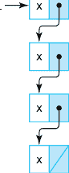

链表是独立元素的集合，每个元素都链接到列表中紧随其后的元素。我们可以将链表看作是元素的链。链表是一种多功能、强大的基础实现结构，和数组一样，它是实现更复杂结构的首要构建块之一。教你如何使用链接和链表是本文的重要目标之一。我们将在第 1.5 节“基本结构化机制”中研究 Java 的链接机制——引用（`reference`）。此外，在本文的后续部分中，我们将学习如何使用链接和链表来实现其他结构。

### 与实现无关的结构

与数组和链表不同，本小节介绍的组织结构与特定的实现方法无关。它们更具抽象性。

这里介绍的结构[展示]了其组成元素之间不同类型的关系。对于栈和队列，组织基于元素被放入结构中的时间；对于排序列表和优先级队列，它与元素的值；对于树和图，它反映了问题领域中的某些特征，这些特征通过元素的相对位置被捕捉。

这些结构（以及其他结构）将在本文后部分被单独处理，届时我们将对它们进行更详细的描述，研究使用它们的方法，并查看几种可能的实现。

#### 栈

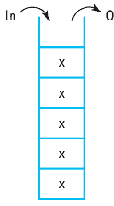

栈的定义特征是，每当你访问或删除一个元素时，你操作的是最近插入的元素。栈是“后进先出”（LIFO）结构。为了理解它们如何工作，请想象一叠盘子或托盘。栈的概念完全由其访问操作与插入元素或从中移除元素的操作之间的关系定义。无论内部表示是什么，只要保持 LIFO 关系，它就是一个栈。

#### 队列

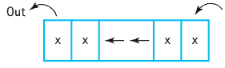

队列在某种意义上与栈相反。它们是“先进先出”（FIFO）结构。队列的定义特征是，每当你从队列中访问或删除一个元素时，你操作的是在队列中时间最长的元素。想象一排等队上公车的人，或者一组在熟食店拿着服务号的人。在这两种情况下，人们将按照他们到达的顺序接受服务。事实上，这是抽象组织构造——队列如何可以有多种实现方法（一个有序的队列或服务号）的良好例子。

#### 排序列表

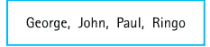

排序列表的元素显示出线性关系。每个元素（第一个除外）都有一个前驱，每个元素（最后一个除外）都有一个后继。在排序列表中，关系还反映了元素的顺序，从“最小”到“最大”，或反之。

你可能在想，一个元素为排序列表的数组——你是对的！正如我们之前所说，数组是构建其他结构的基础构建块之一。但那不是实现排序列表的唯一方法。我们将涵盖几种方法。

#### 映射

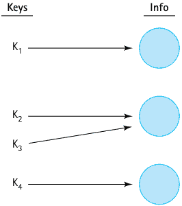

映射（Maps），也称为字典、表或关联数组，用于存储“键-信息”（key-info）有序对。当你提供适当的键时，映射提供了快速访问所需信息。例如，当你进入银行并向柜员提供你的账户号码时——在几秒钟内（希望如此），柜员就能访问你的账户信息。你的账户号码就是“键”——它“映射”到你的账户信息。虽然实现映射结构有很多方法，但它们都必须遵循相同的简单规则：键是唯一的，且一个键映射到单个信息节点。

#### 树

树和图是非线性的。

#### 图

图是非线性的。

## 1.5 基础结构化机制

通过直接寻址，与变量关联的内存位置存储的是变量的值。这对应于 Java 中原始变量的使用方式。例如，`char ch` 存储值 'A' 并与内存位置 572 关联，可以将其描述为：

Java 代码：

```java
char ch = 'A';
```

| 地址 | 内容 |
|---|---|
| *** | |
| 571 | |
| ch: 572 | 'A' |
| 573 | |
| *** | |

抽象视图：

`ch: 'A'`


# 内存中的变量与引用

在左侧，我们展示了这些内容在内存中是如何实现的——为了清楚图表，我们在与其相关的内存位置旁包含了变量名 `ch`。在右侧，我们展示了 Java 代码如何声明并实例化该变量，以及我们在内存抽象视图如何对变量及其内容进行建模。

通过间接寻址，与变量关联的内存位置存储的是另一个存储变量值的内存地址。这对应于 Java 中引用变量的使用方式。例如，`String` 对象 `str` 存储值 `"cat"` 并与内存位置 823 关联，实际对象存储从内存位置 320 开始，可以将其描述为：

| 地址 | 内容 |
|---|---|
| *** | |
| 319 | |
| 320 | 3 |
| 321 | 'c' |
| 322 | 'a' |
| 323 | 't' |
| *** | |

抽象视图：

`str -> "cat"`

| 地址 | 内容 |
|---|---|
| *** | |
| 822 | |
| str: 823 | 320 |
| *** | |

变量 `str` 对应位置 823，该位置存储了 `String` 对象信息起始位置的地址——该位置（即位置 320）是系统存储字符串信息的地方——如长度、字符等——例如指向 `String` 类的链接。注意，`String` 变量像所有引用变量一样，被存储在单个字中（地址为 823），而字符串本身需要多个字。在我们的抽象视图中，我们用变量名 `"str"` 表示前一个位置，用箭头表示后一个位置。在全文中，我们将使用箭头来表示引用——实际上它们代表内存位置。

# 第 1 章 组织工作

## 参考文献

为了帮助展示本节的概念，我们假设可以访问一个 `Circle` 类。`Circle` 定义了不同直径的圆形对象。它提供了一个构造函数，接受一个整数值，该值代表圆的直径。`Circle` 类提供了一个方便的示例，允许我们能够在图中以图形化的方式表示对象——我们使用不同直径的实际圆来表示 `Circle` 对象。

对象的变量持有对对象的引用——它们使用间接寻址。考虑以下 Java 语句的影响：

```java
Circle circleA;
Circle circleB = new Circle(8);
```

第一条语句为 `Circle` 类的变量预留了内存空间。第二条语句执行相同的操作，但还创建了一个 `Circle` 类的对象，并将该对象的引用存于 `circleB` 变量中。

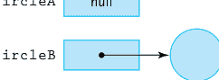

引用由箭头表示，但引用实际上是一个内存地址，正如在前一小节讨论过的。引用有时被称为链接、地址或指针。`Circle` 对象的内存地址存储在分配给圆变量的内存位置中。注意我们是如何用实际圆来表示 `Circle` 对象的。在现实中，它由分配给[对象]的内存区域组成。

由于没有实例化或分配对象到 `Circle` 变量，它的内存位置是空的。Java 使用 `null` 规则来表示“不存在引用”。如果声明了引用但没有实例化对象，它会自动初始化为系统使用的任何值。你也可以显式地为变量赋值 `null`：

```java
circleB = null;
```

此外，你可以使用 `null` 进行比较：

```java
if (circleA == null)
    System.out.println("不存在 Circle");
```

## 引用与原始类型

非原始类型如何被处理的方式影响了 `==` 运算符返回的结果。两个非原始类型变量在它们是彼此的别名时，在 `==` 运算符看来被认为是相同的。当你比较两个变量的内容时是有意义的；也就是说，它比较这些变量包含的引用。即使两个 `Circle` 类型的变量引用相同直径的圆，它们在比较运算符看来也不被认为是相等的。

## 别名

对象的变量持有对对象的引用——它们使用间接寻址。考虑以下 Java 语句的影响：

```java
Circle circleA;
Circle circleB = new Circle(8);
```

第一条语句为 `Circle` 类的变量预留了内存空间。第二条语句执行相同的操作，但还创建了一个 `Circle` 类的对象，并将该对象的引用存于 `circleB` 变量中。

引用由箭头表示，但引用实际上是一个内存地址，正如在前一小节讨论过的。引用有时被称为链接、地址或指针。`Circle` 对象的内存地址存储在分配给圆变量的内存位置中。注意我们是如何用实际圆来表示 `Circle` 对象的。在现实中，它由分配给[对象]的内存区域组成。

由于没有实例化或分配对象到 `Circle` 变量，它的内存位置是空的。Java 使用 `null` 规则来表示“不存在引用”。如果声明了引用但没有实例化对象，它会自动初始化为系统使用的任何值。你也可以显式地为变量赋值 `null`：

```java
circleB = null;
```

此外，你可以使用 `null` 进行比较：

```java
if (circleA == null)
    System.out.println("不存在 Circle");
```

## 垃圾回收

当对象不可达时，Java 运行时定期执行一种称为垃圾回收的操作，其中识别不可达的对象并释放它们的存储空间，将该空间返回给新对象的创建池。

## 参数传递机制

因此，如果参数是基本类型，则会将实际值（`int`、`double` 等）传递给方法。然而，如果参数是引用类型、对象或数组，那么传递给方法的值将是引用的值——即对象或数组的地址。

### Java 注意事项

所有的 Java 参数都是“按值传递”的。如果参数是基本类型，它代表该基本类型的值。如果参数是引用类型，那么它代表该对象的地址。

结果是，将对象变量作为参数传递会导致接收方法创建该对象的别名。如果方法使用别名对对象进行修改，那么当方法执行完毕时，通过原始变量进行访问将发现该对象处于被修改后的状态。

## 数组

第二种基本的结构构造是数组。数组允许程序员使用索引方法来访问一组位置。我们假设你已经通过之前的工作熟悉了数组的基本用法。在本小节中，我们将回顾在 Java 中使用数组的一些细微方面。

Java 中的数组是非可交换类型，因此它们像对象一样通过引用进行处理。在别名、比较以及作为参数使用方面，需要像对象一样被谨慎对待。和对象一样，数组除了声明外，还必须实例化。在实例化时，你指定数组的形式如下：

```java
numbers = new int[10];
```

让我们讨论一下你对 Java 数组可能存在的问题：

- 使用 `new` 实例化时，数组的初始值是什么？如果数组组件是基本类型，它们被设置为它们的默认值。如果数组组件是引用类型（如数组或类），则组件被设置为 `null`。
- 你能为数组提供初始值吗？可以。创建数组的另一种方法是使用初始化列表。例如，下面行代码声明并初始化了数组：
  ```java
  int[] numbers = {5, 32, -23, 57, 1, 0, 27, 13, 32};
  ```
- 当 `n` 小于 0 或 `n` 大于 9 时，如果我们尝试执行语句 `numbers[n] = value;` 会发生什么？将访问数组之外的内存位置，这会导致越界异常。某些语言（例如 C++）——不检查这一点，但 Java 会检查。如果你的程序尝试使用不在数组范围内的索引，将抛出 `ArrayIndexOutOfBoundsException`。

### 数组长度

除了圆形选择，我们的数组还有另一种“操作”可供。在 Java 中，每个数组在实例化时都会关联一个 `int` 类型的公共实例变量，称为 `length`，它包含数组中组件的数量。你使用与调用方法相同的语法来使用该变量——使用对象名后跟一个点，然后是实例名。对于 `numbers` 示例，表达式 `numbers.length` 的值将是 10。

### 对象数组

虽然基本类型组件的数组非常常见，但许多应用需要对象集合。在这种情况下，我们可以简单地定义一个组件为对象的数组。

这里我们定义了一个 `Circle` 对象的数组。声明和创建对象数组与声明和创建基本类型组件的数组完全一样：

```java
Circle[] allCircles = new Circle[10];
```

这意味着 `allCircles` 是一个可以容纳 10 个 `Circle` 对象引用的数组。圆的直径是多少？我们还不知道。圆数组已经实例化，但 `Circle` 是一个指向 `Circle` 对象引用的数组，这些引用在数组实例化时被设置为 `null`。必须单独实例化对象。以下代码初始化了第一个和第二个圆。我们假设 `Circle` 对象 `myCircle` 已经实例化并初始化直径为 8。

```java
Circle[] allCircles = new Circle[10];
allCircles[0] = myCircle;
allCircles[1] = new Circle(4);
```

图 1.7 提供了数组的视觉表示。

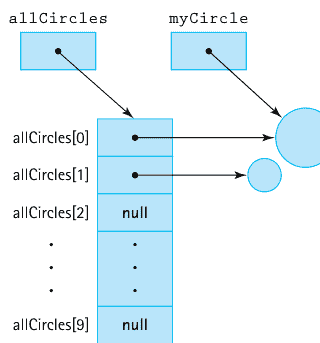

## 生成图像

Java 中的 `BufferedImage` 类允许我们使用二维模型创建和操作图像。它支持大多数流行的图像类型。在本特性中，我们将看到如何使用该类生成 JPEG 图像。考虑以下程序：

```java
// *******************************************************
// ImageGen01.java               By Dale/Joyce/Weems               第1章
// 演示图像生成
// *******************************************************
package ch01.apps;

import java.awt.image.*;
import java.awt.Color;
import java.io.*;
import javax.image.io.*;

public class ImageGen01 {
    public static void main(String[] args) throws IOException {
        String fileout = args[0]; // 输出文件

        // 创建 SIZE 和 TYPE 的 BufferedImage
        final int SIDE = 1024;
        final int TYPE = BufferedImage.TYPE_INT_RGB;
        BufferedImage image = new BufferedImage(SIDE, SIDE, TYPE);

        final int LIMIT = 255;
        int c;

        for (int i = 0; i < SIDE; i++) {
            for (int j = 0; j < SIDE; j++) {
                c = (i + j) % LIMIT;
                Color color = new Color(c, c, c);
                image.setRGB(i, j, color.getRGB());
            }
        }
        File outputfile = new File(fileout);
        ImageIO.write(image, "jpg", outputfile);
    }
}
```


除了圆形选择，我们的数组还有另一种“操作”可供。在 Java 中，每个数组在实例化时都会关联一个 `int` 类型的公共实例变量，称为 `length`，它包含数组中组件的数量。你使用与调用方法相同的语法来使用该变量——使用对象名后跟一个点，然后是实例名。对于 `numbers` 示例，表达式 `numbers.length` 的值将是 10。

## 二维数组

一维数组用于表示列表或值序列中的元素。二维数组用于表示具有行和列的表格中的元素。当我们需要存储关于多个元素的多个信息时，二维数组非常有用。它们也可以表示图像（参见特性：生成图像）。

图 1.9 显示了一个具有 100 行 9 列的二维数组。行通过 0 到 99 之间的整数访问；列通过 0 到 8 之间的整数访问。每个组件通过行—列对访问，例如 `[0][5]`。

二维数组变量的声明方式与一维数组变量完全一样，只是有两对括号。二维数组对象的实例化方式与一维数组完全一样，只是必须为两个维度指定大小。

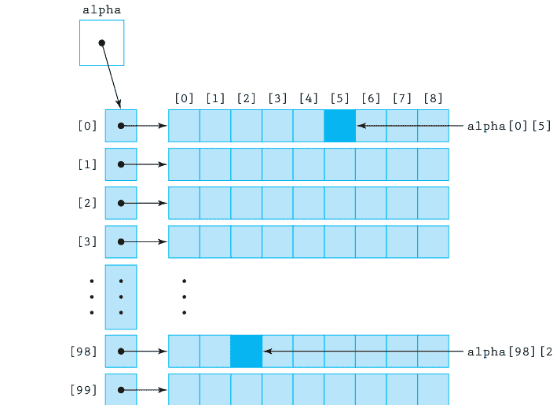

图 1.9 alpha 数组的 Java 实现

以下代码段将创建图 1.8 所示的数组，其中表中的数据类型为 double 类型。

```
double[][] alpha;
alpha = new double[100][9];
```

第一个维度指定行数，第二个维度指定列数。

要访问 alpha 数组的单个组件，使用两个表达式（每个维度一个）来指定其位置。我们将每个表达式放在数组名旁边的自成的一对括号中：

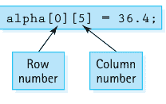

注意 `alpha.length` 将给出数组的行数。要获取数组中某行的列数，我们访问该特定行的 `length` 字段。例如，语句

```
rowLength = alpha[30].length;
```

将数组 alpha 的第 30 行（其长度为 9）存储在 `int` 变量 `rowIndex` 中。

想象二维数组的许多使用方法并不困难——行可以代表学生，列可以代表测试；行可以代表员工以及他们每天的工作小时数，等等。

记住在 Java 中，二维数组的每一行本身都是一维数组。许多编程语言直接支持二维数组，但 Java 不支持。在 Java 中，二维数组是一个指向数组对象的引用数组。如果需要更高维的数组，只需扩展使用的数组层数即可，例如，一个三维数组可以被创建一个元素为数组的二维数组。

## 1.6 比较算法：增长阶数分析

爱丽：“我正在想一个 1 到 1000 之间的数字。”

鲍姆：“是 7 吗？”

爱丽：“不是……大大了。”

鲍姆：“是 2 吗？”

爱丽：“不是……大大了。”

鲍姆：“是 3 吗？”

爱丽翻了个白眼……

最终，鲍姆将通过每次将猜测增加 1 来猜出那个秘密数字。尽管爱丽显然对他感到非常沮丧，但他遵循的是一种有效的算法——顺序搜索。

算法分析是理论计算机科学的一个重要领域。在本节中，我们将为你介绍这一主题，其程度足以让你判断两个算法中哪一个完成特定任务所需的资源更少。算法及其实现代码的效率可以从时间（运行多快）和空间（所需的内存量）两个方面进行研究。在此过程中，适当时我们会指出空间方面的考虑，但通常我们关注时间方面——即算法运行有多快，而不是它占用了多少空间。

在继续讨论算法的时间效率之前，我们应该指出，时间效率和空间效率通常是相互关联的，并且可以在时间和空间之间进行权衡。例如，对一幅编号为 1–300 的扑牌进行排序。假设你坐在公车上拿着牌牌，必须在拿着它们时对它们进行排序。你将花费大量时间洗牌，而且你很可能需要查看每张牌几次。另一种，想象一下如果你站在一张足够容下 300 张牌的桌子前，尝试对同一组牌进行排序。在这种情况下，你可以看每张牌一次并将其放在桌子上正确的排序位置。桌子提供的额外空间允许使用更高效的排序算法。

### 衡量算法的时间效率

程序员是如何比较两个算法的时间效率的？首先想到的方法是为算法编写代码，然后在运行两个程序后比较它们的执行时间。执行时间较短的显然是更好的算法。真的是如此吗？使用这种技术，我们实际上只能确定程序 A 在特定计算机的特定时间比程序 B 更高效。

### 算法比较

Carlos：“怎么吗？”，……

如你所见，Carlos 使用的算法与 Bob 不同。这被称为二分查找，它利用了这样一个事实：Carlos 可以通过巧妙地选择范围中间的数字，每次排除剩余的数字。在最坏情况下，Carlos 只需 20 次猜测就能猜中 1 到 1,000,000 之间的任意数字！

```
Hi-Lo Binary Search(N)
range to 1 ... N
Set guess to middle of range
Announce guess
if (guess was too high)
  Set range to first half of range
if (guess was too low)
  Set range to second half of range
while (guess is not correct)
```

高低二分查找的最坏情况复杂度是多少？让我们数数在最坏情况下，“宣布猜测”语句执行了多少次。每当进行错误的猜测，剩余可能的数字范围就会减半。因此，另一种提问方式是：“在变成 1 之前，你可以将 N 缩小多少次？”答案是 log₂N。在 log₂N 次猜测之后，除了—

> ⁴ 实现此算法的代码位于 ch01.app 包的 SortAndBinarySearch.java 文件中。

> ⁵ 记住 log₂N 是你将 2 次方得到 N 的幂。例如，log₂8=3，因为 2³=8。但另一种观察角度是，log₂N 是你在到达 1 之前将 N 减半的次数。我们可以将 8 一半 3 次：8→4→2→1。

一个数字被排除了，所以通过最后一次猜测你就是正确的。因此，在最坏情况下，高低二分查找对于 N 需要 logN+1 次猜测，而高低顺序查找需要 N 次。此外，logN 并不总是整数——在非整数结果的情况下，我们可以“向下取整”。对于 1,000,000 的输入，这等于二分查找需要 20 次猜测，而顺序查找需要 1,000,000 次猜测。

显然，二分查找比顺序查找法更快。或者是因为每次使用二分查找法进行猜测时，算法必须做的计算比使用顺序查找时更多？确定剩余范围的中间值比在之前的猜测的基础上加 1 更耗时。仅仅通过观察这两个算法的描述，我们就可以顺序查找比二分查找更简单。哪一个更好呢？

让我们尝试在这种情况下更仔细地考虑这些操作。对于顺序查找，初始猜测设置为 0，每次猜测时，该值都必须被加1并宣布。在最坏情况下，每次猜测需要两个步骤（加1、宣布），加上初始步骤，总共需要 2N+1 步。对于二分查找，算法必须设置范围的低值和高值，然后每次进行猜测时，将低值和高值相加、除法、取整、宣布猜测，并调整范围。它还必须进行最后一次猜测。在最坏情况下，每次猜测需要五个步骤（相加、除法、取整、宣布和调整），加上两个初始步骤和一个最终步骤，总共需要 5 logN+3 步。随后的表格比较了我们的两种算法在不同 N 值下的步数计数。

| 大小 | 顺序查找 | 二分查找 |
| :--- | :--- | :--- |
| N | 2N + 1 步 | 5 logN + 3 步 |
| 2 | 5 | 8 |
| 4 | 9 | 13 |
| 8 | 17 | 18 |
| 16 | 33 | 23 |
| 32 | 65 | 28 |
| 1,024 | 2,049 | 53 |
| 1,000,000 | 2,000,001 | 98 |
| 1,000,000,000 | 2,000,000,001 | 148 |

对表格的研究显示，如果问题规模为 8 或更小，顺序查找所需的步骤比二分查找少。对于 16 和 32 的问题规模，两种算法所需的步数差异并不大。另一方面，随着问题规模的增长，所需步数的差异变得巨大，且倾向于二分查找。

我们的例子是典型的。对于许多问题，我们可以设计出简单的“暴力破解”算法，它们易于理解且在问题规模较小时运行良好，但随着问题规模的增加，它们的成本会变得极其昂贵。如果你在一个可能的数字范围很小的情况下猜游戏，尽管使用 Bob 的暴力法吧——但随着范围增加，你模拟的将—.

### 高明的算法

设计高效解决问题的巧妙算法是计算机科学中令人兴奋的一部分。证明此类算法的正确性、调整空间/时间权衡、为特殊情况设计启发式算法以及确定最优边界，是我们理解计算演化的关键步骤。这些工作具有重要的实际效益，基因测序、建模、信号处理、加密、数据压缩和网络分析等领域的进展证明了这一点。

### 增长阶

对表格的研究显示，如果问题规模为 8 或更小，顺序查找所需的步骤比二分查找少。对于 16 和 32 的问题规模，两种算法所需的步数差异并不大。另一方面，随着问题规模的增长，所需步数的差异变得巨大，且倾向于二分查找。

我们的例子是典型的。对于许多问题，我们可以设计出简单的“暴力破解”算法，它们易于理解且在问题规模较小时运行良好，但随着问题规模的增加，它们的成本会变得极其昂贵。如果你在一个可能的数字范围很小的情况下猜游戏，尽管使用 Bob 的暴力法吧——但随着范围增加，你模拟的将—.

### 选择排序

给定一个无序元素列表，算法扫描整个列表并找到最小元素。它选择并与第一个元素交换。然后扫描列表找到第二个最小元素，再次选择并与第二个元素交换。随着算法反复选择下一个最小元素并交换到“正确”位置，列表的排序部分不断增大，最终无序列表被排序。原因显而易见，这种算法被称为选择排序。

在分析选择排序算法之前，我们需要确定输入的大小。显易看出，列表越大，排序所需的工作越多。因此，列表中的元素数量是排序问题规模的自然选择。我们将使用 N 来表示这个大小。以下是该算法的正式描述：

#### 选择排序(values[0...N-1])

```
for current going from 0 to N-2
    Set minIndex to index of smallest unsorted element
    Swap the elements at indices current and minIndex
```

图 1.10 显示了算法在对五元素数组进行排序时采取的步骤。图中的每个部分代表 for 循环的一次迭代。每个部分的第一部分代表“找到最小的未排序元素”步骤。为了实现这一点，算法会反复检查未排序的元素，询问每一个元素是否是目前为止最小的。每个部分的第二部分显示了要交换的两个数组元素，最后部分显示了交换的结果。

| values | values | values |
|---|---|---|
| (a) [0] | 126 | [0] 0 |
| [1] | 43 < 126? YES | [1] 43 |
| [2] | 26 < 43? YES | [2] 26 |
| [3] | 126 < 26? | [3] 126 |
| [4] | 113 < 17? NO | [4] 113 |
| values | values | values |
|---|---|---|
| (b) [0] | 1 | [0] 1 |
| [1] | 43 | [1] 43 |
| [2] | 26 < 43? YES | [2] 26 |
| [3] | 126 < 26? NO | [3] 126 |
| [4] | 113 < 27? NO | [4] 113 |
| values | values | values |
|---|---|---|
| (c) [0] | 1 | [0] 1 |
| [1] | 26 | [1] 26 |
| [2] | 43 | [2] 43 |
| [3] | 126 | [3] 126 |
| [4] | 113 | [4] 113 |
| values | values | values |
|---|---|---|
| (d) [0] | 1 | [0] 1 |
| [1] | 26 | [1] 26 |
| [2] | 43 | [2] 43 |
| [3] | 126 | [3] 126 |
| [4] | 113 < 126? YES | [4] 113 |

图 1.10 选择排序示例（已排序元素为阴影部分）

在执行过程中，我们可以将数组视为已排序部分和未排序部分。每当执行一次 for 循环体时，已排序部分就会增加一个元素，未排序部分就会减少一个元素。除了最后一步外，已排序部分会增加两个元素——你知道为什么吗？当数组中最后一个元素以外的所有元素都处于其正确的位置时，最后一个元素默认也会处于其正确的位置。这就是为什么我们的 for 循环停止在索引 N-2，而不是数组的末尾索引 N-1。

在确定用于分析的“算法基本操作”时，我们必须非常小心。我们可以使用“交换元素”吗？虽然它看起来是一个基本操作，并且在 for 循环的每次迭代中都执行，但它并不是实际执行的操作。考虑一下在通过循环在数组剩余部分寻找最小元素的过程中，我们必须“查看”所有剩余元素。如果我们为算法添加更多细节，将会发现内部实际上包含一个循环：


## 1.6 算法比较：增长阶分析

算法，我们的目标是对一个大小为 `N` 的数组值进行排序（数组索引从 `0` 到 `N-1`）：

### 选择排序(`values[0...N-1]`)

```
Sort(values[0..N-1])
for going from 0 to N-2
    set minIndex to current
    for check going from (current + 1) to (N - 1)
        if (values[check] < values[minIndex])
            set minIndex to check
    Swap the elements at indices current and minIndex
```

最内层的操作——两个数组元素的比较——是发生最频繁的基本操作。从对图 1.10 的研究中也可以看出这一点，我们可以数出发生了 10 次比较，而只有 4 次交换。我们将比较次数描述为数组元素数量（即 `N`）的函数。比较操作位于内部循环中。我们知道它执行了 `N-1` 次，因为外部循环从 `0` 到 `N-2`。在内部循环中，比较的次数取决于 `current` 的值。内部循环第一次执行时，`current` 为 `0`，因此算法检查从索引 `1` 到 `N-1` 的位置，所以有 `N-1` 次比较；下一个 `current` 是 `1`，因此有 `N-2` 次比较，依此类推，直到最后一次调用只有一次比较。比较总数为：

`(N-1) + (N-2) + (N-3) + ... + 2 + 1`

应用一个著名的求和公式告诉我们，这个和等于 `N(N-1)/2`。为了完成对 `N` 个元素数组排序的目标，选择排序需要 `N(N-1)/2` 次比较。数组中值的特定排列并不影响比较次数。

# 练习题

结构——即数组和引用机制。增长阶数（Order of growth）是分类我们在实现和使用结构时所采用的算法效率的方法。

程序员是问题的解决者。面向对象的方法允许问题分析与设计的无缝整合，从而产生可维护和可重用的解决方案。数据结构提供了组织问题领域数据的方法，以确保解决方案是正确且高效的。保持条理是解决困难问题的关键！

# 练习题

## 1.1 类、对象与应用

- 1. 研究题：图灵奖自 1966 年以来一直颁给对计算机领域做出了持久且重大技术影响贡献的个人或若干个人。在网络上查找有关该奖项的信息。研究获奖者列表及其贡献。识别出那些直接涉及编程的贡献。识别出那些直接涉及面向对象编程的贡献。

- 2. 研究题：列出并简述 UML 的 14 种主要图表类型。

- 3. 对象和类之间的区别是什么？请举一些例子。

- 4. 描述 Java 访问修饰符提供的四个可见性级别。

- 5. 描述 `DaysBetween` 应用，1900/1/1 到 2000/1/1 之间有多少天？这些日期之间有多少年？2000/1/1 到 2100/1/1 之间又有多少年？解释这些答案之间的差异。

- 6. 使用 `DaysBetween` 应用回答以下问题：

    a. 你现在的年龄是多少（天数）？

    b. 从 Jean-François Pilâtre de Rozier 和 François Laurent 在 1783 年 11 月 21 日在巴黎附近乘坐热气球飞行 10 公里成为首批人类飞行员，到尼尔·阿姆斯特朗于 1969 年 7 月 20 日在月上迈出的一步之间，有多少天？

    c. 从 1776 年 7 月 4 日美国通过独立宣言以来，有多少天？

- 7. 思考你如何测试 `DaysBetween` 应用。什么类型的输入会产生 `07 OF 17 OF 365 OF 366` 的结果？尝试你识别出的测试用例。

- 8. 修改 `Date` 类，使其包含一个签名如下的 `compareTo` 方法：

```
int compareTo(Date anotherDate)
```

该方法如果此日期（调用方法的对象的日期）与参数日期相等，应返回值 `0`；如果此日期早于参数日期，返回小于 `0` 的值；如果此日期晚于参数日期，返回大于 `0` 的值。创建一个测试驱动程序证明你的方法运行正确。

- 9. 对象的一个常见用途是“跟踪”某些。对象通过其转换方法接收数据，并通过其观察者方法返回信息。为以下每个类定义一组合理的实例变量、类变量和方法。为每个构造结构指定访问级别。注意，这些每个类描述都是“模糊”的，允许有多个“正确”的答案。

    a. 时间计数器——它将跟踪时间；它将接收离散的时间量（以分钟和秒或仅秒计）；它应该提供关于总时间的“格式”、离散时间单位的数量以及单位平均时间的信息。将此类类视为一种工具，用于跟踪给定每首歌时长的音乐集合的总时长。

    b. 篮球统计跟踪器——它将跟踪篮球队的分数和统计数据（不是针对每个球员，而是针对团队作为一个整体）；它应该在每次投篮时接收数据；它应该提供请求的百分比和总分信息。

    c. 井棋（Tic-Tac-Toe）游戏跟踪器——它将跟踪一场井棋游戏；它应该接收移动指令并返回关于移动是否合法的指示。

- 10. 为上一个练习中的一个或多个类实现类：

    a.

    b. 设计并实现一个使用该类的应用程序。

    c. 使用你的应用程序验证该类的正确性。

- 11. 你将创建一个表示标准双骰子的类。

    a. 创建一个名为 `PairDice` 的类。该类的对象代表一对骰子。提供一个构造函数。提供一个 `roll` 方法模拟掷骰子。提供一个返回点数之和的方法。提供一个 `toString` 方法返回一个格式良好的字符串。最后，提供一个程序（测试驱动程序），证明你的类运行正确。

    b. 使用 `PairDice` 类模拟 100,000 次掷，并输出多少次获胜（点数为 7 或 11），多少次获得天胜（点数为 2、3 或 12），多少次落败（其他点数）。

    c. 创建一个名为 `Craps` 的类。该类的对象代表一场骰子游戏。此类对象的属性包括游戏状态。提供一个构造函数。提供一个玩游戏的方法。提供一个返回游戏状态的方法。提供一个 `toString` 方法返回一个格式良好的字符串。最后，提供一个程序（测试驱动程序），证明你的类运行正确。


## 12. 创建 `ShoppingBag` 类

你将创建一个跟踪总成本、平均成本和物品数量的类。

### 要求

创建一个名为 `ShoppingBag` 的类。该类的对象代表一个购物包。此类对象的属性包括物品数量和总成本。提供一个接受税率参数的构造函数。提供一个名为 `place` 的转换方法，向包中添加价格相同的物品——它接受一个表示数量的 `int` 参数和一个表示单价的 `double` 参数。例如，`myBag` 代表五个每个 $10.50 的物品。提供包中物品数量的访问器（getter）以及一个返回含税总成本的 `totalCost` 方法。提供一个 `toString` 方法返回一个总结购物包当前状态的格式良好的字符串。最后，提供一个程序（测试驱动程序），证明你的类运行正确。

### 应用程序

创建一个应用程序，反复提示用户放入包中的物品数量，随后提示这些物品的成本。使用 0 作为物品数量表示没有更多物品。程序然后显示购物包状态的总结。假设税率为 6%。简短示例运行如下：

```
Enter count (use 0 to stop): 5
Enter cost: 10.50
Enter count (use 0 to stop): 2
Enter cost: 2.07
Enter count (use 0 to stop): 0
The bag contains seven items. 
（此处为原文未完部分）
```

## 13. 创建 `Polynomial` 类

你将创建一个表示多项式的类；例如，它可以代表 $5x^4 + 2x - 3x^2 - 1$。

### 要求

创建一个名为 `Polynomial` 的类。该类的对象代表一个多项式。此类对象的属性包括它的阶数和每个项的系数。提供一个接受多项式阶数的 `int` 参数的构造函数。提供一个名为 `setCoefficient` 的转换方法，它接受两个 `int` 参数，分别表示要设置的项的阶数和应被设置的系数。例如，可以通过以下语句序列创建多项式 $5x^3 + 2x - 3$：

```java
Polynomial myPoly = new Polynomial(3);
myPoly.setCoefficient(3, 5);
myPoly.setCoefficient(1, 2);
myPoly.setCoefficient(0, -3);
```

提供一个求值方法 `evaluate`，它接受一个 `double` 类型参数并返回多项式的值（类型为 `double`），即在该参数值处计算的值。例如，给定之前的代码，以下代码序列将打印 -3.0、4.0 和 -1.375。

```java
System.out.println(myPoly.evaluate(0.0));
System.out.println(myPoly.evaluate(1.0));
System.out.println(myPoly.evaluate(0.5));
```

最后，提供一个程序（一个“测试驱动程序”），证明你的 `Polynomial` 类运行正确。

### b. 命令行参数应用程序

创建一个应用程序，它从命令行参数接受多项式的次数和多项式的系数（从高到低），然后创建相应的 `Polynomial` 对象。例如，多项式 $5x^3+2x-3$ 将由命令行参数 `3 5 2 -3` 表示。该程序应反复提示用户输入一个 `double` 值来求值多项式，并报告求值结果。假设使用上述命令行参数，示例运行结果可能如下：

```
Enter a value> 0.0
The result is -3.0
Continue?> Yes
Enter a value> 1.0
The result is 4.0
Continue?> Yes
Enter a value> 0.5
The result is -1.375
Continue?> No
```

### c. 定积分近似应用程序

创建一个应用程序，它像 b 一样从命令行参数接受多项式的次数和多项式的系数。该程序应提示用户输入两个 `double` 值，代表多项式定义的区间端点。然后，你的程序应使用 1000 个矩形计算并输出多项式在指定区间上定积分的近似值。

## 1.2 类组织

### 14. 继承概念

描述继承的概念，并解释在面向对象的系统中如何通过遍历继承树来将方法调用与方法实现绑定。

### 15. 研究：`ArrayList` 类

研究：查找 Java 中 `ArrayList` 类的描述并回答以下问题：

- a. 它继承自哪个类？
- b. 它有多少个子类？
- c. 它实现了多少个方法？
- e. 如果我们在 `ArrayList` 对象上调用 `toString` 方法，将使用哪个类的 `toString` 方法？

### 16. 合法性判断

假定本章中有 `Date` 和 `IncDate` 类的定义，以及以下声明：

```java
int temp;
Date date1 = new Date(10, 2, 1989);
IncDate date2 = new IncDate(12, 25, 2001);
```

指出下列语句哪些是合法的，哪些是非合法的：

- a. `temp = date1.getDate();`
- b. `temp = date2.getY();`
- c. `date1.increment();`
- d. `date2.increment();`

### 17. 继承关系设计

设计一组具有继承关系的类：

- a. 银行——例如，支账户、储蓄账户
- b. 游戏——例如，英雄、反派
- c. 旅游——例如，车辆、飞机
- d. 任何内容

### 18. 多态演示

编写一个程序来演示多态，使用书中提供的示例。

### 19. 包组织

解释包（packages）是如何组织的。

### 20. 研究：包结构

研究：拷贝以下程序并回答以下问题：

- a. `apps` 包中有多少个类？
- b. `dates` 包中有多少个类？
- c. `apps` 包中的类：
    - i. 它导入了哪些包？
    - ii. 这些 `import` 语句之间有何不同？
- d. `dates` 包中的类：
    - i. 如果我们将 `import` 语句更改为 `dates` 包会发生什么？
    - ii. 如果我们删除 `import` 语句编译会发生什么？
    - iii. 如果将其抛出到 `apps` 包会发生什么？

### 21. 文件与包结构

假设文件 1 包含文件 2 包含：

```java
package media;
public class Check{ ... }
class Review{ ... }
public class Date{ ... }
```

- a. `Check` 类和 `Review` 类在同一个包中吗？
- b. 文件 1 的名称是什么？
- c. 文件 2 的名称是什么？
- d. 包含它们的目录名称是什么？
- e. 它们属于哪个目录？

## 1.3 异常情况

### 22. 异常层级区别

解释继承 `Exception` 类的异常与继承 `RuntimeException` 类的异常的区别。

### 23. 整数输入验证

创建一个程序要求用户输入一个整数并感谢他们。如果他们输入的不是整数，你的程序应再次要求。程序的运行结果可能如下：

```
Please enter an integer.
OK
That is not an integer. Please enter an integer.
Twenty-seven
That is not an integer. Please enter an integer.
64
Thank you.
```

### 24. `BankAccount` 类与异常处理

创建一个 `BankAccount` 类，为了简单起见，假设该账户仅处理整数金额。

#### a. 基础实现

你应该提供一个构造函数、一个 `toString` 方法、一个返回 `int` 的 `getTotal` 方法，以及两个接受 `int` 参数并返回 `void` 的 `deposit` 和 `withdraw` 方法。创建一个 `BankAccount` 应用来证明其工作。

#### b. 异常类与修改

创建 `BankAccountException` 类。修改 `deposit` 方法，如果尝试存款负数，则抛出相应的异常。对 `withdraw` 方法也这样做，但如果尝试提取超过可用金额，也要抛出异常。在每种情况下包含适当的异常消息。创建三个应用来演示每种异常情况——只要应用崩溃并证明了异常已抛出即可。

#### c. `Banker` 应用程序

创建一个新的应用 `Banker`，它创建一个 `BankAccount` 对象并与用户交互，允许他们存款、取款或请求余额。该应用在任何情况下都不应崩溃——它应该捕捉异常，将消息传递给用户并继续处理。

### 25. `ThirteenException` 练习

此练习有三个部分：

#### a. 异常类创建

创建一个名为 `ThirteenException` 的异常类。

#### b. 抛出异常程序

编写一个程序反复提示用户输入字符串。每次输入后，程序输出字符串的长度，除非字符串长度为 13，此时抛出 `ThirteenException`，消息为“Use letter words and stainless steel to protect yourself!”你的方法只需简单将 `ThirteenException` 抛出到运行时。程序的示例运行可能：

```
Input a string > Villanova University
That string has length 20.
Input a string > Triscadecapobia
That string has length 16.
Input a string > misprogrammed
```

此时程序崩溃，且系统提供了一些信息，包括“Use letter words and stainless steel to protect yourself!”消息。

#### c. 捕获异常程序

创建另一个与 b 类似的程序，这次在你的代码中包含一个 `try-catch` 子句，以便你可以捕捉抛出的异常。如果异常被抛出，则捕捉它，打印消息并“正常”地结束程序。

# 第1章 组织结构

### 28. 树的用途

描述树作为组织信息的三种用途。

### 29. 图结构建模

以下每个项的某些方面都可以用图结构进行建模。请描述每种情况下，节点代表什么，边又代表什么：

- a. 使用特定航空公司的可用航班
- b. 国家及其边界
- c. 一系列关于数据结构的研究论文集
- d. 演员（“凯文·贝肯的六度角”）
- e. 大学的计算机
- f. 迷宫
- g. Web网

## 1.5 基础结构化机制

### 30. 内存图绘制

绘制与第1.5节“基础结构化机制”中内存小节所示相似的图像，表示由以下代码段产生的内存内容。假设 `i` 关联内存位置 123，`j` 关联 124，变量 `str1` 关联 135 及其关联的对象关联 100，变量 `str2` 关联 136。

#### a. 代码段

```java
int i = 10;
int j = 20;
String str1 = "cat";
```

#### b. 代码段

```java
int i = 10;
int j = i;
String str1 = "cat";
String str2 = str1;
```

## 练习

### 31. 别名

什么是别名（alias）？展示一个 Java 程序创建别名的示例。解释别名的危险性。

### 32. `IncDate` 别名输出

假设 `date1` 和 `date2` 是第1.2节“组织类”中定义的 `IncDate` 类对象。以下代码的输出是什么？

```java
date1 = new IncDate(5, 2, 2000);
date2 = date1;
System.out.println(date1);
System.out.println(date2);
date1.increment();
System.out.println(date1);
System.out.println(date2);
```

### 33. 垃圾

什么是垃圾（garbage）？展示一个 Java 程序创建垃圾的示例。

### 34. 对象比较输出

假设 `date1` 和 `date2` 是第1.2节“组织类”中定义的 `IncDate` 类对象。以下代码的输出是什么？

```java
date1 = new IncDate(5, 2, 2000);
date2 = new IncDate(5, 2, 2000);
if (date1 == date2)
    System.out.println("equal");
else
    System.out.println("not equal");
date1 = date2;
if (date1 == date2)
    System.out.println("equal");
else
    System.out.println("not equal");
date1.increment();
if (date1 == date2)
    System.out.println("equal");
else
```

### 35. 数组平方初始化

写一个程序，声明一个包含 10 个元素的 `int` 数组，使用循环将每个元素初始化为索引值的平方，然后使用另一个循环打印数组的内容，每行一个。

### 36. `Date` 数组初始化

写一个程序，声明一个包含 10 个元素的 `Date` 数组，使用循环将元素初始化为 2005 年 12 月 1 日至 10 日，然后使用另一个循环打印数组的内容，每行一个。

### 37. 二维数组行列最大和

创建一个应用程序，实例化一个 20 × 20 的整数二维数组，用从 1 到 100 范围内取的随机整数填充它，然后输出所有行中总和最大的行索引，以及所有列中总和最大的列索引。


### 38. `ImageGen01` 实验

编译并运行 `ImageGen01` 。尝试使用 `c` 值的替代公式。增加两个 `int` 变量，以便能够单独设置颜色的 RGB 值并进行更多实验。与同学分享你最有趣的结果。

## 1.6 算法比较：增长阶分析

### 39. 高低游戏猜测次数

我们研究了在“高低游戏”中猜秘密数字的两种方法：高低顺序搜索（Hi-Lo Sequential Search）和高低二分搜索（Hi-Lo Binary Search）。如果最高可能的数字为 (a) 10，(b) 1,000，(c) 1,000,000 和 (d) 1,000,000，这些方法所需的最好和最坏猜测次数是多少？

### 40. 算法基本操作分析

针对以下每个问题，简要描述算法的“基本操作”（fundamental operation）以计算算法效率，充分描述问题规模，并说明在最好和最坏情况下基本操作相对于问题规模的发生次数。例如，如果问题是“在高低游戏中猜数字”，你的答案可能是“从 1 开始猜并不断加，直到猜中数字；最高可能的数字——调用 N 次”。

- a. 在《编程艺术》中寻找书。
- b. 对数组进行排序。
- c. 在鞋架上寻找最便宜的鞋子。
- d. 计算储蓄罐里有多少钱。
- e. 为给定的 N 计算 N!
- f. 计算 1 到 N 的求和。
- g. 两个两个矩阵。

### 41. 函数增长比较

通过绘图比较以下函数对 $f(x)$ 和 $g(x)$。注意在每种情况下高函数 $g(x)$ 都会大于低函数 $f(x)$。识别这种情况发生的值。

- a. $f(x) = x, g(x) = \log_2 x$
- b. $f(x) = x^2, g(x) = 3$
- c. $f(x) = 3, g(x) = 5$
- d. $f(x) = x, g(x) = 2$

### 42. O 表示法描述增长阶

使用 O 表示法描述以下每个项的增长阶：

- a. $N^2 + 3$
- b. $3N^2$
- c. $N + 5$
- d. $N^2$
- e. $1 + N^3$
- f. $(N - 1)$

### 43. 代码片段增长阶分析

使用 O 表示法描述以下每个部分的增长阶：

#### a. 单层循环

```java
int count = 0;
for (int i = 1; i <= n; i++)
    count++;
```

#### b. 双层嵌套循环

```java
int count = 0;
for (int i = 1; i <= n; i++)
    for (int j = 1; j <= n; j++)
        count++;
```

#### c. 对数循环

```java
int value = N;
int count = 0;
while (value > 0) {
    value = value / 2;
    count++;
}
```

#### d. 单次计算

```java
int count = 0;
int value = N;
count = count * (N - 1);
```

#### e. 两个顺序循环

```java
int count = 0;
for (int i = 0; i <= N; i++)
    count++;
for (int i = N; i >= 0; i--)
    count++;
```

#### f. 外层循环 N，内层固定 5

```java
int count = 0;
for (int i = 1; i <= N; i++)
    for (int j = 1; j <= 5; j++)
        count++;
```

### 44. 求和方法增长阶

下方法返回 1 到 n 之间的整数之和。它的增长阶是什么？创建一个执行相同操作的方法。


```java
public int Sum(int n) // 前提：n > 0
{
    int total = 0;
    for (int i = 1; i <= n; i++)
        total = i;
    return total;
}
```

- 45. 假设 `numbers` 是一个大数组，当前在 0 到 N-1 中存储了 N 个值。使用 N 符号描述以下操作的最坏情况增长阶：
    - a. 将位置 N 设置为 17。
    - b. 将数组中的所有值向“右”移动一位，为位置 0 留出空间；将 17 插入位置 0。
    - c. 从 0 到 N-1 随机选择一个位置 L；将数组中从 L 到 N-1 的所有值向右移动一位，为位置 L 留出空间；将 17 插入位置 L。

- 46. 显示数组在使用选择排序排序时经历的变化序列。

| 数值 |
| :--- |
| 27 | 15 | 83 | 12 | 104 | 28 | 57 | 30 |

- 47. 对于此练习，你必须实现选择排序算法。
    - a. 创建一个名为 `SelectionSort` 的程序，实例化一个大小为 100 的 `int` 数组，并用 1 到 1000 之间的随机数初始化它。程序应每列 5 个显示数组中的整数。接下来使用选择排序对数组进行排序。最后，再次打印数组的内容，每列 5 个。
    - b. 增强你在 a 部分的程序，以统计选择排序期间执行的比较次数和交换次数。它应该在打印排序数组后报告这些数字。根据本节对选择排序的分析，比较次数和交换次数的预期值是多少？你的程序报告的值与“理论”值相比如何？
    - c. 增强你在 b 部分的程序，使其能够处理大小为 10、1000、10000，最后是 100000 的数组（当然，要删除打印数组值的代码）。对于每个数组大小，你的程序应显示比较次数和交换次数。让程序以清晰的表格格式显示这些数字。

# 第 2 章

## 栈（Stack）ADT

## 知识目标

你应该能够：

- 解释以下术语及其关系：抽象、信息隐藏、数据抽象、数据封装、作为抽象数据类型（ADT）
- 描述使用抽象数据类型的优点
- 结合 Java 编程语言的优点，定义抽象方法和接口（`interface`）的含义
- 描述使用 Java 接口来指定 ADT 的优点
- 列出使集合 ADT 变得通用的三种方案
- 解释在定义 ADT 时“处理”异常情况的三种方法
- 从三个维度描述栈 ADT：抽象层级、应用级和实现级
- 将给定的栈分类为构造器、观察者或转换器
- 描述一种使用栈来判断字符串内分组符号（如括号）是否平衡的算法
- 描述一种使用栈来求后置表达式表达式值的算法

## 技能目标

你应该能够：

- 使用 Java 接口结构来正式指定一个 ADT
- 指定公共方法的先置条件和后置条件（影响）
- 在设计/或实现和/或使用 ADT 时使用 Java 泛型机制
- 定义并使用自引用类来构建链表
- 绘制表示链表上操作序列的图表
- 使用数组实现栈 ADT
- 使用 Java 库中的 `ArrayList` 类实现栈 ADT
- 使用链表实现栈 ADT
- 绘制显示特定栈实现操作效果的图表
- 确定栈实现操作的增长效率顺序
- 在 ADT 内部抛出 Java 异常并在使用该 ADT 的应用程序中捕获这些异常
- “手动”评估后置表达式
- 将栈 ADT 作为应用程序的组件使用

---

68 第 2 章 栈 ADT

本章引入了栈，一种重要的数据结构。栈是一种“后进先出”结构。我们从讨论设计中的抽象开始本章。我们回顾了抽象和信息隐藏的相关概念，并展示这些技术如何使能够从不同的“层次”查看数据：应用层、抽象层和实现层。这种方法同样适用于栈结构。在抽象层级，我们使用 Java 接口正式地定义了栈。我们讨论了栈和锁的许多应用，特别是如何使用栈来判断一组分组符号是否合法，以及支持数学表达式的求值。栈随后通过两种基本方法实现：数组和链接（引用）。为了支持基于链接的方法，我们引入了链表结构。最后，我们还展示了使用 Java 库中 `ArrayList` 类的实现。

## 2.1 抽象

宇宙充满了复杂的系统。我们通过模型来学习系统。模型可以是数学的，例如描述卫星绕地球运动的方程。物理对象（如用于风洞测试的飞机）是模型的另一种形式。通常，只对所研究系统的相关特征进行建模；无关的细节会被忽略。例如，机上电影并没有被包含在研究空气动力学的模型中。当忽略了无关细节时，我们就得到了系统的抽象视图。

抽象是系统的模型，它只包含从系统视角来看本质的内容。抽象与软件开发有什么关系？编写软件是困难的，因为我们建模的系统以及我们开发软件的过程都是复杂的。抽象是我们管理复杂性的根本方式。在本书的每一章中，我们都利用抽象来简化工作。

69

> **重要**
>
> 抽象是构建大型复杂系统的关键工具。我们将系统划分为独立的模块，每个模块都有自己的职责。每个模块的细节都隐藏在模块内部——模块仅对其功能提供受控的接口。

## 信息隐藏

许多软件设计方法都是基于将解决方案分解为模块的。“模块”是一个执行部分工作的内聚子单元。在 Java 中，主要的模块机制是类。使用类和由类生成的对象来分解系统。

使用类和对象来分解系统有助于我们处理复杂性。类/对象是抽象工具。它们的内部表示可以从系统的其他部分隐藏起来。作为结果，隐藏模块内部的实现细节有助于管理系统的复杂性。为什么隐藏细节是理想的？程序员不应该了解一切吗？不需要！信息隐藏是在模块内部隐藏细节的做法，目的是简化其他部分的视图。

当然，类/对象是相互关联的；也就是说，它们协作解决问题。它们通过仔细定义的接口相互提供服务。Java 中的接口通常由公共方法提供。考虑一个驾驶的类比：你不需要知道发动机里有多少气缸就能启动汽车。

## 数据抽象

任何由计算机处理的数据（如 `int` 类型）在本质都只是可以开启或关闭的比特集合。计算机以这种格式处理数据。然而，人们倾向于用更抽象的单元（如数字和列表）来思考数据，因此我们希望程序以符合我们理解的方式来引用数据。为了隐藏计算机对数据的无关细节，我们创建了另一种视图。数据抽象是类型逻辑属性与其实现之间的分离。

在这里，我们查看从你早期程序就开始使用的具体且非常抽象的整数。什么是整数？整数在不同的计算机上以不同的方式物理表示。然而，在高级语言中使用整数，精确了解计算机是如何表示整数的并不是前提条件。

在高级语言中，你使用的是整数的抽象。这就是它被称为“高级语言”的原因之一。

> **你知道吗？**
>
> 你从开始编程就开始使用数据抽象了。例如，如果你在 Java 程序中使用 `int`，那么你就使用了数据抽象。你利用 `int` 的逻辑属性，而不必担心其内部表示的细节。

但如果数据被封装了，程序员如何获取它们？简单：语言提供了允许程序员创建、访问和更改数据的操作。例如，查看 Java 为封装数据类型提供的操作。首先，你可以在程序中使用声明来创建 `int` 类型的变量。

```java
int a, b, c;
```

然后你可以使用赋值运算符给这些整数变量赋值，并使用 `+`、`*`、`-`、`/` 和 `%` 运算符对其进行算术运算。

## 第 2 章 栈 ADT

```java
a = 3; b = 5;
c = a + b;
```

本文讨论的重点在于，你已经在处理一种整数的线性数据抽象。这样做的优点是显而易见的：你可以从逻辑层面上思考数据和操作，并考虑它们的使用，而不必担心实现细节。低层仍然存在——它们只是对你隐藏了。关于 `int` 类型，你真正需要知道的信息只有它的范围 [-2,147,483,648 到 2,147,483,647] 以及支持的操作的影响（例如 `+`、`-`、`/` 和 `%`）。你不需要理解补码二进制表示，也不需要知道如何排列逻辑门电路来编写整数加法语句，尽管这些技术被用于实现这些操作。

我们将一个封装数据“对象”的所有可能值的集合（定义域），加上用于创建和操作数据的操作规范，称为**抽象数据类型**（Abstract Data Type）。抽象数据类型（ADT）是一种其属性（定义域和操作）独立于任何特定实现规范的数据类型。

实际上，Java 的所有内置类型（如 `int`）都是 ADT。Java 程序员可以在不理解实际表示的情况下声明这些类型的变量。程序员可以通过提供的变量来初始化、修改并创建整数表示。

除了内置的 ADT 之外，Java 程序员还可以使用 `Date` 类机制来创建自己的 ADT。例如，创建该类的程序员确实需要了解它的实际表示；例如，他们需要知道 `Date` 是由三个实例变量组成的，并且需要知道这些实例变量的。然而，使用 `Date` 类的应用程序程序员并不需要这些信息。他们只需要知道如何创建 `Date` 对象以及如何调用其导出的方法以使用该对象。

## 数据层级

在本文中，我们定义、创建并使用 ADT。我们从三个不同的视角（或层面）来处理 ADT：

1. **应用层（或用户层、客户端或外部层）**：作为应用程序程序员，我们使用 ADT 来解决问题。在开发应用程序时，我们只需要知道使用哪些语句来创建 ADT 实例并调用其操作。也就是说，我们的应用程序是 ADT 的客户端。可以有不同的客户端使用同一个 ADT。我们需要注意的是，ADT 的客户端并不一定是一个应用程序——任何使用 ADT 的代码都被视为其客户端——它甚至可以用于另一个 ADT 的实现。
2. **抽象层（或逻辑层）**：这一层提供了数据值（定义域）以及操作这些数据的操作集的抽象视图。在这里，我们处理的是“是什么”的问题：ADT 是什么？它建模了什么？它的职责是什么？它的接口是什么？在这一层，ADT 设计者（有时会咨询目标程序员）提供 ADT 属性的规范。该规范供应用程序/客户端程序员使用，以决定何时以及使用 ADT。它也被实现程序员使用，后者需要创建满足该规范的代码。
3. **实现层（具体层或内部层）**：实现程序员设计并开发用于存储数据的结构的特定表示，以及操作的实现（编码）。我们处理的问题是：我们如何表示和操作数据？我们如何履行 ADT 的职责？这些问题可以有许多不同的答案，导致多种实现方法。

当你编写程序时，通常会处理这三个层级中的每一个。在这一体现抽象特征的章节中，重点是抽象层。从某种意义上说，ADT 方法以抽象层为中心。抽象层为应用层提供了一个实现层的模型。它的描述充当了 ADT 设计者创建的合同，使用 ADT 的应用程序程序员依赖它，而实现 ADT 的程序员负责履行。

> **重要**
>
> 理解这里描述的三种数据观察方式之间关系的差异至关重要。有时你会在应用层工作并使用 ADT；其他时候你将通过应用程序实现 ADT，在所有情况下，抽象视图都将作为你的指南。

最抽象的层提供了应用层和实现层之间的独立性。然而，请记住，实现细节有一种方式会影响使用 ADT 的应用程序——即效率。我们对数据结构方式的决策决定了我们实现该数据各种操作的效率。操作的效率对于数据的用户来说可能非常重要。

## 前置条件和后置条件

假设我们设计一个 ADT 来提供服务。对 ADT 的访问通过其导出方法提供。为了确保这一点，我们明确如何使用这些方法。为了能够调用方法，应用程序程序员必须知道其精确的接口：名称、预期参数的类型以及返回值。但这些信息是不够的：程序员还需要知道为了方法正常工作必须满足的任何假设，以及调用该方法的影响。

方法的**前置条件**（Preconditions）是调用方法时必须满足的条件，以便方法能够正常工作。例如，第 1 章中描述的 `IncDate` 类的 `increment` 方法可能有与合法值和格里历开始相关的前置条件。这些前置条件应该作为注释列在方法声明开头：

```java
public void increment() {
// Preconditions: 日、月、年的值代表一个有效日期。
// 年的值不小于 MINYEAR。
}
```

为方法建立前置条件在程序员与使用方法的程序员之间建立了一份合同。合同规定，如果满足了前置条件，则该方法符合其规范。确保前置条件真实取决于使用方法的程序员。这种方法有时被称为“编程合约”。

我们必须指定方法结束时哪些条件是真实的。方法的**后置条件**（Postconditions，影响）是在满足前置条件的情况下方法退出时的结果。后置条件没有告诉我们如何实现这些结果；它们仅仅告诉我们结果应该是什么。我们使用一种约定，在方法的开头注释中陈述主要影响——即后置条件，紧跟在任何前置条件之后。例如：

```java
public void increment() {
// Preconditions: 日、月、年的值代表一个有效日期。
// 年的值不小于 MINYEAR。
// 将此 IncDate 增加表示第二天。
}
```

## Java 接口

Java 提供了一种名为接口（`interface`）的结构，可以用于形式化地规范我们 ADT 的抽象层。

“interface”一词意味着两个交互系统之间共享的共同边界。我们在计算机科学中以许多方式使用这个术语。例如，程序的用户界面是程序与用户交互的部分，而方法的接口是它的名称、它所需的参数集以及它提供的返回值。

在 Java 中，“interface”一词有非常具体的含义。事实上，`interface` 是一个关键字。它代表一种特定类型的单元。Java 接口看起来与类非常相似。它可以包含变量声明和方法。然而，接口中声明的所有变量必须是常量，且所有方法必须是抽象的。包含参数的描述；不允许有方法体或实现。换句话说，只包含方法的接口。

与类不同，Java 接口不能被实例化。如果 Java 只能包含抽象方法而不能被实例化，它能起到什么作用呢？它提供了

## 2.1 抽象 73

一个类可以遵循的模板。为了使接口有用，必须有一个单独的类来“实现”它。也就是说，必须创建一个类，为接口指定的方法头提供方法体。本质上说，Java 接口用于描述对类的要求。

这里有一个包含一个常量 (`PI`) 和两个抽象方法 (`perimeter` 和 `area`) 的接口示例：

```java
package ch02.figures;
public interface FigureInterface {
    final double PI = 3.14;

    double perimeter();
    // 返回此图形的周长。

    double area();
    // 返回此图形的面积。
}
```

尽管 Java 提供了我们在声明抽象方法时可以使用的 `abstract` 关键字，但在冗余时我们不应该使用它，因为接口中的所有非静态方法都必须是抽象。同样地，我们可以从方法签名中省略 `public` 关键字。在定义接口时，最好不要使用这些必要的修饰符，因为 Java 的未来版本可能不再支持它们。

接口像类和应用程序一样被编译。我们的每个接口都保存在单独的文件中。例如，上面所示接口必须位于名为 `FigureInterface.java` 的文件中。编译器会检查代码是否有错误；如果没有错误，它会为接口生成 Java 字节码。在我们的示例中，该文件将命名为 `FigureInterface.class`。

为了使用这一点，程序员可以创建一个实现接口的 `Circle` 类。当一个类实现接口时，它将获得接口中定义的所有常量，并且必须为接口中声明的所有抽象方法提供实现——即方法体。因此，`Circle` 类以及任何其他实现 `FigureInterface` 接口类都需要重复 `perimeter` 和 `area` 方法的声明，并像这里这样提供它们的代码：

**Java 注意**

Java 接口不能被实例化。它们只能被类实现或被其他接口扩展。

## 第 2 章 ADT

```java
package ch02.figures;
public class Circle implements FigureInterface
{
    protected double radius;

    public Circle(double radius) {
        this.radius = radius;
    }

    public double perimeter() {
        return(2 * PI * radius);
    }

    public double area() {
        return(PI * radius * radius);
    }
}
```

注意，许多不同的类都可以实现同一个接口。例如，接下来的 `Rectangle` 类也实现了 `FigureInterface`。

```java
package ch02.figures;
public class Rectangle implements FigureInterface
{
    protected double length, width;

    public Rectangle(double length, double width) {
        this.length = length;
        this.width = width;
    }

    public double perimeter() {
        return(2 * (length + width));
    }

    public double area() {
        return(length * width);
    }
}
```

## 2.1 抽象 75

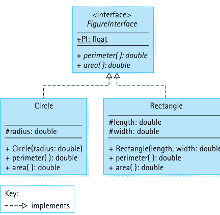

## 2.1 图 ADT 的 UML

你可以想象其他类，如 `Square` 和 `Parallelogram`，它们都实现了 `FigureInterface` 接口。了解接口关系的程序员可以确保每个类都为 `perimeter` 和 `area` 方法提供了实现。

图 2.1 中的统一建模语言 (UML) 类图显示了 `FigureInterface` 接口与 `Circle` 和 `Rectangle` 类之间的关系。带有空心箭头的虚线表示类实现了一个接口。实现接口的类并不限于像本示例那样实现接口的抽象方法；它们还可以添加自己的数据字段和方法。


# 接口是一种多功能且强大的编程结构

除其他用途外，它们可以用于指定 ADT 的抽象视图。在接口内部，我们定义了与 ADT 实现的导出方法对应的抽象方法。我们使用注释来定义每个抽象方法的先置条件和后置条件。打算创建实现 ADT 类的实现程序员知道，他或她必须履行接口概述的契约。想要使用 ADT 的应用程序程序员可以使用任何实现接口的类。

## 作者惯例

在全文中我们将使用接口来定义所考虑的数据结构 (ADTs) 的逻辑视图。

以这种方式使用 `Java` 接口构造构建我们的 ADT 规范有几个用处：

1. 我们可以正式地检查规范的语法。当接口被编译时，编译器会发现方法接口定义中的任何语法错误。
2. 我们可以正式地验证接口“契约”的语法部分是否被实现所满足。当实现被编译时，编译器会确保方法名、参数和返回类型与接口中定义的匹配。
3. 我们可以从 ADT 的替代实现为应用程序提供一致的接口。某些实现可能会优化内存空间的使用；另一些则可能强调速度。实现还可能提供接口定义之外的额外功能。然而，所有实现都具有共同指定的接口。

注意，可以声明一个变量为接口类型。在拥有 `FigureInterface`、`Circle` 和 `Rectangle` 访问的情况下，以下代码是完全“合法”的。

```
FigureInterface myFigure;
myFigure = new Circle(5);
myFigure = new Rectangle(2.4);
```

只要类实现了 `FigureInterface`，我们就可以实例化该类并将其赋值给 `myFigure`。这是多态的一个示例。

## 基于接口的多态性

在第 1.2 节“组织类”中，我们引入了多态的概念。在继续之前，你可能想回顾一下内容。在这一节中我们讨论了基于继承的多态。在这里我们讨论 `Java` 支持的另一种方法，基于接口的多态。“多态”一词源于希腊语，字面意思是“许多形式”或“许多形状”。因此，幸运的是我们有 `FigureInterface` 用于这种讨论。多态变量可以在程序执行期间引用不同类的对象。在基于继承的多态中，相关类之间的关系是由继承树定义的。它们不能引用任何类，但它们可以引用一组相关类。在基于接口的多态中，关系更加简单。相关类实现了同一个接口。

考虑以下应用程序。你能预测它将输出什么吗？

```java
// RandomFigs.java        by Dale/Joyce/Weems      Chapter 2
//
// 展示多态性。
//
package ch02.apps;

import ch02.figures.*;
import java.util.Random;
import java.text.DecimalFormat;

public class RandomFigs
{
    public static void main(String[] args)
    {
        DecimalFormat df = new DecimalFormat("####");
        Random rand = new Random();
        final int COUNT = 5;
        double totalArea = 0;

        FigureInterface[] figures = new FigureInterface[COUNT];

        // 生成图形
        for (int i = 0; i < COUNT; i++)
        {
            switch (rand.nextInt(2))
            {
                case 0:
                    figures[i] = new Circle(1.0);
                    System.out.print("circle area\n");
                    break;
                case 1:
                    figures[i] = new Rectangle(1.0, 2.0);
                    System.out.print("rectangle area 2.00\n");
                    break;
            }
        }

        // 汇总面积
        for (int i = 0; i < COUNT; i++)
        {
            totalArea = totalArea + figures[i].area();
            System.out.println("nTotal: " + df.format(totalArea));
        }
    }
}
```

正如我们看到的，我们声明了一个 `FigureInterface` 对象的数组。任何实现 `FigureInterface` 的类对象都可以存储在这个数组中。然而，由于这段代码的随机性，我们无法通过阅读代码知道插入了哪些类型的图形。数组槽到对象的绑定是在运行时动态执行的。因此，当我们运行程序时，我们可以看到发生了什么，第一个循环也打印出了字符串插入到数组中的每个对象的描述。第二个 `for` 循环遍历数组并累加插入对象的面积。在该循环内部，必须在运行时决定执行哪种面积方法——是 `Circle` 类的方法还是 `Rectangle` 类的方法。数组的每个槽位都是一个多态引用。以下是三个示例程序的运行：

| circle area 3.14 | rectangle area 2.00 | rectangle area 2.00 |
| rectangle area 2.00 | rectangle area 2.00 | rectangle area 2.00 |
| rectangle area 2.00 | circle area 3.14 | circle area 3.14 |
| rectangle area 2.00 | circle area 3.14 | circle area 3.14 |
| rectangle area 2.00 | rectangle area 2.00 | circle area 3.14 |
| Total: 11.14 | Total: 12.28 | Total: 13.42 |

想象基于接口的多态性的许多用途并不困难。例如，一个 `FigureInterface` 对象的数组可以构成几何教程的基础，或者一个 `CreateInterface` 对象的数组可以冒险游戏。并不一定要使用数组才能从这种多态性中获益。在本章稍后，我们定义了一个 `StackInterface`；我们将创建多个实现该接口的类。我们可以创建一个程序，声明一个 `StackInterface` 类型的变量，然后在实例化该变量时动态选择使用哪种实现，可能基于用户对查询的响应或系统的状态。这种方法可以动态地适应当前的情况。

# 第 2 章 栈 ADT

## 2.1 抽象

考虑图 2.2 所示的物品。尽管这些对象都是不同的，但每个都说明了一个共同的概念——栈。在抽象层，栈是同质元素的有序组。现有元素的移除和新元素的添加可以在栈的顶部进行。例如，如果你在一叠衣服中，你最喜欢的蓝色衬衫在一件褪色的旧衬衫下面，你首先从栈顶取出红色衬衫。然后取出蓝色衬衫，它现在位于栈顶。这时可以将红色衬衫放回栈顶。或者也可以把它扔掉！

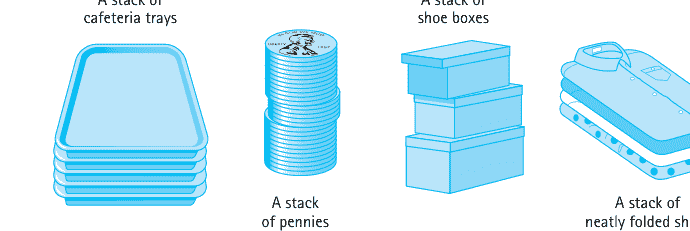

**图 2.2** 现实中的栈

栈可以被认为是“有序的”，因为元素根据它们在栈中持续的时间顺序出现。持续最长的位于底部；最近的位于顶部。在任何时候，给定栈中的任意两个元素，其中一个都比另一个高。（例如，红色衬衫在栈中的位置比蓝色衬衫高。）

因为元素是从栈顶添加和移除的，所以最后添加的元素第一个被移除。有一个快速的助记法可以帮你记住这个栈的行为规则：栈是一个 LIFO（后进先出）结构。总而言之，栈是一种访问控制结构，元素仅从一端进行添加或移除，这是一种 LIFO 结构。

### 栈的操作

结构的逻辑图像仅是抽象数据类型定义的一半。另一半是一组操作，允许用户访问和操作存储在结构中的元素。我们需要使用哪些操作？

当我们开始使用栈时，它应该是空的。然后我们假设我们的栈至少有一个构造函数将它设置为空状态。

向栈顶添加元素的操作通常称为 `push`（压入），从栈中移除顶部元素的操作称为 `pop`（弹出）。传统上，`pop` 移除了栈的顶部元素，并将顶部元素返回给调用 `pop` 的客户端。最近，程序员们定义了两个独立的操作来执行这些动作，因为将观察和转换结合可能会导致混淆的程序。

我们遵循现代惯例，定义了一个移除栈中顶部元素的 `pop` 操作，以及一个返回栈中顶部元素的 `top` 操作。² 我们的 `push` 和 `pop` 操作是严格的转换器（transforms），而我们的 `top` 操作是严格的观察者（observer）。

图 2.3 显示了想象为积木栈的栈是如何通过 `push` 和 `pop` 操作被修改的。

### 使用栈

假设你正坐在餐桌旁休息看报纸，电话响了。当你站起来接电话时，你在心里记住了你读到了哪里。当你和朋友通电话聊天时，门铃响了。你说“等一下，稍等”，然后放下电话去开门。当你正要签收快递的包裹时，狗狗 Molly 跑出了门。你会做什么？显然，你找回 Molly，然后签收包裹，完成通话，最后回到继续读报纸：无论你是否意识到，你一直在一个心理栈上存储你推迟的义务！每当有事情中断你时……

> ²另一种常见的方法是按传统方式定义一个 `pop` 操作——即它移除并返回顶部元素——并定义另一个名为 `peek`（查看）的操作，它只返回顶部元素。

```
originally stack is empty
push block2      2  top = block2
push block3      3  top = block3
push block4      4  top = block4
push block5      5  top = block5
```

## 2.2 栈 (Stack)

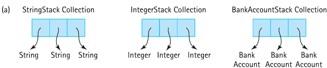
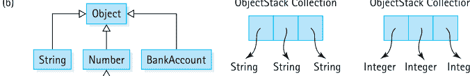
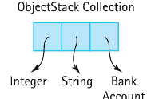
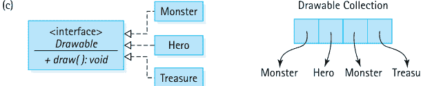
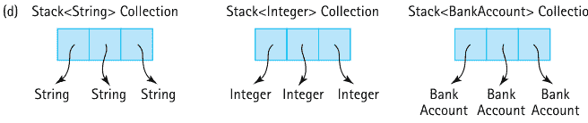

**图 2.4** 元素的选项

### 类对象的集合

生成可用集合的一种方法是让集合 ADT 持有类 `Object` 的变量。由于所有的 `Java` 类都继承自 `Object`，因此 ADT 能够持有任何类的变量。（参见图 2.4b）这种方法非常有效，特别是当集合元素没有特殊属性时，例如，当元素不需要排序时。

尽管这种方法非常简单，但它并非没有问题。一个缺点是：每当从集合中删除一个元素时，它只能作为 `Object` 被引用。如果你打算将其用作其他类型，你必须将其强制转换为你意图使用的类型。例如，假设你将一个字符串放入集合中然后将其取出。若要将获取到的对象作为 `String` 对象使用，你必须对其进行强制转换，此处*强调*了这一点：

```java
collection.push("E. E. Cummings");
String poet = (String) collection.top();
System.out.println(poet.toLowerCase());
// 将字符串推入栈中
// 强制转换为 String
// 使用字符串
```

如果不进行强制转换将导致编译错误，因为 `Java` 是一种强类型语言，它不允许你将 `Object` 类型的变量赋值给 `String` 类型的变量。强制转换操作告诉编译器，你——程序员，保证了该 `Object` 确实是一个 `String`。

`Object` 方法的工作原理是在元素存储在集合中时，将每个元素转换为类 `Object`。集合的使用者必须记住集合中存储了什么种的对象，并在它们从集合中移除时，显式地将这些对象转换回它们的原始类。

如图 2.4(b) 中的第三个 `ObjectCollection` 所示，这种方法允许在单个集合中混合元素类型。该集合包含一个 `Integer`、一个 `String` 和 `BankAccount`。通常，这种混合不被认为是一个好主意，并且很容易导致程序获取到一种类型的对象——例如，`Integer`——并尝试将其强制转换为另一种类型的对象——例如，`String`，而这是一个错误。

### 实现特定接口类的集合

有时，我们可能希望确保集合中的所有对象都支持某个操作或一组操作。例如，该对象代表视频游戏的元素。存在许多不同类型的元素，如怪物、英雄和宝藏。当元素从集合中移除时，它会使用 `draw` 操作被描绘制在屏幕上。在这种情况下，我们希望确保只有支持 `draw` 操作的对象被放入集合中。

回想第 2.1 节“抽象”，`Java` 接口可以包含抽象方法，即没有方法体的方法。一旦定义了接口，我们就可以通过提供缺失的方法体创建创建该接口的类。对于我们的视频游戏示例，我们可以创建一个带有抽象 `draw` 方法的接口。接口的一个良好名称是 `Drawable`，因为实现此接口的类（可以在屏幕上描绘的对象）都将被定义为实现了 `Drawable` 接口。

现在，我们可以通过将其标记为 `Drawable` 对象的集合，来确保示例集合中的元素都是“合法”的——换句话说，就是一个 `Drawable` 对象的集合。

## 2.3 集合元素

```java
if (!myStack.isEmpty())
    Object myObject = myStack.top();
```

这种方法看起来很有前景，但可能会给应用程序带来不必要的负担。如果应用程序必须在每次栈操作之前进行守卫测试，其代码可能会变得效率低下的且难以阅读。因此，在访问空栈时抛出异常也是一个好主意。考虑在一段代码中发生大量栈调用的情况。如果我们定义一个异常——例如 `StackUnderflowException`——以便在 `pop` 和 `top` 被调用时都抛出该异常，那么这段代码就可以被单个 `try-catch` 语句包括起来，而不是使用多次调用 `isEmpty` 异常进行检查。

### 我们的方法

对于我们的栈，当调用了不适当的操作时（例如从空栈进行 `pop` 操作），我们会抛出异常。我们还为应用程序提供了避免犯错误的工具。

我们决定使用最后这种方法。即，我们定义了 `StackUnderflowException`，当在栈为空时调用 `pop` 或 `top` 都会抛出该异常。为了给应用程序程序员提供灵活性，我们还在我们的 ADT 中包含了 `isEmpty` 操作。应用程序程序员可以决定使用 `isEmpty` 操作作为守卫来防止 `pop` 或访问空栈，或者像接下来所示，对栈上的操作进行“尝试”（try），并在栈为空时“捕获并处理”（catch and handle）所抛出的异常。

```java
try {
    myObject = myStack.top();
    myStack.pop();
    myObject = myStack.top();
    myStack.pop();
} catch (StackUnderflowException underflow) {
    System.out.println("There was a problem in the ABC routine.");
    System.out.println("Please inform System Control.");
    System.out.println("Exception: " + underflow.getMessage());
    System.exit(1);
}
```

我们定义 `StackUnderflowException` 继承自 `Java` 的 `RuntimeException`，因为它代表了程序员可以通过正确使用栈来避免的异常。`RuntimeException` 类通常用于这种情况。请记住，此类异常是未检查的（unchecked）；换句话说，程序不需要显式捕获它们。以下是我们的 `StackUnderflowException` 类的代码：

```java
package ch02.stacks;
public class StackUnderflowException extends RuntimeException {
}
```

## 2.4 栈接口

```java
public StackUnderflowException()
{
    super();
}
public StackUnderflowException(String message)
{
    super(message);
}
```

由于 `StackUnderflowException` 是一个未检查异常，如果它抛出且未被捕获，最终将抛给运行时环境，这将显示错误消息并停止。以下是此类消息示例：

```
Exception in thread "main" ch02.stacks.StackUnderflowException: Top attempted on an empty stack.
at ch02.stacks.ArrayStack.top(ArrayStack.java:78)
at MyTestStack.main(MyTestStack.java:25)
```

另一方面


对 `push` 操作的考虑揭示了另一个潜在问题：如果我们尝试向栈中推入东西但没有空间了怎么办？从抽象意义上说，栈在概念上永远不会“满”的。然而，在系统中，指定栈的大小上界是有用的。我们知道内存短缺，或者与问题相关的限制可能会限制在没有相应 `pop` 操作的情况下可以发生的 `push` 操作次数。

我们可以用类似于栈溢出问题的方法解决这个问题。首先，我们提供了一个额外的布尔观察器操作 `isFull`，当栈满时，它返回 `true`。应用程序程序员可以使用此操作来防止误用 `push` 操作。其次，我们定义了 `StackOverflowException`，当在栈满时调用 `push` 操作时会抛出该异常。以下是 `StackOverflowException` 类的代码：

```java
package ch02.stacks;
public class StackOverflowException extends RuntimeException
{
    public StackOverflowException()
    {
        super();
    }
    public StackOverflowException(String message)
    {
        super(message);
    }
}
```

与下溢异常相同，应用程序程序员可以决定使用 `isFull` 操作作为守卫来防止向满栈推入信息，或者对栈上的操作进行“尝试”，并在栈满时“捕获并处理”所抛出的异常。`StackOverflowException` 也是一个未检查的异常。

## 接口

我们现在准备好正式指定我们的栈 ADT。在接口中，我们包含了三个基本操作 `push`、`pop` 和 `top`，以及观察操作 `isEmpty` 和 `isFull`，如上。

```java
// StackInterface.java by Joyce/Weems
// 用于实现 T 栈的接口。
// 栈是一个后进先出的结构。
//

package ch02.stacks;

public interface StackInterface<T> {

  void push(T element) throws StackOverflowException;
  // 如果栈满抛出 StackOverflowException
  // 否则将元素放在栈顶。

  void pop() throws StackUnderflowException;
  // 如果栈为空抛出 StackUnderflowException
  // 否则从栈顶移除一个元素。

  T top() throws StackUnderflowException;
  // 如果栈为空抛出 StackUnderflowException
  // 否则返回栈顶元素。

  boolean isFull();
  // 如果栈满返回 true，否则返回 false；

  boolean isEmpty();
  // 如果栈为空返回 true，否则返回 false；
}
```

在 2.3 节“集合元素”中，我们展示了使用泛型类的意图。在 `StackInterface` 的头部中，`<T>` 是类型的占位符。

| Java 注意 | 与类一样，Java 接口也可以泛型定义。在使用应用程序声明变量时，应用类型参数并替换泛型类型。例如：`StackInterface<String> s;` 声明 s 为字符串栈。 |

## 示例使用

```java
// ReverseStrings.java by Joyce/Weems Chapter 2
// 栈的示例用法。以输入的反顺序输出字符串。
//
package ch02.apps;

import ch02.stacks.*;
import java.util.Scanner;

public class ReverseStrings
{
    public static void main(String[] args)
    {
        Scanner scan = new Scanner(System.in);

        StackInterface<String> stringStack;
        stringStack = new ArrayBoundedStack<String>(3);

        String line;

        for (int i = 1; i <= 3; i++) {
            System.out.print("Enter a line of text > ");
            line = scan.nextLine();
            stringStack.push(line);
        }

        System.out.println("\nReverse:\n");
        while (!stringStack.isEmpty()) {
            line = stringStack.top();
            stringStack.pop();
            System.out.println(line);
        }
    }
}
```

以下是示例运行的输出：

Enter a line of text > the beginning of a story

Enter a line of text > is often different than

Enter a line of text > the end of a story

Reverse is:

the end of a story

is often different than

the beginning of a story

## 2.5 基于数组的栈实现

本节介绍了栈 ADT 的数组实现。此外，我们还查看了使用 Java 库 `ArrayList` 类的另一种实现。请注意第 146 页总结中的图 2.16 显示了它们之间的关系。

## ArrayBoundedStack 类

在这里，我们开发一个实现 `StackInterface` 的类。我们将此类命名为 `ArrayBoundedStack`，因为它使用数组作为实现结构，并且生成的栈具有限制的大小。数组是存储栈元素的合理结构。我们可以将元素放入数组中连续的槽位中，将第一个推入栈的元素放在数组的第一个位置，第二个推入栈的元素放在数组的第二个位置，依此类推。浮动的“水位”标记是栈的顶端元素。由于栈只从一端增长和收缩，因此我们不需要担心将元素插入到数组中已存储的元素的中间。

我们的实现需要哪些实例变量？它需要栈元素和一个指示栈顶的变量。我们声明了一个受保护的（protected）数组 `elements` 和一个受保护的整数变量 `topIndex` 来指示存储栈顶元素的数组索引。`topIndex` 初始化为 -1，因为在栈刚创建时栈中没有存储任何内容（为了描述栈如何从一端增长和收缩，我们绘制了数组）：

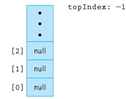

随着元素的推入和弹出，我们增加和递减 `topIndex` 的值。例如，从空栈开始并推入“A”、“B” 和“C”，结果如下：

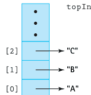

我们为 `ArrayBoundedStack` 类的客户端提供了两个构造函数：一个允许客户端指定栈的预期最大大小，另一个假设默认最大大小为 100 个元素。为了方便后一个构造函数，我们定义了一个设置为 100 的常量 `DEFCAP`（默认容量）。

这里是 `ArrayBoundedStack.java` 文件的开头：

```java
// ArrayBoundedStack.java by Dale/Joyce/Weems Chapter 2
// 使用数组存储栈元素以实现 StackInterface。
// 提供两个构造函数：一个创建一个默认大小的数组
// 另一个允许调用程序指定大小。
//------------------------------------
package ch02.stacks;

public class ArrayBoundedStack<T> implements StackInterface<T> {
    protected final int DEFCAP = 100; //默认容量
    protected T[] elements; // 存储栈元素
    protected int topIndex = -1; // 栈顶顶元素的索引

    public ArrayBoundedStack() {
        elements = (T[]) new Object[DEFCAP]; //^4
    }

    public ArrayBoundedStack(int maxSize) {
        elements = (T[]) new Object[maxSize]; //6
    }
}
```

注意，该类使用了类头部列出的泛型参数 `<T>`。`elements` 变量声明为类型 `T[]`，即类 T 的数组。此类实现了一个 T 类型的栈——T 类尚未确定。它将由使用边界栈的客户端来指定。由于 Java 翻译器不会生成对泛型类型的引用，我们的代码必须在构造函数中使用 `new` 语句时指定 `Object`。因此，尽管我们声明数组为类 T 的数组，但我们必须将其实例化为 `Object` 数组。为了确保发生预期的类型检查，我们将数组元素强制转换为类 T，如下所示：`elements = (T[]) new Object[DEFCAP];`

尽管这种方法有些笨拙且通常会产生编译器警告，但这就是我们在 Java 中使用数组创建泛型集合的方法。我们可以

> ^4可能会生成一个未检查的转换，因为编译器无法确保数组包含类 T 的对象——该警告可以安全地忽略。

使用 Java 库中符合泛型的 `ArrayList` 来解决这个问题，但出于教学考虑，我们更倾向于使用更基础的数组结构。编译器警告可以安全忽略。

> Java Note
>
> 要对基于数组的 ADT 使用泛型，我们必须将数组声明为 `Object` 类型并将其强制转换为 `T` 类型。某些编译器在这种情况下会生成警告——警告可以安全忽略。

## 栈操作的定义

对于基于数组的方法，`isFull` 及其对应的 `isEmpty` 的实现非常简单。如果顶索引等于 -1，则栈为空；如果顶索引等于数组大小减 1，则栈为满的。

```java
public boolean isEmpty()
// 如果此栈为空，则返回 true，否则返回 false。
{
    return (topIndex == -1);
}
```

```java
public boolean isFull()
// 如果此栈为满，则返回 true，否则返回 false。
{
    return (topIndex == elements.length - 1);
}
```

现在让我们写一个将类型为 T 的元素推入栈顶的方法。如果在调用 `push` 时栈已经是满的，则没有地方放置元素。记住这种状态被称为栈溢出（stack overflow）。我们的正式规范规定，在这种情况下 `push` 方法应该抛出 `StackOverflowException`。我们在抛出异常时包含了一条相关的错误消息。如果栈未满的，`push` 必须增加 `topIndex` 并将新元素存储在 `elements[topIndex]` 中。实现非常直接：

```java
public void push(T element)
// 如果此栈为满，则抛出 StackOverflowException。
// 否则将元素置于此栈的顶部。
{
    if (isFull())
        throw new StackOverflowException("栈满溢出。");
    else {
        topIndex++;
        elements[topIndex] = element;
    }
}
```

`pop` 方法本质上是 `push` 的反操作：不是将元素放入栈顶，而是通过删除 `topIndex` 从栈中移除顶元素。良好的做法也是清空与当前顶相关的数组位置。如果在调用 `pop` 时栈为空，则没有元素可以移除，我们发生了下溢（underflow）。与 `push` 方法一样，规范规定抛出异常。

```java
public void pop()
// 如果此栈为空，则抛出 StackUnderflowException。
// 否则从此栈中移除顶元素。
{
    if (isEmpty())
        throw new StackUnderflowException("栈下溢。");
    else {
        elements[topIndex] = null;
        topIndex--;
    }
}
```

最后，`top` 操作简单返回栈顶元素，即由 `topIndex` 索引的元素。对于我们的泛型方法，`top` 方法显示类型为 T。与 `pop` 操作一样，如果在空栈上调用 `top` 操作，将发生下溢。

```java
public T top()
// 如果此栈为空，则抛出 StackUnderflowException。
// 否则返回此栈的顶元素。
{
    if (isEmpty())
        throw new StackUnderflowException("栈下溢。");
    else {
        T topOfStack = elements[topIndex];
        return topOfStack;
    }
}
```

就是这样。我们刚刚完成了第一个数据结构 ADT 的创建。当然，我们仍然需要修复它；事实上，作者们在开发上述代码的过程中进行了多次测试。我们在附近的“测试 ADT”（Testing ADTs）专题章节中更详细地讨论 ADT 的测试。

在继续之前，我们再次强调栈的应用视图、抽象视图和实现视图之间的区别。假设应用程序执行以下代码（假设 A 和 B 代表字符串）：

```java
StackInterface<String> myStack;
myStack = new ArrayBoundedStack<String>(3);
myStack.push(A);
myStack.push(B);
```

图 2.6 显示了从左到右执行上述代码后产生的应用、实现实现和抽象视图。注意应用程序有一个引用

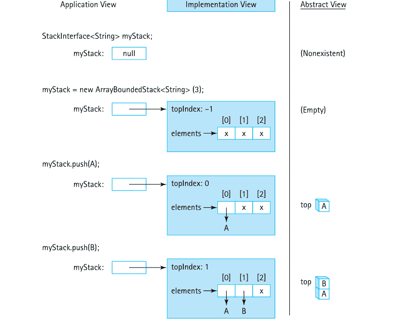

图 2.6 使用 ArrayBoundedStack 的栈操作结果

变量 `myArray` 指向 `ArrayBoundedStack` 类的对象。在该 `ArrayBoundedStack` 对象内部，隐藏了一个引用变量 `elements`，它指向持有字符串的数组；而整型变量 `topIndex` 指明了栈顶存储的数组索引。

## 替代视图

创建基于数组实现的程序员将栈视为一个数组以及一个指向数组中栈顶位置的索引。编写应用程序的程序员则使用基于数组的类来抽象地查看栈，将其视为一个后进先出（LIFO）列表，并在其上调用 `push` 和 `pop` 等操作。

从应用程序开发人员的角度来看，栈对象就像一个盒子——细节被隐藏了。在图中，我们窥视了该盒子的内部。作为 ADT 实现的程序员，我们创建了这个盒子。对你来说，看清变量 `myList`（这是一个应用程序）与栈内部的变量 `elements` 和 `topIndex` 之间的区别是非常重要的。

最后一点：我们实现的栈是有边界的，因为它使用数组作为其隐藏的数据载体。我们可以使用数组来实现无界栈。一种方法是在处理过程中根据需要实例化不断增大的数组，并将当前数组复制到新实例化的较大数组中。我们在第 4 章实现队列 ADT 时会研究这种方法。


## 测试 ADT

在本书中，我们学习、讨论、可视化、规范、设计和使用数据结构。我们将数据结构封装为 ADT，这意味着我们将指定数据结构的代码（例如 `StackInterface` 类）与使用该结构的代码（例如 `ReverseStrings` 应用程序）分离开来。对于所有层级，正确工作都至关重要。除了仔细地规范、设计和创建我们的代码外，对我们来说进行测试也很重要——以证明它的功能符合预期。

## 集成测试

软件测试通常被认为是一个在编码完成完成后发生的过程。实际上，对于学生和专业人员来说，在开发阶段进行测试是至关重要的。在本文正文中，我们通常将 ADT 呈现为一组概念清晰且完成的类。然而，我们并没有描述开发和测试这段代码所遵循的整个过程。书中没有足够的空间来涵盖所有内容！人们在描述某事时使用这种方法并不稀奇：汽车广告其工程设计的精美最终产品，而不描述为了创造这台精美机器而经历的所有中间失败设计；艺术家展示一件雕塑，而不展示在创作过程中使用的所有模型；数学家列出一个定理的精妙证明，而不揭示为了推导出严密逻辑而经历的所有错误性尝试和回溯。

在创建像我们的栈这样的 ADT 时，我们会并行创建一个测试驱动程序或一组测试驱动程序。我们从编码过程的最开始就这么这么的。例如，我们创建 `ArrayBoundedStack` 的第一次尝试是创建一个所示的类“外壳”：


## 第 2 章 栈 ADT

```java
package ch02.stacks;
public class ArrayBoundedStack<T> implements StackInterface<T>
{
    public ArrayBoundedStack()
    {}

    public void push(T element)
    {}

    public void pop()
    {}

    public T top()
    {
        return null;
    }

    public boolean isEmpty()
    {
        return true;
    }

    public boolean isFull()
    {
        return false;
    }
}
```

我们创建一个应用程序，即“使用”该类的测试驱动程序：

```java
package ch02.apps;
import ch02.stacks.*;

public class StackDriver
{
    public static void main(String[] args)
    {
        StackInterface<String> test;
        test = new ArrayBoundedStack<String>();
    }
}
```

你可能会抗议：“但那个应用程序什么都没做！”尽管如此，这两个文件可以正确编译；这表明我们在系统的正确文件夹中拥有这些文件，包正在被正确使用，并且栈类包含了接口所需的方法名、参数类型和返回值。它可能什么都没做，但它完成了很多工作！

现在我们可以一次添加一个功能，在进行的过程中扩展我们的实现（`ArrayBoundedStack`）和测试驱动程序（`StackDriver`）。添加 `isEmpty` 的代码。为 `isEmpty` 添加一个测试用例。

> **重要：演进你的代码！**

我们实现的栈是有边界的，因为我们使用了数组……变量 `topIndex` 指明了栈顶存储的数组索引。

最后一点：我们实现的栈是有边界的，因为它使用数组作为其隐藏的数据载体。我们可以使用数组来实现无界栈。一种方法是在处理过程中根据需要实例化不断增大的数组，并将当前数组复制到新实例化的较大数组中。我们在第 4 章实现队列 ADT 时会研究这种方法。

## 专业测试

在生产环境中，需要每天执行成百上千个测试用例，因此需要创建自动化驱动程序。

## 2.5 基于数组的栈实现

这可能会如下程序（假设这是测试 34）。

```java
import ch02.stacks.*;
public class Test34 {
    public static void main(String[] args) {
        StackInterface<String> test = new ArrayBoundedStack<String>();
        test.push("trouble in the fields");
        test.push("love at the five and dime");
        test.push("once in a blue moon");
        String s = test.top();
        if (s.equals("once in a blue moon"))
            System.out.println("Test 34 passed");
        else
            System.out.println("Test 34 failed");
    }
}
```

## ArrayListStack 类

实现 ADT 有许多方法。本节介绍了一种基于 `ArrayList` 类的替代实现。`ArrayList` 是 Java 类库提供的一个有用 ADT。`ArrayList` 对象的定义特性是它们可以根据程序需要增长和缩小。因此，使用 `ArrayList` 方法可以避免栈边界。我们的构造函数不再需要栈的大小。`isFull` 操作可以直接返回 `false`，因为栈没有满。我们不需要处理栈溢出。有人认为，如果程序完全耗尽内存，那么栈可以被认为是满的并应该抛出 `StackOverflowException`。然而，在这种情况下运行时本身会抛出“内存溢出”异常；我们不需要担心这种情况会被忽视。此外，耗尽的内存是一个严重的问题（在理想情况下是罕见事件），并且不能像处理栈 ADT 溢出那样处理它。

`ArrayList` 可以根据需要自动增长，这一事实使其成为实现无界栈的良好选择。此外，它提供了一个 `size` 方法，可以用于跟踪栈顶。栈顶的索引始终是 `size` 减 1。

学习以下代码。将此实现与之前的实现进行比较。它们相似但又有不同。一个是基于数组的，而另一个是通过 `ArrayList` 类直接使用数组。请注意，使用下面的方法，我们栈 ADT 的内部表示是另一个 ADT——`ArrayList`（它反过来又是构建在数组之上的）。就像程序中可以有许多层级的过程抽象一样，数据抽象也可以有许多层级。

使用 `ArrayList` 方法的一个用处是，我们不再需要接收编译器的未检查类型转换。与数组方法不同，它是 Java 中的一类对象，并完全支持泛型使用。尽管使用 `ArrayList` 有明显的优势，但在本书的大部分内容中，我们将继续使用数组作为我们的基本 ADT 实现结构之一。对于未来的专业软件开发人员来说，学习使用标准数组是很。

```java
// ArrayListStack.java                by Dale/Joyce/Weems                Chapter 2
// 使用 ArrayList 实现一个无界栈。
//
package ch02.stacks;
import java.util.*;

public class ArrayListStack<T> implements StackInterface<T>
{
    protected ArrayList<T> elements; // 存放栈元素的 ArrayList

    public ArrayListStack()
    {
        elements = new ArrayList<T>();
    }

    public void push(T element)
    // 将元素放在此栈的栈顶。
    {
        elements.add(element);
    }

    public void pop()
    // 如果此栈为空，则抛出 StackUnderflowException，
    // 否则从此栈移除顶部元素。
    {
      if (isEmpty())
        throw new StackUnderflowException("attempted on empty stack.");
      else
        elements.remove(elements.size() - 1);
    }

    public T top() {
    // 如果此栈为空，则抛出 StackUnderflowException。
    // 否则返回此栈的顶部元素。
    {
      T topStack = null;
      if (isEmpty())
        throw new StackUnderflowException("Top attempted on empty stack.");
      else
        topStack = elements.get(elements.size() - 1);
      return topStack;
    }
    }

    public boolean isEmpty() {
    // 如果此栈为空，则返回 true，否则返回 false。
    {
      return (elements.size() == 0);
    }
    }

    public boolean isFull() {
    // 返回 false - ArrayListStack 永远不会是满的。
    {
      return false;
    }
    }
}
```

## 2.6 应用：平衡表达式

栈非常适合“记住”那些之后会被处理的事情；换句话说，就是处理推迟的义务。在这个示例应用程序中，我们解决一个让许多初学者困惑的问题：编写代码时括号、中括号和大括号匹配。匹配分组符号在计算机世界中是一项重要问题。例如，它与算术方程的有效性、计算机程序的语法正确性以及用于定义 Web 页面的 XHTML 标签的有效性有关。使用栈，我们可以“记住”一个左符号（例如 `(`、`[` 或 `{`），直到稍后通过匹配对应的右符号（例如 `]` 或 `}`）来被“处理”。当表达式中的分组符号被正确匹配时，计算机科学家说该表达式是形式良好的（well formed）的，且我们问题的分组符号是平衡的。

### 良好的表达式

( XX XX ( ) XX )

[] ()

[ ] ([ xxx ( xxx )

[[([([x]x)x1)x]]x)

xxxxxxxxxxxxxxxxxxxxx

### 非良好的表达式

( XX ( ) ) XXX xxx )

[

( XX [([x]x)x]]x](

图 2.7 良好的与非良好的表达式

给定一组分组符号，我们的目标是确定每个符号的左版本和右版本是否正确匹配。让我们关注普通的组合：`()`、`[]` 和 `{}`。理论上，我们可以定义任何一对符号（例如 `<` 或 `/`）为分组符号。在输入表达式中，分组对之前、之间可以出现任意数量的字符，表达式可以包含嵌套组。每个右符号必须匹配未匹配的左符号，每个左符号都必须有一个匹配的符号。因此，表达式形成有两种原因：存在不匹配的符号（例如 `({))`）或缺少闭合符号（例如 `[[ ]`）。

图 2.7 显示了良好和非良好表达式示例。

## Balanced 类

为了解决我们的问题，我们创建一个名为 `Balanced` 的类，它有一个单一的导出方法 `test`，该方法接收字符串作为表达式参数，并检查表达式中的分组符号是否平衡。表达式有三种可能的测试失败。我们使用一个整数来指示测试结果：

- 0 表示符号是平衡的，例如 `([])`
- 1 表示表达式有不匹配的符号，例如 `({))`
- 2 表示表达式缺少闭合符号，例如 `[[ ]`

> **提醒：约定编程**
>
> 前条件是一个约定。在 `Balanced` 类内部我们不需要检查前条件——我们假设它们已满足。为了使类更易用，我们要求应用程序指定左右符号。我们为构造函数定义了两个字符串参数，可以是 `[` 和 `))`。

```java
public Balanced(String openSet, String closeSet)
// 前条件：没有字符在 openSet 和 closeSet 中出现多次。
// openSet 的大小等于 closeSet 的大小。
{
    this.openSet = openSet;
    this.closeSet = closeSet;
}
```

现在我们将注意力转向 `test` 方法。它通过表达式参数接收一个字符串，并根据 `openSet` 和 `closeSet` 中的字符确定表达式中的符号是否平衡。方法逐个处理表达式中的字符。对于每个字符，它执行以下操作：

- 如果字符是左符号，则将其压栈。
- 如果字符是右符号，则与从栈顶获取的左符号进行检查。如果它们匹配，则继续处理下一个字符。如果右符号不匹配栈顶或栈为空，则该表达式不是良好的。
- 如果字符不是特殊符号，则跳过。

栈是保存左符号的合适数据结构，因为我们总是需要检查最近的一个。当所有字符处理完毕后，栈应该是空的；否则，它缺少闭合符号。现在我们准备好编写 `test` 的主算法。我们假设栈 ADT 的实例为 `StackInterface`。我们还声明了一个布尔变量 `stillBalanced`，初始化为 `true`，用于记录到目前为止表达式是否平衡。

### 良好表达式测试算法 (String expression)

```
创建一个大小等于表达式长度的新栈
将 stillBalanced 设置为 true
获取表达式的第一个字符
while (表达式仍然平衡且且还有更多字符需要处理)
处理当前字符
获取表达式的下一个字符
if (isStillBalanced)
    return 1
else if (栈不为空)
    return 2
else
    return 0
```

该算法中在进入编码阶段之前需要扩展的部分是“处理当前字符”命令。我们之前描述了如何处理每种类型的字符。以下是这些步骤的算法形式。

```
if (该字符是左边界符号)
  将左边界符号字符推入栈中
if (该字符是右边界符号)
  if (栈为空)
    将 StillBalanced 设置为 false
  else
    将左边界符号赋值为栈顶的值
    从栈中弹出元素
  if (右边界符号字符与左边界符号不“匹配”)
    将 StillBalanced 设置为 false
else
  跳过该字符
```

接下来列出了 `Balanced` 类的代码。由于本章的重点是栈，我们强调了与栈相关的代码。关于该类的 `test` 方法有几点值得注意的地方：

1. 在 `test` 方法内部，我们将栈声明为 `StackInterface` 类型，并将其实例化为 `ArrayBoundedStack` 类。对于客户端程序来说，尽可能在抽象层面声明 ADT 是一种良好的做法。这种方法更容易更改实现的选择。
2. 表达式行的长度限制了需要推栈的符号的数量。因此，我们在实例化栈时使用的尺寸参数等于表达式的长度。
3. 我们使用了一种快捷方法来判断右边界符号是否匹配左边界符号。根据我们的规则，如果符号在各自集合中的相对位置相同，则它们就是匹配。这意味着当遇到左边界符号时，我们不是推送栈上的实际字符，而是将其在 `openSet` 字符串中的位置推入栈。在处理过程中，当遇到右边界符号时，我们只需要比较它的位置与栈上的位置值，而不是将字符推入栈，我们推入的是整数值。
4. 我们将栈实例化为 `Integer` 类型元素。但在 `test` 方法中，我们将原始类型 `int` 元素推入栈，利用了 Java 的自动装箱（Autoboxing）特性。如果程序员将原始值作为对象使用，它会自动转换为（装箱）其包装类的对象。因此，当 `test` 方法说

```
stack.push(openIndex);
```

`openIndex` 的整数值在存储到栈之前会自动转换为 `Integer` 对象。相应的特征拆箱（Unboxing）反转了自动装箱的效果。当使用语句访问栈顶时：

```
openIndex = stack.pop();
```

栈顶的 `Integer` 对象会自动转换为整数值。

- 在处理结束符号时，我们访问栈以查看其栈顶是否持有起始表达式。如果栈为空，则表示表达式不平衡。检查栈是否为空有两种方法：使用 `isEmpty` 方法，或者访问栈并捕获 `StackOverflowException`。我们选择了后者方法。这似乎符合算法的精神，因为我们预期会找到左边界符号，而发现栈为空是“异常”情况。
- 相比之下，我们在处理表达式的末尾使用 `isEmpty` 来检查栈是否为空。在这里，我们并不想从栈中提取元素——我们只需要知道它是否为空。

以下是整个类的代码：


# Balanced.java

```java
// -
// Balanced.java                              由 Dale/Joyce/Weems 编写 第 2 章 //
// 使用标准规则检查表达式是否平衡。
//
// 构造函数通过两个字符串参数提供
// 成对的左边界和右边界符号。
//----------------------------------------------------------------------
package ch02.balanced;

import ch02.stacks.*;

public class Balanced
{
    protected String openSet;
    protected String closeSet;

    public Balanced(String openSet, String closeSet) {
        // 前提条件：没有任何字符在合并后的
        // openSet 和 closeSet 字符串中出现超过一次。
        // openSet 的大小 = closeSet 的大小。
        this.openSet = openSet;
        this.closeSet = closeSet;
    }
}
```

# 第 2 章 栈 ADT

```java
public int test(String expression)
// 如果表达式平衡的，返回 0。
// 如果表达式有不平衡的符号，返回 1。
// 如果表达式过早结束，返回 2。
{
    char currChar; // 当前正在研究的字符
    int currCharIndex; // 当前字符的索引
    int lastCharIndex; // 表达式中最后一个字符的索引

    int openIndex; // 当前字符在 openSet 中的索引
    int closeIndex; // 当前字符在 closeSet 中的索引

    boolean stillBalanced = true; // 当表达式平衡时

    StackInterface<Integer> stack; // 存放未匹配的左边界符号
    stack = new ArrayBoundedStack<Integer>(expression.length());

    int currCharIndex = 0;
    lastCharIndex = expression.length() - 1;

    while (stillBalanced && currCharIndex <= lastCharIndex) {
        // 当表达式仍然平衡且未到末尾
        char currChar = expression.charAt(currCharIndex);
        openIndex = openSet.indexOf(currChar);

        if (openIndex != -1) // 如果当前字符在 openSet 中
        {
            // 将索引推入栈。
            stack.push(openIndex);
        } else {
            closeIndex = closeSet.indexOf(currChar);
            if (closeIndex != -1) // 如果当前字符在 closeSet 中
            {
                try {
                    // 尝试从栈中弹出索引
                    openIndex = stack.top();
                    stack.pop();
                    if (openIndex != closeIndex) // 如果不匹配
                        stillBalanced = false; // 则不平衡
                } catch(StackOverflowException e) // 如果栈为空
                {
                    stillBalanced = false; // 则不平衡
                }
            }
        }
        currCharIndex++; // 处理下一个字符
    }

    if (!stillBalanced)
        return 1; // 不平衡的符号
    else if (!stack.isEmpty())
        return 2; // 表达式过早结束
    else
        return 0; // 表达式平衡
}
```

## 应用

现在我们有了 `Balanced` 类，完成我们的应用程序并不困难。

我们在书中设计程序的方法是将用户界面代码与程序的其余部分分离。我们设计了如 `Balanced` 之类的类，使用 ADT 来解决某些问题。然后设计之前定义的类。我们的扩展示例提供了一个命令行界面（CLI）应用程序。然而，在后台，我们有时会创建图形用户界面（GUI）应用程序，并提供这些程序的代码文件。GUI 应用程序通常在 CLI 应用程序结束时，供感兴趣的人参考。这里我们详细描述 CLI。

由于 `Balanced` 类负责判断分组符号是否平衡，剩下的就是实现用户输入和输出。用户不是只处理一个表达式，而是输入一系列表达式，通过输入表达式“X”来表示结束。我们把程序命名为 `BalancedCLI`。注意，在实例化 `Balanced` 类时，构造函数传递了字符串“([)]”，以便对应我们的特定问题。

> 提示：类的演化

当作者们设计和编写 `Balanced` 类时，我们也对其进行了测试。正如之前描述，我们演化了这些类，它们并不是凭空产生的。在书中我们没有空间来描述这种演化，因为我们通常只是将类作为成品展示。

## BalancedCLI.java

```java
//
// BalancedCLI.java 由 Dale/Joyce/Weems 第2章
//
// 检查分组符号是否平衡。
// 输入由表达式组成，每行一个。
// 特殊符号类型为 (), [], 和 {}}。
//

package ch02.apps;

import java.util.Scanner;
import ch02.balanced.*;

public class BalancedCLI
{
    public static void main(String[] args)
    {
        Scanner scan = new Scanner(System.in);

        // 实例化带有分组符号的新 Balanced 类。
        Balanced bal = new Balanced("()[]{}");

        int result; // 0 = 平衡, 1 = 不平衡, 2 = 提前结束

        String expression = null; // 要评估的表达式
        final String STOP = "X"; // 表示输入结束

        while (!STOP.equals(expression))
        {
            System.out.print("Expression " + STOP + " to stop: ");
            expression = scan.nextLine();
            if (!STOP.equals(expression))
            {
                // 获取并输出平衡测试的结果。
                result = bal.test(expression);
                if (result == 1)
                    System.out.println("Unbalanced \n");
                else if (result == 2)
                    System.out.println("Premature end of expression \n");
                else
                    System.out.println("Balanced \n");
            }
        }
    }
}
```

## 2.6 应用：平衡表达式

以下是示例运行的输出：

```text
Expression (X to stop): (xx[yy]{ttt})
Balanced

Expression (X to stop): ((()))
Premature end of expression

Expression (X to stop): (tttttt)
Unbalanced

Expression (X to stop): (()}[[[[()]]]])
Balanced

Expression (X to stop): X
```

## GUI 方法

正如所承诺的，我们在这里包含了该应用程序基于 GUI 的实现。我们从一个启动界面的示例开始。简单的 GUI 包含一个输入文本框、一个状态标签和两个操作按钮。

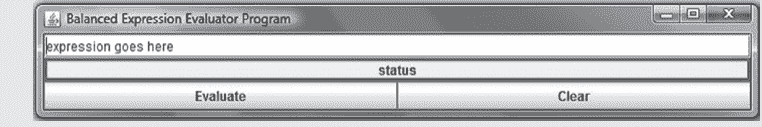

当程序运行时，会出现上述窗口。光标位于包含“expression goes here”短语的文本框中。用户用自己的表达式替换该字符串，然后点击 `Evaluate`（评估）按钮。例如，如果用户输入“(( xx [ ] (( bb ))”并点击 `Evaluate` 按钮，窗口现在看起来像这样：

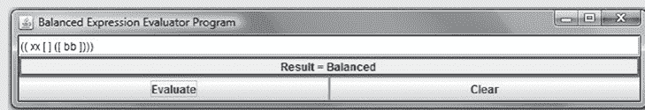

如你所示，评估结果显示在中间的“状态”面板。要评估另一个表达式，用户只需点击 `Clear`（清除）按钮并输入新表达式。这里是输入“((hh))”的结果：

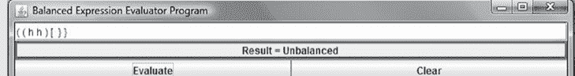

该 GUI 应用程序包含 `ch02.apps` 包中的 `BalancedGUI` 类中。我们在这里没有列出该类的代码，但你可以在网站上找到其余文本代码。查看该代码可以发现一个直观的实现：

- 它定义了一个内部静态类，其中包含对按钮点击做出响应的代码。它还在全局级别静态地声明了输入文本框和输出状态标签，以便主方法和按钮监听器代码都能访问它们。
- 在主方法中，一个一个地声明并实例化了外层框架、文本框、标签和按钮。它们以简单的布局进行排列，按照相应的顺序将各种对象添加到其中。最后，所有内容被“打包”在一起并显示出来。
- 主要处理发生在按钮监听器代码中。与 `evaluate` 按钮相关的代码实例化了一个新的 `Balanced` 对象，使用它来确定当前表达式测试的结果，并设置结果标签显示相应的响应。与 `clear` 按钮相关的代码将结果标签设置为“cleared”（已清除），并将输入文本框置空。

我们使用了类似的方法在整个书中提供了示例应用程序的基于 GUI 版本。

## 2.7 链表介绍

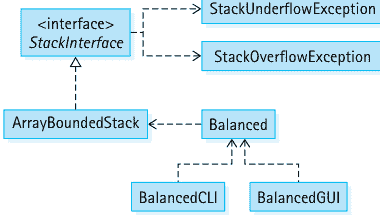

图 2.8 程序架构

### 软件架构

图 2.8 是一张 UML 图，显示了平衡表达式应用程序中接口和类之间的关系。其意在展示总体架构，因此我们没有包含关于属性和操作的细节。

回顾第 1.4 节“数据结构”，数组和链表是构建更复杂数据结构的两个主要构建模块。本节详细讨论了列表，展示了如何使用 Java 创建链表并引入了链表的操作。我们在示例中使用字符串链表。

这是一个非常重要的章节。理解链式结构对于计算机科学家至关重要。

### 数组对比链表

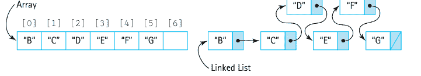

该图描绘了字符串数组和字符串链表的抽象视图。这两种方法的一个重要区别是数据的内部表示以及访问单个元素的方式。对于数组，我们将所有元素视为分组在一个内存块中。对于链表，每个元素都单独位于自己的内存块中。我们把这个小内存块称为“节点”（node）。

注意，除非持有原始值，否则槽位包含的是对象的引用本身。数组是 Java 以及大多数其他编程语言的内置结构。相比之下，虽然少数语言提供了内置链表（例如 `List`），但大多数并没有。Java 通过其类库支持常见的链表。如你所知，数组允许我们通过索引直接访问任何元素。相比之下，链表看起来非常局限，因为它的节点只能按顺序访问；从列表开始并跟踪链接。我们为什么要费劲使用链表呢？有几个原因：

- 数组的大小是固定的。在实例化数组时，它作为新命令的参数提供。链表的大小是变化的。链表的节点可以根据“需要”分配。当不再需要时，节点可以返回给内存管理器。
- 对于某些操作，链表是数组更高效的实现方法。例如，要在数组集合的开头放置一个元素，必须将所有元素向数组末尾移动一位。这项任务需要很多步骤，特别是当数组包含大量元素时。对于链表，只需分配一个新节点并将其链接到列表开头。这项任务只需要三个步骤：创建新节点并更新两个链接。接下来的图描绘了向数组和等效链表开头添加元素的步骤：

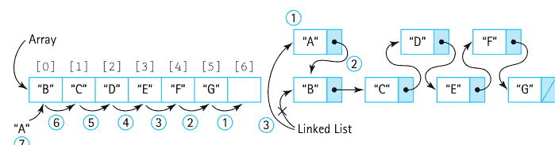

- 对于某些应用程序，你永远不需要在访问列表中之前的节点之前，直接访问位于列表深处的节点。在这些情况下，链表节点必须顺序访问的事实并不会对性能产生不利影响。

支持链表管理的基本方法也允许我们创建和使用更复杂的结构，如后续章节中开发的树和图。

### LLNode 类

要创建一个链表，我们需要知道如何完成两件事：动态地为节点分配空间，以及允许节点链接（或引用）另一个节点。Java 提供了一种动态分配空间的操作，这是我们在处理所有对象时一直在使用的一种操作——`new` 操作。显然，这很容易。但我们如何让一个节点引用另一个节点呢？本质上说，链表是一个对象，它持有一些重要信息（例如字符串或其他对象），以及一个指向另一个节点的链接。那个另一个节点是完全相同类型的对象——它也是链表中的一个节点。

在定义节点类时，我们必须允许从该类创建的实例引用节点对象。这种类被称为**自引用类**。我们的节点类定义包含了两个实例：一个持有列表所维护的重要信息，另一个是引用其所属类对象的引用。为了让我们的链表能够泛泛地使用泛型，泛型占位符 `<T>` 用于表示链表节点所持有的信息。这种方法允许我们创建字符串、银行账户、学生记录以及几乎任何类型的链表。

我们将这种自引用类命名为 `LLNode`。该类的实例对象就是链表节点。因为我们在正文中使用该类来支持 ADT（抽象数据类型）基于链接的实现，将其包含在支持包（support）中。它的声明包含了自引用代码，在这里重点强调：

```java
package support;

public class LLNode<T>
{
    protected T info;
    protected LLNode<T> link; // 存储在列表中
                               // 节点的引用
}
```

`LLNode` 类定义了一个实例变量 `info`，用于存储节点对 `T` 类对象的引用，以及一个实例变量 `link` 用于引用另一个 `LLNode` 对象。该 `LLNode` 可以持有指向 `T` 类对象的引用，以及指向另一个 `LLNode` 对象的引用，而后者又持有指向 `T` 类对象的引用，并在其 `link` 中持有值 `null`，表示链表的结束。例如，这里有一个由 `LLNode<String>` 变量 `letters` 引用的具有三个节点的链表。鉴于我们已经知道链表节点是如何实现的，现在我们在图中展示更详细的视图。

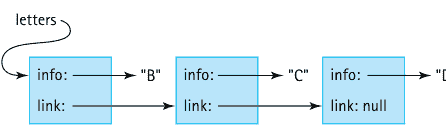

我们为 `LLNode` 类定义了构造函数：

```java
public LLNode(T info) {
    this.info = info;
    link = null;
}
```

该构造函数接受一个 `T` 类对象作为参数，并将 `info` 变量设置为该对象。例如：

```java
LLNode<String> sNode = new LLNode<String>("basketball");
```

结果结构如下：

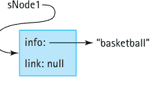

可能存在其他构造函数，例如接受 `LLNode<T>` 作为参数并设置 `link` 变量的构造函数。我们认为它们对该类的功能增强不会太大帮助。

注意，我们的构造函数本质上创建了一个包含单个元素的链表。那么，你如何表示一个空链表呢？通过声明一个 `LLNode` 类型的变量但不使用 `new` 操作对其进行实例化来实现：

```java
LLNode<String> theList;
```

在这种情况下，节点变量持有的值为 `null`：

```java
theList = null;
```

完成该类定义的是 setter（设置）和 getter（获取）。它们的代码是标准且直观的。`setLink` 方法用于将节点链接到列表中。例如，以下代码：

```java
LLNode<String> sNode = new LLNode<String>("basketball");
LLNode<String> sNode2 = new LLNode<String>("baseball");
sNode.setLink(sNode2);
```

结果结构如下：

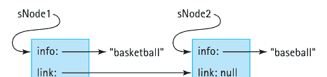


接下来显示完整的 `LLNode` 类。它被用于第 2.8 节“基于链接的栈”中，以创建栈 ADT 的基于链接实现。在看到如何实现之前，我们先介绍链表上的标准操作。

```java
///
// LLNode.java 由 Dale/Joyce/Weems 编写，第2章
//
// 实现用于链表的 <T> 节点。
///
package support;

public class LLNode<T>
{
    protected T info;
    protected LLNode<T> link;

    public LLNode(T info)
    {
        this.info = info;
        link = null;
    }

    public void setInfo(T info) {this.info = info; }
    public T getInfo() { return info; }
    public void setLink(LLNode<T> link) {this.link = link; }
    public LLNode<T> getLink() { return link; }
}
```

## 链表上的操作

我们的 `LLNode` 类提供了一个构建块。使用这个构建块来创建和操作链表取决于我们。

在链表上执行三种基本操作：

- 列表可以被遍历
- 节点可以添加到列表中
- 节点可以从列表中移除

## 遍历

在离开此示例之前，我们应该看看我们的代码是如何处理以下情况的：

### 重要算法

你可以在编程中使用此处描述的算法模式来遍历链表。创建一个引用来“向下行走”链表。将其设置为列表的起点。只要你还没有到达列表末尾，就将其设置为下一个节点。在过程中适当地访问每个节点。

### 实现视图

输出

| | info: "B" | info: "C" | info: "D" |
|---|---|---|---|
| letters | | link: | | link: | link: null |

在执行 `LLNode<String> currNode = letters;` 后：

| | info: "B" | info: "C" | info: "D" |
|---|---|---|---|
| letters | | link: | | link: | link: null |
| currNode | | | |

第一次执行 while 循环后：

| | info: "B" | info: "C" | info: "D" |
|---|---|---|---|
| letters | | link: | | link: | link: null | B |
| currNode | | | |

第二次执行 while 循环后：

| | info: "B" | info: "C" | info: "D" |
|---|---|---|---|
| letters | | link: | | link: | link: null | B C |
| currNode | | | |

第三次执行 while 循环后：

| | info: "B" | info: "C" | info: "D" |
|---|---|---|---|
| letters | | link: | | link: | link: null | B C D |
| currNode: null | | | |

此时 while 循环条件为假。

图 2.9 在 letters 链表边界条件上链表遍历的轨迹。每当你处理链表时，都应该双重检查你的方法是否适用于这种经常遇到的特殊情况。

回想，空链表是指变量中代表列表的值 `null` 的列表：

`letters: null`

在这种情况下，我们的遍历代码做了什么？`currNode` 变量最初被设置为 `letters` 变量保存的值，即 `null`。因此，`currNode` 开始为 `null`，while 循环条件

```
(currNode != null)
```

立即为假，不会进入 while 循环体。本质上，什么都没有发生——这正是我们在遍历空列表时希望发生的情况！我们的代码通过了此人工检查。我们还应该记得用测试程序检查此情况。

## 插入

向链表插入时必须考虑三种通用情况：在列表开头插入、在列表中间插入以及在列表末尾插入。

让我们考虑在列表开头插入一个节点的情况。假设我们有一个节点 `newNode` 要插入到 `letters` 链表的开头：

我们的第一步是将 `newNode` 节点的 `link` 变量指向列表的开头：

为了完成插入，我们将 `letters` 变量指向 `newNode`，使其成为列表的新开头：

这两个步骤对应的插入代码为：

```
newNode.setLink(letters);
letters = newNode;
```

注意，这些语句的顺序至关重要。如果我们反转语句的顺序，就会得到结果：

在操作引用时必须非常小心。画图来帮助你理解正在发生的情况通常是一个好主意。

### 设计提示

当你与基于链的结构工作时，多画像这里显示的这样的图片。将链接可视化是确保你的设计正确、你列出的语句顺序正确以及你没有遗漏任何内容的最佳方法。

> 正如我们对遍历操作所做的，我们应该问当链表为空时调用插入代码会发生什么。图 2.10 形象地描述了这种情况。该方法是否正确地将新节点链接到空列表的开头？还是它创建了一个只有一个节点的列表？首先，新节点的 `link` 被赋值为 `letters` 的值。当列表为空时，这个值是什么？它是 `null`，这正是我们想要放入链表唯一节点的 `link` 中的值。然后 `letters` 被重置为指向新节点。新节点成为列表中的第一个也是唯一的节点。该方法同样适用于空链表，也适用于带有节点的链表。这种方法适用于空链表以及具有节点的链表。我们的方法正确处理了特殊情况。

基于链表的实现操作需要操作引用。

## 2.8 基于链表的栈

### LinkedStack 类

为了与数组实现区分，我们使用 `LinkedStack` 命名。`LinkedStack` 实现了 `StackInterface`。关于此命题，请参阅相邻的“命名规范”章节。

### 命名规范

Java 对程序员定义的命名规则是宽容的。在命名本文创建的构造时，我们遵循了标准约定。我们的类和接口名均以大写字母开头，例如 `LinkedStack` 所示。我们通过将 `top` 设置为 `null` 来创建一个空栈。注意这里的 `import` 语句，它允许我们使用 `LLNode`。类定义如下：

```java
// LinkedStack.java 由 Dale/Joyce/Weems 编写
// 使用链表实现 StackInterface。
//
package ch02.stacks;

import support.LLNode;

public class LinkedStack<T> implements StackInterface<T>
{
    protected LLNode<T> top; // 指向栈顶引用

    public LinkedStack()
    {
        top = null;
    }
}
```

接下来，我们将看到如何实现基于链的栈操作。

### push 操作

向栈中推入元素意味着创建一个新节点并将其链接到当前的节点链。图 2.11 显示了此处列出的操作序列的结果。与图 2.6 类似，它展示了栈的应用视图、实现视图和抽象视图。它图形化地演示了栈元素引用空间的动态分配。假设 A、B 和 C 代表 `String` 类的对象。

```java
StackInterface<String> myStack;
myStack = new LinkedStack<String>();
myStack.push(A);
myStack.push(C);
```

在执行 push 操作时，我们必须动态为每个新节点分配空间。以下是通用算法：

| push(element) |
| :--- |
| 为下一个栈节点分配空间，并将节点 info 设置为 element |
| 将节点 link 指向栈顶的上一个节点 |
| 将栈顶设置为新的栈节点 |

图 2.12 图形化地显示了算法每一步的效果，从一个已经包含 A 和 B 的栈开始，并展示当 C 推入它时发生的情况。这与第 2.7 节“链表介绍”中学习的插入链表开头的算法相同。我们安排了节点框，以强调栈的后进先出（LIFO）特性。

让我们逐行查看算法，边看边编写代码。在讨论过程中，请跟随算法和图 2.12 关注我们的进度。我们首先分配一个新的栈节点，并将其 info 属性设置为元素：

```java
LLNode<T> newNode = new LLNode<T>(element);
```

因此，`newNode` 是指向一个对象的引用，该对象包含两个属性：`T` 类的 `info` 和 `LLNode` 类的 `link`。构造函数已按照要求将 `info` 属性设置为引用元素（我们示例中的参数 C）。接下来，我们需要设置 `link` 属性的值：

```java
newNode.setLink(top);
```

现在，`info` 指向推入栈的元素，而元素的 `link` 属性指向栈顶的上一个节点。

最后，我们需要重置栈顶以指向新节点：

```java
top = newNode;
```

整合所有内容，push 方法的代码为：

```java
public void push(T element) {
    // 将元素放置在此栈的顶部。
    LLNode<T> newNode = new LLNode<T>(element);
    newNode.setLink(top);
    top = newNode;
}
```

注意这些任务的顺序至关重要。如果我们在设置新节点的 link 之前重置 `top` 变量，我们将失去对栈节点的访问。在处理链式结构时，情况通常如此：你必须非常小心地按照正确的顺序更改引用，以免丢失任何数据。不要犹豫画出像我们图中所示的图，以确保你的代码执行了正确的步骤顺序。

你已经看到算法在包含元素的栈上是如何工作的。如果栈是空的会发生什么？虽然我们在第 2.7 节“链表介绍”中验证了我们的方法在这种情况下有效，但我们应该再次追踪一遍。图 2.13 显示了通常发生的情况。

> **编码提示**
>
> 针对边界情况检查代码是一个好习惯，例如空栈或包含单个元素的栈。我们经常在这些情况下出错。

已为新节点分配了空间，并将节点 `info` 属性设置为引用元素。新节点的 `link` 被赋值为 `top` 的值。当栈为空时，这个值是什么？它是 `null`，这正是我们想要放入链栈最后一个（底部）节点 `link` 中的值。然后 `top` 重置为指向新节点，使新节点成为栈顶。结果正是我们预期的——新节点是栈上的唯一节点。

### pop 操作

pop 操作从栈中移除顶部元素并返回它。这是 push 操作的逆向过程。图 2.14 显示了栈操作的结果。

pop 操作从栈中移除顶部节点并返回其信息。以下是通用算法：

| pop() |
| :--- |
| 从当前栈顶获取 info |
| 将栈顶设置为栈顶的 link |
| 返回 info |


```java
top = newNode;
```

## pop 操作

pop 操作从栈中移除顶部元素并返回它。这是 push 操作的逆向过程。图 2.14 显示了栈操作的结果。

第 2 章 栈 ADT

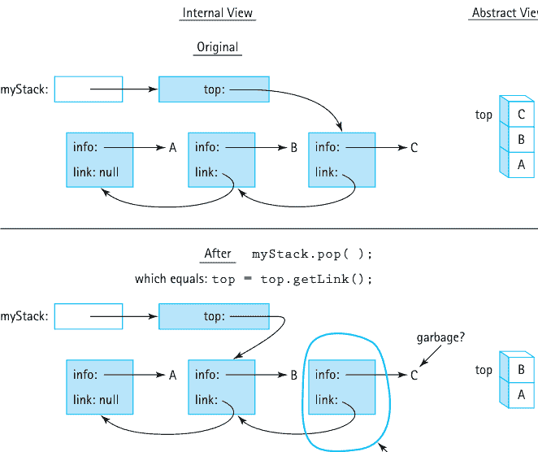

图 2.14 pop 操作的结果

pop 操作从栈中移除顶部节点并返回其信息。以下是通用算法：

| pop() |
| :--- |
| 从当前栈顶获取 info |
| 将栈顶设置为栈顶的 link |
| 返回 info |

因此，`newNode` 是指向一个对象的引用，该对象包含两个属性：`T` 类的 `info` 和 `LLNode` 类的 `link`。构造函数已按照要求将 `info` 属性设置为引用元素（我们示例中的参数 C）。接下来，我们需要设置 `link` 属性的值：

```java
newNode.setLink(top);
```

现在 `info` 指向推入栈的元素，元素的 `link` 属性指向栈顶的上一个节点。

最后，我们需要重置栈顶以指向新节点：

```java
top = newNode;
```

## pop 操作

pop 操作从栈中移除顶部元素并返回它。这是 push 操作的逆向过程。图 2.14 显示了栈操作的结果。

pop 操作从栈中移除顶部节点并返回其信息。以下是通用算法：

| pop() |
| :--- |
| 从当前栈顶获取 info |
| 将栈顶设置为栈顶的 link |
| 返回 info |

你已经看到算法在包含元素的栈上是如何工作的。如果栈是空的会发生什么？虽然我们在第 2.7 节“链表介绍”中验证了我们的方法在这种情况下有效，但我们应该再次追踪一遍。图 2.13 显示了通常发生的情况。

> **编码提示**
>
> 针对边界情况检查代码是一个好习惯，例如空栈或包含单个元素的栈。我们经常在这些情况下出错。

已为新节点分配了空间，并将节点 `info` 属性设置为引用元素。新节点的 `link` 被赋值为 `top` 的值。当栈为空时，这个值是什么？它是 `null`，这正是我们想要放入链栈最后一个（底部）节点 `link` 中的。然后 `top` 重置为指向新节点，使新节点成为栈顶。结果正是我们预期的——新节点是栈上的唯一节点。

pop 操作从栈中移除顶部元素并返回它。这是 push 操作的逆向过程。图 2.14 显示了栈操作的结果。

pop 操作从栈中移除顶部节点并返回其信息。以下是通用算法：

| pop() |
| :--- |
| 从当前栈顶获取 info |
| 将栈顶设置为栈顶的 link |
| 返回 info |

有一些特殊情况需要考虑：从空栈中弹出。如果我们尝试从空栈弹出会发生什么？在这种情况下，`top` 包含 `null`，赋值语句 `top = top.getLink()` 会导致运行时错误：`NullPointerException`。

因此，我们用 `isEmpty` 操作来保护赋值。我们的 pop 方法的代码如下：

```java
public void pop() {
    // 如果此栈为空，则抛出 StackflowException，
    // 否则从此栈中移除顶部元素。
    if (isEmpty())
        throw new StackflowException("Pop attempted on empty stack.");
    else
        top = top.getLink();
}
```

还有一个特殊情况：从只有一个元素的栈中弹出。我们需要确保这个操作会导致空栈。让我们看看是否如此。当我们的栈实例化时，它被设置为 `null`。当元素被推入栈时，节点的 `link` 然后被设置为当前的 `top` 变量；因此，当第一个元素推入栈时，其节点的 `link` 被设置为 `null`。因为 pop 方法设置了此 `link` 属性的值，在最后一个元素弹出后，`top` 再次具有 `null` 值，就像它刚被实例化时一样。我们得出 pop 方法适用于单元素栈。图 2.15 图形化地描述了将单个元素放入栈并将其弹出。

## 其他栈操作

回想 `top` 操作简单返回栈顶元素的引用。乍看，这似乎非常直接。简单的代码：

```java
return top();
```

因为 `top` 指向栈顶的元素。然而，请记住 `top` 指向的是一个 `LLNode` 对象。任何使用 Stack ADT 的程序都不关心 `LLNode` 对象。客户端程序只对 `info` 变量引用的对象感兴趣。

让我们尝试返回顶部 `LLNode` 的 `info`，我们编写：

```java
return top.getInfo();
```

这样好多了，但我们还需要做更多。栈为空的特殊情况怎么办？在这种情况下，我们抛出一个异常而不是返回对象。`top` 方法最终的代码所示：

```java
public T top() {
    // 如果此栈为空，则抛出 StackflowException，
    // 否则返回此栈的顶部元素。
}
```

### 空栈


执行 `myStack.push(A)` 后：

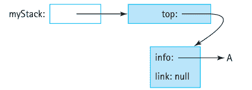

然后执行 `myStack.pop()`：

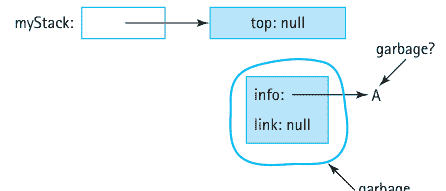

图 2.15 在空栈上先执行 push 后 pop 的结果

这还不错，但 `isEmpty` 更加简单。如果我们通过将 `top` 变量设置为 `null` 来初始化一个空栈，就可以通过检查值是否为 `null` 来检测空栈。

```java
public boolean isEmpty() {
    // 如果此栈为空，则返回 true，否则返回 false。
    return (top == null);
}
```

## 2.8 基于链表的栈

由于链表栈永远不会满（我们始终可以分配另一个节点），因此 `isFull` 方法直接返回 `false`：

```java
public boolean isFull() {
    // 链表栈永远不会满，返回 false。
    return false;
}
```

栈 ADT 的链表实现可以使用与之前介绍数组版本相似的测试计划进行测试。

## 比较栈的实现方式

在这里，我们从存储需求和算法效率方面比较栈 ADT 的两种经典实现方式：`ArrayBoundedStack`（数组边界栈）和 `LinkedStack`（链表栈）。首先考虑存储需求。实例化以匹配最大栈大小的数组所占内存是相同的，无论实际使用了多少个数组槽。链表实现使用动态分配的存储，只需要运行时栈中元素数量的空间。然而，请注意，元素变得大了，因为我们必须存储指向下一个元素的引用，以及指向用户数据的引用。

### 栈操作的效率

对于我们的数组实现和链表实现，五种基本栈操作（`isEmpty`, `isFull`, `push`, `pop`, 和 `top`）的增长效率均为 O(1)。

我们现在比较两种实现方式的相对执行“效率”。`isFull` 和 `isEmpty` 的实现显然是 O(1)；它们总是花费恒定的工作量。而 `push`、`pop` 和 `top`，栈中元素的数量会影响这些操作所需的工作量吗？不，不会。在三种实现中，我们都直接访问栈顶，因此这些操作也花费恒定的工作量。它们也具有 O(1) 复杂度。

只有在增长效率方面，类构造函数之间才存在差异。在数组实现中，当实例化数组时，系统会创建并初始化每个数组位置。由于它是对象数组，每个数组槽都被初始化为 `null`。数组槽的数量等于可能的栈元素的最大数量。我们称之为 N，并说数组实现的构造函数将 `top` 设置为 `null`，因此它仅仅是 O(1) 的。

总的来说，两种栈实现在工作量方面大致等效。那么，哪种更好呢？答案如往常一样，“取决于情况而定”。链表实现没有空间限制，在栈元素数量变化很大的应用中，当栈较小时，它浪费的空间更少。为什么要用数组实现呢？因为它简单且高效。如果频繁发生 `push` 操作，数组实现的执行速度会比链表实现快，因为它没有产生反复调用 `new` 操作的运行时开销。当最大尺寸较小且我们确切知道大小时，数组实现是一个很好的选择。

## 2.9 应用：后缀表达式求值

后缀表示法是一种编写算术表达式的符号，其中运算符出现在操作数之后。例如，我们不写 `(2 + 14) × 23`，而是写 `2 14 + 23 ×`。

使用后缀表示法，不需要学习优先级规则，也永远不需要括号。由于这种简单性，某些手持计算器使用后缀表示法来避免代数符号中所需的多个括号的复杂性。后缀表示法也被编译器用于生成无歧的表达式。

### 讨论

在小学时期，你学习了评估涉及二元运算符的简单表达式：加、减、乘、除。这些之所以被称为二元运算符，是因为它们作用于两个操作数。很容易看出孩子如何解决以下问题：`2 + 5 = ?`。随着表达式变得复杂，纸笔计算就需要一些功夫。解决以下问题必须执行多项任务：`((3 - 1) / 2) × (3 + 5) = ?`。这些表达式使用称为中缀符号的格式编写，这与 Java 中使用的表达式相同。中缀表达式中的运算符写在其操作数之间。

后缀表示法是另一种编写算术表达式的格式，运算符位于操作数之后。在这种表示法中，运算符位于操作数之后。例如，`3 5`。评估后缀表达式比评估中缀表达式要简单得多。我们从左到右一个一个处理项。当项是运算符时，我们将其作用于前面的两个操作数。以下算法使用栈来评估后缀表达式。

### 评估表达式

```java
while items exist {
    Get an item
    if item is an operand
        stack.push(item)
    else
        operand2 = stack.top()
        stack.pop()
        operand1 = stack.top()
        stack.pop()
        result = apply operation corresponding to item to operand1 and operand2
        stack.push(result)
}
result = stack.top()
stack.pop()
return result
```


while 循环的每次迭代处理表达式中的一个运算符或操作数。当发现操作数时，还没有对其进行处理（我们还没有找到应用的运算符），因此它被保存在栈中直到以后。当发现运算符时，我们从栈顶获取两个操作数，执行操作，并将结果放回栈中；该结果可能是未来运算符的操作数。

让我们追踪这个算法。在循环之前，待处理的输入和栈看起来如下：

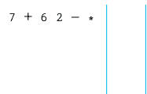

## 2.9 应用：后序表达式求值

在循环迭代一次后，我们处理了第一个操作数并将其推入栈中。

| 5 + 6 + 2 - * |
|---|
| 5 |

在循环的第二次迭代后，栈中包含了两个操作数。

| 5 + 6 + 2 - * |
|---|
| 7 |
| 5 |

在第三次迭代中，我们遇到了 `+` 运算符。从栈中取出两个操作数，执行操作，并将结果推入栈中。

| 5 + 6 + 2 - * |
|---|
| 12 |

在循环的接下来的两次迭代中，我们将两个操作数推入栈中。

| 5 + 6 + 2 - * |
|---|
| 2 |
| 6 |
| 12 |

当我们找到 `-` 运算符时，我们取出栈顶两个操作数，进行减法，并将结果推入栈中。

| 5 + 6 + 2 - * |
|---|
| 4 |
| 12 |

## 第2章 栈 ADT

当我们找到 `*` 运算符时，我们取出栈顶两个操作数，进行乘法，并将结果推入栈中。

| 5 + 7 + 6 - 2 - * |
|---|
| 48 |

现在我们已经处理了输入行上的所有项目，退出循环。我们从栈中取出结果 48 并返回它。

| 5 + 7 + 6 - 2 - * |
|---|
| 结果 48 |

这段讨论忽略了一些“次要”细节，例如如何识别运算符、如何知道我们何时完成以及如何生成错误消息。在继续完善我们对问题的解决方案时，我们将讨论这些问题。

## 错误处理

我们的应用程序将读取一系列后序表达式，其中某些可能是非合法的。当输入此类表达式时，应用程序不应显示整数结果，而应显示如下的错误消息：

| 非法表达式类型 | 错误消息 |
|---|---|
| 表达式包含不是整数或不是 `+`、`*` 和 `/` 的符号 | 非法符号 |
| 表达式要求的栈项超过 50 个 | 操作数过多——栈溢出 |
| 表达式处理后栈中仍剩余多个操作数；例如，表达式 `5 6 7 +` 操作数过多 | 操作数过多——遗留操作数 |
| 在需要执行操作时栈中的操作数不足；例如，`6 7 + +`；又例如，`5 + 5` | 操作数不足——栈下溢 |

## 假设

1. 表达式中的操作在运行时是有效的。这意味着没有除以零。此外，生成的数字不在 Java `int` 类型的范围内。
2. 后序表达式最多有 50 个操作数。

## 2.9 应用：后序表达式求值

为了方便错误管理，我们创建了一个名为 `PostFixException` 的异常，类似于为栈 ADT 创建的异常。

## PostFixEvaluator 类

该类的目的是提供一个 `evaluate` 方法，该方法接受一个字符串形式的后序表达式并返回该表达式的值。我们不需要该类的任何对象，因此将 `evaluate` 实现为静态方法。这意味着它是通过类本身调用的，而不是通过类的对象。

`evaluate` 方法必须接受一个字符串形式的后序表达式并返回表达式的值。类的代码列在下面。它遵循早期开发的后序表达式算法，使用 `ArrayBoundedStack` 存储 `Integer` 类的操作数，直到它们被需要。请注意，它初始化了一个 `Scanner` 对象来“读取”字符串参数并将其拆分为多个标记（tokens）。

让我们考虑错误消息的生成。由于 `evaluate` 方法返回的是一个 `int` 值，因此求值后序表达式的结果无法直接返回错误消息。相反，我们转向了 Java 的异常机制。查看代码中抛出 `PostFixException` 异常的行。你会发现我们涵盖了之前识别的所有错误情况。正如预期的那样，与栈处理直接相关的错误消息都受 `if` 语句的保护，检查栈是否为空（操作数不足）或满（操作数过多）。唯一的其他错误捕获发生在存储在 `operator` 中的字符串不匹配任何合法运算符时，在这种情况下，抛出一个消息为“Illegal symbol”的异常。这是异常的一种非常恰当用法。

```java
// PostFixEvaluator.java 由 Dale/Joyce/Weems    第2章
//
// 提供后序表达式求值。
//-
package ch02.stacks.*;

import java.util.Scanner;

public class PostFixEvaluator
{
    public static int evaluate(String expression)
    {
        Scanner tokenizer = new Scanner(expression);
        StackInterface<Integer> stack = new ArrayBoundedStack<Integer>(50);
        int value;
        String operator;
        int operand1;
        int operand2;
        int result;

        while (tokenizer.hasNext())
        {
            if (tokenizer.hasNextInt())
            {
                value = tokenizer.nextInt();
                if (stack.isFull())
                    throw new PostFixException("Too many operands");
                stack.push(value);
            }
            else
            {
                operator = tokenizer.next();
                if (stack.isEmpty())
                    throw new PostFixException("Not enough operands");
                operand2 = stack.top();
                stack.pop();
                if (stack.isEmpty())
                    throw new PostFixException("Not enough operands");
                operand1 = stack.top();
                stack.pop();

                if (operator.equals("+"))
                    result = operand1 + operand2;
                else if (operator.equals("-"))
                    result = operand1 - operand2;
                else if (operator.equals("*"))
                    result = operand1 * operand2;
                else if (operator.equals("/"))
                    result = operand1 / operand2;
                else
                    throw new PostFixException("Illegal symbol");

                stack.push(result);
            }
        }

        // 从栈中获取最终结果。
        if (stack.isEmpty())
            throw new PostFixException("Not enough operands");
        result = stack.top();

        // 栈现在为空。
        if (!stack.isEmpty())
            throw new PostFixException("Too many operands");

        // 返回最终结果。
        return result;
    }
}
```

## CLI 类

该类是程序的驱动程序。使用 `PostFixEvaluator` 和 `PostFixException` 类，设计程序变得简单。我们遵循之前的做法，反复提示用户输入，直到完成。以下是 CLI 的代码。

```java
// CLI.java 由 Dale/Joyce/Weems    第2章
//
// 后序表达式求值的驱动。
//--------------------------------------
package ch02.stacks.*;

import java.util.Scanner;

public class CLI
{
    public static void main(String[] args)
    {
        Scanner scanner = new Scanner(System.in);
        String expression;
        while (true)
        {
            System.out.print("输入后序表达式: ");
            expression = scanner.nextLine();
            if (expression.equals("exit"))
                break;
            try
            {
                int result = PostFixEvaluator.evaluate(expression);
                System.out.println("结果: " + result);
            }
            catch (PostFixException e)
            {
                System.out.println("错误: " + e.getMessage());
            }
        }
    }
}
```

## 栈 ADT

这里是我们基于控制台的应用程序示例：

| 5 + 6 + 2 - * |
|---|
| 结果 48 |

| 5 + 7 + 6 - 2 - * |
|---|
| 操作数不足 |

## GUI 方法

后序求值的 GUI 与 `Balanced` 情况类似，我们将用户界面与代码分离。这里是应用程序的一些截图。

开始求值：

![image_link1]

成功求值的结果：

![image_link2]

如果评估非法表达式会发生什么：

![image_link3]

## 2.10 栈变体

在对 ADT 的主要阐述中，我们记录了设计决策并指定了要支持的操作。任何主要数据结构的定义/实现都有替代方法。栈作为一种简单的数据结构，与存在几十种变体的树结构相比，允许的变化不多。尽管如此，查看栈变体仍然很有意义。

## 回顾我们的栈 ADT

让我们简单回顾定义 Stack 时所做的设计决策并考虑替代方法：

- 我们的栈是泛型的，这意味着栈中存储的元素类型是在实例化时指定的。或者，我们可以定义栈来存储 `Object` 或实现特定接口的类。这些方法在第2.3 节“集合元素”中讨论过。
- 经典的栈提供两个操作：
    - `void push(T element)`——将元素推入栈
    - `T pop()`——移除并返回栈顶元素
对于我们，我们重新定义了 pop 并添加了第三种操作，我们得到了：
    - `void push(T element)`——将元素推入栈
    - `void pop()`——移除栈顶元素
    - `T top()`——返回栈顶元素

- 我们的栈在下溢或溢出时抛出异常。另一种方法是作为栈方法的前置条件，规定不会在产生下溢或溢出的情况下调用它们。在这里，操作实现可以忽略这种可能性。另一种方法是在方法内部捕获问题，通过使操作无效来防止下溢的发生。通过后一种方法，我们可能会重新定义这三种操作，以返回有关操作是否完成的信息：
    - `boolean push(T element)`——将元素推入栈；如果元素成功推入则返回 true，否则返回 false
    - `boolean pop()`——移除栈顶部的元素；如果元素成功弹出，则返回 true，否则返回 false
    - `T pop()`——如果栈不为空，则返回栈顶部元素；否则返回 null

与其说定义我们的操作，不如说也可以添加具有唯一名称的新操作，例如 `safePush` 或 `offer`。

## Java Stack 类与集合框架

Java 库提供了实现基于常用数据结构的 ADT（抽象数据类型）的类：栈、队列、列表、映射、集合等。该库中的 `Stack` 类与我们在本章中开发的栈 ADT 类似，提供了一种后进先出（LIFO）结构。然而，除了我们的 `push`、`top` 和 `isEmpty` 操作外，它还包含另外两个操作：

- `T pop()`——经典的“弹出”操作移除并返回栈顶部的元素。
- `int search(Object o)`——返回对象 o 在栈中的位置。

由于库中的 `Stack` 类继承了库中的 `Vector` 类，因此它也继承了许多为 `Vector` 及其祖类 `Object` 定义的许多操作（如 `capacity`、`clear`、`clone`、`contains`、`isEmpty`、`toArray` 和 `toString`）。

以下是如何使用 Java 库中的 `Stack` 类实现反转字符串应用程序（参见第 2.4 节，“栈接口”）。我们强调了该应用程序与使用我们栈 ADT 的应用程序之间的最小差异。

```java
// ReverseStrings2.java 由 Dale/Joyce/Weems 第二章编写
// 库 Stack 的示例用法。
// 按进入的反相反顺序输出字符串。
//
// package ch02.apps:
import java.util.Stack;
import java.util.Scanner;

public class ReverseStrings2
{
    public static void main(String[] args)
    {
        Scanner scan = new Scanner(System.in);
        Stack<String> stringStack = new Stack<String>();
        String line;
        for (int i = 1; i <= 3; i++)
        {
            System.out.print("输入字符串：");
            line = scan.nextLine();
            stringStack.push(line);
        }
        System.out.println("\n栈内容如下:");
        while (!stringStack.isEmpty())
        {
            System.out.println(stringStack.pop());
        }
    }
}
```

> 自 Java 1.6 于 2006 年发布以来，库中的 `Stack` 类已被 `Deque` 类取代。尽管如此，在本节中简要考虑 `Stack` 类仍然具有启发意义。
> 在库中，`isEmpty` 被称为 `empty`，而 `top` 被称为 `peek`。


## 总结

在成为专业程序员之前，请学习集合框架并学会如何使用它。在本章中，我们通过几种实现指定了栈 ADT：基于数组的、基于链表的。链表的概念被介绍给许多读者。当我们使用抽象来处理数据栈时，有三种视图：抽象层描述 ADT 提供什么，应用层作为之间的契约，实现层提供具体的细节。

通过分离这些视图我们获得了什么？首先，我们降低了高层的复杂性，使程序更易维护。其次，我们开发的软件是可重用的：只要保持正确的接口，实现操作就可以被其他程序用于完全不同的应用程序。

## 第 2 章 ADT

| 包名 | 类/接口 | 方法 |
| :--- | :--- | :--- |
| ch02.stacks | StackOverflowException | + OverflowException(), + OverflowException(String message) |
| ch02.stacks | `<<接口>>` `StackInterface<T>` | + push(T element):void, + pop():void, + top():T, + isFull(): boolean, + isEmpty(): boolean |
| ch02.stacks | StackUnderflowException | + StackUnderflowException(), + StackUnderException(String message) |
| ch02.stacks | ArrayBoundedStack<T> | + ArrayBoundedStack(), + ArrayBoundedStack(int maxsize) |
| ch02.stacks | ArrayList<T> | + ArrayList() |
| java.util | ArrayList<E> | + ArrayList(E), + add(E e): boolean, + remove(int index): E, + size(int): int |
| ch02.stacks | LinkedStack<T> | + LinkedStack() |
| support | LLNode<T> | + LLNode(T info), + setInfo(T info): void, + getInfo(): T, + setLink(LLNode<T> link): void, + getLink(): LLNode<T> |

**图 2.16** 在第二章中开发的栈相关接口和类 (img/563603359bb23a825e754fdde549a_165_0.png)

## 练习

- 为了呈现清晰、整洁的图表，如果信息可以推断出来，我们将省略表示“使用”的标记。例如，`ArrayBoundedStack` 类使用了 `StackOverflowException`。由于 `ArrayBoundedStack` 类实现了 `StackInterface`，且我们已经展示了 `StackInterface` 使用 `StackOverflowException`，我们可以安全地省略连接 `ArrayBoundedStack` 到 `StackOverflowException` 的箭头。

- 图中的库类会被阴影处理。只有当这些类与 ADT（抽象数据类型）的实现直接相关时，我们才会包含它们。

## 2.1 抽象

1. 描述日常生活中使用抽象的四种方式。

2. 列出我们观察数据的三个不同视角。以“一份学生学习成绩列表”为例，描述我们如何从每种视角来观察这些数据。

3. 描述尽管使用了数据抽象，实现细节如何影响使用该 ADT 的应用程序的一种方式。

4. 什么是抽象方法？

5. 如果 Java 接口指定了一个特定的方法签名，而实现该接口的类为该方法提供了不同的签名，会发生什么？例如，假设接口 `SampleInterface` 定义如下：

```java
public interface SampleInterface {
    public int sampleMethod();
}
```

```java
public class SampleClass implements SampleInterface {
    public boolean sampleMethod() {
        return true;
    }
}
```

6. 对或错？解释你的答案。
   a. 你可以为 Java 接口定义构造函数。
   b. 类实现接口。
   c. 类扩展接口。
   d. 实现接口的类可以包含接口未要求的方法。
   e. 实现接口的类可以省略接口要求的方法。
   f. 你可以实例化接口的对象。

7. 根据我们的约定，以下方法存在什么问题？
```java
public void method(int number)
// 前置条件: number > 0.
// 如果 number 不大于 0，则抛出 NotPositiveException。
```

8. 你的朋友在实例化 `FigureInterface` 类型的对象时遇到了困难。他的代码包括：
```java
FigureInterface myFig = new FigureInterface(2.5);
```
你会告诉你的朋友什么？

9. 创建实现 `FigureInterface` 的 Java 类：
   a. Square（方形）：构造函数接受一个 `double` 类型参数，表示边长。
   b. RightTriangle（直角三角形）：构造函数接受两个 `double` 类型参数，表示两条直边的长度。
   c. IsoscelesTriangle（等腰三角形）：构造函数接受两个 `double` 类型参数，表示高和底。
   d. Parallelogram（平行四边形）：构造函数接受三个 `double` 类型参数，表示高、底以及侧与底之间的角。

10. 更新 Random 应用，使其使用你在上一个问题中实现的 `FigureInterface` 类。

11. 对于这个问题，你必须定义一个接口 `NumTracker` 和该接口的两个实现 `Tracker1` 和 `Tracker2`。
    a. 定义一个名为 `NumTracker` 的 Java 接口。实现此接口的类必须跟踪通过 `add` 方法提交的数字的总和和计数，并提供总和、计数和平均值的访问器（getters）。`add` 方法应接受一个 `int` 参数，`getSum` 和 `getCount` 方法应返回 `int` 值，`getAverage` 方法应返回一个 `double` 值。假设名为 `Tracker1` 的类实现了 `NumTracker`。这里显示了一个使用 `Tracker1` 的简单应用程序。它的输出将是“2 14 7.0。”

```java
public class Sample {
    public static void main(String[] args) {
        NumTracker nt = new Tracker1();
        nt.add(5); nt.add(9);
        System.out.print(nt.getCount() + " ");
        System.out.print(nt.getSum() + " ");
        System.out.println(nt.getAverage());
    }
}
```

    b. 创建一个类 `Tracker1` 并实现 `NumTracker`。该类应使用三个实例变量：sum 和 count。

## 2.2 栈

- 对或错？
- 栈是一个先入先出（FIFO）结构。
- 在栈中停留时间最长的元素位于栈的“底部”。
- 如果向空栈中推入（push）五个元素然后弹出（pop）五次，栈将再次为空。
- 如果向空栈中推入五个元素然后执行五次顶（top）操作，栈将再次为空。
- push 操作应归类为“转换器（transformer）”。
- top 操作应归类为“转换器”。
- pop 操作应归类为“观察者（observer）”。
- top 操作总是返回最近推入的元素。
- 如果我们先向栈中推入 itemA，然后推入 itemB，那么栈顶就是 itemB。
- 在栈的 push 操作后接一个 pop 操作，对栈的状态没有影响。
- 在栈的 pop 操作后接一个 push 操作，对栈的状态没有影响。

13. 描述经典的栈 pop 操作与本文定义的 pop 操作之间的区别。

14. 在接下来的命令序列中，编号的块（block）被推入和弹出栈。假设每当一个块被弹出时，都会打印它的数值。显示以下每个序列中打印出的值序列。假设你从空栈开始：
    a. push block5; push block7; pop; push block2; push block1; pop; push block8;
    b. push block5; push block4; push block3; push block2; pop; push block1; pop; pop;
    c. push block1; pop block1; pop; push block1; pop; push block1; pop;

15. 描述你可能如何在以下每个场景中使用栈：
    a. 帮助一位热心的朋友发现他在晚上夜游时把伞丢在哪里。
    b. 追踪一场拍卖，最高出价者允许撤回她的报价。

### 2.3 集合元素

16. 在第 2.3 节“集合元素”中，我们查看了定义集合 ADT 中存储元素类型的四种方法。简要描述这四种方法。

17. 对于这个问题，你必须定义一个接口 `Pair` 和该接口的两个实现 `BasicPair` 和 `ArrayPair`。
    a. 定义一个名为 `Pair` 的 Java 接口。实现此接口的类允许创建对象对——它们被称为“第一个（first）”和“第二个（second）”对象。`Pair` 接口应指定接受这些值的构造函数，并提供第一个和第二个对象的设置（setters）和访问器（getters）。假设名为 `BasicPair` 的类实现了 `Pair`。这里显示了一个使用它的简单应用程序。它的输出是“apple orange.”

```java
public class Sample {
    public static void main(String[] args) {
        Pair<String> myPair = new BasicPair<String>("apple", "peach");
        System.out.print(myPair.getFirst() + " ");
        myPair.setSecond("orange");
        System.out.println(myPair.getSecond());
    }
}
```

    b. 创建实现 `Pair` 接口的 `BasicPair`。该类应使用实例变量 first 和 second 来表示对象对。创建一个测试驱动程序证明 `BasicPair` 正常工作。

    c. 创建实现 `Pair` 接口的 `ArrayPair`。该类应使用大小为 2 的数组来表示对象对。创建一个测试驱动程序证明 `ArrayPair` 正常工作。

## 2.4 形式化规范

18. `StackInterface` 代表了栈 ADT 实现者与使用该 ADT 的程序员之间的约定。列出契约点。

19. 根据我们的栈 ADT 规范，程序员有两种检查栈为空的方法。描述并讨论什么情况下一种方法可能更好。

20. 显示以下代码序列的内容，假设 item1、item2 和 item3 是 `int` 变量，且 s 是符合该节栈抽象描述的对象。假设你可以在 s 上存储和检索 `int` 类型的变量。

    a. 
```java
item1 = 1; item2 = 0; item3 = 4;
s.push(item2); s.push(item1); s.push(item1 + item3);
item2 = s.top();
s.pop();
s.push(item3*item3); s.push(item2); s.push(3);
item1 = s.top();
s.pop();
System.out.println(item1 + " " + item2 + " " + item3);
while (!s.isEmpty()) {
  item1 = s.top(); s.pop();
  System.out.println(item1);
}
```

    b. 
```java
item1 = 4; item3 = 0; item2 = item1 + 1;
s.push(item2); s.push(item2 + 1); s.push(item1);
item2 = s.top(); s.pop();

item1 = item2 + 1;

s.push(item1); s.push(item3);

while (!s.isEmpty()) {
    item3 = s.top(); s.pop();
    System.out.println(item3);
}

System.out.println(item1 + " " + item2 + " " + item3);
```

21. 你的朋友 Bill 说：“栈的 push 和 pop 操作是互逆的。因此，通过 pop 来执行 push 总是等同于执行一个 push 后执行一个 pop。你得到了结果！”你会如何回答？你同意吗？

22. 在每个 Pez 糖果容器中，颜色是顺序存储的。你的小弟弟只喜欢黄色的，所以他费力地一个一个取出糖果，吃掉黄色的部分，并将剩下的按顺序保留，这样他就能按照完全相同的顺序将它们放回容器——当然，去掉了黄色糖果。编写算法来模拟这个过程。（你可以使用 Stack ADT 中定义的任何栈操作，但不能假设任何关于栈实现的知识。）

23. 使用 Stack ADT：
    a. 下载文本代码文件并在你的笔记本电脑/台式机上正确设置。运行 ReverseStrings 。
    b. 创建一个使用栈的简单程序。你的新程序应该要求用户输入一行文本，然后反序打印该文本。为了实现这一点，你的应用程序应该使用一个 Character 类型的栈。

24. 世纪栈（Century Stack）是一个固定大小为 100 的栈。如果世纪栈满了，则栈上的元素将被移除，为新元素留出空间。创建一个 CenturyStackInterface，以捕获这种世纪栈的规格说明。

## 2.5 基于数组的栈实现

25. 在以下代码序列的每一步中，显示实现表示（实例变量 `elements` 和 `topIndex` 的值）：

```java
StackInterface<String> s = new ArrayBoundedStack<String> (5);
s.push("Elizabeth");
s.push("Anna Jane");
s.pop();
s.push("Joseph");
s.pop();
```

26. 在以下代码序列的每一步中，显示实现表示（实例元素 `elements` 和 `topIndex` 的值）：

```java
StackInterface<String> s = new ArrayBoundedStack<String>(5);
s.push("Adele");
s.push("Heidi");
s.push("Sylvia");
s.pop(); s.pop();
```


- 27. 描述每种更改对 `ArrayBoundedStack` 类的影响。

    a. 从 `DEFCAP` 实例变量中移除 `final` 属性。
    b. 将赋值给 `DEFCAP` 的值改为 10。
    c. 将赋值给 `DEFCAP` 的值改为 -10。
    d. 在第一个构造函数中，将语句改为 `elements = (T[]) new Object[100];`。
    e. 在 `isEmpty` 中，将 `"topIndex == -1"` 改为 `"topIndex < 0"`。
    f. 反转 `push` 方法 `else` 分句中两个语句的顺序。
    g. 反转 `pop` 方法 `else` 分句中两个语句的顺序。
    h. 在 `top` 方法的 `throw` 语句中，将参数字符串从 `"Top attempted on an empty stack"` 改为 `"Pop attempted on an empty stack."`。

- 28. 在 `ArrayBoundedStack` 类中添加以下方法，并为每个方法创建一个测试驱动程序以证明它们正常工作。为了练习你的数组编码技能，请通过访问 `ArrayBoundedStack` 的内部变量来编写这些方法，而不是通过调用类的公共方法。

    a. `String()`——创建一个能正确表示当前栈的字符串。这种方法对于测试和调试该类，以及测试和调试使用该类的应用程序可能有用。假设每个堆栈元素都提供了自己的 `toString` 方法。
    b. `int size()`——返回栈中当前拥有的项目数量。为了实现此方法，不要向 `ArrayBoundedStack` 类添加实例变量。
    c. `void popSome(int count)`——从栈中移除顶部 `count` 个元素；如果栈中元素少于 `count`，则抛出 `StackflowException`。
    d. `boolean swapStart()`——如果栈中元素少于两个，则返回 `false`；否则反转顶部元素的顺序并返回 `true`。
    e. `T pop()`——“经典”的 `pop` 操作，如果栈为空，则抛出 `StackflowException`；否则返回栈的顶端元素。

- 29. 执行 28 中列出的任务，但使用 `ArrayList`。

- 30. 使用 `ArrayBoundedStack` 类，创建一个应用程序 `EditString`，提示用户输入一个字符串，然后重复提示用户进行更改，直到用户输入 X 表示更改结束。合法操作有：
    U——将所有字母转为大写
    L——将所有字母转为小写
    R——反转字符串
    C ch1 ch2——将所有的 ch1 更改为 ch2
    Z——你可以假设最近的更改是用户不会输入任何内容。当用户完成时，打印结果字符串。例如，如果用户输入：
    All dogs go to heaven
    u
    R
    Z
    程序的输出将是“DAGS HEAVEN”

- 31. 在软件开发过程中，开始测试的合适时机是什么？

- 32. 创建一个非交互式测试驱动程序，类似于下，用于测试 `ArrayBoundedStack` 的以下方法：

    a. `isEmpty`
    b. `top`
    c. `push`
    d. `pop`

- 33. 执行 32 中的任务，但使用 `ArrayList`。注意：

- 34. 实现世纪栈（见 24）。

    a. 使用数组（你能设计一个效率为 O(1) 的方案吗）？
    b. 使用 `ArrayList`

## 2.6 应用：表达式

- 35. 假设以下良构表达式（使用圆括号、中括号）被传递给 `Balanced` 方法。显示栈的内容（从顶部到底部）。包括：

    a. `(( ))`
    b. `() {}`
    c. `(()) []`
    d. `{{`

- 36. 假设以下错误表达式（使用圆括号、中括号）被传递给 `Balanced` 方法。显示栈的内容（从顶部到底部），在发现错误表达式时：

    a. `(( [`
    b. `(]) {`
    c. `())]`
    d. `{{`

- 37. 关于 `Balanced` 类回答以下问题：

    a. 这两种实例化方式之间有差异吗？
    `Balanced bal = new Balanced("abc", "xyz");`
    `Balanced bal = new Balanced("zxy");`

    b. 这两种实例化方式之间有差异吗？
    `Balanced bal = new Balanced("abc", "xyz");`
    `Balanced bal = new Balanced("xyz", "abc");`

    c. 哪种类型被推入栈中？`char`？`int`？还是 `Integer`？解释。

    d. 在什么情况下，栈上的第一个操作（不计算 `new` 操作）是 `top` 操作？

    e. 如果传递给方法的字符串为空，会发生什么？

## 2.7 链表简介

- 38. 什么是自引用类？

- 39. 画出表示以下代码序列创建的结构的图形。假设每个情况之前都有这三行代码：

```
LLNode<String> node1 = new LLNode<String>("alpha");
LLNode<String> node2 = new LLNode<String>("beta");
LLNode<String> node3 = new LLNode<String>("gamma");
```

    a. `node1.setLink(node3)`
    b. `node2.setLink(node3); node3.setLink(node1)`
    c. `node3.setLink(node2); node2.setLink(node1.getLink());`

- 40. 我们开发了遍历链表的代码。这里是使用遍历来打印通过 `letters` 访问的链表内容的几种替代、可能有缺陷的方法。对它们进行批判：

```
a. LLNode<String> currNode = letters;
while (currNode != null) {
    System.out.println(currNode.getInfo());
    currNode = currNode.getLink();
}
```

```
b. LLNode<String> currNode = letters;
while (currNode != null) {
    currNode = currNode.getLink();
    System.out.println(currNode.getInfo());
}
```

```
c. LLNode<String> currNode = letters;
while (currNode != null) {
    System.out.println(currNode.getInfo());
    if (currNode.getLink() != null)
        currNode = currNode.getLink();
    else
        currNode = null;
}
```

- 41. 假设 `numbers` 指向 `LLNode<Integer>` 链表。编写代码打印以下内容。不要考虑列表为空的情况。回 `LLNode` 导出 `info` 和 `link` 的 setter 和 getter。

    a. 列表中所有数字之和
    b. 列表中元素的个数
    c. 列表中正数的个数
    d. 列表的顺序枚举内容；例如，如果列表包含 5, 7 和 -9，代码将打印：
       1. 5
       2. 7
       3. -9
    e. 列表的反向顺序枚举内容（提示：使用栈）；例如，如果列表包含 5, 7 和 -9，代码将打印：
       1. -9
       2. 7
       3. 5

- 42. 使用与本节相同的算法描述风格，描述一个以下操作的算法：

    a. 从链表中删除第一个元素
    b. 从链表中删除第二个元素
    c. 交换链表中的两个元素（你可以假设列表至少有两个元素）
    d. 在链表中添加一个具有信息属性 A 的元素作为第二个元素（你可以假设列表至少有一个元素）

## 2.8 基于链的栈

- 43. 在内存分配方面，使用基于数组的栈和使用基于链的栈的主要区别是什么？

- 44. 考虑 `LinkedStack` 类的 `push` 方法。对该代码进行以下更改会有什么影响？

    a. 交换第一行和第二行。
    b. 交换第二行和第三行。

- 45. 显示以下代码序列中每一步的实现表示（从 `topIndex` 开始画链表）：

```
StackInterface<String> s = new LinkedStack<String>();
s.push("Elizabeth");
s.push("Anna Jane");
s.pop();
s.push("Joseph");
s.pop();
```

## 第 2 章 栈 ADT

- 46. 显示以下代码序列中每一步的实现表示（从 `topIndex` 开始画链表）：
```
StackInterface<String> s = new LinkedStack<String>();
s.push("Adele");
s.push("Heidi");
s.push("Sylvia");
s.pop();
s.pop();
```

- 47. 重复练习 28，但将方法添加到 `LinkedStack` 类中。

- 48. 使用 `LinkedStack` 类支持一个跟踪在线拍卖状态的应用。竞价从 1（美元、英镑、欧元等）开始，并以至少 1 的增量进行。如果收到的报价低于当前报价，或者报价被丢弃，则将其丢弃。如果收到的报价高于当前报价，但低于当前最高出价者的最高价，则增加当前出价者的金额以匹配它，并丢弃新报价。如果收到的报价高于当前最高出价者的最高价，则新出价者成为当前最高出价者，且比上一个最高出价者的最高价多一个。当拍卖结束（到达输入结束）时，应从高到低显示实际报价（未被丢弃的报价）的历史。

| 新报价 | 结果 | 最高出价者 | 最高价 | 最大出价 |
|---|---|---|---|---|
| 7 John | 新的高出价者 | John | 1 | 7 |
| 5 Hank | 最高价增加 | John | 5 | 7 |
| 10 Jill | 新的高出价者 | Jill | 8 | 10 |
| 8 Thad | 无变化 | Jill | 8 | 10 |
| 15 Joey | 新的高出价者 | Joey | 11 | 15 |

该拍卖的历史将是：
Joey 11
Jill 8
John 5
John 1

输入/输出细节由你或你的老师确定。在任何情况下，输入应显示拍卖的当前状态。最终输出应包括上述的竞价历史。

- 49. 使用链表（使用练习 24）实现一个世纪栈（Century Stack）。

## 2.9 应用：后缀表达式求值器

- 50. 求出以下后缀表达式的值。

    - `5 7 8 * -`
    - `5 7 8 * -`
    - `5 7 + 8 * -`
    - `1 2 + 3 4 + 5 6 2 * * * -`

- 51. 求出以下后缀表达式的值。其中某些可能是非法表达式——在这种情况下，请识别相应的错误信息（例如：操作数过多、操作数过少）。

    - `1 2 3 4 5 + + +`
    - `1 2 + + 5`
    - `1 2 * 6 *`
    - `2 / 3 8 *`
    - `4567 24 / 45372 231 * 34526 342 / 0 *`

- 52. 修改并测试后缀表达式求值器程序，而不是 `ArrayListStack` 类——不要处理栈溢出。

## 2.10 栈的变体

- 53. 在关于栈 ADT 的讨论中，关于栈的经典定义，我们认为 `top` 方法是多余的。假设 `MyStack` 是一个字符串栈，使用 `pop` 方法的经典定义。创建一个在功能上与以下代码行等价但不使用 `top` 方法的代码段：
`System.out.println();`

- 54. 如前文讨论，我们处理以下情况：
    - `boolean top()`——返回栈顶
    - `boolean pop()`——移除栈顶元素；如果成功返回 true，否则返回 false
    - `boolean push(T element)`——将元素推入栈中；如果成功返回 true，否则返回 false
    - `boolean isEmpty()`——如果栈为空返回 true，否则返回 false
    - `T top()`——返回栈顶元素，如果栈为空则返回 null

- 55. 在关于栈 ADT 的讨论中，关于栈的经典定义，我们认为 `top` 方法是多余的。
- 56. ……的主要区别是什么？
- 57. ……的定义特征是什么？
- 58. 哪些类实现了？

# 第 3 章

# 递归

本章引入递归主题——这是一种被许多语言（包括 Java 在内）支持的独特解决问题的方法。什么是递归？让我们先来看一个视觉类比。

递归地解决一个问题就像处理这样一组俄罗斯套娃。你不断创建同一个问题的更小版本，直到达到一个无法进一步细分的版本为止——即达到最小的娃娃。确定整体解决方案通常需要组合较小的解决方案，这就像把套娃重新放回去一样。

## 知识目标

你应该能够：

- 定义递归
- 讨论递归作为一种解决问题的方法
- 使用三个问题分析递归
- 给定递归执行以下操作：
    - 确定基本情况
    - 确定一般情况
    - 使用递归设计解决方案
- 比较动态分配和静态分配
- 通过展示递归的内部工作原理

## 技能目标

你应该能够：

- 给定递归方法执行以下操作：
    - 确定方法在什么条件下停止
    - 确定基本情况
    - 确定一般情况
    - 确定该方法的功能
- 使用三问法
- 判断递归解决方案是否合适
- 使用递归处理数组
- 使用递归方法处理链表
- 递归求解汉诺塔问题
- 使用递归生成分形图像
- 创建迭代版本的
- 替换基于栈的递归解决方案

## 3.1 递归定义、算法和程序

### 递归定义

你已经熟悉递归定义了。考虑以下对你在计算机上组织文件的文件夹（或目录）的定义：文件夹是系统系统中包含一组文件和其他文件夹的实体。这个定义是递归的，因为它根据自身进行定义。递归定义是指根据更小的自身来定义某个事物。

数学家经常根据自身来定义概念。例如，`n!`（读作“n阶乘”）用于计算 n 个元素的排列数。`n!` 的非递归定义为：

```
n! = { 1 if n = 0
       n × (n-1) × (n-2) ... × 1 if n > 0 }
```

考虑 `4!` 的情况。因为 `n > 0`，我们使用定义中的第二部分：

```
4! = 4 × 3 × 2 × 1 = 24
```

这个对 `n!` 的定义在数学上并不严谨。它使用了三个点号，用来表示中间因子。例如，`8!` 的定义是 `8 × 7 × 6 ... × 1`，在这种情况下，`...` 代表 `5 × 4 × 3 × 2`。

我们可以通过递归更优雅地表达 `n!`，而无需使用三个点号：

```
n! = { 1 if n = 0
       n × (n-1)! if n > 0 }
```

这是一个递归定义，因为它用自身来表示阶乘函数。`8!` 的定义是 `8 × 7!`。

### 递归算法

让我们使用递归定义来演示一遍 `4!` 的计算。我们使用一组索引卡来帮助跟踪工作——这不仅演示了如何使用递归定义，还模拟了计算机系统执行递归程序的动作。我们取出一张索引卡并在上面写道：

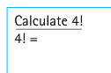

查看我们的递归定义，我们确定 4 大于 0，因此我们使用定义的第二部分并继续写：

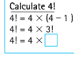

当然，我们无法完成第三行，因为我们不知道 `3!` 的值。在继续处理原始问题（计算 `4!`）之前，我们必须先解决这个问题（计算 `3!`）。所以我们取了另一张索引卡，将其堆叠在原始卡片上面，写下我们的新问题：

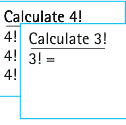

## 第3章 递归

再次查看我们的递归定义。我们确定 3 大于 0，因此我们使用定义的第二部分并继续写：

```
计算 4!
4! 计算 3!
3! = 3 × (3 – 1)
3! = 3 × 2!
3! = 3 ×
```

和之前一样，我们无法完成第三行，因为我们不知道 `2!` 的值。我们又取了另一张索引卡写下新问题。这样下去，我们最终在桌上堆了五张卡片：

```
计算 4!
4! 计算 3!
3! 计算 2!
2! 计算 1!
1! 计算 0!
0! = 1
1!
```

此时，我们转向递归定义来计算 `0!`，我们发现可以使用定义的第一部分：`0!` 等于 1。我们可以像这里所示完成顶部的卡片：

```
计算 4!
4! 计算 3!
3! 计算 2!
2! 计算 1!
1! 计算 0!
0! = 1
1!
```

这完成了我们卡片堆顶端的问题。它的结果是 1。记住该结果，我们扔掉顶部的卡片，将“1”写在现在位于顶部的卡片（计算 `1!` 的卡）的空白处，并继续处理该问题。因为我们知道如何计算 `1 ×`，我们可以快速完成该问题并输入结果：

```
计算 4!
4! 计算 3!
3! 计算 2!
2! 计算 1!
1! = 1 × (1 – 1)
1! = 1 × 0
1! = 1 × 1
1! = 1 -- 来自被丢弃的 0! 卡片
```


## 第3章 递归

### 3.1 递归定义、算法与程序

和之前一样，我们记住这个结果，丢掉顶部的卡片，将结果输入下一张卡片（计算 2! 的卡），并继续。我们连续地确定了：

2! = 2 × 1 = 2
3! = 3 × 2 = 6
4! = 4 × 6 = 24

最后得出我们原始问题的解：

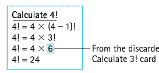

注意，当我们达到一个不需要诉诸定义的递归部分就能知道答案时，我们停止了创建新卡片。在这个例子中，这一点发生在我们达到“计算 0!”时。我们直接从定义中知道该值是 1，而无需诉诸递归。

当某个情况的答案可以直接已知而不需要进一步递归时，它被称为**基准情况**（base case）。递归定义可能有多个基准情况，而解用自身的较小版本（或多个版本）来表示的情况被称为**递归情况**或**一般情况**（recursive or general case）。

### 验证递归算法

在第3.1节“递归定义、算法与程序”中介绍的推演方法（使用索引卡）对于理解递归过程很有用，但对于验证递归算法的正确性来说还不够。毕竟，模拟 `factorial(4)` 的执行只能告诉我们当参数等于 4 时该方法有效，但并不能告诉我们该方法对于其他参数也有效。

我们使用“三问法”来验证递归算法。为了验证一个递归解决方案是否有效，我们必须能够回答所有这些问题：

1. **基础情况问题**：算法是否存在递归的出口？该算法在这种情况下是否能正常工作？
2. **较小情况问题**：对算法的每次递归调用是否涉及原问题的更小情况，并最终不可避免地导向基础情况？
3. **通用情况问题**：假设对较小情况的递归调用是正确的，该算法在通用情况下是否正常工作？

让我们将这三个问题应用于*阶乘*算法：

```java
Factorial(int n)
// Precondition: n >= 0
if (n == 0)
    return (1)
else
    return (n * Factorial(n - 1))
```

1. **基础情况问题**：基础情况发生在 `n` 为 0 时。`Factorial` 算法返回值 1，根据定义这是 0! 的正确值。答案是肯定的。
2. **较小情况问题**：参数是 `n`，递归调用传递了参数 `n-1`。因此，后续每次递归调用都会发送一个较小的值，直到值变为 0，即基础情况。答案是肯定的。
3. **通用情况问题**：假设递归调用 `Factorial(n-1)` 给出了正确值 `(n-1)!`，该语句计算 `n*(n-1)!`。这是阶乘的定义，因此我们知道算法在通用情况下是有效的——前提是它在较小情况下有效。答案是肯定的。

由于所有三个问题的答案都是肯定的，我们可以得出算法是有效的结论。如果你熟悉归纳法证明，应该能识别出我们所做的。在假设算法在较小情况下有效的情况下，我们证明了该算法在通用情况下也是有效的。由于我们还证明了算法对于基础情况 0 是有效的，我们通过归纳法证明了它对于任何大于或等于 0 的整数参数都有效。

### 3.2 三个问题

#### 确定输入约束

对于阶乘问题，我们假设 `n` 的原始值大于或等于 0。注意，如果没有这个假设，我们就无法回答较小调用者的确认。例如，从 `n = -5` 开始，递归调用将传递参数 `-6`，这离基础情况更远，不符合要求。

这类约束通常存在于递归算法的输入参数中。我们可以使用三问法分析来确定这些约束。只需检查是否存在某些初始值，使得较小调用无法产生更接近基础情况的新参数。这些值是无效的。限制你的合法输入参数，不允许这些值的出现。

#### 编写递归方法

用于验证递归算法的问题也可以作为编写递归方法的指南。设计递归方法的一种良好方法是：

1. 获取要解决问题的精确定义。
2. 确定要解决的问题规模。在对方法的初始调用中，整个问题的大小由参数的值来表示。
3. 识别并解决可以用非递归方式表示问题的基础情况。这确保了对基础情况问题的回答。
4. 针对相同问题的较小情况（即递归调用），正确地识别并解决通用情况。这确保了对较小调用问题和通用情况问题的回答。

在阶乘问题中，问题的定义总结在阶乘函数的定义中。问题的规模是相乘的值个数：`n`。基础情况发生在 `n` 为 0 时，此时我们采取非递归路径。通用情况发生在 `n > 0` 时，导致对 `factorial` 产生较小情况的递归调用：`factorial(n - 1)`。将这些信息总结成表格形式：

**递归 `factorial(int n)` 方法：返回 int**

| 定义 | 计算并返回 n! |
| :--- | :--- |
| 前提条件 | n 非负 |
| 规模 | n 的值 |
| 基础情况 | 如果 n 等于 0，返回 1 |
| 通用情况 | 如果 n > 0，返回 n * factorial(n - 1) |

#### 调试递归方法

由于递归方法存在自身的嵌套调用，调试可能会比较困难。最严重的问题是方法可能无限递归。这种现象的典型症状是错误信息告诉我们由于递归调用深度，系统运行时栈空间已不足（第 3.7 节“移除递归”查看了递归对栈的使用）。使用三问法验证递归方法并确定参数约束应该帮助我们避免这个问题。

然而，三问法的成功并不保证程序不会因为空间不足而失败。第 3.8 节“何时使用递归解决方案”讨论了支持递归方法调用的空间开销。

### 3.3 数组的递归处理

`midpoint - 1` 并递归调用 `binarySearch(20, 4, 4)`，再次计算新的中间点，结果如下：

target: 20
| first=4 last=4 midpoint=4 |
| [0] | [1] | [2] | [3] | [4] | [5] | [6] | [7] |
|---|---|---|---|---|---|---|---|
| values: | 4 | 6 | 7 | 15 | 20 | 22 | 25 | 27 |

最后，`values[midpoint]` 等于 target，因此我们完成了并可以返回 true。通过这个例子，我们已经识别了如何处理数组位置处的元素小于、大于或等于 target 的情况。但我们仍然需要确定如果目标元素不在数组中，该如何终止算法。

再次考虑上面的例子，但这次用 18 替换 20 成为 values 中的第五个元素。将发生相同的步骤序列，在最后一步，我们得到了如下结果：

target: 20
| first=4 last=4 midpoint=4 |
| [0] | [1] | [2] | [3] | [4] | [5] | [6] | [7] |
|---|---|---|---|---|---|---|---|
| values: | 4 | 6 | 7 | 15 | 18 | 22 | 25 | 27 |

从此点继续，我们看到 `values[midpoint]` 小于 target，因此我们将 first 设置为 `midpoint + 1` 并递归调用 `binarySearch(20, 5, 4)`：

target: 20
| last=4 first=5 |
| [0] | [1] | [2] | [3] | [4] | [5] | [6] | [7] |
|---|---|---|---|---|---|---|---|
| values: | 4 | 6 | 7 | 15 | 18 | 22 | 25 | 27 |

注意，我们已经排除了整个数组的考虑范围，并且在调用 `binarySearch` 时，第一个参数大于最后一个参数。这显然是一个退化情况——试图在数组中不存在的空间进行搜索。正是在这种情况下，方法返回 false，表示 target 不在数组中。

这里是算法的总结表：

**`BinarySearch(target, first, last)`：返回布尔值**

| 定义 | 如果 target 在数组 values 的从索引 first 到索引 last（包含）之间排序，则返回 true，否则返回 false |
| :--- | :--- |
| 前提条件 | first 和 last 是有效的数组索引 |
| 大小 | last - first + 1 |
| 注意 | midpoint 的计算方式为 `(first + last) / 2` |
| 基础情况 | 如果 first > last 返回 false<br>如果 values[midpoint] == target 返回 true |
| 通用情况 | 如果 values[midpoint] < target 返回 `BinarySearch(target, midpoint + 1, last)`<br>如果 values[midpoint] > target 返回 `BinarySearch(target, first, midpoint - 1)` |

让我们使用“三问法”来验证二分查找：

1. **基础情况问题** 有两种情况。
   a. **如果 first > last**，算法返回 false。这是正确的，因为没有数组元素可以搜索。
   b. **如果 values[midpoint] == target**，算法返回 true。这是正确的，因为已经找到了目标。
   答案是肯定的。
2. **较小调用者问题** 在通用情况下，调用 `binarySearch` 时使用的参数 first 和 last 分别表示要搜索的子数组的开始和结束，且 first <= last。由于 midpoint 的计算方式为 `(first + last) / 2`，它必须大于 first 且小于 last。因此，范围 `(midpoint + 1, last)` 的大小小于 `(first, last)`。答案是肯定的。
3. **通用情况问题** 假设递归调用 `binarySearch(target, midpoint + 1, last)` 和 `binarySearch(target, first, midpoint - 1)` 返回正确的结果，那么 return 语句也是正确的，因为已经确定 target 不在数组的其他部分——取决于它是否在子数组中。答案是肯定的。

> **防止溢出**
> 如果搜索一个数组且范围缩小到数组的高端，first 和 last 两个数字相加可能会溢出。因此，在这种情况下，我们使用 `(first + (last - first) / 2)` 来计算 midpoint。否则，为了清晰起见，在代码中使用 `(first + last) / 2` 是安全的且更容易阅读的。

```java
boolean binarySearch(int target, int first, int last)
// 前提条件：first 和 last 是 values 的合法索引
// 如果 target 在 values[first, last] 中，返回 true
// 否则返回 false
{
    int midpoint = (first + last) / 2;

    if (first > last)
        return false;
    else
        if (target == values[midpoint])
            return true;
        else
            if (target > values[midpoint]) // target 太大
                return binarySearch(target, midpoint + 1, last);
            else // target 太小
                return binarySearch(target, first, midpoint - 1);
}
```

由于三个问题的答案都是肯定的，我们可以得出算法是有效的。该代码可以在 apps 包中的 `BinarySearch.java` 文件找到。代码还包含了算法的迭代版本，与递归版本不同。注意该算法已经过分析。其复杂度为 O(log N)——见第 1.6 节“算法的增长性”。

### 3.4 链表的递归处理

数组和链表是我们数据结构的两个基本构建单元。上一节讨论了数组的递归处理。本节对链表进行相同的操作。为了简化本节中的链表图，我们有时使用大写字母表示节点的信息，使用箭头表示指向下一个节点的链接，使用斜杠表示空引用。


#### 链表的递归性质

递归方法通常适用于处理链表，因为链表本身是一个递归结构，相对于数组。第 2.7 节“链表介绍”引入了 `LLNode` 类，我们链表的构建单元。注意 `LLNode` 是一个自引用类，代码如下：

```java
public class LLNode<T> {
    protected T info; // 存储在列表中的信息
    protected LLNode<T> link; // 节点的引用
}
```

自引用类与递归密切相关。在某种意义上，它们是递归的。列表要么为空，要么由两个部分组成：信息和一个链表。例如，list1 是空的，而 list2（包含 A 的列表）包含一个指向信息 (A) 和链表 (B 和 C) 的 `LLNode`：


注意链表中“last”节点中的 link 值总是 null。当我们递归地处理链表时，这个 null 值通常是基础情况。

#### 遍历链表

遍历链表以访问每个元素并执行某种处理是一种常见操作。假设我们想要打印列表的内容。递归算法非常直观——如果列表为空，则什么都不做；否则，打印当前节点的信息，即打印列表剩余部分（图 3.1）。


图 3.1 递归打印列表

将此算法转换为代码同样直观：

```java
void recPrintList(LLNode<String> listRef)
  // 将 listRef 链表的内容打印到标准输出
{
    if (listRef != null)
    {
      System.out.println(listRef.getInfo());
      recPrintList(listRef.getLink());
    }
}
```

在 if 语句内部，打印 `listRef` 指向的列表的第一个节点，然后递归调用 `recPrintList` 打印列表剩余部分。我们的基础情况发生在到达列表末尾且 `listRef` 为空时，此时 if 语句被跳过，处理停止。我们使用“三问法”验证 `recPrintList`：

1. **基础情况问题** 当 `listRef` 等于 null 时，我们跳过 if 块。不返回任何内容，对于空列表是合适的。答案是肯定的。
2. **较小调用者问题** 递归调用通过 `listRef.getLink()` 传递列表，这比 `listRef` 引用的列表少一个节点。它将逐步传递列表；如果没有，它将传递原始列表最后一个节点找到的 null 引用。这就是基础情况。答案是肯定的。
3. **通用情况问题** 我们假设语句 `recPrintList(listRef.getLink());` 正确打印了列表的剩余部分；打印第一个元素后再正确打印剩余部分，就得到了整个列表。答案是肯定的。

注意，使用迭代（非递归）方法遍历链表也很容易。当我们第一次在第 2 章“链表介绍”中查看列表时，我们开发了打印链表内容的迭代方法。对比这两种方法很有启发性：

**迭代**
```java
while (listRef != null)
{
  System.out.println(listRef.getInfo());
  listRef = listRef.getLink();
}
```

**递归**
```java
if (listRef != null)
{
  System.out.println(listRef.getInfo());
  recPrintList(listRef.getLink());
}
```

迭代版本使用 while 循环遍历列表，直到遇到列表末尾。同样，递归版本遍历列表直到到达末尾，但重复是通过递归调用实现的。上面看到的相同模式可以解决许多与遍历链表相关的其他问题。例如，考虑以下方法，返回作为参数传递的链表中的元素个数，并使用上述建立的相同模式。第一种方法使用迭代法，第二种使用递归方法。

```java
int iterListSize(LLNode<String> listRef)
// Returns the size of the listRef linked list
{
    int size = 0;
    while (listRef != null) {
        size = size + 1;
        listRef = listRef.getLink();
    }
    return size;
}
```

```java
int recListSize(LLNode<String> listRef)
// Returns the size of the listRef linked list
{
    if (listRef == null)
        return 0;
    else
        return 1 + recListSize(listRef.getLink());
}
```


注意，迭代版本声明了一个变量（`size`）来存储计算的中间值。对于递归版本来说这不是必要的，因为中间值是由递归返回语句生成的。

打印问题的一个有趣变体更清楚地展示了递归的用处。因为它假设我们想要倒序打印列表——先打印最后一个节点的信息，然后是倒数第二个节点的信息，以此类推。在正向打印时，递归算法是直观的（至少如果你熟悉递归的人是如此）——如果列表为空，则什么都不做；反转从第二个到倒数节点的信息，然后打印第一个节点的信息（见图 3.2）。

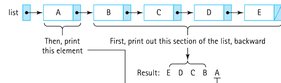

图 3.2 递归倒序打印列表

相应的代码与 `recPrintList` 几乎相同——我们只需要交换 `if` 语句内部两个语句的顺序，当然，我们还更改了方法的名称：

```java
void recRevPrintList(LLNode<String> listRef)
    // Prints the contents of the listRef linked list to standard output
    // in reverse order
{
    if (listRef != null)
    {
        recPrintList(listRef.getLink());
        System.out.println(listRef.getInfo());
    }
}
```

## 转换链表

本节考虑转换链表的操作，例如添加或删除元素。使用递归方法对链表进行此类更改比仅仅遍历链表要复杂得多。我们将在示例中使用字符串列表。

假设我们想要创建一个递归方法 `recInsertEnd`，它接受一个 `String` 参数和一个列表（类型为 `LLNode<String>` 的变量），并将字符串插入到列表的末尾。我们的推理是：如果链表的 `link` 不为空，那么我们需要将字符串插入到 `link` 指向的后续节点——这就是我们的递归调用。我们的基本情况是 `link` 为空，这表示插入发生的列表末尾。根据这一推理，我们设计了如下代码：

```java
void recInsertEnd(String newInfo, LLNode<String> listRef)
    // Adds newInfo to the end of the listRef linked list
{
    if (listRef.getLink() != null)
        recInsertEnd(newInfo, listRef.getLink());
    else
        listRef.setLink(new LLNode<String>(newInfo));
}
```

然而，这种方法存在一个问题。你看到了吗？

代码在一般情况下可以工作。假设我们有一个名为 `myList` 的字符串链表，由“Ant”和“Bat”组成。

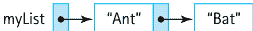

我们希望在列表的末尾插入“Cat”，因此我们调用：

```java
recInsertEnd("Cat", myList);
```

当方法内部开始处理时，我们有如下安排：

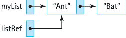

追踪代码并不困难，可以看到“Ant”节点（由 `listRef` 的节点）中的 `link` 不为空，`if` 子句将执行。因此，再次调用 `recInsertEnd`，这次传入的是“Bat”节点的引用：

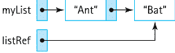

在这种情况下，`recInsertEnd` 的 `else` 子句被执行，因为“Bat”节点的 `link` 为空，创建了一个包含“Cat”的新节点并将其附加到列表末尾。那么，问题在哪里？

一如既往，在设计解决方案时，我们需要询问我们的方法是否适用于所有情况，特别是特殊情况，即“边界”条件。在向链表插入时会发生什么特殊情况？如果列表开始时就是空的怎么办？


如果我们调用：

```java
recInsertEnd("Cat", myList);
```

在这种情况下会有麻烦——我们向方法传递了一个空引用，导致 `listRef` 为空，而方法立即尝试使用 `listRef` 调用 `getLink()`：`if (listRef.getLink()) != null`。在空引用上调用方法是不可能的——运行时会抛出空指针异常——为了防止这一点，我们需要处理空列表的特殊情况。如果列表为空，我们希望让列表本身指向包含参数的新节点。在我们的示例中，我们得到：

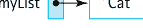

由于 Java 的值传递策略，我们无法在 `recInsertEnd` 方法内部直接更改 `myList`。如图所示，参数 `listRef` 是参数的别名，它让我们访问 `myList` 所引用的（列表），但没有让我们访问 `myList` 本身。我们无法通过这种方法更改 `myList` 中的引用。解决这个困境的办法是让 `recInsertEnd` 方法返回新列表的引用。返回的引用可以赋值给 `myList`。因此，与其调用：

不如调用：

```java
myList = recInsertEnd("Cat", myList);
```

这是更改 `myList` 中值的方法。我们使用相同的方法来转换树。除了返回列表引用外，我们的处理与之前的（解决方案）`recInsertEnd` 相似。对应的代码如下：

```java
ListNode<String> recInsertEnd(String newInfo)
```

在空列表末尾插入“Cat”的情况下追踪这段代码，我们 `else` 子句创建一个包含“Cat”的新节点并返回其引用，因此 `myList` 正确地引用了“Cat”节点。现在必须返回一般情况并验证我们的新方法是否正确。我们再次有一个由“Ant”和“Bat”组成的字符串链表。我们希望在列表末尾插入“Cat”，因此我们调用：

```java
myList = recInsertEnd("Cat", myList);
```

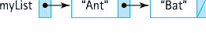

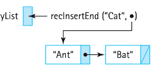
在方法的第二个实例中，列表仍然为空，所以它会调用第三个实例，将包含“Bat”节点的 `link` 设置为在列表末尾插入“Cat”得到的列表。

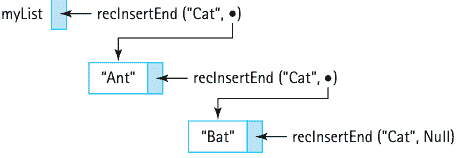
在空列表调用 `recInsertEnd` 的第三个实例，`if` 子句终于被触发并创建一个包含“Cat”的节点。该新节点的引用返回给第二个实例，第二个实例将包含“Bat”节点的 `link` 指向新节点。

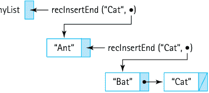
第二个实例将包含“Bat”节点的引用返回给第一个实例，第一个实例将列表第一个节点的 `link` 指向“Bat”节点（*注：它已经引用了那里，所以这里没有做任何更改）。

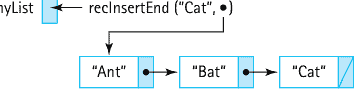
最后，第一个实例返回包含“Ant”节点的引用，并将 `myList` 设置为该值（再次，它已经引用了该节点，所以这里没有做任何更改）。


本节开发的所有代码都包含在 `cho3.apps` 包的 `LinkedListRecursive.java` 文件中。应用程序包含了方法，以及对大小为 0、1 和 5 的列表进行每个方法测试的代码。

## 3.5 汉诺塔

汉诺塔是一个利用了递归表达能力的流行问题。我们能够仅用几行递归代码解决一个看似复杂的问题。你最早的玩具之一可能有一个塑料架，上面套着不同直径的彩色环。如果我们花费无数小时将环从一个柱移动到另一个柱。如果我们对它们的移动方式设置一些限制，我们就有了一个名为汉诺塔的益智游戏。游戏开始时，所有的环按大小排列在第一个柱上，最小的在顶部。目标是将环一个一个移动到第三个柱。关键在于，环不能放在直径较小的环之上。中间的可以作为辅助柱，但它必须在游戏开始和结束时。环每次只能移动一个。我们的任务是创建一个打印出求解所需的系列移动的方法。

### 算法

为了深入了解我们如何解决汉诺塔问题，请考虑一个从四个柱开始的谜题，如图 3.3a 所示。我们的任务是在辅助柱 2 的帮助下，将四个环从起始柱 1 移动到结束柱 3。

事实证明，由于问题的限制以及我们无法重建配置（这可能让我们陷入无限循环）的事，每次移动都是显而易见的。对于第一次移动，我们必须移动最小的环，因此我们将它移动到柱 2，如图 3.3b 所示。接下来，由于没有理由移动最小的环，我们将最小的环从柱 1 移动到柱 3，如图 3.3c 所示。你可以遵循图 3.3 中所有的 15 次移动。图中的小箭头指向最近的目标柱。

### 汉诺塔传说

汉诺塔谜题由 Edouard Lucas 于 1883 年发明。该谜题背后的传说是：在汉诺有一座寺庙，僧侣在那里日夜不停地解决该问题。僧侣每秒移动一个。当他们完成任务时，世界就会结束。然而，他们的塔由 64 个环组成，需要很多移动才能解决。需要多少次移动，需要多久？好吧，练习 22。

注意图 3.3h 中谜题的中间配置，在进行了七次移动后，由以下移动表示：

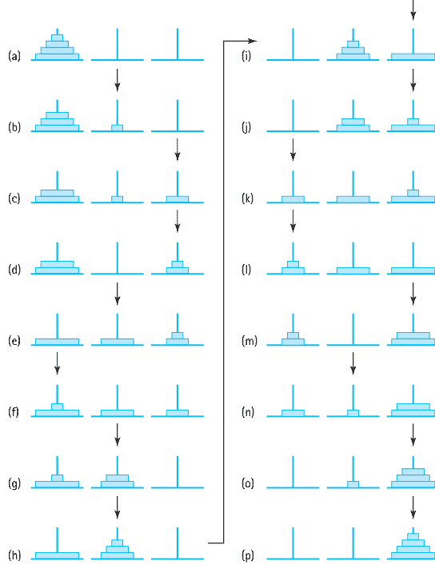

图 3.3 四个环的汉诺塔解决方案

图 3.3a 至 3.3h。此时，我们已经成功地使用 3 号柱作为辅助柱，将三个最小的环从 1 号柱移动到了 2 号柱，总结如下所示。

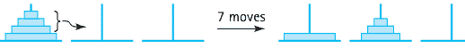

这允许我们把最大的环从 1 号柱移动到 3 号柱。

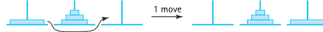

你能看出为什么在这一点，我们已经完成了解决方案的一半吗？剩下的就是使用 1 号柱作为辅助柱，将三个最小的环从 2 号柱移动到 3 号柱。这项任务通过图 3.3i 至 3.3p 所示的七次移动来完成。

## 第 3 章 递归

这七次移动本质上与前七步中进行的移动是相同的，尽管起始柱、结束柱和辅助柱不同（对比小箭头的模式以验证这一陈述）。最后七次移动在这里进行了总结。


我们通过先解决三个环的谜题（实际上是解决了两次三个环的谜题）来解决四个环的谜题：首先将三个环从 1 号柱移动到 2 号柱，然后将最大的环从 1 号柱移动到 3 号柱，最后（再次）将三个环从 2 号柱移动到 3 号柱。啊！我们通过解决三个环的谜题来解决四个环的谜题——事实上，是通过解决两次三个环的谜题。

有了这一洞察，我们可以使用较小规模问题的解决方案来识别问题的解决方案，这引导我们得到了递归解决方案。我们可以以相同的方法解决 n 个环的通用问题。将 n 个环从起始柱移动到目标柱的通用递归算法如下。

### 将 n 个环从起始柱移动到目标柱

- 将 n – 1 个环从起始柱移动到辅助柱
- 将第 n 个环从起始柱移动到目标柱
- 将 n – 1 个环从辅助柱移动到目标柱

### 方法

让我们写一个实现该算法的递归方法。我们可以看到递归工作得良好，算法的第一步和第三步本质上重复了整个算法，尽管环的数量较少。然而，请注意，对于子问题来说，起始柱、目标柱和辅助柱是不同的；它们在算法的递归执行过程中不断变化。为了让方法更容易使用，柱被命名为 `startPeg`、`endPeg` 和 `auxPeg`。这三个柱以及起始柱上环的数量是该方法的参数。程序实际上不会移动任何环，而是会打印一条描述移动操作的消息。

我们的算法显式定义了递归情况或通用情况，但基础情况呢？我们如何知道何时停止递归过程？关键在于注意如果只有一个环需要移动，我们可以直接移动它；不需要担心盘片。因此，当环的数量等于 1 时，我们打印该移动操作。这就是基础情况。该方法假设传递的参数是有效的。

```java
public static void doTowers(
    int n,                               // 要移动的环数
    int startPeg,                            // 包含要移动环的柱
    int auxPeg,                             // 临时存放环的柱
    int endPeg)                              // 接收移动环的柱
{
    if (n == 1) // 基础情况 -移动一个环
        System.out.println("Move ring " + n + " from peg " + startPeg
            + " to peg " + endPeg);
    else {
        // 将 n 个环从起始柱移动到辅助柱
        doTowers(n - 1, startPeg, endPeg, auxPeg);
        // 将第 n 个环从起始柱移动到结束柱
        System.out.println("Move ring " + n + " from peg " + startPeg
            + " to peg " + endPeg);
        // 将 n - 1 个环从辅助柱移动到结束柱
        doTowers(n - 1, auxPeg, endPeg, startPeg);
    }
}
```

很难相信这样一个简单的方法实际上真的有效，但它确实有效。让我们使用“三提问法”来研究：

1. **基础情况问题**：该方法是否存在非递归的退出方式，该方法在这种情况下是否工作正常？如果给 `doTowers` 方法传递一个环数等于 1 的参数（参数 `n`），它会打印移动操作，正确记录了单个环从 `startPeg` 移动到 `endPeg` 的移动。
2. **更小规模问题**：该方法是否通过使用较小规模问题的解决方案来解决问题？是的。
3. **通用情况问题**：假设递归调用是正确的，那么该方法在通用情况下是否有效？是的。

有了这一洞察，我们可以使用较小规模问题的解决方案来识别问题的解决方案，这引导我们得到了递归解决方案。我们可以以相同的方法解决 n 个环的通用问题。

## 3.6 分形

正如“生成图像”中所，数字化图像可以被视为像素。在本节中，我们将研究有趣的分形。

- 第 3 章 递归
- 第 3.5 汉诺塔 183
- 第 3.5 汉诺塔 185
- 第 3.6 分形
- 第 3.6 分形 187

# 递归

## 程序

我们将 `doTowers` 方法封装在一个名为 `Towers` 的类中。它提示用户输入环的数量，并使用 `doTowers` 进行报告。这是运行的结果输出：

## T-square 分形

对于我们的目的，分形定义为...

## 实际分形

除了有趣和漂亮，分形还有实际用途。计算机图形使用它们生成真实的场景，工程师使用它们建造坚固的结构，科学家使用它们对天气、流体力学和海岸线形成等进行建模。

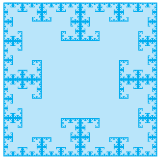

(a) TSquare 的输出


(b) TSquareThreshold 10 500 的输出


(c) TSquareThreshold 1 80 的输出


(d) TSquareGray 10 500 的输出

**图 3.5** T-square 应用变体示例

```java
****************************************************
// TSquare.java                       By Dale/Joyce/Weems           Chapter 3
//
// 创建一个包含递归 TSquare 的 jpg 文件。
// 执行参数 1: 目标 jpg 文件的完整名称
//
****************************************************
package ch03.fractals;

import java.awt.image.*;
import java.awt.Color;
import java.io.*;
import javax.imageio.*;
```

## 3.6 分形 189


```java
public class TSquare {
    static final int SIDE = 1000; // 图像为 SIDE X SIDE
    static BufferedImage image =
        new BufferedImage(SIDE, SIDE, BufferedImage.TYPE_INT_RGB);
    static final int WHITE = Color.WHITE.getRGB();
    static final int BLACK = Color.BLACK.getRGB();

    private static void drawSquare(int x, int y, int s)
        // 正方形中心为 x,y，边长长度为 s
    {
        if (s <= 0) // 边界情况
            return;
        else {
            // 确定顶点
            int left = x - s/2;
            int right = x + s/2;
            int top = y - s/2;
            int bottom = y + s/2;

            // 绘制白色正方形
            for (int i = left; i < right; i++) {
                for (int j = top; j < bottom; j++) {
                    image.setRGB(i, j, WHITE);
                }
            }

            // 递归地在顶点绘制正方形
            drawSquare(left, top, s/2);
            drawSquare(left, bottom, s/2);
            drawSquare(right, top, s/2);
            drawSquare(right, bottom, s/2);
        }
    }

    public static void main(String[] args) throws IOException {
        String fileOut = args[0];

        // 将图像设为黑色
        for (int i = 0; i < SIDE; i++) {
            for (int j = 0; j < SIDE; j++) {
                image.setRGB(i, j, BLACK);
            }
        }

        // 第一个正方形
        drawSquare(SIDE/2, SIDE/2, SIDE/2);

        // 保存图像
        File outputFile = new File(fileOut);
        ImageIO.write(image, "jpg", outputFile);
    }
}
```

# 第 3 章 递归

## 变体

通过轻微修改我们的 `TSquare.java` 程序，我们可以生成具有不同图像的额外变体。图 3.5 显示了下方描述程序生成的某些示例。部分 (a) 注意，本节中的所有应用程序都位于 `ch03.fractals` 包中。

`TSquareThreshold.java` 应用程序允许用户提供两个额外的参数（类型均为 `int`），用于指示何时开始和停止绘制正方形。第一个参数指示内部阈值——如果调用 `drawSquare` 时的值小于或等于该阈值，则不执行任何操作。对于该程序，边界情况发生在我们遇到边长小于或等于该阈值的正方形时，而不是 0。第二个参数提供了一个外部阈值。边长大于或等于该阈值的正方形也不会绘制。

## 3-7 消除递归

```
countKids 方法的参数和局部变量空间
countKids 方法代码
返回主程序
```

这种静态分配是可能的最简单的方法。但它不支持递归。你发现为什么了吗？

`countKids` 方法的空间是在编译时分配的。当方法只被调用一次并在下次再次调用之前总是返回时，这种策略是有效的。递归方法在返回之前可能会被反复调用。第二次及后续调用在何处为参数和局部变量找到空间？每次调用都需要空间来保存它们自己的值。这些空间不能被静态分配，因为调用次数在编译时是未知的。只使用静态分配的语言无法支持递归。

### 动态存储分配

动态分配在方法被调用时为其提供内存空间。局部变量在运行之前不会与实际内存关联。让我们看看这种方法在 Java 中可能工作的简化版本。实际实现取决于具体的系统。当方法被调用时，它需要保留其参数、局部变量和返回地址（方法完成执行后，计算机返回的调用代码中的地址）。这个空间被称为激活记录（`activation record`）或栈帧（`stack frame`）。考虑我们的递归阶乘方法：

```java
public static int factorial(int n) {
    if (n == 0)
        return 1; // 基本情况
    else
        return (n * factorial(n - 1)); // 通用情况
}
```

方法 `factorial` 的激活记录的简化版本可能如下“声明”：

```java
class ActivationRecordType {
    AddressType returnAddr; // 返回地址
    int result; // 返回值
    int n; // 参数
}
```

对方法的每次调用（包括递归调用）都会导致 Java 运行时为新的激活记录分配额外的内存空间。在方法内部，对参数和局部变量的引用使用激活记录中的值。当方法结束时，激活记录空间会被释放。

当第二个方法被调用时，上一个方法的激活记录会发生什么？考虑一个主方法调用 `proc1` 的程序，然后 `proc1` 再调用 `proc2`。当程序开始执行时，会生成“main”激活记录（`main` 方法的激活记录在整个程序执行期间都存在）。


在第一次方法调用时，为 `proc1` 生成一个激活记录。


当从 `proc1` 内部调用 `proc2` 时，生成它的激活记录。因为 `proc1` 尚未执行完毕，它的激活记录仍然存在就像我们在 3.1 节“递归定义、算法和程序”中使用的索引卡一样，激活记录会一直存储直到需要：


当 `proc2` 完成执行时，它的激活记录会被释放。但另外两个激活记录中的哪一个变成活跃的：`proc1` 的还是 `main` 的？你可以看到 `proc1` 的激活记录现在应该是活跃的。激活的顺序遵循后进先出（LIFO）规则。我们知道一种支持 LIFO 访问的结构——栈（`stack`），因此在运行时跟踪激活记录的结构被称为运行时系统栈，这并不意外。

当一个方法被调用时，它的激活记录会被推入运行时栈中。方法调用的每个嵌套层都会向栈中添加另一个激活记录。当每个方法完成执行时，它的激活记录会从栈中弹出。递归方法调用与对任何其他方法的调用一样，会导致生成一个新的激活记录。

一个方法在确定有多少个激活记录出现在运行时栈之前，会经过多少次递归调用。次数就是递归的深度。

现在我们理解了递归是如何工作的，我们转向本节的主题：如何基于递归解决方案开发问题的非递归解决方案。

### 尾递归调用消除

当递归调用是递归方法中执行的最后一个动作时，会发生一种有趣的情况。递归调用会导致一个激活记录被放入运行时栈；此记录将包含被调用方法的参数和局部变量。递归调用执行完毕，运行时栈弹出，变量的先前值被恢复。执行从递归调用发生之前的地方继续。然而，由于递归调用是方法中的最后一个语句；没有更多内容需要执行，该方法在不使用恢复的局部变量的情况下终止。局部变量不需要保存。实际上，只有调用及其返回值是有意义的。

在这种情况下，我们并不需要递归。递归调用的序列可以被循环结构取代。例如，对于 3.1 节“递归定义、算法和程序”中提出的阶乘方法，递归调用是方法中的最后一个语句：

```java
public static int factorial(int n) {
    if (n == 0)
        return 1; // 基本情况
    else
        return (n * factorial(n - 1)); // 通用情况
}
```

现在我们研究如何使用 `while` 循环将递归版本建模为迭代版本。对于迭代解决方案，我们需要声明一个变量来保存计算的中间值。我们称之为 `retValue`，因为它持有最终要返回的值。

查看递归解决方案的基本情况，可以看到分配给 `retValue` 的初始值。我们必须将其初始化为 1，即基本情况下返回的值。这种迭代方法在未进入循环的情况下正常工作。

现在我们将注意力转向 `while` 循环的主体。每次循环都应该对应一次递归调用执行的计算。因此，我们将你的中间值 `retval` 乘以 `n` 的当前值。此外，我们每次循环都将 `n` 的值减 1——这一操作对应于每次调用的较小规模调用者方面。

最后，我们需要确定循环的终止条件。因为递归解决方案有一个基本情况——如果参数 `n` 为 0——我们有一个唯一的终止条件。只要不满足基本情况，我们就继续处理循环：

```java
static int factorial(int n) {
    int retval = 1; // 返回值
    while (n != 0) {
        retval = retval * n;
        n = n - 1;
    }
    return(retval);
}
```

将一切整合在一起，我们得到了该方法的迭代版本：

递归调用是最后一个语句的情况被称为尾递归（`tail recursion`）。尾递归可以按照上述方法被迭代取代。事实上，某些优化器编译器在生成低级代码时会自动消除尾递归。

### 直接使用栈

当递归调用不是递归方法中最后一个语句时，我们不能简单地用循环代替递归。例如，考虑我们在 3.4 节“链表的递归处理”中开发的 `recRevPrintList` 方法，它用于反序打印链表：

```java
void recRevPrintList(LLNode<String> listRef)
// 按反序打印 listRef 链表的内容到标准输出
{
    if (listRef != null) {
        recRevPrintList(listRef.getLink());
        System.out.println(listRef.getInfo());
    }
}
```

在这里我们先进行递归调用，然后打印当前节点的值。在这样的情况下，为了消除递归，我们可以替换激活记录的堆叠，这是由系统通过堆栈中间值完成的，而程序员负责完成操作。

对于我们的反向打印示例，我们必须正向遍历列表，将每个节点的信息保存到栈中，直到到达列表的末尾（当我们的当前引用等于 `null` 时）。到达列表末尾后，我们打印最后一个节点的信息。然后，使用我们保存在栈中的信息，回溯（弹出）并再次打印，回溯，以此类推，直到我们打印出列表第一个元素的信息为止。

以下是代码：

```java
static void iterPrintList(LLNode<String> listRef)
// 将 listRef 链表的内容以反序打印到标准输出
// reverse order
{
    StackInterface<String> stack = new LinkedStack<String>();
    while (listRef != null) // 将信息入栈
    {
        stack.push(listRef.getInfo());
        listRef = listRef.getLink();
    }
    // 按反序获取引用并打印元素
    while (!stack.isEmpty())
    {
        System.out.println(stack.top());
        stack.pop();
    }
}
```

注意，程序员编写的反向打印栈版本比其递归版本要长得多，尤其是当我们添加了 `push`、`pop`、`top` 和 `isEmpty` 方法的代码后。这种额外的长度是因为我们需要显式地堆栈和解包信息。知道递归使用系统栈，我们可以看到反向打印的递归算法也在使用栈——一个由系统自动提供的不可见栈。这就是递归解决方案之所以优雅的秘诀。

本节介绍的反向打印方法包含在 `cho3.apps` 包的 `LinkedListReverse.java` 文件中。该应用程序包含了递归和迭代反向打印方法，以及测试代码，用于在大小为 0、1 和 5 的列表上对每个方法进行测试。

## 3.8 何时使用递归解决方案

在决定是否使用递归解决方案来解决问题时，我们可能会考虑几个因素。主要问题是解决方案的效率和清晰度。

### 递归开销

在计算机时间和空间方面，递归解决方案通常比非递归解决方案的成本更高。（这并非总是如此；这实际上取决于问题、计算机以及编译器。）由于嵌套的递归方法调用，递归解决方案在时间（每次调用都涉及创建和销毁激活记录以及管理运行时栈的处理）和空间（必须存储激活记录）方面通常需要更多的“开销”。调用递归方法可能会产生许多层递归调用。例如，调用阶乘问题的迭代解决方案涉及单次调用，导致一个激活记录被置于运行时栈中。而调用阶乘方法 `n+1` 的递归版本则会调用 `n+1` 次方法，并将 `n+1` 个激活记录推入运行时栈中。也就是说，递归的深度为 `O(n)`。除了创建和删除激活记录的显而易见的开销外，对于某些问题，系统在运行时栈中可能没有足够的空间来运行递归解决方案。

### 低效的算法

另一个问题是，纯递归的解决方案可能从本质上就是低效的。这种低效并不反映我们如何选择实现算法；反而是对算法本身的指控。

#### 组合

考虑从一组物品中可以形成多少种特定大小的组合的问题。例如，如果我们有一组 20 名学生，并想形成一个由五名成员组成的委员会（小组），可能有多少种不同的委员会组合？

可以使用递归数学公式来解决这个问题。假设 `C` 是组合的总数，`group` 是待选组的总体大小，`members` 是每个小组的大小，且 `group > members`，

$$
C(group, members) = \begin{cases} 
1, & \text{if } members = 1 \\ 
group & \text{if } members = group \\ 
C(group-1, members-1) + C(group-1, members) & \text{if } group > members > 1 
\end{cases}
$$

该公式背后的推理如下：

- 从组中选择单个成员（大小为 1 的小组）的方法数等于该组的大小（你一次选择一个一个组的成员）。
- 创建一个与原组同样大的小组的方法数为 1（你选择了组中的所有人）。
- 如果上述两种情况都不存在，那么就会出现这样一种情况：原组中的每个成员将出现在某些小组中，但不在其他小组中；一个成员所属的小组与该成员不所属的小组的组合代表了所有小组；因此，随机识别原组中的一个成员，并将该成员所属的小组数量 `[C(group – 1, members – 1)]`（我们识别的成员属于该小组，但我们仍需从剩余的组中选择 `-1` 个成员）与该成员不所属的小组数量 `[C(group – 1, members)]`（我们从考虑中移除了识别的成员）相加。

由于对 `C` 的这种定义是递归的，很容易看出如何使用递归方法来解决这个问题。

```java
public static int combinations(int group, int members) {
    if (members == 1)
        return group; // Base case 1
    else if (members == group) // Base case 2
        return 1;
    else
        return (combinations(group - 1, members - 1) + combinations(group - 1, members));
}
```


执行 `combinations(20, 5)` 输出“Combinations = 15504。”你猜到它是一个很大的数字了吗？递归定义可以定义增长快速的函数！

尽管看起来很优雅，但图 3.6 中所示的这种方法 `combinations` 是极其低效的。`combinations(4,3)` 看起来很直接。但考虑图 3.7 所示的 `combinations(6,4)` 的执行。该方法固有的问题是相同的值被反复计算。例如，`combinations(4,3)` 被计算了两次，`combinations(3,2)` 被计算了三次，`combinations(2,1)` 和 `combinations(2,2)` 也是如此。

我们可能无法用这种方法解决任何大规模的组合问题。对于大型问题，程序将运行“永远”，直到耗尽计算机的容量；这是一个指数级时间复杂度 `O(2^n)` 的解决方案。

### 清晰度

解决方案的清晰度问题也是决定是否使用递归方法的一个重要因素。对于许多问题，递归解决方案对程序员来说更简单、更自然。解决问题所需的总工作量可以想象成冰山。通过使用递归编程，应用程序程序员可能只看到冰山的一角。系统负责处理水面下的大部分工作。


# 总结

递归是一种非常强大的解决问题技术。使用得当，递归可以简化问题的解决方案，通常会产生更短、更易理解的代码。像计算领域通常一样，权衡是所不可免的：由于多层方法调用的开销，递归方法在时间和空间上的效率通常较低。这种成本的程度取决于问题本身、计算机系统以及编译器。

一个问题的递归解决方案必须至少一个基准情形——即通过非递归方式得出解决方案的情况。如果没有基准情形，方法将无限递归下去（或至少直到内存耗尽）。递归解决方案还包含一个或多个泛化情形，其中包含了对方法的递归调用。这些递归调用必须涉及一个“更小的调用者”。在每次递归调用中，一个（或多个）参数值必须发生变化，将问题重新定义为比上一次调用更小的问题。因此，每次递归调用都会引导解决方案向基准情形靠近。

许多数据结构，特别是树，甚至像数组和链表等更简单的结构，都可以被递归地处理。递归定义、算法和程序是数据结构学习的核心部分。

## 练习

### 基础（第 3.1 和 3.2 节）

练习 1 到 3 使用以下数学函数（假设 $N \ge 0$）：

- `Sum(N) = 1 + 2 + 3 + \dots + N`
- `BiPower(N) = 2^N`
- `TimesFive(N) = 5N`

1. 用递归定义：
   - a. `Sum(N)`
   - b. `BiPower(N)`
   - c. `TimesFive(N)`

2. 创建一个递归程序，提示用户输入一个非负整数 $N$ 并输出：
   - a. `Sum(N)`
   - b. `BiPower(N)`
   - c. `TimesFive(N)`

   在你的递归方法的开头注释中描述任何输入约束。

3. 使用“三问法”验证你为练习 2 创建的程序。

练习 4 到 5 使用以下方法：

```
int puzzle(int base, int limit)
  if (base > limit)
    return -1;
  else
    if (base == limit)
      return 1;
    else
      return base * puzzle(base + 1, limit);
```

4. 识别：
   - a. `puzzle` 方法的基准情形
   - b. `puzzle` 方法的泛化情形
   - c. 传递给 `puzzle` 方法的参数约束

5. 显示对以下递归方法 `puzzle` 的调用产生的结果：
   - a. `System.out.println(puzzle(14, 10));`
   - b. `System.out.println(puzzle(4, 7));`
   - c. `System.out.println(puzzle(0, 0));`

6. 给定以下方法：

```
int exer(int num)
  if (num == 0)
    return 0;
  else
    return num + exer(num + 1);
```

   - a. 该方法的值作为参数传递时是否有约束，以通过“更小的调用者”测试？
   - b. `exer(7)` 是有效调用吗？如果是，方法会返回什么？
   - c. `exer(0)` 是有效调用吗？如果是，方法会返回什么？
   - d. `exer(-5)` 是有效调用吗？如果是，方法会返回什么？

7. 对于以下每个递归方法，识别其基准情形、泛化情形以及参数值的约束，并解释该方法的功能。

   - a.
     ```
     int power(int base, int exponent)
       if (exponent == 0)
         return 1;
       else
         return (base * power(base, exponent-1));
     ```

   - b.
     ```
     int factorial (int n)
     {
       if (n > 0)
           return (n * factorial (n - 1));
       else
           if (n == 0)
               return 1;
     }
     ```

   - c.
     ```
     int recur(int n)
     {
       if (n < 0)
           return -1;
       else if (n < 10)
           return 1;
       else
           return (1 + recur(n / 10));
     }
     ```

   - d.
     ```
     int recur2(int n)
     {
       if (n < 0)
           return -1;
       else if (n < 10)
           return n;
       else
           return ((n % 10) + recur2(n / 10));
     }
     ```

8. 根据 a 和 b 部分描述的方法：使用递归来遍历星号行，使用 for 循环生成行内的星号。

   - a. 编写递归方法 `printTriangleUp(int n)`，它向 `System.out` 打印 $n$ 行星号，第一行一个，第二行两个，以此类推。例如，如果 $n$ 为 4，结果为：
     ```
     *
     **
     ***
     ****
     ```

   - b. 编写递归方法 `printTriangleDown(int n)`，它向 `System.out` 打印 $n$ 行星号，第一行 $n$ 个，第二行 $n-1$ 个，以此类推。例如，如果 $n$ 为 4，结果为：
     ```
     ****
     ***
     **
     *
     ```

9. 两个正整数 $m$ 和 $n$ 的最大公约数 `gcd(m, n)` 是 $m$ 和 $n$ 的最大公共因子。例如，`gcd(24, 36) = 12`，因为 24 和 36 的因子有 1, 2, 3, 4, 6 和 12。计算 gcd 的高效方法归功欧几里得，其算法如下：

```
gcd(m, n)
  if m < n，交换 m 和 n 的值
  if n 是 m 的因子，返回 n
  else return gcd(n, m % n)
```

设计、实现并测试一个程序，重复提示用户输入正整数，并使用上述递归方法报告它们的 gcd。

# 第 3 章 递归

## 3.3 数组的递归处理

10. 排序数组包含以下整数：5, 7, 10, 13, 20, 25, 30, 32, 40, 45, 50, 52, 57, 60。

   - a. 给初始调用 `binarySearch(32, 0)`，说明 `binarySearch` 的递归调用序列。
   - b. 给初始调用 `binarySearch(21, 0)`，说明 `binarySearch` 的递归调用序列。
   - c. 给初始调用 `binarySearch(42, 0)`，说明 `binarySearch` 的递归调用序列。
   - d. 给初始调用 `binarySearch(70, 0)`，说明 `binarySearch` 的递归调用序列。

11. 现在类正在学习递归，学生有此任务：编写一个递归方法 `sumValues`，通过一个 `int` 数组的索引（该数组可以在 `sumValues` 方法内部访问），并返回数组从 `index` 指定位置到结束之间的值的和。参数将在 0 到 `values.length` 之间（包含边界）。例如，给定以下配置：

| index | 0 | 1 | 2 | 3 | 4 | 5 |
|---|---|---|---|---|---|---|
| values: | 7 | 2 | 5 | 8 | 3 | 9 |

那么 `sumValues(4)` 返回 12，`sumValues(0)` 返回 34（所有值的和）。你收多种解决方案。对以下方法进行评分。如果方案错误，请解释代码实际做了什么，而不是返回正确的结果。你可以假设数组是“满的”。

   - a.
     ```
     int sumValues(int index)
     {
       if (index == values.length)
         return 0;
       else
         return index + sumValues(index + 1);
     }
     ```

   - b.
     ```
     int sumValues(int index)
     {
       int sum = 0;
       for (int i = index; i < values.length; i++)
         sum = sum + values[i];
       return sum;
     }
     ```

   - c.
     ```
     int sumValues(int index)
     {
       if (index == values.length)
         return 0;
       else
         return (1 + sumValues(index + 1));
     }
     ```

   - d.
     ```
     int sumValues(int index)
     {
       return values[index] + sumValues(index + 1);
     }
     ```

   - e.
     ```
     int sumValues(int index)
     {
       if (index > values.length)
         return 0;
       else
         return values[index] + sumValues(index + 1);
     }
     ```

   - f.
     ```
     int sumValues(int index) {
       if (index >= values.length)
         return 0;
       else
         return values[index] + sumValues(index + 1);
     }
     ```

   - g.
     ```
     int sumValues(int index)
     {
       if (index < 0)
         return 0;
       else
         return values[index] + sumValues(index - 1);
     }
     ```

12. 假设我们有一个无排序的 `int` 数组可以在递归方法 `smallestValue` 内部访问。我们的特定问题是确定数组的最小元素。我们的方法是利用这样一个事实：子数组的最小元素等于子数组第一个元素与剩余部分最小元素的最小值。我们检查的子数组总是会在数组结束；因此我们只需要向递归方法传递一个参数，表示当前检查的子数组的开头。方法的签名为 `int smallestValue(int first)`。

例如，给定练习 11 中的 `values` 数组，`smallestValue(4)` 返回 3，`smallestValue(0)` 返回 2（数组中的最小值）。设计并编写递归方法 `smallestValue` 以及测试驱动。

13. 考虑我们可以递归地定义字符串 `s` 的反转：

```
if s.equals("")（空字符串是自身的反转）
reverse(s) {
  s.charAt(s.length() - 1)
  + reverse(s.substring(0, s.length() - 1))
}
```

   - a. 创建一个应用程序，提示用户输入一个字符串，然后输出反转后的字符串。例如，如果用户输入 "abcd efg"，你的应用程序应该输出 "g dcba"。在你的应用程序中使用基于上述定义的静态递归方法 `reverse`，该方法接收一个 `String` 参数并返回该参数的反转字符串。

   - b. 显示如果用户输入 "RECURSE."，你的应用程序对 `reverse` 方法的调用序列。

## 3.4 链表的递归处理

14. 本练习使用了 3.4 节中定义的方法 `recPrintList`、`recListSize` 和 `recRevPrintList`。假设 `list` 的类型为 `LLNode<String>`，并指向包含字符串的链表开头，顺序如所示：alpha beta delta comma。对于以下每一项，请列出由初始调用产生的递归调用序列。在你的答案中，请注明调用时 `LLNode` 中的信息，例如：“`recPrintList(指向包含 delta 的节点)`”。

   - 初始调用为 `recPrintList (list)`，即 `recPrintList(指向包含 alpha 的节点)`。
   - 初始调用为 `recListSize (list)`，即 `recListSize(指向包含 alpha 的节点)`。
   - 初始调用为 `recRevPrintList (list)`，即 `recRevPrintList(指向包含 alpha 的节点)`。

15. 你需要为一门编程课程划分分值。目前课程的主题是递归，学生被分配了以下作业：编写一个递归的 `sumSquares` 方法，传入一个 `Integer` 元素链表的引用，并返回元素平方之和。列表节点为 `LLNode<Integer>` 类。列表中的对象均为 `Integer` 类。示例：


`sumSquares(list)` 产生 (5 × 5) + (2 × 2) + (3 × 3) + (1 × 1) = 39

假设列表不为空。你收到了多种解决方案。请对下方进行评分，并在发现错误的地方标记出来。

   - a.
     ```
     int sumSquares(LLNode<Integer> list) {
       return 0;
       if (list != null)
         return (list.getInfo() * list.getInfo()) +
         sumSquares(list.getLink());
     }
     ```

   - b.
     ```
     int sumSquares(LLNode<Integer> list) {
       int sum = 0;
       while (list != null) {
         sum = list.getInfo() + sum;
         list = list.getLink();
       }
       return sum;
     }
     ```

   - c.
     ```
     int sumSquares(LLNode<Integer> list) {
       if (list == null)
         return 0;
       else
         return list.getInfo() * list.getInfo() +
           sumSquares(list.getLink());
     }
     ```

   - d.
     ```
     int sumSquares(LLNode<Integer> list) {
       if (list.getLink() == null)
         return list.getInfo() * list.getInfo();
       else
         return list.getInfo() * list.getInfo() +
           sumSquares(list.getLink());
     }
     ```

   - e.
     ```
     int sumSquares(LLNode<Integer> list) {
       if (list == null)
         return 0;
       else
         return (sumSquares(list.getLink()) *
           sumSquares(list.getLink()));
     }
     ```

对于练习 16 到 19，假设我们有一个有序的 `Integer` 列表。链表的开头通过值引用，该值类型自然为 `LLNode<Integer>`。例如，假设 `values` 指向一个包含 3, 6, 6, 9, 12, 15, 18, 19 和 20 的列表。你可以并假设该列表是非负数排序的。对于每个练习，你还应该创建一个驱动程序，以证明你的新方法运行正确。

16. 编写一个递归方法 `numEvens(LLNode<Integer> list)`，返回列表中包含多少个偶数。对于我们的示例列表，`numEvens(values)` 将返回 5（偶数是 6, 6, 12, 18 和 20）。

17. 编写一个递归方法 `contains(int target, LLNode<Integer> list)`，如果列表包含 `target` 则返回 `true`，否则返回 `false`。对于我们的示例列表，`contains(15, values)` 将返回 `true`，而 `contains(10, values)` 将返回 `false`。

18. 编写一个递归方法 `remove(int target, LLNode<Integer> list)`，从列表中删除所有 `target` 出现的位置并返回新列表的引用。对于我们的示例，我们列出语句：

```
values = remove(6, values);
结果 values 指向包含 3 9 12 15 18 19 和 20 的列表。如果 target 不在列表中，则列表保持不变。
```

19. 编写一个递归方法 `insertOrdered(int target, LLNode<Integer> list)`，将 `target` 添加到由 `list` 引用的有序列表中，使链表保持排序，并返回新列表的引用。对于我们的示例列表，语句：

```
values = insertOrdered(16, values);
结果 values 指向包含 3 6 6 9 12 16 18 19 和 20 的列表。
```

## 3.5 汉诺塔

20. `doTowers` 方法参数 `n` 的约束条件是什么？如果不符合约束条件会发生什么？

21. 修改汉诺塔程序，使其打印出移动序列。

   - a. 统计打印出的移动序列中圆环的数量和移动次数。使用静态变量 `int count` 来存储移动次数。
   - b. 重复提示用户输入环的数量，直到用户输入小于 0 的数字。

22. 使用第 21 题的汉诺塔程序，回答以下问题：

   - a. 填充移动次数表格：

| 环的数量 | 移动次数 |
| :--- | :--- |
| 1 | |
| 2 | |
| 3 | |
| 4 | |
| 5 | |
| 6 | |
| 7 | |


- b. 描述你在移动次数中看到的模式。

- c. 假设 $n > 0$，使用递归数学公式定义移动 $n$ 个环所需的移动次数。

- d. 假设有一个 11 个环的汉诺塔问题。如果将一个环移动到另一个位置需要一秒钟，解决这个问题需要多久？

- e. 在 Java 中 `int` 使用 32 位，表示范围为 -2147483648 到 2147483647。在溢出之前，程序可以处理的最大环数是多少？

- f. 64 个环需要多少次移动？

- g. 以每秒移动一次的速度，完成需要多久？

## 练习

- 24. 创建一个应用程序 `DiminishingSquares`，它接受命令行参数 $n$，并输出一个 $n \times n$ 的星号“方形”，随后是 $(n-1) \times (n-1)$ 的，以此类推，直到绘制一个由 `main` 方法调用一次的 1 阶。例如，如果应用程序的参数是 3，输出将是：

```
***
***
**
***
```

- 25. 本节介绍了三个分形图形应用程序。这里要求你进行一些修改。某些修改需要了解 `Color` 类，你可以在 Oracle 网站找到它。

  - a. 修改 `TSquare` 创建 `TSquare01`，使其每隔层绘制一个方形。因此，它在第一层绘制方形，跳过第二层的较小方形，在第三层绘制更小的方形，以此类推。

  - b. 修改 `TSquare` 创建 `TSquare02`，使其对背景和方形使用有趣的颜色（而不是黑色和白色）。

  - c. 修改 `TSquare` 创建 `TSquare03`，使其使用黑色背景、奇数层方形使用红色、偶数层方形使用黄色。可以尝试不同的颜色组合直到找到你喜欢的。

  - d. 修改 `TSquare` 创建 `TSquareGray01`，使其每层使用随机颜色。

  - e. 修改 `TSquare` 创建 `TSquareGray02`，使其每个方形使用随机颜色。

  - f. 修改 `TSquare` 创建 `TSquareGray03`，使其使用一致的模式颜色。

- 26. 谢尔宾基地毯是递归方形的一种著名的平面分形。

  - a. 以 `TSquare.java` 为指南，创建一个名为 `SierpinskiCarpet.java` 的应用程序。对于这种分形，想象将正方形分成九个正方形，本质上创建一个 3×3 的小方形网格。填充中心方形。递归地重复对每个外部方形的划分和填充。

  - b. 按照之前的题目描述，尝试灰色深调和颜色。

- 27. 设计你自己的图像生成程序，使用某种类型的递归。也许你的班可以举办一次艺术展。

## 3.7 消除递归

28. 解释以下术语的含义：

- a. 运行栈 (Run-time stack)

- b. 静态存储分配 (Static storage allocation)

- c. 动态存储分配 (Dynamic storage allocation)

- d. 激活记录 (Activation record)

- d. 尾递归 (Tail recursion)

29. 解释动态存储分配与递归之间的关系。

- 30. 为练习9中的欧几里得程序创建一个迭代版本。利用你在第[blank]节中学到的消除尾递归的知识来设计你的迭代方法。

- 31. 实现一个程序，反复要求用户输入一个正整数并输出该整数的阶乘。你的程序应该基于我们对阶乘问题的递归解决方案，但不要使用递归序列：而是使用栈。

## 3.8 何时使用递归解决方案

- 32. 使用第 3.8 节中的组合方法：

- a. 创建一个程序，反复提示用户输入两个整数 N 和 M，并输出从 N 个元素中选取 M 个元素的组合数。

- b. 增强你的程序，使其在确定每个结果时也能输出组合方法被调用的次数。

- c. 使用不同的值对你的增强型程序进行实验。写一份关于实验结果的简短报告。

- 33. 斐波那契数列是一系列整数：

0, 1, 1, 2, 3, 5, 8, 13, 21, 34, 55, 89...

看到这个规律了吗？序列中的每个元素都是前两个元素的和。这里是计算序列中第 n 个数的递归公式：

```
Fib(N) = \begin{cases} N & \text{如果 } N = 0 \text{ 或 } 1 \\ Fib(N-2) + Fib(N-1), & \text{如果 } N > 1 \end{cases}
```

- a. 写一个递归方法 `fibonacci`，在传入参数 n 时返回第 n 个斐波那契数。

- b. 写一个 `fibonacci` 方法的非递归版本。

- c. 写一个驱动程序来测试你两个版本的 `fibonacci` 方法。

- d. 比较递归版本和迭代版本的效率。（使用文字说明和 O( ) 表示法。）

## 第 3 章 递归

## 附加题

34. 以下定义了一个函数，用于计算数字平方根的近似值，从一个近似答案 (approx) 开始，在指定的范围内 (tol) 内。

```
sqrRoot(number, approx, tol) = {
    if (approx^2 - number <= tol)
        return sqrRoot(number, (approx^2 + number) / 2);
    else if (approx^2 - number > tol)
        ...;
}
```

- a. 如果要函数要正常工作，对参数的值必须施加哪些限制？

- b. 写一个实现该函数的递归 `sqrRoot`。

- c. 写一个 `sqrRoot` 方法的非递归版本。

- d. 写一个驱动程序来测试 `sqrRoot` 方法的递归和迭代版本。

35. 回文是一个正读和反读都相同的字符串。例如，“otto”和“never odd or even”都是回文。在判断一个字符串是否为回文时，忽略非字母字符。

- a. 为回文给出一个递归定义。（提示：考虑如果你移除回文的首尾尾字符会得到什么。）

- b. 你的定义的基准情况（base case）是什么？

- c. 根据你的定义写一个递归程序，反复要求用户输入字符串并报告该字符串是否为回文。

- d. 写一个执行相同任务的迭代程序。

- e. 从时间和空间效率方面比较你的两个程序。

36. 创建一个程序，使用 Java 类库提供的方法来探索文件和文件夹。（提示：`File` 类是一个很好的起点。）特定文件的路径将以命令行参数的形式提供给你的程序。你的程序应执行以下每项任务：

- a. 向标准输出“打印”参数文件夹中所有文件的列表及其大小，以及所有文件夹的列表。对于列出的每个文件夹，列出它的文件（包括大小）和文件夹。只要有子文件夹需要列出，就“递归地”执行此操作。你的输出应该以一种具有视觉美感的方式显示文件夹和文件的层次结构。

- b. 向标准输出“打印”在 a 部分生成的列表中最大的文件名称、路径名和大小。

- c. 创建一份关于你程序的报告，包括程序列表、示例输出和描述。

## 练习

37. 上下文文法 (CFG) 是一个四元组 <V, T, P, S>，其中：

V 是变量（非终符）的有限集合

T 是终结符的有限集合

P 是产生式的有限集合：

一个产生式是一个如下形式的重写规则：

```
V → α
```

其中 V 是非终符，α 是任何终符/非终符的字符串或空字符串，

S 是调用开始的特殊符号并是一个变量。

我们假设变量被 > 包围，且空字符串用 [ ] 表示。

CFG 可用于生成随机句子。我们将使用加权产生式，其中产生式被使用的概率等于于其权重除以 100。在我们的产生式列表中，我们假设左侧相同变量的所有产生式的权重之和为 100。例如，一组产生式可以是：

```
S -> My is like late because <reason> (10)
S -> it is always late because <reason> (30)
S -> my <reason> <thing> ate it (20)
S -> older <sibling> (20)
S -> sister is <sibling> brother (50)
S -> dog is <reason> (30)
S -> printer is <reason> (10)
S -> and <reason> <reason> (20)
S -> like is <reason> (80)
S -> I forgot my drive (30)
```

基于上述文法可以生成的句子包括：

My is like late because it is always late because my older sister ate it

- a. 列出从给定文法可以生成的其他五个句子。

- b. 按照上面的格式设计你自己的 CFG。

- c. 创建一个程序 `SentenceGen`，它将读取一组如所示的产生式，并在用户请求时从文法生成并显示一个随机“句子”，直到用户表示她想退出。

# 第 4 章 队列 ADT

## 知识目标

你应该能够：

- 描述队列及其操作的抽象方法

- 定义队列接口

- 使用数组描述队列的操作

- 使用链表实现边界队列

- 描述实现队列的算法

- 比较递归和迭代版本的效率

- 描述队列的层次结构

## 技能目标

你应该能够：

- 使用数组实现队列 ADT

- 使用数组实现无界队列 ADT

- 使用链表实现无界队列

- 绘制展示队列操作的图

- 使用队列作为组件的用法

- 计算队列的周转时间和等待时间

- 调查现实世界中队列的特性

- 解释线程如何干扰队列并产生问题

# 第 4 章 队列 ADT

在本章中，我们考虑队列，它是栈的对立面。由于栈是后进先出 (LIFO) 结构，队列是先进先出 (FIFO) 结构。队列中最早进入的元素是被移除的元素。

我们通过 ADT 研究队列，从抽象、应用和实现层面来看它。在抽象层面，我们定义了队列；在应用层面，讨论了队列的多种用途。实现队列的基本方法有两种：数组和链表。在实现边界队列之后，我们看到了使用数组实现无界队列。

## 4.1 队列

第 2 节学习的栈是元素在同一端添加和删除的结构。但如果我们我们需要表示一个操作方式不同的集合呢？假设我们想模拟通过洗车场的汽车。汽车从一端进入从另一端出来。在一个端添加而在另一端移除的数据结构被称为队列。这种基本队列形式存在变体，为了区分，我们有时称之为 FIFO 队列。队列的其他版本出现在 4.7 节“队列变体”以及第 9 章“优先级队列 ADT”中。

## 4.1 队列


图 4.1 一个 FIFO（先入先行）队列

不可访问。将队列想象成一个线性结构，头部在左端，尾部在右端，这是方便的。然而，我们必须强调，队列的“端部”是抽象的；它们的“左侧”和“右侧”可能与不与队列实现的任何特征对应。队列的本质属性是其 FIFO 访问特性（先入先行）。

## 队列的操作

书店的示例说明了适用于队列的两个操作。首先，可以将新元素添加到队列尾部，这种操作称为*入队*（enqueue）。其次，可以从队列头部移除元素，这种操作称为*出队*（dequeue）。图 4.2 显示了一系列此类操作如何影响一个被视为一系列块的队列。

与栈的操作 `push`（入栈）和 `pop`（弹出）不同，队列的添加和移除操作没有标准名称。*入队*操作有时被称为 `enq`、`enque`、`add` 或 `insert`（插入）；*出队*也被称为 `deq`、`deque`、`remove` 或 `serve`（提供服务）。

## 使用队列

第 2 章讨论了操作系统和编译器如何使用栈。同样，队列也经常用于系统编程。例如，操作系统维护着一个进程队列，这些进程已就绪执行或正在等待特定事件发生。

另一个例子是，计算机系统必须为在两个进程、两个程序甚至两个系统之间传输的消息提供一个“等待区域”。

| 操作 | 头部 | 尾部 |
| :--- | :--- | :--- |
| 初始队列为空 | - | - |
| enqueue block2 | block2 | block2 |
| enqueue block3 | block2 | block3 |
| enqueue block5 | block2 | block5 |
| dequeue | block3 | block5 |
| enqueue block4 | block3 | block4 |

图 4.2 入队和出队操作的影响

这个等待区域通常被称为“缓冲区”（buffer），并且通常实现为队列。例如，大量的邮件消息同时到达邮件服务器，这些消息被保存在缓冲区中，直到邮件服务器有空处理它们。如果它按照到达的顺序（即 FIFO）处理消息，那么这个缓冲区就是一个队列。

许多应用程序在处理之前需要存储请求。考虑为客户提供服务的应用程序——例如，销售机票或剧院票。此类应用程序通常使用队列来管理请求。

正如书店示例所示，我们的软件队列在现实世界的队列中有着对应物。我们在队列中等待以购买比萨、进入电影院、在收费公路上行驶以及乘坐过山车（排队）。队列数据结构的另一个重要方面是帮助我们模拟和分析现实世界的队列，正如我们将在第 4.8 节的示例应用程序“应用程序：等待时间”中看到的。

## 4.2 队列接口

本节规定了我们的队列 ADT（抽象数据类型）。除了我们支持 enqueue 和 dequeue 操作而不是 push、pop 和 top 之外，我们使用了与处理栈 ADT 相同的基本方法：

- *我们的队列是泛型的——特定队列所持有的对象类型由客户端在实例化队列时指定。

- *支持我们队列的类分组在 `ch04.queues` 包中。

- *我们提供了一个观察操作 `size`，以便应用程序可以确定队列的大小。队列的大小对应用程序可能很重要，因为它可以指示元素将在队列中停留多长时间。

- *我们提供了观察操作 `isEmpty` 和 `isFull`，以便客户端在适当的情况下防止自己尝试从空队列中移除元素或向满队列中添加元素。

- *我们创建了 `QueueUnderflowException` 和 `QueueOverflow` 类。我们创建了一个 `QueueInterface`，它定义了队列方法的签名。一个队列的实现类应该实现此接口。

这两个异常的代码与第 2 章中用于两个栈异常的代码相同，因此我们在这里不再显示它。与栈一样，应用程序程序员可以决定在访问队列之前使用 `isFull` 和 `isEmpty` 观察者来防止问题，或者应用程序可以使用“try（尝试）”机制。

```java
package ch04.queues;

// 先入先行结构类的接口。
public interface QueueInterface<T> {
    void enqueue(T element) throws QueueOverflow;
    T dequeue() throws QueueUnderflowException;
    boolean isEmpty();
    boolean isFull();
    int size();
}
```

```java
package ch04.queues.*;

import java.util.Scanner;

// 队列的示例用法。
public class RepeatStrings {
    public static void main(String[] args) {
        Scanner scan = new Scanner(System.in);

        QueueInterface<String> stringQueue;
        stringQueue = new ArrayBoundedQueue<String>(3);

        String line;
        for (int i = 1; i <= 3; i++) {
            System.out.print("Enter a line of text > ");
            line = scan.nextLine();
            stringQueue.enqueue(line);
        }

        System.out.println("\nOrder is:\n");
        while (!stringQueue.isEmpty()) {
            line = stringQueue.dequeue();
            System.out.println(line);
        }
    }
}
```

这是运行的输出：

Enter a line of text > the beginning of a story

Enter a line of text > is often different than

Enter a line of text > the end of a story

Order is:

the beginning of a story

is often different than

the end of a story

## 4.3 基于数组的队列实现

本节介绍了队列 ADT 的两种数组实现：一个实现边界队列，另一个实现无界队列。我们继续使用大写字母表示元素信息来简化某些图表。

注意，章节总结中的图 4.16 显示了支持我们队列 ADT 的所有类和接口之间的关系。

## ArrayQueue 类

首先，我们开发了一个实现固定大小队列的 Java 类。这种队列通常被称为“边界缓冲区”（bounded buffer），因为它具有有限的大小（它是边界的），并且可以临时存储信息直到需要（它是缓冲区）。我们将其命名 `ArrayBoundedQueue`，以承认它使用数组作为内部实现。Bounded 是类名的一部分，用于与本节稍后开发的基于数组的无界队列区分开来。

# 第 4 章 队列 ADT

我们的首要任务是决定如何在数组中存储队列：我们需要一种方法来确定队列的头部和尾部元素。有几种可选的替代方案。

## 固定头部设计方法 (Fixed-Front Design Approach)

在栈 ADT 的基于数组实现中，我们首先将元素插入数组的第一个位置，将 `topIndex` 设置为 0，然后在随后的 `push` 和 `pop` 操作中调整 `topIndex` 的位置。然而，栈的底部始终是数组的第一个槽。我们是否可以将队列的头部放在数组的第一个槽中，并在添加新元素时移动尾部呢？


让我们看看如果将第一个元素添加到数组的第一个位置，第二个元素添加到第二个位置，依此类推，在执行几次 `enqueue` 和 `dequeue` 操作后会发生什么。为了简化本章的图示，我们显示元素位于对应的数组槽内——请记住，实际上，数组槽指的是元素本身。在调用四次参数为 A、B、C 和 D 的 `enqueue` 后，队列看起来如下：

| | B | C | D | |
|---|---|---|---|---|
| [0] | [1] | [2] | [3] | [4] |

记住队列的头部固定在数组的第一个槽中，队列的尾部随着每次 `enqueue` 而移动。现在我们从队列中取出头部元素：

| | B | C | D | |
|---|---|---|---|---|
| [0] | [1] | [2] | [3] | [4] |

此操作删除了数组第一个槽中的元素并留下了一个空隙。为了保持队列头部固定在数组顶部，我们需要将队列中的每个元素向前移动一个槽位：

| | B | C | D | |
|---|---|---|---|---|
| [0] | [1] | [2] | [3] | [4] |

通过这种设计，`enqueue` 操作与基于数组的栈的 `push` 相同，只需将元素添加到下一个可用的数组槽中。`dequeue` 操作比栈的 `pop` 更复杂，因为队列的剩余元素必须移动到数组前端。

让我们评估这种设计。它的优点是简单且易于编码；几乎和栈的实现一样简单。虽然队列是从两端访问的，而不是像栈那样单端，但我们只需要跟踪尾部，因为头部是固定的。只有 `dequeue` 操作更复杂。这种设计的缺点是什么？它是 `dequeue` 操作的复杂性和低效。每当我们执行 `dequeue` 时，所有元素都向前移动一个数组位置，这增加了工作量。

## 实现效率

通常情况下，我们尝试从增长分析的角度设计最高效的 ADT 实现，但衡量效率并不总是清晰的。有时效率取决于应用程序如何使用该实现。

这种缺点有多严重？为了做出这种判断，我们必须了解一些队列将如何被使用。如果它将包含大量元素，那么每次 `dequeue` 时移动元素所需的处理将这种解决方案变得很糟糕。相反，如果队列只包含少数元素，移动的代价可能并不太大。虽然这种设计在某些情况下可以运行并具有可接受的性能，但通常来说，它不是高效的选择。让我们开发一种避免每次操作都需要移动所有队列元素的设计。

## 浮动设计方法

移动数组中元素的需求是因为我们决定将队列头部固定在数组第一个槽中，并只让尾部移动。如果我们允许头部和尾部都移动呢？和之前一样，`enqueue` 操作将元素添加到队列尾部并调整尾部的位置。但现在 `dequeue` 操作从头部移除元素并只需调整尾部的位置。不需要移动元素。然而，我们现在必须跟踪队列头部尾部的数组索引。

图 4.3 显示了几次浮动的 `enqueue` 和 `dequeue` 操作如何影响使用这种方法的队列。

让队列在数组中浮动会在尾部进入时产生一个新问题。在我们的第一个设计中，这种情况表示队列已满。现在，当队列尚未满时，队列的尾部可能会到达数组末尾（图 4.4a）。

由于数组开头可能有空间，明显的解决方案是让队列“环绕”数组结束。换句话说，数组可以被视为圆形结构，其中最后一个槽后面是第一个槽（图 4.4b）。例如，为了获取头部指示器的下一个位置，可以使用 `if` 语句。假设 `capacity` 代表数组的大小：

```
if (rear == (capacity - 1))
    rear = 0;
else
    rear = rear + 1;
```

重置 `rear` 的另一种方法是使用取模 (`%`) 运算符：

```
rear = (rear + 1) % capacity;
```

(a) queue.enqueue('A')

| | | | | |
|---|---|---|---|---|
| A | | | | |
| [0] | [1] | [2] | [3] | [4] |

front: 0
rear: 0

(b) queue.enqueue('B')

| | | | | |
|---|---|---|---|---|
| B | | | | |
| [0] | [1] | [2] | [3] | [4] |

front: 0
rear: 1

(c) queue.enqueue('C')

| | | | | |
|---|---|---|---|---|
| A | B | C | | |
| [0] | [1] | [2] | [3] | [4] |

front: 0
rear: 2

(d) queue.dequeue()

| | | | | |
|---|---|---|---|---|
| B | C | | | |
| [0] | [1] | [2] | [3] | [4] |

front: 0
rear: 1

图 4.3 queue 和 dequeue 的影响

(a) 队列.enqueue('A')

| | | | | |
|---|---|---|---|---|
| A | | | | |
| [0] | [1] | [2] | [3] | [4] |

front: 0
rear: 0

(b) 队列.enqueue('B')

| | | | | |
|---|---|---|---|---|
| B | | | | |
| [0] | [1] | [2] | [3] | [4] |

front: 0
rear: 1

(c) 队列.enqueue('C')

| | | | | |
|---|---|---|---|---|
| A | B | C | | |
| [0] | [1] | [2] | [3] | [4] |

front: 0
rear: 2

(d) 队列.dequeue()

| | | | | |
|---|---|---|---|---|
| B | C | | | |
| [0] | [1] | [2] | [3] | [4] |

front: 0
rear: 1

图 4.4 队列环绕数组

(a) 队列未满

| | | | | |
|---|---|---|---|---|
| A | | | | |
| [0] | [1] | [2] | [3] | [4] |

front: 0
rear: 0

(b) 队列.enqueue('B')

| | | | | |
|---|---|---|---|---|
| A | B | | | |
| [0] | [1] | [2] | [3] | [4] |

front: 0
rear: 1

(c) 队列.enqueue('C')

| | | | | |
|---|---|---|---|---|
| A | B | C | | |
| [0] | [1] | [2] | [3] | [4] |

front: 0
rear: 2

(d) 队列.dequeue()

| | | | | |
|---|---|---|---|---|
| B | C | | | |
| [0] | [1] | [2] | [3] | [4] |

front: 0
rear: 1

## 方案对比

圆形数组（浮动头部）方案不如固定头部设计那么简单。通过增加这种复杂度我们获得了什么？通过使用更高效的 `dequeue` 操作，我们获得了更好的性能。固定头部版本的 `dequeue` 是 O(N) 操作。浮动头部设计无论队列中有多少元素，只需执行几次操作，因此算法复杂度为 O(1)。

## 简单性与效率

通常我们在设计更高效的实现时，也是一种复杂的方法。在某些情况下，低效的方法可能更受欢迎。简单的设计更容易想象、编码、测试和维护，从而节省人类的时间成本。有时这超过了高效代码的收益。

## 实例变量与构造函数

我们的实现需要哪些实例变量？我们需要队列元素；它们存储在数组中。从我们之前的分析知道，我们必须向类中添加两个实例变量：`front` 和 `rear`。而且为了环绕数组，我们需要知道它的容量——即队列可以容的最大元素数量。容量由数组长度属性提供。

我们有信心处理 `enqueue` 和 `dequeue` 操作，但剩下的操作呢？为了方便观察操作 `isEmpty`、`size`，我们决定使用另一个实例变量 `numElements`。`numElements` 持有队列当前的元素数量。这里是 `ArrayBoundedQueue` 的开头：

```java
//
// ArrayBoundedQueue.javaby Dale/Joyce/Weems                Chapter 4
//
// 使用数组实现 QueueInterface。两个构造函数：一个创建一个默认容量的队列，另一个允许调用程序指定容量。
//
package ch04.queues;
public class ArrayBoundedQueue<T> implements QueueInterface<T>
{
    protected final int DEFCAP = 100; // 默认容量
    protected T[] elements;           // 存储元素的数组
    protected int numElements = 0;     // 队列中的元素数量
    protected int front = 0;          // 队列头部索引
    protected int rear;               // 队列尾部索引

    public ArrayBoundedQueue()
    {
        elements = (T[]) new Object[DEFCAP];
        rear = DEFCAP - 1;
    }
}
```

> 生成了一个未检查转换警告，是因为编译器无法确保数组包含类型 T 的对象——该警告可以安全忽略。

# 第 4 章 队列 ADT

```java
public ArrayBoundedQueue(int maxSize)
{
    elements = (T[]) new Object[maxSize];
    rear = maxSize - 1;
}
```

如你所见，我们的类包含了用于边界结构的两个标准构造函数：一个由客户端程序指定最大大小，另一个则默认最大大小为 `DEFCAP`（默认容量为 100）。请记住，由于 Java 翻译器不会生成对泛型类型的引用，我们的代码必须在构造函数中使用 `new` 语句的同时指定 `Object`。因此，我们将数组声明为 `T` 类的数组，但将它们实例化为 `Object` 类的数组。为了确保进行预期的类型检查，我们将数组元素强制转换为 `T` 类。尽管这种方法看起来有些笨拙，并且通常会产生编译器警告，但我们必须在 Java 中使用数组创建泛型集合。

`rear` 变量初始化为数组的最后一个索引。由于使用了包装方法，当第一次入队元素时，该值被设置为 0，表示应该持有该第一个元素的数组槽位。`front` 变量初始化为 0，即第一个出队元素的数组索引。注意，当队列包含一个元素时，`front` 和 `rear` 的值将相同。

## 队列操作定义

根据前面的讨论，我们队列操作的实现是非常直接的。请记住，对于边界队列，如果队列满了，`enqueue` 方法应该抛出异常。如果队列未满，该方法只需在必要时增加 `rear` 变量（必要时进行“回绕”），将元素放入 `rear` 位置，并增加 `numElements`。

```java
public void enqueue(T element)
// 如果此队列满则抛出 OverflowException；
// 否则，将元素添加到此队列的末尾。
{
    if (isFull())
        throw new OverflowException("尝试在满队列上入队.");
    else
    {
        rear = (rear + 1) % elements.length;
        elements[rear] = element;
        numElements = numElements + 1;
    }
}
```

> 生成了未检查转换警告，是因为编译器无法确保数组包含 T 类对象——该警告可以安全地忽略。

# 4-3 基于数组的队列实现 229

`dequeue` 方法本质上是 `enqueue` 的反操作。如果队列为空，它会抛出一个异常。否则，它增加 `front`（如果需要则回绕），减少 `numElements`，并返回之前由 `front` 变量指示的元素。该方法首先在逻辑上复制对象的引用。在执行下一步操作之前，它返回数组中对象的引用。

```java
public T dequeue()
// 如果此队列为空则抛出 QueueUnderflowException；
// 否则，从此队列移除队首元素并返回它；
{
    if (isEmpty())
        throw new QueueUnderflowException("尝试在空队列上出队.");
    else {
        T toReturn = elements[front];
        elements[front] = null;
        front = (front + 1) % elements.length;
        numElements = numElements - 1;
        return toReturn;
    }
}
```

注意 `dequeue` 像栈的 `pop` 操作一样，将与移除元素相关的数组位置的值设置为 `null`。这允许 Java 垃圾回收过程使用最新的信息进行工作。

观察者方法非常简单，得益于我们在 `numElements` 变量中记录了队列的大小：

```java
public boolean isEmpty()
// 如果此队列为空则返回 true；否则返回 false；
{
    return (numElements == 0);
}
```

```java
public boolean isFull()
// 如果此队列满则返回 true；否则返回 false；
{
    return (numElements == elements.length);
}
```

```java
public int size()
// 返回此队列中的元素数量；
{
    return numElements;
}
```

这标志着我们基于数组的边界队列实现的完成。

# ArrayUnboundedQueue 类

接下来，我们开发一个使用数组并实现无边界队列的 Java 类。考虑到数组在创建后其容量就无法更改，使用数组来实现无边界结构可能看起来很令人惊讶。诀窍在于，在需要时创建一个新的、更大的数组，并将结构复制到新数组中。

为了创建 `ArrayUnboundedQueue` 类，我们可以重用之前工作中的一些设计和代码。有几种选择：

- 我们可以扩展 `ArrayBoundedQueue` 类，重写受 `enqueue` 和 `isFull` 方法影响的方法。这是一种有效的方法。然而，作为一般原则，我们不希望扩展具体类。这样做会在两个类之间创建紧密耦合，如果基类被修改，可能会在以后产生问题。

- 我们可以在我们的无边界队列实现内部“包装”一个边界队列。也就是说，我们不直接使用数组来持有无边界队列，而是使用一个边界队列来持有它。需要时，实例化一个新的边界队列，通过一系列 `dequeue`/`enqueue` 操作复制之前边界队列的内容。这种方法也可行，尽管它增加了一个额外的抽象层。

- 我们可以重用边界队列设计的基本部分，通过重新设计使其成为无边界队列。也就是说，字面上的 `ArrayBoundedQueue.java` 文件的副本，将文件重命名为 `ArrayUnboundedQueue`，然后对该文件进行必要的更改。我们选择了这第三种方法。

从 `ArrayBoundedQueue` 开始，需要哪些更改才能使队列永远不会满？或者，我们将类名更改为 `ArrayUnboundedQueue`。我们还更改了 `isFull()` 方法，使其始终返回 `false`。这些都是“容易的”更改。现在我们处理结构无边界的问题。我们必须修改 `enqueue` 方法，当空间不足时增加数组容量。由于扩大数组在概念上是一个独立于删除的操作，我们将其实现为一个独立的方法。因此 `enqueue` 方法以以下语句开始：

```java
if (numElements == elements.length)
    enlarge();
```

接下来我们需要实现 `enlarge` 方法。增加数组的大小多少？

- 在类内部设置常量增量或倍数。
- 在实例化队列时允许应用程序指定增量或倍数。
- 使用原始容量作为增量。

# 4-3 基于数组的队列实现

由于 `enlarge` 必须复制整个数组的内容，这是一个 O(n) 操作——因此我们不希望频繁调用它。这意味着我们应该大幅增加容量。但如果增加得太大，会浪费时间和空间。

让我们使用原始容量作为增量。我们的 `enlarge` 方法实例化一个大小等于当前容量加上原始容量的数组。我们的构造函数使用实例变量 `origCap` 存储当前容量的值。

在 `enlarge` 中，将内容从旧数组复制到新数组时，我们必须小心遍历队列元素，从 `front` 开始，并正确地从数组末尾回绕到 `rear`。在新数组中，元素被放在数组开头。复制操作后，我们相应更新实例变量。这里是 `ArrayUnboundedQueue` 类的声明和受影响的方法，与边界版本的差异。

## 方案 I

我们在这里描述的创建边界队列的方法可以用于其他边界结构。事实上，它用于实现 Java 库中的某些类似结构，如 `ArrayList`。


```java
// ...一个允许调用程序指定原始容量。如果在数组没有可用空间时尝试扩大，则创建一个
// 新数组，容量按原始容量增加。
//
package ch04.queues;

public class ArrayUnboundedQueue<T> implements QueueInterface<T>
{
    protected final int DEFCAP = 100; // 默认容量
    protected T[] elements; // 持有队列元素的数组
    protected int origCap; // 原始容量
    protected int numElements = 0; // 队列中的元素数量
    protected int front = 0; // 队列头部索引
    protected int rear; // 队列尾部索引
}
```

## 第 4 章 队列 ADT

```java
public ArrayUnboundedQueue()
{
    elements = (T[]) new Object[DEFCAP];
    rear = DEFCAP - 1;
    origCap = DEFCAP;
}
```

```java
public ArrayUnboundedQueue(int origCap)
{
    elements = (T[]) new Object[origCap];
    rear = origCap - 1;
    this.origCap = origCap;
}
```

```java
private void enlarge()
    // 增加队列的容量，增加量
    // 等于原始容量
{
    // 创建更大的数组
    T[] larger = (T[]) new Object[elements.length + origCap];

    // 将较小数组的内容复制到较大的数组
    int currSmaller = 0;
    for (int currLarger = 0; currLarger < numElements; currLarger++) {
        larger[currLarger] = elements[currSmaller];
        currSmaller = (currSmaller + 1) % elements.length;
    }

    // 更新实例变量
    elements = larger;
    front = 0;
    rear = numElements - 1;
}
```

```java
public void enqueue(T element)
{
    if (numElements == elements.length) 
        enlarge();
    rear = (rear + 1) % elements.length;
    elements[rear] = element;
    numElements = numElements + 1;
}
```

> 4.5 生成了未检查类型转换警告，因为编译器无法确保类 `T` 的数组对象——该警告可以安全忽略。

### 基于数组的队列实现

在我们的有界队列实现中，`enqueue` 方法表现出 `O(1)` 的复杂度。对于无界队列来说情况并非如此，至少在最坏情况下。你明白为什么了吗？`enqueue` 调用的次数超过 `dequeue` 调用的次数，元素数组最终会变满，`enqueue` 方法将调用 `enlarge` 方法。因为 `enlarge` 方法是 `O(N)`，那么对应的调用也需要 `O(N)` 步长。在最坏情况下，`enqueue` 是 `O(N)`。

注意，在调用 `enlarge` 方法之前，可能会执行很长的一 `enqueue` 和 `dequeue` 操作序列；事实上，某些使用我们无界队列的操作可能永远不会导致数组变满。至少在对大小为 `N` 的数组上调用 `enlarge` 方法之前，必须有 `N + 1` 次 `enqueue` 方法调用。如果我们将 `enlarge` 方法的成本分摊到 `N + 1` 次调用，那么 `enqueue` 方法的平均成本仍然是 `O(1)`。使用这种平均成本方法，我们可以认为 `enqueue` 方法的执行效率为 `O(1)`。本段使用的分析被称为**摊销分析**（amortized analysis）——摊销是一个金融术语，涉及将债务分摊到多次付款中，而不是一次性付清。

> **摊销成本**
>
> 如果某个方法偶尔需要额外处理，我们可能认为额外处理的成本分摊到该方法的所有调用中，从而减轻额外处理带来的感官缺陷。像这样使用平均情况分析代替最坏情况分析来分摊异常额外处理的成本，被称为摊销分析。

注意，你正处于一个一致效率可能不是合适考虑衡量的环境中：在这样的环境中，你必须在选择 ADT 实现时保持谨慎。

第 2.5 节“基于数组的栈实现”包含了关于使用 Java 库 `ArrayList` 实现无界栈的描述。`ArrayList` 也可以实现无界队列——事实上，它是实现的一个良好选择，因为它提供了一个随需要增长大小的结构，并且支持泛型使用而不会产生任何编译器警告。练习题 14 要求你探索这种实现方法。

## 一个交互式驱动程序

第 2.5 节讨论了 ADT 的测试。它讨论了在开发 ADT 实现类的同时并行开发一个测试驱动程序的重要性。它还讨论了专业环境中批量测试工具的重要性。我们采取了略有不同的方法。我们创建了一个交互式测试驱动程序用于读取，并作为我们 `ArrayBoundedQueue` 类的示例，它也可以供学生用来实验和学习队列 ADT 及其导出方法之间的关系。本节概述的方法可以为文中介绍的任何 ADT 实现类（或实际上在其他任何地方）创建类似的测试驱动程序。我们的交互式测试驱动程序将使用 `String` 元素来从 ADT 中存储和检索。

### 通用方法

我们实现的每个 ADT 都支持一组操作。因此，对于每个 ADT，我们都创建一个交互式测试驱动程序，允许我们在各种序列中进行测试。我们可以写一个测试驱动程序来允许测试许多操作序列吗？解决方案是创建一个测试驱动程序，它反复向用户（即测试者）提供代表 ADT 导出方法的操作选择。通过这样，测试驱动程序可以测试他所选择的任何操作序列。当测试者选择需要一个或多个参数的操作时，测试驱动程序会提示测试者提供该信息。

所有的交互式测试驱动程序都可以遵循相同的基本算法。以下是伪代码描述：

> **ADT 实现的交互式测试驱动程序**
>
> 请求读取并显示测试名称
>
> 确定使用哪个构造函数，获取所需参数
>
> 显示操作菜单
>
> 实例化实例
>
> 当 (测试中)
>
> 获取用户选择
>
> 执行所选操作
>
> 如果抛出异常，捕获并报告
>
> 如果返回值，报告它
>
> 停止测试
>
> 将结果报告到输出流

这种方法为我们在测试时提供了最大的灵活性。

注意，第一步请求并显示测试名称。考虑到测试名称直接报告给用户，这一步对于交互式程序似乎是没必要的。然而，执行测试的程序员可能想要保存一份交互式对话的记录以备后用。

#### 方案 II

我们在这里描述的创建数组有界队列测试驱动程序的方法也可以用于测试其他类。练习题 18 要求你这样做，创建类似的测试程序。正是这样的观察导致了软件开发工具的创建。

### ArrayQueue 类的测试驱动程序

应用程序 `ITBoundedQueue` 包含在 `ch04.queues` 包中，与程序文件在一起。前面的 `ITD` 代表 Interactive Driver。

学习测试驱动程序。你应该能够遵循控制逻辑并识别出它是上述伪代码的细化。你还应该理解每个语句的含义。程序非常直观，很少需要解释的点。程序首先通过使用 `new` 来实例化 `test`，一个 `ArrayQueue` 变量。然后请求用户选择两个构造函数之一，并在第一个 `switch` 语句的控制下实例化 `test`。在 `main` 方法的起始语句中第一次使用 `new` 命令并不是必要的。它看起来是冗余的。然而，某些 Java 编译器要求该语句报告类似“变量 `test` 可能未初始化”的错误，因为后面的命令嵌入决策结构（`switch` 语句）中，该结构包含一个没有 `new` 命令的分支（默认分支）。这些编译器可能。在起始语句中包含 `new` 命令解决了这个问题。

测试驱动程序进行了一些检查以确保输入有效，但它并不是一个完全健壮的程序。例如，它没有验证第二个构造函数的尺寸为正数，也没有阻止用户向 `ArrayQueue` 插入大量元素。这两种情况在 `ArrayQueue` 的合同中都是不允许的，根据陈述的前提条件，不应该被我们的测试驱动程序阻止。测试驱动程序的用户（正在测试 `ArrayQueue`）可能希望确定在不满足前提条件时会发生什么，因此拥有测试运行期间违反前提条件的能力。

### 使用测试驱动程序

图 4.5 显示了驱动程序示例运行的结果。用户输入以蓝色显示。重复的操作菜单在大多数地方被“...”所取代。正如你所见，在此测试中用户选择了第一个构造函数

| 此测试的名称是什么？ | 1 |
|---|---|
| 示例测试 | 输入要入队的字符串： |
| 这是测试示例测试 | 测试行 2 |
| 选择构造函数： | `enqueue("Test Line 2")` |
| 1: `ArrayBoundedQueue()` | 选择操作： |
| 2: `ArrayBoundedQueue(int maxSize)` | ... |
| | 3 `isFull()` |
| 选择操作： | 结果: false |
| 1: `enqueue(element)` | 选择操作： |
| 2: `String dequeue()` | ... |
| 3: `boolean isFull()` | 2 `dequeue()` |
| 4: `boolean isEmpty()` | 结果: Test Line 1 |
| 5: `int size()` | 返回的。 |
| 6: stop Testing | 选择操作： |
| 4 | ... |
| `isEmpty()` | 2 `dequeue()` |
| 结果: true | 结果: Test Line 2 |
| 选择操作： | 返回的。 |
| ... | 选择操作： |
| 输入要入队的字符串： | ... |
| Test Line 1 | 2 `dequeue()` |
| `enqueue("Test Line 1")` | 下溢异常: `Dequeue` |
| 选择操作： | 在空队列上尝试。 |
| ... | 选择操作： |
| 4 | ... |
| `isEmpty()` | 6 |
| 结果: false | 交互式测试驱动程序结束 |
| 选择操作： | |

图 4.5 交互式测试驱动程序的输出

创建队列并请求以下操作序列：`isEmpty()`, `enqueue("Test Line 1")`, `isEmpty()`, `enqueue("Test Line 2")`, `isFull()`, `dequeue()`, `dequeue()`, 和 `dequeue()`。我们的 `ArrayBoundedQueue` 通过了测试。鼓励读者自己尝试运行这个驱动程序。

## 基于链的队列实现

在本节中，我们使用链表来实现一个无界队列。我们将该类命名为 `LinkedQueue`。正如我们在第 2 章中实现栈的链式版本，我们使用支持包中的 `LLNode` 类来为内部表示提供节点。

在基于数组的队列实现中，我们维护两个索引来指示数据的头部和尾部边界。在链式表示中，我们可以使用两个引用 `front` 和 `rear` 分别标记队列的头部和尾部。当队列为空时，这两个引用都持有 `null`。因此，队列的构造函数会相应地初始化它们。类定义的开头如下：

```java
// /
// LinkedQueue.java                由 Dale/Joyce/Weems                第4章
// 使用链表实现 QueueInterface。
// -

package ch04.queues;
import support.LLNode;

public class LinkedQueue<T> implements QueueInterface {
    protected LLNode<T> front; // 指向此队列头部的引用
    protected LLNode<T> rear; // 指向此队列尾部的引用
    protected int numElements = 0; // 队列中的元素数量

    public LinkedQueue() {
        front = null; rear = null;
    }
}
```

图 4.6 图形象地描述了我们的队列表示。我们经常通过在图的不同区域显示实例变量（`front` 和 `rear`）来描述队列。请记住，这些变量实际上集中在单个队列对象中。此外，记住，链式结构中动态分配的节点存在于“系统内存某处”，尽管为了清晰起见，我们将节点线性排列。我们不会在本节的图中包含 `numElements` 变量。


图 4.6 链队列队列表示

### 设计提示

在设计基于链的解决方案时，务必画许多图，类似于本节中的图表。还需记住考虑边界情况，特别是空结构的情况，以避免空指针异常。

### 入队操作 (Enqueue)

在我们在栈 ADT 的链式实现中，我们看到了如何在列表的开头添加和删除节点。我们通过将新元素插入结构的尾部来向队列添加新元素——我们还没有见过该项操作。算法中的步骤需要实现入队操作。算法中的步骤标记为 1、2 和 3，分别对应图 4.7 中的标记部分。

#### Enqueue(element)

1. 为新元素创建一个新节点
2. 将新节点添加到队列尾部
3. 更新指向队列尾部的引用
4. 增加元素数量

我们逐个查看这四个步骤：

1. 第一步是熟悉的。我们通过实例化一个新的 `LLNode` 对象并将元素作为参数传递，为该元素创建一个新节点：

   `LLNode<T> newNode = new LLNode<T>(element);`

2. 我们将新节点添加到队列的尾部。我们使用 `LLNode` 的 `setLink` 方法，将当前最后一个节点的链接指向新节点：

   `rear.setLink(newNode);`

   但如果在我们入队元素时队列为空怎么办？当使用引用时，你必须始终确保处理 `null` 的特殊情况；你不能使用它访问对象。在队列为空的情况下，我们需要将 `front` 设置为新节点：

   ```java
   if (rear == null)
       front = newNode;
   ```

3. 入队算法的下一步是更新尾部引用，只需赋值：

   `rear = newNode;`

4. 增加元素数量：

   `numElements++;`

我们将这四个步骤结合起来，得到入队的代码：

```java
public void enqueue(T element) {
    LLNode<T> newNode = new LLNode<T>(element);
    if (rear == null) {
        front = newNode;
    } else {
        rear.setLink(newNode);
    }
    numElements++;
}
```

### 出队操作 (Dequeue)

出队操作与栈的 `pop` 操作相似，因为它从列表头部删除元素。在基于数组的队列实现中，我们维护两个索引来指示数据的头部和尾部边界。在链式表示中，可以使用两个引用 `front` 和 `rear` 分别标记队列的头部和尾部。当队列为空时，这两个引用都持有 `null`。因此，队列的构造函数会相应地初始化它们。

图 4.8 描述了从链式队列移除并返回头部元素的步骤。

1. 将元素设置为头部节点中的信息
2. 从队列中移除头部节点
3. 如果队列为空，将 `rear` 设置为 `null`
4. 减少元素数量

让我们逐行查看实现：

1. 我们“记住”第一个节点中的信息以便稍后返回。我们声明一个局部变量 `element`，然后将队列头部的信息（即指向信息的引用）赋值给它：

   ```java
   T element;
   element = front.getInfo();
   ```

2. 我们从队列中移除头部节点。这一步很简单：只需将 `front` 设置为下一个元素的链接。这种方法即使结果队列为空也有效，因为链接将是 `null`：

   ```java
   front = front.getLink();
   ```

3. 如果队列变为空，也将 `rear` 设置为 `null`，如前所述：

   ```java
   if (front == null)
       rear = null;
   ```

4. 减少元素数量是轻而易举的：

   ```java
   numElements--;
   ```

5. 现在只需返回早早保存的信息：

   ```java
   return element;
   ```

将这一切结合起来，我们得到了出队的代码：


```java
public T dequeue() {
    T element;
    element = front.getInfo();
    front = front.getLink();
    if (front == null)
        rear = null;
    numElements--;
    return element;
}
```

## 4.5 基于链的队列实现

最后，我们必须记住，如果在空队列上尝试操作，则要抛出 `QueueUnderflowException`。将所有内容整合，代码所示：

```java
public T dequeue() {
    // 如果此队列为空，抛出 QueueUnderflowException
    // 否则，从此队列移除头部元素并返回它。
    if (isEmpty())
        throw new QueueUnderflowException("Dequeue attempted on empty queue.");
    else {
        T element = front.getInfo();
        front = front.getNext();
        if (front == null) {
            rear = null;
            numElements--;
        }
        return element;
    }
}
```

剩余的操作 `isEmpty`、`isFull` 和 `size` 都非常直观。整个类的代码可以在 `ch04.queues` 包中找到。

## 循环链式队列的设计

我们的 `LinkedQueue` 包含两个实例变量，分别引用队列的两个端。这种设计基于链式队列的线性结构。我们能只用一个实例变量来实现该类吗？如果仅有队列头部的引用，我们可以顺着链找到队列尾部，但这种方法使得访问尾部（入队元素）变成了 $O(n)$ 操作。如果我们将唯一的引用设置为队列尾部，由于链只从头部指向尾部，因此访问头部将无法正常工作。

然而，如果队列是循环链的，我们就可以通过一个引用高效地访问队列的两个端。也就是说，尾部节点的链将引用队列的头部节点（见图 4.9）。这样，`LinkedQueue` 就可以只有一个引用队列尾部的实例变量，而不是两个。


图 4.9 循环链式队列

# 第 4 章 队列 ADT

这种队列实现与队列作为带有端点的线性结构的抽象图示不同。相反，它是一个没有端点的循环结构。队列之所以成为队列是因为它对 FIFO（先进先出）访问的支持。

要入队一个元素，我们通过 `rear` 引用直接访问“尾部”。要出一个元素，我们必须访问队列的“头部”节点。我们没有该节点的引用，但我们确实有它所指向的节点的引用——指向队列“头部”节点的引用在 `rear.get()` 中。对于空队列，`rear` 将为 `null`。使用循环链实现来设计和编写 `Queue ADT` 操作留给你们作为练习题。

## 比较队列实现

我们现在已经查看了队列 ADT 的几种不同实现。我们如何比较它们呢？我们考虑两个不同的因素：存储结构所需的内存量，以及解决方案所需的“工作量”，用增长阶数符号表示。我们首先比较 `ArrayBoundedQueue` 和 `LinkedQueue` 的实现。

`ArrayBoundedQueue` 内部数组无论我们为最大元素数量预留多少个槽位，消耗的内存都是相同的。使用动态分配存储空间的链式实现仅需要队列中实际存在的元素数量空间。然而，节点元素的大小是原来的两倍，因为我们必须存储链（指向下一个节点的引用）以及指向元素的引用。

图 4.10 展示了每种队列实现，假设当前队列大小为 5，最大队列大小（对于基于数组的实现）为 100。请注意，无论队列大小如何，基于数组的实现都需要两个整数和 101 个引用（一个用于数组元素引用，一个用于每个数组）的空间。链式实现只需要 12 个引用（一个用于头部，一个用于尾部，每个用于当前队列的元素）。然而，对于链式实现，所需的空间随队列大小的增加而增加，遵循以下公式：

引用数量 = 2 + (2 * 队列大小)

简单的分析揭示了在空间使用方面，两种方法之间的分界点是实际队列大小约为最大队列大小的一半时。对于较小的队列，链式表示所需的空间比基于数组的表示少；超过该尺寸后，链式表示需要更多空间。在任何情况下，最大队列大小远大于平均队列大小，两种实现在空间上的差异可能并不大。

我们还可以从增长阶数的角度比较两种实现的相对执行“效率”。在两种实现中，由于观察者方法（`isEmpty`、`isFull`、`size`）的复杂度显然都是 $O(1)$。无论队列中有多少元素，这些方法始终花费相同量的工作。正如栈的情况一样，队列构造函数在数组表示中需要 $O(M)$ 步，但在链式表示中是 $O(1)$。

关于入队和出队？队列中的元素数量会影响这些操作所执行的工作量吗？不影响；在两种实现中，我们都可以直接访问队列的头部和尾部。这些操作所执行的工作量与队列大小无关。正如栈方法，这些操作复杂度都是 $O(1)$。现在我们简单考虑无界队列方法。数组方法的分析适用于无界队列方法。然而，对于无界方法，只有当队列变大时才扩展数组。因此，我们在空间上没有付出巨大的代价。缺点是额外的时间，$O(N)$，用于调整数组。

## 基于数组的实现

| 最大大小为 100 的队列（基于数组） | 当前大小 5 | x = null |
| :--- | :--- | :--- |
| 头部: | 2 | |
| 尾部: | 6 | |
| 元素: | 0 1 2 3 4 5 6 ... 98 99 | |

## 链式实现


图 4.10 比较队列实现

## 4.6 应用：回文

在这一节中，我们开发了一个同时使用队列和栈处理回文的短应用。这个简单的应用提醒我们在解决问题时可以使用多个 ADT。

回文是指正反读起来都相同的字符串。虽然我们不确定它们的用处，但识别它们为我们提供了一个很好的例子。考虑这些著名的回文：

- 对特迪·罗斯福策划巴拿马运河的致敬：“A man, a plan, a canal—Panama!”
- 据说拿破·波拿巴在被流放到埃尔巴岛时所说（尽管这很难相信他主要说法语！）：“Able were I, I saw Elba.”
- 在繁忙的中国餐厅听到：“Won? Not now?”
- 可能是世界上第一个回文：“Madam, I'm Adam”
- 紧随其后的最短回文之一：“Eve.”

如你所见，回文的规则相当宽松。通常，我们不考虑标点符号、空格或字母的大小写。

## Palindrome 类

与之前的应用一样，我们将用户界面与程序中处理逻辑的部分分开。首先我们关注主要处理——识别回文。

`Palindrome` 类导出一个单一静态方法 `test`，它接收一个候选字符串参数并返回一个指示字符串是否为回文的布尔值。由于该方法是静态的，我们不需要为类定义构造函数。相反，我们使用类名来调用它。

`test` 方法在调用时创建一个字符栈和一个字符队列。然后重复地将输入行的每个字母推入栈，同时将其入队。它丢弃任何非字母字符，因为它们不是回文的一部分。为了方便以后比较，我们推入和入队字符的小写版本。

## 4.6 应用：回文串

当候选字符串的所有字符都处理完毕后，程序会反复从栈中弹出一个字母并从队列中出出一个字母。只要这些字母在这一过程中是相互匹配的（直到结构为空），我们就得到了一个回文句。你能看出为什么吗？因为队列是一个 FIFO（先进先出）结构，字母从队列返回的顺序与它们在字符串中顺序相同。而栈是一个 LIFO（后进先出）结构，字母返回的顺序是相反的。因此，我们正在将字符串的正向视图与其反向视图进行比较。

以下是 `Palindrome` 类的代码。

```java
------------------------------------
// Palindrome.java                by Dale/Joyce/Weems      Chapter 4
// 提供一个测试字符串是否为回文句的方法。
// 跳过非字母字符。
-------------------------------------
package ch04.palindromes;

import ch02.stacks.*;
import ch04.queues.*;

public class Palindrome {
    public static boolean test(String candidate)
    // 如果 candidate 是回文句则返回 true，否则返回 false。
    {
        char ch;                            // 当前候选字符
        int length;                         // 候选字符串的长度
        char charStack;                     // 从栈中弹出的当前字符
        char fromQueue;                     // 从队列中出的当前字符
        boolean stillPalindrome;           // 如果字符串可能仍是回文则为 true

        StackInterface<Character> stack; // 存储非空字符串字符
        QueueInterface<Character> queue;  // 也存储非空字符串字符

// 初始化变量和结构
        length = candidate.length();
        stack = new ArrayBoundedStack<Character>(length);
        queue = new ArrayBoundedQueue<Character>(length);

// 获取并处理字符
for (int i = 0; i < length; i++)
{
    ch = candidate.charAt(i);
    if (Character.isLetter(ch))
    {
        ch = Character.toLowerCase(ch);
        stack.push(ch);
        queue.enqueue(ch);
    }
}

// 判断是否为回文
stillPalindrome = true;
while (stillPalindrome && !stack.isEmpty())
{
    fromStack = stack.top();
    stack.pop();
    fromQueue = queue.dequeue();
    if (fromStack != fromQueue)
        stillPalindrome = false;
}

// 返回结果
return stillPalindrome;
}
```

注意，我们同时使用了有界栈（bounded stack）和有界队列（bounded queue）实现。使用有界结构是合适的，因为这些结构不需要大于候选字符串的长度。还要注意，我们在结构中添加和移除基本类型 `char` 变量使用了 Java 的自动箱（autoboxing）和拆箱（unboxing）特性。系统在添加之前会自动将 `char` 值封装成 `Character` 对象，然后在移除后将返回的 `Character` 对象拆箱回 `char` 值。

## 应用

`Palindrome` 类为我们完成了大部分工作。现在剩下的工作就是实现 I/O。位于 `ch04.apps` 包中的 `PalindromeCLI` 程序与之前章节中提供的命令行界面类似。它的基本流程是提示用户输入字符串，使用 `Palindrome` 类的 `test` 方法判断该字符串是否为回文句，输出结果，然后要求用户按回车。

## 250 第 4 章 队列 ADT

Java 笔记

假设接口 B 继承自接口 A。实现接口 B 的类必须为接口 B 和接口 A 中列出的所有抽象方法提供具体实现。

如你所见，该接口是 `QueueInterface` 的简单扩展。同样，一个实现了我们新的 `LinkedQueue-Interface` 的 `LinkedGlassQueue` 类的实现，也是对 `LinkedQueue` 类的直观易懂的扩展：

```java
// LinkedGlassQueue.java                by Dale/Joyce/Weems                Chapter 4
//
// 扩展 LinkedList 操作以访问队列的头部和尾部元素
// 而不将其移除。
//
package ch04.queues;
public class LinkedGlassQueue<T> extends LinkedQueue<T>
        implements GlassQueueInterface<T>
{
    public LinkedGlassQueue() {
        super();
    }

    public T peekFront() {
        // 如果队列为空，返回 null。
        // 否则返回此队列头部的元素。
        if (isEmpty()) {
            return null;
        } else {
            return front.getInfo();
        }
    }

    public T peekRear() {
        // 如果队列为空，返回 null。
        // 否则返回此队列尾部的元素。
        if (isEmpty()) {
            return null;
        } else {
            return rear.getInfo();
        }
    }
}
```

我们将使用 `LinkedGlassQueue` 类来帮助解决第 4.8 节提出的问题“应用：平均等待时间”。

## 双端队列

栈是一种线性结构，允许从一端（称为顶部）添加和移除元素。队列是一种线性结构，允许从一端（称为尾部）添加，并从另一端（称为头部）移除。为什么我们不能定义一种允许从两端进行添加和移除的结构呢？其实——没有理由这样做。事实上，我们可以而且很多人已经这样做了！这种结构被称为双端队列（Double-Ended Queue）。“双端队列”有时缩短为“Deque”，但由于该术它是标准队列操作之一，用于这种 ADT 的常用术语是 Deque，发音为“Deck”。


在定义 Deque ADT 时，我们必须区分两种添加方法（头部和尾部）和两种移除方法（头部和尾部）。对我们的 `QueueInterface` 类进行一些更改和添加，得到了如下的 `QueueInterface` 类：

```java
// DequeInterface.java                by Dale/Joyce/Weems                Chapter 4
// 实现 T 类型双端队列类的接口。
// 双端队列是一种允许在两端进行添加/移除的线性结构。
//

package ch04.queues;

public interface QueueInterface<T>
{
    void enqueueFront(T element) throws QueueOverflowException;
    // 如果此队列满，抛出 QueueOverflowException：
    // 否则将元素添加到此队列的头部。

    void enqueueRear(T element) throws QueueOverflowException;
    // 如果此队列满，抛出 QueueOverflowException：
    // 否则将元素添加到此队列的尾部。

    T dequeue() throws QueueUnderflowException;
    // 如果此队列为空，抛出 QueueUnderflowException；
    // 否则从此队列移除头部元素并返回它。

    T dequeueRear() throws QueueUnderflowException;
    // 如果此队列为空，抛出 QueueUnderflowException；
    // 否则从此队列移除尾部元素并返回它。

    boolean isFull();
    // 如果此队列满，返回 true；否则返回 false。

    boolean isEmpty();
    // 如果此队列为空，返回 true；否则返回 false。

    int size();
    // 返回此队列中的元素数量。
}
```

与其为 Deque ADT 定义一个完全新的接口，不如将 `DequeInterface` 类定义为 `QueueInterface` 类的扩展，就像我们为玻璃队列所做的那样。通过这种方法，我们只需要在接口中包含 `enqueueFront` 和 `dequeueRear` 两个方法，因为所有其他方法声明都将被继承。事实上，考虑到栈、队列和 Deque ADT 之间的关系，可以实现涉及泛化和/或特化的接口和实现类的许多结构变体。在这里，我们决定采用最简单的方法——定义一个完全全新的接口。

基于数组和基于链的双端队列实现留作练习题。

## 双向链表


如果你尝试使用链表创建 `Deque`，你会发现实现 `dequeueRear` 操作很难。为了移除链表中的最后一个节点，你需要访问前一个节点，而在标准链表中获取该访问的唯一方法是遍历整个列表。在这种情况下，我们需要访问给定节点的前驱节点，双向链表就很有用了。在双向链表中，节点沿两个方向链接。一个双向链表的每个节点包含三个部分：

- `info`：存储在节点中的元素
- `link`：指向下一个节点的引用
- `back`：指向前一个节点的引用

## 4.7 队列变体

使用线性双向链表的 `Deque` 看起来像这样：


注意，另一种名为循环双向链表（Circular Doubly Linked List）的替代方法，其中 `back` 引用指向第一个节点，参见练习 33。

```java
// DLLNode.java                by Dale/Joyce/Weems                Chapter 4
// 用于双向链表的持有 <T> 的节点。
package ch04.queues;

public class DLLNode<T> {
    private T info;
    private DLLNode<T> forward, back;

    public DLLNode(T info) {
        this.info = info;
        forward = null;
        back = null;
    }

    public void setInfo(T info) {
        this.info = info;
    }
    public T getInfo() {
        return info;
    }

    public void setForward(DLLNode<T> forward) {
        this.forward = forward;
    }
    public void setBack(DLLNode<T> back) {
        this.back = back;
    }

    public DLLNode<T> getForward() {
        return forward;
    }
    public DLLNode<T> getBack() {
        return back;
    }
}
```

# 第 4 章 队列 ADT

### dequeueRear

当我们双向链表上进行更改（添加/删除）时，必须小心地管理所有引用并处理特殊情况。让我们来看一个例子。想象使用使用 `DLLNode` 类的双向链表实现 `Deque`。让我们讨论 `dequeueRear` 方法。考虑我们的示例队列：


对于我们“常规”队列 ADT 的 dequeue 操作，如果队列为空则抛出异常，否则从队列中移除并返回元素并减少元素计数。从队列中移除元素时，我们需要更新引用。我们关注指针操作。例如，我们想要让包含 C 的节点成为尾部节点。因此，我们需要将 C 节点的向前链接置为 null，并将队列的尾部引用指向 C 节点。我们如何访问包含 C 的节点？由于我们实现的双向特性，这可以做到——它就是 `rear.getBack()`。


在将 C 的向前链接置为 null（使用 `setLink` 方法）后，我们得到了：


我们将尾部引用的值设置为倒数第二个节点，即包含 C 的节点。假设没有其他引用指向包含 D 的节点，它将变成垃圾，该空间最终将由系统回收。

将此与处理特殊情况（空队列和单元素队列）的代码结合，我们得到了 `dequeueRear` 方法的如下实现：

```java
public T dequeueRear() {
    if (isEmpty())
        throw new QueueUnderflowException("dequeue attempted on empty queue.");
    else {
        T element;
        element = rear.getInfo();
        if (rear.getBack() == null) {
            front = null;
            rear = null;
        } else {
            rear.getBack().setLink(null);
            rear = rear.getBack();
        }
        numElements--;
        return element;
    }
}
```

这种 `dequeueRear` 的实现复杂度是 O(1)。对于我们的“标准”链表队列，同的操作的操作需要 O(N) 步，因为倒数第二个元素无法直接获取。这种效率的提高并不是没有代价的。双向链表的节点比单链表的节点需要更多空间。

## 空间/时间权衡

在数据结构和相关算法的设计中，我们通常（但并非总是）必须用空间效率换取时间，或者反之。使用双向链表来实现 `dequeueRear` 操作的 O(1) 实现就是一个例子：每个节点稍微额外的空间可以换来快得的操作。

## Java 库集合 Queue/Deque

2004 年，随着 Java 5.0 的发布，Java 库集合框架增加了 `Queue` 接口。正如预期的，该库对队列的处理方式与我们的方法相似，元素总是从队列的“头部”移除。然而，它们的方法也表现出几个重要的区别：

- 它并不要求元素只能在队列的“尾部”添加。例如，添加的元素可以根据优先级值进行排序。换句话说，它允许优先级队列 ADT（第 9 章）的实现。
- 它提供了两个入队操作：`add`，在队列满时调用会抛出异常；以及 `offer`，在队列满时调用会返回布尔值 `false`。
- 它提供了两个出队操作：`remove`，在队列为空时调用会抛出异常；`poll`，在队列为空时调用返回 false。
- 包含了检查操作，用于在不移除的情况下获取第一个元素。

与库 `Stack` 类似，库 `Queue` 在 2006 年 Java 6.0 发布时被 `Deque` 所代。库 `Deque` 与之前使用的 `DequeInterface` 类似——它限制了允许在双端两端进行添加、删除和检查的操作。通过仔细地限制方法的使用，实现该接口的类可以用作栈（仅允许从头部入队和出队）、队列（仅允许从尾部入队从头部出队）或作为某种栈-队列组合。有四个实现 `Deque` 的库类：`ArrayDeque`、`ConcurrentLinkedDeque`、`LinkedBlockingDeque` 和 `LinkedList`。

以下是如何使用 Java 库中的 `ArrayDeque` 实现重复字符串应用程序（参见第 4.2 节，“队列接口”）。我们重点强调了该程序与使用我们 Queue ADT 的程序之间的微小差异。

```java
//
// RepeatStrings2.java               by Dale/Joyce/Weems               Chapter 4
// 库 ArrayDeque 的示例。
// 按照相同的进入顺序输出字符串.
//

package ch04.apps;

import java.util.ArrayDeque;
import java.util.Scanner;

public class RepeatStrings
{
    public static void main(String[] args)
    {
        Scanner scan = new Scanner(System.in);

        ArrayDeque<String> stringQueue;
        stringQueue = new ArrayDeque<String>(3);

        String line;

        for (int i = 1; i <= 3; i++)
        {
            System.out.print("Enter a line of text > ");
            line = scan.nextLine();
            stringQueue.addLast(line);
        }

        System.out.println("\norder is:\n");
        while (!stringQueue.isEmpty()) {
            line = stringQueue.removeFirst();
            System.out.println(line);
        }
    }
}
```

如果你对学习更多 Java 集合框架感兴趣，可以学习 Oracle 网站上提供的详尽文档。

## 4.8 应用：平均等待时间

队列是计算机系统中有用的数据结构：例如，存在进程、打印任务队列和业务队列。队列在现实世界中也十分常见：收费站、售票窗口台队列和快餐队列。

队列的主要功能是为“客户”在接收“服务”之前提供一个等待的地方。进程在等待处理器，打印任务在等待打印机，饥饿的人在等待他们的汉堡。有时，管理层对客户在队列中花费了多少感兴趣。例如，计算机系统管理员希望系统响应时间快，而快餐店经理希望让他的客户满意。这些目标通过最小化在队列中花费的时间来实现。

减少队列时间的一种方法是向系统添加更多的服务器，从而增加更多的队列。如果打印机数量大于一个，打印任务在打印队列中花费的时间就会更短。同样，一个有六个收银员的快餐店比只有两条线的餐厅更快地处理客户。然而，额外的服务器不是免费的——它们带有某些成本。管理层在决定提供多少个服务器时，必须在添加服务器的收益和成本之间取得平衡。

在本节中，我们创建一个模拟队列系统的程序。计算机仿真是分析复杂现实世界问题的一种强大且广泛使用的技术。我们的程序模拟了一系列客户到达寻求服务、进入队列、等待、被服务并最终离开队列的过程。它跟踪了客户在队列中等待的时间并输出平均等待时间。

> 某些系统有多个服务器。在本节中假设每个队列都有自己的专用服务器。

### 问题讨论与示例

为了计算等待时间，考虑一个有四个客户的案例：

| 客户 | 到达时间 | 服务时间 | 完成时间 | 等待时间 |
|---|---|---|---|---|
| 1 | 3 | 10 | 13 | 0 |
| 2 | 4 | 3 | 7 | 0 |
| 3 | 5 | 10 | 23 | 8 |
| 4 | 25 | 7 | 32 | 0 |

假设我们有两个队列：

| 时间 | 1 | 2 | 3 | 4 | 5 | 6 | 7 | 8 | 9 | 10 | 11 | 12 | 13 | 14 | 15 | 16 | 17 | 18 | 19 | 20 | 21 | 22 | 23 | 24 | 25 |
|---|---|---|---|---|---|---|---|---|---|---|---|---|---|---|---|---|---|---|---|---|---|---|---|---|---|
| Q0 | | | | | cust1 | | | | | | | | cust3 | | | | | | | | | | |
| Q1 | | | | | cust2 | | | | | | | | | | | | | | | | | | | |

如果你手动进行这个仿真，你应该得到以下结果，平均等待时间为 8 ÷ 4 = 2.0 单位。

### Customer 类

正如我们刚刚看到的，客户有四个关联值：到达时间、服务时间、完成时间和等待时间。我们创建一个 `Customer` 类来模拟这些值。该类的对象将在我们的队列中入队和出队，模拟进入和离开现实世界的队列。

`Customer` 类对象的属性是什么？客户的到达时间和服务时间可以在实例化对象时作为构造函数的参数提供。`Customer` 必须为这些属性提供观察方法，并且应该提供设置和观察完成时间的方法。由于对象最终知道了自己的到达、服务时间和完成时间，它可以负责计算并返回它自己的等待时间。

由于我们以后可能在文本的其他部分使用客户，我们将 `Customer` 类放置在支持包中。该类非常直观：

```java
// ---
// Customer.java                by Dale/Joyce/Weems      Chapter 4
// /
// 支持具有到达时间、服务时间和完成时间属性的// 客户对象。负责计算并返回等待时间。
// /
// 在看到完成时间之前，客户端不应请求等待时间。
// ---
package support;

public class Customer {
    protected int arrivalTime;
    protected int serviceTime;
    protected int finishTime;

    public Customer(int arrivalTime, int serviceTime) {
        this.arrivalTime = arrivalTime;
        this.serviceTime = serviceTime;
    }

    public int getArrivalTime() { return arrivalTime; }
    public int getSystemService() { return serviceTime; }
    public void setFinishTime(int finishTime) { this.finishTime = finishTime; }
    public int getFinishTime() { return finishTime; }

    public int getWaitTime() {
        return (finishTime - arrivalTime);
    }
}
```

对于我们的模拟，客户从哪里来呢？为了创建一个客户对象序列，我们需要知道他们的到达时间和服务需求。这些值可以通过多种方式获得。一种方法是从文件中读取这些值。这种策略非常棒；它允许程序员完全控制输入值。然而，如果你想模拟大量的客户，这种方法就会很笨拙。

另一种方法是生成随机时间。用户只需输入最小和最大的预期服务时间，Java 的 `Random` 类就会在这两个值之间生成服务时间。

对于到达时间，我们遵循一种略有不同的算法。服务时间衡量的是时间长短，而到达时间指定了客户到达的时间。例如，

## 4.8 应用：平均等待时间

客户 1 在上午 10:00 到达，客户 2 在 10:05 到达，客户 3 在 10:07，以此类推。在我们的模拟中，我们从 0 开始计时，并将到达时间保持为整数。我们不能直接使用随机生成器创建一个递增的时间序列。相反，我们随机生成客户到达之间的时间（到达间隔时间），并对这些值进行累加。

例如，我们可能会生成一组为 5, 7, 4, 10 和 7 的间隔时间序列。鉴于我们的模拟从时间 0 开始，那么到达时间即为 5, 12, 16, 26 和 33。为了限制间隔时间范围，我们可以让用户指定一个最小值和一个最大值。注意，我们假设到达间隔和服务时间在它们的最小值和最大值之间都是均匀分布的。当然，模拟也可以基于其他分布。

对于每个客户，我们的程序都会生成一个到达时间和一个服务时间。通过模拟，它确定了完成时间，并根据这些时间计算出等待时间。我们创建了一个 `CustomerGenerator` 类。该类的对象在实例化时会接收客户的最小和最大到达间隔时间以及服务时间。它的主要责任是在被请求时生成并返回“下一个”客户。

客户生成器类使用了 Java 库的 `Random` 类。回想一下，`next` 返回 0 到 N-1 之间的随机整数。注意，`CustomerGenerator` 对象会跟踪当前时间，因此它可以计算下一次到达时间。我们将此也放置在 `support` 包中。


# 模拟

我们的应用程序将生成一组客户并模拟他们进入队列、等待和接受服务。它将输出客户的平均等待时间。我们应用程序的输入应该是什么？用户想要在什么范围内改变

## 264 第 4 章 队列 ADT

`MAXTIME` 用于简化代码；到达/离开时间值为 `MAXTIME` 表示没有到达/离开的情况。

```java
//
// CustomerGenerator.java               by Dale/Joyce/Weems               Chapter 4
//
// 根据构造函数参数的最小和最大到达间隔时间和服务时间，
// 生成一组随机 Customer 对象序列。
// 假设到达间隔和服务时间均为平坦分布。
// 假设时间从 0 开始。
//
package support;

import java.util.Random;

public class CustomerGenerator
{
    protected int minIAT;              // 最小到达间隔时间
    protected int maxIAT;              // 最大到达间隔时间
    protected int minST;               // 最小服务时间
    protected int maxST;               // 最大服务时间

    protected int currTime = 0;        // 当前时间

    Random rand = new Random();      // 用于生成随机数

    public CustomerGenerator (int minIAT, int maxIAT, int minST, int maxST)
    // 前提条件：所有参数 >= 0
    //    minIAT <= maxIAT
    //    minST <= maxST
    {
        this.minIAT = minIAT;
        this.maxIAT = maxIAT;
        this.minST = minST;
        this.maxST = maxST;
    }

    public void voidReset()
    {
        currTime = 0;
    }

    public Customer nextCustomer()
    // 创建并返回下一个随机客户。
    {
        int IAT; // 下一次到达间隔时间
        int ST; // 下一次服务时间

        IAT = minIAT + rand.nextInt(maxIAT - minIAT + 1);
        ST = minST + rand.nextInt(maxST - minST + 1);

        currTime = currTime + IAT; // 更新当前时间为下一个客户的
        // 时间

        Customer next = new Customer(currTime, ST);
        return next;
    }
}
```

```java
// Simulation.java                        by Dale/Joyce/Weems        Chapter 4
// 模拟一组被多个队列服务的客户序列
//-----------------------------------------------------------------------
package ch04.simulation;

import support.*;                        // Customer. CustomerGenerator
import ch04.queues.*;                   // LinkedGlassQueue

public class Simulation
{
    final int MAXTIME = Integer.MAX_VALUE;

    CustomerGenerator custGen;         // 客户生成器
    float avgWaitTime = 0.0f;           // 最近一次模拟的平均
                                     // 等时间

    public Simulation(int minIAT, int maxIAT, int minST, int maxST)
{
        custGen = new CustomerGenerator(minIAT, maxIAT, minST, maxST);
    }

    public float getAvgWaitTime()
    {
        return avgWaitTime;
    }

    public void simulate(int numQueues, int numCustomers)
    // 前提条件: numQueues > 0
    //    numCustomers > 0
    //    模拟期间生成的任何时间均不超过 MAXTIME
    // 模拟 numCustomers 个客户进入和离开
    // 一个具有 numQueues 个队列的队列系统
    {
        // 队列
        // ² 生成了未检查的转换警告，因为编译器无法确保数组实际上包含 `GlassQueue<Customer>` 类的对象。
        LinkedGlassQueue<Customer>[] queues = new LinkedGlassQueue[numQueues];

        Customer nextCust;    // 从生成器获取下一个客户
        Customer cust;       // 临时使用的客户

        int totWaitTime = 0;    // 总等待时间
        int custCount = 0;      // 此时已开始的客户数
        int outCount = 0;      // 目前已完成的客户数

        int nextArrTime;     // 下一次到达时间
        int nextDepTime;    // 下一次离开时间
        int nextQueue;      // 下一次离开的队列索引

        int shortest;      // 最短队列的索引
        int shortestSize;  // 最短队列的大小
        Customer rearCust; // 最短队列尾部的客户
        int finishTime;     // 计算入队客户的
                     // 完成时间

        // 实例化队列
        for (int i = 0; i < numQueues; i++)
            queues[i] = new LinkedGlassQueue<Customer>();

        // 重置客户生成器并获取第一个客户
        custGen.reset();
        nextCust = custGen.nextCustomer();

        while (outCount < numCustomers) // 当还有客户时
        {
            // 获取下一次到达
            if (custCount < numCustomers)
                nextArrTime = nextCust.getArrivalTime();
            else
                nextArrTime = MAXTIME;

            // 获取离开时间并设置 nextQueue
            nextDepTime = MAXTIME;
            nextQueue = -1;
            for (int i = 0; i < numQueues; i++)
                if (queues[i].size() != 0)
                {
                    cust = queues[i].peekFront();
                    if (cust.getFinishTime() < nextDepTime)
                    {
                        nextDepTime = cust.getFinishTime();
                        nextQueue = i;
                    }
                }

            if (nextArrTime < nextDepTime)
            // 处理客户到达
            {
                // 确定最短队列
                shortest = 0;
                shortestSize = queues[0].size();
                for (int i = 1; i < numQueues; i++)
                {
                    if (queues[i].size() < shortestSize)
                    {
                        shortest = i;
                        shortestSize = queues[i].size();
                    }
                }

                // 完成时间
                if (shortestSize == 0)
                    finishTime = nextCust.getArrivalTime() + nextCust.getServiceTime();
                else
                {
                    rearCust = queues[shortest].peekRear();
                    finishTime = rearCust.getFinishTime() + nextCust.getServiceTime();
                }

                // 设置完成时间并入队
                nextCust.setFinishTime(finishTime);
                queues[shortest].enqueue(nextCust);

                custCount = custCount + 1;

                // 如果需要，获取下一个入队的客户
                if (custCount < numCustomers)
                    nextCust = custGen.nextCustomer();
            }
            else
            // 处理客户离开
            {
                cust = queues[nextQueue].dequeue();
                totWaitTime = totWaitTime + cust.getWaitTime();
                outCount = outCount + 1;
            }
        }
        // 结束循环
        avgWaitTime = totWaitTime/(float)numCustomers;
    }
}
```

## 4.8 应用：平均等待时间

该应用程序的结构与之前介绍的内容类似。该程序的主要职责是与用户交互。我们假设用户是良好的，即用户会提供输入数据。例如，最小服务时间不会大于最大服务时间。

我们在 ch04 中提供了该应用程序的两个版本。

# 第 4 章 队列 ADT

并并处理它。队列本身是一个共享数据结构，对它的访问必须仔细协调。我们必须确保生产者在调度任务时不会不当地交错执行对共享队列的访问。我们必须协调消费者从队列中移除任务的操作，以确保特定任务不会被多次消费。协调此类共享资源是并发编程研究的核心。

对并发的正式研究通常在计算机课程体系中的操作系统、数据库或算法课程中提供，这超出了本书的范范围。然而，在本节中，我们通过以下方式介绍该主题：

- 定义与并发相关的术语。
- 展示如何指示 Java 程序的某些部分应该并发执行。
- 解释并发代码序列如何相互干扰。
- 演示如何同步代码序列的执行，以防止发生此类干扰。

## Counter 类

为了支持对本节主题的调查，我们使用以下简单的 `Counter` 类。它提供了一个初始值为0的整数属性，可以通过调用 `increment` 方法进行递增。为本文部分创建的所有辅助类都存放在 `ch04.threads` 包中。

```java
// Counter.java                                     by Dale/Joyce/Weems               Chapter 4
// 跟踪计数器的当前值。
//----------------------------------------------------
package ch04.threads;
public class Counter
{
    private int count;

    public Counter()
    {
        count = 0;
    }

    public void increment()
    {
        count++;
    }

    public int getCount() {return count;}
}
```

示例程序 `Demo01` 实例化一个 `Counter` 对象 `c`，对其递增三次，然后打印它的值。示例输出如预期所示，显示计数为 3。为本文部分创建的所有应用程序都存放在 `ch04.concurrency` 文件夹中。

```java
package ch04.concurrency;
import ch04.threads.*;

public class Demo01
{
    public static void main(String[] args)
    {
        Counter c = new Counter();
        c.increment();
        c.increment();
        c.increment();
        System.out.println("Count is: " + c.getCount());
    }
}
```

程序的输出是：Count is 3

## Java 线程

我们介绍的 Java 并发机制是线程。每个执行线程的 Java 程序都有一个程序的“主”线程。主线程具有生成额外线程的能力。程序的各种线程并发运行。当所有线程都终止时，程序结束。

`java.lang` 包会自动导入到所有程序中，它提供了 `Thread` 类。我们通过定义实现 Java 库 `Runnable` 接口的类来创建线程对象。此类类必须提供一个 `run` 方法。示例请参见下面的 `Increase` 类，它接受一个 `Counter` 对象并提供一个 `run` 方法，根据 `amount` 值指定的次数对 `Counter` 对象进行递增。

```java
package ch04.threads;
public class Increase implements Runnable
{
    private Counter c;
    private int amount;

    public Increase(Counter c, int amount)
    {
        this.c = c;
        this.amount = amount;
    }

    public void run()
    {
        for (int i = 1; i <= amount; i++)
            c.increment();
    }
}
```

现在我们可以通过向其构造函数传递一个 `Increase` 对象（或任何 `Runnable` 对象）来实例化一个 `Thread` 对象。实例化的 `Thread` 对象可用于在主程序线程之外执行 `Increase` 对象的 `run` 方法。要实现这一点，我们调用线程对象的 `start` 方法。考虑 `Demo02` 示例：

```java
package ch04.concurrency;
import ch04.threads.*;
public class Demo02
{
    public static void main(String[] args) throws InterruptedException
    {
        Counter c = new Counter();
        Runnable r = new Increase(c, 10000);
        Thread t = new Thread(r);
        t.start();
        System.out.println("Expected: 10000");
        System.out.println("Count is: " + c.getCount());
    }
}
```

`Demo02` 程序实例化 `Counter` 对象 `c`，使用整数字面量 `10000` 实例化 `Runnable` 对象 `r`，并使用 `r` 实例化 `Thread` 对象 `t`。线程对象在调用 `start` 方法后在单独线程中运行。程序在终止前显示计数对象的值。它将显示什么值？考虑到 `Increase` 对象将计数器递增 10000 次，我们期望程序的输出为：

Expected: 10000

Count is: 10000

`Thread` 对象可能会抛出 `InterruptedException`。因此，我们必须捕获该异常将其抛给环境。

## 4.9 并发、干扰与同步 273

 图4.14 Demo02 程序的执行

但计数器的递增和值的显示发生在不同的线程中，如图 4.14 所示。无法保证第二个线程对计数器的递增会在主线程显示值之前完成。事实上，输出非 10000 的概率很大。在作者的电脑上运行时，`Demo02` 程序的输出如下：

Expected: 10000

Count is: 3

我们可以通过使用 `join` 命令来指示等待另一个线程的完成。以下产生了“正确的”输出，报告计数为 10000；它指示主线程在显示值之前应该等待线程完成。实现此点的代码行如下：

```java
package ch04.concurrency;
import ch04.threads.*;
```


# 第 4 章 队列 ADT

使一个方法同步化，只需要在方法的声明行中使用 `synchronized` 关键字作为修饰符，如下代码所示。

```java
// SyncCounter.java                                by Dale/Joyce/Weems Chapter 4
// 跟踪计数器的当前值。
// 为 increment 方法提供同步访问。
//
package ch04.threads;

public class SyncCounter {
    private int count;
    public SyncCounter() {
        count = 0;
    }

    public synchronized void increment() {
        count++;
    }

    public int getCount() {return count; }
}
```

线程对 `SyncCounter` 类 `increment` 方法的访问将以安全的方式执行。如果一个线程正在执行方法内部的代码，其他任何线程将无法获得该方法的访问。该方法的 Java 代码语句之间不会发生交错执行。这防止了导致 `Demo04` 程序中出现意外结果的干扰。

每当执行下面的 `Demo05` 程序时，它都能正确地得到 10,000 次计数器的预期值。程序中使用的 `IncreaseSync` 类与 `Increase` 类相同，不同在于它的第一个参数接受的是 `SyncCounter` 而不是 `Counter`。

```java
package ch04.concurrency;
import ch04.threads.*;

public class Demo5 {
    public static void main(String[] args) throws InterruptedException {
      SyncCounter sc = new SyncCounter();
      Runnable r1 = new IncreaseSync(sc, 5000);
      Runnable r2 = new IncreaseSync(sc, 5000);
      Thread t1 = new Thread(r1);
      Thread t2 = new Thread(r2);

      t1.start(); t1.join(); t2.join();

      System.out.println("Count is: " + sc.getCount());
    }
}
```

## 同步队列

数据集合有时是并发程序的核心。特别是队列 ADT 经常被并发使用，例如，用于存储系统“生产者”线程生成的任务，这些任务稍后由系统的单独“消费者”线程处理，本质上充当了未完成工作的仓库。当一个集合被多个线程使用时，对它的访问必须是同步的。否则，由于线程在操作集合底层的数据结构时相互干扰，某些元素可能会被错误地跳过，或被错误地访问多次。

在本小节中，我们将研究如上段所述如何使用队列。我们使用一个简单的示例，以便我们可以专注于同步问题。我们首先查看程序的未同步版本并讨论其潜在问题，然后我们看如何解决这些出现的问题。这里是程序的第一个版本：

```java
package ch04.concurrency;
import ch04.threads.*;
import ch04.queues.*;

public class Demo06
{
  public static void main(String[] args) throws InterruptedException
  {
    int LIMIT = 100;
    SyncCounter c = new SyncCounter();
    QueueInterface<Integer> q;
    q = new ArrayBoundedQueue<Integer>(LIMIT);

    for (int i = 1; i <= LIMIT; i++)
      q.enqueue(i);

    Runnable r1 = new IncreaseUseArray(c, q);
    Runnable r2 = new IncreaseUseArray(c, q);
    Thread t1 = new Thread(r1);
    Thread t2 = new Thread(r2);

    t1.start(); t2.start();
    t1.join(); t2.join();

    System.out.println("Count is: " + c);
  }
}
```

上面的 `Demo06` 程序创建了一个整数队列，并生成并运行了两个线程：`t1` 和 `t2`。这些线程包含 `IncreaseUseArray` 对象的副本（见后面的代码）。此外，每个线程都会检查队列是否为空，如果不为空，则从队列中移除下一个数字并增加共享计数器对象的次数。因此，可能 `t1` 线程增加了一次计数器，而 `t2` 线程增加了三次，而此时 `t1` 线程又增加了四次计数器，以此类推。记住，对计数器的访问是同步的。在两个线程完成后，将输出计数器的值。

```java
package ch04.threads;
import ch04.queues.*;

public class IncreaseUseArray implements Runnable
{
  private SyncCounter c;
  private QueueInterface<Integer> q;

  public IncreaseUseArray(SyncCounter c, QueueInterface<Integer> q)
  {
    this.c = c; this.q = q;
  }

  public void run()
  {
    int hold;
    while (!q.isEmpty())
    {
      hold = q.dequeue();
// q: 1 2 3 4 5 . . 99 100

      for (int i = 1; i <= hold; i++) {
        c.increment();
      }
    }
  }
}
```

## 4.9 并发、干扰与同步


图 4.15 线程 `t1` 和 `t2` 增加 `c` - 预期结果 5050

让我们回顾 `Demo06` 程序，它插入了一个整数队列并生成、运行了两个线程：`t1` 和 `t2`。这些线程包含 `IncreaseUseArray` 对象的副本（见后面的代码）。此外，每个线程都会检查队列是否为空，如果不为空，则从队列中移除下一个数字并增加共享计数器对象的次数。因此，可能 `t1` 线程增加了一次计数器，而 `t2` 线程增加了三次，而此时 `t1` 线程又增加了四次计数器，以此类推。记住，对计数器的访问是同步的。在两个线程完成后，输出计数器的值。

```java
package ch04.queues;

public class ArrayBoundedQueue<T> implements QueueInterface<T>
{
    protected final int DECAP = 100; // 容量
    protected T[] elements; // 保存元素的数组
    protected int numElements = 0; // 队列中的元素数量
    protected int front = 0; // 队列头
    protected int rear; // 队列尾

    public ArrayBoundedQueue()
    {
        elements = (T[]) new Object[DECAP];
        rear = DECAP - 1;
    }

    public ArrayBoundedQueue(int maxSize)
    {
        elements = (T[]) new Object[maxSize];
        rear = maxSize - 1;
    }

    public synchronized void enqueue(T element)
    {
        // 如果队列已满，抛出 OverflowException
        // 否则，将元素添加到队列尾部
        if (isFull())
            throw new OverflowException("Enqueue attempted on full queue.");
        else {
            rear = (rear + 1) % elements.length;
            elements[rear] = element;
            numElements++;
        }
    }

    public synchronized T dequeue()
    {
        // 如果队列为空，抛出 UnderflowException
        // 否则，从队列头部移除并返回元素
        if (isEmpty())
            throw new UnderflowException("Dequeue attempted on empty queue");
        else {
            T toReturn = elements[front];
            elements[front] = null;
            front = (front + 1) % elements.length;
            numElements--;
            return toReturn;
        }
    }

    public synchronized boolean isEmpty()
    {
        // 如果队列为空，返回 true；否则返回 false
        return numElements == 0;
    }

    public synchronized boolean isFull()
    {
        // 如果队列已满，返回 true；否则返回 false
        return numElements == elements.length;
    }

    public synchronized int size()
    {
        // 返回队列中的元素数量
        return numElements;
    }
}
```


```java
package ch04.concurrency;
import ch04.threads.*;
import ch04.queues.*;

public class Demo06
{
  public static void main(String[] args) throws InterruptedException
  {
    int LIMIT = 100;
    SyncCounter c = new SyncCounter();
    QueueInterface<Integer> q;
    q = new ArrayBoundedQueue<Integer>(LIMIT);

    for (int i = 1; i <= LIMIT; i++)
      q.enqueue(i);

    Runnable r1 = new IncreaseUseArray(c, q);
    Runnable r2 = new IncreaseUseArray(c, q);
    Thread t1 = new Thread(r1);
    Thread t2 = new Thread(r2);

    t1.start(); t2.start();
    t1.join(); t2.join();

    System.out.println("Count is: " + c);
  }
}
```

上面的 `Demo06` 程序创建了一个整数队列，并生成并运行了两个线程：`t1` 和 `t2`。这些线程包含 `IncreaseUseArray` 对象的副本（见后面的代码）。此外，每个线程都会检查队列是否为空，如果不为空，则从队列中移除下一个数字并增加共享计数器对象的次数。因此，可能 `t1` 线程增加了一次计数器，而 `t2` 线程增加了三次，而此时 `t1` 线程又增加了四次计数器，以此类推。记住，对计数器的访问是同步的。在两个线程完成后，将输出计数器的值。

```java
package ch04.threads;
import ch04.queues.*;

public class IncreaseUseArray implements Runnable
{
  private SyncCounter c;
  private QueueInterface<Integer> q;

  public IncreaseUseArray(SyncCounter c, QueueInterface<Integer> q)
  {
    this.c = c; this.q = q;
  }

  public void run()
  {
    int hold;
    while (!q.isEmpty())
    {
      hold = q.dequeue();
// q: 1 2 3 4 5 . . 99 100

      for (int i = 1; i <= hold; i++) {
        c.increment();
      }
    }
  }
}
```

## 4.9 并发、干扰与同步


图 4.15 线程 `t1` 和 `t2` 增加 `c` - 预期结果 5050

# 第 4 章 队列 ADT

并发系统的程序员经常会遇到此类情况。为了确保正确性，他们必须包含大量的同步机制，以至于线程执行的大部分工作都是顺序执行的，而不是并发执行的。为了获得更高的并发性，可能需要对问题的解决方案进行重新思考。

例如，如果我们的每个线程都有自己的私有计数器，它们就可以从同步队列中获取每个值，并在它们自己的计数器上并发地执行加操作。完成后，每个线程将返回其计数器值，由主线程将这两个值相加以得到最终结果。线程只会在访问队列发生冲突时进行等待，而不再需要等待访问计数器：在两个处理器上执行此操作可以使性能几乎翻倍。

我们说“可能”，是因为实现并发处理的良好性能还涉及其他因素。例如，创建每个线程都需要运行时系统完成一些工作。如果每个线程的工作少于创建线程所需的工作，那么创建线程并执行工作实际上比按通常方式工作花费长时间。正如你所看到的，并发为编程带来了许多额外的考虑因素。

在每一代计算机芯片中，制造商都增加了更多的核心（处理器），每个核心都能同时运行多个线程。利用这些能力需要程序将其工作分配到多个线程之间。并发编程是计算领域的未来重要趋势。

# 并发与 Java 库集合类

在 4.7 节“队列的变体”中，一个小节讨论了 Java 库集合框架队列，并解释了该库包含 `Queue` 接口和 `Deque` 接口。库中的九个类实现了 `Queue` 接口，四个类实现了 `Deque` 接口。正如我们在本节中强调的，队列经常用于并发程序。支持这一说法的法是 Java 库中的大多数队列接口实现以某种方式支持并发使用：

- `ArrayBlockingQueue`、`LinkedBlockingQueue`、`DelayBlockingQueue`、`SynchronousQueue` 和 `PriorityBlockingQueue` 都具有一个特征：试图向满队列放入元素的线程将被阻塞，直到队列对象有可用空间，而试图从空队列对象中检索元素的线程将被阻塞，直到有元素可用。

- `ConcurrentLinkedQueue` 是线程安全的。这意味着就像在本节中开发的 `SyncArrayBoundedQueue` 一样，对 `ConcurrentLinkedQueue` 对象的操作是同步的，以允许并发访问。

最初，集合框架中的大多数集合类都是线程安全的，就像 `ConcurrentLinkedQueue` 类一样。这些包括 `Vector`、`Stack`、`Dictionary` 和 `HashTable` 类。然而，由于需要保护，维护线程安全性会产生相关的执行时间。此外，许多集合类的用户并不需要并发，因为考虑线程安全的成本被认为是不必要的开销。因此，随着 Java 2 的发布，库中为所有原始类都包含了类似的非线程安全类。例如，`ArrayList` 类是 `Vector` 类的非线程安全替代方案，`HashSet` 或 `HashMap` 是 `HashTable` 的替代方案。

原始的集合类（即线程安全的集合类）现在被称为“历史”集合类。大多数程序员倾向于不使用它们；相反，程序员使用从 Java 2 或更高版本引入的集合类。库中提供了将这些新类转换为线程安全类的设施。例如，你可以使用语句使用非同步的 `HashSet` 类创建一个同步的 `Set`：

```
Set s = Collection.synchronizedSet(new HashSet());
```

# 总结

队列是一个“先进先出”（FIFO）结构。我们在抽象层将队列定义为一种 ADT，创建了一个队列接口，该接口需要同时入队（`enqueue`）和出队（`dequeue`）操作，以及若干观察者操作（observer）。我们开发了两个基于数组的实现——一个有界和一个无界。我们还创建了一个基于链的实现，并讨论了其他几种使用队列的实现。图 4.16 显示了本章开发的与队列相关的类接口和类的图。该图遵循了我们在第 146 页列出的 ADT 图的相同约定。

队列通常用于持有信息直到需要使用它们，或者持有任务直到它们被处理。回文标识符应用程序强调了队列的这种特性，使用队列来持有字符序列，直到它们可以与来自栈的字符进行比较。

我们开发了第二个应用程序来分析队列行为。我们的程序允许我们控制队列元素的速率和服务，并发现元素在队列上等待的平均时间。通过改变队列的数量，我们可以确定在队列排队系统中添加新服务器的适用性。该应用程序使用了我们标准队列的变体，即“玻璃”队列，它允许应用程序查看队列抽象内部。除了我们讨论的玻璃队列变体外，我们还讨论了其他几种变体，并快速查看了 Java 库对队列的支持。

最后，我们还讨论了使用队列管理可以并发执行的任务，并查看了 Java 用于指示并发和同步并发线程的某些机制。


# 第 4 章 队列 ADT

```
ch04.queues
<<interface>
QueueInterface<T>
+ enqueue(T element): void
+ dequeue(): T
+ isFull(): boolean
+ isEmpty(): boolean
+ size(): int
```

```
ch04.queues
<<interface>
GlassQueueInterface<T>
+ peekFront(): T
+ peekRear(): T
```

```
ch04.queues
ArrayBoundedQueue<T>
+ ArrayBoundedQueue()
+ ArrayBoundedQueue(int maxSize)
```

```
ch04.queues
LinkedQueue<T>
+ LinkedQueue()
```

```
ch04.queues
GlassQueue<T>
+ GlassQueue()
```

```
ch04.queues
ArrayUnboundedQueue<T>
+ ArrayUnboundedQueue()
+ ArrayUnboundedQueue(int cap)
```

```
ch04.queues
SyncBoundedQueue<T>
+ SyncBoundedQueue()
+ SyncBoundedQueue(int maxSize)
```

```
ch04.queues
LLNode<T>
+ LLNode(int info)
+ setInfo(int info): void
+ getInfo(): T
+ setLink(LLNode<T> link)
```

图 4.16 本章开发的队列相关的接口和类

## 练习

### 4.1 队列

1. 对或错？解释你的答案。

   a. 队列是“先进先出”结构。

   b. 队列中最先的元素位于后端。

   c. 如果向空队列入队五个元素然后出队五个元素，队列将再次为空。

   d. 如果向空队列入队五个元素然后执行五次 `isEmpty`，队列将再次为空。

   e. 入队操作应该被归类为转换器（transformer）。

   f. `isEmpty` 操作应该被归类为转换器（transformer）。

   g. 出队操作应该被归类为观察者（observer）。

   h. 如果我们先向空队列入队 `elementA`，再入队 `elementB`，队头是 `elementA`。

2. 指明队列是否是适用于以下应用的合适数据结构。

   a. 一家陷入困境的公司评估员工记录，以便根据服务裁员员工（最近招聘的员工被裁员）。

   b. 程序跟踪进入诊所的患者，按“先来后到”的将他们分配给医生。

   c. 一个解决迷宫的程序在到达死胡同时同时溯回较早的位置（最后做选择的地方）。

   d. 操作系统按请求顺序分配资源。

   e. 超市连锁想要运行模拟，以查看更改收银台数量如何影响平均客户时间。

   f. 顾客在面包店取号，并在号码轮到时接受服务。

   g. 彩票者抽取号码，如果他们的号码被选中则中。

### 4.2 队列接口

3. 根据我们的队列 ADT 规范，程序员有两种方法检查队列是否为空。描述这些方法并讨论哪种方法可能更好。

4. 显示由以下代码段编写的内容，假设 `element1`、`element2` 是变量，且 `q` 是符合 4.2 节“队列接口”中给抽象描述的对象。假设你可以存储和检索 `int` 类型的值。

   a. `element1 = 1; element2 = 0; element3 = 4;`

   `q.enqueue(element2);`

   `q.enqueue(element1);`

   `q.enqueue(element1 + element3);`

   `element2 = q.dequeue();`

   `q.enqueue(element3*element3);`

   `q.enqueue(element2);`

   `q.enqueue(3);`

```java
element1 = q.dequeue();
System.out.println(element1 + " " + element2 + " " + element3);
while (!q.isEmpty()) {
    element1 = q.dequeue(); 
    System.out.println(element1);
    element1 = 4; element3 = 0; element2 = element1 + 1;
    q.enqueue(element2);
    q.enqueue(element2 + 1);
    q.enqueue(element1);
    element2 = q.dequeue();
    element1 = element2 + 1;
    q.enqueue(element1);
    q.enqueue(element3);
    while (!q.isEmpty()) {
        element1 = q.dequeue();
        System.out.println(element1);
    }
    System.out.println(element1 + " " + element2 + " " + element3);
```

5. 你的朋友 Bill 说：“入队（`enqueue`）和出队（`dequeue`）队列操作是互逆的：执行一次入队再执行一次出队始终等同于执行一次出队再执行一次入队。你会得到相同的结果！你会如何回答？你同意吗？”

6. 使用队列 ADT：对于此练习，你应该使用 `QueueInterface` 接口中列出的方法和标准的 Java 控制操作。假设所有队列都能容纳 `int` 类型元素，并有足够的容量满足问题规范。

   a. 假设 `startQ` 包含 `int` 类型元素，且 `evenQ` 和 `oddQ` 为空。编写一段代码，将所有整数从 `startQ` 移动到其他队列，完成后 `startQ` 为空，`evenQ` 包含偶数，`oddQ` 包含奇数。

   b. 假设 `queueA` 和 `queueB` 包含整数，`queueC` 为空。编写一段代码，交替将整数从 `queueA` 移动到 `queueC`，然后从 `queueB` 移动到 `queueC`，直到一个或两个源队列为空——如果源队列中还有剩余整数，将其复制到 `queueC`。例如，如果开始时 `queueA` 包含 1 2 3 4，`queueB` 包含 5 6，当代码执行完毕时，两个源队列为空，`queueC` 包含 1 5 2 6 3 4。


### 4.3 基于数组的队列实现

7. 讨论使用固定头部（fixed-front）方法实现的数组队列与使用浮动头部（floating-front）方法实现的数组队列在入队和出队操作上的相对效率。

8. 为以下每段代码画出队列 `q` 的内部表示：

```java
ArrayBoundedQueue<String> q = new ArrayBoundedQueue<String>(5);
q.enqueue("X");
q.enqueue("M");
q.dequeue();
q.enqueue("T");
```

你的图示应与图 4.10 中的基于数组实现部分相似。

9. 使用队列 ADT：编写一段代码（应用层）来执行以下每个操作。假设 `myQueue` 是 `ArrayQueue` 类的对象，是一个字符串队列，包含至少三个元素。你可以调用任何公共方法。你也可以使用额外的 `ArrayBoundedQueue` 对象。

   a. 将变量 `secondElement` 设置为 `myQueue` 开头的第二个元素，使 `myQueue` 丢失其原始的前两个元素。

   b. 将变量 `last` 设置为 `myQueue` 的尾部元素，使 `myQueue` 为空。

   c. 将变量 `last` 设置为 `myQueue` 的尾部元素，保持 `myQueue` 不变。

   d. 打印 `myQueue` 的内容，保持 `myQueue` 不变。

10. 使用队列 ADT：编写一个程序反复提示用户输入字符串，使用字符串 "done" 表示结束。假设用户只输入 "f name" 或 "m name" 格式的字符串。按照输入顺序输出带有 "m" 的名称，前面加上字符串 "males:"，然后对带有 "f" 的名称执行相同操作，前面加上字符串 "females:"。在程序中使用两个 `ArrayBoundedQueue` 对象。

    示例运行

    输入性别和名字 (x done to quit) > m Fred

    输入性别和名字 (x done to quit) > f Wilma

    输入性别和名字 (x done to quit) > m Barney

    输入性别和名字 (x done to quit) > m BamBam

    输入性别和名字 (x done to quit) > f Betty

    输入性别和名字 (x done to quit) > x done

    males: Fred Barney BamBam females: Wilma Betty

### 4.4 更改对 ArrayBoundedQueue 类的影响

11. 描述以下每个更改对 `ArrayBoundedQueue` 类的影响：

    a. 从 `DECAP` 实例变量中移除 `final` 属性。

    b. 将 `DECAP` 赋值为 10。

    c. 将 `DECAP` 赋值为 -1。

    d. 在构造函数中将第一语句改为 `elements = new T[100]`。

    e. 在构造函数中将最后语句改为 `rear = DECAP`。

    f. 在构造函数中将最后语句改为 `rear = -1`。

    g. 在 `else` 分支中交换两个语句。

    h. 在 `enqueue` 方法中交换后两个语句。

    i. 在 `dequeue` 方法中交换前两个语句。


- j. 在 `isEmpty()` 中将 "=" 改为 "!"。

- 12. 为 `ArrayBoundedQueue` 添加以下方法，并创建一个测试驱动程序显示它们的功能。为了练习编码技能，通过调用公共方法访问内部变量：
    - a. `String toString()` 创建并返回一个表示当前队列的字符串。这种方法对测试和调试很有用。
    - b. `int space()` 返回队列剩余的空间。
    - c. `void remove(int count)` 从队列移除元素，如果元素少于 `count` 则抛出 `QueueException`。
    - d. `boolean swapStart()` 如果元素少于两个则返回 false，否则交换头部并返回 true。
    - e. `boolean swapEnds()` 如果元素少于两个则返回 false，否则交换首尾元素并返回 true。

## 练习

- 13. 考虑我们的数组队列实现。
    - a. 以容量为 1 开始会怎样？
    - b. 以容量为 0 开始会怎样？

- 14. 创建一个实现 `QueueInterface` 的 `ArrayListUnboundedQueue` 类，使用 `ArrayList` 而不是数组作为内部表示。创建一个测试驱动程序证明其工作正常。

- 15. "deque" 类似于队列，但允许从头部推入从尾部移除。创建一个基于数组的 Deque 类以及测试驱动程序证明其工作正常。

# 4.4 交互驱动程序

- 16. 设计一个测试计划，使用 `ITBoundedQueue` 演示以下任何 `ArrayQueue` 方法工作正常。提交你的计划描述、对计划健壮性的论证以及执行测试的交互驱动程序输出。
    - a. `boolean isEmpty()`
    - b. `int size()`
    - c. `void enqueue(T element)`

- 17. 在练习 12a 中，为 `ArrayBoundedQueue` 添加 `toString` 方法，包含一个调用该新方法的菜单选项。通过使用 `ITArrayQueue` 证明一切运行正常。

- 18. 遵循创建 `ITArrayQueue` 类的方法，为以下每个类设计类似的测试驱动程序。证明你的程序运行正常。
    - a. `ArrayUnboundedQueue` 类
    - b. `ArrayBoundedStack` 类（见 package `ch02.stacks`）
    - c. `LinkedStack` 类（见 package `ch02.stacks`）

# 4.5 链式队列实现

- 19. 为以下代码序列的每一步画出队列 `q` 的内部表示：

```java
LinkedQueue<String> q;
q = new LinkedQueue<String>();
q.enqueue("X");
q.enqueue("M");
q.dequeue();
q.enqueue("T");
```

你的图示应与图 4.10 中的链式实现部分相似。

# 第4章 队列抽象数据类型 (ADT)

20. 描述以下每项更改对 `LinkedQueue` 类会产生什么影响：
- a. 在构造函数中，将 "rear = null" 改为 "rear = front"。
- b. 在 `enqueue` 方法中，将语句 "rear = newNode" 移动到 `if` 语句之前。
- c. 在 `enqueue` 方法中，将布尔表达式 "rear == null" 改为 "front == null"。
- d. 在 `dequeue` 方法中，交换 `else` 分句中的第二和第三条语句。

21. 考虑图 4.6。假设我们交换了 `front` 和 `rear` 引用的相对位置。这将如何影响我们的队列实现？如果使用这种新方法，你会如何实现 `dequeue` 方法？

22. 在 `LinkedQueue` 类中添加以下方法，并为每个方法创建一个测试驱动程序（driver）以展示它们的工作原理。为了练习列表编码技能，请通过访问 `LinkedQueue` 的内部变量来编写这些方法，而不是调用该类之前定义的公共方法。
- a. `toString()` 创建并返回一个正确表示当前队列的字符串。这种方法对于使用该类的应用程序的测试和调试非常有用。假设每个入队元素已经提供了了自己的 `toString()`。
- b. `void remove(int count)` 从队列中移除 `count` 个元素；如果队列中的元素少于 `count`，则抛出 `QueueUnderflow`。
- c. `boolean swap()` 如果队列中的元素少于两个，则返回 `false`；否则反转队列中前两个元素的顺序并返回 `true`。
- d. `boolean swapEnds()` 如果队列中的元素少于两个，则返回 `false`；否则交换队列的首尾两个元素并返回 `true`。

23. 在队列的链式实现中，如果应用程序在出队之前两次入队同一个对象，会有什么后果？

24. “DeQueue”（双端队列）类似于队列，但它允许你向队列头部添加并在队列尾部移除元素。创建一个基于类的 `DeQueue` 类和一个能正确演示它的驱动程序。

25. 如图 4.9 所示，使用环形链表实现队列 ADT。

26. 假设队列最大大小为 20：
- a. 以下情况需要多少个引用：
    i. 我们的存储 20 个元素的边界数组型队列？
    ii. 我们的存储 100 个元素的边界数组型队列？
    iii. 我们的存储 200 个元素的边界数组型队列？
    iv. 我们的存储 20 个元素的基于引用队列？
    v. 我们的存储 100 个元素的基于引用队列？
    vi. 我们的存储 200 个元素的基于引用队列？
- d. 在什么种规模下，基于数组的方法和基于引用的方法所需的引用数量相同？

# 习题 291 页

## 4.6 应用：回文

27. 考虑 `Palindrome` 类的测试方法。以下操作的影响是：
- a. 交换 `for` 循环中 `push` 和 `enqueue` 语句的顺序？
- b. 移除 `stack.pop()` 语句？
- c. 候选参数 `candidate` 为 `null`？
- d. 候选参数 `candidate` 不包含字母？

28. 你会如何修改 `Palindrome` 类的测试方法，使其考虑所有字符而不仅仅是字母？识别出你将修改的语句以及你如何修改它们。


29. 这个问题涉及回文日期——即正读和反读都相同的日期。
- a. 2002 年是一个回文年。下一个回文年是什么时候时候？
- b. 如果日期按 MMDDYYY 格式编写，那么 2050 年 5 月 2 日是回文日期吗？它是 21 世纪最早的回文日期吗？
- c. 创建一个程序来识别给定年份中的所有回文日期。首先用户输入一个年份。然后程序报告回文日期。最后，程序询问用户是否想再次尝试。注意，你需要一个与 `Palindrome` 类类似的类，但它是一个允许测试“数字”字符的类。

## 4.7 队列变体


30. 如本文所述，在“错误”调用的情况下，我们是否可以让队列方法自己处理这种情况？请定义以下两个“安全”方法：
- `boolean safeEnqueue(T element)` 将元素添加到队列尾部；如果添加成功返回 `true`，否则返回 `false`
- `T safeDequeue()` 如果此队列为空则返回 `null`；否则从该队列中移除头部元素并返回它
    - a. 将这些操作添加到 `ArrayBoundedQueue` 类中。创建一个测试驱动程序以证明所添加的代码工作正常。
    - b. 将这些操作添加到 `LinkedQueue` 类中。创建一个测试驱动程序以证明所添加的代码工作正常。

# 第4章 队列抽象数据类型 (ADT)

31. 定 `element1`、`element2` 和 `element3` 是 `int` 变量，且 `glassQ` 是一个符合 4.7 节“队列变体”中给出的玻璃队列抽象描述的对象，请给出以下代码段的输出内容。


```java
element1 = 1; element2 = 0; element3 = 4;
glassQ.enqueue(element1);
glassQ.enqueue(element2);
glassQ.enqueue(element3);
glassQ.peekFront();
glassQ.peekRear();
element1 = glassQ.dequeue();
glassQ.enqueue(element3);
```

32. 遵循创建 `ArrayQueue` 的方法，为 `LinkedQueue` 设计一个类似的驱动程序。

33. 使用下面的环形链表，给出以下各项的表达式：


例如，节点 1 的值 `C` 将是 `getInfo()`。

- a. 节点 1 的值 `C`
- b. 节点 2 的值 `B`
- c. 节点 2 的值 `A`
- d. 节点 4 的值 `C`
- e. 节点 1 的值 `B`
- f. 节点 4 的值 `C`
- g. 节点 1 的值 `A`

34. 本题与 15 和 24 题类似。创建一个实现 `DequeInterface` 的类和一个能正确演示它的驱动程序：

- a. 创建基于数组的实现。
- b. 创建基于链表的实现。
- c. 创建基于双向链表的实现。使用 `DLLNode` 类作为节点。

35–38 题需要外部查询。

- 35. 列出实现 `Queue` 接口的 Java 库类。
- 36. 在 Java 库中，`BlockingQueue` 扩展了 `Deque` 接口。简述阻塞队列与“普通”队列的区别。
- 37. Java 库队列的非正式描述建议不允许添加 `null` 对象。为什么？
- 38. 描述四个实现 `Deque` 接口的 Java 库类之间的差异。

## 4.8 应用：平均等待时间

39. 完成下表：

| 客户 | 到达时间 | 服务时间 | 结束时间 | 等待时间 |
|---|---|---|---|---|
| 1 | 0 | 10 | | |
| 2 | 8 | 3 | | |
| 3 | 8 | 10 | | |
| 4 | 9 | 40 | | |
| 5 | 20 | 15 | | |
| 6 | 32 | 18 | | |

- a. 假设有一个队列，平均等待时间是多少？
- b. 假设有两个队列，平均等待时间是多少？
- c. 假设有三个队列，平均等待时间是多少？

40. 在“平均等待时间”程序中，哪个类（`Customer`、`CustomerGenerator`、`GlassQueue`、`Simulation` 或 `SimulationCLI`）负责：

- a. 提供队列的大小？
- b. 决定客户进入哪个队列？
- c. 从用户处获取队列数量？
- d. 计算客户的到达时间？
- e. 计算客户的完成时间？
- f. 计算客户的等待时间？
- g. 计算平均等待时间？

41. 使用“平均等待时间”程序，在有 1,000 名客户的情况下，确定一个合理的队列数量：

- a. 间隔到达时间为 5，服务时间为 5。
- b. 间隔到达时间为 1，服务时间为 5。
- c. 间隔到达时间在 0 到 20 之间，服务时间在 20 到 100 之间。
- d. 间隔到达时间在 0 到 2 之间，服务时间在 20 到 100 之间。

42. 修改“平均等待时间”程序以实现以下功能：
- a. 同时输出当时队列中人数的最大值。
- b. 同时输出至少有一个服务器处于“空闲（Idle）”的时间百分比。
- c. 根据最短完成时间而非最短长度来为客户选择进入的队列。用户应该能够在在任何模拟运行中选择使用哪种方法。

## 4.9 并发、干扰与同步

43. 音乐会等活动的门票通常在在线、自动票务机和现场窗口同时售卖。讨论此类情况下的潜在干扰问题以及控制干扰的方案。

44. 以下每个代码序列的输出是什么？列出所有可能的答案并解释你的答案。

- a. `Counter c = new Counter(); c.increment(); c.increment(); System.out.println(c);`
- b. `Counter c = new Counter(); Runnable r = new Increase(c, 3); Thread t = new Thread(r); t.start(); System.out.println(c);`
- c. `Counter c = new Counter(); Runnable r = new Increase(c, 3); Thread t = new Thread(r); c.increment(); t.start(); System.out.println(c);`
- d. `Counter c = new Counter(); Runnable r = new Increase(c, 3); Thread t = new Thread(r); t.start(); c.increment(); System.out.println(c);`
- e. `Counter c = new Counter(); Runnable r = new Increase(c, 3); Thread t = new Thread(r); t.start(); t.join(); c.increment(); System.out.println(c);`
- f. `Counter c = new Counter(); Runnable r = new Increase(c, 3); Thread t = new Thread(r); t.start(); c.increment(); t.join(); System.out.println(c);`
- g. `SyncCounter sc = new SyncCounter(); Runnable r = new IncreaseSync(sc, 3); Thread t = new Thread(r); t.start(); sc.increment(); t.join(); System.out.println(sc);`

45. 创建一个实现 `Runnable` 的 `PrintChar` 类。构造函数应该接受一个字符和一个整数作为参数。`run` 方法应该根据整数指定的次数打印该字符：创建一个应用程序，实例化两个 `PrintChar` 对象，分别传递 "A" 和 200，以及 "B" 和 200。为这两个 `PrintChar` 对象分别实例化并启动两个线程。对结果产生的系统进行实验，为 `PrintChar` 对象使用不同的参数。关于你的实验结果写一份报告。

46. 创建一个应用程序，实例化一个 20 x 20 的整数二维数组，用从 1 到 100 范围随机整数填充，并输出所有行中总和最大的行索引。为了支持你的解决方案，创建一个类，你可以从该类实例化 `Runnable` 对象，每个对象将计算二维数组某行的和，并将该行的和放在一个长度为 20 的一维数组的相应槽位中。总而言之，你的应用程序：

- a. 生成随机整数的二维数组。
- b. 启动 20 个并发线程，每个线程将二维数组某行的和放入一维数组对应的槽位中。
- c. 输出最大值的行索引。

# 第 4 章 队列 ADT

# 第 5 章 集合 ADT

## 知识目标

你应当能够：

- 在抽象层面描述集合及其操作
- 解释使用 `==` 运算符比较对象等价性与其实使用方式之间的区别
- 解释类的“键（key）”的概念以及它如何在 Collection ADT 类中使用
- 描述 Java `Comparable` 接口的用途
- 解释类的 `compareTo` 和 `equals` 方法兼容意味着什么
- 定义词汇密度
- 描述确定词汇密度的算法
- 描述通过“拷贝”或“引用”实现 ADT 的区别并给出示例
- 对给定的集合实现进行增长阶效率分析
- 定义包（Bag） ADT
- 定义集合（Set） ADT

## 技能目标

你应当能够：

- 给定类，为它定义一个合适的 `equals` 方法并解释为什么合适
- 创建一个实现 `Comparable` 接口的类
- 使用数组实现 Collection ADT
- 使用排序数组实现 Collection ADT
- 使用链表实现 Collection ADT
- 显示应用程序中 Collection 的内部视图
- 预测使用 Collection 的程序的输出
- 使用继承实现基础 Set ADT
- 通过封装 Collection 实现基础 Set ADT
- 使用数组实现基础 Set ADT

# 第 5 章 集合 ADT

本章介绍了最基础的 ADT 之一：集合（Collection）。该 ADT 提供了存储信息并访问信息的能力。正如你想象的，存储和检索信息是计算的核心。其他 ADT 也提供了相同的操作，但对信息有某些限制。事实上，你可能记得我们之前将栈（Stack）和队列（Queue）称为“受控”集合，是因为它们允许根据内容进行检索。因此，在本章中回到比较话题。能够比较对象允许我们进行排序存储——我们将通过一个应用程序演示。

## 5.1 集合接口

栈和队列是非常用的 ADT，允许我们解决许多问题。栈非常适合处理最新数据的情况，例如算术运算中的匹配分组；队列适合作为按先来顺序处理信息的缓冲区。栈和队列在插入和检索信息方面的限制，确保了我们在这些情况下使用它们时能够正确地访问数据。

### 多义术语

唯一标识对象的属性集被称为它的“键（key）”。“键”一词在计算领域以类似的方式使用，特别是在数据库和信息管理领域。然而，像许多其他术语一样，它也有其他含义，例如用于加密算法的密钥，甚至是你在键盘上按的键。

它是继承树的根节点（参见第 1.2 节“类的组织”）。`Object` 类的 `equals` 方法仅在两个对象是彼此的别名时才认为它们相等。我们通常希望相等性与对象的内容有关，而不是它们的内存地址。因此，存储在集合中的对象应该重写 `Object` 类的 `equals` 方法。我们将在 5.4 节“重新回顾对象比较”中回到这个话题。目前我们在示例中使用 `String` 类——`String` 确实提供了一个基于内容的 `equals` 方法。

## 我们集合的假设

集合可以有许多变体。在这里，我们定义了一个基础集合，这是一个支持添加和检索元素的基于内容的仓库。我们的集合允许重复元素。如果 `element first.equals(element second)` 返回 `true`，则认为第一个元素被视为第二个元素的重复项。当某个操作涉及“查找”此类元素时，它可以“找到”重复元素中的任何一个。在这些情况下，重复元素之间没有区别。

与我们的栈和队列一样，集合不支持 `null` 元素。作为我们所有集合方法的通用前提条件，不能将 `null` 元素作为参数。我们没有为每个方法列出此前提条件，而是在接口的注释中说明。这是定义 ADT（抽象数据类型）时的标准前提条件。它简化了编码，消除了每次在方法中使用参数时都进行空指针测试的需求。

除了 `null` 元素外，集合类对操作的前提条件极少。例如，可以指定一个 `remove` 操作，要求集合中存在一个匹配的对象。我们没有这样做。相反，我们定义了一个 `remove` 操作，根据操作是否成功返回布尔值。这种方法为应用程序提供了更大的灵活性。同样，我们要求不在满的集合上调用 `add` 操作，可能说明在这种情况下它会抛出一个“集合溢出”（Collection Overflow）。相反，我们使用与 `remove` 的方法——`add` 返回一个布尔值表示操作的成功或失败。尝试向满的集合添加元素将返回 `false`。

## 接口

正如我们处理栈和队列一样，我们使用 Java 接口结构来捕捉 Collection ADT 的正式规范。我们的集合是泛型的——任何特定集合所持有的对象类型由列表实例化时客户端的内容指示。客户端有责任使用 `equals` 方法符合其需求的类。这里是我们的 `CollectionInterface` 的代码。学习注释和方法签名以了解更多细节。如你所示，此接口是 `ch05.collections` 包的一部分。实现类也存储在同一个包中。

```java
// CollectionInterface.java                               by Dale/Joyce/Weems
// Chapter 5
// 用于实现 T 元素集合的类的接口。
// 集合允许对元素的添加、删除和访问。
// 不允许 null 元素。允许重复元素.
//----------------------------------------------------------------------
package ch05.collections;

public interface CollectionInterface<T> {

    boolean add(T element);
    // 尝试将元素添加到到此集合中。
    // 如果成功返回 true，否则返回 false。

    T get(T target);
    // 从此集合返回一个元素 e，使得 e.equals(target)。
    // 如果不存在这样的元素，返回 null。

    boolean contains(T target);
    // 如果此集合包含一个元素 e 使得 e.equals(target)，则返回 true；否则返回 false。

    boolean remove(T target);
    // 从此集合中删除一个元素，使得 e.equals(target) 并返回 true。如果不存在这样的元素，返回 false。

    boolean isFull();
    // 如果此集合已满，则返回 true；否则返回 false。

    boolean isEmpty();
    // 如果此集合为空，则返回 true；否则返回 false。

    int size();
    // 返回此集合中的元素数量。
}
```

本章总结中的图 5.4 显示了为支持我们的 Collection ADT 而创建的主要类和接口之间的关系。

## 5.2 基于数组的集合实现

本节开发了我们 Collection 5.5 的基于数组的实现。我们将在 5.5 节“基于排序数组的集合 ADT”中查看另一种基于数组的解决方案，并在 5.6 节“基于链的集合实现”中讨论基于链的解决方案。

我们的基本方法很简单：如果一个集合有 N 个元素，我们将元素保留在数组的前 N 个位置，即从位置 0 到 N-1。我们维护一个实例变量 `numElements` 来存储集合中当前的元素数量。此示例展示了我们如何表示一个属性集合：

numElements: 4

| [0] | [1] | [2] | [3] | [4] | [5] |
|---|---|---|---|---|---|
| elements: "BRA" | "MEX" | "PER" | "ARG" | | |

当元素被添加到集合时，我们简单地将其放在下一个可用槽位（由 `numElements` 指示的槽位），并增加 `numElements`。向上述集合添加 Columbia "COL" 的结果如下：

numElements: 5

| [0] | [1] | [2] | [3] | [4] | [5] |
|---|---|---|---|---|---|
| elements: "BRA" | "MEX" | "PER" | "ARG" | "COL" | | |

当元素被移除时，我们将所有高索引的元素向下移动一个位置，以填补该元素留下的空隙。相反，我们利用数组的未排序特性，简单地将末尾的元素移动到被删除元素的位置。让我们从集合中移除 Mexico：

numElements: 4

| [0] | [1] | [2] | [3] | [4] | [5] |
|---|---|---|---|---|---|
| elements: "BRA" | "COL" | "PER" | "ARG" | | |


`ArrayCollection` 类使用上述方法实现了 `CollectionInterface`。如果你熟悉第 2 章 Stack ADT 和第 4 章 Queue ADT 的数组实现，`ArrayCollection` 类的实现是非常简单的。

### Java 注意：保护方法

保护方法可以在同类内部、同类的子类以及同包的其他类中调用。`find` 方法不供 `ArrayCollection` 的客户端使用。设置为保护确保客户端无法调用该方法。

对于我们的 `ArrayCollection` 类，将数组搜索代码放在一个保护辅助方法 `find` 中，该方法由每个需要搜索的方法调用。`find` 方法设置保护实例变量的值，从而指示搜索结果。用于搜索数组的算法是 1.6 节“比较算法：增长分析”中介绍的顺序算法。`find` 方法是过程化算法的示例。它的存在消除了在多个方法中创建相似代码的需求。

这里是 `ArrayCollection` 类的代码：

```java
// ArrayCollection.java by Dale/Joyce/Weems
// Chapter 5
// 使用数组实现 CollectionInterface。
// 不允许 null 元素。允许重复元素。
// 两个构造函数：一个创建一个默认容量的集合；另一个允许调用程序指定容量.
package ch05.collections;

public class ArrayCollection<T> implements CollectionInterface<T> {

    protected final int DEFCAP = 100; // 默认容量
```


# 第 5 章 集合 ADT

## 5.3 应用：词汇密度

文本的词汇密度是文本中单词的总数除以文本中唯一单词的数量。在本节中，我们将开发一个用于计算给定文本词汇密度的应用程序。

问题非常清晰——读取文本并统计它包含多少个单词，以及它包含多少个唯一单词。我们将单词定义为字母（A 到 Z）加上单引号（'）的序列。包含单引号是为了让像“it's”和“Molly's”等词被视为单个单词。在确定唯一性时，我们忽略字母的大小写——例如，“The”和“the”被视为同一个单词。

为了统计单词数量，我们需要在阅读文本时跟踪目前为止遇到的所有单词。我们的集合 ADT 是完成这一任务的完美工具。该算法非常简单——按单词读取文本，检查每个单词是否已经在集合中，如果不在，则将其添加到集合中。完成后，集合的大小为我们提供了唯一单词的数量。在我们处理单词的过程中，我们记录已处理的单词总数。我们使用单词总数和唯一单词的数量来计算词汇密度。更正式地说：

### 词汇密度计算

```
初始化变量和对象
当有更多单词时
    如果单词不在集合中
        将单词添加到集合
    增加单词总数
显示集合的大小
```

我们的应用程序将位于 `VocabularyDensity.java` 文件中。

```java
package ch5;

import java.io.*;
import java.util.*;

public class VocabularyDensity {

    public static void main(String[] args) throws IOException {

        final int CAPACITY = 1000;

        String fname = args[0];

        String word;

        int numWords = 0;

        double density;

        Collection<String> words = new ArrayCollection<>(CAPACITY);

        FileReader fin = new FileReader(fname);

        Scanner wordsIn = new Scanner(fin);

        wordsIn.useDelimiter("[^a-zA-Z']+");

        while (wordsIn.hasNext()) {

            word = wordsIn.next();

            word = word.toLowerCase();

            if (!words.contains(word)) {

                words.add(word);

            }

            numWords++;

        }

        density = (double) numWords / words.size();

        System.out.println("文件 " + fname);

        System.out.println("总单词数: " + numWords);

        if (words.size() == CAPACITY) {

            System.out.println("唯一单词至少为: " + words.size());

        } else {

            System.out.println("唯一单词: " + words.size());

        }

        System.out.printf("\t词汇密度: %.2f\n", density);

    }

}
```

关于该应用程序的一些观察：

- 代码简短且简单——这是因为大部分复杂性由 `ArrayCollection` 类处理。这是抽象力量用处的良好例子。
- 该程序演示了如何从文件中读取输入。如果出现问题，`FileReader` 将抛出 `IOException`。因为这是一个检查异常，我们要么捕获它，要么抛出它。正如你在 `main` 方法中看到的，我们选择了后者。`FileReader` 作为参数传递给 `Scanner`，允许我们使用 `Scanner` 读取文件。
- 我们使用 `Scanner` 将文件解析为标记。它允许我们知道“是否有更多单词待处理”，并允许我们“获取下一个单词”。`Scanner` 允许我们通过调用其 `useDelimiter` 方法来定义分隔符集合。该方法接受正则表达式作为参数。在我们的程序中，分隔符是 `[^a-zA-Z']+`，意味着任何一个或多个非字母字符序列（`[a-zA-Z]` 表示 a 到 z 之间的所有字母加上 A 到 Z 之间的所有字母或单引号（注意表达式中的 `'`））。`^` 符号表示否定前面的字符集。有关更多信息请参阅 Java `Pattern` 类。

鼓励读者测试此程序，并使用它分析他们选择的某些文本文件。以下是该程序在三份相关的、历史性文件上运行的结果：1215年英国《大宪章》（从原始拉丁语翻译成英语，但遗失了出席人员名单）、1776年美国《独立宣言》（缺失了签名）以及1930年印度的《完全独立宣言》（Purna Swaraj）。

| 分析文件 BritishMagnaCarta.txt | 分析文件 USADeclaration.txt | 分析文件 IndiaPurnaSwaraj.txt |
| :--- | :--- | :--- |
| 总单词数: 3310 | 总单词数: 1341 | 总单词数: 594 |
| 唯一单词数: 698 | 唯一单词数: 540 | 唯一单词数: 288 |
| 词汇密度: 4.74 | 词汇密度: 2.48 | 词汇密度: 2.06 |

## 5.4 重新审视对象比较

使用栈（stacks）和队列（queues）时，我们访问的是结构的末端。我们推入或弹出栈顶部的元素，或者在队列尾部入队一个值并从头部出队它。我们不访问结构中其他位置的元素。然而，对于集合（collection），允许访问结构中的任何元素。因此，为了理解集合，我们需要理解结构中的元素是如何被标识的——我们需要理解对象的等效性（equality of objects）。

在下一节中，我们将考虑一种存储集合元素的方法，它可以提高查找任何元素的效率。如果我们能按“递增顺序”对元素排序，就可以使用二分搜索算法来定位它们。但按“顺序”排序元素意味着什么呢？为了理解这一点，我们需要理解对象比较。

本节将回顾用于确定等效性的 `equals` 方法以及用于确定顺序的 `compareTo` 方法（连同 `Comparable` 接口）。

### equals 方法

在 1.5 节“基础结构机制”中讨论了使用比较运算符 (`==`) 来比较对象。记住，当使用 `==` 时，比较实际上是两个指向该点的引用变量之间的内容，而不是对象本身的内容。这在图 5.1（复制了图 1.6）中有所体现。

比较运算符并不比较对象的内容。我们还能做什么？我们如何比较实际对象？一种方案是使用 `equals` 方法。因为此方法是从作为 Java 继承树根类的 `Object` 类中导出的，因此它可以用于任何 Java 类的对象。如果 `c1` 和 `c2` 是 `Circle` 类的对象，我们可以通过以下方式比较它们：

```java
c1.equals(c2)
```

| 变量 | 值 | 说明 |
| :--- | :--- | :--- |
| intA | 10 | "intA == intB" 结果为 true |
| intB | 10 | |
| c1 | | "c1 == c2" 结果为 false |
| c2 | | |
| c1 | | "c1 == c2" 结果为 true |
| c2 | | |

图 5.1 比较基本类型和非基本类型变量

`Object` 类中定义的 `equals` 方法的作用与比较运算符相同。当且仅当两个变量引用同一个对象时，它返回 `true`。为了规避这个问题，我们可以在类内部重新定义 `equals` 方法以符合类的目的。

假设我们有一个具有 `int` 类型半径属性的 `Circle` 类。对 `Circle` 对象等效性的定义是：如果它们具有相同的半径，它们就是相等的。为了实现这种方法，我们在 `Circle` 类中包含以下方法：

```java
@Override
public boolean equals(Object obj) {
    // 如果 obj 是一个与此 Circle 半径相同的 Circle，则返回 true。
    // 否则返回 false。
    if (obj == this)
        return true;
    else if (obj == null || obj.getClass() != this.getClass()) {
        return false;
    } else {
        Circle c = (Circle) obj;
        return (this.radius == c.radius);
    }
}
```

这种 `equals` 方法的设计反映了标准做法。关于该设计的几点说明：

- `@Override` 注解告诉编译器我们正在重写一个方法。编译器会检查其语法并确保我们确实在进行重写。
- 第一个 `if` 子句检查我们是否在将一个类与其自身进行比较。在这种情况下，我们返回 `true`。
- 第二个 `if` 子句检查参数是否为 `null`。由于 Java `||` 运算符的短路特性，表达式的第二部分仅在第一部分为假时才会被求值，从而保护我们免受空指针异常的影响。在表达式的第二部分，我们检查被比较的对象是否相同类型——如果不是，则返回 `false`。
- 如果到达最后的 `else` 子句，我们就可以安全地将 `obj` 参数强制转换为 `Circle` 并比较两个半径。

现在当遇到如下语句时：

```java
c1.equals(c2)
```

将使用 `Circle` 类的自定义 `equals` 方法，而不是 `Object` 类的 `equals` 方法。尽管 `c1` 和 `c2` 可能引用不同的对象，只要这些对象具有相同的半径，`equals` 就会返回 `true`。正如之前在 5.1 节“集合接口”中讨论的，我们通过 `equals` 方法用于确定等效性的对象属性（或属性组合）称为该类的**键**（key）。

### FamousPerson 类

让我们看另一个例子，它有助于澄清类的键的含义。考虑一个类 `FamousPerson`，其对象代表名人。我们希望捕获关于名人的信息是他们的名字（姓和名）、出生年份以及关于他们的某些事实。

`FamousPerson` 类可以在 `support` 包中找到。它包含了受保护变量 `firstName`、`lastName`、`yearOfBirth` 和 `fact` 来存储其属性，所有属性都通过其构造函数初始化。该类还包括 `equals`、`compareTo` 和 `toString` 方法。我们展示了 `equals` 方法，它证明了等效性取决于属性的子集，在本例中是姓和名。

```java
@Override
public boolean equals(Object obj) {
    // 如果 'obj' 是一个与此 FamousPerson 相同姓和
    // 名的 FamousPerson，则返回 true，否则返回 false。
    if (obj == this) {
        return true;
    } else if (obj == null || obj.getClass() != this.getClass()) {
        return false;
    } else {
        FamousPerson fp = (FamousPerson) obj;
        return (this.firstName.equals(fp.firstName) &&
                this.lastName.equals(fp.lastName));
    }
}
```

我们创建了一个使用我们的集合 ADT 和 `FamousPerson` 类的应用程序。输入文件夹中包含一个文本文件 `FamousCS.txt`——它包含了著名计算机科学家的信息，每行一个科学家，格式为：名、姓、出生年份和事实。我们做了简化假设：文件中唯一的逗号用于分隔信息，且科学家的名字不包含空白字符。

我们的应用程序将从文件中读取信息并将其存储在 `FamousPerson` 集合中。它将与用户交互，根据用户的查询显示有关科学家的信息。该应用程序很容易编写，因为更复杂的部分已经由 `ArrayCollection` 和 `FamousPerson` 类实现。我们将该应用程序命名为 `CSInfo`，代表计算机信息。

```java
public class CSInfo {
    public static void main(String[] args) throws IOException {
        // 实例化集合
        final int CAPACITY = 300;
    }
}
```


ArrayCollection<FamousPerson> people = new ArrayCollection<FamousPerson>(CAPACITY);

```java
// 设置文件读取
FileReader fin = new FileReader("input/FamousCS.txt");
Scanner info = new Scanner(fin);
info.useDelimiter("[,\n]"); // 分隔符为逗号、换行
Scanner scan = new Scanner(System.in);
FamousPerson person;
String fname, lname;
int year;
String fact;
```

```java
// 从文件中读取信息放入集合
while (info.hasNext()) {
    fname = info.next();
    lname = info.next();
    year = info.nextInt();
    fact = info.next();
    person = new FamousPerson(fname, lname, year, fact);
    people.add(person);
}
```

```java
// 与用户交互，获取名称并显示信息
final String STOP = "x";
System.out.println("Enter names of computer scientists:");
System.out.println("Enter: firstname lastname " + STOP + " to exit\n");
fname = null;
lname = null;
while (!STOP.equals(fname)) {
    System.out.print("Name> ");
    fname = scan.next();
    if (!STOP.equals(fname)) {
        lname = scan.next();
        person = new FamousPerson(fname, lname, 0, "");
        if (people.contains(person)) {
            person = people.get(person);
            System.out.println(person);
        } else {
            System.out.println("No information available\n");
        }
    }
}
```

以下是程序的示例运行：
输入计算机科学家的名称：
输入：firstname lastname (X 退出)

> Name Ada Lovelace
> Ada Lovelace(出生于1815年): 被许多人认为是第一位计算机程序员。

> Name Molly Joyce
> 没有可用信息

> Name Edsger Dijkstra
> Edsger Dijkstra(出生于1930年): 1972年图灵奖获得者。

> Name X

在你学习应用程序代码时，请特别注意以下这一行：
`person = people.get(person);`
将 `person` 传递给集合以获取一个 `FamousPerson` 对象并将其赋值给 `person` 似乎可能很奇怪。这演示了对象的键如何让我们从集合中检索信息。假设用户在提示响应中输入了 "Ada Lovelace"。在这种情况下，行代码
`person = new FamousPerson(fname, lname, 0, ""); // 创建一个带有属性的新 Person 对象`
firstName: "Ada" lastName: "Lovelace" yearOfBirth: 0
fact: ""

当使用此对象作为参数调用该方法时，该对象将与集合中的每个对象进行比较——基于我们为 `FamousPerson` 对象定义的 `equals` 方式，找到了具有以下属性的 `Person` 对象匹配：
firstName: "Ada" lastName: "Lovelace" yearOfBirth: 1815
fact: "被许多人认为是第一位计算机程序员。"

返回的是这个匹配的对象，或者说返回的是它的引用，并将其赋值给 `person` 变量。现在 `person` 变量引用了集合中的对象，即具有完整信息的对象，而后续行的 `println` 语句中使用的正是这些信息。只要我们提供一个包含正确信息的部分对象，我们就可以从集合中检索出完整对象。

## Comparable 接口

`equals` 方法允许我们检查特定元素是否在集合中。但除了检查对象的相等性，我们还需要另一种类型的比较。我们通常需要能够判断一个对象何时小于、等于或大于另一个对象。Java 库提供了一个名为 `Comparable` 的接口，可以被用于确保一个类提供了此项功能。

`Comparable` 接口恰好包含一个抽象方法：

```java
public int compareTo(T o);
// 返回一个负整数、零或正整数，取决于此对象
// 小于、等于还是大于指定的对象。
```

`compareTo` 方法返回一个整数值，该值指明调用该方法的对象与作为参数传递给方法的对象之间的相对“大小”关系。正如我们在下一节中看到的，这些信息可以用于在内部表示中对集合的对象进行排序，从而方便搜索。按照惯例，类的 `compareTo` 应该支持类的标准顺序——字符串的字典顺序、数字的数值顺序、保龄球手的从低到高、高尔夫球手的从高到低等等。我们可以将 `compareTo` 建立的顺序称为类的自然顺序。

任何实现 `Comparable` 接口的类都定义了自身的 `compareTo` 方法，其签名与接口中定义的抽象方法匹配。毕竟，类的实现者最适合定义如何对该类的对象进行比较——即了解其自然顺序。

`Comparable` 接口能够与泛型配合工作。在 `compareTo` 方法中使用泛型可以确保比较只发生在兼容的对象之间。

让我们回到著名的著名人物示例。记住，在确定相等性时，人是通过名字和姓氏来比较的，因此在确定相对关系时也使用相同的两个字段。按照标准程序，我们首先使用 `String` 的 `equals` 方法比较姓氏——只有当考虑的姓氏相等时，我们才关注名字。当键由多个属性组成时，从最重要的属性开始优先进行比较是最佳方法。以下是在 `FamousPerson` 类中实现的 `compareTo` 方法（我们的 `FamousPerson` 类确实实现了 `Comparable` 接口）：

## 5.5 基于数组的排序集合实现

（代码块保持原样）

我们的 `compareTo` 方法使用了 `String` 类的 `compareTo` 方法。这样做是合理的，因为我们用于比较的属性是字符串。注意，之前描述的 `equals` 方法和这里描述的 `compareTo` 方法之间是一致的。也就是说，当且仅当 `compareTo` 方法对这两个人返回 0 时，`equals` 方法才对这两个人返回 `true`。确保这些方法之间的一致性是良好的编程习惯。与 `equals` 方法不同，通常假设传递给 `compareTo` 的参数不为 `null`。

## 第 5 章 集合 ADT

二分查找算法可以用于查找集合中的元素。这不仅会显著提高 `contains` 操作的速度，而且由于 `get` 和 `remove` 都要求先找到目标元素，这些操作也能从中受益。在本节中，我们将采用这种方法。我们将该实现命名为 `SortedArrayCollection`。

我们这个新集合 ADT 实现的目标是提高操作的效率。通常，只有当集合包含大量元素时，效率才会成为关注的问题。因此，将此集合 ADT 的实现设计为无界是合理的。我们使用了与基于数组的无界队列实现相同的方法——我们包含一个受保护的 `enlarge` 方法，该方法可以在需要时由公共 `add` 方法在内部调用。

### 可比较元素

当元素被添加到集合时，我们意图按照元素的自然顺序保持保护数组的排序——因此，我们打算使用与元素相关的 `compareTo` 方法。为了实现这一点，我们必须确保集合中只使用实现了 `Comparable` 接口的类。

在提供泛型类型的参数时，是否可以强制应用程序使用 `Comparable` 类？答案是肯定的。我们可以使用所谓的“边界类型”。例如，我们可以设计一个 `Duo` 类，它持有一对元素，并提供一个 `larger` 操作来返回两个元素较大的那个：

```java
public class Duo<T extends Comparable<T>> {
    protected T first;
    protected T second;
    public Duo(T f, T s) {
        first = f; second = s;
    }
    public T larger() {
        if (first.compareTo(second) > 0)
            return first;
        else
            return second;
    }
}
```

注意在类声明中，我们没有指示泛型参数 `<T>`，而是使用 `<T extends Comparable<T>>`。这表示泛型参数必须是一个实现了 `Comparable` 接口的类。如果我们实例化一个没有实现 `Comparable` 的 `Duo` 对象，会导致语法错误。

尽管看起来可以使用上述方法来解决确保 `SortedArrayCollection` 类仅使用 `Comparable` 类的问题，但事实证明并非如此。由于我们想使用数组作为表示结构，由于类型安全问题以及 Java 处理数组与泛型类型之间的差异，我们无法使用这种方法。尝试定义一个 `<T>` 数组会导致语法错误。因此，我们需要寻找其他方法。

我们不会通过语法手段强制使用 `Comparable` 类，而是使用我们的“契约编程”方法。我们在 `add` 方法的前置条件中指定其参数与之前添加到集合的对象是可比较的。由于 `add` 方法是元素进入集合的唯一途径，我们保证了 `SortedArrayCollection` 持有的所有元素都可以相互比较。如果客户端忽略了契约，当他们使用该类时可能会抛出异常。

### 实现

`SortedArrayCollection` 类使用数组实现了 `CollectionInterface`。对于此类类，我们关注的是存储元素的顺序——数组必须保持排序状态。尽管尽管如此，`SortedArrayCollection` 的实现与第 5.2 节“基于数组的集合实现”中开发的 `ArrayCollection` 类的实现有许多共同点，但我们在此不提供完整的代码列表。新类的代码可以在 `ch05.collections` 包中找到。以下是几点说明：

- 如前所述，此实现是无界的，使用受保护的 `enlarge` 方法来根据容量增加内部表示数组的大小。
- 该类包含一个受保护的 `find` 方法，其功能与 `ArrayCollection` 类的 `find` 方法相同——在集合中查找等于目标元素的元素，如果成功，则将实例变量 `found` 设置为 `true`，并将实例变量 `location` 设置为找到目标的索引。然而，对于此类类，`find` 方法利用二分查找算法来提供极佳的效率。使用了第 3.3 节“数组的递归处理”中描述的二分查找算法递归方法。
- 在搜索过程中使用了 `compareTo` 操作。因此，在 `find` 方法内部，我们必须将元素转换为 `Comparable`，这样 Java 才会接受我们对 `compareTo` 方法的使用。某些编译器会生成关于对 `compareTo` 未检查调用的警告信息，因为编译器无法验证泛型类型 `T` 是否实现了 `Comparable`。因为我们理解，如果客户端忽略了契约，当他们使用该类时可能会抛出异常。

## 5.5 排序数组集合实现

当我们使用“按引用”方法时，我们创建了元素的别名，必须处理与别名相关的潜在问题。如果我们的数据元素是不可变的，则不会出现任何问题。然而，如果元素是可以更改的，就会出现问题。

如果通过一个别名访问并更改了元素，可能会破坏通过另一个别名访问该元素时的状态。如果客户端程序可以更改 ADT（抽象数据类型）用于确定元素内部组织结构的属性，这种情况将尤其危险。例如，如果客户端更改了决定对象在排序集合中位置的属性，那么该对象可能不再处于正确的位置。由于该更改没有通过排序集合类的方法进行，该类无办法知道它应该纠正这种局面。对该集合的后续操作可能会失败。

### 示例

图 5.2 中的图表展示了两种方法的影响。假设我们有持有人的姓名和体重的对象。进一步假设我们有一个按重量排序的这些对象的集合。我们向集合中添加三个对象，然后使用饮食方法（`diet` method）转换其中一个对象，以改变该对象的重量。图左侧模拟了存储对象副本引用的方法——“按拷贝”方法。右侧模拟了存储原始对象引用的方法——“按引用”方法。

图中间部分显示了对象插入集合后的状态，清楚地证明了实现方式的差异。“按拷贝”方法创建了副本且集合元素引用这些副本；这些副本占据了“按引用”方法中不需要的空间。从图的右侧也可以清楚地看出，“按引用”方法为对象创建了别名，因为我们看到每个对象只有一个引用。在这两种方法中，元素都保持按重量排序。

当我们修改其中一个对象时，情况变得更有趣了。当由 S1 对象表示的人减轻了体重时，调用饮食方法来减小该对象的重量。在这种情况下，在“按拷贝”方法中，我们看到 S1 对象已经过时。集合中维护的 S1 副本显然已经过时。它持有旧的重量值。程序员必须记住，此类集合仅存储对象在 `add` 操作时存在的值，而对这些对象的更改不会反映在集合上排序的对象中。如果合适，程序员必须设计代码来更新集合。

在“按引用”方法中，集合引用的对象包含最新的重量信息，因为它与 S1 变量引用的是同一个对象。然而，集合不再按重量属性排序了。由于重量的更新是在没有任何集合活动的情况下发生的，集合对象仍保持之前的顺序。现在集合已经损坏，对集合的调用……

## 第 5 章 集合 ADT

#### “按拷贝”方法

#### “按引用”方法

初始状态 | 初始状态
--- | ---
 | 
元素 | 元素
 | 
处理 `elements.add(S1);` `elements.add(S2);` `elements.add(S3);` | 处理 `elements.add(S1);` `elements.add(S2);` `elements.add(S3);`
新状态 | 新状态
 | 
元素 | 元素
 | 
处理 `S1.diet(-105)` | 处理 `S1.diet(-105)`
最终状态 | 最终状态
 | 
元素 | 元素


图 5.2 “按拷贝”与“按引用”

## 5.5 基于数组的实现

方法可能会不可预测。程序不应直接更新 S1 对象，而应该从集合中移除该对象，更新后再重新插入集合。

## 总结

哪种方法更好？这取决于情况。如果处理时间和空间是问题，并且我们习惯于程序正常运行，那么“按引用”方法可能是最佳选择。如果我们过度关注集合的访问和完整性的时间，那么“按拷贝”方法可能是最佳选择。任何一种方法的适用性取决于集合的使用方式。

## 示例应用

为了证明我们的新实现正确工作，回到 5.3 节介绍的问题：“词汇密度”。该节应用程序使用了 `ArrayCollection` 类：

```java
Collection<String> words = new ArrayCollection<>(CAPACITY);
```

使用我们的新实现唯一需要做的是上述行改为 `SortedArrayCollection` 类：

```java
Collection<String> words = new SortedArrayCollection<>(CAPACITY);
```


为了在时间效率上比较两种方法，我们使用一组文本文件，大部分来自 Gutenberg 网站。虽然这种方法测量的时间并不精确，但对于我们的目的已经足够。实验中的文件从小到大列出。“Linux Word File”是 Linux 系统检查器使用的单词列表（由于某些单词）。除此特殊情况外，密度随文件大小而增加，正如预期那样。“Mashup”是 Linux Word File 以及其他作品、字典以及西班牙语、法语和德语文本的拼接。

**表 5.1 词汇密度¹**

| 文本 | 文件大小 | 结果 | Array-Collection | Sorted-Array-Collection |
|---|---|---|---|---|
| 莎士比亚第18首诗 | 1 KB | words: 114 unique: 83 density: 1.37 | 20 msecs | 23 msecs |
| 莎士比亚哈姆叶 | 177 KB | words: 32,247 unique: 4,790 density: 6.73 | 236 msecs | 128 msecs |
| Linux Word File | 400 KB | words: 45,040 unique: 45,371 density: 1.00 | 9,100 msecs | 182 msecs |
| 梅尔维尔麦德比号 | 1,227 KB | words: 216,113 unique: 17,490 density: 12.3 | 2,278 msecs | 382 msecs |
| 莎士比亚全集 | 5,542 KB | words: 900,271 unique: 26,961 density: 33.39 | 9.7 seconds | 1.2 seconds |
| 韦斯特大词典 | 28,278 KB | words: 4,669,130 unique: 206,981 density: 22.56 | 4.7 minutes | 9.5 seconds |
| 大英百科全书11版 | 291,644 KB | words: 47,611,399 unique: 695,531 density: 68.45 | 56.4 minutes | 2.5 minutes |
| Mashup | 608,274 KB | words: 102,635,256 unique: 1,202,099 density: 85.38 | 10 hours | 7.2 minutes |

我们保证了有界的 `ArrayCollection` 能够处理该问题，并且没有为了扩大存储而对无界的 `SortedArrayCollection` 进行“惩罚”。从表中可以看出排序数组方法的优势显而易见。随着输入大小的增大，`SortedArrayCollection` 使用的二分查找与 `ArrayCollection` 使用的顺序查找之间的性能差异变得明显。这在处理大型 Mashup 文件的时间对比中尤为明显，基于数组的方法需要超过 10 小时，而排序数组方法仅需 7 分钟（在作者的桌面电脑上测试）。

> ¹Project Gutenberg 文件包含技术说明和法律免责声明。我们在处理之前没有对这些文件进行清理。对于我们的目的——练习算法，这些额外数据不会影响我们的结果。

## 5.6 基于链的集合实现

在本节中，我们将设计一种基于链的集合 ADT 实现方案。其内部表示结构将是一个无序链表。你会发现，大部分的细节工作已经完成了，因为我们可以重用之前 ADT 实现中的代码。在整个讨论过程中，我们将对比并分析之前定义的 `ArrayCollection` 类与此处正在考虑的 `LinkedCollection` 类之间操作实现的差异。如需研究未显示的代码细节，请参见 `ch05.collections` 包中的 `LinkedCollection` 类。

### 内部表示

对于我们基于链的栈和队列，我们再次使用支持包中的 `LLNode` 类来提供节点。节点的 `information` 属性包含集合元素；`link` 属性包含指向持有下一个元素的节点的引用。我们维护了一个类型为 `LLNode<T>` 的变量 `head`，它引用链表的第一个节点。该链表作为集合的内部表示。它是一个无序链表。类定义如下：

```java
package ch05.collections;

public class LinkedCollection<T> implements CollectionInterface<T> {

    protected LLNode<T> head;              // 链表的头

    protected int numElements = 0;         // 此集合中的元素数量

    // 由 find 方法设置

    protected boolean found;               // 如果找到目标则为 true，否则为 false

    protected LLNode<T> location;          // 如果找到，则包含目标的节点

    protected LLNode<T> previous;          // location 前的节点

    public LinkedCollection() {
        numElements = 0;
        head = null;
    }

}
```

`LinkedCollection` 只有一个构造函数。不需要像基于数组的实现那样处理容量问题。构造函数设置了实例变量 `numElements` 和 `head`，本质上是构建了一个空集合。

> **命名规范**
> 链表中的第一个节点被称为链表的头（head）。因此，对于我们基于链的集合实现，我们选择使用链上第一个节点的引用。对于我们基于链的栈，我们使用标识符 `top`，因为头节点始终代表栈顶。对于我们基于链的队列，我们称之为 `front`。由于集合实际上并没有所谓的“顶”或“前端”，我们使用了链表的术语，并将其命名为 `head`。

### 操作

为什么我们需要一个 `numElements` 实例变量？回想在基于数组的方法中，`numElements` 变量用于指示第一个空数组位置。由于我们使用的是链表，我们没有数组。然而，为了支持 `size` 操作，我们维护了 `numElements`，每当元素添加到集合时就将其加 1，每当元素被移除时就减 1。`size` 方法返回 `numElements` 的值，就像在 `ArrayCollection` 中一样。`isEmpty` 方法保持与数组实现相同不变，而 `isFull` 方法则简单地返回 `false`，因为链式结构永远不会是满的。

`add` 方法接收一个类型为 `T` 的参数并将其添加到集合中。由于内部链表无序，且元素的顺序并不重要，我们可以将新元素添加到链表的头部。这是最简单、最高效的方法，因为 `head` 已经提供了对该链的引用。`add` 方法的代码与第 2.8 节“基于链的栈”中开发的 `LinkedStack` 类的 `push` 方法非常相似。注意，由于我们的 `LinkedCollection` 是无界的，`add` 方法返回值 `true`——它应该能够成功添加给定元素。

```java
public boolean add(T element) {
    // 将元素添加到此集合。
    LLNode<T> newNode = new LLNode<T>(element);
    newNode.setLink(head);
    head = newNode;
    numElements++;
    return true;
}
```

正如我们在处理未排序和排序数组实现时所做的那样，我们为基于链的方法创建了一个受保护的辅助方法并调用 `find`。回想，该方法设置了实例变量 `found` 和 `location` 的值，这些值可以被其他方法使用。只要 `find` 方法工作正常，编写 `contains` 和 `get` 方法就变得非常容易了——事实上，它们与数组实现中的对应方法完全相同：

```java
public boolean contains(T target) {
    find(target);
    return found;
}

public T get(T target) {
    find(target);
    if (found)
        return location.getInfo();
    else
        return null;
}
```

受保护的 `find` 方法也被 `remove` 方法使用——我们将在下面讨论 `remove`。现在，让我们更详细地考虑 `find`。它遵循与数组实现中的 `find` 方法相同的算法：遍历元素的内部表示，直到找到目标元素或到达表示的末尾。唯一的区别是使用了链表语句而不是数组相关的语句。这里是两种方法的代码以供比较。在基于数组的方法中，`location` 的类型是 `int`，表示目标元素的数组索引；在基于链的方法中，`location` 是一个 `LLNode`，表示包含目标元素的节点。

#### 基于数组的

```java
protected void find(T target) {
    location = 0;
    found = false;
    while (location < numElements) {
        if (elements[location].equals(target)) {
            found = true;
            return;
        } else
            location++;
    }
}
```

#### 基于链的

```java
protected void find(T target) {
    location = head;
    found = false;
    while (location != null) {
        if (location.getInfo().equals(target)) {
            found = true;
            return;
        } else {
            previous = location;
            location = location.getLink();
        }
    }
}
```


从链集合从位置移除元素

实际上，我们撒谎了。两种 `find` 实现之间还有另一个区别。你看到了吗？基于链的实现为一个名为 `previous` 的变量赋值，这在数组实现中是没有提到的。这个变量被 `LinkedCollection` 的 `remove` 方法使用。我们现在仔细观察这个方法。

要移除目标元素，必须先找到它。使用该方法，它会设置 `location` 变量以指示目标元素。正如图 5.3 所示，然而要实际移除 `location` 引用的节点，我们必须更改前一个节点的引用。在这种情况下，我们必须更改前一个节点的链接指向被删除节点之后的节点。我们“跳过”被删除的节点。这就是使用 `previous` 变量的地方。

`find` 不仅确定了 `location`，还设置了 `previous`，以便 `remove` 方法可以访问前一个节点并实现“跳过”步骤。这通过 `remove` 中的以下语句完成：

```java
previous.setLink(location.getLink());
```

移除第一个节点必须被视为特殊情况，因为链表的主引用（`head`）必须更改。我们在 `remove` 代码的开头使用 `if` 语句处理这种特殊情况。移除最后一个节点需要额外的代码吗？不需要，因为最后一个节点的 `link` 是 `null`。因此，在移除最后一个节点的情况下，上述语句正确地将前一个节点的链接值设置为 `null`，指示它现在是链表的末尾。这里是 `remove` 方法：

```java
public boolean remove(T target) {
    // 从此集合中移除元素 e，使得 e.equals(target)
    // 并返回 true；如果不存在此类元素，则返回 false。
    find(target);
    if (found) {
        if (head == location)
            head = head.getLink(); // 移除第一个节点
        else
            previous.setLink(location.getLink()); // 移除位置处的节点
        numElements--;
        return true;
    }
    return false;
}
```


## 5.6 基于链接的集合实现

```java
numElements--;
)

return found;
)
```

## 比较集合实现

我们现在已经查看了集合 ADT 的几种实现。它们之间如何比较？让我们简要回顾每种实现——此讨论的总结见表 5.2。

所有的实现方法（`ArrayCollection`、`SortedArrayCollection` 和 `LinkedCollection`）都维护一个名为 `numElements` 的实例变量，存储集合当前的大小。这使得 `size`、`isEmpty` 和 `isFull` 操作可以实现 O(1) 时间。

我们的 `ArrayCollection` 实现是一个有界实现。在实例化时，指定 `ArrayCollection` 对象的容量是客户端的责任。如果在满的集合上调用添加操作，`add` 操作将返回 false 且集合不会发生任何变化。客户端必须确保初始容量足够大以处理他们正在解决的问题。由于基于数组的实现，构造函数是一个 O(N) 操作，其中 N 表示容量——对于任何特定集合，我们只执行一次构造函数。在此实现中，数组是无序的——使得 `add` 操作简单而易行且复杂度为 O(1)，而在 `contains`、`get` 和 `remove` 操作中，在数组中定位目标元素需要 O(N) 的顺序搜索。

`SortedArrayCollection` 也是基于数组的实现；但在这种情况下，我们决定将其作为无界的基于数组实现。如果在数组满时调用 `add` 操作，将使用 `enlarge` 方法创建额外的空间。这种方法减轻了客户端预设容量的责任。保持内部数组排序需要一个更复杂的方法，代价为 O(N)。然而，这也意味着定位目标元素的成本降低为 O(logN)，因为我们可以使用二分查找算法。这显著降低了 `contains` 和 `get` 的时间成本。

对于 `LinkedCollection` 来说，容量不是问题。在这个无界实现中，用于存放集合的空间随集合的增长而增长和缩小。正如我们之前讨论链接实现时所指出的，集合中的每个元素我们需要两个变量——一个用于存储链接，另一个用于引用集合元素。`LinkedCollection` 的构造函数只是初始化实例变量。与构造函数不同，无序列表方法的效率与无序数组方法相同。对于这两种方法，无论我们在何处添加元素都没有区别，`add` 方法都很快。另一方面，搜索目标元素需要逐个遍历集合元素。

## 简单性的代价

维护 `numElements` 变量仅仅简化了 `isEmpty`、`isFull` 和 `size` 方法的实现。必须意识到，这种简单性是有隐藏代价的。每当从集合中添加或删除元素时，必须执行一条额外的语句来维护 `numElements` 的正确值。因此，尽管上述三个方法确实都是 O(1)，但存在一个隐藏的代价。

### 表 5.2 集合实现比较

| 存储结构 | ArrayCollection 无序数组 | SortedArrayCollection 有序数组 | LinkedCollection 无序列表 |
|---|---|---|---|
| 空间 | 受限于原始容量 | 无界-根据需要调用 `enlarge` 方法 | 无界-增长和缩小 |
| 类构造函数 | O(N) | O(N) | O(1) |
| size | O(1) | O(1) | O(1) |
| isEmpty | | | |
| isFull | | | |
| contains | O(N) | O(logN) | O(N) |
| get | O(N) | O(logN) | O(N) |
| add | O(1) | O(N) | O(1) |
| remove | O(N) | O(N) | O(N) |

## 5.7 集合变体

如果你反思我们的集合 ADT，你会发现它提供了简单但至关重要的功能——存储和检索信息的能力。这一功能处于信息处理的核心。数据结构、文件系统、内存/存储、数据库、云、互联网，其核心都是存储和检索信息。

鉴于集合的中心性，关于集合的这一节可以一直写下去！列表、搜索树、映射、哈希和优先级队列我们在接下来的章节中学习的内容，都应被视为集合的形式。即使我们之前涵盖的栈和队列也是集合，尽管在添加和删除元素上有特定规则。我们将首先简要回顾集合在 Java 库中的作用。然后，我们将查看书中其他地方未涵盖的常用集合——包（Bags）和集合（Sets）。

## Java 集合框架

Java 平台包含一个“集合框架”（Collections Framework）并不令人意外，这是一个由类和接口组成的统一架构，为存储和检索信息提供了强大灵活的工具。框架的核心是 `Collection` 接口，位于库的 `java.util` 包中。该接口支持 11 个子接口，包括 `Deque`、`List` 和 `Set`，共有 33 个实现，包括有些熟悉的 `ArrayList`、`LinkedList`、`Stack` 和 `PriorityQueue`，以及听起来很奇异的类，如 `BeanContextServicesSupport` 和 `RoleUnresolvedList`。

Java `Collection` 接口中定义了 15 个抽象方法，这些方法镜像了它的 `isEmpty`、`add`、`remove` 和 `contains` 方法。但注意，接口并没有定义任何类似于我们的 `get` 方法的内容。那么，人们如何从集合中检索信息呢？答案是，集合框架的设计者并不打算任何人直接实现 `Collection` 接口。相反，如前所述，它是作为接口继承树的根。这些接口中定义了许多类似于我们 `get` 方法的方法。

查看 `Collection` 接口的一些额外方法定义是有启发性的：

- `toString`: 返回一个包含集合所有元素的数组
- `clear`: 移除所有元素
- `equals`: 接收一个 `Object` 参数，如果与当前集合相等则返回 true，否则返回 false
- `addAll`: 接收一个 `Collection` 参数并将其内容添加到当前集合中；返回一个指示成功或失败的布尔值
- `retainAll`: 接收一个 `Collection` 参数并移除当前集合中任何不在参数集合中的元素；返回一个指示成功或失败的布尔值
- `removeAll`: 接收一个 `Collection` 参数并移除当前集合中任何也在参数集合中的元素

如 `equals`、`addAll`、`retainAll` 和 `removeAll` 方法允许客户端将集合用作不仅仅是仓库——集合可以组合和比较。我们下面定义的 Set ADT 是一个旨在以这种方式使用的集合。

正如第 2 章提到的，本书没有详细介绍集合框架。本书的意图是教你关于数据结构的本质性质，并演示如何定义、实现和使用它们。它并不是对如何使用 Java 特定的类似结构库的探索。如果你感兴趣学习更多 Java 集合框架，可以学习 Oracle 网站上的详尽文档。

## 包（Bag）ADT

我们想要定义一个符合日常生活中“袋”概念的 ADT——一袋弹子、一袋杂货、一袋钱！我们对这个袋应该做什么假设？应该包含哪些操作？


想象一下弹子。假设弹子通过颜色识别。我们完全可以在我们的袋里放入多个红色弹子——我们决定我们的 Bag ADT 允许重复元素。

我们可以将弹子放入袋中。

```java
// BagInterface.java Dale/Joyce/Weems 第5章
// 实现 T 之包的类的接口。
// 包是一个支持一些额外操作的集合。
//-------------------------------------------------------
package ch05.collections;

public interface BagInterface<T> extends CollectionInterface<T>
{
    T grab();
    // 如果此袋不为空，移除并返回袋中的随机元素；
    // 否则返回 null。

    int count(T target);
    // 返回集合中所有满足 e.equals(target) 条件的元素 e 的计数；

    int removeAll(T target);
    // 从此集合中移除所有满足 e.equals(target) 的元素 e，
    // 返回移除的元素个数。

    void clear();
    // 清空此容器，使其包含零个元素。
}
```

如你所见，`BagInterface` 位于 `ch05.collections` 包中。任何实现 `BagInterface` 的类都必须为 `CollectionInterface` 中的 `add`、`get`、`contains`、`remove`、`isFull`、`isEmpty` 和 `size` 操作提供具体方法，此外还要为接口中显式列出的 `grab`、`count`、`removeAll` 和 `clear` 操作提供方法。

Bag ADT 适用于需要计数元素或从集合中移除某个元素的所有元素的应用程序——也许管理库存或允许资源分配的应用程序。此外，独特的 `grab` 方法使得 Bag ADT 能够用于需要随机性的应用程序，例如游戏或教程程序。Bag ADT 的实现留作一项练习。

## 集合 (Set) ADT

到为止，我们定义的每个集合 ADT 的一个特点都是允许重复元素。如果我们不允许重复元素，我们就得到了一种被称为 Set 的集合。**Set** ADT 建模了数学中的集合，该集合通常被定义为一组不同对象的集合。

我们可以通过复制并修改我们其中一种集合实现的代码来实现 Set——我们唯一需要修改的方法是 `add` 方法。新的 `add` 方法可以设计为：检查元素参数是否已在集合中，如果不在，则添加该元素并返回 true；否则，当然，它返回 false。

除了从某一个实现中复制代码，是否还有其他方法可以重用它？是的，事实上，有两种常用的方法。我们可以扩展该实现，也可以在新的实现中包装一个集合对象。让我们研究每种方法。

`BasicSet1` 类继承自 `LinkedCollection`。因此，它继承了 `LinkedCollection` 的所有方法。为了确保集合中不会进入重复元素，我们如上述讨论的那样重新定义了 `add` 方法。实例化 `BasicSet1` 对象并使用其调用 `add` 方法的应用程序将使用安全的 `add` 方法（该方法可以防止重复元素的添加），而不是使用 `LinkedCollection` 类中允许重复的重写方法。

```java
// BasicSet1.java                                              作者 Dale/Joyce/Weems                第 5 章
// 通过扩展 LinkedCollection 实现 CollectionInterface。
// 重写 add 方法以便不添加重复元素。
//
// 不允许空元素。
// 提供了一个构造函数，即创建一个空集合的构造函数。
//----------------
package ch05.collections;

public class BasicSet1<T> extends LinkedCollection<T>
implements CollectionInterface<T>
{
    public BasicSet1()
    {
        super();
    }

    @Override
    public boolean add(T element)
    // 如果此集合中不包含元素，则将元素添加到
    // 此集合中并返回 true；否则返回 false。
    {
        if (!this.contains(element))
        {
            super.add(element);
            return true;
        }
        else
            return false;
    }
}
```

如你所见，`BasicSet1` 类的代码很短，由于在设计和创建 `LinkedCollection` 类上付出的精力，创建它非常容易。
上述方法的缺点是，未来对 `LinkedCollection` 实现的更改可能会使其 `BasicSet1` 子类的唯一性失效。例如，假设增强了 `LinkedCollection` 以包含以下方法：

```java
public void addAll(LinkedCollection elements)
// 将 elements 集合的所有内容添加到此集合中。
```

由于 `BasicSet1` 继承自 `LinkedCollection`，这个新方法对 `BasicSet1` 对象可用。如果维护人员没有更新 `BasicSet1` 来重写 `addAll`，那么 `BasicSet1` 的完整性就会受到破坏，因为 `addAll` 可能会导致重复元素。

让我们看看另一种不受这种缺点影响的方法。与其扩展 `LinkedCollection`，我们可以在基本集合实现内部使用一个 `LinkedCollection` 对象。这种方法有时被称为“包装”（wrapping），因为类似于 `Integer` 等 Java 包装类，我们在一个类型的对象内部持有另一个其他类型的对象，并将调用委托给它。以下是代码：

```java
// BasicSet2.java                              作者 Dale/Joyce/Weems               第 5 章
// 通过包装 LinkedCollection 实现 CollectionInterface。
// 确保不添加重复元素。
// 不允许空元素。
// 提供了一个构造函数，即创建一个空集合的构造函数。
//--------------------------------------------------------------------
package ch05.collections;

public class BasicSet2<T> implements CollectionInterface<T>
{
    LinkedCollection<T> set;

    public BasicSet2()
    {
        set = new LinkedCollection<T>();
    }

    public boolean add(T element)
    // 如果此集合中不包含元素，则将元素添加到
    // 此集合中并返回 true；否则返回 false。
    {
        if (!this.contains(element))
        {
            set.add(element);
            return true;
        }
        else
        {
            return false;
        }
    }

    public int size() { return set.size(); }
    public boolean contains(T target) { return set.contains(target); }
    public boolean remove(T target) { return set.remove(target); }
    public T get(T target) { return set.get(target); }
    public boolean isEmpty() { return set.isEmpty(); }
    public boolean isFull() { return set.isFull(); }
}
```

## 总结

我们引入了集合（collection）的概念——一种用于收集其他对象以备以后检索的对象。集合 ADT 是许多其他结构的基础。我们的标准方法是使用 Java 接口结构来定义 ADT。

我们开发了三种不同的集合 ADT 实现——无序数组、排序数组和链表。图 5.4 显示了为了支持此 ADT 而创建的主类和接口之间的关系。该图遵循了我们在第 146 页中针对 Stack ADT 所注的相同约定。

所有集合实现都需要检查元素的相等性，而排序数组实现需要确定元素相对顺序的能力。因此，我们复习了对象的比较，同时考虑了 `equals` 和 `compareTo` 方法。

在本类中开发的用于证明集合 ADT 实用性的主要应用程序是一个词汇密度计算器。通过使用基于无序数组和排序数组的实现，我们能够展示在分析文本文件时的差异。

在第 5.7 节“集合变体”中，我们回顾了 Java 框架并定义了两种集合变体：Bag 和 Set。基本 Set ADT 的实现通过两种方法开发，每种方法都取决于 `LinkedCollection` 类的重用。

## 练习

```java
ch05.collections

<<interface>>
CollectionInterface<T>
+ add(T element): boolean
+ get(T target): T
+ contains(T target): boolean
+ remove(T target): boolean
+ addAll(): boolean
+ isEmpty(): boolean
+ size(): int
```

```
Key:
--> uses
--> implements
```

```java
ch05.collections
ArrayCollection<T>
+ ArrayCollection()
+ ArrayCollection(int capacity)
```

```java
ch05.collections
LinkedCollection<T>
+ LinkedCollection()
```


# LLNode<T>

+ `LLNode(T info)`
+ `setInfo(T info): void`
+ `getInfo(): T`
+ `setLink(LLNode<T> link): void`
+ `getLink(): LLNode<T>`

```java
ch05.collections
```

```java
SortedArrayCollection<T>
+ SortedArrayCollection()
+ SortedArrayCollection(int capacity)
```

```java
java.lang
<<interface>>
Comparable<T>
+ compare(T o): int
```

图 5.4 为了支持集合 ADT 而创建的主类和接口

## 练习

# 5.1 集合接口

1. 对于 `CollectionInterface` 中声明的每个方法，识别它是哪种类型的操作（观察者、转换者或两者都是）。
2. `CollectionInterface` 定义了七个抽象方法。定义至少三个可能对集合 ADT 有用的操作。
3. 对于以下每个类，识别哪些属性可以作为确定对象等等性（equality）的良好键值（key），并解释你的理由：
   a. 用于查找你最喜欢的高尔夫运动员最新数的 `Golfer` 类。
   b. 大学会计办公室使用的 `Student` 类，包括姓名、ID 编号和支付属性。
   c. 具有长度、宽度、面积和周长属性的 `Rectangle` 类。
   d. 用于在线商店的 `Book` 类，包括书名、作者名、版本号、成本和页数属性。

4. 讨论取消 `CollectionInterface` 中“不允许空元素”这一通用前提条件的影响。
5. 讨论 `StackInterface`（第 2.4 节，“栈接口”）中定义的将元素推入（有界）栈的操作，与向已满的集合中添加元素的操作之间的区别。

## 5.2 基于数组的集合实现

6. 显示执行以下操作序列后，示例集合中实例变量 `elements` 和 `numElements` 所包含的值：

```java
ArrayCollection<String> sample = new ArrayCollection<String>();
sample.add("A"); sample.add("B"); sample.add("C"); sample.add("D"); sample.remove("B");
```

7. 讨论对 `ArrayCollection` 进行以下更改的影响：
   a. 删除了 `add` 方法的前三行
   b. 从 `add` 方法中删除 `numElements++` 语句
   c. 将方法中的 `protected` 修改为 `public`
   d. 将方法中的 `<c` 修改为 `<=`
   e. 从 `remove` 方法中删除 `elements[numElements-1]=null` 语句
   f. 将 `isEmpty` 方法中的 `-` 修改为 `=`
   g. 将方法中的 `found` 修改为 `!found`

8. 在 `ArrayCollection` 类中添加以下方法，并为每个方法创建一个测试驱动程序以展示它们如何正常工作。为了练习你的数组编码技能，请通过访问 `ArrayCollection` 的内部变量来编写这些代码，而不是调用该类之前定义的公共方法。
   a. `String toString()` 创建并返回一个正确表示当前集合的字符串。此类方法对于类的测试调试以及使用该类的应用的测试调试可能有用。假设每个存储的元素都返回其自身的 `toString` 方法。
   b. `int count(T target)` 返回集合中 `e.equals(target)` 为真的数量。
   c. `void removeAll(T target)` 移除集合中所有 `e.equals(target)` 为真的元素 `e`。
   d. `ArrayCollection<T> combine(ArrayCollection<T> other)` 创建并返回一个新的 `ArrayCollection` 对象，该对象是当前对象与参数对象的组合。

9. 使用 `ArrayCollection` 类来持有未重写 `Object` 类 `equals` 方法的类对象的结果会如何？

## 5.3 应用：词汇密度

10. 词汇密度应用允许你分析文本，报告总单词数、唯一单词数和词汇密度。使用它分析你选择的一个或多个文本。对结果创建报告。这是一个开放性练习——留给你你自己发现一些有趣的内容进行分析。

11. 研究词汇密度应用并回答以下问题：
    a. 如何向程序提供输入文件的名称和位置？
    b. 如果输入文本包含超过 `CAPACITY` 个唯一单词，会发生什么？
    c. 从分隔符定义中移除 `'`（省号）会有什么影响？
    d. 移除 `"word = word.toLowerCase()"` 语句有什么影响？

12. 修改词汇密度应用，使得：
    a. 如果集合变满，应用程序不再继续——而是显示一条合适的消息并结束。
    b. 包含一个 `int` 类型的 `THRESHOLD`，并忽略长度小于阈值值的单词——单词分析将不再包含“短”单词。
    c. 允许通过命令行参数传递多个文件名，并分别对每个文件进行分析和报告。
    d. 在此前的修订的基础上扩展，使得除了对文件进行单独分析外，还进行合并分析，因为合并后的文件代表单一文本。

13. 输入文件夹中的 `Animals.txt` 文件包含一个长长的动物名称列表，每行一个。创建一个应用程序读取该文件并创建一个动物名称集合。使用 `ArrayCollection` 类。你的应用程序应该生成一个随机字符，并挑战用户重复输入以该字符开头的动物名称，读取用户输入的名称，直到他们输入了一个不以所需字符开头的名称、不在集合中的名称，或者输入了之前使用过的名称。最后，你的应用程序将报告他们成功输入了多少名称。

14. 输入文件夹中的 `Keywords.txt` 文件包含所有的 Java 关键字。创建一个应用程序，接受 Java 程序的名称作为命令行参数，并显示程序中关键字的数量。

## 5.5 基于排序数组的集合实现

23. 显示执行以下操作序列后，示例集合中实例变量 `elements` 和 `numElements` 所包含的值：

```java
SortedArrayCollection<String> sample = new SortedArrayCollection<String>();
sample.add("A"); sample.add("D"); sample.add("B"); sample.add("C");
sample.remove("B");
```

24. 根据给定的实现方法，在下表中填写指示操作的增长阶级——假设集合包含 N 个元素：

| 操作 | ArrayCollection | SortedArrayCollection |
|---|---|---|
| add | | |
| get | | |
| contains | | |
| remove | | |
| isEmpty | | |

25. 描述对 `SortedArrayCollection` 进行以下各项更改的影响：
   a. 在 `enlarge` 方法中将 "origCap" 更改为 "DEFCAP"
   b. 从 `find` 方法中删除了前两个元素
   c. 从 `recFind` 方法中删除了 `if (result > 0) location++` 语句

26. 在 `SortedArrayCollection` 类中添加以下方法，并为每个方法创建一个测试驱动程序以显示它们运行正常。实现这些方法时，应访问 `SortedArrayCollection` 的内部变量，而不是调用之前定义的类方法。
   a. `String toString()` 创建并返回一个正确表示当前集合的字符串。这种方法对于该类的测试和调试，以及使用该类的应用程序的测试和调试可能非常有用。假设每个存储元素都提供了其自身的 `toString` 方法。
   b. `smallest()` 如果集合为空则返回 `null`，否则返回集合中的最小元素。
   c. `int greater(T element)` 返回集合中大于 `element` 的元素数量，即 `e.compareTo(element) > 0`。
   d. `SortedArrayCollection<T> combine(SortedArrayCollection<T> other)` 创建并返回一个新的 `SortedArrayCollection`，它是此对象与参数对象的组合。

27. 描述以下两段代码之间的功能差异：

```java
CollectionInterface<String> c = new ArrayCollection<String>(10);
c.add("Tom"); c.add("Julie"); c.add("Molly");
System.out.println(c.contains("Kathy"));
```

```java
CollectionInterface<String> c = new SortedArrayCollection<String>(10);
c.add("Tom"); c.add("Julie"); c.add("Molly");
System.out.println(c.contains("Kathy"));
```

# 5.6 基于链的集合实现

28. 显示在执行以下操作序列后，示例集合实例变量 `head` 和 `numElements` 的值：

```java
LinkedCollection<String> sample = new LinkedCollection<String>();
sample.add("A"); sample.add("B"); sample.add("C"); sample.add("D");
sample.remove("B");
```

29. 讨论对 `LinkedCollection` 进行以下更改的影响：
   a. 从 `add` 方法中删除了语句 `node.setLink(head)`
   b. 从 `find` 方法中删除了语句 `location = location.getLink()`
   c. `remove` 方法中的语句 `head = head.getLink()` 更改为 `head = location.getLink()`

30. 在 `LinkedCollection` 类中添加以下方法，并创建一个测试驱动程序以显示它们运行正常。实现这些方法时，应访问 `LinkedCollection` 的内部变量，而不是调用类的类方法。
   a. `String toString()` 返回一个正确表示当前集合的字符串。这种方法对于使用它的应用程序的测试和调试可能有用。假设每个存储元素已经拥有了自己的 `toString` 方法。
   b. `int count(T target)` 返回集合中 `e.equals(target)` 为真的元素 `e` 的数量。
   c. `void removeAll(T target)` 移除集合中所有 `e.equals(target)` 为真的元素 `e`。
   d. `LinkedCollection<T> combine(LinkedCollection<T> other)` 创建并返回一个新的 `SortedArrayCollection`，它是此对象与参数对象的组合。

31. 创建一个名为 `SortedLinkedCollection` 的类，使用排序列表实现集合。包含练习 30a 中描述的 `toString` 方法。包含一个测试驱动程序，演示你的类运行正常。

32. 重建表 5.2 的内容（不要看）。

# 5.7 集合变体

33. 创建一个实现 `BagInterface` 的类，以及一个显示你的类运行正常的测试驱动程序：
   a. 使用未排序数组（如果你愿意，可以扩展 `ArrayCollection` 类）
   b. 使用排序数组（如果你愿意，可以扩展 `SortedArrayCollection` 类）
   c. 使用链表（如果你愿意，可以扩展 `LinkedCollection` 类）

34. 创建一个使用练习 33 中你的实现类来创建 `FamousPerson` 包的应用程序。你的应用程序应使用 `input/FamousCS.txt` 中的信息（见 5.4 节，“重新回顾对象比较”）来创建包。接下来，你的应用程序将重复以下操作：
   - 从包中随机选择一个“名人”
   - 告诉用户该人的出生年份和关于该人的事实
   - 请求用户输入名人的姓氏并读取他们的响应
   - 显示关于该名人的所有信息
   最后，你的应用程序告诉用户他们在五次机会中“答对”了多少，即他们正确识别了多少个名人。

35. 描述该节中讨论的在创建 `Basic Set ADT` 实现时复用 `LinkedCollection` 类的方法。

36. `Advanced Set`（高级集合）包含 `Basic Set` 的所有操作以及并集、交集和差集的操作。
   a. 定义 `Advanced Set` 接口。
   b. 使用未排序数组实现 `Advanced Set`；包含一个测试驱动程序。
   c. 使用排序数组实现 `Advanced Set`；包含一个测试驱动程序。
   d. 使用链表实现 `Advanced Set`；包含一个测试驱动程序。

# 第 6 章 列表 ADT

## 知识目标

你应该能够：
- 在抽象层面描述列表 ADT
- 分类列表的操作
- 解释列表操作的效率
- 定义列表的接口
- 描述列表可能抛出的异常
- 描述列表的算法
- 定义列表的索引范围
- 描述如何使用 ADT

## 技能目标

你应该能够：
- 创建实现 `Iterable` 接口的类
- 使用循环分析列表
- 预测列表操作的输出
- 将 List ADT 作为组件使用
- 数组使用 List ADT
- 使用数组实现列表
- 使用排序数组
- 或使用链表实现

# 6.1 列表接口

从编程的角度来看，列表是具有线性关系的元素的集合。线性关系意味着在抽象层面，列表的每个第一个元素都有唯一的前驱，每个最后一个元素都有唯一的后继。元素之间的线性关系也意味着每个元素在列表中都有位置。我们可以使用索引来指示该位置，就像使用数组一样。因此，除了支持标准的集合操作 `add`、`get`、`contains`、`remove`、`isFull`、`isEmpty` 和 `size` 之外，我们还使用索引操作。

列表的元素从零到大小减一顺序索引，类似于数组。如果列表有五个元素，它们的索引为 0, 1, 2, 3 和 4。索引方案不允许出现空隙；如果从列表中间删除元素，其他元素的索引将降低。我们定义了在指定索引添加、检索和删除元素的方法，以及确定元素索引的方法。细节见下方的 `ListInterface`。

每个接受索引参数的方法都会检查索引是否有效。客户端必须使用有效索引——可以通过 `size` 方法确定有效索引的范围：从 0 到 `size() - 1`。为了允许在列表尾添加元素，所有索引的有效范围都是 `size()`。

我们没有为索引列表定义自定义异常类；Java 库提供了一个相应的异常 `IndexOutOfBoundsException`。该类自 `RuntimeException`，因此它是未检查的。

## 迭代

由于列表在其元素之间保持线性关系，我们可以支持列表的迭代。迭代意味着我们有一种机制可以从第一个到最后一个逐个元素地处理整个列表。Java 库提供了两个与迭代相关的接口：`java.lang` 包中的 `Iterable` 和 `java.util` 中的 `Iterator`。

我们的列表需要实现库的 `Iterable` 接口。该接口要求单一方法 `iterator`，用于创建并返回一个 `Iterator` 对象。创建并返回对象的方法有时被称为工厂方法。

什么是迭代器（Iterator）？迭代器提供了遍历列表的手段。`Iterator` 对象提供了三种操作：`hasNext`、`next` 和 `remove`。当一个 `Iterator` 创建时，它被设置为列表的开头。重复调用该对象的 `next` 方法将逐个返回列表的元素。如果迭代器未到达列表末尾，则 `hasNext` 方法返回 `true`。预计客户端使用 `hasNext` 来防止在迭代过程中越过列表末尾。`remove` 方法删除最近访问的元素。`Iterator` 的实现记录所需的任何信息，以便在请求时高效地删除该元素。

由于我们的列表实现了 `Iterable`，客户端可以使用 `iterator` 方法获取一个 `Iterator` 并使用该 `Iterator` 遍历列表。一个示例将有助于澄清这一点。假设 `strings` 是一个包含四个字符串 "alpha," "beta" 和 "delta" 的 List ADT 对象。以下代码将从列表中删除 "gamma" 并删除其他三个元素：

```java
Iterator<String> iter = strings.iterator();
String hold;
while (iter.hasNext()) {
    hold = iter.next();
    if (hold.equals("gamma"))
        iter.remove();
    else
        System.out.println(hold);
}
```


注意，客户端可以使用不同的 `Iterator` 对象同时对列表进行多次迭代。

如果程序在遍历结构的中途插入或删除了某个元素（通过非使用当前迭代器的 `remove` 方法的方法）会怎样？没什么好事，你可以确定这一点！添加和删除元素会改变列表的大小和结构。如果在迭代进行期间底层集合以这种方式被修改，则使用迭代器的结果将是不定的。

Java 提供了一个增强型的 `for` 循环来用于数组或 `Iterable` 对象。这种循环被称为 `for-each` 循环，它允许我们程序员指明对于数组或 `Iterable` 对象中的“每个”对象都应该执行一段指令块。以下代码将显示 `strings` 列表的所有元素：

```java
for (String hold: strings) {
    System.out.println(hold);
}
```

`for-each` 循环充当了抽象——它隐藏了 `Iterator` 及其 `hasNext` 和 `next` 方法的使用，使我们遍历列表变得更加简单。

## 我们列表的假设

到目前为止，我们已经确定我们的列表将是集合，并将同时支持与索引和迭代相关的操作。在正式规范我们的 List ADT 之前，我们通过以下假设列表来完成我们的非正式规范：

- 我们的列表是无边界的。在用数组实现列表时，我们采用与数组边界队列和集合元素相同的方法。也就是说，如果向“已满”的列表添加一个元素，则底层数组的容量将增加。
- 我们允许在列表中存在重复元素。当执行“查找”此类元素的操作时，它可以“找到”重复元素中的任意一个。在这些情况下，我们不指定重复元素之间的任何区别，但一个索引列表方法 (`indexOf`) 除外。
- 与我们的其他 ADT 一样，我们不支持 `null` 元素。作为我们所有方法的通用前提条件，`null` 元素不能作为参数。与其为每个方法声明此前提条件，我们不如在通用接口中声明它。
- 列表使用的索引是连续的，从 0 开始。如果传递给索引列表列表的索引在当前有效范围之外，它将抛出一个异常。
- 两个与索引相关的操作 `add` 和 `set` 是可选的。这两个操作都允许客户端在指定的索引处向列表插入元素。对于某些列表实现（特别是一个已排序的列表实现），可能会使列表的内部表示失效。我们允许排序列表实现在调用其中这些操作之一时抛出异常。在这种情况下，我们的实现将抛出 Java 库的 `UnsupportedOperationException`。

## 不支持的操作 (Unsupported Operations)

某些操作非常适合 ADT 的一种实现，但对另一种实现则没有意义。例如，如果元素是按递增顺序保存的，我们无法允许某个操作设置特定列表元素的值。在这些情况下，我们在接口中指示该操作是可选的。

## 接口 (The Interface)

这里是 `ListInterface` 的代码。它是 `ch06.lists` 包的一部分。注意它同时扩展了我们的 `CollectionInterface` 和 Java 库的 `Iterable` 接口——实现 `ListInterface` 的类也必须实现这些接口，因此除了 `ListInterface` 中显式指定的索引操作外，还必须提供 `add`、`get`、`remove`、`isFull`、`isEmpty`、`size` 和 `iterate` 操作。学习下面列出的接口注释和方法签名，了解更多关于我们 List ADT 的细节。

```java
// ListInterface.java                by Dale/Joyce/Weems      Chapter 6
//
// 列表是无边界且允许重复元素，但不允许
// null 元素。作为通用前提条件，null 元素不能作为
// 参数传递给任何方法。
// 在遍历列表期间，唯一可以安全对列表
// 进行更改是通过 remove 方法.
//
// package ch06.lists;
//
// import java.util.*;
//
// import ch05.collections.CollectionInterface;
//
// public interface ListInterface<T> extends CollectionInterface<T>, Iterable<T> {
//
//     void add(int index, T element);
//
//     // 如果 index < 0 或 index > size()，则抛出 IndexOutOfBoundsException。
//     // 否则，在位置处处添加元素；大于 index 的
//     // 当前元素将后移。
//     // 可选。
//
//     void set(int index, T newElement);
//
//     // 如果 index < 0 或 index >= size()，则抛出 IndexOutOfBoundsException。
//     // 否则，用 newElement 替换位置处的元素
//     // 并返回被替换的元素。
//     // 可选。
//
//     T get(int index);
//
//     // 如果 index < 0 或 index >= size()，则抛出 IndexOutOfBoundsException。
//     // 否则，返回位置处的元素。
//
//     int indexOf(Object target);
//
//     // 如果列表包含 e.equals(target) 的元素，
//     // 则返回 e 的索引。否则返回 -1。
//
//     T remove(int index);
//
//     // 如果 index < 0 或 index >= size()，则抛出 IndexOutOfBoundsException。
//     // 否则，移除位置处的元素并
//     // 返回被移除的元素；所有位置的元素将向前移动。
//
// }
```

## 6.2 列表实现 (List Implementations)

在本节中，我们开发 List ADT 的基于数组和基于链的实现。由于列表是集合，这些实现与集合 ADT 共享一些设计和代码。在这里我们强调新功能——索引和迭代。读者可能在继续之前回顾第 5 章中集合 ADT 设计和代码。

### 基于数组的实现 (Array-Based Implementation)

我们对基于数组的列表采用与基于数组集合相同的方法。元素存储在内部数组中，实例变量 `numElements` 会递增。五个字符串的列表表示如下：

numElements: 5
| [0] | [1] | [2] | [3] | [4] | [5] |
|---|---|---|---|---|---|
| elements:| "Bat" | "Ant" | "Cat" | "Ear" | "Dog" |

如果向上述列表添加新字符串，它将被放在数组槽 `numElements` 中，然后增加 `numElements`。
你可能记得当从基于数组集合中删除元素时，我们用数组中的“最后一个”元素替换它并递减了 `numElements`：

numElements: 5/4
| [0] | [1] | [2] | [3] | [4] | [5] |
|---|---|---|---|---|---|
| elements:| "Bat" | "Ant" | "Cat" | "Ear" | "Dog" |

对于列表，我们不能使用这种方法，因为我们必须保持剩余元素的索引顺序。因此，我们对排序数组集合采用相同的方法：

numElements: 4
| [0] | [1] | [2] | [3] | [4] | [5] |
|---|---|---|---|---|---|
| elements:| "Bat" | "Ant" | "Cat" | "Ear" | "Dog" |

这里是 `ABList`（基于数组的列表）类的开头：

```java
// ABList.java                                              by Dale/Joyce/Weems                               Chapter 6
// 基于数组的列表
//
// 列表中不允许空元素。列表是无界的。
// 提供了两个构造函数：一个创建一个具有默认初始
// 容量的列表，另一个允许调用程序指定
// 初始容量.
//
// package ch06.lists;
//
// import java.util.Iterator;
//
// public class ABList<T> implements ListInterface<T> {
//
//     protected final int DEFCAP = 100; // 默认容量
//     protected int origCap;           // 初始容量
//     protected T[] elements;         // 用于存储此列表元素的数组
//     protected int numElements = 0; // 此列表中元素的数量
//
//     // 由 find 方法设置
//     protected boolean found; // 如果找到目标则为 true，否则为 false
//     protected int location; // 如果找到则指示目标的位置
//
//     public ABList() {
//         elements = (T[]) new Object[DEFCAP];
//         origCap = DEFCAP;
//     }
//
//     public ABList(int origCap) {
//         elements = (T[]) new Object[origCap];
//         this.origCap = origCap;
//     }
//
// }
```

你可以看到，这与之前基于数组的 ADT 实现的声明和构造函数非常相似。我们留给读者去检查保护辅助方法 `enlarge` 和 `find`，以及公共方法 `add`、`remove`、`contains`、`get`、`size`、`isFull` 和 `isEmpty`，它们与之前开发的代码相似或相同。

#### 与索引相关的操作

现在我们将注意力转向五个要求的索引方法。接受索引参数的四个方法都遵循相同的模式——检查索引参数，如果它超出了该操作的允许范围，则抛出异常——否则执行操作。由于表示形式（数组）与 ADT（索引列表）之间存在紧密的逻辑关系，这些操作的实现非常直观。我们来看 `set` 的代码：

```java
public T set(int index, T newElement)
// 如果传递的索引参数满足 index < 0 或 index >= size()
// 则抛出 IndexOutOfBoundsException
// 否则，将此列表中位置 index 处的元素替换为
// newElement 并返回被替换的元素。
{
  if ((index < 0) || (index >= size()))
    throw new IndexOutOfBoundsException("Illegal index " + index +
      " passed to AList method.");
  T hold = elements[index];
  elements[index] = newElement;
  return hold;
}
```

我们的列表索引从 0 开始，就像数组索引一样。索引参数可以直接用于访问数组。其他索引方法也类似，尽管 `add` 和 `remove` 方法需要移动数组元素。

#### 迭代

我们的列表支持迭代。它们实现了扩展该接口的 `ListInterface`，因此我们的列表类也必须实现 `Iterable`。`Iterable` 接口要求单一方法：

```java
Iterator<T> iterator();
```

我们必须设计一个迭代方法来创建并返回一个 `Iterator` 对象。`Iterator` 对象提供了三个公共方法——`hasNext`、`next` 和 `remove`。为了让我们的迭代方法创建一个迭代器，我们必须定义一个提供这三个方法的新类。我们把这个新类放在哪里呢？有三种方法：

- **外部类**。我们可以在单独的文件中创建一个实现 `Iterator` 的类，例如 `ArrayListIterator` 类。该类的构造函数将接受一个 `ABList` 对象作为参数。该类应该位于 `ch06.lists` 包中，这样它就可以访问 `ABList` 的保护实例变量，它需要这些来实现所需的操作。例如，如果迭代器类中用于引用 `ABList` 对象的实例变量名为 `theList`，那么 `remove` 方法可能包含如下一行代码：

```java
theList.elements[numElements - 1] = null;
```

以便在完成删除后正确减小列表的大小。注意这里直接使用了 `ABList` 的实例变量和 `numElements`。尽管我们决定使用其他方法，但让读者研究外部类方法是有启发意义的——我们已经在文本文件中包含了 `ABListIterator` 的代码。如果我们使用这种方法，那么 `ABList` 类中迭代方法的代码将变为：

```java
public Iterator<T> iterator()
// 返回一个关于此列表的迭代器。
{
    return new ABListIterator<T>(this);
}
```

为什么不使用这种方法？最大的缺点是在单独的 `ABListIterator` 中不寻常使用 `ABList` 类的实例变量。尽管这两个类在同一个包中，但这违背了我们在书中其他部分所实践的信息封装原则。这两个位于不同文件中的类之间的这种强耦合可能会在维护 `ABList` 类期间产生问题。我们认为如果两个类位于同一个文件中会更好，正如我们讨论的另外两种方法所示：

- **内部类**。我们不是在外部文件中创建 `Iterator` 类，而是将它的所有代码都放在 `ABList.java` 文件中。通过这种方法，未来的维护者可以显而易见地这两个类是直接相关的。此外，内部类可以直接访问外层类的实例变量，因为它是外层类的成员。通过这种方法，对应 `remove` 方法片段的代码片段简单为 `elements[numElements - 1] = null;`，而迭代器变为：

```java
public Iterator<T> iterator()
// 返回一个关于此列表的迭代器。
{
    return new ABListIterator();
}
```

- **匿名类**。Java 允许编写匿名类，而不是在一个地方定义类而在另一个地方实例化，正如通常的方法，我们可以在需要的地方精确定义它——不需要类名。下面的代码由：

```java
public Iterator<T> iterator()
// 返回一个关于此列表的迭代器。
{
    return new Iterator<T>() {
        private int previousPos = -1;

        public boolean hasNext(){
            // 如果迭代还有元素则返回 true；否则返回 false
            return previousPos < size() - 1;
        }

        public T next(){
            // 返回迭代的下一个元素
            // 如果迭代没有元素则抛出 NoSuchElementException
            if (!hasNext())
                throw new NoSuchElementException("Illegal invocation of next in LList.");
            previousPos++;
            return elements[previousPos];
        }

        public void remove(){
            // 从表示中删除上器的元素
            // 此方法每次调用 next() 只能调用一次。如果以
            // 其他方式修改表示，迭代器的行为是不指定的。
            {
                for (int i = previousPos; i <= numElements - 2; i++) {
                    elements[i] = elements[i+1];
                }
                elements[numElements - 1] = null;
                numElements--;
                previousPos--;
            }
        }
    };
}
```

### 基于链的实现

正如基于数组的方法，基于链的集合实现设计和代码可以重用于基于链的列表。这里是类的开头，显示了实例变量和构造函数：

```java
// LBList.java                               by Dale/Joyce/Weems      Chapter 6
// 基于链的列表
//
// 列表中不允许空元素。列表是无界的.
package ch06.lists;

import java.util.Iterator;
import support.LLNode;

public class LList<T> implements ListInterface<T> {
    protected LLNode<T> front;                   // 此列表头部引用
```


## LList 类实例变量

```java
protected LLNode<T> rear;                    // 此列表尾部引用
protected int numElements = 0;              // 此列表中元素的数量

// 由 find 方法设置
protected boolean found;                   // 如果找到则为 true，否则为 false
protected int targetIndex;                   // 如果找到则目标的列表索引
protected LLNode<T> location;               // 如果找到则包含目标的节点
protected LLNode<T> previous;               // location 前的节点
```

## 构造函数

```java
public LList() {
    numElements = 0;
    front = null;
    rear = null;
}
```

## 实例变量说明

所有的实例变量在第 5 章的基于链表的集合实现中都有两个对应的变体。为了支持向列表添加元素的 `add` 方法，我们维护一个指向列表末尾的 `rear` 引用。任何转换方法（transformer method）都必须小心在适当的情况下正确更新 `front` 和 `rear` 引用。为了支持 `indexOf` 方法，我们包含了一个 `targetIndex` 变量（由 `find` 方法设置），此外还设置了 `found`、`location` 和 `previous`。

`size`、`get`、`isEmpty` 和 `isFull` 的代码非常直观，与第 5 章中讨论的 `LinkedCollection` 代码完全相同。`find` 和 `remove` 的代码也与其对应的链表集合实现非常相似，尽管列表必须设置 `targetIndex` 变量，且列表的 `remove` 方法在某些条件下必须更新 `rear` 变量。`add` 方法将参数 `element` 添加到列表末尾——这与第 4 章开发的 `enqueue` 方法完全相同。可以通过查看 `ch06.lists` 包中的 `LList` 类来研究这些所有方法的代码。

## 与索引相关的操作

在这里我们考虑五个必需的索引方法。对于基于数组的实现，设计这些方法很容易，因为索引与底层数组之间的关联是直接的；但对于基于链表的实现，情况并非如此。当索引作为参数传递给方法时，访问关联元素只有一种方法——我们必须从头部（`front` 引用）开始遍历列表，直到到达指定的元素。例如，这里是该方法的代码：

```java
public T set(int index, T newElement)
// 如果传递的索引参数使得 index < 0 || index >= size()，
// 则抛出 IndexOutOfBounds。
// 否则，将此列表中位置 index 处的元素替换为
// newElement，并返回被替换的元素。
```

从头部开始遍历列表的必要性意味着所有索引操作的实现效率都将是 O(N)。如果客户端需要在其列表中频繁使用索引操作，那么最好是使用基于数组的列表。

## 6.2 列表实现

处理索引、`add` 和 `remove` 的转换方法由于特殊情况而变得复杂。例如，`add` 方法的模式与 `set` 相同；然而，该方法在向列表头部、尾部或空列表添加元素时必须小心：

```java
public void add(int index, T element)
// 如果传递的索引参数使得 index < 0 或 index > size()，
// 则抛出 IndexOutOfBoundsException。
// 否则，向此列表位置 index 处添加元素；所有
// 在 index 或更高处的当前元素索引都要加 1。
if ((index < 0) || (index > size()))
    throw new IndexOutOfBoundsException("Illegal index of " + index + 
" passed to LList add method.");
LLNode<T> newNode = new LLNode<T>(element);
if (front == null) // 向空列表添加
{
    front = newNode; rear = newNode;
}
else
{
    newNode.setLink(front);
    front = newNode;
}
else if (index == size()) // 添加到尾部
{
    rear.setLink(newNode);
    rear = newNode;
}
else // 添加到列表中间部分
{
    LLNode<T> node = front;
    for (int i = 0; i < (index - 1); i++)
    {
        node = node.getLink();
    }
    newNode.setLink(node.getLink());
    node.setLink(newNode);
}
numElements++;
```

我们留给读者检查 `get`、`indexOf` 和 `remove` 方法的代码。

## 迭代

正如我们在基于数组的列表实现中所做的那样，我们在迭代方法内部使用了匿名内部类。实例化的 `Iterator` 对象跟踪三个实例变量以提供迭代并支持所需的 `remove` 操作：`currPos` 引用“刚刚”返回的节点，`prevPos` 引用 `currPos` 之前的节点，`nextPos` 引用 `currPos` 之后的节点。例如，如果列表包含字符串“Bat”、“Ant”、“Cat”、“Ear”和“Dog”，且迭代刚刚返回了“Cat”，那么这些引用的值如下所示：


当 `Iterator` 对象被实例化时，`nextPos` 初始化为 `front`，而 `currPos` 和 `prevPos` 都被初始化为 `null`，这正确地设置了迭代的开始：


该方法被调用时，首先检查是否有下一个元素要返回（如果没有，则抛出异常），然后“保存”要返回的信息，更新所有相关的引用，并返回信息。见下方的代码。例如，在我们的示例列表上第一次调用 `next` 时，它将返回字符串“Bat”并更新引用，导致这种新状态：


回，如果我们在迭代过程中调用 `remove`，它应该移除刚刚返回的元素，即 `currPos` 引用的元素。这是通过更改 `prevPos` 的链接来实现的。在上述场景中，情况如下：


注意，如果我们在迭代过程中调用 `remove`，它应该移除刚刚返回的元素，即 `currPos` 引用的元素。这是通过更改 `prevPos` 的链接来实现的。在上述场景中，情况如下：

```java
public Iterator<T> iterator()
// 返回此列表的迭代器。
{
    return new Iterator<T>({
        protected LLNode<T> prevPos = null; // 返回之前的节点
        protected LLNode<T> currPos = null; // 刚刚返回
        protected LLNode<T> nextPos = front; // 下一个要返回
        public boolean hasNext() {
            // 如果迭代还有更多元素，返回 true；否则返回 false
            {
                return (nextPos != null);
        }
        public T next() {
            // 返回迭代中的下一个元素。
            // 如果迭代没有更多元素，抛出 NoSuchElementException
            {
                if (!hasNext())
                    throw new NoSuchElementException("Illegal invocation of next");
            }
            T hold = nextPos.getInfo(); // 保留以返回
            prevPos = currPos;
            currPos = nextPos;
            nextPos = nextPos.getLink();
            return hold;
        }
        public void remove() {
            // 从底层表示中移除此迭代器上次返回
            // 的元素。此方法每次调用 next() 只能调用一次。
            // 如果在迭代过程中修改了底层表示，则迭代器的
            // 行为是不指定的。
            if (currPos == null) // 没有返回元素
                return;
            } else {
                if (prevPos == null) // 移除头部元素
                {
                    front = nextPos;
                    currPos = null;
                    if (front != null) // 唯一元素
                        rear = null;
                }
            } else {
                {
                    prevPos.setLink(nextPos);
                    currPos = null;
                }
                numElements--;
            }
        }
    });
}
```

## 6.3 应用：牌牌

每个人都熟悉牌牌：扑克、黑杰、天津、桥牌等。在本节中，我们使用 List ADT 来支持一个表示牌组的类，并在一些示例应用程序中使用该类。我们创建了一个提供标准 52 张牌的类，包含从 2 到 A 的点数以及梅花、方片、红、黑花。


© Bardocz Peter/Shutterstock

## Card 类

在创建使用 List ADT 的牌组类之前，我们需要放入列表的某种东西——我们需要一个 Card 类。我们将 Card 类和 CardDeck 类都放在 `support.cards` 包中。Card 对象有两个明显的属性——点数和花色。Card 提供了两个公共枚举类 `Rank` 和 `Suit`，它们反过来用于这些属性。由于枚举类是公开的，它们供其他类和应用程序使用。Card 类还提供了一个图像属性，允许我们为每张牌关联一个图像文件。这些图像文件也位于 `support.cards` 包中。牌图像可以用于图形化程序以提供真实的视角。Card 类的其余部分非常简单。卡牌属性、点数（rank）、花色（suit）和图片（image）都通过构造函数设置——一旦实例化——其更改是不可变的。提供了另外三个方法，以及标准的 `equals`、`compareTo` 和 `toString` 方法。在很多游戏中，卡牌仅根据点数进行比较——我们也遵循了这一点。

```java
//-
// Card.java                by Dale/Joyce/Weems
// 支持具有花色、点数和图片的扑牌对象。
// 比较卡牌时仅使用点数。王牌为“大”。
//-
```

```java
package support.cards;

import javax.swing.ImageIcon;

public class Card implements Comparable<Card> {
    public enum Rank {Two, Three, Four, Five, Six, Seven, Eight, Nine, Ten, Jack, Queen, King, Ace}
    public enum Suit {Club, Diamond, Heart, Spade}
    protected final Rank rank;
    protected final Suit suit;
    protected ImageIcon image;
    Card(Rank rank, Suit suit, ImageIcon image) {
        this.rank = rank; this.suit = suit; this.image = image;
    }
    public Rank getRank() { return rank; }
    public Suit getSuit() { return suit; }
    public ImageIcon getImage() { return image; }
    @Override
    public boolean equals(Object obj)
```

```java
// 如果 'obj' 是与此卡牌点数相同的 Card，则返回 true， 否则返回 false。
{
    if (obj == this)
        return true;
    else
        if (obj == null || obj.getClass() != this.getClass())
            return false;
        else
        {
            Card c = (Card) obj;
            return this.rank == c.rank;
        }
}
```

```java
public int compareTo(Card other)
// 将此卡牌与 'other' 比较顺序。返回一个
// 负整数、零或正整数，取决于此对象
// 小于、等于或大于 'other'。
{
    return this.rank.compareTo(other.rank);
}
```

```java
@Override
public String toString() { return suit + " " + rank; }
```

### Java 注意-enum

Java 枚举（enum）是一种特殊的数据类型，允许变量表示一组预定义的常量。该变量必须等于已定义值之一。例如，我们卡牌中的变量只能取梅花（Club）、菱形（Diamond）、红心（Heart）和黑桃（Spade）这些值。当你需要表示一组固定的常量时，使用枚举类型是很好的，尤其是当你完全知道该集合的所有可能值时。

## CardDeck 类

由于我们知道牌组中卡牌的确数量，因此使用 `ArrayList` 作为 `CardDeck` 类的内部表示。我们可以实例化一个大小为 52 的列表。注意这里的抽象使用——`CardDeck` 构建在 `ArrayList` 之上，而 `ArrayList` 构建在数组之上。

`CardDeck` 类的构造函数创建 Card 实例，并使用 for 循环遍历所有花色和点数的组合，将所需的卡牌添加到牌组中。卡牌图片文件可以通过操作花色和点数的字符串表示来识别；当卡牌被添加到牌组时，它们也会与相应的图片相关。

第二个实例变量 `deal` 提供了一个 `Card` 迭代器——用于模拟发牌过程。创建 `deal` 很容易——我们只需调用牌组对象的迭代器方法。不要忘记，`deck` 是一个 `AList`，因此提供了迭代器方法。通过公共的 `CardDeck` 方法 `hasNextCard` 和 `nextCard` 访问牌的管理和发牌，这两个方法都会调用 `deal` 迭代器的相应方法。除了创建牌组外，还会初始化 `deal`。

如你所见，`CardDeck` 类允许应用程序“洗”牌组。洗牌算法与 Java 库 `Collections` 类使用的相同。它反向遍历牌组，从之前的牌中选择一个随机位置，并将该位置的卡牌与当前位置的卡牌交换。为了选择随机位置，它使用了 Java 库的 `Random` 类。调用 `rand.nextInt()` 会返回 0 到 `i-1` 之间的随机整数。由于 `Random` 类在随机化方面做得很好，因此不需要多次“洗”牌组——一次就足够了。卡牌洗好后，会创建一个新的 `deal` 对象，设置为从洗好的牌组中发牌。

> **重要概念：抽象层次结构**


> `CardDeck` 类提供了牌组的抽象。它向应用程序隐藏了实现细节，允许通过其公共方法 `shuffle`、`deal` 和 `next` 访问牌组。同时，`CardDeck` 的实现使用了 `ArrayList`——列表的抽象。卡牌抽象构建在列表抽象之上（列表使用数组，而 Java 语言还提供了又一个更高级别的抽象级）。抽象层次结构是管理复杂性的重要方式。它们帮助我们在处理层次结构中任何特定级别的工作时，限制关注的范围。

```java
//
// CardDeck.java                        by Dale/Joyce/Weems                Chapter 6
//
// 牌组模型。包含洗牌和发牌。
//

package support.cards;

import java.util.Random;
import ch06.lists.ABList;
import javax.swing.ImageIcon;

public class CardDeck
{
    public static final int NUMCARDS = 52;

    protected AList<Card> deck;
    protected Iterator<Card> deal;

    public CardDeck()
    {
        deck = new AList<Card>(NUMCARDS);
        ImageIcon image;
        for (Suit suit : Suit.values()) {
            for (Rank rank : Rank.values()) {
                image = new ImageIcon("support/cards/" + suit + "_" + rank + ".gif");
                deck.add(new Card(rank, suit, image));
            }
        }
        deal = deck.iterator();
    }

    public void shuffle()
    {
        Random rand = new Random();
        int randLoc;
        Card temp;

        for (int i = NUMCARDS - 1; i > 0; i--)
        {
            randLoc = rand.nextInt(i);
            temp = deck.get(i);
            deck.set(i, deck.get(randLoc));
            deck.set(randLoc, temp);
        }
        deal = deck.iterator();
    }

    public boolean hasNextCard()
    {
        return deal.hasNext();
    }

    public Card nextCard()
    {
        return deal.next();
    }
}
```

## 6.3 应用程序：整理手牌

我们的 `CardDeck` 类的第一个示例 `CardHandCLI` 是一个命令行界面程序，使用该类生成五张牌的手，并允许用户按照他们喜欢的顺序排列牌。除了使用 `CardDeck` 类外，我们还使用 `AList` 来持有和管理手牌。随着卡牌一张张发出，目前的手牌会使用 for 循环进行显示（这是因为 `AList` 实现了 `Iterable`），用户可以指示他们想要放置下一张卡牌的位置。使用基于索引的 `add` 方法将卡牌放在正确的槽位。

```java
//
// CardHandCLI.java               by Dale/Joyce/Weems
//
// 允许用户整理手牌。
// 使用命令行界面。
//
------------------------------------------------
```

```java
package ch06.apps;

import java.util.Scanner;
import java.util.Iterator;
import ch06.lists.*;
import support.cards.*;

public class CardHandCLI
{
    public static void main(String[] args)
    {
        Scanner scan = new Scanner(System.in);
        final int HANDSIZE = 5;
        int slot;

        Card card;                      // 扑牌
        CardDeck deck = new CardDeck(); // 扑牌组

        ListInterface<Card> hand = new AList<Card>(HANDSIZE); // 用户的手牌

        deck.shuffle();
        hand.add(deck.nextCard());      // 发第一张牌并放入手牌

        for (int i = 1; i < HANDSIZE; i++)
        {
            System.out.println("\n您的手牌目前为:");
            slot = 0;
        }
```

```java
for (Card c: hand)
{
    System.out.println(slot + "\n " + c);
    slot++;
}
System.out.println(slot);
```

```java
card = deck.nextCard();
System.out.print("Slot between 0 and " + i + " to put " + card + " > ");
nslot = scan.nextInt();
hand.add(slot, card);
```

```java
System.out.println("\nYour final hand is:");
for (Card c: hand)
    System.out.println(" " + c);
```

程序的样例运行结果如下：

你目前的手牌：

0

黑桃6

1 在 0 和 1 之间插入红桃9 的位置 > 1

你目前的手牌：

0

黑桃6

红桃9

2 在 0 和 2 之间插入红菱5 的位置 > 0

你目前的手牌：

0

红菱5

黑桃6

红桃9

3 在 0 和 3 之间插入黑桃A 的位置 > 3

## 第6章 列表 ADT

你目前的手牌：

+   0 红菱5

+   1 黑桃6

+   2 红桃9

+   3 黑桃A

4 在 0 和 4 之间插入黑桃9 的位置 > 2

你最终的手牌是：

+   红菱5

黑桃6

黑桃9

红桃9

黑桃A

熟悉扑克游戏的读者会将此牌识别为“一对9”。对吗？我们将在下面的小节中探讨这个问题。

图6.1 CardHandGUI 的运行截图

© Peter/Shutterstock

## 6.3 应用：牌牌与游戏 369

除了 `CardHandCLI` 程序，我们还创建了 `CardHandGUI`。它提供了相同的功能，但带有图形界面。程序的截图如图6.1所示。另一个“一对9”感兴趣的读者可以查看 `ch06.apps` 包。

## 应用：大还是小？

为了进一步演示 `CardDeck` 和 `Card` 类的使用，我们开发了一个简单的交互式游戏。“大还是小？”的游戏规则是发一副牌，你必须预测下一张牌是大还是小。这里是该应用：

```java
//
// HigherLower.java Dale/Joyce/Weems 第6章
//
// 通过命令行界面玩大还是小？
//
package ch06.apps;

import support.cards.*; // Card, CardDeck
import java.util.Scanner;

public class HigherLower {

    public static void main(String[] args) {

        Scanner scan = new Scanner(System.in);
        char reply;

        Card card1, card2;
        CardDeck deck = new CardDeck();
        deck.shuffle();

        System.out.println("欢迎来到大还是小！你好运!");

        // 第一张牌
        card1 = deck.nextCard();
        System.out.println("\n第一张牌: " + card1);

        // 获取预测
        System.out.print("大(H) 还是小(L)? > ");
        reply = scan.nextLine().charAt(0);
```

```java
// 第二张牌
card2 = deck.nextCard();
System.out.println("\n第二张牌: " + card2);

// 判断并显示结果
if ((card2.compareTo(card1) > 0 && (reply == 'H')) {
    System.out.println("正确");
} else
    if ((card2.compareTo(card1) < 0 && (reply == 'L')) {
        System.out.println("正确");
    } else
        System.out.println("错误");
    }
}
```

一个样例运行：

欢迎来到“大还是小”。你好运！

第一张牌：红桃9

大(H) 还是小(L)? > L

第二张牌：黑桃7

正确

## 应用：对对有多稀有？

-   皇家花：所有花色相同。点数从10到A。

-   同花顺：所有花色相同。点数连续。

-   四条：四张点数相同的牌。

-   葫芦：三张点数相同的牌和两张另一点数相同的牌。

-   同顺：所有牌点数连续（例如 4-5-6-7-8）。

-   三条：三张点数相同的牌。

-   两对：两组点数相同的牌（例如 8-8-3-3-9）。

-   对子：两张点数相同的牌。

-   高牌：如果我们没有任何以上一种牌，手牌中点数最大的牌就是“高牌”。

## 6.3 应用：牌牌与游戏

为了帮助我们理解扑克游戏，我们想知道在发到随机五张手牌时，至少获得两张点数相同牌的概率。我们不考虑顺子和同花，只关心获得点数相同的牌。

调查这个问题有两种方法：我们可以从数学角度分析这种情况，也可以编写一个程序来模拟这种情况。让我们两个都做，然后比较并验证结果。

首先，我们使用数学方法。通过反转问题可以简化分析。我们计算没有得到两张点数相同牌的概率（0到1之间的实数），然后将其从1中减去（1代表绝对确定）。我们一次一张牌地进行。当我们发到第一张牌时，我们可能有一对对子吗？只有一张牌时，我们确定没有对子吗？我们为什么使用经典概率公式“有利事件数 / 总事件数”来计算这个：

$$\frac{52}{52} = 1$$

总共有52张牌可以选择，选择任何一张都具有预期的“有利”结果（没有匹配）。当我们只有一张牌时，拥有一对匹配牌的概率是0（不可能）。只有一张牌时，不可能有一对匹配牌。为什么我们需要复杂的数学逻辑来解释这显而易见？因为它是我们后续分析的基础。

现在我们发第二张牌。第一张牌的点数在2到A之间。在牌中剩余的51张牌中，有48张点数与第一张牌不同。这48张牌意味着第二张牌不会匹配第一张牌。因此，发两张牌后不形成对子的概率是：

$$\frac{52}{52} \times \frac{48}{51} = 0.941$$

在此之后，拥有对子的概率约为 $1 - 0.941 = 0.059$。

发第三张牌时，牌中还剩50张牌，其中44张点数与前两张不同。因此发三张牌后不形成对子的概率是：

$$\frac{52}{52} \times \frac{48}{51} \times \frac{44}{50} = 0.828$$

继续这种方式，发四张牌后不形成对子的概率是：

$$\frac{52}{52} \times \frac{48}{51} \times \frac{44}{50} \times \frac{36}{48} = 0.507$$

因此，获得两张匹配牌的概率约为 $1 – 0.507 = 0.493$。我们应该在不到一半的时间里获得至少一对。

## 6.4 基于数组的排序列表实现

```java
{
  card = deck.nextCard();
  if (hand.contains(card))
    isPair = true;
    hand.add(card);
  if (isPair)
    numPairs = numPairs + 1;
}
```

```java
probability = numPairs/(float)NUMHANDS;
System.out.print("There " + numPairs + " hands out of " + NUMHANDS);
System.out.println(" that had at least one pair cards.");
System.out.print("The probability of getting at least one pair,");
System.out.print(" based on this simulation, is ");
System.out.println(probability);
```

正如我们之前多次看到的，使用预定义的类（如 `AList` 类和我们的 `CardDeck` 类）会让编程变得简单得多。以下是该程序运行的结果：

在 1000000 手牌中，有 492709 手至少有一对匹配的牌。

根据这次模拟，获得至少一对对牌的概率是 0.492709

这个结果与我们的理论结果非常接近。其他的程序运行也产生了可以接受的结果。

## 6.4 基于数组的排序列表实现

我们日常使用的许多列表都是排序列表。“待办事项”列表按重要性从高到低排序，学生列表按按字母顺序排列，而一份组织良好的杂货购物清单是按商店的货道排序的。考虑到我们处理排序列表是多么常见，创建一个我们的 List ADT 版本，其中元素按排序顺序保持，这将会是一个好主意。我们将新的基于数组的类命名为 `SortedArrayList`。和 `AList` 和 `LList` 一样，`SortedArrayList` 实现了 `ListInterface`。

在第 5.5 节“基于数组的排序集合”中，我们设计并编写了一个内部表示为排序数组的集合。我们的目标是提高 `find` 操作的效率，这为我们提供了更高效的 `contains` 方法（O(logN) 对比 O(N)），并提高了几个操作的效率。而我们这里的目标是能够向客户端提供一个排序列表——当他们遍历列表时，他们知道列表将按排序顺序呈现给他们。我们使用

## 插入排序

我们采用了与维护排序集合相同的维护排序顺序的基本方法，并且实现了大部分的效率优势。`ch05.collections` 包中 `SortedArrayCollection` 的大部分设计和代码都可以重用。

假设以下四个元素之前已添加到我们的列表中：“Cat”、“Ant”、“Ear”和“Dog”。由于列表保持排序状态，其内部表示将是：

| numElements: 4 | |

| :--- | :--- |

| [0] | [1] | [2] | [3] | [4] | [5] |

| list: "Ant" | "Cat" | "Dog" | "Ear" | | |

假设向列表添加一个新字符串 "Bat"，`add` 方法调用 `find` 方法高效地确定新元素应该插入的位置。这种情况下元素属于索引 1，因此 `add` 方法继续移动必要的元素并将 "Bat" 插入到索引1 处新创建的槽位中：

| numElements: 5 | |

| :--- | :--- |

| location: 1 | |

| [0] | [1] | [2] | [3] | [4] | [5] |

| list: "Ant" | "Cat" | "Dog" | "Ear" | | |

| | "Bat" | | | | | |

每当向列表添加元素时，都会使用这种方法，保持列表的排序状态。

上述描述的方法实际上是著名的排序算法——插入排序（Insertion Sort）。假设我们有一组 N 个元素需要排序。我们可以实例化 `SortedArrayList` 对象并重复地将元素添加到其中。当每个后续元素被添加到列表时，它将根据相对于其他已排序的元素插入到其所在的位置。所有元素都添加完毕后，我们可以遍历列表以排序顺序检索元素。

插入排序的增长阶是多少？当我们向列表添加一个元素时，在最坏的情况下，我们可能需要将之前的元素移动一个位置，为新元素腾出空间，此时新元素是到目前为止添加的元素中“最小”的——例如，考虑向上面的列表添加 Aardvark——我们必须移动所有当前元素。如果我们非常不幸，原始元素集是以反序顺序呈现给我们的，那么每次我们添加一个元素时，之前的所有元素都需要移动。

## 排序算法的效率


第 1.6 节“算法比较：增长阶”中介绍的选择排序（`Selection sort`）以及这里描述的插入排序都是 `O(N²)`。对于中等规模的元素集，这些排序足够了，但随着元素数量的增加，更快的算法就变得必要的。在第 1.3 节中，我们开发了 `O(N log N)` 排序算法。

移动数组中的元素和复制新添加的元素都是通过赋值语句完成的。因此，我们可以将赋值语句视为基本操作，并统计在最坏情况下需要多少语句。当添加第一个元素时，没有元素需要移动，新元素必须复制到数组中。因此需要一步。当添加第二个元素时，我们需要一次移动和一次复制；当添加到第 N 个元素时，我们需要 `N–1` 次移动和一次复制，因此是 `N` 步。所需的总步数是 `1 + 2 + 3 + ... + (N-1) + N`。应用著名的求和公式，结果为。

## 排序算法的效率

第 1.6 节“算法比较：增长阶”中介绍的选择排序以及这里描述的插入排序都是 `O(N²)`。对于从小到中等规模的元素集，这些排序是足够的，但随着元素数量的增加，更快的算法就变得必要的。在第 1.3 节中，我们开发了 `O(N log N)` 排序算法。

移动数组中的元素和复制新添加的元素都是通过赋值语句完成的。因此，我们可以将赋值语句视为基本操作，并统计在最坏情况下需要多少语句。当添加第一个元素时，没有元素需要移动，新元素必须复制到数组中。因此需要一步。当添加第二个元素时，我们需要一次移动和一次复制；当添加到第 N 个元素时，我们需要 `N–1` 次移动和一次复制，因此是 `N` 步。所需的总步数是 `1 + 2 + 3 + ... + (N-1) + N`。应用著名的求和公式，结果为。

## 不支持的操作

正如我们之前多次看到的，使用预定义的类（如 `AList` 类和我们的 `CardDeck` 类）会让编程变得简单得多。以下是该程序运行的结果：

在 1000000 手牌中，有 492709 手至少有一对匹配的牌。

根据这次模拟，获得至少一对对牌的概率是 0.492709

这个结果与我们的理论结果非常接近。其他的程序运行也产生了可以接受的结果。

## 6.4 基于数组的排序列表实现

我们日常使用的许多列表都是排序列表。“待办事项”列表按重要性从高到低排序，学生列表按字母顺序排列，而一份组织良好的杂货购物清单是按商店的货道排序的。考虑到我们处理排序列表是多么常见，创建一个我们的 `List` ADT 版本，其中元素按排序顺序保持，这将会是一个好主意。我们将新的基于数组的类命名为 `SortedArrayList`。和 `AList` 和 `LList` 一样，`SortedArrayList` 实现了 `ListInterface`。

在第 5.5 节“基于数组的排序集合”中，我们设计并编写了一个内部表示为排序数组的集合。我们的目标是提高 `find` 操作的效率，这为我们提供了更高效的 `contains` 方法（`O(logN)` 对比 `O(N)`），并提高了几个操作的效率。而我们这里的目标是能够向客户端提供一个排序列表——当他们遍历列表时，他们知道列表将按排序顺序呈现给他们。我们使用

## 插入排序

我们采用了与维护排序集合相同的维护排序顺序的基本方法，并且实现了大部分的效率优势。`ch05.collections` 包中 `SortedArrayCollection` 的大部分设计和代码都可以重用。

假设以下四个元素之前已添加到我们的列表中：“Cat”、“Ant”、“Ear”和“Dog”。由于列表保持排序状态，其内部表示将是：

| numElements: 4 | |
| :--- | :--- |
| [0] | [1] | [2] | [3] | [4] | [5] |
| list: "Ant" | "Cat" | "Dog" | "Ear" | | |

假设向列表添加一个新字符串 "Bat"，`add` 方法调用 `find` 方法高效地确定新元素应该插入的位置。这种情况下元素属于索引 1，因此 `add` 方法继续移动必要的元素并将 "Bat" 插入到索引 1 处新创建的槽位中：

| numElements: 5 | |
| :--- | :--- |
| location: 1 | |
| [0] | [1] | [2] | [3] | [4] | [5] |
| list: "Ant" | "Cat" | "Dog" | "Ear" | | |
| | "Bat" | | | | | |

每当向列表添加元素时，都会使用这种方法，保持列表的排序状态。

上述描述的方法实际上是著名的排序算法——插入排序。假设我们有一组 `N` 个元素需要排序。我们可以实例化 `SortedArrayList` 对象并重复地将元素添加到其中。当每个后续元素被添加到列表时，它将根据相对于其他已排序的元素插入到其所在的位置。所有元素都添加完毕后，我们可以遍历列表以排序顺序检索元素。

插入排序的增长阶是多少？当我们向列表添加一个元素时，在最坏的情况下，我们可能需要将之前的元素移动一个位置，为新元素腾出空间，此时新元素是到目前为止添加的元素中“最小”的——例如，考虑向上面的列表添加 Aardvark——我们必须移动所有当前元素。如果我们非常不幸，原始元素集是以反序顺序呈现给我们的，那么每次我们添加一个元素时，之前的所有元素都需要移动。

## 排序算法的效率

第 1.6 节“算法比较：增长阶”中介绍的选择排序（`Selection sort`）以及这里描述的插入排序都是 `O(N²)`。对于从小到中等规模的元素集，这些排序是足够的，但随着元素数量的增加，更快的算法就变得必要的。在第 1.3 节中，我们开发了 `O(N log N)` 排序算法。

移动数组中的元素和复制新添加的元素都是通过赋值语句完成的。因此，我们可以将赋值语句视为基本操作，并统计在最坏情况下需要多少语句。当添加第一个元素时，没有元素需要移动，新元素必须复制到数组中。因此需要一步。当添加第二个元素时，我们需要一次移动和一次复制；当添加到第 N 个元素时，我们需要 `N–1` 次移动和一次复制，因此是 `N` 步。所需的总步数是 `1 + 2 + 3 + ... + (N-1) + N`。应用著名的求和公式，结果为。

## 不支持的操作

正如我们之前多次看到的，使用预定义的类（如 `AList` 类和我们的 `CardDeck` 类）会让编程变得简单得多。以下是该程序运行的结果：

在 1000000 手牌中，有 492709 手至少有一对匹配的牌。

根据这次模拟，获得至少一对对牌的概率是 0.492709

这个结果与我们的理论结果非常接近。其他的程序运行也产生了可以接受的结果。

## Comparator 接口

库提供了另一个与比较相关的接口，泛型接口 `Comparator`。该接口定义了两个方法：

```java
public abstract int compare(T o1, T o2)
  // 返回负整数、零或正整数，表示 o1 小于、等于或大于 o2
public abstract boolean equals(Object obj);
  // 如果此 Comparator 等于 obj，返回 true；否则返回 false
```

第一个方法 `compare` 与熟悉的 `compareTo` 方法非常相似。它接受两个参数，而不是一个。第二个方法与 `Object` 类的 `equals` 方法方式相同，并可以从 `Object` 继承。请记住，对于一个类，`equals` 和 `compare` 方法必须是一致的；同样，对于 `Comparator` 类的 `equals` 和 `compare` 方法也必须一致的。我们不再再次讨论 `equals` 方法，因为我们在排序列表的实现中没有使用它。

使用 `compareTo` 比较对象需要在一个对象上调用该方法。例如，如果 `f1` 和 `f2` 都是 `FamousPerson` 对象，可以这样比较：

```java
if (f1.compareTo(f2) < 0)
```

## Java 注意事项

随着 2014 年 Java 8 的发布，定义比较有了另一种选择。 表达式为 Java 引入了函数式编程特性——允许程序员能够轻松地定义和操作函数，例如比较，这在 Lisp 和 Scheme 等语言中很常见。函数式编程提供了一种与面向对象编程完全不同的解决问题的方法，需要大量的空间来解释和演示其特性。为了保持我们对数据结构和面向对象的关注，我们选择在本文中不使用 Lambda 表达式。

`FamousPerson` 类上只能定义一个 `compareTo` 方法，因此如果我们依赖 `compareTo` 方法，就只有一种排序对象的方法。这就是所谓的自然顺序，在这种情况下元素是按姓、名的字母顺序排列的。

基于 `Comparator` 类的方法允许允许多种排序顺序。我们可以定义许多与元素类相关的方法，我们

## 6.4 基于数组的有序列表实现 377

返回一个我们需要的 `Comparator` 对象。这里有一个方法 `yearOfBirthComparator`，它返回一个 `Comparator`，允许我们按照出生年份对 `FamousPerson` 元素进行排序。该方法从 `FamousPerson` 类导出，并使用了 6.2 节“列表实现”中“迭代”小节介绍的匿名内部类技术：

```java
public static Comparator<FamousPerson> yearOfBirthComparator()
{
    return new Comparator<FamousPerson>()
    {
        public int compare(FamousPerson element1, FamousPerson element2)
        {
            return element1.yearOfBirth - element2.yearOfBirth;
        }
    };
}
```

练习 6.30 要求你为 `Famous-Person` 类提供更多几个比较选项。

## 构造函数

`SortedArrayList` 的客户端类如何指定使用哪个 `Comparator` 来对元素排序？很简单，它在实例化排序列表时，将 `Comparator` 作为参数传递给该类的构造函数。`SortedArrayList` 类包含一个类型为 `Comparator<T>` 的受保护变量：

```java
protected Comparator<T> comp;
```

这里是该类的构造函数：

```java
public SortedArrayList(Comparator<T> comp)
{
    list = (T[]) new Object[DEFCAP];
    this.comp = comp;
}
```

你可以看到，实例变量 `comp` 是通过构造函数设置的。在类的 `find` 方法中，比较是通过使用 `comp` 完成的：

```java
result = comp.compare(target, elements[location]);
```

例如，如果客户端想要一个按出生年份排序的 `FamousPerson` 列表，他们将使用适当的比较器来实例化 `SortedArrayList<FamousPerson>`：

```java
SortedArrayList<FamousPerson> people = 
new SortedArrayList<FamousPerson>(FamousPerson.yearOfBirthComparator());
```

但是，如果客户端确实想使用元素类的自然顺序（即由 `compareTo` 方法定义的顺序），为了方便使用自然顺序，我们定义了第二个不带参数的构造函数。该构造函数使用匿名内部类，根据元素类的 `compareTo` 方法生成一个 `Comparator` 对象，并将比较器赋值给 `comp`。如果调用了 `SortedABList` 的无参数构造函数，则默认使用元素的自然排序进行排序工作。第二个构造函数是：

```java
public SortedABList() {
    // 前置条件：T 实现 Comparable
    list = (T[]) new Object[DEFCAP];
    comp = new Comparator<T>() {
        public int compare(T element1, T element2) {
            return ((Comparable)element1).compareTo(element2);
        }
    };
}
```

## 示例

以下程序从名为 `FamousCS.txt` 的文件中读取关于著名计算机科学家的信息，并使用它创建并显示信息的排序列表。它允许程序用户指示如何对信息进行排序，按名称（自然顺序）或按出生年份。在前一种情况下，程序使用无参数构造函数实例化列表；在另一种情况下，它传递“按出生年份排序”的构造函数。代码和示例输出：

```java
// CSPeople.java 由 Dale/Joyce/Weems 第 6 章编写
// 从文件 input/FamousCS.txt 读取著名计算机科学家的信息
// 允许用户指示他们希望看到按名称或出生年份排序的列表
package ch06.apps;

import java.io.*;
import java.util.*;
import ch06.lists.*;
import support.*;
```

## 6.4 基于数组的有序列表实现 379

```java
public class CSPeople {
    public static void main(String[] args) throws IOException {
        // 获取用户的显示偏好
        Scanner scan = new Scanner(System.in);
        int choice;
        System.out.println("n1: 按名称排序? \n2: 按出生年份排序?");
        System.out.print("\n你想如何查看这些信息 > ");
        choice = scan.nextInt();

        // 实例化排序列表
        SortedABList<FamousPerson> people;
        if (choice == 1)
            people = new SortedABList<FamousPerson>(); // 默认自然排序
        else
            people = new SortedABList<FamousPerson>(FamousPerson.yearOfBirthComparator());

        // 设置文件读取
        FileReader fin = new FileReader("input/FamousCS.txt");
        Scanner info = new Scanner(fin);
        info.useDelimiter("[,\n]"); // 分隔符是逗号和换行符
        FamousPerson person;
        String fname, lname;
        int year;

        // 从文件读取信息并添加到列表
        while (info.hasNext()) {
            fname = info.next(); lname = info.next();
            year = info.nextInt(); fact = info.next();
            person = new FamousPerson(fname, lname, year, fact);
            people.add(person);
        }

        // 使用增强 for 循环显示
        System.out.println();
        for (FamousPerson fp : people)
            System.out.println(fp);
    }
}
```

# 382 第 6 章 列表 ADT

(a) 单链表


(b) 头指针和尾指针

front

rear


(c) 环形

tail


(d) 双向链

front

rear


(e) 头部和尾部

front

AAA


(f) 多级

level2

level1

level0


**图 6.2** 链表的变体

在我们之前基于引用的列表实现中，当我们需要新节点进行添加，或者当我们完成对某个节点的使用并想要将其移除时，我们使用了 Java 内置的内存管理服务。在 Java 中获取新节点是简单的；我们只需要使用熟悉的 `new` 操作。释放一个节点的使用也很简单；我们只需要删除对它的引用，并依赖 Java 运行时系统的垃圾回收器来回收节点所占的空间。

对于基于数组的链式表示，我们必须预先确定列表的最大尺寸，并实例化该大小的节点数组。然后，我们直接管理数组中的节点。我们维护一个单独的可用节点列表，并编写例程从空闲列表中分配节点以及从空闲列表中释放节点。

## 6.5 列表变体 383

(a) 动态存储中的链表


# 第 6 章 列表 ADT

## 为什么使用数组？

我们已经看到动态分配列表节点许多优势，那么我们为什么还要考虑使用节点数组实现呢？回想一下，动态分配只是选择链表实现的优势之一：另一个优势是 `add` 和 `remove` 算法具有更高的效率。大多数用于链式结构的操作算法都可以适用于基于数组或基于引用的实现。主要的区别在于，在基于数组的实现中，我们需要管理自己的空闲空间。有时，管理空闲空间带给我们更大的灵活性。

使用节点数组的另一个原因是，某些编程语言不支持动态分配或引用类型。如果你在使用这些语言之一进行编程，仍然可以使用本小节介绍的技术来使用链式结构。

最后，对于实时系统软件（如操作系统、交通控制器和汽车系统）来说，对每个节点逐一进行动态分配的成本太高了。在这种情况下，基于数组的链方法提供了链式结构的好处，而没有相同的运行时成本。

对静态分配的渴望是驱动基于数组方法的主要动力之一，因此我们放弃了列表大小是无限的假设。在这里，我们的列表将不会因为需要向满的列表添加元素而需要增长。

## 如何使用数组？

这里我们回到关于如何在数组中实现链表的讨论。我们概述了一种方法，并将实际实现留作练习。我们可以为每个数组节点关联一个 `next` 变量，以指示后继节点的数组索引。列表的开头通过一个“引用”来访问，该引用包含列表中第一个元素的数组索引。**图 6.4** 显示了如何在一个节点数组中存储一个包含元素“David”、“Joshua”、“Leah”、“Miriam”和“Robert”的有序列表。

### 内部表示

| nodes | .info | .next |
|---|---|---|
| [0] | David | 4 |
| [1] | | |
| [2] | Miriam | 6 |
| [3] | | |
| [4] | Joshua | 7 |
| [5] | | |
| [6] | Robert | -1 |
| [7] | Leah | 2 |
| [8] | | |
| [9] | | |

图 6.4 存储在节点数组中的有序列表

你是否看到列表中元素的顺序是如何通过 `next` 索引链显式指出的？

最后一个元素的 `next` 索引中填入什么？它的“空”值必须对于真实的列表元素来说是一个无效的地址。因为节点数组从 0 开始，-1 对于真实的列表元素来说是无效地址。在编程中，我们可以使用 -1 作为“空”值：

```java
next = -1
```

另一种编程风格是定义一个常量来标识它：

```java
protected static int NULL = -1;
```

## 6.6 应用：大整数

### 内部表示

在查看这些操作的算法之前，我们需要先确定内部表示法。由于大整数可以是任何大小，这促使我们采用基于动态内存的表示方法。此外，鉴于整数是一个数字列表，研究将其表示为数字链表的这种可能性是非常自然的。**图 6.6** 显示了在单向链表中存储数字的两种方法以及一个加法示例。部分 (a) 和 (c) 显示每个节点一个数字；部分 (b) 显示每个节点包含多个数字。我们使用每个节点一个数字的方法来开发我们的大整数 ADT。（在练习中，你被要求探索在每个节点中包含多个数字的更改。）因此，我们决定将大整数表示为数字的链表。由于单个数字可以用 Java 中最小的整数类型字节（`byte`）来表示，我们决定使用字节的链表。

这幅链表必须支持哪些操作？首先考虑的是如何构造大整数对象。我们已经决定从特定整数的左到右，一个数字一次地构建我们的表示。这就是我们直接初始化整数的方法。但大整数也可以作为算术操作的结果产生。思考你是如何执行加法等算术操作的——从最低位到最高位，在进行的过程中获得结果。因此，我们还需要通过从最低位到最高位插入数字来创建大整数。因此，我们的链表应该支持在列表开头和结尾插入数字。

鉴于我们大整数表示的特殊需求，我们为此项目专门创建一个列表类。我们称之为 `LargeIntList`。

### LargeIntList

在此回顾我们的需求。我们的列表必须持有原始类型 `byte` 的元素；我们将使用包装类 `Byte`。列表不支持 `isFull`、`isEmpty`、`add`、`contains`、`get`、`remove` 或任何索引操作。显而易见，我们使用的且被这种新列表结构需要的操作只有 `size` 操作和迭代器操作。我们还需要从左到右和从右到左处理元素，因此我们需要支持两个迭代器：正向和反向。此外，我们需要在列表前端添加元素（`addFront`），在列表后端添加元素（`addEnd`）。

为了支持通过向前或向后遍历列表的需求，我们决定实现反向遍历，并且为了支持新的 `addEnd` 操作，我们需要方便地访问列表的末尾。我们决定维护两个引用，一个指向头部，一个指向尾部。**图 6.7** 显示了 `LargeIntList` 内部表示的通用结构。

这是 `LargeIntList` 的开头。我们使用 `DLLNode` 类（在第 4.7 节“队列变体”中引入）。我们使用实例变量来跟踪列表第一个元素、最后一个元素以及列表中的元素数量。`DLLNode` 类的 `info` 属性持有 `Byte` 类型的值，如前文所述。

```java
// LargeIntList.java                               by Dale/Joyce/Weems                Chapter 6
// 一个支持大整数 ADT 的专用列表
//
package ch06.largeInts;

import support.DLLNode;
import java.util.Iterator;

public class LargeIntList {
    protected DLLNode<Byte> listFirst;      // 指列表第一个节点的引用
    protected DLLNode<Byte> listLast;       // 指列表最后一个节点的引用
    protected int numElements;               // 列表中的元素数量

    public LargeIntList()
    // 创建空列表
    {
        numElements = 0;
        listFirst = null;
        listLast = null;
    }

    public int size()
    // 返回此列表的元素数量。
    {
        return numElements;
    }

    public Iterator<Byte> forward()
    // 返回一个从头到尾遍历的迭代器。
    {
        return new Iterator<Byte>() {
            private DLLNode<Byte> next = listFirst; // 返回的节点

            public boolean hasNext()
            // 如果迭代还有元素则返回 true；否则返回 false。
            {
                return next != null;
            }

            public Byte next() {
                Byte hold = next.getInfo(); // 持有的信息
                next = next.getForward();
                return hold;
            }

            public void remove() {
                // 抛出 UnsupportedException。
                throw new UnsupportedOperationException("LargeIntList forward不支持 remove.");
            }
        };
    }
}
```

#### 添加方法

添加方法被简化了，因为我们不需要处理列表中间的通用添加情况。`addFront` 方法始终在列表开头添加，`addEnd` 方法始终在列表末尾添加。这里查看 `addFront`（**图 6.8a**）。

```java
public void addFront(byte element)
// 将 element 的值添加到此列表开头
{
    DLLNode<Byte> newNode = new DLLNode<Byte>(element); // 被添加的节点
    newNode.setForward(listFirst);
    newNode.setBack(null);
    if (listFirst == null) // 添加到空列表
    {
        listFirst = newNode;
        listLast = newNode;
    }
    else // 添加到非空列表
    {
        listFirst.setBack(newNode);
        listFirst = newNode;
    }
    numElements++;
}
```

`addEnd` 的代码类似（**图 6.8c**）：

```java
public void addEnd(byte element)
// 将 element 的值添加到此列表结尾
{
    DLLNode<Byte> newNode = new DLLNode<Byte>(element); // 被添加的节点
    newNode.setForward(null);
    newNode.setBack(listLast);
    if (listFirst == null) // 添加到空列表
    {
        listFirst = newNode;
        listLast = newNode;
    }
    else // 添加到非空列表
    {
        listLast.setForward(newNode);
        listLast = newNode;
    }
    numElements++;
}
```

### LargeInt 类

我们将使用 `LargeInt` 对象来持有构成整数内部表示形式的数字链表。现在我们可以专注于类定义的其余部分。除了数字外，整数还有一个符号，指示它们是正还是负。我们用一个布尔变量 `sign` 来表示大整数。此外，我们定义了两个布尔常量 `PLUS = true` 和 `MINUS = false`，与 `sign` 使用。

这是 `LargeInt` 类的开头。它包含了实例变量、两个构造函数以及三个方法：`setNegative`（使大整数变为负数）、`addDigit`（构建大整数数字）和 `toString`（提供大整数的表示，用逗号分隔每个数字）。我们将其放在 `ch06.LargeInts` 包中，与 `LargeIntList` 在。

```java
// LargeInt.java by Dale/Joyce/Weems Chapter 6
// 提供大整数 ADT。大整数可以由任意数量的
// 数字加上符号组成。支持加和减法操作。
package ch06.LargeInts;

import java.util.Iterator;

public class LargeInt
{
    protected LargeIntList numbers; // 持有数字

    // 符号变量的常量
    protected static final boolean PLUS = true;
    protected static final boolean MINUS = false;

    protected boolean sign;

    public LargeInt()
    // 实例化一个“空”大整数。
    {
        numbers = new LargeIntList();
        sign = PLUS;
    }

    public LargeInt(String intString)
    // 前置条件：intString 包含一个格式正确的整数
    //
    // 根据 intString 实例化一个大整数
    {
        numbers = new LargeIntList();
        sign = PLUS;

        int firstDigitPosition; // intString 中第一个数字的位置
        int lastDigitPosition;  // intString 中最后一个数字的位置

        // 用于将字符转换为字节
        char digitChar;
        int digitInt;
        byte digitByte;

        firstDigitPosition = 0; // '+'
        if (intString.charAt(0) == '+') // 跳过前导的正号
            firstDigitPosition = 1;
        else if (intString.charAt(0) == '-') // 处理前导的负号
        {
            firstDigitPosition = 1;
            sign = MINUS;
        }

        lastDigitPosition = intString.length() - 1;

        for (int count = firstDigitPosition; count <= lastDigitPosition; count++) {
            digitChar = intString.charAt(count);
            digitInt = Character.digit(digitChar, 10);
            digitByte = (byte)digitInt;
            numbers.addEnd(digitByte);
        }
    }

    public void setNegative()
    {
        sign = MINUS;
    }

    public String toString() {
        Byte element;

        String largeIntString;
        if (sign == PLUS)
            largeIntString = "+";
        else
            largeIntString = "-";

        int count = numbers.size();
        Iterator<Byte> forward = numbers.forward();
        while (forward.hasNext()) {
            element = forward.next();
            largeIntString = largeIntString + element;
            if ((count - 1) % 3 == 0 && count != 1)
                largeIntString += ".";
            count--;
        }
        return largeIntString;
    }
}
```


在这里，针对我们的数据使用了多个层级的抽象。在之前的一个章节中，我们定义了双向链表类 `DLLNode`。该类在上面被用作 `LargeInt` 类内部表示的一部分，而 `LargeInt` 类在这里又被用作内部表示的一部分。一旦我们完成了 `LargeInt` 类的创建，就可以在应用程序中使用它来管理大整数。应用程序使用 `LargeInt`，`LargeInt` 使用 `LargeIntList`，后者使用 `DLLNode`，`DLLNode` 使用两个引用。

> **核心概念复习：抽象层次**
>
> 这里我们看到了另一个抽象层次的例子。应用程序使用 `LargeInt` 类，它使用 `LargeIntList` 类，后者又使用 `DLLNode` 类。作为程序员，在层层次结构的任何级别工作时，我们只需要知道如何使用下一层——我们不需要知道它是如何实现的，也不需要担心底层的细节。抽象确实是征服复杂性的关键。

# 加法与减法

你还记得学习整数加法的时候吗？记得根据操作数的符号以及哪个操作数的绝对值较大所需的特殊规则吗？例如，为了执行加法 (−312) + (+200)，你会采取哪些步骤？让我们来看看：这两个数字符号相反，因此我们从较大的绝对值 (312) 中减去较小的绝对值 (200)，得到 112，并使用较大绝对值的符号 (–)，得出最终结果 (–112)。再试几次：

```
(200) + (+100) = ?
(-300) + (-134) = ?
(+34) + (-62) = ?
(-34) + (+62) = ?
```

你得到正确答案了吗 (+300, -434, -28, +28)？

对于你为了得到上述求和结果而必须执行的实际算术操作，有什么发现吗？你执行了两种操作：两个正数相加以及减去一个较小的正数。仅此而已。结合如何处理符号的规则，这些操作允许你完成所有计算。

## 辅助方法

在编程中，正如在数学中，我们也喜欢复用常用操作。因此，为了支持加法操作，我们首先定义了几个辅助操作。这些基础操作应该应用于数字的绝对值，这意味着我们可以忽略符号。我们需要哪些常用操作？根据前面的讨论，我们需要能够将两个数字列表相加，并从较大的列表中减去一个较小的数。这意味着我们必须识别两个数字列表哪一个更大。因此，我们需要三个操作，我们称之为 `greaterLists`、`subtractLists` 和 `greaterList`。

这里我们从 `greaterList` 开始。我们传递两个参数；如果第一个参数代表的数字比第二个参数大，返回 `true`，否则返回 `false`。在比较字符串时，我们从左到右比较对应位置的字符对。第一个不匹配的字符决定哪个更大。在比较正数时，只有当长度相同时我们才需要逐位比较。我们首先比较长度；如果长度不同，我们返回相应的结果。如果位数相同，我们从左到右比较数字。在代码中，我们最初将布尔变量 `greater` 设置为 `false`，如果我们发现第一个数字比第二个数字大，就会修改它。最后，我们返回该布尔值。

```java
protected static boolean greaterList(LargeIntList first, LargeIntList second)
// 前置条件：first 和 second 不包含前零
// 如果第一个代表的数字比第二个大，返回 true，否则返回 false
{
  boolean greater = false;
  if (first.size() > second.size())
    greater = true;
  else
    if (first.size() < second.size())
      greater = false;
    else
    {
      byte digitFirst;
      byte digitSecond;
      Iterator<Byte> firstForward = first.forward();
      Iterator<Byte> secondForward = second.forward();

      int length = first.size();
      boolean keepChecking = true;
      int count = 1;

      while (count <= length && keepChecking)
      {
        digitFirst = firstForward.next();
        digitSecond = secondForward.next();
        if (digitFirst > digitSecond)
        {
          greater = true;
          keepChecking = false;
        }
        else
        if (digitFirst < digitSecond)
        {
          greater = false;
          keepChecking = false;
        }
        count++;
      }
    }
  return greater;
}
```

如果我们退出循环时没有发现差异，说明数字相等，我们返回 `greater` 的值（因为第一个并不大于第二个）。因为我们盲目地查看长度，我们必须假设数字不包含前零（例如，该方法会报告 005 > 14）。我们将 `greaterList` 方法设为 `protected`：辅助方法不供客户端程序员使用；它们供 `LargeInt` 类内部使用。

接下来是 `addLists`。我们将操作数作为参数传递给 `addLists`，该方法返回一个 `LargeIntList`。如果我们假设第一个参数大于第二个参数，`addLists` 的处理就可以简化。我们已经可以访问 `greaterList` 方法，所以我们可以做出这个假设。

```java
addLists(LargeInt larger, LargeInt smaller) returns LargeIntList
{
  Set result = new LargeIntList();
  Set carry = 0;
  larger.resetBackward();
  smaller.resetBackward();
  for较小列表的长度
    Set digit1 to larger.getPriorElement();
    Set digit2 to smaller.getPriorElement();
    Set temp to digit1 + digit2 + carry
    Set carry to temp/10
    result.addFront(temp % 10)
  // 完成较大列表的操作，必要时添加进位
  if (carry != 0)
    result.addFront(carry)
  return result;
}
```

将该算法应用于以下示例，以说服自己它是有效的。代码如下所示。

| 322 | 388 | 399 | 999 | 3 | 1 | 988 | 0 |
| 44 | 108 | 1 | 11 | 44 | 99 | 100 | 0 |
| --- | | | | | | | |
| 366 | 496 | 400 | 1010 | 47 | 100 | 1088 | 0 |

## 6.6 应用：大整数 399

```java
protected static LargeIntList addLists(LargeIntList larger, LargeIntList smaller)
// Precondition: larger > smaller
// 返回一个特殊的列表，它是两个参数列表的逐字节相之和
{
    byte digit1;
    byte digit2;
    byte temp;
    byte carry = 0;

    int largerLength = larger.size();
    int smallerLength = smaller.size();
    int lengthDiff;

    LargeIntList result = new LargeIntList();
    Iterator<Byte> largerReverse = larger.reverse();
    Iterator<Byte> smallerReverse = smaller.reverse();

    // 当两个列表都有数字时，同时处理这两个列表
    for (int count = 1; count <= smallerLength; count++) {
        digit1 = largerReverse.next();
        digit2 = smallerReverse.next();
        temp = (byte)(digit1 + digit2 + carry);
        carry = (byte)(temp / 10);
        result.addFront((byte)(temp % 10));
    }
}
```

```java
// 完成剩余数字的处理
lengthDiff = (largerLength - smallerLength);
for (int count = 1; count <= lengthDiff; count++) {
    digit1 = largerReverse.next();
    temp = (byte)(digit1 + carry);
    carry = (byte)(temp / 10);
    result.addFront((byte)(temp % 10));
}
if (carry != 0) {
    result.addFront((byte)carry);
}

return result;
}
```

## 400 第 6 章 ADT

现在我们检查 `subtractLists` 方法。记住，我们只需要处理最简单的情况：两个整数都是正数，并且用较大的数减去较小的数。与 `addLists` 一样，我们接受两个 `LargeIntList` 参数，第一个大于第二个，并返回一个新的 `LargeIntList`。

我们从个位上的的一对数字开始。我们将较大参数中的数字称为 `digit1`，将较小参数中的数字称为 `digit2`。如果 `digit2` 小于 `digit1`，我们进行减法并将结果插入到结果的前端。如果 `digit2` 大于 `digit1`，我们借 10 并减法。然后我们访问十位上的数字。如果我们借了位，就从新的较大数字中减 1 并像之前一样继续。由于我们将问题限制在 `larger` 大于 `smaller` 的情况下，要么数字用完，要么在 `smaller` 处理完毕时 `larger` 仍包含数字。这个约束保证了借位不会超出 `larger` 的最高位。你可以跟随代码中我们刚刚描述的算法。

```java
protected static LargeIntList subtractLists(LargeIntList larger, LargeIntList smaller)
{
    // Precondition: larger >= smaller
    // 返回一个特殊的列表，两个参数列表的差值
    {
        byte digit1;
        byte digit2;
        byte temp;
        boolean borrow = false;

        int largerLength = larger.size();
        int smallerLength = smaller.size();
        int lengthDiff;

        LargeIntList result = new LargeIntList();
        Iterator<Byte> largerReverse = larger.reverse();
        Iterator<Byte> smallerReverse = smaller.reverse();

        // 当两个列表都有数字时，同时处理这两个列表。
        for (int count = 1; count <= smallerLength; count++)
        {
            digit1 = largerReverse.next();
            if (borrow) {
                if (digit1 != 0) {
                    digit1 = (byte)(digit1 - 1);
                    borrow = false;
                }
```

## 6.6 应用：大整数 401

```java
                else {
                    digit1 = 9;
                    borrow = true;
                }
            }
```

```java
            digit2 = smallerReverse.next();

            if (digit2 <= digit1) {
                result.addFront((byte)(digit1 - digit2));
            } else {
                borrow = true;
                result.addFront((byte)(digit1 + 10 - digit2));
            }
        }
    }
```

```java
// 完成剩余数字的处理
lengthDiff = (largerLength - smallerLength);
for (int count = 1; count <= lengthDiff; count++) {
    digit1 = largerReverse.next();
    if (borrow) {
        if (digit1 != 0) {
            digit1 = (byte)(digit1 - 1);
            borrow = false;
        } else {
            digit1 = 9;
            borrow = true;
        }
    }
    result.addFront(digit1);
}

return result;
}
```

## 加法

现在我们已经完成了辅助方法，可以将注意力转移到为 `LargeInt` 类客户端提供的公共方法上。首先，我们看加法。这里是你在学习算术时学到的加法规则：

## 加法规则

1. 如果两个操作数都是正数，将它们的绝对值相加并使结果为正数。
2. 如果两个操作数都是负数，将绝对值相加并使结果为负数。
3. 如果一个操作数是负数另一个是正数，则用较大的绝对值减去较小的绝对值，并给出较大绝对值的结果。

我们使用这些规则来帮助设计 `add` 方法。我们可以将前两个规则合并为：“如果操作数的符号相同，将绝对值相加并使结果的符号与操作数相同。”我们的代码使用这些规则来确定结果的符号。

```java
public static LargeInt add(LargeInt first, LargeInt second)
{
    // Precondition: neither is null
    // 返回两个参数列表的和
    {
        LargeInt result = new LargeInt();

        if (first.sign == second.sign)
        {
            // 如果操作数的符号相同，将绝对值相加
            // 并使结果的符号与操作数相同。
            // 实现细节省略
        }
        else
        {
            // 如果符号不同，用较大的绝对值减去
            // 较小的绝对值。
            // 实现细节省略
        }
        return result;
    }
}
```

## 减法

学习算术时觉得减法比加法难吗？现在不再了！我们只需要使用一条规则：“改变减数的符号，然后相加。”我们必须小心处理修改符号的方式否则会产生意外的副作用。因此，我们创建一个新的 `LargeInt` 对象，使其成为第二个参数的副本，反转其符号，然后相加：


```java
public static LargeInt subtract(LargeInt first, LargeInt second)
{
    // Precondition: first >= second
    // 返回两个参数列表的差值
    {
        LargeInt diff = new LargeInt();

        // 创建第二个参数的反数
        LargeInt negSecond = new LargeInt();
        negSecond.sign = !second.sign;
        Iterator<Byte> secondForward = second.numbers.forward();
        int length = second.numbers.size();
        for (int count = 1; count < length; count++)
            negSecond.numbers.addEnd(secondForward.next());

        // 将第一个加上第二个的反数
        diff = add(first, negSecond);

        return diff;
    }
}
```

## LargeIntCLI 程序

`LargeIntCLI` 程序位于 `ch06.apps` 包，允许用户输入两个大整数，执行这两个整数的加减法并报告结果。学习下面的代码。你应该能够识别出声明、初始化、转换和观察大整数的语句。

```java
// LargeIntCLI.java                by Dale/Joyce/Weems                第 6 章
// 允许用户加减大整数。
//
import java.util.Scanner;
import ch06.largeInts.LargeInt;
public class LargeIntCLI
{
    public static void main(String[] args)
    {
        Scanner scan = new Scanner(System.in);

        LargeInt first;
        LargeInt second;

        String intString;
        String more = null; // 用于停止或继续处理

        do {
            // 获取大整数。
            System.out.println("输入第一个大整数： ");
            intString = scan.nextLine();

            first = new LargeInt(intString);

            System.out.println("Enter the second large integer: ");
            intString = scan.nextLine();
            second = new LargeInt(intString);
            System.out.println();

            // 执行并报告加法和减法。
            System.out.print("First number: ");
            System.out.println(first);
            System.out.print("Second number: ");
            System.out.println(second);
            System.out.print("Sum: ");
            System.out.println(LargeInt.add(first, second));
            System.out.print("Difference: ");
            System.out.println(LargeInt.subtract(first, second));

            // 判断是否还有需要处理的数据。
            System.out.println();
            System.out.print("Process another pair of numbers (Y-Yes): ");
            more = scan.nextLine();
            System.out.println();
        }
        while (more.equalsIgnoreCase("y"));
    }
}
```

以下是程序示例运行结果：

```text
Enter the large integer

15463663748374387439884777777777777

Enter the large integer

45367486599934747948722222222222222223

| First number: | +15,463,663,748,473,374,988,777,777,777,777 |

| Second number: | +4,536,748,465,999,367,474,948,722,222,222,222,223 |

| Sum: | +20,000,412,214,473,095,849,937,200,000,000,000,000 |

| Difference: | +10,926,915,282,474,400,909,775,555,555,555,554 |

| Process another pair of numbers? (Y-Yes): | N |
```

鼓励你亲自尝试运行该程序。如果你这样做了，可能会发现一些问题情况。这些情况构成了本章末练习题的基础。

# GUI 方法：大整数计算器

`LargeInt` 类也可以作为构建交互式大整数计算器的基础。感兴趣的读者可以在 `ch06.apps` 包中的文本文件中找到该计算器的代码。这里是一些截图，让你对该应用程序有一个直观的感受。用户首先看到这个屏幕：


以下是输入两个操作数、选择加法并点击 Calculator 的结果：


## 减法又如何？


等一下；那个答案正确吗？当然了……记住 1,000 − (−2,000) = 3,000。我们可以看一个使用大整数的例子，这正是大整数 ADT 的意义所在：


# 第 6 章 ADT 总结

ADT 是多功能且重要的。列表是一个集合（提供 `add`、`remove`、`contains` 和 `get` 操作），它支持索引操作。列表也是可迭代的——为了理解、设计和创建与列表相关的类，我们学习了迭代，特别是 Java 的 `Iterable` 和 `Iterator` 接口。我们学习了如何使用匿名内部类来创建并返回一个 `Iterator` 对象。

与之前的章节一样，我们将 `List` ADT 定义为 Java 接口，并分别使用数组和链表实现了它。特别感兴趣的是为链表实现支持与迭代相关的 `remove` 方法的这一复杂任务——在迭代期间，我们跟踪并使用了两个指向链表的额外引用变量，以支持这一操作。

为了演示 `List` ADT 的实用性，我们使用它来创建了一个 `Card` 类。我们还提供了几个 `CardDeck` 的使用示例，其中一些列表本身之外，额外的列表对象不允许进行基于索引的 `add` 操作。

我们基于数组的排序列表实现为客户端提供了额外好处，即将其数据保持在“递增”顺序上。在这一实现的开发过程中，我们学习了如何指示不支持迭代（抛出 `UnsupportedOperationException`），因为排序列表不支持基于索引的添加或操作。我们还学习了如何使用 `Comparator` 接口，以便类能够除元素的“自然排序”之外指示排序条件。

在变体部分，我们简要讨论了 Java 库的支持，并查看了各种链表。我们看到了像“链表”这样的抽象概念与其内部表示（在本例中为数组）之间的区别。这种链接在软件中被广泛使用。本章末尾介绍的应用程序设计了一个大整数 ADT，其位数仅受内存大小限制。这项研究提供了一个良好的示例，说明一个 ADT 如何可以在另一个 ADT 的辅助下实现，强调了将系统视为抽象层次结构的重要性。

图 6.9 是一个简化的 UML 图，显示了在本章中开发的列表相关类和接口。注意 `Iterable`、`Comparable` 和 `Comparator` 接口位于 Java 库中。其他内容都在文中。


```java
interface CollectionInterface<T> {
    + add(T element): boolean;
    + get(T target): T;
    + contains(T target): boolean;
    + remove(T target): boolean;
    + isEmpty(): boolean;
    + size(): int;
}
```

```java
interface Iterable<T> {
    + iterator(): Iterator<T>;
}
```

```java
interface ListInterface<T> {
    + add(T element);
    + add(int index, T element);
    + get(int index);
    + remove(int index);
    + remove(T target);
    + contains(T target);
    + isEmpty();
    + size();
}
```

```java
interface Iterator<T> {
    + hasNext();
    + next();
    + remove();
}
```

```java
interface Comparable<T> {
    + compareTo(T o);
}
```

```java
interface Comparator<T> {
    + compare(T o1, T o2);
}
```

```java
class ArrayList<T> implements ListInterface<T>, Iterable<T> {
    private Object[] data;
    private int size;

    public ArrayList() {
        data = new Object[10];
        size = 0;
    }

    public boolean add(T element) {
        if (size == data.length) {
            grow();
        }
        data[size++] = element;
        return true;
    }

    public void add(int index, T element) {
        if (index < 0 || index > size) {
            throw new IndexOutOfBoundsException();
        }
        if (size == data.length) {
            grow();
        }
        for (int i = size; i > index; i--) {
            data[i] = data[i - 1];
        }
        data[index] = element;
        size++;
    }

    public T get(int index) {
        if (index < 0 || index >= size) {
            throw new IndexOutOfBoundsException();
        }
        return (T) data[index];
    }

    public T remove(int index) {
        if (index < 0 || index >= size) {
            throw new IndexOutOfBoundsException();
        }
        T old = data[index];
        for (int i = index; i < size - 1; i++) {
            data[i] = data[i + 1];
        }
        data[--size] = null;
        return old;
    }

    public boolean remove(T target) {
        for (int i = 0; i < size; i++) {
            if (data[i].equals(target)) {
                remove(i);
                return true;
            }
        }
        return false;
    }

    public boolean contains(T target) {
        for (int i = 0; i < size; i++) {
            if (data[i].equals(target)) {
                return true;
            }
        }
        return false;
    }

    public boolean isEmpty() {
        return size == 0;
    }

    public int size() {
        return size;
    }

    private void grow() {
        Object[] newData = new Object[data.length * 2];
        System.arraycopy(data, 0, newData, 0, size);
        data = newData;
    }

    @Override
    public Iterator<T> iterator() {
        return new Iterator<T>() {
            private int cursor = 0;

            @Override
            public boolean hasNext() {
                return cursor < size;
            }

            @Override
            public T next() {
                if (!hasNext()) {
                    throw new NoSuchElementException();
                }
                return (T) data[cursor++];
            }

            @Override
            public void remove() {
                throw new UnsupportedOperationException();
            }
        };
    }
}
```

```java
class LinkedList<T> implements ListInterface<T>, Iterable<T> {
    private class Node {
        T data;
        Node next;

        Node(T data) {
            this.data = data;
        }
    }

    private Node head;
    private Node tail;
    private int size;

    public LinkedList() {
        head = null;
        tail = null;
        size = 0;
    }

    public boolean add(T element) {
        Node newNode = new Node(element);
        if (head == null) {
            head = tail = newNode;
        } else {
            tail.next = newNode;
            tail = newNode;
        }
        size++;
        return true;
    }

    public void add(int index, T element) {
```


# 第 6 章 ADT

## 总结

ADT 是多功能且重要的。列表是一个集合（提供 `add`、`remove`、`contains` 和 `get` 操作），它支持索引操作。列表也是可迭代的——为了理解、设计和创建与列表相关的类，我们学习了迭代，特别是 Java 的 `Iterable` 和 `Iterator` 接口。我们学习了如何使用匿名内部类来创建并返回一个 `Iterator` 对象。

与之前的章节一样，我们将 List ADT 定义为 Java 接口，并分别使用数组和链表实现了它。特别感兴趣的是为链表实现支持与迭代相关的 `remove` 方法的这一复杂任务——在迭代期间，我们跟踪并使用了两个指向链表的额外引用变量，以支持这一操作。

为了演示 List ADT 的实用性，我们使用它来创建了一个 `Card` 类。我们还提供了几个 `CardDeck` 的使用示例，其中一些列表本身之外，额外的列表对象不允许进行基于索引的 `add` 操作。

我们基于数组的排序列表实现为客户端提供了额外好处，即将其数据保持在“递增”顺序上。在这一实现的开发过程中，我们学习了如何指示不支持迭代（抛出 `UnsupportedOperationException`），因为排序列表不支持基于索引的添加或操作。我们学习了如何使用 `Comparator` 接口，以便类能够除元素的“自然排序”之外指示排序条件。

在变体部分，我们简要讨论了 Java 库的支持，并查看了各种链表。我们看到了像“链表”这样的抽象概念与其内部表示（在本例中为数组）之间的区别。这种链接在软件中被广泛使用。本章末尾介绍的应用程序设计了一个大整数 ADT，其位数仅受内存大小限制。这项研究提供了一个良好的示例，说明一个 ADT 如何可以在另一个 ADT 的辅助实现，强调了将系统视为抽象层次结构的重要性。

图 6.9 是一个简化的 UML 图，显示了在本章中开发的列表相关类和接口。注意 `Iterable`、`Comparable` 和 `Comparator` 接口位于 Java 库中。其他内容都在文中。


## 代码示例

### LinkedList 部分实现

```java
if (index < 0 || index > size) {
    throw new IndexOutOfBoundsException();
}

if (index == size) {
    add(element);
    return;
}

// ... implementation ...
```

```java
public T get(int index) {
    if (index < 0 || index >= size) {
        throw new IndexOutOfBoundsException();
    }

    Node current = head;
    for (int i = 0; i < index; i++) {
        current = current.next;
    }
    return current.data;
}
```

```java
public T remove(int index) {
    if (index < 0 || index >= size) {
        throw new IndexOutOfBoundsException();
    }
    // ... implementation ...
    return null;
}
```

```java
public boolean remove(T target) {
    // ... implementation ...
    return false;
}
```

```java
public boolean contains(T target) {
    // ... implementation ...
    return false;
}
```

```java
public boolean isEmpty() {
    return size == 0;
}
```

```java
public int size() {
    return size;
}
```

```java
@Override
public Iterator<T> iterator() {
    return new Iterator<T>() {
        private Node current = head;
        private Node last = null;

        @Override
        public boolean hasNext() {
            return current != null;
        }

        @Override
        public T next() {
            if (!hasNext()) {
                throw new NoSuchElementException();
            }
            last = current;
            current = current.next;
            return last.data;
        }

        @Override
        public void remove() {
            if (last == null) {
                throw new IllegalStateException();
            }
            // ... implementation ...
        }
    };
}
```

### SortedArrayList 实现

```java
class SortedArrayList<T extends Comparable<T>> extends ArrayList<T> {
    // ... implementation that keeps elements in order ...
    @Override
    public void add(int index, T element) {
        throw new UnsupportedOperationException();
    }

    @Override
    public T remove(int index) {
        throw new UnsupportedOperationException();
    }
}
```

### CardDeck 类

```java
class CardDeck<T extends Comparable<T>> extends LinkedList<T> {
    // ... implementation ...
}
```

### Card 类

```java
class Card implements Comparable<Card> {
    private int rank;
    private String suit;

    Card(int rank, String suit) {
        rank = rank;
        suit = suit;
    }

    @Override
    public int compareTo(Card o) {
        return this.rank - o.rank;
    }
}
```

## UML 接口与类定义

```java
interface CollectionInterface<T> {
    + add(T element): boolean;
    + get(T target): T;
    + contains(T target): boolean;
    + remove(T target): boolean;
    + isEmpty(): boolean;
    + size(): int;
}
```

```java
interface Iterable<T> {
    + iterator(): Iterator<T>;
}
```

```java
interface ListInterface<T> {
    + add(T element);
    + add(int index, T element);
    + get(int index);
    + remove(int index);
    + remove(T target);
    + contains(T target);
    + isEmpty();
    + size();
}
```

```java
interface Iterator<T> {
    + hasNext();
    + next();
    + remove();
}
```

```java
interface Comparable<T> {
    + compareTo(T o);
}
```

```java
interface Comparator<T> {
    + compare(T o1, T o2);
}
```

```java
class ArrayList<T> implements ListInterface<T>, Iterable<T> {
    private Object[] data;
    private int size;
    /* ... methods omitted for brevity ... */
}
```

```java
class LinkedList<T> implements ListInterface<T>, Iterable<T> {
    /* ... methods omitted for brevity ... */
}
```

```java
class SortedArrayList<T extends Comparable<T>> extends ArrayList<T> {
    // ... implementation that keeps elements in order ...
    @Override
    public void add(int index, T element) {
        throw new UnsupportedOperationException();
    }

    @Override
    public T remove(int index) {
        throw new UnsupportedOperationException();
    }
}
```

```java
class CardDeck<T extends Comparable<T>> extends LinkedList<T> {
    // ... implementation ...
}
```

```java
class Card implements Comparable<Card> {
    private int rank;
    private String suit;

    Card(int rank, String suit) {
        rank = rank;
        suit = suit;
    }

    @Override
    public int compareTo(Card o) {
        return this.rank - o.rank;
    }
}
```

# 第 6 章 ADT

## 练习

### 6.1 List 接口

描述/定义/解释：

a. Java 的 `Iterable` 和 `Iterator` 接口之间的关系
b. 一个内部类
c. 一个匿名内部类
d. `Iterator` `remove` 方法的功能

7. 显示在执行以下操作后，示例列表的实例变量中包含的值：

a. 
```java
AList<String> sample = new ArrayList<String>(5);
sample.add("A"); sample.add("C"); sample.add("D");
sample.add("A"); sample.contains("D"); sample.remove("C");
```

b. 
```java
ArrayList<String> sample = new ArrayList<String>(5);
sample.add("A"); sample.add(0,""); sample.add(0,"D");
sample.contains("E"); sample.remove(2); sample.set(1,"Z");
```

### 6.2 List 实现

## 练习

1. 鼓励你亲自尝试运行程序。如果你这样做了，可能会发现一些问题情况。这些情况构成了本章末练习题的基础。

2. 假设 `strings` 是一个包含七个元素的列表。对于以下方法调用，指示哪一个会导致抛出 `IndexOutOfBoundsException`：
   a. `listinterface.add(6)`
   b. `listinterface.add(7)`
   c. `listinterface.add(8)`
   d. `listinterface.set(6)`
   e. `listinterface.set(7)`
   f. `listinterface.remove(6)`
   g. `listinterface.remove(7)`
   h. `listinterface.remove(-1)`
   i. `listinterface.remove(0)`

3. 假设 `strings` 是一个 `Iterable` 列表。使用 `while` 循环和迭代操作，创建与以下代码等效的代码：

```java
for (String hold : strings) {
    System.out.println(hold);
}
```

4. 根据 `ListInterface` 的定义，假设 `strings` 是一个已经实例化的 `String` 列表，显示以下内容的输出：

a. 
```java
System.out.println(strings.isEmpty());
System.out.println(strings.add("alpha"));
strings.add("gamma");
strings.add("delta");
System.out.println(strings.add("alpha"));
System.out.println(strings.remove("alpha"));
System.out.println(strings.isEmpty());
System.out.println(strings.get("delta"));
System.out.println(strings.contains("delta"));
System.out.println(strings.contains("beta"));
System.out.println(strings.contains("alpha"));
System.out.println(strings.size());
```

b. 
```java
strings.add(0,"alpha"); strings.add(0,"gamma"); strings.add(1,"delta"); strings.add(1,"beta"); strings.add(1,"alpha"); strings.add(3,"omega"); strings.add(2,"pi"); strings.set(1,"comma"); strings.remove(3);

for (String hold : strings) {
    System.out.println(hold);
}
```

c. 
```java
strings.add(0,"alpha"); strings.add(0,"gamma"); strings.add(1,"delta"); strings.add(1,"beta"); strings.add(1,"alpha"); strings.add(3,"omega"); strings.add(2,"pi"); strings.set(1,"comma");

Iterator<String> iter;
while (iter.hasNext()) {
    temp = iter.next();
    if (iter.equals("alpha")) iter.remove();
}

for (String hold : strings) {
    System.out.println(hold);
}
```


## 5. 根据 `ListInterface` 的定义，假设 `strings` 是一个已经实例化的 `String` 列表，显示以下内容的输出：

### a.
```java
System.out.println(strings.isEmpty());
System.out.println(strings.add("alpha"));
strings.add("gamma");
strings.add("delta");
System.out.println(strings.add("alpha"));
System.out.println(strings.remove("alpha"));
System.out.println(strings.isEmpty());
System.out.println(strings.get("delta"));
System.out.println(strings.contains("delta"));
System.out.println(strings.contains("beta"));
System.out.println(strings.contains("alpha"));
System.out.println(strings.size());
```

### b.
```java
strings.add(0,"alpha");
strings.add(0,"gamma");
strings.add(1,"delta");
strings.add(1,"beta");
strings.add(1,"alpha");
strings.add(3,"omega");
strings.add(2,"pi");
strings.set(1,"comma");
strings.remove(3);
```

```java
for (String hold : strings)
    System.out.println(hold);
```

### c.
```java
strings.add(0,"alpha");
strings.add(0,"gamma");
strings.add(1,"delta");
strings.add(1,"beta");
strings.add(1,"alpha");
strings.add(3,"omega");
strings.add(2,"pi");
strings.set(1,"comma");
```

```java
Iterator<String> iter;

while (iter.hasNext()) {
    temp = iter.next();
    if (iter.equals("alpha")) iter.remove();
}

for (String hold : strings)
    System.out.println(hold);
```

## 6.2 List 实现

描述/定义/解释：

a. Java 的 `Iterable` 和 `Iterator` 接口之间的关系  
b. 一个内部类  
c. 一个匿名内部类  
d. `Iterator` `remove` 方法的功能

### 7. 显示在执行以下操作后，示例列表的实例变量中包含的值：

#### a.
```java
AList<String> sample = new ArrayList<String>(5);
sample.add("A");
sample.add("C");
sample.add("D");
sample.add("A");
sample.contains("D");
sample.remove("C");
```

#### b.
```java
ArrayList<String> sample = new ArrayList<String>(5);
sample.add("A");
sample.add(0,"");
sample.add(0,"D");
sample.contains("E");
sample.remove(2);
sample.set(1,"Z");
```

```java
sample.add("A");
sample.contains("D");
sample.remove("C");
```

+ `LBList<String> sample = new LBList<String>();`
  `sample.add("A");`
  `sample.add(0,"C");`
  `sample.add(0,"D");`
  `sample.contains("E");`
  `sample.remove(2);`
  `sample.set(1,"Z");`
  `sample.get("A");`
  `sample.add(1,"Q");`

### 编程任务：

- 为 `AList` 类添加一个 `toString` 方法，该方法以格式化良好的字符串返回列表的内容。然后，你应该在本次练习的其余部分适时地使用该 `toString` 方法。
- 创建一个名为 `TestBasic` 的应用程序，证明 `ABList` 支持的“基本”列表操作（`add`、`remove`、`contains`、`get` 和 `size`）按预期工作。
- 创建一个名为 `Indexed` 的应用程序，证明 `ABList` 支持的索引相关的列表操作按预期工作。
- 创建一个名为 `TestIterator` 的应用程序，证明 `ABList` 支持的迭代器相关的列表操作按预期工作。
- 重复之前的练习，但针对 `LBList` 类。
- 描述对 `ABList` 进行以下各项更改的影响：
  - `enlarge` 方法中的最后语句。
  - 在 `indexed add` 方法的第一条语句中，将 `>` 更改为 `>=`。
  - 在 `set` 方法的第一条语句中，将 `>=` 更改为 `>>`。
  - `set` 方法中 `T hold = elements[index];` 和 `elements[index] = newElement;` 顺序颠倒了。
  - 在 `index remove` 方法中，从 `for` 循环终止条件中删除 `-1`。
  - 在迭代器代码中，变量 `previousPos` 初始化为 `0` 而不是 `-1`。
  - `int end` 删除列表中所有位于 `index` 和 `index end` 之间的相等元素。

- 考虑索引操作：`removeAll(T target, int start, int end)`
  - `removeAll` 方法尚未规范。请仔细定义你对 `removeAll` 的详细构想，包括前置条件（preconditions）和将抛出的异常（exceptions）。
- 为 `LBList` 类实现 `removeAll`，并创建一个驱动程序来证明它工作正常。

+ 12. 描述以下每个方法专门处理的“特殊情况”以及它们是如何处理的——例如，向空列表添加元素就是一个“特殊情况”。
  a. `ABList` 的 `add` 方法
  b. `ABList` 的 `set` 方法
  c. `LBList` 的 `indexed add` 方法
  d. `LBList` 的 `indexed remove` 方法
  e. `LBList` 的 `iterator remove` 方法

+ 13. 根据给定的实现方法填写指定操作的增长阶——假设列表持有 N 个元素：

| 操作 | ABList | LBList |
| --- | --- | --- |
| add | | |
| get | | |
| contains | | |
| remove | | |
| isNotEmpty | | |
| indexed add | | |
| indexed set | | |
| indexOf | | |
| indexed get | | |
| iterator next | | |
| iterator remove | | |

## 6.3 应用程序：扑克牌与游戏

+ 14. 应用程序：本章规范并实现了一个列表抽象类型（ADT）。
  a. 为应用级方法 `last` 设计一个算法，该方法接受一个字符串列表作为参数并返回一个字符串。如果列表为空，方法返回 `null`。否则，返回列表的最后一个元素。方法的签名应为：
  `String last(ListInterface<String> list)`
  b. 为你的算法制定一个测试计划。
  c. 实现并测试你的算法。

+ 15. 应用程序：本章规范并实现了一个列表 ADT。
  a. 为应用级方法 `compare` 设计一个算法，该方法接受字符串列表作为参数，并返回一个整数，代表第一个列表中出现在第二个列表中的元素计数。方法的签名应为：
  `int compare(ListInterface<String> list1, ListInterface<String> list2)`
  b. 为你的算法设计一个测试。
  c. 实现并测试你的算法。

+ 16. 本节开发的 `Card` 类使用 `enum` 类型来模拟扑克牌。描述通过 `enum` 创建两个的模型。

+ 17. 在玩游戏时，我们通常会对牌进行多次洗牌而不是只洗一次。解释这两种情况。

+ 18. 描述以下更改对 `ABList` 产生的影响：
  a. 使用 `AList` 代替 `CardDeck`。
  b. `CARDS` 常量初始化为 `100`。
  c. `for` 循环顺序颠倒了——即原本是外层循环现在变成了内层循环。
  d. 在 `shuffle` 方法中，循环终止条件改为 `>= 0`。

+ 19. 为 `CardDeck` 类添加以下方法，并创建一个驱动程序来证明它们工作正常：
  a. `int cardsRemaining()` 返回牌中未发牌的数量。
  b. `T peek()` 返回下一张牌但不移除它——前置条件是 `hasNext()`。
  c. `void reset()` 将牌重置为原始顺序。

+ 20. `CardHand` 应用程序允许用户排列五张牌。然而，某些情况下是七张牌。修改 `CardHand` 应用程序，将手牌数量作为命令行参数传递。

+ 21. `HigherLower` 的以下增强旨在：
  b. 重复发牌，直到牌中没有更多牌。
  c. 用户从 100 个“本码（stake）”开始。如果用户预测正确，筹码将增加相应金额；如果预测错误，则减少相应金额。
  d. 如果第二张牌与第一张牌相同，用户翻倍风险。

+ 22. 实现 `HigherLower` 的图形界面版本。

+ 23. `In-Between` 是一个著名的游戏。存在许多变体——我们定义如下：一副牌包含多个手牌。玩家从“本码（stake）”（例如 100）开始，在看到任何牌之前必须押一个或多个筹码。只要玩家还有筹码且牌中还有两张以上的牌，游戏就会继续。每手牌发两张牌，然后发第三张牌。如果第三张牌在前两张牌之间，玩家的筹码将增加。
  a. 实现该游戏。应用程序是“玩家”。
  b. 如果发出的两张牌大小相同，游戏结束，玩家获得两个筹码。
  c. 允许玩家在看到前两张牌后根据自己的决定翻倍风险。

+ 24. 实现 `In-Between` 游戏的图形界面版本（上一个练习）。

+ 25. 类似于练习 20，修改 `Pairs` 应用程序，将手牌数量作为命令行参数传递给应用程序。使用新程序调查在七张牌中获得至少一对的概率。使用本节描述的方法计算理论概率（或让你的程序计算），并将其与你程序的输出进行比较。

+ 26. 在桥牌的“手牌”中，一副牌被发给四位玩家，每人收到 13 张牌。玩家开始竞标由来玩这手牌——玩家的竞价部分取决于他或她如何评估手牌，部分取决于对手和队友的竞价。评估桥牌的方法有很多，包括各种点数计数系统。一种简单的点数计数系统如下：每张 A 计 4 分，每个 Q 计 3 分，每个 J 计 2 分，K 计 1 分。例如，如果你的手牌包含黑桃的 A、Q、5、4、3，以及方块 J，以及黑桃的 A、K、Q、J、10、9 和 2，你的手牌分值将是 21 分。

- 创建一个名为 `BridgeHand` 的应用程序，允许用户排列 13 张牌，就像使用 `CardHand` 应用程序一样。程序提示用户使用计数法输入手牌的分值。最后，程序读取用户的响应并提供适当的反馈（“正确”或“错误，实际分值为...”）。
- 创建一个名为 `HandsCounts` 的应用程序，生成 1,000,000 组桥牌，并使用上述计数法输出最小、最大和平均分值。
- 扩展 `HandsCounts`，使其在完成后也打印出一张分值最小的手牌和一张分值最高的手牌。

## 6.4 基于排序数组的列表实现

+ 2. 针对以下每个列表，描述几种可能对其进行排序的方法：
- 图籍
- 大学课程描述
- 职业高尔夫球员信息
- 夏令营注册信息

+ 3. 创建一个应用程序（使用 `SortedABList`），从文件中读取字符串列表并按字母顺序输出它们。


+ 4. 创建一个应用程序（使用 `SortedABList`），允许用户输入其访问过的国家列表，然后按字母顺序显示该列表，并统计列表中国家的数量。如果用户错误地多次输入了同一个国家，程序应通知用户错误，并拒绝第二次将该国家插入列表中。


+ 5. 目前，`FamousPerson` 类将其元素的自然顺序定义为人名的字母顺序（姓在名后）。它还提供了一个 `Comparator`，根据出生年份的增加来定义顺序。增强列表以包含更多静态方法，返回如上所示的 `Comparator`。增强 `CSPeople` 应用程序以证明新的 `Comparator` 正常工作。

- 按姓名字母顺序排序（先名，后姓）
- 按出生年份排序——递减
- 按“事实”的长度排序——递增

31. 在下表中填写对于给定实现方法，指定操作的增长阶。假设列表持有 N 个元素（练习 13 的部分重复）：

| operation | ABList | LBList | SortedABList |
|---|---|---|---|
| add | | | |
| get | | | |
| contains | | | |
| remove | | | |
| isEmpty | | | |
| indexed add | | | |
| indexed set | | | |
| indexOf | | | |
| indexed get | | | |
| iterator next | | | |
| iterator remove | | | |

32. 一手桥牌由 13 张牌组成。许多桥牌玩家从左到右按花色递减（黑桃、红心、方块、梅花）排列手牌，并在每个花色内按等级递减（A 到 2）排列。在支持包的 `Card` 类中添加 `bridgeComparator` 方法，返回一个 `Comparator<Card>` 对象，该对象可按此方式对牌排序。通过创建一个应用程序来演示：实例化一副牌，分发四手桥牌，并并排显示这些牌，例如，输出可能如下：

| 黑桃 A | 红心 A | 方块 A |
| 红心 Q | 梅花 A | 梅花 10 | 梅花 K |
| 梅花 Q | 黑桃 K | 方块 9 | 红心 10 |

33. 这些应用程序应该使用 `CardDeck` 类创建随机的五张扑克牌。你可能会发现，以各种方式对手牌进行排序有助于判断牌型。

+ a. `PokerValue` 应该生成单手五张扑克牌，并输出与手牌相关的最佳等级——是“三条”还是“同花顺”，等等？牌型在第 370 页从优到坏列出。
+ b. `PokerOdds` 应该生成 1000 万手五张扑克牌，并输出第 370 页列出的每种牌等级出现的相对百分比。每手牌仅对其最高可能等级的计数做出贡献。进行一些研究并将你的结果与已知的扑克牌概率进行比较。

## 6.5 列表变体

+ 34. John 和 Mary 是当地学区的程序员。一天早晨，John 向 Mary 提到该区新搬来的家庭有一个有趣的姓氏：“你听过姓 ZZjuan 的家人吗？”Mary 回答道：“噢呀，我们有些工作要做了。我们开始吧。”你能解释 Mary 的回答吗？

+ 35. 假设你使用本节描述的“节点作为节点的数组”方法实现了排序列表 ADT。假设数组大小为 N。初始化空闲列表的效率的增长阶是多少？对于 `getNode` 和 `freeNode` 方法又是多少？

| | .info | .next |
|---|---|---|
| 0 | | 6 |
| 1 | Magma | 5 |
| 2 | | 3 |
| 3 | | 9 |
| 4 | Alpha | 7 |
| 5 | Pi | NUL |
| 6 | | NUL |
| 7 | Beta | 8 |
| 8 | Gamma | 1 |
| 9 | | 0 |

+ 36. 使用图 6.10 中的链表列表回答以下问题。每个问题独立考虑。

+ a. 空闲列表中以什么顺序出现数组索引？
+ b. 画出在添加 "delta" 后数组的状态。
+ c. 画出在删除 "gamma" 后数组的状态。

37. 使用本节描述的“链表作为节点的数组”方法实现列表 ADT。实现一个测试驱动程序证明你的实现是正确的。

## 6.6 应用程序：大整数

38. 判断对错并解释你的答案。`LargeIntList` 类

a. 与元素使用“复制”方法。
b. 实现 `ListInterface` 接口。
c. 保持数据排序。
d. 允许重复元素。
e. 使用支持包的 `LLNode` 类。
f. 如果遍历超出列表范围则抛出异常。
g. 在“满”时添加元素时抛出异常。
h. 支持在列表头部、尾部任意位置添加元素。
i. 可以持有任何类的对象。
j. 所有操作均为 O(1)，包括其构造函数。
k. 提供多个 `Iterator`。

39. 如果每个节点存储多个数字，`Large` 类内部需要进行哪些更改？

40. 大整数应用程序无法“捕获”格式错误的输入。例如，考虑以下程序运行：

输入第一个大整数：
tenty

输入第二个大整数：
two

```
第一个数字：+-1-1-1,-1-1-1
第二个数字：+-1-1-1
和：+-1-1-1,-2-2-2
差：+-1-1-1,0,000
```


处理另一对数字？（是）：`n`
修复程序使其更加健壮，并在上述情况下向显示器写入适当的错误信息。

41. 考虑大整数的乘法。

a. 描述算法。
b. 在 `Large` 类中实现 `multiply` 方法。
c. 将乘法添加到大整数应用程序中。

42. 保护方法 `greater` 假设参数没有前零。当违反此假设时，可能会出现奇怪的结果。考虑以下大整数应用程序的运行，它声称 35 - 3 = -968：

输入第一个大整数：

35

输入第二个大整数：

003

第一个数字：+35
第二个数字：+003
和：+038
差：-968

处理另一对数字？（是）：`n`

a. 为什么前零会导致问题？
b. 识别纠正此问题的至少两种方法。
c. 描述你识别出的每种方法的优缺点。
d. 选择你的一种方法并实现解决方案。

# 第 7 章

## 二叉搜索树 ADT

## 知识目标

你应当能够：

- 定义并使用以下树的术语：
  - `树`
  - `二叉树`
  - `二叉搜索树`
  - `根`
  - `父节点`
  - `子节点`
  - `兄弟节点`
  - `叶节点`
  - `内部节点`
  - `子树`
  - `祖先`
  - `后代`
  - `高度`

- 给定一个树，识别在广度优先和深度遍历中会被访问的节点
- 给定一个二叉树，识别在前序、中序和后序遍历中会被访问的节点
- 讨论二叉搜索树操作实现的增长效率阶
- 描述一种用于平衡二叉搜索树的算法
- 描述这些树的变体：决策树、表达式树、R 树、字典树（tries）、B 树、AVL 树
- 给定问题描述，确定二叉搜索树是否是解决问题的合适结构

## 技能目标

你应当能够：

- 回答与给定树相关的问题，例如节点是否为给定节点的后代
- 展示二叉搜索树在经过一系列插入和删除操作后的结构情况
- 在 Java 中实现以下二叉搜索树算法：
  - 查找元素
  - 统计节点数量
  - 添加元素
  - 删除元素
  - 获取元素
  - 按前序、中序和后序遍历树
- 将二叉搜索树作为问题解决方案的组件使用

# 第 7 章 二叉搜索树 ADT

第 5 章引入了具有核心操作 `add`、`remove`、`get` 和 `contains` 的集合 ADT。第 6 章介绍了列表 ADT——列表是一种所有都支持迭代和索引的集合。在本章中，我们介绍了集合的另一种变体。二叉搜索树的显著特征是它的元素是递增顺序排列的，并且在一般情况下，它提供了所有操作的高效实现。我们可以做到这一点吗？

我们可以通过比较有序列表和有序数组来理解二叉搜索树：

| 链表值 | -2125 | -1875 | ... | 980 | 987 | ... | 5280 |
| 数组值 | -2125 | -1875 | ... | 980 | 987 | ... | 5280 |

考虑向这些结构中的每个添加值 985 所需的步骤。对于链表，我们必须对结构进行线性查找以找到插入点。这是一个 $O(N)$ 操作。然而，一旦发现了插入点，我们可以通过创建一个新节点并重新排列少量引用来添加新值，这是一个 $O(1)$ 操作。另一方面，有序数组支持二分查找算法（第 1.6 节和 3.3 节，“算法：增长阶分析”和“数组的递归处理”），允许我们快速找到插入点，这是一个 $O(\log N)$ 操作。尽管我们快速找到了插入点，但我们仍然需要将所有元素向“右”移动，这是一个 $O(N)$ 操作。总而言之，链表表现为查找慢但插入快，而数组表现为查找快但插入慢。

我们可以将数组的快速查找与链表的快速插入结合起来吗？答案是肯定的——使用二叉搜索树。二叉搜索树是一种链式结构，允许快速插入（或删除）元素。它不是使用一个链接节点，而是每个节点使用两个链接，如下右所示，我们将有序列表 5, 8, 12, 20 和 27 显示为二叉搜索树，并具有等效的链接和链表表示。


正如你在本章中看到的，两个链接的可用性允许我们嵌入具有快速插入的二分查找——两者的兼得。二叉搜索树为我们提供了一个保留链表灵活性的数据结构，允许对列表中的任何节点进行更快的 $[O(\log N)]$ 访问。

二叉搜索树是更通用数据结构的特例，树结构存在许多变体。我们本章从树术语的概述开始，简要讨论树的实现策略和应用。然后，我们专注于二叉搜索树的设计和使用。

## 7.1 树

单链表中的每个节点都可能指向另一个节点：紧随其后的那个节点。因此，单链表是一种线性结构；每个节点（最后一个外）都有唯一的后继节点。树是非线性结构，其中每个节点都可能有多个后继节点，称为子节点。每个子节点作为树的一部分，也可以有多个子节点……

是 1，包含 C、T、H、Q 和 Z 的节点层级为 2，包含 is 的节点层级为 3。树中的最大层级决定了它的高度，因此我们的示例树高度为 3。高度是根节点到叶子节点之间连接的最大数量。

## 树的遍历

要遍历线性列表，我们设置临时引用指向列表的开头，然后沿着列表从一个节点移动到另一个节点，直到到达一个节点引用值为 `null`。同样，要遍历树，我们将临时引用初始化为树的根节点。但我们该从哪里去哪里呢？对于被访问节点的子节点，有许多选择。

### 广度优先遍历

让我们来看两种遍历通用树结构的相关方法：广度优先和深度优先。我们认为树的“宽度”是为从左到右，而树的“深度”是为从上到下。因此，在广度优先遍历中，我们访问树的根节点。下次访问时，轮流访问根节点的子节点，以此直到树的所有节点都被访问。因为我们是按层横跨树的宽度进行遍历，这也被称为层序遍历。图 7.4 显示了我们的示例树在广度优先遍历中的节点为 A F X C T H Q P。但是，我们如何实现这种遍历？作为访问节点的一部分，我们必须存储其子节点的引用，以便在遍历中访问它们。在我们的示例中，访问节点 A 时我们需要存储 B、F 和 X 的引用。访问节点 B 时我们需要存储

- (a) 广度优先遍历：ABFXCTHQQP
- (b) 深度优先遍历：ABCTFXHPQ


> 当我们说“访问”时，意味着算法对节点中的值执行任何操作：打印它们、累加某些值或更改它们。

### 7.1 树 427

C 和 T 以及 F 和 X 节点按所需的顺序访问。什么 ADT 支持这种后进先出（FIFO）方法？队列 ADT。这里是广度优先遍历算法：

#### 广度优先遍历(root)

```
实例化一个节点队列

if (root 不是空)
{
    queue.enqueue(root)
    while (!queue.isEmpty())
    {
        node = queue.dequeue()
        访问 node;
        将节点的子节点（从左到右）加入队列
    }
}
```


广度优先遍历算法首先确保树不为空——如果是，则不进行处理。检查空树这种情况通常是个好主意，这是树处理的开始。一旦确定树不为空，算法会将根节点加入队列。我们可以在此处访问根节点，但通过将其入队，我们设置了后续的处理。循环地从队列中取出节点，访问它，然后将其子节点加入，直到没有节点需要处理——即直到树为空。

表 7.1 显示了示例树的算法轨迹。请你自己跟踪该算法并验证表格的内容。

遍历结构需要访问结构中的每个节点。例如，假设我们有一棵包含银行账户信息的树，并想要汇总所有金额。在这种情况下，广度优先遍历与任何其他遍历方法一样。

除了访问每个节点，对于某些应用，广度优先方法可以提供额外的好处。例如，如果我们的树代表游戏中的选择（见图 7.1c），广度优先方法可以提供一种快速确定后续移动的方法。它允许查看所有可能的移动，并且一次处理一层。关键在于，如果我们使用广度优先搜索，就可以避免陷入代表无尽移动序列的树路径。使用树来表示替代方案及其影响（如游戏中发现的），并使用广度优先搜索在替代方案之间做出良好的选择，是一种常用的人工智能技术。

# 第 7 章 二叉搜索树 ADT

表 7.1 广度优先搜索算法轨迹
| 循环迭代 | 节点 | 已访问 | 队列 |
|---|---|---|---|
| 0 | | | A |
| 1 | A | A | BFX |
| 2 | B | AB | FXCT |
| 3 | F | ABF | XCT |
| 4 | X | ABFX | CTHQZ |
| 5 | C | ABFXC | THQZ |
| 6 | T | ABFXCT | HQZ |
| 7 | H | ABFXCTH | ZP |
| 8 | Z | ABFXCTHZ | P |
| 9 | Q | ABFXCTHZQ | |
| 10 | P | ABFXCTHZQP | |

## 深度优先遍历

深度优先遍历是广度优先遍历的对应方法。广度优先是按层访问，而深度优先是尽可能深入一个分支。图 7.4 显示了我们的示例树在广度优先遍历中的节点为 A F X C T H Q P。但是，我们如何实现这种遍历？作为访问节点的一部分，我们必须存储其子节点的引用，以便在遍历中访问它们。在我们的示例中，访问节点 A 时我们需要存储 B、F 和 X 的引用。访问节点 B 时我们需要存储——但它们必须存储在之前存储的 F 和 X 节点之后。

# 7.2 二叉搜索树

二叉搜索树（BST）是二叉树的一种，对于每个节点，左子树所有节点值都小于该节点的值，而右子树所有节点值都大于该节点的值。这使得搜索、插入和删除变得高效。

# 二叉树

二叉树是每个节点最多有两个孩子的树。图 7.5 展示了一棵二叉树。这棵二叉树的根节点包含值 A。树中的每个节点可能有零、一个或两个孩子。节点左侧的节点（如果存在）被称为其左孩子。节点右侧的节点（如果存在）是其右孩子。


图 7.5 一棵二叉树

我们的通用树术语也适用于二叉树。节点的层级（level）指的是它到根节点的距离。在图 7.5 中，包含 A 的节点（根节点）层为 0（零），包含 B 和 C 的节点层为 1，包含 D、E 和 F 的节点层为 2，包含 G、H、I 和 J 的节点层为 3。树中的最大数字决定了它的高度。

对于二叉树，任意层级 $N$ 的最大节点数为 $2^N$。通常，层级并不包含最大数量的节点。例如，在图 7.5 中，第 2 层可以包含四个节点，但由于层 1 中包含 C 的节点只有一个孩子，因此第 2 层只包含两个节点。可以包含八个节点的第 3 层只有四个节点。我们可以利用该树中的 10 个节点构造出许多形状不同的二叉树。图 7.6 展示了少数变体。很容易证明，具有 $N$ 个节点的二叉树的最小层数为 $N$（将层 0 计为层级之一）。但最小层数是多少呢？如果我们通过给每个节点分配两个孩子直到节点用尽来填充树，则树有 $\lfloor\log_2N\rfloor + 1$ 层（图 7.6a）。如果有 7、12 或 18 个节点又怎样？

树的高度是决定元素查找效率的关键因素。考虑图 7.6c 所示的最大高度树。如果我们从根节点开始查找，并按照引用从一个节点跳转到下一个节点，访问值为 J 的节点（离根节点最远的节点）是一个 $O(N)$ 操作——这与线性表的查找没有更优了！相反，给定图 7.6a 所示的最小高度树，为了访问包含 J 的节点，我们只需要看其他三个节点——包含 E、A 和 G 的节点——就能找到 J。因此，如果树是最小高度的，其结构支持对任何元素进行 $O(\log_2N)$ 访问。

> $^2 \lfloor\log_2N\rfloor$ 表示对 $\log_2N$ 的值应用数学取整函数（向下取整）。


然而，图 7.6a 所示树中值的排列并不有利于快速查找。假设我们要找到值 G。我们从树的根节点开始查找。该节点包含 E 而不是 G，所以继续查找。但下一个应该检查哪一个孩子，右边还是左边？节点之间没有特殊的顺序，因此必须检查子树。我们可以使用广度优先搜索，按层搜索树，直到遇到我们正在查找的值。但这是一个 $O(N)$ 查找操作，效率上与搜索线性链表没有区别。

# 二叉查找树

为了支持 $O(\log N)$ 查找，我们在二叉树中添加了一个特殊属性，即二叉查找属性，该属性基于其元素值之间的关系。我们将所有值小于或等于根节点值的节点放入其左子树，并将所有值大于根节点值的节点放入其右子树。


图 7.7 二叉查找树

**图 7.7** 显示了将图 7.6a 中的节点重新排列以满足这一属性。包含 E 的根节点引用了两个子树。左子树包含所有小于或等于 E 的值，右子树包含所有大于 E 的值。在查找值 G 时，我们首先查看根节点。G 大于 H，所以 G 必须在根节点的右子树中。根节点的右孩子包含 H。现在我们是向左走还是向右走？该子树也根据二叉查找属性排列：值较小或相同的节点在左侧，值较大的节点在右侧。节点 H 的值大于 G，所以我们回溯向右移动。该节点的左孩子包含值 F，它小于 G，所以我们再次将规则应用于右节点 G——成功。

# 外部/内部视图

通过将本章中的大多数图形注册到我们的内部视图来简化它们，显示指向树根的引用以及树节点的内容。不要忘记，从客户端的角度来看，树封装在一个对象中。图 7.9 显示了外部视图（客户端变量示例）和内部视图。

具有二叉查找属性的二叉树被称为二叉查找树。与任何二叉树一样，它的分支结构允许每个节点最多孩子节点。它获得了易于查找的结构。

四比较听起来没什么，但随着元素数量的增加，差异变得显著。在最坏情况下——搜索线性列表——我们需要查看每个节点；平均我们需要搜索一半。如果树是最小高度，找到最后一个只需要 $\log_2 N + 1$。

# 二叉树遍历

我们讨论了通用树的两种遍历方法：广度优先和深度优先。由于二叉树的特殊结构，每个节点都有左子树和右子树，因此存在额外的遍历顺序。我们的遍历定义取决于访问根及其子树的相对顺序。这里有三种可能性：

- 前序遍历：访问根节点，访问左子树，访问右子树
- 中序遍历：访问左子树，访问根节点，访问右子树
- 后序遍历：访问左子树，访问右子树，访问根节点

给每种遍历命名指定了根本身相对于子树的处理顺序。你可能会注意到这些定义是递归的——我们通过遍历子树来定义遍历树。

我们可以通过在二叉树周围画一个“循环”（如图 7.8 所示）来可视化这些遍历。在画循环之前，为具有两个孩子的节点延伸短线，使每个节点都有两条“边”。然后从树的根开始画循环，沿着左子树向下，然后向上，贴着树的形状。树的每个节点会被循环“碰到”三次（编号见 7.8）；一次在向下到达左子树之前；一次在完成左子树但在开始右子树之前；一次在向上时。生成前序遍历，沿着循环并在每个节点第一次被碰到时访问（访问左子树之前）。生成中序遍历，沿着循环并在每个节点第二次被碰到时访问（两个子树之间）。生成后序遍历，沿着循环并在每个节点第三次被碰到时访问（访问右子树之后）。将此方法应用于图 7.9 中的示例树上，看看你是否与列出的顺序一致。

你可能注意到，二叉树的中序遍历是从小到大访问节点。显然，当我们需要按键顺序访问元素时，这种遍历非常有用——例如，打印排序后的元素列表。其他遍历顺序也有用的应用。例如，前序遍历（与深度优先遍历相同）可以用于复制搜索树——通过以前序遍历遍历二叉树，并在遍历过程中将访问过的元素添加到新的搜索树中，将重新创建一个形状完全相同的树。由于后序遍历从叶子节点开始并向根节点反向执行，它可以被用于逐节点地删除节点，而在此过程中不会丢失对树的其余部分的访问——这类似于树木医生通过分支砍倒一棵树，从叶子开始向地面反向操作，并且在使用不具备自动垃圾回收机制的语言时尤为重要。例如，前序和中序遍历可用于将中算术表达式转换为相应的前缀和后继形式。

我们提到过前序遍历的结果是按深度优先顺序访问二叉树的节点：那么广度优先（也称为层序）顺序呢？我们没有为二叉搜索树实现广度优先搜索。但是，练习要求你探索并实现它。

## 7.3 二叉搜索树接口

在本节中，我们指定了二叉搜索树 ADT。对于栈、队列、集合和列表，我们使用 Java 接口来构建形式化定义。

我们的搜索树定义为与第 6 章的列表相似。与列表一样，我们的搜索树将实现本文的 `CollectionInterface` 和 Java 库的 `Iterable` 接口。我们对搜索树做出了与列表相同的基本假设——它们是无界的，允许重复元素，且不包含空元素。事实上，我们的二叉搜索树的行为非常像排序列表，因为默认迭代按递增的自然顺序返回元素。它们可以被需要排序列表的应用使用。

那么，排序列表和二叉搜索树之间有什么区别？首先，我们的二叉搜索树不支持列表的索引操作。其次，我们在二叉搜索树接口中添加了两个必要的操作（`min` 和 `max`），分别返回树中最小的和最大的元素。最后，正如我们所看到的，二叉搜索树允许多种顺序，因此还需要一个 `getIterator` 方法，该方法接收一个指示所需何种类型迭代器的参数——前序、中序或后序——并返回相应的 `Iterator` 对象。

### 隐含性需求

在涉及 ADT 时使用“二叉搜索树”一语，意味着实现方案应为元素提供至少 O(log n) 平均情况下的访问、删除和搜索。正如本章引言所述，二叉搜索树在添加或删除元素时提供了链表的优势。

### 接口

这里是接口。稍后将进行相关讨论。

```java
// BSTInterface.java                by Dale/Joyce/Weems                Chapter 7

// 实现二叉搜索树 (BST) 的类的接口。
//
// 树是无界的并允许重复元素，但不允许空元素。
//
// 遍历方式通过参数指定。
package ch07.trees;

import ch05.collections.CollectionInterface;
import java.util.Iterator;

public interface BSTInterface<T> extends CollectionInterface, Iterable<T> {

    // 指定所需的遍历方式。
    public enum Traversal {Inorder, Preorder, Postorder};

    T min();
    // 如果树为空，返回 null；
    // 否则返回树中的最小元素。

    T max();
    // 如果树为空，返回 null；
    // 否则返回树中最大的元素。

    Iterator<T> getIterator(Traversal order);
    // 创建并返回树当前快照的迭代器；
}
```

`BSTInterface` 继承了来自 `ch05.collections` 的 `CollectionInterface` 和 Java 库的 `Iterable` 接口。由于前者，实现 `BSTInterface` 的类必须提供 `add`、`get`、`contains`、`remove`、`isFull` 和 `size` 方法。由于后者，它们必须提供一个允许对二叉树进行迭代的迭代器方法。

`min` 和 `max` 方法显而易见。我们在接口中包含它们是因为它们对于二叉搜索树来说是有用的，并且可以以高效的方式实现。

`getIterator` 方法接收一个指示所需何种类型迭代器的参数，并返回相应的迭代器。例如，客户想要以中序遍历打印二叉树的内容，代码如下：

```java
Iterator<String> iter;
iter = mySearchTree.getIterator(BSTInterface.Traversal.Inorder);
while (iter.hasNext())
    System.out.println(iter.next());
```

对于大多数应用，使用中序遍历打印二叉树内容的另一种方式是使用 for-each 循环，适用于 `Iterable` 类：

```java
for (String s : mySearchTree)
    System.out.println(s);
```

我们打算让 `getIterator` 和 `iterator` 创建并返回的迭代器提供树当时的快照，随后对树的更改不会影响迭代结果。由于迭代器使用的是树的快照，让它们支持 `remove` 方法是没有意义的。如果调用 `remove`，它们将抛出 `UnsupportedOperationException`。

```java
while (iter.hasNext())
  System.out.print(iter.next());
```

请注意，我们在应用程序中通过按“层序”添加元素来重新创建图中所示的树。接下来几个章节介绍的实现细节将阐明，这种方法确实会创建一个图中所示树的模型。以下是 BSTExample 程序的输出：

| Inorder | BFGPRSTWYZ |
| Preorder | BFHGSRTWYZ |
| Postorder | BGHFRTWZYSP |
| Inorder | BFGPRSTWYZ |
| Inorder | BFGPRSTWYZ |
| Inorder | AAABFGPRSTWYZ |

## 7.4 实现层：基础

我们将树表示为一种链式结构，其节点是动态分配的。在继续之前，我们需要确切决定树节点究竟是什么。在早些关于二叉树的讨论中，我们谈到了左孩子和右孩子。这些子节点是树中的结构性引用；它们将树连接在一起。我们还需要在节点中一个存储客户端数据的地方，并继续称其为...图 7.10 展示了如何进行

以下是对应图 7.10 中所示的 `BSTNode` 类定义。

```java
// BSTNode.java                               by Dale/Joyce/Weems                Chapter 7

// 实现用于持有类 <T> 信息的二叉搜索树节点。
//---------------------------------------------------------------------------------------
package support;

public class BSTNode<T> {

    private T info;                          // 节点信息
    private BSTNode<T> left;                // 指向左子节点的链接
    private BSTNode<T> right;               // 指向右子节点的链接

    public BSTNode(T info) {
        this.info = info; left = null; right = null;
    }
}
```


# 第 7 章 二叉搜索树 ADT


图 7.10 二叉树节点

```java
public void set(T info) {this.info = info;}

public T get() { return info; }
```

```java
public void setLeft(BSTNode<T> link) { left = link; }

public void setRight(BSTNode<T> link) { right = link; }
```

```java
public BSTNode<T> getLeft() { return left; }

public BSTNode<T> getRight() { return right; }
```

读者可能注意到，上述类与第 4 章“变体”部分中引入的 `DLLNode` 类相似。这两个类在本质上是相同的，`BSTNode` 类的左/右引用对应于 `DLLNode` 类的后/前引用。我们本可以为二叉搜索树 ADT 复用 `DLLNode`。虽然在可能的情况下复用是好事，但在这种情况下我们创建了一个全新的类。我们创建 `DLLNode` 类的意图是支持双向链表，双向链表是线性结构，与二叉搜索树不同。我们创建 `BSTNode` 类的意图是支持二叉搜索树。此外，创建一个新类允许我们为每个结构使用适当的方法名，例如，双向链表使用 `getBack` 和 `setForward`，而二叉搜索树使用 `getLeft` 和 `setRight`。

现在类已经定义，我们将注意力转向实现。我们将我们的实现命名为 `BinarySearchTree`。它实现了接口并使用了 `BSTNode`。我们的二叉搜索树类和接口之间的关系如图在本章“总结”部分的图 7.24 所示。

实例变量 `root` 指向树的根节点。它在构造函数中设置为 `null`。类定义的开始如下：

```java
// BinarySearchTree.java                by Dale/Joyce/Weems      Chapter 7

// 定义基于引用的 BST 的所有构造。

// 支持三种遍历顺序：前序 (Preorder)、后序 (Postorder) 和中序 (Inorder，“自然”顺序)

// ---
```

```java
package ch07.trees;

import java.util.*; // Iterator, Comparator

import ch04.queues.*;

import ch02.stacks.*;

import support.BSTNode;
```

```java
public class BinarySearchTree<T> implements BSTInterface<T>
{

    protected BSTNode<T> root; // 指向此 BST 根节点的引用

    protected Comparator<T> comp; // 用于所有比较

    protected boolean found; // 用于 remove

    public BinarySearchTree()
    // 前提条件：T 实现 Comparable
    // 创建一个空的 BST 对象 - 使用元素的自然顺序。
    {
        root = null;
        comp = new Comparator<T>(){
            public int compare(T element1, T element2)
            {
                return ((Comparable)element1).compareTo(element2);
            }
        };
    }

    public BinarySearchTree(Comparator<T> comp)
    // 创建一个空的 BST 对象 - 使用 Comparator comp 作为元素的顺序。
    {
        root = null;
        this.comp = comp;
    }
}
```

该类属于 `ch07.trees` 包。导入队列（queues）和栈（stacks）的原因将随着类的其余开发而变得明显。我们将引用树结构的变量命名为 `root`，它在构造函数中设置为 `null`。

## 7.4 实现层：基础

## 7.5 迭代与递归实现

二叉搜索树为我们提供了一个比较迭代和递归方法的良好机会。你可能注意到树本质上是递归的：树由子树组成，而子树本身也是树。当我们讨论树的属性时，使用了递归定义，例如，“如果一个节点是另一个节点的父节点，或者是某个祖先节点的父节点，那么它就是后者的祖先。”当然，`BSTNode` 类中的正式定义本身就是递归的。因此，递归方案在处理树时非常有效。本节解决了这一假设。

首先，我们开发了 `size` 方法的递归和迭代实现。`size` 方法可以通过维护节点计数（在每次添加操作时增加，每次删除操作时减少）来实现。事实上，这种方法已用于我们的集合和列表。另一种方法是在需要数字时遍历树并计数，这种方法是可行的，我们在这里使用了它。

### size 方法的递归实现

#### 公有/私有模式

当我们使用递归来访问结构时，通常需要将一个私有/受保护变量作为参数传递给递归方法。作为信息隐藏方法的一部分，客户端无法访问私有/受保护变量。因此，我们创建一个由客户端调用的公有方法，该方法调用私有递归方法并传递所需的参数。

正如我们在之前的案例中用递归实现 ADT 操作时所做的那样，我们必须使用公有方法来访问 `size` 操作，并使用私有递归方法来完成所有工作。

公方法 `size` 调用私有递归方法 `recSize`，并传递树根的引用。我们设计的递归方法返回它所引用的子树中的节点数。由于 `recSize` 返回的是整棵树的节点数，`size` 传递树根，`recSize` 返回树的节点数，然后将其返回给客户端程序。`size` 的代码非常简单：

```java
public int size() {
    // 返回此 BST 中的元素数量。
    return recSize(root);
}
```

在第 3 章的引言中提到，如果已知 N-1 的阶乘，就可以计算 N 的阶乘。这里类似的表述是，如果知道左子树的节点数和右子树的节点数，就可以计算树的节点数。也就是说，一个非空树的节点数为：

- 1 + 左子树节点数 + 右子树节点数

这很容易。给定一个方法 `recSize` 和一个树的引用，我们知道如何计算该节点所指子树的节点数：将子树节点的引用作为参数递归调用 `recSize`。这处理了通用情况。那么边界情况呢？叶子节点没有子节点，因此由叶子节点组成的子树的节点数为 1。我们如何判断一个节点是否是叶子节点？它的子节点引用为 null。我们将这些观察总结成一个算法，其中 `node` 是指向树根的引用。

#### recSize(node): 返回 int 版本 1

```
if (node.getLeft() == null) AND (node.getRight() == null)
    return 1
else
    return 1 + recSize(node.getLeft()) + recSize(node.getRight())
```

让我们在几个示例上尝试这个算法，以确保它是有效的（图 7.11）。


**图 7.11** 两个二叉搜索树

我们对图 7.11a 中的树调用 `recSize`，使用元素 M 节点的引用作为参数。我们评估该布尔表达式，因为根节点 (M) 的左右子节点均不为空，所以求值结果为 false。因此我们执行 `else` 语句，返回：

1 + recSize(引用到 A) + recSize(引用到 Q)

调用 `recSize(引用到 A)` 的结果是 1——当使用节点 A 的引用评估布尔表达式时，它的左右子节点均为 null，触发了返回语句。出于相同的原因，`recSize(引用到 Q)` 返回 1，因此原始的 `recSize(引用到 M)` 调用返回 1 + 1 + 1 = 3。完美。

一个测试：让我们再次尝试图 7.11b 中的树。它的根节点的左子树是空的；我们需要看看这个条件是否会成为问题。根节点的左右子节点并不都为空，因此我们再次执行了 `else` 语句，返回：

1 + recSize(null) + recSize(引用到 P)

调用 `recSize(null)` 的结果是……糟糕！我们遇到了问题。如果 `recSize` 被以 null 参数调用，在尝试访问 `node.get()` 时会抛出空指针异常。我们需要在执行任何操作之前检查参数是否为空。如前所述，在过程开始时检查空树的情况是一个好习惯。这里是算法的新版本：

#### recSize(node): returns int Version 2

```
if (node == null)
    return 0
else
    if (node.getLeft() == null) AND (node.getRight() == null)
        return 1
    else
        return 1 + recSize(node.getLeft()) + recSize(node.getRight())
```

版本 2 的算法可以工作。它将问题分解为三种情况：

- 参数代表空树——返回 0。
- 参数引用叶子节点——返回 1。
- 参数引用内部节点——返回 1 + 其子树的节点数。

算法的版本 2 是好的。它清晰、高效且正确。它也有一点冗余。你明白为什么吗？处理叶子节点情况的部分现在是多余的。如果我们删掉它（第一个 `if` 语句），并在处理叶子节点时让代码进入第三种情况，它将返回“1 + 其子树的节点数”，即 1 + 0 + 0 = 1。这是正确的！这得到了第三个也是最终版本的算法：

#### recSize(node): returns int Version 3

```
if node == null
    return 0
else
    return recSize(node.getLeft()) + recSize(node.getRight()) + 1
```

我们花时间处理这些错误和复杂的版本，是因为它们说明了关于树递归的两个重要点：(1) 检查空树，(2) 叶节点不需要单独处理。这里是代码：

```java
private int recSize(BSTNode<T> node)
// 返回以 node 为根的子树中的元素数量。
{
    if (node == null)
        return 0;
    else
        return 1 + recSize(node.getLeft()) + recSize(node.getRight());
}
```

### size 方法的迭代实现

迭代计数节点的方法很容易编写：

```java
count = 0;
while (list != null) {
    count++;
    list = list.getLink();
}
return count;
```

对于树，我们使用栈来模拟递归过程：

```java
int count = 0;
Stack<BSTNode<T>> nodeStack = new Stack<>();
if (root != null)
    nodeStack.push(root);
while (!nodeStack.isEmpty()) {
    BSTNode<T> currNode = nodeStack.top();
    nodeStack.pop();
    count++;
    if (currNode.getLeft() != null)
        nodeStack.push(currNode.getLeft());
    if (currNode.getRight() != null)
        nodeStack.push(currNode.getRight());
}
return count;
```

### 递归还是迭代？

在检查了计算节点数的递归版本和迭代版本后，我们可以确定哪种是更好的选择？第 3.8 节“何时使用递归解决方案”讨论了确定何时使用递归的一些准则。让我们将这些准则应用于使用递归来计算节点。

**递归深度是否较浅？**

是的。递归深度取决于树的高度。如果树是平衡的（相对短且茂密，而不是高而细），那么递归深度更接近于 O(logN) 而不是 O(N)。

**递归解决方案是否比非递归版本更短或更清晰？**

是的。递归解决方案比迭代方法短，特别是当我们把实现栈的代码与迭代方法相比时。递归解决方案在直观上是显而易见的。很容易看出，具有根节点的二叉树节点数等于 1 加上其子树中的节点数。迭代版本没有那么清晰。比较这两种方法的代码，看看你的想法。

**递归版本的效率比非递归版本低吗？**

不是。计算大小的递归和非递归版本都是 O(N) 操作。它们都必须计算每一个节点。

我们提供了方法“A”的递归版本；它是递归的良好用法。

## 7.6 实现层级：剩余的观察者

我们仍然需要实现观察者操作：`contains`、`get` 以及与遍历相关的迭代器 `getIterator`，加上 `add` 和 `remove` 操作。注意，大多数操作的非递归方法也是可行的，而且对于某些程序员来说，可能更容易理解。这些被留作练习题。我们选择使用递归方法是因为它的表现良好，而且许多学生需要练习递归。

### contains 和 get 操作

在本章的开始，我们讨论了如何在二叉搜索树中查找元素。首先检查要搜索的目标元素是否在根节点中。如果不在，则将目标元素与根元素进行比较，并根据比较结果选择左子树或右子树。

这是一个递归算法，因为左子树和右子树也是二叉搜索树。我们的搜索在找到所需的元素或尝试搜索空子树时终止。因此，对于递归 `contains` 算法有两个基本情况：返回 `true` 和返回 `false`。还有两个递归情况：搜索在左子树中继续，另一个在右子树中继续。

我们使用一个名为 `recContains` 的私有递归方法来实现 `contains`。该方法传递了正在搜索的元素以及要搜索的子树的引用。它以直接的方式遵循上述描述的算法。

```java
public boolean contains(T target)
// 如果此 BST 包含一个节点，其 info i 满足
// comp.compare(target, i) == 0，则返回 true；否则，返回 false.
{
    return recContains(target, root);
}

private boolean recContains(T target, BSTNode<T> node)
// 如果以 node 为根的子树包含 info i 使得
// comp.compare(target, i) == 0，则返回 true；否则，返回 false。
{
    if (node == null) // 未找到 target
        return false;
    else if (comp.compare(target, node.getInfo()) < 0) // 搜索左子树
        return recContains(target, node.getLeft());
    else if (comp.compare(target, node.getInfo()) > 0) // 搜索右子树
        return recContains(target, node.getRight());
    else
        return true; // 找到了 target
}
```


在这里使用图 7.12 中的树来追踪此操作。在追踪过程中，我们用实际参数替换方法参数。假设我们可以处理整数并正在使用它们的自然顺序。我们想在树 `myTree` 中搜索键为 18 的元素，因此对公共方法的调用是：

`myTree.contains(18);`

`contains` 方法随后立即调用递归方法：

```java
return recContains(18, root);
```

因为 `root` 不为空且 `18 > node.getInfo()`——也就是说，18 大于 17——执行第三个 `if` 子句，方法发出递归调用：

```java
return recContains(18, node.getRight());
```

现在 `node` 指向键为 20 的节点，因为 `18 < node.getInfo()`，下一次递归调用是：

```java
return recContains(18, node.getLeft());
```

现在 `node` 指向键为 18 的节点，因为 `18 == node.getInfo()`（注：此处逻辑应为 18 < 20 之后进入 18 == 18 的判断，原文描述处略有跳跃，按逻辑翻译）：


```
return recContains(18, node.getLeft());
```

*(注：原文此处逻辑描述上存在细微偏差，已按原意翻译)*

现在 `node` 指向键为 18 的节点，因为 `18 < node.getInfo()`（此处逻辑修正为 18 等于 18），由于找到目标，执行 `else` 分支并返回 `true`。这终止了递归深度，`true` 值逐层层递归返回，直到返回 `contains` 方法并调用程序。

现在我们来看一个未找到目标的情况。我们想搜索键为 7 的元素。调用公共方法是：

`myTree.contains(7);`

因为 `root` 不空且 `7 < node.getInfo()`——也就是说，7 小于 17——执行第一个 `if` 子句，方法发出递归调用：

```
return recContains(7, root);
```

现在 `node` 指向键为 17 的节点，因为 `7 < node.getInfo()`，下一次递归调用是：

```
return recContains(7, node.getLeft());
```

现在 `node` 指向键为 12 的节点，因为 `7 < node.getInfo()`，下一次递归调用是：

```
return recContains(7, node.getLeft());
```

现在 `node` 指向键为 7 的节点，因为 `7 == node.getInfo()`，执行 `else` 分支并返回 `true`。这终止了递归深度，`true` 值逐层层递归返回，直到返回 `contains` 方法并调用程序。

*(注：原文此处逻辑描述上存在细微偏差，已按原意翻译)*

```java
public boolean contains(T target)
// 如果 BST 包含一个 info i 的节点，使得
// comp.compare(target, i) == 0；否则，返回 false.
{
    return recContains(target, root);
}

private boolean recContains(T target, BSTNode<T> node)
// 如果以 node 为根的子树包含 info i 使得
// comp.compare(target, i) == 0，则返回 true；否则，返回 false。
{
    if (node == null) // 未找到 target
        return false;
    else if (comp.compare(target, node.getInfo()) < 0) // 搜索左子树
        return recContains(target, node.getLeft());
    else if (comp.compare(target, node.getInfo()) > 0) // 搜索右子树
        return recContains(target, node.getRight());
    else
        return true; // 找到了 target
}
```

## 遍历

第 7.3 节“二叉树接口”结尾的 `Example.java` 应用演示了我们的二叉树 ADT 对遍历的支持。在继续之前，你可能想回顾一下代码。

让我们回顾一下遍历定义：

- 前序遍历：访问根节点，访问左子树，访问右子树。
- 中序遍历：访问左子树，访问根节点，访问右子树。
- 后序遍历：访问左子树，访问右子树，访问根节点。

记住，每个遍历名称定义了根节点相对于其子树的处理位置。我们的二叉树 ADT 通过迭代器方法支持所有遍历顺序。正如我们在 `Example.java` 应用中所看到的，客户端程序向 `getIterator` 传递一个参数，指示它想要的遍历顺序。`getIterator` 方法创建相应的迭代器并返回它。返回的迭代器代表了调用 `getIterator` 时树的状态和节点中的信息。`getIterator` 通过按顺序遍历树来实现这一点，并在访问每个节点时将其引用队列。然后，它使用匿名内部类创建一个迭代器。生成的迭代器称为 `infoQueue`。为了被匿名内部类使用，它必须被声明为 `final`——匿名内部类拥有周围方法局部变量的副本，因此必须确保原始变量不会被更改。结果是返回的迭代器不支持 `remove` 方法。因为我们正在为遍历创建树的快照，所以在遍历期间删除节点是不恰当的。

```java
else if (orderType == BSTInterface.Traversal.Postorder)
    postOrder(root, infoQueue);

return new Iterator<T>() {
    public boolean hasNext() {
        // 如果迭代还有更多元素，则返回 true；否则返回 false。
        return !infoQueue.isEmpty();
    }

    public T next() {
        // 返回迭代中的下一个元素。
        // 如果迭代没有元素，则抛出 NoSuchElementException
        if (!hasNext())
            throw new IndexOutOfBoundsException("illegal invocation of next " + " in BinarySearchTree iterator.");
        return infoQueue.dequeue();
    }

    public void remove() {
        // 抛出 UnsupportedOperationException。
        // 不支持。从快照迭代中删除没有意义。
        throw new UnsupportedOperationException("Unsupported remove attempted " + " on BinarySearchTree iterator.");
    }
};
```

如你所见，用于迭代的队列是通过将它以及树根的引用传递给私有方法初始化的——每种遍历类型都有一个对应的方法。剩下的工作就是定义遍历方法，按照正确的顺序将树中所需的信息存储到队列中。

我们从中序遍历开始。首先，我们需要访问根节点的左子树，该子树包含了树中所有小于或等于根节点值的值。然后，通过将其信息入队我们的 `infoQueue` 来访问根节点。

# 第 454 页 第 7 章 二叉搜索树 ADT


最后，我们访问根节点的右子树，该子树包含了树中所有大于根节点值的值（参见图 7.13）。

让我们再次描述这个问题，并在执行的过程中开发我们的算法。我们的方法命名为 `inOrder`，并传递参数 `root` 和 `infoQueue`。目标是中序访问以 `root` 为根的二叉搜索树元素；即：首先访问左子树，然后访问根节点，最后访问右子树。当我们访问树节点时，我们希望将其信息入队到 `infoQueue`。通过递归调用 `inOrder` 并传递相应子树的根，完成对子树的中序访问。这之所以可行，是因为这些子树本身也是二叉搜索树。

### 参数/参数别名

我们的遍历方法说明了一个初眼看可能会遗漏的子树要点。正如第 37 页讨论的，当引用变量作为参数传递给方法时，参数变量和参数就变成了彼此的别名。因此，在私有遍历方法中向局部变量 `q` 入队元素，实际上是将它们入队到参数变量 `infoQueue` 关联的队列中。

左子树，我们将根节点的信息，然后调用 `inOrder` 访问右子树。如果子树为空会怎样？在这种情况下，参数为 `null`，方法将退出——显然，访问空子树没有意义。这就是我们的基础情况。

```java
private void inOrder(BSTNode<T> node, LinkedQueue<T> q) // 中序将以 node 为根的子树元素入队到 q。
{
    if (node != null) {
        inOrder(node.getLeft(), q);
        q.enqueue(node.getInfo());
        inOrder(node.getRight(), q);
    }
}
```

其余两种遍历的处理方式完全相同，不同之处在于它们访问根节点和子树的相对顺序发生了变化。递归完全允许元素处理二叉树遍历问题。

```java
private void preOrder(BSTNode<T> node, LinkedQueue<T> q)
// 前序将以 node 为根的子树元素入队到 q。
{
    if (node != null) {
        q.enqueue(node.getInfo());
        preOrder(node.getLeft(), q);
        preOrder(node.getRight(), q);
    }
}
```

```java
private void postOrder(BSTNode<T> node, LinkedQueue<T> q)
// 后序将以 node 为根的子树元素入队到 q。
{
    if (node != null) {
        postOrder(node.getLeft(), q);
        postOrder(node.getRight(), q);
        q.enqueue(node.getInfo());
    }
}
```

# 7.7 实现层次：转换器

为了完成二叉搜索树 ADT 的实现，我们需要创建转换器方法 `add` 和 `remove`。这些是最复杂的操作。读者可能会通过复习第 3.4 节“链表的递归处理”中的“转换链表”小节从中获益，因为这里使用的方法与该小节介绍的方法类似。

## add 操作

为了创建并维护存储在二叉搜索树中的信息，我们必须有一个向树中插入新节点的操作。新节点总是作为叶子节点插入到树的适当位置。图 7.14 显示了向二叉树的一系列插入操作。

在实现上，我们使用了与 `contains` 和 `get` 相同的模式。一个公共方法 `add` 接收要插入的元素。`add` 方法调用递归方法 `recAdd`，并向其传递元素以及树根的引用。`CollectionInterface` 要求我们的 `add` 方法返回一个布尔值。

# 第 456 页 第 7 章 二叉搜索树 ADT

(a) 根


(b) 根


(c) 根


(d) 根


(e) 根


(f) 根


(g) 根


(h) 根


(i) 根


(j) 根


(k) 根


(l) 根


(m) 根


(n) 根


(o) 根


(p) 根


(q) 根


(r) 根


(s) 根


(t) 根


在实现上，我们使用了与 `contains` 和 `get` 相同的模式。一个公共方法 `add` 接收要插入的元素。`add` 方法调用递归方法 `recAdd`，并向其传递元素以及树根的引用。`CollectionInterface` 要求我们的 `add` 方法返回一个布尔值。

```java
public boolean add(T element) {
    root = recAdd(root, element);
    return true;
}

private BSTNode<T> recAdd(BSTNode<T> node, T element) {
    if (node == null) {
        return new BSTNode<>(element);
    }
    if (comp.compare(element, node.getInfo()) < 0) {
        node.setLeft(recAdd(node.getLeft(), element));
    } else if (comp.compare(element, node.getInfo()) > 0) {
        node.setRight(recAdd(node.getRight(), element));
    }
    return node;
}
```

```java
public void remove(T element) {
    if (!contains(element)) {
        throw new IllegalArgumentException("element not found in binary search tree");
    }
    root = recRemove(root, element);
}

private BSTNode<T> recRemove(BSTNode<T> node, T element) {
    if (node == null) {
        return null;
    }
    if (comp.compare(element, node.getInfo()) < 0) {
        node.setLeft(recRemove(node.getLeft(), element));
    } else if (comp.compare(element, node.getInfo()) > 0) {
        node.setRight(recRemove(node.getRight(), element));
    } else {
        if (node.getLeft() == null) {
            return node.getRight();
        } else if (node.getRight() == null) {
            return node.getLeft();
        } else {
            BSTNode<T> successor = findMin(node.getRight());
            node.setInfo(successor.getInfo());
            node.setRight(recRemove(node.getRight(), successor.getInfo()));
        }
    }
    return node;
}

private BSTNode<T> findMin(BSTNode<T> node) {
    while (node.getLeft() != null) {
        node = node.getLeft();
    }
    return node;
}
```

## 458 第 7 章 二叉搜索树 ADT

(a) `root = recAdd(13, root);`

root:?


(h) 初始调用返回引用

root:


(b) `root.right = recAdd(13, root.right);`

root:?


(g) 上一次调用返回引用

root:


(c) `root.right.left = recAdd(13, root.right.left);`

root:?


(f) 上一次调用返回引用

root:


(d) `root.right.left.right = recAdd(13, root.right.left.right);`

`root:?`

(e) 基础情况

`root:`


图 7.15 递归添加操作

## 7.7 实现层：转换

将键值为 13 的节点插入到根为 `root.right.left` 的树中；即以 10 为根的子树（图 7.15c）。再次调用 `recAdd` 来执行此操作。

操作在哪里结束呢？必须有一个基础情况，在该情况下，会为新元素分配空间并将 13 复制到其中。这种情况发生在正在搜索的子树为 `null` 时——即当我们想要插入的子树为空时。记住，13 将作为叶子节点被添加。图 7.15d 展示了该基础情况。我们创建新节点并将其引用返回给最近的一次 `recAdd` 调用，其中该引用被赋值给包含 10 的节点的右侧链接（参见图 7.15e）。随后，该次 `recAdd` 调用完成；它将其子树的引用返回给上一次调用……这个过程一直持续，直到整棵树的引用返回给原始 `add` 方法，由其将其赋值给 `root`，如图 7.15g 和 h 所示。

在回溯递归调用时，唯一改变了值的赋值语句位于最深层；它将包含 10 的节点的右子树从 `null` 变为包含 13 的新节点。所有其他赋值语句只是将引用赋值给之前持有该值的变量。这是一种典型的递归方法。我们无法预先知道关键赋值何时发生，因此我们在每一层都执行赋值。

向二叉树中插入元素的的递归方法总结如下：

### 方法 `recAdd(element, node)` 返回节点引用

| 定义 | 将元素插入到以 node 为根的二叉搜索树中 |
| --- | --- |
| 大小 | 从 node 到插入位置的元素数量 |
| 基础情况： | 如果 node 为 null，则返回一个包含元素的新节点 |
| 通用情况： | (1) 如果 element <= node，返回 `recAdd(element, left())`；(2) 如果 element > node，返回 `recAdd(element, right())` |

以下是实现该递归算法的代码：

```java
private BSTNode<T> recAdd(T element, BSTNode<T> node)
// 将元素添加到以 node 为根的树中；保持其 BST 属性。
{
    if (node == null)
        // 找到添加位置
        node = new BSTNode<T>(element);
    else if (comp.compare(element, node.getInfo()) <= 0)
        // 在左子树添加
        node.setLeft(recAdd(element, node.getLeft()));
    else
        node.setRight(recAdd(element, node.right())); // 在右子树添加
    return node;
}
```

# 第 7 章 二叉搜索树 ADT

## 删除操作

删除操作是二叉树操作中最复杂的，也是本文考虑的最复杂的操作之一。我们必须确保从树中删除元素时，保持二叉搜索树属性。

删除操作的设置与添加操作相同。公共 `remove` 方法带有要删除的元素和要返回的子树调用私有的 `recRemove` 方法。递归方法返回修改后树的引用，正如添加操作所示。以下是代码：

```java
public boolean remove(T target)
// 从树中删除一个节点以保持搜索属性；
// 如果找到了节点则返回 true，否则返回 false。
{
    boolean found = recRemove(target, root);
    return found;
}
```

递归方法返回修改后树的引用，正如添加操作所示。以下是代码：

```java
private BSTNode<T> recRemove(T target, BSTNode<T> node)
// 删除操作是二叉树操作中最复杂的
// 也是本文考虑的最复杂的操作之一。
// 我们必须确保从树中删除元素时，
// 保持二叉搜索树属性。
if (node == null) {
    return null;
}
if (comp.compare(target, node.getInfo()) < 0) {
    node.setLeft(recRemove(target, node.getLeft()));
} else if (comp.compare(target, node.getInfo()) > 0) {
    node.setRight(recRemove(target, node.right()));
} else {
    // 找到要删除的节点
}
```

递归方法返回修改后树的引用，正如添加操作所示。以下是代码：（等等，OCR 文本在后半部分是碎片且重复的，将根据提供的片段重构逻辑流）。

显然，删除任务涉及改变从父节点到被删除节点的引用关系。这解释了为什么 `recRemove` 方法必须返回修改后的树。让我们看看结果如何。

使用哪个元素来替换 `target` 以保留搜索属性？有两种选择：键位于 `target` 键之前或之后的元素——即 `target` 的逻辑前驱或后继。我们选择替换一个在值上被替换的、且小于或等于被删除节点键的节点——即键与值最接近的节点。

回看图 14 并找到内部节点 5、9 和 7 的逻辑前驱。你看到这个模式了吗？根节点 5 的逻辑前驱是叶子节点 5，是根左子树中的最大值。9 的逻辑前驱是 8，是 9 左子树中的最大值。7 的逻辑前驱是 6，是 7 左子树中的最大值。替换总是发生在具有零或一个节点的节点中。在复制替换值后，通过更改其父节点的一个引用就可以很容易地删除该节点（参见图 7.18）。

图 7.19 显示了所有三种类型删除的示例。

我们可以根据子节点的数量将删除分为三种情况：

- 1. 删除叶子节点（无节点）。如图 7.16 所示，删除叶子节点只需将相应的链接设置为 `null`。
- 2. 删除具有一个子节点的节点。删除叶子的简单方案对于删除带有子节点的节点并不适用，因为我们不想丢失它的所有后代。我们希望让父节点的引用跳过被删除节点，转而指向被删除节点的节点（等等，文本显示的是 `node.setRight(recAdd(element, node.right()))`）。
- 3. 删除具有两个子节点的节点。这种情况最复杂，因为我们无法让被删除节点的父节点指向两个孩子。树必须保持为二叉树，且搜索属性必须保持完整。有几种方法可以实现这种删除。我们使用的方法并不是删除节点，而是用树中另一个节点的信息来替换它的信息，以保持搜索属性。

# 7-7 实现层：二叉搜索树 463

(a) 初始树


(b) 移除 J


(c) 移除 C


(d) 移除 L


(e) 移除 D


(f) 移除 A


图 7.19 二叉搜索树的删除操作

返回一个 `BSTNode` 的引用。在这里我们从实现的角度来看这三种情况。

如果要删除的节点的两个子节点引用均为 `null`，则该节点为叶子节点，我们只需返回 `null`。调用方法中指向该叶子节点的之前的引用将被替换为 `null`，从而将该叶子节点从树中移除。

如果一个子节点引用为 `null`，我们返回另一个子节点引用。指向该节点的之前的引用将被替换为其唯一子节点的引用，有效地跳过该节点并将其从树中移除（类似于我们从单链表中删除节点的方式）。

如果两个子节点引用都不为 `null`，我们将该节点的 `info` 替换为前驱节点（`predecessor`）的 `info`。包含前驱节点的节点来自当前节点的左子树，因此我们从该子树中将其移除。然后我们返回原节点的原始引用（我们没有通过新引用创建新节点，只是更改了节点的 `info` 引用）。

让我们用算法形式 `removeNode` 来总结所有这些内容。在算法和代码中，待删除节点的引用表示为 `node`。

```
removeNode(node): returns BSTNode
if (node.getLeft() is null) AND (node.getRight() is null)
    return null
else if node.getLeft() is null
    return node.getRight()
else if node.getRight() is null
    return node.getLeft()
else
    Find predecessor
    node.setInfo(predecessor.getInfo())
    node.setLeft(recRemove(predecessor.getInfo(), node.getLeft()))
return node
```

现在我们可以为 `recRemove` 编写递归定义和代码。

### 方法 `recRemove(target, node)` 返回 BSTNode

- 定义：从以 `node` 为根的树中移除带有 `target` 的 `info`
- 大小：从要删除的节点路径上的节点数量
- 基础情况 1：如果 `target` 不在树中（`node` 为 `null`），返回 false
- 基础情况 2：如果 `target` 的 `info` 在节点中匹配，则移除该节点并返回 true
- 通用情况：如果 `target < node.getInfo()`，返回 `recRemove(target, node.getLeft())`；否则返回 `recRemove(target, node.getRight())`

```java
private BSTNode<T> recRemove(T target, BSTNode<T> node)
// 从以 node 为根的树中移除 info 元素，使得
// comp.compare(target, i) == 0 并返回 true；
// 如果不存在这样的节点，则返回 false。
{
    if (node == null)
        found = false;
    else if (comp.compare(target, node.getInfo()) < 0)
        node.setLeft(recRemove(target, node.getLeft()));
    else if (comp.compare(target, node.getInfo()) > 0)
        node.setRight(recRemove(target, node.getRight()));
    else
    {
      node = removeNode(node);
      found = true;
      return node;
    }
}
```

在编写 `removeNode` 代码之前，我们再次查看其算法。通过注意到当左孩子为 `null` 时采取的操作已经处理了两个子引用均为 `null` 的情况，我们可以消除其中一个测试。当左孩子引用为 `null` 时，返回右孩子引用。如果右孩子引用也为 `null`，则返回 `null`，这正是我们在两个节点均为 `null` 时所需要的。这里我们使用 `getPredecessor` 作为返回具有两个子节点的节点 `info` 引用的操作名称来编写 `removeNode` 代码。

```java
private BSTNode<T> removeNode(BSTNode<T> node)
// 从树中移除 node 处的信息。
{
  T data;
  if (node.getLeft() == null)
    return node.getRight();
  else if (node.getRight() == null)
    return node.getLeft();
  else
    {
      data = getPredecessor(node.getLeft());
      node.setInfo(data);
      node.setLeft(recRemove(data, node.getLeft()));
      return node;
    }
}
```

现在我们必须查找逻辑前驱的操作。逻辑前驱是节点左子树中的值。二叉搜索树中的最大值是最右侧的节点。因此，从节点左子树的根开始，一直向右移动直到右孩子为 `null`。当这种情况发生时，返回该节点的 `info`。在这种情况下，没有理由递归查找前驱；简单的向树的最右侧移动迭代即可。

```java
private T getPredecessor(BSTNode<T> subtree)
// 返回子树中最右节点持有的信息
{
  BSTNode<T> temp = subtree;
  while (temp.getRight() != null)
    temp = temp.getRight();
  return temp.getInfo();
}
```

我们使用四个方法来实现二叉搜索树的删除操作（`recRemove` 调用自身）和间接递归。注意这两种直接递归（`recRemove` 调用 `newNode`，而 `newNode` 又可能调用 `recRemove`）。由于我们方法的性质，我们保证在后一种情况下递归深度永远超过一层。每当 `newNode` 调用 `recRemove` 时，它会传递一个目标元素和一个指向子树的引用，该子树匹配子树的最大元素。因此，该子树没有右孩子。这是 `recRemove` 的基础情况之一，递归在此停止。

## 7.8 二叉搜索树性能

二叉搜索树适用于之前讨论的许多应用，特别是与其他集合结构结合使用的场景。使用二叉搜索树的特殊优势是它方便了搜索，同时提供了链接元素的优点。类似于排序数组列表，它可以通过二叉搜索进行快速检索。类似于链表，它允许插入和删除而无需移动大量数据。因此，二叉搜索树非常适合处理时间必须最小化的应用。

像往常，这里存在权衡。二叉搜索树每个节点都有额外的引用，比单链表占用更多内存。此外，操作树的算法较为复杂。如果列表的所有用途都是顺序搜索而不是随机选择元素，树可能不是最佳选择。

## 回顾文本分析

让我们回到第5章引入的文本分析项目——词汇项目，看看我们的二叉搜索树与之前基于数组和排序数组列表方法的对比。由于文本分析统计保持不变，我们在此不再重复——请参见表 5.1。

| | 文件大小 | 数组 | 排序数组 | 二叉搜索树 |
| --- | --- | --- | --- | --- |
| 莎士比亚第18首诗 | 1 KB | 20 msecs | 23 msecs | 22 msecs |
| 莎士比亚哈姆雷 | 177 KB | 236 msecs | 128 msecs | 127 m |
| Linux Word文件 | 400 KB | 9100 msecs | 182 msecs | 栈溢出错误，修订后33760 msecs |
| 梅尔维尔白鲸记 | 1227 KB | 2278 msecs 或 2.3 秒 | 382 msecs | 334 msecs |
| 莎士比亚全集 | 5542 KB | 9.7 秒 | 1.2 秒 | 0.9 秒 |
| 韦氏大词典 | 28278 KB | 4.7 分钟 | 9.5 秒 | 4.2 秒 |
| 大英百科书第11版 | 291644 KB | 56.4 分钟 | 2.5 分钟 | 41.8 秒 |
| Mashup | 608274 KB | 10 小时 | 7.2 分钟 | 1.7 分钟 |

表 7.2 词汇实验结果

# 插入顺序与树的形状

由于二叉搜索树的构建方式，节点的插入顺序决定了树的形状。图 7.20 展示了相同的数据以不同的顺序插入时如何产生形状截然不同的树。

如果按照顺序（或反序）插入值，树将完全倾斜的（呈现出一种长长的、“狭窄”的树状）。Linux Word 文件就是这种情况——它是一个按字母顺序排列的单词列表。生成的树深度超过了 45,000 个节点，本质上是一个由右子节点连接成的链表。难怪当使用递归实现时，系统为方法调用返回栈所分配的空间会被迅速耗尽。


图 7.20 插入顺序决定了树的形状

## 7.8 二叉搜索树的性能

插入随机混合的元素元素会产生一棵更短、更茂密的树。由于树的高度决定了搜索过程中的最大比较次数，因此树的形状非常重要。显然，最小化树的高度可以最大化搜索的效率。已经开发了一些算法来调整树以使其形状更理想；其中一些将在下文中讨论；另一些将在第 7.10 节“树的变体”中讨论。

## 平衡二叉搜索树

我们二叉搜索树 ADT 操作的一个有益增强是使树平衡的平衡操作。当二叉搜索树保持平衡时，它可以提供 O(log2N) 的搜索、添加和删除。该操作的规范如下：

```
public void balance();
// 重构此 BST 以达到最优平衡
```

构建二叉搜索树有多种方法。我们的方法简单：遍历树，将信息保存到数组中，然后遍历数组，将信息保存回树中。新树的结构取决于我们将信息保存到数组的顺序，以及我们访问数组并将信息插回树的顺序。


首先中序遍历树并将元素插入数组中。我们得到一个排序后的数组。接下来，为了确保树是平衡，我们尽可能地平衡每个节点左、右子树中的后代节点数量。元素“根节点优先”，这意味着首先插入“中间”元素。（如果我们将元素从最小到大列出，“中间”元素就是列表中间的元素——它小于或等于它的数量与大于它的数量相等，或尽可能相等。）中间元素成为树的根。它左子树和右子树的后代数量相同。下一个插入哪个元素？我们处理左子树。它的根应该是所有小于或等于根节点的元素的“中间”元素。该元素被下一个插入。现在，当插入剩余的小于或等于根节点的元素时，其中约一半会在该元素的左子树中，另一半会在它的右子树中。听起来很递归，对吧？

这是一个基于上述方法的平衡树的算法。该算法由两部分组成：一个迭代和一个递归。迭代部分 `Balance` 创建数组并调用递归部分 `InsertTree`，然后重新构建树。由于 Java 数组不支持泛型，我们使用 `ArrayList` 来存储信息。

### Balance

```java
Iterator<WordFreq> iter = tree.getIterator(inorder);
int index = 0;
while (iter.hasNext()) {
    array[index] = iter.next();
    index++;
}
tree = new BinarySearchTree();
tree.insertTree(0, index - 1);
```

### InsertTree(low, high)

```java
if (low == high) // 基础情况 1
    tree.add(array[low]);
else if (low + 1 == high) // 基础情况 2
    tree.add(array[low]);
    tree.add(array[high]);
else {
    int mid = (low + high) / 2;
    tree.add(array[mid]);
    tree.insertTree(low, mid - 1);
    tree.insertTree(mid + 1, high);
}
```

由于我们首先使用中序遍历将树的节点存储到数组中，它们是从小到大存储的。算法通过调用递归的 `InsertTree` 继续，插入它传递的数组边界。如果 `low` 和 `high` 边界相同（基础情况 1），它将相应的元素插入树中。如果边界仅相差一个（基础情况 2），它将两个元素都插入树中。否则，它计算子数组的“中间”元素并将其插入树，并进行两次递归调用：一个处理小于中间元素的元素，另一个处理大于中间元素的元素。

使用偶数和奇数长度的排序数组追踪 `InsertTree` 算法，以让自己相信它是有效的。`balance` 的代码和辅助方法 `insertTree` 直接源于算法；留给你们作为练习使用。由客户端程序决定如何适当使用 `balance` 方法。它不应该被频繁调用，因为它也有执行开销。可以提供一个返回树的平衡或不平衡指示的方法——客户端可以利用它来决定何时调用 `balance`。我们要求你在练习题 48 和 49 中研究这些想法。

## 7.9 应用：词频计数器

(a) 原始树


(b) 中序遍历

| 数组 | 1 | 5 | 10 | 12 | 18 |
|---|---|---|---|---|---|

(c) 如果 InsertTree(0) 生成的树


> **应用特定知识：** 某些应用程序处理随机数据，可以安全地使用我们的二叉搜索树而不必担心树倾斜。对于结构化数据的其他应用程序，定期调用 `balance` 方法可能更好；或者，如果它们可以负担每次添加和删除所需的时间，可以使用第 7.10 节中描述的自平衡树。这种转换

我们已经确定，在分析文本文件时——至少是像小说、技术手册和新闻故事这样的普通文本文件——二叉搜索树是一个很好的结构——我们不想在不进行某种平衡策略的情况下使用它。倾斜问题也是由于重复删除像 Linux Word 文件这样的文件产生的。在本节中，我们开发一个使用二叉搜索树的词频计数器。该应用是读取一个文本文件并生成其中包含的单词按字母顺序的列表，以及每个单词出现的次数。

允许用户根据他们正在研究的问题控制生成器的输出；生成器允许用户指定最小单词大小和最小频率计数。生成器应该跳过小于最小大小的单词；如果单词出现的次数少于最小频率计数，则不将其包含在列表中。最后，生成器应该呈现几个统计数据：单词总数、长度至少为最小大小的单词数，以及指定大小且频率至少为最小频率计数的唯一单词数。

## WordFreq 类

为了与文件中的每个唯一单词关联计数，我们创建了一个 `WordFreq` 类来持有单词频率对。快速分析告诉我们，我们必须能够实例化类对象、增加频率并观察单词和频率值。

`WordFreq` 类的代码非常简单。它位于支持包中。一些观察结果：

- 构造函数将 `freq` 变量初始化为 0。结果是主程序在第一次将其放入树之前必须增加 `WordFreq` 对象。我们本可以编写构造函数将原始频率设置为 1，但从 0 开始频率计数更自然。可能还有其他应用程序可以使用 `WordFreq`，在这些情况下功能很重要。

- 在 `toString` 方法中，我们使用 Java 的 `DecimalFormat` 来强制从频率计数生成的字符串至少有五个字符宽。这有助于对齐我们的单词生成器等应用程序的输出信息。

```java
public WordFreq(String newWord)
{
  word = newWord;
  freq = 0;
}
```

```java
public String getWordIs(){return word;}
public int getFreq(){return freq;}
```

```java
public void inc(){
  freq++;
}
```

```java
public int compareTo(WordFreq other)
{
  return this.word.compareTo(other.word);
}
```

```java
public String toString()
{
  return(fmt.format(freq) + " " + word);
}
```

## 应用程序

我们这个应用程序的方法在很大程度上借鉴了第 5 章开发并在上一节中重新回顾过的 `VocabularyDensity` 应用。该应用程序扫描输入文件中的单词，在读取一个单词后，它会检查树中是否已经存在匹配项，如果没有，则插入该单词。实际插入的是一个 `WordFreq` 对象，它持有该单词和为 1 的频率计数。

然而，与 `VocabularyDensity` 应用不同，即使单词已经在树中，仍有需要处理的内容。应用程序必须增加该单词的频率。它需要从树中获取对应的 `WordFreq` 对象，增加其计数，并将其加回。等一下——如果应用程序从树中获取对象并将其加回，树中就会出现它的副本。如果单词不在树中，则需要插入一个对应计数为 1 的单词。以下算法总结了这一讨论。假设 `wordFromTree` 和 `wordToTry` 是 `WordFreq` 对象，且后者包含输入文件中的下一个单词，且其长度至少达到最小单词长度。

### 处理单词 1

```java
boolean match = tree.contains(wordToTry)
if match
    wordFromTree = tree.get(wordToTry)
    tree.remove(wordFromTree)
    wordFromTree.inc()
    tree.add(wordFromTree)
else
    wordToTry.inc() // 将其频率设为 1
    tree.add(wordToTry);
```

我们注意到的第一点是每个单词都会反复访问树。应用程序可能必须检查树以查看单词是否已经、从树中获取单词、从树中移除单词，然后将单词保存回树中。这并不好。我们的输入文件可能有数千个单词，因此虽然二分搜索树提供了高效的结构机制，但对每个单词多次访问它并不是一个好主意。我们可以做得更好吗？

回想我们的树是通过引用存储对象的。当从树中检索一个 `WordFreq` 对象时，获取的实际上是所检索对象的引用。如果使用该引用来访问对象并增加其频率计数，则树中对象的频率计数就会增加。没有必要将单词从树中移除再重新添加。

在我们在第 5.5 节“基于数组的集合实现”中，关于“通过‘拷贝’或‘按引用’实现 ADT”这一特性对“按引用存储”的讨论中，我们提到，客户端使用引用来触达数据元素是危险的。但正如我们注意到的，这种做法仅当更改影响了用于确定结构底层组织的元素时才是危险的。在这种情况下，结构是基于 `WordFreq` 对象的单词信息的；应用程序正在更改树中元素之一的频率信息，而不影响树的结构。我们可以更改变量的名称以反映对象仍在树中的这一事实。我们可以将算法简化为：

### 处理下一个单词 2

```java
boolean match = tree.contains(wordToTry)
if match
    wordInTree = tree.get(wordToTry)
    wordInTree.inc()
else
    wordToTry.inc() // 将其频率设为 1
    tree.add(wordToTry);
```

### 处理下一个单词 3

```java
wordTree = tree.get(wordToTry)
if (wordTree != null)
    wordTree.inc()
else
    wordToTry.inc() // 将其频率设为 1
    tree.add(wordToTry);
```

总体而言，我们将树被“搜索”的最大次数从 4 次减少到了 1 次。好得多。图 7.22 显示了该算法的轨迹，展示了当 "aard" 是下一个“待尝试的单词”时发生的变化，并假设它已经处理了五次，其中包含 "fox"三次）和 "zebra”（七次）。图的部 (a) 显示了处理前的状态。注意此时 `wordTree` 为 `null`。部分 (b) 显示了执行步骤 `wordTree = tree.get(wordToTry)` 后的状态。如你所见，`wordTree` 现在持有指向树的引用。因为布尔表达式 `(wordTree != null)` 值为真，下一个执行的语句是 `wordTree.inc()`，它增加了树内 `WordFreq` 对象的频率（如图的 (c) 部分所示）。应用程序的剩余部分非常简单。根据用户输入，我们需要根据大小过滤单词并根据计数过滤输出。这些可以通过简单的语句轻松处理。应用程序如下：

```java
package ch07.apps;

import java.io.*;
import java.util.Scanner;
import ch07.trees.*;
import support.WordFreq;

public class WordCounter {
    public static void main(String[] args) throws IOException
    {
        String word;
        WordFreq wordToTry;
        WordFreq wordInTree;

        BinarySearchTree<WordFreq> tree = new BinarySearchTree<>();

        int numWords = 0;
        int numValidWords = 0;
        int numValidFreqs = 0;
        int minSize;
        int minFreq;

        // 设置命令行读取
        Scanner scan = new Scanner(System.in);

        // 设置文件读取
        String fn;
        System.out.print("File name > ");
        fn = scan.next();

        Scanner wordsIn = new Scanner(new FileReader(fn));
        wordsIn.useDelimiter("[^a-zA-Z]*"); // 分隔符是非字母

        // 从用户处获取单词和频率限制
        System.out.print("Minimum word size > ");
        minSize = scan.nextInt();
        System.out.print("Minimum word frequency > ");
        minFreq = scan.nextInt();

        // 处理文件
        while (wordsIn.hasNext()) // 当有更多单词要处理时
        {
            word = wordsIn.next();
            numWords++;
            if (word.length() >= minSize)
            {
                numValidWords++;
                word = word.toLowerCase();
                wordToTry = new WordFreq(word);
                wordInTree = tree.get(wordToTry);
                if (wordInTree != null)
                {
                    // 单词已在树中，增加频率
                    wordInTree.inc();
                }
                else
                {
                    // 将新单词插入树
                    wordToTry.inc();            // 设置频率为 1
                    tree.add(wordToTry);
                }
            }
        }

        // 显示结果
        System.out.println("The words of length " + minSize + " and above:");
        System.out.println("with frequency counts " + minFreq + " and above:");
    }
}
```

这里展示了在包含威廉·莎士比亚全集的文本文件运行程序的结果。最小单词大小设置为 10，最小频率计数设置为 10。找到了符合这些标准的单词。这个应用程序是一个实用的文本分析工具——而且很有趣。什么是 "bolingbroke"？

File name > `input/literature/shakespeare.txt`

Minimum word size > 10

Minimum word frequency > 100

The words of length 10 and above.

with frequency counts of 100 and above:

Freq Word

--------------------

00219 antipholus

00144 attendants

```
00175 bolingbroke
00254 buckingham
00120 conscience
00213 coriolanus
00572 gloucester
00102 honourable
00148 northumberland
00159 themselves
```

输入文件中有 1726174 个单词。

其中有 15828 个单词至少有 10 个字符。

其中有 10 个单词至少出现了 100 次。

程序执行完毕。

## 7.10 树的变体

我们在本文的“变体”章节中的目标是指导抽象数据类型（ADT）关于所研究的每种 ADT 的备选定义和实现方法。我们还希望激发读者对存在的各种数据结构的好奇心，并希望在定义组织我们数据的新方法时，可能性是“无边际”的。这一点在树 ADT 上表现得尤为明显，因为对于树，其变体数量比我们考虑的所有其他 ADT 都多。树可以是二叉树、三叉树（每个节点最多三个孩子）、n 叉树（每个节点最多 n 个孩子）、交替平衡树、部分平衡树、自调整树，并且可以在节点或边中同时存储信息。对于树来说，甚至变体也有变体！

## 特定应用变体

鉴于树的种类众多，定义一个通用的树 ADT 是困难的（但并非不可能）。Java 库不包含通用的树结构，大多数教科书也不包含。通常对于树，我们让特定的应用程序来决定与特定实现相关的定义、假设、规则和操作。在这里，我们回顾了树的一些流行用途。

## 决策树

今天要做什么？这个问题的答案可能取决于一系列其他问题的回答顺序：我的作业更新了吗？天气如何？我的银行账户余额是多少？当我们处理一系列问题，并且我们的答案引导向其他问题，最终走向一个解决方案时，我们正在遍历一棵决策树。


# 第 7 章 二叉搜索树 ADT


业务管理工具通常包含创建和使用树的支持。这些树可以由不同类型的节点组成，例如布尔问题节点、多选题问题节点、机会节点和答案节点。静态决策树可以使用嵌套的 `if-else` 和 `switch` 语句来实现，而动态决策树则需要类似于我们在本章中介绍的实现方式。通常对于树，我们让特定的应用程序来决定与特定实现相关的定义、假设、规则和操作。在这里，我们回顾了树的一些流行用途。

## 决策树

今天要做什么？这个问题的答案可能取决于一系列其他问题的回答顺序：我的作业更新了吗？天气如何？我的银行账户余额是多少？当我们处理一系列问题，并且我们的答案引导向其他问题，最终走向一个解决方案时，我们正在遍历一棵决策树。

## 表达式/解析树


算术表达式可能是歧义的。例如，表达式 `5 + 3 × 2` 根据你执行操作的顺序，可能求值为 16 或 11。我们通过创建求值顺序规则或使用分组符号（如括号）来消除这种歧义。解决问题的另一种方法是将表达式存储在树中。持有操作的树节点表示该操作将在子节点上执行。这没有歧义。使用专门设计的树遍历来评估表达式。

除了存储和帮助我们以无歧的方式评估表达式外，表达式树还可以用于将表达式从一种形式翻译成另一种形式。观察右边的树，我们“看到”了中缀表达式 `(5 + 3) × 2`。但考虑后序遍历的结果：`5 3 + 2 ×`。你可能识别出这是与给定中缀表达式对应的后缀表达式。同样，我们可以使用先序遍历生成“前缀”表达式。

表达式树可以是二叉的或 n 叉的。算术表达式树是更通用类型树——解析树的特定形式。形式语言定义依赖于一系列表达式，这些表达式描述了字符串如何组合成字面句子。这些表达式遵循与普通表达式相同的规则。表达式树除了存储和帮助我们以无歧的方式评估表达式外，还可以用于将表达式从一种形式转换为另一种形式。

## R 树


R 树通常对于树，我们让特定的应用程序来决定与特定实现相关的定义、假设、规则和操作。在这里，我们回顾了树的一些流行用途。

---

## 484 第 7 章 二叉搜索树 ADT

信息 `[B, D, F]` 由一个“黑色”节点 `[D]` 建模，其左侧包含 `[B]` 的“红色”节点和右侧包含 `[F]` 的“红色”节点。构成红黑树的规则相当复杂，但足以说，它提供了 2-3-4 树的所有优点，额外只需要单一节点类型（即二叉树）来排序其实现。尽管定义规则更复杂，但实现更为简单。

请注意，Java 库没有提供 Tree ADT——但它包含了使用树实现的重要类。`Java TreeMap` 类支持映射（见第 8 章），`Java TreeSet` 类支持集合（见第 5.7 节，“集合变体”）。在两种情况下，其内部表示都是红黑树。

## AVL 树

AVL 树由 Adelson-Velsky 和 Landis 在 1962 年的一篇论文中定义。它们从单个节点的局部视角定义了平衡——在 AVL 树中，两个子树节点之间的高度差最多为 1。我们将一个节点的高度差称为“平衡因子”。回到图 7.20，图 (a) 部分的树是 AVL 树，因为其每个节点的平衡因子均为 0。图 (b) 部分的树不是 AVL 树，因为它的根节点平衡因子是 3。显然，图 (c) 部分的树也不是 AVL 树。

树中的每个节点都表现出平衡因子 < 1，是一棵相对平衡的树。在 AVL 树中搜索信息是 `O(logN)` 操作，即使在最坏情况下也是如此。信息的添加和删除呢？在添加和删除节点期间，需要进行操作以确保树保持平衡。图 7.23 显示了一个包含五个节点的 AVL 树。其节点的平衡因子从上到下、从左到右分别为 1, 0, 0, 0, 0。图 7.23b 显示向树中添加 5 的结果。新树不再是 AVL 树，因为其节点的平衡因子从上到下、从左到右分别为 2, 1, 0, 1, 0。AVL 树中因添加产生的任何不平衡都将沿着确定添加位置时访问的节点路径出现，并在不平衡显示在根节点时发生。

AVL 树中的临时不平衡通过执行四种旋转之一来处理。在我们的示例中，对树执行了被称为“右旋转”或更多“R 旋转”的旋转。树被“旋转”，根节点向右移动，其左子节点向上移动成为新根。旋转的结果通过三个引用赋值语句完成，如图 7.23c 所示。取决于不平衡的性质，可能需要通过几次引用赋值语句执行其他旋转。尽管在某些情况下需要多次旋转来重新平衡树，但添加和删除的总成本永远不会超过 `O(logN)`。

研究表明，AVL 树在原始树构建包含“顺序”插入元素，并随后是长序列搜索操作的情况下表现特别良好。

## 总结


**图 7.23** 向 AVL 树中添加节点

在本章中，我们学习了树及其许多用途。二叉搜索树可用于结构化排序信息，以减少对任何特定元素的搜索时间，同时允许快速地添加和删除信息。对于需要对排序结构直接访问元素的应用程序，二叉搜索树是非常用的数据结构。如果树是平衡的，访问树中的任何节点都是 `O(logN)`。二叉搜索树结合了快速访问（类似于排序列表上的二叉搜索）和链接结构的灵活性。

我们还看到可以使用递归简洁地实现二叉搜索树操作。这是合理的，因为二叉树本身就是“递归”结构。每当我们沿着树的左路径或右路径移动一级时，当前树的大小就减半。我们以递归和迭代的方式实现了比较——即迭代版本的 `Stack ADT`。

如果树是倾斜的，二叉搜索树的优点就会减少。我们讨论了可以保持二叉搜索树平衡的方法，并在变体节中介绍了自平衡树的概念。

**图 7.24** 显示参与二叉搜索树 ADT 的类和接口之间关系的 UML 图。它显示了 `BSTInterface` 扩展了本文的 `CollectionInterface` 和库的 `Iterable` 接口。


**图 7.24** 与二叉搜索树 ADT 相关的类和接口

## 练习

1. 对于以下每个领域，说明树是否适合使用，并解释你的答案：
   - 象棋游戏
   - 公共交通
   - 计算机文件和文件夹
   - 谱系信息
   - 书的部分（章节、节等）
   - 编程语言
   - 数学表达式

2. 按照 7.1 中的示例，画一棵表示以下内容的树：
   

3. 对于以下内容，画一棵表示该迷宫的树：
   

4. 使用字母标记节点，回答关于以下树的问题：
   
   - 哪个节点是根节点？
   - 哪个节点是 F 的父节点？
   - 哪些节点是 H 的孩子？
   - 哪些节点是 M 的祖先？
   - 哪些节点是 T 的后代？
   - 哪些节点是 S 的兄弟？H 的兄弟？
   - 树的高度是多少？
   - 广度遍历访问节点的顺序是什么？
   - 深度遍历访问节点的顺序是什么？

5. 创建一个类似于表 7.1 的表格，显示以下内容的轨迹：
   - 图 7.2 中示例树的深度遍历。
   - 练习 4 中示例树的广度遍历。
   - 练习 4 中示例树的深度遍历。

6. 画一棵满足以下条件的树（可能有多个答案）：
   - 有四个节点且高度为 1。
   - 有四个节点且高度为 3。
   - 第 2 层的节点数比第 1 层多。
   - 有五个节点且其中三个是叶子节点。
   - 有六个节点且有两个是叶子节点。
   - 有四个内部节点。
   - 广度遍历顺序为 A B C D E F。
   - 深度遍历顺序为 A B C D E F。
   - 广度遍历顺序为 A B C D E F 且深度遍历顺序为 A B C E F D。

7. 头脑风暴：描述实现通用树数据结构的两种不同方法。

## 7.2 二叉搜索树

8. 判断对错。请说明你的答案。
   - a. 每一棵二叉树都是二叉搜索树。
   - b. 每一个二叉搜索树都是树。
   - c. 每一个二叉搜索树都是二叉树。
   - d. 二叉树中的节点必须有两个孩子。
   - e. 二叉树中的节点可以有多个父节点。
   - f. 二叉搜索树中的每个节点都有父节点。
   - g. 在二叉搜索树中，一个节点左子树所有节点的信息都小于该节点右子树节点的信息。
   - h. 在二叉搜索树中，一个节点左子树所有节点的信息小于右子树的信息。
   - i. 二叉搜索树的前序遍历处理树节点的顺序与后序遍历处理的顺序完全相反。

9. 画出一棵中序遍历为 `E B F A D G`，前序遍历为 `A B E D F G` 的二叉搜索树。

10. 画出一棵中序遍历为 `T M Z A W V`，后序遍历为 `Z M T A V Q` 的二叉搜索树。

11. 画三棵高度为 2 且包含节点 A, B, C, D, E 的二叉搜索树。

12. 
   - a. 一个拥有 100 个节点的二叉搜索树最多有多少层？
   - b. 一个拥有 100 个节点的二叉搜索树最少有多少层？
   - c. 具有 N 层的二叉搜索树最多总节点数是多少？（记住根节点是第 0 层）。
   - d. 二叉搜索树第 N 层最多有多少个节点？
   - e. 二叉搜索树第 N 层节点的祖先节点数量？
   - f. 由包含键值 1, 2, 3 的三个节点可以组成多少种不同的二叉树？
   - g. 由包含键值 1, 2, 3 的三个节点可以组成多少种不同的二叉搜索树？

13. 回答以下关于根节点为 `root` 的二叉搜索树的问题（见下图）。
   - a. 树的高度是多少？
   - b. 哪些节点在第 3 层？
   - c. 哪些层可能包含最大数量的节点？
   - d. 包含这些节点的二叉搜索树的最大高度是多少？
   - e. 包含这些节点的二叉搜索树的高度是多少？
   - f. 前序遍历访问节点的顺序是什么？
   - g. 中序遍历访问节点的顺序是什么？
   - h. 后序遍历访问节点的顺序是什么？
   - i. 深度优先遍历访问节点的顺序是什么？
   - j. 广度优先遍历访问节点的顺序是什么？

14. 重复上一个问题，但使用根节点为 `rootB` 的二叉搜索树。
    

## 7.3 二叉搜索树接口

15. 列出 `BSTInterface` 要求的所有方法，并将每个分类为观察者、转换器或两者都是。

16. 除了 `BSTInterface` 要求的操作外，定义至少三个可能对二叉搜索树 ADT 有用的操作。

17. 解释结构“快照”的概念。解释为什么我们的二叉搜索树迭代器支持删除操作是没有意义的。

18. 对于此题假设二叉搜索树 `treeA`（根节点如上所示为 `rootA`）已声明并实例化为正确实现 `BSTInterface` 的类的对象。给出以下代码段的输出（这些代码段是独立的；也就是说，每个代码段都从图中所示的树重新开始）：

    - a.
      ```
      System.out.println(treeA.isFull());
      System.out.println(treeA.isEmpty());
      System.out.println(treeA.size());
      System.out.println(treeA.min());
      System.out.println(treeA.max());
      System.out.println(treeA.contains('R'));
      System.out.println(treeA.remove('R'));
      System.out.println(treeA.get('S'));
      ```

    - b.
      ```
      Iterator<Character> iter;
      iter = treeA.iterator(BSTInterface.Traversal.Preorder);
      while (iter.hasNext())
          System.out.print(iter.next());
      System.out.println();
      for (Character ch : treeA)
          System.out.print(ch);
      System.out.println();
      iter = treeA.iterator();
      while (iter.hasNext())
      ```


# 第 7 章 二叉搜索树 ADT

## 练习

### 19. 使用二叉搜索树 ADT
对于此题假设二叉搜索树 `treeA`（根节点如上所示为 `rootA`）已声明并实例化为正确实现 `BSTInterface` 的类的对象。get以下代码段的输出（这些代码段是独立的；也就是说，每个代码段都从图中所示的树重新开始）：

```java
System.out.print(iter.next());

Iterator<Character> iter;

iter = treeA.iterator(BSTInterface.Traversal.Preorder);

treeA.remove('N'); treeA.remove('R');

while (iter.hasNext())
    System.out.print(iter.next());

iter = treeA.iterator(BSTInterface.Traversal.Inorder);

while (iter.hasNext())
    System.out.print(iter.next());
```

- a. 树的高度是多少？
- b. 哪些节点在第 3 层？
- c. 哪些层可能包含最大数量的节点？
- d. 包含这些节点的二叉搜索树的最大高度是多少？
- e. 包含这些节点的二叉搜索树的高度是多少？
- f. 前序遍历访问节点的顺序是什么？
- g. 中序遍历访问节点的顺序是什么？
- h. 后序遍历访问节点的顺序是什么？
- i. 深度优先遍历访问节点的顺序是什么？
- j. 广度优先遍历访问节点的顺序是什么？

### 14. 重复上一个问题，但使用根节点为 `rootB` 的二叉搜索树。


### 37. 假设在我们的遍历生成代码中未使用队列（queue），而是使用栈（stack）。我们将入队（inqueuing）和出队（dequeuing）改为入栈（push）和栈顶弹出（top/pop），对代码不做任何其他更改。这种变化对以下内容意味着：
- a. 前序遍历
- b. 中序遍历
- c. 后序遍历

### 38. 增强二叉搜索树 ADT，使其支持节点的“层序”（level-order）遍历

## 7.7 实现层次：转换器

### 39. 显示在执行以下更改后，如何可视化以 `rootA`（第490页）为根的二叉搜索树。同时列出执行代码时调用的二叉搜索树方法序列（包括公共和私有）。使用原始树来回答此问题的每个部分。
- a. 添加节点 C。
- b. 添加节点 Z。
- c. 添加节点 Q。
- d. 删除节点 M。
- e. 删除节点 Q。
- f. 删除节点 R。

### 40. 画出从空树开始生成的二叉搜索树：

| 添加 | 删除 |
| :--- | :--- |
| 添加 50 72 96 94 26 12 11 9 2 10 25 51 16 17 95 | |
| 添加 95 17 16 51 25 10 2 9 11 22 96 94 72 50 | |
| 添加 10 72 96 94 85 78 80 3 5 3 1 15 18 37 47 | |
| 添加 50 72 96 94 26 12 11 9 2 10 | 删除 2 和 94 |
| 添加 50 72 96 94 26 12 11 9 2 10 | 删除 50 和 26 |
| 添加 50 72 96 94 26 12 11 9 2 10 | 删除 12 和 72 |

### 41. 实现 `add` 方法的变体：
- a. 我们通过调用 `recAdd` 方法来实现 `add` 方法，如下：
  `root = recAdd(element, root);`
  正如文中解释，我们使用这种方法是为了在树为空的情况下正确地重置 `root` 中的值。另一种方法是在 `add` 方法内部（在调用 `recAdd` 之前）处理该特殊情况。使用这种新方法，`recAdd` 不需要返回任何内容；它只负责处理元素的添加。为 `BinarySearchTree` 设计并实现一个 `add2` 方法，其功能与 `add` 方法等，但使用这种变体方法。
- b. 为 `BinarySearchTree` 设计并实现一个 `add3` 方法，其功能与 `add` 方法等，但不使用递归。


## 7.8 二叉搜索树性能

### 42. 假设随机生成 1,000 个整数元素，并将它们插入到排序链表和二叉搜索树（BST）中。比较在两种结构中查找某个元素的效率。

### 43. 假设将 1,000 个整数元素按从小到大的顺序插入到排序链表和二叉搜索树中。比较在两种结构中查找某个元素的效率。

### 44. 根据给出的内部表示，在下表中填入所列每个操作的最坏情况效率顺序。假设在调用操作时集合包含 N 个元素。假设使用了高效的算法（在表示允许范围内最高效的）。假设链表有指向链表“头部”的指针。

| | 未排序数组 | 未排序链表 | 排序数组 | 排序链表 | 倾斜 BST | 茂密 BST |
| :--- | :--- | :--- | :--- | :--- | :--- | :--- |
| isEmpty | | | | | | |
| min | | | | | | |
| max | | | | | | |
| contains | | | | | | |
| add | | | | | | |
| remove | | | | | | |

### 45. 画出按照以下顺序遍历以 `rootA`（第490页）为根的二叉搜索树而创建的新树，并在访问节点时将其添加到新树中：
- a. 前序
- b. 中序
- c. 后序
- d. 层序

### 46. 使用平衡（Balance）算法，显示如果以下值代表原始树的中序遍历，将会创建什么样的树：
- a. 3 6 9 15 17 19 29
- b. 3 6 9 15 17 19 29 37
- c. 1 2 3 3 3 3 3 3 24 37

### 47. 修改你的 `BSTInterface` 接口和 `BinarySearchTree` 类，以包含 `balance` 方法。你如何测试你的修改？

## 练习

### 48. 满满度实验：
- a. 设计并实现一个 `height` 方法，返回树的高度（已在 7a 中完成）。
- b. 定义 `fullness` 为树的节点数。例如，7b 中的树满满度为 1.0，7c 中的树满满度为 0.3。为 `BinarySearchTree` 添加一个 `ratio` 方法。
- c. 创建一个应用程序，生成随机整数并输出。
- d. 提交报告，讨论如何使用 `ratio`。

### 49. 满满度实验 2：
- a. 创建一个应用程序，生成 1 到 1000 之间的随机整数。如果 $k=20$，大约有 20% 的文本后面跟着该单词。
- b. 增强第 a 部分的应用程序，使其在报告 n-gram 结果后，允许用户重复输入一组单词，并报告该组后面三个最可能的单词，以及该组在文中跟随报告单词的百分比。
- c. 提交代码和示例输出。

## 7.9 应用：单词计数

### 50. 列出 `WordCounter` 直接使用的所有类。

### 51. 描述以下更改对 `WordCounter` 会产生什么影响：
- a. 删除 `Scanner` 的 `use` 调用。
- b. 删除 `String` 的 `toLowerCase` 调用。
- c. 将 `toLowerCase` 调用改为 `toUpperCase`。
- d. 在 `while` 循环内部，将语句改为 `next()`。


## 练习

### 52. 创建一个应用程序，读取文本文件（通过命令行参数提供），并显示文件中最长的单词（如果有多个则显示多个）。

### 53. 创建一个应用程序，读取文本文件（通过命令行参数提供），并显示文件中出现频率最高的单词（如果有多个则显示多个）及其出现次数。

### 54. 创建一个应用程序，读取文本文件（通过命令行参数提供），显示文件中恰好出现一次的单词。

### 55. n-gram 是源中连续的项目序列（数字、字符、单词）。例如，短语“sco do be”包含 2-gram "sco"（一次）、"be"（两次）、"do"（两次）。n-gram 被计算语言学家、生物学家和数据压缩专家以多种方式使用。编写并测试代码以：
- a. 像 WordCounter 一样，不是向用户请求最小单词和频率大小，而是要求用户输入 n 的值和相关的 n-gram 频率，然后跟踪应用程序输入中 n-gram 的频率。
- b. 增强第 a 部分的应用程序，使其在报告 n-gram 结果后，允许用户重复输入一组 n 个单词，并报告该组后面三个最可能的单词，以及该组在文中跟随报告单词的百分比。例如，运行应用程序的交互可能如下：

```
File name > somefile.txt
n-gram length > 3
Minimum n-gram frequency > 40
频率计数为 40 及以上的 3-gram 有：

Freq    3-gram
0218 one of the
015 is in the end
0048 at the end

Enter 3 words (X to stop): one of the
12.7% one of the most
8.3% one of the first
3.4% one of the last
```

# 第 7 章 二叉搜索树 ADT

### 7.10 树的变体

- 56. 画出一个决定去哪里吃饭的决策树。
- 57. 针对以下数学表达式 $(56 + 24) \times 2 - (15 / 3)$
  - a. 画出表达式树。
  - b. 该树的前序遍历结果是什么？
  - c. 后序遍历是什么？
- 58. 画出一个包含以下单词的字典树（trie）：dan date danger dang dog data daniel dave
- 59. Bob 认为 B 树的搜索效率取决于树的层数。他决定将他的 1,000 个元素存储在一个只包含一个节点的 B 树中，该节点即为包含所有 1,000 个元素的根节点。由于这棵树的高度为 0，他认为自己将获得常数级的搜索时间。你会对 Bob 说什么？
- 60. 在 AVL 树小节中，我们定义了节点的“平衡因子”。下列节点的平衡因子分别是：
  - a. 图 7.6a 树中的节点 A。
  - b. 图 7.6b 树中的节点 A。
  - c. 图 7.6c 树中的节点 A。
  - d. 图 7.6a 树中的节点 C。
  - e. 图 7.6b 树中的节点 C。

# 第 8 章 Map ADT

## 知识目标

你应该能够：
- 描述“符号表”（symbol table）一词的起源
- 讨论在 map 中允许空值（null values）的影响
- 在抽象层面描述 map 及其操作
- 对给定的类实现进行增长阶效率分析
- 根据问题描述，判断 map 是否是解决该问题的合适结构
- 描述 `MapEntry` 类
- 定义以下与哈希（hashing）相关的术语：
  - 哈希函数（hash function）
  - 冲突（collisions）
  - 聚类（clustering）
  - 桶（buckets）
  - 压缩函数（compression function）
  - 线性探测（linear probing）
  - 二次探测（quadratic probing）
- 讨论在基于哈希表的类实现中允许空键（null keys）的影响
- 给出哈希方法的描述，并讨论删除操作（remove）的可能方法
- 描述重哈（rehashing）在哈希系统中的作用
- 针对特定应用领域对定的哈希函数进行评价
- 给出混合数据结构及其用途

## 技能目标

你应该能够：
- 如果表示一个合法的 map，给定两个值集合之间的成对关系
- 使用以下结构实现我们的 Map ADT 的类：
  - 数组
  - 链表
  - 二叉搜索树
  - 哈希表
  - 排序数组
  - `ArrayList`
- 预测使用 Map ADT 的应用程序的输出
- 将 Map ADT 作为问题解决方案的组件
- 为特定应用或类设计并实现合适的哈希函数
- 在给定基于数组的哈希方法描述和插入键序列的情况下，显示底层数组的内容
- 在给定冲突解决策略描述的情况下，实现一个基于哈希的 map

在计算早期，人们发现像 Java 这样的高级语言对于程序员提高生产力至关重要。将高级语言翻译成供机器执行的低级语言的编译器和解释器，可能是当时创建的最复杂的程序。为了支持这些程序，设计了一种名为符号表（symbol table）的数据结构。符号表顾如其名——提供了一个可以存放符号的表格。我们所说的符号实际上是正在翻译的高级程序中使用的标识符（identifiers），而表中存储的不仅仅标识符名称；当然，它们还存储了与标识符相关的的重要信息，如类型、作用域和内存位置：

| 符号 (Symbol) | 类型 (Type) | 作用域 (Scope) | 位置 (Location) |
| :--- | :--- | :--- | :--- |
| value | integer | global | 47B43390 |
| cost | float | local | 537DA372 |
| i | integer | loop | 38DD2545 |

当翻译程序第一次遇到标识符时，会将将其信息添加到表中。之后遇到时，它将从表中获取与符号相关的信息。因此，符号表提供了从符号到符号相关信息的映射：

> cost $\rightarrow$ float, local, 537DA372

在符号表创建以来的多年里，我们意识到这种数据结构（一个提供从给定值到该值相关信息的映射）可以用于符号表以外的地方。这就是为什么在本章中，我们使用更通用的 map 来描述这种结构。尽管如此，我们的 Map ADT 本质上仍然符号表。它与我们的 Collection ADT 相似，并且像所有的集合一样，支持信息的添加、删除和发现。Collection ADT 和 Map ADT 的主要区别在于，Map ADT 显式地将键与被映射的元素（值）分离开，它们是独立的实体。

## 8.1 Map 接口

```java
package ch08.maps;

import java.util.Iterator;

public interface MapInterface<K, V> extends Iterable<MapEntry<K, V>> {
    V put(K k, V v);
    // 如果此映射中存在键为 k 的条目，则与
    // 条目关联的值被值 v 替换，并返回原始
    // 值；否则，将 (k, v) 对添加到映射中
    // 并返回 null。

    V get(K k);
    // 如果此映射中存在键为 k 的条目，则返回
    // 该条目关联的值；否则返回 null。

    V remove(K k);
    // 如果此映射中存在键为 k 的条目，则从映射
    // 中移除该条目，并返回该条目关联的值；
    // 否则返回 null；
    //
    // 可选。如果不支持，抛出 UnsupportedOperationException。

    boolean contains(K k);
    // 如果此映射中存在键为 k 的条目，则返回 true；
    // 否则返回 false。

    boolean isEmpty();
    // 如果此映射为空，则返回 true；否则返回 false。

    boolean isFull();
    // 如果此映射已满，则返回 true；否则返回 false。

    int size();
    // 返回此映射中条目的数量；
}
```

根据具体情况，`put`、`get` 和 `remove` 方法可能会返回 `null`，表示与提供的键没有关联的值。客户端必须小心解释解释返回的 `null` 值，因为可能存在关联 `null` 的键。表示“无条目”的 null 与表示“具有空值的条目”的 null 之间的区别对客户端很重要，因此它应该使用 `contains` 方法来确定条目是否存在。

由于映射存储的是对象对，因此可以考虑三种迭代方法——我们可以提供一种返回键的迭代、一种返回值的迭代，或者返回键-值对的迭代。我们决定将这最后一种（即返回键-值对的迭代）作为我们映射需求的一部分。我们创建了一个新的 `MapEntry` 来表示键-值对。该类要求键和值作为构造函数参数传递，并为两者都提供 getter 操作，外加为值提供一个 setter 操作，以及 `toString()`。这是一个相对简单的类，也是 `ch08.maps` 包的一部分：


```java
//
// MapEntry.java 作者：Dale/Joyce/Weems 第 8 章
//
// 为 Map 提供使用的键、值对。
// 键是不可变的。
//
package ch08.maps;

public class MapEntry<K, V> {
    protected K key;
    protected V value;

    MapEntry(K k, V v) {
        key = k; value = v;
    }

    public K getKey() { return key; }
    public V getValue() { return value; }
    public void setValue(V v) { value = v; }

    @Override
    public String toString() {
        // 返回表示此 MapEntry 的字符串。
        return "Key: " + key + "\nValue: " + value;
    }
}
```

回看 `MapInterface` 会看到它扩展了 `Iterable<MapEntry<K, V>>`。这意味着任何实现 `MapInterface` 的类都必须提供一个迭代器方法，返回一个遍历 `MapEntry<K, V>` 对象的迭代器。

## 8.1 Map 接口

让我们来看一个简短的示例应用程序，以澄清映射的用法。此示例使用了下一节开发的实现。每个输出语句都包含对预测输出的描述。这使得更容易检查我们的预期是否得到满足。你应该跟踪代码执行，看看你是否同意这些预测。

```java
package ch08.apps;
import ch08.maps.*;

public class MapExample {
    public static void main(String[] args) {
        boolean result;
        MapInterface<Character, String> example = new ArrayListMap<Character, String>();
        System.out.println("Expect 'true'\t" + example.isEmpty());
        System.out.println("Expect '0'\t" + example.size());
        System.out.println("Expect 'null'\t" + example.put('C', "cat"));
        example.put('D', "dog");
        System.out.println("Expect 'P'\t" + example.put('P', "pig"));
        example.put('A', "ant");
        example.put('F', "fox");
        System.out.println("Expect 'false'\t" + example.isEmpty());
        System.out.println("Expect '5'\t" + example.size());
        System.out.println("Expect 'true'\t" + example.contains('D'));
        System.out.println("Expect 'false'\t" + example.contains('E'));
        System.out.println("Expect 'dog'\t" + example.get('D'));
        System.out.println("Expect 'null'\t" + example.get('E'));
        System.out.println("Expect 'cat'\t" + example.put('C', "cow"));
        System.out.println("Expect 'cow'\t" + example.get('C'));
        System.out.print("Expect 3 animals: ");
        for (MapEntry<Character, String> m : example) {
            System.out.print(m.getValue() + "\t");
        }
        System.out.println();
        System.out.println("Expect 'pig'\t" + example.remove('D'));
        System.out.println("Expect 'null'\t" + example.remove('E'));
        System.out.println("Expect 'cow'\t" + example.remove('C'));
    }
}
```

程序的输出如下。看起来所有的预测都是准确的！

```
Expect true	
0	
null	
false	
5	
true	
false	
dog	
null	
cat	
cow	
Expect 3 animals: cat	dog	ant	
```

## 8.2 Map 实现

有很多方法可以实现映射。与无序数组一样，任何内部表示形式都可以作为映射的基础。让我们简要考虑一些方法。

### 无序数组

数组持有 `MapEntry` 对象。例如，`put` 操作看起来与无序数组的 `put` 操作非常相似。下图描述了当需要向映射放入第二个值时的情况。


当键放入映射时，必须搜索映射以确保没有重复。然后将条目放置在“方便”的位置，可能是列表的头部或尾部。在数组头部插入新的键值对是有益的，对于许多应用程序，最近插入映射的条目很快就会被搜索。

在空间方面，列表根据需要增长和缩小，因此与数组相比，在内存管理方面可能会发现优势。但不要忘记，数组使用额外的内存引用来持有元素的链接。

### 有序数组

有序数组与无序数组相同，只是条目按键排序。根据实现细节，客户端可能被要求使用 `Comparable` 键或提供一个 `Comparator` 对象。通过这种方法可以使用二分查找算法，从而大大提高 `get` 和 `contains` 操作的效率。虽然不是要求的，但通常预计映射会提供这两个操作的快速实现。

### 有序链表

尽管链表是保持有序状态的，但它并不允许使用二分查找算法，因为没有有效的方法来检查“中间”元素。与无序链表相比，使用有序链表来实现 map 并没有太大优势。不过，可以利用列表的有序特性，一旦遇到一个值更大的键，就可以停止对给定的键的搜索。尽管这种方法有所帮助，但它并没有提供更快的增长级效率。

### 二分搜索树

如果 map 可以被实现为平衡二分搜索树，那么所有主要操作（`put`、`get`、`remove` 和 `contains`）都可以表现出 O(logN) 的效率。该树可以使用每个条目的键进行比较，因此，与排序数组的方法类似，客户端需要使用 `Comparable` 键或提供一个 `Comparator` 对象。时间效率上的收益取决于树是否保持平衡：


### 基于 ArrayList 的实现

我们提供了一个使用包含 `MapEntry` 对象的 `ArrayList` 作为内部表示的 map 实现。该 `ArrayList` 是无序的，因此上述“无序数组”小节中的分析同样适用。这种实现虽然不是高效方法的良好范例，但它清楚地展示了各种操作之间的关系以及辅助类 `MapEntry` 的使用。

```java
//
// ArrayListMap.java by Dale/Joyce/Weems Chapter 8
//
// 使用 ArrayList 实现 map。
//
// map 提供了 (K - 键, V = 值) 对，将键映射到值上。
// 键是唯一的。键不能为 null。
//
// 如果传递 null 键参数，方法将抛出 IllegalArgumentException。
//
// 值可以为 null，因此 put、get 或 remove 返回的 null 值
// 并不意味着该条目不存在。
//----------------------------------------------------------------------
package ch08.maps;

import java.util.*; // Iterator, ArrayList

public class ArrayListMap<K, V> implements MapInterface<K,V>
{
    protected ArrayList<MapEntry<K, V>> map;

    public ArrayListMap()
    {
        map = new ArrayList<MapEntry<K, V>>();
    }

    public ArrayListMap(int initCapacity)
    {
        map = new ArrayList<MapEntry<K, V>>(initCapacity);
    }

    public V put(K k, V v) {
        // 如果此 map 中已经存在键为 k 的条目，则与该
        // 条目关联的值被值 v 替换并返回原始
        // 值；否则，将 (k, v) 对添加到 map 并返回 null。
        if (k == null)
            throw new IllegalArgumentException("Maps do not allow null keys.");

        MapEntry<K, V> entry = new MapEntry<K, V>(k, v);
        Iterator<MapEntry<K,V>> search = map.iterator(); // ArrayList迭代器
        while (search.hasNext()) {
            MapEntry<K, V> temp = search.next();
            if (temp.getKey().equals(k)) {
                search.remove();
                map.add(entry); // 如果找到 k，退出方法
                return temp.getValue();
            }
        }

        // 没有与 k 关联的条目。
        map.add(entry);
        return null;
    }

    public V get(K k) {
        // 如果此 map 中存在键为 k 的条目，则返回与该
        // 条目关联的值；否则返回 null。
        if (k == null)
            throw new IllegalArgumentException("Maps do not allow null keys.");

        for (MapEntry<K,V> temp : map) // 使用 ArrayList迭代器
            if (temp.getKey().equals(k)) // 找到 k，退出方法
                return temp.getValue();

        // 没有与 k 关联的条目。
        return null;
    }

    public V remove(K k) {
        // 如果此 map 中存在键为 k 的条目，则从 map
        // 中移除该条目并返回与该条目关联的值；
        // 否则返回 null。
        if (k == null)
            throw new IllegalArgumentException("Maps do not allow null keys.");

        MapEntry<K,V> temp; 
        Iterator<MapEntry<K,V>> search = map.iterator(); // ArrayList迭代器
        while (search.hasNext()) {
            temp = search.next();
            if (temp.getKey().equals(k)) {
                search.remove();
                return temp.getValue(); // 找到 k，退出方法
            }
        }

        // 没有与 k 关联的条目。
        return null;
    }

    public boolean contains(K k) {
        // 如果此 map 中存在键为 k 的条目，则返回 true；
        // 否则返回 false；
        if (k == null) {
            throw new IllegalArgumentException("Maps do not allow null keys.");
        }

        for (MapEntry<K,V> temp : map) {
            if (temp.getKey().equals(k)) // 找到 k
                return true;
        }

        // 没有与 k 关联的条目。
        return false;
    }

    public boolean isEmpty() {
        // 如果此 map 为空，则返回 true；否则返回 false。
        return (map.size() == 0); // 使用 ArrayList size
    }

    public boolean isFull() {
        // 如果此 map 为满，则返回 true；否则返回 false。
        return false; // ArrayListMap 永远不会满
    }

    public int size() {
        // 返回 map 中条目的数量。
        return map.size();
    }

    public Iterator<MapEntry<K,V>> iterator() {
        // 返回 ArrayList 提供的 Iterator。
        return map.iterator(); // 返回 迭代器
    }
}
```

关于该实现的几点说明：

- 提供了两个构造函数，一个用于指定初始容量，另一个使用 `ArrayList` 的默认容量 10。
- 由于 `ArrayList` 是无界的，我们的 `ArrayListMap` 无界的，`isFull` 方法返回 `false`。
- 在代码中，为了确定是否存在特定键的条目，我们创建 `ArrayList` 的迭代器并遍历它，检查条目的键。或者，如果为 `MapEntry` 类定义了 `equals` 方法，当两个 `MapEntry` 对象具有相同的键时返回 `true`，那么就可以使用 `ArrayList` 的 `contains` 方法（这将调用 `MapEntry` 的 `equals` 方法）。尽管这会简化我们 `ArrayListMap` 的代码，但在两种情况下都必须遍历 `ArrayList` 条目，因此无法提高效率。
- 因为我们在 `put` 方法实现中也使用了内置的迭代器方法，`put` 的行为与上述无序数组方法不相同。你能看到区别吗？如果我们尝试放入一个重复已有键的条目，而不是替换其值，我们会完全移除该条目（导致剩余元素移动）并在列表末尾插入新条目。

## 8.3 应用：字符串到字符串 Map

在这里我们开发了一个短而多功能的应用程序，演示 map ADT 的使用。假设有一个文本文件包含相关的字符串对，每行一对。假设所有字符串都不包含字符 `#`——我们使用 `#` 作为分隔符来分隔字符串。假设没有包含空字符串，且每对中的第一个字符串是唯一的——第一个字符串将充当键。

我们的应用程序按行读取文本文件，将信息存入 map 对象中，使用每行的第一个字符串作为键，第二个字符串作为关联的值。然后，应用程序提示用户输入字符串，如果用户回复的是之前读取的键之一，应用程序将显示关联的值。为了让应用程序能够提供适当的提示，文本文件的第一行包含一对指示键和值含义的字符串。例如，假设文件 `numbers` 包含

```
Number between 0 and 100#The Number is:
0#Zero
1#One
2#Two
.
99#Ninety-Nine
100#One Hundred
```

使用 `numbers.txt` 作为输入运行该程序将读取文本文件，构建映射，并与用户交互：

输入 0 到 100 之间的数字（XX 退出）：

```
12
```

数字是：Twelve（十二）

输入 0 到 100 之间的数字（XX 退出）：

```
134
```

无可用信息。

输入 0 到 100 之间的数字（XX 退出）：

```
56
```

数字是：Fifty-Six（五六）

输入 0 到 100 之间的数字（XX 退出）：

```
XX
```

假设理解 Map ADT（抽象数据类型）及其接口，该程序非常直观且易于创建。命令行参数指示输入文件的位置和名称，并使用一个设置了适当分隔符的 `Scanner` 对象来扫描文件。程序首先扫描并保存第一行的信息，以便与用户交互。接下来，它扫描键/值字符串对直到文件末尾，将信息保存在 `pairs` 映射中。最后，如果 `pairs` 映射中存在匹配的键，它会反复提示用户输入字符串，或者显示相应的值；否则报告“无可用信息”。以下是强调了与映射相关命令的代码。


# 第 8 章 Map ADT

```java
/*
// StringPairApp.java 由 Dale/Joyce/Weems     第8章
// 从指定的输入文件中读取由 # 分隔的字符串对。
// 第一对字符串提供描述性信息。
// 剩余字符串对存储在映射中，作为键-值对。
// 提示键，如果存在，则显示关联的值。
//*/
package ch08.apps;

import java.io.*;
import java.util.*;
import ch08.maps.*;

public class StringPair
{
    public static void main(String[] args) throws IOException
```

```java
// 创建映射
MapInterface<String, String> pairs = new HashMap<String, String>();
```

```java
// 设置文件读取      // 输入文本文件
String fname = args[0];
FileReader reader = new FileReader(fname);
Scanner info = new Scanner(reader);
info.useDelimiter("[#\n\r]");    // 分隔符是 # 号、换行符、
// 回车
```

```java
// 获取关于键和值的信息
String keyInfo = info.next();
String valueInfo = info.next();
info.nextLine();
```

```java
// 从文件中读取键/值对并将其放入映射
String key, value;
while (info.hasNext()) {
    key = info.next();      value = info.next();
    info.nextLine();
    pairs.put(key, value);
}
```

```java
// 与用户交互。获取键并显示值
Scanner scan = new Scanner(System.in);
final String STOP = "XX";
key = null;
while (!STOP.equals(key)) {
    System.out.println("\nEnter " + keyInfo + " (" + STOP + " to exit:)");
    key = scan.next();
    if (!STOP.equals(key)) {
        if (pairs.contains(key)) {
            System.out.println("\t" + valueInfo + "\t" + pairs.get(key));
        } else {
            System.out.println("\tno information available.");
        }
    }
}
```

## 8.3 应用：字符串到字符串映射

现在我们来看一下关于如何使用此程序的其他示例。位于输入文件夹中的词汇表包含了本文的定义，并以键/值对的形式。将其作为 `StringApp` 程序的输入，我们获得了一种查找定义的方法：

输入数据结构术语（XX 退出）：

Leaf（叶子节点）

定义 一个没有子节点的树节点

输入数据结构术语（XX 退出）：

Ancestor（祖先）

定义 节点的父节点，或祖先的父节点

输入数据结构术语（XX 退出）：

Garbage（垃圾）

定义 当前不可触及的对象集合

输入数据结构术语（XX 退出）：

XX

太棒了！好的，再来一个例子。`periodic.txt` 文件包含原子元素序数和名称的列表：

| 原子序数 | 元素名称 |
|---|---|
| 1 | Hydrogen（氢） |
| 2 | Helium（氦） |
| 3 | Lithium（锂） |
| 6 | Carbon（碳） |
| 7 | Nitrogen（氮） |
| 8 | Oxygen（氧） |
| 10 | Neon（氖） |
| 11 | Sodium（钠） |
| 18 | Argon（氩） |
| 19 | Potassium（钾） |
| 20 | Calcium（钙） |
| 26 | Iron（铁） |
| 35 | Bromine（溴） |
| 36 | Krypton（氪） |
| 47 | Strontium（锶） |
| 53 | Iodine（碘） |
| 54 | Xenon（氙） |
| 56 | Fifty-Six（五六） |
| 79 | Gold（金） |
| 80 | Mercury（汞） |
| 82 | Lead（铅） |
| 86 | Radon（���） |

输入数据结构术语（XX 退出）：

6

无可用信息。

输入数据结构术语（XX 退出）：

36

无可用信息。

输入数据结构术语（XX 退出）：

20

无可用信息。

输入数据结构术语（XX 退出）：

18

无可用信息。

输入数据结构术语（XX 退出）：

XX

## 8.4 哈希（Hashing）

正如其名称所示，Map ADT 的目的是将键映射到值。虽然在实现 Map 时并不要求使用哈希，但使用哈希可以更高效地查找和包含。正如在 8.2 节中介绍的哈希，我们看到哈希是 `O(1)` 的。在实现哈希时，我们期望哈希是 `O(1)` 的，这比 `O(log)` 要。

# 518 第 8 章 Map ADT

`employeeList`

```
idNum = 50704
```


压缩函数：`idNum % 100`

图 8.3 使用压缩函数确定哈希表中的条目位置

| [00] | 31300 |
| [01] | 49001 |
| [02] | 52202 |
| [03] | null |
| [04] | 12704 |
| [05] | null |
| [06] | 65606 |
| [07] | null |
| ... | ... |

> 为了简化本节剩余部分的图表，使用键值（key value）来代表与键对应的整个条目

图 8.4 基于压缩函数添加条目的结果

压缩函数的第二个用途是确定去哪里查找条目。如果请求对应 `idNum` 65606 的信息，检索方法将使用 `65606 % 100 = 06` 作为哈希表中的索引来检索信息。

这并不简单，但没关系。我们不能期望在没有任何某些复杂性的情况下获得常数时间的存储和检索，对吧？

## 冲突 (Collisions)

到目前，你可能已经对这种方案有异议，因为它不能保证每个键都有唯一的数组位置。例如，唯一的数字 `01234` 和 `91234` 都被“压缩”到相同的位置：`34`。这被称为冲突。最小化此类冲突是设计良好的哈希系统最大的挑战，我们将在第 8.5 节“哈希函数”中讨论它。

# 8.4 哈希 519

假设发生了一些冲突，那么导致冲突的条目应该存储在哪里呢？接下来我们将简要描述几种流行的冲突处理算法。无论使用何种方案来寻找存储条目的的位置，在查找条目时也同样需要。冲突处理算法的选择也会影响条目的删除。


在讨论冲突解决策略时，我们将假设使用一个数组 `info` 来存储信息，并使用 `int` 变量 `location` 来指示数组/哈希表的槽。

## 线性探测 (Linear Probing)

解决冲突的简单方案是将冲突的条目存储在下一个可用空间。这种技术被称为线性探测。在图 8.5 所示的情况下，我们添加了键 ID 为 77003 的条目。压缩函数返回 03。但由于该哈希表中已存储了一个条目，即条目 50003 的记录。位置增加到 04，并检查下一个表槽。由于 `info[04]` 也被在使用，`location` 再次增加。

如果到达了哈希表的最后一个条目且该空间已被占用会发生什么？哈希表可以被视为一个循环结构，因此寻找空槽可以从表的开头继续。这种方法与我们在第 4 章中介绍的基于数组的循环队列相似。

我们如何知道一个哈希槽是“空”的呢？假设我们有一个对象数组，这——只需检查槽的值是否为 `null` 即可。

为了支持 `get` 和 `contains` 操作而使用这种冲突处理技术来查找条目，会在目标键上评估压缩函数，并使用该结果从表中获取条目。将目标键与表中条目的键进行比较。如果键不匹配，则使用线性探测，从表的下一个槽开始。继续搜索直到找到一个条目（搜索成功）或找到一个 `null` 条目（搜索失败）。


# 第 2 章 Map ADT

我们的搜索方法存在边界情况问题或 Bug。如果查找哈希表中不存在的条目且哈希表已满，代码将不断循环。我们可以通过存储压缩函数返回的原始位置并在返回该位置时停止搜索来解决这个问题。在实践中这不是问题——稍后我们将讨论，大多数哈希方案会在负载因子（数组槽百分比）超过预设值时增加数组的大小。在这种情况下，数组永远不会失败。

# 条目删除 (Entry Removal)

尽管我们讨论了哈希表中条目的插入和检索，但还没有提到如何删除条目。看这个示例。考虑图 8.6。假设我们通过将 `info[05]` 设置为 `null` 来删除键为 77003 的条目。对键 42504 条目的后续搜索将从 `info[04]` 开始。该槽中的条目不是要查找的，所以代码找到了 `info[05]`。这个曾被删除条目占据的槽现在包含 (null)，但搜索无法停止——在槽中找到了记录。

不能通过空槽来指示线性探测的结束会严重损害这种方法的效率。即使哈希表稀疏，在确定条目不存在之前也必须检查每个位置。由于哈希方法的主要目标是提供快速搜索，这不是一个稳定的解决方案。我们还能做什么？

另一种方法是在哈希表中存储一个特殊保留值，以指示该槽曾有一个条目，但该条目已被删除。例如，如果我们使用 00000 作为特殊值，那么图 8.7 中的哈希表显示了删除键为 77003 的条目之后的情况。

| 插入顺序 | info |
| :--- | :--- |
| 14001 | [00] null |
| 00104 | [01] 14001 |
| 50003 | [02] null |
| 77003 | [03] 50003 |
| 42504 | [04] 00104 |
| 33099 | [05] 77003 |
| | [06] 42504 |

删除：

图 8.7 使用 00000 表示删除

# 8.4 哈希 521

| 插入顺序 | info |
| :--- | :--- |
| 14001 | [00] null |
| 00104 | [01] 14001 |
| 50003 | [02] null |
| 77003 | [03] 50003 |
| 42504 | [04] 00104 |
| 33099 | [05] 77003 |
| | [06] 42504 |

使用这种方法，在支持哈希表支持 `get`、`contains` 或 `remove` 时，任何包含特殊值的哈希槽都会被跳过。另一方面，`add` 操作在看到特殊值时，会像看到 `null` 一样，并将该槽用于新条目。对于特殊值，我们必须确保没有条目使用该值作为其键。类似的方法在这一限制下不起作用。如果每个哈希表槽关联一个额外值（例如布尔值），可以用它来指示该槽之前是否持有值（见图 8.8）。解决此问题的另一种方法是允许删除条目。将 `remove` 设计为非法操作。这似乎像是一个重复数组，但在很多情况下这不是问题。可以使用集合来存储检索信息，在这种情况下，不需要 `remove` 操作。

# 数据结构与算法

在许多情况下，我们的数据结构和算法是同时演化的。我们设计一个数据结构来解决问题。在使用过程中，会出现“意外”问题并显现模式；因此我们调整定义和实现以解决问题并利用观察到的模式的优势。二次探测就是一个例子，由于在原始结构在实际应用中观察到了模式（对聚集现象的观察），从而创建了新的操作方法。

## 二次探测 (Quadratic Probing)

线性探测的一个问题是它会导致所谓的“聚集”的情况。假设键最终随机分布，导致索引在整个哈希表范围内均匀分布。最初，条目遍布于整个哈希表，

# 第 8 章 Map ADT

插入顺序：

info:

| | | | | |
|---|---|---|---|---|
| 14001 | [00] | null | false |
| 00104 | [01] | 14001 | true |
| 50003 | [02] | null | false |
| 77003 | [03] | 50003 | true |
| 42504 | [04] | 00104 | true |
| | [05] | null | true |
| | [06] | 42504 | true |
| | [07] | null | false |
| | [08] | null | false |
| | ... | ... | |
| 77003 | [99] | 33099 | true |

删除：

图 8.8 使用布尔值指示删除

每个槽位被填充的概率原本相等。随着时间的推移，在解决了多次冲突后，哈希表中条目的分布变得越来越不均匀。条目倾向于聚集在一起，因为多个键开始竞争同一个位置。这种现象即使在键随机分布的情况下也会发生。为什么？

考虑图 8.6 中的哈希表。只有键产生压缩值为 08 的条目才会被插入到哈希槽 [08]。然而，任何键产生压缩值为 03、04、05、06 或 07 的条目都会被插入到哈希槽 [07]。也就是说，对于哈希表来说，哈希槽 [07] 被填充的概率是哈希槽 [08] 的五倍。一旦发生冲突，或者两个条目在哈希表中恰好相邻，这两个条目作为一个整体被“命中”的概率就与哈希表的任何其他槽位一样高。这种由概率驱动的效应随着更多条目的加入而加剧，导致整个哈希表中出现使用位置的簇。聚集会导致收集操作的效率低下，并且在使用线性探测法时，为底层数组设置负载阈值变得更加重要。

聚集是线性探测法的副作用，而二次探测法可以减少这种聚集效应。在线性探测中，代码向位置增加常值 1 直到找到空闲的哈希槽。而在二次探测中，每一步增加的值取决于已经检查了多少位置。第一次寻找新位置时，在原位置上加 1，第二次在原位置上加 4，第三次在原位置上加 9，以此此类推——第 $i$ 次加 $i^2$。

由于我们向前跳跃的跨度更大，每次“探测”失败找到可用槽位时，聚集效应就会降低。图 8.9 所示的示例清楚地说明了这种差异。然而，我们使用这种方法时必须小心；因为哈哈表中存在空槽，我们仍可能陷入探测的无限循环。我们可以通过跟踪尝试的探测次数来解决这个问题，如果计数达到哈希表的大小，则停止搜索。

# 8.4 哈希

| 插入顺序 | info: | info: |
|---|---|---|
| 14001 | [00] null | [00] null |
| 53702 | [01] 14001 | [01] 14001 |
| 43201 | [02] 53702 | [02] 53702 |
| 70002 | [03] 70002 | [03] 70002 |
| 43101 | [04] 70002 | [04] null |
| 99902 | [05] 43101 | [05] 43201 |
| | [06] null | [06] null |
| | [07] null | [07] null |
| | [08] null | [08] null |
| | [09] null | [09] null |
| | [10] null | [10] 43101 |
| | [99] null | [99] null |

(a) 线性探测

(b) 二次探测

图 8.9 线性探测与二次探测

插入键 = 77003 的条目

| info: | | |
|---|---|---|
| [00] null | null | null |
| [01] 14001 | 72101 | null |
| [02] null | null | null |
| [03] 50003 | 在此处插入 77003 | null |
| [04] 00104 | 30504 | 56004 |
| [05] null | null | null |
| : | : | |
| [99] 56399 | 32199 | null |


图 8.10 使用桶处理冲突

即使我们可以将负载维持在 50% 以下，并使用素数作为哈希表的大小，理论家已经证明，只要满足这些条件，就不会发生无限循环的情况。

# 桶与链

处理冲突的另一种方案是允许条目共享同一个位置。一种方法为多个条目计数位置，而不是单个条目。这些多条目位置被称为“桶”（bucket）。图 8.10 显示了一个可以包含三个条目的桶示例。使用这种方法，我们可以允许冲突在相同位置产生重复条目。插入键 = 77003 的条目

info:

| | | |
|---|---|---|
| [00] | | 14001 |
| [01] | | |
| [02] | | 50003 |
| [03] | | |
| [04] | | 00104 |
| [05] | | |
| : | : | |
| [99] | | 33099 |

压缩函数：77003

图 8.10 使用桶处理冲突

另一个解决方案是存储条目的链表。图 8.11 展示了这种方法。哈希表的每个桶都包含指向链表的引用。为了搜索给条目，我们首先应用压缩函数。当数组满时，我们必须扩大底层结构，在这种情况下，当达到 75% 时预先进行以确保高效操作。这种方法被用于 Java 类中，也是我们在下一节中介绍的方法。这种方法通常被称为重哈（rehashing），在数组扩大后，所有之前的条目都必须重新“哈希”，它们不能留在原来的位置。

# 哈希函数

为了从哈希中获得最大的收益，条目集。

## 8.5 哈希函数

在目前为止的哈希讨论中，我们假设键是整数，并且当这些键输入压缩函数时，结果会在哈希表位置上良好分布。这些假设让我们能够专注于哈希系统的处理过程，但并不难看出：

减少冲突的一种方法是使用远大于所需的数组。然而，数组越大，两个键落到相同位置的概率就越低。

# 数组大小

选择大小涉及空间与时间的权衡。在大多数情况下，我们倾向于在空间使用上过多，因为空间不是问题。分配一个过大的数组会浪费空间。哈希系统会监控自身的负载——数组使用的百分比。一旦负载达到某个水平（例如 75%），系统将使用更大的数组进行重建。这种方法与我们在之前章节中用于基于数组的 ADT 的方法类似。

## 8.5 哈希函数

即使某个领域内的键信息是整数，它可能也不适合作为压缩函数的输入。例如，想象一种编码系统，它为世界上每个城市分配一个九位代码，其中前四位代表城市名，接下来的两位代表地区，最后三位代表城市国家：

| 阳阳 | 湖南 | 中国 |
|---|---|---|
| 3217 | 32 | 038 |

这样的系统能够为 100 个地区中每个最多 1000 个按钮的每个最多 10,000 个城市分配唯一的九位键。如果你使用此键来存储城市信息，在一个底层数组大小为 1,000 且使用链表桶解决冲突的哈希系统中，可能会得到一个低效的系统。例如，如果你的数据包含 5,000 个城市，你的数组将由 999 个空槽和一个持有 5,000 个条目的链表的槽 [038] 组成。这并不是我们决定使用基于哈希的存储时希望的。

## 526 第 8 章 Map ADT

| 键 | 哈希函数 | 哈希码 | 压缩函数 | 哈希表位置 |
| :--- | :--- | :--- | :--- | :--- |
| | | | | |

一个良好的哈希函数通过生成哈希码来最小化地减少冲突，这最终会导致条目均匀分布在整个哈希表中。我们之所以说“最小化减少冲突”，是因为完全避免冲突是非常困难的。

那么，我们如何创建一个哈希函数呢？更重要的是，我们如何创建一个出色的哈希函数呢？

## 选择、数字化与组合

存储在计算机上的任何内容都是由位序列（1 和 0）组成的。电影、声音、图像、字符串、书籍、歌曲、旋律——每一个位序列都可以被解释为一个二进制数。人们有时说“计算机只对二进制数运行”。虽然这是对计算的一种简化，但在技术上是真实的，并且它告诉我们，无论键以什么形式存在，都可以将其转换为二进制数。给定一个二进制数，就可以生成一个相关的 `int`——例如，只需使用二进制数的最高位（或最低位）32 位。

## 哈希


zkruger/Shutterstock, Inc.

哈希（Hash）是一道美味佳（好吧，这取决于个人口味），通过准备多种食材（选择），通过切片和切碎对它们进行处理（数字化），然后将它们混合在一起（组合）。现在我们终于看到为什么所研究的方法被称为哈希了！

在实践中，我们通常不希望遵循这个程序，但它证明了可以创建一个哈希函数，将任何数据类型/类的键转换为对应类型的哈希码。

让我们为我们的九位城市代码示例创建一个哈希函数。正如我们所看到的，我们不想直接使用这九位代码，因为它们很可能提供良好的哈希码分布。

## 8.5 哈希函数

那么我们该做什么？通常的方法是将哈希函数的活动分为三个步骤：

- **选择（Selecting）。** 识别用于下一步的键的部分。在我们的城市代码示例中，我们做了显而易见的选择，并识别出部分 A = 前几位（城市代码），部分 B = 接下来的两位（区域代码），部分 C = 最后三位（国家代码）。尽管在这种情况下我们使用了整个键，但并不是必须的。例如，如果键是字符串，我们使用每隔一个字符作为一个“部分”，或者如果键是图像，我们使用像素子集的值。

- **数字化（Digitizing）。** 将选定的部分都转换为整数。对于城市，直接使用代码作为数字；对于字符串字符，使用其底层字符码；对于像素，使用其灰度级或颜色的某些算术组合。

- **组合（Combining）。** 我们使用某些算术函数组合数字部分。在我们的城市示例中，我们可能会尝试 [ (A×C) + B ] 或 [ A' + (B×C) ]，例如。结果就是我们的哈希码。在其他情况下，我们可能会将某些部分拼接或进行异或。我们希望找到一个既能最小化冲突，同时计算代价又太高的函数。

在实践中，根据要处理哈希的数据，可以组合或跳过步骤。

计算哈希函数使用了许多不同的方案，这三个步骤都可能存在变化。这些方案拥有听起来很响亮的名字，如多项式（polynomial）、中间平方（midsquare）、循环位移（cyclic-shift）、边界（boundary）、折叠（shift folding）等。无论名字多么花，所有方法都包含上述的一个或多个步骤。

## 其他考虑

在定义和使用哈希函数时，有很多点需要考虑：

- **代码不是唯一的。** 哈希函数的输入通常是某种键，但不要忘记两个不同的键可能会生成相同的哈希码。例如，如果一个字符串的哈希函数是由相加前六个字符的 ASCII 值，那么以下两个字符串哈希到相同的值："listen" 和 "silent"。不要使用哈希码作为键。

- **如果两个条目被认为是等的，那么它们应该哈希到相同的值。** 例如，假设我们有重量、颜色和质量属性的 Gem 对象，在我们的两个领域中，如果宝石具有相同的重量和质量，则认为它们相等。在这种情况下，哈希函数在计算哈希码时不应使用颜色属性。虽然一个重量为 16.4、质量级为 2.3 的红色宝石在我们看来可能与同样重量质量的绿色宝石不同，但由于它们在领域内被认为是等的，那么它们的哈希值必须相等。否则，我们无法使用哈希系统进行存储和检索——存储和检索是基于等价性概念的。

- **注意压缩函数的范围。** 例如，在 Java 中，`%` 运算符可以返回负值：`-23 % 5` 为 `-3`。如果它被用于 Java 实现中的压缩函数，那么哈希表位置必须是非负的，而由压缩函数生成的负值会导致抛出 `ArrayIndexException`。使用 `if-else` 语句或 `Math` 类的 `abs`（绝对值）方法可以很容易地防止这个问题。或者，你也可以通过仔细选择哈希函数来确保不可能生成负数。如果使用后一种方法，在执行哈希函数期间可能会发生算术溢出，在这种情况下，似乎无法生成负数，负数可能是溢出的结果。


## 哈希函数设计考量

### 计算工作量
在定义哈希函数时，我们应该考虑计算的工作量。在很多情况下，计算快速的哈希函数是优的，即使它会产生更多的冲突。事实上，一个计算缓慢的哈希函数可能比一个快速但产生更多冲突的哈希函数更糟糕。例如，使用复杂数学公式的哈希函数可能太慢而无法使用。在许多情况下，使用简单的哈希函数并处理冲突更好。在实践中，我们经常使用各种技术来处理冲突，例如链法（`chaining`）或开放寻址（`open addressing`）。

### 非完美哈希函数
可以使用非完美的哈希函数。在很多情况下，我们不需要一个将每个键映射到唯一哈希码的哈希函数。我们只需要一个将键均匀分布在哈希表中的哈希函数。在这种情况下，不需要完美的哈希函数。

## `FamousPerson` 类的 `hashCode` 实现示例

在第 5 章中，我们定义了一个 `FamousPerson` 类。该类的对象具有 `String` 属性 `firstName`、`lastName` 和 `fact`，以及 `int` 属性 `yearOfBirth`。该类的 `equals` 方法仅基于名称，也就是说，当且仅当两个 `FamousPerson` 对象的姓名相同时，它们被认为是相等的。因此，对该类 `hashCode` 方法的任何定义都应该严格基于姓和名属性。以下是一个示例：

```java
@Override
public int hashCode() {
    // Returns a hash value for this FamousPerson object.
    return Math.abs((lastName.hashCode() * 31) + firstName.hashCode());
}
```

如你所见，上述 `hashCode` 方法使用了 `String` 类的 `hashCode` 方法。对 `Math` 类绝对值方法的调用确保了它将返回一个正数。以下是该方法对示例人员返回的结果示例：

- Edsger Dijkstra: 1906058654
- Grace Hopper: 2019100524
- Alan Turing: 1038687573

## 复杂度分析

我们开始讨论哈希时，是尝试寻找一种集合实现，其添加、删除以及最重要的条目查找操作的复杂度为 $O(1)$。如果我们的哈希函数是高效且从不产生重复项，并且哈希表的大小相对于集合中预期条目数量很大，那么我们就实现了目标。通常情况下，情况并非如此。

显然，随着条目数量接近数组大小，算法的效率就会下降。这就是为什么需要监控哈希表的负载因子。如果表需要调整大小并且所有条目都需要重新哈希，就会产生一次性的高昂成本。

哈希操作的精确复杂度取决于键的定义域和分布、表的大小以及冲突解决策略。在实践中，使用哈希达到接近 $O(1)$ 的效率通常并不困难。对于任何给定的领域，都可以测试哈希方案的变体，以确定哪种效果最好。

## 8.6 基于哈希的 Map

在第 8.1 节“Map 接口”中，我们引入了 Map，这是一种将键映射到值以支持快速检索的 ADT。在第 8.4 节“哈希”和第 8.5 节“哈希函数”中，我们学习了一种信息存储和检索系统。现在是时候将两者结合了。这里我们展示了 Map ADT 的一种实现，称为 `HMap`，它具有以下特征：

- `HMap` 使用内部哈希表实现，使用键类的 `hashCode` 方法（通过泛型参数 `K` 传递的参数）和线性探测来确定存储位置。为了防止可能返回负哈希值的键，我们对所有返回的哈希值应用了 `Math` 类的绝对值操作。
- `HMap` 是无界的。一个私有的 `enlarge` 方法根据需要按等于原始容量的幅度增加内部哈希表（即内部数组）的大小。`isFull` 方法始终返回 `false`。
- 内部表具有 1,000 的默认容量和 75% 的默认负载因子。因此，如果通过默认构造函数（无参数的构造函数）实例化 `HMap` 对象，且表持有的 `MapEntry` 对象数量达到 751，则表的大小将增加到 2,000。如果必要，下一次增加将是 3,000，以此类推。
- 提供了两个构造函数：上一个项目中描述的默认构造函数，以及允许客户端指定原始容量和负载因子的构造函数。
- 回想一下，在 Map 接口中 `remove` 被列为可选操作。调用 `remove` 将导致抛出未检查的 `UnsupportedException`。`remove` 操作同样被任何返回的 `Iterator` 禁止。客户端可以添加 `put` 键值对，但不能删除它们。虽然这种方法限制了 `HMap` 的使用方式，但仍有很多客户端可以高效地使用该类，而且它允许我们忽略通常与哈希表删除相关的复杂性。

## 实现

这里是 `HMap` 的代码列表。列表之后是关于如何使用 `HMap` 的一些讨论和示例。

```java
//
// HMap.java                             by Dale/Joyce/Weems               Chapter 8
// Implements a map using an array-based hash table. linear probing collision
// resolution.
//
// The remove operation is not supported. Invoking it will result in the
// unchecked UnsupportedOperationException being thrown.
// A map provides (K = key, V = value) pairs, mapping the key onto the value.
// Keys are unique. Keys cannot be null.
/// Methods throw IllegalArgumentException if passed a null key argument.
//
// Values can be null, so a null value returned by put or get does
// not necessarily mean that an entry did not exist.
//--------------------------------------------------------------------------------
package ch08.maps;

import java.util.Iterator;
//--------------------------------------------------------------------------------

public class HashMap<K, V> implements MapInterface<K,V>
{
    protected MapEntry[] map;

    protected final int DECAP = 1000; // default capacity
    protected final double DEFLOAD = 0.75; // default load

    protected int origCap; // original capacity
    protected int currCap; // current capacity
    protected double load;

    protected int numPairs = 0; // number of pairs in this map

    public HashMap() {
        map = new MapEntry[DECAP];
        origCap = DECAP;
        currCap = DECAP;
        load = DEFLOAD;
    }

    public HashMap(int initCap, double initLoad) {
        map = new MapEntry[initCap];
        origCap = initCap;
        currCap = initCap;
        load = initLoad;
    }

    private void enlarge() {
        // Increments the capacity of the map by an amount equal to the original capacity.
        MapEntry<K, V>[] oldMap = map;
        map = new MapEntry[currCap + origCap];
        currCap += origCap;
        numPairs = 0;
        for (int n = 0; n < oldMap.length; n++) {
            if (oldMap[n] != null) {
                put(oldMap[n].key, oldMap[n].value);
            }
        }
    }

    public V put(K k, V v) {
        if (k == null) {
            throw new IllegalArgumentException("Keys cannot be null.");
        }
        MapEntry<K, V> entry = new MapEntry(k, v);
        int location = Math.abs(k.hashCode()) % currCap;
        while (map[location] != null && !map[location].key.equals(k)) {
            location = (location + 1) % currCap;
        }
        if (map[location] == null) {
            map[location] = entry;
            numPairs++;
            if ((float)numPairs / currCap > load) {
                enlarge();
            }
            return null;
        } else {
            V temp = map[location].value;
            map[location] = entry;
            return temp;
        }
    }

    public V get(K k) {
        if (k == null) {
            throw new IllegalArgumentException("Keys cannot be null.");
        }
        int location = Math.abs(k.hashCode()) % currCap;
        while (map[location] != null && !map[location].key.equals(k)) {
            location = (location + 1) % currCap;
        }
        if (map[location] == null) {
            return null;
        } else {
            return map[location].value;
        }
    }

    public V remove(K k) {
        throw new UnsupportedException("Map does not allow remove.");
    }

    public Iterator<MapEntry<K, V>> iterator() {
        return new HMapIterator();
    }

    private class HMapIterator implements Iterator<MapEntry<K, V>> {
        private int index = 0;

        public boolean hasNext() {
            while (index < map.length) {
                if (map[index] != null) {
                    return true;
                }
                index++;
            }
            return false;
        }

        public MapEntry<K, V> next() {
            if (!hasNext()) {
                throw new java.util.NoSuchElementException();
            }
            return map[index++];
        }
    }
}
```

```java
// 如果到达此处，说明没有与 k 关联的目
return false;
```

```java
public boolean isEmpty() {
  // 如果此映射为空，返回 true；否则返回 false。
  return (numPairs == 0);
}
```

```java
public boolean isFull() {
  // 如果此映射已满，返回 true；否则返回 false。
  return false; // HashMap 永远不会满的
}
```

```java
public int size() {
  // 返回此映射中条目的数量。
  return numPairs;
}
```

```java
private class MapIterator implements Iterator<MapEntry<K,V>> {
  // 提供此映射的快照 Iterator。
  // 不支持 Remove 并抛出 UnsupportedOperationException。
  int listSize = size();
  private MapEntry[] list = new MapEntry[listSize];
  private int intPrevPos = -1; // 从列表返回的上一个位置
```

```java
public MapIterator() {
  int next = -1;
  for (int i = 0; i < listSize; i++) {
    next++;
    while (map[next] == null) {
      next++;
    }
    list[i] = map[next];
  }
}
```

```java
public boolean hasNext()
// 如果迭代还有更多条目，返回 true；否则返回 false。
{
    return (previousPos) < (listSize - 1);
}
```

```java
public MapEntry<K,V> next() {
    // 返回迭代中的下一个条目。
    // 如果迭代没有更多条目，抛出 NoSuchElementException
    if (!hasNext()) {
        throw new IndexOutOfBoundsException("illegal invocation of next " + 
            "" in HMap iterator.\n");
    }
    previousPos++;
    return list[previousPos];
}
```

```java
public void remove() {
    // 抛出 UnsupportedOperationException。
    // 不支持。从快照迭代中删除是没有意义的。
    throw new UnsupportedOperationException("Unsupported remove attempted " + 
        "" on HMap iterator.\n");
}
```

```java
public Iterator<MapEntry<K,V>> iterator() {
    // 提供此映射的快照 Iterator。
    // 不支持 Remove 并抛出 UnsupportedOperationException。
    return new MapIterator();
}
```

这三个操作（`put`、`get` 和 `contains`）必须确定映射是否持有键 `k`，它们都遵循以下代码所示的通用模式：

```java
int location = Math.abs(k.hashCode()) % currCap;
while ((map[location] == null) && !(map[location].getKey().equals(k)))
    location = (location + 1) % currCap;
```


首先，使用键类的 `hashCode` 方法设置 location。使用线性探测法，直到找到一个空数组插槽（`map[location] === null`）或找到一个键为 k 的 `MapEntry` 对象（我们利用 Java `&&` 操作的短路属性来保护自己，防止使用空引用）。如果找到了键为 k 的对象，则执行相应的操作——对于 put 操作执行替换，对于 contains 操作返回 true。否则，如果找到包含 null 的位置，则执行相应的操作——对于 put 操作执行插入，对于 contains 操作返回 false。

> **Java 释**
>
> Java 对 `&&` 和 `||` 都使用短路求值。这意味着使用这些运算符之一的布尔表达式的结果完全取决于其第一个操作数的值，然后不对第二个操作数进行求值。例如，在评估 `(A && B)` 时，无论 B 的值如何，只要 A 失败，表达式即为 false，因此跳过对 B 的求值。

私有的 `enlarge` 方法值得讨论。因为 put 是向映射中添加信息的唯一方式，它是唯一调用内容的地方：

```java
if (map[location] == null) { // k 不在映射中
  map[location] = entry;
  numPairs++;
  if ((float)numPairs/currCap > load)
    enlarge();
  return null;
}
```

`enlarge` 方法首先通过创建 `Iterator` 保存映射的所有条目。最后，它“遍历”保存的 `Iterator`，使用 put 操作将每个 `MapEntry` 对象添加到新数组中。put 操作将条目分布在扩大的数组中。

总的来说，enlarge 是一个昂贵的操作，特别是当使用哈希函数时。虽然 enlarge 很少执行，但我们可以将其成本分摊在调用它之前的大量的 put 操作中，但实际成本会一次性发生。如果你正在设计一个对响应时间有要求的系统，你需要为你的哈希表分配空间，并了解通常如何使用 enlarge。

# 第 8 章 Map ADT

- **关联数组**。你可以将标准数组看作一个 map——它将索引映射到值。稍微加一点想象，你可以将 map 看作一个数组——它将键与值关联，而不是索引与值关联。因此，“关联数组”一术语正成为表示符号表、字典、哈希和映射的通用术语。

## 混合结构

我们已经看到哈希表在适当条件下如何支持信息的快速存储和检索。假设有这样一种情况：我们需要快速存储和检索，但同时也需要按照条目放入集合的顺序遍历存储的条目。到目前为止我们学习过的唯一支持这种遍历的结构是无序数组（假设删除操作实现得当）和无序链表（假设我们在列表末尾插入条目）——但这两者都没有提供高效的存储和检索。对于这些操作，它们的复杂度都是 O(N)。

是否有某种方法可以利用哈希表来解决我们的问题？

问题在于哈希表会按照特定的顺序分散在底层数组中。假设我们通过以下声明创建一个 map：

```java
HashMap<Character, String> animals = new HashMap<Character, String>;
```

然后执行：

`animals.put('A', 'ant'); animals.put('B', 'bat'); animals.put('C', 'cat');`

结果可能看起来如下：

| numPairs: 3 | | | | | |
|---|---|---|---|---|---|
| | 'B' | 'A' | | 'C' | |
| | "bat" | "ant" | | "cat" | |
| [0] | [1] | [2] | [3] | [4] | [5] |

你可以看到，条目是分散的，没有办法重新获取插入顺序。如果我们扩展内部数据的内容来记录到目前已输入的条目计数，并在每个条目存储在数组时将该计数的值与条目关联，那么我们至少保存了插入顺序以备后用。结果可能看起来如下：

| numPairs: 3 | numEntered: 3 | | | | |
|---|---|---|---|---|---|
| | 'B' | 'A' | | 'C' | |
| | "bat" | "ant" | | "cat" | |
| | 2 | 1 | | 3 | |
| [0] | [1] | [2] | [3] | [4] | [5] |

## 8.7 Map 的变体

现在我们至少获取了条目顺序和信息，通过一些工作就可以创建所需的遍历。为了实现这一点，我们需要遍历整个数组，找到条目，然后按照插入的递增顺序对它们进行排序。为了找回已经可用的信息似乎要做大量工作。有更好的方法吗？

如果我们维护一个名为 `list` 的第二个内部数组，其中存储指向 map 数组的引用，并按所需的顺序保持：

| numPairs: 3 | list | 2 | 1 | 5 | | ... |
|---|---|---|---|---|---|---|
| | [0] | [1] | [2] | [3] | [4] | [5] |
| map | | 'B' | 'A' | | 'C' | |
| | | "bat" | "ant" | | "cat" | |
| | | [0] | [1] | [2] | [3] | [4] | [5] |

现在我们开始找到方向了。哈希方案像以前一样工作，因此这种方法支持快速存储和检索，当我们需要按照插入顺序进行遍历时，仅可以使用 `list` 数组中的值按所需的序列访问 map 数组中的条目。

但当条目被删除时发生什么？在删除操作后正确维护信息将是困难且昂贵的。当调用删除操作时，在 map 数组中找到条目并不困难——只需使用哈希函数和冲突解决方法。一旦找到条目，map 数组在该索引的内容将被设置为 null。但 `list` 也需要更新。由于没有返回 map 数组的链接，我们必须搜索列表以找到更新所需的的位置，为了找到该位置的信息，我们需要将所有剩余条目向“左”移动。因此，我们使用了这种方法，它将删除的效率从 O(1) 变为最坏情况下的 O(N)。对于某些系统来说，这可能太昂贵了。

让我们尝试另一种方法：我们需要一个支持快速添加的结构。我们需要按照条目插入 map 的顺序遍历条目。并且我们需要快速的删除操作。双向链表（见第 4.7 节，“队列的变体”）支持快速删除。如果我们将列表嵌入 map 条目本身中，那么我们就拥有 map 条目和列表元素之间所需的关系。结果可能看起来如下：

## 混合数据结构

我们最终的解决方案是所谓“混合数据结构”的一个示例——因为它是两种数据结构的组合——哈希表和双向链表。在本章之前，我们已经见过另一个混合数据结构的例子，那是讨论使用链表作为哈希表的桶时。我们用二叉搜索树代替链表，提供了第三个混合数据结构的例子。正如你所猜的，混合结构是……

## Java 对 Map 的支持

Java API 包含了 `Map` 接口。像我们的 map 一样，它使用了泛型参数——一个用于键的类型，另一个用于值的类型。嵌套类 `Entry` 填充了这个角色。专业程序员通常大量使用 `HashMap`。

## 总结

Map 将唯一的键与值关联。按照我们的模式，我们首先定义了 Map ADT 的接口。然后讨论了许多实现方法并提供了一个基于 `ArrayList` 的实现。StringApp 展示了一个使用 map 的简单而强大的程序。

## 8.1 Map 接口

1. 给出一个函数的示例，使其：
   - 将其某些输入值映射到相同的输出值（a -> x, b -> x）。
   - 没有任何输入值映射到相同的输出值（这是一个一对映射）。
   - 它具有反函数。

2. 描述一种信息处理场景，在其中你可能会使用映射：
   - 是一对（见上一题）。
   - 不是一对。

3. 8.1 节的第一段指出，限制映射使每个键恰好映射到一个值的规则等同于要求映射具有唯一键的规则。请解释。

4. 展示如何声明一个类型为 `ArrayListMap` 的 map：
   - 表示学生（唯一的）映射到它们的生日。
   - 表示国家映射到它们的人口。
   - 表示多边形的边映射到多边形的名称。

5. 评价以下代码，其目的是判断键值 k1 是否被用在名为 `relationships` 的 map 中：

```java
if (relationships.get(k1) != null) {
    System.out.println("yes it does");
} else {
    System.out.println("no it does not");
}
```

现在重写该代码使其能够正常工作。

6. 以下代码的输出是什么——`ArrayListMap` 是 `MapInterface` 的一种实现，并在第 8.2 节给出：

# 第 8 章 Map ADT

```java
Interface<Character, String> question;
question = new ArrayListMap<Character, String>();
System.out.println(question.isEmpty());
System.out.println(question.size());
```

```java
System.out.println(question.put('M', "map"));
question.put('D', "dog");    question.put('T', "Top");
question.put('A', "ant");    question.put('t', "Top");
System.out.println(question.isEmpty());
System.out.println(question.size());
System.out.println(question.contains('D'));
System.out.println(question.contains('E'));
System.out.println(question.get('D'));
System.out.println(question.get('E'));
```

```java
System.out.println(question.put('D', "dig"));
System.out.println(question.get('D'));
for (MapEntry<Character, String> m : question)
System.out.print(m.getValue() + "\t");
```

```java
System.out.println(question.remove('D'));
System.out.println(question.remove('D'));
for (MapEntry<Character, String> m : question)
System.out.print(m.getValue() + "\t");
```

## 8.2 Map 实现

- 7. 在本节中，我们讨论了实现之前研究过的 Map 数据结构的几种方法，在某些情况下我们讨论了 `put` 操作的实现。对于每种方法（无序数组、排序数组、无序链表、排序链表、二叉搜索树），描述你如何实现以下操作：
    a. `isEmpty()`
    b. `contains(K k)`
    c. `remove(K k)`
    d. `iterator()`

- 8. Bob 研究了 `ArrayListMap` 的代码，并宣布他发现了一种“更简单的 `contains` 方法方法”，如下所示。你会对 Bob 说什么？

```java
public boolean contains(K k) // 如果此 map 中存在键为 k 的条目则返回 true；
// 否则返回 false。
{
    return map.contains(k);
}
```

- 9. 描述对 `ArrayListMap` 进行以下每种更改的影响：
    - a. 在第二个构造函数的单语句中，将 `initCapacity` 改为 10。
    - b. 从 `put` 方法的开头删除 `if` 语句。
    - c. 在 `put` 方法中，将布尔表达式 `(temp.getKey().equals(k))` 改为 `(k.equals(temp.getKey()))`。
    - d. `get` 方法重写如下：

```java
public V get(K k)
// 如果此 map 中存在键为 k 的条目，则返回与该条目关联的值；否则返回 null
{
    if (k == null)
        throw new IllegalArgumentException("Maps do not allow null keys.");

    V result = null;
    for (MapEntry<K,V> temp : map) {
        if (temp.getKey().equals(k))
            result = temp.getValue();
    }

    return result;
}
```

    - e. `contains` 方法重写如下：

```java
public boolean contains(K k)
// 如果此 map 中存在键为 k 的条目则返回 true；
// 否则返回 false。
{
    if (k == null)
        throw new IllegalArgumentException("Maps do not allow null keys.");

    boolean result = false;
    for (MapEntry<K,V> temp : map) {
        if (temp.getKey().equals(k))
            result = true;
    }

    return result;
}
```

# 第 8 章 Map ADT

- 10. 实现 Map ADT
    a. 一个无序数组。
    b. 一个排序数组。
    c. 一个无序链表。
    d. 一个二叉搜索树。

# 8.3 应用：字符串到字符串的 Map

- 11. 创建一个类似于 `numbers.txt` 和 `periodic.txt` 的文本文件，设计一个捕捉“字符串到字符串映射”的任务。将其作为 `StringPairApp` 程序的输入。

- 12. 创建一个类似于 `StringPairApp` 的应用程序，它是一个化学测验。它随机生成一个 1 到 118 之间的周期数，并询问用户对应的元素。然后将他们的答案与正确答案进行比对（使用基于 `periodic.txt` 文件的 map），并报告结果，如果答错了则显示正确答案。它重复 10 次问题并告诉用户正确答案的百分比。你的应用程序如何变得更具实用性？

- 13. Java 保留字可以分类为“基本类型”、“访问控制”等子集。保留这些保留字并创建你自己的分类方案。
    - a. 创建一个名为 `Categories` 的应用程序，它首先根据你对保留字的分类创建一个 map（例如，`int` -> `"primitive type"`），然后读取一个 `.java` 文件并显示文件中找到的关键字类型。例如，如果 `MapEntry.java` 是输入文件，那么输出（取决于你的分类）可能如下：
      `control, organization, access control, definition, control, because of the sequence of reserved words for (see opening comment), package, public, class, protected,... .`
    - b. 改进你的应用程序，使其忽略字面量字符串的内容。
    - c. 改进你的应用程序，使其忽略注释的内容。

# 8.4 哈希

- 14. 对于以下每个数组大小，以下键插入序列 `21, 75, 240, 413, 1368, 9021, 9513` 使用哈希系统是否会发生冲突：
    a. 7
    b. 15
    c. 17
    d. 21
    e. 50
    f. 100
    g. 10,000

- 15. 在给定条件下，使用键插入序列 `5, 205, 406, 5205, 8205, 307` 显示产生的数组（你可以只需列出非空槽及其内容）：
    a. 数组大小为 57，使用线性探测法。
    b. 数组大小为 100，使用二次探测法。
    c. 数组大小为 101，使用线性探测法。
    d. 数组大小为 1,000，使用线性探测法。
    e. 数组大小为 100，使用链表法。

- 16. 对于练习 15 中描述的每种情况，在完成所有插入后，搜索键 `307` 需要多少次比较？`406` 呢？`507` 呢？

- 17. 在给定条件下，使用哈希系统显示操作序列 `insert 5, insert 205, insert 406, remove 205, insert 307, insert 305` 产生的数组（你可以只需列出非空槽及其内容）：
    a. 数组大小为 100，使用线性探测法，值表示已删除的条目。
    b. 数组大小为 10，使用线性探测法，值表示已删除的条目。
    c. 数组大小为 10，使用线性探测法，使用额外的布尔值表示槽已被占用。
    d. 数组大小为 10，使用链表法。

## 8.5 哈希函数

- 20. 在位数示例中，使用的哈希函数为 `[(A × C) + B]`。以下每个城市的哈希值是多少？
    a. 杭州，中国：00112318
    b. 兰开斯特，宾夕法尼亚：02113103
    c. 扬州，中国：32173228
    d. 贝弗福尔，宾夕法尼亚：54213103
    e. 首尔，韩国：01031321


- 21. 对于由 `firstName`、`lastName`、`number`（用于区分姓名，例如 "John Smith 1"）以及 `age` 组成的领域，评价以下哈希函数。名字为 `String`，另外两个属性为 `int`。

    a. 哈希函数返回 `(age)²`

    b. 哈希函数返回 `(age)² + lastName.hashCode()`

    c. 哈希函数返回 `lastName.hashCode() + firstName.hashCode()`

    d. 哈希函数返回 `lastName.hashCode() + firstName.hashCode() + number`

# 第 8 章 Map ADT

- 22. 为以下领域定义有效的哈希函数，目标哈希值大小为五位：

    a. 10 位的随机身份证号。

    b. 10 位的随机身份证号，最后三位表示职业。

    c. Web URL。

    d. 文件名。

    e. 国家名称。

    f. 由两位国家代码、三位区号、三位交换代码和四位数字组成的电话号码。

- 23. 在以下类中添加 `equals` 和 `hashCode` 方法（除非它们已经定义）。创建一个测试驱动程序显示你的代码工作正常。

    a. 第 5 章定义并位于 `support` 包中的 `FamousPerson` 类。

    b. 第 1 章定义并位于 `ch01.dates` 包中的 `Date` 类。

    c. 第 7 章定义并位于 `support` 包中的 `WordFreq` 类。

    d. 第 6 章定义并位于 `support` 包中的 `Card` 类。

    e. 第 6 章定义并位于 `support` 包中的 `CardDeck` 类。

- 24. 在 `FamousPerson` 类中添加第 530 页第 8.5 节定义的 `hashCode` 方法。编写一个应用程序读取 `input/FamousPerson.txt` 文件，为文件的每一行创建一个 `FamousPerson` 对象，并生成将其关联的 `hashCode()` 保存到数组中。

    a. 按数组顺序输出值。

    b. 将每个数组值 `A` 替换为 `A % 1,000`，并按排序顺序输出值。

    c. 将每个数组值 `A` 替换为 `A % 100`，并再次按排序顺序输出值。

    d. 将每个数组值 `A` 替换为 `A % 10`，并再次按排序顺序输出值。

    e. 关于你对输出的观察写一份报告。

    f. 重复整个练习，但使用你自己设计的哈希函数。

# 8.6 基于哈希的 Map

- 25. 如果使用我们的 `HashMap` 实现（负载因子为 75%，初始容量为 1,000），如果进入 map 的唯一条目数为，`enlarge` 方法被调用多少次？

    a. 100 b. 750 c. 2,000 d. 10,000 e. 100,000

## 练习

- 26. 你的朋友 Diane 说：“我的哈希表实现使用了链表作为桶，我不需要担心负载因子。” 你对她说了什么？

- 27. 描述对 HMap 进行以下每项更改产生的影响：

    a. 第二个构造函数的签名从

    ```java
    public HMap(int initCap, double initLoad)
    ```

    变为

    ```java
    public HMap(double initLoad, int initCap)
    ```

    b. `put` 方法内部对 `Math.abs` 方法的调用。

    c. 从 `enlarge` 方法中删除了 `currCap = currCap+origCap;` 语句。

    d. 从 `put` 方法中删除了开头的 `if` 语句。

    e. 从 `get` 方法中删除了开头的 `if` 语句。

    f. 将 `remove` 方法的代码改为：

    ```java
    if (k == null)
        throw new IllegalArgumentException("null keys not allowed")

    location = Math.abs(k.hashCode()) % currCap;
    while ((map[location] != null)
        ! (map[location].getKey().equals(k))
        location = (location + 1) % currCap;
    ```

    ```java
    if (map[location] == null) // k 不在 map 中
        return null;
    else
        // k 在 map 中
        V hold = (V)map[location].getValue();
        map[location] = null;
        return V;
    ```

    - 在 MapIterator 构造函数的 for 循环中，删除了第一个 `next++`。

- 28. 修改 HMap 类（创建一个测试驱动程序以证明你的更改正常工作），使其：

    a. 它包含一个 `toString` 方法，打印内部数组的内容，显示数组索引及其内容。这对于测试本练习的其余部分以及后续的一些练习很有帮助。

    b. 它使用二次探测法（quadratic probing）。

    

    

    c. 它提供一个可用的 `remove` 方法，使用与每个哈希槽关联的额外布尔值来跟踪删除操作。

    d. 不再探测 `MapEntry` 对象的链表桶。

- 29. 创建一个使用 HMap 的应用程序，从提供的文件中读取单词列表，并输出单词是否重复。一旦应用程序确定存在至少一个重复的单词，它就可以显示“某某单词”重复并终止。如果没有找到重复项，它会说“没有重复”并终止。

- 30. 为 HMap 类添加一个 `toString` 方法（参见练习 28a）。修改位于 `ch08_app` 包中的 `String-StringPair2`，使其不再仅仅与用户交互，而是从文件中读取信息，将信息存储在 HMap 中，然后“打印”HMap。在以下每个文件上运行程序，使用合理的初始容量（配对数的 150%）和 80% 的负载阈值，并讨论你看到的结果。

    - a. input/numbers.txt

    - b. input/periodic.txt

    - c. input/glossary.txt

# 8.7 Map 的变体

- 31. 研究：写一份关于两种不同语言对 Map 支持的短报告——其中一种语言的支持是语言本身的一部分，另一种的支持是通过标准库提供的。

- 32. 我们为创建一种支持按插入顺序遍历条目的的高效存储/检索结构的最终解决方案是使用带有嵌入双向链表的哈希表。请绘制一个类似于该节末尾所示的图，显示在以下每种情况下该结构的内部视图：

    - a. 结构刚刚实例化。尚未添加任何元素。

    - b. 继续 (a) 部分，`put("bat")` 哈希到位置 2，`put("pig")` 哈希到位置 4。

    - c. 继续 (b) 部分，`put("ant")` 哈希到位置 6，`remove`。

    - d. 继续 (c) 部分，`put("bear")`。

- 33. 实现哈希表，使用与每个哈希槽关联的额外布尔值来跟踪删除。

- 34. 创建一个新版本的 `HashMap`，并在测试驱动程序中显示你的实现工作正常，解决问题。

# 第 9 章 优先级队列

## 知识目标

你应该能够：

- 在抽象层面描述优先级队列
- 讨论优先级队列的用途
- 讨论优先级队列的替代实现方法
- 定义满二叉树和完全二叉树
- 描述堆及其操作
- 描述如何使用数组表示优先级队列

## 技能目标

你应该能够：

- 给出一个二叉树，判断它是满的、完全的还是两者都不是
- 给出一个二叉树的数组表示，确定节点的父节点、左孩子和右孩子
- 使用数组或链表实现优先级队列
- 给出一个堆的数组表示，追踪堆的堆上和堆下操作
- 画出表示优先级队列的数组表示
- 使用堆实现优先级队列
- 将优先级队列 ADT 作为解决问题的组件

第 4 章关注的是先进先出（FIFO）队列结构。在本短章中，我们来看一种相关的结构：优先级队列。与其弹出等待时间最长的元素，不如弹出优先级最高的元素。我们定义优先级队列、它们如何使用以及如何实现。特别是，我们查看一种名为“堆”的巧妙实现，其特点是快速插入和删除元素。

# 9.1 优先级队列接口

优先级队列是一种具有有趣访问协议的抽象类型。只有最高优先级的元素可以被访问。“最高优先级”根据应用程序有不同的含义，例如：

- 一家小公司当多个员工同时需要技术支持时，哪个请求先被处理？请求按员工的重要性顺序处理；专家处理总裁的请求，然后是副总裁，以此类推。每个请求的优先级与启动它的员工水平有关。

- 一个冰淇淋供应商按照到达顺序服务顾客；这意味着，优先级最高的客户是等待最长的那个。第 4 章研究的 FIFO 队列可以被视为等待时间为优先级的优先级队列。

- 有时多台计算机共享的打印机配置为始终打印队列中最小的任务。这意味着只需打印几页的人不需要等待大型任务完成。对于这样的打印机，任务的优先级与任务的大小有关：最短优先。

## 使用优先级队列

优先级队列对于涉及处理元素的应用程序都是有用的。在讨论 FIFO 队列应用时，我们提到，操作系统通常维护一个就绪进程队列。然而，此类进程通常具有不同的优先级级别，因此与其使用标准队列，操作系统可能会使用等待队列来管理进程执行。

在 4.8 节“应用程序：平均等待时间”中，我们使用队列来帮助建模客户服务系统。这是一个相对简单的模型，它首先生成所有客户的信息，然后进行模拟。对于更复杂的模型，在处理过程中生成客户信息是可能的——考虑例如，a 到服务柜台时发现他填写的表格错误；他需要重新填写表格并重新进入队列。他重新进入队列是一个无法预先预测的动态事件。这种系统的建模被称为离散事件模拟，是一个有趣的研究领域。离散事件模型的一种常用方法是维护一个事件优先级队列。随着事件它们在入队时生成，其优先级级别等于于事件发生的时间。越早的事件优先级越高。事件驱动模拟通过出队最高优先事件（可用最早的事件）并对该事件进行建模来运行，该建模可能会产生后续待入队的事件。

## 饥饿

在忙碌的实时系统中使用优先级队列时，设计者必须小心队列中的项不会发生“饥饿”——也就是说，它们不会因为高优先级元素不断存在，而花费过多的时间等待被处理。解决饥饿问题的一种方案是对元素进行“老龄化”——元素等待的时间越长，它们的优先级就越高，这样它们最终就能被处理。

优先级队列也用于排序。给定一组需要排序的元素，可以将这些元素入队优先级队列，然后按照排序顺序（从大到小）出队。我们将在第 11 章中介绍优先级队列及其实现如何用于排序。

## 接口

为优先级队列 ADT（抽象数据类型）定义的操作包括入队元素和出队元素，以及测试优先级队列是否为空或满，并确定队列的大小。这些操作与第 4 章讨论的 FIFO 队列所指定的的操作非常相似。事实上，除了注释中的信息以及接口的名称和包名外，队列接口和优先级队列接口是无法区分的。从功能上讲，这两种队列的区别在于操作是如何实现的。优先级队列 ADT 不遵循“FIFO”方法；相反，它始终从当前入队元素集中返回最高优先级的元素，无论该元素是何时入队的。对于我们的目的，我们根据元素的指示排序将最高优先级定义为“最大”元素。以下是接口：

```java
//
// PriQueueInterface                    由 Dale/Joyce/Weems               第 9 章
// 实现 T 类型的优先级队列的类的接口。
// 由指定的比较器确定的最大元素具有
// 最高优先级。
// 不允许 Null 元素。允许重复元素。
//
package ch09.priorityQueues;

public interface PriorityQueueInterface<T>
{
    void enqueue(T element);
    // 如果此优先级队列已满，则抛出 PriQOverflowException；
    // 否则将元素添加到此优先级队列中。

    T dequeue();
    // 如果此优先级队列为空，则抛出 PriorityUnderflowException；
    // 否则从此
    // 优先级队列中移除最高优先级的元素并返回它。

    boolean isEmpty();
    // 如果此优先级队列为空，则返回 true；否则返回 false。

    boolean isFull();
    // 如果此优先级队列已满，则返回 true；否则返回 false。

    int size();
    // 返回此优先级队列中的元素数量。
}
```

注释中提到的异常对象定义为 `ch09.priorityQueues` 包的一部分。它们是未检查异常（unchecked exceptions）。

由于所有的 ADT 都各不相同，因此包含允许应用程序进入优先级队列以执行、操作或删除元素的操作是常见的。对于某些应用程序来说，这些操作是必不可少的。考虑之前讨论过的将优先级队列用于离散事件模拟。对于某些离散事件，处理事件的结果可能会影响其他已调定的事件，延迟或取消它们。额外的优先级队列功能允许它们被用于此类模型。但在这里，我们仅关注 `PriorityQueueInterface` 中列出的基本优先级队列操作。

# 9.2 优先级队列实现

实现优先级队列有许多方法。在任何实现中，我们都希望能够快速方便地访问最高优先级的元素。

让我们简要考虑一些方法。

## 无序数组

使用无序数组入队元素非常简单——只需将其插入到下一个可用的数组槽中，这是一个 `O(1)` 操作。然而，出队则需要遍历整个数组以找到最大的元素，这是一个 `O(N)` 操作。

## 有序数组

使用这种基于数组的方法出队非常简单：返回数组的最后一个元素（即最大的）并减小队列的大小；出队是一个 `O(1)` 操作。然而，入队的开销会更大，因为我们必须找到插入元素的位置。如果使用二分查找来寻找插入位置，这是 `O(log N)`。移动元素以为新元素腾空间是一个 `O(N)` 步骤。`SortedABQ` 类提供了两个构造函数，一个允许使用 `Comparator` 参数来确定优先级，另一个没有参数。这是一个无界实现。欢迎读者研究在 `ch09.priorityQueues` 中找到的代码。这里有一个演示了如何使用 `SortedABQ` 的短程序。

```java
//
// UseSortedABQ.java               由 Dale/Joyce/Weems               第 9 章
// SortedABQ 的示例用法
//
package ch09.priorityQueues;
import ch09.priorityQueues;

public class UseSortedABQ {
    public static void main(String[] args) {
        PriorityQueueInterface<String> pq = new SortedABQ<String>();

        pq.enqueue("C");      pq.enqueue("O");      pq.enqueue("M");
        pq.enqueue("F");      pq.enqueue("U");      pq.enqueue("T");
        pq.enqueue("E");      pq.enqueue("R");

        System.out.println(pq.dequeue());
        System.out.println(pq.dequeue());
        System.out.println(pq.dequeue());
        System.out.println(pq);
    }
}
```

优先级队列: C M O

优先级队列: E R

## 有序链表

假设链表从大到小排序。使用这种基于引用的方法出队只需移除并返回第一个元素，该操作只需要几步。但入队再次是一个 `O(N)` 操作，因为我们必须逐个搜索链表以找到位置。

## 二叉搜索树

对于这种方法，入队操作实现为二叉树插入操作。我们知道该操作平均需要 `O(logN)` 步骤。假设树的底层结构，我们可以通过返回最右边的元素来实现出队操作。沿着右子树向下，直到到达一个子树为空的节点。该引用允许我们从树中取消该节点。然后返回节点包含的元素。这平均也是 `O(logN)` 操作。

二叉搜索方法是目前为止最好的——每次入队和出队平均只需要 `O(logN)` 步骤。如果树是倾斜的，性能将退化为每次操作 `O(N)`。时间效率取决于树保持平衡。除非使用自平衡树，否则元素将不断从树的右侧移除，导致树左侧更重。我们可以做得更好：

下一节介绍了一种被称为堆的巧妙方法，在最坏情况下也能保证 `O(logN)` 步骤。

# 9.3 堆

堆是优先级队列的一种实现，它使用满足两个属性的二叉树：一个关于其形状，另一个关于元素的顺序。在讨论这些属性之前，我们需要扩展我们的树相关术语。

- 满二叉树是指所有叶子节点都在同一层且每个非叶节点都有两个孩子的二叉树。满二叉树的基本形状是三角形的：


> ¹“堆”是计算机空区的同义词——用于动态分配数据的内存区域。作为数据结构的堆与此无关的计算机系统概念不可混淆。

- 完全二叉树是一种要么满的、要么直到倒数一层满的二叉树，且最后一层的叶子节点尽可能靠左。完全二叉树的形状是三角形的（如果树是满的），或者如下所示：


# 堆 (Heap)

现在我们准备好定义堆了。如前所述，堆是使用二叉树实现的一种优先级队列，它满足两个属性：一个关于其形状，另一个关于其元素的顺序。形状属性的描述非常简单：底层树必须是一棵完全二叉树。顺序属性规定，对于树中的每个节点，其存储的值都大于或等于其子节点的值。

将这种结构称为“大顶堆（maximum heap）”可能是准确的，因为根节点包含了结构中的最大值。也可以创建一个“最小堆（minimum heap）”，其中每个元素的值都小于或等于其每个子节点的值。

“堆”一词既用于抽象概念（即维护形状和顺序属性的二叉树），也用于底层结构（通常是高效的基于数组的树实现）。本节专注于堆的属性以及如何使用堆来实现优先级队列。下一节将描述使用数组对堆的标准实现。

## 图示

**图 9.1** 不同类型二叉树的示例


**图 9.2** 包含字母 A 到 J 的两个堆

图 9.2 显示了两个包含字母 A 到 J 的树，它们同时满足形状和顺序属性。两棵树中值的放置位置不同，但形状是相同的：一个包含 10 个元素的完全二叉树。这两棵树都有根节点。一组值可以用许多方式存储在二叉树中，并且仍然满足堆的顺序属性。由于形状属性，我们知道所有具有给定数量元素的树具有相同的形状。由于顺序属性，我们知道根节点始终包含树中的最大值。这有助于我们实现高效的出队操作，从而支持优先级队列 ADT。

## 9.3 堆操作

假设我们从堆 9.2a 中出队一个元素——换句话说，我们想要从树中移除并返回值最大的元素 J。最大元素是根节点，由于我们确切知道如何找到它，我们可以很容易地删除它，如图 9.3a 所示。当然，这在根位置留下了一个空洞（图 9.3b）。因为堆的树必须是完全的，我们决定用树底部最右侧的元素填充这个空洞；现在结构满足形状属性（图 9.3c）。然而，替换值来自树的底部，那里是值较小的地方；结果是树不再满足堆的顺序属性。

这种情况暗示了标准的堆支持操作之一：给定一棵满足堆属性的二叉树，但根位置是空的，向结构中插入一个元素，使其再次成为一个堆。这种操作称为“堆化”（heapify），涉及从根位置开始并移动新元素，一边向上移动子元素，直到为新元素找到一个合法的位置（见图 9.3d 和 e）。我们将元素与其一个子节点（实际上是最大的子节点）交换，这样顺序属性就会恢复。

要从堆中出队元素，我们移除并返回根元素，移除最右侧元素，然后将最右侧元素传递给 `reheapDown` 以恢复堆（图 9.3f）。


**图 9.3** 出队操作

现在假设我们想向堆入队一个元素——我们应该把它放在哪里？让我们将元素 'T' 入队到 9.3f 所示的堆中。如果 'T' 已经在堆中，那么允许（以及优先级）包含重复元素。形状属性告诉我们树必须是完全的，因此我们将新元素放在树的下一个最右侧位置，如图 9.4a 所示。现在满足形状属性，但顺序属性可能被违反。这种情况说明了另一种堆支持操作的需求：给定一棵满足堆属性的二叉树，但最后一个位置是空的，向结构中插入一个元素，使其再次成为一个堆。在树的下一个右侧位置插入元素后，我们将元素向上浮，同时向下移动元素，直到元素位于满足顺序属性的位置（见图 9.4b 和 c），再次得到一个合法的堆（图 9.4d）。这种操作称为 `reheapUp`——它在基于数组的树实现的最后一个位置为空的情况下，向堆添加一个元素。


**图 9.4** reheap 操作

为了回顾堆如何支持优先级队列，我们在图 9.5 中展示了一系列入队和出队的结果。初始时，优先级队列是空的。在每个阶段，我们只显示结果。


**图 9.5** 入队和出队操作序列

`reheapUp` 或 `reheapDown` 操作允许你填充堆元素调整细节。注意由于堆是完全二叉树，堆的高度最多为 logN，其中 N 代表元素的数量。`reheapUp` 和 `reheapDown` 操作涉及元素在树中向上或向下移动 logN 层。假设我们可以在常数时间内实现这些操作中的原始语句，我们就可以以 logN 的效率支持入队和出队方法。在下一节中，我们将学习如何这样做。

## 9.4 实现 (Implementation)

尽管我们在图中将堆描绘为带有节点和链接的二叉树，但使用第 7 章中的链二叉树表示来实现堆操作是非常不实际的。例如，我们的二叉树实现不支持高效地向树“移动”元素。由于堆的属性，可以使用另一种表示，支持我们所需的所有常量时间实现。我们首先探索这种树实现方法，然后看如何用它来实现堆。

### 二叉树的非链表示

第 7 章研究的二叉树实现使用了一种方案，从父节点到节点的链接在实现结构中是显式的。换句话说，在每个节点中声明了指向左子节点和右子节点的实例变量。

二叉树可以存储在数组中，使得树中的关系不直接通过引用表示，而是隐含在存储元素的数组位置中。

让我们取一个二叉树并将其存储在数组中，使得父子关系不会丢失。我们从左到右逐层将元素存储在数组中。我们将数组命名为 `elements`，并将最后一个元素的索引存储在变量 `lastIndex` 中。

为了实现操作树的算法，我们必须能够找到树中节点的左、右孩子。我们考虑图 9.6 中的树和数组，得出了以下观察：

- `elements[0]` 的子节点在 `elements[1]` 和 `elements[2]` 中。
- `elements[1]` 的子节点在 `elements[3]` 和 `elements[4]` 中。
- `elements[2]` 的子节点在 `elements[5]` 和 `elements[6]` 中。

你看到这个模式了吗？对于任何节点 `elements[index]`，它的左子节点在 `elements[index * 2 + 1]` 中，右子节点在 `elements[(index * 2) + 2]` 中。

**图 9.6** 抽象二叉树及其具体的基于数组的表示（前提是这些子节点存在）。注意，从 `elements[(tree.lastIndex + 1) / 2]` 到 `elements[tree.lastIndex]` 的节点都是叶子节点。

| index | value |
| :--- | :--- |
| [0] | G |
| [1] | D |
| [2] | I |
| [3] | B |
| [4] | F |
| [5] | H |
| [6] | J |
| [7] | A |
| [8] | C |
| [9] | E |

lastIndex: 9

我们不仅可以轻松地计算节点子节点的位置，还可以确定其父节点的位置，这是 `heapUp` 操作所需的项。在带有父节点引用的二叉树中，这项任务并非易事，但在我们的隐式链接实现中却非常简单：`elements[index]` 的父节点位于 `elements[(index - 1) / 2]`。

由于整数除法会舍弃余数，因此 `(index - 1) / 2` 对于左或右孩子都是正确的父节点索引。因此，这种二叉树实现是双向链接的：从父节点到子节点，从子节点到父节点。

对于满或完全树，基于数组的表示非常简单，因为元素占据了连续的数组。如果树不是完全的，我们必须考虑节点缺失的空隙。为了使用数组表示，我们必须在数组的这些位置存储一个虚拟值，以保持正确的父子关系。虚拟值的选择取决于树中存储的信息。例如，如果树中的元素是非负整数，则可以在虚拟节点中存储负值；如果元素是对象，我们可以使用 `null` 值。

> **作者注**
>
> 如我们之前提到的，为了简化本节中的图表，我们使用单个字母表示存储在堆中的对象。请记住，每个数组中实际存储的是对象的引用。

**图 9.7** 展示了一个不完全树及其对应的数组。槽位并不包含实际的树元素，而是虚拟值。操作树的算法必须反映这种情况。例如，要确定 `elements[index]` 中的节点是否有左孩子，我们必须验证 `(index * 2) + 1 <= lastIndex`，并且 `elements[(index * 2) + 1]` 中的值不是虚拟值。

| index | value |
| :--- | :--- |
| [0] | 50 |
| [1] | 40 |
| [2] | 60 |
| [3] | 29 |
| [4] | 45 |
| [5] | -1 |
| [6] | 70 |
| [7] | -1 |
| [8] | -1 |
| [9] | 42 |


**图 9.7** 抽象二叉树及其使用虚拟值的具体的基于数组的表示

虽然树中有许多“洞”，但基于数组的二叉树实现可以节省大量空间，对于堆来说，它是完美的表示。形状属性告诉我们二叉树是完全的，因此我们知道它永远不会不平衡。因此，我们可以轻松地将树存储在带有隐式链接的数组中，而不会浪费空间。图 9.8 显示了堆中的值如何在基于数组的表示中存储。

如果这种方式实现具有 N 个元素的堆，形状属性说明堆元素存储在数组的 N 个槽位中，根元素位于第一个槽位（索引 0），最后一个叶子节点位于 `lastIndex = N-1` 的槽位。因此，在实现这种方法时不需要虚拟值——树中永远不会有空隙。

回想我们使用的这种二叉树表示法，对于位置 `index` 处的元素，存在以下关系：

- 如果元素不是根节点，其父节点位于位置 `(index - 1) / 2`。
- 如果元素有左孩子，孩子位于位置 `(index * 2) + 1`。
- 如果元素有右孩子，孩子位于位置 `(index * 2) + 2`。

这些关系允许我们高效地计算任何节点的父节点、左孩子或右孩子。此外，由于树是完全的，使用数组表示不会浪费空间。时间效率和空间效率！我们在堆的实现中利用了这些特征。

**图 9.8** 抽象堆及其具体的基于数组的表示

| index | value |
| :--- | :--- |
| [0] | J |
| [1] | H |
| [2] | I |
| [3] | D |
| [4] | G |
| [5] | F |
| [6] | A |
| [7] | B |
| [8] | C |
| [9] | E |


### reheapUp 方法


**图 9.9** 执行过程中的 reheapUp 操作

向下移动树，填充空洞之前的位置。这种情况在图 9.9 中所示。

堆中叶子节点与根节点之间的节点序列可以被视为一个排序链表。这由堆的顺序属性提供了保证。`reheapUp` 算法本质上是向这个排序链表插入一个元素。当我们沿着这条路径从叶子节点向根节点移动时，我们将元素的值与空洞父节点的值进行比较。如果父节点的值较小，我们不能将元素放入当前空洞，因为这会违反顺序属性；我们将空洞向上移动。移动空洞意味着将其父节点的值复制到空洞的位置。父节点的位置是可用的，它变成了新的空洞。我们重复这个过程，直到 (1) 空洞是堆的根节点或 (2) 元素的值小于等于空洞父节点的值。在任何一种情况下，我们现在都可以安全地将元素放入空洞的位置。

这种方法要求我们能够快速找到给定节点的父节点。基于我们对只能单向遍历的引用的经验，这项任务似乎很困难。但正如我们之前看到的，使用我们的隐式链接实现非常简单：

- 如果元素不是根节点，它的父节点位于位置 `(index - 1) / 2`。

以下是 `reheapUp` 方法的代码：

```java
private void reheapUp(T element)
// 当前 currentIndex 位置为空。
// 将元素插入树中并确保形状和顺序属性。
{
    int hole = lastIndex;
    while ((hole > 0) // 空洞不是根且元素 > 空洞父节点
        && (comp.compare(element, elements.get((hole - 1) / 2)) > 0)) {
            // 将空洞的父节点向下移动并将空洞向上
            elements.set(hole, elements.get((hole - 1) / 2));
            hole = (hole - 1) / 2;
        }
    elements.set(hole, element); // 将元素放入最终空洞
}
```

该方法利用了 Java 中 `&&` 运算符的短路特性。如果当前空洞是堆的根节点，在这种情况下，while 控制表达式的第一部分 `(hole > 0)` 为假，后半部分 `(comp.compare(element, elements.get((hole - 1) / 2)) > 0)` 不会被评估。如果在那种情况下进行评估，将导致抛出 `IndexOutOfBoundsException`。

### dequeue 方法

最后，我们来看 `dequeue` 方法。对于 `enqueue` 而言，假设存在辅助方法（在此情况下为 `reheapDown` 方法），`dequeue` 方法相对简单：

```java
public T dequeue() throws PriorityUnderflowException
// 如果此队列为空，则抛出 PriorityUnderflowException
// 否则，从此优先级队列中移除优先级最高的元素
// 并将其返回。
{
    T hold; // 要出队并返回的元素
    T toMove; // 要向堆下方移动的元素

    if (lastIndex == -1)
        throw new PriorityUnderflowException("Priority queue is empty");
    else {
        hold = elements.get(0); // 记住要返回的元素
        toMove = elements.remove(lastIndex); // 要向下 reheap 的元素
        lastIndex--; // 减少优先级队列大小
        if (lastIndex != -1) // 如果优先级队列不为空
            reheapDown(toMove); // 恢复堆属性
        return hold; // 返回最大的元素
    }
}
```

如果堆为空，则会抛出相应的异常。否则，我们首先存储根元素（树中的最大元素）的引用，以便在完成后将其返回给客户端程序。我们还存储了位于“最后”位置元素的引用，并将其从 `ArrayList` 中移除。记住这个元素是用于移动到根元素留下的空洞中的，我们称之为 `toMove` 元素。我们减小 `lastIndex` 变量以反映堆的新边界，假设堆不为空，将 `toMove` 元素传递给 `reheapDown` 方法。剩下的工作是将保存的先前根元素的值（空洞）返回给客户端。

### reheapDown 方法

仔细观察 `reheapDown` 算法。在许多方面，它与 `reheapUp` 算法相似。在两种情况下，我们在树中都有一个“空洞”，并且有一个元素要放入该位置以保持树的完整性。在两种情况下，我们都在树中移动空洞（实际上是将元素移动到空洞），直到它到达一个合法持有该元素的位置。然而，`reheapDown` 操作是一个复杂的操作，因为它是在向下移动空洞而不是树。当我们向下移动时，有更多的决策要做。

当调用 `reheapDown` 时，树的根可以被视为空洞；树中的该位置是可用的，因为该方法已经保存了空洞中的内容。`reheapDown` 的任务是向下“移动”空洞，直到它到达元素可以替换它的地方。见图 9.10。

**图 9.10** 执行过程中的 reheapDown 操作


在我们移动空洞之前，我们需要知道将其移动到哪里。假设另一个名为 `newHole` 的辅助方法，它提供了此功能：

```java
private int newHole(int hole, T element)
// 给定初始配置，newHole 应返回
// 三者较大的索引：左孩子、
// 右孩子或元素。
```

我们的算法仅适用于节点有两个孩子的情况。当然，`newHole` 方法还必须处理节点为叶子以及只有一个孩子的情况。我们如何判断节点是叶子节点还是只有一个孩子？很容易，基于我们的树是完全的。我们计算左孩子的预期位置；如果该位置大于 `lastIndex`，则树在位置处没有节点，空洞是叶子节点。如果左孩子的预期位置等于 `lastIndex`，则节点只有一个孩子，如果该孩子的值大于元素的值，`newHole` 返回该孩子的索引。

```java
private void reheapDown(T element)
// 树的根可以被视为空洞；
// 将元素插入树中并确保形状和顺序属性。
{
    int hole = 0;
    while (true) {
        int next = newHole(hole, element);
        if (next == hole)
            break;
        elements.set(hole, elements.get(next));
        hole = next;
    }
    elements.set(hole, element);
}
```

现在剩下的工作就是创建 `newHole`。正如你所看到的，它是一系列 `if-else` 语句，捕获了上述段落描述的方法。


# 9.4 堆的实现

```java
int Greatest(int left, int right, T element) {
    if (left < right)
        if (right <= element)
            return element;
        else
            return right;
    else
        if (left <= element)
            return element;
        else
            return left;
}
```

```java
private int newHole(int hole, T element)
// 如果 hole 的任一子节点比 element 大，返回较大子节点的
// 索引；否则返回 hole 的索引。
{
    int left = (hole * 2) + 1;
    int right = (hole * 2) + 2;

    if (left > lastIndex)
        // hole 没有子节点
        return hole;
    else
        if (left == lastIndex)
            // hole 只有一个左子节点
            if (comp.compare(element, elements.get(left)) < 0)
                // element < 左子节点
                return left;
            else
                // element >= 左子节点
                return hole;
        else
            // hole 有两个子节点
            if (comp.compare(elements.get(left), elements.get(right)) < 0)
                // 左子节点 < 右子节点
                if (comp.compare(elements.get(right), element) <= 0)
                    // 右子节点 <= element
                    return hole;
                else
                    // element < 右子节点
                    return right;
            else
                if (comp.compare(elements.get(left), element) <= 0)
                    // 左子节点 <= element
                    return hole;
                else
                    // element < 左子节点
                    return left;
}
```

# 示例用法

为了方便测试我们的堆，我们在实现中包含了以下 `toString` 方法：

```java
@Override
public String toString()
    // 返回包含所有堆中元素的字符串。
{
    String heap = new String("the heap is:\n");
    for (int index = 0; index <= lastIndex; index++)
        heap = heap + index + ": " + elements.get(index) + "\n";
    return heap;
}
```

此 `toString` 方法返回一个字符串，指示堆中使用的每个索引，以及该索引处包含的元素。它允许我们编写创建和操作堆的程序，然后显示它们的结构。

假设我们向一个新堆中入队字符串 "J"、"A"、"M"、"B" 和 "E"。你会如何画出后续堆的抽象视图？你的 `ArrayList` 槽位会有哪些值？假设你出队一个元素并打印它！会打印哪个元素，恢复后的堆又会是什么样？

为了演示你如何在应用程序中声明和使用堆，我们提供了一个执行这些操作的短示例程序，并展示了程序的输出。你的预测正确吗？

```java
//
// UseHeap.java                               by Dale/Joyce/Weems                第 9 章
//
// HeapPriQ 的简单用法示例。
// package ch09.apps;

package ch09.priorityQueues.*;

public class UseHeap
{
    public static void main(String[] args) {
        PriorityQueueInterface<String> h = new HeapPriQ<String>(10);
        h.enqueue("J");
        h.enqueue("A");
        h.enqueue("M");
        h.enqueue("B");
        h.enqueue("L");
        h.enqueue("E");
        System.out.println(h);
        System.out.println(h.dequeue() + "\n");
        System.out.println(h);
    }
}
```

这是程序的输出，以及我们在出队最大元素前后的对堆的抽象视图（画在右侧）：

the heap is:

+   0. M
1. L
2. J
3. A
4. B
5. E


the heap is:

+   0. L
1. E
2. J
3. A
4. B


# 堆与其他表示法

在出队最大元素前后，堆的实现效率如何？堆的构造函数、`isEmpty` 和 `size` 方法显而易见。对于堆的 `enqueue` 和 `dequeue` 操作，`heapUp` 方法通过在树中移动元素来实现。`heapDown` 方法是 `dequeue` 方法的一部分。由于堆是完全树，因此这些操作是 `logN`。

| 堆与其他表示法 |
| :--- |
| 堆的实现效率如何？堆的构造函数、`isEmpty` 和 `size` 方法显而易见。对于堆的 `enqueue` 和 `dequeue` 操作，`heapUp` 方法通过在树中移动元素来实现。`heapDown` 方法是 `dequeue` 方法的一部分。由于堆是完全树，因此这些操作是 `logN`。 |

# 队列 ADT 总结

在本章中，我们讨论了队列 ADT——它是什么、如何使用它以及如何实现它。特别是我们研究了一种名为堆的优雅实现。它是基于数组的而非链接。堆的特性非常适合排序。

# 练习题

## 9.1 队列接口

```java
QueueInterface<String> question;
question = new SortedPriQ<String>();
System.out.println(question.isEmpty());
System.out.println(question.size());

question.enqueue("map");
question.enqueue("ant");
question.enqueue("sit");
question.enqueue("dog");
```


```java
System.out.println(question.isEmpty());
System.out.println(question.size());
System.out.println(question.dequeue());
System.out.println(question.dequeue());
System.out.println(question.size());
```

## 9.2 队列实现

4. 在本节中，我们讨论了使用之前的数据结构实现队列的方法（无序数组、排序数组、排序链表和二叉搜索树）。类似的方式讨论：

    - 无序链表。
    - 哈希表。

5. Bill 宣布他发现了一种使用无序数组实现队列的清晰方法，支持 O(1) 出队。他说：“其实很简单，创建一个存储目前最大元素索引的实例变量 `highest`。入队时检查并更新它很容易，在出队时返回 `highest` 处的元素——常数时间！”你会告诉 Bill 什么，或者，你会问 Bill 什么？

6. 描述对 `SortedABPriQ` 进行以下更改的影响（代码位于 `ch09.priorityQueues` 包中）：

    - 在第一个构造函数中的语句
      `return ((Comparable)element1).compareTo(element2);`
      改为
      `return ((Comparable)element2).compareTo(element1);`

    - `enqueue` 方法中 `while` 循环表达式的第一个改为 `>=`

    - `dequeue` 方法中 `while` 循环表达式的第二个改为 `>`

7. 假设优先级队列实现为整数的二叉搜索树。画出以下操作生成的树：

    - 按此顺序入队整数：15, 10, 27, 8, 18, 56, 4, 9。
    - 继续第 a 部分，调用三次 `dequeue`。

    讨论结果。

8. 使用以下结构实现优先级队列 ADT：

    - 无序数组。
    - 无序链表。
    - 排序链表（按降序排序）。
    - 二叉搜索树（将树封装在你的优先级队列实现中）。

## 第9章 优先级队列 ADT

9. 使用 `SortedABPriQ` 类来帮助解决以下问题。创建一个名为 `Random100K` 的应用程序，生成 1 到 10,000 之间的 100 个数字，将它们存储在优先级队列中（你可以将其封装在 `Integer` 对象中），并按列 10 个整数的宽度打印出来：

   - a. 降序。
   - b. 升序。
   - c. 按数字各位数字之和升序排序。

## 9.3 堆

10. 考虑以下树。

   - a. 将每个分类为满树、完全树、既满树又是完全树，或既不是满树也不是完全树。
   - b. 哪些树可以被认为是堆？如果不是，为什么？


# 练习题

11. 考虑一棵具有以下层数的树：1（仅包含根节点），2, 3, 5, 10, N。

   - a. 如果是满树，它包含多少节点？
   - b. 如果是完全树，它最少包含多少节点？
   - c. 如果是完全树，它最多包含多少节点？

12. 画出三个包含节点 1, 2, 3 和 4 的独立堆。

13. 从下方堆所示的优先级队列开始（每个问题的每个部分都从该堆开始），画出执行以下操作后得到的堆：

   - a. 一次出队。
   - b. 两次出队。
   - c. 三次出队。
   - d. 入队 1。
   - e. 入队 47。
   - f. 入队 56。
   - g. 执行序列：出队，入队 50。
   - h. 执行以下序列：出队，出队，入队 46，入队 50。


14. 从表示为堆的空优先级队列开始，画出执行以下操作后得到的堆：

   - a. 入队 25, 入队 13, 入队 30, 入队 10, 入队 39, 入队 27, 出队。
   - b. 入队 1, 入队 2, 入队 3, 入队 4, 入队 5, 入队 6, 入队 7, 出队。
   - c. 入队 7, 入队 6, 入队 5, 入队 4, 入队 3, 入队 2, 入队 1, 出队。
   - d. 入队 4, 入队 2, 入队 6, 入队 1, 入队 3, 入队 5, 入队 7, 出队。

15. 二叉树中的元素将按照本节所述存储在数组中。每个元素都是非负 `int` 值。

   - a. 如果二叉树不是完全树，可以使用哪个值作为虚拟值？
   - b. 画出表示以下树的数组：


16. 完全二叉树中的元素将按照本节所述存储在数组中。每个元素都是非负 `int` 值。给定以下树，显示数组的内容：


17. 给定下面的数组，画出从其元素创建的二叉树（元素在数组中的排列方式如本节所述用于表示树）。

| [0] | [1] | [2] | [3] | [4] | [5] | [6] | [7] | [8] | [9] |
|---|---|---|---|---|---|---|---|---|---|
| 15 | 10 | 12 | 3 | 47 | 8 | 3 | 20 | 17 | 8 |

18. 一个完全二叉树存储在数组 `treeNodes` 中，索引从 0 到 99，如本节所述。该树包含 85 个元素。判断每个陈述的真假，并解释你的答案。

   - a. `treeNodes[42]` 是叶子节点。
   - b. `treeNodes[41]` 只有一个孩子。
   - c. `treeNodes[12]` 的右孩子是 `treeNodes[25]`。
   - d. 以 `treeNodes[7]` 为根的子树是一个具有四层的满二叉树。
   - e. 该树有七层是满的，额外的一层包含某些元素。

19. 本节出的 `enqueue` 方法使用 `ArrayList add` 方法将参数添加到内部数组列表中。但 `ArrayList add` 方法将把参数添加到下一个可用槽位，或者添加到所有其他当前元素的“右侧”。这可能不是正确的位置。解释如何解决此问题。

问题 20, 21 和 22 使用以下堆：


20. 画出存储上述堆的数组。

21. 给定上述堆的数组，在执行 `HeapPriQ` 类的 `reapDown` 方法期间，说明数组中空洞会被索引序列。

   - a. 如果调用 `dequeue()`。
   - b. 如果再次调用 `dequeue()`。

22. 给定上述堆的数组，在执行 `HeapPriQ` 类的 `reapUp` 方法期间，说明数组中空洞会被索引序列。

   - a. 如果调用 `enqueue(48)`。
   - b. 随后调用 `enqueue(60)`。

23. 显示以下程序的预期输出：

```java
package ch09.apps;
import ch09.priorityQueues.*;

public class UseQueues {
    public static void main(String[] args) {
        PriQueueInterface<String> h = new HeapPriQ<String>(10);
        h.enqueue("C");
        h.enqueue("O");
        h.enqueue("U");
        h.enqueue("R");
        h.enqueue("E");
        h.enqueue("S");
        h.enqueue("P");
        h.enqueue("A");
        h.enqueue("T");
        System.out.println(h);
        System.out.println(h.dequeue());
        System.out.println(h);
    }
}
```

# 10.1 图引论

从形式上，图 G 的定义如下：

```
G = (V, E)
```

其中

`V(G)` 是一个有限非空顶点集，`E(G)` 是一个边集合（写为顶点对）。

顶点集合通过在集合符号中列出顶点来指定，即位于 `{ }` 大括号内。以下集合定义了图 10.1a 所示的 Graph1 的六个顶点：

```
V(Graph1) = {A, B, C, D, E, F}
```


图 10.1 图的示例

# 第10章 图的 ADT

边集合通过列出边的序列来指定。每条边通过将其连接的两个顶点的名称写在括号中并用逗号隔开。例如，Graph1 中的顶点通过下面描述的边连接：

```
E(Graph1) = {{A, B}, (A, D), (B, C), (B, D), (E, F)}
```

由于 Graph 1 是无向图，因此每个边中顶点的顺序是不重要的。Graph 1 中的边集也可以描述如下：

```
E(Graph1) = {{A, B}, (D, A), (C, B), (D, B), (F, E)}
```


## 10.1 图引论

从形式上，一个图 `G` 的定义如下：

```
G = (V, E)
```

其中 `V(G)` 是一个有限非空顶点集，`E(G)` 是一个边集合（写为顶点对）。

顶点集合通过在集合符号中列出顶点来指定，即位于 `{ }` 大括号内。以下集合定义了图 10.1a 所示的 Graph1 的六个顶点：

边集合通过列出边的序列来指定。每条边通过将其连接的两个顶点的名称写在括号中并用逗号隔开。例如，Graph 1 中的顶点通过下面描述的边连接：

如果图是一个有向图（`digraph`），边的方向由哪个顶点在前决定。例如，在图 10.1b 所示的 Graph 2，边 `(5, 7)` 代表从顶点 5 到顶点 7 的连接。Graph 2 中没有对应的边 `(7, 5)`。在有向图中，箭头表示边或关系的方向。

我们不在图中重复顶点或边。这一点在定义中是隐含的，因为集合没有重复元素。

如果两个顶点是相邻的，在 Graph 1 中，顶点 A 和 B 是相邻的，但顶点 A 和 C 不是相邻的。如果顶点通过有向边连接，则第一个顶点被称为与第二个顶点相邻，第二个顶点被称为从第一个顶点相邻。例如，在 Graph 2 中，顶点 5 与 7 和 9 相邻，而顶点 1 被顶点 3 和 11 邻。

图 10.1c 所示的 Graph 3 看起来很眼熟；它类似于第 9 章中与二叉树的非链表示相关的树。树是有向图的一种特例，其中每个顶点只能与另一个顶点（其父顶点）相邻，且有一个顶点（根顶点）不与任何其他顶点相邻。

从一个顶点到另一个顶点的路径由从第一个顶点开始，经过任意数量顶点到达第二个顶点的边序列组成。例如，在 Graph 2 中，从顶点 5 到顶点 3 有路径，但没有从顶点 3 到顶点 5 的路径。在树中（例如 Graph 3），从根到树中每个其他顶点都有唯一的路径。

循环是一个起始并结束于同一个顶点的路径。在 Graph 1 中，路径 `A-B-D-A` 是一个循环。

在无向图中，如果两个顶点之间存在路径，我们说这两个顶点是连接的（连通顶点）。注意在 Graph 1 中，顶点 A 与 B、C 连接，但未与 E 或 F 连接。连通分量是相互连接的顶点最大集，以及与这些顶点相关的边。Graph 1 由两个分量 `{A, B, C, D}` 和 `{E, F}` 组成。无向图的每个顶点属于一个连通分量。边也是如此。

当一个无向图由单个连通分量组成时，它是连通图。否则，它是不通图。

完全图是每个顶点都与所有其他顶点相邻的图。图 10.2 展示了两个完全图。如果有 `N` 个顶点，完全有向图中有 `N * (N - 1)` 条边，完全无向图中有 `N * (N - 1) / 2` 条边。


图 10.2 两个完全图

加权图是每条边带有一个值的图。加权图可以表示顶点之间连接的值重要的应用，而不仅仅是连接的存在。例如，在图 10.3 所示的加权图中，顶点代表城市，边表示连接这些城市的航班。附加在边上的权重代表城市对之间的空中距离。

为了查看我们是否能从丹佛去往华盛顿，我们寻找它们之间的路径。如果总旅行距离由路径上每对城市之间距离之和决定，我们可以通过为构成它们之间路径的边加权来计算旅行距离。两个顶点之间可能存在多条路径。稍后我们将讨论两个顶点之间的最短路径。


## 10.3 图的术语

| 术语 | 定义 |
| :--- | :--- |
| 相邻顶点 | 如果两个顶点之间存在路径，我们说这两个顶点是连接的（连通顶点）。注意在 Graph 1 中，顶点 A 与 B、C 连接，但未与 E 或 F 连接。 |
| 连通分量 | 相互连接的顶点最大集，以及与这些顶点相关的边。Graph 1 由两个分量 `{A, B, C, D}` 和 `{E, F}` 组成。无向图的每个顶点属于一个连通分量。边也是如此。 |
| 连通图 | 当一个无向图由单个连通分量组成时，它是连通图。否则，它是不通图。 |
| 完全图 | 每个顶点都与所有其他顶点相邻的图。如果有 `N` 个顶点，完全有向图中有 `N * (N - 1)` 条边，完全无向图中有 `N * (N - 1) / 2` 条边。 |
| 加权图 | 每条边带有一个值的图。加权图可以表示顶点之间连接的值重要的应用，而不仅仅是连接的存在。例如，在图 10.3 所示的加权图中，顶点代表城市，边表示连接这些城市的航班。附加在边上的权重代表城市对之间的空中距离。 |
| 相邻 | 如果两个顶点是相邻的，在 Graph 1 中，顶点 A 和 B 是相邻的，但顶点 A 和 C 不是相邻的。 |
| 邻从 | 如果顶点通过有向边连接，则第一个顶点被称为与第二个顶点相邻，第二个顶点被称为从第一个顶点相邻。例如，在 Graph 2 中，顶点 5 与 7 和 9 相邻，而顶点 1 被顶点 3 和 11 邻。 |
| 路径 | 从一个顶点到另一个顶点的路径由从第一个顶点开始，经过任意数量顶点到达第二个顶点的边序列组成。例如，在 Graph 2 中，从顶点 5 到顶点 3 有路径，但没有从顶点 3 到顶点 5 的路径。 |
| 循环 | 一个起始并结束于同一个顶点的路径。在 Graph 1 中，路径 `A-B-D-A` 是一个循环。 |
| 有向图 (digraph) | 如果图是一个有向图，边的方向由哪个顶点在前决定。例如，在图 10.1b 所示的 Graph 2，边 `(5, 7)` 代表从顶点 5 到顶点 7 的连接。Graph 2 中没有对应的边 `(7, 5)`。在有向图中，箭头表示边或关系的方向。 |
| 树 | 树是有向图的一种特例，其中每个顶点只能与另一个顶点（其父顶点）相邻，且有一个顶点（根顶点）不与任何其他顶点相邻。 |
| 树中的唯一路径 | 在树中（例如 Graph 3），从根到树中每个其他顶点都有唯一的路径。 |
| 不通图 | 否则，它是不通图。 |
| 边 | 每条边通过将其连接的两个顶点的名称写在括号中并用逗号隔开。例如，Graph 1 中的顶点通过下面描述的边连接： |
| 顶点 | 顶点集合通过在集合符号中列出顶点来指定，即位于 `{ }` 大括号内。以下集合定义了图 10.1a 所示的 Graph1 的六个顶点： |
| 图 | 从形式上，一个图 G 的定义如下： |
| G = (V, E) | 其中 `V(G)` 是一个有限非空顶点集，`E(G)` 是一个边集合（写为顶点对）。 |
| 边集合 | 边集合通过列出边的序列来指定。 |

## 标记顶点

在执行与图相关的算法时，我们经常需要在处理顶点或存储待处理顶点时对它们进行标记。这可以防止反复检查同一个顶点。在任何此类处理的开始时，清除所有标记是至关重要的，以防止之前工作留下的标记干扰新问题的解决。

解决“获取顶点”问题的另一种方法是让该方法返回一个 Java `Iterator` 对象。我们在许多主要的集合 ADT（抽象数据类型）中使用迭代器（`iterators`），但在这种情况下，我们将使用队列（`queue`）。

为了回答我们在下面列出的许多问题，应用程序必须能够遍历图——也就是说，它必须访问图的顶点并在每个顶点上执行某些操作。

由于图中可能存在多条路径，遍历算法尝试访问某个顶点多次的情况并不罕见。在这种情况下，让应用程序“知道”它之前已经访问过该顶点是非常重要的。为了方便这一点，我们的接口包含了几个与标记顶点为已访问相关的方法。`markVertex` 和 `isMarked` 方法分别用于标记顶点和检查标记。`clearMarks` 方法清除整个图中所有的标记；它用于为新的遍历做准备。这种能力对于开始遍历或继续遍历非常有用，当未标记的顶点不确定是否访问了每个顶点时。标记顶点的能力用于回答关于最短路径和连通分支数量的问题。

下面是 `WeightedGraphInterface`。它位于 `ch10.graphs` 包中。

```java
//
// WeightedGraphInterface.java 由 Dale/Joyce/Weems 第10章编写
// 用于实现带权有向图的类的接口。
// 顶点是 T 类的对象，可以被标记为已访问。
// 边权重为整数。
// 顶点的等价性由顶点的 equals 方法决定。
// 通用前提条件：addVertex 和 hasVertex 方法外。
// 传递作为方法参数的任何顶点都在此图中。
//
```

```java
package ch10.graphs;

import ch04.queues.*;

public interface WeightedGraphInterface<T> {

    boolean isEmpty();
    // 如果此图为空则返回 true；否则返回 false。

    boolean isFull();
    // 如果此图已满则返回 true；否则返回 false。

    void addVertex(T vertex);
    // 前提条件：此图未满。
    // vertex 尚未在此图中。
    // vertex 不为空。
    // 将顶点添加到此图中。

    boolean hasVertex(T vertex);
    // 如果此图包含顶点则返回 true；否则返回 false。

    void addEdge(T fromVertex, T toVertex, int weight);
    // 添加从 fromVertex 到 toVertex 的一条具有指定权重的边。

    int weightIs(T fromVertex, T toVertex);
    // 如果从顶点到顶点的边存在，返回边的权重：
    // 否则，返回一个特殊的“空边”值。

    Queue<T> getVertices(T vertex);
    // 返回与 vertex 相邻的顶点队列。

    void clearMarks();
    // 清除所有标记。

    void markVertex(T vertex);
    // 标记顶点。

    boolean isMarked(T vertex);
    // 如果顶点被标记则返回 true；否则返回 false。

    T getUnmarked();
    // 如果存在未标记的顶点则返回它；否则返回 null。
}
```

## 10.3 图的实现

### 基于数组的实现

表示 `V(graph)`（图中的顶点）的一种简单方法是使用数组，其中数组元素为顶点。例如，如果顶点代表城市名称，数组可以持有字符串。表示 `E(graph)`（图中的边）的一种简单方法是使用邻接矩阵，这是一个由值（权重）组成的二维数组，其中索引为由边连接的顶点。因此，一个图由一个整数变量 `numVertices`、一个一维数组 `vertices` 和 `edges` 组成。

| | [0] | [1] | [2] | [3] | [4] | [5] | [6] | [7] | [8] | [9] |
|---|---|---|---|---|---|---|---|---|---|---|
| [0] | "Atlanta" | 0 | 0 | 0 | 0 | 800 | 600 | ● | ● | ● |
| [1] | "Austin" | 1 | 0 | 0 | 200 | 160 | 0 | ● | ● | ● |
| [2] | "Chicago" | 0 | 0 | 0 | 1000 | 0 | 0 | ● | ● | ● |
| [3] | "Dallas" | 0 | 200 | 900 | 780 | 0 | 0 | ● | ● | ● |
| [4] | "Denver" | 1400 | 0 | 1000 | 0 | 0 | 0 | ● | ● | ● |
| [5] | "Houston" | 800 | 0 | 0 | 0 | 0 | 0 | ● | ● | ● |
| [6] | "Washington" | 600 | 0 | 0 | 1300 | 0 | 0 | ● | ● | ● |
| [7] | | ● | ● | ● | ● | ● | ● | | | |
| [8] | | ● | ● | ● | ● | ● | ● | | | |
| [9] | | ● | ● | ● | ● | ● | ● | | | |

图 10.5 城市间航班连接图的矩阵表示

在任何时候，这都是图中顶点的表示。为了简单起见，我们使用了额外的布尔数据，在遍历期间将顶点标记为“已访问”。图 10.5 中的城市名称按字母顺序排列，并不要求此数组中的元素必须是排序的。

- `numVertices` 是图中顶点的数量。
- `V(graph)` 包含在从 0 到 `numVertices-1` 的 `vertices` 中。
- `E(graph)` 包含在从 0 到 `numVertices-1` 的方阵矩阵 `edges` 中。

每条边的权重代表由航班连接的两个城市之间的飞行距离。如果不是带权图，边的类型可以是布尔类型，邻接矩阵中的每个位置如果存在边则为 `true`，不存在则为 `false`。要向图中添加边，我们必须首先找到要添加的 `fromVertex` 和 `toVertex`。

为了找到每个顶点的索引，让我们编写一个私有搜索方法，它接收一个顶点并返回它在顶点列表中的位置（索引）。根据 `WeightedGraph` 类开头注释中所述的通用前提条件，我们假设添加到 `addEdge` 方法中的 `fromVertex` 和 `toVertex` 参数已经存在于 `V(graph)` 中。这一假设简化了搜索方法，我们将其编码为辅助方法 `indexIS`。以下是 `indexIS` 和 `addEdge` 的代码：

```java
private int indexIS(T vertex)
// 返回顶点在 vertices 数组中的索引。
{
    int index = 0;
    while (!vertex.equals(vertices[index]))
        index++;
    return index;
}
```

```java
public void addEdge(T fromVertex, T toVertex, int weight)
// 从 fromVertex 到 toVertex 添加一条具有指定权重的边。
{
    int row;
    int column;

    row = indexIS(fromVertex);
    column = indexIS(toVertex);
    edges[row][column] = weight;
}
```

`weightIS` 操作是 `addEdge` 的镜像操作。

```java
public int weightIS(T fromVertex, T toVertex)
// 如果从 fromVertex 到 toVertex 的边存在，返回边的权重；
// 否则，返回一个特殊的“空边”值。
{
    int row;
    int column;

    row = indexIS(fromVertex);
    column = indexIS(toVertex);
    return edges[row][column];
}
```

我们处理的最后一个操作是 `getVertices`。该方法接收一个顶点作为参数，并返回与该顶点相邻的顶点队列（或者换句话说，即从指定顶点相邻的顶点）。也就是说，它返回一个从该顶点一步到达的所有顶点的队列。使用邻接矩阵来表示边，确定与某个顶点相邻的顶点非常简单。我们只需要遍历 `edges` 数组中相应的行；每当发现非 `NULL_EDGE` 的值时，将相应的顶点添加到队列中。

```java
public QueueInterface<T> getToVertices(T vertex)
// 返回与顶点相邻的顶点队列。
{
    QueueInterface<T> adjVertices = new LinkedQueue<T>();
    int fromIndex, toIndex;
    fromIndex = isVertex(vertex);
    for (toIndex = 0; toIndex < numVertices; toIndex++) {
        if (edges[fromIndex] != NULL_EDGE)
            adjVertices.enqueue(vertices[toIndex]);
    }
    return adjVertices;
}
```

我们将 `isFull`、`isEmpty`、`hasVertex` 以及标记操作（`clearMarks`、`isMarked` 和 `getUnmarked`）留给你们练习。

### 链式实现

用邻接矩阵表示图中边的优势有二：速度和简单性。给定两个顶点的索引，确定它们之间是否存在边（或权重）是一个 `O(1)` 操作。邻接矩阵的问题在于，存储边信息所需的空间复杂度是 `O(N^2)`，其中 `N` 是图中顶点的数量。如果顶点数量很多但实际连接的顶点较少，或者如果图是稀疏的（边数与内存的比例很小），则邻接矩阵会浪费大量空间。邻接列表是链表，每个顶点一个，用于标识每个顶点连接的顶点。它们可以通过不同的方式实现。图 10.6 和 10.7 显示了图 10.3 中图的不同邻接列表表示。

在图 10.6 中，顶点存储在数组中。该数组的每个组件包含一个指向索引链表的引用。该链表中的每项都包含一个索引值、一个权重以及指向邻接列表中下一项的引用。看看丹佛（Denver）的邻接列表。列表中的第一项表示从丹佛到亚特兰大有一条 1,400 英里的航班（顶点索引为 0），第二项表示从丹佛到芝加哥有一条 1,000 英里的航班（顶点索引为 2）。


# 第 10 章 图 ADT

## 链式实现

用邻接矩阵表示图中边的优势有二：速度和简单性。给定两个顶点的索引，确定它们之间是否存在边（或权重）是一个 `O(1)` 操作。邻接矩阵的问题在于，存储边信息所需的空间复杂度是 `O(N^2)`，其中 `N` 是图中顶点的数量。如果顶点数量很多但实际连接的顶点较少，或者如果图是稀疏的（边数与内存的比例很小），则邻接矩阵会浪费大量空间。邻接列表是链表，每个顶点一个，用于标识每个顶点连接的顶点。它们可以通过不同的方式实现。图 10.6 和 10.7 显示了图 10.3 中图的不同邻接列表表示。

在图 10.6 中，顶点存储在数组中。该数组的每个组件包含一个指向索引链表的引用。该链表中的每项都包含一个索引值、一个权重以及指向邻接列表中下一项的引用。看看丹佛（Denver）的邻接列表。列表中的第一项表示从丹佛到亚特兰大有一条 1,400 英里的航班（顶点索引为 0），第二项表示从丹佛到芝加哥有一条 1,000 英里的航班（顶点索引为 2）。

在图 10.7 所示的实现中没有使用数组。相反，每个顶点也被实现为链表。邻接列表中的每项包含一个指向顶点信息的引用，而不是顶点的索引。由于图 10.7 包含了此类引用，我们使用文本来描述每个引用所代表的顶点，而不是用箭头画出来。

我们将使用链式方法实现 `Graph` 类留作一项编程练习。

## 空间效率

当图具有大量顶点但边较少时，邻接列表方法比邻接矩阵方法要高效得多。

## 10.4 应用：图的遍历

| | 边节点 | 相邻顶点的索引 | 权重 | 指向下一个边节点的引用 |
|---|---|---|---|---|
| [0] | "Atlanta" | 800 | 600 | |
| [1] | "Austin" | 800 | 600 | |
| [2] | "Chicago" | 1000 | 200 | |
| [3] | "Dallas" | 200 | 900 | |
| [4] | "Denver" | 1400 | 1000 | |
| [5] | "Houston" | 800 | | |
| [6] | "Washington" | 600 | 1300 | |


我们处理的最后一个操作是 `getVertices`。该方法接收一个顶点作为参数，并返回与该顶点相邻的顶点队列（或者换句话说，即从指定顶点相邻的顶点）。也就是说，它返回一个从该顶点一步到达的所有顶点的队列。使用邻接矩阵来表示边，确定与某个顶点相邻的顶点非常简单。我们只需要遍历 `edges` 数组中相应的行；每当发现非 `NULL_EDGE` 的值时，将相应的顶点添加到队列中。

我们将 `isFull`、`isEmpty`、`hasVertex` 以及标记操作（`clearMarks`、`isMarked` 和 `getUnmarked`）留给你们练习。

### 深度优先搜索

一个可以通过图 10.3 回答的问题，“我可以从 X 到 Y 吗？”等同于询问“是否存在从 X 到 Y 的路径？”使用深度优先策略，我们需要一种系统的方法来跟踪已访问的顶点。我们开发了一个 `IsPathDF` 算法来确定从 `startVertex` 到 `endVertex` 的路径。

```
IsPathDF(startVertex, endVertex) returns boolean
Set found to false
Clear all marks
Mark the startVertex
Push the startVertex onto the stack
do
  Set current vertex = stack.top()
  stack.pop()
  if current vertex equals endVertex
    Set found to true
  else
    for each adjacent vertex
      if adjacent vertex is not marked
        Mark the adjacent vertex and
        Push it onto the stack
while stack.isEmpty() AND found
return found
```

让我们将此算法应用于图 10.3 中相同的航空公司航线图。我们将追踪以奥斯汀（Austin）为起点、华盛顿（Washington）为目的地的算法执行过程。图 10.8 我们重复该算法，使用城市名称的前两个字母进行缩写并省略距离，因为它们是

# 600 第10章 图形 ADT


(a) 标记 AU

将 AU 压入栈中

(b) 从栈中移除 AU

处理 AU

标记 DA

将 DA 压入栈中

标记 HO

将 HO 压入栈中

(c) 从栈中移除 HO

处理 HO

标记 AT

将 AT 压入栈中

(d) 从栈中移除 AT

处理 AT

跳过 HO

标记 WA

将 WA 压入栈中

(e) 从栈中移除 WA

处理 WA

将 found 设置为 true

图 10.8 IsPathDF 算法执行轨迹

这与我们当前的问题无关。我们使用粗体来表示某个城市已被处理——即已经检查了该城市是否为目的地，如果不是，则在适当的情况下将其邻接城市置于栈中。我们还会在处理一个城市时，对进入该城市的边进行顺序编号，即未能导致该城市被处理的边。最后，我们通过在城市旁边打一个勾来表示该城市已被标记。

### 10.4 应用：图遍历

好了，我们想从奥斯汀（Austin）飞往华盛顿（Washington）。我们从起始城市开始并将其压入栈来初始化搜索（图 10.8a）。在 `do-while` 循环开始时，我们使用 `pop` 方法从栈中获取当前城市奥斯汀并将其从栈中移除。奥斯汀不是我们的目的地，我们检查从它能直接到达的地方——达拉斯（Dallas）和休斯顿（Houston）（我们将按照字母顺序处理相邻顶点）；它们都没有被标记，所以我们标记它们并将它们压入栈中（图 10.8b）。这就完成了对奥斯汀的处理。

在第二次迭代的开始时，我们从栈中获取并移除顶端顶点——休斯顿。休斯顿不是我们的目的地，因此我们从那里继续搜索。从休斯顿出发的只有一个航班，飞往亚特兰大（Atlanta）；亚特兰大尚未被标记，因此我们标记它并将其压入栈中（图 10.8c），完成了我们对休斯顿的处理。再次，我们从栈中获取并移除顶端顶点。亚特兰大不是我们的目的地，因此我们从那里继续搜索。亚特兰大飞往两个城市：休斯顿和华盛顿。休斯顿已经被标记过了，因此在这个阶段我们只标记华盛顿并将其压入栈中（图 10.8d）。

最后，我们从栈中获取并移除顶端顶点。华盛顿不是我们的目的地，因此搜索完成（图 10.8e）。

如图 10.8e 最后所示，我们进行了一次非常成功且高效的搜索，搜索过程中只处理了四个城市，包括源城市和目的地。虽然该算法（如果它是正确的话！）保证了它总是能正确识别是否存在路径，但它可能没有那么高效。考虑这样一个问题：我们能从达拉斯飞往奥斯汀吗？快速检查图表告诉我们我们实际上可以，这实际上是一次单跳旅程。然而，在这种情况下，算法将在确定路径存在之前处理图中的每一个顶点。鼓励读者通过将算法追踪到新问题上亲自验证这一点。

`isPath` 方法接收一个图对象、一个起始顶点和一个目标顶点。它使用上面描述的深度优先算法来确定从起始城市到结束城市是否存在路径，并显示搜索中处理的所有城市的名称。该方法取决于图的实现。该方法是作为图的应用实现的；它使用图 ADT 操作，而不需要知道图是如何表示的。我们使用字符串的图，因为我们可以用名称来表示一个城市。在下面的代码中，我们假设栈和队列已经导入到客户端类中。（`isPath` 方法实现在 `UseGraph.java` 应用中，位于 `ch10.apps` 包中）。

```
private static boolean isPathDF(WeightedGraph<String> graph,
String startVertex, String endVertex)
// 确定从起始城市到结束城市是否存在路径，并显示搜索中处理的所有城市的名称。
// 如果存在路径则返回 true，否则返回 false。使用深度优先算法。

StackInterface<String> stack = new LinkedStack<>();

QueueInterface<String> vertexQueue = new LinkedQueue<>();

boolean found = false;

String currVertex; // 正在处理的顶点

String adjVertex; // currVertex 的相邻顶点

graph.clear();

graph.markVertex(startVertex);

stack.push(startVertex);

do {

  currVertex = stack.top();

  stack.pop();

  System.out.println(currVertex);

  if (currVertex.equals(endVertex)) {

    found = true;

  } else {

    vertexQueue = graph.getToVertices(currVertex);

    while (!vertexQueue.isEmpty()) {

      adjVertex = vertexQueue.dequeue();

      if (!graph.isMarked(adjVertex)) {

        graph.markVertex(adjVertex);

        stack.push(adjVertex);

      }

    }

  }

} while (!stack.isEmpty() && !found);

return found;
```

### 优先还是广度优先

搜索方法取决于图的结构和问题的性质。通常，如果你可能会找到距离起始顶点附近的顶点，那么广度优先是首选。相反，如果你预期有很多满足需求的远处顶点，那么深度优先可能更好。

### 广度优先

广度优先在进入更深层次之前查看同一深度的所有可能路径。在我们的航班示例中，广度优先检查所有的单程连接。对于大多数旅行者来说，这种策略是首选方法。

当我们在深度优先中遇到死胡同时，我们会尽可能地回溯。为了按照发生的顺序跟踪事物，我们使用 FIFO 队列。队列前面的元素来自较早的顶点；队列尾部的元素来自较后的顶点。为了将搜索修改为广度优先策略，我们将所有的栈操作改为相应的队列操作。就像我们在深度优先搜索中所做的那样，我们在将其放入队列之前对其进行标记，以避免重复处理。这里是广度优先算法：

```
IsPathBF(startVertex, endVertex): 返回布尔

将 found 设置为 false

清除所有标记

标记起始顶点

将起始顶点 放入队列

do {

  设置当前顶点 = 从队列中出队（dequeue）

  如果当前顶点 等于 顶点

    将 found 设置为 true

  } else {

    对于每个顶点

      如果邻接顶点未被标记

        标记邻接顶点并

        将其入队列

while 队列为空 且 found 为 false
```

### 10.4 应用：图遍历

图 10.9 显示了在深度优先和广度优先搜索中访问顶点的序列。图中的数字表示用于“访问”顶点的进入边的顺序。记住我们的假设，顶点按字母顺序放入队列（或栈中）。

让我们回到之前的示例，搜索从奥斯汀飞往华盛顿，但这次使用广度优先搜索。我们从队列中有奥斯汀开始。我们出队奥斯汀并队列所有从它直接到达的城市：达拉斯和休斯顿。然后我们出队第一个元素，达拉斯（如图 10.9b 中圆圈 1 所示）。因为达拉斯不是我们寻找的目的，我们队列来自达拉斯尚未被标记的相邻城市：芝加哥和丹佛（奥斯汀已经被访问过了，所以不会入队列）。再次我们从队列中取出第一个元素。这个元素是另一个“中转”城市：休斯顿（如图 10.9b 中圆圈 2 所示）。休斯顿不是理想的目的地，因此我们继续搜索。这里

# 第 10 章 图 ADT

深度优先搜索

广度优先搜索


(a) 从奥斯汀到华盛顿的深度优先
(b) 从奥斯汀到华盛顿的广度优先
(c) 从达拉斯到奥斯汀的深度优先
(d) 从达拉斯到奥斯汀的广度优先
(e) 从华盛顿到奥斯汀的深度优先
(f) 从华盛顿到奥斯汀的广度优先

图 10.9 搜索路径示例

从休斯顿只有一个航班飞往亚特兰大。由于我们之前没有标记过亚特兰大，因此将其入队。这种处理一直持续到华盛顿（从亚特兰大）进入队列，并最终被出队。我们找到了目标城市，搜索完成。

# 10.5 应用：单源最短路径问题 605

如图 10.9b 所示，从奥斯汀到华盛顿路径的广度优先搜索在确定路径存在之前处理了图中的每个城市。对于同一条路径，它不如深度优先搜索（图 10.9a）高效。另一方面，图 10.9c 和 10.9d 的对比表明，在任何情况下，搜索从达拉斯到奥斯汀的路径时，广度优先搜索都高效得多。这实际上完全取决于运气——步数取决于图的配置以及源顶点和终顶点。比较图 10.9e 和 10.9f 显示了一个例子，搜索从华盛顿到奥斯汀的路径，两种方法使用的边数相同。

广度优先搜索算法的源代码与深度优先搜索代码相同，除了将栈替换为 FIFO 队列外。它也包含在 `UseGraph.java` 中，方法为 `isPathBF`，位于 `ch10.apps` 包中。

## 10.5 应用：单源最短路径问题

从第 10.4 节讨论的“应用：图遍历”中的两个操作中，我们知道从一个顶点到另一个顶点可能存在多条路径。继续该节的示例场景，假设我们想要找到从奥斯汀到 Air Busters 服务的其他每个城市的最短路径。我们所说的“最短路径”是指边值（权重）相加后总和最小的路径。考虑以下从奥斯汀到华盛顿的两条路径：


显然，第一条路径是优的，除非我们想要收集额外的常客飞行里程。
让我们开发一种算法，显示从指定城市到图中每个其他城市的最短路径。在之前描述的两种搜索算法中，我们需要一个辅助结构来存储稍后处理的城市。通过检索最近放入结构中的城市，深度优先搜索尝试向“前进”。它尝试一个单航班的解决方案，然后是双航班的解决方案，然后是三航班的解决方案，以此此类推。只有在遇到死胡同时，它才会回溯到较少的航班。这种方法不适用于我们的最短路径问题。

通过检索在结构中停留最长的城市，广度优先搜索找到所有单航班解决方案，然后是所有双航班解决方案，以此此类推。广度优先找到航班数最小的路径。航班数最小并不意味着距离最短。这种方法也不适用于我们的最短路径问题。

### Dijkstra 算法

本节介绍的寻找最短路径的算法归于计算机科学家 Edsger W. Dijkstra，他在 1956 年构思了该算法并于 1959 年发表。Dijkstra 对计算机科学做出了巨大贡献。与深度优先搜索不同，Dijkstra 算法使用优先级队列来维护待处理的顶点，并维护从源顶点到每个顶点的最短距离。通过选择队列中距离最小的顶点，我们就能找到最短路径，直到队列为空。以下是该算法的实现：

```
# shortestPaths(graph, startVertex)

    for each vertex in graph:

        vertex.distance = infinity

        vertex.previous = null

    startVertex.distance = 0

    pq = new PriorityQueue()

    pq.insert(startVertex)

    while pq is not empty:

        u = pq.dequeue()

        for each neighbor v of u:

            alt = u.distance + graph.weight(u, v)

            if alt < v.distance:

                v.distance = alt

                v.previous = u

                if v is not in pq:

                    pq.insert(v)

                else:

                    pq.decreaseKey(v, alt)
```


# 第 10 章 图形 ADT

该算法的时间复杂度为 $O(E \log V)$，其中 $E$ 是边的数量，$V$ 是顶点的数量。使用斐波契堆实现优先级队列可以将复杂度优化到 $O(E + V \log V)$。

## 10.5 应用：单源最短路径问题

为了解决这个问题，我们必须在存储到 `pq` 之前创建一个新的堆对象。以下是算法该部分的修正后的版本：

```
while more vertices in vertexQueue
  Get next vertex from vertexFromQueue()
  if vertex not marked
    Set newDistance to minDistance + graph.weights(flight.getFrom(vertex), vertex)
    Create new Flight(flight.getFrom(vertex), vertex, newDistance)
    pq.enqueue(newFlight)
```

这里是最短路径算法的源代码（也包含在 UseGraph 应用中）。与之前一样，代码假设客户端类中已导入了优先队列和队列实现。因此，对于优先队列，我们使用了第 9 章中的 `HeapPriQ` 类。我们希望较小的距离表示更高的优先级，但我们的 `HeapPriQ` 类实现的是最大顶堆，在 `dequeue` 方法中返回最大值。为了解决这个问题，我们定义了一个新堆，即一个在 `flight` 的 `compareTo` 方法返回的值上“更大”的最小顶堆。因此，我们定义了 `Flight` 的 `compareTo` 方法，指示如果参数 `flight` 的距离较小，则当前航班为“更大”。对于堆树中的每条航班，`.distance` 都小于或等于其每个子节点的距离值。我们仍然可以使用我们的最大顶堆。

```
private static void shortestPaths(WeightedGraphInterface<String> graph,
    String startVertex)
// 写入从 startVertex 到图中
// 其他可达顶点的最短距离。
{
    Flight flight;
    Flight saveFlight;// 用于保存在优先队列中
    int minDistance;
    int newDistance;
    ImageQueueInterface<Flight> pq = new HeapPriQ<Flight>(20);
    String vertex;
    QueueInterface<String> vertexQueue = new LinkedQueue<String>();
    graph.clearMarks();
    saveFlight = new Flight(startVertex, startVertex, 0);
    pq.enqueue(saveFlight);
    System.out.println("Last Vertex Destination Distance");
    System.out.println("-------------------------------------");
```

```
do {
  flight = pq.dequeue();
  if (!graph.isMarked(flight.getTo())) {
    graph.markVertex(flight.getTo());
    System.out.println(flight);
    flight.setFromVertex(flight.getTo());
    minDistance = flight.getDistance();
    vertexQueue = graph.getVertices(flight.getFromVertex());
    while (!vertexQueue.isEmpty()) {
      vertex = vertexQueue.dequeue();
      if (!graph.isMarked(vertex)) {
        newDistance = minDistance
          + graph.weights(flight.getFromVertex(), vertex);
        saveFlight = new Flight(flight.getFromVertex(), vertex,
          newDistance);
        pq.enqueue(saveFlight);
      }
    }
  }
} while (!pq.isEmpty());
System.out.println(vertex)
```

该方法的输出是一个城市对（边）表格，显示了从 `startVertex` 到图中每个顶点的最小距离，以及在到达目的地之前最后访问的顶点。我们假设打印一个顶点意味着打印相应城市的名称。如果图包含图 10.3 所示的信息，调用方法 `shortestPaths(graph, startVertex);` 其中 `startVertex` 对应于 Washington，将打印以下内容：

| 最后顶点 | 目的地 | 距离 |
|---|---|---|
| Washington | Washington | 0 |
| Washington | Atlanta | 600 |
| Washington | Dallas | 1,300 |
| Atlanta | Houston | 1,400 |
| Dallas | Austin | 1,500 |
| Dallas | Denver | 2,080 |
| Dallas | Chicago | 2,200 |

从 Washington 到每个目的地的最短距离显示在右侧列。例如，我们从 Washington 到芝加哥的航班总长度为 2,200 英里。左列显示了紧接遍历的前一个城市。我们想要找到从 Washington 到芝加哥的最短路径。我们首先在 Destination（中间列）中找到目的地，并从左列看到路径中的倒数第二个顶点是 Dallas。现在我们在 Destination（中间列）中查找 Dallas——Dallas 之前的顶点是 Washington。整个路径是 Washington-Dallas-Chicago。（我们想考虑另一家航空公司以获得更直接的路线！）

### 不可达顶点

你可能注意到，在目前为止的所有示例中，我们都能从起始顶点“到达”图中所有的其他顶点。如果情况并非如此呢？考虑图 10.10 中的加权图，它描述了一组新的航空公司航班段。它与图 10.3 相同，只是我们移除了 Washington-Dallas 段。如果我们调用 `shortestPaths` 方法，并传入此图和 Washington 作为起始顶点，我们将得到以下输出：

| 最后顶点 | 目的地 | 距离 |
|---|---|---|
| Washington | Washington | 0 |
| Washington | Atlanta | 600 |
| Atlanta | Houston | 1,400 |

对新图的仔细研究证实，从 Washington 出发时，只能到达 Atlanta 和 Houston，至少在乘坐 Air Buster 航空公司时如此。

如果我们扩展该方法，要求它也打印不可达顶点：

```
System.out.println("The unreachable vertices:");
for (String vertex : graph.getVertices()) {
  if (!graph.isMarked(vertex)) {
    System.out.println(vertex);
  }
}
```

输出将是：

```
Last Vertex Destination Distance
-------------------------------------
Washington 0
Atlanta 600
Houston 1400
The unreachable vertices:
Dallas
Austin
Denver
Chicago
```

### 总结

在本章中，我们讨论了图。在回顾图术语后，我们定义了图形 ADT 并讨论了实现方法，提供了一个部分完成的数组实现。介绍了此类算法：深度优先搜索、广度优先搜索和最短路径。数组实现提供了高效的操作。我们还讨论了空间高效的引用实现。

图是我们学过的复杂的结构。它们非常通用，是建模许多现实世界对象和情况的好方法。由于不同的应用程序可以使用图，因此存在许多定义的变体和推广。此外，已经发现了许多处理和遍历图的算法。它们通常在高级课程中详细介绍。

## 练习

1. 对错。解释你的答案——在某些情况下，画一个例子就可以解释。
   a. 图的顶点比边多。
   b. 图的边比顶点多。
   c. 只有一个顶点的图是连通的。
   d. 两个或更多顶点的无边图是非。
   e. 有三个顶点和一个边的图是不连通的。
   f. 有 N 个顶点的连通图至少有 N-1 条边。
   g. 有五个顶点四条边的图是连通的。
   h. 边不能连接顶点到自身。
   i. 所有图都是树。
   j. 所有树都是图。
   k. 有向图必须是加权的。
2. 以下每个项目都可以建模为图。在每种情况下描述你如何定义顶点以及你如何定义边。
   a. 友谊
   b. 电视节目剧演员
   c. 研究文献引用
   d. 互联网
   e. 万维网
3. 对于练习 2 中的每个例子，描述如何对图进行加权；也就是说，图中边的权重可能代表什么？

## 练习题

使用练习 5 和 6 中对无向图的以下描述：

- `EmployeeGraph = (V, E)`
- `V(EmployeeGraph) = {(Susan, Darlene, Mike, Fred, John, Sander, Lance, Jean, Brent, Fran}`
- `E(EmployeeGraph) = {(Susan, Darlene), (Brent, Fred), (Sander, Susan), (Lance, Fran), (Sander, Fran), (Fran, John), (Lance, Jean), (Jean, Susan), (Mike, Darlene), (Brent, Lance), (Susan, John)}`

5. 画出 `EmployeeGraph` 的图。

6. 下列短语描述描述了 `EmployeeGraph` 中顶点之间边所表示的关系？
   - a. "工作于" (works for)
   - b. "是……主管" (is the supervisor of)
   - c. "资高于" (is senior to)
   - d. "与其合作" (works with)

使用练习 7–9 中对有向图的以下规范：

- `ZooGraph = (V, E)`
- `V(ZooGraph) = {(dog, animal, vertebrate, oyster, shellfish, invertebrate, crab, pooch, monkey, banana, dalmatian, dachshund)}`
- `E(ZooGraph) = {(vertebrate, animal), (invertebrate, animal), (dog, vertebrate), (cat, vertebrate), (monkey, vertebrate), (shellfish, invertebrate), (crab, shellfish), (oyster, shellfish), (poodle, dog), (dalmatian, dog), (dachshund, dog)}`

7. 画出 `ZooGraph` 的图。

8. 要判断 `ZooGraph` 中的一个元素与另一个元素是否存在关系 X，请查找它们之间是否存在路径。使用你的图或规范说明以下陈述是否正确。
   - a. dalmatian X dog
   - b. dalmatian X vertebrate
   - c. dalmatian X poodle
   - d. banana X invertebrate
   - e. oyster X invertebrate
   - f. monkey X invertebrate

9. 下列哪个短语最能描述练习 8 中的关系 X？
   - a. "有一个" (has a)
   - b. "是……的例子" (is an example of)
   - c. "是……的泛化" (is a generalization of)
   - d. "吃" (eats)

使用以下图进行练习 10 和 11：


10. 使用正式记法描述上方的图。
    `V(StateGraph) =`
    `E(StateGraph) =`

11. 在状态图中：
    a. 从俄勒冈州（Oregon）到图中任何其他州是否存在路径？
    b. 从夏威夷（Hawaii）到图中每个其他州是否存在路径？
    c. 从图中哪些状态到夏威夷有路径？

## 10.2 图的接口

12. 将 `WeightedGraphInterface` 中定义的方法归类为观察者（observers）、转换器（transformers）或两者都是。

13. 可以为图 ADT 定义更多操作。描述两个你认为对 `WeightedGraphInterface` 有用的添加操作，并解释原因。

14. 假设 `g` 被声明为 `WeightedGraphInterface` 类型，并实例化为实现该接口的类的对象。假设 `g` 由七个顶点 A, B, C, D, E, F, G 和七条有向边 A-B, B-C, C-D, D-C, F-B 和 G-E 组成，权重均为 1。显示下方代码段的预期输出。假设大字母 A 到 G 是类型 T（顶点类型），`getVertices` 返回一个按字母顺序排列顶点的队列；空值为 0，打印顶点会显示其对应的字母。

```
System.out.println(g.isEmpty());
System.out.println(g.weightIs(A, B));
System.out.println(g.weightIs(B, A));
System.out.println(g.weightIs(A, C));
g.clearmarks(); g.markVertex(C);
System.out.println(g.ismarked(B));
```

```
g.markVertex(g.getUnmarked())
System.out.println(g.isMarked(B));
System.out.println(g.getUnmarked());
System.out.println(g.getTo(D).dequeue());
```


# 10.3 图的实现

+ 15. 为 `EmployeeGraph` 画出邻接矩阵（参见练习 5）。按字母顺序存储顶点。
+ 16. 为 `ZooGraph` 画出邻接矩阵（参见练习 7）。按字母顺序存储顶点。

> **注意**：练习 18–22、38 和 42 依赖于练习 17 的完成。

+ 17. 完成我们在本章开始编写的加权图（`WeightedGraph.java`）的实现，通过为 `WeightedGraph.java` 文件中的 `isEmpty`、`isFull`、`hasVertex`、`clearMarks`、`markVertex`、`isMarked` 和 `getUnmarked` 方法提供方法体来实现。使用 `UseGraph` 类测试完整实现。在实现 `hasVertex` 时，不要忘记使用 `equals` 方法比较顶点。
+ 18. 识别 `WeightedGraph` 实现中每个方法的增长阶。
+ 19. 本章中的 `WeightedGraph` 应包含一个边操作，用于判断两个顶点之间是否存在边。
  - a. 写出该方法的声明。
+ 20. `WeightedGraph` 应包含一个 `connects` 操作，接受两个参数并返回它们是否相连。
  - a. 写出该方法的声明。
  - b. 实现方法。
+ 21. `WeightedGraph` 应包含一个 `removeEdge` 操作来删除边。
  - a. 写出该方法的声明。
  - b. 实现方法。
+ 22. `WeightedGraph` 应包含一个 `removeVertex` 操作来删除顶点。删除顶点比删除边更复杂。
  - a. 写出该方法的声明。
  - b. 实现方法。

# 图 ADT

+ 23. 图可以使用数组或引用实现。
  - a. 显示描述边的邻接矩阵。按字母顺序顺序。
  - b. 显示描述边的邻接列表。
+ 24. 如果图包含以下内容，邻接矩阵的占比是多少？
  - a. 10 个顶点和 10 条边？
  - b. 100 个顶点和 100 条边？
  - c. 1000 个顶点和 1000 条边？
+ 25. 假设使用 10.3 节描述的邻接矩阵实现，描述一个解决以下问题的算法并进行效率分析：
  - a. 返回顶点数量。
  - b. 返回顶点的出度。
  - c. 返回边数。
  - d. 返回顶点的入度。
  - e. 返回未连接到任何顶点的孤立顶点。
+ 26. 使用邻接列表方法重复练习 25。
+ 27. 使用邻接矩阵指定、设计并实现无向加权图。
+ 28. 使用邻接矩阵指定、设计并实现无向无权图。
+ 29. 设计如图 10.6 所示使用数组存储顶点的引用加权图。
+ 30. 设计如图 10.7 所示使用链表存储顶点的引用加权图。

# 10.4 应用：图遍历

对于练习 31–36，假设 `getToVertices` 和 `getUnmarked` 按字母顺序返回信息。

+ 31. 使用 `EmployeeGraph`（参见练习 5）描述顶点被标记的顺序以及它们被访问/处理的顺序，使用深度优先搜索算法查找是否存在路径：
+ 32. 使用广度优先搜索重复练习 31。
+ 33. 使用 `StateGraph`（参见练习 10）描述顶点被标记的顺序以及它们被访问/处理的顺序，使用深度优先搜索算法查找是否存在路径：
  - a. 从俄勒冈州到图中任何其他州。
  - b. 从夏威夷到图中每个其他州。
  - c. 从图中哪些状态到夏威夷？
+ 34. 使用广度优先搜索重复练习 33。
+ 35. 我们重新配置图 10.3 中的 Air Busters 图，删除从达拉斯到奥斯汀以及从丹佛到亚特兰大的边，并添加一条从丹佛到华盛顿的权重为 700 的边。描述顶点被标记的顺序以及它们被访问/处理的顺序，使用深度优先搜索算法查找是否存在路径：
  - a. 从达拉斯到休斯顿。
  - b. 从丹佛到奥斯汀。
+ 36. 使用广度优先搜索重复练习 35。
+ 37. 考虑以下具有七个顶点的完全图。


  - a. 重新绘制该图，使其仅显示从图像顶部顶点开始的深度优先搜索（DFS）将访问的顶点的入边。注意，有多种可能的答案。
  - b. 重新绘制该图，使其仅显示从图像顶部顶点开始的广度优先搜索（BFS）将访问的顶点的入边。注意只有一个可能的答案。
+ 38. 一个文本文件包含关于有向/无向图的信息，其中顶点是字符串，按行列出边。每行包含起始顶点，紧接着是符号 `#`，然后是目标顶点。例如，`heap#priority queue` 代表从顶点 "heap" 到顶点 "priority queue" 的一条边，在这种情况下，它可能代表了使用堆来实现优先级队列。

  创建一个应用程序，使用文本文件名作为命令行参数的 `ch10.0 graphs` 包，然后反复提示用户使用 `WeightedGraph` 输入一个起始顶点和一个目标顶点，并向用户报告 (a) 一个或两个顶点不存在，或 (b) 从起始顶点到目标顶点存在路径。创建一个合适的输入文件并测试你的程序。提交一份报告。

## 10.5 应用：单源最短路径问题

+ 39. 跟踪最短路径算法（或代码），包括关于不可达顶点的部分，并说明如果起始顶点为，对于我们的 Air Busters 航空公司示例（图 10.3），它将输出什么：
  - a. 达拉斯
  - b. 亚特兰大
+ 40. 我们重新配置图 10.3 中的 Air Busters 图，删除从达拉斯到奥斯汀、丹佛到亚特兰大、华盛顿到达拉斯以及奥斯汀到休斯顿的边，并添加一条从丹佛到华盛顿的权重为 700 的边。跟踪最短路径算法（或代码），包括关于不可达顶点的部分，并说明如果起始顶点为，对于新图将输出什么：
  - a. 奥斯汀
  - b. 亚特兰大
+ 41. 针对 `StateGraph`（见练习 10），列出图中每个顶点的不可达顶点。
+ 42. 我们的 `shortestPaths` 方法关注图中两个顶点之间的最小距离。创建一个 `minEdges` 方法，返回两个给定顶点之间路径上存在的最小边数。你可以将新方法放在我们的 `useGraph` 类中，并用它来测试你的代码。
+ 43. 统计连通分量。从非正式的角度说，图的连通分量是顶点的一个子集，使得子集中的所有顶点都通过路径相互相连。例如，下面的图包含三个连通分量。


  - a. 创建一个无向、无权图 ADT（类似于练习 26，但如果你愿意，可以使用链式表示法）。
  - b. 测试它。
  - c. 创建一个生成图并统计连通分量数量的应用程序。图可以是“硬编码”的、从文件读取或随机生成的。
  - d. 创建一个生成具有 26 个顶点的图的应用程序，并且：
    - 4, 8, 12, 16, 20, 24, 28, 32, 36 和 40 条唯一的随机边。
    - 对于每种边数生成五个图（因此你总共生成了 50 个随机图）。
    - 输出每个边数的平均连通分量数量。
  - e. 提交一份包含代码、输出和讨论的报告。

# 第 11 章 排序与搜索算法

## 知识目标

你应该能够：

- 描述以下排序算法：
  - 选择排序
  - 冒泡排序（两个版本）
  - 插入排序
  - 快速排序
  - 归并排序
  - 堆排序
- 从时间和空间要求的角度分析这六种排序算法的效率
- 讨论其他的效率考虑因素：开销、消除方法调用、程序员时间
- 描述排序算法中关于稳定性的概念
- 描述并讨论以下搜索算法的性能：
  - 对无序列表的顺序搜索
  - 二分查找
  - 对有序列表的顺序搜索
  - 对高概率有序列表的搜索

## 技能目标

你应该能够：

- 实现以下排序算法：
  - 选择排序
  - 冒泡排序（两个版本）
  - 插入排序
  - 快速排序
  - 归并排序
  - 堆排序
- 确定排序算法特定实现的稳定性
- 根据数据组织方式的描述识别合适的搜索算法

# 第 11 章 排序与搜索算法

在本文的许多地方，我们都付出了努力将信息按有序顺序排列：按姓名或出生年份排序的名人、按距离排序的航空公司路线、按最小到最大排序的整数以及按字母顺序排序的单词。保持列表有序的原因之一是为了方便搜索；给定一个合适的实现结构，如果列表是有序的，就可以更快地找到特定元素。

在本章中，我们研究了多种排序和搜索策略，对它们进行对比和比较，并讨论了通用的排序/搜索问题。尽管大多数现代软件开发平台已经支持排序和搜索，但我们认为学习它们对计算机科学学生是有益的——与我们学习数据结构的原因相同。

## 11.1 排序

将无序数据列表变为有序——排序——是一种常见且实用的操作。关于搜索算法，已经写了整本书的书。

### 排序效率

我们选择通过关注排序期间的比较次数来衡量排序效率。或者，我们可以关注“交换”——元素的位置改变。在某些语言中情况并非如此，元素本身必须移动，这可能是昂贵的操作。在某些情况下，程序员可能考虑的其他因素是算法所需的额外空间。通常的时间权衡适用于排序——空间越多，时间越少，反之亦然。

为了方便学习排序，我们开发了一个标准的测试框架，一个可以用来测试我们算法的驱动程序。由于我们使用这个程序只是为了测试我们的实现并方便学习，我们保持其简单。它由一个类 `Sorts` 组成。该类定义了一个可以存储 50 个整数的数组。该数组命名为 `values`。定义了几个静态方法：

- `initValues`：使用 0 到 99 之间的随机数初始化值；使用了 Java 库中 `Math` 类的 `abs` 方法和 `Random` 类的 `nextInt` 方法。
- `isSorted`：返回指示当前是否排序的布尔值。
- `swap`：在两个数组位置之间交换数据值是许多排序算法常见的——该方法交换 `values[index1]` 和 `values[index2]` 之间的整数，`index1` 和 `index2` 是方法的参数。
- `printValues`：将 `values` 数组的内容打印到 `System.out` 流；输出均匀分为 10 列。

以下是测试框架的代码：

```java
//
// Sorts.java                               Dale/Joyce/Weems             Chapter 11
//
// 用于运行排序算法的测试框架。
//

package ch11.sorts;

import java.util.*;
import java.text.DecimalFormat;

public class Sorts {

    static final int SIZE = 50;                 // 要排序数组的大小
    static int[] values = new int[SIZE];         // 要排序的值

    static void initValues() {
        // 使用 0 到 99 之间的随机整数初始化数组。
        Random rand = new Random();
        for (int index = 0; index < SIZE; index++)
            values[index] = Math.abs(rand.nextInt()) % 100;
    }

    static public boolean isSorted() {
        // 如果数组值是有序的则返回 true，否则返回 false。
        for (int index = 0; index < (SIZE - 1); index++)
            if (values[index] > values[index + 1])
                return false;
        return true;
    }

    static public void swap(int index1, int index2) {
        // 前提：index1 和 index2 >= 0 且 < SIZE。
        // 交换 values 数组位置 index1 和 index2 处的整数。
        int temp = values[index1];
        values[index1] = values[index2];
        values[index2] = temp;
    }

    static public void printValues() {
        // 打印所有的整数。
        int value;
        DecimalFormat fmt = new DecimalFormat("00");
        System.out.println("The values array is:");
        for (int index = 0; index < SIZE; index++) {
            value = values[index];
            if ((index + 1) % 10 == 0)
                System.out.println(fmt.format(value));
            else
                System.out.print(fmt.format(value) + " ");
        }
        System.out.println();
    }

    public static void main(String[] args) throws IOException {
        initValues();
        printValues();
        System.out.println("values is sorted: " + isSorted());
        System.out.println();
    }
}
```

## 11.2 简单排序

```java
swap(0, 1);
printValues();
System.out.println("values is sorted: " + isSorted());
System.out.println();
}
```

在这个版本的 `Sorts` `main` 方法中，初始化了值数组，打印数组，打印 `isSorted` 的值，交换数组的前两个值，然后再次打印关于数组的信息。目前定义的类的输出可能如下所示：

The values array is:

```
20 49 07 50 45 69 20 07 88 02
89 37 35 98 23 98 61 03 75 48
25 81 39 79 40 78 47 56 24 07
63 39 52 80 11 63 51 45 25 78
35 62 72 05 98 83 05 14 30 23
```

values is sorted: false

The values array is:

```
49 20 07 50 45 69 20 07 88 02
89 37 35 98 23 98 61 03 75 48
25 81 39 79 40 78 47 56 24 07
63 39 52 80 11 63 51 45 25 78
35 62 72 05 98 83 05 14 30 23
```


# 第 11 章 排序与搜索算法

## 11.2 简单排序

在本节中，我们介绍了三种“简单”排序方法，之所以被称为简单，是因为它们使用了不复杂的暴力方法……易于理解和实现。这些算法中的两个在书中之前已经介绍过——选择排序和插入排序。在这里，我们重新回顾这些算法，并引入了冒泡排序，并像之前涵盖的那样以更正式的形式审视它们。

随着我们对排序算法的学习，我们将向 `Sorts` 类添加实现算法的方法，并修改 `main` 方法来调用它们。我们可以使用 `isSorted` 和 `printValues` 方法来帮助检查结果。

由于我们的排序方法是为了配合此测试用例实现的，因此它们可以直接访问静态数组 `values`。在一般情况下，我们可以修改每个排序方法，使其接受一个待排序的基于数组的引用作为参数。

### 选择排序

在 1.6 节“比较算法”中，我们介绍了选择排序。在这里，我们更正式地介绍了这种算法。

如果我们得到一张写有名字的纸，并被要求按字母顺序排列，我们可能会使用这种通用方法：

1. 选择字母顺序最靠前的名字，并将其写在第二张纸上。
2. 在原始纸张上划掉该名字。
3. 对第二个名字、第三个名字等以此类推，重复步骤 1 和 2，直到原始纸张上的所有名字都被划掉并写在第二张纸上，此时第二张纸上的列表就排好序了。

这种算法很容易翻译成计算机程序，但它有一个缺点：它需要内存空间来存储两个完整的列表。这种重复显然是浪费的。对这种手动方法进行轻微调整就可以消除对复制空间的需求。不再将“第一个”名字写在单独的一张纸上，而是将其与原始纸上第一个位置的名字进行交换。

重复此过程直到完成，原始纸上的列表就排好序了。

在我们的程序中，“手动列表”用数组表示。这里是更正式的算法。

```
for current 从 0 到 SIZE - 2
    找到数组中最小未排序元素的索引
    将当前元素与最小未排序元素交换
```

图 11.1 显示了算法排序五元素数组时采取的步骤。图中每个部分代表 `for` 循环的一次迭代。图的第一部分代表“寻找最小未排序数组”步骤。为此，我们反复检查未排序元素，询问每个元素是否是目前为止最小的。图中第二部分显示了要交换的两个元素，最后部分显示交换的结果。

```java
if (values[index] < values[indexOfMin])
    indexOfMin = index;

return indexOfMin;
}

static void selectionSort() {
    // 使用选择排序算法对 values 数组进行排序。
    int endIndex = SIZE - 1;
    for (int current = 0; current < endIndex; current++)
        swap(current, minIndex(current, endIndex));
}
```

让我们更改测试框架的主体：

```java
initValues();
printValues();
System.out.println("values is sorted: " + isSorted());
System.out.println();
selectionSort();
System.out.println("Selection Sort called\n");
printValues();
System.out.println("values is sorted: " + isSorted());
System.out.println();
```

现在我们从程序得到了如下输出：

values 数组为：

| 92 | 66 | 38 | 17 | 21 | 78 | 10 | 43 | 69 | 19 |
| :--- | :--- | :--- | :--- | :--- | :--- | :--- | :--- | :--- | :--- |
| 17 | 96 | 29 | 19 | 77 | 24 | 47 | 01 | 97 | 91 |
| 13 | 33 | 84 | 93 | 49 | 85 | 09 | 54 | 13 | 06 |
| 21 | 21 | 93 | 49 | 67 | 42 | 25 | 25 | 09 | 05 | 74 |
| 96 | 82 | 26 | 25 | 11 | 74 | 03 | 76 | 29 | 10 |

values is sorted: false

Selection Sort called

values 数组为：

| 01 | 03 | 05 | 06 | 09 | 10 | 11 | 13 | 13 |
| :--- | :--- | :--- | :--- | :--- | :--- | :--- | :--- | :--- |
| 17 | 17 | 19 | 19 | 21 | 21 | 21 | 24 | 25 | 25 |
| 26 | 29 | 29 | 29 | 33 | 38 | 42 | 43 | 47 | 49 |
| 49 | 54 | 66 | 67 | 69 | 74 | 74 | 76 | 77 | 78 |
| 82 | 84 | 85 | 91 | 92 | 93 | 96 | 96 | 97 |

values is sorted: true

我们可以使用相同的方法测试我们所有的排序方法。

#### 分析选择排序

现在我们尝试测量该算法所需的“工作量”。我们将比较次数描述为数组中元素数量（即 `SIZE`）的函数。为了起见，在讨论中我们将 `SIZE` 称为 `N`。

比较操作位于 `minIndex` 方法中。我们从 `selectionSort` 方法中的循环条件中知道 `minIndex` 执行了 `N - 1` 次。在 `minIndex` 内部，比较次数取决于 `startIndex` 和 `endIndex` 的值：

```java
for (int index = startIndex + 1; index <= endIndex; index++)
    // ... 此处有逻辑
```

在第一次调用时 `startIndex` 为 0，`endIndex` 为 `SIZE - 1`，因此有 `N - 1` 次比较；在后续调用中，比较次数会有变化……

### 冒泡排序

因此，在比较次数方面，`bubbleSort` 和 `selectionSort` 需要相同量的工作。`bubbleSort` 代码执行的操作远不仅仅是进行比较；然而，`selectionSort` 在每次迭代中只进行一次数据交换，而 `bubbleSort` 可能会进行多次额外的交换。

这些中间数据交换的结果是什么？通过在发现无序数据对时对其进行反转，冒泡排序可以在每个阶段移动多个元素更接近它们的最终位置。这种方法可能会在调用 `N - 1` 次 `bubbleUp` 之前就让数组处于已排序状态。然而，这个版本的冒泡排序并没有规定在数组完全排序后停止。即使在调用 `bubbleSort` 时数组已经是排序状态的，该方法仍会继续调用 `N-1` 次 `bubbleUp`（这不会改变任何内容）。

我们可以在 `bubbleUp` 返回最大迭代次数之前退出，通过返回一个布尔标志来告诉我们数组何时已排序。在 `bubbleUp` 内部，我们最初将变量 `sorted` 设置为 `true`；然后在循环中，如果发生了任何交换，我们就将 `sorted` 重置为 `false`。如果没有元素被交换，我们就知道数组是有序的。现在，冒泡排序在数组处于有序状态时只需要额外调用一次 `bubbleUp`：这个版本的冒泡排序如下：

```java
static boolean bubbleUp2(int startIndex, int endIndex)
// 排序 values[startIndex] 到 values[endIndex] 之间无序的相邻对
// 从 values[endIndex] 开始。
// 如果进行了交换则返回 false；否则返回 true。
{
    boolean sorted = true;
    for (int index = endIndex; index > startIndex; index--)
        if (values[index] < values[index - 1]) {
            swap(index, index - 1);
            sorted = false;
        }
    return sorted;
}

static void shortBubble()
// 使用冒泡排序算法对 values 数组。
// 一旦 values 排序完成立即停止。
{
    int current = 0;
    boolean sorted = false;
    while ((current < (SIZE - 1)) && !sorted) {
        sorted = bubbleUp2(current, SIZE - 1);
        current++;
    }
}
```

`shortBubble` 的分析更为困难。显然，如果数组初始已经是排序的，那么只有 `N` 次 `bubbleUp` 能告诉我们结果。在这种最好的情况下，`shortBubble` 是 `O(N)`；如果在调用 `shortBubble` 之前原始数组实际上是降序排列的，需要多少比较？最坏的情况是什么：`shortBubble` 需要与 `bubbleSort` 和 `selectionSort` 相同的比较次数，更不用说“开销”——所有额外的交换和设置 `sorted` 标志。我们可以计算平均情况吗？在第一次调用 `bubbleUp` 时，当 `current` 为 0，有 `SIZE-1` 次比较；在第二次调用时，当 `current` 为 1，有 `SIZE-2` 次比较。每次调用 `bubbleUp` 的比较次数都是 `SIZE - current - 1`。我们用 `N` 表示在 `shortBubble` 完成工作之前执行的 `bubbleUp` 调用次数，所需的比较总数是：

```
(N-1) + (N-2) + (N-3) + ... + (N-K)
第 1 次调用 第 2 次调用 第 3 次调用 第 K 次调用
```

稍微计算一下将其变为：

```
(2KN - 2K² - K) / 2
```

在表示法中，相对于 `N` 增长最快的项是 `2KN`。我们知道 `K` 处于 1 和 `N-1` 之间。平均而言，对于所有可能的输入顺序，`K` 与 `N` 成比例。因此，`2KN` 与 `N²` 成比例，也就是说 `shortBubble` 算法是 `O(N²)`。

既然冒泡排序算法是 `O(N²)` 且需要额外的数据移动，我们为什么还要讨论它呢？由于冒泡排序执行了中间交换，它可以快速排序一个“几乎”已排序的数组。使用 `shortBubble` 变体时，在这种情况下，冒泡排序可以非常高效。

### 插入排序

在 6.4 节“基于数组的列表实现”中，我们描述了插入排序以及如何使用它来维护列表的排序状态。在这里我们展示了本质相同的算法，对于目前的讨论，我们假设从一个未排序的数组开始，并使用插入排序将其转换为排序数组。

插入排序的原理非常简单：数组中的每个元素都相对于其他已排序的元素插入到其正确的位置。通过之前提到的排序策略，我们将数组分为一个排序部分和一个未排序部分。（与选择排序和冒泡排序不同，未排序部分中的值可能小于排序部分中的值。）最初，排序部分只包含一个元素：数组的第一个元素。现在我们取数组中的第二个元素，并将其插入到排序部分的正确位置；即 `values[0]` 和 `values[1]` 彼此是有序的。现在将 `values[2]` 插入到其正确的位置；因此 `values[0]` 到 `values[2]` 彼此是有序的。这个过程一直持续到所有元素都排序。

在第 6 章中，我们的策略是使用二分查找寻找插入点，然后将插入点之后的元素向下移动为新元素留出空间。

我们可以从数组排序部分的末尾开始将排序和移动相结合。我们比较 `values[current]` 处的元素与前一个元素。如果它小于前一个元素，我们就交换这两个元素。然后我们比较 `values[current - 1]` 处的元素与前一个元素，必要时进行交换。当比较有序或我们已交换到数组第一个位置时，过程停止。图 11.5 说明了这一过程（在后续算法中描述），图 11.6 显示了算法期间数组的快照。

| insertionsSort | InsertElement(startIndex, endIndex) |
|---|---|
| for count going 1 through SIZE – 1 | Set finished to false |
| insertElement(0, count) | Set current to endIndex |
| | Set moreSearch to true |
| | while moreSearch AND NOT finished |
| if values[current] < values[current - 1] | swap(values[current], values[current - 1]) |
| | Decrement current |
| | Set moreSearch to (current does not equal startIndex) |
| | Set finished to true |

以下是 `insertElement` 和 `insertionSort` 代码版本：

```java
static void insertElement(int startIndex, int endIndex)
// 完成后，values[0] 到 values[endIndex] 已排序。
{
    boolean finished = false; 
    int current = endIndex; 
    boolean moreToSearch = true;

    while (moreToSearch && !finished)
    {
        if (values[current] < values[current - 1])
        {
            swap(current, current - 1);
            current--;
            moreToSearch = (current != startIndex);
        } else
            finished = true;
    }
}

static void insertionSort() {
  // 使用插入排序算法对 values 数组排序。
  for (int count = 1; count < SIZE; count++)
    insertElement(0, count);
}
```


# 分析插入排序

插入算法的通用情况类似于 `selectionSort` 和 `bubbleSort`；因此通用情况是 O(N²)。但像 `sortBubble` 一样，`insertionSort` 有一个最好的情况：数据已升序排列。当数据为升序时，`insertElement` 被调用 N 次，每次仅进行一次比较且不需要交换。只有当数组中的元素逆序排列时，才会进行最大次数的比较。

插入排序从数组未排序部分获取“下一个”元素并将其插入排序部分，使该部分保持有序。因此，当面对元素一个一个的情况（例如通过网络或交互式设备），它是排序的良好选择。在元素之间的间隙期间，插入排序处理向前，这样当最后一个元素出现时，完成排序就是件简单的事。

如果我们对要排序数据的原始顺序一无所知，`selectionSort`、`sortBubble` 和 `insertionSort` 都是 O(N²) 排序，对于大型数组来说非常耗时。在下一节将介绍几种在 N 很大时效果更好的排序方法。

## 11.3 O(N log N) 排序

第 11.2 节涵盖的“简单排序”排序算法都是 O(N²)。考虑到随着数组大小的增加 N² 增长得有多快，我们能做得更好吗？我们注意到 N² 远大于 (½N)² + (½N)²。如果我们能将数组分成两部分，对每个段进行排序，然后将它们合并在一起，我们应该用更少的工作完成整个数组的排序。这种方法的示例见图 11.7。


**图 11.7** 分治法排序的原理

“分治”的思想已以不同的方式应用于排序问题，产生了许多比 $O(N^2)$ 更高效的算法。事实上，存在一类复杂度为 $O(N \log_2N)$ 的排序算法。我们来研究其中的三种算法：`mergeSort`（合并排序）、`quickSort`（快速排序）和 `heapSort`（堆排序）。正如你可能猜到的，这些算法的效率是以牺牲选择排序、冒泡排序和插入排序的简单性为代价的。

### Merge Sort (合并排序)

合并排序算法直接源于上述思想。

`mergeSort`
- 将数组一分为二
- 对左半部分进行排序
- 对右半部分进行排序
- 将两个排序后的半部分合并为一个有序数组

将两个半部分合并是一个 $O(N)$ 任务：我们只需要遍历排序后的半部分，比较相邻的一对值（每个半部分各一个），并将较小的值放入最终解决方案的下一个槽位中。即使每个半部分使用的排序算法是 $O(N^2)$，如图 11.7 所示。

实际上，由于 `mergeSort` 本身就是一种排序算法，我们完全可以使用它来对两个半部分进行排序。没错——我们可以将 `mergeSort` 写为一个递归方法，并让它调用自己来排序两个子数组：

#### mergeSort—Recursive (递归版)

```
将数组一分为二
mergeSort 左半部分
mergeSort 右半部分
将两个排序后的半部分合并为一个有序数组
```

这是通用情况。那么什么是基础情况（base case），即不涉及对 `mergeSort` 的任何递归调用的情况？如果待排序的“半部分”包含的元素不超过一个，我们就可以认为它已经有序并直接返回。

我们按照处理其他递归算法的格式来总结 `mergeSort`。初始方法调用将是 `mergeSort(0, SIZE - 1)`。

#### Method mergeSort(first, last)

| 字段 | 说明 |
| :--- | :--- |
| 定义: | 按升序排序数组元素。 |
| 大小: | last – first + 1 |
| 基础情况: | 如果大小小于 2，什么都不做。 |
| 通用情况: | 将数组一分为二。<br>`mergeSort` 左半部分。<br>`mergeSort` 右半部分。<br>将排序后的半部分合并为一个有序数组。 |

将数组一分为二只需找到第一个和最后一个索引之间的中间点：
`middle = (first + last) / 2;`

在“小型调用者”的传统中，我们可以对 `mergeSort` 进行递归调用：
`mergeSort(first, middle);`
`mergeSort(middle + 1, last);`

到目前为止这足够简单了。现在我们只需要合并两个半部分就完成了。

#### Merging the Sorted Halves (合并排序后的半部分)

对于合并排序，所有的核心工作都发生在合并步骤。首先看合并两个有序数组的通用算法，然后我们再看我们子数组的具体问题。

为了合并两个有序数组，我们比较来自两个数组的相邻元素对，将每对中较小的移动到“最终”数组。当一个数组元素耗尽时，我们可以停止，并将另一个数组的所有剩余元素移动到最终数组。图 11.8 展示了通用算法。在我们特定的问题中，要合并的两个“数组”实际上是原数组的子数组（图 11.9）。就像图 11.8 中我们将 `array1` 和 `array2` 合并为第三个数组一样，我们需要将两个子数组合并到某个辅助结构中。我们只需要临时需要这个结构（另一个数组）。在合并步骤之后，我们可以将现在已排序的元素复制回原数组。整个过程如图 11.10 所示。


> 图 11.8 合并两个有序数组的策略


> 图 11.9 两个子数组

| values | left | right | right |
| :--- | :--- | :--- | :--- |
| ... | 1 | 3 | 7 | 11 | 12 | 2 | 4 | 6 | ... |

| tempArray | | | | | | | | | |
| ... | 1 | 2 | 3 | 4 | 6 | 7 | 11 | 12 | ... |

| values | | | | | | | | | |
| ... | 1 | 2 | 3 | 4 | 6 | 7 | 11 | 12 | ... |

图 11.10 合并排序后的半部分

这里是合并的算法：

```
merge (leftFirst, leftLast, rightFirst, rightLast)
使用本地数组 tempArray
将索引设为 leftFirst
while 左半部分还有元素且右半部分还有元素
  if values[leftFirst] < values[rightFirst]
    将 tempArray[index] 设为 values[leftFirst]
    增加 leftFirst
  else
    将 tempArray[index] 设为 values[rightFirst]
    增加 rightFirst
```


在“小型调用者”传统中，我们可以对 `mergeSort` 进行递归调用：

```java
mergeSort(first, middle);
mergeSort(middle + 1, last);
```

# 11.3 O(N log₂N) 排序


**图 11.11** 合并排序算法的分析。当有 $N = 16$ 个子数组且每次合并两个时，创建所有二元素子数组的总步数是 $O(N)$，因为 $(2 * \frac{1}{2}N = N)$。现在重复此过程以创建四元素子数组。合并二元素子数组需要 4 步（当我们有 $\frac{1}{2}N$ 个二元素子数组且每次合并两个时）。创建所有四元素子数组的总步数也是 $O(N)$，因为 $(4 * \frac{1}{4}N = N)$。同样的推理得出的，每一“层”合并都需要 $O(N)$ 步——在每一层，子数组的大小翻倍，但数量减半，从而达到平衡。我们知道，在每一层执行 $O(N)$ 步合并需要多少层？合并的层数等于原始数组一分为二的次数。如果原始数组的大小为 $N$，则有 $\log_2N$ 层。例如，在图 11.11 中，原始数组大小为 16，层数为 4。因为我们有 $\log_2N$ 层，且每层都需要 $O(N)$ 步，合并操作的总代价是 $O(N\log_2N)$。这说明，合并排序的一个缺点是它需要一个与原始数组一样大的辅助数组。如果数组很大且空间是关键因素，那么这种排序可能不是合适的选择。如果不使用辅助数组的合并排序变体，它们更复杂且时间效率较低。接下来我们将讨论两种在原始数组上移动元素且不需要辅助数组的 $O(N\log_2N)$ 排序。

# 第 11 章 排序与搜索

表 11.2 比较 $N^2$ 和 $N \log_2 N$

| $N$ | $\log_2 N$ | $N^2$ | $N \log_2 N$ |
|---|---|---|---|
| 32 | 5 | 1,024 | 160 |
| 64 | 6 | 4,096 | 384 |
| 128 | 7 | 16,384 | 896 |
| 256 | 8 | 65,536 | 2,048 |
| 512 | 9 | 262,144 | 4,608 |
| 1,024 | 10 | 1,048,576 | 10,240 |
| 2,048 | 11 | 4,194,304 | 22,528 |
| 4,096 | 12 | 16,777,216 | 49,152 |

# 快速排序

与合并排序类似，快速排序是一种分治算法，本质上是递归的。给定一大堆按名称排序的考试，我们可以使用以下方法（见图 11.12）：选择一个划分值——例如 L——并将考试堆分为两堆：A–L 和 M–Z（这些堆不一定包含相同数量的考试）。然后取第一堆并将其细分为两堆：A–F 和 G–L。A–F 堆可以进一步分解为 A–C 和 D–F。这种划分过程一直持续直到堆小到容易排序为止。同样的过程适用于 M–Z 堆。最终，所有排序好的小堆可以堆叠在一起，产生一组有序的考试。

这种策略是递归的：在每次尝试排序考试堆时，对堆进行划分，然后使用相同的方法排序每个较小的堆（较小情况）。此过程一直持续直到小堆不需要进一步划分（基本情况）。`quickSort` 方法的参数列表反映了当前正在处理的列表部分；我们传递第一个和最后一个索引来定义本次调用中要处理的数组部分。`quickSort` 的初始调用是：

```java
quickSort(0, SIZE - 1);
```

## 方法 quickSort(first, last)

| | |
|---|---|
| 定义: | 排序 `subarray[first]` 到 `values[last]` 中的元素。 |
| 大小: | last - first + 1 |
| 基本情况: | 如果小于 2，则什么都不做。 |
| 一般情况: | 根据划分值划分数组。 |

## quickSort 实现

如你所见，算法取决于对“划分值”的选择，称为 `splitVal`，它被用于将数组分为两个子数组。我们如何选择 `splitVal`？一个简单的解决方案是使用 `values[first]` 作为划分值（稍后我们将讨论其他方法）。

```java
static void quickSort(int first, int last) {
    if (first < last) {
        int splitVal = values[first];
        int i = first;
        int j = last;
        while (i < j) {
            while (values[i] <= splitVal) {
                i++;
            }
            while (values[j] > splitVal) {
                j--;
            }
            if (i < j) {
                int temp = values[i];
                values[i] = values[j];
                values[j] = temp;
                i++;
                j--;
            }
        }
        int temp = values[first];
        values[first] = values[j];
        values[j] = temp;
        quickSort(first, j - 1);
        quickSort(i + 1, last);
    }
}
```

为了得到有序的考试集，最终可以将所有排序好的小堆收集在一起。

# 11.3 O(N log N) 排序

(a) 初始化。注意 `splitVal = values[first]` = 9。

| 9 | 20 | 10 | 14 | 8 | 60 | 11 |
|---|---|---|---|---|---|---|
| [saveF][first] | | | | | | |

(b) 递增 `first` 直到 `values[first] > splitVal`。

| 9 | 20 | 10 | 14 | 8 | 60 | 11 |
|---|---|---|---|---|---|---|
| [saveF][first] | | | | | | |

(c) 递减 `last` 直到 `values[last] <= splitVal`。

| 9 | 20 | 6 | 10 | 14 | 8 | 60 | 11 |
|---|---|---|---|---|---|---|---|
| [saveF][first] | | | | | | | |

(d) 交换 `values[first]` 和 `values[last]`；让 `first` 和 `last` 向彼此移动。

| 9 | 8 | 6 | 10 | 14 | 20 | 60 | 11 |
|---|---|---|---|---|---|---|---|
| [saveF][first] | | | | | | | |

(e) 递增 `first` 直到遇到大于 `splitVal` 的值或 `first > last`；递减 `last` 直到遇到小于等于 `splitVal` 的值或 `first > last`。

| 9 | 8 | 6 | 10 | 14 | 20 | 60 | 11 |
|---|---|---|---|---|---|---|---|
| [saveF][last][first] | | | | | | | |

过程何时停止？当第一个元素和最后一个元素相遇时，就不再需要进行交换了。它们相遇的位置决定了 `splitPoint`（分割点）。这就是 `splitVal` 所在的位置；因此，将包含 `splitVal` 的值 `values[saveF]` 与 `values[last]` 处的元素交换（图 11.3f）。该方法返回最后一个索引，供 `quickSort` 作为下一对递归调用的 `splitPoint`。

```java
static int split(int first, int last)
{
    int splitVal = values[first];
    int saveF = first;
    boolean onCorrectSide;

    first++;
    do {
        onCorrectSide = true; // 将 first 向 last 移动
        while (onCorrectSide)
            if (values[first] > splitVal)
                onCorrectSide = false;
            else {
                first++;
                onCorrectSide = (first <= last);
            }
        onCorrectSide = (first <= last); // 将 last 向 first 移动
        if (values[last] <= splitVal)
            onCorrectSide = false;
        else {
            last--;
            onCorrectSide = (first <= last);
        }
        if (first < last) {
            swap(first, last);
            first++;
            last--;
        }
    } while (first <= last);

    swap(saveF, last);
    return last;
}
```

## 划分值的选择

如果我们的划分值是分段中的最大值或最小值，会发生什么？

这种情况可能发生吗？这取决于我们如何选择划分值，以及数据的原始顺序。如果我们使用 `values[first]` 作为划分值且数组已经排序过，那么每次划分都是倾斜的。一侧包含一个元素，而另一侧仅包含剩余元素中的某一个。因此，我们的 `quickSort` 方法并不是一种“快速”排序。我们的划分算法对于随机顺序的数组效果最好。

然而，对一个已经近乎有序的数组进行排序也并不罕见。如果是这种情况，更好的划分值将是中间值：

```java
values[(first + last) / 2]
```

这个值可以在方法的开始处与 `values[first]` 交换。也可以在排序之前对子数组采样三个或更多值，并使用它们的中位数。在某些情况下，这有助于防止倾斜的划分。

## 分析 quickSort

`quickSort` 的分析与 `mergeSort` 非常相似。在第一次调用时，数组中的每个元素都通过划分值来参与比较，因此所做的工作量是 $O(N)$。数组被分为两个子数组（不一定是对半），然后对它们进行检查。

这些部分中的每一个都会被分为两个，以此类推。如果每次划分大约是一半，我们就有 $O(\log N)$ 层的划分。在每一层中，我们进行 $O(N)$ 次比较。因此，快速排序也是一个 $O(N \log N)$ 算法，比本章开头讨论的 $O(N^2)$ 排序更快。

但快速排序并不总是快速。如果每次划分都将数组段大致分为一半，我们就有 $\log N$ 层划分。正如我们所看到的，`quickSort` 的数组划分对数据的顺序敏感——也就是说对划分值的选择敏感。

当我们调用版本的 `quickSort` 时，如果数组已经排序了会发生什么？划分是倾斜的，随后的 `quickSort` 递归调用将数据拆分为一个包含一个元素的段和一个包含整个数组的段。这种情况产生的排序并不是快速的。事实上，有 $N-1$ 层；在这种情况下，排序的复杂度是 $O(N^2)$。

这种情况不太可能随机发生。类比地，考虑洗一副扑克牌并得到一个有序牌组的概率。当然，在应用中，我们可能会发现原始数组很可能是有序或近乎有序的。在这种情况下，我们可能发现需要额外的空间。`quickSort` 使用递归调用栈，在平均情况下需要 $O(\log N)$ 额外空间，最坏情况下需要 $O(N)$ 额外空间，与 `mergeSort` 相同。

# 堆排序

在排序的每次迭代中，我们都在数组中寻找最大值并将其放在最后面。在第 9 章中我们讨论了堆，一种具有非常特殊特征的数据结构：由于堆属性，我们知道最大值位于根节点。我们可以利用这种特性通过堆来帮助排序。堆排序的方法如下：

1. 将堆顶（最大值）移出堆，并将其放在最后位置。
2. 对剩余元素进行堆调整（`reheapDown`）。
3. 重复直到没有更多元素。

## 建堆

现在我们可能在质疑我们处理的是一个无序数组，而不是堆。堆从哪里来？在继续之前，我们必须将无序数组转换为堆。

看堆与数组的关系。在第 9 章中，我们看到堆如何通过隐式链接表示。由于形状属性，堆占据数组中连续的位置。事实上，无序数组已经满足堆的形状属性。图 11.14 显示了一个无序数组及其树。

我们还需要让无序数组满足序属性。首先，我们需要发现树的哪些部分满足序属性。所有的叶子节点（只有一个节点的子树）都是堆。在图 11.15a 中，子树根包含 19, 7, 3, 100，且 1 是堆，因为它们只包含根节点。

现在我们观察第一个非叶节点，即包含 2 的节点。


**图 11.14** 一个无序数组及其树

`reheapDown` 重新排列节点，使包含新元素的子树成为堆。我们可以在子树上调用 `reheapDown`，并将子树当前的根作为要插入的元素传递进去。

# 第 11 章 排序与搜索算法


**图 11.15** 建堆过程

| | values |
|---|---|---|---|---|---|---|---|---|---|
| | [0] | [1] | [2] | [3] | [4] | [5] | [6] | [7] | [8] |
| 原始值 | 25 | 17 | 36 | 2 | 3 | 100 | 1 | 19 | 7 |
| 执行 reheapDown，index = 3 后 | 25 | 17 | 36 | 19 | 3 | 100 | 1 | 2 | 7 |
| index = 2 后 | 25 | 17 | 100 | 19 | 3 | 36 | 1 | 2 | 7 |
| index = 1 后 | 25 | 19 | 100 | 17 | 3 | 36 | 1 | 2 | 7 |
| index = 0 后 | 100 | 19 | 36 | 17 | 3 | 25 | 1 | 2 | 7 |

树是一个堆。

**图 11.16** 数组内容的变化

在建堆过程中，最远节点的移动距离是它到叶子节点的距离。在完全树中，这些距离之和为 $O(N)$；以这种方式建堆是一个 $O(N)$ 操作。

### 使用堆进行排序

既然我们已经确定可以将无序的元素数组转换为堆，让我们再次审视排序算法。

我们可以轻松地从原始堆中获取最大元素——它位于根节点。在我们的堆表示法中，最大元素的位置是 `values[0]`。这个值属于最后一次使用的数组位置 `[SIZE - 1]`；我们只需要交换这两个位置的值。由于 `values[SIZE - 1]` 现在包含了数组中的最大值（其排序后的值），我们希望保持这个位置不变。我们处理的是一组从 `values[0]` 到 `values[SIZE - 2]` 的元素，它们几乎是一个堆。我们知道所有元素都满足堆的顺序属性，可能（可能）除了根节点。为了纠正这一点，我们调用堆的 `reheapDown`。（但我们原始的 `reheapDown` 方法假设堆树结束于位置 `lastIndex`。我们必须重新定义 `reheapDown`，使其接受三个参数，第三个是堆的索引。这次更改很容易；`reheapDown` 的新代码已包含在 `Sorts` 类中。）


`reapDown` 返回后，我们知道数组次大的元素位于堆的根节点。为了将其放在正确的位置，我们将其与 `values[SIZE - 2]` 中的元素交换。现在两个最大的元素处于它们最终的正确位置，而 `values[0]` 到 `values[SIZE - 3]` 中的元素几乎是一个堆。我们再次调用 `reapDown`，现在第三大的元素位于堆的根节点。

我们重复这个过程，直到所有元素都处于它们正确的位置——也就是说在数组中，`values[0]` 处于它的正确位置，这必须是数组中的最小元素，因此数组现在已经完全排序了。在每次迭代中，排序部分（表示为堆）的大小变小，而已排序部分的大小增大。当算法结束时，排序部分的大小就是原始数组的大小。我们在这里描述的堆排序算法听起来像是一个递归过程：因为我们使用了递归，我们可以通过一个简单的 `for` 循环完成重复。排序算法如下：

- 从最后一个节点到次根节点，遍历 index
- 将根节点的数据与 `values[index]` 交换
- `reapDown(values[0], 0, index - 1)`


### 排序节点

`heapSort` 构建堆，然后使用刚刚讨论的算法排序节点。

```java
static void heapSort() {
    int index;
    // 将值数组转换为堆
    for (index = SIZE / 2; index >= 0; index--)
        reapDown(values[index], index, SIZE - 1);

    // 排序数组
    for (index = SIZE - 1; index >= 0; index--) {
        swap(0, index);
        reapDown(values[0], 0, index - 1);
    }
}
```

图 11.17 显示了排序循环（第二个 `for`）的每次迭代如何改变图 11.6 中创建的堆。每一行代表一次操作后的数组。已排序的元素被阴影标记。

| [0] | [1] | [2] | [3] | [4] | [5] | [6] | [7] | [8] |
|---|---|---|---|---|---|---|---|---|
| values | 100 | 19 | 36 | 17 | 3 | 25 | 1 | 2 | 7 |
| swap | 7 | 19 | 36 | 17 | 3 | 25 | 1 | 2 | 100 |
| reheapDown | 36 | 19 | 25 | 17 | 3 | 7 | 1 | 2 | 100 |
| swap | 25 | 19 | 7 | 17 | 3 | 25 | 1 | 36 | 100 |
| swap | 19 | 7 | 17 | 3 | 2 | 25 | 36 | 100 |
| swap | 19 | 17 | 7 | 1 | 3 | 19 | 36 | 100 |
| reheapDown | 2 | 17 | 7 | 1 | 19 | 25 | 36 | 100 |
| swap | 2 | 3 | 7 | 1 | 17 | 19 | 25 | 36 | 100 |
| reheapDown | 7 | 3 | 2 | 1 | 17 | 19 | 25 | 36 | 100 |
| swap | 3 | 1 | 2 | 2 | 17 | 19 | 25 | 36 | 100 |
| reheapDown | 3 | 1 | 2 | 7 | 17 | 19 | 25 | 36 | 100 |
| swap | 2 | 1 | 3 | 7 | 17 | 19 | 25 | 36 | 100 |
| reheapDown | 1 | 2 | 3 | 7 | 17 | 19 | 25 | 36 | 100 |
| Exit from sorting loop | 1 | 2 | 3 | 7 | 17 | 19 | 25 | 36 | 100 |

图 11.17 heapSort 对数组的影响

### 分析 heapSort

`heapSort` 方法的代码非常短——只有几行。本章通过重新回顾测试和效率、考虑排序算法的“稳定性”以及讨论涉及对象而非基本类型的特殊问题，结束了对排序的介绍。

## 11.4 更多考虑

本章通过重新审视测试和效率、考虑排序算法的“稳定性”，并讨论涉及对象而非基本类型的特殊问题。

### 测试

所有的排序都在测试框架内实现。该测试框架 `test harness` 允许我们生成一个大小为 50 的随机数组，使用我们的算法对其排序，并查看排序后的数组。很容易判断排序是否成功。如果我们不想通过肉眼观察输出来验证，可以调用 `isSorted` 方法。为了彻底测试，我们应该改变数组的大小。对 `Sort` 的一个小修订允许我们将数组大小作为参数传递，这将有助于这一过程。例如，以反序测试数组；一个几乎排序的数组，以及一个相同元素的数组（以确保我们不会越界）。

除了验证我们的排序方法创建一个排序数组之外，我们可以检查它们的性能。在排序阶段开始，我们可以初始化两个变量 `numSwaps` 和 `numComparisons` 为 0。通过在代码中仔细地增加这些变量，我们可以跟踪代码执行了多少次交换和比较。一旦我们输出这些值，就可以将其与理论值进行比较。

### 效率

#### 当 N 较小时

正如本章强调的，我们对效率的分析依赖于排序算法的比较次数。这个数字给了我们时间的粗略估计。其他活动（交换、跟踪布尔标志等）构成了算法的“比例常数”。

在比较增长级时，我们忽略了常数和较小项，因为我们想知道算法在 N 很大时的表现。通常情况下，$N^2$ 排序只需要很少的加法，因此其比例常数较小。相反，$O(N \log N)$ 排序可能更复杂，带有开销，因此比例常数更大。这种情况在 N 的值上会导致算法的相对性能出现异常。

在这种情况下，$N^2$ 并不比 $N \log_2 N$ 大多少，常数可能会占据主导，导致 $O(N^2)$ 排序运行速度比 $O(N \log N)$ 排序更快。程序员可以利用这一点提高代码的运行速度，使代码在数组大部分部分的 $O(N \log N)$ 排序和小部分部分的 $O(N^2)$ 排序之间切换。

我们已经讨论了复杂度为 $O(N^2)$ 或 $O(N \log N)$ 的排序算法。现在我们提出了一个显而易的问题：是否存在比 $(N \log_2 N)$ 更好的算法？不，理论上已经证明，对于基于键值比较（即元素间的两对比较）的排序算法，我们无法优于 $(N \log_2 N)$。

### 消除方法调用

有时出于效率考虑，可能希望尽可能精简代码，即使以牺牲可读性为代价。例如，当我们想要交换 `values` 数组中的两个元素时，我们一直使用 `swap(index1, index2);`。通过舍弃方法调用并直接操作，我们可以获得略高的执行效率：

```java
tempValue = values[index1];
values[index1] = values[index2];
values[index2] = tempValue;
```

将交换操作编写成方法可以使代码更容易编写和理解，避免排序代码变得混乱。然而，方法调用需要额外的开销，在实际排序中，方法会在循环内反复调用，我们可能希望避免。

递归排序方法 `mergeSort` 和 `quickSort` 引入了类似的情况：它们需要执行递归调用所需的额外开销。我们可能通过编写这些方法的非递归版本来避免这种开销。

在某些情况下，优化编译器会将方法调用替换为代码的内联展开。在这种情况下，我们同时拥有了可读性和效率的优点。

### 程序员时间

如果递归调用的效率较低，为什么还会决定使用递归版本的排序呢？这个决定涉及到效率类型之间的权衡。到目前，我们只关注最小化计算机时间。然而，尽管计算机变得越来越快、越来越便宜，但不清楚计算机程序员是否也遵循这一趋势。事实上，程序员变得越来越昂贵。因此，在某些情况下，程序员时间可能是选择算法及其实现时的重要考虑因素。在这方面，快速排序的递归版本比其非递归版本更有优势，后者要求程序员模拟递归。

### 库支持

如果程序员熟悉某种语言的支持库，他们可以使用那里提供的排序例程。Java 库中 `util` 包下的 `Arrays` 类定义了许多用于数组排序的算法。同样，在第 2.10 节“栈变体”中引入的 Java Collections Framework 为许多集合对象提供了排序方法。

### 空间考虑

另一个效率考虑因素是所需的内存空间。在小型应用程序中，内存空间不是选择排序算法的非常重要的因素。在大型应用程序中（例如拥有数 GB 数据的数据库），空间可能会引起严重关注。我们只看了两种需要常数额外空间的排序：`mergeSort` 和 `quickSort`。时间与空间的权衡也适用于排序：更多的空间通常意味着更短的时间，反之亦然。

由于处理时间是应用于排序算法最常见的因素，我们在这里对其进行了详细考虑。当然，正如任何应用程序中一样，程序员在选择算法并开始编写代码之前，必须确定程序的目标和需求。

## 对象与引用

为了能够专注于算法，我们将实现限制在对整数数组的排序。相同的方法适用于对对象的排序吗？当然，尽管存在少数特殊情况。

请记住，当我们对对象数组进行排序时，我们操作的是对对象的引用，而不是对象本身（图 11.18）。这一点不影响我们的任何算法，但理解它仍然是重要的。例如，如果我们决定交换数组中索引 0 和索引 1 处的对象，我们实际上交换的是对象的引用，而不是对象本身。在某种意义上，我们将对象和对对象的引用视为是等同的，因为使用引用是我们可以访问对象的唯一方式。


图 11.18 使用引用排序数组

## 比较对象

在对对象排序时，我们必须有一种方法来比较两个对象并决定哪一个“更大”：处理 Java 对象时使用了两种基本方法，这两种方法在之前的章节中都很熟悉。如果对象类导出了 `compareTo` 操作或类似的操作，可以使用它来提供所需的比较。

如所示，Java 库提供了另一个与比较对象相关的接口，即泛型接口 `Comparator`。程序员可以为一个类定义多个 `Comparator`，从而提供更大的灵活性。

任何排序实现都必须比较元素。到目前为止，我们的排序方法内置了整数比较操作，如 `<` 或 `<=`。如果我们排序的是 `Comparable` 而不是整数，我们使用由该接口保证存在的 `compare` 方法。或者，我们可以使用 `Comparator` 接口支持的多功能方法。如果我们将一个 `Comparator` 对象作为参数传递给排序方法，该方法可以使用 `compare` 来确定两个对象的相对顺序，并基于该相对顺序进行排序。传递不同的 `Comparator` 对象将导致不同的排序结果。

## 稳定性

排序算法的稳定性取决于它如何处理重复值。在本文讨论的各种类型排序中，只有 `heapSort` 和 `quickSort` 本质上是不稳定的。其他排序的稳定性取决于代码如何处理重复值。在某些情况下，稳定性取决于使用的是 `<` 还是 `<=`。在章末的练习题中，你被要求检查各种排序的代码并判断它们是否是稳定的。

如果我们能直接控制排序方法使用的比较操作，就可以允许在确定排序时使用多个变量。因此，按邮政编码对学生排序的另一种有效方法是定义如下的方法来确定顺序（为了简单，此代码假设我们可以直接比较名称）：

```java
if (postcode < other.postcode)
    return -1;
else
    if (postcode > other.postcode)
        return 1;
    else
        // 邮政编码相同，比较名称
        if (name < other.name)
            return -1;
        else
            if (name > other.name)
                return 1;
            else
                return 0;
```

使用这种方法，我们只需要排序一次数组。

## 11.5 搜索

本节回顾了分散在书中与搜索相关的材料。在这里我们将这些主题放在一起考虑，以获得全局视角。搜索是一项关键的信息处理活动。选项与数据的结构和组织方式密切相关。

有时可以直接访问集合中存储的元素。例如，通过基于数组和基于链的列表 ADT 实现，我们都可以直接访问栈顶部的元素；`top` 方法的时间复杂度为 $O(1)$。在给定列表位置的情况下，访问基于数组的索引列表也是直接的；需要 $O(1)$ 时间。然而，通常情况下直接访问是不可能的，特别是当我们想要根据值访问元素时。例如，如果列表包含学生记录，我们可能想要找到名为 Suzy Brown 的学生的记录，或者 ID 为 203557 的记录。在这种情况下，需要某种搜索技术来检索所需的记录。

在本节中，我们将介绍集合的“按值搜索”基本技术。这些技术中的大部分在之前的文中已经遇到过——第 1.6 节的顺序搜索、第 1.6 节和 3.3 节的二分查找，以及第 8.4 节的哈希。

### 顺序搜索

如果不考虑元素是如何添加到集合中的，我们就无法讨论在集合中查找某个元素的有效方法。因此，我们对搜索算法的讨论与集合的添加操作有关。假设我们想尽可能快地添加元素，而不关心查找它们需要多长时间。我们将元素放入基于数组的的最后一个槽位，或者链表的第一个槽位。这两者都是 $O(1)$ 插入算法。生成的集合是按照插入时间排序的，而不是根据键值排序。

为了在集合中搜索具有特定键的元素，我们使用了简单的顺序（或线性）搜索。例如，在第 5 节中我们为 `ArrayCollection` 的 `find` 方法使用了顺序搜索。从集合中的第一个元素开始，我们通过检查每个后续元素的键来搜索所需的元素，直到搜索成功或集合耗尽。

根据比较的次数，这种搜索是 $O(N)$，其中 N 代表元素的数量。在最坏的情况下，当我们在查找集合中的最后一个元素或一个不存在的元素时，我们将进行 N 次比较。平均而言，假设搜索集合中任何元素的概率是相等的，对于一次成功的搜索，我们将进行 N/2 次比较；也就是说，平均而言我们必须搜索集合的一半。

### 高概率排序

集合中每个元素等概率的假设并不总是有效。有时，某些集合元素的需求比其他元素大。这种观察提供了一种改进搜索的方法：将最经常被需要的元素放在集合的开头。使用这种方案，我们更有可能在前几次尝试中命中，而且很少需要搜索整个集合。

如果集合中的元素不是静态的，或者我们无法预测它们的相对需求，我们需要某种方案来将最常用的元素保持在集合的前部。实现这一目标的方法是将每个被访问的元素移动到集合的前部。当然，这不能保证该元素稍后会被使用。然而，如果该元素没有再次被检索，随着其他元素向头部移动，它会向集合的末尾漂移。这种方案对于链式集合很容易实现。

> ¹这种方法无法用于排序列表或索引列表，因为对于这些列表，元素的位置是预先确定的，只需要几个指针。对于在数组中顺序存储的集合，这种方法就不那么理想，因为我们需要移动所有其他元素为头部留出空间。

另一种方法是元素逐渐向集合的前部移动，这种方法适用于链式或基于数组的集合表示。当一个元素被找到时，它会与它之前的元素进行交换。在多次集合检索后，最频繁需要的元素往往会聚集在集合的前部。实现这种方法，我们只需要修改算法的末尾，将找到的元素与集合中的前一个元素交换（除非它是第一个元素）。如果这是搜索集合时的意外效果，则应该记录此项更改。

将大多数元素保持在集合的前部不会影响最坏情况；如果搜索值是最后一个元素或不在集合中，搜索需要 N 次比较。这是一个 $O(N)$ 搜索。然而，成功搜索的平均性能应该会提高。这两种高概率排序算法都取决于一个假设：集合中的某些元素比其他元素更频繁。如果这个假设是错误的，就需要不同的排序策略来提高搜索技术的效率。

通过改变元素位置以试图提高搜索效率的集合被称为自组织集合或自调整集合。

### 排序集合

正如第 1.6 节“比较算法”中所述，如果集合是排序的，我们就可以编写更高效的搜索例程。

首先，如果集合是排序的，搜索就不再需要搜索整个集合来发现某个元素不存在。它只需要搜索到通过该元素在集合中的逻辑位置为止——也就是说，直到遇到一个键值更大的元素。

因此，顺序搜索的一个优势是，如果元素不存在，可以在集合耗尽之前停止搜索。同样，搜索仍然是 $O(N)$——最坏情况搜索最大的元素仍然需要 N 次比较。然而，失败搜索的平均比较次数现在是 N/2，而不是固定的 N 次。

顺序搜索的另一个优势是它的简单性。缺点在于性能：在最坏的情况下，我们必须进行 N 次比较。如果集合是排序的并存储在数组中，我们可以通过二分查找（参见第 1.6 节，“比较算法”）将搜索时间改进到最坏情况下的 $O(\log N)$。然而，这种效率的提高是以简单性为代价的。

### 哈希

到目前为止，我们通过保持集合按值排序，将 $O(N)$ 搜索降低到了 $O(\log N)$ 复杂度。也就是说，第一个元素的键小于（或等于）第二个元素的键，第二个元素的键小于（或等于）第三个元素的键，以此类推。我们能做得更好吗？是否可以设计 $O(1)$ 的搜索——也就是说，无论元素在集合的哪个位置，搜索时间都是常数？是的，第 8 章第 4 至 6 节介绍的哈希存储方法在许多情况下允许常数搜索时间。

如果我们的哈希函数是高效的、从不产生重复且哈希表的大小相对于预期的集合条目足够大，那么我们就实现了目标——常数搜索时间。通常情况下，不是这样，但在实际情况下这是可能的。

# 总结


# 第 11 章 排序与查找算法

在本章中，我们并没有尝试描述所有已知的排序算法。相反，我们介绍了几种常见的排序算法，其中许多存在许多变体。通过这些讨论可以清楚地看出，没有一种排序算法适用于所有应用。对于 $N$ 的值较小的情况，简单的通用 $O(N^2)$ 排序效果良好，有时甚至比复杂的排序算法更好。由于这些算法非常简单，程序员在编写和维护它们时所需的工作相对较少。随着我们添加功能来改进排序，我们也增加了算法的复杂性，扩展了例程所需的工作量以及程序员维护它们所需的程序时间。

选择排序算法的另一个考虑因素是原始数据的顺序。如果数据已经排序过（或几乎有序），`shortBubble` 的复杂度是 $O(N)$，而 `quickSort` 的某些版本则是 $O(N^2)$。

一如既往，选择算法的第一步是确定特定应用程序的目标。这一努力可以明智地大幅缩小选择范围。之后，了解特定算法的优缺点有助于我们选择排序方法。

表 11.3 以 $O$ 表示法比较了本章讨论的排序算法。

搜索与排序类似，是一个与效率目标密切相关的主题。我们将对集合的顺序搜索称为 $O(N)$ 搜索，因为定位一个元素可能需要多达 $N$ 次比较。（$N$ 指集合中元素的数量）。二分查找被认为是 $O(\log N)$，对于已排序的数组类集合是合适的。二分查找树可以用于在链式结构上进行二分查找。哈希的目标是产生接近 $O(1)$ 时间效率的搜索。由于哈希位置的冲突，通常需要某些搜索。良好的哈希函数可以尽可能减少冲突，并将元素随机分布在整个表中。

### 表 11.3 排序算法比较

| 排序方法 | 最优情况 | 平均情况 | 最坏情况 |
| :--- | :--- | :--- | :--- |
| `selectionSort` | $O(N^2)$ | $O(N^2)$ | $O(N^2)$ |
| `bubbleSort` | $O(N^2)$ | $O(N^2)$ | $O(N^2)$ |
| `shortBubble` | $O(N)^*$ | $O(N^2)$ | $O(N^2)$ |
| `insertionSort` | $O(N)^*$ | $O(N^2)$ | $O(N^2)$ |
| `mergeSort` | $O(N \log N)$ | $O(N \log N)$ | $O(N \log N)$ |
| `quickSort` | $O(N \log N)$ | $O(N \log N)$ | $O(N^2)$ (取决于划分) |
| `heapSort` | $O(N \log N)$ | $O(N \log N)$ | $O(N \log N)$ |

*数据几乎有序。

# 练习题

在章节介绍中，我们提到了现代编程环境通常提供预定义的排序和搜索功能。专业程序员在需要排序/搜索数据时会使用这些封装好的排序和搜索工具。尽管如此，作为计算机的学生，熟悉基础排序和搜索技术对你是有好处。

## 11.1 排序

- 1. 程序文件中提供了一个用于测试排序方法的测试框架。它位于 `chill.sorts` 包的 `Sort.java` 文件中。程序包含一个 `swap` 方法，所有排序方法都用它来交换数组元素。

  a. 描述一种修改程序的方法，以便在调用排序方法后，程序打印出该排序方法所需的交换次数。

  b. 实现你的方法。

  c. 通过运行 `selectionSort` 方法来测试你的新程序。你的程序应该报告 49 次交换。

## 11.2 简单排序

- 2. 根据元素数量而不是比较次数，确定选择排序的增长复杂度。

  a. 针对最优情况。

  b. 针对最坏情况。

- 3. 在什么情况下（如果有），选择排序的复杂度是 $O(\log_2 N)$？

- 4. 写一个版本的冒泡排序算法，能够按降序排序一个整数列表。

- 5. 在什么情况下（如果有），冒泡排序的复杂度是 $O(N)$？

- 6. 使用 `shortBubble` 排序一个包含 100 个元素的数组需要多少次比较：

  a. 在最坏情况下？

  b. 在最优情况下？

- 7. 显示数组的内容

| 值 | 43 | 7 | 10 | 23 | 18 | 4 | 19 | 5 | 66 | 14 |
| :--- | :--- | :--- | :--- | :--- | :--- | :--- | :--- | :--- | :--- | :--- |
| 索引 | [0] | [1] | [2] | [3] | [4] | [5] | [6] | [7] | [8] | [9] |

- 在第四次迭代后：

  a. `selectionSort`。

  b. `bubbleSort`。

  c. `insertionSort`。

- 8. 对于 11.2 节中提出的每个排序算法（选择排序、冒泡排序、短冒泡排序和插入排序），如果原始数组值

  a. 已经是排序的，排序一个包含 100 个元素的数组需要多少次比较？

  b. 是倒序排序的？

  c. 全是相同的？

- 9. 重复练习 8，但报告“交换”次数。

- 10. 在练习 1 中，你被要求修改 `Sorts` 程序以输出排序方法使用的交换次数。要让程序也输出比较次数稍微困难一点。你必须在排序方法内部增加计数器。对于排序一个包含 100 个元素的数组，列出每种方法所需的交换次数和比较次数：

  a. `selectionSort`: _

  b. `bubbleSort`: _

  c. `shortBubble`: _

  d. `insertionSort`: _

## 11.3 $O(n \log n)$ 排序

- 11. 归并排序用于对 1000 个测试分进行降序排序。以下哪个说法是正确的？

  a. 如果测试分是从小到大排序的，则排序最快。

  b. 哈希的目标是产生一种接近 $O(1)$ 时间效率的搜索。由于哈希位置的冲突，通常需要某些搜索。良好的哈希函数可以尽可能减少冲突，并将元素随机分布在整个表中。

- 12. 在执行非递归 `mergeSort` 调用之前，显示练习 7 中数组的内容。

- 13. 根据移动元素的数量而不是比较次数确定 `mergeSort` 的复杂度：

  a. 最优情况。

  b. 最坏情况。

- 14. 使用三步法验证 `mergeSort`。

- 15. 在什么情况下（如果有），快速排序的复杂度是 $O(N^2)$？

- 16. 关于快速排序，哪项是正确的？

  a. 递归版本比非递归版本更快。

  b. 递归版本的代码行比非递归版本少。

  c. 非递归版本在运行时栈上用的空间比递归版本多。

  d. 可以作为递归函数编程。

- 17. 根据移动元素的数量而不是比较次数确定 `quickSort` 的增长复杂度：

  a. 最优情况。

  b. 最坏情况。

- 18. 使用三步法验证 `quickSort`。

- 19. 使用算法创建堆并使用堆方法排序数组：

  a. 显示练习 7 数组中的值如何重新排列以满足堆属性。

  b. 显示在堆排序（四个值后）数组的状态。

- 20. 调用一个排序函数来排序从文件中读取的 100 个整数。如果这 100 个值全为 0，如果使用的排序是，其执行开销（用 $O$ 表示法）是多少？

  a. `mergeSort`？

  b. `quickSort`（以第一个元素作为划分）

  c. `heapSort`？

- 21. 假设在调用排序时列表已经从小到大排序好。以下哪些排序执行时间最长，哪种最短？

  a. `quickSort`（以第一个元素作为划分）

  b. `shortBubble`

  c. `selectionSort`

  d. `heapSort`

  e. `insertionSort`

  f. `mergeSort`

- 22. 需要对一个非常大的数组进行排序。程序将在内存有限的个人电脑上运行。哪种排序是更好的选择：堆排序还是归并排序？为什么？

## 11.4 更多排序考虑

23. 判断对或错？请解释你的答案。

- a. `mergeSort` 比 `heapSort` 需要更多空间来执行。

- b. `quickSort`（使用第一个元素作为拆分值）对于近乎排序的数据，它比 `heapSort` 更好。

- c. `heapSort` 的效率不受元素原始顺序的影响。

24. 在练习 1 中，你被要求修改 `Sort` 程序，使其输出排序方法所使用的交换次数。让程序输出所需的比较次数要稍微困难一点。你必须在排序方法内部包含一个或多个语句来增加你的计数器。对于列出的每种方法，进行并测试所需的更改，列出 `Sort` 排序一个包含 50 个随机整数的数组所需的比较次数。

- a. `mergeSort` 比较次数：___

- b. `quickSort` 比较次数：___

- c. `heapSort` 比较次数：______

25. 对于所有的 $N$ 取值，$O(n^2)$ 所需的步骤可能多于低阶排序所需的步骤。对于以下每一对数学函数 $f$ 和 $g$，确定一个值 $N$，使得如果 $f(n) > g(n)$。该值代表截断点，在该点之上，$O(n^2)$ 函数比另一个函数大。

- a. $f(n) = 4n$， $g(n) = n^2 + 1$

- b. $f(n) = 3n + 20$， $g(n) = \frac{1}{2}n^2 + 2$

- c. $f(n) = 4\log_n + 10$， $g(n) = n^2$

- d. $f(n) = 10\log_2 n$， $g(n) = n^2$

- e. $f(n) = 1000\log_n n$， $g(n) = n^2$

26. 对于使用方法（如 `swap`）来封装排序例程中使用的代码，给出支持和反方的论点。

27. “程序员的时间是一个效率考虑因素”这句话是什么意思？请举出一个例子，说明在什么情况下使用程序员的时间来证明算法选择，可能会以牺牲其他效率考虑因素为代价。

28. 检查本章编写的排序算法，确定哪些在代码上是稳定的。识别对应方法中决定稳定性的关键语句。

29. 我们说过堆算法本质上是不稳定的。解释原因。

30. 在以下每种条件下，你将*不会*使用哪种排序算法？

- a. 排序必须是稳定的。

- b. 空间非常有限。

## 11.5 查找

| 按照所示顺序的无序数组，顺序查找 | 排序数组，顺序查找 | 排序数组，二分查找 | 按照所示顺序添加元素的二叉搜索树 |
| :--- | :--- | :--- | :--- |
| 值: 15 | | | |
| 17 | | | | |
| 14 | | | | |
| 5 | | | | |
| 99 | | | | |
| 100 | | | | |
| 0 | | | | |

32. 如果你知道存储在包含 N 个无序元素的数组中的元素索引，以下哪项最能描述找到该元素的算法顺次？

- a. $O(1)$

- b. $O(N)$

- c. $O(\log_2 N)$

- d. $O(N^2)$

- e. $O(0.5N)$

33. 查找的元素*不在*一个包含 100 个元素的数组中。在顺序查找中，确定该元素不存在所需的平均比较次数是多少次？

- a. 如果元素是完全无序的？

- b. 如果元素是从小到大排序的？

- c. 如果元素是从大到小排序的？

34. 查找的元素*不在*一个包含 100 个元素的数组中。在顺序查找中，确定该元素不存在所需的*最大*比较次数是多少？

- a. 如果元素是完全无序的？

- b. 如果元素是从小到大排序的？

- c. 如果元素是从大到小排序的？

35. 查找的元素*在*一个包含 100 个元素的数组中。在顺序查找中，确定元素位置所需的*平均*比较次数是多少次？

- a. 如果元素是完全无序的？

- b. 如果元素是从小到大排序的？

- c. 如果元素是从大到小排序的？

36. 选择正确完成以下句子的答案：数组中的元素可以按照被请求概率从高到低进行排序，以减少

- a. 找到列表中元素所需的平均比较次数。

- b. 检测到某个元素不在列表中所需的最大比较次数。

- c. 检测到某个元素不在列表中所需的平均比较次数。

- d. 找到列表中某个元素所需的最大比较次数。

37. 判断对或错？请解释你的答案。

- a. 对排序数组进行二分查找比顺序查找快。

- b. 二分查找是 $O(\log N)$ 算法。

- c. 对排序数组进行二分查找是 $O(\log N)$ 算法。

- d. 对排序数组进行二分查找比顺序查找快。

38. 你如何对列表中等可能请求的元素进行排序？

# 附录

### 附录 A

| 优先级（高到低） | 运算符 | 结合性 | 操作数 | 执行的操作 |
| :--- | :--- | :--- | :--- | :--- |
| `.` | LR | object | 成员访问 |
| `[]` | LR | array | 元素访问 |
| `()` | LR | object | 方法调用 |
| `++` | LR | variable | 后置递增 |
| `++` | RL | variable | 前置递增 |
| `+` | RL | unary | 一元正 |
| `~` | RL | unary | 一元位取反 |
| `new` | RL | type, any | 类型转换 |
| `*, /, %` | LR | number | 乘法、除法、取余 |
| `+, -` | LR | number | 加法、减法 |
| `+` | | | string, any | 拼接 |
| `<<` | LR | integer | 左移 |
| `>>, >>>` | LR | integer | 右移（符号扩展/零扩展） |
| `<, <=` | LR | number | 小于、小于等于 |
| `>=, >=` | LR | number | 大于、大于等于 |
| `instanceof` | LR | reference, type | 实例检查 |
| `==, !=` | LR | primitive, reference | 等于、不等于 |
| `!=` | LR | reference | 不等于 |
| `&` | LR | integer, boolean | 位与 |
| `^` | LR | integer, boolean | 位异或 |
| `|` | LR | integer, boolean | 位或 |

*LR 表示从左到右；RL 表示从右到左。

### 附录 B

| 优先级（高到低） | 运算符 | 结合性 | 操作数 | 执行的操作 |
| :--- | :--- | :--- | :--- | :--- |
| `|` | LR | integer, integer | 位或 |
| `|` | LR | boolean, boolean | 布尔或 |
| `&&` | LR | boolean, boolean | 逻辑与（短路） |
| `||` | LR | boolean, boolean | 逻辑或（短路） |
| `? :` | RL | boolean, any | 条件（三元） |
| `=, /= %, += -, <<` | RL | variable, any | 赋值 |
| `*, ==, >>>, &, ^=` | | variable, any | 带运算的赋值 |

LR 表示从左到右；RL 表示从右到左。

### 附录 C

# 基本数据类型

| 类型 | 存储值 | 默认值 | 大小 | 取值范围 |
| :--- | :--- | :--- | :--- | :--- |
| `char` | Unicode 字符 | `\u0000` | 16 位 | 0 到 65535 |
| `byte` | 整数值 | 0 | 8 位 | -128 到 127 |
| `short` | 整数值 | 0 | 16 位 | -32768 到 32767 |
| `int` | 整数值 | 0 | 32 位 | -2147483648 到 2147483647 |
| `long` | 整数值 | 0L | 64 位 | -9223372036854775808 到 9223372036854775807 |
| `float` | 实数值 | 0.0f | 32 位 | ±1.4E-45 到 ±3.4028235E+38 |
| `double` | 实数值 | 0.0 | 64 位 | ±4.9E-324 到 ±1.7976931348623157E+308 |
| `boolean` | true 或 false | false | 1 位 | NA |

### 附录 D

Unicode 的 ASCII 子集

下表显示了 Unicode 中 ASCII（美国信息交换代码）子集中字符的顺序。每个字符的内部表示用十进制显示。例如，字母 `A` 在内部表示为整数 65。空格（空白）字符用 `" "` 表示。

| 数字(位) | 0 | 1 | 2 | 3 | 4 | 5 | 6 | 7 | 8 | 9 |
| :--- | :--- | :--- | :--- | :--- | :--- | :--- | :--- | :--- | :--- | :--- |
| 0 | NUL | STX | ETX | EOT | ENQ | ACK | BEL | BS | HT | |
| 1 | LF | VT | FF | CR | SO | SI | DLE | DC1 | DC2 | DC3 |
| 2 | DC4 | NAK | SYN | ETB | | | | ESC | FS | GS |
| 3 | RS | US | | `!` | | `#` | `%` | `&` | | |
| 4 | `(` | `)` | `*` | `+` | | | | | `0` | `1` |
| 5 | `2` | `3` | `4` | `5` | `6` | `7` | `8` | | | |
| 6 | | `<` | `>` | `?` | `A` | `B` | `C` | `D` | `E` | |
| 7 | `F` | `G` | `H` | | `J` | `K` | `M` | `N` | `O` | `Y` |
| 8 | `P` | `Q` | `R` | `S` | `T` | `U` | `V` | `W` | `X` | |
| 9 | `Z` | | `]` | | | | | `a` | `b` | `c` |
| 10 | `d` | `e` | `f` | `g` | `h` | `i` | `j` | `k` | `l` | `m` |
| 11 | `n` | `o` | `p` | `q` | `r` | `s` | `t` | `u` | `v` | `w` |


| 12 | x | y | z | | | } | ~ | DEL | | |

代码 00–31 和 127 为以下不可打印字符：

| 代码 | 名称 | 含义 | 代码 | 名称 | 含义 |
|---|---|---|---|---|---|
| NUL | | 空字符 | SYN | | 同步空闲 |
| SOH | 头部开始 | | ETB | | 传输块结束 |
| STX | 文本开始 | | CAN | | 取消 |
| ETX | 文本结束 | | EM | | 媒介结束 |
| EOT | 传输结束 | | SUB | | 替换 |
| ENQ | 询问 | | ESC | | 转义 |
| ACK | 确认 | | FS | | 文件分隔符 |
| BEL | 铃声字符（哔哔） | | GS | | 组分隔符 |
| BS | 退格 | | RS | | 记录分隔符 |
| HT | 水平制表符 | | US | | 单位分隔符 |
| LF | 换行 | NAK | 否定确认 | DEL | 删除 |
| VT | 垂直制表符 | DC1 | 设备控制一 | | |
| FF | 换页 | DC2 | 设备控制二 | | |
| CR | 回车 | DC3 | 设备控制三 | | |
| SO | 移出 | DC4 | 设备控制四 | | |
| SI | 移入 | | | | |

# 术语表

**抽象数据类型 (ADT)** 属性（域和操作）独立于任何特定实现的数据类型

**抽象方法** 在 Java 系统的类或接口中声明但没有方法体的方法

**抽象** 系统的模型，仅包含对系统观察者视角至关重要的细节

**访问修饰符** 指明 Java 结构的可用性：`public`（公共）、`protected`（受保护）、`package`（包级）、`private`（私有）

**激活记录（栈帧）** 运行时用于存储方法调用信息的空间，包括参数、局部变量和返回地址

**邻接表** 标识与某个顶点连接的所有顶点的列表；每个顶点都有自己的邻接表

**邻接矩阵** 对于具有 N 个节点的图，一个 N×N 的表格显示了图中所有边的存在（及权重）

**邻接于 (Adjacent from)** 如果在有向图中顶点 A 通过边 (A, B) 连接到顶点 B，则 B 是 A 的后继顶点

**邻接于 (Adjacent to)** 如果在有向图中顶点 A 通过边 (A, B) 连接到顶点 B，则 A 是 B 的前继顶点

**邻接顶点** 在有向图中通过边连接的顶点

**算法** 在有限时间内解决问题的指令序列

**别名** 当两个变量引用同一个对象时，它们是彼此的别名

**摊还分析** 使用平均情况分析将偶尔发生的额外开销摊销

**祖先** 树中节点的父节点，或后代节点的父节点

**匿名内部类** 没有名称的内部类

**应用（调用）** 使用某些程序的部分

**平均情况** 相关的平均步数

**包** 允许重复元素的集合

**基准情况** 递归停止的情况

**最优情况** 相关的最小步数

**二分查找** 一种消除一半可能性的搜索方法

**二叉树** 每个节点有两个子节点的树

**广度优先遍历（层序遍历）** 优先访问根节点，然后按层访问

**桶** 与某个哈希位置关联的元素集合

**链法** 处理哈希表冲突的方法

**检查异常** 必须捕获的 Java 异常

**循环列表** 最后一个元素指向第一个元素的列表

**客户端** 使用某些程序的程序

**聚集** 元素在哈希表中分布不均匀的趋势

**集合框架 (Java Collections)** 实现 Collections ADT 的类和接口集

**冲突** 两个或多个键产生相同的哈希位置

**完全二叉树** 无论是满树还是完全的二叉树

**并发程序** 同时执行的序列，可能通过语句交替执行实现

**连通性** 图中相互连的最大顶点集

**连通图** 包含单个连通分量的图

**连通顶点** 在无向图中，如果两个顶点之间存在路径，则是连通的

**构造函数** 创建类实例的操作

**环** 图中起点和终点相同顶点的路径

**数据抽象** 数据属性与其实现分离

**数据封装** 强制信息隐藏的编程特性

**释放** 将对象的存储空间返回空内存池，以便重新分配

**深度优先遍历** 优先访问根节点，然后沿路径尽可能深地遍历

**递归深度** 与给定方法相关的栈上激活记录的数量

**双端队列 (Deque)** 仅允许在其两端插入/删除元素的线性结构

**后代** 树中节点的子节点，或后代的子节点

**直接递归** 方法直接调用自身的递归

**有向图 (digraph)** 每条边都具有从一个顶点到另一个（或同一个）顶点的方向图

# 术语表 679

**不连通图 (Disconnected graph)** 不连通的图

**双端队列 (deque)** 一种允许在两端对元素进行访问（插入/删除）的线性结构

**双向链表 (Doubly linked list)** 每个节点都与其后继节点和前驱节点链接的列表

**动态（运行时）绑定 (Dynamic binding)** 在程序执行期间建立变量或方法与包含该变量的内存位置之间的关联

**动态内存管理 (Dynamic memory management)** 应用程序执行时所需的空间分配和释放

**边（弧） (Edge (arc))** 表示图中顶点之间连接的一对顶点

**异常 (Exception)** 除去某些不可预见的、可由软件或硬件检测到的且需要特殊处理的情况外；该事件可能并非错误

**工厂方法 (Factory method)** 返回对象的方法

**满树 (Full tree)** 一种所有叶子节点都在同一层且每个节点都有两个子节点的二叉树

**垃圾回收 (Garbage collection)** 寻找不可达对象并释放其存储空间的过程

**通用（递归情况） (General (recursive case))** 当解决方案用自身的较小版本来表示时，是清晰的情况

**泛型 (Generic)** 参数化类型；用于定义一组操作特定类对象的操作，而直到稍后才指定所操作对象的类

**图 (Graph)** 一种由一组顶点和一组边组成的数据结构，边将顶点相互相关联

**哈希码 (Hash code)** 与输入对象关联的哈希函数的输出

**哈希函数 (Hash function)** 接收输入作为元素并产生整数输出的函数

**哈希表 (Hash table)** 使用哈希来存储元素的数据结构

**哈希算法 (Hashing)** 一种通过操作元素的键来识别元素在集合中的位置，从而以相对常数时间访问集合中元素的技术

**头节点 (Header node)** 列表开头的占位节点；用于简化列表处理

**堆 (Heap)** 一种基于二叉树实现的优先级队列，其中每个元素包含一个大于或等于其子节点的值

**高度 (Height)** 树的最大深度

**混合数据结构 (Hybrid data structure)** 两种结构的协同组合

**不可变对象 (Immutable object)** 一旦实例化就无法更改的对象

**间接递归 (Indirect recursion)** 递归（间接）

**信息隐藏 (Information hiding)** 在模块内部隐藏细节，并控制系统其他部分对这些细节的访问

**类继承 (Inheritance of classes)** Java 类可以扩展另一个 Java 类，继承其属性和方法

**接口继承 (Inheritance of interfaces)** Java 接口可以扩展另一个 Java 接口，继承其方法；如果接口 B 扩展接口 A，则类 B 必须实现接口 A；否则，接口 B 实现接口 A 所需的所有方法

**继承树 (Inheritance tree)** 一棵以 `Object` 类为根的树，表示类与类之间所有的继承关系

**中序遍历 (Inorder traversal)** 一种访问二叉树节点的系统方法，通过先访问一个节点的左子树，再访问该节点右子树的节点

**实例化 (Instantiation)** 创建 Java 类新实例/对象的命令

**内部节点 (Inner node)** 不是叶子节点的树节点

**键 (Key)** 用于确定集合中元素标识和逻辑顺序的属性

**叶子节点 (Leaf)** 没有子节点的树节点

**层级 (Level)** 节点的层级是距离根节点的距离（它与根之间的连接数）

**层序遍历（广度优先遍历） (Level order traversal (breadth-first traversal))** 一种树遍历方式，首先访问树的根，然后依次访问根节点的节点（通常从左到右），接着访问根节点的节点，以此类推，直到所有节点都被访问

# 680 术语表

**线性探测法 (Linear probing)** 通过搜索哈希表直到哈希/压缩函数返回位置来解决冲突

**多态性 (Polymorphism)** 对象变量在程序执行期间在不同时间引用不同类对象的能力

**线性关系 (Linear relationship)** 除了第一个元素外，每个元素都有唯一的前驱节点，除了最后一个元素外，每个元素都有一个后继节点

**后置条件（影响） (Postconditions (effects))** 在假设前提条件成立，方法退出后预期的结果

**列表 (List)** 一种元素之间存在线性关系的集合

**后序遍历 (Postorder traversal)** 一种访问节点的系统方法，先访问节点的左子树，再访问节点右子树，最后访问节点本身

**负载阈值 (Load threshold)** 当条目与总哈希空间的比例超过阈值时，增加哈希表的大小

**前提条件 (Preconditions)** 为了使方法正确工作而必须输入的内容

**方法论 (Methodology)** 创建满足用户需求的软件系统的特定程序集合

**先序遍历 (Preorder traversal)** 一种访问二叉树节点的系统方法，通过先访问一个节点，再访问其左子树，然后访问其右子树

**映射 (Map)** 一种存储键值对的数据结构

**基本类型 (Primitive)** 基本类型，如 `char`、`int`、`long`、`double`、`boolean`

**多重继承 (Multiple inheritance)** 类可以继承多个类的情况

**优先级队列 (Priority queue)** 一种根据优先级移除元素的抽象数据类型

**二次探测法 (Quadratic probing)** 使用二次公式解决冲突

**自然顺序 (Natural order)** 元素自然排序的顺序

**尾递归 (Tail recursion)** 递归调用是最后执行的情况

**可选异常 (Optional exception)** `RuntimeException` 类型的异常；不需要在可能抛出它的方法中进行显式处理

**复杂度阶 (Order of complexity)** 与效率有关，指给定最坏输入值集合算法所需的最大步骤数

**重写 (Override)** 在子类中重新定义方法

**父节点 (Parent)** 具有相同父节点的节点

# 701

# 术语表 681

**重哈希 (Rehash)** 在调整表大小时，重新计算所有元素的位置

**子树 (Subtree)** 一个节点及其所有的后代

**根节点 (Root)** 树的顶端节点

**父类 (Superclass)** 如果类 A 继承类 B，则我们说“B 是 A 的父类”

# 索引

注：斜体页码定位符表示图片；表格不以 t 标记。

## A

- `ABLListIterator`，迭代器类，352–353

- 抽象数据类型，定义，70

- `abstract` 关键字，73

- 抽象方法
  - 声明，73
  - 定义，72

- 抽象，68–78
  - 数据观察，69–70
  - 数据层级，70–71
  - 定义，68
  - 信息隐藏，68–69
  - Java 接口，72–76

- 访问修饰符
  - 目的与用法，5–6

- 激活记录（栈帧），定义，193

- 地址，作为引用的地址，34

- 邻接表
  - 定义，596
  - 用其表示图，597

- 邻接矩阵，591
  - 定义，591
  - 在图中表示边的优势，596

- 邻接顶点，定义，588

- ADTs。*参见*抽象数据类型

- 算法
  - 比较，43–54
  - 低效的，递归解决方案，198–200
  - 递归，163–165

- 别名
  - 均摊分析，233
  - 祖先，24, 425

- 匿名内部类，353–354

- 应用，10–12

- （或用户）层级，ADT 的，70

- 基于数组的实现
  - 集合 ADT，300–304
  - 图的，591–596
  - 用于 List ADT，350–355
  - Map 实现，508–512
  - 用于 Queue ADT，223–233
  - 用于栈 ADT，90–101

- `ArrayBlockingQueue`，282

- `ArrayBoundedQueue` 类，223–229

- `ArrayBoundedStack` 类，91–137

- `ArrayCollection` 类，301–304

- `ArrayDeque` 类，256

- `ArrayList` 类，90, 99, 100, 231, 565

- `ArrayList` 迭代器方法，512

- `ArrayListMap.java`，代码，508–511

- `ArrayListStack` 类，99–101

- 数组，28, 26, 38–43
  - 与链表对比，111–113
  - 对象的，39
  - 带引用的，排序，660
  - 数组（续）
  - 指定大小，38
  - 二维的，42–44

- `ArrayUnboundedQueue` 类，230–233

- `*`（**），在导入声明中，21

- 平均情况复杂度，45

- 平均等待时间应用，257–268

- AVL 树，484–485
  - 属性，431–432
  - 算法的递归部分，470
  - 从中删除，463
  - 结构化，469
  - 两个，445

- 二叉树，429–431, 430, 431, 485
  - 定义，429
  - 二叉树，433–434
  - 中序遍历，433
  - 后序遍历，433
  - 前序遍历，433
  - 可视化，434

## B

- B 树，483–484

- Bag ADT，331–333

- 平衡操作，用于平衡二叉搜索树，469

- 边界情况，定义，165

- `BasicSet1.java`，334

- `BasicSet2.java`，335

- 最优情况复杂度，45

- 二元运算符，132

- 二分查找，47, 170–174
  - 算法，171
  - 代码，174
  - 有序列表，663–664

- 二叉搜索树，429–435
  - 平衡，469–471
  - 算法的迭代部分，469
  - 最优转换，471
  - 算法的递归部分，469
  - 类和接口，它们之间关系的 UML 图，486
  - 定义，432
  - 实现层级
    - 基础，439–443
    - 剩余观察者
    - `add` 操作，455–560
    - `contains` 和 `get` 操作，449–452
    - 迭代，448
    - `remove` 操作，460–463
  - 实现优先级队列和，556
  - 插入到，456
  - `size` 方法的迭代方法，444–448
  - 算法的迭代部分，469
  - 迭代 vi. 递归方法，333–448
  - 递归或迭代？448
  - 递归方法 `size` 方法，443–448
  - 满，556
  - 通用，557
  - 高度，431
  - 节点，440
  - 递归结构，424
  - 布尔类型，27
  - 有界时间 (O)，53
  - `BoundedQueueInterface`，代码，222
  - 广度搜索，602–605
    - 内联路径图，486
    - 广度遍历树，426–427
    - 算法，427
  - BST 算法，436–437, 440
  - `BSTNode` 类，457, 462
  - 冒泡排序，631–635
  - 分析，633–635
  - 基础算法，631
  - 示例，632
  - 快照算法，633
  - 桶，523
  - 冲突，523
  - 缓冲区，以及队列，319–320, 220
  - 拷贝，集合 ADT，319–320, 322
  - 引用，集合 ADT，319–321, 322
  - 按引用变量，按值，35
  - 按值变量，按引用，35
  - 字节码，Java，191

## C

- `catch` 语句，22, 27

- `char` 类型，27

- 二叉树中的孩子，429

- 树中的，31, 423

- `Circle` 类，34, 73, 84, 309
  - 代码，73

- 环形链队列，241

- 由接口实现，73

- 继承，12–19

- 角色，2

- `ClassPath` 目录，21

- 克隆操作，143

- 聚类，521

- 集合 ADT，298–336
  - 基于数组的，300–304
  - 假设，299
  - `BagInterface` 类，331–333
  - 比较对象，308–315
  - `equals` 方法，308–314
  - 定义，81
  - 元素，81–84, 82
  - 接口，298–300
  - 基于链的实现，325–330
  - 内部表示，325
  - 操作，326–329
  - 命名规范，325
  - 主要类和接口，337
  - 受保护方法，302
  - Set ADT，333–336
  - 排序数组实现，315–324

- `CollectionInterface`，299, 435
  - 代码，300
  - 方法定义，331
  - 冲突，518–519
  - 桶，523
  - 链地址法，524

- `Comparable` 接口，308, 314–315

- `Comparable` 键，507


# 索引

## C

- `Comparable` 对象，442
- `Comparator` 对象，507
- `compare` 方法，661
- `compareTo` 方法，308, 661, 662
- 操作一致性，315
- 比较操作符（`=`），37
- 多个编译单元，包，220
- 完全二分查找，557
- 完全有向图，587
- 完全图，588
  - 定义，588
- 完全无向图，587
- 压缩函数，517, 518
- 并发性，283
- Java 库集合类和，282
- 并发编程，269, 279
- `ConcurrentLinkedQueue`，282
- 常数时间，53
- 常量大写，4
- `CsInfo` 应用，311–313
- `Customer` 类，代码，260–262
- `Customer` 生成器类，代码，261–262
- 周期，586

## D

- `Date` 类，2, 3-4, 12, 16, 17, 23, 70
  - 类图，8
- days-between 问题和，10
- `DaysBetween` 程序，代码，11
- `DecimalFormat` 类，472
- dec 树，479–480
- 深度优先搜索，81, 598–602
- 深度优先遍历树遍历，428–429
  - 算法，472
- 递归深度，定义，195
- `Deque` 类，251, 256
- 出队操作，219
- `ArrayBoundedQueue` 类中的固定深度方法，224
- 浮点数
- `ArrayBoundedQueue` 类中的后置设计方法，225, 226
- 基于链的 Queue ADT 实现，239–241
- 用于优先级队列 ADT，555
- 二叉树中的孩子，424
- 字典类，283
- 直接图（digraph），51
- 直接寻址，31
- 直接递归，定义，166
- 直接图（digraph），587
  - 定义，588
- 不相连图，586
- 互交子树，423
- `DLL` 类，253
- 双端队列，241
- 双向链表，252–255
- 带引用的，388
- 动态构建，19
- 动态内存管理，定义，37
- 动态编程，200
- 动态存储分配，193–195

## G

- 垃圾，36
- 通用集合，83–84
- `get` 方法，345

## E

- 边（arcs），587
- 添加到，594
- 封装，69
- 入队操作，219
- `ArrayBoundedQueue` 类中的前置设计方法，224, 225
- `ArrayBoundedQueue` 类中的后置设计方法，225, 226
- 基于链的 Queue ADT 实现，239–241
- 用于优先级队列 ADT，555
- `Exception` 类，24
- 异常情况，22–27
- 指数时间，O(2)，53–54
- 表达式/解析树，480–481

## F

- 阶方法，166, 193
- 迭代解决方案，167
- 递归调用在，195
- 工厂方法，347
- `FamousPerson` 类，310–311
- FIFO。参见 Interface，先入出
- Interface，73–78
- `final` 修饰符，目的，4
- 先入出，29
- 作为优先级队列，552
- 队列操作，广度搜索，和 603
- for-each 循环，347
- 分形，186–190
- 满二叉树，556
- 功能模块化，130

## H

- 基于哈希的，530–539
- `HMap` 类，使用，538–539
- 实现，531–538
- 哈希码，526
- 哈希函数，在 map ADT 中，524–530
- 数组大小，524–525
- 复杂度，530
- 定义，526
- Java 的支持，529–539
- 通过……最小化冲突，666
- 选择、数字化化和组合，526–527
- 需要考虑的，527–529
- 哈希表，516
- 哈希方法，529
- 哈希 (hashing)
  - 在 map ADT 中，516–524
    - 桶 (buckets), 523
    - 链法 (chaining), 524
    - 冲突 (collisions), 518–519
    - 定义, 516
    - 条目删除 (entry removal), 520–521
    - 哈希表 (hash table), 516
    - 线性探测 (linear probing), 519–520
    - 二次探测 (quadratic probing), 521–523
    - 在搜索中，665
- `HashMap` 类, 283
- `HashSet` 类, 283
- `HashTable` 类, 283
- 头部节点 (header node), 381
- `Heap` 类, 608, 653
  - 堆排序，通用方法，652
  - 数组表示中的堆值，562
- `HeapPrIQ` 类
  - 代码，556–567
- 堆 (heaps), 556–576
  - 构建，652–655
  - 算法，653
  - 修改数组内容，654
  - 过程，654
  - 定义, 556
  - 从中出队元素，559
  - 向中入队元素，560
  - 实现，562–576
  - 出队方法 (dequeue),569–574
  - 入队方法 (enqueue),567–569
  - 最大值，557
  - 与优先级队列的其他表示对比，
  - 测试，575–576
- 层次级关系，树与建模，423
- 高概率排序，663–664
- `BMap` 代码, 531–536
- 混合数据结构, 541
- 排序列表, 30
- 栈 (stacks), 29
- 树 (trees), 31
- 导入语句 (import statements), 的，21
- 索引列表 (indexed lists), 346
- `IndexedListInterface`，代码，348–349
- `IndexOutOfBoundsException`, 346
- 直接寻址 (direct addressing), 33
- 直接递归 (direct recursion)
  - 定义, 166
  - 删除操作，466
- 中间表示法 (infix notation), 132
- 信息隐藏 (information hiding), 68–69
- 继承 (inheritance), 5, 12–19
  - 扩展类图，15
  - 接口的继承，249
- 基于继承的多态性，18–19
- 继承树，15, 16–17
- 内部类，迭代器类，353
- 序序遍历 (inorder traversal), 434, 452
  - 定义, 433
  - 生成，433
  - 用途，437
  - 可视化，434
- 输入大小，466
- 插入排序 (insertionSort), 374, 635–638
  - 算法，637
  - 分析，638
  - 代码，338
  - 示例，336
- 数量级，对于，666
- 集成测试，96–98
- 交互式驱动工具，Queue ADT，234–237
  - 实现算法，234
  - 示例输出，236
- 接口关键字，72
- 接口 (interfaces)
  - 优处，与 ADT 规范，75–76
  - 类实现，73
  - 示例，73
  - 在 java 中，72–76
  - 灵活性与威力，75
- 线程，274
- `ITArrayBoundedQueue`,235
- `Iterable` 接口，347, 435
- 迭代 (iteration)
  - 二叉树 ADT，448
  - 定义,346
  - 不变对象，13
  - 依赖实现结构，28–29
    - 数组，28
    - 链表，29
  - 独立实现结构，29–31
    - 图，31
  - 队列，29–30

## I

- 迭代方法，到大小，446–448
- 迭代方案，对于阶乘，167
- 迭代器 (iterator)
  - 接口，408
  - 对象，435, 590
  - 快照 (snap)，437
  - `iterator()` 方法，347, 512
    - 代码，359
    - 定义,347

## J

- Java 编程模型，描述，191
- Java 线程，271–274
- Java 虚拟机，执行，10
- Java Scanner，307
- Java 的支持
  - 哈希函数，在 map ADT 中，529–530
  - map 变量，542
- `join` 命令，273, 274

## K

- 键属性，298
- `Kids` 类，对于，191–192

## L

- 大整数
  - 内部表示，387–388
- `LargeInt` 对象，386
  - 链表，387
- `LargeInt` 类，593
  - 在开头添加元素，391
  - 假设规则，402
  - 辅助方法，396–398,400
  - 减法，403
- 叶子 (leaf)
  - 在二叉树中，定义，425
  - 删除，461
- 叶子节点，删除，461
- 层序遍历，426
- LIFO 集合
- Day Numbers，5, 7–10
- 线性链表，遍历，426
- 线性探测 (linear probing)
  - 哈希，在 map ADT 中，519–520, 519, 520
- 线性时间，O(N)，53
- 图的链式实现，596
- 对于 list ADT，325–330
- 迭代，358
- 对于 Queue ADT，237–244
  - 出队操作，239–241, 240
  - 入队操作，238–239
- 对于栈 ADT，121–132
- 链表，28, 29, 111–121
  - 动态和静态存储，383
  - `LLNode` 类，113–115
  - 操作，115–121
  - 插入，119–121
  - 剩余操作，121
  - 遍历，116–119
- 递归性质，175–182
- 遍历，175–178
- 变量，362
- Java 库列表，380–381
- `LinkedBlockingQueue`,282
- `LinkedCollection` 类，334
- `LinkedList` 类，250
  - 队列变体，248
- `LinkedStack` 类，122, 131, 197
- list ADT，305–448
  - 基于数组的实现，350–355
  - 假设，347
  - 非正式规范，348
  - 可扩展的，352
  - 在 Java Collections 中，346
  - 链式实现，355–360
  - `List` 接口，348–350
  - 列表相关的类和接口，409
  - `LLNode` 类，113, 115, 122, 125
    - 代码，115
- 对数时间，O(log N)，53
- 逻辑（或抽象）层，ADT，70–71
- `long` 类型，27

## M

- Map ADT，499–543
  - 基于哈希的 map，530–539
  - 哈希函数，524–530
  - 哈希，516–524
  - 实现，506–512
  - 映射变体，502
  - 规则，501
- map 实现，506–512
  - 基于数组的实现，508–512
  - 二叉树，508
  - 排序数组，507
  - 排序链表，508
  - 无序数组，506–507
  - 无序链表，507
- map 变体，539–542

## O

- `Object` 类，16–17, 19, 82, 83, 92
  - 对象，8–10
    - 别名，35–36
    - 数组，39
    - 修改字符串，16
    - 比较，37
    - 排序，60
  - 观察者，定义，4
- O(log n) 排序，630–657
  - 堆排序，652–657
  - 合并排序，639–644
    - 算法，639
    - N=16 的算法分析，645
    - 合并两个部分，640, 642
    - `mergeSort` 分析，对于 N = 16, 644, 645
- 顺序属性，557
- 增长顺序，49–50
- 指数时间，53–54
- 线性时间，53
- 对数时间，53
- N log 时间，53
- `@Override` 注解，309–310
  - Java 支持，542
- `MapEntry` 类
  - 代码，504
- `MapInterface`，501–506
  - 代码，502–503
- 最大堆，557
- 最短路径算法，608
- 合并排序，639–646
  - 算法，639
- 多任务处理，定义，268

## N

- N log 时间，53
- 命名构造结构，123
- 类的自然顺序，314
- 节点，440
  - 顺序节点的祖先，443
  - 在二叉树中，429–430
  - 在图中，3581
  - 链表的迭代计数方法，446
  - 层级，225
  - 在链链表中，112, 113
    - 只有一个代码的，删除，461
    - 删除方法，460–462
    - 树，423
    - 有两个孩子，461, 462
    - 无子树的，确定，445
- 空引用，9
- 空值，113
- `NullPointerException`,128

## P

- 包访问，1
- 包，5
  - 目录，21
  - 文本书文件，21–22
- `Palindrome` 类
  - 代码，245–246
  - 创建，244
  - 应用，244–247
  - 定义，244
  - 程序架构，247
- `Parlogram` 类，75
- 参数，37–38
- 在父节点中，31, 424
- 带顶点的路径，586
- 像素，定义，186
- 指针，作为引用，34
- 多态性 (polymorphism)
  - 定义，18
  - 基于继承，18–19
  - 基于接口的，76–78
- `pop` 操作，79, 80, 85, 124–127
- 优先级队列，551–556
  - 用于实现的堆，657
  - `PriorityQueueInterface`，565
    - 代码，553–554
- 私有访问修符，5
- 专业测试，98–99
- 编程
  - 并发，279
  - 动态，200
- 保护的访问修符，5
- 公有的访问修符，5

## Q

- `QueueInterface`
- 链式实现，237–244
- 操作，219
- 同步，277–282
- 变体，245–277
  - 在 Java 框架中，255
  - UI 映射，247
- `QueueOverflowException`，221
- `QueueUnderflowException`，221, 241
- 快速排序算法，647–656

## R

- R-树，481
- `Random` 类，260
- RDN，参见 Relative Number
- `print` 方法，176
  - 基础情况问题，176
  - 通用情况问题，176
  - 小调用者情况，176
- `recMove`，360, 464
  - 递归定义和代码，464–465
- `recRevList` 方法
  - 栈式，196
- `Rectangle`，74, 78
- 递归，161–201
  - 数组处理，170–174
  - 调试递归方法，170
  - 决定是否使用方案，深度，195, 直接，166
  - 如何工作，191–195
  - 动态存储分配，193–195
  - 静态存储分配，191–193, 直接，166
  - 递归算法，163–169
  - 递归定义，162–163
  - 递归链表处理，174–182
    - 栈式，196–197
  - 尾递归消除和，195–196
  - 三个问题方法，167–170
  - 诺汉塔，182–186
  - 编写递归方法，169
- 引用类型，原始类型，对比，34–35
- 引用变量，33
- 引用，34–37
  - 操作，小心操作，120
  - 排序和，660
  - 使用数组排序，660

## Q

- 二次时间，O(n²)，53
- 二次探测，521–523
  - 哈希，在 map adapt 中，521–523
  - 与线性探测对比，529
- 队列，29–30, 217–283, 218–220
  另见优先级队列

## R

- 重哈 (rehashing), 525
- `reheapDown` 算法, 571
- `reheapDown` 方法, 657
- 建堆 (building a heap), 652–653, 653
- `reheapDown` 操作
  - 演示, 571
  - 规范, 559
- `reheapUp` 算法, 569
- `reheapUp` 方法，代码位于 569
- `reheapUp` 操作, 560
  - 演示, 568
- 短泡排序 (shortBubble), 638
- 数量级 (order of magnitude for), 666
- 最短路径算法 (shortestPaths algorithm), 606–609


# 索引

## 兄弟节点 (sibling)
在树中, 424

## 简单排序 (simple sorts)
625–638

- 冒泡排序 (bubble sort), 631–635
- 插入排序 (insertion sort), 625–638
- 直接选择排序 (straight selection sort), 625–638

## Simulation 类
263

- 代码, 246–267

## 单源最短路径问题 (single-source shortest-paths problem)
605–611

## 相对天数 (Relative Day Number)
7

## 删除操作 (remove operation)
460–463，实现二叉搜索树 ADT 以及实现四种方法, 460–462

## 关键字 (reserved words)
Java 中, 2

## 可复用软件 (reusable software)
146

## 小型调用者问题 (Smaller-Caller Question)
二分查找 (binary search), 173

- 递归算法的验证通过, 168
- 与汉诺塔 (Towers of Hanoi) 以及, 185

## 软件 (sortware)
可复用的, 146

## 基于排序数组的集合 ADT 实现
315–324

## 根 (root)
- 定义, 423
- 在树中, 331

## 根节点 (root node)
- 在二叉树中, 432
- 结合 `reheapDown` 方法, 652, 653

## 运行绑定 (run-binding)
198

## 运行系统（栈）定义
194

## Runnable 接口
271

## RuntimeException 类
346

## 用于 list ADT 的 LBList

# S

## SafeDate 类
24, 252

## Scanner 类
10

- 搜索, 662–665
- 高优先级排序, 663
- 顺序的, 663

## 选择排序 (selection sort)
- 算法, 50–53, 51
- 用于的算法, 627
- 分析, 630–627
- 示例, 627
- 算法快照, 628
- 测试用治架代码, 628–629
- `selectionSort` 方法, 628, 630, 631, 638

## SortedCollection 类
317–318

## 排序 (Sorting)
622–625

- 算法的比较, 666
- 带有引用的数组, 660
- 效率, 622–658
- 消除方法调用, 659
- 程序员时间, 659–660
- 空间考量, 660
- 当 N 较小时, 658–659
- 结合堆, 655–657
- 对象, 660
- 空间考量, 660
- 稳定性, 661–662
- 测试, 623–625
- 测试以及测试, 658
- 代码, 629
- 数量级, 666
- 自组织（或自调整）列表, 664
- 自引用类，定义, 113
- 顺序搜索, 44, 663
- 集合 ADT, 集合集合 ADT, 333–326
- 形状属性, 557
- 短类型 (short type), 27

## Square 类
75

## Stack 类
282

- 栈实现的比较, 131–132
- 栈接口, 84–90
- 示例, 89–90
- 异常情况, 85–88

## 栈操作 (stack operations)
- 定义, 93–96
- 线程对象，实例化, 272

## 线程 (threads)
- 效率, 131
- 干扰与, 274–275
- 栈变体, 142–145
- Java, 271–274
- 堆叠，递归调用以及, 196–197

## 栈 (stack(s))
29, 29, 78–81

- 二分查找, 173–174
- 递归算法的验证, 167–170
- 后进先出结构, 218
- 链表实现, 121–132
- 递归方法的验证，通过对其操作, 79
- 时间效率，算法测量, 44–45
- 用法, 79–81
- `toString` 方法, 16, 17, 18, 19, 98
- 静态分配，递归以及, 191–193
- 通过引用获取存储信息, 607
- 堆测试，以及, 574–575

## 选择排序 (Selection sort)
625–638

## 汉诺塔 (Towers of Hanoi)
182–182

## String 类
18, 19, 124, 307

- 方法, 184–185
- 程序, 186
- 转换器，定义, 5
- 目录以及, 21
- 旅行旅行者问题, 指)
- 无线程的, 446
- 时间以及, 53–54
- 左右与, 331
- 超类, 116–119
- 在链表中的, 175–178
- 树遍历, 226–229
- 同步, 275–277
- 关键字, 276
- 深度优先遍历, 428–429
- 队列, 277–282

## 同步队列 (Synchronous-Queue)
282

- 特定应用的变体, 479–482
- 系统栈，定义, 194

## 平衡搜索树 (balanced search trees)
482–485

## 尾 (tail)
- 定义, 423
- 递归调用以及, 195–196
- 层次关系建模于, 423
- 目的, 423
- 堆排序算法以及, 655
- 术语, 425

## 测试用治 (test harness)
- 无排序数组，以及, 653
- `Sorts.java` 代码, 623–625
- 定义, 623
- `try-call` 语句, 86
- 排序以及, 658
- 二维数组, 39–43
- 变量，声明, 43

## ADTs
96–99

## 堆
574–575

## 未捕获异常 (unchecked exceptions)
27

## 无向图 (undirected graphs)
584, 587

## 统一建模语言 (Unified Modeling Language)
类符号

- 这种方法, 8
- 不可达顶点, 610–611

## 不支持的操作 (unsupported operations)
用于 list ADT

- 添加数组列表实现，用于 list
- 或集合, 375
- 排序的顶点, ADT, 373–380

## UnsupportedOperationException
348, 375, 437

## SafeDate 类
25

- 代码, 26–27

## util 包
10

- 在图中的, 31, 584
- 表示, 594
- 不可达, 610–611

## 词汇密度 (vocabulary density)
应用, 305–308

- 代码, 305–307
- 算法, 305
- 代码, 305–307
- 结果, 324

## 加权图 (weighted graphs)
定义, 587, 587

## WeightedInterface.java
代码位于 590–591

## WeightedGraph.java
代码位于 593–594

## 良好表达式算法 (well-formed expression algorithm)
103

## 词频生成程序
472, 473

## WordFreq 类
472–473

- 代码, 472–473

## WordFreq 对象
473–474, 501

## 最坏情况复杂度 (worst case complexity)
45–46

## Vector 类
143, 282

## 顶点 (vertex (vertices))
588

- 邻接列表以及, 596
- 邻, 586
- 查找索引, 595
