# Java 面向对象编程实战：在家听课


## 作者致辞

亲爱的读者：

欢迎来到这段旅程。我很荣幸随信附上《Java 面向对象编程：在家听授课程》。在进入主题之前，我想强调一下关于该主题及其内容的几点：

1. 本书的目的是帮助你熟悉 Java 课堂环境。我从 2005 年开始从事教学工作。我在工程类和非工程类学院都上过课。幸运的是，我的大部分教学工作都是基于 `Java` 及其高级主题的。这就是介绍这样一本书真正的动力。

2. 本书不会讨论如何编写 `if-else` 语句或简单的 `while` 循环等。你的老师期望你在上课之前已经完成了基础家庭作业。在这里，你们的老师将侧重于我们可以在 `Java` 中实现的基础面向对象概念。

3. 通过这本书，你会有感觉像是在教室环境中学习 `Java`——你的老师会讨论一些问题/话题，向你提问并布置作业。你会被鼓励在进入新话题之前完成这些简单的作业。如果你致力于这门学科并完成这些作业，你将对这种语言建立信心。

4. 在一个学期中，有固定数量的讲座来完成基础主题。我们都知道学习是一个持续的过程。所以，这本书不是为那些想要在 24 小时或 7 天内学会 `Java` 的人准备的。这取决于你自己。我只能说：这本书的设计初衷是让你读完书后，对该主题建立充分的知识，你将学习这种强大语言的核心特性，你将学习我们如何在 `Java` 中编写程序，最重要的是，如何进阶。

5. 最后，程序已通过 `eclipse` 进行测试。尽管你没有强制要求学习 `eclipse`。你也可以直接在你偏好的 IDE 中运行这些程序。作者选择 `eclipse` 是因为它被广泛用于开发 `Java` 应用。

作者

# 基础术语

## JVM

全称为 Java Virtual Machine（Java 虚拟机）。当我们编译 `java` 时，得到 `.class` 文件。换句话说，它是一个编译代码的虚拟机。此时 `JVM` 就出现了。

## JRE

全称为 Java Runtime Environment（Java 运行时）。它包含了 `JVM` 和库文件。要运行 Java 程序，必须安装 `JRE`。所以，我们可以简单地说是 `JRE` + 某些包。

## JDK

全称为 Java Development Kit（Java 开发工具包）。它提供了我们开发 `java` 需要的工具。这些工具包含了 `javac.exe`, `java.exe`。当我们启动应用程序时，它会打开 `JRE` 然后执行 `main` 方法。所以，我们可以得出结论 `JDK`=`JRE` + 开发工具。

## 字节码

字节码是 `JVM` 的机器语言。它们为 `JVM` 提供了指令集。这是经过编译的 Java 代码。`JVM` 的出现是因为它介于这些字节码和我们的物理机器之间。

## 平台

我们使用“平台”一词是指程序运行的地方。它可以是你的机器，也可以是你完全开发的操作系统。当我们说一种语言是平台无关的，我们的意思是程序员的代码在不同平台之间不会变化。因此，一旦 Java 程序被编译，我们就会得到字节码。这种字节码格式对于每个平台（Windows/Linux/Solaris 等）都是相同的。因此，我们需要一个解释器来解释这些字节码并产生特定于机器的代码。现在 `JVM` 出现了。在 Java 中，这些字节码由适用于所有操作系统的 `JVM` 解释。所以，要将 Java 程序移植到新平台，我们需要移植 Java 解释器。

因此，`JVM` 和 `字节码` 的组合使得 `Java` 具有可移植性。

注意：底线是，`JVM`、`JRE` 和 `JDK` 这三者是依赖平台的（因为依赖于操作系统），但 `Java` 是平台无关的。

## IDE

全称为 Integrated Development Environment（集成开发环境）。它们为软件开发提供了设施。通常，它们非常智能——为我们提供智能代码补全技术。它们还可以高亮/建议我们代码中各种可能的修复。一个 IDE 应该包含源代码编辑器、调试器和构建应用程序的自动化工具。IDE 通常包含编译器或解释器（或两者都有）。我们这里使用了 `eclipse`，它包含了这两者。

# 安装

我们需要两个主要东西。

1. `JDK`

2. `IDE`

访问页面：

[`www.oracle.com/technetwork/java/javase/downloads/index.html`](http://www.oracle.com/technetwork/java/javase/downloads/index.html)

或者

下载 JDK，直接访问这里：

[`www.oracle.com/technetwork/java/javase/downloads/jdk8-downloads-2133151.html`](http://www.oracle.com/technetwork/java/javase/downloads/jdk8-downloads-2133151.html)

你将看到一个类似这样的屏幕：


请尝试根据你的系统配置（例如 32 位/64 位，Windows/Linux 等）下载最新版本。

下载 eclipse IDE：

前往此处。

[`eclipse.org/downloads/`](https://eclipse.org/downloads/)

如上所述，请尝试根据你的系统配置下载最新版本。

# 命名规范

- **类 (Class)**- 应该以大写字母开头，并且是一个名词，例如 `MyClass`、`String` 等。

- **接口 (Interface/s)**- 应该以大写字母开头并是一个形容词，例如 `Runnable`、`Remote`。

- **方法 (Method/s)**- 它们应该以小写字母开头并是一个动词，例如 `main()`、`showMyMethod()` 等。

- **变量 (Variable/s)**- 应该以小写字母开头，例如 `myIntegerValue`、`myDoubleValue`、`myName` 等。

- **包 (Package/s)**- 应该全部小写字母，例如 `mypackage`、`package1` 等。

- **常量 (Constants)**- 它们应该是全大写字母，例如 `MY_CONSTANT` 等。

除了少数特殊情况外，我们尝试在书中维持这些规范。

# 简介

## 历史

1991 年 6 月，James Gosling、Mike Sheridan 和 Patrick Naughton 启动了 Java 语言项目。Gosling 的办公室外有一棵橡树（Oak）。人们说这就是为什么该语言最初命名为 Oak。后来他们将项目重命名为 Green（他们的团队名称也是 Green team）。最后他们将其重命名为 Java。Green 项目由 Sun Microsystem 授权。

团队成员希望有一个在本质上非常独特的名称，同时又能反映出未来技术的本质。因此，他们选择了如“Dynamic”、“Revolutionary”、“Silk”、“Jolt”、“DNA”等名称。

James Gosling 后来提到，Java 是与 `Silk` 并列的首选之一。但最终他们选择了 Java，因为大多数团队成员都喜欢这个名字。

Java 于 2006 年 11 月 13 日开源。Sun 在 2007 年 5 月 8 日通过将所有 Java 核心代码按免费软件/开源分发条款提供（他们未持有版权的一小部分代码除）完成了这一过程。

后来，Oracle 公司收购了 Sun Microsystem，收购过程于 2010 年 1 月 27 日完成。

## 首要目标

这些特性是 Java 的主要关注领域：

1. 简单、面向对象且熟悉。

2. 健壮性和安全性。

3. 架构中立且可移植。

4. 高性能能力。

5. 解释型、多线程和动态性。

## 我们的第一个程序

现在让我们来看第一个程序。我们在这里打印 Hello World。

```java
package javaclassnotes.programs;

public class HelloWorld {
    public static void main(String args[]) {
        System.out.println("Hello World.");
    }
}
```

输出：


## 分析

1. 首先，在整个书中，我们将程序组织在包（package/s）中。但对于这个程序，这不是强制性的。一旦我们学习了关于包的章节，这一点对我们将很清楚。

2. 这是 `main` 方法的基本结构。每个关键字的含义和意义你将逐渐明白。因此，目前你必须遵循这个结构。

3. 我们的源代码文件名为 `HelloWorld.java`。我们需要为 Java 文件使用 `.java` 扩展。这是编译器的要求。

4. Java 是区分大小大小的。

5. `main`- 程序将从这里开始。

   - `public`- 访问修饰符。访问修饰符用于控制成员的可见性。

   - `static`- 它允许我们在不实例化类的特定实例的情况下调用 `main()`。我们稍后会分析 `static`。

   - `void`- 返回类型。

   - `String args[]`- `args` 是 `String` 类实例的数组。String 对象用于存储字符字符串。

   - `println`- 它用于显示信息。

   - `System.out`- 在此阶段很难解释。我们只需要知道 `System` 是一个类，而 `out` 是与控制台关联的输出流。

## 测验

输出是什么？

```java
class Hello {
    static void main(String args[]) {
        System.out.println("Hello World.");
    }
}
```

输出：


# 类演示-2

我们在这里提供了我们自己的构造函数。我们可以看到，现在我们可以使用不同的值来初始化对象。`obA` 将整数 `i` 初始化为 `20`，而 `obB` 将整数 `i` 初始化为 `30`。

```java
class ClassA
{
    int i;
    ClassA(int i) {
        this.i=i;
    }
}

class ClassEx3
{
    public static void main(String args[]) {
        System.out.println("*** A Simple class with 2 objects-obA And obB ***");
        System.out.println("*** obA.i And obB.i are different here ***");
        ClassA obA=new ClassA(20);
        ClassA obB=new ClassA(30);
        System.out.println("obA.i ="+ obA.i);
        System.out.println("obB.i ="+ obB.i);
    }
}
```

输出：

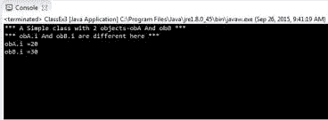

## 学生问：老师，这里的 `this` 有什么用？

问得好。`this` 用于引用当前对象。如果我们像这样写代码，就可以省略 `this` 的使用：

```java
class ClassA
{
    int i;//实例变量
    ClassA(int myInt)//myInt-局部变量
    {
        i=myInt;
    }
}
```

我们熟悉这样的代码：`a=5;` 在这里我们将 `5` 赋值给 `a`。但我们能写 `5=a;` 吗？不能。编译器会抛出现。

在这里，`myInt` 是我们的局部变量（在方法、块或构造函数内部可见），`i` 是我们的实例变量（声明在类内部，但在方法、块或构造函数之外）。

因此，如果我们不使用 `myInt` 而使用 `i`，我们需要告诉编译器我们的意图。它不应该混淆哪个值被赋值到了哪里。在这里，我们将局部变量的值赋值给实例变量，编译器应该清楚地理解我们的意图。通过 `this.i=i;`，编译器将非常清楚地理解局部变量 `i` 的值被赋值给了实例变量 `i`。

# 类演示-3

在这里我们使用了两个构造函数。过一遍程序。注意，我们这里可以使用默认值初始化对象。如果在创建对象的过程中使用了默认构造函数，则实例变量 `i` 将初始化为 `7`。我们也可以通过非默认构造函数提供不同的值。

```java
class ClassA
{
    int i;
    ClassA() {
        this.i=7;
    }
    ClassA(int i) {
        this.i=i;
    }
}

class ClassEx3
{
    public static void main(String args[]) {
        System.out.println("*** Simple class with 2 objects-obA And obB ***");
        System.out.println("*** Different type of constructors used here ***");
        ClassA obA=new ClassA();
        ClassA obB=new ClassA(25);
        System.out.println("obA.i ="+ obA.i);
        System.out.println("obB.i ="+ obB.i);
    }
}
```

输出：

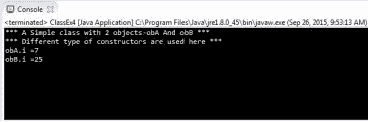

作业：创建一个类 `Vehicle`。该类应该包含字段 `no_of_seats` 和 `no_of_wheels`。为该类创建两个对象-`Motorcycle` 和 `Car`。你的输出应该显示 `Car` 的描述。

# 继承

继承的主要目标是提高代码的可重用性并消除代码冗余。在这里，子类获取了其父类的特征。我们所说的父类是指相对于另一个类（称为子类）处于更高层级的类。

## 类型

通常，我们处理 4 种继承。

## 单继承继承

一个子类派生自一个基类。

 图：单继承

代码格式如下：

```java
class Parent {
    // 你的代码...
}
class Child extends Parent {
    // 你的代码...
}
```

## 层级继承

多个子类可以派生自一个基类。

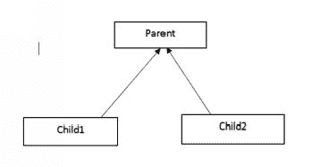 图：层级继承

代码格式如下：

```java
class Parent {
    // 你的代码...
}
class Child1 extends Parent {
    // 你的代码...
}
class Child2 extends Parent {
    // 你的代码...
}
```

## 多级继承

在这里，父类有孙类。

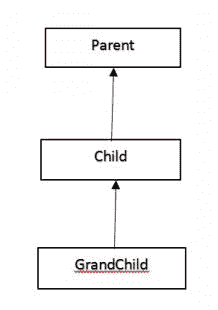 图：多级继承

老师问：现在尝试用 Java 代码实现这个概念。

解答：代码格式如下：

```java
class Parent {
    // 你的代码...
}
class Child extends Parent {
    // 你的代码...
}
class GrandChild extends Child {
    // 你的代码...
}
```

## 多继承

在这里，一个类可以派生自多个父类。

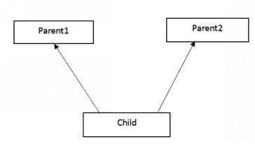 图：多继承

注意，Java 不支持这种继承（通过类）。即在 Java 中，子类不能派生自多个一个父类。为了处理这种情况，我们需要理解接口。

注意：还有一种类型的继承被称为混合继承。它是上述一种或多种类型继承的结合。

## 继承的简单程序

```java
class ParentClass
{
    public void show() {
        System.out.println("I am Parent Class");
    }
}

class ChildClass extends ParentClass
{
}

class Example1
{
    public static void main(String args[]) {
        ChildClass child1=new ChildClass();
        //通过 ChildClass 调用 show()
        child1.show();
    }
}
```

输出：


## 学生问：为什么 Java 不支持类的多继承？

主要原因是为了避免歧义。它们在某些典型场景下会引起混乱：

假设我们的父类中有一个名为 `show()` 的方法。父类有多个孩子——假设 `child1` 和 `child2`，它们为了自己的目的重写了该方法。代码可能如下：

```java
class Parent {
    void show() {
        System.out.println("I am Parent");
    }
}
class Child1 extends Parent {
    void show() {
        System.out.println("I am Child-1");
    }
}
class Child2 extends Parent {
    void show() {
        System.out.println("I am Child-2");
    }
}
class GrandChild extends Child1, Child2 {
    // 这在 Java 中是不可能的
}
```


现在假设我们的`GrandChild`继承/调用`show()`——`Child1`或`Child2`。(images/0014.jpeg)这个问题以一个著名的名称——菱形问题（Diamond problem）。

```java
System.out.println("I am in Parent constructor");
this.a=a;
this.b=b;
}
void parentMethod() {
    System.out.println("I am a Parent method");
}
}
}
class B2 extends A2 {
    int c;
    B2(int a, int b,int c) {
        super(a,b);
        System.out.println("I am in Child constructor");
        this.c=c;
    }
    void childMethod() {
        System.out.println("I am Child method");
        System.out.println("Now I am going to call Parent method");
        super.parentMethod();
    }
}
class Test2 {
    public static void main(String args[]) {
        System.out.println("*** use of super keyword***");
        B2 obB2=new B2(1,2,3);
        System.out.println("a in B2="+ obB2.a);
        System.out.println("b in B2="+ obB2.b);
        System.out.println("c in B2="+ obB2.c);
        obB2.childMethod();
    }
}
```

输出：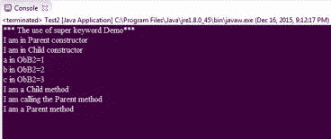

我们将通过以下示例检查`super`的另一种用法。在这里我们将看到，即使父类的变量被子类的变量隐藏了，`super`仍然允许我们访问父类的变量。

```java
package javaclassnotes.testprograms;

class A3 {
    int a;
    A3() {
        a=25;
    }
}
class B3 extends A3 {
    int a; // 隐藏 A3 中的 a
    B3() {
        super.a=12; //父类
        a=50; // 用于子类
    }
    void display() {
        System.out.println("a in parent class="+ super.a);
        System.out.println("a in child class="+ a);
    }
}
class Test3 {
    public static void main(String args[]) {
        System.out.println("***super Demo-2***");
        B3 obB3=new B3();
        obB3.display();
    }
}
```

输出：

注意：学生问：我们可以使用`super`关键字来调用被子类隐藏的方法吗？可以。

# 重载 (Overloading)

老师问：考虑以下片段。你发现任何模式吗？

```java
int sum(int x,int y) {
    return x+y;
}
double sum(double x,double y) {
    return x+y;
}
String sum(String s1,String s2) {
    return s1.concat(s2);
}
```

学生回答：是的，老师。我们看到所有方法的名称都是`sum`，但从方法体来看，每个方法都在做不同的事情。

老师说：是的。当你这样做时，我们将其称为方法重载。但你应该注意到，这里的方法签名是不同的。

学生问：什么是方法签名？

方法签名由方法名和参数列表组成。Java 编译器可以区分同名但参数列表不同的方法。因此，对于 Java 编译器来说，`double sum(double x, double y)`与`int sum(int x, int y)`是不同的。

考虑下面的程序。在这里通过以下示例表示方法重载：

```java
package javaclassnotes.programs;

class Addition {
    int sum(int x,int y) {
        return x+y;
    }
    double sum(double x,double y) {
        return x+y;
    }
    String sum(String s1,String s2) {
        return s1.concat(s2);
    }
}

public class Overloading {
    public static void main(String args[]) {
        System.out.println("***Method Overloading Demo***");
        Addition additionOb=new Addition();
        int sumIntegers=additionOb.sum(10,20);
        System.out.println("Sum of 10 and 20="+sumIntegers);
        double sumDoubles=additionOb.sum(10.5,20.7);
        System.out.println("Sum of 10.5 and 20.7="+sumDoubles);
        String sumStrings=additionOb.sum("Amit","Kumar");
        System.out.println("Concatenation of Amit and Kumar="+sumStrings);
    }
}
```

输出：

老师问：这是方法重载的示例吗？

```java
int sum(int x,int y) {
    return x+y;
}
int sum(int x,int y,int z) {
    return x+y+z;
}
```

回答：是的。

老师问：这是方法重载的示例吗？

```java
int sum(int x,int y) {
    return x+y;
}
double sum(int x,int y) {
    return x+y;
}
```

回答：不是。编译器不会考虑“返回值”来区分这些方法。返回值不被方法签名的一部分。

学生问：老师，我们可以有构造函数重载吗？

老师：完全可以。你可以写一个类似的构造函数重载程序。

```java
package javaclassnotes.testprograms;

class A1 {
    A1() {
        System.out.println("Constructor with no argument");
    }
    A1(int a) {
        System.out.println("Constructor with one integer argument");
    }
    A1(int a,double b) {
        System.out.println("Constructor with one integer and double argument");
    }
}
class Test1 {
    public static void main(String args[]) {
        System.out.println("***Constructor Overloading Demo***");
        A1 ob1=new A1();
        A1 ob2=new A1(2);
        A1 ob3=new A1(2,3.7);
    }
}
```

输出：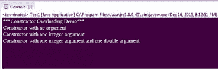

学生问：老师，在我看来这像是方法重载。构造函数和方法的区别是什么？

老师：仔细注意。构造函数的名称与类名相同，且没有返回值。因此，你可以将构造函数看作一种与类名相同且没有返回值的特殊方法。但还有许多其他区别：构造函数的主要目的是初始化对象。它们不能被直接调用。

学生问：那么我们可以写这样的代码吗？

```java
class A1 {
    // 这是构造函数。它有返回值。
    A1() {
        System.out.println("Constructor with no argument");
    }
    // 这是方法。它有返回值。
    void A1() {
        System.out.println("I am a method");
    }
}
```

老师：当然。现在，主函数中的以下行`A1 ob1=new A1(); ob1.A1(5);`可以如下输出：

# 重写 (Overriding)

有时我们想要重新定义或修改父类的行为。在这种情况下就出现了方法重写。考虑下面的程序。注意，这里`showMe()`方法在父类和子类中具有相同的签名。

```java
package javaclassnotes.programs;

class ParentClass {
    public void showMe() {
        System.out.println("I am in Parent class");
    }
}
class ChildClass extends ParentClass {
    public void showMe() {
        System.out.println("I am in Child class");
    }
}
class OverridingEx {
    public static void main(String args[]) {
        System.out.println("***Method Overriding Demo***");
        ChildClass childOb=new ChildClass();
        childOb.showMe();
    }
}
```

输出：

# 动态方法分派

这是 Java 中一个极其重要的概念。Java 可以通过这种技术实现运行时多态。这种技术被认为实现了运行时多态，是因为对重写方法的调用是在运行时动态解析的。Java 将根据我们所引用的对象调用相应的方法。

```java
package javaclassnotes.programs;

class MyParentClass
{
    public void showMe() {
        System.out.println("I am in Parent class");
    }
}

class MyChildClass extends MyParentClass
{
    public void showMe() {
        System.out.println("I am in Child class");
    }
}

class DynamicMethodDispatchEx
{
    public static void main(String args[]) {
        System.out.println("***Dynamic Method Dispatch Demo***");
        MyParentClass parent=new MyParentClass();
        parent.showMe();
        MyChildClass childOb=new MyChildClass();
        /*父类引用指向子对象*/
        parent=childOb;
        childOb.showMe();
    }
}
```

输出:


## 记忆点

- 通过父类引用，我们可以引用子类对象，但反之则不可行。

- 因此，`MyParentClass parent=new MyChildClass();`是可以，但`MyChildClass child=new MyParentClass();`将抛出错误。

## 老师提问

现在可能在某些情况下我们希望进行限制：父类中的方法不应被其子类重写。我们如何实现这一点？

在很多面试中，你可能会遇到这个问题。我们必须记住，可以通过`static`、`private`或`final`关键字来防止重写。但在这里我们只讨论`final`的使用。这非常有帮助，因为编译器本身将阻止重写过程。

```java
class ParentClass
{
    // 使用 final 防止重写
    final public void showMe() {
        System.out.println("I am in Parent class");
    }        
}

class ChildClass extends ParentClass
{
    // 现在不能重写了：这是被允许的
    public void showMe() {
        System.out.println("I am in Child class");
    }
}
```

所以，使用上述代码，编译器将抛出错误。

# 抽象类

这些是不完整的类，我们无法从这种类实例化对象。

通常，如果一个类包含至少一个不完整/抽象的方法，那么该类本身就是一个抽象类。通过“抽象方法”这个术语——我们的意思是方法有声明（或签名）但没有实现。

当超类可以定义一种通用形式（将由其子类共享）并将填充细节的责任交给其子类时，这种技术就非常有用。

一个简单的抽象类演示：

## 实现-1

```java
package javaclassnotes.programs;

abstract class MyAbstractClass
{
    public abstract void showMe();
}

class MyConcreteClass extends MyAbstractClass
{
    @Override
    public void showMe() {
        System.out.println("I am from concrete class:");
        System.out.println("I am supplying the method for showMe()");
    }
}

class AbstractClassEx
{
    static void main(String Args[]) {
        System.out.println("***Abstract class Demo***");
        // 非法：无法实例化
        MyAbstractClass abstractOb=new MyAbstractClass();
        ConcreteClass concreteOb=new MyConcreteClass();
        concreteOb.showMe();
    }
}
```

输出:


抽象类可以包含具体的方法。子类可能会也可能重写这些方法。

## 实现-2


```java
package javaclassnotes.programs;

abstract class AbstractClass
{
    public abstract void showMe();
    public void completeMethod1() {
        System.out.println(" Originally,I am from completeMethod1 in AbstractClass.But,I am complete.");
    }
    public void completeMethod2() {
        System.out.println(" Originally,I am from completeMethod2 in AbstractClass.But,I am also complete.");
    }
}

class ConcreteClass extends AbstractClass
{
    @Override
    public void showMe() {
        System.out.println("I am from concrete class:");
        System.out.println("I am supplying the method body for showMe()");
    }
    // 它想要重写 AbstractClass 中的 completeMethod1()
    public void completeMethod1() {
        System.out.println("I am overriding completeMethod1 of AbstractClass.");
    }
}

class AbstractClassEx2
{
    static void main(String Args[]) {
        System.out.println("***Abstract class Demo2***");
        ConcreteClass concreteOb=new ConcreteClass();
        concreteOb.showMe(); // 它将显示 completeMethod1 在 ConcreteClass 中被重定义
        concreteOb.completeMethod1(); // 它将显示 AbstractClass 中定义的方法细节
        concreteOb.completeMethod2(); // 后续声明将是好的
        AbstractClass abstractRef=new ConcreteClass();
        abstractRef.completeMethod1();
    }
}
```

输出：

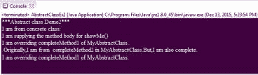

我们在这里可以实现动态分派的概念吗？可以。以下声明将完全没问题并调用`ConcreteClass`的`CompleteMethod1`。`AbstractClass abstractRef=new ConcreteClass(); abstractRef.completeMethod1();`

## 学生提问

- 抽象类可以包含字段吗？可以。接下来的示例将演示我们如何在这里使用动态分派的概念。此外，程序将显示抽象类包含字段。

## 实现-3

```java
package javaclassnotes.programs;

abstract class AbstractClass3
{
    int myInt=5;
    abstract void showMe();
    public void completeMethod1() {
        System.out.println("I am originally from completeMethod1 in AbstractClass.But,I am complete.");
    }
}

class ConcreteClass3 extends AbstractClass3
{
    @Override
    public void showMe() {
        System.out.println("I am from concrete class:");
        System.out.println("I am supplying the method body for showMe()");
    }
}

class AbstractClassEx3
{
    static void main(String Args[]) {
        System.out.println("***Abstract class Demo3***");
        AbstractClass3 abstractRef=new ConcreteClass3();
        abstractRef.completeMethod1();
        System.out.println("myInt in AbstractClass3="+abstractRef.myInt);
    }
}
```

输出：

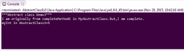

- 假设一个类中有多个方法，其中只有一个是抽象方法。我们仍然需要将该类标记为抽象类吗？

是的。如果一个类包含至少一个抽象方法，该类本身就是抽象类。你可以从通的角度来看——`abstract`关键字被用来表示不完整性。因此，如果你的类包含一个不完整的方法，你的类本身就是不完整的，因此需要用`abstract`关键字标记。

所以，简单的公式是：只要你的类至少有一个抽象方法，你的类本身就是一个抽象类。

## 老师提问

现在考虑一种相反的情况。假设你将你的类标记为抽象类，但它其中没有抽象方法，如下所示：

```java
abstract class AbstractClass
{
    public void completeMethod1() {
        System.out.println("A complete method");
    }
}
```

```java
    }

    public void completeMethod2() {
        System.out.println("Another complete method.");
    }
}
```

我们可以编译这个程序吗？

可以。它仍然可以编译，但到目前为止，你无法为该类创建对象。

**学生提问：**

那么老师，你是如何从抽象类中创建对象的呢？

我们已经提到过我们不能从抽象类中创建对象。

**学生提问：**

老师，在我看来，如果抽象类没有被继承，它几乎没有任何用处。我的理解正确吗？

是的。

**学生提问：**

如果一个类继承了抽象类，它必须实现所有的抽象方法吗？

它可能实现也可能未实现父类中所有的抽象方法。简单的公式是：如果你想创建一个类的对象，那么该类必须是完整的，即它不应该包含任何抽象方法。因此，如果子类不能提供所有抽象方法的实现（即方法体），它应该再次用`abstract`关键字标记，如下例所示。

```java
abstract class AbstractClass {
    public abstract void inCompleteMethod1();
    public abstract void inCompleteMethod2();
}

abstract class child1 extends AbstractClass {
    @Override
    public void inCompleteMethod1() {
        System.out.println("Implementing the inCompleteMethod1()");
    }
}
```

**学生提问：**

具体类是指不是抽象的类——我的理解正确吗？

是的。

**学生提问：**

我们可以对一个方法同时标记为`abstract`和`final`吗？

不可以。想想一下，通过声明`abstract`，你想要重写；而通过声明`final`，你想要防止重写。

**学生提问：**

在 Java 中有构造函数重写吗？

没有。

# 接口

通过接口，我们声明了将实现的内容，但没有指定如何实现它。这些类似于类，但没有实例变量，并且所有的方法在声明时都没有方法体（即方法实际上是抽象的）。

借助接口，我们可以在运行时支持动态方法解析。一旦定义，一个类可以实现任意数量的接口。

## 实现-1：

```java
package javaclassnotes.programs;

interface MyInterface {
    void show();
}

class MyClass implements MyInterface {
    @Override
    public void show() {
        System.out.println("MyClass is implementing the Interface method.");
    }
}

public class InterfaceEx1 {
    public static void main(String args[]) {
        System.out.println("***Interface Example.Demo-1***");
        MyClass myClassOb=new MyClass();
        myClassOb.show();
    }
}
```

输出：

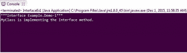

## 实现-2：

接口有两个方法。但一个类只实现了其中一个。那么类本身就变成了抽象类。

```java
package javaclassnotes.programs;

interface MyInterface2 {
    void show1();
    void show2();
}

abstract class MyClass2 implements MyInterface2 {
    @Override
    public void show1() {
        System.out.println("MyClass2 is implementing the show1() method.");
    }
}
```

注意：所以公式是：类需要实现接口中定义的所有方法。否则，它将是一个抽象类。

## 实现-3：

一个实现多个接口的类。

```java
package javaclassnotes.programs;

interface MyInterfaceA {
    void show3A();
}

interface MyInterfaceB {
    void show3B();
}

class MyClass3 implements MyInterfaceA, MyInterfaceB {
    @Override
    public void show3A() {
        System.out.println("MyClass3 is implementing the show3A() method of Interface3A");
    }
    @Override
    public void show3B() {
        System.out.println("MyClass3 is implementing the show3B() method of Interface3B");
    }
}

public class InterfaceEx3 {
    public static void main(String args[]) {
        System.out.println("***Interface Example.Demo-3***");
        MyClass3 myClassOb=new MyClass3();
        myClassOb.show3A();
        myClassOb.show3B();
    }
}
```

输出：

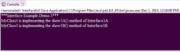

**学生提问：**

在上面的程序中，接口方法名是不同的。但如果两个接口都包含相同的方法名，我们可以实现它们吗？

请看以下实现。

## 实现-4：

```java
package javaclassnotes.programs;
//两个接口都具有相同的方法名 "show()".
interface MyInterface4A {
    void show();
}

interface MyInterface4B {
    void show();
}

class MyClass4 implements MyInterface4A, MyInterface4B {
    @Override
    public void show() {
        System.out.println("MyClass4 is implementing the show() method ");
    }
}

public class InterfaceEx4 {
    public static void main(String args[]) {
        System.out.println("***Interface Example.Demo-4***");
        // 所有的三次调用都是合法的。
        MyClass4 myClassOb=new MyClass4();
        myClassOb.show();
        MyInterface4A inter4A=myClassOb;
        inter4A.show();
        MyInterface4B inter4B=myClassOb;
        inter4B.show();
    }
}
```

输出：


**学生提问：**

接口可以继承另一个接口吗？它可以继承，但不能实现（根据定义）。

```java
package javaclassnotes.programs;

interface Interface1 {
    void show1Method();
}

interface Interface2 {
    void show2Method();
}

//接口继承接口
interface Interface3 extends Interface1, Interface2 {
    void show3Method();
}

class MyClass5 implements Interface3 {
    //现在 MyClass5 需要实现 Interface1、2 和 Interface3 方法
    @Override
    public void show1Method() {
        System.out.println("MyClass5 is implementing the show1Method() ");
    }
    @Override
    public void show2Method() {
        System.out.println("MyClass5 is implementing the show2Method() ");
    }
    @Override
    public void show3Method() {
        System.out.println("MyClass5 is implementing the show3Method() ");
    }
}

public class InterfaceEx5 {
    public static void main(String args[]) {
        System.out.println("***Interface Example.Demo-5***");
        System.out.println "***接口可以继承接口***");
        MyClass5 myClassOb=new MyClass5();
        myClassOb.show1Method();
        myClassOb.show2Method();
        myClassOb.show3Method();
    }
}
```

输出：


## 标记/标记接口：

一个空的接口被称为标记接口（tag interface）。

```java
//标记接口
interface ITaggingInterface {
}
```

**老师提问：**

你能告诉我吗：为什么我们需要标记接口？

1. 我们可以创建一个公共父类。

2. 类可以声明是某个集合的成员，例如，如果我们的类实现了`Serializable`接口，它就变成了可序列化的。因此，我们的类通过多态实际上变成了接口类型。即使是实现标记接口的类，不需要定义任何新方法，因为接口本身没有任何此类方法。

**老师提问：**

你能告诉我吗：抽象类和接口之间的区别是什么？

# 抽象类 vs 接口

1. `abstract class`（抽象类）可以包含具体方法，但`interface`（接口）不可以。[稍后我们会提到这一点。在 Java 8 中，我们有一个名为`default`的关键字。我们可以在`interface`中使用这个关键字来提供某些默认实现，参见下文的`implementation-6`。

2. `abstract class`只能有一个父类（可以继承另一个抽象类或具体类），而`interface`可以有多个父接口。`interface`只能继承其他一个或多个接口。


3. `interface` 的成员默认是 `public`。`abstract class` 可以有其他修饰符，例如 `private`、`protected` 等。

4. `interface` 中的变量默认是 `static final`。`abstract class` 可以拥有非 `final` 变量。

## 讨论

学生提问：

“老师，那么我们该如何决定应该使用抽象类还是接口呢？”

问得好。我相信，如果我们希望拥有一些集中的或默认的行为，`abstract class` 是更好的选择。因为在这里我们可以提供一些默认实现（对于抽象类而言）。另一方面，`interface` 的实现是从零开始的。它们指示了某种规则——要做什么（例如，你必须实现该方法），但它们不会强制你如何去做。此外，当我们尝试实现多继承的概念时，接口是首选的。

但同时我们也要记住，如果我们在 `interface` 中添加一个新方法，就需要追踪该接口的所有实现，并且需要在所有地方为该方法放置具体实现。`abstract class` 在这方面更有优势——我们可以在 `abstract class` 中添加一个带有默认实现的新方法，而现有的代码可以顺利运行。

所以，现在 Java 对此付了特别关注，Java 8 引入了 `default` 关键字的使用。在 Java 8 中，我们可以在目标方法签名之前加上 `default` 单词，并提供默认实现。接口方法默认是 `public` 的，所以我们不需要用 `public` 关键字来标记它。

## Implementation-6

考虑以下实现：

```java
package javaclassnotes.programs;

interface MyDefaultInterface
{
    void show();

    default void defaultMethod()
    {
        System.out.println("It is a default implementation in the interface");
    }
}

class MyClass6 implements MyDefaultInterface
{
    @Override
    public void show()
    {
        System.out.println("MyClass is implementing the Interface method.");
    }
}

public class UseOfDefaultEx
{
    public static void main(String args[])
    {
        System.out.println("***Interface Example.Demo-6***");
        System.out.println("***Use of default***");
        MyDefaultInterface interfaceOb=new MyClass6();
        interfaceOb.show();
        interfaceOb.defaultMethod();
    }
}
```

输出：

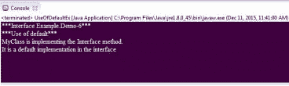

## 作业

你有两个类——`A` 和 `B`。类 `A` 包含一个抽象方法 `showA()`。你还有一个名为 `Inter` 的接口。在 `Inter` 中，你有一个方法 `showInter()`。现在写一个简单的程序，让 `B` 实现在 `A` 和 `Inter` 中定义的方法。

# 包 (Package)

考虑一个简单的场景。你可以在一个 Java 文件中使用两次相同的类名吗？不可以。编译器会抛错误并指向这个命名冲突。因此，每当我们定义类时，都需要选择唯一的命名规范。但我们必须记住，在现实世界的编程中，类名应该足够意义，因此同一个项目的不同程序员可能会为他们的类选择相同的名称。那么我们如何处理这些情况呢？`Package`（包）会在这些场景拯救我们。

我们可以将类/接口等封装在自己的包内部。包帮助我们避免命名冲突和/或控制可见性。我们可以这样控制包内部的可见性，使得我们的特定类可能可能暴露给外部（包括包内部和外部）。包以目录的形式体现。在 eclipse 中创建包非常简单。我们甚至不需要考虑 Java 运行时是如何找到内部适当的包或类的。否则，我们需要特别注意 `CLAS` 环境变量。

我们必须记住以下几点：

1. `package` 语句应该位于源文件的顶部。如果我们不显式定义它，那么所有类/接口等将位于当前的默认包中。

2. 当一个类引用同一个包内的另一个类时，需要包含 `package` 语句。否则，我们需要使用全限定名 `<packagename>.<classname>` 或使用 `import` 语句。

3. 可以导入整个包：`import <packagename>.*;`。或者如果我们只想从包导入某个特定的类，使用：`import <packagename>.<classname>`

4. 包的名称必须遵循目录结构。

## 在 Eclipse 中创建包

1. 点击 `File` -> `New` -> `Package` (images/0030.jpeg)

2. 提供所需信息并点击 finish (images/0031.jpeg)

3. 现在你会在包资源管理器视图中看到该包，例如所示（images/0032.jpeg）[注意：在这里包中，有一些我们之前创建的包和类]。

4. 现在右键点击包名->`New`->`Class/Package` 等，将类/子包放入创建的包中。它可能有以下结构（images/0033.jpeg）[注意：在这里包中，有一些我们之前创建的类]。

## 实现

现在让我们来看一个例子。考虑两家旅行公司——`a` 和 `b`。公司 `a` 经营果阿和喀拉拉的旅游。公司 `b` 经营果阿和安达曼旅游。任何游客都可以向他们咨询任何旅游套餐的信息。在这里涵盖了以下两种场景：

1. 挑战性较低：只有公司 `a` 经营喀拉拉旅游，只有公司 `b` 经营安达曼旅游。

2. 更具挑战性：注意，两家公司都提供果阿的旅游。我们需要通过 `GoaPackage` 类获取信息。[注意两个包都使用了相同的类名]

Eclipse Package View (images/0034.gif)

```java
// GoaPackage.java [For Company A, in tour.company.a package]
package tour.company.a;

public class GoaPackage
{
    int basic_price=10000;

    public void ShowPrice()
    {
        System.out.println("***Tariff for Goa tour in Company A***");
        System.out.println("For two person, Goa tour package is Rs. + basic_price*2);
        System.out.println("For four person, Goa tour package is Rs. + basic_price*4);
        System.out.println("**************");
    }
}

// KeralaPackage.java [For Company A, in tour.company.a package]
package tour.company.a;

public class KeralaPackage
{
    int basic_price=7000;

    public void ShowPrice()
    {
        System.out.println("***Tariff for Kerala tour in Company A***");
        System.out.println("For two person, Kerala tour package is Rs. + basic_price*2);
        System.out.println("For four person, Kerala tour package is Rs. + basic_price*4);
        System.out.println("**************");
    }
}

// AndamanPackage.java [For Company B, in tour.company.b package]
package tour.company.b;

public class AndamanPackage
{
    int basic_price=12000;

    public void ShowTariff()
    {
        System.out.println("***Tariff for Andaman tour in Company B***");
    }
}
```

```java
System.out.println("For two person , Andaman tour package is Rs. "+ basic_price*2 );
System.out.println("For four person , Andaman tour package is Rs. "+ basic_price*4 );
System.out.println("**************" );
}
}

// GoaPackage.java [For Company B, in tour.company.b package]

package tour.company.b;

public class GoaPackage {
    int basic_price=15000;
    int serviceTax=2000;

    public void ShowTariff() {
        int forTwoPerson=basic_price*2 +serviceTax;
        int forFourPerson=basic_price*4 +serviceTax;

        System.out.println("***Tariff for Goa tour in Company B***");
        System.out.println("In Company A:For two person , Goa tour package is Rs. "+ forTwoPerson);
        System.out.println("In Company A:For four person , Goa tour package is Rs. "+ forFourPerson );
        System.out.println("****************");
    }
}
```

```java
//Our main

package javaclassnotes.programs;

/*
import tour.company.a.KeralaPackage;
import tour.company.a.GoaPackage;
//or, simply use the following statement*/
import tour.company.a.*;

//For company B packages
import tour.company.b.*;

public class PackageEx {
    public static void main(String args[]) {
        System.out.println("***Package Example Demo***");
        // Only CompanyA has KeralaPackage
        KeralaPackage keralaPackageInA=new KeralaPackage();
        keralaPackageInA.ShowPrice();

        //Only CompanyB has AndamanPackage
        AndamanPackage companyBAndamanPackage=new AndamanPackage();
        companyBAndamanPackage.ShowTariff();

        //Company A and B both have package for //Goa.
        tour.company.a.GoaPackage companyAGoaPackage=new tour.company.a.GoaPackage();
        //GoaPackage companyAGoaPackage=new //GoaPackage();
        companyAGoaPackage.ShowPrice();

        tour.company.b.GoaPackage companyBGoaPackage=new tour.company.b.GoaPackage();
        companyBGoaPackage.ShowTariff();
    }
}
```

Output:

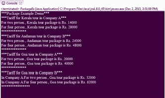

Note:

1. 记住在 Java 中，`java.lang` 包中的所有类都是默认导入的。

2. 你必须记住下表所示的可见性控制机制：

| | public | protected | private | Default/No modifier |

| :--- | :--- | :--- | :--- | :--- |

| 同一类 | Yes | Yes | Yes | Yes |

| 同包中的子类 | Yes | Yes | No | Yes |

| 同包中的非子类 | Yes | Yes | No | Yes |

| 不同包中的子类 | Yes | Yes | No | No |

| 不同包中的非子类 | Yes | No | No | No |

# 复习 OOP 概念

面向对象编程的核心特征如下：

1. 类和对象 (Class and Object)

2. 多态 (Polymorphism)

3. 抽象 (Abstraction)

4. 封装 (Encapsulation)

5. 继承 (Inheritance)

6. 消息传递 (Message passing)

7. 动态绑定 (Dynamic binding)

老师问：

你能告诉我们在 Java 中是如何实现这些内容的吗？

1. 类和对象——几乎在每个例子中，我们使用了类和对象。

2. 多态——方法重载和方法重写。

3. 抽象——抽象类和接口。

4. 封装——每个类都可以是一个更有效的例子，例如一个具有私有成员以及 getter-setter 方法的类。

5. 继承——继承的示例。

6. 消息传递——主要在多线程环境中观察到。但动态分发也可以被归为此类。

7. 动态绑定——通过动态分发中的示例（方法重写）来实现。

学生问：

多态有哪些不同类型？

1. 编译时多态——调用哪个方法是由编译器解析的。因此，它也被称为早期绑定 (early binding)。由于调用在早期就解析了，通常速度更快。

2. 运行时多态（或动态多态）——调用哪个方法将在运行时决定。这就是为什么它也被称为晚期绑定 (late binding)，与早期绑定相比，它较慢。

学生问：

Java 支持像 C/C++ 那样的指针吗？

不支持。主要原因之一是我们可能会访问意图之外的数据，这是非常危险的。此外，如果我们支持指针，内存管理将变得繁琐，因为在很多情况下它们很容易出错。我们相信，只要我们处于 Java 执行环境中，就不会感觉到使用指针的需求。

## static 关键字的使用

有时我们需要一种在不创建该类的任何对象的情况下就可以使用的变量。为了实现这个目的，我们用 `static` 标记成员。当成员被标有 `static` 关键字时，在 true 类的任何对象创建之前就可以访问该成员，即在此语文中我们不需要引用任何对象。

考虑下面的示例：

实现-1:

```java
package javaclassnotes.programs;
class StaticDemo1 {
    //static 成员
    int myStaticInt=5;
    static String myStaticString="I am a string";
    //非静态成员
    int myStaticInt=25;
}

public class StaticEx1 {
    public void main(String args[]) {
        System.out.println("***Use of static variables***");
        //我们可以通过类本身调用静态成员
        //不需要创建对象
        System.out.println("myStaticInt is "+myStaticInt);
        System.out.println("myStaticString is "+myStaticString);
        //错误：不能通过类名调用实例变量
        //System.out.println("myStaticInt is "+myStaticInt);
    }
}
```

输出:

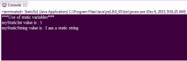

分析：我们可以 `<classname>` 访问静态成员，即我们不需要创建对象。

实现-2:

让我们来看另一个例子。在这里我们将通过静态方法和静态块测试静态变量。


```java
package javaclassnotes.programs;
class StaticEx2 {
    //静态 成员
    static int myStaticInt=1;
    static String myStaticString="No string";
    //实例变量
    int nonStaticInt=25;
    //静态方法
    static void setValuesToStaticMembers() {
        System.out.println("I am inside the static method.");
        System.out.println("myStaticInt="+ myStaticInt);
        System.out.println("myStaticString="+ myStaticString);
        //错误：在此处只能访问静态字段
        //System.out.println("nonStaticInt="+ nonStaticInt);
    }
    //静态块
    static {
        System.out.println("I am a block");
        System.out.println("Before change :");
        System.out.println("myStaticInt="+ myStaticInt);
        System.out.println("myStaticString="+ myStaticString);
        System.out.println("I am changing the values now...");
        myStaticInt=5;
        myStaticString="I am a string";
    }
}

public class StaticEx {
    public static void main(String args[]) {
        System.out.println("***Use of static methods and static blocks***");
        StaticEx2.setValuesToStaticMembers();
    }
}
```

输出：

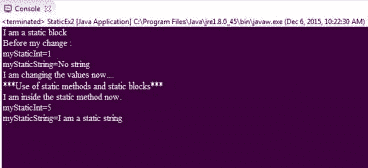

分析：仔细观察输出。观察输出的顺序。你可以看到静态块中的语句在输出的最顶部。即使在执行静态块之前，静态变量已经初始化。随后静态块改变了值（当我们调用静态方法时，清楚地反映了这一点）。

这是因为一旦静态类被加载，所有的静态语句都会执行。

你应该注意到另一个重要的特征：静态方法只能访问静态成员。

同时请注意，我们的静态方法在这里是嵌套的。

## 经验法则

1. 静态方法只能调用其他静态方法。

2. 静态方法只能访问静态字段。

3. 静态方法不能引用`this`或`super`。

## 学生提问

**我们可以创建静态类吗？**

可以。但有一个限制条件。静态类必须在另一个类的内部，即它必须是嵌套的。Java 不允许我们创建顶层静态类。

包含静态类的类被称为`outer class`（外部类）。

考虑下面的示例。在这里我们展示了如何创建和使用嵌套静态类以及嵌套非静态类（`Inner class` 内部类）。

## Implementation-3:

```java
package javaclassnotes.programs;

//Java 不允许我们创建顶层静态类，它必须是嵌套的
class OuterClass {
    //静态类
    static class MyStaticClass {
        public static void showStaticMethod() {
            System.out.println("I am a static method");
        }
    }
    //非静态类
    class MyNonStaticClass {
        public void showStaticMethod() {
            System.out.println("I am NonStatic method");
        }
    }
}

class StaticClassEx {
    public static void main(String args[]) {
        System.out.println("***Static and Inner Class Demo***");
        //调用静态方法
        OuterClass.MyStaticClass.showStaticMethod();
        //调用非静态方法
        OuterClass.MyNonStaticClass obNonStatic = new OuterClass().new MyNonStaticClass();
        obNonStatic.showStaticMethod();
    }
}
```

输出：


**什么是内部类？**

如上所述，非静态嵌套类被称为 Inner class（内部类）。它可以访问外部类所有的变量和方法。

**从静态类，我们可以访问外部类的变量吗？**

答案是肯定的，且仅当这些变量是静态的。考虑下面的示例。以下代码段是正确的：

```java
class OuterClass {
    static int outer_int=25;
    //静态类
    class MyStaticClass {
        public static void showStaticMethod() {
            System.out.println("I am a static method");
            System.out.println("Outer_int =" + outer_int);
        }
    }
}
```

但如果`outer_int`是非静态的，编译器将会报错。

## 作业

1. 假设你组建了一个板球球队。现在你的球队将与对手队进行比赛。你必须意识到一个事实：哪队先击球（或投球）将通过硬币决定决定，你需要派遣队长去参加。因此，首先，你必须选出一个队长。同时，你必须意识到你只能选择一个队长。所以，如果你还没有这样的队长，就选一个并派去掷硬币。否则，直接派已命名的队长去掷硬币。你能设计这个程序吗？

2. 创建一个`Vehicle`（车辆）。该类应该拥有`no_of_seats`（座位）和`no_of_wheels`（轮子）字段。

3. 为该类创建两个对象`Motorcycle`（摩托车）和`Car`（汽车）。你的输出应该显示`Car`和`Motorcycle`的描述。

Uml 类图：


实现：

不需要包含包声明。一旦你理解了包的概念，我们就会发现为我们的程序建立有组织的结构是非常方便的。

```java
package javaclassnotes.assignments;

class MyVehicle {
    int no_of_wheels;
    int no_of_seats;

    MyVehicle(int wheels, int seats) {
        no_of_wheels = wheels;
        no_of_seats = seats;
    }

    void showVehicle() {
        System.out.println("It has " + no_of_wheels + " wheels and " + no_of_seats + " seats");
    }
}

class Assignment_1 {
    public static void main(String args[]) {
        System.out.println("Car Description:");
        MyVehicle car = new MyVehicle(4, 5);
        car.showVehicle();
        System.out.println("Motorcycle Description:");
        MyVehicle motorCycle = new MyVehicle(2, 2);
        motorCycle.showVehicle();
    }
}
```

注意输出。每当我们想要初始化子类对象时，父类的构造函数会先被调用。这就是为什么子类构造函数会先调用父类构造函数。同样，我们的`GrandChild`类构造函数会先调用它的父类（即`Child`类构造函数），而它又会先调用它的父类（即`Parent`类构造函数）。

## static 关键字的使用

1. 假设你组建了一支板球队。现在你的球队要与对手球队比赛。你必须意识到一个事实：哪队先击球（或投球）将通过硬币决定，你需要派队长去掷硬币。所以，首先，你必须选出一个队长。同时，你必须意识到你只能选择一个队长。所以，如果你还没有这样的队长，你将选择一个并派他去硬币；否则，你只需派已经提名的队长去硬币即可。你能设计这个吗？

## Uml 类图：

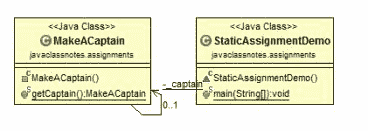

## 实现：

```java
package javaclassnotes.assignments;

class NominateACaptain
{
    private static NominateACaptain _captain;

    // 我们将构造函数设为私有以防止使用 "new"
    private NominateACaptain() { }

    // public static synchronized MakeACaptain getCaptain()
    public static NominateACaptain getCaptain()
    {
        // 懒加载初始化
        if (_captain == null)
        {
            _captain = new NominateACaptain();
            System.out.println("我们已经为球队选好了队长");
        }
        else
        {
            System.out.print(" 我们已经有一个队长了。");
            System.out.println(" 我们去掷硬币。");
        }
        return _captain;
    }
}

class StaticAssignmentDemo
{
    public static void main(String[] args)
    {
        System.out.println("***Static Assignment Demo***\n");
        System.out.println("尝试为我们的球队选一个队长");
        NominateACaptain c1 = NominateACaptain.getCaptain();
        System.out.println("尝试为我们的球队选另一个队长");
        NominateACaptain c2 = NominateACaptain.getCaptain();
        if (c1 == c2)
        {
            System.out.println("队长们是同一个.");
        }
    }
}
```

## 输出：

```
***Static Assignment Demo***

Trying to make a captain for our team
We have selected the captain for our team
Trying to make another captain for our team
We already have a Captain. We'll send for the toss.
The captains are the same.
```

## FAQ

1. 什么是类（class）？

2. 什么是对象（object）？

3. 引用（reference）的区别。

4. 我们可以实现多重继承吗？

5. 我们可以实现混合继承吗？

6. 区分抽象类（abstract class）和接口（interface）。

7. 区分方法重载（method overloading）和方法重写（method overriding）。

8. 你如何实现动态多态/多态（dynamic polymorphism）？

9. 什么是`JVM`？

10. 区分`JRE`和`JDK`。

11. 什么是内部类（inner class）？

12. 如何创建静态类（static class）？

13. 你如何实现抽象（abstraction）和封装（encapsulation）？

14. 区分静态绑定（static binding）和动态绑定（dynamic binding）。

15. `super`的作用是什么？

16. `this`的作用是什么？

17. `default`的作用是什么？

18. 可以在没有抽象方法的情况下创建抽象类吗？

19. 可以继承构造函数吗？

20. `final`的作用是什么？

21. 区分实例方法（instance method）和类方法（class method/static method）？

22. 你可以创建静态块（static block）吗？

23. 默认包（default package）是什么？

24. Java 支持指针（pointers）吗？

## 参考文献

- http://www.javatpoint.com/

- http://www.tutorialspoint.com/

- http://beginnersbook.com/

- https://docs.oracle.com/javase/tutorial

- http://freefeast.info/difference-between/runtime-polymorphism-and-compile-time-polymorphism/

- http://www.javabeat.net/what-is-the-difference-between-rejvm-and-jdk/

- http://www.geeksforgeeks.org/static-class-in-java/

- http://javarevisited.blogspot.in/2015/04/3-ways-to-prevent-method-overriding/

- http://mindprod.com/jgloss/interfacevsabstract.

- http://www.programmerinterview.com/index.php/java-questions/interface-vs-abstract-class/

- http://www.javaworld.com/article/207721/learn-java/abstract-classes-vs-interfaces.

## 致谢

诚挚地感谢我的家人、我的朋友、我优秀的老师以及所有直接或间接支持这个项目的人。虽然这是我的书，但我相信通过这些非凡人的帮助，我才能完成这项工作。再次感谢所有帮助我完成这个项目以激励他人学习 Java 的。

# 关于作者

Vaskaran Sarcar (ME (软件工程), MCA, B Sc. (数学)) 是 Hewlett India Software Operation Pvt. Ltd. 的高级软件工程师。他自 2009 年 8 月以来一直在 HP India PPS 研发部门工作。他同时也是书籍《Design Patterns in C#》、《Design Patterns in JAVA》、《Java Design Patterns（2015 年 12 月出版修订增强版）》、《Operating System: Computer Science Interview Series》、《Easy manifestation and Sweetheart》、《You Can Also Manifest Your Goal》的作者。他在早年（2005-2007 年）在各工程学院教学。随后在 2007-2009 年获得了印度 MHRD-GATE 学金金。阅读和学习新事物是他的热情。你可以通过以下邮箱与他联系任何意见、建议或进一步改进：vaskaran@rediffmail.com。
