# Java 面向对象编程使用指南

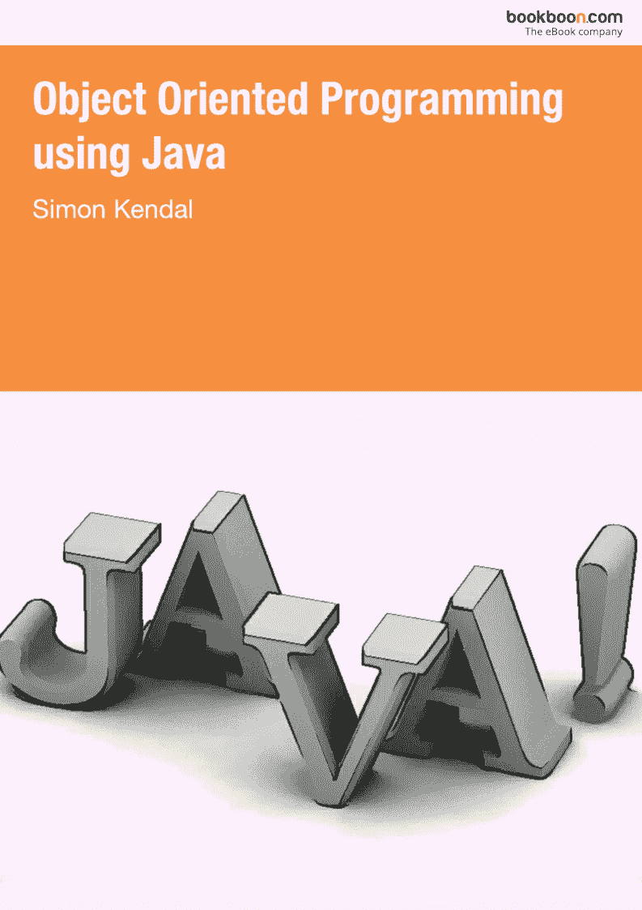

“送给我的妻子 Janice 和女儿 Cara，没有她们，生活将毫无趣味！”

在 bookboon.com 免费下载电子书

使用 Java 的面向对象编程 第 1 版© 2009 Simon Kendal & bookboon.com ISBN 978-87-7681-501-1

在 bookboon.com 免费下载电子书

## 目录

- 前言 (1)
- 1. 面向对象编程简介 (11)
  - 1.1 计算机发展简史 (12)
  - 1.2 不同的编程范式 (12)
  - 1.3 为什么使用面向对象范式？ (13)
  - 1.4 面向对象原则 (15)
  - 1.5 到底什么是面向对象编程？ (16)
  - 1.6 面向对象编程方法的优势 (20)
  - 1.7 总结 (23)
- 2. 统一建模语言 (UML) (23)
  - 2.1 UML 简介 (24)
  - 2.2 UML 类图 (24)
  - 2.3 UML 语法 (25)
  - 2.4 UML 包图 (29)
  - 2.5 UML 对象图 (41)
  - 2.6 UML 序类图 (47)
  - 2.7 总结 (48)
- 3. 继承与方法重写 (50)
  - 3.1 对象族 (51)
  - 3.2 一般化与特化 (52)
  - 3.3 继承 (52)
  - 3.4 在 Java 中实现继承 (54)
  - 3.5 构造函数 (61)
  - 3.6 构造函数规则 (61)
  - 3.7 访问控制 (62)
  - 3.8 抽象类 (64)
  - 3.9 重写方法 (65)
  - 3.10 ‘Object’ 类 (66)
  - 3.11 重写 ‘Object’ 中定义的 `toString()` (68)
  - 3.12 总结 (70)
- 4. 对象角色与多态性的重要 (71)
  - 4.1 类类型 (72)
  - 4.2 可替代性 (75)
  - 4.3 多态性 (76)
  - 4.4 可扩展性 (77)
  - 4.5 接口 (84)
  - 4.6 再次扩展性 (90)
  - 4.7 区分子类 (93)
  - 4.8 总结 (94)
- 5. 方法重载 (95)
  - 5.1 重载 (96)
  - 5.2 辅助增加灵活性的重载 (99)
  - 5.3 总结 (100)
- 6. 面向对象软件分析与设计 (101)
  - 6.1 需求分析 (102)
  - 6.2 问题 (104)
  - 6.3 列出名词和动词 (105)
  - 6.4 识别系统范围之外的事 (106)
  - 6.5 识别同义词 (107)
  - 6.6 识别潜在类 (108)
  - 6.7 识别潜在属性 (108)
  - 6.8 识别潜在方法 (109)
  - 6.9 识别共同特征 (110)
  - 6.10 使用 CRC 卡片完善我们的设计 (112)
  - 6.11 详述类 (113)
  - 6.12 总结 (114)
- 7. 集合框架 (115)
  - 7.1 集合简介 (115)
  - 7.2 集合接口 (116)
  - 7.3 旧集合与新集合 (116)
  - 7.4 列表 (117)
  - 7.5 集合 (118)
  - 7.6 映射 (119)
  - 7.7 集合实现 (121)
  - 7.8 集合框架概述 (123)
  - 7.9 使用无类型集合的示例 (125)


Gfor Engine

Ma

Mo constsuperthe Noadvishelping folve pr

点击广告阅读更多

在 bookboon.com 免费下载电子书

使用 Java 的面向对象编程


目录（如上所述）

- 8. 使用 Java 的面向对象开发 (127)
  - 8.1 开发工具 (128)
  - 8.2 JRE (129)
  - 8.3 Eclipse (130)
  - 8.4 Eclipse 架构 (132)
  - 8.5 Eclipse 特性 (133)
  - 8.6 NetBeans (134)
  - 8.7 开发图形界面 (137)
  - 8.8 使用布局器 (138)
  - 8.9 添加监听器 (139)
  - 8.10 Javadoc (140)
  - 8.11 总结 (142)
- 9. 使用 Java 的面向对象编程 (142)
  - 9.1 敏捷编程 (144)
  - 9.2 敏捷方法 (145)
  - 9.3 重构 (148)
  - 9.4 重构的示例 (149)
  - 9.5 对重构的支持 (153)
  - 9.6 单元测试 (154)
  - 9.7 自动化测试 (157)
  - 9.8 JUnit (158)
  - 9.9 断言的示例 (160)
  - 9.10 运行测试 (161)
- 10. 测试驱动开发 (161)
  - 10.1 TDD 循环 (162)
  - 10.2 TDD 的声明 (163)
  - 10.3 总结 (164)
- 11. 案例研究 (164)
  - 11.1 预备分析 (166)
  - 11.2 进一步分析 (167)
  - 11.3 使用 UML 文档化 (168)
  - 11.4 原型界面 (168)
  - 11.5 适应需求变化的设计 (172)
  - 11.6 封装类 (173)
  - 11.7 消息类的编程 (174)
  - 11.8 处理未知异常 (174)
  - 11.9 编写主类 (175)
  - 11.10 接口编程 (176)
  - 11.11 使用测试驱动开发扩展系统 (177)
  - 11.12 生成 Javadoc (177)
  - 11.13 运行系统与编译器警告 (183)
  - 11.14 完成的系统 (183)
  - 11.15 总结 (188)


## 前言

本书旨在让读者理解面向对象的编程方法，并在过程中培养一些实用技能。这些实用技能将通过读者受邀的小练习来开发，并提供反馈。书中解释的概念和开发的技能在许多面向对象的语言的程序员中都很常见，因此可以在不同语言之间迁移。然而，出于实际目的，我们使用 Java 语言来探索和演示这些概念。虽然使用 Java 语言来突出和演示基本的面向对象原则和建模技术，但本书并不是 Java 编程入门。读者应该已经理解编程概念及其在 Java 中的实现（包括循环、选择语句、计算、数组、数据类型以及对文件处理的基本理解）。本书的设计并不是作为理论教科书，而是作为有助于理解理论概念和学习实现这些概念所需的实用技能的学习工具。为此，每章都包含带有答案和反馈的小练习。在书最后将描述一个较大的案例研究——这将说明早期章节中探索的技术。该案例研究将以开发一个可以随本书下载的完整 Java 程序而结束。


技术大学介绍了工程与自然科学的研究，以及技术相关的数学和自然科学。理解计算机可以解决的一切...

本章将讨论不同的编程范式，以及面向对象方法在软件开发和建模中的优势。我们将解释面向对象所信赖的概念（抽象、封装、继承和多态）。

### 目标

在本章结束时，你将能够……

- 解释什么是面向对象编程，
- 描述面向对象编程方法的优点，以及
- 理解面向对象编程所信赖的抽象、封装、泛化和多态的基本概念。

这些问题都将在本书后面的章节中进行更详细的探讨。

本章由六部分组成：

1. 计算机的简史
2. 不同的编程范式
3. 为什么使用面向对象范式
4. 面向对象原则
5. 什么是面向对象编程？
6. 面向对象编程方法的益处。

### 计算机的简史

计算不断改变着我们的世界和环境。在 20 世纪 60 年代，人们创建了称为大型主机（mainframes）的大机器，以高效地管理海量数据（数字）。银行账户和工资程序改变了组织的工作方式，并让这些组织的某些变得更加高效。

在 20 世纪 80 年代，个人电脑变得普及，改变了许多人的工作方式。人们开始拥有自己的电脑，许多人使用文字处理和电子表格应用程序（用于写信和和管理家庭账目）。在 20 世纪 90 年代，电子邮件变得常见，万维网诞生了。这些技术彻底改变了通信，允许个人发布可以在全球范围内轻松访问的信息。这些新技术产生的影响尚未被完全理解，因为社会正在适应电子商务的机遇、新的社交网络技术（推特、脸书、Space、在线游戏等）以及网络相关犯罪的挑战。

使用 Java 的面向对象编程

面向对象编程导论

正如新的计算技术正在改变我们的世界一样，新的技术和思想也在改变我们开发计算机系统的方式。在 20 世纪 50 年代，使用机器码（不成熟、复杂且针对特定机器）语言是常见的。

在 20 世纪 60 年代，使编程更简单的高级语言变得常见。然而，这些语言导致了大型复杂程序的开发，难以管理和维护。

20 世纪 70 年代，结构化编程范式成为大型复杂计算机程序的认可标准。结构化编程范式提出的方法是将开发的程序在逻辑上结构化为独立的、更小的、更易于管理的组件。此外，还提出了分析数据的方法，允许创建高效的大型数据库，防止数据的数据复制，并保护我们免受数据不同步的相关风险。

然而，在 a) 理解我们需要创建的系统以及 b) 随着用户需求变化改变现有软件方面，仍然存在重大问题。

在 20 世纪 80 年代，开发了“模块化”语言，如 `Modula-2` 和 `ADA`，它们成为现代面向对象语言的前身。

在 20 世纪 90 年代，面向对象范式和基于组件的软件开发思想被开发，从 2000 年起，面向对象语言成为常态。

面向对象范式基于过去 30 年开发的许多关于抽象、封装、泛化和多态的理念，并导致了软件组件的开发，其中操作和数据被结合在一起建模。

### 不同的编程范式

结构化编程范式认为，程序可以在合理的区块中开发，使程序更易于理解。

使用 Java 的面向对象编程

面向对象编程导论

### 活动 1

假设你每天执行以下活动。将此列表分组，并为每组活动起一个标题。

```
起床
吃早餐
停停车
穿衣服
把车从车库开出来
开车上班
找出老板今天想要什么
```

### 反馈 1

通过结构化我们的指令列表并考虑整体结构（起床、上班、工作），我们可以在不担心对其他部分产生任何潜在影响的情况下，改变和改进某一部分。例如，我们可以改进以下指令：

```
收听当地交通和天气预报
决定乘坐公交车还是开车
如果开车，取车并开车上班
否则走到公交站等公交车
```

而不会对“起床”或“工作”产生任何潜在影响。同样，结构化计算机程序可以使每个部分更易于理解，并使大型程序更容易维护。

面向对象范式建议，我们应该将计算机程序中的指令与其操作和存储的数据建模，并将它们共同存储为组件。这样做的优点之一是我们可以获得可用的软件组件。

### 活动 2

想象一个个人通讯录，其中存储了关于你朋友的数据：姓名、地址、电话号码。

列出你可能对这个通讯录做的三件事。接下来，识别另一个可能出于存储朋友列表以外的其他目的而使用相同通讯录的人。

### 反馈 2

对于通讯录，我们希望能够执行以下操作：查找朋友的详细信息（即他们的电话号码）、在通讯录中添加地址，以及当然，还有删除地址。

通过创建一个简单的软件组件来存储通讯录中的数据（即姓名列表等）以及我们能执行的操作（即添加地址、查找电话号码等），我们可以在另一个软件系统中重用它，例如，它可以被业务经理用于存储和查找客户的详细信息。它也可以成为图书馆系统的一部分，供管理员用于存储和检索图书馆用户的详细信息。

20 世纪 70 年代的范式。

## 1.3 为什么要使用面向对象的范式？

虽然我们可以关注正在编写的实际程序代码，但无论采用何种开发方法，大多数问题的来源通常不是代码的创建。大多数问题源于：

- 分析和设计不佳：我们创建的计算机系统没有做正确的事。
- 可维护性差：当不可避免地出现变更请求时，系统难以理解和修改。

统计数据显示，软件成本的 70% 并非产生于初始开发阶段，而是在随后的几年中产生的，因为软件需要不断修改以满足其开发所在组织不断变化的需求。因此，软件工程师必须尽一切努力确保软件在初始创建后的多年里是易于维护的。

使用 Java 进行面向对象编程

#### 面向对象编程简介

面向对象编程范式旨在通过在初始软件开发阶段协助分析和设计任务来帮助解决这些问题（更多信息请参阅第 6 章），并确保软件的健壮性和可维护性（关于面向对象和 Java 提供的支持，请参阅第 9-11 章）。

## 1.4 面向对象原则

抽象和封装是支撑面向对象软件开发方法的基本原则。抽象允许我们在考虑复杂想法的同时，忽略会令我们困惑的无关细节。封装允许我们关注某物的功能，而不必考虑其工作原理的复杂性。

### 活动 3

想象你的家，假设你打算和一位新朋友交换房子一周。写下三件你想要告诉他们关于你家的重要信息，以及你想了解关于他们家的信息。现在，列出三件你不会告诉朋友的无关细节。

### 反馈 3

你可能会告诉他们地址，给他们一份基本的房间和设施清单（例如卧室的数量），并告诉他们如何进入（即哪把钥匙可以打开正门，以及如何关闭防盗报警器，如果你有的话）。

你不会告诉他们无关的细节（如墙壁、座椅等的颜色），因为这会让他们被无用信息所过载。

抽象允许我们考虑你家里重要的高层细节（例如地址），而不会陷入细节中。

### 活动 4

考虑你的家，并写下一件你每天都会使用的物品（例如电视机，并简要描述你是如何操作该物品的）。现在考虑描述该物品的内部组件并提供其工作原理的完整技术细节会有多困难。

### 反馈 4

描述如何操作电视机比描述其内部组件并详细解释其具体工作原理要容易得多。大多数人甚至不知道他们所使用的电器设备的所有组件或它们是如何工作的——但这并没有阻止他们每天使用家电器。

你可能不知道某些技术细节，例如灯开关是如何接线在一起以及它们在内部是如何工作的，但你仍然可以开关家里（以及你进入的任何新建筑内）的灯。

封装允许我们考虑灯开关的功能以及我们如何操作它，而不必担心其实际工作原理的细节。

面向对象的另外两个基本原则是泛化/特化（这允许我们利用继承）和多态。

泛化允许我们考虑具有共同属性的通用对象类别，然后定义继承这些通用类别属性的特化子类。

### 活动 5

考虑在医院工作的人——列出三种你预计会被雇佣在那里的常见职业。现在，对于这些每种常见职业，列出二或三个具体的员工类别。

### 反馈 5

根据你对医学职业的了解，你可能列出了三种普通职业（例如：医生、护士、清洁工），也可能列出了更具体的职业，如放射科医生、外科医生等。

无论你的初始列表是什么，你可能都能指定出这些职业中更专业的类别，例如：

- 医生：实习医生、初级医生、外科医生、放射科医生等。
- 护士：分诊护士、助产、护士长
- 清洁工：普通清洁工、清洁主管

现在我们指定了一些通用类别和一些更专业的员工类别，我们可以考虑适用于所有医生、所有护士等的通用事实。

### 活动 6

关于医生写一条你认为对所有医生都成立的陈述，并关于外科医生写一条对所有医生都不成立的陈述。

### 反馈 6

你可以出一个陈述：所有医生都具有药物知识，能够诊断医疗状况并开具适当的药物。

对于外科医生，你可以说他们知道如何使用手术刀和其他专用设备，并且可以进行手术。

根据我们上面的列表，所有的外科医生都是医生，因此他们对医疗状况仍然了解并可以开具适当的药物。然而，并不是所有医生都是外科医生，因此并不是所有医生都能进行手术。

无论我们规定对医生是真实的什么，对实习医生、初级医生等也是真实的——这些特化类别（或类）可以继承与“医生”这一更通用类相关的属性和行为。

泛化/特化允许我们定义对象的通用特征和操作，并允许我们创建该对象的更特化的版本。该对象的特化版本将自动继承更泛化对象的所有特征。

面向对象的最后一个原则是多态性，它是以其泛化类别身份与对象交互的能力，无论其更特化的类别是什么。

### 活动 7

写一条陈述，说明医院经理如何与该医院雇佣的所有医生互动，无论他们是什么类型的医生。

### 反馈 7

你可能考虑过医院经理可以给所有医生发放工资（预计这将在每个月底自动完成），并可以惩戒任何违反纪律的医生——当然，这对其他员工也是如此。更具体地说，经理可以检查医生的执业注册仍然有效。这是管理人员需要对所有医生做的事情之一，无论他们的专长是什么。

此外，如果医院雇佣了新的专家医生（例如神经内科医生），在不了解该专长任何具体知识的情况下，医院管理层仍然知道 a）这些员工需要获得工资且 b) 必须检查他们的执业注册。即他们仍然是医生并需要这样对待。

通过相同的理念，多态允许计算机系统进行扩展，通过创建新的专门对象，同时允许系统的当前部分与新对象交互，而无需担心新对象的特定属性。

## 1.5 到底什么是面向对象编程？

### 活动 8

想一个你拥有的对象。描述它的当前状态，并列出你可以对该对象做的二到三件事。

### 反馈 8

你可能想了一个完全物理的物体，例如手表、笔或汽车。

对象具有当前状态。手表有时间（内部由车轮和齿轮或电子元件表示）。笔有一定量的墨水，且盖子是开启还是关着的。汽车有当前速度，里面有一定数量的燃料。

每个对象也可以关联特定的行为（即你可以对它做的事）：可以查看手表以获取时间，也可以设置时间。笔可以用来写字，汽车可以行驶。


你也可以将其他非物理实体考虑为对象：例如银行账户。银行账户不是物理上可以触到的东西，但在智力上我们可以将银行账户视为一个对象。它也有当前状态（账户中的金额），并且与之相关的行为（最明显的是存款和取款）。

面向对象编程是一种编程方法，涉及创建智力对象来为我们试图解决的业务问题建模（例如：银行账户、银行客户和银行经理——这些都可以计算机化银行系统中的对象）。对于每个对象，我们模拟了与之相关的数据（即它在任何特定时间的状态）以及与之相关的行为（我们的计算机程序应该允许该对象做的事）。

在创建面向对象的程序时，我们定义了一类对象的属性（例如所有的银行账户），然后从该类创建单个对象（例如你的银行账户）。

## 类 (Class)

“类”是一种软件设计，描述了软件正在建模的事物的通用属性。

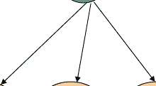

### 每个实际的事物都根据类设计创建具体的“对象”

对象 1

对象 2

对象 3

然而，决定在系统中应该创建哪些类并不是一项简单的任务，因为现实世界是复杂且混乱的（关于如何操作的更多建议请参见第 6 章）。本质上，我们需要创建一个现实世界的抽象模型，关注问题的本质方面并忽略无关的复杂性。例如，在现实世界中，账户持有人有时需要借钱，偶尔他们的钱可能会被小偷偷走。如果我们创建一个银行账户系统，我们应该允许客户借钱吗？我们是否应该承认他们的现金可能被盗，并内置某种让他们获得即时贷款的方法——或者这是一个无关紧要的细节，增加系统的复杂性，而对银行没有实际益处？

使用面向对象的分析和设计技术，我们的工作就是观察现实世界并得出一个简化的抽象模型，我们可以将其转换为计算机系统。我们的最终系统有多好将取决于我们的软件模型有多好。

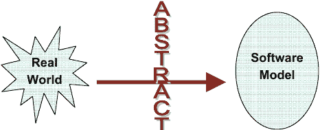

### 活动 9

考虑一个允许从图书馆预留物品的计算机系统。想象一个你可能想要预留的物品，并列出管理员可能想要关于该物品的二到三件事。

### 反馈 9

你可能想了一本想要预留的书，在这种情况下，管理员可能需要知道书名和它的作者。

因此，对于我们在系统中创建的每个对象，我们都需要定义该对象的属性，即我们需要了解关于它的信息。

### 活动 10

注意，我们可以将预留视为一个智力对象（其中实际物品是物理对象）。考虑这个智力对象（物品预留），列出管理员可能需要在该对象上执行的二到三项操作。

### 反馈 10

管理员可能需要取消这次预留（如果你改变了主意），他们可能还需要 `true` 你物品已到货供你取回。

因此，对于每个对象，我们需要定义在该对象上执行的操作（以及它的属性）。

### 活动 11

考虑到可以从图书馆借出的最通用对象类别——“借出的物品”，列出图书馆可以借出的另外二到三个更具体的对象子类。

### 反馈 11

在定义了最通用的对象类别（我们称之为类）——可以被借出的东西之后，我们可能想要定义更专门的子类（例如：书籍、杂志、视听材料）。这些子类将共享通用类定义的属性，但会有特定的差异（例如，借用视听材料可能会产生费用）。

## 1.6 面向对象方法的益处

无论你是否以面向的方式开发程序，在编写软件之前，你必须先开发一个关于软件能够做什么以及它应该如何工作的模型。面向对象建模基于抽象、封装、继承和多态的思想。面向方法的通用支持者声称这种模型提供了：

- 更好的抽象（将信息和行为建模在一起）

- 更好的可维护性（更易理解，不易脆弱）

- 更好的可重用性（类作为封装的组件）

我们将在第 11 章回来查看这些观点，届我们将看到一个案例研究，详细展示面向对象分析是如何运作的，以及生成的模型如何在面向对象的编程语言（即 `Java`）中实现。

## 1.7 总结

面向对象编程涉及通过对现实世界建模来创建类。这允许创建更专门的类来继承通用类的行为。多态行为意味着系统可以随着业务需求通过添加新的专门类来改变，而系统的部分访问这些类无需考虑它们的专门行为，也不会更改当前系统的其他部分。

# 2 统一建模语言 (UML)

### 引言

本章将介绍统一建模语言 (UML)的作用，并解释四种最常见图表（类图、对象图、时序图和包图）的目的。将重点放在类图，因为它们是 UML 表示法中最常用的部分。

### 目标

到本章结束，你将能够

- 解释 UML 是什么并解释四种最常见图表的作用，

- 绘制类图、对象图、时序图和包图。

本章涵盖的内容将在书的后续章节中进行扩展，在这里开发的技能将在随后的练习中使用（特别是关于类图）。

本章由六部分组成：

1) `UML` 简介

2) `UML` `类图`

3) `UML` `语法`

4) `UML` `包图`

5) `UML` `对象图`

6) `UML` `时序图`

## 2. UML 简介

## 2.1 UML 简介

统一建模语言 `UML` 有时被描述为一种方法论。它并不是！

方法论是为了实现特定结果的一系列过程系统，例如为了收集用户需求而组织的有序活动序列。相反，`UML` 是一种精确的绘图符号，允许对程序设计进行表示和讨论。由于它本质上是图形化的，因此很容易可视化、理解并讨论图表中呈现的信息。然而，由于图表表示的是技术信息，它们必须精确且清晰——因此，为了使其生效，必须遵循一套精确的符号规定。

# 统一建模语言 (UML)

由于 `UML` 不是一种方法论，因此用户可以按照任何他们认为适当的过程来生成图表所描述的设计。`UML` 并没有施加限制——它仅仅允许这些设计以一种易用但精确的图形化符号表达出来。

## 2.2 UML 类图

### `UML` 类图

类是任何面向对象软件系统的基本组件，`UML` `class 图` 提供了一种表示这些类的简单方法。类图在详细显示单个类的同时，还显示了多个类以及它们之间的关系。因此，类图展示了系统的架构。

一个类由以下部分组成：

- 名称（通常以大写字母开头）

- 属性列表（`int`、`double`、`boolean`、`String` 等）

- 方法列表

# 统一建模语言 (UML)

`Object Oriented Programming Using Java`


`Object Oriented Programming Using Java`

`The Unified Modelling Language (UML)`

`Object Oriented Programming Using Java`

`The Unified Modelling Language (UML)`

`Object Oriented Programming Using Java`

`The Unified Modelling Language (UML)`

`Object Oriented Programming Using Java`

`The Unified Modelling Language (UML)`

`Object Oriented Programming Using Java`

`The Unified Modelling Language (UML)`

`Object Oriented Programming Using Java`

`The Unified Modelling Language (UML)`

`Object Oriented Programming Using Java`

`The Unified Modelling Language (UML)`

`Object Oriented Programming Using Java`

`The Unified Modelling Language (UML)`

`Object Oriented Programming Using Java`

`The Unified Modelling Language (UML)`

`Object Oriented Programming Using Java`

`The Unified Modelling Language (UML)`

`Object Oriented Programming Using Java`

`The Unified Modelling Language (UML)`

`Object Oriented Programming Using Java`

`The Unified Modelling Language (UML)`

`Object Oriented Programming Using Java`

`The Unified Modelling Language (UML)`

`Object Oriented Programming Using Java`

`The Unified Modelling Language (UML)`

`Object Oriented Programming Using Java`

`The Unified Modelling Language (UML)`

`Object Oriented Programming Using Java`

`The Unified Modelling Language (UML)`

`Object Oriented Programming Using Java`

`The Unified Modelling Language (UML)`

`Object Oriented Programming Using Java`

`The Unified Modelling Language (UML)`

`Object Oriented Programming Using Java`

`The Unified Modelling Language (UML)`

`Object Oriented Programming Using Java`

`The Unified Modelling Language (UML)`

`Object Oriented Programming Using Java`

`The Unified Modelling Language (UML)`

`Object Oriented Programming Using Java`

`The Unified Modelling Language (UML)`

`Object Oriented Programming Using Java`

`The Unified Modelling Language (UML)`

`Object Oriented Programming Using Java`

`The Unified Modelling Language (UML)`

`Object Oriented Programming Using Java`

`The Unified Modelling Language (UML)`

`Object Oriented Programming Using Java`

`The Unified Modelling Language (UML)`

`Object Oriented Programming Using Java`

`The Unified Modelling Language (UML)`

`Object Oriented Programming Using Java`

`The Unified Modelling Language (UML)`

`Object Oriented Programming Using Java`

`The Unified Modelling Language (UML)`

`Object Oriented Programming Using Java`

`The Unified Modelling Language (UML)`

`Object Oriented Programming Using Java`

`The Unified Modelling Language (UML)`

`Object Oriented Programming Using Java`

`The Unified Modelling Language (UML)`

`Object Oriented Programming Using Java`

`The Unified Modelling Language (UML)`

`Object Oriented Programming Using Java`

`The Unified Modelling Language (UML)`

`Object Oriented Programming Using Java`

`The Unified Modelling Language (UML)`

`Object Oriented Programming Using Java`

`The Unified Modelling Language (UML)`

`Object Oriented Programming Using Java`

`The Unified Modelling Language (UML)`

`Object Oriented Programming Using Java`

`The Unified Modelling Language (UML)`

`Object Oriented Programming Using Java`

`The Unified Modelling Language (UML)`

`Object Oriented Programming Using Java`

`The Unified Modelling Language (UML)`

`Object Oriented Programming Using Java`

`The Unified Modelling Language (UML)`

`Object Oriented Programming Using Java`

`The Unified Modelling Language (UML)`

`Object Oriented Programming Using Java`

`The Unified Modelling Language (UML)`

`Object Oriented Programming Using Java`

`The Unified Modelling Language (UML)`

`Object Oriented Programming Using Java`

`The Unified Modelling Language (UML)`

`Object Oriented Programming Using Java`

`The Unified Modelling Language (UML)`

`Object Oriented Programming Using Java`

`The Unified Modelling Language (UML)`

`Object Oriented Programming Using Java`

`The Unified Modelling Language (UML)`

`Object Oriented Programming Using Java`

`The Unified Modelling Language (UML)`

`Object Oriented Programming Using Java`

`The Unified Modelling Language (UML)`

`Object Oriented Programming Using Java`

`The Unified Modelling Language (UML)`

`Object Oriented Programming Using Java`

`The Unified Modelling Language (UML)`

`Object Oriented Programming Using Java`

`The Unified Modelling Language (UML)`

`Object Oriented Programming Using Java`

`The Unified Modelling Language (UML)`

`Object Oriented Programming Using Java`

`The Unified Modelling Language (UML)`

`Object Oriented Programming Using Java`

`The Unified Modelling Language (UML)`

`Object Oriented Programming Using Java`

`The Unified Modelling Language (UML)`

`Object Oriented Programming Using Java`

`The Unified Modelling Language (UML)`

`Object Oriented Programming Using Java`

`The Unified Modelling Language (UML)`

`Object Oriented Programming Using Java`

`The Unified Modelling Language (UML)`

`Object Oriented Programming Using Java`

`The Unified Modelling Language (UML)`

`Object Oriented Programming Using Java`

`The Unified Modelling Language (UML)`

`Object Oriented Programming Using Java`

`The Unified Modelling Language (UML)`

`Object Oriented Programming Using Java`

`The Unified Modelling Language (UML)`

`Object Oriented Programming Using Java`

`The Unified Modelling Language (UML)`

`Object Oriented Programming Using Java`

`The Unified Modelling Language (UML)`


`Object Oriented Programming Using Java`

`The Unified Modelling Language (UML)`


# 使用 Java 进行面向对象编程

# 统一建模语言 (UML)

严格来说，当我们定义的类中有一个 `String` 实例变量时，我们可以使用关联（association），但我们不会这样做，因为 `String` 类是 Java 平台的一部分，被视为类似于基本类型的属性“理所当然”的。这通常适用于所有库类，除非我们专门绘制图表是为了向某些不熟悉该库类目的和功能的人员解释该库类的某个方面。

此外，我们还可以在关联的两端显示多重性：


`OneClass` 1..* `OtherClass`

这意味着 `OneClass` 维护一个 `OtherClass` 类型对象的集合。集合是 Java 框架的重要部分，我们将在第 7 章介绍集合的使用。

## 活动 3

绘制一个图表来表示名为 `Catalogue` 的类和一个名为 `ItemForSale` 的类，定义如下：

`ItemForSale` 有一个类型为 `string` 的属性 `name` 和一个类型为 `int` 的属性 `price`。它还有一个方法 `setPrice()`，接受一个整数参数 `newPrice`。

`Catalogue` 有一个属性 `listOfItems`，即当前目录中持有的项目。由于目录中可以存储零或多个项目，`listOfItems` 需要是一个数组或集合。`Catalogue` 还有一个方法 `addItem()`，它接受一个 `item` 作为参数（类型为 `ItemForSale`）并将该项目添加到 `listOfItems` 中。

在类图上绘制此内容，并为属性和方法显示适当可见性修饰符（visibility modifiers）。

### 反馈 3

下面的图显示了这些信息

```
Catalogue
1
+addItem(item :ItemForSale)
listOfItems 0..*
ItemForSale
- name :String
- price : int
+setPrice(newPrice :int)
```

注意：所有类名均大写字母开头，属性和方法名以小写字母开头。还要注意 `ItemForSale` 类描述的是单个项目（而不是多个项目）。然而，`listOfItems` 维护了一个零或多个独立对象的列表。

## 关联的类型

通过不同的箭头表示多种不同类型的关联：

* 依赖 (Dependency)
* 简单关联 (Simple association)
* 双向关联 (Bidirectional association)
* 聚合 (Aggregation)
* 组合 (Composition)

`Class A`, `Class B` - 依赖


`Class A`, `Class B` - 简单关联（从 A 到 B 可导航）

`Class A`, `Class B` - 双向关联


`Class A`, `Class B` - 聚合


`Class A`, `Class B` - 组合


`Class A`, `Class B` - 依赖


* `Dependency` 是类之间最不具体的关系（不属于严格意义上的“关联”）
* `Class A` 在某种程度上使用了 `Class B` 定义的功能
* `Class B` 的变化可能会影响 `Class A`


依赖线的典型用法是：`Class A` 有一个方法传递了 `Class B` 的参数对象，或者使用了该类的局部变量，或者调用了 `Class B` 中的 `static` 方法。

### 简单关联


* 在关联中，`Class A` “使用” `Class B` 的对象
* 通常 `Class A` 拥有一个 `Class B` 的属性
* 导航性从 A 到 B：即 `Class A` 对象可以访问与其关联的 `Class B` 对象（或多个）。反之则不然——`Class B` 对象“不知道” `Class A` 对象

简单关联通常对应于 `Class A` 中类型为目标类 `B` 的实例变量。例如：上面的 `Catalogue` 需要访问 0 或多个 `ItemsForSale`，以便从 `Catalogue` 中添加或删除项目。`ItemForSale` 不需要访问 `Catalogue` 即可设置其价格或执行某些与项目本身相关的其他方法。

## 信任与责任

NNE 和 Pharmaplan 强强联手创建了 NNE Pharmaplan，这是全球领先的完全专注于制药和生物技术行业的工程和咨询公司。

Inés Aréizaga Esteva（西班牙），25 岁，教育背景：化学工程师

– 作为新手，你必须积极并保持开放心态，向同事明确表示你能处理什么。制药领域对我来说很新。尽管他们很忙，但大多数同事都会抽时间教我，他们也信任我。虽然开始有点困难，但我感觉到随着时间的推移，我开始被重视，我的贡献得到了认可。

NNE Pharmaplan 是全球领先的完全专注于制药和生物技术行业的工程和咨询公司。我们在全球范围内雇了 1500 多名员工，提供全球视野、本地知识以及我们全面的服务列表。nnepharmaplan.com


### 双向关联

`Class A`, `Class B`


* `Bidirectional Association` 是类 A 和 B 之间存在双向关联
* 它们相互引用
* 从 A 到 B 的导航：
  - `Class A` 对象可以访问与其关联的 `Class B` 对象
  - `Class B` 对象“属于” `Class A`
  - 从 A 到 B 的引用
  - 同样，`Class B` 对象也可以访问与其关联的 `Class A` 对象

双向关联的一个示例可能是 `Degree`（学位）和 `Student`（学生）之间。即：给定一个 `Degree`，我们可能想知道哪些 `Students` 正在学习该学位。或者从学生开始，我们可能想知道他们学习的 `Degree`。由于许多学生同时学习同一个 `Degree`，这里仍然存在一对多的关系。

### 聚合


* `Aggregation` 表示 `Class B` 对象“属于” `Class A` 的情况
* 意味着从 A 到 B 的引用
* 虽然聚合意味着 `Class B` 对象属于 `Class A` 对象，但它也意味着 `Class B` 对象具有独立于 `Class A` 的存在。

聚合的一个示例可能是 `Class Car`（汽车）和 `Class Tyre`（轮胎）之间。我们认为轮胎属于它们所在的汽车，但在修理厂里，它们可能会被拆下并放在架子上维修。它们的存在并不依赖于与其关联的汽车的存在。

### 组合


* `Composition` 与聚合相似，但意味着一种更强的归属关系

即 `Class B` 对象是 `Class A` 对象的“部分”

* 同样意味着从 A 到 B 的引用
* 在这种情况下比聚合“强”得多，`Class B` 对象是 `Class A` 的不可或缺部分，通常 `Class B` 对象除了作为 `Class A` 的部分外不存在，即它们具有相同的“生命周期”

组合的一个示例可能是 `Points`（点）、`Lines`（线）和 `Shapes`（形状）作为 `Picture`（图片）的元素。这些对象只能作为图片的一部分存在，如果图片被删除，它们也会被删除。

除了表示关联之外，类图还可以表示：

* 继承 (Inheritance)
* 接口 (Interfaces)

# 关键字与注释

## 继承

- 除了关联之外，另一种主要的建模关系是继承：
  - `Class A` “继承”了 `Class B` 的接口和实现，尽管它可能会重写实现细节并对两者进行补充。

我们将在第 3 章详细介绍继承。

## 接口

- 接口与继承相似，但接口只继承接口部分。接口定义的方法在实现该接口的每个类中必须实现。
- 使用 `<<interface>>` 关键字表示接口：


这也有一种简写形式。在这两种情况下，这些示例都表示 `CashTill` 需要 `SaleableItem` 接口，而 `Publication` 实现了该接口。

请注意，继承线/箭头的虚线版本表示 `Publication` “实现”或“实现”了 `SaleableItem` 接口。

“球和插座”表示法是 UML 2 中的新特性——它是一种表示接口如何连接类的良好视觉化方式。

我们将在第 4 章中详细介绍接口的应用。

## 关键字

UML 定义了关键字来细化图形符号的含义。

我们已经看到了 `<<interface>>`，也将使用 `<<abstract>>`，但还有许多其他的。

抽象类也可以通过用斜体显示其名称来表示，尽管这对于普通读者来说可能不那么直观。

## 注释

最后，我们可以添加注释来说明图元素。这为我们提供了一个“全能”功能，用于添加图形符号无法传达的信息。

### 活动 4

根据你自己的经验，尝试开发一个模型，说明以下 UML 类图表示元素的使用：

- 简单关联
- 双向关联
- 聚合（很棘手！）
- 组合
- 关联
- 多重性
- 泛化（继承）
- 接口
- 注释

在本次练习中，请关注类之间的关系，而不是它们成员的细节。与其他同学和导师解释并讨论你的模型。为了帮助你开始，下面提供了一些较小的示例。

- 在大学管理系统中，我们可能会为学生学习的每学年生成一份成绩单（包括可能的实习年）。这种关联关系在本质上是单向的——给定一个学生，我们可能想找到他们的成绩单，但似乎不太可能有一份成绩单并需要找到它所属的学生。

- 在图书馆里，读者最多可以借八本书。某特定的书最多由一个读者借。我们可能希望像这里所示有一个双向关系，因为除了能够识别特定读者借的所有书籍外，我们可能还想找到借了某特定书籍的读者（例如在有预约时召回它）。

- 这可能是某种教育虚拟解剖程序模型的一部分。组合——这种显示一个对象是（并且是）另一个对象的部分的“强”关系——在这里是合适的。不过，多重性并不总是适用于人类——他们可能因为事故或疾病丢失了一根手指，或者因为遗传异常多长了一根。如果我们正在对医学院解剖实验室的“材料”进行建模会怎样？手并不总是身体的一部分！也许“较弱”的聚合关系能更好地反映这一点。

- 客户可以拥有任意数量的银行账户，一个银行账户可以由一个人或两个人持有（“联名账户”）。我们省略了这种关系的导航性，也许因为我们还没有决定这个问题。银行账户要么是活期账户要么是储蓄账户——因此 `BankAccount` 本身是抽象的。（我们可以使用斜体而不是 `<<abstract>>` 关键字来显示这一点）

- 钟的一部分是一个显示时间的显示器。这可能是模拟显示或数字显示。我们可以使用一个父类和两个子类，但由于这两个显示器的实现完全不同，因此使用接口来定义 `AnalogDisplay` 和 `DigitalDisplay` 必须提供的操作可能更为。

- 这里使用注释是为了添加一些标准 UML 表示法无法传达的信息，仅从所绘类的名称和关系可能并不显而易见。

### 反馈 4

此活动没有特定的反馈。

## 2.4 UML 包图

虽然类图是 UML 定义的最常用的图，且我们将在本书书中大量使用它们，但还有其他表示不同类型信息的图。在这里我们将触及其中三个：包图。

世界地图、国家地图和城市地图都显示空间信息，只是比例和详细程度不同。大型 OO 系统可能由数百个甚至数千个类组成，因此，如果类图是表示大型系统架构的唯一方式，它将变得过于巨大且复杂。因此，由于我们需要世界地图，我们需要包图来显示大型系统的总体架构。即使是中等系统也可以被拆分为几个基本组件，即包。我们将在第 11 章看到包的示例。现在我们只看包图的表示法。

包不仅是一组类的视觉表示，相反，“包”是一个包含一组相关类（以及接口）的目录。包允许我们在我们在类类之上提供一个层次的组织和封装，所有的 Java 平台类都安排在一个大的包层次结构中。同样地，我们也可以使用 Java 包机制来安排自己的类。

包被描述为一系列用点分隔的名称，例如 `java.awt.event`。这些名称对应于文件系统中的一系列子目录，例如：

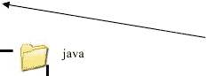

大型 Java 开发项目应该在设计阶段拆分为合适的包。UML 提供了“包图”来表示类与包之间的关系。

我们可以描绘：

- 包内的类
- 包的嵌套
- 包之间的依赖关系

在下图中我们看到了两个包：`java` 和 `javax`


仔细观察这个，我们可以看到`java`包内部另一个名为`awt`的包，在内部`javax`是一个名为`swing`的包。

`awt`包包含一个类`Container`，而`javax`包含三个类`JFrame`、`JComponent`和`JButton`。最后我们展示了`javax.swing`包依赖`java.awt`包。

注意，这里应用了标准的 UML 抑制原则——`java.awt`和`javax.swing`都包含更多的类，而`java`包含其他子包，但我们简单地选择不显示它们。

在下图中，我们使用了另一种方式来表示`JButton`位于`javax.swing`包中。同样，方的表单比顶部更简洁地显示了所有三个类。

# 使用 Java 进行面向对象编程


# 统一建模语言 (UML)

根据包图想要传达的内容，这些不同的表示方法在不同的情况下非常有用。

## 包命名

按照惯，包名通常全小写。

对于本地个人项目，包可以根据个人喜好命名，例如：

- `mysystem`
- `mysystem.interface`
- `mysystem.engine`
- `mysystem.engine.util`
- `mysystem.database`

然而，包通常是分发性的，为了实现这一点，包需要全球唯一的名称，因此采用了基于 URL 的命名规范。


## FOSS Analytical

FOSS Analytical A/S 的员工是公司价值观的活证明——第一——使用新发明为我们的客户提供专门的解决方案。凭借敏锐的头脑和跨部门团队合作，我们不断努力开发新的独特产品——你想加入我们的团队吗？

FOSS 勤奋工作，将创新和发展作为增长的基础。这体现在 FOSS 1200 名员工中有 200 多名在斯堪的纳维亚和美国从事研发。FOSS 的工程师在生产、开发和营销领域，涵盖广泛的不同领域，即化学、电子、机械、软件、光学、微生物、化学计量学。

我们在一家领先且具有创新的国际公司中提供具有挑战性的工作。你将有机会与高高技能的同事一起使用最先进的技术。

访问`www.foss.dk`更多关于 FOSS 的信息——或直接访问我们的学生网站`www.foss.dk/sharpminds`，在那里你可以更多关于与我们合作项目、写论文等的可能性。

家族拥有的 FOSS 集团是专门的高科技分析解决方案的全球领先供应商，这些解决方案用于测量和控制农业、食品、制药和化学产品的生产质量。主要活动从丹麦、瑞典和美国发起，总部位于丹麦的 Hillerød。产品通过 23 家销售公司和广泛的网络进行进行全球营销。

**专门的分析解决方案**

FOSSSlangerupgade 69340 Hillerød

电话：+45 70103370

`www.foss.dk`

## 包图的说明

每个元素不是通过`.`分隔，而是通过`::`分隔。

### 活动 5

你和室友决定一起去购物。为了快速，将以下购物清单分成两部分——你收集的物品和你的室友收集的物品。

苹果、家具抛光剂、梨、胡萝卜、卫生纸、土豆、地板清洁剂。火柴、葡萄。

### 反馈 5

为了提高购物效率，你可能将清单分成了两个位于商店相同区域的物品列表：

**列表 1**：苹果、梨、葡萄、胡萝卜、土豆

**列表 2**：家具抛光剂、地板清洁剂、火柴、卫生纸。

### 活动 6

你带领一个三个人的团队，需要用 Java 编写一个程序来监控和控制网络系统。该系统由下面描述七个类组成。将这些类组织到三个包中。每个程序员将负责一个包的代码。给包起任何你认为合适的名称。

- `MainMonitor`：此类启动系统
- `InterfaceReconfigure`：此类监控网络性能和安全违规
- `RecordStatsRemoteControl`：这是整个系统的视觉界面
- `PrintReports`：这允许网络重新配置
- `database`：在数据库中存储有关网络的数据
- `tele-management`：允许通过电话对系统进行某些远程控制
- `reports`：使用存储在数据库中的数据为组织管理层打印管理报告

### 反馈 6

将项目组织成包时并不总是有“唯一的正确答案”，但如果你将类组织到适当的包中（具有相关功能的类），你就改进了系统的封装性并提高了程序员的效率。对于活动 6 的建议解决方案所示。

```
interface:
    `MainInterface`, `RemoteControl`

network:
    `Monitor`, `Reconfigure`

database:
    `RecordStats`, `PrintReports` 
```

### 活动 7

假设你的组织 URL 为`www.myorg.com`，下面所示的三个包和七个类都是`project1`的部分。画一个包图来传达这一信息。

```
interface:
    `MainInterface`, `RemoteControl`

network:
    `Monitor`, `Reconfigure`

database:
    `RecordStats`, `PrintReports`
```


### 反馈 7


注意：包之间画了依赖箭头。当对这些关系进行更多思考时，它们可能会变成关联（一种比依赖更强的关系）。

## 2.5 UML 对象图

类图和包图允许我们可视化并讨论系统的架构，但有时我们希望讨论系统处理的数据。对象图允许我们可视化一个时间实例以及系统在该时刻可能包含的数据。

对象图看起来与类图相似，但框代表对象的特定实例。框标题为：

`objectName:ClassName`

由于每个框描述特定时刻的特定对象，因此框包含了属性及其值（在该时刻）。

`attribute = value`

这些图用于说明设计期间特定的“快照”场景。下面的对象图显示了图书馆目录系统某一时刻可能存在的多个对象。该系统包含两个类：

- `Book`：存储书籍详情
- `Library`：维护书籍集合。根据需要添加、搜索或删除书籍。


通过此图我们可以看到在特定时刻，虽然创建了三本书，但只有两个加入了图书馆。因此，如果在图书馆搜索“初学者烹饪”，预计将找不到该书。

与类图一样，对象图上的元素可以被自由抑制。

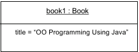

例如，所有这些都是合法的：

## 2.6 UML 序图

序列图与类图或对象图完全不同。类图描述系统架构和对象图描述了系统在某一时刻的状态。

然而，时序图描述了系统在一段时间内是如何工作的。时序图是系统的“动态”表示而非“静态”表示。它们展示了在一段时间内对象内部以及对象之间方法调用的序列。它们对于理解对象在特定场景下如何协作非常有帮助。

参见下例：

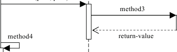

# 统一建模语言 (UML)

在这个场景中我们三个对象。时间从上到下流动，垂直虚线（生命线）表示对象随时间的持续存在。

此图显示了发生的以下动作：

* 首先，从某处向`object1`发来一个方法调用（在面向对象术语中通常称为消息）`method0()` —— 这可能是图之外的另一个类。
* `object1`开始执行其`method0()`（由从这里开始的垂直条形（称为激活条）指示）。
* `object1.method0()`调用了`object2.method1()` —— 激活条表示该操作执行一段时间后会将控制权交回`method0()`。
* 随后`object1.method0()`传递两个参数调用了`object2.method2()`。
* `method2()`随后调用了`object3.method3()`。当`method3()`结束时，它将一个返回值传给`method2()`。
* `method2()`完成并将控制权返回给`object1.method0()`。
* 最后`method0()`调用了同一对象的另一个方法`method4()`。

## 选择与迭代

场景的逻辑通常取决于选择（`if`）和迭代（循环）。有一种符号（交互帧）允许在时序图中表示 if 和循环；然而，这些符号往往会让图表变得杂乱。

时序图通常最适合说明特定案例，而完整的细节则留给实现代码。Fowler（《UML 快速入门》，第 3 版）对这些结构进行了简要处理。


## 2.7 总结

UML 不是一种方法论，而是一种精确的绘图符号。类图和包图非常适合描述系统架构。对象图描述了应用程序在某一时刻的数据，而时序图描述了系统在一段时间内是如何工作的。

UML 为不同的箭头赋予了不同的含义，因此必须按照指定的规范精确使用这些符号。对于任何 UML 图，都鼓励省略细节 —— 因此，图的作者可以省略他们希望的任何细节，以便向读者传达核心信息。

# 3 继承与方法重写

### 引言

本章将讨论继承、方法重写以及`Super`的正确使用的核心概念。

### 目标

在本章结束时，你将能够……：

* 领继承层次结构的重要性，
* 理解如何使用`Abstract`类来提取共同特征，
* 重写方法（包括`Object`类中的方法），
* 解释如何使用`Super`来调用正在被重写的方法，
* 使用 UML 记录继承层次结构，
* 在 Java 程序中实现继承和方法重写。

本章涵盖的所有材料将在本书的后续章节中进行开发和扩展。本章将侧重于理解继承层次的应用和文档化，而第 6 章将侧重于培养定义你自己的继承层次结构所需的分析能力。

本章由十二部分组成：

1) 对象族
2) 泛化与特化
3) 继承
4) 在 Java 中实现继承
5) 构造函数
6) 构造函数规则
7) 访问控制
8) 抽象类
9) 重写方法
10) `Object`类
11) 重写`Object`中定义的`toString()`
12) 总结

## 3.1 对象族

世界上许多事物属于相关的“族”组。“继承”是从父类向子类“传递”特征的思想，在面向对象的设计和编程中起着重要作用。虽然你可能已经熟悉构造函数和访问控制（`public/private`），但在将这些与继承联系时存在特定的问题。

此外，我们还需要考虑`Abstract`类的使用和方法重写，因为这些是继承背景下的重要概念。最后我们将查看`Object`类，它与 Java 中的所有其他类都有着特殊的关系。

## 3.2 泛化与特化

类是一种泛化形式，可以从它创建具有不同细节的对象。因此，对象是其类的“实例”。例如，`Student 051234567`是`Student`类的一个实例。更简洁地说，`051234567`是一个`Student`。

类本身通常可以通过类似的关系来组织。其中一个我们都有些熟悉的层次结构是描述动物界的层次结构：

* 界 (Kingdom)
* 门 (Phylum)
* 类 (Class)
* 目 (Order)
* 科 (Family)
* 属 (Genus)
* 种 (Species)

（例如：动物）
（例如：脊椎动物）
（例如：哺乳动物）
（例如：肉食动物）
（例如：猫）
（例如：felix）
（例如：felix leo）

我们可以用图形形式表示这种层次结构……


当然，画出完整的图所需的时间和空间比我们拥有的多。在这里我们可以看到一个特定的动物：`Fred`。Fred 不是动物类，而是一个真实的动物。Fred 是`felix leo`，是`felix`，是`cat`，是`carnivore`。肉食动物吃肉，所以 Fred 具有特征“吃肉”。脊椎动物有脊柱，所以 Fred 具有特征“有脊柱”。

“是一个……”的关系将个体连接到特征的层次结构上。这种关系适用于许多现实世界的实体，例如`BonusSuperSaver`是`SavingsAccount`，是`BankAccount`。

## 3.3 继承

我们在层次结构的高层指定通用特征，在低层指定更具体的特征。这是面向对象设计中的一个重要原则 —— 我们称之为泛化和特化。层次结构中类/对象之上的类的所有特征会自动包含在其中 —— 我们称之为继承。

考虑书籍和杂志 —— 它们都是特定的出版物类型。我们可以在 UML 类图中用类来表示它们。这样做，我们可以看到这些类可能具有的一些实例变量和方法。属性`title`、`author`和`price`是显而易见的。不明显的是`copies` —— 这是当前的库存数量。

对于书籍，`orderCopies()`取一个参数来指定要增加库存的数量。对于杂志，`orderQty`是每期新书收到的数量，而`currIssue`是日期。

本期期间（例如“2009 年 1 月”、“1 月 6 周五”、“2009 年春季”等）。当接收到`newIssue`时，旧的会被丢弃，`orderQty`副本会被放入库存。因此，`recvNewIssue()`将`currIssue`设置为新发行日的日期，并将副本恢复到`orderQty`。`adjustQty()`则修改`orderQty`以更改后续发行版本的库存副本数量。

### 活动 1

查看上方定义的`Book`和`Magazine`类，并识别这两个类之间的共同点和差异。

### 反馈 1

这些类有三个共同实例变量：`title`、`price`、`copies`。它们共同拥有方法`sellCopy()`。

差异如下……

`Book`额外拥有`author`和`orderCopies()`。`Magazine`额外拥有`orderQty`、`currIssue`、`adjustQty()`和`recvNewIssue()`。

我们可以将这些类的共同成员提取（“重构”）到一个名为`Publication`的超类中。

### 继承与方法重写

差异需要作为额外成员指定给“子类”`Book`和`Magazine`。

这是一个 UML 类图。

空心中心箭头表示继承。

注意，子类具有泛化的超类特征 + 额外的特化特征。

因此，`Book`类有四个实例变量（`title`、`price`、`copies`和`author`），它还有两个方法（`sellCopy()`和`orderCopies()`）。

继承的特征**不会**列在子类中。箭头显示它们是从超类获取的。

### 活动 2

将下列类安排为合适的层次结构，并在类图中画出它们……

- 一个活期账户
- 一个存款账户
- 一个银行账户
- Simon 的存款账户

### 反馈 2

银行账户

活期账户

存款账户

最通用的类位于继承层次结构的顶部，其他类随后继承该类的属性和方法。

`Simon 的存款账户`不应该显示在类图中，因为它是类的特定实例，即它是一个对象。

### 活动 3

将下列类安排为合适的层次结构，并在类图中画出它们……

- 一栋建筑
- 一栋房子
- 一辆汽车

### 反馈 3

建筑

房子

汽车

`house`是`building`的一种，因此可以继承`building`的属性，但这对于`car`则不是。除非我们可以使用“是一个”（is a）这个术语，否则无法将两个类放在继承层次结构中。注意类名一如既往以大写字母开头。

### 活动 4

使用合适的类图描述以下内容，并显示任何合理的的关系……

- 一栋待租的建筑：这将有一个确定租金的方法
- 一栋待租的房子：它将继承`determine rent`方法
- 一个收租员（人）：此人将使用`determine rent`方法来打印账单

提示：你可能希望使用以下箭头

### 反馈 4

建筑

determineRent()

收租员

房子

printBill()

注意：`RentCollector`并没有继承自`Building`，因为`RentCollector`是人，而不是`Building`的一种。然而，`RentCollector`和`Building`之间存在关系（关联），即`RentCollector`需要确定`Building`的租金以便打印账单。

### 活动 5

查看活动 4 的反馈，并判断`RentCollector`是否可以打印房屋的期租金账单（或者他们只能打印建筑的账单？）。

### 反馈 5

首先，为了打印账单，`RentCollector`需要知道到期租金。房子没有定义`determineRent()`方法——但这并不意味着它不存在。

由于`House`继承了`Building`的属性，它必须存在！

我们只有在方法是额外方法或被重写的方法时才在子类中显示它们。

收租员需要建筑，而`House`是`Building`的一种。所以，虽然`RentCollector`和`House`之间没有显示关联，但收租员可以打印房屋的账单。在任何需要`Building`对象的地方，我们都可以用`House`对象代替，因为它是`Building`的一种。这是多态的一个例子，我们将在第 4 章看到其他例子。

### 活动 6

修改此 UML 图，显示`determineRent()`在`House`中被重写。

### 反馈 6

通过在`House`中显示`determineRent()`，我们是在展示该方法正在重写超类（`Building`）中定义的方法。


有趣的是，Java 将根据调用方法的对象类型使用最正确的`determineRent()`方法。因此，如果为房屋打印账单，`RentCollector`将调用在`House`中定义的方法，但对任何其他类型将使用在`Building`中定义的方法。这是自动的——`RentCollector`中的代码不区分不同的`Building`类型。重写将在本章稍后详细讨论。

## 3.4 在 Java 中实现继承

创建超类不需要特殊功能。因此，除非被专门阻止，任何类都可以成为超类。子类使用`extends`关键字来指定它正在继承超类的特征。例如……

```
class MySubclass extends MySuperclass
{
// 额外的实例变量和
// 额外的方法
}
```

## 3.5 构造函数

每个类（无论是子类还是超类）应该封装自己的初始化，通常涉及设置实例变量的初始状态。超类的构造函数应该处理通用初始化。

每个子类可以有自己的构造函数进行特化初始化，但它通常必须调用超类构造函数的行为。它使用`super`关键字来实现。

```
class MySubClass extends MySuperClass
{
public MySubClass (sub-parameters)
{
super(super-parameters);
// 其他初始化
}
}
```

如果调用了`super`（即超类构造函数），那么它必须是构造函数的第一个语句。通常传递给`MySubClass`的某些参数将是超类实例变量的初始化值，这些值将作为参数传递给超类构造函数。换句话说，`super-parameters`是`sub-parameters`的部分（或全部）。

```
public Publication (String pTitle, double pPrice, int pCopies)
{
title = pTitle;
// 等等
}

public Book (String pTitle, String pAuthor, double pPrice,
int pCopies)
{
super(pTitle, pPrice, pCopies);
author = pAuthor;
//等等
}
```

## 3.6 构造函数规则

存在规范超构造调用的规则。如果超类有一个无参数（或默认）构造函数，则在没有情况下将自动调用

虽然在子类构造函数中可以显式调用`super`，但出于清晰性的考虑，显式调用仍然更好。

### 继承与方法重写

然而，如果父类没有无参数构造函数但有一个带参数的构造函数，则必须使用`super`进行显式调用。

为了说明这一点……

在左侧:-:- 有一个没有构造函数的子类是合法的，但属于糟糕实践，因为父类有一个无参数构造函数。

在中间:- 如果子类构造函数没有调用`super`，将调用父类的无参数构造函数。

在右侧:- 因为父类没有无参数构造函数，子类必须有一个构造函数，且必须调用`super`。这是因为一个只有一个带参数构造函数的`(super)`类只能通过提供所需的参数来初始化。

## 访问控制

为了实现封装，我们通常将实例变量设置为私有（`private`），并根据需要提供访问器（`accessor`）/修改器（`mutator`）方法。

`Publication`的`sellCopy()`方法需要修改变量`copies`的值——即使`copies`是私有变量它也可以这样做。然而，`Book`和`Magazine`都需要修改`copies`。

有两种方法可以实现这一点……

1) 将`copies`设为`protected`而不是`private`——这使得它对子类可见，

2) 创建访问器和修改器方法。

对于变量，我们通常倾向于创建访问器/修改器，而不是牺牲封装，尽管`protected`可能有助于允许子类使用某些方法（例如访问器和修改器），而我们通常不希望这些方法对其他类可用。

因此，在父类`Publication`中，我们将`copies`定义为私有变量，但创建了两个可以设置和访问`copies`值的方法。由于这些访问方法是公开的或受保护的，因此在子类需要访问`copies`时可以使用它们。

因此，在父类`Publication`中我们会有……

```java
private int copies;

public int getCopies () {
    return copies;
}

public void setCopies(int pCopies) {
    copies = pCopies;
}
```

这些方法允许父类控制对私有实例变量的访问。按照目前的写法，它们实际上并没有实施任何限制，但假设我们想确保`copies`不被设置为负值。

a) 如果`copies`是`private`的，我们可以将验证逻辑（即`if`语句）放在这里的`setCopies`方法中，并确定该规则永远不会被破坏。

b) 如果`copies`部分暴露为`protected`，则我们必须查看子类方法更改实例变量的每一个地方，并在每个单独的地方进行验证。

我们甚至可以考虑将这些方法本身设为`protected`而不是`public`，这样它们的使用就仅限于子类，其他类无法干预`copies`的值。

在子类`Book`和`Magazine`中利用这些方法，我们有了……

```java
// in Book
public void orderCopies(int pCopies) {
    setCopies(getCopies() + pCopies);
}

// and in Magazine
public void recvNewIssue(String pNewIssue) {
    setCopies(orderQty);
    currIssue = pNewIssue;
}
```

这些语句等于：

`mCopies = mCopies + pCopies`

以及

`mCopies = mOrderQty`

## 抽象类

一个既不是`Book`也不是`Magazine`的`Publication`概念是没有意义的，就像一个既不是`MalePerson`也不是`FemalePerson`的`Person`。因此，虽然我们乐意创建`Book`或`Magazine`对象，但可能希望防止`Publication`类型对象的创建。

如果我们想处理一种既不是`Book`也不是`Magazine`的新型`Publication`——例如`Calendar`——它自然会成为`Publication`的另一个新子类。

由于`Publication`永远不会被实例化（即我们永远不会创建这种类型的对象），该类的唯一目的是将其子类的通用特征聚集在一个地方，供它们继承。我们可以通过将其声明为`abstract`来强制执行`Publication`不可实例化:-

```java
abstract class Publication {
    // etc.
}
```

## 方法重写

子类继承父类的方法，因此必须始终提供至少这些方法，通常通常更多。然而，方法的实可以在子类中进行更改。这就是方法重写（`Overriding`）。

为了做到这一点，我们在子类中编写一个新版本来替换继承的版本。

但通过更改功能，可以在子类中更改方法的实现，从而改进该方法并使其功能更符合特定的子类。例如，想象一种特殊的杂志，每份都附有一张光盘——我们可以将其称为`DiscMag`，并创建一个`Magazine`的子类来处理`DiscMag`。当新的`DiscMag`期到达时，我们不仅想更新当前库存，还想检查光盘是否正确连接。因此，我们希望在`recvIssue()`方法中有一些额外的功能来提醒我们这样做。我们通过在`DiscMag`子类中重定义`recvIssue()`来实现。

注意：当新的`Magazine`期到达时，由于它们没有光盘，我们想要调用`Magazine`类中定义的原始`recvIssue()`方法。

这是父类中的方法。

### 实现 DiscMag

要实现`DiscMag`，必须使用`extends`创建`Magazine`的子类。不需要额外的实例变量或方法，尽管如果有需要也可以创建一些。`DiscMag`的构造函数简单地将其所有参数直接传递给父类，并在`discMag`中定义了`newIssue()`版本来重写继承自`Magazine`的版本（见下代码）。

```java
public class DiscMag extends Magazine {
    // the constructor
    public DiscMag (String pTitle, double pPrice, int pOrderQt, String pCurrIssue, int pCopies) {
        super(pTitle, pPrice, pOrderQty, pCurrIssue, pCopies);
    }

    // the overridden method
    public void recvNewIssue(String pNewIssue) {
        super.recvNewIssue (pNewIssue);
        System.out.println("Check discs attached to this magazine");
    }
}
```

注意使用`super`关键字来调用父类的方法，从而在替换的同时复用现有功能，就像我们处理构造函数时那样。它随后额外为用户显示所需的消息。

当我们在`DiscMag`对象上调用`recvNewIssue()`方法时，Java 会自动选择新的重写版本——调用者不需要指定这一点，甚至不需要知道它是一个重写方法。当我们在`Magazine`上调用`recvNewIssue()`方法时，调用的是父类中的方法。

### 操作

从形式上说`recvNewIssue()`是一个操作。这个操作由两个不同的方法实现，

一个在`Magazine`中，另一个在`DiscMag`中被覆盖。然而，这种区别是“多态”的重要部分，我们将在第 4 章中遇到。

## 3.10 `Object` 类

在 Java 中，所有对象都是（直接或间接的）一个名为`Object`的类的子类。`Object`是 Java 继承层次结构中的“根”。因此，这个类存在于每一个创建的 Java 程序中。

如果一个类没有声明为自另一个类（`extend`），那么它就会隐式地继承`Object`。

`Object`没有定义实例变量，但定义了几个方法。通常，这些方法会被新类重写以使它们变得有用。`toString()`方法就是一个例子。

因此，当我们定义自己的类时，默认情况下它们是`Object`的直接子类。如果我们的类被组织成层次结构，那么该层次结构中最顶部的父类是`Object`的直接子类，而其他所有都是间接子类。

### 继承与方法重写

因此，无论是直接还是间接，在 Java 中创建的所有类都继承了`toString()`。

## 3.11 重写 `Object` 中定义的 `toString()`

`Object`类定义了一个`toString()`方法，这是几个有用方法中的一个。`toString()`的签名如下：

```
public String toString()
```

它的目的是返回一个表示当前对象的字符串值。`Object`定义的`toString()`版本产生的输出类似于：“Book@11671b2”。这是类名和对象的“哈希码”。然而，为了具有通用的性，我们需要重写它以给出一个更有意义的字符串。

在`Publication`中：

```java
public String toString()
{
    return mTitle;
}
```

在`Book`中：

```java
public String toString()
{
    return super.toString() + " by " + mAuthor;
}
```

在`Magazine`中：

```java
public String toString()
{
    return super.toString() + " (" + mCurrIssue + ")";
}
```

在上面的代码中，在`Object`中定义的`toString()`被完全替换了，即被重写了，使得`Publication.toString()`只返回标题。

`toString()`方法在`Book`中再次被重写了，使得`Book.toString()`返回标题（通过父类的`toString()`方法）和作者。即：这个重写版本使用了在`Publication`中定义的版本。因此，如果`Publication.toString()`被重写为返回标题和 ISBN 号，那么`Book.toString()`将自动返回标题、ISBN 号和作者。

`Magazine.toString()`返回标题（通过父类的`toString()`方法）和期数。

我们不会在`DiscMag`中进一步重写该方法，因为因为它继承自`Magazine`的版本已经足够。我们可以选择在这些字符串中提供更多数据（即更多，甚至全部的实例变量的值）。这里的设计判断是，这些将是这些类对象最通用的可打印表示。在这种情况下，书的标题和作者，或者杂志的标题和当前期数，能够很好地唯一标识特定的出版物。

## 3.12 总结

- 继承允许我们提取共同的属性和行为。我们在父类中对共性进行建模。

- 子类用于建模专门的属性和行为。

- 父类中的代码被继承到所有子类。如果我们修改或改进了父类的代码，它会影响所有子类。这减少了我们在程序中需要编写的代码。

- 子类的构造函数适用特殊规则。

- 父类可以声明为抽象类，以防止它被实例化（即创建对象）。

- 我们可以“重写”继承的方法，以便子类以不同于父类的方式实现操作。

- 在 Java 中，所有类都源自`Object`类。

- `Object`定义了一些通用操作，这些操作可以在我们自己的类中被用作重写。

# 4 对象角色与多态的重要性

### 引言

通过使用经过的示例，本章将解释多态的概念以及它对面向对象软件设计的影响。

### 目标

在本章结束时，你将能够……

- 理解多态如何允许我们以通用方式处理相关类

- 在 Java 程序中使用多态

- 理解带有重写方法的泛态的影响

- 定义接口以将多态扩展到继承层次结构之外

- 领会多态提供的可扩展性范围

本章包含八部分：

1) 类的类型

2) 可替代性

3) 多态

4) 可扩展性

5) 接口

6) 再次可扩展性

7) 区分子类

8) 总结

## 4.1 类类型

在动物的层次分类中：

- Pinky 是一头猪（物种`sus scrofa`）

- Pinky 也是（更通用地说）哺乳动物

- Pinky 也是（甚至更通用地说）动物

我们可以在不同的细节级别指定生物所属的类型：

- 高级别 = 不那么具体

- 低级别 = 更具体

如果你被要求给某一个猪，你可以给他们 Pinky 或任何其他的猪。如果你被要求给某一个哺乳动物，你可以给他们 Pinky、任何其他的猪或其他任何哺乳动物（例如，任何狮子、任何老鼠或任何人类！）。如果你被要求给某一个动物，你可以给他们 Pinky、任何其他的猪、任何哺乳动物或其他任何动物（鸟、鱼、昆虫等）。

这里的想法是，分类层次结构中的对象与它所属的每一个类都具有“是一个”（`is a`）的关系，每个分类代表一种动物类型。

这在面向对象的程序中也是如此。每当我们定义一个类时，我们就创建一个新的“类型”。类型决定了变量、参数等之间的兼容性。

子类类型是父类类型的子类型，我们可以在任何需要“父类型”的地方替换子类型。据此我们可以在任何需要父类型对象的地方替换子类型对象（如示例所示）。

换句话说，我们可以在任何需要父类对象的地方“替换”子类对象。这反过来是不成立的！

### 活动 1

查看上面的类图，并判断以下代码行在这些类已实现的 Java 程序中哪些是合：

- `Publication p = new Book(...);`

- `Publication p = new DiscMag(...);`

- `Magazine m = new DiscMag(...);`

- `DiscMag dm = new Magazine(...);`

- `Publication p = new Publication(...);`

### 反馈 1

- `Publication p = new Book(...);`：在这里我们定义了一个`Publication`类型的变量`p`，然后调用`Book`类的构造函数并将结果赋值给`p`，这是正确的，因为`Book`是`Publication`的子类，即`Book`是`Publication`。

- `Publication p = new DiscMag(...);` 这是正确的，因为`DiscMag`是`Magazine`的子类，而`Magazine`是`Publication`的子类，即`DiscMag`是`Publication`的间接子类。

- `Magazine m = new DiscMag(...);` 这是正确的，因为`DiscMag`是`Magazine`的子类。

- `DiscMag dm = new Magazine(...);` 这是非法的，因为`Magazine`是`DiscMag`的父类。

- `Publication p = new Publication(...);` 这是非法的，因为`Publication`是一个抽象类，因此无法实例化。

# 使用 Java 进行面向对象编程

## 对象角色与多态性的性

## 4.2 可替换性


在设计类/类型层次结构时，类型机制允许我们在指定父类的地方放置一个子类对象。然而，这会对子类的设计产生影响——我们需要确保它们确实是可以与父类相互替换的。如果一个子类对象是可替换的，那么它显然必须实现父类的所有方法——这一点很容易被保证，因为父类中定义的所有方法都由子类继承了。因此，虽然子类可能拥有额外的方法，但它至少必须拥有父类中定义的所有方法，并且应该是可替换的。

但是，如果一个方法在子类中被重写了会发生什么？

在重写方法时，我们必须确保它们仍然可以被替换的方法所替换。因此，在重写方法时，虽然根据子类的需求定制方法是完全可以接受的，但不应该用执行本质不同操作的功能来重写方法。

例如，`DiscMag` 中的 `recvNewIssue()` 重写了 `Magazine` 中的 `recvNewIssue()`，但在更新副本数量和当前期数方面，它与继承的版本执行了相同的基本工作（“履行了合约”）。然而，它以特别适用于 `DiscMags` 的方式扩展了该功能，显示检查光盘的提醒。

我们对“Publication”（出版物）知道什么？

答案：它是一个支持（至少）以下的操作：

```
void sellCopy()
double getPrice()
int getCopies()
void setCopies(int pCopies)
String toString()
```

继承保证了 `Publications` 的任何子类的对象至少提供了这些操作。注意，子类永远无法删除从其父类（或类）继承的操作——这将破坏这种保证。因为子类扩展了其父类的能力，所以可以假设父类的功能可用。

我们很有可能在 `Publication` 中重写（最初定义在“Object”中的）`toString()` 方法，并在 `Magazine` 中再次重写它，以便返回的 `String` 能够对出版物和杂志提供更好的描述。然而，我们不应该为了返回价格而重写 `toString()` 方法——这将改变方法的功能，导致方法执行了本质不同的功能。这样做将破坏可替换性原则。

## 4.3 多态性

因为子类的实例是其父类的实例，所以我们可以像处理父类对象一样处理子类对象。此外，因为父类保证了其子类中的某些操作，我们可以调用这些操作，而不必关心实际对象是哪个子类的实例。

这种特性被称为“多态性”（polymorphism），原意是“具有多种形状”。因此，一个 `Publication` 有各种形状……它可能是一个 `Book`、`Magazine` 或 `DiscMag`。我们可以调用这些 `Publication` 的任何 `sellCopy()` 方法，而不考虑它们的具体细节。

多态性是对一个常见概念的华丽说法。一个会开车的人可以进入并驾驶大多数汽车，因为它们拥有一组共同的特征——方向盘、档位杆、离合踏板、刹车板和加速板等——驾驶员知道如何使用它们。任何两辆汽车之间会有很多差异，但你可以将它们想象成某个父类的子类，该父类定义了这些至关重要的共享“操作”。

如果 `p` “是一个” `Publication`，它可能是一个 `Book`、`Magazine` 或 `DiscMag`。无论是哪种，它都有一个 `sellCopy()` 方法。

所以我们可以调用 `p.sellCopy()`，而不必担心 `p` 到底是什么。当我们操作继承层次结构中的对象时，这可以让生活变得简单得多。我们可以创建新类型的 `Publication`，例如 `Newspaper`，并在 `Newspaper` 上调用 `p.sellCopy()`，而无需在新类中创建任何功能——所有所需的功能已经定义在 `Publication` 中了。多态性使得扩展我们程序的功能变得容易，正如我们将在第 11 章中看到的那样。

## 4.4 可扩展性

每年投入了巨额资金来创建新的计算机程序，但多年来，花费的更多资金用于更改和调整这些程序以满足组织不断变化的需求。因此，作为专业的软件工程师，我们有责任促进这一点，并帮助使这些程序更容易于维护和适应。当然，应用良好的编程标准、注释和布局等在此也起着作用，但多态性也能提供帮助，因为它允许创建易于扩展的程序。

### CashTill 类

想象我们想要开发一个 `CashTill` 类来处理正在出售的物品序列。如果没有多态性，我们需要为每种类型的编写单独的方法：

```
sellBook (Book pBook)
sellMagazine (Magazine pMagazine)
sellDiscMag (DiscMag pDiscMag)
```

有了多态性，我们只需要

```
sellItem (Publication pPub)
```

每个子类都与其父类是“类型兼容”的。因此，任何子类对象都可以作为 `Publication` 参数传递。这对于系统的可扩展性也有重要意义。我们之后可以引入 `Publication` 的更多子类，这些子类也将 `CashTill` 对象的 `sellItem()` 方法接受，即使在实现 `CashTill` 时这些子类型是未知的。

### Publications 自销！

如果没有多态性，我们需要检查每个物品 `p`，以确保我们调用了正确的方法来销售该子类型的副本：如果 `p` 是 `Book`，调用 `Book` 的 `sellCopy()`；否则如果 `p` 是 `Magazine`，调用 `Magazine` 的 `sellCopy()`；否则如果 `p` 是 `DiscMag`，调用 `DiscMag` 的 `sellCopy()`。相反，我们信任 Java 虚拟机在运行时查看对象 `p`，以确定其“类型”以及它自己的销售方法。因此，我们可以调用：

`p.sellCopy()`

如果该对象是 `Book`，它将调用 `Book` 的 `sellCopy()` 方法。如果 `p` 是 `Magazine`，Java 在运行时同样会确定这一点并调用 `Magazine` 的 `sellCopy()` 方法。多态性通常允许我们避免条件 `if` 语句——相反，“决定”是根据实际存在的哪种类型的子类对象隐含得出的。

### 实现 CashTill

下面的代码展示了如何实现 `CashTill` 以利用多态性。

```
class CashTill
{
  private double runningTotal;

  CashTill ()
  {
    runningTotal = 0;
  }

  public void sellItem ( Publication pPub )
  {
    runningTotal = runningTotal + pPub.getPrice() ;
    pPub.sellCopy();
    System.out.println("Sold " + pPub + " @ " +
    pPub.getPrice() + "\nSubtotal = " +
    runningTotal);
  }

  public void showTotal()
  {
    System.out.println ("GRAND TOTAL: " + runningTotal);
  }
}
```

`CashTill` 拥有一个实例变量——一个用于运行总额的 `double`。构造函数只是将其初始化为 0。

`sellItem()` 方法是 `CashTill` 的核心特性。它接收一个 `Publication` 参数，该参数可能是 `Book`、`Magazine` 或 `DiscMag`。首先，使用 `getPrice()` 将出版物的价格加上运行总额。然后，在出版物上调用 `sellCopy()` 操作。

最后，一条消息被构建并显示给用户，例如：

```
Sold Windowcleaning Weekly (Sept 2005) @ 2.75
Subtotal = 2.75
```

注意当 `pPub` 与字符串拼接运算符 `+` 一起出现时。这会隐式地调用该对象子类的 `toString()` 方法，并记住，书籍和杂志的 `toString()` 方法是不同的。

这就是多态的体现——使用 `toString()` 操作来调用相关类相应的 `toString()` 方法！

# 使用 Java 进行面向对象编程

# 对象角色与多态性的重要性

我们可以像下面的类图中所示 `CashTill`：


注意 `CashTill` 对 `Publication` 有依赖关系，因为 `sale()` 方法接收了一个类型为 `Publication` 的参数。实际传递的当然将会是继承自 `Publication` 的某一个具体类型的对象。

### 活动 2

查看下图，并假设 `Publication` 不是抽象类型，判断所示的操作对中，哪一组是合法的。


a) `Publication p = new Publication(…); p.sellCopy();`

b) `Publication p = new Publication(…); p.recvNewIssue();`

c) `Publication p = new Magazine(…); p.sellCopy();`

d) `Publication p = new Magazine(…); p.recvNewIssue();`

e) `Magazine m = new Magazine(…); m.recvNewIssue();`

### 活动 2

查看下图，并假设 `Publication` 不是抽象类型，判断所示的操作对中，哪一组是合法的。

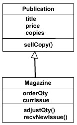

a) `Publication p = new Publication(…); p.sellCopy();`

b) `Publication p = new Publication(…); p.recvNewIssue();`

c) `Publication p = new Magazine(…); p.sellCopy();`

d) `Publication p = new Magazine(…); p.recvNewIssue();`

e) `Magazine m = new Magazine(…); m.recvNewIssue();`

### 反馈 2

a) 合法——你可以在出版物上调用 `sellCopy()`。

b) 不法——出版物中不存在 `recvNewIssue()` 方法。

c) 合法——`Magazine` 是 `Publication` 的类型，因此你可以将类型为 `Magazine` 的对象赋值给类型为 `Publication` 的变量（在需要超类的地方，你始终可以替换子类型）。此外，你可以在出版物上调用 `sellCopy()`。该出版物恰好是杂志，但就编译器而言，这并不重要，因为在这种情况下 `p` 只是一个出版物。

d) 不法——虽然我们可以在杂志上调用 `recvNewIssue`，但编译器不知道 `p` 是杂志……只知道它是一个出版物。

e) 合法——`m` 是一个杂志，我们可以在杂志上调用此方法。

### 活动 3

查看下图，并注意 `Student` 是一个抽象类，判断以下代码段中哪些是有效的……

```
<<abstract>>Student
Lecturer
printTimetable()
help(Student pStudent)
PtStudent
FtStudent
applyForJob()
applyForLoan()
```

注意：`FtStudent` 是 Full Time Student（全日学生）的缩写，`PtStudent` 是 Part Time Student（兼职学生）的缩写。

a) `Student s = new Student(); Lecturer l = new Lecturer(); l.help(s);`

b) `Student s = new FtStudent(); Lecturer l = new Lecturer(); l.help(s);`

### 反馈 3

a) 这无效，因为 `Student` 类是抽象的，不能实例化。

b) 这是有效的。`FtStudent` 是 `Student` 的类型，可以赋值给类型为 `Student` 的变量。它可以作为参数传递给 `l.help()`。

### 活动 4

采用图并直接调用下面的代码，判断在 `help(Student pStudent)` 方法内部，以下行 (a) 或 (b) 哪个是有效的……

```
Student s = new FtStudent(); Lecturer l = new Lecturer(); l.help(s);
```

```
<<abstract>>Student
Lecturer
printTimetable()
help(Student pStudent)
PtStudent
FtStudent
applyForJob()
applyForLoan()
```

a) `pStudent.printTimetable();`

b) `pStudent.applyForLoan();`

### 反馈 4

a) 这是有效的——我们可以在 `Student` 对象上调用此方法，也可以在 `FtStudent` 对象上调用（因为该方法是被继承的）。

b) 无效！虽然我们可以在 `FtStudent` 对象上调用此方法，并且我们将一个 `FtStudent` 对象作为参数传递给 `help()` 方法，但 `help()` 方法无法知道传递的对象将是 `FtStudent`（它可以是任何 `Student` 类型的对象）。因此，无法保证传递的对象将支持此方法。因此，这行代码将产生编译器错误。

## 4.5 接口

继承有两个方面：

- 子类继承父类的接口（即对公共成员的访问）——这使得多态成为可能

- 子类继承父类的实现（即实例变量和方法实现）——这节省了我们在子类定义中复制父类细节的费用。

在 Java 中，`extends` 关键字会自动应用这两个方面。

子类是一个子类型。它的接口必须包含父类的所有接口，尽管这种实现可以是不同的（通过重写），并且子类的接口可能更广泛。

然而，有时我们可能希望两个类共享一个公共接口，而不将它们放在层次结构中。这可能是：

- 它们之间没有真正的“是”关系

- 我们希望一个类拥有与多个父类共享的接口，但 Java 不允许这种“多重继承”

- 我们希望在软件组件之间创建“插拔式”安排，某些组件可能尚未创建。

这就像确保两辆汽车的控制方式完全相同，但让不同的工程师设计实现汽车功能的引擎。

小心使用“接口”一词——在 Java 编程中它至少有三个含义：

1) 类的公共成员——上述使用的含义

2) 程序的“用户界面”，通常是“图形用户界面”——一个本质相关的含义

3) 我们即将遇到的特定 Java 构造

# 对象角色与多态性的重要性

回顾 `Publication` 的子类如何提供额外和修订的行为，同时保留了它定义的操作集（即接口）。


这就是为什么 `CashTill` 类可以处理 `Publication` 而无需担心它是哪一个子类的实例。（记住 `Publication` 是一个抽象类——现实中的 `Publication` 总是某个子类。）

## 票务

现在考虑一种可能性：除了书籍和杂志之外，我们现在还想销售票务，例如娱乐活动、公共交通等。这些与 `Publication` 不同，因为：

- 我们没有有限的“库存”，而是在收银台按需打印

- 票务简单地由描述、价格和客户（为谁销售）组成

- 这些销售本质上是服务而非产品

门票（Tickets）与出版物（Publications）似乎没什么共同之处——它们共享一个与销售相关的简单接口，但即使如此，它们的底层实现也将是不同的，因为我们不会从当前库存中扣减它们。

由于这些原因，`Ticket` 和 `Publication` 似乎并不密切相关，因此我们不想将它们放入继承体系中。然而，我们确实希望它们都能作为销售物品被 `CashTill` 接受，我们需要一种机制来实现。

在不将它们放入继承体系的情况下，我们想要一种更通用的方式来表示“此类别的对象是可以出售的”，这种方式可以应用于我们想要的任何（现在及未来的）类，从而使系统能够扩展到 `Tickets` 以及其他任何类型。

---

# 对象角色与多态的重要性

虽然 `Ticket` 类与 `Publication` 的差异大到让我们不想将其放入继承体系，但它确实具有一些相似之处——即它拥有 `getPrice()` 方法和 `sellCopy()` 方法，这两个方法 `CashTill` 都需要的。

然而，`sellCopy()` 方法与 `Publication` 中定义的 `sellCopy()` 方法非常不同。销售出版物时，库存必须减少 1 —— 而对于门票，我们只需要打印它。

```
public void sellCopy()
{
    System.out.println("**************************************");
    System.out.println(" TICKET VOUCHER ");
    System.out.println(toString());
    System.out.println("**************************************");
    System.out.println();
}
```

由于 `sellCopy()` 方法如此不同，我们不想继承它的实现细节，因此我们认为 `Ticket` 不应该属于与 `Publications` 的继承体系。但我们确实希望能够像处理出版物一样通过收银机来检查门票。

就像出版物一样，门票提供了 `CashTill` 需要的操作：

- `sellCopy()`

- `getPrice()`


因此`CashTill`就可以销售`Ticket`。事实上，`CashTill`可以销售任何具有这些方法的物品，而不仅仅是`Publications`。为了实现这一点，我们将这组操作定义为一个名为`SaleableItem`的“接口”。

```java
interface SaleableItem
{
    public void sellCopy ();
    public double getPrice ();
}
```

注意，接口仅定义了操作的签名，而不包含它们的实现。所有的方法都是隐式的公共的（即使没有这样说明），并且不能有实例变量或构造函数。

换句话说，接口定义了指定操作的可用性，而不对其实现做任何说明。这被留给了实现接口的类。

接口是一种契约。`SaleableItem`接口表示：“我承诺至少提供具有以下签名的方法：

- `public void sellCopy ();`
- `public double getPrice ();`

尽管我也可能包含其他内容”。当有多个类实现一个接口时，它提供了一个保证的共性区域，多态性可以利用这个区域。

想一下汽车和街机里的驾驶游戏。它们之间显然没有任何“是一个（is a）”的关系——它们是完全不同的东西，一个是交通工具，另一个是街机游戏。但它们都实现了我们可以称为“方向盘接口”的东西，我们可以完全相同的方式使用它，尽管实现（汽车中的机械联动和游戏中的视频电子设备）非常不同。

我们现在需要声明`Publication`（及其所有子类）和`Ticket`都提供了此接口定义的操作：

```java
class Publication implements SaleableItem
{
    [...class details...]
}

class Ticket implements SaleableItem
{
    [...class details...]
}
```

对比`implements`和`extends`：

- `extends`导致从父类继承接口和实现。
- `implements`保证了接口所指定的操作将被提供——这足以允许对实现给定接口的所有类进行多态化处理。

# 多态收银机

`CashTill`类已经使用了多态性：`sale`方法接受一个`Publication`类型的参数，这允许传递它的任何一个子类：

```java
public void sellItem (Publication pPub)
```

我们现在想进一步扩大它，接受任何实现了`SaleableItem`接口的物品：

```java
public void sellItem (SaleableItem pSelb)
```

当变量或参数的类型被定义为接口时，它的工作方式就像父类类型一样。任何实现接口的类都可以赋值给该变量/参数，因为接口是一种类型，而所有实现它的类都是该类型的子类型。

下文所示……

- `<<interface>>SaleableItem` <- `CashTill`
- `<<abstract>>Publication` <- `Ticket`, `Book`, `Magazine`, `DiscMag`

`CashTill`不再直接依赖于`Publication`类——相反依赖于接口`SaleableItem`。从`Publication`和`Ticket`到`SaleableItem`的关系就像继承箭头，只是线条是虚线——这表示每个类都实现了该接口。

## 4.6 再次回到扩展性

多态性允许在不考虑对象精确类的情况下处理对象。这有助于构建可扩展的系统，同时不破坏现有设计的封装性。

例如，我们可以为更多产品或服务创建新类，只要它们实现了`SaleableItem`接口，`CashTill`就能处理它们，而无需对其代码进行任何更改！

一个例子可以是`Sweets`（糖果）。我们可以定义一个`Sweets`类来代表罐里的糖果。我们可以根据重量定义糖果的价格，然后通过从总库存中减去这个重量来销售糖果。这与销售`Publication`不同（我们总是从库存中减 1），也不像销售门票那样（我们只需要打印它们）。

然而，如果我们创建一个实现`SaleableItem`接口的`Sweets`类，我们增强后的多态收银机就可以销售它们，因为它可以销售任何`SaleableItem`。

接口允许软件组件更灵活、更具扩展地连接在一起，就像日常世界中许多其他类型的插头和插座实现了音频、视频、电源和数据连接一样。想象一下可以插到标准电源插座上的不同电器数量——想象一下如果每买一个新电器都得请电工来家里布线，将是多么不方便！

### 活动 5

修改以下图表，添加一个柴油汽车类，使其能够用于说明多态性。

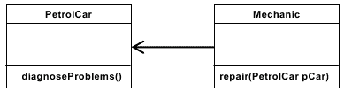

### 反馈 5

这是该练习题的一种解决方案……当然还有其他方案。

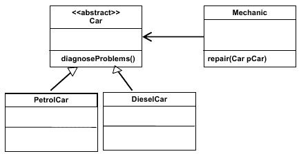

在这里`Mechanic`直接与`Car`交互。通过这样做，它可以与`Car`的任何子类型交互，例如`Petrol`（汽油）、`Diesel`（柴油）或未来任何其他类型的`Car`（例如`Electric`电）。这些都是不同的（形状不同），但`Mechanic`仍然可以与它们交互，因为它们都是`Cars`。这就是多态。

如果添加了`ElectricCar`类，`Mechanic`仍然能够对它们进行操作，而无需对`Mechanic`类进行任何更改。

# 对象角色与多态的重要性

### 活动 6

假设`Car`拥有一个`fixEngine()`方法，该方法在`DieselCar`中被重写，但在`PetrolCar`中没有被重写（如下图所示）。

查看此图并回答以下问题……

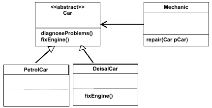

a)

b)

在`repair()`方法内部，下一行代码是否有效？`pCar.fixEngine()`？如果将一个`DieselCar`对象传递给`repair()`方法，`pCar.fixEngine()`将调用哪个实际方法？

### 反馈 6

a)

b)

是的！我们可以对任何`Car`对象应用`fixEngine()`方法，因为它在`Car`类中已经定义。这将调用被重写的方法。该方法必须在`Car`类中定义，否则编译器将在编译时报错。然而，在运行时，Java 运行环境 (`JRE`) 将识别出传递的对象为子类型`DieselCar`的类型，并调用被重写的方法。考虑到`repairCar()`方法并不知道实际传递的是哪种类型的汽车，这确实是相当聪明的做法。

## 4.7 区分子类

如果我们有一个以多态方式处理的对象，但需要检查它实际上是哪种子类型，该怎么办？`instanceof`运算符可以做到这一点：

`object instanceof class`

如果对象属于指定的类（或其子类），则该测试为真，否则为假。

注意，`(myDiscMag instanceof Magazine)`将为真，因为`DiscMag`是一种`Magazine`。

`instanceof`也可以在右侧使用接口名称，在这种情况下，它会测试类是否实现了该接口。

严格来说，`instanceof`是在测试左侧的项目是否为右侧指定的类型，或者为右侧类型的子类型。通过这样做，我们可以扩展`CashTill`类，以便根据出售的对象显示特定的消息。

```java
public void saleType (SaleableItem pSelb)
{
    if (pSelb instanceof Publication)
    {
        System.out.println("This is a Publication");
    }
    else if (pSelb instanceof Ticket)
    {
        System.out.println("This is a Ticket");
    }
    else
    {
        System.out.println("This is a an unknown sale type");
    }
}
```

如果`pSelb`是`Publication`的任何子类（即`Book`、`Magazine`或`DiscMag`），则`pSelb instanceof Publication`将为真。如果我们愿意，也可以同样测试更具体的子类型，例如`pSelb instanceof Book`。

注意，一旦我们通过检查子类型来破坏了多态性，我们也破坏了系统的扩展性——实现`SaleableItem`接口的新类（例如`Sweets`）可能也需要向此`if`语句中添加新的子句，因此更改会波及到整个系统，导致维护成本变得更高且更容易出错。

与其这样做，我们我们应该尝试将不同的行为封装到子类中，例如在`SaleableItem`接口中实现`describeSelf()`方法，以便根据出售的物品显示消息。这样不需要修改`CashTill`，因此更改会波及到整个系统，结果是维护成本变得更高且更容易出错。

## 4.8 总结

- 多态允许我们根据基类来引用对象，而不是它们的实际类。
- 多态使我们能够通过添加额外的类来扩展程序，而无需更改类。
- 我们可以通过调用基类来操作对象，而无需担心具体的子类型。
- Java 确保在运行时调用相应的类方法。
- 有时我们需要在继承层次结构中使用多态——即在某种情况下。
- 任何类都可以实现基类定义的操作。
- 在这样做时，我们可以提供多态的接口（即操作的集合）。
- 任何数量类都可以实现特定的接口。

# 5 重载

### 引言

本章将向读者介绍方法重载的概念

### 目标

在本章结束时，你将：

- 理解“重载”概念
- 欣赏方法重载提供的灵活性
- 在在线文档中识别重载方法

本章由以下三个部分组成：

1) 重载
2) 为了灵活而重载
3) 总结

## 信任与责任

NNE 和 Pharmaplan 合作创建了 NNE Pharmaplan，全球领先的制药和生物技术工程与咨询公司。

Inés Arizaga Esteva（西班牙），25 岁，教育背景：化学工程师

——作为一个新人，你必须主动并开放心态，并向同事说明你能应对什么。制药领域对我来说是全新的。尽管他们很忙，大多数同事都会花时间教我，他们也信任我。尽管开始有点困难，但随着时间的推移，我觉得自己开始被认真对待，我的贡献也得到了认可。

NNE Pharmaplan 是全球领先的制药和生物技术工程与咨询公司。我们在全球雇用了 1500 多人，提供全球范围和本地知识，以及我们全面的服务列表。nnepharmaplan.com

## 5.1 重载

在历史上，计算机程序中的方法名必须是唯一的。因此，编译器可以通过查看名称来识别正在调用哪个方法。

然而，许多方法通常需要执行非常相似的功能，例如一个方法可以将两个整数相加，而另一个方法可能需要将两个浮点数相加。如果你必须给这两个方法起唯一的名称，你会给哪个命名`add()`？

为了给每个方法一个唯一的名称，名称需要更长且更具体。因此，我们可以将一个方法命名为`addInt()`，另一个为`addFloat()`，但这会导致名称泛滥，每个名称都在描述执行相同操作的不同方法（即相加数字）。

为了在 Java 中解决这个问题，你不需要给每个方法一个唯一的名称——因此，上述两个方法都可以命名为`add()`。然而，如果方法名不是唯一的，Java 运行环境 (`JRE`) 必须有其他方式在运行时决定调用哪个方法。即当

当调用`add(number1, number2)`时，机器必须决定使用这两个方法中的哪。

它是通过查看参数列表来实现的。

虽然这两个方法可能具有相同的名称，但仍然可以通过查看参数列表来区分：

- `add(int number1, int number2)`
- `add(float number1, float number2)`

这在运行时由`JRE`解决。也就是说，在运行时，`JRE`会查看方法调用和传递的实际参数。如果传递两个整数，则调用第一个方法。然而，如果传递两个浮点数，则使用第二种方法。

重载（Overloading）指的是多个方法可能共享相同名称这一事实。由于方法名不再能唯一标识方法，因此该名称被“重载”了。

## 5.2 重载辅助提高灵活性

拥有几个本质上执行相同操作但带有不同参数列表的方法，可以增强系统的灵性和健壮性。

想象一个大学学生管理系统。可能需要一个方法来入学或注册新学生。此类方法可能具有以下签名……

`enrollStudent(String pName, String pAddress, String pCoursecode)`

然而，如果一个学生刚刚到达该城市，还没有安排好住在哪里，大学会拒绝招收该学生吗？他们可以这样做，但允许这样的学生入学（并将地址设置为“未知”）难道不是更好吗？

为了允许这一点，可以对`enrollStudent()`方法进行重载，并提供一个替代方法，如下……

`enrollStudent(String pName, String pCoursecode)`

在运行时，`JRE`可以根据提供的参数列表确定要调用哪个方法。因此，对于调用

`enrollStudent(“Fred”, “123 Abbey Gardens”, “G700”)`

`JRE`将使用第一个方法。

### 活动 1

想象一个可以作为银行系统一部分的方法`withdrawCash()`。该方法可以接受两个参数：账户标识（一个`String`）和用户所需的现金金额（`int`）。因此，完整的方法签名将是：

`withdrawCash(String pAccountID, int pAmount)`。

识别`withdrawCash()`方法的另一种变体，它接受不同的参数列表，并且可能是上述方法的用用变体。

### 反馈 1

另一种用于提取现金的替代方法可以是`withdrawCash(String pAccountID)`，其中没有指定金额，但默认提取 100 英镑。

这些方法本质上执行相同的操作，但通过重载此方法，我们使系统更加灵活——用户现在有了选择，他们可以指定要提取的现金金额，也可以接受指定的默认金额。

方法重载不仅为用户提供了更多灵活性，还为未来可能负责扩展系统的程序员提供了更多灵活性，因此，重载方法可以使系统更具未来前瞻性，并对变化的需求更具健壮性。

构造函数也可以像普通方法一样被重载。

### 活动 2

在线查看 Java 标准版 API 文档，方法如下：1) 访问`java.sun.com/javase` 2) 跟点击 API 链接 3) 选择最新版本的`Core API`文档链接。

在编写本文时，这应该带你进入`http://java.sun.com/javase/6/docs/api/`

在左下角的面板中，你应该能看到 Java 程序员可用的所有类列表。向下滚动此列表，直到找到`String`类。如果先在左上窗口中选择`Java.lang`包（因为`String`类就在这个包中），这样会更快。

查看主面板中的`String`类文档，并找出该类存在多少个构造函数。

### 反馈 2

`String`类指定了 15 个不同的构造函数。它们显然具有相同的方法名`String`，但它们可以通过这些方法所需的不同参数来区分。

其中一个构造函数不接受任何参数，并创建一个空`String`对象。另一个需要一个`String`作为参数，并创建一个原始字符串副本的新`String`对象。

通过大量重载`String`构造函数，该类的创建者为未来可能想要使用这些不同选项的其他程序员提供了灵活性。

我们可以通过重载构造函数和其他方法使我们的程序更具适应性。即使我们最初没有使用所有不同的构造函数或方法，通过提供它们，我们正在使我们的程序更加灵活，并适应以满足变化的需求。

### 活动 3

继续查看 API 文档中的`String`类，寻找其他被重载的方法。

### 反馈 3

有很多方法没有重载，但也有许多是重载的。这些包括：`format()`、`indexOf()`、`replace()`、`split()`、`subString()`和`valueOf()`。

查看不同的`subString`方法，我们发现可以通过仅指定起始点或通过指定起始和结束点来找到子字符串。

当我们使用`subString()`方法时，`JRE`将根据我们是否提供了一个两个参数在运行时选择该方法的正确实现。

## 5.3 总结

方法重载是这种概念的名称，即可能存在几个本质上执行相同操作并具有相同名称的方法。`JRE`通过查看参数列表区分它们。如果两个或多个方法具有相同的名称，那么它们的参数列表必须不同。

在运行时，每个可能产生歧义的方法调用都由`JRE`通过查看传递的参数并与类定义的方法签名匹配数据类型来解决。

通过重载构造函数和普通方法，我们为可能使用我们类的程序员提供了额外的灵活性。即使最初没有使用所有这些内容，提供它们也可以帮助程序更灵活地适应变化的需求。

# 6 面向对象的分析与设计

### 引言

本章通过实际示例教授基础分析和建模技能。引导读者理解如何从初步规范获得面向对象的架构。

### 目标

在本章结束时，你将能够：

- 分析需求描述
- 识别系统范围之外的项目
- 识别候选类、属性和方法
- 记录生成的面向对象架构

本章由十二部分组成：

1) 需求分析
2) 问题描述
3) 列出名词和动词
4) 识别系统范围之外的事
5) 识别同义词
6) 识别潜在类
7) 识别潜在属性
8) 识别潜在方法
9) 识别共同特征
10) 使用 CRC 卡细化我们的设计
11) 详细说明类
12) 总结

## 6.1 需求分析

任何程序的开发都从识别需求开始：

• 一个专职设计桥梁的工程师可能需要一些软件来创建三

设计的维度模型，以便人们在桥梁实际建成之前就能对完工方案进行可视化。


管理员可能需要一个软件来跟踪个人信息、他们分配了哪些项目、拥有哪些技能以及需要培养哪些技能。

但是，我们如何从对某些软件的“需求”转向满足这一需求的面向对象的软件设计呢？

一些软件工程师专门从事 `Requirement Analysis`（需求分析）任务，该任务是准确明确对软件的具体需求。通常这是通过迭代执行以下任务完成的：

1. 访谈客户和系统的潜在用户，以了解他们对所需系统的描述
2. 记录这些对话的结果
3. 识别所需系统的核心特性
4. 产出初步设计（可能还有系统的原型）
5. 与客户和潜在用户一起评估这些初始计划
6. 重复上述步骤，直到演化出一个完备的设计。

执行需求分析是一项专业技能，超出了本文的范围，但在这里我们将关注上述的第三和第四步，即：给定一个系统描述，我们如何将其转换为潜在的 OO（面向对象设计）。

虽然我们希望开发初步设计技能，但经验是这项任务中的一个重要因素。如果我们想让软件运行良好且易于开发，产出简单优雅的设计是非常重要的；然而，从较差的设计中识别出优秀的设计并不简单，经验是关键因素。新手棋手可能知道所有规则，但要学会从坏招中选出好招需要经验，而经验对于成为熟练选手至关重要。同样，经验对于熟练执行用户需求分析和产出良好的设计也至关重要。

在这里我们将尝试培养基础技能，希望你以后有机会练习这些技能并获得经验。

从问题规范开始，我们将通过以下步骤工作：

- 列出名词和动词
- 识别系统范围之外的事物
- 识别同义词
- 识别潜在类
- 识别潜在属性
- 识别潜在方法
- 识别共同特征
- 使用 `CRC Cards` 完善我们的设计
- 详细化类

通过这种方法，我们能够获取问题的通用描述，并为系统生成一个可行的、理想优雅的 OO 设计来满足这些需求。

## 6.2 问题

我们将为设计解决方案的问题是：“为一个组织马拉松的体育俱乐部开发一个小型管理系统。”

为了本次练习，我们假设已经完成了初步需求分析，并通过访谈俱乐部经理和使用该系统的员工，生成了以下文本描述。

“GetFit”体育俱乐部将在明年春季举办他们的首场国际马拉松。一支由世界排名专业人士和慈善募捐业余人士（有些穿着奇装异服！）组成的队伍将在围绕迷人的沿海地区的 26.2 英里路线上进行竞争。作为跟踪跑步者并宣布结果和赞助捐款的软件系统的一部分，需要一个代表跑步者关键特征的模型（这只是完工系统的一部分）。

马拉松中的每位跑步者都有一个编号。跑步者被描述为例如“Runner 42”，其中 `42` 是他们的编号。他们在指定的时刻（以小时、分、秒记录）完成比赛。他们的结果状态可以检查，并将显示为“Not finished”或“Finished in hh:mm:ss”。

每位参赛者要么是专业选手，要么是业余选手。

除此之外，专业人士还有一个世界排名，描述为例如“Runner 174 (Ranking 17)”。

所有业余人士都在为慈善募捐，因此每个人额外有一份赞助表。当业余人士完成比赛时，他们会从赞助表上打印一份收集列表。

赞助表包含赞助者数量、赞助者列表以及金额列表。可以添加赞助者和金额，并打印出显示赞助者、赞助金额和总筹款的列表。奇装异服跑步者是业余人士的一种（带有赞助等），他们还有一套服装，描述为例如“Runner 316 (Yellow Duck)”。

## 6.3 列出名词和动词

分析上述描述的第一步是识别名词和动词：

- 名词表示实体或对象，其中一些将作为类出现在最终系统中，另一些将作为属性出现。
- 动词表示要执行的操作，其中一些将作为方法出现在最终系统中。

复数形式的名词和动词以单数形式列出（例如 `books` 变为 `book`），当名词或动词单独不足以描述时，使用名词和动词短语，例如动词 `print` 不如 `print receipt` 清晰。

### 活动 1

查看上述描述，列出五个名词和五个动词（在适当的情况下使用名词和动词短语）。

### 反馈 1

下面的列表是名词和动词的相当全面的列表，而不是前五个。

名词：`GetFit Athletic Club`, `field`, `world ranking professional`, `fund-raising amateur`, `fancy dress`, `26.2 mile route`, `coastal location`, `software system`, `runner`, `result`, `sponsorship donation`, `model`, `key characteristic`, `a number`, `time`, `result status`, `competitor`, `professional runner`, `amateur runner`, `world ranking`, `charity`, `sponsorship form`, `collection list`, `sponsor`, `sponsorship amount`, `total raised`, `costume`.

动词：`Organise`, `marathon`, `compete`, `track runners`, `announce results`, `describe(runner)`, `finish race`, `specify time`, `check status`, `display status`, `describe (professional)`, `print collection list`, `add (sponsor and amount)`, `print list`, `describe (fancy dress runner)`

## 6.4 识别系统范围之外的事物

在设计系统时，重要的一部分是识别问题中那些与系统无关或超出系统范围的方面。描述中的部分内容可能是纯粹的背景信息，即为了提供一般信息之用，因此它们不会直接描述我们正在设计的系统的方面。此外，虽然描述中的部分内容可能指的是用户在使用系统时执行的任务，从而描述了需要在系统内实现的功能，但其他部分可能描述的是用户在不使用系统时执行的任务——因此它们并不描述系统内部的功能。

通过识别描述中与我们正在开发的系统无关的事物，我们可以保持问题尽可能简单。

### 活动 2

查看上面的名词和动词列表，并在每个类别中识别出一个位于系统范围之外的项。

### 反馈 2

第一段的大部分是背景信息，没有描述我们需要在系统内实现的功能。我们还需要查看描述的其他部分，以识别出不相关的部分。

**系统范围之外的事物……**

**名词：**

- `GetFit Athletic Club` – 这是我们正在开发的系统的客户。它不是我们需要在系统内部建模的实体。
- `Coastal location` – 跑步的位置与所述的系统功能无关。同样，我们不需要将其建模为系统中的一个对象。
- `Software system` – 这是我们正在开发的整个系统，它没有描述系统内部的实体。

**动词：**

- `Organise` – 这是体育俱乐部成员完成的活动，他们可能是系统的用户，但这不是他们使用系统来完成的活动。
- `marathon` – 这是跑步者正在做的事。这不是系统需要做的事。

注意：`Finish race`（完成比赛）是跑步者做的事，但当这种情况发生时，他们的完赛时间必须记录在系统中。因此，这在实际上并不在系统范围之外。

## 6.5 识别同义词

同义词是两个含义相同的单词。在系统描述中识别这些同义词至关重要。如果不这样做，将意味着一个实体被建模了两次，导致重复和混淆。

### 活动 3

查看名词和动词列表，并识别两个同义词，一个在名词列表中，一个在动词列表中。

### 反馈 3

**同义词**

**名词：**

- `world ranking`
- `professional=professional runner`
- `fund-raising`
- `amateur=amateur runner`
- `runner=competitor`

注意：`runner` 不是 `professional runner` 的同义词，因为有些跑步者是业余爱好者。

**动词：**

- `marathon=compete`
- `check status=display status`
- `print collection list = print list`
- `finish race =record`
- `specified time`

## 6.6 识别潜在类

通过识别系统范围之外的方面来简化问题，并识别描述中实际上在描述相同实体和操作的不同部分，我们现在可以开始识别系统中要实现的潜在类。

某些名词将指示要实现的类，另一些将指示类的属性。良好的面向对象（OO）设计建议将数据和操作封装在一起——因此，类代表复杂的概念实体，我们可以为这些实体识别相关的数据和操作（或方法）。简单实体（如地址）具有相关数据但没有操作，因此这些可以存储为相关类中的简单属性。

### 活动 4

查看上面的名词列表，并识别出五个可以成为类的项。

### 反馈 4

**可能指示类的名词：**

- `Runner`（或 `Competitor`）
- `Amateur`（或 `Amateur Runner`）
- `Professional`（或类似的）
- `FancyDresser`（或 `FancyDress`）
- `Amateur` 或类似的
- `SponsorshipForm`

## 6.7 识别潜在属性

识别潜在类后，其他名词可以用来识别这些类的属性。

### 活动 5

查看名词列表，并识别出一个可以作为 `Runner` 类属性的名词，以及一个作为 `FancyDresser` 类属性的名词。

### 反馈 5

**可以成为属性的名词：**

**对于 `Runner`：**

- `number`, `resultStatus` 即已完成 (`boolean`)
- `time (hours, minutes, seconds)`

**对于 `FancyDresser`：**

- `costume (String)`

当然，我们需要识别所有类的所有属性。

## 6.8 识别潜在方法

识别出潜在类后，我们现在可以使用动词来识别这些类的方法。

### 活动 6

查看动词列表，并识别出一个可以作为 `Runner` 类方法的项，以及一个可以作为 `FancyDresser` 类方法的项。

### 反馈 6

**可以成为方法的动词：**

**对于 `Runner`：**

- `describe`（这实际上将成为 `toString()` 的重写版本）
- `finishRace`
- `displayStatus`

**对于 `FancyDresser`：**

- `describe`（需要再次重写 `toString()` 以包含服装）

当然，我们需要识别所有类的所有方法。

## 6.9 识别共同特征

在识别了具有相关属性和方法的候选类后，我们可以通过识别具有共同特征的类开始将我们的类结构化为继承层次。

### 活动 7

查看下面的类列表，并将四个类放入合适的继承层次结构中。识别出一个不符合该层次体系的类：

`Runner`, `Amateur`, `Professional`, `FancyDresser`, `SponsorshipForm`

### 反馈 7

最通用的类，即继承树顶部的类是 `Runner`。`Amateur` 和 `Professional` 是 `Runner` 的子类，而 `FancyDresser` 是 `Amateur` 的特定类型，因此是 `Amateur` 的子类。

我们可以将这些类放入继承层次中，因为这些类之间都存在“是”（is-a）的关系。一个 `FancyDresser` 是一个 `Amateur`，而 `Amateur` 也是一个 `Runner`。`Professional` 也是 `Runner`。

`SponsorshipForm` 不是 `Runner` 的类型，因此不符合该层次体系。该类将通过某种形式的关联与其他类之一相关。查看描述可以发现，并不是所有跑步者都有赞助单，只有为慈善跑步的业余爱好者才有。因此，`Amateur` 和 `SponsorshipForm` 之间存在关联。

## 6.10 使用 CRC 卡细化我们的设计

在识别了系统的主要类以及这些类的属性和方法后，我们现在可以通过定义数据类型和其他细微细节来完善这些设计，记录关于 UML 图的信息并对系统进行编程。然而，在现实系统中，问题会比我们在这里处理的问题更巨大且定义不明确，因此设计的分析和完善将是一个更长、更复杂的过程，我们无法在现实中模拟这一过程。

由于现实世界的问题更为复杂，我们的初始设计不太可能是完美的，因此在将这些设计转换为完成系统之前，检查我们的设计并解决任何潜在问题是有意义的。

检查设计的一种方法是使用 `CRC` 卡记录我们的设计，并通过角色扮演不同的场景来检查它们是否有效。

`CRC` 卡不是实现此点的唯一方法，也不是 UML 规范的一部分。`CRC` 代表 `Class`（类）、`Responsibilities`（职责）和 `Collaborations`（协作）。所示是一个 `CRC` 卡，由三个面板组成，左侧显示类的职责，右侧显示协作。

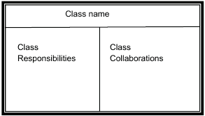

职责是类需要了解的内容（即属性）以及它应该执行的操作（即方法），尽管在 `CRC` 卡上，这些定义并不像 UML 图中那样精确。

协作是该类为了履行其职责而必须与之工作的其他类。下图显示了为系统中的两个类开发的 `CRC` 卡。

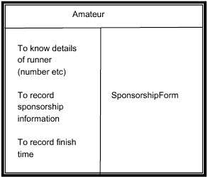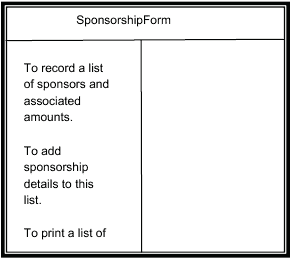

开发 `CRC` 卡后，我们可以角色扮演一系列场景，以检查系统在“纸面上”是否运行良好。如果不是，我们可以在进入编写缺陷计划的耗时过程之前进行修改。

一个示例场景是跑步者获得额外的赞助商。在这种情况下，通过查看上面的 `CRC` 卡，`Runner` 能够与 `SponsorshipForm` 类协作记录赞助信息。`SponsorshipForm` 类记录了赞助商列表，并可以向列表中添加额外的赞助商。

测试一系列场景可能会突出我们系统设计中的缺陷，然后我们可以修复这些缺陷——这早于在编写薄弱设计上浪费任何时间。

## 6.11 详细化类

在确定了系统设计中的类并使用 `CRC` 卡对这些类进行记录和测试之后，我们现在可以详细化我们的 `CRC` 卡，并使用 UML 类图记录我们的类。为了这一点，我们需要获取通过 `CRC` 卡记录的通用规范，并解决任何歧义，例如精确的数据类型。

在详细化 `CRC` 卡后，我们现在可以为提议的设计绘制类图（如下所示）：

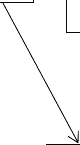

## 6.12 总结

收集用户需求是软件工程过程的一个至关重要的阶段（且超出本文的范围）。将复杂的需求规范转换为优雅、简单的面向对象的架构设计是一项需要经验的技能任务。然而，一个良好的起点是遵循本章列出的简单流程。

通过一系列任务，我们看到了如何分析对问题的文本描述。我们：

- 识别了描述中超出系统范围的方面；
- 识别了描述在何处使用不同的词指代同义项；
- 使用名词和动词识别潜在的类、属性和方法；
- 查看了类以识别潜在的继承层次结构并识别类之间的其他关系（例如关联）；
- 使用 `CRC` 卡记录了结果类，并通过角色扮演一系列场景测试了设计的有效性，并根据需要修改了我们的设计；
- 最后，我们可以详细化这些细节并使用类图记录结果。

本章列出的设计过程将在第 11 章描述的案例中再次详细演示。

# 7 集合框架

### 引言

本章将向读者介绍集合框架——这是 Java 标准库的重要部分。

### 目标

在本章结束时，你将能够……

- 理解 Java 集合框架的基本概念
- 对比各种 `Collections` 接口的特性
- 理解迭代器（iterators）的相关概念


### 集合框架

本章由十二部分组成：

1. 集合简介
2. `Collection` 接口
3. 旧与新集合
4. `Lists`
5. `Sets`
6. `Maps`
7. `Collection` 实现
8. 集合框架概述
9. 使用无类型集合的示例
10. 使用泛型集合的示例
11. 关于 `Set` 的说明
12. 总结

#### 7.1 集合简介

大多数软件系统需要存储各种实体组，而不仅仅是单个项目。`Arrays` 提供实现此点的方法，但 Java `Collections` 支持更多样、灵活的分组形式。

在 Java 中，集合（或“容器”）是用于汇聚其他对象组的类。Java 平台提供了一个“集合框架”，这是一组一致的接口和实现：

- 接口定义了可用功能
- 实现影响其他问题，包括性能

#### 7.2 Collection 接口

集合框架的核心是一个名为 `Collection` 的接口。它定义了框架核心的方法。`List` 和 `Set` 是 `Collection` 的扩展接口——它们继承了所有的操作并增加了一些额外的操作。

请注意，这些是接口而不是类，它们只定义了操作签名，而没有定义其实现的任何方面。

另一个重要的额外接口是 `Map`。它不是 `Collection` 的扩展——因为由于某些原因（我们稍后会看到），映射并不完全符合 `Collection` 层次结构，尽管它们仍然是“集合框架”的一部分。

因此，我们有以下接口：

- `Collection`：最通用的分组
- `List`：按特定顺序的对象集合（允许重复）
- `Set`：无特定顺序的唯一对象集合
- `SortedSet`：按升序排列的集合
- `Map`：唯一“键”及其关联对象的集合
- `SortedMap`：按键升序排列的映射

正如 `List` 和 `Set` 扩展 `Collection` 接口一样，`SortedSet` 是 `Set` 的扩展，`SortedMap` 是 `Map` 的扩展。

我们将在本章中查看 `List`、`Sets` 和 `Maps`。

#### 7.3 旧与新集合


在 Java SDK 1.4 之前，集合持有 `Object` 类型——即任何类的对象，因为所有类都是 `Object` 的子类。这允许在集合中混合对象。然而，当从集合中取出对象时，编译器不知道该对象是什么，这会导致一些额外的复杂性。

在实践中，我们几乎总是希望特定的集合中只有某些特定类型的对象。因此在 Java JDK 5.0 中引入了泛型（generics）。泛型允许在不指定类型的情况下定义类它处理的数据项类型。相反，类型在类实例化时指定，因此对于特定对象来说是固定的。

因此，通过使用“泛型”（generics），我们可以创建只存储指定类型对象的集合。

## 7.4 列表 (Lists)

列表是最常用的集合类型——在您可能使用数组的地方，`List` 通常会提供一种更方便的方法来处理数据。

列表是非常通用的数据结构，每个项目都占据一个特定的位置。它们在许多方面与数组相似，但它们更灵活，因为它们会随着数据的添加自动调整大小。它们也比数组更易操作，因为人们已经创建了许多实用的方法，可以替你完成大部分工作。`Lists` 按照特定的顺序存储项目（尽管不一定按任何有意义的顺序排序），并且允许重复项。

## 7.5 集合 (Sets)

集合就像是对象的“袋子”，而不是列表。它们基于数学中“集合”（set）的概念——一组“成员”的组合，其中可以包含零个、一个或多个不同的项目。

与 `List` 不同，集合中不允许重复项，且 `Set` 不会对项目进行排序（但 `SortedSet` 可以）。

与列表一样，集合在添加项目时会自动调整大小。

`List` 中可用的许多操作也适用于 `Set`：

- 我们**不能**在特定位置添加对象，因为元素没有顺序
- 出同样的原因，我们**不能**“替换”项目（尽管我们可以添加一个并删除另一个）
- 获取所有项目是可行的，但序列是不确定的
- 查找某个元素所处的位置是由于没有意义的。

## 7.6 映射 (Maps)

映射与 `Lists` 和 `Sets` 有很大不同，因为它们存储不是单个对象，而是对象的值对。该值对由一个“键”（key）和一个“值”（value）组成。键是用于标识该值对的标识。值是与键关联的一条信息或对象。

示例：在地址录中，键是人的名字，值是他们的地址、电话、电子邮件等。每个键只有一个值，但由于值是对象，它们可以包含几条数据。不允许有重复的键，但允许有重复的值。因此，在上一个例子中，如果您在地址录中查找两个人，可能会发现他们住在同一个地址——但一个人不会有两个家。

和集合一样，`Map` 不会对项目进行排序（但 `SortedMap` 会按键的顺序排序），并且像列表和集合一样，映射在添加或删除项目时会自动调整大小。

### 活动 1

对于以下每个问题，写下哪种最合适：列表（list）、集合（set）或映射（map）。

1) 我们想记录俱乐部的成员。

2) 我们想记录我们花费的钱（以及花在了哪里）。

3) 我们想记录银行账户详情——每个账户由银行账户号码识别。

### 反馈 1

1) 对于此，我们将使用 `Set`。可以根据需要添加和删除成员，且成员之间没有特定的顺序。

2) 对于此，我们将使用 `List` —— 这将按照购买顺序记录所购买的物品。重要的是，由于列表允许重复项，我们可以购买两个相同的玩具（也许是给两个不同孩子准备的生日礼物）。

3) 我们不会有两个相同的银行账户，所以 `Set` 似乎是合适的，但由于每个账户都有一个唯一的账户号码标识，`Map` 是最合适的选择。

## 7.7 集合实现

到目前为止，我们一直在查看集合接口——这些是功能的规范，我们可以从中选择我们想要使用的部分。要实际使用它们，我们需要实现这些接口的类。

这里展示的实现都是 Java 平台库包的一部分，但程序员也可以为了特殊目的编写自己的实现。

- `ArrayList` 实现了 `List` 接口：对于有序列表，通常访问速度快
- `LinkedList` 这也实现了 `List` 接口：在某些不常见的情况下，它可能比 `ArrayList` 快
- `HashSet` 实现了 `Set` 接口：它提供了快速访问，但项目是无序的
- `TreeSet` 这也实现了 `Set` 接口：比 `HashSet` 慢，但它维护元素的顺序，即它为我们提供了一个 `SortedSet`
- `HashMap` 实现了 `Map` 接口：它提供了快速访问，但项目是无序的
- `TreeMap` 这也实现了 `Map` 接口：比 `HashMap` 慢，它按 `Key` 的顺序维护元素，即它为我们提供了一个 `SortedMap`

你不能创建一个“List 对象”，因为 `List` 是一个接口——但你可以创建一个 `ArrayList` 对象或 `LinkedList` 对象，其中任何一个都将提供 `List` 接口定义的功能。

## 7.8 集合框架概述

下面的图为我们提供了集合框架的稍微简化的概述。它显示了接口以及实现接口的类。记住，接口内部没有实现，它们只包含公共方法签名，任何实现该接口的类必须履行这些签名。

图中显示了两种箭头。实线箭头表示继承；例如 `Set` 接口扩展了 `Collection` 接口。虚线箭头表示实现；例如 `HashSet` 类实现了 `Set` 接口。

注意 `Map` 不是 `Collection` 的子接口。这是因为，与存储单个对象的 `Lists` 和 `Sets` 不同，`Maps` 存储的是键对象和值对象的配对。我们仍然认为 `Map` 是集合框架的一部分。

### 活动 2

所有集合接口和实现的文档都可以在在线浏览或下载：`http://java.sun.com/javase/6/docs/api/`

集合框架的接口和实现类都可以在 `java.util` 包中找到。使用在线 API 文档查找 `ArrayList` 的方法。列出三个你认为最有用的方法。

### 反馈 2

一些明显实用的方法包括：

- `add()` —— 将元素添加到列表的指定位置
- `clear()` —— 清空列表
- `contains()` —— 如果此列表包含指定的对象，则返回 true
- `get()` —— 返回指定位置的对象，以及 `remove()` —— 从列表中删除对象

注意这些方法中的一些是重载的，例如 `remove()`，它可以删除删除指定位置的对象，也可以删除指定对象的第一个实例。

# 使用 Java 的面向对象编程

## 集合框架

### 7.9 使用非类型集合的示例

下面的代码展示了一个 `String` 非类型列表的示例。

```java
import java.util.List;
import java.util.ArrayList;
import java.util.Iterator;

class ListDemo {
    List mAList;

    /***构造函数*/
    public ListDemo() {
        mAList = new ArrayList();
    }

    /**
     * 在列表末尾添加字符串
     * @param pStr 要添加到列表的字符串
     */
    public void appendString(String pStr) {
        mAList.add(pStr);
    }

    /**
     * 在列表的指定位置插入字符串
     * @param pPos 插入字符串的位置 (0 = 元素之前)
     * @param pStr 要添加到列表的字符串
     */
    public void insertString(int pPos, String pStr) {
        mAList.add(pPos, pStr);
    }

    /**
     * 删除列表中指定位置的字符串
     * @param pPos 要删除字符串的位置
     */
    public void deleteString(int pPos) {
        mAList.remove(pPos);
    }

    /**
     * 显示字符串列表
     */
    public void display() {
        String nextItem;
        Iterator it = mAList.iterator();
        while (it.hasNext()) {
            nextItem = (String)it.next();
            System.out.print(nextItem + " ");
        }
        System.out.println();
    }
}
```

上面的代码大部分是自言其义的，但 `display` 方法可能需要一些解释。

首先，`List`、`Set` 和 `Map` 类实现了 `iterator()` 方法；该方法返回一个 `Iterator` 类型的对象，该对象能够遍历 `Lists`、`Sets` 或 `Maps`。注意——这不是一个简单的过程，因为每个集合可能由不同的对象组成，但幸运的是，这些工作工作已经为我们完成了。

因此，在上面的 `display()` 方法中，创建了一个通用类型 `Iterator` 的变量 `it`。然后在我们特定的集合上调用 `iterator()` 方法，从而返回一个能够遍历我们的 `Strings` 列表的对象。`Iterator` 类有两个非常有用的方法：`hasNext()`（当集合中存在另一个对象时返回 `true`）以及 `next()`（返回集合中的下一个对象）。

因此，上面的循环遍历列表，反复运行并显示每个对象。

还有最后一点需要注意：由于我们正在使用非类型集合，列表中的每个对象都可能是不同类型的对象，因此当从列表中检索到一个对象时，JRE 并不知道它是什么类型的对象——但是，由于我们只使用此列表存储 `Strings`，我们可以将检索到的每个对象强制转换为 `String`。这会导致编译器警告，因为如果向列表中添加了非 `String` 对象，这种转换将会失败。

虽然这个程序存储并操作的是 `Strings` 列表，但程序同样可以轻松地存储 `Publication` 列表——或者任何从我们创建的类中构造的对象。

### 7.10 使用类型集合的示例

使用类型集合使得变得更简单，原因有二：

1) 因为我们知道从列表中将返回什么类型的对象，因此我们不需要使用强制转换运算符。

2) 因为 Java 5.0 引入了改进的 `for` 循环，它可以无需循环计数器（或 `iterator`）遍历类型集合中的每个项目。

因此，请看下方的示例……

```java
import java.util.List;
import java.util.ArrayList;

public class ListDemo {
    private List<String> mAList;

    /**
     * 构造函数
     */
    public ListDemo() {
        mAList = new ArrayList<String>();
    }

    /**
     * 显示字符串列表
     */
    public void display() {
        for (String nextItem: mAList) {
            System.out.print(nextItem + " ");
        }
        System.out.println();
    }
}
```

创建类型集合与创建非类型集合非常相似，除非在创建实例变量和创建实际集合时，我们必须指定集合包含的内容（在本例中它仅仅是 `Strings` 集合）。你可以将 `< >` 语法理解为“的”，即在本例中是 `strings` 的列表。添加、插入和删除元素与非类型集合相同，但显示集合要简单得多，因为我们知道列表每个元素包含的内容。我们不需要对返回的元素进行强制转换，事实上我们甚至不需要迭代器（这就是为什么上面只有两个 import 语句）。

`nextItem` 被自动赋值给列表中的下一个项目。注意 `nextItem` 被定义为 `String` 变量，因为在这里我们使用的是 `Strings` 列表。编译器知道这一点，并确保使用正确类型的变量。

### 7.11 关于 Sets 的说明

对 `Sets` 的深入讨论超出了本文的范围，但 `Sets` 有一个必须注意的复杂性。`Sets` 不允许存储重复对象。因此我们必须问，什么导致对象重复？两个对象只有在名称相同时才是相同的吗——或者如果某些数据相同它们也可以相同的？

考虑一个银行账户集合：

不应该创建一个相同账号的第二个账户并将其添加到集合中。除非另有说明，否则 Java 将这两个对象视为不同的对象，因为这两个对象具有不同的名称（`Account1` 和 `Account2`），因此虽然 `Sets` 不允许内部存在重复对象，这两个账户都可以被创建并添加到集合中。为了解决这个问题，我们需要重写 `equals()` 方法，规定当 `accountNumber` 相同时，这些对象是相同的。

我们可以像下面一样操作：

```java
public boolean equals (Object pObj) {
    Account account = (Account) pObj;
    return (accountNumber.equals(account.accountNumber));
}
```

另一个复杂性涉及对象如何存储在 `sets` 中。为此，Java 使用基于对象名称的 hashcode。然而，两个具有相同 `accountNumber` 的账户应该生成相同的 `hashcode`。为了确保这种情况发生，我们需要重写 `hashCode()` 方法，以便使用 `accountNumber` 而不是对象名称生成 hashcode（正如我们需要重写 `equals()` 方法一样）。我们可以通过如下所示重写此方法来确保生成的 hashcode 基于账户号码……

```java
/**
* 重写继承自 Object 的 hashCode
* @return 基于 accountNumber 的 hashcode
*/
public int hashCode() {
    return accountNumber.hashCode();
}
```

重定义对象 `hashCode` 的简单方法是连接这些实例值，这些值将相等性定义为单个字符串，然后获取该字符串的哈希值。在这种情况下，相等性完全由 `accountNumber` 定义，且该值必须是唯一的。

这看起来有点奇怪，但尽管我们正在为 `Account` 类型的对象重写 `hashCode()` 方法，我们仍然可以在此 `String` 上使用 `hashCode()` 方法。

`hashCode()` 保证为相同的 `String` 产生相同的哈希值。偶尔不同的键值可能会产生相同的哈希值，但这并不是一个问题。

## 集合框架

通过重写 `equals()` 和 `hashCode()` 方法，Java 将防止具有重复数据（在此情况下为具有重复的 `account numbers`）的对象被添加到集合中。

### 活动 3

以下代码将在 `Strings` 集合（称为 `stringSet`）中查找一个 `String`。请修改此代码以便在 `Publications` 集合（称为 `publicationSet`）中查找一个 `Publication`。

```java
public void findString(String pStr){ boolean found;

found = stringSet.contains(pStr);

if (found){ System.out.println("Element " + pStr + " found in set");}else{ System.out.println("Element " + pStr + " NOT found in set");}

}
```

### 反馈 3

```java
public void findPublication(Publication pPub){ boolean found;

found = publicationSet.contains(pPub);

if (found){ System.out.println("Element " + pPub + " found in set");}else{ System.out.println("Element " + pPub + " NOT found in set");}

}
```

### 活动 4

查看活动 3 反馈中的代码并回答以下问题。

1) 上述代码可以用于存储书籍集合吗？

2) 它可以存储书籍和杂志的组合吗？

3) 如果在集合中找到一本书，下行代码会做什么？

`System.out.println“Element “ + pPub + “ found in set”);`

### 反馈 4

1) 是

2) 是

3) `pPub` 将调用对象的 `toString()` 方法。`JRE` 将在运行时确定这实际上是一本书，并且假设 `book` 重写了 `toString()` 方法以返回标题和作者，这将构成所显示消息的一部分。

## 7.12 总结

Java “集合框架”提供了现成的接口和实现，用于存储对象的集合。这几乎完全地使数组的使用变得多余。

存在“无类型”集合，而且从 `JDK 5.0` 开始也有“强类型”集合。

集合接口包括 `List`、`Set` 和 `Map`，每个接口都定义了适当的操作。集合实现包括 `ArrayList`、`HashSet` 和 `HashMap`，它们分别是 `List`、`Set` 和 `Map` 接口的实现。

在定义存储在 `Sets` 中的对象（或作为 `Maps` 中的键）时，需要特别注意定义“重复”的含义。对于这些对象，我们需要重写从 `Object` 继承的 `equals()` 和 `hashCode()` 方法。


虽然在本章中我们未能对集合进行详细讨论，但第 11 章的案例将演示如何使用 `Maps` 和 `Sets` 来存储自己的对象（而不只是 `Strings`）。如果需要，可以下载并检查相应的代码。

# 8 Java 开发工具

## 引言

本章将向读者介绍支持大型 Java 系统开发的各种开发工具（例如 `Eclipse` 和 `NetBeans`）。还将演示 API 文档和 `JavaDoc` 工具的重要性。

## 目标

在本章结束时，你将能够……

* 理解 `JDK` 和 `JRE` 的角色
* 调查专业的开发环境（`Eclipse` 和 `NetBeans`）
* 理解 `Javadoc` 工具的重要性以及在代码中嵌入 `Javadoc` 注释的价值
* 编写 `Javadoc` 注释并为程序生成自动文档

本章由三个部分组成：

1. 软件实现
2. `JRE`
3. Java 程序
4. `JDK`
5. `Eclipse`
6. Eclipse 架构
7. Eclipse 特性
8. `NetBeans`
9. 使用 `NetBeans` 开发图形界面
10. 使用 `NetBeans` 应用布局管理器
11. 添加动作监听器
12. `Javadoc` 工具
13. 总结

## 8.1 软件实现

在计算机为我们完成有用的任务（例如检查文档中的拼写错误）之前，需要在运行该程序的机器上编写并实现软件。软件实现涉及程序源代码的编写以及为在特定机器上执行做准备。当然，在编写软件之前，需要对其进行设计，并在某个时间点对其进行测试。有许多迭代生命周期来支持设计、实现和测试过程，这些过程涉及多个实现阶段。这里特别关注的是让源代码在特定机器上执行的三种长期存在的方法……

* 编译成机器语言目标代码
* 通过“解释器”程序直接执行源代码
* 编译成中间目标代码，然后由运行时系统进行解释

实现 Java 程序涉及将源代码（Java）编译成中间代码，然后由名为 `JRE` 的运行时系统进行解释。这种方法既有优点也有缺点，值得比较这三个选项，以理解它们对 Java 开发者的影响。

### 编译

编译器将源代码翻译为适用于相关硬件/操作系统组合的机器码。严格来说，有两个阶段：程序单元（通常是文件）的编译，然后是“链接”阶段，在此阶段将独立的程序单元和相关的库代码组合成一个完整的可执行程序。

编译后的程序将作为该平台的“原生”应用程序运行。这是最旧的模型，被 Fortran 和 Cobol 等早期语言以及许多现代语言（如 C++）使用。它允许快速执行速度，但每次更改代码时都需要重新编译程序。

### 解释

在这里，源代码没有被翻译成机器码。相反，解释器读取源代码并执行其指定的动作。

我们可以说解释器像是一个“虚拟机”，其机器语言就是源代码语言。更改代码后不需要重新编译，但解释过程会对执行速度产生显著影响。脚本语言（Scripting languages）倾向于以这种方式工作。

### 中间代码

这种模型是前两个模型的混合体。通过编译将源代码转换为更高效的中间表示，这种表示可以由“运行时系统”（再次是某种“虚拟机”）比直接解释源代码更快速地执行。然而，使用由运行时系统软件执行的中间代码，使得编译过程可以独立于操作系统/硬件平台。

也就是说，同样的中间代码只要每个平台都有适当的运行时系统，就可以在不同的平台上运行。这种方法已经久经考验（例如在 20 世纪 70 年代初的 Pascal 中），这也是 Java 的工作原理。

## 8.2 JRE

要运行 Java 程序，我们必须首先使用 Java 开发工具包（`JDK`）中提供的编译器生成中间代码（称为 `bytecode`）——参阅下文第 8.4 节。

需要一个包含 Java 虚拟机（`VM`）的 Java 运行环境（`JRE`）来执行字节码和 Java 库包。因此，任何运行 Java 程序的机器上都必须存在 `JRE`。

Java 字节码是标准且与平台无关，由于已经为大多数计算设备（包括 PC、笔记本电脑、移动设备、移动手机、互联网设备等）创建了 `JRE`，这使得 Java 程序具有高度的可移植性。

## 8.3 Java 程序

无论采用何种执行模式，程序员都可以使用各种工具来创建源代码。选项包括根据需要手动调用的简单离散工具（例如编辑器、编译器、解释器），或者使用集成开发环境（`IDE`），它在无缝界面后集成了这些实现工具。更高级的 `CASE`（计算机辅助软件工程）工具可以将实现过程与开发周期的其他阶段整合——此类软件可以获取 `UML` 类图并自动生成类和方法存根，从而节省了编写 Java 代码时所需的某些精力。

在编写 Java 程序时，Java 程序中的每个类（或接口）都有其自己的 `name.java` 文件，其中包含源代码。这些文件由编译器处理生成包含相应字节码的 `name.class` 文件。要实际作为应用程序运行，其中一个类必须包含一个具有上述签名的 `main()` 方法。

## 8.4 JDK

要开发 Java 程序，你必须首先安装 Java 开发工具包（`JDK`）。它由 Sun 公司开发，并可以通过 http://java.sun.com/ 免费从互联网上获取。在 5.0（或 1.5）版本之前，它被称为 Java 软件开发工具包（`SDK`）。

Java `IDE`（例如 `Eclipse` 或 `NetBeans`）构建在 `JDK` 之上以添加 `IDE` 特性——这些特性可能包括界面开发工具、代码调试工具、测试工具和重构工具（稍后将详细介绍这些）。使用 `IDE` 时，很容易忘记许多功能实际上是 `JDK` 的一部分，当要求 `IDE` 编译程序时，它实际上只是将此请求传递给底层的 `JDK`。

我们可以直接从命令行使用 `JDK` 来编译和运行 Java 程序，尽管大多数情况下使用 `IDE` 提供的额外功能更为方便。

有点令人困惑的是，Java 的当前版本同时被称为 6.0、1.6 甚至 1.6.0。这些版本似乎有细微不同的含义——别担心！

`JDK` 中有很多工具。你可以在 http://java.sun.com/javase/downloads/ 并通过点击文档、APIs 和 JDK 程序员指南的链接获取其中每个工具的描述。两个最重要的基本工具是：

- `javac` – java 编译器
- `java` – java 程序启动器（运行 `VM`）

要编译 `MyProg.java`，我们输入：

```
javac MyProg.java
```

如果成功，这将创建 `MyProg.class`

要运行 `Myprog`（假设它有一个 `main()` 方法），我们输入：

```bash
java MyProg
```

另一个非常有用的工具是 `javadoc` – 它使用 Java 源代码中的注释为程序生成自动文档。

## 8.5 Eclipse

转向“工业级强度”的 `IDE` 是你作为软件开发人员进步中的一个重要里程碑，就像第一次骑没有辅助轮的自行车一样。通过一些练习，你很快就会发现它提供了许多有用且节省时间的设施，让你流离不开……

`Eclipse` 是一个灵活且可扩展的 `IDE` 平台。它最初由 IBM 开发，现在已开源，可以在 Eclipse Foundation 的 www.eclipse.org 下载。

`Eclipse` 使用 Java 编写的，像所有 Java 程序一样，它需要 `JRE` 才能工作，但默认带有 Java 开发工具 (`JDT`)，并且扩展和额外的工具支持其他语言的开发。`Eclipse` “运行时平台”足够灵活，甚至可以作为开发 IDE 相关应用程序的框架。

## 8.6 Eclipse 体系

由于 `Eclipse` 依赖 `JRE`，它本质上是跨平台的（Windows、Linux、Mac 等）。所示元素是基础版下载的一部分。

## 8.7 Eclipse 特性

`Eclipse` 提供了一系列功能，为想要开发大型 Java 程序的程序员提供了强大的支持。这些包括：

- 代码补全和帮助功能
- 可以自动调整各种代码格式方面的代码格式化器
- 支持程序开发的强大功能，包括重构（见第 10 节第 4 部分）和自动测试功能（见第 10 节第 5 部分）。

## 8.8 NetBeans

`NetBeans` 是另一个非常强大的 `IDE`，最初由 Sun Microsystems 开发和发行，`NetBeans` 在 2000 年开源，并受到社区开发的插件和视频教程的广泛支持。

NetBeans 可以从 www.netbeans.org 免费下载。

`NetBeans` 有许多旨在帮助初学者并节省时间的功能。这些包括：

- 快速上手指南、在线教程和在线视频（涵盖主题包括 IDE 介绍、Javascript 调试器和 PHP 支持）。
- 具有自动弹出窗口突出显示 Java API 相关部分的帮助功能
- 格式化和调试设施
- 代码补全功能，可以自动插入循环、try catch 块和构造函数（等）。
- 项目管理功能可以监控项目的更改，并允许项目回滚到早期的状态。

Netbeans 还包含了一系列 Java 应用程序的模板，包括窗口应用、企业级、Web 和移动应用程序。它甚至还有针对 C++/PHP/Ruby 和数据库应用程序的模板。因此，只需点击几次按钮，Netbeans 就会创建一个带有 `main` 方法的简单 Java 应用程序，该方法将调用所示的空白 GUI……

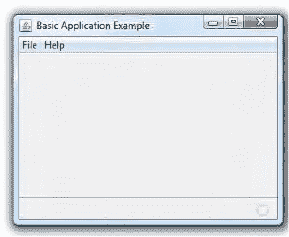

此外，许多可用插件之一提供了创建 UML 图的支持。虽然这个工具具有局限性，但它不仅支持创建图表，还提供了你可能在 CASE 工具期望的功能，例如自动代码生成（从图表）和反向工程（即通过分析当前代码从代码生成 UML 图）。

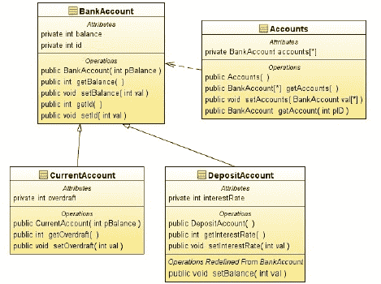

因此，根据上述图表，NetBeans 将创建四个类，其中三个将自动放置在继承层次结构中。为每个指定的方法将创建方法存根，虽然每个方法内部的代码仍需编写，但 `CurrentAccount` 的构造函数将自动调用 `Bank Account` 的构造函数，并将参数 `pBalance` 向上传递。


## 8.9 使用 NetBeans 开发图形界面

NetBeans 具有一个可视化工具来帮助开发图形用户界面。该工具允许创建一个窗口并将一系列对象拖到窗口上，包括面板、标签页、滚动面板、按钮、单选按钮、复选框、组合框、密码字段、进度条和树形。

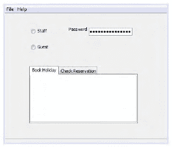

## 8.10 使用 NetBeans 应用布局管理器

在设计图形用户界面时，将对象放置在窗口的精确位置上是“正常”的。因此，界面将完全按照设计的方式显示。为了让其良好工作，界面设计师通常对他们正在设计的界面的显示尺寸有一个大致了解。大多数 PC 游戏设计在 14 英–21 英寸的窗口上运行。大多数移动游戏设计在小得多的屏幕上运行。

然而，Java 程序被认为是平台无关的——Java 的优势之一就是是用 Java 编写的代码可以在 PC、笔记本电脑或小型移动设备上运行，无论这些设备使用什么硬件或操作系统（只要它们都带有 `JRE`）。因此，同一个界面应该在大视觉显示单元或小型移动屏幕上运行。由于这个原因，在 Java 中开发界面时，通常会赋予 Java 一些控制权来决定具体如何/在何处显示。因此，在运行时，Java 可以重新配置窗口以适应运行程序的任何设备。这有好处，因为显示器将自动重新配置以适应运行程序的任何设备，但这种灵活性是需要代价的。由于给了 Java 一些控制权，界面设计师无法确定界面的具体外观，尽管他们可以给 Java 提供关于界面应如何显示的某些“指令”。

布局管理器是定义界面如何显示的“对象”，创建一个布局管理器并将其分配给“容器”对象（如窗口框）是正常的。

有很多常用的布局管理器——其中最常见的是流式布局（flow layout）和网格布局（grid layout）。使用流式布局，Java 将对象排列成行，如果窗口不足以在每行中放置每个对象，对象将自动流到另一行。

### 流式布局实例

下方显示了两个窗口，每个窗口有十个按钮——在第二张图中，由于窗口被调整了大小且对象无法在一行中，Java 将部分按钮放置在第二行。

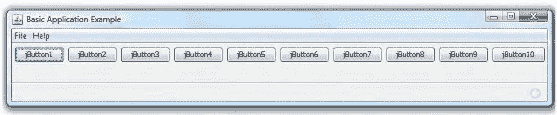

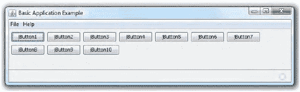

可以使用各种属性创建流式管理器，以定义对象的对齐方式（居中、左侧或右），并定义对象之间的水平和垂直空间。

### 网格布局实例

另一个非常常用的布局管理器是 `grid layout`。在网格中应用对象时，可以指定行数。Java 将计算需要使用多少列，以便在这些行数中放置所需数量的对象。对象将调整大小以适应窗口。Java 将缩小或放大对象以适应窗口——即使这意味着无法显示所有文本。

下方的两图显示了在三行网格上显示的相同 10 个按钮。

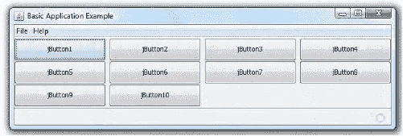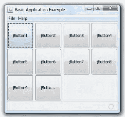


注意第二张图，按钮已调整大小以适应不同的窗口——因此这样做没有足够的空间显示第十个按钮的所有文本。

布局管理器可以分层使用并应用于任何容器上。因此，我们可以创建一个网格，其中一个元素包含多个以流式方式排列的对象。

使用 NetBeans 创建布局管理器：右键点击容器对象将弹出一个上下文相关菜单，其中一个选项是应用布局管理器。选择此选项将显示可能的布局管理器列表。一旦选择了布局管理器，将出现一个窗口允许指定其属性。

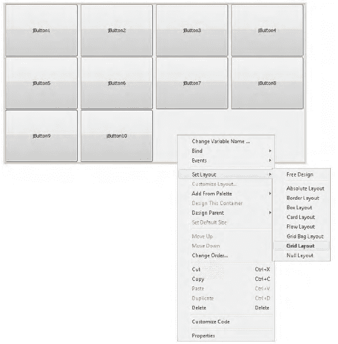

## 8.11 添加动作监听器

创建可工作界面的最后一步是创建动作监听器（Action Listeners）并将它们应用到界面上的对象。动作监听器是监听用户操作并做出相应响应的对象——因此，当按下“计算”按钮时，程序将计算并显示结果。

可以为界面上的所有对象创建动作监听器，并为每个对象创建一系列操作。尽管许多对象（如标签）不需要响应用户的交互。

在 NetBeans 中创建动作监听器非常简单。在设计模式下，选择任何对象时，会显示属性窗口。选择事件（events）选项卡将允许为此对象创建一系列操作。一旦选择了其中一个，将编写一个“动作监听器”存根。将自动编写代码创建该类的对象并将其分配给选中的对象。

剩下的只需程序员编写定义对用户操作响应的代码。在下面的示例中，创建了一个事件来监听 `button1` 被按下。

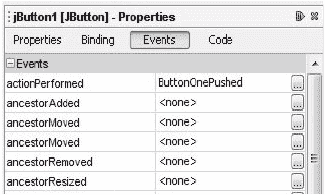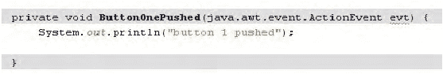

## 8.12 Javadoc 工具

JDK 中一个特别有用的工具是 `javadoc`。

多年来，程序员一直承担着编写文档这一繁琐且耗时的任务。其中部分文档是面向用户的，用于解释程序的功能以及如何使用。另一部分文档则是面向未来的程序员的，他们需要对程序进行修改和调整，使其功能随着组织需求的变化而发生变化。这些程序员需要了解程序的功能及其结构。他们需要知道：

* 它包含哪些包（packages）
* 每个包中存在哪些类（classes）以及这些类的作用
* 每个类存在哪些方法（methods），以及每个方法：
    * 该方法的作用是什么
    * 它需要哪些参数
    * 它返回了什么值（如果有的话）。

### Javadoc 工具

`javadoc` 工具不会生成用户指南，但它会提供程序的技术描述。该工具分析 `*.java` 源文件，并生成一组网页页（`HTML` 文件）作为文档，其格式与 Sun 网站上的 API 文档相同。

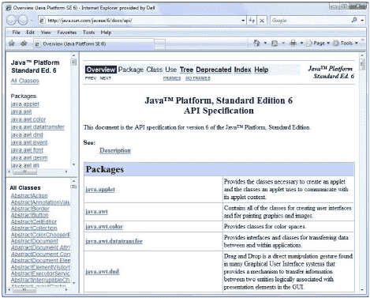

该网站以一组索引网页页的形式，提供了 Java 语言规范的关键细节，包括所有的包、类、方法以及方法参数和返回值。这些极其有用的信息并非手工生成，而是使用 `javadoc` 工具生成的。

使用同一个工具可以为任何 Java 程序生成相同风格的文档。然而，这依赖于源文件中格式正确（且包含丰富信息！）的 javadoc 风格注释，包括如 `@author`、`@param` 等标签。

由于这些文档是点击一个按钮即可自动生成的，它将程序员从繁琐、耗时且易出错的任务中解放出来。此外，每当程序更改时，都可以更新文档。

该工具确实要求程序员在开发过程中为代码添加有意义的注释，对源代码注释的疏忽将导致 javadoc 输出结果很差！另一方面，如果注释得当，参考文档就可以“免费”生成了！

Javadoc 注释应该添加在每个类的开头，使用标准标签 `@author` 和 `@version` 按照以下格式给出该类的概述：

```java
/***********************************
* 类的描述
*
* @author 作者姓名
* @version 版本详细信息（以及日期）。
*********************************/
```

每个方法也应该提供类似的注释，使用 `@param` 和 `@return` 来描述每个参数和返回的值。每个参数的详细信息应从参数名称开始，如下所示分行提供：

```java
/***********************************
* 方法的描述
*
* @param nameOf1stParam 第一个参数的描述
* @param nameOf2ndParam 第二个参数的描述
* @return 返回值的描述
*********************************/
```

## 信任与责任

NNE 和 Pharmaplan 合作建立了 NNE Pharmaplan，这是全球领先的工程咨询公司，完全专注于制药和生物技术行业。

Inés Aréizaga Esteva（西班牙），25 岁，教育背景：化学工程师：

– 作为一个新人，必须保持积极和开放的心态，并向同事明确你能处理什么工作。制药领域对我来说是全新的。尽管他们很忙，但大多数同事都会抽时间教我，他们也信任我。尽管起初有点困难，但我能感觉到自己开始受到重视，我的贡献也得到了认可。


NNE Pharmaplan 是全球领先的工程咨询公司，完全专注于制药和生物技术行业。我们在全球范围内雇佣了 1500 名员工，并凭借全方位的服务列表提供全球视野和本地知识。`nnepharmaplan.com`


### 活动 1

下面的方法接收两个整数并将它们相加。该方法返回此值。请使用适当标签编写一个 `javadoc` 注释来描述此方法。

```java
public int add(int pNumber1, int pNumber2) {return (pNumber1 + pNumber2);}
```

### 反馈 1

```java
/************************************ 此方法将两个整数相加** 
* @param pNumber1 要相加的第一个数字
* @param pNumber2 要相加的第二个数字
* @return 两个数字的和
*********************************/
```

`javadoc` 工具无法通过分析方法的描述来判断该描述是否是对该方法的准确总结。然而，该工具的作用远不止是将程序员的注释剪切粘贴到网页文档上。该工具的一个功能是分析方法签名，并将其与注释中的标签进行比较，以检查逻辑错误。如果一个方法需要三个参数，但注释只描述了两个，则会检测到此错误并报告给程序员：

“warning – @param argument “pNumber3” 不是参数名。”

通过分析代码，该工具还提供了关于类、被继承的方法以及被覆盖方法的额外信息。

生成的参考文档是供使用相关类的程序员使用的，它不包含旨在供维护工作中编辑类源码的程序员阅读的方法内部注释。

生成的文档可以放在子文件夹中，并通过在网络浏览器中打开 `index.html` 文件进行查看。`javadoc` 只会记录公共（public）或保护（protected）的类和成员，因为只有这些成员对其他程序员可用。私有（private）或未给出访问修符的项目将被省略。

### 8.13 总结

编程语言中的源代码有多种执行方式。Java 使用一种称为 `bytecode` 的中间语言，并且需要一个 `main` 方法。

我们可以使用文本编辑器和 Java 开发工具包（JDK）中的工具“回归基础”创建 Java 程序，但使用构建在 JDK 之上的专业 IDE（集成开发环境）可以提供额外的功能支持。

对于开发的各个方面（如 GUI 设计、绘图和文档编制），可以使用专用工具，但某些 IDE 超越了基础功能，在 IDE 中内置了部分这些功能。`Eclipse` 和 `NetBeans` 是两个强大的开源 IDE，支持标准的 Java 程序开发。它们都可以免费下载。

这些工具起初可能看起来令人望畏，因为它们为专业开发提供了广泛的支持，包括代码格式化和重构，尽管有在线帮助，且两个工具都提供了某种程度的自动代码生成（例如 `main` 方法），以减轻程序员的工作负担。

`javadoc` 工具是一个极其有用且节省时间的设备，但它确实要求程序员在代码中插入有意义的 `javadoc` 风格注释（针对所有类和所有公共方法）。

如果读者编写过使用文件处理功能的 Java 程序，那么他们已经编写了捕获异常的代码，即他们使用过 `try-catch` 块。本章将解释创建自定义异常的重要性，并展示如何通过扩展 `Exception` 类和使用 `throw` 机制来实现这一目标。

### 目标

在本章结束时，你将能够……

* 学会异常的重要性
* 理解如何创建自定义异常以及
* 理解如何抛出这些异常。

本章由六部分组成：

1) 理解异常的重要性
2) 异常的种类
3) 扩展 `Exception` 类
4) 抛出异常
5) 捕获异常
6) 总结

## 9.1 理解异常的重要性

异常处理编写 Java 程序的关键部分。Java 语言中文件处理类的作者深知此点，并创建了利用 Java 异常处理机制的——但这些真的重要吗？对于那些使用 Java 编写自己应用程序的程序员来说，这些功能重要吗？

### 活动 1

想象一个银行程序由三个类和三个方法组成，如下所示……

* `BankManager`
    * `listOfClients`
    * `awardLoan()`
* `BookofClients`
    * `getClient(pClientIID :String) :Client`
* `Client`
    * `determineCreditRating()`

上述系统由 `BankManager` 类驱动。`awardLoan()` 方法通过接口或另一个方法被调用。该方法旨在接受或拒绝贷款申请。

`BookofClients` 类维护了一组账户持有者……如果他们开户，就会被添加到此集合中，当然，他们也可以被移除。然而，我们感兴趣的方法只有 `getClient()` 方法。该方法需要一个字符串参数（客户 ID），并返回一个客户对象（如果客户在某银行有账户）——或者返回 `NULL`（如果客户不存在）。

`Client` 类只有一个我们感兴趣的方法：`determineCreditRating()`。调用此方法是为了确定客户的信誉评级——`BankManager` 类利用此评级决定是否批准贷款。

考虑到上述场景，看下面的代码片段……

```
Client c = listOfClients.getClient(clientID) ;c.determineCreditRating();
```

这段代码存在于 `awardLoan()` 方法中。首先，它会调用 `getClient()` 方法并传递客户 ID 作为参数。该方法将返回适当的客户对象（假设该 ID 的客户确实存在），然后存储在局部变量 `c` 中。获取客户后，将对该客户调用 `determineCreditRating()` 方法。

看这两行代码。你能识别出它们存在的任何潜在问题吗？

### 反馈 1

如果存在指定 ID 的客户，上述代码将正常工作。但是，如果不存在指定 ID 的客户，`getClient()` 方法将返回 `NULL`。

那么第二行代码将导致运行时错误（具体为 `NullPointerException`），因为它尝试在一个不存在的客户对象上调用 `determineCreditRating()` 方法，程序将在此处崩溃。

### 活动 2

考虑对此代码进行以下修改，并判断这是否能解决问题。

```java
Client c = listOfClients.getClient(pClientID) ;If (c !=NULL) {c.determineCreditRating(); }
```

### 反馈 2

如果将代码修改为允许可能返回的 `NULL` 值，那么它就能工作了——但这种保护是不安全的，因为它依赖于程序员去发现这个潜在的致命错误。

在编写 `getClient()` 方法时，作者完全意识到可能找不到客户，并在这种情况下决定返回 `NULL` 值。然而，这依赖于每一个使用该方法的程序员都能识别并防止这种意外的发生。

如果任何使用该方法的程序员未能对 `NULL` 返回进行防护，他们的程序就可能会崩溃——在这种情况下，可能会导致银行损失巨额资金。当然，在其他应用程序中，例如飞机控制系统，程序崩溃可能会导致危及生命的后果。

需要更安全的编程方法来确保潜在的崩溃情况总能得到处理！存在这样一种机制——它被称为“异常”的机制。

通过使用这种机制，我们可以确保使用我们代码的其他程序员会收到潜在崩溃情况的警报，并且编译器将确保这些程序员处理该“问题”。因此，我们可以确保没有此类情况被“遗忘”。如何处理这些问题取决于使用我们方法的程序员的选择，但编译器将确保他们至少识别出潜在的崩溃情况。

在上述情况下，`getClient()` 方法应该生成一个异常，而不是返回 `NULL` 值。通过生成异常，Java 编译器将确保这种情况情况得到处理。

## 9.2 异常的种类

为了生成有意义的异常，我们需要扩展 Java 语言内置的 `Exception` 类——共有两种（普通异常和运行时异常）。

`java.lang.Exception` 的子类用于需要管理的预期之外的问题。它们必须在源方法的 `throws` 子句中声明，并且对方法的调用必须放在 `try / catch` 块中。

`java.lang.RuntimeException` 的子类用于会导致运行时失败且可能无法采取任何明智补救措施的情况。它们不需要在 `throws` 子句中声明，方法调用也不需要放在 `try / catch` 块中（但可以放在其中）。

因此，我们可以选择 Java 编译器是否应该强制我们显式地处理特定类型的异常。`Exception` 子类适用于我们知道可能出现问题且可以采取明智恢复措施的情况——例如 IO 错误。`RuntimeException` 子类适用于完全不应该发生的情况，并且可能无法做任何事情恢复局面，例如内存溢出错误或发现系统处于不应出现的状态。

## 9.3 扩展 Exception 类

在编写自己的方法时，我们应该寻找潜在的失败情况（例如无法返回值、计算过程中可能出现的错误等）。当发生潜在错误时，我们应该生成一个 `Exception` 对象，即 `Exception` 类的对象。然而，最好的做法是先定义通用异常的子类，即创建一个专门的类并抛出该子类型的对象。

新异常就像任何新类一样，在这种情况下它是 `java.lang.Exception` 的子类。在上述情况下，如果找不到指定 ID 的客户就会发生错误。因此，我们可以创建一个名为 `UnknownClientException` 的新异常类。

`Exception` 构造函数的参数需要一个 `String`，因此 `UnknownClientException` 的构造函数也需要一个 `String`。该字符串用于提供可能生成异常的问题细节。

创建此新类的代码如下……

```java
import java.lang.Exception;
```

```java
/******************************************************** Exception thrown when attempting to get an non-existent client ID** @author Simon Kendal* @version 1.0 (11th July 2009)********************************************************/
class UnknownClientException extends Exception{ 
    /*** Constructor** 
     * @param pMessage description of exception
     */
    UnknownClientException (String pMessage){ 
        super(pMessage);
    } 
}
```

在某些方面，这看起来相当奇怪。我们在这里创建 `Exception` 的子类，但我们的子类并没有包含任何新方法，它也没有重写任何现有方法。因此，它的功能与父类相同——然而，它是一个具有意义且描述性名称子类型。

如果不存在 `Exception` 的子类，我们只能捕获最通用的异常类型，即 `Exception` 对象。这意味着我们只能编写一个捕获所有类型异常的 `catch` 块（异常块）。

### 创建和使用异常

定义了子类后，我们有了选择……
a) 我们可以定义一个 `catch` 块来捕获通用类型 `Exception` 的对象，即它将捕获所有异常；b) 我们可以定义一个 `catch` 块来捕获 `UnknownClientExceptions` 但忽略其他类型的异常。

通过查看在线 API，我们可以看到已经存在许多预定义的异常子类。其中包含许多此类类，包括：
* `IOException`
* `CharConversionException`
* `EOFException`
* `FileNotFoundException`
* `ObjectStreamException`
* `NullPointerException`
* `PrinterException`
* `SQLexception`

因此，我们可以写一个对任何类型异常做出响应的 `catch` 块，或者将其限制为输入/输出异常，或者我们可以更具体，将其限制为 `FileNotFound` 异常。

## 9.4 抛出异常

在定义了自己的异常后，我们必须指示 `getClient()` 方法抛出此异常（假设没有找到指定 ID 的客户端）。

为了做到，我们必须首先告诉编译器该类可能会产生异常——编译器将确保任何以后使用此方法的程序员都会捕获此异常。

要告诉编译器此方法抛出异常，我们需要在方法签名中添加以下语句 `throws UnknownClientException`。

```java
public Client getClient(String pClientID) throws UnknownClientException
```

我们必须创建 `UnknownClientException` 类的新实例，并将 `throw` 关键字应用于此新创建的对象。我们使用 `throw` 关键字在方法体内的适当点抛出异常。

```java
if (foundClient != null){ 
    return foundClient;
}else{ 
    throw new UnknownClientException( " BookOfClients.getClient():unknown client ID: " + pClientID); 
}
```

在上面的示例中，如果找到了客户端，方法将返回客户端对象。然而，它将不再返回 `NULL` 值。相反，如果没有找到客户端，将使用 `new` 调用 `UnknownClientException` 的构造函数。此构造函数需要一个 `String` 参数——我们在这里传递的字符串是一个试图提供信息和帮助的错误消息。消息指定了：
* 生成异常的类（即 `BookOfClients`），
* 该类中的方法（即 `getClient()`），
* 解释异常原因的文本，
* 以及无法找到客户端的参数值。

通过定义 `UnknownClientException` 并在 `getClient()` 方法头部使用 `throw` 子句，我们向所有调用此方法的方法提供了一个警告，可能会抛出异常。这使得 Java 编译器能够确保在需要的地方提供 `try/catch` 块。通过这样做，我们防止了潜在的关键错误被忽视。

## 9.5 捕获异常

在向编译器指定此方法可能会产生异常后，我们迫使其他程序员通过将对此方法的调用放在 `try/catch` 块中来防止关键错误。如果产生了异常，`try` 块中的代码将终止，转而启动 `catch` 块中的代码。

因此，在上面的示例中，`awardLoan()` 方法可以决定在未找到指定 ID 的客户端时该做什么：

```java
try {
    Client c = listOfClients.getClient(clientID);
    c.determineCreditRating();
    // 根据此评分添加代码来授予或拒绝贷款申请
}
catch (UnknownClientException uce) { 
    System.out.println("INTERNAL ERROR IN BankManager.awardLoan()\n"+ "Exception details: " + uce);
}
```


现在，如果未找到客户端 ID，程序不会因为 `NullPointerException` 而崩溃，我们故意抛出的 `UnknownClientException` 将由 Java 虚拟机处理，虚拟机将终止 `try` 子句中的代码并调用 `catch` 子句中的代码，在这种情况下，它将显示一条消息向用户警告该问题。

## 9.6 总结

* Java 异常提供了一种处理程序执行过程中发生的异常情况的机制。
* 通过利用 Java 异常机制，我们防止了潜在的致命性程序失败。
* 异常机制将确保使用我们方法的其他程序员识别并处理错误情况。
* 当产生异常时，`catch` 块中的代码将启动——这些代码可以采取补救措施或在生成适当错误消息的情况下终止程序。无论何种情况，至少程序不会直接“停止”。

# 10 敏捷编程

虽然对敏捷开发方法的详细讨论超出了本书的范围，但本章将解释敏捷编程方法支持者提出的主张，并展示现代 IDE（例如 `Eclipse`）提供了支持敏捷编程的工具。特别是，我们将研究重构和 `JUnit` 测试工具。

### 目标

在本章结束时，你将能够…

* 学会敏捷开发所提出的主张的重要性
* 理解重构的必要性以及现代 IDE 如何支持这一点
* 理解单元测试的优势以及
* 理解如何创建 `JUnit` 测试用例
* 理解针对测试驱动开发（TDD）提出的主张

## 本章由以下十五部分组成：

1. 敏捷方法
2. 重构
3. 重构示例
4. 对重构的支持
5. 单元测试
6. 自动化单元测试
7. 回归测试
8. JUnit
9. 断言示例
10. 若干测试示例
11. 运行测试
12. 测试驱动开发 (TDD)
13. TDD 周期
14. TDD 的主张
15. 总结

## 10.1 敏捷方法

传统的开发方法强调详细的远期规划和软件生命周期的线性进展`推后写代码，一次做对（真的吗？）`。

最近的“敏捷”开发方法强调灵活的循环开发，使系统向解决方案演进`尽早写代码，边做边修复并改进`。

这是目前软件工程领域一个非常热门的话题，而且像所有此类进展一样，它也有自己的狂热分子和意识形态者！

瀑布型生命周期模型真的能让大型复杂项目从开始到结束而无需回顾吗？敏捷方法的支持者认为，这些方法更符合软件开发的现实。

然而，敏捷编程需要能够让软件改变和演变的工具。现代 IDE 支持敏捷编程提供的两个特定工具是重构和测试工具。

## 10.2 重构

敏捷方法的核心元素之一是“重构”。这种技术接受某些设计和实现决策可能会证明是糟糕的，或者至少是不完美的。

重构意味着在不改变功能的情况下更改系统以提高其设计实现质量（在传统开发中，这种工作被称为“预防性维护”）。

虽然从结构上改进现有软件的想法并不新鲜，但其区别在于：在传统开发中，它被视为软件设计质量下降时采取的补救措施，通常是功能修改和扩展阶段的结果。在敏捷方法论中，重构被认为是开发过程中自然且健康的一部分。

## 10.3 重构示例

在开发过程中，程序员可能会发现程序中的某个变量命名非常糟糕。然而，更改它并不是一项轻而易举的任务。

更改局部变量只需要更改一个特定的方法——如果在不同的方法中存在同名变量，则不需要更改。

相反，更改公共类变量可能需要整个系统进行更改（这也是为什么不鼓励使用公共变量的原因之一）。

因此，实现一个看似微不足道的更改需要对该更改的后果有理解。

可能还需要更复杂的更改。这些包括：

* 在标识符出现的所有地方重命名它
* 将方法从一个类移动到另一个类
* 将代码从一个方法中拆分为另一个独立的方法
* 更改方法的参数列表
* 在继承层级结构中重新排列类成员的位置

## 10.4 对重构的支持

即使是最简单的重构操作，例如重命名类、方法或变量，也需要仔细的分析，以确保一致地进行所有必要的更改。

`Eclipse` 为这项活动提供了复杂的自动支持。

不要将其与简单的文本编辑器查找/替换混淆——`Eclipse` 理解 Java 语法并智能地工作……例如，如果你在两个不同的方法中有同名的局部变量并重命名了其中一个，`Eclipse` 知道另一个是不同的变量并且不会更改它。但是，如果你重命名一个公共实例变量，这可能需要其他类甚至其他包中的更改，因为这些类的方法可能会访问并使用该变量。

在包结构内重新排列现有的类也是一种重构活动，`Eclipse` 让这变得非常简单。随着系统设计的演进，正如我们有时可能决定一个类变得太大、太复杂，并决定将其拆分为两个或多个独立的类一样，我们也可能决定拆分一个包。较少的情况下，我们会合并包或在现有包之间移动类。`Eclipse` 允许我们将类从一个包拖到另一个包。当这种情况发生时，该类开头的包语句会被更改，其他类中的 `import` 语句将自动调整，以反映相关类现在位于新包中。

下面的截图显示了 `Eclipse` IDE 提供的重构选项。

现代 IDE 提供的另一个基本工具是自动化测试工具。

## 10.5 单元测试

将类中的单个方法与其在构建系统中的最终上下文离开进行测试，被称为单元测试。这种测试通常“封装”在实现过程中：

* 编写类
* 编写测试
* 运行测试，必要时进行调试

## 10.6 自动化单元测试

可以使用工具和框架来自动化单元测试过程。使用此类工具通常比手动运行测试需要多一点精力。然而，主要的优势在于可以通过点击按钮根据需要反复重新运行测试。

这对于每当修改以前测试过的代码时必须进行的“回归测试”是一个巨大的帮助。回归测试在敏捷方法提出很久以前开发了，自动化单元测试支持这一点。然而，自动化单元测试也支持测试驱动开发过程，这些在敏捷软件开发中起着主要作用。

我们将在本章探索测试驱动开发过程，但在之前，我们将首先探索传统的回归测试以及 Java 测试框架 `JUnit` 提供的支持。

## 10.7 回归测试

当软件为了适应变化的业务需求时，就需要回归测试。通过运行回归测试，我们希望确保代码的更改不会“破坏”现有功能。为了做到这一点，我们在编写类时也必须编写证明这些类良好的测试用例。我们遵循如下过程……

* 编写类
* 编写测试
* 运行测试，必要时进行调试
* 编写更多类
* ……

当我们由于错误、用户需求变化或重构而决定更改某些早期的类（或它们依赖的类）时，我们需要重新运行所有之前的测试以检查它们是否仍然通过。没有回归测试，对现有代码的任何修改都是极其危险的！

例如 Java 内部存在的测试设施。

## 10.8 JUnit

`JUnit` 是一个非常广泛使用的 Java 单元测试框架。它以一组开源类的形式被开发，并集成到 `Eclipse` 和 `NetBeans` 等流行的 Java IDE 中。

虽然 `JUnit` 提供了一个自动化测试框架，但我们仍然需要设置测试用例——然而，一旦设置好，只需点击按钮即可运行数千个测试用例，并且在每次修改程序时都可以重新运行同一组测试用例。

`JUnit` 测试类被构建为 `junit.framework.TestCase` 的子类。使用 `assert…()` 方法检查被测试代码的正确行为，这些方法必须为真测试才能通过。

目前 `JUnit` 的 3.8 版本和第 4 版本被广泛使用，但它们之间存在显著差异。在这里我们使用的是更广泛认可的 `JUnit 3.8`。

## 10.9 断言示例

在设置测试用例时，我们会进行断言。断言是一个如果代码运行正常，则该语句应当为真的陈述。断言的示例包括……

- `assertTrue(…)`
- `assertFalse(…)`
- `assertEquals(…)`
- `assertNotEquals(…)`
- `assertNull(…)`
- `assertNotNull(…)`
- `fail()`

正如我们在这里看到的，`assertEquals()` 和 `fail()` 对于许多测试目的都是足够的。`fail()` 表示到达这一行意味着测试失败了！（我们将看到一个示例）。

# 10.10 若干测试示例

为了说明 `JUnit` 测试框架，我们将创建三个测试用例来测试下面所示的 `BankManagment` 系统的功能：

在该系统中，`BankManager` 类维护了一个客户端的“映射”（map）。可以通过 `addClient()` 方法添加 `Client` 对象，该方法需要该客户端的 ID 和要添加的客户端对象。可以通过 `getClient()` 方法检索客户端，该方法需要一个 `ClientID` 作为参数并返回客户端对象（如果存在）或生成异常（如果不存在指定 ID 的客户端）。

`Client` 类有一个构造函数，它需要客户端的名称和地址，并提供了相关的访问器方法。

我们将专门测试以下能力……

- 向 `BookofClients` 添加一个客户端
- 尝试查找一个不存在的客户端
- `Client` 类 `toString()` 方法产生的字符串表示。

这当然只是为了彻底演示系统内所有类和所有方法的正确运行所需的测试用例中的一小部分。

## 测试添加客户端

为了测试是否可以添加客户端，我们需要创建一个 `JUnit` 测试用例，该用例将：

1. 创建一个新的空的 `BookofClients`
2. 创建一个新的客户端并将其添加到 `BookofClients`
3. 尝试检索与刚刚添加的客户端相同 ID 的客户端（这显然应该是通过的），并且最后
4. 我们需要测试检索到的客户端与我们刚刚添加的客户端具有相同的属性——以确保它没有被损坏。

代码如下……

```java
public void testAddClient() {

    BookofClients bofc = new BookofClients();

    Client c = new Client("Simon","No 5, Main St., Sunderland, SR1 0DD");

    Client c2 = null;

    bofc.addClient("SK001", c);

    try {

        c2 = bofc.getClient("SK001");

    } catch (UnknownClientException uce) {

        fail();

    }

    assertEquals(" Simon " , c2.getName());

    assertEquals(" No 5, Main St., Sunderland, SR1 0DD " ,c2.getAddress());

}
```

注意测试方法的名称始终以 `test…()` 开始。

如果抛出了 `UnknownClientException`，测试将失败，因为我们本应该找到已添加的“SK001”客户端。

如果我们成功检索了客户端，我们断言 `getName()` 的值应该等于“Simon”，`getAddress()` 的值应该等于“No 5, Main St., Sunderland, SR1 0DD”。如果其中任一情况不符，测试将失败。

注意 `assertEquals()` 方法的两个参数第一个是预期值，第二个是实际值。虽然交换这两个值后断言的结果是相同的，但如果测试失败，会导致 `JUnit` 给出误导性的报告。

如果测试方法结束时没有触发任何断言失败，则测试通过。

注意，为了使此测试生效，我们需要在 `Client` 类中访问器方法 `getName()` 和 `getAddress()`。在设计类时，通常做法是创建纯用于支持单元测试的访问器方法，即使这些方法在实际系统中并不是需要的。

## 测试未知客户端

我们需要执行的一个测试用例是测试：当我们尝试检索一个不存在的客户端时，是否会抛出异常。为了测试这一点，我们创建一个新的空的 `BookofClients` 并尝试从中检索一个客户端——代码如下……

```java
public void testGetClient() {

    BookofClients bofc = new BookofClients();

    try {

        bofc.getClient("SK001");

        fail();

    } catch (UnknownClientException uce) {

}
```

在这种情况下，我们预期会抛出一个 `UnknownClientException`（因为我们还没有添加客户端！），因此如果执行了 `getClient()` 之后的行，测试将失败。如果异常被捕获，`catch` 块没有要执行的操作，测试完成。

## 测试 toString() 方法

间接测试所有属性是否正确存储的一种方法是测试 `toString()` 方法是否返回预期的值。这有点困难，因为字符串的格式必须完全匹配，包括每个空格和换行。

另一种是测试每个访问器方法的返回值。

### 活动 1

假设 `Client` 类的 `toString()` 方法定义如下，创建一个测试方法来测试 `toString()` 方法返回的值是否符合预期。

```java
public String toString() {

    return ("Client name: " + mName + "\nAddress: " + mAddress);

}
```

提示：首先创建一个具有指定属性的新 `Client` 对象，然后通过使用断言测试该对象的属性是否符合预期。

### 反馈 1

此练习的一个解决方案如下，但显然创建的客户端属性是随意的。

```java
public void testClientToString() {

    Client c = new Client("Simon", "5 Main St., Sunderland");

    assertEquals(" Client name: Simon\nAddress: 5 Main St.,Sunderland " , c.toString()

);
}
```


在这里我们断言`c.toString()`返回的字符串等于我们预期的字符串。

## 10.11 运行测试

设计好一组测试用例后，我们需要设置这些测试，以便根据需要通过按钮频繁运行它们。

在 Eclipse 中实现这一点，我们：

- 创建新包`tests`
- 在`tests`中创建新的`JUnit`测试用例`ClientTests`
- 添加三个测试方法
- 运行…`JUnit test`
- 修改代码以导致其中一个测试失败并观察结果

## 测试驱动开发 (TDD)

自动化单元测试也支持测试驱动开发 (TDD)，这是一种主要与“敏捷”开发流程相关的技术。这已成为软件工程领域的一个热点议题。

测试驱动开发的方法是：

1. 编写测试代码（在编写被测试的方法之前）。
2. 设置自动化单元测试，此时测试会失败，因为类尚未被编写！
3. 编写类和方法以使测试通过。

这种顺序的倒置起初看起来很奇怪，但许多软件工程辩论的卓越贡献者认为，这是一种强大的“范式转变”。

教学任务可以被用来类比。以下哪种方式更简单？

- 教会某人你所关于某个主题的所有知识，然后决定如何测试他们的知识。
- 明确决定他们需要学习什么（即决定要测试什么），然后只教此人为了通过该测试所需要的知识。

### TDD 周期

在进行测试驱动开发时，测试最初会引起编译错误，因为被测试的方法并不存在！

创建一个存根方法（stub method）可以使测试通过编译，但测试本身将失败，因为方法中尚未实现被测试的实际功能。

我们随后实现方法的正确功能，使测试成功。

对于复杂的方法，我们可能会经历多次以下循环：`编写测试，失败，实现功能，通过，扩展测试，失败，扩展功能，通过`，以此构建解决方案。

### TDD 的主张

TDD 所称的优势包括：

- 测试成为开发的内在组成部分，而不是一个往往匆忙的事后补救。
- 它鼓励程序员编写直接解决要求的简单代码。
- 在代码开发的同时并行编译一套完整的单元测试套件。
- “编写测试，编写代码，运行测试”的快速循环（每次针对一个微小的开发增量）增加了程序员的信心和生产力。

在传统的软件生命周期中，如果软件项目进度落后，财务压力往往导致软件在未完全测试和调试的情况下就被推向市场。在测试驱动开发中，这将是不可能的，因为测试是在系统实现之前编写的。

### 总结

“敏捷”开发方法强调灵活的循环开发，系统向解决方案演进。

无论采用何种开发流程风格，单元测试都是软件工程实践的重要部分。

自动化单元测试框架（例如`JUnit`）允许随着系统开发的进展定期重复执行单元测试。

测试驱动开发反转了代码创建和测试创建的正常顺序，并在“敏捷”方法中起着主要作用。

## 11 案例研究

本章将汇总之前所有的章节，通过一个案例研究展示这些核心概念在实践中是如何工作的。

### 目标

在本章结束时，你将看到……

- 问题描述如何转换为`UML`模型（如第 6 章所示）
- 类型化集合如何被有效使用的示例，特别是你将看到使用`sets`和`maps`的示例（如第 7 章所示）
- 多态的示例，并看到它如何使程序能够简单地扩展（如第 4 章所示）
- 使用继承和方法重写的简单示例（如第 3 章所示）
- 多个`UML`图的的示例（如第 2 章所示）
- 最后，你将看到`Javadoc`工具的使用（如第 8 章所示）。

按照本章描述开发的完整工作应用程序，可以作为导出的`Eclipse`项目免费下载。`Eclipse`可以从 www.eclipse.org 免费获取。

本章由十七个部分组成：

1. 问题
2. 初步分析
3. 进一步分析
4. 使用`UML`记录设计
5. 接口原型
6. 为了适应变化的需求修改设计
7. 类打包
8. 编写消息类
9. 编写客户端类
10. 创建和处理`UnknownClientException`
11. 编写主类
12. 编写接口
13. 使用测试驱动开发并扩展系统
14. 生成`Javadoc`
15. 运行系统和潜在的编译器警告
16. 完成的系统……
17. 总结

### 11.1 问题

用户需求分析对软件工程社区具有重要意义，且完全不在本文的范围之内。本章的目的不是展示如何获取需求，而是展示在收集需求后如何使用面向对象（OO）原则对问题描述进行建模，并将其转换为完整的工作系统。

我们将设计解决方案的问题是：“为一家小型海滨零售商的滚动显示板开发一个消息管理系统。”

为了本次练习，我们假设已经通过访谈店主和将使用系统的员工完成了初步需求分析，并据此生成了以下文本描述：

Rory's Readables 是一家位于海滨的小店，销售各种便利商品，特别是针对当地市场和游客市场的图书和杂志。它最近还充当了各种当地娱乐和交通提供商的票务处。

Rory 计划在店面正上方安装一个 LCD 显示板，该显示板可以显示文本消息。Rory 意图利用此广告他自己的产品和优惠，并为付费客户提供消息显示服务（例如：私人销售、失物招领、招聘人员等）。

每个客户都被赋予一个唯一的`ID`字符串（例如`adams4`），并拥有一个名称、地址、电话号码和以“信用单位”计算的额度。维护一个客户簿，可以在其中添加客户，并可以根据其 ID 查找客户。

每条消息都针对特定客户，包含要显示的文本、显示天数以及该消息以单位为单位的费用。不允许重复的消息（即针对同一客户的相同文本）。

需要维护一组当前消息：可以添加新消息，可以在显示板上显示消息集，并在每天结束时执行清理——每条消息的剩余天数减 1，其客户的额度按消息费用扣除，任何已过期或客户余额不足的消息将从消息集中删除。

软件要在显示板安装之前编写——因此与显示板的连接应通过一个定义良好的接口，并在软件中实现一个测试用的虚拟显示板。

根据上述描述，本章描述了如何对此问题进行分析、建模并编写解决方案——并在书中讨论的技术。

### 11.2 初步分析

为了对这些需求进行初步分析（如第 6 章所示），我们必须：

- 列出名词和动词
- 识别系统范围之外的事
- 识别同义词
- 识别潜在的类、属性和方法

通过阅读这段描述，我们可以看到第一段纯粹是背景介绍，没有描述任何与所需软件相关的内容。因此，这部分被忽略了。

## 使用 Java 进行面向对象编程：案例研究

### 名词列表

从剩余段落中，我们可以列出以下名词或名词短语：

- `LCD 信息显示板`
- `店面`
- `滚动文本消息`
- `客户端 ID`
- `姓名`
- `地址`
- `电话号码`
- `余额`
- `余额单位`
- `消息天数`
- `客户簿`
- `ID`
- `天数`
- `消息费用（单位）`
- `当前消息集`
- `消息集`
- `显示板`
- `剩余天数`
- `客户余额`
- `消息费用`
- `软件连接`
- `接口`
- `虚拟显示板`

### 动词列表

以及以下动词：

- `获取`
- `安装`
- `显示`
- `广告`
- `赋予（一个唯一的 ID）`
- `展示`
- `添加（一个客户端）`
- `查找`
- `缓解（重复项——不是！）`
- `清理`
- `递减`
- `减少余额`
- `过期`
- `删除`
- `编写（软件）`
- `安装`
- `实现`
- `测试`

### 系统范围之外

通过识别系统范围之外的内容，我们可以简化问题……

- **名词：**
  - `店面`
  - `软件`
- **动词：**
  - `获取`、`安装（显示板）`
  - `广告`
  - `赋予（一个唯一的 ID）`
  - `编写`、`安装`、`实现`、`测试（软件）`

`店面`不是系统的一部分，获取和安装`显示板`也不是系统的一部分。`ID`由店主分配——而不是系统分配。编写/安装`软件`是程序员的工作——它本身不是系统的一部分。

### 同义词

以下是同义词：

- **名词：**
  - `LCD 信息显示板` = `显示板`
  - `滚动文本消息` = `消息`
  - `ID 字符串` = `ID`
  - `余额单位` = `客户余额` = `余额`
  - `当前消息集` = `消息集`
  - `天数` = `天数` = `剩余天数`
- **动词：**
  - `显示` = `展示`

通过识别同义词，我们可以避免系统内部不必要的重复和混淆。

### 潜在类、属性和方法

描述重要实体的名词（我们可以为这些实体识别属性，即数据，以及行为，即方法）可以成为系统中的类。这些包括：

- `Client`（客户端）
- `Message`（消息）
- `ClientBook`（客户簿）
- `MessageSet`（消息集）
- `DisplayBoard`（显示板）
- `DummyDisplayBoard`（虚拟显示板）

某些名词作为类的属性比作为类类更好：

- 对于`client`：
  - `ID`
  - `name`
  - `address`
  - `phone number`
  - `credit`
- 对于`message`：
  - `text`
  - `days remaining`
  - `cost of message`

这些每一项都可以被建模为一个类（`Client`或`Message`将其作为对象属性拥有），但我们认为每一项都是足够简单的信息，没有必要这样做——每一项都可以作为基本类型（例如`int`）或库类（例如`String`）的简单属性（实例变量）。

这是一种设计判断——为重要的实体（`Client`、`Message`等）引入类，它们拥有属于自己的一组信息和行为，但不会用极其简单的类来过度设计设计（例如`credit`，它只包含一个`int`实例变量以及一个 getter 和 setter！）。

动词描述候选的方法，我们应该能够识别这些方法可能所属的类。例如：

- 对于`client`：
  - `decrease credit`
- 对于`message`：
  - `decrement days`

描述潜在方法的其他动词也应该列出：

- `display`
- `add`（将客户端添加到客户簿）
- `add`（将消息添加到集合）
- `lookUp`（在客户簿中查找客户端）
- `purge`
- `decrement`
- `expire`
- `delete`

对于这些每项，都应该识别相关的类。

### 共同特征

我们初步分析的最后一步是识别类的共同特征，并识别这些类应该通过继承层次结构链接，还是通过接口链接。

通过查看提供的候选类列表，我们可以看到两个类具有共同特征：

- `DisplayBoard`
- `DummyDisplayBoard`

这意味着这些类在系统内部通过继承层次结构或通过“接口”链接（见第 4.5 节接口）。在这种情况下，线索就在描述中：“这些与系统的其余部分‘连接’。”

### 进一步分析

我们现在可以使用 UML 图来记录此设计并相应编写系统。但在之前，最好找到我们设计中的任何潜在缺陷，因为现在修复这些缺陷比花费时间开发系统后再修复要快。

因此，我们现在应该使用 CRC 卡完善我们的设计并详细说明我们的类。CRC 卡（参见第 6 章第 6.10 和 6.11 节）允许我们扮演各种场景，以检查我们的设计是否可行，以便在完善这些设计并使用 UML 类图进行记录之前进行可行性检查。

- `Client`的构造函数能够创建一个新的客户端对象
- `ClientBook`具有添加客户端的能力
- `ClientBook`可以存储与每个客户端关联的 ID。

因此，系统的这部分至少在这一方面是可以运行的——当然，我们需要创建 CRC 卡来描述每个类，并用一系列场景来测试系统。

下面是三张 CRC 卡，用于描述`Message`和`MessageSet`类以及`DisplayBoardControl`接口。

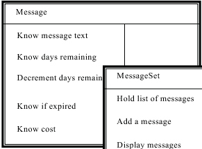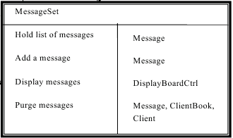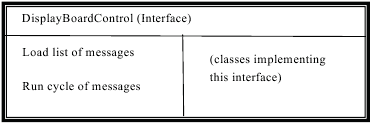

184
在 bookboon.com 下载免费电子书
使用 Java 面对象编程


### 案例研究

我们在这里想要“测试”的是消息可以被创建、添加到`MessageSet`中并在显示器上显示。

这里出现了一个需求定义点。关于与显示板的接口，有两种可能性：

a) 我们一次加载一条消息，显示它，然后加载下一条消息，以此此类推。
b) 我们一次性加载一组消息，然后告诉显示板按顺序显示它们，显示板会自动完成。

正确的选择取决于找出实际显示板究竟是如何工作的。

注意，(a) 意味着显示板比较简单，而`MessageSet`的“显示消息”职责将具有更复杂的复杂性；而 (b) 则意味着相反。

对于这次练习，我们假设答案是 (b)，因此滚动滚动一组消息的职责将分配给`DisplayBoardControl`接口。

185
在 bookboon.com 下载免费电子书
使用 Java 面对象编程
案例研究

查看这些 CRC 卡，似乎我们可以：

- 创建一条新消息，
- 将此消息添加到消息集中，并且
- 通过调用`load list of messages`和`run cycle of messages`显示这些消息

所以，我们设计的这部分似乎也是行得通的。

#### 消息清理场景

我们在这里想要运行的最后一个场景是消息清理场景。在一天结束时，当消息显示后，消息的剩余天数需要递减，如果 a) 消息的天数用完或 b) 客户端的信用额用完，则需要删除该消息。

涉及这些类的 CRC 卡绘制在下方……

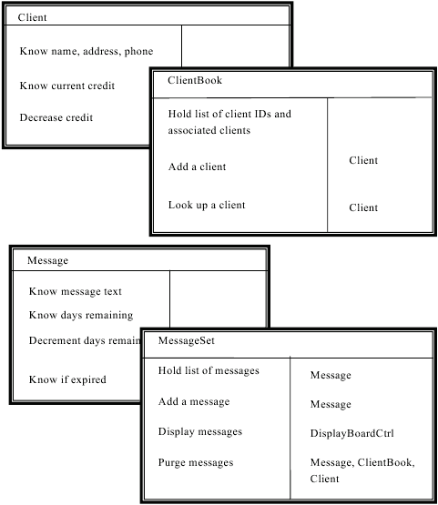

186
在 bookboon.com 下载免费电子书
使用 Java 面对象编程
案例研究

#### 活动 1

为了清理消息，`MessageBook`遍历其消息列表，减少“拥有”该消息的客户端的信用额，递减该消息的剩余天数并在适当时删除消息。

查看上面的 CRC 卡，执行以下步骤并识别这些类中的任何潜在问题：

- 对于每条消息——告诉`Message`递减其剩余天数
- 告诉相关的`Client`减少其信用额
- 询问`Message`获取其`clientID`
- 询问`Message`获取其成本
- 询问`ClientBook`获取此 ID 的客户端
- 告诉`Client`根据消息的成本减少其信用额
- 如果`Client`的信用额 <= 0 或`Message`现在过期，则从列表中删除该消息

#### 反馈 1

当我们尝试寻找与消息关联的客户端时，由于`Message`并不知道`clientID`，一个问题变得显而易见。

因此，我们需要将这一职责添加到`Message`类中。

`Message`类的修订设计所示……

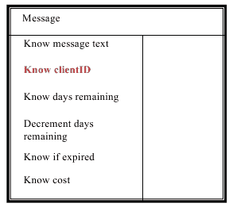

通过为每个类和接口绘制 CRC 卡，并通过一系列场景进行角色扮演，我们检查并修订了我们的系统计划——我们现在可以完善这些计划并使用 UML 图来记录它们。

187
在 bookboon.com 下载免费电子书
使用 Java 面对象编程
案例研究

### 11.4 使用 UML 记录设计

为了完整记录我们的设计，我们需要：

- 详细确定每个类中包含哪些属性
- 确定类之间的关系以及
- 将类放入适当的包中。

#### 详细说明类

在处理完 CRC 场景后，我们可以对类中的实例变量和方法进行初始分配，包括一些必要性已变得显而易见的访问器和修改器（见下图）：

```
`Client`

`name`, `address`, `phone`, `credit`

`decreaseCredit()`

`ClientBook`

`addClient()`

`getClient()`

`MessageSet`

`addMessage()`, `display()`

`dailyPurge()`

`Message`

`clientID`, `text`, `daysRemaining`, `cost`

`decrementDays()`, `getText()`, `hasExpired()`

<<interface>>DisplayBoardControl`

`loadMessages()`, `run()`
```


# 类之间的关系

我们现在可以开始确定这些类之间的关系。从`ClientBook`和`Client`开始：`ClientBook`有零或多个`Clients`。由于`MessageSet`负责在显示板上启动显示，它对实现`DisplayBoardControl`接口的类有依赖。

`MessageSet`也与`ClientBook`有关系，因为它在执行每日清理时需要访问并更新客户端信息。如下所示。

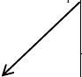

`MessageSet`和`Message`之间的关系与`ClientBook`和`Clients`之间的关系非常相似。

尽管`MessageSet`似乎没有属性，但它与`Message`的一对多关联再次暗示了一个`Collection`类型的属性。规定消息必须是唯一的，但并没有暗示需要键值，因此简单的集合即可。

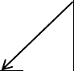

## MessageSet、ClientBook 和 DisplayBoardControl 的类关系

由于`MessageSet`负责在显示板上显示消息，它对实现`DisplayBoardControl`接口的类有依赖。

`MessageSet`也与`ClientBook`有关系，因为它在执行每日清理时需要访问并更新客户端信息。

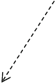

## 整体关系

下面的图显示了所有这些类是如何关联的。包含了一个额外的类`DummyBoard`，为了测试目的将实现`DisplayBoardControl`接口。

由于`DummyBoard`将加载一组消息，它与`Message`也有一对多的关系。


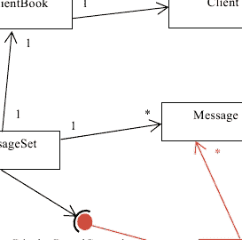

注意对`DisplayBoardControl`接口使用简洁的“球插座”表示法。

虽然上面的类将构成系统的核心，但还需要两个类来驱动和管理整个系统。

其中一个`GUImain`将具有运行系统所需的`main`方法，它将调用一个用户通过图形用户界面与系统进行交互，添加客户端、消息等。

另一个额外的类`Manager`将控制店主未指定但隐式要求的额外功能——例如，在一天结束时时，需要将`ClientBook`和`MessageSet`的详情保存到文件中。当下次运行系统时，需要恢复这些数据，因为店主显然不想每次运行程序时都重新输入所有客户端的详情。

## 接口原型

虽然收集用户需求的方法超出了本文的范围——但在继续开发之前，对接口进行原型设计并获取反馈始终是一个好主意。

下图显示了该系统的建议界面:-

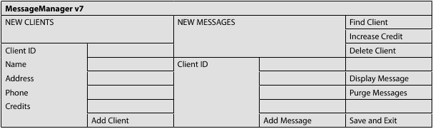

该界面由三个区域组成。从左到右分别是：a) 用于添加新客户端的区域，b) 用于添加新消息的区域，c) 用于其他基本操作的按钮区域。

这三个区域每个都将使用放置在一个较大的`JFrame`中的`JPanel`实现。

## 修改设计以适应变化的需求

软件需求的变化是生活的常态，而面向对象（OO）编程旨在帮助软件工程师更轻松、更快速、更廉价且风险更小地进行程序调整。继承、方法重写和多态原理是帮助实现此点的重要 OO 特性。

在项目中，当从店主处获得原型界面的反馈时，他们表示通常喜欢这个界面，但他们有一个额外的系统需求:-

某些消息是“紧急消息”。这些消息应该通过在消息前后三个星号在显示器上突出显示，这些消息的费用将是普通消息的两倍。除此之外，紧急消息与普通消息完全一样。

修改界面设计以适应这一变化很容易——我们可以选择:-

- 创建一个新面板来适应创建“紧急消息”
- 既然所需数据与普通消息相同，我们只需要在中间面板添加一个额外的按钮即可。

但这些额外需求将如何影响系统中的底层类呢？

如果 OO 原理有效，那么实现这一额外需求应该相对简单。首先，`Message`和`Urgent Message`之间显然存在强的关系。

如果这两个类都有某些独特特征，但在功能上有显著重叠，我们可以引入继承层次结构来处理这个问题:-

然而，在这种情况下，普通消息没有独特特征——消息具有相关的费用，可以获取费用和文本，并创建新消息。这一切对于紧急消息也是如此。紧急消息与普通消息一样，只是文本和费用略有不同。因此，`UrgentMessage`是`Message`的一种类型，可以继承`Message`的所有特征，并重写费用和文本方法。

因此，`Message`和`UrgentMessage`类的关系如下所示，`UrgentMessage`继承了与`Message`关联的所有值和方法，但重写了`getCost()`和`getText(0)`方法以反映与紧急消息相关的费用和文本。


下面是修改后的类图。但这种变化将如何影响系统的其他部分？

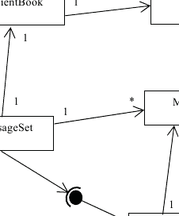

得益于多态的操作，这种变化将完全不会影响系统的任何其他部分！

查看上面的类图，我们可以看到`MessageSet`维护并管理一组`Messages`（`DummyBoard`也保留了一组消息——一旦它们被上传显示）。但`UrgentMessages`呢？

紧急消息只是消息的一种特定类型。在`MessageSet`内部调用`addMessage()`方法时，它需要一个`Message`类型的对象，即一个要添加的消息——但子类型`UrgentMessage`的对象仍然是一个`Message`，因此`addMessage()`方法将接受`UrgentMessage`对象。

因此，无需对`MessageSet`进行任何更改，`MessageSet`就可以维护所有要显示的消息（包括紧急和普通）！

此外，当调用`dailyPurge()`方法时，它会调用`Message`对象的`getCost()`方法，以便为该消息收取费用。在运行时，`JVM`将确定对象是`Message`类型还是`UrgentMessage`类型，并将调用正确版本的`getCost()`方法——记住这在`UrgentMessage`中被重写了。这就是多态的体现！

`MessageSet`需要消息，但得益于多态和方法重写的应用，`MessageSet`将乐意处理任何`Message`子类，就像它们是`Message`对象一样。如果我们以后决定创建新的消息类型（例如圣诞消息），`MessageSet`也能处理这些类型，而无需更改任何代码！

因此，在应用程序中，我们仅通过添加一个类和对界面进行一个微小更改，就能扩展系统添加紧急消息的功能。

如果不应用多态，我们需要对系统的其他部分进行额外的更改——即`MessageSet`和`DummyBoard`。

面向对象使系统能够以最小的努力进行扩展！

## 类的打包

大型程序应该分段成包，因为这提供了适当的封装层次和访问控制（如第 2 章所述）。

此处用于演示书中理论的系统很难算大型——尽管如此，仍决定将相关类打包在一起，如下。

此图显示了使用的四个包以及每个包中的类。还显示了包之间的关联。不意外的是，包含系统界面的主包与其他所有包都关联——这是因为界面调用了整个系统的功能。

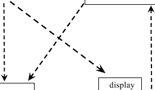

完成设计并适应变化的需求后，我们可以开始实现系统。这将分两个阶段进行:-

- 第一阶段将实现一个基础系统，允许创建消息和客户端，将详情写入文件并显示消息。
- 第二阶段将扩展系统功能，允许删除客户端并增加其信用额。这将以允许演示测试驱动开发（如第 10 章所述）的方式进行。


# 消息类的编程

`Message`、`UrgentMessage`和`MessageSet`的编程相对直接。

`Message`拥有各种实例变量（字符串型：`clientID`、`text`和整型：`daysRemaining`）。它包含一个构造函数来初始化实例变量，并具有以下方法：

- `void decrementDays()`
- `boolean hasExpired()`
- `String getClientID()`
- `int getCost()`
- `String getText()`

`Manager`类需要将`ClientBook`和`MessageSet`对象存储到文件中。为了实现这一点，所有的`Client`对象和`Message`对象也需要被存储，因此这些类（包括`Message`类）需要实现`Serializable`接口。

最后，需求指出“不允许出现重复的消息（即：同一个客户端的相同文本）”。因此，`Message`必须重写`equals()`和`hashCode()`方法，以确保在将消息存储在`Set`中时不会允许重复。

下面给出了该类的完整代码——为了简洁起见，已排除了注释。

```java
package messages;

import java.io.Serializable;

public class Message implements Serializable{

    final int COST=1;

    private String clientID;

    private String messageText;

    private int daysRemaining;

    public Message (String pClientID, String pText,int pDaysRemaining) {

        clientID = pClientID;

        messageText = pText;

        daysRemaining = pDaysRemaining;

    }

    public void decrementDays() {

        daysRemaining--;

    }

    public boolean hasExpired() {

        return (daysRemaining == 0);

    }

    public String getClientID() {

        return clientID;

    }

    public String getText () {

        return messageText;

    }

    public int getCost() {

        return COST;

    }

    public int hashCode () {

        return (clientID + messageText).hashCode();

    }

    public boolean equals (Object pOther) {

        Message otherMsg = (Message)pOther;

        return (clientID.equals(otherMsg.clientID) && messageText.equals(otherMsg.messageText));

    }

    public String toString(){

        return ("Message text: " + messageText +"\nClient: " + clientID +"\nDays left: " + daysRemaining);

    }

}
```

`UrgentMessage`类非常短小高效，因为它几乎从`Message`继承了所有的功能：

```java
package messages;

public class UrgentMessage extends Message{

    final int COST=2;

    public UrgentMessage (String pClientID, String pText,int pDaysRemaining){

        super(pClientID, pText, pDaysRemaining);

    }

    public String getText () {

        return "*** "+super.getText()+ " ***";

    }

    public int getCost() {

        return COST;

    }

}
```

`MessageSet`类与`Message`存在一对多的关系。这意味着它使用一种集合类型，并且不允许重复消息（至少对于同一个客户端）这一事实意味着该集合应该是一个`Set`。

`MessageSet`类需要一个实例变量来持有消息集，还需要一个变量来引用`ClientBook`——因为它在执行每日清理时需要访问客户端。

需要一个构造函数来将新的`HashSet()`分配给`messageSet`，并将`clientBook`初始化为参数。还需要以下方法：

- `void addMessage(Message pMsgToAdd)`
- `void display(DisplayBoardControl db)`
- `void dailyPurge()`

该类的部分代码显示如下：-

```java
package messages;

import ...

public class MessageSet implements Serializable{

    private Set<Message> messageSet;

    private ClientBook clients;

    public MessageSet (ClientBook pClients){

        clients = pClients;

        messageSet = new HashSet<Message>();

    }

    public void addMessage(Message pMsgToAdd) {

        messageSet.add(pMsgToAdd);

    }

    public void display(DisplayBoardControl db){ 

        db.loadMessages(messageSet);

        db.run();

    }

    public void dailyPurge() {

        // 此处省略代码

    }

    public void saveToFile(ObjectOutputStream oos) {

        try { 

            oos.writeObject(this);

        } catch (IOException ioe) {

            JOptionPane.showMessageDialog(null, ""+ioe);

        }

    }

    static public MessageSet readFromFile(ObjectInputStream ois) {

        MessageSet cb = null;

        try {

            cb = (MessageSet) ois.readObject();

        } catch (IOException ioe) {

            JOptionPane.showMessageDialog(null, ""+ioe);

            System.exit(1);

        } catch (ClassNotFoundException cnfe) {

            JOptionPane.showMessageDialog(null, ""+cnfe);

            System.exit(1);

        }

        return cb;

    }

}
```


上面的代码展示了类型化 `Message` 集合的创建以及添加和显示消息的方法。

显示消息的方法需要传递一个类型为 `DisplayBoardControl` 的对象参数。初始将提供一个 `DummyBoard` 对象，但当购买了真实的显示板时，该对象将替换 `DummyBoard` 对象。这对于 `display()` 方法内部的代码没有影响，因为这两个对象都是更通用的类型 `DisplayBoardControl`。这是多态性应用的另一个例子。

额外创建了两个方法 `saveToFile()` 和 `readFromFile()`，它们使用对象序列化技术将整个消息集读取并写入文件。

`dailyPurge()` 方法在上面的代码中被排除了，以便我们专注于这个方法：

```java
public void dailyPurge() {

    Client client;

    // 遍历所有当前消息
    for (Message msg:messageSet) {

        // 消息的剩余天数减 1
        msg.decrementDays();

        try{

            // 找到支付这条消息的客户端
            client = clients.getClient(msg.getClientID());

            // 找到消息的费用并从客户端的余额中扣除
            client.decreaseCredit(msg.getCost());

            // 如果消息过期或客户端余额不足，则移除
            if (msg.hasExpired() || client.getCredit() <= 0) {
                messageSet.remove(msg);
            }

        }catch(UnknownClientException uce) {

            JOptionPane.showMessageDialog(null,"INTERNAL ERROR IN MessageSet.Purge()\nException details: " + uce);

            if (msg.hasExpired()) {
                messageSet.remove(msg);
            }

        }

    }

}
```

`dailyPurge()` 方法执行以下操作：
1. 对于每条消息
2. 减少消息的剩余天数
3. 找到支付该消息的客户端
4. 找到消息的费用并从该客户端的余额中扣除
5. 如果消息过期或客户端余额不足，将其移除

注意，可能找不到客户端——因此使用了 `try catch` 块。这将在下一节讨论。

## 客户端类的编程

`Client` 类的编程与 `Message` 类非常相似，此处未显示。

`ClientBook` 类的编程与 `MessageSet` 非常相似，该类的大部分代码已省略，但有两个显著差异：

- 所有客户端都有 `clientID`，因此 `ClientBook` 使用 `Map` 而不是 `Set`。
- 如果不存在指定 `clientID` 的客户端，`getClient()` 方法可能会失败。我们需要为找不到客户端的情况构建保护机制。

```java
package clients;

import ...

public class ClientBook implements Serializable {

    private Map<String,Client> clientMap;

    public ClientBook() {
        clientMap = new HashMap<String,Client>();
    }

    public void addClient(String pClientID, Client pNewClient) {
        clientMap.put(pClientID, pNewClient);
    }

    public Client getClient(String pClientID) // 省略

    public void saveToFile(ObjectOutputStream oos) {
        // 省略
    }

    static public ClientBook readFromFile(ObjectInputStream ois) {
        // 省略
    }

}
```

上面的代码展示了 `Map` 的创建以及 `ClientBook` 类所需的其他方法。

## 创建和处理 `UnknownClientException`

`ClientBook` 类中的 `getClient()` 方法在不存在指定 ID 的客户端时将返回 `null` 值。在那种情况下，在进行每日清理时，我们的程序将会崩溃，因为我们尝试在没有客户端对象的情况下调用 `decreaseCredit()` 方法（它将因抛出 `NullPointerException` 异常而崩溃）。

因此，我们需要针对这种可能性建立保护机制。为了防止这种情况发生，我们需要：

- 创建一种新异常（如第 9 节所示），名为 `UnknownClientException`
- 告诉 `ClientBook` 类在找不到客户端时抛出此异常
- 在 `dailyPurge()` 方法中捕获并处理此异常。

第一步非常简单，此处不再显示。

### 案例研究

让 `getClient()` 方法和 `deleteClient()` 方法生成此异常相对直接（如下所示）：

```java
public Client getClient(String pClientID) throws UnknownClientException {

    Client foundClient;

    foundClient = clientMap.get(pClientID);

    if (foundClient != null) {
        return foundClient;
    } else {
        throw new UnknownClientException(" ClientBook.getClient():unknown client ID: " + pClientID);
    }

}
```

首先，我们必须告诉编译器此方法可以生成异常。然后，在适当条件下，我们使用关键字 `new` 调用异常的构造函数，并传递构造函数所需的字符串消息。构造函数返回的对象将被“抛出”。

为了方便起见，字符串指定了生成此异常的方法以及未找到客户端的 `clientID`。

编译器随后将确保编写 `dailyPurge()` 方法的程序员捕获此异常——希望他们随后会处理它以防止崩溃的发生。

最后一步是在 `dailyPurge()` 方法中捕获并处理 `UnknownClientException`——如第 11.8 节（消息类的编程）所示。

如果客户端不存在，我们可能会删除该消息。然而，在这种情况下，我们选择了更谨慎的做法，因为我们并不知道自己是如何拥有一个“无所有者”消息的。

因此，我们决定如果消息未过期，除了报告错误之外，我们将不采取任何操作。该消息将继续显示（即使没有客户端可以计费！）。

如果无所有者的消息过期了，我们当然还需要将其从显示列表中移除。

## 11.11 类的类的编程

有两个类（在之前给出的类图中未显示）用于“驱动”系统。`Manager` 是管理系统的主类。它执行以下功能：

- 它对客户端簿和消息集有持久引用
- 它设置数据文件
- 它定义系统启动时发生的情况
- 它定义系统关闭时发生的情况
- 最后，它拥有 `getClientBook()` 和 `getMessageSet()` 方法，以便系统的其他部分可以访问客户端簿和消息集。

`startup()` 方法如下所示：

```java
public void startUp() {

    try {

        FileInputStream fis = new FileInputStream(MMS_DATA_FILE);

        ObjectInputStream ois = new ObjectInputStream(fis);

        cb = ClientBook.readFromFile(ois);

        ms = MessageSet.readFromFile(ois);

        fis.close();

    } catch (FileNotFoundException fnfe) {

        JOptionPane.showMessageDialog(null, "No existing client/message data found");

        cb = new ClientBook();

        ms = new MessageSet(cb);

    } catch (IOException ioe) {

        JOptionPane.showMessageDialog(null, ""+ioe);

        System.exit(1);

    }

}
```

`startup()` 方法尝试设置一个对象输入流，并从中尝试重构 `ClientBook` 和 `MessageSet` 对象。

它有两个 `catch` 块。第一个将捕获 `FileNotFoundException`——如果找不到数据文件就会发生这种情况，例如第一次运行此程序时。在这种情况下，系统将创建一个新的空的 `ClientBook` 对象和一个 `MessageSet` 对象。

第二个 `catch` 块将捕获任何其他 IO 错误，并在这种情况下退出程序。

## 11.12 接口的编程

另一个驱动类是 `GUImain`。它有一个 `main()` 方法会调用 `createGUI()` 方法。这创建了三个 `JPanels` 并根据初步设计向这些添加了按钮、文本框和标签。这些 `JPanels` 应用了网格布局管理器（如第 8 章第 10 节所述）。

`GUImain` 类还为 GUI 每个按钮定义了动作监听器。

下方显示与 `FindClient` 按钮关联的动作监听器：

```java
private class FindClientListener implements ActionListener {

    public void actionPerformed(ActionEvent arg0) {

        String id = JOptionPane.showInputDialog(null,"Enter client ID");

        if (id == null) id = ""; //in case Cancel pressed

        try {

            JOptionPane.showMessageDialog(null,manager.getClientBook().getClient(id).toString());

        } catch (UnknownClientException uke) {

            JOptionPane.showMessageDialog(null,"No such client");

        }

    }

}
```

## 信任与责任

NNE 和 Pharmaplan 联手创建了 NNE Pharmaplan，这是完全专注于制药和生物技术行业的全球领先工程和咨询公司。

Inés Aréiga Esteva（西班牙），25 岁，教育背景：化学工程师——作为一名新人，你必须保持积极和开放的心态，并向同事明确你能胜任。制药领域对我来说是全新的。尽管他们很忙，但大多数同事都会花时间教我，他们也信任我。尽管最初有些困难，但随着时间的推移，我感到开始被认真对待，我的贡献得到了认可。NNE Pharmaplan 是全球领先的工程和咨询公司，在全球范围内雇佣了 1500 多名员工，并在全面的服务列表中提供全球视野和本地知识。

## 11.13 使用测试驱动开发并扩展系统

现在我们有一个可以运行的系统——尽管两个重要的方法尚未创建。我们需要一个增加客户端信用额的方法——这应该放在 `Client` 类中。我们还需要一个删除客户端的方法——因为这意味着从客户端簿中移除他们，这应该放在 `ClientBook` 类中。

已经决定使用测试驱动开发来扩展系统并提供此功能（如敏捷编程所述）。

在 TDD 中我们必须：
1) 编写测试
2) 设置自动化单元测试，由于类尚未编写测试将会失败！
3) 编写类以通过测试

在创建这些方法后，我们必须调整接口以便能够调用这些方法。

### 案例研究

提供了两个测试用例：

```java
public void testIncreaseCredit() {
    Client c = new Client("Simon", "Room 217", "x2756", 10);
    c.increaseCredit(10);
    assertEquals(20, c.getCredit());
}

public void testDeleteClient() {
    ClientBook cb = new ClientBook();
    Client c = new Client("Simon", "Room 217", "x2756", 10);
    cb.addClient("sk", c);
    try { cb.deleteClient("sk"); } catch (UnknownClientException uce) { fail(); }
    try { c = cb.getClient("sk"); fail(); } catch (UnknownClientException uce) {}
}
```

第一个用例创建一个具有 10 个单位额度的客户，增加 10 个单位额度，然后检查该客户是否有 20 个单位额度。

单靠一个测试不足以充分证明 `increaseCredit()` 方法将始终正常工作，因此我们需要定义额外的测试。

第二个用例创建一个空的客户账簿，创建一个客户，将客户添加到客户账簿中并尝试删除该客户——如果在此处生成了 `UnknownClientException`，我们就知道存在问题。删除后，我们再次尝试获取该对象，这应该是失败的，因为现在应该会生成一个 `UnknownClientException`。如果在此处没有生成异常，则该类存在缺陷，测试应该“失败”。

创建了测试用例后，这些代码将产生编译错误，因为 `increaseCredit()` 和 `deleteClient()` 方法并不存在。

我们现在必须创建这些方法并对其进行修改，直到这些测试通过。

`increaseCredit()` 方法如下……

```java
public void increaseCredit(int pExtraCredit) {
    credit = credit + pExtraCredit;
}
```

## 理论

理论认为 TDD（测试驱动开发）可以产生简洁的代码。在这种情况下，通过将注意力集中在 `increaseCredit()` 方法需要实现的目标上，降低了代码过度复杂的风险。当然，我们可能需要一组测试用例来确保该方法具备所有核心功能。

## 11.14 生成 Javadoc

文档是至关重要的，并且在假设代码中已放置适当注释的情况下（如第 8 章——Java 开发工具所述），可以自动生成。

代码中已放置 Javadoc 注释以描述所有类、所有构造函数和所有方法。所有的参数和返回值都已描述。

下面显示了取自 `Client` 类的三个注释：

```java
/**************************************************************
 * A customer of the message display service
 *
 * @author Simon Kendal
 * @version 1.0 (26 June 2009)
 ***********************************************************/
public class Client implements Serializable {

    ... lines missing ...

    /**
     * Constructor
     *
     * @param pName name of client
     * @param pAddress client's address
     * @param pPhone client's phone number
     * @param pCredit initial credit for client
     */
    public Client(String pName, String pAddress, String pPhone, int pCredit) {

        ... lines missing ...

    /**
     * return the client's current credit
     *
     * @return credit units remaining
     */
    public int getCredit() {

        ... lines missing ...
    }
}
```


一旦在整个代码中放置了 Javadoc 风格的注释，启动`javadoc`工具将生成一组描述系统的网页（在`Eclipse`中，通过选择`Project | Generate Javadoc`菜单项完成）。

下面的图片显示了描述`UrgentMessage`类的 Java 文档的一部分：

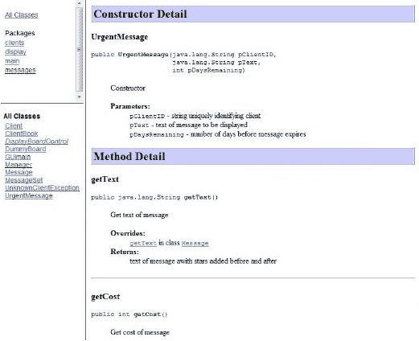

## 11.15 运行系统和潜在的编译器警告

本章描述的完整程序作为导出的`Eclipse`项目随教科书提供。要运行此程序：

- 下载文件“OOP Using Java”
- 通过选择`File | Import | Existing Project Into Workspace | Select Archive File ‘OOP Using Java’`将其导入`Eclipse`，然后选择压缩文件内的`Message Management System`项目。
- 使用`Eclipse`软件包管理器窗口，右键点击位于`main`包内的`GUImain`类，并选择“Run as Java application”。

在此导出的文件中包含了本章讨论的所有类、方法和测试用例，以及由`javadoc`工具生成的 Javadoc。要查看 Javadoc，请进入`.doc`文件夹并双击`index.html`页。

在检查此程序时，取决于你的编译器设置，可能会注意到某些警告信息。你很可能会看到其中一个关于可序列化类（`MessageSet`、`Message`等），因为我没有给它们指定版本号。

这些警告对运行系统没有影响，如果需要，可以通过进入`Window | Preferences | Compiler | Errors & Warnings`并对你想要抑制的警告选择忽略（如下所示）。

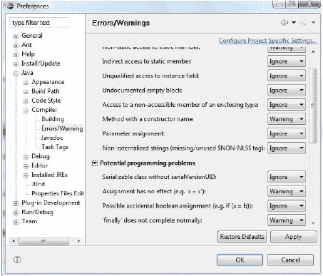

## 11.16 完成的系统……

下面的截图显示了完成后的系统。

首先是主界面窗口——这与设计非常相似。唯一的变化是增加了一个按钮，允许将消息指定为紧急消息。


接两张图片显示了点击“Find Client”按钮时弹出的对话框。首先请求客户 ID……


其次显示客户详情——假设已添加了具有此 ID 的客户。

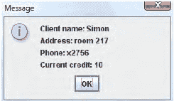

“Display Messages”按钮在屏幕上显示使用`DummyBoard`类应显示的每条消息。这只是粗略地模拟了真实的显示板，并没有尝试滚动消息或以任何图形上趣味的方式显示它们。

“Purge Messages”调用`purgeMessages()`方法。它没有可见的操作，但会减少每条消息的剩余天数，减少客户的额度，并在适宜时删除消息。这可以通过在执行每日清理前后运行 Find Client 来测试。

## 11.17 总结

面向对象开发范式的基本原理是：

- 抽象（abstraction）
- 封装（encapsulation）
- 一般化/特化（继承）
- 多态（polymorphism）

这些原理遍布于 Java 语言和库包 API，并为我们自己的软件开发项目提供了框架。在本章中，你希望已经看到了面向对象如何通过以下方式支持程序员：

- 使用抽象和封装使能够关注并编写复杂系统的不同部分，而无需担心“整体”。
- 使用继承来“提取”公共代码
- 使用多态使程序更容易更改
- 使用工具帮助文档和管理大型软件项目。

这些已使用 Java 示例，但这里演示的相同原理和工具在许多现代 IDE 中也可用。通过阅读这本书并完成这些小练习，你希望已经对这些原理有了理解。

我希望你发现这本书对你有帮助，并祝愿你们未来一切顺利。
