# Java 面向对象编程指南：符合 CE、CSE、IT 和 ICT - GTU 工程学第 5 学期教学大纲

## 本书涵盖

- Java 基础
- Java 成员与流程控制语句的使用
- 数组、字符串与包装类的使用
- 类、对象与方法
- 在 Java 中实现继承
- Java 中的异常处理、包与多线程
- IO 编程、集合类以及使用 `java.net` 进行网络
- 统一建模语言 (UML) 基础

## 作者

Chirag Patel

&

DT 编辑服务部

## 目录

- 简述题 ........................................................ 131
- 10.5 域名服务 ........................................ 282
- 10.6 理解 `java.net` 包中的网络接口和类 ... 282
- 10.7 Internet 地址 ............................................ 284
- 10.7.1 理解 `InetAddress` 类 ................... 285
- 10.7.2 缓存 `INetAddress` ....................... 287
- 10.7.3 工厂方法 ........................................ 288
- 10.8 理解 Java 中的套接字 ....................... 289
- 10.8.1 理解 `Socket` 类 ................... 289
- 10.9 理解 `URL` 类 ........................ 293
- 10.10 理解 `URI` 类 ........................ 294
- 10.10.1 URI 语法和组件 ................... 294
- 10.11 使用数据报（Datagrams）............................................................................................... 295
- 10.11.1 理解 `DatagramSocket` 类............................................................... 295
- 10.11.2 理解 `DatagramPacket` 类...................................................................... 296
- 总结.................................................................................................................................. 300
- 关键术语...................................................................................................................................... 300
- 复习题.............................................................................................................................................. 300
- 判断题............................................................................................................................................................... 300
- 多选题............................................................................................................................................... 301
- 简答题............................................................................................................................................... 302

# 第11章 面向对象与建模概念 ........................... 305

- 11.1 面向对象 ................................................................................. 306
- 11.1.1 标识性（Identity）......................................................................................................................... 306
- 11.1.2 分类（Classification）........................................................................................................................ 306
- 11.1.3 多态性（Polymorphism）....................................................................................................................... 307
- 11.1.4 继承（Inheritance）....................................................................................................................................... 307
- 11.2 面向对象开发.................................................................................................................. 307
- 11.3 面向对象主题..................................................................................................................... 308
- 11.3.1 抽象（Abstraction）...................................................................................................................................... 309
- 11.3.2 封装（Encapsulation）..................................................................................................................................... 309
- 11.3.3 模块化（Modularity）....................................................................................................................................... 310
- 11.3.4 协同（Synergy）................................................................................................................................................. 310
- 11.4 建模概念与作为设计技术的建模.................................................................. 311
- 11.5 三种模型...................................................................................................................... 311
- 11.5.1 类模型（Class Model）............................................................................................................................... 311
- 11.5.2 状态模型（State Model）........................................................................................................................................... 311
- 11.5.3 交互模型（Interaction Model）............................................................................................................................... 311
- 11.6 模型之间的关系.................................................................................. 312
- 总结.................................................................................................................................................. 313
- 关键术语.................................................................................................................................................. 313
- 复习题.................................................................................................................................................. 313
- 判断题.................................................................................................................................................................. 313
- 多选题............................................................................................................................................... 314
- 简答题............................................................................................................................................... 315

# 第12章 UML 类图与建模详解 ........................... 319

- 12.1 对象与类的概念................................................................................................................ 319
- 12.1.1 类名......................................................................................................................................................... 320
- 12.1.2 类属性............................................................................... 321
- 12.1.3 属性可见性...................................................................... 321
- 12.1.4 属性约束..................................................................... 322
- 12.1.5 类操作列表.................................................................. 322
- 12.1.6 静态操作...................................................................... 323
- 12.2 关联与链接............................................................... 324
- 12.2.1 二元关联..................................................................... 325
- 12.2.2 N元关联.................................................................. 325
- 12.2.3 递归关联............................................................... 325
- 12.2.4 限定符关联........................................................................ 326
- 12.2.5 关联方向........................................................... 326
- 12.2.6 关联多重性............................................................... 327
- 12.2.7 关联类...................................................... 328
- 12.3 聚合.................................................................... 329
- 12.3.1 组合.................................................................. 329
- 12.3.2 聚合与组合的区别...................... 329
- 12.4 泛化与继承....................................... 330
- 12.5 抽象类.................................................................. 330
- 12.6 多重继承.................................................. 331
- 12.7 元数据...................................................................... 332
- 12.8 约束.................................................................. 332
- 12.9 派生数据与包............................................... 333
- 总结......................................................................... 334
- 关键术语........................................................................... 334
- 复习题........................................................................ 334
- 判断题.................................................................. 334


- 单选题 ......................................................................... 335
- 简答题 ......................................................................... 336

# 第 13 章：状态建模 ................................................ 339

- 13.1 事件 ....................................................................... 339
- 13.2 状态 ........................................................................ 340
  - 13.2.1 复合状态 .................................................... 342
- 13.3 转换与条件 ......................................... 342
- 13.4 状态图 ...................................................... 344
  - 13.4.1 状态图示例 .................................... 345
- 13.5 状态图行为 ......................................... 346
- 总结 ........................................................................... 346

## 第 14 章：交互建模 ............................................................. 351

- 14.1 用例模型 ......................................................................... 351
  - 14.1.1 用例模型的元素 .................................................................... 352
  - 14.1.2 用例模型中的关系 ............................................................. 354
  - 14.1.3 用例图示例 ................................................................. 356
  - 14.1.4 用例模型指南 ........................................................... 357
  - 14.1.5 用例模型的处 ............................................................. 358
- 14.2 序列模型 .......................................................................................... 358
  - 14.2.1 场景 ........................................................................................ 358
  - 14.2.2 序列图 ......................................................................... 359
  - 14.2.3 序列模型指南 .................................................... 363
  - 14.2.4 过程化序列模型 ......................................................... 363
- 14.3 活动模型 ..................................................................................... 364
  - 14.3.1 活动图的组件 ................................................. 365
  - 14.3.2 活动图中的概念 .................................................... 367
  - 14.3.3 通用活动图 ......................................................... 368
  - 14.3.4 可执行活动图 ................................................. 369
  - 14.3.5 活动模型指南 ......................................... 370
- 14.4 协作图 ........................................................ 370
  - 14.4.1 协作图示例 .................................... 371
  - 14.4.2 绘制协作图指南 .................................. 371
- 14.5 序列图与协作图的异同点 ............ 372
- 总结 ................................................................................................. 373
- 关键术语 ................................................................................................. 373
- 复习题 ................................................................................................. 373
- 判断题 ......................................................................... 373
- 单选题 .................................................... 374
- 简答题 ....................................................... 375

# 引言

恭喜你购买《Java 面向对象编程》一书！本书包含了关于面向对象编程（OOP）各种概念以及使用对象设计应用的 Java 语言的全面内容。OOP 模型基于四大支柱：抽象、封装、继承和多态。在 OOP 中，对象代表现实世界中的实体，它们有自己的属性。早期的编程（例如 `C`）是基于过程语言的，程序通常使用分支语句和过程。然而，OOP 是一种理解计算机程序设计和功能的模块化方法。OOP 程序中的每个模块都是一个对象，它是作用于数据的数据程序的组合。许多公司正在使用 `Java` 来构建需要语法便利、编译时检查、内存分配与初始化以及全程代码复用的应用程序。IT 行业已经见证了大型企业转向 `Java`。

本书是 DT Editorial Services 的作者和编辑丰富的教学才智和技术精确性的结晶。它承诺为想要脱颖而出的学生和信息技术（IT）专业人士提供丰富的解决方案。本书提供了关于 `Java` 和 `UML` 的全面且易于理解的材料。此外，它还包含了各种示例和程序，以演示各种方法的实现。

我们希望通过这本书的学习体验对你来说像我们编写和编辑本书时一样精彩。

## 关于本书

《Java 面向对象编程》扩展了为新 IT 技术提供全面且清晰内容的方法。本书涵盖了 `Java` 语言的优势、OOP 的各种特性以及开发 `Java` 程序的 `Java` 语法。它超越了特性的简单描述和代码示例，确保能够满足开发者面临的现实挑战。本书涵盖的主题范围和深度是 `Java` 相关概念和特性描述的卓越结合，并带有所有相关的细节和实践示例以供实现。在独家技术细节和精确性的加持下，本书承诺为你提供处理 `Java` 所需的所有知识和功能技能。

这本书对于 IT 领域的初学者来说是理想的，因为它解释了 OOP 的最基础知识，教你如何在 `Java` 中执行不同的任务。

本书主要涵盖了以下内容：

- `Java` 基础
- 数组与字符串
- 类、对象与方法
- 继承与接口
- 包与异常处理
- 多线程与 I/O 编程
- 集合类与网络编程
- `UML` 基础

这只是一个指示性列表——里面还有更多内容。本书特别涵盖了 `Java` 作为一种面向对象（OOP）语言的特性，比其他任何专门介绍该主题的书都得深入。

# 如何使用本书

在书中，程序已在 `Java` 编译器上通过了测试。然而，你仍然需要编写额外的代码来编译和执行 `Java` 程序。本书从 OOP 的基本概念和 `Java` 语言开始。你将熟悉如何使用 `Java` 编译器编译和执行 `Java` 程序。本书由 14 章节组成，阐述了 `Java` 编程和 `UML` 的概念与特性。

在特定章节中查找主题也非常简单。你只需要打开目录，并沿着显示的主题列表及其对应的页码进行导航即可。

# 规范

书中遵循了一些需要注意的惯例。例如，书中解释的代码以代码列表的形式呈现，紧随其后的是列表的输出。带有列表编号和标题的代码及其输出显示如下：

列表 1：使用 `if` 语句

```java
class ifDemo {
    public static void main(String[] args[]) {
        int age;
        age = 16;
        if (age < 18)
            System.out.println("Not eligible to vote");
    }
}
```

在列表 1 中，`if` 语句用于测试一个条件，即程序中指定的 `age` 是否小于 18。程序中 `age` 变量的值设置为 16。由于 16 小于 18，`if` 语句中的条件自动变为真。因此，`if` 条件之后的语句将被显示出来，如图 1 所示：

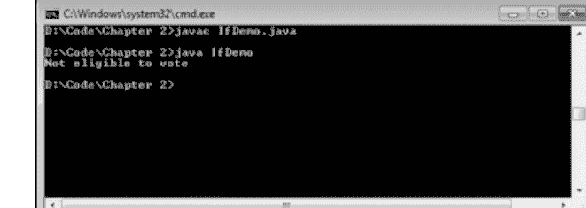

▲ 图 1：IFDemo 程序的输出

使用 `Java` 的面向对象编程还以“注释”的形式提供了各种概念的额外信息：

- 在 `Java` 中，所有语句都以分号结束，例如前面代码段中的 `println()` 语句。

每个插图都包含一个描述性标题以增强清晰度：

▲ 图 2：在任何操作系统上运行程序的流程

表格紧接在首次引用之后，如下所示：

| 表 1：Java 关键字 | | | | | | |
| :--- | :--- | :--- | :--- | :--- | :--- |
| abstract | cast | throws | int | protected | else |
| assert | catch | transient | instanceof | private | return |

# 引言

| 表 1：Java 关键字 | | | | | | |
| :--- | :--- | :--- | :--- | :--- | :--- |
| boolean | char | try | import | package | synchronized |
| break | class | var | implements | new | switch |
| byte | const | void | if | native | super |
| byvalue | continue | volatile | goto | long | strictfp |
| case | default | while | for | interface | static |
| enum | do | throw | float | extends | short |
| final | double | public | finally | | |

本书在章节末尾还突出了了一些关键术语，如下所示：

## 关键术语

- **标记（Token）**：指 `Java` 程序中的单个元素。
- **关键字（Keywords）**：指在为变量或方法命名时不能使用的保留字。
- **标识符（Identifier）**：指 `Java` 程序中引用变量、方法、类、包或接口名称的符号名称。

我们的唯一意图是提供一本深度且信息丰富的书籍，以便你享受阅读并从中学习。阅读愉快！

# 学习目标

- 介绍面向对象编程
- 解释 `Java` 的演变
- 将 `Java` 与 `C++` 进行比较
- 描述 `Java` 的特性
- 探索 `Java SE 8.0` 的新特性
- 介绍 `Java` 环境
- 开发一个简单的 `Java` 程序

`Java` 是一种面向对象编程（OOP）语言，其特性继承自 `C++`。`Java` 语言由软件开发人员 `James Gosling` 于 1991 年在 `Sun Microsystems` 创建。它最初被称为 `Oak`；然而，在 1995 年首次公开发布时，名称改为 `Java`。

在 `Java` 和 `C++` 出现之前，`C` 语言是程序员中一种极其流行的语言，`C` 似乎是将低级语言和高级语言的最佳元素结合到编程语言中的完美编程语言。然而，`C` 语言也有其局限性；例如，当 `C` 程序增大时，它会变得更加难以管理，因为程序员无法将 `C` 程序拆分为自包含的组件。这意味着程序第一行的代码可能会干扰最后一行的代码，程序员在编程时必须记住整个代码。随后，OOP 概念被引入以将程序切割成半自主的单元，直到 `C++` 编程语言的出现。

本章从讨论 OOP 概念开始。它还讨论了 `Java` 随后的演变。此外，本章有助于将 `Java` 与 `C++` 进行比较并阐述了 `Java` 的特性。此外，章节还讨论了 `Java SE 8.0` 的新特性，然后探索了 `Java` 字节码和 `Java` 虚拟机（JVM）的概念。`Java` 环境包括 `Java` 开发工具包（JDK）、`Java` 运行环境（JRE）。

## 介绍面向对象编程

面向对象编程（OOP）是一种基于“对象”的编程范式。OOP 的核心概念包括：

- 封装
- 继承
- 多态
- 抽象

## 解释 Java 的演变

`Java` 自诞生以来经历了多个版本的演变：

- `Java 1.0` (1996)：`Java` 的版本。
- `Java 1.2` (1998)：引入了集合框架和 `Swing`。
- `Java 5.0` (2004)：引入了泛型、注解、增强型 `for` 循环以及装箱/拆箱。
- `Java 8` (2014)：引入了 `Lambda` 表达式、函数式接口和 `Stream API`。
- `Java 11` (2018)：引入了模块和局部变量推断。

## 将 Java 与 C++ 进行比较

虽然 `Java` 和 `C++` 都是面向对象的语言，但它们存在关键差异：

- 内存管理：`Java` 使用自动内存管理，而 `C++` 需要手动内存管理。
- 平台无关性：`Java` 是平台无关的，而 `C++` 依赖平台。
- 指针：`C++` 支持指针，而 `Java` 出于考虑不支持。

## 描述 Java 的特性

`Java` 有许多特性：

- 平台无关：`Java` 字节码可以在任何 `Java` 虚拟机（JVM）上运行。
- 简单：移除了指针和多继承等复杂特性。
- 安全：在沙箱环境中运行。
- 健壮：提供了强大的异常处理和内存管理。
- 多线程：支持多个线程同时执行。

## 探索 Java SE 8.0 的新特性

`Java SE 8.0` 引入了强大的特性：

- `Lambda` 表达式：允许编写简洁的代码。
- 函数式接口：只有一个抽象方法的接口。
- `Stream API`：对集合进行函数式操作。
- 新的日期时间 API。

## 介绍 Java 环境

`Java` 环境包括：

- `Java` 虚拟机（JVM）：运行 `Java` 字节码的引擎。
- `Java` 运行环境（JRE）：提供运行 `Java` 程序所需的 `JVM` 和库。
- `Java` 开发工具包（JDK）：包含 `JRE` 和用于开发 `Java` 程序的工具。

## 开发一个简单的 Java 程序

一个简单的 `Java` 程序遵循以下步骤：

1. 编写带有 `.java` 扩展名的源码。
2. 使用 `javac` 编译代码获取 `.class` 字节码。
3. 使用 `java` 运行程序。

```java
public class HelloWorld {
    public static void main(String[] args) {
        System.out.println("Hello, World!");
    }
}
```

## 1.1.1.5 继承

继承是面向对象编程（OOP）的概念之一，一个类可以通过它获取另一个类的属性。继承自另一个类的类被称为子类（subclass），而子类继承的类被称为父类（superclass）或基类（base class）。继承的概念支持分级分类。例如，虎斑猫（Tabby Cat）是猫的一种，而猫又属于哺乳动物类，而哺乳动物属于更大的动物类。图 2 显示了该示例的层级树：

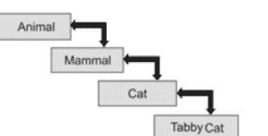

▲ 图 2：展示继承的层级树

现在，让我们从编程的角度来看图 2。在这里，动物（Animal）类是一个子类，“哺乳动物”（Mammal）是扩展或继承父类所有属性的子类。

在 OOP 中，继承概念促进了代码复用，因为我们可以通过从现有类派生新类，在不修改现有类的情况下添加额外功能。从父类派生的子类包含了两个类的组合特征。

## 1.1.1.6 多态

多态一词源于两个希腊语：`poly` 意思是“多”，`morphs` 意思是“形式”。因此，多态意味着多种形式。在 OOP 中，多态允许你使用相同的方法执行各种操作。操作的行为取决于操作中所使用的数据类型。


例如，让我们考虑加法操作，它可以可以是两个数字的相加，也可以两个字符串的拼接。在第一情况下，操作数是 `int` 类型；在另一种情况下，操作数是字符串。使用单个方法名执行不同类型任务的概念被称为方法重载（method overloading）。图 3 显示了单个方法 `speed()` 用于处理不同类型的参数：

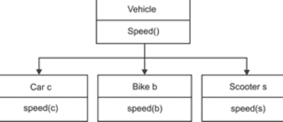

▲ 图 3：展示多态

在图 3 中，车辆（`Vehicle`）类的 `speed()` 方法在汽车（`Car`）、自行车（`Bike`）和踏板车（`Scooter`）类中以不同的形式使用。相应类的对象作为参数传递给 `speed()` 方法。此外，重要的是，多态在继承中被广泛使用。

## 1.1.1.7 动态绑定

在运行时响应调用并将方法调用链接到可执行代码的过程被称为绑定（binding）。所展示的绑定过程是动态绑定（dynamic binding）。这意味着当调用一个方法时，方法调用在程序运行期间绑定到方法体。Java 编译器在编译期间无法感知要调用的方法；因此，JVM 在运行时调用相关方法。因此，这也称为运行时多态或动态绑定。

## 1.1.1.8 消息传递

OOP 包含了一组相互通信的对象。在 OOP 编程过程中涉及以下步骤：

- 创建定义对象及其行为的类
- 从类定义中创建对象
- 在对象之间建立通信

一个或多个对象可以通过发送和接收信息来相互通信。这个过程类似于人与之间传递消息的方式。发送给对象的消息是请求执行某个方法的请求。然后，调用该方法并提供所需的结果。消息传递涉及对象名、方法名以及要发送的信息。

现在，在理解了 OOP 概念之后，让我们讨论 Java 的演进。

## 1.2 Java 的演进

Java 继承了 C 和 C++ 编程语言的特性，例如，它的语法派生自 C，它的许多面向对象的特性受到 C++ 的影响。在这里，我们讨论导致 Java 演进的事件序列和底层因素。

在 20 世纪 70 年代后期和 80 年代初，C 成为最重要和最广泛使用的计算机编程语言。尽管 C 变得流行，但由于程序复杂性的增加，程序员开始寻找更好的选择。在此期间，OOP 变得流行，因为它被用于管理和将复杂程序划分为半自治单元。

### 1.2.1 介绍 Java

Java 第一版本发布于 1991 年，被称为 Oak 而不是 Java。Oak 的原始想法是创建一个与平台无关 OOP 语言。Oak 背后的推动灵感是创建一种可以在所有计算机上使用的东西。

现在 Java 已经通过互联网普及，大量且不断增加的机构在内部采用它而不是 C++，仅仅是因为它的流行性——在某些版本中，如微软的 C#，现在正是仿照 Java 建模的。Oak 在 1995 年向公发布使用时被更名为 Java。那时，Java 采用了一种使其完美适用于互联网的模型——字节码模型（bytecode model）。

一个 Microsoft Visual C++ 程序通常对于一个 MFC 程序来说至少从 5 MB 开始，而且还没有计算动态链接库（Dynamic Link Libraries）。

### 与 C++ 比较

在这里，我们讨论 Java 与 C++ 的比较。Java 吸收了 C++ 的特性。表 1 比较了 Java 和 C++：

| 表 1：Java 与 C++ 的比较 |

| 差异 | Java | C++ |

|---|---|---|

| 支持重载 | 不支持重载。 | 支持重载。 |

| 模板类概念 | 提供模板类的概念。 | 提供模板类的支持。 |

### 表 1：Java 与 C++ 的比较

| 差异 | Java | C++ |

|---|---|---|

| 多重继承支持 | 不类的多重继承，而是通过一种新特性接口实现的。 | 支持多重继承。 |

| 全局变量支持 | 不全局变量。每个变量和方法都声明为类的成员。 | 支持全局变量。 |

| 指针支持 | 不支持指针。 | 使用指针的概念。 |

| 对象销毁 | 与 C++ 类似，Java 不使用析构函数，而是调用 `finalize()` 方法来销毁对象。 | 使用析构函数销毁对象。 |

| 头文件概念 | 使用包的概念。 | C++ 需要头文件。 |

| 多线程概念 | 提供多线程支持。 | 没有多线程支持。 |

| 垃圾收集 | 支持自动垃圾收集。 | 没有自动垃圾收集。 |

在讨论了 Java 与 C++ 的比较之后，让我们讨论 Java 的通用特性和优点。

## 1.4 Java 的特性

Java 是一种简单、健壮、与平台无关且可移植的编程语言。它的设计是为了满足我们日常生活中的实际需求，具有以下特性：

- 简单
- 安全
- 可移植
- 健壮
- 多线程
- 平台无关
- 分布式
- 动态

这些特性将在接下来的小节中进行介绍：

### 1.4.1 简单

Java 易于学习和使用。在 Java 中，编写和调试程序非常容易，因为 Java 不使用指针。此外，Java 提供了一个从无错误系统到强大的内存管理系统，并具有自动的内存分配和释放系统。与其他许多提供几十种复杂方式来完成简单任务的编程语言不同，Java 提供了一种简单而清晰的方法来完成特定任务。如果程序员理解面向对象编程（OOP）的基本概念，对他/她来说学习 Java 将变得更加容易。

### 1.4.2 安全

在当今世界，每个人都需要安全和保障。由于黑客的威胁，人们在互联网上进行货币交易时感到不安全。为了克服这些恐惧，Java 提供了安全保障特性。

在使用兼容 Java 的浏览器时，可以安全地下载 Java Applet，而没有虚拟感染或恶意攻击的风险。由于 Java 程序被限制在 Java 运行环境中，它们只能访问程序执行所需的计算机部分内容。Java 运行环境之外的数据无法被 Java 程序访问，因此通过互联网下载 Java 应用程序不会损坏您的计算机。这就是为什么 Java 是一种安全的语言。

### 1.4.3 可移植

在互联网的分布式世界中，借助编程语言开发的应用程序可能会在具有不同类型操作系统的各种计算机上运行。但是，这不能保证应用程序是可移植的，即该程序可以在所有操作系统上成功运行。为了解决这个可移植性问题，Java 引入了一个被称为字节码（bytecode）的概念。

### Java 简介

字节码是 Java 编译器在编译 Java 程序时生成的一组指令。在其他编程语言中，程序被编译成可执行的代码。但在 Java 中，程序被编译成中间代码——字节码。然后，这些字节码由 Java 运行时系统（JVM）执行。因此，为了运行你的 Java 程序，你只需要安装 JVM 即可。JVM 也被视为字节码的解释器。通过这种方式，Java 解决了可移植性问题。

### 1.4.4 健壮

通常，软件程序的失败有以下两个原因：

- 内存管理：缺乏为对象分配和释放内存的内存管理
- 异常情况：意外异常的发生

考虑到第一个原因，Java 设计用于提供创建健壮程序的能力。因此，Java 强制程序员在编译期间解决错误。此外，由于程序代码在编译期间会经过验证，它让程序员免于对常见编程错误原因的忧虑。

Java 还通过执行自动垃圾回收消除了内存管理问题。它负责管理未使用对象的内存分配和释放。

### 1.4.5 多线程

Java 是一种为互联网分布式环境设计的编程语言，因此它实现了多线程的概念。这一特性有助于编写交互式程序，在这些程序中，可以同时执行多个任务；从而使其成为一种健壮的编程语言。

Java 本质上是多线程的，因为在一个 Java 程序中可以存在多个执行中的线程。例如，一个 Java 程序可以在同一个页面上运行三个 Java Applet，只要每个 Applet 都能获得 CPU 相等的时间。

Java 的多线程特性使其响应非常敏捷且健壮。需要注意的是，由于 Java 是高度多线程的，很难将其移植到原生不支持多线程的架构上，如 Windows 3.1 或 PowerMac。

### 1.4.6 平台无关

这是 Java 最重要的特性之一，因为它是第一个不绑定于任何操作系统的编程语言。换句话说，Java 程序可以在任何系统的任何地方执行。在此之前，没有其他编程语言可以做到这一点。Java 是平台无关的，因为它不绑定于任何操作系统。换句话说，Java 程序可以在任何系统上执行。Java 解释器读取字节码并执行相应的机器指令。为了运行你的 Java 程序，你只需要 JVM。

### 1.4.7 分布式

Java 是一种分布式语言，因为它可以通过网络通信。它支持 TCP/IP（传输控制协议/网络协议）。

### 1.4.8 动态

在 Java 运行时需要某些信息。Java 的这一特性为环境增加了动态更新。

## 1.5 探索 Java 8 的新特性

Java SE 8 是一个重大版本，为 Java 带来了许多新特性和增强。

- Lambda 语言：引入了 Lambda 表达式。它们允许你将函数作为参数传递，或将代码视为数据。以下是 Lambda 表达式的语法：

```java
(type arg) -> { return expression }
```

- 方法引用：对方法提供了帮助。
- 默认方法：允许向接口添加新功能并确保与旧版本的二进制兼容性。
- 重复注解：允许你多次使用同一个注解类型。
- 新方法：增加了 `String.join()` 方法来连接字符串。
- Java 编译器：有一种使用 `javac` 命令参数的新特性，以存储形式参数名称并允许反射应用（API）检索它们。
- Java 库：Java 库发生了以下变化：
  - 流（Streams）：新包 `java.util.stream` 提供了支持元素元素的 Stream API。Stream API 可以与集合 API 集成以执行批量操作，如顺序或并行转换。
  - 日期/时间 API (JSR 310)：Java 8 提供了新的日期时间 API (JSR 310)，它提供了一个新包 `time`。该包包含了所有用于日期、时间、时区、瞬间、时间和时钟操作的类。该包包含的一些类示例有 `Clock`、`LocalDate`、`LocalTime` 和 `Duration`。
  - Nashorn JavaScript 引擎：Java 8 提供了一个新的 JavaScript 引擎，允许你在 JVM 上开发和执行某些 JavaScript 应用程序。该引擎的工作方式类似于 `javascript.ScriptEngine` 并允许 Java 和 JavaScript 互操作。
  - 并行数组：Java 8 提供了许多并行数组处理的新方法。例如，`parallelSort()` 方法显著加快了排序速度。

## 1.6.1 解释 Java 开发工具包 (JDK)

JDK 是 Sun Microsystems 的产品，专为 Java 开发者设计。它提供了一套 Java 工具，用于在开发和运行 Java 程序时使用。JDK 包含以下开发工具：

- `java`：作为 Java 解释器，用于通过读取和解释字节码文件来运行 Java applet 和应用程序。
- `javac`：作为 Java 编译器，用于将 Java 源代码翻译成字节码文件。
- `javdoc`：为 Java 源代码文件创建 HTML 文档。
- `javap`：作为 Java 反汇编器，用于将字节码文件转换为 Java 程序描述。
- `jdb`：作为 Java 调试器，用于查找 Java 程序中的错误。
- `appletviewer`：方便运行 Java applet。
- `jar`：用于将相关的类库打包成单个可执行的 JAR 文件。这也有助于于管理 JAR 文件。
- `javah`：作为 C 头头文件和存根代码（stub）生成器，用于编写原生方法。

## 1.6.2 解释 Java 平台组件

Sun Microsystems 提供了不同的 Java 版本来开发和运行 Java 程序。Java 平台不受限于任何处理器或操作系统（虚拟机），且编译器可以在任何操作系统上等同地运行。以下是 Java 平台的不同版本：

- Java 平台标准版 (Java SE)：Java SE 版本是三个 Java 版本中最常用的。它用于开发桌面应用和基于控制台的应用程序。它包含：
  - 一个运行时环境
  - 一组用于构建各种应用程序的 API，可以在各种平台（如 Microsoft Windows、Linux 和 Solaris）上运行的独立应用程序。
- Java 平台企业版 (Java EE)：Java EE 是一个主要用于构建服务器端应用程序的平台，使用其方便的组件方法。
- Java 平台微型版 (Java ME)：ME 允许你为微型设备构建 Java 应用，包括手持设备，如手机、PDA 以及其他显示和内存支持有限的类似设备。

在这里我们讨论 Java SE，它包含一个运行时环境和 API。

### 1.6.2.1 定义 JVM

在所有编程语言中，编译器都会将源代码翻译成特定计算机的机器码。在 Java 中，编译器将 Java 源代码翻译成称为字节码（bytecode）的中间代码，供虚拟机（即 JVM）使用。特定机器的代码由 Java 解释器生成，它充当虚拟机和真实机器之间的中介。

图 4 显示了字节码编译以及转换为机器码的过程：

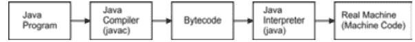

▲ 图 4：显示 Java 的编译和执行过程

为了在不同的计算机上运行 Java 程序，你需要一个用于 Java 字节码的解释器。虽然 Java 字节码解释器取决于所使用的操作系统类型，但一旦计算机有了解释器，它就可以运行 Java 字节码。换句话说，Java 最重要的特性是同一个经过编译的程序可以在任何操作系统上运行，如图 5 所示：

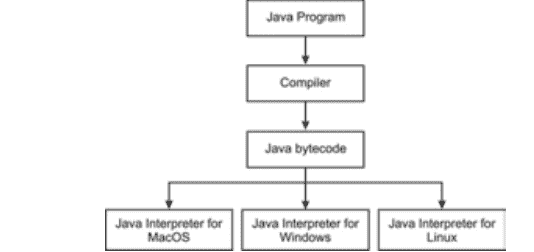

▲ 图 5：显示在任何操作系统上运行程序的过程

Java 本身实现为 JVM，JVM 是实际执行 Java 程序的应用程序。当计算机上安装了 JVM 时，它就可以运行 Java 程序。因此，Java 程序不需要自给自足，也不必包含计算机上实际存在的所有机器级代码。相反，Java 程序被编译成紧凑的字节码，由 JVM 读取并解释这些字节码以运行你的程序。由于你的程序存储在字节码文件中，它将在任何安装了 JVM 的计算机上运行。

### 1.6.2.2 定义 Java API

Java API 是一个以 Java 包形式提供的类、接口和方法的集合体。换句话说，Java API 是一个已经创建的类和接口的大型集合，提供了许多有用功能，例如图形用户界面 (GUI)、日期、时间以及日历功能。Java API 以 Java 包形式进行的分类如下：

- 应用程序编程包
  - `java.lang`：提供对 Java 语言设计至关重要的类。
  - `java.util`：提供旧版集合类、事件模型、框架和时间功能、国际化以及其他工具类（如字符串分词器）。
  - `java.io`：提供通过数据流、序列化和文件系统进行系统输入和输出的类。
- Applet 和网络编程包
  - `java.awt`：提供创建用户界面以及绘制图形图像的类。
  - `java.applet`：提供创建 applet 必要的类，这些类用于与其 applet 上下通信。
  - `java.net`：提供用于在 Java 程序中实现网络的类。


# 1.6.3 Java 程序的类型

在 Java 中，你可以创建以下类型的程序：

- 应用程序
- Applet

让我们详细讨论每一个。

## 1.6.3.1 定义 Java 应用程序

Java 应用是用 Java 编程语言创建的程序。Java 应用程序是基于控制台的、基于字符用户界面 (CUI) 以及基于 GUI 的。一旦你成为应用程序，你必须知道创建一个应用程序需要执行以下步骤：

- 使用 `javac` 编译源代码以生成字节码。
- 使用 Java 解释器执行字节码。

## 1.6.3.2 定义 Java Applet

Applet 是一种包含在 HTML 页面中的程序。例如，applet 上下文可以是浏览器或 applet 开发环境。换句话说，applet 是一种设计用于互联网传输并由兼容 Java 的浏览器执行的应用程序。你需要导入 `java.applet` 包，该包提供了创建 applet 的类并允许其与其 applet 上下文通信。

# 1.7 开发一个简单的 Java 程序

让我们创建一个显示 hello 信息的简单程序。执行以下步骤开发一个简单的 Java 程序：

- 编写 Java 程序
- 保存 Java 程序
- 编译 Java 程序
- 执行 Java 程序

## 1.7.1 编写 Java 程序

你需要使用纯文本编辑器创建 Java 源代码文件。Unix 系统中使用 `vi` 或 `pico` 编辑器编写程序，而在 Windows 中使用记事本或 DOS 编辑器。按照以下步骤创建一个简单的 Java 程序：

1. 按下键盘上的 Windows + R 键。

出现运行对话框，如图 6 所示：


**▲ 图 6：运行对话框**

2. 在打开框中输入 `notepad`，然后点击确定按钮（图 6）。

出现一个空白记事本窗口，如图 7 所示：


**▲ 图 7：空白记事本窗口**

3. 现在，在空白记事本窗口中输入以下代码片段：

```
/* 这是一个简单的 Hello Java 程序，用于显示 Hello 消息 */
```

前面的代码片段是 Java 中的注释。Java 编译器会忽略注释的内容，因为注释只描述 Java 程序的操作。

支持单行注释和多行注释。单行注释以 `//` 开始，多行注释以 `/*` 开始并以 `*/` 结束。

4. 现在在提供注释后，你需要声明 Java 类，如下代码片段所示：

```
class hello{
}
```

前面的代码片段声明了 Hello 类。关键字 `class` 用于声明一个新类，后面跟着要声明的类名。由于 Java 是一种面向对象（OOP）的语言，所有内容必须放置在类内部。你还必须注意，在 Java 中，每个类定义都以左括号开始（并以右括号结束）。这与 C++ 的类结构相似，不同之处在于 C++ 类声明在末尾需要一个分号。

5. 现在，我们在 Hello 类中声明 `main()` 方法，如下代码片段所示：

```
public static void main(String args[]){
}
```

在前面的代码片段中，重要的是要理解声明了 `main()` 方法，这类似于 C++ 中的 `main()` 函数。在 Java 中，每个程序都必须包含 `main()` 方法，因为它是 Java 解释器开始执行程序的起点。一个 Java 应用可以有很多类，但 `main()` 方法必须只能在一个类中声明，以启动执行。

在前面的代码片段中，包含了 `public`、`static` 和 `void` 关键字。这些关键字的解释如下：

- `public`：它是一个访问修饰符，允许 Java 程序员控制类成员的可见性。在类成员之前使用的 `public` 访问修饰符意味着该类可以在其定义的类之外访问。`main()` 方法被声明为 `public`，意味着在程序启动时可以在类之外调用它。
- `static`：它允许在不创建类实例的情况下调用 `main()` 方法。在 `main()` 方法之前使用 `static` 关键字是至关重要的，因为它是 Java 解释器在创建对象之前被调用的。
- `void`：它意味着 `main()` 方法不返回任何值。

此外，你可能已经注意到 `main()` 方法声明时带有括号内提供的参数。这里，`String args[]` 声明了一个名为 `args` 的参数，它包含一个 `String` 类的对象数组。`args` 参数在程序执行时接收命令行参数。

现在，在 Hello 类中声明的 `main()` 方法内提供以下代码，如下片段所示：

```
System.out.println("welcome to the world of programming");
```

前面的片段用于打印字符串 "Welcome to the world of programming"，并在屏幕上跟一个新行。由于 Java 是一种面向对象的语言，每个方法都必须是对象的一部分。这里，`println()` 方法是 `out` 对象的成员，而 `out` 是 `System` 类的静态数据成员。它是一个预定义的类，提供了对连接到控制台的系统和输出流的访问。

> 在 Java 中，所有语句以分号结尾，例如前面代码片段中的 `println()`。

现在，写完简单的 Java 程序后，让我们保存 Java 源代码。

## 1.7.2 保存 Java 程序

在保存 Java 程序之前，你必须熟悉这样一个事实：源文件名必须与源代码中调用的 `main()` 方法中的类名匹配。在前面的节中，我们创建了 Hello 类，因此我们需要以该名称加上 Java 扩展名保存源文件。按照以下步骤保存上一节创建的源文件：

- 在 File（文件）菜单中选择 Save（保存）选项，如图 8 所示：

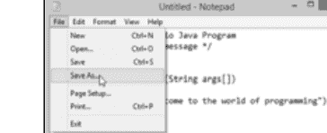

**▲ 图 8：保存 Java 源代码**

出现 Save As（另存为）对话框，如图 9 所示：

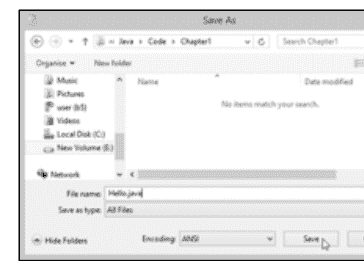

**▲ 图 9：显示另存为对话框**

1. 在你的计算机上选择保存 Java 源文件的位置。在我们的案例中，我们选择了 `E:\Java\Code\Chapter1` 路径（图 9）。
2. 在 File name（文件名）组合框中输入文件名为 `Hello.java`（图 9）。

> 如果需要，在文件名之间加上双引号。通常情况下，java 文件名与包含 `main()` 方法的类相同，但也可以不同。

3. 然后，点击 Save（保存）按钮保存 `Hello.java` 文件（图 9）。

现在让我们编译并执行此程序以获得预期的输出。

## 1.7.3 编译 Java 程序

为了看到简单 Java 程序的预期输出，你首先需要编译程序。首先，java 编译器将源代码转换为字节码，然后解释器读取字节码并显示预期输出。执行以下步骤编译 `Hello.java` 源文件：

1. 按下键盘上的 Windows + R 键。

出现运行对话框，如图 10 所示：

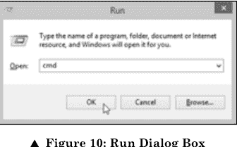

**▲ 图 10：运行对话框**

2. 在 Open（打开）框中输入 `cmd`，然后点击 OK（确定）按钮（图 10）。

出现命令提示符窗口，如图 11 所示：

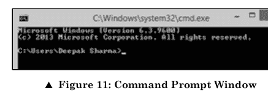

**▲ 图 11：命令提示符窗口**

3. 将驱动器改为 `E:`，然后输入以下命令进入 `Java\Chapter1`：

```
cd Java\Chapter1
```

执行命令后，当前目录变为 `Java\Chapter1`，如图 12 所示：

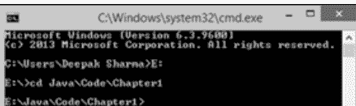

**▲ 图 12：更改目录**

4. 执行以下命令来编译 `Hello.java`：

```
javac Hello.java
```

在前面的命令中，`javac` 是编译器，后面跟着源文件名 `Hello.java`。执行命令后，在当前目录 `E:\Java\Chapter1` 中创建 `.class` 文件。

现在，在编译并生成 `Hello.java` 的 `.class` 文件后，让我们执行运行 Java 程序：

## 1.7.4 执行 Java 程序

Java 编译器已经将 `Hello.java` 的源代码翻译字节码。现在，Java 解释器帮助执行 Java 程序。执行以下命令运行 Java 程序：

```
java hello
```

图 13 显示了执行命令后的输出：

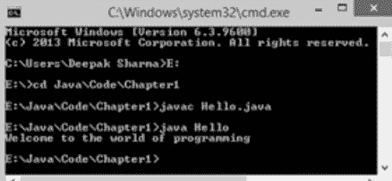

**▲ 图 13：简单程序的输出**

# 总结

本章讨论了面向对象编程（OOP）的概念以及 Java 的演进。它还对比了 Java 和 C++ 并列出了 Java 的特性。还讨论了 SE 8.0 的新功能以及 Java 字节码和 Java 虚拟机（JVM）的概念。它涵盖了包含 Java 开发工具包（JDK）、Java 组件和程序的环境。最后开发了一个简单的 Java 程序以提供 Java 编程的体验。

# 关键术语

- **面向对象编程 (OOP)**：指将私有数据和方法封装到对象中的编程技术，从而使每个对象都是半自主的。
- **抽象 (Abstraction)**：表示重要特征而不包含背景细节的概念。
- **继承 (Inheritance)**：指 OOP 概念之一，通过它一个类可以获取另一个类的属性。
- **多态 (Polymorphism)**：指允许使用相同方法执行多种操作的概念。
- **动态绑定 (Dynamic binding)**：指在运行时显示的绑定过程。

# 复习题

## 判断对错

- **Q1.** Java 语言是由软件开发者 James Gosling 在 1991 年在 Microsystems 创建的。
  - **Ans.** 对
- **Q2.** 类是 OOP 中的基本运行时实体。
  - **Ans.** 错
- **Q3.** 对象为类提供了某种模板。
  - **Ans.** 错
- **Q4.** 类可以被定义为相同类型对象的集合。
  - **Ans.** 对
- **Q5.** 作为对象数据与程序之间中介的方法被称为成员方法。
  - **Ans.** 正确。
- **Q6.** JVM 代表 Java Virtual Machine（Java虚拟机）。
  - **Ans.** 正确。
- **Q7.** 封装是一个类获取另一个类属性的 OOP 概念之一。
  - **Ans.** 错误。
- **Q8.** 在 OOP 中，多态允许你使用相同的方法执行各种操作。
  - **Ans.** 正确。

## 多选题

- **Q1.** Java 语言是由谁开发的？
  - a. James Gosling
  - b. John Gosling
  - c. Bjarne Stroustrup
  - d. Ben Stroustrup
  - **Ans.** 正确选项是 a.
- **Q2.** Oak 在哪一年被更名为 Java？
  - a. 1996
  - b. 1995
  - c. 1997
  - d. 1999
  - **Ans.** 正确选项是 b.
- **Q3.** DLL 代表
  - a. Dynamic Link Libraries
  - b. Dynamic Link Libraries
  - c. Dynamic Link Libraries
  - d. Dynamic Link Libraries
  - **Ans.** 正确选项是 d.
- **Q4.** Java 的哪个版本引入了 Just-In-Time（即时）？
  - a. Java 1
  - b. Java 2
  - c. Java 3
  - d. Java 4
  - **Ans.** 正确选项是 c.
- **Q5.** ____ 是 Java 编译器编译 Java 程序时生成的一组指令。
  - a. JVM
  - b. JDK
  - c. Bytecode（字节码）
  - d. Multithreading
  - **Ans.** 正确选项是 c.
- **Q6.** 下哪个不是 JDK 中的开发工具？
  - a. javac
  - b. Javad
  - c. Javadoc
  - d. Javap
  - **Ans.** 正确选项是 b.
- **Q7.** 下哪个 API 通过数据流、序列化和文件系统提供了用于系统输入输出的类？
  - a. java.lang
  - b. java.util
  - c. java.io
  - d. java.io
  - **Ans.** 正确选项是 d.
- **Q8.** 下哪个包提供了用于在 Java 程序中实现网络的类？
  - a. java.net
  - b. java.awt
  - c. java.applet
  - d. java.lang
  - **Ans.** 正确选项是 a.
- **Q9.** 写出用于隐藏用户不需要的数据机制。
  - a. 继承
  - b. 抽象
  - c. 多态
  - d. 封装
  - **Ans.** 正确选项是 b.
- **Q10.** 动态绑定被称为 ________。
  - a. 运行时继承
  - b. 运行时抽象
  - c. 运行时多态
  - d. 运行时封装
  - **Ans.** 正确选项是 c.

## 简答

- **Q1.** 什么是 OOP？
  - **Ans.** OOP 指一种使能够实现著名编程格言“分而治之”的技术。OOP 的目标是将数据和方法封装到对象中，使每个对象半自主的，并以这种方式封装数据和方法防止它们污染全局命名空间。
- **Q2.** 解释 Java 的发展。
  - **Ans.** 1990 年，Sun Microsystems 决定开发一种可以用于操作消费电子设备的特殊软件。James Gosling 被任命为 Sun Microsystems 程序员团队负责人以完成这一目标。在他的领导下，该团队在 1991 年开发了一种名为 Oak 的新语言。1995 年，Oak 被更名为 Java。包括 Netscape 和微软在内的许多知名公司宣布支持 Java。
- **Q3.** 列出 Java 编程语言的一些特征。
  - **Ans.** Java 编程语言的各种特征如下：
    - **简单**：这一特征允许 Java 轻松编写和调试程序，因为 Java 不使用指针。
    - **安全**：这一特征使得 Java 程序局限于 Java 运行环境，因此它们只能访问计算机执行程序所需的计算机部分。Java 运行环境之外的数据无法被 Java 程序访问，因此通过 Internet 下载 Java 应用程序是安全的，不会损坏您的计算机。
    - **可移植**：这一特征允许 Java 应用程序在具有不同操作系统的计算机上被访问。
    - **健壮**：这一特征提供了创建健壮程序的能力。因此，Java 强制要求程序员在编译期间解决错误。
    - **多线程**：这一特征有助于编写交互式程序，其中多个任务可以同时执行。
- **Q4.** 解释编译器和解释器在 Java 中的作用。
  - **Ans.** 在编程语言中，编译器用于将源代码翻译成特定计算机的机器码。在 Java 中，编译器用于将 Java 源代码翻译成称为字节码的中间代码。要在不同的计算机上运行 Java 程序，需要一个字节码的 Java 解释器。虽然取决于操作系统的类型，Java 字节码解释器有所不同，但一旦计算机有了解释器，它就可以运行 Java 字节码。
- **Q5.** 什么是继承？
  - **Ans.** 继承是指类获取另一个类属性的机制。继承的概念支持分级分类。如果没有继承，你只需要显式定义每个对象的所有特征。
- **Q6.** JVM 在 Java 中的作用是什么？
  - **Ans.** 在所有编程语言中，编译器可以将源代码翻译成针对特定计算机的机器码。在 Java 中，编译器可以将 Java 源代码翻译成针对虚拟机（即 Java虚拟机）的中间代码字节码。字节码充当虚拟机和机器之间的中介。
- **Q7.** Java 是平台无关的。请证明。
  - **Ans.** 平台无关意味着用 Java 开发的程序不绑定到任何系统。早以前，没有任何编程语言提供这一特征。除了源码形式跨平台之外，Java 在编译形式上也是平台无关。
- **Q8.** 你如何认为 Java 是安全的？
  - **Ans.** Java 提供了各种安全功能。人们使用 Java 来克服互联网上的安全威胁。在使用兼容 Java 的浏览器时，每个人都可以安全地下载 applet 而不用担心感染。由于 Java 程序局限于 Java 运行环境，它们只能访问执行程序所需的计算机部分。Java 运行环境之外的数据无法被 Java 程序访问，因此通过 Internet 下载 Java 应用程序不会损坏您的计算机。

# 第2章

- 关键字
- 标识符
- 字面量
- 常量
- 分隔符
- 运算符

## 2.1.1 使用关键字

关键字是保留字，在命名变量或方法时不能使用。表1显示了某些 Java 关键字：

| 表 1：Java 关键字 | | | | | | |
| --- | --- | --- | --- | --- | --- | --- |
| abstract | cast | throws | int | protected | else |
| assert | catch | transient | instanceof | private | return |
| boolean | char | try | import | package | synchronized |
| break | class | var | implements | new | switch |
| byte | const | void | if | native | super |
| | continue | volatile | goto | long | strictfp |
| case | default | while | for | interface | static |
| enum | do | throw | float | extends | short |
| final | double | public | finally | | |


# 表 1 中的关键字不应在 Java 中用作标识符

本节将解释什么是标识符以及声明合法标识符的规则。

## 2.1.2 使用标识符

标识符是一个符号名称，用于引用 Java 程序中变量、方法、类、包或接口的名称。每个变量通过其名称来标识。变量名应与其用途相关。同样，对于方法，方法名应与方法的功能相关。Java 标识符由字母、数字、下划线（`_`）和美元符号（`$`）组成。标识符规则如下：

- 必须以下划线（`_`）、字母或美元符号（`$`）开头
- 由字母、数字、下划线和美元符号组成
- 标识符内部不允许有空格
- 名称不能与 Java 保留关键字相似
- 区分大小写，也就是说，`salary`、`Salary` 和 `SALARY` 是三个不同的标识符

## 2.1.3 使用字面量

在 Java 程序中，你可以为变量分配一个字面量值。字面量是指根据程序需要可以改变的常量值。Java 程序中基本数据类型的源码表示被称为基本类型字面量（primitive literals）。这些基本类型字面量可以是整数、浮点数、布尔值，或者是你在程序中使用的字符。基本类型字面量的示例包括：

```java
24          // 一个 int 字面量
124.543     // 一个 double 字面量
true        // 一个 boolean 字面量
'v'         // 一个 char 字面量
```

在上面的示例中，`24` 是整数值，`124.543` 是浮点数，`true` 是布尔字面量，`v` 是一个字符值。现在，让我们详细讨论以下字面量：

- 整数字面量
- 浮点字面量
- 布尔字面量
- 字符字面量
- 字符串字面量

### 2.1.3.1 整数字面量

根据程序的要求，整数可以用以下三种方式表示：

- **十进制字面量**：常用于表示现实生活中的数字。它们是十进制的，使用 0 到 9 之间的数字表示所有数字。与其他整数表示形式相比，整数的十进制表示不使用任何前缀。
- **八进制字面量**：表示整数的另一种方法是八进制表示，它以 8 为进制。它只使用 0 到 7 的 8 个数字表示所有数字。在 Java 中，八进制数前面有一个前缀 `0`，这通知编译器该数是以八进制形式表示的。
- **十六进制字面量**：整数的十六进制表示以 16 为进制。它使用 10 个数字和 6 个特殊符号/字符来表示数字。十六进制表示使用的数字是 0 到 9，特殊符号是 `a`、`b`、`c`、`d`、`e` 和 `f`。十六进制表示中 0-9 的表示方法与十进制相同，其余的 6 个由字符 `a` 到 `f` 表示。十六进制表示中 10 到 15 的相应表示方法为：
  - 10 - `a` 或 `A`
  - 11 - `b` 或 `B`
  - 12 - `c` 或 `C`
  - 13 - `d` 或 `D`
  - 14 - `e` 或 `E`
  - 15 - `f` 或 `F`

在用十六进制表示整数时必须考虑的一个重要方面是前缀 `0x`（数字零加 `x`）。所有的十六进制表示必须以 `0x` 或 `0X` 开头，告诉 JVM 给定的数字是十六进制格式。

### 2.1.3.2 浮点字面量

在 Java 程序中，整数用整数表示，而带小数部分的数字用浮点字面量表示并赋值。Java 程序中浮点值的源码表示称为浮点字面量。浮点数由整数和小数组成。考虑以下示例：

```java
double distance = 42313.13245;
```

在这里，我们将 `42313.13245` 表现为一个浮点字面量，其中第一部分是 `42313`，通过一个小数点（`.`）相隔，第二部分是 `13245`。

在 Java 编程语言中，默认情况下浮点字面量被定义为宽度为 64 位的 `double`。你可以为 `float` 类型的变量分配浮点字面量，但这将产生编译错误。该错误指出了可能会丢失精度，因为 `float` 数据的宽度仅为 32 位。

除了整数和浮点字面量外，我们还有可以取 `true` 或 `false` 的布尔字面量。现在，让我们详细讨论这些字面量。

### 2.1.3.3 布尔字面量

在 Java 中，布尔值是 `true` 或 `false` 的结果，布尔字面量以这种形式表示。布尔值的源码表示被称为布尔字面量。布尔字面量可以是 `true` 或 `false`。考虑以下代码片段：

```java
boolean status = true;   // 无错误
boolean status = 1;      // 将产生编译错误
```

在前面的代码片段中，第一个布尔表示是正确的且可以执行。然而，第二个布尔表示是错误的，因为将 `1` 赋值给布尔类型会导致编译错误。

### 2.1.3.4 字符字面量

在 Java 中，单个值的源码表示称为字符字面量。Java 中的字符字面量由单引号内的字符或转义序列表示。考虑以下代码片段：

```java
char letter = 'A';
char value = 'y';
char newline = '\n';
```

在这里，字符 `A`、`y` 和 `\n`（换行的转义序列）均为字符字面量。

### 2.1.3.5 字符串字面量

与 C++ 不同，在 Java 语言中，`String` 被视为类而不是基本类型，因此所有的字符串字面量都是对象。`String` 对象的源码表示称为字符串字面量。`String` 是双引号内的字符集合。以下代码片段：

```java
String msg = "welcome to Java Programming";
System.out.println(msg);
```

在前面的代码片段中，字符串字面量赋值给字符串对象 `msg`，然后赋值的字面量显示在标准输出控制台上。

## 2.1.4 使用常量

有时变量在程序执行过程中会被赋值；但你可能希望锁定变量赋值的值。换句话说，如果你希望一个值在整个程序执行过程中保持不变，那么它被称为常量。

让我们考虑一个例子，假设你想在程序中计算圆的面积。在计算圆面积时，pi 的值不受半径变化的影响。因此，你需要分配一个固定值 `3.14`，如下代码所示：

```java
final double pi = 3.14;
```

在前面的代码片段中，`pi` 变量分配了一个固定值 `3.14`。你必须注意，`final` 关键字用于避免修改 `pi` 变量的值。Java 中的 `final` 关键字与 C/C++ 中的 `const` 相似。在使用 `final` 关键字时，你必须记住以下几点：

- 你应该为 `final` 变量选择全大写的标识符，这是一个常见的惯例
- 一旦你声明了一个 `final` 变量，无法为该变量赋值任何其他值
- 在 C 和 C++ 中，常量是使用 `#define` 语句定义的；但在 Java 中，常量是根据类型声明的
- 你不能在方法内部声明 `final` 变量，因为它们应该在类的开始处作为类成员声明
- `final` 变量本质上是常量，它们不会在每个实例的基础上占用内存

## 2.1.5 使用分隔符

分隔符是用于以定义的方式结构化 Java 程序的符号。分隔符的使用有助于代码的分组并以适当的方式进行排列。表 2 描述了分隔符的作用及其符号：

| 分隔符名称 | 符号 |
|---|---|
| 圆括号 | `()` |
| 大括号 | `{}` |
| 中括号 | `[]` |
| 分号 | `;` |
| 逗号 | `,` |
| 句号 | `.` |
| 冒号 | `:` |

## 2.1.6 使用运算符

运算符是允许程序员对数据和变量执行某些算术或逻辑操作的符号。在这里，我们讨论 Java 中的运算符：

- 算术
- 关系
- 布尔逻辑
- 递增和递减
- 条件
- 位运算
- 特殊（`instanceof` 和点运算符）

现在，让我们详细讨论所有这些运算符及其实现。

### 2.1.6.1 算术运算符

用于执行算术操作的运算符称为算术运算符，例如加法（`+`）、减法（`-`）和乘法（`*`）。表 3 列出了 Java 支持的算术运算符：

| 算术运算符 | 说明 |
|---|---|
| `+` | 加 |
| `-` | 减法 |
| `*` | 乘法 |
| `/` | 除法 |
| `%` | 取模 |

算术运算符用于执行代数中的数学运算。除了算术运算符，你还需要理解赋值运算符，将在下一节中讨论。

### 2.1.6.2 算术赋值运算符

等号（`=`）符号被称为赋值运算符。赋值（`=`）运算符用于存储或为变量分配一个值。例如，在表达式 `i = 10` 中，我们正在为变量 `i` 赋值值 `10`。记住，在表达式 `i = 10` 中，我们并不是在比较变量 `i` 和 `10`；而是将值 `10` 赋值给变量 `i`。

在 Java 中，赋值运算符有两种用法——简单赋值和复合赋值。在简单赋值中，我们使用 `=` 运算符为变量赋值。以下代码段显示了简单赋值的示例：

```java
x = 10;          // x 存储 10
x = x + 10;     // x 存储 20
x = x + 5;       // x 存储 25
```

在复合赋值中，我们使用 `+=`、`-=`、`*=`、`/=` 和 `%=` 运算符。以下代码段显示了复合赋值的示例：

```java
i = 10;      // i 初始化为 10
i += 15;     // i 复合赋值为 25
i -= 5;      // i 复合赋值为 20
```

在前面的代码段中，变量 `i` 被赋值为 `10`。在表达式 `i += 15` 中，值 `15` 加到变量 `i` 已有的值上，并将总值重新赋值给 `i`，因此 `i` 将包含 `25`。在表达式 `i -= 5` 中，值 `5` 从变量 `i` 已有的值中减去，然后将结果重新赋值给 `i`，在这种情况下，变量 `i` 将包含 `20`。列表 1 显示了复合赋值的示例：

#### 列表 1：复合赋值示例

```java
public class AssignmentOpt {
    public static void main(String args[]) {
        int x = 3;
        int y = 4;
        int z = 5;

        x += 5;
        y *= x;
        z += x * y;
        System.out.println("x = " + x);
        System.out.println("y = " + y);
        System.out.println("z = " + z);
    }
}
```

在列表 1 中，定义了 `AssignmentOpt` 类。在 `AssignmentOpt` 类的 `main()` 方法中，三个 `int` 类型变量 `x`、`y` 和 `z` 分别存储值 `3`、`4` 和 `5`。表达式 `x += 5`、`y *= x` 和 `z += x * y` 执行复合赋值操作，将值 `8`、`32` 和 `261` 重新赋值给变量 `x`、`y` 和 `z`。图 1 显示了在使用赋值运算符求值后，存储在变量 `x`、`y` 和 `z` 中的最终值：

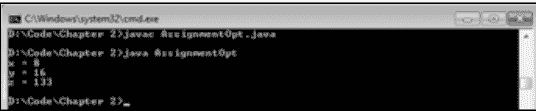

> 图 1：显示复合赋值的结果

现在，在理解了算术运算符的实现后，让我们讨论关系运算符。

### 2.1.6.3 关系运算符

用于确定两个操作数之间关系的运算符被称为关系运算符。关系运算符返回布尔值，即真 `true` 或假 `false`。有六种可以比较整数、浮点数或字符的关系运算符。表 4 列出了：

| 关系运算符 | 说明 |
|---|---|
| `==` | 等于 |
| `!=` | 不等于 |
| `<` | 小于 |
| `>` | 大于 |
| `<=` | 小于等于 |
| `>=` | 大于等于 |

从图 2 可以清楚看出，变量 `a`、`b` 和 `c` 包含的值是不相等的，并且根据比较结果显示布尔值。

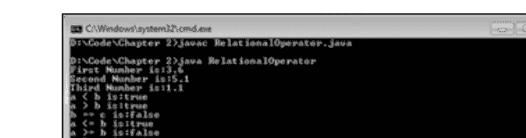

> 图 2：关系运算符的使用

### 2.1.6.4 布尔逻辑运算符

布尔逻辑运算符用于对布尔值执行逻辑操作。表 5 列出了 Java 支持的布尔逻辑运算符：

| 布尔逻辑运算符 | 说明 |
|---|---|
| `!` | 逻辑非 |
| `&` | 逻辑与 |
| `|` | 逻辑或 |
| `^` | 逻辑异或 |
| `&&` | 短路与 |
| `||` | 短路或 |

列表 2 显示了布尔逻辑运算符的使用：

#### 列表 2：布尔逻辑运算符的使用

```java
/* 实现布尔逻辑运算符的程序 */
class BooleanLogic {
    public static void main(String[] args) {
        boolean b1 = true;
        boolean b2 = false;
        boolean b3 = b1 & b2;    // false
        boolean b4 = b1 | b2;    // true
        boolean b5 = b1 ^ b2;    // true
        boolean b6 = !b2;        // true
        System.out.println("b1 & b2 = " + b3);    // false
        System.out.println("b1 | b2 = " + b4);    // true
        System.out.println("b1 ^ b2 = " + b5);    // true
        System.out.println("!b2 = " + b6);        // true
        int i = 10;
        boolean b7 = 6 == 4 & i < 4;              // false
        boolean b8 = b3 ^ b2;                     // true
        boolean b9 = b4 | b1 & b2;                // true
        System.out.println("b7 = " + b7);
        System.out.println("b8 = " + b8);
        System.out.println("b9 = " + b9);
    }
}
```

在列表 2 中，使用了布尔运算符，如 `!`、`^`、`&` 和 `|`。根据布尔比较的结果，返回并显示如下布尔值。

图 3 显示了 `BooleanLogic` 类的输出：

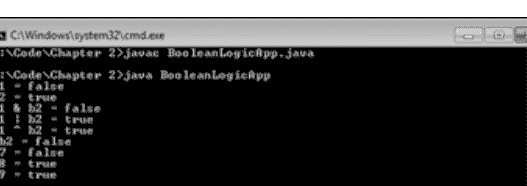

> 图 3：显示 BooleanLogic 类的输出

### 2.1.6.5 递增和递减运算符

递增递减运算符有两种用法：在操作数之前或之后。根据这些运算符的位置，可以将它们分为前缀或后置。前缀和后置表示的区别在于：在前缀表示中，操作数的值在赋值给另一个变量之前会增或减；而在后置表示中，操作数的值在赋值给另一个变量之后才会增或减。

考虑以下代码段：

```java
int x = 10;
int y = 20;
++x; // 增运算符的前缀表示
--y; // 减运算符的前缀表示
x++; // 增运算符的后置表示
y--; // 减运算符的后置表示
```

在前面的代码段中，`++x` 是增运算符的前缀表示，`--y` 是减运算符的前缀表示。`x++` 是增运算符的后置表示，`y--` 是减运算符的后置表示。列表 3 展示了如何使用增运算符（`++`）的前缀和后置表示。

#### 列表 3：增运算符（++）的使用

```java
/* 实现增运算符的程序 */
class IncrementApp {
    public static void main(String[] args) {
        int i, j;
        i = 10;
        j = i++; // 使用后置递增 j = 10
        System.out.println("After postfix increment");
        System.out.println("i = " + i);
        System.out.println("j = " + j);
        i = 10;
        j = ++i; // 使用前缀递增 j = 11
        System.out.println("After prefix increment");
        System.out.println("i = " + i);
        System.out.println("j = " + j);
    }
}
```

在列表 3 中，定义了 `IncrementApp` 类。在其 `main()` 方法中，声明了两个 `int` 类型变量 `i` 和 `j`。`i` 初始化为数字 `10`。当变量被递增（`++`）时，存储在变量中的数字加 1。这意味着变量 `i` 的值将变为 `11`；变量 `j` 仍然存储数字 `10`，因为在后置表示中，操作数的值在赋值给另一个变量之后才会增或减。接下来，`i` 重新赋值为 `10`。当 `i` 执行前缀递增（`++i`）时，它的值加 1 并赋值给 `j`。然而，变量 `j` 存储的是数字 `11`，因为在前缀表示中，操作数的值在赋值给另一个变量之前就会增或减。图 4 显示了列表 3 的输出：


> 图 4：后置递增与前置递增运算符的区别

### 2.1.6.6 条件运算符

条件运算符（`?`）是一个用于接收三个操作数的三元运算符。它的工作原理类似于 `if-else` 语句。条件运算符（`?`）评估一个布尔表达式并根据该布尔表达式给出结果。条件运算符使用问号（`?`）和冒号（`:`）符号构建。条件运算符的语法为：

```
operand1 ? operand2 : operand3
```

在此语法中，`operand1` 是任何有效的布尔表达式，例如 `10 > 5`。如果 `operand1` 为真，则评估 `operand2`；否则评估 `operand3`。例如：

```java
a = (x < y) ? x : y;
```

列表 4 显示了条件运算符的使用：

#### 列表 4：条件运算符（?:）的使用

```java
/* 实现条件运算符的程序 */
class ConditionalOpt {
    public static void main(String[] args) {
        int i = 20, j = 15;
        boolean test = false;
        test = i > j ? true : false;
        System.out.println("The value of test = " + test);
    }
}
```

在列表 4 中，定义了一个类 `ConditionalOpt`。在 `ConditionalOpt` 类的 `main()` 方法中，变量 `i` 和 `j` 分别存储值 `20` 和 `15`。布尔变量 `test` 存储条件运算符（`? :`）的结果。在表达式 `i > j ? true : false` 中，变量 `i` 包含的值大于变量 `j` 的值；因此，`? :` 运算符返回 `true` 并将其赋值给变量 `test`。图 5 显示了使用条件运算符（`? :`）的结果。

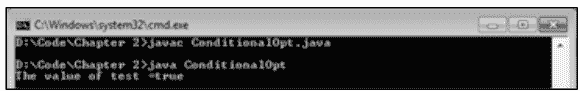

> 图 5：条件运算符的使用

### 2.1.6.7 位运算符

这些运算符对单个位（`0` 和 `1`）进行操作。它们只能应用于 `long`、`int`、`short` 和 `byte` 等整数类型。在需要节省内存的场景中（例如系统编程），应该使用位运算符。表 6 列出了位运算符：


# Java 编程基础概念

## 2.1.6.7 特殊运算符

在 Java 中，我们使用点（`.`）运算符来调用方法，如下：

```java
X x;
x = new X();
```

在前面的代码段中，类后面跟着一个点运算符。在详细了解所有运算符类型后，让我们讨论运算符的优先级和结合性。

## 2.2 运算符优先级和结合性

每个运算符都有关联的优先级，这有助于确定在使用多个运算符时如何评估表达式。根据运算符优先级，评估将取决于运算符的顺序。换句话说，优先级相同的运算符从左到右或反之评估。这种运算符的属性被称为结合性。表 7 描述了运算符的优先级和结合性。

### 表 7：运算符优先级和结合性

| 顺序 | 运算符 | 结合性 |
|---|---|---|
| 1 | `[]` | 从左到右 |
| 2 | `(一元负) ++ --` | 从右到左 |
| 3 | `* / %` | 从左到右 |
| 4 | `+ -` | 从左到右 |
| 5 | `<< >> >>>` | 从左到右 |
| 6 | `< <= > >=` | 从左到右 |
| 7 | `== !=` | 从左到右 |
| 8 | `&` | 从左到右 |
| 9 | `^` | 从左到右 |
| 10 | `|` | 从左到右 |
| 11 | `&&` | 从左到右 |
| 12 | `||` | 从左到右 |
| 13 | `? :` | 从右到左 |
| 14 | `= += -= *= /= %= &= ^= |= <<= >>= >>>=` | 从右到左 |

## 2.3 变量声明

Java 提供了用于存储数据的容器。这些容器被称为变量，因为它们在程序执行过程中的值可以改变。在 Java 程序中声明变量，需要使用数据类型和标识符的组合。标识符是变量的名字，必须是一个逻辑名称。变量在使用之前必须声明。声明变量的语法为：

```java
dataType variable; // 声明变量
```

除了在声明语句中声明单个变量外，你还可以声明多个特定数据类型的变量。在声明语句中声明多个变量的语法如下：

```java
dataType variable1, variable2, ..., variableN; // 声明多个变量
```

如上述语法所示，如果你一次声明了多个变量，它们必须用逗号分隔。你必须始终记住用分号 (`;`) 来结束变量声明。在声明变量之后，让我们通过以下语法查看如何初始化它：

```java
dataType variable = val; // 初始化变量
```

在上述语法中，`val` 代表用于初始化变量的值。除了在声明时进行初始化外，也可以在声明之后的稍后对其进行初始化。以下语法展示了如何在声明后对变量进行初始化：

```java
dataType variable;
variable = val;
```

在上述语法中，变量先被声明，稍后进行初始化。

## 2.4 介绍数据类型

Java 是一种强类型语言，因此理解 Java 中可用的数据类型非常重要。在 Java 程序中，如果不指定数据类型，你甚至无法声明变量。Java 中可用的数据类型可以分为大类：

- 整数型（Integer）：使用 `byte`、`short`、`int` 和 `long` 表示整数
- 浮点型（Floating-point）：使用 `float` 和 `double` 数据类型表示小数
- 字符型（Character）：表示 `char`，该类型用于存储字符
- 布尔型（Boolean）：使用 `boolean` 数据类型表示逻辑值

让我们先讨论整数数据类型。

### 2.4.1 整数数据类型

整数数据类型用于存储整数数据项。Java 提供了四种整数数据类型来存储整数值：`byte`、`short`、`int` 和 `long`。由于 Java 只支持符号整数，因此这些整数类型具有负 (-ve) 和正 (+ve) 值。在所有类型中，`byte` 是最小的整数数据类型，而 `long` 是最大的整数数据类型。表 8 列出了整数类型的宽度和范围：

### 表 8：整数数据类型的宽度和范围

| 数据类型 | 宽度（字节） | 范围 |
|---|---|---|
| `byte` | 1 | -128 到 127 |
| `short` | 2 | -32,768 到 32,767 |
| `int` | 4 | -2,147,483,648 到 2,147,483,647 |
| `long` | 8 | -9,223,372,036,854,775,808 到 9,223,372,036,854,775,807 |

整数数据类型的几个示例：

- `byte x;`
- `short sum;`
- `int age;`
- `long milliseconds;`

在这里，`x`、`sum`、`age` 和 `milliseconds` 分别是 `byte`、`short`、`int` 和 `long` 类型的变量。如表 8 所示，不同类型的宽度不同，因此在使用这些数据类型时必须小心。如果你需要存储一个很小的数据（例如 25），你必须使用 `byte` 数据类型，因为它足够存储它。如果你使用 `byte` 以外的任何其他数据类型，它会分配额外的内存，导致执行时间增加。

> `long` 数据类型也可以通过在数据末尾附加 `l` 或 `L` 来声明。例如 `125l` 或 `125L` 表示 125 是 `long` 数据类型。


### 2.4.2 浮点型数据类型

在 Java 中，使用浮点数据类型来处理实数。Java 提供了两种浮点数据类型——`float` 和 `double`。`float` 数据类型用于存储单精度数字，而 `double` 数据类型用于存储双精度数字。`float` 和 `double` 数据类型用于表示带有小数值的数字。`float` 数据类型最多可以表示 7 位小数，而 `double` 数据类型可以表示 15 位。表 9 列出了浮点数据类型的宽度和范围：

### 表 9：浮点型数据类型的宽度和范围

| 数据类型 | 宽度（字节） | 范围 |
|---|---|---|
| `float` | 4 | 约 ±1.4e-45 到 ±3.4e38 |
| `double` | 8 | 约 ±4.9e-324 到 ±1.8e308 |

浮点型数据类型的示例如下：

```java
float x = 3.458F;
double d = 3.24;
```

在上述代码段中，`x` 被声明并初始化为 `float` 数据类型，而 `d` 被声明为 `double` 类型。

### 2.4.3 字符数据类型

字符数据类型用于在 Java 程序中表示和存储字符常量。Java 可用的字符数据类型是 `char`。该类型遵循 Unicode 集合，表示处理器可以唯一标识的字符。Unicode 是一种支持所有语言国际字符（如英语）的标准字符集。表 10 列出了字符类型的宽度和范围。

### 表 10：字符类型的宽度和范围

| 数据类型 | 宽度（字节） | 范围 |
|---|---|---|
| `char` | 2 | 0 到 65,535 |

字符类型的示例如下：

```java
char grade = 'A';
```

在上述代码段中，`grade` 被声明并初始化为 `char` 数据类型。

### 2.4.4 布尔数据类型

布尔数据类型用于表示逻辑值。它只能持有两个值：`true` 或 `false`。

## 2.5 控制语句

在 Java 中，控制语句用于根据某些条件控制执行流。控制语句有多种类型：

- 选择语句
- 迭代语句
- 跳跃语句

### 2.5.1 使用选择语句

选择语句顾名思义，根据条件表达式执行程序的代码块。

- `if` 语句
- `if-else` 语句
- `switch` 语句

#### 2.5.1.1 if 语句

`if` 语句是一种条件结构，用于评估表达式的布尔值。如果表达式返回 `true`，则执行条件表达式后面的语句；但如果它返回 `false`，则条件表达式后面的代码将不被执行。

```java
if (conditionalExpression)
    statement; // 当条件表达式为真时执行的语句
```

在上述语法中，`if` 是关键字，括号内提供了条件表达式。列表 6 显示了如何使用 `if` 语句：

```java
class IfDemo {
    public static void main(String args[]) {
        int age;
        age = 16;
        if (age > 18)
            System.out.println("Not eligible to vote");
    }
}
```

在列表 6 中，`if` 语句用于测试程序中指定的 `age` 是否大于 18。程序中 `age` 变量的值被设置为 16。由于它小于 18，`if` 语句中的设置条件自动变为假。因此，`if` 条件后面的语句不会显示，如图 6 所示：

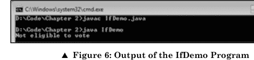

#### 2.5.1.2 if-else 语句

`if-else` 语句用于我们可以提供另一种行动方案的情况，即当 `if` 子句返回 `false` 时。在 `else` 子句中编写的语句将被执行。

以下是 `if-else` 语句的通用语法：

```java
if (conditionalExpression)
    statement1; // 如果条件为真则执行的语句
else
    statement2; // 如果条件为假则执行的语句
```

在上述语法中，条件被写在括号 `()` 内部。根据上述语法，如果 `if` 之后指定的条件为真，则执行语句 1；否则，执行语句 2。列表 7 显示了如何使用 `if-else` 语句：

**列表 7：使用 if-else 语句**

```java
class IfElseDemo {
    public static void main(String[] args) {
        int a = 10, b = 20;
        if (a > b) {
            System.out.println("a to b");
        } else {
            System.out.println("b to a");
        }
    }
}
```

在列表 7 中，`if` 语句检查变量 `a` 中存储的值是否大于 `b`。由于变量 `a` 存储的值被设置为 10，而 `b` 的值为 20，该条件会自动求为假，紧随条件之后的语句不会被执行。然后，将执行 `else` 结构之后的语句，如图 7 所示：


> 图 7：IfElseDemo 程序的输出

在图 7 中，由于 `if` 语句中的条件为假，`else` 块内部的语句被执行。在之前的两个示例中，只使用了一个 `if` 语句，但你也可以在程序中使用多个 `if` 语句。让我们在下一节中进行讨论。

#### 2.5.1.3 嵌套 if 语句

嵌套 `if` 允许将一个语句写在另一个 `if` 语句内部。列表 8 显示了嵌套 `if` 语句的工作原理：

**列表 8：使用嵌套 if 语句**

```java
class NestedIf {
    public static void main(String[] args) {
        double value = 2;
        if (value != 0) {
            if (value > 0) {
                // statement
            }
        }
    }
}
```

列表 8 的输出如图 8 所示：


> 图 8：NestedIf 程序的输出

#### 2.5.1.4 if-else 阶梯

如果你需要在程序中检查多个条件，你需要在程序中使用多个 `if-else`，它们也称为 `if-else` 阶梯。以下是多个 `if-else` 语句的语法：

```java
if (conditionalExpression1)
    statement1; // 如果条件为真则执行的语句
else if (conditionalExpression2)
    statement2; // 如果条件为真则执行的语句
else
    statement3; // 如果条件为真或所有之前的条件都为假则执行的语句
```

在上述语法中，如果第一个条件中指定的条件为假，控制将进入下一个 `if`。如果下一个 `if` 语句的结果为假，则执行写在 `else` 块中的语句。列表 9 显示了如何在你的程序中使用多个 `if-else`：

**列表 9：使用多个 if-else 语句**

```java
class MultiIfElseDemo {
    public static void main(String[] args) {
        int i = 1;
        if (i == 1) {
            System.out.println("It's Monday today");
        } else if (i == 2) {
            System.out.println("It's Tuesday today");
        } else if (i == 3) {
            System.out.println("It's Wednesday today");
        } else if (i == 4) {
            System.out.println("It's Thursday today");
        } else if (i == 5) {
            System.out.println("It's Friday today");
        }
    }
}
```

在列表 9 中，`MultiIfElseDemo` 类是用多个 `if-else` 创建的。所有语句的条件会一直被求值，直到其中一个为真。如果某个语句返回真，则执行对应的块。结果如图 9 所示：


> 图 9：MultiIfElseDemo 程序的输出

在图 9 中，第一个块中的语句被显示。使用多个 `if` 语句的另一种方法是 Java 中的 `switch` 语句。让我们在后续章节中讨论 `switch` 语句。

#### 2.5.1.5 Switch 语句

当有多个选项且我们需要从中选择一个时，我们使用 `switch`。根据所选选项，执行特定的任务。这里 `task` 代表一个或多个语句。以下是使用 `switch` 语句的通用语法：

```java
switch (variable) {
    case value1: statements1; break;
    case value2: statements2; break;
    case value3: statements3; break;
    // ...
    case valueN: statementsN; break;
    default: defaultStatements;
}
```

在上述语法中，根据变量的值执行特定的任务（语句）。如果变量的值等于 `value1`，将执行语句 1。如果变量的值等于 `value2`，将执行语句 2，依此类推。如果变量的值不等于任何指定的值，控制将进入 `default` 并执行。`default` 语句是可选的。应该记住，你不能在 `switch` 中使用所有数据类型。我们可以使用 `char`、`int`、`byte` 和 `short`。列表 10 显示了如何在程序中使用 `switch` 语句：

**列表 10：使用 switch 语句**

```java
class SwitchDemo {
    public static void main(String[] args) {
        char country = 'i'; // 将 country 设置为 'i'
        switch (country) {
            case 'a': System.out.println("America"); break;
            case 'c': System.out.println("Canada"); break;
            case 'i': System.out.println("India"); break;
            case 'e': System.out.println("England"); break;
            default: System.out.println("No Country");
        }
    }
}
```

在列表 10 中，声明了 `char` 类型的变量 `country` 并初始化为 `i`。根据 `country` 中存储的值，值为 `a` 时显示 America；值为 `c` 时显示 Canada；值为 `i` 时显示 India；值为 `e` 时显示 England。如果 `country` 的值既不是 `a`、`c`、`i` 或 `e`，则显示 `default` 语句。图 10 显示了列表 10 的输出：

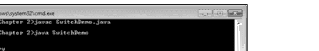

> 图 10：SwitchDemo 程序的输出

图 10 显示的输出并不符合预期。我们预期它会显示 India，但它显示了所有内容。这里的原因是什么？`country` 的值设置为 `i`，所以应该显示 India，但我们发现它执行了剩余的语句。这个问题的原因是一旦显示了 India，控制无法离开 `switch` 语句。为了这个目的，在程序（列表 10）中应该使用 `break` 语句，允许程序在显示 India 后退出 `switch` 语句，列表 11 所示：

**列表 11：使用 switch break 语句**


```java
class SwitchBreakDemo {
    public static void main(String[] args[]) {
        char country='i'; // 将 country 设置 'i'
        switch(country) {
            case 'a': System.out.println("America");
            break;
            case 'c': System.out.println("Canada");
            break;
            case 'i': System.out.println("India");
            break;
            case 'e': System.out.println("English");
            break;
            default: System.out.println("No Country");
        }
    }
}
```

在列表 11 中，`'i'` 变为真，因此 JVM 显示 India（如图 11 所示）并执行 `break`，这终止了 `switch` 块：


▲ 图 11：SwitchBreakDemo 程序的输出

在列表 11 中，这次只显示了 India。这是使用了 `break` 语句。

到目前为止，我们学习了各种选择语句。现在让我们看看另一类控制流语句，用于重复执行一个语句块。让我们在下一节中讨论迭代语句。

## 2.5.2 使用迭代语句

重复执行某些代码片段多次被称为迭代。迭代背后的基本逻辑是语句序列重复执行，直到满足特定条件。当该条件为假时，迭代终止，循环完成。Java 中提供了多种类型的迭代语句。迭代语句在 Java 中也称为循环。本节讨论的迭代语句有：

- `while` 循环
- `do-while` 循环
- `for` 循环
- `for-each` 循环

现在让我们详细讨论迭代语句。

### 2.5.2.1 While 循环

`while` 循环的功能是执行一个特定的语句块，直到条件求值为真。一旦条件变为假，循环就会终止。以下是使用 `while` 循环的通用语法：

```
while (条件表达式为真) {
    要执行的语句;
}
```

在上述语法中，首先测试条件。如果条件为真，语句将重复执行，直到它持续为真。一旦条件变为假，循环终止。在 `while` 块内部必须有一个递增/递减语句使求值返回假；否则会创建一个无限循环。列表 12 显示了如何在你的程序中使用 `while` 循环：

```java
class whileDemo {
    public static void main(String[] args[]){
        int i=1; // 将值设置为 1
        while(i<=20) {
            System.out.println(i);// 显示 i
            i=i+2; // 将值加 2
        }
    }
}
```

在列表 12 中，使用 `while` 循环显示前十个奇数。首先，将 `i` 设置为 1。为了显示奇数，在每次迭代中 `i` 都会加 2。当评估结果为假时，即当 `i` 的值超过 20 时，循环终止。图 12 显示了列表 12 的输出：

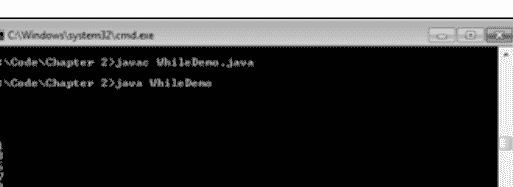

▲ 图 12：WhileDemo 程序的输出

在列表 12 中，使用 `while` 循环显示了从 1 到 20 的奇数。让我们来看另一种循环 `do-while` 循环，它几乎与 `while` 循环相似，但有细微不同。与 `while` 循环不同，`do-while` 循环至少执行一次语句代码，因为条件表达式是在循环末尾评估的。

### 2.5.2.2 do-while 循环

`do-while` 循环的工作方式类似于 `while` 循环，只要条件为真，就会执行一组语句。如果条件变为假，执行流将离开 `do-while` 循环。以下是使用 `do-while` 循环的通用语法：

```
do{
    statements;
} while(condition);
```

在上述语法中，语句代码后面跟着一个关键字和一个测试表达式。如果评估结果为真，控制将返回 `do` 关键字并继续执行，直到评估变为假。列表 13 显示了你如何在程序中使用 `do-while` 循环：

- 列表 13：使用 do-while 循环的语句

```java
class dowhileDemo{
    public static void main(String args[]){
        int i=2; // 将值设置为 2
        do{
            System.out.println(i);// 显示 i
            i=i+2; // 将值加 2
        } while(i<=20);
    }
}
```

在列表 13 中，以与 `while` 循环相同的方式使用 `do-while` 循环显示了前十个偶数。然而，区别在于它们的实现方式。在这里，列表 13 中，`i` 的值在评估条件表达式之前就会显示，而 `while` 循环是先检查条件，然后才执行语句。

首先，将变量 `i` 设置为 2。为了显示偶数，`i` 在每次迭代中加 2。当评估变为假时，循环终止，但一旦 `i` 的值超过 20，如图 13 所示：

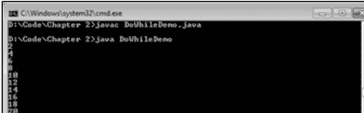

▲ 图 13：DoWhileDemo 程序的输出

在列表 13 中，使用 `do-while` 循环显示到 20 的偶数。在学习了 `while` 和 `do-while` 循环之间的基本区别后，让我们讨论另一种类型的迭代语句，称为 `for` 循环。

### 2.5.2.3 for 循环

`for` 循环也类似于 `while` 循环，但在语法上更紧凑。`for` 循环只要条件为真，就会执行一组语句。以下是通用语法：

```
for (initializer; condition; increment or decrement) {
  Statements;
}
```

在上述语法中，`initializer` 用于设置计数器的初始值以控制迭代。为了这个目的，可以声明一个变量。在循环的每一步中都会评估一个布尔条件，以检查循环是否继续。如果条件评估为真，循环将继续；否则，它将终止。列表 14 显示了你如何在程序中使用 `for` 循环：

- 列表 14：使用 for 循环的语句

```java
class ForDemo{
  public static void main(String args[]){
    // 将值设置为 1
    for(int i=1; i<=20; i=i+2){
        System.out.println(i);
    }
  }
}
```

在列表 14 中，通过 `for` 循环的帮助显示了这十个奇数。首先，将变量 `i` 设置为 1。为了显示奇数，`i` 在每次迭代中加 2。一旦 `i` 的值超过 20，评估就会变为假，循环终止，如图 14 所示：

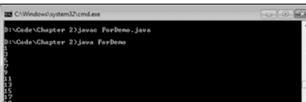

> 图 14：ForDemo 程序的输出

在图 14 中，通过 `for` 循环的帮助显示了到 20 的奇数。我们将讨论的另一种迭代语句是 `for-each` 循环。该循环为集合中的每个元素执行语句。

### 2.5.2.4 for-each 循环

`for-each` 循环专门设计用于处理集合的元素。集合由一组对象表示。数组是集合的一个示例，因为它存储了一组对象，例如整数值或字符串。同样，`java.util` 包中的类也是这样开发的。`for-each` 循环为集合中的每个元素执行语句。以下是 `for-each` 循环的通用语法：

```
for(var:collection){
    Statements;
}
```

在上述语法中，`var` 代表集合中的每个元素。在此情况下，有一组对象。让我们通过列表 15 中的示例了解如何使用 `for-each` 循环：

- 列表 15：使用 for-each 语句

```java
class EachDemo{
    public static void main(String args[]){
        int arr[]={1,3,5,7,9,11,13,15,17,19};
        System.out.println("奇数有:");
        for(int i:arr){
            System.out.println(i);
        }
    }
}
```

在列表 15 中，使用 `for-each` 循环显示数组中的奇数。`for-each` 循环专门设计用于处理集合的元素。集合由一组对象表示。数组是集合的一个示例。同样，`java.util` 包中的类也是这样。如图 15 所示：

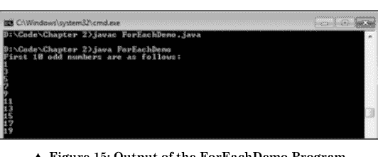

▲ 图 15：Each 程序

## 2.5.3 跳转语句

跳转语句是将控制从程序的某部分转移到另一部分的语句。Java 支持的跳转语句如下：

- `break`
- `continue`
- `return`

让我们详细讨论跳转语句。

### 2.5.3.1 break 语句

`break` 语句的一个重要目的是退出。有时，我们需要跳出循环。该语句的形式为简单的 `break` 后跟分号。让我们通过列表 16 中的示例了解 `break` 语句：

```java
class BreakDemo{
  public static void main(String args[]) {
    int i = 0;
    while (true) { // 循环无限执行
        i+=2;
        if (i > 10) {
            break; // 当条件为真时
        }
    }
  }
}
```

在列表 16 中，使用无限循环显示偶数直到无穷大。为了避免这种情况，在条件判断内部使用了 `break` 语句，规定当变量 `i` 的值超过 10 时，控制离开循环。如果控制离开循环，将显示前 5 个数字，如图 16 所示：

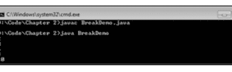

▲ 图 16：BreakDemo 程序的输出

### 2.5.3.2 continue 语句

`continue` 语句用于退出循环的当前迭代并开始下一次迭代的执行。当不带标签使用 `continue` 时，它启动最内部循环的下一次迭代。当它带标签使用时（标签代表包含循环的名称），它启动外层循环的下一次迭代。让我们通过列表 17 中的示例了解 `continue` 语句：

```java
class ContinueDemo{
    public static void main(String[] args) {
        for (int i=1; i<=20; i+=2){
            if (i == 12) { // continue 语句将执行
                continue;
            }
            System.out.println(i);
        }
    }
}
```

在列表 17 中，显示了前十个奇数，但结果中排除了 12（注：原文逻辑有误，`i+=2` 从 1 开始不会产生 12，此处保留原文语义）。这是通过 `if` 条件内部的 `continue` 语句实现的，当变量 `i` 的值变为 12 时，该语句会被执行。

`i` 变为 12。当 `i` 的值变为 12 时，执行控制将退出当前循环并返回到 `for` 循环。下一次迭代开始显示剩余的数字，直到 `i` 的值超过 20，如图 17 所示：

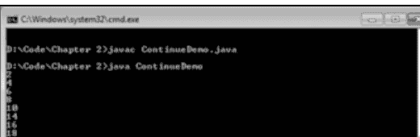

▲ 图 17：ContinueDemo 程序的输出

在图 17 中，由于执行了 `continue` 语句，12 没有被显示，循环的下一次迭代开始。

关于 `continue` 语句的内容就此结束。现在让我们讨论 Java 中提供的另一种跳转语句，称为 `return` 语句。

### 2.5.3.3 return 语句

`return` 语句导致执行控制返回到方法的调用者。让我们通过列表 18 显示的示例来理解 `return` 语句的使用：

- 列表 18：使用 return 语句

```java
class ReturnDemo{
    public static void main(String args[]){
        int input=Integer.parseInt(args[0]);
        int result=square(input);
        System.out.println(result);
    }

    public static int square(int x){
        return x*x;
    }
}
```

在列表 18 中，`square()` 方法接受一个整数值，计算其平方值，并将该值返回给 `main()` 方法，后者是它的调用方法。在 `main()` 方法中，我们调用了 `square()` 方法并传递了运行时用户提供的输入。在这里，我们直接调用了 `square()` 方法，因为它是一个静态方法，因为静态方法可以直接在静态类内部被调用。图 18 显示了列表 18 的输出：

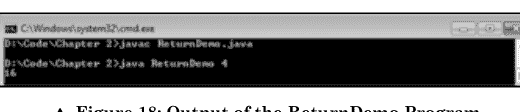

▲ 图 18：ReturnDemo 程序的输出

在图 18 中，运行时输入了值 4，它被传递给 `square()` 方法。因此，`square()` 方法返回 16 作为输出。

## 总结

在本章中，你学习了 Java 标记、运算符优先级和结合性。它还讨论了如何在 Java 程序中声明变量、Java 编程语言中可用的数据类型以及 Java 中的流程控制语句。

## 关键术语

- **标记 (Token)**：指 Java 程序中的单个元素。
- **关键字 (Keywords)**：指在命名变量或方法时不能使用的保留字。
- **标识符 (Identifier)**：指引用 Java 程序中变量、类、包或接口名称的符号名称。
- **合法标识符 (Legal identifiers)**：符合 Java 编译器用于判断名称是否合法的规则标识符。
- **字面量 (Literal)**：指根据程序需求可以更改的常量。
- **变量 (Variables)**：存储程序内数据的容器或占位符。
- **常量 (Constants)**：指在程序执行过程中值保持不变的变量。

### 判断对错

- **Q1. 加法 (`+`)、减法 (`-`) 和 乘法 (`*`) 运算符仅用于整数。**
  答。错误。

- **Q2. 在 Java 中，乘法 (`*`)、除法 (`/`) 和取模 (`%`) 运算符具有相同级别的优先级。**
  答。正确。

- **Q3. Java 不包含结构 (`struct`) 和联合体 (`union`) 数据类型。**
  答。正确。

- **Q4. Java 支持运算符重载。**
  答。错误。

- **Q5. 在 Java 中，文件名必须与调用 main 方法的类名匹配，并带有 `.java` 后缀。**
  答。正确。

- **Q6. Java 支持多线程且是平台无关的。**
  答。正确。

- **Q7. Java 编译器将源代码翻译成字节码。**
  答。正确。

- **Q8. 在 Java 中，大括号和小括号与 C++ 的类结构相似。**
  答。正确。

## 单选题

**Q1. 如果给变量赋值一个固定值，它被称为：**

- a. 常量 (Constant)
- b. 标识符 (Identifier)
- c. 字面量 (Literal)
- d. 常量定义 (Const)

答。正确选项是 a。

**Q2. 下列哪个不是合法的标识符？**

- a. `a + b`
- b. `final`
- c. `#sal`
- d. `_salary`

答。正确选项是 d。

**Q3. 下列哪个不是关键字？**

- a. `union`
- b. `const`
- c. `Boolean`
- d. `synchronized`

答。正确选项是 a 和 b。

**Q4. 下列哪个是正确的？**

- a. `int x = 16, x >> 2 = 4;`
- b. `int y = -8, y >>> 1 = -4;`
- c. `int z = 16, z >> 2 = 4;`

**Q5. 在 Java 中，以下哪个的赋值是正确的？**

- a. `int x = 16, x >> 2 = 4;`

答。正确选项是 a。

**Q6. 考虑以下代码片段：**

```
int x, y;
x = y;
```

y 的输出结果是多少？

- a. 1
- b. 6
- c. 7
- d. 8

答。正确选项是 a。

**Q7. 在 Java 中，大括号和小括号类似于 C++ 类结构（此处原文为误，题目编号重复）**

**7. 在 Java 中，以下哪个是运算符的优先级？**

- a. 1
- b. 2
- c. 3
- d. 4

答。正确选项是 d。

**8. 下列哪个不是位运算符？**

- a. 异或
- b. `instanceof`
- c. 右移
- d. 左移

答。正确选项是 b。

**9. 哪个关键字用于创建对象的类型？**

- a. `native`
- b. `new`
- c. `import`
- d. `default`

答。正确选项是 b。

**10. 哪个关键字用于指定不返回值？**

- a. `void`
- b. `var`
- c. `volatile`
- d. `throw`

答。正确选项是 a。

## 简述题

**Q1. 声明合法标识符必须遵循哪些规则？**


# Java 编程基础概念

## Q1. 标识符命名规则

答。标识符必须以下划线（`_`）、字母或美元符号（`$`）开头

- 可以包含数字和 `$`
- 不允许包含空格
- 区分大小写

## Q2. 什么是运算符优先级和结合性？

答。在 Java 中，每个运算符都有相应的优先级，有助于确定表达式包含多个运算符时的计算顺序。也就是说，优先级较高的运算符先计算，而相同优先级的运算符则从左到右或反之进行计算。这种属性被称为结合性。

## Q3. 什么是 `instanceof` 运算符？

答。`instanceof` 运算符是一种二元运算符，用于检查对象是否是特定类型（此处，类型可以是类、接口或数组）。它用于对象引用值。`instanceof` 的语法为：

```
<对象引用> instanceof <类型>
```

## Q4. 什么是条件运算符？

答。条件运算符（`?`）是三元运算符，接受三个操作数。它评估一个布尔表达式并根据该表达式获取结果。条件运算符由问号（`?`）和冒号（`:`）构建。条件运算符的语法为：

```
操作1 ? 操作2 : 操作3
```

## Q5. 说明两种加减运算符。

答。加减运算符有两种使用方式，可以在操作数之前或之后。根据运算符的位置，可以将其分类为前缀或后缀。前缀和后缀的区别在于，在前缀法中，在赋值给变量之前对操作数进行加减；而在后缀法中，是在赋值给变量之后进行加减。

## Q6. 写一个计算半球体积的程序。

```java
class Ques6 {
    public static void main(String args[]) {
        float radius = 2;
        float volume;
        float pi = 3.14f;
        volume = (2 * pi * radius * radius * radius) / 3;
        System.out.println("Volume of Hemisphere:" + volume);
    }
}
```

输出：

```
Volume of Hemisphere: 16.746667
```

## Q7. 写一个演示整数八进制表示的程序。

答。

```java
class Ques7 {
    public static void main(String args[]) {
        int five = 05; // five 的值等于十进制的 5
        int eight = 010; // eight 的值等于十进制的 8
        int ten = 012; // ten 的值等于十进制的 10
        System.out.println("Octal value 012 is equivalent to 10 in decimal");
    }
}
```

输出：

```
八进制值 012 等于十进制的 10
```

## Q8. 编写一个程序，使用 `&&` 运算符找到 a、b 和 c 之间的最大值。

答：

```java
class Ques8 {
    public static void main(String args[]) {
        int a = 11, b = 18, c = 5;
        if (a > b && a > c) {
            System.out.println("BIG" + a);
        } else if (b > a && b > c) {
            System.out.println("BIG" + b);
        } else {
            System.out.println("BIG" + c);
        }
    }
}
```

输出：

```
BIG18
```

## Q9. 编写一个程序，使用三元运算符（`?`）找到最大值。

答：

```java
class Ques9 {
    public static void main(String args[]) {
        int a = 11, b = 13, c = 5;
        int max = (a > b) ? (a > c ? a : c) : (b > c ? b : c);
        System.out.println("BIG" + max);
    }
}
```

输出：

```
BIG13
```

## Q10. 以下 Java 关键字的作用是什么？

- a. `static`
- b. `transient`
- c. `super`
- d. `final`

以下关键字的作用如下：

- **a. `static`**: 表示变量或方法是类成员，而不是局限于某个特定的对象。
- **b. `transient`**: 指定一个变量不是对象持久化状态的一部分。
- **c. `super`**: 指向类的基类（用于方法或类构造函数中）。
- **d. `final`**: 表示变量持有一个常量值，或者方法不会被重写。

---

# 数组、字符串、StringBuffer 类和包装类的操作

## 目标

- 数组的操作
- 字符串的操作
- 解释 `StringBuffer` 类
- 讨论命令行参数
- 解释包装类

作为一名 Java 程序员，你可能需要创建程序来处理具有相似类型的信息。例如，你必须创建一个程序来存储一个班级中 25 个学生的学号。所有的学号都是数值类型；因此，它们应该存储在整型数据类型中。现在，你声明了 25 个变量来存储 25 个学号。声明和记住大量的变量是一项枯燥的任务。为了摆脱这种繁重的工作，Java 提供了数组。使用数组，你只需要一个变量就可以存储大量相同数据类型的元素。然而，你不能删除存储在数组中的元素。你必须在创建数组时定义数组的大小。因此，你只能存储总数等于数组大小的元素。你不能添加超出数组大小的元素。万一情况下你需要向数组中添加更多元素，则必须创建另一个数组。为了管理两个或多个数组，Java 提供了 `Vector` 类，它用于创建一个与数组类似的对象。使用 `Vector` 类创建的对象是动态的，即对象的大小在运行时会自动增加以存储额外的元素。

在 Java 中，像 `int`、`char` 和 `byte` 这样的基本类型不能放入集合中，因为集合只能持有对象引用。因此，为了将基本类型放入集合中，必须将它们转换为对象。Java 提供了包装类来将基本类型转换为对象。除了包装类，Java 还提供了 `String` 和 `StringBuffer` 类，用于处理文本字符串。

## 3.1 数组的操作

数组是数据存储位置的集合，每个位置都持有相同类型的数据。在某些情况下，你可能需要大量数据项存储相似类型的值。例如，为了存储 50 个人的电话号码，你通常必须声明 50 个变量，每个变量存储一个数字，这不是正确的方法，而且非常枯燥且耗时。

使用数组，我们可以声明一个能够存储所有 50 个数字的变量。使用数组的优点是它们通过用一条或两条语句替换许多语句来简化编程。数组的大小不可修改。数组中的所有值都被视为元素。数组元素存储在特定的索引处。数组索引从 0 开始，到数组的大小减 1 结束。索引范围从 0 到 4，即通过索引 4 访问第 5 个元素。见图 1，它解释了数组的索引：

| 索引 | 0 | 1 | 2 | 3 | 4 |
|---|---|---|---|---|---|

▲ 图 1：显示索引的数组

在图中，你可以看到第一个元素对应索引 0，而第五个元素对应索引 4。让我们在以下标题下讨论：

- 使用一维数组
- 使用多维数组

### 3.1.1 使用一维数组

一维数组是单维度数据存储位置的集合。任何数组相关的索引数量是其维度。在一维数组中，数组元素用单个索引值表示。在这里，我们讨论了使用一维数组的以下步骤：

#### 3.1.1.1 声明一维数组

处理数组的第一步是声明数组。在 Java 中，声明数组与声明数据变量的方式相同。声明一维数组的语法是：

```java
data_type array_name[];
```

或者

```java
data_type[] array_name;
```

#### 3.1.1.2 创建一维数组

一旦声明了数组，我们需要为其分配内存。创建一维数组的语法是：

```java
array_name = new data_type[size];
```

#### 3.1.1.3 初始化一维数组

在数组中添加值被称为初始化。初始化数组的语法是：

```java
array_name[index] = value;
```

接下来的示例在数组声明时初始化了一个数组 `roll_no`：

```java
int roll_no[] = {121, 122, 123, 124, 125};
```

你也可以像下面所示将一个数组对象赋值给另一个数组对象：

```java
int roll_no[] = {121, 122, 123};
int roll_no1[];
roll_no1 = roll_no;
```

现在，当数组已初始化后，你就可以开始对其进行操作了。

#### 3.1.1.4 使用一维数组开发程序

现在，我们创建一个 Java 程序来声明、创建和初始化数组。初始化数组后，你可以显示它的元素，并对它们执行加法和减法等操作。列表 1 从存储在数组中的元素中分离并显示偶数值。

**列表 1：分离并显示偶数的程序**

```java
public class Arrayexample {
    public static void main(String args[]) {
        int x;
        int even[] = {121, 142, 145, 149, 163, 174, 126, 129, 138, 145};
        for (x = 0; x < even.length; x++) {
            if (even[x] % 2 == 0) {
                System.out.println(even[x] + " is an even number");
            }
        }
    }
}
```

在列表 1 中，声明了一个名为 `even` 的 `int` 类型一维数组。然后使用 10 个数值初始化该数组。通过循环根据各自的索引号访问这些值。然后对访问的值进行检查以判断是否为偶数，并逐一显示。在循环中，我们使用了 `length` 属性来执行循环到分配的大小。`length` 是 Java 内置的数组属性，用于存储数组的大小。列表 1 的输出如图 2 所示：

```
142 is an even number
174 is an even number
126 is an even number
138 is an even number
```

### 3.1.2 使用多维数组

到目前为止，我们只读过一维数组，但在某些情况下需要更多值来表示数组元素。这时，多维数组派上了用场。

多维数组被称为数组的数组。声明、初始化和使用多维数组的过程将在以下标题下讨论：

#### 3.1.2.1 声明多维数组

声明多维数组是开始使用多维数组的第一步。声明多维数组的语法为：

```java
data_type[][] var_name;
```

或者

```java
data_type var_name[][];
```

在前面的语法中：

- `data_type` 是数组的类型，指定了存储在数组中的元素类型。
- `var_name` 是数组名。

参见下面的示例，其中声明了数据类型为 `int` 的数组 `even_no` 和 `odd_no`：

```java
int[][] even_no;
int[][] odd_no;
```

前面示例中的两个数组都是多维数组。现在当多维数组声明后，你就可以继续创建多维数组。

#### 3.1.2.2 创建多维数组

一旦声明了多维数组，下一步就是通过分配内存来实际创建该数组。为多维数组分配内存的过程与为一维数组分配内存相似。创建多维数组的语法如下：

```java
var_name = new data_type[rows][columns];
```

在前面的语法中：

- `var_name` 是多维数组名。
- `new` 是运算符，用于为数组分配内存。
- `data_type` 是存储在数组中的元素的数据类型。
- `rows` 是多维数组中的总行数。
- `columns` 是多维数组中每行的总列数。

你可以在一步中完成数组的声明和创建，如下所示：

```java
int[][] even_no = new int[2][3];
```

一步到位完成声明和创建可以节省时间。前面的代码创建了一个 2 行 3 列的多维数组，如图 3 所示：

| | Column 0 | Column 1 | Column 2 |
|---|---|---|---|
| Row 0 | [0][0] | [0][1] | [0][2] |
| Row 1 | [1][0] | [1][1] | [1][2] |

▲ 图 3：显示 2 行 3 列的多维数组

现在，当多维数组 `even_no` 创建完成后，是时候初始化它了。

#### 3.1.2.3 初始化多维数组

初始化多维数组的过程与初始化一维数组相似。初始化多维数组的语法如下：

```java
var_name[row_no][col_no] = col_val;
```

在前面的语法中：

- `var_name` 是多维数组名。
- `row_no` 是多维数组中的行号。
- `col_no` 是多维数组中的列号。
- `col_val` 是存储在指定行的指定列的值。

参见下面的示例来初始化多维数组：

```java
even_no[0][0] = 2;
even_no[0][1] = 4;
even_no[0][2] = 6;
even_no[1][0] = 8;
even_no[1][1] = 10;
even_no[1][2] = 12;
```


```java
public class Arrayexample {
    public static void main(String args[]) {
        int x; int even[];
        even = new int[10];
        even[0]=121;
        even[1]=142;
        even[2]=145;
        even[3]=149;
        even[4]=163;
        even[5]=174;
        even[6]=126;
        even[7]=129;
        even[8]=138;
        even[9]=145;
        for(x=0;x<even.length;x++) {
            System.out.println(even[x] + " is an even number");
        }
    }
}
```

在列表 1 中，声明了一个名为 `even` 的 `int` 类型一维数组，用于对简单数据类型分组。然后使用 10 个数值初始化该数组。这些值通过循环根据各自的索引号进行赋值。然后对访问的值进行检查以判断为偶数，并逐一显示。在循环中，我们使用了 `length` 变量来执行循环到分配的大小。`length` 变量是 Java 内置的变量，用于存储数组的大小。列表 1 的输出如图 2 所示：

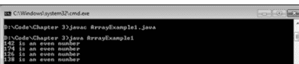

图 2：显示 ArrayExample1 的输出

这也是一维数组。现在，我们学习多维数组。

## 3.1.2 使用多维数组

到为止，我们只读过一维数组（只能分配单个值），但在某些情况下需要更多值来表示数组元素。这时，多维数组派上了用场。

多维数组被称为数组的数组。声明、初始化和使用多维数组的过程将在以下标题下讨论：

### 3.1.2.1 声明多维数组

声明多维数组是开始使用多维数组的第一步。声明多维数组的语法为

```java
data_type var_name[][][];
```

在前面的语法中：

- `data_type` 是数组的类型，指定了存储在数组中的元素类型。
- `var_name` 是数组名。
- `[]` 是第一个/左括号，表示行数。
- `[]` 是第二个/右括号，表示列数。

声明多维数组的另一种语法是

```java
data_type[] var_name;
```

参见下面的示例，其中声明了数据类型为 `even_no` 和 `odd_no` 的数组：

```java
int even_no[][];
int[] odd_no;
```

前面示例中的两个数组都是多维数组。现在当多维数组声明后，你就可以继续创建多维数组。

### 3.1.2.2 创建多维数组

一旦声明了多维数组，下一步就是通过分配内存来实际创建该数组。为多维数组分配内存的过程与为一维数组分配内存相似——语法除。创建多维数组的语法如下：

```java
var_name = new data_type[rows][columns];
```

在前面的语法中：

- `var_name` 是多维数组名。
- `new` 是运算符，用于为数组分配内存。
- `data_type` 是存储在数组中的元素的数据类型。
- `rows` 是多维数组中的总行数。
- `columns` 是多维数组中每行的总列数。

你可以在一步中完成数组的声明和创建，如下所示：

```java
int even_no[][] = new int[2][3];
```

一步到位完成声明和创建可以节省时间。前面的代码创建了一个 2 行 3 列的多维数组，如图 3 所示：

| | Column 0 | Column 1 | Column 2 |
|---|---|---|---|
| Row 0 | [0][0] | [0][1] | [0][2] |
| Row 1 | [1][0] | [1][1] | [1][2] |

▲ 图 3：显示 2 行 3 列的多维数组

现在，当多维数组 `even_no` 创建完成后，是时候初始化它了。

### 3.1.2.3 初始化数组

初始化多维数组的过程与初始化一维数组相似。初始化多维数组的语法如下：

```java
var_name[row_no][col_no] = col_val;
```

在前面的语法中：

- `var_name` 是多维数组名。
- `row_no` 是多维数组中的行号。
- `col_no` 是多维数组中的列号。
- `col_val` 是存储在指定的行的指定列的值。

参见下面的示例来初始化多维数组：

```java
even_no[0][0] = 2;
even_no[0][1] = 4;
even_no[0][2] = 6;
even_no[1][0] = 8;
even_no[1][1] = 10;
even_no[1][2] = 12;
even_no[2][0] = 14;
even_no[2][1] = 16;
even_no[2][2] = 18;
```

## 3.2 字符串操作

Java 中提供了 `StringBuffer` 类。在本节中，我们将根据以下子标题学习 `String` 类及其方法：

- 定义 String 类
- 实现字符串拼接
- 使用 String 类的方法
- 比较 `equals()` 方法和 `==` 运算符

让我们开始学习 Java 中的字符串吧。

### 3.2.1 定义 String 类

在 Java 中，我们用 `int` 存储整数，用 `float` 存储浮点数等，但没有基本类型来存储字符串数据。为了在 Java 中处理字符串数据，我们需要 `String` 类的对象。`String` 类包含在 `java.lang` 包中，无需导入任何包即可使用。我们使用以下代码片段来创建并初始化 String 对象：

```java
String str = "Hello";
```

上述代码片段创建了一个名为 `str` 的 String 对象并将其初始化为值 `Hello`。你也可以将一个 String 对象的值赋值给另一个 String 对象。见下面的代码片段，如何将一个 String 对象的值赋值给另一个 String 对象：

```java
String str1="Now";
String str2="Are";
str1=str2; // 现在 str 包含值 Are
```

`String` 类非常强大，它提供的方法允许你将字符串转换为字符数组、将数字转换为字符串、搜索字符串、创建子字符串、更改字符串大小写、获取字符串长度、比较字符串等许多功能。

### 3.2.2 实现字符串拼接

在 Java 中，字符串可以与其他字符串或其他数据类型的元素（如整数或浮点数）进行拼接。根据需要，你可能需要将两个或多个字符串与数字或符号拼接在一起以显示信息。例如，当你填写任何在线注册表单时，你会在三个单独的列中提供你的名、中间名（如果有）和姓。然而，当你完成并提交表单后，你会将你的全名作为一个单一字符串显示在表单上。

#### 字符串的拼接

在 Java 中，两个或多个字符串使用拼接运算符 `+` 进行拼接。见下面的代码片段，其中两个字符串 "Hello" 和 "World" 被拼接成一个单一的字符串 HelloWorld。

```java
String str ="Hello" + "world";
```

列表 3 展示了字符串的拼接：

**列表 3：使用拼接运算符 +**

```java
public class StringConcat {
    public static void main(String args[]) {
        String FName ="Deepak";
        String SName ="Gupta";
        System.out.println(FName + " " + SName);
    }
}
```

在列表 3 中，两个对象 `FName` 和 `SName` 被初始化为值 `Deepak` 和 `Gupta`。然后使用拼接运算符对这些对象进行拼接。图 5 显示了拼接后的字符串：


> 图 5：显示 StringConcat 类的输出

### 3.2.3 使用 String 类的方法

如所述，Java 中的 `String` 提供了各种方法，允许你将字符串转换为字符数组、将数字转换为字符串、搜索字符串、创建子字符串、更改字符串大小写、获取字符串长度、比较字符串等。我们在本节中学习的 `String` 类更多常用方法包括：

- 实现 `length()` 方法
- 实现 `toLowerCase()` 方法
- 实现 `toUpperCase()` 方法
- 实现 `substring()` 方法
- 实现 `concat()` 方法
- 实现 `equals()` 和 `equalsIgnoreCase()` 方法

让我们开始实现 String 类的方法。

#### 3.2.3.1 实现 length() 方法

`length()` 方法返回字符串的长度。该方法计算包含在双引号 `""` 中的所有字符、符号和数字。该方法返回一个整数值。列表 4 展示了 `length()` 方法的实现：

**列表 4：使用 length() 方法**

```java
public class StrLen{
  public static void main(String args[]) {
    String str="length";
    int x= str.length();
    System.out.println("Length of the string is " + x);
  }
}
```

在列表 4 中，String 对象被初始化为值 `length`。然后对 `str` 应用 `length()` 方法来计算 `str` 的长度。图 6 显示了 `str` 的输出：

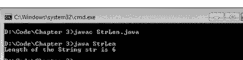

图 6：显示 StrLen 类的输出

#### 3.2.3.2 实现 toLowerCase() 方法

`toLowerCase()` 方法在将调用字符串的大写字母转换为小写字母后返回字符串。列表 5 展示了 `toLowerCase()` 方法的实现：

**列表 5：使用 toLowerCase() 方法**

```java
public class ToLower {
  public static void main(String args[]) {
    String name = "DEEPAK";
    System.out.println("The value stored in the String object, name = " + name.toLowerCase());
  }
}
```

在列表 5 中，创建了一个 String 对象并初始化为值 `DEEPAK`。然后对 `name` 应用 `toLowerCase()` 方法，将其存储的值转换为小写。图 7 显示了结果：


图 7：显示 ToLower 类的输出

#### 3.2.3.3 实现 toUpperCase() 方法

`toUpperCase()` 方法在将调用字符串的小写字母转换为大写字母后返回字符串。列表 6 展示了 `toUpperCase()` 方法的实现：

**列表 6：使用 toUpperCase() 方法**

```java
public class Upper {
    public static void main(String args[]) {
        String name = "deepak gupta";
        System.out.println("The value stored in the String object, name = " + name.toUpperCase());
    }
}
```

在列表 6 中，String 对象被创建并初始化为值 `deepak gupta`。然后对 `name` 应用 `toUpperCase()` 方法，将其存储的值转换为大写。图 8 显示了结果：


图 8：显示 Upper 类的输出

#### 3.2.3.4 实现 substring() 方法

`substring()` 方法返回字符串的一部分。`substring()` 方法有两种形式：

- `substring(int begin)`
- `substring(int begin, int end)`

第一种形式 `substring()` 接受一个参数，创建一个从指定索引开始到字符串最后一个字符的新字符串。下面的代码片段展示了 `substring(int)` 方法的使用：

```java
public class Substr {
    public static void main(String args[]) {
        String str = "EDUCATION";
        System.out.println(str.substring(4));
    }
}
```

上述代码输出值 `ATION`。第二种形式 `substring()` 接受两个参数。它创建一个从第一个参数开始到第二个参数索引结束的字符串。起始索引处的字符包含在内，但结束索引处的字符不包含。下面的代码片段展示了 `substring(int begin, int end)` 方法的使用：

```java
public class Substr {
    public static void main(String args[]) {
        String str = "WELCOME";
        System.out.println(str.substring(3));
        System.out.println(str.substring(0,3));
    }
}
```

上述代码输出 `CAT`。列表 7 展示了 `substring()` 方法两种形式的实现：

**列表 7：使用 substring() 方法**

```java
public class Substr {
    public static void main(String args[]) {
        String str = "WELCOME";
        System.out.println(str.substring(3));
        System.out.println(str.substring(0,3));
    }
}
```

在列表 7 中，String 对象 `str` 被创建并初始化为值 `WELCOME`。然后对 `str` 应用两种 `substring()` 方法。图 9 显示了使用 `substring()` 后的结果：

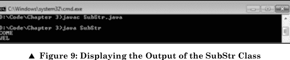

#### 3.2.3.5 展示 concat() 方法

`concat()` 方法将字符串附加到其他字符串的末尾。在 Java 中，我们可以通过两种方式拼接字符串：首先使用拼接运算符 `+=`；其次使用 `concat()` 方法。拼接运算符的使用在章节之前已经讨论过。列表 8 展示了 `concat()` 方法的实现：

**列表 8：使用 concat() 方法**

```java
public class Concat{
    public static void main(String args[]) {
        String str = "Hello";
        String str1= "Java";
        System.out.print(str.concat(str1));
    }
}
```

#### 3.2.3.6 实现 equals() 和 equalsIgnoreCase() 方法

`equals()` 和 `equalsIgnoreCase()` 方法用于比较两个字符串。`String` 类重写了 `Object` 的 `equals()` 方法。该方法通过比较字符串中单个字符的位置来实现。`equalsIgnoreCase()` 方法则忽略字符的大小。如果字符串相等，这些方法返回 `true`，否则返回 `false`。列表 9 显示了 `equals()` 和 `equalsIgnoreCase()` 方法的实现：

**列表 9：使用 equals() 和 equalsIgnoreCase() 方法**


```java
public class Equal{
    public static void main(String args[]){
        String str = "JAVA is an object oriented language";
        String str1 = "JAVA IS AN OBJECT ORIENTED LANGUAGE";
        boolean b1 = str.equals(str1);
        boolean b2 = str.equalsIgnoreCase(str1); 
        System.out.println("The equals method returns: " + b1);
        System.out.println("The equalsIgnoreCase method returns: " + b2);
    }
}
```

在列表 9 中，创建并初始化了相同文本的 `str` 和 `str1`。`str` 中的文本是小写的，而 `str1` 中的文本包含大写字母。接下来分别对 `str` 和 `str1` 应用了 `equals()` 和 `equalsIgnoreCase()` 方法。图 11 显示了列表 9 的输出：


> 图 11：显示 Equal类的输出

### 3.2.4 比较 equals() 方法和 == 运算符

`equals()` 方法用于比较对象，而 `==` 运算符用于比较原始类型值的相等性。如果对象或值相等，两者均返回 `true`，否则返回 `false`。`equals()` 方法的实现已经在列表 9 中给出。

- 列表 10：使用 == 运算符

```java
public class EqualOperator{
    public static void main(String args[]){
        int val = 2000;
        System.out.println(val % 2 == 0);
        System.out.println(val == 0);
    }
}
```

在列表 10 中，声明了一个类型为 `int` 的变量 `val` 并初始化为 2000。对 `val` 使用了 `==` 运算符。图 12 显示了列表 10 的输出：

图 12：显示 EqualOperator类的输出

# 第3章

## 3.3 使用 StringBuffer 类

与 `String` 类类似，`StringBuffer` 也存在于 `java.lang` 包中。这两个类的区别在于 `String` 类创建不可变字符串，而 `StringBuffer` 类有助于创建变字符串。换句话说，使用 `StringBuffer` 类的字符串可以动态更改。表 1 列出了 `StringBuffer` 类的方法：

| 表 1：StringBuffer 类的方法 |

| 方法 | 说明 |

|---|---|

| StringBuffer append(Object obj) | 将给定对象中存储的值添加到调用的 StringBuffer 对象的末尾 |

| StringBuffer append(int i) | 在调用的 StringBuffer 对象末尾添加一个整数值 |

| StringBuffer delete(int start_index, int end_index) | 从调用的 StringBuffer 对象中删除一段字符。start_index 指定起始字符的索引，end_index 指定最后一个字符的索引 |

| StringBuffer deleteCharAt(int index) | 删除调用的 StringBuffer 对象中指定索引处的字符 |

| StringBuffer insert(int index, boolean b) | 在调用的 StringBuffer 对象指定的索引处添加一个布尔值 |

| StringBuffer insert(int index, char c) | 在调用的 StringBuffer 对象指定的索引处添加一个字符 |

| int length() | 返回调用的 StringBuffer 对象的长度 |

| StringBuffer reverse() | 反转调用的 StringBuffer 对象的字符序列 |

| String toString() | 将 StringBuffer 对象的值作为字符串 |

## 3.4 使用命令行参数

命令行参数是在程序执行时传递给程序的参数。在 Java 程序内部访问命令行参数非常简单，因为它们存储在传递给 `main()` 方法 `args` 参数的 String 数组中。考虑以下列表 11：

- 列表 11：使用命令行参数

```java
class CmdLineExample{
    public static void main(String args[]){
        System.out.println("Your first argument is: "+args[0]);
        System.out.println("Your second argument is: "+args[1]);
    }
}
```

这里发生的是我们在 `CmdLineExample` 类中创建一个方法。在面向对象编程（OOP）中，方法类似于标准编程中的函数或子程序——即你可以传递控制权并可以返回一个值的代码块。方法提供了将代码封装成单个功能单元的方便方式；当调用该方法时，JVM 会执行方法中的代码。

在这里，核心思想是我们正在创建一个名为 `main` 的方法，这是 JVM 在启动应用程序时会寻找的方法。当它找到 `main` 方法时，JVM 将控制权交交给它，我们将想要执行的代码放在此方法的代码块中。

在继续之前，有几点需要注意：`main` 方法必须用 `public` 访问修修饰符声明，这意味着它可能在类之外。它必须声明为 `static`，这意味着它可能在类之外。（注：OCR 在此处关于“在类之外”存在一些逻辑错误，但我已予以保留）。

## 3.5 使用包装类

包装类是用于原始类型转换为对象的类。在 Java 中有八种原始类型。除非将它们转换为对象，否则原始类型无法被视为对象。通过将原始类型转换为对象，包装类起到以下两个作用：

- 首先，转换为对象后，原始类型可以用于向量（vectors）。

- 其次，包装类提供了各种实用方法，可以将任何对象转换为原始类型（如 `byte`、`int`、`float`）或反之。

所有类都属于 `java.lang` 包。`java.lang` 包是 Java 编程不可或的一部分。在编译时，`java.lang` 包包含了 `Object` 类，它是所有类的父类。`Boolean`、`Character` 和 `Number` 是 `Object` 类的子类，也是包装类。`Number` 类是包装类（`Byte, Short, Integer, Long, Float, Double`）的父类，用于处理值。

当我们创建一个包装类的对象时，它包含一个字段。在该字段中，我们可以存储一个原始数据值。例如，如果我们创建一个 `Integer` 包装类，它包含一个 `int` 字段，并且可以存储整数 34 或 89。因此，`Integer` 是 `int` 数据的包装类。`java.lang` 包中可用的原始类型及其对应的包装类如下：

| 表 2：原始类型及其对应的包装类 |

| 原始类型 | 包装类 | 包装类构造函数接收参数 |

|---|---|---|

| boolean | Boolean | boolean or String |

| byte | Byte | byte or String |

| char | Character | Char |

| double | Double | double or String |

| float | Float | float, double or String |

| int | Integer | int or String |

| long | Long | long or String |

| short | Short | short or String |

## 总结

在本章中，你学习了 Java 中提供的各种类型的数组。除此之外，你还学习了 `String` 和 `StringBuffer` 类，以及在 Java 中处理文本字符串的各种方法。接下来，本章讨论了命令行参数。在章节最后，你学习了什么是包装类（Wrapper classes）以及它们如何帮助将原始值转换为对象。

## 核心术语

- 数组 (Array)：指数据存储位置的集合，每个位置都存储着相同类型的数据。

- 一维数组 (One-dimensional array)：指具有一个维度的数据存储位置集合的数组。

- 多维数组 (Multidimensional array)：指具有多一个维度的数据存储位置集合的数组。

- 字符串 (String)：指字符和符号的有序序列。

- 字符串拼接 (Concatenation)：指两个或多个字符串的连接。

## 复习练习

### 判断对错

- Q1. 数组只能存储相似数据类型的元素。

答：正确。

- Q2. Java 中不能创建对象数组。

答：错误。

- Q3. String 是 Java 中的原始数据类型。

答：错误。

- Q4. 为了使用字符串，在 Java 中需要创建一个 String 类对象。

答：正确。

- Q5. Java 中也可以创建字符串数组。

答：正确。

- Q6. `length` 属性用于计算字符串的长度。

答：错误。

- Q7. 字符串只能与另一个字符串拼接。

答：错误。

## 单选题

- Q1. 下列哪个是 `java.lang.String` 类的静态方法？

a. append()

b. concat()

c. insert()

d. valueOf()

答：正确选项是 d。

- Q2. 下列 `java.lang.Integer` 类的哪个方法返回原始 int 类型？

a. intValue()

b. parseInt()

c. toString()

d. valueOf()

答：正确选项是 b。

- Q3. 下列哪项可以用于拼接字符串？

a. concat()

b. +

c. =

d.

答：正确选项是 a 和 b。

- Q4. 下列哪个方法用于计算字符串的长度？

a. valueOf()

b. length

c. length()

d. indexOf()

答：正确选项是 c。

- Q5. 下列哪个不是包装类？

a. Byte

b. Vector

c. Short

d. Double

答：正确选项是 b。

- Q6. 下列哪个类用于创建动态数组？

a. String

b. Vector

c. StringBuffer

d. Double

答：正确选项是 b。

- Q7. 下列哪项是有效的一维整数数组的声明和创建？

a. int x[] = new int[arr_size];

b. int [] = new int[arr_size];

c. int x][] = new int[arr_size];

d. int x[] = new int[]{

答：正确选项是 a。

- Q8. 下列哪项是有效的多维数组的声明和创建？

a. int[][] = new int[col][row];

b. int [][] = new int[row][col];

c. int x[][] = new int[row][col];

d. int x][] = new int[row]

答：正确选项是 c。

# 数组、字符串、StringBuffer 类和包装类的操作

- Q9. 下列哪项是有效的不规则多维数组声明和创建？

a. int x[][] = new int[col];

b. int x[][] = new int[row][col];

c. int x[][] = new int[row][col];

d. int x[][] = new int[row][][];

答：正确选项是 d。

- Q10. 下列哪个方法在将调用字符串的所有大写字母转换为小写后返回字符串？

a. toLowerCase()

b. Lower()

c. LowerCase()

d. LCase()

答：正确选项是 a。

## 简答题

- Q1. 什么是数组？我们需要它？

答：数组是数据存储位置的集合，每个位置都存储着相同类型的数据。当你需要为大量数据项存储相似类型的值时，可能会这种情况。例如，为了存储 50 个人的电话，你通常必须声明 50 个变量，每个存储一个数字，这是一种繁琐且复杂的方法。

使用数组，我们可以声明一个能够存储所有 50 个数字的变量。使用数组的优势是它们通过用一个或两条语句替换许多语句来简化了编程。

- Q2. 讨论 Java 中包装类的概念。

答：在 Java 中有八种原始数据类型：byte, short, int, long, float, double, boolean 和 char。包装类用于将这些原始类型转换为对象。它们提供了许多工具方法，允许在原始类型和对象之间进行转换。例如，包装类可以帮助我们将原始值转换为对象，这在处理集合（如 ArrayList）等需要对象的数据结构时至关重要。

- Q3. 讨论 String 和 StringBuffer 的区别。

答：主要的区别是 `String` 对象是不可变的，一旦创建内容就无法更改；而 `StringBuffer` 类是可变的，允许对字符串进行修改而无需创建新对象。在需要频繁修改字符串的场景下，使用 `StringBuffer` 性能更好，因为它避免了频繁创建中间对象的开销。

# 84 第 3 章

Q9. 编写一个程序创建一个数组来存储 5 个整数值。同时，用 5 个随机数初始化数组，并倒序显示数组元素。

```java
class prog9{
    public static void main(String args[]){
        int x[]={8,7,2,9,6};
        int y=x.length;
        for(int j=y-1; j>=0; j--){
            System.out.print(x[j]);
        }
    }
}
```

答. 该程序将输出：

69278

Q10. 编写一个程序，使用 String 类创建一个字符串，并检查该字符串是否为回文。（回文是指正向和反向拼写都相同的字符串。）

```java
class prog10 {
    public static void main(String args[]){
        String s="radar";
        int c=s.length();
        boolean flag=false;
        for(int x=0, y=c-1; x<c/2; x++, y--){
            if(s.charAt(x)==s.charAt(y)){
                flag=true;
            } else {
                flag=false;
            }
        }
        if(flag){
            System.out.println("The string " + s + " is a palindrome");
        } else {
            System.out.println("The string " + s + " is not a palindrome");
        }
    }
}
```

答. 该程序将输出：

The string radar is a palindrome.

# 类、对象与方法的用法

### 目标

- 探索类

- 讨论对象

- 解释构造函数

- 声明方法

- 在 Java 中使用递归

- 学习抽象类

- 声明嵌套类

- 内部类用法

- 使用匿名内部类

在前面的章节中，你已经学习了 Java 程序由面向对象编程 (OOP) 组件组成，例如类、变量和方法，这些组件被称为成员。Java 类是一个模板，用于创建由变量（状态）和方法（行为）组成的程序。变量是 Java 程序的 Basic元素，充当数据的容器。另一方面，为了增加 Java 程序的内聚性，方法被用于执行特定任务。在声明类的成员时，可以使用 public、private 和 protected 关键字来设置类的访问权限。这些是 Java 编程语言的限定符。

在 OOP 中，类提供了一个模板，也就是说，如果你把类比作饼干模具，那么你创建的对象就是饼干。类的每个对象都有自己的一组变量和方法。你可以使用类来创建一个对象，然后调用对象的方法。要创建一个对象，你需要调用类的构造函数，这是一个与类本身同名的方法。本章讨论了类和对象的概念。接下来，解释了构造函数和方法。此外，它提供了抽象类和嵌套类的简要概述。在最后，讨论了内部类和匿名类。

## 用法

Java 是一种纯 OOP 语言，这意味着 Java 程序中的所有指令必须写在类内部。如前所述，类是用于创建由变量和方法组成程序的模板。变量是类的数据成员，通过类的方法进行操作和访问。与 C 和 C++ 不同，Java 中的方法是在声明时就定义的。

### 类的声明与使用

`class` 关键字用于声明类。以下语法在 Java 中声明一个类：

```java
class <class_name> // 类声明
{
    datatype <var_name1>; // 声明变量
    datatype <var_name2>;
    // 定义方法
    return_type method_name(parameters) // 方法体
```


在前面的代码段中，只声明了两个变量，但你可以根据需要创建任意。同样，类中方法的数量取决于程序的需求。Java 类作为你程序的起点，必须包含 `main()` 方法来执行 Java 程序。Applet 不需要 `main()` 方法。列表 1 显示了如何创建类的示例：

#### 列表 1：创建示例类

```java
class Sample {
    String fname;
    String sname;
    int age;

    public static void main(String args[]) {
        // 为变量赋值
        fname = "vikash";
        sname = "sum";
        age = 24;
        System.out.println("First name of the person is " + fname);
        System.out.println("Last name of the person is " + sname);
        System.out.println("Age of the person is " + age);
    }
}
```

在列表 1 中，创建了 `Sample` 类。该类包含 `main()` 方法，这是 Java 程序执行期间第一个被调用的方法。在列表 1 中，声明了 `fname`、`sname` 和 `age` 等变量，随后为这些变量赋值。最后，我们定义了赋值给这些变量的值。列表 1 显示了列表 1 的输出：

![img/4f531a2e6cb8c7a51fb746374ad72_106_0.png]

**图 1：示例程序的输出**

在图 1 中，你可以看到赋值给变量的值会随着 `System.out.println()` 语句一起显示。除了简单的类，你还可以在类内部创建类。

## 4.1 访问控制与修饰符

`class` 关键字用于声明类。以下语法在 Java 中声明一个类：

（此处省略重复的语法说明）

在声明类的成员时，可以使用 `public`、`private` 和 `protected` 关键字设置访问权限。这些是 Java 编程语言的限定符。

- **public**: 在任何地方都可以访问。
- **private**: 仅在类内部可以访问。
- **protected**: 在同包或子类中可以访问。
- **default（无关键字）**: 仅在同包中可以访问。

## 4.2 对象的用法

类的实例被称为对象，创建对象的过程被称为实例化。在创建类的实例时，类作为数据类型。要创建一个对象，你需要声明一个变量来存储对象的引用。例如，如果你要创建 `Sample` 类（列表 1）的对象，首先必须声明一个该类型的变量：

```java
Sample info;
```

现在，你可以创建类的对象。要创建一个对象，使用 `new` 运算符动态为对象分配内存并返回其引用。该引用存储在声明的变量中。你可以这样创建 `Sample` 类对象：

```java
info = new Sample();
```

你也可以将这两个步骤合并创建一个对象：

```java
Sample info = new Sample();
```

每个对象拥有类定义中声明实例变量的副本。列表 2 显示了如何创建对象：

#### 列表 2：创建对象示例

```java
class ObjectDemo {
  void show() {
    System.out.println("Example of object creation"); 
  }
  public static void main(String args[]) {
    ObjectDemo obj1, obj2;
    obj1 = new ObjectDemo();
    obj2 = new ObjectDemo();
    obj1.show();
    obj2.show();
  }
}
```

在列表 2 中，创建了 `ObjectDemo` 类并包含 `show()` 方法。在 `main` 方法内部，创建了 `ObjectDemo` 类的对象。首先创建了两个引用变量 `obj1` 和 `obj2`，然后使用 `new` 关键字实例化并赋值给这些引用变量。最后，通过 `obj1` 和 `obj2` 对象调用 `show()` 方法。

# 类、对象与方法的实战 89

![img/4f531a2e69cb8c7a51fb7463c748ad72_108_0.png]

▲ 图 2：ObjectDemo 程序的输出

### 4.2.1 this 关键字

Java 对象包含一个名为 `this` 的数据成员，它是指向当前对象的实际引用。当你需要引用当前对象时，`this` 关键字非常有用——例如，当你想将当前对象传递给一个方法时。换句话说，`this` 关键字用于引用当前对象，如列表 3 所示：

- 列表 3：使用 this 关键字

在列表 3 中，`this` 关键字用于区分实例变量和局部变量。图 3 显示了该列表的输出：

![img/4f531a2e69cb8c7a51fb7463c748ad72_108_1.png]

▲ 图 3：Employee 类的输出

### 4.2.2 finalize() 方法

Java 拥有垃圾回收器，它可以从内存中移除不再被引用的项。如果对象存在名为 `finalize()` 的特殊方法，垃圾回收器会调用该方法，你可以利用它进行最后的清理。在这个方法中，你可以执行清理代码，而且通常的一个好做法是消除当前对象对其他对象的任何引用，以消除循环引用的可能性。

`finalize()` 方法的语法如下：

```java
protected void finalize(){
...
....
}
```

在上述语法中，`finalize()` 方法使用 `protected` 修饰符定义，以防止该方法在类外部被访问。你不能将其声明为 `private`，因为你将无法在类外部执行它。

## 4.3 构造函数详解

构造函数是一种特殊的方法，其名称与类名相同；例如，如果一个类名为 `Demo`，那么构造函数的名称也是 `Demo`。构造函数在语法上与方法相似，用于初始化对象。构造函数在对象创建时就会初始化该对象。在处理构造函数时，需要记住以下几个重要点：

- 构造函数的名称应与类名相同。
- 构造函数没有返回值——即使是 `void` 也没有——因为从隐式上来说，构造函数的返回值是类本身。
- 构造函数的第一行必须是对同类中其他构造函数的调用，或者是对父类构造函数的调用。如果你没有显式调用其他构造函数或父类构造函数，编译器将隐式地调用其父类的无参数构造函数。

现在，我们将在以下小节讨论构造函数的类型以及如何创建和使用构造函数：

- 定义简单构造函数
- 定义参数构造函数
- 重载构造函数

让我们详细讨论。

### 4.3.1 定义简单构造函数

没有任何参数的构造函数被称为默认构造函数或简单构造函数。默认构造由 Java 虚拟机（JVM）自动创建并调用。如果没有显式创建构造函数，Java 会首先隐式地创建一个无参数的构造函数并调用它。随后，默认构造会将实例变量初始化为默认值，即：数值数据类型为 0，对象引用和 `String` 类型为 `null`，布尔类型为 `false`。

当没有其他构造函数可用时，Java 会隐式使用默认构造函数。如果你创建了任何默认构造函数（无参数），那么 Java 就会使用你创建的构造函数来初始化与类对象相关的实例变量。列表 4 显示了如何创建和使用默认构造函数：

- **列表 4：创建 DefaultConstructorDemo**

```java
class DefaultConstructorDemo {
    int x, y;
    DefaultConstructorDemo() { // simple constructor
        x=10;
        y=5;
    }
    public void mul(){
        int m=x*y;
        System.out.println("value after multiplication of two numbers is " + m);
    }
    public static void main(String[] args[]) {
        DefaultConstructorDemo chk = new DefaultConstructorDemo();
        chk.mul();
    }
}
```

在列表 4 中，创建了 `DefaultConstructorDemo` 类以便在类创建默认构造函数。在 `DefaultConstructorDemo` 类中，首先声明了两个实例变量 `x` 和 `y`。然后创建一个无参数的构造函数，在其中变量 `x` 和 `y` 初始化了一些值。

此外，创建了 `mul()` 方法来计算构造函数中初始实例变量的乘积。最后，我们创建了一个对象 `chk`，然后用它来调用 `mul()`。图 4 显示了列表 4 的输出：

![img/4f531a2e69cb8c7a51fb7463c74ad72_110_0.png]

> **图 4：DefaultConstructorDemo 程序的输出**

### 4.3.2 定义参数构造函数

带有参数的构造函数被称为参数构造函数。在参数构造函数中，实例变量会在运行时根据对象创建期间传递给参数的值自动初始化。参数构造函数允许我们用不同的值来初始化实例变量；然而，在默认构造函数的情况下，所有对象的值将将保持相同。例如，在默认构造函数的例子中，我们必须用某些固定值初始化实例变量，而该值对所有对象都是相同的。在参数构造函数的情况下，我们不使用固定值初始化实例变量，而是使用参数来初始化实例变量。参数构造函数中使用的参数接收对象创建时传递的值，并赋值给实例变量。列表 5 显示了如何创建和使用参数构造函数：

- 列表 5：创建参数构造函数

```java
class ParamConstructorDemo {
    int x, y;
    ParamConstructorDemo(int a, int b) { // parameterized constructor
        x=a;
        y=b;
    }
    public void mul(){//method to calculate the product of the two numbers
        int m=x*y;
        System.out.println("Value after multiplication of two numbers is ");
    }
    public static void main(String[] args[]) {
        ParamConstructorDemo chk = new ParamConstructorDemo(12, 5);
        ParamConstructorDemo chk1 = new ParamConstructorDemo(15, 5);
        //invoking method
        chk.mul();
        chk1.mul();
    }
}
```

在列表 5 中，创建了 `ParamConstructorDemo` 类以便类中使用参数构造函数。在 `ParamConstructorDemo` 类中，声明了实例变量 `x` 和 `y`。然后创建一个参数构造函数，在其中初始化了一些值。

此外，创建了 `mul()` 方法来计算构造函数中初始化的实例变量的乘积。最后，我们创建了 `chk` 和 `chk1` 对象，然后用它们调用 `mul()`。在创建这些对象时传递了不同的值，以便在运行时将这些值赋值给实例变量。参见列表 5 的输出：

![img/4f531a2e69cb8c7a51fb7463c78ad72_111.png]

### 4.3.3 重载构造函数

正如前面提到的方法，你也可以重载构造函数。换句话说，你可以在类中创建并使用多个构造函数。构造函数可以基于以下事实重载：

- 参数的数量
- 参数的数据类型
- 参数的顺序

当你在 Java 类中使用重载构造函数时，会创建该类的对象并根据构造函数签名初始化实例变量。列表 6 显示了如何在你的程序中创建重载构造函数：

- 列表 6：创建重载构造函数

（注：原文此处未提供列表 6 的具体代码，此处根据上下文完成翻译描述）

## 4.4 方法声明

众所周知，Java 类由属性和方法组成。方法被视为用于执行应用程序中某些特定任务的函数。方法可以有任何名称，例如 `disp`、`vol` 等。根据程序的需求，程序中可以创建许多方法。创建方法的语法如下：

```
<return_type><method_name> ([parameter_list])
{
    // method body;
}
```

在上述语法中，`return_type` 可以根据方法返回的值类型为任何数据类型。如果不返回任何值，则将数据类型替换为 `void`。方法通过调用 `return` 语句来返回结果。`method_name` 是方法的名称。`para_list` 表示传递给方法的参数列表。在方法中可能不需要使用参数，在这种情况下，`para_list` 不被使用，括号保持为空。方法体写在大括号 `{}` 中。

列表 7 展示了如何创建和使用方法：

-   列表 7：创建和使用方法

```java
class MethodDemo {
    void no_para() {
        int j=5;
        int k=6;
        int s=j+k;
        System.out.println("sum of the two numbers in a method without parameters = " + s);
    }
    public static void main(String[] args) {
        MethodDemo get_sum = new MethodDemo();
        get_sum.no_para(); // Invoking the no_para method
    }
}
```

在列表 7 中，创建了带有 `no_para()` 方法的 `MethodDemo` 类，用于计算两个数字的和。在 `no_para()` 方法中，声明了两个变量并对其进行了赋值。之后，我们使用 `'+'` 运算符计算它们的和，然后将和赋值给第三个变量。最后，通过 `System.out.println` 语句显示第三个变量的和。在 `main()` 方法内部，创建了 `MethodDemo` 类的实例 `get_sum`。然后，使用该对象调用 `no_para()` 方法。调用 `no_para()` 方法是因为它是带参数的方法（不带参数的方法也是带参数的方法）。作为结果，数字的和如图 7 所示：

![img/4f531a2e69cbc7a51fb7463_0.png]

图 7：MethodDemo 程序的输出

### 4.4.1 返回值的方法

除了创建不向调用者返回任何值的方法外，你还可以创建向调用者返回某些值的方法。例如，与其在 `no_para()` 方法中打印数字，不如将和返回给调用者。列表 8 展示了如何创建和使用返回值的方法：

-   列表 8：创建和使用返回值的方法

```java
class MethodReturnDemo {
    int no_para() {
        int j=5;
        int k=6;
        int s=j+k;
        return s;
    }
    public static void main(String[] args) {
        MethodReturnDemo get_sum = new MethodReturnDemo();
        int sum=get_sum.no_para();
        System.out.println("The sum returned from no_para() method is " + sum);
    }
}
```

在列表 8 中，创建了带有 `no_para()` 方法的 `MethodReturnDemo` 类。`no_para()` 方法计算两个数字的和并将和返回给调用者。由于方法是从 `main()` 方法调用的，因此和返回到了 `main()` 方法中。最后，和在 `main()` 方法内部被显示。图 8 显示了列表 8 的输出：

![img/4f531a2e69cbc7a51fb7463_1.png]

图 8：MethodReturnDemo 程序的输出

### 4.4.2 向方法传递参数

在 Java 中，你可以创建接受参数的方法。带参数的方法称为参数化方法。这些方法可以接受 Java 中所有数据类型。参数在两个地方都会被传递，即调用方法时和定义方法时。在调用方法时传递的参数称为实际参数，在定义方法时传递的参数称为形式参数（哑哑参数）。列表 9 展示了如何创建和使用带参数的方法：

-   列表 9：创建和使用带参数的方法

```java
class MethodParaDemo {
    int with_para(int j, int k) {
        int s = j+k;
        return s;
    }
    public static void main(String args[]) {
        MethodParaDemo demo = new MethodParaDemo();
        int sum=demo.with_para(7,8);
        System.out.println("The sum returned from the with_para() method is " + sum);
    }
}
```


# Java 方法与类详解

## 4.4 方法参数传递

在列表 9 中，创建了带有 `with_para()` 方法的 `MethodParaDemo` 类。该方法接受两个整数参数并返回它们的和。和在 `main()` 方法内部被获取并在那里显示。参数 7 和 8 是实际参数，它们在调用方法时传递。参数 `j` 和 `k` 是形式参数，在定义方法时传递。图 9 显示了列表 9 的输出：


### 4.4.2.1 按值传递

当调用方法时将值传递给方法，这种类型的方法被称为按值传递。列表 10 展示了按值传递的示例：

```java
class MethodByValueDemo {
    void check(int a) {
        int a=5;
        System.out.println("Value of inside method definition "+a);
    }
    public static void main(String args[]) {
        MethodByValueDemo obj = new MethodByValueDemo();
        int a=10;
        System.out.println("Value of before method invocation "+a);
        obj.check(a);
        System.out.println("Value of a after method invocation "+a);
    }
}
```

在列表 10 中，创建了带有 `check()` 方法的 `MethodValueDemo`，该方法在 `main()` 方法中被调用。`check()` 方法是从 `main()` 方法调用的。`check()` 方法内部的 `System.out.println()` 语句显示了 `a` 的值，如图 10 所示：


图 10：MethodDemo程序的输出

### 4.4.2.2 按引用传递

当你将引用作为参数传递给方法时，这种方法调用被称为按引用传递。在列表 11 中，创建了带有 `check()` 方法的 `MethodRefDemo` 类。`check()` 方法接收对象作为其参数。对对象进行的更改将反映在方法外部。列表 11 展示了如何创建和使用方法：

## 4.5 方法重载

另一方面，当你在调用方法时传递浮点数参数，就会调用带有浮点参数的方法。图 12 显示了列表 12 的输出：

```
C:\Windows\System32\cmd>
Code: Chapter 4 Java MethodOverloadDemo.java
Sum of two integers = 45
Sum of two floats = 45.0
```

图 12：MethodOverloadDemo 程序的输出

在图 12 中，20 和 25 被作为参数传递给 `sum()` 方法，调用了带有整数参数的 `sum()` 方法并显示 45 作为输出。然而，当传递 15.5 和 20.5 作为浮点数参数传递时，它们调用了带有浮点数参数的 `sum()` 方法并显示 36.0 为结果。

## 4.6 Java 中的递归

每当你在 Java 中调用方法时，Java 都会在其内部栈上为方法中的所有变量分配新空间，这意味着你没有理由不能再次调用同一个方法——栈上将自动分配一组新的变量。递归是一种方法可以调用自身的技术。

经典的递归示例是计算阶乘，我们在这里实现它。正整数 n 的阶乘可以如下公式计算：

```
n! = n * (n - 1) * (n - 2) ... * 2 * 1
```

这个过程非常适合递归；递归的每个阶段都可以在其中计算一次乘法，它将该数字乘以减 1 后数字的阶乘。当数字通过连续调用最终减到 1 时，方法简单地返回并通过连续的阶段返回，在每个阶段执行乘法，直到所有嵌套调用都返回，你就得到了阶乘结果。

- 列表 13：使用递归计算阶乘

```java
class calculator {
    public int factorial(int n) {
        if (n == 1) { return n; }
        else { return n * factorial(n - 1); }
    }
}
public class App {
    public static void main(String[] args) {
        calculator calc = new calculator();
        System.out.println("6! = " + calc.factorial(6));
    }
}
```

列表 13 的输出如图 13 所示：

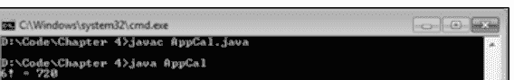

▲ 图 13：AppCal 程序的输出

## 4.7 抽象类的操作

在编写类时，你可能会发现某些情况下只能提供通用代码，而这取决于子化你类的开发者如何对其进行自定义。为了确保开发者自定义你的类，你可以将方法设为抽象的（abstract），这意味着开发者将不得不重写你的方法；否则 Java 会报错。要使一个方法变为抽象，请使用 `abstract` 关键字。如果你将类中的任何方法设为抽象，你也必须将类本身也设为抽象的。

这是一个示例。我们将创建一个类 A，它有一个 `print()` 方法，用于打印字符串，并通过调用 `getData()` 方法获取要打印的字符串：

```java
class A {
    abstract String getData(); 
    public void print() {
        System.out.println(getData());
    }
}
```

注意，`getData()` 方法没有实现，因为我们希望开发者指定他们想要打印的数据。为了让他们知道必须提供 `getData()` 方法的实现，我们可以将方法设为抽象，这意味着我们必须将类本身也设为抽象，如列表 14 所示：

- ▶ 列表 14：实现抽象类

```java
abstract class A {
    abstract String getData();
    public void print() { System.out.println(getData()); }
}

// 现在，当我们扩展类 A 时，我们必须像这样提供
// getData() 的实现：
class B extends A {
    String getData() { return "Hello from Java!"; }
}

// 以下是我们如何让子类工作（注意抽象类
// 不能直接实例化）：
public class AppAbs {
    public static void main(String[] args) { 
        B b1 = new B();
        b1.print(); 
    }
}
```

列表 14 的输出在图 14：


图 14：AppAbs 程序的输出

## 4.8 嵌套类的操作

Java 允许在类内部创建类。在另一个类内部定义的类被称为嵌套类。嵌套类具有以下特征：

- 嵌套类的作用域是在其声明的类内部。换句话说，如果 `Address` 类声明在 `Employee` 类内部，那么 `Address` 类仅对 `Employee` 类可见，而对 `Employee` 类外部不可见。

- 嵌套类可以访问外部类的成员，包括其私有成员，而外部类无法访问嵌套类的成员。

在 Java 中，嵌套类分为两种类型：

- 静态嵌套类：使用 `static` 关键字声明或在外部类的静态上下文中声明的嵌套类。

- 非静态嵌套类：没有使用 `static` 关键字声明的嵌套类。它是外部类的一个实例。

- 列表 15：创建嵌套类

```java
class Enclosing {
    private int value = 10;

    static class Static {
        void display() {
            System.out.println("Static: " + value);
        }
    }

    class Inner {
        void display() {
            System.out.println("Inner: " + value);
        }
    }
}

public class App {
    public static void main(String[] args) {
        Enclosing e = new Enclosing();
        Enclosing.Static s = new Enclosing.Static();
        s.display();
        Enclosing.Inner i = e.new Inner();
        i.display();
    }
}
```

# 第 4 章 复习总结

## 核心概念

- 属性（Attributes）：指类的成员变量，通过类的方法进行操纵和访问。

- 对象（Objects）：指类的实例。

- 构造函数（Constructor）：指一种与类名相同的特殊类型方法。

- 默认构造函数（Default constructor）：指不带任何参数的构造函数。

- 参数构造函数（Parameterized constructor）：指带有参数的构造函数。

- 方法重载（Method overloading）：一种面向对象的技术，允许你定义多个版本的方法，这些方法具有相同的名称，但每个方法的参数列表不同。

## 复习练习

### 判断对错

- Q1. 类可以使用公共（public）访问修饰符进行声明。

答：正确。

- Q2. 公共访问修饰符允许程序中的任何类访问该类之外的成员。

答：正确。

- Q3. 私有（private）类成员可以在其子类中访问。

答：错误。

- Q4. 当你不在类中创建任何构造函数时，系统会自动创建一个默认构造函数。

答：正确。

- Q5. 类中的构造函数不能被重载。

答：错误。

- Q6. 类中的方法可以被重载。

答：正确。

- Q7. 方法可以通过更改其返回类型来实现重载。

答：错误。

- Q8. 对象总是通过 `new` 关键字创建的。

答：正确。

### 单选题

- Q1. 下列哪项可以视为创建 Java 程序的模板？

a. 对象 (Object)

b. 类 (Class)

c. 修饰符 (Specifier)

d. 成员 (Member)

答：正确选项是 b。

- Q2. 下列哪个访问修饰符允许从程序的任何地方访问类成员？

a. 公共 (Public)

b. 保护 (Protected)

c. 私有 (Private)

d. Final (Final)

答：正确选项是 a。

- Q3. 下列哪个访问修饰符允许仅在方法和字段所属的类内部进行访问？

a. 私有 (Private)

b. 保护 (Protected)

c. 公共 (Public)

d. 默认 (Default)

答：正确选项是 a。

- Q4. 在 Java 中声明变量的正确方法是：

a. `<classname>+<objectname>`

b. `<classname>,<objectname>`

c. `<classname>.<objectname>`

d. `<classname>{<objectname>}`

答：正确选项是 c。

- Q5. 下列哪个关键字提供了当前对象的引用？

a. static

b. this

c. final

d. finalize()

答：正确选项是 b。

- Q6. 下列哪个方法被垃圾回收器调用进行最后的清理？

a. public

b. private

c. final

d. finalize()

答：正确选项是 d。

- Q7. 哪个类成员与类名相同？

a. 变量 (Variable)

b. 构造函数 (Constructor)

c. 方法 (Method)

d. 修饰符 (Specifiers)

答：正确选项是 b。

- Q8. 下列哪些是构造函数的类型？

a. 默认构造函数 (Default Constructors)

b. 参数构造函数 (Parameterized Constructors)

c. 一维构造函数 (One-dimensional Constructors)

d. 二维构造函数 (Two-dimensional Constructors)

答：正确选项是 a 和 b。

- Q9. 下列哪项在方法重载中不起任何作用？

a. 参数数量 b. 参数数据类型 c. 参数顺序 d. 参数名称

答：正确选项是 d。

- Q10. 带参数的方法称为____方法。

a. 默认 (default) b. 简单 (Simple) c. 参数化的 (parameterized) d. 绝对的 (absolute)

答：正确选项是 c。

## 简答题

Q1. 解释类变量。

答：变量在类内部声明并带有 `static` 修饰符时作为其成员。它们与类相关，并且为该类的所有对象分配一个内存空间。换句话说，类变量的值由该类的所有对象共享。类变量在程序中只要其相关的类存在一直可用。

Q2. 描述实例成员（non-static member）。

答：实例成员是不使用 `static` 修饰符声明的成员。它们与特定的对象实例相关，每个对象实例都拥有该成员的独立副本。

Q3. 什么是引用传递（by reference）？

答：引用传递是指传递对象的引用地址而不是对象的本身。这允许方法直接修改原始对象的值。

Q4. 解释方法重载。

答：方法重载是一种面向对象的技术，允许你定义多个具有相同名称的方法，但每个方法的参数列表不同。

Q5. 什么是构造函数？在处理构造函数时需要注意哪些点？

答：构造函数是与类名相同的特殊类型方法，用于初始化对象。在处理构造函数时需要注意以下几点：

- 构造函数的名称应与类相同。

- 构造函数没有返回类型。

- 构造函数可以显式或隐式地重载。

- 构造函数在对象创建时初始化。

Q6. 如何修改程序以避免编译错误？

```java
class Question6 {
    int roll=1;
    public static void main(String args) {
        obj=new Question6();
        System.out.println(roll);
    }
}
```

答：编译该程序时出错是因为 `obj` 未定义。在使用之前需要声明 `obj` 变量。修改后的程序如下：

```java
class Question6 {
    int roll=1;
    public static void main(String args) {
        Question6 obj;
        obj=new Question6();
        System.out.println(roll);
    }
}
```

Q7. 使用方法编写一个相加两个数字的程序。

答：

```java
class Program {
    public void sum(int a, int b) {
        System.out.println(a+b);
    }
    public static void main(String ar[]) {
        Program ob=new Program();
        int a=10, b=20;
        ob.sum(a,b);
    }
}
```

Q8. 通过重载 area 方法编写一个计算方形和矩形面积的程序。

答：

```java
class Program {
    public void area(int a) {
        System.out.println("方形的面积: "+(a*a));
    }
    public void area(int length, int width) {
        System.out.println("矩形的面积: "+(length*width));
    }
    public static void main(String args[]) {
        Program ob=new Program();
        ob.area(5);
        ob.area(5,6);
    }
}
```

Q9. 描述抽象类 Shape，它有三个子类，例如三角形（Triangle）、矩形（Rectangle）和圆形（Circle）。在抽象类中定义一个 `area()` 方法，并在这些子类中重写该方法以计算特定对象的面积，例如，三角形子类的 `area()` 应计算三角形的面积，等。矩形和圆形也是如此。

答：

```java
abstract class Shape {
    double dim1, dim2, rad;
    abstract double area();
}
class Triangle extends Shape {
    Triangle(double t1,double t2) {
        dim1=t1;
        dim2=t2;
    }
    double area() {
        System.out.print("三角形的面积: ");
        return((dim1*dim2)/2);
    }
}
```


```java
}
}
class Rectangle extends Shape
{
    Rectangle(double t1,double t2) {
        dim1=t1,dim2=t2;
    }
    double area() {
        System.out.print("Area of Rectangle: ");
        return(dim1*dim2);
    }
}
class circle extends Shape
{
    Circle(double t1) {
        rad=t1;
    }
    double area() {
        System.out.print("Area of Circle: ");
        return(22*rad/7);
    }
}
class AbstractProgram
{
    public static void main(String args[]) {
        Triangle tob=new Triangle(35,10);
        Rectangle robj=new Rectangle(40,25);
        Circle cobobj=new Circle(81);
        Shape shobj;
        shobj=tob;
        System.out.println(shobj.area());
        System.out.println();
        shobj=robj;
        System.out.println(shobj.area());
        System.out.println();
        shobj=cobj;
        System.out.println(shobj.area());
    }
}
```

上述代码的输出为：

```
Area of Triangle: 175.0
Area of Rectangle: 1000.0
Area of Circle: 2062.28
```

### Q10. 区分类的构造函数和方法之间的区别。定义方法重载及其目的。编写一个程序演示构造函数重载。

**答.** 构造函数和方法之间的区别如下：

| 构造函数 | 方法 |
| --- | --- |
| 每当类的对象被执行时，构造函数会自动执行。 | 方法可以通过对象来执行。 |
| 构造函数的名称与类名相同。 | 方法的名称与类名不同。 |
| 构造函数没有返回值。 | 方法应该有返回值。 |

方法重载是一种面向对象的技术，它允许你定义多个版本的方法，这些方法具有相同的名称，但每个方法都有不同的参数列表。当你使用重载的方法时，`Java` 编译器根据你传递给方法的参数数量和/或类型来决定调用哪个方法。

根据以下事实对方法进行重载：

- 参数的数量
- 参数的类型
- 参数的顺序

与方法类似，你也可以重载构造函数。也就是说，你可以在一个类中创建并使用多个构造函数。可以根据以下事实对构造函数进行重载：

- 参数的数量
- 参数的数据类型
- 参数的顺序

当你在 `Java` 类中使用重载的构造函数时，该类的对象将被创建，并根据构造函数的签名初始化实例变量。显示构造函数重载的程序如下：

```java
class overloadedConstructorDemo {
    int num1,num2;
    overloadedConstructorDemo(int a) {
        num1=num2=a;
    }
    overloadedConstructorDemo(int a, int b) {
        num1=a;
        num2=b;
    }
    void calculate() {
        int result=num1*num2;
        System.out.println("The product of numbers= "+result);
    }
    public static void main(String args[]) {
        overloadedConstructorDemo obj1=new overloadedConstructorDemo(5);
        overloadedConstructorDemo obj2=new overloadedConstructorDemo(5,6);
        obj1.calculate();
        obj2.calculate();
    }
}
```

# 第 5 章 Java 中的继承与接口

| 学习目标 |
| --- |
| 探索继承 |
| 学习继承中的构造函数 |
| 讨论多级继承 |
| 使用 `final` 关键字 |
| 在 `Java` 中使用接口 |
| 理解动态方法分发 |
| 理解 `Java` 对象类 (`Object Class`) |

继承是面向对象编程 (`OOP`) 最特性之一。它通过扩展之前声明的类来方便创建新类。用于创建新类的类被称为基类、超类或父类，而新创建的类被称为子类、子子类或派生类。从基类创建派生类的过程被称为继承。

另一方面，`Java` 提供了接口，接口可以被认为类似于抽象类。接口不包含任何方法的实现，因此被认为是抽象的。与接口不同，抽象类可以同时定义抽象方法和非抽象方法。

本章介绍了 `Java` 中各种形式的继承。接下来，讨论了继承中的构造函数和继承的形式。解释了 `final` 关键字的概念。然后，讨论了 `Java` 中的接口，包括它们的定义和实现，并解释了如何扩展接口以及访问接口变量。最后，本章讨论了动态方法分发和 `Java` 对象类。

## 5.1 理解继承

继承通过继承超类的属性，方便了从超类创建子类。这种关系可以图形化表示。例如，`Animal`、`Mammal`、`Cat` 类之间的继承形成了层次结构，如图 1 所示：


从图 1 可以看到，`Cat` 是 `Mammal` 类的子类，而 `Mammal` 又是 `Animal` 类的子类。

### 5.1.1 继承数据和方法

在 `Java` 中，继承通过扩展类来实现。考虑两个类 `A` 和 `B`，其中 `B` 是子类，`A` 是超类。图 2 显示了子类与超类之间的关系：

| 类 B | 类 A |
| --- | --- |
| /字段 | /字段 |
| /方法 | 源自 |

图 2：类 B

在前面的代码中，使用 `extends` 关键字是派生类。以下代码片段显示了类 `A`：

```java
class A {
  // A 的成员
}
class B extends A {
  // B 的成员
}
```

继承是一项重要的特性，有助于改进代码。继承的一个主要优势是代码重用。代码重用确保了程序只需编写一次并在微调后多次使用。这一特性减轻了程序员编写重复代码的负担。

继承还通过修改子类来帮助代码。例如，在方法重写的情况下，可以在子类中实现与超类相同的方法。

继承类似于泛化和特化关系。例如，`Car` 子类是 `Maruti` 类的泛化。此外，`Maruti` 子类还继承了 `Car` 超类的共有属性，如四轮、刹车和引擎。图 3 显示了 `Car` 和 `Maruti` 类之间的泛化和特化关系：


## 5.2 继承中的构造函数

当程序创建子类对象时，可以通过 `super()` 构造函数在子类中编程调用超类的构造函数。如果程序员没有使用 `super()` 构造函数创建对象，则会隐式调用超类的构造函数。`super()` 构造函数用于初始化子类的继承成员。记住，`super()` 构造函数必须是子类中的第一个语句，因为超类构造函数总是先于其子类构造函数被调用的。

**列表 1：使用 `super()` 构造函数调用**

```java
class Dim {
    double width;
    double height;
    double depth;
    Dim(double w, double h, double d) {
        width = w;
        height = h;
        depth = d;
    }
    Double volume() { return width * height * depth; }
}
class NewDim extends Dim {
    double weight;
    NewDim(double w, double h, double d, double m) {
        weight = m;
        super(w,h,d);
    }
}
public class SuperDemo{
    public static void main(String args[]) {
        System.out.println("Initializing members - Using super()");
        NewDim obj = new NewDim(5,5,5,5);
        System.out.println("Width: " + obj.width);
        System.out.println("Height: " + obj.height);
        System.out.println("Depth: " + obj.depth);
        System.out.println("Initializing weight - Using subclass constructor ");
        System.out.println("Weight: " + obj.weight);
        System.out.println("Computing Volume: ");
        Double res = obj.volume();
        System.out.println(obj.volume());
    }
}
```

列表 1 演示了 `super()` 构造函数的实现，它是一种用于初始化子类成员的父类构造函数。`super()` 构造函数在 `NewDim` 类中调用，该类是 `Dim` 类的子类，用于初始化子类继承的父类成员。因此，在初始化子类对象时，会调用 `NewDim(5,5,5,5)` 构造函数，它同时也初始化了父类和子类的成员。图 4 显示了列表 1 的输出：

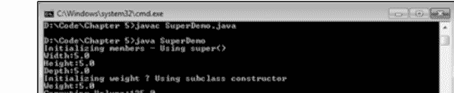

在列表 1 中，调用了 `super()` 父类构造函数来初始化父类的成员。

## 5.3 多级继承

为了理解多级继承，请参考一个继承自 `Car` 类的 `Maruti` 类，而 `Car` 类又继承自 `Vehicle` 类。这种关系被称为多级继承。图 5 显示了多级继承：

| 类 Vehicle |
|---| 
| 类 Car |
| 类 Maruti |

> 图 5：表示多级继承

从图 5 可以看出，`Car` 类继承自 `Vehicle` 类，而 `Maruti` 类继承自 `Car` 类。

让我们创建一个带有 `start()` 方法的 `Vehicle` 类。`Vehicle` 类有一个名为 `Car` 的子类，包含 `drive()` 方法，如下所示：

```java
class vehicle {
    public void start() {
        System.out.println("Starting a vehicle");
    }
}
class Car extends vehicle {
    public void drive() {
        System.out.println("driving a Car");
    }
}
```

在之前的代码段中，`Vehicle` 类包含 `start()` 方法，而子类 `Car` 包含 `drive()` 方法。

在这里，我们来创建一个新类 `Maruti`，它是 `Car` 类的子类。列表 2 显示了 `Maruti` 类的声明，它扩展了 `Car` 类并添加了 `own()` 方法。

**列表 2：声明 `Car` 的 `Maruti` 子类**

```java
class Maruti extends Car {
    public void own() {
        System.out.println("Owning a Maruti");
    }
}
```

在列表 2 中，`Maruti` 类由 `Car` 父类创建，并包含 `own()` 方法。`Vehicle`、`Car` 和 `Maruti` 类之间的继承关系形成了一个继承层级，如图 6 所示：

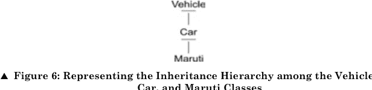

图 6 显示了 `Vehicle`、`Car` 和 `Maruti` 类的继承层级，其中 `Car` 类是 `Vehicle` 类的子类，`Maruti` 类是 `Car` 类的子类。在列表 3 中，声明了 `Multi_inh` 类，它创建了 `Maruti` 类的实例：

**列表 3：声明 `Multi_inh` 类**

```java
public class Multi_inh {
    public static void main(String[] args) {
        System.out.println("Creating a Car...");
        Maruti c = new Maruti();
        c.start();
        c.drive();
        c.own();
        System.out.println("");
    }
}
```

在列表 3 中，`Multi_inh` 类创建了派生类（`Maruti`）的实例，然后调用了 `Car` 和 `Vehicle` 父类的方法。图 7 显示了 `Multi_inh` 类编译并执行时的输出：


从图 7 可以看出，`Vehicle` 和 `Car` 类的方法是由 `Maruti` 对象执行的。`Java` 不支持多继承（即基类同时扩展多个类）。因此，我们不再讨论多继承。

### 5.3.1 方法重写

方法重写是一种面向对象的技术，允许你在实现继承时，在父类和子类中定义相同的方法。当你使用方法重写时，`Java` 编译器将决定由调用该方法的对象来调用哪一个方法。

让我们来看方法重写的例子。列表 4 显示了如何重写方法：

**列表 4：实现方法重写**

```java
class SuperClass {
    void display() {
        System.out.println("This is a super class method");
    }
}
class SubClass extends SuperClass {
    void display() {
        System.out.println("This is a sub class method");
    }
}
class MethodOverride {
    public static void main(String[] args) {
        SuperClass obj = new SuperClass();
        obj.display();
        SubClass obj2 = new SubClass();
        obj2.display();
    }
}
```

在列表 6 中，`super` 关键字被用于访问 `SuperDemo` 超类的成员，这些成员在 `Sub` 子类中是隐藏的。列表 10 显示了执行 `Sub` 子类时的输出：


`super()` 构造函数调用用于从子类引用父类的成员。

## 5.4 使用 `final` 关键字

`final` 关键字在 `Java` 编程中有多个用途。它可以与类和成员一起使用。当 `final` 关键字与变量一起使用时，该 `final` 变量被声明为常量，你不能修改它的值。同样，如果一个引用是 `final` 的，则它的引用不能更改。此外，当它与方法配合时，该方法不能在子类中被重写。而且，在类上使用 `final` 关键字可以防止该类被继承。换句话说，你不能从 `final` 类创建子类。列表 7 显示了 `final` 关键字如何防止方法在子类中重写：

**列表 7：显示 `Sub_class.java` 文件**

```java
class Super_class{
    final void display(){
        System.out.println("Invoking superclass method");
    }
}
class Sub_class extends Super_class{
    public void display(){
        System.out.println("Invoking subclass method");
    }
    public static void main(String s[]){
        System.out.println("Invoking members");
        Sub_class obj = new Sub_class();
    }
}
```


在列表 7 中，`Super_class` 超类的 `final display()` 方法被 `Sub_class` 子类重写，这产生了错误消息，如图 11 所示：

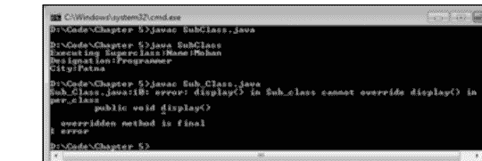

> 图 11：显示重写 final 方法的错误消息

在图 11 中，显示了错误消息是因为 `Sub_class` 子类重写了 `Super_class` 超类的 `final` 方法，即 `display()`。

如前，`final` 关键字与类一起使用时，防止该类创建子类。这一特性在列表 8 中显示：

- 列表 8：显示 Fin_demo.java 文件

```java
class Fin_sup {
    final void display() {
        System.out.println("Invoking superclass method");
    }
}
class Fin_demo extends Fin_sup {
    public static void main(String[] args) {
        System.out.println("Invoking members");
        Fin_demo obj = new Fin_demo();
        obj.display();
    }
}
```

在列表 128 中，扩展了 `Fin_sup` 超类，这产生了错误消息，如图 12 所示：

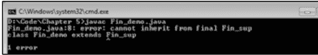

> 图 12：继承 final 类时的错误消息

在图 12 中，当继承 `final` 类或创建其子类时，会显示错误消息。抽象类和 `final` 类的概念是 Java 中不同的特性。

## 5.5 在 Java 中使用接口

Java 中的接口（interface）类似于抽象类。类不提供方法的实现，因此在本质上是抽象的。抽象类可以定义抽象方法和非抽象方法，但接口只能有抽象方法。

Java 不提供多重继承机制（一个子类继承自多个超类）。相反，它提供了一种允许多接口继承的接口。接口通过使用 `interface` 关键字声明，并且仅包含常量和方法声明。因此，无法创建接口的对象。`implements` 关键字用于在类中实现接口。实现接口的类被称为实现类。类需要定义该类所实现的接口中的所有方法。

在接下来的章节中，我们将定义并实现一个接口。我们还会讨论如何使用接口的引用变量以及扩展接口。

### 5.5.1 创建接口

### 5.5.2 实现接口

类似于创建一个类，你可以创建一个接口。

### 5.5.3 使用接口的引用变量

类似于创建一个类引用变量，你也可以创建一个接口引用变量。此外，通过使用引用变量，你可以轻松访问实现接口的类的方法。列表 10 显示了如何使用这些变量。

在列表 10 中，声明了 `Cal` 类，它由 `Students` 类实现。随后，通过 `obj` 对象和 `intref` 接口变量分别引用了该类的方法。图 14 显示了 `Students` 类的执行情况：


> 图 14：执行 Students.java 文件

图 14 显示了 `Students` 类的输出，其中声明了一个接口并使用实现接口的类的引用变量对其初始化。通过使用该接口变量也可以调用该类的方法。

### 5.5.4 继承接口

在其他语言（如 C++）中，一个类可以同时继承自多个类，但这种技术在 Java 中并不直接适用，也就是说，你一次只能使用 `extends` 关键字继承一个类。因此，你无法：

```java
class A extends B, C // 无法工作！
{ . . . }
```

在 Java 中实现等同于多重继承的方法有两种。一种是分阶段使用单继承（如果这适用于你想要继承的类的话）：

```java
class C { . . . }
class B extends C { . . . }
class A extends B { . . . }
```

另一种方法是使用接口。接口在下一章中将变得重要，因此我们现在就介绍它们。

接口指定了方法的形状，但不提供任何实现细节；因此，你可以将其极地比作类的声明。你可以使用 `interface` 关键字如下所示创建接口：

```java
interface C { . . . }
interface B { . . . }
```

现在，你可以使用 `implements` 关键字这样使用这两个接口：

```java
class A implements B, C { . . . }
```

### 5.5.5 访问接口变量

与在其他编程语言中声明头文件类似，Java 也允许在接口内部声明一组常量，这些常量可以像普通变量一样被任何字段或方法访问。列表 11 显示了如何在 Java 类中访问接口变量：

- 列表 11：显示 Itest.java 文件

```java
interface Set {
    int red = 1;
    int blue = 2;
    int green = 3;
}
class SetImpl implements Set{
    void select(int color){
        switch(color) {
            case red:
                System.out.println("RED IS SELECTED");
                break;
            case blue:
                System.out.println("BLUE IS SELECTED");
                break;
            case green:
                System.out.println("GREEN IS SELECTED");
                break;
        }
    }
}
public class Itest{
    public static void main(String[] s){
        SetImpl ob = new SetImpl();
        ob.select(1);
        ob.select(2);
        ob.select(3);
    }
}
```

列表 11 声明了一个包含整数集合的接口，随后实现该接口的类在 `switch` 语句内部逐个使用了这些整数。整数的值传递给 `main()` 方法内部调用的方法参数。图 15 显示了 `Itest.java` 类的执行情况：


> 图 15：执行 Itest.java 文件

图 15 显示了执行 `Itest.java` 类时的输出，该类实现了接口变量。

### 5.5.6 抽象类与接口的比较

在编写类时，你可能会发现某些情况下只能提供通用代码，而由子类化你类的开发者来对其自定义。为了确保开发者自定义你的代码，你可以将方法设为抽象的，这意味着开发者将不得不重写你的方法；否则，Java 将强制执行。

这里有一个例子来说清楚这一点。在这种情况下，我们将创建一个名为 `W` 的超类、名为 `X` 的子类、名为 `Y` 的子类以及名为 `Z` 的子类，每个类都拥有一个 `print()` 方法：

```java
class W {
    public void print() { System.out.println("Here W"); };
}
class X extends W {
    public void print() { System.out.println("Here X"); };
}
class Y extends X {
    public void print() { System.out.println("Here Y"); };
}
class Z extends Y {
    public void print() { System.out.println("Here Z"); };
}
```

现在，我们可以为每个类创建一个对象引用：

```java
public class App {
    public static void main(String[] args) {
        W w1 = new W(); X x1 = new X();
        Y y1 = new Y(); Z z1 = new Z();
    }
}
```

为了显示运行时多态的工作原理，我们还将创建一个名为 `ref` 的变量，它持有指向类 `W` 对象的引用：

```java
public class App {
    public static void main(String[] args) {
        W w1 = new W(); X x1 = new X();
        Y y1 = new Y(); Z z1 = new Z();
        W ref;
        ref = w1; ref.print();
        ref = x1; ref.print();
        ref = y1; ref.print();
        ref = z1; ref.print();
    }
}
```

通过运行时多态，你可以一直等到程序执行后再决定对象的类型。以下是该代码的结果：

```
Here W
Here X
Here Y
Here Z
```

## 理解 Object 类

Java 中的每个类都自动派生自 `java.lang.Object` 类，有某些方法需要了解。`Object` 的方法如表 1 所示：

| 方法 | 描述 |
| :--- | :--- |
| `clone()` | 返回对象的副本 |
| `equals(Object obj)` | 指示另一个对象是否等于此对象 |
| `finalize()` | 垃圾回收器在准备销毁对象时调用 |
| `getClass()` | 返回对象的运行时类 |
| `hashCode()` | 返回对象的哈希值 |
| `notify()` | 唤醒等待对象监视器的一个线程 |
| `notifyAll()` | 唤醒所有等待对象监视器的线程 |
| `toString()` | 返回对象的字符串表示 |
| `wait()` | 使当前线程等待，直到另一个线程调用 `notify` 或 `notifyAll` |

## 总结

本章首先讨论了 Java 中的各种继承形式以及继承中的构造函数。还解释了如何使用 `final` 关键字。此外，本章介绍了 Java 接口，包括它们的定义和实现，以及如何扩展和访问接口变量。最后，讨论了动态派发和对象类。

## 关键术语

- 继承：通过继承超类的属性来创建子类
- 子类：继承超类的结构和行为
- 方法重写：一种允许在超类和子类中定义相同名称方法的面向对象技术
- 运行时多态或动态派发：允许你在程序执行后再决定对象的类型

## 复习练习

### 判断题

- Q1. Java 允许多重继承。
  - Ans: 错误
- Q2. 超类的私有成员可以被子类继承。
  - Ans: 错误
- Q3. 成员可以被包外的任何类继承。
  - Ans: 错误
- Q4. 超类的公共成员无法被包外的任何类继承。
  - Ans: 错误
- Q5. `super` 关键字用于访问超类的成员。
  - Ans: 正确
- Q6. `super()` 构造函数在子类构造中用于初始化超类的成员。
  - Ans: 正确
- Q7. `final` 类可以被继承。
  - Ans: 错误
- Q8. `final` 方法可以被重写。
  - Ans: 错误

### 单选题

- Q1. Java 提供了哪些形式的继承？
  - a. 单继承
  - b. 多重继承
  - c. 层级继承
  - d. 多级继承
  - Ans: 正确选项为 a, c, d

- Q2. 哪些成员可以被继承？
  - a. 公有 (public)
  - b. 保护 (protected)
  - c. 仅 a
  - d. a 和 b
  - Ans. 正确选项是 d。

- Q3. 私有成员：
  - a. 可以被继承
  - b. 不能被继承
  - c. 无法确定
  - d. 不能创建
  - Ans. 正确选项是 b。

- Q4. final 方法：
  - a. 可以被重写
  - b. 不能被重写
  - c. 可以重写，但在其子类中
  - d. 以上均不是
  - Ans. 正确选项是 b。

- Q5. 抽象类的实例：
  - a. 可以创建
  - b. 可以创建，但仅在在其子类中
  - c. 不能创建
  - d. 以上均不是
  - Ans. 正确选项是 c。

- Q6. 考虑以下程序：


```java
class s {
    public void display() {
        System.out.println("Hello from Super class");
    }
}
class sb extends s {
    public static void main(string s[]) {
        Sb obj = new Sb();
        obj.display();
    }
}
```

**上述程序在编译和执行时的结果是什么？**

- a. 程序无法编译
- b. 程序将编译但不会执行
- c. 程序将成功执行并打印 "Hello from Super class"
- d. 以上均不是

Ans. 正确选项是 c。

# Q7. 考虑以下程序：

```java
class Super {
    private int value = 4;
}

class Sub extends Super
{
    public static void main(String s[])
    {
        Sub obj = new Sub();
        System.out.println("Accessing value from superclass:" + obj.value);
    }
}
```

上述程序在编译和执行时的结果是什么？

- a. 程序无法编译
- b. 程序将编译但不会执行
- c. 程序将成功执行并打印值 4
- d. 以上均不是

Ans. 正确选项是 a。

# Q8. String 类：

- a. 可以被扩展
- c. 可以被继承
- b. 不能被扩展
- d. 无法确定

Ans. 正确选项是 b。

# Q9. 以下声明：

```java
abstract class AbsDemo {
    abstract void display() {
        System.out.println("The class is abstract");
    }
}
```

- a. 正确
- c. 可以提供输出
- b. 不正确
- d. 无法确定

Ans. 正确选项是 b。

# Q10. 以下声明：

```java
abstract class AbsDemo {
    abstract void display();
}
```

- a. 正确
- c. 可以提供输出
- b. 不正确
- d. 无法确定

Ans. 正确选项是 a。

## 简答题

### Q1. 什么是继承？请结合合适的示例进行讨论。

Ans. 继承通过继承父类的属性来实现从父类创建子类。子类和父类之间的关系形成了一个层次结构，可以用图形表示。例如，动物（`Animal`）、哺乳动物（`Mammal`）、猫（`Cat`）和斑纹猫（`Tabby`）类之间的继承关系形成了一个继承层次结构，如图所示：

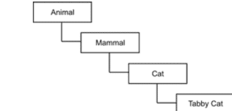

在图中，斑纹猫（Tabby Cat）类的继承层次结构表示为派自猫（`Cat`）类。此外，哺乳动物（`Mammal`）类是猫类的父类，动物类的子类。

### Q2. 导入（import）类和扩展（extend）类的区别是什么？

Ans. 当我们从父类扩展一个类时，两者之间建立了继承关系。然而，当我们导入一个类时，不存在这种关系。此外，继承的成员仅在子类中可见。相比之下，导入一个类，其成员在任何类中都是可见。

### Q3. Java 中的接口是什么？它们在 Java 中为什么重要？

Ans. Java 中的接口类似于抽象类。接口不提供任何方法的实现，因此在本质上是抽象的。结果是你不能创建抽象类的子类。抽象类可以同时定义抽象方法和非抽象方法，但接口只能有抽象方法。Java 不提供多重继承（一个子类继承自多个父类）。相反，它允许通过接口实现多重继承。接口使用 `interface` 关键字声明，仅包含常量和方法声明。因此，无法创建接口的对象。使用 `implements` 关键字在类中实现接口。实现接口的类被称为实现类。实现类需要定义该类所实现的接口的所有方法。

### Q4. 如何防止方法被重写？

Ans. 为了防止特定方法被重写，可以在方法上使用 `final` 修饰符。

```java
final void method();
```

### Q5. 方法重写（overriding）和方法重载（overloading）的区别是什么？

Ans. 方法重写是子类中的方法。方法重载是具有相同签名的方法。

### Q6. 编译以下程序会发生什么？

```java
class Super {
    final void myWeb()
}
class Sub extends Super {
    public static void main(String args[]) {
        Sub obj = new Sub();
        obj.webY();
    }
}
```

Ans. 编译是因为方法是 `final`。

### Q7. 编译并执行以下程序的结果是什么？

```java
class Super {
    private int value = 4;
}

class Sub extends Super {
    public static void main(String s[]) {
        Sub obj = new Sub();
        System.out.println("Accessing value from superclass:" + obj.value);
    }
}
```

Ans. 程序无法编译是因为 `value` 是 `private` 的。

上一个程序的输出为：

```
P12 class's method and constant: 40
P1 class's method and Constant: 10
P2 class's method and Constant: 25
P class's method and Constant: 15
```

## 使用包与异常

### 目标

- 理解 Java 中的包
- 定义 Java API 包
- 处理异常

包可以被看作是一个目录或文件夹，它允许你在应用程序中存储多个相互相关的类。包解决了类名冲突的问题。

另一方面，异常是程序运行时发生的某些非正常状态或错误，会导致程序的突然终止。程序应该能够高效地处理异常，以克服因异常导致程序突然终止的问题。让我们假设你创建了一个用于执行除法操作的包。但如果你用 0 来除一个数字，这将产生一个 `ArithmeticException`（Java 的一种内置异常）。Java 提供了各种处理异常的技巧。Java 还提供了输入/输出 (I/O) 框架。该框架提供了一个简单、标准的应用程序接口 (API)，用于从各种数据源读取和写入以字符或字节形式存在的数据。I/O 框架 `java.io`（输入输出包）包含一组类，如 `FileInputStream`、`OutputStream`，它们提供了实用的抽象和更好的 I/O 性能。这些类是 `InputStream` 和 `OutputStream` 的包装类。输入流是接收数据的流，而输出流是发送或写入数据的流。`java.io` 包中的类代表所有元素。

本章首先讨论 Java 中的包。进一步讨论了在 Java 中创建和导入包。接下来，介绍了 Java 中的访问控制。本章还讨论了 Java API 包，例如 `java.lang` 和 `java.util`。最后，解释了处理异常的语句。

### 6.1 理解 Java 中的包

在 Java 中，你不能创建两个同名的类。这意味着你必须为每个新类分配不同的名称。然而，这是一项麻烦的任务。为了解决这个问题，可以使用包。让我们考虑一个例子来理解包是如何解决类名冲突问题的。假设你在应用程序中创建了一些名为 `Pass` 和 `Detail` 的类，使得类的目的通过其名称来标识。现在，如果你想使用同名的类，就必须创建另一个应用程序。但在 Java 中，你不能创建多个同名的类。

为了解决类冲突问题，你可以将所有相关的类放在一个包中。现在回到示例，你创建的 `Pass` 和 `Detail` 类可以放在一个包中。这样，你就可以在包之外使用相同的名称创建其他类。在 Java 中，包分为以下两类：

- 用户定义的包
- 内置包

Java 应用程序接口 (API) 包含许多类和接口，它们根据其功能以包的形式排列。这些是 Java API 的内置包。除了这些内置包，你还可以在应用程序中创建自己的包。让我们讨论如何创建包。

#### 6.1.1 创建包

用户创建用于执行某些特定任务的包被称为用户定义的包。用户定义的包也可以像内置包一样被导入和使用。创建包必须使用 `package` 关键字。创建包的通用语法是：

```
package <pack_name>; // 创建包的语句
```

在上述语法中，`pack_name` 是你想要分配给包的任何逻辑名称。包语句必须是 Java 源文件中的第一条语句。列表 1 显示了如何创建一个包：

**列表 1：创建包**

```java
package dreamtech; // 创建包
public class PackageDemo {
    int x[];
    public PackageDemo(int a[]) // 数组作为参数的构造函数 {
        for (int i=0; i<a.length; i++){
            x = a; // 将元素赋值给另一个数组
        }
    }
    public void sort () // 泡排序方法
        int temp=0, j, k;
        for (j=0; j<x.length; j++){
            for(k=0; k<x.length-1; k++){
                if (x[k]>x[k+1])
                    temp=x[k+1];
                    x[k+1] = x[k];
                    x[k]=temp;
                }
            }
        }
        {
          System.out.println("Elements after sorting:");
          for (int j=0; j<x.length; j++) {
            System.out.println(x[j]);
          }
        }

    public static void main(String[] args[]) {
      int[] val={5,3,2}; // 声明并初始化数组
      PackageDemo val = new PackageDemo(val);
      val.arr(); // 调用 arr 方法
    }
}
```

在列表 1 中，创建了 `dreamtech` 包，它包含了 `PackageDemo` 类。该类随后用于对数字执行排序操作，如列表 1 所示，通过泡排序算法。在 `PackageDemo` 构造函数中，数组作为参数传递，因为它存储了需要进行排序的数值。

然后创建了 `arr()` 方法（在此代码中用于对数组元素进行排序）。在 `main()` 方法中，首先声明并初始化一个数组，然后创建对象 `val`。接着将数组的引用作为参数传递。（*注：原文代码中存在一些逻辑/语法错误，翻译时未修改代码内容*）。

#### 6.1.2 导入包

在应用程序中导入包允许你利用存储在包中的类。你可以根据需要导入应用程序中使用的许多包。你也可以导入用户定义的包。通过在 Java 程序中使用包名配合导入语句，你可以利用任何包。导入语句必须位于包规范之后、类定义之前。列表 2 显示了如何使用导入语句导入包：

**列表 2：使用导入语句**

```java
import dreamtech.PackageDemo; // 导入包
class ImportDemo{
    public static void main(String[] args){
        int m[]={8,5,7,6,9};
        PackageDemo obj = new PackageDemo(m);
        obj.arr();
    }
}
```

在列表 2 中，列表 1 创建的 `dreamtech` 包已被导入。`ImportDemo` 类被创建。在这里，首先声明并初始化一个数组。接着创建了从 `dreamtech` 包导入的 `PackageDemo` 类对象。最后，调用 `arr()` 方法对数组元素进行排序。

在图 2 中，你可以看到数组数组的元素已成功排序。在代码列表 2 中，只导入了 dreamtech 包中的一个类。你可以通过为每个类编写显式的导入语句，或使用 `*` 符号来导入一个包中的多个类，如下所示代码段所示：

```java
import dreamtech.*;
```

在前面的代码段中，使用了 `*` 符号来导入 dreamtech 包中的所有类和接口。使用 `*` 符号可以避免在代码中重复使用导入语句。代码列表 3 显示了如何使用 `*` 符号来导入包中的所有类和接口：

**代码列表 3：使用 `*` 符号导入多个类和接口**

```java
import dreamtech.*;
class MultiImportDemo {
    public static void main(String args[]) {
        int m[]={8,5,7,6,9};
        dreamtech.PackageDemo obj = new dreamtech.PackageDemo(m);
        arr();
    }
}
```

在代码列表 3 中，创建了 `MultiImportDemo` 类以展示如何使用 `*` 符号导入整个包。`PackageDemo` 类存在于 `dreamtech` 包中。该类的 `arr()` 方法在 `MultiImportDemo` 类被调用。图 3 显示了代码列表 3 的输出：

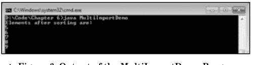

调用 `arr()` 方法的结果显示在图 3 中。虽然该方法在 `MultiImportDemo` 类中可用，但它是从 `dreamtech` 包的类中导入的。

可以使用 Java 提供的访问修饰符来保护包中的类及其成员不被包外部访问。我们将在下一节讨论访问保护。

### 6.1.3 演示访问保护


# Java 访问修饰符与包管理

## 访问修饰符

Java 提供 `public`、`protected`、`private` 和 `default`（包私有）四种访问修饰符，用于声明类及其成员。根据所用修饰符，类成员在不同包中的可见性如表 1 所示。

### 表 1：访问修饰符与类成员的可见性

| 访问范围 | Public | Protected | Private | Default |
| :--- | :---: | :---: | :---: | :---: |
| 同一类 | 是 | 是 | 是 | 是 |
| 同包子类 | 是 | 是 | 否 | 是 |
| 同包非子类 | 是 | 是 | 否 | 是 |
| 不同包子类 | 是 | 是 | 否 | 否 |
| 不同包非子类 | 是 | 否 | 否 | 否 |

- **public**：类成员可从任何地方访问。
- **default**（无修饰符）：成员在同一类及同包的子类、非子类中可见，包外不可见。
- **protected**：成员可从同一类、同包子类、非子类及包外部的子类访问。
- **private**：成员仅在同一类中可见。

### 代码示例

#### 代码列表 1：超类 `SupClass` (`dreamtech` 包)

```java
package dreamtech;

public class SupClass {
    int defaultnumber = 5;
    private int privatenumber = 10;
    protected int protectednumber = 15;
    public int publicnumber = 20;

    public SupClass() {
        System.out.println("Simple Constructor");
        System.out.println("Default Number :" + defaultnumber);
        System.out.println("Private Number :" + privatenumber);
        System.out.println("Protected Number :" + protectednumber);
        System.out.println("Public Number :" + publicnumber);
    }
}
```

#### 代码列表 2：同包子类 `SubClass`

```java
package dreamtech;

class SubClass extends SupClass {
    public SubClass() {
        System.out.println("Constructor of Subclass");
        System.out.println("Default Number :" + defaultnumber);
        // System.out.println("Private Number :" + privatenumber); // 编译错误：私有成员不可见
        System.out.println("Protected Number :" + protectednumber);
        System.out.println("Public Number :" + publicnumber);
    }
}
```

#### 代码列表 3：同包普通类 `ClassDemo`

```java
package dreamtech;

class ClassDemo {
    SupClass obj = new SupClass();
    System.out.println("Default Number :" + obj.defaultnumber);
    // System.out.println("Private Number :" + obj.privatenumber); // 编译错误
}
```

---

## 第 6 章：包与异常的处理

### 6.1 CLASSPATH 环境变量

当前版本的 SDK 不需要预先定义 `CLASSPATH`；若系统中已由其他 Java 版本设置，反而可能引发问题。若必须保留 `CLASSPATH` 环境变量，建议在命令行中临时定义。

默认情况下，Java 能自动搜索：
- **引导类**：JDK 自带的核心类库。
- **扩展类**：使用 Java 扩展机制的类。
- **当前目录下的类**：编译/运行时所在目录。

类文件可存储于 `.class`、`.jar`、`.zip` 文件中，Java 均可搜索。

若需让 Java 在特定目录或第三方 `.jar` 中查找类，可通过 `CLASSPATH` 环境变量指定搜索路径。

#### 示例场景

假设有 `Printer.java`：

```java
public class Printer {
    public void print() { System.out.println("Hello from Java!"); }
}
```

在 `App.java` 中调用：

```java
import printer.*;

public class App {
    public static void main(String[] args) {
        new Printer().print();
    }
}
```

若 `Printer.class` 位于编译目录，默认即可工作。若需将类集中存放于 `c:\classes`，则需配置 `CLASSPATH`。

#### 设置 CLASSPATH

**临时设置 (命令行)：**
```cmd
SET CLASSPATH=c:\classes;c:\newclasses
```
> 注意：等号两侧无空格；多路径用分号 `;` 分隔。

**查看当前设置：**
```cmd
SET CLASSPATH
```

**永久设置 (Windows 7+)：**
1. 右键“此计算机” → “属性” → “高级系统设置”。
2. 点击“环境变量”。
3. 在“系统变量”中编辑或新建 `CLASSPATH`。
4. 路径间用分号 `;` 分隔。
5. 确定保存。

#### 追加现有路径

```cmd
SET CLASSPATH=c:\classes;c:\newclasses;%CLASSPATH%
```

#### 使用 JAR/ZIP 文件

```cmd
SET CLASSPATH=server.jar;classes.zip;%CLASSPATH%
```

> **历史背景**：早期 Java 无引导类概念，`CLASSPATH` 是初学者拦路虎。引入引导类自动搜索机制后，仅在使用非标准包或自定义类目录时才需手动配置 `CLASSPATH`。

---

### 6.2 JAR 文件

**Java Archive (JAR)** 基于 ZIP 格式，用于打包类文件及资源，便于网络下载（单连接下载多文件）和 JavaBeans 等技术的基础。JVM 和浏览器可直接读取 JAR 内文件无需解压。

#### 6.2.1 创建 JAR 文件

使用 JDK 自带的 `jar` 工具。

**常用选项：**

| 选项 | 说明 |
| :--- | :--- |
| `c` | 创建新归档 |
| `t` | 列出归档内容 |
| `x` | 提取文件 |
| `f` | 指定归档文件名 |
| `v` | 生成详细输出 |
| `m` | 包含指定清单文件 |
| `0` | 仅存储，不压缩 |
| `M` | 不创建默认清单文件 |
| `u` | 更新现有归档 |
| `C` | 执行期间切换目录 |

---

### 6.3 核心 API 包

#### 表 2：常用 Java API 包

| 包名 | 描述 |
| :--- | :--- |
| `java.awt` | 抽象窗口工具包，含 UI 组件、绘图、图像处理类。 |
| `java.applet` | Applet 创建及上下文通信支持。 |
| `java.lang` | **核心基础包，自动导入**，含基本包装类、系统、线程等。 |
| `java.util` | 工具包：集合框架、日期/时间、国际化、随机数等。 |

`java.lang` 和 `java.util` 是编程中最常用的两个包。

#### 6.3.1 `java.lang` 包

提供程序基本功能，**无需显式导入**。主要类见表 3。

### 表 3：`java.lang` 包核心类

| 类名 | 描述 |
| :--- | :--- |
| `Boolean` | `boolean` 包装类 |
| `Byte` | `byte` 包装类 |
| `Character` | `char` 包装类 |
| `Class` | 运行时类/接口对象表示 |
| `ClassLoader` | 运行时动态加载类 |
| `Compiler` | JIT 编译器支持 |
| `Double` | `double` 包装类 |
| `Float` | `float` 包装类 |
| `Integer` | `int` 包装类 |
| `Long` | `long` 包装类 |
| `Math` | 基础数学运算 |
| `Number` | 数值包装类父类 |
| `Object` | 所有类的根父类 |
| `Process` | 管理子进程 |
| `Runtime` | 运行时环境访问 |
| `SecurityManager` | 安全策略实现 |
| `Short` | `short` 包装类 |
| `String` | 字符串（非基本类型，不可变） |
| `StringBuffer` | 可变字符序列（线程安全） |
| `System` | 标准 I/O、系统属性/环境变量、加载库、数组复制 (`arraycopy`) |
| `Thread` | 线程创建与控制 |
| `Throwable` | 异常/错误体系根类 |

> 此外 `java.lang` 还包含接口（如 `Runnable`、`Comparable`）、异常类（`Exception`、`RuntimeException` 等）及错误类（`Error`）。

#### 6.3.2 `java.util` 包

包含集合框架、遗留集合、事件模型、日期时间、国际化、字符串分词、随机数、位数组等工具类。

##### 6.3.2.1 `Hashtable` 类

实现哈希表，将键映射到值。键值对象需正确实现 `hashCode()` 和 `equals()` 方法。

**创建数字哈希表示例：**

```java
import java.util.Hashtable;

public class HashTableDemo {
    public static void main(String[] args) {
        Hashtable<Integer, String> table = new Hashtable<>();
        table.put(1, "One");
        table.put(2, "Two");
        table.put(3, "Three");
        
        System.out.println("Value for key 2: " + table.get(2));
        System.out.println("All entries: " + table);
    }
}
```


```java
Hashtable hashtable = new Hashtable();
hashtable.put("First", new Integer(1));
hashtable.put("Second", new Integer(2));
hashtable.put("Third", new Integer(3));
hashtable.put("Fourth", new Integer(4));
hashtable.put("Fifth", new Integer(5));
```

在上面的代码段中，创建了一个哈希表并使用 `put()` 方法添加了五个元素。要从哈希表中检索数字，请使用以下代码段：

```java
Integer intgr = (Integer)hashtable.get("Fifth");
if (intgr != null) {
  System.out.println("Fifth element = " + intgr);
}
```

在前面的片段中，使用 `get()` 方法从哈希表中检索第五个值。`Hashtable` 类包含重载构造函数，可用于创建哈希表。

接下来，我们描述 `java.util` 包中的 `Date` 类。

## 6.3.2.2 Date 类

`Date` 类是用于以平台无关的方式表示日期的封装。`Date` 类拥有重载构造函数和方法，用于在应用程序中处理不同格式的日期。

以下代码片段用于创建一个表示当前日期和时间的日期对象：

```java
Date dt=new Date();
System.out.println("Today's Date = " + dt);
```

在前面的片段中，创建了 `Date` 实例以表示当前的日期和时间。`Date` 类提供了多种以平台无关的方式处理日期。

## 6.4 处理异常

当你创建一个 Java 程序并且它成功编译时，你可能认为它会成功执行。然而，你可能会由于程序员的无知引起的各种不确定性导致程序中断。处理这些不确定性的机制被称为异常处理。例如，当除以零时，会抛出一个异常。这可以使用 `try` 和 `catch` 块来处理。

## 6.4.1.1 异常层次结构

Java 支持的所有可能的异常都以 `Throwable` 类的子类形式在层次结构中组织。`Throwable` 类是 `Object` 类的直接子类，而 `Object` 类位于异常层次结构的根部。让我们看看图 6所示所示异常层次结构：

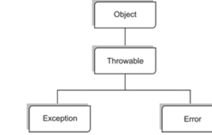

图 6：显示异常层次结构

图 6 显示 `Exception` 类是所有异常类的父类，而 `Error` 类是所有运行时错误类的父类。这些错误类代表在 Java 程序的正常情况下不预期会被捕获的错误。此外，`Exception` 和 `Error` 类都是 `Throwable` 类的子类。`Throwable` 类本身是所有 Java 类父类——`Object` 类的子类，`Object` 类位于默认 Java 包 `java.lang` 下。例如，I/O 异常（如 `FileNotFoundException` 和 `EOFException`）就属于该包。`java.io` 包。图 7 显示了 `java.io` 包中 `Exception` 类的层次结构。

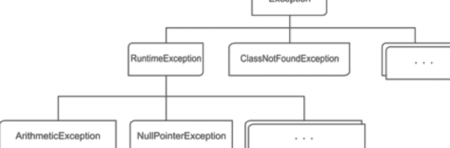

图 7：显示 Exception 类的异常层次结构

图 7 显示了 `Exception` 类的两个子类，即 `RuntimeException` 和 `ClassNotFound`。除了这些类，还有其他 `Exception` 类的子类。为了避免复杂性，这些没有在层次结构中显示。以下是 `Exception` 类下重要子类的列表：

- `RuntimeException`: 当程序执行的算术运算错误时抛出，包含常见异常，如 `ArithmeticException` 和 `IndexOutOfBoundsException`。

- `ClassNotFoundException`: 当找不到需要加载的类时抛出。

- `CloneNotSupportedException`: 当方法没有实现接口但使用了 `clone()` 方法时抛出。

- `IllegalAccessException`: 当在另一个方法/类中调用某个方法时抛出。但是，调用的方法/类没有访问该方法的权限。

- `InitializationException`: 当处于睡眠或等待状态的线程被另一个线程中断时抛出。

- `NoSuchFieldException`: 当程序中使用未定义的变量时抛出。

- `NoSuchMethodException`: 当程序中使用未定义的方法时抛出。

`Runtime` 类由其他异常子类组成，用于处理特定类型的异常。`RuntimeException` 类的子类列如下：

- `ArithmeticException`: 当遇到算术问题时（例如数字除以 0）时抛出。

- `IndexOutOfBoundsException`: 当数组或 String 超过指定的索引时抛出。该异常类还有两个子类：`ArrayOutOfBoundsException` 和 `StringIndexOutOfBoundsException`。当访问索引外的数组元素时，抛出 `ArrayOutOfBoundsException`。当访问索引外的 String 或 StringBuffer 时，抛出 `StringIndexOutOfBounds` 异常。

- `ArrayStoreException`: 当你尝试向数组存储任何非该数组类型的值时抛出。例如，假设数组是整数类型，但要存储在元素中的值是另一种类型。

- `ClassCastException`: 当进行不恰类型转换时抛出。

- `IllegalArgumentException`: 当向方法传递非法参数时抛出。此异常有两个子类：`IllegalThreadStateException` 和 `NumberFormatException`。当你尝试对与当前线程状态不兼容的线程执行任何操作时，抛出 `IllegalThreadStateException`。当将数值解析为字符串但解析过程失败时，抛出 `NumberFormatException`。

- `IllegalMonitorStateException`: 当没有对象监视权的线程尝试访问对象的 `wait()`、`notify()` 和 `notifyAll()` 方法时抛出。

- `IllegalStateException`: 当运行时环境不处于调用任何方法的适当状态时抛出。

- `NegativeArraySizeException`: 当尝试在程序中创建一个负数大小的数组时抛出。

- `NullPointerException`: 通过空对象引用访问对象时抛出。

- `SecurityException`: 当方法违反 Java 中定义的安全策略时抛出。

你必须记住这些异常类及其子类，以及抛出特定异常的原因。这些信息将帮助你轻松处理异常。图 8 阐了 `Error` 类的层次结构：

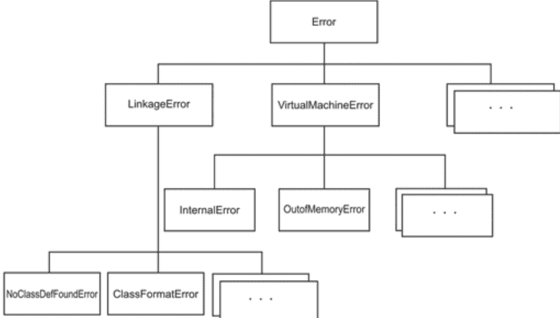

▲ 图 8：Error 类的异常层次结构

图 8 显示了 `Error` 类的两个子类——`LinkageError` 和 `VirtualMachineError`。这些子类进一步分为它们自己的子类。除了 `LinkageError` 和 `VirtualMachineError` 子类外，以下是 `Error` 类子类的完整列表：

- `LinkageError`: 当类引用其他类出现问题时抛出错误。该子类包含各种子类，如 `ClassFormatError`、`NoClassDefFoundError`。

- `VirtualMachineError`: 当 Java 虚拟机 (JVM) 遇到错误时抛出错误。该子类包含各种子类，如 `InternalMemoryError`。

- `ThreadDeath`: 当调用 Thread 对象的 `stop()` 方法杀死它时抛出错误。

所有异常大致分为两类：检查异常（checked exceptions）和未检查异常（unchecked exceptions）。而未检查异常在编译时不进行检查。检查异常是编写良好的程序可以捕获的异常。现在让我们讨论如何处理异常。

### 6.4.2 异常处理

在 Java 中，我们有各种技术，如 `try` 和 `catch` 来处理异常。这些技术使用了各种语句，如 `try-catch`、`finally` 语句、`throws` 语句。我们使用这些技术创建良好的应用程序。异常处理涉及以下：

- 使用 try 和 catch

- 使用嵌套 try 和 catch

- 使用 finally 语句

- 使用 throws 语句

- 使用 throw 语句

让我们详细讨论这些内容。

### 6.4.2.1 使用 try 和 catch

Java 程序中的 `try` 用于封装可能导致异常的语句。`try` 块必须紧跟一个 `catch` 块。`catch` 块充当异常处理器，包含异常类的对象，用于处理抛出的异常。当运行时系统调用异常处理器时，执行 `catch` 块中的代码。图 9 显示了使用 `try-catch` 处理异常的流结构：

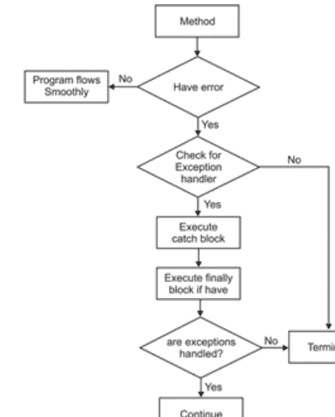

**图 9**：try-catch 构造的流结构

图 9 显示了使用 try-catch 的的过程。程序执行时，会检查其方法。如果遇到任何错误，将搜索相应的异常处理技术。如果没有找到异常处理技术，程序将异常终止。然而，如果找到了异常处理技术，则执行 `catch` 块中的代码。以下代码片段表示了 try-catch 构造的基本结构：

```
try {
  // code
} catch (exception_class var) {
  // 当抛出异常时执行的代码
}
```

在前面的代码片段中，`exception_class` 可以是任何异常类或子类，`var` 可以是任何引用存储异常详情栈的变量名。使用 try-catch 构造的一些规则如下：

- `try` 块不能在没有 `catch` 或 `finally` 块的情况下使用。

- `catch` 块必须跟在 `try` 块之后，即 `try` 块结束和 `catch` 块开始之间不应有语句。

- `finally` 块不能放在 `catch` 块之前。

# 列表 9：DemoException_tc.java 文件

```java
class DemoException_tc {
    public static void main(String[] args[]) {
        try {
            int x=5;
            int y=0;
            int z=x/y;
            System.out.println("Result of the program is " + z);
        } catch (Exception e) {
            e.printStackTrace();
            System.out.println("A number cannot be divided by zero ");
        }
    }
}
```

在列表 9 中，当存储在 x 中的值除以 0 时，会产生 `ArithmeticException`，这是非法的。`ArithmeticException` 类是 `Exception` 类的子类，因此它被用于处理所有其他算术异常。`printStackTrace()` 方法显示异常异常栈中的异常。图 10 显示了 `DemoException_tc` 捕获到的异常：

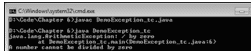

图 10：显示 ArithmeticException 的处理

图 10 显示了 `ArithmeticException` 以及异常原因，以及列表 9 中导致异常的行号。除了这些，还显示了额外信息，这有助于用户理解异常产生。在列表 9 中，我们使用 `Exception` 类来处理异常，这是不推荐的，尤其是当你对可能中断程序流的异常有一定了解时。例如，在列表 9 中，我们知道可能会抛出 `ArithmeticException`。在这种情况下，我们可以直接使用 `ArithmeticException` 而不是 `Exception` 类。此示例说明了 `try` 和 `catch` 块在处理中的用处。

## 6.4.2.2 使用嵌套 try catch 块

到目前为止，我们已经学习了在 Java 程序中使用单个 `try-catch` 块。然而，我们也可以在程序中的一个 `try` 块内部嵌套多个 `try-catch` 块。嵌套的 `try` 和 `catch` 块提供了更好的处理，因为它们封装了 `try` 块中可能产生异常的语句。列表 10 显示了如何在 Java 程序中使用使用多个块：

# 列表 10：DemoNestedTry.java 文件

```java
class DemoNestedTry{
    public static void main(String args[]){
        //第一个 try 块
        int j, x=10, y;
        int k[] = new int[10];
        for (int i=0; i<args.length; i++) {
            System.out.println("Value: " + args[i]);
        }
        //第一个 try 块内部的第二个 try 块
        try {
            for (j=0; j<args.length; j++) {
                k[j] = Integer.parseInt(args[j]);
                y=x/k[j];
            }
            System.out.println(y);
        } catch (ArithmeticException ex) // 第二 try 的 catch 
            System.out.println("Exception is " + ex);
            System.out.println("Value is divided by zero, which is not allowed");
        } catch(Exception ex) // 第一个 try 的 catch 
            System.out.println("Exception is " + ex);
        }
    }
}
```

在列表 10 中，我们创建了一个类名 `DemoNestedTry`，它通过命令行参数接收值。我们显示了这些值。通过命令行参数的值被封装在一个 `try` 块中。我们编写了除变量 `x` 的代码，`x` 初始化为 10，除数是从命令行获取的值。我们将这段代码封装在另一个 `try` 块中，该块嵌套在第一个 `try` 块内部。在第二个 `try` 块的 `catch` 块中，我们使用 `ArithmeticException` 来捕获当用户输入“0”作为命令行参数时可能抛出的异常。我们编写了第一个 `try` 的 `catch` 块，其中使用了 `Exception` 父类。此示例说明了 `try` 和 `catch` 块在处理中的用处。命令行参数显示了异常类型。图 11 显示了 `DemoNestedTry` 的输出：

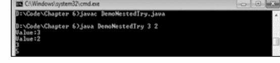

图 11：显示命令行参数的处理

图 11 显示了带有异常原因的 `ArithmeticException` 以及列表 9 中导致异常的行号。除了这些，还显示了额外信息，这有助于用户理解异常产生。在列表 9 中，我们使用 `Exception` 类来处理异常，这是不推荐的，尤其是当你对可能中断程序流的异常有一定了解时。例如，在列表 9 中，我们知道可能会抛出 `ArithmeticException`。在这种情况下，我们可以直接使用 `ArithmeticException` 而不是 `Exception` 类。此示例说明了 `try` 和 `catch` 块在处理中的用处。

### 6.4.2.3 使用 finally 块

`finally` 块用于无论是否捕获异常都会执行的代码。`finally` 块在没有捕获异常的情况下也会执行。使用 `finally` 块的规则如下：

- 在 `try` 块中执行了 `return` 语句。

- 在 `catch` 块中执行了 `return` 语句。

- 在 `finally` 块中执行了异常。

使用 `finally` 块的规则如下：

列表 11 显示了使用 `finally` 块：

# 列表 11：DemoFinally


```java
public class DemoFinally {
    public static void main(String args[]) {
        int input, result;
        try {
            input = Integer.parseInt(args[0]);
            result = input / 0;
            System.out.println("Result: " + result);
        } catch (ArithmeticException a) {
            System.out.println("Exception: " + a);
        } catch (Exception e) {
            System.out.println("Exception: " + e);
        } finally {
            System.out.println("Finally block is executed");
        }
    }
}
```

图 12 显示了 `DemoFinally` 类的输出：


图 12：显示 finally 块的处理

图 12 显示了 `finally` 块无论 `catch` 块是否执行都会执行。然而，在以下情况下 `finally` 块语句不会执行：

- 当调用了 `System.exit()` 方法。
- 当 `finally` 块中使用了 `return` 语句。
- 当 `finally` 块中的代码发生了异常。

## 6.4.2.4 使用 throws 子句

`throws` 子句用于明确定义方法可能会产生异常，但该方法无法处理异常的情况。在这种情况下，用户必须使用 `throws` 子句将这些异常传递给调用者。`throws` 子句用于方法声明。其语法如下：

```java
return_type method_name (para) throws exception1, exception2, exception_n {
    // body
}
```

在此片段中，`return_type` 是根据方法返回值的任何逻辑类型。`method_name` 是任何逻辑名称。`para` 是传递给方法的参数列表。另一方面，`throws` 子句用于抛出异常。这里 `exception1`、`exception2` 和 `exception_n` 是你想要抛出的异常。可以抛出多个异常。如果你想抛出多个异常，请用逗号分隔。

编译器不检查使用 `throws` 子句抛出的异常类型。在使用 `throws` 子句时必须注意的规则如下：

- 子类重写了父类的方法，这意味着重写的方法也重写了被重写方法抛出的异常。
- 重写方法抛出的异常必须与被重写方法抛出的异常相同，或者是被重写方法抛出的异常的子类。

列表 12 显示了抛出异常的重写和被重写方法的实现：

```java
import java.io.*;
```

## 使用包与异常

```java
class ABC {
    public void disp() throws IOException {
        System.out.println("It is a super class");
    }
}
class XYZ extends ABC {
    public void disp() throws IOException {
        System.out.println("It is a super class");
    }
}
class DemoThrows extends ABC {
    public void disp() throws EOFException, FileNotFoundException {
        System.out.println("It is a class named DemoThrows");
    }
    public static void main (String args[]) throws IOException {
        DemoThrows obj = new DemoThrows();
        obj.disp();
    }
}
```

在列表 12 中，类 `ABC` 是被创建的 `disp()` 方法的子类。该方法抛出 `IOException` 异常（检查异常）。类 `XYZ` 继承自 `ABC`，它也继承了 `disp()` 方法并抛出 `IOException` 异常，这是合法的。另一个名为 `DemoThrows` 的类继承了 `ABC`，但它的方法抛出了 `EOFException` 和 `FileNotFoundException` 异常。这仍然是合法的，因为这些是 `Exception` 超类的子类，而不是指定特定的 `Exception` 子类，但并不推荐这样做，因为编译器可能不会提供程序中抛出异常的详细信息。图 13 显示了 `DemoThrows` 类：


▲ 图 13：DemoThrows 类的输出

列表 13 显示列表 12 成功编译并执行，这简单意味着列表 12 中的代码是正确的。让我们来看来自列表 12 的以下代码片段，以解释重写异常的概念：

```java
class XYZ extends ABC {
    public void disp() throws IllegalAccessException {
        System.out.println("It is a super class");
    }
}
```

在前面的代码片段中，`disp()` 方法抛出 `IllegalAccessException` 异常，而在列表 12 的类 `XYZ` 中，它抛出 `IOException` 异常。如果你将前面的代码片段替换为列表 12 中给出的类 `XYZ` 并编译更改后的代码（列表 12），将会产生一个编译错误。这是因为 `IllegalAccessException` 类不是 `IOException` 类的子类。

在 Java 程序中你需要导入 `java.io.*` 来使用 `IOException` 类。

## 6.4.2.5 使用 throw 子句

到目前为止，我们已经学习了如何隐式地抛出异常。然而，异常也可以显式地抛出。要抛出一个异常，需要创建一个异常类型的对象。要创建任何异常类型的对象，可以使用 `throw` 子句。列表 13 显示了如何创建异常对象并抛出异常：

- 列表 13：DemoThrow.java

```java
import java.io.*;
class DemoThrow {
    public static void chk_throw() {
        // 创建 IOException 对象
        throw new IOException("Explicit IOException");
    }
    public static void main(String[] args) {
        try {
            chk_throw();
        } catch (IOException ne) {
            System.out.println("Exception is " + ne);
        }
    }
} // 注意：原始 OCR 在没有 try 块的 catch 块上有语法错误；已根据上下文逻辑流进行了修正。
```

列表 13 显示了 `IOException` 异常对象的创建。当调用 `chk_throw()` 方法时，如果没有创建 `DemoThrow` 类的对象，该方法就会抛出异常。当 Java 运行时遇到这种情况时，它会抛出异常并中断程序流。Java 运行时会寻找所需的处理器，如果没有找到，则由 Java 的默认异常处理器处理该异常。另一方面，如果找到了异常处理器，则执行在 `DemoThrow` 类中编写的代码。列表 14 显示了 `DemoThrow` 类的输出：


- 图 14：显示 IOException 异常的显式抛出

图 14 显示 `IOException` 被抛出，是因为我们尝试在没有创建 `DemoThrow` 类对象的情况下调用 `chk_throw()` 方法。换句话说，尝试使用空引用调用方法会抛出 `IOException` 异常。

### 6.4.3 处理多个异常

到目前为止，你已经学习了仅使用一个 `catch` 块来处理异常，并使用异常的超类 `Exception` 来执行异常处理。然而，有许多异常类及其子类，记住所有类并不是容易的。你可能会忘记在 `catch` 块中包含某些异常，这可能导致程序中断或终止。例如，`RuntimeException` 有多个子类，但你可能只熟悉 `ArithmeticException` 和 `NullPointerException` 子类。假设一个程序运行许多异常，但你只使用了 `ArithmeticException` 和 `NullPointerException` 子类来处理抛出的异常。现在问题是——如果抛出任何其他异常会怎样？在这种情况下，你的程序会被中断。为了避免中断，请在最后一个 `catch` 块中使用 `Exception` 类，这样就可以处理所有剩余异常。`Exception` 类必须在最后一个 `catch` 块中使用；否则将在编译期间发生错误，因为不能在子类之前使用超类。

一个 `try` 块可以使用多个 `catch` 块来使用多个异常处理器。如果抛出了异常，Java 运行时系统会首先查找指定异常类的异常处理器。如果未找到，则继续查找超类。图 15 显示了该流结构：

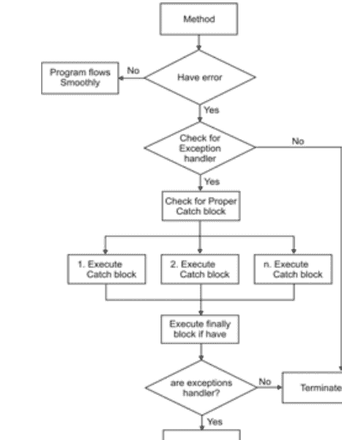

▲ 图 15：处理多个异常的流结构

图 15 显示，当多个 `catch` 块抛出异常时，Java 运行时系统首先查找指定异常类的异常处理器。如果未找到，则继续查找超类。列表 14 显示了实现方式：

- 列表 14：DemoCatch.java

```java
class DemoCatch {
    public static void main(String[] args) {
        try {
            int[] arr = new int[5];
            int result = 10 / 0;
            System.out.println(arr[10]);
        } catch (ArithmeticException e) {
            System.out.println("Arithmetic error: " + e);
        } catch (ArrayIndexOutOfBoundsException e) {
            System.out.println("Index error: " + e);
        } catch (Exception e) {
            System.out.println("General error: " + e);
        }
    }
}
```

列表 14 显示了多个 `catch` 块如何处理不同类型的异常。当异常被捕获时，将执行第一个匹配的块并跳过其余部分。图 16 显示了 `DemoCatch` 类的输出：

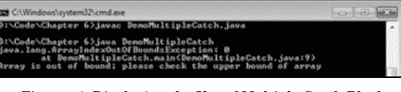

# 表 4：Java 内置异常

| 异常 | 说明 |
| --- | --- |
| IOException | 当输入输出操作失败或被中断时抛出。 |
| InterruptedException | 当线程在处理中、等待或睡眠期间被中断时抛出。 |
| IllegalAccessException | 当拒绝访问某个类时抛出。 |
| NoSuchFieldException | 当你尝试访问类中不存在的字段或变量时抛出。 |
| NoSuchMethodException | 当你尝试访问不存在的方法时抛出。 |
| NullPointerException | 当引用空对象的成员时抛出。 |
| NumberFormatException | 当方法无法将字符串转换为数值格式时抛出。 |
| StringIndexOutOfBoundsException | 当你尝试使用非法索引访问字符串数组时抛出。 |

这些是一些常见的内置异常。你可以在异常处理期间使用这些异常，使你的程序更具健壮性。现在我们来讨论自定义异常。

## 6.4.4.2 自定义异常

除了内置异常之外，你还可以创建自己的异常类型，以你自己的方式描述与应用程序相关的异常。为此，你必须创建一个作为 `Exception` 类的子类的异常。为了实现这一点，你必须继承 `Exception` 类。列表 15 显示了如何创建自己的异常类型：

+ 列表 15：EvenNumException.java 文件

```java
class EvenNumException extends Exception {
    EvenNumException(String str) // 类的构造函数
    {
        super(str); // 使用 super 引用父类构造函数
    }
    public static void main(String[] args) {
        try {
            int arr[]={2,4,6,9};
            int var;
            int i;
            for(i=0;i<arr.length; i++)
                var = arr[i]%2;
            if(var==0) {
                System.out.println(arr[i]+ " is an even number");
            } else {
                EvenNumException exp= new EvenNumException(arr[i]+ " is not an even number");
                throw exp;
            }
        } catch (EvenNumException exp) {
            System.out.println("Exception is " + exp);
        }
    }
}
```


# 包与异常的处理

## 代码示例分析

在列表 15 中，`EvenNumException` 类继承了 `Exception` 父类。我们在 `EvenNumException` 类中创建了一个构造函数，其中使用了 `super` 关键字。在列表 15 中，我们首先在 `main` 方法中声明并初始化了一个数组。接下来，我们检查数组元素是否为偶数。使用 `if` 语句，我们检查每个数组元素是否为偶数，以防除以 2 的返回值为 0。我们创建了 `EvenNumException` 构造函数的对象。接下来，我们使用 `throw` 子句，当数组元素除以 2 返回非零整数时使用该子句。在 `catch` 块中，我们处理 `EvenNumException` 异常。图 17 显示了 `EvenNumException` 类的输出：

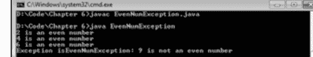

图 17 显示了偶数数组元素。列表 15 中声明的数组的元素被检查是否为偶数。当数组元素除以 2 并返回非零整数时，会抛出自定义异常 `EvenNumException`。由于 9 除以 2 返回了非零值，因此程序抛出了 `EvenNumException`。

## 总结

本章讨论了 Java 中的各种包。此外，讨论了在 Java 中创建和导入包。接下来，解释了 Java 中的访问控制。本章最后还讨论了异常以及用于处理异常的语句。

## 关键术语

- **内置包 (Built-in packages)**：指 Java 中已经存在的包。
- **编译时错误 (Compile time errors)**：指由于程序中的语法问题导致的错误。
- **异常 (Exceptions)**：指在运行时发生的某些异常情况或错误，可能会导致程序意外终止。
- **包 (Package)**：指一个目录或文件夹，允许你在应用程序中存储彼此相互相关的各种类。
- **运行时错误 (Run-time errors)**：指由于某些条件（如失败或未找到错误）引起的错误。
- **自定义包 (User-defined packages)**：由用户定义的包。

## 复习题

### 判断对错

**Q1. 包声明应该是 Java 源文件的第一条语句。**
答：正确

**Q2. 一个 Java 源文件只能导入一个包。**
答：错误

**Q3. Throwable 类是 Object 类的直接子类。**
答：正确

**Q4. 所有异常大体分为两类：受检异常和未检异常。**
答：正确

**Q5. try 块可以在没有 catch 块或 finally 块的情况下使用。**
答：错误

**Q6. 在 Java 程序中，你只能使用一个 try 和 catch 块。**
答：错误

**Q7. finally 块用于显示信息或执行语句，这些语句无论 catch 块如何执行都需要执行。**
答：正确

**Q8. Java 提供了 java.io 包来处理异常。**
答：错误

### 单选题

**Q1. FileNotFound 类定义在以下哪一个中？**
a. java.lang
b. java.io
c. java.util
d. applet
答：b

**Q2. 以下哪一个必须在 catch 块末尾声明？**
a. finally 块
b. try 块
c. catch 块
d. try 块
答：a

**Q3. 当发生数学计算时，产生以下哪个异常？**
a. FileNotFoundException
b. ArrayOutOfBoundsException
c. ArithmeticException
d. IOException
答：c

**Q4. 尝试创建负数数组时会发生以下什么？**
a. ClassCastException
b. NullPointerException
c. IllegalStateException
d. NegativeArrayException
答：d

**Q5. 以下哪个类是 Object 类的直接子类？**
a. Throwable
b. Exception
c. Error
d. FileNotFoundException
答：a

**Q6. 以下哪个类用于扩展未检异常？**
a. BufferedReader
b. BufferedWriter
c. RuntimeException
d. System
答：c

**Q7. 引用空对象的成员时抛出以下哪些异常？**
a. NoSuchFieldException
b. IOException
c. InterruptedException
d. NullPointerException
答：d

**Q8. 以下哪个是 Throwable 类的父类？**
a. Object
b. String
c. Exception
d. Error
答：a

**Q9. Java 程序中自动导入以下哪个包？**
a. java.awt
b. java.net
c. java.lang
d. applet
答：c

**Q10. 以下哪个包包含 Calendar 类？**
a. java.awt
b. java.net
c. java.lang
d. java.util
答：d

## 简述题

**Q1. 解释 Java 中的异常处理。编写一个应用程序，如果命令行参数中的任何值为负数，则生成自定义异常。**

异常是在运行时发生的某些异常情况或错误，可能会导致程序意外终止。在 Java 中，我们有各种技术，如 try 和 catch 块来处理异常。这些技术使用了各种子句，如 try-catch 块、finally 子句、throws 子句和 throw 子句。你可以使用这些技术创建能够妥善处理异常的程序。这有助于设计应用程序。异常可以通过以下方式处理：

- 使用 try 和 catch 块
- 使用嵌套 try 和 catch 块
- 使用 finally 子句
- 使用 throws 子句
- 使用 throw 子句

当命令行参数中的任何值为负数时生成自定义异常的程序如下：

```java
class ExceptionCustom extends Exception {
}

class ExcPrg {
    public static void main(String[] args) {
        int sz;
        for (sz = 3; sz > -3; sz--) {
            try {
                System.out.println("size=" + sz);
                if (sz == 0) {
                    throw new ExceptionCustom();
                }
                int myArray[] = new int[sz];
                System.out.println(myArray.length);
            } catch (NegativeArraySizeException e) {
                System.out.println("Negative array " + e.toString());
            } catch (ExceptionCustom e) {
                System.out.println("CustomException is " + e.toString());
            }
        }
    }
}
```

**Q2. 解释程序中可能发生的两种错误。**

答：Java 中有两种类型的错误：编译时错误和运行时错误。编译时错误是由程序中的语法问题引起的，而运行时错误是由于某些条件（例如内存失败或内部错误）引起的。

**Q3. 异常层次结构的根类是什么？**

答：Java 支持的所有可能的异常都组织在 `Throwable` 类层次结构下的子类中。因此，`Throwable` 类是异常层次结构的根类。`Throwable` 类是 `Object` 类的直接子类，而 `Object` 类位于异常层次结构的根部。

**Q4. 列出 Exception 类所有重要的子类。**

答：以下是 `Exception` 类的子类：

- `RuntimeException`：当程序中执行的算术操作错误时抛出。它包含常见的异常，如 `ArithmeticException`、`IndexOutOfBoundsException`。
- `ClassNotFoundException`：当找不到需要加载的类时抛出。
- `CloneNotSupportedException`：当方法没有实现 `Cloneable` 接口但使用了 `clone()` 方法时抛出。
- `IllegalAccessException`：当在另一个方法/类中调用某个方法，但调用的方法/类没有访问该方法的权限时抛出。
- `InstantiationException`：当尝试实例化一个抽象类或接口时抛出。

**Q5. 解释 finally 块。**

答：`finally` 块用于显示信息或执行语句，这些语句无论 catch 块是否执行都需要执行。这意味着无论是否执行 `catch` 块，`finally` 块都必须执行。使用 `finally` 块的一些规则如下：

- `finally` 块必须声明在最后一个 `catch` 块的末尾。如果在 `catch` 块之前声明 `finally` 块，则程序将无法成功编译。
- 一个 `try` 块不能使用多个 `finally` 块。这样做会产生编译错误，说明在没有 `try` 块的情况下在使用 `finally` 块，即使程序中已经有了 `try` 块。

**Q6. 什么是包？列出 Java API 中的包。**

答：包可以被看作是一个目录或文件夹，它允许你在应用程序中存储彼此相互相关的各种类。包解决了类名冲突的问题。Java API 中可用的包有：

- `java.lang`
- `java.io`
- `java.util`
- `java.net`
- `java.awt`
- `java.applet`

**Q7. 写一个程序创建 com.dreamtech 包。**

答：

```java
package com.dreamtech;

public class Program {
    public static void main(String args[]) {
        System.out.println("Package com.dreamtech created");
    }
}
```

输出：

```
Package com.dreamtech created
```

**Q8. 写一个程序展示 import 语句的使用。**

答：

```java
import java.util.Date;

public class Program {
    public static void main(String args[]) {
        Date dt = new Date();
        System.out.println("Today is " + dt);
    }
}
```

输出：

```
Today is Fri May 29 15:19:20 2015
```

# 第 7 章 线程的工作

## 目标

- 介绍线程
- 定义线程
- 实例化线程
- 启动线程
- 讨论状态
- 讨论交互

本章讨论了线程、它们的生命周期、如何创建线程、线程同步、优先级和死锁。我们从线程的概述开始。

## 7.1 线程概述

线程用于在 Java 中实现并发。并发是多个任务的同时执行。这些任务可以作为独立的进程实现，也可以在单个程序内实现。例如，一个在打印文档的同时计算字数的文字处理器。文字处理器是一个同时执行两个任务的单个程序。

线程是轻量级进程，因为创建一个新线程所需的资源比创建一个新进程要少。例如，新线程与其他线程共享地址空间，而每个单独进程都有自己独立的地址空间。

线程的并行执行是通过时间片辅助实现的。时间片是每个线程用于处理的时间。每个线程根据分配给它的时间执行，看起来这些线程是在同时运行的。

多线程的目标是利用 CPU 的空闲时间。例如，在您从键盘输入字符或移动鼠标之前，CPU 一直处于空闲状态。

线程的一些重要用途如下：

- 线程用于服务器端程序，以满足网络或互联网上多个客户端的需求。在互联网上，服务器必须同时满足数千个客户端的需求。线程用于同时处理多个客户端。
- 线程用于创建游戏和动画。例如，你可以使用线程显示动态图片。在这种情况下，你必须设置线程在特定时间内睡眠并在特定时间内激活，并持续这种循环。

## 7.2 定义线程

每个应用程序都有一个执行控制，它用于执行程序的一组指令。这些指令按照预定义方式或执行路径执行。这条执行路径被称为执行线程。

在 Java 语言中，一个程序可以拥有多个线程，每个线程都有其自己的执行路径。程序中的所有线程共享程序相同的地址空间、数据和代码；因此，线程被视为轻量级进程。Java 中的线程是对象，具有对象的所有特征，例如成员数据和方法。你可以通过以下方式创建线程：

- 继承 `Thread` 类
- 实现 `Runnable` 接口

你通过继承 `Thread` 类并实例化该类来创建线程。另一方面，如果你通过实现 `Runnable` 接口来创建线程，则需要在 `Thread` 构造函数中传递 `Runnable` 类型。无论你在 Java 程序中是否创建了任何线程，主线程总是会被创建。让我们在下一节中讨论主线程。

### 7.2.1 主线程

在程序执行期间，Java 虚拟机 (JVM) 会自动创建一个用户线程来执行 `main()` 方法，该线程被称为主线程。如果程序中没有创建其他线程，主线程将在 `main()` 方法执行完毕后终止。除了主线程外，Java 程序还可以拥有子线程。通过主线程创建的线程被称为子线程。除了主线程外，程序中创建的所有线程都继承主线程的用户状态。在这种情况下，如果 `main()` 方法终止，程序将继续运行，直到用户线程执行完毕。

现在让我们讨论如何创建和使用线程。在 Java 中，可以通过以下方式创建线程：

- 继承 `java.lang.Thread` 类
- 实现 `java.lang.Runnable` 接口

让我们详细讨论这些方式。

### 7.2.2 继承 Thread 类

可以通过继承 `Thread` 类在 Java 程序中创建线程。这是程序中创建线程最简单的形式。以这种方式创建线程时，需要注意的重要因素包括：

- 继承 `Thread` 类的类重写 `run()` 方法，在该方法中定义线程执行的代码
- `Thread` 类的构造函数可以在该类的构造函数中显式调用，通过使用 `super` 关键字扩展它来初始化线程
- 继承 `Thread` 类的类调用从 `Thread` 类继承的 `start()` 方法，使线程具备运行条件

考虑下面的代码片段，它展示了通过继承 `Thread` 类来创建一个简单的线程类：

```java
class SampleThread extends Thread {
    public void run() {
        System.out.println("The code to perform specific function by thread");
    }
}
```

在前面的片段中，`SampleThread` 类是通过继承 `Thread` 类创建的。`SampleThread` 类重写了 `Thread` 类的 `run()` 方法，以提供线程执行的代码。你也可以在程序中重载 `run()` 方法，如下代码片段所示：

```java
class SampleThread extends Thread {
    public void run() {
        System.out.println("The code to perform specific function by thread");
    }

    public static void main(String ar[]) {
        public void run(String str) {
            System.out.println("This the run method overloaded inside main");
        }
    }
}
```

在前面的片段中，`run()` 方法被 `run(String str)` 方法重载。该方法需要显式调用，因为 `Thread` 类期望不带参数的 `run()` 方法。当线程启动时，线程会在独立的栈中执行不带参数的 `run()` 方法。由于调用了重载的 `run()` 方法，将创建一个新的执行线程。相反，`run()` 方法的重载版本表现就像类的普通方法一样。

在 Java 中，你不能继承多个类。因此，在通过继承类创建线程时，你不能同时继承任何其他类。例如，在使用 Swing API 创建图形用户界面 (GUI) 应用程序时，你需要继承 `JFrame` 类，因此你不能在同一个应用程序中继承 `Thread` 类来创建线程。然而，在这种情况下，你可以使用另一种创建线程的方法，即实现 `Runnable` 接口。

### 7.2.3 实现 Runnable 接口

可以通过实现 `java.lang` 包中的 `Runnable` 接口创建线程。该包允许你定义一个可以实现 `Runnable` 接口并在需要时扩展任何其他类的类。通过实现 `Runnable` 接口创建线程与通过继承 `Thread` 类创建线程非常相似。代码片段展示了如何通过实现 `Runnable` 接口创建线程：

```java
class SampleThread implements Runnable {
    public void run() {
        System.out.println("the code to perform specific function by thread");
    }
}
```


在前面的代码片段中，`SampleThread` 类通过实现 `Runnable` 接口并重写 `run()` 方法来声明，在该方法中定义了线程执行的代码。在讨论了线程以及创建它们的各种方式后，让我们学习如何实例化线程，以便其在程序中使用。

## 7.3 实例化线程

线程是一个作为 `Thread` 类实例执行的对象，因此，为了让线程发挥作用，无论如何创建，都必须对其进行实例化。了解 `Thread` 类的不同构造函数很重要。用于实例化线程的 `Thread` 类构造函数有：

- `Thread()`（默认构造函数）
- `Thread(Runnable trgt)`
- `Thread(Runnable trgt, String threadname)`
- `Thread(String threadname)`

实例化线程的构造函数取决于它的创建方式。当通过继承 `Thread` 类创建线程时，你可以使用下面的代码片段进行实例化：

```java
SampleThread thread = new SampleThread();
```

在前面的片段中，`SampleThread` 类。然而，如果通过实现 `Runnable` 接口创建线程，则按以下步骤执行实例化：

1. 创建实现 `Runnable` 接口类的对象
2. 然后获取 `Thread` 类的实例并传递第一步创建的对象

下面的代码片段展示了上述步骤的实现：

```java
class SampleThread implements Runnable {

    public void run() {

        System.out.println("The code to perform specific function by thread");

    }

}

public class MyClass {

    public static void main(String ar[]) {

        SampleThread thrd = new SampleThread();

        Thread T = new Thread(thrd);

    }

}
```

在前面的代码片段中，创建了第三方对象，并在创建 `Thread` 类实例 `T` 后，将该对象作为参数传递。在代码片段中，注意当创建线程时，实现 `Runnable` 接口的实例作为参数传递。这是因为只有当你通过继承 `Thread` 类创建类时，`run()` 方法才会被隐式调用。然而，在前面的片段中，你需要显式调用 Runnable 接口。

你刚刚学习了如何定义和实例化线程。然而，如果不调用 `start()` 方法，它是无法运行的且不会产生任何作用。让我们学习如何启动线程。

## 7.4 启动线程

当线程被实例化时，它处于新状态。实例化后，你需要调用 `start()` 方法使其产生功能。下面的代码片段展示了如何通过线程对象调用 `start()` 方法：

```java
thrd.start(); // 线程 thrd 已启动
```

在这里，通过线程对象调用了 `start()` 方法。当调用线程对象的 `start()` 方法时，会发生以下事件：

- 一个新的执行线程带着新的栈启动
- 线程的状态从新状态变为就绪状态
- 当线程轮到时，执行 `run()` 方法

记住，`start()` 方法总是由 `Thread` 类的实例调用的，而不是由实现 `Runnable` 接口的类的对象调用的。

# 列表 1：定义、实例化和启动线程

```java
class SampleThread implements Runnable {

    public void run() {

        for (int i = 0; i < 5; i++) {

            System.out.println("Hello world");

        }

    }

}

public class MyThread {

    public static void main(String ar[]) {

        SampleThread thrd = new SampleThread();

        Thread newThread = new Thread(thrd);

        newThread.start();

    }

}
```

在列表 1 中，通过实现 `Runnable` 接口创建了 `SampleThread` 类。在 `main()` 方法中，创建了该类的实例，并在创建 `Thread` 类实例时将其作为参数传递。随后，由新创建的 `Thread` 实例 `newThread` 调用 `start()` 方法。列表 1 的输出显示了五次 Hello World，如图 1 所示：

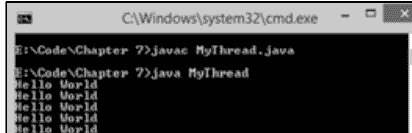

> 图 1：MyThread 程序的输出

如图 1 所示，当对 `Thread` 对象调用 `start()` 方法时，它的状态会从 `new` 变为 `runnable`，并调用 `run()` 方法。因此，`run()` 方法内部的所有语句都会执行。

## 7.4.1 启动和运行多个线程

在前面的节中，创建了一个与主线程并行的单个子线程。你也可以在程序中创建多个线程。当你创建多个线程时，理解程序的行为非常重要。多线程程序具有以下特征：

- 线程的执行并不一定按照它们调用 `start()` 方法的顺序进行
- 如果一个线程被启动，并不能保证它会持续执行直到完成任务
- 单个 `runnable` 实例可以用于创建多个线程

当多次执行一个多线程程序时，并不要求所有结果都完全匹配。这是因为线程的执行顺序是不固定的。列表 2 展示了在程序中创建和执行多个线程的示例。

### 列表 2：创建多个线程

```java
class Test implements Runnable {

    public void run() {

        System.out.println("The Current thread" + Thread.currentThread().getName());

    }

}

public class MultipleThreadDemo {

    public static void main(String[] args) {

        Test t = new Test();

        Thread t1 = new Thread();

        Thread t2 = new Thread();

        Thread t3 = new Thread();

        t1.start();

        t2.start();

        t3.start();

    }

}
```

在列表 2 中，创建了 `t1`、`t2` 和 `t3`。在 `run()` 方法中获取线程的默认名称并由打印语句显示。在编译并执行列表 2 后，输出如图 2 所示：

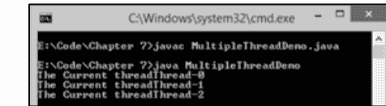

▲ 图 2：MultipleThreadDemo 程序的输出

图 2 显示了执行多个线程的结果。当执行多个线程时，并不得到相同的输出，因为它们的执行顺序是不保证的。当你多次执行 `MultipleThreadDemo` 程序时，每次可能会得到不同的输出。图 3 显示了 `MultipleThreadDemo` 程序的另一个输出：

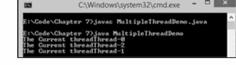

▲ 图 3：MultipleThreadDemo 程序的不同输出

与图 2 显示的输出相比，尽管执行的是同一个程序，图 3 显示的输出是不同的。

程序中创建的所有线程都有其关联的状态，并根据调用的方法改变状态。让我们在接下来的节中讨论状态以及线程如何在状态之间切换。

## 7.5 线程与转换

线程由线程调度器调度，调度器是 JVM 的一部分。线程存储在就绪池中，由调度器随机选择符合条件的线程。就绪池是处于 `runnable` 状态的线程集合。被调度器选中的线程开始执行，一旦 `run()` 方法执行完毕就会死亡。除了新建、运行死亡状态外，线程还有一些中间状态。

### 7.5.1 线程状态

当创建 `Thread` 类的实例时，你需要调用不同的方法使线程功能化。换句话说，当你创建一个线程时，它只是一个 `Thread` 类实例，而不是一个独立执行的线程。为了让线程具备执行条件，需要调用 `Thread` 对象的 `start()` 方法。调用 `start()` 方法后，线程进入 `runnable` 状态。

在处理程序中的线程时，你需要识别线程的状态。让我们在后面的节中讨论如何识别线程状态。

#### 7.5.1.1 识别线程状态

程序中的线程是执行路径，可以处于以下任何状态：

- **New（新建）**：当线程实例化但尚未对其调用 `start()` 方法时，处于 `new` 状态。
- **Runnable（就绪）**：当已调用 `start()` 方法并正在等待调度器时，处于 `runnable` 状态。
- **Running（运行）**：当线程被调度器选中时，进入 `running` 状态并执行任务。
- **Waiting/Blocking/Sleeping（等待/阻塞/睡眠）**：这些状态表示线程存活但不具备执行条件。
- **Dead（死亡）**：当 `run()` 方法执行完毕后，线程处于 `dead` 状态。

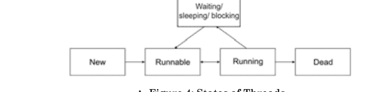

可运行线程池中优先级较高的线程将被执行。因此，执行的线程始终是可运行线程池中可用线程中优先级最高的线程。在具有相同优先级的线程加入运行线程池的情况下，它们的执行取决于以下两个方面：

- 调度器随机选择一个线程进行运行，并允许其完成执行。
- 执行时间被划分，每个线程都以轮询的方式获得相等的时间来执行。

如果我们没有为线程分配任何优先级，则会为其分配一个默认优先级。可以通过调用 `Thread` 类的 `getPriority()` 方法获取此优先级。列表 3 显示了如何调用 `getPriority()` 方法。

# 列表 3：获取线程的默认优先级

```java
class Test implements Runnable {

    public void run() {

        System.out.println("Priority of Current thread=" + Thread.currentThread().getPriority());

    }

}

public class GetPriorityDemo {

    public static void main(String ar[]) {

        Test t = new Test();

        Thread t1 = new Thread(t);

        t1.start();

    }

}
```

在列表 3 中，创建了 `t1`，并将可运行类 `Test` 的 `t` 对象作为参数传递。在 `run()` 方法内部，通过调用 `getPriority()` 方法获取线程优先级。`run()` 方法内部的优先级语句显示了 `t1` 线程的优先级，如图 5 所示：

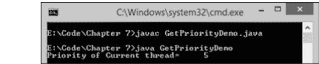

> 图 5：GetPriorityDemo 程序的输出

列表 3 的输出显示默认优先级 5，如图 5 所示。程序中创建的所有线程都有默认优先级。在默认优先级的基础上，你还可以通过在 `Thread` 对象上调用 `setPriority()` 方法为程序中的线程分配优先级，如下代码所示。

```java
Test t = new Test();

Thread t1 = new Thread(t);

t1.setPriority(4);

t1.start();
```

在前面的代码段中，当创建 `Thread` 对象 `t1` 时，创建了 `Test` 可运行类的 `t` 对象并作为参数传递。通过调用 `setPriority()` 方法将 `t1` 线程的优先级设置为 4。

可以分配给线程的优先级范围因 JVM 而异。少数 JVM 可能只支持 1 到 5 之间的数字。在这种情况下，如果你创建了 10 个线程，那么其中几个线程将具有相同的优先级。`Thread` 类具有以下定义线程优先级范围的静态 `final` 变量（常量）：

- `MIN_PRIORITY`：调用为 `Thread.MIN_PRIORITY(1)`
- `NORM_PRIORITY`：调用为 `Thread.NORM_PRIORITY(5)`
- `MAX_PRIORITY`：调用为 `Thread.MAX_PRIORITY(10)`

线程调度器在线程的生命周期中起着重要作用。它根据线程的优先级，从可运行线程池中选择线程进行执行。优先级最高的线程首先执行。让我们详细讨论线程调度器。

## 7.5.3 线程调度器

决定线程执行顺序的 JVM 组件被称为线程调度器。单处理器系统在执行程序时，即使程序可能包含多个线程，在特定点上也只执行单个线程。这意味着如果有多个活动线程，资源将只分配给正在执行的线程。线程调度器根据线程的优先级和线程 `run()` 方法内部的代码，从可运行池中选择线程执行，并将执行中的线程返回池中。

在 Java 程序中，你不需要编写式代码来控制线程调度器，因为它是 JVM 的一部分。在大多数情况下，线程调度器将你的程序线程映射到机器操作系统的线程。你无法控制线程执行的顺序；相反，你可以调用 `Thread` 类的方法来影响线程调度器。现在，让我们讨论可以影响线程调度器活动的方法。

### 7.5.4 运行与让出

有时，运行池会接收一个比当前运行线程优先级更高的线程。在这种情况下，线程调度器会将当前运行的线程返回可运行状态，并启动优先级更高的线程。

要将运行中的线程返回可运行状态，会在当前 `Thread` 对象上调用 `Thread` 类的静态方法 `yield()`，如下代码所示：

```java
Thread.yield()
```

在前面的代码段中，在 `Thread` 对象上调用了 `yield()` 方法。在 `Thread` 对象上调用 `yield()` 方法会暂停当前线程的执行并允许另一个相同或更高优先级的线程开始执行。在 `Thread` 对象上调用 `yield()` 方法并不保证该线程不执行；相反，线程调度器可以选择被调用的线程进行执行。此外，在 `Thread` 对象上调用 `yield()` 方法不会将其移动到等待、睡眠或阻塞状态；而是将线程发送到可运行状态，该线程可以在可运行状态下恢复。

在某些情况下，你需要故意让线程睡眠，以便在特定的时间间隔内释放某些资源。现在我们来讨论如何故意让线程睡眠。

### 7.5.5 睡眠与唤醒

有时，你需要让线程睡眠一段时间。例如，考虑预订场景，其中状态必须频繁更新。然而，状态不需要持续更新。换句话说，状态只有在发生预订时才会发生变化。为了在特定时间间隔后执行，可以通过调用 `Thread` 类的静态方法 `sleep()` 让其睡眠。`sleep()` 方法由 `Thread` 对象调用，如下代码所示：

```java
try {

    Thread.sleep(500);

} catch (InterruptedException exception) {
```


在前面的代码段中，在 `Thread` 对象上调用了 `sleep()` 方法。它导致正在执行的线程睡眠 500 毫秒。在指定的时间间隔到期后，线程将唤醒并恢复执行。

当多个线程运行时，你需要让线程睡眠，以便其他线程获取共享资源。当执行的线程中断睡眠的线程时，`sleep()` 方法可能会抛出 `InterruptedException`（检查异常）。因此，如前面的代码所示，`sleep()` 方法始终写在程序任何位置的 `try/catch` 块内部。

# 列表 4：调用 sleep() 方法的线程

列表 4 显示了 `Thread` 对象调用 `sleep()` 方法的示例：

在列表 4 中，实例化并启动了 `t1` 线程，并在 `run()` 方法中调用了 `sleep()` 方法，导致正在执行的 `t1` 线程暂停 1 秒（1000 毫秒）。当你编译并执行列表 4 所示的代码时，你会注意到显示 1 到 5 的输出时有 1 秒的暂停，如图 6 所示：

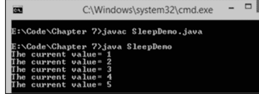

图 6：SleepDemo程序的输出

图 6 显示了列表 4 的输出并显示了 1 到 5 的数字，每个数字后面都有 1 秒的暂停。

当程序中实例化并使用多个线程时，调用 `sleep()` 方法的输出是不可预测的。由于当线程遇到 `sleep()` 方法时，它会进入睡眠并持续指定的时间间隔（毫秒），直到被另一个线程中断（在发生中断的情况下，它会抛出 `InterruptedException`）。在指定的时间间隔到期后，线程恢复到可运行状态，而不是运行状态。换句话说，`sleep()` 方法完成后，该线程就具备了执行条件。然而，当高优先级的线程需要执行时，该线程的执行可能会延迟。因此，无法保证线程在 `sleep()` 方法指定的时间间隔完成后会立即开始执行。你必须知道，静态的 `sleep()` 总是导致当前线程进入睡眠；它不会影响其他线程的状态。现在，让我们来讨论 `join()` 方法，该方法用于影响线程调度器以改变当前线程的状态。

## 7.5.6 合并 (Joining)

在 Java 程序中，主线程通常是最后一个终止的。然而，事实并非总是如此。你可以通过在 `main()` 方法内部调用 `sleep()` 方法，强制主线程等待直到子线程完成执行。现在，如果子线程 `sleep()` 方法的时间比主线程长，那么主线程会在子线程之前终止。`Thread` 类提供了 `join()` 方法，它可以使当前线程等待，直到该线程调用 `join()` 方法并完成执行。`join()` 方法是非静态的，总是由 `Thread` 类的实例调用的。列表 5 显示了一个不使用 `join()` 方法执行线程的示例。

### 列表 5：不使用 `join()` 方法执行线程

```java
class Test implements Runnable {

  public void run() {

    for(int i=1; i<=5;i++) {

      System.out.println("The current value= "+i);

    }

    System.out.println("Child Terminated");

  }

}

public class WithoutJoinDemo {

  public static void main(String[] args) {

    Test t=new Test();

    Thread t1=new Thread(t);

    t1.start();

    System.out.println("Main Terminated");

  }

}
```

在列表 5 中，`t1` 线程是通过可运行类 `Test` 的对象创建的，然后由 `t1` 对象调用 `start()` 方法，继而调用 `run()` 方法。请注意，在这种情况下，主线程在子线程 `t1` 终止之前终止了，如图 7 所示：

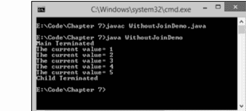

▲ 图 7：WithoutJoinDemo 程序的输出

图 7 显示主线程在子线程终止之前终止了。要让主线程等待子线程终止，你需要在子线程上调用 `join()` 方法。通过使用以下代码段可以调用 `join()` 方法：

```java
Test t=new Test();
Thread t1=new Thread(t);
try {
  t1.join();
} catch(InterruptedException e){
```

在前面的代码段中，在 `t1` 线程对象上调用了 `join()` 方法，这使得当前线程等待直到 `t1` 线程完成执行。`join()` 方法会产生 `InterruptedException`，因此必须在 `try/catch` 块中调用。列表 6 显示了 `join()` 方法的输出：

### 列表 6：调用 `join()` 方法让主线程等待子线程

```java
class Test implements Runnable {

  public void run() {

    for(int i=1; i<=5;i++) {

      System.out.println("The current value="+i);

    }

    System.out.println("Child Terminated");

  }

}

public class JoinDemo {

  public static void main(String args[]) {

    Test t=new Test();

    Thread t1=new Thread(t);

    t1.start();

    try {

      t1.join();

    }

}
```

在上述代码段中，在 `t1` 线程对象上调用了 `join()` 方法，这使得当前线程等待直到 `t1` 线程完成执行。`join()` 方法会产生 `InterruptedException`，因此必须在 `try/catch` 块中调用。

# 同步块 (Synchronized Blocks)

现在，让我们在后面的章节详细讨论这些内容。

## 7.6.2 同步方法

在 Java 程序中，与对象关联的方法可以被多个线程调用。修改对象状态的方法必须同步。在定义方法时，可以通过在方法名之前使用 `synchronized` 关键字对方法进行同步。方法同步后，线程需要获取对象锁才能调用该方法。如果对象锁不可用，调用线程将被阻塞，并必须等待直到锁可用。在线程完成同步方法的执行后，它会释放对象锁并允许其他等待它的线程继续执行。

在线程调用的方法会修改对象状态的情况下，同步方法至关重要。此类方法的并发执行会导致对象处于不一致或损坏的状态。让我们考虑一个示例实现，其中使用两个线程来从栈中插入和检索数据。然而，如果在同一个栈上执行插入和检索操作，可能会因为栈的状态不一致而产生问题。列表 7 显示了栈的一个实现示例，该实现由于未同步的方法调用导致了运行时异常：

### 列表 7：两个调用未同步方法的线程

```java
class DemoStack {

    private Object[] stck;

    private int top;

    public DemoStack(int capacity) {

        stck = new Object[capacity];

        top = -1;

    }

    public boolean push(Object obj)//unsynchronized push method {

        if (stck.length-1)

            return false;

        top++;

        try {

            Thread.sleep(500);

        } catch (Exception E) { }

        stck[top] = obj;

        return true;

    }

    public Object pop() //unsynchronized pop method {

        if (top<0)

            return null;

        Object obj = stck[top];

        stck[top] = null;

        try {

            Thread.sleep(500);

        } catch (Exception E) { }

        top--;

        return obj;

    }

}

public class unsychronizedDemo {

    public static void main(String[] args[]) {

        final DemoStack stack = new DemoStack(10);

        new Thread((){\ //First Thread calling push method

            public void run() {

                for(;;) {

                    System.out.println("Object pushed: " + stack.push(new Integer(225)));

                }

            }

        }}).start();

        new Thread((){\ //Second Thread calling pop method

            public void run() {

                for(;;) {

                    System.out.println("Object popped: " + stack.pop());

                }

            }

        }}).start();

        System.out.println("Exit from main().");

    }

}
```

在列表 7 中，实例化了两个线程，它们调用了 `DemoStack` 对象的 `push()` 和 `pop()` 方法。由于这些是未同步的方法，当线程异步调用这两个方法时，导致了运行时异常。图 10 显示了列表 7 的输出：


当执行列表 7 时会产生 `ArrayIndexOutOfBoundsException` 运行时异常。该异常的发生是因为调用了未同步的 `push()` 和 `pop()` 方法，这些方法修改了栈顶。

可以通过同步 `push()` 和 `pop()` 方法的调用来避免这种运行时异常，如下代码所示：

```java
public synchronized boolean push(Object obj) //synchronized push method
{
    if (top>=stck.length-1)
        return false;
    top++;
    try {
        Thread.sleep(500);
    } catch (Exception E) { }
    stck[top] = obj;
    return true;
}
```

在前面的代码段中，通过添加 `synchronized` 关键字对 `push()` 方法进行了同步。同样，`pop()` 方法也可以被同步。现在，在获取栈锁后，同一时间只有一个线程可以调用这些方法。因此，对象状态不会发生不一致，代码也不会产生任何运行时异常。

除了同步方法外，类还可以拥有未同步的方法，在其中可以操作不需要保护的数据。在使用同步和未同步方法时需要记住以下事实：

- 使用同步方法时可能会发生死锁。除了同步方法外，多个线程也可以调用未同步方法。
- 如果线程持有对象锁并进入睡眠状态，它不会释放对象锁。
- 如果一个线程正在执行同步方法并需要调用另一个同步方法，那么它可以获取对象锁来调用该方法。在执行完成后，它会释放锁。
- 如果线程获取了特定对象的对象锁，则该线程可以调用与对象相关的任何同步方法，而无需为对象获取新锁。

在 Java 编程语言中，静态方法也可以同步。在同步静态方法时，线程需要获取类锁而不是对象锁。这是因为静态方法属于类而不是类的实例。静态方法可以像下面的代码段所示进行同步：

```java
public static synchronized void display() {
    System.out.println("This is synchronized");
}
```

接下来，我们讨论线程相互交互的机制。

## 7.7 线程交互

程序中的多个线程能够相互交互，例如状态。例如 `Object` 类提供的 `wait()` 和 `notify()` 方法：

```
wait()
notify()
notifyAll()
```

这些方法必须在同步上下文中调用。如果调用 `wait()` 的线程没有获取锁，将抛出 `IllegalStateException`。等待线程可能会一直等待下去。列表 8 显示了 `wait()` 和 `notify()` 方法的工作示例：

```java
class MyThread extends Thread
{
    String msg="Hi, I am from MyThread";
    public void run() {
        synchronized(this) {
            msg=msg+"class";
            notify();
        }
    }
}

class waitNotifyDemo extends Thread
{
    public static void main(String[] args[]) {
    MyThread thrd=new MyThread();
    thrd.start();
    synchronized(thrd) {
        try {
            System.out.println("Hi, I am waiting for Thread thrd to complete");
            thrd.wait();
        }catch(InterruptedException e) {
            System.out.println(msg);
        }
    }
}
```

在前面的代码段中，已经声明了 `MyThread` 和 `waitNotifyDemo` 类。

# 200 第 7 章

`wait()` 和 `notify()` 方法是 `Object` 类的非静态方法。换句话说，这些方法与 `Object` 类的实例相关，而不是等待线程的类。通过执行 `Object` 类的 `wait()` 方法，你可以获取等待线程列表。当前执行的线程通过调用 `notify()` 方法通知其他线程锁的可用性。例如，当客户访问银行时，他会获得一个带有数字的令牌（token），这意味着该客户被添加到银行服务对象的等待列表中。银行通过在服务终端上显示令牌号来通知客户服务。对象和线程的情况也是如此：对象代表银行服务，而线程代表客户。

除了 `wait()` 和 `notify()` 方法外，`Object` 类还提供了 `notifyAll()` 方法，它与 `notify()` 方法相似。在程序中，如果有多个线程正在等待一个锁，与其逐个通知这些线程，不如调用 `notifyAll()` 方法同时通知所有线程，之后就不再需要进一步的通知了。列表 9 都展示了调用 `notifyAll()` 方法的示例：

### 列表 9：`notifyAll()` 方法的调用

```java
class MyThread extends Thread {
    String msg="Hi, I am from MyThread";
    public void run() {
        synchronized(this){
            msg=msg+"class";
            notifyAll();
        }
    }
}

class NotifyAlldemo extends Thread {
    public static void main(String args[]){
    MyThread thrd=new MyThread();
    MyThread thrd1=new MyThread();
    thrd.start();
    thrd1.start();
    synchronized(thrd){
        try {
            System.out.println("Hi, I am waiting for Thread to complete");
            thrd.wait();}
        }
        catch(InterruptedException E) {
            System.out.println(thrd.msg);
        }
        System.out.println(thrd1.msg);
    }
}
```


# 线程操作

列表 8 的修改后代码在列表 9 中。调用的不是 `notify()` 方法，而是 `notifyAll()` 方法。图 12 显示了列表 9 的输出：

```
C:\Windows\system32\cmd.exe
E:\Code\Chapter>>java NotifyAllDemo.java
E:\Code\Chapter>>java NotifyAllDemo
HI, I am waiting for thread to complete
HI, I am from Mainthread
HI, I am from Mainthread
```

> **图 12：** NotifyAllDemo 程序的输出

至此，你一定对线程有了良好的了解，并知道如何在程序中创建和使用它们。本章结束。接下来是总结，用于回顾本章涵盖的主要主题。

## 总结

在本章中，你学习了线程、它们的状态以及设置它们的优先级。本章讨论了线程的各种状态，即新建（`new`）、可运行（`runnable`）、运行（`running`）、阻塞/等待/睡眠（`blocked/waiting/sleeping`）以及其他。本章描述了线程如何使用 `Thread` 类提供的各种方法从一个状态转换到另一个状态。它还讨论了 `start()`、`yield()` 和 `join()` 方法的行为以及调用这些方法的线程状态。

本章解释了死锁的概念、死锁可能发生的情况以及发生的原因。它描述了当以非同步方式访问共享资源会发生什么。

此外，本章讨论了同步线程和同步块。它讨论了控制线程交互的三个方法：`wait()`、`notify()` 和 `notifyAll()`。除此之外，它还描述了由于调用 `Thread` 和 `Object` 类提供的方法而抛出的不同类型的异常。

## 关键术语

- **线程（`Thread`）：** 是程序中可执行代码的最小单元。
- **主线程（`Main Thread`）：** 程序执行期间的线程。
- **线程调度器（`Thread Scheduler`）：** 决定线程执行顺序的组件。
- **死锁（`Deadlock`）：** 两个或多个线程互相等待对方释放资源的状态。
- **进程（`Process`）：** 运行中的程序。

## 复习

### 对错题

- Q1. 线程可以通过扩展 `Thread` 类或实现 `Runnable` 接口来创建。（对）
- Q2. 线程只有在同步块中才能被创建。（错）
- Q3. 只有在新建状态下才能调用 `start()` 方法。（对）
- Q4. 线程在生命周期中只能调用 `start()` 方法。（错）
- Q5. 线程在可运行状态下是被启动的。（对）
- Q6. 线程调度器决定运行状态的线程执行。（对）
- Q7. `join()` 方法用于等待一个线程，直到另一个线程结束。（对）
- Q8. 线程在睡眠状态下释放其锁。（错）
- Q9. `getPriority()` 方法用于获取线程的优先级。（对）
- Q10. 启动方法是用于线程的。（对，此处不完整）

### 单选题

- Q1. 关于 `wait()` 方法，错误的是：
    a. 线程用于处理多个客户端。
    b. `wait()` 方法在 `Object` 类中定义的。
    c. 线程在特定的时间被通知。
    d. 线程在同步锁中使用。
    答案：c
- Q2. 关于以下描述，正确的是：
    a. `wait()` 方法在同步块中。
    b. 线程用于处理多个客户端。
    c. `notifyAll()` 通知了线程。
    d. 线程在网络上。
    答案：b
- Q3. 下哪项不是线程的状态：
    a. 新建
    b. 执行
    c. 可运行
    d. 运行
    答案：b
- Q4. 下哪项是 `Runnable` 接口的：
    a. `run()`
    b. `wait()`
    c. `start()`
    d. `notify()`
    答案：a
- Q5. 在哪种状态下调用 `start()` 方法？
    a. 新建
    b. 阻塞
    c. 可运行
    d. 运行
    答案：a
- Q6. 两个线程互相等待对方释放资源被称为：
    a. 死锁
    b. 单锁
    c. 双锁
    d. 以上
    答案：a
- Q7. 下哪种方法用于等待一个线程到另一个？
    a. `run()`
    b. `sleep()`
    c. `wait()`
    d. `join()`
    答案：d
- Q8. 下哪种方法用于获取线程的优先级？
    a. `setPriority()`
    b. `getPriority()`
    c. `join()`
    d. `start()`
    答案：b
- Q9. 下哪种方法用于启动线程？
    a. `run()`
    b. `sleep()`
    c. `wait()`
    d. `start()`
    答案：d

# 第 7 章

## 描述题

**Q1. 什么是线程？列出线程的重要用途。**
答案：线程是程序中可执行代码的最小单元。它帮助你将进程分成多个部分以加速进程。进程是以单线程在内存中运行的。

线程用途如下：

- 线程用于服务器端程序以服务网络或互联网上的多个客户端。在互联网上，服务器必须同时满足成千上万客户端的需求。线程用于同时处理多个客户端。
- 线程用于创建游戏和动画。例如，你可以使用线程显示运动的图像。在这种情况下，你设置了一个线程使其在特定时间内睡眠并激活，并这样继续循环。线程可以以这种方式创建动画。

**Q2. 列出在扩展 `Thread` 类创建线程时必须记住的重要事实。**
答案：在扩展 `Thread` 类创建线程时需要考虑的重要因素如下：

- 扩展 `Thread` 的类重写了 `run()` 方法，线程执行的代码在该方法中。
- `Thread` 类的构造函数可以在扩展类的构造函数中通过 `super` 关键字显式地初始化线程。
- 扩展类的类调用 `start()` 方法，该方法继承自 `Thread` 类，使线程进入就绪。

**Q3. 什么是线程调度器？**
答案：决定线程执行顺序的 JVM 组件被称为线程调度器。即使你的程序中有多个线程...


> **图 12：** NotifyAllDemo 程序的输出

到为止，你一定对线程有了良好的了解，并知道如何在程序中创建和使用它们。

至此，本章结束。接下来是总结，用于回顾本章涵盖的主要主题。

## 总结

在本章中，你学习了线程、它们的状态以及设置它们的优先级。它讨论了线程的各种状态，即新建（`new`）、可运行（`runnable`）、运行（`running`）、阻塞/等待/睡眠（`blocked/waiting/sleeping`）以及其他。本章描述了线程如何使用 `Thread` 类提供的各种方法从一个状态转换到另一个状态。它还讨论了 `start()`、`yield()` 和 `join()` 方法的行为以及调用这些方法的线程状态。

章解释了死锁的概念、死锁可能发生的情况以及发生的原因。它描述了当以非同步方式访问共享资源会发生什么。

此外，本章讨论了同步线程和同步块。它还讨论了控制线程交互的三个方法：`wait()`、`notify()` 和 `notifyAll()`。除此之外，它还描述了由于调用 `Thread` 和 `Object` 类提供的方法而抛出的不同类型的异常。

## 关键术语

- **`Thread`（线程）：** 是程序中可执行代码的最小单元。
- **`Main Thread`（主线程）：** 程序执行期间的线程。
- **`Thread Scheduler`（线程调度器）：** 决定线程执行顺序的组件。
- **`Deadlock`（死锁）：** 两个或多个线程互相等待对方释放资源的状态。
- **`Process`（进程）：** 运行中的程序。

# 复习

## 对错题

- Q1. 线程可以通过扩展 `Thread` 类或实现 `Runnable` 接口来创建。（对）
- Q2. 只有在同步块中才能被创建。（错）
- Q3. 只有在新建状态下才能调用 `start()` 方法。（对）
- Q4. 线程在生命周期中只能调用 `start()` 方法。（错）
- Q5. 线程在可运行状态下是被启动的。（对）
- Q6. 线程调度器决定运行状态的线程执行。（对）
- Q7. `join()` 方法用于等待一个线程，直到另一个线程结束。（对）
- Q8. 线程在睡眠状态下释放其锁。（错）
- Q9. `getPriority()` 方法用于获取线程的优先级。（对）
- Q10. 启动方法是用于线程的。（对，此处不完整）

## 单选题

- Q1. 关于 `wait()` 方法，错误的是：
    a. 线程用于处理多个客户端。
    b. `wait()` 方法在 `Object` 类中定义的。
    c. 线程在特定的时间被通知。
    d. 线程在同步锁中使用。
    答案：c
- Q2. 关于以下描述，正确的是：
    a. `wait()` 方法在同步块中。
    b. 线程用于处理多个客户端。
    c. `notifyAll()` 通知了线程。
    d. 线程在网络上。
    答案：b
- Q3. 下哪项不是线程的状态：
    a. 新建
    b. 执行
    c. 可运行
    d. 运行
    答案：b
- Q4. 下哪项是 `Runnable` 接口的：
    a. `run()`
    b. `wait()`
    c. `start()`
    d. `notify()`
    答案：a
- Q5. 在哪种状态下调用 `start()` 方法？
    a. 新建
    b. 阻塞
    c. 可运行
    d. 运行
    答案：a
- Q6. 两个线程互相等待对方释放资源被称为：
    a. 死锁
    b. 单锁
    c. 双锁
    d. 以上
    答案：a
- Q7. 下哪种方法用于等待一个线程到另一个：
    a. `run()`
    b. `sleep()`
    c. `wait()`
    d. `join()`
    答案：d
- Q8. 下哪种方法用于获取线程的优先级？
    a. `setPriority()`
    b. `getPriority()`
    c. `join()`
    d. `start()`
    答案：b
- Q9. 下哪种方法用于启动线程？
    a. `run()`
    b. `sleep()`
    c. `wait()`
    d. `start()`
    答案：d

# 第 7 章

## 描述题

### Q1. 什么是线程？列出线程的重要用途。

**答案：** 线程是程序中可执行代码的最小单元。它帮助你将进程分成多个部分以加速进程。进程是以单线程在内存中运行的。

线程用途如下：

- 线程用于服务器端程序以服务网络或互联网上的多个客户端。在互联网上，服务器必须同时满足成千上万客户端的需求。线程用于同时处理多个客户端。
- 线程用于创建游戏和动画。例如，你可以使用线程显示运动的图像。在这种情况下，你设置了一个线程使其在特定时间内睡眠并激活，并这样继续循环。线程可以以这种方式创建动画。

### Q2. 列出在扩展 `Thread` 类创建线程时必须记住的重要事实。

**答案：** 在扩展 `Thread` 类创建线程时需要考虑的重要因素如下：

- 扩展 `Thread` 的类重写了 `run()` 方法，线程执行的代码在该方法中。
- `Thread` 类的构造函数可以在扩展类的构造函数中通过 `super` 关键字显式地初始化线程。
- 扩展类的类调用 `start()` 方法，该方法继承自 `Thread` 类，使线程进入就绪。

### Q3. 什么是线程调度器？

**答案：** 决定线程执行顺序的 JVM 组件被称为线程调度器。即使你的程序中有多个线程在程序中，单处理器系统在特定时间点上只执行一个线程。这意味着即使有多个活动线程，资源也只分配给正在执行的线程。线程调度器从就绪池（`runnable pool`）中选择一个线程进行执行，并根据线程的优先级以及线程 `run()` 方法中的代码将正在执行的线程送回就绪池。

### Q4. 什么是死锁？

**答.** 当在程序中使用多个线程时，它们共享资源。特定的资源会被分配给获取了该资源对象锁（`Object lock`）的线程。对象锁是线程从就绪池获取的变量。死锁是指两个线程互相等待对方获取的锁的情况。各自线程在完成执行之前不会释放其持有的对象锁。这种线程无限等待对象锁的情况会导致死锁。

### Q5. 定义锁。它们是如何实现互斥的？

**答.** Java 程序中代码的同步（`synchronization`）是通过借助锁（`locks`）来帮助完成的。Java 编程语言中的每个对象都有一个默认锁，该锁可以用于同步。线程通过首先获取与其相关的锁来访问共享对象。当一个线程获取了与其相关的锁后，其他线程在此时会被阻止获取与同一对象的锁。这保证了一次只有一个线程可以修改对象的状态。对象锁也称为监视器（`monitor`），允许一次只有一个线程使用共享资源。通过这种方式，锁实现了互斥性。

### Q6. 下一个程序的输出是什么？

```java
public class Test implements Runnable {

    public static void main(String ar[]) {

        Thread th = new Thread(new Test());

        th.start();

        System.out.print("A");

        try{

            th.join();

            System.out.print("B");

        } catch(Exception e){}

    }

    public void run() {

        System.out.print("C");

        System.out.print("D");

    }

}
```

**答.** 当你编译并执行上述代码时，输出结果为 "ACDB"。

### Q7. 下一个程序的输出是什么？

```java
public class Test {

    public static void main(String args[])

    {

        TestDemo t1=new TestDemo()

        {

            public void run()

            {

                System.out.println("Inside Run 3");

            }

        }

        Thread t=new Thread(t1);

        t.start();

    }

class TestDemo implements Runnable {

    TestDemo() {

        System.out.print("Inside Constructor"+ " ");

    }

    public void run()

    {

        System.out.print(" Inside Run 1");

    }

    public void run(String st)

    {

        System.out.print("Inside Run 2");

    }

}
```

**答.** 当你编译并执行上述程序时，它显示的输出为 "Inside Constructor Inside Run 3"。

### Q8. 下一个程序的输出是什么？

```java
class Test implements Runnable {

    public void run()

    {

        try {

            for (int i = 1; i < 2; i++)

            {

                Thread.currentThread().sleep(2000);

                System.out.println("Sleep method is testing...");

            }

        } catch (InterruptedException e)

        {

            System.out.println("Exception is handled in run() method");

        }

    }

    public static void main(String args[]) {

        Test obj = new Test();

        Thread t1 = new Thread(obj);

        t1.start();

    }

}
```

**答.** 当你编译并执行上述程序时，它将生成 "Sleep method is testing..." 的输出。

### Q9. 下一个程序的输出是什么？

```java
class Test extends Thread {

    public Test()

    {

        setPriority(5);

    }

    public void run()

    {

        System.out.println("Executing Thread");

    }

    public static void main(String args[])

    {

        Test t1=new Test();

        t1.start();

    }

}
```

**答.** 执行述程序会输出两次 "Executing Thread"。

### Q10. 下一个程序的输出是什么？

```java
class Test extends Thread {

    String str = "Initial";

    public Test(String str)

    {

        this.str = str;

    }

    public void run()

    {

        System.out.println(str);

    }

    public static void main(String args[])

    {

        new Test("Thread1").run();

        new Test("Thread2").run();

    }

}
```

**答.** 上述程序编译执行成功，输出如下：

```
Thread1
Thread2
```


## 08 线程操作

### 目标

- 介绍流
- 解释 NIO
- 描述流类
- 阐述文件处理
- 描述缓冲区
- 使用字符数组
- 描述 `PrintWriter` 类
- 说明 `Serializable` 接口
- 说明 `Console` 类

流的概念是为了编程更加统一。流由字节或字符组成。在本章中，你将学习流、`InputStream`、`OutputStream`、`Reader` 和 `Writer` 类。`InputStream` 和 `OutputStream` 用于字节流，而 `Reader` 和 `Writer` 类用于字符流。通常，你使用流的构造函数来创建流。流通常分为输入流和输出流，你选择对应的。获取流对象后，你使用它的方法（通常是 `read()` 和 `write()`）来传输数据。当你完成流对象的操作后，通常使用 `close()` 将其关闭。让我们从以下部分开始：

### 8.1 流简介

在 Java 中，流 I/O 是基于 `InputStream`、`OutputStream`、`Reader` 和 `Writer` 类的。通常，你使用流的构造函数来创建一个流。最初，新输入输出（NIO）是由 Sun Microsystems 随 JSSE 1.4 引入的。它是提供 I/O 操作的 Java 语言应用程序接口（API）。

NIO 的 API 是为了提供底层 I/O 操作的访问。创建高级 API 的目标是实现一种能够利用平台最有效操作的方法。`java.nio` 包及其子包包含了 Java NIO API。其功能列如下：

- 原始数据类型的缓冲区
- 字符编码器和解码器
- 基于 Perl 风格正则表达式的模式匹配（在 `java.util.regex` 包中）
- 新的原始 I/O 抽象
- 文件接口，支持高达 `Integer.MAX_VALUE` (2 GiB) 文件的锁定和内存映射
- 用于编写可扩展服务器的多路非阻塞 I/O 设施

### 8.2.2 缓冲区

缓冲区是 `java.nio` 包中不可或缺的一部分。所有缓冲区都是 `Buffer` 类的子类。`Buffer` 类定义核心功能——当前位置（position）、限制（limit）和容量（capacity）。当前位置是缓冲区中进行下一次读或写操作的索引。大多数读写操作都会推进当前位置。索引中的限制指的是缓冲区的末尾。容量是缓冲区可以容纳的元素个数。

`Buffer` 类还支持 `mark()` 和 `reset()` 方法。它定义了几个方法，如表 1 所示：

**表 1：Buffer 类的一些常用方法**

| 方法 | 描述 |
| --- | --- |
| `abstract Object array()` | 返回一个支持此缓冲区的数组。 |
| `abstract int arrayOffset()` | 返回缓冲区第一个元素在底层数组中的偏移量。 |
| `int capacity()` | 返回调用的缓冲区能够容纳的元素数量。 |
| `Buffer clear()` | 清除调用的缓冲区并返回该缓冲区的引用。 |
| `Buffer flip()` | 将调用的缓冲区的限制设置为当前位置，并将当前位置重置为 0。返回该缓冲区的引用。 |
| `abstract boolean hasArray()` | 如果缓冲区由某些可访问的数组支持，则返回 true。 |
| `boolean hasRemaining()` | 如果调用的缓冲区中还有剩余元素，则返回 true；否则返回 false。 |
| `abstract boolean isDirect()` | 如果缓冲区是直接缓冲的，则返回 true。 |
| `abstract boolean isReadOnly()` | 如果调用的缓冲区是只读的，则返回 true；否则返回 false。 |

表 2 显示了派自 `Buffer` 类的特定缓冲区子类：

**表 2：派自 Buffer 类的特定缓冲区子类**

| 类名 | 类名 |
| --- | --- |
| `ByteBuffer` | `CharBuffer` |
| `DoubleBuffer` | `FloatBuffer` |
| `IntBuffer` | `LongBuffer` |
| `MappedByteBuffer` (`ByteBuffer` 的子类；用于将文件映射到缓冲区) | `ShortBuffer` |

所有缓冲区方法都执行不同的操作。例如，`allocate()` 方法用于手动分配缓冲区。另一方面，`wrap()` 方法用于将数组封装在缓冲区中。此外，可以使用 `slice()` 方法创建缓冲区的子序列。`Buffer` 类还支持各种 `get()` 和 `put()` 方法，允许你从缓冲区获取数据或向缓冲区放入数据。`get()` 和 `put()` 方法在表 3 中描述：

**表 3：get() 和 put() 方法**

| 方法 | 描述 |
| --- | --- |
| `abstract byte get()` | 返回当前位置的字节。 |
| `ByteBuffer get(byte[] vals)` | 将调用的缓冲区拷贝到 `vals` 指向的数组中。返回该缓冲区的引用。 |
| `ByteBuffer get(byte[] vals, int start, int num)` | 从 `start` 指定索引开始，从调用的缓冲区中将 `num` 个元素拷贝到 `vals` 指向的数组中。返回该缓冲区的引用。如果缓冲区中剩余元素不足 `num` 个，则抛出 `BufferUnderflowException`。 |
| `abstract byte get(int idx)` | 返回调用的缓冲区内 `idx` 指定索引处的字节。 |
| `abstract ByteBuffer put(byte b)` | 将 `b` 拷贝到调用的缓冲区的当前位置。返回该缓冲区的引用。 |
| `final ByteBuffer put(byte[] vals)` | 从当前位置开始将 `vals` 的所有元素拷贝到调用的缓冲区中。返回该缓冲区的引用。 |

### 8.2.3 通道

通道代表与 I/O 源或目的地的打开连接，定义在 `java.nio.channels` 包中。
可以通过支持通道的对象的 `getChannel()` 方法获取通道。表 4 显示了它的 I/O 类：

**表 4：getChannel() 方法支持的 I/O 类**

| 类名 | 类名 |
| --- | --- |
| `DatagramSocket` | `FileInputStream` |
| `FileOutputStream` | `RandomAccessFile` |
| `ServerSocket` | `Socket` |

要获取通道，必须先获取这些类之一，然后在该对象上调用 `getChannel()`。返回的通道类型完全取决于调用 `getChannel()` 方法的对象的类型。

例如，当使用 `FileInputStream`、`FileOutputStream` 或 `RandomAccessFile` 对象调用 `getChannel()` 方法时，返回 `FileChannel` 类型。在 `Socket` 上调用，`getChannel()` 方法返回 `SocketChannel`。

通道（如 `FileChannel` 和 `SocketChannel`）支持多种 `read()` 和 `write()` 方法，允许你通过通道执行 I/O 操作。例如，表 5 列出了 `FileChannel` 定义的一些 `read()` 和 `write()` 方法，所有这些都可能抛出 `IOException`。

**表 5：FileChannel 类的 read() 和 write() 方法**

| 方法 | 描述 |
| --- | --- |
| `abstract int read(ByteBuffer bb)` | 从调用的通道读取到 `bb`，直到缓冲区满或没有更多输入。返回实际读取的字节数。 |
| `abstract int read(ByteBuffer bb, long start)` | 从 `start` 指定的文件位置开始，从调用的通道读取字节到缓冲区，直到缓冲区满或没有更多输入。更新当前位置。返回实际读取的字节数，如果 `start` 超过文件末尾，则返回 -1。 |
| `abstract int write(ByteBuffer bb)` | 从当前位置开始将 `bb` 的内容写入调用的通道。返回写入的字节数。 |
| `abstract int write(ByteBuffer bb, long start)` | 从 `start` 指定的文件位置开始，将 `bb` 的内容写入调用的通道。当前位置保持不变。返回写入的字节数。 |

### 8.2.4 字符集 和选择器

除了缓冲区和通道，NIO 还有两个实体。这些是字符集和选择器。字符集允许字节与字符的映射。编码器将字符转换为字节，而解码器将字节转换为字符。

`java.nio.charset` 中的类支持字符集、编码器和解码器。

选择器允许通过多个通道执行 I/O 操作。`java.nio.channels` 中的类支持选择器。选择器维护三种类型的键：感兴趣、就绪和已取消。每当通道注册到选择器时，就会创建一个选择键。它封装了两个操作集——感兴趣和就绪。

### 8.2.5 Java 8 对 NIO 的增强

对标准的 `java.nio.charset` 扩展实现进行了改进。这些改进如下：

- 为 Solaris 操作系统引入了基于事件端口技术的 `SelectorProvider`，以增强某些服务器工作负载的性能或扩展性。`/dev/poll` `SelectorProvider` 继续作为默认值。你可以通过设置系统属性 `java.nio.channels.spi.Selector.Provider` 值为 `sun.nio.ch.EventSelectorProvider` 来使用 Solaris 事件端口技术。
- 减小了 `<JDK_HOME>/jre/lib/charsets.jar` 文件的大小。
- 提升了 `java.lang.String(byte[], *)` 构造函数和 `java.lang.String.getBytes()` 方法的性能。

### 8.3 使用流类

通常，程序使用外部源的数据。这些数据可以来自远程机器，也可以来自本地系统的文件。Java 使用流的概念从系统读取数据并向系统写入数据。

流源包括文件、缓冲区、套接字和其他流。流目的地包括与源相同的对象以及其他，例如打印机。通常有两种流——输入流和输出流。对于输入流，数据项从源流动；对于输出流，数据项流向目的地。

#### 8.3.1 InputStream 类

`InputStream` 和 `OutputStream` 类是字节流 I/O 的基类。因此，理解这些类为所有其他字节流类提供的方法非常重要。`InputStream` 是一个抽象类，定义了 Java 对流式字节输入的建模。该类的所有方法都会抛出 `IOException`。

**表 6：InputStream 类的构造函数**

| 构造函数 | 功能 |
| --- | --- |
| `InputStream()` | 构建一个 `InputStream` 对象。 |

**表 7: InputStream 的方法**

| 方法 | 作用 |
| --- | --- |
| `int available()` | 获取可以从此输入流中读取的字节数。 |
| `void close()` | 关闭此输入流。 |
| `void mark(int readlimit)` | 标记此输入流中的当前位置。 |
| `boolean markSupported()` | 如果此输入流支持 `mark()` 和 `reset()` 方法，则返回 true。 |
| `abstract int read()` | 从输入流中读取下一个字节。 |
| `int read(byte[])` | 从输入流中读取字节并将其存储到缓冲区数组。 |
| `int read(byte[] b, int off, int len)` | 从输入流中读取 `len` 字节的数据并存入字节数组中。 |
| `void reset()` | 将流重置到在该输入流上上一次调用 `mark()` 方法时的位置。 |
| `long skip(long n)` | 跳过此输入流中的 `n` 字节数据。 |

我们将在下一节中学习 `OutputStream` 类。

#### 8.3.2 OutputStream 类

上一节介绍的 `InputStream` 类的对应类是 `OutputStream` 类，你基于该类创建输出流。`OutputStream` 类是一个定义字节输出的抽象类。该类的所有方法都返回 `void` 并在出错时抛出 `IOException`。`InputStream` 实现了 `Closeable` 接口，而 `OutputStream` 实现了 `Closeable` 和 `Flushable` 接口。

你可以在表 8 中找到 `OutputStream` 类的构造函数，在表 9 中找到它的方法：

**表 8: OutputStream 构造函数**

| 构造函数 | 作用 |
| --- | --- |
| `OutputStream()` | 构建一个 `OutputStream` 对象。 |

**表 9: OutputStream 类的方法**

| 方法 | 作用 |
| --- | --- |
| `void close()` | 关闭此输出流。 |
| `void flush()` | 刷新此输出流并写入任何等待中的缓冲区输出字节。 |
| `void write(byte[] b)` | 将字节数组中的长度字节写入输出流。 |
| `void write(byte[] b, int off, int len)` | 将给定字节数组中从偏移量 `off` 开始的 `len` 字节写入此输出流。 |
| `abstract void write(int b)` | 将给定的字节写入此输出流。 |

我们将在下一节中学习 `Reader` 类。

#### 8.3.3 Reader 类

你使用 `Reader` 和 `Writer` 类来读和写字符流。与 `InputStream` 和 `OutputStream` 一样，你基于 `Reader` 和 `Writer` 构建派生类，而不是直接使用它们。`Reader` 实现了 `Closeable` 和 `Readable` 接口。该类的所有方法在错误条件下都会抛出 `IOException`。你可以在表 10 中找到 `Reader` 类的构造函数，在表 11 中找到它的方法：

**表 10: Reader 类构造函数**

| 构造函数 | 作用 |
| --- | --- |
| `protected Reader()` | 构建一个新的字符流。 |
| `protected Reader(Object lock)` | 构建一个新的字符流读取器，其临界区将在给定的锁上进行同步。 |

**表 11: Reader 类的方法**

| 方法 | 作用 |
| --- | --- |
| `abstract void close()` | 关闭流。 |
| `void mark(int readAheadLimit)` | 标记流中的位置。 |
| `boolean markSupported()` | 告知此流是否支持 `mark()` 操作。 |
| `int read()` | 读取单个字符。 |
| `int read(char[] cbuf)` | 将字符读入数组。 |
| `abstract int read(char[] cbuf, int off, int len)` | 将字符读入数组的区域。 |
| `boolean ready()` | 告知此流是否准备好读取。 |
| `void reset()` | 重置流。 |
| `long skip(long n)` | 跳过字符。 |

我们将在下一节中学习 `Writer` 类。

#### 8.3.4 Writer 类

`Writer` 类是 `Reader` 类的基于字符的对应类。`Writer` 实现了 `Closeable`、`Flushable` 和 `Appendable` 接口。出错时，所有方法都会返回 `void` 值并抛出 `IOException`。你可以在表 12 中找到 `Writer` 类的构造函数，在表 13 中找到它的方法：

**表 12: Writer 类构造函数**

| 构造函数 | 作用 |
| --- | --- |
| `protected Writer()` | 创建一个新的字符流写入器。 |
| `protected Writer(Object lock)` | 创建一个新的字符流写入器，其临界区将在给定的锁上进行同步。 |

**表 13: Writer 类的方法**

| 方法 | 作用 |
| --- | --- |
| `Writer append(char c)` | 将字符附加到输出流的末尾。 |
| `Writer append(CharSequence chars)` | 将字符串附加到输出流的末尾。 |
| `Writer append(CharSequence csq, int start, int end)` | 将指定字符序列的子序列附加到此写入器。 |
| `abstract void close()` | 关闭流，先刷新。 |
| `abstract void flush()` | 刷新流。 |
| `void write(char[] cbuf)` | 写入字符数组。 |
| `abstract void write(char[] cbuf, int off, int len)` | 写入字符数组的区域。 |

#### 8.3.5 InputStreamReader 类

你通常从 `System.in` 构建 `InputStreamReader` 来读取文本。你可以在表 14 中找到 `InputStreamReader` 类的构造函数，在表 15 中找到它的方法：

**表 14: InputStreamReader 类构造函数**

| 构造函数 | 作用 |
| --- | --- |
| `InputStreamReader(InputStream in)` | 构建一个读取器。 |
| `InputStreamReader(InputStream in, Charset cs)` | 构建使用给定字符集的读取器。 |
| `InputStreamReader(InputStream in, CharsetDecoder dec)` | 构建使用字符解码器的读取器。 |
| `InputStreamReader(InputStream in, String enc)` | 构建使用命名字符编码的读取器。 |

**表 15: InputStreamReader 类的方法**

| 方法 | 作用 |
| --- | --- |
| `void close()` | 关闭流。 |
| `String getEncoding()` | 获取此流使用的字符编码名称。 |
| `int read(char[] cbuf, int off, int len)` | 读取字符数组的区域。 |
| `int read()` | 读取单个字符。 |

这是一个示例：我们将从键盘读取并回显。Listing 1 显示了使用 `InputStream` 类的代码：

```
```


```java
import java.io.*;

class InputStreamdemo {

    public static void main(String[] args) {

        try {

            InputStreamReader inputstream = new InputStreamReader(System.in);

            BufferedReader br = new BufferedReader(inputstream);

            String character = br.readLine();

            System.out.print(character);

        } catch (IOException e) { }

    }

}
```

Listing 1 的输出如图 1 所示：


图 1: 用户输入

注意，回显行在用户输入并按回键后出现。我们将在下一节中学习 `OutputStreamWriter` 类。

### 8.6 OutputStreamWriter 类

`OutputStreamWriter` 类充当字符流到字节流的桥梁。该类通过指定的字符集将字符编码为字节。你分别可以在表 16 和表 17 中找到 `OutputStreamWriter` 类构造函数和方法：

**表 16: OutputStreamWriter 类构造函数**

| 构造函数 | 作用 |
| --- | --- |
| `OutputStreamWriter(OutputStream out)` | 构建一个 `OutputStream` 对象。 |
| `OutputStreamWriter(OutputStream out, Charset cs)` | 创建使用给定字符集的写入器。 |
| `OutputStreamWriter(OutputStream out, CharsetEncoder enc)` | 创建使用字符编码器的写入器。 |
| `OutputStreamWriter(OutputStream out, String enc)` | 构建一个使用命名字符编码的 `OutputStream` 对象。 |

**表 17: OutputStreamWriter 类的方法**

| 方法 | 作用 |
| --- | --- |
| `void close()` | 关闭流。 |
| `void flush()` | 刷新流。 |
| `String getEncoding()` | 获取此流使用的字符编码名称。 |
| `void write(char[] cbuf, int off, int len)` | 写入字符数组的区域。 |
| `void write(int c)` | 写入单个字符。 |

### 8.3.7 ByteArrayInputStream 类

你可以使用 `ByteArrayInputStream` 从内存中的字节数组打开输入流。你可以在表 18 中找到 `ByteArrayInputStream` 类的构造函数，在表 19 中找到它的方法：

**表 18: ByteArrayInputStream 类的构造函数**

| 构造函数 | 功能 |
| --- | --- |
| `ByteArrayInputStream(byte[] buf)` | 构造一个 `ByteArrayInputStream` 对象。 |
| `ByteArrayInputStream(byte[] buf, int offset, int length)` | 使用 `buf` 作为缓冲区数组构造一个 `ByteArrayInputStream` 对象。在这种情况下，我们只是创建了一个包含文本的内存缓冲区。 |

**表 19: ByteArrayInputStream 类的方法**

| 方法 | 功能 |
| --- | --- |
| `int available()` | 获取可以从此输入流中读取的字节数。 |
| `void close()` | 关闭此流。 |
| `void mark(int readAheadLimit)` | 设置流中当前的标记位置。 |
| `boolean markSupported()` | 如果此 `ByteArrayInputStream` 支持 `mark()/reset()`，则返回 true。 |
| `int read()` | 读取下一个字节数据。 |

在这个示例中，我们创建了一个包含 "Dreamtech Press" 的内存缓冲区，然后打开该缓冲区的 `ByteArrayInputStream` 对象，按字节读取并显示文本。列表 2 显示了使用 `ByteArrayInputStream` 类的代码：

- 列表 2：使用 `ByteArrayInputStream` 类的代码

```java
import java.io.*;

class ByteArrayInputStreamDemo {

    public static void main(String[] args) throws IOException {

        byte[] data = "Dreamtech Press".getBytes();

        ByteArrayInputStream in = new ByteArrayInputStream(data);

        int character;

        while ((character = in.read()) != -1) {

            System.out.print((char) character);

        }

    }

}
```

列表 2 的输出如图 2 所示：


▲ 图 2：存储若干个字节的数组

看另一个示例，使用 `reset()` 方法多次读取相同的输入，即：用小写字母读取并打印 "Dreamtech"，再次用大写字母打印。列表 3 显示了使用 `ByteArrayInputStream` 类的代码：

- 列表 3：使用 `ByteArrayInputStream` 类的代码

```java
import java.io.*;

class ResetDemo {

    public static void main(String[] args) throws IOException {

        String p = "Dreamtech";

        byte[] b = p.getBytes();

        ByteArrayInputStream in = new ByteArrayInputStream(b);

        for (int j = 0; j < 2; j++) {

            int n;

            while ((n = in.read()) != -1) {

                if (j == 0) {

                    System.out.print(Character.toUpperCase((char) n));

                }

            }

            System.out.println();

            in.reset();

        }

    }

}
```

它的输出如图 3 所示，显示了两次相同的输入：


▲ 图 3：打印了的输入

让我们在下一节中学习 `ByteArrayOutputStream` 类。

### 8.3.8 ByteArrayOutputStream 类

`ByteArrayOutputStream` 类允许你将字节流写入缓冲区。表 20 列出了 `ByteArrayOutputStream` 类的构造函数，表 21 列出了它的方法：

**表 20：ByteArrayOutputStream 类的构造函数**

| 构造函数 | 功能 |
| --- | --- |
| `ByteArrayOutputStream()` | 构造一个新的字节数组输出流。 |
| `ByteArrayOutputStream(int size)` | 构造一个具有给定大小缓冲器的新字节数组输出流。 |

**表 21：ByteArrayOutputStream 类的方法**

| 方法 | 功能 |
| --- | --- |
| `void close()` | 关闭输出流。 |
| `void reset()` | 将此字节数组输出流的计数重置为零。 |
| `int size()` | 获取缓冲区的大小。 |
| `byte[] toByteArray()` | 构造一个新分配的字节数组。 |
| `String toString()` | 将缓冲区的内容转换为字符串。 |
| `String toString(int)` | 已弃，使用 `toString()` 方法。 |
| `String toString(String enc)` | 将缓冲区的内容转换为字符串。 |

例如，在这种情况下，我们将字节写入 `ByteArrayOutputStream` 对象，写入内存缓冲区，并将字节发送到文件。列表 4 显示了使用 `ByteArrayOutputStream` 的代码：

- 列表 4：使用 `ByteArrayOutputStream` 的代码

```java
import java.io.*;

class ByteArrayOutputStreamDemo {

    public static void main(String[] args) throws IOException {

        ByteArrayOutputStream bytearrayoutput = new ByteArrayOutputStream();

        byte[] data = " welcome to Dreamtech Press ".getBytes();

        bytearrayoutput.write(data);

        System.out.println(bytearrayoutput.toString());

        byte[] buffer = bytearrayoutput.toByteArray();

        for (int loop_index = 0; loop_index < data.length; loop_index++) {

            System.out.print((char)buffer[loop_index]);

        }

        OutputStream fileoutput = new FileOutputStream("file.txt");

        fileoutput.write(data); 

        fileoutput.close();

    }

}
```

结果可见图 4，显示了存储的字节：

```
C:\Windows\system32\cmd.exe

Code\Chapter 8\ByteArrayOutputStreamDemo.java

Code\Chapter 8\ByteArrayOutputStreamDemo

// Welcome to Dreamtech Press
```

▲ 图 4：存储在缓冲区中的字节

现在让我们在下一节中学习文件处理。

## 8.4 操作文件

你已经学习了流为读写数据提供的简单模型，现在将学习使用 `File` 类以机器依赖的方式处理文件。这意味着你可以创建平台无关的代码。该类位于 `java.io` 包中。

### 8.4.1 使用 File 类

除了 `File` 类，`java.io` 定义的大多数类都是操作流的。这意味着它们直接处理文件和文件系统。`File` 类并不说明信息如何访问或存储在文件中，而是描述文件本身的属性。你可以使用 `File` 类确定文件的细节，例如大小；是否可以写入；它是文件、目录还是命名管道。通过这一点，你可以操作文件相关的信息，例如权限、日期和导航子目录。目录是一个额外属性，可以使用 `list()` 方法验证文件名。你可以在表 22 中找到 `File` 类的构造函数，在表 23 中找到它的方法：

**表 22：File 类的构造函数**

| 构造函数 | 功能 |
| --- | --- |
| `File(File parent, String child)` | 从父路径和子路径构造一个新的 `File` 实例。 |
| `File(String pathname)` | 通过将给定路径转换为抽象路径构造一个新的 `File` 实例。 |
| `File(String parent, String child)` | 从父字符串和子路径字符串构造一个新的 `File` 实例。 |
| `File(URI uri)` | 通过将给文件 URI 转换为抽象路径构造一个新的 `File` 实例。 |

**表 23：File 类的方法**

| 方法 | 功能 |
| --- | --- |
| `boolean canExecute()` | 如果应用程序可以执行此抽象路径所示的文件，则返回 true。 |
| `boolean canRead()` | 如果应用程序可以读取此抽象路径的文件，则返回 true。 |
| `boolean canWrite()` | 如果应用程序可以修改此抽象路径的文件，则返回 true。 |
| `int compareTo(File pathname)` | 比较两个抽象路径。 |
| `int compareTo(Object o)` | 将此抽象路径与另一个对象比较。 |
| `boolean delete()` | 删除文件或目录。 |
| `void deleteOnExit()` | 请求在虚拟机退出时删除此路径的文件或目录。 |
| `boolean equals(Object obj)` | 比较此路径与给定对象是否相等。 |
| `boolean exists()` | 比较此抽象路径的文件是否存在。 |
| `File getAbsoluteFile()` | 获取此抽象路径的绝对形式。 |
| `String getAbsolutePath()` | 获取此抽象路径的绝对路径字符串。 |
| `File getCanonicalFile()` | 获取此抽象路径的规范形式。 |
| `String getCanonicalPath()` | 获取此抽象路径的规范路径字符串。 |
| `int hashCode()` | 为此抽象路径计算哈希值。 |
| `boolean isAbsolute()` | 如果此抽象路径是绝对的，则返回 true。 |
| `boolean isDirectory()` | 如果此抽象路径的文件是目录，则返回 true。 |
| `boolean isFile()` | 如果此抽象路径的文件是普通文件，则返回 true。 |

你使用 `isFile()` 来判断项目是文件还是其他内容，例如目录（你可以通过 `isDirectory()` 检查）或命名文件。此外，`isFile()` 方法在调用于文件（且表现像文件）时返回 true，在调用于目录时返回 false。你可以使用 `toURL` 将文件路径转换为 URL，重命名文件并使用 `File` 类进行更多操作。`isAbsolute()` 方法在文件具有绝对路径且不是相对路径时返回 true。

`File` 类并不是对称的。这意味着有许多方法可以让你监控一个简单文件的属性，尽管同时也存在更改这些属性的函数。该类还包含两个实用的方法：

- `boolean renameTo(File newname)`：这里 `newname` 指新的文件名。如果成功则返回 `true`，如果无法重命名目录则返回 `false`。
- `boolean delete()`：此实用方法在目录为空时删除该目录。如果删除了文件则返回 `true`，如果无法删除文件则返回 `false`。

如你所见，使用 `File` 类可以确定关于文件和目录的大信息。

让我们在下一节学习 `FileReader` 类。

### 8.4.2 使用 FileReader 类

你使用 `FileReader` 来创建一个从文件读取的字符流。除了继承自 `InputStreamReader` 类的功能外，该类只定义了构造函数。所有构造函数都可能抛出 `FileNotFoundException`。

这里有一个例子。在这种情况下，我们将打开一个内容为“Welcome to Dreamtech Press”的文件 `file.txt`。我们将文件数据读取到缓冲区，然后显示这些数据。列表 6 显示了使用 `FileReader` 类的代码：

列表 6：使用 `FileReader` 类的代码

```java
import java.io.*;

class FileReaderDemo {

    public static void main(String[] args) throws Exception {

        FileReader filreader = new FileReader("file.txt");

        char data[] = new char[1024];
```


int charsread = filreader.read(data);

System.out.println(new String(data, 0, charsread));

}

}

```


> 图 6：读取文件的文本

列表 6 的输出如图 6 所示，读取了以下内容：

让我们在下一节学习 `FileWriter` 类。

### 8.4.3 使用 FileWriter 类

`FileWriter` 类是 `FileReader` 类的字符写入器对应类。该类除了继承自 `OutputStreamWriter` 的构造函数，你可以在表 24 中找到它们：

#### 表 24：FileWriter 的构造函数

| 构造函数 | 功能 |
| :--- | :--- |
| `FileWriter(File file)` | 从 `File` 对象构建 `FileWriter` 对象。 |
| `FileWriter(File file, boolean append)` | 在给定 `File` 对象的情况下构建 `FileWriter` 对象。 |
| `FileWriter(FileDescriptor fd, append)` | 从文件描述符构建 `FileWriter` 对象。 |
| `FileWriter(String fileName)` | 从文件名构建 `FileWriter` 对象。 |
| `FileWriter(String fileName, boolean append)` | 构建用于追加的 `FileWriter` 对象。 |

构造函数可能会抛出 `IOException`。

`FileWriter` 的创建不依赖于文件是否已经存在。在创建对象时，它会在打开输出之前创建该文件。如果尝试打开只读文件，则会抛出 `IOException`。这里有一个例子：使用 `FileWriter` 逐个字符、一次性或部分地从缓冲区将数据写入文件。列表 7 显示了使用：

-   列表 7：使用 FileWriter 类

```java
import java.io.*;

class FileWriterDemo {

    public static void main(String[] args) throws Exception {

        char data[] = {'t', 'r', 'i', 'n', 'g', 's', 'a', ' ', 's', 't', 'r', 'i', 'n', 'g', 'f', ' ', 't', 'e', 'x', 't', ':'};

        FileWriter writer1 = new FileWriter("f1.txt");

        for (int loop_index = 0; loop_index < data.length; loop_index++) {

            writer1.write(data[loop_index]);

        }

        FileWriter writer2 = new FileWriter("f2.txt");

        writer2.write(data);

        FileWriter writer3 = new FileWriter("f3.txt");

        writer3.write(data, 5, 10);

        writer3.append("Dreamtech Press");

        writer1.close();

        writer2.close();

        writer3.close();

    }

}
```

执行列表 7 后，会在相同位置创建 `f1.txt`、`f2.txt` 和 `f3.txt` 三个文件。让我们在下一节学习 `FileInputStream` 类。

### 8.4.4 FileInputStream 类

`FileInputStream` 类专门用于字节输入，派自 `InputStream`。你可以在表 25 中找到 `FileInputStream` 类的构造函数：

#### 表 25：FileInputStream 的构造函数

| 构造函数 | 功能 |
| :--- | :--- |
| `FileInputStream(File file)` | 从 `File` 对象构建 `FileInputStream` 对象。 |
| `FileInputStream(FileDescriptor fd)` | 从文件描述符构建 `FileInputStream` 对象。 |
| `FileInputStream(String name)` | 从文件名构建 `FileInputStream` 对象。 |

#### 表 26：FileInputStream 的方法

| 方法 | 功能 |
| :--- | :--- |
| `int available()` | 可读取的字节数。 |
| `void close()` | 关闭流。 |
| `protected void finalize()` | 结束流对象。 |
| `FileDescriptor getFD()` | 返回流的文件描述符。 |
| `int read()` | 读取下一个字节。 |
| `int read(byte[] b)` | 将某些字节读取字节数组。 |
| `int read(byte[] b, int off, int len)` | 从偏移量开始将某些字节读取数组。 |

与 `FileInputStream` 使用的方法如下：

-   `int available()`：返回可读取的字节数。
-   `void close()`：关闭流。
-   `protected void finalize()`：结束流对象。
-   `FileDescriptor getFD()`：返回流的文件描述符。
-   `int read()`：读取下一个字节。
-   `int read(byte[] b)`：将某些字节读取字节数组。
-   `int read(byte[] b, int off, int len)`：从偏移量开始将某些字节读取数组。

这些方法可能会抛出 `IOException`。要创建 `FileInputStream`，你需要使用构造函数。让我们考虑一个例子：打开源文件，使用 `skip()` 方法跳过 50 字节，然后再读取 50 字节。列表 8 显示了使用：

-   列表 8：使用 FileInputStream 类

```java
import java.io.*;

class FileInputStreamDemo {

    public static void main(String[] args) throws Exception {

        int size;

        FileInputStream inputstream = new FileInputStream("FileInputStreamDemo.java");

        System.out.println("Available bytes: " + (size)inputstream.available());

        System.out.println("Reading 20 bytes....");

        byte bytearray = new byte[20];

        if (inputstream.read(byteArray) != 20) {

            System.out.println("Could not get 20 bytes...");

            System.out.println(new String(byteArray, 0, 20));

        }

        System.out.println("Skipping 20 bytes...");

        inputstream.skip(20);

        System.out.println("Reading 20 bytes....");

        if (inputstream.read(byteArray) != 20) {

            System.out.println("Could not get 20 bytes...");

            System.out.println(new String(byteArray, 0, 20));

        }

        inputstream.close();

    }

}
```

列表 8 的输出如图 7 所示：


> 图 7：FileInputStream 类

> 未安装的 app 完全不允许读取或写入文件。因此，除非你做了特定的安全安排，否则你不应尝试从 applet 读取或写入文件。因此，为了方便起见，本章中的程序都是应用程序。

### 8.4.5 FileOutputStream 类

你可以使用 `FileOutputStream` 类逐字节地向文件写入数据。它们可能会抛出 `FileNotFoundException` 类或 `SecurityException` 类。记住，`FileOutputStream` 类的创建不依赖于文件是否已经存在。事实上，`FileOutputStream` 类会在打开输出之前创建该文件。

当尝试打开只读文件时，会抛出 `IOException`。所有 `FileOutputStream` 方法的返回类型均为 `void`。

`FileOutputStream` 类的构造函数见表 27，其方法见表 28：

#### 表 27：FileOutputStream 类的构造函数

| 构造函数 | 作用 |
| --- | --- |
| `FileOutputStream(File file)` | 构建一个文件输出流以写入 `File` 对象。 |
| `FileOutputStream(File file, boolean append)` | 构建一个文件输出流，写入指定的 `File` 对象所表示的文件。 |
| `FileOutputStream(FileDescriptor fdObj)` | 构建一个输出文件流，写入给定的文件描述符。 |
| `FileOutputStream(String name)` | 构建一个输出文件流，使用指定的名称写入。 |
| `FileOutputStream(String name, boolean append)` | 构建一个输出文件流，使用指定的名称写入。 |

#### 表 28：FileOutputStream 类的类方法

| 方法 | 作用 |
| --- | --- |
| `void close()` | 关闭此文件输出流。 |
| `protected void finalize()` | 确保在没有引用此流时调用此文件流的 `close()` 方法。 |
| `FileChannel getChannel()` | 获取与此输出流关联的唯一 `FileChannel` 对象。 |
| `FileDescriptor getFD()` | 获取与此流关联的文件描述符。 |
| `void write(byte[] b)` | 将给定字节数组中的 `b.length` 个字节写入此输出流。 |

使用此类时常用的方法如下：

-   `void write(byte[] b)`: 将给定字节数组中的 `b.length` 个字节写入输出流。
-   `void write(byte[] b, int off, int len)`: 将给定字节数组中从偏移量 `off` 开始的 `len` 个字节写入输出流。
-   `void write(int b)`: 将给定的字节写入输出流。

这里有一个示例展示了我们如何通过三种方式将字符串“This is a string of text.”写入文件——逐字节写入、一次性写入和部分写入。列表 9 显示了使用 `OutputStream` 类的代码：

-   列表 9：使用 FileOutputStream 类的代码

```java
import java.io.*;

class FileOutputStreamDemo {

    public static void main(String args[]) throws Exception {

        byte data[] = "This is a string of text.".getBytes();

        FileOutputStream outputstream1 = new FileOutputStream("file1.txt");

        for (int index=0; index < data.length; index++) {

            outputstream1.write(data[index]);

        }

        FileOutputStream outputstream2 = new FileOutputStream("file2.txt");

        outputstream2.write(data);

        FileOutputStream outputstream3 = new FileOutputStream("file3.txt");

        outputstream3.write(data, 5, 10);

        outputstream1.close();

        outputstream2.close();

        outputstream3.close();

    }

}
```

编译并执行此代码，你会发现了三个文件：file1.txt、file2.txt 和 file3.txt。
现在让我们在接下来的章节中学习缓冲区。

## 8.5 缓冲区操作

在 `java.io` 包中，文件或流是字节序列或字节数组。`DataInput` 和 `DataOutput` 接口可以提供帮助，但它们作用于流，且不允许指定字节。在这里，使用了 NIO `Buffer` 类及其子类。一种常用的缓冲区是 `ByteBuffer`。

它允许通过缓冲区管理字节数组（或内存块/文件），并提供了方法来处理当前的读/写位置、最大位置以及字节数组。

### 8.5.1 使用 BufferedReader 类

`BufferedReader` 类提供了一个缓冲读取器类和 `readLine()` 方法。该类包含两个构造函数。在第一个构造函数中，缓冲字符流使用默认缓冲区。在第二个构造函数中，传入缓冲区大小 `sz`。`BufferedReader` 类的构造函数见表 29，方法见表 30：

#### 表 29：BufferedReader 类的构造函数

| 构造函数 | 作用 |
| --- | --- |
| `BufferedReader(Reader in)` | 构建缓冲字符输入流。 |
| `BufferedReader(Reader in, int sz)` | 构建使用给定大小 `sz` 的缓冲字符输入流。 |

#### 表 30：BufferedReader 类的方法

| 方法 | 作用 |
| --- | --- |
| `void close()` | 关闭流。 |
| `void mark(int readAheadLimit)` | 标记流中的当前位置。 |
| `boolean markSupported()` | 如果此流支持 `mark` 操作，则返回 `true`。 |
| `int read()` | 读取单个字符。 |
| `int read(char[] cbuf, int off, int len)` | 读取数组的一部分。 |
| `String readLine()` | 读取一行文本。 |

另一个使用 `BufferedReader` 的示例。在这种情况下，我们使用 `readLine()` 方法逐行读取 `file.txt`。这是一个很好的示例，展示了 `BufferedReader` 类的功能：

- 有的流提供数据缓冲。
- 有的没有。
- 有的设计用于与缓冲区数据工作。
- 以及文件。

列表 10 显示了使用 `BufferedReader` 类的代码：

-   列表 10：使用 BufferedReader 类的代码

```java
import java.io.*;

class BufferedReaderDemo {

    public static void main(String[] args) throws Exception {

        FileReader reader = new FileReader("file4.txt");

        BufferedReader bufferedreader = new BufferedReader(reader);

        String line;

        while((line = bufferedreader.readLine()) != null) {

            System.out.println(line);

        }

        reader.close();

    }

}
```

这是列表 10 的输出：

```
E:\Code\Chapter 8>java BufferedReaderDemo
```


### 8.5.2 使用 BufferedWriter 类

`BufferedWriter` 类是 `BufferedReader` 的对应写入类。`BufferedWriter` 的构造函数见表 31，方法见表 32：

表 31：BufferedWriter 类的构造函数
| 构造函数 | 作用 |
| --- | --- |
| `BufferedWriter(Writer out)` | 构建字符输出流。 |
| `BufferedWriter(int sz)` | 构建使用给定大小 `sz` 的字符输出流。 |

表 32：BufferedWriter 类的方法
| 方法 | 作用 |
| --- | --- |
| `void close()` | 关闭流。 |
| `void flush()` | 刷新流。 |
| `void newLine()` | 写入换行符。 |
| `write(char cbuf, int off, int len)` | 写入一段字符。 |
| `write(int c)` | 写入单个字符。 |
| `write(String s, int off, int len)` | 写入字符串的一部分。 |

在表 31 中，构造函数的第一个形式创建一个默认大小的缓冲流；在第二个构造函数中，传入缓冲区大小 `sz`。

## 8.6 字符数组操作

字符串是连续的字符数组。因此，可以使用字符数组对字符串执行不同的操作。对字符串的操作包括将其分为子字符串、组合它们创建新字符串以及用其他字符串替换它们的部分。

### 8.6.1 使用 CharArrayReader 类

你使用 `CharArrayReader` 从字符数组读取。`CharArrayReader` 类的构造函数见表 33，方法见表 34：

表 33：CharArrayReader 类的构造函数
| 构造函数 | 作用 |
| --- | --- |
| `CharArrayReader(char[] buf)` | 从给定的字符数组构建一个 `CharArrayReader` 对象。 |
| `CharArrayReader(char[] buf, int offset, int length)` | 从给定的字符数组构建一个 `CharArrayReader` 对象。 |

表 34：CharArrayReader 类的方法
| 方法 | 作用 |
| --- | --- |
| `void close()` | 关闭流。 |
| `void mark(int readAheadLimit)` | 标记流中的当前位置。 |
| `boolean markSupported()` | 如果此流支持 `mark` 操作，则返回 `true`。 |
| `int read()` | 读取单个字符。 |
| `int read(char[] b, int off, int len)` | 将字符读入数组的一部分。 |
| `boolean ready()` | 告诉此流是否准备好读取。 |
| `void reset()` | 将流重置为最近的标记。 |
| `long skip(long n)` | 跳过字符。 |

列表 11 显示了使用 `CharArrayReader` 类的代码：

#### 列表 11：CharArrayReader 类的代码

```java
import java.io.*;

public class CharArrayReaderDemo {

    public static void main(String[] args) throws IOException {

        char data[]={'t','r','i','n','g','s','i','n','g',' ','i','s',' ','a','s','s','e','c','t','o','f','i','n','s','t','r','e','s','t',',''};

        CharArrayReader chararrayreader = new CharArrayReader(data);

        int character;

        while((character = chararrayreader.read()) != -1) {

            System.out.print((char)character);

        }

    }

}
```

Listing 11 的输出如下：

```
E:\Code\Chapter 8\java CharArrayReaderDemo

This is a string of text.
```

以此例为例，它使用整个句子构造了一个对象，而另一个对象仅包含前六个字母。Listing 12 显示了使用 CharArrayReader 类的代码：

#### 列表 12：使用 CharArrayReader 类的代码

```java
import java.io.*;

public class CharArrayReaderDemo {

    public static void main(String[] args) throws Exception {

        String t = "the quick brown fox ran over the mount";

        int len = t.length();

        char[] w = new char[len];

        t.getChars(0, len, w);

        CharArrayReader input1 = new CharArrayReader(w);

        CharArrayReader input2 = new CharArrayReader(w, 0, 6);

        int j;

        System.out.println("all the characters:");

        while((j = input1.read()) != -1) { System.out.print((char)j); }

        System.out.println();

        System.out.println("First 6 characters:");

        while((j = input2.read()) != -1) { System.out.print((char)j); }

        System.out.println();

    }

}
```

Listing 12 的结果如图 8 所示：


> 图 8：从数组写入字符

### 使用 CharArrayWriter 类

`CharArrayWriter` 类是 `CharArrayReader` 类的写入器对应类。你使用该类来写入字符。你会在表 35 中找到 `CharArrayWriter` 类的构造函数，在表 36 中找到它的方法：

表 35：CharArrayWriter 类的构造函数
| 构造函数 | 作用 |
|---|---|
| `CharArrayWriter()` | 构造一个新的 `CharArrayWriter` 对象。 |
| `CharArrayWriter(int initialSize)` | 构造一个具有给定初始大小的 `CharArrayWriter` 对象。 |

表 36：CharArrayWriter 的方法
| 方法 | 作用 |
| --- | --- |
| `CharArrayWriter append(char c)` | 将指定的字符添加到此写入器。 |
| `CharArrayWriter append(CharSequence csq)` | 将指定的字符序列添加到此写入器。 |
| `CharArrayWriter append(CharSequence csq, int start, int end)` | 将指定字符序列的子序列添加到此写入器。 |
| `void close()` | 关闭流。 |
| `void flush()` | 刷新流。 |
| `void reset()` | 重置缓冲区。 |
| `int size()` | 获取缓冲区的当前大小。 |
| `char[] toArray()` | 获取输入数据的拷贝。 |
| `String toString()` | 将输入数据转换为字符串。 |
| `void write(char[] c, int off, int len)` | 将字符写入缓冲区。 |

让我们看两个构造函数。在第一个构造函数中，创建一个具有默认大小的缓冲区。在第二个构造函数中，创建一个大小与 `initialSize` 相同的缓冲区。`CharArrayWriter` 的 `buf` 存储缓冲区，它会自动增长。缓冲区中存储的字符数包含在 `CharArrayWriter` 类的 `count` 字段中。`buf` 和 `count` 都是保护字段。看这个演示 `CharArrayWriter` 概念的示例。Listing 13 显示了使用 `CharArrayWriter` 类的代码：

#### 列表 13：使用 CharArrayWriter 类的代码

```java
import java.io.*;

class CharArrayWriterDemo {

    public static void main(String[] args) throws Exception {

        CharArrayWriter writer = new CharArrayWriter();

        String w = "I/o stream classes have a thicket in Java";

        char[] buf = new char[w.length()];

        w.getChars(0, w.length(), buf, 0);

        writer.write(buf);

        System.out.println("\nbuffer of default size:");

        System.out.println(writer.toString());

        System.out.println("\nwhat goes into the array:");

        char[] A = writer.toArray();

        for (int i=0; i<A.length; i++) { System.out.print(A[i] + " "); }

        System.out.println("\nfinally going to FileWriter:");

        FileWriter f2 = new FileWriter("cofbean.txt");

        f2.write(buf);

        f2.close();

    }

}
```

### 使用流

```java
System.out.println("\n....... after a quick reset");

f.reset();

for (int j=0; j<3; j++) {

    f.out.println(f.toString());

}
```

这段代码将在当前目录下创建一个 `cobean.txt` 文件，用于存储字符串 'I/O stream classes have become a thicket in Java'。然而，在调用 `reset()` 之后，三个 O 都出现在打印结果中。见图 9 Listing 13 的输出：


> 图 9：使用 CharArrayWriter

### 8.7 使用 PrintWriter 类

`PrintWriter` 类是 `CharArrayReader` 类的写入器对应类。你使用该类来写入字符。你会在表 37 中找到 `PrintWriter` 类的构造函数，在表 38 中找到它的方法：

表 37：PrintWriter 类的构造函数
| 构造函数 | 作用 |
|---|---|
| `PrintWriter(File)` | 创建一个带有文件的 `PrintWriter`。 |
| `PrintWriter(File, String charset)` | 创建一个带有文件和字符集的 `PrintWriter`。 |
| `PrintWriter(OutputStream out)` | 创建一个带有输出流的 `PrintWriter`。 |
| `PrintWriter(OutputStream out, boolean autoFlush)` | 创建一个带有输出流和自动刷新的 `PrintWriter`。 |
| `PrintWriter(String fileName)` | 创建一个带有文件名的 `PrintWriter`。 |
| `PrintWriter(String fileName, String charset)` | 创建一个带有文件名和字符集的 `PrintWriter`。 |
| `PrintWriter(String fileName, String charset, boolean autoFlush)` | 创建一个带有文件名、字符集和自动刷新的 `PrintWriter`。 |

`I/O stream classes have become a thicket in Java`.然而，在调用 `reset()` 之后，三个 O 都出现在打印结果中。见图 9 Listing 13 的输出：

表 38：PrintWriter 的方法
| 方法 | 作用 |
| --- | --- |
| `PrintWriter append(char c)` | 将指定的字符添加到此写入器。 |
| `PrintWriter append(CharSequence csq)` | 将指定的字符序列添加到此写入器。 |
| `PrintWriter append(CharSequence csq, int start, int end)` | 将指定字符序列的子序列添加到此写入器。 |
| `void close()` | 关闭流。 |
| `void flush()` | 刷新流。 |
| `void reset()` | 重置缓冲区。 |
| `int size()` | 获取缓冲区的当前大小。 |
| `char[] toArray()` | 获取输入数据的拷贝。 |
| `String toString()` | 将输入数据转换为字符串。 |
| `void write(char[] c, int off, int len)` | 将字符写入缓冲区。 |

### 8.8 使用 StreamTokenizer 类

你可以使用 `StreamTokenizer` 将输入流拆分为标记，例如单词。你会在表 39 中找到 `StreamTokenizer` 类的构造函数，在表 40 中找到它的方法：

表 39：StreamTokenizer 类的构造函数
| 构造函数 | 作用 |
| --- | --- |
| `StreamTokenizer(InputStream is)` | 在 JDK 1.1 中已弃用，推荐的分词输入流的方法是将其转换为字符流。例如，`Reader rd= new BufferedReader(new InputStreamReader(is)); StreamTokenizer strt= new StreamTokenizer(rd);` |
| `StreamTokenizer(Reader r)` | 构造一个解析给定字符流的分词器。 |

表 40：StreamTokenizer 的重要方法
| 方法 | 作用 |
| --- | --- |
| `void commentChar(int ch)` | 字符参数启动单行注释。 |
| `void eolSignificant(boolean flag)` | 如果行尾被视为标记，则返回 `true`。 |
| `int lineno()` | 获取当前行号。 |
| `void lowerLowerCase(boolean fl)` | 决定单词标记是否自动转为小写。 |
| `int nextToken()` | 从此分词器的输入流中解析下一个标记。 |
| `void ordinaryChar(int ch)` | 指定该字符参数在分分词器中为普通字符。 |
| `void ordinaryChars(int low, int hi)` | 指定从 low 到 high 范围内的所有字符在该分词器中均被视为普通字符。 |
| `void parseNumbers()` | 指定数字应由此分词器进行解析。 |
| `void pushBack()` | 推回一个标记。 |
| `void quoteChar(int ch)` | 指明此字符定界符的匹配对。 |

这里是一个示例，我们使用 `FileReader` 从文件 `file.txt` 读取。其内容是字符串 "Welcome to Dreamtech"。我们将该文本划分为单词，通过 `TT_WORD` 字段验证单词，并使用 `sval` 字段获取当前标记的字符串值。列表 15 显示了使用 `StreamTokenizer` 类的代码：

#### 列表 15：使用 StreamTokenizer 类的代码

```java
import java.io.*;

class StreamTokenizerDemo {

    public static void main(String[] args) throws Exception {

        FileReader reader = new FileReader("file.txt");

        StreamTokenizer tokenizer = new StreamTokenizer(reader);

        String in;
```


```java
while(tokenizer.nextToken() != StreamTokenizer.TT_EOF) {

    if(tokenizer.type == StreamTokenizer.TT_WORD) {

        System.out.println(tokenizer.sval);

    }

}

reader.close();

}
}
```

列表 15 的输出如图 11 所示：


> 图 11：使用 `StreamTokenizer` 类

现在让我们在下一节中学习 `Serializable` 接口。

## 8.9 实现 Serializable 接口

序列化是将对象写入流并从流中读取对象的过程。当你想要将程序的状态保存到持久化存储区域（如文件）时，这种方法特别有用。稍后，你可以通过反序列化过程恢复这些对象。要进行序列化，你的对象必须实现 `Serializable` 接口。

该接口没有字段、构造函数或方法——它仅仅表示一个对象是可序列化的。为了处理可序列化对象，你使用 `ObjectOutputStream` 和 `ObjectInputStream` 类，这两个类分别派自 `InputStream` 和 `OutputStream`。在表 41 中找到 `ObjectInputStream` 类的构造函数，在表 42 中找到它的方法：

| 表 41：ObjectInputStream 类的构造函数 |
| 构造函数 | 作用 |
| --- | --- |
| `protected ObjectInputStream()` | 构建 `ObjectInputStream` 对象。 |
| `ObjectInputStream(InputStream in)` | 创建一个从给定 `InputStream` 读取的 `ObjectInputStream` 对象。 |

| 表 42：ObjectInputStream 类的重要方法 |
| 方法 | 作用 |
| --- | --- |
| `int available()` | 获取可读取的字节数。 |
| `void close()` | 关闭输入流。 |
| `void defaultReadObject()` | 从此流中读取当前类的非静态和非瞬态字段。 |
| `protected boolean enableResolveObject(boolean enable)` | 启用流允许从流中读取的对象被替换。 |
| `int read()` | 读取一个字节数据。 |
| `int read(byte[] b, int off, int len)` | 读取到字节数组中。 |
| `boolean readBoolean()` | 读取一个布尔值。 |
| `byte readByte()` | 读取一个 8 位字节。 |
| `char readChar()` | 读取一个 16 位字符。 |
| `protected ObjectInputStreamClassDescriptor()` | 为序列化流读取类描述符。 |
| `double readDouble()` | 读取一个 64 位双精度浮点数。 |
| `ObjectInputStream.GetFields()` | 从流读取持久化字段并按名称可用。 |
| `float readFloat()` | 读取一个 32 位浮点数。 |
| `void readFully(byte[] data, int offset, int size)` | 读取字节，阻塞直到所有字节读取完毕。 |
| `int readInt()` | 读取一个 32 位整数。 |
| `String readLine()` | 已弃用，并改用缓冲流。 |

你在表 43 中找到 `ObjectOutputStream` 类的构造函数，在表 44 中找到它的方法。

| 表 43：ObjectOutputStream 类的构造函数 |
| 构造函数 | 作用 |
| --- | --- |
| `protected ObjectOutputStream()` | 创建一个 `ObjectOutputStream` 对象。 |
| `ObjectOutputStream(ObjectOutputStream out)` | 构建一个写入给定 `ObjectOutputStream` 的 `ObjectOutputStream` 对象。 |

| 表 44：ObjectOutputStream 类的方法 |
| 方法 | 作用 |
| --- | --- |
| `protected void annotateClass(Class cl)` | 实现此方法允许类数据存储在流中。 |
| `protected void annotateProxyClass(Class cl)` | 实现此方法允许类数据存储在流中。 |
| `void close()` | 关闭输出流。 |
| `void defaultWriteObject()` | 将当前类的非静态和非瞬态字段写入流。 |
| `protected boolean enableResolveObject(boolean enable)` | 启用流允许从流中读取的对象被替换。 |
| `int write()` | 写入一个字节。 |
| `int write(byte[] b, int off, int len)` | 写入字节数组。 |
| `void writeBoolean()` | 写入布尔值。 |
| `void writeByte()` | 写入 8 位字节。 |
| `void writeChar()` | 写入 16 位字符。 |
| `double writeDouble()` | 写入 64 位双精度浮点数。 |
| `ObjectOutputStream.putFields()` | 从流写入持久化字段并按名称可用。 |
| `void writeFloat()` | 写入 32 位浮点数。 |
| `void writeFully(byte[] data, int offset, int size)` | 写入字节，阻塞直到所有字节写入完毕。 |
| `int writeInt()` | 写入一个 32 位整数。 |
| `String writeLine()` | 已弃用，并改用缓冲流。 |

创建一个包含 "Dreamtech Press!" 的 `NewString` 类新对象后，我们使用封装 `ObjectOutputStream` 流将对象写入文件 `serialized.dat`。接下来，我们使用封装在 `InputStream` 流中的 `FileInputStream` 从文件中读回对象并显示。列表 17 显示了 `Serializable` 接口的代码：

+ 列表 16：实现 `Serializable` 接口的代码

```java
import java.io.*;

class NewString implements Serializable {

  String data;

  public NewString(String instring) { data = instring; }

  public String toString() { return data; }

}
```

+ 列表 17：使用 `Serializable` 接口的代码

```java
import java.io.*;

public class SerializationDemo {

    public static void main(String[] args[]) {

        NewString inobject, objectout;

        inobject = new NewString("");

        objectout = new NewString("Dreamtech Press!");

        try {

            FileOutputStream fileoutput = new FileOutputStream("serialized.dat");

            ObjectOutputStream outputstream = new ObjectOutputStream(fileoutput);

            outputstream.writeObject(objectout);

            outputstream.flush();

            outputstream.close();

            FileInputStream fileinput = new FileInputStream("serialized.dat");

            ObjectInputStream inputstream = new ObjectInputStream(fileinput);

            inobject = (NewString)inputstream.readObject();

            inputstream.close();

        } catch (Exception e) {

            System.out.println(inobject);

        }

    }

}
```

编译 `NewString.java` 和 `SerializationDemo.java` 文件。列表 17 的输出如图 12 所示：


> 图 12：`SerializationDemo` 类的输出

## 8.10 使用 Console 类

`java.io.Console` 类具有不同的方法来访问与现有 Java 虚拟机 (JVM) 相关的字符控制台设备。相关的控制台取决于虚拟机的调用方式。如果是通过命令行启动的，则存在控制台；如果是通过某些后台作业调度器启动的，它则不具有任何控制台。JVM 连接的控制台由 `java.io.Console` 类表示，可以通过 `System.console()` 方法获取。所有的读写操作都是同步的。这保证了关键操作的原子性完成。你将在表 45 中找到 `Console` 类的方法：

| 表 45：Console 类的方法 |
| 方法 | 作用 |
|---|---|
| `void flush()` | 它刷新控制台，并立即写入所有缓冲的输出。 |
| `Console format(String fmt, Object... args)` | 它使用给定的格式和参数向此控制台的输出流写入格式化后的字符串。 |
| `Console printf(String fmt, Object... args)` | 它使用指定的格式和参数向此控制台的输出流写入格式化后的字符串。 |
| `Reader reader()` | 返回与此控制台关联的唯一 `Reader` 对象。 |
| `String readLine()` | 从控制台读取单行文本。 |
| `PrintWriter writer()` | 返回与此控制台关联的唯一 `PrintWriter` 对象。 |

当控制台结束时，该类的输入流读取方法将返回 `null`。传递 `null` 参数时，所有方法都会抛出 `NullPointerException`。
使用新的控制台 API，可以像集成格式化 API 一样方便地写入和读取格式化输出。在这里，`readLine()` 方法是处理用户输入的关键。`readLine(String fmt, Object... args)` 是格式化输出和用户输入的结合。通过 `readPassword()` 方法引入了首次从控制台读取密码的功能。列表 18 显示了使用 `Console` 类的代码：

+ 列表 18：使用 `Console` 类的代码

```java
import java.io.*;

public class ConsoleDemo {

    public static void main(String[] args) {

        int MIN_PASSWORD_LENGTH = 8;

        char[] password;

        Console console = System.console();

        do {

            password = console.readPassword("Enter password of %d characters): ", MIN_PASSWORD_LENGTH);

            console.printf("Password Length is %d\n", password.length);

        } while (password.length < MIN_PASSWORD_LENGTH);

    }

}
```

你可以从图 13 中看到结果，取决于 `Console` 对象是如何获取以及其方法是如何使用的：


> 图 13：`ConsoleDemo` 类的输出

执行此代码并输入长度为 8 或以上的字符串以退出。
让我们在下一节中学习 `Formatter` 类。

## 8.11 使用 Formatter 类打印

与 C 语言中的 `printf()` 函数类似，`java.util.Formatter` 类允许你执行字符串格式化。该类在 J2SE 5 中引入，并高度依赖于可变参数（varargs）特性。

### 8.11.1 使用 System.out.printf() 方法

`Formatter` 最重要的一点是你应该避免直接与其交互。相反，请使用新的 `PrintStream` 方法 `printf()`。`PrintStream` 对你来说并不新鲜，因为你已经熟悉 `System.out.println()` 调用。
列表 19 显示了使用 `printf()` 方法的代码：

+ 列表 19：使用 `printf()` 方法的代码

```java
public class PrinterDemo1 {

    public static void main(String[] argv) {

        String inls = "LKJ";

        String cnt = "just because";

        System.out.printf("%s reason:(noted by %s)", cnt, inls);

    }

}
```

列表 19 的输出如下：

- reason: just because (noted by LKJ)

在之前的 `printf()` 示例中，一个嵌入了格式占位符的格式字符串被传递给 `printf()`。之后，传递与每个格式占位符对应的参数列表。上一个示例有两个格式占位符：`%s` 和 `%s`，它们分别对应 `cnt` 参数和 `inls` 参数。

格式占位符 `%s` 具有某些意义：字母 's' 表示字符串（String）转换，而 `%` 表示格式占位符的开始。某些触发格式结束的字符被称为转换（conversions）。字符串转换 Java 对对应的参数调用 `toString()`，并将结果替换为格式占位符。

### 8.11.2 使用 String.format() 方法

有时，你只需要格式化字符串，而不需要打印。在这种情况下，你可以使用 `String` 类上的静态方法 `format()`。列表 20 显示了使用 `String.format()` 方法的代码：

+ 列表 20：使用 `String.format()` 方法的代码

```java
public class PrinterDemo2 {

    public static void main(String[] argv) {

        int i = 91;

        String str = String.format("char: %c integral: %d octal: %o hex: %x%n", i, i, i, i);

        System.out.println(str);

    }

}
```

在之前的示例中，平台特定的换行符由 `%n` 表示。之后，`String` 的输出将是：

char: [ [ integral: 91 octal: 133 5b

数值转换支持标志（flags），这些标志支持填充、分组、对齐和符号处理。

> 有四个参数，每个参数都使用相同的引用 `i`，即你可以提供相同的参数。

### 8.11.3 使用 String.format() 方法格式化日期

`Formatter` 提供了许多相关的转换。列表 21 显示了使用 `String.format()` 的代码：

```java
import java.util.*;

public class PrinterDemo3 {

    public static void main(String[] args) {

        int i = 65;

        String str = String.format("%1$td %1$tb", new Date());

        System.out.println(str);

    }

}
```


对应的输出显示在图 14 中：


> 图 14：显示日期

## 8.11.4 使用 `java.io.Formatter` 类

现在，`Formatter` 配备了许多新功能。允许传递 `Appendable` 对象。由于 `Appendable` 对象封装了 `append()` 方法，格式器可以将结果存储在文本收集器中。为了实现此接口，所有相关的类（例如 `StringBuilder` 和 `PrintStream`）都经过了修改。列表 22 显示了使用 `java.io.Formatter` 类的代码：

```java
import java.util.*;

public class PrinterDemo4 {

    public static void main(String[] argv) {

        double avg = 6.0e23;

        StringBuilder buf = new StringBuilder();

        Formatter fmeter = new Formatter(buf, Locale.US);

        fmeter.format("avg%s number: %e%n", avg);

        fmeter.format("base of the natural log: %e%n", Math.E);

        System.out.println(buf.toString());

    }

}
```

## 8.12 使用 `Scanner` 类扫描输入

你可以使用 `Scanner` 类从键盘或文本文件读取输入。该类提供了简单且符合标准的输入读取机制。通过导入 `java.util.Scanner`，你可以访问完整的 `Scanner` 类。简单的文本用于通过正则表达式解析基元数据类型和字符串。

以下代码片段允许用户从 `System.in` 读取一个数字：

```java
Scanner scan = new Scanner(System.in);
int i = scan.nextInt();
```

## 列表 23：使用 `Scanner` 类的代码

列表 23 的输出如图 16 所示，它从 `Scanner` 类获取输入：


> 图 16：使用 `ScannerDemo` 类扫描输入

## 总结

在本章中，你学习了流（NIO）。你探索了一些流类。接着，你学习了如何处理文件、字符数组和缓冲区。你还学习了 `PrintWriter` 类。进一步，我们讨论了如何使用 `StreamTokenizer` 类、`Serializable` 接口和 `Console` 类。最后，你学习了如何使用 `Formatter` 类进行打印以及如何使用 `Scanner` 类扫描输入。

## 关键术语

- **`Console` 类**：指一个提供了不同方法来访问与现有 Java 虚拟机（JVM）相关的基于字符的控制台设备的类。
- **`File` 类**：指一个以一种独立的方式处理依赖于机器的文件的类。
- **`Formatter` 类**：指一个通过允许向构造函数传递 `Locale`（区域设置）来支持国际化的类。
- **`Scanner` 类**：指一个可以用于从键盘或文本文件读取输入的类。
- **序列化**：指将对象写入流并从流中读取对象的过程。

## 复习题

### 判断对错

- **Q1.** 所有的流类都存储在 `java.util` 包中。
  答：错误
- **Q2.** 某些流提供数据缓冲，某些则没有。
  答：正确
- **Q3.** `close()` 方法用于关闭流对象。
  答：正确
- **Q4.** New Input Output（新输入输出）也被称为 NIO。
  答：正确
- **Q5.** `File` 类是对称的。
  答：错误
- **Q6.** 缓冲区的容量是缓冲区可以容纳的元素数量。
  答：正确
- **Q7.** `Buffer` 类不支持 `mark()` 和 `reset()` 方法。
  答：错误
- **Q8.** `Buffer` 的 `clear()` 方法会清除调用的缓冲区并返回一个缓冲区的引用。
  答：正确

### 单选题

- **Q1.** NIO 代表的是：
  a. New Input Output
  b. New Input Operation
  c. Name Input Output
  d. Name Input Operator
  答：正确选项是 a。

- **Q2.** API 代表的是：
  a. Application Programming Interfaces
  b. Application Programming Interface
  c. Application Program Interface
  d. Application Programmable Interface
  答：正确选项是 b。

- **Q3.** NIO 是在哪个 Java 版本引入的？
  a. J2SE 1.5
  b. J2SE 1.3
  c. J2SE 1.4
  d. Java SE 1.6
  答：正确选项是 c。

- **Q4.** `InputStream` 类中的哪个方法获取从输入流中可以读取的字节数？
  a. `int available()`
  b. `abstract int read()`
  c. `int read(byte[] b)`
  d. `void reset()`
  答：正确选项是 a。

- **Q5.** `OutputStream` 类中的哪个方法将给定的字节写入其输出流中？
  a. `void close()`
  b. `void flush()`
  c. `abstract void write(int b)`
  d. `void reset()`
  答：正确选项是 c。

- **Q6.** `Writer` 类中的所有方法在发生错误时抛出哪种异常？
  a. `IOException`
  b. `ArithmeticException`
  c. `NullPointerException`
  d. `FileNotFoundException`
  答：正确选项是 a。

- **Q7.** 哪个类作为字符流到字节流的桥梁？
  a. `InputStream`
  b. `OutputStreamWriter`
  c. `InputStreamReader`
  d. `Writer`
  答：正确选项是 b。

- **Q8.** `File` 类的哪个方法用于判断一个项目是文件还是其他东西？
  a. `isAbsolute()`
  b. `isDirectory()`
  c. `isFile()`
  d. `isFile()`
  答：正确选项是 c。

- **Q9.** 哪个类派自 `InputStream` 类？
  a. `OutputStream`
  b. `FileOutputStream`
  c. `FileInputStream`
  d. `Reader`
  答：正确选项是 c。

- **Q10.** 哪个类用于从字符数组读取？
  a. `CharArrayReader`
  b. `CharArrayWriter`
  c. `FileInputStream`
  d. `Scanner`
  答：正确选项是 a。

## 简答题

### Q1. 什么是流？
答：在 Java 中，I/O 基于 `InputStream`、`OutputStream`、`Reader` 和 `Writer`。`InputStream` 和 `OutputStream` 用于字节流（处理二进制数据），而 `Reader` 和 `Writer` 用于字符流（处理文本数据）。通常不直接实例化这些类，而是使用它们的派生类。事实上，Java 提供了许多实用类来简化这些操作。

### Q2. 什么是字符集（charsets）？
答：字符集是字符与字节序列之间的映射关系。在 Java 中，不同的字符集可以使用不同的编码方式，如 UTF-8、ASCII 和 UTF-16。

### Q3. 什么是 `InputStream` 类？描述它的五个方法。
答：`InputStream` 是一个定义字节输入的抽象类。所有方法都会抛出 `IOException`。`InputStream` 类的五个方法是：

- `int available()`：获取从输入流中可以读取的字节数。
- `void close()`：关闭此流。
- `void mark(int readlimit)`：标记流中的当前位置。
- `boolean markSupported()`：如果输入流支持 `mark()` 和 `reset()` 方法则返回 true。
- `abstract int read()`：读取下一个字节数据。

### Q4. 什么是 `OutputStream` 类？描述它的四个方法。
答：`OutputStream` 是定义字节输出的抽象类。所有方法返回 void 并在错误时抛出 `IOException`。`OutputStream` 的四个方法如下：

- `void close()`：刷新此输出流。
- `void flush()`：刷新此输出流并写入任何缓冲字节。
- `void write(byte[] b)`：将给定数组中的 `b.length` 个字节写入此流。
- `abstract void write(int b)`：将给定的字节写入此流。

### Q5. 什么是 `Writer` 类？描述它的构造函数。
答：`Writer` 类是 `Reader` 类的字符对应类。`Writer` 实现了 `Closeable`、`Flushable` 和 `Appendable` 接口。方法返回 void 值并由所有方法抛出 `IOException`。`Writer` 类有两个构造函数：

- `protected Writer()`：创建一个新的字符流写入器。
- `protected Writer(Object lock)`：创建一个新的字符流写入器，其关键区域将在给定的锁上同步。

---

我们知道分隔符的默认值是空白字符，但 `Scanner` 也允许使用空白字符以外的分隔符。

### Q7. 编写一个程序从文件读取数据并复制到另一个文件。

```java
import java.io.*;

public class ReadWriteDemo {

    public static void main(String args[]) throws IOException {

        FileInputStream inputFile = null;
        FileOutputStream outputFile = null;

        try {
            inputFile = new FileInputStream("InputFile.txt");
            outputFile = new FileOutputStream("OutputFile.txt");

            int ch;
            while ((ch = inputFile.read()) != -1) {
                outputFile.write(ch);
            }
        } finally {
            if (inputFile != null) inputFile.close();
            if (outputFile != null) outputFile.close();
        }
    }
}
```

成功编译并执行 `ReadWriteDemo.java` 文件后，`InputFile.txt` 的文本将被复制到 `OutputFile.txt` 文件。

### Q8. 编写一个程序，使用 `FileReader` 和 `FileWriter` 类从文件读取数据并复制到另一个文件。

```java
import java.io.*;

public class ReadWriteDemo {

    public static void main(String args[]) throws IOException {

        FileReader inputFile = null;
        FileWriter outputFile = null;

        try {
            inputFile = new FileReader("InputFile.txt");
            outputFile = new FileWriter("OutputFile.txt");

            int ch;
            while ((ch = inputFile.read()) != -1) {
                outputFile.write(ch);
            }
        } finally {
            if (inputFile != null) inputFile.close();
            if (outputFile != null) outputFile.close();
        }
    }
}
```

成功编译并执行 `ReadWriteDemo.java` 文件后，`InputFile.txt` 的文本将被复制到 `OutputFile.txt` 文件。

### Q9. 编写一个程序使用 `Scanner` 类从键盘获取输入。

```java
import java.util.*;

public class ScannerExample {

    public static void main(String[] args) {

        System.out.println("Enter your Name: ");
        Scanner scanner = new Scanner(System.in);
        String name = scanner.nextLine();

        System.out.println("Enter Your Roll Number: ");
        int rollNo = scanner.nextInt();

        System.out.println(name + " your roll number is " + rollNo);
    }
}
```

输出：
```
Enter Your Name:
Deepak Sharma
Enter Your Roll Number:
123
Welcome Deepak Sharma your roll number is 123
```

### Q10. 编写一个 Java 程序，使用 `InputStreamReader` 类从键盘获取字符输入。程序应在输入 'e' 时退出。

```java
import java.io.*;

public class InputCharactersDemo {

    public static void main(String[] args) throws IOException {

        InputStreamReader characterInput = null;
        char ch;

        characterInput = new InputStreamReader(System.in);

        System.out.println("Type some characters and press 'e' to exit the program");

        do {
            ch = (char) characterInput.read();
            System.out.print(ch);
        } while (ch != 'e');

        finally {
            if (characterInput != null) characterInput.close();
        }
    }
}
```


# 09 集合类

## 目标

- 讨论集合的接口
- 探索集合类
- 讨论遗留类
- 解释遗留类

Java 中的集合类由 `java.util` 包支持。从名称可以推断，集合类有助于以各种方式对对象进行分组。集合类还定义了几个方法，提供了处理项目的方法。这些类非常重要，不仅是因为它们的实用性，还因为许多其他 Java 方法会使用或返回这些类的对象，例如 `ArrayList` 和 `HashMap` 类。

原始的 Java 并没有引入集合。因此，Java 使用了临时类，如 `Dictionary`、`Vector`、`Stack` 和 `Properties`。使用这些临时类的缺点是这些类缺乏统一的方案，并且设计得并不便于扩展或适应。集合最终在 JSE 1.2 中被引入。

## 9.1 集合接口

Java 中的集合类由 `java.util` 包支持。从名称可以推断，集合类有助于以各种方式对对象进行分组。集合类还定义了几个方法，提供了处理项目的方法。这些类非常重要，不仅是因为它们的实用性，还因为许多其他 Java 方法会使用或返回这些类的对象，例如 `ArrayList` 和 `HashMap` 类。

原始的 Java 并没有引入集合。因此，Java 使用了临时类，如 `Dictionary`、`Vector`、`Stack` 和 `Properties`。使用这些临时类的缺点是这些类缺乏统一的方案，并且设计得并不便于扩展或适应。集合最终在 JSE 1.2 中被引入。

## 表 3: 队列的方法

| 方法 | 描述 |
| --- | --- |
| `E element()` | 获取并返回此队列的头部元素。 |
| `boolean offer(E e)` | 插入元素，如果元素成功插入到队列中则返回 true。 |
| `E peek()` | 返回此队列的头部元素但不将其从队列中移除。如果队列为空，则抛出异常并返回 null。 |
| `E poll()` | 获取并移除此队列的头部元素。如果队列为空，则返回 null。 |
| `E remove()` | 获取并移除此队列的头部元素。 |

## 9.2 集合类

集合是一系列相同类型的项，这与数组不同。数组的主要缺点是无法知道或预测列表中元素数量，而它的解决方案是创建你自己的列表。该类包含了对返回集合进行操作的专用静态方法。它包含了对集合进行操作的多态算法，以及返回新集合的“包装器”。

以下是实现集合接口的标准类：

- `AbstractCollection`：它实现了 `Collection` 接口。
- `AbstractList`：它继承自 `AbstractCollection` 并实现了 `List` 接口。
- `AbstractQueue`：它继承自 `AbstractCollection` 并实现了 `Queue` 接口的部分内容。
- `AbstractSequentialList`：它继承 `AbstractList` 并扩展为顺序（非随机访问）列表。
- `LinkedList`：它继承 `AbstractSequentialList` 并扩展为链表，其中每个元素都知道下一个元素。
- `ArrayList`：它实现了一个动态（可调整大小）数组。
- `ArrayDeque`：它通过扩展 `AbstractCollection` 并实现 `Deque` 接口来实现动态双端队列。
- `AbstractSet`：它继承自 `AbstractCollection` 并实现了 `Set` 接口。
- `HashSet`：它继承 `AbstractSet` 以与哈希配合使用。
- `TreeSet`：它继承 `AbstractSet` 以实现一个内部使用哈希的集合。在 Java 中，哈希使用哈希存储信息；它将键转换为用于访问对应值的哈希码。你不需要处理哈希码——它在 Java 内部生成。

注意 `HashSet` 类，它在内部使用哈希实现集合。在 Java 中，哈希使用哈希存储信息；它将键转换为用于访问对应值的哈希码。你不需要处理哈希码——它在 Java 内部生成。

### 9.2.1 AbstractList 类

`AbstractList` 类继承自 `AbstractCollection` 类。它是其他类（如支持动态数组的 `ArrayList`）的基础。因此，我们引用 `AbstractList` 以供参考。该类的继承图如下：

```
java.lang.Object
└── java.util.AbstractCollection
    └── java.util.AbstractList
```

`AbstractList` 类的字段见表 4：

| 表 4: AbstractList 类的字段 |
| --- | --- |
| 字段 | 描述 |
| `protected int modCount` | 它指示此列表被修改的次数。 |

`AbstractList` 类的构造函数见表 5：

| 表 5: AbstractList 类的构造函数 |
| --- | --- |
| 构造函数 | 描述 |
| `protected AbstractList()` | 构建一个 `AbstractList` 对象。 |

`AbstractList` 类的方法见表 6：

| 表 6: AbstractList 类的方法 |
| --- | --- |
| 方法 | 描述 |
| `void add(int index, E element)` | 将给定的元素插入此列表。 |
| `boolean add(E e)` | 将给定的元素添加到此列表的末尾。 |
| `boolean addAll(int index, Collection<? extends E> c)` | 将给定集合中的元素插入此列表。 |
| `void clear()` | 从此列表中移除所有元素。 |
| `boolean equals(Object o)` | 将给定的对象与此列表进行等效性比较。 |
| `abstract E get(int index)` | 获取此列表中给定位置的元素。 |
| `int hashCode()` | 获取此列表的哈希码值。 |
| `int indexOf(Object o)` | 获取给定元素在此列表中第一次出现的索引，如果列表不包含该元素，则返回 -1。 |
| `Iterator<E> iterator()` | 获取一个用于按正确顺序遍历此列表中元素的迭代器。 |
| `int lastIndexOf(Object o)` | 获取给定元素在此列表中最后一次出现的索引，如果列表不包含该元素，则返回 -1。 |

### 9.2.2 ArrayList 类

`ArrayList` 是一个可以在运行时增长或收缩的数组类。注意，该类的数组必须持有对象，而不是简单的数据类型。该类的继承图如下：

```
java.lang.Object
└── java.util.AbstractCollection
    └── java.util.AbstractList
        └── java.util.ArrayList
```

`ArrayList` 的构造函数见表 7：

| 表 7: ArrayList 类的构造函数 |
| --- | --- |
| 构造函数 | 描述 |
| `ArrayList()` | 构建一个 `ArrayList` 对象。 |
| `ArrayList(Collection<? extends E> c)` | 构建一个包含给定集合元素的列表。 |
| `ArrayList(int initialCapacity)` | 构建一个具有给定初始容量的空列表。 |

`ArrayList` 类的一些值得注意的方法见表 8：

| 表 8: ArrayList 类值得注意的方法 |
| --- | --- |
| 方法 | 描述 |
| `void add(int index, E element)` | 将给定的元素插入此列表。 |
| `boolean add(E e)` | 将给定的元素添加到此列表的末尾。 |
| `boolean addAll(int index, Collection<? extends E> c)` | 将给定集合中的元素插入此列表。 |
| `void clear()` | 从此列表中移除所有元素。 |
| `boolean equals(Object o)` | 将给定的对象与此列表进行等效性比较。 |
| `E get(int index)` | 获取此列表中给定位置的元素。 |
| `int hashCode()` | 获取此列表的哈希码值。 |
| `int indexOf(Object o)` | 获取给定元素在此列表中第一次出现的索引，如果列表不包含该元素，则返回 -1。 |
| `Iterator<E> iterator()` | 获取一个用于按正确顺序遍历此列表中元素的迭代器。 |
| `int lastIndexOf(Object o)` | 获取给定元素在此列表中最后一次出现的索引，如果列表不包含该元素，则返回 -1。 |

考虑一个运行时向数组中添加元素的示例。记住我们正在使用 `add()` 方法的两种形式。`Iterator` 接口定义在 `java.util` 包中。每个 `Iterator` 有三个方法——`hasNext()`、`next()` 和 `remove()`。

```
C:\Windows\system32\cmd.exe
D:\Code\Chapter 9>>javalist
使用 add 方法
Item 0, 1, 2, 3, 4, 5, 6
Item 0, 1, 2, 3, 4, 6
使用 Iterator 接口
Item 0
Item 1
```

泛型是面向对象编程的前沿。你可以在不知道泛型的情况下进行，但最好了解它们以便学习 `ArrayList` 和 `LinkedList` 类如何使用新的泛型特性。

### 9.2.3 LinkedList 类

`LinkedList` 类支持在这些列表中维护元素的链表。使用这种列表，你可以通过迭代器将一个元素移动到下一个。该类的继承图如下：

```
java.lang.Object
└── java.util.AbstractCollection
    └── java.util.AbstractSequentialList
        └── java.util.LinkedList
```

`LinkedList` 的构造函数见表 9：

| 表 9: LinkedList 类的构造函数 |
| --- | --- |
| 构造函数 | 描述 |
| `LinkedList()` | 构建一个 `LinkedList` 对象。 |
| `LinkedList(Collection<? extends E> c)` | 构建一个包含给定集合元素的列表。 |

`LinkedList` 类的方法见表 10：

| 表 10: LinkedList 类的方法 |
| --- | --- |
| 方法 | 描述 |
| `void add(int index, E element)` | 在给定位置插入给定的元素。 |
| `boolean add(E e)` | 将给定的元素添加到此列表的末尾。 |
| `boolean addAll(Collection<? extends E> c)` | 将给定集合的所有元素添加到此列表的末尾。 |
| `void addFirst(E e)` | 将指定的元素插入到此列表的开头。 |
| `void addLast(E e)` | 将指定的元素添加到此列表的末尾。 |
| `void clear()` | 移除此列表中的所有元素。 |
| `Object clone()` | 获取 `LinkedList` 对象的副本。 |
| `boolean contains(Object o)` | 如果此列表包含该元素，则返回 True。 |
| `Iterator<E> descendingIterator()` | 获取一个按反向顺序遍历双端队列中元素的迭代器。 |
| `E element()` | 获取并移除此列表的头（第一个元素）。 |
| `E get(int index)` | 获取此列表中指定位置的元素。 |
| `E getFirst()` | 获取此列表的第一个元素。 |
| `E getLast()` | 获取此列表的最后一个元素。 |

要构建链表，你可以使用 `add()`、`addFirst()` 和 `addLast()` 方法；要获取特定索引处的元素，可以使用 `get()`、`getFirst()` 和 `getLast()` 方法；要设置元素的值，可以使用 `set()` 方法；要移除元素，可以使用 `remove()`、`removeFirst()` 和 `removeLast()` 方法。

列表 2：创建链表

```java
import java.util.*;

class LinkedListDemo {
    public static void main(String[] args) {
        LinkedList<String> list1 = new LinkedList<String>();
        list1.add("Item 2");
        list1.add("Item 3");
        list1.add("Item 4");
        list1.add("Item 5");
        list1.addFirst("Item 0");
        list1.addLast("Item 6");
        list1.add(1, "Item 1");
        System.out.println(list1);
        list1.remove("Item 6");
        System.out.println(list1);
    }
}
```

```java
linkedlist.removeLast();
System.out.println("linkedlist1");
System.out.println("updating linked list items");
linkedlist.set(0, "Red");
linkedlist1.set(1, "Blue");
linkedlist1.set(2, "Green");
linkedlist1.set(3, "yellow");
linkedlist1.set(4, "Purple");
System.out.println(linkedlist1);
```

图 2 显示了列表 2 的输出：


> 图 2：显示 LinkedList 类的输出

泛型是面向对象编程的最前沿。在不知道泛型如何工作的情况下你可以继续前进，但最好对它们有一个了解，以便更好地理解 `ArrayList` 和 `LinkedList` 类是如何使用新的泛型特性的。

## Legacy Classes（遗留类）

在早期 Java 中，遗留类和接口构成了集合框架，以及它们在后续版本中是如何被重写的。随着 Java SE 7 的发布，对于旧版文件 I/O 类，`java.io.File` 类是用于文件 I/O 的类；然而，如果它存在以下问题：

- 许多方法在失败时不会抛出异常，因此无法获取有用的错误信息。
- 重命名方法在不同平台之间无法正常工作。
- 对符号链接没有真正的支持。
- 需要对元数据更多支持，例如文件权限、文件所有者和其他安全属性。
- 执行文件元数据的效率低下。
- 如果存在循环符号链接，则无法编写一个可读的类来迭代地遍历文件树并准确返回结果。

因此，你拥有一段使用 `java.io.File` 的遗留代码，并且希望在对代码影响最小的情况下，能够利用 `java.nio.file.Path` 的功能。

由 `java.util` 包定义的各种遗留类有：

- `Dictionary`
- `Hashtable`
- `Stack`
- `Vector`
- `Properties`

在这里，我们将讨论 `Vector` 类和 `Properties` 类。

### 9.3.1 The Vector Class

`Vector` 类早于集合框架，它实现了一个动态数组。由于集合框架的出现，`Vector` 已被重写以与其兼容。以下是 `Vector` 的继承图：

```
java.lang.Object
└── java.util.AbstractList
    └── java.util.Vector
```


# Vector 类

## 字段

你将在表 11 中找到 `Vector` 类的字段：

| 字段 | 描述 |
| --- | --- |
| `protected int capacityIncrement` | 当向量的大小超过其容量时，容量增加的量。 |
| `protected int elementCount` | 此 `Vector` 对象中组件的总数。 |
| `protected Object[] elementData` | 存储向量组件的数组。 |

## 构造函数

`Vector` 类的构造函数所示于表 12：

| 构造函数 | 描述 |
| --- | --- |
| `Vector()` | 构建一个空的 vector。 |
| `Vector(Collection c)` | 构建一个包含给定集合元素的 vector。 |
| `Vector(int initialCapacity)` | 构建一个给定容量的空 vector。 |
| `Vector(int initialCapacity, int capacityIncrement)` | 构建一个给定容量和容量增量的空 vector。 |

## 方法

`Vector` 类的方法所示于表 13：

| 方法 | 描述 |
| --- | --- |
| `void add(int index, Object element)` | 将元素添加到 vector 的指定位置。 |
| `boolean add(Object o)` | 将元素添加到 vector 的末尾。 |
| `boolean addAll(Collection c)` | 将集合中的所有元素添加到。 |
| `boolean addAll(int index, Collection c)` | 将集合中的所有元素添加到 vector 的指定位置。 |
| `void addElement(Object obj)` | 将元素添加到 vector 的末尾。 |
| `int capacity()` | 获取 vector 的容量。 |
| `void clear()` | 移除 vector 中的所有元素。 |
| `Object clone()` | 获取 vector 的副本。 |
| `boolean contains(Object o)` | 如果列表包含该元素，则返回 True。 |
| `void ensureCapacity(int minCapacity)` | 如果需要，增加 vector 的容量。 |

每个 vector 有一个容量，当容量时会自动增加。你可以使用 `add()` 和 `addElement()` 方法向 vector 添加元素，检查其大小和容量并搜索元素。在列表 3 中，我们使用了 Vector 类：

```java
import java.util.*;

class VectorDemo {

    public static void main(String[] args) {

        Vector<Number> vector = new Vector<>(5);

        System.out.println("Capacity: " + vector.capacity());

        vector.addElement(new Integer(0));

        vector.addElement(new Integer(1));

        vector.addElement(new Integer(2));

        vector.addElement(new Integer(3));

        vector.addElement(new Integer(4));

        vector.addElement(new Integer(5));

        vector.addElement(new Integer(6));

        vector.addElement(new Double(3.14159));

        System.out.println("Capacity: " + vector.capacity());

        System.out.println("Size: " + vector.size());

        System.out.println("First item: " + (Integer)vector.firstElement());

        System.out.println("Last item: " + (Float) vector.lastElement());

        if(vector.contains(new Integer(3))) {

            System.out.println("Found a3");

        }

    }

}
```

列表 3 的输出所示如图 3：


> 图 3：显示 VectorDemo 类的输出

# Properties 类

`Properties` 类派自 `Hashtable` 类（参见前面的解决方案）并使用键值对。该类维护各种类的属性，这些类的 `getProperty()` 方法返回一个 `Properties` 对象。

## 字段

你将在表 14 中找到 `Properties` 类的唯一字段：

| 字段 | 描述 |
| --- | --- |
| `protected Properties defaults` | 包含键默认值的属性列表 |

## 构造函数

`Properties` 类的构造函数所示于表 15：

| 构造函数 | 描述 |
| --- | --- |
| `Properties()` | 构建一个属性列表。 |
| `Properties(Properties defaults)` | 构建一个具有给定默认值的属性列表。 |

## 方法

`Properties` 类的方法如表 16 所示：

| 方法 | 描述 |
| --- | --- |
| `String getProperty(String key)` | 查找给定键的属性。 |
| `String getProperty(String key, String defaultValue)` | 查找给定键的属性，如果未找到，则返回默认值。 |
| `void list(InputStream out)` | 将此属性列表打印到指定的输出流。 |
| `void list(Printer out)` | 将此属性列表打印到指定的写入流。 |
| `void load(InputStream inStream)` | 从输入流中读取属性列表。 |
| `Enumeration propertyNames()` | 获取此属性列表中所有键的枚举。 |
| `void save(OutputStream out)` | 已废弃，请改用 store 方法。 |
| `Object setProperty(String key, String value)` | 调用 hashtable 的 put 方法。 |
| `void store(OutputStream out, String header)` | 将 Properties 表格中的此属性列表写入输出流，其格式可供 load 方法使用。 |

你可以使用 `setProperty()` 方法将属性值放入 Properties 对象中，并使用 `getProperty()` 方法获取属性值。这里是一个示例，我们创建了一个 Properties 对象，添加了属性值并检索了属性值。特别是，你可以为 `getProperty()` 提供一个默认值，如果没有与你请求的属性匹配的属性，则将返回该值，如列表 4 所示：

### 列表 4：使用 Properties 类

```java
import java.util.*;

public static void main(String args[]){

    Properties properties1 = new Properties();

    String out;

    properties1.setProperty("Property 0", "Value 0");

    properties1.setProperty("Property 1", "Value 1");

    properties1.setProperty("Property 2", "Value 2");

    properties1.setProperty("Property 3", "Value 3");

    properties1.setProperty("Property 4", "Value 4");

    properties1.setProperty("Property 5", "Value 5");

    properties1.setProperty("Property 6", "Value 6");

    String outString = properties1.getProperty("Property 3", "Missing");

    System.out.println(outString);

}
```

```java
String outString = properties1.getProperty("Property 7", "Missing");

System.out.println(outString);
```

列表 4 的输出如图 4 所示：


> 图 4：显示列表 4 的输出

# 枚举

在最简单的形式下，你可以将枚举定义为一组命名的常量。在编写代码时定义枚举类型时，枚举类型可以被视为类的一种特殊形式。指定的枚举常量是以包含该枚举类的类的对象形式创建的。该类在 `java.lang` 包中被定义为父类。每个枚举常量对应的对象在一个字段中存储常量的名称。枚举类类型从枚举类中继承了 `toString()` 方法。

Java 中的枚举与其他语言不同，尽管它们看起来很相似。在 C++ 中，枚举是一组命名的整数常量，而在 Java 中，枚举定义的是类类型（class type）。这一概念通过将枚举转换为类来详细阐述。

使用新的 `enum` 关键字来创建一个枚举。例如，这里给出一个列出各种小麦品种的简单枚举：

```java
enum wheat { Durum, Spelt, Commonwheat, Emmer }
```

枚举常量是 `Durum`、`Spelt` 等标识符，每个常量都隐式地声明为 `Wheat` 的 `public static` 成员。此外，它们的类型是它们声明所在的枚举类型，在本例中是 `Wheat`。Java 中的这些常量被称为自类型（self-typed），自对应于所包含的枚举。

你可以创建一个你定义的枚举类型的变量。然而发现，尽管枚举定义了类类型，但你并不使用 `new` 来实例化枚举。相反，你以与处理基本类型相同的方式声明并使用枚举变量。例如，这里的代码将 `al` 声明为 `wheat` 枚举类型的变量：

```java
wheat al;
```

`al` 可以赋值的值由枚举定义，因为 `al` 的类型是 `wheat`。例如，通过以下方式将值 `Emmer` 赋予 `al`：

```java
al = wheat.Emmer;
```

这里需要注意的是，符号 `Emmer` 前面带有 `Wheat`。可以使用 `==` 关系运算符来比较两个枚举常量是否相等。

## 作为类类型的 Java 枚举

如前面解释过的，Java 的枚举是一个类类型。虽然你不是使用 `new` 来实例化枚举，但它与其他类具有许多相同的功能。这里重要的事实是，`enum` 定义了一个类，赋予了 Java 枚举力量。然而，对于其他人来说，枚举本身并不具有这种优先级。例如，你可以获取构造函数、添加实例变量和方法，甚至实现接口。

你必须记住，每个枚举常量都是其所属枚举类型的实例。当你为枚举定义构造函数时，构造函数在创建每个枚举常量时被调用一次。如列表 5 所示：

### 列表 5：使用枚举

```java
enum Mango { Brooks(10), Manilla(9), Alpha(12), Kesar(15);

    private int price;

    Mango(int price) { this.price = price; }

    int getPrice() { return price; }

}

class Apple5 {

    public static void main(String[] args) {

        System.out.println("All mango prices:");

        for(Mango a : Mango.values()) {

            System.out.println(a + " costs " + a.getPrice() + " cents.");

        }

    }

}
```


列表 5 的输出如图 5 所示：


▲ 图 5：显示 Apple5 的输出

在这里，Mango 添加了三个东西：用于存储每个品种价格的实例变量；第二个是 `Mango` 构造函数，用于传递价格；最后，第三个返回价格的方法是 `getPrice()`。

当在 `main()` 中声明变量 `ap` 时，每个常量都会调用一次 `Mango` 的构造函数。

# 9.4.2 继承 Enum 的枚举

我们知道在声明枚举时，不能继承父类。因此，所有枚举都自动继承 `java.lang.Enum`。该类定义了许多供枚举使用的各种方法。`Enum` 的构造函数如表 17 所示：

| 方法 | 描述 |
| --- | --- |
| protected Enum(String name, int ordinal) | 唯一的构造函数 |

表 18 显示了 `Enum` 方法：

| 方法 | 描述 |
| --- | --- |
| protected Object clone() | 它会抛出 `CloneSupportedException`。 |
| int compareTo(E o) | 此枚举与指定对象的顺序。 |
| boolean equals(Object other) | 如果指定对象等于此常量，则返回 true。 |
| protected void finalize() | 枚举类不能有终止方法。 |
| Class<E> getDeclaringClass() | 返回与此枚举常量类型对应的 `Class` 对象。 |
| int hashCode() | 为此枚举常量返回哈希值。 |
| String name() | 返回此枚举常量的名称，与枚举声明中的完全一致。 |
| int ordinal() | 返回枚举常量的序号（在枚举声明中的初始位置，初始常量被分配序号为 0）。 |
| String toString() | 返回此枚举常量的名称，如声明中所包含。 |
| static valueOf(Class<T> enumType, String name) | 返回指定枚举类型中具有指定名称的枚举常量。 |

### 9.4.3 枚举接口 (Enumeration Interface)

你使用 `Enumeration` 接口的方法来遍历像 `Hashtable` 这样的类中的元素。这个接口非常有用，我们将在本章的稍后部分使用它。现在，我们列出它的方法供参考。你可以在表 19 中找到 `Enumeration` 接口的方法：

| 方法 | 描述 |
| --- | --- |
| boolean hasMoreElements() | 如果此枚举包含元素，则返回 True。 |
| Object nextElement() | 获取此枚举的下一个元素。 |

## 总结

在本章中，你学习了集合的接口，如 `List` 和 `Queue` 接口，以及集合的类，如 `AbstractList` 类、`ArrayList` 类和 `LinkedList` 类。此外，本章还讨论了 `vector` 类和 `properties` 类等遗留类。最后，本章讨论了枚举（enumeration）。

## 核心术语

- `List Interface（列表接口）`：指 `Collection` 接口的扩展，存储了集合的行为。
- `Queue（队列）`：指一种元素集合，用于在开始处理前持有这些元素。
- `Collection（集合）`：与数组不同，它是一系列相同类型的项。
- `ArrayList class（ArrayList 类）`：指一种可以在运行时增长或收缩的数组类。
- `Vector class（Vector 类）`：指一种早于集合框架的类，它实现了动态数组。
- `Properties class（Properties 类）`：指一种派生自 `Hashtable` 类（参见上一个解）并使用字符串作为键和值的类。
- `Enumeration（枚举）`：可以定义为一组命名常量的列表。

## 复习练习题

### 判断对错

- Q1. Java 中的集合类由 `java.util` 支持。
- 答. 正确。
- Q2. J2SE 1.1 最终添加了集合类（Collections）。
- 答. 错误。
- Q3. `Collection` 类位于集合层次结构的顶端。它支持元素的基本分组。
- 答. 正确。
- Q4. `Queue` 扩展了 `Collection` 以处理特殊类型的列表。
- 答. 正确。
- Q5. `Queue` 是一个在处理后持有元素的元素集合。
- 答. 错误。
- Q6. 数组的主要缺点是你无法知道或预测列表中的项的数量。
- 答. 正确。

### 多选题

- Q1. 下列哪个接口位于集合层次结构的顶端？
- a. `Collection`
- b. `Deque`
- c. `List`
- d. `Set`
- 答. 正确选项是 a。
- Q2. 下列哪个接口是 `LinkedList` 和 `ArrayList` 等类的基础？
- a. `Set`
- b. `Map`
- c. `List`
- d. `Queue`
- 答. 正确选项是 c。
- Q3. 下列哪个接口扩展了 `Collection` 以处理特殊类型的列表？
- a. `Collection`
- b. `Queue`
- c. `Set`
- d. `Deque`
- 答. 正确选项是 b。
- Q4. 下列哪个字段表示此列表被修改的次数？
- a. `fieldCount`
- b. `Countfield`
- c. `Countmod`
- d. `modCount`
- 答. 正确选项是 d。
- Q5. 下列哪个方法用于将元素添加到此列表的末尾？
- a. `void clear()`
- b. `void add (int index, E element)`
- c. `boolean add(E e)`
- d. `int hashCode()`
- 答. 正确选项是 c。
- Q6. 下列 `LinkedList` 类的哪个方法将指定的元素插入到此列表的开头？
- a. `boolean contains(Object o)`
- b. `boolean add(E e)`
- c. `void add(int index, E element)`
- d. `void addFirst(E e)`
- 答. 正确选项是 b。
- Q7. 下列哪个类不属于 `java.util`？
- a. `Dictionary`
- b. `Enum`
- c. `Stack`
- d. `Vector`
- 答. 正确选项是 b。
- Q8. 下列哪个方法用于从此 vector 中删除所有元素？
- a. `void delete()`
- b. `void remove()`
- c. `void clear()`
- 答. 正确选项是 c。
- Q9. 下列哪个被称为命名常量？
- a. `Enumeration`
- b. `Vector class`
- c. `Properties class`
- d. `Legacy class`
- 答. 正确选项是 a。
- Q10. 下列哪个运算符用于比较两个枚举？
- a. `=`
- b. `==`
- c. `equals()`
- d. `equalssto()`
- 答. 正确选项是 b。

## 简述题

Q1. 什么是 Java 集合？Vector 和 ArrayList 有什么区别？

答. 集合允许你处理对象。Java 中的集合类由 `java.util` 支持。Vector 和 ArrayList 的区别如下：

| Vector | ArrayList |
| --- | --- |
| vector 对象是同步的 | ArrayList 对象不是同步的 |
| 此类默认大小为 10。 | 此类没有默认大小。 |
| 因为同步而速度慢 | 因为非同步 |
| Vector 是一个遗留类 | ArrayList 不是遗留类 |

Q2. 讨论 Collection 接口。

答. `Collection` 接口围绕着持有元素的元素。`Collection` 接口围绕着持有元素的元素。它映射值。

Q3. 列出不同的集合类型。

答. 不同的集合类型如下：

- `Collection`：位于集合层次结构的顶端。它支持元素的基本分组。
- `Deque`：扩展 `Collection` 以处理双端队列。
- `List`：扩展 `Collection` 以实现列表。
- `Set`：扩展 `Collection` 以实现集合。
- `Map`：通过键映射值。

Q4. 讨论 AbstractList 及其继承结构。

答. `AbstractList` 类扩展了 `AbstractCollection` 类。它是 `ArrayList` 等类的基础。因此，我们在这里引用 `AbstractList`。该类的继承图如下：

```
java.lang.Object
|java.util.AbstractCollection
|      |
|      java.util.AbstractList
```

Q5. 列出 java.util 包提供的类。

答. `java.util` 包提供的遗留类如下：

- `Dictionary`
- `Hashtable`
- `Stack`
- `Vector`
- `Properties`

## 使用 Java.net 网络

### 目标

- 讨论网络基础
- 讨论 Java 8 中的网络增强
- 解释客户端-服务器网络
- 学习代理服务器和域名服务
- 理解 `java.net` 包中的网络接口和类
- 讨论互联网地址编码
- 理解 Java 套接字的概念
- 讨论 `URL` 类和 `URI` 类
- 学习数据报 (datagrams)

## 10.1 网络简介

通过互联网连接在一起，通过传输控制协议 (TCP) 或用户数据报协议 (UDP) 帮助连接彼此的系统。在 Java 中，编程是在应用层完成的，它使用了 `java.net` 包中的类概念；这些类提供了一个与平台无关的网络。

需要一致通信网络支持的应用示例包括：超文本传输协议（HTTP）、文件传输协议（FTP）和 Telnet。这些应用程序的成功取决于数据在网络上传输和接收的顺序。为了读取数据，必须按照发送时的相同顺序接收 URL。否则，所获取的将是损坏的 zip 文件或 HTML 文件。

UDP 连接与 TCP 不同。它从一个应用程序向另一个应用程序发送数据报文（独立的数据包）。在这里，递送顺序没有意义，而且也无法保证，因为每条消息彼此互不相关。

- 添加了新类 `java.net.URLPermission`。该类用于提供对给定 URL 定义的资源（或资源集合）的访问权限，并提供对用户设置的一组特定请求方法和请求头的访问权限。

- 增加了 `jdk.net` 包，该包包含特定平台的套接字选项（socket options）以及在所有标准套接字类型上设置这些选项的方法。套接字选项的定义在 `jdk.net.ExtendedSocketOptions` 包中提供。第一个套接字选项定义为 `SO_FLOW_SLA`，用于为多租应用程序创建套接字流。设置和获取这些扩展选项的方法由 `jdk.net.Sockets` 类提供。

在多租架构中，软件应用程序的单实例被用于服务多个客户。

`HTTPConnection` 类的变化。当在此类中安装了安全管理器（security manager）时，会调用一个方法，该方法将尝试打开连接。为此，调用者必须提供以下条件之一：

- 针对目标 URL 的主机和端口组合的 "connect" `SocketPermission`
- 允许打开连接的 `URLPermission`

在启用自动重定向的情况下，此请求会被重定向到另一个目标地。但调用者必须拥有连接到被重定向的主机/URL 的权限。

## 10.3 客户端-服务器网络

一个程序中的两个计算机程序之间的关系是：客户端（client）向另一个程序服务器（server）发出服务请求，服务器履行该请求，这区分客户端和服务器是不而易见的。网络架构由客户端和服务器组成，它们之间进行通信。服务器是一台强大的计算机，用于管理磁盘驱动器（文件服务器）、打印机（打印服务器）或网络流量（网络服务器），而客户端是用户运行应用程序的计算机。客户端依赖于各种资源，如文件、设备甚至处理能力。

客户端-服务器模型被优于系统位于多个地点的分布式系统。

例如，从 ATM 机机取现使用了客户端-服务器模型概念。客户向 ATM 机机请求提取其账户中的现金；ATM 将用户的请求转发给银行，在通过其数据库从银行进行验证后，银行向 ATM 发送批准指令。此外，ATM 根据金额字段给出的指令返回并提供现金。如果用户要求，它会自动生成收据并从客户账户中扣除相应金额。

## 10.4 代理服务器

通常，代理服务器可以视为客户端应用程序（如 Web 浏览器）与真实服务器之间的桥梁。它获取并收集来自真实服务器的所有请求，以查看自己能否满足这些请求。如果不能，将请求转发给真实服务器。代理服务器实现了两个主要目标：

- 提高性能：为了提高所有用户的性能，使用了代理服务器。代理服务器会缓存某些请求的响应。考虑这样一个例子：用户 A 和用户 B 都通过代理服务器访问万维网。用户 A 请求一个类似于 Java 的网页，称为页面 1。一段时间后，用户 B 也请求同一个页面；代理服务器并没有向服务器重复该请求，而是调用了用户 A 已经获取的页面 1。这是一个节省时间的过程，代理服务器支持许多用户。

- 过滤请求：代理服务器可以用于过滤请求。这种实现用于访问局域网（LAN）和防火墙。因此，代理服务器的实现扩展到了网站。此外，这种层级结构被称为域名服务（DNS）。

## 10.5 域名服务

DNS 服务器解析主机名到对应的 IP 地址。DNS 与 URL（通用资源定位符）相关，URL 是一种识别互联网上任何资源（文件）的方案。

## 10.6 理解 java.net 包中的网络接口和类

Java 通过增强已创建的 I/O 接口来支持 TCP/IP 协议族。它支持 TCP 和 UDP 协议。前者用于基于流的网络跨O，后者支持数据报的点对点传输。`java.net` 包的一些重要接口如表 1 所示：

### 表 1：java.net 包的重要接口

| 接口 | 描述 |
|---|---|
| `ContentHandlerFactory` | 该接口定义了内容处理程序的工厂 |
| `CookiePolicy` | 它的实现决定哪些 cookie应该被接受，哪些应该被拒绝 |
| `CookieStore` | 它为 cookie 提供存储 |
| `DatagramSocketImplFactory` | 该接口用于定义数据报套接字实现的工厂 |
| `FileNameMap` | 该接口提供了文件名与 MIME 类型字符串之间的映射技术 |
| `SocketImplFactory` | 该接口用于定义套接字实现的工厂 |

`java.net` 包的一些重要类如表 2 所示：

### 表 2：java.net 包的重要类

| 类 | 描述 |
|---|---|
| `Authenticator` | `Authenticator` 类表示一个知道如何获取网络连接认证的对象 |
| `CacheRequest` | 它代表在 `ResponseCache` 中存储资源 |
| `CacheResponse` | 它代表从 `ResponseCache` 获取资源 |
| `ContentHandler` | 抽象类 `ContentHandler` 是所有从 `URLConnection` 读取对象的父类 |
| `CookieHandler` | `CookieHandler` 对象提供了一种回调机制，将超文本传输（HTTP）状态管理策略实现挂接到 HTTP 协议处理器中 |
| `CookieManager` | 它代表提供 `CookieHandler` 的具体实现类 |
| `Datagram Packet` | 此类用于表示一个数据报文 |
| `Datagram Socket` | 此类用于表示用于发送和接收数据报的套接字 |
| `DatagramSocketImpl` | 它是抽象的数据报和组播套接字实现基类 |

## 10.7 互联网地址

访问互联网的计算机有一个特定的地址，该数字可以唯一地标识互联网上的每台计算机。在互联网上，只有一种类型的电子地址。一旦我们知道了某人的互联网地址，就可以为其发送邮件、传输文件、进行对话并查找关于该人的信息。互联网上的地址始终被称为电子地址，其格式为——一个字符串后跟一个 @（“at” 符号），随后是计算机的唯一名称。

@ 字符之后提到的地址部分被称为域名（domain）。域名的每个部分被称为子域（sub-domain），它们用点隔开。例如，`xyz@pccrn.co.uk`。

在示例中，有三个子域——pccrn、co 和 uk。你可以通过观察子域并从右到左考虑它们来理解域名。该名称的创建方式使得每个子域都能识别关于该用户的信息。顶级域名（Top-level domain）是最右侧的子域。顶级域名 uk 意味着计算机位于英国。下一个子域指的是一个名称。接着，pccrenn 告诉关于用户的信息，即特定计算机的名称。

> 通常，互联网地址只使用小写字母。没有必要混合大小写字母。如果地址中包含某些大写字母，将其更改为小写总是安全的。

互联网地址由组织成 8 位值的 32 位值组成。IP 地址用点分十进制表示法表示。在点分十进制法中，每组 8 位称为一个字节（octet），由其十进制等值指定，例如 `192.167.134.12`。除了 IP 地址外，必须使用端口来通过互联网从计算机访问数据。例如，Web 协议 HTTP 的端口号为 80。端口号用冒号指定。例如，在 IP 地址为 `192.167.134.20` 的服务器上的 HTTP 服务为 `192.167.143.20`。

IP 地址有三类——`Inetaddress`、`In4address` 和 `In6address`。`Inetaddress` 是 IP 使用的 32 位或 128 位无符号整数。`In4Address` 用于表示 32 位 IPv4 地址和 128 位 IPv6 地址。IPv4 地址的格式为 `nnn.nnn.nnn.nnn`，其中 n 是一个整数。`In4address` 和 `In6Address` 是 `InetAddress` 的子类，如图 1 所示：

| | `InetAddress` | |
|---|---|---|
| | `In4Address` | `In6Address` |

图 1：`InetAddress` 的子类

### 10.7.1 理解 InetAddress 类

构建 TCP 和 UDP 的平台是 IP 地址。IP 地址由 IP 使用的 32 位或 128 位无符号整数以及主机名组成，主机名既可以是构造的，也可以具有反向主机名。IP 地址指定了一个用于识别互联网上特定主机计算机的数字。据此，Java 的设计者可以简单地将 IP 地址表示为长整数。各种地址类型如下：

- 单播地址（Unicast）：如名所示，它是单个接口的标识符。单播地址如下：
    - 未指定地址（The Unspecified Address）：也称为任何本地或通配符（wildcard）；它没有地址。基本上，它没有被分配给任何节点。
    - 回环地址（The Loopback Address）：指的是分配给回环接口的地址。在此 IP 地址上接收的数据会在本地主机上循环并获得 IP 输入。

- 多播地址（Multicast）：多播指的是一组接口的标识符。提供给多播地址的数据包将递送到该地址确定的所有接口。

表 3 描述了 `InetAddress` 类的一些值得注意的方法。

### 表 3：InetAddress 类值得注意的方法

| 方法 | 描述 |
| --- | --- |
| `boolean equals(Object obj)` | 用于将对象与指定的对象进行比较 |
| `byte[] getAddress()` | 用于返回此 `InetAddress` 对象的原始 IP 地址 |
| `static InetAddress[] getAllByName(String host)` | 给主机名称，并根据系统配置的名称服务提供 IP 地址数组 |
| `static InetAddress getByAddress(byte[] addr)` | 用于根据原始 IP 地址返回 `InetAddress` 对象 |
| `static InetAddress getByName(String host)` | 用于根据主机名和 IP 地址创建 `InetAddress` |
| `static InetAddress getByName(String host)` | 用于根据指定主机的名称确定主机的 IP 地址 |
| `String getCanonicalHostName()` | 用于获取 IP 地址的完全限定域名 |
| `String getHostAddress()` | 用于返回文本格式的 IP 地址字符串 |
| `String getName()` | 用于获取 IP 地址的主机名 |
| `static InetAddress getLocalHost()` | 用于返回本地主机 |

`InetAddress` 类具有以下特征：

- 该类不包含构造函数。因此。
- 方法 `Reachable()`、`getAllByName()` 和 `getByName()` 会抛出异常。
- 几个方法使用配置的 DNS 服务器来执行查询。
- 你使用的任何程序都必须导入 `java.net`。
- 1 显示了一个程序，它提示用户输入主机名然后显示结果：
- `InetAddress` 类提供了缓存成功和失败的主机解析的效率。DNS 欺骗攻击由正缓存保护，负缓存提高了系统性能，但持续时间非常短。
- 在可以预测不会发生 DNS 欺骗攻击的条件下，可以为 Java 安全属性设置不同的正缓存生存时间（TTL）值。管理员在需要时同意负缓存 TTL 值。控制主机名正、负解析的 TTL 值的两个 Java 安全属性如下：

    - `networkaddress.cache.ttl`（默认值：-1）：表示名称服务成功查找的缓存策略。其中提到的值表示缓存成功查找的秒数。值为 -1 表示“永久缓存”。
    - `networkaddress.cache.negative.ttl` (default: 10): 表示对名称服务中失败名称查找的缓存策略。该整数值表示缓存失败查找结果的秒数。

- 值为 0 表示“从不缓存”。值为 -1 表示“永久缓存”。

## 10.7.3 工厂方法

由于 `InetAddress` 类没有可见的构造函数，因此必须使用工厂方法来创建 `InetAddress` 对象。工厂方法是指类中的静态方法返回该类的一个实例的方法。与其使用各种参数列表来重载构造函数并导致结果混乱，不如使用唯一的方法名称。常用的 `InetAddress` 工厂方法有：

```java
```


## 10.7 InetAddress 类

### 方法

```java
static InetAddress getByName(String) throws UnknownException
static InetAddress getLocalHost() throws UnknownException
static InetAddress[] getAllByName(String) throws UnknownException
```

`getLocalHost()` 方法返回本地主机的 `InetAddress`。当将主机名传递给该方法时，它返回一个 `InetAddress`。如果这些方法无法找到主机名，将抛出 `UnknownException`。

一个名称可以表示互联网上的各种机器。`getAllByName()` 工厂方法返回一个 `InetAddress` 数组。该数组显示了特定名称解析出的所有地址。如果无法将名称解析为至少一个地址，将抛出 `UnknownException`。

`InetAddress` 还涉及工厂方法 `getByAddress()`，它检索一个 IP 地址并返回一个 `InetAddress` 对象。你可以使用 IPv4 或 IPv6 地址。

### 示例：打印本地机器的名称和地址以及两个著名的互联网网站

```java
import java.net.InetAddress;

class InetTest {
    public static void main(String[] args) throws UnknownException {
        System.out.println("Printing IP address of Localhost");
        InetAddress Adr = InetAddress.getLocalHost();
        System.out.println(Adr);

        System.out.println("\nIP address of computer Deepak");
        Adr = InetAddress.getByName("deepak");
        System.out.println(Adr);

        System.out.println("\nIP addresses for host\nname = www.google.com");
        InetAddress in[] = InetAddress.getAllByName("www.google.com");
        for (int i = 0; i < in.length; i++) {
            System.out.println(in[i]);
        }
    }
}
```

需要注意的是，图 3 中的结果可能根据场景略有不同：


▲ 图 3：InetAddressing

## 10.8 理解 Java 中的套字

特定主机上的 IP 端口称为套字。套字出现于 20 世纪 70 年代的早期 Unix 系统，现在已成为“标准”的低级通信原语。

网络套字与电插座之间非常相似。电插座有其传输有效负载的标准方式。“插上”套字并与任何理解标准协议的设备进行通信非常容易。

现在让我们理解两种类型的套字——面向连接的套字（几乎基于 TCP）和无连接套字（通常基于 UDP）。两者之间存在一些差异：TCP 类型套字保证数据到达并按顺序到达，而 UDP 类型则不然。这里需要注意的主要点是，尽管有上述原因，许多复杂的套字有时也会使用 UDP。

> 似乎“服务器程序在服务器上执行，而客户端套字在客户端上执行。”然而，这并不总是如此——服务器可以是服务端套字，服务端套字也可以是客户端，而客户端套字也可以根据情况判断运行服务端套字。

### 10.8.1 理解 Socket 类

互联网上的通信涉及用于创建连接的套字。套字连接到有编号的通信端口。低 1024 个端口保留供系统使用（例如，21 端口用于 FTP，23 端口用于 Telnet，25 端口用于电子邮件，80 端口用于 HTTP 连接，119 端口用于 Usenet 连接）。Java 通过 `Socket` 类支持套字。`Socket` 类的继承图如下：

```
java.lang.Object
└── java.net.Socket
```

### 表 4：Socket 类值得关注的构造函数

| 构造函数 | 说明 |
| :--- | :--- |
| `Socket()` | 用于创建一个具有系统默认类型 `SocketImpl` 的未连接套字 |
| `Socket(InetAddress address, int port)` | 用于创建一个套字并连接到指定 IP 地址上的特定端口号 |
| `Socket(InetAddress host, int port, boolean stream)` | 此方法已弃用，它使用 `DatagramSocket` 代替 UDP 传输 |
| `Socket(InetAddress address, int port, InetAddress localAddr, int localPort)` | 用于创建一个套字并连接到所述远程地址上的所述远程端口 |
| `Socket(Proxy proxy)` | 用于创建一个未连接的套字，并指定应使用的代理类型，而不受任何其他设置的影响 |

### 表 5：Socket 类值得关注的方法

| 方法 | 说明 |
| :--- | :--- |
| `void bind(SocketAddress endpoint)` | 用于将套字绑定到本地地址 |
| `void close()` | 用于关闭套字 |
| `void connect(SocketAddress endpoint)` | 用于连接套字到服务器 |
| `void connect(SocketAddress endpoint, int timeout)` | 用于带指定的超时值连接此套字到服务器 |
| `SocketChannel getChannel()` | 用于返回套字相关的唯一 `SocketChannel` 对象（如果有） |
| `InetAddress getAddress()` | 用于返回套字所连接的地址 |
| `void shutdownInput()` | 用于将套字的输入流置为“流结束” |
| `void shutdownOutput()` | 用于禁用套字的输出流 |
| `String toString()` | 用于将套字转换为字符串 |

例如，我们将连接到服务器，服务器发送一条消息，并返回一条消息。我们使用 `PrintWriter` 对象，如示例所示：

```java
// 示例代码片段（原文缺失完整上下文，此处保留原有结构）
insocket.close();
} catch (Exception e) { }
}
```

运行这些应用程序，你需要两个控制台窗口。如图 5 所示，在一个窗口中运行服务器，然后在另一个窗口中运行客户端。当你这样做时，客户端报告将会出现，如图 6 所示：


▲ 图 5：TCP 服务器窗口


▲ 图 6：TCP 客户端窗口

如你所示，客户端向服务器发送了消息，服务器向客户端返回了确认消息。

## 10.9 理解 URL 类

如果没有 URL，任何浏览器都无法从 Web 上识别任何信息。URL 本质就是统一资源定位符，用于识别互联网上任意位置的资源。

蒂·伯纳斯李定义了一种灵活的方法来定位网络上的所有资源。WWW 是高层协议和文件格式的轻量集合；当信息被准确定义时，URL 将这种松散的集合转换为密集的集合。

URL 由四个部分组成——协议（通过冒号与其他部分分离）；要使用的主机主机名或 IP 地址；端口以及实际文件路径（对于 HTTP 服务器而言，它会追加一个名为 `index.html` 的文件）。某些协议有 http、ftp、gopher，而现在所有操作都通过 HTTP 完成。

例如，`http://docs.oracle.com/java/8/docs/api/java/net/URL.html` 指定使用的协议是 Http（超文本传输协议），且信息位于名为 `docs.oracle.com` 的主机上。主机机器上的信息名称为 `/java/8/docs/api/java/net/URL.html`，其准确含义取决于协议和主机。

URL 可以选择性地指定“端口”，它是指向与远程主机建立的 TCP 连接的端口号。如果未指定端口，则使用默认端口。例如，HTTP 的默认端口是 80。

可以使用足够的信息指定相对 URL，以便到达相对于另一个 URL 的资源。相对 URL 经常用于 HTML 页面内部。例如，如果 URL `http://docs.oracle.com/index.html` 的内容包含相对路径 `URL.html`，那么它就是 `http://docs.oracle.com/URL.html` 的简写。

## 10.10 理解 URI 类

URI 术语代表统一资源标识符。该类为创建 URI 实例提供了构造函数，帮助通过组合或解析（分析）字符串模式来访问实例的多个组件，并提供了用于归一化和判断 URI 实例的方法。此类类的对象是不可变的，这意味着对象一旦创建，就不能被修改。

每个 URL 都可以被视为 URI，但并不是每个 URI 都被视为 URL。这是因为 URI 有另一个子分类——统一资源名称，它们命名资源但不提及其位置。新闻 URI 和 ISBN URI 就是 URN 的示例。

URL 类实例指定了 URL 的句法组件，以及访问其所描述的资源所需的某些信息。

URL 必须始终定义一个方案，以确保它是绝对的。URI 字符串遵循此方案进行解析。URL 方案需要一个流处理器，没有它，就不可能创建 URL。

### 10.10.1 URI 语法和组件

URI 引用（称为 URI）的语法为 `[scheme]:scheme-specific-part [#fragment]`，其中方括号 `[.]` 表示可选组件，符号 `:` 和 `#` 表示其本身。不透明 URI 被称为绝对 URI，其方案特定部分不以斜杠（`/`）开头。不透明 URI 无法进一步解析。不透明 URI 的示例为：

```
mailto:java-net@oracle.com
mailto:java-net@java.sunrise.com
comp:lang-java
unurn:087149110x
```

层级 URI 可以是绝对 URI 或相对 URI。在绝对 URI 中，层级 URI 的方案特定部分以斜杠字符开头，而在相对 URI 的情况下，未指定方案。层级 URI 的实例是：

```
http://www.oracle.com/technet/java/java/8-compatibility-guide-2153666.html
```


一个 URI 包含九个组件，如表 6 所示：

| 组件 | 类型 |
| :--- | :--- |
| Scheme | String |
| Scheme-specific-part | String |
| Authority | String |
| User-info | String |
| Host | String |
| Port | int |
| Path | String |
| Query | String |
| Fragment | String |

在任何给定实例中，特定的组件要么是未定义的，要么通过使用唯一值定义的。前者用 `null` 表示，后者用 `-1` 表示。String 组件以空字符串作为其值定义。

所表示的 URI 类型决定了任何特定组件是否会被定义。绝对 URI 中的方案组件包含一个方案特定部分和一个片段，但不包含其他任何组件。层级 URI 包含一个可以为空的路径和一个可能包含其他任何组件的方案特定部分。

## 10.10 使用数据报

数据报并不总是需要保证送达。从一台机器发送到另一台机器的数据报可能会以不同的方式路由。`DatagramPacket` 和 `DatagramSocket` 类位于 `java.net` 包中，用于实现系统无关的通信。简而言之，`DatagramPacket` 类是数据容器，而 `DatagramSocket` 类用于发送或接收。

## 10.11.1 理解 DatagramSocket 类

如前所述，`DatagramSocket` 类用于使用套接字发送和接收。数据套接字作为包服务的发送或接收点。在数据套接字上的任何包都是单独路由的，而一个包可能会按任何顺序接收。`DatagramSocket` 类定义了多个构造函数，如表 7 所示：

| 构造函数 | 描述 |
| :--- | :--- |
| `DatagramSocket()` | 用于构建数据套接字并绑定到本地机器的可用端口 |
| `DatagramSocket(DatagramSocket impl)` | 使用指定的 `DatagramSocketImpl` 创建未绑定的数据套接字 |
| `DatagramSocket(int port)` | 用于构建数据套接字并将其绑定到本地机器的指定端口 |
| `DatagramSocket(int port, InetAddress addr)` | 用于创建绑定到指定本地地址端口的数据套接字 |
| `DatagramSocket(SocketAddress bindaddr)` | 用于创建绑定到本地套接字地址的数据套接字 |

`DatagramSocket` 类的一些重要方法如表 8 所示：

| 方法 | 描述 |
| :--- | :--- |
| `void bind(SocketAddress addr)` | 将此 `DatagramSocket` 绑定到特定的地址和端口 |
| `void close()` | 关闭此数据套接字 |
| `void connect(InetAddress address, int port)` | 将套接字连接到远程地址 |
| `void connect(SocketAddress addr)` | 将此套接字连接到远程地址（IP 地址 + 端口号） |
| `void disconnect()` | 断开套接字连接 |
| `boolean getBroadcast()` | 检查是否启用了 `SO_BROADCAST` |

## 10.11.2 理解 DatagramPacket 类

一个数据报传递的信息与另一个是独立的。在这种情况下，每条消息都根据信息从一台机器路由到另一台机器。包含在包内；如果从单台机器发送，无论顺序如何，不同的数据包可能会通过不同的路径路由。这意味着它们可能会以任何顺序到达，且这种交付是不保证的。`DatagramPacket` 类定义了几个构造函数，你可以在表 9 查看：

| 构造函数 | 说明 |
| :--- | :--- |
| `DatagramPacket(byte[] buf, int length)` | 用于构造接收特定长度数据包的 `DatagramPacket` |
| `DatagramPacket(byte[] buf, int length, InetAddress address, int port)` | 用于构造向指定主机上的指定端口发送特定长度数据包的 `DatagramPacket` |
| `DatagramPacket(byte[] buf, int offset, int length)` | 用于构造接收特定长度数据包的 `DatagramPacket`，并指定缓冲区中的偏移量 |

构造函数 `DatagramPacket(byte[], int length)` 指定了用于接收数据的缓冲区和数据包的大小。构造函数 `DatagramPacket(byte[], int offset, int length)` 的另一种语法还包含了数据将存储在缓冲区中的偏移量。构造函数的第三种语法 `DatagramPacket(byte[], int length, InetAddress, int port)` 指定了目标地址和端口，`DatagramSocket` 类使用这些参数来确定数据包数据发送的位置。

下一个构造函数 `DatagramPacket(byte[], int offset, int length, InetAddress, int port)` 用于传输从数据中特定偏移量开始的数据包。

有多种方法访问 `DatagramPacket` 类的内部状态，见表 10 提供：

| 方法 | 说明 |
| :--- | :--- |
| `InetAddress getAddress()` | 用于返回发送此数据报或接收此数据报的机器的 IP 地址 |
| `byte[] getData()` | 用于返回数据缓冲区 |
| `void setData(byte[] buf)` | 用于设置数据包的数据缓冲区 |
| `void setData(byte[] buf, int offset, int length)` | 用于设置此数据包的数据缓冲区 |
| `void setLength(int length)` | 用于设置此数据包的长度 |
| `void setPort(int port)` | 用于设置发送此数据报的远程主机端口号 |
| `void setAddress(SocketAddress addr)` | 用于设置发送此数据报的远程主机地址（通常是 IP 地址 + 端口号） |

列表 6 显示了数据报服务器和客户端的概念。消息被写入服务器端的窗口中，并通过网络显示在客户端侧。

### 列表 6：显示服务器代码

```java
import java.net.*;

class ServerApp {

    public static int srvPort = 997;

    public static int clntPort = 998;

    public static int buff_size = 1024;

    public static DatagramSocket ds;

    public static byte[] buff = new byte[buff_size];

    public static void server() throws Exception {

        int pos = 0;

        while (true) {

            int c = System.in.read();

            switch (c) {

                case -1:

                    System.out.println("Server Quits");

                    return;

                case '\r':

                    break;

                case '\n':

                    ds.send(new DatagramPacket(buff, pos, InetAddress.getLocalHost(), clntPort));

                    pos = 0;

                    break;

                default:

                    buff[pos++] = (byte) c;

            }

        }

    }

    public static void main(String args[]) throws Exception {

        ds = new DatagramSocket(srvPort);

        server();

    }

}
```

### 列表 7：显示客户端代码

```java
import java.net.*;

class ClientApp {

    public static int servPort = 997;

    public static int clntPort = 998;

    public static int buffSize = 1024;

    public static DatagramSocket ds;

    public static byte[] buff = new byte[buffSize];

    public static void client() throws Exception {

        while (true) {

            DatagramPacket p = new DatagramPacket(buff, buff.length);

            ds.receive(p);

            System.out.println(new String(p.getData(), 0, p.getLength()));

        }

    }

    public static void main(String[] args) throws Exception {

        ds = new DatagramSocket(clntPort);

        client();

    }

}
```


前面的程序受 `DatagramSocket` 构造函数的限制，在本地机器上运行两个端口。现在，运行列表 6 和 7 中的程序。

在服务器窗口中输入数据，如图 7 所示：


图 7：显示服务器代码

在服务器窗口中输入的数据将在网络中显示在客户端。

# 使用 Java.net 进行网络编程 303

考虑两个端之间通信的示例，例如电话通话。TCP 确保从一端发送到另一端的数据顺序与其发送时的顺序一致；否则，就会发生错误。

需要一致通信网络的应用示例包括超文本传输协议 (HTTP)、文件传输协议 (FTP) 和 Telnet。这些应用的成功取决于数据在网络上设置和接收的顺序。为了从统一资源定位符 (URL) 读取数据，必须按照发送时的相同顺序接收数据。否则，最终将获取到损坏的 zip 文件或 HTML 文件。

## Q2. 列出 Java SE 8 中完成的各种增强功能。

Java SE 8 中的各种增强功能如下：

- 新增了新类 `java.net.URLPermission`
- 添加了 `jdk.net` 包，该包包含特定平台的套接字选项（socket options），以及在所有标准套接字类型上设置这些选项的方法
- `HttpClient` 类的更改

## Q3. 定义代理服务器。它的目标是什么？

代理服务器可以视为客户端应用程序（如 Web 浏览器）与真实服务器之间的桥梁。如果它能够自己满足请求，它就会获取并收集来自真实服务器的所有请求。代理服务器提供两个主要目标：

- 提高性能：为了提高所有用户的性能，使用了代理服务器。代理服务器会缓存所有请求的响应一段时间。
- 过滤请求：代理服务器也可用于过滤请求，这意味着只允许符合组织要求的请求。

## Q4. 解释 DNS 的概念。

如果用户必须用数字来引用预期的地址，互联网将对用户不友好。因此，存在一个与这些数字并行的名称层层次结构。这种层次结构被称为域名服务 (DNS)。

让我们这样理解：主机名是使用 DNS 命名标准创建的。如果不存在 DNS，我们将通过 `176.32.98.166` 订购书籍，而不是 `www.amazon.com`；我们可能在 `23.207.146.7` 售卖我们的 CD，而不是 `ebay.com`；我们将在 `173.194.36.84` 搜索网络，而不是 `www.google.com`。

互联网上的 DNS 服务器将主机名解析为对应的 IP 地址。DNS 与 URL 有关，URL 是通用资源定位符（Universal Resource Locator）。URL 是一种可以唯一标识互联网上任何资源（文件）的命名方案。

# 什么是互联网地址？列出不同的 IP 地址分类。

答。 访问互联网的计算机有一个特定的地址，这是一个用于唯一标识找到互联网上每台计算机的数字。在互联网上，只有一种电子地址。一旦我们知道了某人的互联网地址，就可以发送邮件、传输文件、进行对话并查找有关该人的信息。互联网上的地址称为电子地址，其格式为——一个字符串后跟一个 `@` 字符（“at”符号），然后是计算机的唯一名称。

IP 地址划分提供了三类地址——`Inetaddress`、`Inet4address` 和 `Inet6address`。`Inetaddress` 是 IP 使用的 32 位或 128 位无符号数。`Inet4Address` 用于表示 32 位的 IPv4 地址和 128 位的 IPv6 地址。

# 面向对象与建模概念简介

## 目标

- 讨论面向对象的概念和特征
- 解释面向对象开发
- 描述面向对象主题
- 解释建模的概念
- 解释模型的类型
- 讨论各种模型之间的关系

现代计算机应用程序本质上是非常庞大且复杂的。传统的程序设计范式（如过程化编程）不适合创建此类应用程序。过程化方法创建许多函数来开发软件系统。过程也是函数或例程。通过这种方法，重用性很低且难以实现。这种方法通过向函数传递参数或通过全局数据来处理操作和数据。

面向对象的方法使用了类和对象的概念。每个对象都代表现实世界中的某些实体。对象结合了函数和数据。数据只能通过其函数进行操作。类是一个模板，而对象是类的实例。类表示了一组具有相似属性和行为的对象。本章从讨论面向对象的概念开始。它解释了面向对象开发。此外，本章还解释了面向对象主题，如抽象、封装、模块化等。此外，它还讨论了建模的概念。并讨论了作为设计技术的建模。本章还讨论了三种模型，例如类模型、状态模型和交互模型。在最后，本章讨论了各种模型之间的关系。

## 11.1 面向对象

面向对象 (OO) 是一种基于面向对象的方法。这种方法与结构化方法非常不同。面向对象的方法关注代表现实世界中抽象或具体对象的对象。对象是类的实例。对象拥有数据并提供服务。一个对象可以是变量、函数和数据结构的组合。对象可以被分类、描述、组织、组合、操纵或创建。

类是一个模板，而对象是类的实例。类表示了一组具有相似属性和行为的对象。类由成员变量和操作这些变量的函数组成。如果我们想在程序中使用“人”，我们应该能够描述一个关于人长什么样以及人能做什么的模板。

OO 的优点列如下：

- 易于应用程序开发
- 支持数据隐藏，使得数据不被直接访问
- 对现实世界的有效模拟

OO 意味着软件系统被组织的对象集合，可以包含数据和方法。OO 有四个主要特征。这些如下：

- 标识性
- 分类
- 多态性
- 继承

### 11.1.1 标识性

以下是 OO 的标识性特征：

- 系统创建许多类的对象。每个对象都有唯一的标识，用于区分对象。
- 在程序中，通过名称识别对象。
- 内部为每个对象自动生成 ID (OID)。此 ID 对外部不可见。
- 每个对象都有自己的属性值。

### 11.1.2 分类

以下是 OO 的分类特征：

- 具有相似结构的对象被归类为类。
- 类为对象提供了蓝图或模板。
- 对象也被称为类的实例。
- 当类实例化为对象时，每个对象包含自己的数据值。

### 11.1.3 多态性

以下是 OO 的多态性特征：

- 多态是面向对象编程的一个概念，函数可以有多种形式。
- 函数名保持不变，但根据给定的参数改变。
- 两个类（例如 `Circle` 和 `Square`）都有 `findArea()` 方法。这些方法的名称和目的相似。但内部实现有所不同，即每个类的计算过程不同。当 `Circle` 类对象调用其 `findArea()` 方法时，执行的是圆面积，而与 `Square` 类的 `findArea()` 方法冲突。

### 11.1.4 继承

以下是 OO 的继承特征：

- 继承是对象之间共享属性的方法的概念。
- 继承是类与类之间的层次关系。
- 继承将各种类与父（基）-子（派生）关系联系起来。
- 派生类重用基类的属性和操作，并添加自己的功能。

图 1 显示了继承的示例：


▲ 图 1：继承

## 11.2 面向对象开发

面向对象开发是使用面向对象编程概念开发应用程序的过程。面向对象开发主要有三个步骤：

### 面向对象分析 (OOA)

它是识别软件需求并以概念对象模型的形式准备软件规范的过程。在 OOA 中，需求以现实世界对象的形式进行组织和建模。在此阶段，从问题陈述的词表中识别类和对象。以下是 OOA 的步骤：

- 识别对象
- 通过创建对象模型图来组织对象
- 定义对象属性
- 定义对象的行为，即对象动作
- 描述对象之间如何相互作用

### 面向对象设计 (OOD)

在 OOA（面向对象分析）阶段开发的概念模型在本阶段予以实现。OOA 阶段的概念独立于特定技术。OOD 以类及其属性的形式映射这些概念。OOD 为正在设计的系统准备了静态模型和动态模型。OOD 涉及的步骤如下：

- 重构类数据（如有必要）
- 方法的实现，即内部数据结构和算法
- 控制流的实现
- 关系的实现

### 面向对象编程（实现）

面向对象编程 (OOP) 是一种基于对象（兼具数据和方法）的范式，旨在整合模块化和重用性的优势。对象通常是类的实例，被用于相互作用以设计应用程序和计算机程序。OOP 的重要特征如下：

- 程序设计中采用自下而上的方法
- 围绕对象组织程序，并将其分组在类中
- 关注数据以及用于操作对象数据的方法
- 对象之间通过函数进行交互

> 面向对象方法论的阶段包括系统构想、分析、系统设计、类和实现。

## 11.3 面向对象主题

在面向对象（OO）中有几个主题。这些主题并非面向对象系统所有。一些重要的面向对象主题如下：

- 抽象
- 封装
- 模块化
- 协同

### 11.3.1 抽象

抽象意味着关注系统的重要特征而忽略某些无关的细节。这是一个通过只考虑重要和相关的方面而忽略无关细节，从而以简单的方式表示复杂问题的过程。它不仅有助于理解复杂问题，还有助于理解系统设计。因此，抽象是一种用于管理复杂系统的强大方法论。

抽象的一些示例如下：

- 在设计 `Student` 类时，包含了学号、姓名、课程和地址等属性。另一方面，身高和血型等特征被消除了，因为它们与教育机构无关。
- 当我们拨打电话时，我们关注拨打，而忽略电话是如何连接或如何拨号的。

### 11.3.2 封装

封装是将类中的数据成员和方法绑定在一起的过程。信息隐藏是隐藏内部数据和过程的原则。封装隐藏了类的内部细节，使其无法通过类提供的接口从外部访问。它通过访问修饰符（如 `public`、`private` 和 `protected`）的机制保护数据成员。它被用于将数据和函数封装在一起。也称为数据隐藏。

例如，在进行电气安装时，电工封装了所有线路和电路的任务，只将开关暴露给用户。所有功能都隐藏在开关的 `ON/OFF` 方法内部。图 2 显示了封装的过程：


▲ 图2：封装

### 11.3.3 模块化

模块化设计是将系统分解为一组称为模块的子系统的概念。它减少了问题的整体复杂度。模块化是系统的一种属性，可以分解为内聚且低耦合的模块。模块是独立创建的，因此更具重用性。

图 3 显示了学生管理系统的模块设计：


▲ 图3：学生管理系统的模块设计

### 11.3.4 协同

协同可以定义为两个或多个代理共同工作，产生产生任何一个独立代理都无法获得的结果。抽象、封装和模块化是独立工作的并被孤立使用的，但它们结合在一起产生协同效应，相互补充。因此，协同对面向对象方法有益。

## 11.4 建模概念与作为设计技术的建模

许多软件项目失败是因为各种原因，例如文档记录糟糕、需求分析不当、开发方法不正确等。建模提供了一种图形化表示正在开发的系统的方法。建模有助于可视化、规范化和构建复杂系统。系统的建模描述了系统的结构和行为。统一建模语言 (UML) 等语言被用于软件系统的建模。建模是为了在构建之前理解它而对某物进行的抽象。

模型的重要特征如下：

- **准确性 (Accuracy)**：模型必须精确且正确地描述系统。
- **可理解性 (Understandable)**：模型应该足够简单，以便所有利益相关者能够相互通信。
- **一致性 (Consistency)**：不同的视图和模型不能包含相互冲突的内容。
- **可修改性 (Modifiable)**：模型应设计成这种方式，以便在需要时任何更改都可以轻松进行。

建模的优势如下：

- 模型捕捉并说明了系统需求，并为所有利益相关者提供领域知识。
- 模型可以用于探索多种解决方案并找到最好的。
- 模型只捕捉系统的重要方面，省略了不必要的细节。

## 11.5 三种模型

用于表示系统的三个主要模型。给出：

- 类模型
- 状态模型
- 交互模型

所有这些模型相互关联以表示整个系统。

### 11.5.1 类模型

类模型描述类和对象的静态结构。它还表示了对象之间的关系。类图、对象图、包图和组件图用于创建类模型。

### 11.5.2 状态模型

状态模型用于表示单个对象的动态。在这里，状态表示对象在其生命周期中的条件。当对象处于特定状态时，它满足某些条件，执行某个操作并等待某个事件。状态模型是一种图，节点是状态，弧是状态之间的转换。

### 11.5.3 交互模型

交互模型表示对象如何交互或协作执行某些活动。各种模型，如用例图、序列图和活动图用于准备系统的交互模型。用例图关注系统的功能，即系统为用户做了什么。序列图显示与其他对象交互的对象。它还显示了交互的时间顺序。活动图详细说明了重要的处理步骤。

面向对象的分析阶段有两个模型——领域模型和应用模型。现实对象用于描述领域模型，应用模型用于描述应用部分。

## 11.6 模型之间的关系

类模型通常描述系统的静态视图。它包含各种类图。每个类包含成员变量和函数。状态图表示系统中各种的状态。对象在任何时刻的状态包含成员变量的值。它还包含状态转换图来表示对象从一个状态变为另一个状态。对象从一个状态到另一个状态的转换取决于成员变量当前的值和发生的事件。状态图中的事件与类图中的方法密切相关。同样，交互模型表示对象如何相互作用。对象之间的交互通过各种事件（调用方法）和状态变化发生，即成员变量数值的变化。

图 4 显示了一个微波系统的示例，并描述了这些模型是如何相互相关的：


# 面向对象建模概念简介 313

在这里，我们可以看到微波炉类有一个名为 `currentState` 的成员变量，它代表微波炉的状态。在空闲状态下，它可以是“关闭（Closed）”或“门开（Door open）”。因此，在状态图中，我们可以看到两个状态。状态之间的变化是由事件引起的，例如“关门”或“开门”。这些事件由某些参与者执行，可以在时序图中看到。当这些事件发生时，微波炉的状态会通过内部调用类方法（如 `processDoorOpen()` 和 `processDoorClose()`）发生改变。

这个例子清楚地表明，类图中的成员变量和方法与状态图中的各种状态以及时序图中的事件密切。

## 总结

本章讨论了面向对象开发方法的概念。还讨论了面向对象开发的重要特征。本章还解释了建模的概念，并讨论了用于表示系统的各种类型模型。此外，本章还讨论了模型之间的关系。在最后，本章通过微波炉的例子清晰地说明了各种模型是如何相互关联的。

## 关键术语

- 抽象（Abstraction）：为用户隐藏不必要的复杂性。
- 类（Class）：为对象提供蓝图。
- 封装（Encapsulation）：将数据成员和操作数据成员的方法绑定在一起。
- 继承（Inheritance）：在子类（派生类）中重用父类（基类）的特征。
- 对象（Object）：代表现实实体，也称为类的实例。
- UML：统一建模语言（Unified Modeling Language），用于面向对象设计的建模。

## 复习题

### 判断正误

**Q1. 面向对象是一种基于对象概念的策略。**

答：正确。

**Q2. 面向对象不支持隐藏。**

答：错误。

**Q3. 在面向对象中，每个对象都被赋予一个唯一的 OID，该 OID 对外部用户可见的。**

答：错误。

**Q4. 抽象允许以更简单的方式表示复杂问题。**

答：正确。

**Q5. 在面向对象分析（OOA）中，需求以现实对象的形式组织和建模。**

答：正确。

**Q6. 类建模用于表示单个对象的动态特性。**

答：错误。

### 单选题

**Q1. 下哪项不是面向对象的特征？**

a. 标识性（Identity）
b. 分类（Classification）
c. 多态（Polymorphism）
d. 多重性（Multiplicity）

答：正确选项是 d。

**Q2. 下哪项是识别软件需求并以概念模型形式准备软件规范的过程？**

a. 面向对象分析（Object-Oriented Analysis）
b. 面向对象设计（Object-Oriented Design）
c. 面向对象编程（Object-Oriented Programming）
d. 一般化与继承（Generalization and Inheritance）

答：正确选项是 a。

**Q3. 下哪项是将系统分解为一组称为模块的子系统的过程？**

a. 抽象（Abstraction）
b. 封装（Encapsulation）
c. 模块化（Modularity）
d. 协同（Synergy）

答：正确选项是 c。

**Q4. 下哪项不是模型的重要特征？**

a. 准确性（Accuracy）
b. 一致性（Consistency）
c. 可修改性（Modifiability）
d. 多重性（Multiplicity）

答：正确选项是 d。

**Q5. 下列哪个模型描述了系统中类和对象的静态结构？**

a. 类模型（Class model）
b. 状态模型（State model）
c. 交互模型（Interaction model）
d. 领域模型（Domain model）

答：正确选项是 a。

**Q6. 下列哪个图可以表示交互建模？**

a. 用例图（Use case diagram）
b. 时序图（Sequence diagram）
c. 活动图（Activity diagram）
d. 协作图（Collaboration diagram）

答：正确选项是 a。

### 简述题

**Q1. 描述面向对象方法的各个阶段。**

答：面向对象方法的各个阶段如下：

a. 系统构想（System Conception）：在此阶段，用户或业务分析师指定系统的需求。
b. 分析（Analysis）：在此阶段，分析师理解系统的基本需求并准备分析模型。分析模型有两种类型——领域模型和应用模型。
c. 系统设计（System Design）：在此阶段，构建系统架构。
d. 类设计（Class Design）：在此阶段，类设计师使用系统设计策略为分析模型添加细节。它关注数据结构和算法。
e. 实现（Implementation）：在此阶段，类和关系被转换为特定的编程语言、数据库等。

**Q2. 在面向对象的方法中，如果两个对象是相同的，这是否意味着它们是相等的？对象是具体的还是概念的？**

b. 领域模型和应用模型相同吗？这种建模是在面向对象方法的哪个阶段完成的？

a. 如果两个对象是相同的，意味着它们是相等的。然而，标识性决定了两个对象是否共享内存地址，而相等性决定了两个对象是否包含相同的状态。

对象是概念的。概念模型描述了非物理对象和具体对象，即物理对象，如桌、椅、汽车等。

b. 领域模型与应用模型不同。

现实世界对象用于描述领域模型，而应用系统的部分在应用模型中描述。例如，ATM 的领域对象是现金卡和读卡器。另一方面，应用模型包含了更新数据库、显示可用余额等。

**Q3. 描述以下术语：抽象、封装、多态。**

答：

- 抽象（Abstraction）：这可以定义为关注系统重要特征而忽略无关细节的模型。它通过只考虑重要和相关的方面以更简单的方式表示复杂问题的过程。它不仅有助于理解复杂问题，还有助于更好地理解系统设计。

- 封装（Encapsulation）：这可以定义为将数据成员和操作数据的方法绑定在类中。封装隐藏了类的内部细节使其无法从外部访问。它允许通过类提供的接口从外部访问类的元素。通过访问修饰符（如 public、private 和 protected）的机制保护数据成员。它用于将数据和函数封装在一起。它也被称为数据隐藏。

- 多态（Polymorphism）：这是具有不同形式的能力。在面向对象中，当使用父类引用来引用子对象时可以使用这种特性。它也可以定义为根据数据类型或类以不同的方式产生对象。它用于重定义派生类的方法。

**Q4. 什么是面向对象？为什么在分析和设计中需要模型？**

答：面向对象是一种建模应用程序的方法，用于软件生命周期初期当使用面向对象方法进行软件开发时。它是一种基于对象概念的方法。这种方法与结构化方法非常不同。面向对象方法关注代表现实世界抽象或具体对象的对象。

在面向对象分析和设计中，建模是至关重要的，因为它提供了一种图形化表示开发系统的方法。许多软件项目的失败是因为各种原因，例如文档记录糟糕、需求分析不当、开发方法错误等。因此，建模有助于可视化、规范和构建复杂系统。系统的建模描述系统的结构和行为。

# 面向对象与建模概念介绍 317

统一建模语言（UML）等语言被用于软件系统的建模。模型是对某物的抽象，目的是在构建之前对其进行理解。

**Q5. 请解释不同类型的模型及其目的。这些模型中，哪些属于结构组，哪些属于行为组？**

答. 各种类型的模型如下：

- **类模型（Class Model）**：类模型的目的是描述系统中类和对象的静态结构。它还表示了这些对象之间的相互关系。它有助于表示对象之间的依赖关系。通常使用类图、对象图、包图和组件图。
- **状态模型（State Model）**：状态模型的目的是表示对象的动力学特征。在这里，对象处于一种状态，满足某些条件，执行某些操作，并等待某个事件。每个状态代表了对象的累积历史。状态模型是一个图，其中节点表示状态，弧表示状态之间的转换。
- **交互模型（Interaction Model）**：交互模型的目的是表示对象之间如何相互作用或协作。使用各种模型（如用例图、时序图和活动图）来准备系统的交互模型。用例关注系统的功能，即系统为用户做了什么。时序图显示了对象如何交互。类模型属于结构组，而状态模型和交互模型属于行为组。

**Q6. 讨论模型之间的关系。**

答. 所有模型（如类模型、状态模型和交互模型）都涉及数据和操作的概念。然而，每个模型都关注于特定的方面。类模型通常描述系统的静态视图。它包含各种类图。每个类都包含成员变量。状态图表示系统在任何时间点各种对象的状态。它包含状态转换，表示对象如何从一个状态变为另一个状态。状态图中的事件与类图中的方法密切相关。同样，交互模型表示对象如何与其他对象相互作用。

# 类建模与高级建模

## 目标

- 描述对象和类的概念
- 讨论类图和对象图的基本符号
- 解释链接（links）和关联（associations）
- 讨论聚合（aggregation）和组合（composition）
- 描述泛化（generalization）和继承（inheritance）的概念
- 讨论元数据、派生数据和包

类模型描述了系统中对象的结构。它还被用于讨论对象之间的关系。类模型包含类图，显示了类和接口的集合以及类之间的关系。本章从讨论对象和类的概念开始。它解释了对象与类之间的关系、泛化和继承的概念、多继承、聚合、组合、元数据和约束。最后，章节以对派生数据包的讨论结束。

## 12.1 对象与类的概念

对象（Object）最早被用于 Simul 语言以模拟现实的某些方面。对象是一个提供服务并具有明确边界的实体。在面向系统中，一切都被视为一个对象，例如数字、数组、字段等。类（Class）是共享相同属性、操作和语义的对象集合。类就像许多对象的模板。类被用于分类现实世界中发现的对象。类和对象是面向对象开发的主要构建模块。

类图用于以类及其它们之间关系的形式描述系统的静态视图。类图包含系统的基本方面，如状态、行为以及在其他动态模型（如时序图和状态图）中对象之间的关系。在面向对象的应用程序中，类具有属性（成员变量）、操作（成员函数）以及与其他类的关系。

在 UML 中，类用矩形表示。它有三个部分：名称（Name）、属性（Attributes）和方法（Methods）。图 1 显示了表示类的语法。在绘制类图时，可以隐藏属性或方法或这两个部分。

| 类名 |
| :--- |
| *属性1: 类型1 = 默认值 |
| *属性2: 类型2 = 默认值 |
| *属性3: 类型3 = 默认值 |
| *方法1(参数): 返回类型1 |
| *方法2(参数): 返回类型2 |

图 1：表示类的语法。星号 (*) 表示访问修饰符，如公共（public）、私有（private）和保护（protected）。

由于类是面向对象开发中的基本构建块，因此从问题描述中识别正确的类至关重要。通常，类是问题描述中的名词。

### 12.1.1 类名

在类图中，类名打印在中间位置并加粗。类名不应有任何前缀或后缀。抽象类名用斜体表示，后面紧跟 `<<abstract>>` 构型。

图 2 显示了类在类中的表示。图 2 (a) 显示了 Student 类，图 2 (b) 显示了抽象 Shape。

| Student | `<<abstract>>` Shape |
| :--- | :--- |
| | Name : String |
| | `<<abstract>>` findArea() : Double |

(a) Student 类 (b) 抽象类 Shape

图 2：类在类图表示

### 12.1.2 类属性

类属性是用于存储细节的数据变量。属性的基本语法如下：

```


### 12.1.2 属性表示

`name: type = default value`

它以属性名称开始，类型用冒号分隔。属性的默认值可以在等号后给出。属性名以小写字母开头。以普通格式显示并左对齐。

图 3 显示了类图中属性的表示。图 3 (a) 显示了带有属性的 Student 类，图 3 (b) 显示了带有类型的 Student 类，图 3 (c) 显示了带有地址默认值的 Student 类。

#### (a) 带有属性的 Student 类

| Student |
| :--- |
| enrollment_number |
| name |
| branch |
| address |
| email |
| birthDate |

#### (b) 带有类型的 Student 类

| Student |
| :--- |
| - enrollment_number : Int |
| - name : String |
| # branch : String |
| + address : String |
| + email : String |
| - birthDate : Date |

#### (c) 带有属性默认值的 Student 类

| Student |
| :--- |
| - enrollment_number : Int |
| - name : String |
| # branch : String |
| + address: String = "Empty" |
| + email: String |
| - birthDate: Date |

### 12.1.3 属性可见性

在类图中，属性的可见性可以表示为：

```
visibility name: type = default value {constraint}
```

属性的可见性可以是：

| 可见性 | 符号 |
| :--- | :--- |
| 公共 | `+` |
| 私有 | `-` |
| 保护 | `#` |

图 4 显示了带有属性可见性的学生类。

| Student |
| :--- |
| - enrollment_number : Int |
| - name : String |
| # branch : String |
| + address : String |
| + email : String |
| - birthDate : Date |
| + printDetails() |
| + showAddressAge() |
| # calculateAge() : Int |
| + getName() : String |
| + getEmail() : String |

图 4：带有属性可见性的学生类

### 12.1.4 属性约束

类属性的约束可以用大括号中的数据类型表示。图 5 显示了一个带有约束的银行账户类。在这里，`owner` 是 `String` 类型，约束是它不能为空。同样，`balance` 是数字类型，其值始终大于等于 0。

| Bank Account |
| :--- |
| +owner: String {owner->isNotEmpty()} |
| +balance: Number {balance>=0} |

图 5：带有约束的银行账户类

### 12.1.5 类操作列表

在类图中表示方法或操作的基本语法如下：

```
name(parameter list) : type of value returned
```


# 类建模与高级类建模

在这里，`name` 是操作名称，参数列表表示参数，返回数据类型写在最后并用冒号分隔。
图 6 显示了带有操作列表的 `Student` 类。

| Student | Student |
| --- | --- |
| | `printDetails()` | `+ printDetails()` |
| `showAddress():Int` | `+ showAddress()` |
| `calculateAge():Int` | `# calculateAge():Int` |
| `getName(): String` | `+ getName(): String` |
| `getEmail(): String` | `+ getEmail(): String` |

(a) 带有操作 Student 类
(b) 带有操作和访问修饰符的 Student 类

▲ 图 6：类操作列表

## 12.1.6 静态操作

静态属性由所有对象共享，仅可以通过静态方法访问。静态方法直接通过类名调用，无需创建对象。为了表示静态属性和方法，它们的名称带有下划线。
图 7 显示了具有静态 `drawShape()` 方法的 `Shape` 类。

| Shape |
| --- |
| `-type : int` |
| `+drawShape(int)` |

▲ 图 7：具有静态 `drawShape()` 方法的 `Shape` 类

对象名称以小写字母开头，后跟冒号和类名。图 8 显示了类和对象的表示。在图 8 (a) 中显示了类 `Shape`，在图 8 (b) 中，`shape1` 和 `shape2` 是 `Shape` 类的对象。

| shape1:Shape |
| --- |
| `-type : "circle"` |
| `+drawShape(String)` |
| `+calculateArea():double` |
| Shape |
| --- |
| `-type : String` |
| `+drawShape(String)` |
| `+calculateArea():double` |
| shape2:Shape |
| --- |
| `-type : "square"` |
| `+drawShape(String)` |
| `+calculateArea():double` |

(a) `Shape` 类
(b) `Shape` 类的 `shape1` 和 `shape2` 对象

▲ 图 8：类和对象的表示

为了表示匿名对象，名称应保持为空。图 9 显示了如何表示匿名对象。

| :Shape |
| --- |
| `-type : "square"` |
| `+drawShape(String)` |
| `+calculateArea():double` |

▲ 图 9：`Shape` 类的匿名对象

类与对象之间的关系可以使用以下概念表示：

- 关联（Association）与链路（Link）
- 一般化与继承
- 依赖与抽象

## 12.2 关联与链路

关联和链路用于表示类与类之间的关系。
链路（Link）是两个对象或分类器或节点的实例之间的关系。链路表示对象之间物理或概念上的连接。链路是关联的实例。

关联描述了一组潜在的链路。它与类相同，描述了一组潜在的对象。关联表示具有共同结构和语义的链路组。

通常情况下，关联和链路在问题陈述中被识别为动词。关联是双向的，两个方向的遍历具有同等的意义，并指向某些关联。

关联显示为类与类之间的实线。可以使用箭头指示方向。关联有两个重要特征：方向和多重性。

### 12.2.1 二元关联

它显示了两个类之间的关系。通常显示为连接两个分类器的实线。图 10 显示了 `Job` 和 `Year` 两个类之间的二元关联。它显示 `Job` 和 `Year` 类之间是相关的。


▲ 图 10：二元关联

### 12.2.2 N 元关联

N 元关联是用于连接两个以上类的关联。图 11 显示了一个 n 元关联。它显示了一个三元关联，其中 `Car`、`Year` 和 `Designer` 类通过“design”关系相关联。


▲ 图 11：N 元关联

### 12.2.3 递归关联

当同一类中的对象可以关联时，使用自反射或递归关联。整个关联符号保持不变，只是关联线是画到同一个类并从同一个出的。图 12 显示了使用角色和关联名称的递归关联示例。


(a) 使用角色 (b) 使用关联名称

▲ 图 12：递归关联

在图 12 (a) 中，`Employee` 类自关联。`Employee` 可以有不同的角色，如主管（supervisor）和下属（subordinate）。同样，在图 12 (b) 中，关联名称为“supervises”（监督），其中一个员工可能监督 0 或多个员工。

### 12.2.4 限定关联

限定符（Qualifiers）是二元关联的属性，限定符持有属性列表，每个属性都有名称和类型。限定符表示为连接关联关系限定端的矩形。关联属性的列表显示在限定符框中。

限定符在关联导航中识别相关实例的子集。它们为关联端提供了索引或键的模型。在关联端上进行限定是很罕见的，因为通常只有未限定的元素在多重性上会变化。

图 13 显示了限定关联的示例。


▲ 图 13：限定关联

图 13 (a) 显示了带有限定符的关联。在图 13 (b) 中，限定符是“account”（账户），通常只有未限定的元素会发生变化。

### 12.2.5 关联方向

关联可以使用箭头指示方向。关联有两个重要特征：方向和多重性。

图 14 显示了方向性关联。它显示两个类之间是关联的。


▲ 图 14：方向性关联

图 15 显示了双向关联。


▲ 图 15：双向关联

### 12.2.6 关联多重性

关联的多重性表示一个类中有多少个对象与另一个相关。多重性有三种：一对一、一对多（0 或多个）或多对多（0 或多个）。

在一对一关联中，类与类之间存在一对一的关系。图 16 显示了一对一关联。在图 16 中，有两个类 `Country` 和 `City`。每个国家（如 India）都有首都（如 Delhi）。


▲ 图 16：一对一关联

在一对多关联中，类与类之间存在一对对多的关系。图 17 显示了一对多关联。在图 17 中，有两个类 `Shape` 和 `Vertex`。一个形状可能可能有 0 或多个顶点。


▲ 图 17：一对多关联

在多对多关联中，类与类之间存在多对多的关系。图 18 显示了多对多关联。该图显示，一位教师可能教授一或多门课程，一门课程可能由一或多位教师教授。


▲ 图 18：多对多关联

### 12.2.7 关联类

关联类用于将关联建模为类。关联类通常出现在一对多和多对多的关联中，关联本身具有属性。
例如，考虑 `Person` 和 `Company` 两个类之间的多对多关联。该关联可以显示为具有工资、期间等属性的 `Employment` 类。在这种情况下，将关联更好地建模为带有属性的关联类，而不是尝试将属性整合到关联中的一个类中。

关于关联类的一些重要点如下：

- 同一个类不能附加到多个关联。
- 关联名称可以省略，因为它与关联类名称相同。
- 同一个关联类不应用于连接更多的类对。


▲ 图 19：关联类示例

## 12.3 聚合 (Aggregation)

聚合（Aggregation）是一种表示“整体-部分”关系的二元关联。它表示特定类是由其他类的集合构建的。例如，“图书馆（library）”类由一个或多个书籍组成。在聚合中，如果一个聚合体（整体）被删除，它的部分并不会被删除。图 20 显示了聚合的示例。在图中绘制聚合时，从部分到该类画一条线，并在父类附近画一个菱形。在这里，可以看到图书馆有许多书，而书是图书馆的一部分。


### 12.3.1 组合 (Composition)

组合（Composition）也是一种表示“整体-部分”关系的二元关联。在组合中，如果一个复合体（整体）被删除，它所有的复合部分都会随之“正常地”删除。

组合表示为在聚合体（整体）端有一个实心菱形的二元关联。图 21 显示了组合的一些示例。

在图 21 (a) 中，文件夹（Folder）由一个或多个文件组成。一个文件夹可能包含多个文件。同样，在图 21 (b) 中，一个学院（College）可能有一个或多个部门。在图 21 (c) 中，一个部门可能有一个或多个员工成员。


### 12.3.2 聚合与组合的区别

在聚合的情况下，如果聚合体（整体）被删除，它的部分不会被删除。但在组合的情况下，如果聚合体（整体）被删除，它所有的部分都会被删除。在图 20 中，如果图书馆对象被删除，书籍可以仍然留存在。但在图 21 中，如果部门（Department）对象被删除，该部门的所有员工也会被移除。

## 12.4 泛化与继承 (Generalization and Inheritance)

泛化（Generalization）可用于显示模型中类之间的层次关系。它是具有共同特征的类之间的关系。编程语言通过继承（inheritance）的概念支持泛化。子类（派生类）从父类（基类）获取或共享特征。

泛化是两个分类器之间的关系，即类可以继承其他对象，但对象不能继承其他对象。这种关系也称为“是一个”（is-a）关系。为了获得正确的泛化，泛化类和专门化类之间需要“是一个”关系。泛化是普通类和特定类之间的关系。特定类被称为子类、子类或派生类。普通类被称为超类或父类。子类重用父类的属性和操作。父类的公共（public）和保护（protected）成员在子类中是可以访问的。私有（private）成员在子类中不可访问。子类继承父类并被子类继承。

泛化建模为从父类到普通类的实线，在父类一侧有一个空心三角形。图 22 显示了泛化的示例。在图 22 中，车辆（Vehicle）是超类（基类或普通类或父类），汽车（Car）、公共汽车（Bus）和卡车（Truck）是子类（派生类或专门化类）。


图 22: 泛化的示例

## 12.5 抽象类 (Abstract Class)

抽象类是一种无法拥有对象的类。它包含了其他类的共同属性和行为。在类建模中，抽象类通过 `abstract` 关键字指定。抽象类有一个或多个被指定为抽象的方法。抽象类中的抽象方法只有声明而没有定义。抽象方法由更专门或派生的类来定义。

具体类（Concrete class）是抽象类的完全对立面。具体类是默认类。这意味着具体类可以有直接实例。它可以有抽象子类。具体类通常可以重定义为几个子类。对于具体类来说，创建对象是可能的。

图 23 显示了抽象类和具体类的示例。


▲ 图 23: 抽象类（`Vehicle`）和具体类（`Truck` 和 `Boat`）

## 12.6 多重继承 (Multiple Inheritance)

当一个类派自两个或多个基类时，被称为多重继承。如果一个子类有多个父类，那么它的特征包含所有父类特征的并集。

多重继承的优点是它允许私有继承。它更接近现实世界。

图 24 显示了多重继承的示例。在这里，`Consultant Manager` 类有两个父类：`Consultant`（顾问）和 `Manager`（经理）。


▲ 图 24: 多重继承

## 12.7 元数据 (Metadata)

元数据是描述其他的数据。因此它被称为关于数据的数据。它总结了关于数据的基本信息。类的定义就是元数据的一个示例。元数据的另一个例子是模型。在模型中，我们描述要建模的事物。它是元数据的一种。关系型数据库管理系统（RDBMS）也是一种元数据。

元数据在图像、视频、电子表格中也有用。它被用于描述页面是如何格式化的。

元数据可以分为三种：

- 结构性元数据：指示复合对象是如何组合的。
- 描述性元数据：为了特定描述资源。例如，它可以包含标题、作者和关键词。
- 管理性元数据：提供管理资源的信息，例如文件类型和其他技术信息。

## 12.8 约束 (Constraints)

约束是对象模型实体之间的功能关系。它们用于表达与元素的条件、限制或断言。对象约束语言（OCL）是一种预定义的约束语言。

在 UML 中，有一些预定义的约束和用于引入自定义约束的约束元素。在 UML 中，泛化集有四种类型的约束如下：

- 完全（Complete）：完全约束指定泛化中的所有类在模型中都是指定的，不允许额外的类。
- 不完全（Incomplete）：不完全约束指定泛化中的并非所有类在模型中都是指定的，允许额外的类。
- 不交（Disjoint）：不交约束指定父对象可能不会有多个子类类型。
- 重叠（Overlapping）：重叠约束指定父对象可能有多个子类类型。

## 12.9 派生数据与包 (Derived Data and Packages)

派生元素是一个或多个元素的函数。这些元素也可能派生自其他元素。派生属性是根据一个或多个其他属性创建的属性。

图 25 显示了派生属性的示例。

| Square |
|---|
| Length |
| Breadth |
| `/Area` |

图 25: 派生属性示例

在图 25 中，`Square` 类具有 `length` 和 `breadth` 属性。它可能还有一个名为 `Area` 的属性。现在由于 `area` 属性是从另外两个属性 `length` 和 `breadth` 派生的，因此 `area` 被视为派生属性。在 UML 中，派生属性在属性名称前标记一个斜杠（`/`），如图 25 所示。

包（Packages）是将元素分组的机制。它为分组的元素提供命名空间。一个包可以包含其他包。因此，包可以提供包的层次结构组织。包用于合理地组织元素。

图 26 显示了 UML 包的示例。


▲ 图 26：UML 包示例

## 总结

本章讨论了对象和类的概念，以及对象与类之间的关系。解释了链接（link）与关联（associations）、泛化（generalization）与继承（inheritance）、聚合（aggregation）、组合（composition）、抽象类、元数据以及约束。最后，本章涵盖了派生数据和包的概念。

## 核心术语

- 类（Class）：指一组具有相同属性、操作、关系和语义的对象集合。
- 链接（Link）：指两个对象之间或分类器或节点的实例之间的关系。
- 抽象类（Abstract class）：一种无法创建对象的类类型。
- 元数据（Metadata）：指描述其他数据的数据。
- 约束（Constraints）：指对象模型实体之间的功能性关系。

## 复习题

### 判断题

**Q1.** 类类似于许多对象的模板。
答：正确。

**Q2.** 链接是关联的实例。
答：正确。

**Q3.** 关联名称的方向用实心正方形表示。
答：错误。

**Q4.** 泛化不能用于显示模型中类之间的层次级关系。
答：错误。

**Q5.** 当一个类从两个或多个基类派生时，被称为多继承。
答：正确。

**Q6.** 类属性的约束可以用方括号中的数据类型表示。
答：错误。

### 单选题

**Q1.** 下列哪种关联用于连接两个以上的类？
- a. 多元关联 (N-ary association)
- b. 二元关联 (Binary association)
- c. 递归关联 (Recursive association)
- d. 限定关联 (Qualified association)
答：正确选项是 a。

**Q2.** 下列哪种关联在类之间有一一对的关系？
- a. 一对一关联 (One-to-one association)
- b. 二元关联 (Binary association)
- c. 多对多关联 (Many-to-many association)
- d. 多元关联 (N-ary association)
答：正确选项是 a。

**Q3.** 下列哪项是二元关联？
- a. 抽象类 (Abstract class)
- b. 组合 (Composition)
- c. 元数据 (Metadata)
- d. 继承 (Inheritance)
答：正确选项是 b。

**Q4.** 允许私有继承的是。
- a. 单继承 (Single inheritance)
- b. 多级继承 (Multilevel inheritance)
- c. 多继承 (Multiple inheritance)
- d. 混合继承 (Hybrid inheritance)
答：正确选项是 c。

**Q5.** 是对象模型实体之间的功能性关系。
- a. 继承 (Inheritance)
- b. 泛化 (Generalization)
- c. 约束 (Constraint)
- d. 元数据 (Metadata)
答：正确选项是 c。

### 简答题

**Q1.** 描述组合和聚合的概念。给出组合和聚合的示例。

答。组合也是一种表示整体与部分关系的二元关联。在组合中，如果一个复合体（整体）被删除，其所有的复合部分也会随之“正常”被删除。

组合表示为在聚合端（整体端）装饰有一个实心菱形的二元关联。下图显示了组合的示例。

在后续图中，文件夹（Folder）由一个或多个文件（files）组成。一个文件夹可以包含多个文件。


▲ 图：组合示例

聚合是一种表示整体与部分关系的二元关联。它表示特定类是由其他类的集合构建而成的。例如，“图书馆”（library）类由一个或多个书籍组成。在聚合中，被包含的类并不强依赖于容器的生命周期。在聚合中，如果一个聚合（整体）被删除，它的部分不会被删除。

下图显示了聚合的示例。在图中绘制聚合时，从父类到子类画一条线，并在父类附近画一个菱形。


▲ 图：聚合的示例

**Q2.** 哪种关联类型为关联类（association classes）提供了有力的理由？给出一个一对多关联的属性示例。

答。多对多关联为关联类提供了有力的理由。

下图显示了一个一对多的关联。在下图中，有两个类：形状（Shape）和顶点（Vertex）。一个形状可能有 0 个或多个顶点。


▲ 图：一对多关联

**Q3.** 解释限定关联（qualified association）。

答。限定符（Qualifiers）是二元关联的属性，限定符持有一个关联属性列表，每个属性都有名称和类型。关联属性模拟了用于索引关系实例子集的键。

限定符在视觉上表示为附着在关联关系限定端的矩形。关联属性列表显示在限定符框中。

限定符用于识别关联导航中相关实例的子集。它们为关联端提供了索引或键的模型。在关联的两端都带有限定符的情况很少见，因为通常只有未限定的元素的基数会发生变化。

例如，在银行应用程序中，`Bank`（银行）类代表银行机构，并与名为 `Person`（人）的类有关，`Person` 类代表个人。


▲ 图：限定关联

**Q4.** 什么是约束？解释泛化上的约束。

答。约束是对象模型实体之间的功能性关系。在 UML 中，它们主要用于表达一个条件，即一个必须求值为布尔值的布尔表达式。对象约束语言（OCL）是一种预定义的约束。

在 UML 中，泛化有四种类型的约束：
- 完整（Complete）：指定模型中列出了所有子类。
- 不完全（Incomplete）：指定模型中没有列出所有子类。
- 互斥（Disjoint）：指定父对象可能不再有多个子类。
- 重叠（Overlapping）：指定父对象可能拥有多个子类。

**Q5.** 假设 `vehicle`（车辆）类被定义为带有价格和制造年份的基类。派生两个名为 `bus`（公交车）和 `truck`（卡车）的类，分别带有座位容量和载重容量。开发具有必要成员函数的类。


# 第 13 章

外部事件是由系统外部的某些事物（例如执行者）引起的。例如，当收银员按下“输入项目”按钮时，就会发生一个外部事件。

内部事件是由系统内部的某些事物引起的。当通过从另一个内部对象发送的消息或信号调用方法时，就会产生内部事件。
事件的基本语法如下：

```
```


# 状态建模

## 事件

在UML中，有四种事件：

- **信号事件（Signal Event）**：信号事件表示一个命名的对象，由一个对象异步分发由另一个对象接收。任何类的任何实例都可以向接收对象发送信号以调用该对象的操作。当对象发送信号时，发送者分发信号并继续其控制流，等待接收者的返回。

- **调用事件（Call Event）**：调用事件表示操作的派发。调用事件是同步的。当对象调用一个操作时，发送者分发操作并等待结果。

- **时间事件（Time Event）**：时间事件是表示时间流过的事件。

- **变化事件（Change Event）**：变化事件是表示状态变化或某些条件满足的事件。

图1显示了时间事件和变化事件的示例。


## 状态

状态表示对象的当前状态及其属性。对象状态通常由属性的值以及与其他对象的关联来决定。取决于当前状态和事件，对象的状态会发生变化，对象进入下一个状态。状态的示例可以是：

- 引擎（对象）正在运行（状态）
- 银行账户（对象）被锁定（状态）
- 用户（对象）已登录（状态）

状态通常附着于某个事件上。如果任何状态都附着在状态转换上，则当事件发生时，该状态转换就会完成。“执行执行动作（do action）”是对象处于特定状态时执行的一种持续性过程。“执行动作”的示例包括轮询、等待等。“执行动作”可以被该状态外部的事件中断。如果状态没有标记事件，则当源状态中的内部动作执行时，附着的状态会发生变化。

状态图从特定视角表示了状态变化的的可能序列。每次转换都是一个动作或用例的实现。对象的状态用带有状态名称的圆角矩形表示。图2显示了引擎对象的状态，状态名称为“空闲（Idle）”。


▲ 图2：处于空闲状态的引擎对象

简单的状态可能包含多个区。状态的各个区是：

- □ 名称区（Name compartment）
- □ 内部活动区（Internal activities compartment）
- □ 内部转换区（Internal transitions compartment）

名称区持有状态的（可选）名称，格式为字符串。没有名称的状态被称为匿名状态，并且它们都被认为是不同的状态。如果使用了名称标签，则不应使用名称区，反之亦然。

内部活动区包含当元素处于该状态时执行的内部动作或状态（执行）活动（行为）列表。活动标签标识了活动表达式所指定的行为被调用的情况。

几个标签被保留用于特殊用途，不能作为事件名称。以下是保留的活动标签：

- □ 入（Entry，进入状态时的动作）
- □ 执行（Do，在状态持续期间执行的动作）
- □ 出（Exit，离开状态时的动作）

内部活动区的基本语法为：

```
event-name argument-list
```

图3显示了内部活动区的语法和示例：

| 名称 | |
| --- | --- |
| 内部活动 | 入/动作 |
| 内部转换 | 出/动作 |
| **带有动作的转换语法和示例** | |

▲ 图3：带有动作的转换语法和示例

状态机包含内部转换列表。状态机表示类或其他对象的动态行为。在生命周期内，对象接收大量事件，并根据这些事件改变状态。状态机模型化了对象的生命周期。起始状态由实心圆表示，结束状态由圆点标记。

图4显示了初始和结束状态的表示方式：


▲ 图4：初始和结束状态的表示方式

### 复合状态

复合状态定义为具有子状态的状态。子状态可以是顺序的（不交）或并行的（正交），或具有多个区域。图5显示了复合状态（服务客户）的示例，包含两个状态：


▲ 图5：复合状态

## 转换与条件

转换是状态之间的关系。它规定了对象如何从一个状态移动到另一个状态。转换包含五个部分：

1. 源状态（Source State）：转换起源的状态。
2. 事件触发（Event Trigger）：转换的事件。
3. 守护条件（Guard Condition）：必须为真的布尔表达式。
4. 动作（Action）：转换触发时执行的部分。
5. 目标状态（Target State）：对象进入的状态。

此类变化通过以下类型的转换发生：

- **入转换（Entry Transition）**：用于在进入状态时执行某些动作。指定入转换的关键字是：`entry/action`
- **出转换（Exit Transition）**：用于在离开状态时执行某些动作。指定出转换的关键字是：`exit/action`
- **内部转换（Internal Transition）**：用于在不离开状态的情况下处理事件。内部转换表示对事件的反应而不离开或重新进入状态。内部转换在状态内部。
- **外部转换（External Transition）**：外部转换是改变激活状态的转换。它是常见的转换类型。它画为从源状态到目标状态的箭头，其他属性以字符串形式显示。外部转换的语法为：`e(a:T) [guard condition] / effect`

## 状态图

状态图模拟单个类或其他对象的动态行为。在其生命周期内，对象接收许多事件，并对这些事件做出响应改变。

状态机图有两种类型：

- 行为（Behavioral）
- 协议（Protocol）

行为状态机图模拟对象或子系统的生命周期。它规定了对象的状态以及根据接收到的事件如何改变状态。
协议状态机图用于表示抽象分类（如接口和包）中可能发生的转换。

状态图描绘了对象整个生命周期的数据和行为。它包含以下内容：

- 状态集合（包括起始状态和结束状态）
- 状态之间的转换

### 状态图示例

**示例 1**：为一台复印机（施乐机）绘制状态图。

解决方案：


图 8：复印机（施乐机）状态图

**示例 2**：为数据传输控制绘制状态图。

解决方案：


图 9：数据传输控制状态图

**示例 3**：为带有入口和出口点的国际象棋游戏绘制状态图。

解决方案：


图 10：国际象棋状态图

## 状态图行为

### 活动 (Activity)

活动可以定义为完成其功能需要时间的操作。它与状态相关联。当进入一个状态时，活动启动，并可以运行到完成。但是，活动可能会被传出的转换中断。当活动完成时，转换会自动发生。

活动可以在转换发生、进入或退出状态时，或者状态内的某些事件发生时执行。

一个状态可以具有以下关联活动：

- **执行活动 (Do-Activity)**：执行活动是一种可以持续很长时间的活动，它不能附加到转换上。执行活动可以用于连续操作和顺序操作。在电视上显示图片是连续操作的示例，而关闭一个数值是顺序操作的示例。
- 执行活动也可能被在其执行期间收到的事件中断。然而，此类事件可能不会导致离开包含执行活动的状态的转换。例如，每当航班被取消时，航空公司都会尝试为客户寻找替代航班。
- **入口活动 (Entry-Activity)**：入口活动是对象进入某个状态时发生的行为类型。例如，当航班被安排好时，航班日程会发布在互联网上。
- **出口活动 (Exit-Activity)**：出口活动是对象离开某个状态时发生的行为类型。例如，当航班降落时，系统记录降落时间。出口活动比入口活动常见。

## 总结

本章讨论了状态建模中使用的事件概念以及各种类型的事件。还通过一些示例解释了状态建模中使用的状态、转换和条件以及状态图。最后，涵盖了状态图行为。

## 关键术语

- **事件 (Events)**：表示在时间和空间上具有位置的某些发生。
- **状态 (State)**：表示对象的当前状态及其属性。
- **转换 (Transition)**：表示两个状态之间的关系。
- **活动 (Activity)**：指完成其功能需要时间的操作。

## 复习习题

### 判断对错

- **Q1. 事件可以是外部的。**
  答：错误。

- **Q2. 时间事件可以用绝对模式或相对模式指定。**
  答：正确。

- **Q3. 状态表示对象的当前状态及其属性。**
  答：正确。

- **Q4. 事件触发在从源状态转换到目标状态之前进行评估。**
  答：错误。

- **Q5. 出口转换用于在不离开状态的情况下处理事件。**
  答：错误。

- **Q6. 出口活动是对象进入某个状态时发生的行为类型。**
  答：错误。

### 单选题

- **Q1. 下列哪个事件会被持续评估直到它变为真？**
  a. 信号事件
  b. 时间事件
  c. 调用事件
  d. 变化事件
  答：正确选项是 d。

- **Q2. 下列哪项指定了转换的当前状态？**
  a. 事件触发
  b. 守条件
  c. 源状态
  d. 目标状态
  答：正确选项是 c。

- **Q3. 当我们想要离开状态时调度操作时，使用哪种转换？**
  a. 入口转换
  b. 出口转换
  c. 内部转换
  d. 外部转换
  答：正确选项是 b。

- **Q4. 状态图模拟单个类或任何对象的动态行为。**
  答：正确。

- **Q5. 执行活动可以同时用于连续和顺序操作。**
  答：正确。

### 简述题

**Q1. 解释事件和状态的概念。列出各种类型的事件。**

答. 事件是发生的事情，并可能涉及某些操作。事件可以同步或异步发生。事件可以触发状态变化。事件可以是外部的或内部的，可以是异步的或同步的。

状态表示对象的当前状态及其属性。对象状态通常由属性值以及与其他对象的链接决定。取决于当前状态和事件，对象的状态会改变并进入下一个状态。

各种类型的事件有：

- **信号事件 (Signal Event)**：信号是表示实例之间异步通信规范的事件。信号是异步的，即发送方。
- **变化事件 (Change Event)**：变化事件持续评估直到它变为真。
- **时间事件 (Time Event)**：时间事件可以用绝对模式或相对模式指定。
- **调用事件 (Call Event)**：调用事件是表示在另一个对象上调用操作的事件。

---

# 第14章 用例建模

为了使交互简单化，用例模型描述了模型的子集。对于特定的模型，可以有多个用例图，每个图可以显示适用于特定目的的模型元素子集。用例图是一种图形化视图，可以包含参与者（actor）、用例（use case）以及它们之间的交互。系统的整体功能包含在用例图中。用例图的一个优点是，任何对系统感兴趣的人都可以查看该图并理解系统应该做什么。

因此，用例模型是描述系统功能需求的技术。它通过解释系统用户与系统本身之间的交互来工作。然后解释系统是如何被使用的。

## 用例模型的元素

在用例模型中，有许多模型元素。以下是基础的用例元素：

- **参与者 (Actor)**：参与者指定了外部实体（用户或其他任何系统）所扮演的角色，该实体与主体交互。“角色”一词意味着从与关联用例建模的主体中期望某些服务。每当任何外部实体与系统交互时，该外部实体就扮演特定参与者的角色。单个实体可能有不同的角色，一个特定角色可能由一个或多个实例扮演。例如，参与者可以是销售员、经理、支持人员或 Web 商店系统。在某些情况下，同一个人可能可能是销售员，也可能提供支持。因此，在创建用例图时应该注意，我们不应该关注个体，而应该关注个体所扮演的角色。所有参与者必须有一个名称。参与者的示例有客户、客户端、教师、学生、乘客、支付系统。在用例图中，参与者显示为“火柴人”图标。参与者的名称应该出现在系统边界上方或下方。命名参与者应始终使用首字母大写，抽象参与者的名称应使用*斜体*。抽象参与者代表两个或多个参与者之间的共享共同行为。参与者的属性包括参与者名称和简要描述。图1显示了一个名为“教师”的参与者。


图1：用例图中的参与者

> 参与者位于主体的外部，因此参与者通常定义在包含主体的相同分类器或包中。

- **用例 (Use Cases)**：在用例图中，用例代表系统中的功能。用例用于描述交互情况，这可能包括一个或多个参与者与系统之间系统内的任何内容。在用例图中，用例显示为椭圆。用例的属性可能包括用例名称和用例规格。图2显示了 ATM 中使用的用例：


图2：ATM 中使用的用例

用例的名称应该是简单的，以便通过观察其名称即可确定用例的目标。需要注意的是，两个用例不应具有相同的名称。每个用例都与一个参与者的目标相关联。在图2中，有五个用例（提取现金、转账、查询账单、修改 PIN 码、存款 ATM），它们构成了使用 ATM 系统的所有可能方式。参与者与系统之间的交互以“事件流（Flow of Events）”的形式进行。为了实现某个目标，可能会有很多事件流，包括用例的基本流和几个备选流。

- **系统边界 (System Boundary)**：系统边界定义了系统的范围。系统边界显示为环绕系统中用例的矩形。系统中的参与者应该在系统边界之外。在图2中，环绕用例（提取现金、转账、查询账单、修改 PIN 码、存款 ATM）的矩形是 ATM 系统的系统边界。在绘制用例图时，应避免不必要的系统边界。

- **关联 (Associations)**：关联用于描述参与者对用例的参与情况。在 UML 中，关联由单线表示。在图2中，参与者（如客户端和银行）通过关联线连接到提取现金、转账、查询账单和修改 PIN 码等用例。同样，维护人员通过单线与存款 ATM 用例连接。这条线表示参与者与用例之间存在通信，它们中的每一个都能够发送和接收消息。有时也会使用箭头来表示关联，这指示发起者。

## 用例模型中的关系

在 UML 中，用例之间有三种关系：

- 包含关系 (Include Relationship)
- 扩展关系 (Extend Relationship)
- 泛化关系 (Generalizations Relationship)

### 包含关系

包含关系是从基础用例提取到包含用例的关系类型。它指定了如何将为被包含用例定义的行为显式地插入到基础用例的行为中。执行单项任务可能有多个步骤。这些多个任务可以被分为子功能，并用用例表示。例如，产品的支付可以通过现金、信用卡或支票完成，如图3 所示。在这里，支付方式被显式地插入到基础用例的行为中。

包含关系用于将一个大的用例拆分为多个较小的用例，以便于管理。它也用于提取两个或多个用例的共同部分。一个大任务可能包含多个步骤；为了简单起见，可以将其划分为子函数。在设计用例图时遵循相同的步骤。

包含关系用虚线箭头表示，如下：

> `<<include>>`


图3：使用包含关系的产品支付用例

在图3中，“产品支付”是一个大的用例，它通过包含关系被分为三个较小的用例：“现金支付”、“支票支付”和“信用卡支付”。

### 扩展关系

扩展关系是一种关系类型，扩展用例连接到基础用例以添加增量行为。它指定了如何以及何时将扩展用例中定义的行为插入到基础用例中定义的行为中。它通常用于表示系统在不同配置下部署时的可选功能。

扩展关系用虚线箭头表示，如下：


图4：使用扩展关系的浏览产品用例

在图4中，“按名称浏览”和“按产品 浏览”是两个较小的用例，它们通过扩展关系连接到基础用例“浏览产品”，以添加可选功能。

### 泛化关系

泛化关系是两个或多个用例之间的父子关系。它是一种关系，父用例的属性被子用例继承。子用例是父用例的增强。

子用例连接在箭头的底部，箭头尖端必须指向父用例。

让我们通过图 5 来理解泛化关系：


▲ 图 5：储蓄账户、活期账户和联合账户被泛化为账户

在图 5 中，“账户”是父用例，“储蓄账户”、“活期账户”和“联合账户”是继承父用例属性的子用例。

## 用例图示例

**示例 1**：为自动取款机（ATM）绘制用例图。

解决方案：


▲ 图 6：自动取款机（ATM）用例图

**示例 2**：为在线录取流程绘制用例图。

解决方案：


▲ 图 7：在线录取流程用例图

## 用例模型指南

在构建用例模型时，应遵循以下指南：

1. 设计用例模型的第一步是确定系统边界。如果不确定系统边界，就无法决定参与者和用例。
2. 参与者必须相对于系统进行定义，且参与者必须与系统交互有明确的目的。
3. 用例必须为用户提供价值。在任何情况下，用例都不应该太宽或太窄。
4. 每个参与者必须与至少一个用例相关，且用例也必须与至少一个参与者相关。
5. 用例必须从用户的角度进行设计，并相应安排功能。

## 用例模型的优势

用例建模的主要益处如下：

- 用例模型提供了一种捕捉系统功能的卓越技术。
- 用例模型通过单一插图提供了对整个系统的完整总结。


- 用例模型可以用于软件开发的各个方面，例如估计、进度安排和工作验证。
- 用例模型不是用任何特定语言编写的；而是可以使用适合任何项目的风格编写。
- 用例模型由叙述性文本组成，其编写方式使得即使是非技术人员也能理解系统模型。

## 14.2 时序模型

时序模型表示对象之间在一段时间内的系统事件、动作和消息的流。

时序模型有两种：
- 场景（Scenario）
- 时序图

### 14.2.1 场景

场景是系统在特定执行过程中发生的系列系统事件。场景使得时序图变得容易。在场景中，对象之间的交互通常以高层编写。交换的消息也以高层编写。

编写场景时，必须首先识别将相互交互的对象。然后确定每条消息的发送者和接收者。最后决定消息的顺序。

以下是一个预订机票的场景示例：
- 客户登录。
- 系统验证客户。
- 系统显示航空公司预订系统的首页。
- 客户浏览可用选项。
- 客户选择所需的可用航班。
- 系统显示待填表单。
- 客户填写表单并提交。
- 系统验证资格。
- 系统显示表单接收消息。
- 客户接收资格消息并进行支付。
- 客户选择支付方式。
- 客户填写支付详情。
- 客户确认预订。
- 系统验证支付。
- 系统生成机票。
- 客户选择打印选项。
- 客户获得机票打印件。
- 客户注销。

### 14.2.2 时序图

时序图是一种表示逻辑流的交互图。它是最流行的 UML 图之一，通常用于动态建模。它通常关注系统内部用例的行为。时序图最早由瑞典计算机科学家和软件工程师埃瓦·雅各布森（Ivar Jacobson）使用。时序图也可以记录和验证逻辑。因此，它通常用于分析和设计目的。它有助于显示对象在特定用例场景中如何与其他对象交互。时序图基于时间序列。时序图的主要功能是绘制参与特定场景的对象和类。它还显示了对象之间交换的消息序列。它们通常与用例实现相关联。时序图也被称为事件图或事件场景。因此，时序图显示了按时间顺序排列的对象交互。它们描述了参与特定场景的对象和类。

### 14.2.3 时序图元素

时序图的主要元素有：
- 对象（Object）：类的实例。
- 参与者（Actor）：与系统交互的外部实体。
- 生命线（Lifeline）：表示对象随时间存在的垂直线。
- 消息（Message）：对象之间的通信。
- 控制焦点（Focus of Control）：对象执行动作的期间。
- 生命周期结束（End of Lifetime）：对象从内存中移除。
- 事件（Event）：特定时间点发生的改变对象状态的重大情况。

### 14.2.4 序列模型指南

在构建序列模型时，应遵循以下指南：
1. 应为每个用例编写一个场景。简单的主线动作应列在在场景中，如果存在一些备选的主线动作，则这些动作应写在单独的场景中。
2. 应使用场景中列出的动作创建序列图。
3. 在序列图中，应清晰地显示每个参与者（actor）的条件。
4. 当存在大量交互时，应通过逻辑上的划分划分，分别建立单独的序列图模型。
5. 系统对错误情况的响应应在单独的序列图中显示。

### 14.2.5 过程序列模型

在序列图中，可以有很多对象通过之间交换消息来相互作用。这些对象在发送消息后可以保持激活状态，因此它们可以接收来自任何其他对象的消息。过程性调用由序列模型表示。

#### 14.2.5.1 带有激活对象和被动对象的序列图

在序列图中，并非所有对象都处于激活状态。当对象接收到调用其过程的消息时，它们变为激活状态。当操作完成且控制权返回给调用者时，对象变为被动状态。

在序列图中，对象存在的整个时间段称为生命线（lifeline），对象执行的时间段称为控制焦点（focus of control）。

图 14 显示了在线课程选课系统的简单序列图：


▲ 图 14：在线课程选课系统的序列图

#### 14.2.5.2 带有瞬态对象的序列图

瞬态对象存在的时间很短。在序列图中，强调消息的顺序。相互作用的对象水平放置在序列图的顶部。发起交互的对象放在左侧，从属对象放在右侧。消息沿垂直轴排列，按时间从上到下增加的顺序排列。

在序列图中，生命线显示为垂直虚线，表示对象在一段时间内的存在。在某些情况下，交互代表特定对象的历史记录，因此它通过给对象加下划线来表示。控制焦点显示对象激活并进行交互的时间段，它用一个细长矩形表示。嵌套功能也可以通过自循环或相互堆叠在序列图中显示。消息用水平虚线箭头从一条生命线指向另一条生命线显示，箭头指向接收者。

同步消息用实心箭头表示，异步消息用带带条形箭头的线表示。

图 15 显示了一个带有瞬态对象的简单序列图：


▲ 图 15：带有瞬态对象的序列图

## 14.3 活动模型

活动图用于描述系统的动态方面。它用于显示控制流从系统中一个活动到另一个活动的流动。它可以被创建用于显示某个操作的工作流。

活动图类似于流程图。它使用所有类型的流控制，如线条、箭头、圆矩形、菱形等。活动图相对于流程图的优势在于，活动图可以表示不同活动涉及的并行活动和同步方面。

活动图通常用于业务过程建模。在表示涉及许多活动角色的复杂处理活动时，它非常有用。活动图也可以用于表示所有过程编程语言的三个结构组件（序列、选择和迭代）。

### 14.3.1 活动图的组件

活动图的主要组件如下：
- 实心圆：实心圆用于表示活动的入口点。在活动图中，必须有一个初始活动状态，在大多数情况下，流从活动的开始开始。这称为初始节点。如下所示为实心圆：


- 靶心符号：它用于表示完成的活动。它对应于最终活动状态。它称为活动结束节点。它被描为一个带有黑色边框的大白圆内部的黑圆，如下所示：


- 圆矩形：圆矩形用于识别要执行的任务。它是活动图的主要组件之一，因为它指示了构成模型过程的活动。写在圆矩形内部的文本可以是活动名称，可以是操作签名。如下所示为圆矩形：


- 箭头：用于显示活动的方向性流或控制流。两个或多个圆矩形之间的箭头表示活动之间的转换。一旦第一个活动完成，下一个活动就开始的箭头。

- 菱形：菱形表示条件分支或决策节点。从一个活动可以有多个转换。在这种情况下，下一步的选择取决于某些决策。在活动图中，这些决策通过菱形表示，如下所示：


- 守护条件（Guard Conditions）：在活动图中，为了选择下一步，有必要指定满足的条件。这些条件标记箭头，并应该写在方括号内。如下所示：


- 循环：它表示从一个活动出来并结束于活动或一组活动的箭头。循环如下所示：


- 实线：实线用于识别任务结束和任务的同步。如下所示：


- 泳道（Swimlanes）：泳道是显示不同个人执行的活动的垂直条形。它们用于在不同角色之间分配活动，例如，谁执行了活动、何时以及何时。泳道如下所示：


- 分叉（Fork）：分叉用于将单个活动流拆分为两个并发活动。分叉有一个输入和两个或多个输出。在活动图中，分叉符号是一个将流拆分为多个并发流的控制节点，如下所示：


- 合并（Join）：合并用于合并两个并发活动并将这些活动重新引入一次发生一个活动的流中。合并可以有两个或多个输入转换和一个输出转换。在活动图中，合并节点是一个同步多个流的控制节点，如下所示：


### 14.3.2 活动图中的概念

以下是与活动图相关的主要概念：
- **分支（Branches）**：在活动图中，分支根据某些布尔表达式指定备选路径。分支用菱形表示。在一个分支中，可能会有一个入入转换和两个或多个输出转换。在每条输出转换上都应该放置一个布尔表达式，这些表达式在进入分支时会被求值。

在分支中，备选路径的每个箭头都由某个条件标记。条件指定在方括号内。当需要将两条路径合并时，它们会在菱形中进行合并。

图 16 展示了一个航空公司订票系统，用表示分支：


▲ **转换（Transition）**用于显示控制流如何从一个活动移动到另一个活动。通常，转换通过简单的箭头显示，并假设当一个活动结束时，下一个活动将开始。然而，也可以对转换设置限制，以控制转换发生的时间。这通常通过使用事件或守卫条件（guard condition）来实现。

图 17 描述了航空公司订票系统以显示转换。


▲ 图 17：表示转换的航空公司订票系统

在图 17 中，客户改变了主意并执行了取消事件。因此，购买机票的费用退还，机票被取消。

#### 并发活动

活动分为两种类型：
- 顺序活动（Sequential Activities）
- 并发活动（Concurrent Activities）

顺序活动是指一个一个执行的活动。

系统可以同时执行多个活动。同时执行的活动被称为并发活动。在活动图中，并发活动可以拆分成若干活动，也可以将若干活动连接或合并执行某些操作。分叉（Fork）和汇（Join）用于表示并发活动。分叉表示两个控制流的分离，汇表示两个控制流的合并。

图 18 展示了带有分叉和汇的并发活动：


▲ 图 18：使用分叉和汇处理订单的并发活动

状态（State）是对象的条件或状况。它通常由一组称为属性（attributes）的属性来实现。

### 14.3.3 通用活动图

通用活动图显示通过系统的活动流。从上到下读取。为了描述条件和并行活动，它使用了分叉、汇或分支。

在通用活动图中，当多个活动同时发生时，使用分叉。图 19 展示了一个通用活动图：


▲ 图 19：通用活动图

在图 19 中，活动 B 和活动 C 是分叉。这表示活动 B 和活动 C 正在发生。

在通用活动图中，汇或分支用于描述根据某些条件将发生的活动。通用活动中的所有分支都会合并，以结束由该分支启动的条件行为。合并后，所有并行活动将通过汇组合在一起，然后转换到最终活动状态。

### 14.3.4 可执行活动图

在复杂过程中，活动图可以用于显示执行期间控制的进度。为了表示活动的执行，可以在活动节点上放置一个活动令牌（activity token）。在完成活动时，可以将其移除并放置在输出箭头上。在简单的情况下，活动令牌移动到下一个活动。在多个执行流中，活动令牌可以放置在执行流之一上。

如果有多个带有条件的输出箭头，将检查多个控制流中的条件以确定后续活动。即使有多个条件为真，后续活动也将接收令牌。如果没有满足条件，则活动图是非。

并发也会产生多个令牌。当执行活动后是控制的并发拆分时，活动令牌被放置在每个并发活动上，令牌将会增加。当控制合并时，令牌数量将减少，因为令牌将从输入活动迁移到输出活动。但在实际合并之前，所有的输入活动都应该已经完成。

### 14.3.5 活动模型指南

在构建活动模型时，应遵循以下指南：
1. 应恰当地使用活动图，因为它被用于研究系统的算法和工作流。
2. 在活动图中，应绘制一致的细节级别。对于任何额外的细节，应单独绘制一个活动图。
3. 分支和条件应小心处理。如果有许多条件，那么在活动完成时至少应满足一个条件。
4. 并发活动应小心处理。在合并为单个活动之前，所有并发活动都应该完成。
5. 设计一个可执行活动图，因为它有助于用户理解系统的执行过程。

## 14.4 协作图

协作图（Collaboration diagram）也称为通信图（communication diagram）。它是一种强调对象结构组织的交互图。

协作图的主要功能是捕捉对象之间的交互以及参与交互对象的结构关系。它有助于确定对象之间的链接以及对象之间的消息。

图 20 展示了协作图的功能：

| 协作图 |
|---|---|
| 参与交互的对象 | 对象之间的链接 | 对象之间的消息 |

▲ 图 20：协作图的功能

与序列图不同，协作图显示了按时间顺序排列的用例类之间的交互。协作图通常看起来像图或网络。然而，组织对象没有特定的规则。对象可以放置在图的任何位置。

设计师使用协作图来定义执行用例特定事件流的角色。对于设计师来说，协作图是确定类职责及其接口的主要来源，它有助于分析活动。

### 14.4.1 协作图示例

**示例 1**：为航空公司订票系统绘制协作图。

解决方案：图 21 展示了航空公司订票系统的协作图：

1: Read()


▲ 图 21：航空公司订票系统的协作图

**示例 2**：为电梯控制系统绘制协作图。

解决方案：图 22 展示了电梯控制系统的协作图：

2: Update


▲ 图 22：电梯控制系统的协作图

### 14.4.2 绘制协作图的指南

在绘制协作图时，应遵循以下指南：
1. 参与交互的对象应放置为图中的顶点。
2. 连接对象的链接应作为图中的弧添加。
3. 链接应带有对象发送和接收的消息，并附有序列号。
4. 如果需要指定时间和空间限制，消息应带有时间标记，并附上适当的时间或空间限制。
5. 在每条消息上附带前置和后置条件总是更好的。这有助于读者确定对象结构化组织中的控制流。

## 14.5 序图与协作图的异与同

### 相似点

以下是序图和协作图之间的相似之处：
1. 序图和协作图在语义上是等价的。
2. 这两种图都用于建模系统的动态方面。
3. 这两种图都允许捕获用例事件流的语义。
4. 这两种图都助于识别对象、类、交互和职责。
5. 这两种图都助于验证架构。

### 不同点

以下是序图和协作图之间的不同之处：
1. 序图显示了基于时间的对象交互，而协作图显示了对象之间是如何相互关联的。
2. 序图显示控制流，而协作图显示数据流。
3. 当需要审查场景中的逻辑流时，序图非常有用，而协作图则有助于评估对象变化产生的影响。
4. 序图更适用于实时规范和复杂场景，而协作图更利于理解给定对象的所有影响以及过程化设计。
5. 序图不包含对象关系，即它只显示显式的消息序列，而协作图除了交互之外还显示对象之间的关系。

## 总结

本章讨论了交互建模和用例模型的概念，并解释了用例模型中关系。本章还讨论了序模型和活动模型。它解释了通用活动图、可执行活动图和协作图。最后，解释了序图和协作图之间的相似与不同。

## 关键术语

- 关联（Associations）：指用例图中的一种元素。用于描述执行者与用例之间发生的通信。
- 泛化关系（Generalization relationship）：指两个或多个用例之间的父子关系。
- 控制焦点（Focus of the Control）：指序图中的一种元素。用于显示执行者执行动作的时间段。
- 转换（Transitions）：指活动图中的组件，用于显示控制流如何从一个活动移动到另一个活动。
- 泳道（Swimlanes）：指活动图中的组件，用于建模活动在不同角色之间的分布。

## 复习习题

### 判断对错

- Q1. 执行者（actor）指定了用户或任何与主体交互的其它系统所扮演的角色。
  答：正确。

- Q2. 扩展关系（extend relationship）是从基用例提取到包含用例的一种关系类型。
  答：错误。

- Q3. 泛化关系是两个或多个用例之间的父子关系。
  答：正确。

- Q4. 序图的生命线（lifelines）显示了对象执行动作的时间段。
  答：错误。

- Q5. 活动模型用于显示系统中从一个活动到另一个活动的控制流。
  答：正确。

### 单选题

- Q1. 下面哪项不是用例模型的元素？
  - a. 执行者（Actor）
  - b. 系统边界（System boundary）
  - c. 生命线（Lifeline）
  - d. 关联（Associations）
  答：正确选项是 c。

- Q2. 用例图中的系统边界表示为 ..
  - a. 圆形（Circle）
  - b. 椭圆（Ellipse）
  - c. 矩形（Rectangle）
  - d. 正方形（Square）
  答：正确选项是 c。

- Q3. 下面哪些关系用于用例模型？
  - a. 包含关系（Include relationship）
  - b. 泛化关系（Generalization relationship）
  - c. 排除关系（Exclude relationship）
  - d. 以上所有
  答：正确选项是 d。

- Q4. 控制焦点（Focus of control）是 ..的元素。
  - a. 用例图（Use case diagram）
  - b. 序图（Sequence diagram）
  - c. 活动图（Activity diagram）
  - d. 协作图（Collaboration diagram）
  答：正确选项是 b。

- Q5. 序图的以下哪个元素用于对象之间的交换：


## 选择题

- **Q5. 下面哪项是顺序图的组件？**
  - a. 对象（`Objects`）
  - b. 生命线（`Lifelines`）
  - c. 消息（`Messages`）
  - d. 控制焦点（`Focus of control`）
  **答：正确选项是 c。**

- **Q6. 下面哪项不是活动图的组件？**
  - a. 菱形（`Diamond`）
  - b. 箭头（`Arrows`）
  - c. 实心圆（`Solid circle`）
  - d. 对象（`Objects`）
  **答：正确选项是 d。**

- **Q7. 活动图的以下哪个组件用于将单个活动流拆分为两个并发活动？**
  - a. 分叉（`Fork`）
  - b. 合并（`Join`）
  - c. 泳道（`Swimlanes`）
  - d. 菱形（`Diamond`）
  **答：正确选项是 a。**

- **Q8. 分支（`Branch`）表示为**
  - a. 实心圆（`Solid circle`）
  - b. 圆矩形（`Rounded rectangle`）
  - c. 菱形（`Diamond`）
  - d. 实线（`Solid lines`）
  **答：正确选项是 a。**

- **Q9. 在以下哪种类型的图中，可以通过并发识别出多个令牌（`tokens`）？**
  - a. 通用活动图（`Generic activity diagram`）
  - b. 可执行活动图（`Executable activity diagram`）
  - c. 协作图（`Collaboration diagram`）
  - d. 以上均非
  **答：正确选项是 b。**

- **Q10. 协作图可以捕获以下哪些？**
  - a. 对象间的交互（`Interactions among objects`）
  - b. 对象间的链接（`Links between objects`）
  - c. 消息（`Messages`）
  - d. 以上所有
  **答：正确选项是 a。**

## 简述题

- **Q1. 用例图的作用是什么？列出各种关系。**
  **答：** 用例图用于捕捉功能需求。在 UML 中有三种关系：
  - 包含关系
  - 扩展关系
  - 泛化关系

- **Q2. 考虑管理音乐文件的软件。准备一个用例图并包含适当的关系。**
  - a. 播放歌曲
  - b. 播放库
  - c. 随机顺序
  - d. 删除歌曲
  - e. 销歌曲
  - f. 添加歌曲
  **答：** 管理音乐文件的用例如图所示。

- **Q3. 为订票准备一个序图。同时也为一次失败的订票准备一个序图。**
  **答：**

- **Q4. 某位客户决定升级他的 PC 并购买 DVD 播放器。他从致电 PC 供应商的销售部门开始，对方告诉他联系客户支持。然后他打电话给客户支持，对方在联系工程部门让他等待。最后，客户支持告诉客户几种支持的 DVD 选项。客户选择 DVD 后满意地安装，并向财务部门付款。**
  **为该活动构建一个活动图。**

## 索引

### A

- 摘要, 3-4, 7-8, 13, 17, 44, 103, 118, 120-121, 126, 129, 138, 140-143, 144-150, 168, 173, 191, 229-235, 241-242, 270-272, 279, 301, 324, 334, 338, 349, 352-353, 362, 370
- 摘要, 4, 12, 15, 20, 21, 40, 48, 82, 324, 326, 328, 331-333, 334-335, 342
- 摘要列表, 11, 27, 275, 280-282, 285, 288, 292, 295
- 访问方法, 327, 338
- 活动模型, 4, 382, 388, 392
- 匿名, 3, 7, 103, 121, 359
- Applets, 26, 27, 30, 32, 44, 104, 168
- 参数, 6, 7, 22, 28, 34, 78-80, 95-97, 113-114, 124, 166, 178-179, 193, 230, 268
- 异常处理, 171, 175, 176, 177, 179, 183, 189
- Arraylist, 4, 117, 275, 276, 278, 282, 284, 292, 295
- 数组, 6, 10, 26, 29, 43, 79-81, 83, 85, 87, 89, 91, 93, 95, 97, 101, 125, 251, 255, 256, 268, 278, 289, 292, 293, 295
- `assert`, 14
- 结合性, 6, 43, 56, 57, 74
- 布尔型, 6, 18, 44, 45, 48, 50, 55, 58, 60, 62, 67, 73, 76, 77, 93, 99, 100, 102, 108, 146, 168, 212, 219, 223, 224, 233, 234, 236, 238, 242, 244, 245, 248, 250, 252, 256, 271, 277, 278, 283, 291, 292, 294, 301, 305, 308, 314, 359, 361, 366, 385
- `break`, 3, 18, 44, 66, 67, 71, 72, 143, 156
- `break`, 3, 4, 18, 44, 45, 56, 58, 60, 65, 70, 79, 98, 168, 227, 230, 232, 234, 240, 246, 249, 260, 270, 272, 300, 303, 315, 317
- 按值传递, 14
- 引用传递, 111, 125
- `case`, 4, 12, 18, 22, 34, 44, 46, 62, 68, 72, 76, 77, 79, 83, 95, 109, 112, 130, 131, 136, 160, 206, 207, 215, 222, 232, 233, 234, 248, 250, 253
- 转换, 4, 17, 44, 170, 175, 180, 182, 184, 187, 192, 195, 205, 206, 212, 214, 216, 221, 222, 223, 234, 262, 304, 309, 311
- `char`, 18, 44, 47, 55, 57, 58, 60, 61, 65, 76, 79, 94, 96, 99, 118, 126, 127, 131, 142, 144, 147, 150, 155, 156, 160, 162, 163, 164, 168, 180, 186, 189, 199, 203, 209, 224, 234, 239, 240, 246, 249, 250, 254, 255, 260, 263, 314
- `class`, 3-4, 6, 13, 18, 20, 23-25, 29-30, 33-39, 41, 44, 47-48, 50-56, 62-73, 75-79, 81, 83, 179-181, 192-195, 201, 203-210, 212-225, 227, 275-278, 295-299, 301, 309-313, 321-327, 329-356, 366, 369
- 类模型, 4, 12, 323, 329-330, 333, 337
- 类, 6, 7-10, 11, 14, 16, 18, 20-25, 29-31, 32, 34, 38, 40, 43-44, 70, 74, 79-81, 83, 85, 87, 88, 91, 93, 97-99, 101-105, 107-1, 111, 113, 115, 117, 119, 121, 123, 125, 127, 129, 131, 133-135, 137, 139, 141, 142, 144, 145, 147, 150, 155, 156, 158, 160, 162, 164, 168, 183, 185, 188, 189, 192, 211, 216, 227, 228, 230
- 分类, 12, 24, 42, 334
- CLASP, 3, 15, 163-165
- 集合, 14, 333, 368-369
- 集合, 4, 11, 16, 20, 25, 27, 30, 31, 38, 43, 44, 47, 70, 71-79, 97, 99, 106, 151, 161, 201, 228, 275, 278, 285, 287, 288, 289, 292, 293, 295, 298, 300, 301, 312, 318, 324, 337
- 字符串, 22, 88, 89, 92, 100, 64, 67, 70, 74, 139, 142, 156, 162, 204, 258, 270, 272, 279, 285, 288, 289, 292, 293, 295, 298
- 构造函数, 3, 10, 103-108, 111, 123, 125, 128, 129, 132, 135, 136, 140, 170, 197, 234, 241, 244, 248, 255, 257, 269, 270, 272, 279, 285, 287, 288, 200, 306, 312, 314
- `continue`, 3, 18, 44, 69, 71, 73
- `continue`, 114-115, 124
- 数据处理, 20, 21, 324, 327, 332
- 数据包, 4, 12, 298, 302, 311, 318
- 数据Socket, 4, 12, 298, 308, 311, 313
- `default`, 18, 24, 44, 48, 60, 61, 65, 66, 70, 75, 108, 109, 122, 124, 154, 159, 164, 167, 172, 182, 192, 200, 203, 211, 222, 223, 233, 249, 251, 254, 256, 267, 272, 273, 278, 285, 288, 305, 311, 316, 349
- Deque, 276, 278, 283, 295
- 生类, 4, 13, 300, 305, 309, 310, 318

### H

- 哑参数, 114-115, 124
- 动态绑定, 20, 23, 38, 40
- 动态库, 24, 39
- `hashcode`, 146, 227, 279, 291, 294
- Hashtable, 160, 275, 285, 288, 292, 296

### E

- `else`, 3, 17, 44, 54, 61, 65, 78, 93, 102, 117, 151, 166, 187, 239, 242, 270, 305
- 封装, 12, 15, 21, 39, 40, 105, 323, 326, 328, 332, 334, 336
- `enum`, 11, 18, 44, 289, 294
- `equal`, 6, 88, 89, 293
- 事件, 13, 120, 171, 198, 202, 217, 329, 331, 335-336, 357, 360, 362, 364, 371, 376, 389
- 异常, 8, 25, 155, 157, 159, 161, 163, 165, 169, 175-179, 211, 214, 314
- `extends`, 15, 18, 44, 118-126, 148-149, 151, 153, 160, 161, 186, 190, 195, 197, 216, 218, 222, 225, 233, 235, 260, 261, 270, 272, 275, 278, 282, 283
- 身份, 32, 322-333
- `if`, 1, 16, 18, 20, 26, 34, 44, 47, 54, 57, 58, 68, 70, 72, 75, 76, 78, 80, 82, 83, 86, 88, 89, 91, 93, 95, 96, 99, 101, 102, 105, 107, 109, 112, 113, 117, 119, 120, 121, 123, 124, 125, 126, 127, 128, 129, 130, 131, 132, 133, 134, 135, 136, 137, 138, 139, 140, 141, 142, 143, 144, 145, 146, 147, 148, 149, 150, 151, 152, 153, 154, 155, 156, 157, 158, 159, 160, 161, 162, 163, 164, 165, 166, 167, 168, 169, 170, 171, 172, 173, 174, 175, 176, 177, 178, 179, 180, 181, 182, 183, 184, 185, 186, 187, 188, 189, 190, 191, 192, 193, 194, 195, 196, 197, 198, 199, 200, 201, 202, 203, 204, 205, 206, 207, 208, 209, 210, 211, 212, 213, 214, 215, 216, 217, 218, 219, 220, 221, 222, 223, 224, 225, 226, 227, 228, 229, 230, 231, 232, 233, 234, 235, 236, 237, 238, 239, 240, 241, 242, 243, 244, 245, 246, 247, 248, 249, 250, 251, 252, 253, 254, 255, 256, 257, 258, 259, 260, 261, 262, 263, 264, 265, 266, 267, 268, 269, 270, 271, 272, 273, 274, 275, 276, 277, 278, 279, 280, 281, 282, 283, 284, 285, 286, 287, 288, 289, 290, 291, 292, 293, 294, 295, 296, 297, 298, 299, 300, 301, 302, 303, 304, 305, 306, 307, 308, 309, 310, 311, 312, 313, 314, 315, 316, 317, 318, 319, 320, 321, 322, 323, 324, 325, 326, 327, 328, 329, 330, 331, 332, 333, 334, 335, 336, 337, 338, 339, 340, 341, 342, 343, 344, 345, 346, 347, 348, 349, 350, 351, 352, 353, 354, 355, 356, 357, 358, 359, 360, 361, 362, 363, 364, 365, 366, 367, 368, 369, 370, 371, 372, 373, 374, 375, 376, 377, 378, 379, 380, 381, 382, 383, 384, 385, 386, 387, 388, 389
- `implements`, 18, 20, 44, 130, 141, 143, 150, 152, 163, 166, 168, 191, 197, 198, 199, 200, 203, 208, 211, 212, 222, 223, 224, 225, 233, 234, 235, 260, 261, 270, 272, 278, 295
- `import`, 3, 8, 32, 44, 76, 101, 120, 158, 162, 165, 180, 182, 192, 236, 238, 240, 243, 245, 249, 252, 254, 257, 266, 268, 273, 274, 275, 282, 286, 288, 304, 309, 316, 317
- Factory, 306, 311
- FileInputStream, 10, 155, 230, 241, 245, 247, 262, 270, 273
- FileOutputStream, 10, 155, 230, 241, 245, 247, 249, 262, 270, 273
- `final`, 3, 7, 18, 44, 48, 50, 75, 78, 103, 108, 123, 137, 139, 144, 148, 150, 151, 153, 154, 156, 160, 161, 186, 188, 190, 191, 192, 197, 216, 218, 222, 225, 233, 235, 260, 261, 270, 272, 275, 278, 282, 283, 301, 312, 352, 357, 359, 376, 380, 383
- `finalize`, 3, 107, 108, 123, 146, 291


# 索引

## 关键字与标识符

- `finally`, 4, 8, 29, 44, 47, 50, 55, 56, 58, 60, 61, 63, 65, 73, 76, 77, 78, 81, 88, 93, 95, 96, 98, 99, 100, 101, 104, 106, 109, 110, 112, 113, 117, 119, 120, 121, 124, 125, 126, 127, 128, 129, 130, 131, 132, 133, 134, 135, 136, 137, 138, 139, 140, 141, 142, 143, 144, 145, 146, 147, 148, 149, 150, 151, 152, 153, 154, 155, 156, 157, 158, 159, 160, 161, 162, 163, 164, 165, 166, 167, 168, 169, 170, 171, 172, 173, 174, 175, 176, 177, 178, 179, 180, 181, 182, 183, 184, 185, 186, 187, 188, 189, 190, 191, 192, 193, 194, 195, 196, 197, 198, 199, 200, 201, 202, 203, 204, 205, 206, 207, 208, 209, 210, 211, 212, 213, 214, 215, 216, 217, 218, 219, 220, 221, 222, 223, 224, 225, 226, 227, 228, 229, 230, 231, 232, 233, 234, 235, 236, 237, 238, 239, 240, 241, 242, 243, 244, 245, 246, 247, 248, 249, 250, 251, 252, 253, 254, 255, 256, 257, 258, 259, 260, 261, 262, 263, 264, 265, 266, 267, 268, 269, 270, 271, 272, 273, 274, 275, 276, 277, 278, 279, 280, 281, 282, 283, 284, 285, 286, 287, 288, 289, 290, 291, 292, 293, 294, 295, 296, 297, 298, 299, 300, 301, 302, 303, 304, 305, 306, 307, 308, 309, 310, 311, 312, 313, 314, 315, 316, 317, 318, 319, 320, 321, 322, 323, 324, 325, 326, 327, 328, 329, 330, 331, 332, 333, 334, 335, 336, 337, 338, 339, 340, 341, 342, 343, 344, 345, 346, 347, 348, 349, 350, 351, 352, 353, 354, 355, 356, 357, 358, 359, 360, 361, 362, 363, 364, 365, 366, 367, 368, 369, 370, 371, 372, 373, 374, 375, 376, 377, 378, 379, 380, 381, 382, 383, 384, 385, 386, 387, 388, 389

- `float`, 4, 6, 18, 44, 48, 50, 51, 55, 56, 59, 60, 61, 63, 65, 73, 75, 76, 77, 78, 81, 88, 89, 93, 95, 96, 98, 99, 100, 101, 104, 106, 109, 110, 112, 113, 117, 119, 120, 121, 124, 125, 126, 127, 128, 129, 130, 131, 132, 133, 134, 135, 136, 137, 138, 139, 140, 141, 142, 143, 144, 145, 146, 147, 148, 149, 150, 151, 152, 153, 154, 155, 156, 157, 158, 159, 160, 161, 162, 163, 164, 165, 166, 167, 168, 169, 170, 171, 172, 173, 174, 175, 176, 177, 178, 179, 180, 181, 182, 183, 184, 185, 186, 187, 188, 189, 190, 191, 192, 193, 194, 195, 196, 197, 198, 199, 200, 201, 202, 203, 204, 205, 206, 207, 208, 209, 210, 211, 212, 213, 214, 215, 216, 217, 218, 219, 220, 221, 222, 223, 224, 225, 226, 227, 228, 229, 230, 231, 232, 233, 234, 235, 236, 237, 238, 239, 240, 241, 242, 243, 244, 245, 246, 247, 248, 249, 250, 251, 252, 253, 254, 255, 256, 257, 258, 259, 260, 261, 262, 263, 264, 265, 266, 267, 268, 269, 270, 271, 272, 273, 274, 275, 276, 277, 278, 279, 280, 281, 282, 283, 284, 285, 286, 287, 288, 289, 290, 291, 292, 293, 294, 295, 296, 297, 298, 299, 300, 301, 302, 303, 304, 305, 306, 307, 308, 309, 310, 311, 312, 313, 314, 315, 316, 317, 318, 319, 320, 321, 322, 323, 324, 325, 326, 327, 328, 329, 330, 331, 332, 333, 334, 335, 336, 337, 338, 339, 340, 341, 342, 343, 344, 345, 346, 347, 348, 349, 350, 351, 352, 353, 354, 355, 356, 357, 358, 359, 360, 361, 362, 363, 364, 365, 366, 367, 368, 369, 370, 371, 372, 373, 374, 375, 376, 377, 378, 379, 380, 381, 382, 383, 384, 385, 386, 387, 388, 389

- `InstanceOf`, 4, 6, 8, 103, 109, 110, 112, 113, 117, 144

- `Generalization`, 13, 331, 332, 342

- `getClass`, 14

- `goto`, 18, 44

- `Inner`, 352

- `Integer`, 3, 4, 8, 111, 224, 255, 298, 307, 309, 316

- `Interaction`, 4, 12, 23, 25, 30, 331, 332, 335, 336

- `instanceof`, 3, 4, 7, 12, 13, 15, 16, 20, 22, 23, 25, 38, 40, 44, 48, 50, 56, 57, 61, 65, 73, 75, 76, 77, 78, 81, 89, 90, 93, 94, 95, 96, 98, 99, 100, 102, 104, 107, 109, 111, 112, 113, 124, 125, 126, 127, 128, 129, 130, 131, 132, 133, 134, 135, 136, 137, 138, 139, 140, 141, 142, 143, 144, 145, 146, 147, 148, 149, 150, 151, 152, 153, 154, 155, 156, 157, 158, 159, 160, 161, 162, 163, 164, 165, 166, 167, 168, 169, 170, 171, 172, 173, 174, 175, 176, 177, 178, 179, 180, 181, 182, 183, 184, 185, 186, 187, 188, 189, 190, 191, 192, 193, 194, 195, 196, 197, 198, 199, 200, 201, 202, 203, 204, 205, 206, 207, 208, 209, 210, 211, 212, 213, 214, 215, 216, 217, 218, 219, 220, 221, 222, 223, 224, 225, 226, 227, 228, 229, 230, 231, 232, 233, 234, 235, 236, 237, 238, 239, 240, 241, 242, 243, 244, 245, 246, 247, 248, 249, 250, 251, 252, 253, 254, 255, 256, 257, 258, 259, 260, 261, 262, 263, 264, 265, 266, 267, 268, 269, 270, 271, 272, 273, 274, 275, 276, 277, 278, 279, 280, 281, 282, 283, 284, 285, 286, 287, 288, 289, 290, 291, 292, 293, 294, 295, 296, 297, 298, 299, 300, 301, 302, 303, 304, 305, 306, 307, 308, 309, 310, 311, 312, 313, 314, 315, 316, 317, 318, 319, 320, 321, 322, 323, 324, 325, 326, 327, 328, 329, 330, 331, 332, 333, 334, 335, 336, 337, 338, 339, 340, 341, 342, 343, 344, 345, 346, 347, 348, 349, 350, 351, 352, 353, 354, 355, 356, 357, 358, 359, 360, 361, 362, 363, 364, 365, 366, 367, 368, 369, 370, 371, 372, 373, 374, 375, 376, 377, 378, 379, 380, 381, 382, 383, 384, 385, 386, 387, 388, 389

## Java 相关

- `Java API`, 3, 8, 31, 155, 156, 162, 167, 188, 192

- `java.app`, 30, 42, 168, 189, 192

- `java.awt`, 30, 42, 160, 180, 192

- `java`, 32, 101, 155, 157, 172, 180, 188, 189, 227, 236, 238, 241, 243, 245, 247, 249, 252, 254, 257, 258, 261, 263, 274, 284, 309, 310

- `java.lang`, 31, 40, 88, 94, 96, 100, 146, 162, 163, 167, 169, 172, 188, 192, 195, 197, 221, 222, 232, 279, 280, 282, 285, 287, 292

- `java.net`, 4, 11, 100, 146, 192, 197, 291, 303, 307, 309, 311, 313, 315, 321

- `java.util`, 4, 8, 10, 29, 31, 40, 70, 155, 167, 170, 187, 189, 190, 192, 264, 266, 268, 269, 272, 275, 281, 283, 284, 286, 293, 296, 304

- `java`, 29, 30, 32, 33, 36, 37, 40

- `JDK`, 3, 5, 19, 23, 30, 38, 40, 164, 257, 259, 292, 321

- `JVM`, 19, 23, 24, 27, 29, 31, 38, 39, 41, 46, 62, 86, 86, 95, 175, 195, 201, 204, 219, 242, 262, 263, 268

# L

- `Lambdadas`, 218

- `Legacy`, 11, 161, 169, 275, 278, 282, 282, 284, 292, 294

- `LinkedList`, 4, 21, 275, 276, 278, 282, 284, 294

- `long`, 18, 19, 45, 55, 58, 59, 61, 68, 67, 98, 209, 220, 231, 232, 252, 256, 267, 272, 303, 306

# M

- `Message passing`, 20, 23

- `Metadata`, 3, 18, 234, 350, 352, 353

- `Multilevel`, 3, 7, 129, 352

- `Multithreading`, 5, 27, 39, 75, 194

# N

- `native`, 18, 27, 30, 44, 76, 139

- `Nested`, 7, 63, 71, 76, 81, 103, 117, 119, 121, 124, 125, 177, 178, 189, 190, 360, 361

- `new`, 2, 3, 5, 15, 18, 19, 22, 25, 28, 29, 34, 35, 38, 40, 44, 47, 56, 72, 76, 81, 85, 87, 91, 98, 99, 107, 109, 117, 123, 125, 128, 129, 132, 138, 140, 141, 143, 145, 148, 149, 151, 153, 155, 157, 159, 161, 164, 166, 167, 169, 170, 178, 181, 182, 187, 188, 189, 192, 194, 204, 212, 214, 228, 284, 286, 298, 299, 304, 310, 316, 317, 321

- `notify`, 4, 146, 174, 219, 221

- `notifyAll`, 4, 146, 174, 219

# O

- `Object Class`, 3, 8, 93, 96, 129, 146, 172, 178, 189, 191, 220

- `object orientation`, 4, 12, 335

- `Object-Oriented Design`, 326

- `Object-Oriented Programming`, 5, 15, 19, 20, 38, 43, 103, 129, 282

- `One-Dimensional Array`, 4, 6, 80, 95, 155, 227, 232, 244, 255, 259, 260, 272

- `Overloading`, 3, 7, 22, 24, 27, 78, 101, 114, 116, 118, 122, 124, 125, 151, 306

- `Parameterized`, 7, 108, 111, 113, 124

- `Parameters`, 29, 34, 94, 109, 112, 114, 117, 121, 122, 124, 151, 180, 232, 358, 361

- `Polymorphism`, 6, 12, 15, 20, 22, 23, 38, 40, 143, 145, 174, 325, 332, 334

- `Precedence`, 6, 53, 57, 76, 78

- `PrintWriter`, 10, 15, 227, 255, 257, 266, 288, 309

- `print`, 17, 18, 20, 38, 44, 101, 102, 103, 105, 108, 109, 119, 122, 123, 147, 148, 149, 151, 152, 159, 161, 192, 210, 252, 305, 334, 337, 338, 349, 353

- `protected`, 14, 17, 48, 103, 105, 108, 123, 144, 146, 147, 149, 152, 233, 236, 244, 256, 259, 271, 272, 285, 287, 288, 291, 292

- `proxy`, 299, 300, 311, 318, 339

- `public`, 16, 18, 19, 23, 34, 45, 50, 52, 54, 55, 62, 73, 77, 78, 83, 86, 89, 93, 95, 101, 107, 109, 110, 118, 119, 122, 123, 125, 128, 131, 138, 141, 143, 144, 145, 147, 151, 152, 162, 164, 165, 166, 170, 177, 178, 181, 182, 184, 186, 190, 192, 273, 274, 277, 281, 283, 286, 288, 290, 304, 310, 316, 317, 333, 334, 340

# Q

- `Queue`, 11, 17, 275, 278, 292, 295

# R

- `Recursion`, 3, 7, 103, 117


# Index

## S

- **return**, 18, 29, 34, 44, 46, 50, 57, 67, 71, 73, 76, 77, 78, 83, 86, 89, 93, 95, 101, 104, 105, 106, 107, 109, 110, 112, 117, 118, 119, 122, 123, 124, 125, 126, 128, 129, 131, 132, 133, 138, 140, 141, 143, 144, 145, 146, 148, 149, 150, 151, 152, 153, 155, 159, 161, 163, 184, 196, 202, 214, 222, 233, 234, 248, 250, 261, 262, 272, 275, 276, 277, 278, 280, 283, 285, 288, 290, 304, 306, 310, 316, 317, 333, 334, 337, 338, 340
- **Index 381**
- **Sequence model**, 14, 376
- **short**, 18, 44, 52, 55, 58, 60, 65, 98, 99, 169, 302, 381
- **Simple Constructors**, 7, 108
- **Single inheritance**, 142, 353
- **Socket**, 4, 218, 220, 231, 237, 299, 301, 307, 310, 313, 315, 318, 321
- **SortedMap**, 276
- **SortedSet**, 276
- **Specialization**, 131
- **State diagram**, 4, 133, 330, 331, 335, 336, 357, 360, 364, 368
- **State model**, 4, 123, 329, 333, 335
- **States**, 4, 13, 19, 43, 197, 201, 202, 207, 218, 219, 228, 329, 331, 335, 337, 352, 366
- **static**, 3, 13, 18, 23, 34, 39, 44, 50, 52, 54, 56, 70, 73, 77, 78, 83, 86, 98, 100, 101, 102, 104, 105, 106, 107, 109, 121, 123, 126, 128, 131, 132, 134, 141, 143, 145, 148, 149, 151, 152, 153, 155, 159, 161, 170, 177, 179, 181, 182, 184, 186, 194, 196, 197, 198, 199, 200, 203, 205, 208, 213, 215, 216, 218, 221, 222, 223, 224, 236, 247, 248, 249, 250, 252, 254, 255, 256, 262, 273, 274, 275, 276, 277, 278, 282, 283, 285, 286, 288, 290, 291, 300, 304, 310, 316, 317, 333, 334
- **Static import**, 3, 18, 263
- **String**, 6, 19, 34, 50, 52, 54, 55, 72, 73, 77, 78, 83, 89, 93, 95, 97, 100, 101, 102, 104, 105, 106, 107, 109, 110, 112, 116, 117, 119, 120, 121, 123, 124, 125, 126, 128, 129, 131, 132, 133, 138, 140, 141, 143, 144, 145, 146, 147, 148, 149, 151, 152, 153, 155, 159, 161, 164, 165, 166, 170, 177, 179, 181, 182, 184, 186, 194, 196, 197, 198, 199, 200, 203, 205, 208, 213, 215, 216, 218, 221, 222, 223, 224, 236, 247, 248, 249, 250, 252, 254, 255, 256, 262, 273, 274, 275, 276, 277, 278, 282, 283, 285, 286, 288, 290, 300, 304, 310, 316, 317, 333, 334, 338
- **StringBuffer**, 6, 8, 31, 55, 67, 70, 81, 85, 87, 89, 93, 95, 100
- **Strings**, 6, 16, 22, 26, 27, 79, 81, 83, 85, 88, 89, 91, 95, 100
- **substring()**, 8, 91, 92, 100
- **super**, 3, 17, 18, 44, 78, 108, 125, 131, 132, 133, 137, 147, 151
- **synchronized**, 9, 18, 44, 48, 79, 211, 212, 214, 215, 222, 239
- **Synergy**, 2, 126, 322

## T

- **TCP**, 28, 167, 297, 298, 300, 303, 307, 311, 313, 319, 321
- **trees**, 12, 326
- **this**, 2-3, 7-15, 16, 19, 20-21, 30, 33, 34, 40, 43, 49, 50, 51, 54, 55, 66, 67, 69, 72, 74, 77, 79, 80, 82, 84, 86, 89, 92, 93, 95, 100, 101, 103, 105, 108, 112, 115, 117, 121, 123, 125, 126, 129, 130, 132, 134, 138, 140, 142, 146, 155, 156, 159, 161, 169, 177, 179, 182, 184, 185, 186, 187, 188, 189, 190, 192, 200, 203, 303, 308, 312, 314, 318, 321, 323, 326, 331, 333, 334, 337, 348, 352, 357, 360, 362, 363, 364, 369, 371, 372, 383, 385, 387, 391, 396
- **throw**, 4, 18, 44, 175, 180, 182, 187, 199, 201, 205, 210, 231, 234, 244, 247, 255, 263, 271, 272, 284, 304
- **Throwable**, 4, 121, 175, 188
- **throws**, 4, 119, 175, 180, 182, 190, 205, 212, 216, 221, 222, 233, 234, 244, 247, 252, 254, 255, 256, 272, 277, 278, 299, 306
- **Tokens**, 5, 43, 74, 257, 258, 272
- **toLowerCase()**, 85, 89, 92, 100
- **toUpperCase()**, 89, 91, 100, 251
- **transient**, 17, 74, 78, 259, 362
- **try**, 4, 13, 44, 160, 172, 179, 182, 186, 189, 192, 205, 206, 208, 212, 214, 215, 221, 222, 223, 224, 236, 238, 247, 248, 249, 250, 252, 254, 255, 256, 272, 274, 309, 310

## U

- **UDP**, 167, 297, 298, 300, 303, 307, 318, 319
- **URL class**, 11, 297, 312, 318
- **URL version**, 11, 297, 312, 318

## V

- **var**, 14, 70, 76, 186
- **Variables**, 6, 18, 20, 22, 25, 44, 47, 48, 50, 52, 54, 55, 56, 59, 61, 73, 74, 77, 78, 79, 90, 91, 102, 112, 116, 117, 119, 121, 122, 123, 124, 125, 128, 129, 132, 136, 138, 141, 144, 146, 160, 165, 169, 193, 194, 204, 210, 211, 224, 235, 330, 331, 333, 335, 337
- **virtual**, 3, 19, 25, 30, 33, 38, 39, 41, 42, 104, 108, 116, 175, 215
- **void**, 16, 34, 44, 50, 52, 54, 55, 56, 72, 73, 76, 78, 83, 89, 91, 12, 104, 105, 106, 121, 125, 128, 133, 138, 143, 145, 146, 148, 153, 154, 156, 159, 161, 164, 165, 170, 177, 179, 181, 182, 184, 188, 196, 199, 200, 203, 216, 222, 225, 233, 238, 239, 250, 252, 254, 256, 264, 272, 274, 276, 278, 278, 290, 294, 304, 306, 310, 317
- **Wrapper**, 3, 6, 79, 83, 88, 89, 91, 95, 99, 101
- **volatile**, 18, 44

# 使用 Java 面向对象编程

本书介绍了 Java 语言，并解释了如何创建 Java 应用程序以及使用 UML。它还讨论了各种 Java 编程概念，例如面向对象编程 (OOP)、数据结构、继承、多线程编程和网络技术。此外，本书还涵盖了 UML 的基础知识。

# 在本书中，你将学习：

- **Java 基础**：解释 OOP 概念；Java 的需求和特性；与 C++ 的比较；Java 标记、关键字、字面量、运算符和分隔符
- **Java 成员与流程控制**：解释基本数据类型的使用；变量、方法、对象和类的声明
- **数组、字符串和包装类**：解释一维和二维数组；`String` 类的方法；`equals()` 方法和 `==` 运算符
- **异常处理和 I/O 操作**：解释 Java 异常层次结构；`try` 和 `catch` 块；`finally`、`throws` 以及如何使用 I/O 读写数据
- **Java 中的继承实现**：解释继承的形式以及 Java 关键字如 `super`、`final` 和 `abstract`；访问修饰符的使用；接口的实现；继承中的构造函数调用
- **Java 中的多线程和包**：解释如何定义、实例化和启动线程；线程状态和转换；代码同步的概念；包和 Java API，如 `java.lang` 和 `java.util`
- **统一建模语言 (UML)**：讨论面向对象的概念和特性；解释对象开发和面向对象主题；解释建模的概念和模型类型，并讨论各种模型之间的关系
