# Java 面向对象编程指南：卡纳塔克大学 (NEP, 第二学期)

- Mallamma V. Reddy 博士
- Hanumanthappa 教授

## 作者简介

**MALLAMMA V. REDDY 博士**
助理教授
计算机科学系
贝尔加维（Belgavi）拉尼·恰纳玛大学（Rani Channamma University），邮编-591156

**HANUMANTHTHAPPA 教授**
教授兼主任
计算机、科学与应用系
班加罗尔大学（Bangalore University），班加罗尔

## 前言

我们借此机会为卡尔纳塔克州本科课程第二学期的学生，根据 2021-22 学年起执行的基于 NEP 模型课程的新教学大纲提供这本书《使用 Java 的面向对象编程》。

这本书对于 Java 编程的实务学习者和教师非常有用。Java 是一种纯的面向对象编程语言，对于即时编译器（JIT）JVM 具有移植性，被广泛使用并已标准化。它用于开发各种命令行界面（CLI）和图形用户界面（GUI）应用程序。

本书强调了完成真实世界编程所需的技能。它教你 Java 编程的结构，包括程序设计、代码、方法、调试和执行。书中的描述从 Java 介绍、面向对象编程概念、接口、Java 中的方法、Java 集合、异常处理机制、Applet 编程、Swing 编程、JavaBeans 以及带有示例的 Java 网络编程。

这本书将帮助计算机科学、计算机科学与工程以及计算机应用开发者的各类课程学习者和教学群体。

## 课程信息

| 项目 | 内容 |
| :--- | :--- |
| 学期 | 2 |
| 学时 | 48 |
| 先修要求 | NA |
| 形成性评估分数 | 40 |
| 总结性评估分数 | 60 |
| ESA 时长 | 2 小时 |

### 课程成果

课程结束时学生应该能够：

1. 阅读、理解并追踪 Java 语言编写的程序的执行
2. 为给定问题编写 Java 代码
3. 使用 Java 程序进行输入输出操作
4. 编写操作数组、面向对象概念、线程的程序
5. 编写执行 GUI 应用程序的程序

### 课程内容

| 单元号 | 课程内容 | 学时 |
| :--- | :--- | :--- |
| 单元 I | Java 介绍：Java 基础、数据类型、变量、控制结构（选择、循环）、Java 方法、重载、Math 类、Java 数组。 | |
| 单元 II | Java 继承：继承、父类、重写、对象类、多态、动态绑定、泛型编程、强制转换、抽象类、Java 接口、Java 包 | |
| 单元 III | 事件和 GUI 编程：事件类型、鼠标事件、GUI 组件、面板、布局管理器：流式布局、边界布局、网格布局，GUI 组件如按钮、复选框、单选按钮、标签、文本字段、文本区域、组合框、列表、滚动条、窗口、菜单、对话框、try-catch 异常处理、Java 集合、Swing 介绍、Applet 周期、二进制文件输入输出 | |
| 单元 IV | Java 多线程：线程周期、`Runnable` 接口、线程同步、异常处理机制、JavaBeans 网络编程。 | |

---

# 1.1 Java 介绍

Java 是一种高级、健壮、面向对象且安全的编程语言。平台即程序运行的任何硬件或软件环境被称为平台。Java 由 Sun Microsystems（现为 Oracle 的子公司）于 1995 年开发。如图 1.1 所示，James Gosling 是 Java 之父。Java 有一个运行时环境（JRE）和一个应用程序接口（API）。在 Java 之前，它的名字叫 Oak。由于 Oak 已经是一个注册的公司，James Gosling 和他的团队将名称从 Oak 改为 Java。在随后的几年里，这种语言已包括 Windows、Macintosh 和基于 UNIX 的桌面、基于 Android 的手机、嵌入式系统和企业解决方案在内的多个平台上数百万应用程序的骨干。根据 Oracle（2010 年收购了 Sun Microsystems），Java 运行在超过 30 亿设备上。

## A. Java 应用程序的类型

使用 Java 编程可以创建四种类型的 Java 应用程序：

**独立应用程序：** Java 应用程序使用 AWT、Swing 和 JavaFX 等 GUI 组件。这些组件包含按钮、列表、菜单、滚动面板等。它被称为桌面应用程序。

**企业级应用程序：** 具有分布式性的应用程序被称为企业级应用程序。

**Web 应用程序：** 运行在服务器上的应用程序被称为 Web 应用程序。我们使用 JSP、Servlet、Spring 和 Hibernate 技术来创建 Web 应用程序。

**移动应用程序：** Java ME 是一种用于开发可在智能手机上运行的跨平台移动应用的平台。Java 是 Android 应用开发的平台。

## B. Java 的特性

- **简单：** Java 是一种简单的语言，因为它的语法简单、清晰且易于理解。C++ 中复杂且歧义的概念在 Java 中要么被消除或重新实现。例如，Java 中不使用指针和运算符重载。
- **面向对象：** 在 Java 中，一切都以对象的形式存在。这意味着某些数据和行为。一个程序必须至少有一个类和一个对象。
- **健壮性：** Java 努力在运行时和编译时检查错误。它使用了一种名为垃圾回收器的强力内存管理系统。异常处理和垃圾回收功能使其非常健壮。
- **安全性：** Java 是一种安全的编程语言，因为它没有显式的指针，且程序在虚拟机中运行。Java 包含一个安全管理器，用以定义 Java 类的访问权限。
- **平台无关：** Java 保证代码字节码是平台无关的，可以在任何机器上运行，如图 1.2 所示。
- **可移植性：** Java 字节码可以携带到任何平台。没有依赖于实现的特性。与存储相关的一切都是预定义的，例如原始数据类型的大小。
- **高性能：** Java 是一种解释型语言。Java 通过使用即时编译器（JIT）实现了高性能。
- **分布式：** Java 还具有网络设施。它专为互联网的分布式环境设计，因为它使用了 TCP/IP 协议。它可以在互联网上运行。EJB 和 RMI 是使用分布式系统创建的。
- **多线程：** Java 还支持多线程。这意味着一次处理多个任务。

## C. Java 程序的组件

Java 程序可以定义为对象的集合，这些对象通过调用彼此的方法进行通信。让我们理解类、对象、方法和实例变量的含义。

**对象 (Object)：** 对象具有状态和行为。例如：狗有状态——颜色、名字、品种，以及如摇尾巴、吠叫、吃饭等行为。对象是类的实例。

**类 (Class)：** 类可以定义为模板/蓝图，描述了该类型对象所支持的行为/状态。

**方法 (Methods)：** 方法本质上是一种行为。一个类可以包含许多方法。逻辑写在方法中，数据在此处处理，所有的操作在此执行。

**实例变量 (Instance Variables)：** 每个对象都有独特的一组实例变量。对象的状态是由赋值给这些实例变量的值创建的。

### 第一个 Java 程序

让我们来看一段将打印 "Hello World" 的简单代码。

```java
public class MyFirstJavaProgram
{
    /* 这是我的第一个 java 程序。
     * 它将打印 'Hello World' 作为输出
     */
    public static void main(String[] args) {
        System.out.println("Hello World"); //  Hello World
    }
}
```

让我们看看如何保存文件、编译并运行程序。请遵循后续步骤——

1. 打开记事本并添加上述代码。
2. 将文件保存为：`MyFirstJavaProgram.java`。

**注意：**

1. `main` 函数必须写在类中
2. 类名和文件名应该相同

打开命令行窗口并进入你保存类的目录。假设是 `C:\`。

输入 `javac MyFirstJavaProgram.java` 并按回车来编译你的代码。如果你的代码中没有错误，命令提示符将带你进入下一行（假设：环境变量已设置）。

现在，输入 `java MyFirstJavaProgram` 来运行你的程序。

你将能够在窗口上看到打印的 `Hello World`。

输出：

```
C:\>javac MyFirstJavaProgram.java
C:\>java MyFirstJavaProgram
Hello World
```

关于 Java 程序，记住以下几点非常重要。

**大小写敏感 (Case Sensitivity)** – Java 是大小写敏感的，这意味着标识符 `Hello` 和 `hello` 在 Java 中具有不同的含义。

**类名 (Class Names)** – 对于所有类名，第一个字母应该大写。如果使用多个单词来组成类名，每个内部单词的首字母都应该大写。

示例：`class MyFirstFitClass`

**方法名 (Method Names)** – 所有方法名都应该以小写字母开头。如果使用多个单词来组成方法名，那么每个内部单词的首字母应该大写。

示例：`public void myMethodName()`

**程序文件名 (Program File Name)** – 程序文件名应与类名完全匹配。

在保存文件时，你应该以类名保存它（记住 Java 是大小写敏感的），并在名称末尾附加 `.java`（如果文件名和类名不匹配，你的程序将无法编译）。

示例：假设 `MyFirstFitProgram` 是类名。那么文件应该保存为 `MyFirstFitProgram.java`。

**`public static void main(String args[])`** – Java 程序的处理从 `main()` 方法开始，这是每个 Java 程序的必经部分。

**Java 修饰符 (Java Modifiers)** – 与其他语言一样，可以使用修饰符修改类、方法等。修饰符分为两类——访问修饰符（默认, `public`, `protected`, `private`）、非访问修饰符（`final`, `abstract`, `strictfp`）。

**Java 中的注释 (Comments in Java)** – 支持单行和多行注释。与 C++ 类似，这些注释会被 Java 编译器忽略。

示例：

```java
public class MyFirstFitProgram
{
  /* 这是我的第一个 java 程序。
   * 它将打印 'Hello World' 作为输出
   * 这是一个多行注释的示例。 */

  public static void main(String[] args)
  {
    // 这是一个单行注释的示例
    /* 这是另一个单行注释的示例。 */
    System.out.println("Hello World");
  }
}
```

输出：

```
Hello World
```

**使用空行 (Using Blank Lines)** 仅包含空白（可能带有注释）的行被称为空行，Java 完全忽略它。

## D. 从键盘读取数据

Java 编程是纯面向对象的编程，因为它将输入视为字符串，需要将其解析为所需的数据类型。有很多方法可以从键盘读取数据。例如：

1. `InputStreamReader`
2. `Console`
3. `Scanner`
4. `DataInputStream` 等
5. 使用命令行参数

### InputStreamReader 类

`InputStreamReader` 类可从键盘读取数据。它执行两个任务：连接输入流，将字节流转换为字符流。

### BufferedReader 类

`BufferedReader` 类可以使用 `readLine()` 逐行读取。使用 `InputStreamReader` 和 `BufferedReader` 类从键盘读取数据的示例。在这个示例中，我们将 `BufferedReader` 流与 `InputStreamReader` 流连接，以便从键盘逐行读取。

```java
import java.io.*;

class G5 {
    public static void main(String[] args) throws Exception {
        InputStreamReader r = new InputStreamReader(System.in);
        BufferedReader br = new BufferedReader(r);
        System.out.println("Enter your name");
        String name = br.readLine();
        System.out.println("Welcome " + name);
    }
}
```

输出：

```
Enter your name: Arun
Welcome Arun
```

### 使用 Scanner 读取数据

在 Java 中，有很多方法可以从输入读取字符串。简单的方法是使用 `Scanner` 类，它是 `java.util` 库的一部分并在 Java 5.0 中新引入。使用该类，我们可以创建一个对象来从标准输入通道 `System.in`（通常是键盘）读取输入，如下：

```java
Scanner scanner = new Scanner(System.in);
```

然后，我们可以使用 `Scanner` 类的 `nextLine()` 方法从标准输入获取下一行（由换行符分隔的字符序列），遵循如下模式：

示例：

```java
import java.util.Scanner;

public class KeyboardInput
{
    public static void main(String[] args)
    {
        Scanner scanner = new Scanner(System.in);
        String inputString = scanner.nextLine();
        System.out.println(inputString);
    }
}
```

### 使用控制台读取数据

`Console` 类用于从控制台获取输入。它提供了读取文本和密码的方法。如果你使用 `Console` 类读取密码，它不会显示给用户。

示例：

```java
import java.io.Console;

class ReadStringTest
{
    public static void main(String[] args)
    {
        Console c = System.console();
        System.out.println("Enter your name: ");
        String n = c.readLine();
        System.out.println("Welcome " + n);
    }
}
```

输出：

```
Enter your name: Akash
Welcome Akash
```

### 使用命令行参数

竞赛编程中最常用的用户输入。命令行参数以 `String` 格式存储。`Integer` 类的 `parseInt` 方法将字符串参数转换为 `Integer`。同样，执行期间也适用于 `float` 等其他类型。`args[]` 的用法属于这种输入形式。信息的传递发生在程序运行期间。命令行传递给 `args[]`。这些程序必须在 `cmd` 中运行。

```java
// 检查命令行参数的程序
class Hello
{
    public static void main(String[] args)
    {
        // 检查 args 数组长度是否大于 0
        if (args.length > 0)
        {
            System.out.println("The command line arguments are:");
            // 遍历 args 数组并打印命令行参数
            for (String val : args)
                System.out.println(val);
        }
        else
        {
            System.out.println("No command line " + "arguments found.");
        }
    }
}
```

命令行参数：

```
javac GFG1.java
java Main Hello World
```

输出：

```
The command line arguments are:
Hello
World
```

---

# 1.2 Java 基础

Java 包含了各种基本概念，如数据类型、变量、Java 关键字、常量、运算符、控制结构、方法、数组等，让我们详细学习它们的语法和用法。

## A. 数据类型

数据类型表示存储在变量中的不同值。在 Java 中，数据类型分为两种：基本数据类型（Primitive data types）和非基本数据类型（Non-primitive data types），如图 1.3 所示：

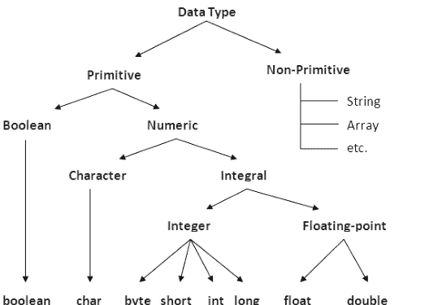


Java 没有 `sizeof` 运算符来查找基本数据类型的大小，但除了 `Boolean` 之外，所有的 Java 基本包装类都提供了一个以位为单位的 `SIZE` 常量，除以八即可得到字节的大小。此外，自 Java 8 以来，所有的基本包装类（`Boolean` 除外）都有一个 `BYTES` 常量，它直接给出数据类型字节的大小。因此你也可以使用那些迁移到 Java 8 的类型。表 1.1 给出了具有默认值和大小的数据类型。

### 表 1.1：带有默认值和大小的 Java 数据类型

| 数据类型 | 默认值 | 默认大小 |
|---|---|---|
| boolean | false | 1 bit |
| char | `\u0000` | 2 byte |
| byte | 0 | 1 byte |
| short | 0 | 2 byte |
| int | 0 | 4 byte |
| long | 0L | 8 byte |
| float | 0.0f | 4 byte |
| double | 0.0d | 8 byte |

如何找到 Java 中基本数据类型的大小？以下是一个简单的 Java 程序，通过其基本包装类演示了基本数据类型的大小。

```java
public class PrimitiveTypes {
    public static void main(String[] args) {
        System.out.println("Size of byte: " + (Byte.SIZE / 8) + " bytes.");
        System.out.println("Size of short: " + (Short.SIZE / 8) + " bytes.");
        System.out.println("Size of int: " + (Integer.SIZE / 8) + " bytes.");
        System.out.println("Size of long: " + (Long.SIZE / 8) + " bytes.");
        System.out.println("Size of char: " + (Character.SIZE / 8) + " bytes.");
        System.out.println("Size of float: " + (Float.SIZE / 8) + " bytes.");
        System.out.println("Size of double: " + (Double.SIZE / 8) + " bytes.");
    }
}
```

输出：

```
C:\JavaPrograms>javac PrimitiveTypes.java
C:\JavaPrograms>java PrimitiveTypes
Size of byte: 1 bytes.
Size of short: 2 bytes.
Size of int: 4 bytes.
Size of long: 8 bytes.
Size of char: 2 bytes.
Size of float: 4 bytes.
Size of double: 8 bytes.
```

# Java 简介

注意，Java 中基本类型的大小始终相同。它不依赖于平台。此外，Java 中的基本类型是有符号的。Java 不支持无符号类型。

## B. 变量

变量是内存中分配的区域。换句话说，它是一个内存位置。这意味着它的值可以改变。用于类、变量和方法的名称被称为标识符（identifiers），如图 1.4 所示。


图 1.4：内存中的变量

图 1.5：变量的类型

1.  **局部变量**：在方法内部声明的变量称为局部变量。
2.  **实例变量**：在类内部但方法外部声明变量称为实例变量。
3.  **静态变量**：声明为 `static` 的变量称为静态变量。它不能是局部的。

### 理解变量类型的示例

```java
import java.io.*;

class VariableDemo {
    static int count = 0;

    public void increment() {
        count++;
    }

    public static void main(String args[]) {
        VariableDemo obj1 = new VariableDemo();
        VariableDemo obj2 = new VariableDemo();
        obj1.increment();
        obj2.increment();
        System.out.println("Obj1 count is=" + obj1.count);
        System.out.println("Obj2 count is=" + obj2.count);
    }
}
```

### 类 A

```java
class A {
    int data = 50; // 实例变量
    static int m = 100; // 静态变量

    void method() {
        int n = 90; // 局部变量
    }
}
```

在 Java 中，标识符规则如下：

- 所有标识符应以字母（A 到 Z 或 a 到 z）、货币符号 (`$`) 或下划线 (`_`) 开头。
- 在第一个字符之后，标识符可以包含任何组合。
- 关键字不能作为标识符。
- 最重要的是，标识符是区分大小写的。
- 合法的标识符示例：`age`、`$salary`、`__value`。
- 非法的标识符示例：`123abc`、`-salary`。

### 表 1.2：Java 预留字列表

| abstract | assert | boolean | break | switch |
|---|---|---|---|---|
| byte | case | catch | char | synchronized |
| class | const | continue | default | this |
| do | double | else | enum | throw |
| extends | final | finally | float | volatile |
| for | goto | if | implements | while |
| import | instanceof | int | interface | native |
| long | new | package | private | throws |
| protected | public | return | short | transient |
| static | strictfp | super | | |

## E. 运算符

运算符是用于操作操作数（或变量）的符号。Java 提供了丰富的运算符集合来操作变量。它允许编译器执行算术、条件、位运算以及杂项（特殊运算符）操作。根据图 1.6 所示，根据对操作数的操作对运算符进行分类。一元运算符对单个操作数或变量执行操作，二元运算符对两个变量执行操作，三元运算符对三个操作数执行操作，还有特殊运算符。

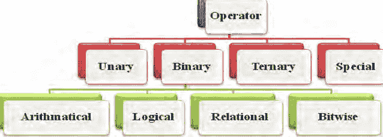

图 1.6：Java 中的运算符

### 1. 算术运算符

算术运算符在数学表达式中的用法与在代数中相同。下面的表 1.3 列出了算术运算符。

#### 表 1.3：算术运算符列表

| 运算符 | 说明 | 示例 |
|---|---|---|
| `+` (加法) | 将运算符两侧的值相加 | `A + B` 将得到 30 |
| `-` (减法) | 从左侧操作数减去右侧操作数 | `A - B` 将得到 -10 |
| `*` (乘法) | 将运算符两侧的值相乘 | `A * B` 将得到 200 |
| `/` (除法) | 将左侧操作数除以右侧操作数 | `B / A` 将得到 2 |
| `%` (取模) | 将左侧操作数除以右侧操作数并返回余数 | `B % A` 将得到 0 |
| `++` (递增) | 将操作数的值加 1 | `B++` 得到 21 |
| `--` (递减) | 将操作数的值减 1 | `B--` 得到 19 |

假设整数变量 `a` 存储 10，变量 `b` 存储 20，

```java
public class Test {
    public static void main(String[] args) {
        int a = 10;
        int b = 20;
        int c = 25;
        int d = 25;

        System.out.println("a + b = " + (a + b));
        System.out.println("a - b = " + (a - b));
        System.out.println("a * b = " + (a * b));
        System.out.println("b / a = " + (b / a));
        System.out.println("b % a = " + (b % a));
        System.out.println("c % a = " + (c % a));
        System.out.println("a++ = " + (a++));
        System.out.println("b-- = " + (b--));

        // d++ 和 ++d 的区别
        System.out.println("d++ = " + (d++));
        System.out.println("++d = " + (++d));
    }
}
```

这将产生以下结果：

```
a + b = 30
a - b = -10
a * b = 200
b / a = 2
b % a = 0
c % a = 5
a++ = 10
b-- = 11
d++ = 25
++d = 27
```

### 2. 关系运算符

关系运算符用于寻找两个变量之间的关系。Java 语言支持的关系运算符列表如表 1.4 所示。

#### 表 1.4：Java 中的关系运算符

| 运算符 | 说明 | 示例 |
|---|---|---|
| `==` (等于) | 检查两个操作数的值是否相等，如果是，则条件为真 | `(A == B)` 不为真 |
| `!=` (不等于) | 检查两个操作数的值是否不相等，如果是，则条件为真 | `(A != B)` 为真 |
| `>` (大于) | 检查左侧操作数的值是否大于右侧操作数的值，如果是，则条件为真 | `(A > B)` 不为真 |
| `<` (小于) | 检查左侧操作数的值是否小于右侧操作数的值，如果是，则条件为真 | `(A < B)` 为真 |
| `>=` (大于等于) | 检查左侧操作数的值是否大于或等于右侧操作数，如果是，则条件为真 | `(A >= B)` 不为真 |
| `<=` (小于等于) | 检查左侧操作数的值是否小于或等于右侧操作数，如果是，则条件为真 | `(A <= B)` 为真 |

假设变量 `A` 存储 10，变量 `B` 存储 20，那么

```java
public class Test {
    public static void main(String[] args) {
        int a = 10;
        int b = 20;

        System.out.println("a == b = " + (a == b));
        System.out.println("a != b = " + (a != b));
        System.out.println("a > b = " + (a > b));
        System.out.println("a < b = " + (a < b));
        System.out.println("a >= b = " + (a >= b));
        System.out.println("a <= b = " + (a <= b));
    }
}
```

这将产生以下结果：

```
a == b = false
a != b = true
a > b = false
a < b = true
a >= b = false
a <= b = true
```

### 3. 位运算符

Java 定义了几个可以应用于 `long`、`int`、`char` 等整数类型的位运算符。位运算符按位执行操作。如果 `a = 60` 且 `b = 13`；它们的二进制格式如下：

```
a = 00111100
b = 00001101
```

#### 表 1.5：位运算符

| 运算符 | 说明 | 示例 |
|---|---|---|
| `&` (位与) | 如果两个操作数都存在该位，则复制该位 | `(A & B)` 将得到 12，`00001100` |
| `|` (位或) | 如果任意一个操作数存在该位，则复制该位 | `(A | B)` 将得到 61，`00111101` |
| `^` (位异或) | 如果在一个操作数中设置该位，则复制该位 | `(A ^ B)` 将得到 49，`00110001` |
| `~` (位取反) | 二进制位取反运算符的作用是“翻转”位 | `(~A)` 将得到 -61，符号数 `11000011` |
| `<<` (左移) | 位左移运算符。左值按右操作数指定的位数左移 | `A << 2` 将得到 240，`11110000` |
| `>>` (右移) | 位右移运算符。左操作数按右操作数指定的位数右移 | `A >> 2` 将得到 15，`1111` |
| `>>>` (无符号右移) | 无符号右移运算符。左操作数按右操作数指定的位数右移，且移位位补零 | `A >>> 2` 将得到 15，`00001111` |

假设整数变量 `A` 为 60，变量 `B` 存储 13，那么

```java
public class Test {
    public static void main(String[] args) {
        int a = 60;      /* 60 = 00111100 */
        int b = 13;      /* 13 = 00001101 */
        int c = 0;

        c = a & b;       /* 12 = 00001100 */
        System.out.println("a & b = " + c);

        c = a | b;       /* 61 = 00111101 */
        System.out.println("a | b = " + c);

        c = a ^ b;       /* 49 = 00110001 */
        System.out.println("a ^ b = " + c);

        c = ~a;          /* -61 = 11000011 */
        System.out.println("~a = " + c);

        c = a << 2;      /* 240 = 11110000 */
        System.out.println("a << 2 = " + c);

        c = a >> 2;      /* 15 = 1111 */
        System.out.println("a >> 2 = " + c);

        c = a >>> 2;     /* 15 = 00001111 */
        System.out.println("a >>> 2 = " + c);
    }
}
```

这将产生以下结果：

```
a & b = 12
a | b = 61
a ^ b = 49
~a = -61
a << 2 = 240
a >> 2 = 15
a >>> 2 = 15
```

### 4. 逻辑运算符

对两个变量执行逻辑操作的运算符称为逻辑运算符。结果类型为布尔型（`true` 或 `false`）。这些逻辑运算符将单个常量和变量组成逻辑表达式。下面的表 1.6 列出了逻辑运算符——

#### 表 1.6：Java 中的逻辑运算符

| 运算符 | 说明 | 示例 |
|---|---|---|
| `&&` (逻辑与) | 称为逻辑与运算符。如果两个操作数都为非零，则条件为真 | `!(A && B)` 为假 |
| `||` (逻辑或) | 称为逻辑或运算符。如果任意一个操作数为非零，则条件为真 | `(A || B)` 为真 |
| `!` (逻辑非) | 称为逻辑非运算符。用于反转其操作数的逻辑状态。如果条件为真，逻辑非运算符将使其变为假 | `!(A && B)` 为真 |

假设布尔变量 `A` 为 `true`，`B` 为 `false`，那么

```java
public class Test {
    public static void main(String[] args) {
        boolean a = true;
        boolean b = false;

        System.out.println("a && b = " + (a && b));
        System.out.println("a || b = " + (a || b));
        System.out.println("!(a && b) = " + !(a && b));
    }
}
```

### 5. 赋值运算符

下面的表 1.7 列出了赋值运算符——

#### 表 1.7：Java 中的赋值运算符

| 运算符 | 描述 | 示例 |
|---|---|---|
| `=` | 简单赋值运算符。将右侧操作数的值赋给左侧操作数 | `C = A + B` 将把 `A + B` 的值赋给 `C` |
| `+=` | 加法赋值运算符。它将右操作数加到左操作数上，并将结果赋值给左操作数 | `C += A` 等于 `C = C + A` |
| `-=` | 减法赋值运算符。它将左操作数减去右操作数，并将结果赋值给左操作数 | `C -= A` 等于 `C = C - A` |
| `*=` | 乘法赋值运算符。它将左操作数乘以右操作数，并将结果赋值给左操作数 | `C *= A` 等于 `C = C * A` |
| `/=` | 除法赋值运算符。它将左操作数除以右操作数，并将结果赋值给左操作数 | `C /= A` 等于 `C = C / A` |
| `%=` | 取模赋值运算符。它使用左操作数对右操作数取模，并将结果赋值给左操作数 | `C %= A` 等于 `C = C % A` |
| `<<=` | 左移赋值运算符 | `C <<= 2` 等于 `C = C << 2` |
| `>>=` | 右移赋值运算符 | `C >>= 2` 等于 `C = C >> 2` |
| `&=` | 位与赋值运算符 | `C &= 2` 等于 `C = C & 2` |
| `^=` | 位异或赋值运算符 | `C ^= 2` 等于 `C = C ^ 2` |
| `|=` | 位或赋值运算符 | `C |= 2` 等于 `C = C | 2` |


# 赋值运算符

| 运算符 | 说明 | 示例 |
| :--- | :--- | :--- |
| `/=` | 除法赋值运算符。它将左操作数除以右操作数，并将结果赋值给左操作数。 | `C /= A` 等于 `C = C / A` |
| `%=` | 取模赋值运算符。它对两个操作数取模，并将结果赋值给左操作数。 | `C %= A` 等于 `C = C % A` |
| `<<=` | 左移赋值运算符。 | `C <<= 2` 等于 `C = C << 2` |
| `>>=` | 右移赋值运算符。 | `C >>= 2` 等于 `C = C >> 2` |
| `&=` | 位与赋值运算符。 | `C &= 2` 等于 `C = C & 2` |
| `^=` | 位异或赋值运算符。 | `C ^= 2` 等于 `C = C ^ 2` |
| `|=` | 位或赋值运算符。 | `C |= 2` 等于 `C = C | 2` |

```java
public class Test {
    public static void main(String[] args) {
        int a = 10;
        int b = 20;
        int c = 0;

        c = a + b;
        System.out.println("c = a + b = " + c);

        c += a;
        System.out.println("c += a = " + c);

        c -= a;
        System.out.println("c -= a = " + c);

        c *= a;
        System.out.println("c *= a = " + c);

        a = 10;
        c = 15;

        c /= a;
        System.out.println("c /= a = " + c);

        a = 10;
        c = 15;
        c %= a;
        System.out.println("c %= a = " + c);

        c <<= 2;
        System.out.println("c <<= 2 = " + c);

        c >>= 2;
        System.out.println("c >>= 2 = " + c);

        c >>= 2; // 原代码 c >= 2 为逻辑错误，此处修正为右移赋值演示
        System.out.println("c >>= 2 = " + c);

        c &= a;
        System.out.println("c &= a = " + c);

        c ^= a;
        System.out.println("c ^= a = " + c);

        c |= a;
        System.out.println("c |= a = " + c);
    }
}
```

输出结果：

```
OUTPUT:
c = a + b = 30
c += a = 40
c -= a = 30
c *= a = 300
c /= a = 1
c %= a = 5
c <<= 2 = 20
c >>= 2 = 5
c >>= 2 = 1
c &= a = 0
c ^= a = 10
c |= a = 10
```

# 杂项运算符

Java 语言还支持其他少数运算符。

## 三元运算符 ( ? : )

```java
variable x = (expression) ? valueIfTrue : valueIfFalse;
```

示例：

```java
public class Test {
    public static void main(String args[]) {
        int a, b;
        a = 10;
        b = (a == 1) ? 20 : 30;
        System.out.println("Value of b is : " + b);

        b = (a == 10) ? 20 : 30;
        System.out.println("Value of b is : " + b);
    }
}
```

输出结果：

```
Value of b is : 30
Value of b is : 20
```

## instanceof 运算符

该运算符仅用于对象引用变量。该运算符检查对象是否属于特定类型（类类型或接口类型）。`instanceof` 运算符的写法为：

```java
(对象引用变量) instanceof (类/接口类型)
```

如果运算符左侧变量引用的对象通过了右侧类/接口类型的 IS-A 检查，则结果将为 `true`。

示例 1：

```java
public class Test {
    public static void main(String args[]) {
        String name = "James";
        // 将返回 true，因为 name 是 String 类型
        boolean result = name instanceof String;
        System.out.println(result);
    }
}
```

输出结果：

```
true
```

如果被比较的对象与右侧类型兼容，该运算符仍返回 `true`。示例 2：

```java
class Vehicle {}

public class Car extends Vehicle {
    public static void main(String[] args) {
        Vehicle a = new Car();
        boolean result = a instanceof Car;
        System.out.println(result);
    }
}
```

输出结果：

```
true
```

# 运算符优先级

Java 运算符的优先级决定了表达式中项的分组。这影响了表达式的评估方式。某些运算符的优先级高于其他运算符；例如，乘法运算符的优先级高于加法运算符。

例如：`x = 7 + 3 * 2`；这里 `x` 被赋值为 13，而不是 20，因为 `*` 的优先级高于 `+`，所以它先与 3 相乘，然后加到 7。在表达式内部，高优先级的运算符将先计算。

| 类别 | 运算符 | 结合性 |
| :--- | :--- | :--- |
| 后置 | `++` `--` | 左到右 |
| 一元 | `++` `--` `+` `-` `~` `!` | 右到左 |
| 乘法 | `*` `/` `%` | 左到右 |
| 加法 | `+` `-` | 左到右 |
| 移位 | `<<` `>>` `>>>` | 左到右 |
| 关系 | `<` `<=` `>` `>=` | 左到右 |
| 相等 | `==` `!=` | 左到右 |
| 位与 | `&` | 左到右 |
| 位异或 | `^` | 左到右 |
| 位或 | `|` | 左到右 |
| 逻辑与 | `&&` | 左到右 |
| 逻辑或 | `||` | 左到右 |
| 三元 | `? :` | 右到左 |
| 赋值 | `=` `+=` `-=` `*=` `/=` `%=` `<<=` `>>=` `&=` `^=` `|=` | 右到左 |

# 控制结构：选择与循环

决策结构具有 `if` 语句，当条件为真时执行一个或多个语句。Java 编程语言提供了不同类型的决策结构。

## 决策语句

| 编号 | 语句 | 描述 |
| :--- | :--- | :--- |
| 1 | `if` 语句 | `if` 语句由布尔表达式和后续语句组成。 |
| 2 | `else` 语句 | `else` 可以跟一个可选的语句，当布尔表达式为假时执行。 |
| 3 | 嵌套 `if` | 可以在 `else` 语句内部嵌套 `if` 语句。 |
| 4 | `switch` 语句 | `switch` 语句允许对一组值进行测试。 |

## A. if 语句

`if` 语句由布尔表达式和后续语句组成。以下是 `if` 语句的语法：

```java
if (booleanExpression) {
    // 当布尔表达式为真时执行
}
```

示例：

```java
public class Test {
    public static void main(String[] args) {
        int x = 10;

        if (x < 20) {
            System.out.print("这是 if 语句");
        }
    }
}
```

输出结果：

```
这是 if 语句
```

## B. if...else 语句

`if` 语句可以跟一个可选的 `else` 语句，当布尔表达式为假时执行。以下是 `if...else` 语句的语法：

```java
if (booleanExpression) {
    // 当布尔表达式为真时执行
} else {
    // 当布尔表达式为假时执行
}
```

如果布尔表达式评估为真，则执行 `if` 代码块；否则执行 `else` 代码块。

示例：

```java
public class Test {
    public static void main(String args[]) {
        int x = 30;

        if (x < 20) {
            System.out.print("这是 if 语句");
        } else {
            System.out.print("这是 else 语句");
        }
    }
}
```

输出结果：

```
这是 else 语句
```

## C. if...else if...else 语句

`if` 语句可以跟一个可选的 `else if...else` 语句，这在使用单个 `if...else` 语句测试多种条件时非常有用。

使用 `if, else if, else` 语句时有几点需要注意：

- `if` 可以有零或一个 `else`，它必须放在所有 `else if` 之后。
- `if` 可以有零到多个 `else if`，它们必须放在 `else` 之前。
- 一旦某个 `else if` 执行成功，剩余的 `else if` 或 `else` 将不再测试。

### 语法

```java
if (booleanExpression1) {
    // 当布尔表达式 1 为真时执行
} else if (booleanExpression2) {
    // 当布尔表达式 2 为真时执行
} else if (booleanExpression3) {
    // 当布尔表达式 3 为真时执行
} else {
    // 当上述条件均为假时执行
}
```

### 示例

```java
public class Test {
    public static void main(String args[]) {
        int x = 30;

        if (x == 10) {
            System.out.print("Value of X is 10");
        } else if (x == 20) {
            System.out.print("Value of X is 20");
        } else if (x == 30) {
            System.out.print("Value of X is 30");
        } else {
            System.out.print("This is else statement");
        }
    }
}
```

输出结果：

```
Value of X is 30
```

## D. 嵌套 if 语句

嵌套 `if-else` 语句始终是合法的，你可以在一个 `if` 或 `else if` 语句内部嵌套另一个 `if` 或 `else if` 语句。

### 语法

```java
if (booleanExpression1) {
    // 当布尔表达式 1 为真时执行
    if (booleanExpression2) {
        // 当布尔表达式 2 为真时执行
    }
}
```

你可以像嵌套 `if` 语句一样的方式嵌套 `else if...else`。

### 示例

```java
public class Test {
    public static void main(String args[]) {
        int x = 30;
        int y = 10;

        if (x == 30) {
            if (y == 10) {
                System.out.print("X = 30 and Y = 10");
            }
        }
    }
}
```

输出结果：

```
X = 30 and Y = 10
```

## E. switch 语句

`switch` 语句允许对变量与一组值进行等性测试。每个值被称为一个 `case`，并对 `switch` 操作的变量在每个 `case` 中进行检查。

### 语法

```java
switch (expression) {
    case value:
        // 语句
        break; // 可选

    case value:
        // 语句
        break; // 可选

    // 你可以有任意数量的 case 语句。
    default: // 可选
        // 语句
}
```

### 规则

- `switch` 语句中使用的变量只能是整数、可转换的整数（`byte`, `short`, `char`）、字符串和枚举。
- 你可以在 `switch` 内部有任意数量的 `case` 语句。每个 `case` 后面都跟着要进行比较的值和一个冒号。
- `case` 的值必须与 `switch` 中变量的类型相同，且它必须是一个常量或字面量。
- 当 `switch` 的变量等于某个 `case` 时，该 `case` 之后的语句将执行，直到遇到 `break` 语句。
- 当遇到 `break` 语句时，`switch` 终止，控制流跳转到 `switch` 语句之后的下一行。
- 并不是每个 `case` 都需要包含 `break`。如果没有出现 `break`，控制流将贯穿到后续 `case`，直到遇到 `break` 为止。
- `switch` 语句可以有一个可选的 `default case`，它必须出现在 `switch` 的末尾。当没有任何 `case` 为真时，可以使用 `default case` 执行某项任务。`default case` 中也可以包含 `break`。

### 示例

```java
public class Test {
    public static void main(String[] args) {
        char grade = 'C';

        switch (grade) {
            case 'A':
                System.out.println("Excellent!");
                break;
            case 'B':
                System.out.println("Well done");
                break;
            case 'C':
                System.out.println("You passed");
                break;
            case 'D':
                System.out.println("Better try again");
                break;
            default:
                System.out.println("Invalid grade");
        }
        System.out.println("Your grade is " + grade);
    }
}
```

输出结果：

```
You passed
Your grade is C
```

## 条件运算符 ? :

条件运算符 `? :` 可以用于替换 `if...else` 语句。它具有以下通用形式：

```java
Exp1 ? Exp2 : Exp3;
```

其中 `Exp1`, `Exp2` 和 `Exp3` 是表达式。

为了确定整个表达式的值，首先评估 `Exp1`：

- 如果 `Exp1` 的值为真（`true`），则 `Exp2` 的值将是整个表达式的值。
- 如果 `Exp1` 的值为假（`false`），则评估 `Exp3`，其值将成为整个表达式的值。

# break 语句

Java 编程语言中的 `break` 语句有以下两种用法：

- 当在循环内部遇到 `break` 语句时，循环立即终止，程序控制恢复到循环之后的下一条语句。
- 它可以用于终止 `switch` 语句中的一个 `case`。

### 语法

`break` 的语法是在任何循环或 `switch` 内部使用单独的语句：

```java
break;
```


```java
public class Test {
    public static void main(String args[]) {
        int[] numbers = {10, 20, 30, 40, 50};
        for (int x : numbers) {
            if (x == 30) {
                break;
                System.out.print(x);
            }
        }
    }
}
```

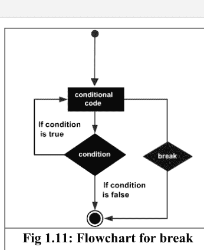

这将产生以下结果——

### 输出

10

20

## Java 中的 continue 语句

`continue` 关键字可以用于任何循环控制结构。它导致循环立即跳转到循环的下一次迭代。流程图如图 1.12 所示。

- 在 `for` 循环中，`continue` 导致控制立即跳转到更新语句。
- 在 `while` 循环或 `do/while` 循环中，控制立即跳转到布尔表达式。

### 语法

`continue` 的语法是任何循环内部的单语句——

```java
continue;
```

```java
public class Test {
    public static void main(String args[]) {
        int[] numbers = {10, 20, 30, 40, 50};
        for (int x : numbers) {
            if (x == 30) {
                continue;
                System.out.print(x);
            }
        }
    }
}
```

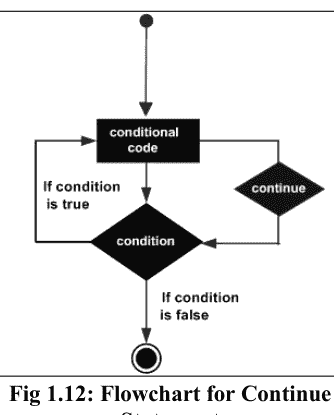

这将产生以下结果——

### 输出

10

20

40

50

## Java 中的 goto 语句

Java 编程语言中没有 `goto` 关键字。在许多编程语言中，`goto` 语句用于跳转到程序的特定部分。在 Java 中，我们使用 `break` 和 `continue` 语句来实现跳转的功能。

# Java 简介

当条件变为假时，程序控制将传递到循环紧后的后续行。

在这里，`while` 循环的关键点在于循环可能永远不会执行。当对表达式进行测试且结果为假时，循环体将被跳过，并执行 `while` 循环后的第一个语句。

### 示例

```java
public class Test {
    public static void main(String[] args) {
        int x = 10;

        while (x < 20) {
            System.out.print("value of x : " + x);
            x++;
            System.out.print("\n");
        }
    }
}
```

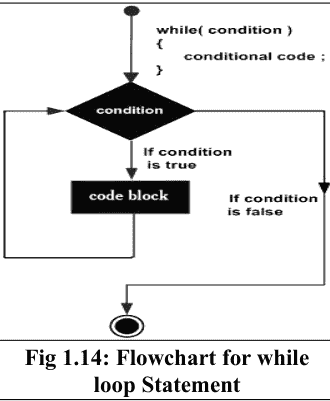

这将产生以下结果 –

### 输出

```
value of x : 10
value of x : 11
value of x : 12
value of x : 13
value of x : 14
value of x : 15
value of x : 16
value of x : 17
value of x : 18
value of x : 19
```

### Java 中的 do...while 循环

`do...while` 循环与 `while` 循环相似，不同在于 `do...while` 循环保证至少执行一次。流程图如图 1.15 所示。以下是 `do...while` 循环的语法 –

```java
do {
    // Statements
} while (Boolean_expression);
```

注意布尔表达式出现在循环的末尾，因此在测试布尔值之前，循环中的语句会先执行一次。

如果布尔表达式为真，控制将跳回 `do` 语句，循环中的语句将再次执行。此过程不断重复，直到布尔表达式为假。

### 示例

```java
public class Test {
    public static void main(String[] args) {
        int x = 10;

        do {
            System.out.print("value of x: " + x);
            x++;
            System.out.print("\n");
        } while (x < 20);
    }
}
```

这将产生以下结果 –

### 输出

value of x : 10

value of x : 11

value of x : 12

value of x : 13

value of x : 14

value of x : 15

value of x : 16

value of x : 17

value of x : 18

value of x : 19

### Java 中的 for 循环

`for` 循环是一种重复控制结构，允许你高效地编写需要执行特定次数的循环。流程图如图 1.16 所示。当你知道任务需要重复执行多少次时，`for` 循环非常有用。`for` 循环的语法为 –

```java
for (initialization; Boolean_expression; update) {
    // Statements
}
```

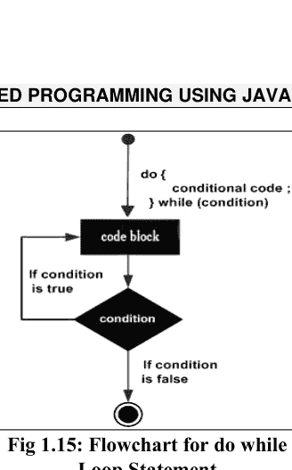

这里是 `for` 循环中的控制流：

- 初始化步骤首先执行，且仅执行一次。此步骤允许你声明并初始化任何循环控制变量，且该步骤以分号 (`;`) 结束；
- 接下来评估布尔表达式。如果为真，则允许执行循环体。如果为假，循环体将不执行，控制跳转到 `for` 循环之后的下一个语句。
- 循环体执行后，控制跳回更新语句。此语句允许你更新任何循环变量。该语句末尾留有分号。
- 再次评估布尔表达式。如果为真，则执行循环（循环体、更新步骤、布尔表达式）。当布尔表达式为假时，`for` 循环终止。

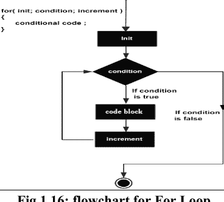

### 示例

```java
public class Test {
    public static void main(String args[]) {
        for (int x = 10; x < 20; x++) {
            System.out.print("value of x : " + x);
            System.out.print("\n");
        }
    }
}
```

这将产生以下结果 –

### 输出

value of x : 10

value of x : 11

value of x : 12

value of x : 13

value of x : 14

value of x : 15

value of x : 16

value of x : 17

value of x : 18

value of x : 19

## Java 中的增强型 for 循环

这主要用于遍历包括数组在内的元素集合。以下是增强型 `for` 循环的语法：

```java
for (declaration : expression) {
    // Statements
}
```

- 声明 – 新声明的变量，与要访问的数组类型兼容。
- 表达式 – 评估你需要遍历的数组。

### 示例

```java
class Test {
    public static void main(String args[]) {
        int[] numbers = {10, 20, 30, 40, 50};
        for (int x : numbers) {
            System.out.print(x);
        }
        System.out.print("\n");
        String[] names = {"James", "Tom", "Lacy"};
        for (String name : names) {
            System.out.print(name);
        }
    }
}
```

这将产生以下结果 –

### 输出

1020304050

JamesTomLacy

# Java 简介

## 数组

数组是相同类型的集合，具有连续的内存位置。Java 数组是基于索引的，存储相同类型的元素。数组只能存储固定大小。Java 数组存储在堆区域。数组索引从 0 到 size-1。

图 1.17：数组分配

| 元素（索引） | 0 | 1 | 2 | 3 | 4 | 5 | 6 | 7 | 8 | 9 | 10 |
|---|---|---|---|---|---|---|---|---|---|---|---|

### Java 数组的优点

- 代码优化：它优化了代码，我们可以轻松检索数据。
- 随机访问：我们可以在任何索引位置获取任何数据。

### Java 数组的缺点

- 大小限制：数组只能存储固定大小。它在运行时不会增加大小。为了解决这个问题，Java 使用集合框架。

### 数组特性

- 它始终是有索引的。
- 它是相似数据类型的集合。
- 它占据了连续的内存位置。

### 数组声明

语法：

`datatype[] identifier;` 或 `datatype identifier[];` 都是数组声明的有效语法。前者更具可读性。

### 示例

```java
int[] arr;
char[] arr;
short[] arr;
long[] arr;
int[][] arr; // 二维数组
```

### 数组初始化：使用 `new` 运算符初始化数组。

示例：

```java
int[] arr = new int[10]; // 创建一个大小为10的整数空数组
// 或
int[] arr = {10, 20, 30, 40, 50}; // 创建一个给定元素的数组
```

### 访问数组：数组索引从 0 开始。语法：`arrayname[n-1]`

示例：访问给定数组的第 4 个元素

```java
int[] arr = {10, 20, 30, 40};
System.out.println("Element at 4th place " + arr[3]);
```

上述代码将在控制台上打印数组的第 4 个元素。

注意：要找到数组的长度，我们可以使用以下语法：`array_name.length`。`length` 前没有大括号。它不是 `length()`。

### foreach 或增强型 for 循环

JSE 5 引入了一种特殊的 `for` 循环称为 `foreach` 循环用于访问数组元素。使用 `foreach` 循环，你可以不使用数组索引按顺序访问整个数组。让我们来看一个 `foreach` 循环的示例：

```java
class Test {
    public static void main(String[] args) {
        int[] arr = {10, 20, 30, 40};
        for (int x : arr) {
            System.out.println(x);
        }
    }
}
```

### 输出

10

20

30

40

### Java 中的数组类型

数组有两种类型。

- 单维数组
- 多维数组

### Java 中的单维数组

声明数组的语法：

1. `dataType[] arr;`（或）
2. `dataType arr[];`

### Java 数组的声明、实例化和初始化

我们可以通过以下方式同时对 Java 数组进行声明、实例化和初始化：

1. `int a[] = {33, 3, 4, 5};` // 声明、实例化和初始化

```java
// 让我们看一个打印此数组的简单示例。
class Testarray1 {
    public static void main(String args[]) {
        int a[] = {33, 3, 4, 5}; // 声明、实例化和初始化
        // 打印数组
        for (int i = 0; i < a.length; i++)
            System.out.println(a[i]);
    }
}
```

### 输出

33

3

4

5

### 在 Java 中将数组传递给方法

我们可以将 Java 数组传递给方法，这样我们就可以在任何数组上重用相同的逻辑。让我们来看使用方法获取数组中最小值的简单示例。

```java
class Testarray2 {
    static void min(int arr[]) {
        int small = arr[0];
        for (int i = 1; i < arr.length; i++)
            if (small > arr[i]) // 修正了原文逻辑错误：应为 small > arr[i] 才更新最小值
                small = arr[i];
        System.out.println(small);
    }

    public static void main(String args[]) {
        int a[] = {33, 3, 4, 5};
        min(a); // 将数组传递给方法
    }
}
```

### 输出

3

## Java 中的多维数组

在这种情况下，数据存储在行和列的索引中（也称为矩阵形式）。

### Java 中声明多维数组的语法

1. `dataType[][] arrayRefVar;`（或）
2. `dataType [][] arrayRefVar;`（或）
3. `dataType arrayRefVar[][];`（或）
4. `dataType[] arrayRefVar[];`

### 在 Java 中实例化多维数组的示例

1. `int[][] arr = new int[3][3];` // 3 行和 3 列

### 在 Java 中初始化多维数组的示例

1. `arr[0][0] = 1;`
2. `arr[0][1] = 2;`
3. `arr[0][2] = 3;`
4. `arr[1][0] = 4;`
5. `arr[1][1] = 5;`
6. `arr[1][2] = 6;`
7. `arr[2][0] = 7;`
8. `arr[2][1] = 8;`
9. `arr[2][2] = 9;`

Java 多维数组的示例：让我们来看一个声明、初始化和打印二维数组的简单示例。

```java
class Testarray3 {
    public static void main(String args[]) {
        // 声明并初始化 2D 数组
        int arr[][] = {{1, 2, 3}, {2, 4, 5}, {4, 4, 5}};

        // 打印 2D 数组
        for (int i = 0; i < 3; i++) {
            for (int j = 0; j < 3; j++) {
                System.out.print(arr[i][j] + " ");
            }
            System.out.println();
        }
    }
}
```

### 输出

```
1 2 3
2 4 5
4 4 5
```

### Java 数组的类名是什么？

在 Java 中，数组是一个对象。对于数组对象，会创建一个代理类，其名称可以通过对象上的 `getClass().getName()` 方法获取。

```java
class TestArray4 {
    public static void main(String args[]) {
        int arr[] = {4, 4, 5};

        Class c = arr.getClass();
        String name = c.getName();

        System.out.println(name);
    }
}
```

### 输出

```
[I
```

### 复制 Java 数组

我们可以通过 `System` 类的 `arraycopy` 方法将数组复制到另一个数组。

### arraycopy 方法的语法

```java
public static void arraycopy(Object src, int srcPos, Object dest, int destPos, int length)
```

### arraycopy 方法的示例

```java
class TestArrayCopyDemo {
    public static void main(String[] args) {
        char[] copyFrom = {'d', 'e', 'e', 'c', 'a', 'f', 'f', 'i', 'n', 'a', 't', 'e', 'd', ' '};
        char[] copyTo = new char[7];

        System.arraycopy(copyFrom, 2, copyTo, 0, 7);
        System.out.println(new String(copyTo));
    }
}
```

### 输出

caffein

### Java 中两个矩阵的相加

让我们来看一个两个矩阵相加的简单示例。


```java
class Testarray5 {
    public static void main(String args[]) {
        // 创建两个矩阵
        int a[][] = {{1, 3, 4}, {3, 4, 5}};
        int b[][] = {{1, 3, 4}, {3, 4, 5}};

        // 创建另一个矩阵来存储两个矩阵的和
        int c[][] = new int[2][3];

        // 相加并打印两个矩阵的和
        for (int i = 0; i < 2; i++) {
            for (int j = 0; j < 3; j++) {
                c[i][j] = a[i][j] + b[i][j];
                System.out.print(c[i][j] + " ");
            }
            System.out.println(); // 换行
        }
    }
}
```

# 输出

```
2 6 8
10
```

### 锯齿数组

锯齿数组意味着具有不规则的边缘。在 Java 中，锯齿数组意味着行数不相同的多维数组，如图 1.18 所示。

| | 0 | 1 | 2 | 3 |
|---|---|---|---|---|
| 0 | 44 | 55 | 66 | 77 |
| 1 | 36 | | | |
| 2 | 87 | 97 | | |
| 3 | 68 | | | |

图：可变二维数组 - 矩阵形式

图 1.18：锯齿数组

#### 锯齿数组的初始化

`new` 运算符用于初始化数组。示例：

```java
int[][] arr = new int[3][]; // 将 3 行
arr[0] = new int[3];
arr[1] = new int[4];
arr[2] = new int[5];
```

#### Java 中的锯齿数组

锯齿数组是数组的数组，其每行的大小不同，即我们可以创建列数不相同的二维数组。这些类型的数组被称为锯齿数组。以下是演示锯齿数组的 Java 程序：

```java
class Main {
    public static void main(String args[]) {
        // 声明 2 行的二维数组
        int arr[][] = new int[2][];

        // 使上述数组锯齿
        // 第一行有 3 列
        arr[0] = new int[3];
        // 第二行有 2 列
        arr[1] = new int[2];

        // 初始化数组
        int count = 0;
        // 显示锯齿数组的值
        for (int i = 0; i < arr.length; i++)
            for (int j = 0; j < arr[i].length; j++)
                arr[i][j] = count++;

        System.out.println("锯齿数组的内容");
        for (int i = 0; i < arr.length; i++) {
            for (int j = 0; j < arr[i].length; j++)
                System.out.print(arr[i][j] + " ");
            System.out.println();
        }
    }
}
```

```java
class Main {
    public static void main(String args[]) {
        // 声明 4 行的二维数组
        int arr[][] = new int[4][];
        // 第一行有 1 列
        arr[0] = new int[1];
        // 第二行有 2 列
        arr[1] = new int[2];
        // 第三行有 3 列
        arr[2] = new int[3];
        // 第四行有 4 列
        arr[3] = new int[4];

        // 初始化数组
        int count = 0;
        // 另一个示例，i 行有列，即第一行有 1 个元素，第二行有 2 个元素，以此类推
        for (int i = 0; i < arr.length; i++)
            for (int j = 0; j < arr[i].length; j++)
                arr[i][j] = count++;

        // 显示二维锯齿数组的值
        System.out.println("锯齿数组的内容");
        for (int i = 0; i < arr.length; i++) {
            for (int j = 0; j < arr[i].length; j++)
                System.out.print(arr[i][j] + " ");
            System.out.println();
        }
    }
}
```

# 输出

```
锯齿数组的内容
0
1 2
3 4 5
6 7 8 9
10 11 12 13 14
```

```java
public static void main(String[] args) {
    int student[][] = new int[4][];
    student[0] = new int[4];
    student[1] = new int[1];
    student[2] = new int[2];
    student[3] = new int[3];

    System.out.println("行数: " + student.length);
    System.out.println("第三行大小: " + student[3].length);
    // 第一行
    student[0][0] = 44;
    student[0][1] = 55;
    student[0][2] = 66;
    student[0][3] = 77;
    // 第二行
    student[1][0] = 36;
    // 第三行
    student[2][0] = 87;
    student[2][1] = 97;
}
```

# 使用 JAVA 面对象编程

```java
// 第四行
student[3][0] = 68;
student[3][1] = 78;
student[3][2] = 88;
```

```java
System.out.println("student[3][1] 分数: " + student[3][1]);
```

# JAVA 简介

## C. 继承

当一个对象获取父对象的所有属性和行为时，被称为继承。它提供了代码的可重用性，用于实现运行时多态。

## D. 多态

如果一个任务以不同的方式执行，就被称为多态。例如：以不同的方式说服客户，画出某些东西；例如：形状、三角形、矩形和字段。在 Java 中，我们使用方法重载和重写来实现多态。另一个例子可以是说话；例如，猫叫“喵”，狗叫“汪汪”，如图 1.21 所示。

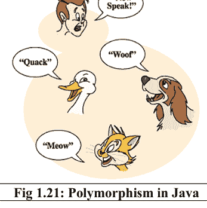

图 1.21：Java 中的多态

## E. 抽象

隐藏内部细节并显示功能被称为抽象。对于电话，我们不知道内部的处理过程。在 Java 中，我们使用抽象类和接口来实现抽象。

## F. 封装

将代码和数据绑定（或封装）到单个单元中被称为封装。例如，胶囊内包裹着不同的药物，如图 1.22 所示。Java 类是封装的示例。Java Bean 是完全封装的类，因为这里的所有数据成员都是私有的。

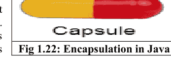

图 1.22：Java 中的封装

## G. 耦合

耦合指的是另一个类的知识、信息或依赖。当类之间相互感知时就会产生耦合。如果一个类拥有另一个类的详细信息，则存在强耦合。在 Java 中，我们使用 `private`、`protected` 和 `public` 修饰符来显示级别、方法和字段的可见性。你使用接口来实现弱耦合，因为没有具体的实现。

## H. 内聚

内聚是指执行单一良定义任务的组件水平。单一良定义的任务由高内聚的方法完成。低内聚的方法将任务拆分为不同的部分。`java.io` 包是一个高内聚包，因为它包含了与 I/O 相关的类和接口。然而，`java.util` 包是一个低内聚包，因为它包含了不相关的类和接口。

## I. 关联

关联表示对象之间的关系。在这里，一个对象可以与一个对象或多个对象关联。对象之间可以有四种关联：

- 一对一
- 一对多
- 多对一，以及
- 多对多

让我们通过实际示例来理解这种关系。例如，一个国家可以有一个总理（一对一），而一个总理可以有很多部长（一对多）。此外，许多会议员（MP）可以有一个总理（多对一），许多部长可以有很多部门（多对多）。关联可以是单向的或双向的。

## J. 聚合

聚合也是实现关联的一种。聚合表示一个对象包含其他对象作为其状态的一部分的关系。它表示对象之间的弱关系。在 Java 中，继承表示“是（is）”。它也是另一种重用对象的方式。

## K. 组合

组合也是实现关联的一种。组合表示一个对象包含其他对象作为其状态的一部分。包含对象和依赖对象之间存在强关系。这是包含对象没有独立存在的状态。如果你删除了父对象，所有子对象将被自动删除。

# 1.4 构造方法

Java 中的构造方法是一种特殊方法，用于初始化对象，因为它与类名相同。在创建类的对象时会调用构造方法。它可以用于为对象属性设置初始值。根据编程时传递给构造方法的参数，有不同类型的构造方法。构造方法的通用语法为：

```java
class nameofclass {
    ...
    // 构造方法
    nameofclass() {}
}

// 我们可以使用下面的语句创建上述类的对象
// 这条语句
// 调用了上面的构造方法
nameofclass obj = new nameofclass();
```

### Java 中构造方法与方法有何不同？

- 构造方法的名称必须与其定义的类名相同，而 Java 中的方法则没有此要求。
- 构造方法不返回任何类型；方法有返回类型，或者如果不返回任何值则返回类型为 `void`。
- 构造方法仅在对象创建时调用一次，而方法可以被调用任意次。

// 用于演示带参数构造方法工作的
// Java 程序

```java
// 导入所需的输入输出类
import java.io.*;
```

```java
// 类 1
class Program {
    // 类的数据成员。
    String name;
    int id;
}
```

```java
// 构造方法会在创建该类对象
// 时使用传递参数的值初始化数据成员
Program(String name, int id) {
    this.name = name;
    this.id = id;
}
```

```java
// 类 2
class GFG {
    // 主驱动方法
    public static void main(String[] args) {
        // 这将调用带参数的构造方法。
        Program p1 = new Program("Computer", 10);
        System.out.println("Name: " + p1.name + " and Id: " + p1.id);
    }
}
```

OUTPUT:
Name: Computer and Id: 10

# 1.5 Java 内部类

## A. String

在 Java 中，`String` 基本上是一个表示字符序列的对象。`String` 是 `char` 值的数组。例如：

```java
char[] ch = {'j', 'a', 'v', 'a', 'p', 'o', 'i', 'n', 't'};
String s = new String(ch);
```

`String` 类提供了一系列方法，用于对字符串执行操作，如 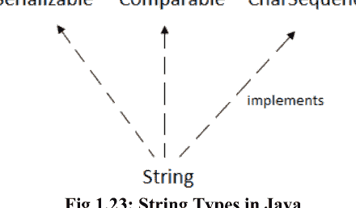

## B. CharSequence 接口

`CharSequence` 接口用于表示字符序列。它被 `String`、`StringBuffer` 和 `StringBuilder` 类实现。这意味着我们可以使用这些类在 Java 中创建字符串，如图 1.24 所示。

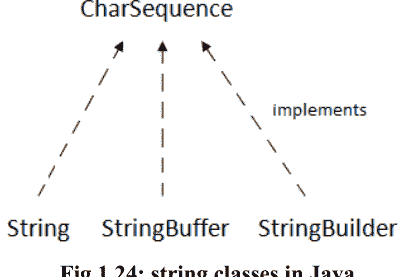

Java 的 `String` 是不可变的，即它不能被改变。每当我们更改任何字符串时，都会创建一个新的实例。对于可变字符串，你可以使用 `StringBuffer` 和 `StringBuilder` 类。

## Java 中的 String 是什么？

通常，String 是字符序列。但在 Java 中，string 是表示字符序列的对象。`java.lang.String` 类用于创建字符串。创建 String 有两种方式：

1. 通过字符串字面量
2. 通过 `new` 关键字

### 1) 字符串字面量

Java 字符串字面量通过双引号创建。例如如图 1.25 所示：

- 1. `String s1 = "welcome";`
- 2. `String s2 = "Welcome";` // 不会创建新实例

每次你创建一个字符串常量时，JVM 会首先检查字符串常量池。如果字符串已存在于池中，则返回池中实例的引用。如果池中不存在字符串，则创建一个新的字符串实例并将其放入池中。例如：

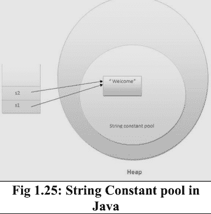

在上面的示例中，只会创建一个对象。首先，JVM 不会在字符串常量池中找到任何值为 "Welcome" 的字符串对象，因此它会创建一个新对象。之后，它会在池中找到值为 "Welcome" 的字符串，它将不会创建新对象，而是返回同一个实例的引用。

注意：字符串对象存储在名为字符串常量的特殊内存区域。

为什么 Java 使用字符串字面量概念？

为了让 Java 的内存效率更高（如果已经存在于字符串常量池，就不会创建新对象）。

### 2) 通过 `new` 关键字

`String s = new String("Welcome");` 创建两个对象和一个引用变量。

在这种情况下，JVM 将在普通（非池）堆内存中创建一个新的字符串对象，而字面量 "Welcome" 将被放入字符串常量池。变量 `s` 将指向堆中的对象。

### Java String 示例

```java
public class StringExample {
    public static void main(String[] args) {
        String s1 = "java"; // 通过 java 字符串字面量创建字符串
        char[] ch = {'j', 'a', 'v', 'a', 'i', 'n', 'g', 's'};
        String s2 = new String(ch); // 将字符数组转换为字符串
    }
}
```


```java
String s3 = new String("example"); // 通过 new 关键字创建 java 字符串

System.out.println(s1);
System.out.println(s2);
System.out.println(s3);
}
```

## Java String 类方法

`java.lang.String` 类提供了许多实用的方法来对字符值序列进行操作，如表 1.11 所示。

### 表 1.11：Java 类方法

| 序号 | 方法 | 说明 |
|---|---|---|
| 1 | `charAt(int index)` | 返回特定索引的字符值 |
| 2 | `int length()` | 返回字符串长度 |
| 3 | `static String format(String format, Object... args)` | 返回格式化字符串 |
| 4 | `static String format(Locale l, String format, Object... args)` | 返回指定语言区域的格式化字符串 |
| 5 | `String substring(int beginIndex)` | 返回给定起始索引的子字符串 |
| 6 | `String substring(int beginIndex, int endIndex)` | 返回给定起始索引和结束索引的子字符串 |
| 7 | `boolean contains(CharSequence s)` | 匹配字符值序列后返回 true 或 false |
| 8 | `static String join(CharSequence delimiter, CharSequence... elements)` | 返回合并后的字符串 |
| 9 | `static String join(CharSequence delimiter, Iterable<? extends CharSequence> elements)` | 返回合并后的字符串 |
| 10 | `boolean equals(Object object)` | 检查字符串与对象的相等性 |
| 11 | `boolean isEmpty()` | 检查字符串是否为空 |
| 12 | `String concat(String str)` | 拼接指定的字符串 |
| 13 | `String replace(char old, char new)` | 替换所有指定的字符值出现 |
| 14 | `String replace(CharSequence old, CharSequence new)` | 替换所有指定的字符序列出现 |
| 15 | `static String equalsIgnoreCase(String another)` | 比较另一个字符串。不检查大小写。 |
| 16 | `String[] split(String regex)` | 返回匹配正则表达式的分割字符串 |
| 17 | `String[] split(String regex, int limit)` | 返回匹配正则表达式和限制的分割字符串 |
| 18 | `String intern()` | 返回池化的字符串 |
| 19 | `int indexOf(int ch)` | 返回指定的字符值索引 |
| 20 | `int indexOf(int ch, int fromIndex)` | 从给定索引开始返回指定的字符值索引 |
| 21 | `int indexOf(String substring)` | 返回指定的子字符串索引 |
| 22 | `int indexOf(String substring, int fromIndex)` | 从给定索引开始返回指定的子字符串索引 |
| 23 | `String toLowerCase()` | 返回小写字符串 |
| 24 | `String toLowerCase(Locale l)` | 使用指定的语言区域返回小写字符串 |
| 25 | `String toUpperCase()` | 返回大写字符串 |
| 26 | `String toUpperCase(Locale l)` | 使用指定的语言区域返回大写字符串 |
| 27 | `String trim()` | 去除此字符串开头和结尾的空格 |
| 28 | `static String valueOf(int value)` | 将给定类型转换为字符串。该方法已重载。 |

## Java String 数组操作

### 1) 声明一个带有初始大小的 Java String 数组

如果你知道数组需要多大，你可以声明一个 String 数组，并给它一个初始大小。如所示，Java 数组从零索引元素开始——它们是基于零的——就像 C 编程语言一样。

### 2) 声明一个没有初始大小的 Java String 数组

如果你不确定数组需要多大，你也可以在不给初始大小的情况下声明数组变量，如下：

```java
public class JavaStringArrayTests {
    private String[] toppings;
    // more ...
}
```

然后在代码的后续某个地方，你 (a) 给数组一个大小，然后 (b) 按照意愿填充它，如下：

```java
private void populateStringArray() {
    // 你可能会根据某些算法确定此大小
    toppings = new String[20];
    toppings[0] = "Cheese";
    toppings[1] = "Pepperoni";
    toppings[2] = "Black Olives";
    // ...
}
```

这种数组编程方法与之前的方法非常相似，但正如你所看到的，在调用 `populateStringArray` 方法之前，它不会为你提供数组大小。

### 3) 声明并填充 Java String 数组

你不需要分两步声明 String 数组，你可以在一步内完成所有操作，如下：

```java
public class JavaStringArrayTests {
    private String[] toppings = {"Cheese", "Pepperoni", "Black Olives"};
}
```

这个示例与之前的示例相似，区别在于：
- `toppings` 数组在一步内完成了定义和填充。
- `toppings` 数组中只有三个元素。

### 4) 遍历 String 数组：Java 5 之前

在 Java 5 之前，遍历数组的方法涉及：
- (a) 获取数组中的元素个数，然后
- (b) 使用 `for` 循环遍历数组。

这里有一个完整的源码示例，展示了 Java 5 之前的语法：

```java
public class JavaStringArrayTests {
    private String[] toppings = {"Cheese", "Pepperoni", "Black Olives"};

    // 构造函数：在这里打印 String 数组
    public JavaStringArrayTests1() {
        // 旧的 'for' 循环
        int size = toppings.length;
        for (int i = 0; i < size; i++) {
            System.out.println(toppings[i]);
        }
    }

    // main 方法启动一切。
    // 在这里创建我们类的新实例。
    public static void main(String[] args) {
        new JavaStringArrayTests1();
    }
}
```

### 5) 遍历 String 数组：Java 5 之后

在 Java 5 之后，遍历数组的方法更简洁（增强型 for 循环）。这里有一个完整的源码示例，展示了该语法：

```java
for (String s : toppings) {
    System.out.println(s);
}
```

## Java String 数组详解

### 声明与初始化

另一种同时声明和初始化数组的方法是使用 `new` 运算符。这里有一个示例：

```java
String[] thisIsStringArray = new String[]{"AAA", "BBB", "CCC", "DDD", "EEE"};
```

其行为与直接初始化相同。

### 声明后的字符串数组初始化

初始化数组与声明代码是分离的。这在声明期间未知值时非常有用。这里有一个示例：

```java
String[] thisIsStringArray;

if (fruits) {
    thisIsStringArray = new String[]{"Apple", "Banana", "Orange"};
} else {
    thisIsStringArray = new String[]{"Asparagus", "Carrot", "Tomato"};
}
```

请注意，数组的值取决于 `fruits` 变量的值。如果 `fruits` 为 `true`，数组将包含值 "Apple"、"Banana"、"Orange"；如果 `fruits` 为 `false`，则包含 "Asparagus"、"Carrot"、"Tomato"。

注意，初始化数组将覆盖数组的旧内容。例如：

```java
String[] thisIsStringArray = new String[]{"Apple", "Banana", "Orange"};
thisIsStringArray = new String[]{"Asparagus", "Carrot", "Tomato"};

System.out.println(thisIsStringArray[0]);
System.out.println(thisIsStringArray[1]);
System.out.println(thisIsStringArray[2]);
```

代码将显示下面的输出。这是因为旧内容 `{"Apple", "Banana", "Orange"}` 将被丢弃并被新内容替换。

- Asparagus
- Carrot
- Tomato

同样注意，即使是重新初始化，数组的大小也会改变。例如：

```java
String[] thisIsStringArray = {"Apple", "Banana", "Orange"};
thisIsStringArray = new String[]{"Asparagus", "Carrot"};

System.out.println(thisIsStringArray[0]);
System.out.println(thisIsStringArray[1]);
System.out.println(thisIsStringArray[2]);
```

输出：
```text
Asparagus
Carrot
Exception in "main" java.lang.ArrayIndexOutOfBoundsException: 2
at ArrayTest.java:10
```

发生异常是因为 `thisIsStringArray` 变量在第二次初始化后只有 2 个元素。

### 字符串数组的长度/大小

字符串数组的 `length` 属性可以确定数组中的元素个数。这里有一个用法示例：

```java
String[] thisIsStringArray = {"Apple", "Banana", "Orange"};
System.out.println(thisIsStringArray.length);
```

这将产生输出：
```text
3
```
因为声明的数组中有 3 个元素。

### 遍历字符串数组

由于字符串数组的大小和内容可能会变化，因此遍历所有值是非常有用的。这里有一段使用 Java 5 之前风格的示例代码：

```java
String[] thisIsStringArray = {"Apple", "Banana", "Orange"};

for (int i = 0; i < thisIsStringArray.length; i++) {
    String element = thisIsStringArray[i];
    System.out.println(element);
}
```

代码将从索引 0 开始，一直持续到 `length - 1`，即数组的最后一个元素。此代码可以在 Java 5 之前的任何 Java 版本上运行。

输出：
```text
Apple
Banana
Orange
```

另一种方法是使用 Java 5 的增强型循环。例如：

```java
String[] thisAsStringArray = {"Apple", "Banana", "Orange"};

for (String element : thisAsStringArray) {
    System.out.println(element);
}
```

代码将产生与上一个示例相同的输出。

### 测试字符串数组是否包含某个值

当我们有一个字符串数组时，通常会有这样一种场景：我们想知道数组是否包含某个特定值。实现此功能的方法之一是自定义代码：

```java
String[] thisAsStringArray = {"Apple", "Banana", "Orange"};
String stringToSearch = "Banana";
boolean found = false;

for (String element : thisAsStringArray) {
    if (element.equals(stringToSearch)) {
        found = true;
    }
}

if (found) {
    System.out.println("The array contains the string: " + stringToSearch);
} else {
    System.out.println("The array does not contains the string: " + stringToSearch);
}
```

这段代码将遍历数组并检查某个元素是否等于正在搜索的项。代码的输出将是：
```text
The array contains the string: Banana
```

我们可以在找到项时放置一个 `break`，让它运行得更快。

```java
String[] thisAsStringArray = {"Apple", "Banana", "Orange"};
String stringToSearch = "Banana";
boolean found = false;

for (String element : thisAsStringArray) {
    if (element.equals(stringToSearch)) {
        found = true;
        break;
    }
}

if (found) {
    System.out.println("The array contains the string: " + stringToSearch);
} else {
    System.out.println("The array does not contains the string: " + stringToSearch);
}
```

### 排序字符串数组

```java
Arrays.sort(thisAsStringArray);

for (String element : thisAsStringArray) {
    System.out.println(element);
}
```

输出结果将是：数组中按字母顺序排序的字符串。

### 将字符串数组转换为字符串

为了显示，有时需要将字符串数组转换为字符串。`java.util.Arrays` 工具类提供了一个方便的方法。以下是转换的示例代码：

```java
String[] thisAsStringArray = { "Apple", "Banana", "Orange" };
String theString = Arrays.toString(thisAsStringArray);
System.out.println(theString);
```

输出：
```text
[Apple, Banana, Orange]
```

在转换后的字符串中，元素由逗号分隔，并括在方括号内。要实现自定义行为，我们可以编写自己的代码：我们实现了一个使用自定义分隔符且不带方括号的代码。以下是用自定义分隔符将数组转换为字符串的示例：

```java
String[] thisAsStringArray = { "Apple", "Banana", "Orange" };
String delimiter = " -";
StringBuilder sb = new StringBuilder();

for (String element : thisAsStringArray) {
    if (sb.length() > 0) {
        sb.append(delimiter);
    }
    sb.append(element);
}

String theString = sb.toString();
```


System.out.println(theString);

输出将使用不带方括号的连字符分隔符：

Apple-Banana-Orange

我们可以将逻辑重构为一个独立的方法。以下是使用自定义分隔符或其他任何分隔符转换字符串数组的示例：

```java
public static String ArrayToString(String[] stringArray, String delimiter) {
    StringBuilder sb = new StringBuilder();
    for (String element : stringArray) {
        if (sb.length() > 0) {
            sb.append(delimiter);
        }
        sb.append(element);
    }
    return sb.toString();
}

public static void main(String[] args) {
    String[] thisIsAStringArray = { "Apple", "Banana", "Orange" };
    String theString = arrayToString(thisIsAStringArray, ", ");
    System.out.println(theString);
    String theString2 = arrayToString(thisIsAStringArray, ",=");
    System.out.println(theString2);
}
```

### 输出

Apple,Banana,Orange
Apple=Banana=Orange

### 将数组转换为 List

数组的一个缺点是大小是固定的。如果我们需要数组的大小增长，使用 `List` 更好。幸运的是，这很简单——再次使用 `java.util.Arrays`。以下是示例代码：

```java
String[] thisIsAStringArray = { "Apple", "Banana", "Orange" };
List<String> stringList = Arrays.asList(thisIsAStringArray);
```

注意阅读 `asList` 的 Javadoc：
> 返回一个由指定数组支持的固定大小列表。（对返回列表的更改将“透传到数组”）。如果列表操作是添加或删除元素，则抛出 `UnsupportedOperationException`。
> 此方法在基于数组和基于集合的 API 之间充当桥梁，结合 `Collection.toArray()` 使用。返回的列表可序列化的并且实现了 `RandomAccess`。

这意味着你不能向 `Arrays.asList` 方法返回的列表中添加项。

因此，这段代码将抛出异常：

```java
String[] thisIsAStringArray = { "Apple", "Banana", "Orange" };
List<String> stringList = Arrays.asList(thisIsAStringArray);
stringList.add("Watermelon");
```

当你运行此代码时，会在将 "Watermelon" 添加到列表的那行遇到 `java.lang.UnsupportedOperationException`。
为了避免这个问题，你可以专门地将字符串数组转换为 `ArrayList`。以下是这样做的示例代码：

### JAVA 简介

```java
String[] thisIsStringArray = {"Apple", "Banana", "Orange" };
List<String> fixedList = Arrays.asList(thisAsStringArray);
List<String> stringList = new ArrayList<String>( fixedList);
stringList.add("Watermelon");
```

该代码将在 `Arrays.asList` 的返回值基础上构造一个新的 `ArrayList`。`fixedList` 中的所有项都将添加到 `stringList` 中。`ArrayList` 实例没有固定大小的限制。因此，添加 "Watermelon" 不会抛出任何异常。

### 将字符串数组转换为 Set

Set 和 List 的区别在于 Set 不能包含重复元素，而 List 可以。如果我们只想要不重复的集合元素，Set 是一个更合适的数据结构。以下是将字符串数组转换为 Set 的示例代码：

```java
String[] thisIsStringArray = {"Apple", "Banana", "Orange" };
List<String> stringList = Arrays.asList(thisAsStringArray);
Set<String> stringSet = new HashSet<String>( stringList);
System.out.println("Size of the list is: " + stringList.size());
System.out.println("Size of the set is: " + stringSet.size());
```

### 输出

Size of the list is: 4
Size of the set is: 3

列表将有四个项，如声明中所列出的。但由于有两个 Banana，集合将只有 3 个元素。

### 将 List 转换为字符串数组

如果我们想要上述示例的反向操作，将 List 转换回字符串数组也是可能的。以下是示例代码：

```java
List<String> stringList = new ArrayList<>();
stringList.add("Apple");
stringList.add("Banana");
stringList.add("Orange");
stringList.add("Banana");
String[] stringArr = stringList.toArray(new String[0]);
for (String element : stringArr) {
    System.out.println(element);
}
```

### 面向对象编程

在 Java 中，也可以将 List 转换回字符串数组。以下是示例代码：

```java
List<String> stringList = new ArrayList<>();
stringList.add("Apple");
stringList.add("Banana");
stringList.add("Orange");
String[] stringArr = stringList.toArray(new String[0]);
for (String element : stringArr) {
    System.out.println(element);
}
```

## 二维数组

在 Java 中，二维数组是数组的数组。可以将其视为一个有行和列的表格。以下是一个二维数组的示例：

```java
int[][] matrix = {
    {1, 2, 3},
    {4, 5, 6},
    {7, 8, 9}
};
for (int i = 0; i < matrix.length; i++) {
    for (int j = 0; j < matrix[i].length; j++) {
        System.out.print(matrix[i][j] + " ");
    }
    System.out.println();
}
```

我们也可以声明一个二维数组稍后再初始化：

```java
int[][] matrix = new int[3][3];
matrix[0][0] = 1;
matrix[0][1] = 2;
// ...
```

## 多维数组

多维数组简单来说就是数组的数组。Java 支持任意任意维度的数组。以下是一个三维数组的示例：

```java
int[][][] cube = new int[3][3][3];
cube[0][0][0] = 1;
// ...
```

## String 方法

```java
public class ReplaceExample {
    public static void main(String[] args[]) {
        String s1 = "Java Programming is good for developer";
        String replaceString = s1.replace('o','e'); // 将所有的 'o' 替换为 'e'
        System.out.println(s1);
        System.out.println(replaceString);
    }
}
```

### JAVA 简介

```java
public class StringJoinExample {
    public static void main(String[] args[]) {
        String joinString1 = String.join("-", "welcome", "to", "javaprogram");
        System.out.println(joinString1);
    }
}

public class CharAtExample {
    public static void main(String[] args[]) {
        String name = "welcome";
        char ch = name.charAt(4); // 返回第 4 索引处的字符
        System.out.println(ch);
    }
}

public class SplitExample {
    public static void main(String[] args[]) {
        String s1 = "java split method by javatoint";
        String[] words = s1.split(" "); // 根据字符串分隔符分割字符串
        for (String w : words) {
            System.out.println(w);
        }
    }
}

public class InternExample {
    public static void main(String[] args[]) {
        String s1 = new String("hello");
        String s2 = "hello";
        String s4 = "hello";
        String s3 = s1.intern(); // 返回常量池中的字符串，现在它将是 s2
        System.out.println(s2 == s4); // true
        System.out.println(s1 == s2); // false 因为引用不同
        System.out.println(s2 == s3); // true 因为引用相同
    }
}
```

//传递子字符串

```java
int index1 = s1.indexOf("t"); // 返回子字符串的索引
```

```java
System.out.println(index1);
```

```java
int index2 = s1.indexOf("index"); // 返回index子字符串的索引
```

```java
System.out.println(index2);
```

```java
System.out.println(index1 + " " + index2); // 2 8
```

//从指定位置传递子字符串

```java
int index3 = s1.indexOf("is", 4); // 返回第4个索引之后子字符串的索引
```

```java
System.out.println(index3); // 5 即另一个 is 的索引
```

```java
public class indexOfExample {
    public static void main(String args[]) {
        String s1 = "this is index of example";
        // 传递子字符串
        int index1 = s1.indexOf("is"); // 返回子字符串的索引
        int index2 = s1.indexOf("index"); // 返回index子字符串的索引
        System.out.println(index1 + " " + index2); // 2 8
        // 从指定位置传递子字符串
        int index3 = s1.indexOf("is", 4); // 返回第4个索引之后子字符串的索引
        System.out.println(index3); // 5 即另一个 is 的索引
        // 传递字符值
        int index4 = s1.indexOf('s'); // 返回字符's' 的索引
        System.out.println(index4); // 3
    }
}
```


```java
public class FormatExample {
    public static void main(String args[]) {
        String name="sonoo";
        String sf1=String.format("name is %s",name);
        String sf2=String.format("value is %f",32.33434);
        String sf3=String.format("value is %.12f",32.33434);//返回12位小数部分
        System.out.println(sf1);
        System.out.println(sf2);
        System.out.println(sf3);
    }
}
```

# Java 语言简介

## L. StringBuffer（字符串缓冲区）

`Java StringBuffer` 类用于创建可变（可修改）字符串。Java 中的 `StringBuffer` 类与 `String` 类相同，不同之处在于它是可变的，即它可以被更改。`StringBuffer` 类中支持的构造函数和方法如表 1.12 和 1.13 所示。

> 注意：`Java StringBuffer` 类是线程安全的，即多个线程不能同时访问它。因此它是安全的，并且会产生顺序的结果。

### 表 1.12：StringBuffer 类的重要构造函数

| 构造函数 | 描述 |
| :--- | --- |
| `StringBuffer()` | 创建一个初始容量为 16 的空缓冲区。 |
| `StringBuffer(String str)` | 使用指定的字符串创建一个字符串缓冲区。 |
| `StringBuffer(int capacity)` | 创建具有指定容量长度的空缓冲区。 |

### 表 1.13：StringBuffer 类的重要方法

| 修饰符和类型 | 描述 |
| :--- | --- |
| `public synchronized StringBuffer` | `append(String s)` - 用于在开头追加指定的字符串。`append(String)` 方法重载了 `append(char)`, `append(boolean)`, `append(int)`, `append(float)`, `append(double)`。 |
| `public synchronized StringBuffer` | `insert(int offset, String s)` - 用于在指定位置插入指定的字符串。`insert(int)` 方法重载了 `insert(int, char)`, `insert(int, boolean)`, `insert(int, int)`, `insert(int, float)`, `insert(int, double)`。 |
| `public synchronized StringBuffer` | `replace(int startIndex, int endIndex, String str)` - 用于替换从 `startIndex` 到 `endIndex` 之间的字符串。 |
| `public synchronized StringBuffer` | `delete(int startIndex, int endIndex)` - 用于删除从 `startIndex` 到 `endIndex` 之间的字符串。 |
| `public synchronized StringBuffer` | `reverse()` - 用于反转字符串。 |
| `public int` | `capacity(int minimumCapacity)` - 用于确保容量至少达到最小容量值。 |
| `public char` | `charAt(int position)` - 用于返回指定位置的字符。 |
| `public int` | `length()` - 用于返回字符串的长度，即字符的总数。 |
| `public String` | `substring(int beginIndex)` - 用于从指定的 `beginIndex` 返回子字符串。 |
| `public String` | `substring(int beginIndex, int endIndex)` - 用于返回从指定的 `beginIndex` 到 `endIndex` 之间的子字符串。 |

# 使用 Java 进行面向对象编程

## 1.6 Java 中的包装类

Java 中的包装类提供了将基本类型转换为对象以及对象转换为基本类型的机制。自 JSSE 5.0 以来，自动装箱（autoboxing）和自动拆箱（unboxing）功能可以自动进行基本类型与对象的转换。基本类型到对象的自动转换被称为自动装箱，反之称为拆箱。`java.lang` 包中的八个类在 Java 中被称为包装类。八个包装类的列表如表 1.14 所示：

### 表 1.14：包装类

| 基本类型 | 包装类 |
| :--- | --- |
| `boolean` | `Boolean` |
| `char` | `Character` |
| `byte` | `Byte` |
| `short` | `Short` |
| `int` | `Integer` |
| `long` | `Long` |
| `float` | `Float` |
| `double` | `Double` |

## Number 方法

下表 1.15 列出了 `Number` 类所有子类都实现的方法列表。

### 表 1.15：Number 类

| 编号 | 方法 | 描述 |
| :--- | :--- | --- |
| 1 | `byteValue()` | 将 `Number` 转换为字节类型。 |
| 2 | `equals()` | 判断 `Number` 对象是否相等。 |
| 3 | `valueOf()` | 返回一个持有该值的 `Integer` 对象。 |
| 4 | `toString()` | 返回表示该值的字符串。 |
| 5 | `abs()` | 返回参数的绝对值。 |
| 6 | `min()` | 返回两个参数中的较小。 |
| 7 | `max()` | 返回两个参数中的较大。 |
| 8 | `ceil()` | 返回大于或等于参数的最小整数。 |
| 9 | `floor()` | 返回小于或等于参数的最大整数。 |
| 10 | `rint()` | 返回最近参数的整数。 |
| 11 | `round()` | 返回由方法返回类型指定的 `long` 或 `int`。 |
| 12 | `compareTo()` | 将此 `Number` 与参数比较。 |
| 13 | `exp()` | 返回参数的自然对数。 |
| 14 | `log()` | 返回参数的自然对数。 |
| 15 | `pow()` | 返回第一个参数的第二个参数幂。 |
| 16 | `sqrt()` | 返回参数的平方根。 |
| 17 | `sin()` | 返回指定的双精度值的正弦。 |
| 18 | `cos()` | 返回指定的双精度值的余弦。 |
| 19 | `tan()` | 返回指定的双精度值的正切。 |
| 20 | `asin()` | 返回指定的双精度值的反正正弦。 |
| 21 | `acos()` | 返回指定的双精度值的反余弦。 |
| 22 | `atan()` | 返回指定的双精度值的反正正切。 |
| 23 | `atan2()` | 将直角坐标 `(x, y)` 转换为极坐标 `(r, theta)` 并返回 `theta`。 |
| 24 | `toDegrees()` | 将参数转换为角度。 |
| 25 | `toRadians()` | 将参数转换为弧度。 |
| 26 | `random()` | 返回一个随机数。 |

---

## M. Character 类

当我们处理字符时，我们使用原始数据类型 `char`。

### 示例

```java
char ch = 'a';
```

```java
// 大写希腊字母 omega 字符的 Unicode 
char uniChar = '\u039A';
```

### 字符数组

```java
char[] charArray={...};
```

然而，在开发过程中，我们会遇到一些需要使用对象而非原始数据类型的情况。为了实现这一点，Java 为原始数据类型 `char` 提供了包装类 `Character`。`Character` 类提供了许多有用的类（即静态方法）来操作字符。你可以通过 `Character` 构造函数创建一个 `Character` 对象——

```java
Character ch = new Character('a');
```

在某些情况下，Java 编译器也会为你创建一个 `Character` 对象。例如，如果你将一个原始 `char` 传递给一个期望对象的方法，编译器会自动将该 `char` 转换为 `Character`。这种特征被称为自动装箱（autoboxing），如果转换反过来，则被称为自动拆箱（unboxing）。

### 示例

```java
// 这里将原始 char 'a'
// 装箱为 Character 对象 ch
Character ch = 'a';
```

```java
// 这里原始类型 'x' 为方法 test 装箱，
// 返回值被拆箱为 char 'c'
char c = test('x');
```

## 转义序列

字符前加一个反斜杠（`\`）的字符为转义序列，对编译器具有特殊含义。换行符（`n`）在本教程中频繁用在 `System.out.println()` 语句中，以便在打印字符串后移动到下一行。表 1.16 转义序列如下——

### 表 1.16：Java 中的转义序列

| 转义序列 | 描述 |
| :--- | --- |
| `\t` | 在文本此处插入一个制表符。 |
| `\b` | 在文本此处插入一个退格键符。 |
| `\n` | 在文本此处插入一个换行符。 |
| `\r` | 在文本此处插入一个回车符。 |
| `\f` | 在文本此处插入一个分页符。 |
| `\'` | 在文本此处插入一个单引号字符。 |
| `\"` | 在文本此处插入一个双引号字符。 |
| `\\` | 在文本此处插入一个反斜杠字符。 |

当在打印语句中遇到转义序列时，编译器会对其进行相应的解释。如果你想在引号内放置引号，必须在内部引号上使用转义序列 `\"`——

### 示例

```java
public static void main(String[] args) {
    System.out.println("Hello!\" to me.");
}
```

### 输出

她对我说：“Hello!”。

## Character 类方法

表 1.17 是 `Character` 类所有子类都实现的常用实例方法列表——

### 表 1.17：Character 类的实现

| 序号 | 方法与描述 |
|--- |--- |
| 1 | `isLetter(char)`<br>判断指定的 `char` 值是否为字母。 |
| 2 | `isDigit(char)`<br>判断指定的 `char` 值是否为数字。 |
| 3 | `isWhitespace(char)`<br>判断指定的 `char` 值是否为空白字符。 |
| 4 | `isUpperCase(char)`<br>判断指定的 `char` 值是否为大写。 |
| 5 | `isLowerCase(char)`<br>判断指定的 `char` 值是否为小写。 |
| 6 | `toUpperCase(char)`<br>返回指定的 `char` 值的大写形式。 |
| 7 | `toLowerCase(char)`<br>返回指定的 `char` 值的小写形式。 |
| 8 | `toString()`<br>返回一个表示指定字符值的 `String` 对象，即一个单字符字符串。 |

## 1.7 文件 (FILE)

计算机文件用于以数字格式存储数据，如纯文本、图像数据或其他任何内容。计算机文件可以组织在不同的目录下。文件用于存放数字数据，而目录用于存放文件。

### 什么是 Java 中的 File？

在 Java 中，`File` 是一种抽象数据类型。用于存储相关信息的命名位置称为 File。有许多种文件操作，如创建新文件、获取文件信息、写入文件、读取文件和删除文件。

在 Java 中，通过 `File` 类，我们可以处理文件。这个 `File` 类位于 `java.io` 包中。我们导入 `java.io.File;`。可以通过创建该类的对象并指定文件名来使用 `File` 类。

### 为什么需要文件处理？

- 文件处理是任何编程语言不可或缺的一部分，因为文件处理使我们能够任何特定程序的输出存储在文件中，并允许我们对其执行某些操作。
- 简单来说，文件处理意味着向文件中读取和写入数据。

# Java File 类

`File` 类是文件和目录路径名的抽象表示。路径名可以是绝对路径，也可以是相对路径。`File` 类有多个方法用于处理目录和文件，例如创建新目录或文件、删除和重命名目录或文件、列出目录内容等。字段及其描述见表 1.18，构造函数见表 1.19，方法见表 1.20。

### 表 1.18：字段 (Fields)

| 修饰符 | 类型 | 字段 | 描述 |
| --- | --- | --- | --- |
| `static` | `String` | `pathSeparator` | 它是依赖于系统的路径分隔符。 |
| `static` | `char` | `pathSeparatorChar` | 它是依赖于系统的路径字符。 |
| `static` | `String` | `separator` | 它是依赖于系统的名称分隔符。 |
| `static` | `char` | `separatorChar` | 它是依赖于系统的名称字符。 |

### 表 1.19：构造函数 (Constructors)

| 构造函数 | 描述 |
| --- | --- |
| `File(File parent, String child)` | 根据父文件和子创建一个新的 `File`。 |
| `File(String pathname)` | 通过转换路径名字符串创建一个新的 `File` 实例。 |
| `File(String parent, String child)` | 根据父路径和子创建一个新的 `File`。 |
| `File(URI uri)` | 从给定的 `URI` 创建一个新的 `File` 实例。 |

### 表 1.20：方法 (Methods)

| 修饰符 | 方法 | 描述 |
| --- | --- | --- |
| `static File` | `createTempFile(String prefix, String suffix)` | 它在默认目录下创建一个空文件，使用给定的前缀和后缀生成其名称。 |
| `boolean` | `createNewFile()` | 仅当不存在同名文件时，原子地创建一个该路径名的新文件。 |
| `boolean` | `canExecute()` | 测试应用程序是否可以执行该路径所示的文件。 |
| `boolean` | `canRead()` | 测试应用程序是否可以读取该路径所示的文件。 |
| `boolean` | `isAbsolute()` | 测试此抽象路径是否为绝对路径。 |
| `boolean` | `isDirectory()` | 测试该路径所示的文件是否为目录。 |
| `boolean` | `isFile()` | 测试该路径所示的文件是否为普通文件。 |
| `String` | `getName()` | 返回路径所示的文件或目录的名称。 |
| `String` | `getParent()` | 返回该路径的父路径字符串，如果该路径没有父目录则返回 `null`。 |
| `Path` | `toPath()` | 返回从此路径构造的 `java.nio.file.Path` 对象。 |
| `URI` | `toURI()` | 构建表示此抽象路径的 `URI`。 |
| `File[]` | `listFiles()` | 返回表示该路径所示目录的文件抽象路径名数组。 |
| `long` | `getFreeSpace()` | 返回由该抽象名称分区的未分配字节数。 |
| `String[]` | `list(FilenameFilter filter)` | 返回该路径所示目录中满足指定过滤器的文件和目录名称数组。 |
| `boolean` | `mkdir()` | 创建由该抽象路径的目录。 |

# Java File 示例 1：创建文件

```java
import java.io.*;

public class FileDemo {
    public static void main(String[] args) {
        try {
            File file = new File("javaFile123.txt");
            if (file.createNewFile()) {
                System.out.println("新文件已创建!");
            } else {
                System.out.println("File already exists.");
            }
        } catch (IOException e) {
            e.printStackTrace();
        }
    }
}
```

### 输出

已创建文件！

## Java 文件示例 2: 检查文件是否创建并显示

```java
import java.io.*;

public class FileDemo {
    public static void main(String[] args) {
        String path = "";
        boolean bool = false;
        try {
            // 创建新文件
            File file = new File("test1.txt");
            file.createNewFile();
            System.out.println(file);
            // 从文件创建新的规范文件
            File file2 = file.getCanonicalFile();
        } catch (IOException e) {
            e.printStackTrace();
        }
    }
}
```


// 如果文件存在返回 true

System.out.println(file2);

bool = file2.exists();

// 返回绝对路径名

path = file2.getAbsolutePath();

// 如果文件存在

if (bool) {

    // 打印

    System.out.println(path + " Exists? " + bool);

} catch (Exception e) {

    // 如果发生错误

    e.printStackTrace();

}

}

}

```
### 输出:
testFile1.txt
/home/Work/File/testFile1.txt
true
/home/Work/File/testFile1.txt Exists?

## Java 文件示例 3: 显示来自文件的信息
```java

import java.io.*;

public class FileExample {

    public static void main(String[] args) {

        File f = new File("/Users/sonooajis/Documents");

        String[] filenames = f.list();

        for (String filename : filenames) {

            System.out.println(filename);

        }

    }

}

```
### 输出:
"info.properties"
"info.properties.txt
.DS_Store
.localized
Alok
apache-tomcat-9.0.0.19
apache-tomcat-9.0.0.19.tar
bestreturn_org_cfg
BIODATA.pages
BIODATA.pdf
BIODATA.png
struts2.zip
workspace

## Java 文件示例 4
```java

import java.io.*;

public class FileExample {

    public static void main(String[] args) {

        File dir = new File("/Users/sonooajis/Documents");

        File[] files = dir.listFiles();

        for (File file : files) {

            System.out.println(file.getName() + " Can Write: " + file.canWrite() + " Is Hidden: " + file.isHidden() + " Length: " + file.length() + " bytes");

        }

    }

}

```
### 输出:
"info.properties" Can Write: true Is Hidden: false Length: 15 bytes
"info.properties.txt Can Write: true Is Hidden: false Length: 385 bytes
.DS_Store Can Write: true Is Hidden: true Length: 36688 bytes
.localized Can Write: true Is Hidden: true Length: 0 bytes
Alok Can Write: true Is Hidden: false Length: 850 bytes
apache-tomcat-9.0.0.19 Can Write: true Is Hidden: false Length: 476 bytes
apache-tomcat-9.0.0.19 Can Write: true Is Hidden: false Length: 13711360 bytes
bestreturn.org.rtf Can Write: true Is Hidden: false Length: 389 bytes
BIODATA.pages Can Write: true Is Hidden: false Length: 707985 bytes
BIODATA.pdf Can Write: true Is Hidden: false Length: 69681 bytes
BIODATA.png Can Write: true Is Hidden: false Length: 28215 bytes
workspace Can Write: true Is Hidden: false Length: 1972 bytes

## 8 引用
`this` 是 Java 中的一个关键字，作为当前对象的引用，在实例方法或构造函数中使用。使用 `this` 可以引用类的成员，如构造函数、变量和方法。如图 26 所示，有多种使用方式。

### Java 关键字用法
`this` 有很多用法。在 Java 中，`this` 是指向当前对象的变量引用。
26: this 的用法
27: this 的用法

# JAVA 介绍
## 使用 `this` 关键字引用类实例
```java

// 使用 'this' 关键字引用类实例的 Java 代码

class Test {

    int a;

    int b;

    // 参数构造函数

    Test(int a, int b) {

        this.a = a;

        this.b = b;

    }

    void display() {

        // 显示变量 a 和 b

        System.out.println("a = " + a + " b = + b);

    }

    public static void main(String[] args) {

        Test object = new Test(10, 20);

        object.display();

    }

}

```
### 输出:
a = 10 b = 20

## 2. 使用 `this(this)` 调用类构造函数
```java

// 使用 this(this) 调用类构造函数的 Java 代码

class Test {

    int a;

    int b;

    // 默认构造函数

    Test() {

        this(10, 20);

        System.out.println("Inside default constructor");

    }

    // 参数构造函数

    Test(int a, int b) {

        this.a = a;

        this.b = b;

        System.out.println("Inside parameterized constructor");

    }

    public static void main(String[] args) {

        Test object = new Test();

    }

}

```
### 输出:
Inside parameterized constructor
Inside default constructor

## 3. 使用 `this` 关键字返回类实例
```java

// 使用 'this' 关键字返回类实例的 Java 代码

class Test {

    int a;

    int b;

    // 默认构造函数

    Test() {

        a = 10;

        b = 20;

    }

    // 返回类实例的方法

    Test get() {

        return this;

    }

    // 显示变量 a 和 b

    void display() {

        System.out.println("a = " + a + " b = " + b);

    }

    public static void main(String[] args) {

        Test object = new Test();

        object.display();

    }

}

```
### 输出:
a = 10 b = 20

## 4. 使用 `this` 关键字作为方法参数
```java

// 使用 'this' 作为方法参数的 Java 代码

class Test {

    int a;

    int b;

    // 默认构造函数

    Test() {

        a = 10;

        b = 20;

    }

    // 接收 'this' 作为参数的方法

    void display(Test obj) {

        System.out.println("a = " + obj.a + " b = " + obj.b);

    }

    // 返回类实例的方法

    void get() {

        display(this);

    }

    public static void main(String[] args) {

        Test object = new Test();

        object.get();

    }

}

```
### 输出:
a = 10 b = 20

## 5. 使用 `this` 关键字调用类方法
```java

// 使用 this 调用类方法的 Java 代码

class Test {

    void display() {

        // 调用 show

        this.show();

        System.out.println("Inside display function");

    }

    void show() {

        System.out.println("Inside show function");

    }

    public static void main(String[] args) {

        Test t = new Test();

        t.display();

    }

}

```
### 输出:
Inside show function
Inside display function

## 6. 在构造函数调用中使用 `this` 关键字作为参数
```java

// 在调用中使用 this 作为参数的 Java 代码

// 以类类对象作为其数据成员的类

class A {

    B obj;

    // 以 B 对象作为参数的参数构造函数

    A(B obj) {

        this.obj = obj;

    }

    // 调用类类的 display 方法

    obj.display();

}

class B {

    int x = 5;

    // 默认构造函数，在创建 A 对象时

    // 在构造函数中传递 this 作为参数

    B() {

        A obj = new A(this);

    }

    // 显示 x 值的方法

    void display() {

        System.out.println("Value of x in Class B : " + x);

    }

    public static void main(String[] args) {

        B obj = new B();

    }

}

```
### 输出:
Value of x in Class B : 5

# Java 中的 OOP 概念

Java 中的 `new` 关键字：`new` 关键字用于在运行时分配内存。所有对象都在堆（Heap）内存区域获取内存。以下是一个类的示例。

```java

public class Dog

{

  String breed;

  int age;

  String color;

  void barking()

  {

    System.out.println("dog is barking");

  }

  void hungry()

  {

    System.out.println("dog is hungry");

  }

  void sleeping()

  {

    System.out.println("dog is Sleeping");

  }

}

```

类拥有任意数量的方法来访问各种类型方法的值。在上面的示例中，`barking()`、`hungry()` 和 `sleeping()` 是方法。

## 构造函数

在讨论类时，最重要的子主题之一就是构造函数。每个类都有一个该类的默认构造函数。每当创建一个新对象时，至少会调用一次构造函数。构造函数的主要规则是它们必须与类同名。一个类可以有多个构造函数。以下是一个构造函数的示例——

```java

public class Puppy

{

  public Puppy() // 默认构造函数

  }

  public Puppy(String name) // 参数构造函数

  {

    // 这个构造函数有一个参数，name。

  }

}

```

Java 还支持单例类（Singleton Classes），你只能为一个类创建一个实例。

### 使用 Java 进行面向对象编程

注意 – 我们有两种不同类型的构造函数。我们将在后续章节中详细讨论构造函数。

## Java 中的对象

具有状态和行为的实体被称为对象，例如图 2.1 所示的椅子、自行车、标记笔、笔、桌子、汽车等。它可以是物理的或逻辑的（有形的或无形的）。无形对象的示例是银行系统。对象具有状态和行为。例如：狗有状态——颜色、名字，以及行为——摇尾巴、吠叫、吃。对象是类的实例。

对象有三个特征：

- **state（状态）**：代表对象的数据（值）。
- **behavior（行为）**：代表对象的行为（功能性），如存款、取款等。
- **identity（身份）**：对象身份通常通过唯一 ID 实现。ID 的值对外部用户不可见。但它在 JVM 内部用于唯一地标识每个对象。

例如：笔是一个对象。它的名字是 Reynolds，颜色是白色等，这些被称为它的状态。它被用于写作，所以写作是它的行为。

**对象是类的实例**：类是创建对象的模板或蓝图。因此，对象是类的实例（结果）。

**访问变量和方法**：实例变量（Instance variables）和方法通过通过创建的对象来访问。要访问实例变量，以下是全限定路径——

```java

/* 先创建一个对象 */

ObjectReference = new Constructor();

```

```java

/* 现在按照如下方式调用变量 */

ObjectReference.variableName;

```

```java

/* 现在你可以按照如下方式调用类方法 */

ObjectReference.MethodName();

```

这个示例解释了如何访问类的实例变量和方法。

```java

public class Puppy

{

    int puppyAge;

    public Puppy(String name)

    {

        // 这个构造函数有一个参数，name。

        System.out.println("Name chosen is: " + name);

    }

}

```

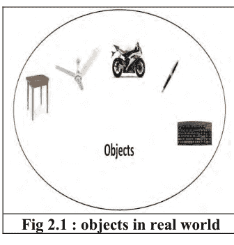

# Java 中的 OOP 概念

```java

public void setAge( int age )

{

    puppyAge = age;

}

```

```java

public int getAge()

{

    System.out.println("Puppy's age is :" + puppyAge );

    return puppyAge;

}

```

```java

public static void main(String[] args)

{

    /* 创建对象 */

    Puppy myPuppy = new Puppy("tommy");

    /* 调用类方法获取狗的年龄 */

    myPuppy.setAge(2);

    /* 调用另一个类方法获取狗的年龄 */

    myPuppy.getAge();

    /* 你可以按照如下方式访问实例变量 */

    System.out.println("Variable Value :" + myPuppy.puppyAge);

}


如果我们编译并运行上述程序，它将产生以下结果：

输出：
```
Puppy's age is :2
Variable Value : 2
```

# 对象与类示例：类内部的 main

在这个示例中，我们创建了一个 `Student` 类，它包含两个数据成员：`id` 和 `name`。我们通过 `new` 关键字创建 `Student` 类的对象并打印对象的值。在这里，我们在类内部创建了 `main()` 方法。

文件名：`Student.java`

```java
class Student {
    int id = 20; // 字段或数据成员或实例变量
    String name = "msc";

    public static void main(String args[]) {
        Student s1 = new Student(); // 创建一个 Student 类对象
        System.out.println(s1.id); // 通过引用变量访问成员
        System.out.println(s1.name);
    }
}
```

### 输出：
```
0
Null
```

# 对象与类示例：类外部的 main

在实际开发中，我们创建类并在另一个类中使用它。这是一种更好的方法。让我们在类外部创建 main 方法。

文件名：`Student.java`

```java
class Student {
    int id = 20; // 字段或数据成员或实例变量
    String name = "msc";
}

class TestStudent {
    public static void main(String args[]) {
        Student s1 = new Student(); // 创建一个 Student 类对象
        System.out.println(s1.id); // 通过引用变量访问成员
        System.out.println(s1.name);
    }
}
```

```java
e2.display();
e3.display();
}
}
```

输出：

| 101 | ajeet | 45000.0 |
| 102 | irfan | 25000.0 |
| 103 | nakul | 55000.0 |

# 对象与类示例：矩形

另一个维护 `Rectangle` 类记录的示例。

文件：`TestRectangle1.java`

```java
class Rectangle {
    int length;
    int width;

    void insert(int l, int w) {
        length = l;
        width = w;
    }

    void calculateArea() {
        System.out.println(length * width);
    }
}

class TestRectangle1 {
    public static void main(String args[]) {
        Rectangle r1 = new Rectangle();
        Rectangle r2 = new Rectangle();
        r1.insert(11, 5);
        r2.insert(3, 15);
        r1.calculateArea();
        r2.calculateArea();
    }
}
```

[http://www.javatpoint.com/opr/test.jsp?filename=TestRectangle1]

输出：
```
55
45
```

# JAVA 中的 OOPS 概念

## 2.2 JAVA 中的继承

继承是面向对象编程（OOP）的一个重要柱。它是 Java 中的一种机制，允许一个类继承另一个类的特征（字段和方法）。

重要术语：

- **超类 (Super Class)**：被继承特征的类被称为超类（或基类或父类）。
- **子类 (Sub Class)**：继承另一个类的类被称为子类（或派生类、扩展类或子类）。子类可以在超类字段和方法的基础上，添加它自己的字段和方法。
- **可重用性 (Reusability)**：继承支持“可重用”的概念，即当我们想要创建一个新类，并且已经有一个类包含了我们需要的某些代码时，我们可以从现有类派生出新类。通过这种方式，我们重用了现有类的字段和方法。

如何在 Java 中使用继承：

用于继承的关键字是 `extends`。

语法：
```java
class derived-class extends base-class {
    // methods and fields
}
```

示例：在下面的继承示例中，类 `Bicycle` 是基类，类 `MountainBike` 是继承 `Bicycle` 类的派生类，类 `Test` 是运行程序的驱动类。

```java
// 用于说明继承概念的基类的 Java 程序
class Bicycle {
    // Bicycle 类有两个字段
    public int gear;
    public int speed;

    // Bicycle 类有一个构造函数
    public Bicycle(int gear, int speed) {
        this.gear = gear;
        this.speed = speed;
    }

    // Bicycle 类有三个方法
    public void applyBrake(int decrement) {
        speed -= decrement;
    }

    public void speedUp(int increment) {
        speed += increment;
    }

    // 用于打印 Bicycle 信息的 toString() 方法
    public String toString() {
        return ("No of gears are " + gear + "\n" + "speed of bicycle is " + speed);
    }
}

// 派生类
class MountainBike extends Bicycle {
    // MountainBike 子类增加了一个字段
    public int seatHeight;

    // MountainBike 子类有一个构造函数
    public MountainBike(int gear, int speed, int startHeight) {
        // 调用基类(Bicycle) 构造函数
        super(gear, speed);
        seatHeight = startHeight;
    }

    // MountainBike 子类增加了一个方法
    public void setHeight(int newValue) {
        seatHeight = newValue;
    }

    // 重写 Bicycle 的 toString()
    // 以打印信息
    @Override
    public String toString() {
        return (super.toString()) + "\nseat height is " + seatHeight;
    }
}

// 驱动类
public class Test {
    public static void main(String args[]) {
        MountainBike mb = new MountainBike(3, 100, 25);
        System.out.println(mb.toString());
    }
}
```

# 输出：
```
No of gears are 3
speed of bicycle is 100
seat height is 25
```

在上面的程序中，当创建一个 `MountainBike` 类的对象时，子类所有方法和字段的副本在该对象中获取内存。这就是为什么通过使用子类的对象，我们也可以访问超类的成员。请注意，在继承过程中只创建了子类的对象，而不是超类的对象，如图 2.3 所示。

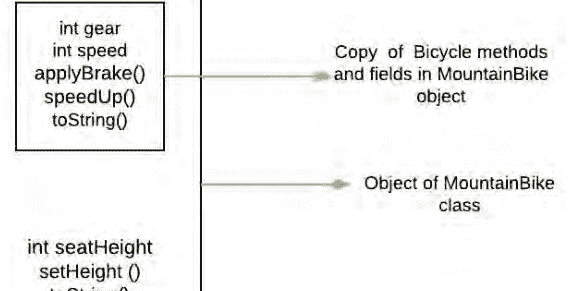

图 2.3：继承

在实践中，Java 中结合使用继承和多态以实现代码的高性能和可读性。

## 2.2.1 Java 中的继承类型

以下是 Java 支持的不同继承类型。

1. **单继承 (Single Inheritance)**：在单继承中，子类继承一个超类的特征。在下面的图中，类 A 作为子类 B 的基类。
2. **多级继承 (Multilevel Inheritance)**：在多级继承中，子类作为另一个子类的基类。
3. **层级继承 (Hierarchical Inheritance)**：在层级继承中，一个超类有多个子类。
4. **多继承 (Multiple Inheritance)**：在多继承中，一个类继承自多个超类。Java 不支持类的多继承，但通过接口支持它。

```java
C obj = new C();
obj.msg(); // 现在将调用哪个 msg() 方法？
}
```

编译时错误

## 2.3 多态

多态是对象表现出多种形式的能力。在面向对象编程（OOP）中，多态最常用的用法是使用父类引用来引用子类对象。任何能够通过多个 IS-A 测试的 Java 对象都被认为是多态的。如图 2.9 所示，Java 中有两种类型的多态。

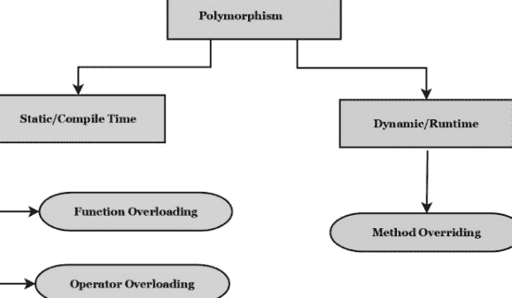

图 2.9：多态的类型

编译时多态是在编译过程中解决的多态。通过类的引用变量调用方法重载的方法。编译时多态通过方法重载和运算符重载来实现。

### 2.3.1 方法重载

我们可以拥有一个或多个同名的方法，这些方法仅可以通过参数名称、类型或顺序来区分。当一个类具有许多同名但参数不同的方法时，就会发生方法重载。如果两个或多个方法具有其他数量的参数、不同的数据类型，或者参数数量和数据类型都不同，它们可以同名。

示例：
```java
void gfg() { ... }
void gfg(int num1) { ... }
void gfg(float num1) { ... }
void gfg(int num1, float num2) { ... }
```

# JAVA 中的面向对象概念

#### (a) 通过改变参数数量进行方法重载

在这种类型中，方法重载通过在函数调用中使用具有不同数量参数的方法来重载方法来实现。

示例：
```java
show(char a)
show(char a, char b)
```

在示例中，第一个 `show` 方法有一个参数，第二个方法有两个参数。当调用函数时，编译器会查看参数的数量并决定如何解析方法调用。

```java
// 演示通过改变参数数量进行方法重载工作原理的 Java 程序
public class MethodOverloading {
    // 1 个参数
    void show(int num1) {
        System.out.println("number 1 " + num1);
    }

    // 2 个参数
    void show(int num1, int num2) {
        System.out.println("number 1 " + num1 + " number 2 : " + num2);
    }

    public static void main(String[] args) {
        MethodOverloading obj = new MethodOverloading();
        // 第1 个 show 函数
        obj.show(3);
        // 第2 个 show 函数
        obj.show(4, 5);
    }
}
```

输出：
```
number 1 : 3
number 1 : 4 number 2 : 5
```

在上面的示例中，我们通过改变几个参数来实现方法重载。我们创建了两个方法，`show(int num1)` 和 `show(int num1, int num2)`。在 `show(int num1)` 方法中显示一个数字，而 `void show(int num1, int num2)` 方法显示两个数字。

#### (b) 通过改变参数的数据类型进行方法重载

在这种类型中，方法重载通过在函数调用中使用不同类型参数的方法来重载方法来实现。

示例：
```java
show(float a, int b)
show(int a, int b)
```

在上面的示例中，第一个 `show` 方法有两个 float 参数，而第二个 `show` 方法有两个 int 参数。当调用函数时，编译器会查看输入参数的数据类型并决定如何解析方法调用。

程序：
```java
// 演示通过改变参数的数据类型进行方法重载工作原理的 Java 程序
public class MethodOverloading {
    // 此函数的参数是整数类型
    static void show(int a, int b) {
        System.out.println("This is integer function ");
    }

    // 此函数的参数是 float 类型
    static void show(double a, double b) {
        System.out.println("This is double function ");
    }

    public static void main(String[] args) {
        // 第1 个 show 函数
        show(1, 2);
        // 第2 个 show 函数
        show(1.2, 2.4);
    }
}
```

输出：
```
This is integer function
This is double function
```

在上面的示例中，我们更改了两个函数参数的类型类型。在第一个 `show()` 函数中，参数的数据类型是 `int`。在输入整数类型后，输出将是‘This is integer function.’。在第二个 `show()` 函数中，参数的数据类型是 `double`。在输入 double 类型后，输出将是‘This is double function.’

#### (c) 通过改变参数的顺序

在这种类型中，重载依赖于参数的顺序。

示例：
```java
show(int a, float b)
show(float a, int b)
```

在上面的示例中，第一个声明中使用了参数 `int` 和 `float`。在第二个声明中参数也是 `int` 和 `float`，但它们在参数列表中的顺序不同。

```java
// 演示通过改变参数顺序进行方法重载工作原理的 Java 程序
public class MethodOverloading {
    // 此函数的参数是 int 和 float
    static void show(int a, float b) {
        System.out.println("Sequence is int, float");
    }

    static void show(float a, int b) {
        System.out.println("Sequence is float, int");
    }

    public static void main(String[] args) {
        show(10, 5.5f);
        show(5.5f, 10);
    }
}
```

输出：
```
Sequence is int, float
Sequence is float, int
```

# JAVA 中的面向对象概念

### 2.3.2 运算符重载

如果运算符被赋予新的含义，就可以被重载。在 Java 中，`+` 运算符被重载。它可以相加或拼接字符串。

```java
// 演示运算符重载工作原理的 Java 程序
class GFG {
    // 相加两个整数
    void add(int a, int b) {
        int sum = a + b;
        System.out.println("Addition of integer: " + sum);
    }

    // 拼接两个字符串
    void add(String s1, String s2) {
        String con = s1 + s2;
        System.out.println("Concatenated strings: " + con);
    }

    public static void main(String args[]) {
        GFG obj = new GFG();
        // 数字相加
        obj.add(10, 10);
        // 字符串拼接
        obj.add("Operator ", "overloading");
    }
}
```


# 编译时多态的优点

- 它提高了代码清晰度并允许相似过程使用相同的名称。
- 它执行速度更快，在编译过程中早期就能发现。

编译时多态唯一的缺点是它不包含继承。

## Java 中的运行时多态

运行时多态或动态调度是一个在运行时解析重写方法调用（而不是在编译时）的过程。在这个过程中，通过父类的引用变量调用重写的方法。要调用方法的确定基于引用变量所引用的对象。

### 向上转型

如果父类的引用变量引用子类的对象，则被称为向上转型。例如：

```java
class A {}

class B extends A {}

A a = new B(); // 向上转型
```

对于向上转型，我们可以使用类类型或接口类型的引用变量。例如：

```java
interface I {}

class A {}

class B extends A implements I {}
```

在这里，`B` 类的关系如下：

- `B` 是 `A` (IS-A)
- `B` 是 `I` (IS-A)
- `B` 是 `Object` (IS-A)

## Java 运行时多态示例

在这个示例中，我们创建了 `Bike` 和 `Splendor` 类。`Splendor` 类继承自 `Bike` 类并重写了它的 `run()` 方法。我们通过父类的引用变量调用 `run` 方法。由于它指向子类对象且变量为父类，因此在运行时调用了子类方法。由于方法的调用是由 JVM 确定的，因此被称为运行时多态。

```java
class Bike {
    void run() {
        System.out.println("running");
    }
}

class Splendor extends Bike {
    void run() {
        System.out.println("running safely with 60km");
    }
}

public class Main {
    public static void main(String args[]) {
        Bike b = new Splendor(); // 向上转型
        b.run();
    }
}
```

**输出：**
```
running safely with 60km
```

## 动态绑定

将方法调用连接到方法体被称为绑定。绑定有两种类型：

1. 静态绑定（也称为早期绑定）
2. 动态绑定（也称为后期绑定）

### 静态绑定

当对象的类型在编译时（通过编译器）确定时，被称为静态绑定。如果类中存在任何 `private`、`final` 或 `static` 方法，则存在静态绑定。

**静态绑定示例：**

```java
class Dog {
    private void eat() {
        System.out.println("dog is eating...");
    }
}

public class Main {
    public static void main(String args[]) {
        Dog d1 = new Dog();
        d1.eat();
    }
}
```

### 动态绑定

当对象的类型在运行时确定时，被称为动态绑定。

**动态绑定示例：**

```java
class Animal {
    void eat() {
        System.out.println("animal is eating...");
    }
}

class Dog extends Animal {
    void eat() {
        System.out.println("dog is eating...");
    }
}

public class Main {
    public static void main(String args[]) {
        Animal a = new Dog();
        a.eat();
    }
}
```

**输出：**
```
dog is eating...
```

## 泛型编程

泛型编程引入于 J2SE 5，用于处理类型安全的对象。它通过在编译时检测错误使代码更加稳定。在泛型之前，我们可以在集合中存储任何类型的对象（即非泛型）。现在，泛型强制 Java 程序员存储特定类型的对象。泛型有很多优点，如下：

1. **类型安全**：泛型允许我们只持有单一类型的对象。没有泛型的情况下，我们可以存储任何类型的对象。

   ```java
   // 无泛型
   List list = new ArrayList<>();
   list.add(10);
   list.add("10");

   // 有泛型
   List<Integer> list = new ArrayList<>();
   list.add(10);
   ```

2. **不需要类型转换**：不需要对对象进行类型转换。

   ```java
   // 无泛型
   List list = new ArrayList<>();
   list.add("hello");
   String s = (String) list.get(0); // 类型转换

   // 有泛型
   List<String> list = new ArrayList<>();
   list.add("hello");
   String s = list.get(0);
   ```

3. **编译时检查**：在编译时进行检查，因此运行时不会出现问题。

   ```java
   List<String> list = new ArrayList<>();
   list.add("hello");
   list.add(10); // 编译错误
   ```

### 在 Java 中使用泛型的语法

`Interface<Type>`

在这里，我们使用的是 `ArrayList`，但你可以使用 `LinkedList`、`HashSet`、`HashMap` 等集合。

```java
import java.util.*;

class TestGenerics {
    public static void main(String args[]) {
        ArrayList<String> list = new ArrayList<>();
        list.add("rahul");
        list.add("jai");
        // list.add(10); // 编译错误

        String s = list.get(1); // 不需要类型转换
        Iterator<String> itr = list.iterator();
        while (itr.hasNext()) {
            System.out.println(itr.next());
        }
    }
}
```

**输出：**
```
rahul
jai
```

### 泛型的 Map

现在我们将使用泛型使用 `Map`。这里需要传递键和值。

```java
import java.util.*;

class TestGenerics {
    public static void main(String args[]) {
        Map<Integer, String> map = new HashMap<>();
        map.put(1, "vijay");
        map.put(2, "ankit");
        
        for (Map.Entry<Integer, String> entry : map.entrySet()) {
            System.out.println(entry.getKey() + " " + entry.getValue());
        }
    }
}
```

**输出：**
```
1 vijay
2 ankit
```

## 泛型类

可以引用任何类型的类被称为泛型类。在这里，我们使用 `T` 类型参数创建特定类型的泛型类。

### 创建泛型类

```java
class MyGen<T> {
    T obj;
    void add(T obj) { this.obj = obj; }
    T get() { return obj; }
}
```

`T` 类型表示它可以引用任何类型（如 `String`、`Integer` 和 `Employee`）。指定的类型将用于存储和检索数据。

### 使用泛型类

```java
class TestGenerics {
    public static void main(String args[]) {
        MyGen<Integer> m = new MyGen<Integer>();
        m.add(2);
        // m.add("vivek"); // 编译错误
        System.out.println(m.get());
    }
}
```

**输出：**
```
2
```

### 类型参数

彻底学习类型参数的命名规范很重要。常见的类型参数如下：

- `T` - Type（类型）
- `E` - Element（元素）
- `K` - Key（键）
- `N` - Number（数字）
- `V` - Value（值）

## 泛型方法

像泛型类一样，我们可以创建一个接受任何类型参数的泛型方法。在这里，参数的范围限制在声明它的方法中。它允许静态以及非静态方法。

**Java 泛型方法打印数组元素的简单示例：**

```java
public class TestGenerics4 {
    public static <E> void printArray(E[] elements) {
        for (E element : elements) {
            System.out.println(element);
        }
        System.out.println();
    }

    public static void main(String args[]) {
        Integer[] intArray = { 10, 20, 30, 40, 50 };
        Character[] charArray = { 'J', 'A', 'V', 'A', 'T', 'P', 'O', 'T', 'N', 'T' };

        System.out.println("Printing Integer Array");
        printArray(intArray);

        System.out.println("Printing Character Array");
        printArray(charArray);
    }
}
```

**输出：**
```
Printing Integer Array
10
20
30
40
50

Printing Character Array
J
A
V
A
T
P
O
T
N
T
```

## Java 泛型中的通配符

`?`（问号）符号代表通配符元素。它意味着任何类型。如果我们写 `<? extends Number>`，意味着 `Number` 的任何子类，例如 `Integer`、`Float` 和 `Double`。现在我们可以通过任何子类对象调用 `Number` 的方法。我们可以将通配符作为参数、字段、返回类型或局部变量的类型。但是不允许将通配符作为泛型方法调用的类型参数、泛型类的创建或超类型。

### 示例

```java
import java.util.*;

abstract class Shape {
    abstract void draw();
}

class Rectangle extends Shape {
    void draw() { System.out.println("drawing rectangle"); }
}

class Circle extends Shape {
    void draw() { System.out.println("drawing circle"); }
}

class GenericTest {
    // 创建一个只接受 Shape 子类的列表方法
    public static void drawShapes(List<? extends Shape> lists) {
        for (Shape s : lists) {
            s.draw(); // 通过子类实例调用 Shape 类的方法
        }
    }

    public static void main(String args[]) {
        List<Rectangle> list1 = new ArrayList<Rectangle>();
        list1.add(new Rectangle());

        List<Circle> list2 = new ArrayList<Circle>();
        list2.add(new Circle());
        list2.add(new Circle());

        drawShapes(list1);
        drawShapes(list2);
    }
}
```

**输出：**
```
drawing rectangle
drawing circle
drawing circle
```

### 上界通配符

上界通配符的目的是减少变量的限制。它将未知类型限制为特定类型或该类型的子类型。通过声明通配符 `?` 后紧跟 `extends`（类）或 `implements`（接口）关键字，最后跟其上界来实现。

**语法：**
```java
List<? extends Number>
```

在这里：
- `?` 是通配符字符。
- `extends` 是一个关键字。
- `Number` 是 `java.lang` 包中的一个类。

假设我们想为 `Number` 及其子类型（如 `Integer`、`Double`）的 `List` 编写方法。使用 `List<? extends Number>` 适用于 `Number` 类型或其任何子类的列表，而 `List<Number>` 仅适用于 `Number` 列表。因此，`List<? extends Number>` 比 `List<Number>` 限制更少。

#### 上界通配符示例

在这个示例中，我们使用上界通配符为 `List<Integer>` 和 `List<Double>` 编写方法。

```java
import java.util.ArrayList;

public class UpperBoundWildcard {
    private static Double add(ArrayList<? extends Number> num) {
        double sum = 0.0;
        for (Number n : num) {
            sum = sum + n.doubleValue();
        }
        return sum;
    }

    public static void main(String[] args) {
        ArrayList<Integer> l1 = new ArrayList<Integer>();
        l1.add(10);
        l1.add(20);
        System.out.println("displaying the sum = " + add(l1));

        ArrayList<Double> l2 = new ArrayList<Double>();
        l2.add(30.0);
        l2.add(40.0);
        System.out.println("displaying the sum = " + add(l2));
    }
}
```

**输出：**
```
displaying the sum = 30.0
displaying the sum = 70.0
```

### 无界通配符

无界通配符类型代表未知类型的列表，例如 `List<?>`。这种方法在以下场景中非常有用：

- 当实现的方法是通过使用 `Object` 类提供的功能时。
- 当泛型类包含不依赖于类型参数的方法时。

### 无界通配符示例

*(原文此处结束，未提供具体代码示例)*


```java
import java.util.Arrays;
import java.util.List;

public class UnboundedWildcard
{
    public static void display(List<?> list)
    {
        for(Object o:list)
        {
            System.out.println(o);
        }
    }

    public static void main(String[] args) {
        List<Integer> list1=Arrays.asList(1,2,3);
        System.out.println("displaying the Integer values");
        display(list1);
        List<String> list2=Arrays.asList("One","Two","Three");
        System.out.println("displaying the String values");
        display(list2);
    }
}
```

### 输出

```
displaying the Integer values
1
2
3
displaying the String values
One
Two
Three
```

## 下界通配符

下界通配符的目的是将未知类型限制为特定类型或该类型的父类型。通过声明通配符字符（`? super`）后紧跟 `super` 关键字，最后跟其下界来实现。

### 语法

```java
List<? super Integer>
```

在这里：

- `?` 是通配符字符。
- `super` 是一个关键字。
- `Integer` 是一个包装类。

假设我们想为 `Integer` 及其父类型（`Number`、`Object`）的列表编写方法。虽然 `List<? super Integer>` 适用于 `Integer` 类型或其任何父类的列表，但 `List<Integer>` 仅适用于 `Integer` 类型的列表。因此，`List<? super Integer>` 比 `List<Integer>` 限制更少。

## 下界通配符示例

在这个示例中，我们使用下界通配符为 `List<Integer>` 和 `List<Number>` 编写方法。

```java
import java.util.Arrays;
import java.util.List;

public static class LowerBoundWildcard
{
    public static void addNumbers(List<? super Integer> list)
    {
        for(Object n:list)
        {
            System.out.println(n);
        }
    }
    public static void main(String[] args)
    {
        List<Integer> l1=Arrays.asList(1,2,3);
        System.out.println("displaying the Integer values");
        addNumbers(l1);

        List<Number> l2=Arrays.asList(1.0,2.0,3.0);
        System.out.println("displaying the Number values");
        addNumbers(l2);
    }
}
```

### 输出

```
displaying the Integer values
1
2
3
displaying the Number values
1.0
2.0
3
```

## 抽象类示例

```java
class Bike12
{
    abstract void run();
}
```

**输出：**

编译时错误

**规则：** 如果你扩展了任何包含抽象方法的抽象类，你必须提供该方法的实现，或者将该类声明为抽象类。

**抽象类的另一个真实场景：** 抽象类也可以用于提供接口的某些实现。在这种情况下，最终用户可能被强制重写接口的所有方法。

**注意：** 如果你是 Java 初学者，请先学习接口并跳过此示例。

```java
interface A
{
    void a();
    void b();
    void c();
    void d();
}
```

```java
abstract class B implements A
{
    public void c(){System.out.println("I am C");}
}
```

```java
class M extends B
{
    public void a(){System.out.println("I am a");}
    public void b(){System.out.println("I am b");}
    public void d(){System.out.println("I am d");}
}
```

```java
class Test5
{
    public static void main(String args[])
    {
        A a=new M();
        a.a();
        a.b();
        a.c();
        a.d();
    }
}
```

**输出：**

```
I am a
I am b
I am c
I am d
```

# JAVA 中的接口

接口是 Java 中的一种引用类型。它与类相似。它是一个抽象方法的集合。类实现接口，从而继承接口的抽象方法。通过抽象方法，接口还可以包含常量、默认方法、静态方法和嵌套类型。方法体只存在于默认方法和静态方法中。

编写接口与编写类相似。类描述了对象的属性和行为。接口包含了类将**实现**的行为。除非该类是抽象的，否则接口的所有方法都需要在类中定义。接口在以下方面与类相似：

- 接口可以包含任意数量的方法。
- 接口写在扩展名为 `.java` 的文件中，接口的名称与文件名匹配。
- 接口的字节码出现在 `.class` 文件中。
- 接口出现在包中，其对应的字节码文件必须位于与包名匹配的目录结构中。

然而，接口在几个方面与类不同，包括：

- 你不能实例化接口。
- 接口不包含任何构造函数。
- 接口中的所有方法都是抽象的。
- 接口不能包含实例字段。接口中可以出现的字段必须同时被声明为 `static` 和 `final`。
- 接口不是被类扩展；它是由类实现的。
- 接口可以扩展多个接口。

## 声明接口

`interface` 关键字用于声明接口。这里有一个声明接口的简单示例：

```java
/* 文件名: NameOfInterface.java */
import java.lang.*;
// 任意数量的导入语句

public interface NameOfInterface {
  // 任意数量的 final, static 字段
  // 任意数量的抽象方法声明
}
```

接口具有以下属性：

- 接口是隐式抽象的。声明接口时不需要使用 `abstract` 关键字。
- 接口中的每个方法也是隐式抽象的，因此不需要 `abstract` 关键字。
- 接口中的方法是隐式公共的。

### 示例

```java
/* 文件名: Animal.java */
interface Animal {
  public void eat();
  public void travel();
}
```

## 实现接口

当一个类实现接口时，你可以认为该类正在签署一份契约，同意执行接口特定的行为。如果一个类没有执行接口的所有行为，则该类必须自己声明为抽象类。类使用 `implements` 关键字来实现接口。`implements` 关键字出现在类声明中，`extends` 部分之后。

```java
/* 文件名 : MammalInt.java */
public class MammalInt implements Animal {

  public void eat() {
    System.out.println("Mammal eats");
  }

  public void travel() {
    System.out.println("Mammal travels");
  }

  public int noOfLegs() {
    return 0;
  }

  public static void main(String args[]) {
    MammalInt m = new MammalInt();
    m.eat();
  }
}
```

### 输出

```
Mammal eats
Mammal travels
```

在重写接口中定义的方法时，有几条规则需要遵循：

- 检查异常（Checked exceptions）不应在实现方法中声明接口方法已声明的异常或其子类。
- 在重写方法时，应保持接口方法的签名以及相同的返回类型或子类型。

实现类本身可以是抽象的，如果是这样，则接口方法不需要实现。

在实现接口时，有几条规则：

- 一个类可以同时实现多个接口。
- 一个类只能扩展一个类，但可以实现许多接口。
- 接口可以扩展另一个接口，就像类可以扩展另一个类一样。

## 扩展接口

接口可以扩展另一个接口，就像类可以扩展另一个类一样。

### 使用接口的多重继承

当对象或类基于另一个对象或类。使用相同的实现公共类和接口。对象或类通过继承产生层次结构。多重继承允许一个类拥有多个父类。它是通过接口实现的。

### 语法

```java
public interface A {
    // 执行操作
}
public interface B extends A {
    // 执行操作
}
```

```java
public interface C extends A {
    // 执行操作
}
```

```java
interface vehicleone {
    int speed=90;
    public void distance();
}

interface vehiclet {
    int distance=100;
    public void speed();
}

class Vehicle implements vehicleone,vehiclet {
    public void distance() {
        int distance=speed=100;
        System.out.println("distance travelled is "+distance);
    }
    public void speed() {
        int speed=distance/100;
    }
}
```

### 使用接口的多重继承示例程序

```java
class MultipleInheritanceUsingInterface {
    public static void main(String args[]){
        Vehicle obj = new Vehicle();
        System.out.println("Vehicle");
        obj.distance();
        obj.speed();
    }
}
```

## 如何通过默认方法实现多重继承？

多重继承是某些面向对象语言的一种特性，对象或类可以从多个父对象或父类继承特征和行为。我们知道在 Java 中（直到 JDK 7），继承是通过 `extends` 关键字支持的，它用于从父类创建子类。你不能扩展两个类。

例如，在下面的代码中，`Animal` 类没有定义任何自己的行为；相反它从父接口继承行为。这就是多重继承。

```java
package com.howtodoinjava.examples;

interface Moveable
{
    default void moveFast() {
        System.out.println("I am moving fast, buddy !!");
    }
}

interface Crawlable
{
    default void crawl() {
        System.out.println("I am crawling !!");
    }
}
```


```java
public class Animal implements Moveable, Crawlable
{
    public static void main(String[] args) {
        Animal self = new Animal();

        self.moveFast();
        self.crawl();
    }
}
```

### 可能的冲突及其解决方法

在示例中，我们有两个不同的接口和两个不同的方法——所以没有冲突。如果两个接口都决定定义一个同名的新方法，它们可以毫无问题地定义。但当 `Animal` 实例调用同名方法时，将调用哪一个呢？这就是冲突的情况。

```java
package com.howtodoinjava.examples;

interface Moveable
{
    default void run() {
        System.out.println("I am running, kid !!");
    }
}

interface Crawlable
{
    default void run(){
        System.out.println("I am running, daddy !!");
    }
}

public class Animal implements Moveable, Crawlable {
    public static void main(String[] args) {
        Animal self = new Animal();
        // 当执行以下语句时会发生什么
        self.run();
    }
}
```

为了解决上述冲突，调用者必须决定它想要调用哪个 `run()` 方法，然后使用接口的引用如下所示代码：

```java
Moveable.super.run(); // 调用 Moveable 的 run() 方法
Crawlable.super.run(); // 调用 Crawlable 的 run() 方法
```

### `super` 是一个关键字

Java 中的 `super` 关键字是一个引用变量，用于引用直接父类对象。每当你创建一个子类的实例时，系统都会隐式地创建一个父类的实例，该实例通过 `super` 引用变量进行引用。

- 它被用在子类方法内部来调用在父类中定义的方法。父类的私有方法无法被调用。`super` 关键字仅可以调用公共（`public`）和受保护（`protected`）的方法。
- 它也用于类构造函数来调用其父类的构造函数。

语法：

```java
super.method-name([零或多个参数]);
```

或者：

```java
super([零或多个参数]);
```

例如：

```java
public class SuperClass
{
    public void printHello()
    {
        System.out.println("Hello from SuperClass");
        return;
    }
}

public class SubClass extends SuperClass
{
    public void printHello()
    {
        super.printHello();
        System.out.println("Hello from SubClass");
        return;
    }
    public static void main(String[] args)
    {
        SubClass obj = new SubClass();
        obj.printHello();
    }
}
```

输出：

| 代码列表 2 的命令 | 代码列表 2 的输出 |
| :--- | :--- |
| `$ java SubClass` | Hello from SuperClass |
| | Hello from SubClass |

### `java super` 关键字的用法

1. `super` 可以用来引用父类实例变量。
2. `super` 可以用来调用直接父类方法。
3. `super()` 可以用来调用直接父类构造函数。

#### 1) `super` 用于引用直接父类实例变量

我们可以使用 `super` 关键字来访问父类的数据成员或字段。如果父类和子类具有相同的字段，则可以使用它。

```java
class Animal
{
    String color = "white";
}

class Dog extends Animal {
    String color = "black";
    void printColor() {
        System.out.println(color); // 打印 color 的颜色
        System.out.println(super.color); // 打印父类的颜色
    }
}

class Test {
    public static void main(String[] args) {
        Dog d = new Dog();
        d.printColor();
    }
}
```

输出：

```
white
black
```

在上面的示例中，`super` 用于访问父类的实例变量。当父类和子类具有相同字段时，就会使用它。

#### 2) `super` 可以用来调用直接父类方法

`super` 关键字可以用来访问父类的方法。如果子类重写了父类的方法，则可以使用它。

```java
public class SuperClass
{
    public void printHello()
    {
        System.out.println("Hello from SuperClass");
        return;
    }
}

public class SubClass extends SuperClass
{
    public void printHello()
    {
        super.printHello();
        System.out.println("Hello from SubClass");
        return;
    }
    public static void main(String[] args)
    {
        SubClass obj = new SubClass();
        obj.printHello();
    }
}
```

输出：

```
Hello from SuperClass
Hello from SubClass
```

在上面的示例中，`super` 用于调用父类的方法。

#### 3) `super()` 可以用来调用直接父类构造函数

`super()` 可以用来调用直接父类的构造函数。

```java
public class SuperClass
{
    public SuperClass() {
        System.out.println("SuperClass constructor");
    }
}

public class SubClass extends SuperClass
{
    public SubClass() {
        super();
        System.out.println("SubClass constructor");
    }
    public static void main(String[] args)
    {
        SubClass obj = new SubClass();
    }
}
```

输出：

```
SuperClass constructor
SubClass constructor
```

在上面的示例中，`super()` 用于调用直接父类的构造函数。

# JAVA 中的面向对象概念

```java
public void msg() {System.out.println("Hello");}
```

```java
// 保存为 B.java
package mypack;
class B {
    public static void main(String args[]){
        pack.A obj = new A(); // 使用完全限定类名
        obj.msg();
    }
}
```

# 输出

```
Hello
```

> **注意**：如果你导入了一个包，子包不会被自动导入。

### Java 中的子包（Subpackage）

如果你导入了一个包，该包中的所有类和接口都会被导入，但其子包中的类和接口除外。因此，你需要也导入子包，包内部的包被称为子包。应该创建子包来对包进行进一步的分类，如图 2.13 所示。

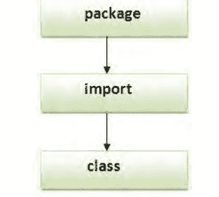

让我们来看一个例子，Sun Microsystems 系统定义了一个名为 `java` 的包，其中包含许多类，如 `System`、`String`、`Reader`、`Writer`、`Socket` 等。这些类代表特定的组，例如 `Reader` 和 `Writer` 类用于输入/输出操作，`Socket` 和 `ServerSocket` 类用于网络连接等。因此，Sun 将 `java` 包分为 `lang`、`net`、`io` 等子包，并将与输入/输出相关的类放在 `io` 包中，将 `Server` 和 `ServerSocket` 类放在 `net` 包中，以此类推。

> 图 2.13：Java 中的子包

程序的顺序必须是包（`package`），然后导入（`import`），最后是类（`class`）。

#### 子包示例

```java
package com.javapoint.core;

class Simple {
    public static void main(String args[]) {
        System.out.println("Hello subpackage");
    }
}
```

编译：`javac -d . Simple.java`

运行：`java com.javapoint.core.Simple`

# 输出

```
Hello subpackage
```

# 如何将类文件发送另一个目录或驱动器？

有一种场景：我想把 `A.java` 源文件的类文件放在 C 盘的 `classes` 文件夹中。例如图 2.14 所示：

```java
// 保存为 Simple.java
package mypack;
public class Simple
{
    public static void main(String[] args)
    {
        System.out.println("Welcome to package");
    }
}
```

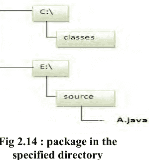

# 编译

```bash
e:\sources> javac -d c:\classes Simple.java
```

# 运行

要从 `e:\source` 目录运行此程序，你需要设置类文件所在目录的类路径。

```bash
e:\sources> set classpath=c:\classes
e:\sources> java mypack.Simple
```

# 通过 java 的 `-classpath` 参数运行此程序的另一种方法

- `-classpath` 参数可以与 `java` 和 `javac` 工具一起使用。

要从 `e:\source` 目录运行此程序，你可以使用 `java` 的 `-classpath` 参数，它告诉程序去查找类文件。例如：

```bash
e:\sources> java -classpath c:\classes mypack.Simple
```

# 输出

```
Welcome to package
```

# 加载类文件或 jar 文件的方法

加载类文件的方法有两种：临时和永久。

- 临时
    - 通过在命令提示符中设置 `classpath`
    - 通过 `-classpath` 参数
- 永久
    - 通过在环境变量中设置 `classpath`
    - 通过创建包含所有类文件的 `jar` 文件，并将 `jar` 文件复制到 `jre/lib/ext` 文件夹中。

> **规则**：一个 Java 源文件中只能有一个公共类，且它必须以该公类的类命名保存。

```java
// 保存为 C.java 否则会发生编译时错误
class A {}
class B {}
public class C {}
```

# 如何在包中放置两个公类？

如果你想在一个包中放置两个公类，可以创建两个包含一个公类（`public class`）的 java 源文件，但保持包名相同即可。例如：

```java
// 保存为 A.java
package javapoint;
public class A {}

// 保存为 B.java
package javapoint;
public class B {}
```

# 2.9 util 包

它包含了集合框架、遗留集合类、事件模型、日期时间设施、国际化以及杂项实用类（字符串分词器、随机数生成器和位数组），并可以使用 `java.util.*` 导入类，其中 `*` 是 `util` 包中的以下类之一。

以下是 `java.util` 包中的重要类：

1. `AbstractCollection`：此类提供了 `Collection` 接口的骨架实现，以减少实现该接口所需的工作量。
2. `AbstractList`：此类提供了 `List` 接口的骨架实现，以减少实现由“随机访问”数据存储（如数组）支持的接口所需的工作量。
3. `AbstractMap<K,V>`：此类提供了 `Map` 接口的骨架实现，以减少实现该接口所需的工作量。
4. `AbstractMap.SimpleEntry<K,V>`：维护键和值的条目（`Entry`）。
5. `AbstractMap.ImmutableEntry<K,V>`：维护不可变键和值的条目。
6. `AbstractQueue`：此类提供了某些队列操作的骨架实现。
7. `AbstractSequentialList`：此类提供了 `List` 接口的骨架实现，以减少实现由“顺序访问”数据存储支持的接口所需的工作量。
8. `ArrayDeque`：此类提供了 `Deque` 接口的骨架实现。
9. `ArrayList`：此类提供了动态数组的实现。
10. `Arrays`：此类提供了处理数组的实用方法。
11. `BitSet`：此类提供了位集合的实现。
12. `Calendar`：此类提供了日历字段的实现。
13. `Collections`：此类提供了操作集合的静态方法。
14. `Currency`：代表货币。
15. `Date`：此类代表特定的时间点。
16. `Dictionary`：此类是字典基类。
17. `EnumMap<K,V>`：用于枚举类型的 `Map` 实现。
18. `EnumSet`：用于枚举类型的 `Set` 实现。
19. `EventListener`：此类是事件监听器的标记接口。
20. `EventObject`：此类是事件基类。
21. `Formatter`：此类用于格式化输出。
22. `GregorianCalendar`：此类是日历的子类。
23. `HashMap<K,V>`：哈希表实现。
24. `IdentityHashMap<K,V>`：使用引用相等性的 `Map` 实现。
25. `LinkedHashMap<K,V>`：具有预测顺序的哈希表实现。
26. `LinkedHashSet`：具有预测顺序的 `Set` 实现。
27. `LinkedList`：双链表实现。
28. `Locale`：代表地理、政治或文化区域。
29. `Locale.Builder`：用于构建 `Locale` 实例。
30. `Objects`：此类包含操作对象的静态方法。
31. `PriorityQueue`：基于优先级堆的无界队列。
32. `Properties`：此类代表持久的属性集。
33. `PropertyPermission`：用于属性权限的类。
34. `PropertyResourceBundle`：使用属性文件管理资源的子类。
35. `Random`：此类的实例用于生成伪随机数流。
36. `ResourceBundle`：资源包包含特定语言的对象。
37. `ResourceBundle.Control`：定义了 `ResourceBundle` 在加载过程中调用的回调方法。
38. `Scanner`：一种使用正则表达式解析原始类型和字符串的简单扫描器。
39. `ServiceLoader`：简单的服务提供加载器。
40. `SimpleTimeZone`：`TimeZone` 的子类，代表带有格里高利日历的时区。
41. `Stack`：后进先出（LIFO）对象栈。
42. `StringTokenizer`：分词器类允许将字符串拆分为标记。
43. `Timer`：用于在后台线程中调度未来执行的设施。
44. `TimerTask`：可以调度 `Timer` 执行一次或重复执行的任务。
45. `TimeZone`：代表时间偏移，并带有夏令时。
46. `TreeMap<K,V>`：基于红黑树的 `NavigableMap` 实现。
47. `TreeSet`：基于 `TreeMap` 的 `NavigableSet` 实现。
48. `UUID`：代表不可变唯一标识符（`UUID`）的类。
49. `Vector`：此类实现了可增长的数组。
50. `WeakHashMap<K,V>`：使用弱键的 `Map` 接口实现。

# 事件与 GUI 编程

## 课程结构


# 事件与 GUI 编程：Java 中的事件处理、事件类型、鼠标和键盘事件、GUI 基础、面板、框架、布局管理器：流布局、边界布局、网格布局、GUI 组件如按钮、复选框、单选按钮、标签、文本区域、组合框、滚动条、窗口、菜单、Applet 及其生命周期、Swing 简介、异常处理机制。I/O 编程：文本与二进制 IO；二进制 IO 类。随机访问文件。

# 3.1 Java 中的事件处理

## 什么是事件？

事件是程序由于用户的某些操作或发生了其他事情从操作系统接收到的信号。以下是一些示例：

- 用户在键盘上按下按键。
- 用户关闭窗口。
- 来自网络的数据到达计算机的其中一个“端口”。

更广义地说，事件是某一时刻的状态变化。“事件”一词也指 `EventObject` 类的实例或该类的子类。因此，此类实例描述了特定时刻的状态变化。

另一种事件与变量值的变化有关。

## 什么是委托事件模型？

委托事件模型定义了生成和处理事件的标准且一致的机制：

- 监听器在事件源（`source`）处注册以接收事件通知。
- 源产生事件并将这些事件的通知发送给一个或多个监听器（实际上发送给所有注册了接收这些事件的监听器）。
- 当监听器接收到事件通知时，监听器处理（或“处理”）该事件并返回。

## 监听器类

理解 Java 事件模型工作原理的关键在于理解如何使用“监听器类”。监听器类可以通过以下方式定义：

- 实现监听器接口
- 扩展另一个监听器类

你必须确保任何监听器类都适当定义了监听方法，并且监听器类的实例已注册到它所监听的事件源。当源产生监听器对象正在监听的类型的事件时，内置机制会通知监听器对象。

## 如何实现事件处理器

每个事件处理器都需要三部分代码：

- 在事件处理器类的声明中，有一行代码指定该类实现了某个监听器接口或扩展了实现监听器接口的类。例如：

```java
public class MyClass implements ActionListener {
```

- 另一行代码将事件处理器类的实例注册为一个或多个组件的监听器。例如：

```java
someComponent.addActionListener(instanceOfMyClass);
```

- 在事件处理器类中，用几行代码实现监听器接口中的方法。例如：

```java
public void actionPerformed(ActionEvent e) {
    ...//对动作做出反应的代码...
}
```

事件处理器可以是匿名类的实例。通常，只有几行代码的事件处理器是使用匿名内部类实现的——即定义在另一个类的匿名类。匿名内部类起初可能会令人困惑，但一旦你习惯了它们，它们通过将事件处理器的实现保持在事件处理器注册的位置附近，从而使代码更加清晰。

# 3.2 事件与监听器（Java 事件处理）

改变对象的状态被称为事件。例如，点击按钮、拖动鼠标等。`java.awt` 包提供了许多用于事件处理的事件类和监听器接口，如表 3.1 所示。

## 表 3.1：Java 事件类和监听器接口

| 事件类 | 监听器接口 |
|---|---|
| `ActionEvent` | `ActionListener` |
| `MouseEvent` | `MouseListener` and `MouseMotionListener` |
| `MouseWheelEvent` | `MouseWheelListener` |
| `KeyEvent` | `KeyListener` |
| `ItemEvent` | `ItemListener` |
| `TextEvent` | `TextListener` |
| `AdjustmentEvent` | `AdjustmentListener` |
| `WindowEvent` | `WindowListener` |
| `ComponentEvent` | `ComponentListener` |
| `ContainerEvent` | `ContainerListener` |
| `FocusEvent` | `FocusListener` |

## Java 事件处理代码

我们可以将事件处理代码放在以下位置之一：

1. 类内部
2. 其他类中
3. 匿名类中

### 1) 通过实现 ActionListener 进行 Java 事件处理

```java
import java.awt.*;
import java.awt.event.*;

class AEvent extends Frame implements ActionListener {
    TextField tf;

    AEvent() {
        // 创建组件
        tf = new TextField();
        tf.setBounds(60, 50, 170, 20);
        Button b = new Button("click me");
        b.setBounds(100, 120, 80, 30);
        // 注册监听器
        b.addActionListener(this); // 传递当前实例

        // 添加组件并设置大小、布局和可见性
        add(b);
        add(tf);
        setSize(300, 300);
        setLayout(null);
        setVisible(true);
    }

    public void actionPerformed(ActionEvent e) {
        tf.setText("Welcome");
    }

    public static void main(String[] args) {
        new AEvent();
    }
}
```

在上面的示例使用了 `public void setBounds(int xaxis, int y, int width, int height)`，它用于设置组件（可能是按钮、文本框等）的位置，结果如图 3.1 所示。


图 3.1：通过实现 ActionListener 进行事件处理

### 2) 通过类进行 Java 事件处理

```java
import java.awt.*;
import java.awt.event.*;

class Outer extends Frame implements ActionListener {
    TextField tf;

    Outer() {
        // 创建组件
        tf = new TextField();
        tf.setBounds(60, 50, 170, 20);
        Button b = new Button("click me");
        b.setBounds(100, 120, 80, 30);
        // 注册监听器
        b.addActionListener(this); // 传递当前实例

        // 添加组件并设置大小、布局和可见性
        add(b);
        add(tf);
        setSize(300, 300);
        setLayout(null);
        setVisible(true);
    }

    public void actionPerformed(ActionEvent e) {
        tf.setText("Welcome");
    }

    public static void main(String[] args) {
        new Outer();
    }
}
```

### 3) 通过匿名类进行 Java 事件处理

```java
import java.awt.*;
import java.awt.event.*;

class AEvent3 extends Frame {
    TextField tf;

    AEvent3() {
        // 创建组件
        tf = new TextField();
        tf.setBounds(60, 50, 170, 20);
        Button b = new Button("click me");
        b.setBounds(100, 120, 80, 30);
        // 注册监听器
        b.addActionListener(new ActionListener() {
            public void actionPerformed(ActionEvent e) {
                tf.setText("hello");
            }
        });

        // 添加组件并设置大小、布局和可见性
        add(b);
        add(tf);
        setSize(300, 300);
        setLayout(null);
        setVisible(true);
    }

    public static void main(String[] args) {
        new AEvent3();
    }
}
```

## 3.2.1 鼠标和键盘事件

鼠标事件是表 3.2 给出的 DOM `MouseEvent` 类型。

### 表 3.2：鼠标属性和方法

| 属性/方法 | 描述 |
|---|---|
| `altKey` | 返回鼠标事件触发时 ALT 键是否被按下 |
| `button` | 返回鼠标事件触发时按下了哪个鼠标键 |
| `buttons` | 返回鼠标事件触发时按下了哪些鼠标键 |
| `clientX` | 返回鼠标事件触发时鼠标相对于当前窗口的水平坐标 |
| `clientY` | 返回鼠标事件触发时鼠标相对于当前窗口的垂直坐标 |
| `ctrlKey` | 返回鼠标事件触发时 CTRL 键是否被按下 |
| `getModifierState()` | 返回指定的键是否被激活 |
| `metaKey` | 返回事件触发时 META 键是否被按下 |
| `movementX` | 返回鼠标相对于上一次鼠标事件的水平坐标 |
| `movementY` | 返回鼠标相对于上一次鼠标事件的垂直坐标 |
| `offsetX` | 返回鼠标相对于目标元素边缘的水平坐标 |
| `offsetY` | 返回鼠标相对于目标元素边缘的垂直坐标 |
| `pageX` | 返回鼠标事件触发时鼠标相对于文档的水平坐标 |
| `pageY` | 返回鼠标事件触发时鼠标相对于文档的垂直坐标 |
| `region` |  |
| `relatedTarget` | 返回触发鼠标事件的元素 |
| `screenX` | 返回事件触发时，鼠标指针相对于屏幕的水平坐标 |
| `screenY` | 返回事件触发时，鼠标指针相对于屏幕的垂直坐标 |
| `shiftKey` | 返回事件触发时是否按下了 "SHIFT" 键 |
| `which` | 返回鼠标事件触发时按下的是哪一个鼠标按钮 |

### 继承的属性和方法

`MouseEvent` 继承了以下对象的属性和方法：`UiEvent`、表 3.3 中给出的 `Event` 对象。

### 表 3.3：这些事件类型属于 MouseEvent

| 事件 | 描述 |
|---|---|
| `onclick` | 当用户点击元素时发生事件 |
| `oncontextmenu` | 当用户在元素上点击右键以打开上下文菜单时发生事件 |
| `ondblclick` | 当用户双击元素时发生事件 |
| `onmousedown` | 当用户在元素上按下鼠标键时发生事件 |
| `onmouseenter` | 当指针移动到元素上时发生事件 |
| `onmouseleave` | 当指针移出元素时发生事件 |
| `onmousemove` | 当指针在元素上移动时发生事件 |
| `onmouseover` | 当指针移动到元素上或移动到其子元素上时发生事件 |
| `onmouseup` | 当用户在元素上松开鼠标键时发生事件 |

# 3.3 JAVA MouseListener 接口

当你更改鼠标状态时，`MouseListener` 会收到通知。它是针对 `MouseEvent` 的通知。`MouseListener` 接口位于 `java.awt.event` 包中。它有五个方法。

## MouseListener 接口的方法

`MouseListener` 接口中的 5 个方法的签名如下：

1. `public abstract void mouseClicked(MouseEvent e);`
2. `public abstract void mouseEntered(MouseEvent e);`
3. `public abstract void mouseExited(MouseEvent e);`
4. `public abstract void mousePressed(MouseEvent e);`
5. `public abstract void mouseReleased(MouseEvent e);`

# 事件 GUI 编程

## 示例

```java
import java.awt.*;
import java.awt.event.*;

public class MouseListenerExample extends Frame implements MouseListener {
    Label l;

    MouseListenerExample() {
        addMouseListener(this);

        l = new Label();
        l.setBounds(20, 50, 100, 20);
        add(l);
        setSize(300, 300);
        setLayout(null);
        setVisible(true);
    }

    public void mouseClicked(MouseEvent e) {
        l.setText("Mouse Clicked");
    }

    public void mouseEntered(MouseEvent e) {
        l.setText("Mouse Entered");
    }

    public void mouseExited(MouseEvent e) {
        l.setText("Mouse Exited");
    }

    public void mousePressed(MouseEvent e) {
        l.setText("Mouse Pressed");
    }

    public void mouseReleased(MouseEvent e) {
        l.setText("Mouse Released");
    }

    public static void main(String[] args) {
        new MouseListenerExample();
    }
}
```

输出：

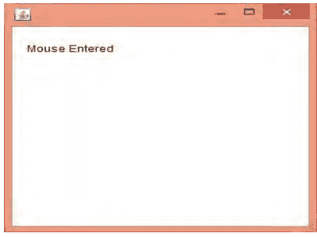

图 3.2: MouseListener 接口的方法

```java
import java.awt.*;
import java.awt.event.*;

public class MouseListenerExample2 extends Frame implements MouseListener {
    MouseListenerExample2() {
        addMouseListener(this);
        setSize(300, 300);
        setLayout(null);
        setVisible(true);
    }

    public void mouseClicked(MouseEvent e) {
        Graphics g = getGraphics();
        g.setColor(Color.BLUE);
        g.fillOval(e.getX(), e.getY(), 30, 30);
    }

    public void mouseEntered(MouseEvent e) {}
    public void mouseExited(MouseEvent e) {}
    public void mousePressed(MouseEvent e) {}
    public void mouseReleased(MouseEvent e) {}

    public static void main(String[] args) {
        new MouseListenerExample2();
    }
}
```

输出：

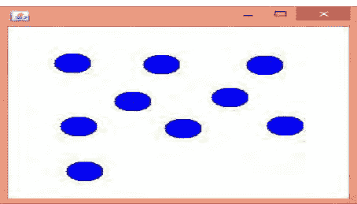

每当你移动或拖动鼠标时，`MouseMotionListener` 都会收到通知。它是针对 `MouseEvent` 的通知。`MouseMotionListener` 接口位于 `java.awt.event` 包中。它有两个方法。

## 方法

`MouseMotionListener` 接口中的 2 个方法的签名如下：

1. `public abstract void mouseDragged(MouseEvent e);`
2. `public abstract void mouseMoved(MouseEvent e);`

### Java MouseMotionListener 示例


```java
import java.awt.event.*;
import java.awt.event.*;
public class MouseMotionListenerExample extends Frame implements MouseMotionListener
{
    MouseMotionListenerExample(){
        addMouseMotionListener(this);
        setSize(300,300);
        setLayout(null);
        setVisible(true);
    }
    public void mouseDragged(MouseEvent e) {
        Graphics g=getGraphics();
        g.setColor(Color.BLUE);
        g.fillOval(e.getX(),e.getY(),30,30);
    }
    public void mouseMoved(MouseEvent e) {}

    public static void main(String[] args) {
        new MouseMotionListenerExample();
    }
}
```

# 事件与 GUI 编程

如果我们观察处理按钮点击的过程，可以看到用户的鼠标点击触发了一系列事件。按钮对象通过创建一个按钮点击事件来响应鼠标点击，该事件被放置在事件队列中。当事件循环（`event loop`）空闲时，它拾取该事件并进行处理。按钮点击事件的处理涉及调用在特殊注册的名为“监听器”（`listeners`）的对象上的方法，按钮点击的监听器是实现 `java.awt.ActionListener` 接口的对象，而按钮点击事件的处理涉及调用监听器的 `actionPerformed` 方法，开发者已经实现了该方法，以便在该特定按钮被点击时执行任何需要的操作。请注意，任何给按钮都可以“添加”多个监听器，按钮点击处理将依次调用每个 `ActionListener` 的 `actionPerformed` 方法。

# 3.4 Java AWT Panel

`Panel` 是容器类。它提供了一个空间，应用程序可以在其中附加任何其他组件。它继承自 `Container` 类。它没有像 3.7 所示那样的标题栏。

## AWT Panel 类声明

- `public class Panel extends Container implements Accessible`

## Java AWT Panel 示例

```java
import java.awt.*;
import java.applet.*;
public class panel extends Applet{
    public void paint(Graphics g)
{
        Frame f=new Frame("Panel Example");
        Panel panel=new Panel();
        panel.setBounds(40,80,200,200);
        panel.setBackground(Color.gray);
        Button b1=new Button("Button 1");
        b1.setBounds(50,100,80,30);
        b1.setBackground(Color.yellow);
        Button b2=new Button("Button 2");
        b2.setBounds(100,100,80,30);
        b2.setBackground(Color.green);
        panel.add(b1); panel.add(b2);
        f.add(panel);
        f.setSize(400,400);
        f.setLayout(null);
        f.setVisible(true);
    }
}
```

输出：

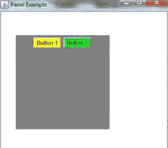

# 3.5 Java JFrame

`javax.JFrame` 类是容器的一种，它继承自 `java.awt.Frame` 类。`JFrame` 的工作方式类似于所示的主窗口，标签、按钮、文本字段等组件被添加其中以创建 GUI，示例结果如图3.8所示。

与 `Frame` 不同，`JFrame` 可以通过表 3.5 到 3.8 提供的 `setDefaultCloseOperation(int)` 方法来隐藏或关闭窗口。

## 表 3.5: 嵌套类描述

| 修饰符和类型 | 类 | 描述 |
|---|---|---|
| protected class | `JFrame.AccessibleJFrame` | 此类实现了 JFrame 的可访问性。 |

## 表 3.6: 字段描述

| 修饰符和类型 | 字段 | 描述 |
|---|---|---|
| protected AccessibleContext | `accessibleContext` | 可访问上下文属性。 |
| static int | `EXIT_ON_CLOSE` | 退出程序的默认窗口关闭操作。 |
| protected RootPane | `rootPane` | 管理此框架的内容、可选菜单栏以及 GlassPane 的 JRootPane 实例。 |
| protected boolean | `rootPaneEnabled` | 如果为真，调用 add 和 setLayout 将转发到 contentPane |

## 表 3.7: 构造函数描述

| 构造函数 | 描述 |
|---|---|
| `JFrame()` | 构造一个初始不可见的新帧。 |
| `JFrame(GraphicsConfiguration gc)` | 在屏幕设备指定的 GraphicsConfiguration 中创建一个 Frame，并带有空白标题。 |
| `JFrame(String title)` | 创建一个新的具有指定标题的初始不可见的 Frame。 |
| `JFrame(String title, GraphicsConfiguration gc)` | 创建一个具有指定标题和屏幕设备指定 GraphicsConfiguration 的 JFrame。 |

## 表 3.8: 有用方法描述

| 修饰符类型 | 方法描述 |
|---|---|
| protected void | `addImpl(Component comp, Object constraints, int index)` | 添加指定的子组件。 |
| protected JRootPane | `createRootPane()` | 被构造函数调用，以创建默认的 RootPane。 |
| protected void | `frameInit()` | 被构造函数调用，以正确初始化 JFrame。 |
| void | `setContentPane(ContentPane pane)` | 设置 contentPane 属性 |
| static void | `setDefaultLookAndFeel(boolean lookAndFeelDecorated)` | 提供一个提示，说明新创建的 JFrames 是否应该由当前外观提供窗口装饰（如边框、用于关闭窗口的控件……）。 |
| void | `setIcon(Image image)` | 设置用于显示此窗口图标的图像。 |
| void | `setMenuBar(JMenuBar menubar)` | 为此帧设置菜单栏。 |
| void | `setLayeredPane(JLayeredPane pane)` | 设置 layeredPane 属性。 |
| JRootPane | `getRootPane()` | 返回此帧的 RootPane 对象。 |
| TransferHandler | `getTransferHandler()` | 获取 transferHandler 属性。 |

## JFrame 示例

```java
import java.awt.Layout;
import java.swing.JButton;
import java.swing.JFrame;
import java.swing.JLabel;
import java.swing.JPanel;
public class JFrameExample {
    public static void main(String[] args) {
        JFrame frame = new JFrame("JFrame");
        JPanel panel = new JPanel();
        panel.setLayout(new FlowLayout());
        JLabel label = new JLabel("Label");
        JButton button = new JButton("Button");
        panel.add(label);
        panel.add(button);
        frame.add(panel);
        frame.setSize(300, 200);
        frame.setDefaultCloseOperation(JFrame.EXIT_ON_CLOSE);
        frame.setVisible(true);
    }
}
```

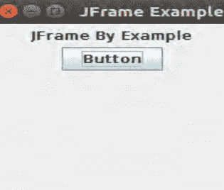

# 布局管理器

布局管理器用于以特定方式排列组件。`LayoutManager` 是所有表示布局管理器的类都实现的接口。它便于我们控制组件的位置和大小。

# Java BorderLayout

`BorderLayout` 用于将组件排列在五个区域中：北、南、东、西和中心。每个区域（区域）只能包含一个组件。它是帧的默认布局。`BorderLayout` 为每个区域提供了五个常量：

1. `NORTH`
2. `SOUTH`
3. `EAST`
4. `WEST`
5. `CENTER`

## BorderLayout 类的构造函数

- `BorderLayout()`: 创建一个组件之间没有间隙的边界布局。
- `BorderLayout(hgap, vgap)`: 创建一个具有水平和垂直间隙的边界布局。

```java
new Border();
}
}
```

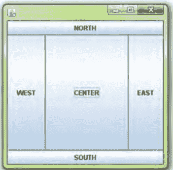

图 3.9 BorderLayout 类的构造函数

# 3.6 Java GridLayout

`Java GridLayout` 类用于将组件排列在矩形网格中。每个矩形中显示一个组件。

## GridLayout 类的构造函数

- `GridLayout()`: 创建每行每个组件一列的网格布局。
- `GridLayout(int rows, int columns)`: 创建具有给定行数和列数的网格布局，但组件之间没有间隙。
- `GridLayout(int rows, int columns, int hgap, int vgap)`: 创建具有给定行数、列数以及水平和垂直间隙的网格布局。

## GridLayout 类的示例：使用 GridLayout() 构造函数

`GridLayout()` 构造函数只创建一个行。以下示例显示了 3.10 所示的无参数构造函数的用法。

FileName: `GridLayoutExample.java`

```java
// import statements
import java.awt.*;
import java.swing.*;
```

```java
public class GridLayoutExample
{
    JFrame frameObj;
```

```java
// constructor
GridLayoutExample()
{
    frameObj = new JFrame();
```

```java
// 创建 9 个按钮
JButton btn1 = new JButton("1");
JButton btn2 = new JButton("2");
JButton btn3 = new JButton("3");
JButton btn4 = new JButton("4");
JButton btn5 = new JButton("5");
JButton btn6 = new JButton("6");
JButton btn7 = new JButton("7");
JButton btn8 = new JButton("8");
JButton btn9 = new JButton("9");
```

```java
// 将按钮添加到框架中
// 因为我们正在使用无参数构造函数，因此；
// 列数等于我们添加到框架中的按钮数量。
// 行数保持为一。
frameObj.add(btn1); frameObj.add(btn2); frameObj.add(btn3);
frameObj.add(btn4); frameObj.add(btn5); frameObj.add(btn6);
frameObj.add(btn7); frameObj.add(btn8); frameObj.add(btn9);
```

```java
// 使用无参数构造函数设置网格布局
frameObj.setLayout(new GridLayout());
```

```java
frameObj.setSize(300, 300);
frameObj.setVisible(true);
}
```

```java
// main 方法
public static void main(String args[])
{
    new GridLayoutExample();
}
{}
```

输出：

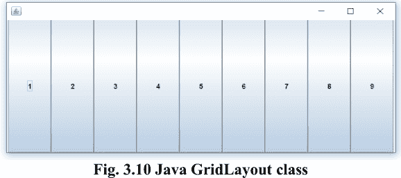

# 3.7 Java FlowLayout

`Java FlowLayout` 类用于将组件排列成行，一个接一个（流式排列）。它是 applet 或面板的默认布局，如图 3.11 所示的示例程序输出。

## FlowLayout 类的字段

- `public static final int LEFT`
- `public static final int RIGHT`
- `public static final int CENTER`
- `public static final int LEADING`
- `public static final int TRAILING`

## FlowLayout 类的构造函数

- `FlowLayout()`: 创建一个居中对齐的流布局，默认水平和垂直间隙为 5 单位。
- `FlowLayout(int align)`: 创建具有给定对齐方式的流布局，默认水平和垂直间隙为 5 单位。
- `FlowLayout(int align, int hgap, int vgap)`: 创建具有给定对齐方式以及水平和垂直间隙的流布局。

## FlowLayout 类的示例：使用 FlowLayout() 构造函数

```java
FileName: FlowLayoutExample.java
// import statements
import java.awt.*;
import javax.swing.*;

public class FlowLayoutExample {
  JFrame frameObj;
```

## 事件 GUI 编程

```java
// constructor
FlowLayoutExample()
{
    // 创建框架对象
frameObj = new JFrame();
    // 创建按钮
JButton b1 = new JButton("1");
JButton b2 = new JButton("2");
JButton b3 = new JButton("3");
JButton b4 = new JButton("4");
JButton b5 = new JButton("5");
JButton b6 = new JButton("6");
JButton b7 = new JButton("7");
JButton b8 = new JButton("8");
JButton b9 = new JButton("9");
JButton b10 = new JButton("10");
    // 将按钮添加到框架
frameObj.add(b1); frameObj.add(b2); frameObj.add(b3); frameObj.add(b4);
frameObj.add(b5); frameObj.add(b6); frameObj.add(b7); frameObj.add(b8);
frameObj.add(b9); frameObj.add(b10);
    // 使用参数列表构造函数
    // 因此，对齐方式是居中
    // 水平和垂直间隙均为 5 单位。
frameObj.setLayout(new FlowLayout());
    frameObj.setSize(300, 300);
    frameObj.setVisible(true);
}

// main 方法
public static void main(String args[])
{
    new FlowLayoutExample();
}
```


# 3.8 AWT Button

Button 是带有标签的推按钮组件。当按下时会产生事件。

## Button 类声明
```java
public class Button extends Accessible
```

## 3.9 Button 类型的构造函数

| 序号 | 构造函数 | 描述 |
| :--- | :--- | :--- |
| 1 | `Button()` | 创建一个空字符串的按钮，即没有标签。 |
| 2 | `Button(String text)` | 创建一个给定字符串作为标签的按钮。 |

## 3.10 Button 类方法

| 序号 | 方法 | 描述 |
| :--- | :--- | :--- |
| 1 | `void setText(String text)` | 设置按钮上的字符串消息 |
| 2 | `String getText()` | 获取按钮上的字符串消息 |
| 3 | `void setLabel(String label)` | 使用指定的字符串设置按钮标签 |
| 4 | `String getLabel()` | 获取按钮的标签 |
| 5 | `void addNotify()` | 创建按钮的对端 |
| 6 | `AccessibleContext getAccessibleContext()` | 获取与按钮关联的可访问上下文 |
| 7 | `void addActionListener(ActionListener l)` | 添加指定的监听器以从按钮获取动作事件 |
| 8 | `String getActionCommand()` | 返回按钮触发的动作命令名称 |
| 9 | `ActionListener[] getActionListeners()` | 返回注册在按钮上的所有动作监听器数组 |
| 10 | `<T extends EventListener> T[] getListeners(Class<T> listenerType)` | 返回当前注册为该按钮监听器的对象数组 |
| 11 | `protected String paramString()` | 返回表示按钮状态的字符串 |
| 12 | `protected void processActionEvent(ActionEvent e)` | 通过将其分发给注册的 `ActionListener` 对象来处理按钮上的事件 |
| 13 | `protected void processEvent(AWTEvent e)` | 处理按钮上的事件 |
| 14 | `void removeActionListener(ActionListener l)` | 移除指定的动作监听器，使其不再接收按钮的动作事件 |
| 15 | `void setActionCommand(String command)` | 为按钮给动作事件设置命令名称 |

## 事件与 GUI 编程

# Java AWT 按钮示例

## 示例 1：ButtonExample.java
```java
import java.awt.*;

public class ButtonExample {

    public static void main(String[] args) {

        // 创建带有标签的帧实例
        Frame f = new Frame("Button Example");

        // 创建带有标签的按钮实例
        Button b = new Button("Click Here");

        // 在帧中设置按钮的位置
        b.setBounds(50, 100, 80, 30);

        // 将按钮添加到帧中
        f.add(b);

        // 设置帧的大小、布局和可见性
        f.setLayout(null);
        f.setSize(400, 400);
        f.setVisible(true);
    }
}
```

使用命令提示符编译程序，请输入以下命令：
`C:\Users\Anurati\Desktop\abcDemo\javac ButtonExample.java`

如果没有错误，我们可以使用以下命令执行代码：
`C:\Users\Anurati\Desktop\abcDemo\java ButtonExample`

输出：
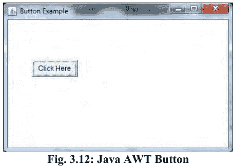

# 3.11 JAVA AWT 复选框 (CHECKBOX)

`Checkbox` 类用于创建复选框。它用于开启（`true`）或关闭（`false`）选项。点击复选框会将其状态从“开启”切换到“关闭”，或从“关闭”切换到“开启”。

## AWT Checkbox 类声明
```java
public class Checkbox extends Component implements ItemSelectable, Accessible
```

## 表 3.11: Checkbox 类构造函数

| 序号 | 构造函数 | 描述 |
|---|---|---|
| 1 | `Checkbox()` | 构建一个不带字符串标签的复选框。 |
| 2 | `Checkbox(String label)` | 构建一个带有给定标签的复选框。 |
| 3 | `Checkbox(String label, boolean state)` | 构建一个带有给定标签并设置给定状态的复选框。 |
| 4 | `Checkbox(String label, boolean state, CheckboxGroup group)` | 构建一个带有给定标签并在指定复选框组中设置给定状态的复选框。 |
| 5 | `Checkbox(String label, CheckboxGroup group, boolean state)` | 构建一个带有给定标签、位于给定复选框组并设置为指定状态的复选框。 |

## Checkbox 继承的方法

`Checkbox` 类的方法被以下类继承：
* `java.awt.Component`
* `java.lang.Object`

## 表 3.12: Checkbox 类方法

| 序号 | 方法名 | 描述 |
|---|---|---|
| 1 | `void addItemListener(ItemListener l)` | 添加一个项目监听器以从复选框获取项目事件。 |
| 2 | `AccessibleContext getAccessibleContext()` | 获取复选框的可访问上下文。 |
| 3 | `void addNotify()` | 创建复选框的对端对象。 |
| 4 | `CheckboxGroup getCheckboxGroup()` | 确定复选框所属的组。 |
| 5 | `ItemListener[] getItemListeners()` | 返回在复选框上注册的项目监听器数组。 |
| 6 | `String getLabel()` | 获取复选框的标签。 |
| 7 | `<T extends EventListener> T[] getListeners(Class<T> listenerType)` | 返回所有注册为指定类型监听器的对象数组。 |
| 8 | `Object[] getSelectedObjects()` | 返回一个包含复选框标签的数组（大小为 1），如果复选框未选中则返回 `null`。 |
| 9 | `boolean getState()` | 如果复选框开启则返回 `true`，否则返回 `false`。 |
| 10 | `protected String paramString()` | 返回表示复选框状态的字符串。 |
| 11 | `protected void processEvent(AWTEvent e)` | 处理复选框上的事件。 |
| 12 | `protected void processItemEvent(ItemEvent e)` | 通过将事件分发给注册的 `ItemListener` 对象来处理复选框中的项目事件。 |
| 13 | `void removeItemListener(ItemListener l)` | 移除指定的项目监听器，使该监听器不再接收事件。 |
| 14 | `void setCheckboxGroup(CheckboxGroup g)` | 将复选框的组设置为给定的复选框组。 |
| 15 | `void setLabel(String label)` | 将复选框的标签设置为该字符串。 |
| 16 | `void setState(boolean state)` | 将复选框的状态设置为指定的状态。 |

## Java AWT 复选框示例

在接下来的示例中，我们使用 `Checkbox(String label)` 创建了两个复选框并使用 `add()` 方法将它们添加到帧中，结果如图 3.13 所示。

### CheckboxExample.java
```java
import java.awt.*;

public class CheckboxExample {

    // 初始化构造函数
    public CheckboxExample() {
        // 创建带有标题的帧
        Frame f = new Frame("Checkbox Example");

        // 创建复选框
        Checkbox checkbox1 = new Checkbox("Click Here");
        checkbox1.setBounds(100, 100, 50, 50);

        Checkbox checkbox2 = new Checkbox("Java", true);
        // 设置复选框在帧中的位置
        checkbox2.setBounds(100, 150, 50, 50);

        // 将复选框添加到帧
        f.add(checkbox1);
        f.add(checkbox2);

        // 设置帧的大小、布局和可见性
        f.setLayout(null);
        f.setSize(400, 400);
        f.setVisible(true);
    }

    public static void main(String[] args) {
        new CheckboxExample();
    }
}
```

输出：


# 3.12 单选按钮 (RADIO BUTTON)

`JRadioButton` 类用于创建单选按钮。它用于从多个选项中选择一个。单选按钮被广泛用于选择项。它需要添加到 `ButtonGroup` 中实现单选功能。

## Java JRadioButton 示例

查看 `JRadioButton` 类的声明，如图 3.14 所示。
```java
import javax.swing.*;

public class JRadioButtonExample {

    JFrame f;

    public JRadioButtonExample() {
        f = new JFrame();

        JRadioButton r1 = new JRadioButton("Male");
        JRadioButton r2 = new JRadioButton("Female");

        r1.setBounds(75, 50, 100, 30);
        r2.setBounds(75, 100, 100, 30);

        ButtonGroup bg = new ButtonGroup();
        bg.add(r1);
        bg.add(r2);

        f.add(r1);
        f.add(r2);

        f.setSize(300, 300);
        f.setVisible(true);
    }

    public static void main(String[] args) {
        new JRadioButtonExample();
    }
}
```

## 表 3.13: JRadioButton 类构造函数

| 构造函数 | 描述 |
|---|---|
| `JRadioButton()` | 构建一个没有文本的单选按钮。 |
| `JRadioButton(String s)` | 构建一个带有给定文本的单选按钮。 |
| `JRadioButton(String s, boolean selected)` | 构建一个带有给定文本并设置选中状态的单选按钮。 |

## 表 3.14: JRadioButton 类方法

| 方法 | 描述 |
|---|---|
| `void setText(String s)` | 设置单选按钮的文本。 |
| `String getText()` | 获取单选按钮的文本。 |
| `void setEnabled(boolean b)` | 启用或禁用单选按钮。 |
| `void setIcon(Icon i)` | 设置单选按钮的图标。 |
| `Icon getIcon()` | 获取单选按钮的图标。 |
| `void setMnemonic(int a)` | 设置单选按钮的快捷键。 |
| `void addActionListener(ActionListener a)` | 为此对象添加动作监听器。 |


## 表 3.11: Checkbox 类构造函数

| 序号 | 构造函数 | 描述 |
|---|---|---|
| 1. | `Checkbox()` | 构建一个不带字符串标签的复选框。 |
| 2. | `Checkbox(String label)` | 构建一个带有给定标签的复选框。 |
| 3. | `Checkbox(String label, boolean state)` | 构建一个带有给定标签并设置给定状态的复选框。 |
| 4. | `Checkbox(String label, boolean state, Checkbox group)` | 构建一个带有给定标签并在指定复选框组中设置给定状态的复选框。 |
| 5. | `Checkbox(String label, Checkbox group, boolean state)` | 构建一个带有给定标签、位于给定复选框组并设置为指定状态的复选框。 |

## Checkbox 继承的方法

`Checkbox` 类的方法被以下类继承：
* `java.awt.Component`
* `java.lang.Object`

## 表 3.12: Checkbox 类方法

| 序号 | 方法名 | 描述 |
|---|---|---|
| 1. | `void addActionListener(ItemListener)` | 添加一个项目监听器以从复选框获取项目事件。 |
| 2. | `AccessibleContext getAccessibleContext()` | 获取复选框的可访问上下文。 |
| 3. | `void addNotify()` | 创建复选框的对等对象。 |
| 4. | `CheckboxGroup getCheckboxGroup()` | 确定复选框所属的组。 |
| 5. | `ItemListener[] getListeners()` | 返回在复选框上注册的项目监听器数组。 |
| 6. | `String getLabel()` | 获取复选框的标签。 |
| 7. | `T[] getListeners(Class listenerType)` | 返回所有注册为 `FooListeners` 的对象数组。 |
| 8. | `Object[] getSelectedObjects()` | 返回一个包含复选框标签的数组（大小为 1），如果复选框未选中则返回 `null`。 |
| 9. | `boolean getState()` | 如果复选框开启则返回 `true`，否则返回 `false`。 |
| 10. | `protected String paramString()` | 返回表示复选框状态的字符串。 |
| 11. | `protected void processEvent(AWTEvent e)` | 处理复选框上的事件。 |
| 12. | `protected void processItemEvent(ItemEvent e)` | 通过将事件分发给注册的 `ItemListener` 对象来处理复选框中的项目事件。 |
| 13. | `void removeItemListener(ItemListener l)` | 移除指定的项目监听器，使该监听器不再接收事件。 |
| 14. | `void setGroup(Checkbox g)` | 将复选框的组设置为给定的复选框。 |
| 15. | `void setLabel(String label)` | 将复选框的标签设置为该字符串。 |
| 16. | `void setState(boolean state)` | 将复选框的状态设置为指定的状态。 |

## Java AWT 复选框示例

在接下来的示例中，我们使用 `Checkbox(String label)` 创建了两个复选框并使用 `add()` 方法将它们添加到帧中，结果如图 3.13 所示。

### CheckboxExample.java

```java
import java.awt.*;

public class CheckboxExample {

    // 初始化构造函数
    public CheckboxExample() {
        // 创建带有标题的帧
        Frame f = new Frame("Checkbox Example");

        // 创建复选框
        Checkbox checkbox1 = new Checkbox("Click Here");
        checkbox1.setBounds(100, 100, 50, 50);

        Checkbox checkbox2 = new Checkbox("Java", true);
        // 设置复选框在帧中的位置
        checkbox2.setBounds(100, 150, 50, 50);

        // 将复选框添加到帧
        f.add(checkbox1);
        f.add(checkbox2);

        // 设置帧的大小、布局和可见性
        f.setLayout(null);
        f.setSize(400, 400);
        f.setVisible(true);
    }

    public static void main(String[] args) {
        new CheckboxExample();
    }
}
```

输出：


## 单选按钮 (RADIO BUTTON)

`RadioButton` 类用于创建单选按钮。它用于从多个选项中选择一个。单选按钮被广泛用于选择项。它需要添加到 `ButtonGroup` 中实现单选功能。构造函数和方法在表 3.13 和 3.14 中给出。

### Java JRadioButton 示例

查看 `JRadioButton` 类的声明，如图 3.14 所示。

```java
import javax.swing.*;

public class JRadioButtonExample {
    JFrame f;

    public JRadioButtonExample() {
        f = new JFrame();

        JRadioButton r1 = new JRadioButton("Male");
        JRadioButton r2 = new JRadioButton("Female");

        r1.setBounds(75, 50, 100, 30);
        r2.setBounds(75, 100, 100, 30);

        ButtonGroup bg = new ButtonGroup();
        bg.add(r1);
        bg.add(r2);

        f.add(r1);
        f.add(r2);

        f.setSize(300, 300);
        f.setVisible(true);
    }

    public static void main(String[] args) {
        new JRadioButtonExample();
    }
}
```

## Java AWT 示例

在下面的示例中，我们使用 `Label(String)` 构造函数创建了两个标签 `l11` 和 `l12` 并将它们添加到框架中。

### LabelExample.java

```java
import java.awt.*;

public class LabelExample {
    public static void main(String args[]) {
        // 创建 Frame 类和 Label 类的对象
        Frame f = new Frame("Label example");
        Label l11, l12;

        // 初始化标签
        l11 = new Label("First Label");
        l12 = new Label("Second Label");

        // 设置标签的位置
        l11.setBounds(50, 100, 100, 30);
        l12.setBounds(50, 150, 100, 30);

        // 将标签添加到框架
        f.add(l11);
        f.add(l12);

        // 设置框架的大小、布局和可见性
        f.setSize(400, 400);
        f.setLayout(null);
        f.setVisible(true);
    }
}
```

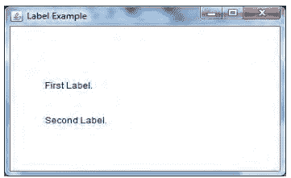

> 图 3.15: Java AWT 标签

## 3.11 JAVA AWT TEXTFIELD

`TextField` 对象是一个文本组件，允许用户输入单行文本并进行编辑。它继承自 `TextComponent` 类，该类进一步继承自 `Component` 类。

# 事件与 GUI 编程

当我们在文本字段中输入按键时（如按下、释放或输入按键），事件会被发送到 `TextField`。然后，`KeyEvent` 会被传递给已注册的 `KeyListener`。也可以使用 `ActionEvent` 来实现；如果文本字段上启用了 `ActionEvent`，则按下回车键可能会触发 `ActionEvent`。该事件由 `ActionListener` 接口处理。支持的构造函数和方法见表 3.17 和 3.18，结果如图 3.16 所示。

## AWT TextField 类声明

```java
public class TextField extends TextComponent
```

### 表 3.17: TextField 构造函数

| 序号 | 构造函数 | 描述 |
|---|---|---|
| 1. | `TextField()` | 构造一个新的文本字段组件。 |
| 2. | `TextField(String text)` | 构造一个新的文本字段，并用给定的字符串初始化显示。 |
| 3. | `TextField(int columns)` | 构造一个具有指定列数的空新文本字段。 |
| 4. | `TextField(String text, int columns)` | 构造一个具有给定文本和列数（宽度）的新文本字段。 |

### 表 3.18: TextField 类方法

| 序号 | 方法名 | 描述 |
|---|---|---|
| 1. | `void notify()` | 创建文本字段的对等体。 |
| 2. | `boolean echoCharIsSet()` | 告知文本字段是否有用于回显的字符集。 |
| 3. | `void addActionListener(ActionListener L1)` | 添加指定的监听器以接收来自文本字段的动作事件。 |
| 4. | `ActionListener[] getActionListeners()` | 返回在文本字段上注册的所有动作监听器的数组。 |
| 5. | `AccessibleContext getAccessibleContext()` | 获取与文本字段相关的可访问上下文。 |
| 6. | `int getColCount()` | 获取文本字段中的列数。 |
| 7. | `char getEchoChar()` | 获取用于回显的字符。 |
| 8. | `Dimension getMinimumSize()` | 获取文本字段的最小尺寸。 |
| 9. | `Dimension getMinimumSize(int columns)` | 获取具有指定列数的文本字段的最小尺寸。 |
| 10. | `Dimension getPreferredSize()` | 获取文本字段的首选尺寸。 |
| 11. | `Dimension getPreferredSize(int columns)` | 获取具有指定列数的文本字段的首选尺寸。 |
| 12. | `protected String getParam(String param)` | 返回文本字段状态的字符串。 |
| 13. | `protected void processActionEvent(ActionEvent e)` | 通过将事件分发给注册的 `ActionListener` 对象来处理文本字段中发生的动作事件。 |
| 14. | `protected void processEvent(AWTEvent e)` | 处理文本字段上的事件。 |
| 15. | `void removeActionListener(ActionListener l)` | 移除指定的动作监听器，使其不再接收事件。 |
| 16. | `void setColumns(int columns)` | 设置文本字段中的列数。 |
| 17. | `void setEcho(char c)` | 设置文本字段的回显字符。 |
| 18. | `void setText(String t)` | 将此组件呈现的文本设置为指定的文本。 |

## 继承的方法

* `java.awt.TextComponent`
* `java.awt.Component`
* `java.lang.Object`

## Java SWT TextField 示例

### TextFieldExample1.java

```java
import java.awt.*;

public class TextFieldExample1 {
    // main 方法
    public static void main(String args[]) {
        // 创建框架
        Frame f = new Frame("TextField Example");

        // 创建对象
        TextField t1, t2;

        // 设置标签的位置
        t1 = new TextField("First Label");
        t1.setBounds(50, 100, 100, 30);

        t2 = new TextField("Second Label");
        t2.setBounds(50, 150, 100, 30);

        // 将标签添加到框架
        f.add(t1);
        f.add(t2);

        // 设置框架的大小、布局和可见性
        f.setSize(400, 400);
        f.setLayout(null);
        f.setVisible(true);
    }
}
```

## 输出


> 图 3.15: Java AWT 标签

## 3.11 JAVA AWT TEXTFIELD

`TextField` 对象是一个文本组件，允许用户输入单行文本并进行编辑。它继承自 `TextComponent` 类，该类进一步继承自 `Component` 类。当我们

# 事件与 GUI 编程

在文本字段中输入按键时（如按下、释放或输入按键），事件会被发送到 `TextField`。然后，`KeyEvent` 会被传递给已注册的 `KeyListener`。也可以使用 `ActionEvent` 来实现；如果文本字段上启用了 `ActionEvent`，则按下回车键可能会触发 `ActionEvent`。该事件由 `ActionListener` 接口处理。支持的构造函数和方法见表 3.17 和 3.18，结果如图 3.16 所示。

## AWT TextField 类声明

```java
public class TextField extends TextComponent
```


# 表 3.17: TextField 构造函数

| 序号 | 构造函数 | 描述 |
|---|---|---|
| 1. | `TextField()` | 构造一个新的文本字段组件。 |
| 2. | `TextField(String text)` | 构造一个新的文本字段，并用给定的字符串初始化显示。 |
| 3. | `TextField(int columns)` | 构造一个具有指定列数的空新文本字段。 |
| 4. | `TextField(String text, int columns)` | 构造一个具有给定文本和列数（宽度）的新文本字段。 |

# 表 3.18: TextField 类方法

| 序号 | 方法名 | 描述 |
|---|---|---|
| 1. | `void notify()` | 创建文本字段的对等体（peer）。 |
| 2. | `boolean echoCharIsSet()` | 告知文本字段是否有用于回显的字符集。 |
| 3. | `void addActionListener(ActionListener L1)` | 添加指定的监听器以接收来自文本字段的动作事件。 |
| 4. | `ActionListener[] getActionListeners()` | 返回在文本字段上注册的所有动作监听器的数组。 |
| 5. | `AccessibleContext getAccessibleContext()` | 获取与文本字段相关的可访问上下文。 |
| 6. | `int getColCount()` | 获取文本字段中的列数。 |
| 7. | `char getEchoChar()` | 获取用于回显的字符。 |
| 8. | `Dimension getMinimumSize()` | 获取文本字段的最小尺寸。 |
| 9. | `Dimension getMinimumSize(int columns)` | 获取具有指定列数的文本字段的最小尺寸。 |
| 10. | `Dimension getPreferredSize()` | 获取文本字段的首选尺寸。 |
| 11. | `Dimension getPreferredSize(int columns)` | 获取具有指定列数的文本字段的首选尺寸。 |
| 12. | `protected String getParam(String param)` | 返回文本字段状态的字符串。 |
| 13. | `protected processActionEvent(ActionEvent e)` | 通过将事件分发给注册的 `ActionListener` 对象来处理文本字段中发生的动作事件。 |
| 14. | `protected processEvent(AWTEvent e)` | 处理文本字段上的事件。 |
| 15. | `void removeActionListener(ActionListener l)` | 移除指定的动作监听器，使其不再接收事件。 |
| 16. | `void setColumns(int columns)` | 设置文本字段中的列数。 |
| 17. | `void setEcho(char c)` | 设置文本字段的回显字符。 |
| 18. | `void setText(String t)` | 将此组件呈现的文本设置为指定的文本。 |

## 继承的方法

- `java.awt.TextComponent`
- `java.awt.Component`
- `java.lang.Object`

## Java SWT TextField 示例

### TextFieldExample1.java

```java
// import java.awt.*;

import java.awt.*;

public class TextFieldExample1 {

  // main 方法

  public static void main(String args[]) {

    // 创建框架

    Frame f = new Frame("TextField Example");

    // 创建对象

    TextField t1, t2;

    // 设置标签的位置

    t1 = new TextField("First Label");

    t1.setBounds(50, 100, 100, 30);

    t2 = new TextField("Second Label");

    t2.setBounds(50, 150, 100, 30);

    // 将标签添加到框架

    f.add(t1);

    f.add(t2);

    // 设置框架的大小、布局和可见性

    f.setSize(400,400);

    f.setLayout(null);

    f.setVisible(true);

  }

}
```

## 输出


> 图 3.15: Java AWT 标签

## 3.11 JAVA AWT TEXTFIELD

`TextField` 对象是一个文本组件，允许用户输入单行文本并进行编辑。它继承自 `TextComponent` 类，该类进一步继承自 `Component` 类。当我们在文本字段中输入按键时（如按下、释放或输入按键），事件会被发送到 `TextField`。然后，`KeyEvent` 会被传递给已注册的 `KeyListener`。也可以使用 `ActionEvent` 来实现；如果文本字段上启用了 `ActionEvent`，则按下回车键可能会触发 `ActionEvent`。该事件由 `ActionListener` 接口处理。支持的构造函数和方法见表 3.17 和 3.18，结果如图 3.16 所示。

## AWT TextField 类声明

```java
public class TextField extends TextComponent
```

## TextArea 的字段

`TextArea` 对象是一个多行区域，允许用户输入多行文本并进行编辑。它继承自 `TextComponent` 类，该类进一步继承自 `Component` 类。当我们在文本区域中输入超过显示区域的文本时，会出现滚动条。滚动条的类型有：

- `SCROLLBAR_BOTH`: 同时显示水平和垂直滚动条。
- `SCROLLBAR_HORIZONTAL_ONLY`: 仅显示水平滚动条。
- `SCROLLBAR_VERTICAL_ONLY`: 仅显示垂直滚动条。
- `SCROLLBAR_NONE`: 不显示滚动条。

## 表 3.19: 构造函数

| 序号 | 构造函数 | 描述 |
|---|---|---|
| 1. | `TextArea()` | 构造一个新的文本区域。 |
| 2. | `TextArea(int rows, int columns)` | 构造一个具有指定行数和列数的文本区域。 |
| 3. | `TextArea(String text)` | 构造一个新的文本区域，并用给定的字符串初始化显示。 |
| 4. | `TextArea(String text, int rows, int columns)` | 构造一个具有给定文本、行数和列数的文本区域。 |

## 继承的方法

- `java.awt.TextComponent`
- `java.awt.Component`
- `java.lang.Object`

## 表 3.20: 类方法

| 序号 | 方法名 | 描述 |
|---|---|---|
| 1. | `void addNotify()` | 创建文本区域的对等体（peer）。 |
| 2. | `void append(String str)` | 将指定的文本附加到文本区域末尾。 |
| 3. | `AccessibleContext getAccessibility()` | 返回文本区域的可访问上下文。 |
| 4. | `int getCols()` | 返回文本区域的列数。 |
| 5. | `Dimension getMinimumSize(int rows, int columns)` | 获取文本区域的最小尺寸。 |
| 6. | `Dimension getMinimumSize(int rows, int columns)` | 获取具有指定行数和列数的文本区域的最小尺寸。 |
| 7. | `Dimension getPreferredSize()` | 获取的首选尺寸。 |
| 8. | `Dimension getPreferredSize(int rows, int columns)` | 获取具有指定行数和列数的文本区域的首选尺寸。 |
| 9. | `int getRows()` | 返回文本区域的行数。 |
| 10. | `int getScrollbarVisibility()` | 返回指示文本区域使用的滚动条的枚举值。 |
| 11. | `void insert(String str, int pos)` | 在文本区域的指定位置插入指定的文本。 |
| 12. | `protected String getText(String)` | 返回代表文本区域状态的字符串。 |
| 13. | `void replaceRange(String str, int start, int end)` | 用指定的替换文本替换指定的起始和结束位置之间的文本。 |
| 14. | `void setColumns(int columns)` | 设置文本区域的列数。 |
| 15. | `void setRows(int rows)` | 设置文本区域的行数。 |

# 事件与 GUI 编程

## Java AWT TextArea 示例

下面的示例展示了 TextArea 的简单实现，其中我们使用构造函数 `TextArea(String text)` 创建文本区域并将其添加到帧（frame）中，输出如图 3.17 所示。

### TextAreaExample.java

```java
//import AWT 类

import java.awt.*;

public class TextAreaExample {

    // 构造函数

    TextAreaExample() {

        // 创建一个帧

        Frame f = new Frame();

        // 创建文本

        TextArea area = new TextArea("Welcome to javatpoint");

        // 设置文本区域在帧中的位置

        area.setBounds(10, 30, 300, 300);

        // 将文本区域添加到帧

        f.add(area);

        // 设置帧的大小、布局和可见性

        f.setSize(400, 400);

        f.setLayout(null);

        f.setVisible(true);

    }

    // main 方法

    public static void main(String[] args[]) {

        new TextAreaExample();

    }

}
```

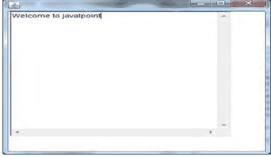

图 3.17: Java AWT TextArea

## 3.13 JAVA JCOMBOBOX

类对象用于显示选择的弹出菜单。用户选择的项将显示在菜单顶部。它继承自 `JComponent` 类。支持的构造函数和方法见表 3.21 和 3.22，示例结果如图 3.18 到 3.21 所示。

## JComboBox 类声明

让我们来看 `javax.swing.JComboBox` 类的声明。

- `public class JComboBox extends JComponent implements ItemSelectable, ListDataListener, ActionListener, Accessible`

## 表 3.21: 常用构造函数

| 构造函数 | 描述 |
|---|---|
| `JComboBox()` | 创建一个具有默认数据模型的 JComboBox。 |
| `JComboBox(Object[] items)` | 创建一个包含指定数组中元素的 JComboBox。 |
| `JComboBox(Vector<?> items)` | 创建一个包含指定 Vector 中元素的 JComboBox。 |

## 表 3.22: 常用方法

| 方法 | 描述 |
|---|---|
| `void addItem(Object object)` | 用于向列表项添加一个项目。 |
| `void removeItem(Object object)` | 用于从列表项删除一个项目。 |
| `void removeAllItems()` | 用于从列表中移除所有项目。 |
| `void setEditable(boolean b)` | 用于确定 JComboBox 是否可编辑。 |
| `void addActionListener(ActionListener a)` | 用于添加 ActionListener。 |
| `void addItemListener(ItemListener i)` | 用于添加 ItemListener。 |

## Java JComboBox 示例

```java
import javax.swing.*;

public class ComboBoxExample {

  JFrame frame;

  ComboBoxExample(){

    frame = new JFrame("ComboBox Example");

    String country[]={"India"
```

```java
  public static void main(String[] args) {

    new ComboBoxExample();

  }

}
```

### 输出

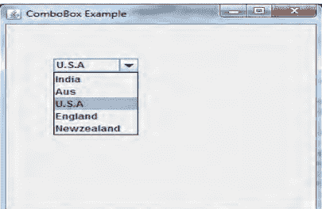

图 3.18: Java JComboBox

## 带有 ActionListener 的 Java JComboBox 示例

```java
import javax.swing.*;

import java.awt.event.*;

public class ComboBoxExample {

  JFrame frame;

  ComboBoxExample() {

    frame = new JFrame("ComboBox Example");

    final JLabel label = new JLabel("");

    label.setHorizontalAlignment(JLabel.CENTER);

    label.setSize(400, 100);

    JComboBox<String> cb = new JComboBox<>(country);

    cb.setBounds(50, 50, 300, 30);

    cb.addActionListener(e -> {

        String data = "Selected: " + cb.getItemAt(cb.getSelectedIndex());

        label.setText(data);

    });

    frame.add(cb);

    frame.add(label);

    frame.setSize(400, 400);

    frame.setLayout(null);

    frame.setVisible(true);

  }

  public static void main(String[] args) {

    new ComboBoxExample();

  }

}
```

### 输出

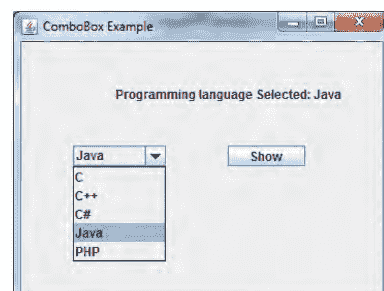

> 图 19: Java JComboBox

## Java JList 示例

```java
import javax.swing.*;

public class ListExample {

    ListExample() {

        JFrame f = new JFrame();

        DefaultListModel<String> l1 = new DefaultListModel<>();

        l1.addElement("Item1");

        l1.addElement("Item2");

        l1.addElement("Item3");

        l1.addElement("Item4");

        JList<String> list = new JList<>(l1);

        list.setBounds(100, 75, 75, 75);

        f.add(list);

        f.setSize(400, 400);

        f.setLayout(null);

        f.setVisible(true);

    }

    public static void main(String args[]) {

        new ListExample();

    }

}
```

### 输出

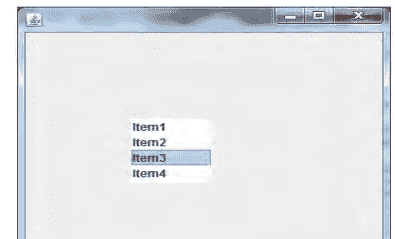

图 3.20: Java JList

## 带有 AdjustmentListener 的 Java JScrollBar 示例

```java
import javax.swing.*;

import java.awt.event.*;

class ScrollBarExample {

    ScrollBarExample() {

        JFrame f = new JFrame("ScrollBar Example");

        final JLabel label = new JLabel("");

        label.setHorizontalAlignment(JLabel.CENTER);
```


label.setSize(400, 100);

final JScrollBar s = new JScrollBar();

s.setBounds(100, 100, 50, 100);

f.add(s);

f.add(label);

f.setSize(400, 400);

f.setLayout(null);

f.setVisible(true);

s.addAdjustmentListener(new AdjustmentListener() {

    public void adjustmentValueChanged(AdjustmentEvent e) {

        label.setText("Scrollbar value:" + s.getValue());

    }

});

}

public static void main(String args[]) {

    new ScrollBarExample();

}

}

```

输出:

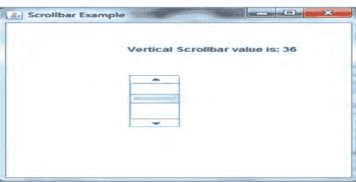

图 3.21: Java JScrollBar

## 14 JAVA SLIDER

`JSlider` 对象用于显示选择的弹出菜单。用户选择的项将显示在菜单顶部。它继承自 `JComponent` 类。支持的构造函数和方法见表 3.23 和 3.24，示例结果如图 3.22 到 3.23 所示。

### JSlider 类声明

让我们来看 `javax.swing.JSlider` 类的声明。

1. `public class JSlider extends JComponent implements ItemSelectable, ListDataListener, ActionListener, Accessible` (注：此处原文可能与 JComboBox 类似，此处按上下文翻译)

表 3.23: JSlider 常用构造函数
| 构造函数 | 描述 |
|---|---|
| `JSlider()` | 创建一个具有默认数据范围的 `JSlider`。 |
| `JSlider(int orientation)` | 创建一个具有指定方向的 `JSlider`。 |
| `JSlider(int orientation, int min)` | 创建一个具有指定方向和最小值的 `JSlider`。 |
| `JSlider(int orientation, int min, int max)` | 创建一个具有指定方向、最小值和最大值的 `JSlider`。 |
| `JSlider(int orientation, int min, int max, int value)` | 创建一个具有指定方向、最小值、最大值和初始值的 `JSlider`。 |
| `JSlider(ButtonModel model)` | 创建一个使用指定按钮模型的 `JSlider`。 |

表 3.24: JSlider 常用方法
| 方法 | 描述 |
|---|---|
| `void setValue(int value)` | 用于设置滑块的值。 |
| `int getValue()` | 用于获取滑块当前的值。 |
| `void setMinimum(int min)` | 用于设置滑块的最小值。 |
| `void setMaximum(int max)` | 用于设置滑块的最大值。 |
| `void setOrientation(int orientation)` | 用于设置滑块的方向。 |

### Java JSlider 示例

```java
import javax.swing.*;

public class SliderExample {

    JFrame frame;

    SliderExample() {

        frame = new JFrame("Slider Example");

        JSlider slider = new JSlider(JSlider.HORIZONTAL, 0, 100, 50);

        frame.add(slider);

        frame.setSize(300, 200);

        frame.setVisible(true);

    }

    public static void main(String[] args) {

        new SliderExample();

    }

}
```

### 带有 ChangeListener 的 Java JSlider 示例

```java
import javax.swing.*;

import java.awt.event.*;

public class SliderExample {

    JFrame frame;

    SliderExample() {

        frame = new JFrame("Slider Example");

        JSlider slider = new JSlider(JSlider.HORIZONTAL, 0, 100, 50);

        slider.addChangeListener(new ChangeListener() {

            public void stateChanged(ChangeEvent e) {

                System.out.println("Value: " + slider.getValue());

            }

        });

        frame.add(slider);

        frame.setSize(300, 200);

        frame.setVisible(true);

    }

    public static void main(String[] args) {

        new SliderExample();

    }

}
```


# 事件与 GUI 编程

| # | 方法与描述 |
|---|---|
| 19 | `GraphicsConfiguration getConfiguration()` 此方法返回此窗口使用的 `GraphicsConfiguration`。<br>`List<Image> getIconImages()` 返回要显示为此窗口图标的图像序列。 |
| 20 | `InputContext getInputContext()` 获取此窗口的上下文。 |
| 21 | `<T extends Listener> T[] getListeners(Class<T> listenerType)` 返回当前由 `FooListeners` 在此窗口上注册的所有对象的数组。 |
| 22 | `Locale getLocale()` 如果已设置区域，则获取与此窗口关联的 `Locale` 对象。 |
| 23 | `Dialog.ModalExclusionType getModalExclusionType()` 返回此窗口的模态排除类型。 |
| 24 | `Component getMostRecentFocusOwner()` 返回当窗口获得焦点时将接收焦点的子组件。 |
| 25 | `Window[] getOwnedWindows()` 返回一个包含此窗口当前所有窗口的数组。 |
| 26 | `Window getOwner()` 返回此窗口的所有者。 |
| 27 | `static Window[] getOwnerlessWindows()` 返回一个由此应用程序创建但无所有者的 `Window` 数组。 |
| 28 | `Toolkit getToolkit()` 返回此帧的工具包。 |
| 29 | `String getWarningString()` 返回随此窗口显示的警告字符串。 |
| 30 | `WindowFocusListener[] getWindowFocusListeners()` 返回一个注册在此窗口上的所有窗口焦点监听器的数组。 |
| 31 | `WindowListener[] getWindowListeners()` 返回一个注册在此窗口上的所有窗口监听器的数组。 |
| 32 | `static Window[] getWindows()` 返回一个包含由此应用程序创建的所有窗口（包括所有者和无所有者的）数组。 |
| 33 | `WindowStateListener[] getWindowStateListeners()` 返回一个注册在此窗口上的所有窗口状态监听器的数组。 |
| 34 | `void hide()` 已弃用。从 JDK 1.5 版本开始，被 `setVisible(boolean)` 替换。 |
| 35 | `boolean isActive()` 返回此窗口是否激活状态。 |
| 36 | `boolean isAlwaysOnTop()` 返回此窗口是否为始终置顶窗口。 |
| 37 | `boolean isAlwaysOnTopSupported()` 返回此窗口是否支持始终置顶模式。 |
| 38 | `boolean isFocusableWindow()` 返回此 `Window` 是否可以成为焦点窗口，即此窗口或其任何子组件是否可以成为焦点所有者。 |

## 使用 Java 进行面向对象编程

| # | 方法与描述 |
|---|---|
| 39 | `boolean isFocusCycleRoot()` 始终返回 `true`；所有 `Window` 必须是焦点遍历周期的根节点。 |
| 40 | `boolean isFocused()` 返回此处是否获得焦点。 |
| 41 | `boolean isLocationByPlatform()` 如果此窗口出现在其变为可见的原生窗口系统的默认位置，则返回 `true`。 |
| 42 | `boolean isShowing()` 检查此处是否在屏幕上显示。 |
| 43 | `void pack()` 导致此窗口调整大小以适应其子组件的首选大小和布局。 |
| 44 | `void paint(Graphics g)` 绘制容器。 |
| 45 | `boolean postEvent(Event e)` 已弃用。从 JDK 1.1 版本开始，被 `dispatchEvent(AWTEvent)` 替换。 |
| 46 | `protected void processEvent(AWTEvent e)` 处理此窗口上的事件。 |
| 47 | `protected void processWindowEvent(WindowEvent e)` 通过将事件分发给任何注册的 `WindowListener` 对象来处理发生在此窗口上的事件。 |
| 48 | `protected void processWindowFocusEvent(WindowEvent e)` 通过将事件分发给任何注册的 `WindowFocusListener` 对象来处理发生在此窗口上的窗口焦点事件。 |
| 49 | `protected void processWindowStateEvent(WindowEvent e)` 通过将事件分发给任何注册的 `WindowStateListener` 对象来处理发生在此窗口上的窗口状态事件。 |
| 50 | `void removeNotify()` 通过移除与原生屏幕资源的连接使此容器不可用。 |
| 51 | `void removeWindowFocusListener(WindowFocusListener l)` 移除指定的窗口焦点监听器，使其不再接收来自此窗口的窗口事件。 |
| 52 | `void removeWindowListener(WindowListener l)` 移除指定的窗口监听器，使其不再接收来自此窗口的窗口事件。 |
| 53 | `void removeWindowStateListener(WindowStateListener l)` 移除指定的窗口状态监听器，使其不再接收来自此窗口的窗口事件。 |
| 54 | `void reshape(int x, int y, int width, int height)` 已弃用。从 JDK 1.1 版本开始，被 `setBounds(int, int, int, int)` 替换。 |
| 55 | `void setAlwaysOnTop(boolean alwaysOnTop)` 设置此窗口是否始终位于其他窗口之上。 |
| 56 | `void setBounds(int x, int y, int width, int height)` 移动并调整此组件的大小。 |
| 57 | `void setBounds(Rectangle r)` 移动并调整此组件以符合新的边界矩形 `r`。 |
| 58 | `void setCursor(Cursor cursor)` 将光标图像设置为指定的光标。 |
| 59 | `void setFocusableWindowState(boolean focusableWindowState)` 设置此 `Window` 是否可以成为可聚焦窗口状态。 |
| 60 | `boolean isFocusableWindowState()` 返回此 `Window` 是否可以成为可聚焦窗口状态。 |

## 事件与 GUI 编程示例

下面是一个 Java 示例，展示了文中描述的 Basic AWT 容器和事件处理。

```java
package com.tutorialpoint.gui;

import java.awt.*;
import java.awt.event.*;

public class AwtContainerDemo {

    private Frame frameMain;
    private Label headerLabel;
    private Label statusLabel;
    private Panel controlPanel;
    private Label msglabel;

    public AwtContainerDemo() {
        prepareGUI();
    }

    public static void main(String[] args) {
        AwtContainerDemo awtContainerDemo = new AwtContainerDemo();
        awtContainerDemo.showFrameDemo();
    }

    private void prepareGUI() {
        frameMain = new Frame("Java AWT Examples");
        frameMain.setSize(400, 400);
        frameMain.setLayout(new GridLayout(3, 1));
        frameMain.addWindowListener(new WindowAdapter() {
            public void windowClosing(WindowEvent event) {
                System.exit(0);
            }
        });

        headerLabel = new Label();
        headerLabel.setAlignment(Label.CENTER);

        statusLabel = new Label();
        statusLabel.setAlignment(Label.CENTER);
        statusLabel.setSize(350, 100);

        msglabel = new Label();
        msglabel.setAlignment(Label.CENTER);
        msglabel.setText("Welcome to TutorialsPoint AWT Tutorial.");

        controlPanel = new Panel();
        controlPanel.setLayout(new FlowLayout());

        Button okButton = new Button("Open a Window");
        okButton.addActionListener(new ActionListener() {
            public void actionPerformed(ActionEvent e) {
                window.setVisible(true);
                statusLabel.setText("A Window shown to the user.");
            }
        });

        controlPanel.add(okButton);

        frameMain.add(headerLabel);
        frameMain.add(controlPanel);
        frameMain.add(statusLabel);
        frameMain.setVisible(true);
    }

    public void showFrameDemo() {
        headerLabel.setText("Container in action: Window");
        final MessageWindow window = new MessageWindow(frameMain,
    }
}
```


## 3.16 JAVA AWT MENUITEM 和 MENU

`MenuItem` 类用于在菜单上添加一个带有标签的简单菜单项。菜单列表中使用的项属于 `MenuItem` 或其任何子类。`Menu` 类对象是一个显示在菜单栏上的下拉菜单组件。它继承自 `MenuItem` 类。示例结果如图 3.24 所示。

### AWT MenuItem 类声明

```java
public class MenuItem extends MenuComponent implements Accessible
```

### AWT Menu 类声明

```java
public class Menu extends MenuItem implements MenuContainer, Accessible
```

## Java AWT MenuItem 和 Menu 示例

```java
import java.awt.*;

class MenuExample {
    MenuExample() {
        Frame f = new Frame("Menu and MenuItem Example");
        MenuBar mb = new MenuBar();
        Menu menu = new Menu("Menu");
        Menu submenu = new Menu("Sub Menu");
        MenuItem item1 = new MenuItem("Item 1");
        MenuItem item2 = new MenuItem("Item 2");
        MenuItem item3 = new MenuItem("Item 3");
        MenuItem item4 = new MenuItem("Item 4");
        MenuItem item5 = new MenuItem("Item 5");
        menu.add(item1);
        menu.add(item2);
        menu.add(item3);
        submenu.add(item4);
        submenu.add(item5);
        menu.add(submenu);
        mb.add(menu);
        f.setMenuBar(mb);
        f.setSize(400, 400);
        f.setLayout(null);
        f.setVisible(true);
    }

    public static void main(String[] args) {
        new MenuExample();
    }
}
```

输出：

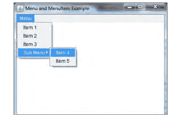

图 3.24: Java MenuItem 和 Menu

## 3.17 JAVA AWT DIALOG

`Dialog` 控制表示带有边框和标题的顶层窗口，用于从用户获取某些输入。它继承自 `Window` 类。与 `Frame` 不同，它没有最大化和最小化按钮。示例输出如图 3.25 所示。

### Frame 与 Dialog

`Frame` 和 `Dialog` 都继承自 `Window` 类。`Frame` 有最大化和最小化按钮，但 `Dialog` 没有。

### AWT Dialog 类声明

```java
public class Dialog extends Window
```

```java
import java.awt.*;
import java.awt.event.*;

public class DialogExample {
    private static Dialog d;

    DialogExample() {
        Frame f = new Frame();
        d = new Dialog(f, "Dialog Example", true);
        d.setLayout(new FlowLayout());
        Button b = new Button("OK");
        b.addActionListener(new ActionListener() {
            public void actionPerformed(ActionEvent e) {
                DialogExample.d.setVisible(false);
            }
        });
        d.add(new Label("Click button to continue."));
        d.add(b);
        d.setSize(300, 300);
        d.setVisible(true);
    }

    public static void main(String args[]) {
        new DialogExample();
    }
}
```

输出：

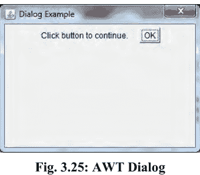

## 3.18 APPLET

`Applet` 是一种可以嵌入网页的 Java 程序。它运行在网页浏览器内部，并在客户端工作。`Applet` 使用 `APPLET` 或 `OBJECT` 标签嵌入到 HTML 页面中，并托管在 Web 服务器上。`Applets` 用于使网站更加动态和更有趣。

1. 所有 applet 都是 `java.applet.Applet` 类的直接或间接子类。
2. `Applets` 不是独立运行程序。相反，它们运行在网页浏览器或 applet viewer 中。JDK 提供了一个名为 `applet viewer` 的标准 applet viewer 工具。
3. 通常情况下，applet 的执行并不是从 `main()` 方法开始的。
4. applet 窗口的输出不是通过 `System.out.println()` 实现，而是通过各种 AWT 方法处理，例如 `drawString()`。

### applet 的生命周期

理解各种方法的调用顺序非常重要。当一个 applet 开始时，以下方法将按照图 3.26 所示的顺序被调用：

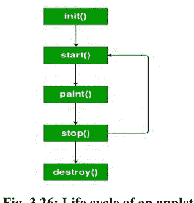

让我们更仔细地观察这些方法：

- `init()` : 当 applet 开始时调用 `init()` 方法。
- `start()` : 在 `init()` 之后，每次 applet 返回时调用 `start()` 方法。
- `paint()` : 每当 applet 运行时都会调用 `paint()` 方法。
- `stop()` : 当用户离开页面时调用 `stop()` 方法。
- `destroy()` : 当 applet 从内存中移除时调用 `destroy()` 方法。

```java
// HelloWorld Applet
import java.applet.Applet;
import java.awt.Graphics;

// HelloWorld 类继承自 Applet
public class HelloWorld extends Applet {
    @Override
    public void paint(Graphics g) {
        g.drawString("Hello World", 20, 20);
    }
}
```

## 3.19 JAVA SWING

| 序号 | AWT | Swing |
| :--- | :--- | :--- |
| 1 | AWT 组件是重量级的。 | Swing 组件是轻量级的。 |
| 2 | AWT 不支持可插拔外观。 | Swing 支持可插拔外观。 |
| 3 | AWT 提供的组件较少。 | Swing 提供了更强大的组件，如表格、列表、滚动页、颜色选择器、标签页等。 |
| 4 | AWT 不遵循 MVC（模型-视图-控制器）模式。 | Swing 遵循 MVC 模式。 |

### Java Swing 类的层级结构

Java Swing API 的层级结构如图 3.27 所示。

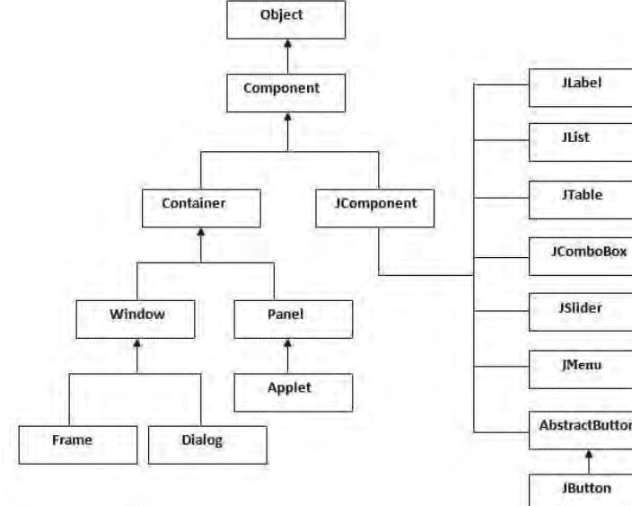

图 3.27：Java Swing API 的层级结构

### 简单的 Java Swing 示例

让我们来看一个简单的 Swing 示例，我们在 `main()` 方法中创建一个按钮并将其添加到 `JFrame` 对象中，示例结果如图 3.28 所示。

```java
// File: FirstSwingExample.java
import javax.swing.*;

public class FirstSwingExample {
    public static void main(String[] args) {
        JFrame f = new JFrame(); // 创建 JFrame 的实例
        JButton b = new JButton("click"); // 创建 JButton 的实例
        b.setBounds(130, 100, 100, 40); // x 轴，y 轴，宽度，高度
        f.add(b); // 在 JFrame 中添加按钮
        f.setSize(400, 500); // 400 宽度和 500 高度
        f.setLayout(null); // 不使用布局管理器
        f.setVisible(true); // 使框架可见
    }
}
```

输出：

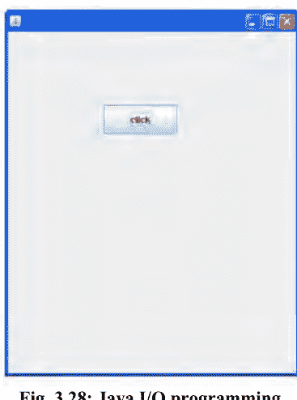

图 3.28: 简单的 Java Swing 示例

## 3.20 I/O 编程

Java I/O（输入和输出）被用于处理输入和产生输出。Java 使用流（stream）的类概念来使 I/O 操作变快。`java.io` 包包含了所有输入输出操作所需的类。我们可以通过 Java I/O API 在 Java 中执行文件处理。

流（stream）是数据的序列。在 Java 中，流由字节组成。它被称为流，是因为它像持续流动的水。在 Java 中，系统会自动为我们创建 3 个流。这些流都与控制台连接。

1. `System.out`: 标准输出流
2. `System.in`: 标准输入流
3. `System.err`: 标准错误流

让我们来看向控制台打印输出和错误消息的代码。

```java
System.out.println("simple message");
System.err.println("error message");
```

让我们来看从控制台获取输入的代码。

```java
int i = System.in.read(); // 返回第一个字符的 ASCII 码
System.out.println((char)i); // 将打印该字符
```

### OutputStream vs InputStream

以下是 `OutputStream` 和 `InputStream` 类的解释：

- **OutputStream**: Java 应用使用输出流向目标写入数据；目标可以是文件、数组、外围设备或套接字。
- **InputStream**: Java 应用使用输入流从源读取数据；源可以是文件、数组、外围设备或套接字。

让我们通过图 3.29 理解 Java `OutputStream` 和 `InputStream` 的工作。

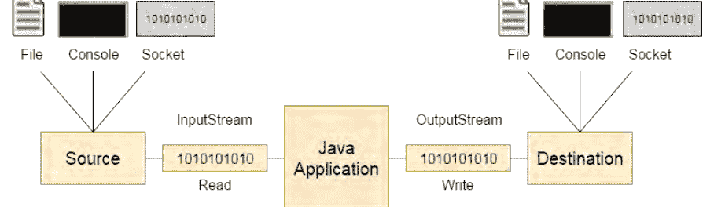

图 3.29: OutputStream 和 InputStream 工作原理

#### OutputStream 类

`OutputStream` 类是一个抽象类。它是所有表示字节输出流的类的父类。输出流接收输出字节并将其发送到某些汇（sink）。`OutputStream` 支持的方法如表 3.28 所示。`OutputStream` 层级结构如图 3.30 所示。

**表 3.28：OutputStream 的方法**

| 方法 | 描述 |
| :--- | :--- |
| `public void write(int) throws IOException` | 用于向当前输出流写入一个字节。 |
| `public void write(byte[]) throws IOException` | 用于向当前输出流写入一个字节数组。 |
| `public void flush() throws IOException` | 刷新当前输出流。 |
| `public void close() throws IOException` | 用于关闭当前输出流。 |

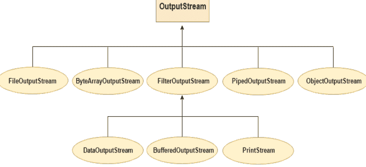

图 3.30：OutputStream 层级结构

#### InputStream 类

`InputStream` 类是一个抽象类。它是所有表示字节输入流的类的超类。输入流的方法如表 3.29 所示，层级结构如图 3.31 所示。

**表 3.29：InputStream 的方法**

| 方法 | 描述 |
| :--- | :--- |
| `public abstract int read() throws IOException` | 从输入流中读取下一个字节。在文件末尾返回 -1。 |
| `public int available() throws IOException` | 返回从当前输入流中可以读取的字节数的估计值。 |
| `public void close() throws IOException` | 用于关闭当前输入流。 |


图 3.31：InputStream 层级结构

## 3.21 FileOutputStream 类

`FileOutputStream` 是一个用于向文件写入数据的输出流。它是 `OutputStream` 的子类，表示字节输出流。`FileOutputStream` 用于写入文件。对于字符型数据，建议使用 `FileWriter`。`FileOutputStream` 支持的方法如表 3.30 所示。

### FileOutputStream 类声明

```java
public class FileOutputStream extends OutputStream
```

**表 3.30：FileOutputStream 的方法**

| 方法 | 描述 |
| :--- | :--- |
| `protected void finalize()` | 用于清理与输出流的连接。 |
| `void write(byte[])` | 将字节数组写入文件输出流。 |
| `void write(byte[] ary, int off, int len)` | 将从字节偏移量 `off` 开始的 `len` 个字节写入文件输出流。 |
| `void write(int b)` | 将指定的字节写入文件输出流。 |
| `FileChannel getChannel()` | 返回与文件输出流关联的唯一 `FileChannel` 对象。 |
| `FileDescriptor getFD()` | 返回 `FileDescriptor` 对象。 |
| `void close()` | 用于关闭流。 |

### Java FileOutputStream 示例 1：写入字节

```java
import java.io.*;

public class FileOutputStreamExample {
    public static void main(String[] args) {
        try {
            FileOutputStream fout = new FileOutputStream("test.txt");
            fout.write(65);
            fout.close();
            System.out.println("success...");
        } catch (Exception e) {
            System.out.println(e);
        }
    }
}
```


# 3.22 FileInputStream 类

`FileInputStream` 类从文件获取输入字节。它用于读取字节型数据（原始字节流），如图像数据、音频、视频；对于读取字符流，建议使用 `FileReader`。`InputStream` 类的方法如表 3.31 所示。

## InputStream 类声明

```java
public class FileInputStream extends InputStream
```

## 表 3.31：InputStream 的方法

| 方法 | 描述 |
| :--- | :--- |
| int available() | 返回从当前输入流中可以读取的字节数的估计值。 |
| int read() | 从输入流中读取字节。 |
| int read(byte[] b) | 从输入流中读取最多 `b.length` 个字节。 |
| int read(byte[] b, int off, int len) | 从输入流中从偏移量 `off` 开始读取最多 `len` 个字节。 |
| long skip(long x) | 从输入流中跳过并丢弃 x 个字节。 |
| FileChannel getChannel() | 返回与文件输入流关联的唯一 FileChannel 对象。 |
| FileDescriptor getDescriptor() | 返回 FileDescriptor 对象。 |
| protected void finalize() | 在不再有输入流的引用时确保调用 close 方法。 |
| void close() | 用于关闭流。 |

## Java FileInputStream 示例 1：读取单个字符

```java
import java.io.FileInputStream;

public class DataInputStreamExample {
    public static void main(String[] args) {
        try {
            FileInputStream fin = new FileInputStream("test.txt");
            int i = fin.read();
            System.out.print((char) i);
            fin.close();
        } catch (Exception e) {
            System.out.println(e);
        }
    }
}
```

**注意：** 在运行代码之前，需要创建一个名为 "testout.txt" 的文本文件。在该文件中，我们包含以下内容：

Welcome to javapoint.

执行上述程序后，你将从文件中获得一个字符，其值为 87（字节形式）。要查看该文本，你需要将其转换为字符。

---

# 3.23 BufferedOutputStream 类

Java `BufferedOutputStream` 类用于输出流的缓冲。它在内部使用缓冲区来存储数据。这增加了直接向流中写入数据的效率。因此，它提高了性能。表 3.32 给出了 `BufferedOutputStream` 构造函数，表 3.33 给出了相关方法。若要在 `OutputStream` 中添加缓冲，请使用 `BufferedOutputStream` 类。让我们看看在 `OutputStream` 中添加缓冲的语法：

```java
OutputStream os = new BufferedOutputStream(new FileOutputStream("D:\\IO Package\\testout.txt"));
```

## BufferedOutputStream 类声明

```java
public class BufferedOutputStream extends FilterOutputStream
```

## 表 3.32：Java BufferedOutputStream 类构造函数

| 构造函数 | 描述 |
| :--- | :--- |
| `BufferedOutputStream(OutputStream os)` | 创建一个新的缓冲输出流，用于将数据写入指定的输出流。 |
| `BufferedOutputStream(OutputStream os, int size)` | 创建一个新的缓冲输出流，用于以指定的缓冲区大小将数据写入指定的输出流。 |

## 表 3.33：Java BufferedOutputStream 类方法

| 方法 | 描述 |
| :--- | :--- |
| `void write(int b)` | 将指定的字节写入缓冲输出流。 |
| `void write(byte[] b, int off, int len)` | 将指定的字节数组中从偏移量 `off` 开始的 `len` 个字节写入缓冲输出流。 |
| `void flush()` | 刷新缓冲输出流。 |

## BufferedOutputStream 类的示例

在这个示例中，我们正在向连接到 `FileOutputStream` 对象的 `BufferedOutputStream` 对象写入文本信息。`flush()` 会刷新一个流的数据并将其发送到另一个流。前提是你已经将一个流与另一个流连接在一起。

```java
package com.javatoint;

import java.io.*;

public class BufferedOutputStreamExample {
    public static void main(String args[]) throws Exception {
        FileOutputStream fout = new FileOutputStream("D:\\test.txt");
        BufferedOutputStream bout = new BufferedOutputStream(fout);
        String s = "Welcome to javaTpoint.";
        byte[] b = s.getBytes();
        bout.write(b);
        bout.flush();
        bout.close();
        fout.close();
        System.out.println("success");
    }
}
```


# 输出

Success

testout.txt

Welcome to javaTpoint.

## 随机访问文件

该类用于读写随机访问文件。随机访问文件的行为类似于一个巨大的字节数组。数组文件指针有一个隐含的游标，通过移动游标来执行读写操作。如果在读取指定的字节数之前到达文件末尾，则会抛出 `EOF`。这是 `IOException` 的一种类型。`RandomAccessFile` 支持的构造函数见表 3.34，方法见表 3.35。

### 表 3.34: 构造函数

| 构造函数 | 描述 |
| --- | --- |
| `RandomAccessFile(File file, String mode)` | 创建一个随机访问文件流，用于从参数指定的文件读取并可选地写入。 |
| `RandomAccessFile(String name, String mode)` | 创建一个随机访问文件流，用于从指定名称的文件读取并可选地写入。 |

### 表 3.35: 方法

| 修饰符和类型 | 方法 | 描述 |
| --- | --- | --- |
| `void` | `close()` | 关闭此随机访问文件流并释放与流相关的任何系统资源。 |
| `FileChannel` | `getChannel()` | 返回与此关联的唯一 `FileChannel` 对象。 |
| `int` | `readInt()` | 从此文件中读取一个带符号的 32 位整数。 |
| `String` | `readUTF()` | 从此文件中读取一个字符串。 |
| `void` | `seek(long pos)` | 设置文件指针偏移量（从文件开始计算），下一次读取或写入将发生在此。 |
| `void` | `writeDouble(double v)` | 使用 `Double` 类中的 `doubleToLongBits` 方法将 `double` 参数转换为 `long`，然后将该值作为八字节量写入文件，高字节在前。 |
| `void` | `writeFloat(float v)` | 使用 `Float` 类中的 `floatToIntBits` 方法将 `float` 参数转换为 `int`，然后将该值作为四字节量写入文件，高字节在前。 |
| `void` | `write(int b)` | 将指定的字节写入此文件。 |
| `int` | `read()` | 从此文件中读取一个字节的数据。 |
| `long` | `length()` | 返回此文件的长度。 |
| `void` | `seek(long pos)` | 设置文件指针偏移量（从文件开始计算），下一次读取或写入将发生在此。 |

### 示例

```java
import java.io.*;

public class RandomAccessFileExample {
}
```

## 简介

### Java 多线程的优势

1. 它不会阻塞用户，因为线程是独立的，你可以同时执行多个操作。
2. 你可以同时执行许多操作，从而节省时间。
3. 线程是独立的，因此如果某个线程发生异常，也不会影响其他线程。

### 线程的生命周期（线程状态）

在 Java 中，线程始终处于以下状态之一。这些状态是：新建、活动、阻塞/等待、计时等待和终止，如图 4.2 所示。让我们了解每个状态的功能。

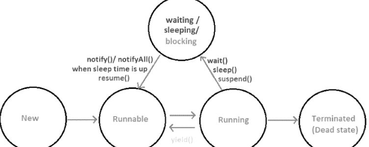

图 4.2：线程的生命周期

- **新建**：每创建一个新线程，它始终处于新建状态。对于处于新建状态的线程，代码尚未运行也没有开始执行。

- **活动**：当线程调用 `start()` 方法时，它从新建状态移动到活动状态。活动状态包含两个状态：一个是**可运行**，另一个是**运行中**。

- **可运行**：准备运行的线程被移动到可运行状态。在可运行状态，线程在任何时刻可能正在运行，也可能准备好运行。线程调度器的职责是为线程提供运行时间，即将线程移动到运行状态。多线程为每个单独线程获取固定的时间片。当分配的时间片结束时，线程会自愿放弃 CPU 给其他线程，以便其他线程也能运行它们的时间片。当出现这种情况时，所有愿意运行并等待轮到运行的线程都处于可运行状态。在可运行状态中，有一个线程存放的队列。

- **运行中**：当线程获得 CPU 时，它从可运行状态移动到运行状态。通常情况下，线程状态最常见的变化是从可运行变为运行中，然后返回到可运行状态。

- **阻塞或等待**：每当线程处于一段时间的不活动状态（非永久）时，该线程要么处于阻塞状态，要么处于等待状态。

  例如，一个线程（假设它的名字是 A）可能想要从打印机打印一些数据。然而在某个时刻，另一个线程（假设它的名字是 B）正在使用打印机打印数据。因此，线程 A 必须等待 B 使用打印机。因此，线程 A 处于阻塞状态。阻塞状态无法执行任何操作，且不会消耗中央处理器（CPU）的任何周期。因此，我们可以说线程 A 保持空闲，直到调度器激活处于等待或阻塞状态的线程 A。当主线程调用 `join` 方法时，可以说主线程处于等待状态。然后主线程等待子线程完成任务。当子线程完成工作后，会向主线程发送通知，这再次将线程从等待状态移动到运行状态。

  如果有大量线程处于等待或阻塞状态，调度器的职责是选择执行哪一个，然后被选中的线程将获得运行的机会。

- **计时等待**：有时等待会导致饥饿。线程进入特定时间段等待状态。等待和计时等待的主要区别在于时间限制。等待没有时间限制，而计时等待有时间限制。调用以下方法的线程会到达计时等待状态：
  - `sleep`
  - 带超时的 `join`
  - 带超时的 `wait`
  - `parkUntil`
  - `parkNanos`

- **终止**：线程由于以下原因到达终止状态：
  - 当线程完成工作时，它正常终止。
  - **异常终止**：当发生意外异常或段错误时。

### 线程状态的实现

在 Java 中，可以使用 `getState()` 方法获取线程的状态。

`java.lang.Thread.State` 类提供了常量枚举来表示线程的状态。

这些常量是：

1. `public static final Thread.State NEW`：代表线程的第一个状态，即新建状态。
2. `public static final Thread.State RUNNABLE`：代表可运行状态。意味着线程正在队列中等待运行。
3. `public static final Thread.State BLOCKED`：代表阻塞状态。在此状态下，线程正在等待获取锁。
4. `public static final Thread.State WAITING`：代表等待状态。当线程调用 `Object.wait()` 方法或不带超时的 `Thread.join()` 方法时，会进入此状态。处于等待状态的线程正在等待另一个线程完成任务。
5. `public static final Thread.State TIMED_WAITING`：代表计时等待状态。
6. `public static final Thread.State TERMINATED`：代表终止或死亡线程的最终状态。终止线程已完成执行。

```java
class Thread2 extends Thread {
    public void run() {
        System.out.println("Thread 2");
        System.out.println("i in Thread 2");
        for (int i = 1; i <= 5; i++) {
            System.out.println("i = " + i);
        }
        System.out.println("Thread 2 has been Completed.");
    }
}
```

```java
/*
 * Driver代码
 */
public class ThreadDemo {
    public static void main(String[] args) {
        // 线程周期
        // 线程的新型状态
        Thread1 th1 = new Thread1();
        Thread2 th2 = new Thread2();

        // 上述线程都处于就绪
        // Thread1 和 Thread2 的运行状态
        th1.start();

        // 将控制权转移到另一个线程
        th2.yield();

        // Thread1 阻塞状态
        try {
            th1.sleep(1000);
        } catch (InterruptedException e) {
            e.printStackTrace();
        }

        th2.start();

        System.out.println("Main Thread End");
    }
}
```

### 输出

```
Thread 1 started
1 in Thread 1
1 = 1
Main Thread End
Thread 2
1 in Thread 2
1 = 2
1 = 1
1 = 2
1 = 3
1 = 4
1 = 5
Thread 2 has been Completed.
1 = 3
1 = 4
1 = 5
Thread 1 has been Completed.
```

## Java 中创建线程

有两种方法可以创建线程：

- 通过扩展 `Thread` 类
- 通过实现 `Runnable` 接口。

### Thread 类

提供了构造函数和方法，用于创建线程并对线程执行操作。`Thread` 继承了 `Object` 类并实现了 `Runnable` 接口。

#### Thread 类常用的构造函数

- `Thread()`
- `Thread(String name)`
- `Thread(Runnable r)`
- `Thread(Runnable r, String name)`

#### Thread 类常用的方法

- `public void run()`: 用于为线程执行操作。JVM 会调用线程上的 `run()` 方法。
- `public void sleep(long milliseconds)`: 使当前执行的线程睡眠指定的毫秒数（临时执行）。
- `public void join()`: 等待一个线程死亡。
- `public void join(long milliseconds)`: 等待一个线程死亡指定的毫秒数时间。
- `public int getPriority()`: 返回线程的优先级。
- `public void setPriority(int priority)`: 更改线程的优先级。
- `public String getName()`: 返回线程的名字。
- `public void setName(String name)`: 更改线程的名字。
- `public Thread getCurrentThread()`: 返回当前执行线程的引用。
- `public int getId()`: 返回线程的标识符。
- `public Thread.State getState()`: 返回线程的状态。
- `public boolean isAlive()`: 测试线程是否存活。
- `public void yield()`: 导致当前执行的线程临时暂停并允许其他线程执行。
- `public void suspend()`: 用于挂起线程（已废用）。
- `public void resume()`: 用于恢复被挂起的的线程（已废用）。
- `public void stop()`: 用于停止线程（已废用）。
- `public boolean isDaemon()`: 测试线程是否为守护线程。
- `public void setDaemon(boolean b)`: 将线程标记为守护线程或用户线程。
- `public void interrupt()`: 中断线程。
- `public boolean isInterrupted()`: 测试线程是否被中断。
- `public static boolean interrupted()`: 测试当前线程是否被中断。

## Java Runnable 接口

`Runnable` 接口是一个用于在并发线程上执行代码的接口。如果我们希望该类的实例由线程执行，则任何类都可以实现该接口。`Runnable` 接口有一个未定义的 `run()` 方法，其返回类型为 `void`，且不接受任何参数。`run()` 方法的摘要如下：

> `public void run()`

该方法不接受任何参数。当使用实现接口的类的对象来创建线程时，`run` 方法将在 `Runnable` 独立执行的线程中被调用。此接口存在于 `java.lang` 包中。

### 使用 Runnable 接口创建线程

```java
Runnable runnable = new MyRunnable();
Thread thread = new Thread(runnable);
thread.start();
```

线程将执行传递其参数的 `Runnable` 对象中 `run()` 方法提到的代码。使用 runnable 演示线程的程序：

```java
public class ExampleClass implements Runnable {
    @Override
    public void run() {
        System.out.println("Thread has ended");
    }
}
```

### 线程简介

```java
public static void main(String[] args) {
    ExampleClass ex = new ExampleClass();
    Thread t1 = new Thread(ex);
    t1.start();
    System.out.println("Hi");
}
```

### 输出

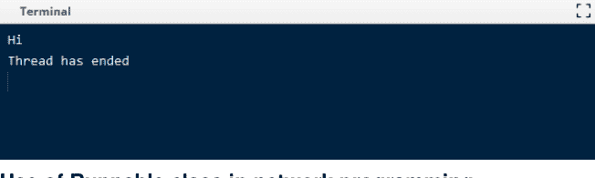

### Runnable 类在网络编程中的应用

`Runnable` 类用于执行多线程编程，特别是在服务器端，因为服务器可能会接收多个请求。

以下程序显示了一个创建一个线程的服务器。

### 使用 Runnable 的网络程序示例

```java
public class Example {
    public static void main(String[] args) {
        new SimpleServer().start();
    }

    static class SimpleServer implements Runnable {
        @Override
        public void run() {
            ServerSocket serverSocket = null;
            try {
```


```java
serverSocket = new ServerSocket(3333);

while (true) {
    Socket clientSocket = serverSocket.accept();
    BufferedReader inputReader = new BufferedReader(new InputStreamReader(clientSocket.getInputStream()));
    System.out.println("Client said :" + inputReader.readLine());
}
```

在这个程序中，我们为客户端创建了套接字。为每个客户端创建单独线程并不是良好的做法。

## 启动线程

`Thread` 类的 `start()` 方法用于启动新创建的线程。它执行以下任务：
- 启动新线程（新栈）
- 线程从新建状态移动到就绪状态
- 当线程获得执行机会时，它的 `run()` 方法将运行

### 1) 扩展 Thread 的 Java 示例

```java
class Multi extends Thread {
    public void run() {
        System.out.println("thread is running...");
    }

    public static void main(String[] args) {
        Multi t1 = new Multi();
        t1.start();
    }
}
```

输出：
```
thread is running...
```

### 2) 实现 Runnable 的 Java 示例

```java
class Multi3 implements Runnable {
    public void run() {
        System.out.println("thread is running...");
    }
}

public class Main {
    public static void main(String[] args) {
        Multi3 m1 = new Multi3();
        Thread t1 = new Thread(m1); // 使用构造函数 Thread(Runnable r)
        t1.start();
    }
}
```

输出：
```
thread is running...
```

如果你没有扩展 `Thread` 类，你的类对象将不会被视为线程对象。因此，你需要显式创建 `Thread` 类对象。我们传递实现了 `Runnable` 的类对象，以便你的类 `run()` 方法可以执行。

### 3) 使用 Thread 类：Thread(String name)

我们可以直接使用类及其定义的构造函数来产生新线程。

```java
public class MyThread1 {
    public static void main(String[] args) {
        // 使用构造函数 Thread(String name) 创建 Thread 类的对象
        Thread t = new Thread("My first thread");
        // start() 方法将线程移动到活动状态
        t.start();
        // 通过调用 getName() 方法获取线程名称
        String str = t.getName();
        System.out.println(str);
    }
}
```

输出：
```
My first thread
```

### 4) 使用 Thread 类：Thread(Runnable r, String name)

```java
public class MyThread2 implements Runnable {
    public void run() {
        System.out.println("Now the thread is running ...");
    }

    public static void main(String[] args) {
        // 创建 MyThread2 类的对象
        Runnable r1 = new MyThread2();
        // 使用 Thread(Runnable r, String name) 创建类的对象
        Thread th1 = new Thread(r1, "My new thread");
        // start() 方法将线程移动到激活状态
        th1.start();
        // 通过调用 getName() 方法获取线程名
        String str = th1.getName();
        System.out.println(str);
    }
}
```

输出：
```
My new thread
Now the thread is running ...
```

## 4.3 线程同步

Java 中的同步是控制多个线程访问任何共享资源的能力。当我们希望只允许一个线程访问共享资源时，Java 同步是更好的选择。同步分为两种类型：
1. 进程同步
2. 线程同步

同步主要用于：
- 防止线程间干扰
- 防止一致性问题

### 4.3.1 线程同步

线程同步有两种类型：
- **互斥**
    - 使用 `synchronized` 方法
    - 使用 `synchronized` 块
    - 使用静态同步
- **协作**（Java 中的线程间通信）

#### 4.3.1.1 互斥

互斥有助于防止线程在共享数据时发生相互干扰。这可以通过以下三种方式实现：使用 `synchronized` 方法、使用 `synchronized` 块以及使用静态同步。

#### 4.3.1.2 同步

同步围绕一个名为锁（`lock`）或监视器（`monitor`）的内部实体构建。每个对象都关联有一个锁。按照约定，需要一致访问对象字段的线程在访问这些字段之前必须获取对象的锁，并在完成后释放锁。

**没有同步的示例：**

```java
class Table1 {
    void printMyTable(int n) { // 方法未同步
        for (int i = 1; i <= 7; i++) {
            System.out.println(n * i);
            try {
                Thread.sleep(500);
            } catch (Exception e) {
                System.out.println(e);
            }
        }
    }
}

class MyThread1 extends Thread {
    Table1 t;
    MyThread1(Table1 t) {
        this.t = t;
    }
    public void run() {
        t.printMyTable(5);
    }
}

class MyThread2 extends Thread {
    Table1 t;
    MyThread2(Table1 t) {
        this.t = t;
    }
    public void run() {
        t.printMyTable(100);
    }
}

class TestSynchronization1 {
    public static void main(String[] args) {
        Table1 obj = new Table1(); // 只有一个对象
        MyThread1 t1 = new MyThread1(obj);
        MyThread2 t2 = new MyThread2(obj);
        t1.start();
        t2.start();
    }
}
```

输出：
```
5
100
10
200
15
300
20
400
25
500
30
600
35
700
```

**同步方法示例：** 如果你将任何方法声明为 `synchronized`，则它被称为同步方法。同步方法用于在访问共享资源时锁定对象。当一个线程调用同步方法时，它会自动获取该对象的锁，并在线程完成任务时释放该锁。

```java
// Java 同步方法示例
class Table1 {
    synchronized void printTable(int n) { // 同步方法
        for (int i = 1; i <= 7; i++) {
            System.out.println(n * i);
            try {
                Thread.sleep(200);
            } catch (Exception e) {
                System.out.println(e);
            }
        }
    }
}

class MyThread1 extends Thread {
    Table1 t;
    MyThread1(Table1 t) {
        this.t = t;
    }
    public void run() {
        t.printTable(5);
    }
}

class MyThread2 extends Thread {
    Table1 t;
    MyThread2(Table1 t) {
        this.t = t;
    }
    public void run() {
        t.printTable(100);
    }
}

class TestSynchronization2 {
    public static void main(String[] args) {
        Table1 obj = new Table1(); // 只有一个对象
        MyThread1 t1 = new MyThread1(obj);
        MyThread2 t2 = new MyThread2(obj);
        t1.start();
        t2.start();
    }
}
```

输出：
```
5
10
15
20
25
30
35
100
200
400
500
600
700
```

**使用匿名类的同步方法示例：** 在此程序中，我们使用匿名类创建线程，因此代码更少。

```java
// 使用匿名类的同步方法程序
class Table {
    synchronized void printTable(int n) { // 同步方法
        for (int i = 1; i <= 4; i++)
            System.out.println(n * i);
        try {
            Thread.sleep(300);
        } catch (Exception e) {
            System.out.println(e);
        }
    }
}

class TestSynchronization3 {
    public static void main(String[] args) {
        final Table obj = new Table(); // 只有一个对象
        Thread t1 = new Thread() {
            public void run() {
                obj.printTable(5);
            }
        };
        Thread t2 = new Thread() {
            public void run() {
                obj.printTable(100);
            }
        };
        t1.start();
        t2.start();
    }
}
```


| 5 |
| :--- |
| 10 |
| 15 |
| 20 |
| 100 |
| 200 |
| 400 |

# 4.4 异常处理

异常是中断程序正常流程的事件。它是运行时抛出的对象。异常处理是处理 `ClassNotFound`、`IO`、`SQL` 等运行时错误的机制。异常处理的优势是维护应用程序的正常流程。异常通常会破坏应用程序的正常流程，这就是我们使用异常处理的原因。Java 异常层次结构如图 4.3 所示。


# 4.4.1 异常类型

异常主要分为两种类型：编译异常（Checked Exception）和非编译异常（Unchecked Exception），其中错误被视为非编译异常。Sun 系统表示有三种异常，如图 4.4 所示：


- **1) 编译异常（Checked Exception）**：除 `RuntimeException` 和 `Error` 之外继承 `Throwable` 类的类被称为编译异常，例如 `IOException`、`SQLException` 等。编译异常在编译时检查。
- **2) 非编译异常（Unchecked Exception）**：继承 `RuntimeException` 的类被称为非编译异常，例如 `ArithmeticException`、`NullPointerException`、`ArrayIndexOutOfBoundsException` 等。非编译异常不在编译时检查，而是在运行时检查。

给出了一些可能发生非编译异常的场景，如下：

- **i) 发生 `ArithmeticException` 的场景**

如果我们将任何数字除以零，就会发生 `ArithmeticException`。
```java
int a = 50 / 0; // ArithmeticException
```

- **ii) 发生 `NullPointerException` 的场景**

如果任何变量中为空值，对该变量执行任何操作都会发生 `NullPointerException`。
```java
String s = null;
System.out.println(s.length()); // NullPointerException
```

- **iii) 发生 `NumberFormatException` 的场景**

任何值的格式错误都可能导致 `NumberFormatException`。假设有一个包含字符的字符串，将此变量转换为数字将发生 `NumberFormatException`。
```java
String s = "abc";
int i = Integer.parseInt(s); // NumberFormatException
```

- **iv) 发生 `ArrayIndexOutOfBoundsException` 的场景**

如果你在错误的索引处插入任何值，将导致 `ArrayIndexOutOfBoundsException`，如下所示：
```java
int a[] = new int[5];
a[10] = 50; // ArrayIndexOutOfBoundsException
```

- **3) 错误（Error）** 是不可逆的，例如 `OutOfMemoryError`、`VirtualMachineError`、`AssertionError` 等。

### 4.4.2 Java 异常处理关键字

Java 异常处理使用了 5 个关键字：

1. `try`
2. `catch`
3. `finally`
4. `throw`
5. `throws`

#### 4.4.2.1 Java try 块

Java `try` 块用于封装可能抛出异常的代码。它必须在方法内部。Java `try` 块后面必须紧跟 `catch` 块或 `finally` 块。

**Java try-catch 语法**

```java
try {
    // 可能抛出异常的代码
} catch (Exception_class_Name name) {
}
```

**try-finally 块的语法**

```java
try {
    // 可能会抛出异常的代码
} finally {
}
```

#### 4.4.2.2 Java catch 块

Java `catch` 块用于处理异常。它必须在 `try` 块之后使用。你可以对单个 `try` 块使用多个 `catch` 块。

**没有异常处理时的问题**

让我们尝试理解一下如果不使用 `try-catch` 块会发生什么问题。

```java
public class Testcatch1 {
    public static void main(String args[]) {
        int data = 50 / 0; // 可能会抛出异常
        System.out.println("rest of the code...");
    }
}
```

**输出：**

```
Exception in thread main java.lang.ArithmeticException: / by zero
```

如上例所示，剩余的代码没有执行（在这种情况下，`rest of the code...` 语句没有被打印）。在异常之后可能还有 100 行代码。因此，异常后的所有代码将不会被执行。

**异常处理的解决方案**

让我们看看使用 Java `try-catch` 块解决该问题的方法。

```java
public class Testcatch2 {
    public static void main(String args[]) {
        try {
            int data = 50 / 0;
        } catch (ArithmeticException e) {
            System.out.println(e);
        }
        System.out.println("rest of the code...");
    }
}
```

**输出：**

```
java.lang.ArithmeticException: / by zero
rest of the code...
```

现在，如上例所示，剩余的代码执行了，即 `rest of the code...` 语句被打印了。JVM 首先检查异常是否被处理。如果异常未被处理，JVM 将提供一个默认的异常处理器，执行以下任务：

- 打印异常描述。
- 打印堆栈轨迹（异常发生处的方法层级结构）。
- 导致程序终止。

但如果异常被应用程序程序员处理了，应用程序的正常流程就能得以维持，即执行剩余的代码。Java `try-catch` 块的内部工作如图 4.5 所示。

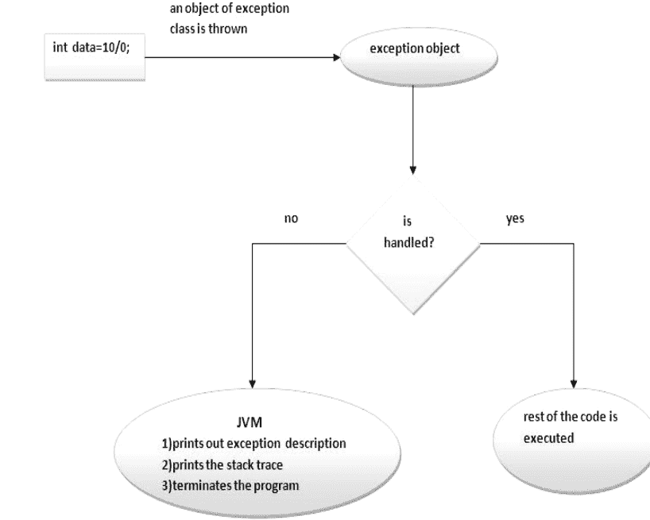

### 4.4.3 Java 自定义异常

如果你正在创建自己的异常，它被称为自定义异常或用户定义异常。Java 自定义异常用于根据用户需求定制异常。通过自定义异常，你可以拥有自己的异常类型和消息。让我们来看一个 Java 自定义异常的简单示例。

```java
class InvalidAgeException extends Exception {
    InvalidAgeException(String s1) {
        super(s1);
    }
}

class TestCustomException1 {
    static void validate(int age) throws InvalidAgeException {
        if (age < 18)
            throw new InvalidAgeException("not valid");
        else
            System.out.println("welcome to vote");
    }

    public static void main(String args[]) {
        Scanner s = new Scanner(System.in);
        System.out.println("Enter your age");
        int age1 = s.nextInt();
        try {
            validate(age1);
        } catch (Exception m) {
            System.out.println("Exception occured: " + m);
        }
        System.out.println("rest of the code...");
    }
}
```

**输出：**

```
Exception occured: InvalidAgeException: not valid
rest of the code...
```

# 4.5 Java 集合

Java Collections 是一个框架，提供了一种存储和操作对象组的架构。你在数据上执行的所有操作，如搜索、排序、插入、处理、删除，都可以通过 Java Collections 完成。Java Collection 简单意味着一个对象的单一单元。Java Collection 框架提供了许多接口（`Set`、`List`、`Queue`、`Deque` 等）和类（`ArrayList`、`Vector`、`LinkedList`、`PriorityQueue`、`HashSet`、`LinkedHashSet`、`TreeSet` 等）。集合框架的层级结构如图 4.6 所示。`java.util` 包包含了集合框架所需的所有类和接口。

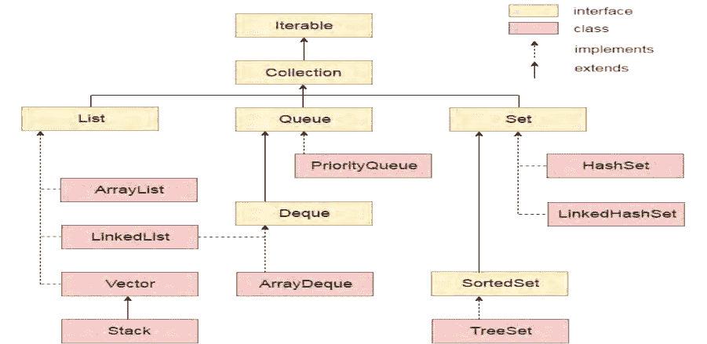

## Collection 接口的方法

`Collection` 接口中声明了许多方法。它们在表 4.2 中描述：

**表 4.2：Collection 接口**

| 编号 | 方法 | 描述 |
|---|---|---|
| 1 | `public boolean add(Object element)` | 用于向此集合插入一个元素。 |
| 2 | `public boolean addAll(Collection c)` | 用于在调用者集合中插入指定的元素。 |
| 3 | `public boolean remove(Object element)` | 用于从此集合中删除一个元素。 |
| 4 | `public boolean removeAll(Collection c)` | 用于从调用集合中删除指定集合的所有元素。 |
| 5 | `public boolean retainAll(Collection c)` | 用于删除调用集合中除指定集合以外的所有元素。 |
| 6 | `public int size()` | 返回集合中元素的总量。 |
| 7 | `public void clear()` | 移除集合中的所有元素。 |
| 8 | `public boolean contains(Object element)` | 用于搜索。 |
| 9 | `public boolean containsAll(Collection c)` | 用于检查是否包含所有元素。 |
| 10 | `public Iterator iterator()` | 返回迭代器。 |
| 11 | `public Object[] toArray()` | 将集合转换为数组。 |
| 12 | `public boolean isEmpty()` | 检查集合是否为空。 |
| 13 | `public boolean equals(Object o)` | 比较是否相等。 |
| 14 | `public int hashCode()` | 返回集合的哈希值。 |

## Iterator 接口

`Iterator` 接口提供了正向遍历元素的功能。

**Iterator 接口的方法**：只有三个方法。它们在表 4.3 中描述：

**表 4.3：Iterator 接口**

| 编号 | 方法 | 描述 |
|---|---|---|
| 1 | `public boolean hasNext()` | 如果还有元素，则返回 true。 |
| 2 | `public Object next()` | 返回元素并移动指针。 |
| 3 | `public void remove()` | 移除当前元素。 |

## 4.5.1 ArrayList 类

`ArrayList` 使用动态数组进行存储。关于 `ArrayList` 类的要点：

- `ArrayList` 可以包含重复元素。
- `ArrayList` 维护插入顺序。
- `ArrayList` 允许随机访问，因为它是这样工作的。
- 在 `ArrayList` 类中，删除元素时操作速度较慢。

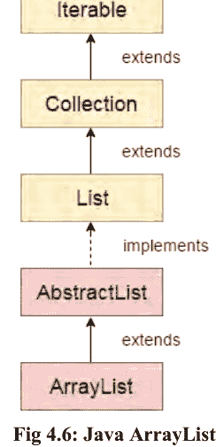

如图所示，`ArrayList` 扩展了 `AbstractList` 并实现了 `List` 接口。

### ArrayList 类声明

```java
public class ArrayList<E> extends AbstractList<E> implements List<E>, RandomAccess, Cloneable, Serializable
```

**表 4.4：构造函数**

| 构造函数 | 描述 |
|---|---|
| `ArrayList()` | 构建空列表。 |
| `ArrayList(Collection c)` | 构建一个由集合元素的列表。 |
| `ArrayList(int capacity)` | 构建具有指定容量的列表。 |

**表 4.5：ArrayList 方法**

| 方法 | 描述 |
|---|---|
| `add(int index, Object element)` | 用于在列表指定位置插入指定的元素。 |
| `addAll(Collection c)` | 将指定集合中的所有元素添加到列表末尾，顺序由指定集合的迭代器返回。 |
| `clear()` | 用于移除列表中的所有元素。 |
| `lastIndexOf(Object o)` | 返回列表中指定元素最后一次出现的索引，如果列表不包含该元素，则返回 -1。 |
| `toArray()` | 返回一个包含列表中所有元素的正确顺序的数组。 |
| `toArray(Object[] a)` | 返回一个包含列表中所有元素的正确顺序的数组。 |
| `add(Object o)` | 用于将指定的元素添加到列表末尾。 |
| `addAll(int index, Collection c)` | 将指定集合中的所有元素插入到列表中，从指定位置开始。 |
| `clone()` | 返回 `ArrayList` 的浅拷贝。 |
| `indexOf(Object o)` | 返回列表中指定元素第一次出现的索引，如果列表不包含该元素，则返回 -1。 |
| `trimToSize()` | 将此 `ArrayList` 实例的容量调整为列表的当前大小。 |

## Java 非泛型与泛型集合

在 JDK 1.5 之前，Java 集合框架是非泛型的。从 1.5 开始，它是泛型的。Java 新的泛型集合允许集合只包含一种类型的对象。现在它是类型安全的，运行时不需要进行类型转换。

让我们来看创建 Java 集合的旧非泛型示例：

- `ArrayList al = new ArrayList();` // 创建旧的非泛型 ArrayList

让我们来看创建 Java 集合的新泛型示例：

- `ArrayList<String> al = new ArrayList<String>();` // 创建新的泛型 ArrayList

在泛型集合中，我们在角括号中指定类型。现在 `ArrayList` 被强制只包含指定类型的对象。如果你添加另一种类型的对象，将产生编译时错误。

### Java ArrayList 示例

```java
import java.util.*;

class TestCollection {
    public static void main(String args[]) {
        ArrayList<String> list = new ArrayList<String>(); // 创建 arraylist
        list.add("Ravi"); // 在 arraylist 中添加对象
        list.add("Vijay");
        list.add("Ajay");

        // 通过 Iterator 遍历列表
        Iterator itr = list.iterator();
        while (itr.hasNext()) {
            System.out.println(itr.next());
        }
    }
}
```

**输出：**

```
Ravi
Vijay
Ajay
```

在 Java 中遍历集合元素的两种方法：遍历集合元素有两种方法：通过 `Iterator` 接口和 for-each 循环。

在上面的示例中，我们已经通过 `Iterator` 遍历 `ArrayList`。让我们来看使用 for-each 循环遍历 `ArrayList` 元素的示例。

```java
// 通过 for-each 循环遍历集合
import java.util.*;

class TestCollection2 {
    public static void main(String args[]) {
        ArrayList<String> list = new ArrayList<String>();
        list.add("Ravi");
        list.add("Vijay");
        list.add("Ajay");

        for (String obj : list) {
            System.out.println(obj);
        }
    }
}
```


```java
class TestCollection2 {
    public static void main(String args[]) {
        ArrayList<String> al = new ArrayList<String>();
        al.add("Ravi");
        al.add("Vijay");
        al.add("Ravi");
        al.add("Ajay");
        for (String obj : al) {
            System.out.println(obj);
        }
    }
}
```

### 输出

Ravi
Vijay
Ravi
Ajay

## Java ArrayList 中的自定义类对象

```java
class Student {
    int rollno;
    String name;
    int age;
    Student(int rollno, String name, int age) {
        this.rollno = rollno;
        this.name = name;
        this.age = age;
    }
}
import java.util.*;
public class Test3 {
    public static void main(String args[]) {
        // 创建自定义类对象
        Student s1 = new Student(101, "Sonoo", 23);
        Student s2 = new Student(102, "Ravi", 21);
        Student s3 = new Student(103, "Hanumat", 25);
        // 创建 arraylist
        ArrayList<Student> al = new ArrayList<Student>();
        al.add(s1); // 添加 Student 类对象
    }
}
```

### 输出

| 101 | Sonoo | 23 |
| 102 | Ravi | 21 |
| 103 | Hanumat | 25 |

### `addAll(Collection c)` 方法示例

```java
import java.util.*;
class TestCollection4 {
    public static void main(String args[]) {
        ArrayList<String> al = new ArrayList<String>();
        al.add("Ravi");
        al.add("Vijay");
        al.add("Ajay");
        ArrayList<String> al2 = new ArrayList<String>();
        al2.add("Sonoo");
        al2.add("Hanumat");
        al.addAll(al2); // 将第二个列表添加到第一个列表中
        Iterator itr = al.iterator();
        while (itr.hasNext()) {
            System.out.println(itr.next());
        }
    }
}
```

### 输出

Ravi
Vijay
Ajay
Sonoo
Hanumat

### `removeAll()` 方法示例

```java
import java.util.*;
class TestCollection5 {
    public static void main(String args[]) {
        ArrayList<String> al1 = new ArrayList<String>();
        al1.add("Ravi");
        al1.add("Vijay");
        al1.add("Ajay");
        ArrayList<String> al2 = new ArrayList<String>();
        al2.add("Ravi");
        al2.add("Hanumat");
        al1.removeAll(al2);
        System.out.println("移除 al2 中的元素后遍历元素...");
        Iterator itr = al1.iterator();
        while (itr.hasNext()) {
            System.out.println(itr.next());
        }
    }
}
```

### 输出

移除 al2 中的元素后遍历元素...
Vijay
Ajay

### `retainAll()` 方法示例

```java
import java.util.*;
class TestCollection6 {
    public static void main(String args[]) {
        ArrayList<String> al1 = new ArrayList<String>();
        al1.add("Ravi");
        al1.add("Vijay");
        al1.add("Ajay");
        ArrayList<String> al2 = new ArrayList<String>();
        al2.add("Ravi");
        al2.add("Hanumat");
        al1.retainAll(al2);
        System.out.println("保留 al2 中的元素后遍历元素...");
        Iterator itr = al1.iterator();
        while (itr.hasNext()) {
            System.out.println(itr.next());
        }
    }
}
```

### 输出

保留 al2 中的元素后遍历元素...
Ravi

### Java ArrayList 示例：书籍

让我们来看一个 `ArrayList` 示例，其中向列表中添加书籍并打印所有书籍。

```java
import java.util.*;
class Book {
    int id;
    String name, author, publisher;
    int quantity;
    public Book(int id, String name, String author, String publisher, int quantity) {
        this.id = id;
        this.name = name;
        this.author = author;
        this.publisher = publisher;
        this.quantity = quantity;
    }
}
public class ArrayListExample {
    public static void main(String[] args) {
        // 创建书籍列表
        List<Book> list = new ArrayList<Book>();
        Book b1 = new Book(101, "Book A", "Author A", "Publisher A", 10);
        Book b2 = new Book(102, "Book B", "Author B", "Publisher B", 20);
        list.add(b1);
        list.add(b2);
        for (Book b : list) {
            System.out.println(b.name);
        }
    }
}
```

## LinkedList 的层级结构

如图 4.7 所示，`LinkedList` 类继承了 `AbstractList` 并实现了 `List` 和 `Deque`。

## 双向列表

在双向链表的情况下，我们可以如图 4.8 所示从两端添加或删除元素。

```java
import java.util.*;
public class Test7 {
    public static void main(String[] args) {
        LinkedList<String> al = new LinkedList<String>();
        al.add("Ravi");
        al.add("Vijay");
        al.add("Ravi");
        al.add("Ajay");

        Iterator<String> itr = al.iterator();
        while (itr.hasNext()) {
            System.out.println(itr.next());
        }
    }
}
```

### 输出

Ravi
Vijay
Ravi
Ajay

```java
import java.util.*;
class Book {
    int id;
    String name, author, publisher;
    int quantity;
    public Book(int id, String name, String author, String publisher, int quantity) {
        this.id = id;
        this.name = name;
        this.author = author;
        this.publisher = publisher;
        this.quantity = quantity;
    }
}
public class LinkedListListExample {
    public static void main(String[] args) {
        // 创建书籍列表
        List<Book> list = new LinkedList<Book>();
        // 创建书籍
        Book b1 = new Book(101, "Let us C", "Yashwant Kanetkar", "BPB", 8);
        Book b2 = new Book(102, "Data Communications & Networking", "Forouzan", "McGraw Hill", 4);
        Book b3 = new Book(103, "Operating System", "Galvin", "Wiley", 6);
        list.add(b1);
        list.add(b2);
        list.add(b3);
        for (Book b : list) {
            System.out.println(b.id + " " + b.name + " " + b.author + " " + b.publisher + " " + b.quantity);
        }
    }
}
```

### 输出

101 Let us C Yashwant Kanetkar BPB 8
102 Data Communications & Networking Forouzan McGraw Hill 4
103 Operating System Galvin Wiley 6

# ArrayList 和 LinkedList 的区别

`ArrayList` 和 `LinkedList` 都实现了 `List` 接口并维护插入顺序。两者都是非同步类。但 `ArrayList` 和 `LinkedList` 类之间有许多差异，如表 4.8 所示。

表 4.8：ArrayList 和 LinkedList 的区别

| ArrayList | LinkedList |
|---|---|
| 1) `ArrayList` 内部使用动态数组来存储元素。 | `LinkedList` 内部使用双向链表来存储元素 |
| 2) `ArrayList` 的操作较慢，因为它在内部使用数组。如果从数组中删除任何元素，内存中的所有位位都会发生移动。 | `LinkedList` 的操作比 `ArrayList` 快，因为它使用双向链表，因此内存中不需要位移。 |
| 3) `ArrayList` 类之所以可以作为列表是因为它只实现了 `List` 接口。 | `LinkedList` 既可以作为列表也可以作为队列，因为它实现了 `List` 和 `Deque` 接口。 |
| 4) `ArrayList` 更适合存储和访问数据。 | `LinkedList` 更适合用于数据操作。 |

## Java 中 ArrayList 和 LinkedList 的示例

让我们来看一个简单的示例，在其中我们同时使用了 `ArrayList` 和 `LinkedList`。

```java
import java.util.*;

class TestLinkedList {
    public static void main(String[] args) {
        List<String> al1 = new ArrayList<String>(); // 创建 arraylist
        al1.add("Ravi"); // 在 arraylist 中添加对象
        al1.add("Vijay");
        al1.add("Ravi");
        al1.add("Ajay");

        List<String> al2 = new LinkedList<String>(); // 创建 linkedlist
        al2.add("James"); // 在 linkedlist 中添加对象
        al2.add("Serena");
        al2.add("Swati");
        al2.add("Junaid");

        System.out.println("arraylist: " + al1);
        System.out.println("linkedlist: " + al2);
    }
}
```

### 输出

arraylist: [Ravi, Vijay, Ravi, Ajay]
linkedlist: [James, Serena, Swati, Junaid]

# Java List 接口

`List` 接口是 `Collection` 的子接口。它包含了根据索引插入和删除元素的方法。如表 4.9 所示，它是 `ListIterator` 的工厂。

## List 接口声明

表 4.9：Java List 接口的方法

| 方法 | 描述 |
|---|---|
| `void add(int index, Object element)` | 用于在传递的索引处向调用列表中插入元素。 |
| `boolean addAll(int index, Collection c)` | 用于将 c 的所有元素插入到调用列表中传递的索引处。 |
| `Object get(int index)` | 用于返回调用集合中指定索引处存储的对象。 |
| `Object set(int index, Object element)` | 用于将元素分配到调用列表中由索引指定的位置。 |
| `Object remove(int index)` | 用于从调用列表中删除位置 index 处的元素并返回被删除的元素。 |
| `ListIterator listIterator()` | 用于返回指向调用列表起始位置迭代器。 |
| `ListIterator listIterator(int index)` | 用于返回从指定索引开始的调用列表迭代器。 |

```java
import java.util.*;
public class ListExample {
    public static void main(String args[]) {
        ArrayList<String> al = new ArrayList<String>();
        al.add("Amit");
        al.add("Vijay");
        al.add("Kumar");
        al.add("Sachin");
        System.out.println("Element at 2nd position: " + al.get(2));
        for (String sal : al) {
            System.out.println(sal);
        }
    }
}
```

### 输出

Element at 2nd position: Vijay
Amit
Vijay
Kumar
Sachin

# ListIterator 接口

`ListIterator` 接口用于正向和反向遍历列表。

## ListIterator 声明

```java
public interface ListIterator<E> extends Iterator<E>
```

表 4.10：ListIterator 接口的方法

| 方法 | 描述 |
|---|---|
| `boolean hasNext()` | 如果正向遍历时还有更多元素，则返回 true。 |
| `Object next()` | 返回下一个元素并正向移动指针。 |
| `boolean hasPrevious()` | 如果反向遍历时还有更多元素，则返回 true。 |
| `Object previous()` | 返回上一个元素并反向移动指针。 |


# ListIterator 示例

```java
import java.util.*;
public class TestCollection{
  public static void main(String args[]){
    ArrayList<String> al=new ArrayList<String>();
    al.add("Amit");
    al.add("Vijay");
    al.add("Kumar");
    al.add("Sachin");
    System.out.println("element at 2 position:"+al.get(2));
    ListIterator<String> iter=al.listIterator();
    System.out.println("正在正向遍历元素...");
    while(iter.hasNext()){
      System.out.println(iter.next());
    }
    System.out.println("正在反向遍历元素...");
    while(iter.hasPrevious()){
      System.out.println(iter.previous());
    }
  }
}
```

## 输出

element at 2 position: Vijay

正在正向遍历元素...

Amit

Vijay

Kumar

Sachin

正在反向遍历元素...

Kumar

# 线程简介

## ListIterator 示例：Book

```java
import java.util.*;
class Book {
    int id;
    String name;
}
```

# 4.5.3 Java HashSet 类

`JavaHashSet` 类用于创建一个使用哈希表存储的集合。它继承了 `AbstractSet` 类并实现了 `Set` 接口。关于 `JavaHashSet` 类的重要点是：

- `HashSet` 使用哈希机制存储元素。
- `HashSet` 包含唯一元素。

## List 和 Set 的区别

`List` 可以包含重复元素，而 `Set` 只包含唯一元素。

## HashSet 类的层次结构

`HashSet` 类扩展了 `AbstractSet` 类，该类实现了 `Set` 接口。`Set` 接口按照层次顺序继承 `Collection` 和 `Iterable` 接口。

## HashSet 类声明

让我们查看 `java.util.HashSet` 类的声明。

```java
public class HashSet<E> extends AbstractSet<E> implements Set<E>, Cloneable, Serializable
```

### 表 4.11：Java HashSet 的构造函数

| 构造函数 | 描述 |
|---|---|
| `HashSet()` | 用于构造默认的 `HashSet`。 |
| `HashSet(Collection c)` | 用于使用集合 c 的元素初始化哈希集。 |
| `HashSet(int capacity)` | 它用于将哈希集的容量初始化为指定的整数值容量。当元素被添加到 `HashSet` 时，容量会自动增长。 |

### 表 4.12: Java HashSet 类的方法

| 方法 | 描述 |
| :--- | :--- |
| `void clear()` | 用于从此集合中移除所有元素。 |
| `boolean contains(Object o)` | 如果此集合包含指定的元素，则返回 true。 |
| `boolean add(Object o)` | 如果指定的元素不在集合中，则将该元素添加到此集合中。 |
| `boolean isEmpty()` | 如果此集合不包含元素，则返回 true。 |
| `boolean remove(Object o)` | 如果该元素存在，则从此集合中移除指定的元素。 |
| `Object clone()` | 用于返回此 `HashSet` 实例的浅拷贝：元素本身不会被克隆。 |
| `Iterator iterator()` | 用于返回一个用于此集合元素的迭代器。 |
| `int size()` | 用于返回此集合中的元素数量。 |

## Java HashSet 示例

```java
import java.util.*;
class TestCollection9{
    public static void main(String args[]){
        //Creating HashSet and adding elements
        HashSet<String> set=new HashSet<String>();
        set.add("Ravi");
        set.add("Vijay");
        set.add("Ravi");
        set.add("Ajay");
        //Traversing elements
        Iterator<String> itr=set.iterator();
        while(itr.hasNext()){
            System.out.println(itr.next());
        }
    }
}
```

### 输出

- Ajay
- Vijay
- Ravi

## Java HashSet 示例：书籍

让我们来看一个 `HashSet` 示例，其中向集合中添加书籍并打印所有的书籍。

```java
import java.util.*;

class Book {
    int id;
    String name, author, publisher;
    int quantity;
    public Book(int id, String name, String author, String publisher, int quantity) {
        this.id = id;
        this.name = name;
        this.author = author;
        this.publisher = publisher;
        this.quantity = quantity;
    }
}

public class HashSetExample {
    public static void main(String[] args) {
        HashSet<Book> set = new HashSet<Book>();
        // Creating Books
        Book b1 = new Book(101, "Let us C", "Yashwant Kanetkar", "BPB", 8);
        Book b2 = new Book(102, "Data Communications & Networking", "Forouzan", "Mc Graw Hill", 4);
        Book b3 = new Book(103, "Operating System", "Galvin", "Wiley", 6);
        // Adding Books to HashSet
        set.add(b1);
        set.add(b2);
        set.add(b3);
        // Traversing HashSet
        for (Book b : set) {
            System.out.println(b.id + " " + b.name + " " + b.author + " " + b.publisher + " " + b.quantity);
        }
    }
}
```

### 输出

101 Let us C Yashwant Kanetkar BPB 8

102 Data Communications & Networking Forouzan Mc Graw Hill 4

103 Operating System Galvin Wiley 6

# Java LinkedHashSet 类

`Java LinkedHashSet` 类是 `Set` 接口的哈希表和链表实现。它继承了 `HashSet` 类并实现了 `Set` 接口。`Java LinkedHashSet` 类的重要点包括：

- 像 `HashSet` 一样只包含唯一元素。
- 提供所有的可选集合操作，并允许空元素。
- 维护插入顺序。

## LinkedHashSet 类声明

让我们来看 `java.util.LinkedHashSet` 类的声明。

```java
public class LinkedHashSet<E> extends HashSet<E> implements Set<E>, Cloneable, Serializable
```

### 表 4.13: LinkedHashSet 类构造函数

| 构造函数 | 描述 |
| :--- | :--- |
| `LinkedHashSet()` | 用于构造默认的 `LinkedHashSet`。 |
| `LinkedHashSet(Collection c)` | 用于使用集合 c 中的元素初始化哈希集。 |
| `LinkedHashSet(int capacity)` | 用于将 `LinkedHashSet` 的容量初始化为指定的整数值容量。 |
| `LinkedHashSet(int capacity, float loadFactor)` | 用于根据其参数初始化哈希集的容量和负载因子。 |

## LinkedHashSet 类示例

```java
import java.util.*;

class TestCollection10 {
    public static void main(String args[]) {
        LinkedHashSet<String> al = new LinkedHashSet<String>();
        al.add("Ravi");
        al.add("Vijay");
        al.add("Ravi");
        al.add("Ajay");
        Iterator<String> itr = al.iterator();
        while (itr.hasNext()) {
            System.out.println(itr.next());
        }
    }
}
```

### 输出

- Ravi
- Vijay
- Ajay

## Java LinkedHashSet 示例：书籍

```java
import java.util.*;

class Book {
    int id;
    String name, author, publisher;
    int quantity;
    public Book(int id, String name, String author, String publisher, int quantity) {
        this.id = id;
        this.name = name;
        this.author = author;
        this.publisher = publisher;
        this.quantity = quantity;
    }
}

public class LinkedHashSetExample {
    public static void main(String[] args) {
        LinkedHashSet<Book> hs = new LinkedHashSet<Book>();
        // Creating Books
        Book b1 = new Book(101, "Let us C", "Yashwant Kanetkar", "BPB", 8);
        Book b2 = new Book(102, "Data Communications & Networking", "Forouzan", "Mc Graw Hill", 4);
        Book b3 = new Book(103, "Operating System", "Galvin", "Wiley", 6);
        // Adding Books to hash table
        hs.add(b1);
        hs.add(b2);
        hs.add(b3);
        // Traversing hash table
        for (Book b : hs) {
            System.out.println(b.id + " " + b.name + " " + b.author + " " + b.publisher + " " + b.quantity);
        }
    }
}
```

### 输出

101 Let us C Yashwant Kanetkar BPB 8
102 Data Communications & Networking Forouzan Mc Graw Hill 4
103 Operating System Galvin Wiley 6

# 4.5 TreeSet 类

`Java TreeSet` 类实现了 `Set` 接口并使用树进行存储。它继承了 `AbstractSet` 类并实现了 `NavigableSet` 接口。`TreeSet` 类的重要点包括：

- 像 `HashSet` 一样只包含唯一元素。
- 访问速度非常快。
- 维护升序顺序。

## TreeSet 层次结构

`Java TreeSet` 类实现了 `NavigableSet` 接口。`NavigableSet` 接口继承 `SortedSet`。

## TreeSet 类声明

让我们来看 `java.util.TreeSet` 类声明：

```java
public class TreeSet<E> extends AbstractSet<E> implements NavigableSet<E>, Cloneable, Serializable
```

### 表 4.14: TreeSet 类构造函数

| 构造函数 | 描述 |
| :--- | :--- |
| `TreeSet()` | 用于构造按自然顺序排序的空树。 |
| `TreeSet(Collection c)` | 用于构建包含集合 c 元素的新树。 |
| `TreeSet(Comparator comp)` | 用于构造按给定比较器排序的空树。 |
| `TreeSet(SortedSet ss)` | 用于构建包含给定 `SortedSet` 元素的 `TreeSet`。 |

### 表 4.15: TreeSet 类方法

| 方法 | 描述 |
| :--- | :--- |
| `boolean addAll(Collection c)` | 用于将指定集合中的所有元素添加到此集合。 |
| `boolean contains(Object o)` | 如果此集合包含该元素，则返回 true。 |
| `boolean isEmpty()` | 如果此集合不包含元素，则返回 true。 |
| `boolean remove(Object o)` | 如果元素存在，则从此集合中移除。 |
| `boolean add(Object o)` | 如果元素不在集合中，则将该元素添加到此集合中。 |
| `void clear()` | 用于从此集合中移除所有元素。 |
| `Object clone()` | 用于返回此 `TreeSet` 实例的浅拷贝。 |
| `Object first()` | 用于返回当前排序集合中的第一个（最小）元素。 |
| `Object last()` | 用于返回当前排序集合中的最后一个（最大）元素。 |
| `int size()` | 用于返回此集合中的元素数量。 |

## Java TreeSet 示例：书籍

让我们来看一个 `TreeSet` 示例，其中向集合中添加书籍并打印所有书籍。`TreeSet` 中的元素必须是 `Comparable` 类型。`String` 和包装类默认是实现 `Comparable` 的。要在 `TreeSet` 中添加用户定义的对象，你需要实现 `Comparable` 接口。

```java
import java.util.*;

class Book implements Comparable<Book> {
    int id;
    String name, author, publisher;
    int quantity;
    public Book(int id, String name, String author, String publisher, int quantity) {
        this.id = id;
        this.name = name;
        this.author = author;
        this.publisher = publisher;
        this.quantity = quantity;
    }
    @Override
    public int compareTo(Book o) {
        return this.id - o.id;
    }
}

public class TreeSetExample {
    public static void main(String[] args) {
        TreeSet<Book> set = new TreeSet<Book>();
        // Creating Books
        Book b1 = new Book(101, "Let us C", "Yashwant Kanetkar", "BPB", 8);
        Book b2 = new Book(102, "Data Communications & Networking", "Forouzan", "Mc Graw Hill", 4);
        Book b3 = new Book(103, "Operating System", "Galvin", "Wiley", 6);
        // Adding Books to TreeSet
        set.add(b1);
        set.add(b2);
        set.add(b3);
        // Traversing TreeSet
        for (Book b : set) {
            System.out.println(b.id + " " + b.name + " " + b.author + " " + b.publisher + " " + b.quantity);
        }
    }
}
```

### 输出

101 Let us C Yashwant Kanetkar BPB 8
102 Data Communications & Networking Forouzan Mc Graw Hill 4
103 Operating System Galvin Wiley 6

# 4.5.5 Java Queue 接口

`Java Queue` 接口按照 FIFO（先进先出）方式排序元素。在 FIFO 中，第一个元素先被移除，最后一个元素最后被移除。

## Queue 接口声明

```java
public interface Queue<E> extends Collection<E>
```


# 表 4.16: Java Queue 接口的方法

| 方法 | 描述 |
| :--- | :--- |
| `boolean add(object)` | 用于将指定的元素插入此队列，成功时返回 true。 |
| `boolean offer(object)` | 用于将指定的元素插入此队列。 |
| `Object remove()` | 用于检索并移除队列的头元素。 |
| `Object poll()` | 用于检索并移除队列的头元素，如果队列为空则返回 null。 |
| `Object element()` | 用于检索但不移除队列的头元素。 |
| `Object peek()` | 用于检索但不移除队列的头元素，如果队列为空则返回 null。 |

### 4.5.6 PriorityQueue 类

`PriorityQueue` 类提供了使用队列的功能。但它并不会按照 FIFO 方式对元素进行排序。它继承自 `AbstractQueue` 类。

#### PriorityQueue 类声明

让我们来看下 `java.util.PriorityQueue` 类的声明。

```java
public class PriorityQueue<E> extends AbstractQueue<E> implements Serializable
```

#### Java PriorityQueue 示例

```java
import java.util.*;

class TestCollection12 {
    public static void main(String args[]) {
        PriorityQueue<String> queue = new PriorityQueue<String>();
        queue.add("Amit");
        queue.add("Vijay");
        queue.add("Karan");
        queue.add("Jai");
        queue.add("Rahul");
        System.out.println("head:" + queue.element());
        System.out.println("head:" + queue.peek());
        System.out.println("iterating the queue elements:");
        // 此处省略遍历代码
        queue.remove();
        queue.remove();
        System.out.println("after removing two elements:");
        // 此处省略遍历代码
    }
}
```

```text
OUTPUT:
head:Amit
head:Amit
iterating the queue elements:
Amit
Jai
Karan
Vijay
Rahul
after removing two elements:
Karan
Rahul
Vijay
```

#### Java PriorityQueue 示例：书籍

让我们来看一个 `PriorityQueue` 示例，其中向队列中添加书籍并打印所有书籍。`PriorityQueue` 中的元素必须是 `Comparable` 类型。`String` 和包装类默认是实现 `Comparable` 的。要在 `PriorityQueue` 中添加用户定义的对象，你需要实现 `Comparable` 接口。

```java
import java.util.*;

class Book implements Comparable<Book> {
    int id;
    String name;
    String author;
    String publisher;
    int quantity;

    public Book(int id, String name, String author, String publisher, int quantity) {
        this.id = id;
        this.name = name;
        this.author = author;
        this.publisher = publisher;
        this.quantity = quantity;
    }

    @Override
    public int compareTo(Book b) {
        return this.id - b.id;
    }
}

class TestCollection13 {
    public static void main(String[] args) {
        PriorityQueue<Book> queue = new PriorityQueue<Book>();
        queue.add(new Book(101, "Data Communications & Networking", "Forouzan", "McGraw Hill", 4));
        queue.add(new Book(233, "Operating System", "Galvin", "Wiley", 6));
        queue.add(new Book(121, "Let us C", "Yashwant Kanetkar", "BPB", 8));

        System.out.println("遍历队列元素：");
        for (Book b : queue) {
            System.out.println(b.id + " " + b.name + " " + b.author + " " + b.publisher + " " + b.quantity);
        }

        queue.remove();
        System.out.println("移除一条书籍记录：");
        for (Book b : queue) {
            System.out.println(b.id + " " + b.name + " " + b.author + " " + b.publisher + " " + b.quantity);
        }
    }
}
```

```text
OUTPUT:
遍历队列元素：
101 Data Communications & Networking Forouzan McGraw Hill 4
233 Operating System Galvin Wiley 6
121 Let us C Yashwant Kanetkar BPB 8
移除一条书籍记录：
121 Let us C Yashwant Kanetkar BPB 8
233 Operating System Galvin Wiley 6
```

# Java Deque 接口

Java `Deque` 是一种线性集合，支持在两端插入和移除。`Deque` 是“双端队列”（double ended queue）的缩写。Java `Queue` 接口的支持方法见表 4.17。

#### Deque 接口声明

```java
public interface Deque<E> extends Collection<E>
```

# 表 4.17: Java Deque 接口的方法

| 方法 | 描述 |
| :--- | :--- |
| `Iterable` | extends |
| `Collection` | extends |
| `Queue` | extends |
| `Deque` | extends |
| `AbstractCollection` | extends |
| `ArrayDeque` | |

# ArrayDeque 类

`ArrayDeque` 类提供了使用可伸缩数组的功能。它继承自 `AbstractCollection` 类并实现 `Deque` 接口。关于 `ArrayDeque` 类的一些重要点：

- 与 `Queue` 不同，我们可以从两端添加或移除元素。
- `ArrayDeque` 不允许 null 元素。
- 在没有外部同步的情况下，`ArrayDeque` 不是线程安全的。
- `ArrayDeque` 比 `LinkedList` 快。

#### ArrayDeque 声明

```java
public class ArrayDeque<E> extends AbstractCollection<E> implements Deque<E>, Cloneable, Serializable
```

#### Java ArrayDeque 示例

```java
import java.util.*;

class ArrayDequeExample {
    public static void main(String[] args) {
        // 创建 Deque 并添加元素
        Deque<String> deque = new ArrayDeque<String>();
        deque.add("Ravi");
        deque.add("Vijay");
        deque.add("Ajay");

        // 遍历元素
        for (String str : deque) {
            System.out.println(str);
        }
    }
}
```

```text
OUTPUT:
Ravi
Vijay
Ajay
```

#### Java ArrayDeque 示例: offerFirst() and pollLast()

```java
import java.util.*;

class DequeExample {
    public static void main(String[] args) {
        Deque<String> deque = new ArrayDeque<String>();
        deque.offer("arvind");
        deque.offer("vimal");
        deque.add("mukul");
        deque.offerFirst("jai");
        System.out.println("After offerFirst Traversal...");
        for (String s : deque) {
            System.out.println(s);
        }
        deque.poll();
        deque.pollFirst(); // 与 poll() 相同
        deque.pollLast();
        System.out.println("After pollLast Traversal...");
        for (String s : deque) {
            System.out.println(s);
        }
    }
}
```

```text
OUTPUT:
After offerFirst Traversal...
jai
arvind
vimal
mukul
```

#### Java ArrayDeque 示例：书籍

```java
import java.util.*;

class Book {
    int id;
    String name;
    String author;
    String publisher;
    int quantity;

    public Book(int id, String name, String author, String publisher, int quantity) {
        this.id = id;
        this.name = name;
        this.author = author;
        this.publisher = publisher;
        this.quantity = quantity;
    }
}

class ArrayDequeBookExample {
    public static void main(String[] args) {
        Deque<Book> deque = new ArrayDeque<Book>();
        deque.add(new Book(101, "Let us C", "Yashwant Kanetkar", "BPB", 8));
        deque.add(new Book(102, "Data Communications & Networking", "Forouzan", "McGraw Hill", 4));
        deque.add(new Book(103, "Operating System", "Galvin", "Wiley", 6));

        for (Book b : deque) {
            System.out.println(b.id + " " + b.name + " " + b.author + " " + b.publisher + " " + b.quantity);
        }
    }
}
```

```text
OUTPUT:
101 Let us C Yashwant Kanetkar BPB 8
102 Data Communications & Networking Forouzan McGraw Hill 4
103 Operating System Galvin Wiley 6
```

# Java Map 接口

`Map` 根据键（key）和值对存储值。每个键值对称为一个 entry。`Map` 只包含唯一的键。如果你需要根据键搜索、更新或删除元素，`Map` 是非常有用的。`Map` 接口的支持方法见表 4.18。

# 表 4.18: Map 接口的方法

| 方法 | 描述 |
| :--- | :--- |
| `Object put(Object key, Object value)` | 用于在此 map 中插入一个 entry。 |
| `void putAll(Map map)` | 用于在此 map 中插入指定的 map。 |
| `Object remove(Object key)` | 用于删除指定键 entry。 |
| `Object get(Object key)` | 用于从 map 中返回指定的键。 |
| `boolean containsKey(Object key)` | 用于从 map 中查找指定的键。 |
| `Set setKey(Set set)` | 用于返回包含所有键的 Set 视图。 |
| `Set entrySet()` | 用于返回包含所有键值的 Set 视图。 |

# Map.Entry 接口

`Entry` 是 `Map` 的子接口。因此我们通过 `Map.Entry` 名称访问。它提供了获取键和值的方法。`Map` 接口的支持方法见表 4.19。

# 表 4.19: Map.Entry 接口的方法

| 方法 | 描述 |
| :--- | :--- |
| `Object getKey()` | 用于获取键。 |
| `Object getValue()` | 用于获取值。 |

#### Java Map 示例：泛型（新样式）

```java
import java.util.*;

class MapInterfaceExample {
    public static void main(String[] args) {
        Map<Integer, String> map = new HashMap<Integer, String>();
        map.put(100, "Amit");
        map.put(101, "Vijay");
        map.put(102, "Rahul");
        for (Map.Entry m : map.entrySet()) {
            System.out.println(m.getKey() + " " + m.getValue());
        }
    }
}
```

```text
OUTPUT:
102 Rahul
100 Amit
101 Vijay
```

#### Java Map 示例：非泛型（旧样式）

```java
import java.util.*;

public class MapExample1 {
    public static void main(String[] args) {
        Map map = new HashMap();
        // 向 map 中添加元素
        map.put(1, "Amit");
        map.put(2, "Jai");
        map.put(5, "Rahul");
        map.put(6, "Amit");
        // 遍历代码省略
    }
}
```

```text
OUTPUT:
1 Amit
2 Jai
5 Rahul
6 Amit
```

# Java HashMap 类

Java `HashMap` 通过使用哈希表实现了 `Map` 接口。它继承自 `AbstractMap` 类并实现 `Map` 接口。如图 4.12 所示，`HashMap` 类继承 `AbstractMap` 类并实现 `Map` 接口，支持的构造函数和方法见表 4.20 和 4.21。

## HashMap

图 4.12：HashMap 类层次结构

Java `HashMap` 类的重要点如下：

- `HashMap` 包含基于键的值。
- 它只包含唯一元素。
- 它可能包含一个 null 键和多个 null 值。
- 它不维护任何顺序。

#### HashMap 类声明

```java
public class HashMap<K,V> extends AbstractMap<K,V> implements Cloneable, Serializable
```

#### HashMap 类参数

让我们来看看 `java.util.HashMap` 类的参数。

- `K`: 映射值的键的类型。
- `V`: 映射值的类型。

### 表 4.20：Java HashMap 类的构造函数

| 构造函数 | 说明 |
| :--- | :--- |
| `HashMap()` | 用于构建一个默认的 HashMap |
| `HashMap(Map m)` | 用于使用给定对象 m 中的元素初始化哈希映射 |
| `HashMap(int capacity)` | 用于将哈希表的容量初始化为给定的整数值 capacity。 |
| `HashMap(int capacity, float fillRatio)` | 用于通过参数初始化哈希表的容量和填充率。 |

### 表 4.21：Java HashMap 类的方法

| 方法 | 说明 |
| :--- | :--- |
| `void clear()` | 用于从此映射中删除所有映射 |
| `boolean containsKey(Object key)` | 如果此映射包含指定键的映射，则返回 true。 |
| `boolean containsValue(Object value)` | 如果此映射将一个或多个键映射到指定的值，则返回 true。 |
| `boolean isEmpty()` | 如果此映射不包含键值映射，则返回 true。 |
| `Object clone()` | 用于返回此 `HashMap` 实例的浅拷贝：键和值本身不克隆。 |
| `Set entrySet()` | 用于返回此映射中包含的映射集合。 |
| `Set keySet()` | 用于返回此映射中包含的键集。 |
| `Object put(Object key, Object value)` | 用于将指定的值与映射中的指定键关联。 |
| `int size()` | 用于返回映射中键值映射的数量。 |
| `Collection values()` | 用于返回此映射中包含的值集合。 |

#### Java HashMap Example: remove()

```java
import java.util.*;

public class HashMapExample {
    public static void main(String[] args) {
        // create and populate hash map
        HashMap<Integer, String> map = new HashMap<Integer, String>();
        map.put(101, "Let us C");
        map.put(102, "Operating System");
        map.put(103, "Data Communication and Networking");
        System.out.println("Values before remove: " + map);
        // Remove value for key 102
        map.remove(102);
        System.out.println("Values after remove: " + map);
    }
}
```

```text
OUTPUT:
Values before remove: {102=Operating System, 103=Data Communication and Networking, 101=Let us C}
Values after remove: {103=Data Communication and Networking, 101=Let us C}
```

# HashSet 和 HashMap 的区别

`HashSet` 只包含值，而 `HashMap` 包含项（键和值）。

# Java HashMap Example: Book

*此处原文内容结束，示例代码缺失。*


```java
import java.util.*;
class Book {
    int id;
    String name, author, publisher;
    int quantity;
    public Book(int id, String name, String author, String publisher, int quantity) {
        this.id = id;
        this.name = name;
        this.author = author;
        this.publisher = publisher;
        this.quantity = quantity;
    }
}
public class MapExample {
    public static void main(String[] args) {
        // Creating Books
        Map<Integer, Book> map = new HashMap<Integer, Book>();
        // Creating Books
        Book b1 = new Book(101, "Let us C", "Yashwant Kanetkar", "BPB", 8);
        Book b2 = new Book(102, "Data Communications & Networking", "Forouzan", "Mc Graw Hill", 4);
        Book b3 = new Book(103, "Operating System", "Galvin", "Wiley", 6);
        // Adding Books to map
        map.put(1, b1);
        map.put(2, b2);
    }
}
```

### 输出:

+ 1 Details:
101 Let us C Yashwant Kanetkar BPB 8

2 Details:
102 Data Communications & Networking Forouzan Mc G Hill 4

3 Details:
103 Operating System Galvin Wiley 6

# Java LinkedHashMap 类

Java `LinkedHashMap` 类是 `Map` 接口的哈希表和链表实现，具有可预测的迭代顺序。它继承 `HashMap` 类并实现 `Map` 接口。层次结构如图 4.13 所示。支持的构造函数和方法见表 4.22 和 4.23。

Java `LinkedHashMap` 类的重要点如下：

- 一个 `LinkedHashMap` 包含基于键的值。
- 它只包含唯一元素。
- 它可能包含一个 `null` 键和多个 `null` 值。
- 与 `HashMap` 相同，但维护了插入顺序。

# LinkedHashMap 类声明

```java
public class LinkedHashMap<K,V> extends HashMap<K,V>
```

# LinkedHashMap 类参数

让我们来看看 `java.util.LinkedHashMap` 类的参数。

- `K`: 映射值的键的类型。
- `V`: 映射值的类型。

表 4.21：Java `LinkedHashMap` 类的构造函数

| 构造函数 | 说明 |
| :--- | :--- |
| `LinkedHashMap()` | 用于构建一个默认的 `LinkedHashMap` |
| `LinkedHashMap(int capacity)` | 用于将哈希表的容量初始化为给定的整数值 `capacity`。 |
| `LinkedHashMap(int capacity, float fillRatio)` | 用于通过参数初始化哈希表的容量和填充率。 |

表 4.22：Java `LinkedHashMap` 类的方法

| 方法 | 说明 |
| :--- | :--- |
| `void clear()` | 用于从此映射中删除所有映射 |
| `boolean containsKey(Object key)` | 如果此映射包含指定键的映射，则返回 `true`。 |
| `boolean containsValue(Object value)` | 如果此映射将一个或多个键映射到指定的值，则返回 `true`。 |
| `boolean isEmpty()` | 如果此映射不包含键值映射，则返回 `true`。 |
| `Object clone()` | 用于返回此 `LinkedHashMap` 实例的浅拷贝：键和值本身不克隆。 |
| `Set entrySet()` | 用于返回此映射中包含的映射集合。 |
| `Set keySet()` | 用于返回此映射中包含的键集。 |
| `Object put(Object key, Object value)` | 用于将指定的值与映射中的指定键关联。 |
| `int size()` | 用于返回映射中键值映射的数量。 |
| `Collection values()` | 用于返回此映射中包含的值集合。 |

### 输出:

102 Rahul
100 Amit
101 Vijay

```java
import java.util.*;
public class HashMapExample {
    public static void main(String[] args[]) { 
        // create and populate hash map
        HashMap<Integer, String> map = new HashMap<Integer, String>();
        map.put(101, "Let us C");
        map.put(102, "Operating System");
        map.put(103, "Data Communication and Networking");
        System.out.println("Values before remove: " + map);
        // Remove value for key 102
        map.remove(102);
        System.out.println("Values after remove: " + map);
    }
}
```

### 输出:

Values before remove: {102=Operating System, 103=Data Communication and Networking, 101=Let us C}
Values after remove: {103=Data Communication and Networking, 101=Let us C}

# HashSet 和 HashMap 的区别

`HashSet` 只包含值，而 `HashMap` 包含项（键和值）。

Java HashMap Example: Book

```java
import java.util.*;
class Book {
    int id;
    String name, author, publisher;
    int quantity;
    public Book(int id, String name, String author, String publisher, int quantity) {
        this.id = id;
        this.name = name;
        this.author = author;
        this.publisher = publisher;
        this.quantity = quantity;
    }
}
public class MapExample {
    public static void main(String[] args) {
        // Creating Books
        Map<Integer, Book> map = new HashMap<Integer, Book>();
        // Creating Books
        Book b1 = new Book(101, "Let us C", "Yashwant Kanetkar", "BPB", 8);
        Book b2 = new Book(102, "Data Communications & Networking", "Forouzan", "Mc Graw Hill", 4);
        Book b3 = new Book(103, "Operating System", "Galvin", "Wiley", 6);
        // Adding Books to map
        map.put(1, b1);
        map.put(2, b2);
    }
}
```

### 输出:

+ 1 Details:
101 Let us C Yashwant Kanetkar BPB 8

2 Details:
102 Data Communications & Networking Forouzan Mc G Hill 4

3 Details:
103 Operating System Galvin Wiley 6

# Java LinkedHashMap 类

Java `LinkedHashMap` 类是 `Map` 接口的哈希表和链表实现，具有可预测的迭代顺序。它继承 `HashMap` 类并实现 `Map` 接口。层次结构如图 4.13 所示。支持的构造函数和方法见表 4.22 和 4.23。

Java `LinkedHashMap` 类的重要点如下：

- 一个 `LinkedHashMap` 包含基于键的值。
- 它只包含唯一元素。
- 它可能包含一个 `null` 键和多个 `null` 值。
- 与 `HashMap` 相同，但维护了插入顺序。

# LinkedHashMap 类声明

```java
public class LinkedHashMap<K,V> extends HashMap<K,V>
```

# LinkedHashMap 类参数

让我们来看看 `java.util.LinkedHashMap` 类的参数。

- `K`: 映射值的键的类型。
- `V`: 映射值的类型。

表 4.21：Java `LinkedHashMap` 类的构造函数

| 构造函数 | 说明 |
| :--- | :--- |
| `LinkedHashMap()` | 用于构建一个默认的 `LinkedHashMap` |
| `LinkedHashMap(int capacity)` | 用于将哈希表的容量初始化为给定的整数值 `capacity`。 |
| `LinkedHashMap(int capacity, float fillRatio)` | 用于通过参数初始化哈希表的容量和填充率。 |

表 4.22：Java `LinkedHashMap` 类的方法

| 方法 | 说明 |
| :--- | :--- |
| `void clear()` | 用于从此映射中删除所有映射 |
| `boolean containsKey(Object key)` | 如果此映射包含指定键的映射，则返回 `true`。 |
| `boolean containsValue(Object value)` | 如果此映射将一个或多个键映射到指定的值，则返回 `true`。 |
| `boolean isEmpty()` | 如果此映射不包含键值映射，则返回 `true`。 |
| `Object clone()` | 用于返回此 `LinkedHashMap` 实例的浅拷贝：键和值本身不克隆。 |
| `Set entrySet()` | 用于返回此映射中包含的映射集合。 |
| `Set keySet()` | 用于返回此映射中包含的键集。 |
| `Object put(Object key, Object value)` | 用于将指定的值与映射中的指定键关联。 |
| `int size()` | 用于返回映射中键值映射的数量。 |
| `Collection values()` | 用于返回此映射中包含的值集合。 |

### 输出:

(注：此处由于文本中重复了 HashMap 示例输出，已按要求去重并仅翻译逻辑部分)

# Java TreeMap 类

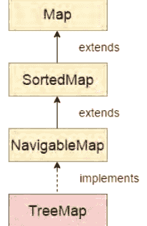

图 4.14：TreeMap 层次结构

Java `TreeMap` 类的重要要点如下：

- `TreeMap` 根据键存储值。它实现了 `NavigableMap` 接口并扩展了 `AbstractMap` 类。
- 它包含唯一元素。
- 它不能有 `null` 键，但可以有多个 `null` 值。
- 它与 `HashMap` 相同，但它维护了升序排序。

# TreeMap 类声明

```java
public class TreeMap<K,V> extends AbstractMap<K,V> implements NavigableMap<K,V>, Cloneable, Serializable
```

# TreeMap 类参数

让我们来看 `java.util.TreeMap` 类的参数。

- `K`: 此映射表维护的键的类型。
- `V`: 映射值的类型。

表格 A.23：Java `TreeMap` 类的构造函数

| 构造函数 | 描述 |
|---|---|
| `TreeMap()` | 用于构建一个空的 `TreeMap`，该映射将使用键的自然顺序进行排序。 |
| `TreeMap(Comparator comp)` | 用于构建一个空的树形映射，该映射将使用比较器 `comp` 进行排序。 |
| `TreeMap(Map m)` | 用于使用 `m` 中的条目初始化树映射，该映射将使用键的自然顺序进行排序。 |
| `TreeMap(SortedMap sm)` | 用于使用 `SortedMap` `sm` 中的条目初始化树映射，该映射将按照 `sm` 相同的顺序排序。 |

# 表格 4.24：Java TreeMap 类的方法

| 方法 | 描述 |
|---|---|
| `boolean containsKey(Object key)` | 如果此映射表包含指定键的映射，则返回 `true`。 |
| `boolean containsValue(Object value)` | 如果此映射表将一个或多个键映射到指定的值，则返回 `true`。 |
| `Object firstKey()` | 返回当前排序映射中的第一个（最小）键。 |
| `Object get(Object key)` | 返回此映射表映射到指定键的值。 |
| `Object lastKey()` | 返回当前排序映射中的最后一个（最大）键。 |
| `Object remove(Object key)` | 用于从此 `TreeMap` 中移除该键的映射。 |
| `void putAll(Map map)` | 用于将指定映射表的所有映射复制到此映射表。 |
| `Set entrySet()` | 返回此映射表中所包含的映射的集合视图。 |
| `int size()` | 返回此映射表中键值映射的数量。 |
| `Collection values()` | 返回此映射表中所包含的值集合视图。 |

Java TreeMap 示例：

```java
import java.util.*;
class TestCollection15 {
    public static void main(String args[]) {
        TreeMap<Integer, String> tTreeMap = new TreeMap<>();
        tTreeMap.put(100, "Amit");
        tTreeMap.put(101, "Vijay");
        tTreeMap.put(102, "Ravi");
        tTreeMap.put(103, "Rahul");
    }
}
```

输出：

{100=Amit, 101=Vijay, 102=Ravi, 103=Rahul}

# Java TreeMap 示例：remove()

```java
import java.util.*;
public class TreeMapExample {
    public static void main(String[] args) {
        // 创建并填充树映射
        Map<Integer, String> map = new TreeMap<>();
        map.put(102, "Let us C");
        map.put(103, "Operating System");
        map.put(101, "Data Communication and Networking");
        System.out.println("Values before remove: " + map);
        // 移除键 102 的值
        map.remove(102);
        System.out.println("Values after remove: " + map);
    }
}
```

# 输出：

移除前的值：{101=Data Communication and Networking, 102=Let us C, 103=Operating System}
移除后的值：{101=Data Communication and Networking, 103=Operating System}

# HashMap 和 TreeMap 有什么区别？

| HashMap | TreeMap |
|---|---|
| 1) `HashMap` 可以包含一个 `null` 键。 | `TreeMap` 不能包含任何 `null` 键。 |
| 2) `HashMap` 不维护顺序。 | `TreeMap` 维护升序排序。 |


# Java TreeMap 示例：书籍 (Book)

```java
import java.util.*;
class Book {
    int id;
    String name,author,publisher;
    int quantity;
    public Book(int id, String name, String author, String publisher, int quantity) {
        this.id = id;
        this.name = name;
        this.author = author;
        this.publisher = publisher;
        this.quantity = quantity;
    }
}

public class MapExample {
    public static void main(String[] args) {
        // 创建书籍映射
        Map<Integer,Book> map=new TreeMap<Integer,Book>();
        // 创建书籍
        Book b1=new Book(101,"Let us C","Yashwant Kanetkar","BPB",8);
        Book b2=new Book(102,"Data Communications & Networking","Forouzan","Mc G Hill",4);
        Book b3=new Book(103,"Operating System","Galvin","Wiley",6);
        // 将书籍添加到映射
        map.put(2,b2);
        map.put(1,b1);
        map.put(3,b3);
        // 遍历映射
        for(Map.Entry<Integer, Book> entry:map.entrySet()){
            int key=entry.getKey();
            Book b=entry.getValue();
            System.out.println(key+" Details:"+b.id+" "+b.name+" "+b.author+" "+b.publisher+" "+b.quantity);
        }
    }
}
```

# 输出

```
1 Details:101 Let us C Yashwant Kanetkar BPB 8
2 Details:102 Data Communications & Networking Forouzan Mc G Hill 4
3 Details:103 Operating System Galvin Wiley 6
```

# EnumSet 类

`EnumSet` 类是枚举类型的 `Set` 实现。它继承自 `AbstractSet` 并实现了 `Set` 接口。`EnumSet` 类的层次结构见图 4.15，支持的方法见表 4.25。

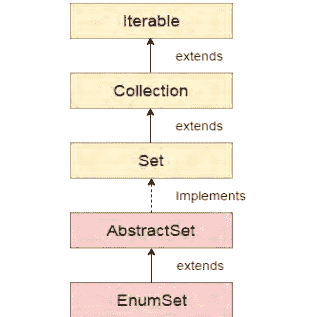

图 4.15：EnumSet 的层次结构

## EnumSet 类声明

```java
public abstract class EnumSet<E> extends AbstractSet<E> implements Cloneable, Serializable
```

## 表格 4.25：EnumSet 类的方法

| 方法 | 描述 |
|---|---|
| `static <E extends Enum<E>> EnumSet<E> allOf(Class<E> elementType)` | 用于包含指定类型所有元素的枚举集。 |
| `static <E extends Enum<E>> EnumSet<E> copyOf(Collection<E> c)` | 用于从指定的集合初始化枚举集。 |
| `static <E extends Enum<E>> EnumSet<E> noneOf(Class<E> elementType)` | 用于创建一个指定类型的空枚举集。 |
| `static <E extends Enum<E>> EnumSet<E> range(E from, E to)` | 用于创建一个指定的枚举集。 |
| `EnumSet<E> clone()` | 用于返回此集合的副本。 |

# Java EnumSet 示例

```java
import java.util.*;

enum days { SUNDAY, MONDAY, TUESDAY, WEDNESDAY, FRIDAY, SATURDAY }
public class EnumSetExample {
    public static void main(String[] args) {
        Set<days> set = EnumSet.of(days.TUESDAY, days.WEDNESDAY);
        // 遍历元素
        Iterator<days> iter = set.iterator();
        while (iter.hasNext()) {
            System.out.println(iter.next());
        }
    }
}
```

# 输出

```
TUESDAY
WEDNESDAY
```

# Java EnumSet 示例：allOf() and noneOf()

```java
import java.util.*;
enum days { SUNDAY, MONDAY, TUESDAY, WEDNESDAY, FRIDAY, SATURDAY }
public class EnumSetExample {
    Set<days> set1 = EnumSet.allOf(days.class);
    System.out.println("Week Days:"+set1);
    Set<days> set2 = EnumSet.noneOf(days.class);
    System.out.println("Week Days:"+set2);
}
```

# 输出

```
Week Days:[SUNDAY, MONDAY, TUESDAY, WEDNESDAY, FRIDAY, SATURDAY]
Week Days:[]
```

# EnumMap 类

`EnumMap` 类是用于枚举键的 `Map` 实现。它继承 `Enum` 和 `AbstractMap` 类。`EnumMap` 类的层次结构见图 4.16。支持的构造函数和方法见表 4.26 和 4.27。

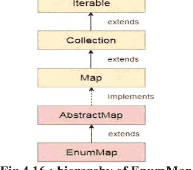

图 4.16：EnumMap 的层次结构

## EnumMap 类声明

```java
public class EnumMap<K,V> extends Enum<K> extends AbstractMap<K,V> implements Serializable, Cloneable
```

## EnumMap 类参数

让我们来看 `java.util.EnumMap` 类的参数。

- `K`: 此映射表维护的键的类型。
- `V`: 映射值的类型。

## 表格 4.26：Java EnumMap 类的构造函数

| 构造函数 | 描述 |
|---|---|
| `EnumMap(Class<K> keyType)` | 用于创建一个指定键类型的空枚举映射。 |
| `EnumMap(Enum<K>, extends V>)` | 用于创建一个具有相同键类型的枚举映射。 |
| `EnumMap(Map<?, extends V>)` | 用于从指定的映射初始化枚举映射。 |

## 表格 4.26：EnumMap 类的方法

| 方法 | 描述 |
|---|---|
| `void clear()` | 用于移除此映射表中的所有映射。 |
| `boolean containsKey(Object key)` | 如果此映射表包含指定键的映射，则返回 true。 |
| `boolean containsValue(Object value)` | 如果此映射表将一个或多个键映射到指定的值，则返回 true。 |
| `boolean equals(Object o)` | 用于将指定对象与此映射进行相等性比较。 |
| `V get(Object key)` | 此方法返回映射到指定键的值。 |
| `V put(K key, V value)` | 用于将指定的值与映射中的指定键关联。 |
| `V remove(Object key)` | 用于移除该键的映射。 |
| `Collection<V> values()` | 返回此映射表中所包含的值的集合视图。 |
| `int size()` | 返回此映射表中键值映射的数量。 |

# Java EnumMap 示例

```java
import java.util.*;
public enum Days {
    Monday, Tuesday, Wednesday, Thursday
}
```

```java
;
public static void main(String[] args) {
    // create and populate enum map
    EnumMap<Days
```

### 输出

```
周一 1
周二 2
周三 3
周四 4
```

# Java EnumMap 示例：书籍

```java
import java.util.*;
class Book {
    int id;
    String name, author, publisher;
    int quantity;
    public Book(int id, String name, String author, String publisher, int quantity) {
        this.id = id;
        this.name = name;
        this.author = author;
        this.publisher = publisher;
        this.quantity = quantity;
    }
}
public class EnumMapExample {
    // 创建枚举
    public enum Key {
        One, Two, Three
    }
    public static void main(String[] args) {
```

# 线程简介

### 输出

```
101 Let us C Yashwant Kanatkar BPB 8
102 Data Communications & Networking Forouzan Mc G Hill 4
103 Operating System Galvin Wiley 6
```

## 4.6 JAVABEANS

`JavaBean` 是一种根据 `JavaBeans API` 规范使用 `Java` 语言编写的特殊构造 `Java` 类。以下是区分 `JavaBean` 与 `Java` 类的独特特征：

- 它提供了一个默认的、无参数的构造函数。
- 它应该是可序列化的，并且可以实现 `Serializable` 接口。
- 它可能有许多可以读或写的属性。
- 它可能为属性拥有若干“getter”和“setter”方法。

### 为什么我们使用 JavaBean？

它是一个可重用的软件组件。`Bean` 将许多对象封装在一个对象中，以便我们从多个地方访问该对象。此外，它提供了方便的维护。

### JavaBean 类的简单示例

```java
package mypack;
public class Student implements java.io.Serializable
{
  private int id;
  private String name;
```

```java
  public Student()
  {
    public void setId(int id) {
        this.id=id;
    }
    public int getId() {
        return id;
    }
    public void setName(String name) {
        this.name=name;
    }
    public String getName() {
        return name;
    }
```

### 如何访问 JavaBean 类？

要访问 `JavaBean` 类，我们应该使用 getter 和 setter 方法。

```java
package mypack;
public class Test
{
    public static void main(String args[])
    {
        Student s=new Student();//创建了对象
        s.setName("Manjoosh");//为对象设置值
        System.out.println(s.getName());
    }
}
```

## JavaBeans 属性

`JavaBean` 属性是对象用户可以访问的命名属性。该属性可以是任何 `Java` 数据类型，包括你定义的类。

`JavaBean` 属性可以是可读、可写、只读或只写的。`JavaBean` 属性通过 `JavaBean` 实现类中的两个方法进行访问，分别是：

### 方法 1: getPropertyName()

例如，如果属性名为 `firstName`，那么你的方法名将是 `getFirstName`，用于读取该属性。此方法称为访问器（accessor）。

### 方法 2: setPropertyName()

例如，如果属性名为 `firstName`，那么你的方法名将是 `setFirstName()`，用于写入该属性。此方法称为变异器（mutator）。

> **注意**：只读属性只有 `getPropertyName()` 方法，只写属性只有 `setPropertyName()` 方法。

### JavaBean 的优点

- `JavaBean` 的属性和方法可以暴露给另一个应用程序。
- 它提供了重用软件组件的便利性。

### JavaBean 的缺点

- `JavaBeans` 是可变的。因此，它无法利用不可变对象的优势。
- 为每个属性单独创建 setter 和 getter 方法会导致大量的模板代码（boilerplate code）。

# 4.7 JAVA 网络

`Java` 网络是一个将两个或多个计算设备连接在一起的概念，以便我们可以共享资源。`Java` 套接字编程提供了在计算设备之间共享数据的设施。

### Java 网络的优势

- 共享资源
- 集中化的软件管理

### `java.net` 包支持两种协议

- **TCP**：传输控制协议在发送者和接收者之间提供可靠的通信。`TCP` 与互联网协议（称为 `TCP/IP`）一起使用。
- **UDP**：用户数据报协议通过允许数据包在两个或多个节点之间传输提供了一种无连接的服务。

### Java 网络术语

下面是广泛使用的 `Java` 网络术语：

1. IP 地址
2. 协议
3. 端口号
4. MAC 地址
5. 连接型和无连接协议
6. 套接字 (Socket)

#### 1. IP 地址

`IP` 地址是分配给网络节点的唯一数字，例如 `192.168.0.1`。它由 0 到 255 的字节组成。它是一个可以更改的逻辑地址。

#### 2. 协议

协议基本上是通信时遵循的一组规则。例如：

- `TCP`
- `FTP`
- `Telnet`
- `SMTP`
- `POP` 等。

#### 3. 端口号

端口号用于唯一标识不同的应用程序。它充当应用程序之间的通信端点。端口号与 `IP` 地址关联，用于两个应用程序之间的通信。

#### 4. MAC 地址

`MAC`（介质访问控制）地址是网卡（`NIC`）的唯一标识符。网络节点可以拥有 `MAC` 地址。

#### 5. 连接型和无连接协议

在连接型协议中，接收者会发送确认信号。它是可靠的但快速（注：原文此处逻辑可能有误，通常连接型更可靠但慢）。连接型协议的示例是 `TCP`。但在无连接协议中，接收者不发送确认信号。它是可靠但快速。无连接协议的示例是 `UDP`。

#### 6. 套接字 (Socket)

套接字是两个通信之间的端点。

## java.net 包

`java.net` 包可以分为两个部分：

- **高层 API**：它处理 `URL`（即通用资源定位符）和连接（`Connections`）的抽象。

`java.net` 包提供了许多类来处理网络应用程序。以下是这些类的列表：

| Authenticator | ProxySelector |
| :--- | :--- |
| CacheRequest | ResponseCache |
| CacheResponse | SecureCacheResponse |
| ContentHandler | ServerSocket |
| CookieHandler | Socket |
| CookieManager | SocketAddress |
| DatagramPacket | SocketImpl |
| DatagramSocket | SocketPermission |
| DatagramSocketImpl | StandardSocketOptions |
| InterfaceAddress | URI |
| JarURLConnection | URL |
| MulticastSocket | URLClassLoader |


| InetSocketAddress | URLConnection |
| InetAddress | URLDecoder |
| Inet4Address | URLEncoder |
| Inet6Address | URLStreamHandler |
| IDN | NetworkInterface |
| HttpURLConnection | PasswordAuthentication |
| HttpCookie | Proxy |
| | NetPermission |

`java.net` 可用的接口列表：

- `ContentHandlerFactory`
- `CookiePolicy`
- `CookieStore`
- `DatagramSocketImplFactory`
- `FileNameMap`
- `SocketOption<T>`
- `SocketOptions`
- `SocketImplFactory`
- `URLStreamHandlerFactory`
- `ProtocolFactory`

# 4.8 Java Socket 编程

Java 套接字编程用于运行在不同 JRE 上的应用程序之间的通信。Java 套接字编程可以是连接型的或无连接。`Socket` 和 `ServerSocket` 类用于连接型套接字编程，`DatagramSocket` 和 `DatagramPacket` 类用于无连接套接字编程，如图 4.17 所示。套接字编程中的客户端必须知道两个信息：

1. 服务器的 IP 地址，以及
2. 端口号。

在这里，我们将实现单向的客户端和服务器通信。在这个应用程序中，客户端向服务器发送消息，服务器读取消息并打印出来。这里使用了两个类：`Socket` 和 `ServerSocket`。`Socket` 类用于客户端和服务器之间的通信。通过该类，我们可以读取和写入消息。`ServerSocket` 类用于服务器端。`accept()` 方法会阻塞控制直到客户端连接。客户端连接成功后，它会在服务器端返回一个 `Socket` 实例。

### 使用 Java 进行面向对象编程

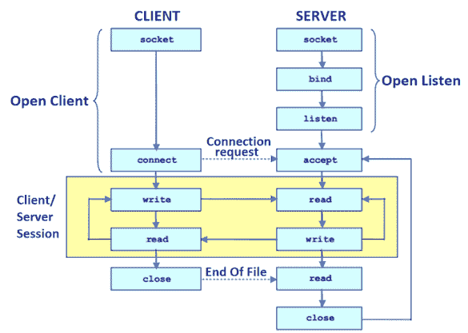

图 4.17: Socket API

## Socket 类

Socket（套接字）仅仅是机器之间通信的端点。`Socket` 类可用于创建 socket，支持表 4.28 给出的方法。

表 4.28: socket 类中的方法

| 方法 | 描述 |
| :--- | :--- |
| `public InputStream getInputStream()` | 返回与此 socket 关联的输入流。 |
| `public OutputStream getOutputStream()` | 返回与此 socket 关联的输出流。 |
| `public synchronized void close()` | 关闭此 socket |

## ServerSocket 类

`ServerSocket` 类可用于创建服务器套接字。此对象用于与客户端建立通信，支持表 4.29 给出的方法。

表 4.29: 方法

| 方法 | 描述 |
| :--- | :--- |
| `public Socket accept()` | 返回 socket 并在服务器和客户端之间建立连接。 |
| `public synchronized void close()` | 关闭服务器套接字。 |

## Java Socket 编程示例

创建服务器：

为了创建服务器应用程序，我们需要创建 `Server` 类的实例。在这里，我们使用 6666 端口号进行客户端和服务器之间的通信。你也可以选择任何其他端口号。`accept()` 方法会等待客户端。如果客户端连接到指定的端口号，它将返回一个 `Socket` 实例。

1. `ServerSocket ss = new ServerSocket(6666);`
2. `Socket s = ss.accept();` // 建立连接等待客户端

创建客户端：

为了创建客户端应用程序，我们需要创建 `Socket` 类的实例。在这里，我们需要传递服务器的 IP 地址或主机名以及端口号。在这里，我们使用 `"localhost"`，因为我们的服务器运行在本地机器上。

`Socket s = new Socket("localhost", 6666);`

让我们来看一个简单的 Java socket 编程示例，客户端发送文本，服务器接收并打印它。

文件: `MyServer1.java`

```java
import java.io.*;
import java.net.*;
public class MyServer1
{
    public static void main(String[] args) {
        try {
            ServerSocket ss = new ServerSocket(6666);
            Socket s = ss.accept(); // 建立连接
            DataInputStream dis = new DataInputStream(s.getInputStream());
            String str = (String) dis.readUTF();
            System.out.println("message=" + str);
            ss.close();
        } catch(Exception e) {
            System.out.println(e);
        }
    }
}
```

文件: `MyClient1.java`

```java
import java.io.*;
import java.net.*;
public class MyClient1
{
  public static void main(String[] args) {
    try {
      Socket s = new Socket("localhost", 6666);
      DataOutputStream dout = new DataOutputStream(s.getOutputStream());
      dout.writeUTF("Hii Good Morning");
      dout.flush();
      dout.close();
      s.close();
    } catch (Exception e) {
      System.out.println(e);
    }
  }
}
```

## 输出：

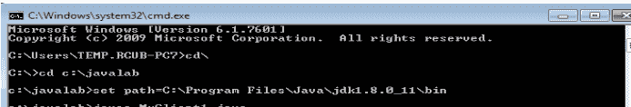
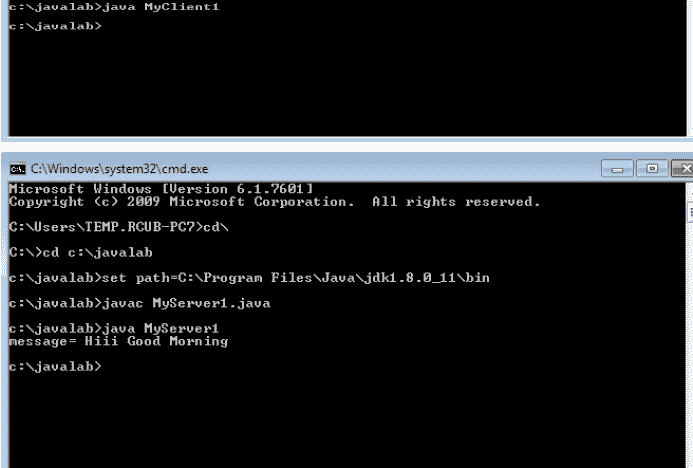

## 线程简介

## Java Socket 编程示例（双读写）

在这个示例中，客户端将先向服务器写入，然后接收并打印文本。然后服务器将向客户端写入并接收和打印文本。此步骤持续进行。

```java
File: Client.java
import java.net.*;
import java.io.*;
class Client
{
    public static void main(String[] args) throws Exception
    {
        Socket s = new Socket("localhost", 3333);
        DataInputStream din = new DataInputStream(s.getInputStream());
        DataOutputStream dout = new DataOutputStream(s.getOutputStream());
        BufferedReader br = new BufferedReader(new InputStreamReader(System.in));

        String str = "", str2 = "";
        while(!str.equals("stop"))
        {
            str = br.readLine();
            dout.writeUTF(str);
            dout.flush();
            str2 = din.readUTF();
            System.out.println("Server says: " + str2);
        }
        dout.close();
        s.close();
    }
}
```

## 输出：

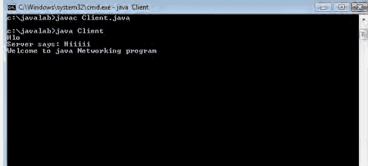
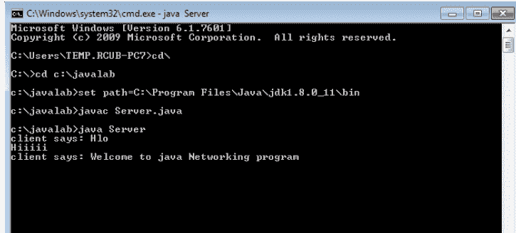

## CA-C9P: Java 编程实验

1. 编写一个简单的 Java 程序，打印消息“Welcome to java”
2. 编写一个程序显示年份的月份。月份应该存储在数组中。
3. 编写一个程序演示除以零。
4. 编写一个程序演示自定义异常。
5. 编写一个程序演示两个整数的加法。在提供参数时，使用默认值。使用方法重载。
6. 编写一个程序演示加法和减法。创建一个 `AddSub` 类。
7. 编写一个程序演示乘法。`MulDiv` 类继承 `AddSub`。
8. 编写一个程序演示静态变量。观察类实例值的变化。
9. 为该类创建一个构造函数。
10. 按照资历存储十个员工对象。
11. 在当前目录创建 `student.Fulltime.BCA` 包。
12. 编写一个程序来捕获负数组大小异常。当数组初始化为负值时会产生此异常。
13. 编写一个程序处理空指针异常并使用 `finally` 方法显示消息。
14. 编写一个程序创建一个窗口并显示消息。
15. 编写一个程序在创建的窗口中绘制各种形状。
16. 编写一个程序创建一个 Applet 并绘制网格线。
17. 编写一个程序创建一个带有父亲和母亲按钮的框架。点击父亲按钮时显示父亲的名字、年龄和职位。点击母亲按钮时显示母亲的相应信息。
18. 创建一个根据按钮点击显示个人信息的框架。
19. 创建一个简单的 Applet 以显示你的个人信息。
20. 编写一个程序，当按下 P m 或 m 时窗口显示 Good Morning（早上好），A 显示 Good Afternoon（下午好），E 显示 Evening（晚上好），N 显示 Good Night（晚安）。
21. 使用合适的示例演示各种鼠标处理事件。
22. 编写一个程序创建菜单栏和下拉菜单。

# Java 实验程序

# Java 编程实验：手册

## 1. 编写一个简单的 Java 程序，打印消息“Welcome to Java”

```java
class Practical_1
{
    public static void main(String[] args) {
        System.out.println("Welcome to Java");
    }
}
```

输出:

Welcome to Java

## 2. 编写一个程序显示年份的月份。月份应该存储在数组中。

```java
public class App {
    public static String months[];
    public static void main ( String[] args )
    {
        months = new String[ 13 ];
        months[0] = null;
        months[1] = "January";
        months[2] = "February";
        months[3] = "March";
        months[4] = "April";
        months[5] = "May";
        months[6] = "June";
        months[7] = "July";
        months[8] = "August";
        months[9] = "September";
        months[10] = "October";
        months[11] = "November";
        months[12] = "December";

        System.out.println("DEBUG: " + Arrays.toString( args ));
        if (args.length == 0) {
            System.out.println("未指定月份。未向 'main' 方法传递参数.");
        } else if (args.length == 1) { // 否则我们有一个预期的参数
            int m = Integer.parseInt(args[0]);
            System.out.println(months[m]);
        } else if (args.length > 1) { // 否则我们有多个参数，但预期只有一个一个。
            System.out.println("错误 - 向 'main' 方法传递了多个一个参数.");
        } else { // 否则不可能。不应到达此点。防御性编程。
            System.out.println("错误 - 意外到达 IF-ELSE。这是不可能的。");
        }
    }
}
```

- 一月
- 二月
- 三月
- 四月
- 五月
- 六月
- 七月
- 八月
- 九月
- 十月
- 十一
- 十二月

## 3. 编写一个程序来演示除以零异常。

```java
public class divisionbyzero
{
    public static int divide(int f, int g) {
        int h = f / g;
        return h;
    }
    public static void main(String... args) {
        int d = 8, r = 0;
        if (r != 0) {
            System.out.println(divide(d, r));
        } else {
            System.out.println("无效的除数：无法处理除以零");
        }
    }
}
```

输出：

无效的除数：无法处理除以零

## 4. 编写一个程序来创建自定义异常 Pay out of Bounds（支付越界）。

```java
// 表示用户自定义异常的类
class MyException extends Exception {
    public MyException(String s) {
        // 调用父类 Exception 的构造函数
        super(s);
    }
}
```

```java
// 使用上面 MyException 的类
public class Main {
    // 测试程序
    public static void main(String args[])
    {
        try {
            // 抛出一个自定义异常对象
            throw new MyException("Pay out of bounds");
        } catch (MyException ex) {
            System.out.println("捕获");
            // 打印 MyException 对象的 getMessage()
            System.out.println(ex.getMessage());
        }
    }
}
```

输出：

捕获

Pay out of bounds

## 5. 编写一个 Java 程序加载两个整数和两个浮点数。当未提供参数时，给出一个默认值来计算和。使用函数重载。

文件名：`TestOverloading2.java`

```java
// 区分参数数据类型的相加数字的程序
class Number
{
    static int add(int a, int b) { // 整数变量
        return a + b; // 返回和
    }

    static double add(double a, double b) { // 两个都是双精度变量
        return a + b; // 返回和
    } 
}

class TestOverloading2
{
    public static void main(String[] args)
    {
        System.out.println(Number.add(1, 110));
        System.out.println(Number.add(12.4, 18.8));
    }
}
```

输出：

111

31.200000000000003

## 7. 编写一个类变量程序，该变量对类的所有实例都可用。使用静态变量声明。观察对象成员变量中发生的更改。


```java
// 演示静态块和变量执行的 Java 程序

class Test {
    // 静态变量
    static int a = m1();

    // 静态块
    static {
        System.out.println("在静态块内部");
    }

    // 静态方法
    static int m1() {
        System.out.println("来自 m1");
        return 20;
    }

    // 静态方法（main！！）
    public static void main(String[] args) {
        System.out.println("a 的值 : " + a);
        System.out.println("来自 main");
    }
}
```

输出：

```
来自 m1
在静态块内部
a 的值: 20
来自 main
```

# 10. 写一个 Java 程序定义一个名为 employee 的类，包含姓名和任命日期。创建 10 个员工对象作为数组，并根据它们的任命日期进行排序，然后按照资历顺序打印它们。

文件名：`EmployeeDemo.java`

```java
import java.util.*;
class employee
{
    String name;
    Date appdate;
    public employee(String name, Date appdate) {
        this.name = name;
        this.appdate = appdate;
    }
}

public class EmployeeDemo {
    public static void main(String[] args) {
        employee[] employees = new employee[10];
        // 此处省略初始化和排序逻辑
        Arrays.sort(employees, (e1, e2) -> e1.appdate.compareTo(e2.appdate));
        for (employee e : employees) {
            System.out.println(e.name + " - " + e.appdate);
        }
    }
}
```

```java
{
  n.printStackTrace();
  //handle异常
}
System.out.println("Continuing execution...");
}
```

OUTPUT:

```
java.lang.NegativeArraySizeException: -5
at NegativeArraySizeException.main(NegativeArraySizeExample.java:4)
Continuing execution...
```

## 13. 编写一个程序处理空指针异常并使用 finally 方法向用户显示消息。

```java
class TestFinallyBlock {
  public static void main(String[] args[]) {
  try {
    //以下代码没有抛出任何异常
    int data=25/5;
    System.out.println(data);
  }
  // catch 不执行
  catch(NullPointerException e) {
    System.out.println(e);
  }
  // 无论是否发生异常，都会执行
  finally {
    System.out.println("finally block is always executed");
  }
  System.out.println("rest of the code...");
  }
}
```

OUTPUT:

```
C:\Users\Anurati\Desktop\abcDemo\javac TestFinallyBlock.java
C:\Users\Anurati\Desktop\abcDemo\java TestFinallyBlock
Finally block is always executed
rest of the code...
```

### Case 2: 当发生异常但未被 catch 块处理时。

```java
public class TestFinallyBlock1 {
  public static void main(String args[]) {
    try {
      System.out.println("Inside the try block");

      //以下代码抛出除零异常
      int data=25/0;
      System.out.println(data);
    }
    // 无法处理 Arithmetic 类型异常
    // 只能接收 Null Pointer 类型异常
    catch(NullPointerException e){
      System.out.println(e);
    }

    // 无论是否发生异常，都会执行
    finally {
      System.out.println("finally block is always executed");
    }

    System.out.println("rest of the code...");
  }
}
```

OUTPUT:

```
C:\Users\Anurati\Desktop\abcDemo\javac TestFinallyBlock1.java
C:\Users\Anurati\Desktop\abcDemo\java TestFinallyBlock1
Inside the try block
Finally block is always executed
Exception in thread "main" java.lang.ArithmeticException: / by zero
  at TestFinallyBlock1.main(TestFinallyBlock1.java:9)
```

### Case 3: 当发生异常并被 catch 块处理时。

```java
public class TestFinallyBlock2{
    public static void main(String args[]) {

try {
    System.out.println("Inside try block");

//以下代码抛出除零异常
int data=25/0;
System.out.println(data);
}

// 处理 Arithmetic Exception / 除零异常
catch(ArithmeticException e) {
    System.out.println("Exception handled");
    System.out.println(e);
}

// 无论是否发生异常，都会执行
finally {
    System.out.println("finally block is always executed");
    System.out.println("rest of the code...");
}
```

OUTPUT:

```
C:\Users\n1\Desktop\javac TestFinallyBlock2.java
C:\Users\n1\Desktop\java TestFinallyBlock2
Inside try block
Exception handled
java.lang.ArithmeticException: by zero
finally block is always executed
rest of the code...
```

# CA-C9P: JAVA 编程实验

## 14. 编写一个程序在窗口上创建并显示消息。

问题解决方案：

1. 创建原始帧并向其添加一个按钮。
2. 给按钮添加 `ActionListener`。
3. 显示原始帧。
4. 当按钮被点击时，创建一个新帧并在帧中添加一条消息。
5. 显示新帧。

```java
/* 在新帧中显示消息的 Java 程序 */
import javax.swing.*;
import java.awt.event.*;
import java.awt.*;
class Message implements ActionListener
{
    // 创建原始帧的函数
    public static void main(String[] args[]) {
        // 创建一个新帧
        JFrame frame = new JFrame("Original Frame");
        frame.setSize(300,300);
        frame.setDefaultCloseOperation(JFrame.EXIT_ON_CLOSE);

        // 创建一个对象
        Message obj = new Message();
        // 创建一个用于查看消息的按钮
        JButton button = new JButton("View Message");
        frame.add(button);
        button.addActionListener(obj);

        // 显示帧
        frame.setVisible(true);
    }

    // 创建带有消息的新帧的函数
    public void actionPerformed(ActionEvent e) {
        // 创建一个新帧
        JFrame sub_frame = new JFrame("Sub Frame");
        sub_frame.setSize(200,200);

        // 显示消息
        JLabel label = new JLabel("!!! Hello !!!");
        sub_frame.add(label);

        // 显示新帧
        sub_frame.setVisible(true);
    }
}
```

### 程序解释

1. 创建帧，使用 `JFrame` 类。
2. 要创建按钮，使用 `JButton` 类。
3. 给按钮添加 `ActionListener`。

### 运行用例

以下是在新帧中显示消息的运行用例。


- 用例1：查看原始帧。
- 用例2：在新帧中查看消息。

## 15. 编写一个程序绘制多个形状。

该程序将在 Applet 中显示不同的形状。

```java
import java.awt.event.*;
import java.applet.Applet;
import java.awt.Graphics;

public class GraphicsExercise extends Applet {

public void paint(Graphics g) {

// 圆角矩形填充椭圆
g.drawRect(20,20,140,100,10);
g.fillOval(65,43,50,50);

// 三角形
g.drawLine(200,200,300,120);
g.drawLine(200,20,300,120);
g.drawLine(300,120,200,200);

// 笑脸
g.drawOval(20,150,150,150); // 头
g.fillOval(50,190,15,15); // 左眼
g.fillOval(120,190,15,15); // 右眼
int x[]={95,106,95};int y[]={215,234,235};
g.drawPolygon(x, y, 4); // 鼻子
g.drawArc(52,225,78,50,-180); // 笑容
g.drawLine(50,256,60,246);
g.drawLine(128,245,139,256);

// 菱形
int x[]={203,252,301,252,203};int y[]={225,176,225,274,225};
g.fillPolygon(x,y,4);
}
}
```

```html
/* applet code="GraphicsExercise.class" width="320" height="320" */
```

OUTPUT:

```
C:\>javac GraphicsExercise.java
C:\>appletviewer GraphicsExercise.java
```


## 16. 编写一个程序创建一个 applet 并绘制网格线。

```java
import java.awt.*;
import javax.swing.*;
public class MyGridLayout{
JFrame f;

public GridLayout() {

f=new JFrame();

JButton b1=new JButton("1");

JButton b2=new JButton("2");

JButton b3=new JButton("3");

JButton b4=new JButton("4");

JButton b5=new JButton("5");

JButton b6=new JButton("6");

JButton b7=new JButton("7");

JButton b8=new JButton("8");

JButton b9=new JButton("9");

// 将按钮添加到帧中

f.add(b1); f.add(b2); f.add(b3);

f.add(b4); f.add(b5); f.add(b6);

f.add(b7); f.add(b8); f.add(b9);

// 设置 3 行 3 列的网格布局

f.setLayout(new GridLayout(3,3));

f.setSize(300,300);

f.setVisible(true);

}

public static void main(String[] args) {

new MyGridLayout();

}

}
```

OUTPUT:


# CA-CP9: JAVA 编程实验

## 20. 编写一个程序根据按的箭头键移动不同的形状。

```java
import java.awt.Canvas;
import java.awt.Dimension;
import java.awt.Graphics2D;
import java.awt.image.BufferStrategy;
import java.awt.event.*;
import javax.swing.event.*;

public class HandlingEvents implements Runnable {

    JFrame frame;
    int tmyX = 400;
    int tmyY = 400;
    Canvas canvas;
    BufferStrategy bufferStrategy;
    boolean running = true;

    public HandlingEvents() {
        frame = new JFrame("Basic Game");
        JPanel panel = (JPanel)frame.getContentPane();
        panel.setPreferredSize(new Dimension(500, 500));
        panel.setLayout(null);
        canvas = new Canvas();
        canvas.setBounds(0, 0, 500, 500);
        canvas.setIgnoreRepaint(true);
        panel.add(canvas);
        canvas.addKeyListener(new KeyAdapter() {
            @Override
            public void keyPressed(KeyEvent evt) {
                movelt(evt);
            }
        });

        frame.setDefaultCloseOperation(JFrame.EXIT_ON_CLOSE);
        frame.pack();
        frame.setResizable(false);
        frame.setVisible(true);
        canvas.createBufferStrategy(2);
        bufferStrategy = canvas.getBufferStrategy();
        canvas.requestFocus();
    }
    
    public void run() {
        while (running) {
            Paint();
            try {
                Thread.sleep(25);
            } catch (InterruptedException e) {
            }
        }
    }
}
```


# CA-C9P: JAVA 编程实验

## 代码示例 1

```java
public static void main(String[] args) {
    HandlingEvents ex = new HandlingEvents();
    new Thread(ex).start();
}
```

## 代码示例 2

```java
public void Paint() {
    Graphics2D g = (Graphics2D) bufferStrategy.drawGraphics();
    g.clearRect(0, 0, 500, 500);
    Paint(g);
    bufferStrategy.show();
}
```

## 代码示例 3

```java
protected void moveIt(Graphics2D g) {
    g.fillOval(myX, myY, 30, 30);
}
```

## 代码示例 4

```java
public void keyPressed(KeyEvent evt) {
    switch (evt.getKeyCode()) {
        case KeyEvent.VK_DOWN:
            myY += 5;
            break;
        case KeyEvent.VK_UP:
            myY -= 5;
            break;
        case KeyEvent.VK_LEFT:
            myX -= 5;
            break;
        case KeyEvent.VK_RIGHT:
            myX += 5;
            break;
    }
}
```

## JavaScript 示例

```javascript
<script type="text/javascript">
//全局初始化对象
var objImage = null;
function init() {
  objImage = document.getElementById("image1");
  objImage.style.position = "relative";
  objImage.style.left = "0px";
  objImage.style.top = "0px";
}
function keyDownAndMove(e) {
  var code = e.key || e.keyCode;
  switch (code) {
    case 37//左方向键
    moveLeft();
    break;
    case 38//上方向键
    moveUp();
    break;
    case 39//右方向键
    moveRight();
    break;
    case 40//下方向键
    moveDown();
    break;
  }
}
function moveLeft() {
  objImage.style.left = parseInt(objImage.style.left) - 5 + "px";
}
function moveUp() {
  objImage.style.top = parseInt(objImage.style.top) - 5 + "px";
}
function moveRight() {
  objImage.style.left = parseInt(objImage.style.left) + 5 + "px";
}
function moveDown() {
  objImage.style.top = parseInt(objImage.style.top) + 5 + "px";
}
window.onload = init;
</script>
```

# 22. 使用适当示例演示各种鼠标处理事件

```java
import java.awt.*;
import java.awt.event.*;
public class MouseListenerExample extends Frame implements MouseListener {
    Label l;
    MouseListenerExample(){
        addMouseListener(this);
        l=new Label();
        setBounds(20,50,100,20);
        add(l);
        setSize(300,300);
        setLayout(null);
        setVisible(true);
    }

    public void mouseClicked(MouseEvent e) {
        l.setText("Mouse Clicked");
    }

    public void mouseEntered(MouseEvent e) {
        l.setText("Mouse Entered");
    }

    public void mouseExited(MouseEvent e) {
        l.setText("Mouse Exited");
    }

    public void mousePressed(MouseEvent e) {
        l.setText("Mouse Pressed");
    }

    public void mouseReleases(MouseEvent e) {
        l.setText("Mouse Released");
    }

    public static void main(String[] args) {
        new MouseListenerExample();
    }
}
```

输出：


# CA-C9: JAVA 编程实验

# 23. 编写一个程序创建菜单栏并拉下菜单

## 简要说明

`JMenuBar`、`JMenu` 和 `JMenuItems` 是 Swing 包的一部分。`JMenuBar` 是菜单栏的实现。`JMenuBar` 包含一个或多个 `JMenu` 对象，当选中 `JMenu` 对象时，它们会显示包含一个或多个 `JMenuItems` 的弹出窗口。`JMenu` 基本上代表一个菜单。它包含几个 `JMenuItem`。它也可能包含 `JMenu` 对象（或子菜单）。

构造函数：

- `JMenuBar()` : 创建一个新的菜单栏。
- `JMenu()` : 创建一个没有文本的新菜单。
- `JMenuItem(String)` : 创建一个指定名称的新菜单项。
- `JMenuItem(String, boolean b)` : 创建一个指定名称和布尔值的新菜单项，判断它是否为可分离菜单（tear-off menu）。可分离菜单可以打开并从其父菜单或菜单中拖走。

## 常用方法

- `add(JMenu c)` : 将菜单添加到菜单栏。
- `add(Component e)` : 在 `JMenu` 的末尾添加组件。
- `add(Component e, int index)` : 在 `JMenu` 的指定索引处添加组件。
- `add(JMenuItem menuItem)` : 将菜单项添加到菜单末尾。
- `add(String s)` : 创建一个指定字符串的菜单项并将其添加到菜单末尾。
- `getItem(int index)` : 返回指定索引的菜单项。

## 情况 1：以下程序将说明 JMenuBar 的用法。创建一个菜单栏并为其添加菜单项

```java
// 添加菜单项的 Java
import java.awt.*;
import javax.swing.*;
import java.awt.event.*;
public class menubar extends JFrame implements ActionListener {
    // 菜单栏
    static JMenuBar mb;

    // 菜单
    static JMenu x;

    // 菜单项
    static JMenuItem m1, m2, m3;

    // 帧
    static JFrame f;
    static JLabel l;

    public void main() {
        // 创建帧
        f = new JFrame("Menu");

        // 创建菜单栏
        mb = new JMenuBar();

        // 创建菜单
        x = new JMenu("Menu");

        // 创建菜单项
        m1 = new JMenuItem("MenuItem1");
        m2 = new JMenuItem("MenuItem2");
        m3 = new JMenuItem("MenuItem3");

        // 将菜单项添加到菜单
        x.add(m1);
        x.add(m2);
        x.add(m3);

        // 将菜单添加到菜单栏
        mb.add(x);

        // 将菜单栏添加到帧
        f.setMenuBar(mb);

        // 添加标签
        f.add(l);

        // 设置帧的大小
        f.setSize(500, 500);
        f.setVisible(true);
    }

    public void actionPerformed(ActionEvent e) {
        String s = e.getActionCommand();
        // 为选中的菜单项设置标签
        l.setText(s + " selected");
    }
}
```

输出：


## 情况 2：添加菜单栏、菜单项、子菜单并为菜单项添加 ActionListener 的程序

```java
// 添加菜单栏的 Java 程序
// 并添加菜单项、子菜单以及为
// 菜单项添加
import java.awt.*;
import javax.swing.*;
import java.awt.event.*;
public class menubar extends JFrame implements ActionListener {
    // 菜单栏
    static JMenuBar mb;

    // 菜单
    static JMenu x, x1;

    // 菜单项
    static JMenuItem m1, m2, m3, s1, s2;

    // 创建帧
    static JFrame f;

    // 标签
    static JLabel l;

    // 主类
    public static void main(String[] args) {
        // 创建类的对象
        menubar m = new menubar();

        // 创建帧
        f = new JFrame("Menu");

        // 创建标签
        l = new JLabel("no task ");

        // 创建菜单栏
        mb = new JMenuBar();

        // 创建菜单
        x = new JMenu("Menu");
        x1 = new JMenu("submenu");

        // 创建菜单项
        m1 = new JMenuItem("MenuItem1");
        m2 = new JMenuItem("MenuItem2");
        m3 = new JMenuItem("MenuItem3");
        s1 = new JMenuItem("SubMenuItem1");
        s2 = new JMenuItem("SubMenuItem2");

        // 为菜单项添加 ActionListener
        m1.addActionListener(m);
        m2.addActionListener(m);
        m3.addActionListener(m);
        s1.addActionListener(m);
        s2.addActionListener(m);

        // 将菜单项添加到菜单
        x.add(m1);
        x.add(m2);
        x.add(m3);
        x1.add(s1);
        x1.add(s2);

        // 添加子菜单
        x.add(x1);

        // 将菜单添加到菜单栏
        mb.add(x);

        // 将菜单栏添加到帧
        f.setMenuBar(mb);

        // 添加标签
        f.add(l);

        // 设置帧的大小
        f.setSize(500, 500);
        f.setVisible(true);
    }

    public void actionPerformed(ActionEvent e) {
        String s = e.getActionCommand();
        // 为选中的菜单项设置标签
        l.setText(s + " selected");
    }
}
```

输出：


# JAVA 编程实验：手册

注意：以下程序遵循相同的概念，开发者需要根据问题定义更改给定的程序。

## 6. 编写一个程序执行数学运算，包含加和减的方法。创建另一个继承自 AddSubclass 的 MulDiv 类以使用父类的成员数据。Multdiv 应该包含乘法和除法的方法。主函数应该访问这些方法并执行数学运算。

文件名：`JavaProgram.java`

```java
import java.util.Scanner;

public class JavaProgram
{
    public static void main(String args[]) {
        int first, second, add, subtract, multiply;
        float devide;
        Scanner scanner = new Scanner(System.in);

        System.out.print("Enter Two Numbers : ");
        first = scanner.nextInt();
        second = scanner.nextInt();

        add = first + second;
        subtract = first - second;
        multiply = first * second;
        devide = (float) first / second;

        System.out.println("Sum = " + add);
        System.out.println("Difference = " + subtract);
        System.out.println("Multiplication = " + multiply);
        System.out.println("Division = " + devide);
    }
}
```

输出：

```text
Enter Two Numbers : 125
Sum = 17
Difference = 7
Multiplication = 60
Division = 2.4
```

## 8. 编写一个 Java 程序，创建一个具有以下属性的学生类。注册 ID、姓名、科目1 分数、科目2 分数、科目3 分数、总分。只有当学生通过所有三个科目时，才计算三门科目总分。每门科目的及格分为 50 分。如果候选人在任何科目中不及格，他的总分必须声明为零。使用此条件为该类编写构造函数。编写单独函数来接受和显示学生详情。在主方法中创建一个包含三个学生对象的数组并显示详情。

## CA-CYP: JAVA 编程实验 317


# CA-CYP: JAVA 编程实验

## 学生成绩管理程序

```java
import java.io.*;
import java.util.*;

class Student {
    Scanner sc = new Scanner(System.in);
    int RegNo, Total = 0, subjects;
    String name;
    int marks[];

    Student() {
        System.out.print("Enter Registration No.: ");
        RegNo = sc.nextInt();
        System.out.print("Enter Student Name: ");
        name = sc.next();
    }

    public void getDisMarks() {
        marks = new int[3];
        System.out.print("Enter marks of Physics: ");
        marks[0] = sc.nextInt();
        System.out.print("Enter marks of Chemistry: ");
        marks[1] = sc.nextInt();
        System.out.print("Enter marks of Maths: ");
        marks[2] = sc.nextInt();
    }
}

for (int i = 0; i < 3; i++) {
    Total += marks[i];
}
System.out.println("Total Marks of student " + name + ": " + Total);

class StudentDemo {
    public static void main(String args[]) {
        Student s[] = new Student[5];
        for (int i = 0; i < 5; i++)
            s[i] = new Student();
    }
}
```

**输出：**

```text
Enter Registration No.: 624
Enter Student Name: Ankit
Enter marks of Physics: 95
Enter marks of Chemistry: 94
Enter marks of Maths: 95
Total Marks of student Ankit: 284

Enter Registration No.: 527
Enter Student Name: Aditya
Enter marks of Physics: 97
Enter marks of Chemistry: 93
Enter marks of Maths: 89
Total Marks of student Aditya: 279

Enter Registration No.: 093
Enter Student Name: Namrata
Enter marks of Physics: 85
Enter marks of Chemistry: 90
Enter marks of Maths: 95
Total Marks of student Namrata: 270

Enter Registration No.: 123
Enter Student Name: Unknown
Enter marks of Physics: 69
Enter marks of Chemistry: 79
Enter marks of Maths: 89
Total Marks of student Unknown: 237

Enter Registration No.: 789
Enter Student Name: Known
Enter marks of Physics: 75
Enter marks of Chemistry: 65
Enter marks of Maths: 24
Total Marks of student Known: 164
```

---

## 9. 大学一年级班级管理

大学一年级班级具有以下属性：班级名称（BCA, BCOM, BSC）、教师名称、班级人数、班级学生数组。定义一个名为 `FirstYear` 的类，包含上述属性并定义一个合适的构造函数。还要编写一个名为 `bestStudent` 的方法，用于处理一个 `FirstYear` 对象并返回总分最高的学生。在 `main` 方法中定义一个 `FirstYear` 对象并找到该类的最佳学生。

```java
import java.util.Scanner;

public class FirstYear {
    private String name;
    private int mm;
    private int scm;
    private int comp;

    public FirstYear(String n, int m, int insc, int c) {
        name = n;
        mm = m;
        scm = sc;
        comp = c;
    }

    private String check() {
        String course = "Not Eligible";
        double avg = (mm + scm + comp) / 3.0;

        if (mm >= 90 && scm >= 90 && comp >= 90)
            course = "Science with Computer";
        else if (avg >= 90)
            course = "Bio-Science";
        else if (avg >= 80)
            course = "Science with Hindi";

        return course;
    }

    public void display() {
        String eligibility = check();
        System.out.println(" " + eligibility);
    }

    public static void main(String[] args) {
        Scanner in = new Scanner(System.in);
        System.out.print("Enter Name: ");
        String n = in.nextLine();
        System.out.print("Enter Marks in Maths: ");
        int maths = in.nextInt();
        System.out.print("Enter Marks in Science: ");
        int sci = in.nextInt();
        System.out.print("Enter Marks in Computer: ");
        int compSc = in.nextInt();

        Student obj = new Student(n, maths, sci, compSc);
        obj.display();
    }
}
```

---

## 17. 父母信息显示框架

编写一个程序，创建一个包含两个按钮 `father`（父亲）和 `mother`（母亲）的框架。当我们点击父亲按钮时，显示父亲的名字、年龄和职位。当我们点击母亲按钮时，也显示母亲的类似信息。

### 问题描述

我们需要编写一个 Java 程序，创建两个按钮：`father` 和 `mother`。

---

## 18. 个人详细信息显示框架

创建一个框架，根据按钮点击显示你的个人详细信息。

```java
import java.awt.*;
import java.awt.event.*;
import javax.swing.*;

public class ButtonDemo extends JFrame {
    JButton yes;
    // ... 其余代码省略
}

class ButtonHandler implements ActionListener {
    public void actionPerformed(ActionEvent ae) {
        if (ae.getSource() == yes) {
            lbl.setText("Button Yes is pressed");
        }
        if (ae.getSource() == no) {
            lbl.setText("Button No is pressed");
        }
        if (ae.getSource() == close) {
            System.exit(0);
        }
    }

    public static void main(String[] args) {
        new ButtonDemo();
    }
}
```

**输出：**

- i. 点击了按钮


---

## 19. 简单 Applet 程序

创建一个可以显示个人信息的简单 applet。

```java
import java.applet.Applet;
import java.awt.Graphics;

public class HelloWorld extends Applet {
    public void paint(Graphics g) {
        g.drawString("Hello World!", 10, 30);
    }
}
```

### 编译与运行 Applet 程序的命令

```bash
javac HelloWorld.java
appletviewer HelloWorld.html
```


---

## 21. 基于时间的问候窗口

编写一个 Java 程序，创建一个窗口：当我们按下 M 或 m 时，窗口显示 Good Morning，或者显示 Good Afternoon，或者显示 Good Evening，或者显示 Good Night。

```java
private void getTimeFromAndroid() {
    Date dt = new Date();
    int hours = dt.getHours();
    int min = dt.getMinutes();
}

if (hours >= 0 && hours < 12) {
    Toast.makeText(this, "Good Morning", Toast.LENGTH_SHORT).show();
} else if (hours >= 12 && hours < 16) {
    Toast.makeText(this, "Good Afternoon", Toast.LENGTH_SHORT).show();
} else if (hours >= 16 && hours < 21) {
    Toast.makeText(this, "Good Evening", Toast.LENGTH_SHORT).show();
} else if (hours >= 21 && hours < 24) {
    Toast.makeText(this, "Good Night", Toast.LENGTH_SHORT).show();
}
```

**根据以下时间显示消息：**

- 早上好 (12am - 12pm)
- 午好 (12pm - 4pm)
- 晚上好 (4pm - 9pm)
- 晚安 (9pm - 6am)

---

## 参考文献

我衷心感谢以下资源提供者对本书的编写。

### 教材

1. E. Balagurusamy, *Programming with JAVA*, McGraw Hill, New Delhi, 2007

### 参考书

1. Raj Kumar Buyya, *Object Oriented Programming with JAVA*, McGraw Hill, 2009
2. Herbert Schildt, *Java A Beginner's Guide – Create, Compile, and Run Java Programs Today*, Sixth Edition, Oracle Press, 2014
3. Ken Arnold, James Gosling, *The Java Programming Language*, Fourth Edition, Addison Wisely, 2005
4. Herbert Schildt, *The Complete Reference Java*, 7th Edition, McGraw Hill, 2007

### 网络资源

1. <https://docs.oracle.com/javase/tutorial/>


## 参考链接

- https://www.w3schools.com/java/
- https://www.javatpoint.com/java-tutorial
- https://www.tutorialspoint.com/java/index.html
- https://www.programiz.com/java-programming
- https://www.geeksforgeeks.org/java/
- https://www.geeksforgeeks.org/java-programming-examples/
- https://www.digimat.in/nptel/courses/106105191/L01.html

# 关于作者

**Dr. (Smt.) Mallamara V. Reddy** 获得了 BCA、MCA、K-SET 和计算机科学博士学位。2007 年至 2010 年，她在位于班加罗尔 Anekal 的 GVS 管理学院计算机科学系担任系主任/教员。2010 年至 2013 年担任 UGC 主要研究项目研究员，2013 年至 2013 年担任班加罗尔 Seshripuram 管理学院讲师。她自 2013 年起担任计算机科学系助理教授，拥有超过 14 年的教学和研究经验。她在于加加答举行的第 100 届印度科学大会期间获得了 ISCA 颁发的“2013 ISCA 青年科学家奖（计算机与信息技术）”，并在班加罗尔举行的 CMRIT 获得“2013 论文演示奖”。她在同行评审的国际期刊和会议论文集中发表了 32 多篇研究论文，并出版了 3 本书。她的研究兴趣包括自然语言处理、数据挖掘和跨语言信息检索。


**Hanumanthappa 教授** 是班加罗尔班加罗尔大学计算机科学系教授兼主任，他在 1996 年获得班加罗尔大学的 MCA 学位。M.Phil.（数据挖掘）。2009 年获得班加罗尔大学博士学位（数据挖掘）。自 2013 年起担任班加罗尔大学计算机科学系教授；2007 年至 2010 年担任班加罗尔大学计算机科学系副教授；2003 年至 2007 年担任班加罗尔大学计算机科学系讲师（选拔制）。曾担任孟买商业银行 EDP 经理；班加罗尔大学考试处计算机程序员。曾于 1995 年至 1997 年担任班加罗尔 TCS 有限公司软件工程师，以及 2006 年至 2007 年担任孟买 Bakthi Vedanthitha 学院研究助理。他在国际期刊、国际会议和国家会议上发表了 100 多篇研究论文。他是许多国际期刊和其他教育机构的编辑成员和成员，也是 IEEE、ISCA、IAENG 等组织的终身会员。


www.himpump.com

ISBN: 978-93-5596-905-7

ESM 0465
