# Java 面向对象编程使用指南

> “送给我的妻子 Janice 和女儿 Cara，没有她们，生活将毫无趣味！”

> ### 我们有抱负。对你也是如此。

SimCorp 是全球金融软件的领导者。在 SimCorp，你将成为由干练且的同事组成的庞大网络的一员，他们渴望通过奉献和团队精神实现共同目标。我们投资员工，确保你能够在个人和职业层面实现你的抱负。SimCorp 聘用经济、金融和 IT 领域最优秀的人才，我们的大多数同事拥有这些领域的大学或商学学位。

有抱负吗？请访问 www.simcorp.com/careers 寻找机会。

SimCorp

你可能是我们未来的天才之一

MAERSK 国际技术与科学学院

你即将作为工程师或地科学家毕业了吗？已经毕业了吗？如果是，A.P. Moller - Maersk 将为你提供令人兴奋的未来。

www.maersk.com/mitas

- 7.9 使用无类型集合的示例 119

- 8.9 使用 NetBeans 开发图形界面 137

IT 与工程领域的学生和毕业生机会 英国情报部门的一部分，我们的职责是应对危害国家和安全的威胁。我们在最具多样性、创造性和技术挑战性的文化中工作。在持续的职业发展中，你可以获得真正有趣且富有启发性的福利。详情请访问 www.intelligence.uk。申请者必须是英国公民。我们希望我们的员工反映我们工作的多样性。

多样化 - 创新 - 国际化

你正在考虑欧洲商学位吗？

哥本哈根商学院是北欧最大的商学院之一，拥有超过 15,000 名来自欧洲、北美和亚洲的学生。

你是否好奇现代欧洲商学院如何在多样化、创新和国际化的环境中竞争？

请访问哥本哈根商学院：www.cbs.dk

在 NNE Pharmaplan，我们需要有抱负的人来帮助实现设定的挑战性目标。

Kim Vobis 是我们许多抱负同事之一。除了担任制造 IT 部门的经理外，Kim 以职业水平参加铁三。“NNE Pharmaplan 给了我自由和责任，还让我规划自己的时间。这使我能够以竞技水平参加铁三，否则我无法做到这一点。”

“通过平衡工作和生活，我获得了在工作和铁三中表现最佳的能量。”

如果你有抱负并想加入我们的世界，请访问 nnepharmaplan.com

NNE Pharmaplan 是全球专注于制药和生物技术领域的领先工程和咨询公司。NNE Pharmaplan 是诺集团的一员公司。

## 前言

本书旨在让读者理解面向对象的编程方法，并力求在此过程中培养一些实用技能。这些实用技能将通过引导读者完成的小型练习以及所提供的反馈来开发。

书中将要解释和开发的概念在许多现代面向对象语言的程序员中是通用的，因此可以从一种语言迁移到另一种语言。然而，出于实际目的的考虑，本书将使用 Java 编程语言对这些概念进行探索和演示。

虽然 Java 编程语言被用于突出和演示基础面向对象原则及建模技术的应用，但本书并非 Java 编程的入门书籍。我们预计读者已经对基础编程概念及其在 Java 中的实现有一定的理解（包括循环、选择语句、计算执行、数组、数据类型以及对文件处理的基本了解）。

本文的设计并非理论性教科书，而是作为一种学习工具，旨在帮助理解理论概念并学习实现这些概念所需的实用技能。为此，每章将包含带有答案的小型练习，并提供反馈。

在书的最后，将描述一个较大的案例研究——它将用于说明在前几章节中探索的技术的应用。该案例研究将最终促成一个 Java 程序的开发，该程序可以随本书下载。

## 1. 面向对象编程简介

### 引言

本章将讨论不同的编程范式，以及面向对象在软件开发和建模方面的优势。将解释面向对象所依赖的概念（抽象、封装、继承和多态）。

### 目标

在本章结束时，你将能够……

- 解释什么是面向对象编程
- 描述面向对象编程方法的益处
- 理解面向对象编程所依赖的抽象、封装、泛化和多态的基本概念

这些问题将在本书后续章节中进行更详细的探讨。

本章由六部分组成：

- 1) 计算简史
- 2) 不同的编程范式
- 3) 为什么使用面向对象范式
- 4) 面向对象原则
- 5) 什么是面向对象编程？
- 6) 面向对象编程方法的优势

### 1.1 计算简史

计算不断改变着我们的世界和环境。20世纪60年代，创建了大型大型主机以有效地管理大量数据（数字）。银行账户和工资程序改变了组织的工作方式，并使这些组织的部分运作变得更加高效。20世纪80年代，个人电脑变得普及，改变了个人的工作方式。人们开始拥有自己的电脑，并使用文字处理器和电子表格应用程序（用于写信和管理家庭账目）。20世纪90年代，电子邮件变得常见，万维网诞生了。这些技术彻底改变了通信，允许个人发布全球范围内轻松访问的信息。这些新技术的影响尚未被完全理解，因为社会正在适应电子商务的机遇、新的社交网络技术（twitter、facebook、myspace、在线游戏等）以及互联网犯罪的挑战。

### 使用 Java 进行面向对象编程

正如新的计算技术正在改变我们的世界一样，新的技术和思想也在改变我们开发计算机系统的方式。20世纪50年代，机器代码（不成熟、复杂且针对机器的）语言是常见的。

20世纪60年代，使编程更简单的高级语言变得常见。然而，这导致了大型复杂程序的开发，且难以管理和维护。

20世纪70年代，结构化编程范式成为大型复杂程序的接受标准。结构化编程范式提出了将开发的程序逻辑地结构为更小、更易管理的组件的方法。此外，分析数据允许创建高效的大型数据库，防止数据不必要的重复，并防止了与数据同步失效相关的风险。然而，在理解我们需要创建的系统以及根据用户需要更改现有软件方面，仍然存在着重大问题。

20世纪80年代，“模块化”语言如 Modula-2 和 ADA 被开发，成为现代面向对象语言的前身。

20世纪90年代，面向对象范式和基于的软件开发思想被提出，面向对象语言从2000年起成为主流。

面向对象范式基于过去30年抽象、封装、泛化和多态的思想，并导致了软件组件的开发，将软件的操作的数据建模在一起。面向对象软件开发范式的支持者认为，这导致了可以在不同应用程序中重用的软件组件，节省了大量的开发时间和成本，更重要的是产生了更易维护、更易理解的软件。

也许应该注意到，软件开发思想仍在演变，新的敏捷工作方法正在被提出和测试。这将在2020年及以后引导我们走向何方未知。

### 1.2 不同的编程范式

结构化编程范式建议程序可以在逻辑块中开发，使程序更易理解且更易维护。

#### 活动 1

假设你每天执行以下活动。请将此列表按逻辑排序，然后将列表分成三个相关的活动块，并为每个块提供一个标题以总结该块的活动。

- 起床
- 吃早餐
- 停车
- 穿衣服
- 从车库里拿出汽车
- 开班
- 寻找老板让你做的事
- 对今天的结果给出反馈
- 执行老板让你要做

#### 反馈 1

你应该能够将这些活动分成相关的小组，并为每个小组提供一个总结这些活动的标题。

- **起床**：
  - 起床
  - 穿衣服
  - 吃早餐
- **上班**：
  - 从车库里拿出汽车
  - 开车上班
  - 停车
- **工作**：
  - 寻找老板让你做的事
  - 执行老板让你要做
  - 对今天的结果给出反馈

通过对我们的指令进行结构化并考虑全天的整体结构（起床、上班、工作），我们可以在更改和改进指令的某部分而不影响其他部分。例如，我们可以改进上班的指令……

- 听当地的交通和天气预报
- 决定坐公交车还是开车
- 如果开车，就开车上班。
- 否则，步行到公交站并赶车

而不必担心这对“起床”或“工作”产生任何潜在影响。

#### 活动 2

想象一个个人通讯录，其中存储了关于你朋友的数据：

- 姓名
- 地址
- 电话号码

列出三件你可能会对这个通讯录进行的操作。

接下来，识别另外一个人可能为了除了存储朋友列表以外的某种目的，使用一个与此（你的）相同的通讯录。

#### 反馈 2

对于一个通讯录，我们希望能够执行以下操作：查找朋友的详细信息（例如他们的电话号码）、向通讯录中添加地址，当然，还有删除地址。

我们可以创建一个简单的软件组件来存储通讯录中的数据（例如姓名列表等）以及我们可以执行的操作（例如添加地址、查找电话号码等）。

通过创建一个简单的软件组件来存储和管理朋友的地址，我们就可以在另一个软件系统中重用它，即：它可能被业务经理使用，用以存储和查找客户的详细信息。它也可以成为图书馆系统的一部分，供图书员使用以存储和检索图书馆用户的详细信息。

因此，在面向对象编程中，我们可以创建可重用的软件组件（在本例中为通讯录）。

面向对象范式建立在并扩展了 20 世纪结构化编程范式的思想之上。

### 1.3 为什么我们使用面向对象范式？

当我们关注自己正在编写的实际程序代码时，无论采用何种方法，代码的创建并不是大多数问题的通用根源。大多数问题源于：

- 分析和设计不佳：我们创建的计算机系统没有做正确的事。
- 可维护性差：当不可避免地出现变更请求时，系统很难理解和修改。

统计数据显示，软件 70% 的成本并不是在初始开发阶段产生的，而是在随后的几年中产生的，因为软件需要不断修改以满足其所属组织不断变化。因此，软件工程师尽一切可能确保软件在初始创建后的多年里易于维护至关重要。

### 使用 Java 的面向对象编程

面向对象编程范式旨在通过以下方式克服这些问题：在初始软件开发阶段协助分析和设计任务（更多细节请参见第 6 章），并确保软件的健壮性和可维护性（第 9-11 章提供了有关面向对象和 Java 所提供支持的信息）。

抽象和封装是支撑面向对象软件开发方法的基础性原则。抽象允许我们在考虑复杂想法的同时，忽略那些会困扰我们的无关细节。封装允许我们关注某物“做什么”，而不考虑其“如何”的复杂性。

#### 活动 3

| 考虑你的家，想象你正要和一个新朋友交换一周的房子。 |
| :--- |
| 写下三件关于你的家里你会告诉他们的重要信息，以及你想从他们家里了解的三个重要信息。 |
| 现在列出三件你不会告诉朋友的无关细节。 |


#### 反馈 3

你推测会告诉他们地址，给他们一份基础的房间和设施列表（例如卧室数量），并告诉他们如何进入（即用钥匙操作前门，以及如何关闭防盗报警器（如果你有一个的话））。

你不会告诉他们无关细节（如墙壁、座椅的颜色等），因为这会让他们淹没在无用信息中。

抽象允许我们考虑你家里重要的高层细节（例如地址），而不至于陷入细节中。

#### 活动 4

考虑你的家，并写下一件你每天使用的物品（例如电视机），并简要描述如何使用它。

你也可以将其他物理实体视为对象：例如银行账户。银行账户不是物理上可以触碰到的东西，但在逻辑上，我们可以将银行账户视为一个对象。它有一个当前状态（账户中的金额），并有与之相关的行为（最明显的就是存款和取款）。


# 面向对象编程简介

面向对象编程是一种编程方法，它涉及创建逻辑对象，以对我们试图解决的业务问题进行建模（例如：银行账户、银行客户和银行经理——这些都是计算机化银行系统中的对象）。对于每个对象，我们都模拟了与之相关的数据（即它在任何特定时间点的状态）以及与之相关的行为（即我们的计算机程序应该允许它执行的操作）。

在创建面向对象的程序时，我们定义了一类对象（类）的属性（例如：所有的银行账户），然后从该类中创建出具体的对象（例如：你的银行账户）。


## 招募：有心向勃的人

在 NNE Pharmaplan，我们需要有心向勃的人帮助我们实现公司设定的挑战性目标。

Kim Vobis 是众多有心向勃同事中的一个。除了担任制造 IT 部门的经理外，Kim 还专业水平参加铁三运动。

> ‘NNE Pharmaplan 为我提供了带有责任的自由，以及规划自己时间的机会。这让我能够以竞技水平进行铁三项运动，否则我是不可能做到这些的’

> ‘通过平衡工作和个人生活，我获得了在工作和铁三项运动中都表现最佳的能量。’

如果你有心向勃并想加入我们的机会世界，请访问 `nnepharmaplan.com`

NNE Pharmaplan 是全球领先的工程和咨询公司，专门从事制药和生物技术行业。NNE Pharmaplan 是 Novo Group 旗下的公司。

`nnepharmaplan*`

### 面向对象简介

“类”（class）是一种软件设计，描述了软件正在建模的对象的通用属性。

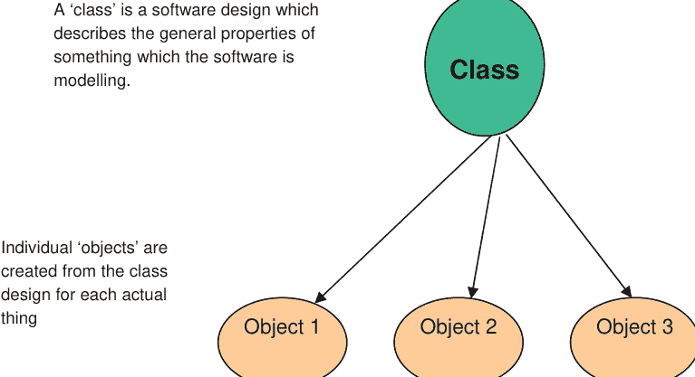

具体的“对象”是根据类设计为每个实际实体创建的。

然而，仅仅决定我们在系统中应该创建哪些类并不是一项简单的任务，因为现实世界是复杂且混乱的（关于如何处理此问题的更多建议，请参阅第 6 章）。本质上，我们需要创建一个现实世界的抽象模型，关注问题的本质方面，并忽略无关的复杂性。例如，在现实世界中，银行持有人有时需要借钱，偶尔他们的钱可能会被小偷偷偷走。如果我们创建一个银行账户系统，我们是否应该允许客户借钱？我们是否应该承认他们的现金可能被盗窃，并建立某种让他们获得即时贷款的方法——或者这一个无关紧要的细节，只会增加系统的复杂性而对银行提供任何益处？

使用面向对象的分析和设计技术，你的工作就是观察现实世界并得出一个简化的抽象模型，我们可以将其转换为计算机系统。我们最终系统的好坏取决于我们的软件写得好不好。

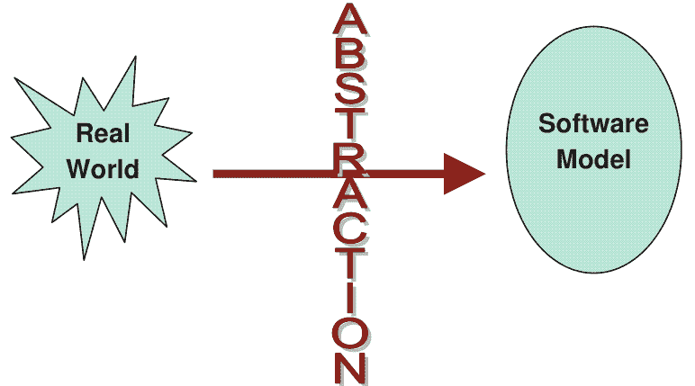

## 练习 9

考虑一个允许从图书馆预留物品的计算机系统。想象一个你可能想要预留的物品，并列出管理员可能想了解关于该物品的二或三件事。

## 反馈 9

你可能想了一本想要预留的书，在这种情况下，管理员可能需要知道该书的标题和作者。

因此，对于我们在系统中创建的每个对象，我们都需要定义该对象的属性，即我们需要了解关于它的信息。

## 练习 10

注意，我们可以将预留视为一个逻辑对象（而实际物品是物理对象）。考虑这个逻辑对象（物品预留），列出管理员可能需要对该对象执行的二或三项操作。

## 反馈 10

管理员可能需要取消这次预留（如果你改变了主意），他们也可能需要告诉你物品是否已到货供你领取。

因此，对于每个对象，我们都需要定义在该对象上执行的操作（以及它的属性）。

### 面向对象简介

## 练习 11

考虑到可以从图书馆借出的最通用类别对象——“借出的物品”，列出图书馆可以借出的二或三个具体的子类别对象。

## 反馈 11

定义了最通用的对象类别（我们称之为类）——可以被借的东西——我们可能想要定义更专门的子类（例如：书籍、杂志、视听材料）。这些子类将共享为通用类定义的属性，但会有特定的差异（例如，借用视听材料可能会产生费用）。

## 1.6 面向对象编程方法的优势

无论你是否以面向对象的方式开发程序，在编写软件之前，你必须首先开发一个关于软件必须处理什么以及它应该如何运行的模型。面向对象建模基于抽象、封装、继承的思想。

面向对象方法的支持者声称，这种模型提供了：

- 更好的抽象（将信息和行为建模）
- 更好的可维护性（减少脆弱性）
- 更好的重用性（类作为组件）

## 1.7 总结

面向对象编程涉及通过建模现实世界来创建类。这允许系统随着业务需求而改变。

# 第 2 章：统一建模语言 (UML)

### 引言

本章将向你介绍统一建模语言 (UML)，并解释四种常用图的作用（类图、对象图、序列图和包图）。

### 目标

在本章结束时，你将能够：

- 解释什么是 UML 并解释四种常用图的作用
- 绘制类图、对象图、序列图和包图。

本章涵盖的内容将在后续章节中扩展，在这里开发的技能将在后续中使用（特别是关于类图）。


本章由六部分组成：

1. UML 引言
2. 类图
3. UML 语法
4. 包图
5. 对象图
6. 序列图

## 2.1 UML 引言

统一建模语言 UML 有时被描述为像是一种方法论。它并不是！

方法论是为了实现特定结果的一套过程系统，例如收集用户需求的组织活动序列。而 UML 是一种精确的绘图表示法，允许对程序设计进行表示和讨论。由于它是图形化的，因此易于可视化、理解和讨论图中呈现的信息。然而，由于图表代表的是技术信息，它们必须是精确且清晰的——为了让它们生效，必须遵循一种精确的表示法。

由于 UML 不是方法论，因此留给用户按照他们认为合适的方式来生成图表所描述的设计。UML 并没有限制这一点——它仅仅允许这些设计以易于使用、精确的图形表示法表达出来。

## 2.2 UML 类图

类是任何面向对象软件系统的基本组件，UML 类图提供了表示这些组件的简单方法。除了显示单个类之外，类图还展示了多个类以及它们之间的关系。因此，类图展示了系统的架构。

一个类由：

- 唯一的名称（习惯以大写字母开头）
- 属性列表（`int`, `double`, `boolean`, `String` 等）
- 方法列表

这通过一个简单的框形结构显示：

| ClassName |
| --- |
| attributes |
| methods() |

对于属性和方法，显示了可见性修饰符（`+` 表示公共访问，`-` 表示私有访问）。属性通常保持为私有，而方法通常被设为公共。

注意：上面显示的 `String` 不是一种原始数据类型，它本身就是一个类。因此，它以大字母开头。

因此，一个 `Book` 类，具有 `title` 和 `author` 的 `String` 属性，以及以下方法 `setTitle()`、`getTitle()`、`setAuthor()`、`getAuthor()` 和 `toString()`，显示如下：

| Book |
| --- |
| - title :String |
| - author :String |
| +setTitle() |
| +getTitle() |
| +setAuthor() |
| +getAuthor() |
| +toString() |


---

到2020年，风能可以提供我们地球电力需求的十分之一。今天，SKF的创新知识对于运行世界上大部分风力发电机至关重要。

高达一半的发电成本与维护有关。通过我们的在线状态监测和自动化系统，可以大幅减少这些成本。通过挖掘更大的价值，我们使其变得更具效益。

通过分享我们的经验、专业知识和创造力，行业可以提升超出预期的性能。

SKF招募了能够应对这一挑战的优秀员工！

接入知识工程的力量。

访问我们的网站：`www.skf.com/knowledge`

## 活动 1

画一个图来表示名为 `BankAccount` 的类，具有属性 `balance`（类型为 `int`）以及 `depositMoney()` 和 `withdrawMoney()` 方法。显示适当可见性修饰符。

## 反馈 1

| BankAccount |
| --- |
| - balance :int |
| +depositMoney() |
| +withdrawMoney() |
| +displayBalance() |

上面的图表显示了这些信息。

UML 允许我们在图中抑制不希望强调的任何信息——这允许我们忽略无关细节，并将读者的注意力引到我们关注的信息上。因此，以下都是有效的类图...

首先，是不显示访问修饰符的情况....

| BankAccount |
| --- |
| balance :int |
| depositMoney() |
| withdrawMoney() |
| displayBalance() |

其次，是不显示访问修饰符和数据类型的情况.....

| BankAccount |
| --- |
| balance |
| depositMoney() |
| withdrawMoney() |
| displayBalance() |

最后，是不显示属性和方法的情况.....

| BankAccount |
| --- |

即存在类 `BankAccount`，但其细节未显示。

当然，几乎所有的 Java 程序都由许多类组成，且类之间相互关联——某些类会使用其他类。这些关系通过箭头表示。不同类型的箭头表示不同的关系（包括继承和聚合关系）。

此外，类图可以使用关键字、注释和注记。

正如我们在接下来的示例所示，类图可以显示以下信息：

- 类
  - 属性
  - 操作
  - 可见性
- 关系
  - 可导航性
  - 多重性
  - 依赖
  - 聚合
  - 组合
- 一般化 / 特化
  - 继承
  - 接口
- 关键字
- 注释和注记

在 BookBoon.com 下载免费书籍

由于 UML 图传的是精确的信息，因此应该遵循精确的语法。

属性应该显示为：可见性 名称 : 类型 多重性

其中可见性是之一：

- `+` public
- `-` private
- `#` protected
- `~` package

多重性之一：

- `n` 正好为 n
- `*` 零或多个
- `m..n` 在 m 和 n 之间

以下是使用 UML 正确指定的属性示例：

- `- custRef : int [1]`

私有属性 `custRef` 是单个 `int` 值。这应该显示为 `- custRef : int`。然而，在没有显示多重性的情况下，我们无法安全地假设作者想要表达的多重数为一。

- `# itemCodes : String [*]`

受保护属性 `itemCodes` 是一个或多个 `String` 值

- `+ validCard : boolean`

属性 `validCard`

操作也有精确的语法：可见性 名称 (参数 : 类型) : 返回类型

## 活动 2

画一个图来表示名为 `BankAccount` 的类，具有属性 `balance`（类型为 `int`）以及 `depositMoney()` 和 `withdrawMoney()` 方法。显示适当的可见性修饰符。

## 反馈 2

| BankAccount |
| --- |
| - balance :int |
| +depositMoney() |
| +withdrawMoney() |
| +displayBalance() |

上面的图表显示了这些信息。

UML 允许我们在图中抑制不希望强调的任何信息——这允许我们忽略无关细节，并将读者的注意力引到我们关注的信息上。因此，以下都是有效的类图...

首先，是不显示访问修饰符的情况....

| BankAccount |
| --- |
| balance :int |
| depositMoney() |
| withdrawMoney() |
| displayBalance() |

其次，是不显示访问修饰符和数据类型的情况.....

| BankAccount |
| --- |
| balance |
| depositMoney() |
| withdrawMoney() |
| displayBalance() |

最后，是不显示属性和方法的情况.....

| BankAccount |
| --- |

即存在类 `BankAccount`，但其细节未显示。

当然，几乎所有的 Java 程序都由许多类组成，且类之间相互关联——某些类会使用其他类。这些关系通过箭头表示。不同类型的箭头表示不同的关系（包括继承和聚合关系）。

此外，类图可以使用关键字、注释和注记。

正如我们在接下来的示例所示，类图可以显示以下信息：

- 类
  - 属性
  - 操作
  - 可见性
- 关系
  - 可导航性
  - 多重性
  - 依赖
  - 聚合
  - 组合
- 一般化 / 特化
  - 继承
  - 接口
- 关键字
- 注释和注记

由于 UML 图传的是精确的信息，因此应该遵循精确的语法。

属性应该显示为：可见性 名称 : 类型 多重性

其中可见性是之一：

- `+` public
- `-` private
- `#` protected
- `~` package

多重性之一：

- `n` 正好为 n
- `*` 零或多个
- `m..n` 在 m 和 n 之间

以下是使用 UML 正确指定的属性示例：

- `- custRef : int [1]`

私有属性 `custRef` 是单个 `int` 值。

这应该显示为 `- custRef : int`。然而，在没有显示多重性的情况下，我们无法安全地假设作者想要表达的多重数为一。

- `# itemCodes : String [*]`

受保护属性 `itemCodes` 是一个或多个 `String` 值

- `+ validCard : boolean`

属性 `validCard`

## 活动 2

画一个图来表示名为 `BankAccount` 的类，具有属性 `balance`（类型为 `int`）以及 `depositMoney()` 和 `withdrawMoney()` 方法。显示适当的可见性修饰符。

## 反馈 2

| BankAccount |
| --- |
| - balance :int |
| +depositMoney() |
| +withdrawMoney() |
| +displayBalance() |

上面的图表显示了这些信息。

UML 允许我们在图中抑制不希望强调的任何信息——这允许我们忽略无关细节，并将读者的注意力引到我们关注的信息上。因此，以下都是有效的类图...

首先，是不显示访问修饰符的情况....

| BankAccount |
| --- |
| balance :int |
| depositMoney() |
| withdrawMoney() |
| displayBalance() |

其次，是不显示访问修饰符和数据类型的情况.....

| BankAccount |
| --- |
| balance |
| depositMoney() |
| withdrawMoney() |
| displayBalance() |

最后，是不显示属性和方法的情况.....

| BankAccount |
| --- |

即存在类 `BankAccount`，但其细节未显示。

当然，几乎所有的 Java 程序都由许多类组成，且类之间相互关联——某些类会使用其他类。这些关系通过箭头表示。不同类型的箭头表示不同的关系（包括继承和聚合关系）。

此外，类图可以使用关键字、注释和注记。

正如我们在接下来的示例所示，类图可以显示以下信息：

- 类
  - 属性
  - 操作
  - 可见性
- 关系
  - 可导航性
  - 多重性
  - 依赖
  - 聚合
  - 组合
- 一般化 / 特化
  - 继承
  - 接口
- 关键字
- 注释和注记

对于属性和方法，显示了可见性修饰符（`+` 表示公共访问，`-` 表示私有访问）。属性通常保持为私有，而方法通常被设为公共。

注意：上面显示的 `String` 不是一种原始数据类型，它本身就是一个类。因此，它以大字母开头。

因此，一个 `Book` 类，具有 `title` 和 `author` 的 `String` 属性，以及以下方法 `setTitle()`、`getTitle()`、`setAuthor()`、`getAuthor()` 和 `toString()`，显示如下：

| Book |
| --- |
| - title :String |
| - author :String |
| +setTitle() |
| +getTitle() |
| +setAuthor() |
| +getAuthor() |
| +toString() |


---

到2020年，风能可以提供我们地球电力需求的十分之一。今天，SKF的创新知识对于运行世界上大部分风力发电机至关重要。

高达一半的发电成本与维护有关。通过我们的在线状态监测和自动化系统，可以大幅减少这些成本。通过挖掘更大的价值，我们使其变得更具效益。

通过分享我们的经验、专业知识和创造力，行业可以提升超出预期的性能。

SKF招募了能够应对这一挑战的优秀员工！

# 知识工程的力量

接入知识工程的力量。

访问我们的网站：`www.skf.com/knowledge`

## 活动 1

画一个图来表示名为 `BankAccount` 的类，具有属性 `balance`（类型为 `int`）以及 `depositMoney()` 和 `withdrawMoney()` 方法。显示适当可见性修饰符。

## 反馈 1

| BankAccount |
| --- |
| - balance :int |
| +depositMoney() |
| +withdrawMoney() |
| +displayBalance() |


# 统一建模语言 (UML)

上面的图表显示了这些信息。

UML 允许我们在图中抑制不希望强调的任何信息——这允许我们忽略无关细节，并将读者的注意力引到我们关注的信息上。因此，以下都是有效的类图...

首先，是不显示访问修饰符的情况....

| BankAccount |
| --- |
| balance :int |
| depositMoney() |
| withdrawMoney() |
| displayBalance() |

其次，是不显示访问修饰符和数据类型的情况.....

| BankAccount |
| --- |
| balance |
| depositMoney() |
| withdrawMoney() |
| displayBalance() |

最后，是不显示属性和方法的情况.....

| BankAccount |
| --- |

即存在类 `BankAccount`，但其细节未显示。

当然，几乎所有的 Java 程序都由许多类组成，且类之间相互关联——某些类会使用其他类。这些关系通过箭头表示。不同类型的箭头表示不同的关系（包括继承和聚合关系）。

此外，类图可以使用关键字、注释和注记。

正如我们在接下来的示例所示，类图可以显示以下信息：

- 类
  - 属性
  - 操作
  - 可见性
- 关系
  - 可导航性
  - 多重性
  - 依赖
  - 聚合
  - 组合
- 一般化 / 特化
  - 继承
  - 接口
- 关键字
- 注释和注记

## 2.3 UML 语法

由于 UML 图传的是精确的信息，因此应该遵循精确的语法。

属性应该显示为：可见性 名称 : 类型 多重性

其中可见性是之一：

- `+` public
- `-` private
- `#` protected
- `~` package

多重性之一：

- `n` 正好为 n
- `*` 零或多个
- `m..n` 在 m 和 n 之间

以下是使用 UML 正确指定的属性示例：

- `- custRef : int [1]`

私有属性 `custRef` 是单个 `int` 值。这应该显示为 `- custRef : int`。然而，在没有显示多重性的情况下，我们无法安全地假设作者想要表达的多重数为一。

- `# itemCodes : String [*]`

受保护属性 `itemCodes` 是一个或多个 `String` 值

- `+ validCard : boolean`

属性 `validCard`

操作也有精确的语法：可见性 名称 (参数 : 类型) : 返回类型

## 依赖

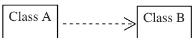

- 依赖是类之间最弱的关系（不严格算作“关联”）
- 类 A 在某种程度上使用了由类 B 定义的功能
- 类 B 的更改可能会影响类 A

依赖线的典型用法是：类 A 有一个方法接收了类 B 的实例对象作为参数，或者使用了该对象的局部变量，或者使用了类 B 的 `static` 方法。

## 简单关联

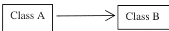

- 在关联中，类 A “使用”类 B 的对象
- 通常类 A 有一个类 B 的属性
- 从 A 到 B 的导航性：
  - 即类 A 对象访问与其关联的类 B 对象。反之则不成立 —— 类 B 对象“不知道”类 A 对象

简单关联对应于类 A 中类型为 B 的实例变量。

示例：上面的目录（Catalogue）需要 0 个或多个待售物品（ItemsForSale）。可以从目录中添加或删除待售物品。一个待售物品不需要访问目录即可设置其价格或执行与物品本身相关的其他方法。

## 双向关联

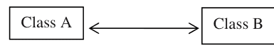

- 双向关联是指类 A 和类 B 之间存在双向关联
- 它们互相引用对方类
- 从 A 到 B 和 B 到 A 的导航性：
  - 类 A 对象访问与其关联的类 B 对象
  - 类 B 对象“属于”类 A
  - 意味着从 A 到 B 的引用
  - 此外，类 B 对象也可以访问与其关联的类 A 对象

双向关联是复杂的，因为每个对象都有指向另一个对象的引用，通常双向关联比单向关联少得多。

双向关联的一个示例可以是“学位”（Degree）和“学生”（Student）之间，例如：给定一个学位，我们可能想知道哪些学生正在读该学位。或者从学生开始，我们可能想知道他们正在读的学位。

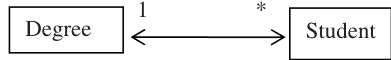

由于许多学生在同一学习同一个学位，但学生通常只读一个学位，因此这里仍然存在一对多的关系。

## 聚合

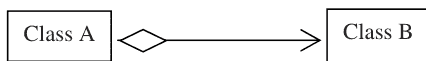

- 聚合表示类 B 对象“属于”类 A的情况
- 意味着从 A 到 B 的引用
- 虽然聚合意味着类 B 对象属于类 A 对象，但它也意味着类 B 对象保留了独立于类 A 的存在性。一些设计人员认为聚合和简单关联之间没有本质区别。

聚合的一个示例是汽车（Car）类和轮胎（Tyre）类之间。

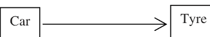

我们认为轮胎属于它们所在的汽车，但在修理厂，它们可能会被拆下并放在架子上进行修理。它们的存在并不依赖于与其关联的汽车的存在。

## 组合

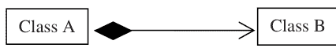

- 组合类似于聚合，但意味着一种更强的所属关系，即类 B 对象是类 A 对象的“部分”
- 同样意味着从 A 到 B 的引用
- 在这种情况下，比聚合“强”得多：类 B 对象是类 A 不可缺的一部分，通常类 B 对象除了作为类 A 的一部分之外永远不会存在，它们具有相同的“生命周期”。

组合的一个示例是图片（Picture）中的元素点（Points）、线（Lines）和形状（Shapes）。这些对象只能作为图片的一部分存在，如果图片被删除，它们也会被删除。

除了表示关联外，类图还可以表示：

- 继承
- 接口
- 关键字
- 备注

## 继承

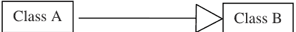

- 除了关联之外，另一种主要的建模关系是继承：
- 类 A “继承”了类 B 的接口和实现，尽管它可能会重写实现细节并补充两者。

我们将在第 3 章中详细介绍继承。

## 接口

- 接口与继承相似，但使用接口时只继承接口。接口中定义的方法必须在每个实现接口的类中实现。
- 接口可以使用 `<<interface>>` 关键字表示：

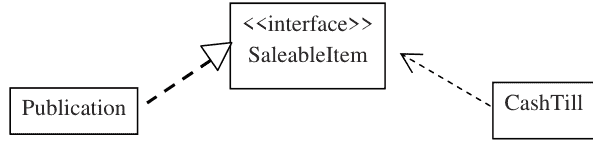

这种表示也有简写形式

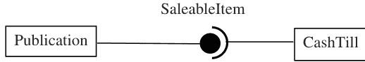

在这两种情况下，这些示例都表示 `SaleableItem` 接口被 `CashTill` 需要，并由 `Publication` 实现。

注意，继承线/箭头的虚线版本表示 `Publication` “实现”或“落实”了 `SaleableItem` 接口。

“球和插座”法不在 UML 2 中 —— 它是表示接口如何连接类的一个很好的视觉效果。

我们将在第 4 章中更详细介绍接口的应用。

## 关键字

UML 定义了关键字来完善图形符号的含义

我们已经见过 `<<interface>>`，也会使用 `<<abstract>>`，但还有许多其他的。

抽象类也可以通过将其名称以*斜体*来表示，尽管这对于普通读者来说可能不太直观。

## 备注

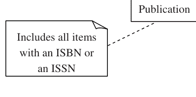


最后，我们可以添加备注来注释图中的元素。这为我们提供了一个“全能”功能，用于添加图形符号无法表达的信息。

# 练习 4

根据你自己的经验，尝试开发一个模型，说明以下 UML 类图符号元素的用法：

- 简单关联
- 双向关联
- 聚合（很棘！）
- 组合
- 关联多重性
- 泛化（继承）
- 接口
- 备注

在此练习中，请关注类之间的关系，而不是它们成员的细节。与其他同学和导师解释并讨论你的模型。

为了帮助你开始，下面提供了一些小示例。

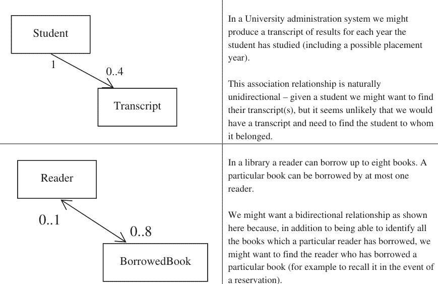

在大学管理系统中，我们可能会为学生学习的每年生成一份成绩单（包括可能的实习年）。

这种关联关系自然上是单向的 —— 给一个学生，我们想找到他们的成绩单，但不太可能有一份成绩单并需要寻找学生。

在图书馆，一个读者最多可以借八本书。某特定的书最多由一个读者借阅。

我们可能需要这里所示的双向关系，因为除了能够识别特定读者借阅的所有书籍外，我们可能还需要找到借阅了特定书籍的读者（例如在有预订时召回）。

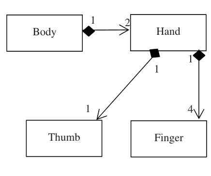

这可能是某种教育用虚拟解剖学程序模型的一部分。

组合——这种“强”关系显示一个对象是（且必须是）另一个对象的一部分，这在这里似乎是合适的。

多重性并不总是适用于真实的人——他们可能因为事故或疾病失去了一根手指，或者因为基因异常多出了一根。

如果我们正在对医学院解剖实验室的“材料”进行建模呢？手并不总是属于身体的一部分？也许“较弱”的聚合关系能更好地地反映这一点。

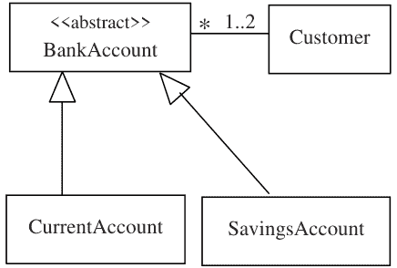

一个客户可以拥有任意数量的银行账户，而一个银行账户可以由一个人或两个人持有（“联名账户”）。我们抑制了这种关系的导航性，也许因为我们还没有决定这个问题。

一个银行账户必须是活期账户或储蓄账户——`BankAccount` 本身是抽象的。

（我们可以使用斜体而不是 `<<abstract>>` 关键字来显示这一点）

`BankAccount`

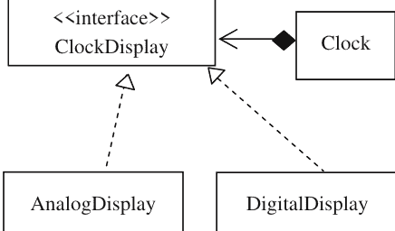

钟的一部分是为了显示时间。这可能是模拟显示或数字显示，但由于我们可以使用一个父类和两个子类，由于两种显示器的实现将完全不同，因此使用一个接口（interface）来定义 `AnalogDisplay` 和 `DigitalDisplay` 必须提供的操作可能更为合适。

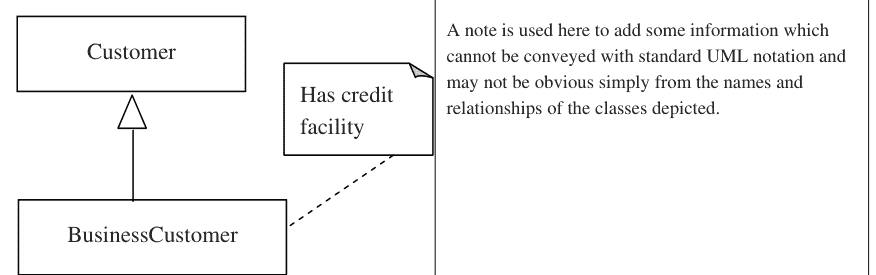

反馈 4

对此活动没有特定的反馈。


## 2.4 UML 包图 (Package Diagrams)

虽然类（classes）是 UML 符号定义中最常用的图表，且我们将在本书中大量使用它们，但还有其他图表可以表示不同类型的信息。在这里我们将涉及其中三类：

- 包图 (Package Diagrams)
- 对象图 (Object Diagrams)
- 时序图 (Sequence Diagrams)

世界地图、国家地图和城市地图都显示空间信息，只是比例不同，详细程度不同。大型 OO 系统可以由数百个甚至数千个类组成，因此，如果类图是表示大型系统架构的唯一方法，它将变得过于巨大且复杂。因此，正如我们需要世界地图一样，我们需要包图来显示大型系统的总体架构。即使是中型系统也可以拆分为几个基础组件，即包（packages）。我们将在第 11 章看到包的示例。现在我们只需查看包图的符号表示。

包（package）不仅仅是一组类的视觉表示，相反，“包”是一个包含多个类的目录。包允许我们对一组相关的类进行组织和封装（包括 `<<interface>>`）。包不仅是类组的视觉表示，而且是一个包含一组相关类的目录。包通常被描述为用点分隔的名称，例如 `java.event`。

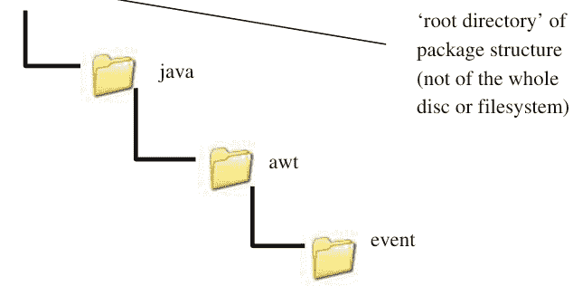

开发应该在设计阶段拆分为合适的包。我们通过包图使用 UML 表示包之间的关系：

- 包内的类
- 包的嵌套
- 包之间的依赖关系

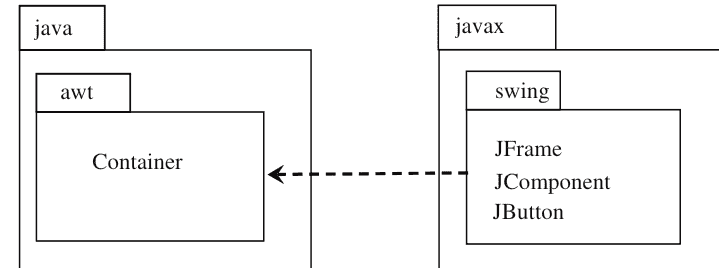

在下图中我们看到两个包：`java` 和 `javax`。在 `java` 包中包含一个 `Container` 类，而在 `javax` 包中包含三个类：`JFrame`、`JComponent` 和 `JButton`。最后，我们显示 `swing` 包依赖于 `awt` 包。

一个银行账户必须是活期账户或储蓄账户——BankAccount 本身是抽象的。

一个钟的一部分是为了显示时间。注意 `java.awt` 和 `swing` 包包含许多类，但我们简单选择不显示它们。在下图中，显示 `swing` 包位于 `java` 包中。

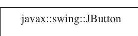

再次在下图中显示位于顶部的：

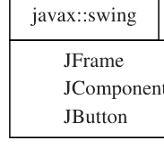

这些不同的表示在不同情况下是有用的。

## 包命名

按照惯例，项目的包名通常使用小写，例如：

- `mysystem.interface`
- `mysystem.engine`
- `mysystem.engine.util`
- `mysystem.database`

然而，包通常是分布式的，为了使这些包在全球范围内唯一，采用了基于 URL 的命名法：

```
uk.co.ebay.www.department.project.package
```

区分特定项目和子系统的包。


注意包图中的元素不是用 `*` 分隔，而是用 `::`。

你和你的室友决定一起去购物。为了快速，将购物清单分成两半——由你收集的物品和由室友收集的物品。

苹果、家具蜡、梨、胡萝卜、卷纸、土豆、清洁剂。葡萄。

反馈 5

为了让购物高效，你可能将列表分成位于商店相同区域的列表：

| 列表 1 | 列表 2 |
| --- | --- |
| 苹果， | 家具蜡， |
| 梨， | 清洁剂 |
| 葡萄 | 匹配 |
| 胡萝卜， | 卷纸， |
| 土豆 | |

活动 6

你是一个程序员团队，需要编写一个 Java 程序来监控和控制网络系统。系统由如下类组成。将这些类组织三个包。每个程序员负责一个包中的代码。为包起你认为合适的名称。

- `Main` 该类启动系统
- `Monitor` 该类监控网络性能和安全漏洞


- `Interface` 这是整个系统的视觉界面
- `Reconfigure` 允许对网络重新配置
- `RecordStats` 该类将有关网络的数据存储在数据库中
- `RemoteControl` 允许通过电话对系统进行远程控制
- `PrintReports` 该类使用存储在数据库中的数据为组织管理层打印管理报告

# 使用 Java 的面向对象编程

# 统一建模语言 (UML)

# 反馈 6

在将项目组织成包（packages）时，并不总有所谓的“标准答案”，但如果你将类组织到适当的包中（将具有相关功能的类放在一起），就可以提高系统的封装性并提高程序员的效率。以下是针对活动 6 的建议解决方案。

| 接口 (interface) |
| :--- |
| 主接口 (Main Interface) |
| 远程控器 (RemoteControl) |
| 网络 (network) |
| 监控重配置 (Monitor Reconfigure) |
| 数据库 (database) |
| 记录统计 (RecordStats) |
| 打印报告 (PrintReports) |

# 活动 7

假设你组织的 URL 为 `www.myorg.com`，下面显示的三个包和七个类都是 `project1` 的一部分。绘制一个包图来传达这一信息。

| 接口 (interface) |
| :--- |
| 主接口 (Main Interface) |
| 远程控器 (RemoteControl) |
| 网络 (network) |
| 监控重配置 (Monitor Reconfigure) |
| 数据库 (database) |
| 记录统计 (RecordStats) |
| 打印报告 (PrintReports) |

在 BookBoon.com 下载免费书籍

使用 Java 的面向对象编程

统一建模语言 (UML)

# 反馈 7

```
com::myorg::www::project1
```

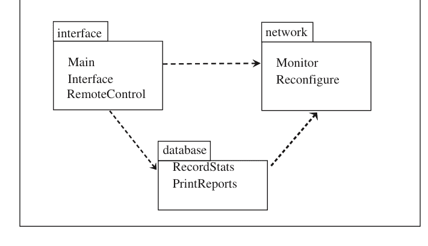

注意：绘制了依赖箭头以突出显示包与包之间的关系。当在确定这些关系上投入更多思考时，它们可能会演变为关联（一种比单纯的依赖要强得多的关系）。


# 想要：志心勃勃的人

在 NNE Pharmplan，我们需要志心勃勃的人来帮助我们实现公司设定的具有挑战性的目标。

Kim Voldi 是众多志心勃勃同事中的一个。除了担任制造 IT 部门的经理外，Kim 还以专业水平参加铁人三。

NNE Pharmplan 赋予了我带有责任的自由，以及规划自己时间的机会。这使我能够以竞技水平参加铁人三，否则我将没有可能这样做。

通过平衡我的工作和个人生活，我获得了在工作和铁人三中都发挥最佳水平的能量。

如果你志心勃勃并想加入我们的机会世界，请访问 nnepharmplan.com

NNE Pharmplan 是全球领先的工程和咨询公司，专门专注于制药和生物技术行业。NNE Pharmplan 是 Novo 集团的一员公司。

*nne pharmplan*

从 BookBooN.com 下载免费书籍

## 2.5 UML 对象图

类图和包图允许我们视觉化并讨论系统的架构，但有时我们希望讨论系统处理的数据。对象图允许我们视觉化系统在某一时刻的一个实例以及系统在该时刻可能包含的数据。

对象图在表面上与类图相似，但方框代表对象的特定实例。

最佳标题格式为：

```
对象名 : 类名
```

由于每个方框都描述了特定时刻的特定对象，因此方框包含属性和它们的值（在该特定时刻）。

```
属性 = 值
```

这些图对于说明设计过程中特定的“快照”场景有用。

下面的对象图显示了图书馆目录系统在某一可能存在的几个对象。该系统包含两个类：

- 书 (Book)，存储书籍的详情。
- 图书馆 (Library)，维护书籍集合。根据需要添加、搜索或删除书籍。

| myLocalLibrary : Library |
| :--- |
| book1 : Book |
| title = "OO Programming Using Java" |
| author = "S Kendal" |
| book2 : Book |
| title = "Fishing Made Simple" |
| author = "A Trout" |
| book3 : Book |
| title = "Cooking for Beginners" |
| author = "A Chef" |

查看此图，我们可以看到在特定时刻，已经创建了三本书，但只有两本被添加到图书馆中。因此，如果我们我们在图书馆中搜索‘Cooking for Beginners’，我们预计将找不到该书。

与类图一样，对象图上的元素可以被自由隐藏。

# 使用 Java 的面向对象编程 统一建模语言 (UML)

例如，以下所有都是合法的：

| book1 : Book |
| :--- |
| title = "OO Programming Using Java" |

- 隐藏某些属性

| book1 : Book |
| :--- |

- 隐藏所有属性

| Book |
| :--- |

- 隐藏对象名

## 2.6 UML 序图

序图与类图或对象图完全不同。类图描述系统的架构，对象图描述系统在某一时刻的状态。然而，序图描述了系统随时间推移如何工作。序图是系统的“动态”表示而非“静态”表示。它们显示了在一段时间内对象内部以及对象之间的的方法调用序列。它们对于理解对象在特定场景下如何协作有用。

参见下例：

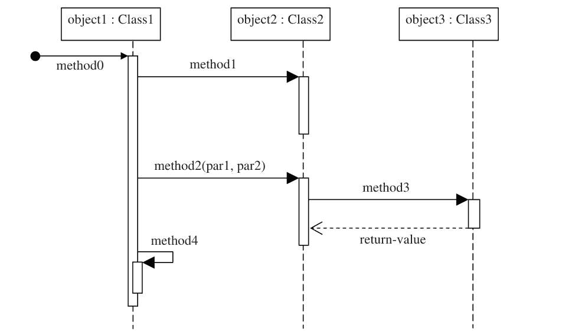

在 BookBoon.com 下载免费书籍

# 使用 Java 的面向对象编程

在这个场景中，我们有三个对象。时间从上到下，垂直虚线（生命线）表示对象随时间的推移而持续存在。

此图显示了正在发生的动作：

- 首先，方法调用（在 OO 术语中通常称为消息）到 `method0()` 从某处传到 `object1` – 这可能是图之外的另一个类。
- `object1` 开始执行 `method0()`（如垂直条（称为激活条）所示）。
- `object1` 调用 `object2` 方法。
- `object2` 执行方法。
- `object1` 接收 `method0()` 的返回值。
- `object1` 结束。

## 2.5 总结

- 
- 
- 

# 3. 继承与方法重写

引言

本章将讨论继承、方法重写以及 `Super` 的正确使用的核心概念。

目标

在本章结束时，你将：

- 欣赏继承层次的重要性
- 理解如何使用抽象类
- 重写方法（包括 `Object` 类中的）
- 解释如何使用 `Super` 来调用被重写的方法
- 使用 UML 记录继承层次
- 在 Java 中实现继承和方法重写

本章涵盖的所有材料将在后续章节中进行开发和扩展。本章将关注继承的应用。


# 想要：志心勃勃的人

在 NNE Pharmplan，我们需要志心勃勃的人来帮助我们实现公司设定的具有挑战性的目标。

Kim Voldi 是众多志心勃勃同事中的一个。除了担任制造 IT 部门的经理外，Kim 还以专业水平参加铁人三。

NNE Pharmplan 赋予了我带有责任的自由，以及规划自己时间的机会。这使我能够以竞技水平参加铁人三，否则我将没有可能这样做。

通过平衡我的工作和个人生活，我获得了在工作和铁人三中都发挥最佳水平的能量。

如果你志心勃勃并想加入我们的机会世界，请访问 nnepharmplan.com

NNE Pharmplan 是全球领先的工程和咨询公司，专门专注于制药和生物技术行业。NNE Pharmplan 是 Novo 集团的一员公司。

*nne pharmplan*

从 BookBooN.com 下载免费书籍

# 选择与迭代

这种逻辑通常取决于选择（`if`）和迭代（loops）。

存在一种框架（frames），可以在序图中表示选择（`if`）和迭代（loops）。

序图通常最适合说明特定案例。

# 总结

UML 不是一种方法论，而是一种精确的表示。

类图和包图允许我们视觉化并讨论系统的架构。对象图描述系统在某一时刻的数据。序图描述系统随时间推移如何工作。序图是系统的“动态”表示而非“静态”表示。它们显示了在一段时间内对象内部以及对象之间的方法调用序列。它们对于理解对象在特定场景下如何协作有用。

FOSS 对这些结构有不同的处理。

# 3. 继承与方法重写

引言

本章将讨论继承、方法重写以及 `Super` 的正确使用的核心概念。

目标

在本章结束时，你将：

- 欣赏继承层次的重要性
- 理解如何使用抽象类
- 重写方法（包括 `Object` 类中的）
- 解释如何使用 `Super` 来调用被重写的方法
- 使用 UML 记录继承层次
- 在 Java 中实现继承和方法重写

本章涵盖的所有材料将在后续章节中进行开发和扩展。本章将关注继承的应用。

本章包含十二个节：

- 1) 对象族
- 2) 一般化与特化
- 3) 继承
- 4) 在 Java 中实现继承
- 5) 构造函数
- 6) 构造函数规则
- 7) 访问控制
- 8) 抽象类
- 9) 方法重写
- 10) `Object` 类
- 11) 重写 `Object` 中定义的 `toString()`
- 12) 总结

## 3.1 对象族

世界上许多事物都属于相关的“家族”群体。“继承”是从父类向子类传递特性的思想，它在面向对象的设计和编程中起着重要作用。

虽然我们可能已经熟悉构造函数和访问控制（public/private），但与这些内容相关的继承方面有一些特殊问题。

此外，我们还需要考虑抽象类和方法重写的使用，因为这些是继承背景下的重要概念。

最后，我们将查看 `Object` 类，它与 Java 中的所有其他类都具有一种特殊的关系。

## 3.2 一般化与特化

类是一种通用的形式，可以从中创建具有不同细节的对象。对象然后是其类的“实例”。例如，Student 051234567 是 Student 类的一个实例。更简洁地说，051234567 是一个 Student。

类本身通常可以通过类似的关系来组织。

我们都比较熟悉的一个层级结构是描述动物界的层级：

- 界（Kingdom，例如：动物）
- 门（Phylum，例如：脊椎动物）
- 纲（Class，例如：哺乳）
- 目（Order，例如：肉食动物）
- 科（Family，例如：猫）
- 属（Genus，例如：felix）
- 种（Species，例如：felix leo）

我们可以用图形表示这种层级结构....

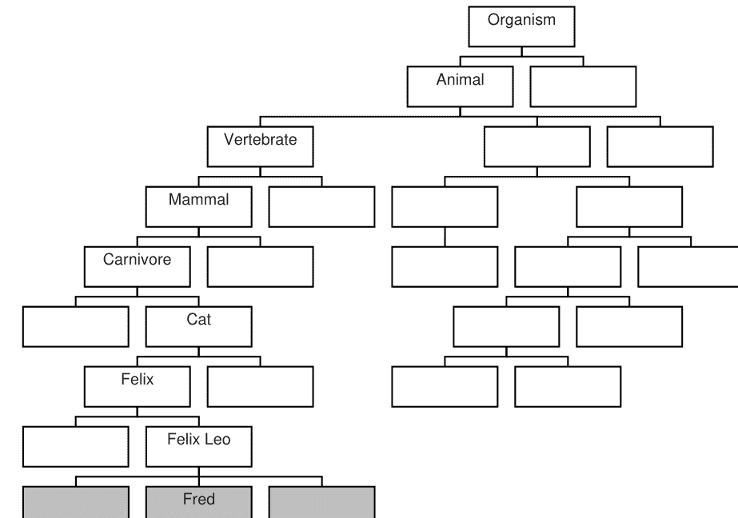

当然，画出完整的图将比我们有的更多时间和空间。

在这里我们可以看到一个特定的动物：`Fred`。Fred 不是一种动物类，而是一个真实的动物。

Fred 是一个 `felix leo`，是一个 `felix`，一只猫是一个肉食动物。

肉食动物吃肉，所以 Fred 具有“吃肉”的特性。

Fred 是一个 `felix leo`，是一个 `felix`，一只猫是一个肉食动物，是一个哺乳动物，是一个脊椎动物。

脊椎动物有脊柱，所以 Fred 具有“有脊柱”的特性。

“是”的关系将个体连接到特性层级结构中。这种关系适用于许多现实世界的实体，例如，`BonusSuperSaver` 是 `SavingsAccount` 是 `BankAccount`。

## 3.3 继承

我们在层级结构的高处指定一般的特性，在低处指定更具体的特性。面向对象设计中的一个重要原则——我们称之为一般化和特化。

层级结构中某类/对象之上类的所有特性都会自动出现在它中——我们称之为继承。

考虑书籍和杂志——它们都是特定的出版物类型。

我们可以在 UML 类图中用类来表示这些内容。在此过程中，我们可以看到这些类可能具有的一些实例变量和方法。

| Book | Magazine |
| --- | --- |
| title | title |
| author | price |
| price | orderQty |
| copies | currIssue |
| | copies |
| sellCopy() | sellCopy() |
| orderCopies() | adjustQty() |
| | recvNewIssue() |

属性 `title`、`author` 和 `price` 是显而易见的。不明显的是 `copies`——这是目前库存中的数量。

对于书籍，`orderCopies()` 接收一个参数，指定添加到库存的副本。

对于杂志，`orderQty` 是每份新期杂志收到的副本数，`currIssue` 是当前期期的日期/期间（例如“2009年1月”、“1月6日周五”、“2009年春天”）。当收到新 Issue 时，旧的会被丢弃，`orderQty` 份副本被放入库存。因此，`recvNewIssue` 将 `currIssue` 设置为新期日的日期并恢复 `copies` 为 `orderQty`。`adjustQty` 修改 `orderQty` 以更改后续期将库存的副本数量。

> Activity 1
>
> 查看上方定义的 `Book` 和 `Magazine` 类，并识别这两个类之间的共同点和差异。

## 反馈 1

差异如下...

Book 额外拥有 `author` 和 `orderCopies()`。Magazine 额外拥有 `orderQty`、`currIssue`、`adjustQty()` 和 `recvNewIssue()`。

我们可以将这些类的共同成员分离（“提取”）到一个名为 `Publication` 的超类中。

| Publication |
| --- |
| title |
| price |
| copies |
| sellCopy() |


## 继承与方法重写

差异需要作为额外的成员指定在‘子类’ `Book` 和 `Magazine` 中。

| Publication |
| :--- |
| title |
| price |
| copies |
| sellCopy() |

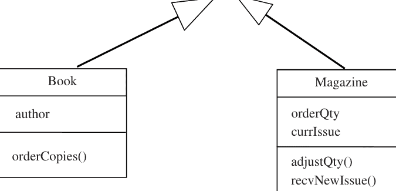

这是一个 UML 类图。

空箭头表示继承。（子类继承父类的属性）。

> Activity 2
>
> 将以下内容排列成 UML 类图：
>
> - `Book` (title, price, copies, sellCopy(), orderCopies())
> - `Magazine` (title, price, orderQty, currIssue, copies, sellCopy(), adjustQty(), recvNewIssue())
> - `Publication` (title, price, copies, sellCopy())

# 活动 6

修改此 UML 图，以显示 `determineRent()` 在 `House` 中被重写。

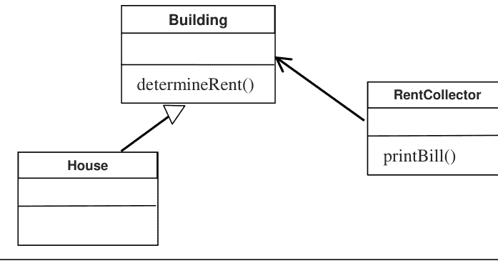

# 反馈 6

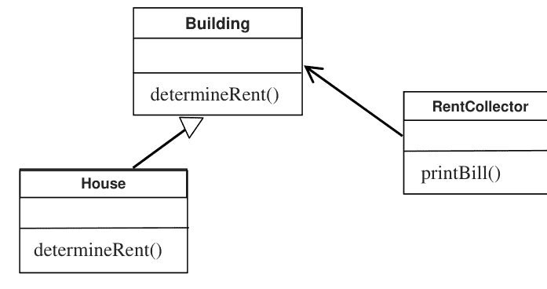

通过在 `House` 中显示 `determineRent()`，我们展示了该方法正在覆盖父类（`Building`）中定义的版本。

有趣的是，Java 将根据调用方法的对象类型使用最正确的 `determineRent()` 方法。当为房屋打印账单时，`RentCollector` 将调用在 `House` 中定义的方法，但对于任何其他类型的建筑，将使用在 `Building` 中定义的方法。这是自动的——`RentCollector` 类中的代码并不区分不同类型的 `Building`。

重写将在本章稍后进行详细讨论。

# 3.4 在 Java 中实现继承

创建父类不需要特殊的特性。因此，除非被明确阻止，任何类都可以成为子类。

子类使用 `extends` 关键字指定它正在继承自父类的特性。例如....

```
class MySubclass extends SuperClass
{
    // 额外的实例变量和
    // 额外的方法
}
```

## 3.5 构造函数

每个类（无论是子类还是父类）都应该封装自己的初始化，通常与设置实例变量的初始状态有关。

父类的构造函数处理通用初始化。

每个子类可以有自己的构造函数用于特殊初始化，但它通常必须调用父类构造函数的行为。它使用 `super` 关键字来实现这一点。

```
class MySubclass extends SuperClass
{
    public MySubclass (sub-parameters)
    {
        super(super-parameters);
        // 其他初始化
    }
}
```

如果调用了 `super`（即父类构造函数），则这必须是构造函数中的第一个语句。

通常传递给 `MySubclass` 的某些参数是父类实例变量的初始化值，这些值将作为参数传递给父类构造函数。也就是说，`super-parameters` 将是 `sub-parameters` 的某些（或全部）。

下面显示两个构造函数，一个用于 `Publication` 类，另一个用于 `Book`。`book` 构造函数需要四个参数——其中三个被立即传递给父类构造函数以初始化其实例变量。

```
public Publication (String pTitle, double pPrice, int pCopies)
{
    title = pTitle;
    // 等等
}
```


```java
public Book(String pTitle, String pAuthor, double pPrice) {
    super(pTitle, pPrice, pCopies);
    author = pAuthor;
    // 等等.
}
```

# 3.6 构造函数规则

存在规范父构造函数调用的规则。

如果父类具有无参数（或默认）构造函数，如果在子类构造函数中没有显式调用 `super`，它将被自动调用，尽管出于清晰性考虑，显式调用仍然更好的风格。

然而，如果父类没有无参数构造函数但有一个带参数构造函数，则**必须**使用 `super` 显式调用。


# 使用 Java 的面向对象编程

# 继承与方法重写

为了说明这一点....

| MySuperClass | MySuperClass | MySuperClass |
| :--- | :--- | :--- |
| MySuperClass() | MySuperClass(x) | MySuperClass(x) |

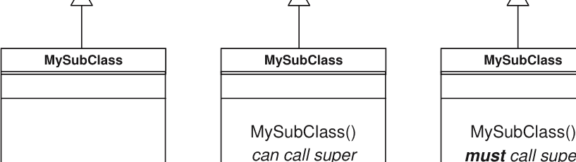

上方左侧：如果父类具有无参数构造函数，拥有一个没有构造函数的子类是合法的，尽管这不是良好的做法。

中间：如果子类构造函数没有调用 `super`，将调用无参数的父类构造函数。

右侧：因为父类没有无参数构造函数，子类必须有一个构造函数并且它必须调用 `super`。这仅仅是因为一个只有一个带参数构造函数的（父）类只能通过提供所需的参数来初始化。

## 3.7 访问控制

为了强制封装，我们将实例变量设为私有（`private`），并根据需要提供访问器/修改器方法（`accessor/mutator methods`）。

`Publication` 的 `sellCopy()` 方法需要更改变量 `copies` 的值；如果 `copies` 是私有变量，它可以这样做。然而，`Book` 和 `Magazine` 都需要更改 `copies`。

有两种方法可以做到这一点 ...

1. 将 `copies` 设置为 `protected` 而不是 `private`——这使得对子类可见，或者
2. 创建访问器和修改器方法。

对于变量，我们通常倾向于创建访问/修改封装，尽管 `protected` 可能有助于允许子类使用方法（例如访问器和修改器），而我们通常不想对其他类开放。

因此，在父类 `Publication` 中，我们将 `copies` 定义为私有变量，但创建两个可以设置和访问值 `copies` 的方法。由于这些访问方法是公共或受保护的，当需要访问 `copies` 时，可以在子类中使用它们。

因此，在父类 `Publication` 中我们会有....

```java
private int copies;

public int getCopies() {
    return copies;
}

public void setCopies(int copies) {
    this.copies = copies;
}
```

# 使用 Java 的面向对象编程

# 继承与方法重写

```java
public class DiscMag extends Magazine {
    // 构造函数
    public DiscMag(String pTitle, double pPrice, int pOrderQt,
        String pCurrIssue, int pCopies) {
        super(pTitle, pPrice, pOrderQty, pCurrIssue, pCopies);
    }

    // 被重写的方法
    public void recvNewIssue(String pNewIssue) {
        super.recvNewIssue(pNewIssue);
        System.out.println("Check discs attached to this magazine");
    }
}
```

使用 `super` 关键字可以调用父类的方法，从而在作为替换的一部分重用现有功能，就像我们在处理构造函数时做的那样。它还向用户显示了所需的消息。

操作

从形式上说，`recvNewIssue()`是一个操作。该操作由两个不同的方法实现：一个在 `Magazine` 中，另一个是 `DiscMag` 中的重写方法。然而，这种区别是“多态”的重要部分，我们将在第4章中遇到。


## 3.10 “Object” 类

在 Java 中，所有对象都是（直接或间接）一个名为 `Object` 的类的子类。`Object` 是 Java 继承层次结构中的“根”。因此，这个类存在于每一个创建的 Java 程序中。

如果一个类没有声明为扩展另一个类，那么它就会隐式地扩展 `Object`。

`Object` 没有定义实例变量，但定义了多个方法。通常，这些方法会被新类重写以使其变得有用。一个是 `toString()` 方法。

因此，当我们定义类时，默认情况下它们都是 `Object` 的子类。

如果我们的类被组织成层次结构，那么层次结构中最顶部的父类是 `Object` 的直接子类，而所有其他都是间接子类。

因此，直接或间接地，在 Java 中创建的所有类都继承了 `toString()`。

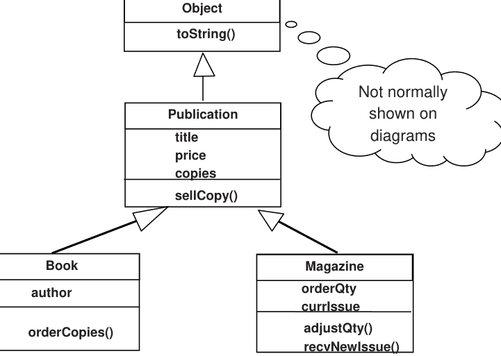

## 3.11 在 ‘Object’ 中定义的 toString()

`Object` 类定义了 `toString()` 方法，这是多个有用方法之一。

`toString()` 的签名是：

`public String toString()`

它的目的是返回一个表示当前对象的字符串值。`Object` 定义的 `toString()` 版本产生输出：“Book@11671b2”。这是类名和对象的“哈希码”。然而，为了通用起见，我们需要重写它以给出一个更有意义的字符串。

# 在 Publication 中

```java
public String toString() {
    return mTitle;
}
```

# 在 Book 中

```java
public String toString() {
    return super.toString() + " by " + mAuthor;
}
```

# 在 Magazine 中

```java
public String toString() {
    return super.toString() + " (" + mCurrIssue + ")";
}
```

在上面的代码中，最初在 `Object` 中定义的 `toString()` 已被完全替换，即：`Object` 中定义的 `toString()` 方法被重写，使得 `Publication.toString()`、`Book.toString()`、`Magazine.toString()`、`DiscMag.toString()` 返回了不同的内容。

## 3.12 总结

继承允许我们提取公共属性和行为到父类中。子类中重写方法。`Object` 定义了某些通用操作。在 Java 中所有类都继承自 `Object`。


# 4 多态的重要性

## 引言

通过实例示例，本章将解释多态的概念以及它对 OO 设计的影响。

## 目标

在本章结束时，你将能够：

- 理解多态如何允许我们处理相关的类
- 在 Java 程序中使用多态
- 理解多态对代码的影响
- 定义接口以扩展多态
- 欣赏多态提供的范围

本章由八部分组成：

1. 类类型
2. 可替代性
3. 多态
4. 扩展性
5. 接口
6. 扩展性
7. 区分子类
8. 总结

## 4.1 类类型

在动物层次分类中：

- 猪是一只猪
- 猪（更广泛地说）是哺乳动物
- 猪（甚至更广泛地说）是动物

我们可以在不同级别指定事物的类型：

- 高级别 = 不具体
- 低级别 = 更具体

# 使用 Java 的面向对象编程

# 多态的重要性

如果你要求给一只猪，你可以给 Pinky 或任何其他猪。如果你要求给一只哺乳动物，你可以给 Pinky 或任何其他哺乳动物（例如狮子、老鼠或人类！）。如果你要求给一只动物，你可以给它们 Pinky、任何其他哺乳动物或任何其他动物（鸟、鱼、昆虫）。这里的想法是，分类层次结构中的对象与其自每一个类都有“是”的关系，并且每个分类代表一种动物类型。

这在面向对象的程序中是正确的，因为当我们定义一个类时，就会创建一个新的“类型”。类型了变量、参数等的兼容性。

子类是父类类型的子类型，我们可以在期望父类型的地方替换子类型。通过这种方式，我们在需要父类型对象的地方可以使用子类型（如上例）。

下面的类图显示了类型的层次关系：

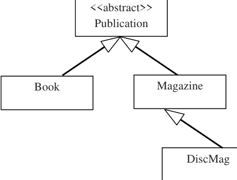

- 如果我们需要 `DiscMag`，它必须是 `DiscMag` 类的对象。
- 如果我们需要 `Magazine`，它可以是 `Magazine` 类的对象也可以是 `DiscMag` 类的对象。
- 如果我们需要 `Publication`，它可以是 `Book`、`Magazine` 或 `DiscMag`。

换言，我们可以在需要父类对象的地方“替换”任何子类的对象。这反过来**不是**成立的！

### 活动 1

查看上面的类图，并判断以下代码行在这些实现了这些类的 Java 程序中哪些是合法的：

```java
Publication p = new Book();
Publication p = new DiscMag();
Magazine m = new Magazine();
DiscMag dm = new Magazine();
Publication p = new Publication();
```

## 使用 Java 进行面向对象编程

# 对象角色与多态性的重要

### 反馈 1

`Publication p = new Book(...);`

在这里，我们定义了一个通用类型 'Publication' 的变量 `p`，然后调用 `Book` 类的构造函数并将结果赋值给 `p`；这是可以的，因为 `Book` 是 `Publication` 的子类，即 `Book` 是一个 `Publication`。

`Publication p = new DiscMag(...);`

这是可以的；`DiscMag` 是 `Magazine` 的子类，而 `Magazine` 又是 `Publication` 的子类，即 `DiscMag` 是 `Publication` 的间接子类。

`Magazine m = new DiscMag(...);`

这是可以的，因为 `DiscMag` 是 `Magazine` 的子类。

`DiscMag dm = new Magazine(...);`

这是非法的，因为 `Magazine` 是 `DiscMag` 的**超类**。

`Publication p = new Publication(...);`

这是非法的，因为 `Publication` 是一个抽象类，因此不能实例化。


## 4.2 可替换性

在设计类/类型层次结构时，类型机制允许我们将子类对象放置在指定超类的地方。然而，这对子类的设计产生了影响——我们需要确保它们确实可以被超类所替换。如果一个子类是可替换的，那么它必须实现超类的所有方法——以保证超类中定义的所有方法都由子类继承。虽然子类可能拥有额外的方法，但它至少拥有超类中定义的所有方法，因此应该是可替换的。如果方法在子类中被重写会发生什么？

在重写方法时，我们必须确保它们仍然可以替换被替换的方法。在重写方法时，虽然根据子类的需求定制方法是完全可以接受的，但不应用执行本质不同操作的功能来重写。

例如，`DiscMag` 中的 `recvNewIssue()` 重写了 `Magazine` 中的 `recvNewIssue()`，但在更新副本数量和当前期数方面它与继承的版本执行相同的基础工作（“履行合约”）。然而，它扩展了专门与 `DiscMag` 相关的功能，通过显示检查封面光盘的提醒。

我们对‘Publication’了解什么？

答案：它是一个支持（至少）以下操作的对象：

```java
void sellCopy()
double getPrice()
int getCopies()
void setCopies(int pCopies)
String toString()
```

继承保证了 Publications 的任何子类对象都至少提供这些操作。

注意，子类永远不能移除从其超类继承的操作——这会破坏这种保证。因为子类扩展了其超类的功能，因此可以假设超类的功能可用。

我们很有可能选择在 `Publication` 中重写 `toString()`（最初在‘Object’中定义），并在 `Magazine` 中再次重写它，以便返回的字符串为 `Publications` 和 `Magazine` 提供更好的描述。然而，我们不应该为了返回价格而重写 `toString()` 方法——这将改变方法的功能，导致方法执行本质不同的函数。这样做将破坏可替换原则。

## 4.3 多态性

因为子类的实例是其超类的实例，所以我们可以像处理超对象一样处理子类对象。此外，由于超类在子类中带有操作，我们可以调用这些操作，而不必关心实际对象是哪个子类。

这种特性被称为“多态性”，原意是“具有多种形状”。

因此，Publication 有各种形状……它可以是 `Book`、`Magazine` 或 `DiscMag`。我们可以对这些 Publications 中的任何一个调用 `sellCopy()` 方法，无论它们的具体细节如何。

多态性是一个常见概念的华丽名称。会开车的人可以进入并驾驶大多数汽车，因为它们具有共同的特征——方向盘、档杆、离合踏板、刹车和加速踏板等——驾驶员知道如何使用它们。任何两辆汽车之间会有很多差异，但你可以将它们想为定义了这些关键“操作”的超类的子类。

'p' 是“一个”`Publication`，它可能是 `Book`、`Magazine` 或 `DiscMag`。

无论何种，它都有一个 `sellCopy()` 方法。

所以我们可以调用 `p.sellCopy()` 而不必担心 'p' 是什么。


当我们在继承层次结构中操作对象时，这可以让生活变得简单得多。我们可以创建新类型的 `Publication`（例如 `Newspaper`），并在 `Newspaper` 上调用 `p.sellCopy()`，而无需在新类中创建任何功能——所有所需的功能已经定义在 `Publication` 中。

多态性使得扩展我们程序的功能变得容易，正如我们将在第 11 章中看到的。

## 4.4 可扩展性

每年花费巨额资金创建新的计算机程序，但多年来，花费的更多资金用于更改和调整程序以满足组织不断变化的需求。作为专业的软件工程师，我们有责任促进这一点，并帮助使这些程序更易维护和适应。当然，应用程序...

## 使用 Java 进行面向对象编程

### CashTill 类

下面的代码展示了如何实现 `CashTill` 以利用多态性。

```java
class CashTill
{
    private double runningTotal;
    CashTill ()
    {
        runningTotal = 0;
    }
    public void sellItem (Publication pPub)
    {
        runningTotal = runningTotal + pPub.getPrice();
        pPub.sellCopy();
        System.out.println("Sold " + pPub + " @ " + 
            pPub.getPrice() + "\nSubtotal = " + 
            runningTotal);
    }

    public void showTotal()
    {
        System.out.println("GRAND TOTAL: " + runningTotal);
    }
}
```

### 使用 Java 进行面向对象编程

`sellItem()` 方法是 `CashTill` 的核心功能。它接收一个 `Publication`（出版物）参数，该参数可以是 `Book`（书籍）、`Magazine`（杂志）或 `DiscMag`（光盘杂志）。首先，通过 `getPrice()` 访问器将出版物的价格添加到总金额。然后在出版物上调用 `sellCopy()` 操作。

最后，构造一条消息并显示给用户，例如：

> 已售 Windowcleaning Weekly (2005年9月) @ 2.75
>
> 小计 = 2.75

注意当 `pPub` 与字符串拼接运算符 `+` 一起出现时。这隐式地调用该对象子类的 `toString()` 方法，并记住书籍和杂志的 `toString` 是不同的。

这就是多态的体现——使用 `toString()` 操作为相关类调用相应的 `toString()` 方法：

我们可以如下类图所示 `CashTill`：

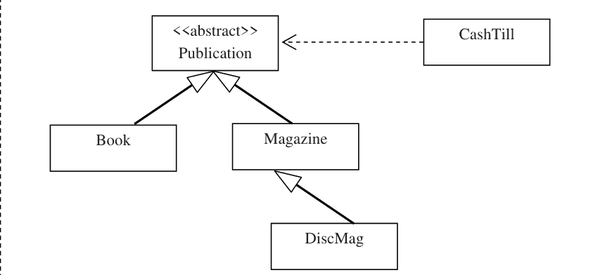

注意 `CashTill` 对 `Publication` 有依赖关系，因为 `sellItem()` 方法传递了一个类型为 `Publication` 的参数。实际传递的将将是继承自 `Publication` 的某个具体类型的对象。

## 使用 Java 进行面向对象编程

### 对象角色与多态的重要性

#### 活动 2

查看下图，并假设 `Publication` 不是抽象类型，判断所示的操作对对中哪一组是合法的。

| Publication |
| :--- |
| title price copies |
| sellCopy() |
| Magazine |
| orderQty currency | adjustQty() recvNewIssue() |

- a) `Publication p = new Publication(...); p.sellCopy();`
- b) `Publication p = new Publication(...); p.recvNewIssue();`
- c) `Publication p = new Magazine(...); p.sellCopy();`
- d) `Publication p = new Magazine(...); p.recvNewIssue();`
- e) `Magazine m = new Magazine(...); m.recvNewIssue();`

#### 反馈 2

- a) 合法 ——你可以在出版物上调用 `sellCopy()`
- b) 不法 ——出版物中不存在 `recvNewIssue()` 方法
- c) 合法 —— `Magazine` 是 `Publication` 的一种类型，因此你可以将类型为 `Magazine` 的对象赋值给类型为 `Publication` 的变量（你总可以在需要父类型时替换子类型）。你同样可以在出版物上调用 `sellCopy()`。该出版物恰好是杂志，但就编译器而言，这无关，因为在此实例 'p' 只是一个出版物。
- d) 不法 ——当你在杂志上调用 `recvNewIssue()` 时，编译器不知道 'p' 是杂志……只知道它是一个出版物。
- e) 合法 ——m 是杂志，我们可以在杂志上调用此方法。

在 BookBoon.com 免费下载书籍

#### 活动 3

查看下图，并注意 `Student` 是一个抽象类，判断以下代码段中哪些是有效的....

| <<abstract>> | Lecturer |
| :--- | :--- |
| Student | |
| printTimetable() | help(Student pStudent) |
| PtStudent | FtStudent |
| applyForJob() | applyForLoan() |

注意 `FtStudent` 是 Full Time Student（全日制学生）的缩写，`PtStudent` 是 Part Time Student（兼职学生）的缩写。

a) `Student s = new Student();`
   `Lecturer l = new Lecturer();`
   `l.help(s);`

b) `Student s = new FtStudent();`
   `Lecturer l = new Lecturer();`
   `l.help(s);`

#### 反馈 3

a) 这是无效的，因为 `Student` 是抽象的，不能实例化

b) 这是有效的。`FtStudent` 是 `Student` 的类型，可以赋值给类型为 `Student` 的变量。这可以作为参数传递给 `l.help()`

## 使用 Java 进行面向对象编程

### 对象角色与多态的重要性

#### 活动 4

使用相同的图并直接调用下方的代码，在 `help(pStudent)` 方法内部，以下行 (a) 或 (b) 哪一个是有效的...

```java
Student s = new FtStudent();
Lecturer l = new Lecturer();
l.help(s);
```

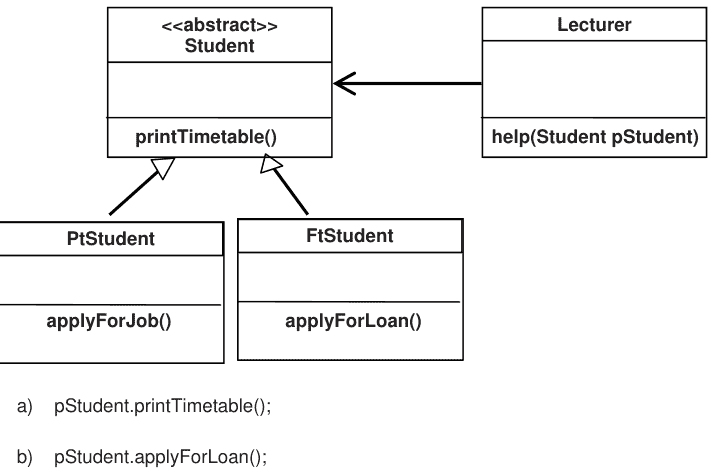

- a) `pStudent.printTimetable();`
- b) `pStudent.applyForLoan();`


## IT、互联网与工程领域的学生及毕业生机会

Cheltenham | 竞争性薪资 + 福利作为英国情报机构的一部分，我们的职责是应对威胁国家和全球安全的威胁。我们在最具多元化、创造力且在技术上最具挑战性的 IT 文化中工作。加上持续的职业发展，将带你进入一个真正有趣、真正发人启省的业务领域。

欲了解更多信息，请访问 www.careersinbritishintelligence.co.uk

申请人必须是英国公民。GCHQ 重视多样性，欢迎来自所有社区的申请者。我们希望我们的员工反映我们工作的多样性。

在 BookBoon.com 免费下载书籍

## 使用 Java 进行面向对象编程

### 对象角色与多态的重要性

#### 反馈 4

- a) 这是有效的 ——我们可以在对象上调用此方法
- b) 无效！虽然我们可以在对象上调用此方法，并且我们传递了一个 `Student` 对象，但无法保证该对象会支持这行代码，这将产生编译错误。

## 4.5 接口

继承有两个方面：

- 子类继承父类的接口（即公有成员）——这使得多态成为可能
- 子类继承父类的实现（即变量）——这节省了重复工作

在 Java 中，`extends` 关键字会自动应用这些方面。

**子类**是一个子类型。它包含了父类的所有接口，尽管可能有更广泛的功能。

然而，有时我们希望两个类共享一个接口而不将它们放入继承层次中。这可能是因为：

- 它们之间没有真正的“是”的关系
- 我们希望一个类拥有来自多个父类的接口，但 Java 不允许这种“多重继承”

这就像确保两辆汽车具有工作方式相同的控件，但让不同的工程师以不同的方式设计引擎。

## 使用 Java 进行面向对象编程

### 对象角色与多态的重要性

注意“接口”（interface）一词——在 Java 编程中它至少有三个含义：

(1) 类的公共成员的上述含义
(2) 程序的“用户界面”，通常是“图形用户界面” —— 完全相关的含义
(3) 我们即将遇到的特定 Java 构造结构

回想 `Publication` 的子类如何在提供额外和修订行为的同时，保留其定义的操作集——即接口。

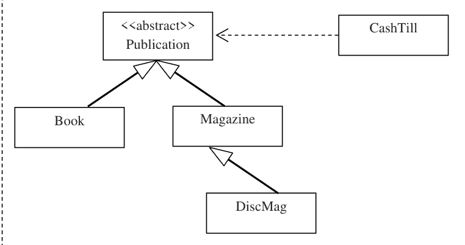

这就是为什么 `CashTill` 类可以处理 `Publication` 而无需担心它是哪个具体的子类。（记住 `Publication` 是抽象类——实际上“Publication”总是子类。）

### 票务

现在考虑除了书籍和杂志之外，我们现在还想销售票务，例如娱乐活动、公共交通等。这些与 `Publication` 不同，因为：

- 我们没有“库存”，而是在收银台按需打印
- 票务仅简单包含描述、价格和客户（为谁销售）
- 这些销售实际上是一项服务而非产品

票务与 `Publication` 之间似乎很少共同点——它们共享与销售相关的小型接口，即使对于这一点，底层实现也是不同的，因为我们不会从当前库存中减少它们。

由于这些原因，`Ticket` 和 `Publication` 似乎并不相关，因此我们不想将它们放入继承层次中。然而，我们确实需要让它们都能被 `CashTill` 接受为销售物品，并且我们需要实现此点的机制。

# 使用 Java 的面向对象编程

### 对象角色与多态性的性

在不将它们放入继承层次结构的情况下，我们希望有一种更通用的方式来表达“此类类的对象是可以出售的”，这种方式可以应用于我们想要的任何（现在和未来的）类，从而使系统对票（Tickets）和其他任何其他类型具有真正的扩展性。

虽然 `Ticket` 类与 `Publication`（出版物）差异大到我们不想将其放入继承层次结构，但它们确实具有一些相似之处——即它们都有 `getPrice()` 方法和 `sellCopy()` 方法，这两个方法都是 `CashTill` 所需要的。

| Ticket | |
| :--- | :--- |
| 描述价格客户 | sellCopy() getPrice() |

然而，`sellCopy()` 方法与 `Publication` 中定义的 `sellCopy()` 方法非常不同。出售出版物时，库存需要减少1；而对于票，我们只需要打印它。


# 使用 Java 的面向对象编程

```java
public void sellCopy()
{
    System.out.println("********************");
    System.out.println("          TICKET VOUCHER ");
    System.out.println(toString());
    System.out.println("********************");
    System.out.println();
}
```

由于 `sellCopy()` 方法差异巨大，我们不想继承它的实现细节，因此我们认为 `Ticket` 不应该属于与 `Publications` 的继承层次结构。但我们确实希望像处理出版物一样，通过收银机检查票据。

就像出版物一样，票据也提供了 `CashTill` 所需的操作：

- `sellCopy()`
- `getPrice()`

并且 `CashTill` 可以出售 `Ticket`。事实上，`CashTill` 可以出售任何拥有这些方法的对象，而不仅仅是 `Publications`。为了实现这一点，我们将这组操作定义为名为 `SaleableItem` 的“接口”（Interface）。

```java
interface SaleableItem
{
    public void sellCopy ();
    public double getPrice ();
}
```

注意，接口仅定义了操作的签名，而不包含它们的实现。

如果没有特别说明，所有方法都是显式的公共的（public），并且不能有实例变量或构造函数。

换句话说，接口定义了指定操作的可用性，而不对其实现做任何说明。这留给实现接口的类去处理。

接口是一种合同。`SaleableItem` 接口表示：“我承诺至少提供具有以下签名的方法：”

```java
public void sellCopy ();
public double getPrice ();
```

尽管我也可能包含其他内容。

当多个类实现一个接口时，它提供了一个保证的共性区域，多态性可以利用这一区域。

# 使用 Java 的面向对象编程

### 对象角色与多态性的性

想象一辆汽车和街机游戏里的驾驶游戏。它们之间显然没有任何“是（is a）”的关系——它们是完全不同的东西，一个是车辆，另一个是街机游戏。但它们都实现了我们所谓的“方向盘接口”，我们可以用完全相同的方式使用它，尽管其实现（汽车中的机械连杆，游戏中的视频电子设备）非常不同。

我们现在需要声明 `Publication`（及其所有子类）和 `Ticket` 都提供了该接口定义的操作：

```java
class Publication implements SaleableItem
{
    [class details...]
}
```

```java
class Ticket implements SaleableItem
{
    [class details...]
}
```

对比 `implements` 与 `extends`。

- `extends` 导致从父类继承接口和实现。


## 招募：野心勃勃的人

在 NNE Pharmaplan，我们需要野心勃勃的人来帮助我们实现公司设定的具有挑战性的目标。

Kim Voby 是众多野心勃勃同事中的一个。除了制造 IT 部门的经理外，Kim 还以专业水平参加铁人三项。

NNE Pharmaplan 为我提供了责任感与自由，以及规划自己时间的机会。这使我能够以竞技水平参加铁人三项，否则我没有可能做到这一点。

通过平衡工作和个人生活，我获得了在工作和铁人三项中发挥最佳水平的能量。

如果你也野心勃勃并想加入我们的机会世界，请访问 nnepharmaplan.com

NNE Pharmaplan 是全球领先的工程和咨询公司，专门关注医药和生物技术行业。NNE Pharmaplan 是 Novo Group 集团的公司。

# 使用 Java 的面向对象编程

- `implements` 提供了一种保证，即接口指定的将被将被——这足够允许对实现给定接口的所有类进行多态处理。

### 多态 CashTill

`CashTill` 类已经使用了多态性：`sellItem` 方法接受 `Publication` 类型的参数，这允许传递它的任何子类：

```java
public void sellItem (Publication pPub)
```

我们现在想进一步扩大这一范围，接受任何实现 `SaleableItem` 的对象：

```java
public void sellItem (SaleableItem pSel)
```

当变量或参数的类型定义为接口时，它的工作方式就像父类一样。任何实现接口的类都可以赋值给该变量，因为接口是一种类型，而所有实现它的类都是子类型。下面显示了……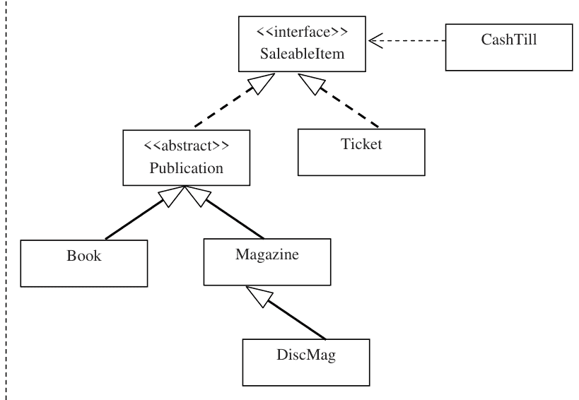

`CashTill` 不再直接依赖于 `Publication` —— 相反它依赖于接口 `SaleableItem`。

从 `Publication` 和 `Ticket` 到 `SaleableItem` 的关系类似于继承，只不过线条是虚线——这表示每个类都实现了接口。

## 4.6 再次讨论扩展性

多态性允许在不考虑精确类的情况下处理对象。这可以有助于提高系统的可扩展性，而不会损害设计的封装性。

例如，我们可以为更多产品或服务创建新类，只要我们实现了 `Saleable` 接口，`CashTill` 就能处理它们而无需更改其代码；一个例子可以是“糖果”（Sweets）。我们可以定义一个 `Sweets` 类来表示罐子里的糖。我们可以根据重量定义糖的价格，然后通过从总库存中减去其重量来出售糖。这与出售 `Publication` 不同（我们总是从库存中减去 1），也不像出售糖果那样（我们只需要打印它们）。

然而，如果我们创建一个实现 `Saleable` 接口的 `Sweets` 类，`CashTill` 就可以出售任何 `Saleable` 对象。在这种情况下，如果没有多态性，我们需要为 `CashTill` 添加一个额外的“销售”方法来处理 `Ticket`，并为每种要出售的新产品类型添加更多方法。通过定义 `Saleable` 接口可以引入额外的产品。

## 再次讨论扩展性

### 活动 5


# 使用 Java 的面向对象编程

## 对象角色与多态性

### 练习 5

请通过修改以下图来添加一个 `Diesel` 类，使其能够说明多态性。

| PetrolCar | Mechanic |
| :--- | :--- |
| diagnoseProblems() | repair(PetrolCar) |

### 反馈 5

这是一个抽象类的解决方案……这里还有其他课程：

| <<abstract>> | Mechanic |
| :--- | :--- |
| Car | |
| diagnoseProblems() | repair(Car) |
| PetrolCar | DieselCar |

## 练习 6

假设 `Car` 类有一个 `fixEngine()` 方法，该方法在 `DieselCar` 中被重写，但在 `PetrolCar` 中未重写（如下图所示）。

查看此图表并回答以下问题...

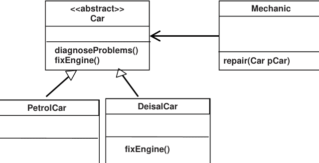

- a) 在 `repair()` 方法内部，以下代码是否有效？`pCar.fixEngine();`
- b) 如果将一个 `DieselCar` 对象传递给 `repair()` 方法，`pCar.fixEngine()` 将调用哪个实际方法？

### 反馈 6

- a) 是的！我们可以对任何 `Car` 对象应用 `fixEngine()` 方法，因为它是在 `Car` 类中定义的。
- b) 这将调用被重写后的方法。该方法必须在 `Car` 类中定义，否则编译器将在编译时报错。但在运行时，Java 运行环境 (JRE) 会识别出传递的对象是子类型 `DieselCar`，并调用被重写的方法。考虑到 `repair(Car)` 方法并不知道实际传递的是什么种类型的汽车，这种设计非常巧妙。

## 4.7 区分子类

如果我们有一个通过多态处理的对象，但需要检查它实际上是哪种子类型怎么办？`instanceof` 运算符可以做到：

`instanceof class`

如果对象属于指定的类（或其子类），则测试结果为 true，否则为 false。

注意，`(myDiscMag instanceof Magazine)` 将为 TRUE，因为 `DiscMag` 是一个 `Magazine`。

`instanceof` 右侧也可以跟接口名称，在这种情况下，它会测试类是否实现了该接口。

严格来说，`instanceof` 是测试左侧的项目是否为右侧指定的类型或该类型的子类型。通过这样做，我们可以扩展 `CashTill` 类，根据售出的对象显示特定的消息。

```java
public void saleType (SaleableItem pSelb) {
    if (pSelb instanceof Publication) {
        System.out.println("This is a Publication");
    } else if (pSelb instanceof Ticket) {
        System.out.println("This is a Ticket");
    } else {
        System.out.println("This is an unknown sale type");
    }
}
```

如果 `pSelb` 是 `Publication`、`Magazine` 或 `DiscMag` 的任何子类，`pSelb instanceof Publication` 将为 true。如果我们愿意，也可以测试更具体的子类型，例如 `pSelb instanceof Book`。

注意，我们为了系统的可扩展性，通过检查子类型牺牲了多态性——实现 `SaleableItem` 接口的新类（例如 `Sweets`）可能也需要在此语句中添加新类，这种变化会影响整个系统，导致维护成本高昂且容易出错。

相反，我们尝试将不同的行为封装在子类本身中，例如我们可以在 `SaleableItem` 接口中定义一个 `describeSelf()` 方法，然后每个实现 `SaleableItem` 接口的类都需要实现该方法。因此，每个子类型都会显示一条显示商品类型的消息。上面的 `if` 语句可以用 `pSelb.describeSelf()` 替换。这样，当我们向系统添加新类时，就不需要修改 `CashTill` 类了。

## 4.8 总结

多态允许我们根据父类而不是对象的实际类来引用对象。

多态使得通过添加额外的类来扩展程序变得简单，无需更改其他类。

我们可以通过调用为父类定义的操作来操作对象，而无需担心任何特定情况下涉及哪个子类。

Java 确保在运行时调用对象实际类对应的相应方法。

有时我们希望使用多态，但不需要所有相关的类都处于继承层次结构中。“接口”（interface）结构允许我们在这种情况下提供共享的接口（即操作集合）。这样做时，没有继承的实现——每个类都必须实现接口中定义的所有操作。

任意数量的类都可以实现特定的接口。


# 5. 方法重载

## 引言

本章将向读者介绍方法重载的概念。

## 目标

在本章结束时，你能够....

- 理解“重载”的概念
- 赏方法重载提供的灵活性
- 在在线 API 文档中识别重载方法

本章由以下三个部分组成：

1) 重载
2) 为了增加灵活性而重载
3) 总结

## 5.1 重载

在历史上，计算机程序中的方法名必须是唯一的。因此，编译器通过查看方法名来识别调用了哪一个方法。

通常需要多个方法执行非常相似的功能，例如，一个方法可以将两个整数相加，另一个方法可以是相加两个浮点数。如果你必须给这两个方法起唯一的名称，哪一个会用 `add()` 呢？

为了给每个方法命名，名称需要更长且更具体。因此我们可以将一个方法命名为 `addInt()`，另一个为 `addFloat()`，但这可能导致名称泛滥，每个名称描述一个本质上执行相同操作（即相加两个数字）的不同方法。

为了在 Java 中解决这个问题，不需要给每个方法起唯一的名称——因此上述两个方法都可以称为 `add()`。

虽然两个方法可能有相同的名称，但仍然可以通过查看参数列表来区分它们：

```java
add(int number1, int number2)
add(float number1, float number2)
```

这是由 JRE 在运行时解析的。即在运行时，JRE 查看方法调用以及正在传递的实际参数。如果传递了两个整数，则调用第一个方法。但如果传递了两个浮点数，则使用第二个方法。

重载是指多个方法可以共享相同的名称。方法名不再唯一地标识方法，此时名称就变成“重载”了。

## 5.2 为了增加灵活性而重载

拥有本质上执行相同操作但带有不同参数列表的方法可以增强系统的灵活性健壮性。

想象一个大学学生管理系统。可能需要一个方法来注册一个新学生。此类方法可能有如下签名：

```java
enrollStudent(String pName, String pAddress, String pCoursecode)
```

如果一个学生刚到这个城市，还没有安排住在哪里，大学拒绝录取该学生吗？他们可以这样做，但允许这样的学生入学（地址设为“未知”）会更好吗？

为了允许这一点，可以对 `enrollStudent()` 方法进行重载，并提供替代方法：

```java
enrollStudent(String pName, String pCoursecode)
```

在运行时，JRE 可以根据参数列表确定调用哪个方法。给定一个调用：

```java
enrollStudent("Fred", "123 Abbey Gardens", "G700")
```

JRE 将使用第一个方法。

### 练习 1

想象一个可以作为银行系统部分的 `withdrawCash()` 方法。该方法可以接受两个参数——账户标识（String）和用户所需的现金金额（int）。因此，完整的方法签名将是 `withdrawCash(String pAccountID, int amount)`。识别另一个 `withdrawCash()` 方法的变体，其具有不同的参数列表，上述方法的有用变体。

### 反馈 1

另一种用于提取现金的方法可以是 `withdrawCash(String pAccountID)`，该方法不需要指定金额，但默认将提取 100 英镑。

这些方法本质上执行相同的操作，但通过对该方法进行重载，我们使系统变得更加灵活——用户现在有了选择，他们可以指定要提取的现金金额，也可以接受指定的默认金额。

方法重载不仅为用户提供了灵活性，还为未来可能负责扩展系统的程序员提供了更大的灵活性，因此，方法重载可以使系统在面对变化的需求时更具前瞻性且健壮。

构造函数也可以像普通方法一样被重载。


### 活动 2

通过以下方式在线查看 Java 标准版 API 文档：
1) 访问 java.sun.com/javase
2) 点击 API 链接
3) 选择最新版本的 Core API 文档链接。

此时应该会将你带到 http://java.sun.com/javase/6/docs/api/

在左下角的面板中，你应该看到 Java 程序员可以使用的所有类的长列表。向下滚动此列表直到找到 `String` 类。在左上角的窗口选择 `Java.lang` 包（因为 `String` 类在这个包中）会更快。

查看主面板中的 `String` 类文档，并找出该类有多少个构造函数。

### 反馈 2

`String` 类指定了 15 种不同的构造函数。它们显然具有相同的方法名 'String'，但可以通过这些方法所需的不同参数来区分。

其中一个构造函数不接受参数并创建一个空的 `String` 对象。另一个需要一个 `String` 作为参数，并创建一个原始字符串副本的新 `String` 对象。

通过大量重载 `String` 构造函数，该类的创建者为未来可能想要使用这些不同选项的程序员提供了灵活性。

我们可以通过重载构造函数和其他方法来使程序更具适应性。即使我们最初没有使用所有不同的构造函数或方法，但通过提供它们，我们正在使程序更加灵活，并能够适应变化的需求。

### 活动 3

继续在 API 文档中查看 `String` 类，寻找其他被重载的方法。

### 反馈 3

有很多方法没有被重载，但也有许多方法被重载了。这些包括：`format()`、`indexOf()`、`replace()`、`split()`、`substring()` 和 `valueOf()`。

查看 `substring` 方法的区别，我们发现可以通过只指定起始点或通过指定起始点和结束点来找到子字符串。

当我们使用 `substring()` 方法时，JRE 将根据我们是否提供了一个或两个参数，在运行时选择该方法的正确实现。

## 5.3 总结

方法重载（Method overloading）是一个术语，指的是可能存在多个本质上执行相同操作且具有相同名称的方法的概念。JRE 通过查看参数列表来区分它们。如果两个或多个方法具有相同的名称，那么它们的参数列表必须不同。

在运行时，每个可能产生歧义的方法调用都由 JRE 通过查看传递的参数，并将数据类型与类中定义的方法签名进行匹配来解析。

通过重载构造函数和普通方法，我们为可能使用我们类的程序员提供了额外的灵活性。即使这些在最初没有被全部使用，提供它们也可以使程序灵活以满足不断变化的用户需求。


# 6. 面向对象的软件分析与设计

## 引言

本章将通过实际示例教授基础的分析和建模技能。引导读者理解如何从初步规范转向面向对象的架构。

## 目标

在本章结束时，你将能够....

- 分析需求描述
- 识别系统范围之外的项目
- 识别候选类、属性和方法
- 归档生成的面向对象架构

本章包含以下部分：

1) 需求分析
2) 问题
3) 列出名词和动词
4) 识别系统范围之外的事物
5) 识别同义词
6) 识别潜在类
7) 识别潜在属性
8) 识别潜在方法
9) 识别共同特征
10) 使用 CRC 卡完善设计
11) 详细说明类
12) 总结

## 6.1 需求分析

任何计算机程序的开发都始于识别需求：

- 专业设计桥梁的工程师可能需要某些软件来创建三维模型，以便人们在桥梁建成之前就能想象出来。
- 经理可能需要一个软件来跟踪个人、分配的项目、已有的技能以及需要开发的技能。

但如何从对软件的“需求”变为满足该需求的面向对象设计呢？

有些软件工程师专门从事需求分析任务，该任务是明确对软件的具体要求。这通常通过迭代执行以下任务完成：

1) 访谈客户和系统潜在用户，了解他们对系统的描述
2) 记录这些对话的结果
3) 识别所需系统的基本功能
4) 产生初步设计（以及可能的系统原型）
5) 与客户和潜在用户评估这些初始计划
6) 重复上述步骤直到演化出最终设计。

通过这种方式，我们能够对问题进行通用描述，并为系统生成一个可行且尽可能优雅的面向对象设计来满足这些需求。

## 6.2 问题

我们将为设计解决方案的问题是：“为一家组织马拉松的体育俱乐部开发一个小型管理系统”。

为了本次练习，我们假设已经通过访问俱乐部经理和使用该系统的员工完成了初步需求分析，并生成了以下文本描述：

> “GetFit” 体育俱乐部将于明年春天举办他们的首场国际马拉松。一支由世界排名专业人士和慈善募捐业余爱好者（有些还穿着奇装！）组成的队伍将围绕一个迷人的沿海地区，在 26.2 英里的路线上进行比赛。作为跟踪跑步者并公布结果以及赞助捐款的软件系统的一部分，需要一个模型来表示跑步者的关键特征（这只是完成后系统的一个部分）。
>
> 马拉松的每位跑步者都有一个编号。跑步者被描述为例如“42号选手”，其中 42 是他们的编号。他们以记录的小时、分钟和秒的时间完成比赛。他们的结果状态可以被检查，并将显示为“未完成”或“在 h:mm:ss 完成”。
>
> 每位参赛者要么是专业跑步者，要么是业余跑步者。
>
> 此外，专业人士额外拥有世界排名，并被描述为例如“174号选手（排名 17）”。
>
> 所有业余人士都在为慈善机构募捐，因此每个人额外有一份赞助表。当业余人士完成比赛时，他们会从赞助表上打印一份收集列表。
>
> 赞助表包含赞助者数量、赞助者列表以及赞助金额列表。可以添加赞助者和金额，并打印显示赞助者、赞助金额和总筹款的列表。
>
> 奇装跑步者是业余爱好者的一种（带有赞助等），他们还有一套服装，被描述为例如“316号选手（黄鸭子）”。

## 6.3 列出名词和动词

分析上述描述的第一步是识别名词和动词：

- 名词表示实体或对象，其中一些将作为类出现在最终系统中，另一些将作为属性出现。
- 动词表示要执行的动作，其中一些将作为方法出现在最终系统中。

在单数形式下复数化的名词和动词（例如 'books' 变成 'book'）以及在名词/动词本身不足以描述时使用的名词和动词短语，例如，动词 'print'（打印）没有 'print receipt'（打印收据）清晰。

### 活动 1

查看上述描述，列出五个名词和五个动词（在适当的情况下使用名词动词短语）。

### 反馈 1

下列表是名词和动词的一个相当详尽的列表，而不第一组。

**名词**：GetFit 体育俱乐部、队伍、世界排名专业人士、募捐业余爱好者、奇装、26.2 英里路线、沿海地区、软件系统、跑步者、结果、赞助捐款、模型、关键特征、一个数字、时间、结果状态、参赛者、专业跑步者、业余跑步者、世界排名、慈善、赞助表、收集列表、赞助者、赞助金额、总筹款、服装。

**动词**：组织、马拉松、比赛、跟踪跑步者、公布结果、描述（跑步者）、完成比赛、指定时间、检查状态、显示状态、描述（专业人士）、打印收集列表、添加（赞助者和金额）、打印列表、描述（奇装跑步者）。

---
*广告内容已省略*


# 知识工程的力量

在 BookBoon.com 免费下载书籍

## 6.4 识别系统范围之外的事物

设计系统的一个重要部分是识别那些与系统不相关或超出系统范围的问题方面。描述中的某些部分可能是纯粹的背景性的，即为了一般信息之目的，因此不是任何能直接描述我们正在设计的系统方面的的内容。此外，我们所指的描述某些部分是指用户在使用系统时执行的任务，并描述了需要在系统内部实现的功能；而其他部分可能描述了用户在不使用系统时执行的任务——因此没有描述系统内部的功能。

通过识别描述中不与我们正在开发的系统无关的事物，使问题变得尽可能简单。

| 活动 2 |
| :--- |
| 查看上述名词和动词列表，并识别各出一个在系统范围之外的项。 |

| 反馈 2 |
| :--- |
| 第一段的大部分是背景，没有描述我们需要在系统内部实现的功能。我们还需要查看描述的其他部分，以识别不相关的部分。 |

系统范围之外的事物……

* GetFit 体育俱乐部 – 这是开发系统的客户。我们不需要在系统中建模这个实体。
* 沿海地区 – 跑步地点与系统功能无关。我们不需要在系统中将其建模为对象。
* 软件系统 – 这是我们正在开发的整个系统，它没有描述系统内部的实体。
* 动词 :-
* 组织 – 这是俱乐部成员执行的活动，他们可能是系统的用户，但这不是他们使用系统所需的活动。
* 马拉松 – 这是跑步者正在做的事情。这不是系统需要做的事情。

注意：‘完成比赛’是跑步者做的一件事，当这发生时，他们的完成时间必须记录在系统中。因此，这实际上**不在**系统范围之外。

## 6.5 识别同义词

同义词是具有相同含义的两个词。在系统描述中识别这些是非常重要的。未能这样做会导致一个实体被建模两次，导致重复和混淆。

| 活动 3 |
| :--- |
| 查看名词和动词列表，并识别两个同义词，一个来自名词列表，一个来自动词列表。 |

| 反馈 3 |
| :--- |
| 同义词

名词 -

* 世界排名专业人士 = 专业跑步者
* 募捐业余爱好者 = 业余跑步者
* 跑步者 = 参赛者

注意跑步者不是专业跑步者的同义词，因为有些跑步者是业余的。

动词 -

* 马拉松 = 比赛
* 检查状态 = 显示状态
* 打印收集列表 = 打印列表
* 完成比赛 = 记录指定时间 |

## 6.6 识别潜在类

通过识别系统范围之外的以及识别描述中实际上描述相同实体和操作的部分来简化问题后，我们现在可以开始识别要实现的系统中潜在类。

某些名词将指示要实现的类，另一些将指示类的属性。

良好的面向对象设计建议数据和操作应该封装在一起——因此类表示我们可以识别关联数据和操作（或方法）的复杂概念实体。

简单实体（例如地址）有关数据但没有操作，因此这些应作为简单属性存储在相关的类中。

### 活动 4

查看上面的名词列表，并识别五个可以作为类（classes）的名。

### 反馈 4

可以表示类的名词：

- `Runner`（跑步者）（或 `Competitor` 参赛者）
- `Amateur`（业余爱好者）（或 `Amateur Runner` 业余跑步者）
- `Professional`（职业人士）（或类似词）
- `FancyDresser`（奇装者）（或 `FancyDressAmateur` 或类似词）
- `SponsorshipForm`（赞助表）

## 6.7 识别潜在属性

确定了潜在类后，可以使用其他名词来识别这些类的属性（attributes）。

### 活动 5

查看名词列表，并识别一个可以作为 `Runner` 类属性的名，以及一个可以作为 `FancyDresser` 类属性的名。

在 BookBooN.com 下载免费书籍。

### 反馈 5

可以成为属性的名词……

对于 `Runner` -：

- `number`（编号）
- `Status`（状态），如 `finished`（已完成，`boolean`）
- `time`（时间，小时、分钟、秒）

对于 `FancyDresser` -：

- `costume`（服装，`String`）

当然，我们需要识别所有类的所有属性。

## 6.8 识别潜在方法

确定了潜在类后，我们现在可以使用动词来识别这些类的方法（methods）。

### 活动 6

查看动词列表，并识别一个可以成为 `Runner` 类方法的方法，以及一个可以成为 `FancyDresser` 类方法的方法。

### 反馈 6

可以成为方法的动词……

对于 `Runner` -：

- `describe()`（这将成为 `toString()` 的重写版本）
- `finishRace()`（完成比赛）
- `displayStatus()`（显示状态）

对于 `FancyDresser` -：

- `describe()` (`toString()`) 需要再次重写以包含对服装的描述。

当然，我们需要识别所有类的所有方法。

## 6.9 识别共同特征

在确定了具有关联属性和方法的候选类后，我们可以通过识别具有共同特征的类，开始将我们的类构建成适当继承层次（inheritance hierarchies）。

### 活动 7

查看下方的类列表，并将四个类放入适当继承层次中。识别出一个不适合该层次的类：

- `Runner`
- `Amateur`
- `Professional`
- `FancyDresser`
- `SponsorshipForm`

最通用的类（即继承树的顶端）是 `Runner`。`Amateur` 和 `Professional` 是 `Runner` 的子类，`FancyDresser` 是 `Amateur` 的特定类型，因此是 `Amateur` 的子类。

我们可以将这些类放入继承层次中，因为这些类都通过“是”关系（is-relationship）相关联。一个 `FancyDresser` 是一个 `Amateur`，而 `Amateur` 是一个 `Runner`。`Professional` 也是如此。

`SponsorshipForm` 不是 `Runner` 的类型，不适合该层次。该类将通过某种形式的关联与其他类之一相关联。观察设计，我们可以看到并不是所有的跑步者都有赞助表，只有为了慈善而跑步的业余爱好者才有。因此，`Amateur` 和 `SponsorshipForm` 之间存在关联。当然，`FancyDressers` 继承了 `Amateur` 中定义的属性，因此他们自动拥有一个 `SponsorshipForm`。

## 6.10 使用 CRC 卡片完善我们的设计

在确定了系统中的主要类以及这些类的属性和方法后，我们可以通过定义数据类型和细小细节来完善这些设计，在 UML 图上记录这些信息并编写系统。然而在现实世界中，问题会更大且定义不那么明确；我们在这里处理的问题——即设计的分析和完善——将是一个更长且复杂的过程，我们可以真实地模拟。

由于现实世界更加复杂，我们的初始设计并不完美；因此，在将这些设计转换为完成系统之前，检查设计并解决任何潜在问题是有意义的。

检查设计的方法之一是使用 CRC 卡记录设计，并通过角色扮演不同的场景来检查这些设计是否有效。

CRC 卡不是实现此目的的方法，也不是 UML 规范的一部分。

## 使用 Java 进行面向对象编程

CRC 代表类（Class）、职责（Responsibilities）和协作（Collaborations）。下面展示了一个 CRC 卡，它由三个面板组成，左侧显示类的职责，右侧显示协作。

| 类名 | 类职责 | 类协作 |
| :--- | :--- | :--- |

职责是类需要知道的内容（即属性）以及它应该做的事情（即方法），尽管在 CRC 卡上这些内容的定义没有在 UML 图上那么精确。协作是该类为了履行其职责而必须合作的其他类。

我们有抱负。对你也是。

SimCorp 是金融软件领域的全球领导者。在 SimCorp，你将成为由优秀且丰富的同事组成的大网络的一部分，他们都渴望通过奉和团队精神实现共同目标。我们投资员工，以确保你能够在个人和专业层面实现抱负。SimCorp 聘用经济、金融和 IT 领域最优秀的人才，我们的大多数同事都拥有这些领域的大学或商业学位。

有抱负吗？访问 www.simcorp.com/careers 寻找机会。

SimCorp

在 BookBoon.com 下载免费书籍。

使用 Java 进行面向对象编程 面向对象软件分析与设计

下面的图显示了为系统中两个类开发的 CRC 卡。

| Amateur | |
| :--- | :--- |
| 了解跑步者的详情（编号等） | `SponsorshipForm` |
| 记录赞助信息 | |
| 记录完成时间 | |

| SponsorshipForm | |
| :--- | :--- |
| 记录信息列表 | |
| 添加到此列表。 | |

开发了 CRC 卡后，我们可以角色扮演一系列场景。在这种情况下，通过查看上面的 CRC 卡，一个 `Runner` 能够记录赞助。

在 BookBoon.com 下载免费书籍。

## 6.11 详细化类

在确定系统中的类并使用 CRC 卡记录和测试这些类后，我们现在可以详细化卡片并使用 UML 图记录我们的类。这样做需要我们通过 CRC 卡记录的通用规范，并解决任何歧义，例如精确的数据类型。

在详细化卡片后，我们现在可以为建议的设计绘制类图（见下方）：

你可能是我们未来的人才之一

马士基国际技术与科学

你即将作为工程师或地球科学家毕业吗？或者你已经毕业了？如果是，A.P. Moller - Maersk 将为你提供令人兴奋的未来。

MAERSK

www.maersk.com/mitas

## 使用 Java 进行面向对象编程

# 面向对象软件分析与设计

| Runner | |
| :--- | :--- |
| `-number : int` | |
| `-finished : boolean` | |
| `-hours : int` | |
| `-mins : int` | |
| `-secs : int` | |
| `+Runner(pNumber:int)` | |
| `+finish(hours:int, mins:int, secs:int)` | |
| `+result()` | |
| `+toString() : String` | |

| Amateur | |
| :--- | :--- |
| `-mSponsForm : SponsorshipForm` | |
| `+Amateur(pNumber:int, pSponsForm:SponsorshipForm)` | |
| `+finish(hours:int, mins:int, secs:int)` | |

| Professional | |
| :--- | :--- |
| `-mWorldRanking : int` | |
| `+Professional(pNumber:int, pWorldRanking:int)` | |
| `+toString() : String` | |

| FancyDresser | |
| :--- | :--- |
| `-mCostume : String` | |
| `+FancyDresser(pNumber:int, pSponsForm:SponsorshipForm, pCostume:String)` | |
| `+toString() : String` | |

| SponsorshipForm | |
| :--- | :--- |
| `-mSponsorCount : int` | |
| `-mSponsors : String[]` | |
| `-mAmount : int` | |
| `+SponsorshipForm()` | |
| `+addSponsor(pName:String, pAmount:int)` | |
| `+printNewCollection()` | |

## 6.12 总结

收集用户需求是软件工程过程中的一个重要阶段（且在本文范围之外）。

## 使用 Java 进行面向对象编程

将复杂的需求规格书转换为优雅的面向对象架构设计是一项需要经验的熟练任务。然而，一个良好的起点是遵循本章列出的简单流程。

通过一系列任务，我们已经看到了如何对问题的文本描述进行分析。我们已经：

- 寻找描述中超出系统范围的方面
- 识别描述中何时使用不同的词汇指代同义项
- 使用名词和动词来识别潜在的类、属性和方法
- 查看类以识别潜在的继承层次以及类之间的其他关系（例如：关联）
- 使用 CRC 卡片记录生成的类，并通过运行一系列场景来测试设计的有效性，并根据需要修改我们的设计
- 最后，我们可以详细说明这些细节并使用类图记录结果

本章列出的设计过程将在第 11 章描述的案例研究中再次详细演示。

切尔彻姆 IT、互联网与工程领域的学生及毕业生机会 | 薪资有竞争力 + 福

作为英国情报机构的一部分，我们的职责是应对威胁国家和全球安全的威胁。我们在一个最具多样性、创造力且具有技术挑战性的 IT 文化中工作。再加上持续的职业发展，你将获得真正有趣的工作，并处在一个真正具有启发性的业务环境中。

访问 www.careersinbritishintelligence.co.uk 获取有关社区所有部门的信息。

申请者必须是英国公民。GCHQ 重视多样性，欢迎来自社区所有部门的申请者。我们希望我们的员工能够反映我们工作的多样性。

# 7. 集合框架

### 引言

本章将介绍介绍集合框架——这是 Java 标准库的重要部分。

### 目标

在本章结束时，你将能够：

- 理解 Java 集合框架的基本概念
- 对比各种集合接口的特性
- 理解迭代器（iterators）的相关概念

本章由十二部分组成：

1) 集合简介
2) 集合接口
3) 新旧集合
4) 列表 (Lists)
5) 集合 (Sets)
6) 映射 (Maps)
7) 集合实现
8) 集合框架概述
9) 使用未类型集合的示例
10) 使用类型集合的示例
11) 关于集合的注意事项
12) 总结

## 7.1 集合简介

大多数软件系统需要存储各种组实体，而不仅仅是单个项目。数组提供了这种方法，但 Java 集合支持更多样化更灵活的分组形式。

在 Java 中，集合（collections，或“容器”）是用于将其他对象组合在一起的类。Java 平台提供了一套一致的接口和实现：

- 接口定义了可用功能
- 实现影响其他问题，包括性能

## 7.2 集合接口

集合框架的核心是一个名为 `Collection` 的接口。它定义了框架核心的方法。`List` 和 `Set` 是 `Collection` 的扩展接口——它们继承了所有的操作并增加了一些。

请注意，由于这些是接口而不是类，它们只定义了操作签名，而没有定义作为方法的任何实现方面。

另一个重要的额外接口是 `Map`。它不是 `Collection` 的扩展——这是由于我们稍后将看到的，映射并不完全符合 `Collection` 层次结构，尽管它们仍然是“集合框架”的一部分。

因此，我们有以下接口……：

- `Collection`：最通用的分组
  - `List`：按特定顺序存储的对象集合（可以包含重复项）
  - `Set`：特定顺序的唯一对象集合
  - `SortedSet`：按升序排列对象的集合
- `Map`：唯一“键”和关联对象的集合
  - `SortedMap`：按键升序排列对象的映射

正如 `List` 和 `Set` 扩展了 `Collection` 接口，`SortedSet` 是 `Set` 的扩展，`SortedMap` 是 `Map` 的扩展。

我们将在本章中查看 `List`、`Set` 和 `Map`。

## 7.3 旧集合与新集合

在 Java SDK 1.4 之前，集合持有 `Object` 类型的条目——即任何任何类的对象，因为所有类都是 `Object` 的子类。这允许集合中混合对象。然而，当从集合中取出对象时，编译器不知道该对象是什么，这可能会导致一些额外的复杂性。

在实践中，我们几乎总是希望特定的集合中有某些特定类型的对象。因此在 Java JDK 5.0 中引入了“泛型”（generics）。“泛型”允许在定义类时不指定它处理的数据项类型。相反，类型在类实例化时指定，因此对于特定对象是固定的。

因此，使用“泛型”，我们可以创建只存储指定类型对象的集合。

## 7.4 列表 (Lists)

列表是最通用的集合类型——在你可能已经过数组的地方，`List` 将提供一种更方便的数据处理方法。

列表是非常通用的数据结构，每个项目都占据一个特定的位置。它们在许多方面与数组相似，但更灵活，因为它们会随着数据的添加自动调整大小。它们也比数组更容易操作，因为已经创建了许多实用的方法来帮助你完成大部分工作。列表按特定顺序存储项目（尽管不一定按任何有意义的顺序排序），并且允许存在重复项。

列表中的对象，每个在序列中占据一个特定位置。

`List` 会随着程序的运行动态调整大小。

## 7.5 集合 (Sets)

集合像是一个对象的“袋子”而不是列表。它们基于数学中的“集合”概念——一个包含零、一个或多个不同项的“成员”分组。

与 `List` 不同，不允许有重复项，且 `Set` 不对项目进行排序（但 `SortedSet` 可以）。

与列表一样，集合会随着项目的添加自动调整大小。

每个对象都是独特的，且没有任何顺序。

`Set` 会随着程序的运行动态调整大小。

`List` 可用的许多操作也适用于 `Set`，如下：

- 我们**不能**在特定位置添加对象，因为元素没有任何顺序
- 出同样的原因，我们**不能**“替换”项目（尽管我们可以添加一个并删除另一个）
- 检索项目是可能的，但顺序是不确定的
- 查找元素所在的位置是毫无意义的。

## 7.6 映射 (Maps)


# 映射与集合框架

映射（`Map`）与列表（`List`）和集合（`Set`）不同，因为它们不是存储单个对象，而是存储对象对。该对由一个“键”（key）和一个“值”（value）组成。键是标识该对的东西。值是与键关联的信息或对象。

示例：在地址簿中，键将是人的姓名，值是他们的地址、电话、邮件等。每个键只有一个值，但由于值是对象，它们可以包含几条数据。

不允许有重复的键，尽管允许有重复的值。因此，在之前的示例中，如果你在地址簿中查找两个人，你可能会发现他们住在同一个地址——但一个人不会有两个家。

和集合一样，映射（`Map`）不对项目进行排序（但 `SortedMap` 会，按键的顺序排序），并且像列表和集合一样，映射会随着项目的添加或删除而自动调整大小。

## 核心特性

- **键（Keys）**：唯一标识且不能重复
- **值（Values）**：存储与键相关的信息
- **Map**：在程序运行时动态调整大小

## 活动 1

对于以下每个问题，请写下哪种最合适：列表（`List`）、集合（`Set`）或映射（`Map`）。

1. 我们想记录俱乐部的成员。
2. 我们想记录我们花费的资金（以及花费用途）。
3. 我们想记录银行账户详情——每个账户通过银行账户号码识别。

## 反馈 1

1. 对于此，我们将使用 `Set`。成员可以根据需要添加和删除，且成员之间没有特定顺序。
2. 对于此，我们将使用 `List` – 这将按照购买的顺序记录所购买的物品。重要的是，由于列表允许存在重复项，我们可以购买两个相同的玩具（也许是给两个不同孩子的生日礼物）。
3. 我们不会有两个相同的银行账户，虽然 `Set` 似乎是合适的，但由于每个账户都有唯一的账户号标识，因此 `Map` 是最合适的选择。

## 7.7 集合实现

到目前为止，我们一直在查看集合接口——这些是功能规范，我们可以从中挑选出我们想要使用的部分。

为了准确地使用它们，我们需要实现这些接口的类。

这里展示的实现都是 Java 平台库包的一部分，程序员也可以为了特殊目的编写自己的实现。

- `ArrayList` 实现了 `List` 接口
  - 对于有序列表，通常访问速度快
- `LinkedList` 也实现了 `List` 接口
  - 在某些不常见的情况下，可能比 `ArrayList` 快
- `HashSet` 实现了 `Set` 接口
  - 它访问速度快，但项是无序的
- `TreeSet` 也实现了 `Set` 接口
  - 比 `HashSet` 慢，但它保持元素的顺序，即它为我们提供了一个 `SortedSet`
- `HashMap` 实现了 `Map` 接口
  - 它访问速度快，但项是无序的
- `TreeMap` 也实现了 `Map` 接口
  - 比 `HashMap` 慢，按键（Key）的顺序保持元素，即它为我们提供了 `SortedMap`

你不能创建一个 `List` 对象，因为 `List` 是一个接口——但你可以创建一个 `ArrayList` 对象或 `LinkedList` 对象，其中任何一个都能提供 `List` 接口定义的函数。

## 7.8 集合框架概览

下面的图提供了集合框架的略简化的概述。它展示了接口以及实现这些接口的类。记住，接口内部没有实现，只包含公共方法签名，任何实现该接口的类都必须履行这些签名。

箭头有两种。实线箭头表示继承；例如，`Set` 接口扩展了 `Collection` 接口。虚线箭头表示实现；例如，`HashSet` 类实现了 `Set` 接口。

注意 `Map` 并不是 `Collection` 的子接口。这是因为，与存储单个对象的 `List` 和 `Set` 不同，`Map` 存储的是键对象和值对象的配对。我们仍然认为 `Map` 是集合框架的组成部分。

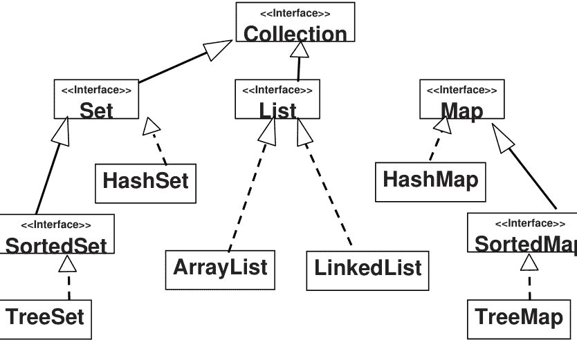

## 活动 2

所有集合接口和实现的文档均可在线浏览或在此处下载：

`http://java.sun.com/javase/6/docs/api/`

集合框架的接口和实现类都可以在 `java.util` 包中找到。

使用 API 文档查找 `ArrayList` 的方法。

列出你认为最有用的三个方法。

## 反馈 2

一些显而易用的方法包括...

- `add()` – 将元素添加到列表的指定位置
- `clear()` – 清空列表
- `contains()` – 如果此列表包含指定对象，则返回 `true`
- `get()` – 返回指定位置的对象
- `remove()` – 从列表中移除对象

注意，这些某些方法是重载的，例如 `remove()`，既可以删除指定位置的对象，也可以删除指定对象的第一个实例。


## 7.9 使用无类型集合的示例

下面的代码展示了 `String` 的无类型集合的一个示例。

```java
import java.util.List;
import java.util.ArrayList;
import java.util.Iterator;

public class ListDemo
{
    List mList;

    /**
     * 构造函数
     */
    public ListDemo() {
        mList = new ArrayList();
    }

    /**
     * 在列表末尾追加字符串
     * @param pstr 要添加的字符串
     */
    public void appendString(String pstr) {
        mList.add(pstr);
    }

    /**
     * 在指定位置插入字符串
     * @param pPos 位置
     * @param pstr 要添加的字符串
     */
    public void insertString(int pPos, String pstr) {
        mList.add(pPos, pstr);
    }

    /**
     * 删除列表中指定位置的字符串
     * @param pPos 位置
     */
    public void deleteString(int pPos) {
        mList.remove(pPos);
    }
}
```

大部分下面的代码是显而易见的，可能显示方法需要一些解释。首先，`Set` 和 `Map` 类实现了 `iterator()` 方法，返回一个 `Iterator` 对象，该对象能够迭代我们的 `List`。注意——这不是一个简单的过程，因为每个集合可能由不同的对象组成，幸运的是这些工作由我们完成了。

因此在 `display()` 方法中创建了一个通用类型 `Iterator` 的变量 `it`。然后对我们的特定集合调用 `iterator` 方法，返回一个可以迭代 `String List` 的对象。`Iterator` 有两个非常有用的方法：`hasNext()` 返回集合中是否存在另一个对象，`next()` 返回集合中的下一个对象。

因此循环遍历列表，运行并显示每个对象。

最后一点需要注意：由于我们使用的是无类型集合，列表中的每个对象可能是不同类型的对象，当从列表中检索对象时，JRE 并不知道它是什么类型的对象——但由于我们只用此列表存储 `String`，我们可以将检索到的每个对象强制转换为 `String`。这将导致编译器警告，因为如果我们向列表添加非 `String` 对象，将会失败。

虽然这个程序存储并操作 `String` 列表，但程序可以很容易地存储 `Publication` 列表——任何从我们创建的类构造的对象。

## 7.10 使用类型集合的示例

使用这些集合非常简单，原因有两个：1) 我们知道从列表中返回的是什么类型的对象，因此不需要使用强制转换运算符；2) 因为 Java 5.0 引入了改进的 for 循环，它可以遍历类型集合中的每一个项，而无需使用循环计数器（或迭代器）。

请看下例……

```java
import java.util.List;
import java.util.ArrayList;

public class ListDemo {
    private List<String> mAL;

    /**
     * 构造函数
     */
    public ListDemo() {
        mAL = new ArrayList<String>();
    }

    /**
     * 显示字符串列表
     */
    public void display() {
        for (String nextItem : mAL) {
            System.out.print(nextItem + " ");
        }
        System.out.println();
    }
}
```

创建一个泛型集合与创建一个无类型集合非常相似，不同在于我们在创建实例变量和创建实际集合时，必须指定集合所包含的内容（在这种情况下，它仅仅是字符串的集合）。你可以将 `<>` 语法理解为“……的”，在这种情况下表示“一个字符串列表”。

添加、插入和删除元素与无类型集合相同，但显示集合要简单得多，因为我们知道列表包含的是什么种元素。我们不需要对返回的元素进行强制类型转换，实际上我们甚至不需要迭代器（这就是为什么上面只有两个 import 语句）。

`nextItem` 会自动赋值给列表中的下一个项目。注意 `nextItem` 被定义为 `String` 变量，因为在这里我们使用的是一个字符串列表。编译器知道这一点，并会确保使用正确的变量类型。

## 7.11 关于集合的说明

对集合（`Set`）的详尽讨论超出了本文的范围。集合有一个复杂之处，即它不允许存储重复的对象。因此，我们必须思考什么使得对象变得重复。两个对象只有在对象名称相同时才是相同的——或者，如果某些数据相同，它们也可能是相同的吗？

考虑一个银行账户集：

| BankAccounts | * | Account |
| :--- | :--- | :--- |

考虑史密斯先生和琼斯女士的银行账户。

| Account |
| :--- |
| accountNumber name balance |

这个号码对于任何两个客户来说都不应该是相同的。


不应该创建一个具有相同账户的第二个账户并将其添加到银行账户集中。然而，除非另有说明，否则 Java 将这两个对象视为不同的对象（因为名称不同：`Account1` 和 `Account2`），而集合不允许内部包含重复的对象，否则这些账户本可以被创建并添加到集合中。

| Account1 | Account2 |
| :--- | :--- |
| 1234 Mr Smith £1,200 | 1234 Mrs Jones £0 |

为了解决这个问题，我们需要重写在 `Object` 类中定义的 `equals()` 方法，以便当 `accountNumber` 相同时，这些对象是相同的。

我们可以如下所示操作……

```java
public boolean equals(Object pObj) {
    Account account = (Account) pObj;
    return (accountNumber.equals(account.accountNumber));
}
```

这是为 `Account` 类重写 `Object.equals()`。

尽管传递的参数始终是一个 `Account` 对象，但我们必须将参数设为 `Object` 类型（然后强制转换为 `Account`），以便重写继承自 `Object` 的 `equals()` 方法，该方法的签名如下：

`public boolean equals(Object obj)`

（你可以在 SDK 文档的“API 和语言”部分检查此内容。）

如果我们使用 `Account` 参数类型提供此签名，它将不会重写 `Object.equals()`。我们需要在提取 `accountNumber` 之前将参数强制转换为 `Account`，以便与当前对象的账户号码进行比较。

一个复杂的问题涉及对象如何在集合中被存储。然而，如果对象名称不同，两个具有相同 `accountNumber` 的账户应该生成相同的 `hashCode`。为了实现这一点，我们需要重写 `hashCode()` 方法，使 `hashCode` 基于 `accountNumber`。

```java
/**
 * 重写 Object 的 hashCode
 * @return 基于 accountNumber 的哈希值
 */
public int hashCode() {
    return accountNumber.hashCode();
}
```

重定义对象 `hashCode` 的简单方法是连接实例值，在这种情况下是 `accountNumber`。这看起来有点奇怪，但通过重写 `equals()` 和 `hashCode()` 方法，Java 可以防止重复的数据（在这种情况下是账户号码）。

## 活动 3

以下代码将在字符串集合（`stringSet`）中查找字符串。请修改此代码，使其在出版集中（`publicationSet`）中查找 `Publication`。

```java
public void findString(String pStr) {
    boolean found;

    found = stringSet.contains(pStr);

    if (found) {
        System.out.println("Element " + pStr + " found in set");
    } else {
        System.out.println("Element " + pStr + " NOT found in set");
    }
}
```

## 反馈 3


```java
public void findPublication(Publication pPub) {
    boolean found;
    found = publicationSet.contains(pPub);
    if (found) {
        System.out.println("Element " + pPub + " found in set");
    } else {
        System.out.println("Element " + pPub + " NOT found in set");
    }
}
```

# 活动 4

查看活动 3 反馈的代码并回答以下问题。

1.  上述代码可以存储书籍集合吗？
2.  它能存储书籍和杂志的组合吗？
3.  如果在集合找到了书籍，下面行代码会做什么？

    `System.out.println("Element " + pPub + " found in set");`

# 反馈 4

1.  可以
2.  可以
3.  `pPub` 将调用出版物的 `toString()` 方法。JRE 在运行时确定这实际上是一本书，并且假设已经为书籍重写了 `toString()` 方法以返回标题和作者，这将构成显示消息的一部分。

# 7.12 总结

Java “集合框架”提供了用于存储对象集合的现成接口和实现。这几乎让数组的使用变得多余。

既有“无类型”集合，从 JDK 5.0 开始也有“泛型”集合。

集合接口包括 `List`、`Set` 和 `Map`，每个接口都定义了适当的操作。

集合实现包括 `ArrayList`、`HashSet` 和 `HashMap`，它们分别是 `List`、`Set` 和 `Map` 接口的实现。

在定义要存储在 `Set` 中（或作为 `Map` 的键）的对象时，需要特别注意以定义“重复”的含义。因为我们需要重写继承自 `Object` 类的 `equals()` 和 `hashCode()` 方法。

虽然本章没能对集合进行详细讨论，但第 11 章的案例研究将演示如何使用 `Map` 和 `Set` 来存储我们自己的对象（而不仅仅是字符串）。如果需要，可以下载并检查这部分代码。


# 8. Java 开发工具

## 引言

本章将向读者介绍各种支持大型 Java 系统开发的开发工具（例如 `Eclipse` 和 `NetBeans`）。还将演示 API 文档和 JavaDoc 的性质。

## 目标

在本章结束时，你将能够：

- 理解 `JDK` 和 `JRE` 的作用
- 调研专业开发环境（`Eclipse` 和 `NetBeans`）
- 理解 `Javadoc` 工具的重要性以及在代码中嵌入 `Javadoc` 注释的价值
- 编写 `Javadoc` 注释并为程序生成自动文档

本章由以下部分组成：

1.  软件实现
2.  JRE
3.  Java 程序
4.  JDK
5.  Eclipse
6.  Eclipse 体系
7.  Eclipse 特性
8.  NetBeans
9.  使用 NetBeans 开发图形界面
10. 使用 NetBeans 应用布局管理器
11. 添加 Javadoc 监听器
12. Javadoc 工具
13. 总结

## 8.1 软件实现

在计算机为我们完成有用任务（例如检查文档中的拼写）之前，需要在运行该程序的机器上编写并实现软件。软件实现涉及程序源代码的编写以及为在特定机器上执行做准备。当然，在软件实现之前需要对其进行设计，并在某个时间点进行测试。有许多迭代周期来支持设计、实现和测试过程，这些过程涉及多个实现阶段。这里特别关注的是三种获取源代码并在特定机器上执行的长期存在的方法……

### Java 开发工具

- 编译为机器语言对象代码
- 通过“解释器”直接执行源代码
- 编译为中间对象代码，由运行时系统进行解释

实现 Java 程序涉及将源代码（Java）编译为中间对象代码，该代码由称为 `JRE` 的运行时系统进行解释。这种方法既有优点也有缺点，值得比较这三种方案，以理解其对 Java 开发者的影响。

### 编译

编译器将源代码翻译为适用于相关硬件/操作系统组合的机器码。

严格来说，有两个阶段：程序单元（通常是文件）的编译，随后是“链接”，即将完整的可执行程序组合在一起，包括独立的程序单元和相关的库代码等。

编译后的程序作为该平台的“原生”应用运行。

这是最旧的模型，被 `Fortran` 和 `Cobol` 等早期语言以及许多现代语言（如 `C++`）所使用。它允许极快速的执行速度，但每次更改代码时都需要重新编译程序。

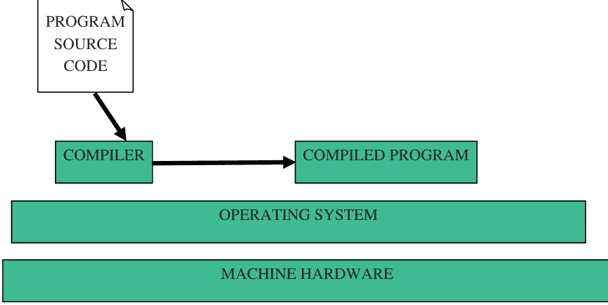

### 解释

在这里，源代码没有被翻译成机器码。相反，解释器读取源代码并按照其指定的执行操作。

我们可以说解释器像一个“虚拟机”，其机器语言就是源语言。

在 BookBoon.com 免费下载书籍

128

# 使用 Java 的面向对象编程

更改代码后不需要重新编译，但解释过程会对执行速度产生重大影响。

脚本语言倾向于这种工作方式。

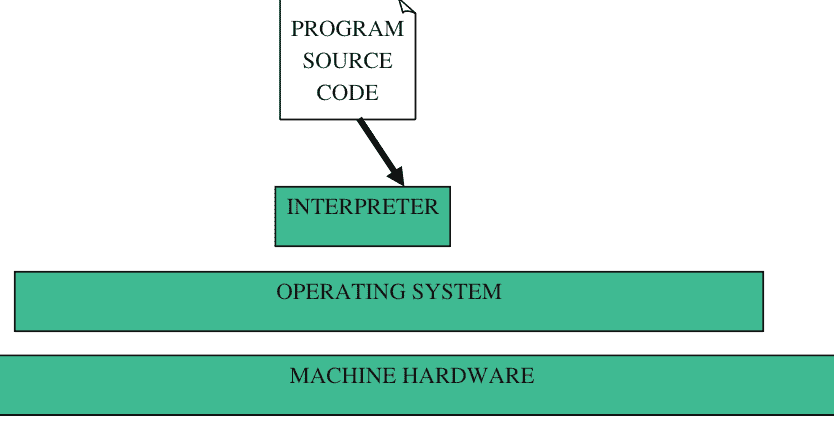

### 中间代码

这种模型是前两种方法的混合体。


| NNE Pharmaplan 是全球领先的工程咨询公司，专门专注于制药和生物技术行业。NNE Pharmaplan 是 Novo Group 旗下的一家公司。 |

在 BookBooN.com 免费下载书籍

129

# 使用 Java 的面向对象编程

# Java 开发工具

通过编译将源代码转换为更高效的中间表示，这种表示可以由“运行时系统”（同样是某种的“虚拟机”）比直接解释源代码更快速地执行。然而，使用随后由运行时系统软件执行的中间代码，使得编译过程可以独立于操作系统/硬件平台，也就是说，只要每个平台都有适当的运行时系统，相同的中间代码就可以在不同的平台上运行。这种方法已经存在很久（例如 20 世纪 70 年代初的 `Pascal`），并且是 Java 的工作方式。

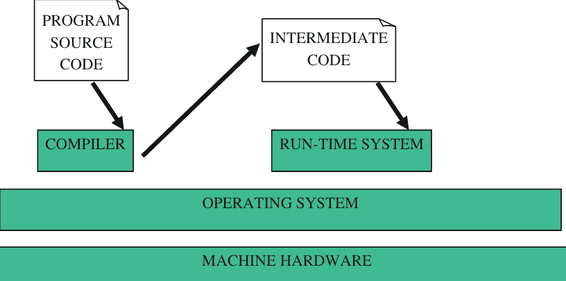

## 8.2 JRE

为了运行 Java 程序，我们必须使用 Java 开发包（`JDK`）生成中间代码（称为字节码）——见第 8.4 节。

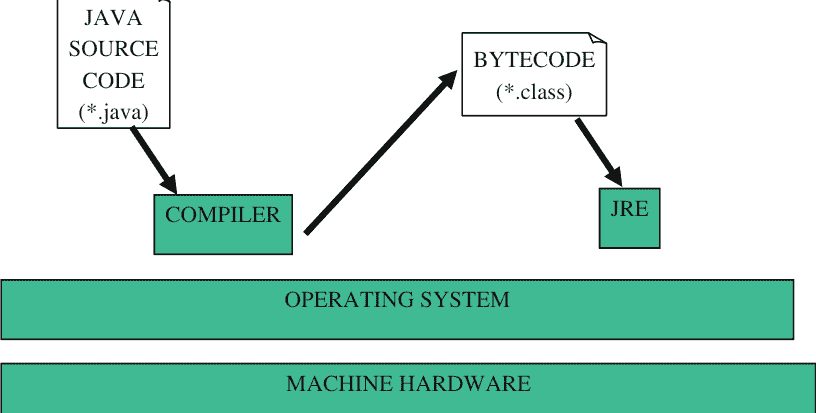

在 BookBoon.com 免费下载书籍

130

# 使用 Java 的面向对象编程

# Java 开发工具

需要 Java 运行时（`JRE`），它包含虚拟机（`VM`），来执行字节码和 Java 库。因此，任何运行 Java 程序的机器上必须存在 `JRE`。

Java 字节码是标准的且与平台无关，因为已经为大多数计算设备（包括 PC、笔记本电脑、移动设备）创建了 `JRE`，这使得 Java 程序具有高度的可移植性。

无论采用什么执行顺序，程序员都可以多种工具创建源代码。选项包括手动调用的离散工具（例如编辑器、编译器、解释器），或者集成这些工具的集成开发环境（`IDE`）。更复杂的 `CASE`（计算机辅助软件）工具可以获取 `UML` 图并自动生成类和存根，减少编写 Java 代码的工作量。

编写 Java 程序时，Java 程序中的每个类（或接口）都有自己的包含源代码的 `.java` 文件。

这些文件通过编译器处理产生对应字节码的 `.class` 文件。

要作为应用程序运行，其中一个类必须包含一个如所示的 `main()` 方法：

一个类必须包含一个启动方法

`static void main (String[] args)`

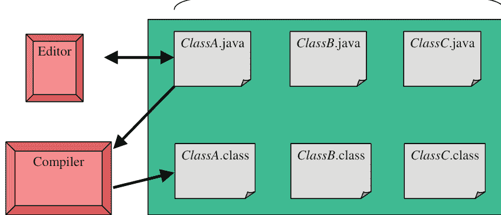

# 使用 Java 的面向对象编程

## 8.4 JDK

要开发 Java 程序，必须先安装 Java 开发包（`JDK`）。它由 Sun 开发，可以通过互联网从 `http://java.sun.com/` 免费获取。在版本 5.0（或 1.5）之前，它被称为软件开发包（`SDK`）。

Java `IDE`（例如 `Eclipse` 或 `JavaBeans`）位于 `JDK` 之上，添加 `IDE` 特性——这些可能包括接口开发工具、代码调试工具、测试和重构工具（稍后会详细介绍）。使用 `IDE` 时，人们很容易忘记许多功能实际上是 `JDK` 的一部分，当 `IDE` 被要求编译程序时，它只是将此请求传递给底层的 `JDK`。

我们可以直接从命令行使用 `JDK` 来编译和运行 Java 程序，尽管使用 `IDE` 提供的额外功能通常简单。

`JDK` 中有许多工具。每个工具的描述可以从 `http://java.sun.com/javase/downloads/` 并点击文档、API 和 `JDK` 程序员指南的链接获取。


132

## 使用 Java 进行面向对象编程

## Java 开发工具

最重要的基础工具是：

- `javac` – java 编译器
- `java` – java 程序启动器（用于运行虚拟机 `VM`）

编译 `MyProg.java` 时，我们输入：

```
javac MyProg.java
```

如果成功，这将创建 `MyProg.class` 文件

运行 `MyProg`（假设它有一个 `main()` 方法），我们输入：

```
java MyProg
```

另一个极其实用的工具是 `javadoc` - 它利用 Java 源代码中的注释为程序生成自动文档。

## 8.5 Eclipse

转向使用“工业级”的 `IDE`（集成开发环境）是你作为软件开发人员进步道路上的重要里程碑，就像第一次骑没有带辅助轮的自行车。通过经过练习，你很快就会发现它有很多非常有帮助且节省时间的功能，让你无法离开它工作……

`Eclipse` 是一个灵活且可扩展的 `IDE` 平台。它最初由 `IBM` 开发，但现在是开源的，可以从 `eclipse.org` 的 `Eclipse Foundation` 下载。

`Eclipse` 本身是用 Java 编写的，和所有 Java 程序一样，它需要 `JRE` 才能运行，因此它可以在大量的平台上运行。它默认安装了 Java 开发工具 (`JDT`)，但也提供了扩展和额外工具来支持其他语言程序的开发。

`Eclipse` 的“运行时平台”足够灵活，甚至可以作为与 `IDE` 无关的应用开发的框架。

## 8.6 Eclipse 体系

由于 `Eclipse` 依赖于 `JRE`，因此它本质上是跨平台的（`Windows`、`Linux`、`Mac` 等）。

下方蓝色显示的元素是 `Eclipse` 基础下载包的一部分。

在 BookBoon.com 下载免费书籍

其他插件

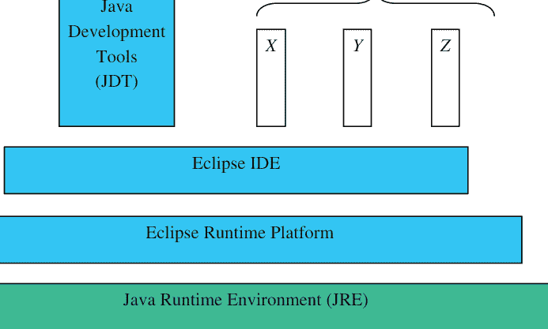

许多其他插件可用，支持额外的工具（样式检查、测试、`GUI` 设计等）和语言（包括 `C/C++`）。

从 `www.eclipse.org` 下载 `.zip` 文件

像任何 `IDE` 一样，`Eclipse` 要求安装最新的 `JDK`，因为它将使用它来编译程序并生成 Java 文档。

## 8.7 Eclipse 特性

`Eclipse` 提供了一系列功能，为希望开发大型 Java 程序的程序员提供强大的支持。这些包括：

- 代码补全和帮助功能，
- 代码格式化工具，可以自动调整各种代码格式方面，
- 支持程序开发的强大能力，包括重构（见第 10 章第 4 部分）和自动测试功能（见第 10 章第 5 部分）。

## 8.8 NetBeans

`NetBeans` 是另一个非常强大的 `IDE`，最初由 `Sun Microsystems` 开发和分发。`NetBeans` 在 2000 年开源，并由开源社区开发的插件和视频教程提供广泛支持。

可以从 `www.netbeans.org` 免费下载 `NetBeans`

`NetBeans` 拥有许多帮助初学者程序员并节省时间的功能。这些包括……

- 快速上手指南、在线教程和在线视频（涵盖了 `IDE` 介绍、`Javascript` 调试器和 `PHP` 支持等主题）。
- 帮助功能，带有弹出窗口高亮显示 Java `API` 的相关部分。
- 格式化和调试功能
- 代码补全功能，可自动插入 `for` 循环、`try-catch` 块和构造函数（等）。这些代码补全功能远不止于剪粘贴示例文本块——例如，为子类插入构造函数时，会自动添加对父类构造函数的调用，并为子构造函数定义相关参数并传递给父类构造函数。
- 项目管理功能，监控项目更改并允许项目恢复到早期的阶段。

`NetBeans` 还包含了各种 Java 应用程序的模板，包括窗口、企业级、`Web` 和移动应用程序。它还有 `C++`/`PHP`/`Ruby` 和数据库应用程序的模板。因此，只需点击几次，`NetBeans` 就会创建一个带有 `main` 方法的简单 Java 应用，该方法将调用如下所示的空白 `GUI`……

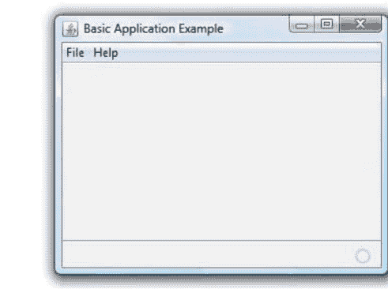

此外，可用插件之一支持创建 `UML` 图。虽然这个工具具有局限性，但它不仅支持创建图表，还提供了你可能在 `CASE` 工具中期望的功能，例如自动生成代码（从图表）和反向工程（即分析当前代码以代码生成 `UML` 图）。

| BankAccount | Accounts |
| :--- | :--- |
| 属性 | 属性 |
| `private int balance` | `private BankAccount accounts[]` |
| `private int id` | 操作 |
| 操作 | `BankAccount(int pBalance)` |
| `public int getBalance()` | `public BankAccount[]* getAccounts()` |
| `public void setBalance(int val)` | `public void setAccounts(int val)*` |
| `public int getId()` | `BankAccount getAccount(int pID)` |
| `public void setId(int val)` | |

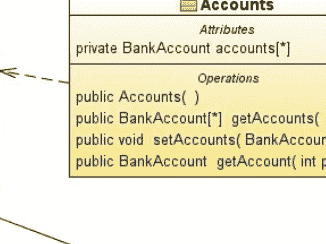

| CurrentAccount | DepositAccount |
| :--- | :--- |
| 属性 | 属性 |
| `private int overdraft` | `private int interestRate` |
| 操作 | 操作 |
| `public CurrentAccount(int pBalance)` | `public DepositAccount()` |
| `public int getOverdraft()` | `public int getOfInterest()` |
| `public void setOverdraft(int val)` | `public void setOfInterest(int val)` |
| | 从 `BankAccount` 重定义的的操作 |
| | `public void setBalance(int val)` |

根据上面的图表，`NetBeans` 将创建四个类，其中三个将自动放在继承层次中。每个指定的方法都将创建方法存根（`method stub`），每个方法内部的代码仍需要编写，而 `CurrentAccount` 将自动调用 `BankAccount` 的构造函数并传递参数 `Balance` 子类。


> 2020 年，世界可以提供我们地球电力需求的十分之一。如今，`SKF` 的创新对于运行世界上大部分风力发电机至关重要。高达 25% 的发电成本与维护有关。受益于我们的在线监控和自动化维护系统，这些成本可以大幅减少。我们为所有人创造清洁能源变得更加经济。凭借我们的经验、专业知识和创造力，行业的性能可以超出预期。因此，我们是能够应对这一挑战的最佳员工。

# 脑力

接入知识工程的力量。访问我们的 `www.skf.com/knowledge`

### 知识工程的力量


在 BookBoon.com 下载免费书籍

## 8.9 使用 NetBeans 开发图形界面

`NetBeans` 拥有一个可视化工具来帮助开发图形用户界面。这允许创建一个窗口并在其中放入各种对象：面板、标签页、滚动面板、按钮、单选按钮、复选框、组合框、密码字段、进度条和树。


## 8.10 使用 NetBeans 应用布局管理器

在设计图形界面时，“通常”会将对象放置在窗口的精确位置。因此，界面按照设计的方式进行显示。为了达到良好效果，设计者通常对他们设计界面的对象的大小有所了解。大多数 PC 游戏设计用于 14 英寸到 21 英寸的窗口。大多数移动游戏设计在更小的屏幕上工作。

然而，Java 程序被认为是平台无关的——Java 的优势之一是用 Java 编写的代码可以在 PC、笔记本电脑或小型移动设备上运行，无论这些设备使用什么硬件或操作系统（只要有 `JRE`）。因此，同一个界面在大视觉单元或小型移动屏幕上都能工作。由于这个原因，在 Java 中设计界面时，通常会让 Java 拥有某些控制权，以决定如何在何处显示对象。

布局管理器是定义界面如何展示的“对象”，通常的做法是创建一个布局管理器并将其分配给“容器”对象，如窗口框架。

有很多常用的布局管理器——最常见的两种是流式布局和网格布局。使用流式布局时，Java 将对象排列成行，如果窗口不足以容纳每行对象，对象将自动流到另一行。

# 使用 Java 的面向对象编程

# Java 开发工具


# 流式布局（Flow Layout）实例

下方显示了窗口，每个窗口都有十个按钮——在第二个图中，由于窗口调整了大小，Java 将某些按钮放置在第二行，因为对象无法在一行内显示。

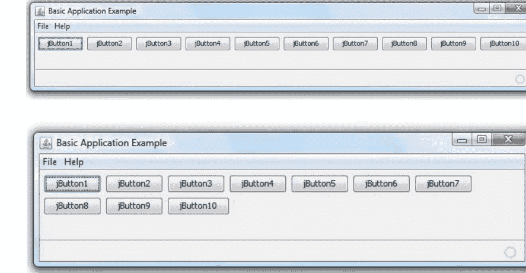

可以使用各种属性创建一个流布局管理器，以定义对象的对齐方式（居中、左对或右对），并定义对象之间的水平和垂直空间。

# 网格布局（Grid Layout）实例

另一个非常常用的布局管理器是网格布局。在应用网格布局时，可以指定行数。Java 将计算需要使用多少列，以便在这些行中放置所需数量的对象。对象将被调整大小以适应窗口。Java 将缩小或放大对象以适应窗口——即使这意味着无法显示所有文本。

两幅图显示了在三行网格中显示的相同 10 个按钮。

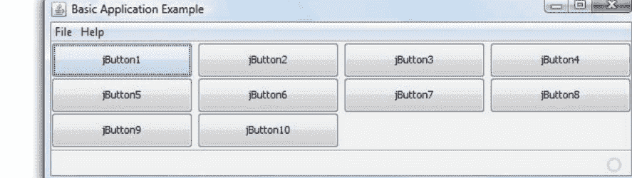

> 从 BookBoon.com 下载免费书籍

# 使用 Java 的面向对象编程 Java 开发工具

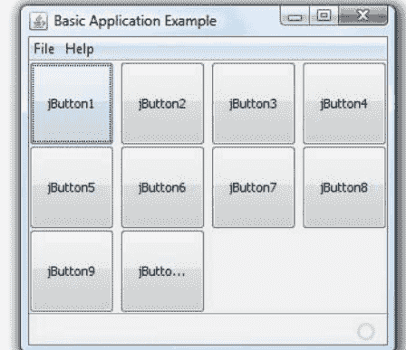

注意在第二个图中，按钮已调整了大小以适应不同的窗口——在此过程中，没有足够的空间显示按钮十的所有文本。

布局管理器可以分层使用并应用到任何容器对象。因此，我们可以创建一个网格，其中一个元素包含多个以流式布局排列的对象。

通过使用布局管理器，我们可以创建灵活的可以在各种显示设备上显示的界面，使我们的程序具有平台独立性——然而，这意味着将失去设计中的一些精细控制。

> 多元化 - 创新 - 国际化
>
> 你正在考虑欧洲商科学位吗？
>
> 哥本哈根商学院（Copenhagen Business School）是北欧最大的商学院之一，拥有超过 15,000 名来自欧洲、北美、澳大利亚和亚洲的学生。
>
> 你是否好奇知道现代欧洲商学院如何与多元化、创新和国际化的学习环境竞争？
>
> 请访问 www.cbs.dk 哥本哈根商学院。
>
> 在 BookBooN.com 下载免费书籍。

# 使用 Java 的面向对象编程

使用 NetBeans 创建布局管理器并设置其属性非常简单。在容器对象上点击右键将弹出一个上下文敏感的菜单，其中一个选项就是应用布局管理器。选择此选项将显示可能的布局管理器列表。一旦选择了布局管理器，将出现一个窗口允许指定其属性。

| 按钮1 | 按钮2 | 按钮3 | 按钮4 |
|---|---|---|---|
| 按钮5 | 按钮6 | 按钮7 | 按钮8 |
| 按钮9 | 按钮10 | | |

| 修改变量名 ... | |
|---|---|
| 事件 | |
| 设置布局 | 自由设计 |
| 自定义布局... | 绝对布局 |
| 从调板添加 | 边框布局 |
| 设计此容器 | 盒式布局 |
| 设计父容器 | 卡片布局 |
| 设置默认大小 | 流式布局 |
| 向上移动 | 网格布局 |
| 向下移动 | 网格布局 |
| 修改顺序... | 空布局 |
| 剪切 | Ctrl+X |
| 复制 | Ctrl+C |
| 粘贴 | Ctrl+V |
| 复制 | Ctrl+D |
| 删除 | Delete |
| 自定义代码 | |
| 属性 | |

# 8.11 添加动作监听器（Action Listeners）

创建可用界面的最后一步是创建动作监听器并将其应用界面。动作监听器是用于监听用户操作并做出相应响应的对象——因此，当按下“计算”按钮时，程序将计算并显示某些结果。

可以为界面上的所有对象创建动作监听器，并为每个对象创建一系列操作。尽管许多对象（如标签）不需要响应用户的交互。

在 NetBeans 中创建动作监听器非常简单。

# 使用 Java 的面向对象编程

在设计模式下选择任何对象时，都会显示属性窗口。选择事件选项卡将允许为该对象创建一系列操作。一旦选择了“动作监听器”，将编写一个存根代码（`stub`）。将自动编写代码来创建该类的对象，并将其分配给设计中的对象。

程序员只需编写代码来定义对用户操作的响应。

在下面的示例中，已创建了一个事件来监听按钮1被按下。

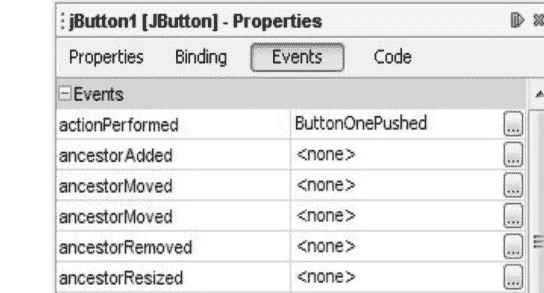

```java
private void buttonOnePushed(java.awt.event.ActionEvent evt) {
    System.out.println("button 1 pushed");
}
```

# 8.12 Javadoc 工具

JDK 中一个特别实用的工具是“javadoc”。

多年来，程序员一直承担着编写文档这一枯燥且耗时的任务。部分文档是面向用户的，用于解释程序的功能以及如何使用它。其他文档则是面向未来的程序员，他们将需要修改和调整程序，使其功能能够随着组织需求的变化而改变。这些程序员需要知道：

- 包包含什么
- 存在哪些类
- 方法的作用是什么
- 有什么参数
- 返回什么

javadoc 工具从源代码生成一组 HTML 页面。

> 从 Bookoon.com 下载免费书籍

# 使用 Java 的面向对象编程

# Java 开发工具

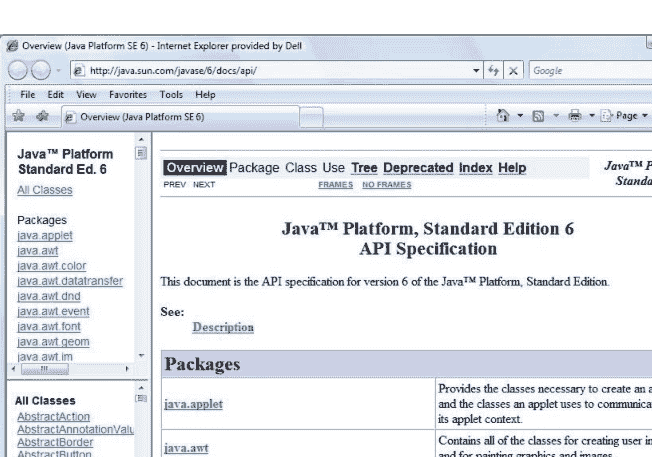

该工具可以为任何 Java 程序生成相同风格的文档。然而，做到这一点依赖于源文件中的格式良好的 javadoc 风格注释。


### 我们有目标

SimCorp 是全球领先的金融软件公司。在 SimCorp，你将加入一个充满活力、追求共同目标的能干同事网络。我们投资员工以确保你可以在个人和专业层面实现目标。SimCorp 聘用经济、金融和 IT 领域优秀的人才，大多数同事拥有大学学位。

**有志向吗？** 在 www.simcorp.com 寻找机会

SimCorp

该工具需要程序员在开发时添加有意义的注释，对源代码注释的关注不足将导致糟糕的 javadoc 输出。相反，如果注释得当，就可以产生“免费”的参考文档。

Javadoc 应该位于每个类的开头，使用标准的 `@author` 和 `@version` 标签提供类概述，格式如下：

```
********************************
* 类的描述
*
* @author 作者姓名
* @version 版本详情（以及日期）。
********************************
```

每个方法也应该提供类似的注释，使用 `@param` 和 `@return` 来描述每个参数并描述返回的值。每个参数的细节（以参数名称开始）应单独行提供，如下所示：

```
********************************
* 方法的描述
*
* @param 第一个参数的描述
* @param 第二个参数的描述
* @return 返回值的描述
********************************
```

| 活动 1 |
|---|
| 下面方法接收两个整数并将它们相加。该值由方法返回。编写一个 javadoc 注释，使用适当的标签来描述此方法。 |
| ```java
public int add(int pNumber1, int pNumber2) {
    return (pNumber1 + pNumber2);
}
``` |

## 使用 Java 进行面向对象的编程

## Java 开发工具

javadoc 工具无法通过分析方法的描述来确定该描述是否提供了对该方法的准确摘要。然而，该工具的功能远不止是将程序员的注释复制粘贴到网页文档中。该工具的一项功能是分析方法签名，并将其与注释中的标签进行比较，以检查逻辑错误。如果一个方法需要三个参数，而注释中只描述了两个，则会检测此错误并报告给程序员。

> warning - @param argument "pNumber3" 不是一个参数名。

通过分析代码，该工具还提供了关于类、被继承的方法以及重写方法的额外信息。

生成的参考文档是面向使用相关类的程序员的，它不包含旨在供维护工作期间编辑源代码的程序员的方法内部注释。

生成的文档可以放在子文件夹中，并且可以通过在浏览器中打开 `index.html` 文件进行查看。

'javadoc 只记录公共（public）或受保护（protected）的类和成员，因为只有这些成员对其他程序员可用。私有（private）或未提供访问修饰符的项目将被省略。

## 8.13 总结

编程语言中的源代码有多种执行方式。Java 使用一种中间语言“字节码”，并且需要一个主方法（`main method`）。

我们可以“回归基础”，使用文本编辑器和 Java 开发工具包（JDK）的工具创建 Java 程序，但在 JDK 之上使用专业的 IDE 可以为程序员提供额外的支持功能。

针对开发的各个方面（如 GUI 设计、图表绘制和文档编制）提供了专用工具，但某些 IDE 超出了基础范围，并将其中一些功能内置在 IDE 之中。

> 在 BookBoon.com 下载免费书籍

## 使用 Java 进行面向对象的编程

## Java 开发工具

Eclipse 和 NetBeans 是两个支持标准 Java 程序开发的开源 IDE。它们都可以免费下载下载。

这些工具起初看起来可能令人望而畏之，因为它们为专业开发提供了广泛的支持，包括代码格式化和重构；不过，在线帮助是确实存在的，而且这两个工具都提供了某种程度的自动代码生成（例如主方法），以减轻程序员的工作负担。

Javadoc 工具是一个极其有用且节省时间的设备，但它确实要求程序员在代码中插入具有有意义的 Javadoc 风格注释（针对所有类和所有公共方法）。


## 这个等式中缺少了什么？

你可能是我们未来的人才之一

MAERSK 国际技术与科学计划

你即将作为工程师或地球科学家毕业吗？或者你已经毕业了？如果是这样，A.P. Moller- Maersk 会不会能为你带来一个令人兴奋的未来？

www.maersk.com/mitas


> 在 BookBoon.com 下载免费书籍

# 9. 异常的创建与使用

### 引言

如果读者编写了使用文件处理功能的 Java 程序，那么他们已经编写了捕获异常的代码，即他们已经使用了 `try/catch` 块。本章解释了创建自定义异常的重要性，并展示了如何通过扩展 `Exception` 类和使用“抛出机制”来实现这一点。

### 目标

在本章结束时，你将能够……

- 领会异常的重要性
- 理解如何创建自己的异常以及
- 理解如何抛出这些异常。

本章由六部分组成：

1) 理解异常的重要性
2) 异常的种类
3) 扩展 Exception 类
4) 抛出异常
5) 捕获异常
6) 总结

### 9.1 理解异常的重要性

异常处理是编写 Java 程序的关键部分。Java 语言文件中处理类的作者们知道这一点，并创建了利用 Java 异常处理功能的例程——这些真的重要吗？这些功能对于使用 Java 编写自己应用程序的程序员重要吗？

## 活动 1

想象银行程序的一部分由三个类和三个方法组成，如下所示……


上述系统由 `BankManager` 类驱动。`awardLoan()` 方法通过接口或从另一个方法被调用。该方法旨在接受或拒绝贷款申请。

`BookofClients` 类维护了一个账户持有人集合……如果他们开设了账户，就会被添加到此处，否则可以将其移除。然而，我们感兴趣的唯一方法是 `getClient()`。该方法需要一个字符串参数（客户端 ID）并返回一个客户端对象（如果该客户在某银行有账户）或返回 `NULL`（如果客户不存在）。

`Client` 类只有一个感兴趣的方法：`determineCreditRating()`。该方法被调用以确定信誉评级——`BankManager` 类用它来决定是否批准贷款。

考虑上面的场景以及下方的代码片段……

```
Client c = listofClients.getClient(clientID);
c.determineCreditRating();
```

这段代码片段将存在 `awardLoan()` 方法中。首先，它会调用 `getClient()` 方法，并将客户端 ID 作为参数传递。该方法将返回相应的客户端对象（当然，假设存在此 ID 的客户端），然后将其存储在局部变量 `c` 中。获取客户端后，将对其调用 `determineCreditRating()` 方法。

观察这两行代码。

## 使用 Java 进行面向对象的编程

## 异常的创建与使用

## 反馈 1

如果存在指定 ID 的客户端，上述代码将正常工作。但是如果不存在指定 ID 的客户端，`getClient()` 方法将返回 `NULL`。

第二行代码会导致运行时错误（特别是 `NullPointerException`），因为它试图对一个不存在的客户端调用 `determineCreditRating()` 方法，程序将在此处崩溃。

## 活动 2

考虑对代码的以下修改，并判断这是否解决了问题。

```
Client c = listOfClients.getClient(pClientID);
If (c != !NULL)
    c.determineCreditRating();
```

## 反馈 2

如果修改代码以允许可能的 `NULL` 值，它将可以工作——但这种保护是不安全的，因为它依赖于程序员阻止这个致命错误。

在编写 `getClient()` 方法时，作者完全意识到可能找不到客户，并在这种情况下返回 `NULL` 值。然而，这依赖于每个使用该方法的程序员识别并防止这种情况发生。

如果任何使用该方法的程序员未能对 `NULL` 返回进行保护，那么他们的程序就会崩溃——在这种情况下可能会损失大量资金。在其他应用程序（例如飞机控制系统）中，程序崩溃可能会导致威胁生命的后果。

需要一种更安全的机制来确保潜在的崩溃情况始终得到处理。

这种机制是存在的——它被称为“异常”（exceptions）。

通过使用这种机制，我们可以确保其他程序员会收到潜在崩溃的警告，并且编译器将确保这些程序员处理该“问题”。因此，我们可以确保没有此类情况被“遗忘”。在那种情况下，`getClient()` 方法不应返回 `NULL` 值，而应该生成异常。通过生成异常，Java 编译器将确保其得到处理。

使用 Java 进行面向对象编程

### 9.2 异常的种类

为了生成有意义的异常，我们需要扩展 Java 语言内置的 Exception 类 —— 一共有两种（受检异常和运行时异常）。

`java.lang.Exception` 的子类用于需要管理的预期性问题。它们必须在源方法的 `throws` 子句中声明，并且并将调用放置在 `try/catch` 块中。

`java.lang.RuntimeException` 的子类用于会导致运行时失败且可能无法采取任何补救措施的情况。它们不需要在 `throws` 子句中声明，调用也不必放在 `try/catch` 块中（但可以放在）。

因此，我们可以选择 Java 编译器是否应该强制我们显式地处理特定类型的异常。

异常子类适用于我们知道会发生错误且我们可以采取递归措施的情况——例如 IO 错误。

`RuntimeException` 子类适用于根本不应该发生、且我们可能无法做任何事情来恢复局面的情况，例如内存溢出错误或发现系统处于可能出现的不一致状态。


> 切尔彻姆 IT、互联网与工程领域的学生及研究生机会 | 薪竞争力 + 福利
>
> 作为英国情报部门的一部分，我们的职责是应对损害国家和全球安全的威胁。我们在最具多样性、创造力和技术挑战性的 IT 文化之一中工作。再加上持续的职业发展，你将进入一个真正有趣、真正启发性的业务。
>
> 了解更多信息请访问 www.careersbritishintelligence.co.uk
>
> 申请人必须是英国公民。GCHQ 重视多样性，欢迎来自社区所有部门的申请者。我们希望员工能够反映我们工作的多样性。

### 9.3 扩展 Exception 类

在编写方法时，我们应该寻找潜在的失败情况（例如无法返回的值、计算过程中可能发生的错误等）。当发生潜在错误时，我们应该生成一个“Exception”对象，即 `Exception` 类的对象。但是，最好的方法是定义通用 `Exception` 的子类，即创建一个特殊类并抛出该子类型的一个。

在这种情况下，新异常就像任何新类一样，它是 `java.lang.Exception` 的子类。

在上述情况下，如果没有找到指定 ID 的客户端，则可能会发生错误。因此，我们可以创建一个名为 `UnknownClientException` 的新异常类。

`Exception` 构造函数的参数需要一个 `String`，而 `UnknownClientException` 的构造函数也需要一个 `String`。此字符串用于获取可能生成异常的问题详细信息。

创建此新类的代码如下：


```java
import java.lang.Exception;

/********************************************************************
 * 当尝试获取不存在的客户端 ID 时抛出的异常
 * @author Simon Kendal
 * @version 1.0 (2009年7月11日)
 ********************************************************************/
class UnknownClientException extends Exception {
    /**
     * 构造函数
     * 
     * @param pMessage 异常的描述
     */
    UnknownClientException(String pMessage) {
        super(pMessage);
    }
}
```

在某些方面，这看起来很奇怪。在这里我们正在创建 `Exception` 的子类，但我们的子类没有包含任何新方法，也没有重写任何现有方法。它的功能与父类相同——但它具有具有意义且具描述性名称的子类型。

如果 `Exception` 的子类不存在，我们只能捕获最通用的异常类型，即 `Exception` 对象。因此，我们只能编写一个捕获每一种异常的代码块。

### 创建和使用异常

定义了子类后，我们有一个选择……a) 我们可以定义一个 `catch` 块来捕获通用类型 'Exception' 对象，即它将捕获所有异常；b) 我们可以定义一个 `catch` 块来捕获 `UnknownClientExceptions`，但忽略其他类型的异常。

通过查看在线 API，我们可以看到已经存在许多预定义的异常子类。有很多种，包括：

- `IOException`
- `CharConversionException`
- `EOFException`
- `FileNotFoundException`
- `ObjectStreamException`
- `NullPointerException`
- `PrinterException`
- `SQLException`

因此，我们可以写一个对任何类型的异常做出响应的 `catch` 块，或者将其限制在输入/输出上，或者我们可以更具体，将其限制为 `FileNotFoundExceptions`。

## 9.4 抛出异常

定义了自己的自己的异常后，我们必须指示 `getClient()` 方法抛出此异常（假设没有找到指定 ID 的客户端）。

要做到这一点，我们必须首先告诉编译器该类可能会生成异常——编译器将确保任何以后使用此方法的程序员都捕获此异常。

要告诉编译器此方法抛出异常，我们要在方法签名中添加以下语句 `throws UnknownClientException`。

```java
public Client getClient(String pClientID)
    throws UnknownClientException
```

我们必须创建 `UnknownClientException` 类的一个新实例，并将 `throw` 关键字应用到这个新创建的对象上。

我们使用 `throw` 关键字在方法体适当的位置抛出异常。

```java
if (foundClient != null)
{
    return foundClient;
} else
{
    throw new UnknownClientException("Unknown client ID: " + pClientID);
}
```

上面的示例中，如果找到了客户端，将返回客户端对象。但是，如果没有找到客户端，则会使用 `new` 调用 `UnknownClientException` 的构造函数。此构造函数需要一个 `String` 参数——我们在这里传递的字符串是一个错误消息，试图提供信息并有所帮助。该消息指定了：

- 生成异常的类（即 `BookOfClients`）
- 该类中的方法（即 `getClient()`）
- 解释导致异常原因的文本
- 无法找到客户端的参数值


| 哥本哈根商学院创造多样知识 | 金融时报 MBA |

## 9.5 捕获异常

通过向编译器指定此方法可能会生成异常，我们强制其他程序员通过在 `try/catch` 块中调用此方法来防止关键错误。如果生成了异常，`try` 块中的代码将终止并启动 `catch` 块中的代码。

因此，示例中的 `awardLoan()` 方法可以在未找到指定 ID 的客户端时决定做什么：

```java
try {
    Client c = listOfClients.getClient(clientID);
    c.determineCreditRating();

    // 根据此信用评分添加授予或拒绝贷款申请的代码
    // 评级
} catch (UnknownClientException uce) {
    System.out.println("内部错误：BankManager.awardLoan()\n" + "异常详情: " + uce);
}
```

通过定义 `UnknownClientException` 并在 `getClient()` 方法头部使用 `throws` 子句，我们向所有调用此方法的方法提供了一个警告，可能会抛出异常。这使得 Java 编译器能够确保在需要的地方提供 `try/catch` 块。

通过这样做，我们防止了潜在的关键错误未被忽视！

## 9.6 总结

Java 异常提供了一种处理程序运行期间发生的非正常情况的机制。

## 使用 Java 进行面向对象编程

通过利用 Java 异常机制，我们正在防止可能导致致命故障的程序崩溃。

异常机制将确保使用我们方法的其他程序员能够识别并处理错误情况。

当产生异常时，`catch` 块中的代码将开始执行——这些代码可以采取补救措施，也可以终止程序并生成相应的错误消息。无论何种情况，至少程序不会直接“停止”。


在 NNE Pharmaplan，我们需要野心勃勃的人才来帮助我们实现公司设定的具有挑战性的目标。

Kim Voldi 是众多野心勃勃的同事之一。除了担任制造 IT 部门的经理外，Kim 还以专业水平参加铁人三项。

> NNE Pharmaplan 为我提供了带有责任的自由，以及规划自己时间的机会。这使我能够以竞技水平参加铁人三项，换的话，我无法做到这一点。
>
> 通过平衡工作和个人生活，我获得了在工作和铁人三项中发挥最佳水平的能量。

如果你很有野心并想加入我们的机会世界，请访问 nnepharmaplan.com

| NNE Pharmaplan 是全球领先的工程和咨询公司，专门从事制药和生物技术行业。NNE Pharmaplan 是 Novo Group 旗下的公司。nne pharmaplan|

在 BookBooN.com 免费下载书籍

# 10. 敏捷编程

虽然对敏捷开发方法的详细讨论超出了本书的范围，但本章将解释敏捷编程方法支持者提出的主张，并展示现代 IDE（如 Eclipse）如何提供支持敏捷编程的工具。特别是我们将检查重构和 JUnit 测试工具。

### 目标

在本章结束时，你将能够....

- 领会敏捷开发所提出的主张的重要性
- 理解重构的必要性以及现代 IDE 如何支持重构
- 理解单元测试的优势
- 理解如何创建 JUnit 测试用例
- 理解测试驱动开发（TDD）所提出的主张

本章由十五部分组成：

1) 敏捷方法
2) 重构
3) 重构示例
4) 重构的支持
5) 单元测试
6) 自动化单元测试
7) 回归测试
8) JUnit
9) 断言示例
10) 若干测试示例
11) 运行测试
12) 测试驱动开发 (TDD)
13) TDD 周期
14) TDD 的主张
15) 总结

## 10.1 敏捷方法

传统的开发方法强调详细的预先规划和软件生命周期的线性推进。后写代码，一次性做对（真的吗？）。

最近的“敏捷”开发方法强调灵活的循环开发，使系统向解决方案演进。尽早编写代码，边做边修复和改进。

## 使用 Java 进行面向对象编程

这是目前软件工程领域一个非常热门的话题，随着所有这些发展，它也有自己的狂热分子和意识形态！

瀑布型生命周期模型在让大型、复杂项目从头到尾且不回头方面非常成功。敏捷方法的倡导者认为，这些方法更符合软件开发的现实。

足够的敏捷编程需要能够让软件改变和演变的工具。现代 IDE 提供的支持敏捷编程的两个特定工具是重构和测试工具。

## 10.2 重构

“敏捷”方法的关键元素是“重构”。这种技术接受某些早期设计和实现决定将被证明是糟糕的，或者至少是不够理想的。

重构意味着改变系统以提高设计和实现质量，而不改变其功能（在传统开发中，这种工作被称为“预防性维护”）。

虽然从结构上改进现有软件的想法并不新鲜，但区别如下：在传统开发中，它被视为在软件设计质量下降时采取的补救措施，通常是功能修改和扩展阶段的结果。在敏捷方法论中，重构被视为开发过程中自然且健康的一部分。

## 10.3 重构示例

在开发过程中，程序员可能会意识到程序中的某个变量命名得很糟糕。然而，更改它并不是一项简单的任务。

更改局部变量只需要修改一个特定的方法——如果另一个方法中存在同名变量，则不需要更改。

或者，更改一个公共类变量可能需要整个系统的更改（这也是为什么不鼓励使用公共变量的原因之一）。

因此，实施一个看似简单的更改需要对该更改的后果有理解。

可能还需要其他复杂的更改。这些包括：

- 在标识符出现的所有地方重命名
- 将方法从一个类移动到另一个类
- 将代码从一个方法拆分到另一个独立的方法中

## 使用 Java 进行面向对象编程

# 敏捷编程

- 更改方法的参数列表
- 在继承层次结构中重新排列类成员的位置

## 10.4 重构的支持

即使是最简单的重构操作，例如重命名类、方法或变量，也需要仔细的分析，以确保所有必要的更改都一致地完成。

Eclipse 为此项活动提供了复杂的自动支持。

不要将其与这种简单的文本编辑器/替换搞混——Eclipse 理解 Java 语法并以智能方式工作...例如，如果你在两个不同的方法中具有同名的局部变量并重命名了其中一个，Eclipse 知道另一个是不同的变量并且不会更改它。如果你重命名一个公共实例变量，这可能需要其他类甚至其他包中的更改。

在包内重新排列现有的类也是一种重构活动。


# 敏锐的头脑 - 辉出的主意！

# FOSS

FOSS 的员工是公司价值观——领先的活证明——利用新发明创造解决方案。通过敏锐的头脑和跨职能团队，我们不断努力开发新产品——你想加入我们的团队吗？

FOSS 通过位于丹麦、瑞典和美国的创新进行交付。我们的目标是做到“领先”，公司意图扩大其市场地位。

我们在一家国际化且创新的公司提供具有挑战性的工作。你将有机会与高技能的同事一起工作。

访问 foss.dk 了解更多关于 FOSS 的信息，或直接访问我们的网站 foss.dk/sharpminds，可以在那里了解更多与我们合作的项目、论文等机会。

# 专注分析解决方案

FOSS

angervej 69

3400 Hellerup

电话：+45 70103370

www.foss.dk

157

从 BookBoon 免费下载书籍

面向对象编程

敏捷编程

Eclipse 让这种操作变得非常简单。随着系统设计的演进，正如我们有时认为一个类变得太大、太复杂并决定将其拆分为两个或多个独立类一样，我们也可能决定拆分一个包。较少我们会合并包或在现有包之间移动类。

Eclipse 允许我们将类从一个包拖到另一个包。当这种情况发生时，该类开头的包语句会被更改，其他类中的导入语句也会自动调整，以反映该类现在位于新包中的事实。

屏幕截图了 Eclipse IDE 提供的重构选项。


现代 IDE 提供的另一项关键工具是自动化测试工具。

## 10.5 单元测试

在构建中的系统最终语境之外孤立地测试类的单个方法被称为单元测试

在 BookBoon.com 免费下载书籍

## 使用 Java 进行面向对象编程

这种测试通常“封装”在实现过程中：

- 编写类
- 编写测试
- 运行测试，必要时进行调试

## 10.6 自动化单元测试

可以使用各种工具和框架来自动化单元测试过程。使用此类工具通常比运行一次测试需要多花一点精力。然而，主要的优势在于，只需点击按钮即可根据需要频繁地重新运行测试。

这对于“回归测试”是一个极大的帮助，每当修改之前测试过的代码时，都必须进行回归测试。

回归测试在敏捷方法提出很久以前就已经存在，自动化单元测试支持了这一点。然而，自动化单元测试也支持测试驱动开发（TDD）流程，它们在敏捷软件开发方法中起着重要作用。

我们将在本章探索测试驱动开发流程，但在之前，我们将首先探索传统的回归测试，以及通过 Java 中的测试框架 JUnit 提供的支持。

## 10.7 回归测试

当软件为了适应不断变化的业务需求而调整时，就需要回归测试。通过运行回归测试，我们希望代码的更改不会“破坏”现有功能。为了在编写类时实现这一点，我们必须编写测试这些类是否正常工作的测试。因此，我们遵循以下流程……

- 编写类
- 编写测试
- 运行测试，必要时进行调试
- 编写更多类
- ...

当我们认为由于错误、用户需求更改或重构需要更改之前的类（或它们依赖的类）时，我们需要重新运行之前测试以检查它们是否仍然通过。如果没有回归测试，对现有代码的任何修改都是极其危险的！

由于我们需要经常运行一组测试用例，拥有像 Java 中现有的自动化测试非常有帮助且极其节省时间。

## 10.8 JUnit

JUnit 是一个非常广泛使用的 Java 单元测试框架。它被开发为一组开源类，并集成到 Eclipse 和 NetBeans 等流行的 Java IDE 中。

虽然 JUnit 提供了一个自动化测试框架，但我们仍然需要设置测试用例——然而一旦设置好，点击按钮即可运行数千个测试用例，并且在每次修改程序时都可以重新运行相同的测试用例。

JUnit 测试类被构造为 `junit.framework.TestCase` 的子类。

被测试代码的正确行为通过 `assert..()` 方法进行检查，这些方法必须为真，测试才能通过。

目前 JUnit 3.8 版本和 4 版本被广泛使用，但它们之间存在显著差异。这里我们使用的是更广泛建立的 JUnit 3.8。

## 10.9 断言示例

在设置测试用例时，我们会进行断言。断言是一个如果代码功能上是正确的则应该为真的语句。断言的示例包括：

- `assertTrue(...)`
- `assertFalse(...)`
- `assertEquals(...)`
- `assertNotEquals(...)`
- `assertNull(...)`
- `assertNotNull(...)`
- `fail()`

正如我们在这里看到的，`assertEquals()` 和 `fail()` 对于许多测试目的都是够的。

`fail()` 表示到达这一行意味着测试失败了！（我们将看到一个示例）。

## 10.10 若干测试示例

为了说明 JUnit 测试框架，我们将创建三个测试用例来测试如下所示的 BankManagement 系统的功能：

### BankManager


在该系统中，`BankManager` 类维护一个客户的“映射（map）”。可以通过 `addClient` 方法添加客户对象，该方法需要客户 ID 和要添加的客户对象。可以通过 `getClient` 方法检索客户，该方法需要一个 `ClientID` 作为参数并返回客户对象（如果存在）或抛出异常（如果不存在指定 ID 的客户）。

`Client` 类有一个构造函数，需要客户名称和客户地址，并提供相关的访问器方法。

我们将专门地测试以下能力：

- 向 `BookOfClients` 添加一个客户
- 尝试查找不存在的客户
- `Client` 类通过 `toString()` 方法生成的字符串表示。

当然，这只是为了彻底演示系统内所有类和所有方法的正确运行所需要的全部测试用例中的极一小部分。

### 测试添加客户

为了测试是否可以添加客户，我们需要创建一个 JUnit 测试用例，其执行步骤如下：

1) 创建一个新的空的 `BookOfClients`
2) 创建一个新的客户并将其添加到 `BookOfClients` 中
3) 尝试检索与刚刚添加的客户相同 ID 的客户（这显然应该是通的），并最后
4) 我们需要测试检索到的客户是否具有我们刚刚添加的客户相同的属性——确保它没有被损坏。

该代码如下所示……

```java
public void testAddClient() {
    BookOfClients bofc = new BookOfClients();
    Client c = new Client("Simon",
        "No 5, Main St., Sunderland, SR1 0DD");
    Client c2 = null;
    bofc.addClient("SK001", c);
    try {
        c2 = bofc.getClient("SK001");
    } catch (UnknownClientException uce) {
        fail();
    }
    assertEquals("Simon", c2.getName());
    assertEquals("No 5, Main St., Sunderland, SR1 0DD", c2.getAddress());
}
```


# 敏捷编程

如果我们预期会抛出 `UnknownClient`，那么如果我们成功检索了客户，断言 `getName()` 的值应等于“Simon”，且 `getAddress()` 的值应等于“No 5, Main St., Sunderland, SR1 0DD”。如果任何一个不符合，测试将失败。

注意，为了使此测试工作，我们需要访问方法。在设计类时，创建访问方法是常见的做法。

## 测试未知客户

我们需要执行的一个用例是测试当尝试检索不存在的客户时是否抛出异常。为了测试这一点，我们创建一个 `BookOfClients` 并检索它！

```java
public void testUnknownClient() {
  BookOfClients bofc = new BookOfClients();
  try {
    bofc.getClient("SK001");
    fail();
  } catch (UnknownClientException uce) {
  }
}
```

如果到达 `getClient()` 调用之后的行，则测试失败。如果捕获了异常，catch 块没有任何操作，测试成功完成。

## 测试 toString() 方法

间接测试客户的所有属性是否存储正确的一种方法是测试 `toString()` 方法返回的值是否符合预期。这有点困难，因为字符串的格式必须精确匹配，包括每个空格、标点符号和换行符。

| 活动 1 |
| :--- |
| 假设 `Client` 类的 `toString()` 方法定义如下，创建一个测试方法来测试 `toString()` 方法返回的值是否符合预期。<br><br> `public String toString() {<br> return "Client name: " + mName + "\nAddress: " + mAddress;<br> }` <br><br> 提示：首先创建一个指定属性的 `Client` 对象，然后通过断言测试 `toString()` 方法返回的字符串的属性是否符合预期。 |

我们断言 `toString()` 返回的字符串等于我们预期的字符串。这相当困难，因为字符串的格式必须精确匹配，包括每个空格、标点符号和换行符。

另一种方法是测试每个访问方法返回的值。

# 10.11 运行测试

在设计了一批测试用例后，我们需要设置它们以便在点击按钮时根据需要频繁运行。

在 Eclipse 中执行此操作：

- 创建新包 "tests"
- 在 "tests" 包中创建一个新的 JUnit 测试用例 "ClientTests"
- 添加上述三个测试方法
- 运行方式 (Run As)... JUnit test
- 修改代码导致其中一个测试失败并观察结果

# 10.12 测试驱动开发 (TDD)

自动化单元测试也支持测试驱动开发（TDD），这是一种主要与“敏捷”开发流程相关的技巧。这已成为软件工程领域的一个热点话题。

测试驱动开发的方法是：

1. 编写测试（在编写被测试的方法之前）。
2. 设置自动化单元测试，此时测试会失败，因为类还没有编写！
3. 编写类和方法，使测试通过。

这种反道而行的操作乍看起来很奇怪，但许多软件工程辩论的卓越贡献者认为这是一种强大的“范式转变”。

可以将教学任务用作一个类比。以下哪种方式更简单？

- 教给学生你对某个学科所了解的所有知识，然后决定如何测试他们的知识。
- 明确决定他们需要学习什么（即决定要测试什么），然后只教他们为了通过该测试所必须的知识。

# 10.13 TDD 周期

在进行测试开发时，测试最初会引起编译错误，因为被测试的方法不存在！

创建一个存根方法（stub method）可以使测试通过编译，但测试本身将失败，因为方法中尚未实现正在测试的实际功能。

我们然后实现方法的正确功能，使测试成功。

对于复杂的方法，我们可能会有多个周期的：编写测试、失败、实现功能、通过、扩展测试、扩展功能、通过……以此构建出解决方案。

# 10.14 TDD 的优势

TDD 所声称的优势包括：

- 测试成为开发过程中内在的组成，而不是事后匆忙补救。
- 它鼓励程序员编写直接解决需求的简单代码。
- 一套完整的单元测试与代码开发并行编译。
- “编写测试、编写代码、运行测试”的快速循环；每个微小的开发增量都能增加程序员的信心和生产力。

在传统的生命周期中，如果软件项目进度落后，财务压力往往导致软件在未经过充分测试和调试的情况下就被推向市场。在测试驱动开发中，这是可能的，因为测试在系统实现之前就已经编写好了。

# 10.15 总结

“敏捷开发方法强调灵活的循环开发，系统向解决方案演进。”

无论采用何种状态的开发过程，单元测试都是软件工程实践的重要部分。

自动化单元测试框架（例如 JUnit）允许在系统开发过程中定期重复单元测试。

测试驱动开发反转了代码和测试创建的正常顺序，在“敏捷”方法中起着重要作用。


从 BookBooN.com 下载免费书籍

# 11. 案例研究

本章将结合所有的章节，通过一个案例研究展示这些核心概念在实践中是如何工作的。

## 目标

在本章结束时，你将看到……

- 如何将问题描述转换为 UML 模型（如第 6 章所示）
- 类型集合如何被有效使用，特别是将看到集合（sets）和映射（maps）使用的示例（如第 7 章所示）
- 多态的示例并查看它如何使程序能够简单地扩展（如第 4 章所示）
- 继承和方法重写的简单示例（如第 3 章所示）
- 几个 UML 图表示例（如第 2 章所示）
- 最后你将看到 Javadoc 工具的使用（如第 8 章所示）。

在本章贯穿描述并开发的完整应用程序可以作为导出的 Eclipse 项目免费下载。

Eclipse 可从 www.eclipse.org 免费获取。

本章由十七部分组成：

1. 问题
2. 初步分析
3. 进一步分析
4. 使用 UML 记录设计
5. 接口原型
6. 修改设计以适应需求的变化
7. 类打包
8. 消息类编程
9. 客户端编程
10. 创建并处理 `UnknownClientException`
11. 编写主类
12. 编写接口
13. 使用测试驱动开发扩展系统
14. 生成 Javadoc
15. 运行系统和潜在的编译器警告
16. 完成的系统……
17. 总结

## 11.1 问题

用户需求是软件工程社区一个极其重要的课题，且完全不在本文范围内。本章的目的不是展示如何获取需求，而是展示如何使用 OO 原理对问题陈述进行建模，并在收集需求后将其转换为完整的运行系统。

我们将设计解决方案的问题是：“为一家小型零售商的滚动显示屏开发一个消息管理系统。”

为了本次练习，我们假设已经通过访谈店主和将使用系统的员工进行了初步需求分析，并据此生成了以下文本描述：

Rory’s Readables 是位于海边的一家小店，销售各种便利商品，特别是针对当地和游客市场的书籍和杂志。它最近刚成为各种当地娱乐和交通提供商的票务处。

Rory 计划在店面正上方安装一个 LCD 消息显示板，该显示板可以显示滚动文本。Rory 意图用它来广告自己的产品和优惠。

根据上述描述，本章描述了如何对该问题进行分析、建模并编写解决方案——从而展示了书中讨论的技术。

## 11.2 初步分析

为了对这些需求（如第 6 章所示）进行初步分析，我们必须……

- 列出名词和动词
- 识别系统范围之外的事
- 识别同义词
- 识别潜在的类、属性和方法
- 识别任何共同特征

通过阅读发现，第一段纯属背景介绍，不描述与软件相关的特定内容。因此被忽略。

### 名词列表

从剩余段落中，我们可以列出以下名词或名词短语：

- LCD 消息显示板
- 店面
- 滚动文本
- 消息
- 客户端
- ID 字符串
- 姓名
- 地址
- 电话号码
- 积分
- 积分单位
- 消息
- 天
- 客户簿
- ID
- 文本
- 天数
- 消息成本
- （单位）
- 当前消息集
- 消息集合
- 显示板
- 剩余天数
- 客户积分
- 消息成本

### 动词列表

以及以下动词：

- 获取
- 安装
- 显示
- 广告
- 给唯一的 ID
- 展示
- 添加（客户）
- 查找
- 允许
- （重复 - 不！）
- 清除
- 减少
- 减少积分
- 过期
- 删除
- 编写（软件）
- 安装
- 实现
- 测试

### 系统范围之外

通过识别系统范围之外的事物，我们可以简化问题……

**名词：**

- 店面
- 软件

**动词：**

- 获取、挂载（显示板）
- 投放广告
- 赋予（唯一 ID）
- 编写、安装、实现、测试（软件）

店面不是系统的一部分，获取和挂载显示板也不是系统的一部分。ID 由店主分配——而不是系统。编写/安装软件是程序员的工作——它不是系统本身的一部分。


### 同义词

以下是同义词：

**名词：**

- LCD 消息显示板 = 显示板
- 滚动文本消息 = 消息
- ID 字符串 = ID
- 积分单位 = 客户积分 = 积分
- 当前消息集 = 消息集
- 天数 = 剩余天数 = 天数

**动词：**

- 显示 = 展示

通过识别同义词，我们避免了系统中不必要的重复和混淆。

### 潜在类、属性和方法

名词描述了我们可以识别属性（即数据）和行为（即方法）的重要实体，这些可以成为系统中的类。这些包括：

- 客户 (`Client`)
- 消息 (`Message`)
- 客户簿 (`ClientBook`)
- 消息集 (`MessageSet`)
- 显示板 (`DisplayBoard`)
- 虚拟显示板 (`DummyDisplayBoard`)

更适合作为类的属性而不是成为类本身的名词：

**对于“客户”：**

- ID
- 姓名
- 地址
- 电话号码
- 积分

**对于“消息”：**

- 文本
- 剩余天数
- 消息费用

这些每一个*都可能*被建模为一个类（`Client` 或 `Message` 将作为对象属性），但我们决定不这样做——它们每一个都是简单的信息，没有理由这样做，每一个都可以作为基本数据类型（如 `int`）或库类（如 `String`）的简单属性（实例变量）。

这是一个*设计判断*——为具有一组特定信息和行为的重要实体（`Client`、`Message` 等）引入类，但不会让平庸简单的类使设计过度负载（例如积分，它只会包含一个 `int` 实例变量以及一个 getter 和 setter 方法！）。

动词描述了候选方法，我们应该能够识别这些方法可能所属的类。例如：

**对于“客户”：**

- 减少积分

**对于“消息”：**

- 减少天数

其他描述潜在方法的动词也应该列出：

- 显示
- 添加（将客户添加到书簿）
- 添加（将消息添加到集合中）
- 查找（在书簿中查找客户）
- 清除
- 递减
- 过期
- 递减

应识别每个相关的类。

### 共同特征

我们初步分析的最后一步是识别类的共同特征，并确定这些类应该在继承层次结构中链接，还是通过接口链接。

查看提供的候选类列表，我们可以看到两个类具有共同特征：

- 显示板
- 虚拟显示板


到 2020 年，风能可以提供我们地球电力需求的十分之一。就在今天，SKF 创新的知识对于运行世界上大部分风力涡轮机至关重要。通过维护可以大幅减少一半的发电成本。在线状态监测和自动化系统使得控制气候更具经济效益，帮助人们占于制机。根据我们的经验、专业知识和创造力，行业可以实现超出预期的性能。我们招聘了能够应对这一挑战的最优秀员工！

知识工程的力量

接入知识工程的力量。访问我们的网站 www.skf.com/knowledge

SKF

在 BookBoon.com 下载免费书籍

这意味着这些类应该在系统内部通过继承层次结构或通过“一个接口”（参见第 4.5 节接口）链接。在这种情况下，线索在于描述：“这些通过‘定义良好的接口’与系统的其余部分建立‘连接’”。

最终，我们的系统应该在真实的显示板上显示消息，但应该在虚拟板上进行测试。为了实现这一点，虚拟板必须实现与真实显示板相同的方法。

因此，我们应该定义一个虚拟“接口”。这两个类之间不存在共同代码——这就是为什么我们不将它们放在继承层次结构中。然而，虚拟板和真实显示板都应该实现通过共同接口定义的方法。当我们的系统运行时，我们可以用实现相同方法的真实板替换虚拟板。由于与虚拟板的连接是通过接口实现的，将虚拟板替换为真实显示板不会对我们的系统产生任何影响。

通过对描述的初步分析，我们识别了候选类、接口、方法和属性。方法和属性可以与类关联。

## 11.3 进一步分析

我们初步分析的最后一步是识别类的共同特征，并确定这些类应该在继承层次结构中链接，还是通过接口链接。

查看提供的候选类列表，我们可以看到两个类具有共同特征：

- 显示板
- 虚拟显示板

这意味着这些类应该在系统内部通过继承层次结构或通过“一个接口”（参见第 4.5 节接口）链接。在这种情况下，线索在于描述：“这些通过‘定义良好的接口’与系统的其余部分建立‘连接’”。

最终，我们的系统应该在真实的显示板上显示消息，但应该在虚拟板上进行测试。为了实现这一点，虚拟板必须实现与真实显示板相同的方法。

因此，我们应该定义一个虚拟“接口”。这两个类之间不存在共同代码——这就是为什么我们不将它们放在继承层次结构中。然而，虚拟板和真实显示板都应该实现通过共同接口定义的方法。当我们的系统运行时，我们可以用实现相同方法的真实板替换虚拟板。由于与虚拟板的连接是通过接口实现的，将虚拟板替换为真实显示板不会对我们的系统产生任何影响。

通过对描述的初步分析，我们识别了候选类、接口、方法和属性。方法和属性可以与类关联。

### CRC 卡片

类有如下：

- `Client`
- `Message`
- `ClientBook`
- `MessageSet`
- `DisplayBoard`
- `DummyDisplayBoard`

接口是：

- `DisplayBoardControl`

方法包括：

- 显示
- 添加（将客户添加到书簿）
- 添加（将消息添加到集合中）
- 查找（在书簿中查找客户）
- 清除
- 递减
- 过期
- 递减

| Client | |
|---|---|
| 知道姓名、地址、电话号码 | |
| 知道当前积分 | |
| 减少积分 | |

| ClientBook | Client |
|---|---|
| 持有 ID 和客户列表 | |
| 添加客户 | |
| 查找客户 | |

| Message | |
|---|---|
| 知道消息文本 | |
| 知道剩余天数 | |
| 递减剩余天数 | |
| 知道是否过期 | |
| 知道费用 | |

| MessageSet | Message |
|---|---|
| 持有消息列表 | |
| 添加消息 | |
| 显示消息 | `DisplayBoardControl` |
| 清除消息 | `Message`, `ClientBook`, `Client` |

| `DisplayBoardControl` (接口) | |
|---|---|
| 加载消息列表 | (实现此接口的类) |
| 消息循环 | |

我们在这里想要“测试”的是消息可以创建、添加到 `MessageSet` 并在显示板上显示。

这里出现需求定义的点。关于显示板的接口有两种可能：

- a) 我们一次加载一条消息，显示它，然后加载下一条消息，以此类推。
- b) 我们一次加载一组消息，然后告诉显示板按顺序显示它们。

正确的选择取决于发现真实显示板实际上是如何工作的。

注意，(a) 意味着显示板很简单，但 `MessageSet` 的“显示消息”职责变得更复杂，而 (b) 则意味着相反。

对于本次练习，我们假设答案是 (b)，因此滚动一组消息 set 的职责将分配给 `DisplayBoardControl` 接口。

查看这些 CRC 卡片，我们发现我们能够：

- 创建一条新消息，
- 将此消息添加到消息集中，并
- 通过调用‘加载消息列表’和‘运行消息循环’来显示这些消息。

因此，我们设计的这部分似乎也是可行的。

## 消息清理场景

我们想要运行的最后一个场景是消息清理场景。在一天结束时，当消息已显示后，消息的剩余天数需要递减；如果满足 a) 消息的天数用完或 b) 客户的信用度用尽，则消息将被删除。

涉及此类内容的类的 CRC 卡片绘制如下……


### Client

| | |
| :--- | :--- |
| 知道姓名、地址、电话 | |
| 知道当前信用度 | |
| 减少信用度 | |

### ClientBook

| :--- | :--- |
| 持有客户端 ID 列表及关联客户端 | |
| 添加一个客户端 | `Client` |
| 查找客户端 | `Client` |

### Message

| | |
| :--- | :--- |
| 知道消息文本 | |
| 知道剩余天数 | |
| 递减剩余天数 | | |

### MessageSet

| :--- | :--- |
| 持有消息列表 | `Message` |


| 持有消息列表 | Message |
| 添加一条消息 | Message |
| 显示消息 | DisplayBoardCtrl |
| 清理消息 | Message, ClientBook, Client |

## 使用 Java 进行面向对象编程

# 练习 1

为了清理消息，`MessageBook` 会遍历其消息列表，减少“拥有”该消息的客户端的信用度，递减该消息的剩余天数，并在适当时删除消息。

查看上面的 CRC 卡片，按照以下步骤操作，并识别这些类中的任何潜在问题：

对于每条消息：

- 告诉相关的 `Client` 减少其信用度
- 询问 `Message` 它的客户端 ID
- 询问 `Message` 它的成本
- 告诉 `ClientBook` 具有此 ID 的客户端
- 告诉 `Client` 根据消息的成本减少其信用度
- 如果客户端的信用度 <= 0 或消息已过期
  - 从列表中删除消息

## 反馈 1

当我们尝试查找与消息关联的客户端时，一个问题变得显而易见：`Message` 并不知道客户端 ID。

因此，我们需要将这一责任添加到 `Message` 类中。

下面是 `Message` 类的修订版设计……

| Message |
| :--- |
| 知道消息文本 |
| 知道 clientID |
| 知道剩余天数 |
| 递减剩余天数 |
| 知道是否过期 |
| 知道成本 |

通过为每个类和接口绘制 CRC 卡，并通过角色扮演一系列场景，我们已经检查并修订了系统计划——我们现在可以精炼这些内容并使用 UML 图对其进行记录。

## 11.4 使用 UML 文档化设计

为了完整记录我们的设计，我们需要：

- 详细确定每个类中包含哪些属性
- 确定类之间的关系，以及
- 将类放入适当的包中

# 详细化类

在处理完 CRC 场景后，我们可以在类之间对实例变量和方法进行初始分配，包括一些必要性已显而易见的接收器和变异器（见下图）。

| Client | ClientBook |
| :--- | :--- |
| name<br>address<br>phone<br>credit | ? |
| decreaseCredit() | addClient()<br>getClient() |

| Message | MessageSet |
| :--- | :--- |
| clientID<br>text<br>daysRemaining<br>cost | ? |
| decrementDays()<br>getText()<br>hasExpired()<br>getCost() | addMessage()<br>display()<br>dailyPurge() |

```
<<interface>>
DisplayBoardControl

loadMessages()
run()
```

## 使用 Java 进行面向对象编程

案例研究

我们还不知道 `ClientBook` 和 `MessageSet` 需要哪些任何简单属性，但它们需要与其他类相关联，因此我们仍有些工作要做的——因此有了那些 `?`（它们并不是 UML 的正式部分！）

# 类之间的关系

我们现在可以开始研究这些类是如何相互关联的。

从 `ClientBook` 和 `Client` 开始：`ClientBook` 将记录零或多个客户端的详细信息。

导航将从 `ClientBook` 指向 `Client`，因为书籍“知道”它的客户端（在实现方面，它将拥有对它们的引用），但单独的 `Client` 不会有对书籍的引用。

一对多的关系表明 `ClientBook` 将拥有某种类型的 `Client` 集合（`Collection`）。规范规定每个 `Client` 都将有一个唯一的 ID，因此该集合实际上是一个映射（`map`），其中每个条目由一对值组成——在这种情况下，是一个 `clientID`（字符串）和一个 `Client` 对象。

| ClientBook |
| :--- | :--- |
| ? |
| addClient()<br>getClient() |

| Client |
| :--- | :--- |
| name<br>address<br>phone<br>credit |
| decreaseCredit() |

`MessageSet` 和 `Message` 之间的关系与 `ClientBook` 和 `Client` 之间的关系非常相似。

`MessageSet` 似乎没有属性，它与 `Message` 的一对多关联暗示了一个集合类型的属性。规范规定消息必须是唯一的，但并未暗示需要键值，一个简单的集合（`set`）就足够了。

在 BookBoon.com 下载免费书籍

181


# 我们的心景。在。


# 我们的心景。在。

## 11.6 修改设计以适应变化的需求

软件需求的变化是生活的常态，而面向对象（OO）编程旨在帮助软件工程师更容易、更快速、更廉价且风险更小地进行调整。继承、方法重写和多态原理是帮助实现此点的重要面向对象特性。

在这个项目中，我们从店主那里获得了对原型界面的反馈；他们表示他们喜欢这个界面，但有一个额外的系统需求：

- 部分消息是“紧急消息”。这些消息应该通过在消息前后三个星号在显示器上突出显示，这些消息的费用是普通消息的两倍。除了紧急消息外，其他的都和普通消息一样。

修改界面设计以适应这一变化很容易——我们可以：

- 创建一个新面板来用于创建“紧急消息”，或
- 既然所需数据与普通消息相同，我们只需要在中间面板添加一个额外按钮。

但这些额外需求将如何影响系统中的底层类呢？

如果面向对象的原则有效，那么实现这个额外需求应该相对简单。首先，“消息”和“紧急消息”之间显然存在着强有联系。

如果这两个类都具有一些独特特征，但功能上有很大重叠，我们可以引入继承层次结构来处理这个问题：


然而，在这种情况下，普通消息并没有独特特征——消息有关成本，可以获取成本和文本，并且可以创建新消息。这对于紧急消息同样适用。紧急消息与普通消息一样，只是文本和费用略有不同。因此，`UrgentMessage` 是 `Message` 的一种类型，可以继承 `Message` 的**所有** 特性，并重写成本方法和文本方法。

因此，`Message` 和 `UrgentMessage` 类的关系如下所示，`UrgentMessage` 继承了与 `Message` 相关的所有值和方法，但重写了 `getCost()` 和 `getText()` 方法以反映与紧急消息相关的成本和文本。

| Message | UrgentMessage |
| :--- | :--- |
| clientID | cost |
| text | getText() |
| daysRemaining | getCost() |
| cost | |
| decrementDays() | |
| getText() | |
| hasExpired() | |
| getCost() | |

下面是修改后的类图。但变化将对系统的其他部分产生什么影响？


得益于多态机制，这种变化对系统的任何其他部分完全没有影响！


## 招聘信息

**切尔哈姆 IT、互联网与工程的学生及毕业生机会 | 竞争性薪酬 + 福**

作为英国情报机构的一部分，我们的职责是应对危害国家和全球安全的威胁。我们在最具多样化、创造性和技术上最具挑战性的 IT 文化中工作。再加上持续的职业发展，你将在一个真正具有启发性的企业中获得非常有意义的工作。

要了解更多信息，请访问 **www.careersinbritishintelligence.co.uk**

申请人必须是英国公民。GCHQ 重视多样性，欢迎来自社区各阶层的申请者。我们希望我们的员工能够反映我们工作的多样性。

## 使用 Java 进行面向对象编程

查看上面的类图，我们可以看到 `MessageSet` 保留并管理一组 `Messages`（`DummyBoard` 也是——一旦它们被上传用于显示）。但 `UrgentMessages` 呢？

紧急消息只是消息的一种特定。当在 `MessageSet` 中调用 `addMessage()` 方法时，它需要一个 `Message` 类型的对象（即要添加的消息），但子类型对象 `UrgentMessage` 仍然是一个 `Message`，因此 `addMessage()` 方法会接受 `UrgentMessage` 对象。

因此，无需对 `MessageSet` 进行任何更改，`MessageSet` 就可以维护一组要显示的所有消息（包括紧急和普通！）。

此外，当调用 `dailyPurge()` 方法时，它会调用 `Message` 对象的 `getCost()` 方法以便对类收费。在运行时，JVM 决定对象是 `Message` 类型还是 `UrgentMessage` 类型，它并将调用 `getCost()` 方法的正确版本——记住这在 `UrgentMessage` 中被重写了。这就是多态的体现！

`MessageSet` 需要消息，但得益于多态和方法重写的应用，`MessageSet` 将乐意处理任何 `Message` 子类型，就像它们是 `Message` 对象一样。如果我们以后决定创建新的消息类型（例如圣诞消息），`MessageSet` 能够很好地处理这些类型，而无需更改任何代码！

因此，在这个应用程序中，我们只需添加一个类并对界面进行一处微小的更改，即可扩展系统添加紧急消息的功能。

如果没有应用多态，我们必须对系统的其他部分进行额外的更改——即 `MessageSet` 和 `DummyBoard`。

面向对象使系统能够以最小的努力进行扩展！

## 11.7 类的打包

大型程序应该分段成包，因为这提供了适当的封装和访问控制（如第 2 节所示）。

此处用于演示教科书中理论的系统几乎算不上大型——尽管如此，我们决定将相关类打包在一起。

## 11.8 类的编程

`Message`、`UrgentMessage` 和 `MessageSet` 的编程相对简单。

`Message` 拥有实例变量（字符串：`clientID`、`text` 和整数：`daysRemaining`）。它具有以下方法：

```
decrementDays()
hasExpired()
getClient()
getCost()
getText()
```

图显示了包之间的关联。不意外的是，管理系统的主类与其他所有类都有关联。在完成设计并适应需求的变化后，我们可以开始实现系统。这将分为两个阶段：

1. 实现 `Message` 类。
2. 实现 `UrgentMessage` 和 `MessageSet` 类。

主类需要将 `Client` 和 `MessageSet` 对象存储到文件中。为了实现这一点，所有 `Client` 和 `Message` 对象都需要实现 `Serializable`。

最后规定“允许重复的消息（即同一客户的相同文本）”。因此，`Message` 必须重写 `equals()` 和 `hashCode()` 方法，以确保在 Set 中不会允许重复。

该类的完整代码如下——为了简洁起见删除了注释。


## Case Study

```java
package messages;
import java.io.Serializable;

public class Message implements Serializable {
    final final int COST=1;

    private String clientID;
    private String messageText;
    private int daysRemaining;

    public Message (String pClientID, String pText, int pDaysRemaining) {
        clientID = pClientID;
        messageText = pText;
        daysRemaining = pDaysRemaining;
    }

    public void decrementDays() {
        daysRemaining--;
    }

    public boolean hasExpired() {
        return (daysRemaining == 0);
    }

    public String getClientID() {
        return clientID;
    }

    public String getText() {
        return messageText;
    }

    public int getCost() {
        return COST;
    }

    public int hashCode() {
        return (clientID + messageText).hashCode();
    }

    public boolean equals (Object pOther) {
        Message otherMsg = (Message)pOther;
        return (clientID.equals(otherMsg.clientID) &&
                messageText.equals(otherMsg.messageText));
    }
}
```

在 BookBoon.com 免费下载书籍

## 使用 Java 进行面向对象编程

```java
public String toString() {
    return ("Message text: " + messageText + \
           "\nClient: " + clientID + \
           "\nDays left: " + daysRemaining);
}
```

`UrgentMessage` 类非常短且，因为它几乎所有的功能都继承自 `Message`：

```java
package messages;

public class UrgentMessage extends Message {

    final int COST=2;

    public UrgentMessage (String pClientID, String pText, int pDaysRemaining) {
        super(pClientID, pText, pDaysRemaining);
    }

    public String getText() {
        return ""+super.getText() + "**";
    }

    public int getCost() {
        return COST;
    }
}
```

`MessageSet` 类与 `Message` 存在一对多的关系。这意味着我们需要集合类型，并且不允许重复的消息（至少对于同一个客户端），这一事实意味着该集合应该是一个 `Set`。

`MessageSet` 需要一个实例变量来存储消息集，还需要一个变量来引用 `ClientBook` —— 因为在执行每日清理时它需要访问客户端。

需要一个构造函数来将新的 `HashSet()` 赋值给 `messageSet`，并将 `clientBook` 初始化为参数。还需要以下方法：

- void addMessage(Message pMsgToAdd)
- void display(DisplayBoardControl db)
- void dailyPurge()

## 使用 Java 进行面向对象编程

下面显示了该类的部分代码：


```java
package messages;

import ...

public class MessageSet implements Serializable {
    private Set<Message> messageSet;
    private ClientBook clients;

    public MessageSet(ClientBook pClients) {
        clients = pClients;
        messageSet = new HashSet<Message>();
    }

    public void addMessage(Message pMsgToAdd) {
        messageSet.add(pMsgToAdd);
    }

    public void display(DisplayBoard db) {
        db.loadMessages(messageSet);
        db.run();
    }

    public void dailyPurge() {
        // 此处省略代码
    }

    public void saveToFile(OutputStream oos) {
        try {
            oos.writeObject(this);
        } catch (IOException ioe) {
            JOptionPane.showMessageDialog(null, "" + ie);
        }
    }

    static public MessageSet readFromFromFile(ObjectInputStream ois) {
        MessageSet cb = null;
        try {
            cb = (MessageSet) ois.readObject();
        } catch (IOException ioe) {
            JOptionPane.showMessageDialog(null, "" + ioe);
            System.exit(1);
        } catch (ClassNotFoundException cnfe) {
            JOptionPane.showMessageDialog(null, "" + cnfe);
            System.exit(1);
        }
        return cb;
    }
}
```

上面的代码展示了 `Message` 类型集合的创建，以及添加和显示消息的方法。

显示消息的方法需要传递一个类型为 `DisplayBoardControl` 的参数。初始状态下会提供一个 `DummyBoard` 对象，但如果购买了真实的显示板，它将替换 `DummyBoard` 对象。这对于 `display()` 方法内部的代码没有影响，因为这两个对象都是更通用的 `DisplayBoardControl` 类型。这是多态应用的另一个例子。

另外还有两个方法 `saveToFile()` 和 `readFile()`，它们使用对象序列化技术读取和写入整个消息集。

`dailyPurge()` 方法在上面的代码中被排除，以便专注于下面的方法：


NNE Pharmaplan 是世界上领先的工程和咨询公司，专门从事医药和生物技术行业。NNE Pharmaplan 是 Novo Group 的旗下公司。

## 使用 Java 进行面向对象编程

```java
public void dailyPurge() {

    Client client;

    // 遍历所有当前消息

    for (Message msg : messageSet) {
        // 为消息减去剩余天数
        msg.decrementDays();

        try {
            // 减少此消息对应的客户端额度
            client = clients.getClient(msg.getClientID());
            client.decrementCredit(msg.getCost());

            // 如果消息过期或信用不足，则将其移除
            if (msg.hasExpired() || client.getCredit() <= 0) {
                messageSet.remove(msg);
            }
        } catch (UnknownClientException exception) {
            JOptionPane.showMessageDialog(null,
                "INTERNAL ERROR IN MessageSet.Purge()\n" +
                "Exception details: * " + exception +
                "\nMessage details:\n" + msg);
        }

        if (msg.hasExpired()) {
            messageSet.remove(msg);
        }
    }
}
```

`dailyPurge()` 方法执行以下操作：

- 对于每条消息
  - 减少该消息的剩余天数
  - 找到支付该消息的客户端
  - 找到消息费用并从该客户端的额度中扣除
  - 如果消息过期或客户端额度用尽
  - 移除该消息

注意，可能找不到客户端 —— 因此使用了 `try` 块。这将在以后讨论。

## 使用 Java 进行面向对象编程

如果不存在客户端，`getClient()` 方法将返回 `null` 值。在这种情况下，由于我们尝试在没有客户端对象的情况下调用 `decreaseCredit()`，我们的程序将会崩溃。因此，我们需要针对这种情况建立保护措施。为了防止这种情况：

- 创建一种异常（如第 9 章描述的），名为 `UnknownClientException`
- 告诉 `ClientBook` 类在找不到客户端时抛出此异常
- 在 `dailyPurge()` 方法中捕获并处理此异常

第一步非常简单且未显示。如下所示所示：

```java
package clients;

import ...

public class ClientBook implements Serializable {

    private Map<String, Client> clientMap;

    public ClientBook() {
        clientMap = new HashMap<String, Client>();
    }

    public void addClient(String pClientID, Client pClient) {
        clientMap.put(pClientID, pClient);
    }

    public Client getClient(String pClientID) {
        // 此处省略代码
    }

    public void saveToFile(OutputStream oos) {
        // 此处省略代码
    }

    static public ClientBook readFromFile(ObjectInputStream ois) {
        // 此处省略代码
    }
}
```

上面的代码展示了 `Map` 的创建以及 `ClientBook` 所需的其他方法。

## 使用 Java 进行面向对象编程

```java
public Client getClient(String pClientID)
    throws UnknownClientException {
    Client foundClient;
    foundClient = clientMap.get(pClientID);
    if (foundClient != null) {
        return foundClient;
    } else {
        throw new UnknownClientException(
            "ClientBook.getClient(unknown client ID:" + pClientID);
    }
}
```

首先，我们必须告诉编译器此方法可能会产生异常。然后，在适当的情况下，使用 `new` 关键字调用异常的构造函数，并传递构造函数所需的字符串消息。构造函数返回的对象随后被“抛出”。

为了方便起见，字符串指定了产生此异常的方法以及未找到客户端的 `clientID`。

编译器将确保编写 `dailyPurge()` 方法的程序员捕获此异常——希望他们随后能处理该异常以防止出现崩溃情况。

最后一步是在 `dailyPurge()` 方法中捕获并处理 `UnknownClientException`——如第 11.8 节（编写消息类）所示。

如果客户端不存在，我们可能会删除该消息。然而在这种情况下，我们采取了更谨慎的做法，因为我们并不知道是如何产生一个“无归主”消息的。

因此，我们决定如果消息过期，除了报告错误外将不采取任何行动。该消息将继续显示（即使没有客户端可以计费！）。

如果无归主的消息过期，我们当然仍然需要将其从显示集合中移除。

## 11.11 编写主类

有两个类（在之前给出的类图中未显示）负责“驱动”系统。

## 使用 Java 进行面向对象编程

`Manager` 是管理系统的主类。它执行以下功能：

- 它拥有对客户端簿（client book）和消息集（message set）的持久引用。
- 它设置数据文件
- 它定义了系统启动时发生的情况以及
- 它定义了系统关闭时发生的情况
- 最后，它拥有 `getClientBook()` 和 `getMessageSet()` 方法，以便系统的其他部分可以访问客户端簿和消息集。

`startup()` 方法所示如下：

`startup()` 方法尝试设置一个对象输入流（Object Input stream），从中尝试重建 `ClientBook` 和 `MessageSet` 对象。

它有两个 `catch` 块。第一个将捕获 `FileNotFoundException`——如果在此程序首次运行时找不到数据文件，就会发生此异常。在这种情况下，系统将创建一个新的空的 `ClientBook` 对象和一个新的 `MessageSet` 对象。

第二个 `catch` 块将捕获任何其他 IO 错误，在这种情况下退出程序。

## 11.12 编写接口

另一个驱动器是 `GUIMain`。它有一个 `main()` 方法，该方法调用 `createGUI()` 方法。这创建了三个 `JPanel` 并根据初步设计添加了按钮、文本标签并对它们进行标记。应用了网格布局管理器（Grid layout manager）来管理这些 `JPanel`（如第 8 章第 10 节所述）。

## 使用 Java 进行面向对象编程

GUI 类还为 GUI上的每个按钮定义了动作监听器。

下方显示了与 `FindClient` 关联的监听器：

```java
private class FindClientListener implements ActionListener {
    public void actionPerformed(ActionEvent arg0) {
        String id = JOptionPane.showInputDialog(null,
                "Enter client ID");

        if (id == null) id = ""; //以防按下取消

        try {
            JOptionPane.showMessageDialog(null,
                manager.getClientBook().getClient(id).toString());
        } catch (UnknownClientException uke) {
            JOptionPane.showMessageDialog(null,
                "No such client");
        }
    }
}
```

此动作监听器执行以下操作：

- 它打开一个对话框向用户询问客户端 ID。
- 如果按下取消，它会将返回的 `null` 替换为 ID `""`。


## 使用 Java 进行面向对象编程

案例研究

- 它要求管理器对象返回客户端簿。
- 在客户端簿上，它调用 `getClient()` 方法并将 ID 作为参数传递。
- 假设返回了客户端，则调用 `toString()` 方法获取客户端的字符串表示，并作为参数传递给 `showDialog()` 方法（该方法显示该 ID 客户端的详情）。
- 如果 `getClient()` 未能找到客户端，此方法将抛出 `UnknownclientException`——此异常将被捕获并显示适当的消息。

## 11.13 使用测试驱动开发并扩展系统

现在我们有一个可以运行的系统——两个重要方法尚未创建。我们需要一个方法来增加客户端的信用额——这应该放置在 `Client` 类中。我们还需要一个删除客户端的方法——由于这意味着从客户端簿中移除他们，因此这应该放在 `ClientBook` 类中。

已经决定使用测试驱动开发（TDD）通过提供此功能来扩展系统（如第 10 章敏捷编程中讨论）。

在 TDD 中，我们必须：

1) 编写测试
2) 设置自动化单元测试，由于类尚未编写，测试将失败！
3) 编写类以使测试通过

在创建这些方法后，我们必须调整接口，以便调用这些方法。

在 BookBoon.com 免费下载书籍

202

## 使用 Java 进行面向对象编程

给出两个测试用例：

```java
public void testIncreaseCredit() {
    Client c = new Client("Simon", "217");
    c.increaseCredit(10);
    assertEquals(20, c.getCredit());
}
```

```java
public void testDeleteClient() {
    ClientBook cb = new ClientBook();
    Client c = new Client("Simon", "217");
    cb.addClient("sk", c);
    try {
        cb.deleteClient("sk");
    } catch (UnknownClientException uke) {
        fail();
    }
    try {
        c = cb.getClient("sk");
        fail();
    } catch (UnknownClientException uke) {
    }
}
```

第一个测试创建一个具有 10 点信用额度的客户端，增加 10 点额度，然后检查是否为 20 点。

单一测试不足以证明 `increaseCredit()` 方法始终有效工作，因此我们需要额外的测试。

创建这些测试用例后，由于 `increaseCredit()` 和 `deleteClient()` 方法不存在，将产生编译错误。

我们必须修改方法，直到这些测试通过。

`increaseCredit()` 方法所示：

```java
public void increaseCredit(int pExtraCredit) {
    credit = credit + pExtraCredit;
}
```

理论认为 TDD 会产生简单的代码。

在这种情况下，通过将注意力集中在 `increaseCredit()` 方法需要实现的目标上，我们减少了代码复杂的风险。当然，我们可能需要一组测试用例来确保方法拥有所需的所有功能。

## 11.14 生成 Javadoc

文档是必要的，并且可以自动生成（如第 8 章 Java 开发工具所述，假设代码中已放置适当注释）。

代码中已放置 Javadoc 注释以描述所有类、构造函数和方法。所有参数和返回值已描述。


# 诚聘有心的人

在 NNE Pharmaplan，我们需要有心的人来帮助我们实现公司设定的挑战性目标。

Kim Voby 是许多有心同事之一。除了担任制造 IT 部门的经理外，Kim 以专业水平参加铁三。

> ‘NNE Pharmaplan 为我提供了自由以及规划自己时间的机会。这使我能够以竞技水平参加铁三，否则我无法做到这一点。’
>
> ‘通过平衡工作和个人生活，我获得了在工作和铁三中表现出最佳水平的能量。’

如果你有心并想加入我们的机会世界，请访问 nnepharmaplan.com。

NNE Pharmaplan 是全球专门从事制药和生物技术行业的工程和咨询公司。NNE Pharmaplan 是 Novo 集团的一员公司。

## 使用 Java 进行面向对象编程


以下显示了摘自 `Client` 类的三个注释：

```
********************************************************************
* 消息显示服务的客户
*
* @author Simon Kendal
* @version 1.0 (2009年6月26日)
************************************/
public class Client implements Serializable {

    ... lines missing ...

    /**
     * 构造函数
     *
     * @param pName 客户名称
     * @param pAddress 客户地址
     * @param pPhone 客户电话
     * @param pCredit 客户初始信用额度
     */
    public Client(String pName, String pAddress, String pPhone,
                  int pCredit) {

        ... lines missing ...

    /**
     * 返回客户当前的信用额度
     *
     * @return 剩余的信用单位
     */
    public int getCredit() {

        ... lines missing ...
    }
}
```

一旦在代码中放置了 Javadoc 注释，启动 `javadoc` 工具将生成一组网页来描述该系统（在 Eclipse 中，这通过选择 Project | Generate Javadoc 菜单来实现）。

# 使用 Java 进行面向对象编程

# 案例研究

下面的图片显示了描述 `UrgentMessage` 类 Java 文档：


## 11.15 运行系统和潜在的编译器警告

本章描述的完整程序以 Eclipse 项目的形式随书中提供。要运行此程序：

- 下载文件 'OOP Using Java'
- 通过选择 File | Import | Existing Project Into Workspace 将其导入 Eclipse：
  选择压缩文件 'OOP Using Java'，然后选择压缩包内的 Message Management System 项目。
- 使用 Eclipse 包管理器（package explorer）窗口，右键点击包 'main' 下的 `GUImain` 类，并选择 'Run as Java application'（作为 Java 应用程序运行）。

在此导出的文件中，包含了本章讨论的所有类、方法和测试用例，以及由 Javadoc 工具生成的 Javadoc。要查看 Javadoc，请进入 `.doc` 文件夹并双击 `index.html`。

# 使用 Java 进行面向对象编程

接下来两张图片显示了点击 'Find Client' 时弹出的对话框。

首先请求客户 ID....


其次显示客户详情——假设已添加具有此 ID 的客户。


'Display Messages'按钮在屏幕上显示使用 `DummyBoard` 类显示的每条消息。这只是粗略地模拟了真实的显示板，并没有尝试滚动消息或以任何图形上很有趣味的方式显示它们。


# 使用 Java 进行面向对象编程

'Purge Messages' 调用了 `purgeMessages()` 方法。它没有执行任何可见的操作，但会减少每条消息的剩余天数，增加客户的信用额度并在到期时删除消息。可以通过在执行每日清理前后运行 Find Client 来进行测试。

## 11.17 总结

面向对象开发范式的基本原则是：

- 抽象
- 封装
- 泛化/特化（继承）
- 多态

这些原则无处不在于 Java 语言和库包 API 之中，并为我们自己的软件开发项目提供了框架。

在本章中，你已经很愉快地看到了面向对象化是如何通过以下方式支持程序员的：

- 使用抽象和封装使我们能够关注并编写复杂系统的不同部分，而无需担心“整体”。
- 使用继承来“提取”公共代码
- 使用多态使程序更易更改
- 使用工具帮助文档和管理大型软件项目

这些内容已通过 Java 进行了阐明，但相同的原则和处适用于所有面向对象（OO）编程语言，且此处演示的工具在许多现代 IDE 中都是可用的。

通过阅读本书并完成小型练习，你将愉快地对这些原则获得一些理解。

希望你发现这本书对你有帮助，祝你未来一切顺利。
